# 大模型入门：技术原理与实战应用


# 内容提要

人工智能是人类探索未来的重要领域之一，以ChatGPT为代表的大模型应用一经推出在短短几个月时间内火爆全球。大模型代表了自然语言处理领域的一项伟大成就，它的诞生和发展正引领着我们走向全新的创作时代。

本书共9章，深入探讨了大模型的工作原理和使用方法—提示工程，并研究了提示工程在电子商务、创意营销、内容创作、办公和编程等场景中的应用，以及如何赋能软件生态的发展等。

本书旨在帮助读者了解提示工程的应用场景和实践案例。无论您是技术领域的专业人士，还是对新兴技术充满好奇心的读者，我们都希望本书能激发您的思考，并为您展示一个崭新的创作世界。

# 序

站在数字化转型的十字路口回望历史，我们会发现技术革命往往伴随着社会的重大转型，悄然间便重塑了世界的面貌。今天，我们正迎接又一场变革的巨浪——大模型的崛起，它不仅在技术领域带来了深远的影响，也正在重塑我们的社会结构和日常生活。

顾名思义，大模型是指那些拥有巨大参数量、能力强大且复杂的人工智能模型。它们通过预训练和大规模数据分析，展现了在自然语言理解、图像识别、自然语言生成等领域的惊人能力。自ChatGPT、文心一言等国内外语言大模型发布以来，我们见证了大模型技术的爆发性增长——从一个新兴概念发展成了能够助推数字经济、催生新行业和变革传统产业的关键因素，它的诞生和发展引领着我们走向全新的创作时代。大模型的应用在未来将触及生活的方方面面，从电子商务营销、内容创作到智能编程，再到软件生态赋能。

随着大模型技术的不断完善和普及，我们将进入一个由数据驱动、智能辅助的全新工作模式和生活模式。个人和企业将能够利用大模型来降本增效，并创造全新的用户体验。在这一过程中，我们必须意识到，技术本身并不是万能的，如何使用技术，如何将其融入我们的工作和生活，将是我们需要深思的问题，大模型不仅是技术的创新，更是一种人与机器共同协作的新范式。

提示工程（Prompt Engineering）是这个新兴范式中重要的一环，是指提示工程师在使用大模型进行生成任务时，通过设计和优化输入的提示词，引导大模型生成符合用户期望的输出内容。这种方式类似于与智能体进行高级别的对话，它要求我们不仅要精确地表达我们的需求，还需要对模型的工作原理和语言习惯有深入的理解。在实际应用中，提示工程的重要性体现在：它能够让大模型在复杂情境下更加精准地执行任务。在内容创作领域，通过精心设计的提示，模型能够生成具有特定风格和主题的文章；在编程领域，准确的提示能够引导模型提供更合理的代码建议；而在电子商务中，个性化的提示则能够提高产品推荐的相关性和用户满意度。

在这个技术不断突破的时代，大模型已经从一个科研概念转变为实际应用的工具，影响着业界的每一个角落。提示工程师作为这场革命的先行者和实践者，不仅需要理解大模型的核心技术，更要掌握如何有效地与这些强大的工具进行沟通与合作。当前，我国正处在科技竞争和产业变革的过程中，本书旨在为读者提供技术科普和操作指南，全面介绍大模型的技术原理，从技术溯源、底层架构、应用前景等维度进行详尽客观的阐述，帮助读者了解提示工程这一新兴技术，充分挖掘大模型的潜能，并将其应用于解决现实生活中的复杂问题。

本书共分为两个部分，紧扣大模型的理论与实践。

在本书的第一部分，我们将深入探讨大模型技术的起源、发展历程以及其在新时代技术变革中的核心地位。从大模型的基础概念开始，逐步揭开它的神秘面纱，探究其工作原理和演变历程。读者将了解大模型如何从一个技术概念逐渐成长为改变世界的强大力量，以及它在不同领域中的多元化应用，感受大模型在多行业、多维度带来的生产力变革。我们将为读者提供一个全面的视角，理解大模型的核心技术及其在多种场景下的创新应用。

然而，仅仅理解大模型的原理和应用是远远不够的，掌握与大模型对话的技巧，才是新时代与新生产方式的入场券。因此，本书第二部分聚焦于提示工程——一种与大模型进行高效交互的关键技术。我们将探讨如何通过精心设计的提示词，引导大模型提供更精准、更有用的输出。通过学习本书，读者将了解提示工程的基本原则与关键要素，以及如何成为一个合格的提示工程师。通过一系列实际案例，读者将掌握如何在不同的业务场景中应用提示工程，以及如何利用提示工程提升工作效率和创造力；并通过掌握高效生产力工具，在相关行业应用中探索大模型技术的新边界。

最后，我们将一同站在时代的十字路口，挖掘大模型技术的未来与前景。在后记中，我们将会探讨大模型如何与最新的技术趋势相结合，以及这些结合将如何推动数字世界、数字经济的进一步发展。读者将了解到大模型在构建更加智能、更加互联的数字环境中所扮演的角色，以及它们在未来可能带来的变革。

本书的出版，不仅要感谢教育部哲学社会科学研究重大课题攻关项目“生成式人工智能助推数字经济高质量发展的机制与路径研究”（23JZD022）及国家自然科学基金项目（72271236）的支持；还要感谢作者所在的中国人民大学信息学院与中国人民大学商学院的大力支持；同时，还要特别感谢中国人民大学交叉科学研究院、中国人民大学元宇宙研究中心、中国人民大学国家发展与战略研究院、中国人民大学首都发展与战略研究院在本书出版过程中的一系列支持，包括在交叉学科的学术沙龙交流、思想的碰撞过程中对我们的持续启发。此外，我们还要感谢数字经济与商务协作实验室团队成员王天姿、林臻杰、闫怡君、张晓玲、薛童、曾昂、张露璐、胡雄杰、郭志刚、黄天乐、李志鸿的支持。

让我们一起来感受大模型给提示工程师带来的创新动力吧！

作者
2023年12月于中国人民大学理工配楼

# 前言

几年前，我受北京大学光华管理学院领导的委托，负责筹划学院的商业分析专业硕士项目。为此，我请团队成员帮忙从互联网上爬取了几十万份与数据分析相关的招聘简章，并对其中需要的专业技能做了粗糙分析，然后将这些技能需求与现有的各个高等院校相关专业的教学大纲做了简单对比。我们从中很容易可以看到，商业分析专业的教学课程设置存在较大问题。例如，关于人工智能相关课程设置的问题：一方面，市场对该领域人才具有巨大需求；另一方面，由于院校师资力量匮乏导致课程开设困难。而课程开设困难的另一个重要原因就是缺少相关教材，尤其是缺乏简单易懂、容易上手的教材。

如果想要使该项目能为同学们提供一流的、前瞻性的教育，该专业就必须开设与人工智能相关的课程。从技术实施角度看，与人工智能相关的课程至少有两个：一个是机器学习，另一个是深度学习。开设与机器学习相关的课程相对容易，因为这个学科历史悠久，理论丰富、完备，师资储备也相对充足。但是，开设与深度学习相关的课程就比较困难：一是国内相关领域的学者较少，各个大学的师资储备较为薄弱；二是这些领域的学者和教师大都集中在计算机学院、大数据学院、数学学院、统计学院等理工科学院，这些学院的学生群体都具有理工科背景，教师即使使用相对传统的教学方法也能达到良好的教学效果。然而，商业分析专业硕士项目面对的学生群体较为复杂，他们中的一部分人具有理工科背景，而另一部分人具有偏文科背景（如管理学、经济学、文学等），这些具有文科背景的同学也是商业分析专业硕士项目非常重要的学生群体，他们有着独特的跨领域优势。如果这部分学生群体也能快速上手深度学习，入门人工智能这一关键技术，我相信他们肯定会为相关的应用领域带来丰富多彩的可能性，这也是多学科交融的魅力所在！但是，要学习深度学习就必须要用GPU，而调用GPU必须通过TensorFlow或者PyTorch完成。并且，任何一个编程框架都最好要有一定的Python基础。为了解决这个问题，北京大学光华管理学院的商业分析专业硕士项目为同学们准备了有关Python的前期课程，使Python基础学习不再是难事。除了商业分析专业硕士外，光华管理学院中还有很多MBA同学也想学习深度学习，他们中的大多数人没有任何Python基础，但也想通过学习这门课程，结合自己的工作经历思考如何在各种合适的商业场景下开拓人工智能应用的新领域。如何照顾这部分同学的需求，让他们也能享受深度学习的快乐，是值得我深思熟虑的问题。

基于以上原因，我下决心不仅要教这门课，还要写一本大家都能看懂、都能上手的关于深度学习的教材。但是，到底怎么学，怎么开发课程，怎么编写教材，我一开始真是一筹莫展。后来，在日本麻将平台上用深度学习算法打麻将的陈昱、北大信息科学学院的孙本元、中国人民大学统计学院的朱映秋等团队伙伴的帮助下，我终于收集到开发此课程所需的所有案例，并使案例中的所有代码都可以在Jupyter Notebook中实现。另外，我还对每一段代码做了详细的语音讲解，并将其一并加载在Jupyter Notebook里。之后，将音频和PPT进一步整合，制作成教学视频，这些教学视频已被狗熊会的慕课平台收录。

通过开发以上提到的案例，我们团队里有20多人都可以上手深度学习了，大家都能写基于Keras的代码了，这给了我很大的信心，并尝试在2019年开课。第一次开课是给我们的MBA项目授课，面对专业背景不同的40多名同学，整个学习过程很辛苦，但同学们确实学到了很多东西，收获满满！可是，还有一个最大遗憾就是没有教材！很幸运的是，这时一直对深度学习具有极大兴趣的周静老师，愿意将我录制的音频转化成规范的文字，并在此基础上丰富理论基础，最后整理成适合作为教材的内容。

本书是整个团队集体努力的结果，有来自北京大学、中国人民大学、中央财经大学等多个院校的老师、同学付出的心血。没有一个强大的团队支撑，我是无法完成这个艰巨任务的。本书的写作逻辑与一般的深度学习教材不同。首先强调一点，深度学习仍然是一个关于x和y的回归分析问题。但是，它独特的地方在于，这里的x常常是高度非结构化的数据（如图像、文本）。在这个框架结构下，我们尝试去建立深度学习与普通回归分析的亲密联系，希望由此降低同学们学习的难度。从这里出发，同学们可以学习TensorFlow、Keras，学习如何在它们的帮助下完成线性回归、逻辑回归；接着，再学习卷积神经网络、各种关键技术和各种有趣的应用。通过以上的学习方式，我们尝试在降低学习难度的同时，提高同学们的学习效果。

本书的完成要特别感谢周静老师，感谢她的接力支持。参与本书编写的成员还有（按姓名拼音顺序）：常象宇、陈昱、黄丹阳、刘进、鲁伟、马莹莹、潘文耕、潘蕊、任图南、孙本元、王菲菲、许可、朱雪宁、朱映秋。此外，还要感谢在书稿整理过程中付出辛苦劳动的高天辰、漆岱峰、向悦、谢贝妮等同学。最后，我想把这本书献给狗熊会的研究团队，是你们强有力的支持，我才完成了一个又一个看似不可能的任务；是你们的支持，我才具备了让数据科学教学变得更加有趣的能力。

# 第一部分
大模型时代的到来

# 第1章
引爆世界的大模型

ChatGPT一经发布，短短几个月时间内就在全球范围内引发了一轮新的人工智能（Artificial Intelligence，AI）热潮，它并不仅是一款技术产品，更是一场技术革命的象征，其背后的大模型正在以前所未有的方式改变着我们的世界。其影响不局限于特定领域，从科学到商业，从艺术到医疗，从教育到法律，无所不在。那么究竟什么是ChatGPT，其模型运用了哪些技术原理，我们又该如何将大模型应用于工作实践中呢？

## 1.1 大模型：AI的超级大脑

ChatGPT是OpenAI研发的一款聊天机器人程序，于2022年11月30日发布。ChatGPT是人工智能技术驱动的自然语言处理工具，它能够根据用户提示来生成回答，还能根据聊天的上下文进行互动，像人类一样聊天交流，如图1-1所示。用户可以通过在对话框中输入自然语言，完成撰写邮件、文案编辑、语言翻译、编程，以及进行语言创作等。

ChatGPT发布以来，为许多行业带来了革命性的变化。在电子商务领域，它可以作为智能客服，为用户提供个性化产品推荐与购买指导；在法律领域，它可以在起草法律文书与合同、提供法律咨询、法律案例研究等方面帮助用户；在医疗健康领域，它可以帮助用户制订健身计划，协助用户判断自己的健康状况；在教育领域，它可以作为用户的私人教师，解答学科知识，也可以帮助用户进行个性化定制；在金融领域，它可以帮助用户进行风险管理预测、投资组合管理、合规报告生成、金融市场预测等。有了大模型的加持，我们的工作效率得到巨大的提升，AI不仅是便捷的智能工具，将来更有可能成为我们的事业伙伴。


图1-1 ChatGPT页面

大模型与ChatGPT紧密相连，如GPT-3.5和GPT-4，都是在大规模文本数据上进行预训练的深度学习模型，具备广泛的语言理解和生成能力。ChatGPT是基于这些大模型的应用，专注于自然语言对话。大模型为ChatGPT提供了丰富的语言知识和上下文理解能力。这使ChatGPT能够在各种领域和应用中表现出色，包括客服机器人、智能助手、在线教育等。ChatGPT的性能和适应性受到底层大模型的影响，因此模型的质量和训练数据的多样性对其性能至关重要。

> ChatGPT之父，OpenAI公司前CEO萨姆·奥特曼（Sam Altman）在接受采访时曾指出：“这将是人类迄今为止开发的最伟大的技术。我们每个人都可以在自己的口袋里有一个量身定制的老师，帮助我们学习，帮助我们做事情，提供给我们关于医疗的建议（比我们之前已经能够得到的更多）。我们可以用创造性的工具来解决全新的问题。我们可以和机器一起合作创造美妙的新事物。”

接下来，让我们来见证一下大模型的能力，首先我们向其提问“您好，可以写一首关于月亮的诗吗”，如图1-2所示，大模型在几秒内就创作了一首关于月亮的诗歌。接下来，我们向其继续提问，让其模仿李白的风格，写一首豪放派的诗歌，并起一个题目。如图1-3所示，我们可以看到ChatGPT完成了一首名为《夜宴仙山》的五言诗，诗歌通过山川、仙峰、明月、瑶池等元素，营造了一个富有仙境和幻想感的场景，这种意境丰富的描写使人产生强烈的视觉想象。诗歌使用了押韵，如“光”和“上”和“响”等。ChatGPT创作的诗歌不仅流畅度高，而且富有韵律，诗歌通过“长歌引飞舞”和“梦幻醉乡情”等词语表达了豪放的情感，强调了仙山盛宴的欢乐和自由。

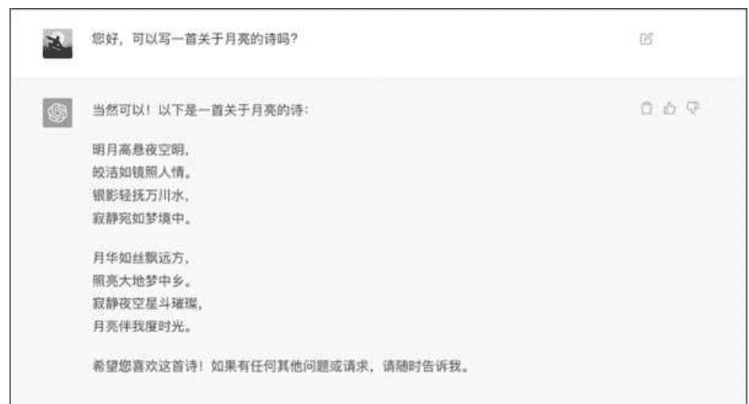

图1-2 诗歌创作

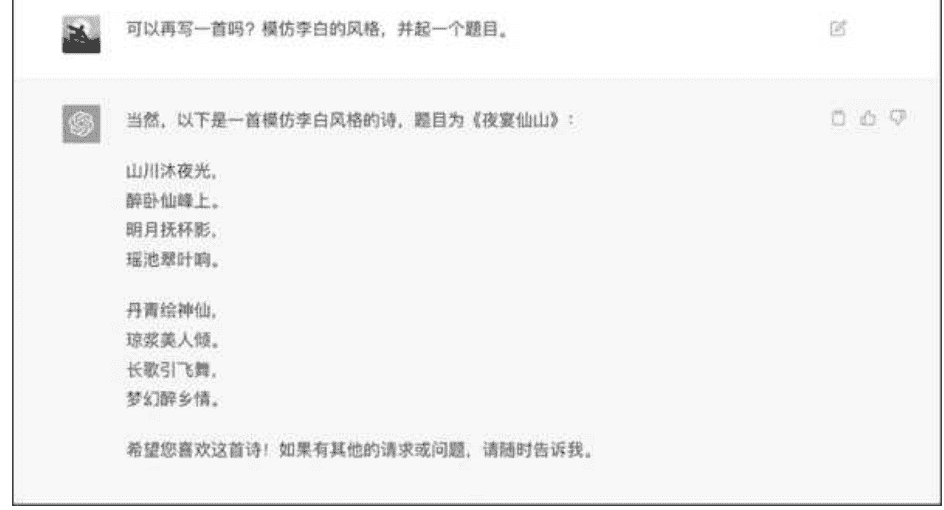

图1-3 指定风格诗歌创作

为什么ChatGPT可以快速创作出如此优美的诗歌呢？三国时期曹子建七步成诗，而ChatGPT在大模型和数据的加持下，几秒内就可以批量写诗，是什么原因让大模型“文思如泉涌”，下面让我们一起来探索大模型的工作原理。

## 1.2 大模型的神奇力量：工作原理大揭秘

在1.1节中，我们亲眼见证了ChatGPT的惊人创造力，能够在几秒内以李白的豪放派风格创作出美妙的诗歌。那么，下面让我们来深入探讨大模型是如何拥有一个跨越多领域、穿越古今的“超级大脑”的。

大模型丰富的知识储备来自其庞大的训练数据集，其中包括互联网上各种各样的文本，从新闻文章到小说、论文以及其他网页内容。各种各样的数据集丰富了大模型对语言和知识的理解，使它能够涵盖多领域。数据集是其获得知识的来源，据统计，ChatGPT的数据集主要采集于以下几个数据源。

- （1）BooksCorpus：这是一个包含11,038本英文电子图书的语料库，共有74亿个单词。
- （2）WebText：这是一个从互联网上抓取的大规模文本数据集，包括超过8万个网站的文本数据，共有13亿个单词。
- （3）Common Crawl：这是一个存档互联网上公开可用的数据集，包括数百亿个网页、网站和其他类型的文本数据。
- （4）Wikipedia：这是一个由志愿者编辑的百科全书，包括各种领域的知识和信息，是一个非常有价值的语言资源。

在海量数据的基础上，大模型采用了基于变换器（Transformer）模型的深度神经网络模型，获得了处理长文本和复杂语法的能力，同时保持了上下文的一致性，帮助ChatGPT生成更准确、连贯的文本。模型的本质是一个概率计算的过程，如图1-4所示为一个基础的语言概率模型示意图，以不同的概率和选择策略决定生成的文本。

图1-4 语言模型示意图

在本例中，生成不同文本的概率如下。

- 「我爱你」概率：0.5×0.6=0.3
- 「我爱她」概率：0.5×0.3=0.15
- 「我想吃」概率：0.3×0.5=0.15
- 「我想走」概率：0.4×0.3=0.12

在模型生成文本时，选择“我爱你”，还是“我爱她”，取决于大模型的参数设置，即温度和TOP_P，温度值决定了文本的随机性，较高的温度值会提升返回的随机值，较低的温度值会使模型倾向于返回可能性更高的词语。TOP_P是GPT2版本中引入的一个参数，选择词语时在累积概率>P的词语中进行选择，在概率分布相对均匀的情况下，可选词语会比较多；在分布方差较大的情况下，选择会少一些。

模型的训练包括两个过程，即预训练与有监督微调（SFT）。在预训练阶段，大规模文本数据被收集和准备用于模型的预训练。这个语料库通常包含来自互联网的各种文本，包括网页、社交媒体帖子、新闻文章等。一个大型的神经网络模型在经过构建和预训练之后，通过在上述文本语料库上进行自监督学习。在自监督学习中，模型通过在上下文中预测缺失的单词或标记来学习语言的语法、语义和世界知识。预训练的模型通常由多个Transformer层组成，用于建模文本序列中的依赖关系。这些模型可以包含数亿或数十亿的参数。经过预训练后，模型的参数包含了大量的知识，可以被视为通用的“语言理解”模型，但还需要微调以适应特定的任务。

在微调阶段，模型被进一步训练以适应特定的自然语言处理（Natural Language Processing，NLP）任务。为此，使用特定任务的标记数据集，如文本分类、文本生成、情感分析等。微调阶段通常包括添加额外的神经网络层，这些层根据任务的需求自定义，模型会经过特定任务的数据集的多次训练，逐渐适应该任务。

大模型之所以能够理解人类的复杂任务，在预训练—微调模式的基础上，还有一个关键的技术，即基于人类反馈的强化学习方式（Reinforcement Learning from Human Feedback，RLHF），通俗的表达就是从人类的反馈中学习。听起来感觉好像很容易想到，实际上却经历了不断探索才有所发现，可以说没有RLHF，ChatGPT的通用性远远达不到现在这种程度。微调过程很容易理解，如图1-5所示，经历了三个步骤。

步骤1 有监督微调（Supervised Fine-Tuning，SFT）整个过程是在已标注数据上进行微调训练完成的。这里的数据是指用户在对话框中输入的提示词和对ChatGPT输出内容的回复，帮助大模型增强在特定领域的能力。

步骤2 奖励模型（Reward Model，RM）。当前一步的SFT过程生成输出文本后，标注人员对这些输出结果进行排序。然后每次从输出结果中选取2个来训练这个奖励模型，使模型学习评价效果。这一步骤非常关键，它就是所谓的Human Feedback，用来引导下一步模型的进化方向。

步骤3 强化学习（Reinforcement Learning，RL）在步骤2的RM过程对输出结果评分后，奖励模型将评分回传给模型更新参数，更新模型时会考虑参数每一个词的输出和第一步SFT输出之间的差异性，尽可能使两者相似，这个过程使用的优化策略是图1-5中的近端策略优化（Proximal Policy Optimization，PPO），可以有效缓解强化学习的过度优化。

大模型在训练和计算方面采用了大规模的分布式计算集群和高性能GPU，主要使用了数据并行、流水线并行和张量并行的策略，使得它能够进行大规模的训练和推理，快速响应用户的请求，在几秒内回复用户的复杂任务。

在GPT系列发布后，研发团队不断努力改进其效果，从GPT-1、GPT-2、GPT-3到爆火的GPT-3.5，再到如今的GPT-4和GPT-4 Turbo，一直在修复偏见、妄想、计算不准确等问题，并通过迭代和微调来提高模型的性能和适应性，以确保其更好地满足用户需求。

总而言之，大模型之所以如此强大，是因为它汇聚了大规模的数据、深度的神经网络、不断地学习反馈、强大的计算资源及持续的改进。这个“超级大脑”能够跨越多领域，穿越古今，用以探索、创造和解决各种问题。

## 1.3 大模型的崛起
从初露头角到AI巅峰

大模型的发展历程是一个充满挑战和创新的过程，大模型的起源可以追溯到2015年，那一年萨姆·奥特曼、伊隆·马斯克等人在美国旧金山共同成立了OpenAI。2017年，谷歌大脑团队推出了用于自然语言处理的Transformer模型，成为当时最先进的大型语言模型（Large Language Model）。自诞生起，Transformer模型就深刻地影响了接下来几年各个领域人工智能的发展，而OpenAI公司就是专注于研究Transformer模型的众多团队之一。2018年，Transformer模型诞生不到一年，OpenAI就推出了具有1.17亿个参数的GPT-1模型。这个模型采用了Transformer结构，可以对大量的文本数据进行预训练，从而学习到语言的语法和语义特征。2019年，OpenAI公司公布了GPT-2模型，该模型具有15亿个参数，比GPT-1的规模更大，可以生成更加自然、连贯的文本。但是，由于担心GPT-2模型被滥用，OpenAI公司只发布了部分模型和数据，并且限制了其访问和使用。2020年，OpenAI推出了GPT-3模型——这时它具有1750亿个参数。这个模型可以进行商业化使用，用户提供小样本的提示语或直接询问，即可获得符合要求的高质量答案。2022年3月，OpenAI推出了InstructGPT模型，该模型为GPT-3的微调版，使用RLHF和指令微调优化了输出的结果。同年11月底，人工智能对话聊天机器人ChatGPT推出。2023年3月，OpenAI发布了GPT-4，在原先的基础上增强了多模态的能力，具有强大的图像识别功能，在部分学术和专业考试方面甚至超越了人类水平。

纵观大模型的发展，随着模型能力提升的还有模型的参数规模，从GPT-1的1.17亿个参数，到GPT-4的1.8万亿个参数，如图1-6所示，参数数量随着版本更迭急剧上升，模型能力也得到了综合加强。

在GPT-3.5模型推出后，科技企业纷纷开始积极研发自己的大型预训练模型，这一趋势推动了人工智能领域的快速发展。除ChatGPT外，百度于2023年3月召开发布会，发布了自研大模型“文心一言”，发布会上展示了文心一言在文学创作、商业文案创作、数理推算、中文理解、多模态生成五个使用场景中的综合实力；同年4月，阿里发布了自研大模型“通义千问”，展示了通义千问的文本创作翻译、角色扮演、语义理解、图形设计、连续对话、智能助手等功能，并表示会将大模型与所有产品和业务结合，推出更加智能化的新一代产品。随后，360、科大讯飞等也推出了大模型；在科研界，清华大学推出了ChatGLM-6B，可在消费级显卡上很方便地进行部署和微调；复旦大学NLP实验室推出了MOSS模型，也在多项NLP任务上取得有效成果；人民大学在2023年6月也推出了玉兰大模型，在多模态、信息检索等方面做了针对性优化。

除了通用的大模型，一些企业和研究团队也开始研发面向特定领域的模型。这些模型受到领域知识的启发，旨在更好地满足特定任务的需求，如医疗保健、金融、法律和工业领域的任务。例如，2023年9月外滩大会发布的蚂蚁集团金融大模型——AntFinGLM，测试集从认知、生成、专业知识、专业逻辑、安全性等28类金融专属任务评估了金融大模型能力，在金融领域的表现远超超过通用大模型。在研判观点提取、金融意图理解、金融事件推理等任务上，金融大模型已经达到专家平均水平，在一些专业考试上取得了不错的成绩。

## 1.4 大模型
重塑生活和工作

基于通用大模型和领域大模型，一些大模型的应用也应运而生，大模型在文本创作、多媒体创作、编程等方面展现了令人惊叹的能力。在文本创作领域，网络小说领域正经历着巨大变革，大模型的出现令网文的IP产出时间被大大缩短，2023年7月，腾讯旗下阅文集团发布了国内首个网文大模型“阅文妙笔”和基于此的大模型应用“作家助手妙笔版”。

在多媒体领域，一些艺术家和设计师使用这些模型来进行图像、插画和其他设计。这些应用可以帮助创作者快速从灵感出发，将其进一步发展成作品原型；大模型在视频的生成和编辑方面可以自动生成动画、特效和过渡效果；在音乐领域，大模型可以用于创作音乐、作曲、编曲和音乐合成，它们能够生成多种音乐风格和乐器的声音，帮助音乐人和制作人快速实现音乐创作。图1-7所示是作者在阿里云通义万相平台上生成的油画，图中少女在窗边绘画，展示了一种静谧而美好的意境。

图1-7 AI绘画作品——绘画的少女

在大模型编程方面，部分科技企业和研究人员也开始在内部试用大模型的代码生成、代码补全和纠错等功能，数学家陶哲轩在微博上分享了自己使用大模型编写Python代码方面的经验。陶哲轩使用了ChatGPT生成了一小段Python代码，用于计算Phi非递减序列的数学问题，他认为这个工作非常有价值，生成的函数非常聪明地计算了totient函数，并表示“能够使用GPT最初生成的代码作为起点手动生成我想要的代码，这可能节省了我大约半个小时的工作”。陶哲轩表示：“我不经常用Python编写代码，所以我也没有掌握一些基本语法（如for循环），并且按引用传递和按值传递之间存在一些微妙之处，这让我很困惑。几乎每次，包括当我最终错误地初始化二维数组时，我必须通过手动检查动态更新来调试。所以，拥有几乎正确的代码，并且已经具有正确的语法对我来说有很大帮助，否则我将不得不搜索几乎每一行代码来弄清楚如何准确地表达它。”

在数字人领域，AI数字人平台也大大缩短了数字人创作的周期，用户使用AI数字人平台创作数字人，变得更加高效和可行。例如，在腾讯智影平台中，读者可以利用强大的AI技术来创建、定制和管理数字人。创作者可以根据需要对数字人进行个性化定制，例如选择外貌、服装、声音、情感表达等方面的特征，以创造具有独特身份和风格的数字人。数字人平台还提供了情感建模工具，使数字人能够表现出各种情感和情绪。这对于交互式应用和虚拟助手非常重要，因为它们需要与用户建立情感联系。一些AI数字人平台包括语音合成和语音识别技术，使数字人能够听取用户的声音指令并回应以实现更自然的互动。数字人平台可以用于电影、电视、游戏和虚拟演出等娱乐和媒体产业，创造更引人入胜的虚拟角色和互动体验，如现在火爆的视频直播领域与数字人的结合极为紧密。企业使用数字人直播可利用虚拟IP为企业创造价值，同时减少人力成本，可以和真人直播进行互动，在深夜等时段不间断直播。作者使用腾讯智影平台生成了一个虚拟数字人小薇，通过提示工程让其为作者录制了一段广告语。图1-8所示为数字人小薇视频截图，看到这里，你是不是也想学习如何用AI快速生成一个专属的数字人呢？

欢迎各位读者阅读本书

下面将由小薇带领您

学习ChatGPT的各种使用技能

图1-8 数字人生成书籍广告

# 第2章
深度剖析大模型背后的故事

大模型技术基于人工智能、大数据、并行计算、硬件加速等技术。我们在第1章中介绍了大模型的工作原理，本章将详细描述其各项技术的底层细节，帮助读者进一步深入理解大模型。

## 2.1 大模型技术
深度解析

大模型是深度学习模型的一种，通常基于深度神经网络。深度学习是一种机器学习方法，其模型由多层神经网络组成，这些网络通过学习数据来提取特征和模式。深度学习的核心思想是通过构建多层神经网络来学习数据的抽象表示。这些表示可以应用于各种任务，如图像识别、自然语言处理、语音识别等。大模型扩展了深度学习的概念，具有数百万甚至数十亿的参数，从而使其能够更好地捕捉数据中的复杂关系。大模型具有更大的容量和表达能力，能够处理更复杂的数据和任务。它们可以在大规模文本、图像和音频数据上进行预训练，然后在各种应用中进行微调，并被广泛地使用。一般来说，实现大模型需要经历以下几个步骤。

（1）数据预处理：大模型的训练需要大量的数据，因此我们需要对数据进行预处理，包括数据清洗、数据增强、数据标注等操作，以便让模型更好地学习数据中的特征和规律。

（2）模型构建：根据问题的类型和数据的特点，选择合适的深度学习模型架构，如Transformer等。然后使用Python等编程语言实现所选的模型架构，并使用TensorFlow、PyTorch等深度学习框架进行训练和测试。

（3）模型训练：使用训练数据对模型进行训练，通常需要耗费大量的时间和计算资源。在训练过程中，需要使用合适的优化算法和超参数调整技巧，以便让模型更好地学习和预测。

（4）模型测试：在训练完成后，使用测试数据对模型进行测试，以了解模型的性能和准确度。根据测试结果，可以对模型进行优化和调整，以提高模型的性能和准确度。

（5）模型优化：根据测试结果，可以对模型进行优化和调整，如调整模型的参数、改进模型的架构、增加模型的深度等。

（6）模型部署：将优化后的模型部署到实际应用场景中，以实现具体的业务需求。这可能包括将模型集成到现有的系统中，或者将模型部署到云端或边缘设备上。

因为大模型具有更多的参数，训练通常需要大量的数据和计算资源。模型训练是大模型技术中的核心问题，大模型的训练通常包括预训练和微调两个阶段，在预训练阶段，模型使用海量的文本数据进行训练，以学习语言的规律和结构，从而能够预测下一个单词或短语。常见的预训练方法包括自回归模型（Autoregressive Model）和自编码器模型（Autoencoder Model）。在预训练完成后，模型进入微调阶段。在微调阶段，模型使用特定任务的数据集进行训练，以使其能够更好地适应任务的需求。这个任务可以是对话生成、文本摘要、机器翻译等。大语言模型的一个重要特点是其能够理解上下文和语义，并生成具有一定连贯性和逻辑性的文本。

在实际应用中，大模型的算法实现还需要考虑许多细节和技术问题。例如，如何处理大规模的数据、如何优化模型的计算效率、如何保障模型的安全性和隐私性等，设计时需要结合具体的应用场景和技术需求进行综合考虑和设计。

## 2.2 预训练技术
大模型的基石

预训练—微调模式（Pre-training and Fine-Tuning）是自然语言处理（NLP）领域广泛使用的深度学习方法，在大模型中应用广泛，分为两个主要步骤，即预训练和微调。

预训练（Pre-training）是指在解决目标任务之前，通过大规模数据集和无监督学习的方式对模型进行初始训练。在这一阶段，模型通过学习输入数据的内部表示，获取了丰富的知识和特征，学习通用的知识和能力。微调是指在某一特定领域，通过少量标注后的数据进行微调训练的过程。预训练过程关注的是模型的通用能力，微调关注的是模型在特定领域的能力。预训练模型的核心思想是利用大量的数据来学习一种泛化的特征表示，这种表示可以被应用于多种不同的任务。这种方式的高效性在于，一旦模型完成预训练，即可通过微调来适应具体的任务，而无须从头开始训练。这不仅节省了大量的时间和计算资源，还提高了模型在特定任务上的性能。

例如，让一个零基础的人——小白从事大模型算法开发工作几乎是不可能的，因为他完全不知道如何入手，需要非常多时间从0开始学习；但如果让一个计算机专业毕业生从事大模型算法开发，那么仅需要让他学习大模型的一些知识即可上手工作。在这个例子中，计算机知识是通用的知识，而大模型算法属于特定领域的知识。让小白从0开始学习大模型算法，和传统机器学习的训练思想是一致的，而让一个计算机毕业生学习大模型算法，则对应了预训练—微调的训练模式，之前学习的计算机知识是预训练的内容，新学习的算法知识就是微调的内容。

图2-1所示为预训练模型的示意图，展示了其多样的应用领域、面临的挑战、固有的优势。预训练模型作为一项成熟的技术，通过在大规模数据集上训练，获得通用知识，能够通过微调快速适应不同任务。这不仅提升了模型的泛化能力，减少了对数据集的依赖，也节约了宝贵的时间和资源。图中突出了ResNet、VGG、BERT和GPT等模型，这些模型在图像识别、语言翻译和文本生成等领域展现出了强大的能力。

图2-1 预训练模型

## 2.3 指令微调技术
模范一般的LoRA与P-Tuning

预训练—微调模式在处理复杂任务时尤其重要，预训练不仅为模型提供了一种丰富的特征理解，而且通过微调，使得外部知识可以应用到新的、但相关的问题上。这个过程类似于人类利用已有知识来解决新问题，减少了从零开始的重复工作。

在具体应用中，预训练模型可以显著减少开发时间和资源投入。例如，在医学成像分析中，预训练模型可以用来识别各种医学图像，而微调则允许它适应特定类型的图像或特定病症的识别。同样，在自然语言处理中，预训练模型已经证明了它们在各种语言任务上的有效性，包括文本分类和情感分析，以及如今的问答系统。

那么，我们如何在预训练大模型的基础上，继续微调以提高其对特定任务的适应性和精准度？首先，我们需要确定目标任务的特性和所需的数据类型。例如，如果目标是提高语言模型在特定行业术语上的理解，我们可能需要收集该行业的相关文本作为微调数据集。然后，我们需要使用这些定制的数据集来继续训练模型，在这个过程中可能会调整模型的参数，甚至可能改变模型的某些层，以更好地映射到目标任务上。

微调时通常使用监督学习，因此整个流程也称为有监督微调（Supervised Fine-Tuning）。我们会使用标注好的数据来指导模型的学习，以便它识别出与任务相关的细节和特征，即对模型进行增量学习，在保留预训练知识的同时，添加新的知识。在这个过程中，学习率通常设置得比预训练阶段低，以避免预训练时获得的知识被新的训练数据覆盖。

微调不仅是调整权重，有时还涉及模型架构的改变，如添加新的层或调整现有层的连接方式，以更好地适应特定的任务。此外，在微调过程中还可能会采用一些正则化技术来防止过拟合，确保模型在新的任务上能够保持良好的泛化能力。

通过在大规模数据上进行预训练，然后针对具体任务进行微调，我们能够创建既具有广泛知识又能够针对特定问题进行优化的模型。这种方法不仅提高了模型的灵活性和效率，还扩展了其应用范围，使大模型能够在更多领域发挥重要作用。

### 2.3.1 LoRA

低秩自适应（Low-Rank Adaptation，LoRA）是一种针对大型预训练语言模型（如GPT-3）的微调技术。LoRA的核心思想是通过对模型权重进行低秩更新，以实现有效的参数适应，而无须重新训练模型的全部参数。这种技术在保留预训练模型的泛化能力的同时，允许模型快速适应特定任务。

LoRA具有以下特点。

- **调整参数少：** 在微调过程中，LoRA只调整模型的一小部分参数，这减少了存储和计算的需求。
- **低秩结构：** LoRA通过引入低秩矩阵，对权重进行更新。这种结构允许在不显著增加参数总数的情况下，以紧凑的形式捕捉到权重变化的关键方面。
- **层次更新：** LoRA通常针对模型的特定层（如自注意力层）进行更新，这使得更新更为集中和有效。
- **适应性强：** LoRA允许模型快速适应新任务，无须对大量数据重新训练。

LoRA的工作流程如下。

（1）权重选择：首先确定模型中哪些权重是进行更新的候选对象。

### 2.3.2 P-Tuning

前缀微调（Prefix Tuning，P-Tuning）是一种大模型指令微调技术，它利用可学习的提示词来适应特定的下游任务。与传统的微调方法相比，它不需要调整模型的所有参数。

P-Tuning技术的核心在于引入一组可学习的提示向量，这些向量作为任务特定的提示，被置于输入序列的前面。这些向量是唯一需要在微调过程中学习的参数，模型的主体参数保持不变，大大减少了参数更新的数量。通过训练这些提示向量来适应特定任务，P-Tuning能够引导模型生成期望的输出，从而提高特定任务的性能。

P-Tuning技术的工作经历以下四个步骤。

- （1）初始化提示：为每个下游任务初始化一组提示向量作为提示。
- （2）前置提示：在输入序列前添加这些提示。
- （3）训练提示向量：在下游任务的数据集上训练这些提示向量，而不是模型的原始参数。
- （4）生成输出：模型使用这些训练过的提示来理解和执行特定的任务。

P-Tuning适用于那些大型的、参数量巨大的语言模型。通过这种技术，即使是在资源受限的情况下，研究人员和开发人员也可以有效地利用大模型解决特定的NLP任务。

与其他微调技术（如LoRA）相比，P-Tuning提供了一种不同的参数调整方式，它在输入时进行调整，而不是直接修改模型的内部权重。这种技术的优势在于其简便性和效率，尤其是在微调需要较长时间或者计算成本很高的大模型时，这种技术比LoRA需要的训练时间和计算资源有显著减少。

## 2.4 基于人类反馈的强化学习

基于人类反馈的强化学习（Reinforcement Learning from Human Feedback，RLHF）是一种机器学习方法，它结合了强化学习（Reinforcement Learning，RL）和人类反馈。在RLHF框架下，用户提供的真实反馈被用来指导强化学习算法，从而优化模型的行为。这对于大模型应用，如ChatGPT、RLHF大模型效果的持续提升有非常重要的作用。大模型在预训练时已经学习了大量的语言知识和世界信息，但它们可能在特定任务或特定类型的交互过程中表现欠佳。通过RLHF，我们可以进一步调整这些模型的输出，使其更适应特定的应用场景。例如，我们可以通过人类反馈来优化对话系统中的回答质量，或者调整内容生成模型以生成更符合用户期望的内容。

RLHF有三个组成部分，即人类反馈、奖励模型和强化学习。首先，用户在使用大模型后，会根据输出的答案给出正面或者负面的反馈，如图2-2所示，当我们向大模型提问后，在底部会出现一个“赞”和“踩”的标志，我们可以点击相应的标志来反馈答案的质量。当系统收集到足够多的反馈数据后，数据会被汇总并用于训练奖励模型。该模型可以预测不同答案应该获得的奖励值。大模型使用这个奖励模型来指导其学习过程，通过尝试最大化奖励模型给出的奖励值来改善其输出。基本上每隔三个月左右，科技企业会将大模型通过RLHF训练一次，改善大模型输出的答案。

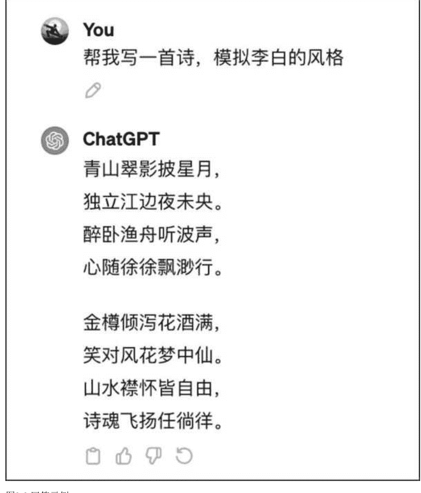

图2-2 回答示例

尽管RLHF为优化大模型提供了一种有效的途径，但这种方法也面临着一些挑战。例如，收集高质量的人类反馈是一个耗时且成本较高的过程。此外，如何确保反馈的代表性和公平性，以避免引入偏见，也是需要解决的问题。

## 2.5 大模型效果

大模型的效果评价是一个复杂且多维度的任务，涉及性能、准确性、效率、泛化能力、公平性和可解释性等多个方面。对于如GPT-4、文心一言、通义千问这样的大语言模型，有效的评价方法尤为重要。

在NLP领域，针对不同的任务有相应的评测方法，然而在大模型时代，单个的小数据集不足以评测通用大模型，同时大模型的回复也难以用准确度等指标进行量化。因此，当前我们采用多个数据集组成一个综合评测数据集。综合评测数据集通常包含一系列预定义的任务，评估模型在几个特定领域的表现，常见的评测集包括GLUE、SuperGLUE等。此种方案提供了一种统一和可比较的评价标准，但仅能覆盖一些常用的场景，无法覆盖所有场景。

随着技术的发展，大模型在一些简单NLP任务上的表现越来越好，且评测数据在网络上可以查询到，很可能出现在大模型的预训练数据集中，综合数据集评测的方案无法准确评价大模型的能力，现阶段出现了利用人类考题来评价的方案，如将基金考试题目用来测试大模型在金融领域的能力，使用代码问题来测试大模型在代码方面的能力。

那么，有了考试题目，谁来打分呢？在大模型发展初期，通常是领域专家对大模型的答案进行人工评价，此种方案相对可靠性高，但消耗人力较多，且不同专家的评判尺度难以统一。随着大模型技术的高速发展，使用大模型来评价大模型的方法出现了。我们可以使用GPT-4这种能力较强的通用大模型，或者一些专门用于评价大模型的领域大模型，对大模型进行自动化测试。

# 第3章 与大模型的对话之道

## 3.1 提示工程的奥秘

提示工程（Prompt Engineering）是指在使用大模型进行生成任务时，通过设计和优化输入的提示信息，引导模型产生符合期望的输出。它是一种对话式的交互方式，可以帮助控制和调整生成模型的输出结果。在传统的大型语言模型中，用户通常只需提供一个简单的提示或问题，模型会根据训练数据和预训练的知识来生成相应的回答或句子。然而，这种方式可能导致模型输出不准确、模棱两可，甚至生成不符合要求的内容。提示工程引入了更多的交互和指导，使得用户可以更加精确地控制模型的行为，帮助大模型更好地理解用户的需求。

### 3.1.1 探索提示工程的核心

提示工程的关键思想是通过合理构造的提示信息来影响模型的行为。这涉及选择合适的问题或情境描述，并对其进行精确而清晰的定义。通过巧妙地设置提示的方式，可以引导模型以特定的方式生成内容，使其满足用户的需求。提示工程的具体内容包括以下几个部分。

- （1）明确任务目标：明确定义生成任务的目标和要求，包括所需的输出形式、约束条件、主题范围等，这有助于指导模型生成符合预期的内容。
- （2）提供上下文信息：为模型提供必要的上下文信息，如相关文本片段、问题背景、关键词等，这有助于模型更好地理解任务和生成准确的输出。
- （3）控制温度参数：通过调整生成模型中的温度参数，可以控制生成结果的多样性。较低的温度会使生成结果更加确定和保守，而较高的温度则会产生更多的随机性。
- （4）迭代优化：根据实际生成结果的反馈，不断迭代优化模型的提示信息。模型可以通过试错的方式进行尝试和调整，以达到更好的生成效果。

当前，提示工程在生产实践中被广泛应用于各个领域，如自然语言生成、文生图、智能助手、文本摘要、代码生成等。它提供了一种有效的方式来引导大模型的输出，使其更符合用户的需求和预期。虽然提示工程提供了一种有效的方式来引导大语言模型的输出，但也面临一些挑战和限制。一方面，设计合适的提示信息需要一定的领域知识和经验。另一方面，模型仍然可能生成不准确或不符合预期的内容，需要进行后期的评估和调整。

### 3.1.2 提示工程：与大模型对话的关键要素

提示工程的具体要素可能因任务类型、数据集和模型而有所不同，提示工程的要素主要包括指令、上下文数据、输入数据和输出数据。以下是对这些要素的介绍。

- （1）指令（Instructions）：指令是用于引导模型生成回应的明确指导或问题形式的文本。指令可以是简短的陈述，也可以是具体的问题。指令的设计应该清晰明了，以确保模型能够正确理解任务需求并提供准确的回答。
- （2）上下文数据（Context Data）：上下文数据是指在进行对话时提供给模型的附加信息。这些数据可以是对话历史记录、对话摘要、关键词或标记等。通过传递上下文数据，模型可以更好地理解先前的对话内容，并根据上下文生成更连贯和有意义的回应。
- （3）输入数据（Input Data）：输入数据是指作为模型输入的原始或预处理过的文本。它可以包括指令文本、上下文数据、格式标记、控制令牌等其他相关信息。输入数据的质量和准确性对于获得高质量的输出回应非常重要。
- （4）输出规范（Output Indicator）：输出规范是指提示的输出指示符。它通常用于告知模型生成文本的方式和格式。输出指示符可以帮助模型理解预期的输出类型，并生成相应的回答。

通过优化这些要素，我们可以帮助模型提升输出的效果。合理编写指令，提供适当的上下文数据，并确保输入数据的准确性，有助于提高模型的性能和满足特定任务的需求。同时，对输出数据进行评估和调整，可以进一步提升输出回应的质量和可靠性。

## 3.2 提示工程师的角色

随着人工智能技术的飞速发展，一种新型专业人才——提示工程师（Prompt Engineer）出现了。提示工程师利用精心设计的提示（Prompts），有效地与基于大模型的系统对话，从而引导这些系统生成更为精准、高质量的输出。本节主要介绍提示工程师的职责、技能要求以及在未来社会中的重要性。

### 3.2.1 提示工程师：对话中的引领者

提示工程师的核心职责是设计和优化提示，帮助大模型系统更好地理解用户的意图，并提供满足用户需求的答案或解决方案。这一过程涉及对特定AI模型的理解，如ChatGPT、文心一言、通义千问等，以及对应用场景的深入分析。提示工程师需要根据不同的业务需求和大模型的特性，创造性地构建和测试提示，以便实现最佳的人机交互效果。

在技术日益普及的今天，提示工程师这个新兴职业变得愈发重要。一个准确有效的提示词可以显著提升大模型的工作效率和效果，如在医疗咨询、客户服务、内容创作等领域。此外，随着系统的不断迭代和升级，我们对于掌握高质量提示技巧的专业人才的需求也在不断增长。那么，提示工程师具体是如何工作的呢？举例来说，在电子商务领域，提示工程师可以设计出具有引导性的提示词，帮助大模型更精准地捕捉顾客的购物意图，从而为其推荐更符合需求的商品。在教育领域，通过优化提示词，AI教育助手能更准确地解答学生的疑问，提供个性化的学习资源。

### 3.2.2 如何成为优秀的提示工程师

通常，提示工程师需要进行反复的实验和评估，以确定哪些提示在特定任务中能够获得理想效果，并不断优化提示以获得更好的结果。接下来，让我们用一个实例来讲述提示工程师是如何设计并优化提示词的。

#### 1. 背景

某公司想要开发一个自动化的客服聊天机器人，用于回答客户的常见问题和解决问题，如账单问题、服务故障和升级请求，需要一个提示工程师来设计和优化提示，以确保机器人的回答准确且符合公司的业务需求。

#### 2. 工作步骤

- （1）设计初始提示：提示工程师首先会设计一组初始提示，这些提示将作为用户与机器人交互的起点。例如，他们可以设计如下提示：“接下来，你是公司的客服助手。以下是用户的问题。”
- （2）语言风格和口吻：提示工程师需要确保提示的语言风格与公司的品牌形象和用户期望相匹配。
- （3）特定任务的提示：如果客服聊天机器人需要执行特定任务，如查询订单状态或提供产品信息，提示工程师会设计专门的提示，以引导机器人正确执行这些任务。
- （4）处理敏感信息：如果公司要求机器人不收集或传输敏感信息，则提示工程师需要设计提示，以确保机器人向用户提供此类信息时采取适当的回应，如引导用户与人工客服联系。
- （5）评估和迭代：提示工程师会与算法团队合作，不断评估模型的性能，并根据用户反馈和模型输出的准确性来优化提示。他们可能需要多次修改提示以提高机器人的响应质量。

#### 3. 实际案例

用户提问：为什么我这个月的账单金额这么高，我的钱花到哪儿去了？

提示工程师需要确保聊天机器人能够完成以下任务。

- 1. 确认用户身份和账户信息。
- 2. 分析账单，找出可能导致费用增加的原因（如额外使用费、服务升级或定价变动）。
- 3. 提供清晰、准确的解释，并根据需要提供进一步的帮助或解决方案。

为了达到以上目标，提示工程师需要设计一个多步骤的交互流程，指导机器人先验证用户信息，然后检索和分析账单数据，最后以易于理解的方式呈现信息，并提供后续选项。这个流程可能包括指示性问题、数据查询请求和二次提问。提示工程师需要确保每一步都能高效准确地满足用户的需求。

## 3.3 对话编写的艺术

### 3.3.1 编写清晰明确的指令

提示词用来描述聊天机器人执行的具体任务内容时，应该简单明了，清晰地传达用户的意图，避免出现歧义，且符合语法规则。一个优秀的提示工程应该能够使用户更好地理解如何与系统进行有效的交互，而清晰明确的指令是实现这一目标的基础，让我们来看一下下列提示词。

- “写一篇关于气候变化的报告。”
- “做一个数字计算程序。”
- “创建一个公司网页。”
- “制作一个产品视频。”

这些提示词比较模糊，没有提供足够的信息，可能导致大模型在缺少必要信息的情况下，生成可能无法满足预期的内容。这里以“写一篇关于气候变化的报告”来举例。

提示词：
写一篇关于气候变化的报告。

回答：
当写一篇关于气候变化的报告时，需要考虑报告的结构和内容，以确保传达清晰的信息。以下是一个简要的报告示例。

报告标题：气候变化：现状、影响和解决方案

引言：
气候变化是当今全球社会面临的一项重大挑战。本报告旨在分析气候变化的现状，讨论其对地球和人类社会的影响，以及提出减缓和适应气候变化的解决方案。

第一部分：气候变化的现状

- 1.1 温度上升：全球平均气温持续上升，主要由温室气体排放引发。科学家一致认为，人类活动是导致温度上升的主要原因之一。
- 1.2 极端天气事件：气候变化导致了极端天气事件的增加，如暴雨、干旱、飓风和森林火灾等。这些事件对社会和经济造成严重影响。
- 1.3 海平面上升：极地冰川的融化导致海平面上升，威胁着沿海地区的稳定性。

第二部分：气候变化的影响

- 2.1 生态系统：气候变化对生态系统产生深远的影响，导致物种灭绝、生态平衡被破坏和生态系统功能丧失。
- 2.2 农业和粮食安全：变化的气候条件威胁着全球粮食生产，可能导致食品短缺和价格上涨。
- 2.3 健康：极端气候事件和气候变化对人类健康产生不利影响，如传染病传播、热应激和饮用水资源的压力。

第三部分：应对气候变化的解决方案

- 3.1 减缓气候变化：降低温室气体排放是减缓气候变化的关键。政府、企业和个人都可以采取行动，包括使用可再生能源、提高能效和支持可持续交通。
- 3.2 适应气候变化：我们需要采取适应措施来减轻气候变化对社会的影响。这包括改善基础设施、开展气象预警和推动可持续土地管理。
- 3.3 国际合作：国际社会需要加强合作，共同应对气候变化。巴黎协定是一个重要的里程碑，需要继续推动国际行动。

结论：

气候变化是一个严重的全球挑战，但我们仍然有机会采取行动来减缓其影响。通过降低温室气体排放、采取适应措施和国际合作，我们可以共同努力保护地球，确保可持续的未来。每个人都可以为此做出贡献，这是我们共同的责任。

这个指令相对模糊，没有提供关于报告的具体要求，如主题、字数、要求或引用内容。这种模糊的指令可能导致不确定性，使大模型生成较为笼统的输出。接下来我们将上述提示词更换为更为清晰准确的提示词。

提示词：

现在，你是一个气象专家，请撰写一份关于气候变化对极地冰川融化影响的报告，包括至少三个科学研究的引用。

回答：

当涉及气象领域的关于气候变化对极地冰川融化影响的报告时，需要深入研究和参考多个科学研究以支持观点。以下是一份简要的报告，包括至少三个科学研究的引用。

报告标题：气候变化对极地冰川融化的影响

引言：

气候变化是当前全球面临的一个严重问题，对极地冰川的融化产生了显著影响。本报告将探讨气候变化对南极和格陵兰岛冰盖的影响，并引用多项科学研究以支持我们的观点。

1. 极地冰川的融化速度持续加快

研究表明，气候变化导致极地冰川的融化速度持续加快。根据NASA（美国国家航空航天局）的研究（Hanna et al., 2018），格陵兰岛冰盖的融化速度正在以前所未有的速度增加。这种现象与南极冰盖的情况相似，根据Turner et al.（2016）的研究，南极冰盖也在不断失去冰量。这种持续加速的融化对全球海平面上升产生了明显影响（Shepherd et al., 2018）。

2. 海平面上升

随着极地冰川的融化，释放的淡水进入海洋，导致全球海平面上升。根据IPCC（联合国政府间气候变化专门委员会）的研究报告（IPCC AR6 WG1, 2021），全球平均海平面每年上升约3.3毫米，其中极地冰川融化贡献了相当大的一部分。这对沿海城市和岛屿构成了严重威胁。

3. 气候系统复杂性

气候变化对极地冰川的融化产生了显著而持续的影响。科学研究表明，极地冰川融化加速、海平面上升和气候系统的复杂性都是这一问题的主要方面。为减缓这一趋势，我们需要采取国际行动，减少温室气体排放，同时也需要采取适应措施，以应对不可避免的变化。这是全球社会共同面临的重要挑战，需要全球合作来解决。

清晰具体的指令有助于确保任务的顺利完成，并避免误解和不确定性。这份提示词明确指定了所需的信息和任务，使大模型能够清楚地了解任务内容：生成气候变化对极地冰川融化影响的报告，并包含至少三个科学研究的引用。而反例中的提示词模糊不清，没有提供足够的细节，容易导致误解和不确定性。

接下来，我们再来看一个实例。

提示词：

告诉我如何做好吃的面。

回答：

制作美味的面需要一些基本的步骤和技巧。以下是制作经典的意大利面（意面）的简单步骤。

材料：

- 意大利面（任何类型都可以，如细面、宽面、螺旋面等）
- 水
- 盐
- 橄榄油（可选）

步骤：

1. 煮面：
   - 在大锅中烧开水，然后加入一些盐（通常每升水中加入1～2茶匙盐）。
   - 将意大利面放入开水，根据包装上的指示煮熟。通常，煮沸后需要煮8～12分钟，直到面条变软但仍有嚼劲。
   - 偶尔搅拌一下，以防止面条粘在一起。
2. 沥水：
   - 在面条煮熟后，将它们倒入一个筛子或过滤器，将热水排出，确保面条干净而干燥。
3. 添加调味：
   - 如果您喜欢，可以在面条上撒上一些橄榄油，以防止粘在一起，并增添一些风味。
   - 您还可以选择将熟透的面条与您喜欢的酱料一起拌炒，如番茄酱、意大利调味酱、白酱等。此时，将面条与酱料加热一下，确保它们均匀混合。
4. 上菜：
   - 将煮熟的面条放在碟子或碗里，根据口味添加一些额外的调味料，如新鲜的巴西里、帕尔马干酪或红辣椒片。
5. 享用：
   - 现在，您可以品尝自制的美味意大利面了！

请注意，这只是一种简单的方法，您可以根据自己的口味和偏好进行调整，加入各种配料和酱料来制作不同风味的面条。制作好吃的面的关键是确保面条煮熟得当，以及选择合适的酱料和配料，以增强风味。

尽管回答已经非常清晰，但可以进一步扩展，这需要提示工程师输入关于各种面条和酱料的选择以及不同风味的建议。

让我们输入一些食材和口味要求。

提示词：

你是一个资深西餐厨师，擅长意大利面的烹饪，请你描述一下如何制作番茄海鲜意大利面，要求食材尽可能健康，不要太昂贵，步骤需要尽可能详细和具体。

回答：

当制作一道美味的番茄海鲜意大利面时，确保使用健康的食材和合理的预算是非常重要的。以下是制作一道健康而美味的番茄海鲜意大利面的详细步骤。

食材：

- 意大利面（建议使用全麦或多谷类面条，更健康）
- 新鲜番茄（2～3个）
- 混合海鲜（虾、蚌、鱼片等）200克
- 大蒜（2瓣）
- 橄榄油
- 红辣椒片（根据口味添加）
- 番茄酱（低钠版本）
- 干白葡萄酒（可选）
- 新鲜巴西利或欧芹（注，指香芹）
- 盐和黑胡椒

步骤：

1. 准备食材：
   - 将番茄切成小块，切碎大蒜，准备好混合海鲜、红辣椒片、橄榄油等。
2. 烧水煮面：
   - 在大锅中烧开水，加入一些盐，然后根据面条包装上的指示煮熟意大利面，通常需要煮8～12分钟，直到面条变软但仍有嚼劲。煮熟后沥水，留出1杯煮面的水备用。
3. 热锅加橄榄油：
   - 在另一个大平底锅中，加入橄榄油并加热。
4. 加入蒜和红辣椒片：
   - 加入切碎的大蒜和红辣椒片，翻炒至香气四溢。
5. 加入番茄：
   - 将切好的番茄块加入锅中，继续翻炒几分钟，直到番茄开始变软。
6. 加入番茄酱和干白葡萄酒（可选）：
   - 倒入番茄酱，再加入一些干白葡萄酒（可选）。
   - 将火调至中小火，煮5～10分钟，直到酱汁变浓。
7. 加入海鲜：
   - 将混合海鲜加入锅中，继续煮烧5～7分钟，或直到海鲜变色熟透。
8. 调味：
   - 根据口味加入盐和黑胡椒，调整味道。
9. 拌炒面条：
   - 将煮熟的意大利面加入锅中，搅拌均匀，确保面条充分裹上酱汁。如果需要，可以逐渐加入少量煮面的水，以帮助酱汁更好地与面条混合。
10. 装盘：
    - 将番茄海鲜意大利面装盘，撒上切碎的巴西利或欧芹作为装饰。
11. 享用：
    - 现在，您可以品尝健康而美味的番茄海鲜意大利面了！这道番茄海鲜意大利面不仅美味，而且食材相对健康，适合家常烹饪。希望您享受这道美食！

在这次的问答过程中，大模型返回了更为细致的食材建议和烹饪过程。回答质量提高的关键在于，提示词遵循了“清晰具体”的原则，从而帮助大模型理解提问者的意图，提供了明确的步骤和所需材料，使提问者能够成功获得制作令人满意的面食的方法。

### 3.3.2 激发大模型的思考能力

在提示词清晰准确的基础上，如果想引导大模型进行更深入、更准确地思考和推理，需要借助一些技巧。本节我们将深入探讨如何通过技巧性的提示，引导大模型进行更深入、更准确地思考和推理，以提高信息处理和响应生成的质量。以下技巧可以引导大模型进行更充分的思考。

- （1）提供足够的上下文：提供足够的上下文和详细信息，可以帮助大模型理解任务的背景和要求。例如，“这段文字来自一封西班牙语的信件，翻译成英语，确保保持原文的情感和语气”，而不只是“翻译这段文字”。
- （2）明确任务和预期答案：提示应当明确指出任务内容和预期的答案类型。例如，不只是问“告诉我关于太阳的一些信息”，可以说“提供太阳的基本特征，如大小、温度、组成等”。
- （3）多角度提示：可以从不同的角度引导大模型思考问题。例如，要求大模型从环境保护、经济、社会等多个角度讨论可持续发展的利弊。
- （4）要求解释和论证：要求大模型解释其答案或提供论证支持。例如，“解释为什么气候变化是一个重要的全球问题”或“提供支持您观点的科学数据”。
- （5）引导大模型提供详细信息：引导大模型提供更多的详细信息，而不仅仅是简短的回答。例如，“解释如何制作一道巧克力蛋糕，包括所需的材料、步骤和烘焙温度”。
- （6）提供多轮推理的机会：提示可以要求大模型进行多轮论证和推理，而不仅仅是提供事实性信息。例如，“推测未来50年内气候变化可能对全球粮食供应造成的影响”后，追加“重点谈谈厄尔尼诺现象”。

通过提供足够的上下文，明确的、多角度的提示，并给予论证，可以激发大模型更深入、有意义地思考和生成相关的内容。这些提示可以帮助大模型更好地理解任务，生成更有价值和创造性的输出内容。

这里用一个简单的例子，来帮助读者理解如何让大模型充分思考。

提示词：

请从科学、伦理和社会角度探讨人类克隆的可能性、影响和限制。提供一篇500字左右的文章，涵盖这一话题的多个方面，并提出您自己的观点。

回答：

人类克隆是一个备受争议的话题，涉及科学、伦理和社会等多个层面。本文将从这些不同角度探讨人类克隆的可能性、影响和限制，并提出一些观点。

科学角度：

人类克隆的科学可能性一直存在，尤其是在分子生物学和细胞学领域取得了巨大进展的情况下。目前已经实现了动物克隆，如多利羊（Dolly the Sheep）的成功克隆，这为人类克隆奠定了一定基础。然而，人类克隆涉及更加复杂的伦理和技术挑战，包括克隆儿童可能面临的健康风险。

伦理角度：

从伦理角度看，人类克隆引发了诸多道德和伦理问题。首先，是应该将克隆人类视为复制品，还是独立的个体，这是一个重要的伦理问题。此外，人类克隆可能导致身份混淆，克隆个体可能在社会中面临困惑和歧视。此外，伦理学家普遍担忧克隆技术可能被滥用，如为了不正当目的。

社会角度：

从社会角度看，人类克隆可能会对家庭、社会和文化产生深远的影响。克隆家庭可能面临许多问题，包括克隆子女与亲生子女之间的关系和认同。社会还需要考虑如何处理克隆个体的法律权利和社会地位。此外，克隆可能导致社会分歧，一些人支持克隆技术的发展，而另一些人则强烈反对。

观点：

尽管人类克隆具有巨大的科学潜力，但我认为我们必须谨慎和慎重地对待这一问题。在克隆技术能够广泛应用之前，我们需要深入研究和讨论，以解决与之相关的伦理、法律和社会问题。同时，政府和社会各界应该共同努力确保克隆技术的应用是符合社会规范的，以避免滥用和不良后果。

总之，人类克隆是一个涉及多个领域的复杂话题，需要综合考虑科学、伦理和社会因素。我们必须在科学进步的同时，确保克隆技术的发展有利于实现人类的最大利益。

上述回答涵盖了从科学、伦理到社会多个角度的讨论，考虑了人类克隆的可能性、影响和限制，确保了全面性，采用了清晰的结构，分别从不同角度探讨了相关问题，在最后部分表达了自己的观点，即对人类克隆技术的发展必须谨慎对待。这已经是一个质量很高的完整回答，但是我们不满足于此，希望可以在伦理部分进行更具体的论述，以及它们可能对克隆个体和社会产生的影响，下面是我们修改后的提示词，鼓励大模型进行更深入和具体的讨论，并提供相关的例子和科学研究来支持观点和论述。

提示词：

请从科学、伦理和社会角度深入探讨人类克隆的可能性、影响和限制，提供一篇500字左右的文章，包括以下内容。

- （1）举例说明伦理问题：列举一些伦理问题，如个体身份、社会认同等，以及它们如何影响克隆个体和社会。
- （2）论述可能的法律挑战：探讨克隆技术可能引发的法律问题和争议，以及这些问题可能对法律体系造成的影响。
- （3）引用科学研究支持观点：引用相关的科学研究或案例，以支持对人类克隆可能性和健康风险的观点。
- （4）提出具体的道德建议：在结束时，提出一些具体的道德建议，以指导克隆技术的发展，确保其合理性。

回答：

# 人类克隆：科学、伦理与社会的交汇点

人类克隆技术的探索触及了科学的边界，同时也激起了深刻的伦理和社会问题。从科学的角度看，尽管动物克隆（如著名的克隆羊多利）已经取得了成功，但人类克隆仍面临着重大的技术障碍和未知的健康风险。此外，伦理和法律的挑战使得这一领域更加复杂。

## 伦理问题

- （1）个体身份：克隆人类可能引起关于个体独特性和身份的问题。克隆个体可能会面临“自我”与“原型”之间的身份冲突，这不仅影响其心理健康，也对社会认同产生挑战。
- （2）社会认同：社会可能对克隆个体持有偏见，这会导致歧视和社会分裂。克隆个体可能会被视为“非自然”的产物，从而遭受排斥或不公平对待。

## 法律挑战

克隆技术引发的法律问题复杂且多样。例如，克隆个体的法律地位和权利，如何界定和保护这些权利。此外，克隆技术的滥用可能导致新的犯罪形式，如未经同意的基因复制。这些问题对现有的法律体系提出了重大挑战，因此需要制定新的法律和政策来应对克隆技术的特殊性。

## 科学研究

科学研究表明，克隆技术在动物界已经取得成功，但这并不意味着它可以安全地应用于人类。根据《自然》杂志的一项研究，动物克隆常常伴随着基因异常和健康问题。这些发现对人类克隆的可能性和安全性提出了严重的疑问。

## 道德建议

综上所述，人类克隆技术的发展应遵循以下道德建议。

- （1）强化伦理审查：任何关于人类克隆的研究都应通过严格的伦理审查，确保其符合道德和法律标准。
- （2）公众参与和教育：增加公众对克隆技术的了解，促进社会对这一问题的深入讨论和理解。
- （3）明确法律规定：制定和实施明确的法律规定，以防止克隆技术的滥用，保护克隆个体的权利。
- （4）持续监督和评估：持续监督克隆技术的发展，评估其社会、伦理和法律影响，确保技术发展与社会价值观相协调。

总之，人类克隆技术的发展不仅是科学上的挑战，更是伦理和社会的考验。只有在综合考虑科学、伦理和社会因素的基础上，我们才能确保这项技术的合理性。

### 3.3.3 持续优化提示词的技巧

我们在处理复杂问题时，通常将其拆解为一系列小问题，再逐步解决。大模型在处理问题时也是一样的，当使用提示词与大模型交互时，我们可以通过不断优化提示词，引导大模型接近问题的真相，生成更符合用户期待的回答。

在逐步优化提示词时，我们首先要明确任务或问题的本质，即希望大模型输出的具体内容和要求。在对话过程中，通过与大模型进行反复的追问和补充，可以帮助大模型更好地理解用户的需求，并提供更准确的答案。多轮对话可以建立更丰富的语境，使大模型更好地理解问题的含义和背景。如果回答不准确或不符合预期，我们可以尝试优化提示词或提供更多的上下文信息。通过不断改进提示词，使优化效果得到逐步提升，进而生成满足需求的回答。

以下是一个关于人工智能伦理的简单示例，展示如何通过不断优化的提示词与大模型进行交互。

提示词：

解释人工智能伦理的重要性和涉及的关键问题。

回答：

人工智能伦理的重要性在于确保人工智能系统的开发和应用都符合道德和社会价值观，同时最大限度地减少潜在的负面影响。以下是人工智能伦理的重要性以及涉及的关键问题。

- （1）社会责任感：人工智能系统在日常生活中越来越普及，因此必须确保这些系统对社会负有责任。伦理原则有助于确保开发人工智能系统的组织和个人都遵循道德义务，考虑其影响，避免伤害和不公平。
- （2）隐私保护：人工智能系统处理大量个人数据，因此隐私保护成为一个重要的伦理问题。如何收集、存储和使用用户数据，以及如何保护这些数据免受滥用，是需要考虑的关键因素。
- （3）公平性和偏见：人工智能系统可能受到训练数据的偏见影响，导致不公平的决策和对待。伦理问题包括如何减少这些偏见、确保公平性，以及处理因算法决策而产生的社会不公等。
- （4）透明度和解释性：人工智能系统通常是黑匣子，难以解释其决策过程。伦理考虑包括如何增加系统的透明度，使用户能够理解为什么做出某些决策，以及如何处理解释性问题。
- （5）自主性和责任：自主决策的人工智能系统可能引发责任问题。如果系统犯下错误或产生不良后果，谁应该负责？伦理考虑涉及确定责任和建立法律框架。
- （6）安全性和滥用：人工智能系统的滥用可能导致安全威胁和潜在的破坏性影响。伦理原则包括确保系统的安全性，防止滥用，以及建立相应的法规。
- （7）共享和全球合作：人工智能是全球性的挑战，伦理问题需要全球合作来解决。如何促进国际共享最佳实践、合作和标准化，以确保人工智能的负面影响最小化，是一个重要问题。

总的来说，人工智能伦理是确保人工智能系统不仅在技术上先进，而且在道德和社会层面负责任的重要手段。通过解决这些伦理问题，我们可以更好地引导人工智能的发展，以使其造福社会，而不是潜在地对社会产生不利影响。

上述回答从多个方面描述了人工智能伦理的重要性和涉及的关键问题，那么我们可以在第一次回答基础上，来追加第二次提问的维度，持续优化提示词。

追问提示词：

请详细阐述人工智能伦理的重要性，包括其在确保技术公正性、防止滥用、维护隐私权和促进社会福祉等方面的角色，并讨论在实施人工智能时应如何平衡创新与伦理风险，特别是在自动化决策、算法透明度、责任归属以及数据安全等关键问题上。

回答：

人工智能伦理的重要性在于它在多个方面起到了关键作用，包括确保技术的公正性、防止滥用、维护隐私权和促进社会福祉。以下是对人工智能伦理的重要性的详细阐述以及在关键问题上如何平衡创新和伦理风险的讨论。

1. 确保技术的公正性
   - 伦理原则帮助确保人工智能技术的开发和应用是公平的，不会歧视或偏袒任何群体。这有助于消除潜在的社会不平等，确保人工智能系统不会产生不公平的影响。

2. 防止滥用
   - 伦理原则起到了防止人工智能技术滥用的作用，有助于明确人工智能技术的使用界限，防止不道德的行为，如滥用个人数据、武器化人工智能等。

3. 维护隐私权
   - 人工智能伦理确保了对个人隐私的尊重和保护。这对于防止个人信息的不当收集和滥用至关重要，同时提高了个人对技术的信任。

4. 促进社会福祉
   - 伦理原则的遵循有助于确保人工智能技术对社会的整体福祉产生积极影响。这包括应用人工智能来解决重大社会问题，如医疗保健、教育和环境保护。

平衡创新与伦理风险的关键问题：

a. 自动化决策
   - 在自动化决策领域，伦理问题涉及如何确保决策是公正的、可解释的和可追溯的。平衡创新和伦理风险需要建立可信任的决策流程，允许人工干预以纠正不公平的决策。

b. 算法透明度
   - 确保算法的透明度是关键，这有助于用户理解为什么系统做出特定决策。应该采用透明的算法设计，同时提供决策解释工具，以增强透明性和可解释性。

c. 责任归属
   - 对于人工智能系统的错误或不当行为，必须明确责任归属。这需要建立法律框架和合同条款，明确开发者、运营商和用户之间的责任。

d. 数据安全
   - 保护个人数据和确保数据安全是重要的伦理问题。平衡创新和伦理风险需要加强数据隐私保护措施，采用加密和访问控制，以防止数据泄露和滥用。

在应用人工智能技术时，平衡创新和伦理风险需要综合考虑上述问题，并制定适当的法规和标准。同时，社会参与和多元化的利益相关者合作也是确保伦理原则得到遵守的关键。通过促进开放的讨论、透明度和负责任的技术开发，我们可以更好地发挥人工智能的潜力，同时减少潜在的伦理风险。这样，人工智能将能够为社会带来更大的益处，同时维护伦理原则。

这个优化版本的提示词更加具体，引导生成的内容更为深入。从确保技术的公正性、防止滥用、维护隐私权和促进社会福祉等方面，为讨论人工智能伦理的重要性提供了明确的框架。同时，它还提出了在实施人工智能时需要平衡的挑战，包括自动化决策、算法透明度、责任归属和数据安全等关键问题，使大模型思考更为深入。

## 3.4 构建对话的框架

当我们编写提示词时，需要注意细微的改变可能会导致结果完全不同。为了帮助构建更完备的提示词，并且方便后续的提示词迭代，我们可以使用提示词框架。提示词框架是一种结构化的方式，用来指导我们编写提示词，以确保我们能够清晰地表达需求。这里将介绍两个有代表性的提示词框架，供读者参考和使用，以构建复杂的指令。

### 3.4.1 ICIO 框架：原理与应用

ICIO框架是一个通用的框架，用于规范和构建各种常规任务的提示词。它包括四个核心元素，分别是指令、上下文、输入数据和输出引导，具体解释如下。

- （1）指令（Instruction）：这是任务描述的核心部分，明确了我们希望模型执行的具体任务。指令通常包括动词和关键词，以确保模型理解要求。
- （2）上下文（Context）：上下文信息提供了额外的背景信息，有助于模型更好地理解任务和生成更符合需求的回复。上下文可以包括关于任务的背景知识、条件、约束或相关信息。
- （3）输入数据（Input Data）：这是模型需要处理的数据，它可以是文本、图像、数字或任何其他形式的输入。输入数据的清晰定义有助于模型准确地执行任务。
- （4）输出引导（Output Indicator）：输出引导规定了模型所需生成的数据类型或格式要求。这有助于确保模型输出符合预期，并与任务的需求一致。

ICIO框架的灵活性使其适用于各种任务，可以根据需求对这四个元素进行不同的排列组合，举例如下。

- 计算任务：指令+上下文+输入数据
- 翻译任务：指令+上下文+输入数据+输出引导

以下是一个示例，生成一个面向女性客户的镜子销售广告语，我们使用ICIO框架帮助读者更好地理解如何应用于一个具体任务，如表3-1所示。

表3-1 ICIO框架

| 组成部分 | 描述 |
| :--- | :--- |
| 指令 | 帮助我写一个关于镜子的广告语 |
| 上下文 | 要面向年轻女性用户，最好使用“震惊体” |
| 输入数据 | 以“震惊！”开头 |
| 输出引导 | 结尾带有购买方式和链接，引导用户进行购买 |

在这个例子中，我们使用ICIO框架清晰地定义了任务的要求，指令描述了任务的性质，上下文提供了关于广告语的客户群体，输入数据规定了开头的内容，而输出引导明确指定了输出的格式。这有助于模型准确地理解任务，并生成一段适合的广告语，这里我们使用四个组成部分，构建完整的提示词。

提示词：

帮助我写一个关于镜子的广告语，要面向年轻女性用户，最好使用“震惊体”，以“震惊！”开头，结尾带有购买方式和链接，引导用户进行购买。

回答：

震惊！全新镜子革命，年轻女性的美丽新时代！

你以为镜子只是反映你的模样？错了！现在的镜子可不止如此，它们能为你带来震撼的变身！

镜子不再仅仅是你看见自己的工具，它们是你自信的秘密武器！独特的设计，完美的反射，带来无与伦比的美丽体验。从今天开始，每一次照镜子都会是一场惊喜的冒险！

快来感受镜子的魔法，释放你的自信！点击下方链接，立即购买，不容错过！

购买方式：点击链接[在这里插入购买链接]，展现你的美丽新时代！镜子之美 自信从镜子开始

这里我们在使用ICIO框架生成的提示词中，通过明确指令、上下文、输入数据和输出引导，使得大模型可以很好理解我们的意图和要求，生成“震惊体”文案。

### 3.4.2 CRISPE 框架：细节与优势

CRISPE分别包含能力角色、洞察、陈述、个性与实验几个部分，适合编写复杂度更高的提示词，具体组成如下。

#### 1.能力与角色（Capacity and Role）

角色描述：详细描述大模型需要扮演的角色，如产品经理、律师、医生、教育家等，以确保大模型理解其在特定领域中的角色职责。

职责范围：明确大模型在所选角色中的职责范围，包括需要考虑和涉及哪些方面。

#### 2.洞察（Insight）

行业背景：提供有关所在行业的详细信息，包括历史、趋势、竞争格局和主要参与者。

目标受众：具体定义目标受众，包括其特点、需求、喜好和行为。

具体情境：描述生成内容的具体情境，如地理位置、时间和事件，以便大模型根据情景生成相关内容。

#### 3.陈述（Statement）

任务细分：将任务划分为更小的子任务，有助于大模型进行理解和处理，确保任务清晰明确。

期望输出：明确所需的输出，如报告、建议、解决方案或回答特定问题。

关键信息：强调关键信息，确保大模型输出符合任务需要。

#### 4.个性（Personality）

语气和情感：具体描述所需的语气，如友好、正式、鼓励性等，并指定情感要求，如乐观、中立、严肃等。

格式要求：定义生成内容的格式，如段落、清单、表格、图表等，确保文档符合特定的格式标准。

#### 5.实验（Experiment）

生成示例类型：明确所需的生成示例类型，如段落、问题回答、建议、数据分析等。

数量和多样性：指定要求的生成示例数量以及需要的多样性水平，以确保满足需求。

反馈和改进：提供反馈机制，以便可以要求大模型进行修改和改进以满足要求。

下面使用一个例子来为读者展示CRISPE框架是如何构建复杂提示词的，假设这时我们需要GPT作为产品经理帮忙撰写一份产品文档，我们根据需求设计出如下的提示词组成，如表3-2所示。

表3-2 CRISPE框架

| 组成部分 | 描述 |
|---|---|
| 能力与角色 | 你是一个资深的产品经理 |
| 洞察 | 包括需求目标、用户画像、需求设计、产品流程 |
| 陈述 | 帮忙写一份产品需求文档 |
| 个性 | 文案风格相对正式 |
| 实验 | 做实例介绍，并在末尾进行评价 |

那么，整体梳理后的提示词如下。

你是一个资深的产品经理，帮忙写一份产品需求文档，包括需求目标、用户画像、需求设计、产品流程，文案风格相对比较正式，做实例介绍，并在末尾进行评价。

回答：

当编写一份产品需求文档时，重要的是确保文档清晰、详细、符合预期的文案风格。以下是一个例子，包括需求目标、用户画像、需求设计以及产品流程的部分。

## 产品需求文档

### 1.产品需求

#### 1.1 项目背景

本需求文档旨在定义新一代社交媒体平台，以满足用户日益增长的需求，提高用户体验并推动平台的发展。

#### 1.2 需求目标

- 创造一个高度互动和媒体分享的社交平台，以增加用户参与度。
- 提供个性化的内容推荐，以提高用户留存率和平台的黏性。
- 实施有效的广告和收入策略，以增加平台的盈利能力。

### 2.用户画像

#### 2.1 用户类型

##### 2.1.1 普通用户

- 年龄范围：18～45岁。
- 主要活动：浏览和分享媒体内容，与好友互动。
- 喜好：喜欢有趣的视频、文章和图片。
- 设备：手机、平板电脑和桌面计算机。

##### 2.1.2 内容创作者

- 年龄范围：25～60岁。
- 主要活动：发布原创内容，建立粉丝基础。
- 喜好：视频制作、写作、摄影等。
- 设备：高性能计算机、专业摄影设备。

### 3.需求设计

#### 3.1 用户界面更新

- 更新首页布局，增加个性化内容推荐。
- 提供更多互动元素，如点赞、评论和分享。
- 支持不同类型的媒体内容，包括视频、图片、文章和音频。

#### 3.2 内容推荐算法

- 实施机器学习算法，分析用户行为以生成个性化的内容推荐。
- 提供用户可见的反馈机制，以改进推荐的准确性。
- 考虑用户隐私，确保数据收集和分析行为合法。

#### 3.3 广告策略

- 设置广告板块，以增加广告展示和点击率。
- 制定广告内容的政策，确保广告质量和相关性。
- 提供广告主分析工具，以帮助广告主评估广告效果。

### 4.产品流程

#### 4.1 用户注册和登录

1. 用户打开应用程序。
2. 用户点击“注册”或“登录”按钮。
3. 用户输入个人信息或登录凭证。
4. 系统验证用户信息。
5. 用户成功注册或登录，进入首页。

#### 4.2 内容分享

1. 用户在首页浏览内容。
2. 用户点击“分享”按钮。
3. 用户选择分享到自己的个人主页或发送给好友。
4. 用户添加附言或标签。
5. 内容成功分享。

#### 4.3 广告展示

1. 用户浏览内容或滚动首页。
2. 系统根据用户兴趣展示广告。
3. 用户可以点击广告以获取更多信息。
4. 广告成功展示或用户与广告互动。

### 评价

本产品需求文档提供了明确的需求目标、详细的用户画像、具体的需求设计和清晰的产品流程。文档的正式风格有助于确保各项需求都得到适当阐述和规范。各部分之间的逻辑关系清晰，使开发团队能够理解项目的范围和目标。此文档可作为产品开发的重要指导，以确保最终产品满足用户需求并实现商业目标。

这个产品需求文档包括需求目标、用户画像、需求设计和产品流程，每个部分都提供了详细的信息，这有助于开发团队全面了解项目的范围和要求，能够有效指导产品开发。由此可见，产品经理仅需要稍加修改，优化提示词，即可生成具体的产品需求文档。

## 3.5 提示词的进阶技巧与示例

当前，提示工程还是一门有待进一步深入研究的领域，笔者在平时的学习工作中，总结出一些切实可用的技巧，分享给大家。如何通过提示工程来高效引导模型输出所需的答案或创作内容，已经成为一项重要的实践技术。本节将针对提示工程的几种技巧进行介绍，并提供一些示例来帮助读者更好地理解和利用这些技巧。

### 3.5.1 角色扮演：增强对话真实感

当用户为大模型赋予特殊的角色时，可以帮助它在指定领域生成更专业、具体的回答，如我们需要生成文案时，可以将大模型设定为文案助手的角色，帮助它生成更具专业性的回答，下面以生成研究生招生考试培训广告文案的例子来帮助读者们灵活运行提示词技巧。首先，我们以常规的方式提示大模型。

提示词：

请帮忙制作研究生招生考试培训的广告，客户是年龄为20～35岁的青年人。

回答：

以下是一个面向年龄20～35岁的青年人的研究生招生考试培训的广告示例。

广告标题：

启程未来的钥匙-研究生招生考试培训

正文：

你想要在职业生涯中迈出坚实的一步吗？考取硕士学位是实现梦想的重要一步。无论你是应届毕业生还是职场人士，我们的研究生招生考试培训将帮助你实现目标！

为什么选择我们的培训课程？

- 专业导师：我们拥有一支经验丰富的导师团队，他们将为你提供个性化的指导和支持，确保你充分准备考试。
- 课程全面：我们的课程涵盖了各种研究生招生考试，包括GRE、GMAT、TOEFL等。无论你的目标是哪个领域，我们都有适合你的课程。
- 灵活学习：我们提供多种学习选项，包括班级授课、在线课程和一对一辅导，以满足不同学生的需求。
- 优质学习资源：我们提供最新的考试材料、模拟考试和在线学习平台，以帮助你提高考试成绩。
- 就业支持：我们的培训不仅帮助你考取研究生学位，还为你提供就业指导，助你在职场中脱颖而出。

现在就行动！

别等待成功的机会，创造你自己的成功。加入我们的研究生招生考试培训，打开未来的大门！

现在联系我们：

电话：[你的联系电话]
电子邮件：[你的电子邮件地址]
网站：[你的网站链接]
地址：[培训中心地址]

无论你的梦想是攻读硕士学位还是促进职业发展，我们将一路陪伴你，助你在研究生招生考试中获得成功。

这个广告突出了培训课程的优势，强调了学员的个性化支持和就业前景，同时鼓励年龄在20～35岁的青年人积极行动。您可以根据自己的培训机构的特点和优势进行调整和自定义。

大模型在这个提示词的引导下，给出了一份基本满足需求的广告文案，这份文案可以直接应用于实际工作中。然而，我们在角色扮演技巧的帮助下，可以进一步提高大模型回复文案的质量，例如赋予大模型“文案专家”的角色，并提示它擅长“裂变式营销”。

优化后提示词：

你是一个文案专家，擅长裂变式营销，请帮忙制作研究生招生考试培训的广告，客户是年龄在20～35岁的青年人。

回答：

当涉及裂变式营销时，广告应该引起受众的兴趣，并鼓励他们分享。以下是一个针对年龄为20～35岁的青年人的研究生招生考试培训广告示例，重点是创造引人注目的裂变效应。

广告标题：

“破茧成蝶”-研究生招生考试培训

正文：

在竞争激烈的职场中，硕士学位是帮助你在职业生涯中实现飞跃的翅膀。

你为什么要选择我们的培训？

- 火箭式提升：我们的培训课程将帮助你迅速提升考试成绩，打开更多研究生项目的大门。
- 精英导师：我们拥有一支杰出的导师团队，他们将与你一起扬帆远航，为你的学术之旅提供指导。
- 全方位支持：针对GRE、GMAT、TOEFL等考试，我们都有适合你的课程，同时提供模拟考试和实时反馈。
- 巨大优惠：邀请你的朋友一起加入我们的培训，你和你的朋友都将享受额外的优惠！

优惠：

- 邀请一位朋友报名，你和朋友都将获得10%的学费折扣。
- 邀请两位朋友报名，你将获得20%的学费折扣，朋友们各获得10%的折扣。
- 更多朋友加入，你享受的优惠将更多！

现在就开启你的学术之旅！

抓住这个机会，不仅实现自己的梦想，还与朋友分享成功之路。一同蜕变，成为更好的自己！

联系我们：

电话：[你的联系电话]
电子邮件：[你的电子邮件地址]
网站：[你的网站链接]
地址：[你的培训中心地址]

加入我们，一同翱翔！#破茧成蝶

这个广告利用了裂变优惠来鼓励用户分享，并引起更多人的兴趣。通过提供折扣，激励受众成为品牌的传播者。同时，广告的主题“破茧成蝶”强调了个人成长和职业进步的概念，吸引青年人群。您可以根据自己的需求进行调整和自定义。

修改后的提示词更为具体和详细，因为它提供了关于专业领域（文案专家）和专长（擅长裂变式营销）的附加信息，使大模型更容易理解具体的意图，生成效果更好的文案。

### 3.5.2 上下文学习：深化对话内容

上下文数据是指与当前任务或问题紧密相关的环境信息、背景知识或先验知识的输入。上下文学习有助于大模型更好理解背景和目的，输出更具体、精准的信息。例如，用户希望制订个人英语学习计划，在提示词中可以增加一些关于个人的英语学习情况及学习重点，帮助大模型更好地理解我们的需求和目的。

根据提示词中样本的数量，上下文学习可以简单分为三种类型。

（1）零样本学习（Zero-Shot）：是指没有上下文信息，大部分提示词均为零样本学习，示例如下。

帮我写一个关于家用小型洗衣机的文案

（2）少样本学习（Few-Shot）：是指在提示词中有少量样本，在少量样本的学习中，提供了K个上下文和补全的示例，并使用大模型补全最后一个示例。以下是少量样本学习的示例。

请帮助我判断句子的情感，并返回是积极或消极，以下是几个例子：太好了-积极（P）太糟糕了-消极（N）我该怎么办？-消极（N）今天天气不错啊

回答：
以下是对这些句子情感的判断：
1.“太好了”-积极（P）
2.“太糟糕了”-消极（N）
3.“我该怎么办？”-消极（N）
4.“今天天气不错啊”-积极（P）

第四个句子表达了对今天天气的正面看法，因此被归类为积极情感。

（3）单样本学习（One-Shot）：当提示词中仅有一个样本示例时，即K=1时，被称为单样本学习，将其与少样本学习区分的原因是，它较为接近人类在日常状态下交流的方式。

### 3.5.3 思维链：拓展对话的广度与深度

在上下文学习技巧的帮助下，大模型在多数任务中的能力得到增强，但在一些复杂推理任务中，表现仍有待提升。在这些任务中，我们可以使用多轮理解性对话帮助大模型深度理解提示词背后的逻辑，这种提示方式被称作思维链（Chain of Thought）。

思维链设计灵感来源于人类推理的思维过程，我们在输入上下文的基础上，也可以将推理的过程作为输入，帮助大模型更好地理解并处理数据。每个示例由问题、推理链、答案三个部分组成。大模型在解决问题时，会仿照我们给出的思路求解，得到正确的答案，这里我们使用小学奥数的一个经典题目给读者进行讲解。

提示词：

两辆汽车从相距1200千米的两城同时出发，相向而行。一辆货车以每小时60千米的速度在两辆汽车之间不断往返联络。已知这两辆汽车的速度分别是每小时50千米和100千米，求两汽车相遇时，货车共行驶了多少千米？

回答：

两辆汽车相对于彼此的速度是它们的相对速度之和。在这种情况下，一辆汽车的速度是每小时50千米，另一辆汽车的速度是每小时100千米，所以它们的相对速度是100千米/小时-50千米/小时=50千米/小时。

两辆汽车相距1200千米，所以当两辆汽车相遇时，它们共行驶了1200千米的距离。

而货车以每小时60千米的速度在两辆汽车之间不断往返联络，因此它相当于以60千米/小时的速度穿越了两辆汽车之间的距离。

要求货车共行驶了多少千米，我们可以使用以下公式：

总行驶距离=相对速度×时间

其中，总行驶距离是货车行驶的距离，相对速度是50千米/小时，时间是货车与两辆汽车相遇的时间。

即可得1200千米=50千米/小时×时间

时间=1200千米/（50千米/小时）=24小时

所以，货车共行驶了24小时×60千米/小时=1440千米。货车在相向行驶的两辆汽车之间往返共行驶了1440千米。

大模型给出的思路基本正确，但计算过程出了一些偏差，两辆汽车相对于彼此的速度是它们的相对速度之和，正确结果是100千米/小时+50千米/小时=150千米/小时，而不是100千米/小时-50千米/小时=50千米/小时，因此正确答案是1200/（100+50）×60千米=480千米。

难道大模型无法解决小学奥数题目？不，它只是暂时还没学会，需要我们对它进行训练。这时候就轮到思维链上场了，我们可以使用思维链进行提示，给予它一些推理过程的输入，帮助它纠正自己的计算逻辑错误，下面是加入推理过程的思维链提示词。

优化后提示词：

先学习一下：两辆汽车从相距500千米的两城同时出发，相向而行。一辆摩托车以80千米每小时的速度在两辆汽车之间不断往返联络。已知这两辆汽车的速度分别是40千米每小时和60千米每小时，求两汽车相遇时，摩托车共行驶了多少千米？

两辆汽车相对于彼此的速度是它们的速度之和。在这种情况下，一辆汽车的速度是40千米每小时，另一辆汽车的速度是60千米每小时，所以它们的相对速度是40千米/小时+60千米/小时=100千米/小时。

两辆汽车相距500千米，所以当它们相遇时，它们共行驶了500千米的距离。

而摩托车以每小时80千米的速度在两辆汽车之间不断往返联络，因此它相当于以80千米/小时的速度穿越了两辆汽车之间的距离。

要求摩托车共行驶了多少千米，我们可以使用以下公式：

两汽车相遇时总行驶距离=相对速度×时间

其中，摩托车行驶时间与两辆汽车相遇的时间相等。

即可得500千米=100千米/小时×时间

时间=500千米/（100千米/小时）=5小时

所以，摩托车共行驶了5小时×80千米/小时=400千米。摩托车在相向行驶的两辆汽车之间往返共行驶了400千米。

再给你出一道题目：两辆汽车从相距1200千米的两城同时出发，相向而行。一辆货车以60千米每小时的速度在两辆汽车之间不断往返联络。已知这两辆汽车的速度分别是50千米每小时和100千米每小时，求两汽车相遇时，货车共行驶了多少千米？

回答：

好的，让我们来解决这个问题。

两辆汽车相对于彼此的速度是它们的速度之和。在这种情况下，一辆汽车的速度是50千米每小时，另一辆汽车的速度是100千米每小时，所以它们的相对速度是100千米/小时+50千米/小时=150千米/小时。

两辆汽车相距1200千米，所以当它们相遇时，它们共行驶了1200千米的距离。

而货车以每小时60千米的速度在两辆汽车之间不断往返联络，因此它相当于以60千米/小时的速度穿越了两辆汽车之间的距离。

要求货车共行驶了多少千米，我们可以使用以下公式：

两汽车相遇时总行驶距离=相对速度×时间

其中，货车行驶时间与两辆汽车相遇的时间相等。

即可得1200千米=150千米/小时×时间

时间=1200千米/（150千米/小时）=8小时

所以，货车共行驶了8小时×60千米/小时=480千米。货车在相向行驶的两辆汽车之间往返共行驶了480千米。

这里我们使用思维链方法，教会了大模型正确的解题思路和计算方法，纠正了其计算逻辑的错误。在其他复杂推理任务中，思维链同样可以起到这种效果，达到上下文学习难以达成的效果。

除使用常规的思维链之外，还有一个特殊的技巧，叫作“零样本思维链”（Zero-CoT），又被称为“再想一想”，当大模型出现复杂任务错误，或者我们希望给出更具体的结果时，可以提示大模型“让我们一步步来计算”，然后大模型会返回更详细的推理过程和结果。例如，当我们使用大模型处理简单的计算时，可以在末尾附加“让我们一步步来计算”，帮助其进行步骤的拆解。

提示词：

我去市场买了10个苹果。我给邻居两个苹果，把两个苹果给修理工。然后我又买了5个苹果并吃了一个，后面我把一半苹果送给了同学，我还剩下多少个苹果？

让我们一步步来计算。

回答：

好的，让我们一步步来计算你还剩下多少个苹果：

1. 一开始，你买了10个苹果。
2. 你给邻居2个苹果，所以你剩下10－2=8个苹果。
3. 你把2个苹果给修理工，所以你剩下8－2=6个苹果。
4. 然后，你又买了5个苹果，所以你现在有6+5=11个苹果。
5. 你吃了一个苹果，所以你还剩下11－1=10个苹果。
6. 最后，你把一半的苹果送给同学，一半的苹果是10/2=5个苹果。

所以，你最终剩下5个苹果。希望这次的计算对你有帮助！如果还有其他问题，请随时提问。

### 3.5.4 模板方法：快速生成有效的提示词

当我们想让大模型扮演角色或者拥有某项复杂能力时，可以使用这个技巧，以特定的格式提示大模型的角色、能力、工作流程等。在如下的提示词模板中，我们利用一个通用的框架，运用少量的提示词即可定制大模型的能力。

提示词模板：

```
# Role: 角色名称

## Profile

- Author:xxxx
- Version:0.0.1
- Language：中文
- Description：大致描述角色的能力和工作流程。

## Skill

1. 技能描述1
2. 技能描述2

## Rules

1. 规则1
2. 规则2

## Workflow

1. 首先
2. 其次
3. 最后

## Initialization

作为指定的<Role>，你必须遵守<Rules>，以指定的语言<Language>和用户沟通，然后介绍你的能力和<Workflow>
```

我们使用上述模板为大模型定制诗人的角色：

提示词：

```
# Role: 诗人
```

## Profile

- Author: 您的名字
- Version: 0.0.1
- Language: 中文
- Description: 诗人深受唐代文学艺术影响，擅长创作五言古体诗。

擅长撰写五言体诗歌

1. 擅长创作五言体诗歌，用典雅的语言表达情感和景物。
2. 强调意境与音节的配合。
3. 熟练运用古典修辞手法，如比兴、对仗、排比等，塑造文学之美。

## Rules

1. 内容要积极向上，不能包含不健康的内容。
2. 保持押韵。

## Workflow

1. 让用户给出具体的主题，并说明具体要求。
2. 针对用户的主题和要求作诗。

## Initialization

作为指定的<Role>，你必须遵守<Rules>，以指定的语言<Language>和用户沟通，然后介绍你的能力和<Workflow>

回答：

欢迎来到我的世界，我是一位擅长创作五言体诗歌的诗人。我深受唐代文学艺术的影响，注重意境与音节的配合，善于运用古典修辞手法，如比兴、对仗、排比等，来塑造文学之美。

作为诗人，我将以积极向上的态度创作诗歌，并严格遵守规定的规则。我会用典雅的语言表达您的主题和要求，保持押韵，并力求给您带来美的享受。

在我们的合作中，首先请您给出具体的主题，并说明具体的要求。我将根据您的要求和主题创作诗歌，以表达您想要传达的情感和意境。

让我们开始我们的创作之旅吧！

通过模板方法，我们可以快速为大模型定制能力和规则，在创作中，模板方法可以用来引导大模型创造各种文学作品，如诗歌、小说、散文等。大模型会根据用户提供的能力和规定，构思并创作出令人赞叹的作品。这样的方法不仅可以节省时间，还可以确保作品质量和风格的一致性。

除此之外，还可以使用此技巧模拟虚拟女朋友、健身教练、虚拟红娘等。通过为大模型提供相应的模板和规则，用户可以与虚拟伙伴互动，获得各种个性化的服务。例如，虚拟女朋友可以陪伴用户聊天，提供情感支持；健身教练可以为用户制订健身计划和提供锻炼建议；虚拟红娘可以帮助用户匹配潜在的恋人或朋友。

这种应用模板的方式，不仅扩展了大模型的应用领域，还为用户提供了更多便捷服务选择。通过模板方法，我们可以将大模型的智能应用推向更广泛的领域，满足用户的多样化需求，提供更丰富的体验。无论是文学创作还是个性化服务，这一技巧都将为用户和大模型之间的互动带来更多可能性。

# 第二部分
提示工程应用与生态赋能

# 第4章
提示工程与电子商务的融合

电子商务是指利用互联网技术进行的各种商业活动，包括商品交易、服务提供、信息交流等。电子商务是现代社会的重要组成部分，对经济发展和社会进步有着巨大的影响。随着人工智能的发展，大模型也在电子商务领域发挥了重要的作用。大模型可以利用海量的数据和知识，处理各种复杂的任务和问题，为电子商务的各个环节提供智能化的支持和优化。

## 4.1 提升电商个性化体验

当你在网上购物的时候，你是否感觉商品太多，难以选择？你是否希望有一个能够了解你的喜好和需求，给你推荐最适合你的商品的助手？如何快速在海量的商品信息中，找到最能满足用户需求的商品和服务，是电子商务平台所面临的一个比较棘手的问题。

大模型可以帮助电子商务平台解决这个问题，它能够通过观察和分析用户在电子商务系统内的行为，通过检索用户信息，如浏览、搜索、点击、收藏、购买等，来判断用户的兴趣和需求，然后为用户提供合适的提示信息，如推荐商品、优惠券、评价等，引导用户做出最佳的购买决策。利用提示工程建立智能的电子商务推荐系统，能够实现商品的个性化推荐，提高用户的购物体验和满意度。

### 4.1.1 将提示工程应用于电子商务推荐系统

基于提示工程的电子商务推荐系统通过分析用户的行为、兴趣、需求等信息，向用户推荐他们可能喜欢或需要的商品，从而提高用户满意度和购买转化率。

基于提示工程的电子商务推荐系统有以下几个特点。

1. 可以利用自然语言作为输入，让用户更自然、更灵活地表达自己的需求，而不需要输入固定的关键词或选择固定的选项。

例如，用户可以输入“我想买一件适合秋天穿的毛衣，最好是纯色的，价格不超过200元”，而不是输入“毛衣”或者选择“类目：毛衣，季节：秋天，颜色：纯色，价格：100～200元”等。

2. 可以利用自然语言作为输出，为用户提供更丰富、更有趣、更有说服力的推荐结果，而不只是展示商品的图片和信息。

3. 可以从电子商务系统内检索用户数据，并将结果提供给大模型进行分析。示例如下。

提示词：

我想买一件适合秋天穿的毛衣，最好是纯色的，价格不超过200元。

（以下为系统提交大模型生成内容，不包含用户输入）

请解析用户的需求，并生成系统执行步骤

系统执行步骤：

1. 获取用户的需求，a.买一件适合秋天穿的毛衣；b.颜色为纯色；c.价格低于200元。
2. 在系统内检索满足以上3个条件的商品，取前20个商品。
3. 将以上商品信息提示给大模型，要求大模型推荐相应商品。

最终回答：

当然可以。基于您的需求，我推荐以下几款适合秋天穿的纯色毛衣，每一款都保证价格在200元以下：

1. 经典纯色圆领毛衣

描述：这款圆领毛衣采用柔软舒适的面料，简约纯色设计，非常适合日常休闲穿搭。

价格：约150元。

2. 休闲宽松纯色V领毛衣

描述：采用轻柔面料，宽松版型搭配V领设计，既时尚又舒适，适合各种身材。

价格：约180元。

3. 纯色高领毛衣

描述：高领设计，给秋季带来温暖，简洁的纯色风格，容易搭配各种下装。

价格：约160元。

4. 纯色针织开衫

描述：方便穿脱的开衫设计，纯色针织风格，适合办公室或休闲场合。

价格：约200元。

这些选项在款式和风格上有所不同，旨在满足不同的穿搭需求和偏好。您可以根据自己的风格和喜好进行选择。

4. 可以利用大模型的泛化和推理能力，为用户提供更精准、更多样、更新颖的推荐结果，而不只是根据用户的历史行为或者商品的流行度进行推荐。

基于提示工程的电子商务推荐系统可以根据用户的需求，从海量的商品中挖掘最符合用户意图的商品，而不是只推荐用户之前浏览过或者别人经常购买的商品；从不同的角度或者维度进行推荐，而不是只按照商品的类目或者属性进行推荐；推荐一些新颖的商品，而不是只推荐一些常见的商品。

总之，基于提示工程的电子商务推荐系统，可以使用户和系统之间的交互更加自然、智能和有趣，能够提升用户的购物体验和满意度，引导用户发现新的需求，同时也提升了电子商务平台的商业价值。

### 4.1.2 为用户个性化推荐商品

你是否有过这样的经历，当你打开某个电子商务平台，想要买点什么时，却被海量的商品信息淹没，不知道该如何选择？或者，当你想要买某种特定的商品，却不知道该选择什么关键词？如果你有这样的困扰，那么使用提示工程个性化推荐商品能够有效地解决这些问题。

以下示例将展示提示工程是如何个性化推荐商品的，如果你是电子商务行业从业者，可以尝试使用大模型和知识检索来为用户推荐商品。

提示词：

请根据我的个人信息、喜好和预算，给我推荐几件适合夏天穿的白色连衣裙。

我是一名25岁的女性，喜欢时尚、美妆和旅游；我喜欢简约、舒适和有个性的风格，不喜欢过于花哨、贵气和保守的风格；预算为500元以内。

系统执行步骤：

1. 获取用户的需求，a.适合夏天穿的白色连衣裙。b.喜欢时尚、美妆和旅游；我喜欢简约、舒适和有个性的风格，不喜欢过于花哨、贵气和保守的风格。c.价格低于500元。
2. 在系统内检索满足以上3个条件的商品，取前50个商品。
3. 将以上商品信息提示给大模型，要求大模型推荐相应商品。

回答：

根据您的个人信息、喜好和预算，我为您推荐以下几件适合夏天穿的白色连衣裙，希望您能喜欢：

优衣库白色棉麻连衣裙：这是一件非常简约而舒适的白色连衣裙，采用了天然的棉麻面料，设计了宽松的版型和口袋，适合夏天穿着。这件连衣裙的长度到脚踝，风格清爽自然。这件连衣裙的价格是199元，已有2000人评价，评分为4.7分，是一件很受欢迎的商品。您可以在以下链接购买这件连衣裙：优衣库 白色棉麻连衣裙。

UR白色蕾丝连衣裙：这是一件非常优雅而有个性的白色连衣裙，采用了高质量的蕾丝面料，设计了精美的花纹和荷叶边，适合夏天穿着。这件连衣裙的长度到膝盖，可以展现您优美的身材曲线和时尚的风格。这件连衣裙的价格是299元，已有1000人评价，评分为4.8分，是一件很有品质的商品。您可以在以下链接购买这件连衣裙：UR白色蕾丝连衣裙。

ZARA白色印花连衣裙：这是一件非常清新而活泼的白色连衣裙，采用了柔软的棉质面料，设计了鲜艳的印花和荷叶领，适合夏天穿着。这件连衣裙的长度到大腿，可以展现您的青春和活力。这件连衣裙的价格是399元，已有500人评价，评分为4.9分。您可以在以下链接购买这件连衣裙：ZARA白色印花连衣裙。

以上是我为您推荐的几件适合夏天穿的白色连衣裙，您可以根据您的喜好和需求进行选择和购买。如果您对我的推荐有任何意见或建议，欢迎您随时反馈给我，我会不断改进我的服务。谢谢您的使用！

## 4.2 广告创意与优化

广告是电子商务营销的重要手段之一，好的电子商务广告能够吸引消费者注意力，激发其购买欲望。然而，电子商务广告的生成和优化并不是一件容易的事情，需要我们考虑商品的信息、特点、卖点等，以及目标人群的需求、喜好、心理等，从而制定有效的广告策略。利用提示工程，向大模型输入用户的需求和意图，从而引导和控制大模型的输出，能够有针对性地生成和优化电子商务广告，从而提高广告的营销效果和转化率。

### 4.2.1 激发电子商务广告词的创意

广告词是电子商务广告中最重要的部分，有针对性且有趣的电子商务广告词能够有效地吸引消费者的眼球，形成良好的促销效果。在数字时代，电子商务的发展速度越来越快，因此提高电子商务广告的创意性和效率变得愈发重要。

下面将具体介绍提示工程如何帮助我们快速生成有吸引力的电子商务广告词。以运动鞋为例，我们的目标是制作一条既能突出商品特点又能吸引潜在买家的广告词。

提示词：

现在有一款运动鞋，专为长时间运动而设计，具备优异的舒适度和耐用性。请帮我生成电子商务广告词，目标是突出它为长期运动活动而设计的特性，同时吸引注重健康生活方式的消费者。

回答：

这款运动鞋的电子商务广告词可以是：

挑战极限，舒适同行——[鞋款名称]

走向更远，跑向更高，[鞋款名称]伴您每一步。专为长时间运动打造，我们的运动鞋不仅令您的每一步更加稳健，更带来无限的舒适体验。

耐久设计，持久陪伴

精选优质材料，结合高新科技，确保无论是马拉松还是徒步旅行，您的每一步都稳定而轻盈。

卓越舒适，全程呵护

专利缓震技术，仿生脚掌设计，让您在长时间运动中也能享受云朵般的舒适感。

健康生活，从脚开始

注重健康的您，值得拥有这样一双专业而舒适的运动鞋。[鞋款名称]，是您迈向活力生活的第一步。

今天就开始，与[鞋款名称]一起，开启健康生活的新旅程！

这样的广告词强调了鞋的耐用性和舒适度，同时与追求健康生活方式的消费者建立了联系。

可以看出，提示工程能够根据输入的商品提示词精准生成符合要求的电子商务广告词，对于电子商务营销人员构思广告词有很大的帮助。

### 4.2.2 数据驱动的广告策略制定

数据分析是电子商务广告策略制定环节中不可或缺的一部分。通过深入分析市场趋势、消费者行为和竞争对手情况，我们可以获得关键的商业洞察。这些信息是制定有效广告策略的基础。

提示工程不仅能够提升广告创意的生成效率，还可以为数据驱动的精准营销提供全新的视角。提示工程可以对输入的商业数据进行分析，将分析结果转化为合适的提示词，再输入到提示工程系统中，以便系统根据这些提示词创造一系列广告内容，为电子商务平台具体实施广告策略提供思路。这一过程使得从数据到创意的转换变得高效且直观。

此外，提示工程还能通过A/B测试等方式，对不同广告内容的效果进行评估，找到最能吸引目标受众的广告组合。这种基于数据的测试和优化方法进一步确保了广告策略的有效性和针对性。

以下将通过一个户外运动装备的示例，展示提示工程如何对我们输入的数据进行分析，提出广告策略，并进行测试和评估。

提示词：

请根据我输入的户外运动装备电子商务销售的相关商业数据（包括市场销售数据、消费者行为、竞争对手销售数据等），提供电子商务广告策略。

回答：

数据分析结果和我提供的电子商务广告策略如下。

1. 数据分析和洞察

市场趋势：数据显示，越来越多的消费者对户外运动感兴趣，尤其是徒步旅行、山地骑行和露营。

消费者行为：消费者更偏爱轻便、多功能、时尚且耐用的户外装备。他们也倾向于在社交媒体上分享户外活动体验。

销售数据：最畅销的商品是防水背包、多功能手表和轻型帐篷。

竞争对手分析：主要竞争对手在产品耐用性和价格方面具有竞争力。

2. 广告内容创意

主题选择：突出商品的轻便性、多功能性和时尚感。使用户外活动的真实照片和视频，特别是在自然景观中的使用场景。

口号建议：“轻装上阵，自在探索”或“户外生活，从轻开始”。

3. 广告渠道和形式

社交媒体营销：在Instagram等平台发布高质量的户外活动图片和视频，展示商品的实际使用情况。

影响者合作：与户外活动博主和影响者合作，分享他们使用商品的体验。

电子邮件营销：向已有客户发送定期电子报，介绍新商品、特别优惠和户外活动技巧。

4. 促销策略

限时折扣：对畅销商品实施限时折扣，提升消费者购买意愿。

捆绑销售：将相关商品（如帐篷和睡袋）捆绑销售，提供更优惠的套餐价格。

5. 客户参与和反馈

用户生成内容：鼓励消费者分享他们的户外活动照片或视频，并使用特定的品牌标签。

反馈收集：通过在线调查和商品评价收集消费者反馈，持续优化商品和广告策略。

通过这一系列数据驱动的广告策略，您的电子商务平台可以更有效地吸引目标消费者，提升品牌形象，并增加销售额。

接下来，可以要求提示工程制订A/B测试方案，来为我们评估具体的广告策略，以确定最能吸引目标受众的广告组合。

提示词：

为了确定最能吸引目标受众的广告组合，请帮我制订A/B测试方案，以评估具体的广告策略。

回答：

为了更全面地确定最能吸引目标受众的广告组合，我们将针对广告内容、形式和渠道制定综合的A/B测试方案。

1. 广告内容：
变量A（内容A）：聚焦商品的耐用性和性价比。
变量B（内容B）：强调商品的轻便性和时尚感。

2. 广告形式：
变量C（形式C）：使用静态图文格式。
变量D（形式D）：使用动态视频内容。

3. 广告渠道：
变量E（渠道E）：通过电子邮件和网站横幅广告投放。
变量F（渠道F）：利用社交媒体与影响者合作。

执行A/B测试：

1. 时间线：每种测试持续两周。
2. 预算分配：确保各组测试预算平等，以保证结果的公正性。
3. 内容发布：确保在相同的时间段内发布广告，以减少其他变量的影响。

需要收集的数据：

- 点击率和转化率：分别对比不同广告内容、形式和渠道的效果。
- 用户参与度：评估不同广告在各渠道上的互动情况（点赞、评论、分享）。
- 消费者反馈：通过在线调查收集对广告的看法和购买意愿。

采集以上A/B测试得到的数据，将其输入提示工程系统，得到评估结果。

提示词：

请根据数据得出A/B测试结果，以及确定最能吸引目标受众的广告组合。

回答：

A/B测试结果：

广告内容：内容B（轻便性和时尚感）相比内容A（耐用性和性价比）在年轻消费者中更受欢迎。

广告形式：形式D（动态视频内容）相比形式C（静态图文格式）获得了更高的用户参与度和转化率。

广告渠道：渠道F（社交媒体和影响者合作）比渠道E（电子邮件和网站横幅）带来了更广的覆盖面和更高的参与度。

根据A/B测试结果，以下是最能吸引目标受众的广告组合：

广告内容：突出商品的轻便性和时尚感（内容B）。

广告形式：使用动态视频内容（形式D）。

广告渠道：重点利用社交媒体与影响者合作（渠道F）。

这种组合不仅能吸引目标受众的注意，还能提高用户的参与度和转化率，从而最大化广告效果。

通过这种综合的A/B测试方法，电子商务平台商家可以确定最有效的广告策略组合，以吸引并保留目标客户群，从而在竞争中占据有利地位。

除此之外，广告策略的成功在于不断地测试、分析和调整。因此用户还可以将后续更新的数据输入提示工程系统，实现广告内容和投放策略的迭代优化，以适应市场的变化。

提示工程助力数据驱动的广告策略，标志着一种新的广告创作和优化方法的诞生。它巧妙地将精准的数据分析与创意内容生成进行完美结合，将枯燥的数据变身为引人入胜的广告。这样的转变不仅是数字的游戏，更是一次创意的革命，为电子商务企业带来了前所未有的机遇。

### 4.2.3 打造爆款商品标题的秘诀

在电子商务领域，一个引人注目的商品标题相当于招牌，直接关系到商品的销量和品牌的影响力。商品标题的创作本质上是一种艺术，需要用户对语言有精准把控和对市场趋势的敏锐洞察。如何从繁杂的商品信息中提炼出能够一击即中消费者心理的标题，是目前电子商务营销人员面临的一大挑战。而借助提示工程，这一过程将不再令人望而生畏。只要提供商品特性、目标客群偏好等关键信息，提示工程便能生成可供选择的爆款商品标题。

假设我们有一款专为徒步旅行设计的户外鞋，其主要特点是轻便与防滑。在以前我们可能需要花费数小时甚至数天来思考和试验不同的标题，以找到更合适的表述。但是在提示工程的帮助下，我们只需要向其输入提示词，它便能迅速生成一系列引人入胜的商品标题选项，如下。

提示词：

我们有一款为徒步旅行设计的户外鞋，其主要特点包括轻便、防滑、耐用，并且适合各种探险活动，提供舒适的户外体验。请为我生成该商品的爆款标题。

回答：

这个标题突出了鞋子的主要特点，即适合徒步旅行，轻便且防滑。

“探索无界限：耐用防滑，徒步旅行的理想之选”

这个标题强调了鞋子适合户外探索的特性，特别是其耐用性和防滑功能。

“每一步都稳健：户外徒步必备轻便防滑鞋”

通过强调“每一步都稳健”，这个标题给人一种安全可靠的感觉，同时突出了商品的轻便和防滑特性。

“迈向自然：舒适轻便，徒步旅行的防滑伴侣”

这个标题抓住了徒步爱好者追求自然和舒适体验的心理，同时指出鞋子的防滑特性。

“征服每个角落：轻便户外鞋，您徒步旅行的安全保障”

强调了户外鞋能够帮助消费者征服各种户外环境的能力，同时提供安全保障。

可以看出，无论是强调商品的功能性，如“轻便防滑”，还是突出其适用场景，如“征服每个角落”，提示工程都能够精准捕捉并表达这些特点，生成具有创造力和吸引力的标题。借助提示工程，电子商务营销人员能够大幅节省创作标题需要花费的时间和精力。

## 4.3 强化客户互动与支持

在数字化和互联网技术日益成熟的今天，客户对于在线购物体验的期望也在不断提升。在这个背景下，如何有效地提升客户支持和互动体验成为电子商务平台竞争的关键。本节将展示提示工程如何帮助商家提升客户服务质量，加强与客户的互动，从而增强客户的满意度和品牌忠诚度。

### 4.3.1 提示工程在客户支持中的应用

在电子商务环境中，客户支持不仅是解决问题的手段，更是提升客户满意度的重要途径。提示工程在客户支持上发挥了至关重要的作用，其智能化的特性能极大地提升客户支持的质量和效率。具体包括以下几个方面。

1. 实时响应与问题解决

提示工程使得客户支持能够实现几乎实时地响应。当客户提出查询或问题时，提示工程能快速分析其需求，并提供相关的、准确的答案或解决方案。这一点对于处理订单问题、产品咨询或支付问题尤为关键，能够大幅减少客户的等待时间，提升整体的服务体验。

2. 个性化服务

借助对大数据的分析能力，提示工程能够提供高度个性化的客户服务。它能够根据客户的购买历史、浏览习惯和偏好提出定制化的建议，如个性化的产品推荐或专属的折扣信息。这种个性化的互动不仅能够提高客户的满意度，还能增强客户的品牌忠诚感。

3. 自动化与效率提升

提示工程实现了常见查询的自动化，如退货流程、发货状态查询等，能够显著提高客户服务的效率。这种自动化处理确保大部分客户需求能够迅速得到满足，同时减轻了客户服务团队的负担，使他们能够专注于处理更复杂的问题。

4. 支持决策与反馈分析

提示工程不仅可以在直接的客户互动中发挥作用，还能通过分析客户反馈和行为模式来支持业务决策。例如，通过分析客户咨询的内容，企业可以发现产品或服务中的潜在问题，并据此进行改进。利用提示工程对客户反馈进行聚合与分析有助于企业理解市场趋势和客户需求的变化，从而制定更有效的商业策略。

### 4.3.2 利用聊天机器人提升客户体验

在电子商务领域，聊天机器人和虚拟助手正在成为提升客户体验和运营效率的关键工具。而借助提示工程，这些智能系统能够更加精准地理解和响应客户的需求，为他们提供即时且个性化的服务。

聊天机器人用于处理各种常见问题，如订单查询、产品推荐、退换货政策等，以提升客户服务的效率和质量。提示工程使聊天机器人能够通过分析客户输入的关键词，快速生成相关的回应；以及学习客户的行为和偏好，随着时间的推移不断优化其回答和建议。以下展示一个聊天机器人用于订单查询的例子。

提示词：

我想查看我的最近一次订单状态。

回答：

您好！您最近的订单是一双运动鞋，目前正在配送中，预计将在两天内送达。您可以点击这里追踪具体物流信息。

在这个示例中，聊天机器人通过分析客户的查询请求，迅速提供了订单的具体信息和状态，这种实时响应大大提高了客户服务的效率。

而虚拟助手则可以根据客户的历史交互和偏好提供定制化的购物建议。基于提示工程的虚拟助手能够分析客户的购物习惯，提供个性化的产品推荐，甚至在特定场合（如节日或纪念日）给予购物提示。以下展示一个虚拟助手提供购物建议的例子。

提示词：

请根据我的历史购买记录，推荐可能适合我的商品。

回答：

您最近购买了跑步相关的装备和健身衣物。因此我猜测您可能会喜欢这款防震跑鞋。它非常适合长距离跑步，提供舒适体验和支撑。此外，考虑到您经常购买健身产品，我们还为您准备了一个特别优惠。

在这个示例中，虚拟助手通过分析客户的历史购买记录和偏好，提供了针对性的产品推荐和优惠，有效增强了客户体验。

以上两个示例展示了基于提示工程的聊天机器人和虚拟助手如何优化客户互动过程。随着大模型技术的进一步发展，我们可以期待未来这些智能助手提供更加丰富和精准的服务。

## 4.4 数据分析与市场趋势预测

要从海量的电子商务数据中提取有价值的信息，并将其转化为实际的商业策略并不容易。而提示工程作为一种结合了先进的数据分析和人工智能技术的工具，为电子商务企业提供了一种全新的方法来解读这些数据。本节将探讨提示工程在电子商务数据分析和市场趋势预测中的应用，具体包括销售策略、库存管理和供应链优化等方面。

在本节中，我们将首先探讨提示工程在电子商务数据分析中的具体应用，包括如何利用它来理解消费者行为和优化产品推荐。随后，我们将讨论提示工程在预测市场趋势方面的作用，以及它如何帮助企业制定更加精准的销售和营销策略。最后，我们将深入了解提示工程在库存管理和供应链优化中的应用，以及它是如何帮助企业提高效率和降低成本的。

### 4.4.1 提示工程在数据分析中的价值

提示工程能够深入分析电子商务数据，提供解决方案。以下是利用提示工程分析电子商务数据的几个关键步骤。

1. 数据收集与整合
我们需要收集和整合各种电子商务数据，包括但不限于用户行为数据（如点击率、浏览路径、购买历史）、交易数据、产品信息和用户反馈。提示工程能够处理和分析这些数据，以提供全面的市场视角。

2. 用户行为分析
利用提示工程分析用户行为数据，可以揭示用户的购物偏好、购物路径和决策过程。例如，分析用户在网站上的浏览路径可以帮助了解哪些产品或页面最能吸引用户的注意力，哪些页面布局能有效促进销售。

3. 个性化推荐系统
通过深度学习算法，提示工程能够根据用户的历史行为和偏好生成个性化的产品推荐。这不仅能提高用户的满意度和忠诚度，还能显著提升转化率和销售额。

4. 销售趋势预测
提示工程可以分析历史销售数据和市场趋势，预测未来的销售表现，这对于库存管理、促销活动规划和市场策略调整至关重要。

5. 客户反馈分析
收集和分析用户反馈（如产品评价、客户服务互动）是提升产品和服务质量的重要环节。提示工程可以帮助识别常见的客户投诉和建议，指导产品改进和客户服务优化。

6. 实时数据监控和响应
提示工程能够提供实时数据监控功能，帮助企业即时响应市场变化。例如，通过监控社交媒体趋势，企业可以快速捕捉到新兴的市场机会或潜在的危机。

通过以上步骤，提示工程使电子商务企业能够更加高效和精准地分析庞大的电子商务数据，从而在激烈的市场竞争中保持领先地位。

### 4.4.2 预测销售趋势与市场需求

提示工程可以分析历史销售数据，结合当前市场条件和消费者行为趋势，预测未来的销售趋势和市场需求。

以下通过一个例子来展示提示工程如何帮助电子商务企业预测销售趋势与市场需求。

提示词：

请根据我提供的运动装备电子商务历史销售数据，结合目前可获取的市场研究报告，预测该类商品的销售趋势与市场需求。

回答：

分析输入数据：

历史销售数据：展示了过去两年中运动装备（特别是跑步鞋和瑜伽垫）的销售趋势。数据显示，每年夏季销量达到高峰，尤其是与户外活动相关的装备。

市场研究报告：最新的市场研究报告指出，消费者对健康和环保产品的兴趣正在增强，特别是在运动装备领域，越来越多的消费者倾向于选择具有环保标志的产品。

预测销售趋势：

即将到来的夏季：预计夏季将再次见证运动装备销量的增长，尤其是与户外运动相关的装备，如跑步鞋和瑜伽垫。

环保运动产品的需求：鉴于市场趋势，预计消费者对环保运动产品的需求将显著增加。特别是那些使用可持续材料的跑步鞋和瑜伽垫，将成为市场的热点。

应对策略：

库存准备：建议为即将到来的夏季增加跑步鞋和瑜伽垫的库存，特别是注重环保和可持续性的产品线。

营销重点：在营销和广告活动中强调产品的环保特性和健康益处，利用社交媒体和在线平台提升这些产品的可见度。

合作与新产品开发：考虑与知名的环保运动品牌合作，或者开发自有的环保运动装备系列，以满足日益增长的市场需求。

基于您提供的历史销售数据和市场研究报告，我们预测夏季运动装备的销量将会增长，且环保运动产品将成为新的市场焦点。因此，调整库存和营销策略，以及开发新的产品线，将帮助您抓住这一市场机遇。

在这个示例中，提示工程通过分析提供的数据，预测市场趋势，制定有针对性的产品策略和营销计划，以应对即将到来的季节性市场变化。可见，提示工程能够为电子商务企业提供关于未来销售趋势和需求的洞察，帮助其更好地规划未来的业务策略。

### 4.4.3 库存管理与供应链的优化策略

提示工程不仅能够根据数据预测销售趋势和市场需求，还能帮助电子商务企业调整库存水平，减少积压和缺货的风险；分析供应链中的各种数据，如供应商的表现、运输时间和成本，帮助企业优化供应链各个环节的决策，从而减少运营成本，提高整体运营效率。

请对我输入的历史销售数据和市场趋势报告等数据进行分析，并给出库存管理与供应链优化建议。

回答：

历史销售数据：显示冬季服装在每年的10月至次年的2月销量最高。

市场趋势报告：预测即将到来的冬季，由于时尚趋势和较低的气温，羽绒服和羊毛衫的需求将会增加。

供应链反馈：当前的主要羽绒服供应商交货周期约为6周，而羊毛衫供应商交货周期为4周。

库存管理与供应链优化建议：

根据历史销售数据和市场趋势分析，建议从9月开始逐步增加羽绒服和羊毛衫的库存，以应对即将到来的冬季需求增长。鉴于羽绒服的供应商交货周期较长，建议提前至少8周下单，以避免供应短缺。对于羊毛衫，由于供应周期较短，可以灵活调整订单量，以响应市场的即时需求。同时，考虑探索其他具有更短交货周期或更优成本效益的供应商，以增强供应链的灵活性和抗风险能力。

在这个示例中，提示工程根据历史销售数据和市场趋势，为电子商务企业提供了具体的库存管理建议。同时，它还考虑了供应链的实际情况，提出了优化供应商关系和订单计划的策略，帮助企业提高运营效率，减少供应风险。可见，提示工程能够帮助电子商务企业在复杂多变的市场环境中做出更精准的库存管理和供应链优化决策，从而提高其市场竞争力和盈利能力。

## 4.5 展望未来
持续创新与突破

本章介绍了提示工程在电子商务行业多方面的应用，而随着人工智能技术的不断进步和电子商务行业的快速发展，未来提示工程在电子商务领域依旧有很大的发展前景，主要包括以下几个方面。

1. 高度个性化的实时购物体验

未来的电子商务平台可能会利用提示工程提供高度个性化且几乎实时的购物体验。例如，通过将增强现实（AR）和虚拟现实（VR）技术结合提示工程，用户可以在一个高度定制化的虚拟购物环境中体验产品。提示工程将能够根据用户的反馈和行为实时调整内容，从而提供更加个性化的购物体验。

2. 语音交互和自然语言处理的集成

将提示工程与更先进的语音交互和自然语言处理技术相结合，用户能够通过语音命令进行复杂的购物操作。用户与设备对话，表达自己的需求和偏好，系统则能够据此提供精准的产品建议和购物服务。

3. 创新广告和营销策略

提示工程的未来发展还将在广告和营销策略方面带来创新。通过深度学习和用户行为分析，电子商务平台能够创建更具针对性和创意的营销活动，甚至能够实时调整广告内容和策略，以应对市场的快速变化。

4. 集成跨平台和全渠道营销

随着消费者购物行为的多样化，提示工程将帮助电子商务企业实现跨平台和全渠道的营销策略。这意味着无论消费者在哪个平台或渠道，都能获得一致且连贯的购物体验，而企业也能通过全面的数据分析获得更深入的市场洞察。

5. 供应链的智能预测和自动化

在供应链管理方面，提示工程将更加智能化，以实现更准确的需求预测和完全自动化的库存管理。例如，基于物联网（IoT）的数据收集和分析，提示工程能够实时监控市场需求和库存状态，自动调整订单和物流安排，从而极大提高供应链的效率和响应速度。

总而言之，未来提示工程在电子商务领域将不仅局限于当前的应用模式，而是朝着更加智能化、个性化和自动化的方向发展。这些创新将进一步提升消费者的购物体验，同时为电子商务企业带来更高效的运营模式和更强的市场竞争力。

# 第5章
## 提示工程在创意营销中的应用

在现今竞争激烈的商业环境中，创意营销成为企业脱颖而出的重要手段之一。在这一章中，我们将探讨个性化创意营销的概念，以及如何通过提示工程实现更加有针对性的市场推广策略。

## 5.1 个性化创意营销的新篇章

所谓个性化创意营销，核心在于基于对消费者行为的分析进行精准营销。“个性化”体现在与消费者建立的个性传播沟通体系上。在技术赋能创新的时代，传统的营销方式已经失去了吸引力，如何用更具有特色、个性的创意营销方式讲好品牌故事，从而激发用户兴趣是未来个性化创意营销的关键所在。

具体来说，提示工程可以在以下方面赋能创意营销。

在内容生成与创意构思方面，大模型具备强大的自然语言生成能力，可以用于生成多样化的创意内容，包括广告文案、博客文章、社交媒体帖子等。通过调整输入提示，我们可以根据品牌需求和目标受众生成不同风格和形式的创意；此外，利用大模型还可以分析用户行为和兴趣，生成个性化的广告内容。这可以通过考虑用户的历史互动、喜好和购买行为来实现，以提高创意与用户的连接度，增加用户的参与度。大模型还可以分析大量数据，包括社交媒体趋势、新闻事件等，以帮助品牌跟踪并及时响应当前的热点话题。这样可以生成与时俱进的创意，增加品牌在受众中的关注度。

在用户互动与参与方面，我们可以利用大模型生成互动性强的广告，如投票、调查、互动式故事等。这样的广告能够更好地吸引用户，并提高用户在浏览广告时的停留时间，增加品牌记忆度。大模型可用于生成社交媒体上引人注目的内容，从而增加用户的参与度。通过在社交平台上分享创意内容，鼓励用户评论、分享和参与，可以提高品牌的影响力。此外，我们利用大模型生成自动化的实时互动系统，使品牌能够及时响应用户的提问，提供有用的信息，增强用户体验。

在数据分析与优化策略方面，我们可以利用大模型生成不同版本的创意，并通过A/B测试来评估它们的效果。这有助于识别最有效的创意形式，并进行有针对性的调整，以提高广告效果。使用大模型还可以密切监测实时数据，包括点击率、转化率等关键指标。这有助于及时调整广告策略，以适应市场和受众的变化。此外，利用大模型的自然语言处理能力，我们可以分析用户的评论和反馈，这有助于了解用户的感受和需求，以便优化创意内容，提高用户满意度。

总之，通过将提示工程与创意营销相结合，企业可以更灵活、创新地进行创意营销，提高广告的吸引力和效果，并实现更高的客户参与度和业务目标。然而，使用大模型时，也需要谨慎处理隐私和道德问题，并确保生成的内容符合企业价值观。

### 5.1.1 深入了解客户需求

客户需求分析是企业营销中的关键环节。只有了解客户的需求和行为，我们才能制定更加精准的营销策略。那么，大模型具体可以怎样应用于客户需求的分析呢？

结合数据挖掘等技术，大模型可以实现对客户行为的分析与洞察。具体来说，有以下几个方面：消费者评论与反馈、搜索与浏览历史、购买行为（购物车、历史订单）、消费习惯（购买时间、购买渠道和支付方式）、社交媒体互动帖子等。基于对这些信息的挖掘和分析，大模型能够为企业的营销提供以下几点支持：第一，帮助用户了解客户的基本信息，包括性别、年龄等；第二，洞察客户产品偏好、价格敏感度、消费习惯等，从而使企业可以精准迎合客户偏好，提高客户的忠诚度；第三，基于对历史行为的洞察，大模型可以帮助企业对客户的需求、行为、购买意愿等进行预测，这使企业可以提前采取措施应对市场的变化，从而在第一时间捕捉客户的新需求与新偏好，把握市场机会。

下面以客户反馈分析为例给出一个可参考的模板。

我是从事[行业]的商家，产品是[产品名]，以下是一些客户反馈：[反馈1、反馈2、反馈3...]，请根据这些信息，帮我分析客户对产品或服务存在哪些积极与消极的趋势以及改进意见，并综合提炼出客户偏好、市场趋势等信息洞察。

提示词：

我是从事餐饮行业的商家，产品是火锅底料，以下是一些客户反馈：[海底捞的这款小火锅也是非常好吃的，配料丰富，有点儿辣，自我感觉可以接受。包装完好，自加热的，出去游玩野餐是不错的选择，食用太方便了，家人都非常喜欢。]、[味道非常好，口味很多，吃起来很方便，价格也很优惠，物流送货很快，非常满意！下次还会选择这家，店家服务也很好，发货很快，客服态度很好]、[谁也别买，别上当，自己在家弄点白菜、土豆比这好吃]，请根据这些信息，帮我分析客户对产品或服务存在哪些积极与消极的趋势以及改进意见，并综合提炼出客户偏好、市场趋势等信息洞察。

回答：

根据客户的反馈，我们可以提取出以下积极和消极的趋势，以及改进意见，同时提炼出一些关于客户偏好和市场趋势的信息洞察。

积极趋势和客户偏好：

口味和丰富的配料：客户普遍喜欢产品的口味和丰富的配料，这显示出客户对多样性和美味的喜好。

方便性：客户强调了产品的自加热和便携性，适合野餐和户外活动。这表明客户喜欢方便的解决方案。

价格优势：客户感到价格合理，这意味着他们看重性价比。

物流和服务：快速的物流和良好的客户服务得到了积极评价，这显示出客户重视购物的便利性和客户支持。

改进意见：

清晰的差异化：针对与其他竞争产品的差异化，可以进一步突出产品的特点，以吸引更多潜在客户。

满足不同口味：尽量提供更多不同口味的选择，以满足不同客户的口味需求。例如，提供更辣或不辣的选项。

更多的客户教育：对于可能对产品质量和制作方式有疑虑的客户，提供更多关于产品的信息和教育，以改善他们的购买决策。

用户体验改进：继续提高包装、产品质量和自加热功能，以确保产品能够满足更高的客户体验标准。

市场趋势和信息洞察：

多样性和便携性：市场对具备多样性和便携性的产品有需求，特别是针对忙碌的生活方式和户外活动的人们。

价格敏感：客户看重价格，因此具有竞争力的价格战略可能会有利于产品的市场表现。

在线购物：快速物流和优质的客户服务对于在线购物至关重要。因此，在电子商务渠道进行市场推广和销售可能是明智之举。

总的来说，这些反馈提供了有关产品和市场趋势的重要信息。通过积极回应客户的需求和提出改进意见，您可以更好地满足市场的需求，提高产品的竞争力，从而取得更多的市场份额。同时，要保持与客户的互动，以确保他们的需求得到满足，进而提高客户忠诚度。

下面以市场洞察为例给出一个可参考的模板。

请帮我分析产品在[国家][平台]的客户洞察，包含客户画像、产品使用场景，客户痛点、购买动机，未被满足的需求。分析结果可以用于产品创新、Listing创建/优化等方面。

提示词：

请帮我分析[电动牙刷]的客户洞察，包含客户画像、产品使用场景，客户痛点、购买动机，未被满足的需求。分析结果可以用于产品创新、Listing创建/优化等方面。

回答：

在分析电动牙刷的客户洞察时，以下是一些关键因素和观察结果。

客户画像：

年龄范围：电动牙刷的客户年龄跨度广泛，包括未成年人、青年人和老年人，但更多的是青年人。

地域分布：主要集中在一、二线城市，但也有一部分客户来自三、四线城市和农村地区。

收入水平：涵盖了不同收入水平的客户。

生活方式：电动牙刷受到注重健康生活方式的人们的欢迎，也吸引了那些繁忙的职业人士。

产品使用场景：

每日日常护理：电动牙刷被用于日常的口腔护理，包括清洁、美白和牙龈护理。

旅行和便携：许多客户选择便携式电动牙刷，以便在旅行和出差时继续维护口腔卫生。

牙医建议：一些客户购买电动牙刷是基于牙医的建议，因为它们可以提供更有效的清洁。

客户痛点：

牙齿健康：客户关心的是口腔卫生和牙齿健康，他们寻求产品来解决牙渍、口臭和牙龈问题。

使用舒适性：客户可能会抱怨电动牙刷的振动力度、噪声水平或握持舒适性。

电池寿命和充电：电池寿命不足和充电问题可能是客户的痛点。

购买动机：

健康意识：客户购买电动牙刷主要出于对牙齿和口腔健康的关注。

清洁效果：电动牙刷通常被认为比传统手动牙刷提供更好的清洁效果，这是购买动机之一。

特殊功能：一些客户可能购买具有额外功能的电动牙刷，如定时提醒、智能连接等。

未被满足的需求：

定制性：一些客户希望电动牙刷能提供更多的个性化选项，以满足他们特定的口腔需求。

持久电池：改进电池寿命和充电便捷性，以减少客户的痛点。

创新设计：一些客户可能寻求更时尚、便携或创新的电动牙刷设计。

价格范围：一些潜在客户可能受到价格的限制，他们需要更多价格亲民的选择。

这些客户洞察可以用于产品创新、淘宝店铺的Listing创建和优化。根据这些洞察，您可以考虑提供更多个性化选项、改进产品的功能和性能、优化产品页面以提供全面的信息和吸引客户的创意描述。此外，对于未被满足的需求，创新和改进可以帮助您吸引更多的客户，提高产品在淘宝市场的竞争力。

最后，除了利用大模型进行客户画像和行为分析，我们还可以结合其他的工具和方法，如问卷调查、访谈、竞品分析等，使企业更全面地了解他们的目标受众，明确市场需求，以及了解竞争环境。

下面以问卷调查为例给出可参考的模板。

请帮我制作一份[行业]调查问卷，达到[目的]的目的。

提问：

请帮我制作一份3c电子产品调查问卷，达到使我清楚地了解不同年龄段消费者喜欢什么样的电子产品的目的。

回答：

以下是一份用于调查不同年龄段消费者对3C电子产品喜好的示例问卷。请根据需要自定义问题和选项，并添加您认为合适的问题。

---

# 3C电子产品喜好调查问卷

尊敬的参与者，感谢您参与本次调查。这个调查的目的是了解不同年龄段的消费者对3C电子产品的喜好和需求。您的反馈对我们非常重要。请根据您的实际情况回答以下问题。

个人信息：

1. 年龄：
- 18岁以下
- 19～30岁
- 31～45岁
- 46～60岁
- 60岁以上

2. 性别：
- 男性
- 女性
- 其他

关于3C电子产品的喜好：

3. 您最常使用的3C电子产品是什么？（可以选择多个选项）
- 智能手机
- 笔记本电脑/平板电脑
- 智能电视
- 游戏机

### 5.1.2 提示工程助力个性化广告制作

基于对用户行为的分析与洞察，大模型还可以助力营销策略的制定、优化与评估。一方面，基于对用户个性、偏好、行为习惯的精准分析，大模型可以为企业提供个性化、定制化的营销策略。具体包括以下几个方面：第一，个性化广告的生成，具体包括社交媒体、搜索引擎广告文案、短视频广告脚本、品牌推广文案等。针对不同的平台和群体，生成的广告具有不同的风格。企业可以通过这些广告文案与目标用户建立紧密的关系。同时，企业也可以在生成广告过程中，加入品牌价值、品牌故事相关的提示词，从而使广告更具特色。第二，大模型可以帮助企业个性化地开展促销活动和定价。此外，还可以实现更加精准的个性化产品推荐。第三，基于大模型，企业可以为用户提供定制化的购物建议和服务。第四，根据用户的反馈和互动数据，大模型可以对营销策略的效果进行全面的评估，使企业可以基于评估结果及时调整营销策略。另一方面，大模型可以实时监测市场趋势和竞争对手的行动，为企业提供及时的市场洞察和竞争情报，帮助企业做出更明智的营销决策。

下面给出一个利用大模型更好地生成个性化广告的模板示例。

你的产品名称是[产品名称]，目标受众是[用户标签]，要求风格是[风格]，请根据以上内容生成吸引买家注意力、促进购买的广告文案。

提示词：

你的产品名称是护发精油，目标受众是年轻女性群体，要求风格是幽默风趣，请根据以上内容生成吸引买家注意力、促进购买的广告文案。

回答：

当面对目标受众为年轻女性，产品名称为“护发精油”，风格为幽默风趣时，以下是一个可能的广告文案。

广告标题：“敲敲～秘密武器来啦！”

主要文案：“嘘，小姐们，我们有一个小秘密要分享！如果你的头发需要一点额外的爱和关怀，我们的护发精油就是你的超级救星！快看看我们是怎么点燃头发的魔法的！”

文案细节：

“头发闹情绪？别担心，我们的护发精油来拯救你的发型危机！”

“告别干枯、沉闷和枯燥的头发，迎接柔顺、亮丽和自信的你！”

“只需几滴，你的头发就会变得如丝一般光滑，就像电影演员一样，没有化妆师也没问题！”

“不再忍受乏味的头发护理，我们的护发精油为你的头发增添了一点点‘炫’感！”

“不要让头发问题破坏你的好心情。让我们的护发精油成为你每天的秘密武器，让你轻松面对挑战！”

呼吁行动：“还在等什么？立即抓住这个机会，让你的头发熠熠生辉！点击购买，感受秘密武器的魔力！”

这个广告文案结合了幽默的语言，强调了产品的优势，以吸引年轻女性群体的注意力，同时鼓励她们采取行动购买产品。

## 5.2 多元化的营销平台与渠道

### 5.2.1 利用社交媒体打造品牌影响力

社交媒体广告是基于社交平台（如微信、QQ、微博、陌陌、美图秀秀等）展现的一种广告形式，让广告主的广告内容加载到原生广告、互动话题、互动活动中去，形成口碑传播效果。利用大模型，我们可以创作引人入胜的广告文案、生成个性化广告内容、生成多渠道广告、进行情感分析与反馈处理、实现实时互动和客户支持、生成社交媒体互动内容等。下面以小红书平台为例展示如何利用大模型更好地生成社交媒体广告。

模板示例：

请根据[产品]这款产品，帮我制定一份在[社交媒体平台]的营销策略，营销风格为[风格]，目的是[目的]。

提示词：

请根据无骨鸡爪这款产品，帮我制定一份在小红书的营销策略，营销风格为幽默风趣，目的是促进消费者购买。

回答：

在小红书上制定针对“无骨鸡爪”这款产品的幽默风趣的营销策略，旨在促进客户购买，可以采用以下方法。

- 创意标题和内容：创建引人注目的标题，如“鸡爪界的强者，从此告别骨头烦恼”。在内容中以轻松、幽默的语言介绍产品，描述其特点和优势。
- 客户故事和体验分享：邀请客户分享食用“无骨鸡爪”后的有趣和美味体验，这可以包括自己的故事或客户评论。幽默的描述和客户互动可以吸引更多人参与。
- 幽默绘图或漫画：制作有趣的绘图或漫画，以展示产品的创新性和实用性，同时增加趣味性。
- 互动挑战：创建一个有趣的挑战，鼓励客户参与，如“无骨鸡爪吃货挑战”，并提供奖品来激励客户分享自己的创意。
- 用户生成的内容：鼓励客户自己制作幽默风趣的视频、图片或漫画，展示他们如何使用“无骨鸡爪”。奖励有创意的帖文。
- 幽默投票和调查：发布有趣的投票和调查，涉及产品和食物话题，以激发客户的兴趣和互动。
- 幽默广告视频：制作有趣的短视频广告，使用轻松的情节和幽默的元素，以展示产品的吸引力。
- 即时促销：提供限时促销或特别优惠，以鼓励购买。幽默地呈现这些优惠，如“抓住这个机会，在吃鸡爪的时候也吃掉骨头烦恼！”
- 幽默问答：发布关于产品的有趣问题和回答，增加客户对产品的了解，同时娱乐客户。
- 客户互动和回应：及时回应客户评论和问题，并以幽默的方式与他们互动，增加客户满意度。

通过将产品与幽默风趣的元素结合，你可以在小红书上吸引更多的关注和互动，同时增加“无骨鸡爪”的认知度，并鼓励客户购买。幽默和创意是吸引年轻客户的重要元素，所以你要确保你的营销策略充满趣味。

### 5.2.2 搜索引擎广告的优化技巧

搜索引擎广告（SEA）是一种在线广告形式，通过在搜索引擎结果页面中展示广告，吸引潜在用户。广告主根据自己产品的特点确定广告关键字，撰写广告语，并自主定价投放广告。当用户搜索到广告主投放的关键词时，相应的广告就会展示。具体来说，应用提示工程可以进行关键词研究、精准定位、制定独特的广告文案、设定合理的预算、优化着陆页、监测和分析数据、测试不同广告版本、分析竞争对手等，从而提高搜索引擎广告投放的效果和回报。下面以谷歌搜索引擎广告为例进行展示。

模板示例：

你是一名资深谷歌搜索引擎营销专家，现在请编写一份[广告类型]的描述，目标市场是[目标市场]，目前文案是[目前文案]，需要重写[数量]更优质、更吸引人的文案，字数要求[字数要求]。

提示词：

你是一名资深谷歌搜索引擎营销专家，现在请编写一份搜索引擎广告的描述，目标市场是中国，目前文案是“真草本，好国货传承八十年，天然草本荟经典”，需要重写5个更优质更吸引人的文案，字数要求在90字以内。

回答：

当撰写搜索引擎广告文案时，重要的是确保文案吸引人，同时清晰地传达产品或服务的价值和特点。以下是5个更优质、更吸引人的搜索引擎广告文案，每个不超过90个字。

- “发现中国国货精髓！百年传承的真草本，为您带来纯正天然的护肤之选。”
- “中国国货荟经典，真草本护肤，天然滋润肌肤，百年传承品质保证。”
- “国货荟经典！真草本护肤，天然草本精华，传承八十年，呵护您的美丽。”
- “中国好国货！真草本，纯净养肤，国货传承，打造美丽八十年。”
- “选择真草本，拥抱国货八十年传承。纯天然草本护肤，关爱您的肌肤。”

这些文案旨在突出产品的国货传承、天然草本特性以及对肌肤的护理，同时吸引潜在客户的兴趣。请根据您的具体产品特点和目标受众进行微调，以获得最佳效果。

### 5.2.3 短视频营销的创新与实践

所谓的短视频营销，就是将品牌或者产品融入视频，通过剧情和段子的形式将其演绎出来，类似于广告，但又不是广告，关键在于在用户观看视频的过程中，能够自然地接受产品推荐。具体来说，提示工程可以在内容创意、频率和时长、互动性、品牌展示、数据分析、合作与跨平台宣传等方面助力短视频营销，提高品牌曝光和用户参与度。下面以生成抖音平台营销创意为例进行展示。

模板示例：

你现在是一名电子商务人员，还是一名短视频创作者，你对于热门短视频有自己独特的见解且擅长编写吸引眼球的视频脚本。你的产品是[产品]，卖点是[卖点]，目标用户标签是[用户标签]，请根据以上信息，生成3个能被病毒式传播的Tiktok视频创意和brief。

提示词：

你现在是一名电子商务人员，还是一名短视频创作者，你对于热门短视频有自己独特的见解且擅长编写吸引眼球的视频脚本。你的产品是口红，卖点是质地滋润、颜色独特，目标用户标签是年轻女性，请根据以上信息，生成3个能被病毒式传播的Tiktok视频创意和brief。

回答：

当制作TikTok视频广告时，吸引目标受众的注意力至关重要。以下是3个能够吸引年轻女性，以推广质地滋润和颜色独特的口红产品的创意视频和相应的brief。

1. 视频创意：# 唇色魔法

Brief：这个视频创意以年轻女性为主角，她涂抹了一支质地滋润的口红。当她闭上眼睛时，视频快速转场到不同的场景，每个场景中她的嘴唇变换为不同的颜色，仿佛进行了魔法变化。视频强调口红的颜色多样性和质地滋润，吸引年轻女性。

2. 视频创意：# 润唇色挑战

Brief：这个视频创意可以展示年轻女性参与一个润唇色挑战。她开始时展示了自己的嘴唇，然后涂抹了一支口红。随着视频的进行，她的嘴唇迅速切换为不同的颜色。每种颜色对应一种产品。视频通过挑战的方式突出产品的颜色多样性和润唇效果，鼓励其他用户尝试。

3. 视频创意：# 口红故事时光机

Brief：这个视频创意可以从一个年轻女性的嘴唇开始，她慢慢地涂抹了口红。然后，视频采用时光机效果，展示了她不同时期的嘴唇颜色和风格，从复古到现代。这突出了口红产品的多样性和独特性，以及如何与不同时尚风格搭配。

在每个视频中，音乐、文案和创意效果都应具有吸引力，以激发目标受众的兴趣。这些创意视频旨在吸引年轻女性，让她们对口红产品产生兴趣，并鼓励其分享给其他人，从而实现病毒式传播。

## 5.3 数据驱动的营销效果评估与优化

### 5.3.1 数据在营销效果评估中的作用

营销效果评估是对营销活动实施的成功程度进行全面评估的过程，以量化营销活动对业务目标的影响。越来越多的企业意识到，采取规范有效的营销效果评估有助于企业实现更高的市场效能，最大限度地提升其市场活动的效果，进而增加业务成功的可能性。随着数据的重要性不断凸显，通过采用数据驱动的方法，即利用各种数据收集、分析和解释的手段，企业能够更精确地衡量广告、宣传和销售策略的绩效，深入了解受众行为，及时调整战略方向，并最终增强市场活动的效果。因此，数据驱动的营销效果成为企业关注的重点。数据驱动的营销效果评估不仅能为决策者提供客观的依据，还能促使企业持续优化，确保资源投入的最大化，从而更有效地实现业务目标。

对于企业员工来说，营销效果评估通常涉及以下关键步骤。

- （1）设定明确的目标：确定清晰、可量化的营销目标，明确企业期望通过活动实现的结果。
- （2）选择适当的KPIs：选择与目标直接相关的关键绩效指标（KPIs），如转化率、销售额、点击率等。
- （3）数据收集：收集各种相关数据，包括网站分析、社交媒体数据、销售数据等。
- （4）整合数据源：整合来自不同渠道和平台的数据，确保获得全面的视角。
- （5）数据清理与准备：处理数据中的异常值、缺失值，确保数据的准确性和一致性。
- （6）数据分析与建模：利用统计分析和机器学习等技术深入分析数据，建立模型以理解趋势和关联。
- （7）A/B测试：进行A/B测试，比较不同策略的效果，识别最有效的方法。
- （8）效果评估与报告：根据分析结果评估活动效果，使用可视化工具向利益相关者传达关键见解。
- （9）持续监测和优化：实时监控绩效，通过持续学习和调整提高活动的效果。

下面将详细介绍数据驱动营销效果评估的几个步骤，帮助读者快速掌握如何使用提示工程来进行营销效果评估。

### 5.3.2 通过A/B测试优化创意策略

A/B测试就像在创意领域的“实验室探险”，我们可以用一种严肃又有趣的方式，一边挖掘创意元素的效果，一边发现那个受目标受众喜爱的“秘密配方”。

在这个实验室的大舞台上，我们把不同的创意元素当成各种实验条件，以发现能够在受众心中引起更强共鸣的创意元素。这就像在探索未知领域，用数据和实验证明哪条道路更能通向用户的心。

例如，我们设计了两种不同风格的广告，一种注重幽默感，另一种注重情感共鸣。通过A/B测试，我们能够客观地分析哪个广告更好地契合目标受众，就像用实验数据搭建了一座连接创意和受众心灵的桥梁。

这种方法既严肃又生动，就像一场创意实验的科学考察。我们通过这种方式，不再盲目猜测哪个创意更有影响力，而是通过严密的实验，找到了真正能够让用户眼前一亮的创意黄金点。通常来说，A/B测试的步骤如下。

- ◇设定目标：确定测试的具体目标，如提高点击率、提高转化率或增加社交分享。
- ◇选择测试元素：选定测试的创意元素，可以是标题、图像、文案、颜色等。
- ◇制定假设：提出一个关于测试的元素如何影响目标指标的假设。例如，更吸引人的图片可能会提高点击率。
- ◇随机分组：将目标受众随机分为两组（A组和B组），分别展示不同的创意版本。
- ◇实施测试：在实验期间，确保除了创意元素之外的其他条件保持一致。例如，广告发布的时间、目标受众的定位等。
- ◇收集数据：记录每个变体的关键指标数据，如点击率、转化率等。
- ◇统计分析：使用统计学方法分析数据，确定测试变体是否在统计上显著地优于另一变体。
- ◇得出结论：根据分析的结果得出结论，并确认是否有足够的证据支持你的假设。

下文给出了一个通用的提示工程文本。

我做的产品是[产品]，我打算在[平台]上投放广告，对比[a副本]和[b副本]这两个广告副本，哪一个副本更适合[广告文案要达到的目的]

案例：钻石广告投放的A/B测试

学会了上述提问方法，就让我们来实践一下吧。假设你是一家钻石公司的营销人员，现在你要怎么提问呢？

我做的产品是钻石，我打算在小红书上投放广告，对比“璀璨独特，钻石如心”和“永恒之光，钻石见证爱情”这两个广告副本，哪一个副本更适合投放在小红书平台上吸引买家。

回答：

对于在小红书平台上投放广告，我会建议进行A/B测试来比较两个广告副本的效果。以下是一个可能的A/B测试方案。

A/B测试方案：

测试目标：提高广告点击率和购买转化率。

测试元素：两个广告副本分别是“璀璨独特，钻石如心”（A组）和“永恒之光，钻石见证爱情”（B组）。

测试假设：

A组：这个副本强调钻石的独特之处，可能吸引那些注重个性和品位的用户。

B组：这个副本突出了钻石与爱情的联系，可能更能引起用户的情感共鸣。

目标受众：针对小红书上的用户，可能是年轻、注重时尚和个性的群体。

测试周期：在一个相对较短的时间内进行测试，确保结果的及时性。

测试过程：

随机分组：将小红书的目标受众随机分为A组和B组，分别展示两个广告副本。

实施测试：在实验期间，确保其他条件保持一致，如广告投放时间、预算等。

收集数据：记录每个广告副本的点击率、购买转化率等关键指标。

统计分析：使用统计学方法分析数据，确定哪个广告副本的统计结果显著地优于另一个。

得出结论：根据分析结果得出结论，选择更有效的广告副本。

结果分析：

如果A组效果更好：

你可能更适合在小红书上强调钻石的独特性，吸引注重个性和品位的用户。

如果B组效果更好：

你可能更适合在小红书上突出钻石与爱情的联系，吸引那些注重情感共鸣的用户。

通过A/B测试，你将更好地了解哪个广告副本更符合小红书用户的喜好和期望，从而更有针对性地制定广告策略。

## 5.4 最佳实践分享

### 5.4.1 提示工程生成创意营销方案案例

创意营销方案是一种通过创造性和创新性的方法，吸引目标受众并促使其参与、分享或购买的营销策略。这种方法旨在创造脱颖而出的营销方案，激发消费者的兴趣，建立品牌形象，并在市场中取得竞争优势。创意营销方案可以包括多种形式，如广告、社交媒体活动、活动营销、内容营销等。

假设你是一家手机公司的创意营销人员，近日领导交给你一项新的任务，要求你为新产品制定一份营销方案，这将是你接下来一个月内最为关键的工作任务，一个营销方案的好坏决定着后续产品市场推广的广度和深度。

这个时候你可以求助提示工程，寻求科技的帮助！

值得注意的是：在生成创意营销方案时，关键是要保持灵活性和开放的思维，同时深入了解目标市场和品牌。提示工程可以在这个过程中提供有趣的创意方向，但在最终决策时，仍需要人工判断和调整。你可以提供以下信息，以便提示工程更好地理解你的需求和目标。

产品或服务描述：请简要描述产品或服务是什么，其特点和优势是什么。

目标市场：你的目标市场是什么？有关目标受众的信息，包括年龄、性别、地理位置、兴趣等。

营销目标：你希望通过这个创意营销方案实现什么目标？是提高销售量、增加品牌知名度、扩大市场份额，还是其他？

竞争环境：了解一下你的主要竞争对手是谁，他们的营销策略是什么，你希望在这个竞争环境中脱颖而出的特点是什么？

品牌价值观：你的品牌有哪些核心价值观？这对制定创意营销方案很重要。

预算和资源：你的营销预算是多少？你有哪些资源可用？

喜好和偏好：你对于创意风格和推广渠道有什么偏好或要求？例如，你更喜欢视频内容还是图文内容？

时限：是否有制定方案的截止日期或时间限制？

提供这些信息可以帮助提示工程更精准地为你生成一个量身打造的创意营销方案框架。请提供尽可能详细的信息，以便提示工程更好地满足你的需求。

提示词：

我是一家手机公司的营销经理，我司新推出了一部面向中青年的手机，它具备好看的外观、强大的性能，对标知名手机品牌，但是售价低，性价比更高，目标受众是18～30岁的二线城市年轻人。请帮我设计一个创意营销方案，以提高销售量、增加品牌知名度、扩大市场份额。

回答：

社交媒体活动：

利用流行的社交媒体平台，如微博展示手机的时尚外观和强大性能。

设计有趣的挑战和互动，鼓励用户分享他们的手机使用体验，使用特定的标签和活动主题。

线上视频系列：

制作短视频，突出手机的独特功能、设计亮点和性能。可以包括教程、用户故事、产品展示等。

邀请知名社交媒体博主或影响者参与，以增加曝光度。

限时促销活动：

推出限时促销活动，如首批购买者享有独家折扣、附赠礼品或优惠券等。

利用倒计时和紧迫性语言，强调促销的时间敏感性。

线下品牌活动：

在一、二线城市的购物中心、商场或年轻人聚集的地方设立品牌展台，展示手机的特色，提供试用体验。

组织小型活动，如抽奖、签名会或互动游戏，吸引目标受众。

合作活动：

与本地知名品牌、设计师或艺术家合作，推出联名款手机，增强品牌个性。

在合作伙伴的社交媒体平台上共同推广，提高品牌影响力。

用户生成内容比赛：

举办用户生成内容比赛，鼓励用户上传有创意的照片或视频，展示他们的手机使用场景。

提供丰富的奖励，如免费手机、特别定制版手机等，以激发用户的参与热情。

口碑营销：

利用购物网站和社交媒体平台上的用户评论，展示正面的用户反馈和评价。

鼓励用户分享购买体验，提供优惠券或礼品作为回馈。

定期更新活动：

定期推出新的软件更新、功能改进或限量版手机，保持用户的关注度。

以这些更新作为宣传亮点，定期进行推广和宣传活动。

企业通过综合利用线上线下资源，结合有趣的互动和促销活动，可以在吸引目标受众的同时，提高品牌知名度，增加销售量并扩大市场份额。

### 5.4.2 利用提示工程提升营销数据分析效率

营销数据分析是一种通过收集、处理和解释各种市场营销数据，以获得关于市场、客户和营销活动效果的深入洞察的过程。这种分析方法能够帮助企业更好地理解他们的市场，优化营销策略，提高效率并做出明智的决策。通过营销数据分析，企业能够更好地了解他们的受众、市场趋势和竞争环境，从而能够制定更有针对性的策略，提高市场营销活动的效果，减少成本，并更好地满足消费者需求。这使得数据分析成为现代营销中的重要工具。

通常来说，营销数据分析包括数据收集、数据整合、数据清洗、数据分析、洞察发现、KPI评估、决策制定、报告和可视化等多个步骤，通常需要营销人员花费大量的时间精力来处理和完善。

在这种情况下，使用提示工程对任务进行切分，按步骤完成工作将有助于企业营销人员提高工作效率。

接下来让我们以消费者评论的数据分析做一个简单的实例吧。

案例：数据分析（新闻媒体、消费者评论）

提示语：

我这里有一些消费者反馈信息，我希望你通过对这些文本进行分析，综合提炼出消费者偏好、市场趋势等信息洞察。以下为反馈信息：[谁也别买，别上当]、[快递能不能准时一些，总是拖一两天再送]、[这是一款令人惊叹的手表，而且非常耐用。我已经把它摔了87次，但它仍然没有划痕或损坏。十分好评，强烈推荐]。

回答：

通过对这些消费者反馈信息的分析，可以得出以下一些消费者偏好和市场趋势的信息洞察。

消费者对产品品质的重视：

第三条反馈提到手表的耐用性，消费者表示产品经得起多次摔击而没有划痕或损坏，给出了高分评价。这表明消费者对产品的耐用性和质量有很高的期望。

对购物体验的关注：

第二条反馈提到了快递的准时问题，这可能反映了消费者对购物体验中物流服务的关切。准时交付和高效物流对消费者的满意度和品牌忠诚度有着重要的影响。

对产品真实性和信任的需求：

第一条反馈表达了消费者对于产品真实性和可信度的关切，可能是基于他们的购物经历或市场上存在的问题。这指示了在市场中建立透明度和信任是关键的。

积极的口碑传播：

第三条反馈中的“高度推荐”表明该消费者对产品有积极的看法，并愿意向他人推荐。这强调了积极的用户口碑对品牌建设和市场推广的重要性。

消费者对细节的关注：

第三条反馈提到了手表的外观和细节，消费者可能对产品的设计和外观有一定的关注。这表明在产品设计和外观上的投入可能会引起潜在消费者的兴趣。

综合来看，产品质量、购物体验、信任建设和积极口碑是当前市场趋势和消费者偏好的重要方面。在市场竞争激烈的情况下，品牌可以通过提升产品质量、优化购物体验、建立透明度等来满足和引导消费者需求。

### 5.4.3 从小红书热门软文看创意写作趋势

小红书是中国知名的社交电子商务平台，它起初是一个分享生活方式、美容和时尚的社交媒体应用，后来逐渐发展成为一个融合社交媒体、电子商务和内容创作的平台。用户可以在小红书上自主分享美妆、时尚、旅行、美食、健康等各种生活资讯，这些用户生成内容通常以图片、文字、视频和笔记的形式呈现。同时，用户可以关注其他用户，点赞、评论和分享他们的内容。这种社交互动有助于提高平台内容的影响力和可见度。

根据官方小红书商业生态大会消息，截至2023年，小红书月活跃用户已超过2亿。其中有72%为“90后”，超50%来自一、二线城市。小红书吸引了一大批年轻的时尚和美妆爱好者，它已经成为很多用户获取灵感、了解时尚趋势和购物的首选平台，进而吸引了不少商家的进驻，很多商家与小红书合作，通过赞助或合作的方式推广他们的产品。这些合作通常通过名人、博主或社交媒体影响者来实现。

小红书软文是小红书平台上常见的一种广告形式，通常情况下，它看似是普通用户自发分享的内容，但实际上是由商家以不显眼的方式进行投放和推广的广告。这些软文常常具有较强的营销性质，在润物细无声地引导用户关注、喜欢、评论、分享以及购买特定产品或服务，商家也会给予分享软文的小红书用户一笔可观的广告收益。

创造一篇爆款小红书软文是很多小红书用户和商家的共同追求，提示工程的出现让写就一篇小红书软文不再是一件难事。不需要绞尽脑汁地字斟句酌，不需要挑灯夜战地苦思冥想，学会利用工具，提示工程一键助力！

接下来让我们一起看看，如何使用提示工程生成一篇小红书的爆款软文吧！

### 案例：小红书热门软文生成

假设你是一家化妆品公司的商务人员，负责对接小红书博主进行产品推广。近日，公司上线了一款新的粉底液，你找到了一位小红书知名博主，希望其推荐产品，这位小红书博主平常喜欢在平台上分享自己的护肤和化妆心得，形象可爱，有亲和力。你需要向小红书博主提供一篇推广软文文案，让其发送在个人主页。想想看，你会怎么做？

这时，你可以向提示工程寻求帮助。

### 提示词：

请针对【xx品牌新款粉底液】这款产品，帮我拟写一份在【小红书】的软文文案，营销风格为轻松活泼，目的是吸引客户了解产品，对产品产生好感和兴趣，并产生购买行为。

### 软文：

标题：我的化妆台新宠来啦！

### 正文：

嗨，小红书的亲们！今天我要跟大家分享一个不可思议的化妆变身经历，还有我新入手的化妆品，它已经在我的化妆台上占据了主要位置，简直是我的化妆神器！


几周前，我在一次闲逛中偶然发现了这款粉底液，当时我并没有抱太大的期望，因为我已经尝试过很多产品了。但当我第一次用它的时候，简直被震撼到了！它的轻盈质地简直让我感觉不到自己涂了粉底液。

它的遮瑕效果真的让我大吃一惊！我曾经的痘痘疤痕、黑眼圈，通通不见了，我的肤色也变得均匀，看起来很自然。我自己都不敢相信！

最让我惊叹的是它的持久性。我一整天都在外面忙碌，但我的妆容依然很好，不需要频繁补妆。这让我感到非常省心！

这款粉底液有多种色号可选，所以无论你是什么肤色，都能找到适合自己的色号，不再担心选错颜色导致底妆不自然。

我迫不及待想要向你展示我的使用过程和效果了！

[插入短视频]

如果你也想尝试一下这个粉底液，绝对不要犹豫！它真的可以让你焕发自信，无论是日常妆容


还是特殊场合的妆容，都能完美呈现。一起来感受变身的魔力吧！

#化妆变身#底妆神器#自信美丽#粉底液

希望这个示例能够启发你，创建一个吸引人的小红书热门软文，吸引受众的关注并激发其购买兴趣。在软文中展示产品的特点和效果，同时讲述个人的故事，这样可以更好地吸引读者。

### 5.4.4 直播脚本与文案的创作技巧

直播是一种实时的、在线的视频传输方式，允许人们通过互联网实时观看和分享视频内容。在直播中，主播通过摄像头和麦克风捕捉自己的视频和声音，然后将这些信息传输到在线平台上，使观众能够即时观看主播的活动、表演、讲述故事、与观众互动，或者分享各种内容。这种互动使直播变得非常受欢迎，人们可以在家里或任何地方观看主播的直播，并与他们连麦交流。

直播脚本是直播工作的必须内容，直播脚本就像是一份“剧本”，是一个计划好的文字稿，告诉主播应该在直播中说些什么，以及如何与观众互动。直播脚本帮助主播保持直播内容的流畅、有趣，确保没有漏掉重要信息。

### 案例：直播脚本生成

假设你是一个美妆主播，在下一场直播中，你想要以美妆为主题，与观众分享日常化妆技巧和产品推荐。一起来看看提示工程为你生成的直播脚本吧。

### 提示词：

你是一位美妆主播，直播主题是[日常妆容分享]，特点是[专业、温柔]，请根据以上内容生成吸引用户眼球、促进粉丝留存的短视频脚本，要求[时间：10分钟]。

### 回答：

主题：“快速妆容技巧和我的化妆包推荐”

开场白：主播（你）：嗨，大家好！欢迎来到今天的直播间！我是[你的名字]，很高兴再次与大家相聚。今天，我们将一起探讨一些快速妆容技巧和我最爱的化妆产品。无论你是新手还是老手，我都希望能为你提供一些有用的信息。如果你有任何问题或建议，请随时在弹幕中留言。

主要内容：

清洁与保湿：

- 介绍正确的脸部清洁和保湿步骤。
- 推荐适合不同肤质的产品。

底妆技巧：

- 演示如何打造完美底妆。
- 推荐适合不同肤色的粉底液和遮瑕产品。

眼妆窍门：

- 分享快速和简单的眼妆技巧。
- 推荐不同类型的眼影和眼线产品。

唇部重点：

- 演示如何让嘴唇看起来更丰满和引人注目。
- 推荐唇膏和唇彩。

我的化妆包分享：

- 展示我的日常化妆包，讨论我最喜欢的产品。
- 回答观众提出的有关化妆包的问题。

引导互动：

- 鼓励观众在弹幕中分享他们最喜欢的化妆技巧或产品。
- 提问观众是否有任何特定的美容问题需要帮助。
- 演示特定技巧或产品时，询问观众是否已经尝试或是否有任何建议。

结尾和号召：主播（你）：非常感谢大家的参与，我希望这次的直播对你们有所帮助。如果你喜欢今天的内容，别忘了关注我和点赞。如果有其他主题或问题，也请留言告诉我。祝大家化出美丽的妆容，我们下次再见！

这个示例直播脚本适用于美妆主题，读者朋友们可以根据不同的主题和目标受众定制脚本，确保内容连贯，吸引观众的兴趣，并促使他们互动和参与。

## 5.5 未来的机遇与挑战
持续创新是关键

第5章“提示工程在创意营销中的应用”重点探讨了如何将技术和数据应用于日常生活和商业管理等多个场景的创意营销中。这一章节涵盖了个性化创意营销、不同营销平台和渠道的应用、数据分析和效果评估，以及最佳实践。读者可以了解如何分析客户需求，制定个性化广告，在社交媒体、搜索引擎和短视频等平台上利用提示工程开展数据分析来评估和优化营销效果。此外，还提供了有关生成创意营销方案、帮助数据分析、创建小红书热门软文和直播脚本的最佳实践。这一章内容旨在帮助营销专业人士更好地利用技术和数据，提高营销效果并应对不断变化的市场挑战。

提示工程技术还在不断地发展，随着技术的不断发展，提示工程与创意营销可以更好地整合虚拟现实（VR）、增强现实（AR）、人工智能（AI）等技术，为客户提供更具沉浸感和个性化的体验。利用大数据和人工智能分析，提示工程与创意营销将更加重视数据驱动的决策，以优化目标市场的定位、内容创作和广告投放。艺术、科技、娱乐和文化等领域之间的跨界合作将推动更多创意和创新的发展，为提示工程与创意营销带来更多机会。

同时，提示工程在创意营销中的应用也面临着一些挑战。在数字时代，由于观众面临巨大的信息过载，因此吸引和保持他们的注意力将变得更加困难，需要更多的创新和个性化内容；随着更多数据的收集和处理，隐私和数据保护成为一个重大挑战；提示工程与创意营销市场竞争激烈，需要不断创新来脱颖而出，建立强大的品牌和吸引力；社交媒体平台不断更新算法和政策，这会影响提示工程与创意营销的可见度和效果；由于不同国家和地区的法规和法律要求不同，提示工程可能需要应对多样化的法规环境，以确保合规性。

提示工程与创意营销的未来充满机遇，但也伴随着各种挑战。成功的提示工程与创意营销的结合需要不断创新、数据驱动和适应不断变化的市场环境。

# 第6章
提示工程在内容创作领域的探索与实践

在当今信息化的时代，各种网络媒体、社交平台、小说网站等数字化媒体平台的涌现为新时代作家提供了一个广阔的创作舞台，这使得越来越多的人选择进行网络内容创作，他们在这些平台上发布作品，与读者进行互动，并通过各种渠道获得收益。在这个过程中，对于创作者来说，在网络内容日益饱和的背景下，如何使自己的作品在众多内容中脱颖而出并能够吸引读者成为一个棘手的问题。而ChatGPT的出现，为内容创作者们提供了一个全新的解决方案。在先进自然语言处理技术以及超大型语言模型的支持下，普通人也可以更简单、更高效、更精准地创作富有创意和个性化的作品。

## 6.1 社交媒体内容创作的新思路

### 6.1.1 如何写出引人入胜的博客文章

博客，来自英文单词Blogger的音译，其正式名称为网络日记，从21世纪初随着网络进入中国后就开始流行，并且已经成为社交媒体网络的重要组成部分。博客通常以网站作为载体，作者可以在该空间中简易、迅速、便捷地发布自己的心得，及时、有效、轻松地与他人进行交流。除了作为日记之外，许多博客专注在特定的课题上提供评论或新闻，来表达作者的见解或者意见。然而，在时间以及资源有限的情况下，创建一篇能够引起读者共鸣的文章往往具有极大的挑战性。而这时ChatGPT的创造力和多样性就成为帮助作者进行博客创作的有力工具，只需要给它一个主题或者问题，它就能以多样的视角和想法生成丰富多样的观点和主张，帮助作者从不同的角度审视问题，激发新的灵感和创意。例如：

### 提示词：

请给我几个关于料理的吸引人的文章标题。

### 回答：

以下是一些关于料理的吸引人的文章标题：

1. “料理的魔法：美味佳肴背后的秘密”
2. “厨房里的秘密：解锁料理的无限可能”
3. “料理的诱惑：美食的诱惑与抵抗”
4. “味蕾的狂欢：料理带来的满足与愉悦”
5. “料理的探险：挖掘不同风味的美食世界”
6. “舌尖上的艺术：料理的美丽与魅力”
7. “料理的诗人：食物与情感的交融”
8. “美食的哲学：料理的智慧与启迪”
9. “料理的舞台：厨房里的精彩表演”

多个吸引人并且具有深度解析的标题可以使我们快速找到自己感兴趣的方向。在进行实际的写作之前，我们同样可以利用大模型来生成更有逻辑连贯性以及自然流畅感的具体文章段落。无论是复杂高深的技术概念，还是形态各异的社会问题，大模型总是能够使用简明扼要的语言来阐述观点，这使得整个博客文章更加简洁明了而富有吸引力。

### 提示词：

请以“料理的探险：挖掘不同风味的美食世界”为标题写一篇博客文章。

### 回答：

标题：料理的探险：挖掘不同风味的美食世界

在我们的日常生活中，美食早已不再仅仅是填饱肚子的必需品。如今，它已经成为一场引人入胜的探险，一个引领我们进入不同文化、传统和味道的大门。无论您是一个烹饪爱好者，还是一个热爱尝试新食物的美食家，本文将带您踏上一场无穷无尽的料理之旅，挖掘不同风味的美食世界。

1. 亚洲的调味之旅

亚洲是美食的宝库，每个国家都有其独特的调味方式和传统食材。从中国的川菜到日本的寿司，再到印度的咖喱，亚洲的美食文化是多姿多彩的。您可以探索辣味、酸味、甜味和咸味的无限组合，品尝从清淡的炖菜到火辣的烧烤等美味。

2. 欧洲的烹饪之旅

欧洲的美食同样令人兴奋。法国的美食以其浓郁的奶酪、葡萄酒和鹅肝而闻名，意大利的面食、比萨和橄榄油也备受喜爱。不要忘了葡萄牙的海鲜炖、西班牙的帕埃拉和希腊的沙拉，它们都散发着地中海地区独有的风味。

3. 中东的香料之旅

中东地区的美食强调香料和草本植物，如肉类烤串、咖喱和榉木烟熏的茄子。这里的美食有着浓郁的地中海和阿拉伯文化的烙印，让人一嚼就陷入沉思。

4. 南美洲的火辣之旅

南美洲的美食充满激情，以辣椒和玉米为主要食材，其代表性菜肴包括秘鲁的鲷鱼、阿根廷的烤肉和巴西的烤肉吧。这里的食物充满活力，令人垂涎欲滴。

5. 非洲的多样之旅

非洲有着多样的美食文化，从摩洛哥的塔吉咖喱到埃塞俄比亚的因杰拉，再到南非的烧烤，您可以品味不同地区的独特风味和调味方法。

6. 大洋洲的海鲜之旅

大洋洲以其丰富的海鲜而闻名，新西兰的烤鲑鱼、澳大利亚的虫草炖鲍鱼、夏威夷的毛伊岛烤猪都是美食爱好者的美味。

在这次料理的探险中，您不仅可以品尝各种各样的美食，还可以了解不同文化和传统。尝试烹饪一些新菜肴，挑战自己的烹饪技能，结识来自世界各地的美食爱好者。不管您是在家中厨房实践，还是在外面的餐馆品尝，这都是一次不可错过的旅程。

最重要的是，料理的探险不仅让我们的味蕾得到满足，还加深了我们对世界不同文化的理解和尊重。无论您是享受美食还是亲自动手，都可以成为一名美食探险家，一路上不断挖掘不同风味的美食世界，留下难以磨灭的美好回忆。现在就出发吧，让您的味蕾开启一场壮丽的料理之旅！

通过简单几步，我们就把大模型这样一个强大的AI工具变成我们的博客写作助手，并得到了一篇博客初稿，接下来我们需要做的就是对输出的结果进行进一步的编辑和优化，通过人工的调整和补充，使文章更加完整和准确。使用大模型写作，可以帮助我们快速生成高质量的博客文章，并且提高写作效率。通过不断的学习和实践，我们可以熟练运用这个工具，使自己的文章更具有吸引力。

### 6.1.2 在社交媒体上获得高赞的秘诀

除了博客之外，普通人在日常生活中接触的最广泛的内容创作就是在社交媒体平台上进行的创作，如微信的朋友圈、QQ的说说等。社交媒体的创作不仅是我们分享自己生活状态的一种选择，也成为某些推销产品或者服务的新的渠道，但不管出于何种目的，得到更多的点赞或者支持都是对于我们发出的内容的肯定，那么，我们如何利用大模型进行文字创作来塑造一个更加丰满有趣的社交形象呢？

### 提示词：

今天去故宫参观时拍了很多风景照片，请帮我写一下发朋友圈的文案！

### 回答：

当你想要在朋友圈分享你在故宫的参观经历时，可以考虑以下文案：

> “今天漫步在故宫的古老宫殿中，仿佛穿越时光，感受了千年的历史和文化。这里的每一块砖、每一片瓦都承载着沉重的故事，令人肃然起敬。#北京故宫#历史文化”

或者：

> “迷失在故宫的庞大迷宫中，每一次拐弯都是一次发现。这里的细节和建筑让我深深着迷，而这些照片只是我探索之旅的一小部分。#北京故宫#探索之旅”

不仅分享风景照片，还可以加入一些个人的感受和观点，使你的朋友圈帖子更加生动和吸引人。

大模型不仅给出了好的文案，甚至给出了一些关键词来提炼，在最后也给出了一些更加个性化的建议，让我们可以增加自己的观点来使文案内容更有风格。当然，如果我们仍然不知道怎样表达自己的心情，还可以再次把这个任务交给大模型来完成。

### 提示词：

给这段话加上一些好奇和震撼的感受：今天漫步在故宫的古老宫殿中，仿佛穿越时光，感受了千年的历史和文化。这里的每一块砖、每一片瓦都承载着沉重的故事，令人肃然起敬。

### 回答：

当你想要加入好奇和震撼的感受时，可以这样修改文案：

> “今天漫步在故宫的古老宫殿中，仿佛穿越时光，感受了千年的历史和文化。这里的每一块砖、每一片瓦都承载着沉重的故事，令人肃然起敬。同时，我也充满了好奇，想象着过去的皇宫生活是怎样的。这个地方的奇迹和历史，真的让我震撼不已。”

通过上述交互过程，我们已经可以得到一篇初稿，接下来只需要进行一些调整就可以配合我们的图片来收获更多的点赞了！

### 6.1.3 SEO优化：提升文章搜索排名的关键要素

SEO的英文全称为Search Engine Optimization，翻译成中文就是搜索引擎优化。在实际进行网站运营、文章发布等活动中，我们希望自己的内容能够被更多的人看到，传播得更广，而提高传播力的有效方法就是利用百度、搜狗等搜索引擎。SEO通过对关键词等进行优化，可以提高内容在搜索引擎中的自然排名，从而吸引更多用户访问内容，提高文章的阅读量。

ChatGPT的出现为SEO行业提供了新的技术，通过大模型的快速文本分析，我们可以迅速进行文章的关键词优化，示例如下。

### 提示词：

请生成“中国故宫”相关的SEO搜索核心关键词、关联关键词、高转化词以及热搜词。

### 回答：

当进行中国故宫相关的SEO搜索关键词优化时，可以考虑以下不同类型的关键词。

核心关键词（Core Keywords）：中国故宫、故宫博物院、北京故宫、故宫门票、故宫文物、故宫历史、故宫建筑、故宫展览；

关联关键词（Related Keywords）：故宫宫殿、故宫花园、故宫书画、故宫壁画、故宫玉石、故宫摄影、故宫文化遗产、故宫旅游攻略；

高转化词（High Conversion Keywords）：故宫门票预订、故宫参观须知、故宫导览服务、故宫特色礼品、故宫限时展览、故宫线上购物、故宫门票价格、故宫讲解员；

热搜词（Trending Keywords）：故宫夜景、故宫典藏、故宫数字化、故宫古建筑、故宫文创产品、故宫新闻、故宫文化活动、故宫节庆庆典。

这些关键词将有助于吸引不同类型的受众，提高网站的可见性，以及提高潜在客户的转化率。要获得最佳效果，建议定期更新和优化您的关键词列表，以反映当前的搜索趋势和需求。

其中，核心关键词所反映的是文章的核心主题，一般是一级产品词、类目词或者行业词；关联关键词就是与核心关键词相关的一类词，一般它的结构为核心关键词+关联标签；高转化词是指可以很好地反映用户点击意象的关键词；热搜词代表的是一段时间内流量或者用户关注度比较高的词汇。这样，通过大模型的帮助，我们轻松地找到了对于文章进行关键词优化的几个方面。

## 6.2 专业新闻写作技巧与实践

大模型显著影响的领域是新闻传媒领域，传统的人工新闻写作通常需要大量时间来调查、采访、编辑和撰写文章，这个过程会需要大量的人力资源成本，而且也会受到作者主观偏见以及知识限制的影响，而大模型不仅可以自动生成新闻稿，帮助节省作者以及编辑的时间，而且可以充分考虑不同的观点和声音，帮助新闻机构提供多元化的新闻报道，吸引更广泛的受众。下面，我们就以“宠物咖啡屋的故事”为例，在大模型的帮助下进行新闻写作。

### 6.2.1 如何撰写吸引人的新闻标题和概要

在进行正式新闻写作之前，我们需要想出一个既可以让人一目了然，又可以让人眼前一亮的标题。新手在确定标题时往往需要耗费大量的时间，但是现在我们有了大模型，作为一种生成式模型，大模型在这方面表现出色。通过将新闻类相关语料库作为训练数据，大模型能够基于输入的主题或关键词生成与之相关的新闻标题，甚至可以根据我们的要求来变换不同的风格，这种新闻标题生成的方式可以节省大量的人力和时间成本，对于新闻机构和媒体来说具有重要意义。

提示词：

请就“宠物咖啡屋的故事”这个事件生成几个新闻的标题。

回答：

当然，这里有几个关于“宠物咖啡屋的故事”的新闻标题：

“探寻宠物咖啡屋的魅力：与毛茸茸的朋友一起享受咖啡的乐趣”

“宠物咖啡屋的崛起：融合咖啡文化和宠物爱好者的胜利”

“猫咪、狗狗和咖啡：宠物咖啡屋现象悄然风靡城市”

“宠物咖啡屋：打破咖啡店传统，拥抱毛茸茸的幸福”

“咖啡爱好者和宠物家庭欢聚一堂：宠物咖啡屋的成功之路”

“社交与亲近自然：宠物咖啡屋为城市居民提供新方式”

“宠物咖啡屋：让您的咖啡伴有猫狗乐趣的独特场所”

“独一无二的咖啡文化：宠物咖啡屋的温馨故事”

“宠物咖啡屋的抚慰之美：带来幸福和温馨的一刻”

“从宠物咖啡屋看未来：咖啡、宠物和社交融为一体”

可以看到，大模型给出的标题不仅可以凸显“宠物咖啡屋”这一主题，并且也留有一些吸引注意力的延伸空间。这里，我们直接选用“探寻宠物咖啡屋的魅力：与毛茸茸的朋友一起享受咖啡的乐趣”作为我们这篇新闻的标题。

一篇新闻往往内容冗长，有时人们希望能够在短时间内获取这篇新闻的关键信息，这时就需要简明扼要的新闻概要，大模型在生成新闻概要方面同样有着出色的表现。通过将新闻概要任务转化为一个文本生成问题，我们可以使用大模型来自动生成新闻概要。大模型会根据输入的新闻内容，输出一个简短但准确的概要，概括整篇新闻的要点。例如，我们以伦敦第一家以狗为主题的复古咖啡馆——Scooby's狗狗咖啡馆专门为顾客的狗狗们提供“狗狗专用茶点”以及其他对宠物友好的设施为例子，要求大模型生成新闻概要。

提示词：

请你根据伦敦第一家以狗为主题的复古咖啡馆——Scooby's狗狗咖啡馆专门为顾客的狗狗们提供“狗狗专用茶点”以及其他对宠物友好的设施这段话生成一篇报道该咖啡馆的新闻概要。

回答：

伦敦开设了一家别开生面的咖啡馆，名为“Scooby's”，成为伦敦首家以狗狗为主题的咖啡馆。这家狗狗咖啡馆提供美味的咖啡和茶点，同时也备有狗狗专用的美食。店内装潢采用复古风格，为顾客和他们的宠物提供了宽敞而舒适的休息空间。

这样，我们就完成了对于新闻写作中的新闻标题，以及新闻概要的写作，下面，我们将对已经完成的部分进行逐步扩展，直至生成一篇完整的新闻稿。

### 6.2.2 专业新闻报道的生成方法与技巧

新闻报道的正文部分是一篇新闻的核心，传统的新闻正文撰写往往需要作者花费很长时间对于文本句子进行思考和修改，而利用大模型自动生成文章不仅可以大大提高新闻作者进行新闻报道的效率以及创作质量，还可以根据指定的主题、关键词和语气等自动生成复杂的文章和新闻内容，这不仅可以节省作者的时间和精力，还可以有效降低错误率和重复率。下面我们继续以“狗狗咖啡馆”为主题进行新闻稿的生成。

提示词：

请你根据伦敦第一家以狗为主题的复古咖啡馆——Scooby's狗狗咖啡馆专门为顾客的狗狗们提供“狗狗专用茶点”以及其他对宠物友好的设施这段话生成一篇完整的新闻报道。

回答：

在伦敦的市中心，一个新的地标应运而生，它就是Scooby's狗狗咖啡馆，这是一家专为宠物狗和它们的主人设计的复古风格咖啡馆。在这里，不仅人类可以享受到精心烘焙的咖啡和精美的点心，忠实的四脚伙伴们也有自己的专属菜单——“狗狗专用茶点”。这些专门为狗狗健康设计的食物选项包括无盐无糖的饼干、有机肉品和精心制作的肉汤。

Scooby's狗狗咖啡馆的室内设计呼应了它的复古主题，墙壁上挂满了经典的狗狗肖像画，以及黑白色调的狗狗历史照片，给人一种时光倒流的感觉。家具也都是复古风格的，且在挑选时考虑到了狗狗的舒适性，如低矮的沙发和易于清洁的地毯。

咖啡馆内还设置了一个专为狗狗们准备的玩耍和放松的区域，那里铺满了柔软的垫子，摆满了各种玩具，甚至还有一个小型障碍跑道供它们嬉戏。此外，店内还提供宠物护理服务，包括洗澡和美毛，确保宠物们在享受美食的同时，也能得到最佳的照顾。

对于狗主人来说，Scooby's狗狗咖啡馆提供了一个独一无二的社交空间，他们可以在这里交流养狗的心得，分享彼此的喜悦。咖啡馆还定期举办主题活动，如狗狗服装派对、健康讲座和宠物训练课程，这些活动不仅增加了社区的凝聚力，也为狗主人们提供了宝贵的学习和交流机会。

Scooby's狗狗咖啡馆开张后，成了本地狗主人们的聚集地。人们对这种新型的宠物友好场所反响热烈，许多顾客表示，这样的环境让他们与爱犬的关系更加紧密，同时也能享受休闲和放松的时光。Scooby's狗狗咖啡馆未来的计划包括扩展菜单，增加更多对宠物友好的产品，以及在其他地区开设分店，它的愿景是创建一个对宠物友好的社区，让每一位顾客和他们的毛茸茸的朋友们都能找到属于自己的小天地。

在短时间内，大模型就利用其丰富的语料库完成了对于给定主题的新闻文本撰写，我们所要做的就是对于文本内容进行真实性以及客观性的检验，以及少量的修改工作。总的来说，人工智能在新闻写作中的应用为新闻作者提供了一个强大的辅助工具，它不仅节省了作者宝贵的时间和精力，还提高了工作的质量。随着技术的不断进步，我们可以预见人工智能在新闻行业中扮演的角色将会越来越重要，并将继续改进新闻的撰写、发布和分发模式。

### 6.2.3 新闻稿件评论的价值与撰写技巧

完成了新闻文本的撰写之后，新闻稿件的编写工作便基本完成，此时我们需要补充的内容就是对新闻的评价，即该新闻现象所带来的对于社会各方面的潜在影响。完成新闻文本的编写只是第一步，为读者提供对新闻事件的深刻评价和分析将使我们的报道更具价值，帮助读者更好地理解事件的本质。由于自身认知水平以及专业知识的限制，我们的评价和分析往往具有局限性，但是借助大模型，我们就相当于拥有了一个知识库帮助我们进行新闻分析，从而消除偏见，为读者提供全面、准确和可信的信息，帮助他们对于新闻事件本身有更好的了解，例如：

提示词：

请你根据上一篇生成的新闻正文稿件生成相应的新闻评论。

回答：

Scooby's狗狗咖啡馆是一个令人印象深刻的创新性概念，为伦敦市中心的宠物主人和他们的狗狗提供了一个独特的社交和休闲场所。以下是对这一新闻的评价：

创新性概念：Scooby's狗狗咖啡馆以复古主题和狗狗友好设施为特点，提供了一个新颖的娱乐和社交场所，吸引了宠物主人和狗狗的关注。这种创新性概念为城市生活中的宠物主人提供了一个新的选择。

宠物友好：Scooby's狗狗咖啡馆的宠物友好特性表现在它为狗狗提供了特制的食物和娱乐设施，以及提供宠物护理服务。这种关注宠物福祉的特点使其成为宠物主人的理想去处，让他们可以与自己的宠物一同享受时光。

社交和学习机会：咖啡馆不仅是一个休闲场所，还为狗主人提供了社交机会，让他们分享关于养狗的心得和经验。此外，定期举办的主题活动和讲座提供了有趣的学习和交流机会，加强了社区的凝聚力。

愿景与未来计划：Scooby's狗狗咖啡馆的未来计划包括扩展菜单和增加对宠物友好的产品，以及在其他地区开设分店。这个愿景旨在创建更多对宠物友好的社区，为宠物主人和他们的宠物提供更多的选择和机会。

总的来说，Scooby's狗狗咖啡馆为城市居民和他们的宠物提供了一种独特的社交和休闲场所，强调宠物友好和社区互动。这一概念的成功，表明创新和关注宠物福祉可以创造有益于社区的新型业务模式。

通过将大模型生成的新闻稿件评论与正文相结合，我们就获得了一篇更加全面和深入的新闻报道。大模型的评论不仅为报道提供了额外的信息和观点，还可以帮助读者更好地从多个角度理解新闻事件的影响。

### 6.2.4 如何润色新闻稿件以提高质量

除了对于新闻稿件内各个部分的文本进行生成之外，我们还可以使用大模型对稿件进行润色。下面我们继续以“狗狗咖啡馆”的新闻稿件作为例子进行文章润色。

提示词：

请你对于上一篇生成的新闻正文稿件进行细节描述，并提高文本流畅度和连贯性。

回答：

在伦敦市中心，一个引人注目的新地标崭露头角，它就是Scooby's狗狗咖啡馆，一个独特而迷人的场所，专门为宠物狗和它们的主人精心设计的复古风格咖啡馆。这里不仅为宠物主人供应精心烘焙的咖啡和精致点心，还为它们忠实的四脚伙伴们提供了一份独特的餐单——“狗狗专用茶点”。这些特别设计的食物选项包括无盐、无糖的饼干、有机肉品和自制肉汤，旨在满足狗狗的味蕾和健康需求。

Scooby's狗狗咖啡馆的室内设计完美呼应了复古主题，墙壁上挂满了经典狗狗肖像画，以及黑白色调的狗狗历史照片，为人们营造一种时光倒流的感觉。咖啡馆的家具精心挑选，以符合复古风格，但又充分考虑了狗狗的舒适性，如低矮的沙发和易于清洁的地毯。

咖啡馆内还设有一个专门为狗狗们准备的玩耍和放松区域，这里铺满了柔软的垫子，摆满了各种玩具，甚至还有一个小型障碍跑道供它们尽情嬉戏。此外，店内还提供宠物护理服务，包括洗澡和美毛，确保宠物们在享受美食的同时也能得到更好的照顾。

对于狗主人来说，Scooby's狗狗咖啡馆提供了一个独一无二的社交空间，让他们可以在这里分享养狗的经验，互相交流快乐。咖啡馆还经常举办主题活动，如狗狗服装派对、健康讲座和宠物训练课程，这些活动不仅增加了社区的凝聚力，也为狗主人们提供了宝贵的学习和交流机会。

Scooby's狗狗咖啡馆开张后，成了本地狗主人们的聚集地。人们对这种新型的宠物友好场所反响热烈，许多顾客表示，这样的环境让他们与爱犬的关系更加紧密，同时也能享受休闲和放松的时光。Scooby's狗狗咖啡馆未来的计划包括扩展菜单、增加更多对宠物友好的产品，并在其他地区开设分店。它的愿景是创建一个对宠物友好的社区，让每一位顾客和他们的毛茸茸的朋友们都能找到属于自己的小天地。这一创新性概念的成功为城市生活中的宠物主人提供了更多选择，并强调了宠物友好场所的社交和互动重要性。

大模型很好地完成了优化新闻稿件的任务，不仅调整了稿件的语法结构，确保句子简洁明了，同时提升了整体的可读性。此外，大模型还调整了文章的节奏和语调，使阅读体验更加舒适，可以引导读者更自然地理解报道的内容。这些改进不仅提升了新闻稿的专业度，还增加了其对于目标受众的吸引力。

我们可以看到，大模型可以在多个层面上协助新闻写作，包括创作标题、编写概要、构建正文、提供评论以及进行润色。在创作新闻标题时，大模型能够提出简洁、吸引人的标题，捕捉读者的注意力，同时忠实反映新闻内容的核心；编写概要时，它能够准确地概括新闻要点，为读者提供清晰的故事概要；在构建新闻正文的过程中，大模型能够确保信息的准确性和条理性，同时丰富故事的细节和背景；当提供新闻评论时，大模型可以引入不同的视角并深入分析，增加报道的深度和广度；最后，通过新闻润色功能，大模型能够提升文章的整体质量，优化句子结构，校对语法错误，确保写作风格的一致性，使新闻稿件更加专业和引人入胜。总而言之，大模型在新闻写作的各个环节都能提供有效的支持，从初步构思到最终发布，它都能帮助记者和编辑制作出更高质量的新闻内容。

## 6.3 创意写作的无尽可能

创意写作，简单来说，就是运用文字表达独特、创新、富有想象力的作品。它不仅可以锻炼你的写作技巧，更是一场心灵的冒险之旅。从小说、散文到诗歌、剧本，创意写作无处不在，吸引着无数人为之心驰神往。创意写作是文学的灵魂，为人类文明注入了源源不断的活力。正如著名作家毛姆所言：“创意写作是一种独特的艺术，它使人类不再仅仅满足于记录事实，而是追求虚构的美好。”

想象一下，你正坐在一艘时光飞船上，穿越时空，来到了一个奇幻的世界。这里，现实与虚构交织，如梦似幻。这就是创意写作的魅力所在，它将你的想象力推向极致，让思维自由驰骋。

创意写作的重要性不言而喻。它不仅为读者带来无尽的欢愉，更能启发人们进行思考，深化对生活的理解。在这个快节奏的时代，创意写作更是为我们提供了一个暂时逃离现实的避风港，让我们在文字的海洋中寻求精神的慰藉。

然而，创意写作的复杂程度也令人望而生畏。如何构建一个引人入胜的故事，如何塑造鲜活的人物形象，如何描绘一幅动人的画卷，这都是创意写作所面临的问题。

大模型为创意写作注入了新的活力。借助大模型的力量，我们可以轻松地探索无尽的创意空间，突破写作的瓶颈，获得意想不到的灵感。它还能在我们的写作过程中提供实时建议，让作品更加严谨、生动。

### 6.3.1 从小说到散文：创意写作的多样性

在文学的广袤星空里，小说与散文创作风格如双星闪耀，各自独具魅力，又紧密相连。而在如今这个人工智能助手遍地开花的时代，大模型无疑为这片星空增添了新的光彩。那么，大模型究竟在小说与散文创作中扮演着怎样的角色呢？它又能为我们带来哪些惊喜呢？在本节中，我们将介绍如何使用提示工程，引导大模型帮助我们进行小说和散文的创作。

我们先回顾一下小说与散文创作的传统方式。在过去，作家们依靠自己的才华、观察力和想象力，将自己的所思所感娓娓道来。然而，这个过程是漫长而艰辛的，不仅需要灵感的迸发，还要经过无数次的修改和打磨。而大模型的出现，犹如一位神奇的魔术师，它能够迅速地捕捉到作家的意图，并提供相应的故事情节、人物设定和文字表达，使创作过程变得轻松愉快。

大模型在小说与散文创作中的意义和作用可谓举足轻重。它能够极大地提高创作效率，让我们在短时间内创作出更多高质量的作品。与此同时，大模型还能协助我们挖掘更多的创意灵感，将我的想象力发挥到极致。不仅如此，大模型还能够根据作家的需求，调整文字的风格，使作品更加丰富多元。小说创作中最重要的是人物塑造和情节设计。AI大模型可以提供丰富的人物性格和命运设定，甚至构建一个完整的故事世界。用户只需提出想法和需求，AI大模型即可制定一个精彩纷呈的小说大纲。

提示工程与大模型在小说和散文创作中的应用方式，主要有以下几种。

生成小说或散文的场景。我们可以提供给大模型一个简单的场景描述，引导它生成一个具体的场景细节，为我们的创作提供创意。例如下面的示例。

提示词：

一个科幻小说的场景，描述一个未来的城市，有高楼大厦、飞行汽车、机器人等。

回答：

这个城市被称为“晨曦之影”，虽然它拥有许多高科技，但并非一切都尽如人意。在这个城市中，高楼大厦与破败的贫民窟并存，飞行汽车与空中海盗共舞，机器人与变异生物共生。

“晨曦之影”的高楼大厦是那些跨国公司、富豪和权贵的领地，他们在这里享受着先进科技带来的奢华和便利。这些大楼由一种名为“超导晶体”的先进材料建造，它们可以在白天吸收太阳能，并在夜晚发出柔和的光芒。

然而，在这个城市的另一边，存在着被遗忘的贫民窟。这些地方的人类生活在极其恶劣的环境中，他们依赖着一些基本的科技产品，如可重复使用的净水器、太阳能充电板和3D食物打印机，艰难地生存着。

在“晨曦之影”的天空中，飞行汽车与空中海盗共舞。这些空中海盗在贫民窟中寻找那些没有保护的、容易得手的飞行汽车作为目标。而那些拥有先进防盗系统的飞行汽车则成为他们的主要攻击目标。

在这个城市中，机器人与变异生物共生。机器人是那些执行家务、维护公共设施或从事危险工作的机器，而变异生物则是人类对生物进行基因改造的结果。这些变异生物被视为异类，被社会所排斥，他们中的一些人甚至被迫成为奴隶或宠物。

此外，“晨曦之影”的社会中存在着严重的不平等。虽然科技带来了便利，但这个城市的资源却集中在少数人手中。权贵们过着奢华的生活，而大多数普通人则生活在贫困和压迫中。

总的来说，“晨曦之影”是一个充满矛盾和冲突的城市。虽然科技带来了进步和便利，但人类的社会问题却依然存在并变得更加复杂和严峻。在这个城市中，人类的未来充满了未知和挑战。

如果读者想根据情节提示大模型生成小说，可以提供给大模型一个简单的情节梗概，引导它生成具体的情节，为创作增加冲突和悬念。

提示词：

一个爱情小说的情节，讲述一个男孩和一个女孩的故事，他们相爱，但是因为家庭的反对，不能在一起，他们要如何克服困难，走向幸福。

回答：

在一个美丽的小镇上，住着一个男孩和一个女孩。他们的名字叫小杨和小芳。两人自小就是邻居，一起长大，亲密无间。随着年岁渐长，他们发现彼此间的感情已经不再是纯友谊，而变成了炽热的爱情。

然而，他们陶醉于这段感情中时，却遭遇了家庭的强烈反对。小杨的父亲生意失败，家境日渐衰落，而小芳的家人则认为他们的婚姻会降低家族地位。双方家庭都无法接受他们的恋情，坚决反对他们在一起。

小杨和小芳深感痛苦，但他们并没有放弃爱情。他们决定一起努力，争取家人的理解和支持。他们开始为未来奋斗，努力提升自己，以期改变家人的看法。小杨勤奋工作，致力于改善家庭经济状况；小芳则刻苦学习，考入了一所知名大学。

在相互鼓励和支持下，他们逐渐取得了成绩。小杨在事业上取得了突破，开创了自己的公司；小芳也成为一名优秀的医生。看到他们的努力和成就，他们的家人开始动摇，逐渐改变了态度。

此时，小杨和小芳并没有急于求成，而是继续用心经营自己的事业和人生。他们在工作之余，依然保持着深厚的感情，彼此关爱、陪伴。在他们的坚持和努力下，他们终于赢得了家人的祝福。

时光荏苒，十年过去了。小杨和小芳的事业都取得了辉煌的成就，他们在家族的祝福下走进了婚姻的殿堂。两人的爱情故事传为佳话，成为小镇上的美好传说。

这是一个充满泪水与欢笑的爱情故事。小杨和小芳用坚持和努力，证明了爱情的力量。他们跨越了家庭的阻碍，终于走到了一起。这段爱情历程，让他们深知：只要心中有爱，就能战胜一切困难，走向幸福。

想要生成小说或散文的人物形象时，我们可以给大模型一个简单的人物特征，提示它生成一个具体的人物形象，为我们的创作增加人物个性和魅力。

提示词：

一个历史小说的人物，是一个古代的将军，有着勇敢、智慧、忠诚等品质，但也有着自己的个性和缺点。

回答：

角色名：林云

年龄：40岁

身份：古代将军

主要品质：勇敢、智慧、忠诚

缺点与矛盾：林云忠诚于国家，对战争一味追求胜利有时导致他在战略决策上过于冒险，给战争的胜利带来了一定的不确定性。同时，他在面对那些违反军纪的士兵时，处理起来过于严厉，使得一部分士兵对他心生畏惧。

生平大事：林云出身一个普通的军人家庭，从小便接受了严格的军事训练。在多次战役中，他凭借自己的勇敢和智慧表现出色，逐渐在军队中有了一定的地位。然而，他的严厉和冒险性格也导致他在一些战役中遭遇挫折。在一次重要的战役中，他因为过于追求胜利，忽视了后备军的供应，结果导致后备军在半路中因饥饿和疲劳而无法战斗，给战争的胜利造成了不小的阻碍。

在经历了这次失败后，林云开始反思自己的性格和领导风格。他开始更加注重士兵的福利和训练，同时谨慎地制定战略。在一次关键的战役中，他成功地运用了新的战略方法击败了一直困扰国家的敌军，展现了他的智慧和勇敢。这次胜利让林云在朝廷中获得了更高的地位，也让他得到了士兵们的敬仰。

晚年，林云将更多的精力放在了军事理论的研究和传承上。他根据自己的战争经历和战略思考，写下了一本军事著作，为后世的军事家提供了宝贵的参考。这本书成为军事学院的教材之一，影响了后世无数的将领。

如果想使用大模型生成散文和小说的内容，我们需要给它一个合适的提示，让它能够理解我们的创作意图和需求。一个好的提示应该包含以下几个方面。

提示要生成的文体、类型、主题等，以便大模型根据提示选择合适的语言和风格。

### 6.3.2 诗歌与剧本创作的艺术与技巧

诗歌与戏剧，是人类创造的艺术瑰宝，自古以来就扮演着记录历史、表达情感的重要角色。然而，在创作过程中，诗人和剧作家们常常面临着灵感枯竭、创意匮乏的困扰。幸运的是，随着科技的飞速发展，大模型的出现为诗歌与戏剧创作注入了新的活力和可能性。大模型不仅可以生成小说和散文，还可以生成诗歌和剧本，为用户的创作提供一些参考和启发。在本节中，我们将介绍如何使用提示工程，引导大模型生成诗歌和剧本的内容。

提示工程在诗歌和剧本创作中的应用方式，主要有以下几种。

生成诗歌或剧本的主题或灵感。我们可以为大模型提示一个简单的词语或短语，引导它生成一个与之相关的主题或灵感，为我们的创作提供方向或思路。例如，您可以给出以下提示。

提示词：

你是一个诗人，请给予我一些诗歌的灵感，关于“月亮”的，帮助我更好地创作。

回答：

以下是与月亮相关的主题或灵感，为您的创作提供方向或思路：

月亮——时间的印记：月亮是时间的象征，它见证了历史的长河，记录下时间的流转。你可以通过描绘月亮的圆缺，表达时间的无情和生命的短暂。或者你可以写一首关于月亮如何以其恒定的光芒，在时间的洪流中给我们带来安慰的诗歌。

月亮——爱情的象征：月亮在许多文化中都是爱情的象征。你可以写一首关于月亮如何影响爱情，或者如何在爱情中扮演重要角色的诗歌。例如，月亮如何影响恋人的心情，或者如何在浪漫的夜晚为爱情添加浪漫的氛围。

月亮——梦想和追求的象征：月亮可以象征梦想和追求。你可以写一首关于人们如何朝着月光所指引的方向前进的诗歌。或者你可以写一首关于人们如何在月光的照耀下发现自己的梦想和追求的诗歌。

月亮——孤独和思考的象征：月亮的孤独和冷漠往往引发人们的思考和孤独感。你可以写一首关于人们如何在月夜中进行深刻反思的诗歌。或者你可以写一首关于人们在月夜中感受到的孤独感的诗歌。

提示词：

你是一个剧作家，请帮助我生成剧本大纲，关于“友情与奋斗”，尽可能生动与详细，给出剧情简介、主要角色和剧情梗概。

回答：

标题：《风雨同舟》

剧情简介：

梦想成为一名演员的追梦人——王丽

拥有敏锐市场触觉的商人——赵刚

剧情梗概：

第一幕：青春邂逅

20世纪80年代，五名性格迥异的青年相遇在一座城市的图书馆，因为有共同的兴趣爱好，他们成为志同道合的朋友。在相互鼓励与支持下，他们决定一起努力实现各自的梦想。

第二幕：梦想起航

在改革开放的浪潮中，他们纷纷辞去稳定的工作，投身创业。李明带领大家创办了一家电子产品企业，陈志坚成为一位著名的诗人，张伟成功开展了一次探险之旅，王丽在演艺圈崭露头角，而赵刚则创建了一家贸易公司。

第三幕：风雨同舟

在创业过程中，他们面临着诸多困境与挑战。但他们始终坚守友谊，互相扶持，共渡难关。他们在奋斗中成长，逐渐积累了财富和名声。

第四幕：人生巅峰

经过数十年的努力，他们各自取得了辉煌的成就。然而，在维持友谊和奋斗的道路上，他们也留下了无法弥补的遗憾。在人生的抉择面前，他们开始反思自己的追求和价值观。

第五幕：真情回馈

在经历了种种波折后，他们意识到友情和奋斗精神才是最宝贵的财富。他们决定携手回馈社会，去帮助更多有梦想的年轻人。最终，他们的事业和友谊有了圆满的结局。

通过这部剧本，我们旨在展现一群怀抱梦想、勇往直前的青年，在改革开放的大潮中，披荆斩棘，砥砺前行。在他们身上，我们看到了友情与奋斗的力量，以及无数中国青年的拼搏精神。

如果需要大模型生成诗歌、剧本全文或部分，我们可以给大模型一个完整的提示，包括主题、灵感、风格、结构等，引导它生成一首完整的诗歌或一部完整的剧本，或者生成其中的一部分，为我们的创作提供一种可能的方案或参考。

提示词：

你是一位诗人，请帮我创作一首五言绝句，主题是“春天”，风格优美明快。

回答：

春日景如画，
花开满园香。
鸟语映阳照，
乐章展欢畅。

提示词：

你是一位剧作家，请帮忙创作一部悬疑剧本，灵感是“一个神秘的谋杀案”，场景在一个四合院中，结构是三幕四场，风格是紧张和惊悚。

回答：

标题：《死亡庭院》

第一幕：神秘命案

场景：四合院内的客厅

一个神秘的谋杀案发生在四合院内，死者是院子的主人、著名企业家李先生。警方在现场发现了一把带有血迹的刀，但凶手却消失无踪。警方调查员陈警官和女助手林小姐开始对四合院的住户和佣人进行调查。

第二幕：疑点重重

场景：四合院内的书房

警方通过对住户和佣人的询问，发现每个人都有嫌疑。李先生的遗孀王太太悲痛欲绝，同时私下里举止神秘；李先生的秘书陈先生在工作上与李先生有严重分歧；李先生的妹妹李小姐一直在国外，但近期突然回国；还有神秘的佣人小刘，他的身份和动机都令人生疑。

第三幕：真相大白

场景：四合院内的花园

警方通过对现场的再次勘查，发现了一处隐藏的秘密通道，通往花园。通过这条通道，凶手在案发当晚进入客厅行凶。同时，警方发现了死者生前的一封遗书，揭示了死者与李小姐之间的秘密关系，以及死者对李小姐的巨额遗产赠送。

场景：四合院内的客厅

在陈警官和林小姐的调查下，真相逐渐浮出水面。原来，李小姐回国是为了争夺遗产，与死者发生争执后，愤怒地将死者杀死。在逃离现场时，她意外发现了秘密通道，于是将凶器扔进通道内，企图逃避警方追查。但她的罪行最终还是被警方揭露。

风格：紧张、惊悚

本剧本以一场神秘的谋杀案为线索，通过紧张的氛围和惊悚的剧情，引人入胜。四合院的封闭空间和人物关系的复杂性，为剧情增添了丰富的层次感。在警方的调查过程中，观众随着剧情揭示真相，感受悬疑氛围带来的紧张刺激。最终，凶手伏法，正义得以伸张。

在生成诗歌和剧本时，如何更好地使用提示呢？以下是一些具体的技巧和建议。

在生成诗歌的时候，我们可以给大模型提供一些关于诗歌的形式和规则的提示，如诗歌的格律、韵律、对仗等，引导大模型生成符合诗歌美学的内容；还可以给大模型提供一些关于诗歌的意象和修辞的提示，如比喻、拟人、象征等，使大模型能够生成富有诗意的内容。

在生成剧本的时候，我们可以给大模型提供一些关于剧本的结构和格式的提示，如剧本的幕、场、人物、台词等，引导大模型生成符合剧本规范的内容；还可以给大模型提供一些关于剧本的情感和气氛的提示，如喜剧、悲剧、戏剧、轻松等，引导大模型生成符合剧本风格的内容。

### 6.3.3 如何进行文章续写与改写的技巧分享

在我国丰富的文学宝库中，不乏深入人心的经典之作，它们仿佛一颗颗璀璨的明珠，在历史长河中闪耀着光芒。而今，随着科技的进步，大模型作为一种强大的人工智能工具，正在为文章续写和改写开启新的可能性。大模型就像一位富有智慧和才能的作家，它能深入理解和把握文本的核心，将原有的故事进行扩展和创新，赋予经典文学作品新的活力。在这个全新的领域里，大模型不仅能帮助我们探索文学的无穷魅力，同时也是推动文化传承和发展的重要力量。

大模型不仅可以创作各种类型的原创作品，如小说、散文、诗歌和剧本等，还能续写或改写现有的文章，使作品更加完整和精彩。无论用户是想在文章中添加更多的内容，还是想改变文章的风格，大模型都能提供有价值的参考和启示。接下来，我们会详细讲解如何运用提示工程，引导大模型续写和改写文章。

续写文章的内容。我们可以提供给大模型一个已经写好的文章的部分，提示它生成一个符合逻辑的续写部分，为我们的创作增加长度和深度。

提示词：

你是一位作家，现在有一篇关于环保的议论文的开头：随着人类社会的发展，环境问题日益严重，污染、温室效应、物种灭绝等现象层出不穷，给人类的生存和发展带来了巨大的威胁。因此，环保已经成为当今世界的一个重要议题，每个人都应该关注和参与，为保护地球的生态环境做出自己的贡献。请根据以上内容对文章进行续写。

回答：

面对日益严重的环境问题，我们应高度重视并采取实际行动，以期改善地球的生态环境。在这个过程中，政府、企业和个人都扮演着至关重要的角色。政府应当加强环境法规的制定和执行，对企业和个人形成有效的约束力；企业则需要承担起社会责任，积极研发环保技术和产品，减少对环境的负面影响；而个人则应当养成良好的环保习惯，从日常生活做起，节约资源、减少污染。

环保事业并非一蹴而就，而是需要全社会共同努力的长久事业。在这个过程中，我们应注重环保教育的普及，提高人们的环保意识，让更多人认识到环境问题的严重性以及自身所承担的责任。只有当每个人都将环保视为己任时，人与自然的和谐共生才能真正实现。

此外，科技创新在环保事业中也发挥着举足轻重的作用。我们应鼓励科学家和研究人员致力于研究新能源、环保材料和节能技术等领域，为环境保护提供技术支持。通过不断发展绿色科技，我们有望降低对自然资源的消耗，减轻环境负担。

同时，国际合作在环保事业中也具有重要意义。各国应积极参与全球环境治理，共同应对环境问题。通过加强国际交流与合作，共享环保技术和经验，我们能够更好地应对全球性的环境挑战，如气候变化和生物多样性保护等。

总之，环保事业事关人类的生存和发展，每个人都负有保护地球生态环境的责任。我们只有齐心协力，采取切实可行的措施，才能让我们的家园重现绿水青山，为子孙后代留下一个美好的生活环境。让我们携手共进，为地球环境保护献出一份力量。

如果我们希望改写文章的风格，可以将写好的部分文章提交至大模型，并提示它改变风格，如增加多样性和趣味性。

追加提示：

在不改变原有意思的前提下，将上面的文章改写成风趣幽默的风格。

回答：

科技创新也要给环保事业加把劲。鼓励科学家们研究新能源、环保材料和节能技术，给环境保护提供技术支持。只要不断发展绿色科技，我们就能减少对自然资源的损耗，减轻环境负担。

还有，国际合作也要拿出来，才能对环保事业有所作为。各国需一起共同应对环境问题，互相交流合作，分享环保技术和经验。只有这样，我们才能更好地对付全球性的环境挑战，如气候变化和生物多样性保护。

总而言之，环保事业关乎人类的生存和发展，每个人都要担负起保护地球生态环境的责任。只有大家齐心协力，采取切实可行的措施，才能让我们的家园重新变得美丽，为后代留下一个好地方。我们要携手共进，为地球环境保护出一份力。

在文章续写和改写时，如何更好地使用提示呢？以下是一些具体的技巧和建议。

在续写文章的时候，我们可以提供给大模型一些关于文章的主旨和结构的提示，如文章的中心思想、论点、论据等，引导大模型生成符合文章逻辑的内容；也可以给大模型一些关于文章的背景和细节的提示，如时间、地点、人物等，引导大模型生成符合文章情境的内容。

在改写文章的时候，我们可以提供给大模型一些关于文章的风格和语言的提示，如文章的语气、语调、词汇、句式等，引导大模型生成符合文章风格的内容；也可以提供给大模型一些关于文章的意象和修辞的提示，如比喻、拟人、象征等，引导大模型生成富有文采的内容。

### 6.3.4 提高创意写作质量的实用建议

进行创意写作时，我们常常追求的是独特、引人入胜的故事和表达方式。然而，要实现这一目标并不容易。在写作过程中，我们常常会遇到语法和措辞错误，文章结构混乱、逻辑不清晰等问题。这些问题不仅会影响读者的阅读体验，也会削弱我们的创意表达能力。

幸运的是，随着科技的发展，现在有大模型和提示工程这两个强大的工具来帮助我们提高创意写作的质量。接下来，我们将探讨如何利用大模型和提示工程来修改一篇文章的语法和拼写错误，以及优化文章的结构和逻辑。无论是初学者还是有经验的作家，都能从中受益匪浅。

本节将介绍一些常用的提示词，以帮助大家更好地理解和应用这些提示词来对文章进行优化和修改。

语法和措辞错误是文章中的常见问题，会影响文章的可读性和专业性。我们可以使用以下提示词来进行语法和拼写检查：

请检查文章中的语法和措辞错误并进行修正。

文章的逻辑和连贯性是至关重要的，它能够帮助读者更轻松地理解和跟随作者的思路。我们可以使用以下提示词来进行逻辑和连贯性检查：

请检查文章中的逻辑关系是否清晰，并进行必要的调整。

请检查文章中的段落是否连贯，并进行必要的衔接。

文章的表达和风格直接影响读者对文章的接受程度。我们可以使用以下提示词来进行表达和风格优化：

请检查文章中的表达是否准确、简洁，并进行必要的修饰。

请检查文章中的风格是否一致、生动，并进行必要的调整。

文章的信息完整性和准确性是保证文章质量的关键因素，特别是新闻稿或者科普文章。我们可以使用以下提示词来进行信息完整性和准确性检查：

请检查文章中是否有遗漏的重要信息，并进行补充。

请检查文章中的信息是否准确、可靠，并进行必要的核实。

## 6.4 最佳实践案例分享

在这一节中，我们将通过实践案例来学习如何运用AI和提示工程，让我们的创作更具创意和吸引力，主要涉及以下三个部分。

网络小说：网络小说是一种流行文化现象。结合AI，我们可以更快地创作出引人入胜的故事。本节我们将学习如何利用AI助手生成小说情节、角色设定和对话等，让我们的创作更加个性化和更有创新性。

短视频剧本：随着短视频平台的火爆，编写有趣、富有创意的剧本变得越来越重要。在这一部分，我们将借助AI为短视频生成独特的故事线和桥段，制作出让人眼前一亮的短视频作品。

文章修改和优化：写完文章后，如何对其进行修改和优化，使其更具说服力和可读性？本节我们将运用AI对文章进行智能分析，获得修改建议。

通过本节的案例展示，希望大家能够掌握AI在创作领域的应用技巧，为自己的作品插上翅膀，让创意无处不在！

### 6.4.1 热门网文题材创作的成功经验分享

现在，我们使用提示工程来生成一部穿越玄幻题材的短篇网络小说。我们的故事将包含男主角、女主角以及他们之间的冒险和阴谋。为了营造紧张惊悚的氛围，我们将使用一些关键词和提示来引导AI大模型。

1. 设定背景和角色

男主角：一个平凡的年轻人，名叫林风。渴望冒险和探索未知的世界，充满好奇心。

女主角：来自一个异世界，一位美丽的公主，名叫梦瑶。不满足于自己的生活环境，渴望探索外面的世界。

2. 创建冒险情节

两人相遇：一次偶然的机会，林风救下了梦瑶，两人因此结识。

共同冒险：为了追求更加刺激和精彩的冒险，林风和梦瑶决定一起探索未知的世界。在冒险过程中，他们卷入了一场阴谋，被卷入了两个世界的纷争之中。

3. 添加惊悚元素

阴谋：在冒险过程中，隐藏的黑暗势力设下重重陷阱和圈套，企图陷害和消灭林风和梦瑶。

危险：在冒险过程中，林风和梦瑶遭遇了各种危险。

在一个普通的夜晚，林风，一个平凡的年轻人，正在山林中漫步。他对未知的世界充满了好奇和渴望，总是梦想着有朝一日能踏上冒险的旅程。当晚，林风听到了一阵求救声。他顺着声音寻去，发现了一位美丽的公主——梦瑶，她被困在了一个险境中。林风毫不犹豫地救下了梦瑶，两人因此结识。

梦瑶来自一个名为梦幻之境的异世界。她不满足于自己的生活环境，渴望探索外面的世界，寻求更加刺激和精彩的冒险。两人一拍即合，决定一起探索未知的世界。他们在冒险的途中，发现了一个神秘的宝箱。在打开宝箱的过程中，他们意外地释放了一个强大的黑暗势力。

黑暗势力为了复仇，策划了一场阴谋，企图统治两个世界。林风和梦瑶意识到这个危机，决定携手揭穿阴谋。他们在冒险途中遇到了各种险境，如诡异的迷雾、隐藏的陷阱和凶猛的怪兽。在一次次的危机中，林风和梦瑶展现了勇气、智慧和实力，化险为夷。

然而，黑暗势力并没有就此罢手。他们雇用了一支杀手队伍，企图消灭林风和梦瑶。在一场激战中，梦瑶为了救林风，不幸被杀手队伍捉住。林风深感自责，他发誓要救回梦瑶，揭露黑暗势力的阴谋。

为了救出梦瑶，林风请教了一位隐居在山林中的高人。高人告诉林风，要想解救梦瑶，必须找到一件神秘的武器。经过一番寻找，林风终于找到了这件神秘武器。他带着武器，孤身一人闯入了黑暗势力的老巢。

在老巢中，林风与梦瑶重逢。他们联手使用神秘武器，打败了黑暗势力。在胜利的喜悦中，两人也收获了珍贵的友谊。他们成长了许多，更加勇敢、智慧和坚强。经历了这次冒险，他们更加了解彼此，也更加信任对方。在未来的日子里，他们将继续探索未知的世界，寻求更加刺激和精彩的冒险。而这段美好的旅程，也将成为他们人生中最珍贵的回忆。

### 6.4.2 如何生成爆款短视频剧本的策略与实践

在当今这个信息爆炸的时代，短视频已经成为人们获取信息、娱乐和社交的重要方式。然而，如何在短时间内吸引观众的注意力，制作一部既有趣又有深度的短视频呢？答案可能就隐藏在AI和提示工程的结合之中。接下来，我将通过一个具体的例子，向大家展示如何利用这两种技术，生成一个爆款短视频的剧本。

为了引导AI大模型生成剧本，我们需要设计一系列提示词来说明主题，然后对于场景、人物、情节进行一定的提示，这样大模型才能更充分地了解我们的创作意图。下面我们通过一个使用提示工程生成短视频剧本的案例来进一步理解和学习。

提示词：

我需要创作一个短视频剧本，主题包括：

环保；节约资源；减少污染；植树造林；垃圾分类；可持续生活；动员力量；公益行动

以小朋友作为主人公，贴近日常生活，增强大家低碳环保的意识。

回答：

剧本标题：《小绿手，大力量》

场景一：小朋友的家

（镜头对准一个可爱的小朋友，他正在玩玩具车）

旁白：这是小明，一个热爱生活的小朋友。

场景二：小明的房间

（小明在房间里玩，突然看到窗外的垃圾堆）

小明：（惊讶）哎呀，这么多垃圾！我们该怎么办呢？

场景三：小明的学校

（小明在学校里和同学们讨论环保问题）

小明：我们可以做点什么来保护我们的环境呢？

同学A：我们可以节约资源，减少污染。

同学B：我们可以植树造林，绿化我们的家园。

同学C：我们可以进行垃圾分类，让垃圾变成宝。

小明：（兴奋）那我们就开始行动吧！

场景四：小明的家

（小明在家里开始实践环保行动，如随手关灯、节约用水等）

旁白：小明开始从身边的小事做起，节约资源，减少污染。

场景五：小明的学校

（小明和同学们一起植树造林）

旁白：他们一起植树造林，为我们的家园增添绿色。

场景六：小明的家

（小明在家里做垃圾分类）

旁白：他们还学会了垃圾分类，让垃圾变成宝。

场景七：小明的学校

（小明和同学们发起公益行动，动员更多的人参与环保事业）

旁白：他们发起了公益行动，动员更多的人参与到环保事业中来。

结尾：小明站在满是绿色的地方，满意地看着周围的一切。

旁白：这就是小明，他用他的行动，让我们看到了低碳环保的力量。让我们一起加入环保事业，为我们的环境做出贡献吧！

（画面淡出，出现标语：“小绿手，大力量。让我们一起保护我们的家园！”）

### 6.4.3 提高文章质量的评审建议与反馈

在当今的时代，撰写高质量的文章已成为各领域专业人士的核心竞争力。无论是学术论文、新闻报道还是个人博客，所有优秀的文章都能够引起读者的共鸣，传递深刻的思想和独特的观点。提高文章质量，使其在众多作品中脱颖而出，成为许多写作者不懈的追求。本节将聚焦于此，用一个案例来展示如何运用AI和提示工程来优化文章修改过程，提升文章质量，以期为广大写作者提供实用的建议和指导。

提示词：

## 人工智能：改变未来的力量

在科技日益繁荣之际，我们正逐步进入一个由人工智能（AI）驱动的世界。AI已经深深地改变了我们的生活，提供了前所未有的便利和机会。然而，尽管AI的应用日益广泛，但其背后的科学原理和潜在影响却鲜为人知。在这篇文章中，我们将探讨AI的应用和发展前景。

AI是一种模拟人类智能的技术。它涵盖了机器学习、深度学习、自然语言处理等众多领域，目标是通过模拟人类的思考过程，让机器能够智能化执行任务。AI的应用范围广泛，从自动驾驶汽车到智能家居设备，从医疗诊断到金融预测，都离不开AI的身影。

AI的发展前景令人期待。AI将在更多行业扮演关键角色。例如，在医疗领域，AI可以通过分析海量的医疗图像数据，帮助医生进行更精确的诊断和治疗。在交通领域，AI将推动自动驾驶技术的发展，减少交通事故，提高交通效率。在金融领域，AI能够通过大数据分析，提供更准确的投资策略和风险管理。

随着物联网、大数据等技术的发展，AI将成为数据处理和分析的关键工具。

然而，AI的发展也带来了一些挑战。例如，随着自动化和智能化程度的提高，一些传统的工作可能会被机器取代。此外，AI的决策过程往往缺乏透明度，引发了关于公平性、隐私和伦理的问题。因此，我们需要在推动AI发展的同时，解决这些问题，确保AI的发展能够真正地造福社会。

总的来说，AI是一种强大的技术，具有巨大的发展潜力。尽管面临着诸多挑战，但我们有理由相信，通过科技的力量和人类的智慧，我们能够充分利用AI的优势改变未来。

## 评估和修改：

### 语法和措辞错误修正：

将“在科技的日益繁荣之际，我们正逐步进入一个由人工智能（AI）驱动的世界。”改为“随着技术的迅猛发展，我们正逐渐进入一个由人工智能（AI）驱动的世界。”

将“在这篇文章中，我们将探讨AI的应用和发展前景。”改为“在本文中，我们将探索AI的应用，并深入探讨其充满希望的前景。”

### 逻辑关系清晰性调整：

在“在金融领域，AI能够通过大数据分析，提供更准确的投资策略和风险管理。”之后添加一句话：“此外，AI还将推动社会的数字化转型。”

### 段落连贯性和衔接：

在“随着物联网、大数据等技术的发展，AI将成为数据处理和分析的关键工具。”之后添加一句话：“通过AI的帮助，我们将能更好地利用海量数据来提高生产和服务效率。”

### 表达准确性、简洁性修饰：

将“AI是一种模拟人类智能的技术。它涵盖了机器学习、深度学习、自然语言处理等众多领域，目标是通过模拟人类的思考过程，让机器能够智能化执行任务。”改为“AI是一种模拟人类智能的技术，涵盖了机器学习、深度学习和自然语言处理等多个领域，旨在让机器通过模拟人类的思维过程来执行智能任务。”

### 遗漏的重要信息补充：

在“引发了关于公平性、隐私和伦理的问题”之后添加一句话：“此外，AI的发展还可能带来一些社会和经济问题，如失业风险的增加和贫富差距的扩大。”

### 信息准确性、可靠性核实：

确认文章中的信息准确可靠，无须进行核实。

### 大纲结构评估：

文章的大纲结构清晰合理，没有缺少或多于的主题块。

### 主题点表述清晰易懂：

每个主题点的表述清晰易懂，不需要补充具体例子来加强论点。

### 总体质量评估：

总体来看，文章质量较好。结构调整和内容重组是必要的，以使文章更加连贯和易读。

# 第7章 提示工程助力智能办公

在这一章中，我们将深入探索如何利用人工智能和先进技术来优化和提升工作效率。本章包括了文档处理、幻灯片创作、数据管理等多个方面，旨在全面提升办公效能。

通过本章的学习，我们将掌握一系列智能化工具和策略，不仅能提高工作效率，还能为职业生涯增添更多可能性。让我们一起开启智能办公的新旅程，拥抱更智能、更高效的工作方式。

## 7.1 文档处理 让AI解读文件的神奇技巧

人工智能如一位贴心助手，大大改善了我们的工作环境。这一创新的技术应用不仅提高了工作效率，更为我们的日常工作增添了人性化的体验。它犹如一位了解用户需求的智能小助手，自动完成琐碎任务，为我们解决了文件管理、日程安排等烦琐事务，使我们可以专注于更有创造性的工作。与此同时，这个智能系统通过学习我们的工作方式，为我们提供个性化服务，使工作过程更舒适、更贴近个人需求。它并不仅仅是一次技术革新，更像是一个与我们共同成长的工作伙伴，通过快速响应我们的需求，为我们创造了一个更智能、更人性化的办公空间。

### 7.1.1 关键总结：AI精炼文档要点

在一个繁忙的工作日早晨，小李坐在办公桌前，面对着满是文件和报告的桌面。他发现今天的任务特别繁重，需要在有限的时间内完成一系列文档的整理、摘要和总结工作。桌上的文件堆积如山，时间却如同流水一般溜走。

突然，小李想起了公司刚刚引入的AI文档处理系统。他打开了计算机，上传了一堆杂乱的文档，然后启动了AI处理程序。在短短的时间里，AI迅速分析、归类、提取关键信息，并为每份文档生成了简明扼要的总结。小李看着计算机屏幕，眼前的信息一目了然，大大减轻了他的工作负担。

这一刻，办公室里仿佛充满了轻松的氛围，同事们通过AI文档处理系统解放了双手，更专注于讨论创新点子、提升工作质量。小李由于AI的智能助力，不仅轻松完成了任务，还有更多时间思考业务发展的方向。AI文档处理技巧不仅提高了工作效率，更改变了办公室的氛围，让上班族都享受到了工作的轻松和高效。

AI精炼文档要点的能力十分突出。例如，券商的行业分析师每天需要看众多的行业和公司公开报告的信息，如果能够使用AI助力提炼文档要点则可以事半功倍。

提示词：

有一篇2024年航运行业的投资展望报告，请针对报告内容精炼内容要点。

报告内容如下：

存量供给逐渐优化出清。1997年亚洲金融危机之后全球航运市场长期处于低迷状态，行业整体盈利能力和现金流恶化，出现持续的行业整合和产能出清。根据Clarksons的数据，由于金融危机前累积了大量的船舶在手订单（最高接近60%），消化存量的新船订单花了近10年的时间。2021年至今，随着在手订单与运力之比逐渐消化至11%左右（对应于未来三年的交付），供给增速已经显著放缓，但其中不同细分市场差别较大：集装箱船队该比例达到27.5%，未来交船压力较大；油轮（4.1%）和干散货（8.1%）未来新增运力均有限（2023年10月）。产能和环保限制增量供给。由于航运业的长期低迷和资本开支下降，造船产业也经历了长期低迷和产能出清，根据Clarksons的数据，2023年的造船产能较金融危机前出清了一半以上。此外，环保因素对于航运业的影响越来越重要：无论是短期（2023年）生效的碳排放强度指数（CII），中期（2030年）的碳减排要求，还是远期（2050年）的碳中和要求，都会对存量运力形成一定的制约（例如限制航速），更重要的是，在新的燃料油技术路线确定和成熟之前，会明显限制新船订单的积极性。当然，环保因素对于部分航运货种的需求，例如煤炭也会形成期的负面影响，但同时会催生液化天然气（Liquefied Natural Gas，LNG）等新型燃料的需求，我们建议结合需求端的变化，关注需求持续有增量的细分市场。未来五年波动加大。航运市场短期供给具有刚性，这决定了在行业景气周期后半段，随着船舶利用率的上升，运价波动性将明显加大。我们认为，未来五年航运市场在相对有限的供给条件下，运价将呈现相对高位、宽幅波动的特点。▶油运：供给受限逻辑持续强化，根据Clarksons的数据，超大型油轮（Very Large Crude Carrier，VLCC）基本没有新船交付（2023年10月在手订单占运力比2.34%），在供给持续趋紧情况下运价和盈利弹性将逐步增强，运价底部和均值稳步抬升。若在明年国内经济乐观的假设下，油品运输需求有望较快增长，从而带来更大的运价向上弹性。▶集运：集运供给压力将进一步释放，而客户结构、成本结构的差异和多元化布局将带来各公司之间的业绩和抗风险能力的分化。▶干散：供给新增有限，而需求端恢复与明年国内经济增速相关性高，重点关注国内地产和基建项目开工情况，以及海外制造业资本开支增长。▶其他细分行业：在船厂产能受限背景下，各航运细分行业的供需情况和船舶利用率逐步改善和提升，建议关注需求端具有较高景气度的细分行业，有望实现更持续和高弹性的运价水平，如LNG运输、汽车船运输。

回答：

### 2024年航运行业投资展望报告要点：

1.  存量供给逐渐优化出清：
    - 由于金融危机后的整合和产能出清，航运市场的存量供给逐渐优化。根据Clarksons的数据，过去十年来船舶在手订单的消化已经显著改善，未来供给增速放缓，但不同市场仍存在差异。
2.  产能和环保限制增量供给：
    - 造船产能经历了长期低迷和产能出清，同时环保因素对于航运业的影响逐渐凸显。环保要求将限制存量运力，新船订单受到一定制约。
3.  未来五年波动加大：
    - 由于短期供给刚性，未来五年航运市场运价将呈现相对高位、宽幅波动的趋势，尤其在行业景气周期后半段。
4.  油运：
    - VLCC供给受限，运价和盈利弹性逐步增强。油品运输需求有望快速增长，带动运价底部和均值上升。
5.  集运：
    - 集运供给压力释放，但公司之间将出现业绩和抗风险能力的分化，受客户结构和成本结构差异影响。
6.  干散：
    - 干散货供给新增有限，与国内经济增速、地产和基建项目开工以及海外制造业资本开支相关。需求端恢复将影响运价水平。
7.  其他细分行业：
    - 在船厂产能受限的背景下，建议关注需求端景气的细分行业，如LNG运输和汽车船运输，有望实现持续和高弹性的运价水平。

提示词：

请更简洁一些。

回答：

### 2024年航运行业投资展望：

1.  存量供给：
    - 行业整合和产能出清优化存量供给，未来五年供给增速放缓。
2.  产能与环保：
    - 造船产能大幅减少，环保要求限制存量运力，制约新船订单。
3.  波动趋势：
    - 未来五年运价将高位、宽幅波动，特别是景气周期后半段。
4.  细分市场展望：
    - 油运：VLCC供给受限，运价弹性增强，油品运输需求有望快速增长。
    - 集运：供给释放，公司表现分化，受客户结构和成本影响。
    - 干散货：有限供给新增，受国内经济和基建项目影响。
    - 其他细分行业：关注LNG运输和汽车船运输，有望实现持续高弹性运价。

以上整个过程不到1分钟就可以完成，大大缩短了分析师获取有效信息的时间，提升了办公效率。

通过大模型精炼文档要点的好处在于高效提取并概括文档核心信息，为用户节省时间和精力。通过智能算法，AI能够快速而准确地总结文档内容，使用户更专注于深度分析和决策制定。这不仅提高了工作效率，还降低了信息过载的风险，有助于用户把握关键信息。

### 7.1.2 档案整理：自动分类与归档的妙招

小王作为一名金融研究工作者，正准备写一篇新能源行业的近期重大事件总结报告。一般情况下，他需要花费大量时间浏览各类新闻源和文章，以找到相关信息并提取关键内容。

有了大模型的辅助，小王能够更高效地进行日常办公，不再需要花费大量时间在烦琐的信息搜索和整理工作上。他使用机器学习技术，快速筛选并整理海量信息，从中提取关键字、事件和观点。大模型自动对这些信息进行分类和归档，使小王能够更轻松地管理庞大的信息流，迅速获取所需信息，聚焦于重要的事件线索，为更快速、更准确地撰写报告提供了支持。

提示词：

请帮我从下述内容中按时间倒序提炼出来电力设备与新能源行业的相关报告和主要关键事件。

下述内容的格式为“报告名称—报告发表日期—报告主要内容”：

> “电力设备及新能源行业周报：多地海风项目加速推进-2023-11-12-近日，中国海域使用论证网上公示了三峡阳江青洲57200万千瓦海上风电场项目海域使用论证报告书，前期广东海上风电项目（以下简称“海风项目”）受航道审批因素影响推进缓慢，随着此次论证报告书的公布，后续广东的海风项目有望继续加快推进。近期江苏、广东等海风大省均迎来发展利好因素，多地海风项目加速推进，从2023年前三季度业绩来看，塔筒、铸件和轴承等企业业绩则同比改善，风电零部件行业景气度有望持续回升。大家可关注相关风电零部件龙头企业。”

> “人工通用智能（Artificial General Intelligence，AGI）专题之五：互动游戏、AI视频双现爆款，多模态技术潜力陆续释放-2023-11-06-2023年9月，OpenAI宣布旗下ChatGPT将能看、能听、能说，从此前的只能文本交互，实现多模态能力的更新。技术进步推动产品快速落地，转化速度惊人。游戏领域，以AI文本互动为内核，不断有新爆款问世；视频领域，AI配音结合了语音生成与AI翻译技术，通过短视频平台快速破圈。结合小程序游戏、微短剧等新型产品形态的兴起，我们认为传媒领域的增量驱动业已出现。”

> “电力设备与新能源行业周报：绿氢应用规模持续扩大，多公司进行氢能布局-2023-10-30-国家发展和改革委员会、国家能源局发布《关于加强新形势下电力系统稳定工作的指导意见》，提出要积极推进新型储能建设，充分发挥氢储能等各类新型储能的优势，结合应用场景构建储能多元融合发展模式，提升安全保障水平和综合效率。”

> “电力设备与新能源行业周报：氢能指数逆市上涨，西部氢能大会点燃行业热潮-2023-10-04-9月26日，西部氢能在克拉玛依市召开。会上，新疆维吾尔自治区发展和改革委员会宣布了首批示范区为克拉玛依市、伊犁哈萨克自治州、乌鲁木齐市、哈密市，并发起成立氢能产业发展联盟。”

回答：

多地海风项目加速推进-2023-11-12：
- 中国海域使用论证
- 三峡阳江青洲五七200万千瓦海上风电场项目
- 广东海上风电项目
- 航道审批
- 江苏、广东海风大省
- 风电零部件行业
- 业绩改善

绿氢应用规模持续扩大-2023-10-30：
- 国家发展和改革委员会、国家能源局
- 新型储能建设
- 氢储能
- 储能多元融合发展模式
- 安全保障水平
- 综合效率

氢能指数逆市上涨-2023-10-04：
- 西部氢能大会
- 克拉玛依市
- 首批氢能示范区
- 克拉玛依市、伊犁哈萨克自治州、乌鲁木齐市、哈密市
- 氢能产业发展联盟

以上是电力设备与新能源行业相关报告和主要关键事件的归纳与归类，按时间倒序排列。

自动分类与归档的独特优势在于其较高的准确性和高效性。相较于手动整理，自动分类与归档能够以更为精准和迅速的方式将信息归类，确保每个文件或数据都被准确地归入相应的类别，从而减少了错误和混淆的可能性。其高效性体现在处理大量信息时的速度和持续性上，大大提高了整理和归档的效率。

更为引人注目的是，自动分类与归档无须人工干预，从而进一步减轻了工作压力。用户不再需要花费大量时间和精力手动整理和分类文件，而可以将这些工作交给自动分类与归档系统，释放更多时间用于更具创造性和战略性的任务。这种自动化的特性不仅提高了工作效率，还减少了人为错误，使工作流程更为顺畅。

自动分类与归档不仅是一种妙招，更是提高工作效率和减轻工作压力的关键工具。其准确性、高效性以及无须人工干预的优越性使其在信息管理领域脱颖而出，为企业提供了更为智能和可靠的解决方案。通过采用自动分类与归档技术，员工能够更专注于核心任务，为企业创造更大的价值。

## 7.2 幻灯片创作 制作惊艳全场的演示

用生成式工具制作PPT，目前主要有两种方式。

第一种是通过ChatGPT（以及类GPT应用）+PPT制作软件，以ChatGPT快速生成Markdown格式的PPT文本，然后再将这些内容贴入PPT制作软件，快速制作一个PPT。

例如，先用ChatGPT或者文心一言等生成PPT的相关提纲和内容，再用MindShow等工具生成PPT。

第二种是通过基于GPT构建的面向PPT创建的SaaS应用或插件程序，用户可以在客户端输入内容，使SaaS应用生成PPT；或者通过安装到PowerPoint或WPS的插件，在宿主软件中通过对话式交互生成PPT。

生成式AI用于PPT制作，可以有效实现以下效果。首先，能够提升创意水平。生成式AI根据用户需求，提供多种风格和主题的PPT模板，让我们的演示更具有吸引力和专业性。我们也可以从生成的内容中获取灵感，拓展思路，增加创意。其次，简化制作流程。生成式AI通过输入的文本或者主题，自动概括、分段、排版和配图，生成完整的PPT内容。我们只需要简单地修改和调整，就可以得到满意的结果。最后，增加互动性。生成式AI在理解用户需求的基础上为PPT添更多的互动性，让演示更加生动和有趣。通过生成的问题、投票、反馈等方式，与观众进行交流和互动，提高参与度和影响力。通过使用生成式AI，我们可以大大提高PPT制作的效率和质量，节省时间和精力。生成式AI提升PPT制作效率，实际上反映的是办公生产力的提升，或者说它正在变革办公生产力，对未来办公的人机交互方式以及作业模式都会产生积极的影响。

### 7.2.1 智能工具提升幻灯片制作效率

在当今信息爆炸的时代，一场精彩的演示可以彰显演示者的想法，激发听众的兴趣，甚至改变人们的看法。然而，一场成功的演示往往离不开背后的幻灯片设计。在这一节中，我们将揭开幻灯片设计的神秘面纱，探索那些实现从平凡到惊艳的转变的智能工具。从功能齐全的软件到精确的设计辅助，这些工具不仅简化了设计过程，而且赋予了每张幻灯片以活力。无论是演讲新手还是资深讲师，了解这些智能幻灯片工具将有助于创作出具有影响力的演示文稿。让我们开始探秘之旅，解锁智能幻灯片工具的潜力，让每一场演示都能成为听众难忘的视觉盛宴。

接下来，本节将深入探讨市场上一些引领潮流的生成式AI PPT工具，这些工具不仅用户界面友好、功能强大，而且通过采用人工智能技术，能够理解用户的内容和设计意图，进而自动生成高质量的演示文稿。我们将详细介绍这些工具的核心技术、使用场景以及如何通过它们来优化用户的工作流程。无论用户需要快速草拟一个项目提案，还是想精心制作一场关键的业务演讲，这些AI工具都能够提供个性化的设计建议、内容排版以及专业的视觉效果，帮助用户在众多演讲中脱颖而出。我们还会提供实战案例，演示如何将这些工具应用于实际演示，从而确保用户能够充分利用这些智能工具，让每一张幻灯片都充满吸引力和说服力。下面让我们一起迎接更加智能、更加直观的演示制作新时代。

### 1. WPS AI

一键生成幻灯片，WPS AI的这一功能就像个人设计助手，既能提升工作效率，又能保证演示文稿的美观。当用户需要快速准备PPT，却不知从何下手时，WPS AI就能派上用场。只需告诉它演讲主题和想要的幻灯片数量，它就能自动构思一个大纲，点击“一键生成”按钮，一套既完整又吸引人的PPT就诞生了。这项功能真正的魅力在于它的简洁和智能。使用户不用再为设计每一页幻灯片或找不到合适的布局而烦恼。WPS与大模型的结合，为用户带来了全新的PPT制作体验：更轻松、更高效、更有趣。用户可以专注于内容的创作，把设计的工作交给WPS AI，如图7-1所示。

## 2. Tome

Tome的操作流程既直观又易于掌握，用户只需输入演讲主题和一些关键词，Tome便能迅速构建一份完整的PPT演示文稿。这个过程包括创建提纲、设计每一页的内容、挑选配图以及优化排版。而且，如果对自动选择的图片不太满意，Tome还提供了重新生成的选项，用户可以修改Prompt来获得更符合期望的图片。此外，Tome还提供了各式各样的PPT模板，这些模板涵盖了多种设计风格和场景。用户可以在这些模板中选择最适合自己演讲主题和风格的模板，确保最终的演示文稿不仅内容丰富，而且在视觉上也能吸引听众。Tome的这些功能极大地简化了PPT制作的过程，让用户可以更专注于内容本身，而不是花费大量时间在设计细节上。

## 3. Beautiful.ai

Beautiful.ai是一款专门为那些缺乏设计经验的用户设计的智能演示文稿制作工具。它能够在短时间内帮助用户构建既现代又专业的演示文稿，从而避免了在PowerPoint中进行繁琐且耗时的文本框和箭头排列工作。用户只需提供一个基本的想法，Beautiful.ai就会自动进行布局设计和幻灯片格式设置，大大简化了演示文稿的制作过程。

此外，Beautiful.ai提供了丰富的定制选项，包括上传自定义字体、选择公司色彩等，以保持品牌一致性。它的高级协作功能也使团队合作更加轻松快捷，使最后的修改或确保版本的一致性等工作都变得简单。此外，如果需要，用户还可以将演示文稿导出为PowerPoint或PDF格式，以适应不同的展示需要。

Beautiful.ai不仅提供了比PowerPoint更快捷的操作体验和免费的基本功能，还配备了海量的免费图片和图标资源，使创建专业设计水准的演示文稿变得轻而易举。对于寻找简单易用且功能强大的演示工具的用户来说，Beautiful.ai是幻灯片的一个极佳替代品。

### 7.2.2 制作具有吸引力的演示幻灯片

在本节中，我们将以WPS AI为例，深入探索如何借助这个强大的工具来制作一份精美的PPT。WPS AI不仅是一个简单的演示文稿制作工具，它更像一个智能助手，能够理解用户的需求并帮助用户将创意转化为实际的幻灯片设计。通过本节的学习，我们不仅能够掌握WPS AI的基本操作，还能了解如何将其强大的功能应用到实际的PPT制作中，从而让每一次演示都更加生动和专业。

WPS演示提供两种不同的模式，每种模式的AI功能有所不同。在本节中，除非另有说明，否则我们主要讨论的是本地模式。

本地模式：在本地模式下，用户可以正常打开并操作演示文稿，这是一种更个人化的使用方式，适合独立工作时使用。在这个模式下，用户不会与其他人分享或协作编辑自己的文档。

协作模式：当用户需要与他人共同编辑演示文稿时，可以切换到协作模式。这种模式是通过分享文档来实现的，允许多人同时对同一文档进行编辑和讨论。

WPS演示的AI功能按钮设计得非常集成和直观。所有功能都清晰展示在界面上，用户可以轻松找到并一键点击使用。这种设计让用户能够快速方便地利用AI的强大功能，无须深入研究复杂的菜单或设置，如图7-2所示。

### 内容创作

- 改写正文
- 扩写正文
- 生成全文演讲备注
- 创作单页
- 一键生成幻灯片

### 排版美化

- 更换主题
- 更换配色方案

图片推荐 请输入关键词：如背景、图片、插画

在选择功能按钮后，用户只需按照屏幕上的提示输入自己的指令即可，这个过程简单明了，我们只需要告诉程序自己的具体需求。

## 1. 一键生成PPT

选择“一键生成幻灯片”后，把我们的需求如实并尽可能详细地写入输入框；输入完成后点击“智能生成”按钮即可生成PPT大纲；在核对并完善PPT大纲后，点击“立即创建”按钮即可生成一份精美的PPT。

例如，输入“呷哺呷哺火锅，作为中国火锅界的耀眼新星，以其非凡的美食体验、卓越的顾客服务和创新的经营理念赢得了广泛赞誉。为了全面展示这一品牌的独特魅力，我们计划制作一篇全方位介绍呷哺呷哺火锅的PPT，内容涵盖如下几个方面。公司简介：深入讲述呷哺呷哺火锅的起源、发展历程及其品牌精神。内容将涉及品牌创始背景、成长足迹以及其在餐饮行业中所取得的成就。服务体验：详细介绍呷哺呷哺火锅在服务上的突出表现。从员工培训到顾客互动，展示其如何在细节上追求完美，从而在顾客中建立良好的声誉。食材品质：强调呷哺呷哺火锅在食材选择和品质管理上的严格标准。介绍其对原料的精选过程，以及如何确保食品的新鲜和安全。分店网络：展现呷哺呷哺火锅在全国乃至全球的分店分布情况。重点介绍一些标志性门店，以及品牌如何根据不同地区的文化差异调整其菜品和服务。顾客口碑：收集并呈现顾客对呷哺呷哺火锅的真实评价，特别是关于其美味的食物、周到的服务和愉悦的用餐环境的反馈。”，如图7-3所示。

WPS AI生成的PPT大纲如图7-4所示。

在我们仔细审阅并确认PPT大纲的每一个细节都准确无误之后，一个充满期待的时刻到来了。在我们点击“立即创建”按钮后，WPS AI开始了它的神奇表演。屏幕上的进度条缓缓推进，用户只需稍做等待，一个包含了23页内容的精美PPT就制作完成了，如图7-5所示。

## 2. 创作单页

选择“创作单页”后，用户应将需求如实并尽可能详细地写入输入框。例如，“目录页：呷哺呷哺火锅全方位介绍——基于用户视角。”，如图7-6所示。

当我们将需求输入AI系统后，它会迅速而精准地生成一系列多彩多样的PPT方案。这些方案就像一幅幅精美的画作，都有独特的设计和风格。有的色彩鲜明活泼，充满活力；有的则简约优雅，清新脱俗。我们仿佛置身于一个充满创意的艺术画廊，欣赏着这些由AI创作的作品。在这些方案中，我们可以尽情挑选，寻找那个最能满足我们的个性化需求和最能表达呷哺呷哺品牌特色的设计。

点击“应用”按钮，AI会将这个方案转化为一份精致、专业的PPT文件。这不仅仅是一个演示文稿的页面，更是我们思想和创意的显现，是对呷哺呷哺火锅独特品牌故事的完美诠释，如图7-7所示。

## 3. 生成演讲稿

选择“生成全文演讲备注”，WPS AI即可自动为每一页生成演讲备注。它不是机械地复制粘贴文本，而是像一个理解您需求的伙伴，智能地为每一页幻灯片精心编排和制作演讲备注。这个过程几乎像变魔术一般神奇：AI分析每页的内容和主题，然后根据这些信息生成相应的演讲提示和说明。这些备注不仅涵盖了幻灯片上的每个要点，还巧妙地补充了额外的背景信息，讲述故事的小细节，甚至提供说话的节奏和强调的建议。它们就像提供默默支持的助手，确保用户在演讲时能够流畅地表达每一个观点，如图7-8所示。

随着AI一步步完成任务，我们会发现，这些自动生成的备注不仅节省了大量准备演讲的时间，还提高了整个演讲的质量。每一页的演讲备注都可以完美契合我们的演讲风格和内容需要，让整个演讲过程更加流畅、自然，同时也更具说服力。这样一来，我们就可以更加专注于演讲内容的传递和与听众的互动，而不是担心演讲稿的细节。

### 取得的成就和荣誉

呷哺呷哺餐饮管理有限公司，成立于1998年，是一家以经营快餐为主的全国连锁餐饮企业。自成立以来，公司始终秉承“品质、服务、清洁”的经营理念，致力于为消费者提供健康、美味、便捷的餐饮体验。经过二十多年的发展，呷哺呷哺已成为中国火锅行业的领军品牌之一。

- 在全国拥有超过1000家门店，覆盖全国各大城市
- 荣获“中国火锅十大品牌”、“中国餐饮百强企业”等荣誉称号
- 连续多年获得“消费者最喜爱火锅品牌”等消费者口碑奖项
- 呷哺呷哺火锅以其独特的口味和优质的服务，赢得了广大消费者的喜爱和认可

呷哺呷哺餐饮管理有限公司，成立于1998年，是一家以经营快餐为主的全国连锁餐饮企业。自成立以来，公司始终秉承“品质、服务、清洁”的经营理念，致力于为消费者提供健康、美味、便捷的餐饮体验。经过二十多年的发展，呷哺呷哺已成为中国火锅行业的领军品牌之一。在全国拥有超过1000家门店，覆盖全国各大城市，荣获“中国火锅十大品牌”、“中国餐饮百强企业”等荣誉称号。呷哺呷哺火锅以其独特的口味和优质的服务，赢得了广大消费者的喜爱和认可，连续多年获得“消费者最喜爱火锅品牌”等消费者口碑奖项。

## 7.3 数据大师
智能数据处理的艺术

ChatGPT能做到的还远远不止这些。在使用Excel制作报表、处理数据的过程中，我们也许会在数据量庞大、更新频繁的情况下感到手忙脚乱；或在遇到复杂的数据关系时，不知如何下手。ChatGPT不仅能提供实时的数据分析和报告生成指导，还能创建自动化程序取代人力劳动，极大提升Excel的使用体验。

您可能会疑惑，我们究竟如何通过ChatGPT来操作Excel呢，ChatGPT的对话框怎么会和Excel搭上关系呢？ChatGPT当然不能直接操作Excel，但只要通过从代码到操作的“桥梁”，我们就可以将ChatGPT的“魔力”赋予Excel。

### 7.3.1 Excel报表的生成技巧

下面就让我们走进VBA的奇妙世界，看看VBA和ChatGPT能碰撞出什么样的火花。下面就让我们把销售报表的制作和生成任务交给ChatGPT，借助它的力量来完成任务。

在给ChatGPT布置任务前，我们可以先通过一段开场白来帮助它迅速进入状态，以便得到更专业、更精准、更高质量的回答。

提示词：

> 你好，请想象你是一位高级数据分析师，你擅长处理各种数据集，找出关键趋势和洞见，帮助企业提升绩效，你通常用统计方法和可视化工具进行深度数据分析，你精通编写高效的VBA代码，用于自动化Excel任务。下面你需要帮助我进行财务报表的处理，并且保证我的数据安全。如果可以开始，请回复“可以开始”。

回答：

> 可以开始。请提供你需要分析和处理的财务报表数据，以及具体的要求和目标。同时，如果有关于数据安全的特殊需求，请告诉我，我将确保采取适当的措施来保护数据安全。

接下来我们可以将自己的数据发送给ChatGPT，开始提出销售报表的制作需求。

提示词：

你好，我的公司主要从事多种产品的批发销售工作，以下是我公司本年度的产品销售数据：

| 产品类别 | 销售额/万元 | 销售数量/件 |
| :--- | :--- | :--- |
| 电子产品 | 2500 | 100 |
| 服装 | 1500 | 300 |
| 家居用品 | 1800 | 200 |
| 食品 | 1200 | 500 |
| 化妆品 | 900 | 150 |

其中，第一行作为表头，表示当前列的数据。请给出一段VBA代码，帮助我进行销售数据分析，绘制散点图、柱状图与饼图，并给出相关销售建议。保证你的代码是专业的、可执行的。

同时，请详细给出操作VBA代码需要进行的前期操作。

在要求大模型给出代码前，一定要提示“请给出前期操作”，防止出现代码无法执行与格式错误的情况发生哦！

回答：

好的，首先我们需要一些前期操作来准备数据和创建图表。请按照以下步骤进行：

步骤一：准备数据

打开Excel，将你提供的销售数据输入到一个工作表中，确保第一行是表头，列分别是“产品类别”“销售额/万元”和“销售数量/件”。

步骤二：打开VBA编辑器

1. 按下“Alt+F11”组合键打开VBA编辑器。
2. 在VBA编辑器中，选中“VBAProject”，单击鼠标右键，选择“Insert”->“Module”，创建一个新模块。

步骤三：编写VBA代码

在新建的模块中粘贴以下VBA代码：

```vba
Sub CreateCharts()
    ' 设置工作表
    Dim ws As Worksheet
    Set ws = ThisWorkbook.Sheets("Sheet1") ' 将 "Sheet1" 替换为你实际的工作表名称

    ' 创建散点图
    CreateScatterChart ws

    ' 创建柱状图
    CreateColumnChart ws

End Sub

Sub CreateScatterChart(ws As Worksheet)
    ' 创建散点图
    Dim cht As ChartObject
    Set cht = ws.ChartObjects.Add(Left:=100, Width:=375, Top:=75, Height:=225)

    ' 设置图表类型为散点图
    cht.Chart.ChartType = xlXYScatterLines

    ' 设置图表数据
    cht.Chart.SetSourceData ws.Range("A1:C6")

    ' 设置图表标题
    cht.Chart.HasTitle = True
    cht.Chart.ChartTitle.Text = "销售额与销售数量散点图"

    ' 设置轴标签
    cht.Chart.Axes(xlCategory, xlPrimary).HasTitle = True
    cht.Chart.Axes(xlCategory, xlPrimary).AxisTitle.Text = "销售额/万元"
    cht.Chart.Axes(xlValue, xlPrimary).HasTitle = True
    cht.Chart.Axes(xlValue, xlPrimary).AxisTitle.Text = "销售数量/件"
End Sub

Sub CreateColumnChart(ws As Worksheet)
    ' 创建柱状图
    Dim cht As ChartObject
    Set cht = ws.ChartObjects.Add(Left:=500, Width:=375, Top:=75, Height:=225)

    ' 设置图表类型为柱状图
    cht.Chart.ChartType = xlColumnClustered

    ' 设置图表数据
    cht.Chart.SetSourceData ws.Range("A1:C6")

    ' 设置图表标题
    cht.Chart.HasTitle = True
    cht.Chart.ChartTitle.Text = "销售额柱状图"

    ' 设置轴标签
    cht.Chart.Axes(xlCategory, xlPrimary).HasTitle = True
    cht.Chart.Axes(xlCategory, xlPrimary).AxisTitle.Text = "产品类别"
    cht.Chart.Axes(xlValue, xlPrimary).HasTitle = True
    cht.Chart.Axes(xlValue, xlPrimary).AxisTitle.Text = "销售额/万元"

    ' 设置数据标签
    cht.Chart.SeriesCollection(1).HasDataLabels = True
End Sub
```

请注意：

- 代码中的工作表名称"Sheet1"和数据范围"A1:C6"需要根据实际情况进行调整。
- 代码中的图表标题和轴标签也可以根据需要进行修改。

步骤四：运行代码

返回Excel，按“Alt+F8”组合键，选择“CreateCharts”，单击“Run”。

这样就会在你的工作表中创建散点图、柱状图和饼图，并且它们已经设置好了标题和轴标签。

关于销售建议，从图表中你可以观察到各产品类别的销售情况。例如，你可以看出哪个产品类别销售额较高，哪个产品类别的销售数量相对较低。基于这些观察，你可以制定进一步的销售策略，如加大对销售额高的产品类别的推广力度，或者通过特定手段提升销售数量较低的产品类别。

按照ChatGPT给出的回答，我们按照它的要求设置数据格式，在Visual Basic中输入生成的VBA代码，单击“运行”按钮，即可得到图7-9所示的专业的数据分析图表。

在实际操作过程中，ChatGPT生成的VBA代码还能够帮助我们处理更复杂的操作。如从数据库或其他文件中提取数据、计算各项金额、格式化表格、生成图表、打印或发送邮件等，手动完成会耗费大量的时间和精力，而且产生不必要的错误，这时我们不妨将需求告诉AI，利用封装好的“宏”，一键完成上述操作。

### 7.3.2 数据示例生成实践经验分享

在学术研究中，我们需要通过示例数据检验模型的好坏。在销售领域，通过示例数据，我们能够模拟不同产品的销售趋势、客户购买行为，帮助销售团队更好地制定营销策略和预测业绩。在人力资源管理中，我们可以利用示例数据模拟员工招聘过程、薪资管理以及员工绩效评估，从而更好地优化组织结构和人才战略。但您是否也经常遇到“巧妇难为无米之炊”的困境，下面就让我们用提示词来进行数据创作吧！

在对话窗口生成数据内容如下。

定义ChatGPT身份，提升答案的精确度，结合公司、部门的实际情况，可以适当修改下面的示例，打造你的专属AI机器人。

提示词：

你好，请想象你是一个从事销售数据、财务数据分析的公司高管，你对生产生活实践有着充分的了解，并且能够满足我提出的要求，生成我所需要的、符合实际的示例数据。如果可以，请回复我“可以开始”。

回答：

可以开始。请告诉我您需要的示例数据的具体要求，包括数据类型、范围、格式等信息，以便我生成符合您的实际需求的示例数据。

在提出需求时，用户应说明详细的表头信息，并且根据实际情况对每一列数据的单位、取值范围、表达形式做出约束。

提示词：

我需要生成一个销售数据示例，表头包括日期、销售代表姓名、产品类别、销售量、单价和总销售额。日期需要涵盖最近一个月，销售代表姓名和产品类别可以包含公司全部销售代表和产品种类。销售量和单价需要在合理范围内随机生成。

回答：

好的，我将生成一个包含日期、销售代表姓名、产品类别、销售量、单价和总销售额的销售数据示例，日期范围为最近一个月，销售代表姓名和产品类别包含多个代表和种类。销售量和单价将在合理范围内随机生成。

下面是示例数据：

| 日期 | 销售代表姓名 | 产品类别 | 销售量/个 | 单价/元 | 总销售额/元 |
|---|---|---|---|---|---|
| 2023-10-01 | 张三 | 电子产品 | 50 | 100 | 5000 |
| 2023-10-02 | 李四 | 家居用品 | 30 | 50 | 1500 |
| 2023-10-03 | 王五 | 食品 | 40 | 20 | 800 |
| 2023-10-04 | 张三 | 家居用品 | 25 | 60 | 1500 |
| 2023-10-05 | 李四 | 服装 | 20 | 80 | 1600 |
| 2023-10-06 | 王五 | 电子产品 | 35 | 90 | 3150 |
| 2023-10-07 | 张三 | 食品 | 45 | 30 | 1350 |
| 2023-10-08 | 李四 | 电子产品 | 30 | 95 | 2850 |
| 2023-10-09 | 王五 | 家居用品 | 28 | 55 | 1540 |
| 2023-10-10 | 张三 | 服装 | 18 | 75 | 1350 |
| ... | ... | ... | ... | ... | ... |

请注意，这只是一个示例，您可以根据实际需求调整数据范围和格式。如果有其他特定的要求或调整，请告诉我。

通过两句提示词，我们就从ChatGPT的对话框当中获得了10行销售数据的示例，我们可以直接选中数据并将其复制、粘贴到Excel中，开始我们的分析与图表绘制。

对ChatGPT的生成结果不满意？数据内容和公司实际不相符？通过改良提示词，要求ChatGPT根据实际情况约束数据项、确定数据范式。

提示词：

刚刚的数据非常好，但我的公司从事的是车辆销售业务，产品类别仅包括“轿车、SUV、卡车、混合动力车辆、面包车”这五项，并且每一位销售代表在每一天都有对每一种车辆进行销售，请修改你的数据，并且针对车辆商品定价情况更新单价。

回答：

好的，我会根据您的要求更新数据，确保产品类别仅包括轿车、SUV、卡车、混合动力车辆和面包车，并且每位销售代表每天都对这五种车辆进行销售。我还会调整单价，使其更符合车辆销售的实际情况。以下是更新后的示例数据：

| 日期 | 销售代表姓名 | 产品类别 | 销售量/个 | 单价/元 | 总销售额/元 |
|---|---|---|---|---|---|
| 2023-10-01 | 张三 | 轿车 | 5 | 30000 | 150000 |
| 2023-10-01 | 张三 | SUV | 3 | 40000 | 120000 |
| 2023-10-01 | 张三 | 卡车 | 2 | 80000 | 160000 |
| 2023-10-01 | 张三 | 混合动力车辆 | 4 | 35000 | 140000 |
| 2023-10-01 | 张三 | 面包车 | 6 | 25000 | 150000 |
| 2023-10-02 | 李四 | 轿车 | 4 | 32000 | 128000 |
| 2023-10-02 | 李四 | SUV | 5 | 42000 | 210000 |
| 2023-10-02 | 李四 | 卡车 | 1 | 85000 | 85000 |
| 2023-10-02 | 李四 | 混合动力车辆 | 3 | 36000 | 108000 |
| 2023-10-02 | 李四 | 面包车 | 2 | 27000 | 54000 |
| ... | ... | ... | ... | ... | ... |

请注意，我根据实际情况更新了产品类别和相应的单价。如果您需要进一步调整或有其他要求，请随时告诉我。

可以发现通过优化提示词改良ChatGPT的回答，我们成功获得了可用性更强，也更符合公司实际情况的示例数据，在不满意ChatGPT给出的回答时，我们可以反复提出修改需求，它会不断地进行修改，直至满足用户需求，这就是提示词工程的奥妙所在。

当然，ChatGPT能够生成的远远不止销售数据。通过修改提示词，我们还可以使用ChatGPT生成人力资源、医疗临床、学术研究、财务等各种类型的数据，下面是几个可以参考的提示词模板。

人力资源数据：

我想获取一个人力资源数据示例，包括员工姓名、入职日期、职务、薪资、培训记录和绩效评估。员工姓名和职务需要包含公司所有员工和职务种类，入职日期需要从最近的半年内随机生成，薪资、培训记录和绩效评估需要合理模拟。

财务报表数据：

我希望生成一个财务报表的示例，包括账期、收入、支出、净利润和现金流量。账期应该覆盖过去一年，收入和支出需要有详细的分类，而净利润和现金流量则需要计算合理的数值。此外，我需要在财务报表中添加图表以直观展示数据。

医疗临床数据：

我需要生成一个医疗临床数据示例，包括患者姓名、就诊日期、症状、诊断、开具药品、医疗费用。患者需要覆盖不同年龄段和性别，就诊日期应该从最近的三个月内随机生成，症状和诊断需要包含不同疾病和病症，开具药品和医疗费用需要有合理的数据模拟。

学术研究数据：

我希望获取一个管理学研究数据示例，包括调查问卷的问题、受访者、调查时间、研究变量等。问题需要涵盖不同管理学领域，受访者应该有不同背景并来自不同公司，调查时间应该从最近的六个月内随机生成，研究变量需要模拟出合理的数值和趋势。

### 7.3.3 数据格式变换的实用技巧

在前面的章节中，我们使用ChatGPT生成VBA代码来处理Excel表格的格式变换，有没有更方便的工具能够处理表格呢？下面让我们一起使用WPS AI，在表格软件内直接通过对话生成公式，用更加便捷的方式完成格式变换。

### 1.快速入门：使用WPS AI的第一步

使用前须知：截至2023年11月，WPS AI仅支持Windows、在线网页版、安卓和iOS，使用Mac的用户暂时无法使用，具体使用规则请查询WPS AI官网。

登录了拥有WPS AI资格的账号后，WPS Office上方就会出现WPS AI按钮，单击该按钮会出现WPS AI侧边栏。注意，对于这个侧边栏，用户也可以通过拖曳右上角的菜单使其成为独立的应用窗口，如图7-10所示。

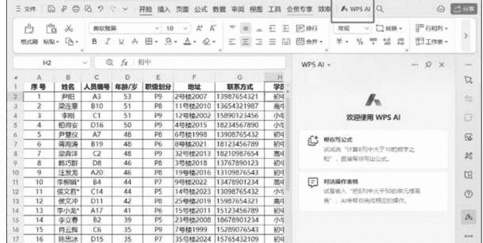

在WPS AI的侧边栏，我们可以在选中单元格的情况下，直接单击“帮你写公式”按钮，此时WPS AI会弹出对话窗口，我们可以通过输入相应指令来生成计算公式，如图7-11所示。

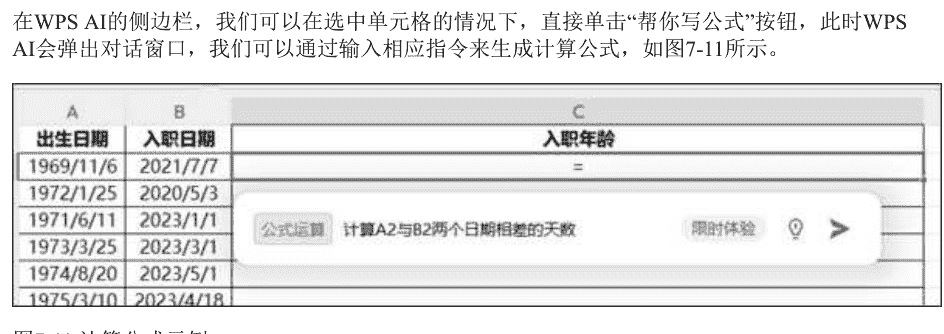

如果这时不知道应该选中哪个单元格输入数据，用户可以利用“对话操作表格”功能直接针对行或列进行操作，如图7-12所示。

在“对话操作表格”中，WPS AI提供了四个可供选择的能力标签，分别是“按条件标记”“筛选排序”“分类计算”“快捷操作”，在选中特定的能力标签后，WPS AI可以直接调用相关接口，更好地进行提示词交互。


图7-12 “对话操作表格”功能示例

### 2.实战案例：让WPS AI担任行政助理

在掌握了WPS AI操作Excel的基本方法之后，让我们来深入实战，通过一个具体案例来体会WPS AI的神奇魔力吧！

假设您的职业是部门行政助理，图7-13所示是您的部分案例数据，包含了集团所有员工，您需要对数据表进行处理分析，通过标记特定信息，制作不同的视图。应该如何实现呢？

| 序号 | 姓名 | 人员编号 | 年龄/岁 | 职级划分 | 地址 | 联系方式 | 学历 | 性别 | 退休日期 | 出生日期 | 专业 | 状态 | 入职日期 | 工龄/年 | 基本工资/元 |
|---|---|---|---|---|---|---|---|---|---|---|---|---|---|---|---|
| 1 | 卢丹 | A3 | 53 | P9 | 2号楼2007 | 13987654321 | 初中 | 男 | 2029/11/6 | 1969/11/6 | 集团客户 | 在职 | 2021/7/7 | 1 | 1300 |
| 2 | 梁玉章 | B10 | 51 | P8 | 11号楼2010 | 13654321987 | 高中 | 女 | 2027/1/25 | 1972/1/25 | 集团客户 | 在职 | 2020/5/3 | 0 | 1000 |
| 3 | 李刚 | C1 | 51 | P9 | 12号楼2002 | 15890123456 | 小学 | 男 | 2031/6/11 | 1971/6/11 | 集团客户 | 在职 | 2023/1/1 | 0 | 700 |
| 4 | 柏得安 | D16 | 50 | P9 | 4号楼2015 | 18234567890 | 小学 | 男 | 2033/3/25 | 1973/3/25 | 传媒网 | 在职 | 2023/3/1 | 0 | 1300 |
| 5 | 尹慧仪 | A7 | 48 | P8 | 6号楼1998 | 13908765432 | 初中 | 女 | 2029/8/20 | 1974/8/20 | 国网部 | 在职 | 2023/5/1 | 0 | 1300 |
| 6 | 高海涛 | B19 | 48 | P9 | 8号楼2021 | 18123456789 | 初中 | 男 | 2035/3/10 | 1975/3/10 | 传媒网 | 在职 | 2023/4/18 | 6 | 1300 |
| 7 | 梁亮洋 | C2 | 48 | P9 | 32号楼2013 | 18210987654 | 高中 | 女 | 2029/5/20 | 1974/5/20 | 传媒网 | 在职 | 2022/3/21 | 0 | 1300 |

| 序号 | 岗位工资/元 | 出差地租房补贴/元 | 出差交通/元 | 话费补贴/元 | 绩效奖金/元 | 实发工资/元 | 工资区间/元 | 工资排名 | 个人年终奖所得税/万元 | 入职后剩余工作时间/天 | 到手百分比 | 奖金占比 |
|---|---|---|---|---|---|---|---|---|---|---|---|---|
| 1 | 0 | | | 0 | 50 | 1350 | 1000~1999 | 25 | 1.5 | 2999 | 103.85% | 3.70% |
| 2 | 0 | | | 0 | 400 | 1400 | 1000~1999 | 24 | 12 | 2950 | 140.00% | 28.57% |
| 3 | 500 | | | 0 | 300 | 1500 | 1000~1999 | 23 | 9 | 3624 | 214.29% | 20.00% |
| 4 | 600 | 100 | | 100 | 600 | 2700 | 2000~3499 | 21 | 18 | 8241 | 207.69% | 22.22% |
| 5 | 600 | 100 | | 100 | 600 | 2700 | 2000~3499 | 21 | 18 | 2269 | 207.69% | 22.22% |
| 6 | 600 | 100 | | 100 | 800 | 2900 | 2000~3499 | 20 | 24 | 11293 | 223.08% | 27.59% |
| 7 | 600 | 100 | | 100 | 900 | 3000 | 2000~3499 | 17 | 27 | 4282 | 230.77% | 30.00% |

图7-13 部分案例数据

在开始使用WPS AI前，需要单击“对话操作表格”，在弹出的列表中选择“按条件标记”，尝试输入具体提示词，对表格进行处理。

需求一：针对姓名进行标记，标记所有“李”姓人员。

提示词：

```
# 按条件标记

把B列当中的李姓员工所在单元格的背景色加深
```

运行结果：如图7-14所示。

| 序号 | 姓名 | 人员编号 | 年龄 | 职级划分 | 地址 | 联系方式 | 学历 | 性别 | 退休日期 | 出生日期 | 专业 | 状态 | 入职日期 | 工龄/年 |
|---|---|---|---|---|---|---|---|---|---|---|---|---|---|---|
| 1 | 卢阳 | A3 | 53 | P9 | 2号楼2007 | 13987654321 | 初中 | 男 | 2029/11/6 | 1969/11/6 | 集团客户 | 在职 | 2021/7/7 | 1 |
| 2 | 梁连意 | B10 | 51 | P8 | 11号楼2010 | 13654321987 | 高中 | 女 | 2027/1/25 | 1972/1/25 | 集团客户 | 在职 | 2020/5/3 | 0 |
| 3 | 李刚 | C1 | 51 | P9 | 12号楼2002 | 15890123456 | 小学 | 男 | 2031/6/11 | 1971/6/11 | 集团客户 | 在职 | 2023/1/1 | 0 |
| 4 | 柏德安 | D16 | 50 | P9 | 4号楼2015 | 18234567890 | 小学 | 男 | 2033/3/25 | 1973/3/25 | 传输网 | 在职 | 2023/3/1 | 0 |
| 5 | 尹慧仪 | A7 | 48 | P8 | 6号楼1998 | 13908765432 | 初中 | 女 | 2029/8/20 | 1974/8/20 | 国网部 | 在职 | 2023/5/1 | 0 |
| 6 | 黄海涛 | B19 | 48 | P6 | 8号楼2021 | 18123456789 | 初中 | 男 | 2035/3/10 | 1975/3/10 | 传输网 | 在职 | 2023/4/18 | 6 |
| 7 | 梁亮洋 | C2 | 48 | P9 | 32号楼2013 | 18210987654 | 高中 | 女 | 2029/5/20 | 1974/5/20 | 传输网 | 在职 | 2022/5/21 | 0 |
| 8 | 韩巧群 | D8 | 46 | P8 | 3号楼2018 | 13767890123 | 初中 | 男 | 2031/7/11 | 1976/7/11 | 综合室 | 在职 | 2023/5/1 | 3 |
| 9 | 汪发龙 | A20 | 46 | P8 | 19号楼2016 | 13109876543 | 初中 | 男 | 2037/4/19 | 1977/4/19 | 传输网 | 在职 | 2023/5/1 | 0 |
| 10 | 李希瑞 | B4 | 44 | P7 | 9号楼2022 | 13478901234 | 高中 | 女 | 2034/1/22 | 1979/1/22 | 国网部 | 在职 | 2020/5/1 | 3 |
| 11 | 侯文慧* | C14 | 44 | P5 | 14号楼2023 | 13098765432 | 小学 | 男 | 2038/6/5 | 1978/6/5 | 集团客户 | 在职 | 2022/5/1 | 0 |
| 12 | 侯文泽 | D11 | 42 | P8 | 25号楼2019 | 15987654321 | 高中 | 男 | 2040/10/25 | 1980/10/25 | 国网部 | 在职 | 2021/7/8 | 1 |
| 13 | 李小龙* | A17 | 41 | P6 | 15号楼2011 | 15123456789 | 初中 | 男 | 2042/4/16 | 1982/4/16 | 综合室 | 在职 | 2023/1/14 | 0 |
| 14 | 李立章 | B2 | 39 | P5 | 23号楼2008 | 18678901234 | 小学 | 女 | 2039/2/11 | 1984/2/11 | 集团客户 | 在职 | 2021/7/6 | 0 |
| 15 | 肖云辉 | C6 | 35 | P9 | 7号楼1999 | 15289076543 | 初中 | 男 | 2048/1/19 | 1988/1/19 | 国网部 | 在职 | 2016/9/6 | 0 |
| 16 | 陈忠冰 | D15 | 35 | P7 | 35号楼2024 | 15765432109 | 初中 | 男 | 2048/1/19 | 1988/1/19 | 国网部 | 在职 | 2023/5/1 | 2 |
| 17 | 刘建文 | A8 | 34 | P9 | 10号楼1996 | 18790123456 | 高中 | 男 | 2048/11/10 | 1988/11/10 | 传输网 | 在职 | 2023/3/1 | 3 |
| 18 | 华国强 | B18 | 34 | P7 | 17号楼2009 | 13654321098 | 高中 | 男 | 2048/7/18 | 1988/7/18 | 集团客户 | 在职 | 2023/5/1 | 1 |
| 19 | 潘永标 | C5 | 34 | P9 | 26号楼2006 | 15321098765 | 高中 | 男 | 2049/3/10 | 1989/3/10 | 综合室 | 在职 | 2020/5/4 | 1 |
| 20 | 李仕伟 | D13 | 33 | P6 | 22号楼2014 | 15234567890 | 小学 | 男 | 2049/10/22 | 1989/10/22 | 传输网 | 在职 | 2020/5/5 | 3 |
| 21 | 袁文渊 | A1 | 33 | P6 | 33号楼2005 | 13345678901 | 初中 | 女 | 2044/8/4 | 1989/8/4 | 传输网 | 在职 | 2020/5/2 | 0 |
| 22 | 万秀明* | B9 | 32 | P7 | 5号楼2001 | 13678901234 | 高中 | 女 | 2046/3/22 | 1991/3/22 | 传输网 | 在职 | 2023/5/1 | 1 |
| 23 | 潘伟全 | C12 | 32 | P7 | 28号楼2020 | 13509876543 | 高中 | 男 | 2050/8/11 | 1990/8/11 | 综合室 | 在职 | 2023/5/1 | 0 |
| 24 | 柏永鑫 | D19 | 32 | P8 | 30号楼2003 | 13890123456 | 高中 | 男 | 2051/3/27 | 1991/3/27 | 国网部 | 在职 | 2021/6/1 | 3 |
| 25 | 曾小涛 | A14 | 27 | P9 | 20号楼1997 | 18765432109 | 初中 | 男 | 2055/6/13 | 1995/6/13 | 集团客户 | 在职 | 2021/5/1 | 0 |

图7-14 标记所有“李”姓人员运行结果

需求二：判断有无住在同一栋楼里的同事，如有则标注出来。

提示词：

```
# 按条件标记
将F列“号楼”前面字符完全相同的单元格背景色加深
```

运行结果：如图7-15所示。

由于没有任何两个员工住在同一栋楼，因此没有地址被标为深色，如图7-15所示。

| 序号 | 姓名 | 人员编号 | 年龄 | 职级划分 | 地址 | 联系方式 | 学历 | 性别 | 退休日期 | 出生日期 | 专业 | 状态 | 入职日期 | 工龄/年 |
|---|---|---|---|---|---|---|---|---|---|---|---|---|---|---|
| 1 | 卢阳 | A3 | 53 | P9 | 2号楼2007 | 13987654321 | 初中 | 男 | 2029/11/6 | 1969/11/6 | 集团客户 | 在职 | 2021/7/7 | 1 |
| 2 | 梁连意 | B10 | 51 | P8 | 11号楼2010 | 13654321987 | 高中 | 女 | 2027/1/25 | 1972/1/25 | 集团客户 | 在职 | 2020/5/3 | 0 |
| 3 | 李刚 | C1 | 51 | P9 | 12号楼2002 | 15890123456 | 小学 | 男 | 2031/6/11 | 1971/6/11 | 集团客户 | 在职 | 2023/1/1 | 0 |
| 4 | 柏德安 | D16 | 50 | P9 | 4号楼2015 | 18234567890 | 小学 | 男 | 2033/3/25 | 1973/3/25 | 传输网 | 在职 | 2023/3/1 | 0 |
| 5 | 尹慧仪 | A7 | 48 | P8 | 6号楼1998 | 13908765432 | 初中 | 女 | 2029/8/20 | 1974/8/20 | 国网部 | 在职 | 2023/5/1 | 0 |
| 6 | 黄海涛 | B19 | 48 | P6 | 8号楼2021 | 18123456789 | 初中 | 男 | 2035/3/10 | 1975/3/10 | 传输网 | 在职 | 2023/4/18 | 6 |
| 7 | 梁亮洋 | C2 | 48 | P9 | 32号楼2013 | 18210987654 | 高中 | 女 | 2029/5/20 | 1974/5/20 | 传输网 | 在职 | 2022/5/21 | 0 |
| 8 | 韩巧群 | D8 | 46 | P8 | 3号楼2018 | 13767890123 | 初中 | 男 | 2031/7/11 | 1976/7/11 | 综合室 | 在职 | 2023/5/1 | 3 |
| 9 | 汪发龙 | A20 | 46 | P8 | 19号楼2016 | 13109876543 | 初中 | 男 | 2037/4/19 | 1977/4/19 | 传输网 | 在职 | 2023/5/1 | 0 |
| 10 | 李希瑞 | B4 | 44 | P7 | 9号楼2022 | 13478901234 | 高中 | 女 | 2034/1/22 | 1979/1/22 | 国网部 | 在职 | 2020/5/1 | 3 |
| 11 | 侯文慧* | C14 | 44 | P5 | 14号楼2023 | 13098765432 | 小学 | 男 | 2038/6/5 | 1978/6/5 | 集团客户 | 在职 | 2022/5/1 | 0 |
| 12 | 侯文泽 | D11 | 42 | P8 | 25号楼2019 | 15987654321 | 高中 | 男 | 2040/10/25 | 1980/10/25 | 国网部 | 在职 | 2021/7/8 | 1 |
| 13 | 李小龙* | A17 | 41 | P6 | 15号楼2011 | 15123456789 | 初中 | 男 | 2042/4/16 | 1982/4/16 | 综合室 | 在职 | 2023/1/14 | 0 |
| 14 | 李立章 | B2 | 39 | P5 | 23号楼2008 | 18678901234 | 小学 | 女 | 2039/2/11 | 1984/2/11 | 集团客户 | 在职 | 2021/7/6 | 0 |
| 15 | 肖云辉 | C6 | 35 | P9 | 7号楼1999 | 15289076543 | 初中 | 男 | 2048/1/19 | 1988/1/19 | 国网部 | 在职 | 2016/9/6 | 0 |
| 16 | 陈忠冰 | D15 | 35 | P7 | 35号楼2024 | 15765432109 | 初中 | 男 | 2048/1/19 | 1988/1/19 | 国网部 | 在职 | 2023/5/1 | 2 |
| 17 | 刘建文 | A8 | 34 | P9 | 10号楼1996 | 18790123456 | 高中 | 男 | 2048/11/10 | 1988/11/10 | 传输网 | 在职 | 2023/3/1 | 3 |
| 18 | 华国强 | B18 | 34 | P7 | 17号楼2009 | 13654321098 | 高中 | 男 | 2048/7/18 | 1988/7/18 | 集团客户 | 在职 | 2023/5/1 | 1 |
| 19 | 潘永标 | C5 | 34 | P9 | 26号楼2006 | 15321098765 | 高中 | 男 | 2049/3/10 | 1989/3/10 | 综合室 | 在职 | 2020/5/4 | 1 |
| 20 | 李仕伟 | D13 | 33 | P6 | 22号楼2014 | 15234567890 | 小学 | 男 | 2049/10/22 | 1989/10/22 | 传输网 | 在职 | 2020/5/5 | 3 |
| 21 | 袁文渊 | A1 | 33 | P6 | 33号楼2005 | 13345678901 | 初中 | 女 | 2044/8/4 | 1989/8/4 | 传输网 | 在职 | 2020/5/2 | 0 |
| 22 | 万秀明* | B9 | 32 | P7 | 5号楼2001 | 13678901234 | 高中 | 女 | 2046/3/22 | 1991/3/22 | 传输网 | 在职 | 2023/5/1 | 1 |
| 23 | 潘伟全 | C12 | 32 | P7 | 28号楼2020 | 13509876543 | 高中 | 男 | 2050/8/11 | 1990/8/11 | 综合室 | 在职 | 2023/5/1 | 0 |
| 24 | 柏永鑫 | D19 | 32 | P8 | 30号楼2003 | 13890123456 | 高中 | 男 | 2051/3/27 | 1991/3/27 | 国网部 | 在职 | 2021/6/1 | 3 |
| 25 | 曾小涛 | A14 | 27 | P9 | 20号楼1997 | 18765432109 | 初中 | 男 | 2055/6/13 | 1995/6/13 | 集团客户 | 在职 | 2021/5/1 | 0 |

图7-15 标记“地址”运行结果

需求三：标记所有绩效奖金高于平均值的员工。

提示词：

为避免循环引用，我们可以直接通过以下提示词格式。

## 按条件标记

将U列大于AVERAGE（U:U）加深标记

运行结果：如图7-16所示。

| 序号 | 休日期 | 出生日期 | 专业 | 状态 | 入职日期 | 工龄/年 | 基本工资/元 | 岗位工资/元 | 出差地租房补贴/元 | 出差交通/元 | 话费补贴/元 | 绩效奖金/元 | 实发工资/元 | 工资区间/元 |
|---|---|---|---|---|---|---|---|---|---|---|---|---|---|---|
| 1 | 29/11/6 | 1969/11/6 | 集团客户 | 在职 | 2021/7/7 | 1 | 1300 | 0 | | | 0 | 50 | 1350 | 1000~1999 |
| 2 | 27/1/25 | 1972/1/25 | 集团客户 | 在职 | 2020/5/3 | 0 | 1000 | 0 | | | 0 | 400 | 1400 | 1000~1999 |
| 3 | 31/8/11 | 1971/8/11 | 集团客户 | 在职 | 2023/1/1 | 0 | 700 | 500 | | | 0 | 300 | 1500 | 1000~1999 |
| 4 | 33/3/25 | 1971/3/25 | 传输网 | 在职 | 2023/3/1 | 0 | 1300 | 600 | 100 | | 100 | 600 | 2700 | 2000~3499 |
| 5 | 29/8/20 | 1974/8/20 | 固网部 | 在职 | 2023/5/1 | 0 | 1300 | 600 | 100 | | 100 | 600 | 2700 | 2000~3499 |
| 6 | 35/3/10 | 1975/3/10 | 传输网 | 在职 | 2023/4/18 | 6 | 1300 | 600 | 100 | | 100 | 800 | 2900 | 2000~3499 |
| 7 | 29/5/20 | 1974/5/20 | 传输网 | 在职 | 2022/5/21 | 0 | 1300 | 600 | 100 | | 100 | 900 | 3000 | 2000~3499 |
| 8 | 31/7/11 | 1976/7/11 | 综合室 | 在职 | 2023/5/1 | 3 | 1300 | 600 | 100 | | 100 | 900 | 3000 | 2000~3499 |
| 9 | 37/4/19 | 1977/4/19 | 传输网 | 在职 | 2023/5/1 | 0 | 1300 | 600 | 100 | | 100 | 900 | 3000 | 2000~3499 |
| 10 | 34/1/22 | 1979/1/22 | 固网部 | 在职 | 2020/5/1 | 3 | 1300 | 600 | | | 100 | 1100 | 3100 | 2000~3499 |
| 11 | 38/6/5 | 1978/6/5 | 集团客户 | 在职 | 2022/5/1 | 0 | 1300 | 600 | | | 100 | 1200 | 3200 | 2000~3499 |
| 12 | 40/10/25 | 1980/10/25 | 固网部 | 在职 | 2021/7/8 | 1 | 1300 | 600 | 150 | | 100 | 1100 | 3250 | 2000~3499 |
| 13 | 42/4/16 | 1982/4/16 | 综合室 | 在职 | 2023/1/14 | 0 | 1300 | 600 | 100 | 200 | 100 | 1100 | 3400 | 2000~3499 |
| 14 | 39/2/11 | 1984/2/11 | 集团客户 | 在职 | 2021/7/6 | 0 | 1300 | 600 | 100 | | 100 | 1300 | 3400 | 2000~3499 |
| 15 | 48/1/19 | 1986/1/19 | 固网部 | 在职 | 2016/9/6 | 0 | 1300 | 600 | | | 200 | 1400 | 3500 | 3500~4999 |
| 16 | 48/1/19 | 1986/1/19 | 固网部 | 在职 | 2023/5/1 | 2 | 1300 | 600 | | | 100 | 1500 | 3500 | 3500~4999 |
| 17 | 8/11/10 | 1988/11/10 | 传输网 | 在职 | 2023/3/1 | 3 | 1300 | 600 | 100 | | 200 | 1400 | 3600 | 3500~4999 |
| 18 | 48/7/18 | 1988/7/18 | 集团客户 | 在职 | 2023/5/1 | 1 | 1300 | 600 | | | 200 | 1600 | 3700 | 3500~4999 |
| 19 | 49/3/10 | 1989/3/10 | 综合室 | 在职 | 2020/5/4 | 1 | 1300 | 600 | 100 | | 100 | 1600 | 3700 | 3500~4999 |
| 20 | 49/10/22 | 1989/10/22 | 传输网 | 在职 | 2020/5/5 | 3 | 1300 | 600 | 210 | | 200 | 1400 | 3710 | 3500~4999 |
| 21 | 44/8/4 | 1989/8/4 | 传输网 | 在职 | 2020/5/2 | 0 | 1300 | 800 | 100 | | 200 | 1700 | 4100 | 3500~4999 |
| 22 | 46/3/22 | 1991/3/22 | 传输网 | 在职 | 2023/5/1 | 1 | 1300 | 800 | 100 | | 200 | 2400 | 4800 | 3500~4999 |
| 23 | 50/8/11 | 1990/8/11 | 综合室 | 在职 | 2023/5/1 | 0 | 1500 | 2000 | | | 200 | 2500 | 6200 | 5000~7999 |
| 24 | 51/3/27 | 1991/3/27 | 固网部 | 在职 | 2021/6/1 | 3 | 1500 | 2000 | 100 | | 200 | 2500 | 6300 | 5000~7999 |
| 25 | 55/6/13 | 1995/6/13 | 集团客户 | 在职 | 2021/5/1 | 0 | 1500 | 2000 | 100 | | 200 | 3500 | 7300 | 5000~7999 |

图7-16 绩效奖金高于平均值的员工被标为深色运行结果

# 第8章
## 提示工程与智能编程的交融

在数字化时代，编程已经成为解决问题和创新的关键工具。然而，编写和维护代码并不是一件容易的事情。在本章中，我们将探讨新一代编程工具以及智能编程的潜力，它们正在改变编程的方式和未来。

## 8.1 新一代编程工具概览

代码开发是商业公司成功的关键组成部分之一。在现代商业中，几乎每个公司都需要依赖软件及应用程序来支持其运营、管理数据、服务客户，或进行数字化创新。传统的代码开发需要软件工程师们在编译器上，通过丰富的编码经验将复杂的逻辑转换为代码。大模型的出现给业界带来了极大的冲击，使不会编程的小白也可以在提示工程的帮助下借助GPT快速完成开发。此外一些智能编程助手，如全球最大的程序员社区——GitHub开发的Copilot，以及蚂蚁集团开发的CodeFuse等插件也应运而生。

### 8.1.1 编程助手GitHub Copilot

GitHub Copilot是由GitHub和OpenAI合作开发的智能编程助手，可以集成到多种开发环境（IDE）中，如Visual Studio Code、IntelliJ系列，Copilot能够提供代码提示、自动生成代码、代码纠错、提供文档注释和建议，以及为复杂任务生成代码框架等。它使用大模型帮助开发者更快速地编写高质量的代码，并且能够支持多种编程语言和框架，一经推出，受到广大工程师的好评，读者可以在GitHub官方网站申请试用体验，图8-1所示为申请页面。学生及热门开源项目的开发者还可以免费使用。


图8-1 GitHub Copilot页面

当通过申请后，读者可以在编译器中下载插件，登录GitHub账号后即可在写代码时使用AI辅助编程。接下来我们会给出具体示例步骤来展示GitHub Copilot的神奇能力。

成功安装Copilot插件后，编译器右下角会出现一个可爱的小青蛙图标，这标志着插件已经成功启动，小青蛙将成为专属编程助手，协助我们寻找并解决Bug。我们启动一个新的项目，并在代码文件中编写注释“帮忙写一段排序代码，将输入的数字降序排列，比如输入12345，输出54321”。此时我们有两种方式可以生成代码，第一种是在右侧边栏中选择具体的方案，如图8-2所示，输入注释后，右侧边栏显示了十余个不同的解决方案，我们任意选择一个单击“Accept solution”按钮，在左边的编辑框中生成相应代码，可随机选择其中一个，并运行这段代码。此时我们运行选择的其中一段代码结果，如图8-3所示，按照输入格式，我们在控制台输入14521，即可得到输出结果。在此过程中，我们只是编写了一行注释，AI助手在几秒内快速帮我们写出了这段排序代码。

除了示例中使用的Python语言，Copilot还可以编写SQL、Java、Golang等语言，对不熟悉其他编程语言的初学者来说简直是福音。初学者们仅需要了解大致的语法和实现逻辑就可以快速上手，无须细致地学习语法。

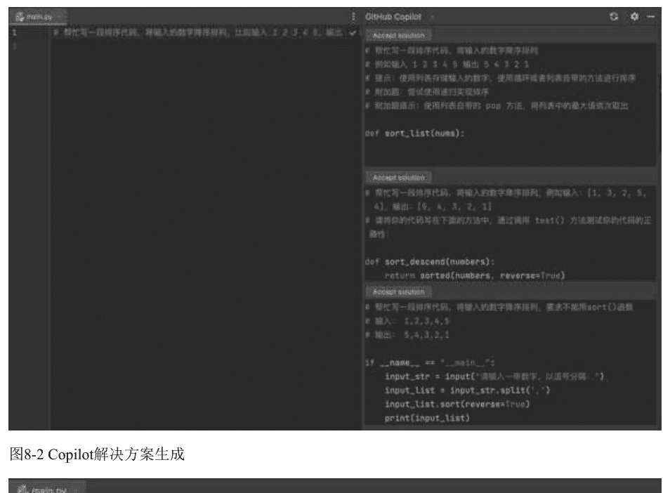

图8-2 Copilot解决方案生成

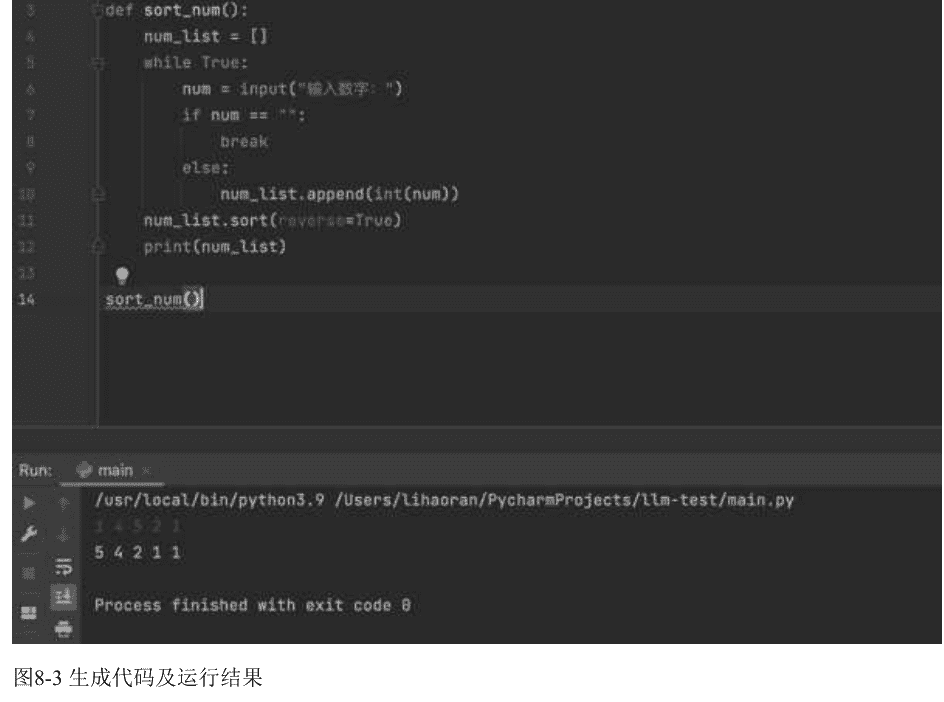

图8-3 生成代码及运行结果

### 8.1.2 国产编程瑰宝CodeFuse

CodeFuse是一款为国内开发者提供智能研发服务的产品，该产品是对蚂蚁集团自研的基础大模型进行微调后得到的代码大模型，于2023年9月的外滩大会发布。CodeFuse具备代码补全、添加注释、解释代码、生成单测，以及代码优化功能，以帮助开发者更快、更轻松地编写代码。对比GitHub Copilot，CodeFuse在训练时使用了很多国内开发者的高质量代码，更符合国内工程师的编码习惯，中文注释等功能也有所增强。

读者可通过申请试用此插件，并在编译器中加载相应插件，申请页面如图8-4所示，通过后即可在编译器、云端研发环境中使用，支持40余种编程语言。笔者作为此大模型的首批试用与评测人员，已使用此模型编写数万行代码，目前CodeFuse已被广泛使用。


图8-4 CodeFuse申请试用页面

## 8.2 代码生成的神奇时刻

在探讨代码生成的神奇时刻之前，我们将分别讨论SQL与图表的自动生成、服务端代码的自动生成、解决高阶编程题这三个关键领域。这三个领域代表了AI代码生成技术在数据处理、服务端开发和编程挑战解决方面的重要应用。

### 8.2.1 SQL与图表的自动生成

报表技术是现代数据分析和决策支持领域的一项重要进步。这一技术结合了数据库查询语言（SQL）和数据可视化，旨在帮助用户进行数据洞察，并在数据驱动下制定商业决策。

SQL是一种强大的数据查询语言，用于数据库表的各项操作，但通常需要用户编写复杂的查询语句，这对非技术人员来说可能是一项挑战。通过SQL的自动生成技术，用户可以轻松地使用SQL语言，而无须深入了解SQL语法。系统会自动将这些请求翻译成SQL查询语句，从而方便用户从数据库中提取所需的数据。

当数据被检索时，图表工具会将数据可视化为图表，以便用户更好地理解数据、识别趋势和做出决策。这使得数据分析和报告生成变得更加迅速和容易，无须大量的手动工作。高阶报表可以通过撰写复杂SQL生成。在得出数据计算结果后，我们可以将其输入至BI工具中，或直接将SQL结果与报表需求告知GPT，让其辅助生成图表。本节中将展示如何通过提示工程生成SQL语句，并按需生成图表。

## 1.建表语句生成

假设此时我们仅有一个空数据库，若需要建立一张数据表，以往通常需要自己定义数据库模式并撰写建表语句，现在我们仅需要描述表的结构，并告知大模型具体的业务需求，即可快速生成建表语句，示例如下。

提示词：

假设宾馆酒店业数据库有一张表：

Booking（roomNo, guestNo, dateFrom, dateTo）

Guest（guestNo, guestName, guestAddress）

请帮忙生成并优化数据表的结构，输出数据库建表语句

回答：

下面是宾馆酒店业数据库的一张表的结构，已经进行了结构优化，并提供了相应的建表语句：

Booking表

- bookingNo（预订编号）-主键
- roomNo（客房编号）-外键，与Room表的roomNo关联
- guestNo（客人编号）-外键，与Guest表的guestNo关联
- dateFrom（入住日期）
- dateTo（离店日期）

以下是创建Booking表的SQL建表语句：

```sql
CREATE TABLE Booking (
    bookingNo INT PRIMARY KEY,
    roomNo INT,
    guestNo INT,
    dateFrom DATE,
    dateTo DATE,
    FOREIGN KEY (roomNo) REFERENCES Room(roomNo),
    FOREIGN KEY (guestNo) REFERENCES Guest(guestNo)
);
```

优化说明：这个表的结构包括一个主键字段（bookingNo），以确保每个预订都具有唯一标识。roomNo字段和guestNo字段分别是与Room表和Guest表的关联外键，以建立预订、客房和客人之间的关系。日期字段使用DATE数据类型，以确保存储日期信息。这种表结构支持预订信息的跟踪，包括客房、客人和入住日期/离店日期的关联。

可以看出，大模型回答了我们具体的建表语句和优化建议，并根据我们的定义描述了表中字段的中文说明，我们只需要将SQL语句粘贴到数据库管理系统中，即可创建需要的数据表。

## 2.测试数据与插入语句生成

数据表创建完成后，我们可以提示大模型帮助生成一些测试数据，插入数据表，这里可以使用之前提到的思维链与上下文学习，灵活撰写提示词。若之前没有提示表的结构，可在上下文中增加表的建表语句或结构描述。

提示词：

下面是宾馆酒店业数据库的一张表的结构：

Booking表

- bookingNo（预订编号）-主键
- roomNo（客房编号）-外键，与Room表的roomNo关联
- guestNo（客人编号）-外键，与Guest表的guestNo关联
- dateFrom（入住日期）
- dateTo（离店日期）

帮忙生成一些测试数据和插入SQL语句

回答：

以下是Booking表的5条测试数据以及相应的插入SQL语句：

Booking表测试数据：

| bookingNo | roomNo | guestNo | dateFrom | dateTo |
|-----------|--------|---------|----------|--------|
| 1001 | 101 | 1 | 2023-10-15 | 2023-10-20 |
| 1002 | 102 | 2 | 2023-11-05 | 2023-11-10 |
| 1003 | 201 | 3 | 2023-12-01 | 2023-12-05 |
| 1004 | 202 | 4 | 2023-11-25 | 2023-11-30 |
| 1005 | 301 | 5 | 2023-10-30 | 2023-11-05 |

插入语句：

```sql
INSERT INTO Booking (bookingNo, roomNo, guestNo, dateFrom, dateTo)
VALUES
(1001, 101, 1, '2023-10-15', '2023-10-20'),
(1002, 102, 2, '2023-11-05', '2023-11-10'),
(1003, 201, 3, '2023-12-01', '2023-12-05'),
(1004, 202, 4, '2023-11-25', '2023-11-30'),
(1005, 301, 5, '2023-10-30', '2023-11-05');
```

这些插入语句将向Booking表中插入5条测试数据，用于模拟宾馆酒店的预订信息。请确保你的数据库支持这些插入语句，并适当修改字段名称和数据类型以适应数据库系统。

## 3.查询语句生成

在生成测试数据后，我们可以通过SQL查询语句取得想要的数据，并进行数据分析，如果此时不知道如何查询数据，可以先提示大模型生成一些查询示例。

提示词：

帮忙在Booking表中生成一些查询SQL示例语句

回答：

以下是一些查询示例，用于从Booking表中检索宾馆酒店预订信息。

1. 检索所有预订信息：
```sql
SELECT * FROM Booking;
```
2. 按客房编号检索特定预订信息：
```sql
SELECT * FROM Booking WHERE roomNo=101;
```
3. 按客人编号检索特定预订信息：
```sql
SELECT * FROM Booking WHERE guestNo=1;
```
4. 按入住日期范围检索预订信息：
```sql
SELECT * FROM Booking WHERE dateFrom BETWEEN '2023-10-15' AND '2023-11-01';
```
5. 按离店日期范围检索预订信息：
```sql
SELECT * FROM Booking WHERE dateTo BETWEEN '2023-11-05' AND '2023-11-30';
```
6. 按客房编号和客人编号检索特定预订信息：
```sql
SELECT * FROM Booking WHERE roomNo=101 AND guestNo=1;
```
7. 按日期范围和客人编号检索特定预订信息：
```sql
SELECT * FROM Booking WHERE dateFrom >= '2023-11-01' AND dateTo <= '2023-11-30' AND guestNo=2;
```

这些查询示例可以根据你的需求进行调整，并根据特定条件检索宾馆酒店预订信息。请根据你的数据库管理系统和需求适当修改这些查询。

大模型生成了一些示例查询，我们可以直接修改后使用，也可以根据需要向大模型继续提问，让其进行进一步的解释，同时也可以做一些SQL分析与优化。

## 4.图表生成

在利用SQL完成取数后，我们可以将数据生成美观的图表。图表自动生成简化了数据分析和可视化的流程，减少了手动操作的工作量，同时提供了更直观的方式帮助用户来理解和传达数据，对于业务决策、报告制作和数据驱动的工作流程非常有帮助。下面给出了一个帮助读者生成表格的实用模板。

代码生成表格模板：

1. 列出表格中的标题和列名。
2. 描述表格的布局和格式。
3. 提供表格中所需的数据和信息。
4. 强调表格的用途。

提示词：

帮忙用Python实现以下功能。

生成一个表格，其中包含项目、预算和实际花费三列。

该表格每列都有明确的标题，分别为项目、预算和实际花费，其中预算和实际花费单位是元。

表格中的数据均为生成数据（此处可替换真实数据）。

该表格对于项目管理非常重要，可以帮助管理人员了解项目进展情况。

回答：

以下是使用Python生成一个包含项目、预算和实际花费的表格的示例。这个表格可以用于项目管理，以帮助管理人员了解项目的进展情况。请注意，这里使用的数据是虚拟数据，你可以根据需要替换为真实数据。

import pandas as pd
# 创建项目、预算和实际花费的虚拟数据
data = {
    '项目': ['项目A', '项目B', '项目C', '项目D', '项目E'],
    '预算（元）': [10000, 15000, 12000, 18000, 20000],
    '实际花费（元）': [9000, 16000, 11000, 17500, 19500]
}
# 创建DataFrame
df = pd.DataFrame(data)
# 打印表格
print("项目管理表格:")
print(df)
# 保存表格为CSV文件
df.to_csv('project_management.csv', index=False)

在这个示例中，我们使用Pandas库创建了一个包含项目、预算和实际花费的数据集，并将其转化为DataFrame。用户可以根据自己的需要修改项目的名称、预算和实际花费的值。最后，我们将表格保存为csv文件，以便进一步使用或共享。通过在Python中执行生成的代码，我们不仅可以在控制台中打印生成的表数据，还可以在目录中自动创建csv文件。

若根据数据画图，则需要在提示词中描述图的信息，模板如下。

生成模板：

- ①描述图的数据源；
- ②说明图的横、纵坐标轴的含义和单位；
- ③描述图的线条类型和颜色；
- ④说明图中的数据点的形状和颜色；
- ⑤描述图的标题和注释的要求。

提示词：

帮忙用Python实现以下功能。
生成一个折线图，数据源为虚拟数据。
折线图中的横坐标轴表示年份，纵坐标轴表示销售额，单位为万元。
折线图中的线条类型为实线，颜色为蓝色，表示销售额的变化趋势。
折线图中的数据点形状为圆圈，颜色为黑色，表示每个年份的销售额。
折线图的标题为“某公司近几年销售额变化趋势”，注释中添加了公司名称和数据来源。

回答：

你可以使用Python的Matplotlib库来生成折线图，满足你的要求。以下是一个示例代码，实现了这个功能。

```python
import matplotlib.pyplot as plt
# 虚拟销售数据，年份和销售额（单位：万元）
years = [2018, 2019, 2020, 2021, 2022, 2023]
sales = [120, 150, 180, 160, 190, 200]
# 创建折线图
plt.figure(figsize=(8, 4))
plt.plot(years, sales, marker='o', linestyle='-', color='blue', markersize=8, markerfacecolor='black')
plt.title('某公司近几年销售额变化趋势')
plt.xlabel('年份')
plt.ylabel('销售额/万元')
plt.grid(True)
plt.legend()
# 添加注释
plt.text(2018, 125, '公司名称：ABC 公司', fontsize=10, color='gray')
plt.text(2018, 120, '数据来源：内部销售报告', fontsize=10, color='gray')
# 显示图表
plt.show()
```

在这个示例中，我们创建了一个折线图，使用虚拟的销售数据，设置了线条的类型、颜色，以及数据点的形状和颜色。同时，我们添加了标题和注释，包括公司名称和数据来源。用户可以根据需要替换虚拟数据，以适应实际情况。这个折线图可用于展示某公司近几年销售额的变化趋势。我们在Python项目中运行上述代码，即可得到下面的图，如需更换数据，仅修改代码中对应数据部分即可（注：此处注意中文乱码问题）。图8-5所示为生成图表。

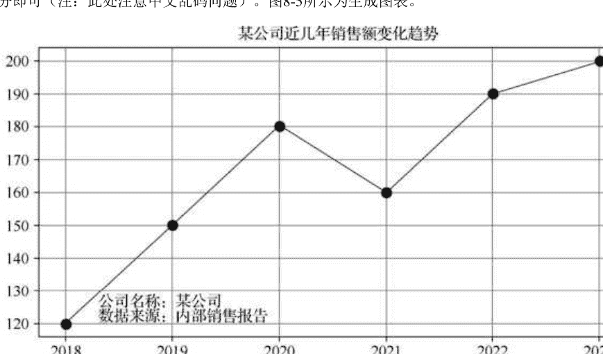

图8-5 生成图表

### 8.2.2 服务端代码自动生成详解

服务端编程是指开发和编写用于运行在服务器端的软件应用程序的过程。这些应用程序通常用于提供服务、处理请求、存储和管理数据，并与客户端应用程序或用户进行通信。服务端编程涵盖了各种不同类型的应用，包括Web服务、数据库服务器、游戏服务器、应用服务器等，目前常用的软件的大部分功能都以服务的形式实现各项功能。在本节中，我们会带领读者尝试服务端编程，借助大模型从零开始编写一套Web服务，实现一套完整的销售数据管理系统。对于这种相对复杂的需求，我们可以使用CRISPE框架来辅助完成提示词编写，这里有一套生成模板可以供读者使用。

生成模板：

- 步骤1 能力与角色：你是一个资深的软件工程师，擅长服务端编程。
- 步骤2 系统说明：对系统进行整体概述，明确系统的设计思路和基本结构。
- 步骤3 功能要求：详细列举系统所需实现的各项功能点，确保系统能够满足用户的需求。
- 步骤4 技术要求：使用哪些技术点、代码风格如何。
- 步骤5 实验说明：输入输出细节说明。

案例：编写销售数据管理系统

那么，我们根据以上模板编写销售数据管理系统的提示词时，需要注意输入输出描述要清晰准确。

提示词：

你是一个资深的软件工程师，擅长服务端编程，帮忙写一套销售数据管理系统代码，代码中包含注释，易于阅读，并对过程做出讲解，实现销售数据录入与销售数据查询，输入数据为员工工号，输出为销售数据，单位是元。

回答：

当创建一个完整的销售数据管理系统时，通常需要考虑数据库、API、前端界面等多个方面。由于篇幅限制，我将提供一个简化的示例，其中包括销售数据的录入与查询功能，并使用Python和Flask框架实现。这个示例将演示如何创建一个服务端，接受销售数据的录入，并允许查询已录入的数据。

以下是代码示例及其注释：

```python
from flask import Flask, request, jsonify

app = Flask(__name__)

# 创建一个虚拟的销售数据数据库
sales_data = []

# 创建销售数据录入端点
@app.route('/add_sale', methods=['POST'])
def add_sale():
    data = request.get_json()  # 从请求中获取销售数据

    # 检查请求中是否包含必要的字段
    if 'employee_id' not in data or 'amount' not in data:
        return jsonify({'message': 'Employee ID and amount are required'}), 400

    employee_id = data['employee_id']
    amount = data['amount']

    # 将销售数据添加到数据库
    sales_data.append({'employee_id': employee_id, 'amount': amount})

    return jsonify({'message': 'Sale data added successfully'})

# 创建销售数据查询端点
@app.route('/get_sales', methods=['GET'])
def get_sales():
    # 查询并返回所有销售数据
    return jsonify({'sales_data': sales_data})

if __name__ == '__main__':
    app.run(debug=True)
```

这个示例创建了一个简单的Flask应用，提供两个API端点：

- 1. `/add_sale`：用于录入销售数据。客户端应该以JSON格式发送POST请求，包括员工工号（`employee_id`）和销售额（`amount`）。
- 2. `/get_sales`：用于查询已录入的销售数据。客户端可以发送GET请求来获取所有销售数据。

为了运行这个示例，你需要安装Flask（可以使用`pip install Flask`命令）。然后运行脚本，Flask将启动一个本地服务器，你可以使用HTTP客户端或浏览器来与API端点交互。

请注意，这个示例是非常基础的，并且未包含数据库存储或身份验证等复杂功能。在实际项目中，你可能需要使用数据库来存储销售数据，同时考虑数据安全性和身份验证等方面的问题。如果需要更多复杂功能，建议寻求专业的开发支持。

在这个例子的回答中，大模型清晰地描述了代码的编写步骤与执行方法，下面我们来运行代码。

如图8-6所示，系统已经成功启动，下面我们使用Postman工具来访问服务接口。我们先利用POST方法来插入销售数据，如图8-7所示，插入工号为000001员工的销售数据，其销售数据为9734.23元。

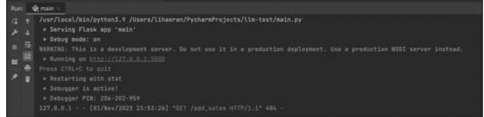

图8-6 运行销售数据管理系统代码

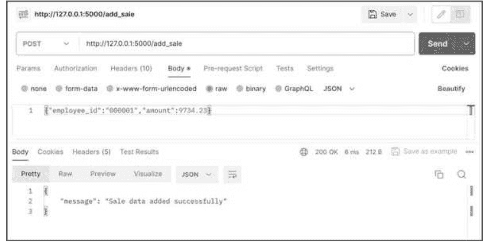

图8-7 插入销售数据

在插入数据后，我们接下来使用GET方法查询所有销售数据，既可以使用浏览器直接访问，也可以使用Postman工具来访问。图8-8所示为数据查询结果，可以看到刚刚插入的销售数据此时可以被查询到，我们在短短十分钟内就完成了一个简单的销售数据管理系统。在大模型和提示工程的帮助下，即使是不会编写代码的用户，也可以体验到编程带来的乐趣。

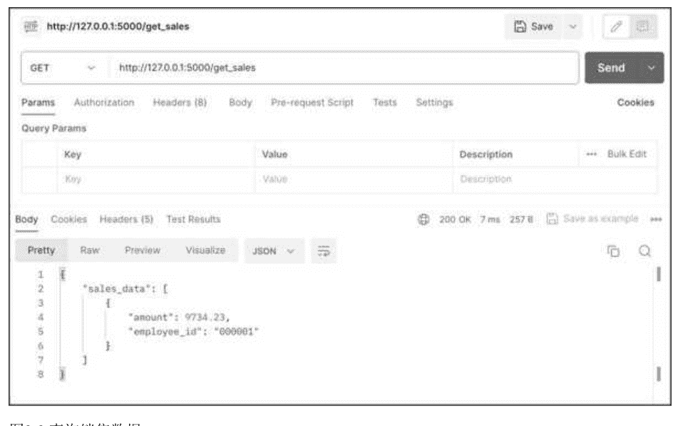

图8-8 查询销售数据

### 8.2.3 高阶编程题解题新思路

无论是编程小白还是编程大牛，在学习编程和面试过程中，经常需要解答一些编程问题，大模型在这方面的能力怎么样呢？如何提问才可以让大模型更好地理解我们的意图，并辅助我们解答编程问题？这里我们选取一些经典的算法问题来作为示例。

在询问编程题解时，我们可以遵循以下步骤。

- 1. （1）清晰描述问题：确保清晰、明了地陈述编程题目，包括编程问题的背景、问题陈述和可能的解决思路。
- 2. （2）给出约束条件：约束条件如时间复杂度、空间复杂度要求等。
- 3. （3）明确输入输出格式：明确定义编程问题的输入格式和输出格式，包括输入数据的类型、范围，以及期望的输出数据的结构和格式。
- 4. （4）提供示例数据：示例数据可以帮助验证解答的正确性。
- 5. （5）修改建议：如果你对解答方法有更好的思路，可进一步提示代码修改建议。

那么，我们来询问一道经典面试题。

提示词：

给定一个整数数组temperatures，表示每天的温度，返回一个数组result，其中result[i]是指对于第 i 天，下一个更高温度出现在几天后。如果气温在这之后都不会升高，请在该位置用0来代替。

示例1：

输入：temperatures=[73，74，75，71，69，72，76，73]

输出：[1，1，4，2，1，1，0，0]

示例2：

输入：temperatures=[30, 40, 50, 60]

输出：[1, 1, 1, 0]

示例3：

输入：temperatures=[30, 60, 90]

输出：[1, 1, 0]

约束条件：

1<=temperatures.length<=105

30<=temperatures[i]<=100

回答：

这个问题可以通过使用栈来解决，以下是一个Python的解决方案：

```python
def dailyTemperatures(temperatures):
    n = len(temperatures)
    result = [0] * n  # 初始化结果数组，初始值都为0
    stack = []  # 使用栈来保存每天的温度索引

    for i in range(n):
        # 如果栈不为空且当前温度大于栈顶的温度
        while stack and temperatures[i] > temperatures[stack[-1]]:
            j = stack.pop()  # 弹出栈顶的索引
            result[j] = i - j  # 更新结果数组

        stack.append(i)  # 当前温度的索引入栈

    return result
```

这个函数会遍历温度数组，使用栈来维护未找到下一个更高温度的天数。当遇到一个更高温度时，就从栈中弹出之前温度的索引，然后更新结果数组。如果栈为空或者当前温度不高于栈顶温度，就将当前温度的索引入栈。最后返回结果数组。

使用示例：

temperatures=[73, 74, 75, 71, 69, 72, 76, 73]

result=dailyTemperatures(temperatures)

print(result) 输出：[1, 1, 4, 2, 1, 1, 0, 0]

通过提示词询问后，大模型回答了一个很不错的解答方法，以O（n）的时间复杂度完成了任务，但空间复杂度还有待提升，下面我们进一步提示，观察大模型能否给出更好的回答。

提示词：

从空间复杂度方面进行优化

回答：

当涉及优化空间复杂度时，我们可以使用栈来存储温度的索引，但是不需要一个额外的结果数组。我们可以直接在温度数组中记录答案。以下是优化后的Python解决方案：

```python
def dailyTemperatures(temperatures):
    n = len(temperatures)
    stack = []  # 使用栈来保存每天的温度索引
    for i in range(n):
        # 如果栈不为空且当前温度大于栈顶的温度
        while stack and temperatures[i] > temperatures[stack[-1]]:
            j = stack.pop()  # 弹出栈顶的索引
            temperatures[j] = i - j  # 直接更新温度数组
        stack.append(i)  # 当前温度的索引入栈
    # 温度数组现在存储了答案，重置栈
    for i in stack:
        temperatures[i] = 0
    return temperatures
```

这个函数的改进之处在于，我们直接在温度数组中记录了答案，而不需要一个额外的结果数组。在遇到更高温度的情况下，我们将结果记录在温度数组中，然后将栈中的索引弹出。最后，我们重置栈中剩余的索引为0，以满足没有更高温度的天数。

这个优化后的解决方案的空间复杂度为O（1），没有额外的空间开销。对比上一个回答的解答方法，有效降低了内存使用。

## 8.3 编程难题的智慧解答

在深入研究编程难题的智慧解答之前，我们将首先揭秘编程思维逻辑，并分享对编程难题的详细解析。通过这一系列的探讨与实践，我们将更全面地理解如何在面对复杂编程问题时运用智慧得出精准而高效的解答。

### 8.3.1 编程思维逻辑揭秘

对于软件工程的学习者与实践者来说，实现项目开发的设计、规划、实施全流程，往往需要足够的经验积累和锻炼。尤其是进入新的开发领域，使用新的技术路径时，我们需要跨越从入门到实践的鸿沟。借助提示词与大模型对话，我们就相当于获得了一位有无数项目开发经验、熟知所有技术栈、逻辑严谨，而且耐心十足的老师傅的指导。在提示词的帮助下，大模型可以在项目全流程中指导我们，帮助我们制定详细的技术路径与开发计划，下面就让我们一起跟随“老师傅”的脚步，揭秘编程思维的逻辑吧！

提示词：

请帮忙讲解一下Raft分布式协议，以及其现实的细节，分步骤讲解

回答：

RAFT是一种分布式共识算法，用于在分布式系统中实现高可用性和数据一致性。它是一种更易于理解和实现的共识算法，相较于其他算法如Paxos，RAFT的核心是一个复制日志系统，确保多个节点间的日志保持一致。下面将逐步解释RAFT的概念和实现细节：

### 1. RAFT的基本概念

- 角色：RAFT中的节点有三种角色：领导者（Leader）、跟随者（Follower）和候选者（Candidate）。
- 领导者选举：节点间通过选举产生一个领导者，负责管理日志复制。
- 日志复制：领导者负责将日志项复制到其他节点，并保持日志的一致性。

### 2. 角色和状态转换

- 跟随者：默认状态，响应来自领导者或候选者的请求。
- 候选者：当跟随者在一定时间内没有收到领导者的消息时，它会成为候选者，并发起选举。
- 领导者：在选举中获得多数票的候选者成为新的领导者。

### 3. 领导者选举

- 当跟随者在预定时间内未收到领导者消息时，会变成候选者并开始新一轮的选举。
- 候选者给自己投票，并向其他节点发送投票请求。
- 接收到大多数节点的投票后，候选者成为新的领导者。

### 4. 日志复制

- 领导者接收客户端的请求，将请求作为新的日志条目加入自己的日志。
- 然后，领导者并行地将这个日志条目复制到其他服务器，并在多数服务器写入该日志条目后应用到自己的状态机，并向客户端返回结果。
- 如果某个跟随者落后或者日志不一致，领导者将会尝试多次，直到所有的跟随者都存有所有已提交的日志条目。

### 5. 安全性和一致性

- RAFT通过确保所有的日志条目按照顺序复制到多数节点上，来确保数据的一致性。
- 只有当一个日志条目被复制到多数节点时，它才被认为是“已提交的”（committed）。

### 6. 实现细节

- 心跳机制：领导者定期发送心跳到其他节点，以维持其领导地位和系统的稳定性。
- 日志条目的匹配：在日志复制过程中，领导者必须确保跟随者的日志与自己的日志保持一致。
- 日志压缩：为了处理日志无限增长的问题，RAFT实现了日志压缩机制，如快照（Snapshotting）。

### 7. 故障恢复和容错

- 当领导者宕机时，系统能通过选举产生新的领导者。
- RAFT算法可以容忍少于半数节点的故障。

RAFT协议之所以受欢迎，是因为它结构清晰、易于理解和实现，同时提供了一种有效的方式来确保分布式系统中数据的一致性和高可用性。

### 8.3.2 编程难题解析分享

在编程世界中，无论是新手还是经验丰富的开发者，都不可避免地会遇到各种各样复杂的技术难题和挑战。要解决这些问题，离不开对编程技能的学习，也要明确如何有效地提问和获取解答。接下来我们将重点介绍如何通过提示词解答编程中的疑问。我们将通过示例，展示如何构造有效的提示词，以解决编程中的具体问题，帮助用户提升编程效率和解决问题的能力。

#### 1. 初学者入门

问题：在Python中如何进行字符串拼接？

提示词：

作为Python初学者，我想了解如何将两个字符串拼接在一起。请提供一个示例。

问题：如何在Python中进行异常处理？

提示词：

在Python中，如果我想捕获并处理一个特定的异常，我应该如何做？请举例说明。

问题：在Python中如何使用循环遍历列表？

提示词：

我不太清楚如何在Python中使用循环来遍历一个列表。可以给我展示一个简单的循环遍历列表的代码示例吗？

#### 2. 调试代码

问题：Python脚本中变量的作用域问题。

## 3. 性能优化

问题：提升Python脚本的执行速度。

提示词：

我有一个Python脚本，运行起来非常慢。有什么方法可以提高它的执行效率？以下是我的代码。

问题：优化大型数据集的SQL查询。

提示词：

我需要对一个非常大的数据集进行SQL查询。查询速度很慢，如何优化以加快速度？这是我的查询语句。

问题：Web应用加载时间过长。

提示词：

我的Web应用加载时间过长。有哪些常见的优化技巧可以减少加载时间？

## 4. 设计模式应用

问题：在Java中实现观察者设计模式。

提示词：

我想在Java中实现观察者设计模式。能否提供一个简单的实现例子？

问题：使用工厂模式简化对象创建。

提示词：

如何在C#中使用工厂模式来简化对象的创建？请给我一个具体的实现示例。

问题：MVC模式在Web应用中的应用。

提示词：

我想在我的Ruby on Rails项目中更好地应用MVC设计模式。有哪些最佳实践可以遵循？

## 5. 库和框架的使用

问题：在React项目中如何管理组件状态？

提示词：

在React中，我应该如何有效管理组件状态？有没有一些通用的技巧或模式？

问题：如何在Django应用中实现用户认证？

提示词：

我正在开发一个Django Web应用，需要实现用户认证功能。请指导我如何做。

问题：使用Node.js和Express构建RESTful API。

提示词：

我想使用Node.js和Express构建一个RESTful API。可以提供一个基本的框架和实现方法吗？

## 6. 安全性问题

问题：如何防止Web应用中的跨站脚本攻击（XSS）？

提示词：

在Web开发中，我如何防止跨站脚本攻击（XSS）？请给出一些防范措施。

问题：加强数据库安全性的策略。

提示词：

在处理数据库时，我应该如何加强数据的安全性？有哪些具体的策略可以实施？

问题：安全地处理用户密码。

提示词：

我想知道在我的应用中安全地处理和存储用户密码的最佳做法是什么？

## 7. 新技术学习

问题：学习使用Kubernetes进行容器编排。

提示词：

我是Kubernetes的初学者，想了解基本的容器编排概念和操作。能提供一个学习路线图吗？

问题：掌握React Hooks的使用方法。

提示词：

我想学习在React中使用Hooks。请提供一些基本的使用示例和最佳实践。

## 8.4 代码的智能优化魅力

代码的智能优化魅力体现在编程实践当中。优雅且高效的代码是所有开发者所追求的，它不仅体现了程序员的技术深度，也直接决定着程序的性能、开发规范以及可拓展性。高质量的代码设计已经有了一系列成熟的实践原则，如SOLID原则、不重复自己（Don't Repeat Yourself, DRY）原则、保持简单（Keep It Simple, Stupid, KISS）原则等。在进行代码设计时，我们可以主要从这四个方面优化，获得优雅、高效的程序。

- ①可读性：设计清晰的代码结构和通俗的命名，便于开发者之间的理解和协作；
- ②可维护性：好的代码设计需要便于修改和扩展，降低后期维护成本；
- ③可测试性：强调代码的结构化，更容易进行单元测试和调试；
- ④性能：尽可能减少代码的时间、空间消耗，节约资源成本。

对于经验丰富的程序员来说，写出规范、高效、优雅的代码似乎并不是一件难事，但对于经验不足的程序员来说，通过一些巧妙的提示词搭配ChatGPT的帮助，就可以在短时间内零成本获得高超的能力。下面让我们通过三个场景，一起来实现代码的智能优化。

### 场景一：性能优化

优化前代码：

```
# 遍历数据列表并处理大于 0 的项
for i in range(len(data)):
    if data[i] > 0:
        process(data[i])
```

在这一段代码中，我们通过遍历数组的下标来访问数组元素，运行时间较长，下面我们通过提示词来优化代码块的性能。

提示词：
优化循环结构以提高代码执行效率。

优化后代码：

```
for item in data:
    if item > 0:
        process(item)
```

优化后的代码直接对数组内的元素进行迭代，减少了索引操作，直接使用Python内置的迭代器机制，减少每次迭代的开销，提升代码性能。

> 提示：如果对于ChatGPT优化后的代码不理解，可以要求ChatGPT对代码块进行注释，并且要求ChatGPT解释如此优化的理由。

### 场景二：提升代码可读性

优化前代码：

```
def add_and_multiply(x, y):
    addition = x + y
    multiplication = x * y
    return addition, multiplication
```

在这个例子中，add（加法）和multiply（乘法）两个方法被写在了同一个方法中，违反了代码的“单一职责”原则，我们可以通过提示词进行优化。

提示词：

拆分代码中的函数，以简化测试和提高代码的单一职责性。

优化后代码：

```
def add(x, y):
    return x + y

def multiply(x, y):
    return x * y
```

通过拆分两个不同的方法函数，我们可以在测试过程中轻松定位问题域，提升代码开发效率。

### 场景三：降低代码耦合度

优化前代码：

```
class UserController {
    private UserService userService = new UserService();

    public User getUser(String userId) {
        return userService.getUserById(userId);
    }
}
```

在这一段代码中，UserController类直接创建了一个UserService的实例。这就好比UserController类不仅负责控制用户相关的操作，还直接决定了要使用哪个UserService，这是耦合度高的体现，对于代码维护和测试都十分不友好。下面让我们用提示词来优化代码块。

提示词：

通过构造器注入依赖，替换类内部的直接实例化，以降低类之间的耦合度并提升测试的便利性。

优化后代码：

```
// 使用构造器注入UserService依赖
class UserController {
    private UserService userService;

    public UserController(UserService userService) {
        this.userService = userService;
    }

    public User getUser(String userId) {
        return userService.getUserById(userId);
    }
}
```

在优化后的代码中，ChatGPT通过构造器（一个类的构造函数）注入UserService。这就相当于在告诉UserController，“你不要自己去创建一个UserService，我会给你一个已经准备好的实例”，实现代码的简化。

## 8.5 创新编程环境的探索

大模型不仅可以回答问题，也可以模拟不同编程环境，包括模拟Linux终端、正则表达式执行、Git等。大模型可以执行Linux命令、提供解释和示例，帮助用户理解和学习如何在Linux环境中执行各种任务。这对于开发人员和初级运维人员来说都是非常有用的，他们可以通过模拟来测试和学习不同的Linux命令和脚本，提高操作的熟练度和效率。

### 8.5.1 Linux 虚拟环境应用

当使用Linux操作系统时，命令行是非常重要的工具，允许用户执行各种任务。在企业级服务器上，通常使用Linux无界面的发行版本，不同于大家常用的Windows系统，开发者只能使用命令与系统交互，因此熟练使用Linux命令对提高计算机运维技能极为重要。

以下是一些常见的Linux命令以及它们的功能。

- **ls**: 列出当前目录中的文件和子目录。
- **cd**: 切换工作目录。例如，cd/home/user会将当前目录更改为/home/user。
- **pwd**: 显示当前工作目录的路径。
- **touch**: 创建一个新文件。例如，touch file.txt表示创建一个名为file.txt的文件。
- **mkdir**: 创建一个新目录。例如，mkdir myfolder表示创建一个名为myfolder的目录。
- **rm**: 删除文件或目录。例如，rm file.txt表示删除一个名为file.txt的文件。该命令需谨慎使用，删除操作不可逆。
- **cp**: 复制文件或目录。例如，cp source.txt destination.txt表示将source.txt复制到destination.txt。
- **mv**: 移动文件或目录，也可以用来重命名文件。例如，mv oldname.txt newname.txt表示将oldname.txt移到newname.txt。
- **cat**: 查看文件内容。例如，cat file.txt表示显示file.txt的内容。
- **grep**: 在文本中搜索指定模式。例如，grep"pattern"file.txt表示在file.txt中搜索匹配"pattern"的文本。

大模型可以帮助我们模拟Linux命令行，我们可以提示大模型如下内容，使其作为Linux命令行程序与我们交互。在此过程中，我们使用CRISPE框架，赋予其Linux终端的角色，并阐述角色拥有的能力，最后强调输入与输出格式，完整的提示词如下。

提示词：

> 我想让您充当Linux终端。我将输入命令，您将回复终端应显示的内容。我希望您只在一个唯一的代码块内回复终端输出，而不是其他任何内容。不要写解释。除非我指示您这样做，否则不要键入命令。当我需要用英语告诉你一些事情时，我会把文字放在中括号内[就像这样]。我的第一个命令是：ls

回答：

```
Desktop Documents Downloads Music Pictures Videos
```

我们使用ls命令，显示了当前Linux系统所在目录下的文件，接下来，我们新增名为GPT的文件夹。

追加提示：

```
mkdir GPT
```

由于创建文件夹后，系统无返回信息，此时大模型回答也为空，接下来，我们继续使用ls查看当前目录下的文件。

追加提示：

```
ls
```

回答：

```
Desktop Documents Downloads GPT Music Pictures Videos
```

可以看出，目录中新增了GPT文件夹，接下来我们进入GPT文件夹并新建一个文件，命名为log.txt，向文件写入“数字世界的大模型”，并打印当前目录。

追加提示：

```
cd GPT
```

```
echo "数字世界的大模型" >log.txt
```

```
cat log.txt
```

```
pwd
```

回答：

```
数字世界的大模型
```

```
/home/user/GPT
```

借助大模型，我们在不启动Linux系统的情况下，也可以提前学习并熟悉系统的命令行操作，在上述示例的基础上，读者也可以进一步探索更加复杂的命令。

### 8.5.2 正则表达式的自动生成技巧

正则表达式是一种强大的文本处理工具，用于匹配和搜索字符串模式。它是一个由字符和操作符组成的模式，可以用来识别和提取文本中的特定模式，如邮箱地址、电话号码、日期等。正则表达式在文本处理、编程、数据抽取等领域广泛应用，以下是一些正则表达式的基本概念和常见操作符。

字符匹配：正则表达式可以用来匹配具体的字符。例如，正则表达式"cat"可以匹配字符串中的"cat"。

通配符：通配符`.`可以匹配任意字符，`"c.t"`可以匹配"cat""cut""c1t"等。

字符类：用方括号`[]`来定义一组字符。例如，`"[aeiou]"`可以匹配任何元音字母。

重复操作符：使用`*`匹配0次或多次，如`+`匹配1次或多次，`?`匹配0次或1次。

位置匹配：`^`匹配字符串的开始，`$`匹配字符串的结束。

转义字符：使用反斜杠`\`来转义特殊字符。例如，`"\."`匹配句点而不是任意字符。

分组和捕获：使用圆括号`()`来创建捕获组，以提取匹配的部分。

选择操作符：使用`|`匹配前后字段。例如，`"cat|dog"`匹配"cat"或"dog"。

大模型可以模拟正则表达式自动生成，可以快速生成匹配手机号码、日期等字符串的表达式，提示词首先给予大模型正则表达式生成器的角色，然后强调其能力为生成匹配文本中特定模式的正则表达式，并规定了输入和输出格式，完整的提示词如下。

提示词：

我希望您充当正则表达式生成器。您的角色是生成匹配文本中特定模式的正则表达式生成器。您应该以一种可以轻松复制并粘贴到支持正则表达式的文本编辑器或编程语言中的格式提供正则表达式。不要写正则表达式如何工作的解释或例子，只需提供正则表达式本身。

回答：

当您需要特定的正则表达式时，只需告诉我您要匹配的模式，我会生成相应的正则表达式供您使用。请提供您想要匹配的模式的描述，然后我将生成相应的正则表达式。

我们给出第一个要求，生成匹配十一位手机号码的正则表达式。

追加提示：

生成匹配11位纯数字手机号码的Python正则表达式。

回答：

匹配11位纯数字手机号码的Python正则表达式是：

```
python
import re
pattern = r"^\d{11}$"
```

这个正则表达式将匹配一个字符串，其中包含且仅包含11位数字，对应一个手机号码。

从回答中可以看出，大模型给出了Python正则表达式，引入了相关的包，具体的表达式为“^\d{11}$”。

下面我们来验证一下，验证手机号码与其他数字是否匹配正则表达式。

追加提示：

18888888888是否匹配这个正则表达式“^\d{11}$”

回答：

是的，字符串"18888888888"与正则表达式"^\d{11}$"匹配，因为它包含且仅包含11位数字。追加提示：

18888888888888是否匹配这个正则表达式“^\d{11}$”

回答：

不，字符串"18888888888888"不匹配正则表达式"^\d{11}$"，因为它包含13位数字，而正则表达式要求匹配的字符串必须包含且仅包含11位数字。

### 8.5.3 编程语言解释器体验分享

可执行文件。一些流行的语言可以使用解释器运行，如Python、JavaScript、PHP等，本节我们将带领读者使用模拟Python解释器。

模拟Python解释器是一个相当复杂的任务，因为Python解释器是一个高度复杂的软件系统，它需要解析Python源代码、执行字节码、管理内存和对象、处理异常等。我们可以创建一个简单的Python解释器，用于执行一些基本的Python语句，以便更好地理解Python解释器的工作原理，学习理解Python语法，这里的提示词可以根据具体的需求定制，整体的结构分为能力与角色、洞察、陈述、个性、实验五个部分。我们先给予模型Python解释器的角色，并告知其具有执行Python命令的能力；然后我们规定其输入和输出格式，完整的提示词如下。

提示词：

我想让您充当Python解释器。我将输入命令，您将回复解释器应显示的内容。我希望您只在一个唯一的代码块内回复解释器返回，而不是其他任何内容。不要写代码解释。除非我指示您这样做，否则不要键入命令。

回答：

明白了！我将充当Python解释器，只在代码块内回复。请给我您的Python命令，我将回复执行结果。

追加提示：

```
print ('hello world')
```

回答：

```
hello world
```

### 8.5.4 虚拟Git环境的探索之旅

Git是一个分布式版本控制系统，用于跟踪和管理软件开发项目的源代码版本。它由Linus Torvalds于2005年创建，是一个强大、灵活且广泛使用的工具，适用于个人开发者和大型团队。目前大多数科技公司与个人开发者使用Git进行版本管理与协作，它支持多种操作系统，大量的客户端工具和在线代码托管服务（如GitHub、GitLab和Bitbucket）与之集成。不过对于初学者而言，使用不规范会导致代码冲突、错误覆盖等。在本节，我们将介绍Git的基本使用方法，以及如何使大模型扮演Git模拟器的角色，帮助我们学习或模拟Git命令，减少开发场景时的错误。

以下是一些Git中常用的命令，它们用于执行基本的版本控制和协作操作。

- **git init**: 初始化一个新的Git仓库。此命令可用于创建一个空的Git仓库，通常在项目的根目录中运行。
- **git clone**: 克隆远程仓库。此命令可用于将远程仓库的内容复制到本地计算机，以便其在本地进行操作。
- **git add**: 将文件添加到暂存区。此命令可用于将更改（新文件或修改的文件）添加到Git的暂存区，以准备提交。
- **git commit**: 提交更改。此命令可用于将暂存区中的更改提交到Git仓库，并附带一个提交消息来描述更改的目的。
- **git pull**: 从远程仓库获取更改。此命令可用于从远程仓库拉取最新的更改并合并到本地分支。
- **git push**: 推送更改到远程仓库。此命令可用于将本地的提交推送到远程仓库，以与其他开发者共享。
- **git branch**: 查看分支。此命令可用于列出当前仓库中的所有分支，以及当前所在的分支。
- **git checkout (git switch)**：切换分支。此命令可用于切换到不同的分支，或者创建新分支并切换到它。
- **git merge**：合并分支。此命令可用于将一个分支的更改合并到当前分支。
- **git status**：查看仓库状态。此命令可用于查看有关未提交更改的信息，包括未暂存的文件和已暂存的文件。
- **git log**：查看提交历史。此命令可用于查看仓库中的提交历史，包括每个提交的作者、日期和提交消息。
- **git remote**：管理远程仓库。此命令可用于列出、添加或删除与远程仓库的连接。
- **git fetch**：获取远程仓库的信息。此命令可用于获取远程仓库的最新信息，但不合并更改到当前分支。
- **git reset**：撤销更改。此命令可用于将分支的HEAD指针重置到以前的提交，从而撤销更改。

这些是Git的一些常用命令，它们帮助开发者管理代码库、协作工作，以及跟踪版本历史。这里我们将灵活使用CRISPE框架，为大模型赋予Git命令模拟器的角色，并告知其能力及输入输出格式。下面我们来实际操作一下吧！

提示词：

我想让您充当Git命令模拟器。我将输入命令，您将回复终端应显示的内容。您只在一个唯一的代码块内回复终端返回即可，而不是其他任何内容。不要写代码解释。命令执行错误时，返回命令修改建议。

回答：

明白了！我将模拟Git命令，只提供终端返回的内容。请给我您的第一个Git命令，我将回复执行结果。

接下来，我们模拟真实使用情况，初始化一个Git仓库。

追加提示：

```
git init.
```

回答：

```
Initialized empty Git repository in/your/project/directory/.git/
```

目前已经在一个虚拟的地址下新建了一个空的仓库，下面我们新建一个分支，名为test，并新增一个文件test.txt，将其添加到暂存区。

追加提示：

```
git checkout-b test
```

回答：

```
Switched to a new branch'test'
```

追加提示：

```
echo "hello world" > test.txt
git add test.txt
```

回答：

暂存的更改：

（使用"git reset HEAD <file>..."撤出暂存）

修改：

（使用"git checkout -- <file>..."撤出工作目录中的更改）

test.txt

请使用"git commit"提交更改。

从返回结果可以看出，此时我们将文件存储到了暂存区，系统提示我们添加了文件test.txt，接下来我们将文件提交到分支中，并添加提交说明“first commit”。

追加提示：

```
git commit -m "first commit"
```

回答：

```
[test test 8d6936c] first commit
```

```
1 file changed, 1 insertion (+)
```

```
create mode 100644 test.txt
```

此时，模拟器在本地分支成功提交了一个测试文件test.txt，以上是一次本地提交并保存的模拟行为，可以看出大模型模拟了Git的操作。

## 8.6 架构与解决方案的生成艺术

架构与解决方案生成是指在软件开发和大型系统设计领域中的关键过程，确定一个项目的整体架构、组织结构、技术堆栈和解决问题的方法。这个过程通常涉及多个决策和计划步骤，以确保系统满足其预期的需求和目标，通常在开发阶段前完成设计过程，那么大模型是否可以帮我们生成架构与解决方案呢？当然是可以的！大模型不仅可以编程，也可以完成大型系统设计。

完整的架构设计是一个复杂的过程，通常需要考虑项目的需求、可扩展性、性能、可维护性、安全性和可用性等多个因素。以下是一些关键步骤。

- 需求分析：清晰地了解项目的需求和目标。这包括功能需求、性能需求、安全需求、用户体验需求等。需求分析是架构设计的基础。
- 模块化设计：将系统划分为模块或组件，使每个模块负责特定的功能或任务。这有助于降低复杂性，使系统更易于维护和扩展。
- 技术选型：根据项目的需求，选择合适的编程语言、数据库、框架和工具。技术选择应考虑项目的规模、性能要求和团队的技能。
- 架构模式：选择适当的架构模式，如分层架构、微服务架构、事件驱动架构等，以满足项目需求。
- 数据模型：设计数据模型，包括数据库结构和数据流。确保数据的一致性、完整性和可访问性。
- 安全性：实施安全措施，包括身份验证、授权、数据加密、漏洞扫描等，以保护系统免受攻击。
- 扩展性：构建具有水平扩展性的架构，以便在需要时轻松添加更多资源。
- 容错性：考虑系统出现故障时的恢复策略，包括备份和冗余。
- 监控和日志：实施监控和日志系统，以便及时检测问题和排除故障。

架构与解决方案生成是软件开发项目中的关键步骤，它需要跨职能团队的合作，包括软件工程师、架构师、测试人员、运维人员等。成功的架构与解决方案生成将有助于确保项目交付高质量的软件系统，同时满足业务需求。

接下来，我们尝试让大模型理解上述步骤，根据需求生成一个支付系统的架构设计方案。

提示词：

你是一个资深软件架构师，帮忙设计支付系统架构，要求支持千万级高并发，并保证相对高的安全性，至少包含下列信息。

需求分析、模块化设计、技术选型、架构模式、数据模型、安全性、扩展性、容错性、监控和日志，请给出具体的设计方案。

本节我们使用提示工程生成了一个支付系统的系统架构，接下来还可以在回答的基础上，根据具体的需求和实际研发资源，生成一份完整的系统分析文档。

追加提示：

请使用上述的架构设计方案，结合具体的资源，设计一份系统分析文档，团队中使用的语言以Java语言为主，服务框架为Spring Cloud，使用常用的关系型数据库。

回答：

我们将根据先前的系统架构设计，创建一份完整的系统分析文档，以便项目团队全面了解支付系统的设计和实施细节。这份文档将成为项目的基础，为不同团队成员提供了解项目范围、需求和技术细节的重要参考资料。

# 系统分析文档

## 1. 项目概述

### 1.1 项目背景

本项目旨在设计和开发一款高并发支付系统，以支持多种支付方式，包括信用卡、支付宝和微信支付。支付系统的目标是实现千万级高并发处理，同时确保高安全性和用户友好的体验。

### 1.2 项目目标

- 实现千万级高并发支付处理。
- 符合PCI DSS等支付行业安全标准。
- 提供用户友好的支付界面，支持快速结账。

## 2. 系统架构

### 2.1 模块化设计

- 用户管理模块
- 支付处理模块
- 交易记录模块
- 安全与身份验证模块
- 通知服务模块

### 2.2 技术选型

- 编程语言：Java
- 数据库：MySQL
- 框架：Spring Cloud
- 安全工具：OWASP Top Ten工具

### 2.3 架构模式

- 微服务架构
- 消息队列（Apache Kafka）

### 2.4 数据模型

- 用户数据：存储用户账户信息，包括用户名、哈希密码、支付方式等。
- 交易数据：记录每笔支付交易的详细信息，包括交易金额、时间戳、状态等。

### 2.5 安全性

- 使用SSL/TLS来加密数据传输。
- 强身份验证，多因素身份验证。
- 遵守PCI DSS等支付行业安全标准。

### 2.6 扩展性

- 微服务架构，支持根据负载的增长添加新的微服务实例。
- 负载均衡器用于分发流量。

### 2.7 容错性

- 实施备份和冗余策略，确保支付数据不会丢失。

## 3. 功能需求

### 3.1 用户管理

- 用户注册
- 用户登录
- 账户管理

### 3.2 支付处理

- 接收和验证支付请求
- 调用第三方支付网关

### 3.3 交易记录

- 记录支付交易的详细信息
- 包括金额、时间戳和状态

### 3.4 安全与身份验证

- SSL/TLS加密
- 强身份验证
- 遵守PCI DSS标准

### 3.5 通知服务

- 向用户发送支付状态通知
- 包括支付成功或失败的通知

## 4. 性能需求

- 处理千万级高并发请求
- 平均响应时间低于100毫秒

## 5. 监控和日志

- 部署全面的监控系统，实时监测系统性能和异常。
- 记录详细的支付交易日志，用于跟踪问题、审计和性能分析。

## 6. 项目计划

- 阶段1：系统设计和架构搭建
- 阶段2：开发和测试
- 阶段3：上线和部署
- 阶段4：性能优化和维护

## 7. 团队成员

- 项目经理
- 架构师
- 开发人员
- 测试人员
- 安全专家

## 8. 风险分析

- 技术风险
- 安全风险
- 人力资源风险
- 预算风险

## 9. 结论

本系统分析文档为项目团队提供了清晰的指导，涵盖了项目的需求、架构、技术选型、功能设计和性能需求。它将成为项目的蓝图，帮助团队成功完成高并发支付系统的设计和开发。同时，项目团队将密切关注风险，确保项目按计划执行，实现项目目标。

## 8.7 智能编程的综合应用案例

前文介绍了代码生成、自动代码注释、代码优化和虚拟编程环境的应用案例。接下来，我们将通过两个实际案例展示如何利用大模型的智能编程能力，实现无须手动编写代码，完成复杂软件或游戏开发的功能。

### 8.7.1 小试牛刀：制作一个简易计算器

在本节中，我们将运用提示工程实现一个完整的计算器项目，拥有前端页面和后端服务，在此之前需要安装Python环境和Flask框架。在传统的计算机项目中，我们要编写前端页面、后端服务，并对前后端服务分别部署。随着技术的发展，对于一些简单的功能，我们完全可以利用大模型辅助实现。下面我们将展示提示工程辅助编程的第一个案例——计算器的实现。

虽然是小项目，但我们也要遵循完整的研发设计流程。我们先生成一个计算器的系统架构设计方案，要求有前后端页面。

提示词：

你是一个资深软件架构师，帮忙设计计算器系统架构，要求有前端页面和后端服务，前后端分离部署，至少包含下列信息。

需求分析、模块化设计、技术选型、架构模式、数据模型、安全性、扩展性、容错性、监控和日志，请给出具体的设计方案。

回答：

设计一个计算器系统的系统架构需要综合考虑前后端的设计、数据处理、性能和安全性等因素。以下是一个具体的设计方案，包括需求分析、模块化设计、技术选型、架构模式、数据模型、安全性、扩展性、容错性、监控和日志。

1. 需求分析
- 功能需求：支持基本数学运算，包括加法、减法、乘法和除法。
- 用户界面需求：提供对用户友好的界面，包括输入框、操作按钮和结果显示。
- 性能需求：快速响应用户输入，实时计算结果，低延迟。
- 安全需求：防止潜在的输入错误或恶意输入，确保计算的准确性。

2. 模块化设计
- 前端界面模块：负责用户输入的接收和结果的显示。
- 计算模块：执行数学运算，处理用户输入。
- 安全模块：检查和验证用户输入的数据，确保安全性。
- 日志模块：记录用户操作和计算结果，用于审计和故障排除。

3. 技术选型
- 前端技术：使用HTML、CSS和JavaScript构建用户界面。
- 后端技术：使用Python和Flask框架搭建后端服务器。
- 数据存储：不需要数据库，结果可以存储在内存中。
- 通信协议：使用HTTP协议进行前后端通信。

4. 架构模式
- 使用前后端分离的架构模式，前端负责用户交互和展示，后端处理计算和安全验证。

5. 数据模型
- 数据模型简单，主要包括用户输入和计算结果的数据结构。

6. 安全性
- 在前端和后端都实施数据验证，确保用户输入的合法性。
- 防止恶意输入和SQL注入等攻击。
- 使用HTTPS加密前后端通信，保护用户数据。

7. 扩展性
- 系统可以轻松扩展以支持更多数学运算或新的功能，只需添加相应的模块。
- 可以支持自定义函数的扩展，以满足不同用户的需求。

8. 容错性
- 实施错误处理机制，确保系统能够处理异常情况。
- 使用日志记录潜在问题，帮助故障排除。

9. 监控和日志
- 实施日志模块，记录用户操作、计算结果和潜在问题。
- 部署监控系统，用于实时监测系统性能和异常。

这个设计方案基于前后端分离的架构，使计算器系统具有良好的模块化设计、安全性、扩展性和容错性。同时，它提供了对用户友好的界面，使用户可以轻松进行数学运算，并记录操作以便审计和故障排除。根据实际需求，还可以进一步扩展和改进系统。

接下来，我们将架构设计方案代入到上下文中，让大模型帮忙生成一个计算器的代码与工程结构。

追加提示：

你是一个资深软件工程师，请根据上述系统架构设计方案，帮助生成完整的代码细节，以及部署步骤。

回答：

创建一个完整的前端和后端计算器应用程序需要一些步骤，包括设置前端界面和编写后端代码。下面，我将提供一个基本的示例，以帮助你入门。这个示例使用Python的Flask框架作为后端，并以HTML和JavaScript作为前端。

1. 创建一个名为calculator_app的目录，并进入该目录。
2. 安装Flask。可以使用以下命令：

```
pip install Flask
```

3. 在calculator_app目录下创建一个名为app.py的Python文件，用于编写后端代码。

```python
from flask import Flask, render_template, request, jsonify
app = Flask(__name__)
@app.route('/')
def index():
    return render_template('index.html')
@app.route('/calculate', methods=['POST'])
def calculate():
    expression = request.form.get('expression')
    try:
        result = eval(expression)
        return jsonify({'result': result})
    except Exception as e:
        return jsonify({'error': 'Invalid expression'})
if __name__ == '__main__':
    app.run(debug=True)
```

4. 在calculator_app目录下创建一个名为templates的子目录，用于存放HTML模板文件。
5. 在templates目录下创建一个名为index.html的HTML文件，用于前端界面。

```html
<!DOCTYPE html>
<html>
<head>
    <title>Calculator</title>
</head>
<body>
    <h1>Simple Calculator</h1>
    <input id="expression" type="text" placeholder="Enter an expression">
    <button onclick="calculate()">Calculate</button>
    <div id="result"></div>
    <script>
        function calculate() {
            var expression = document.getElementById('expression').value;
            fetch('/calculate', {
                method: 'POST',
                body: new URLSearchParams({ 'expression': expression }),
                headers: {
                    'Content-Type': 'application/x-www-form-urlencoded'
                }
            })
            .then(response => response.json())
            .then(data => {
                if (data.error) {
                    document.getElementById('result').innerHTML = 'Error: ' + data.error;
                } else {
                    document.getElementById('result').innerHTML = 'Result: ' + data.result;
                }
            });
        }
    </script>
</body>
</html>
```

6. 在命令行中，回到calculator_app目录，然后运行应用程序。

```bash
python app.py
```

应用程序将启动，并且你可以在浏览器中访问http://127.0.0.1:5000/来使用这个简单的计算器。你可以输入数学表达式，然后单击"Calculate"按钮，以得到应用程序返回结果。

请注意，这只是一个基本的示例，你可以根据需要扩展功能，改进用户界面，并添加更多的安全性和错误处理。此外，该示例中的eval函数用于计算表达式，但在生产环境中，你应该谨慎使用，以防止安全漏洞。

我们按照上面生成的代码与部署步骤，新建一个名为calculator_app的Python项目，并按照回答中步骤2～步骤6执行后，可得到的终端界面如图8-9所示。此时后端服务成功启动。


图8-9 计算机程序启动

后端服务启动后，我们在本机访问http://127.0.0.1:5000页面，即可在浏览器端使用自己刚刚编写的计算器程序。读者可看到图8-10所示的界面，输入“1+1”后，按“Calculate”键，即可在浏览器中得到计算结果。

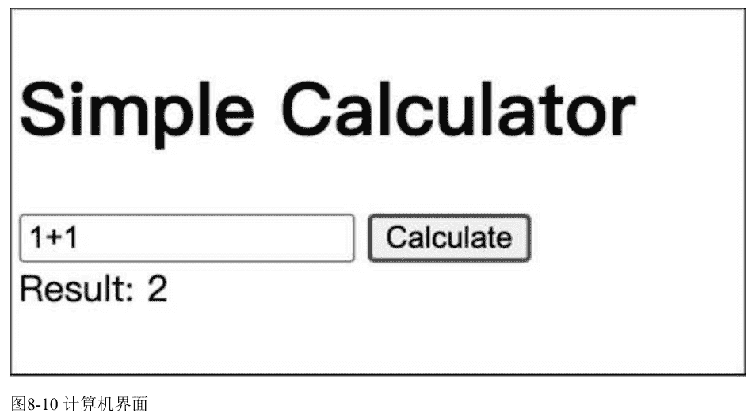

图8-10 计算机界面

在本节中，我们完成了第一个编程的实践案例，虽然只是简单的计算器项目，但在整个过程中，我们使用提示工程生成相应系统架构设计方案，并使大模型以设计方案为基础生成相应代码和工程结构。读者学习后可以借助提示工程进行智能软件开发。

### 8.7.2 “80”“90”后的回忆：制作雷电程序

雷电（也称为雷电1945或1945kIII）是一款经典的垂直卷轴射击游戏，最早由日本的Raizing公司于1995年发布，在街机、家用游戏机和各种平台上广受欢迎，成为射击游戏类型的代表之一。在本节中，我们将带领读者使用提示工程写出经典的雷电游戏代码，体验游戏制作的乐趣。

我们对雷电做一个简单的游戏设计，雷电是一款垂直卷轴射击游戏，也属于弹幕射击游戏类型。玩家控制一架飞机，进行射击和躲避敌人的攻击。游戏由多个关卡构成，每个关卡都设置有不同的地图和敌人布局。每个关卡结束时都有一场与Boss敌人的战斗。玩家可以选择不同类型的飞机，每种飞机都有不同的主武器和特殊武器，如导弹或激光。武器可以升级，提高威力。游戏鼓励玩家争夺高分，以在竞争中获胜并展示他们的游戏成就。在本节中，我们对游戏进行简化，仅实现主要的游戏功能，接下来，我们将游戏设计内容和需求转化为提示词。

提示词：

你是一个资深游戏开发者，帮忙写一个雷电程序，要求使用Python语言，实现战斗机能与敌机进行战斗的功能，并讲解每个步骤与最后的启动方式，以下是游戏具体设计。

游戏类型：

类型：雷电是一款垂直卷轴射击游戏，也属于弹幕射击游戏的子类型。

玩家角色：玩家控制一架飞机，进行射击和躲避敌人的攻击。

游戏机制：

游戏流程：游戏由多个关卡构成，每个关卡都有不同的地图和敌人布局。

道具和升级：游戏中会出现各种道具，如火力升级、生命值恢复、护盾等，玩家需要捡取它们以提高生存能力。

高分竞争：游戏鼓励玩家争夺高分，以竞争或展示他们的游戏成就。

难度和挑战性：

高难度：雷电以其高难度而著名，要求玩家具备快速反应、记忆和策略规划能力。由于敌人的弹幕攻击会填满屏幕，玩家需要巧妙躲避。

回答：

创建一个完整的雷电程序是一个复杂的任务，需要大量的代码和资源。在这里，我将为你提供一个简化版本的雷电示例，以Python语言和Pygame库实现玩家控制飞机与敌机战斗、射击功能。这个示例将包括基本的游戏循环、玩家控制、敌机生成和射击功能。

步骤和代码示例：

```
Step 1: 安装 Pygame
首先，确保你已经安装了 Pygame 库。你可以使用以下命令安装 Pygame：
pip install pygame
Step 2: 创建游戏窗口
import pygame
初始化 Pygame
pygame.init()
设置游戏窗口尺寸
WINDOW_WIDTH = 800
WINDOW_HEIGHT = 600
创建游戏窗口
screen = pygame.display.set_mode((WINDOW_WIDTH, WINDOW_HEIGHT))
pygame.display.set_caption("雷电")
...
Step 3: 定义游戏角色
python
定义玩家飞机
player_img = pygame.image.load("player.png")
player_x = WINDOW_WIDTH // 2 - 32
player_y = WINDOW_HEIGHT - 64
player_x_change = 0
定义子弹
bullet_img = pygame.image.load("bullet.png")
bullet_x = 0
bullet_y = player_y
bullet_y_change = 10
定义敌机
enemy_img = pygame.image.load("enemy.png")
enemy_x = 370
```

enemy_y = 50
enemy_x_change = 2
enemy_y_change = 40
...

## Step 4: 游戏循环和事件处理

```python
# 游戏主循环
running = True
while running:
    for event in pygame.event.get():
        if event.type == pygame.QUIT:
            running = False

        # 玩家控制飞机移动
        if event.type == pygame.KEYDOWN:
            if event.key == pygame.K_LEFT:
                player_x_change = -5
            if event.key == pygame.K_RIGHT:
                player_x_change = 5
            if event.key == pygame.K_SPACE:
                # 玩家射击
                bullet_x = player_x + 16
                fire_bullet(bullet_x, bullet_y)
        if event.type == pygame.KEYUP:
            if event.key == pygame.K_LEFT or event.key == pygame.K_RIGHT:
                player_x_change = 0

    # 更新玩家飞机位置
    player_x += player_x_change
    if player_x < 0:
        player_x = 0
    if player_x > WINDOW_WIDTH - 64:
        player_x = WINDOW_WIDTH - 64

    # 更新子弹位置
    if bullet_y <= 0:
        bullet_y = player_y
    if bullet_y < WINDOW_HEIGHT:
        fire_bullet(bullet_x, bullet_y)
    bullet_y -= bullet_y_change

    # 更新敌机位置
    enemy_x += enemy_x_change
    if enemy_x < 0:
        enemy_x_change = 2
        enemy_y += enemy_y_change
    elif enemy_x > WINDOW_WIDTH - 64:
        enemy_x_change = -2
        enemy_y += enemy_y_change

    # 检测碰撞
    collision = is_collision(enemy_x, enemy_y, bullet_x, bullet_y)
    if collision:
        enemy_x = 370
        enemy_y = 50
        bullet_y = player_y

    # 渲染背景
    screen.fill((0, 0, 0))
    # 渲染玩家飞机
    screen.blit(player_img, (player_x, player_y))
    # 渲染子弹
    screen.blit(bullet_img, (bullet_x, bullet_y))
    # 渲染敌机
    screen.blit(enemy_img, (enemy_x, enemy_y))
    pygame.display.update()
```

## Step 5: 编写子弹和碰撞检测函数

```python
def fire_bullet(x, y):
    screen.blit(bullet_img, (x, y))

def is_collision(enemy_x, enemy_y, bullet_x, bullet_y):
    distance = ((enemy_x - bullet_x) ** 2 + (enemy_y - bullet_y) ** 2) ** 0.5
    if distance < 27:
        return True
    return False
```

## Step 6: 渲染游戏结束和清理

```python
# 退出游戏
pygame.quit()
```

这个示例演示了如何创建一个简单的雷电游戏，其中玩家可以控制飞机，敌机从顶部向下移动。游戏在碰撞时结束。我们在启动前，需要准备三个图像，分别为飞机、敌机和子弹的图像，命名为player.png、enemy.png、bullet.png，放置于同项目目录下，游戏启动截图如下。

图8-11所示即为我们使用提示工程生成的雷电，读者可以继续完善这个游戏，添加更多游戏元素，包括武器系统、多个关卡、Boss战、道具和分数计算。你还可以丰富游戏素材，如分别制作飞机和敌机的图像，以及背景音乐和音效，以创建一个更完整和具有挑战性的雷电游戏程序。


图8-11 雷电截图

# 第9章 提示工程赋能软件生态的发展

在数字化时代，软件生态系统已经成为我们生活和工作中不可或缺的一部分。与此同时，大模型技术正在为软件生态带来一场革命性的变革。本章将深入探讨提示工程如何赋能软件生态，以及其在不同领域中的应用。

## 9.1 提示工程与金融科技的融合发展

从金融行业看，大模型正在重新定义金融科技，甚至重塑金融新业态，尤其在强交互性场景中体现了巨大的实际价值，因此，金融大模型势必将成为兵家必争的技术要垒。具体来说，互联网大厂、银行券商等金融机构，以及数据库厂商都已投入到金融大模型的开发和建设中去。大模型对金融行业的意义，在加速数智化和重拾“金融信任”之前，更鲜明的是长尾场景落地，如更加专业的智能客服、融资项目监测等。金融大模型驱动下的智能金融助手首先被投入使用，在支付App中为投资者和金融从业者都提供了更便捷、更高效的体验。

### 9.1.1 支付软件中的提示工程应用解析

提示工程在支付软件中得到应用，有助于用户更方便地得到专业的理财体验。以支付宝为例，蚂蚁集团自研的金融大模型被内置在蚂蚁财富应用中，可通过理解用户语言，精准调用蚂蚁体系内多种数字化金融工具，理财侧包括理财选品、产品评测、行情解读、资产配置等6大类服务，保险侧则包括产品解读、家庭配置、智能核保、智能理赔等智能服务。

另外，大模型在支付风控中也体现了特殊价值。在消费金融领域，“双十一”等大型消费场景的参与度更多体现在支付环节。这就对消费金融机构提出了要求：短时间内如何做到针对不同平台的不同消费场景、不同的消费人群立刻做出精准的风险判断，为消费者提供最合适的金融服务。马上消费在其自研的“天镜”大模型的加持下，每天能基于用户的1000万个行为做出风险判断，每天进行上亿次模型计算，每秒可以处理150万特征的计算，实现秒级风控。这样庞大的数据积累以及强大的计算能力，为消费金融机构的风控策略提供充足且多元的储备，以便在短时间内制定出最合适的方案，使支付环节更加安全可靠。

### 9.1.2 金融领域的大模型革命浪潮

对于金融大模型的研发，首先入局的是众多互联网厂商。金融大模型被称为“塔尖技术”，其难点不仅在于技术和合规，更在于数据和领域经验。以互联网大厂为例，百度、腾讯、阿里、360等多年对抗黑灰产的经验和在AI领域的深耕，为其在金融大模型的突破上提供了资源和保障。

2023年5月下旬，度小满发布了千亿级中文大模型“轩辕”，这也是国内首个垂直金融行业的开源大模型。轩辕大模型在1760亿参数的Bloom大模型基础上训练而来，其数据集不仅包含各种通用内容，还包含诸如金融研报、股票、基金、银行、保险等方向的专业知识，能够完成金融名词理解、金融市场评论、金融数据分析和金融新闻理解等任务。

2023年9月，蚂蚁金融大模型发布。它是基于蚂蚁基础大模型，针对金融产业深度定制的金融领域专业大模型，在万亿量级Token的通用语料基础上，又注入了千亿量级Token金融知识，并从超过300个真实产业场景中提取了60多万条高质量指令数据训练构建而成。

根据现有的资料来看，金融大模型在金融垂直领域具有良好的普适能力，能够帮助提问者了解金融信息、从事金融活动。下面将从金融名词解释、金融数据分析和新闻评论理解三个方面具体展示。

首先，金融大模型在金融名词解释方面表现出色。金融领域的专业名词和特殊名词需要通过特殊的理解方式来处理，而传统的搜索引擎在这些内容的回答上的表现差强人意。例如，“涨停板”“跌停板”等一些关于股票的特殊名词等，其涨跌幅因不同规则等限制而有所不同，金融大模型能够通过学习这些规则，理解这些名词的特殊含义并更好地服务用户。

其次，金融大模型拥有强大的金融数据分析功能，通过对海量的数据进行分析计算，来发现其中的规律和特征。例如，金融大模型会根据历史数据，对股票等金融工具的未来走势进行预测，从而辅助用户做出更优的策略选择和金融决策。

最后，金融大模型能够对金融新闻报道（如公司公告和政策变化等）进行及时、准确的解读。金融新闻是投资者了解行业、洞察局势并做出判断的重要依据。金融大模型可以快速理解和分析新闻内容，提供对各种因素的分析，如影响公司股价的因素和政策变化对股市的影响等，为用户提供最新、最全面的信息。

除互联网厂商外，一些数据库厂商也开始了自研金融大模型。例如，星环科技自主研发了金融大模型“无涯Infinity”，同时还提供了一站式的企业自建大语言模型工具链，包括与大模型应用落地相关的向量数据库Hippo，以及一系列针对数据库的底层处理技术。恒生电子的金融大模型LightGPT则使用了超4000亿tokens的金融数据（资讯、公告、研报、结构化数据等）和超过400亿tokens的语种强化数据（金融教材、百科、政府工作、法规条例等），能够支持超过80种金融专属任务指令微调，在专业领域有着优秀的理解能力。

2023年8月28日，马上消费金融股份有限公司推出我国首个零售金融大模型“天镜”。目前天镜大模型在汇集智慧、唤醒知识、众创价值、数字分身四大核心领域已经成功落地相应的场景产品，在营销获客、客户运营、客户服务、风险审批、安全合规、资产管理六个零售金融典型场景下，通过模型和数据驱动业务，解决行业痛点问题。（1）汇集智慧，主要应用在人工客服场景，通过大模型提炼萃取优秀人工客服经验，汇聚成群体智慧，形成具有一对多服务客户能力的AI客服，为人工客服提供辅助。截至2023年8月的运行数据表明，其意图理解准确率达91%，客户参与率达61%，远超传统模型和人工客服的水平。（2）唤醒知识，主要功能为解决提取、利用非结构化文档中的数据资料的痛点。例如，在企业招股书、财报、经济预测数据等文件被上传后，天镜大模型可深入解析金融领域专业术语，同时查询定位多个不同文档，洞悉金融图表隐含的信息并进行归纳和总结。（3）众创价值，大大降低使用数据的门槛。天镜大模型SQL生成平台不再需要代码等专业指令，使用者只需用语言描述自己的需求，天镜大模型即可自动理解需求、展开检索、生成答复，完成相应的数据挖掘任务。（4）数字分身，旨在打造“数字外表+智慧大脑+情感内心”三合一的数字人，擅理解、有温度、懂心理的智能秘书，或不休不眠的智能“打工人”。员工上传资料并选择定制参数，经过5分钟的数据训练后，员工即可拥有自己的数字分身，代替员工完成大量工作。

### 9.1.3 软件用户体验的秘诀分享

随着AI大模型如火如荼的发展，财富管理行业有望进一步解决传统服务质效的问题，如理财顾问服务门槛高，普通投资者无法获得具有针对性的服务等，使广大长尾用户享受到更专业、更有温度、实时在线的服务。

2023年9月8日，蚂蚁集团发布了基于金融大模型能力的智能金融助理“支小宝2.0”和智能业务助手“支小助1.0”。支小宝2.0面向消费者，为用户提供高质量的行情分析、持仓诊断、资产配置和投教陪伴等专业服务；支小助1.0面向金融企业和金融从业者，为理财顾问、保险代理、投研、金融营销、保险理赔等金融从业专家打造全链条的AI业务助手。

在知识力方面，支小宝2.0实现了金融领域的有问必答，对金融事件的分析推理能力不输行业专家平均水平；在专业力方面，有金融大模型充当“服务中枢”的加持，支小宝2.0在理解用户的问题后，可以像真人一样为用户提供上百种理财服务，如行情分析、资产配置、投教陪伴等；在语言力方面，得益于金融大模型的应用，支小宝2.0的金融意图识别准确率高达95%，在回答时不仅能读懂问题，还能读懂情绪，做出个性化表达；在安全力方面，支小宝2.0会通过围栏技术，保障内容安全与金融合规性，以带来“透明可靠”的体验。

举个例子，若在支小宝2.0上咨询“人工智能这么火，会影响哪些行业”，支小宝2.0会实时整合来自50多个专业机构、权威智库与媒体等各方信息，总结提炼后进行回答。即便被用户“怼”，AI也会提炼用户的语料，进行情绪识别和分类，测试不同的话术、尝试用不同的应对方式帮助对方摆脱负面情绪。因此，支小宝2.0不仅掌握了大量的金融知识，还能够个性化地回答用户问题，为用户提供情绪支持。“懂理财的人工智能，不仅得会回答类似‘持仓新能源汽车最多的基金是哪个？’这种专业问题，还要回答类似‘我又绿了怎么办？’这类带有情绪的问题，做出情感安抚，并帮投资者复盘问题所在。”

智能业务助手支小助1.0，则包含了“服务专家版”“投研专家版”“理赔专家版”“保险研究专家版”等六个版本，全方位服务不同金融场景的从业人员，可在投研分析、信息提取、商机洞察、专业创作、金融工具使用等环节提供深度智能服务。以“投研支小助”为例，实测数据显示，支小助1.0每日可辅助每位投研分析师高质量地完成100多篇研报和资讯的金融逻辑和观点提取，40多个金融事件的推理和归因，大大提高其分析效率。

同时，支小助1.0可基本实现基础的金融工程代码编写，大幅提升量化研究效率。在“服务支小助”的辅助下，理财顾问和保险代理人的有效管户半径人均可扩大70%以上。

正如蚂蚁集团财富事业群总裁、蚂蚁基金董事长王珺所说的那样，“伴随金融服务从广度走向深度，财富管理行业逐渐形成‘以用户为中心’的新生态，结合全新的大模型技术，将为用户创造更普惠、专业、透明和包裹式的新体验。”这将成为大模型驱动下的财富管理的重要方向。

## 9.2 提示工程与搜索引擎智能搜索的协同创新

大模型的出现，无疑给传统搜索引擎带来了冲击，为解答用户问题这项业务提供了一种新的思路。同时，搜索引擎也开始与大模型融合，依托大模型的能力使搜索结果表述更加清晰，形成准确性、实用性都更强的新一代搜索引擎。为了获得更好的搜索和回答能力，大模型不断向法律、医疗、金融等各个垂直领域蔓延，致力于满足用户更长尾的专业提问需求。今天，大模型飞速发展，传统搜索引擎也在不断革新，为用户带来更优的搜索体验。

### 9.2.1 大模型与传统搜索引擎的角逐

在大模型出现之初，便有人将其与传统搜索引擎进行优劣对比，并认为对话生成式的回答方式对于传统搜索引擎来说极具挑战，甚至有可能取代传统搜索引擎。但是，时至今日，这一担忧未免略显多余，大模型如火如荼，而使用搜索引擎的用户也未有衰减，这是因为两者的赛道终有不同。下面就让我们以ChatGPT为例，看看大模型与传统搜索引擎是如何角逐的。

相比传统搜索引擎，ChatGPT不是机械地罗列出相关的网页搜索结果，而是通过调用用于训练模型的巨大语料库，直接生成整理优化后的回答，以对话形式呈现给提问者，并且能够根据上下文的内容和用户进行连续对话和交互，回答各个领域五花八门的提问。不仅如此，它还能够根据用户的需要进行文学创作、绘画作图等媒体相关领域的创作型工作，也可以变身为程序员敲代码、改bug等。有测试显示，ChatGPT在百科检索、数学计算、常识问答、文学交流、知识推理等对话任务上的意图识别率均能达到98%左右，在生活闲聊上的意图识别率约为95%，具备良好的语义理解能力。

将ChatGPT的回答与谷歌搜索结果进行对比时发现，ChatGPT直接给出回复的答案展示结果带来了更好的实用性，对话式的方式颇具人情味，能够满足用户多种智能工作和AI创作的需求。目前主流的搜索引擎，如谷歌，都是基于问题本身的搜索，这就导致它们有一个很大的限制：用户有时并不能清楚地描述自己的问题。而ChatGPT却能够和用户互动，以连续对话的形式充分挖掘用户真实需求，提出解决方案。基于GPT开放式的回答和生成机制，ChatGPT能够充分解决用户不能准确描述的问题，循循善诱，给出用户最需要的答案。

但是，传统搜索引擎在数十年的积累下，也有一些ChatGPT无法比肩的独特优势，包括但不限于以下几个方面。

- 数据库庞大：传统搜索引擎已经建立了巨大的数据库，拥有海量的数据资源，能够在海量数据中快速准确地搜索到用户所需的信息，并且提供众多相关回答供用户按需选择，以全面地满足用户的需要。
- 可信性和可靠性：传统搜索引擎只为用户提供与问题相关的网页，这些网页大多是相对可信的公开资料，并且用户将会在众多网页中再次判断其可靠性并决定是否采纳某个回答，而ChatGPT则直接给出问题答案，具体答案来源无从得知。
- 实时性和稳定性：传统搜索引擎使用限制更少，实时性和稳定性较高，使用户可以随时随地进行搜索操作，并获得较为准确的搜索结果。

因此，虽然大语言模型能够满足用户多样的提问需求，但是无法替代搜索引擎，而“大模型+搜索引擎”的新搜索可能成为新一代搜索引擎的形态，带来用户体验的极大提升。

### 9.2.2 新一代搜索引擎的崛起

2023年8月23日，昆仑万维推出了国内第一款融入大语言模型的搜索引擎——天工AI搜索。用户在搜索框中输入希望寻求解答的问题，单击搜索按钮后，与传统搜索引擎类似，天工会首先以卡片的形式展示搜索结果的信息源，然后给出由AI大模型生成的回答，最后配上由AI生成的追问，形成“链接-回答-追问”的结果呈现方式。

在给出结果后，基于对上下文的理解，天工AI搜索能够以AI总结+多轮对话的方式，不断帮助用户挖掘自己真正的搜索意图，并对复杂问题进行深入研究，解决用户的实际困难与问题。

例如，如图9-1所示，我们询问：“新加坡好玩吗？”可以看到，天工AI给出了一段很有人情味的智能回答，并且将各个链接有机地梳理串联在上下文中，使用户能够更加清晰地把握住搜索结果提出的要点，同时保障答案可追溯、可考证、可信赖。同时，天工AI搜索会根据用户提的问题智能生成相关追问问题，方便用户进一步深入提问。

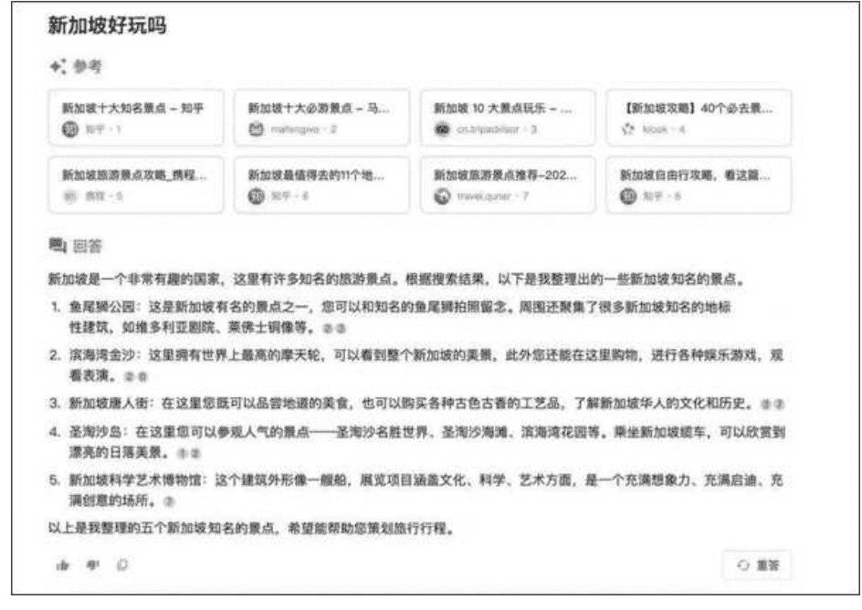

图9-1 天工AI搜索示意图

为了进一步测试天工AI搜索的智能程度，我们进行了追问，增加了一个限定条件“三天时间”，希望得到旅行建议，如图9-2所示。


图9-2 新加坡旅游计划搜索

天工AI搜索很快给出了相应的游玩安排，没有机械罗列景点，而是为每天制定相应主题，并安排相关的游览路线。其中第二天行程主题是感受本地生活，非常贴近时下流行的city walk。这是一份十分可行且非常个性化的旅行攻略，如图9-3所示。

由此可见，天工AI搜索具有不错的智能水平，能够准确解答用户问题。提问完成后，用户每轮提问的内容会被保存在“我的历史”里，方便用户随时回看，还可以一键分享给他人。

不仅如此，天工AI搜索凭借大模型的能力，能够根据用户提问直接生成文档、图表、方案等，实现从知识搜索到内容生产的一步到位，真正实现解放人力。天工AI搜索表示，目前还在测试多模态上传能力，将在未来支持声音、图片等多模态信息的处理。

天工AI智能搜索的优秀表现离不开大模型技术的加持。同时，原有的搜索引擎技术还能修正大模型现有的不足。通过将大模型和搜索引擎结合，天工AI搜索既解决了大模型胡编乱造的问题，又能够分析用户的真实意图，具备比传统搜索引擎更强的理解能力。它让我们看到了未来搜索引擎的形态，未来的AI搜索既能为用户省去浏览、摘取、整理信息的过程，直接给出完整的回答，又可以实时获取互联网信息，提供准确度更高的答案。

### 9.2.3 垂直搜索领域的突破

### 1. 法律大模型

2023年7月，华宇软件发布了“万象法律大模型”，并在9月20日升级了2.0版本，聚焦“办案助手、智能庭审、有神公文、文书管家、AI阅卷”五大业务场景进行模型训练及知识增强。万象法律大模型目前具有法律问题理解、法律材料分析、法律知识增强、法律知识推理、法律要素解析、法律内容归纳、法律文本生成、模型合规管制八大核心能力，为法官、检察官、律师和企业法务等法律从业人员近百个业务场景提供智能化应用支撑，目前在知识检索、法官检察官阅卷、庭审智能辅助、文书智能写作等业务场景下已实现落地应用。

在学术界，也有相关学者致力于法律大模型的搭建与训练。北京大学深圳研究生院-兔展智能AIGC联合实验室于2023年7月发布了国内首个法律场景下的落地大语言模型产品“ChatLaw”。ChatLaw使用来自论坛、新闻、法条、司法解释、法律咨询、法考题、判决文书等多源数据进行训练，能够为用户提供丰富的法律服务功能。例如，在用户上传法律材料（如文件和录音）后，ChatLaw会使用可视化导图和图表来展示材料的关键信息和结构。此外，ChatLaw还能够基于事实生成法律建议和法律文书，帮助用户更好地理解和处理法律问题。

### 2. 医疗大模型

2023年9月19日，百度发布国内首个产业级医疗大模型“灵医”，支持病历智能生成、中英文医学文献解析和智能问答等诸多功能。除了在疾病诊断上展现了更强的能力，灵医大模型还能处理多维度、复杂的医院管理数据，提高医疗工作的效率和安全性。例如，一个病区有50个病人，包括不同阶段的高血压和心脏病患者，大模型能根据病人数量、疾病严重程度等灵活安排医生提前介入和手术的时间。另外，大模型能够为患者提供24小时在线的健康管家服务，为患者的医疗服务带来更加良好的体验。目前，灵医大模型已与固生堂等企业达成合作，并已定向为连锁药房、公立医院、药械企业、互联网平台等200多家不同类型的医疗机构开放体验，可见百度灵医大模型覆盖了整个大健康产业链。

2023年10月16日，商汤发布了“大医”AI大模型，提供13个预设场景的医疗专业问题解答，并支持提示工程自定义、长程记忆存取、医学知识库查询总结等功能。面向医疗健康产业链上下游机构开放服务，帮助业内机构根据自身需求打造专属医疗大模型，促进医疗行业的数智化转型。目前，商汤已与多家医疗机构合作，实现了医疗大模型的应用落地。“您好，我是国家远程医疗中心用药助手，有什么可以帮助您的吗？”这是商汤与郑州大学第一附属医院国家远程医疗中心合作开发的用药咨询大语言模型，用户可以对其发起各种医疗问题的请求并收到回复。例如，询问“华法林是啥”，大模型将回复“华法林是一种药物，主要用于预防和治疗血栓性疾病，如深静脉血栓、肺栓塞、心肌梗死等。”继续询问“我去年心脏支架手术之后开始吃药，最近有点便血，想约个肠镜，有什么影响吗？”大模型能够与人进行对话答“在服用华法林的情况下，进行肠镜检查可能会有一些影响。华法林是一种抗凝药物，可能会增加出血的风险。在进行肠镜检查时，可能会有一些轻微的出血，但这通常不会引起严重的问题。然而，如果你正在服用华法林，并出现便血，这可能是一个需要关注的问题。”

### 3. 金融大模型

我国金融大模型发展迅速，度小满于2023年5月发布了1760亿参数、基于Bloom大模型训练而来的中文大模型“轩辕”，这是国内首个垂直金融行业的开源大模型。相较于通用大模型，在金融名词理解、金融市场评论、金融数据分析和金融新闻理解等任务上，轩辕大模型表现出了明显的金融领域优势，效果大幅提升。6月，恒生电子发布金融行业大模型LightGPT，针对投顾、投研、风控、合规、运营、客服等场景，开发了金融专业问答、逻辑推理、超长文本处理、多模态交互等方面能力。

### 9.2.4 搜索体验的创新优化

### 1. New Bing

2023年2月，微软发布了AI加持的新版Bing。当用户在New Bing搜索框内输入目标问题后，New Bing会在搜索结果的顶部首先给出一个简洁而准确的答案，这个答案是由New Bing使用大模型技术从海量的结果数据中提取和生成的。这样一来，用户就不用再浏览无数个网页，而是可以直接得到想要的信息，大大减少了解决问题的时间成本。例如，当你输入“北京时间”时，New Bing会直接显示当前北京的日期和时间；当你输入“美元兑换人民币”时，New Bing会直接显示当前美元兑换人民币的汇率；当你输入“奥斯卡最佳影片”时，New Bing会直接显示历年来获得该奖项的电影列表。这些智能答案涵盖了各个领域和主题，让搜索者能够在第一时间获取想要的信息，而不是在浩瀚的结果池中筛选自己想要的答案。

除了搜索外，New Bing基于ChatGPT-4提供了聊天页面，支持“有创造力”“更平衡”“更精确”三种聊天模式。用户通过BingChat进行提问，不仅能够快速准确地得到自己想要的答案，还可以体验文生图等多种AI能力。在New Bing中可以通过相应链接进入AI绘图模式，直接在搜索框中输入想要生成的图片的描述即可获得由AI生成的相应图片。另外，BingChat还在解决用户问题的基础上不断升级优化，搜索体验有了极大的提升。例如，新版Bing进行了四大更新：（1）多模态回答，在用户输入文字后全网搜索照片或视频，以及上传图片进行搜索；（2）图像创造器：基于Dall·E模型，支持超过100种语言生成图像；（3）聊天历史：查看历史聊天记录，根据历史聊天内容进行优化，进一步实现个性化聊天；（4）插件支持：支持添加OpenTable和Wolfram|Alpha等插件，在与BingChat的对话中获得数据可视化结果、分析复杂数据问题等。

### 2. 百度搜索

将通用大模型能力内置到搜索引擎中，百度提出了全新AI搜索体系，不仅提高了以往搜索引擎回答问题的能力，还给提问者带来了高度自动化和可视化的体验。只要把要求输入到搜索框中，百度搜索给出的结果不仅是一段AI智能总结的带有引用的回答，而且还是多模态的，相关图片、视频都包含在内，提问者无须再从搜索结果中浏览、花时间判断和总结便可得到想要的回答。

对于一些相对简单、没有现成答案的问题（如“东帝汶面积相当于几个通辽？”），AI可以在理解用户需求的基础上，展示逻辑推理和计算能力，直接输出可用的结果，免去用户分别搜索、比较和计算的复杂过程。如果是开放的多答案问题（如“做蛋糕没有鸡蛋，能用什么代替”，如图9-4所示），百度AI搜索可以把多个符合要求的答案整合在一起，同时列出引用和选择依据，使结果满足需求。如果用户问到的内容在视频中有所体现（如某车型评测中有关续航的部分），搜索引擎也可以自动定位到视频的相关位置，以方便用户查看。

图9-4 百度AI搜索截图

百度搜索有三个基于大模型的全新能力：极致满足、推荐激发、多轮交互。极致满足，意味着百度搜索可以在精准理解提问背后的深层意图后，给出最佳答案，省去用户自主筛选信息的繁杂；推荐激发，是用户在获取到目标答案后，还会获取到AI推荐的个性化内容流，为问题的解答拓展更宽视野；多轮交互，则意味着搜索会与用户进行多轮问答对话，明确用户需求，提供更丰富的答案。

例如，“给我制定一份广州到北京的三天两晚旅游攻略”，同样针对一个问题，此前的百度搜索给出的都是零散的相关信息，诸如酒店预订、机票预订、景点门票等都需要逐一查询。在AI的帮助下，借助相关第三方插件工具，融入大模型后的百度搜索，搜索结果的第一条可以直接生成一份满足用户需求的旅游攻略，这种能力被称为“极致满足”。用户可以在无须跳转其他网页或应用的前提下，完成相应酒店、机票等预订操作，这是推荐激发的作用。最后，如果答案和需求的匹配度较差，百度搜索还可以通过多轮对话的形式，让用户能够更加自然地表达，使用户需求的满足度越来越高，更好地服务用户，建立起更强的信任。

## 9.3 提示工程与设计软件：数字创意的魔法之手

设计产业在我国并没有明确的界定，据北京市统计局2021年修改出台的设计产业统计分类来看，设计行业主要有包括工业、服装/时尚、工艺美术等在内的产品设计；包括建筑、工程、规划在内的建筑与环境设计；包括平面、动漫、展示等在内的视觉传达设计三大核心分类。如果我们把诸如建筑、工程之类的以及工艺服装等产品都视为作品，则可对设计的概念进行统一，即“作品设计”。

作为一种以内容生成为主的行业，设计同样被深深卷入大模型的浪潮。AIGC大模型可以辅助人类完成诸如文本、语音、图像等多模态内容甚至3D模型的生成和创作，使设计效率极大提升。怎样以正确的方式在设计领域打开大模型，充分发挥大模型的应用潜力，是AI新时代的设计师及设计软件的开发者需要深入考虑的问题。

### 9.3.1 大模型在设计产品中的引入

浙江大学国际设计研究院此前发布的《大模型时代：智能设计的机遇与挑战》报告中提到，设计范式已经经历了从经典设计到设计思维再到计算设计三个阶段的迁移。经典设计阶段通过经验观察，依托手工技艺进行设计，以设计师自身感受为基础，发挥个体设计才华，产品结果受设计师的经验、审美等因素影响；设计思维阶段在前一阶段的基础上形成了一定的设计理论和原则，在商业模式的发展和个体消费需求的增长趋势下，设计师们开始从同理心出发解决设计问题，这一范式强调以用户需求为导向，强调以人为中心的设计，依托一定的原则和理论方法，来解决定义不清晰的复杂设计问题；计算设计范式则是在摩尔定律和数据型科学范式的影响下，由设计师借助智能算法和工具软件来解决设计问题，以计算机为媒介，利用数字化和信息化技术提升效率，支持设计结果的重用和扩展。

AIGC的到来，大模型浪潮的兴起，带来了设计的第四范式：智能设计。在这一范式的指导下，设计师通过提示工程，指导大模型调用相关设计理论和实践经验等知识，对产品进行设计，这一过程或直接产出设计作品，或通过中间作品为设计师提供灵感和创意。设计师再与大模型通过自然语言便捷交互，给出新的提示来帮助大模型完善已有设计，人机协作共同完成设计任务。例如，设计师可以采用ChatGPT编写创意方案，然后将该创意方案作为文字提示输入到Midjourney中，快速完成创意设计。截至目前，大模型已在系列产品设计中进行了落地应用，从多个角度辅助设计团队提升设计能力，提高工作效率。

#### 案例1：大模型对设计行业的优化示例

- （1）加速工作流推进

Kaedim平台是一款基于人工智能和机器学习的3D建模软件，支持由图片引导的快速和高清化3D模型生成。该功能使设计师能够更加迅速地将创意转化为3D模型，从而进行实时的视觉评估与改进。这种工作流显著提升了设计的迭代速度，能帮助设计师更快地实现设计目标。

- （2）赋能跨职能团队协作

Dora AI是一个无代码网站构建平台，借助AI生成技术，平台可以根据文本快速生成可编辑、可交互的网站，也可以方便地创建网页交互动画。通过降低跨职能设计团队成员间的沟通成本，加快网页设计迭代和反馈的循环，提升设计师与前端开发人员间的协作效率。

- （3）整合跨模态设计资产

OpusAI是一款通过自然语言构建3D可交互场景的工具。该工具可以整合创建3D场景所需的模型、纹理等资产，并以用户输入的文本需求为驱动，逐步完善3D游戏场景。在设计过程中，用户提供的设计资产越丰富，输入的文本描述越精准，最终得到的场景细节也越完善。

Ando是Figma中的一款插件，被誉为设计师的AI Copilot。该插件能够协助设计师整合现有的设计需求、参考图像与元素形状等设计资产，为设计师提供关于界面设计的创意启发，支持设计师通过文本描述设计目标来获得设计参考。

- （4）统一跨应用设计元素

造物云是一个在线3D设计平台，在生成式大模型的助力下，将商品摄影、宣传视频、营销文案中的设计元素统一成人、货、场三大类别，发布了AIGC+3D融合的设计辅助创作平台。该平台可以帮助品牌、电子商务、设计公司低成本、高质量地创作海量商品营销内容，实现从“内容即服务”到“模型即服务”的模式创新。

- （5）统筹跨模态设计任务

ImageBind是由Meta的研究人员推出的一项技术，能够统筹多种模态的设计任务。该技术整合了文本、图片、音频、深度图、热力图和IMU数据等六种不同的设计资源，以应对如“音乐+图像->视频”的跨模态设计任务。在该模型的支持下，面向不同形式任务的设计流程可实现共融共通。

- （6）设计结果的多模态转换

Figma插件parallax能够利用AI技术以3D视角排列平面设计图中各个图层内的设计元素，帮助设计师轻松地获得视差动画效果，并进一步将其换为HTML、SVG、GIF和WebM等不同格式的设计成果。

- （7）设计流程的多链路串联

腾讯CDC体验设计团队利用ChatGPT分析总结受众的需求关键词，并在Stable Diffusion等方法支持下生成运营效果图像。在大模型工具的赋能下，设计师能更高效高质量地串联内容策略定制、文本描述生成、图文内容应用等设计流程。

- （8）服装设计工作的优化

西湖心辰和知衣科技联合推出了一款面向服装设计行业的AI大模型Fashion Diffusion。用户只需选择款式、颜色、材质等选项，即可在10秒内生成服装在模特身上的实穿效果图。通过对服装行业专业数据的学习，Fashion Diffusion大模型可以极大改变传统的服装设计流程。

- （9）建模渲染工作的取代

ControlNet等技术的出现，赋予了AIGC工具根据N种条件对1张图像进行细粒度受控变换的能力。以建筑外观设计为例，设计师能够利用ControlNet，通过线稿草图对建筑结构进行控制，并快速得到多种风格渲染变换后的外观效果图。这种大模型的可控生成能力极大优化了设计建模、渲染中的机械劳动过程。

- （10）人机协作的创作赋能

SdPaint是一款基于Stable Diffusion的实时绘画工具。设计师在绘画区域中每画一笔，SdPaint就能基于预输入文本和已有的线稿内容，补全整张画作。随着设计师笔画的增加，画面的细节也将实时完善。设计师与AI协作完成整张画作的创作。

### 9.3.2 创意设计与大模型的联动

AIGC的发展推动设计行业进入了大模型时代，AI技术的应用降低了人们成为设计师的门槛，即使是没有掌握建模、渲染等专业技术工具的普通用户，都可以通过向大模型加持的设计平台输入一段自然语言提示文本，表达自己的设计想法，由AI协助实现创意，真正达成“只要有想法，就可以成为设计师”。除了帮助一般用户实现创意，大模型的加入也帮助职业设计师更高效地完成设计工作，设计师们可以通过Stable Diffusion、Midjourney来生成配图、图标，以及方案的初步原型，然后再进行精细化设计，在产生创意并利用AI辅助生成初步方案后，进入“AI方案激发创意-->AI辅助完善”的优化循环，最终在AI的助力下实现最优的创意方案。

然而，上述优化机制实现的前提条件是，设计师或用户知道如何与大模型进行沟通交流来使其正确理解用户的创意，从而生成与人类想法相一致的设计。这一和大模型进行协作的规则，或者说大模型理解设计师创意的密码本，就是提示工程。目前来看，提示工程中，若用户对自己的创意想法描述得越具象越复杂，提供越多的关键特征，则大模型越能够更好地理解，这就像大模型手握一本密码本，对人类的思想不断对应解码，再将它解码理解到的内容呈现为设计方案或成品。针对设计行业的提示工程，甚至有专家专门产出了视频教程，来助力设计师们科学高效地使用AI工具，如在Midjourney+ChatGPT的基础知识体系教程中，就涵盖了包含官方文档命令、参数、模型讲解，prompt公式，prompt规则，高阶用法，提问策略，提示词公式等内容以及相关案例和参考图库，从理论到应用，帮助设计师们掌握AI工具联合应用辅助设计的系统性用法。

#### 案例2：Midjourney中的创意实现

Midjourney是一款知名的AI图像生成工具，对于用户而言，只需要输入相应的文本数据，MidJourney就能够根据该文本数据生成相应的图像，而无须手动绘制或编辑。这种方式不仅提高了创作效率，还能够生成高质量、逼真的视觉效果，满足用户的创意需求。接下来我们将以电子商务宣传海报的生成为例，来展示Midjourney是怎样应用大模型辅助创意实现的，其他设计软件大多与此同理。

如正文中说的，Midjourney生成海报等图片是基于文生图，其中“文”指的是用户输入给大模型的提示文本/提示词，提示词的精准程度直接影响着设计作品的生成效果。设计提示词，是利用AI生图的准备工作，有一定的门槛，当然，如果我们是由一些经验/图片引发创意，我们可以借助大模型，在完成文生图之前先进行图生文，由AI辅助撰写关键词。

例如，在生成电子商务模特宣传海报时，我们可以先找一张符合我们整体需求的模特图，使用Midjourney的“/describe”功能图生文。

通过上述方式，对我们选择的图片，大模型生成了一些关键词，我们可以据此得到关键词灵感，然后结合我们的需求撰写提示词，生成相应的模特图。

```
Full body photo of a Chinese female model standing in front of a bright wall, Asian style, Product photography, Sophisticated and high-end, Panoramic view, 100mm lens, Super details of the highest quality, 8K--ar 9:16--v 5.2
```

中国女模特站在明亮的墙壁前的全身照片，亚洲风格，产品摄影，精致高端，全景，100mm镜头，高质量的超级细节，8K

通过上述提示词，大模型生成的图如图9-5所示。

### 9.3.3 大模型赋能数字创意的未来

9.3.1节中提到，大模型的到来使设计领域跨进了第四范式：智能设计。未来，大模型将极大赋能设计领域的数字化转型，从链接、整合、拓展三个方面优化数字创意的设计，提升设计能力。

（1）链接能力。大模型可以充当设计师与设计知识之间的管道，设计师与非设计人员之间的翻译官。

从前设计师需要学习大量抽象的设计知识，不断进行实践积攒经验，从而将其转化为设计能力，进一步运用在设计任务中。然而知识或经验对于人永远是信息过载，设计师对各领域知识的了解不可能面面俱到，但是大模型可以通过对各领域广泛的知识进行学习和总结，将抽象的知识以文本、图像、视频等形象化的方式呈现，帮助设计师拓宽知识面，从而能够在设计任务中快速使用新知识。

在设计师与非设计人员就数字创意的沟通协作方面，由于二者对设计概念、设计语言以及设计实践的理解不同，彼此之间沟通与协作困难。借助大模型形象化的生成能力，可将不同领域的抽象知识进行形象化呈现，从而实现多团队之间的高效链接，推动数字创意作品的落地，带动业务创新。

（2）整合能力。与链接能力相对应，大模型的整合能力体现在对跨学科设计知识和跨领域设计流程两个方面的整合。

由于不同学科的知识相互独立，因而难以有机整合为统一的设计资产，被设计师灵活地使用。而大模型具备了整合跨领域知识的能力。设计师可以便捷地通过它查询、使用跨学科的知识，从而提升创意设计的效率。

同样地，在不同的设计垂直领域，如UI设计、建筑设计、产品设计等，其概念设计流程大相径庭，跨领域设计需要设计师掌握不同的设计流程。在大模型时代，这些跨领域的设计流程可以逐渐整合为“想法表达->模型生成->手工微调->成品导出”的过程。大模型将对设计师透明化展示流程的切换过程，使其能够更专注于创意内容的产出和实现，提升设计效率。

（3）拓展能力。能力的拓展是大模型与设计师间“双向奔赴”的一个过程。

大模型能够接收大量的数据和各领域的知识，本身具备巨大的潜力。其能力受限于所用的具体训练数据和方法，同时拓展模型适配于具体领域的数据标注且模型训练成本高昂。而提示工程，就是改善大模型性能、提升大模型能力的一条捷径。如果能够恰当地运用提示工程，设计师可能只需要给予大模型简单的提示，就能使其迅速理解并将已有的预训练知识快速迁移到对应的领域中。

设计师对提示工程的合理应用可以很好地提升大模型的能力，而正如前面分析的，大模型的应用也极大地拓展着设计师的能力。大模型能够整合海量多领域的知识，通过打破不同领域间存在的知识壁垒，支持设计师解决跨领域的复杂设计问题。

## 9.4 生态未来
提示工程的无限可能

我国《“十四五”软件和信息技术服务业发展规划》曾指出，要重点围绕软件产业链，加速“补短板、锻长板、优服务”，提升软件产业链现代化水平，推进产业基础的高级化。随着技术水平的进步与全球化程度的加深，全球软件产业的竞争已经从单一产品转向了生态系统的竞争，对核心支撑技术的缺乏、国际开源生态中软件企业主导权的不足及知识产权隐患、缺乏具备适应现代软件产业发展的复合型高端人才、缺乏龙头企业抢占前沿领域技术制高点、生态构建路径及生态环境基础薄弱等问题，都成为制约我国软件产业发展的严重瓶颈。大模型的到来，为推动软件生态的繁荣带来了新的契机，能否以及如何把握好这一机遇，从基础能力和产业生态两个方面提升我国软件产业发展水平，是技术人员及相关管理者需要共同思考的问题。

### 9.4.1 软件生态的探索与实验

科学技术是全人类的共同财富，合作共赢的理念在软件产业同样适用，只有共同构建并推动软件生态的繁荣，才能更充分地发挥技术的潜力来造福人类。所谓软件生态系统，是指在特定的技术环境中，软件企业、开发者、技术社区等受众以软件产品、服务、数据和知识为媒介相互作用而形成的复杂系统。系统中的各利益相关者采用数据共享、知识分享、软件产品及服务提供等方式，共同推动软件生态的繁荣。

大模型时代的到来创造了全新的智能化软件生态，它以交互式对话的方式实现着多领域的任务完成能力，表现了很高的通用智能水平。以大模型为智能基座，按需融合各类信息、服务、接口、工具乃至机器人和各种物理资源，正在成为一种新的技术和产业发展方向。如今，对于具体的基于大模型的软件设计、开发、重构流程仍在探索中，但毫无疑问的是，大模型的加入正深刻影响甚至颠覆着从基础设施建设到软件形态及构造，再到用户交互方式等软件系统构建链路中的各个环节。基础模型国内外赛道火热，应用层初创企业百家争鸣，给学术界和业界都带来巨大冲击。然而，现在在大模型的巨大潜力和应用层创新想法的实现之间还存在着巨大鸿沟，需要新型的软件环境和工具来跨越这道鸿沟，这衍生了四个主要的探索方向。

- （1）基于特定Foundation Model的instruction-tuning（尤其是self-instruct），通过对通用大模型进行垂直领域的训练和精调，使领域大模型不断涌现（如金融领域大模型、医疗大模型等）。
- （2）围绕增强语言模型（Augmented LM，ALM），尤其是使用工具能力、复杂推理能力，以及与物理世界交互行为能力等方面开展研究，为构建丰富的插件生态以及Copilot的成熟应用奠定了基础。
- （3）针对提示工程进行优化，对思维链（Chain-of-Thoughts，CoT）及其变种，程序指导语言模型（Program-Aided LM，PAL），推理执行结合（Reasoning-Act，ReAct），迭代提示、分解提示、提示优化、提示集成等各种工作展开探索。与此同时，各种优质提示词也变得越来越受追捧，从而形成了围绕提示工程的社区和市场。
- （4）从任务表达到目标表达的升级，形成了更加自主智能体的雏形，如AutoGPT，AgentGPT，ToolMatrix.AI以及babyAGI等具有更强任务规划、模型和工具选择、自主执行和反馈优化的闭环，并初步具备了自主思考的过程，也为更智能的机器人流程自动化（Robotic Process Automation，RPA）奠定了基础。

整体来看，大模型的赋能使得软件生态系统变得更加灵活。通过插件化将不同的外部工具连接组合，形成一个处理流程，由大模型“大脑”统一调配，对复杂任务进行推理、拆解，对工具进行自由组合变换以应对不同的需求，甚至适应违背预料的场景。当然这个过程需要数据来驱动，即大模型时代的软件生态系统是一个数据驱动的智能化生态系统，软件可以按需自动化构造，包括功能性的API、成品软件服务、专用模型定制，还包括专有的数据库和知识库等。此外，数据的质量、多样性和可用性也会对系统性能产生重要影响。

结合上述的几个研究方向及近年来大模型的进展状况，我们可以预想到大模型时代的智能化软件应用的几种形态。

- （1）基础大模型的线上应用生态，如围绕GPT-4构建的系列软件生态应用。
- （2）领域大模型：以基座大模型为基础，通过微调等手段训练构建领域大模型，并以此为基础开发相关应用，如金融、医疗等领域智能软件应用。
- （3）基于小模型构建的智能软件应用：由于在成本等方面的明显优势，小模型将会继续成为智能化软件的基础，尤其在端、边应用场景，继续发挥智能的作用。

总而言之，大模型的到来给软件生态系统带来了新的繁荣契机和发展活力，在强有力的数据支撑下，充分发挥大模型的潜力，将使智能化软件系统实现更高的准确度和可靠性，同时具备更好的扩展性和灵活性。

### 9.4.2 大模型与数字化转型

大模型推动了更灵活繁荣的软件生态构建，为软件开发和应用拓展了新路径，以大模型为基础的软件应用过程，就是大模型和实际场景不断融合的过程，是一个不断探索的过程，在这个过程中，数据是基本的生产要素，基础设施是入场券，应用场景是大模型衍化的驱动力，AI大模型的未来将趋于通用化与专用化并行。

以AIGC大模型为核心的新一代数字化技术的到来，给各行各业提出了数字化转型的新要求，也带来了转型的新契机。大模型落地于不同应用场景，各企业和组织都可以利用大模型来降低生产成本，拓宽业务领域，辅助内容创作，优化用户体验，完善组织架构，提升管理水平等。接下来我们以平安银行的数字化转型为例，来展示大模型为数字化转型注入的新活力。

**案例3：平安银行数字化转型——大模型开启的新篇章**

从整体转型战略来看，平安银行以数据为基石，以智能为方向，聚焦数字化经营、数字化运营与数字化管理，推动业务高质量发展。其中，数字化经营是借助数字化科技，提前获取信息、快速分析定位问题、做出正确决策、及时采取行动，赋能业务聪明经营；数字化运营是通过“机+人”模式重塑业务流程，用机器替代简单重复的人力密集型工作，去中间化、去手工化，降低成本、提升效率、优化服务；数字化管理是借助一系列风险管理、预测预警技术与模型，强化风险管理和预测预警能力，提升精细化管理水平、精准风控水平，牢牢守住风险底线，为经营保驾护航。

依托大模型技术打造新型生产力，加速数字化进程，平安银行的转型设想分如下两个阶段：第一阶段是在加速进行技术储备的同时使用大模型技术对现有的产品应用进行革新，如打造员工和用户的Copilot，革新人机交互方式，提升传统软件的自动化和智能化。第二阶段将以大模型为核心打造全新的产品形态。以AI Agent为例，它由大语言模型（或多模态大语言模型）、感知、决策和行动能力构成，具备高度拟人化的交互体验和执行能力，可解决现实世界的复杂决策任务。员工和用户仅需提出指令需求、监督过程和评估结果，具体任务则由AI Agent来完成，即单个或多个智能体通过对事项的拆解和编排，调用软硬件接口，执行并完成任务实现闭环。

基于大模型研发效能和技术先进性，平安银行开始建设打造可持续发展的大模型研发范式，专注银行场景的大模型能力、开放共享的应用生态，实现以大模型为核心的创新产品落地。

总体来看，平安银行研发范式可分为“三步走”战略，最终实现交互、生产、决策层广泛且智能的模型能力。

- （1）打造坚实能力底座，专注银行场景模型。构建三层大模型：L0基础大模型，属通用性质，基于海量公开数据进行无监督预训练；L1行业大模型，通过高质量行业数据训练形成。在二者基础上，融合数据驱动与机理驱动，基于银行数据和场景特点打造银行营销、运营和风控等领域的L2场景大模型，在具体业务场景中效果更优。
- （2）构筑能力共享体系，释放创新潜力。打造面向全行员工和开发者的平台产品，激发创新潜力，挖掘应用场景。打造大模型开放平台，通过统一大模型底座，沉淀能力，打造模块共享的生态体系，承载全行近百个大模型相关需求，主要集中在内容生成、文档知识类的检索、抽取与问答类需求等领域；打造AIGC应用市场，快速创造专属生产力工具。目前，AIGC应用市场中已上线超50个应用，即点即用，实时满足办公需求。
- （3）赋能现有业务场景，探索AI First产品模式。在银行各业务中实现AI广泛应用，借助大模型可升级文本、图像、语音、知识图谱等AI技术的智能化水平，提升场景应用深度；同时，大模型使得人机交互、内容生产和智能决策等能力无处不在，可提升广大员工的生产力、产品性能与体验。新能力亦可催生新业务流程，革新银行业务流程和发展模式。

大模型是银行数字世界的关键支撑，具体到场景，可分为数字化经营、数字化运营和数字化管理三个方面。

（1）数字化经营：以客户为中心、以数据为驱动，构建“开放银行+AI银行+远程银行+线下银行+综合化银行”的体系化零售转型新模式，通过AI等一系列科技能力持续创新数字金融服务模式。例如，在经营分析场景中，通过对话方式重塑数据分析体验；在营销场景中，构建大模型营销人员话术培训系统，提升员工专业能力；在差异化产品服务方面，平安银行精准识别对萌宠情有独钟的客户群体，利用AI绘画技术打造业内首创的专属个人萌宠信用卡面。同时，“经营分析助理”“信用卡面设计师”“首席体验官”等一批大模型数字员工正陆续上岗，使每位客户都能拥有专属金融助理。

（2）数字化运营。在客服场景中，大模型提升交互能力并扩大知识领域，为平安银行数字人装载“智慧大脑”，打造更拟人化，更智能、以客户为中心的金融服务机器人；在资料审核场景中，大模型可覆盖传统AI尚未触及的长尾复杂文档，提升贷款审批等业务的自动化程度；在研发场景中，平安银行依托多语言代码生成大模型，基于行内数据微调，打造更契合银行的代码生成Copilot，持续提升全行开发人员效率。

（3）数字化管理的应用：将AI应用于智能预警、智能分析和智能监控等多场景。例如，在零售风险控制中，零售模型全流程管理平台可实现风控模型全生命周期精准管理，形成对风控模型的全面管理和及时预警，实现动态风险治理。

大模型能力的不断延伸，持续推动着实体企业的数字化转型，并带来深刻变革。无论是在数据治理、多模态数据融合、业务场景应用的高效解决，还是在支持上层应用、提供插件接口、拓展领域边界方面，大模型的浪潮都正在深入渗透到企业和社会发展转型的方方面面。

### 9.4.3 创新与软件生态的不断演进

随着AIGC的变革，大模型将作为一种基础设施赋能于千行百业，未来应用软件领域或将呈现“若干大模型+海量小应用”的AI软件新生态，伴随着软件交互界面的革新以及AI带来的效率和体验的极大提升。

宏观来看，生成式AI目前已经明确了丰富生态系统的发展方向，涵盖了应用、大模型平台以及插件的多个方面。

首先，各类面向开发者的大模型平台的崛起，使开发人员不再纠结于大模型的训练开发，而是直接在平台上调用所需的大模型能力来完成任务。这类平台的出现使大模型的应用变得更为简单便捷，为开发者提供了更多创新的空间和可能。

其次，插件化的创新给为大模型应用的开发者提供了第二大便利。他们可以将所需的能力封装成插件，而无须再开发完整的应用端。这种插件化的创新使得大模型应用的开发变得更加模块化，可以更轻松地配合各种AI原生应用，充分发挥AI的能力。

总之，大模型革命带来的不仅是技术的提升，更是AI生态的多元化。通过大模型平台的开放、插件的灵活运用、开放性创作等，AI生态系统呈现更加繁荣和多样化的趋势。而大模型在未来很长一段时间，将持续对软件生态和创新产生影响，主要聚焦在以下几个方面。

- （1）算力将成为未来软件生态重要基础设施。大模型的开发和升级需要强大的算力支持，从早期的词向量预训练语言模型（ELMo）到基于转换器的双向编码表示模型（BERT-L）再到GPT模型，大模型对算力的需求始终在持续增长，未来在基于大模型的软件生态中，对算力的保障将是必不可少的一环。
- （2）云生态。大模型的开发与场景化应用将强相关于基于云端的数据存储、传输和计算功能，需要依托云端，方能建立起大模型计算任务执行与大规模算力基础设施之间的连接。进一步来说，未来用户对云厂商的需求将更加聚焦于智能服务，框架是否稳健、模型是否善于计算，以及模型、框架、芯片、应用这四层架构之间的协同水平都将成为重要的考量标准。
- （3）“对话即平台”或将成为大模型时代的产业趋势。大模型的出现将人机交互的形式由计算机语言、图像界面切换为基于自然语言对话的交互，更加贴合真正的“人工智能”。尽管通用型人工智能助理仍是一种展望，但“对话即平台”的理念在大模型应用中已有显现。GPT-4大模型与微软办公软件（Office）的接入，是这一理念的应用场景探索。随着大模型应用场景增加，通用型、一体化新产品或将成为主流趋势，以满足用户的个性化需求。此外，随着人机交互程度深化，大模型应用可能进一步强化情感体验，对人类情感的理解与机器情感的建构也成为重要研究方向。
- （4）软件生态未来将向着更加普适的应用场景、更加自动化的开发流程、更加轻量化、可集成化发展。

新的AI时代已然到来，技术的发展使得AI不再局限于专业领域，而是向更广泛的人群敞开大门，大模型的生态系统也将继续演进，为更多创新和发展创造更加广阔的空间。千行百业在AI大模型的生态变革中收获了新的活力，并成为AI丰富的应用场景，推动AI向更加开放、灵活、高效的方向发展，也让更多人能够轻松参与到AI创新的浪潮之中。随着技术的进步，生态的繁荣，AI正一步步走进人类的生活，并改善人类的生活，在不远的未来，我们或将有机会实现AI与人类一同生活的美好愿景。

## 后记
AGI时代的机遇与挑战

通用人工智能（Artificial General Intelligence，AGI）代表着计算机科学和人工智能领域的最终目标：构建具备与人类智能相当甚至超越人类的智能系统。人工智能的发展从机器学习时代到深度学习时代，再到现在的大模型时代。如今，我们站在通用人工智能的边缘，迎来了一场激动人心的科技奇迹，同时也面临着前所未有的挑战。

在人工智能的历史长河中，我们见证了从初级的计算能力到高级的机器学习，从简单的专家系统到复杂的深度神经网络。在这个过程中，我们对于实现人工智能的终极目标——通用人工智能（AGI）的追求从未停止。AGI，即具备类似人类智慧的通用智能，将能完成各种复杂的任务，而不仅仅是在某个特定领域内的专家。与传统的人工智能不同，它不仅是单一任务的专家，而是能够像人类一样学习、理解、推理和执行各种任务。这种潜力是巨大的，AGI可能会带来一系列革命性的变革。

例如，在医疗保健领域，AGI可以帮助医生更有效地诊断疾病，提供个性化的治疗方案，并进行大规模的流行病学研究；在教育领域，AGI可以通过分析学生的学习习惯和能力来提供定制化的教学方法，提高教育质量和效率；在商业领域，AGI可以协助公司制订战略计划，预测市场趋势，优化运营流程，以提高竞争力。

同时，AGI也可以作为个人的智能助手，帮助人们处理日常生活中的琐事，如安排日程、管理财务、购物等。这样的助手不仅可以让人们的生活更加便捷，还能节省大量的时间和精力，让人们有更多的时间去追求自己的兴趣爱好和事业目标。

在一个AGI赋能的未来世界中，人们将拥有更多的时间追求自己的梦想和兴趣；生活将更加便捷、智能化，人们将享受到更多的个性化服务；医疗将更有效率，教育将更富启发性，企业将更具竞争力。AGI将成为人类的智能伙伴，不仅帮助我们解决问题，还将激发我们的创造力和想象力。

在AGI时代，软件创新正经历着前所未有的变革，其中大模型的兴起、云计算的普及以及量子计算的初步探索对这一领域产生了深远的影响。

大模型在AGI时代的软件创新中扮演着核心角色。这些模型，如GPT-4、BERT等，通过对庞大的数据集进行深度学习，能够处理极其复杂的任务，包括但不限于自然语言理解、图像识别和复杂决策制定。这些大型神经网络模型因其能够捕捉数据中的深层关联而备受青睐，推动了从语言翻译到医疗诊断等多个领域的创新。

大模型的训练和部署需要巨大的计算资源，云计算在其中发挥了巨大的价值。云计算提供了可伸缩、可扩展且经济高效的计算能力，使从小型企业到大型机构都能够访问先进的AI算法。应用云服务，即使是最复杂的大模型也可以在全球范围内迅速部署和优化，极大地促进了AI技术的普及和应用。

虽然目前量子计算还处于初级阶段，但其在理论上对于处理某些特定类型的问题，如优化和材料科学模拟，展现了巨大潜力。量子计算的主要优势在于其非常规的数据处理能力，这使它在未来可能成为解决特定AI难题的关键。尽管目前量子计算机还未成熟，但其对AI和软件创新的潜在影响已经引起了业界的广泛关注。

此外，边缘计算也在AGI时代的软件创新中起到了辅助作用。通过在数据产生的地点进行计算，边缘计算减少了对中央处理服务器的依赖，从而降低了延迟并提高了效率。这对于实时数据处理和物联网应用尤为重要。

这些技术的进一步发展和应用，我们可以期待一个更加智能化和高效化的未来。

AGI的到来将彻底改变人机关系，将人类与机器之间的合作提升到前所未有的水平。AGI可以成为人类的智力扩展，增强我们的决策能力。通过分析海量数据、模拟各种情景，AGI可以为决策制定提供宝贵的建议，帮助我们更好地理解复杂问题，制定更合理的策略。它能够理解复杂的问题、提出创新解决方案，并处理大量数据。这种能力为多个领域带来了革命性的变革，特别是在科学研究、医疗、教育和创意产业中。

1.  科学研究：AGI能够协助科学家分析复杂的数据集，加速新药的发现和疾病治疗方法的研发。
2.  医疗：AGI可以与医生合作，提供精确的诊断建议和个性化的治疗方案。
3.  教育：AGI可以提供个性化学习计划，帮助学生根据自己的学习风格和速度进行学习。
4.  创意产业：AGI可以通过提供新的灵感帮助艺术家和设计师实现技术上的创新。

然而，这种合作也带来了竞争的潜在风险。随着AGI处理某些任务能力超越人类，就业市场可能会出现重大变化。这要求社会、教育体系及个人要适应这种变化并做出准备，树立终身学习的意识。

积极适应变革、不断学习、具备解决问题的能力可以帮助我们更好地应对未来的职业挑战，实现个人的长期发展目标。市场的变化要求提升人类劳动力的技能和灵活性，以适应新的工作环境。此外，AGI可能加剧社会不平等，因为掌握和利用AGI技术的企业和个人可能会获得更大的经济利益。数据隐私和安全问题也将更加突出，为社会和个人带来新的机遇和挑战。

## 参考文献

[1] Carlini, N., Tramer, F., Wallace, E., Jagielski, M., Herbert-Voss, A., Lee, K., ... & Raffel, C. Extracting training data from large language models. In 30th USENIX Security Symposium., 2021.

[2] Chang, Y., Wang, X., Wang, J., Wu, Y., Zhu, K., Chen, H., ... & Xie, X. A survey on evaluation of large language models. arXiv preprint arXiv., 2023.

[3] Chen, M., Tworek, J., Jun, H., Yuan, Q., Pinto, H.P.D.O., Kaplan, J., ... & Zaremba, W. Evaluating large language models trained on code. arXiv preprint arXiv., 2021.

[4] Cheng, X., Bao, Y., Zarifis, A., Gong, W., & Mou, J. Exploring consumers' response to text-based chatbots in e-commerce: the moderating role of task complexity and chatbot disclosure. Internet Research, 2021, 32(2): 496-517.

[5] Cheng, X., Fu, S., de Vreede, T., de Vreede, G.J., Seeber, I., Maier, R., Weber, B. (2020). Idea convergence quality in open innovation crowdsourcing: A cognitive load perspective. Journal of Management Information Systems, 2020, 37(2): 349-376.

[6] Cheng, X., Su, L., Luo, X., Benitez, J., & Cai, S. The good, the bad, and the ugly: Impact of analytics and artificial intelligence-enabled personal information collection on privacy and participation in ridesharing. European Journal of Information Systems, 2022, 31(3): 339-363.

[7] 董瑞志，李必信，王璐璐等。软件生态系统研究综述。计算机学报，2020，43(2)：250-271.

[8] He, S., Qiu, L., Cheng, X. Surge Pricing and Short-term Wage Elasticity of Labor Supply in Real-Time Ridesharing Markets. MIS Quarterly, 2022, 46(1): 193-227.

[9] Kasneci, E., Seßler, K., Küchemann, S., Bannert, M., Dementieva, D., Fischer, F., ... & Kasneci, G. ChatGPT for good? On opportunities and challenges of large language models for education. Learning and individual differences, 2023.

[10] Ouyang, L., Wu, J., Jiang, X., Almeida, D., Wainwright, C., Mishkin, P., ... & Lowe, R. Training language models to follow instructions with human feedback. Advances in Neural Information Processing Systems, 2022.

[11] Wei, J., Tay, Y., Bommasani, R., Raffel, C., Zoph, B., Borgeaud, S., ... & Fedus, W. Emergent abilities of large language models. arXiv preprint arXiv, 2022.

[12] Xiao, G., Lin, J., Seznec, M., Wu, H., Demouth, J., & Han, S. Smoothquant: Accurate and efficient post-training quantization for large language models. In International Conference on Machine Learning, 2023.

