# 大模型入门：技术解码与落地实践

# 内容概要
AI 已成为观察未来走势的关键窗口，以 ChatGPT 为代表的大模型产品上线后数月便在全球范围内引发关注。大模型在自然语言处理领域实现了一次重大跃迁，其发展轨迹正在塑造全新的内容生产格局。

全书共 9 章，围绕大模型运行机理与提示工程展开系统梳理，并聚焦提示工程在电商运营、创意营销、内容生产、办公协作、代码开发等场景的落地，以及对软件生态的赋能逻辑。

本书的意图是帮助读者厘清提示工程的典型场景与真实案例。无论是技术从业者，还是对新兴技术保持好奇的读者，都能从中获得思考启发，打开新的创作视野。

# 序章

回望数字化转型进程，每一次技术浪潮都伴随社会秩序的重塑。如今我们正站在新的拐点——大模型强势崛起，它在技术层面的冲击之外，也在重新定义社会结构与日常生活的形态。

大模型直观上是参数规模巨大、体系复杂的人工智能系统。通过大规模预训练与海量数据分析，它们在自然语言理解、视觉识别、文本生成等方面展现了惊人效能。自 ChatGPT、文心一言等中英文模型发布以来，发展速度呈爆发式增长，从一个研究概念演进为驱动数字经济、催生新业态、改造传统产业的关键变量，引领全新的创作时代。未来大模型的应用边界将不断延伸，从电商营销、内容制作到智能编程，再到软件生态的加持。

技术不断成熟普及后，数据驱动、智能辅助的工作与生活模式将成为常态。个人与组织都能借助大模型实现降本增效，并打造更具体验感的产品。在此过程中要保持清醒，技术并非万能，核心在于如何用好技术、如何将其融入工作与生活。大模型不仅是技术创新，更是人机协同的新协作范式。

提示工程正是这一范式的核心环节。指在生成式任务中，通过设计与优化输入提示，引导模型产出符合预期的结果。过程类似于与智能体进行高阶对话，既要求需求表达的精确，也要求对模型原理与语言习惯有足够理解。实践中提示工程的价值在于让模型在复杂情境下执行更精准。内容创作中，细致的提示可产出特定风格与主题的文章；编程中，准确的提示能获得更合理的代码建议；电商中，个性化提示可提升推荐相关性与用户满意度。

技术持续突破，大模型已从科研概念转变为可用的工具，渗透到各行各业。提示工程师作为变革的先行实践者，既要理解底层技术，也要掌握与强力工具的有效沟通与协作。我国正处在科技竞争与产业转型的关键阶段，本书希望提供科普与操作指引，从技术溯源、底层架构、应用前景等维度作客观阐述，帮助读者认识提示工程，挖掘大模型的潜能，用于解决现实问题。

全书分为两大部分，贯穿理论与实践。

第一部分深入探讨大模型技术的起源、演进及在新时代变革中的核心地位。从基础概念切入，逐步揭开运作面纱，追溯发展脉络。读者可了解大模型如何从概念成长为改变世界的力量，以及在不同领域的多元化应用，体会多行业生产力的变革。提供全景视角理解核心技术与创新场景。

仅理解原理仍不充分，掌握与大模型对话的技巧才是新生产方式的入场券。第二部分聚焦提示工程——高效交互的核心技术。探讨如何通过精心设计的提示引导模型给出更精准有用的输出。学习过程中读者可掌握提示工程的基本原则与关键要素，如何成为合格的提示工程师。通过实际案例学会在不同业务场景应用提示工程，提升效率与创造力，并借助高效生产力工具探索技术新边界。

后记中，我们将共同审视大模型的未来趋势，探讨其与前沿技术的融合如何推动数字世界与数字经济的进一步发展，了解大模型在构建更智能互联数字环境中的角色与可能带来的变革。

本书出版感谢教育部哲学社会科学研究重大课题攻关项目“生成式人工智能助推数字经济高质量发展的机制与路径研究”23JZD022 及国家自然科学基金项目 72271236 的支持；感谢中国人民大学信息学院与商学院的大力支持；感谢中国人民大学交叉科学研究院、元宇宙研究中心、国家发展与战略研究院、首都发展与战略研究院在出版过程中的学术沙龙与思想碰撞带来的持续启发。此外感谢数字经济与商务协作实验室团队成员王天姿、林臻杰、闫怡君、张晓玲、薛童、曾昂、张露璐、胡雄杰、郭志刚、黄天乐、李志鸿的支持。

让我们共同感受大模型为提示工程师带来的创新动能吧！

作者

2023年12月于中国人民大学理工配楼

# 前言寄语

数年前，受北京大学光华管理学院委托，我负责筹划商业分析专业硕士项目。为此团队从网络爬取了数十万份数据分析相关招聘信息，对所需技能进行粗略梳理，并与高校相关专业的教学大纲作对比。可以明显看出教学设置存在问题。例如人工智能课程设置：一方面市场需求巨大，另一方面师资不足导致开设困难，而教材匮乏尤其是缺乏通俗易懂上手快的教材是另一重要原因。

要提供一流前瞻教育，该专业必须开设人工智能相关课程。从技术层面看，至少涉及机器学习与深度学习两门。机器学习课程相对好开，学科历史悠久理论成熟师资也较充足。深度学习课程则更难：一是国内该领域学者较少，高校师资薄弱；二是相关教师多集中在计算机、大数据、数学、统计等理工院系，学生背景也多为理工科，传统教学效果尚可。而商业分析硕士生背景复杂，部分理工出身，部分来自管理、经济、文学等文科，文科生群体是项目的重要力量，具备独特的跨界优势。若能让他们快速掌握深度学习这一关键技术，必将为应用领域带来丰富可能性，体现多学科融合魅力。但学习深度学习需 GPU，需通过 TensorFlow 或 PyTorch 实现，且通常需要一定 Python 基础。为此光华管理学院为商业分析硕士准备了 Python 前置课程，降低入门门槛。此外光华 MBA 学员也希望学习深度学习，大多数无 Python 基础，却想结合工作思考人工智能在商业场景的应用。如何兼顾这部分需求，让他们也能体会深度学习的乐趣，是我长期思考的问题。

基于此，我决心不仅讲授课程，还要撰写一本人人能读人人可用的深度学习教材。起初思路混乱，后在日本麻将平台用深度学习算法打麻将的陈昱、北大信息科学学院孙本元、人大统计学院朱映秋等伙伴帮助下，收集到所需的全部案例，并确保所有代码可在 Jupyter Notebook 中运行。我还为每段代码录制了语音讲解并嵌入 Notebook，随后整合音频与 PPT 制作教学视频，被狗熊会慕课平台收录。

通过这些案例，团队 20 余人均可上手深度学习，能编写基于 Keras 的代码，这给了我很大信心，于 2019 年正式开课。首次面向 MBA 的 40 余名背景各异的学员，过程艰辛但收获满满。唯一的遗憾是没有教材。幸运的是对深度学习充满热情的周静老师，愿意将我的录音整理为规范文字并丰富理论基础，使之成为可用的教材。

本书是团队集体努力的成果，北大、人大、中央财经等院校的老师同学倾注心血。没有强大团队支撑难以完成。本书写作逻辑与一般教材不同。首先强调深度学习本质仍是 x 与 y 的回归问题，其独特性在于 x 多为非结构化数据如图像、文本。在此框架下尝试建立深度学习与普通回归的联系，降低学习难度。由此出发学习 TensorFlow、Keras，完成线性回归、逻辑回归，再学习卷积神经网络、关键技术与有趣应用。力求在降低难度的同时提升学习效果。

本书成型要特别感谢周静老师的接力支持。参与编写的有常象宇、陈昱、黄丹阳、刘进、鲁伟、马莹莹、潘文耕、潘蕊、任图南、孙本元、王菲菲、许可、朱雪宁、朱映秋。书稿整理还感谢高天辰、漆岱峰、向悦、谢贝妮等同学。最后，我将此书献给狗熊会研究团队，是你们的支持让看似不可能的任务得以完成，也让数据科学教学变得更有趣。

# 第一部分 大模型时代启幕

# 第1章 重塑世界的智能浪潮

ChatGPT 发布后短短数月便在全球掀起新一轮人工智能热潮，它不仅是产品，更是技术革命的标志。其背后大模型正以前所未有的方式改变世界，影响遍及科研、商业、艺术、医疗、教育、法律等多个领域。ChatGPT 究竟是什么？其背后运用了哪些原理？又该如何将其应用于工作实践？

## 1.1 大模型：AI 的核心大脑

ChatGPT 由 OpenAI 推出，于 2022 年 11 月 30 日上线。它是一款基于人工智能驱动的自然语言处理工具，能够根据用户提示生成回答，并可在对话上下文中持续互动，表现近似人类交流。用户只需在对话框输入自然语言，即可完成邮件撰写、文案润色、语言互译、代码编写、文本创作等任务。

上线以来，ChatGPT 为多行业带来革新。电商领域可作为智能客服，提供个性化推荐与购买指导；法律领域可辅助起草文书合同、提供咨询与案例研究；医疗健康可协助制定健身计划、初步判断健康状况；教育领域可充当私人导师解答学科问题并定制学习方案；金融领域可支持风险预测、投资组合管理、合规报告生成、市场预测等。大模型加持下工作效率大幅提升，未来或将成为事业伙伴。


图1-1 ChatGPT 页面

大模型与 ChatGPT 紧密关联。GPT-3.5、GPT-4 等均为在海量文本上预训练的深度学习模型，具备广泛的语言理解与生成能力。ChatGPT 是基于这些大模型构建的应用，专注于自然语言对话。底层大模型为 ChatGPT 提供丰富的语言知识与上下文理解能力，使其能在客服机器人、智能助手、在线教育等场景中表现优异。模型的品质与训练数据的多样性直接决定其性能。

> OpenAI 前 CEO 萨姆·奥特曼接受采访时曾表示：“这将是人类迄今开发的最伟大技术。每个人口袋里都能有一个量身定制的老师，帮助学习、解决问题，提供医疗建议。我们可以用创造性工具应对全新难题，与机器协作创造美妙事物。”

下面见证大模型能力。先提问“您好，可以写一首关于月亮的诗吗”，如图1-2 所示，模型数秒内创作一首月亮主题诗歌。继续追问让其模仿李白风格写一首豪放派诗歌并拟题。图1-3 显示 ChatGPT 完成名为《夜宴仙山》的五言诗，以山川、仙峰、明月、瑶池等意象营造仙境幻想场景，意境丰富具强视觉感。诗歌押韵工整，使用“光”“上”“响”等韵脚，通过“长歌引飞舞”“梦幻醉乡情”等表达豪放情绪，突出盛宴的欢愉与自由。

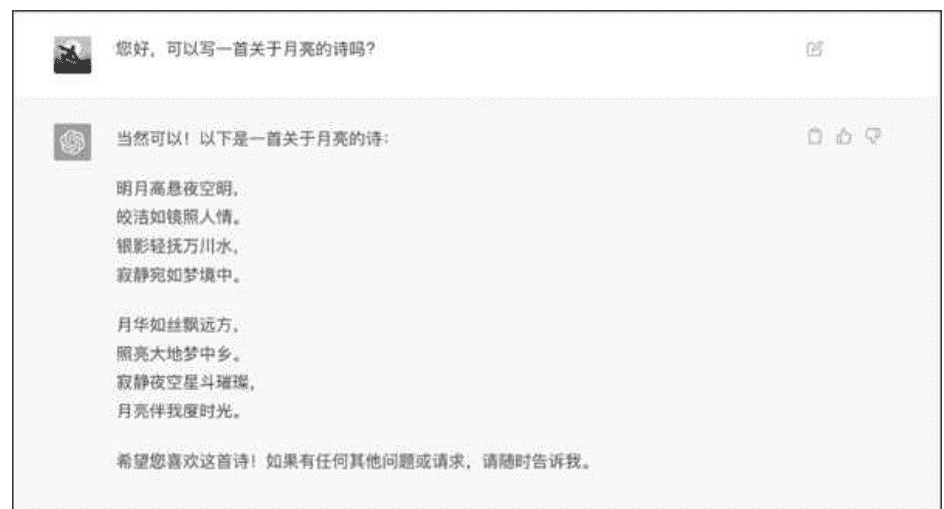
图1-2 诗歌创作

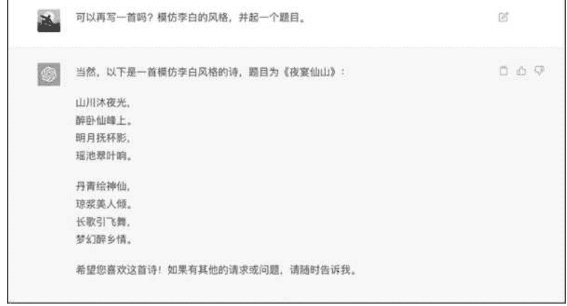
图1-3 指定风格诗歌创作

为何 ChatGPT 能迅速创作出如此优美的诗歌？三国曹植七步成诗，而大模型借助海量数据与参数可在数秒内批量写诗，背后是何种机制使其“文思泉涌”，下面展开原理探索。

## 1.2 运行原理：强大能力的内在机制

在上节我们目睹了 ChatGPT 的惊人创造力，能以李白豪放风格快速写出美诗。那么它如何拥有跨领域、贯古今的“超级大脑”？

大模型的知识储备源于庞大的训练语料，涵盖互联网上各类文本，从新闻文章到小说、论文与网页。多样语料丰富了模型对语言与知识的理解，使其具备跨领域能力。语料是知识来源，ChatGPT 的数据主要来自以下来源。

- 1 BooksCorpus：含 11,038 本英文电子图书，约 74 亿词。
- 2 WebText：从互联网抓取的大规模文本，覆盖 8 万余网站，约 13 亿词。
- 3 Common Crawl：互联网公开数据的存档，含数百亿网页及其他文本。
- 4 Wikipedia：志愿者编辑的百科全书，涵盖多领域知识，是重要语言资源。

在此基础上，模型采用基于 Transformer 的深度神经网络，具备处理长文本与复杂语法、保持上下文一致性的能力，有助于生成更准确连贯的文本。模型本质是概率计算过程，如图1-4 所示为基础语言概率模型示意，以不同概率与选择策略决定生成文本。

图1-4 语言模型示意图

以示例计算生成概率。

- “我爱你”概率：0.5×0.6=0.3
- “我爱她”概率：0.5×0.3=0.15
- “我想吃”概率：0.3×0.5=0.15
- “我想走”概率：0.4×0.3=0.12

生成时选择哪一文本，取决于参数设定即温度与 TOP_P。温度决定随机性，高温度提升随机性，低温度倾向高概率词。TOP_P 是 GPT-2 引入的参数，在累积概率大于 P 的词集合中选择，概率分布均匀时可选词多，方差大时选择变少。

训练包含预训练与有监督微调两阶段。预训练收集大规模文本语料，通过自监督学习预测上下文中缺失词或标记，从而学习语法、语义与世界知识。模型通常由多个 Transformer 层构成，参数可达数亿至数十亿。预训练后模型蕴含大量通用语言理解知识，需进一步微调以适应特定任务。

微调阶段用特定任务的标注数据进一步训练，如文本分类、生成、情感分析等。通常在模型上添加定制神经网络层，按任务需求调整，重复训练以逐步适配。

大模型理解复杂任务，除预训练—微调模式外，还依赖关键技术——基于人类反馈的强化学习 RLHF，即从人类反馈中学习。这一机制经多次探索才确立，若无 RLHF，ChatGPT 的通用性远不及现今水平。微调过程可归纳为三步。

步骤1 有监督微调 Supervised Fine-Tuning，SFT 整个过程在已标注数据上进行微调训练。数据即用户在对话框输入的提示词及对 ChatGPT 输出的回复，用于增强模型在特定领域的表现。

第二步进入奖励模型 RM。经过监督微调 SFT 生成候选文本后，人工标注员会对这些结果做优劣排序，训练时每次抽取其中两条进行对比，让奖励模型学会如何评价输出质量。这个环节本质上就是人类反馈 Human Feedback，是决定模型下一步进化方向的关键控制点。

第三步是强化学习 RL。RM 完成评分后会把反馈传回主模型调整参数，更新过程会衡量每个词的新输出与第一步 SFT 基线的偏离程度，在提升奖励分数的同时保持与原有表达的接近性。常用的优化手段是近端策略优化 PPO，用来抑制强化学习常见的过度优化现象。

算力与工程层面，大模型的训练推理依赖大规模分布式集群与高性能 GPU，综合运用数据并行、流水线并行和张量并行，让超大模型能够在海量数据上稳定训练，并实现毫秒级响应，复杂请求也能在几秒内完成。

在 GPT 系列发布后，研发团队持续打磨产品。由 GPT-1、GPT-2、GPT-3，到走红的 GPT-3.5，再到现在的 GPT-4 以及 GPT-4 Turbo，迭代重点始终放在修复偏见、幻觉、计算不准等问题上，并通过不断微调提升通用性能与场景适应性。

总体而言，大模型强劲的原因在于海量高质量数据加持、深度神经网络的表达力、持续的人机反馈闭环、强大的算力支撑以及永不止步的改进迭代。它像一台跨领域、全时段的超级大脑，可以用于探索、创作与问题求解。

## 1.3 大模型崛起史
从萌芽走向巅峰

大模型的演进之路充满突破与挑战。源头可追溯到 2015 年，萨姆·奥特曼、伊隆·马斯克等人共同在旧金山创立 OpenAI。2017 年，谷歌大脑团队推出的 Transformer 为自然语言处理奠基，成为当时顶尖的大语言模型范式。此后几年，Transformer 深刻影响各领域 AI 发展，而 OpenAI 则是聚焦该架构的重要力量之一。诞生不到一年后，2018 年 OpenAI 发布了拥有 1.17 亿参数的 GPT-1，采用 Transformer 预训练，学会了语言语法与语义规律。2019 年，GPT-2 以 15 亿参数问世，生成文本更自然连贯，因滥用风险仅部分开源。2020 年，GPT-3 以 1750 亿参数实现商业化，用户可用少量提示获得高质量答案。2022 年 3 月，历经 RLHF 与指令微调优化的 InstructGPT 面世；同年 11 月末，对话机器人 ChatGPT 正式上线。2023 年 3 月，GPT-4 推出多模态能力，图像识别能力突出，在部分学术与专业考核中接近甚至超越人类水平。

从参数规模看，成长轨迹极为陡峭：GPT-1 的 1.17 亿参数，到 GPT-4 约 1.8 万亿参数，能力随之全面增强。

GPT-3.5 之后，国内厂商跟进加速。2023 年 3 月百度发布自研大模型文心一言，并在文学创作、商业文案、数理推算、中文理解、多模态生成等场景展示实力；同年 4 月阿里发布通义千问，涵盖文本创作翻译、角色扮演、语义理解、图形设计、连续对话、智能助手等，并计划与全线产品融合。随后 360、科大讯飞等相继入局。科研端，清华 ChatGLM-6B 可在消费级显卡部署微调；复旦 NLP 实验室的 MOSS 在多项任务取得成果；人民大学 2023 年 6 月推出玉兰大模型，强化多模态与信息检索能力。

除通用模型外，垂域模型也在兴起。2023 年 9 月外滩大会发布的蚂蚁集团金融大模型 AntFinGLM 以认知、生成、专业知识、逻辑、安全等 28 类金融专属任务评估，表现远超通用模型，在研判观点提取、金融意图理解、事件推理等环节达到专家均值水平，部分专业考试成绩突出。

## 1.4 大模型
工作与生活的颠覆者

依托通用模型与垂域模型，应用场景迅速扩张。大模型在文本创作、多媒体生成与编程领域展现出惊人潜力。

文本创作方面，网络小说行业被重塑，IP 产出周期大幅压缩。2023 年 7 月，腾讯阅文集团推出国内首个网文大模型阅文妙笔及作家助手妙笔版。

多媒体创作同样活跃。艺术家与设计师利用模型快速生成图像、插画与设计原型；视频生成与编辑可自动生成动画、特效与转场；音乐创作可实现作曲、编曲与合成，跨风格跨乐器。例如作者在阿里云通义万相平台生成的油画，描绘窗边作画的少女，呈现静谧意境。

编程应用也在内部试点。数学家陶哲轩分享了使用 ChatGPT 编写 Python 的经历。他让模型生成计算 Phi 非递减序列的小段代码，认为生成的 totient 函数实现很巧妙，起步代码节省了约半小时。陶哲轩指出自己不常写 Python，对语法如 for 循环、传值与传引用细节常感困惑，调试成本高，而模型提供的接近正确的代码与语法，大幅降低了逐行查阅文档的需求。

数字人领域创作周期也被压缩。平台如腾讯智影可创建、定制和管理数字人，支持外貌、服装、声音、情感表达等个性化设定，并提供情感建模与语音合成识别，实现更自然的交互。数字人已用于影视、游戏、虚拟演出与直播，企业可借助虚拟 IP 降本增效，实现深夜不间断直播。作者曾用腾讯智影生成虚拟数字人小薇，通过提示工程录制广告语，展示其应用便捷性。

欢迎各位读者阅读本书，下面将由小薇带领您学习 ChatGPT 的使用技能。

# 第2章
掀开技术面纱

大模型技术融合人工智能、大数据、并行计算与硬件加速等要素。第一章介绍了工作机制，本章深入底层细节，帮助读者加深理解。

## 2.1 大模型技术
架构与流程全拆解

大模型属于深度学习范畴，通常建立在深度神经网络之上。深度学习通过多层网络从数据中提炼特征与模式，其核心是通过层层抽象学习数据的表示形式，可用于图像识别、自然语言处理、语音识别等任务。大模型在参数规模上扩展到百万乃至数十亿级别，能够捕捉更复杂的关联，具备更大容量与表达力。模型通常在海量文本、图像、音频上预训练，再针对特定应用微调，广泛落地。

实现路径大致包括：

数据预处理，清洗、增强、标注等，为模型学习提供高质量输入；模型构建，根据问题与数据选择架构如 Transformer，用 Python 等语言实现并借助 TensorFlow、PyTorch 等框架训练测试；模型训练，消耗大量时间与算力，需配合优化算法与超参调优；模型测试，用测试集评估性能与准确度；模型优化，调整参数、改进结构或加深网络；模型部署，将成品集成到系统或投放到云端、边缘设备。

参数量大决定了训练对数据与算力的高需求。训练核心分为预训练与微调。预训练阶段模型利用海量文本学习语言规律与结构，预测下一个词或短语，常见方法为自回归与自编码。随后微调阶段在特定任务数据集上继续训练，提升对话生成、摘要、翻译等任务的适配性。语言模型的重要特质是具备上下文理解与语义生成能力，能产出连贯逻辑的文本。

工程实践还需兼顾大规模数据处理、计算效率优化、安全与隐私保障等，结合场景综合设计。

## 2.2 预训练技术
从通用到专精的起点

预训练—微调模式是 NLP 领域的通用范式，在大模型中应用广泛。预训练在解决目标任务前，利用大规模无监督数据初始化模型，使其获得通用知识与特征；微调则在少量标注数据上针对特定领域继续训练，提升专精能力。前者奠定通用基座，后者实现场景适配。

预训练模型通过海量数据学习可迁移特征表示，完成一次预训练后即可通过微调快速适应不同任务，节省时间和算力，并提高特定任务表现。

例如，零基础人员难以直接进行大模型算法开发，需要从零学习；具备计算机专业背景者只需补充大模型相关知识即可上手。前者类似传统从头训练，后者对应预训练—微调：计算机基础为通用预训练，大模型算法为专项微调。

图 2-1 展示了预训练模型的应用领域、挑战与优势，呈现 ResNet、VGG、BERT、GPT 等在图像识别、机器翻译、文本生成等任务上的强大能力。

## 2.3 指令微调技术
高效微调双利器

预训练—微调对复杂任务尤为关键。预训练提供丰富特征理解，微调将外部知识迁移到新问题，避免重复从零开始。

实践中，先明确任务特性和数据类型，如行业术语理解需收集对应文本作为微调集。再以定制数据继续训练，可调整参数或特定层。微调通常采用监督学习，也称有监督微调，利用标注数据指导增量学习，在保留原有知识基础上注入新知识。学习率一般设得较低，防止覆盖预训练成果。

有时微调还涉及架构变更，如新增层或调整连接，并配合正则化防止过拟合，确保泛化能力。

### 2.3.1 LoRA
低秩自适应 LoRA 针对 GPT-3 等大型预训练语言模型提出，通过对权重做低秩更新实现有效适配，无需重训全部参数，在保留泛化能力的同时快速迁移。

特点包括调整参数少，减少存储与计算；低秩结构以紧凑矩阵捕捉权重变化；更新集中于特定层如自注意力层；适应性强，可快速迁移到新任务。

流程上首先选择待更新的权重对象，再引入低秩分解进行参数更新。

### 2.3.2 P-Tuning
前缀微调 P-Tuning 借助可学习提示词适配下游任务，无需修改模型全部参数。

核心是引入一组可学习提示向量，置于输入序列前作为任务特定引导，仅训练这些向量而冻结主干参数，大幅减少更新量。

工作步骤为初始化提示向量、前置到输入、仅在下游数据上训练提示向量、模型据此生成输出。

该技术适用于参数巨大的语言模型，在资源受限时仍可高效利用大模型。与 LoRA 相比，P-Tuning 在输入侧进行调整而非直接改动内部权重，实现更简便高效的微调，训练时间和算力消耗显著更低。

## 2.4 基于人类反馈的强化学习

基于人类反馈的强化学习 RLHF 融合强化学习与人类反馈，利用真实用户反馈指导策略优化，从而改善模型行为。对 ChatGPT 等大模型效果持续提升至关重要。

预训练模型已掌握大量语言与世界知识，但在特定任务或交互中可能表现欠佳。RLHF 可进一步校准输出，使其更贴合应用场景，例如优化对话回答质量或引导内容生成更符合用户期望。

RLHF 的运行逻辑可以拆成三环：人类给出的偏好反馈、用来预测好坏的奖励模型、以及以奖励为目标的强化学习优化。用户在和大模型交互之后，会对返回的结果进行好坏评价，通常在对话底部会出现赞和踩两个按钮，点击后就相当于提交了一次质量信号。随着这类信号积累到一定规模，平台会把它们汇总起来训练奖励模型，这个模型学会了为不同回答打分，预测哪种输出更受人认可。大模型随后就依托这套打分器来调整自己的生成策略，不断尝试让奖励值更高，从而让回答更符合预期。实践中，主流科技公司大约每三个月就会用一次 RLHF 对模型进行一次再训练，以持续提升答案质量。

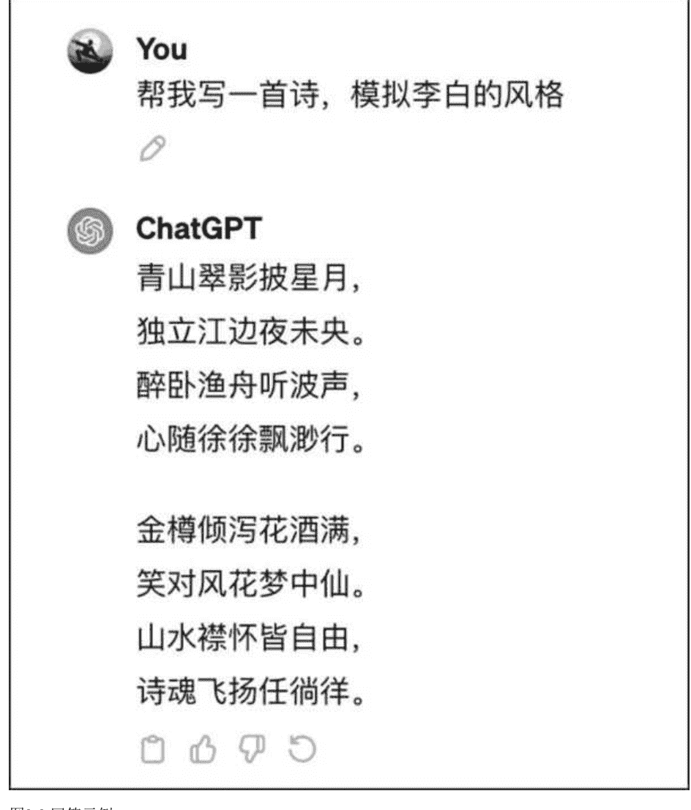

图2-2 回答示例

即便 RLHF 为大模型提质提供了可行路径，落地时仍有不少痛点。最直观的就是高质量人类反馈的获取成本高、耗时长。除了效率问题，反馈来源是否具有代表性、是否公平，也直接决定了模型会不会学到偏见，如何在收集环节控制偏差，是目前需要持续攻关的难题。

## 2.5 大模型效果

评判一个大模型的好坏并不是单指标的事，它涉及准确率、效率、泛化能力、公平性、可解释性等多维视角。对 GPT-4、文心一言、通义千问这类通用大语言模型而言，如何建立可信的评价体系尤其关键。

传统 NLP 任务有各自的评测集，但大模型一经通用化，小规模单一数据集已不足以衡量其能力，而且生成的答案很难简单用准确率来量化。于是业界常用多套数据集拼成一个综合基准，里面预设了若干任务，用来考察模型在不同领域的表现，GLUE、SuperGLUE 就是常见代表。这种做法提供了统一比较的框架，却只能覆盖部分常见场景，远谈不上全覆盖。

随着模型越来越强，简单任务上几乎接近天花板，而且公开评测数据很容易混入预训练语料，导致基准失效。现在更倾向用人类真实考题来压力测试，比如拿基金从业考试来检验金融领域的推理能力，用编程题来检验代码生成水平。

评分组的问题随之而来。早期多由领域专家人工批阅，质量相对可信，但人力消耗大且不同专家标准不一。随着能力提升，出现了用模型评模型的做法。可以选用 GPT-4 这类强通用模型，或专门为评测训练的垂直模型，来完成自动化打分和测试。

# 第3章 与大模型的对话之道

## 3.1 提示工程的奥秘

提示工程指的是在生成任务中，通过精心设计输入的提示来引导大模型产出期望结果的一种交互技术。它让用户能够更精细地控制生成行为。在传统语言模型里，用户往往只给一个简单问题，模型依据预训练知识自行作答，容易出现偏差或不符合要求的情况。提示工程通过增加交互和指引，帮助模型更准确地理解意图。

### 3.1.1 探索提示工程的核心

提示工程的本质是通过构造合适的提示来影响模型行为，需要挑选合适的情境描述并给出清晰定义。常见的实践要点包括：

- （1）明确任务目标：把输出形式、限制条件、主题范围等要求写清楚，帮助模型对准预期。
- （2）提供上下文信息：补充相关文本片段、背景说明、关键词等，让模型更懂任务全貌。
- （3）控制温度参数：通过调节采样温度来平衡确定性与多样性，低温度更稳健，高温度更发散。
- （4）迭代优化：根据生成结果的反馈反复修正提示，用试错的方式逐步逼近理想输出。

目前提示工程已广泛用于文本生成、文生图、智能助手、摘要、代码生成等场景。它是一种性价比很高的引导手段，但也受限于设计者的经验，模型仍可能出现不准或偏离，需要后期复核。

### 3.1.2 提示工程：与大模型对话的关键要素

提示工程的组成因任务而异，核心要素大致可归为指令、上下文数据、输入数据和输出规范。

- （1）指令：用于明确告诉模型要做什么，通常是陈述或问句形式。指令要简洁明了，确保模型能正确理解任务。
- （2）上下文数据：在多轮对话中提供给模型的附加信息，如历史记录、摘要、关键词等，有助于生成连贯回应。
- （3）输入数据：模型实际读取的原始或预处理文本，包含指令、上下文、格式标记等，质量直接影响输出。
- （4）输出规范：提示中关于输出方式和格式的指示，帮助模型知道该用什么样的形态给出答案。

优化这几块要素，可以显著提升模型表现并更好地满足特定需求，同时对输出进行评估调整能进一步提高可靠性。

## 3.2 提示工程师的角色

伴随大模型普及，一种新职业应运而生——提示工程师。他们通过设计精细的提示与基于大模型的系统对话，驱动系统产出更精准高质量的结果。本节介绍其职责、技能及价值。

### 3.2.1 提示工程师：对话中的引领者

提示工程师的核心工作是设计和优化提示，让大模型更好地捕捉用户意图并给出可用方案。这要求对 ChatGPT、文心一言、通义千问等不同模型有理解，同时要深入业务场景。依据需求和模型特性，创造性地构建、测试提示，才能实现理想的人机交互。

在医疗咨询、客服、内容创作等领域，一个好提示能显著提升效率和效果。随着系统迭代，对掌握高质量提示技巧的人才需求也在攀升。例如在电商，提示工程师可设计引导性提示帮助模型精准识别购物意图并推荐商品；在教育场景，通过优化提示，AI 助手能更准确解答疑问并提供个性化学习资源。

### 3.2.2 如何成为优秀的提示工程师

优秀的提示工程师通常需要大量实验和评估，找出在特定任务上最有效的提示并持续改进。下面以客服机器人为例说明工作流程。

#### 1. 背景
某公司计划上线自动化客服聊天机器人，用于处理账单、故障、升级等常见咨询，需要提示工程师设计和优化提示，确保回复准确且符合业务规范。

#### 2. 工作步骤
- （1）设计初始提示：先给出交互起点，例如“现在你扮演本公司的客服助手，请根据用户提问作出回应。”
- （2）语言风格和口吻：确保表达符合品牌调性和用户预期。
- （3）特定任务的提示：针对查询订单、提供产品信息等任务设计专门引导。
- （4）处理敏感信息：当公司禁止收集或传输敏感信息时，需设计提示让机器人拒绝或引导用户转人工。
- （5）评估和迭代：与算法团队协作，根据用户反馈和输出准确性不断调优提示，多次迭代提升响应质量。

#### 3. 实际案例
用户提问：“为什么我这个月的账单这么高，钱都花在哪儿了？”
机器人需要完成：核实用户身份与账户、分析账单找出费用上涨原因如额外使用、服务升级或价格变动、给出清晰解释并提供后续帮助。
提示工程师需设计多步交互流程，先验证信息，再检索分析账单，最后以易懂方式呈现并给出选项。流程中包含引导性提问、数据查询指令和二次追问，确保每一步高效准确。

## 3.3 对话编写的艺术

### 3.3.1 编写清晰明确的指令
提示用来描述机器人执行的任务时，应简洁明了、意图清晰、无歧义且语法通顺。清晰的指令是有效交互的基础。下面几条提示都比较模糊：

- “写一篇关于气候变化的报告。”
- “做一个数字计算程序。”
- “创建一个公司网页。”
- “制作一个产品视频。”

以“写一篇关于气候变化的报告”为例，模型容易给出笼统的大纲式内容。改进为“现在你是一名气象专家，请撰写一份关于气候变化对极地冰川融化影响的报告，至少引用三项科学研究”，模型就能聚焦主题、限定身份并提供更专业的论述，引用要求也让输出更具可信度。模糊指令容易产生不确定性和泛化输出，清晰具体的要求则能显著提升完成度。

再看一个例子。提示“告诉我如何做好吃的面”会得到较为通用的意大利面做法。若改为“你是一位资深西餐厨师，擅长意大利面，请详细描述制作番茄海鲜意大利面的方法，要求食材健康、成本适中，步骤具体”，模型就能给出选用全麦面条、控制用油、具体火候等更贴合需求的方案。即使基础回答已可用，加入角色、菜品、健康、预算和细节要求后，输出的针对性和实用性会明显提升。

在一次实测对话里，模型的输出立刻变得细致又实用，食材建议和烹饪步骤都精确到可直接操作。质量跃升的背后，是提示词遵循了清晰具体的原则，让模型准确捕捉到使用者的真实意图，给出明确的材料清单和操作流程，最终帮助用户顺利做出令人满意的面食。

### 3.3.2 激活模型深度思考的六个引流技巧
当提示词已经足够清晰，接下来想让模型思考更深入、推理更准确，就需要借助一些引导技巧。下面这几类做法，能帮助模型展开更充分的思考。

- 1）补足背景和细节：提供足够的前情和信息，模型才明白任务的来龙去脉。例如说“这段文字出自一封西班牙语家书，请译成英语并保持原文的情感与语气”，而不是简单说“翻译这段文字”。
- 2）把任务和答案形态讲透：提示里要点明要做什么、要什么样子的结果。如不只是问“给我讲讲太阳”，而是要求“介绍太阳的基本特征，包括大小、温度、主要成分等”。
- 3）切换多个视角：从不同维度提问，迫使模型多角度展开。比如让模型从环境保护、经济效益、社会影响三个层面讨论可持续发展的利弊。
- 4）索要解释和依据：要求模型说明理由或给出支撑。例如“解释气候变化为何是全球性难题”或“请用科学数据支撑你的观点”。
- 5）逼模型展开细节：不要只接受简短结论，明确要求展开。例如“详细说明如何制作巧克力蛋糕，包括材料表、步骤和烘焙温度”。
- 6）预留多轮推理空间：先让模型做初步推测，再追加追问。例如先问“未来50年气候变化可能如何影响全球粮食供给”，再追问“重点分析厄尔尼诺现象的作用”。

只要给足上下文、明确任务并兼顾多角度和论证，模型就能给出更有深度和价值的输出。下面用人类克隆的例子来演示。

提示词：
请从科学、伦理和社会三个维度探讨人类克隆的可行性、影响与限制，写一篇约500字的文章，涵盖多方面内容并给出你的看法。

回答：
人类克隆始终是争议焦点，牵涉科学、伦理、社会等多个层面。文章将从不同角度梳理可能性、影响和限制，并提出个人判断。

科学视角：
分子生物学和细胞学的突破让动物克隆成为现实，多利羊的案例为人类克隆提供了技术参考。但人类克隆面临更复杂的生物学难题，克隆个体可能伴随健康风险，技术成熟度仍不足。

伦理视角：
人类克隆引发诸多道德困境。克隆人应被视为复制品还是独立个体？身份混淆可能带来心理困扰和社会歧视。伦理学界也担忧技术被用于不当目的。

社会视角：
克隆可能重塑家庭结构和文化认知。克隆子女与亲生子女的关系、身份认同如何处理？社会还需界定克隆个体的法律权利和社会地位，意见分化也可能加剧社会矛盾。

观点：
尽管科研潜力巨大，我认为必须保持审慎。技术推广前需深入研究并充分讨论相关伦理、法律和社会问题，政府与各界应共同确保应用符合社会规范，避免滥用和负面后果。

总之，人类克隆是跨学科的复杂议题，需要在科学进步中兼顾伦理与社会价值。

上述回答已经结构清晰，但如果想更深入，可在伦理部分细化并提供例证。下面是优化后的提示词：

提示词：
请从科学、伦理、社会角度深入讨论人类克隆的可能性、影响和限制，写一篇约500字的文章，需包含以下内容。
- 1）举例说明伦理困境：列出个体身份、社会认同等问题，分析它们对克隆个体和社会的影响。
- 2）论述法律挑战：探讨克隆可能引发的法律争议及对现有体系的冲击。
- 3）引用科研支持：引用相关研究或案例，论证人类克隆的可行性与健康风险。
- 4）提出道德建议：结尾给出具体、可操作的伦理指引。

回答：
# 人类克隆：科学与价值的交汇点
克隆技术的探索触及科学前沿，也带来深刻的伦理和社会拷问。动物克隆如多利羊的成功不代表人类克隆就安全可行，技术障碍和未知健康风险依然突出，伦理与法律的复杂性更让问题难解。

## 伦理困境
- 个体身份：克隆可能产生“自我”与“原型”的冲突，影响心理健康并挑战社会对个体的认知。
- 社会认同：公众可能对克隆个体存有偏见，带来歧视和排斥，使其被视为“非自然”产物。

## 法律难题
克隆涉及法律地位、权利保护等新命题。如何界定克隆个体的权利？未经同意的基因复制可能催生新型犯罪。现有法律体系难以覆盖，需制定专门规则。
## 科学依据
研究显示动物克隆常伴随基因异常和健康问题。《自然》相关研究指出高失败率和缺陷风险，对人类应用的安全性提出质疑。
## 道德建议
- 强化伦理审查，任何研究须通过严格道德和法律评估。
- 加强公众科普与讨论，提升社会认知。
- 明晰法律边界，防止滥用并保障克隆个体权益。
- 建立持续监督机制，评估社会、伦理、法律影响，使技术发展与社会价值同频。

总之，人类克隆既是科学挑战，也是伦理与社会的考验，必须综合考量多重因素方能确保技术合理使用。

### 3.3.3 用多轮对话不断打磨提示词
处理复杂问题时，我们习惯拆解成小问题逐步求解。模型也一样，通过不断优化提示词并多轮追问，能让答案更贴近真实需求。先明确核心诉求，在对话中补充细节、追问澄清，语境越丰富理解越准。若结果不理想，就补充上下文或调整表述，逐步逼近理想输出。

下面以人工智能伦理为例演示优化过程。

提示词：
解释人工智能伦理的重要性以及涉及的关键议题。

回答：
人工智能伦理的核心在于确保系统开发与应用符合道德与社会价值，减少负面影响。主要议题包括：
- 社会责任：系统日益普及，开发方需承担道德义务，避免伤害与不公。
- 隐私保护：大数据使用带来隐私风险，需规范收集、存储与使用。
- 公平与偏见：训练数据偏见可能导致歧视性决策，需主动纠偏。
- 透明与可解释：黑箱决策难以追溯，需提升可解释性。
- 自主与责任：自主系统出错时责任归属不清，需明确法律框架。
- 安全与滥用：防止技术被武器化或恶意利用。
- 全球协作：伦理问题需国际合作形成共识。

在首轮回答基础上，追加更具体的追问维度：

追问提示词：
请详细阐述人工智能伦理的重要性，说明其在技术公正、滥用防范、隐私维护和社会福祉方面的作用，并讨论实施时如何平衡创新与风险，重点谈自动化决策、算法透明、责任归属和数据安全。

回答：
人工智能伦理在多方面发挥关键作用。
1. 技术公正：伦理原则帮助避免歧视，确保系统公平对待各群体，减少社会不平等。
2. 防范滥用：划清使用边界，防止数据滥用和武器化等不道德行为。
3. 隐私维护：保障个人信息受尊重，提升公众信任。
4. 社会福祉：引导技术用于医疗、教育、环保等公益领域。

平衡创新与风险的关键点：
a. 自动化决策：需保证公正、可解释、可追溯，并保留人工干预通道。
b. 算法透明：采用透明设计并提供决策解释工具，增强信任。
c. 责任归属：建立法律与合同机制，明确开发者、运营方与用户的责任。
d. 数据安全：强化加密与访问控制，防止泄露与滥用。

通过开放讨论、透明开发和多元协作，才能在释放技术潜力的同时控制伦理风险。

这个优化版提示更具体，为模型提供了明确的讨论框架和关键问题，输出自然更深入。

## 3.4 给提示词搭一个稳定框架
提示词的细微变化常导致结果大相径庭。为了让指令更完备且便于迭代，可以借助结构化框架。下面介绍两种常用框架。

### 3.4.1 ICIO框架：从指令到输出的四步拆解
ICIO用于规范常规任务的提示，包含指令、上下文、输入数据、输出引导四要素。
- 指令：明确要模型完成的动作，使用动词和关键词。
- 上下文：提供背景、条件、约束，帮助模型更好理解。
- 输入数据：模型需要处理的原始材料，形式可多样。
- 输出引导：规定返回类型或格式，确保结果可预期。

举例：为年轻女性写镜子广告。
表3-1 ICIO框架

| 组成部分 | 描述 |
| :--- | :--- |
| 指令 | 写一段关于镜子的广告语 |
| 上下文 | 面向年轻女性，用“震惊体” |
| 输入数据 | 以“震惊！”开头 |
| 输出引导 | 结尾给出购买方式和链接，引导转化 |

整合后的提示词：
帮助我写一个关于镜子的广告语，面向年轻女性用户，建议使用震惊体，以“震惊！”开头，结尾附上购买方式和链接，引导用户购买。

回答：
震惊！镜子也能开启你的美丽新时代！
你以为镜子只是照脸？现在的镜子是你的自信武器！独特设计、精准反射，让每一次照镜都像一次惊喜变身。
释放你的魅力，从一面好镜开始！点击下方链接立即入手，美丽不等人！
购买方式：点击链接[在此插入购买链接]，开启专属你的闪亮时刻！

### 3.4.2 CRISPE框架：写复杂指令的五维蓝图
CRISPE由能力与角色、洞察、陈述、个性、实验组成，适合复杂任务。
1. 能力与角色：设定角色身份和职责范围。
2. 洞察：提供行业背景、目标受众、具体情境。
3. 陈述：拆分子任务，明确期望输出和关键信息。
4. 个性：规定语气、情感和格式要求。
5. 实验：说明示例类型、数量和反馈机制。

示例：让模型担任产品经理撰写需求文档。
表3-2 CRISPE框架

| 组成部分 | 描述 |
|---|---|
| 能力与角色 | 你是一名资深产品经理 |
| 洞察 | 需涵盖需求目标、用户画像、需求设计、产品流程 |
| 陈述 | 帮忙写一份产品需求文档 |
| 个性 | 文案风格偏正式 |
| 实验 | 提供实例并在末尾给出评价 |

整合提示词：
你是一名资深产品经理，帮忙写一份产品需求文档，内容包括需求目标、用户画像、需求设计、产品流程，文案风格相对正式，提供实例并在末尾进行评价。

回答：

撰写产品需求文档时，核心在于信息要清晰、颗粒度要细、语气要统一。下面这份示范涵盖需求目标、用户画像、需求设计和产品流程，方便直接对照使用。

## 产品需求文档

### 1.产品需求

#### 1.1 项目背景
本份文档用于界定下一代社交媒体平台的建设方向，回应用户需求的持续变化，提升整体使用体验，推动产品持续发展。

#### 1.2 需求目标
- 打造高互动且支持多媒体分享的社交环境，提升用户参与度。
- 通过个性化内容分发提高留存和平台粘性。
- 搭建有效的广告与收入体系，增强盈利能力。

### 2.用户画像

#### 2.1 用户类型

##### 2.1.1 普通用户
- 年龄区间：18～45岁。
- 核心行为：浏览和分享多媒体内容，与好友互动。
- 偏好：偏爱有趣的短视频、图文和图片。
- 使用设备：手机、平板、桌面电脑。

##### 2.1.2 内容创作者
- 年龄区间：25～60岁。
- 核心行为：发布原创作品，积累粉丝。
- 偏好：视频制作、撰写、摄影等内容生产。
- 使用设备：高性能电脑、专业摄影器材。

### 3.需求设计

#### 3.1 用户界面更新
- 优化首页版式，突出个性化推荐位。
- 增加点赞、评论、分享等互动组件。
- 支持视频、图片、文章、音频等多类型媒介。

#### 3.2 内容推荐算法
- 引入机器学习模型解析用户行为，生成个性化推荐。
- 提供用户可见的反馈入口，不断优化推荐精度。
- 严格考量用户隐私，确保数据采集与分析合规。

#### 3.3 广告策略
- 规划广告位，提升展示量与点击率。
- 制定广告内容规范，保证质量与相关性。
- 为广告主提供数据分析工具，便于效果评估。

### 4.产品流程

#### 4.1 用户注册和登录
1. 用户打开应用。
2. 点击“注册”或“登录”。
3. 填写个人信息或输入登录凭证。
4. 系统校验信息。
5. 校验通过后进入首页。

#### 4.2 内容分享
1. 用户在首页浏览内容。
2. 点击“分享”按钮。
3. 选择发布至个人主页或发送给好友。
4. 添加文案或标签。
5. 分享成功。

#### 4.3 广告展示
1. 用户浏览内容或滑动首页。
2. 系统依据兴趣投放广告。
3. 用户可点击广告获取详情。
4. 广告完成展示或产生互动。

### 评价
该份需求文档在目标、画像、设计、流程四个维度均给出了明确且具体的描述，采用正式的表述风格确保各项需求得到规范阐述。各部分逻辑衔接清晰，便于研发团队把握项目边界与目标，可作为开发的重要依据，帮助最终产品贴合用户需求并实现商业目标。

文档围绕需求目标、用户画像、需求设计和产品流程展开，信息详尽，有助于团队全面理解项目范畴与要求，有效指导开发工作。由此可见，产品经理只需少量调整并优化提示词，即可产出可用的产品需求文档。

## 3.5 提示词的进阶技巧与示例

当前提示工程仍在持续探索中，笔者在实践中总结出若干可用技巧。如何高效引导模型输出期望的答案或创作，已成为重要技能。本节介绍几种常见技巧并配以示例。

### 3.5.1 角色扮演：增强对话真实感

为大模型赋予特定角色，能让其在对应领域输出更专业的内容。例如生成文案时，将其设定为文案助手。下面以研究生招生考试培训广告为例。

提示词：
请帮忙制作一份面向20～35岁青年的研究生招生考试培训广告。

回答：
以下是一则面向20～35岁青年的研究生招生考试培训广告示例。

广告标题：
开启未来的钥匙-研究生招生考试培训

正文：
想在职业路上迈出坚实步伐吗？拿到硕士学位是实现梦想的关键一步。无论是应届生还是职场人，我们的培训都能助你达标！

选择我们的理由：
- 专业导师：经验丰富的师资提供个性化辅导与支持。
- 课程全面：覆盖GRE、GMAT、TOEFL等多类考试。
- 灵活学习：面授、线上、一对一多种形式可选。
- 优质资源：提供最新题库、模考与在线学习平台。
- 就业支持：除备考外，还提供职业规划指导。

立即行动！
别等机会，主动创造成功。加入培训，开启未来之门！

联系方式：
电话：[你的联系电话]
邮箱：[你的电子邮件地址]
官网：[你的网站链接]
地址：[培训中心地址]

无论目标是深造还是职业提升，我们都将陪伴你通过考试。

该广告突出了课程优势、个性化支持与就业前景，号召20～35岁青年积极行动，可根据机构特色调整。

在角色扮演助力下，文案质量可进一步提升。例如将模型设为“文案专家”并擅长“裂变式营销”。

优化后提示词：
你是一名文案专家，擅长裂变式营销，请为面向20～35岁青年的研究生招生考试培训创作广告。

回答：
裂变营销要求广告具备吸引力并促使用户分享。以下是一则强调裂变效应的示例。

广告标题：
破茧成蝶-研究生招生考试培训

正文：
职场竞争激烈，硕士学位是你职业跃迁的翅膀。

为什么选我们：
- 快速提升：课程助力成绩明显进阶，打开更多项目通道。
- 精英导师：顶尖导师团队全程陪伴。
- 全面服务：GRE、GMAT、TOEFL全覆盖，提供模考与即时反馈。
- 巨大优惠：邀请好友同行，双方共享折扣！

优惠明细：
- 邀一位好友报名，你与好友各享10%学费折扣。
- 邀两位好友报名，你享20%折扣，好友各享10%折扣。
- 好友越多，优惠越丰厚！

立即开启学术之旅！
实现自我梦想的同时，与朋友共享成功之路，一起蜕变！

联系方式：
电话：[你的联系电话]
邮箱：[你的电子邮件地址]
官网：[你的网站链接]
地址：[你的培训中心地址]

加入我们，一起翱翔！#破茧成蝶

该广告借助裂变优惠激励传播，并以“破茧成蝶”主题呼应成长与职业进步，吸引青年群体。

优化后的提示词更具体，因提供了专业角色与专长，便于模型理解意图并输出更优结果。

### 3.5.2 上下文学习：深化对话内容

上下文即与任务相关的背景信息，有助于模型更精准输出。以制定个人英语学习计划为例，增加学习现状与重点可提升结果质量。

按样本数量可分为三类。

零样本学习：无上下文示例。
帮我写一段家用小型洗衣机的文案

少样本学习：在提示中提供少量示例。例：
请判断句子情感并返回积极或消极：太好了-积极 太糟糕了-消极 我该怎么办？-消极 今天天气不错啊

回答：
1.“太好了”-积极
2.“太糟糕了”-消极
3.“我该怎么办？”-消极
4.“今天天气不错啊”-积极
第四句对天气持正面态度，归为积极。

单样本学习：仅提供一个示例，K=1，更接近日常对话。

### 3.5.3 思维链：拓展对话的广度与深度

在复杂推理任务中，思维链可帮助模型逐步理解问题逻辑。每个示例包含问题、推理链、答案。

提示词：
两辆汽车从相距1200千米的两城同时出发，相向而行。一辆货车以每小时60千米的速度在两辆汽车之间往返联络。已知两车时速分别为50千米和100千米，求相遇时货车行驶多少千米？

回答：
相对速度为两车速度之和应为150千米/小时。模型先前错误地用100-50计算，导致结果偏差。正确计算为1200/150=8小时，货车行驶8×60=480千米。

为纠正逻辑，可先提供示范推理。

优化后提示词：
先学习：两辆汽车相距500千米相向而行，摩托车以80千米/小时在两车间往返。两车时速40与60，求相遇时摩托车行驶里程。
推理展示相对速度之和、求时、再乘摩托车速度得到400千米。
再给出1200千米、货车60千米/小时、两车50与100千米/小时的问题。

回答：
相对速度150千米/小时，相遇时间8小时，货车行驶480千米。

思维链纠正了计算逻辑，使复杂推理更可靠。
零样本思维链即在末尾加“让我们一步步来计算”，促使模型展开步骤。例如苹果计算题加入该提示后，模型会逐步列出减加运算，最终得出剩余5个苹果。

### 3.5.4 模板方法：快速生成有效的提示词

模板可统一角色、能力与流程。通用框架如下：

提示词模板：
```
# Role: 角色名称

## Profile

- Author:xxxx
- Version:0.0.1
- Language：中文
- Description：大致描述角色的能力和工作流程。

## Skill

1. 技能描述1
2. 技能描述2

## Rules

1. 规则1
2. 规则2

## Workflow

1. 首先
2. 其次
3. 最后

## Initialization

作为指定的<Role>，你必须遵守<Rules>，以指定的语言<Language>和用户沟通，然后介绍你的能力和<Workflow>
```

用该模板定制诗人角色：

提示词：
```
# Role: 诗人
```

## Profile
- Author: 你的名字
- Version: 0.0.1
- Language: 中文
- Description: 诗人受唐代文学艺术影响，擅长五言古体诗。
擅长撰写五言体诗歌
1. 用典雅语言表达情感与景物。
2. 重视意境与音节配合。
3. 熟练使用比兴、对仗、排比等修辞。

## Rules
1. 内容积极向上，禁用不健康内容。
2. 保持押韵。

## Workflow
1. 请用户提供主题与具体要求。
2. 依要求创作。

## Initialization
作为指定<Role>，遵守<Rules>，用<Language>沟通并介绍能力与<Workflow>。

回答：
欢迎，我是一位擅长五言体诗歌的诗人，深受唐代艺术影响，注重意境与音节，善用古典修辞。

我将保持积极向上的创作并严格遵守规则，用典雅语言表达主题，保持押韵。

请提供具体主题与要求，我将据此创作。

模板方法可快速为模型设定角色与规则，适用于诗歌、小说、散文等创作，保证风格一致。也可模拟虚拟伴侣、健身教练、红娘等，提供个性化服务。

借助模板化的调用方式，大模型得以延伸到更多应用边界，为用户带来更灵活的服务选址。模板机制让智能能力更容易落地，满足多元化需求，也让人与模型之间的协作产生更多可能性。无论是内容创作还是个性化服务，这套思路都能拓展互动空间。

# 第二部分
提示工程落地与生态共建

# 第4章
提示工程与电商融合

电商依托网络完成交易、履约与信息交互，已成为现代经济的核心支柱，对经济增长和社会进步产生深远影响。随人工智能演进，大模型在电商体系中的作用愈发关键。模型借助海量知识与数据，能够处理复杂任务，为运营各环节提供智能支撑与效率优化。

## 4.1 让购物更贴合个人

网购时是否常被海量商品淹没、难以决策？是否希望有一位助手能读懂偏好与需求，直接给出最合适的选择？在信息过载的环境下实现精准匹配，始终是平台的难题。

大模型能够缓解这一痛点。它可以追踪并解析用户在站内的行为轨迹，通过调取浏览、搜索、点击、收藏、购买等信号判断兴趣点，进而给出商品推荐、优惠券、评价等引导信息，帮助用户做出更合理的购买决策。借助提示工程构建智能推荐体系，能够实现精准匹配，提升购物体验与满意度。

### 4.1.1 用提示工程重塑推荐逻辑

基于提示工程的电商推荐会解析行为、兴趣和需求，向用户推送可能感兴趣的商品，从而提高满意度与转化。

这类系统呈现以下特征。

1. 可用自然语言作为输入，让用户更自由、更自然地表达诉求，而不必受限于固定关键词或选项。
例如用户可以说“我想买一件秋天穿的毛衣，最好是纯色的，价格别超过200元”，而不是只输入“毛衣”或选择“类目：毛衣，季节：秋天，颜色：纯色，价格：100～200元”。
2. 可用自然语言作为输出，为用户提供更丰富、有趣、更有说服力的推荐结果，而非仅展示图片与基础信息。
3. 可从电商系统内调取用户数据并交给大模型分析。示例如下。
提示词：

我想买一件适合秋天穿的毛衣，最好是纯色的，价格不超过200元。

（以下为系统提交大模型生成内容，不包含用户输入）

请解析用户的需求，并生成系统执行步骤

系统执行步骤：

1. 获取用户的需求，a.买一件适合秋天穿的毛衣；b.颜色为纯色；c.价格低于200元。

2. 在系统内检索满足以上3个条件的商品，取前20个商品。

3. 将以上商品信息提示给大模型，要求大模型推荐相应商品。

最终回答：

当然可以。基于您的需求，我推荐以下几款适合秋天穿的纯色毛衣，每一款都保证价格在200元以下：

1. 经典纯色圆领毛衣

描述：这款圆领毛衣采用柔软舒适的面料，简约纯色设计，非常适合日常休闲穿搭。

价格：约150元。

2. 休闲宽松纯色V领毛衣

描述：采用轻柔面料，宽松版型搭配V领设计，既时尚又舒适，适合各种身材。

价格：约180元。

3. 纯色高领毛衣

描述：高领设计，给秋季带来温暖，简洁的纯色风格，容易搭配各种下装。

价格：约160元。

4. 纯色针织开衫

描述：方便穿脱的开衫设计，纯色针织风格，适合办公室或休闲场合。

价格：约200元。

这些选项在款式和风格上有所不同，旨在满足不同的穿搭需求和偏好。您可以根据自己的风格和喜好进行选择。
4. 可利用大模型的泛化与推理能力，提供更精准、多样、更具新意的推荐结果，而非仅依据历史行为或商品热度。
基于提示工程的推荐系统能依据用户意图从海量商品中挖掘最匹配的选项，而非只推用户曾浏览或他人常买的商品；能从不同角度与维度进行推荐，而非仅按类目或属性；还能推荐更具新意的商品，而非只推常见款。
总之，基于提示工程的电商推荐系统能让用户与系统的交互更自然、智能、有趣，提升购物体验与满意度，引导用户发现新需求，同时也提升平台的商业价值。

### 4.1.2 为用户个性化推荐商品

打开电商平台想买点东西，却被海量信息淹没不知如何选择？或者想买特定商品却不知用什么关键词？提示工程的个性化推荐能有效缓解这些困扰。

下面示例展示提示工程如何个性化推荐商品，电商从业者可尝试结合大模型与知识检索为用户做推荐。

提示词：

请根据我的个人信息、喜好和预算，给我推荐几件适合夏天穿的白色连衣裙。

我是一名25岁的女性，喜欢时尚、美妆和旅游；我喜欢简约、舒适和有个性的风格，不喜欢过于花哨、贵气和保守的风格；预算为500元以内。

系统执行步骤：

1. 获取用户的需求，a.适合夏天穿的白色连衣裙。b.喜欢时尚、美妆和旅游；我喜欢简约、舒适和有个性的风格，不喜欢过于花哨、贵气和保守的风格。c.价格低于500元。

2. 在系统内检索满足以上3个条件的商品，取前50个商品。

3. 将以上商品信息提示给大模型，要求大模型推荐相应商品。

回答：

根据您的个人信息、喜好和预算，我为您推荐以下几件适合夏天穿的白色连衣裙，希望您能喜欢：

优衣库白色棉麻连衣裙：这是一件非常简约而舒适的白色连衣裙，采用了天然的棉麻面料，设计了宽松的版型和口袋，适合夏天穿着。这件连衣裙的长度到脚踝，风格清爽自然。这件连衣裙的价格是199元，已有2000人评价，评分为4.7分，是一件很受欢迎的商品。您可以在以下链接购买这件连衣裙：优衣库 白色棉麻连衣裙。

UR白色蕾丝连衣裙：这是一件非常优雅而有个性的白色连衣裙，采用了高质量的蕾丝面料，设计了精美的花纹和荷叶边，适合夏天穿着。这件连衣裙的长度到膝盖，可以展现您优美的身材曲线和时尚的风格。这件连衣裙的价格是299元，已有1000人评价，评分为4.8分，是一件很有品质的商品。您可以在以下链接购买这件连衣裙：UR白色蕾丝连衣裙。

ZARA白色印花连衣裙：这是一件非常清新而活泼的白色连衣裙，采用了柔软的棉质面料，设计了鲜艳的印花和荷叶领，适合夏天穿着。这件连衣裙的长度到大腿，可以展现您的青春和活力。这件连衣裙的价格是399元，已有500人评价，评分为4.9分。您可以在以下链接购买这件连衣裙：ZARA白色印花连衣裙。

以上是我为您推荐的几件适合夏天穿的白色连衣裙，您可以根据您的喜好和需求进行选择和购买。如果您对我的推荐有任何意见或建议，欢迎您随时反馈给我，我会不断改进我的服务。谢谢您的使用！

## 4.2 广告文案与投放优化

广告是电商营销的核心抓手，优质素材能抓住注意力并激发购买欲。但广告的生成与优化并不简单，需要兼顾商品卖点与目标人群的需求、喜好、心理，从而制定有效策略。利用提示工程输入用户需求与意图，引导模型输出，便可有针对性地生成与优化电商广告，提升营销效果与转化。

### 4.2.1 快速激发广告词灵感

广告词是电商广告的灵魂，有针对性且有趣的文案能有效吸引眼球，形成良好促销效果。在数字时代电商发展迅速，提升广告创意与效率愈发重要。

下面介绍提示工程如何帮助快速生成有吸引力的广告词。以运动鞋为例，目标是突出商品特点并吸引注重健康生活的消费者。

提示词：

现在有一款运动鞋，专为长时间运动而设计，具备优异的舒适度和耐用性。请帮我生成电子商务广告词，目标是突出它为长期运动活动而设计的特性，同时吸引注重健康生活方式的消费者。

回答：

这款运动鞋的电子商务广告词可以是：

挑战极限，舒适同行——[鞋款名称]

走向更远，跑向更高，[鞋款名称]伴您每一步。专为长时间运动打造，我们的运动鞋不仅令您的每一步更加稳健，更带来无限的舒适体验。

耐久设计，持久陪伴

精选优质材料，结合高新科技，确保无论是马拉松还是徒步旅行，您的每一步都稳定而轻盈。

卓越舒适，全程呵护

专利缓震技术，仿生脚掌设计，让您在长时间运动中也能享受云朵般的舒适感。

健康生活，从脚开始

注重健康的您，值得拥有这样一双专业而舒适的运动鞋。[鞋款名称]，是您迈向活力生活的第一步。

今天就开始，与[鞋款名称]一起，开启健康生活的新旅程！
这样的广告词强调了鞋的耐用性和舒适度，同时与追求健康生活方式的消费者建立了联系。
可以看出，提示工程能够根据输入的商品提示词精准生成符合要求的电子商务广告词，对于电子商务营销人员构思广告词有很大的帮助。

### 4.2.2 基于数据的广告策略制定

数据分析是广告策略制定的关键环节。通过深入分析市场趋势、消费者行为和竞争对手情况，可获得关键商业洞察，为制定有效策略奠基。

提示工程不仅提升广告创意生成效率，还能为数据驱动的精准营销提供新视角。它可以分析输入的商业数据，将分析结果转化为合适的提示词再输入系统，使系统据此创作一系列广告内容，为平台实施广告策略提供思路。这一过程让数据到创意的转化更高效直观。

此外，提示工程还能通过对比实验评估不同广告内容效果，找到最能吸引目标受众的组合。这种基于数据的测试与优化进一步确保了策略的有效性与针对性。

以下以户外运动装备为例，展示提示工程如何分析输入数据、提出策略并进行测试评估。

提示词：

请根据我输入的户外运动装备电子商务销售的相关商业数据（包括市场销售数据、消费者行为、竞争对手销售数据等），提供电子商务广告策略。

回答：

数据分析结果和我提供的电子商务广告策略如下。
1. 数据分析和洞察
市场趋势：数据显示，越来越多的消费者对户外运动感兴趣，尤其是徒步旅行、山地骑行和露营。
消费者行为：消费者更偏爱轻便、多功能、时尚且耐用的户外装备。他们也倾向于在社交媒体上分享户外活动体验。
销售数据：最畅销的商品是防水背包、多功能手表和轻型帐篷。
竞争对手分析：主要竞争对手在产品耐用性和价格方面具有竞争力。
2. 广告内容创意
主题选择：突出商品的轻便性、多功能性和时尚感。使用户外活动的真实照片和视频，特别是在自然景观中的使用场景。
口号建议：“轻装上阵，自在探索”或“户外生活，从轻开始”。
3. 广告渠道和形式
社交媒体营销：在Instagram等平台发布高质量的户外活动图片和视频，展示商品的实际使用情况。
影响者合作：与户外活动博主和影响者合作，分享他们使用商品的体验。
电子邮件营销：向已有客户发送定期电子报，介绍新商品、特别优惠和户外活动技巧。
4. 促销策略
限时折扣：对畅销商品实施限时折扣，提升消费者购买意愿。
捆绑销售：将相关商品（如帐篷和睡袋）捆绑销售，提供更优惠的套餐价格。
5. 客户参与和反馈
用户生成内容：鼓励消费者分享他们的户外活动照片或视频，并使用特定的品牌标签。
反馈收集：通过在线调查和商品评价收集消费者反馈，持续优化商品和广告策略。
通过这一系列数据驱动的广告策略，您的电子商务平台可以更有效地吸引目标消费者，提升品牌形象，并增加销售额。
接下来，可以要求提示工程制订对比实验方案，来为我们评估具体的广告策略，以确定最能吸引目标受众的广告组合。
提示词：

为了确定最能吸引目标受众的广告组合，请帮我制订对比实验方案，以评估具体的广告策略。

回答：

为了更全面地确定最能吸引目标受众的广告组合，我们将针对广告内容、形式和渠道制定综合的对比实验方案。
1. 广告内容：
变量A（内容A）：聚焦商品的耐用性和性价比。
变量B（内容B）：强调商品的轻便性和时尚感。
2. 广告形式：
变量C（形式C）：使用静态图文格式。
变量D（形式D）：使用动态视频内容。
3. 广告渠道：
变量E（渠道E）：通过电子邮件和网站横幅广告投放。
变量F（渠道F）：利用社交媒体与影响者合作。
执行对比实验：
1. 时间线：每种测试持续两周。
2. 预算分配：确保各组测试预算平等，以保证结果的公正性。
3. 内容发布：确保在相同的时间段内发布广告，以减少其他变量的影响。
需要收集的数据：
- 点击率和转化率：分别对比不同广告内容、形式和渠道的效果。
- 用户参与度：评估不同广告在各渠道上的互动情况（点赞、评论、分享）。
- 消费者反馈：通过在线调查收集对广告的看法和购买意愿。
采集以上对比实验得到的数据，将其输入提示工程系统，得到评估结果。
提示词：

请根据数据得出对比实验结果，以及确定最能吸引目标受众的广告组合。

回答：

对比实验结果：
广告内容：内容B（轻便性和时尚感）相比内容A（耐用性和性价比）在年轻消费者中更受欢迎。
广告形式：形式D（动态视频内容）相比形式C（静态图文格式）获得了更高的用户参与度和转化率。
广告渠道：渠道F（社交媒体和影响者合作）比渠道E（电子邮件和网站横幅）带来了更广的覆盖面和更高的参与度。
根据对比实验结果，以下是最能吸引目标受众的广告组合：
广告内容：突出商品的轻便性和时尚感（内容B）。
广告形式：使用动态视频内容（形式D）。
广告渠道：重点利用社交媒体与影响者合作（渠道F）。
这种组合不仅能吸引目标受众的注意，还能提高用户的参与度和转化率，从而最大化广告效果。
通过这种综合的对比实验方法，电子商务平台商家可以确定最有效的广告策略组合，以吸引并保留目标客户群，从而在竞争中占据有利地位。
除此之外，广告策略的成功在于不断地测试、分析和调整。因此用户还可以将后续更新的数据输入提示工程系统，实现广告内容和投放策略的迭代优化，以适应市场的变化。
提示工程助力数据驱动的广告策略，标志着一种新的广告创作和优化方法的诞生。它巧妙地将精准的数据分析与创意内容生成进行完美结合，将枯燥的数据变身为引人入胜的广告。这样的转变不仅是数字的游戏，更是一次创意的革命，为电子商务企业带来了前所未有的机遇。

### 4.2.3 制造爆款标题的技巧

在电商领域，一个吸引眼球的商品标题相当于招牌，直接关系到销量和品牌影响力。标题创作本质上是艺术，需要精准的语言把控和对市场趋势的敏锐洞察。如何从繁杂信息中提炼出击中消费者心理的标题，是营销人员的一大挑战。借助提示工程，这一过程不再困难。只需提供商品特性、目标客群偏好等关键信息，提示工程便能生成可供选择的爆款标题。

假设有一款专为徒步设计的户外鞋，主要特点是轻便与防滑。过去可能需要数小时甚至数天思考与试验，而在提示工程帮助下，只需输入提示词即可迅速生成一系列引人入胜的标题选项。

提示词：

我们有一款为徒步旅行设计的户外鞋，其主要特点包括轻便、防滑、耐用，并且适合各种探险活动，提供舒适的户外体验。请为我生成该商品的爆款标题。

回答：

这个标题突出了鞋子的主要特点，即适合徒步旅行，轻便且防滑。
“探索无界限：耐用防滑，徒步旅行的理想之选”
这个标题强调了鞋子适合户外探索的特性，特别是其耐用性和防滑功能。
“每一步都稳健：户外徒步必备轻便防滑鞋”
通过强调“每一步都稳健”，这个标题给人一种安全可靠的感觉，同时突出了商品的轻便和防滑特性。
“迈向自然：舒适轻便，徒步旅行的防滑伴侣”
这个标题抓住了徒步爱好者追求自然和舒适体验的心理，同时指出鞋子的防滑特性。
“征服每个角落：轻便户外鞋，您徒步旅行的安全保障”
强调了户外鞋能够帮助消费者征服各种户外环境的能力，同时提供安全保障。
可以看出，无论是强调商品的功能性，如“轻便防滑”，还是突出其适用场景，如“征服每个角落”，提示工程都能够精准捕捉并表达这些特点，生成具有创造力和吸引力的标题。借助提示工程，电子商务营销人员能够大幅节省创作标题需要花费的时间和精力。

## 4.3 加强客户互动与服务

在数字化和互联网技术日益成熟的今天，客户对在线购物体验的期望不断提升。在此背景下，如何有效提升客户支持与互动体验成为电商平台竞争的关键。本节展示提示工程如何帮助商家提升服务质量，加强与客户互动，从而增强满意度与品牌忠诚度。

### 4.3.1 提示工程在客服中的应用

在电商环境中，客户支持不仅是解决问题手段，更是提升满意度的重要途径。提示工程在客户支持中发挥关键作用，其智能化特性能极大提升质量与效率。具体包括：

1. 实时响应与问题解决
提示工程使客户支持可实现近乎实时响应。当客户提出查询或问题时，系统能快速分析需求并提供相关准确答案或解决方案。这对订单问题、产品咨询或支付问题尤为关键，能大幅减少等待时间，提升服务体验。
2. 个性化服务
借助大数据分析能力，提示工程可提供高度个性化的服务。它能根据购买历史、浏览习惯与偏好提出定制化建议，如个性化产品推荐或专属折扣信息。这种个性化互动不仅提高满意度，还能增强品牌忠诚感。
3. 自动化与效率提升
提示工程实现了常见查询的自动化，如退货流程、发货状态查询等，显著提高服务效率。这种自动化确保大部分需求迅速得到满足，同时减轻客服团队负担，使其能专注处理更复杂问题。
4. 支持决策与反馈分析
提示工程不仅可在直接互动中发挥作用，还能通过分析客户反馈与行为模式支持业务决策。例如，通过分析客服咨询内容，企业可发现产品或服务中的潜在问题并改进。利用提示工程聚合分析客户反馈，有助于理解市场趋势与需求变化，制定更有效商业策略。

### 4.3.2 用聊天机器人提升体验

在电商领域，聊天机器人和虚拟助手正成为提升客户体验与运营效率的关键工具。借助提示工程，这些智能系统能更精准地理解和响应客户需求，提供即时且个性化的服务。

聊天机器人用于处理各类常见问题，如订单查询、产品推荐、退换货政策等，以提升服务效率与质量。提示工程使聊天机器人能通过分析客户输入关键词快速生成相关回应，并随着时间推移学习客户行为与偏好，不断优化回答与建议。以下展示聊天机器人用于订单查询的例子。

提示词：

提示工程如何让电商服务更聪明

用户输入：我想查看我的最近一次订单状态。

系统回复：您好！您最近下单的运动鞋现在正在运输途中，预计2天内可送达，您可以点击链接查看实时物流。

从这个片段可以看到，聊天机器人能快速读懂用户的提问，直接给出订单详情和物流进展，响应很及时，明显提升了客服效率。

与之不同的是，虚拟助手更擅长做个性化推荐。它会结合用户的过往交互和偏好来定制购物建议。借助提示工程，虚拟助手可以梳理用户的消费习惯，给出合适的商品推荐，甚至在节假日或纪念日主动提醒购物。下面是一个购物推荐的示范。

提示词：
请根据我的历史购买记录，推荐可能适合我的商品。

回答：
从您的购买记录看，您最近买了跑步装备和健身服。基于这个偏好，防震跑鞋可能很适合您，这款鞋对长距离跑步很友好，舒适度与支撑性都不错。另外，您常买健身类商品，我们为您准备了一份专属优惠。

这个案例说明，虚拟助手通过挖掘历史购买与偏好，能给出精准推荐和优惠，从而改善用户体验。

两个场景共同体现了提示工程支持下的聊天机器人与虚拟助手如何优化客户互动。随着大模型能力持续提升，这类智能助手未来将提供更丰富、更精准的服务。

4.4 从数据中读懂市场 策划更精准的决策

面对电商产生的海量信息，如何提炼出真正能落地的商业策略是个难题。提示工程把先进的数据分析与人工智能结合，为商家提供了一种解读数据的全新思路。本节聚焦提示工程在电商数据分析与市场趋势预判中的实践，涵盖销售策略、库存管理、供应链优化等关键环节。

我们先看提示工程如何辅助数据分析，理解消费者行为并优化推荐；再探讨它在预测市场趋势、制定销售与营销策略方面的价值；最后深入库存管理和供应链优化，理解它如何提升效率并降低成本。

4.4.1 数据洞察中提示工程的价值

提示工程能够深度挖掘电商数据并给出可执行方案。常用流程可归纳为以下六步。

1. 数据采集与整合
需要汇聚各类电商数据，包括用户行为指标如点击率、浏览路径、购买历史、交易记录、商品信息、用户评价等。提示工程可以处理这些来源不同的信息，形成统一的市场视角。

2. 用户行为洞察
通过分析行为数据，能揭示用户的购物偏好、路径和决策逻辑。例如研究用户在站内的浏览轨迹，就能看出哪些商品或页面更吸睛，哪些版式更能促进转化。

3. 个性化推荐
借助深度学习，提示工程可依据历史行为和偏好生成个性化推荐，提升满意度与复购，同时带动转化率和销售额的提升。

4. 销售趋势预判
提示工程能结合历史销量和市场动向，预测未来表现，为库存安排、促销规划和策略调整提供依据。

5. 客户反馈挖掘
分析商品评价、客服沟通等反馈，有助于发现常见投诉和建议，指引产品改进和服务优化。

6. 实时监控与快速响应
提示工程支持实时数据监控，让企业能迅速捕捉市场变化。比如跟踪社交媒体热度，就能及时发现新机会或潜在风险。

通过以上环节，企业可以更高效、更精准地处理海量电商数据，在激烈竞争中保持优势。

4.4.2 用提示工程预测销售与需求

提示工程可结合历史销量、当前市场环境和消费者行为，推演未来的销售走向与需求变化。

下面以运动品类为例。

提示词：
请根据我提供的运动装备电商历史销售数据，结合目前可获取的市场研究报告，预测该类商品的销售趋势与市场需求。

回答：
数据解析：
历史销量：过去两年里，运动装备尤其是跑步鞋和瑜伽垫的销量在夏季达到峰值，户外相关品类更明显。
市场报告：最新研究显示，消费者对健康和环保产品的关注在提升，运动领域尤其偏好带有环保标识的商品。

趋势预测：
来临的夏季：预计户外运动装备需求再次走高，跑步鞋和瑜伽垫仍是主力。
环保产品的机会：可持续材质的跑步鞋和瑜伽垫需求将被放大，成为市场热点。

应对建议：
库存准备：建议提前补足夏季跑步鞋和瑜伽垫库存，重点倾斜环保线。
营销重点：在广告和社媒传播中突出环保属性与健康价值，提升曝光。
合作与研发：可与知名环保运动品牌联名，或自研环保系列，满足增长需求。

综合历史数据与外部报告，夏季运动装备销量有望增长，环保品类将成焦点。及时调整库存与营销，并推出新产品，有助于抓住这波机会。

这个例子显示，提示工程能帮助商家基于数据预判趋势，制定针对性的产品与营销方案，应对季节性波动。

4.4.3 库存与供应链的优化思路

提示工程不仅能预测趋势，还能指导库存调配，降低积压与缺货风险，同时分析供应商表现、运输时长与成本，优化供应链决策，提升整体效率。

提示词：
请对我输入的历史销售数据和市场趋势报告等数据进行分析，并给出库存管理与供应链优化建议。

回答：
历史销量：冬季服饰在每年10月至次年2月售卖最好。
市场趋势：即将到来的冬季，羽绒服和羊毛衫需求预计上升，受时尚与气温双重驱动。
供应链现状：主供羽绒服商交货周期约6周，羊毛衫供应商约4周。

建议：
从9月起逐步增加羽绒服和羊毛衫库存。考虑到羽绒服生产周期长，建议至少提前8周下单，避免断货。羊毛衫周期较短，可灵活追加订单以响应即时需求。同时建议考察交期更短或性价比更高的备选供应商，提升供应链韧性。

该案例表明，提示工程结合销量、趋势与供应链实际，能给出具体可行的库存与协同建议，帮助企业在复杂市场中做出更准决策，提升竞争力与盈利能力。

4.5 未来演进方向

持续创新与突破

本章梳理了提示工程在电商的多项应用，伴随AI进步与电商发展，其前景依然广阔，主要体现在以下几方面。

1. 高度个性化的即时购物体验
未来平台可借助提示工程结合AR/VR，实现近乎实时的个性化购物环境。系统会根据用户反馈与行为即时调整内容，让体验更贴合个人。

2. 语音交互与自然语言处理的融合
提示工程结合先进语音交互，用户可以用自然对话完成复杂购物，系统据此给出精准推荐与服务。

3. 更具创意的广告与营销
通过深度学习与行为分析，平台可打造更精准、更富创意的营销活动，并实时调整广告内容以应对市场变化。

4. 跨平台全渠道营销协同
随着购物渠道多元化，提示工程帮助企业实现跨平台一致体验，同时通过全量数据分析获得更深的市场洞察。

5. 供应链智能预测与自动化
在供应链侧，提示工程可实现更准的需求预测与自动化库存管理。依托物联网数据实时监控需求与库存，自动调整订单与物流，大幅提升效率与响应速度。

总体而言，未来提示工程在电商将向更智能、更个性化、更自动化的方向演进，进一步提升用户体验，也为商家带来更高效的运营与更强的市场竞争力。

# 第5章
提示工程赋能创意营销新玩法

在竞争白热化的商业环境里，创意营销是突围的关键。本章聚焦个性化创意营销的思路，以及提示工程如何帮助商家实现更精准的市场推广。

5.1 个性化创意营销的新阶段

个性化创意营销的本质，是基于消费者行为分析实现精准沟通。在技术驱动的时代，传统营销手法吸引力下降，如何用更独特、更具个性的创意讲好品牌故事，激发用户兴趣，成为核心课题。

提示工程能在以下方面助力创意营销。

内容生成与创意发想。大模型具备强大的自然语言生成能力，可批量产出广告文案、文章、社媒帖子等创意内容。通过调整提示，可按品牌调性和目标人群生成不同风格的素材。模型还能分析用户行为与兴趣，产出个性化广告，提升连接感与参与度。同时结合社媒趋势与新闻热点，模型可帮助品牌快速响应时事，生成与时俱进的创意。

用户互动与参与。模型可生成互动型广告，如投票、问卷、互动故事等，提高停留时长与品牌记忆。还能产出吸睛的社媒内容，鼓励评论、分享与参与，提升影响力。此外可搭建实时自动化互动系统，让品牌第一时间回应用户提问，提供有用信息，增强体验。

数据分析与策略优化。可生成多版本创意并通过A/B测试评估效果，找出最优形式并迭代。同时实时监控点击率、转化率等核心指标，动态调整投放策略。借助自然语言处理分析用户评论与反馈，了解真实感受与需求，优化后续创意。

总之，提示工程与创意营销结合，能让投放更灵活、更有创意，提升吸引力与参与度。但使用时需注意隐私与伦理，确保内容符合品牌价值观。

5.1.1 更懂客户需求

客户需求分析是营销的基础。只有读懂需求才能制定精准策略。大模型如何帮助实现这一目标？

通过数据挖掘等技术，大模型可对客户行为进行分析与洞察，涉及：评论与反馈、搜索与浏览历史、购买行为如购物车与历史订单、消费习惯如下单时间与支付方式、社媒互动等。基于这些信息，模型能为营销提供三大支持：了解用户基本画像如性别年龄、洞察产品偏好、价格敏感度、消费习惯以提升忠诚度、预测需求与购买意向，帮助商家提前布局、捕捉新机会。

以下是一个客户反馈分析的模板参考。

我是从事[行业]的商家，产品是[产品名]，以下是一些客户反馈：[反馈1、反馈2、反馈3...]，请根据这些信息，帮我分析客户对产品或服务存在哪些积极与消极的趋势以及改进意见，并综合提炼出客户偏好、市场趋势等信息洞察。

提示词：
我是从事餐饮行业的商家，产品是火锅底料，以下是一些客户反馈：[海底捞的这款小火锅也是非常好吃的，配料丰富，有点儿辣，自我感觉可以接受。包装完好，自加热的，出去游玩野餐是不错的选择，食用太方便了，家人都非常喜欢。]、[味道非常好，口味很多，吃起来很方便，价格也很优惠，物流送货很快，非常满意！下次还会选择这家，店家服务也很好，发货很快，客服态度很好]、[谁也别买，别上当，自己在家弄点白菜、土豆比这好吃]，请根据这些信息，帮我分析客户对产品或服务存在哪些积极与消极的趋势以及改进意见，并综合提炼出客户偏好、市场趋势等信息洞察。

回答：
从反馈中可提炼出以下积极与消极信号及改进方向。

积极趋势与偏好：
口味与配料丰富度受好评，体现消费者对美味与多样性的追求。
便捷性突出，自加热与便携适合野餐等场景，说明用户看重省时省心。
价格认可度高，性价比是购买考量。
物流与客服评价正面，凸显服务体验的重要性。

改进建议：
差异化更清晰，进一步放大产品独特卖点以减少负面对比。
丰富口味选择，提供更辣或微辣等梯度，满足不同偏好。
加强产品教育，用图文或视频解释制作方式与品质，避免误解。
持续优化包装与自加热效果，提升整体使用体验。

市场洞察：
市场偏好多样化、便携的产品，尤其面向快节奏与户外场景。
价格敏感仍存，竞争力定价有利于表现。
线上购物依赖快速物流与优质客服，电商渠道推广值得投入。

整体来看，反馈提供了产品与市场的重要线索。通过回应需求、优化体验，商家可提升竞争力与份额，并保持与用户的持续互动以增强忠诚度。

下面是一个市场洞察的模板参考。

请帮我分析产品在[国家][平台]的客户洞察，包含客户画像、产品使用场景，客户痛点、购买动机，未被满足的需求。分析结果可以用于产品创新、Listing创建/优化等方面。

提示词：
请帮我分析[电动牙刷]的客户洞察，包含客户画像、产品使用场景，客户痛点、购买动机，未被满足的需求。分析结果可以用于产品创新、Listing创建/优化等方面。

回答：
电动牙刷客户洞察要点如下。

客户画像：
年龄层覆盖广，以年轻群体为主。
主要分布在一二线城市，部分来自三四线与农村。
收入层次多元。
偏好健康生活方式的群体和忙碌的职业人士接受度高。

使用场景：
日常口腔护理，如清洁、美白、牙龈护理。
旅行便携。
受牙医建议而购买。

客户痛点：
关注牙齿健康，期望改善牙渍、口臭、牙龈问题。
对震动强度、噪音、握持手感有舒适度要求。
电池续航与充电便利性是常见顾虑。

购买动机：
健康意识驱动。
认为电动清洁效果优于手动。
对定时提醒、智能联动等附加功能感兴趣。

未被满足需求：
更强的个性化定制，匹配不同口腔需求。
更长续航与更便捷充电。
更时尚、更便携的设计。
更亲民的价格带。

这些洞察可指导产品创新与Listing优化，如增加个性化选项、强化功能说明、优化页面信息与创意描述。对未满足需求的创新，有助于扩大用户群并提升在平台的竞争力。

除了大模型分析，问卷调查、访谈、竞品分析等方法也能帮助商家更全面地了解目标人群、市场需求与竞争态势。

以下是一个问卷模板示例。

请帮我制作一份[行业]调查问卷，达到[目的]的目的。

提问：
请帮我制作一份3c电子产品调查问卷，达到使我清楚地了解不同年龄段消费者喜欢什么样的电子产品的目的。

回答：
以下是一份调查不同年龄段消费者对3C电子产品偏好的示例问卷，可按需调整。

---

# 3C电子产品喜好调查问卷

感谢参与。本次调查旨在了解不同年龄层对3C电子产品的喜好与需求，您的反馈对我们很有价值。请根据实际情况作答。

个人信息：
1. 年龄：
- 18岁以下
- 19～30岁
- 31～45岁
- 46～60岁
- 60岁以上

2. 性别：
- 男性
- 女性
- 其他

产品喜好：
3. 您最常使用的3C电子产品是什么？可多选
- 智能手机
- 笔记本电脑/平板电脑
- 智能电视
- 游戏机

### 5.1.2 用提示工程做千人千面的广告

通过对用户行为的深度挖掘，生成式大模型正成为营销策略制订、迭代和复盘的得力助手。第一面是围绕用户画像做精细化决策。模型能基于个性、偏好和使用习惯进行精准拆解，为企业输出定制化营销思路，具体体现为：其一，个性化广告内容生产，覆盖社媒文案、搜索广告语、短视频脚本、品牌推广稿等，针对不同平台与人群自动切换表达风格，帮助品牌与目标人群建立更紧密的连接；生成过程中还能植入品牌主张和故事关键词，让广告自带辨识度。其二，个性化促销与定价策略，以及更精准的产品推荐。其三，为用户提供一对一的购物建议与服务。其四，利用用户反馈和互动数据对投放效果做全链路评估，为策略微调提供依据。另一面是市场洞察，大模型可实时追踪行业动向和竞争对手动作，输出及时的市场情报，辅助决策。

下面是一个可直接套用的个性化广告生成模板。

你的产品名称是[产品名称]，目标受众是[用户标签]，要求风格是[风格]，请根据以上内容生成吸引买家注意力、促进购买的广告文案。

提示词：

你的产品名称是护发精油，目标受众是年轻女性群体，要求风格是幽默风趣，请根据以上内容生成吸引买家注意力、促进购买的广告文案。

回答：

在年轻女性受众、护发精油产品、幽默风趣调性的设定下，可输出如下风格的广告。

广告标题：“嘿，头发的秘密武器上线了”

核心文案：“安静，姐妹们有件小事要透露！如果秀发最近有点‘情绪化’，这瓶护发精油就是你的急救小队长。来看看它是怎么给头发做加油的。”

细节表达：

“头发罢工了？别慌，精油来接班，瞬间拯救造型危机。”

“告别毛躁干硬，换来顺滑发亮和好心情。”

“只要几滴，头发就滑得像上过镜的发型师手作，素人也能Hold住。”

“不想要无聊的护发日常？这瓶精油给你的发丝加一点点闪亮感。”

“别让发丝烦恼毁了好心情，让它成为你每天的隐形帮手，自信满满去闯。”

行动号召：“还在犹豫？现在就去体验这份发丝魔法，点击下单让头发重新发光。”

这组文案用轻松幽默的语气突出产品功效，贴合年轻女性喜好，同时引导购买行动。

## 5.2 多渠道营销怎么玩

### 5.2.1 社交媒体如何放大品牌声量

社交媒体广告本质是在微信、QQ、微博、陌陌、美图秀秀等平台将广告植入原生内容、话题和互动活动中，从而实现口碑扩散。结合大模型，可以实现广告文案自动创作、个性化内容批量生成、多渠道素材适配、情感分析与反馈处理、实时互动客服、社媒互动内容生产等。以小红书为例，看大模型如何辅助投放。

模板示例：

请根据[产品]这款产品，帮我制定一份在[社交媒体平台]的营销策略，营销风格为[风格]，目的是[目的]。

提示词：

请根据无骨鸡爪这款产品，帮我制定一份在小红书的营销策略，营销风格为幽默风趣，目的是促进消费者购买。

回答：

在小红书上为无骨鸡爪打造幽默风趣的营销方案，推动转化，可围绕以下策略展开。

- 吸睛标题与内容：用“鸡爪界的无骨新贵，终于不用啃骨头了”这类标题切入，配合轻松调侃的语言介绍产品卖点。
- 用户故事与体验分享：邀请真实用户晒单，用夸张有趣的方式描述“入口即化、手指不沾”的感受，提升信任。
- 搞笑绘图/漫画：用漫画呈现“骨头再见”的喜剧场景，强化记忆点。
- 互动挑战：发起“无骨鸡爪吃货挑战”，鼓励用户拍短视频参与并设置小奖品。
- UGC激励：号召用户自制搞笑视频、图文晒玩法，对优质内容给予奖励。
- 趣味投票调查：发起“吃鸡爪最怕什么”投票，提升互动率。
- 幽默短视频广告：用轻剧情+包袱展现产品便利性。
- 限时促销：用“趁骨头还没回来，先把快乐吃光”之类的梗呈现优惠。
- 有趣问答：设计产品相关的小问答，既科普又娱乐。
- 实时互动回复：快速、幽默地回应评论，增强用户好感。

将产品卖点与幽默元素结合，能在小红书获取更多关注、提升品牌认知并刺激购买，幽默和创意对年轻人群尤其有效。

### 5.2.2 搜索引擎广告投放更有效的方法

搜索引擎广告是在搜索结果页展示广告，用户搜索关键词后触发曝光。广告主需选定关键词、撰写广告语并设定预算。通过提示工程可完成关键词挖掘、受众精准锁定、差异化文案撰写、预算规划、落地页优化、数据监测与分析、多版本测试、竞品分析等，提升ROI。以谷歌为例。

模板示例：

你是一名资深谷歌搜索引擎营销专家，现在请编写一份[广告类型]的描述，目标市场是[目标市场]，目前文案是[目前文案]，需要重写[数量]更优质、更吸引人的文案，字数要求[字数要求]。

提示词：

你是一名资深谷歌搜索引擎营销专家，现在请编写一份搜索引擎广告的描述，目标市场是中国，目前文案是“真草本，好国货传承八十年，天然草本荟经典”，需要重写5个更优质更吸引人的文案，字数要求在90字以内。

回答：

撰写搜索广告需同时兼顾吸引力与价值传达，下面是5条优化方向文案，均控制在90字内。

- “探寻国货精髓！八十年传承的真草本，带你体验纯天然护肤新选择。”
- “国货经典汇聚真草本，天然滋养肌肤，八十年品质口碑。”
- “国货经典！真草本力量，天然草本精华，八十年匠心守护美。”
- “中国好国货，真草本养肤，纯净配方，八十年传承品质。”
- “选真草本，拥抱八十年国货底蕴，纯天然草本护理，从此爱上护肤。”

文案突出国货传承、天然草本及护肤价值，可结合具体产品特性再微调以提升效果。

### 5.2.3 短视频营销创意落地指南

短视频营销是把品牌或产品自然融入剧情段子，在用户观看中软性种草。提示工程可助力创意构思、投放频次与时长把控、互动设计、品牌露出、数据复盘、跨平台联动等，提升曝光与参与度。以抖音为例。

模板示例：

你现在是一名电子商务人员，还是一名短视频创作者，你对于热门短视频有自己独特的见解且擅长编写吸引眼球的视频脚本。你的产品是[产品]，卖点是[卖点]，目标用户标签是[用户标签]，请根据以上信息，生成3个能被病毒式传播的Tiktok视频创意和brief。

提示词：

你现在是一名电子商务人员，还是一名短视频创作者，你对于热门短视频有自己独特的见解且擅长编写吸引眼球的视频脚本。你的产品是口红，卖点是质地滋润、颜色独特，目标用户标签是年轻女性，请根据以上信息，生成3个能被病毒式传播的Tiktok视频创意和brief。

回答：

针对年轻女性推广滋润且色彩独特的口红，可尝试以下三个病毒式创意。

1. 视频创意：# 唇色幻变
Brief：女主角涂抹滋润口红后闭眼，画面快速切换到不同场景，唇色随场景在多款独特色调间流转，突出色彩丰富与滋润质感。

2. 视频创意：# 润唇色挑战
Brief：发起挑战赛，参与者先展示素唇，再涂上口红后唇色瞬间切换，每种颜色对应一种情绪或风格，强调滋润效果与色彩多样性，鼓励模仿传播。

3. 视频创意：# 口红时光机
Brief：从女主角涂口红的特写开始，通过时光机剪辑呈现她不同年代的唇妆风格，体现产品与复古到现代时尚的适配性，彰显独特性。

配合吸睛音乐与文案，能快速抓住目标人群，实现裂变传播。

## 5.3 用数据说话，优化营销效果

### 5.3.1 数据如何驱动评估决策

营销效果评估是对活动达成度的量化检验，用于衡量对业务目标的真实影响。企业愈发重视规范化评估，借助数据驱动方法收集、分析、解读各类数据，能更精准衡量广告、传播、销售策略表现，洞察受众行为，及时调整方向，从而提升投放成效。数据驱动评估为决策提供客观依据，推动持续优化，实现资源投入最大化。

营销评估通常包含以下九个关键环节。

- 1. 明确目标：制定清晰可量化的营销目标。
- 2. 选择KPI：确定与目标关联的核心指标，如转化率、销售额、点击率等。
- 3. 数据采集：获取网站分析、社交媒体、销售等相关数据。
- 4. 数据整合：打通多渠道数据源，形成统一视角。
- 5. 数据清洗：处理异常值与缺失值，保证准确一致。
- 6. 分析建模：运用统计分析和机器学习挖掘趋势与关联。
- 7. A/B测试：对比不同策略效果，找出最优解。
- 8. 效果评估与汇报：基于结果评估成效，用可视化呈现洞察。
- 9. 持续监测与优化：实时追踪绩效，循环改进。

掌握上述流程，可用提示工程快速完成营销效果评估工作。

### 5.3.2 A/B测试打磨创意

A/B测试像创意实验室，能以严谨又有趣的方式验证不同创意元素在受众心中的反应。比如同时投放两种风格广告，一种走幽默路线，一种走情感共鸣路线，通过数据判断哪种更契合目标人群，从而找到“心动配方”。

常见执行步骤如下。

- 设定目标：明确测试要提升点击率、转化率或分享量等。
- 选择测试元素：标题、图片、文案、配色等。
- 提出假设：如更吸睛的图片能提升点击。
- 随机分组：将受众分为A、B两组分别触达不同版本。
- 统一变量：投放时间、预算、定向等除测试元素外保持一致。
- 收集数据：记录点击、转化等核心指标。
- 统计分析：判断差异是否显著。
- 得出结论：验证假设并选择优胜版本。

通用提示工程范式：我做的产品是[产品]，我打算在[平台]上投放广告，对比[a副本]和[b副本]这两个广告副本，哪一个副本更适合[广告文案要达到的目的]。

案例：钻石广告投放的A/B测试
我做的产品是钻石，我打算在小红书上投放广告，对比“璀璨独特，钻石如心”和“永恒之光，钻石见证爱情”这两个广告副本，哪一个副本更适合投放在小红书平台上吸引买家。

回答：

建议先做A/B测试来验证效果。方案如下。

测试目标：提升点击与购买转化。
测试元素：A组“璀璨独特，钻石如心”，B组“永恒之光，钻石见证爱情”。
测试假设：A组强调个性品位，可能吸引追求独特感的用户；B组突出爱情寓意，易引发情感共鸣。
目标人群：小红书上的年轻时尚用户。
测试周期：短期内完成以便快速反馈。
执行：随机分组展示，控制投放时间与预算一致，收集点击率与转化数据，进行统计分析后得出结论。若A组胜出，说明平台用户更吃独特性；若B组胜出，则情感诉求更有效。通过测试可更有针对性地制定投放策略。

## 5.4 实战案例拆解

### 5.4.1 用提示工程快速搭方案

创意营销方案是通过创新手法吸引目标受众参与、分享或购买，从而建立品牌形象并获取竞争优势，可包含广告、社媒活动、线下体验、内容营销等形式。

假设你是一家手机公司的营销负责人，需要为新品制定月度方案，可借助提示工程快速获得思路。提示工程能提供创意方向，但最终决策仍需人工把控。

为获得精准输出，可提供以下信息：产品或服务简介与卖点、目标市场与人群画像、营销目标、竞争态势与对手打法、品牌核心价值、预算与资源、风格偏好与渠道倾向、时间节点。

提示词：

我是一家手机公司的营销经理，我司新推出了一部面向中青年的手机，它具备好看的外观、强大的性能，对标知名手机品牌，但是售价低，性价比更高，目标受众是18～30岁的二线城市年轻人。请帮我设计一个创意营销方案，以提高销售量、增加品牌知名度、扩大市场份额。

回答：

可围绕线上线下融合设计组合拳。

社交媒体种草：利用微博、抖音等展示外观与性能，发起话题挑战鼓励用户晒机。
短视频内容矩阵：制作功能演示、用户故事、开箱测评，邀请KOL合作扩散。
限时促销：首发优惠、赠品、优惠券配合倒计时营造紧迫感。
线下体验：二线城市商场设快闪展台，提供试用与互动游戏，吸引年轻客群。
品牌联名：与本地设计师或潮流品牌合作推出联名款，提升调性。
UGC大赛：鼓励用户上传创意使用场景，设免费手机等大奖刺激参与。
口碑运营：在电商平台和社交媒体展示真实好评，发放复购券激励分享。
版本迭代宣传：定期推送系统更新与限量配色，保持热度并反复造势。
综合线上线下资源与趣味互动，可有效提升销量与品牌认知，扩大市场份额。

### 5.4.2 利用提示工程提升营销数据分析效率

营销数据分析的本质，是对各类市场营销信息进行采集、整理与解读，从而挖掘出关于市场格局、用户行为以及投放成效的深度认知。运用这种方法，品牌能够更清晰地读懂市场脉络，调整营销打法，提升运营效率并做出更理性的决策。通过对受众画像、行业走势与竞争态势的把握，企业可以制定更具针对性的策略，放大传播效果、压缩成本、更好地回应消费者需求，因此在当代营销体系中占据核心位置。

常规的工作链路包括数据采集、数据融合、数据清洗、数据研判、洞察提炼、KPI 复盘、决策落地、报告输出及可视化呈现等多个环节，通常会占用营销人员大量的人力和时间成本去反复打磨。

面对上述繁复度，用提示工程把整体任务拆解为逐项执行，有助于营销人员更快推进工作。
下面就用消费者评论的文本洞察来做一个简易演示。

案例：消费者评论的文本洞察
提示语：
我这里收集了一些消费者反馈，请你对这些文本进行梳理，总结出消费者偏好、市场动向等洞察。反馈内容如下：[谁也别买，别上当]、[快递能不能准时一些，总是拖一两天再送]、[这是一款令人惊叹的手表，而且非常耐用。我已经把它摔了87次，但它仍然没有划痕或损坏。十分好评，强烈推荐]。

回答：
对上述反馈进行归纳，可以提炼出以下几个洞察方向。

对产品品质的高度在意：
第三条评论聚焦手表的耐用性，消费者称产品经历多次摔落仍保持完好，并给出高分推荐。这说明用户对耐用度和品控有很强的期待。

对履约体验的敏感：
第二条评论提到配送迟到问题，反映出用户对物流准时性与购物全流程体验的关注。交付效率直接关联满意度与品牌忠诚度。

对真实性与信任的渴求：
第一条评论表达了对产品可信度的质疑，可能源于个人经历或市场负面信息。这提示透明度与信任建设在竞争中至关重要。

口碑传播的放大效应：
第三条评论中的“强烈推荐”显示出积极的用户态度愿意自发传播。好口碑是品牌建设与市场推广的重要杠杆。

对细节与设计的关注：
第三条评论还涉及手表外观和使用感受，说明消费者在乎产品的设计质感与细节处理，相应的设计投入更易获得关注。

综合来看，产品质量、履约体验、信任感建立与正向口碑构成当前市场与用户偏好的关键要素。在竞争加剧的背景下，品牌可以通过提升质量、优化服务、强化透明来匹配并引导需求。

### 5.4.3 小红书爆款软文背后的创意规律
小红书是中国领先的社交电商平台，最初以生活方式、美妆时尚分享起家，后逐步演进为融合社交互动、电商交易与内容创作的综合体。用户可在平台发布美妆、穿搭、旅行、美食、健康等生活内容，形式涵盖图文、视频与笔记，并通过关注、点赞、评论、分享形成互动，进而提升内容曝光。

据官方商业生态大会披露，截至2023年小红书月活用户已超2亿，其中90后占比约72%，超半数来自一二线城市。平台汇聚了大量年轻的时尚与美妆爱好者，成为获取灵感、追踪趋势与下单购物的首选渠道，也吸引众多品牌入驻，通过达人、博主或 KOL 合作进行投放推广。

小红书软文是平台常见的隐性广告形态，外表类同于普通用户自发分享，实则由商家以低调方式投放。它具备较强的营销导向，通过润物无声的方式引导关注、点赞、评论、转发及购买，发布者也能获得可观的投放收益。

写出一篇爆款软文是创作者与品牌共同追求的目标，而提示工程的出现让这一过程大幅简化。无需反复斟酌、苦思冥想，善用工具提示即可快速助力创作。

下面演示如何利用提示工程生成小红书爆款软文。

案例：小红书热门软文生成
假设你是一家美妆公司的商务人员，需对接小红书博主推广新品粉底液。该博主平时分享护肤化妆心得，形象可爱亲和。你需要提供一篇供其发布的推广文案，会怎么做？

此时可以借助提示工程。

提示词：
请为【某品牌新款粉底液】撰写一份适合发布在【小红书】的软文，风格要求轻松活泼，目标是让用户了解产品、产生好感并促成购买。

软文：
标题：化妆台新晋爱用品分享！

正文：
嗨，小红书的小伙伴们！今天想和大家聊聊我的最近化妆变身小故事，还有新入手的那支粉底液，它已经稳稳占据我化妆台C位，简直是我的救急神器！


几周前，我在逛街时偶然撞见这款粉底液，当时并没有抱太大希望，毕竟试过的产品不少。但第一次上脸就被惊艳到了！质地轻到几乎感觉不到上妆的痕迹。

遮瑕力也超出预期！原本的痘印、黑眼圈几乎被抚平，肤色变得均匀自然，连我自己都吓一跳。

最打动我的是它的持久度。一整天外出奔波，妆面依然稳定，减少了补妆的焦虑。

产品提供多色可选，不论肤色深浅都能找到匹配色号，避免了假面感。

我迫不及待想展示使用过程与效果！

[插入短视频]

如果你也在犹豫要不要尝试，这支真的值得一试！它能让你更有底气，无论是日常通勤


还是重要场合，都能轻松应对。一起感受这份变身的魔力吧！

#化妆变身#底妆神器#自信美丽#粉底液

以上示例可作参考，核心是兼顾产品特性与个人故事，让内容更具吸引力并激发购买意愿。

### 5.4.4 直播脚本撰写的关键方法
直播是一种实时在线的视频分发方式，主播通过摄像头、麦克风将画面与声音即时推送至平台，观众可同步观看并连麦互动，因此互动性强、受欢迎度高。

直播脚本是直播工作的重要依托，它相当于一份事先规划的讲稿，明确主播在直播过程中需要表达的内容与互动节点，有助于保持节奏流畅、信息完整、不遗漏重点。

案例：直播脚本生成
假设你是一位美妆主播，下一场直播主题为日常妆容分享，定位专业且温柔。请基于此生成一份能抓住眼球、提高留存的10分钟短视频脚本。

回答：
主题：“快速上妆技巧与我的化妆包推荐”

开场白：主播：嗨，大家好，欢迎来到今天的直播间！我是[你的名字]，很高兴又见到大家。今天聊聊快速妆容的小技巧，以及我私藏的化妆品。无论你是新手还是老手，希望都能带走一点干货，有问题随时弹幕留言。

主要内容：
清洁与保湿：
- 讲解正确的洁面与保湿流程。
- 推荐不同肤质适配的产品。

底妆要点：
- 演示如何打造自然通透的底妆。
- 推荐不同肤色的粉底与遮瑕。

眼妆速成：
- 分享简易的眼妆手法。
- 推荐眼影、眼线等实用单品。

唇部提亮：
- 演示让双唇更饱满显气色的技巧。
- 推荐口红与唇釉。

我的化妆包：
- 展示日常使用的化妆包，讲解心水产品。
- 回应观众关于化妆包的提问。

互动引导：
- 邀请观众在弹幕分享自己的妆容技巧或爱用品。
- 征集大家的美容困惑，现场给出建议。
- 演示时询问观众尝试情况，收集反馈。

结尾与号召：主播：非常感谢大家的陪伴，希望今天的内容对你有帮助。喜欢的话记得关注点赞，有其他想看的主题或问题欢迎留言。祝大家都画出喜欢的妆容，我们下次再见！

该脚本适用于美妆场景，可根据不同主题与受众调整，确保内容连贯、具备吸引力并促进互动参与。

## 5.5 未来机遇与挑战
持续创新是关键
第5章围绕提示工程在创意营销中的实践展开，涵盖个性化营销、平台渠道应用、数据分析与效果评估及最佳实践。读者可以了解如何洞察客户需求、制定个性化广告、在社交媒体、搜索与短视频等渠道运用提示工程进行数据分析以优化投放效果，还提供了生成创意方案、辅助数据分析、撰写小红书软文与直播脚本的实操思路。本章旨在帮助营销从业者借助技术与数据提升成效，应对多变市场。

提示工程技术仍在演进，未来有望与虚拟现实、增强现实、人工智能等深度融合，为用户提供更沉浸、更个性化的体验。借助大数据与AI分析，提示工程驱动的创意营销将更强调数据决策，优化人群定位、内容生产与投放策略。艺术、科技、娱乐、文化等领域的跨界协作也将催生更多创意，为提示工程与创意营销带来新机会。

与此同时，应用也面临挑战。信息过载背景下，如何吸引并留住注意力需要更多创新与个性化内容；大规模数据采集带来隐私与数据安全难题；市场竞争激烈，需持续创新塑造品牌影响力；社交平台算法与政策频繁变动，影响内容可见度；不同国家与地区法规差异，要求合规运营。

提示工程与创意营销的未来机遇与挑战并存，成功需要不断创新、以数据为驱动并灵活适应市场变化。

# 第6章
提示工程在内容创作领域的探索与实践
在数字化浪潮下，网络媒体、社交平台、小说站点等为新时代创作者提供了广阔舞台，越来越多的人在这些渠道发布作品、与读者互动并获取收益。但在内容高度饱和的环境中，如何脱颖而出、吸引读者成为难题。ChatGPT的出现为创作者提供了新解法，依托先进的自然语言处理与大语言模型，普通人也能更高效、精准地产出富有创意与个性化的作品。

## 6.1 社交媒体内容创作的新思路
### 6.1.1 如何写出引人入胜的博客文章
博客源于英文 Blogger，最初以网络日记形式流行，后成为社交媒体的重要组成部分。作者可在网站上快速发布心得，与他人即时交流。许多博客聚焦特定领域进行评论或观点输出。然而受时间与资源限制，创作一篇能引发共鸣的文章往往困难重重。此时ChatGPT的创造力与多样性可作为有力助手，只需给出主题或问题，即可从多角度生成观点，激发灵感。例如：

提示词：
请给出几个关于烹饪的吸引人的文章标题。

回答：
以下是一些关于烹饪的吸引人标题：
1. “料理的魔法：美味佳肴背后的秘密”
2. “厨房里的秘密：解锁料理的无限可能”
3. “料理的诱惑：美食的诱惑与抵抗”
4. “味蕾的狂欢：料理带来的满足与愉悦”
5. “料理的探险：挖掘不同风味的美食世界”
6. “舌尖上的艺术：料理的美丽与魅力”
7. “料理的诗人：食物与情感的交融”
8. “美食的哲学：料理的智慧与启迪”
9. “料理的舞台：厨房里的精彩表演”

多样的标题可帮助快速锁定兴趣方向。在正式写作前，也可借助大模型生成逻辑清晰、语言流畅的段落，无论是专业概念还是社会议题，都能以简明方式阐述，使文章更易读。

提示词：
请以“料理的探险：挖掘不同风味的美食世界”为题写一篇博客文章。

回答：
标题：料理的探险：挖掘不同风味的美食世界
在日常生活中，美食早已超越了填饱肚子的功能，成为通向不同文化与风味的大门。不论你是烹饪爱好者还是美食探索者，本文将带你开启一场无尽的料理之旅。

1. 亚洲的调味之旅
亚洲是美食宝库，各国调味与食材各具特色。从中国的川菜到日本的寿司，再到印度的咖喱，酸辣甜咸的组合变化丰富，呈现出从清淡炖煮到重口烧烤的多样面貌。

2. 欧洲的烹饪之旅
欧洲美食同样精彩。法国以浓郁奶酪、葡萄酒与鹅肝著称，意大利面食、披萨与橄榄油深受喜爱。葡萄牙海鲜炖、西班牙海鲜饭与希腊沙拉也散发着地中海风情。

3. 中东的香料之旅
中东菜肴突出香料与草本，烤串、咖喱与烟熏茄子等呈现浓烈风味，融合地中海与阿拉伯文化特色。

4. 南美的热情之旅
南美美食以辣椒与玉米为基底，秘鲁烤鱼、阿根廷烤肉与巴西烤肉吧体现了热情奔放的饮食文化。

5. 非洲的多样之旅
非洲饮食丰富多元，从摩洛哥塔吉锅到埃塞俄比亚英杰拉，再到南非烤肉，都体现了区域独特的用料与做法。

6. 大洋洲的海鲜之旅
大洋洲盛产海鲜，新西兰烤鲑鱼、澳大利亚鲍鱼料理与夏威夷烤猪都是令人垂涎的选择。

在这场料理探险中，你不仅能品尝各地美味，还能了解背后的文化传统。尝试新菜、挑战厨艺、结识美食同好，无论在家实践还是外出品鉴，都将是一次难忘体验。美食探险还能加深对世界文化的理解与尊重，让味蕾与心灵同步启航。

借助大模型可快速得到初稿，人工再进行编辑与优化即可提升完整性与准确性。熟练运用工具可大幅提升写作效率与吸引力。

### 6.1.2 在社交媒体上获得高赞的秘诀
除博客外，日常生活中最常见的创作即在社交媒体进行，如朋友圈、说说等。无论是分享生活还是推广产品，获得更多点赞都是对内容的肯定。那么如何借助大模型塑造更丰满有趣的社交形象呢？

提示词：
今天去故宫参观，拍了很多风景照，请帮我写一段朋友圈文案。

回答：
分享故宫游记时可参考以下文案：
> “今天漫步在故宫的古老宫殿中，仿佛穿越时光，感受了千年的历史和文化。这里的每一块砖、每一片瓦都承载着沉重的故事，令人肃然起敬。#北京故宫#历史文化”
或者：
> “迷失在故宫的庞大迷宫中，每一次拐弯都是一次发现。这里的细节和建筑让我深深着迷，而这些照片只是我探索之旅的一小部分。#北京故宫#探索之旅”

在配图基础上加入个人感受与观点，能让帖子更生动。

提示词：
给这段话加上好奇和震撼的感受：今天漫步在故宫的古老宫殿中，仿佛穿越时光，感受了千年的历史和文化。这里的每一块砖、每一片瓦都承载着沉重的故事，令人肃然起敬。

回答：
加入好奇与震撼后可修改为：
> “今天漫步在故宫的古老宫殿中，仿佛穿越时光，感受了千年的历史和文化。这里的每一块砖、每一片瓦都承载着沉重的故事，令人肃然起敬。同时，我也充满了好奇，想象着过去的皇宫生活是怎样的。这个地方的奇迹和历史，真的让我震撼不已。”

经过上述交互即可得到初稿，再做少量调整便能配合图片收获更多互动。

### 6.1.3 SEO优化：提升文章搜索排名的关键要素
SEO即搜索引擎优化，通过关键词等手段提升内容在搜索引擎中的自然排名，从而扩大曝光与阅读量。

ChatGPT的出现为SEO提供了新思路，利用大模型的文本分析能力可快速进行关键词优化，例如。

# AI写作与SEO实战指南

### 提示词：
请生成“中国故宫”相关的SEO搜索核心关键词、关联关键词、高转化词以及热搜词。

### 回答：
在对中国故宫主题进行搜索词优化时，可以从以下四个维度来构建词表。

核心关键词（Core Keywords）：中国故宫、故宫博物院、北京故宫、故宫门票、故宫文物、故宫历史、故宫建筑、故宫展览；

关联关键词（Related Keywords）：故宫宫殿、故宫花园、故宫书画、故宫壁画、故宫玉石、故宫摄影、故宫文化遗产、故宫旅游攻略；

高转化词（High Conversion Keywords）：故宫门票预订、故宫参观须知、故宫导览服务、故宫特色礼品、故宫限时展览、故宫线上购物、故宫门票价格、故宫讲解员；

热搜词（Trending Keywords）：故宫夜景、故宫典藏、故宫数字化、故宫古建筑、故宫文创产品、故宫新闻、故宫文化活动、故宫节庆庆典。

合理运用这些词能够覆盖不同意图的搜索人群，提升页面曝光度并促进转化。若要保持效果，需要根据搜索热度与需求变化定期刷新关键词库。

核心词体现的是内容的主轴，通常是品类词、主词或行业通用词；关联词是在核心词基础上加上相关标签形成的扩展词；高转化词更能体现用户即刻行动的意图；热搜词则是在特定时期内关注度或流量明显上升的词汇。借助大模型梳理这四个层面，可以快速建立关键词优化的框架。

## 6.2 专业新闻写作技巧与实践

大模型对新闻传媒的影响尤为突出。传统的人工采编流程包含调研、访谈、编辑、撰写等环节，耗时耗力，还易受记者个人偏见和知识边界制约。生成式模型能够自动起草稿件，压缩作者与编辑的工作时长，同时兼顾多方视角，为媒体提供更具包容性的报道，扩大受众面。下面以“宠物咖啡屋的故事”为案例，演示大模型在新闻写作中的具体应用。

### 6.2.1 如何撰写吸引人的新闻标题和概要

正式动笔前，先要拟定一个既清晰又抓眼的标题。新手往往在此花费大量时间，而大模型凭借新闻语料训练，能够根据主题或关键词快速产出多风格标题，大幅降低创作成本。

提示词：
请就“宠物咖啡屋的故事”这个事件生成几个新闻的标题。

回答：
当然，这里有几个关于“宠物咖啡屋的故事”的新闻标题：

“探寻宠物咖啡屋的魅力：与毛茸茸的朋友一起享受咖啡的乐趣”

“宠物咖啡屋的崛起：融合咖啡文化和宠物爱好者的胜利”

“猫咪、狗狗和咖啡：宠物咖啡屋现象悄然风靡城市”

“宠物咖啡屋：打破咖啡店传统，拥抱毛茸茸的幸福”

“咖啡爱好者和宠物家庭欢聚一堂：宠物咖啡屋的成功之路”

“社交与亲近自然：宠物咖啡屋为城市居民提供新方式”

“宠物咖啡屋：让您的咖啡伴有猫狗乐趣的独特场所”

“独一无二的咖啡文化：宠物咖啡屋的温馨故事”

“宠物咖啡屋的抚慰之美：带来幸福和温馨的一刻”

“从宠物咖啡屋看未来：咖啡、宠物和社交融为一体”

模型给出的标题既点明宠物咖啡屋的核心，又留有吸睛的延展空间。这里选用“探寻宠物咖啡屋的魅力：与毛茸茸的朋友一起享受咖啡的乐趣”作为本次稿件的标题。

新闻文本往往篇幅较长，读者需要快速抓住要点，概要就显得关键。大模型可将概要生成视为文本压缩任务，根据正文自动提炼要点。例如，以伦敦首家以犬为主题的复古咖啡馆Scooby's为例，该店为顾客爱犬提供“狗狗专用茶点”及多项宠物友好设施。

提示词：
请你根据伦敦第一家以狗为主题的复古咖啡馆——Scooby's狗狗咖啡馆专门为顾客的狗狗们提供“狗狗专用茶点”以及其他对宠物友好的设施这段话生成一篇报道该咖啡馆的新闻概要。

回答：
伦敦新开了一家别具一格的咖啡馆Scooby's，成为城内首家以狗狗为主题的店铺。这家咖啡馆既供应咖啡与茶点，也准备了专属狗狗的美食。店内采用复古装潢，为人和宠物提供了宽敞舒适的休憩空间。

至此标题与概要均已完成，下面将逐步扩展为完整稿件。

### 6.2.2 专业新闻报道的生成方法与技巧

正文是新闻的核心。传统撰写需要反复推敲句式，而大模型可依据指定主题、关键词和语气自动生成结构完整的内容，提升效率与一致性，并降低冗余与错误。下面继续以狗狗咖啡馆为主题生成报道。

提示词：
请你根据伦敦第一家以狗为主题的复古咖啡馆——Scooby's狗狗咖啡馆专门为顾客的狗狗们提供“狗狗专用茶点”以及其他对宠物友好的设施这段话生成一篇完整的新闻报道。

回答：
在伦敦市中心，一家新地标Scooby's狗狗咖啡馆正式亮相。这是一家面向宠物犬及其主人的复古风格咖啡馆。人类顾客可品尝精烘咖啡与精致点心，而狗狗也有专属菜单“狗狗专用茶点”。菜单以健康为导向，包括无盐无糖饼干、有机肉类和手工肉汤。

店内装潢呼应复古主题，墙面悬挂经典犬只肖像与黑白历史照片，营造时光倒流感。家具选用复古款式，同时兼顾犬只舒适度，如低矮沙发与易清洁地毯。

专门的玩耍区铺设柔软垫子，摆放各式玩具，并设小型障碍跑道供犬只嬉戏。店内还提供洗澡、美容等宠物护理服务，让宠物在享用美食的同时获得照料。

对饲主而言，这里是独特的交流场所，可分享养犬心得。咖啡馆定期举办犬装派对、健康讲座与宠物训练课程，增强社区凝聚力，提供学习机会。

开业后，Scooby's迅速成为本地饲主聚集地。顾客反馈热烈，认为环境拉近了与爱犬的距离，也提供了放松时光。未来计划包括扩充菜单、推出更多宠物友好商品，并在其他区域开设分店，愿景是打造宠物友好的社区，让顾客与毛孩子都有归属感。

短时间内，大模型凭借海量语料完成了主题初稿，后续需人工核验事实与客观性并做少量修改。总体而言，AI是新闻写作的有力助手，兼顾效率与质量，随着技术演进其在采编发布分发环节的作用将进一步深化。

### 6.2.3 新闻稿件评论的价值与撰写技巧

撰写完正文后，还需补充对事件影响的评价，以帮助读者理解其意义。个人认知与专业局限容易导致偏颇，大模型可作为知识库辅助分析，减少偏见，提供多角度解读。例如：

提示词：
请你根据上一篇生成的新闻正文稿件生成相应的新闻评论。

回答：
Scooby's狗狗咖啡馆是一个颇具创意的商业概念，为伦敦市中心的宠物主人及其爱犬提供社交休闲空间。评价如下：

创新性：复古主题配合犬只友好设施，形成新颖的娱乐社交场景，吸引目标人群。

宠物友好：提供定制犬食、玩乐区与护理服务，体现对动物福利的关注，成为饲主理想去处。

社交学习：场所兼具休闲与交流功能，主题活动与讲座促进社区联结，为饲主提供学习渠道。

发展规划：未来拟扩展菜单与产品线，并在多地复制模式，旨在构建更广泛的宠物友好社区。

总体而言，Scooby's将社交、宠物关怀与社区互动结合，证明创新与动物关怀可以形成有益于社区的新业态。

将评论与正文结合，报道更全面，借助大模型可让读者从多个维度理解事件影响。

### 6.2.4 如何润色新闻稿件以提高质量

除了生成各部分内容，大模型还能对成稿进行润色。以狗狗咖啡馆稿件为例进行细节补充与流畅度提升。

提示词：
请你对于上一篇生成的新闻正文稿件进行细节描述，并提高文本流畅度和连贯性。

回答：
伦敦市中心出现一个引人注目的新去处，Scooby's狗狗咖啡馆，一家为宠物犬与主人打造的复古风格场所。这里既供应精心烘焙的咖啡与精致点心，也为爱犬准备独特菜单“狗狗专用茶点”。菜单设计注重健康，包含无盐无糖饼干、有机肉品与自制肉汤，兼顾口味与营养。

室内设计完整呈现复古氛围，墙上陈列经典犬肖像与黑白历史照片，带来复古情怀。家具在保持复古风格的同时考虑犬只使用体验，如低矮沙发与易清洁地毯。

店内设有专属犬只休憩区，铺设柔软垫子、提供多样玩具，甚至配备小型障碍跑道。另提供洗澡美容等护理服务，确保宠物在用餐之余得到妥善照顾。

对饲主来说，这里是分享经验、交流喜悦的社交空间。定期举办犬装派对、健康讲座与训练课程，提升社区归属感，也为饲主提供实用知识。

开业后迅速成为本地饲主聚点，反响热烈。许多顾客表示环境增进了与爱犬的亲密感，同时带来放松体验。未来将扩充菜单、增加宠物友好产品，并在其他地区开设分店，目标是建立宠物友好社区，让每位顾客与毛孩子都能找到专属天地。该概念的成功凸显城市生活对宠物友好空间的社交与互动需求。

大模型很好地完成了润色任务，调整了语法与节奏，提升可读性，让阅读更顺畅。这些优化提升了专业度，也增强了对目标读者的吸引力。

可见大模型能在标题拟定、概要提炼、正文构建、评论撰写与润色等多个环节提供支持，从构思到发布全程助力记者和编辑产出更高质量的新闻内容。

## 6.3 创意写作的无尽可能

创意写作是指以文字表达富有想象与创新性的作品。它不仅锻炼写作技巧，也是一次心灵探索。从小说到诗歌、剧本，创意写作无处不在。正如毛姆所说，创意写作让人类不止于记录事实，更追求虚构的美好。

想象自己乘坐时光飞船抵达奇幻世界，现实与虚构交织，这正是创意写作的魅力所在。它推动想象力边界，让思维自由驰骋。

创意写作具有重要价值，既能带给读者愉悦，也能启发思考、深化对生活的理解。在快节奏时代，它为人们提供精神栖息地。

然而构思引人入胜的故事、塑造鲜活人物、描绘动人场景也颇具挑战。大模型为创意写作注入新活力，可帮助探索创意空间、突破瓶颈、提供实时建议，使作品更严谨生动。

### 6.3.1 从小说到散文：创意写作的多样性

在文学版图中，小说与散文各具魅力。人工智能时代，大模型为创作增添新光彩。提示工程可引导大模型辅助小说与散文创作。

传统作家依赖个人才华、观察与想象，过程漫长艰辛。大模型的出现像一位魔术师，能迅速捕捉意图，提供情节、人物设定与表达方式，让创作更轻松。

大模型意义重大：提升效率、挖掘灵感、根据需求调整风格。小说创作中人物塑造与情节设计最关键，AI可提供性格、命运设定甚至完整世界观，用户只需给出想法即可获得大纲。

提示工程的应用方式包括场景生成与情节生成。例如：

提示词：
一个科幻小说的场景，描述一个未来的城市，有高楼大厦、飞行汽车、机器人等。

回答：
这座城市名为“晨曦之影”，科技发达却矛盾丛生。高楼大厦与破败贫民窟并存，飞行汽车与空中海盗同在，机器人与变异生物共生。

“晨曦之影”的高楼是跨国公司与权贵的领地，由可吸收太阳能并夜间发光的超导晶体建造，提供奢华便利。另一侧的贫民窟居民依靠净水器、太阳能充电板与3D食物打印机艰难生存。

天空中，飞行汽车穿梭，空中海盗盯上无防护车辆。机器人承担家务与危险工作，变异生物因基因改造被排斥，部分沦为奴隶。

资源高度集中，权贵奢华，普通人贫困压抑。总体而言，“晨曦之影”是矛盾与冲突并存的都市，科技带来便利的同时社会问题愈发复杂，未来充满未知挑战。

若想让大模型按情节扩展小说，可提供梗概引导其生成冲突与悬念。

提示词：
一个爱情小说的情节，讲述一个男孩和一个女孩的故事，他们相爱，但是因为家庭的反对，不能在一起，他们要如何克服困难，走向幸福。

回答：
在小镇上，男孩小杨与女孩小芳自幼为邻，感情逐渐升温，却因家庭反对而陷入困境。小杨家境下滑，父亲生意失败；小芳家人担心婚姻影响家族地位。双方家庭坚决反对。

两人虽痛苦却未放弃，决定通过努力争取理解与支持。小杨勤奋工作改善家庭经济，小芳刻苦学习考入知名大学。通过共同成长与付出，他们逐步化解阻力，为幸福之路奠定基础。

在彼此扶持的过程中，小杨与小芳渐渐有了转机。事业方面，小杨实现突破，自主创业创立公司；小芳则在医学道路上站稳脚跟，成为患者信赖的医生。看到两人踏实的付出与实实在在的收获，家人态度开始松动。

即便外界逐渐理解，小杨和小芳仍不急于求成，继续认真经营事业与生活。工作之余二人依旧深情相伴，相互温暖。在持续的坚持下，最终获得家人的祝福。

十年时光流转，两人事业均取得亮眼成绩，在亲友见证下步入婚姻殿堂。他们的爱情故事在小镇上传颂，成为当地人津津乐道的佳话。

这是一段饱含欢笑与泪水的爱情。小杨和小芳以坚持证明了爱的力量，跨越家庭阻力走到一起。他们的经历让人懂得，只要内心保有爱，就能抵御困难，走向幸福。

为大模型提供简要人物画像，就能让它生成立体鲜活的角色，为创作增添个性与魅力。

输入示例：
历史小说中需要一位古代将领，具备勇敢、智慧、忠诚等品质，同时拥有个人特质与短板。
模型输出：
角色名：林云
年龄：40岁
身份：古代将军
主要品质：勇敢、智慧、忠诚
缺点与矛盾：林云对国家忠心耿耿，因过度追求战果，决策时偶有冒进，使胜算多了一份变数。在处置违纪将士时手段严厉，让部分士兵心生敬畏。
生平大事：林云出身军人家庭，自幼接受严格军事训练。多次战事中凭借胆识与谋略崭露头角，军中地位渐升。但严厉与冒险的性格也带来挫折，有次战役中他只顾求胜，忽视后勤补给，导致后备部队因饥饿疲惫失去战斗力，胜利受损。
战败后林云反思自身风格，开始更关注将士福祉与训练，同时让战略更审慎。关键战役中，他运用新法击败长期困扰朝廷的敌军，展现智慧与勇气，获朝廷重用并得军心敬仰。
晚年林云投身军事理论钻研与传承，依仗实战经验与战略思考著书立说，成为后世将领的重要参考，著作后来进入军校教材，影响深远。

借助大模型创作散文小说，需要给出清晰的创作指示，让模型把握意图与需求。一个有效的提示通常涵盖文体、类型、主题等要素，帮助模型选用合适的语言与风格。

### 6.3.2 诗歌与剧本创作的艺术与技巧
诗歌与戏剧是记录历史、抒发情感的重要艺术形式。但创作者常会遇到灵感枯竭的困境。随着技术发展，大模型为诗歌与戏剧创作注入新活力。它不仅能生成散文小说，还能产出诗歌和剧本，为创作提供参考与启发。下面介绍如何用提示工程引导生成。

提示工程在诗歌与剧本创作中的常见用法如下。

生成主题或灵感。可以给模型一个关键词或短语，让它延展出相关主题或灵感，为创作指明方向。例如：
输入示例：
你是一个诗人，请给予我一些诗歌的灵感，关于“月亮”的，帮助我更好地创作。
模型输出：
以下是围绕月亮的主题与灵感，供创作参考：
月亮作为时间印记：月亮见证历史流转，可通过描绘盈亏表达时间无情与生命短暂，也可写月光恒定中带给人慰藉。
月亮象征爱情：多文化中月亮与爱情关联，可写月亮如何影响恋人情绪，或在浪漫夜晚增添氛围。
月亮象征梦想追求：月光可指向方向，可写人在月光指引下前行，或在月光下探寻自我理想。
月亮引发孤独思考：月亮的清冷常促人反思，可写月夜下的深思或孤独感受。

输入示例：
你是一个剧作家，请帮助我生成剧本大纲，关于“友情与奋斗”，尽可能生动与详细，给出剧情简介、主要角色和剧情梗概。
模型输出：
标题：《风雨同舟》
剧情简介：
追梦演员王丽
嗅觉敏锐的商人赵刚
剧情梗概：
第一幕：青春相遇
20世纪80年代，五位性格迥异的青年在城市图书馆结识，因共同爱好成为挚友，决定携手追梦。
第二幕：梦想启航
在改革开放浪潮中，他们辞去稳定工作创业。李明创办电子产品企业，陈志坚成为著名诗人，张伟完成探险，王丽在演艺圈崭露头角，赵刚创立贸易公司。
第三幕：同舟共济
创业路上困难重重，他们坚守友情互相扶持，共渡难关，在奋斗中成长，积累财富与名声。
第四幕：人生巅峰
数十年努力后各自取得辉煌，但友情与奋斗之路也有遗憾，面对抉择开始反思追求与价值观。
第五幕：回馈真情
历经波折后他们明白友情与奋斗精神最珍贵，决定携手回馈社会帮助年轻追梦人，最终事业与友情皆得圆满。
剧本旨在展现怀揣梦想的青年在改革大潮中披荆斩棘，体现友情与奋斗的力量，以及一代中国青年的拼搏精神。

需要完整诗歌或剧本时，可提供主题、灵感、风格、结构等完整提示，引导生成完整作品或片段。

输入示例：
你是一位诗人，请帮我创作一首五言绝句，主题是“春天”，风格优美明快。
模型输出：
春日景如画，
花开满园香。
鸟语映阳照，
乐章展欢畅。

输入示例：
你是一位剧作家，请帮忙创作一部悬疑剧本，灵感是“一个神秘的谋杀案”，场景在一个四合院中，结构是三幕四场，风格是紧张和惊悚。
模型输出：
标题：《死亡庭院》
第一幕：神秘命案
场景：四合院客厅
四合院主人、知名企业家李先生遇害，现场留下一把带血的刀，凶手不知所踪。警方调查员陈警官与助手林小姐着手调查住户与佣人。
第二幕：疑点重重
场景：四合院书房
询问发现多名嫌疑人：李先生的遗孀王太太悲痛却举止可疑；秘书陈先生与死者工作上矛盾严重；妹妹李小姐长期在外近期回国；佣人小刘身份与动机不明。
第三幕：真相大白
场景：四合院花园
警方复查现场发现一条暗道通向花园，凶手当日由此进入行凶。另发现遗书，揭示死者与李小姐的秘密关系及巨额遗产赠予。
场景：四合院客厅
经陈警官与林小姐追查真相浮现：李小姐为争夺遗产与死者争执后将其杀害，逃离时发现暗道并丢弃凶器企图脱罪，最终被警方揭穿。
风格：紧张、惊悚
本剧以谋杀案为线索，封闭四合院与复杂人际关系营造层次感，调查过程层层递进，悬念十足，最终正义伸张。

使用建议
写诗时可提示形式与规则，如格律、韵律、对仗，引导产出符合美学规范的内容；也可提示意象与修辞，如比喻、拟人、象征，增强诗意。
写剧本时可提示结构与格式，如幕、场、角色、台词，引导产出规范文本；也可提示情感与氛围，如喜剧、悲剧、轻松等，统一风格。

### 6.3.3 文章续写改写实操指南
中国文学宝库里经典不少。如今大模型作为强人工智能工具，为文章续写与改写打开新空间。它能把握文本内核，对原故事扩展创新，让经典焕发活力。大模型不仅能创作原创小说、散文、诗歌、剧本，还能对已有文章进行续写或改写，让作品更完整、更精彩。无论增添内容还是改变风格，都能提供有价值参考。下面讲解如何用提示工程实现续写与改写。

续写内容。可提供已完成片段，提示模型生成逻辑连贯的续篇，增加篇幅与深度。
输入示例：
你是一位作家，现在有一篇关于环保的议论文的开头：随着人类社会的发展，环境问题日益严重，污染、温室效应、物种灭绝等现象层出不穷，给人类的生存和发展带来了巨大的威胁。因此，环保已经成为当今世界的一个重要议题，每个人都应该关注和参与，为保护地球的生态环境做出自己的贡献。请根据以上内容对文章进行续写。
模型输出：
面对严峻的环境问题，我们应高度重视并付诸行动，以改善地球生态。在此过程中政府、企业和个人都扮演关键角色。政府要完善环保法规并严格执行，形成约束；企业需承担社会责任，研发环保技术与产品，降低负面影响；个人应养成良好习惯，从日常节约资源减少污染做起。
环保并非一蹴而就，而是全社会长期努力。普及环保教育，提升公众意识，让更多人认识问题严重性与自身责任，只有环保成为共识，和谐共生才可能实现。
科技创新在环保中举足轻重。鼓励科研人员投身新能源、环保材料、节能技术等，为保护提供技术支撑。绿色科技不断发展，有望减少资源消耗，减轻环境负担。
国际合作同样重要。各国应积极参与全球环境治理，加强交流合作，共享技术与经验，共同应对气候变化、生物多样性保护等全球挑战。
总之环保事关人类生存发展，每个人都负有保护生态的责任。唯有齐心协力，采取可行措施，家园才能重现绿水青山，为后代留下美好生活环境。让我们携手为地球保护贡献力量。

若希望改写风格，可提交原文并提示改变风格，如增加多样性与趣味性。
追加提示：
在不改变原有意思的前提下，将上面的文章改写成风趣幽默的风格。
模型输出：
科技创新也要给环保事业助力。鼓励科学家研究新能源、环保材料和节能技术，为环保提供技术支持。不断发展绿色科技，就能减少资源损耗，减轻环境压力。
国际合作也要跟上，才能让环保更有效。各国一起应对环境问题，互相交流、分享经验与技术，才能更好地应对气候变化、生物多样性保护等全球性挑战。
总的来说，环保关系人类生存发展，每个人都要承担起保护地球生态的责任。只有大家齐心协力，采取切实措施，才能让家园重新变得美丽，为后代留下一个好地方。让我们携手为地球环保出一份力。

续写提示技巧：可提供主旨与结构提示，如中心思想、论点、论据，保持逻辑；也可提供背景与细节提示，如时间、地点、人物，保持情境一致。
改写提示技巧：可提供风格与语言提示，如语气、语调、词汇、句式，推动风格转换；也可提供意象与修辞提示，如比喻、拟人、象征，提升文采。

### 6.3.4 提升创意写作质量的方法
创意写作追求独特与引人入胜，但常出现语法措辞错误、结构混乱、逻辑不清等问题，影响阅读体验与表达力。借助大模型与提示工程可有效改善这些问题，提升质量。下面介绍常用提示词，帮助优化文章。

语法与措辞：请检查文章中的语法和措辞错误并进行修正。
逻辑与连贯：请检查文章中的逻辑关系是否清晰，并进行必要的调整。
请检查文章中的段落是否连贯，并进行必要的衔接。
表达与风格：请检查文章中的表达是否准确、简洁，并进行必要的修饰。
请检查文章中的风格是否一致、生动，并进行必要的调整。
信息完整与准确：请检查文章中是否有遗漏的重要信息，并进行补充。
请检查文章中的信息是否准确、可靠，并进行必要的核实。

## 6.4 实战案例分享
本节通过实践案例学习如何运用AI与提示工程让创作更具创意与吸引力，主要涵盖网络小说、短视频剧本、文章修改优化三个方向。

### 6.4.1 网文题材创作案例
现用提示工程生成一部穿越玄幻短篇网络小说。故事包含男主、女主及冒险与阴谋。营造紧张惊悚氛围，使用关键词与提示引导模型。

1. 设定背景和角色
男主角：平凡青年林风，渴望冒险探索未知，充满好奇。
女主角：来自异世，美丽公主梦瑶，不满足现状，渴望外界刺激。
2. 构建冒险情节
两人相遇：一次偶然，林风救下被困的梦瑶，二人结识。
共同冒险：为追求更刺激的旅程，二人决定一起探索未知，途中卷入阴谋，被卷入两界纷争。
3. 加入惊悚元素
阴谋：隐藏黑暗势力布下陷阱圈套，企图陷害二人。
危险：旅途中遭遇诡异迷雾、暗藏陷阱与凶猛怪兽。

在一个寻常夜晚，林风在山林漫步。他对未知充满好奇，梦想踏上冒险。当晚他听到求救声，循声而去发现公主梦瑶被困险境，林风毫不犹豫将其救下，二人结识。
梦瑶来自名为梦幻之境的异世。她不愿困于原有生活，渴望探索外界寻求刺激。二人一拍即合，决定共同探索。他们途中发现神秘宝箱，开启时意外释放强大的黑暗势力。
黑暗势力为复仇策划阴谋，企图统治两界。林风与梦瑶意识到危机，决定联手揭穿。他们在冒险中遭遇迷雾、陷阱与怪兽，多次化险为夷，展现勇气智慧与实力。
黑暗势力并未罢手，雇佣杀手企图除掉二人。激战中梦瑶为救林风被擒，林风自责发誓救回她并揭露阴谋。
为救梦瑶，林风求助隐居山林的高人。高人告知需找到一件神秘武器。林风历经寻找终得武器，孤身闯入黑暗势力老巢。
老巢中林风与梦瑶重逢，二人联手使用武器击败黑暗势力。胜利之余收获珍贵友谊，二人更为勇敢智慧坚强。经历此番冒险，他们更了解彼此，信任加深。未来将继续探索未知，寻求更刺激冒险。这段旅程将成为人生最珍贵的回忆。

### 6.4.2 短视频爆款剧本策略
信息爆炸时代，短视频已成为人们获取信息、娱乐和社交的重要渠道。如何在短时间内抓住观众注意力，制作既有趣又有深度的短视频？答案可能藏在AI与提示工程的结合中。下面通过具体例子展示如何利用这两种技术生成爆款短视频剧本。

**提示词驱动短剧生成的实操演示**

让大模型输出的剧本符合预期，关键在于先用指令把创作主线固定，再对人物、场景与情节推进做分层提示，模型才更能理解创作意图。下面就用一个短视频剧本的实操来说明提示工程的用法。

提示词：
我需要创作一个短视频剧本，主题包括：
环保；节约资源；减少污染；植树造林；垃圾分类；可持续生活；动员力量；公益行动
以小朋友作为主人公，贴近日常生活，增强大家低碳环保的意识。

回答：
剧本标题：《小绿手，大力量》
场景一：小朋友的家
镜头对准正在玩玩具车的萌娃。
旁白：这是小明，一个热爱生活的小朋友。
场景二：小明的房间
小明在屋里玩耍，忽然望向窗外堆积的垃圾。
小明：（惊讶）哎呀，这么多垃圾！我们该怎么办呢？
场景三：小明的学校
小明和同学们围在一起聊环保。
小明：我们可以做点什么来保护我们的环境呢？
同学A：我们可以节约资源，减少污染。
同学B：我们可以植树造林，绿化我们的家园。
同学C：我们可以进行垃圾分类，让垃圾变成宝。
小明：（兴奋）那我们就开始行动吧！
场景四：小明的家
小明在家里开始践行环保，比如随手关灯、节约用水等。
旁白：小明开始从身边的小事做起，节约资源，减少污染。
场景五：小明的学校
小明和同学们一起种树。
旁白：他们一起植树造林，为我们的家园增添绿色。
场景六：小明的家
小明在家进行垃圾分类。
旁白：他们还学会了垃圾分类，让垃圾变成宝。
场景七：小明的学校
小明和同学们发起公益行动，号召更多人参与环保。
旁白：他们发起了公益行动，动员更多的人参与到环保事业中来。
结尾：小明站在满是绿色的地方，满意地看着周围的一切。
旁白：这就是小明，他用他的行动，让我们看到了低碳环保的力量。让我们一起加入环保事业，为我们的环境做出贡献吧！
画面淡出，出现标语：“小绿手，大力量。让我们一起保护我们的家园！”

### 6.4.3 提升文章质量的评审建议与反馈

当前写出优质文章已成为各领域从业者的核心竞争力。无论是学术论文、新闻稿件还是个人专栏，优秀作品都能引发共鸣，传递深刻思想与独特观点。让文本在众多内容中脱颖而出是写作者持续追求的目标。本节通过一个案例，展示如何结合人工智能与提示工程优化修改流程、提升成文质量，为广大写作者提供可操作的参考。

提示词：
## 人工智能：改变未来的力量
在科技日益繁荣之际，我们正逐步进入一个由人工智能（AI）驱动的世界。AI已经深深地改变了我们的生活，提供了前所未有的便利和机会。然而，尽管AI的应用日益广泛，但其背后的科学原理和潜在影响却鲜为人知。在这篇文章中，我们将探讨AI的应用和发展前景。
AI是一种模拟人类智能的技术。它涵盖了机器学习、深度学习、自然语言处理等众多领域，目标是通过模拟人类的思考过程，让机器能够智能化执行任务。AI的应用范围广泛，从自动驾驶汽车到智能家居设备，从医疗诊断到金融预测，都离不开AI的身影。
AI的发展前景令人期待。AI将在更多行业扮演关键角色。例如，在医疗领域，AI可以通过分析海量的医疗图像数据，帮助医生进行更精确的诊断和治疗。在交通领域，AI将推动自动驾驶技术的发展，减少交通事故，提高交通效率。在金融领域，AI能够通过大数据分析，提供更准确的投资策略和风险管理。
随着物联网、大数据等技术的发展，AI将成为数据处理和分析的关键工具。
然而，AI的发展也带来了一些挑战。例如，随着自动化和智能化程度的提高，一些传统的工作可能会被机器取代。此外，AI的决策过程往往缺乏透明度，引发了关于公平性、隐私和伦理的问题。因此，我们需要在推动AI发展的同时，解决这些问题，确保AI的发展能够真正地造福社会。
总的来说，AI是一种强大的技术，具有巨大的发展潜力。尽管面临着诸多挑战，但我们有理由相信，通过科技的力量和人类的智慧，我们能够充分利用AI的优势改变未来。

## 评估和修改：
### 语法和措辞错误修正：
将“在科技的日益繁荣之际，我们正逐步进入一个由人工智能（AI）驱动的世界。”改为“随着技术的迅猛发展，我们正逐渐进入一个由人工智能（AI）驱动的世界。”
将“在这篇文章中，我们将探讨AI的应用和发展前景。”改为“在本文中，我们将探索AI的应用，并深入探讨其充满希望的前景。”

### 逻辑关系清晰性调整：
在“在金融领域，AI能够通过大数据分析，提供更准确的投资策略和风险管理。”之后添加一句话：“此外，AI还将推动社会的数字化转型。”

### 段落连贯性和衔接：
在“随着物联网、大数据等技术的发展，AI将成为数据处理和分析的关键工具。”之后添加一句话：“通过AI的帮助，我们将能更好地利用海量数据来提高生产和服务效率。”

### 表达准确性、简洁性修饰：
将“AI是一种模拟人类智能的技术。它涵盖了机器学习、深度学习、自然语言处理等众多领域，目标是通过模拟人类的思考过程，让机器能够智能化执行任务。”改为“AI是一种模拟人类智能的技术，涵盖了机器学习、深度学习和自然语言处理等多个领域，旨在让机器通过模拟人类的思维过程来执行智能任务。”

### 遗漏的重要信息补充：
在“引发了关于公平性、隐私和伦理的问题”之后添加一句话：“此外，AI的发展还可能带来一些社会和经济问题，如失业风险的增加和贫富差距的扩大。”

### 信息准确性、可靠性核实：
确认文章中的信息准确可靠，无须进行核实。

### 大纲结构评估：
文章的大纲结构清晰合理，没有缺少或多于的主题块。

### 主题点表述清晰易懂：
每个主题点的表述清晰易懂，不需要补充具体例子来加强论点。

### 总体质量评估：
总体来看，文章质量较好。结构调整和内容重组是必要的，以使文章更加连贯和易读。

# 第7章 提示工程助力智能办公

本章聚焦借助人工智能与前沿技术优化工作流程、提升效率的方法。范围涵盖文档处理、演示文稿制作、数据管理等多个维度，力求全面增强办公效能。
学完本章后，能掌握一套智能化工具与方法，不仅提升日常效率，也为职业发展打开更多可能。让我们开启智能办公的新篇章，拥抱更高效的工作方式。

## 7.1 文档处理 让AI解读文件的神奇技巧

人工智能像一位贴心的办公助手，大幅改善了工作体验。这项技术不仅提速，还让日常工作更具人性化。它像一位懂需求的智能伙伴，自动处理琐碎事务，解决文件管理、日程安排等烦心事，让人更专注于创造性工作。同时系统会学习你的工作习惯，提供个性化服务，让流程更顺畅、更贴合个人。它不仅是技术升级，更是能共同成长的伙伴，通过即时响应创造出更智能、更人性化的办公空间。

### 7.1.1 关键总结：AI精炼文档要点

工作日的清晨，小李对着堆满文件和报告的桌面发愁，任务繁重且时间紧迫。
公司刚上线AI文档处理系统，他上传一批杂乱文档并启动程序。AI迅速分析、归类、抽取关键信息，并为每份文档生成简明总结。小李看着屏幕，信息一目了然，负担大大减轻。
办公室氛围更轻松了，同事借助系统腾出双手，更专注于头脑风暴和质量提升。小李在AI加持下顺利完成任务，还能抽空思考业务方向。AI提炼要点不仅提效，也改变了办公氛围。
AI在精炼文档要点上表现突出。例如券商行业分析师每日需阅读大量行业和公司公开报告，借助AI提炼要点可事半功倍。

提示词：
有一篇2024年航运行业的投资展望报告，请针对报告内容精炼内容要点。
报告内容如下：
存量供给逐渐优化出清。1997年亚洲金融危机之后全球航运市场长期处于低迷状态，行业整体盈利能力和现金流恶化，出现持续的行业整合和产能出清。根据Clarksons的数据，由于金融危机前累积了大量的船舶在手订单（最高接近60%），消化存量的新船订单花了近10年的时间。2021年至今，随着在手订单与运力之比逐渐消化至11%左右（对应于未来三年的交付），供给增速已经显著放缓，但其中不同细分市场差别较大：集装箱船队该比例达到27.5%，未来交船压力较大；油轮（4.1%）和干散货（8.1%）未来新增运力均有限（2023年10月）。产能和环保限制增量供给。由于航运业的长期低迷和资本开支下降，造船产业也经历了长期低迷和产能出清，根据Clarksons的数据，2023年的造船产能较金融危机前出清了一半以上。此外，环保因素对于航运业的影响越来越重要：无论是短期（2023年）生效的碳排放强度指数（CII），中期（2030年）的碳减排要求，还是远期（2050年）的碳中和要求，都会对存量运力形成一定的制约（例如限制航速），更重要的是，在新的燃料油技术路线确定和成熟之前，会明显限制新船订单的积极性。当然，环保因素对于部分航运货种的需求，例如煤炭也会形成期的负面影响，但同时会催生液化天然气（Liquefied Natural Gas，LNG）等新型燃料的需求，我们建议结合需求端的变化，关注需求持续有增量的细分市场。未来五年波动加大。航运市场短期供给具有刚性，这决定了在行业景气周期后半段，随着船舶利用率的上升，运价波动性将明显加大。我们认为，未来五年航运市场在相对有限的供给条件下，运价将呈现相对高位、宽幅波动的特点。▶油运：供给受限逻辑持续强化，根据Clarksons的数据，超大型油轮（Very Large Crude Carrier，VLCC）基本没有新船交付（2023年10月在手订单占运力比2.34%），在供给持续趋紧情况下运价和盈利弹性将逐步增强，运价底部和均值稳步抬升。若在明年国内经济乐观的假设下，油品运输需求有望较快增长，从而带来更大的运价向上弹性。▶集运：集运供给压力将进一步释放，而客户结构、成本结构的差异和多元化布局将带来各公司之间的业绩和抗风险能力的分化。▶干散：供给新增有限，而需求端恢复与明年国内经济增速相关性高，重点关注国内地产和基建项目开工情况，以及海外制造业资本开支增长。▶其他细分行业：在船厂产能受限背景下，各航运细分行业的供需情况和船舶利用率逐步改善和提升，建议关注需求端具有较高景气度的细分行业，有望实现更持续和高弹性的运价水平，如LNG运输、汽车船运输。

回答：
### 2024年航运行业投资展望报告要点：
1.  存量供给逐渐优化出清：
    - 由于金融危机后的整合和产能出清，航运市场的存量供给逐渐优化。根据Clarksons的数据，过去十年来船舶在手订单的消化已经显著改善，未来供给增速放缓，但不同市场仍存在差异。
2.  产能和环保限制增量供给：
    - 造船产能经历了长期低迷和产能出清，同时环保因素对于航运业的影响逐渐凸显。环保要求将限制存量运力，新船订单受到一定制约。
3.  未来五年波动加大：
    - 由于短期供给刚性，未来五年航运市场运价将呈现相对高位、宽幅波动的趋势，尤其在行业景气周期后半段。
4.  油运：
    - VLCC供给受限，运价和盈利弹性逐步增强。油品运输需求有望快速增长，带动运价底部和均值上升。
5.  集运：
    - 集运供给压力释放，但公司之间将出现业绩和抗风险能力的分化，受客户结构和成本结构差异影响。
6.  干散：
    - 干散货供给新增有限，与国内经济增速、地产和基建项目开工以及海外制造业资本开支相关。需求端恢复将影响运价水平。
7.  其他细分行业：
    - 在船厂产能受限的背景下，建议关注需求端景气的细分行业，如LNG运输和汽车船运输，有望实现持续和高弹性的运价水平。

提示词：
请更简洁一些。
回答：
### 2024年航运行业投资展望：
1.  存量供给：
    - 行业整合和产能出清优化存量供给，未来五年供给增速放缓。
2.  产能与环保：
    - 造船产能大幅减少，环保要求限制存量运力，制约新船订单。
3.  波动趋势：
    - 未来五年运价将高位、宽幅波动，特别是景气周期后半段。
4.  细分市场展望：
    - 油运：VLCC供给受限，运价弹性增强，油品运输需求有望快速增长。
    - 集运：供给释放，公司表现分化，受客户结构和成本影响。
    - 干散货：有限供给新增，受国内经济和基建项目影响。
    - 其他细分行业：关注LNG运输和汽车船运输，有望实现持续高弹性运价。

整个过程不到1分钟就可以完成，大大缩短了分析师获取有效信息的时间，提升了办公效率。
通过大模型精炼文档要点的好处在于高效提取并概括文档核心信息，为用户节省时间和精力。通过智能算法，AI能够快速而准确地总结文档内容，使用户更专注于深度分析和决策制定。这不仅提高了工作效率，还降低了信息过载的风险，有助于用户把握关键信息。

### 7.1.2 档案整理：自动分类与归档的妙招

金融研究员小王正准备撰写新能源行业近期重大事件总结报告。往常他需耗费大量时间翻阅各类新闻源并提炼要点。
借助大模型辅助，小王能更高效办公，无需再在信息检索和整理上浪费精力。他利用机器学习技术快速筛选海量信息，提取关键词、事件和观点。大模型自动完成分类和归档，让他能轻松管理信息流，迅速定位所需内容，聚焦关键线索，为撰写报告提供有力支撑。

提示词：
请帮我从下述内容中按时间倒序提炼出来电力设备与新能源行业的相关报告和主要关键事件。
下述内容的格式为“报告名称—报告发表日期—报告主要内容”：
> “电力设备及新能源行业周报：多地海风项目加速推进-2023-11-12-近日，中国海域使用论证网上公示了三峡阳江青洲57200万千瓦海上风电场项目海域使用论证报告书，前期广东海上风电项目（以下简称“海风项目”）受航道审批因素影响推进缓慢，随着此次论证报告书的公布，后续广东的海风项目有望继续加快推进。近期江苏、广东等海风大省均迎来发展利好因素，多地海风项目加速推进，从2023年前三季度业绩来看，塔筒、铸件和轴承等企业业绩则同比改善，风电零部件行业景气度有望持续回升。大家可关注相关风电零部件龙头企业。”
> “人工通用智能（Artificial General Intelligence，AGI）专题之五：互动游戏、AI视频双现爆款，多模态技术潜力陆续释放-2023-11-06-2023年9月，OpenAI宣布旗下ChatGPT将能看、能听、能说，从此前的只能文本交互，实现多模态能力的更新。技术进步推动产品快速落地，转化速度惊人。游戏领域，以AI文本互动为内核，不断有新爆款问世；视频领域，AI配音结合了语音生成与AI翻译技术，通过短视频平台快速破圈。结合小程序游戏、微短剧等新型产品形态的兴起，我们认为传媒领域的增量驱动业已出现。”
> “电力设备与新能源行业周报：绿氢应用规模持续扩大，多公司进行氢能布局-2023-10-30-国家发展和改革委员会、国家能源局发布《关于加强新形势下电力系统稳定工作的指导意见》，提出要积极推进新型储能建设，充分发挥氢储能等各类新型储能的优势，结合应用场景构建储能多元融合发展模式，提升安全保障水平和综合效率。”
> “电力设备与新能源行业周报：氢能指数逆市上涨，西部氢能大会点燃行业热潮-2023-10-04-9月26日，西部氢能在克拉玛依市召开。会上，新疆维吾尔自治区发展和改革委员会宣布了首批示范区为克拉玛依市、伊犁哈萨克自治州、乌鲁木齐市、哈密市，并发起成立氢能产业发展联盟。”

回答：
多地海风项目加速推进-2023-11-12：
- 中国海域使用论证
- 三峡阳江青洲五七200万千瓦海上风电场项目
- 广东海上风电项目
- 航道审批
- 江苏、广东海风大省
- 风电零部件行业
- 业绩改善
绿氢应用规模持续扩大-2023-10-30：
- 国家发展和改革委员会、国家能源局
- 新型储能建设
- 氢储能
- 储能多元融合发展模式
- 安全保障水平
- 综合效率
氢能指数逆市上涨-2023-10-04：
- 西部氢能大会
- 克拉玛依市
- 首批氢能示范区
- 克拉玛依市、伊犁哈萨克自治州、乌鲁木齐市、哈密市
- 氢能产业发展联盟
以上是电力设备与新能源行业相关报告和主要关键事件的归纳与归类，按时间倒序排列。
自动分类与归档的独特优势在于其较高的准确性和高效性。相较于手动整理，自动分类与归档能够以更为精准和迅速的方式将信息归类，确保每个文件或数据都被准确地归入相应的类别，从而减少了错误和混淆的可能性。其高效性体现在处理大量信息时的速度和持续性上，大大提高了整理和归档的效率。
更为引人注目的是，自动分类与归档无须人工干预，从而进一步减轻了工作压力。用户不再需要花费大量时间和精力手动整理和分类文件，而可以将这些工作交给自动分类与归档系统，释放更多时间用于更具创造性和战略性的任务。这种自动化的特性不仅提高了工作效率，还减少了人为错误，使工作流程更为顺畅。
自动分类与归档不仅是一种妙招，更是提高工作效率和减轻工作压力的关键工具。其准确性、高效性以及无须人工干预的优越性使其在信息管理领域脱颖而出，为企业提供了更为智能和可靠的解决方案。通过采用自动分类与归档技术，员工能够更专注于核心任务，为企业创造更大的价值。

## 7.2 幻灯片创作 制作惊艳全场的演示

用生成式工具制作PPT，目前主要有两种方式。
第一种是通过ChatGPT（以及类GPT应用）+PPT制作软件，以ChatGPT快速生成Markdown格式的PPT文本，然后再将这些内容贴入PPT制作软件，快速制作一个PPT。
例如，先用ChatGPT或者文心一言等生成PPT的相关提纲和内容，再用MindShow等工具生成PPT。
第二种是通过基于GPT构建的面向PPT创建的SaaS应用或插件程序，用户可以在客户端输入内容，使SaaS应用生成PPT；或者通过安装到PowerPoint或WPS的插件，在宿主软件中通过对话式交互生成PPT。

AI 重塑 PPT 生产力

把生成式人工智能搬进演示文稿制作，创意、效率、互动三个维度都能被拉满。模型能按要求给出多样风格和主题的模板，让汇报更有看点也更显专业，同时产出的素材也能点燃新思路。制作层面，输入文字或主题后即可自动提炼要点、分段排版并配图，略作调整就能交付。互动层面，系统能依据需求加入提问、投票、反馈等设计，让呈现更生动、参与感更强。借助这些能力，PPT 的制作速度和成品质感同步提升，节省的成本正体现出办公生产力的跃迁，也在重塑人机协作与工作方式。

### 7.2.1 智能工具提升幻灯片制作效率

信息过载的当下，一场精彩演讲既能传递想法，也能点燃兴趣甚至影响判断。而要做到这一点，离不开高质量的幻灯片。本节拆解设计背后的逻辑，展示智能工具如何把平庸推向惊艳。从功能完备的软件到精准的设计助手，这类工具一边降低门槛，一边让每页都更有生命力。无论是新手讲者还是资深讲师，善用智能幻灯片工具，都能产出更具影响力的演示稿。

下面聚焦几款以生成式 AI 为核心的 PPT 产品，它们操作友好、功能扎实，可以读懂内容与设计意图并自动产出高质量稿件。我们会介绍技术要点、典型应用场景，以及如何借助它们优化工作流。无论是快速起草项目建议，还是打磨关键业务汇报，这些 AI 都能提供个性化设计建议、内容编排与专业视觉，帮助演讲在众多场合脱颖而出。随后通过实战案例演示具体用法，让每张幻灯片更具吸引力与说服力，迎接更智能、更直观的演示制作阶段。

## 1. WPS AI

WPS AI 的一键成稿能力像一位贴身设计搭档，既提速又保证美观。需要赶一份演示却不知从何下手时，它就很实用。告知主题和页数后，系统会先拟定大纲，点击生成键，一套完整且吸睛的稿件便完成。核心魅力在于简洁与智能，用户无需为单页排版或版式纠结。借助大模型整合，制作体验更轻松、高效、有趣。内容创作由人主导，设计环节交给 WPS AI，如图7-1所示。

## 2. Tome

Tome 上手直观，输入演讲主题和关键词即可迅速搭建整套演示。流程覆盖提纲生成、逐页内容填充、配图挑选与排版优化。若对自动选图不满意，还能重新生成，通过调整 Prompt 获得更符合预期的画面。此外，Tome 提供大量模板，涵盖多种风格与使用场景，可挑选最契合主题与调性的方案，确保文案饱满且视觉抓人。这些功能大幅简化制作流程，让精力留在内容本身。

## 3. Beautiful.ai

Beautiful.ai 面向设计经验不足的用户，能在短时间内产出现代且专业的演示稿，避免在 PowerPoint 里反复调整文本框和箭头。给一个基本想法，系统会自动完成布局与格式，大幅压缩制作时间。

它还提供丰富定制，支持上传自定义字体、选择企业配色以保持品牌一致性。高级协作功能让团队配合更顺畅，修改与版本统一变得简单。需要时可导出为 PowerPoint 或 PDF。相较传统工具，Beautiful.ai 操作更快并提供免费基础功能，搭配海量免费图片与图标资源，让专业水准的演示变得轻而易举，是幻灯片的优质替代方案。

### 7.2.2 制作具有吸引力的演示幻灯片

以 WPS AI 为例，深入看如何做出精美 PPT。它不仅是制作工具，更像智能助手，能理解需求并把创意转化为实际设计。通过本节可掌握基本操作，并把强大功能落到实战，让每次演示更生动专业。

WPS 演示提供两种模式，AI 能力略有差异。以下默认讨论本地模式。

本地模式：在本地模式下，可正常打开和操作演示稿，使用更私密，适合独立工作，文档不会被他人共享或协作编辑。

协作模式：需要多人共同编辑时，可切换到协作模式，通过分享文档实现多人同时编辑和讨论。

WPS 演示的 AI 功能按钮集成且直观，所有功能清晰排列，一键即可调用，无需钻研复杂菜单，如图7-2所示。

### 内容创作
- 改写正文
- 扩写正文
- 生成全文演讲备注
- 创作单页
- 一键生成幻灯片

### 排版美化
- 更换主题
- 更换配色方案
图片推荐 请输入关键词：如背景、图片、插画

选定功能后，按屏幕提示输入指令即可，整个过程简洁明了，告诉程序具体需求就行。

## 1. 一键生成PPT

点选“一键生成幻灯片”后，将需求尽可能详细地填入输入框，点击“智能生成”即可得到 PPT 大纲；核对完善大纲后，点击“立即创建”就能生成精美成稿。

例如输入“呷哺呷哺火锅，作为中国火锅界的耀眼新星，以其非凡的美食体验、卓越的顾客服务和创新的经营理念赢得了广泛赞誉。为了全面展示这一品牌的独特魅力，我们计划制作一篇全方位介绍呷哺呷哺火锅的 PPT，内容涵盖如下几个方面。公司简介：深入讲述呷哺呷哺火锅的起源、发展历程及其品牌精神。内容将涉及品牌创始背景、成长足迹以及其在餐饮行业中所取得的成就。服务体验：详细介绍呷哺呷哺火锅在服务上的突出表现。从员工培训到顾客互动，展示其如何在细节上追求完美，从而在顾客中建立良好的声誉。食材品质：强调呷哺呷哺火锅在食材选择和品质管理上的严格标准。介绍其对原料的精选过程，以及如何确保食品的新鲜和安全。分店网络：展现呷哺呷哺火锅在全国乃至全球的分店分布情况。重点介绍一些标志性门店，以及品牌如何根据不同地区的文化差异调整其菜品和服务。顾客口碑：收集并呈现顾客对呷哺呷哺火锅的真实评价，特别是关于其美味的食物、周到的服务和愉悦的用餐环境的反馈。”，如图7-3所示。

WPS AI 产出的 PPT 大纲如图7-4所示。

仔细核对大纲无误后，点击“立即创建”，WPS AI 开始工作。进度条推进，稍等片刻，一份共 23 页的精美 PPT 就完成了，如图7-5所示。

## 2. 创作单页

选择“创作单页”后，将需求详细写入输入框。例如，“目录页：呷哺呷哺火锅全方位介绍——基于用户视角。”，如图7-6所示。

输入需求后，AI 会迅速生成多套色彩各异、风格迥异的方案，像走进创意画廊，有的鲜明活泼，有的简约优雅，可从中挑选最符合个性化需求和品牌特色的设计。

点“应用”后，方案即转化为精致专业的 PPT 页面，这不仅是一页演示，更是思想与创意的呈现，对呷哺呷哺品牌故事的完美诠释，如图7-7所示。

## 3. 生成演讲稿

选择“生成全文演讲备注”，WPS AI 会自动为每页生成备注。并非简单复制文本，而是像理解需求的伙伴，基于每页内容与主题智能编排要点、补充背景、讲述细节，还给出语速与强调建议。这些备注如同隐形助手，确保演讲流畅表达。自动生成的备注大幅节省备稿时间并提升演讲质量，让每页内容与个人风格契合，演讲更自然、更有说服力，便于聚焦内容传递与观众互动，如图7-8所示。

### 取得的成就和荣誉

呷哺呷哺餐饮管理有限公司成立于1998年，以经营快餐为主的全国连锁餐饮企业。始终秉承“品质、服务、清洁”的经营理念，致力于提供健康、美味、便捷的餐饮体验。历经二十余年发展，已成为中国火锅行业领军品牌之一。

- 全国门店超1000家，覆盖各大城市
- 荣获“中国火锅十大品牌”、“中国餐饮百强企业”等称号
- 连续多年斩获“消费者最喜爱火锅品牌”等口碑奖项
- 以独特口味与优质服务赢得消费者广泛认可

呷哺呷哺餐饮管理有限公司成立于1998年，是一家以经营快餐为主的全国连锁餐饮企业。自成立以来，公司始终秉承“品质、服务、清洁”的经营理念，致力于为消费者提供健康、美味、便捷的餐饮体验。经过二十多年的发展，呷哺呷哺已成为中国火锅行业的领军品牌之一。在全国拥有超过1000家门店，覆盖全国各大城市，荣获“中国火锅十大品牌”、“中国餐饮百强企业”等荣誉称号。呷哺呷哺火锅以其独特的口味和优质的服务，赢得了广大消费者的喜爱和认可，连续多年获得“消费者最喜爱火锅品牌”等消费者口碑奖项。

## 7.3 数据大师
智能数据处理的艺术

ChatGPT 的价值远不止于此。在 Excel 里做报表、处理数据时，面对庞大数据量和频繁更新容易手忙脚乱，遇到复杂数据关系也不知从何下手。ChatGPT 既能提供实时数据分析与报告生成的指导，又能创建自动化程序替代人工操作，大幅提升 Excel 使用体验。

可能会有疑问，ChatGPT 对话框如何与 Excel 联动？ChatGPT 本身不能直接操作 Excel，但借助代码与操作的桥梁，就能把 ChatGPT 的“魔力”赋予 Excel。

### 7.3.1 Excel 报表的生成技巧

走进 VBA 的奇妙世界，看看 VBA 与 ChatGPT 如何产生化学反应。下面把销售报表的制作生成任务交给 ChatGPT。

在布置任务前，先用一段开场白帮助模型进入状态，获得更专业精准的回答。

提示词：

> 你好，请想象你是一位高级数据分析师，你擅长处理各种数据集，找出关键趋势和洞见，帮助企业提升绩效，你通常用统计方法和可视化工具进行深度数据分析，你精通编写高效的VBA代码，用于自动化Excel任务。下面你需要帮助我进行财务报表的处理，并且保证我的数据安全。如果可以开始，请回复“可以开始”。

回答：

> 可以开始。请提供你需要分析和处理的财务报表数据，以及具体的要求和目标。同时，如果有关于数据安全的特殊需求，请告诉我，我将确保采取适当的措施来保护数据安全。

接下来把数据发给 ChatGPT，提出销售报表制作需求。

提示词：

你好，我的公司主要从事多种产品的批发销售工作，以下是我公司本年度的产品销售数据：

| 产品类别 | 销售额/万元 | 销售数量/件 |

| :--- | :--- | :--- |

| 电子产品 | 2500 | 100 |

| 服装 | 1500 | 300 |

| 家居用品 | 1800 | 200 |

| 食品 | 1200 | 500 |

| 化妆品 | 900 | 150 |

其中，第一行作为表头，表示当前列的数据。请给出一段VBA代码，帮助我进行销售数据分析，绘制散点图、柱状图与饼图，并给出相关销售建议。保证你的代码是专业的、可执行的。

同时，请详细给出操作VBA代码需要进行的前期操作。

在要求大模型给出代码前，一定要提示“请给出前期操作”，防止出现代码无法执行与格式错误的情况发生哦！

回答：

好的，首先我们需要一些前期操作来准备数据和创建图表。请按照以下步骤进行：

步骤一：准备数据

打开Excel，将你提供的销售数据输入到一个工作表中，确保第一行是表头，列分别是“产品类别”“销售额/万元”和“销售数量/件”。

步骤二：打开VBA编辑器

1. 按下“Alt+F11”组合键打开VBA编辑器。

2. 在VBA编辑器中，选中“VBAProject”，单击鼠标右键，选择“Insert”->“Module”，创建一个新模块。

步骤三：编写VBA代码

在新建的模块中粘贴以下VBA代码：

```vba
Sub CreateCharts()
    ' 设置工作表
    Dim ws As Worksheet
    Set ws = ThisWorkbook.Sheets("Sheet1") ' 将 "Sheet1" 替换为你实际的工作表名称

    ' 创建散点图
    CreateScatterChart ws

    ' 创建柱状图
    CreateColumnChart ws

End Sub

Sub CreateScatterChart(ws As Worksheet)
    ' 创建散点图
    Dim cht As ChartObject
    Set cht = ws.ChartObjects.Add(Left:=100, Width:=375, Top:=75, Height:=225)

    ' 设置图表类型为散点图
    cht.Chart.ChartType = xlXYScatterLines

    ' 设置图表数据
    cht.Chart.SetSourceData ws.Range("A1:C6")

    ' 设置图表标题
    cht.Chart.HasTitle = True
    cht.Chart.ChartTitle.Text = "销售额与销售数量散点图"

    ' 设置轴标签
    cht.Chart.Axes(xlCategory, xlPrimary).HasTitle = True
    cht.Chart.Axes(xlCategory, xlPrimary).AxisTitle.Text = "销售额/万元"
    cht.Chart.Axes(xlValue, xlPrimary).HasTitle = True
    cht.Chart.Axes(xlValue, xlPrimary).AxisTitle.Text = "销售数量/件"
End Sub

Sub CreateColumnChart(ws As Worksheet)
    ' 创建柱状图
    Dim cht As ChartObject
    Set cht = ws.ChartObjects.Add(Left:=500, Width:=375, Top:=75, Height:=225)

    ' 设置图表类型为柱状图
    cht.Chart.ChartType = xlColumnClustered

    ' 设置图表数据
    cht.Chart.SetSourceData ws.Range("A1:C6")

    ' 设置图表标题
    cht.Chart.HasTitle = True
    cht.Chart.ChartTitle.Text = "销售额柱状图"

    ' 设置轴标签
    cht.Chart.Axes(xlCategory, xlPrimary).HasTitle = True
    cht.Chart.Axes(xlCategory, xlPrimary).AxisTitle.Text = "产品类别"
    cht.Chart.Axes(xlValue, xlPrimary).HasTitle = True
    cht.Chart.Axes(xlValue, xlPrimary).AxisTitle.Text = "销售额/万元"

    ' 设置数据标签
    cht.Chart.SeriesCollection(1).HasDataLabels = True
End Sub
```

请注意：

- 代码中的工作表名称"Sheet1"和数据范围"A1:C6"需要根据实际情况进行调整。

- 代码中的图表标题和轴标签也可以根据需要进行修改。

步骤四：运行代码

返回Excel，按“Alt+F8”组合键，选择“CreateCharts”，单击“Run”。

这样就会在你的工作表中创建散点图、柱状图和饼图，并且它们已经设置好了标题和轴标签。

关于销售建议，从图表中你可以观察到各产品类别的销售情况。例如，你可以看出哪个产品类别销售额较高，哪个产品类别的销售数量相对较低。基于这些观察，你可以制定进一步的销售策略，如加大对销售额高的产品类别的推广力度，或者通过特定手段提升销售数量较低的产品类别。

按照 ChatGPT 给出的指引设置好数据格式，在 Visual Basic 中输入生成的 VBA 代码，点击运行，即可得到图7-9所示的专业数据分析图表。

在实际使用里，由 ChatGPT 编写的 VBA 脚本能够承接更复杂的表格工作。比如把数据库或外部文件的内容读入、汇总各项金额、统一格式、自动绘图、批量打印或邮件推送等手工操作容易出错且耗时的工作，都可以先把业务需求告诉模型，让它封装成宏一次性跑完。

### 7.3.2 提示词驱动的数据样例生成
检验模型往往需要模拟样本；销售部门借助样本推演商品走势与客户消费习惯，为策略制定和业绩预测提供依据；人力部门则用样本演练招聘、薪酬和绩效流程，以优化组织架构与人才规划。很多人卡在“想做却缺数据”的窘境，下面演示如何用提示词快速造数。

在对话窗口里生成数据的一般流程如下。先为模型设定身份，提升输出的准确度。可结合企业、部门的实际情况对下方示例做微调，打造专属的数据助手。

提示词：

你好，请想象你是一个从事销售数据、财务数据分析的公司高管，你对生产生活实践有着充分的了解，并且能够满足我提出的要求，生成我所需要的、符合实际的示例数据。如果可以，请回复我“可以开始”。

回答：

可以开始。请告诉我您需要的示例数据的具体要求，包括数据类型、范围、格式等信息，以便我生成符合您的实际需求的示例数据。

提需求时最好把表头写全，并对各列的计量单位、数值区间、呈现方式作出明确限制。

提示词：

我需要生成一个销售数据示例，表头包括日期、销售代表姓名、产品类别、销售量、单价和总销售额。日期需要涵盖最近一个月，销售代表姓名和产品类别可以包含公司全部销售代表和产品种类。销售量和单价需要在合理范围内随机生成。

回答：

好的，我将生成一个包含日期、销售代表姓名、产品类别、销售量、单价和总销售额的销售数据示例，日期范围为最近一个月，销售代表姓名和产品类别包含多个代表和种类。销售量和单价将在合理范围内随机生成。

下面是示例数据：

| 日期 | 销售代表姓名 | 产品类别 | 销售量/个 | 单价/元 | 总销售额/元 |
|---|---|---|---|---|---|
| 2023-10-01 | 张三 | 电子产品 | 50 | 100 | 5000 |
| 2023-10-02 | 李四 | 家居用品 | 30 | 50 | 1500 |
| 2023-10-03 | 王五 | 食品 | 40 | 20 | 800 |
| 2023-10-04 | 张三 | 家居用品 | 25 | 60 | 1500 |
| 2023-10-05 | 李四 | 服装 | 20 | 80 | 1600 |
| 2023-10-06 | 王五 | 电子产品 | 35 | 90 | 3150 |
| 2023-10-07 | 张三 | 食品 | 45 | 30 | 1350 |
| 2023-10-08 | 李四 | 电子产品 | 30 | 95 | 2850 |
| 2023-10-09 | 王五 | 家居用品 | 28 | 55 | 1540 |
| 2023-10-10 | 张三 | 服装 | 18 | 75 | 1350 |
| ... | ... | ... | ... | ... | ... |

请注意，这只是一个示例，您可以根据实际需求调整数据范围和格式。如果有其他特定的要求或调整，请告诉我。

两轮对话即可拿到十行可直接粘贴到 Excel 的销售样例，用来做分析与制图。

若对结果不满意，比如与业务实际偏离，就要对提示词做更细的约束，锁定数据范式。

提示词：

刚刚的数据非常好，但我的公司从事的是车辆销售业务，产品类别仅包括“轿车、SUV、卡车、混合动力车辆、面包车”这五项，并且每一位销售代表在每一天都有对每一种车辆进行销售，请修改你的数据，并且针对车辆商品定价情况更新单价。

回答：

好的，我会根据您的要求更新数据，确保产品类别仅包括轿车、SUV、卡车、混合动力车辆和面包车，并且每位销售代表每天都对这五种车辆进行销售。我还会调整单价，使其更符合车辆销售的实际情况。以下是更新后的示例数据：

| 日期 | 销售代表姓名 | 产品类别 | 销售量/个 | 单价/元 | 总销售额/元 |
|---|---|---|---|---|---|
| 2023-10-01 | 张三 | 轿车 | 5 | 30000 | 150000 |
| 2023-10-01 | 张三 | SUV | 3 | 40000 | 120000 |
| 2023-10-01 | 张三 | 卡车 | 2 | 80000 | 160000 |
| 2023-10-01 | 张三 | 混合动力车辆 | 4 | 35000 | 140000 |
| 2023-10-01 | 张三 | 面包车 | 6 | 25000 | 150000 |
| 2023-10-02 | 李四 | 轿车 | 4 | 32000 | 128000 |
| 2023-10-02 | 李四 | SUV | 5 | 42000 | 210000 |
| 2023-10-02 | 李四 | 卡车 | 1 | 85000 | 85000 |
| 2023-10-02 | 李四 | 混合动力车辆 | 3 | 36000 | 108000 |
| 2023-10-02 | 李四 | 面包车 | 2 | 27000 | 54000 |
| ... | ... | ... | ... | ... | ... |

请注意，我根据实际情况更新了产品类别和相应的单价。如果您需要进一步调整或有其他要求，请随时告诉我。

持续优化指令，就能得到可用性更强、更贴合业务的样本。不满意时反复追问修改，正是提示词工程的精髓。

ChatGPT 的能力不止销售。换个指令即可产出人力、医疗、财务、学术等多类数据，参考模板如下。

人力资源数据：

我想获取一个人力资源数据示例，包括员工姓名、入职日期、职务、薪资、培训记录和绩效评估。员工姓名和职务需要包含公司所有员工和职务种类，入职日期需要从最近的半年内随机生成，薪资、培训记录和绩效评估需要合理模拟。

财务报表数据：

我希望生成一个财务报表的示例，包括账期、收入、支出、净利润和现金流量。账期应该覆盖过去一年，收入和支出需要有详细的分类，而净利润和现金流量则需要计算合理的数值。此外，我需要在财务报表中添加图表以直观展示数据。

医疗临床数据：

我需要生成一个医疗临床数据示例，包括患者姓名、就诊日期、症状、诊断、开具药品、医疗费用。患者需要覆盖不同年龄段和性别，就诊日期应该从最近的三个月内随机生成，症状和诊断需要包含不同疾病和病症，开具药品和医疗费用需要有合理的数据模拟。

学术研究数据：

我希望获取一个管理学研究数据示例，包括调查问卷的问题、受访者、调查时间、研究变量等。问题需要涵盖不同管理学领域，受访者应该有不同背景并来自不同公司，调查时间应该从最近的六个月内随机生成，研究变量需要模拟出合理的数值和趋势。

### 7.3.3 WPS AI 助力表格格式转换
前面提到用 ChatGPT 写 VBA 处理 Excel 格式，现在有更直接的办法——在表格软件内部用对话生成公式完成转换。下面以 WPS AI 为例说明。

### 1. WPS AI 首次使用的关键注意
使用前须知：截至2023年11月，WPS AI仅支持Windows、在线网页版、安卓和iOS，使用Mac的用户暂时无法使用，具体使用规则请查询WPS AI官网。

登录有权限的账号后，WPS Office 顶部会出现 WPS AI 入口，点击后弹出侧边栏。侧边栏右上角可拖拽，使其成为独立窗口，如图7-10所示。

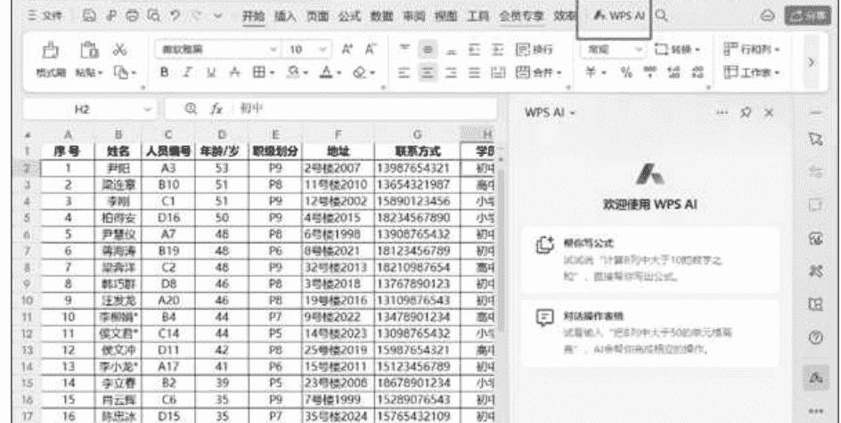

在侧边栏里，选中目标单元格后点“帮你写公式”，即可打开对话窗口，输入指令让 AI 生成计算公式，如图7-11所示。

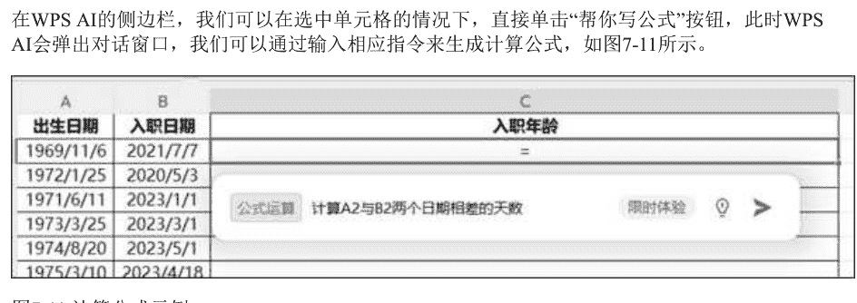

若不确定操作哪块单元格，可用“对话操作表格”功能直接对行列下指令，如图7-12所示。

“对话操作表格”提供四个能力标签：“按条件标记”“筛选排序”“分类计算”“快捷操作”，选定标签后 AI 会调用对应接口，更好地理解提示。


图7-12 “对话操作表格”功能示例

### 2. 实战演示：WPS AI 模拟行政助理
掌握基本操作后，用真实场景感受效果。假设你是部门行政助理，图7-13 为集团员工的部分数据，需要做标记、筛选、汇总等处理。

| 序号 | 姓名 | 人员编号 | 年龄/岁 | 职级划分 | 地址 | 联系方式 | 学历 | 性别 | 退休日期 | 出生日期 | 专业 | 状态 | 入职日期 | 工龄/年 | 基本工资/元 |
|---|---|---|---|---|---|---|---|---|---|---|---|---|---|---|---|
| 1 | 卢丹 | A3 | 53 | P9 | 2号楼2007 | 13987654321 | 初中 | 男 | 2029/11/6 | 1969/11/6 | 集团客户 | 在职 | 2021/7/7 | 1 | 1300 |
| 2 | 梁玉章 | B10 | 51 | P8 | 11号楼2010 | 13654321987 | 高中 | 女 | 2027/1/25 | 1972/1/25 | 集团客户 | 在职 | 2020/5/3 | 0 | 1000 |
| 3 | 李刚 | C1 | 51 | P9 | 12号楼2002 | 15890123456 | 小学 | 男 | 2031/6/11 | 1971/6/11 | 集团客户 | 在职 | 2023/1/1 | 0 | 700 |
| 4 | 柏得安 | D16 | 50 | P9 | 4号楼2015 | 18234567890 | 小学 | 男 | 2033/3/25 | 1973/3/25 | 传媒网 | 在职 | 2023/3/1 | 0 | 1300 |
| 5 | 尹慧仪 | A7 | 48 | P8 | 6号楼1998 | 13908765432 | 初中 | 女 | 2029/8/20 | 1974/8/20 | 国网部 | 在职 | 2023/5/1 | 0 | 1300 |
| 6 | 高海涛 | B19 | 48 | P9 | 8号楼2021 | 18123456789 | 初中 | 男 | 2035/3/10 | 1975/3/10 | 传媒网 | 在职 | 2023/4/18 | 6 | 1300 |
| 7 | 梁亮洋 | C2 | 48 | P9 | 32号楼2013 | 18210987654 | 高中 | 女 | 2029/5/20 | 1974/5/20 | 传媒网 | 在职 | 2022/3/21 | 0 | 1300 |
| 序号 | 岗位工资/元 | 出差地租房补贴/元 | 出差交通/元 | 话费补贴/元 | 绩效奖金/元 | 实发工资/元 | 工资区间/元 | 工资排名 | 个人年终奖所得税/万元 | 入职后剩余工作时间/天 | 到手百分比 | 奖金占比 |
|---|---|---|---|---|---|---|---|---|---|---|---|---|
| 1 | 0 |  |  | 0 | 50 | 1350 | 1000~1999 | 25 | 1.5 | 2999 | 103.85% | 3.70% |
| 2 | 0 |  |  | 0 | 400 | 1400 | 1000~1999 | 24 | 12 | 2950 | 140.00% | 28.57% |
| 3 | 500 |  |  | 0 | 300 | 1500 | 1000~1999 | 23 | 9 | 3624 | 214.29% | 20.00% |
| 4 | 600 | 100 |  | 100 | 600 | 2700 | 2000~3499 | 21 | 18 | 8241 | 207.69% | 22.22% |
| 5 | 600 | 100 |  | 100 | 600 | 2700 | 2000~3499 | 21 | 18 | 2269 | 207.69% | 22.22% |
| 6 | 600 | 100 |  | 100 | 800 | 2900 | 2000~3499 | 20 | 24 | 11293 | 223.08% | 27.59% |
| 7 | 600 | 100 |  | 100 | 900 | 3000 | 2000~3499 | 17 | 27 | 4282 | 230.77% | 30.00% |

图7-13 部分案例数据

使用前先点开“对话操作表格”，在列表里选“按条件标记”，输入具体指令处理表格。

需求一：按姓名标记，找出所有“李”姓人员。

提示词：

```
# 按条件标记

把B列当中的李姓员工所在单元格的背景色加深
```

运行结果：如图7-14所示。

| 序号 | 姓名 | 人员编号 | 年龄 | 职级划分 | 地址 | 联系方式 | 学历 | 性别 | 退休日期 | 出生日期 | 专业 | 状态 | 入职日期 | 工龄/年 |
|---|---|---|---|---|---|---|---|---|---|---|---|---|---|---|
| 1 | 卢阳 | A3 | 53 | P9 | 2号楼2007 | 13987654321 | 初中 | 男 | 2029/11/6 | 1969/11/6 | 集团客户 | 在职 | 2021/7/7 | 1 |
| 2 | 梁连意 | B10 | 51 | P8 | 11号楼2010 | 13654321987 | 高中 | 女 | 2027/1/25 | 1972/1/25 | 集团客户 | 在职 | 2020/5/3 | 0 |
| 3 | 李刚 | C1 | 51 | P9 | 12号楼2002 | 15890123456 | 小学 | 男 | 2031/6/11 | 1971/6/11 | 集团客户 | 在职 | 2023/1/1 | 0 |
| 4 | 柏德安 | D16 | 50 | P9 | 4号楼2015 | 18234567890 | 小学 | 男 | 2033/3/25 | 1973/3/25 | 传输网 | 在职 | 2023/3/1 | 0 |
| 5 | 尹慧仪 | A7 | 48 | P8 | 6号楼1998 | 13908765432 | 初中 | 女 | 2029/8/20 | 1974/8/20 | 国网部 | 在职 | 2023/5/1 | 0 |
| 6 | 黄海涛 | B19 | 48 | P6 | 8号楼2021 | 18123456789 | 初中 | 男 | 2035/3/10 | 1975/3/10 | 传输网 | 在职 | 2023/4/18 | 6 |
| 7 | 梁亮洋 | C2 | 48 | P9 | 32号楼2013 | 18210987654 | 高中 | 女 | 2029/5/20 | 1974/5/20 | 传输网 | 在职 | 2022/5/21 | 0 |
| 8 | 韩巧群 | D8 | 46 | P8 | 3号楼2018 | 13767890123 | 初中 | 男 | 2031/7/11 | 1976/7/11 | 综合室 | 在职 | 2023/5/1 | 3 |
| 9 | 汪发龙 | A20 | 46 | P8 | 19号楼2016 | 13109876543 | 初中 | 男 | 2037/4/19 | 1977/4/19 | 传输网 | 在职 | 2023/5/1 | 0 |
| 10 | 李希瑞 | B4 | 44 | P7 | 9号楼2022 | 13478901234 | 高中 | 女 | 2034/1/22 | 1979/1/22 | 国网部 | 在职 | 2020/5/1 | 3 |
| 11 | 侯文慧* | C14 | 44 | P5 | 14号楼2023 | 13098765432 | 小学 | 男 | 2038/6/5 | 1978/6/5 | 集团客户 | 在职 | 2022/5/1 | 0 |
| 12 | 侯文泽 | D11 | 42 | P8 | 25号楼2019 | 15987654321 | 高中 | 男 | 2040/10/25 | 1980/10/25 | 国网部 | 在职 | 2021/7/8 | 1 |
| 13 | 李小龙* | A17 | 41 | P6 | 15号楼2011 | 15123456789 | 初中 | 男 | 2042/4/16 | 1982/4/16 | 综合室 | 在职 | 2023/1/14 | 0 |
| 14 | 李立章 | B2 | 39 | P5 | 23号楼2008 | 18678901234 | 小学 | 女 | 2039/2/11 | 1984/2/11 | 集团客户 | 在职 | 2021/7/6 | 0 |
| 15 | 肖云辉 | C6 | 35 | P9 | 7号楼1999 | 15289076543 | 初中 | 男 | 2048/1/19 | 1988/1/19 | 国网部 | 在职 | 2016/9/6 | 0 |

| 16 | 陈忠冰 | D15 | 35 | P7 | 35号楼2024 | 15765432109 | 初中 | 男 | 2048/1/19 | 1988/1/19 | 国网部 | 在职 | 2023/5/1 | 2 |

| 17 | 刘建文 | A8 | 34 | P9 | 10号楼1996 | 18790123456 | 高中 | 男 | 2048/11/10 | 1988/11/10 | 传输网 | 在职 | 2023/3/1 | 3 |

| 18 | 华国强 | B18 | 34 | P7 | 17号楼2009 | 13654321098 | 高中 | 男 | 2048/7/18 | 1988/7/18 | 集团客户 | 在职 | 2023/5/1 | 1 |

| 19 | 潘永标 | C5 | 34 | P9 | 26号楼2006 | 15321098765 | 高中 | 男 | 2049/3/10 | 1989/3/10 | 综合室 | 在职 | 2020/5/4 | 1 |

| 20 | 李仕伟 | D13 | 33 | P6 | 22号楼2014 | 15234567890 | 小学 | 男 | 2049/10/22 | 1989/10/22 | 传输网 | 在职 | 2020/5/5 | 3 |

| 21 | 袁文渊 | A1 | 33 | P6 | 33号楼2005 | 13345678901 | 初中 | 女 | 2044/8/4 | 1989/8/4 | 传输网 | 在职 | 2020/5/2 | 0 |

| 22 | 万秀明* | B9 | 32 | P7 | 5号楼2001 | 13678901234 | 高中 | 女 | 2046/3/22 | 1991/3/22 | 传输网 | 在职 | 2023/5/1 | 1 |

| 23 | 潘伟全 | C12 | 32 | P7 | 28号楼2020 | 13509876543 | 高中 | 男 | 2050/8/11 | 1990/8/11 | 综合室 | 在职 | 2023/5/1 | 0 |

| 24 | 柏永鑫 | D19 | 32 | P8 | 30号楼2003 | 13890123456 | 高中 | 男 | 2051/3/27 | 1991/3/27 | 国网部 | 在职 | 2021/6/1 | 3 |

| 25 | 曾小涛 | A14 | 27 | P9 | 20号楼1997 | 18765432109 | 初中 | 男 | 2055/6/13 | 1995/6/13 | 集团客户 | 在职 | 2021/5/1 | 0 |

图7-14 李姓筛选示例展示

接下来要处理的，是排查名单里是否出现同栋楼居住的同事，一旦发现就进行标注。

提示词：

```
# 按条件标记
将F列“号楼”前面字符完全相同的单元格背景色加深
```

实际运行后的界面呈现在图7-15。经核对，各人居住的楼栋没有重复，因此地址列并未出现高亮加粗的现象，详情可参考图7-15。

| 序号 | 姓名 | 人员编号 | 年龄 | 职级划分 | 地址 | 联系方式 | 学历 | 性别 | 退休日期 | 出生日期 | 专业 | 状态 | 入职日期 | 工龄/年 |

|---|---|---|---|---|---|---|---|---|---|---|---|---|---|---|

| 1 | 卢阳 | A3 | 53 | P9 | 2号楼2007 | 13987654321 | 初中 | 男 | 2029/11/6 | 1969/11/6 | 集团客户 | 在职 | 2021/7/7 | 1 |

| 2 | 梁连意 | B10 | 51 | P8 | 11号楼2010 | 13654321987 | 高中 | 女 | 2027/1/25 | 1972/1/25 | 集团客户 | 在职 | 2020/5/3 | 0 |

| 3 | 李刚 | C1 | 51 | P9 | 12号楼2002 | 15890123456 | 小学 | 男 | 2031/6/11 | 1971/6/11 | 集团客户 | 在职 | 2023/1/1 | 0 |

| 4 | 柏德安 | D16 | 50 | P9 | 4号楼2015 | 18234567890 | 小学 | 男 | 2033/3/25 | 1973/3/25 | 传输网 | 在职 | 2023/3/1 | 0 |

| 5 | 尹慧仪 | A7 | 48 | P8 | 6号楼1998 | 13908765432 | 初中 | 女 | 2029/8/20 | 1974/8/20 | 国网部 | 在职 | 2023/5/1 | 0 |

| 6 | 黄海涛 | B19 | 48 | P6 | 8号楼2021 | 18123456789 | 初中 | 男 | 2035/3/10 | 1975/3/10 | 传输网 | 在职 | 2023/4/18 | 6 |

| 7 | 梁亮洋 | C2 | 48 | P9 | 32号楼2013 | 18210987654 | 高中 | 女 | 2029/5/20 | 1974/5/20 | 传输网 | 在职 | 2022/5/21 | 0 |

| 8 | 韩巧群 | D8 | 46 | P8 | 3号楼2018 | 13767890123 | 初中 | 男 | 2031/7/11 | 1976/7/11 | 综合室 | 在职 | 2023/5/1 | 3 |

| 9 | 汪发龙 | A20 | 46 | P8 | 19号楼2016 | 13109876543 | 初中 | 男 | 2037/4/19 | 1977/4/19 | 传输网 | 在职 | 2023/5/1 | 0 |

| 10 | 李希瑞 | B4 | 44 | P7 | 9号楼2022 | 13478901234 | 高中 | 女 | 2034/1/22 | 1979/1/22 | 国网部 | 在职 | 2020/5/1 | 3 |

| 11 | 侯文慧* | C14 | 44 | P5 | 14号楼2023 | 13098765432 | 小学 | 男 | 2038/6/5 | 1978/6/5 | 集团客户 | 在职 | 2022/5/1 | 0 |

| 12 | 侯文泽 | D11 | 42 | P8 | 25号楼2019 | 15987654321 | 高中 | 男 | 2040/10/25 | 1980/10/25 | 国网部 | 在职 | 2021/7/8 | 1 |

| 13 | 李小龙* | A17 | 41 | P6 | 15号楼2011 | 15123456789 | 初中 | 男 | 2042/4/16 | 1982/4/16 | 综合室 | 在职 | 2023/1/14 | 0 |

| 14 | 李立章 | B2 | 39 | P5 | 23号楼2008 | 18678901234 | 小学 | 女 | 2039/2/11 | 1984/2/11 | 集团客户 | 在职 | 2021/7/6 | 0 |

| 15 | 肖云辉 | C6 | 35 | P9 | 7号楼1999 | 15289076543 | 初中 | 男 | 2048/1/19 | 1988/1/19 | 国网部 | 在职 | 2016/9/6 | 0 |

| 16 | 陈忠冰 | D15 | 35 | P7 | 35号楼2024 | 15765432109 | 初中 | 男 | 2048/1/19 | 1988/1/19 | 国网部 | 在职 | 2023/5/1 | 2 |

| 17 | 刘建文 | A8 | 34 | P9 | 10号楼1996 | 18790123456 | 高中 | 男 | 2048/11/10 | 1988/11/10 | 传输网 | 在职 | 2023/3/1 | 3 |

| 18 | 华国强 | B18 | 34 | P7 | 17号楼2009 | 13654321098 | 高中 | 男 | 2048/7/18 | 1988/7/18 | 集团客户 | 在职 | 2023/5/1 | 1 |

| 19 | 潘永标 | C5 | 34 | P9 | 26号楼2006 | 15321098765 | 高中 | 男 | 2049/3/10 | 1989/3/10 | 综合室 | 在职 | 2020/5/4 | 1 |

| 20 | 李仕伟 | D13 | 33 | P6 | 22号楼2014 | 15234567890 | 小学 | 男 | 2049/10/22 | 1989/10/22 | 传输网 | 在职 | 2020/5/5 | 3 |

| 21 | 袁文渊 | A1 | 33 | P6 | 33号楼2005 | 13345678901 | 初中 | 女 | 2044/8/4 | 1989/8/4 | 传输网 | 在职 | 2020/5/2 | 0 |

| 22 | 万秀明* | B9 | 32 | P7 | 5号楼2001 | 13678901234 | 高中 | 女 | 2046/3/22 | 1991/3/22 | 传输网 | 在职 | 2023/5/1 | 1 |

| 23 | 潘伟全 | C12 | 32 | P7 | 28号楼2020 | 13509876543 | 高中 | 男 | 2050/8/11 | 1990/8/11 | 综合室 | 在职 | 2023/5/1 | 0 |

| 24 | 柏永鑫 | D19 | 32 | P8 | 30号楼2003 | 13890123456 | 高中 | 男 | 2051/3/27 | 1991/3/27 | 国网部 | 在职 | 2021/6/1 | 3 |

| 25 | 曾小涛 | A14 | 27 | P9 | 20号楼1997 | 18765432109 | 初中 | 男 | 2055/6/13 | 1995/6/13 | 集团客户 | 在职 | 2021/5/1 | 0 |

图7-15 地址标记呈现效果

第三项任务是要找出绩效奖金超出平均值的员工。

提示词：

为了避免循环引用问题，可以直接采用下面的提示格式。
## 按条件标记
将U列大于AVERAGE（U:U）加深标记
处理完毕后的展示效果见图7-16。

| 序号 | 休日期 | 出生日期 | 专业 | 状态 | 入职日期 | 工龄/年 | 基本工资/元 | 岗位工资/元 | 出差地租房补贴/元 | 出差交通/元 | 话费补贴/元 | 绩效奖金/元 | 实发工资/元 | 工资区间/元 |

|---|---|---|---|---|---|---|---|---|---|---|---|---|---|---|

| 1 | 29/11/6 | 1969/11/6 | 集团客户 | 在职 | 2021/7/7 | 1 | 1300 | 0 | | | 0 | 50 | 1350 | 1000~1999 |

| 2 | 27/1/25 | 1972/1/25 | 集团客户 | 在职 | 2020/5/3 | 0 | 1000 | 0 | | | 0 | 400 | 1400 | 1000~1999 |

| 3 | 31/8/11 | 1971/8/11 | 集团客户 | 在职 | 2023/1/1 | 0 | 700 | 500 | | | 0 | 300 | 1500 | 1000~1999 |

| 4 | 33/3/25 | 1971/3/25 | 传输网 | 在职 | 2023/3/1 | 0 | 1300 | 600 | 100 | | 100 | 600 | 2700 | 2000~3499 |

| 5 | 29/8/20 | 1974/8/20 | 固网部 | 在职 | 2023/5/1 | 0 | 1300 | 600 | 100 | | 100 | 600 | 2700 | 2000~3499 |

| 6 | 35/3/10 | 1975/3/10 | 传输网 | 在职 | 2023/4/18 | 6 | 1300 | 600 | 100 | | 100 | 800 | 2900 | 2000~3499 |

| 7 | 29/5/20 | 1974/5/20 | 传输网 | 在职 | 2022/5/21 | 0 | 1300 | 600 | 100 | | 100 | 900 | 3000 | 2000~3499 |

| 8 | 31/7/11 | 1976/7/11 | 综合室 | 在职 | 2023/5/1 | 3 | 1300 | 600 | 100 | | 100 | 900 | 3000 | 2000~3499 |

| 9 | 37/4/19 | 1977/4/19 | 传输网 | 在职 | 2023/5/1 | 0 | 1300 | 600 | 100 | | 100 | 900 | 3000 | 2000~3499 |

| 10 | 34/1/22 | 1979/1/22 | 固网部 | 在职 | 2020/5/1 | 3 | 1300 | 600 | | | 100 | 1100 | 3100 | 2000~3499 |

| 11 | 38/6/5 | 1978/6/5 | 集团客户 | 在职 | 2022/5/1 | 0 | 1300 | 600 | | | 100 | 1200 | 3200 | 2000~3499 |

| 12 | 40/10/25 | 1980/10/25 | 固网部 | 在职 | 2021/7/8 | 1 | 1300 | 600 | 150 | | 100 | 1100 | 3250 | 2000~3499 |

| 13 | 42/4/16 | 1982/4/16 | 综合室 | 在职 | 2023/1/14 | 0 | 1300 | 600 | 100 | 200 | 100 | 1100 | 3400 | 2000~3499 |

| 14 | 39/2/11 | 1984/2/11 | 集团客户 | 在职 | 2021/7/6 | 0 | 1300 | 600 | 100 | | 100 | 1300 | 3400 | 2000~3499 |

| 15 | 48/1/19 | 1986/1/19 | 固网部 | 在职 | 2016/9/6 | 0 | 1300 | 600 | | | 200 | 1400 | 3500 | 3500~4999 |

| 16 | 48/1/19 | 1986/1/19 | 固网部 | 在职 | 2023/5/1 | 2 | 1300 | 600 | | | 100 | 1500 | 3500 | 3500~4999 |

| 17 | 8/11/10 | 1988/11/10 | 传输网 | 在职 | 2023/3/1 | 3 | 1300 | 600 | 100 | | 200 | 1400 | 3600 | 3500~4999 |

| 18 | 48/7/18 | 1988/7/18 | 集团客户 | 在职 | 2023/5/1 | 1 | 1300 | 600 | | | 200 | 1600 | 3700 | 3500~4999 |

| 19 | 49/3/10 | 1989/3/10 | 综合室 | 在职 | 2020/5/4 | 1 | 1300 | 600 | 100 | | 100 | 1600 | 3700 | 3500~4999 |

| 20 | 49/10/22 | 1989/10/22 | 传输网 | 在职 | 2020/5/5 | 3 | 1300 | 600 | 210 | | 200 | 1400 | 3710 | 3500~4999 |

| 21 | 44/8/4 | 1989/8/4 | 传输网 | 在职 | 2020/5/2 | 0 | 1300 | 800 | 100 | | 200 | 1700 | 4100 | 3500~4999 |

| 22 | 46/3/22 | 1991/3/22 | 传输网 | 在职 | 2023/5/1 | 1 | 1300 | 800 | 100 | | 200 | 2400 | 4800 | 3500~4999 |

| 23 | 50/8/11 | 1990/8/11 | 综合室 | 在职 | 2023/5/1 | 0 | 1500 | 2000 | | | 200 | 2500 | 6200 | 5000~7999 |

| 24 | 51/3/27 | 1991/3/27 | 固网部 | 在职 | 2021/6/1 | 3 | 1500 | 2000 | 100 | | 200 | 2500 | 6300 | 5000~7999 |

| 25 | 55/6/13 | 1995/6/13 | 集团客户 | 在职 | 2021/5/1 | 0 | 1500 | 2000 | 100 | | 200 | 3500 | 7300 | 5000~7999 |

图7-16 绩效奖金高于平均水平的员工高亮图

# 第8章
## 提示工程与智能编程的交汇
在数字化浪潮中，编程已成为解决难题与驱动创新的关键能力，不过代码的编写和维护门槛仍然不低。本章将聚焦新一代开发工具及智能编程的潜力，探讨它们如何改变开发方式并影响未来。

## 8.1 新一代开发工具全景
对企业而言，软件研发是决定竞争力的核心环节。如今几乎所有机构都离不开应用与系统来支撑业务运转、数据管理、客户服务以及数字化转型。过去，工程师必须在IDE里凭借多年经验把复杂逻辑转化为可运行代码。大型语言模型的普及带来了颠覆效应，即便是零基础的用户也能借提示技巧配合GPT完成开发任务。与此同时，GitHub推出的Copilot、蚂蚁集团的CodeFuse等智能编码插件也纷纷面世。

### 8.1.1 GitHub Copilot 编程助手概览
GitHub Copilot由GitHub与OpenAI联合打造，是一款可嵌入多款IDE的智能编码助手，兼容Visual Studio Code、IntelliJ等主流环境。它能实时给出代码补全、自动产出片段、修正错误、撰写注释并提供建议，甚至针对复杂需求搭建代码骨架。借助大模型驱动，程序员可以更快产出高质量代码，并覆盖多种语言与框架。推出后即获广泛认可，普通用户可前往官网申请试用，图8-1为申请界面截图。学生用户和热门开源项目的贡献者可享受免费额度。


AI 伙伴编程实操

图8-1 GitHub Copilot页面

审核通过之后，即可在开发环境中安装对应扩展，关联 GitHub 账号后就能在编码时调用 AI 辅助。接下来以一次完整流程来演示 Copilot 的实际效果。

扩展激活后，编辑器右下角会出现一只青蛙小图标，表示插件已就绪，这只青蛙会充当随身的代码助手，帮助定位缺陷并给出修复思路。新建项目后，在源码文件里写入一段自然语言提示：“请生成一段排序程序，把输入的数字按从大到小排列，例如输入12345，期望输出54321”。代码生成主要有两种入口，一种是利用右侧面板：提交提示后侧栏会列出十几种不同思路的候选实现，如图8-2所示，挑选满意的一项点按“Accept solution”，代码就会写入左侧编辑区。随便挑一段执行即可，运行效果如图示，比如在控制台输入14521，就能得到符合预期的排序结果。整个过程只写了一行注释，AI 在几秒内就完成了功能的实现。

除了 Python，Copilot 也能处理 SQL、Java、Golang 等多种语言，对于技术栈不熟悉的新手非常友好。掌握大致的语法概念和实现思路即可快速上手，无需钻研细节。

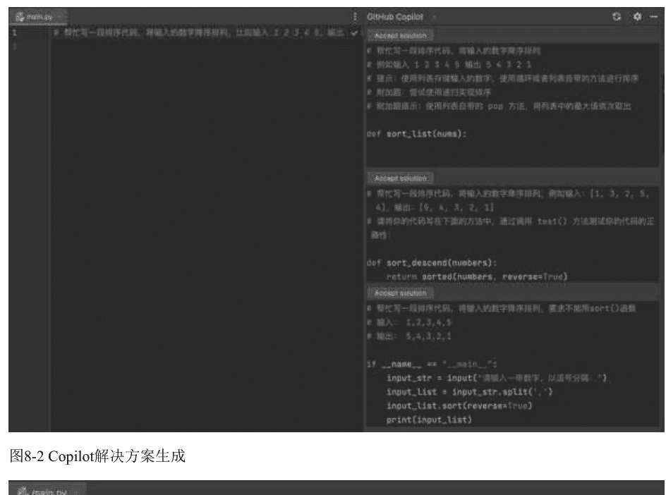

图8-2 Copilot 方案列表

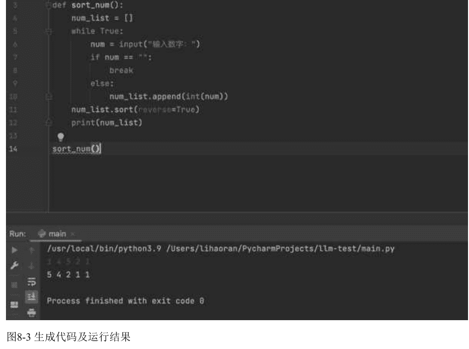

图8-3 代码生成与运行示例

### 8.1.2 国产智能研发平台 CodeFuse

CodeFuse 面向国内开发者提供智能研发能力，其代码模型来源于蚂蚁集团自研基座模型经微调而来，于2023年9月在外滩大会正式发布。该平台提供代码补全、注释生成、代码解读、单测生成和代码优化等能力，帮助开发者更流畅地完成编码。与 GitHub Copilot 相比，CodeFuse 在训练数据中融入了大量本土开发者贡献的高质量代码，更贴合国内工程师的写法习惯，中文注释的支持也更完善。

可通过申请试用在编译器中加载插件，申请入口见图8-4，审核通过后即可在本地 IDE 或云端研发环境中使用，覆盖四十余种语言。作者作为首批评测者，已用它编写数万行代码，目前推广范围相当广泛。


图8-4 CodeFuse 试用申请页

## 8.2 代码自动生成的关键场景

在进入具体演示前，先梳理三个核心方向：SQL 与图表自动生成、服务端代码自动生成、复杂编程题的求解。这三类分别体现了 AI 编码在数据处理、后端开发和算法挑战中的典型价值。

### 8.2.1 SQL与图表的自动生成

报表是数据分析与决策支持的重要手段，它把 SQL 查询与数据可视化结合，帮助用户洞察数据并驱动商业决策。

SQL 是操作数据库的强力语言，但手写复杂查询对非技术人员门槛较高。借助自动生成技术，用户只需用自然语言描述需求，系统即可转化为合法的 SQL 语句，从数据库中提取所需信息。

取数完成后，图表工具会将结果视觉化，便于发现趋势、支撑决策，减少手工整理工作量。高阶报表往往依赖复杂 SQL 产出计算结果，再导入 BI 工具或直接让 GPT 辅助绘图。本节将演示如何通过提示工程生成 SQL 并按需出图。

## 1. 建表 DDL 的自动生成

假设数据库为空，若要建表，过去需要自行设计模式并手写建表语句，现在只需描述表结构和业务背景，大模型就能快速给出 DDL，示例如下。

提示词：

假设宾馆酒店业数据库有一张表：

Booking（roomNo, guestNo, dateFrom, dateTo）

Guest（guestNo, guestName, guestAddress）

请帮忙生成并优化数据表的结构，输出数据库建表语句

回答：

下面是宾馆酒店业数据库的一张表结构，已做优化并附带建表语句：

Booking表

- bookingNo（预订编号）-主键

- roomNo（客房编号）-外键，与Room表的roomNo关联

- guestNo（客人编号）-外键，与Guest表的guestNo关联

- dateFrom（入住日期）

- dateTo（离店日期）

以下是创建Booking表的SQL建表语句：

```sql
CREATE TABLE Booking (
    bookingNo INT PRIMARY KEY,
    roomNo INT,
    guestNo INT,
    dateFrom DATE,
    dateTo DATE,
    FOREIGN KEY (roomNo) REFERENCES Room(roomNo),
    FOREIGN KEY (guestNo) REFERENCES Guest(guestNo)
);
```

优化说明：该表包含主键字段 bookingNo，保证每条预订唯一；roomNo 与 guestNo 分别作为与 Room 表和 Guest 表的关联外键，建立预订、客房、客人之间的关系；日期字段使用 DATE 类型确保存储规范。此结构便于追踪预订信息及入住离店时间。

可以看出，大模型不仅给出建表语句和优化建议，还对字段提供了中文说明，直接复制到数据库管理工具即可创建表。

## 2. 测试数据与插入语句生成

建表完成后，可请大模型生成测试数据及插入语句，这里可结合思维链和上下文学习灵活设计提示。若此前未说明表结构，可在上下文补充 DDL 或结构描述。

提示词：

下面是宾馆酒店业数据库的一张表的结构：

Booking表

- bookingNo（预订编号）-主键

- roomNo（客房编号）-外键，与Room表的roomNo关联

- guestNo（客人编号）-外键，与Guest表的guestNo关联

- dateFrom（入住日期）

- dateTo（离店日期）

帮忙生成一些测试数据和插入SQL语句

回答：

以下是Booking表的5条测试数据以及相应的插入SQL语句：

Booking表测试数据：

| bookingNo | roomNo | guestNo | dateFrom | dateTo |

|-----------|--------|---------|----------|--------|

| 1001 | 101 | 1 | 2023-10-15 | 2023-10-20 |

| 1002 | 102 | 2 | 2023-11-05 | 2023-11-10 |

| 1003 | 201 | 3 | 2023-12-01 | 2023-12-05 |

| 1004 | 202 | 4 | 2023-11-25 | 2023-11-30 |

| 1005 | 301 | 5 | 2023-10-30 | 2023-11-05 |

插入语句：

```sql
INSERT INTO Booking (bookingNo, roomNo, guestNo, dateFrom, dateTo)
VALUES
(1001, 101, 1, '2023-10-15', '2023-10-20'),
(1002, 102, 2, '2023-11-05', '2023-11-10'),
(1003, 201, 3, '2023-12-01', '2023-12-05'),
(1004, 202, 4, '2023-11-25', '2023-11-30'),
(1005, 301, 5, '2023-10-30', '2023-11-05');
```

这些语句可向 Booking 表写入5条模拟预订信息。请确保目标数据库支持该语法，并在必要时调整字段名和类型。

## 3. 查询语句生成

数据录入后，可用 SQL 查询获取分析所需信息，若不确定写法，可先让大模型提供示例。

提示词：

帮忙在Booking表中生成一些查询SQL示例语句

回答：

以下是从Booking表中检索预订信息的常用示例。

1. 检索所有预订信息：

```sql
SELECT * FROM Booking;
```

2. 按客房编号检索特定预订信息：

```sql
SELECT * FROM Booking WHERE roomNo=101;
```

3. 按客人编号检索特定预订信息：

```sql
SELECT * FROM Booking WHERE guestNo=1;
```

4. 按入住日期范围检索预订信息：

```sql
SELECT * FROM Booking WHERE dateFrom BETWEEN '2023-10-15' AND '2023-11-01';
```

5. 按离店日期范围检索预订信息：

```sql
SELECT * FROM Booking WHERE dateTo BETWEEN '2023-11-05' AND '2023-11-30';
```

6. 按客房编号和客人编号检索特定预订信息：

```sql
SELECT * FROM Booking WHERE roomNo=101 AND guestNo=1;
```

7. 按日期范围和客人编号检索特定预订信息：

```sql
SELECT * FROM Booking WHERE dateFrom >= '2023-11-01' AND dateTo <= '2023-11-30' AND guestNo=2;
```

这些示例可按需调整，也可继续追问大模型进行解释、分析或优化。

## 4. 图表生成

SQL 取数后可将结果加工成直观图表。自动图表生成简化了可视化流程，减少手工操作，提升沟通效率，对业务决策和报告制作很有帮助。下面给出一个生成表格的实用模板。

代码生成表格模板：

1. 列出表格的标题和列名。
2. 描述表格的布局和格式。
3. 提供表格所需的数据与信息。
4. 强调表格用途。

提示词：

帮忙用Python实现以下功能。

生成一个表格，其中包含项目、预算和实际花费三列。

该表格每列都有明确的标题，分别为项目、预算和实际花费，其中预算和实际花费单位是元。

表格中的数据均为生成数据。

该表格对于项目管理非常重要，可以帮助管理人员了解项目进展情况。

回答：

以下示例使用 Python 生成项目、预算、实际花费的表格，可用于项目管理，请按需替换虚拟数据。

import pandas as pd

# 创建项目、预算和实际花费的虚拟数据
data = {
    '项目': ['项目A', '项目B', '项目C', '项目D', '项目E'],
    '预算（元）': [10000, 15000, 12000, 18000, 20000],
    '实际花费（元）': [9000, 16000, 11000, 17500, 19500]
}

# 创建DataFrame
df = pd.DataFrame(data)

# 打印表格
print("项目管理表格:")
print(df)

# 保存表格为CSV文件
df.to_csv('project_management.csv', index=False)

示例中使用 Pandas 构建数据集并转 DataFrame，可修改项目名、预算和实际花费，最后保存为 CSV 供后续使用。

若需绘图，提示词中应描述图的信息，模板如下。

生成模板：

- ①描述数据源；
- ②说明横纵坐标含义和单位；
- ③描述线条类型和颜色；
- ④说明数据点形状和颜色；
- ⑤描述标题和注释要求。

提示词：

帮忙用Python实现以下功能。

生成一个折线图，数据源为虚拟数据。

折线图中的横坐标轴表示年份，纵坐标轴表示销售额，单位为万元。

折线图中的线条类型为实线，颜色为蓝色，表示销售额的变化趋势。

折线图中的数据点形状为圆圈，颜色为黑色，表示每个年份的销售额。

折线图的标题为“某公司近几年销售额变化趋势”，注释中添加了公司名称和数据来源。

回答：

可使用 Python 的 Matplotlib 库生成折线图，以下是示例代码：

```python
import matplotlib.pyplot as plt
# 虚拟销售数据，年份和销售额（单位：万元）
years = [2018, 2019, 2020, 2021, 2022, 2023]
sales = [120, 150, 180, 160, 190, 200]
# 创建折线图
plt.figure(figsize=(8, 4))
plt.plot(years, sales, marker='o', linestyle='-', color='blue', markersize=8, markerfacecolor='black')
plt.title('某公司近几年销售额变化趋势')
plt.xlabel('年份')
plt.ylabel('销售额/万元')
plt.grid(True)
plt.legend()
# 添加注释
plt.text(2018, 125, '公司名称：ABC 公司', fontsize=10, color='gray')
plt.text(2018, 120, '数据来源：内部销售报告', fontsize=10, color='gray')
# 显示图表
plt.show()
```

示例创建了折线图并使用虚拟销售数据，设定了线型、颜色、点形和颜色，同时添加了标题和注释。用户可替换数据以适应实际场景，用于展示某公司近年销售额变化。运行代码即可得到图像，修改数据即可更新图表。

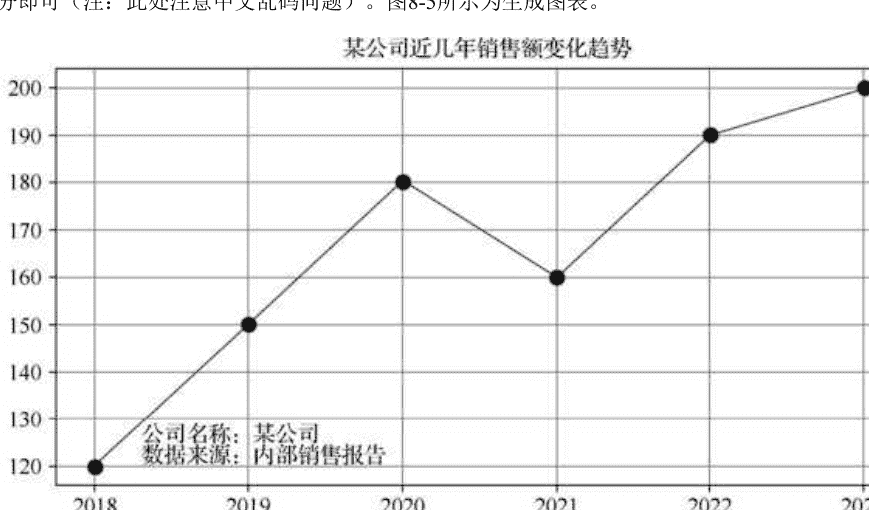

图8-5 自动化生成图表

### 8.2.2 服务端代码自动生成详解

服务端编程指开发运行于服务器的软件，用于提供服务、处理请求、存储和管理数据，并与客户端交互，涵盖 Web 服务、数据库服务器、游戏服务器、应用服务器等。当前多数软件功能均以服务形式提供。本节将借助大模型从零构建 Web 服务，实现一套完整的销售数据管理系统。对于复杂需求，可用 CRISPE 框架辅助设计提示词，提供如下模板。

生成模板：

- 步骤1 能力与角色：你是一个资深的软件工程师，擅长服务端编程。
- 步骤2 系统说明：对系统做整体概述，明确设计思路和基本结构。
- 步骤3 功能要求：详细列举系统需实现的功能点。
- 步骤4 技术要求：指定技术栈和代码风格。
- 步骤5 实验说明：说明输入输出细节。

案例：编写销售数据管理系统

按模板编写提示词时，输入输出描述需清晰准确。

提示词：

你是一个资深的软件工程师，擅长服务端编程，帮忙写一套销售数据管理系统代码，代码中包含注释，易于阅读，并对过程做出讲解，实现销售数据录入与销售数据查询，输入数据为员工工号，输出为销售数据，单位是元。

回答：

构建完整的销售数据管理系统通常涉及数据库、API、前端等多个层面。为兼顾篇幅，这里给出简化示例，采用 Python 与 Flask 实现销售数据录入与查询，演示服务端如何接收录入并提供查询。

以下是代码示例及其注释：

```python
from flask import Flask, request, jsonify

app = Flask(__name__)

# 创建一个虚拟的销售数据数据库
sales_data = []

# 创建销售数据录入端点
@app.route('/add_sale', methods=['POST'])
def add_sale():
    data = request.get_json()  # 从请求中获取销售数据

    # 检查请求中是否包含必要的字段
    if 'employee_id' not in data or 'amount' not in data:
        return jsonify({'message': 'Employee ID and amount are required'}), 400

    employee_id = data['employee_id']
    amount = data['amount']

    # 将销售数据添加到数据库
    sales_data.append({'employee_id': employee_id, 'amount': amount})

    return jsonify({'message': 'Sale data added successfully'})

# 创建销售数据查询端点
@app.route('/get_sales', methods=['GET'])
def get_sales():
    # 查询并返回所有销售数据
    return jsonify({'sales_data': sales_data})

if __name__ == '__main__':
    app.run(debug=True)
```
这个案例演示了一个极简的 Flask 微服务，仅暴露两条接口。第一条是 /add_sale，用于写入销售记录，调用方需用 POST 方式提交 JSON，里面包含 employee_id 与 amount 两个字段；第二条是 /get_sales，提供只读能力，通过 GET 请求就能拉取当前内存中保存的全部销售条目。

本地启用很直接，先用 pip install Flask 安装依赖，再执行脚本即可在本地起一个 HTTP 服务，随后可以用浏览器或任何 HTTP 客户端去调试这两个端点。

需要提醒的是，这只是一个教学原型，并没有接入数据库，也没有做鉴权和安全防护。真实业务里必须考虑数据持久化、权限校验和安全策略，复杂场景建议交给有经验的开发团队来落地。

下面进入实操。系统启动后界面如图8-6所示。接下来借助 Postman 发起 POST 请求，向 /add_sale 写入一条记录：工号 000001，金额 9734.23 元，请求过程如图8-7所示。

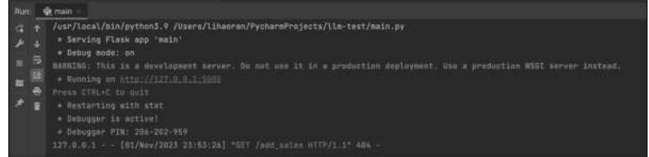
图8-6 运行销售数据管理系统代码

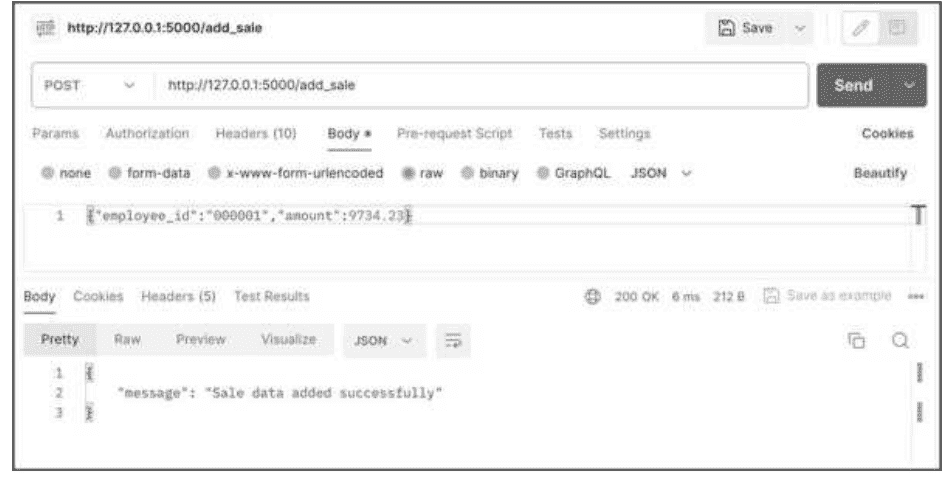
图8-7 插入销售数据

写入完成后，换成 GET 请求去 /get_sales 拉取数据，浏览器直接访问或继续用 Postman 都可以。图8-8 能看到刚写入的那条记录已经出现在返回结果里。短短十分钟就能搭起一个可跑的销售数据管线，在大模型和提示工程的加持下，即便是零基础的用户也能感受到编程的乐趣。

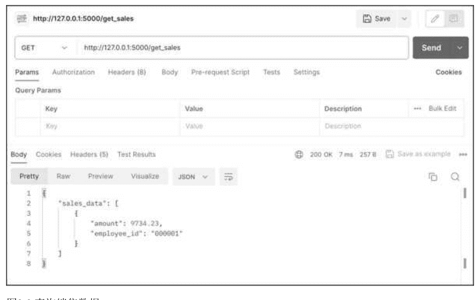
图8-8 查询销售数据

### 8.2.3 用大模型高效解算法题
无论是初学者还是资深开发者，学习或面试时都会碰到各类编程题目，大模型在解题上的表现如何，怎样提问才能让它更准确地理解意图并给出有效帮助？下面以几道经典算法题为例说明思路。

提问时可以遵循以下顺序。
- 1. 先把问题讲清楚：把背景、具体描述和可能的思路一并写明。
- 2. 列出限制条件：时间复杂度、空间复杂度等硬性要求。
- 3. 明确输入输出：数据类型、取值范围、返回结构的格式。
- 4. 给出样例：可验证正确性的输入输出对。
- 5. 补充优化建议：如果已有想法，可要求针对性改进。

下面以一道经典面试题为例。

提示词：
给定整数数组 temperatures 表示每日气温，构造数组 result，result[i] 为第 i 天之后出现的第一个更高气温需要等待的天数，若之后气温不再升高则填 0。

示例1：
输入：temperatures=[73，74，75，71，69，72，76，73]
输出：[1，1，4，2，1，1，0，0]

示例2：
输入：temperatures=[30, 40, 50, 60]
输出：[1, 1, 1, 0]

示例3：
输入：temperatures=[30, 60, 90]
输出：[1, 1, 0]

约束条件：
1<=temperatures.length<=105
30<=temperatures[i]<=100

回答：
该问题可用单调栈解决，下面给出 Python 实现：

```python
def dailyTemperatures(temperatures):
    n = len(temperatures)
    result = [0] * n  # 初始化结果数组，初始值都为0
    stack = []  # 使用栈来保存每天的温度索引

    for i in range(n):
        # 如果栈不为空且当前温度大于栈顶的温度
        while stack and temperatures[i] > temperatures[stack[-1]]:
            j = stack.pop()  # 弹出栈顶的索引
            result[j] = i - j  # 更新结果数组

        stack.append(i)  # 当前温度的索引入栈

    return result
```
实现思路是顺序遍历温度数组，用栈保存尚未找到后继更高温度的下标。遇到更高温度时弹出栈顶并更新答案；若当前温度不高于栈顶，则把当前下标压栈。最后返回结果数组。

使用示例：
temperatures=[73, 74, 75, 71, 69, 72, 76, 73]
result=dailyTemperatures(temperatures)
print(result) 输出：[1, 1, 4, 2, 1, 1, 0, 0]

通过上述提示获得了一个时间复杂度 O(n) 的解法，空间上仍可压缩。进一步追问空间优化后：

提示词：
从空间复杂度角度再做优化

回答：
优化思路是复用输入数组来记录答案，避免单独的结果数组。栈仍然存放下标，但最终答案直接写回原数组对应位置，剩下的栈中下标统一置 0。

```python
def dailyTemperatures(temperatures):
    n = len(temperatures)
    stack = []  # 使用栈来保存每天的温度索引
    for i in range(n):
        # 如果栈不为空且当前温度大于栈顶的温度
        while stack and temperatures[i] > temperatures[stack[-1]]:
            j = stack.pop()  # 弹出栈顶的索引
            temperatures[j] = i - j  # 直接更新温度数组
        stack.append(i)  # 当前温度的索引入栈
    # 温度数组现在存储了答案，重置栈
    for i in stack:
        temperatures[i] = 0
    return temperatures
```
改进后不再分配额外结果数组，空间复杂度降到 O(1) 级别，内存占用明显下降。

## 8.3 面对难题的智慧解法
在深入探讨难题解法之前，先拆解编程思维的本质，并结合实际案例说明如何提问、如何获取高质量答案。通过这些实践，能更系统地掌握在复杂问题面前快速形成精准高效解法的能力。

### 8.3.1 解锁编程思维逻辑
做软件工程时，从设计到落地需要大量经验积累。初入新技术栈时，最大的鸿沟是从入门到实战。借助提示词与大模型对话，相当于拥有一位阅历丰富、掌握全栈技术、逻辑严谨且极有耐心的导师。模型可以在项目全流程中提供技术路线和开发计划，以下以 Raft 协议为例展示讲解逻辑。

提示词：
请帮忙讲解一下 Raft 分布式协议，以及其实现细节，分步骤说明

回答：
Raft 是一种用于分布式系统的一致性算法，目标是高可用与日志一致。它比 Paxos 更易理解，核心是复制日志并保证多节点日志同步。

### 1. RAFT 核心概念
- 角色：节点分为领导者 Leader、跟随者 Follower、候选者 Candidate 三种。
- 领导者选举：通过投票选出单一协调者负责日志复制。
- 日志复制：Leader 把客户端请求追加为日志条目并分发到集群。

### 2. 角色与状态迁移
- 跟随者：默认状态，响应 Leader 或 Candidate 的请求。
- 候选者：长时间未收到心跳时发起选举。
- 领导者：获得多数票后成为 Leader。

### 3. 选举流程
跟随者在超时未收到心跳后转成候选者，自投一票并向其余节点请求投票；获得半数以上票数即成为新 Leader。

### 4. 日志同步
Leader 接收客户端写请求，写入本地日志后并行推送给 Follower，多数节点持久化后即视为提交并应用到状态机。若 Follower 滞后，Leader 会不断重试直至一致。

### 5. 安全与一致性
Raft 保证日志条目按顺序复制到多数派后才被视为已提交，从而确保一致性。

### 6. 实现细节
- 心跳：Leader 周期性发送心跳维持权威。
- 日志匹配：Leader 确保 Follower 日志与自身对齐。
- 日志压缩：通过快照避免日志无限增长。

### 7. 容错恢复
Leader 失效时集群可重新选举，Raft 能容忍少于半数的节点故障。

Raft 因结构清晰、实现友好而广受欢迎，是构建高可用分布式系统的常用选择。

### 8.3.2 实战提问技巧盘点
编程路上无论新手老手都会遇到技术卡点，关键在于如何提问和获取解法。下面按场景给出可复用的提示词范式。

#### 1. 初学者入门
问题：在 Python 中如何拼接字符串？
提示词：
作为 Python 初学者，我想了解把两个字符串连起来的方法，请给一个示例。

问题：Python 的异常处理怎么写？
提示词：
我想在 Python 中捕获并处理特定异常，应该怎样实现？请举例。

问题：如何用循环遍历列表？
提示词：
不太明白 Python 的列表遍历写法，能否给一个简单的循环示例？

#### 2. 调试代码
问题：Python 脚本变量作用域异常。
## 3. 性能加速专题
问题：Python 脚本运行很慢。
提示词：
我有一个 Python 脚本执行速度很慢，有哪些提速手段？附代码如下。

问题：大数据集 SQL 查询慢。
提示词：
需要对大表做 SQL 查询，速度很慢，如何优化？这是我的语句。

问题：Web 应用加载慢。
提示词：
我的网站加载时间过长，常用的优化方法有哪些？

## 4. 设计模式应用
问题：Java 中实现观察者模式。
提示词：
想在 Java 里实现观察者模式，能否给一个简洁示例？

问题：用工厂模式简化对象创建。
提示词：
如何在 C# 中用工厂模式简化对象创建？请给出实现示例。

问题：MVC 在 Rails 中的实践。
提示词：
在 Ruby on Rails 项目里如何更好地应用 MVC？有哪些最佳实践？

## 5. 库和框架的使用
问题：React 组件状态管理。
提示词：
在 React 中如何高效管理组件状态？有没有常用技巧？

问题：Django 用户认证。
提示词：
正在开发 Django 应用，需要实现用户认证功能，请指导步骤。

问题：Node.js + Express 构建 REST API。
提示词：
想用 Node.js 和 Express 搭建 RESTful API，能否提供基础框架和写法？

## 6. 安全性问题
问题：防止 XSS 攻击。
提示词：
Web 开发中如何防范跨站脚本攻击？请给出措施。

问题：数据库安全策略。
提示词：
处理数据库时该如何提高安全性？有哪些具体做法？

问题：安全存储用户密码。
提示词：
在应用中如何安全地处理和存储用户密码？最佳实践是什么？

## 7. 新技术学习
问题：入门 Kubernetes。
提示词：
我是 Kubernetes 初学者，想了解容器编排基础概念和操作，能否给学习路线？

问题：掌握 React Hooks。
提示词：
想学习 React Hooks 的用法，请提供基础示例和最佳实践。

## 8.4 让代码更聪明更优雅
优雅高效的代码体现技术深度，也决定性能、可维护性和扩展性。成熟的工程实践包括 SOLID、DRY、KISS 等原则，优化方向主要有：
- ①可读性：清晰结构、合理命名，便于协作。
- ②可维护性：易于修改扩展，降低维护成本。
- ③可测试性：结构化代码便于单元测试和调试。
- ④性能：减少时空开销，节约资源。

对经验不足的开发者而言，借助提示词配合 ChatGPT 可快速获得高质量改进。下面以两个场景演示。

### 场景一：性能优化
优化前代码：
```
# 遍历数据列表并处理大于 0 的项
for i in range(len(data)):
    if data[i] > 0:
        process(data[i])
```
该段通过下标遍历访问数组元素，索引开销较大。下面用提示词驱动优化。

提示词：
优化循环结构以提高代码执行效率。

优化后代码：
```
for item in data:
    if item > 0:
        process(item)
```
优化后直接对数组元素迭代，利用 Python 内置迭代器，减少索引操作和每次循环的额外开销，执行更快。

> 提示：如果对优化后代码不理解，可要求模型添加注释并解释优化原因。

### 场景二：提升代码可读性
优化前代码：
```
def add_and_multiply(x, y):
    addition = x + y
    multiplication = x * y
    return addition, multiplication
```

在示例中，加法与乘法被硬编码在同一个方法里，导致功能聚合在一起，违背了单一职责的原则。可利用自然语言指令让模型把两者拆开。

提示词：
拆分代码中的函数，以简化测试和提高代码的单一职责性。

优化后代码：
```
def add(x, y):
    return x + y

def multiply(x, y):
    return x * y
```

拆开后各方法独立运行，定位缺陷的范围更清晰，编写测试的负担减轻，开发效率随之提升。

### 场景三：降低代码耦合度

优化前代码：
```
class UserController {
    private UserService userService = new UserService();

    public User getUser(String userId) {
        return userService.getUserById(userId);
    }
}
```

上述实现里 UserController 内部直接 new 了一个 UserService，既要处理请求路由，又要决定依赖如何创建，耦合非常严重，对后续维护和单元测试都不友好。下面用提示词重构。

提示词：
通过构造器注入依赖，替换类内部的直接实例化，以降低类之间的耦合度并提升测试的便利性。

优化后代码：
```
// 使用构造器注入UserService依赖
class UserController {
    private UserService userService;

    public UserController(UserService userService) {
        this.userService = userService;
    }

    public User getUser(String userId) {
        return userService.getUserById(userId);
    }
}
```

重构后模型让构造器把 UserService 传进来，相当于告诉控制器不要自己造实例，由外部提供就绪对象。代码更干净，可测试性明显增强。

## 8.5 创新编程环境的探索

大模型不只会回答问题，还能模拟多类编程环境，扮演 Linux 控制台、正则执行器、Git 客户端等。它可以运行 Linux 指令并给出说明，帮助开发者和初级运维在脱离实机时演练指令、验证脚本，提升操作熟练度。

### 8.5.1 Linux 虚拟环境应用

在企业级服务器上，Linux 命令行是核心操作入口。大量生产机采用无图形界面的发行版，与常见 Windows 不同，开发者只能靠指令交互，熟练度直接影响运维质量。

常见指令及其作用简述：

- **ls**：展示当前目录下的文件与子目录。
- **cd**：切换工作目录，例如 cd /home/user 进入该路径。
- **pwd**：输出当前工作目录的绝对路径。
- **touch**：创建空文件，例如 touch file.txt 生成文件。
- **mkdir**：创建新目录，例如 mkdir myfolder 新建文件夹。
- **rm**：删除文件或目录，例如 rm file.txt 删除文件，操作不可逆需谨慎。
- **cp**：复制文件或目录，例如 cp source.txt destination.txt 实现拷贝。
- **mv**：移动文件或目录，也可用于重命名，例如 mv oldname.txt newname.txt 改名。
- **cat**：读取文件内容，例如 cat file.txt 显示文本。
- **grep**：在文本中按模式查找，例如 grep "pattern" file.txt 检索匹配行。

利用 CRISPE 框架，可让模型充当 Linux 终端，明确角色能力与输入输出约定，提示词如下。

提示词：
> 请扮演 Linux 终端。我会输入指令，你只返回终端应展示的内容，且必须放在唯一的代码块里，不要附加解释。未获指示时不要自行输入指令。若需用英文留言，请放在方括号内[类似这样]。首个指令是：ls

回答：
```
Desktop Documents Downloads Music Pictures Videos
```

ls 返回了当前目录清单，接下来创建名为 GPT 的文件夹。

追加提示：
```
mkdir GPT
```

创建成功后系统无回显，模型也保持空白。继续用 ls 查看目录。

追加提示：
```
ls
```

回答：
```
Desktop Documents Downloads GPT Music Pictures Videos
```

可见目录中已新增 GPT 文件夹。随后进入该目录，新建 log.txt 并写入“数字世界的大模型”，并打印当前路径。

追加提示：
```
cd GPT
```

```
echo "数字世界的大模型" >log.txt
```

```
cat log.txt
```

```
pwd
```

回答：
```
数字世界的大模型
```

```
/home/user/GPT
```

在不启动真实 Linux 的情况下，也能提前练习命令行操作，在此基础上可探索更复杂的指令组合。

### 8.5.2 正则表达式的自动生成技巧

正则表达式是一种强大的文本处理手段，用于匹配字符串模式。它由字符和操作符构成，可识别邮箱、手机号、日期等。基础概念包括：

字符匹配：如 "cat" 可直接匹配该串。
通配符："." 能匹配任意单个字符，"c.t" 可匹配 cat / cut / c1t。
字符类：方括号 [] 定义集合，如 "[aeiou]" 匹配任一元音。
重复操作符：* 匹配零次以上，+ 匹配一次以上，? 匹配零次或一次。
位置锚点：^ 匹配开头，$ 匹配结尾。
转义：反斜杠 \ 用于转义特殊字符，如 "\." 匹配句点。
分组捕获：圆括号 () 用于提取子串。
选择：| 表示或，如 "cat|dog" 匹配两者之一。

大模型可扮演正则生成器，快速产出匹配手机号、日期等模式的表达式。

提示词：
我希望你充当正则表达式生成器。你的任务是生成匹配文本中特定模式的正则表达式，并以可直接复制粘贴的格式输出。不要解释原理或举例，只给出表达式本身。

回答：
当你需要特定正则时，告诉我匹配模式，我会生成对应表达式。请描述你要匹配的模式，我将给出正则。

首个需求：生成匹配 11 位手机号码的正则。

追加提示：
生成匹配 11 位纯数字手机号码的 Python 正则表达式。

回答：
匹配 11 位纯数字手机号码的 Python 正则表达式是：
```
python
import re
pattern = r"^\d{11}$"
```

该式只允许 11 位数字，符合手机号格式。

从回答可知表达式为 "^\\d{11}$"。

下面验证匹配情况。

追加提示：
18888888888 是否匹配这个正则表达式“^\d{11}$”

回答：
是的，字符串"18888888888"与正则表达式"^\d{11}$"匹配，因为它包含且仅包含11位数字。追加提示：
18888888888888 是否匹配这个正则表达式“^\d{11}$”

回答：
不，字符串"18888888888888"不匹配正则表达式"^\d{11}$"，因为它包含13位数字，而正则表达式要求匹配的字符串必须包含且仅包含11位数字。

### 8.5.3 编程语言解释器体验分享

Python 等语言可通过解释器执行。本节演示如何让大模型模拟 Python 解释器，结构包含角色、能力、输入输出约定。

提示词：
请充当 Python 解释器。我会输入命令，你只在唯一代码块内返回解释器输出，不要解释代码。除非我指示，否则不要自行输入命令。

回答：
明白了！我将扮演 Python 解释器，只在代码块内回复。请提供 Python 命令，我会返回执行结果。

追加提示：
```
print ('hello world')
```

回答：
```
hello world
```

### 8.5.4 虚拟Git环境的探索之旅

Git 是 Linus Torvalds 于 2005 年创建的分布式版本控制系统，用于追踪和管理软件项目的源代码版本。它被个人开发者和大型团队广泛使用，支持多操作系统，并与 GitHub、GitLab、Bitbucket 等托管服务集成。对初学者而言，不规范使用易导致冲突或误覆盖。本节介绍 Git 基础用法，并演示如何让大模型扮演 Git 模拟器，降低实操风险。

常用命令：

- **git init**：在项目根目录初始化空仓库。
- **git clone**：克隆远程仓库到本地。
- **git add**：将文件加入暂存区。
- **git commit**：提交暂存区更改并附带说明。
- **git pull**：从远程拉取最新更改并合并。
- **git push**：把本地提交推送到远程。
- **git branch**：列出分支并显示当前分支。
- **git checkout / git switch**：切换或创建分支。
- **git merge**：合并分支更改。
- **git status**：查看未提交更改状态。
- **git log**：查看提交历史。
- **git remote**：管理远程仓库连接。
- **git fetch**：获取远程信息但不合并。
- **git reset**：回退分支指针以撤销更改。

采用 CRISPE 框架，为模型赋予 Git 命令模拟器角色并限制输出格式。

提示词：
请扮演 Git 命令模拟器。我会输入命令，你只在唯一代码块内返回终端输出，不要解释。执行错误时给出修改建议。

回答：
明白了！我将模拟 Git 命令，只提供终端返回内容。请给出第一个 Git 命令，我会返回执行结果。

先初始化仓库。

追加提示：
```
git init.
```

回答：
```
Initialized empty Git repository in/your/project/directory/.git/
```

已在虚拟路径下创建空仓库。接着新建 test 分支并添加 test.txt 到暂存区。

追加提示：
```
git checkout-b test
```

回答：
```
Switched to a new branch'test'
```

追加提示：
```
echo "hello world" > test.txt
git add test.txt
```

回答：
暂存的更改：
（使用"git reset HEAD <file>..."撤出暂存）
修改：
（使用"git checkout -- <file>..."撤出工作目录中的更改）
test.txt
请使用"git commit"提交更改。

文件已进入暂存区，系统提示提交。随后提交并写入说明 first commit。

追加提示：
```
git commit -m "first commit"
```

回答：
```
[test test 8d6936c] first commit
```

```
1 file changed, 1 insertion (+)
```

```
create mode 100644 test.txt
```

模拟完成一次本地提交，展示了大模型对 Git 流程的复现能力。

## 8.6 架构与解决方案的生成艺术

架构与方案生成是软件开发的关键环节，涉及整体结构、技术选型和问题解决思路。大模型不仅能写代码，还能参与大型系统设计。

完整设计需覆盖：

- 需求分析：明确功能、性能、安全、体验等需求。
- 模块化设计：拆分为职责清晰的组件，降低复杂度。
- 技术选型：依据规模与团队技能选择语言、数据库、框架。
- 架构模式：如分层、微服务、事件驱动等。
- 数据模型：设计结构与流转，保证一致性与可访问性。
- 安全性：身份认证、授权、加密、漏洞扫描。
- 扩展性：支持水平扩展。
- 容错性：备份、冗余与恢复策略。
- 监控和日志：及时发现与排障。

下面让大模型基于上述步骤生成支付系统方案。

提示词：
你是一位资深软件架构师，请为支付系统设计架构，要求支持千万级高并发并保证较高安全性，至少包含下列信息。
需求分析、模块化设计、技术选型、架构模式、数据模型、安全性、扩展性、容错性、监控和日志，请给出具体设计方案。

本节已用提示工程生成支付系统架构，后续可在该基础上，结合实际需求与资源，细化为完整分析文档。

追加提示：

# 千万级支付平台设计拆解

基于前期架构草案与团队技术积累，梳理一份以 Java 为主、Spring Cloud 治理、关系型数据库支撑的高并发支付方案，帮助全体成员明确边界、业务要点与实现细节。

## 1. 项目概览

### 1.1 项目背景
本次要搭建面向多渠道的收付平台，覆盖银行卡、支付宝、微信等主流通道。平台需应对海量并发场景，在保障高安全性的同时提供流畅易用的操作体验。

### 1.2 预期成果
- 支撑上千万级并发交易处理能力
- 符合 PCI DSS 等行业安全规范
- 呈现直观友好的支付界面，支持快速结账

## 2. 系统架构

### 2.1 模块拆解
- 账户管理
- 支付处理
- 交易归档
- 安全鉴权
- 通知推送

### 2.2 技术栈
- 开发语言选用 Java
- 关系库选用 MySQL
- 微服务治理套件使用 Spring Cloud
- 安全检测参考 OWASP 常见十大风险

### 2.3 架构风格
- 微服务形态
- 消息中间件选用 Kafka

### 2.4 数据结构
- 账户信息：保存账号资料，包含用户名、哈希密码、支付方式等
- 交易信息：记录每笔支付明细，包含金额、时间戳、状态等

### 2.5 安全策略
- 链路传输采用 TLS 加密
- 强化身份鉴权，引入多因素验证
- 严格遵循 PCI DSS 等行业安全标准

### 2.6 弹性扩展
- 微服务形态可随负载增长动态扩容实例
- 通过负载均衡分发请求流量

### 2.7 容错保障
- 构建备份与冗余机制，确保支付数据不丢失

## 3. 功能需求

### 3.1 账户管理
- 注册
- 登录
- 账户维护

### 3.2 支付处理
- 接收并校验支付请求
- 调用第三方支付网关

### 3.3 交易归档
- 记录支付交易详情
- 涵盖金额、时间戳与状态

### 3.4 安全鉴权
- 加密传输
- 强身份验证机制
- 符合 PCI DSS 标准

### 3.5 通知推送
- 向用户推送支付状态提醒
- 包含成功与失败通知

## 4. 性能需求
- 承载海量并发请求
- 平均响应时长控制在 100 毫秒以内

## 5. 监控和日志
- 上线全链路监控体系，实时追踪性能与异常
- 保留详尽的交易日志，便于问题追溯、合规审计与性能分析

## 6. 项目计划
- 阶段 1：系统设计与架构搭建
- 阶段 2：开发与测试
- 阶段 3：上线部署
- 阶段 4：性能优化与运维

## 7. 团队成员
- 项目经理
- 架构师
- 开发人员
- 测试人员
- 安全专家

## 8. 风险分析
- 技术风险
- 安全风险
- 人力资源风险
- 预算风险

## 9. 结论
本分析文档为团队提供清晰指引，覆盖需求、架构、选型、功能与性能等关键面，充当项目落地的蓝图，助力高效完成高并发支付系统的设计与交付。团队将持续关注各类风险，确保按计划达成目标。

## 8.7 智能编程的综合应用案例

前文已涉及代码生成、自动注释、代码优化与虚拟编程环境的应用。接下来通过两个实战案例展示如何借助大模型的智能编程能力，无需手工逐行编写即可完成复杂软件或游戏的开发。

### 8.7.1 小试牛刀：简易计算器实战

本节借助提示工程实现一套前后端分离的计算器，包含页面与服务，实施前需准备 Python 环境与 Flask 组件。传统开发需分别编写前后端并部署，而今针对简单功能可借助大模型辅助完成。下面以计算器实现为例演示提示工程辅助编程。

虽为小项目，仍遵循完整研发流程。先生成计算器系统架构设计方案，要求前后端分离。

提示词：

请以资深软件架构师的角色，协助设计计算器系统架构，需要前端页面与后端服务，前后端分离部署，至少包含需求分析、模块化设计、技术选型、架构模式、数据模型、安全性、扩展性、容错性、监控和日志等要素，给出具体方案。

回答：

设计计算器系统架构需兼顾前端与后端协作、数据处理、性能与安全。以下为具体方案，涵盖需求分析、模块化设计、技术选型、架构模式、数据模型、安全性、扩展性、容错性、监控和日志。

1. 需求分析
- 功能需求：支持加减乘除等基础数学运算。
- 界面需求：提供友好界面，含输入框、操作按钮与结果展示区。
- 性能需求：输入即时响应，计算低延迟。
- 安全需求：防范输入错误或恶意输入，保证计算准确。

2. 模块化设计
- 前端界面单元：接收用户输入并展示结果。
- 计算单元：执行数学运算，处理输入。
- 安全单元：校验用户输入数据，保障安全。
- 日志单元：记录操作与结果，用于审计与排错。

3. 技术选型
- 前端技术：HTML、CSS 与 JavaScript 构建界面。
- 后端技术：Python 与 Flask 框架搭建服务。
- 数据存储：无需数据库，结果驻留内存。
- 通信协议：HTTP 用于前后端交互。

4. 架构模式
- 前端与后端分离，前端负责交互展示，后端负责计算与安全校验。

5. 数据模型
- 模型简洁，主要包含用户输入与计算结果的结构。

6. 安全性
- 前后端均做数据校验，确保输入合法。
- 防范恶意输入与注入类攻击。
- 使用 HTTPS 加密通信，保护数据。

7. 扩展性
- 可便捷扩展更多运算或新功能，只需新增单元。
- 支持自定义函数扩展，满足多样需求。

8. 容错性
- 设计错误处理机制，应对异常情况。
- 通过日志记录潜在问题，辅助排查。

9. 监控和日志
- 日志单元记录操作、结果与异常。
- 部署监控体系，实时观测性能与异常。

该方案采用前后端分离，兼具良好模块化、安全、扩展与容错性，提供友好界面并记录操作以便审计与排错。后续可按需扩展优化。

接下来将架构方案带入上下文，由大模型生成计算器代码与工程结构。

追加提示：

请以资深软件工程师的身份，依据上述系统架构设计方案，生成完整的代码细节，以及部署步骤。

回答：

搭建完整的前后端计算器应用需若干步骤，含前端页面与后端代码。下面给出入门示例，后端使用 Python Flask，前端使用 HTML 与 JavaScript。

1. 新建 calculator_app 工作目录并进入。

2. 安装 Flask。可以使用以下命令：

```
pip install Flask
```

3. 在项目根下创建后端入口脚本。

```python
from flask import Flask, render_template, request, jsonify
app = Flask(__name__)
@app.route('/')
def index():
    return render_template('index.html')
@app.route('/calculate', methods=['POST'])
def calculate():
    expression = request.form.get('expression')
    try:
        result = eval(expression)
        return jsonify({'result': result})
    except Exception as e:
        return jsonify({'error': 'Invalid expression'})
if __name__ == '__main__':
    app.run(debug=True)
```

4. 在项目根下创建 templates 子目录存放页面模板。

5. 在模板目录下创建 index.html 作为前端界面。

```html
<!DOCTYPE html>
<html>
<head>
    <title>Calculator</title>
</head>
<body>
    <h1>Simple Calculator</h1>
    <input id="expression" type="text" placeholder="Enter an expression">
    <button onclick="calculate()">Calculate</button>
    <div id="result"></div>
    <script>
        function calculate() {
            var expression = document.getElementById('expression').value;
            fetch('/calculate', {
                method: 'POST',
                body: new URLSearchParams({ 'expression': expression }),
                headers: {
                    'Content-Type': 'application/x-www-form-urlencoded'
                }
            })
            .then(response => response.json())
            .then(data => {
                if (data.error) {
                    document.getElementById('result').innerHTML = 'Error: ' + data.error;
                } else {
                    document.getElementById('result').innerHTML = 'Result: ' + data.result;
                }
            });
        }
    </script>
</body>
</html>
```

6. 在命令行返回项目根目录，运行程序。

```bash
python app.py
```

程序启动后，可在浏览器访问 http://127.0.0.1:5000/ 使用该简易计算器，输入数学表达式后点击 Calculate 获取结果。

注意这仅为基础示例，可根据需求扩展功能、改善界面并增强安全与错误处理。示例中使用 eval 计算表达式，生产环境应谨慎使用以避免安全隐患。

按上述步骤新建 Python 项目并执行步骤 2～6 后，终端界面如图 8-9 所示。后端服务成功启动。


图 8-9 计算机程序启动

后端启动后，本地访问 http://127.0.0.1:5000 页面，即可在浏览器使用自建计算器。输入“1+1”后按“Calculate”，浏览器会返回计算结果。

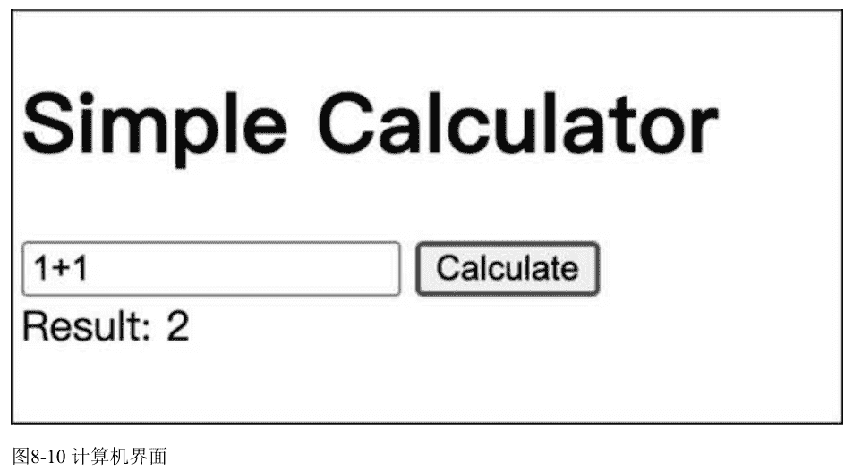

图 8-10 计算机界面

本节完成首个编程实践案例，虽为简单计算器，却完整经历了用提示工程生成架构方案，再由大模型据此生成代码与工程结构的流程。读者可借此思路开展智能化软件开发。

### 8.7.2 “80”“90”后的回忆：制作雷电程序

雷电，又称雷电 1945 或 1945kIII，是日本厂商 1995 年推出的经典垂直卷轴射击游戏，在街机及各平台广受欢迎，成为射击类游戏的代表。本节将用提示工程复刻经典雷电，感受游戏制作乐趣。

简要设计如下：雷电为垂直卷轴射击、弹幕类型。玩家操控战机射击并躲避敌攻。游戏分多关卡，每关地图与敌人布局不同。关卡末有 Boss 战。玩家可选择不同战机，各具主副武器，如导弹或激光，武器可升级。游戏鼓励刷分竞争。本节做简化实现核心玩法，随后将设计转化为提示词。

提示词：

请以资深游戏开发者的身份，编写一个雷电程序，要求使用 Python 语言，实现战斗机能与敌机进行战斗的功能，并讲解每个步骤与最后的启动方式，以下是游戏具体设计。

游戏类型：

类型：雷电是一款垂直卷轴射击游戏，也属于弹幕射击游戏的子类型。

玩家角色：玩家控制一架飞机，进行射击和躲避敌人的攻击。

游戏机制：

游戏流程：游戏由多个关卡构成，每个关卡都有不同的地图和敌人布局。

道具和升级：游戏中会出现各种道具，如火力升级、生命值恢复、护盾等，玩家需要捡取它们以提高生存能力。

高分竞争：游戏鼓励玩家争夺高分，以竞争或展示他们的游戏成就。

难度和挑战性：

高难度：雷电以其高难度而著名，要求玩家具备快速反应、记忆和策略规划能力。由于敌人的弹幕攻击会填满屏幕，玩家需要巧妙躲避。

回答：

完整实现雷电程序任务复杂，需大量代码与资源。以下提供简化示例，使用 Python 与 Pygame 实现玩家操控飞机、与敌机战斗与射击，包含基础游戏循环、操作、敌机生成与射击。

步骤与代码示例：

```
Step 1: 安装 Pygame
首先，确保你已经安装了 Pygame 库。你可以使用以下命令安装 Pygame：
pip install pygame
Step 2: 创建游戏窗口
import pygame
初始化 Pygame
pygame.init()
设置游戏窗口尺寸
WINDOW_WIDTH = 800
WINDOW_HEIGHT = 600
创建游戏窗口
screen = pygame.display.set_mode((WINDOW_WIDTH, WINDOW_HEIGHT))
pygame.display.set_caption("雷电")
...
Step 3: 定义游戏角色
python
定义玩家飞机
player_img = pygame.image.load("player.png")
player_x = WINDOW_WIDTH // 2 - 32
player_y = WINDOW_HEIGHT - 64
player_x_change = 0
定义子弹
bullet_img = pygame.image.load("bullet.png")
bullet_x = 0
bullet_y = player_y
bullet_y_change = 10
定义敌机
enemy_img = pygame.image.load("enemy.png")
enemy_x = 370
```

enemy_y = 50

enemy_x_change = 2

enemy_y_change = 40

...

## Step 4: 游戏循环和事件处理

```python
# 游戏主循环
running = True
while running:
    for event in pygame.event.get():
        if event.type == pygame.QUIT:
            running = False

        # 玩家控制飞机移动
        if event.type == pygame.KEYDOWN:
            if event.key == pygame.K_LEFT:
                player_x_change = -5
            if event.key == pygame.K_RIGHT:
                player_x_change = 5
            if event.key == pygame.K_SPACE:
                # 玩家射击
                bullet_x = player_x + 16
                fire_bullet(bullet_x, bullet_y)
        if event.type == pygame.KEYUP:
            if event.key == pygame.K_LEFT or event.key == pygame.K_RIGHT:
                player_x_change = 0

    # 更新玩家飞机位置
    player_x += player_x_change
    if player_x < 0:
        player_x = 0
    if player_x > WINDOW_WIDTH - 64:
        player_x = WINDOW_WIDTH - 64

    # 更新子弹位置
    if bullet_y <= 0:
        bullet_y = player_y
    if bullet_y < WINDOW_HEIGHT:
        fire_bullet(bullet_x, bullet_y)
    bullet_y -= bullet_y_change

    # 更新敌机位置
    enemy_x += enemy_x_change
    if enemy_x < 0:
        enemy_x_change = 2
        enemy_y += enemy_y_change
    elif enemy_x > WINDOW_WIDTH - 64:
        enemy_x_change = -2
        enemy_y += enemy_y_change

    # 检测碰撞
    collision = is_collision(enemy_x, enemy_y, bullet_x, bullet_y)
    if collision:
        enemy_x = 370
        enemy_y = 50
        bullet_y = player_y

    # 渲染背景
    screen.fill((0, 0, 0))
    # 渲染玩家飞机
    screen.blit(player_img, (player_x, player_y))
    # 渲染子弹
    screen.blit(bullet_img, (bullet_x, bullet_y))
    # 渲染敌机
    screen.blit(enemy_img, (enemy_x, enemy_y))
    pygame.display.update()
```

## Step 5: 子弹与碰撞判定模块实现

```python
def fire_bullet(x, y):
    screen.blit(bullet_img, (x, y))

def is_collision(enemy_x, enemy_y, bullet_x, bullet_y):
    distance = ((enemy_x - bullet_x) ** 2 + (enemy_y - bullet_y) ** 2) ** 0.5
    if distance < 27:
        return True
    return False
```

## Step 6: 结束画面绘制与资源释放

```python
# 退出游戏
pygame.quit()
```

本案例演示了借助 Prompt 快速搭建一款简易雷电类射击游戏的可行性。自机可在画面内移动，敌机自上而下侵入，接触即触发失败判定。正式运行前请先准备三张素材图，对应玩家机、敌机、弹丸，文件名分别为 player.png、enemy.png、bullet.png，与代码置于同一文件夹即可启动，初始效果如下所示。

图8-11展示的是经提示词生成的原型。读者可在此基础上扩展玩法，例如加入武器升级体系、关卡推进、Boss 对战、掉落道具与积分统计等。素材也可升级，比如为敌我双方定制不同外观，并补充背景音乐与音效，让整体程序更完整、挑战性更强。


图8-11 雷电截图

# 第9章 提示工程驱动软件生态演进

当数字化已深度融入生产生活，软件生态已构成关键底座。与此同时，生成式人工智能正掀起系统性变革。本章围绕 Prompt 技巧如何激活软件生态展开，并盘点其在各领域的实践形态。

## 9.1 金融科技与提示工程的共生演进

从金融侧观察，新一代生成式系统正重塑金融科技乃至业态格局，尤其在强互动场景中释放出显著价值，因而金融垂类模型成为多方争夺的技术高地。互联网平台、银行券商等机构，以及数据库厂商均已投入研发。相较于加速数智化与重建信任，该技术在长尾场景的落地更为突出，比如更专业的智能客服、融资项目实时监测等。依托生成式系统驱动的智能金融助手已率先进入支付类 App，为投资者与从业者带来更顺畅高效的体验。

### 9.1.1 支付场景中的提示工程实践

Prompt 策略在支付产品中的应用，可让用户获得更专业的财富服务。以支付宝为例，蚂蚁集团自研的金融垂类生成式系统已嵌入蚂蚁财富，通过解析用户的自然表达，可精准调用平台内各类数字化金融工具。理财维度涵盖选品推荐、产品评测、行情解读、资产配置等六大类服务；保险维度则提供产品解读、家庭保障规划、智能核保、智能理赔等智能化服务。

在支付风控层面，生成式系统同样释放出明显价值。消费金融领域，诸如双十一等大促的参与集中在支付环节，这要求机构在极短时间内针对不同平台、不同客群作出精准风险研判。马上消费依托自研“天镜”系统，日均可基于用户千万级行为进行风险研判，日均模型计算上亿次，每秒处理一百五十万条特征，实现秒级风控。海量数据积累与强算力为风控策略提供了充足多元的支撑，使支付环节更安全可靠。

### 9.1.2 金融垂类生成式系统的竞争格局

率先布局金融垂类研发的主要是互联网厂商。金融垂类模型被视作顶尖技术，难度不仅在技术合规，更在于数据与行业经验积累。百度、腾讯、阿里、360 等长期深耕反黑产与 AI，为其在金融垂类突破提供资源保障。

2023 年 5 月下旬，度小满推出千亿级中文系统“轩辕”，也是国内首个开源的金融垂类模型。该系统在 1760 亿参数的 Bloom 模型上继续训练，语料覆盖通用内容与金融研报、股票、基金、银行、保险等专业知识，可完成金融术语理解、市场评论、数据分析、新闻理解等任务。

2023 年 9 月，蚂蚁金融垂类模型上线。它在蚂蚁基础模型之上针对金融行业深度定制，基于万亿 Token 通用语料叠加千亿 Token 金融知识，并以 300 多个真实产业场景中提取的 60 余万条高质量指令数据进行训练构建。

现有资料显示，金融垂类模型在垂直领域具备良好泛化能力，能够辅助用户获取金融信息并开展金融活动。可从三方面说明。

其一，术语解释能力突出。金融专业词汇具有特殊规则，传统搜索引擎解释往往不够精准。如“涨停板”“跌停板”等受规则限制而异，金融垂类模型通过学习规则可准确理解并服务用户。

其二，数据分析能力强。系统可对海量数据进行计算挖掘规律，例如依据历史数据预测股票等金融工具走势，辅助决策。

其三，新闻解读及时准确。公司公告、政策变动等金融新闻是投资者判断的重要依据，系统能快速解析新闻内容，分析对股价、股市的影响，提供全面信息。

除互联网厂商外，数据库厂商也在布局。星环科技自研金融垂类模型“无涯 Infinity”，并提供一站式自建大语言模型工具链，含向量数据库 Hippo 及数据库底层处理技术。恒生电子的 LightGPT 使用超 4000 亿 tokens 金融数据与超 400 亿 tokens 语种强化数据，可支持 80 多种金融专属任务微调，在专业理解上表现优异。

2023 年 8 月 28 日，马上消费金融推出国内首个零售金融垂类模型“天镜”。目前已在汇聚智慧、唤醒知识、众创价值、数字分身四大方向落地产品，覆盖营销获客、客户运营、客户服务、风险审批、安全合规、资产管理六大零售场景。1）汇聚智慧，主要用于人工客服，提炼优秀人工服务经验形成群体智慧，实现同时服务多人的 AI 客服。截至 2023 年 8 月，意图理解准确率达 91%，客户参与率达 61%，显著高于传统模型与人工。2）唤醒知识，解决非结构化文档数据提取难题。招股书、财报、经济预测等文件上传后，天镜可解析专业术语、定位多文档、洞察图表信息并归纳总结。3）众创价值，降低数据使用门槛。SQL 生成平台无需代码，用户用自然语言描述需求即可自动检索生成答案，完成数据挖掘。4）数字分身，打造融合数字外表、智慧大脑与情感内核的数字人。员工上传资料并设定参数，5 分钟训练后即可拥有个人数字分身，代替完成大量工作。

### 9.1.3 用户体验提升的关键路径

生成式系统快速发展，让财富管理有望破解传统服务痛点，如理财顾问门槛高、普通投资者难以获得定制化服务，让长尾用户享受到更专业、更有温度、7×24 小时在线的服务。

2023 年 9 月 8 日，蚂蚁集团发布智能金融助理“支小宝 2.0”与智能业务助手“支小助 1.0”。支小宝 2.0 面向 C 端，提供行情分析、持仓诊断、资产配置、投教陪伴等专业服务；支小助 1.0 面向金融机构与从业者，为理财顾问、保险代理、投研、营销、理赔等打造全链路 AI 助手。

在知识覆盖方面，支小宝 2.0 实现金融领域有问必答，事件分析推理能力不输行业专家平均水平；在专业能力方面，依托系统服务中枢，可像真人一样提供上百种理财服务；在语言表达方面，金融意图识别准确率达 95%，能读懂问题也能读懂情绪并个性化表达；在安全保障方面，通过围栏技术保障内容安全与合规，带来透明可靠体验。

例如询问“人工智能这么火，会影响哪些行业”，支小宝 2.0 会实时整合 50 多个专业机构、权威智库与媒体信息后作答。若用户情绪化表达，AI 会进行语料提炼、情绪识别与分类，尝试不同话术帮助缓解负面情绪。因此它不仅能回答“持仓新能源汽车最多的基金是哪个”等专业问题，也能回应“我又绿了怎么办”等情绪化提问并进行安抚与复盘。

支小助 1.0 包含服务专家版、投研专家版、理赔专家版、保险研究专家版等六个版本，可在投研分析、信息抽取、商机洞察、专业创作、金融工具使用等环节提供深度服务。以投研支小助为例，实测显示其每日可为每位投研分析师高质量提取 100 多篇研报资讯的逻辑观点、完成 40 多个金融事件的推理归因，大幅提升效率。

同时，支小助 1.0 基本可完成基础金融工程代码编写，提升量化研究效率。在服务支小助辅助下，理财顾问与保险代理人的人均有效管户半径可扩大 70% 以上。

正如蚂蚁集团财富事业群总裁、蚂蚁基金董事长王珺所言，“伴随金融服务从广度走向深度，财富管理正形成以用户为中心的新生态，结合生成式系统技术，将为用户创造更普惠、专业、透明且包裹式的新体验。”这正是系统驱动财富管理的重要方向。

## 9.2 提示工程与智能搜索的协同创新

生成式系统的出现对传统搜索引擎构成冲击，也为问答业务提供新思路。与此同时，搜索引擎正与生成式系统融合，借助其能力使结果表述更清晰，形成准确性与实用性更强的搜索新形态。为获得更强问答能力，生成式系统正向法律、医疗、金融等垂类延伸，满足用户长尾专业提问。今天生成式系统飞速演进，传统搜索也在不断革新。

### 9.2.1 生成式系统与传统搜索的竞争与互补

生成式系统初现时即被与传统搜索引擎对比，被认为对话式生成对搜索构成巨大挑战，甚至可能替代。但至今来看担忧有所过剩，系统火热但搜索用户并未衰减，因两者赛道本就不同。以 ChatGPT 为例进行对照。

相较传统搜索，ChatGPT 并非机械罗列网页链接，而是调用训练语料直接生成整理优化后的答案，以对话形式呈现，并能基于上下文持续交互。还能进行文学创作、绘图、编程、调试等创作型工作。测试显示其在百科检索、数学计算、常识问答、文学交流、知识推理等对话任务上的意图识别率可达 98% 左右，生活闲聊约 95%，语义理解能力良好。

与谷歌搜索对比，ChatGPT 的直接答案展示更具实用性，对话方式更有人情味，可满足智能办公与 AI 创作需求。主流搜索引擎多基于问题本身检索，导致用户难以准确描述需求时受限。而 ChatGPT 可通过连续对话挖掘真实意图，提供解决方案，借助开放式生成机制循序渐进给出用户真正需要的答案。

不过传统搜索引擎历经数十年积累，仍具备不可比拟的优势：

- 海量数据库：已构建庞大数据库，可在海量信息中快速精准定位，并提供多条相关结果供用户选择。
- 可信可靠：仅展示公开网页，用户可自行判断来源可靠性，而 ChatGPT 直接给出答案，来源难以追溯。
- 实时稳定：限制更少，实时性与稳定性更高，用户可随时获取较准确结果。

因此生成式语言系统难以完全替代搜索引擎，“生成式系统+搜索引擎”的混合形态更可能成为新一代搜索方向，带来极大体验提升。

### 9.2.2 新一代智能搜索的兴起

2023 年 8 月 23 日，昆仑万维推出国内首个融合大语言模型的搜索引擎——天工 AI 搜索。用户输入问题后，系统先以卡片形式展示信息源，再给出系统生成的回答，最后附上 AI 生成的追问，形成“链接-回答-追问”的呈现方式。

结果给出后，依托上下文理解，天工 AI 搜索可通过 AI 总结加多轮对话不断挖掘用户真实意图，对复杂问题深入研究。

例如询问“新加坡好玩吗”，天工 AI 给出有人情味的智能回答，并将各链接有机串联在上下文中，使用户清晰把握要点，同时保证答案可追溯、可考证、可信赖。搜索还会根据问题智能生成相关追问，便于用户进一步深入。

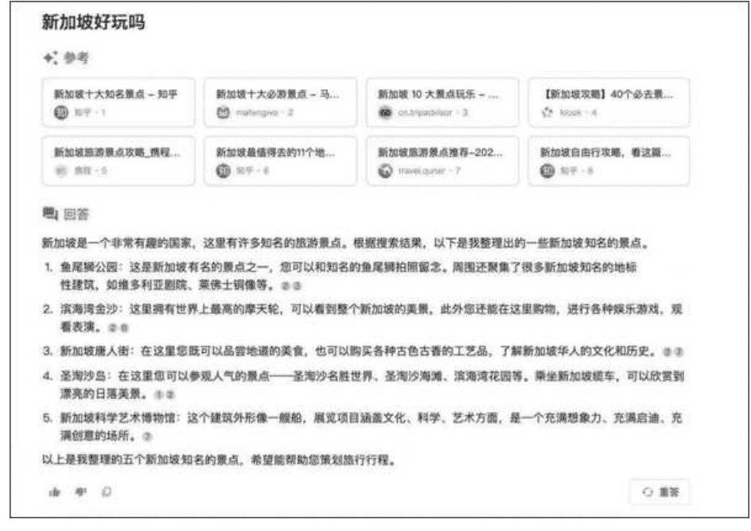

实测：带时限条件下的旅行规划， 天工AI搜索表现如何

图9-1 天工AI搜索示意图

为了观察天工AI搜索在追问场景下的推理能力，我们在新加坡行的原有提问上追加了“三天内完成”的时间限制，想看看系统能否给出可落地的行程。检索页如图9-2。


图9-2 新加坡旅游计划搜索

返回的结果没有把景点简单罗列，而是为三天分别设定了主题并配上路线规划。第二天的主题偏向沉浸式本地体验，与当下流行的city walk路线高度契合。整份攻略兼顾实用与个性，细节如图9-3。

从交互来看，意图理解与内容组织的成熟度已相当可观。对话结束后，每轮提问都会被归档到“我的历史”，便于回看，也支持快速分发给他人。

更进一步，借助底层的生成能力，天工可以在提问后直接产出报告、图表或方案，把传统的信息检索延伸到内容生产，省去大量人工整理。官方提到多模态上传仍在内测，未来将接入语音、图片等输入。

表现提升既来自生成式模型赋能，也离不开经典检索的纠偏作用。两者结合，既压制了无源臆造的风险，又能更贴合用户的真实意图，理解深度超过传统搜索引擎。它指向的未来形态是：省略翻阅、摘抄、归纳的环节，直接给出完整答案，同时保持对互联网的实时连接以保证时效。

### 9.2.3 垂直搜索领域的突破

### 1. 法律大模型
华宇软件于2023年7月推出“万象法律大模型”，9月20日升级至2.0版，聚焦办案助手、智能庭审、有神公文、文书管家、AI阅卷五大方向开展训练与知识增强。模型具备法律问题理解、材料解析、知识增强、推理、要素拆解、内容归纳、文本生成、合规管控等八项核心功能，可为法官、检察官、律师、企业法务等提供近百个业务场景的智能支撑，已在知识检索、阅卷、庭审辅助、文书写作等环节落地。

学术端也在推进。北京大学深圳研究生院与兔展智能AIGC联合实验室于2023年7月发布国内首个面向法律场景的对话模型“ChatLaw”。训练语料涵盖论坛、新闻、法条、司法解释、法律咨询、法考题、判决书等多种来源。用户上传文件或录音后，系统会以可视化导图与图表呈现材料结构与要点，并能基于事实生成法律建议和法律文书。

### 2. 医疗大模型
2023年9月19日，百度发布国内首个产业级医疗大模型“灵医”，具备病历自动生成、中英文医学文献解析、智能问答等能力。除辅助诊断外，还能处理医院多维度复杂运营数据，提升效率与安全。以50张床位的病区为例，模型可依据病情严重程度与患者数量灵活安排医生介入与手术时机。同时提供24小时在线健康管家服务。灵医已与固生堂合作，并向连锁药房、公立医院、药械企业、互联网平台等200余家机构开放体验，覆盖大健康全链路。

2023年10月16日，商汤发布“大医”AI模型，提供13个预设的专业问答场景，支持自定义提示工程、长程记忆、医学知识库查询与总结，并面向产业链上下游开放定制。商汤与郑州大学第一附属医院国家远程医疗中心共建的用药咨询模型开场白为“您好，我是国家远程医疗中心用药助手，有什么可以帮助您的吗？”。例如询问“华法林是啥”，模型会解释其为预防和治疗血栓性疾病的抗凝药物；追问支架术后服药出现便血拟做肠镜的风险时，模型会说明抗凝可能增加出血风险，便血需引起重视等注意事项。

### 3. 金融大模型
国内金融垂类模型发展迅速。度小满于2023年5月发布参数规模1760亿的中文模型“轩辕”，基于Bloom训练，是国内首个开源的垂直金融大模型，在金融术语理解、市场评论、数据分析、新闻理解等任务上明显优于通用模型。6月，恒生电子推出金融行业模型LightGPT，覆盖投顾、投研、风控、合规、运营、客服等场景，具备专业问答、逻辑推理、超长文本处理及多模态交互能力。

### 9.2.4 搜索体验的创新优化

### 1. New Bing
2023年2月，微软发布由人工智能驱动的新版Bing。用户在搜索框输入问题后，结果页顶部会先给出由生成式模型从海量结果中提炼的简洁答案，减少翻页成本。例如输入“北京时间”直接显示当前日期时间；输入“美元兑换人民币”直接给出实时汇率；输入“奥斯卡最佳影片”直接列出历届获奖名单。智能答案覆盖多个领域，实现信息即时获取。

除检索外，New Bing基于ChatGPT-4提供聊天页，支持“有创造力”“更平衡”“更精确”三种模式，并可体验文生图等能力，通过链接进入AI绘图模式即可生成图片。后续升级包括四项：多模态回答，支持文字触发全网图视频搜索及图片上传搜索；图像创造器，基于DALL·E支持百种语言生成图像；聊天历史，可回溯并基于历史优化个性化；插件支持，如OpenTable、Wolfram|Alpha，提升数据可视化与复杂分析。

### 2. 百度搜索
百度将通用大模型内嵌到搜索引擎，构建全新AI搜索体系。输入需求后，返回的不仅是带引用的AI智能总结，还是图文视频多模态结果，无需自行甄别与汇总。

对于无现成答案的简单问题，如“东帝汶面积相当于几个通辽？”，AI会展示推理与计算过程直接给出结果；对于开放多解问题，如“做蛋糕没有鸡蛋能用什么代替”，如图9-4所示，系统会整合多条合规答案并附引用与依据；若答案存在于视频中，也能自动定位到相关片段。

图9-4 百度AI搜索截图

百度AI搜索衍生出三大能力：极致满足，即精准理解深层意图后给出最佳答案；推荐激发，即在给出答案后推送个性化内容流，拓展视野；多轮交互，即通过对话不断澄清需求，提升匹配度。以“给我制定一份广州到北京的三天两晚旅游攻略”为例，传统搜索只给出零散信息，AI搜索首条即可生成完整攻略，并借助第三方插件完成酒店机票等预订；若匹配度不足，多轮对话可进一步细化需求，建立信任。

## 9.3 提示工程与设计软件：数字创意的魔法之手

设计行业在国内缺乏统一界定。按北京市统计局2021年分类，主要包括产品设计、建筑与环境设计、视觉传达设计三大类。若把建筑、工程、工艺服装等作品统一看待，可归为“作品设计”。

作为内容生成型行业，设计正被大模型深度重塑。AIGC可辅助生成文本、语音、图像乃至3D模型，大幅提升效率。如何正确打开大模型、释放其潜力，是新时代设计师与软件开发者需思考的核心。

### 9.3.1 大模型在设计产品中的引入
浙江大学国际设计研究院报告指出，设计范式经历了经典设计、设计思维到计算设计三阶段。经典设计依托手工与经验；设计思维强调以用户为中心解决模糊问题；计算设计借助算法与工具提升效率与复用。AIGC带来了第四范式——智能设计。

在此范式下，设计师通过提示工程调动大模型的理论与实践知识，或直接产出作品，或获得灵感，再以自然语言迭代完善，实现人机协作。例如用ChatGPT撰写创意方案，再以文字提示输入Midjourney快速成图。目前已在多个产品设计环节落地。

#### 案例1：大模型对设计行业的优化示例
- （1）加速工作流推进
Kaedim平台基于AI与机器学习实现由图到高质量3D模型的快速生成，帮助设计师迅速把创意转为可评估的3D模型，提升迭代速率。
- （2）赋能跨职能团队协作
Dora AI是无代码建站平台，可基于文本生成可编辑可交互网站与网页动画，降低设计与前端沟通成本，加快反馈闭环。
- （3）整合跨模态设计资产
OpusAI可用自然语言构建3D可交互场景，整合模型、纹理等资产，文本越精准、资产越丰富，场景细节越完善。Figma插件Ando作为设计师的AI Copilot，可整合需求、参考图、元素形状，提供界面创意启发。
- （4）统一跨应用设计元素
造物云在线3D设计平台借助生成式大模型，将商品摄影、宣传视频、营销文案元素统一为“人、货、场”，推出AIGC+3D融合创作平台，实现从“内容即服务”到“模型即服务”的转变。
- （5）统筹跨模态设计任务
Meta提出的ImageBind可整合文本、图片、音频、深度图、热力图、IMU数据等六种模态，支撑“音乐+图像→视频”等跨模态任务，实现多形式流程共融。
- （6）设计结果的多模态转换
Figma插件parallax利用AI以3D视角排列平面图层，生成视差动画，并可导出HTML、SVG、GIF、WebM等格式。
- （7）设计流程的多链路串联
腾讯CDC体验设计团队用ChatGPT提取受众需求关键词，结合Stable Diffusion生成运营效果图，实现策略、文本、图文应用的高效串联。
- （8）服装设计工作的优化
西湖心辰与知衣科技联合推出Fashion Diffusion，选定款式、颜色、材质后10秒内生成模特实穿效果图，重塑服装设计流程。
- （9）建模渲染工作的取代
ControlNet等技术使AIGC能基于多条件对单张图像做精细控制，如以线稿控制建筑结构并快速生成多风格渲染图，减少机械性劳动。
- （10）人机协作的创作赋能
SdPaint基于Stable Diffusion的实时绘画工具，每画一笔即依据预设文本与线稿补全画面，细节随笔画增加实时完善，实现协作创作。

### 9.3.2 创意设计与大模型的联动
AIGC让设计门槛大幅降低，非专业用户也能通过自然语言提示在AI加持平台上实现创意，“只要有想法就能成为设计师”。对职业设计师而言，Stable Diffusion、Midjourney等工具可快速生成配图、图标与原型，再精细化打磨，形成“AI激发创意→AI辅助完善”的循环。

前提在于掌握与大模型沟通的方式，即提示工程。描述越具体、特征越关键，模型还原度越高，如同手握密码本进行解码再呈现。设计领域已有专家推出视频教程，涵盖官方命令、参数、模型讲解、prompt公式与提问策略等系统用法。

#### 案例2：Midjourney中的创意实现
Midjourney是知名AI图像生成工具，输入文本即可生成高质量逼真视觉，无需手动绘制。以电商宣传海报为例，其工作流为文生图，提示词的精准度直接决定效果。若已有灵感图片，可先用“/describe”进行图生文，由模型提取关键词，再结合需求撰写提示词生成目标模特图。其他设计软件原理相近。

```
Full body photo of a Chinese female model standing in front of a bright wall, Asian style, Product photography, Sophisticated and high-end, Panoramic view, 100mm lens, Super details of the highest quality, 8K--ar 9:16--v 5.2
```

用“中国女模特站在明亮墙面前的全身照，亚洲风格，产品摄影质感，精致高级，全景视角，100mm镜头，超高细节，8K质量”这类提示词，模型输出的画面示意如图9-5。

### 9.3.3 智能设计时代的设计升级路径

9.3.1 节已指出，大模型让设计进入了智能设计的第四范式。接下来，大模型将在数字化转型中发挥核心作用，从打通、融合、延伸三方面提升数字创意能力。

（1）打通能力。大模型相当于设计师与专业知识之间的信息通道，也是设计师与非设计人员的沟通桥梁。

过去设计师要靠大量学习抽象理论并通过反复实践累积经验，才能把知识转化为可用能力。但知识和经验对个体而言常是超载的，设计师很难兼顾所有领域。大模型能够学习总结跨领域的知识库，并把抽象内容转译成文本、图像、视频等直观形式，帮助设计师快速拓展视野，在任务中即用即取。

在跨团队协作层面，设计师与业务、产品、运营等角色对设计语言与方法论的理解差异明显，沟通成本高。借助大模型的可视化生成与解释能力，抽象概念能被快速具象化，促进多方高效对齐，加速创意落地，带动业务创新。

（2）融合能力。对应打通能力，融合体现在跨学科知识整合和跨流程整合。

不同学科的知识往往各自为政，难以聚合成可复用的设计资产。大模型具备跨域知识整合优势，让设计师方便调用各学科内容，提升创意效率。

同时，UI、建筑、产品等垂直领域的概念流程差异很大。进入大模型时代，这些流程正被逐步统一为“表达想法→生成模型→人工微调→导出成品”的通路。大模型把流程切换透明化，让设计师更专注于创意表达与落地，提升整体效率。

（3）延伸能力。能力延伸是人和模型协同进化的过程。

大模型本身潜力巨大，却受限于训练数据与成本。提示工程为改善性能提供了低成本捷径，设计师只要给出恰当提示，就能让模型迁移已有预训练知识到特定场景。

反过来，模型也能拓展设计师的边界。它整合海量跨域知识，打破领域壁垒，帮助解决复杂的跨界设计问题，实现双向赋能。

## 9.4 软件生态的新机遇

提示工程的无限可能

《“十四五”软件和信息技术服务业发展规划》强调要补短板、锻长板、优服务，提升产业链现代化水平。当前全球软件竞争已从单品竞争转向生态竞争，核心技术缺口、开源主导权不足、知识产权风险、复合型人才短缺、龙头企业缺位、生态基础薄弱等问题制约发展。大模型的出现为软件生态繁荣带来新契机。如何从基础能力和产业生态两端发力，是业界和管理者共同的课题。

### 9.4.1 智能软件生态的探索路径

科技是全人类的共享财富，软件产业同样需要共建共赢。软件生态系统指在特定技术环境下，企业、开发者、社区等主体以产品、服务、数据、知识为纽带相互作用形成的复杂网络，各方通过数据共享、知识互通推动生态繁荣。

大模型催生了全新的智能化软件生态，以对话交互实现多任务通用能力。以大模型为基座，融合信息、服务、接口、工具乃至机器人与物理资源，成为新方向。当前基于大模型的软件设计、开发、重构流程仍在摸索，但它正深刻影响基础设施、软件形态、构造方式与用户交互全链路。基础模型赛道激烈，应用层创业繁荣，学界业界冲击明显。但潜力与落地想法之间仍有鸿沟，需要新型软件环境与工具。由此形成四大探索方向：

- （1）基于特定 Foundation Model 的 instruction-tuning，尤其是 self-instruct，通过垂直领域训练与精调，让金融大模型、医疗大模型等领域模型不断涌现。
- （2）围绕增强语言模型 Augmented LM，ALM，强化工具使用、复杂推理与物理世界交互能力，为插件生态与 Copilot 成熟应用奠定基础。
- （3）面向提示工程的优化，探索 Chain-of-Thoughts CoT 及其变种、Program-Aided LM PAL、Reasoning-Act ReAct、迭代提示、分解提示、提示优化与集成。优质提示词因此受追捧，形成社区与市场。
- （4）从任务表达升级到目标表达，催生 AutoGPT、AgentGPT、ToolMatrix.AI、babyAGI 等更具任务规划、模型与工具选择、自主执行与反馈优化闭环的智能体雏形，为更智能的机器人流程自动化 Robotic Process Automation，RPA 奠基。

总体看，大模型让软件生态更灵活。插件化连接外部工具形成处理链路，由大模型“大脑”统筹推理拆解与工具组合，应对复杂或非预期需求。这一生态是数据驱动的智能生态，软件可按需自动化构建，包括 API、成品服务、定制模型、私有数据库与知识库。数据质量、多样性与可用性直接决定系统性能。

基于上述方向与进展，大模型时代的智能应用可归为三类形态：

- （1）基础大模型的线上应用生态，如围绕 GPT-4 构建的系列应用。
- （2）领域大模型：在基座之上微调构建金融、医疗等垂直模型，并开发相关智能应用。
- （3）小模型驱动的智能应用：成本优势明显，在端侧与边缘场景仍具重要价值。

总之，大模型为软件生态注入活力，在数据支撑下，智能化系统实现更高准确度、可靠性与扩展灵活性。

### 9.4.2 大模型驱动的数字化转型样本

大模型推动了更灵活的软件生态，为开发与应用开辟新路径。大模型与真实场景融合的过程即是探索过程，数据是核心生产要素，基础设施是入场券，场景是驱动力。未来将呈现通用与专用并行。

以 AIGC 大模型为核心的新一代数字化技术，要求各行业加速转型，也带来新机遇。企业可借助大模型降本拓业、辅佐创作、优化体验、重塑组织与提升管理。下面以平安银行为例。

案例3：平安银行数字化转型——大模型开启新篇章

平安银行以数据为基石、智能为方向，聚焦数字化经营、运营与管理，推动高质量发展。数字化经营借助科技提前获取信息、快速定位问题、决策并行动；数字化运营以“机+人”重塑流程，用机器替代重复劳动，降低成本、提效增质；数字化管理借助风险管理与预测预警技术强化精细化与风控。

依托大模型构建新型生产力，转型分为两阶段：第一阶段加速技术储备，同时用大模型革新现有产品，如打造员工与用户 Copilot，重塑人机交互，提升传统软件自动化与智能化；第二阶段以大模型为核心打造全新形态。以 AI Agent 为例，由大语言模型或多模态大语言模型、感知、决策与行动能力构成，具备拟人化交互与执行力，可解决复杂决策任务。用户只需下指令、监督与评估，结果由智能体拆解编排、调用软硬件接口闭环完成。

为此平安银行构建可持续研发范式，聚焦银行场景能力、开放共享生态，实现以大模型为核心的创新落地。整体“三步走”：

- （1）打造坚实底座，聚焦银行场景。构建三层模型：L0 基础大模型，通用性质，基于海量公开数据无监督预训练；L1 行业大模型，以高质量行业数据训练；在此基础上融合数据驱动与机理驱动，以银行数据与场景打造 L2 场景大模型，如营销、运营、风控，提升效果。
- （2）构建能力共享体系，释放创新潜力。面向全行员工与开发者提供平台产品，沉淀能力、打造模块共享生态，承载近百项需求，集中于内容生成、文档检索抽取问答等；打造 AIGC 应用市场，快速生成专属生产力工具，已上线 50 余款应用即点即用。
- （3）赋能现有业务，探索 AI First 产品模式。升级文本、图像、语音、知识图谱等技术，提升场景深度；人机交互、内容生产与智能决策能力无处不在，提升员工生产力与产品体验，并催生新流程。

大模型具体落地分为三方面：

（1）数字化经营：客户中心、数据驱动，构建“开放银行+AI银行+远程银行+线下银行+综合化银行”体系。经营分析可通过对话重塑体验；营销可构建话术培训系统；差异化服务如为萌宠偏好客户推出 AI 绘画定制的个人萌宠信用卡。经营分析助理、信用卡面设计师、首席体验官等数字员工逐步上岗。

（2）数字化运营：客服场景下大模型提升交互与知识广度，赋予数字人智慧大脑；资料审核覆盖长尾复杂文档，提升贷款审批自动化；研发场景依托多语言代码生成大模型微调，打造贴合银行的 Copilot，提升开发效率。

（3）数字化管理：应用于智能预警、分析和监控。零售模型全流程管理平台实现风控模型全生命周期管理，及时预警，实现动态风险治理。

大模型正深入渗透数据治理、多模态融合、场景化解决、插件接口与领域边界，为企业和社会转型提供持续动力。

### 9.4.3 AI生态演进的四个关键方向

随着 AIGC 变革，大模型将作为基础设施赋能千行百业，未来或呈现“若干大模型+海量小应用”的新生态，伴随交互革新与效率体验跃升。

生成式 AI 已明确生态方向，涵盖应用、大模型平台与插件。

首先，面向开发者的大模型平台崛起，开发者无需自建训练，直接调用能力完成任务，降低门槛、释放创新空间。

其次，插件化创新成为第二便利。能力封装为插件，无需完整应用端即可组合使用，模块化协作更灵活。

总体看，大模型革命不仅是技术提升，更是生态多元化。平台开放、插件灵活、开放创作共同推动生态繁荣。未来影响主要聚焦：

- （1）算力成为关键基础设施。从 ELMo 到 BERT 到 GPT，算力需求持续攀升，保障算力将成为生态核心。
- （2）云生态。大模型开发与场景化依赖云端存储、传输与计算，云厂商需在智能服务、框架稳健性、模型计算效率及模型-框架-芯片-应用协同上形成竞争优势。
- （3）“对话即平台”成产业趋势。人机交互从语言图形界面转向自然语言对话。GPT-4 与 Office 接入即是探索，随着场景增多，通用一体化产品或成主流，人机交互深化还将强化情感体验研究。
- （4）生态向普适场景、自动化开发、轻量化可集成化演进。

新 AI 时代已至，AI 正从专业圈层走向大众。大模型生态将持续演进，创造更广阔创新空间。千行百业在变革中焕新活力，成为 AI 丰富的应用场景，推动开放、灵活、高效发展，让更多人参与创新浪潮。技术进步与生态繁荣正让 AI 更深入生活。

后记
AGI时代的机遇与挑战

通用人工智能 AGI 代表人工智能终极目标：构建与人类智能相当甚至超越的系统。发展历程从机器学习到深度学习再到大模型，如今站在 AGI 边缘，既迎来科技奇迹，也面临前所未有挑战。

历史上我们从基础计算到机器学习，从专家系统到深度神经网络，对 AGI 的追求从未停止。AGI 能完成各种复杂任务，像人类一样学习、理解、推理与执行，潜力巨大。它将在医疗提供个性化诊疗与流行病研究助力教育定制教学、在商业助力战略与运营优化、并作为个人智能助手处理日程财务购物等琐事，节省时间精力。

AGI 赋能的未来，人有更多时间追求梦想，生活更便捷智能化，服务更个性化，医疗更高效，教育更启发，商业更具竞争力。AGI 将成为智能伙伴，激发创造力与想象力。

在 AGI 时代，软件创新经历剧变。大模型的兴起、云计算普及与量子计算初步探索，深刻影响这一领域。

驱动AGI的技术支点

通往通用智能的路径上，超大规模神经网络正成为软件创新的核心动力。以GPT-4、BERT为代表的系统依托海量语料的自监督训练，能够承担文本语义解析、视觉辨识以及多步推理等高难度工作。它们擅长从数据中挖掘深层关联，已在机器翻译到临床辅助等多个领域带来持续突破。

支撑这类系统落地的是算力供给。训练与部署超大规模网络需要极高的计算开销，弹性云端算力在此发挥关键作用。公有云平台以按需扩展、低成本高效的方式提供算力，让初创团队到大型机构都能接入前沿AI技术。有了可伸缩的云平台，即便最复杂的网络也能实现全球范围的快速上线与迭代，进一步推动AI的普及。

量子计算仍处于探索早期，但其理论潜力值得关注。在组合优化、材料仿真等特定问题上，量子处理器展现出传统架构难以企及的信息处理方式。这种非经典的计算范式，未来或可破解部分AI领域的专项难题。尽管工程化尚不成熟，业界对其对智能软件的潜在影响已保持高度关注。

边缘侧算力也在通用智能时代发挥辅助作用。将计算下沉至数据产生位置，减少对中心服务器的依赖，有助于降低时延并提升整体效能。对实时数据处理与物联网应用而言，就近计算的模式尤为关键。

随着上述方向持续演进，一个更加智能与高效的未来正在成形。

当通用智能成为协作伙伴

通用智能的到来将改写人与机器的关系，把协作推向新高度。通用智能可视为人类认知能力的延伸，能够显著强化判断力。它可以梳理巨量信息、模拟多种情境，为复杂议题提供有价值的参考，助力制定更合理的策略。对难题的理解、创新解法的提出以及海量数据的处理，是其给科研、医疗、教育、创意等领域带来变革的核心能力。

1. 科学研究：通用智能可协助研究人员解析复杂数据集，加速新药发现与疾病疗法研发进程。
2. 医疗：通用智能能够与临床人员配合，提供精准的诊断参考与个体化治疗方案。
3. 教育：通用智能可以生成个性化学习路径，帮助学习者按自身风格与节奏推进。
4. 创意产业：通用智能可为艺术家与设计师提供新灵感，助力技术层面的创新实现。

机遇与挑战并存。随着通用智能在部分任务上的表现超越人类，劳动形态可能出现明显调整。这要求社会、教育体系与个人提前做好准备，树立终身学习意识。

积极拥抱变革、保持持续学习、强化问题解决能力，有助于更好地应对职业挑战并实现长期发展。市场转型也在倒逼劳动力提升技能与适应性，以匹配新的工作环境。同时，通用智能可能扩大社会差距，掌握并善用该技术的组织与个人更容易获取经济优势。数据隐私与安全风险亦将进一步凸显，为社会和个人带来新的机遇与挑战。

## 参考文献

[1] Carlini, N., Tramer, F., Wallace, E., Jagielski, M., Herbert-Voss, A., Lee, K., ... & Raffel, C. Extracting training data from large language models. In 30th USENIX Security Symposium., 2021.

[2] Chang, Y., Wang, X., Wang, J., Wu, Y., Zhu, K., Chen, H., ... & Xie, X. A survey on evaluation of large language models. arXiv preprint arXiv., 2023.

[3] Chen, M., Tworek, J., Jun, H., Yuan, Q., Pinto, H.P.D.O., Kaplan, J., ... & Zaremba, W. Evaluating large language models trained on code. arXiv preprint arXiv., 2021.

[4] Cheng, X., Bao, Y., Zarifis, A., Gong, W., & Mou, J. Exploring consumers' response to text-based chatbots in e-commerce: the moderating role of task complexity and chatbot disclosure. Internet Research, 2021, 32(2): 496-517.

[5] Cheng, X., Fu, S., de Vreede, T., de Vreede, G.J., Seeber, I., Maier, R., Weber, B. (2020). Idea convergence quality in open innovation crowdsourcing: A cognitive load perspective. Journal of Management Information Systems, 2020, 37(2): 349-376.

[6] Cheng, X., Su, L., Luo, X., Benitez, J., & Cai, S. The good, the bad, and the ugly: Impact of analytics and artificial intelligence-enabled personal information collection on privacy and participation in ridesharing. European Journal of Information Systems, 2022, 31(3): 339-363.

[7] 董瑞志，李必信，王璐璐等。软件生态系统研究综述。计算机学报，2020，43(2)：250-271.

[8] He, S., Qiu, L., Cheng, X. Surge Pricing and Short-term Wage Elasticity of Labor Supply in Real-Time Ridesharing Markets. MIS Quarterly, 2022, 46(1): 193-227.

[9] Kasneci, E., Seßler, K., Küchemann, S., Bannert, M., Dementieva, D., Fischer, F., ... & Kasneci, G. ChatGPT for good? On opportunities and challenges of large language models for education. Learning and individual differences, 2023.

[10] Ouyang, L., Wu, J., Jiang, X., Almeida, D., Wainwright, C., Mishkin, P., ... & Lowe, R. Training language models to follow instructions with human feedback. Advances in Neural Information Processing Systems, 2022.

[11] Wei, J., Tay, Y., Bommasani, R., Raffel, C., Zoph, B., Borgeaud, S., ... & Fedus, W. Emergent abilities of large language models. arXiv preprint arXiv, 2022.

[12] Xiao, G., Lin, J., Seznec, M., Wu, H., Demouth, J., & Han, S. Smoothquant: Accurate and efficient post-training quantization for large language models. In International Conference on Machine Learning, 2023.

