# PyTorch大模型训练：性能与显存优化实战手册

## 内容简介
本书聚焦大规模深度学习训练中的提速与降显存问题，为想把模型训练效率推向极致的工程师和研究者提供一套可落地的实践方法。随着模型与数据体量持续膨胀，如何在有限硬件上跑得更快、用得更省，已成为AI系统工程的核心命题。全书从底层软硬件原理出发，逐步展开PyTorch相关的优化思路。覆盖范围从单机单卡到分布式集群，从显存占用管控到性能瓶颈剖析，均配有代码示例与原理解读，帮助读者在真实项目中灵活组合运用。

全书共10章。第1至4章为基础篇，梳理支撑深度学习的硬件与软件底层，厘清性能瓶颈产生的根源。第5至8章为策略篇，结合具体代码演示训练各环节的优化手段及背后的机理。第9、10章为综合篇，以GPT模型的优化案例为载体，直观呈现多项技术在真实场景中的落地效果与度量方式。

无论是希望复盘优化已有模型的资深从业者，还是初次接触PyTorch调优的新手，都能从中获得系统性的指导，在日益复杂的深度学习实践中保持竞争力。

## 作者简介
张爱玲 清华大学电子工程学士，美国伊利诺伊大学香槟分校计算机科学硕士，AI系统工程领域资深专家。曾任PyTorch核心团队成员，深度参与多项关键模块的研发与改进；作为技术负责人主导了PyTorch/XLA、Taichi编译器等多个影响力开源项目。现专注于工业界超大规模语言模型训练的基础设施构建与性能调优。

杨占略 清华大学本科，哥伦比亚大学硕士，资深技术专家。先后在苹果、百度、太极图形公司任职，经历包括深度学习推理框架、训练框架PaddlePaddle、Taichi编译器开发。现任职大疆，聚焦端侧模型优化与推理部署相关工作。

## 前言
2022年底，OpenAI发布的ChatGPT以流畅的对话与问答能力点燃了公众关注，成为生成式AI的第一个现象级产品。它在搜索、编程、客服等多个场景显著提升了工作效率，也让人们对AI跨领域应用的潜力充满期待，甚至有人视其为第四次工业革命的开端。

ChatGPT的成功既源于模型架构的创新，也离不开工程层面的极致打磨。模型在海量互联网文本上，经过数月在上万张GPU组成的集群上训练，这对分布式策略的稳定性与性能提出了极高要求，也触及了软硬件能力的边界，成为AI工程的里程碑案例。

AI系统工程横跨算法与系统，覆盖从训练到部署的全部软件与计算集群环节，包含持续演进的GPU硬件架构、高速互联的数据中心建设、以及易用且可扩展的AI框架开发。市场上算法与架构类书籍众多，而系统工程的系统化资料却相对稀缺。相关的实战技巧往往散落于手册、博文与GitHub讨论中，知识点碎片化导致新工程师难以快速建立全盘认知。

基于此，本书设定两个目标：
- 以深度学习训练为主线，梳理AI工程所需的软硬件要素，系统化解释性能问题的成因。结合硬件参数与软件特性，呈现从定位、分析到解决的完整闭环。
- 面向模型与数据规模的快速增长，汇总显存压缩、训练加速、单机到分布式等多维度提升路径，帮助读者认识每种方法的适用边界，并在实践中灵活选用。

全书以PyTorch代码案例为主，避免过度公式化，用简明示例讲清问题脉络。受限于篇幅与经验，仍有边界：
- 不展开模型架构的算法细节。假设读者已对问题及目标架构有基本认知，并拥有可运行的初步代码作为优化起点。
- 一般不详述PyTorch等工具的API参数，除非与优化直接相关。官方文档已提供详尽说明且会随版本更新，建议以文档为准。本书侧重原理与思路的阐释。
- 不涉及面向推理部署的专用算法、优化与加速芯片。推理技巧往往强绑定应用场景，且常需非常规手段，故本书聚焦通用性更强的训练侧。
- 讨论自定义算子时会点到CUDA语言，但不深入讲解如何编写高性能CUDA算子。CUDA需扎实的GPU架构与并行计算背景，本文不依赖此背景即可阅读，深入者可另行查阅专业资料。

本书从工程视角解决规模与效率问题。以图0-1为框架，分10章由浅入深展开。第1至4章介绍软硬件基础与瓶颈定位工具；第5至8章逐项剖析训练过程中的优化策略；第9、10章以GPT-2优化为例演示综合实践。

示例代码在Linux Ubuntu 22.04上开发验证，多数工具亦提供Windows版本，Linux专属工具如htop在Windows上也能找到替代方案。

术语方面，优先使用中文表述，但为兼顾习惯性使用，部分概念保留英文如BatchSize、M、B、Tensor，并在首次出现时给出对应注释。性能图表多采用黑白处理以突出标注，首次出现的核心概念以黑色粗体标出，关键结论以蓝色粗体标出，便于快速抓住重点。

## 致谢
本书成稿离不开众多朋友的支持。
技术审阅方面，罗雨屏对全书进行整体审阅指导；张云明对第1、2章提出建议；刘家恺对第1至6章提出意见；兰海东细致修订第2、3、6、7章；王宇轩对第2章进行细化优化；许珈铭对第2、6章提供建设性建议；路浩对第3、4章进行修订；严轶飞对第4章做详细校订；蒋毓与田野对第5章反馈审阅；王雨顺对第7章做深入改进；申晗对第7至9章提出修改建议；与Prithvi Gudapati的讨论帮助修正了PyTorch随机数种子的设置方法。
出版策划方面，姚丽斌、申美莹、栾大成在策划与编辑环节提供建议；王承宸制作了清晰美观的代码配图；戴国浩提供实验机器保障实验顺利。
写作过程中借助ChatGPT进行文字润色，提升了效率；图表主要基于Keynote与FigJam制作，代码示例使用Carbon命令行工具carbon-now-cli生成，感谢社区贡献。
写作时间与经验有限，若有疏漏错误，欢迎读者指正。

## 代码文件
本书代码可通过以下地址获取：

同时在GitHub备份更新：
https://github.com/ailzhang/EfficientPyTorch

## 01 欢迎来到这场大模型竞赛
我们正身处大模型爆发期，GPT、Stable Diffusion、Sora等模型不断刷新文本、图像与视频生成的边界。读者或许会好奇，训练这类巨型模型究竟需要怎样的资源与周期，普通人未来是否有机会训练自己的私有大模型。

尝试训练大模型时通常会碰到两个核心问题：模型能否在现有硬件上跑起来？完成一次完整训练需要多久？这两个问题恰好对应规模定律中影响模型表现的关键维度：模型规模与数据规模。

### 1.1 模型规模带来的挑战
从参数量看，入门级的ResNet、Google-Inception与工业界现役大模型已有数量级差距。短短几年，大模型代表从BERT-Large约0.3B参数，跃升至GPT-2的1.5B，再到GPT-3的175B。
以GPT-3粗略估算显存：单精度下每个参数占4字节，模型参数约需700GB；Adam优化器通常需两倍参数显存，至少2100GB以上，才能容纳模型与优化器本身，还不含训练时的临时分配。
当前单卡最大显存约80GB，如A100、H100等。仅模型与优化器所需的2100GB已远超单卡上限。可见在进行显存压缩前，必须借助分布式系统分摊显存压力。显存因此成为训练的硬门槛，实践中常先降显存再提速度。
事实上工业界顶尖模型早已超越GPT-3，显存优化与分布式训练的重要性愈发突出。图1-1显示语言模型参数量近五年增长了近百倍。
图1-1 基于Epoch AI Database 2024年5月数据绘制的模型参数规模增长趋势，选取引用次数超100的语言模型。

### 1.2 数据规模带来的挑战
模型变大带来显存压力，数据变大则带来时间压力。入门数据集如MNIST、COCO、ImageNet多在百万级，而工业级数据集如Laion-5B、Common Crawl已达10B乃至100B量级。表1-1展示了图像领域数据集规模的演进。
100B量级意味着什么？以GPT-3在100B token的Common Crawl上训练为例，单张V100完成全部训练约需355年，相当于从康熙时期开始训练才能赶上今年。可见仅靠单卡极致优化无法解决问题，必须结合分布式并行加速。
表1-1 图像领域常用数据集规模
数据集 MNIST Coco 2017 ImageNet2012 Laion-400M Laion-5B
样本数量 ~60K图片 ~118K图片 ~12M图片 ~400M图片文本对 ~5B图片文本对
数据量仍在指数级攀升，今日的100B或将很快变为中等规模。图1-2显示各领域训练数据量的增长态势。
图1-2 基于Epoch AI Database 2024年5月数据的训练数据量增长趋势，已启用“Show outstanding systems”标注。
模型与数据双增直接推高成本与周期。以Mosaic ML 2022年底公布的GPT系列训练成本估算为例，图1-3显示参数量上升时，训练时间和成本呈指数增长，充分体现大规模训练的资源挑战。
图1-3 来自MosaicML博客的GPT系列模型训练成本与时间随规模增长趋势。

### 1.3 模型规模与数据增长的应对方法
规模增长最直观的后果是成本上升：需要更多机器、更长周期。显存优化可降低准入门槛，用更少GPU承载同等规模；性能优化可缩短训练时长，间接降低成本。
优化需结合训练流水线的实际阶段。典型单轮训练包含5个串行步骤：数据加载、数据预处理、前向传播、反向传播、梯度更新。若使用多卡或多机，还会增加节点通信阶段，如图1-4所示。
各阶段优化重点不同。数据加载是从磁盘到内存的过程，可通过预加载等手段与计算重叠，避免等待，相关内容见第5章：数据的加载和处理。
数据预处理在CPU上完成，若处理不过来会成为瓶颈，可用离线预处理或改进CPU代码效率，见第5章与第6章：单卡性能优化。
前向传播以计算Loss为终点，反向传播计算梯度，参数更新依据梯度调整权重，这三步主要依赖GPU。GPU的峰值FLOPS与显存容量决定单卡训练上限，第6、7章分别介绍单卡性能与显存优化技巧。
单卡资源有限时，可通过多卡协同分摊计算与显存，节点通信成为关键，第8章详细讨论分布式策略与通信优化。
第9章：高级性能优化技术则聚焦高投入、高风险、高回报的方法，原理复杂、调试耗时，适合对性能有极致要求的读者。
第10章：GPT-2优化全流程通过实战串联本书大部分技术，展示实际应用方式与效果。

## 02 深度学习必备的硬件知识
深度学习本质是数据驱动的科学，互联网的繁荣加速了数据的产生。Common Crawl、Laion-5B等巨型数据集多源于网络数据的清洗。大模型时代的到来与这一趋势密不可分。
海量数据对硬件提出多重需求：更大的硬盘容量与更快的读写速度；更强的模型表达能力导致参数激增，如175B的GPT-3、314B的Grok-1，需要充足内存与显存，以及高性能CPU与GPU支持计算；为在合理时间内完成训练，需多GPU节点协同，即分布式训练；为保证分布式效率，还需低延迟高带宽的互联技术，如NVLink。
前文涉及硬盘、内存、显存、CPU、GPU、NVLink等单元，还包括PCIe、DMA、NVMe等。芯片内部还有多级缓存、流式处理器、CUDA Core等结构，软件层面又有线程、线程块等概念，它们如何对应、如何协作？本章旨在厘清这些关系。
讲解硬件单元功能、构成及上层编程模型，本质上是计算机组成原理的应用。但本书不深入寄存器、锁存器或逻辑门层面，而是给出一个面向深度学习的精简版框架，阐明PyTorch训练涉及的基础硬件知识。学完本章，读者应能识别支撑训练的各硬件单元及其关键特性。

这一章会沿着两条线展开。第一条线，把 CPU、GPU、硬盘、存储等独立硬件单元分别拆开讲清楚它们各自的职责，再把这些职责串成一条完整的训练链路。第二条线，针对这些关键部件深挖内部构造和决定性能的核心指标，解释它们如何直接影响模型训练的速度和稳定性。

### 2.1 CPU 与 内存协同打底
深度学习的源头是上世纪五十年代的感知器，那个年代还没有今天琳琅满目的硬件，甚至 GPU 都还没诞生。只用 CPU 训练并不会不可行，只是当性能要求不高时才够用。

在深度学习里，最基本的计算单元是算子。算子本质上就是把一组输入映射成输出的计算过程，比如平方算子：

```
out=torch.pow(x,2)
```

在 PyTorch 这类框架里，输入和输出都先放在内存里，因此一个算子的执行可以简化为图2-1 的流程：

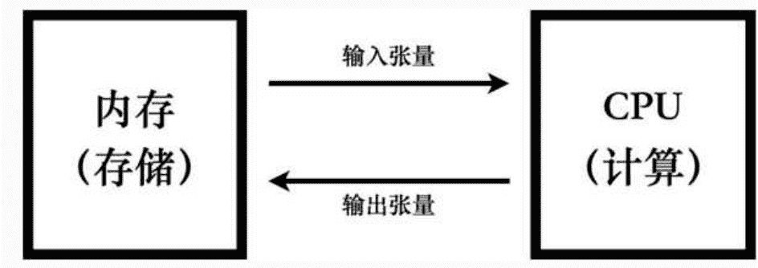

在 CPU-内存体系下，算子的执行几乎都遵循同一套动作：

- 1、先从内存里把输入数据读出来
- 2、调用若干条 CPU 指令完成计算
- 3、把结果写回内存的输出位置

下面把内存和 CPU 的硬件细节展开讲。

#### 2.1.1 内存的工作原理
内存常说的就是随机访问存储器 RAM，随机指的是地址像列表一样可以直接定位任意位置的数据。它只负责当前程序的临时存放，断电后数据就消失。我们把图2-1 中的内存部分放大，就是图2-2 的样子：

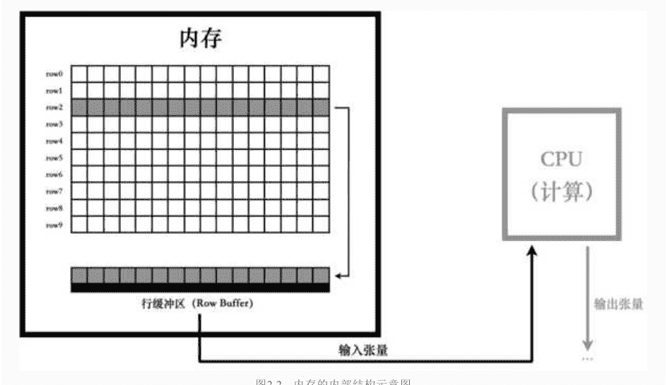

本书里说的内存默认是主内存，也就是 DRAM。你可能还听说过缓存 cache，它通常是 SRAM，成本更高所以容量很小，专门用来提升芯片内部读写效率。缓存的大小和速度要和芯片频率、计算效率匹配，所以一般集成在芯片内部，而不是主存。

主存最关心的三个指标是：

- 容量：能装多少数据，经验上最好达到 GPU 显存两倍以上
- 频率：决定读写快慢
- 通道数：主板参数，双通道或四通道能直接把内存带宽提升数倍，配合软件可进一步提速

商家常标注 DDR4、DDR5 等规格，它们定义了技术标准、芯片组织和控制算法等细节。相较 DDR4，DDR5 主要在容量和带宽上升级，选购时要确认主板插槽是否兼容。以 Crucial 为例的常见配置如表2-1 所示。

**表2-1 内存的配置参数表**

| Crucial 64GB (2 x 32GB) 288-Pin PC RAM DDR5 | 性能数值 |

| :--- | :--- |

| 内存容量 | 64 GB |

| 内存频率 | 最高 5600 MHz |

| 通道数 | 支持双通道配置（需要主板兼容） |

#### 2.1.2 CPU的核心要素
把图2-1 中的 CPU 部分展开就是图2-3：

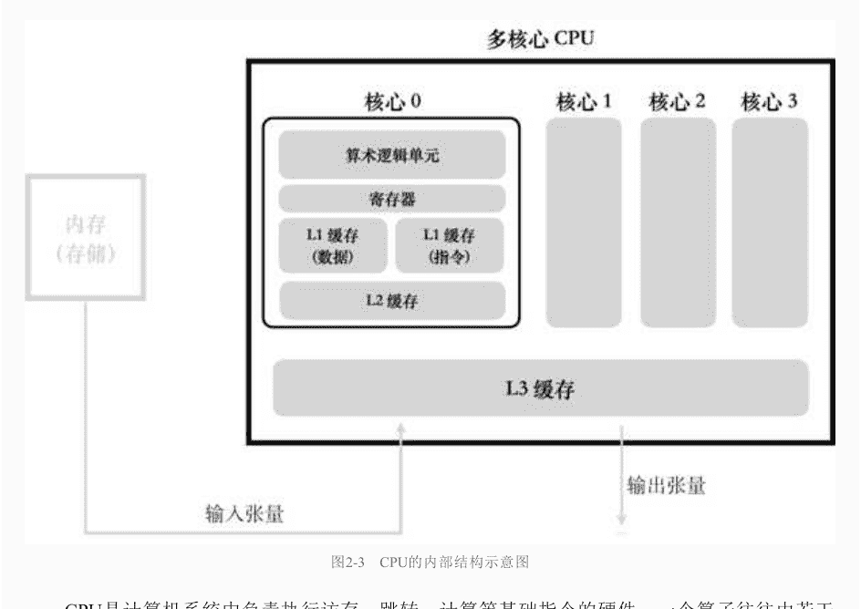

CPU 的职责是执行访存、跳转、计算等基础指令。一个算子由若干条基础指令堆叠而成，执行时重复：取指令→译码→读内存数据→执行→写回寄存器或内存。

指令执行的效率是 CPU 最核心的能力，通常用 CPU 频率 clock speed 来衡量。理论上还要看流水线设计和指令发射宽度，历史上确有厂商靠流水线级数做文章，不过对普通用户来说关注频率已足够。频率越高，单核执行速度越快。

现代 CPU 多核化是为了提升并行度。对深度学习而言，核心数和频率同样重要，因为数据加载、清洗、预处理等工作能显著受益于更多核心。

CPU 流水里还有内存读写这一步，而内存读写远慢于指令执行，容易成为瓶颈。为此 CPU 配备多级缓存 L1、L2、L3，用来加速小规模数据的读写。缓存对性能有间接帮助，但在选购时通常不是首要考量。

部分现代 CPU 还会标出加速频率 boost clock，Intel 称之为睿频。它在基础频率上提供一段动态超频区间，受功耗、散热和调度算法影响，效果不稳定。做性能测试时往往需要关闭加速频率以保证结果可重复[^1]。

总结来看，CPU 的核心构成是负责计算的算数逻辑单元 ALU、加速读写的多级缓存，以及提升并行度的多核心设计。把这些细节补全后的结构如图2-4：

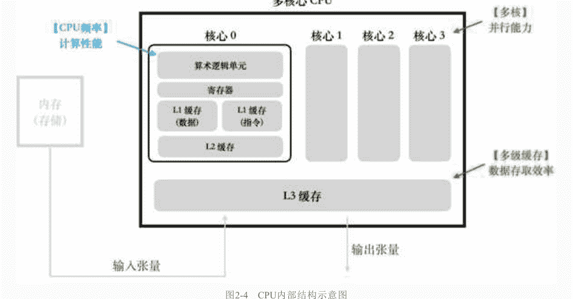

选购时建议重点看：

- CPU 基础频率：决定单核计算效率
- 核心数量：决定并行能力
- 次要指标
    - (1) 缓存大小：影响数据读写效率
    - (2) 加速频率：可动态超频，提升峰值表现

商用示例如表2-2：

**表2-2 商用CPU的参数列表**

| AMD Ryzen 9 7900X | 性能数值 |

| --- | --- |

| 基础频率 | 4.7 GHz |

| 核心数量 | 12 核 |

| 缓存大小 | L3缓存：64 MB<br>L2缓存：每核 12 MB |

| 加速频率 | 5.6 GHz |

| 超线程技术 | 支持，每个核心可以同时处理2个线程 |

### 2.2 硬盘的数据供给
2.1 节提到算子包含三步：从内存加载张量、送入 CPU 计算、写回内存。那内存里的数据来自哪里？通常是硬盘在训练时动态读入内存，再送到计算单元。整个过程如图2-5：

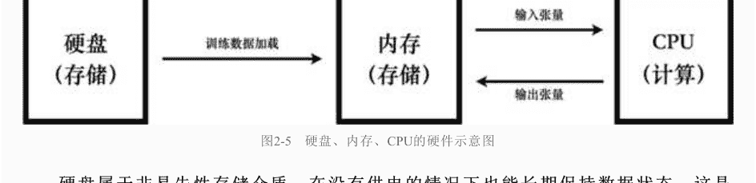

硬盘是非易失性存储，断电后数据仍保留，这是它和内存最根本的区别。按技术分有机械硬盘 HDD 和固态硬盘 SSD，SSD 读写速度远高于 HDD，HDD 仅在成本上占优。

硬盘的读写大致分两种场景：

- 随机读写：高频读写小块数据
- 连续读写：读取大文件或顺序访问

两种场景的效率会分别标注。随机效率用 IOPS 输入输出操作每秒衡量，连续效率用 MB/s 衡量。随机读写受启动延迟影响大，延迟成为瓶颈；连续读写效率取决于硬盘本身读取速度和数据传输速度。

把图2-5 中的硬盘部分展开是图2-6：

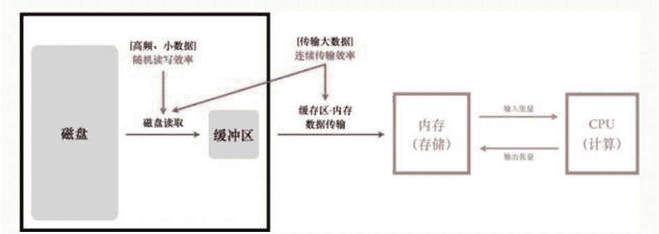

读写效率由读取速度和传输速度共同决定。随着读取速度提升，瓶颈转向传输，于是出现了基于 PCIe 通道的 NVMe 固态硬盘，其性能通常远超 SATA SSD。

选购硬盘建议关注：

- 硬盘容量：决定能存放多少数据
- 随机读写速度：影响频繁访问小文件或文本片段的速度
- 连续读写速度：影响顺序访问的快慢
- 接口类型和协议：决定缓存到内存的传输速度

参考配置如表2-3：

**表2-3 商用硬盘的参数列表**

| KingSpec XG 7000 1TB M.2 2280 PCIe 4.0x4 NVMe 1.4 | 性能数值 |

| :--- | :--- |

| 硬盘容量 | 1TB |

| 随机读写速度 | 随机读取：710 000 IOPS<br>随机写入：610 000 IOPS |

| 连续读写速度 | 连续读取：7 400 MB/s<br>连续写入：6 600 MB/s |

| 接口类型和协议 | PCI Express Gen 4.0 ×4<br>NVMe 1.4 |

这里说的硬盘主要指本地存储。对超大规模数据，还会用到云存储，这属于更复杂的数据系统，会在 2.4 节分布式架构时再讨论。

### 2.3 GPU的计算迁移
到目前为止，用硬盘、CPU、内存就能搭起一套能跑通的训练系统。但很快人们发现 CPU 做深度学习计算太慢，于是 2000 年左右开始把训练任务迁移到 GPU。CPU 为何不合适，先要弄清它的强项。

#### 2.3.1 CPU的局限性
在系统里 CPU 像个全能选手，既能处理计算指令、访存指令，也能处理分支跳转等逻辑指令。我们常说 CPU 擅长复杂任务，复杂指逻辑复杂：大量 if-else、while、for 等。操作系统里的进程管理、虚拟内存、异常中断等，都依赖大量逻辑和读写指令，纯计算反而占比不高。

受功耗和面积限制，芯片集成度有限。全能意味着各方面平庸，所以 CPU 在计算密集型任务上不如 GPU 等专用芯片高效。

一个自然的思路是让 CPU 只负责复杂交互，其余计算交给专用芯片。软件上把任务分为：

- 外围任务：业务代码、API、用户交互等逻辑复杂部分
- 内核任务：高度内聚、计算密集、分支很少的核心计算

CPU 处理外围，GPU 执行核心。游戏里 CPU 管交互和 UI 音频，GPU 管渲染和物理仿真；手机里 ISP 管图像处理，NPU 专注张量矩阵运算。

深度学习也采用同样分工，核心算子在 GPU 上跑，复杂的调度逻辑由 CPU 处理，充分发挥各自长处。

#### 2.3.2 GPU的硬件结构
深度学习是典型计算密集型任务，由大量算子构成，算子多为计算为主、逻辑分支少。另一个特点是元素间独立性强，并行空间大。比如 torch.add，每个元素的加法都能并行，线性、卷积的并行收益更大。

GPU 既擅长数值计算，又为并行做了特化。引入 GPU 后，原本在 CPU 上的算子计算迁移过去。但 GPU 计算核心无法直接访问主内存，于是中间加入显存 VRAM。GPU 核心与显存的关系类似 CPU 核心与内存：先把张量从内存搬到显存，再从显存在核心里计算，结果再写回内存。此时 CPU 主要负责数据预处理和调度。加上 GPU 后的结构如图2-7：

本节聚焦硬件构造，CPU 与 GPU 间的数据传输将在 2.3.5 节详细讲。GPU 内部很复杂，性能指标也很多，先理解构造再看指标更有意义。

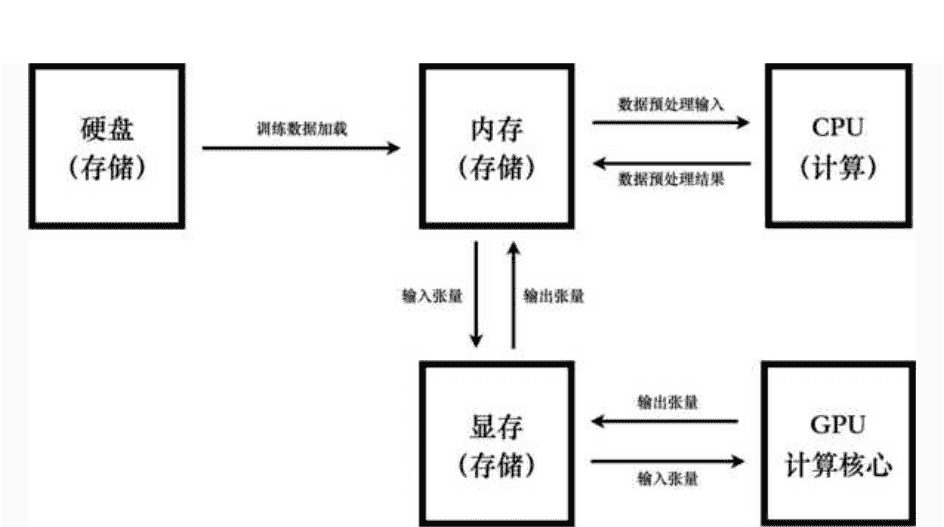

从用途看，GPU 分家用卡和计算卡。家用卡更偏图形学，标量计算效率高；计算卡偏深度学习，张量计算效率高且显存更大。RTX 3090、RTX 4090 是典型家用卡，A100、H100 是典型计算卡，训练任务更倾向计算卡。

内部架构在迭代，这里以 Ampere 为例。最外层是显存和若干计算核心。计算核心从上到下有 GPC、TPC 等封装，开发者更关心流式多处理器 SM 及以下。

图2-8 由外向里展开：最外层是显存、L2 缓存等存储单元，以及多层高层封装单元。核心部件是大量 SM，重点关注 SM 及内部结构。每个 SM 包含：

- L1 缓存
- 多个流式处理器 SP，每个 SP 包含：
    - 若干标量计算核心 CUDA core
    - 若干张量计算核心 tensor core
    - 若干寄存器
    - 线程束调度器 warp scheduler

真正关键的是蓝色标记的单元：张量和标量计算核心决定整体算力，L1 缓存和显存决定数据访问效率，线程束调度器对应 CUDA 编程模型的 warp，负责线程通信和调度。除此之外还有显存控制器、纹理缓存等细节未画，完整 A100 结构可见 NVIDIA 文档 图2-9。

单独看硬件帮助有限，需要结合软件概念一起理解。

图2-9 NVIDIA A100硬件结构示意图

#### 2.3.3 GPU编程模型及其硬件对应
Python、C++ 通过编译器生成 CPU 能识别的指令运行。若能把代码直接编译成 GPU 指令就能在 GPU 上跑，但 NVIDIA 并未提供这种直译编译器，而是提供 CUDA 语言编程模型。

CUDA 本质是对 GPU 硬件的抽象。抛开高级用法，核心思想是把算法拆成多个可独立执行的软件任务。张量加法就能拆成每个元素的点对点加法，如图2-10：

拆分得到的每个独立任务称为线程。线程是软件最小执行单元，不考虑高级用法时可认为每个线程独立运行，像是独占 GPU 全部硬件资源。

## GPU 并行结构拆解

把每一条软件线程都配上整块图形处理器来跑，成本会非常高。硬件并不按线程来切分，而是提供了一套底层的执行单元——流式处理器。每个流式处理器内部集成了完成一次线程任务所需的全部部件，包含 CUDA 核心、Tensor 核心等算力单元，以及 L0 缓存、寄存器、各类控制器等。

为了提升并行度，流式处理器里的线程束调度器会把 32 条线程捆成一个线程束。每个时钟周期，调度器会把一个线程束派发到某个流式处理器上，让其统一执行同一条 GPU 指令。

流式处理器是执行层级里最底层的单元。若干个流式处理器再组合起来，就构成流式多处理器，并且可共用一块 L1 缓存。在 CUDA 编程模型里，流式多处理器对应的概念是线程块。图 2-11 用来帮助理解软件任务与硬件结构的映射。

整体来看，GPU 的并行能力可分成软件并行与硬件并行两层。软件并行主要由开发者在设计阶段完成：借助数学手段把算子拆成若干可独立运行的软件线程，再用 CUDA 语言描述。硬件并行则是对这些线程的实际调度，先对软件线程分组，再以线程束或线程块为单位并行执行。

#### 2.3.4 GPU的关键性能指标

在深度学习场景下，常用图形处理器参数主要集中在以下几个方面：

- Tensor Core 与 CUDA Core 的算力：决定模型计算效率。
- 显存容量：决定可承载的模型与数据规模上限。
- 显存带宽：决定显存读写效率。
- 卡间互联带宽：决定多卡协同时的通信效率。

以 A100 为例，其核心参数如下表所示。

表2-4 NVIDIA A100 GPU参数列表

| A100 80GB SXM 性能指标 | 性能数值 |

|---|---|

| Float32 Tensor Core | 156 TFlops |

| Float16 Tensor Core | 312 TFlops |

| Float32 CUDA Core | 19.5 TFlops |

| GPU Memory | 80 GB |

| GPU Memory Bandwidth | 2039 GB/s |

| Interconnect | NVLink: 600 GB/s<br>PCIe Gen4: 64 GB/s |

#### 2.3.5 显存与内存间的数据传输

上一节介绍了图形处理器的内部组成，却未说明张量数据从何而来。与 CPU 类似，计算时所有数据都从显存读取，结果也写回显存。显存数据的来源途径比较多样。

主机内存到显存的搬运依赖 PCIe、NVLink 等通道，并需要 CPU 等调度部件参与。借助 CPU 调度的搬运流程可参考图 2-12。

如果主机内存使用的是锁页内存，GPU 上的 DMA Engine 即可直接完成内存到显存的搬运，无需占用 CPU 算力，如图 2-13 所示。

图2-13 GPU DMA Engine作为调度中心的内存-显存数据传输

除内存外，NVIDIA 还提供了 GPU Direct Storage 技术，可借助 DMA Engine 直接把硬盘数据读入显存。对于跨节点的分布式训练，RDMA 技术也能利用 DMA Engine 把网络接口的数据直送显存。这类技术的采用率相对不高，多见于大规模分布式训练。对大多数读者而言，内存与显存之间的常规搬运仍是常见情形。

### 2.4 分布式系统

单卡训练的硬件框架搭建完毕后，若要扩大数据量或模型参数，就需要分布式训练系统来提供足够的显存和算力。

分布式训练的本质是让多张图形处理器共同参与训练，以换取加速或更大的可用显存，但代价是引入了卡间通信这一新的数据搬运类型。具体通信内容留到第 8 章再展开，这里只需明确多卡间的数据量往往很大且频率不低。

算法本身不受物理位置影响，但卡是否在同一台服务器，会决定通信所用的硬件。因此下面按单机和多机两种情况说明。

#### 2.4.1 单机多卡的通信

2.3 节介绍了单卡结构，实践中一台服务器常会部署多张计算卡，这被称为单机多卡，是最基础的分布式形态。目前 NVIDIA 多卡通信主要有两种方式：依赖 PCIe 总线，带宽相对有限；使用 NVIDIA 自研的 NVLink。需要留意 NVLink 主要用于卡与卡之间的互联，而 Intel、AMD 等主流 CPU 依然只能通过 PCIe 与图形处理器交互，如图 2-14 所示。

NVLink 是一种面向高速低延迟互联的通用串行总线技术，用来提升多卡间的数据传输性能。它为多个卡之间提供点对点直连，带来更高的带宽和更低的延迟，从而让多卡协同效率大幅提升。

Pascal 架构的 P100 是第一代 NVLink 的引入点，当时仅支持卡对卡传输。随后每一代 NVLink 都随着架构升级而提升性能，对需要高频通信的分布式深度学习训练帮助明显。常见卡的 NVLink 参数如下表所示。

表2-5 不同NVIDIA GPU型号的NVLink参数列表

| | 2080Ti | 3090 | 4090 | V100 | A100 | H100 |

|---|---|---|---|---|---|---|

| 支持的Gen version | 第二代 | 第三代 | 暂不支持 | 第二代 | 第三代 | 第四代 |

| NVLink | 2 links, 100GB/s | 4 links, 112.5GB/s | 暂不支持（截止本书写作时，2024.05） | 50GB/link, 6 links | 50GB/link, 12links | 50GB/link, 18links |

#### 2.4.2 多机多卡的通信

在多机多卡的分布式训练中，跨机器的卡间通信不再使用 NVLink 或 PCIe，而是依赖网络设备。主流方案分为 Ethernet 和 InfiniBand 两类，具体对比见表 2-6。

表2-6 Ethernet与InfiniBand的特点对比

| | Ethernet | InfiniBand |

|---|---|---|

| 设计目标 | 商业和个人网络应用 | 高性能计算（HPC）和企业数据中心 |

| 性能特点 | 支持广播和交换式网络，提供足够的性能以满足大多数商业和家庭网络的需要 | 支持点对点和交换式网络，提供非常低的网络延迟和高数据传输速率 |

| 速率 | 高速Ethernet 可以提供高达10/40/100Gb/ps的传输速率，但延迟通常高于InfiniBand | 可以提供高达200Gb/ps的传输速率 |

| 成本 | 较低 | 较高 |

| 应用场景 | 办公网络、家庭互联网以及其他标准网络环境 | 超级计算、大型数据中心、存储网络 |

除 InfiniBand 外，还存在 OmniPath、RoCE 等技术，其性能表现与 InfiniBand 类似。具体选型要结合机器学习任务的规模来决定。

#### 2.4.3 分布式系统的数据存储

用各服务器本地硬盘来存放大规模训练数据并不可行。一方面本地盘容量有限，难以容纳上百 TB 的文本、图像、视频和 3D 素材；另一方面大模型训练可能动用成百上千台机器，所有节点都需要访问同一份数据集，若采用本地存储则需要复制数据，存储与传输成本都难以承受。

因此分布式系统更倾向于网络存储方案，常见分为 NFS 和云服务存储两种。两者的差异与适用场景见表 2-7。

表2-7 NFS与云存储服务的特点对比

| | NFS | 云存储服务 |

|---|---|---|

| 类型 | 文件级的存储协议，允许系统通过网络共享文件 | 对象存储服务，提供可扩展、安全和高性能的云存储解决方案 |

| 部署 | 通常部署在本地网络或私有云环境 | 托管在云环境中（如AWS、Google Cloud、阿里云等） |

| 访问方式 | 用户可以像访问本地文件一样访问网络上的文件 | 通过REST API进行数据存取，每个对象（文件）都有唯一的键名 |

| 扩展性和可靠性 | 需要手动进行备份，可靠性较低 | 极高的扩展性和数据持久性，支持自动副本和多区域存储 |

| 适用场景 | 极其注重数据隐私的私有化大规模应用 | 能够接受将数据托管在公有云的大规模应用 |

把加入分布式系统后的整体硬件框架绘制出来，如图 2-15 所示。

分布式系统的运维复杂度和成本都比较高，完整的硬件架构讨论已超出本书范围。本节仅给出基础认识和对训练性能的影响，不展开细节。

## 03 深度学习必备的PyTorch知识

框架能否流行，主要看易用性与性能，优先级会随场景变化。深度学习发展迅速，科研用户更看重能否快速实现想法验证。因此框架的灵活性往往比绝对性能更重要。PyTorch 能成为主流，正是因为它在易用与性能间取得了较好平衡。

PyTorch 的编程风格接近 Python，文档和示例丰富，入门相对容易。但会用和用好是两回事。本章不逐条罗列 API，而是聚焦两件事：

- PyTorch 为何好用？与其它框架相比优势在哪？
- 如何用好 PyTorch？虽然性能不是顶尖，但合理使用下表现足够好。想要发挥潜力，需要了解其核心运行机制。如图 3-1 所示，本章将从张量与算子入手，逐步讲解内存分配、动态图执行机制，以及训练框架的核心杀手锏——自动微分系统的底层原理。这些内容有助于理解 PyTorch 的优劣，并为后续优化方法学习打下基础。

图3-1 本章的核心内容概览

### 3.1 PyTorch的张量数据结构

张量 torch.Tensor 是 PyTorch 最核心的数据结构之一，与数学中的张量概念一致。可以把它看成一个多维数组，维度 N 为任意非负整数。在 PyTorch 中绝大多数数据都以张量形式表达，常见形式包括：

- 标量：0 维张量，代表单一数值。
- 向量：1 维张量，代表数值序列。
- 矩阵：2 维张量，由 m 行 n 列组成。

图3-2 展示了标量、向量、矩阵及更高维张量的例子。简言之，张量就是把标量、向量、矩阵推广到 N 维的容器。张量作为统一的数据载体，能方便处理不同形状的数据。

为了适配深度学习开发，torch.Tensor 类除了做数据容器外，还提供了大量属性，下面详细介绍。

#### 3.1.1 张量的基本属性及创建

torch.Tensor 是一个多维数组结构，具备三个基本属性：

- 形状 shape：每个维度的大小，例如 [3, 2] 表示第一维 3 个元素，第二维 2 个元素。
- 数据类型 dtype：元素类型可以是整型、浮点、布尔或复数，但同一张量内类型必须一致。
- 存储位置 device：指定后端，如 CPU 后端数据在主内存，CUDA 后端数据在 GPU 显存。

通常创建张量只需指定形状、类型和设备，示例如下。

```python
import torch

x = torch.rand((3, 2), dtype=torch.float32, device="cuda")

print(x.dtype)  # torch.float32
print(x.device)  # cuda:0
print(x.shape)  # torch.Size([3, 2]))
```

PyTorch 提供了多个创建和初始化张量的接口，常用函数如下表所示。

表3-1 张量的创建函数

| Tensor的创建函数 | 含义 |

|---|---|

| torch.empty/torch.empty_like | 创建一个未初始化的tensor |

| torch.zeros/torch.zeros_like | 创建一个初始化为0的tensor |

| torch.ones/torch.ones_like | 创建一个初始化为1的tensor |

| torch.range/torch.linspace | 创建初始值为特定步长变化的tensor |

| torch.rand/torch.rand_like/torch.randn | 创建一个随机初始化的tensor |

#### 3.1.2 访问张量的数据

torch.Tensor 最核心的是它所保存的数据。定位和访问特定元素通常使用索引操作。索引可以读取单个点、切片或特定维度，这类操作称为基础索引。下面例子中的行列索引均从 0 开始：

```python
import torch

# 创建一个10*20的张量，使用contiguous()确保其连续性
x = torch.arange(200).reshape(10, 20).contiguous()

# 访问单个元素，返回第0行的第0个元素
x[0, 0]  # tensor(0)

# 支持负数索引，返回第0行的最后一个元素
x[0, -1]  # tensor(19)

# 切片索引，单独一个冒号表示选择该维度的所有元素，返回第2行的整行数据
x[2, :]
# tensor([40, 41, 42, 43, 44, 45, 46, 47, 48, 49, 50, 51, 52, 53, 54, 55, 56,
#         57, 58, 59])

# 切片索引，返回从索引为1的列开始，到索引为9的列（不包含），每隔3个索引选择一个元素，即第0行的第1、4、7列数据
x[0, 1:9:3]  # tensor([[ 1,  4,  7]])

# 省略号是一个特殊的索引符号，代表“在这个位置选择所有可能的索引”，返回第1列的所有元素
x[..., 1]
# tensor([ 1, 21, 41, 61, 81, 101, 121, 141, 161, 181])

# 与 NumPy 类似，None 表示加入一个新的维度，常用于调整张量的形状以满足某些特定操作的需求。
# 这里我们在第二个维度（即行和列之间）插入一个新的维度。
x[:, None, :]  # 返回张量的形状为(10, 1, 20)
```

借助基础索引也可以对张量进行赋值，示例代码如下：

```python
import torch

# 创建一个10*20的张量，使用contiguous()确保其连续性
x = torch.arange(200).reshape(10, 20).contiguous()

# 通过基础索引对x的[0, 0]元素进行赋值
x[0, 0] = -1.0
print(x[0, 0])  # x[0, 0]被更新成-1.0

# 通过切片索引对x[2, :]的所有元素进行赋值
x[2, :] = 10
print(x)  # x的第2行(从0计数)的所有元素被更新成10
```

掌握不同的索引技巧对高效处理张量数据很重要。迄今我们主要讲了基础索引，Tensor 还支持更复杂的高级索引，比如 3.2.2 节会介绍。在深入高级技巧前，先了解张量的底层存储机制。

#### 3.1.3 张量的存储方式

在 PyTorch 中，张量 torch.Tensor 与其底层数据存储 torch.Storage 是两个不同层级。张量可以理解为对底层存储的一种解释和访问方式。每个张量都有一个 Storage 存放实际数据，多个张量还可以共享同一个 Storage。图 3-3 展示了二者之间的关系。

torch.Storage 本质上是描述张量数据在物理内存中如何存放的一种抽象，对应一段线性排列的原始缓冲区。每个 Storage 实例只记录了数据类型以及整体元素个数这两类元信息。基于这层存储，torch.Tensor 才叠加了形状、步长、偏移等访问描述符，这些描述符决定了底层连续内存要被解读成怎样的多维结构。

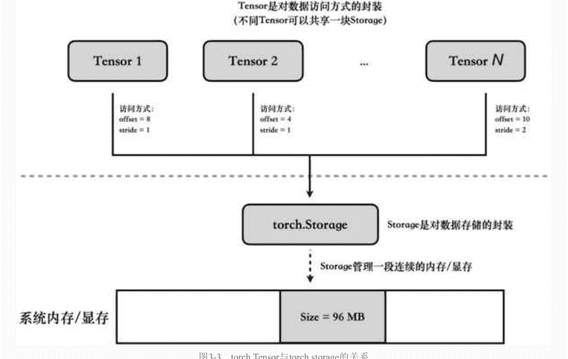

其中 stride 最值得关注，它让张量的数据访问变得非常高效。stride 规定了在内存中从一个元素走到下一个元素时需要跨越的间隔数。有了它，张量对底层存储的解引用方式就具备了很大灵活性。比如只通过修改 stride 就可以完成一个几乎零成本的转置，示例如下：

```python
import torch

# 创建一个3*4的张量，使用contiguous()确保其连续性
x = torch.arange(12).reshape(3, 4).contiguous()

print(f"x = {x}\nx.stride = {x.stride()}")
# x = tensor([[ 0,  1,  2,  3],
#            [ 4,  5,  6,  7],
#            [ 8,  9, 10, 11]])
# x.stride = (4, 1)

y = torch.as_strided(x, size=(4, 3), stride=(1, 4))
print(f"y = {y}\ny.stride = {y.stride()}")
# y = tensor([[ 0,  4,  8],
#            [ 1,  5,  9],
#            [ 2,  6, 10],
#            [ 3,  7, 11]])
# y.stride = (1, 4)
```

以 as_strided 为例，它的工作可以拆成两个层面：先重新定义访问规则，把 x 的 stride 从 (4, 1) 改为 (1, 4)，同时把形状改成 (4, 3)。这样遍历时内层维度每次推进会跳 4 个位置，外层维度每次推进只跳 1 个位置。文字描述容易抽象，图3-4 用可视化的方式演示了这一读取顺序。简言之，按 stride=4 逐步读取一行 3 个元素后，再向外层偏移 1 个位置继续读取。因为没有数据搬运，as_strided 实现的转置对性能的冲击几乎可以忽略，在大尺寸数据场景下优势尤为明显。

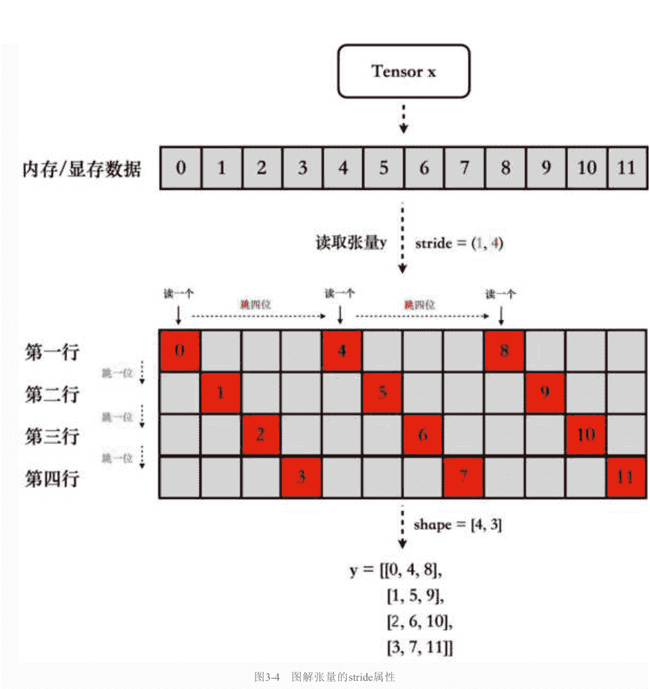

借助 stride 访问张量的核心好处是免复制、直接复用同一块底层存储。但它是一把双刃剑，容易导致张量变得不连续。连续张量要求所有元素在内存中紧挨着排列，而不连续时元素之间会夹杂无关数据，例如 stride 为 2 就意味着每隔一个位置才存一个有效元素。不连续会带来两方面风险：一是内存访问模式变差，计算效率下降；二是许多 PyTorch 算子默认假设输入是连续的，遇到不连续时可能报错或得到错误结果。

PyTorch 提供了 tensor.is_contiguous() 来判断连续性，并用 tensor.contiguous() 生成一个连续的拷贝来规避问题。代价是会把数据搬到新区域，内存占用随之上升，开发时需要在性能和内存之间做权衡。

#### 3.1.4 张量视图与共享存储
前文已经区分了底层存储和张量本身这两个层次。PyTorch 允许在不复制数据的前提下，对同一段内存做多种形状和维度的解读。多个张量可以指向同一块存储，若它们区间不重叠，影响有限；一旦共享且存在重叠，就形成视图关系，修改视图会同步改动源张量，因为两者地址相同。

PyTorch 提供了不少能生成视图的操作，表3-2 汇总了常用类型。这些操作在不产生拷贝的情况下改变数据的观察视角，对显存和速度都很友好。

表3-2 PyTorch中常用的视图操作

| 操作 | 描述 |
| :--- | :--- |
| expand() | 在逻辑上扩充维度，实际不复制数据 |
| transpose() / permute() | 调整维度顺序 |
| narrow() | 取出张量的子区间作为视图 |
| squeeze() / unsqueeze() | 去除或增加长度为1的维度 |
| chunk() / split() | 把张量切分成若干子张量 |
| as_strided() | 自定义步长实现跳跃式访问 |
| view() | 重新解释形状 |
| detach() | 复制张量但切断反向图 |

除此之外，3.1.2 小节提到的基础索引读取同样返回视图，代码示例如下：

```python
import torch

a = torch.zeros(3, 3)
# 张量b是张量a的一个视图，共享底层内存
b = a[0]
print(b)  # tensor([0., 0., 0.])

# 修改张量b的内容也会影响张量a
b[0] = 1
print(a)
# tensor([[1., 0., 0.],
#         [0., 0., 0.],
#         [0., 0., 0.]])
```

另外 reshape() 和 flatten() 的行为比较特殊，它们会根据具体情境返回视图或全新张量。这种不确定性让它们成为不够理想的 API。鉴于它们在社区代码中已非常普及，行为短期内难以改变，建议使用者不要依赖返回类型，以避免混淆和错误。相关用法如下：

```python
import torch

original = torch.rand((2, 12))

reshaped = original.view(2, 3, 4)
print("reshaped shape:", reshaped.shape)
# reshaped shape: torch.Size([2, 3, 4])


flattened = reshaped.view(-1)
print("flattened shape:", flattened.shape)
# flattened shape: torch.Size([24])
```

视图机制可以省去分配新内存的时间和显存开销，我们将在第7章深入讨论内存复用的得失。需要注意的是，视图共享内存带来的副作用很强，使用不当很容易意外改写原始数据，因此要清楚哪些操作会产生视图。

### 3.2 PyTorch算子体系
#### 3.2.1 算子分类概览
算子是 PyTorch 执行数学变换的核心。大致可分为：

- （1）基础数学运算：加减乘除、exp、pow 等
- （2）线性代数运算：matmul、dot、t、inverse 等
- （3）逻辑与比较运算：logical_and、logical_or、eq、gt、lt 等
- （4）张量操作：索引切片、cat、reshape、permute 等
- （5）特殊运算：卷积、池化、注意力以及各类损失函数

这些算子构成了丰富的操作集，让复杂任务变得简单。调用方式示例：

```python
import torch

x = torch.ones(4, 4)

# 数学运算
y1 = x + x
y2 = x * x

# 线性代数运算
y3 = x.sum()

# 索引
x1 = x[1, 1]
```

为了灵活，PyTorch 支持两种等价写法：torch 命名空间的函数和 Tensor 类的方法。两者在计算结果上完全一致，例如张量加法的几种等价形式：

```python
import torch

x = torch.ones(4, 4)

# torch命名空间下的加法操作
y1 = x.add(x)

# 重载运算符"+"，与x.add(x)等价
y2 = x + x

# Tensor类的加法操作
y3 = torch.add(x, x)

assert (y1 == y2).all()
assert (y2 == y3).all()
```

#### 3.2.2 算子内存行为
算子的输入输出都是张量，但是否分配新内存取决于具体算子。通常结果会新建内存。以下几种情况需特别注意：

##### 1. 原位操作
部分算子提供原位版本，直接改写输入并原样返回，不产生新内存。命名惯例是在方法名后加下划线，如 add_ 是 add 的原位形态。某些语法也会隐式触发原位，比如 x += y 会原位加法，而 x = x + y 则会先计算再赋值。原位能减少分配和拷贝，但条件更苛刻，用错会产生连锁副作用，具体风险将在第7章展开。

```python
import torch

x = torch.ones((4, 4))

# 原位加法操作
y1 = x.add_(x)
print(y1)  # 张量x所有元素更新为2，张量y1是张量x的一个别名，是同一个张量

# 原位加法操作
x += y1
print(x)  # 张量x所有元素更新为4

# 非原位加法操作
x = x + y1
print(x)  # 张量x所有元素更新为8
```

##### 2. 视图操作
3.1.4 小节的视图操作输出与输入共享底层存储，因此不会带来额外分配。

##### 3. 读取操作
基础索引的读取属于视图。但 PyTorch 也支持 NumPy 风格的高级索引，即用布尔或整型张量作下标。这种读取会创建新的存储。下面两段代码对比了基础索引与高级索引，前者共享存储，后者会分配新内存。

```python
import torch

# 创建一个10*20的张量，使用contiguous()确保其连续性
x = torch.arange(200).reshape(10, 20).contiguous()

# 基础索引，读取x的第0行
y_basic_index = x[0]

# (1) 基于基础索引进行读取的返回张量和x共享底层存储
assert y_basic_index.data_ptr() == x.data_ptr()

# 使用整数张量对x进行高级索引，返回位置在[0, 2], [1, 3], [2, 4]位置的元素
z_adv_index_int = x[torch.tensor([0, 1, 2]), torch.tensor([2, 3, 4])]
# z_adv_index_int = tensor([ 2, 23, 44])

# 对张量x中的每个元素进行判断，如果元素的值小于10，则对应位置的ind为True，否则为False
ind = x < 10
# 使用布尔张量对x进行高级索引，返回x中所有对应ind位置为True的元素
z_adv_index_bool = x[ind]
# z_adv_index_bool = tensor([0, 1, 2, 3, 4, 5, 6, 7, 8, 9])

# (2) 基于高级索引进行读取的返回张量和x的底层存储是分开的
assert z_adv_index_int.data_ptr() != x.data_ptr()
assert z_adv_index_bool.data_ptr() != x.data_ptr()
```

##### 4. 赋值操作
赋值指通过基础或高级索引、广播等方式向特定位置写入新值。赋值会直接修改原张量且无返回值。值得注意的是，尽管高级索引读取会新建存储，但不论使用何种索引方式，赋值都会作用于原始张量。高级索引赋值的例子如下：

```python
import torch

# 创建一个10*20的张量，使用contiguous()确保其连续性
x = torch.arange(200).reshape(10, 20).contiguous()

# 对张量x中的每个元素进行判断，如果元素的值小于10，则对应位置的ind为 True，否则为False
ind = x < 10
# 通过高级索引对x的部分元素进行赋值
x[ind] = 1.0

print(x)  # x的对应位置也被更新成1.0
```

#### 3.2.3 算子调用开销
PyTorch 以灵活易用著称，但频繁的算子调用也是性能瓶颈。以一次矩阵乘法为例：

```python
import torch

x1 = torch.rand(32, 32, dtype=torch.float32, device="cuda:0")
x2 = torch.rand(32, 32, dtype=torch.float32, device="cuda:0")

y = x1 @ x2
```

y = x1 @ x2 的内部流程大约是：
- （1）函数入口：调用 Tensor.__matmul__ 作为入口
- （2）算子定位：分发器依据算子类型、数据类型、后端找到具体实现，如 GPU float32 的 CUDA kernel
- （3）创建张量：准备输出张量
- （4）底层执行：做类型转换、计算并写回结果
- （5）函数返回：构造 Python 对象返回

图3-5 展示了调用栈。可以看到核心计算之外还有大量准备工作，统称为调用延迟。单次延迟可能可以接受，频繁调用时累积成本就会显著。


第9章会介绍 CUDA Graph 来降低调用延迟。日常开发中应尽量减少无效操作，优先对整体张量操作，避免手动遍历单个元素。逐元素读取和写入每次都是一次算子调用，而整体加法或归约能充分利用 GPU 并行，速度远超 Python 循环的实现。

### 3.3 动态图机制
PyTorch 受欢迎的核心原因之一是动态图。计算图在代码执行时即时构建并运行，构建与执行交织进行，而不是像 TensorFlow 1.0 那样的先定义后执行静态图。静态图一旦固化就无法修改，而动态图提供所见即所得的体验，调试更直观，即时反馈有助于快速定位错误。

不同说法描述的是同一特质：

- Define-by-Run：图随代码运行动态生成，定义即执行。

**Eager mode / Eager execution**：框架在代码执行的那一刻就把操作跑起来，而不是先把整张图搭好再统一跑。

要体会动态图的特性，得先搞清楚计算图是什么。在 PyTorch 里，计算图被看成一个有向无环结构，其中 **节点** 对应各类算子，比如加法、乘法、卷积等，**边** 则用来传递数据，也就是张量。边的方向标明了数据流向和算子执行的先后次序。比如最简单的加法 z = x + y，x 和 y 各自有一条边指向加法节点，加法节点再有一条边指向结果 z。

弄懂计算图之后，对比静态图和动态图就能更直观地感受差异。下面是一段在动态图里很常见的写法：

### 3.4 PyTorch 自动微分系统透视

#### 3.4.1 自动微分到底是什么

熟悉 PyTorch 的人都会发现，无论前向代码多么复杂，调用一次 `loss.backward()` 就能把所有参数的梯度算出来。名字里带了“自动”二字，让很多人低估了这件事的难度。在聊 PyTorch 的自动微分之前，先回头看常规的梯度求法，这样更容易理解自动微分的原理和价值。高中阶段我们学过两种思路：

（1）有限差分的数值微分：给输入加一个极小扰动，比如令 $h = 0.000001$，通过观察输出变化来近似梯度。做法简单，靠多次前向就能完成，但精度有限，每次只能算一个参数的梯度。对参数众多的神经网络来说，速度和精度都难以为继。

a. $h = 0.000001$

b. $f'(x) = \frac{f(x+h) - f(x-h)}{2h}$

（2）符号微分的公式推导：手写求导对复杂程序既费时又易错。计算机可以做符号求导，但前提是代码能被转成封闭形式表达式。对纯算术和逻辑还好，一旦出现依赖动态输入的循环、递归、动态内存分配或大量非线性处理，就很难封闭化。因此符号微分效率高却受限很大。

回到 PyTorch 的做法，会自然引出两个问题：自动微分是什么？它是数值微分还是符号微分？

严格来说，自动微分既不属于数值微分也不属于符号微分。它是基于原程序执行流程，额外加上梯度计算的一种执行方式。自动微分有两个核心点：

（1）它预先定义了一组“基本操作”，比如加减乘除，并把这些操作的梯度用手动推导的结果硬编码进去。例如 $z = yx$ 时 $\frac{dz}{dy} = x,\ \frac{dz}{dx} = y$，这类基础梯度就是系统的核心。

（2）运行期间，系统借助链式法则把复杂运算拆成基础操作的组合，逐步算出中间结果的梯度，最终得到输入参数的梯度。过程中对同一个张量的梯度是累加而不是覆盖，而且累加的是数值而非符号表达式，正因为是数值累加，才能天然兼容分支、循环、递归等控制流，而这是符号微分难以处理的。

这两个特性让自动微分既灵活又精确，非常适合做深度学习训练的基建。

#### 3.4.2 自动微分如何落地

从上节可看出，PyTorch 的自动微分兼顾了易用性、性能和数值精度。那么底层是怎么运转的？

PyTorch 默认使用 **反向微分模式**。以某个输出张量的梯度为起点，反向逐层算出各输入参数的梯度。若有 M 个输出张量，就需要跑 M 次计算图。**反向微分适合输入很多而输出很少的情形**，典型的深度学习训练有 $w_1,w_2,...,w_N$ 个参数，却只有数个甚至一个 loss，计算一个输出对 N 个输入的梯度时用反向最合适。

还有一种 **前向模式的自动微分**。它以某个输入参数的梯度为起点，正向逐层算出各输出张量的梯度，计算图执行次数与输入参数数量相关，N 个输入就需要 N 次执行。所以前向微分适合输入少输出多的场景，比如科学计算里一个输入产生多个 loss，或需要高阶导数时。

前向和反向的原理如图3-7所示，篇幅所限后面 **只聚焦反向执行的机制**，前向模式可自行查阅资料。

PyTorch 的自动微分依赖 `torch.Tensor` 的两个额外属性：`grad` 和 `requires_grad`。`tensor.grad` 用来保存自动微分算出的梯度张量，本质上与普通 Tensor 无异，只是专门存梯度用。

`tensor.requires_grad` 用来标记是否需要追踪该张量的梯度。当设为 True 时，PyTorch 会开始记录该张量上的所有操作，为后续反向准备，并在反向传播时自动计算梯度。可训练参数的 `requires_grad` 必须为 True。

下面用一个简单例子说明工作原理：

```python
import torch

# 创建一个需要计算梯度的张量
x = torch.tensor([1.0, 2.0, 3.0], requires_grad=True)

# 前向传播：
# 1. 构建并执行前向图
# 2. 构建反向图
t = x * 10
z = t * t

loss = z.mean()

# 反向传播，计算梯度
loss.backward()

# 查看x的梯度
print(x.grad)
```

PyTorch 的自动微分其实在前向阶段就已经启动。我们在3.3节提到 PyTorch 的动态图在前向时会动态构建并执行计算图，这个说法不完整，实际上在构建前向图的同时，自动微分系统还会同步建立用于反向求梯度的图，也就是反向图。每个算子在前向被调用时，就会当场在反向图中生成对应的反向算子。以 `t = x * 10` 为例，其反向算子的构建过程如图3-8所示。

上述示例的完整反向图构建如图3-9所示。

从图3-8可见，每次前向操作执行时，左侧的前向计算图在当场构建并当场执行，右侧的反向计算图也在当场构建但延迟执行，比如乘法 `t = x * 10` 会在反向图中加入名为 `MulBackward` 的操作。需要留意的是，前向图是即建即跑，反向图是即建后延——直到调用 `loss.backward()` 才开始跑。

调用 `loss.backward()` 后，反向图立即启动。PyTorch 先把 `loss` 张量的梯度设为 1，从此处逆向遍历整个反向图，依次执行各层的反向算子，算出每个参数张量的梯度并累加到对应的 `.grad` 属性中。

反向传播有几个要点。第一，每次反向算出的梯度会累加到 `.grad` 上，而不是替换。比如 `z = t * t` 中，`t` 被两次用作乘法输入，`MulBackward` 产生的两个梯度都会累加到 `grad_t` 上；同理，多次调用 `backward()` 也会累加，这也是训练循环开头要调用 `optimizer.zero_grad()` 清零的原因。

第二，构建反向图时会额外保存前向信息。例如 `z = t * t` 的反向算子 `dt = 2t * dz` 需要用到前向的 `t`，PyTorch 就会把前向张量 `t` 保留在反向图中以便后续使用，这也是显存峰值常出现在前向结束后、反向开始前的缘故。需要注意的是，PyTorch 只保留中间结果的引用，并未复制数据，若该张量后续被原位操作修改就会导致反向计算报错，因此自动微分与原位算子的配合需要特别小心。

```python
import torch

# 创建一个需要计算梯度的张量
x = torch.tensor([1.0, 2.0, 3.0], requires_grad=True)

# 前向传播
t = x * 10
z = t * t

loss = z.mean()

# 使用原位操作修改张量t
t += 1  # 这是一个原位操作

# 反向传播，计算梯度
loss.backward()
```

若想保留反向图或中间张量的梯度，可以使用 `retain_graph()` 或 `retain_grad()` 等方法。

#### 3.4.3 用 Autograd 自定义算子

PyTorch 的可扩展性很强。当遇到库里没有的非标准数学操作时，可以借助自动微分系统提供的扩展模块来自定义算子。新算子在使用方式上与原生算子一致，也能无缝接入自动微分。

例如要实现一个算子计算 `input1*input1*input2`，做法如下：

```python
import torch

class MyMul(torch.autograd.Function):
    @staticmethod
    def forward(ctx, input1, input2):
        ctx.save_for_backward(input1, input2)
        return input1 * input1 * input2

    @staticmethod
    def backward(ctx, grad_output):
        input1, input2 = ctx.saved_tensors
        grad_input1 = grad_output * 2 * input1 * input2
        grad_input2 = grad_output * input1 * input1
        return grad_input1, grad_input2

# 使用自定义的乘法操作
x = torch.tensor([2.0, 3.0], requires_grad=True)
y = torch.tensor([3.0, 4.0], requires_grad=True)
z = MyMul.apply(x, y)
z.backward(torch.tensor([1.0, 1.0]))

print(f"x.grad={x.grad}, y.grad={y.grad}")
# x.grad=tensor([12., 24.]), y.grad=tensor([4., 9.])
```

定义好 `MyMul` 之后，后续使用方法与原生算子完全一样，自动微分等机制照常生效。

### 3.5 PyTorch 异步执行机制

PyTorch 支持多种计算后端，训练主要依赖 CPU 和 GPU。在不同后端下，张量的存储位置、算子运行的硬件以及执行机制都会受影响。

前两者比较直观：CPU 后端时张量在内存，算子在 CPU 运行；GPU 后端时张量在显存，算子在 GPU 运行。第三点执行机制的变化更复杂。

先看 CPU 后端。CPU 上的 PyTorch 程序严格按图3-10 的调用流程执行。每条 Python 指令对应一个 CPU 算子任务，算子在 CPU 上完全跑完得到结果后，才跳转到下一条 Python 指令，这种方式叫同步执行，特点是每条指令执行完才继续下一步。

换到 GPU 后端情况就不同了。GPU擅长计算不擅长逻辑，所以即便用 GPU 后端，PyTorch 也只把核心的算子计算放到 GPU 上，类型提升、输出推导、张量创建、算子定位等仍留在 CPU 上。如图3-11，灰色部分是 CPU 任务，红色部分是 GPU 任务。

CPU 如何把任务“交给”GPU？GPU 内部维护若干任务队列 stream，CPU 把算子任务，也就是一个 CUDA 函数，提交到队列后就不再管，GPU 会依次取出执行。更关键的是，CPU 提交完任务不会等 GPU 完成，而是直接返回继续执行下一条 Python 指令，如图3-12所示。

因此 CPU 任务结束后，GPU 队列里可能仍有算子在跑，但 CPU 完全不管，会继续往下执行。如果你此时立即结束计时，会发现程序异常“飞快”，如图3-13 所示，打印“CPU Finished”时 GPU 还在后台工作。

这种 CPU 提交任务后不等待的协同方式叫异步执行机制。很多场景下我们希望等待 GPU 完成，比如测运行时间或打印结果，这时需要手动调用 PyTorch 提供的同步接口，例如 `torch.cuda.synchronize()`，如图3-14，强制同步后“GPU Finished”才会等 GPU 全部结束再打印。

除了用户显式调用，PyTorch 的某些操作也会隐式触发同步，具体留到6.3节再展开。

## 04 定位性能瓶颈的手段与工具

第2章介绍了深度学习训练系统依赖的各硬件单元及其功能。但整体性能往往由最薄弱的一环决定，这就是性能瓶颈。硬件不匹配，比如高性能 GPU 配低效 CPU，会浪费 GPU；软件调度不当，比如没充分利用 CPU 多核或使用未优化的 GPU 代码，也会产生瓶颈。

深度学习性能优化的本质就是解决瓶颈，而 **解决瓶颈的最核心一步是定位瓶颈**——先知道短板在哪才能对症下药。瓶颈通常是程序中耗时最多的部分，可能是 CPU 到 GPU 的数据传输时间，也可能是某段算子序列的累计耗时。能准确定位到瓶颈点，就能产生优化思路。

另一个核心是性价比。除了定位瓶颈，还要预测优化收益，把程序用到 100% 并不现实。我们需要在性能提升和实现成本之间权衡。意大利经济学家 Vilfredo Pareto 提出的 80/20 法则指出，少数因素决定大部分结果。对只跑一次、耗时一分钟的临时程序，花几天时间提升 10% 性能就不划算。

本章会讲如何通过计时和多层次性能分析器获取程序的性能画像，解读工具结果并逐一定位问题，但不会涉及具体优化技术，后续章节再展开。

### 4.1 搭建性能分析的软硬件环境

无论是定位瓶颈还是评估优化收益，测量运行时间是最基础的操作。但如果波动很大，比如同代码同硬件上午 10s、下午 30s，数据就不可用。为保证分析可靠，需要对测试环境做稳定性控制。影响因素很多，下面按重要性依次介绍。

#### 4.1.1 排除无关进程干扰

即使在后台运行的程序也可能占用 GPU 或 CPU 资源，影响测试准确性。因此需要查看当前 GPU 和 CPU 的使用情况，逐一排查并关闭与测试无关的进程。这样既能释放资源，也能保证测试环境干净可控。

首先运行 NVIDIA 提供的系统管理接口 NVIDIA-SMI 查看当前占用 GPU 资源的所有进程，如图4-1所示。

性能压测，先收敛环境

图4-1展示了 NVIDIA-SMI 的典型输出，可以看出在尚未运行任何 PyTorch 程序的情况下，显存占用就已经超过 700MB。通过进程名可以大致判断哪些进程是可以释放的。在 Linux 环境下，还能用下面这条命令获取更详细的占用信息：

```
ps aus | grep <PID>
```

确认某个进程确实无用时，就可以用下面的命令将其终止：

```
kill -9 <PID>
```

做 GPU 性能调优时，最好别开图形界面，因为图形界面本身也会吃 GPU 资源，例如上图所示的 /usr/bin/Xorg.bin 就是图形服务的进程。可以考虑先停掉 UNIX 的图形用户界面服务，再通过另一台机器用 SSH 远程连进来操作。

除了 GPU，CPU 在训练阶段同样关键，它直接影响数据加载和预处理的效率。系统里跑的 CPU 进程往往很多，其中不乏系统自带的进程，所以不需要全部清掉，只需确保没有重度占用 CPU 的进程，保证测试时有足够的空闲算力即可。常用的观察工具是 htop，它能显示每个核心的实时使用率并列出各进程的消耗情况。图4-2 就是 htop 的示例截图。

图中上方 1-80 的编号对应 80 个物理核心的使用状态，优化前最好让大部分核心保持低负载。一旦发现核心占用长期维持在 60%～70% 以上，就可以在界面最底部的进程列表里查到占用最高的进程，决定是否结束它。

#### 4.1.2 提升PyTorch程序的可重复性

4.1.1 小节主要讲如何隔绝外部程序的干扰，让目标程序尽可能独占资源，减少波动。但程序内部本身也存在随机性，当随机性与控制流耦合时就会干扰性能表征。比如根据计算结果选择 if-else 分支，或根据运行时数值决定循环次数，若不加以约束，就可能出现一次跑 10 次循环、另一次跑 50 次循环的情况，这类数据无法用于分析。因此本节专门介绍如何约束随机性。

##### 1.设置PyTorch随机种子

PyTorch 提供了不少带随机性的接口，例如 torch.rand() 这样生成随机张量的函数，以及框架底层使用的随机数。每个后端如 CPU、GPU 各自维护独立的随机数生成器，给一个后端设种子不会影响另一个。为保证跨设备一致，通常要为各后端分别设定种子。好在 torch.manual_seed() 可以一次性为所有后端设定相同的种子，使每次运行得到的随机序列保持一致。

下面代码演示了设种子前后 torch.rand() 的差异，多次运行会发现未设种子时结果各不相同，设种子后结果稳定：

```python
import torch

def generate_random_seq(device):
    return torch.rand((3, 3), device=device)

print(
    f"""不设置随机种子时，每次运行生成的序列都是不同的
CPU: {generate_random_seq('cpu')}
CUDA: {generate_random_seq('cuda')}"""
)

seed = 32
torch.manual_seed(seed)
torch.cuda.manual_seed(seed)

print(
    f"""设置随机种子后，每次运行都会生成相同的序列
CPU: {generate_random_seq('cpu')}
CUDA: {generate_random_seq('cuda')}"""
)

# 第一次运行代码结果
# 不设置随机种子时，每次运行生成的序列都是不同的
# CPU: tensor([[0.8485, 0.6379, 0.6855],
#         [0.0954, 0.7357, 0.3545],
#         [0.9822, 0.1272, 0.9752]])
# CUDA: tensor([[0.5688, 0.7038, 0.6558],
#         [0.1524, 0.8050, 0.7368],
#         [0.1590, 0.8607, 0.9935]], device='cuda:0')
# 设置随机种子后，每次运行都会生成相同的序列
# CPU: tensor([[0.8757, 0.2721, 0.4141],
#         [0.7857, 0.1130, 0.5793],
#         [0.6481, 0.0229, 0.5874]])
# CUDA: tensor([[0.6619, 0.2778, 0.7292],
#         [0.8970, 0.0063, 0.7033],
#         [0.9305, 0.2407, 0.3767]], device='cuda:0')

# 相同代码，第二次运行结果
# 不设置随机种子时，每次运行生成的序列都是不同的
# CPU: tensor([[0.3968, 0.4038, 0.7816],
#         [0.1577, 0.8753, 0.8638],
#         [0.3971, 0.2644, 0.1432]])
# CUDA: tensor([[0.3968, 0.4038, 0.7816],
#         [0.6528, 0.9796, 0.3861],
#         [0.7478, 0.2834, 0.7953]], device='cuda:0')
# 设置随机种子后，每次运行都会生成相同的序列
# CPU: tensor([[0.8757, 0.2721, 0.4141],
#         [0.7857, 0.1130, 0.5793],
#         [0.6481, 0.0229, 0.5874]])
# CUDA: tensor([[0.6619, 0.2778, 0.7292],
#         [0.8970, 0.0063, 0.7033],
#         [0.9305, 0.2407, 0.3767]], device='cuda:0')
```

类似地，像 Dropout 这样含有随机成分的算子也会被固定。种子确定后，Dropout 每次会丢弃相同的神经元位置，从而保证结果可复现。

##### 2.设置NumPy随机种子

上文已处理 PyTorch 的种子，接下来还要处理 NumPy 和 Python 的种子，重复的配置让人头疼。根本原因是 Python 生态缺乏统一的随机数标准库，NumPy、PyTorch、TensorFlow 等各自实现不同，无法一键控制全部库的随机行为。这里仅举常用库为例，其他自行使用的库也需注意是否有独立的种子设置。

NumPy 在深度学习中非常常见，尤其在与 PyTorch 配合做数据预处理时。固定 NumPy 的随机种子对整体可复现性很关键，示例如下：

```python
import numpy as np

def generate_random_seq():
    return ", ".join([f"{np.random.random():.2f}" for _ in range(10)])

print(f"不设置随机种子时，每次运行生成的序列都是不同的: {generate_random_seq()}")

np.random.seed(32)

print(f"设置随机种子后，每次运行都会生成相同的序列: {generate_random_seq()}")

# 第一次运行结果
# 不设置随机种子时，每次运行生成的序列都是不同的: 0.11, 0.98, 0.96, 0.29, 0.80, 0.21, 0.49, 0.36, 0.41, 0.64
# 设置随机种子后，每次运行都会生成相同的序列: 0.86, 0.37, 0.56, 0.96, 0.74, 0.82, 0.10, 0.93, 0.61, 0.60

# 第二次运行结果
# 不设置随机种子时，每次运行生成的序列都是不同的: 0.19, 0.32, 0.09, 0.94, 0.03, 0.04, 0.32, 0.19, 0.10, 0.64
# 设置随机种子后，每次运行都会生成相同的序列: 0.86, 0.37, 0.56, 0.96, 0.74, 0.82, 0.10, 0.93, 0.61, 0.60
```

与 PyTorch 的情况类似，设置后 NumPy 生成的随机数也会固定。

##### 3.设置Python随机种子

若代码使用了 Python 自带的 random 模块，默认会以系统时间作为种子，导致同一脚本每次输出不同。需要手动指定种子：

```python
import os
import random

def generate_random_seq():
    return ", ".join([f"{random.random():.2f}" for _ in range(10)])

print(f"不设置随机种子时，每次运行生成的序列都是不同的：{generate_random_seq()}")

seed = 32
random.seed(seed)

print(f"设置随机种子后，每次运行都会生成相同的序列：{generate_random_seq()}")

# 第一次运行结果
# 不设置随机种子时，每次运行生成的序列都是不同的：0.66, 0.21, 0.71, 0.37, 0.17, 0.85, 0.29, 0.66, 0.36, 0.68
# 设置随机种子后，每次运行都会生成相同的序列：0.08, 0.21, 0.30, 0.90, 0.50, 0.72, 0.10, 0.51, 0.84, 0.52

# 第二次运行结果
# 不设置随机种子时，每次运行生成的序列都是不同的：0.26, 0.33, 0.47, 0.53, 0.13, 0.03, 0.49, 0.99, 0.11, 0.43
# 设置随机种子后，每次运行都会生成相同的序列：0.08, 0.21, 0.30, 0.90, 0.50, 0.72, 0.10, 0.51, 0.84, 0.52
```

仅设置种子仍无法消除全部随机性，哈希算法就是典型来源。像 hash() 函数、set 的遍历顺序等都会受哈希影响，需要设置环境变量 PYTHONHASHSEED 来固定：

```bash
python -c 'print(hash("hello"))' # 跑多次结果是不一样的
PYTHONHASHSEED=0 python -c 'print(hash("hello"))' # 跑多次结果是一样的
```

还有部分随机性几乎无法控制，例如 glob 模块返回的文件列表顺序会受操作系统和文件系统影响而变化。若调试时需要固定顺序，就要在获取列表后手动排序。

##### 4.约束GPU算子的随机性

GPU 与 CPU 在数值特性上存在差异，GPU 的计算结果随机性通常更高，来源主要有硬件和软件两方面。

首先，浮点运算的实现并不严格满足结合律，(A + B) + C 与 A + (B + C) 可能得到不同结果。GPU 并行累加时累加顺序不固定，会进一步放大这种差异。若要保证结果确定，需要在软件层面付出额外成本修正。

其次，NVIDIA 的 cuDNN 加速库在软件层面增加了不确定性。以卷积为例，cuDNN 备有多套实现，会根据场景临时挑选性能最好的版本，导致结果不可控。算子内部若使用随机采样，采样本身的随机性也会传导出来。

PyTorch 提供了两个可配合使用的开关来提升 GPU 计算的稳定性：

```python
torch.backends.cudnn.deterministic = True
torch.backends.cudnn.benchmark = False
```

其中 torch.backends.cudnn.benchmark = False 会让 cuDNN 只使用单一卷积算法，torch.backends.cudnn.deterministic = True 则尽量消除算子底层的随机性。需要提醒的是，这两个开关都可能降低 GPU 性能，建议仅在调试或性能分析时启用。

##### 5.完整的随机性约束脚本

为便于使用，这里提供一个 set_seed 函数 [2]，可一次性设置前文提到的所有种子：

```python
def set_seed(seed: int = 37) -> None:
    np.random.seed(seed)
    random.seed(seed)
    torch.manual_seed(seed)
    torch.cuda.manual_seed(seed)
    torch.backends.cudnn.deterministic = True
    torch.backends.cudnn.benchmark = False

    os.environ["PYTHONHASHSEED"] = str(seed)
    print(f"设置随机数种子为{seed}")
```

#### 4.1.3 控制GPU频率

第2章提到计算效率、显存带宽等指标是理论上限，实际运行中 GPU 会根据芯片状态动态调节显存频率和核心频率以平衡性能与功耗。做性能分析时需要频率保持一致以降低噪声，可用以下指令锁定频率：

```
# 查询
nvidia-smi --query-gpu=pstate,clocks.mem,clocks.sm,clocks.gr --format=csv

# clocks.current.memory [MHz], clocks.current.sm [MHz], clocks.current.graphics [MHz]
# 9751 MHz, 1695 MHz, 1695 MHz

# 查询GPU支持的clock组合
nvidia-smi --query-supported-clocks=gpu_name,mem,gr --format=csv

# 设置persistent mode
sudo nvidia-smi -pm 1

# 固定GPU时钟
nvidia-smi -ac 9751,1530 # <memory, graphics>
```

注意像 V100、A100 这类 AI GPU 支持锁频，但部分消费级显卡如 RTX3090、4090 系列可能不支持，执行时会出现如下提示：

```
Setting applications clocks is not supported for GPU 00000000:1A:00.0.
Treating as warning and moving on.
```

这类设备仍可做基准测试，只是受频率波动影响数据噪声会偏大。

#### 4.1.4 控制CPU的性能状态和工作频率

4.1.3 小节提到 GPU 会动态调整频率，CPU 也有类似机制。CPU 的性能状态称为 P-state，每个 P-state 对应一组固定的工作频率和电压，P-state 越高性能和功耗也越高。

为保证每次基准测试在相同性能状态下运行，需要固定 P-state 和 CPU 频率。

首先安装 cpufrequtils 软件包，并通过设定最大、最小频率来间接锁定状态，代码如下：

```
# 安装
sudo apt install cpufrequtils

# 设置最大/最小频率
sudo cpufreq-set -r -g performance
sudo cpufreq-set -r -d 2Ghz
sudo cpufreq-set -r -u 2Ghz
```

设置完成后可查询当前 CPU 的性能信息和工作状态来验证是否生效，代码如下：

```
# 查询
cpufreq-info

# 或者
cat /sys/devices/system/cpu/cpu0/cpufreq/scaling_cur_freq
cat /sys/devices/system/cpu/cpu0/cpufreq/scaling_min_freq
cat /sys/devices/system/cpu/cpu0/cpufreq/scaling_max_freq
```

除了调 P-state 之外，当对跑分稳定性有极致要求时，还可以在驱动或 BIOS 里再关掉几项会干扰性能的 CPU 特性。只是这类改动都落在固件层面，而且不会随系统重启自动恢复，有一定风险触发系统异常，所以只建议在必须追求极致可重复性的测试里谨慎尝试。下面这些做法仅作参考。

先是通过 max_cstate 把 CPU 的低功耗状态锁住。在系统里 C-state 代表处理器的功耗等级，C0 就是满负荷工作，C1、C2、C3 往下则是逐步进入休眠、功耗越来越低。把 max_cstate 设为 1，就只允许保留 C1，禁止进入更深的休眠。这样在压测时处理器能一直待在高性能区，得到更稳、更可复现的结果。

再就是把超线程、睿频这类加速特性关掉。它们确实能提速，但增益不稳定，会让计时抖动。为了做性能拆解，通常会先关闭它们。可以通过下面的命令确认这些高级功能当前是否开启：

```
# 查询 C_state
cat /sys/module/intel_idle/parameters/max_cstate

# 查询 turbo状态
cat /sys/devices/system/cpu/intel_pstate/no_turbo
```

需要提醒的是，即便把上述开关都按要求关掉，也无法 100% 保证程序每次跑的时间完全一致。硬件配置、软件环境都会带来差异。追求稳定性的做法是适度即可，让多次测试的结果收敛到分析所需的精度范围就够了。

### 4.2 如何把程序耗时测准

很多时候做性能分析并不需要上专业工具，简单把各代码块的耗时打印出来就能定位问题。给程序打点、记录时间戳是最基础也最实用的手段。

测 PyTorch 程序耗时其实并不直观。本节会从易到难介绍两种常用做法：一种是靠 Python 自带的 time 模块在 CPU 端计时；另一种是直接在 GPU 上用 CUDA 事件计时，后者的精度更高。精度提升的同时操作也会更繁琐，要按实际场景取舍。

#### 4.2.1 用 time 模块算 CPU 耗时

可以用 Python 提供的 time 模块来记时，它依赖 CPU 硬件时钟。思路就是在被测代码前记一个起始戳，代码结束后记结束戳，两者相减就是耗时。时间戳本身的绝对值意义不大，比如 time.perf_counter 的数值没有物理含义，time.time() 表示从 1970 年 1 月 1 日开始的秒数也很难解读，关键是前后差值。相比 time.time()，time.perf_counter() 精度更好、波动更小，更推荐使用。下面用一个例子演示用法：

```
import time

start = time.perf_counter()

# 在此处运行你的代码

end = time.perf_counter()
print(f"程序执行时间: {end - start}s")
```

#### 4.2.2 先热身再取平均 提升可重复性

程序冷启动效应很明显。以训练为例，前几轮耗时往往远高于进入稳定态后的单轮时间，主要是初始化、缓存填充、代码首次加载等原因导致。若想结果更一致，需要在正式计时前先跑几轮热身，让设备和运行时进入稳定状态。再配合多轮运行取平均，稳定性会进一步提升。

实际跑一下就能看到，程序开头的几次耗时比正常高出几个数量级，即便热身后数值仍有波动。可见热身加重复取平均是必不可少的步骤。

```
import time
import torch


def my_work():
    # 需要计时的操作
    sz = 64
    x = torch.randn((sz, sz))


if __name__ == "__main__":
    # 热身
    num_warmup = 5
    for i in range(num_warmup):
        start = time.perf_counter()
        my_work()
        end = time.perf_counter()
        t = end - start
        print(f"热身#{i}: {t * 1000 :.6f}ms")

    # 多次运行取平均
    repeat = 30
    start = time.perf_counter()
    for _ in range(repeat):
        my_work()
    end = time.perf_counter()

    t = (end - start) / repeat
    print(f"{repeat}次取平均: {t * 1000:.6f}ms")

# 热身#0: 0.317707ms
# 热身#1: 0.023586ms
# 热身#2: 0.016913ms
# 热身#3: 0.016409ms
# 热身#4: 0.015868ms
# 30次取平均: 0.014164ms
```

#### 4.2.3 测 GPU 得先同步

用 time.perf_counter() 表面上也能测 GPU 代码，但新手很容易踩坑。正如前面提到的，CPU 与 GPU 操作是异步的。Python 在 CPU 上跑，用 time.perf_counter() 抓的是 CPU 时间戳。如果在 GPU 任务还没结束就读时间，结果会偏小很多。

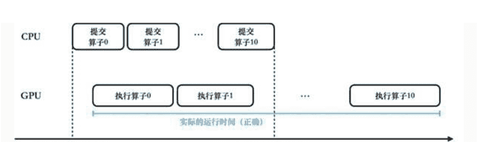

要得到正确的 GPU 耗时，必须先让 CPU 等 GPU 执行完，也就是调用 torch.cuda.synchronize() 阻塞后再读时间戳。示例如下：

```
import time
import torch

sz = 512
N = 10
shape = (sz, sz, sz)

x = torch.randn(dtype=torch.float, size=shape, device="cuda")
y = torch.randn(dtype=torch.float, size=shape, device="cuda")

torch.cuda.synchronize()
start = time.perf_counter()
for _ in range(N):
    z = x * y
# 同步
torch.cuda.synchronize()
end = time.perf_counter()
print(f"{N}次运行取平均: {(end - start) / N}s")
```

执行到 torch.cuda.synchronize() 时，程序会卡住直到 GPU 上最后一个任务完成，再回到 CPU 记录时间。这里主要测的是 GPU 执行算子的耗时，CPU 下发算子的额外开销通常能与 GPU 执行重叠，对总时长影响不大。

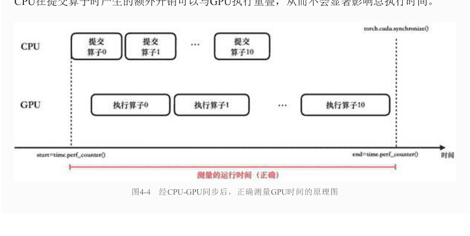

#### 4.2.4 用 CUDA Event 在 GPU 上直接计时

前面结合 torch.cuda.synchronize() 与 time.perf_counter() 的做法本质上是在 CPU 端估算 GPU 耗时，而同步本身也会产生延迟，测出来的时间会略大于真实算子耗时。

能不能直接在 GPU 上量？可以，用 CUDA Event 就能做到。CUDA Event 同样在 GPU 队列里执行，用两个事件的时间差就能更精准地捕捉 GPU 操作的真实耗时。

代码思路是创建两个 torch.cuda.Event 对象，用 record() 在 GPU 队列里打标记，再通过时间差算耗时：

```
import torch

sz = 512
shape = (sz, sz, sz)
x = torch.randn(dtype=torch.float, size=shape, device="cuda")
y = torch.randn(dtype=torch.float, size=shape, device="cuda")

start = torch.cuda.Event(enable_timing=True)
end = torch.cuda.Event(enable_timing=True)
start.record()
z = x + y
end.record()

# 等待GPU运行完成
torch.cuda.synchronize()

print(f"用时{start.elapsed_time(end)}ms")
```

代码收尾时仍然保留了 torch.cuda.synchronize()，只是为了确保计算已完成，而用 CUDA Event 测量本身并不依赖 CPU-GPU 同步。下面这张图展示了用事件计时的方法与传统方法的区别，可见事件法更贴近真实。

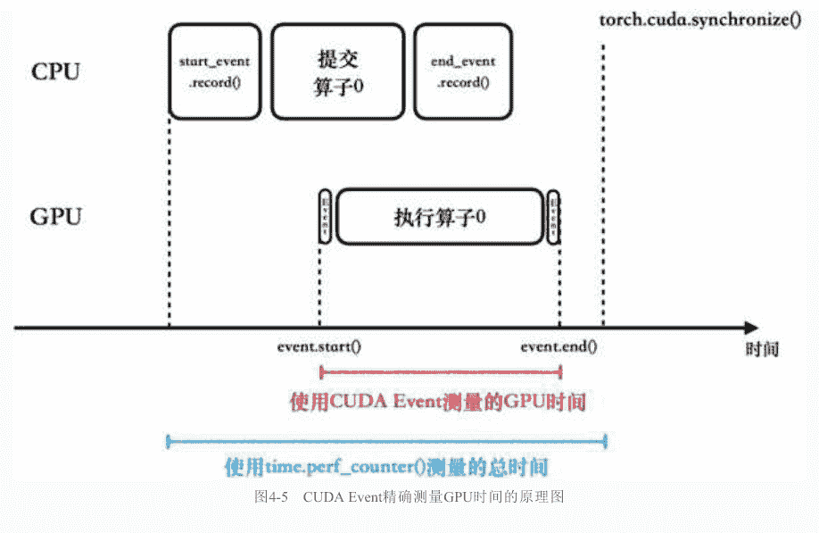

图4-5 CUDA Event 精确测量 GPU 时间的原理图

### 4.3 PyTorch 自带性能分析器怎么用

当训练流程简单、模块耦合浅的时候，用前面小节的打点方法就能大致看出瓶颈。但实际训练代码往往逻辑复杂、阶段众多，仅靠打印时间已经不够。这时需要更综合的分析工具。

分析工具分层级，越底层信息越多，但也越容易被细节淹没。举个例子，底层工具可能告诉你 hfma.rn.f16 指令占比很高，但这个半精度乘加指令几乎存在于所有算子里，优化它并无明确方向。底层工具往往列出成百上千条类似噪声，耗费大量时间排查。

选“合适”的工具比追求“最底层”更重要。对于整体训练优化，本书推荐 PyTorch 原生的 torch.profiler。配合 Perfetto UI 之后，既好上手，又能提供足够的信息量。

torch.profiler 功能不少，下面按不同用途依次介绍。

#### 4.3.1 快速看哪里慢

先看最基本的使用方式。把需要测试的代码 model(inputs) 包在 torch.profiler 的作用域里，如果要区分多段代码，可用 record_function 给不同段打标签，方便后续辨认。

```
import torch
import torchvision.models as models
from torch.profiler import profile, record_function, ProfilerActivity

model = models.resnet18().cuda()
inputs = torch.randn(5, 3, 224, 224, device="cuda")

with profile(activities=[ProfilerActivity.CPU, ProfilerActivity.CUDA]) as prof:
    with record_function("model_inference"):
       model(inputs)

print(prof.key_averages().table(sort_by="cuda_time_total", row_limit=10))
```

打印结果如图4-6 所示。测试片段在 GPU 上大约用了 919μs，主要消耗在 aten::cudnn_convolution 等卷积相关调用上，而 batchnorm 只占很小一部分。所以该例的瓶颈集中在卷积。

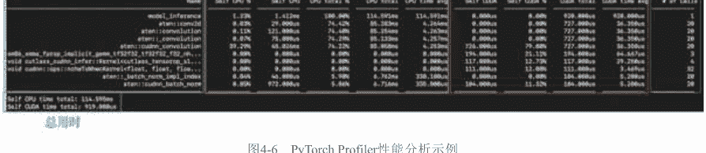

#### 4.3.2 追踪显存占用

torch.profiler 还能记录每个算子执行时的显存分配，间接帮助定位显存峰值位置。下面是开启显存分析的示例，输出如图4-7。

```
import torch
import torchvision.models as models
from torch.profiler import profile, record_function, ProfilerActivity

model = models.resnet18().cuda()
inputs = torch.randn(5, 3, 224, 224, device="cuda")

with profile(
    activities=[ProfilerActivity.CPU, ProfilerActivity.CUDA],
   profile_memory=True
) as prof:
   model(inputs)

print(prof.key_averages().table(sort_by="self_cuda_memory_usage", row_limit=5))
```

这类信息比较概括，只能大致了解各算子的内存开销。若要做专门的显存优化，推荐用 PyTorch 原生的 `torch.cuda.memory._record_memory_history()`，会在第 7 章显存优化专题详细讲解。

#### 4.3.3 导出时间线图在 Perfetto 里看

直接读打印结果不方便，torch.profiler 支持导出可视化文件。按下面代码导出即可：

```python
prof.export_chrome_trace("profiler_export_trace.json")
```

当前目录会生成 profiler_export_trace.json 文件，用浏览器打开 Perfetto trace viewer 导入该文件，就能以时间轴浏览事件，如图4-8。

界面上方两个区域对应 CPU 任务队列，可细分为前向和反向；下方是 GPU 任务队列。图中能看到一条从 CPU 前向到 GPU 任务的连线，表示二者的对应关系，相关异步机制可参考 3.5 小节。

图4-9 中的每条带状块代表一个事件，比如算子执行、函数调用。点开某个 GPU 条幅，Perfetto 会把对应的 CPU 提交连起来，并弹出该事件的起止时间、硬件信息等细节，方便深入分析瓶颈来源。

图4-8 PyTorch Profiler 性能图像示例

图4-9 PyTorch Profiler 性能图像的详细信息

#### 4.3.4 四步判断瓶颈在哪

借助上节的可视化图谱，定位瓶颈会很快。PyTorch Profiler 还能记录调用栈，帮助把问题追回 Python 代码。对大多数场景，用下面流程即可：

（1）看 GPU 队列，若整体都很稀疏，说明瓶颈在 CPU；
（2）看 GPU 队列，若任务密集且几乎没有空隙，说明 GPU 已满载，瓶颈在 GPU 算子；
（3）看 GPU 队列，若任务密集但存在明显空闲段，则放大空闲段继续观察；
（4）看空闲段前后，查看 GPU 任务和 CPU 任务的细节，推断阻塞原因。

图4-10 利用性能图像定位性能瓶颈的流程图展示了几种典型图像与对应瓶颈。

### 4.4 GPU 专业分析工具

4.3 节里介绍的 PyTorch Profiler 因为上手快、指标丰富，在工程里被大量使用，对训练全流程做一次通盘体检帮助很大。它在易用性和专业性之间更偏向前者，给出简洁直观的接口和几组可读性强的性能指标，足以帮我们把瓶颈大致揪出来。对绝大多数日常分析场景来说，这套工具已经够用；但当优化需求更进一步，需要看到更贴近硬件底层的细节时，就得借助 NVIDIA 官方提供的专业级剖析套件。本节重点落在 Nsight Systems 与 Nsight Compute 这两款工具上。

#### 4.4.1 Nsight Systems
Nsight Systems 与 PyTorch Profiler 的定位很像，但能呈现的信息维度更宽，常被拿来作为前者的补充。相比之下，它主要有两点差异：

- 分析过程完全不侵入代码，无需在程序里插入 `torch.profiler` 之类的钩子；PyTorch Profiler 则必须在源码中埋点。
- 观测范围向下延伸，能够看到操作系统、CUDA API、通信链路等多层面的行为，对多 GPU 场景的支持也更完善。

现实中，深度学习训练的常规问题用 PyTorch Profiler 多半就能覆盖，因此 Nsight Systems 在该领域多扮演辅助角色。此处不再展开详细操作，有兴趣的读者可直接查阅官方文档和教程。

#### 4.4.2 Nsight Compute
Nsight Systems 依然停留在与 PyTorch Profiler 同一层次的分析；Nsight Compute 则完全聚焦在 GPU 内核层面的指标上。它输出的指标数量庞大、采集耗时很长，通常只用于剖析少量代码片段。回到训练流程，只有在对 CUDA 算子做精细优化、需要定位算子内部瓶颈时才会被拿出来用。

要把 Nsight Compute 用好，需要同时具备 GPU 硬件架构和 CUDA 编程模型的知识。它核心展示的是每个 CUDA Kernel 的运行细节。下面用一个例子来感受其分析速度。

下面这段代码用 Nsight Compute 对完整模型的一轮训练做分析，虽然它更适合单算子：

```python
import torch
import torch.nn as nn
import torch.optim as optim


class SimpleCNN(nn.Module):
    def __init__(self):
        super(SimpleCNN, self).__init__()
        self.conv1 = nn.Conv2d(1, 20, 5)
        self.pool = nn.MaxPool2d(2, 2)
        self.conv2 = nn.Conv2d(20, 50, 5)
        self.fc1 = nn.Linear(50 * 4 * 4, 500)
        self.fc2 = nn.Linear(500, 10)

    def forward(self, x):
        x = self.pool(torch.relu(self.conv1(x)))
        x = self.pool(torch.relu(self.conv2(x)))
        x = x.view(-1, 50 * 4 * 4)
        x = torch.relu(self.fc1(x))
        x = self.fc2(x)
        return x


net = SimpleCNN().to("cuda")
criterion = nn.CrossEntropyLoss()
optimizer = optim.SGD(net.parameters(), lr=0.001, momentum=0.9)

for i in range(10):
    inputs = torch.randn(32, 1, 28, 28, device="cuda")
    labels = torch.randint(0, 10, (32,), device="cuda")
    optimizer.zero_grad()
    outputs = net(inputs)
    loss = criterion(outputs, labels)
    loss.backward()
    optimizer.step()
```

启动方式可以直接在 Nsight Compute 的图形界面里加载 PyTorch 程序，具体流程参考官方说明。参数层面，绝大部分保持默认即可，唯独 Metrics 的选择要留意，如图4-11。

做整体扫描时一般勾选 basic，这时只采集数十项核心指标，用于快速筛选可疑算子。定位到少数几个瓶颈算子后，再把 Metrics 切到 full。full 模式会采集上百项指标，并生成曲线、示意图等辅助判断的视图。受篇幅限制，这里仅解读 basic 的结果，系统化的学习建议去官方文档。

分析完成后首先看到的是 summary 汇总页，如图4-12。

汇总页列出了每个 CUDA 函数的名称、耗时、吞吐量、每个线程的寄存器占用等硬件信息，同时给出函数可能的加速空间预估，仅作参考。

双击任意函数进入 details 细节页，信息被划分为几个区域，如图4-13：

最上方是各硬件单元的吞吐量，吞吐最高的那块通常就是瓶颈所在，可据此判断函数偏计算还是偏访存。

以池化为例，如图4-14，其计算吞吐远高于访存吞吐，判定为计算密集型，这与直觉不太一致。池化本应是读取大量数据、计算较轻的访存型操作，这个反常信号正是 Nsight Compute 的价值所在，它能揪出异常算子并提供数据支撑。

接着是 Launch Statistics 启动信息，展示 Grid Size、Block Size、总线程数等配置，反映算子是否充分利用 GPU 资源。

图4-15 中的算子格点数过少，未能充分占用流式多处理器。提示信息显示 GPU 支持 128 个并行 SM，该 Kernel 只用了 40 个，存在优化余地。

最后是 Warp Occupancy 占用率，反映多线程在 GPU 上的实际并行程度。图4-16 中理论可并行 48 个线程组，实际只有 10 个，仅约 20%。原因可能有两种：单个线程计算太轻，线程束创建调度的开销超过计算本身，需要把多个轻线程合并；或线程束负载不均衡，存在大量发散，需要结合 CUDA 源码分析。

除此之外还有计算存储平衡等区域，这里不再展开。

### 4.5 CPU性能分析工具

PyTorch Profiler 在 GPU 上的短板是深度不足，于是 4.4 节引入了 Nsight 两件套做补充；在 CPU 侧，它的短板是广度不足，只追踪 PyTorch 接口调用，对 NumPy、PIL、Scipy 等第三方库的调用完全不可见。

下面这段代码里有一段耗时的 NumPy 计算，在 PyTorch Profiler 的图谱上却是空白：

```python
import torch
import numpy as np
from torch.profiler import profile, record_function, ProfilerActivity


class SimpleModel(torch.nn.Module):
    def __init__(self):
        super().__init__()
        self.linear = torch.nn.Linear(10, 10)

    def forward(self, x):
        return self.linear(x)


def numpy_heavy_computation(input_array):
    size_inner = 1000
    size_0 = input_array.shape[0]
    size_1 = input_array.shape[1]
    result = input_array
    for _ in range(2):
        matrix_a = np.random.randn(size_0, size_inner)
        matrix_b = np.random.randn(size_inner, size_1)
        result = np.dot(matrix_a, matrix_b) + result
    return result


def run(data, model):
    processed_data = numpy_heavy_computation(data)
    tensor_data = torch.tensor(
        processed_data[:10, :10], dtype=torch.float32, device="cuda"
    )
    output = model(tensor_data)


def main():
    model = SimpleModel().to("cuda")
    data = np.random.randn(10, 10)
    for i in range(1000):
        run(data, model)
    torch.cuda.synchronize()


if __name__ == "__main__":
    main()
```

图4-17 证实了这一点，NumPy 相关调用未被记录。

要实现全量 CPU 观测，可以使用 Py-Spy 📊。它同样无需改动代码，非侵入式启动：

```
py-spy record -o profile.svg -- python test.py
```

Py-Spy 会生成火焰图文件 profile.svg，拖到浏览器打开即可看到如图4-18 的视图。

火焰图的每一竖条代表一个调用栈，底部是入口，顶部是深层调用。Python 函数通常靠近底部，底层的 C++ 函数在顶部。悬停会显示对应源码位置与采样次数，默认采样频率为 100 samples/s，采样数除以 100 近似等于真实耗时。

通过它能快速定位 `numpy_heavy_computation` 的耗时。Py-Spy 对原生 Python 程序及第三方库都通用，非常适合专门做 CPU 任务分析。

#### 4.5.2 strace
有时火焰图里某个函数耗时异常却看不出系统在做什么，这时用 strace 查看程序与操作系统的实时交互会很有帮助。它能追踪 Linux 进程的系统调用，记录函数名、参数与返回值。既可以用它启动程序，也能附加到正在运行的进程：

```bash
# 通过strace运行一个程序
strace python test.py

# 追踪一个已经运行的进程
strace -p <pid>
```

关注性能时常见的系统调用包括：

- 文件相关：`open`/`close`/`read`/`write`/`lseek` 等
- 网络相关：`socket`/`bind`/`listen`/`send`/`recv` 等
- 进程控制：`fork`/`execve`/`wait` 等
- 内存管理：`mmap`/`munmap`/`brk` 等

strace 能帮助开发者理解程序运行时的系统行为，便于诊断性能异常。

### 4.6 本章小结
本章围绕定位性能瓶颈给出三步流程，如图4-19：

- 1. 搭建稳定可复现的软硬件环境。
- 2. 用计时或 PyTorch 性能图谱发现问题。
- 3. 借助底层硬件与系统分析工具深挖根因。

找到原因后，可结合第6章的优化方法以及第9章的高级优化手段进一步提升。

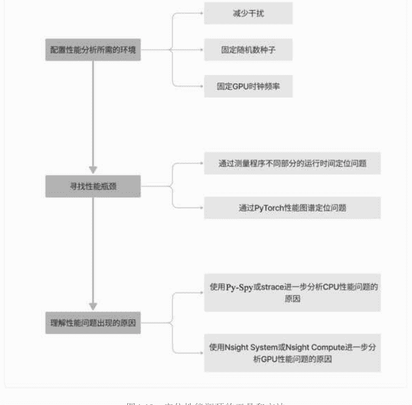
图4-19 定位性能瓶颈的工具和方法

05 数据加载和预处理专题
深度学习本质是从海量数据中提炼规律，数据的接入与处理因此成为核心环节。整体流程大致为（图5-1）：

- 1. 从网络或其他渠道收集原始数据。
- 2. 清洗并离线预处理，得到标准化数据。
- 3. 从磁盘加载到内存，由 CPU 做实时预处理。
- 4. 将数据从内存搬运到显存，供 GPU 训练使用。


本章将聚焦训练过程中的数据相关问题。

### 5.1 数据接入的准备阶段
从获取原始数据到离线预处理再到加载传输的完整链路，更适合已经成熟、需要扩规模的项目。对刚起步的项目来说，先跑通代码、验证正确性才是第一优先级，这也是正式接入数据管线前的准备工作。

起步阶段通常以模型能跑通为目标，甚至不接入真实数据集，直接用 `torch.rand()` 生成随机张量模拟输入，快速暴露实现漏洞。模型跑通后，才进入收敛性验证，这时才需要数据。

收敛验证对数据量要求不高，几千条样本往往足够，但对数据质量敏感。建议从高质量公开集里抽取一个小子集做验证，有利于快速收敛。验证完毕后再用大规模数据继续训练。

在这个阶段，公开数据集完全够用。常见选择如表5-1：

表5-1 常用的公开数据集

| 数据集 | 数据集内容 | 数据集大小 |
|---|---|---|
| MNIST | 手写数字识别，10 类 | 60 000 训练样本，10 000 测试样本 |
| CIFAR10/CIFAR100 | 10 类 / 100 类的 32×32 彩色图像 | 60 000 个样本 |
| ImageNet | 超过 1000 类的大规模图像识别 | 1 281 167 训练样本，50 000 验证样本，100 000 测试样本 |
| COCO | 图像识别、分割和目标检测 | 328K 个样本 |

| 20 Newsgroups | 新闻组文章文本集 | 约 2 万篇新闻，分 20 类 |
| IMDb Movie Reviews | 电影评论情感分析集 | 5 万条影评，正负两类 |
| Wikipedia Corpus | 自然语言处理通用语料 | 持续更新，可达数 TB |
| Google Open Images Dataset | 大规模图像集 | 约 900 万张图，6000 万物体标注 |

验证环节的本质，是在正式跑数据前先锁定模型架构和训练实现，并把潜在的坑提前扫掉。只有这一步稳住，后续才敢把真正的数据处理管线接上来。

### 5.2 数据集的获取和预处理

绝大多数训练是从已经成熟的数据集起步的，像上面提到的公开库，也有企业内部积累。等模型有了初步效果、结构也趋于稳定后，再去大规模采集原始数据或做深度清洗，用来进一步提性能。要注意的是，原始数据的收集、标注以及精细化清洗虽然在流程上和模型开发是分离的，却是整个项目成败的关键环节。

#### 5.2.1 获取原始数据

数据的好坏直接影响模型效果和收敛效率，拿到高质量数据一直是数据工程师的核心追求。来源大致两类：

- （1）机构和科研组织发布的公开数据，覆盖图像识别、自然语言处理等多个方向，例如 ImageNet、COCO 以及 Kaggle 竞赛数据。
- （2）自主构建的数据，可能来自企业内部业务记录、通过开放 API 拉取的特定类型数据，或借助网络爬虫采集的社交媒体内容、政府和机构发布的报告等。

#### 5.2.2 原始数据的清洗

深度学习本质上是从数据里提炼规律的实验性工作，清洗与预处理的能力因此极其重要。听起来很高端的模型和公式，在真实问题面前常常不如一次扎实的数据清理来得有效，简单的清洗就能让模型表现跃升一个层级。

算法工程师必备的敏感度之一就是对数据的嗅觉：能判断特定任务下的数据会有哪些问题，知道理想数据长什么样，会组织高质量样本，也能验证数据是否可靠。这种能力多靠实战积累，和任务、数据强相关。下面介绍一些通用的基础清洗思路。

原始数据来路各异，有的靠自动化脚本批量处理，有的靠实地采集加人工标注。典型如 Laion-5B 是网络爬取图片配字后清洗而来；无人车的检测集则是车载摄像头采集路面实拍，再经标注团队处理。无论来源如何，原始数据质量往往粗糙，会混入错误、无效或不典型的样本。清洗方法没有统一标准，和数据形态、训练目标紧密相关。

先要弄清数据为什么会“脏”。按是否带标签划分：

**无标签数据** 多用于无监督学习，问题集中在样本本身的质量：

- 图像/视频/图形类：分辨率低、噪声大、曝光过度。
- 文本文档：不符合自然语言习惯，夹杂怪异符号、标点、特殊数值。

**有标签数据** 用于监督学习，除自身质量外，还会出现标签与样本不匹配的“货不对板”，例如图片分类错了、描述不符。更复杂的是同一张图被贴上互相冲突的多条描述，形成一对多错误，如图5-2所示。


人工清洗不现实，多数工作靠脚本完成。写脚本前，先给“脏数据”划清界限。比如图像类，只要满足以下任一条件就判定为脏：

- 分辨率低于设定阈值
- 噪点密集
- 曝光过度
- ...

随后要把每条标准细化成可判断的方法。以图像为例，分辨率和长宽比直接可读，曝光程度可通过整体亮度判断，而噪点检测则需要计算机视觉算法或预训练模型辅助。若不想制定过于细致的规则，也能让大模型对数据打分。这种借助第三方模型清洗的思路本质上是数据蒸馏，必须选用足够优质的预训练模型才能保证可靠性。

#### 5.2.3 数据的离线预处理

清洗的目的是保证完整性和合理性，剔除错误或不合适的样本。但清洗后的数据还不能直接喂模型。很多模型对输入有严格要求，例如固定图像尺寸、数值归一到[-1,1]区间等；同时还需要增强，例如对文本重写，对图像做旋转、翻转等操作，提升泛化。此时可在离线阶段做进一步预处理，改善质量与结构。

常见的离线步骤包括数值标准化、编码、数据增强等。

数值标准化有助于加快收敛，做法有最小-最大归一化或标准化到正态分布。具体选型要结合数据特性并多次实验。最常用的最小-最大归一化把特征压缩到指定区间，通常是[0,1]。它能保持原有分布并将各特征拉到同一尺度，对基于距离的算法很重要。但该方法对异常值敏感，可能把正常值压得很窄，使用前务必处理异常。

最小-最大规范化的公式是 $x_{new} = \frac{x - x_{min}}{x_{max} - x_{min}}$

其中 x 为原始值，$x_{min}$ 和 $x_{max}$ 分别是该特征的最小值与最大值，$x_{new}$ 为归一化后值。

数据编码是将非数值信息转为数值，如标签必须编码后才能输入模型。CIFAR-10 里类别是 “Airplane”“Automobile”等文字，不能直接作为 PyTorch 张量，需映射为 0、1 等整数，模型输出也按此编码解读。

类不平衡是常见难题，少数类样本过少会导致模型偏向多数类。基础对策有过采样、欠采样和数据增强。增强通过对原始样本施加变换生成额外训练数据。图像增强可包括亮度对比度调整、旋转、翻转、随机裁剪；文本增强可包括同义词替换、句子重排等。不同领域还有专门的平衡方法，可参考相关论文。

在超大规模任务中，可先进行 **特征提取** 再进入模型。例如文生图的 Stable Diffusion 会先用预训练 VAE 把 512×512 原图压缩为多通道 64×64 的特征，后续生成只用该特征张量。推荐系统里也会用经验模型先提炼少量特征供深度模型使用。有效提取能显著提升性能并缩短训练时间，但需要反复实验和对业务的深入理解。

Python 是数据科学的主流语言，原生生态提供了丰富的工具。深度学习中的预处理多可直接调用，掌握这些工具能大幅提升效率。本书聚焦 PyTorch，这里简单列出常用库，如图5-3所示。

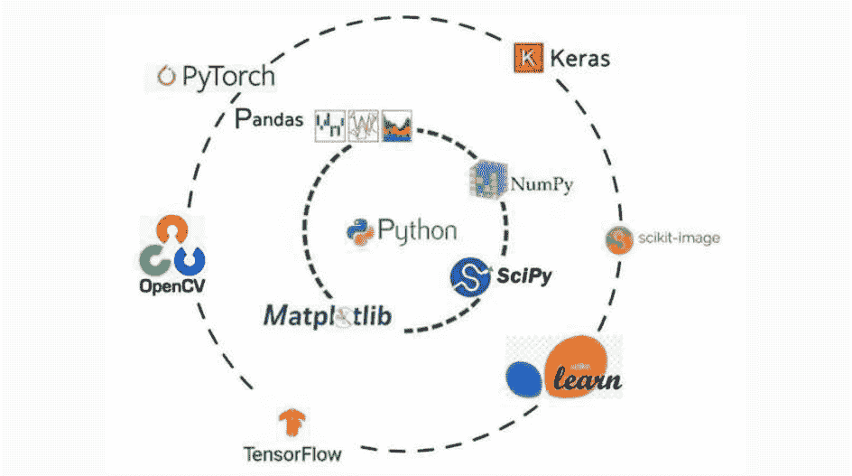

- NumPy 是高性能科学计算基石，提供 N 维数组对象和大量数学函数，是多数机器学习库的基础。
- Pandas 擅长结构化数据处理，提供 DataFrame、Series，支持读写、清洗、转换、聚合、可视化等。
- Matplotlib 用于静态、交互式和动态可视化，常绘制图表、直方图、散点图等。
- Scikit-learn 提供监督与非监督学习算法，以及预处理、评估、调参工具，以 CPU 为主，未针对 GPU 专门优化。
- Pillow 是 PIL 的分支，提供图像读取、显示、保存、转换和操作，是图像数据处理的常用工具。

#### 5.2.4 数据的存储

完成采集、标注、清洗和离线预处理后，就得到可用于训练的集合。怎么存到硬盘、目录如何组织，以 CIFAR-10 为例说明。

从网络下载解压后可见其目录结构如下所示：

```
cifar-10-raw-images
|- images
    |- train
        |- Airplane
            |- aeroplane_s_000004.png
            |- ...
        |- Automobile
        |- Bird
        |- ...
```

一般数据集包含三类内容：

- 核心数据：图像、视频、音频、文本等，与训练任务相关。
- 标签或其他补充信息（可选）：如图像分类的类别标签，或图像-文字集中的描述。
- 数据集信息：版本、来源、预处理方法、参数等。

核心数据与任务强相关，如 CIFAR-10 的核心是物体图片 aeroplane_s_000004.png 等。

部分数据集还提供对核心数据的描述补充。CIFAR-10 类别较少，标签直接用文件夹名表示；Laion-5B 则为每张图配一段文字描述；三维数据可能还包含相机位置等视角参数。描述文件多为文本，格式可能是 JSON、CSV、TXT 等。

核心数据和标签会作为模型输入，而数据集描述通常不参与训练，一般记录来源、采集方式、标注方式、处理算法及参数，并可能包含聚类、质量等统计指标，用于后续筛选清洗。

实际应用中数据格式多样，目的是兼顾可读性、存储与读取效率。npy/npz 专为 NumPy 设计，Parquet 是列式存储，压缩率高、读写快，适合海量数据；bin 常指自定义二进制格式，需配合代码解析。表5-3 对比常见格式。

表5-3 不同数据格式的对比

| 数据格式 | CSV | JSON | npy | Parquet |
|---|---|---|---|---|
| 存储形式 | 文本 | 文本 | 二进制 | 二进制 |
| 可读性 | 高 | 高 | 低 | 低 |
| 存储空间效率 | 低 | 低 | 高 | 高 |
| 读取性能 | 低 | 低 | 高 | 高 |
| 空间更友好的压缩格式 | 如Apache Avro等 | TFRecord | npz | N/A |
| 适用范围 | 建议单文件小于GB级别的数据 | 建议单文件小于GB级别的数据 | 支持向量化磁盘读写，适用于大型文件，需要足够的内存 | 存储在分布式数据库的大规模数据 |

#### 5.2.5 PyTorch与第三方库的交互

数据集通常放在本地或服务器硬盘，读取起点是硬盘。先用 Python 库把数据读入内存，如 PIL 读取图片、json 读取序列化文件。此时数据以 NumPy ndarray 或 PIL Image 等第三方类型存在，PyTorch 无法直接使用。PyTorch 的初衷之一就是做 GPU 上的高性能 NumPy，利用并行加速科学计算。

所有数据必须转为张量才能训练。PyTorch 提供了把 NumPy ndarray 转为 CPU 张量的接口。示例中变量 y 被成功导入为张量。

```python
import numpy as np
import torch

x = np.zeros((3, 3))
y = torch.from_numpy(x)

print(y, type(y))

# tensor([[0., 0., 0.],
#        [0., 0., 0.],
#        [0., 0., 0.]], dtype=torch.float64) <class 'torch.Tensor'>
```

一个常见疑问是 from_numpy 是否复制数据。以该接口为例，返回的张量与原 NumPy 数组共享同一块内存地址，未做额外拷贝，性能更高，但也可能因意外修改源数组而引入 bug，使用时需谨慎。

当原始数组不满足条件时内存复用不可行，例如 stride 包含负数，PyTorch 不支持此类张量，此时 from_numpy 会报错，只能手动调用 numpy.ndarray.copy() 创建副本，但会失去复用带来的性能优势。

### 5.3 数据集的加载和使用

第 5.2 节已介绍如何获取、清洗、预处理数据，以及如何把数据从硬盘导入为 PyTorch 张量。初验阶段可用 json、csv 读取标签、PIL 加载图片再转张量的串行方式，但大规模训练时串行加载和预处理会严重阻塞运算，影响效率。

优化方向是让 CPU 异步准备下一批数据，同时 GPU 进行计算，并提升并行读取吞吐。PyTorch 通过 Dataset 类和 DataLoader 类提供了上述优化的支持。

在 PyTorch 里跑一个训练任务，常见的做法是先造出一个 Dataset 类的实例来说明数据怎么从硬盘里读出来，再交给 DataLoader 来循环取用。通俗点说，Dataset 定义的是“一条样本如何获取和预处理”，它的产出是一个单独的张量；而 DataLoader 定义的是“怎么成批搬运数据”，它控制着批次大小、是否预取、是否多进程等，最终给模型喂上一批张量。

两者分工明确，数据本身的读取与预处理交由 Dataset 来管，批量迭代与加载策略交由 DataLoader 来管，这样职责解耦后既灵活又高效。下面会先讲 Dataset 与 DataLoader 的用法，再聊怎么把数据加载做快。

在 PyTorch 的数据处理链路中，Dataset 与 DataLoader 是两大核心。Dataset 负责指出单个数据点从哪里来，返回的是单条张量；DataLoader 负责按照采样方式和顺序从 Dataset 里抽取数据，返回的是供训练用的批次。它还自带多进程加载和预读取，CPU 可以在 GPU 计算的间隙异步准备下一批样本，配合并行预取，保证 GPU 不至于等数据。

这种拆分把“单条样本读入内存和预处理”与“批量迭代加载”解耦，既方便扩展也提升效率。下面就介绍如何组合使用这两个组件，让模型训练时始终有数据可用。

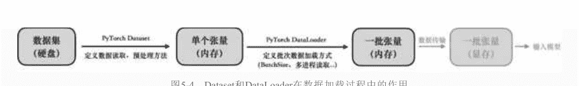

#### 5.3.1 PyTorch的Dataset封装

PyTorch 中的 Dataset 是一个抽象基类，用来描述数据集的结构和内容。它提供统一的接口，让你可以自定义加载逻辑和处理逻辑。框架里大致有两种抽象：映射式数据集和迭代式数据集，二者在访问方式和适用场合上不一样。

表5-4 PyTorch支持的映射式和迭代式数据集各自特点和应用场景

| | 映射式数据集 (torch.utils.data.Dataset) | 迭代式数据集 (torch.utils.data.IterableDataset) |
|---|---|---|
| 实例中需要自定义的方法 | `__getitem__(self, index)`：按索引取出对应条目<br>`__len__(self)`：返回总条目数 | `__iter__(self)`：定义逐个读取数据的方式 |
| 访问 | 支持随机访问，可直接用索引定位任意一条 | 不支持随机或索引访问，只能顺序迭代遍历 |
| 适用场景 | 数据规模可控，或每条样本能独立从文件系统等资源检索时很合适 | 数据体量过大无法一次性载入内存，或数据以流式方式从网络、实时产生时更合适 |
| 示例 | CIFAR-10、MNIST 等小型基准集 | 大型日志文件或实时行情等数据流 |

不管是哪种 Dataset，都需要实现构造方法 `__init__(self,...)`，在实例化时完成路径、变换等初始化，常在这里做读取文件、清洗等一次性准备工作。

PyTorch 官方已为很多常用集做了现成的 Dataset，大幅省去重复劳动。这些实现散落在不同领域库里，比如图像集就在 torchvision.datasets 中，示例如下。

```python
import torchvision.datasets as datasets
import torchvision.transforms as transforms

transform = transforms.Compose([transforms.ToTensor()])

train_dataset = datasets.CIFAR10(
    root="./data", train=True, download=True, transform=transform
)
test_dataset = datasets.CIFAR10(
    root="./data", train=False, download=True, transform=transform
)
```

有了这些现成类，加载常见数据集变得很省心，能把精力集中在模型本身而不是数据搬运上。

如果用的是自采数据，就需要自己写 Dataset。前面 5.2.4 节我们已下载 CIFAR-10 并了解其结构，下面就以它为例演示手写 Dataset。

思路是定义一个继承 Dataset 的 CifarDataset，并实现三件事：

- `__init__`：构建“图像路径-标签”列表，但不立刻读图，避免内存被占满
- `__len__`：返回样本总数
- `__getitem__`：按索引读图并转成 PyTorch 张量

下面这段 CifarDataset 给出了实现骨架和遍历示例。

```python
import os
import numpy as np
import torch
from torch.utils.data import Dataset
from PIL import Image

class CifarDataset(Dataset):
    label_encoder_ = {
        "Airplane": 0,
        "Automobile": 1,
        "Bird": 2,
        "Cat": 3,
        "Deer": 4,
        "Dog": 5,
        "Frog": 6,
        "Horse": 7,
        "Ship": 8,
        "Truck": 9,
    }

    def __init__(self, root_folder):
        self.image_label_pairs = []
        # Read a list of: (image_path, label)
        train_foldername = "images/train"
        train_path = os.path.join(root_folder, train_foldername)
        class_folders = os.listdir(train_path)
        for class_name in class_folders:
            class_folder_path = os.path.join(train_path, class_name)
            image_names = os.listdir(class_folder_path)
            for image_name in image_names:
                image_path = os.path.join(class_folder_path, image_name)
                label = self.encode_label(class_name)
                self.image_label_pairs.append((image_path, label))

    def __len__(self):
        return len(self.image_label_pairs)

    def __getitem__(self, idx):
        image_path, label = self.image_label_pairs[idx]

        img = Image.open(image_path)
        img_array = np.array(img)
        img_tensor = torch.tensor(img_array)
        return img_tensor, label

    def encode_label(self, label_str):
        assert isinstance(label_str, str)
        return CifarDataset.label_encoder_[label_str]

if __name__ == "__main__":
    dataset = CifarDataset("/home/ailing/Downloads/cifar10-raw-images/")
    for i in range(len(dataset)):
        img_data, label = dataset[i]
        print("image: ", img_data.shape, "label: ", label)
```

#### 5.3.2 PyTorch的DataLoader封装

前面 Dataset 只是提供了“索引到样本”的映射，而 DataLoader 则规定了“如何把这些样本批量取出来”，并封装了采样、并行加载等高效机制。训练中常见的采样、批量化、多进程读取等操作，都在 DataLoader 里完成。

在 5.3.1 节的基础上，继续用 CifarDataset 构造一个 DataLoader：

```python
if __name__ == "__main__":
    dataset = CifarDataset("path/to/cifar-10")

    dataloader = DataLoader(
        dataset, batch_size=4, shuffle=True, drop_last=True, num_workers=0
    )
    for i, batch in enumerate(dataloader):
        img_data, label = batch
        print("image: ", img_data.shape, "label: ", label)
```

常用参数含义如下：

- `batch_size`：每批包含的样本数
- `shuffle`：采样方式的快捷开关。False 相当于顺序采样，True 相当于随机采样。需要更复杂的策略时可自定义 Sampler 并传入 sampler 参数
- `num_workers`：数据加载使用的子进程数
- `drop_last`：当样本总数不能被 batch_size 整除时，是否丢弃最后一批不完整的样本

运行后可以看到，DataLoader 按设定的 batch_size 每次取出 4 张 32×32、3 通道的图片及其标签。

```
image: torch.Size([4, 32, 32, 3]) label: tensor([8, 8, 0, 3])
```

### 5.4 数据加载性能分析

有经验的读者可能都遇到过：一个训练步耗时 5 秒，其中前向反向加起来不到 1 秒，剩下时间全被数据加载耗掉。听起来夸张，实战中却很常见。我们花大价钱买了顶级 GPU，结果性能却卡在“喂数据”的速度上，就像一把连发冲锋枪配了只装一发子弹的弹夹，换弹时间远大于射击时间。

深度学习常要处理海量数据，全部塞进内存既慢又不现实。数据通常只能在需要时从硬盘临时读入，用完即释放。硬盘读速远慢于 CPU，更慢于 GPU，低效读取就会让昂贵的计算资源空转。图5-5展示了典型的瓶颈特征：

- GPU 出现空闲
- 空闲时段与数据读取和处理时段高度重合

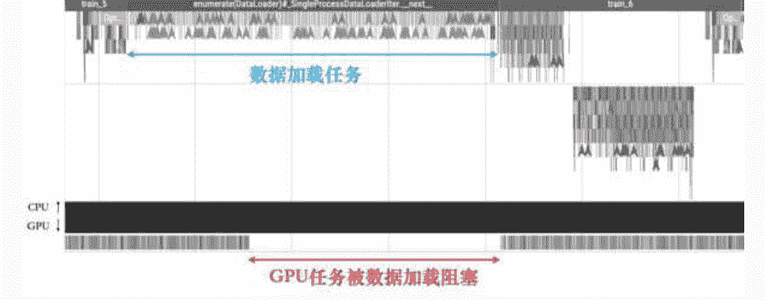

优化数据的核心目标是让 GPU 持续忙碌，避免因等数据而空闲。GPU 空闲的诱因很多，比如硬盘到内存的延迟、CPU 预处理过重、CPU 到 GPU 传输慢等。需要特别注意：

（1）数据加载的唯一目的就是保障 GPU 连续运行，至于 GPU 在跑什么、跑得快不快，本章暂不讨论。
（2）数据传输对 GPU 空闲的影响，将在第 6 章专门讨论。
（3）只优化到 GPU 不被阻塞即可。若 GPU 已排满任务，过度提交数据不仅不会加速，反而可能因 CPU 资源竞争导致下降。

本节主要梳理瓶颈来源和诊断思路，具体优化手段放到第 6 章统一讲解。

#### 5.4.1 充分利用CPU的多核资源

分析前先看性能图，确认瓶颈是否在数据加载。可参考 4.3.4 节的方法。若现象类似图5-5，可打开 htop 观察 CPU。常见情况是程序占满一个核心达到 100%，其余核心闲置，形成“1 核干活，多核围观”。

这时可以尝试开启多进程并行。PyTorch 的 DataLoader 通过 num_workers 和 prefetch_factor 调节子进程数，从而更好利用多核。默认 num_workers 为 0，即不建子进程，所有工作在主进程完成，这正是单核瓶颈的根源。用多个进程并行读数据、每个进程负责一批样本，能明显提升吞吐。但子进程太多也会带来内存膨胀、I/O 阻塞等问题，最佳数值要结合硬盘和 CPU 负载调优。

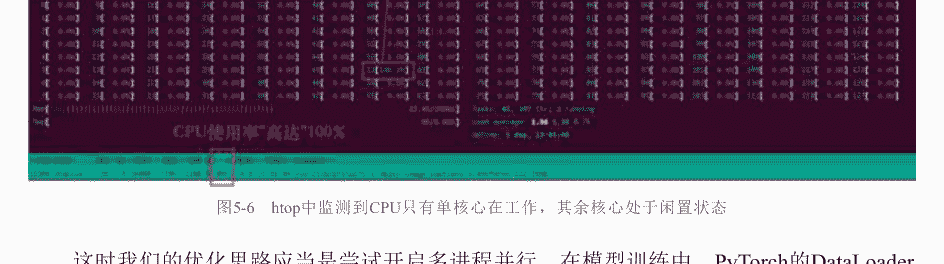

#### 5.4.2 优化CPU上的计算负载

开启多进程后，若 GPU 仍在等数据，且 htop 显示 CPU 核心全满，这说明 CPU 端的预处理和变换算力不足。看起来很忙，但若库的实现效率低，实际还有提升空间，这是第三方库里常见的现象。

以 Pillow 为例，其标准实现对 CPU 利用率不高，而 Pillow-SIMD 利用 SIMD 指令集如 SSE4 或 AVX2 加速图像缩放、滤波、色彩转换等操作，速度可提升数倍。下面是一个简单的缩放对比，读者可自行安装两个版本测试。笔者在 16 核 11 代 i7 上观察到约 15% 的加速，具体数值会随硬件环境变化。

```python
from PIL import Image
import time

def resize_image(image_path, output_size):
    with Image.open(image_path) as img:
        img = img.resize(output_size)
        img.save("output.png")

image_path = "example.png"
output_size = (4096, 4096)  # 新的尺寸

# 开始计时
start_time = time.time()

# 执行图像缩放
resize_image(image_path, output_size)

# 计算耗时
duration = time.time() - start_time
print(f"Time taken: {duration} seconds")
```

除了换更高效的库，还可以把计算密集的预处理离线化，先处理好存盘备用。实在离不开的在线操作，也可以考虑迁移到算力更强的 GPU 上做。

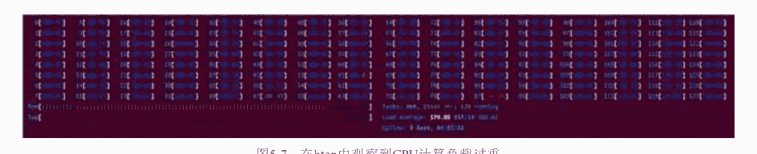

#### 5.4.3 减少不必要的CPU线程

别只盯着模型算力，NumPy 这类为速度而生的科学计算库如果放任不管，同样会把整台机器的 CPU 资源耗尽。之所以会出现这种情况，是因为为了追求极致性能，这类库在底层大量依赖多线程执行。NumPy 在处理向量、矩阵与线性代数时，会调用 BLAS、LAPACK 等第三方加速实现，而矩阵乘法、奇异值分解 SVD 等核心函数默认就是并行化的，会把所有物理核心都拉去一起干活。一旦核心全被 NumPy 占用，其他任务就很难再拿到算力。下面这段可以让读者在多核机器上直观复现：

```python
import numpy as np
import pdb

pdb.set_trace()
```

打开 htop 观察对应的 Python 进程，会发现 NumPy 静悄悄地拉起了一批线程，数量正好与物理核心数相等，笔者这台 11 代 i7 16 核的机器上就是如此，如图5-8。

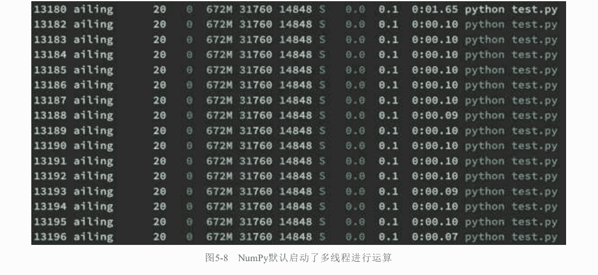

对单个 NumPy 任务来说这是加分项，但放在整体系统里就是资源挤占。最典型的冲突发生在 NumPy 预处理和 PyTorch DataLoader 的数据读取之间。DataLoader 会起多个子进程取数，每个子进程在 import numpy 的瞬间都会独立再建 N 个线程，N 等于核心数。线程暴涨带来的直接后果是内存占用上升、上下文切换变频繁、资源争抢加剧，最终拖慢整条流水线。所以在做 NumPy 预处理时，最好主动给线程数设个上限，通过环境变量控制，并且一定要在 import numpy 之前生效，示例如下：

```python
from os import environ

# 控制NumPy底层库创建的线程数量
N_THREADS = "4"
environ["OMP_NUM_THREADS"] = N_THREADS
environ["OPENBLAS_NUM_THREADS"] = N_THREADS
environ["MKL_NUM_THREADS"] = N_THREADS
environ["VECLIB_MAXIMUM_THREADS"] = N_THREADS
environ["NUMEXPR_NUM_THREADS"] = N_THREADS

import numpy as np

import pdb

pdb.set_trace()
x = np.zeros((1024, 1024))
```

再打开 htop 就能看到效果，NumPy 的线程数已经被压到 4，如图5-9。

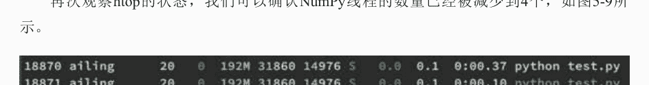

#### 5.4.4 提升磁盘效率

CPU 占用率高不一定是计算太重，有时只是被 I/O 卡住。htop 里若进程状态为 D，表示进入不可中断睡眠，通常是在等系统调用收尾，比如磁盘读写或网络。训练时多半是存储成为瓶颈，这时可以用 iostat 来量化负载：

```bash
iostat -xtck 2
```

如图5-10，iowait 占比明显突出，说明 CPU 花了大量时间在空等数据搬运，而不是在执行代码。存储瓶颈时可以尝试以下思路缓解：

（1）用内存换加载速度：借助 mmap 把文件映射到内存，通过指针直接访问，减少显式的 I/O 调用。随机访问场景下收益很明显；内存充足时甚至可以用 RAMDisk，用内存模拟磁盘。
（2）改善读写模式：2.2 小节提到过，顺序读写远快于随机读写。可把分散数据合并成少量二进制文件或 TFRecord，把随机访问转为顺序访问，效率可倍增。
（3）升级硬件：换用 NVMe 等更快的 SSD。

| CPU使用率 | avg-cpu: | %user | %nice | %system | %iowait | %steal | %idle |
|---|---|---|---|---|---|---|---|
| | | 8.80 | 0.13 | 38.68 | 22.90 | 0.00 | 29.50 |
| 硬盘使用率 | Device | r/s | rMB/s | rrqm/s | %rrqm | r_await | rareq-sz |
|---|---|---|---|---|---|---|---|
| | loop0 | 0.00 | 0.00 | 0.00 | 0.00 | 0.00 | 0.00 |
| | loop1 | 21.00 | 0.97 | 0.00 | 0.00 | 0.33 | 47.26 |
| | loop2 | 398.00 | 25.35 | 0.00 | 0.00 | 0.39 | 65.23 |
| | loop3 | 0.00 | 0.00 | 0.00 | 0.00 | 0.00 | 0.00 |
| | loop4 | 14.00 | 0.54 | 0.00 | 0.00 | 0.36 | 39.61 |
| | loop5 | 0.00 | 0.00 | 0.00 | 0.00 | 0.00 | 0.00 |
| | loop6 | 0.00 | 0.00 | 0.00 | 0.00 | 0.00 | 0.00 |
| | loop7 | 0.00 | 0.00 | 0.00 | 0.00 | 0.00 | 0.00 |
| | loop8 | 0.00 | 0.00 | 0.00 | 0.00 | 0.00 | 0.00 |
| | loop9 | 0.00 | 0.00 | 0.00 | 0.00 | 0.00 | 0.00 |
| | nvme0n1 | 57647.00 | 385.59 | 30105.50 | 34.31 | 0.12 | 6.85 |

图5-10 在iostat中观测到CPU的iowait占比很高，磁盘读取负载较高

### 5.5 本章小结

在图5-1 的框架上，本章梳理了数据从磁盘到显存的完整路径，并把常见问题和对应做法汇总到图5-11。需要强调的是，影响性能的因素很多，读者应灵活结合 PyTorch 性能图谱，以及 htop、iostat 这类 CPU 工具来定位真实瓶颈。先确认数据加载是否在拖慢训练，再进一步拆解加载耗时过长的具体原因。此外本章仅覆盖从磁盘到内存的环节，关于 CPU 到 GPU 传输速度的优化将留到 6.1 节展开。

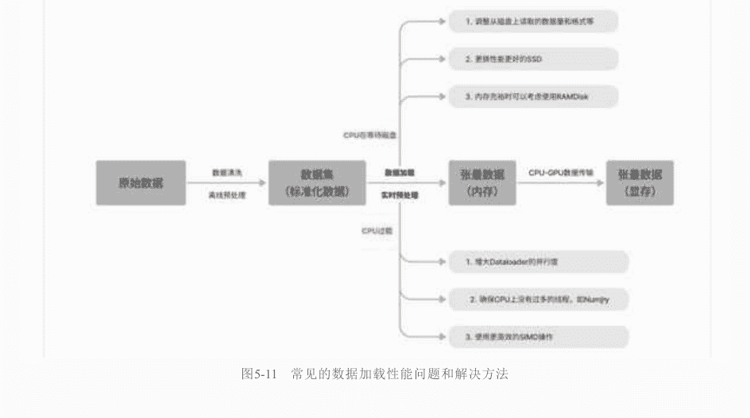

图5-11 常见的数据加载性能问题和解决方法

## 06 单卡性能优化专题

本章聚焦单个 GPU 环境下的性能优化思路与实操。对于大多数个人开发者，项目初期往往先用单卡验证，随后才逐步扩卡。优化的顺序也类似，先把单卡打满再考虑多卡协同，这样能更高效地利用有限的 GPU 资源。

和具体技巧相比，更想让读者体会到 **性能优化是一项极度依赖实践的工作**。它要求我们通过解读分析数据、反复试验，搞清楚“为什么会卡”以及“为什么这样改有效”。从这一章起会发现，很多显存或性能优化手段并非通用，某些模型上效果很好，换个场景可能适得其反。我们会给出示例和 profiling 结果，但效果高度依赖场景。建议读者掌握普适的分析思路，理解每种手段的原理与适用边界，再灵活落地。盲目照搬是常见的误区。

本章从整体性能画像切入，剖析常见根源并给出对策。单卡训练的性能问题大致可归为四类：

- GPU 被阻塞：前置的数据预处理或传输未完成，GPU 空等。
- GPU 运行效率不高：计算任务设计未能充分发挥硬件并行能力。
- 不必要的 GPU 与 CPU 同步：同步操作耗时极大，无意间的频繁同步会严重拖慢。
- 程序额外开销：Python 调度、张量创建与拷贝等。

因此提升单卡性能可分两步：先让 GPU 跑起来，减少空闲；再让 GPU 跑得更快，充分利用并行能力。后续小节将依次讲解定位方法、原因分析和优化样例。

特别注意，本章大量使用 PyTorch 性能分析器输出的图谱作为参考，不熟悉的读者建议先看 4.3 节。

### 6.1 提高数据任务的并行度

训练时 CPU 主要负责数据预处理，GPU 负责计算密集型任务。GPU 还自带直接内存访问引擎 DMA，负责在内存与显存之间搬运数据。

每批数据的流水大概是：CPU 预处理 → 传输到 GPU → GPU 计算。想让整条线高效，就要保证 GPU 始终有事可做，具体要求是：

- CPU 预处理要够快，及时把任务喂给 GPU，让 GPU 任务队列保持排队状态。
- 数据在 GPU 开始计算前就已送达显存，减少等待。

这两个环节都和数据相关，本节重点讲如何通过提升并行度来提速。

#### 6.1.1 增加数据预处理的并行度

第 5 章介绍过数据加载的三个阶段：硬盘到 CPU、CPU 预处理、CPU 到 GPU 传输，并分析了常见问题。这里用一个真实训练例子做更深入的拆解。首先定义基础模型和训练代码，加载 CIFAR-10 并把图像 resize 到 512×512 后送入模型训练：

```python
import torch
from torch import nn
from torch.profiler import profile, ProfilerActivity
import torchvision.transforms as transforms
from torchvision.datasets import CIFAR10
from torch.utils.data import DataLoader

class SimpleNet(nn.Module):
    def __init__(self):
        super(SimpleNet, self).__init__()
        self.fc1 = nn.Linear(512, 10000)
        self.fc2 = nn.Linear(10000, 1000)
        self.fc3 = nn.Linear(1000, 10)

    def forward(self, x):
        out = self.fc1(x)
        out = self.fc2(out)
        out = self.fc3(out)
        return out

assert torch.cuda.is_available()
device = torch.device("cuda")
model = SimpleNet().to(device)
optimizer = torch.optim.SGD(model.parameters(), lr=0.01)

def train(model, optimizer, trainloader, num_iters):
    with profile(activities=[ProfilerActivity.CPU, ProfilerActivity.CUDA]) as prof:
        for i, batch in enumerate(trainloader, 0):
            if i >= num_iters:
                break
            data = batch[0].cuda()

            # 前向
            optimizer.zero_grad()
            output = model(data)
            loss = output.sum()

            # 反向
            loss.backward()
            optimizer.step()

    prof.export_chrome_trace(f"traces/PROF_workers_{trainloader.num_workers}.json")

num_workers = 0
transform = transforms.Compose(
    [transforms.ToTensor(), transforms.Resize([512, 512])]
)
trainset = CIFAR10(root="./data", train=True, download=True,
                   transform=transform)
trainloader = DataLoader(trainset, batch_size=32, num_workers=num_workers)
train(model, optimizer, trainloader, num_iters=20)
```

这段代码看起来很常规，但性能其实很差。看图6-1 的性能图谱，上半部分是 CPU 侧任务，能看到一个耗时偏长的数据加载相关任务。仅凭这点容易误判加载慢就是主因，真正的判断标准是加载期间 GPU 任务队列的状态。如果加载全程 GPU 队列都繁忙，说明计算仍是瓶颈；如果加载结束前 GPU 队列已空，就会出现阻塞。本例中 GPU 队列出现了长达 10ms 的空闲，随后紧跟一个 MemcpyHtoD 的拷贝任务，说明 GPU 先等加载，再等拷贝才能算，所以优化空间很大。

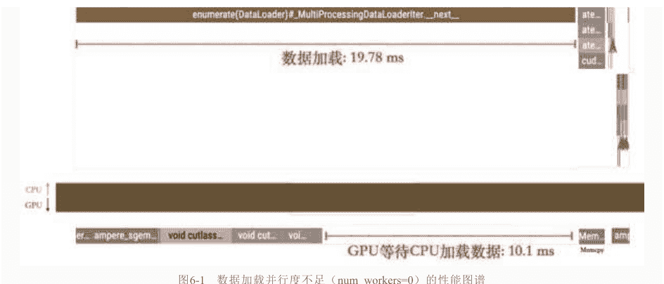

先解决加载慢的问题。加载包含从硬盘读入 CPU 以及在 CPU 上做预处理，比如本例的 Resize，这两步都在 CPU 完成。直接的加速思路是用多核并行加载，在模型处理当前批次的同时提前把下一批准备好。PyTorch 中可通过 DataLoader 的 num_workers 参数控制子进程数。默认 0 表示单核串行，设为大于 1 的整数后，DataLoader 会用多核并行预取和预处理，当前批次在训时后台已在准备下一批，减少 GPU 空档。

把 num_workers 设为 4 再次观察，图6-2 显示数据加载耗时大幅下降，GPU 等待时间从之前的 10ms 缩到约 40μs，正是多进程预加载共同作用的结果。

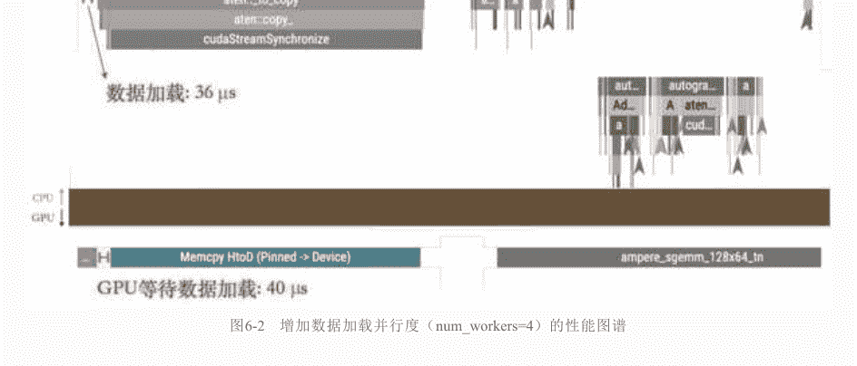

#### 6.1.2 使用异步接口提交数据传输任务

6.1.1 的改进让加载不再成为瓶颈，但进一步看 num_workers=4 时的图谱图6-3，会发现数据拷贝和后续 GPU 计算之间依然存在空档。

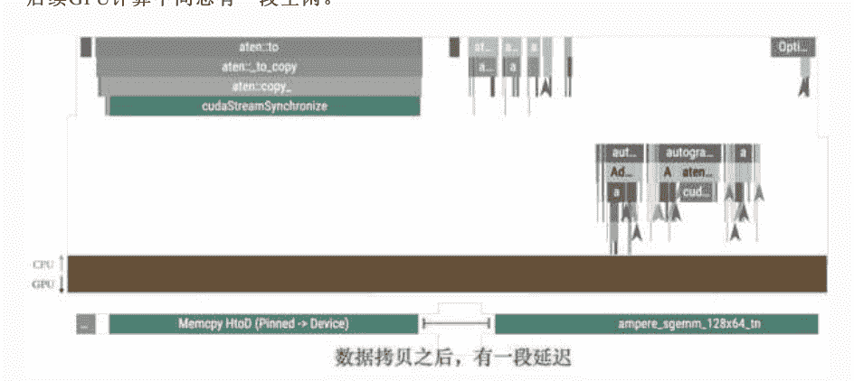

再看 CPU 侧的传输任务 aten::to，其内部包含 cudaStreamSynchronize，表示主存到显存的拷贝会阻塞 CPU。也就是说拷贝期间 CPU 无法干别的，必须等当前 GPU 队列清空才能继续向 GPU 提交任务。更具体的拆解如图6-4 所示。

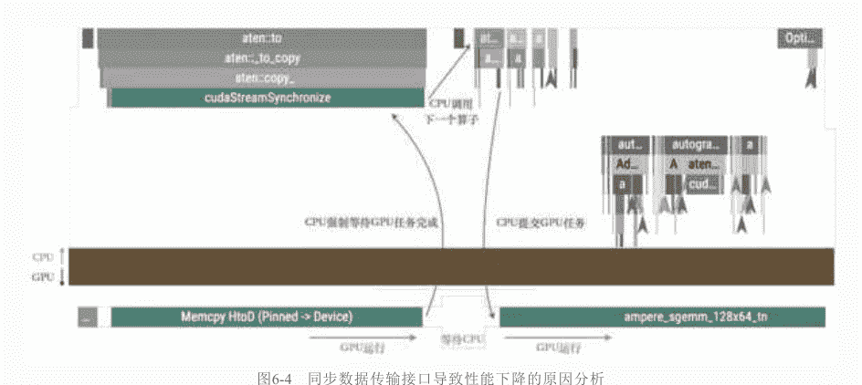

你在性能分析图谱里总能捕捉到 cudaStreamSynchronize 的踪迹，其实根因很直接：代码里用了 tensor.to(device) 把张量从 CPU 搬到 GPU，而这个调用默认是同步执行的。同步模式下 CPU 会卡住等拷贝彻底完成，后续指令才得以继续。为了摆脱这种阻塞，可以把搬运过程改成非阻塞，让 CPU 在数据还在路上时就去干别的。想让非阻塞生效，需要同时满足两点：

（1）待搬运的数据要放在锁页内存里。锁页内存的物理地址固定，不会被操作系统换到磁盘，GPU 能直接读取。PyTorch 里张量默认落在普通页内存，要么通过 DataLoader 开启 pin_memory，要么手动调用 tensor.pin_memory() 把数据提前钉到锁页内存。

（2）调用时显式打开非阻塞开关，比如 tensor.to("cuda", non_blocking=True)。这样拷贝请求会被丢进 GPU 的任务队列，CPU 无需等待即可继续往下走。

担心非阻塞会读到脏数据？GPU 自带流式调度机制。没有指定流时，所有任务走同一个默认流，按提交顺序串行执行。先用 tensor.to(device, non_blocking=True) 把搬运任务排进去，再提交计算任务，就能保证计算总在数据到位之后启动，不会出现错乱。

```python
def train(model, optimizer, trainloader, num_iters):
    with profile(activities=[ProfilerActivity.CPU, ProfilerActivity.CUDA]) as prof:
        for i, batch in enumerate(trainloader, 0):
            if i >= num_iters:
                break
            data = batch[0].cuda(non_blocking=True)

            optimizer.zero_grad()
            output = model(data)
            loss = output.sum()

            loss.backward()
            optimizer.step()

        prof.export_chrome_trace(f"traces/PROF_non_blocking.json")


transform = transforms.Compose(
    [transforms.ToTensor(), transforms.Resize([512, 512])]
)
trainset = CIFAR10(root="./data", train=True, download=True,
                   transform=transform)
trainloader = DataLoader(trainset, batch_size=4, pin_memory=True, num_workers=4)

# non_blocking
train(model, optimizer, trainloader, num_iters=20)
```

在 6.1.1 小节的基础上改成非阻塞拷贝后，再看同个位置的性能图谱。图6-5 显示，开启 non_blocking=True 以后，cudaMemcpyAsync 不再额外触发 cudaStreamSynchronize 做手脚。同时 GPU 队列里，主机到设备的搬运 memcpyHtoD 和紧随其后的算子能够几乎无缝衔接，不再出现为了等数据而空转的间隙，整体吞吐明显提升。

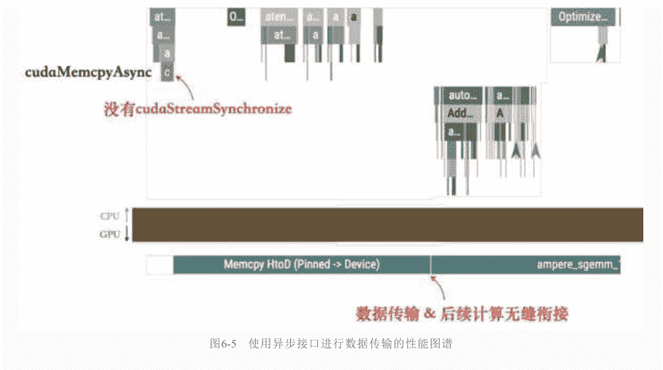

#### 6.1.3 数据传输与GPU计算任务并行

前面我们已经通过提升 CPU 加载的并行度和改用异步搬运接口，尽可能把 GPU 在数据上的等待压到最低。尤其在 6.1.2 结尾，已经做到搬运和后续计算在同一队列里衔接顺畅，避免了空档期。可即便如此，搬运和计算仍然是一个接一个串行进行（图6-6）。能不能让二者真正同时跑呢？

了解硬件的读者知道，NVIDIA GPU 上负责数据拷贝的单元和负责计算的单元是分开的，理论上可以并行。但存在数据依赖：计算需要数据先到位。 

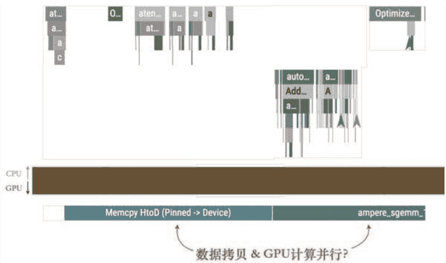

图6-6 考虑数据拷贝与GPU计算并行可行性的示意图

思路可以借鉴 CPU 的预取：本轮训练还在跑时，就把下一轮要用的数据提前从 CPU 复制到 GPU。实现的关键是为拷贝任务分配独立的 CUDA Stream，让拷贝和计算在不同队列里并发执行。

下面把 6.1.2 的代码改写为并行版本：

```python
def train(model, optimizer, trainloader, num_iters):
    # Create two CUDA streams
    stream1 = torch.cuda.Stream()
    stream2 = torch.cuda.Stream()
    submit_stream = stream1
    running_stream = stream2
    with profile(activities=[ProfilerActivity.CPU, ProfilerActivity.CUDA]) as prof:
        for i, batch in enumerate(trainloader, 0):
            if i >= num_iters:
                break

            with torch.cuda.stream(submit_stream):
                data = batch[0].cuda(non_blocking=True)
                submit_stream.wait_stream(running_stream)

                # Forward pass
                optimizer.zero_grad()
                output = model(data)
                loss = output.sum()

                # Backward pass and optimize
                loss.backward()
                optimizer.step()

            # Alternate between the two streams
            submit_stream = stream2 if submit_stream == stream1 else stream1
            running_stream = stream2 if running_stream == stream1 else stream1

    prof.export_chrome_trace(f"PROF_double_buffering_wait_after_data.json")
```

为了让搬运和计算并行，我们把数据搬运任务和模型前向/反向任务分别提交到两个不同的 GPU 队列。参数更新的正确性要求两个队列的重叠只能发生在搬运阶段，计算阶段不能重叠，所以引入了 submit_stream.wait_stream(running_stream) 来做流间同步。熟悉推理优化的人会发现，这跟推理里常用的双重缓冲技巧很像。

跑起来后可以看到搬运和计算确实重叠了，如图6-7 所示。

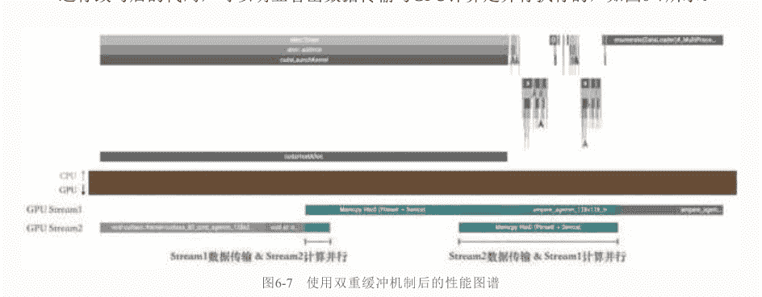

图6-7 使用双重缓冲机制后的性能图谱

需要留意的是，双重缓冲的核心收益是加速拷贝。当数据量很小、拷贝本身就很快时，收益会被稀释，甚至因为流间同步带来的额外开销导致小幅回退。

本节演示的是单卡场景下，把 CPU-GPU 传输和计算放到不同 CUDA Stream 上并行。之后的 8.1 节会沿用类似思路，把无依赖的卡间传输和计算并行起来，以加速分布式训练。

### 6.2 提高GPU计算任务的效率

在深度学习里，GPU 是核心算力。我们希望它一直跑在接近峰值浮点性能的水平，现实中只能用模型浮点运算利用率 MFU 来衡量实际使用效率：

$$MFU = \frac{\text{实际使用FLOPS}}{\text{理论最高FLOPS}}$$

6.1 节主要处理数据搬运带来的阻塞。除数据因素外，还有几类原因会拉低 GPU 利用率：

- （1）算子执行时间过短，或计算本身过于简单，调度开销占比过大，性价比低。
- （2）算子的并行度不足，没能充分喂饱 GPU 上成千上万的线程块。
- （3）内存布局不合理，导致访存开销增加。
- （4）算子实现本身还有优化空间。

本节聚焦第（1）和（2）类问题。第（3）（4）涉及更复杂的优化，会放到第 9 章专门讨论。

#### 6.2.1 增大BatchSize

训练性能图谱里最常见的毛病之一，就是 GPU 上的计算片段太短导致利用率上不去。如图6-8，GPU 队列里活动很稀疏，任务耗时都很短，在图上只剩一根根细竖线。这通常意味着算子计算量太轻，CPU 一提交任务，GPU 瞬间就算完，大部分时间都在等下一个任务到来。

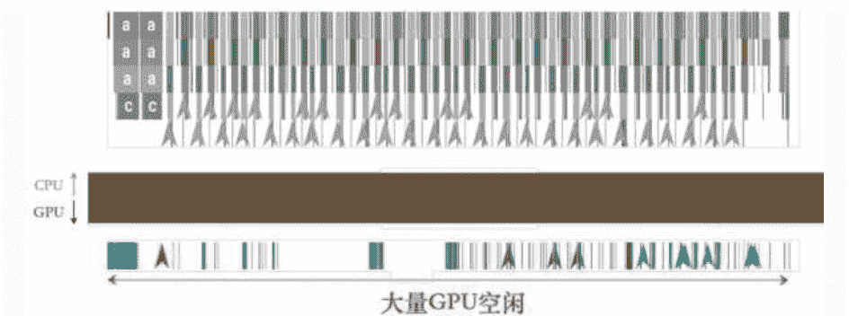

理想状态是 CPU 能持续、迅速地往 GPU 喂任务，保持队列满载。深度学习里的批处理正是为此而生：一次迭代处理多张样本，能更好地利用 GPU 海量的并行核心，提升吞吐和单个核函数的效率。

其原理是，CUDA 核函数一般只针对张量的 [C,H,W] 维度编程，Batch 维度是外层的循环。增大 BatchSize 并不会改动核函数本身，但会让一次启动的线程块数量增加，相当于用更大的并行度一次性算完多份数据。

对于以计算为主的场景，更大的 BatchSize 能让更多 CUDA 核心同时忙碌，降低核启动和数据加载的摊销，提升 GPU 利用率。

以 ResNet-18 为例，我们改动训练代码测量不同 BatchSize 下固定样本量的总耗时：

```python
import time

import torch
from torch.utils.data import DataLoader
from torch.profiler import profile, ProfilerActivity

from torchvision.models import resnet18
from torchvision.datasets import CIFAR10
from torchvision.transforms import Compose, ToTensor, Normalize

# 设置batchsize
batch_size = 4

transform = Compose([ToTensor(), Normalize((0.5, 0.5, 0.5), (0.5, 0.5, 0.5))])
trainset = CIFAR10(root="./data", train=True, download=True,
                   transform=transform)
trainloader = DataLoader(trainset, batch_size=batch_size, num_workers=10)

device = torch.device("cuda:0" if torch.cuda.is_available() else "cpu")
model = resnet18().to(device)
optimizer = torch.optim.SGD(model.parameters(), lr=0.1, momentum=0.9)

def train_num_batches(trainloader, model, device, num_batches):
    for i, data in enumerate(trainloader, 0):
        if i >= num_batches:
            break

        inputs, labels = data[0].to(device), data[1].to(device)

        outputs = model(inputs)
        loss = torch.nn.CrossEntropyLoss()(outputs, labels)
        optimizer.zero_grad()

        loss.backward()
        optimizer.step()

# 热身
train_num_batches(trainloader, model, device, num_batches=5)
num_batches = len(trainloader) / batch_size

start = time.perf_counter()
train_num_batches(trainloader, model, device, num_batches=num_batches)
torch.cuda.synchronize()
end = time.perf_counter() - start
print(f"batch_size={batch_size} 运行时间: {end * 1000} ms")

with profile(activities=[ProfilerActivity.CPU, ProfilerActivity.CUDA]) as prof:
    train_num_batches(trainloader, model, device, num_batches=10)
prof.export_chrome_trace(f"traces/PROF_resnet18_batchsize={batch_size}.json")
```

把总耗时画成 BatchSize 的函数，得到图6-9 的变化曲线。BatchSize 上升初期训练时间明显下降，随后趋于平缓。因为并行度提升受限于 GPU 线程块上限，超过后收益饱和。

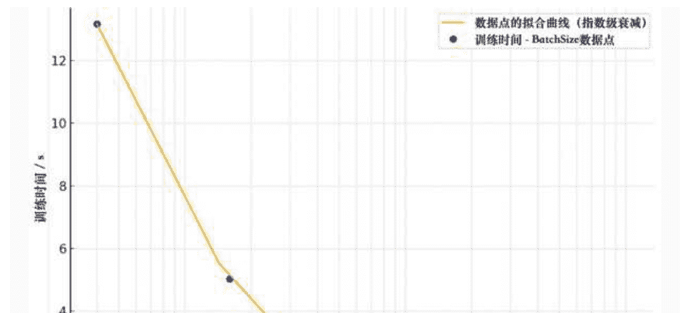

图6-9 ResNet-18训练总时长随BatchSize的变化关系

聚焦在下降段，把 BatchSize 从 4 拉到 128，性能图谱变化非常明显：

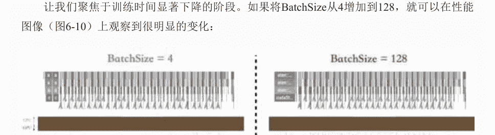

图6-10 不同BatchSize下单轮训练过程性能图谱对比

把 GPU 跑满：从 BatchSize 到隐藏同步

把图6-10里某个数据点拉近来看单个算子的耗时变化。图6-11显示，当 BatchSize 设为4时，CPU 给算子排程花掉约42μs，而 GPU 真正算数只用了2μs。把 BatchSize 升到128后，GPU 的计算耗时明显拉长到38μs，而且提交上去的任务得排队等一段才开始执行。原因很直观，BatchSize 越大单个算子的计算量也越大，算的时间自然变长。此时 GPU 处理任务的速度已经明显跟不上 CPU 投递任务的速度，比如训练尾段就能看到典型的“拖尾”现象，图6-12里 GPU 的任务队列始终处于满载状态。

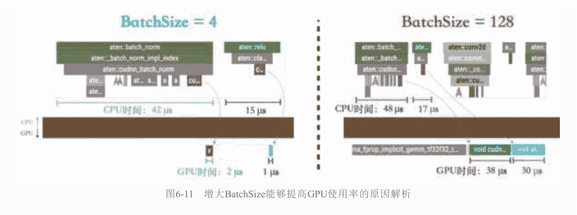

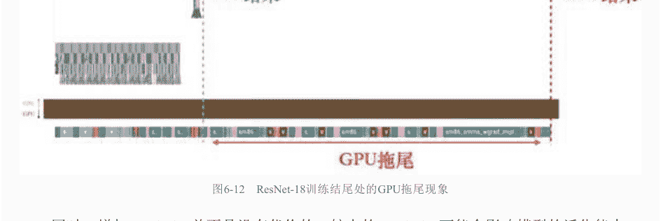

调大 BatchSize 并非没有代价。过大的 BatchSize 有可能损害模型的泛化效果，具体影响取决于数据集规模、数据构成、网络结构以及训练策略等多个因素。现实中不少超大规模模型仍在用大 BatchSize，说明在数据量充足时负面效应会被一定程度稀释。选 BatchSize 的时候，需要在模型质量与训练速度之间做权衡，最终以实验结果为准。

即便如此，对中等规模及以上模型而言，为了榨干 GPU 利用率，BatchSize 通常会一路加到显存上限，尤其在大型模型上更为常见，这也就让显存优化成为提速的重要抓手。显存相关的优化会在第7章显存优化里展开。

#### 6.2.2 融合算子压缩调度开销

第3章提到过 PyTorch 动态图的灵活性与易用性。但正因如此，PyTorch 的 GPU 算子偏轻量，一次算子调用要经历 Python→C++→CUDA 执行→回 C++→回 Python 的多层进出。模型层数越多，调度带来的额外开销占比越大。本节聚焦于通过改写代码把相邻调用合并，减少调度损耗。

一个可行的做法是手动融合算子，需要一定的数学技巧把若干相邻操作揉成一个算子。最常见的场景就是把连续的逐元素操作合并，例如：

### 6.3 斩断 CPU-GPU 隐式同步

第3章已介绍，CUDA 后端的操作本质是异步的。每个操作包含两个阶段：先把任务递交给 GPU，随后 GPU 完成计算。只要使用异步接口，CPU 提交完任务就能立刻干别的，不必等 GPU 结束。依托 GPU 的队列机制，异步能在保证正确性的前提下大幅提升训练效率。

在特定情形下可以手动触发 CPU-GPU 同步，让 CPU 等待 GPU 上所有任务结束。但同步代价极高，相当于把 CPU 这条生产线停下来，等 GPU 那条线全部收工后才继续，显然是需要避免的。

`torch.cuda.synchronize()` 就是用来强制同步的手段，调试时很方便，但在正式运行中应尽量少用，因为性能损失很明显。

除了显式调用，还有不少 PyTorch 写法会暗中触发同步，这往往是性能的隐形杀手。判断方法很简单，大多数隐式同步都源于想在 Python 里直接使用 GPU 张量的数值。典型触发方式见表6-1。

表6-1 可能触发CPU-GPU同步操作的PyTorch接口

| 触发隐式同步的操作分类 | 示例和解释 |

| :--- | :--- |

| 对tensor的元素级别的索引 | ● 取出0维张量的元素：`tensor.item()`<br>● 取出1维张量特定位置的元素：`tensor[0]` |

| 将tensor搬运回CPU内存的操作 | 用户要求数据从GPU搬运回CPU的操作，如`tensor.cpu()` / `tensor.numpy()` |

| 隐式依赖张量的具体数值的操作 | ● `print(tensor)`：打印一个张量的前提是计算该张量值的内核函数已经执行完毕，并且该张量的数值需要从GPU显存传输回CPU内存，因此会隐式地调用同步<br>● `num_nonzero = len(torch.nonzero(x))`：`torch.nonzero()`函数的返回张量的长度取决于计算出来的非零值的个数，而获得一个张量的非零值的前提是计算该张量值的内核函数已经执行完毕，因此CPU需要等待GPU上的内核函数运行完成后才能获得`num_nonzero`的数值继续执行后续操作 |

下面举一个容易被忽视的 `torch.nonzero()` 例子：

```python
import torch
import torch.nn as nn
from torch.profiler import profile, ProfilerActivity


class Model(torch.nn.Module):
    def __init__(self):
        super(Model, self).__init__()
        self.linear1 = nn.Linear(1000, 5000)
        self.linear2 = nn.Linear(5000, 10000)
        self.linear3 = nn.Linear(10000, 10000)
        self.relu = nn.ReLU()

    def forward(self, x):
        output = self.relu(self.linear1(x))
        output = self.relu(self.linear2(output))
        output = self.relu(self.linear3(output))
        nonzero = torch.nonzero(output)
        return nonzero


def run(data, model):
    with profile(activities=[ProfilerActivity.CPU, ProfilerActivity.CUDA]) as prof:
        for _ in range(10):
            model(data)
    prof.export_chrome_trace("traces/PROF_nonzero.json")


data = torch.randn(1, 1000, device="cuda")
model = Model().to(torch.device("cuda"))
run(data, model)
```

从性能画像图6-14可以看出，`aten::nonzero` 在单轮训练中的耗时占比高达83%，主要瓶颈来自 CPU 上一段冗长的 `cudaMemcpyAsync`。

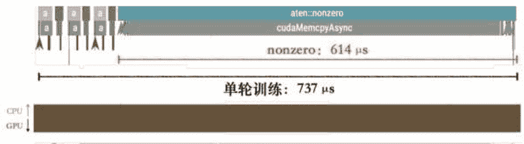

聚焦这段 `cudaMemcpyAsync`，它属于 GPU 到 CPU 的内存拷贝。为什么在 `aten::nonzero` 中会出现拷贝？这与该算子的实现机制有关。`torch.nonzero()` 会返回一个新张量，记录输入张量中所有非零元素的位置。返回张量的尺寸依赖于运行时才能确定的具体数值，因此必须先等输入张量的计算完成，统计出非零元素个数，再把这个计数传回 CPU，CPU 才能分配合适的显存。尽管只是几个整数的传输，但必须等 GPU 队列清空后才能开始，于是放大图6-15里会出现 CPU 上的 `cudaStreamSynchronize`，本质是 CPU 被迫空转等待 GPU 算完并把计数送回。

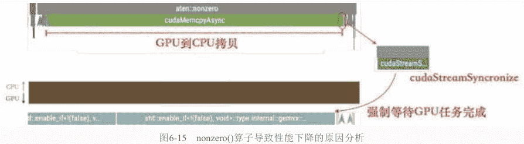

这就解释了为何 `nonzero` 在 PyTorch 中常成为性能瓶颈。其本质是它在算子内部制造了 CPU 对 GPU 中间结果的隐式依赖，为保证正确性不得不插入同步，形成了明显的瓶颈。

### 6.4 压降程序附加开销

Python 作为高级语言，提供了很强的开发效率，但也带来了额外的运行时开销。为此很多性能导向的库选择用 C++ 等底层语言实现核心，PyTorch 也是这种思路。使用 PyTorch 的任意操作都会同时触及两层：上层 Python 接口负责灵活易用，下层 C++ 实现负责高效计算。结合第3章提到的异步执行机制，开发者容易低估 API 调用的隐含成本，实际占比往往超出预期。

任何算子调用都会产生 Python 层的调度开销。除减少无用调用外，开发者对此类开销很难根除。在对延迟极度敏感的推理场景，有时会直接抛弃 Python 改用 C++ 以最小化调度。但在更看重灵活性的训练场景，这种开销可视为“易用税”，是开发效率与运行效率的权衡。

需要强调的是，不当使用算子会让开销急剧抬高。开发迭代时不必追求极致，但应避免浪费 GPU 资源。常见的高开销区域有两个：

- （1）张量的创建与销毁，尤其是涉及显存管理的操作。后续章节会介绍 PyTorch 内部的缓存池机制，它能缓解动态分配带来的问题，但无法完全消除。
- （2）梯度计算会占用显存和算力。反向传播需要保留前向过程的所有中间结果以便求导。关闭梯度计算既能省内存，也能省去构建与维护计算图的工作。

下面详细说明如何规避这些不必要的开销。

#### 6.4.1 规避张量创建负担

##### 1. 原生在 GPU 上生成张量

创建新的 GPU 张量时，最好直接在 GPU 上分配并初始化，避免先在 CPU 上建再搬运。下面的示例反复创建张量并绘制性能图谱，来对比不同写法的底层差异：

```python
import torch
import torch.nn as nn
from torch.profiler import profile, ProfilerActivity


def tensor_creation(num_iters, create_on_gpu):
    with profile(activities=[ProfilerActivity.CPU, ProfilerActivity.CUDA]) as prof:
        shape = (10, 6400)
        for i in range(num_iters):
            if create_on_gpu:
                data = torch.randn(shape, device="cuda")
            else:
                data = torch.randn(shape).to("cuda")
    prof.export_chrome_trace(
        f"traces/PROF_tensor_creation_on_gpu_{create_on_gpu}.json"
    )


# 情况1. 先在CPU上创建Tensor然后拷贝到GPU
tensor_creation(20, create_on_gpu=False)

# 情况2. 直接在GPU上创建Tensor
tensor_creation(20, create_on_gpu=True)
```

先看第一种写法对应的性能图谱图6-16，`torch.randn().to("cuda")` 实际上分两步：先在 CPU 上生成张量，再把它拷贝到 GPU。两步都是多余的，为何不直接在 GPU 上创建呢？

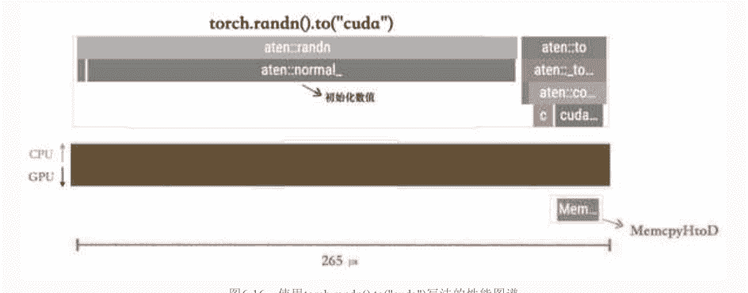

再看直接在 GPU 上创建的情况，性能图谱如图6-17，指定 `device="cuda"` 后，PyTorch 直接在显存中分配并初始化数据，省掉了 CPU 创建和拷贝这两个环节。

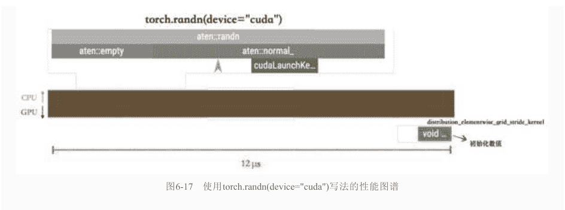

耗时对比明显，本例中 `torch.randn().to("cuda")` 约265μs，而 `torch.randn(device="cuda")` 仅约12μs。

##### 2. 采用原位更新

多数 PyTorch 操作默认会分配新内存返回，大量张量用一次即释放，造成资源浪费。显存分配与释放本身代价不小，能否复用已有显存？可以的，原位操作就是解法。

第3章提到过原位操作是算子的一种变体，它不在新张量上写结果，而是直接修改输入张量。省去内存分配后，性能通常更好。下面用一个例子说明：

```python
import torch
from torch.profiler import profile, ProfilerActivity

def run(data, use_inplace):
    with profile(activities=[ProfilerActivity.CPU, ProfilerActivity.CUDA]) as prof:
        for i in range(2):
            if use_inplace:
                data.mul_(2)
            else:
                output = data.mul(2)
    prof.export_chrome_trace(f"traces/PROF_use_inplace_{use_inplace}.json")

shape = (32, 32, 256, 256)

# Non-Inplace
data1 = torch.randn(shape, device="cuda:0")
run(data1, use_inplace=False)

# Inplace
data2 = torch.randn(shape, device="cuda:0")
run(data2, use_inplace=True)
```

使用 `data.mul()` 是非原位操作，性能图图6-18 中可以看到一次耗时的 `cudaMalloc`，说明新张量被创建并在 GPU 上分配。改用 `data.mul_()` 后则是原位更新，只触发乘法相关的 GPU 内核，无需额外分配显存，因此更快。笔者机器上该示例原位版本比非原位快约20%。


#### 6.4.2 关闭冗余梯度计算

常见于两种场景不需要反向求导。第一种是训练中仅需前向推理的部分。例如微调预训练模型时，底座参数冻结，只训练新加的小模块。对这类纯前向代码，可用 `torch.no_grad()` 上下文管理器。在作用域内新建张量的 `requires_grad` 被置为 False，计算图不会被记录，反向时不计算梯度，能明显降低内存占用并加速。

第二种是纯推理场景，整段代码都只做前向。此时应先调用 `model.eval()` 进入评估模式，使 BatchNormalization 不再更新统计、Dropout 不再随机丢弃，保证结果正确。对性能提升帮助有限，但对正确性必要。若要进一步加速，PyTorch 提供了 `torch.inference_mode()`，它比 `torch.no_grad()` 更激进，除不生成反向算子外，还会关闭反向过程才需要的检查与设置，例如原位算子的版本校验等。

做一个极简的实验就能看出 `torch.inference_mode()` 的实际收益。在我这台机器上，关闭该模式时整段推理耗时 6.22ms，打开之后降到 5.32ms，单这一项就省下了约 15% 的时间。

```python
import torch
import torch.nn as nn
import time

class SimpleCNN(nn.Module):
    def __init__(self):
        super(SimpleCNN, self).__init__()
        self.conv1 = nn.Conv2d(3, 16, kernel_size=3, stride=1, padding=1)
        self.relu = nn.ReLU()
        self.conv2 = nn.Conv2d(16, 32, kernel_size=3, stride=1, padding=1)

    def forward(self, x):
        x = self.conv1(x)
        x = self.relu(x)
        x = self.conv2(x)
        return x

def infer(input_data, num_iters, use_inference_mode):
    start = time.perf_counter()

    with torch.inference_mode(mode=use_inference_mode):
        for _ in range(num_iters):
            output = model(input_data)

    torch.cuda.synchronize()
    end = time.perf_counter()
    return (end - start) * 1000

model = SimpleCNN().to(torch.device("cuda:0"))
input_data = torch.randn(1, 3, 224, 224, device="cuda:0")

# 开启Inference Mode
infer(input_data, num_iters=10, use_inference_mode=True)  # warm up
runtime = infer(input_data, num_iters=100, use_inference_mode=True)
print(f"开启Inference Mode用时: {runtime}s")

# 关闭Inference Mode
infer(input_data, num_iters=10, use_inference_mode=False)  # warm up
runtime = infer(input_data, num_iters=100, use_inference_mode=False)
print(f"关闭Inference Mode用时: {runtime}s")
```

### 6.5 用资源换取速度的优化思路

当代码里 CPU 端的额外开销已经被压到极限，训练速度就真的到头了吗？并非如此，我们依然可以通过置换资源的方式继续提速。深度学习里常有一种权衡：模型精度、计算速度、显存占用、分布式带宽可以互相换算。比如用一点精度换来训练速度的明显提升，最典型的就是混合精度训练，具体细节放到第 9 章高级优化再展开。

本节聚焦两种操作门槛较低、以牺牲其他指标换取训练性能的做法。

#### 6.5.1 跨设备搬运时降精度

先看 CPU 到 GPU 的数据搬运。6.1 小节介绍过异步接口减少等待的思路，这只是让 GPU 少闲着，并没有让拷贝本身变快。对大尺寸张量或大 BatchSize 场景，搬运本身耗时就很可观。

这时可以考虑 **用低精度类型进行设备间传输**。做法类似量化压缩：把高精度数据先压缩成低精度送进显存，到 GPU 上再转回高精度参与计算；也可以用 GPU 友好的编码方案，先读入压缩编码的数据，在 GPU 侧解码。

举个直观的例子，RGB 图像像素取值在 0~255 之间，用 `uint8` 存每个数只要 1 字节，替代 `float` 的 4 字节。同样大小的张量，uint8 体积只有 float 的四分之一，传输时间自然大幅下降。

下面用一段对比实验看 `float32` 与 `uint8` 张量的拷贝耗时：

```python
import torch
import torch.nn as nn
from torch.profiler import profile, ProfilerActivity

def data_copy(data, dtype_name=""):
    with profile(activities=[ProfilerActivity.CPU, ProfilerActivity.CUDA]) as prof:
        for _ in range(10):
            output = data.to("cuda:0", non_blocking=False)
    prof.export_chrome_trace(f"traces/PROF_data_copy_{dtype_name}.json")

# Float precision
data1 = torch.randn(4, 32, 32, 1024, dtype=torch.float32)
data_copy(data1, "float32")

# Uint8 precision
data2 = torch.randint(0, 255, (4, 32, 32, 1024), dtype=torch.uint8)
data_copy(data2, "uint8")
```

跑完后打印性能图谱对比。如图 6-19，`float32` 张量的拷贝耗时约 1373μs，远高于 `uint8` 张量的 337μs。


理想情况下应优先无损压缩，但工程上很多量化与编码都是有损的。是否采用低精度还要谨慎验证，并非所有数据都有 0~255 这样明确的取值范围。对于没有清晰数值边界的数据，量化到低精度可能损害收敛和结果，必须通过实验权衡取舍。

#### 6.5.2 为不同优化器挑选高效实现

训练通常包含数据加载、前向、反向和参数更新四个环节。这里聚焦 **参数更新**。实际训练不会把反向算出的梯度直接加到参数上，而是交由优化器处理，优化器会对梯度做加工后给出更新量。

参数规模动辄上亿，优化器更新的效率也是性能瓶颈。PyTorch 为每种优化器提供了三种实现：`for-loop`、`for-each`、`fused`，它们在性能和显存上的取舍不同。

`for-loop` 最省显存但速度最慢。举例 SGD 更新 10 个参数 w₁~w₁₀，`for-loop` 用 Python 串行循环逐个处理，每次是一次乘法加一次加法：

```python
# 伪代码
for w in [w1, w2, ..., w10]:
    w = w - lr * w.grad
```

受动态图限制，算子无法自动融合，更新 10 个参数就要调用 10 次乘法和 10 次加法，共 20 次调用。调用开销往往超过真正的 CUDA 计算，参数越多损耗越明显。为此出现了 `for-each`。

`for-each` 更偏向性能，显存占用会增加。把 10 个参数合并成一个大张量，只需对这个整体调用 1 次乘法和 1 次加法。计算总量不变，但算子调用次数大幅下降。

对像 SGD 这样简单的优化器，已经能把调用压到 1 次加法 + 1 次乘法。但对 Adam 这类含乘法、除法、加减、开方等多种运算的优化器，`for-each` 仍会残留多处调用。`fused` 就在此基础上把优化器的全部计算融合成一个算子，性能达到最佳，但显存开销也最高。

下面用实例对比三种实现的性能图谱：

```python
import torch
from torch.profiler import profile, ProfilerActivity

class SimpleNet(torch.nn.Module):
    def __init__(self):
        super(SimpleNet, self).__init__()
        self.fcs = torch.nn.ModuleList(torch.nn.Linear(200, 200) for i in range(20))

    def forward(self, x):
        for i in range(len(self.fcs)):
            x = torch.relu(self.fcs[i](x))
        return x

def train(net, optimizer, opt_name=""):
    data = torch.randn(64, 200, device="cuda:0")
    target = torch.randint(0, 1, (64,), device="cuda:0")
    criterion = torch.nn.CrossEntropyLoss()
    with profile(activities=[ProfilerActivity.CPU, ProfilerActivity.CUDA]) as prof:
        for _ in range(5):
            optimizer.zero_grad()
            output = net(data)
            loss = criterion(output, target)
            loss.backward()
            optimizer.step()
    prof.export_chrome_trace(f"traces/PROF_perf_{opt_name}.json")

# For-loop
net = SimpleNet().to(torch.device("cuda:0"))
adam_for_loop = torch.optim.Adam(
    net.parameters(), lr=0.01, foreach=False, fused=False
)
train(net, adam_for_loop, opt_name="for_loop")

# For-each
net = SimpleNet().to(torch.device("cuda:0"))
adam_for_each = torch.optim.Adam(
    net.parameters(), lr=0.01, foreach=True, fused=False
)
train(net, adam_for_each, opt_name="for_each")

# Fused
net = SimpleNet().to(torch.device("cuda:0"))
adam_fused = torch.optim.Adam(net.parameters(), lr=0.01, foreach=False, fused=True)
train(net, adam_fused, opt_name="fused")
```

`for-loop` 每次只动一个参数，如图 6-20 所示会反复调用 `add`、`lerp`、`mul`、`addcmul` 等算子，频繁调用严重拖累效率。

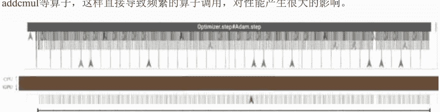

`for-each` 会按类型把独立调用合并，GPU 队列里图 6-21 只剩下 7 个融合算子的任务，调用开销显著降低。

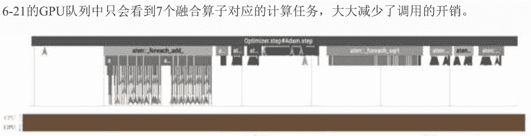

图6-21 使用for-each模式的Adam优化器的性能图谱

`fused` 融合更激进，从图 6-22 看算子调用只剩两次巨大的融合算子，优化器的 CPU 延迟被压缩到很短，性能优势明显。

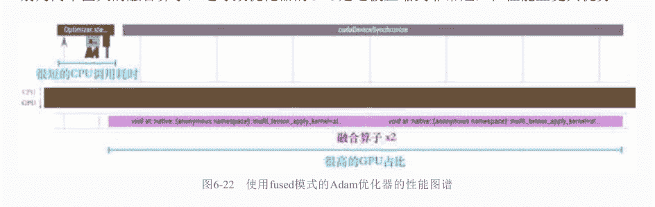

总体来看，`for-loop` 最慢，因其在 Python 层逐元素处理，难以发挥硬件加速，且每次迭代可能触发 GIL 等额外开销，只适合小规模场景。`for-each` 减少了解释器调用，常能在底层并行，加速明显。`fused` 通过减少内存访问和中间状态存储，充分利用现代硬件并行能力，是大规模训练和复杂操作的优选。

### 6.6 本章回顾

本章方法的整体关系见图 6-23。

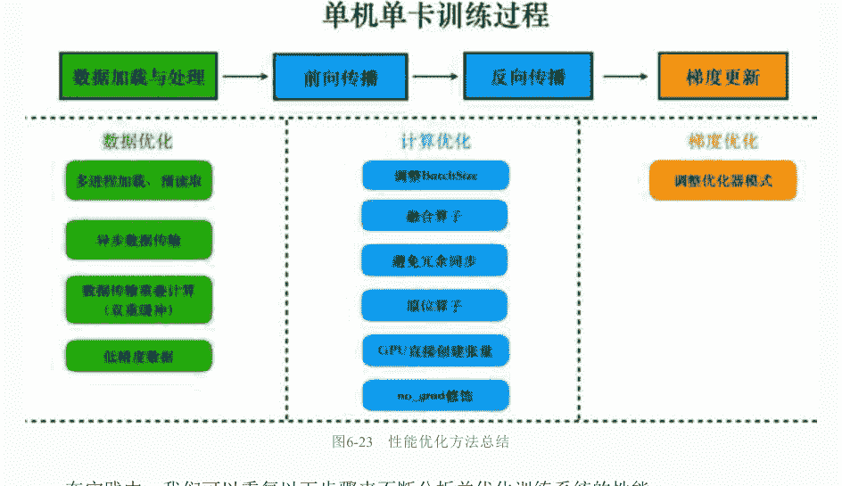

实践中可循环执行：

1. 生成性能图像。
2. 结合 4.3.4 小节定位瓶颈对应的训练阶段。
3. 根据瓶颈成因选择优化手段。
4. 重新生成性能图像验证效果。

第 10 章会展示 GPT-2 优化全流程的实际运用。上述方法的上限是把 GPU 队列里的“气泡”全部消除，让 GPU 满载，但这并非终点。GPU 满载后，还能借助第 9 章的高级技巧提升计算效率；性能榨干之后，还可借助分布式数据并行继续加速。

## 07 单卡显存优化全景

显存优化是训练中高频话题。做过训练的人对 GPU 显存溢出 OOM 都不陌生，也清楚模型越大所需显存越多。

对深度学习而言，显存与性能同等重要，实操中优先级往往更高，因为显存构成了模型规模的硬门槛。

本章介绍两类手段：通用显存优化和用其他资源置换显存的优化。置换方式常用于硬件受限时，可置换计算资源、CPU-GPU 传输带宽等。

在讲具体方法前，需先掌握两个前置知识：PyTorch 的显存管理机制，以及显存分析方法。前者影响分析的准确性，后者帮助定位显存峰值。

### 7.1 PyTorch 如何管理显存

写 CPU 程序时申请数组会向操作系统要内存，操作系统在堆栈上分配。显存分配类似，只是申请方换成了 GPU 驱动。

第 3 章提到动态图下 PyTorch 会频繁分配销毁张量，而 GPU 驱动的分配回收延迟较高，频繁操作效率很差。为此 PyTorch 引入显存池自行管理。

需要为张量分配显存时，PyTorch 不会只申请刚好大小，而是向驱动一次性要更大的块，多余部分被显存池缓存。张量销毁后，其显存也不会立刻归还驱动，而是留在池子里缓存。下次分配就能直接从池子里取，避免慢速的驱动交互。机制示意如图 7-1。

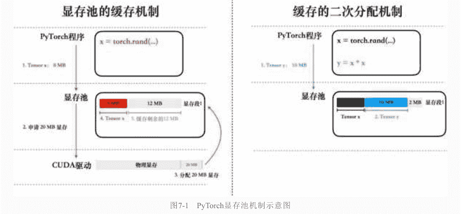

缓存耗尽时，PyTorch 会继续向驱动申请新段。用房子作比喻，GPU 驱动是房东，PyTorch 显存池相当于二房东，对分配出的多段显存做二次管理。

显存池机制在带来便利的同时也藏着两处痛点。首当其冲的是 PyTorch 会一直把显存占用维持在比真实需求更高的水平。日常训练时多占的那部分通常不明显，但一旦删掉模型、释放大块张量等操作带来大面积空闲，被显存池缓存住而无法还给驱动的内存会骤然膨胀，甚至拖累后续任务的执行。此时可以尝试 `torch.cuda.empty_cache()`，它会尽可能把所有完全空闲的显存段归还。

可惜 `empty_cache` 并不能总把显存危机化解，症结就卡在“完全空闲”这四个字上。哪怕一段显存里只剩 1 字节被占用，整段都无法从显存池里吐回给 GPU 驱动，这就是典型的显存碎片化。显存池能不能把分散在各段的零碎占用压缩到少数几段，从而腾出几块完全空闲的区域？经过实测，到 PyTorch 2.2 为止这一功能仍未实现。`torch.cuda.empty_cache()` 的实际效果以及碎片化问题的示意可参考图7-2。

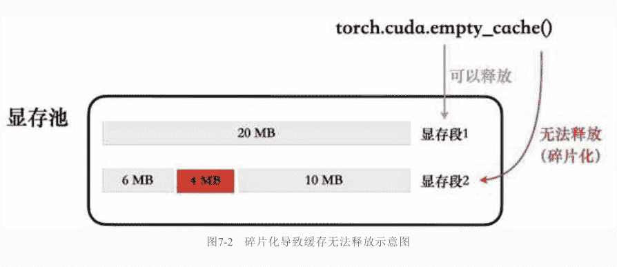

碰上碎片化该怎么办？一个实操性很强的做法是调 `max_split_size_mb`。这个参数的本质是告诉 PyTorch 拒绝把比阈值更大的显存段再切分，能有效避免把小张量塞进大块显存里从而制造碎片。数值设得越小，碎片风险越低，但显存池的复用能力也会变差，进而带来性能损耗。经验上 100～500 MB 是一个比较常见的区间，具体数值仍需要在自己的训练环境里反复摸索。设置方式如下：

```bash
export PYTORCH_CUDA_ALLOC_CONF=max_split_size_mb:128
```

### 7.2 显存的分析方法

在聊优化手段前，先补一个前置技能：怎么准确定位 PyTorch 显存峰值出现在哪里。前面第3章提到过用 NVIDIA-SMI 命令查看 GPU 总显存及占用。NVIDIA-SMI 是在驱动层统计进程显存开销，数值非常可靠，不会漏掉任何占用项，相关展示见图7-3。

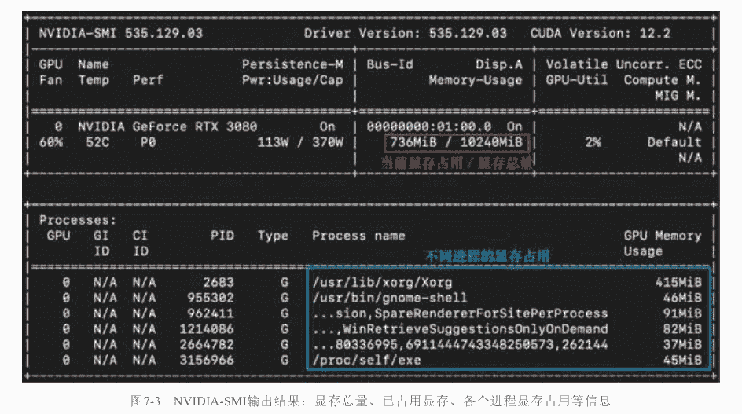

#### 7.2.1 使用PyTorch API查询当前显存状态

NVIDIA-SMI 只能给出进程级的总量，颗粒度太粗。要想看 PyTorch 内部的细节，就得用它自带的 API。表7-1 罗列了常用的查询接口。

表7-1 PyTorch显存查询API列表

| API 名称 | 功能 |

| :--- | :--- |

| `torch.cuda.memory_reserved()` | PyTorch实时占用的显存大小 |

| `torch.cuda.max_memory_reserved()` | PyTorch显存占用的峰值 |

| `torch.cuda.memory_allocated()` | PyTorch实时分配的张量显存总和 |

| `torch.cuda.max_memory_allocated()` | PyTorch分配的张量显存占用峰值 |

细看会发现它们分两类：reserved 与 allocated。reserved 是 PyTorch 向驱动预留的显存盘子，实际不一定全用上；allocated 才是真正分配给张量的显存总量。预留值通常大于实际使用，这正是前面提到的显存池在起作用的体现。下面用一个小例子可以验证这一点：

```python
import torch

t1 = torch.randn([1024, 1024], device="cuda:0")  # 4MB

shape = [256, 1024, 1024, 1]  # 1024MB
t2 = torch.randn(shape, device="cuda:0")

print(
    f"PyTorch reserved {torch.cuda.memory_reserved()/1024/1024}MB, allocated {torch.cuda.memory_allocated()/1024/1024}MB"
)
# PyTorch reserved 1044.0MB, allocated 1028.0MB
```

实际分析时，优先关注哪几个指标？在显存优化的语境下，大家更关心峰值能不能降下来，所以 `torch.cuda.max_memory_reserved()` 与 `torch.cuda.max_memory_allocated()` 通常更有参考价值。训练时显存分配与回收频繁，占用曲线波动很大，只有把峰值压在 OOM 边缘，模型才能稳定跑通。

需要注意的是，复杂工程里仅凭 PyTorch API 可能不够全面。因为 NVIDIA-SMI 看到的是进程整体，而 PyTorch API 只能覆盖 PyTorch 显存池管理的部分。如果项目里混用了直接调 CUDA API 的第三方库，这部分显存只会在 NVIDIA-SMI 中出现，PyTorch 完全感知不到。

比如第8章提到的分布式训练，PyTorch 的分布式集合通信会调用 NVIDIA 的 NCCL 库，NCCL 自己管理通信用的显存。如图7-4 所示，`torch.cuda.memory_reserved()` 给出的只是程序真实显存占用的一部分，提醒我们要多留一个心眼。

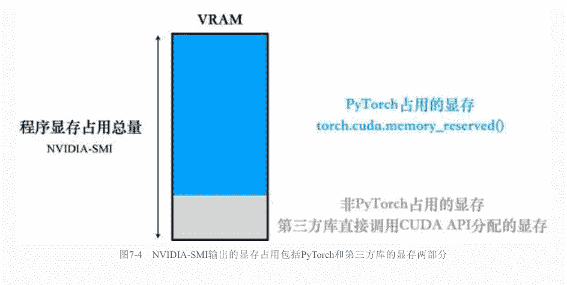

#### 7.2.2 使用PyTorch的显存分析器

除了实时 API，PyTorch 还提供了 `torch.cuda.memory._record_memory_history()` 与 `torch.cuda.memory._dump_snapshot()` 来绘制显存随时间的变化轨迹。

下面用一段示例演示如何画出占用曲线。为了让图更清晰，先用 `torch.inference_mode()` 关闭所有反向传播相关的额外分配，这部分细节在第6章单卡性能优化里有展开。

```python
import torch

torch.cuda.memory._record_memory_history()

with torch.inference_mode():
    shape = [256, 1024, 1024, 1]
    x1 = torch.randn(shape, device="cuda:0")
    x2 = torch.randn(shape, device="cuda:0")

    # Multiplication
    y = x1 * x2

torch.cuda.memory._dump_snapshot("traces/vram_profile_example.pickle")
```

执行 `torch.cuda.memory._dump_snapshot()` 会生成 `vram_profile_example.pickle`，把它上传到 PyTorch Memory Visualization 官网就能可视化。工具里默认的 Active Memory Timeline 最常用，它直观呈现显存的活跃与占用情况。示例图的呈现见图7-5。为方便观察，这里把张量形状设为 [256, 1024, 1024, 1]，每个张量约占 1 GB。图里每一个彩色条带代表一个新张量的显存，条带的起止就对应分配与释放。

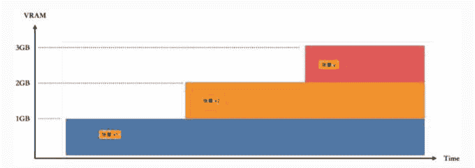

通常先分配的块在图下方，后分配的块会堆叠在上层。在本例中，深蓝与橘黄条带分别对应 x1 与 x2 的显存，红色条带则来自 `y = x1 * x2` 计算时为临时结果新开的显存。

点一下任意条带就能看到触发该分配的调用栈，从而对应到具体 Python 代码。图7-6 显示，点击红色条带会指向 Python 代码第12行。

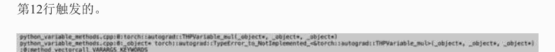

对照源码，第12行正是 `y = x1 * x2`，说明红色条带代表这一步为输出张量 y 申请的显存。

### 7.3 训练过程中的显存占用

学会画曲线后，就能把它用到真实训练上。先借助显存图拆解一次完整训练里显存都花在哪儿。

图7-7 总结了训练时 PyTorch 显存的大致构成。大体可分为两类：一类是模型本身带来的静态占用，另一类是计算中临时产生并回收的动态占用。

（1）静态显存占用：模型参数、优化器状态等固定的那部分，与训练进度无关，在占用图上表现为一条水平线。

（2）动态显存占用：训练中产生的临时显存，比如激活张量。激活张量的范围很宽泛，广义上任何算子计算产生的临时张量都算。它们在训练过程中反复分配与释放，通常在每个 step 结束时被清空。

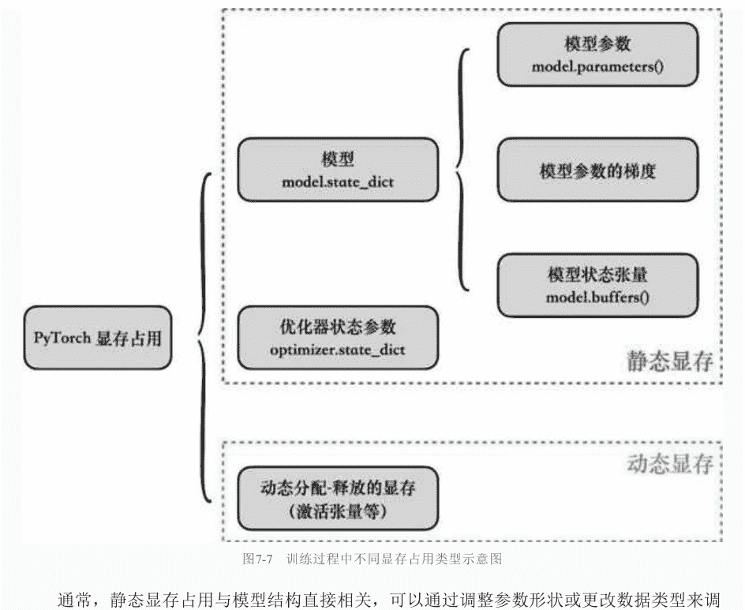

静态占用基本由模型结构决定，可以通过改形状或改数据类型来调节，但可能影响精度与收敛。除参数、梯度外，优化器也是静态占用的重要来源。SGD 基本不额外占显存，而 `optim.Adam` 需要保存与梯度同量的动量和二阶矩估计，会额外占用约两倍模型参数量的显存。具体细节后续章节会再展开。相比之下，动态显存优化空间更大，对最终结果影响更可控。所以搞清楚训练里显存的各种构成对优化至关重要。为了验证，先看纯前向推理的显存变化规律，代码如下。

```python
import torch

torch.cuda.memory._record_memory_history()

with torch.inference_mode():
    shape = [256, 1024, 1024, 1]
    weight = torch.randn(shape, device="cuda:0")  # (1)
    data = torch.randn(shape, device="cuda:0")  # (2)

    x = data * weight  # (3)
    x = x * weight  # (4)
    x = x.sum()

torch.cuda.memory._dump_snapshot("traces/double_muls_inference.pickle")
```

示例代码的占用图如图7-8。

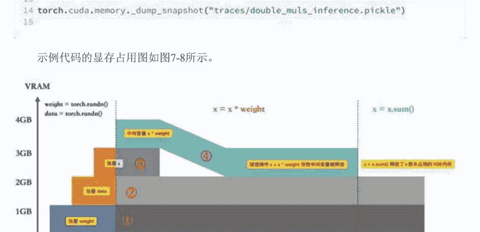

图7-8 记录了前向推理阶段显存随时间的变化，沿横轴从左到右：

1. ①号与②号条带对应最开始创建的 weight 与 data 张量。
2. ③号条带对应 `x = data * weight` 为输出 x 新分配的显存。
3. ④号条带对应 `x = x * weight` 计算中产生的中间变量。等价于先算 `temp = x * weight` 再执行 `x = temp`，temp 需要额外空间。
4. `x = x * weight` 赋值完成后，③号张量不再使用，内存被释放。
5. `x = x.sum()` 计算完成后，x 指向一个新开的单元素内存，之前作为输入的④号条带随之释放。

由此可总结显存占用主要来自两方面：

- 模型初始化时分配的显存，包含模型参数与输入数据。
- 前向过程中动态分配后回收的显存，涵盖算子输入与输出。

图中常出现的折线如图7-9，这类折线通常对应某个算子的计算过程，中间临时变量频繁创建与释放，显存峰值往往集中在该算子上。


上面只分析了前向部分，下面把反向传播与参数更新加进来，看看完整训练的显存全貌：

```python
import torch
import torch.optim as optim


torch.cuda.memory._record_memory_history()

shape = [256, 1024, 1024, 1]
weight = torch.randn(shape, requires_grad=True, device="cuda:0")
data = torch.randn(shape, requires_grad=False, device="cuda:0")

x = data * weight
x = x * weight
x = x.sum()

torch.cuda.memory._dump_snapshot("triple_muls_fwd.pickle")

optimizer = optim.SGD([weight], lr=0.01)
optimizer.zero_grad()

x.backward()

optimizer.step()

torch.cuda.memory._dump_snapshot("traces/double_muls_full.pickle")
```

图7-10 给出了完整训练过程的显存分析。可以看到整体分为左侧前向推理与右侧反向传播。


图7-10 完整训练过程的显存占用图

先看前向。对比纯前向图7-8，会发现红色条带的存活时间变长，一直延续到反向传播中段才结束。红色条带是 `x = x * weight` 产生的临时输出，没有立刻释放是因为该乘法算子需要保留输出用于反向计算，所以临时变量被挂在了反向算子的成员里。除此之外，前向部分的占用模式与图7-7基本一致。

```
[MulForward] out= x * y

[MulBackward] d_x = d_out * y

[MulBackward] d_y = d_out * x
```

反向传播阶段的显存变化主要有：

1. 创建并计算 weight 的梯度张量 d_weight（⑤号条带）。
2. 创建并计算中间变量 x，即③号条带 `x = data * weight` 的梯度张量（⑥号条带）。
3. ③号条带对应的中间变量 x 用完后内存立即释放。
4. 计算 `x = data * weight` 的反向，因 data 不需梯度，只需算出当前的 d_weight（⑦号条带）。
5. 深蓝色条带与棕色条带都是 weight 的梯度，对同一变量梯度会累加，深蓝色累加到棕色后即被释放。

这里的张量 x 就是典型的动态分配激活张量。这类显存冗余度高，优化它们对收敛性的风险较低，是优先下手的点。同时，训练峰值往往出现在反向传播的某个反向算子计算中。所以一旦遇到 OOM，动态分配的显存通常是第一排查对象。

### 7.4 通用显存复用方法

#### 7.4.1 使用原位操作算子

从前面的占用图能看出，PyTorch 的算子默认会为结果新建一个张量。如果后续反向还需要这个结果，显存就不会立刻归还。张量越大，这种线性增长的中间变量消耗越致命，所以写代码时要意识到每多一次张量运算就可能多一次显存开销。

第3章提到过，PyTorch 提供了原位操作算子。它们的思路是直接在输入张量的显存上改写，避免为输出单独分配空间，从而明显降低调用时的显存需求。下面用一个简单例子来说明这一点：

原位算子：省显存的甜头与坑

```python
import torch

torch.cuda.memory._record_memory_history()

with torch.inference_mode():
    shape = [256, 1024, 1024, 1]
    weight = torch.randn(shape, requires_grad=True, device="cuda:0")
    data = torch.randn(shape, requires_grad=False, device="cuda:0")

    x = data * weight
    mem = torch.cuda.memory_allocated()
    x.sigmoid_()
    print(f"使用原位操作产生的显存占用: {torch.cuda.memory_allocated() - mem}GB")
    mem = torch.cuda.memory_allocated()
    y = x.sigmoid()
    print(
        f"不使用原位操作产生的显存占用: {(torch.cuda.memory_allocated() - mem)/1024/1024/1024}GB"
    )
# 使用原位操作产生的显存占用: 0GB
# 不使用原位操作产生的显存占用: 1.0GB
```
实验输出能明显看到，换成原位 Sigmoid 之后，显存里少了一块大约 1GB 的张量占用。能省下来是因为原位算子不会另开内存，而是直接把计算结果写回输入本身，于是避免了重复分配。

不过，把原位操作带进反向传播时要格外谨慎，它很可能让梯度计算出现数值层面的问题。

先把几个常见误区说清楚。自动微分生成的反向算子通常都不是原位的，根源在于反向阶段使用原位改写容易破坏数值依赖。哪怕 PyTorch 允许用户为前向函数挂自定义反向或使用 grad_hook，我们也不建议在自定义反向里做原位改写。

核心风险在于：当反向计算依赖前向阶段的某个张量，而该张量已经被原位修改过时，梯度就会算错。为此 PyTorch 设计了基于版本的校验。每当一个张量的内容被原位改写，其版本号就会自增。反向时如果发现被依赖的张量版本已过期，就会立刻中止并报错，以此保证梯度正确性和数据一致性。下面这段代码就演示了使用 sigmoid_ 之后触发的报错：

```python
import torch
import torch.optim as optim

shape = [256, 1024, 1024, 1]
weight = torch.randn(shape, requires_grad=True, device="cuda:0")
rand1 = torch.randn(shape, requires_grad=False, device="cuda:0")

x = rand1 * weight
x.sigmoid_()
x.sigmoid_()
x = x.sum()

x.backward()

# 报错信息
# Variable._execution_engine.run_backward(  # Calls into the C++ engine to run the backward pass
# RuntimeError: one of the variables needed for gradient computation has been modified by an inplace operation:
# [torch.cuda.FloatTensor [256, 1024, 1024, 1]], which is output 0 of SigmoidBackward0, is at version 2;
# expected version 1 instead. Hint: enable anomaly detection to find the operation that failed to compute its gradient,
# with torch.autograd.set_detect_anomaly(True).
```

在这个例子里连续调用两次 sigmoid_ 就会报错，因为 Sigmoid 的反向算子需要用到原始输入的值，而第二个 sigmoid_ 已经把这个输入改掉了。

```
# Sigmoid算子
out = 1 / (1 + exp(-x))

# Sigmoid反向算子
dx = dout * out * (1 - out)
```
总的来看，原位操作通过复用输入内存可以在训练时降低动态分配的显存压力，但它带来的计算依赖复杂化很容易导致反向梯度出错。所以在把普通算子换成原位版本后，最好跑一轮训练验证是否触发梯度异常，也可以用前面章节提到的 `torch.autograd.grad_check()` 进一步确认梯度是否正确。

#### 7.4.2 使用共享存储的操作

7.4.1 小节提到的原位修改，本质是就地重写同一块张量，从而省去新内存。除了原位改写，还可以通过让多个张量共享同一块底层存储来实现同样的省显存效果。

最直观的做法是张量间的赋值，代码如下：

```python
import torch

shape = [1, 4]
x = torch.ones(shape)
print("Initial x = ", x)  # Initial x =  tensor([[1., 1., 1., 1.]])

y = x
y.mul_(10)

print("Modified y = ", y)  # Modified y =  tensor([[10., 10., 10., 10.]])
print("Modified x = ", x)  # Modified x =  tensor([[10., 10., 10., 10.]])
```
这里 y 和 x 表面上是两个名字，实际上指向同一段显存。因此改动 y 的数据会立刻反映到 x 上，反过来也一样。原因在于 y 只是 x 的别名或引用，并没有做深拷贝。

除了赋值，PyTorch 还提供了视图操作。与赋值只产生引用不同，视图会返回一个新张量对象，但它与原张量共用底层的显存。第 3 章对这一机制有详细说明。

用 tensor.view() 来看显存变化：

```python
import torch

shape = [256, 1024, 1024]
t = torch.ones(shape, device="cuda:0")

print(f"Current memory used: {torch.cuda.memory_allocated()/1024/1024/1024}GB")
# Current memory used: 1.0GB

v1 = t.view(-1)
v1[0] = -1  # t[0][0][0]也被更新了
assert v1[0] == t[0][0][0] == -1
print(f"Current memory used: {torch.cuda.memory_allocated()/1024/1024/1024}GB")
# Current memory used: 1.0GB


v2 = t[0]
v2[0][1] = 2  # t[0][0][1]也被更新了
assert v2[0][1] == t[0][0][1] == 2
print(f"Current memory used: {torch.cuda.memory_allocated()/1024/1024/1024}GB")
# Current memory used: 1.0GB
```
可以看到整个流程中没有额外分配，始终只有一份张量占用的显存。视图通过共享底层数据完成形状变换，避免了数据搬运。但正因为共享，意外修改其中一个对象会连带影响另一个，使用时必须小心副作用。

### 7.5 有代价的显存优化技巧

第 6 章单机性能优化里提到过，深度学习训练可以在精度、训练速度、显存占用和分布式通信带宽之间做权衡。延续这一思路，本节聚焦单卡场景下如何用其他指标换取显存，其中用通信带宽换显存的部分会在第 8.4 小节展开。

#### 7.5.1 跨批次梯度累加

增加 BatchSize 固然能提速，但它同样影响模型收敛，尤其是复现论文时，BatchSize 偏差过大往往会破坏复现效果。

硬件受限达不到理想 BatchSize 时，可以牺牲一点速度来等效放大 BatchSize，这就是跨批次梯度累加。思路是降低优化器更新频率，先累积若干步的梯度再统一更新，从而模拟更大的 BatchSize。

例如硬件最多只支持 BatchSize=128，却希望效果等价于 256，就可以在每轮不立即更新，而是累积两轮后再更新一次：

```python
import torch
import torch.optim as optim

torch.manual_seed(1000)

N = 128
Total_N = 512
dataset = torch.randn([Total_N, 32, 1024], requires_grad=False)

weight = torch.randn([1024, 32], requires_grad=True, device="cuda:0")
optimizer = optim.SGD([weight], lr=0.01)

num_iters = int(Total_N / 256)
steps = 2

for i in range(num_iters):
    # 模拟一个批次的训练
    optimizer.zero_grad()

    for j in range(steps):
        offset = i * 256 + N * j

        input = dataset[offset : offset + N, :, :].to(torch.device("cuda:0"))
        y = input.matmul(weight)
        loss = y.sum()

        loss.backward()
    optimizer.step()

print(weight.sum())
print(f"显存分配的峰值: {torch.cuda.max_memory_allocated()/1024/1024}MB")

# 输出:
# tensor(2096.2283, device='cuda:0', grad_fn=<SumBackward0>)
# 显存分配的峰值: 49.00048828125MB
```
BatchSize=256 时的训练结果如下：

```python
import torch
import torch.optim as optim

torch.manual_seed(1000)

N = 256
Total_N = 512
dataset = torch.randn([Total_N, 32, 1024], requires_grad=False)

weight = torch.randn([1024, 32], requires_grad=True, device="cuda:0")
optimizer = optim.SGD([weight], lr=0.01)

num_iters = int(Total_N / 256)
for i in range(num_iters):
    optimizer.zero_grad()

    offset = i * 256

    input = dataset[offset : offset + N, :, :].to(torch.device("cuda:0"))
    y = input.matmul(weight)
    loss = y.sum()

    loss.backward()
    optimizer.step()

print(weight.sum())
print(f"显存分配的峰值: {torch.cuda.max_memory_allocated()/1024/1024}MB")

# 输出:
# tensor(2096.2275, device='cuda:0', grad_fn=<SumBackward0>)
# 显存分配的峰值: 81.37548828125MB
```
与真实 BatchSize=256 对比，累加法的训练曲线几乎重合，但显存峰值明显下降，从 81.375MB 降到 49MB。虽然会变慢，在显存受限时它是少数能突破 BatchSize 上限的手段。更宽的等效 BatchSize 对收敛也有帮助，复现工作时同样适用。

#### 7.5.2 即时重算前向张量
部分反向算子需要前向阶段的中间张量作为输入，PyTorch 默认会把这些张量保留到反向完成，导致它们长期占着显存。峰值压力因此被放大，在大模型上甚至可能翻倍。

可以通过 `torch.utils.checkpoint` 来避免长期存储。它允许在反向时把需要的中间结果重新算一遍，而不是提前存好。代价是用计算时间换显存，因为重算本身会消耗额外算力。

下面是一个对比示例，使用 checkpoint 前后数值结果一致，但显存峰值从 936MB 降到了 629MB。

```python
import torch
import torch.nn as nn
from torch.utils.checkpoint import checkpoint_sequential

model = nn.Sequential(
    nn.Linear(1000, 40000),
    nn.ReLU(),
    nn.Linear(40000, 1000),
    nn.ReLU(),
    nn.Linear(1000, 5),
    nn.ReLU(),
).to("cuda")

input_var = torch.randn(10, 1000, device="cuda", requires_grad=True)

segments = 2
modules = [module for k, module in model._modules.items()]

# (1). 使用checkpoint技术
out = checkpoint_sequential(modules, segments, input_var)

model.zero_grad()
out.sum().backward()
print(f"使用checkpoint技术显存分配峰值：{torch.cuda.max_memory_allocated()/1024/1024}MB")
# 使用checkpoint技术显存分配峰值：628.63671875MB

out_checkpointed = out.data.clone()
grad_checkpointed = {}
for name, param in model.named_parameters():
    grad_checkpointed[name] = param.grad.data.clone()

# (2). 不使用checkpoint技术
original = model
x = input_var.clone().detach_()
out = original(x)

out_not_checkpointed = out.data.clone()

original.zero_grad()
out.sum().backward()
print(f"不使用checkpoint技术显存分配峰值：{torch.cuda.max_memory_allocated()/1024/1024}MB")
# 不使用checkpoint技术显存分配峰值：936.17431640625MB

grad_not_checkpointed = {}
for name, param in model.named_parameters():
    grad_not_checkpointed[name] = param.grad.data.clone()

# 对比使用和不使用checkpoint技术计算出来的梯度都是一样的
assert torch.allclose(out_checkpointed, out_not_checkpointed)
for name in grad_checkpointed:
    assert torch.allclose(grad_checkpointed[name], grad_not_checkpointed[name])
```
这种方法会拖慢训练，但换来的内存足以容纳更大模型或更大的 BatchSize，具体取舍可根据实际需求在速度与显存间平衡。

#### 7.5.3 将GPU显存下放至CPU内存

在深度学习训练里，GPU显存往往是最紧张的资源。相比CPU内存，显存的容量通常小上好几个数量级。为了把更复杂的模型塞进去，常见做法是把数据先放在内存里，用到时再临时搬进显存。这种做法本质是用带宽和速度换显存空间，而具体搬什么到CPU上，往往取决于模型的结构设计。

- 模型参数外挂：当整个网络放不下时，可以把部分权重和优化器状态先放到内存里。训练轮到这一块时再把它挪进显存，算完立刻移走，避免长时间占用。

#### 7.5.4 压缩优化器带来的显存压力
7.2小节里提到过，优化器本身也常是显存的大户，压力主要来自两处：优化器内部保存的状态变量，以及参数更新时产生的临时工作内存。

状态变量的开销和所选优化器及其配置强相关。举例来说，一个15亿参数的模型，用float32保存参数和梯度就要 1.5GB*sizeof(float)*2=12GB。若用Adam，它为每个参数额外维护一阶二阶矩，状态变量又要再吃掉约12GB。借助 `optimizer.state_dict()` 可以清楚看到每个参数对应的状态占用。显存极度吃紧时，换成额外开销更小的优化器比如SGD，就能快速打开局面。代价是训练曲线和收敛行为会改变，需要自行权衡资源与效果。

至于更新时的临时内存，PyTorch的优化器提供了三种计算实现：for-loop、for-each、fused。它们在性能和显存之间取舍不同，for-loop用显存最省，性能也最弱。详细对比可参考6.5.2。

愿意牺牲一部分速度来换取更低峰值时，调整工作模式很有效。下面以for-loop和for-each为例说明差异：

```python
import torch
import torch.optim as optim

# 模拟模型参数
def generate_params(device, shape):
    params = [
        torch.rand(shape, dtype=torch.float32, requires_grad=True,
                   device=device)
        for _ in range(6)
    ]
    return params

# 模拟模型运行
def run(params):
    x = torch.rand(shape, dtype=torch.float32, device=device)
    x = params[0] + x
    x = params[1] + x
    x = params[2] + x
    x = params[3] + x
    x = params[4] + x
    x = params[5] + x
    x = x.sum()
    return x

# (1) 使用for-each进行参数更新
torch.cuda.memory._record_memory_history()
device = "cuda:0"
shape = [4]
params = generate_params(device, shape)
out = run(params)

optimizer = optim.Adam(params, lr=0.01, foreach=True)
optimizer.zero_grad()

out.backward()
optimizer.step()

torch.cuda.memory._dump_snapshot("traces/adam_foreach.pickle")

# (2) 使用for-loop进行参数更新
torch.cuda.memory._record_memory_history()

device = "cuda:0"
shape = [4]
params = generate_params(device, shape)
out = run(params)

optimizer = optim.Adam(params, lr=0.01, foreach=False)
optimizer.zero_grad()

out.backward()
optimizer.step()

torch.cuda.memory._dump_snapshot("traces/adam_forloop.pickle")
```
显存占用轨迹如图7-11和图7-12。for-each更新时，显存曲线会形成一个明显的金字塔，先不断攀升到顶，再在梯度更新结束时才释放。因为for-each会把所有梯度张量先聚在一起，中间临时张量自然更大。for-loop则像前向反向传播时的锯齿，显存逐层小幅波动，这是由于它每次只处理一个参数的梯度，临时张量始终维持在较低水平。


图7-12 使用for-loop的Adam优化器的显存占用图

### 7.6 用Python写法降低显存占用
PyTorch底层是Python，所有张量和模型对象的生命周期都受Python控制。Python的回收主要靠引用计数，计数归零就立即释放。但Python的语法很容易产生循环引用，尤其在复杂的代码库里，相互引用的对象计数永远不会归零，导致资源迟迟不释放。

如果程序里有张量或模型异常滞留，问题根源往往不在PyTorch，而在Python的回收机制。下面拆解其原理和常见坑。

#### 7.6.1 Python垃圾回收原理
多数高级语言都有GC，核心是判断对象何时不再使用。Python采用双层机制。

第一层是引用计数。对象被引用一次计数加一，释放一次减一。计数归零时对象立刻被析构。听起来简单，但实现细节和编译器处理有关。

一旦出现循环引用，计数就卡住了。于是Python引入第二层循环回收，用算法主动斩断环。它的触发时机不固定，取决于自上次回收以来新建对象的数量，还涉及对象年龄和阈值等细节。总体来说，循环回收频率不高，不能指望它及时释放显存。

结论是，Python主要靠引用计数回收，循环回收只是补充且不可靠。实际编码里要尽量避免产生循环依赖等难释放的结构。

#### 7.6.2 杜绝循环引用
循环引用是PyTorch显存泄漏的常见诱因。正常情况下计数归零就能立刻回收，有环时只能等第二层循环回收触发，期间资源会空耗很久。

这类问题多出现在自定义Python类型互相嵌套，典型情形是子节点保存了对父节点的引用：

```python
import torch
import gc

class ParentModule(torch.nn.Module):
    def __init__(self):
        super(ParentModule, self).__init__()
        self.child = ChildModule(self)
        self.child_tensor = torch.randn(1024, 1024, device="cuda")

class ChildModule(torch.nn.Module):
    def __init__(self, parent):
        super(ChildModule, self).__init__()
        self.parent = parent
        self.parent_tensor = torch.randn(1024, 1024, device="cuda")

net = ParentModule()  # ParentModule 和 ChildModule 相互引用
print("Memory allocated: ", torch.cuda.memory_allocated(0))

del net
print("Memory allocated after delete: ", torch.cuda.memory_allocated(0))

gc.collect()
print("Memory allocated after gc: ", torch.cuda.memory_allocated(0))
```
即便用 `del` 手动删变量，环内的对象也仍活着，必须显式调用 `gc.collect()` 触发循环回收后才会释放，显存变化如下。

```
Memory allocated:  8388608
Memory allocated after delete:  8388608
Memory allocated after gc:  0
```
另外，自己写的容器如果直接存下了model，也容易形成环。PyTorch模型本身能访问参数、输入等，开发者常写 `self.model = model` 以便随时使用，但不当使用会反向引用：

```python
import torch


class CustomLayer(torch.nn.Module):
    def __init__(self, model):
        super(CustomLayer, self).__init__()
        self.model = model


class MyModel(torch.nn.Module):
    def __init__(self):
        super(MyModel, self).__init__()
        self.custom_layer = CustomLayer(self)


model = MyModel()
```
在这个例子里，MyModel持有CustomLayer，CustomLayer又保存了同一个MyModel，环就形成了。

#### 7.6.3 警惕全局变量的显存滞留
除了环，全局作用域的张量也会让显存占着不走。局部变量在函数结束时计数归零，资源正常释放：

```python
import torch

def func():
    tensors = []
    for _ in range(100):
        tensors.append(torch.randn(100, 100, device="cuda"))
    
    print("Memory allocated from function: ", torch.cuda.memory_allocated(0))
    return

func()
print("Memory allocated: ", torch.cuda.memory_allocated(0))

# 输出:
# Memory allocated from function:  4044800
# Memory allocated:  0
```
全局变量则不同。脚本顶层定义的变量、显式用 `global` 声明的变量，生命周期会延续到程序结束，计数不会自动归零，资源也无法自动回收：

```python
import torch
import time
import random

def train():
    global input
    input = torch.randn(100, 100, device="cuda")

train()
print("Memory allocated for input: ", torch.cuda.memory_allocated(0))

tensors = []
for _ in range(100):
    tensors.append(torch.randn(100, 100, device="cuda"))
print("Memory allocated for tensors & input: ", torch.cuda.memory_allocated(0))

# time.sleep(100000000000) 不管睡多久都不会释放的
# for i in range(100000000000): new_var = random.randint() 通过分配新变量触发垃圾回收，也不会清理的

print("Memory allocated total: ", torch.cuda.memory_allocated(0))

# 输出
# Memory allocated for input:  40448
# Memory allocated for tensors & input:  4085248
# Memory allocated total:  4085248
```
上例中，顶层定义的 `tensors` 占用的Tensor组会一直留在显存，必须手动清理。同理，用 `global` 声明的 `input` 也会出现同样问题。输出会显示这两个全局变量的显存不会自行释放。

想要清掉，只能手动置空或删除：

```python
del tensors
del input
print("Memory allocated after cleaning: ", torch.cuda.memory_allocated(0))
# Memory allocated after cleaning: 0
```

### 7.7 本章要点回顾
本章提到的显存优化手段汇总在图7-13中。


实战中可以按以下顺序排查：

- （1）对照7.6小节，先排除代码层面的低级错误。
- （2）确认程序总显存占用。
- （3）拆分非PyTorch部分的占比，若第三方库吃掉很多显存，需单独优化。
- （4）检查显存池的预留比例，缓存过多时及时 `torch.cuda.empty_cache()`；若无法释放则考虑防碎片化手段。
- （5）用显存图定位峰值位置，再匹配具体的优化方法。

第5步需要熟练掌握本章技巧并结合经验。第10章GPT-2优化全流程会用真实案例演示如何定位瓶颈并选择策略。

从图7-13也能看到，对静态显存的手段较少，因为这类优化往往依赖多卡协同，属于分布式训练范畴。对超大模型，仅靠本章技巧不够，还需结合第8章分布式训练的显存策略才能突破门槛。

## 08 分布式训练专篇
前面章节聚焦单卡显存和性能优化。但即便是顶尖GPU，显存容量和算力都有上限，模型规模和数据量增长远超单卡能力，必须靠多卡分布式系统才能勉强支撑大模型训练。

数据规模也发生了质变。过去MNIST、COCO、ImageNet等百万级数据集，如今已经是Laion-5B、Common Crawl这类十亿乃至百亿级。单卡在有生之年根本处理不完。因此分布式训练的核心任务之一，就是把海量数据拆分到多个节点并行处理，大幅加速训练。

从模型规模看，从早期的 Bert-Large 约 0.3B，到 GPT-2 的 1.5B，再到 GPT-3 的 175B，参数量一路攀升，所需的显存早已超出单张 GPU 所能承载的范围。于是分布式系统除了分摊算力，还承担起把一个巨型模型的计算拆分到多台机器上，缓解单节点的显存压力，并最终把各节点的中间结果拼合起来完成整体训练的任务。正因如此，显存瓶颈才得以被突破，大模型训练才成为现实。

换个角度想，把模型训练比作造火箭，每块 GPU 就像一间车间。分布式要做的事情本质上有两类：一类是把整枚火箭拆成细小的零件，由不同车间各自负责一部分零件的生产，最后再组装成完整火箭，这对应模型并行的逻辑；另一类是扩充产线，让多条车间同时造十枚甚至上百枚火箭，这正是数据并行的思路。

模型并行与数据并行构成了超大规模分布式训练的技术骨架，也是头部 AI 厂商关键的护城河之一，任何想进入大模型赛道的企业都绕不开这道门槛。工业界经过多年高速演进，分布式训练已趋于成熟，能提供高度封装的使用接口。封装虽然大幅拉低了上手门槛，却也让使用者难以触及底层机制，更多时候只是把整个系统当作黑箱来调用。缺乏对底层机制的透彻认识，会让人在面对复杂真实场景时捉襟见肘。比如绝大多数模型结构并不自带模型并行的能力，往往需要开发者基于最基础的进程通信接口自行搭建。再如遇到性能瓶颈或计算异常时，也必须依赖对分布式运行原理的深入理解才能定位和修复。

本章将梳理主流的分布式训练策略与设计思路，用简洁的代码示例把核心概念讲清楚，并讨论常见的性能瓶颈及优化方向。需要说明的是，分布式训练仍是研究与工程并行的活跃领域，真实代码的复杂度非常高。本章不会深挖实现细节，而是聚焦基本原理与思考框架，帮助读者判断不同技术的适用边界。

### 8.1 分布式策略全景

如前文所述，面对海量数据与庞大参数，分布式训练的核心就是分而治之。数据量大就拆数据，模型规模过大就拆模型，再把拆分后的子任务分发到不同计算节点独立执行，最后汇总结果完成一次训练。这一流程最直接的成本在于节点间的通信，即各节点算完后需通过网络交换数据来保持模型状态一致。

即便通信量相同，效率也会随部署环境而异。单机多卡时，GPU 之间可通过 PCIe 或 NVLink 高速互联，通信开销相对可控；一旦跨机，节点之间只能依赖以太网，带宽与延迟都会成为制约。于是进程间通信很快就成了分布式训练的瓶颈。后续所有优化思路都围绕一个主线展开：尽可能降低并隐藏通信时间开销。

搞清楚核心思路后，我们来区分常见的并行策略。一个名为 XX 并行的策略，本质上都是把 XX 拆成 N 份，逐份分配到不同 GPU 运行。以数据并行为例，就是把一个大批次切成 N 个小批次分发；以模型并行为例，就是把整个网络切成 N 段分片计算。理解了这个规律，术语就好记了。目前流行的方案大致可归为切数据与切模型两大方向，不同方案在算法与实现上差异不小，但出发点无外乎两条：

（1）用通信成本换取更稀缺的资源。节点越多，额外通信会带来更多的显存与计算资源，关键在于如何利用。把通信换成更大的数据并行度来提速，就是数据并行的玩法；把通信换来突破单卡显存上限以容纳更大模型，就是模型并行的玩法。切分方式的选择，本质上取决于当前最紧缺的资源矛盾。图8-1 展示了通过资源置换来突破显存或并行度限制的典型做法。

（2）尽量把通信藏起来。通信与 GPU 计算使用不同的硬件单元，理论上可以重叠。一个有效的设计是让通信与计算并行进行，从而掩盖通信延迟。流水线并行就是这一思路的代表，它把上一轮的通信与当前轮的计算重叠，减少通信对计算的阻塞。


### 8.2 集合通信原语剖析

通信在分布式训练中的分量一再被强调，节点之间到底传什么、怎么传，也值得细看。不同策略传输的数据类型不尽相同，但总体以张量为主，数据并行主要交换梯度张量，模型并行则可能涉及参数、梯度、优化器状态和激活张量的传递，具体情况会在后续展开。本节先介绍分布式训练里的通信模式，先讲常用的集合通信原语，再说明如何根据并行策略挑选合适的原语。

谈到通信，人们最先想到的是点对点通信，也就是两个节点间的基础操作 send 与 receive。在多节点场景下，除了点对点，还存在需要全体节点共同参与的集体通信，被统称为集合通信原语。例如广播 broadcast 是由一个节点向其余所有节点发送信息；聚合 gather 则是把各节点的信息汇聚到单一节点；同步 barrier 则保证所有节点到达同一处理点后再继续执行。

使用集合通信原语能极大简化多节点协作的编程，把通信细节与算法逻辑解耦，因此在各种分布式训练方案中被广泛采用。下面列出最常用的几种原语，帮助建立后续的理解。

图8-2 左侧展示了典型的一对多操作，如广播和分发 scatter，二者都是由一个节点向集群发送信息，差别在于接收方得到的是完整数据还是数据的一部分。图右侧则展示了对应的多对一操作，即归约 reduce 与聚合操作。其中归约可以看作广播的逆过程，聚合是分发的逆过程。


除此之外，如图8-3 所示，集合通信中还有多对多操作，较常用的是全局聚合 all gather 和全局归约 all reduce。


在分布式训练里，原语的选择与并行策略紧密耦合，更准确地说，是切分与聚合的方式决定了要用哪种原语。以数据并行为例，训练开始时，需要把初始模型参数从主节点或参数服务器分发到所有工作节点，于是选用 broadcast，能高效地让各节点从同一参数起点开始。每个小批次处理完后，需要把各节点计算的梯度同步汇总以保持参数一致，这时就用 allreduce 来做梯度聚合。

流水线并行把模型按顺序切成若干阶段，每个阶段的节点算完后通过 send 把结果传给下一阶段，下一阶段通过 receive 接收。因为通信控制更细粒度，send/receive 原语更合适。值得注意的是，部分原语在语义上等价或可相互转换，例如 allreduce 可拆为 reduce + broadcast，scatter + gather 可等价于 allgather 等，具体选用可根据需求、实现与性能权衡调整。因此原语的选取是灵活的，需要结合硬件、性能目标与框架支持来优化。

本书仅介绍了几种基础操作，实际策略中还会出现更多原语，如全局广播 all-to-all broadcast 和归约分发 reduce-scatter 等。通常原语名称本身就能反映其功能，读者可据此推测行为。因篇幅限制，这里不作 exhaustive 罗列。

### 8.3 面对数据激增的并行方案

分布式策略种类繁多，若直接罗列容易让人无从入手。本章从具体待解决问题出发，逐一梳理主流方案，分析其适用场景与局限，并给出实践建议。学习后，读者应能对各策略的原理与特性形成清晰认知，并权衡其优劣。

#### 8.3.1 数据并行思路

谈到大规模数据集训练，通常是指样本数量庞大，单卡处理耗时过长。数据并行是分布式训练中最常见的做法。核心思想很直观：一个人处理一组数据要 10 分钟，10 个人同时处理只需 1 分钟，这与此前提到的增大 BatchSize 加速训练的逻辑相通。

数据并行的关键是在多节点并行处理的同时保持模型参数一致。假设有 N 个计算节点参与，整体批次会被平均划分为 N 份，每份由一个节点处理。每个节点都运行完整的模型副本，只负责自己的数据切片。在参数更新前，系统会聚合所有节点产生的梯度，确保各节点上的参数保持同步。实际运行中，单节点流程与单卡训练几乎一致，仅在关键点加入通信以保证一致性。图8-4 展示了相比单卡训练，数据并行额外增加的步骤：

- （1）模型初始化：为保证各节点参数一致，采用 broadcast 把主节点上的参数发送到其余节点。这样即便参数是随机生成的，各节点起始状态也相同。
- （2）数据切分：在数据加载阶段，每个训练批次会被平均划分为 N 份，N 为参与计算的节点数。
- （3）梯度同步：反向传播完成后，通过 allreduce 对各节点梯度求和，确保更新时使用的梯度值在所有节点上一致。


第 3 步的 allreduce 默认会阻塞所有计算节点，直到每个节点拿到一致的梯度后再执行参数更新，这被称为同步梯度聚合更新，也是数据并行等价于扩大 BatchSize 的原因。除同步更新外，历史上还曾流行参数服务器式的异步梯度更新，因精度损失与复现调试困难，目前仅在少数场景使用，本书不展开。

#### 8.3.2 手写数据并行实现

8.3.1 小节介绍了数据并行在传统流程上增加的三个关键步骤。为加深理解，下面用多 GPU 手写一个简易的数据并行实现，直观把握其原理与细节。

先从一个基础单卡训练代码出发，作为后续改造的基准。为了简化问题，这里定义了一个仅含三个线性层的模型和一个小型随机数据集。按照第 4.1.2 小节的做法固定 PyTorch 随机种子，以保证输出稳定，便于与后续实现对比。

```python
import torch
import torch.nn as nn
import torch.nn.functional as F
from torch.utils.data import DataLoader

from common import SimpleNet, MyTrainDataset

def train(model, optimizer, train_data, device_id):
    model = model.to(device_id)
    for i, (src, target) in enumerate(train_data):
        src = src.to(device_id)
        target = target.to(device_id)
        optimizer.zero_grad()
        output = model(src)
        loss = F.mse_loss(output, target)
        loss.backward()
        optimizer.step()
        print(f"[GPU{device_id}]: batch {i}/{len(train_data)}, loss: {loss}")

def main(device_id):
    model = SimpleNet()

    optimizer = torch.optim.SGD(model.parameters(), lr=1e-2)

    batchsize_per_gpu = 32
    dataset = MyTrainDataset(num=2048, size=512)
    train_data = DataLoader(dataset, batch_size=batchsize_per_gpu)

    train(model, optimizer, train_data, device_id)

if __name__ == "__main__":
    device_id = 0
    main(device_id)
```

在此基础上逐步改造为单机多 GPU 的数据并行。假设使用 N = world_size 张 GPU 协同训练，改造步骤如下，图8-5 对应标注了代码改动：

（1）数据分割：把整个数据集平均分成 N 份，每张 GPU 处理一份。这里直接使用 PyTorch 的 DistributedSampler，确保每个 GPU 得到唯一且不重叠的数据子集，这对训练效率与公平性至关重要。

（2）多进程启动与管理：为了在多张 GPU 上协同训练，需要启动多个独立进程，每个进程负责一张 GPU 的计算任务。进程间会进行必要通信以保持协作与同步。本质上是把单 GPU 的模型与代码复制到各 GPU，让其并行处理分配到的数据片段。训练结束后进程会被关闭回收。torch.multiprocessing 模块提供了便捷的启动函数。

（3）初始化分布式通信组：为方便后续集合通信，所有进程会被加入同一个通信组，并在组内分配唯一编号 rank，用于区分进程。通常 rank=0 的进程使用 GPU 0，rank=1 使用 GPU 1，以此类推。这样每个进程既能独立运行，又能高效通信。

（4）初始化模型参数并同步：各进程分别初始化模型，训练开始前由 rank 为 0 的节点把初始参数同步到整个集群。

（5）梯度同步：每个进程在自己管理的 GPU 上独立完成前向与反向传播。在做参数更新前，所有进程通过 allreduce 同步梯度数值，保证更新一致。


可以看出，实现基础数据并行需要注意细节，例如单卡 BatchSize 与全局 BatchSize 的区别、各节点数据分配需不重叠、聚合梯度何时取平均等，但整体步骤直观易懂。在大规模训练中，仅能跑通还不够，性能同样关键。我们手写的方案实际表现如何呢？

#### 8.3.3 PyTorch DDP 的封装实践

8.3.2 小节的手写实现揭示了数据并行的内部机制，但要达到高性能，手动优化远比预期复杂。下面以 8.3.2 的代码为例分析性能特征。图8-6 显示，使用 PyTorch Profiler 取样后， GPU 通信明显阻塞了计算，存在两个突出问题：

（1）对模型每个参数张量都单独执行一次 allreduce。在大模型中参数张量往往成百上千，频繁启动与结束通信的开销变得不可忽视。

（2）所有 allreduce 操作等待全部层反向传播结束才开始。以模型中的 fc3 为例，该层反向传播完成后即可立即归约其梯度，无需等到整个模型反向传播结束。


图8-6 手动实现的数据并行程序的性能图谱

上图：通信区域的性能图像 | 下图：上图中蓝圈区域的放大

实际可优化的点远不止这两处，手动实现既繁琐又易错。这正是 PyTorch 的 DistributedDataParallel，简称 DDP，以及 accelerate 等高级封装存在的价值。

与手写实现相比，使用 DDP 封装单卡代码进行数据并行要简洁得多。如图8-7 所示，代码改动更少，第 4 步用 DDP 包装原单卡模型后，即可自动处理参数广播与梯度同步，无需用户手动调用通信原语。通过对比打印的 loss 值，可验证手写版本与 DDP 封装的运行结果完全一致。


再深入一点，用 torch.profiler 去剖 DDP 的训练曲线（图8-8），会发现 DDP 已经默默做了两件事：

- 分组传输：参数一个个做 all-reduce 会产生大量小通信，Bucketing 会把模型里零散的算子参数先按组打包，梯度先在组内拼成一个大张量再统一传输。这样一组内的梯度算完只需一次通信，通信次数被大幅压缩，训练效率随之提升。
- 计算通信重叠：先算完的组不等全部收敛就抢先发通信，这段传输会与后面层还在进行的反向计算重叠，从而把通信带来的等待时间压下来。


整体来看，给现有代码做一点小改动就能让多卡并行跑起来，这也是实践中优先推荐 DDP 这类高级封装的原因。当然在更复杂的规模下，DDP 自带的通用优化未必够用，还要结合硬件和业务做定制。常用的方向有：

- **压通信量：** 用梯度压缩手段减少要传的数据，比如量化、稀疏化或低秩近似，直接降低通信成本。
- **拓扑感知：** 依据节点间的网络布局设计通信路径，让数据在更优的链路上流动。

这两类手段都能缓解通信瓶颈，让分布式训练跑得更顺。

#### 8.3.4 数据并行的投资回报

工程里常见的做法是先在单机单卡上把性能和显存调好，再把任务摊到一台机器的多卡、乃至多台服务器上。单机多卡和多机多卡的写法基本通用，单卡能跑的代码稍作改动就能上多卡，再加一点改动就能跨机，相当于开发者拿到一份“近乎免费”的扩展能力。但光加卡就能一直变快吗？衡量分布式收益最直观的指标是加速比。

> $$\text{加速比} = \frac{\text{单节点训练的执行时间}}{\text{N个节点分布式训练的执行时间}}$$

理想情况下零通信开销，N 个节点做数据并行就能比单节点快 N 倍，加速比等于 N。可线性加速只是理论幻想，随着节点增多，节点间要传的数据量和次数也在增加 [2]，延迟随之变大。某一点之后，多加卡带来的通信成本会抵消并行收益，再扩就亏了。

通信成本客观存在且随模型规模变化，必须弄清它在整轮训练里占多大比重，才能判断加速的真实上限。用 torch.profiler 能画出含通信的性能图，但等待和额外开销让图不够直观。更巧妙的做法是借助 PyTorch DDP 提供的 `register_comm_hook()` 接口，把默认的通信函数换成自己写的钩子，从而更精确地拿到通信开销。

具体做法是注册一个 `noop_hook`，即不真的做通信，然后对比挂钩前后一轮的耗时差，差值就大致是通信时间。注册示例如下所示：

```python
from torch.distributed.algorithms.ddp_comm_hooks.debugging_hooks import noop_hook

model.register_comm_hook(None, noop_hook)
```

以文中 DDP 示例为例，挂上 noop_hook 后训练时间只降了不到5%，说明当前瓶颈并不在通信上。这个小技巧能快速摸清通信优化的理论上限。

另外，节点越多，系统里任何不稳定的环节被放大的概率越大。同步聚合时，所有卡都要等最慢的那张，浪费会成倍累积。规模上去后，整机故障的概率也会上升。据供应商统计，家用 GPU 年故障率在0.2%～0.7%之间 [2]。按保守估计单卡故障率千分之一，千卡甚至万卡集群时，硬件出问题几乎成了日常，这对容错提出了很高要求，大规模部署必须考虑。

除了通信，分布式还会额外吃显存，这和通信实现强相关。Bucketing 本身就是用显存换通信次数的手段，把零碎请求合并需要缓存合并后的数据。底层 NCCL 为了性能也会预留缓冲区。因此单卡勉强能跑的 BatchSize，放到分布式里就可能 OOM，很正常。可通过调 DDP 参数或 NCCL 环境变量来找显存和通信效率的平衡点。

#### 8.3.5 不能只切 Batch Size

前面讲的数据并行都是沿 Batch Size 切分，但对文本、视频这类长序列，序列长度本身就会显著影响性能和显存。典型的 Transformer 大语言模型在处理超长文本时，自注意力产生的中间态随序列长度平方增长，很容易爆显存。于是除了数据并行，还需要序列并行、上下文并行等思路来拆单个样本里的长序列。

本节不打算深究某个模型结构的并行方案，这些方案随架构迭代变化快，可迁移性不如数据并行。我们更想强调的核心思想：在大规模数据面前，要学会按不同维度切分，比如样本数、样本长度等，根据数据特性和模型需求选合适的并行策略。

### 8.4 模型变大时的显存拆分思路

8.3 讨论的是数据规模变大时的并行，而这里关注参数规模变大带来的显存压力。目标很清晰：把总显存需求摊开到多节点，降低单卡峰值。

训练时的显存峰值等于动态显存峰值加上静态显存占用。7.3 节提到过静态和动态的概念，第7章的大多数优化如即时重算主要针对动态显存，因为单卡很难动静态显存，只有 offloading 到 CPU 才能缓解静态部分。

分布式环境下，静态和动态都有可操作空间。一方面模型参数、优化器状态等固定占用可以切到不同节点，降低单卡静态压力；另一方面激活张量等可变数据也能分片，降低单卡动态压力。单卡与分布式在降低显存上的手段对比见表8-1：

表8-1 单卡和分布式训练中降低显存的方法分类

| | 单卡训练 | 分布式训练 |

|---|---|---|

| 降低静态显存方法 | 显存下放到CPU | ZeRO/FSDP |

| 降低动态显存方法 | 即时重算 | 模型并行 |

分布式对两种显存的拆分逻辑不同，下文会分别展开。

#### 8.4.1 静态显存切分

静态显存如参数和梯度使用规律固定，每层的参数只在该层运行时需要上显存，其他层计算时可以空出来。单卡只能把它们下放到 CPU，多 GPU 环境下借助 NVLink 或 InfiniBand，卡间通信远快于 GPU-CPU，于是可以把静态显存切块，每张卡只存一部分，需要时用 all-gather 等把完整数据拼起来，算完再释放。实质上是把一直占着的静态数据变成按需分配，峰值显存随之下降。

这种分块常和其他分布式策略一起用。图8-9 以 2 卡数据并行为例，每层静态显存拆成两半，计算到该层时聚合完整参数，算完即释放。


Deepspeed 和 Fairscale 推出的 ZeRO、FSDP 都基于此思想，思路相近，文中以 ZeRO 统称。它们在数据并行基础上做显存优化，不再要求每张卡保存完整模型，而是把静态显存分摊并按需重组。ZeRO 有三级：

- ZeRO-1：只切分优化器状态；
- ZeRO-2：在 ZeRO-1 基础上再切分梯度；
- ZeRO-3：进一步把模型参数也切分。

ZeRO 在 PyTorch、Accelerate、DeepSpeed 都有现成实现，小改代码即可用。思想简单，实现却涉及大量工程细节，这里只讨论策略。

以 float32 训练 75 亿参数模型、Adam 优化为例，用 φ 表示参数总量 φ=7.5B。单卡时参数和梯度各占 4 φ bytes，Adam 的动量和方差各占 4 φ bytes，静态显存合计 4φ+4φ+8φ=120GB，远超 A100/H100 的 80GB。


若用 N=64 卡数据并行：

ZeRO-1 下优化器状态分摊，单卡显存 ≈(4+4+8/64)*7.5=60.9GB；

ZeRO-2 再分摊梯度，单卡 ≈(4+(4+8)/64)*7.5=31.4GB；

ZeRO-3 再分摊参数，单卡 ≈(4+4+8)/64*7.5=1.875GB。从 120GB 降到不到 2GB，效果惊人。但切得越深通信越多，必须根据需求权衡。

#### 8.4.2 动态显存切分

静态切分能把静态占用降到接近 1/N，但动态显存若仍很大就不够了。这时需要切模型本身，把不同部分放到不同卡上，静态和动态都会被分摊，这类方法统称为模型并行。文献里模型并行与张量并行有时会被混用，这里把模型并行理解为所有把模型拆分后并行计算的策略，流水线并行和张量并行是其两种典型形式。

最直观的拆法是按层切分。前几层放一张卡，后几层放另一张，层间靠通信衔接，像流水线一样处理数据，这就是流水线并行。图8-11 的 7 层模型中，第 4 层最重，可把前 3 层、中间 1 层、后 3 层分别放在不同卡，计算结果通过通信传给下一卡。


流水线的性能受气泡影响。图8-12 显示一批数据必须顺序前向，再逆序反向，中间会出现 GPU 空闲的灰色段，称为 bubble。未优化的流水线气泡很多，效率低。


改进方法是把大批次拆成若干小微批，每个节点每次处理一个微批，气泡里塞进下一个微批的计算。还可让节点交替做前向和反向，提前启动反向流水，减少等待。Gpipe 注 是微批流水，PipeDream 注 是交替前反向。图8-13 把模型分 4 段、批次分 4 个微批，稳定后每张卡持续工作，空闲消失。


流水线能拆模型，但有局限：若某层本身显存就超单卡，流水线无解。这时需要张量并行，通过分块矩阵乘实现单卡装不下的大矩阵运算。以 Y = X × W 为例，W 太大时可按维度拆到多卡，算完后用 all-gather 拼结果，数学上等价。按列切或按行切都可行。

用小矩阵演示，X 为 4×2，W 为 2×4，Y 为 2×2。


2 卡按列切分时，每个 GPU 得到 W 的一部分列，分别计算后用 all-gather 拼接得到 Y。


按行切分时，每个 GPU 得到 W 的一部分行，先算部分结果再用 all-reduce 求和得到 Y。


流水线可以跨机，张量并行受限于通信量，通常只能在单机多卡、NVLink 高带宽环境使用。一旦跨机，网络带宽会成为瓶颈。

### 8.5 本章小结

图8-17 汇总了前面提到的分布式策略。


这些策略并非互斥，大多可以组合。关键是把合适的手段用在最需要的地方，确保节省的显存或增加的速度能最大化整体收益。一个可行的开发流程是：

1. 先把单卡性能打满，显存利用率尽量高。
2. 数据量大了用数据并行加速。
3. 模型变大显存溢出时，开启 ZeRO 或 FSDP，Accelerate、DeepSpeed 都有成熟支持。
4. 规模继续增大，再考虑流水线并行或张量并行等模型并行手段。

面对真正庞大的模型，常常需要把流水线并行、张量并行、数据并行以及 ZeRO 等多种分布式手段叠加起来用。但把这些策略组合成一套高效可用的方案，工程复杂度很高，并不是个人开发者可以轻易完成的。采用分层递进、逐步打磨的优化思路，才能让每一环节都物尽其用，最终把整体训练效率和性能拉起来。

## 09 PyTorch 性能压榨实战

前面几章已经把 GPU 的算力与显存利用、不同资源之间的权衡交换讲透了。PyTorch 本身更看重灵活性和易用性，公开接口里很少直接提供性能调优开关，所以之前的内容主要靠原理引导大家在写代码时少踩坑、避免无谓的浪费。本章要介绍的是 PyTorch 官方为性能专门打造的工具模块，它们的目标是把硬件潜力最大化，同时把框架自身的额外开销压到最低。相比前面的方法，这一章的优化更综合，意在全方位提升训练过程的各项指标。

### 9.1 混合精度自动训练

传统 GPU 的算力设计以单精度浮点为主。近几年深度学习兴起后，低精度计算越来越吃香。第3章提到 NVIDIA 从 Volta 架构开始内置了专门加速矩阵乘加的 TensorCore，在半精度乃至更低精度任务上相比传统 CUDA 核心能有数倍提速。比特数减半带来的好处是显而易见的：计算更快、访存更快、显存占用减半。精度会受影响，但通过合理的混合精度策略，可以把损失控制住，模型效果与单精度接近。要用好混合精度，必须先了解浮点数在计算机里的表示方式，再来看 PyTorch 里如何用半精度与单精度混合训练。

#### 9.1.1 浮点数如何编码

浮点数是计算机表示实数的一种方式，用二进制 0、1 编码数值。常用的 IEEE 754 规范中，规格化浮点数的构成如下：

```
number=(-1)^{sign\ bit} * (1.mantissa) * 2^{(exponent-bias)}
```
- 符号位决定正负，0 为正，1 为负。
- 尾数保存有效数字，规格化表示下会隐含一个 1，即形式为 1.mantissa，实际有效位比存储的多 1 位。
- 指数用于刻画数值范围，由指数本身和固定的偏移量 bias 共同决定。

以 float16 为例，它由 1 位符号、5 位指数和 10 位尾数组成，偏移量固定为 15。


以二进制 0 01111 0000000000 为例拆解：
- 符号位 0 表示正数。
- 指数 01111 转十进制为 15。
- 尾数 0000000000 转十进制为 0。
代入公式可得该数值为 +1.0。

```
number=(-1)^0 *(1.0)*2^15-15 =1.0
```
选型时主要看精度和数值范围。精度指能分辨的最小差值，越高误差越小。数值范围指能表示的最小值到最大值区间，超出就会下溢为零或上溢为无穷，对结果可靠性有影响。

数值范围主要由指数位决定，精度主要由尾数位数决定，尾数越长细节越丰富。仍以 float16 为例，其正规格化数被划分为若干档位，如 2^{-15} ~ 2^{-14}、2^{0} ~ 2^{1}、2^{15} ~ 2^{16}。同一档内，不同尾数相当于在该区间的最小值与最大值之间等距插入可表示点。例如 float16 在每个档内插入 1024 个点，2^6 到 2^7 之间的间隔为 64/1024=0.0625，差值更小的实数会被映射到同一个 float16 值，这就是尾数带来的精度限制。


float16 与 float32 对比差异明显。float32 除 1 位符号外有 8 位指数和 23 位尾数，指数最大值可达 128，float16 只有 16。因此 float32 的最大表示值约为 float16 的 2^{128}/2^{16} ≈ 5.2×10^{33} 倍，范围大幅缩小。尾数方面，float32 有 23 位、float16 仅 10 位，在 2^0~2^1 区间，float32 能分辨 1/2^{23} 的差异，float16 只能分辨 1/2^{10}，精度差距在 2^{13} 量级。

在位数受限时，行业会调整指数与尾数的分配。谷歌为深度学习设计的 bfloat16 使用 8 位指数和 7 位尾数，牺牲部分精度却保持与 float32 相同的数值范围，有效缓解梯度爆炸与消失。下文主要以 float16 为例展开。

#### 9.1.2 低精度类型的得与失

半精度已成为深度学习硬件的标准支持之一。对比 float32，使用 float16 的收益有：

- 计算更快，16 位浮点运算速度通常是 32 位的两倍以上。
- 占用更少，存储需求为 float32 的一半。
- 传输更快，数据量减小加速硬盘、内存、显存与缓存的读写。

代价也不小：

- 范围与精度受限。float16 只能表示约 [-65504, 65504]，float32 可达 [-3.4×10^{38}, 3.4×10^{38}]。最小正数方面 float32 约 1.4×10^{-45}，float16 仅约 5.96×10^{-8}。
- 类型转换开销。并非所有算子都适合半精度，float32 与 float16 之间频繁转换会产生额外成本。
- 硬件依赖。要发挥优势必须有支持半精度加速的设备，如 NVIDIA A100/H100 或 RTX30/RTX40 系列。在老旧不支持的 GPU 上可能因转换开销而变慢。

因此选用 float16 训练时需要综合权衡实际需求。

#### 9.1.3 PyTorch 混合精度实操

用 float16 的初衷是提速和省显存，但会带来三个风险：训练初期数值波动大易溢出产生 NaN/Inf；前向张量与反向梯度数值范围差异被放大；不同算子对精度需求不同，盲目使用半精度收益不均。

PyTorch 的自动混合精度用两个核心接口来解决：`torch.autocast` 与 `torch.cuda.amp.GradScaler`。

`torch.autocast` 会根据算子类型自动选择 float16 或 float32 计算，实现性能与精度的平衡。`torch.cuda.amp.GradScaler` 通过动态缩放系数放大梯度，在不溢出的前提下最大化 float16 的数值利用率。检测到溢出时会跳过此次权重更新并降低缩放系数，稳定后则尝试增大系数。

下面用一个以卷积为主的计算密集型模型演示效果。

```python
import torch
import time
import torch.nn as nn
from torch.profiler import profile, ProfilerActivity
from torch.optim import SGD
from torch.utils.data import TensorDataset

class SimpleCNN(nn.Module):
    def __init__(self, input_channels):
        super(SimpleCNN, self).__init__()
        self.conv1 = nn.Conv2d(
            input_channels, 64, kernel_size=3, stride=1, padding=1
        )
        self.conv2 = nn.Conv2d(64, 128, kernel_size=3, stride=1, padding=1)
        self.conv3 = nn.Conv2d(128, 256, kernel_size=3, stride=1, padding=1)
        self.conv4 = nn.Conv2d(256, 512, kernel_size=3, stride=1, padding=1)
        self.relu = nn.ReLU()

    def forward(self, x):
        out = self.relu(self.conv1(x))
        out = self.relu(self.conv2(out))
        out = self.relu(self.conv3(out))
        out = self.relu(self.conv4(out))
        return out

def train(dataset, model, use_amp):
    optimizer = SGD(model.parameters(), lr=0.1, momentum=0.9)
    scaler = torch.cuda.amp.GradScaler(enabled=use_amp)
    for batch_data in dataset:
        with torch.autocast(
            device_type="cuda", dtype=torch.float16, enabled=use_amp
        ):
            result = model(batch_data[0])
            loss = result.sum()
        optimizer.zero_grad()
        scaler.scale(loss).backward()
        scaler.step(optimizer)
        scaler.update()
```
在 RTX3090 上分别开启与关闭混合精度训练，代码如下：

```python
N, C, H, W = 32, 3, 256, 256  # Example dimensions

data = torch.randn(10, N, C, H, W, device="cuda")
dataset = TensorDataset(data)

model = SimpleCNN(C).to("cuda")

# warm up
train(dataset, model, use_amp=False)
torch.cuda.synchronize()
# 测量未使用AMP时的时间和性能图谱
start_time = time.perf_counter()
with profile(activities=[ProfilerActivity.CPU, ProfilerActivity.CUDA]) as prof:
    train(dataset, model, use_amp=False)
    torch.cuda.synchronize()
prof.export_chrome_trace("traces/PROF_wo_amp.json")
end_time = time.perf_counter()
elapsed = end_time - start_time
print(f"Float32 Time: {elapsed} seconds")

# warm up
train(dataset, model, use_amp=True)
torch.cuda.synchronize()
# 测量使用AMP后的时间和性能图谱
start_time = time.perf_counter()
with profile(activities=[ProfilerActivity.CPU, ProfilerActivity.CUDA]) as prof:
    train(dataset, model, use_amp=True)
    torch.cuda.synchronize()
prof.export_chrome_trace("traces/PROF_amp.json")
end_time = time.perf_counter()
elapsed = end_time - start_time
print(f"Float16 Time: {elapsed} seconds")
```
性能画像显示出明显的重复模式，对应程序中的 10 个迭代。开启混合精度后每个迭代从 741ms 降至 363ms，内核名称也可确认 PyTorch 调用了 float16 对应的内核。


图9-3 开启混合精度训练前后的性能图像
上：float32 精度训练 | 下：float16 混合精度训练

需要强调的是，自动混合精度必须配合支持 float16 的硬件使用，如 A100、H100、RTX30/RTX40 系列。同时混合精度本身有额外开销，频繁的类型切换在某些场景下反而会拖慢整体。总体来看 GPU 利用率越高，加速越明显；若训练以 CPU 为瓶颈，混合精度的收益可能被转换开销抵消。

### 9.2 手写高性能算子
第3.3节提到 PyTorch 的动态图机制，框架优先保证灵活易用，性能不是首要目标。当算子成为瓶颈时，进一步优化会受两大限制：
- 缺少全局计算图。PyTorch 只提供基础算子，无法自动合并计算，限制了算子层面优化空间。
- 调度开销。动态图下每个算子独立调用，每次都有调度成本。

面对前面梳理的性能短板，人为地对瓶颈进行雕琢是提升硬件利用率最直接的手段。只有在吃透计算图结构的基础上，自研算子才有价值。它能把多步中间算子合并成一步来削减调度损耗，也能对 GPU 的运行进行精细化干预，比如线程块的划分方式、内存访问的布局策略等。典型代表就是 flash-attention 库，它为 Transformer 的自注意力模块量身定制了专属算子，通过重排内存访问并更充分地调用 GPU 并行能力，把算力效率拉满。

不过自定义算子不是谁都能用的玩具。用好它需要对算子的内存访问特征、计算瓶颈分布以及 CUDA / C++ 编程有相当深的理解。我们更倾向的建议是，把它留到性能调优和模型部署的收尾阶段再考虑。模型探索期还是以 PyTorch 原生的算子为主，简单可控更利于迭代。

#### 9.2.1 自定义算子封装流程概览

本节以 Sigmoid 作为演示对象，展示一种同时兼容 CPU 和 CUDA 输入的自定义算子开发思路。需要说明的是，这里并非讲解 CUDA 优化技巧，这个样例的运行效率甚至可能不及 PyTorch 原生实现。核心在于把实现思路和关键步骤讲清楚，帮助读者理解如何迁移社区已有的算子，并为日后自行编写打下基础。

如图 9-4 所示，一个 PyTorch 自定义算子的落地方案大致包含三层工作：

- （1）[C++/CUDA] 多后端实现，完成 CPU、CUDA 等不同后端的具体计算代码。
- （2）[Python] 通过 Pybind 把算子暴露到 Python 侧，实现导入调用。
- （3）[PyTorch] 将算子注册进 PyTorch 生态，封装成 nn.Module 方便在模型中使用。

受篇幅限制，后续内容聚焦 CUDA 后端，逐步演示从实现到注册的完整路径。

#### 9.2.2 自定义算子的后端代码实现

先在 custom_sigmoid_cuda.cu 中定义 Sigmoid 的 CUDA 核函数：

```cpp
#include <cuda.h>
#include <cuda_runtime.h>
#include <torch/extension.h>

#include <iostream>
#include <vector>

template <typename scalar_t>
__global__ void sigmoid_kernel(const scalar_t *__restrict__ input_tensor_data,
                               scalar_t *__restrict__ output_tensor_data,
                               size_t total_num_elements) {
    // 计算要处理的元素位置
    const int element_index = blockIdx.x * blockDim.x + threadIdx.x;

    if (element_index < total_num_elements) {
        // 在单个元素上进行sigmoid计算
        scalar_t x = input_tensor_data[element_index];
        scalar_t y = 1.0 / (1.0 + exp(-x));

        // 将计算结果写回显存
        output_tensor_data[element_index] = y;
    }
}
```

对 CUDA 不熟悉的读者可以先跳过细节。通俗地说，sigmoid_kernel 负责读取输入张量的显存地址，完成计算后再把结果写回输出张量的显存。模板写法是为了兼容不同数据类型。

头文件里会用到 torch/extension.h，它提供了 PyTorch 为自定义算子准备的一系列辅助接口和头文件，后续会逐步说明。核函数定义好后，还需要一层封装，使其能够接收并返回 torch::Tensor，也就是 PyTorch C++ 层的张量对象：

```cpp
torch::Tensor custom_sigmoid_cuda_forward(torch::Tensor input) {
    size_t total_num_elements = input.numel();

    auto output = torch::zeros_like(input);

    const int threads = 512;
    const int blocks = (total_num_elements + threads - 1) / threads;

    // 将实现好的CUDA kernel注册为前向算子的CUDA后端实现
    AT_DISPATCH_FLOATING_TYPES(
        input.type(), "sigmoid_kernel", ([&] {
            sigmoid_kernel<scalar_t><<<blocks, threads>>>(
                input.data<scalar_t>(), output.data<scalar_t>(),
                total_num_elements);
        }));

    return output;
}
```

这里的 custom_sigmoid_cuda_forward 主要负责把数据从输入张量取出，设定好 CUDA 线程数与线程块数后调用前面写的 sigmoid_kernel 对每个元素做 Sigmoid，再把结果填充到 output。AT_DISPATCH_FLOATING_TYPES 来自 torch/extension.h，它会依据输入张量的实际数值类型自动分发到对应的模板实例。

按同样思路把反向传播也补齐：

```cpp
template <typename scalar_t>
__global__ void sigmoid_grad_kernel(
    const scalar_t *__restrict__ output_tensor,
    const scalar_t *__restrict__ output_grad_tensor,
    scalar_t *__restrict__ input_grad_tensor, size_t total_num_elements) {
    // 计算要处理的元素位置
    const int element_index = blockIdx.x * blockDim.x + threadIdx.x;
    if (element_index < total_num_elements) {
        // 在单个元素上进行sigmoid的梯度计算
        scalar_t output_grad = output_grad_tensor[element_index];
        scalar_t output = output_tensor[element_index];
        scalar_t input_grad = (1.0 - output) * output * output_grad;
        // 将计算结果写回显存
        input_grad_tensor[element_index] = input_grad;
    }
}

torch::Tensor custom_sigmoid_cuda_backward(torch::Tensor output,
                                        torch::Tensor output_grad) {
    size_t total_num_elements = output_grad.numel();
    auto input_grad = torch::zeros_like(output_grad);
    const int threads = 512;
    const int blocks = (total_num_elements + threads - 1) / threads;

    // 将实现好的CUDA kernel注册为反向算子的CUDA后端实现
    AT_DISPATCH_FLOATING_TYPES(
        output_grad.type(), "sigmoid_grad_kernel", ([&] {
            sigmoid_grad_kernel<scalar_t><<<blocks, threads>>>(
                output.data<scalar_t>(), output_grad.data<scalar_t>(),
                input_grad.data<scalar_t>(), total_num_elements);
        }));

    return input_grad;
}
```

#### 9.2.3 自定义算子导入 Python

到这里 Sigmoid 的 CUDA 后端已经实现，CPU 甚至其他后端也可以用类似方式补充。但最终要根据 Python 端 torch.device 的选择来决定调用哪套实现，因此需要一层分发逻辑。下方代码展示了一个简易的 CPU 后端实现，并根据输入张量的设备自动路由到 CUDA 或 CPU 版本：

```cpp
#include <torch/extension.h>
#include <iostream>
#include <vector>

// forward declarations or include the header
torch::Tensor custom_sigmoid_cuda_forward(torch::Tensor input);
torch::Tensor custom_sigmoid_cuda_backward(torch::Tensor output,
                                           torch::Tensor output_grad);

// 简易的Sigmoid前向算子的CPU后端实现
torch::Tensor custom_sigmoid_cpu_forward(torch::Tensor input) {
    return 1.0 / (1 + torch::exp(-input));
}

// 简易的Sigmoid反向算子的CPU后端实现
torch::Tensor custom_sigmoid_cpu_backward(torch::Tensor output,
                                          torch::Tensor output_grad) {
    return (1 - output) * output * output_grad;
}

// 进行前向算子的后端实现分发
torch::Tensor custom_sigmoid_forward(torch::Tensor input) {
    TORCH_CHECK(input.is_contiguous(), "input must be contiguous")

    if (input.device().is_cuda()) {
        return custom_sigmoid_cuda_forward(input);
    } else {
        return custom_sigmoid_cpu_forward(input);
    }
}

// 进行反向算子的后端实现分发
torch::Tensor custom_sigmoid_backward(torch::Tensor output,
                                      torch::Tensor grad_output) {
    TORCH_CHECK(grad_output.is_contiguous(), "input must be contiguous")

    if (output.device().is_cuda()) {
        return custom_sigmoid_cuda_backward(output, grad_output);
    } else {
        return custom_sigmoid_cpu_backward(output, grad_output);
    }
}

PYBIND11_MODULE(TORCH_EXTENSION_NAME, m) {
    // 注册算子以便在Python中调用
    m.def("sigmoid_fwd", &custom_sigmoid_forward, "Custom sigmoid forward");
    m.def("sigmoid_bwd", &custom_sigmoid_backward, "Custom sigmoid backward");
}
```

代码里用 custom_sigmoid_forward 与 custom_sigmoid_backward 做了一次薄封装，随后借助 PYBIND11_MODULE 将其注册到 Python 命名空间，方便在 Python 脚本中调用 C++ 侧的算子。

#### 9.2.4 自定义算子导入 PyTorch

要把算子真正跑在 PyTorch 里，还需要一个 setup.py 来完成编译并以 Python 模块的形式提供：

```python
from setuptools import setup
from torch.utils.cpp_extension import BuildExtension, CppExtension

setup(
    name="custom_ops",
    ext_modules=[
        CppExtension(
            "custom_ops",
            [
                "custom_sigmoid.cpp",
                "custom_sigmoid_cuda.cu",
            ],
            extra_compile_args={"cxx": ["-g"], "nvcc": ["-O2"]},
        )
    ],
    cmdclass={"build_ext": BuildExtension},
)
```

编译自定义模块 custom_ops 的指令如下：

```bash
python setup.py install
```

随后可以把自定义的 Sigmoid 以 torch.nn.Module 的形式接入：

```python
import torch
from torch.autograd import Function

# custom_ops 便是我们自定义的Python扩展模块，包含了C++中编写的自定义Sigmoid算子
import custom_ops


class CustomSigmoidFunction(Function):
    @staticmethod
    def forward(ctx, input):
        # 调用自定义算子的前向操作
        output = custom_ops.sigmoid_fwd(input)
        ctx.save_for_backward(output)
        return output

    @staticmethod
    def backward(ctx, grad_output):
        (output,) = ctx.saved_tensors
        # 调用自定义算子的反向操作
        grad_input = custom_ops.sigmoid_bwd(output, grad_output.contiguous())
        return grad_input


class CustomSigmoid(torch.nn.Module):
    def forward(self, input):
        return CustomSigmoidFunction.apply(input)
```

此处利用 torch.autograd.Function 把自定义的前向与反向函数绑定起来，和 PyTorch 的自动微分系统无缝对接，在反向图中插入对应的自定义反向计算。

#### 9.2.5 在 Python 中使用自定义算子

完成以上注册流程后，调用方式就和原生算子一致，可以直接在 PyTorch 代码里使用并进行验证。

### 9.3 基于计算图的性能优化

第 3 章提到，深度学习模型本质上是由算子节点构成的计算图。但在 PyTorch 的动态图模式下，每次算子调用都会立刻执行，图的信息不会被长期保存，这就限制了很多全局优化的机会。那么怎样让 PyTorch 在真正执行前保留并优化整张图呢？社区曾尝试 torch.jit.trace、TorchScript、Lazy Tensor 等方案，它们在提速的同时也牺牲了动态图的便利性。为了兼顾性能与易用性，从 2.0 版本开始，PyTorch 正式引入了图优化工具 torch.compile。

torch.compile 能在运行中监控 PyTorch 程序，把模型执行的轨迹实时转成计算图，之后经多轮变换生成加速版的可执行代码。最吸引人的是遇到无法图化的片段时会自动退回至标准解释器执行，在易用性和效率之间取得平衡。调用方式很轻，上手门槛很低。

本节分两个层面展开。只想快速提速的读者，阅读 9.3.1 的使用样例和大致思路即可。对内部机理和调试手段感兴趣的，可以继续往下，后面会说明 torch.compile 大致的实现路径，以及如何开启调试开关观察它生成的底层代码。

#### 9.3.1 如何使用 torch.compile
从整体看 torch.compile 是一个覆盖面极广的庞大体系，牵涉计算图的抽取、图层面改造以及跨后端的代码生成，单独写一本书都嫌少。好在使用者不用吃透实现细节也能立刻享受到加速红利，启用它仅需做很少的改动。下面用一个片段演示开启方式并感受加速效果：

```python
import torch
import torch.nn as nn

class SimpleNet(nn.Module):
    def __init__(self):
        super(SimpleNet, self).__init__()
        self.fc1 = nn.Linear(1000, 20000)

    def forward(self, x):
        x = torch.relu(self.fc1(x))
        y = x
        for i in range(50):
            y = y * x
        return y

# 未经优化的模型
model = SimpleNet().cuda()
# 打开torch.compile追踪模型的执行过程并自动优化
compiled_model = torch.compile(model)

def timed(fn):
    start = torch.cuda.Event(enable_timing=True)
    end = torch.cuda.Event(enable_timing=True)
    start.record()
    result = fn()
    end.record()
    torch.cuda.synchronize()
    return result, start.elapsed_time(end) / 1000

N_ITERS = 5

def benchmark(model):
    times = []
    for i in range(N_ITERS):
        input_data = torch.randn(1000, 1000, device="cuda")
        _, time = timed(lambda: model(input_data))
        times.append(time)
    return times

print("eager模式", benchmark(model))
print("打开torch.compile后", benchmark(compiled_model))
# 输出
# eager模式 [1.1121439208984375, 0.01659107126159668, 0.01635430335998535, 0.016358208282470703, 0.016306175231933594]
# 打开torch.compile后 [1.79336083984375, 0.002367487907409668, 0.0022937600612640383, 0.002292736053466797, 0.002288640022277832]
```

在 RTX3090 上实测，首轮运行会变慢，这是图捕获和编译的开销；从第二轮开始即可看到接近八倍的提速。提速主要有两方面：编译好的图会被保留，后续循环直接复用，省掉了算子逐次调用的额外开销；编译器对图做了改造，比如算子合并、替换等，最终产出的 Triton 内核也是提速的重要来源。

除默认配置外，常见可调参数有：

（1）拿到完整图用 fullgraph 选项。直觉上捕获的图越完整，改造空间越大。但在实际捕获时，从 Python 里读取张量值或使用第三方 Python 库都可能让图构建中断，于是分裂成多张小图，限制了合并等改造。对性能要求高的场景，建议打开 fullgraph，一旦图断裂会立刻报错，便于定位和修复。开启方式如下：

```python
torch.compile(..., fullgraph=True)
```

（2）可变形状的编译。图和生成的代码会被缓存复用，可一旦输入张量的形状或元数据变化，就可能需要重新编译。在输入形状频繁变动的任务里，反复编译的成本会抵消加速收益。torch.compile 正在完善动态形状的支持，实现上需要在正确性和效率之间权衡，可通过 dynamic 参数手动开关：

```python
torch.compile(..., dynamic=True)
```

（3）编译与执行模式的调整。CUDA Graph 能把一系列 GPU 操作记录成可复用的序列，减少 CPU 到 GPU 的调用次数。结合该技术，torch.compile 能进一步降低 GPU 上的执行开销，提升整体效率。激活 reduce-overhead 开关即可启用 CUDA Graph 功能：

```python
torch.compile(..., mode="reduce-overhead")
```

实践建议是先用 torch.compile 试水。因为它通常只要少量改动就能得到反馈。若提速不明显，普通开发者没必要投入大量时间深挖，系统的复杂性让调试性价比较低。想深入理解运行机制和排查手段的，9.3.2 和 9.3.3 会详细说明，不感兴趣可直接跳过。

#### 9.3.2 计算图如何被抽取
对基于图的改造而言，最难的往往不是怎么改造图，而是怎么从动态图风格的代码里稳稳地抽出图。核心在于把 PyTorch 的调用和普通的 Python 逻辑剥离。编译器不可能理解所有 Python 语法，所以必须筛出与张量和算 tử 相关操作来构建可改造的图。抽取主要有两条思路：运行期跟踪和源码静态分析。下面用一段代码对比这两种方式：

```python
class DataDependentNet(nn.Module):
    def __init__(self):
        super(DataDependentNet, self).__init__()
        self.linear1 = nn.Linear(10, 5)
        self.linear2 = nn.Linear(5, 2)
        self.linear3 = nn.Linear(5, 3)

    def forward(self, x):
        tmp = F.relu(self.linear1(x))
        # 有数据依赖的控制流：如果x的第一个元素大于0.5，使用linear2，否则使用linear3
        if tmp[0, 0] > 0.5:
            return self.linear2(tmp)
        else:
            return self.linear3(tmp)
```

基于 Python 运行期的跟踪，本质是模型跑起来时动态记录操作，通过监听算子执行来还原依赖关系。这种方式能忠实反映实际运行轨迹，对控制流很宽容，只记录真正走到的分支，未执行的分支不会进入图。如图 9-7 左侧所示，只有 linear2 被捕捉到，linear3 因为分支未触发而缺席。JIT tracing、lazy tensor 以及 torch.compile 都属于这一类。

基于源码分析则是不跑模型，直接解析源代码的静态结构来组装图。因为不需要执行，就能看到包含 if-else、for 等 Python 控制流在内的完整视图。如图 9-5 右侧所示，linear2、linear3 及其控制逻辑都被收进同一张图里。

源码分析能识别控制流并把相关操作聚到一张图里，图越完整改造越有利。代表工具是 TorchScript。代价是它对 Python 特性的支持有限，往往需要改写代码，牺牲灵活性和可读性。能跑起来时性能很强，但为此付出的代码妥协也很大。


torch.compile 具体是怎么做的？它在程序运行时动态分析 Python 字节码，通过 CPython 提供的内部接口，借助 TorchDynamo 把张量操作捕获并转成计算图。随后图会被改造并生成更高效的代码来替换原来的 Python 函数调用。遇到无法图化的代码，构建会中断并退回至标准 Python 解释器处理。因此生成的图是随实际数据和操作动态产生的，创建、改造、代码生成对用户是透明的。写代码的体验仍是 Python，背后却自动完成优化，可谓近乎免费的加速。值得一提的是，结合 AOT Autograd，torch.compile 不仅能捕获前向，还能捕获反向图，从而改造完整的前后向流程。

和所有基于运行期跟踪的方法一样，torch.compile 有几处局限：

- 只能记录执行期间真正走过的路径，依赖输入数据的分支在跟踪时未触发就不会被捕获。
- 主要聚焦 PyTorch 操作，倚赖外部库或特殊 Python 功能的部分可能无法被有效图化与改造。
- 在 Python 中直接访问张量值会打断图构建，导致图被切碎、信息变少。

源码分析能给出最精确简洁的图，但获取成本极高。运行期跟踪获取容易，却难以完全复现 Python 的高级控制流，循环或递归展开后图会变得臃肿，分析与改造难度上升。取舍就在这里。

#### 9.3.3 图改造与后端实现
无论图怎么来的，后续改造在后端基本一致。以默认的 inductor 为例，改造策略依托后端自身的逻辑和硬件特性，而非传统编译器的通用流程。重点是提升算子执行效率，通常做法是算子合并、数据布局转换以及调用特定硬件指令，从而减少开发者手写自定义算子的负担。

在 9.3.1 的示例里用 PyTorch profiler 打印性能图谱，图 9-6 显示 torch.compile 在底层生成了 Triton 内核，把原本分散的乘法和 ReLU 融合成一个算子执行。


除了性能图谱，还能更直接地看到生成代码。配置环境变量 TORCH_COMPILE_DEBUG=1 后重新运行即可。例如下面这段由 inductor 后端生成的代码，把 ReLU 和 50 个 mul 合成一个 Triton 内核。合并后不仅减少了调用开销，内核还是针对当前输入定制的最佳实现，这正是加速的核心所在。

```python
@pointwise(
    size_hints=[33554432],
    filename=__file__,
    triton_meta={
        "signature": {0: "*fp32", 1: "*fp32", 2: "i32"},
        "device": 0,
        "device_type": "cuda",
        "constants": {},
        "configs": [
            instance_descriptor(
                divisible_by_16=(0, 1, 2),
                equal_to_1=(),
                ids_of_folded_args=(),
                divisible_by_8=(2,),
            )
        ],
    },
    inductor_meta={
        "autotune_hints": set(),
        "kernel_name": "triton_poi_fused_mul_relu_0",
        "mutated_arg_names": ["in_out_ptr0"],
    },
    min_elem_per_thread=0,
)
@triton.jit
def triton_(in_out_ptr0, in_ptr0, xnumel, XBLOCK: tl.constexpr):
    xnumel = 20000000
    xoffset = tl.program_id(0) * XBLOCK
    xindex = xoffset + tl.arange(0, XBLOCK)[:]
    xmask = xindex < xnumel
    x0 = xindex
    tmp0 = tl.load(in_ptr0 + (x0), xmask)
    tmp1 = triton_helpers.maximum(0, tmp0)
    tmp2 = tmp1 * tmp1
    tmp3 = tmp2 * tmp1
    ... # 篇幅原因省略中间的行
    tmp49 = tmp48 * tmp1
    tmp50 = tmp49 * tmp1
    tmp51 = tmp50 * tmp1
    tl.store(in_out_ptr0 + (x0), tmp51, xmask)
```

验证表明，这份实现与 PyTorch 原生 Sigmoid 算子的结果一致。

### 9.4 本章小结
本章介绍的高级优化手段，都是在 GPU 已满载的基础上再榨取效率。它们普遍涉及底层机制，要求使用者具备一定高性能计算背景，调试难度不低，离了对底层如指掌很难用顺手。基于训练经验，建议按顺序尝试。

首先推荐 torch.compile，开启成本低且副作用小。只需要在模型外层包一层 torch.compile，观察速度变化即可。若出现性能倒退或提示退回至 Eager 模式，说明当前结构暂时不适合图改造；一旦提速明显，那就相当于是白赚的性能。

先说自动混合精度这条路，它通常是最先值得尝试的选项。开启半精度模式后整体吞吐一般会明显上升，虽然后续收敛表现和模型质量可能出现轻微波动，但绝大多数任务最终效果仍能与单精度保持在同一水平。实际使用时必须保持谨慎，收敛情况一定要额外验证。总的来说，AMP 属于有收益也有风险的高级优化手段。

自定义算子我们一向排在最后考虑，核心原因是投入产出比不高且不确定性较大。正常情况下只有在追求极致性能的极端场景才会去碰。能自己写 CUDA 或 CPU 加速算子的开发者，需要具备扎实的高性能计算背景，开发门槛和耗时都很高。换一种做法是借助开源算子库，但第三方库往往有适用限制或副作用，不一定能无缝用在自己的模型上，实际提速也难以保证。

整体来看，高阶优化对门槛、精力与时间成本的要求都比较高，但一旦适配成功，带来的性能提升非常可观。第10章用 GPT-2 做实战验证，同时应用了 torch.compile 与自动混合精度，效果很直观。想深入感受可以前往第10章。

## 10 GPT-2 优化全流程实战

前文已经拆解了不少单点优化方法，示例为了阅读体验都比较简化。那在真实训练里这些手段到底怎样？本章就以 GPT-2 训练为例，把理论方法放到实战里检验。

选用 GPT 家族主要是因为结构简洁且可扩展性强，规模几乎可以任意放大。模型实现基于 MinGPT 的开源代码做了少量改动。MinGPT 代码简洁、优化手段少，正好适合用来展示优化前后的对比效果。

性能优化与显存优化目标常冲突，本章将其拆成两条线独立展开。虽然目标不同，推进思路基本一致，每一步都包含：

- （1）输出性能或显存图谱。
- （2）定位瓶颈点。
- （3）选择匹配的优化方法。
- （4）评估优化效果。

可用的优化手段取决于硬件配置与模型特性，不可能覆盖所有已介绍的技巧。本章未出现的技巧不代表无效，只是该案例训练过程中没有触发对应的瓶颈。

需要说明的是，本章并不是把 GPT-2 做到极限，而是演示在一个真实优化流程里如何发现问题、理解问题并套用通用优化思路的过程。针对 GPT 的非通用特化优化不在本章展示范围内。

### 10.1 GPT 模型架构速览

为了帮助不熟悉语言模型的读者快速建立概念，本节简要介绍 GPT 的结构。

深入了解结构对精准优化有帮助，但本章不讨论面向特定结构或训练流程的特化优化，而是聚焦更通用的方法，这样即使对结构不熟悉，也能跟上分析和优化思路。

可以用 PyTorch 原生的 Tensorboard 接口来可视化模型结构，通过如下代码开启功能：

```python
from torch.utils.tensorboard import SummaryWriter

writer = SummaryWriter(f"gpt_{config.model.model_type}")

...

model = GPT(config.model)
batch = [t.to(trainer.device) for t in next(iter(trainer.train_loader))]
writer.add_graph(model, batch)
writer.close()
```

运行训练程序后当前目录会生成名为 gpt_gpt-mini 的文件夹，用以下指令启动 Tensorboard：

```bash
tensorboard --logdir gpt_gpt-mini
```

默认运行在 http://localhost:6006/，打开后即可看到模型结构，如图10-1所示。

整体来看 GPT 模型的核心是中间若干个连续的 Transformer Block 模块，绝大部分计算都集中于此。

GPT 结构可扩展性很强，通过增减 Transformer Block 的数量就能调节模型规模。GPT-2 提供了标准、中等、大型、超大型四个规格，核心差异体现在三个参数上。其中最重要的两个是 Transformer Block 数量 n_layers 与 Embedding 维度 n_embd，前者决定堆叠层数，后者决定输入张量的尺寸，如图10-2所示。


图10-1 GPT-mini模型结构可视化图


可以看出 n_layers 与 n_embd 对模型规模影响最大。第三个参数 n_heads 是 Transformer Block 内部自注意力模块的参数，主要对分布式与模型并行有帮助，对规模影响不大，因此重点关注前两者即可。

### 10.2 实验软硬件配置

本章训练机器为云服务租用的实例，主要硬件如下：

- CPU：AMD EPYC 9554 64-Core。
- GPU：2×H100 PCIe 80GB。

为保证结果稳定，参考第4章对软件环境和测试代码做了如下设置：

- 随机数：所有测试均使用相同的随机数种子。
- 锁频：对 GPU 与 CPU 进行锁频处理。
- 预热：性能测试前至少进行 10 轮训练预热。

除非特别说明，后续记录的时间均基于相同总样本量。采用分布式训练时，记录时间会明显小于单卡。

### 10.3 显存优化

显存优化的主要目的是消除 Out of Memory 错误，让更大的模型在现有硬件上跑起来。

即使出现 OOM，也可通过打印显存图谱定位峰值，但难以量化每个技巧节省的显存。为此本节选用相对较小的 GPT-large 并逐步压缩其显存占用。

GPT-large 含 774M 参数，n_layers 为 36，n_embd 为 1280，n_heads 为 20，未经优化且 BatchSize 为 32 时训练显存约 35GB。

整体思路很直观：先打印显存使用情况，再确定峰值位置，分析成因并制定策略，反复迭代即可逐步降低占用。最后还会展示优化后最大可训练模型规模扩大了多少倍。

#### 10.3.1 基线显存占用

参考 7.2 小节内容，虽然可用 torch.cuda.max_memory_allocated 或 torch.cuda.max_memory_reserved 打印 PyTorch 显存占用，但实际以 NVIDIA-smi 结果为准。为保持严谨，本节统一以 NVIDIA-smi 为依据，同时打印显存使用图表以便分析峰值。

未经任何优化的 GPT-large 显存占用为 36272 MB，训练 10240 个样本耗时 16.3s。从图10-3 可见峰值出现在前向传播结束、反向传播开始的位置。一般这是因为反向计算图缓存了过多中间结果。


#### 10.3.2 使用跨批次梯度累加

当峰值出现在前向结束、随反向推进逐渐下降时，通常是前向构建反向图时缓存了大量张量。

最直接的办法是降低 BatchSize，但会明显影响吞吐。这里采用 7.5.1 小节的跨批次梯度累加，在保持有效 BatchSize 不变的前提下减小前向张量尺寸。

将累加因子设为 2，即每轮 BatchSize 减半，每两轮更新一次参数。优化后峰值降至 25194 MB，训练 10240 个样本总时间增至 17.2s。

此时显存图如图10-4 所示。


可以看到原本一个峰被拆成两个连续训练的峰值，峰值仍出现在前向刚结束、反向尚未开始的位置，说明减尺寸只是缓解了问题，并未根除成因。

#### 10.3.3 开启即时重算前向张量

要从根本上解决，可要求 PyTorch 减少对前向中间结果的缓存，这正是 7.5.2 小节的即时重算方法。在 Transformer Block 中开启后，显存峰值降至 15394 MB，对应训练时间增至 23.1s，额外开销来自反向时重算前向张量。优化后显存图如图10-5 所示。


目前峰值移动到右侧一个小峰，对应优化器的梯度更新过程。

#### 10.3.4 使用显存友好的优化器模式

若想进一步压缩，可参考 7.5.4 小节，采用稍慢但显存更低的优化器更新模式。改为 for-loop 模式后显存降至 13108 MB，运行时间增至 23.5s。显存图如图10-6 所示。


此时峰并不尖锐，说明主要占用已优化得比较充分。若继续压缩主要有三条方向：

- （1）进一步压平峰值，需用 7.4.1 小节的原位算子等手段对代码做更精细优化。
- （2）压缩图底部区域，对这部分显存需用副作用较大的方法，如降低 BatchSize 或用低精度存储参数等，普通混合精度对显存帮助有限。
- （3）增加 GPU 卡数，通过分布式降低单卡需求。

#### 10.3.5 使用分布式降低显存占用——FSDP

压缩显存的分布式方法很多，如 8.4.2 小节的流水线并行、张量并行，其中上手门槛最低的是 FSDP。它能自动分割参数，几乎无需手动调优，且在显存和性能间取得不错平衡。

为简化操作，这里用第8章提到的 accelerate 库启用 FSDP，配置细节如图10-7 所示。参数众多，此处配置仅作参考，并非最优。


需要特别强调，FSDP 通过 NCCL 进行卡间通信，这些通信进程也会占用显存，且不会被 PyTorch 捕获，必须用 NVIDIA-smi 等驱动级工具测量。

将模型参数分散到两张卡上，单卡最大峰值降至 8502 MB。FSDP 基于数据并行，保持单卡 BatchSize 不变，两卡合计吞吐后训练固定样本耗时 17.1s。速度提升的同时实际消耗了两张卡算力。

#### 10.3.6 显存优化小结

图10-8 汇总了每一步的峰值位置、采用方法、对显存的改善以及对训练性能的影响。


图10-8 显存优化方法及其效果整合图

最后评估 H100 上可训练的最大模型规模变化。从 GPT2-large 起，按 GPT2 -> GPT2-medium -> GPT2-large 的比例继续放大，并将显存占用与参数规模的关系展示在图10-9 中。


优化前 80GB 显存最多支持到 1795M 规模模型，优化后叠加双卡 FSDP 可支撑到 9183M 规模，最大可训练规模约为原先的 5.1 倍。此数据基于 BatchSize = 32，若进一步降低 BatchSize，规模还能继续扩大。

### 10.4 性能优化

性能优化的目标是让训练过程能在家用显卡上运行，便于读者复现。由于结果受硬件影响，读者可能无法完全复现书中数据，但思路是相通的。这里选用 GPT-mini 作为基础模型，参数仅 2.7M，训练显存占用在 2GB 以内。具体为 6 个 Transformer Block，n_embd 为 192，n_heads 为 6。

与显存分析类似，性能分析只需观察图谱、定位瓶颈并突破。提升效果也以训练固定样本数所需时间衡量，固定样本数为 10240。

#### 10.4.1 基线性能

运行训练代码，GPT-mini 训练 10240 个样本平均耗时约 7.68s，重复 5 次标准差 0.14s，波动可接受。通过 PyTorch Profiler 打印性能图，如图10-10 所示。


重点看 GPU 队列，可以看出空闲时间很多，GPU 未跑满。参考 6.2.1 小节的分析，需要增大 BatchSize 来提升计算压强。

#### 10.4.2 增大 BatchSize

将 BatchSize 从 32 提升到 256 后，平均耗时降至约 2.3s，标准差 0.06s，仅为此前约 30%。此时性能图如图10-11 所示。


GPU 队列出现一段空闲，其位置与数据加载过程重合，说明 GPU 正在等待 CPU 喂数据，接下来需优化数据传输环节。

#### 10.4.3 提升数据预处理并行度

参考 6.1.1 小节的思路，通过增加数据加载与处理线程避免 GPU 等待。将 num_workers 从 0 增至 4 后，平均时间降至约 1.87s，标准差 0.06s。图10-12 显示数据加载延迟在 GPU 队列上已消失，说明并行生效，但仍有一小部分 GPU 空闲。


放大 aten::to 操作前后，图10-13 显示调用时伴随 cudaStreamSynchronize 阻塞 CPU，导致提交任务受阻，GPU 出现短暂闲置。虽然空闲不长，但此类现象很常见，可通过异步传输消除。


#### 10.4.4 使用异步接口完成数据传输

参考 6.1.2 小节，将数据集读取出的张量置于锁页内存，并在拷贝时使用 non_blocking=True，使 GPU 无需等待 CPU 提交传输任务，GPU 队列空闲区域消失，如图10-14 所示。


此时固定样本平均耗时降至 1.81s，标准差为 0.01s。提升不算特别显著，主要是本机 CPU 较强，数据传输并非主要瓶颈。

在其他硬件环境，尤其是单核 CPU 较弱的机器上，数据加载时间可能更长，此时可考虑：

- 双重缓冲：参考 6.1.3 小节
- 低精度数据拷贝：参考 6.5.1 小节
- 数据预处理优化：参考 5.4 小节

#### 10.4.5 使用计算图优化

加速大模型训练其实可以归结为三条主线：让计算图更高效、让数值精度更低、让算子本身更快。下面先从计算图优化切入，沿用9.3节的做法打开 torch.compile，开启后的性能表现如图10-15。

打开编译后，效果主要体现在两端。CPU侧，原本分散的多次调用被聚合成 Torch-Compiled Region 这类融合调用，并随之启用了 CUDA Graph 等手段来压低调度开销。GPU侧，部分底层算子被自动换成了更高效的 Triton 实现，本质上是编译器完成了算子级别的定制加速。于是固定样本的训练耗时来到 1.09s，波动在 0.03s 左右。

#### 10.4.6 混合精度训练：开启 Float16 释放空闲

图优化后算子效率确实提升，但 GPU 队列仍然被打满，说明计算仍然是瓶颈。此时可以尝试低精度训练，不过 Float16 有可能影响收敛，并不是普适方案。经验证，当前训练的 GPT-2 并不会因混合精度而发散，于是沿用9.1节的做法开启自动混合精度。

开启后，性能图里 GPU 队列明显变稀疏，如图10-16所示。因为 Float16 降低了单次算子的计算量，GPU 的计算压力减小，空闲窗口回来了。

固定样本耗时进一步降到 0.73s，标准差 0.04s。理论上还能继续增大 BatchSize 来填满算力，本章不再重复此项优化，感兴趣可自行验证。

float16降低算子计算量，可进一步榨取GPU算力
图10-16 开启自动混合精度训练之后的性能图像

#### 10.4.7 （可选）定制算子加速

除了图优化和低精度，还有一条路是用高性能定制算子提升 GPU 计算效率。来源大致两类。

一类是基于业务和模型结构的理解自行编写高性能 CUDA 算子，这类工作通常由专门的高性能计算团队负责。另一类来自开源社区。对热门模型结构而言，社区常贡献出比原生算子更快实现。常用的加速库和框架如 Apex、DeepSpeed、Transformer Engine、Flash Attention 等，都在训练算子上做了更深度的改良。

无论是自研还是套用开源，适配和调试成本都不低。考虑到复杂度，示例中不把定制算子列为常规优化手段，有兴趣的读者可以自行检索对应领域的高性能实现。

#### 10.4.8 单机多卡并行训练

单卡的优化已经比较充分，再往上走就是增加卡数。最常见的是单机多卡，即多张 GPU 装在同一训练机上。8.3节讲过 PyTorch DDP，这里为了更直观采用 accelerator 框架的高层封装。

accelerator 的思路和 DDP 一致，只是优化更多、接口更友好。具体用法可参考官方文档或示例代码。在 2× H100 PCIe 的机器上测试，训练时间降到 0.48s，标准差 0.02s。双卡相比单卡仅约 1.5 倍加速，效果不理想。

观察图10-17 可见 GPU 上出现大量空闲，空闲时段对应 NCCL 通信。机器间使用 PCIe 而非 NVLink，通信延迟很可能是原因之一。另外结合10.3.6节的观察，算子优化后仍可通过增大 BatchSize 让单卡更饱满，数据并行时 GPU 未跑满也说明通信占比过高。

#### 10.4.9 多机多卡分布式部署

单机通常只能放八张卡左右，若机器更多就需要多机多卡。就像10.4.8提到的，当前模型还需进一步调 BatchSize 等参数才能逼近单卡极限、放大分布式收益，这里不给出具体耗时，仅说明配置方式供参考。

假设有两台机器 H1 和 H2，每台各有 2 张 H100。用上一节的 accelerator 框架，多机多卡的配置很简单，代码如下。

```
# 一般存储在`~/.cache/huggingface/accelerate/default_config.yaml`
compute_environment: LOCAL_MACHINE
debug: false
distributed_type: MULTI_GPU  # 使用多个GPU参与的分布式训练
downcast_bf16: 'no'
enable_cpu_affinity: false
machine_rank: 0  # 当前机器的序号为0，注意这个值在不同机器上也是不同的
main_process_ip: 172.17.0.3  # 主进程的IP地址，可以通过`hostname -I`命令查询
main_process_port: 25006  # 主进程任意空闲端口均可
main_training_function: main
mixed_precision: 'no'
num_machines: 2  # 总共有两台机器参与训练
num_processes: 4  # 总共有4个GPU参与训练
rdzv_backend: static
same_network: true
tpu_env: []
tpu_use_cluster: false
tpu_use_sudo: false
use_cpu: false
```

随后在两台机器上分别启动训练，通过各自打印的日志即可监控进度。

#### 10.4.10 优化路径小结

图10-19汇总了每一步遇到的性能瓶颈、对应的优化手段以及最终效果，帮助形成清晰的优化路径。

## 结语

工欲善其事，必先利其器。面对大模型训练中数据与模型规模的快速膨胀，本书从显存和计算效率两条线出发，通过具体案例和思路拆解单卡与分布式训练的优化方法，试图为读者搭建一套深度学习优化的工具箱，以便应对各种复杂场景。

AI 系统工程是伴随人工智能快速发展而兴起的新兴交叉学科，与传统计算机科学和软件工程紧密相关。目前该领域仍处早期且高速演进阶段。正如前文所言，哪怕是同一段代码，在不同软硬件环境下性能也可能截然不同。书中提供的代码与性能图谱旨在呈现解决问题的思考方式。AI 系统工程的魅力不在于照搬套路，而在于综合多领域知识、在不同维度上做资源置换与平衡。在这种需要灵活应对的环境里，找到问题、解决问题的方法比单一技巧更关键。

本书面向刚入门的读者，重点在于解释挑战与思路。受篇幅限制，部分更细分的话题难免浅尝辄止。例如分布式训练章节聚焦切分思路，而万卡级集群的真实挑战还包括分布式系统软硬件的稳定性与故障处理效率。高性能 CUDA 算子编写、AI 编译器自动优化、更高性能硬件开发等，每个主题都足以独立成书。因此本书不求面面俱到，而是希望夯实基础概念与思路。

需要强调的一个通用原则是“始终从小处开始”。开发新训练程序时，先用小数据集和小参数量跑通，再逐步扩充功能，便于快速定位 bug。遇到难题时，先找最小可复现案例再深入分析。将复杂问题从庞大的深度学习系统里解耦，是快速推进的关键。

本书受益于众多开源项目与博客分享。笔者在写作过程中尝试将这些经验系统化、逻辑化，同时也在持续更新自己的知识体系。尽管视野和文笔有限，仍希望能对实际开发有所帮助，也期待更多 AI 系统领域的学者和工程师加入知识分享。