# LLM安全、监管与合规全景

## 前言

当前正处在生成式人工智能加速扩张的窗口期。由ChatGPT引领的AIGC热潮，正重塑内容创作的范式，推快知识流动的速度，也为产业和社会变革提供新动能。在中国，LLM落地步伐很快，到2024年1月，公开备案的模型已超过40款。百度文心一言、抖音云雀、智谱GLM、中科院紫东太初、百川智能的百川系列等，来自头部互联网、科研机构和新锐团队的成果，共同展现了国内在该赛道的创新活力与应用想象空间。

2024年2月16日，OpenAI发布Sora，这一能依据文本指令合成高清视频的系统，成为行业新里程碑。它不仅刷新了公众对AI能力的认知，也把生成式技术的边界拓展到视频生产，标志着人类探索AI潜能的进程再进一步。

在这些亮眼进展背后，安全、监管与合规的复杂议题同步浮现。正如探险者面对未知需保持审慎，拥抱生成式技术时，也必须正视其可能引发的风险。LLM作为AIGC的重要分支，能力上扬的同时风险面也在扩大：虚假信息的扩散、数据泄露的隐患、算法偏见的显现，以及技术滥用带来的社会焦虑，都需要高度关注。如何安全使用、合规发展并进行伦理审视，已成为必须回应的课题。

本书聚焦以LLM为核心的生成式AI语境，系统梳理安全、监管与合规的关键命题。我们将从技术风险切入，探讨系统稳定性和应用安全性对发展的支撑作用；同时聚焦监管合规侧的要素，包括知识产权合规、数据合理使用、内容安全与算法规范等。全书在理论梳理之外，融入大量实践案例，提供可操作的应对思路，力图形成一个全面且实用的参考框架。

写作坚持跨学科视角，将工程细节与法律、伦理原则结合。表达上力求把复杂概念讲清，并给出落地指引。结构循序渐进，配合案例与实用建议，帮助读者逐步建立认知。

读者涵盖深耕生成式AI的从业者、法律实务工作者、伦理研究者、政策制定者，以及对AI安全感兴趣的学界人士和学生。目标是跨越专业壁垒，为不同背景的读者提供深度分析、实践指引与策略性思考，助力大家在机遇与挑战并存的领域找到可行路径。

感谢合著者、审稿人、编辑的智慧与热情，让本书得以成形。感谢提供案例、数据与洞见的行业专家和学界同仁，让内容更扎实。最后特别感谢你——读者，你的关注与参与是写作的最大动力。愿本书成为你在探索这一充满挑战与机遇领域的可靠指南。

祝阅读愉快！

## 第1章
大语言模型安全及其挑战

在技术演进的宏观背景下，生成式AI的崛起既是革命信号，也是新挑战的起点。本章回顾大模型的演进脉络及其在当下环境中的核心地位，强调大型语言模型是驱动生成式AI发展的关键引擎。同时梳理生成式AI安全的要点，涵盖安全边界、社会意义及当前面临的主要难题。本章不深挖技术细节或具体合规分析，而是为后续章节提供认知框架，帮助读者理解生成式AI发展中的机遇与风险。

### 1.1 大语言模型的发展历史与技术现状

在讨论大型语言模型带来的安全挑战前，先需回溯其演进脉络与技术基础。每一次技术跃迁都带来性能提升，也打开新的应用空间。通过检视关键突破，可以更清晰地把握当前大模型的能力与边界，为后续的安全讨论奠定基础。

#### 1.1.1 序章：起源与早期形态

人工智能史上，20世纪中期是计算机科学起步与语言模型萌芽的时期。早期计算机语言的出现，开启了人与机器交流的新纪元。尽管当时语言功能简陋，却是人类思维与机器逻辑首次结合的尝试。人工智能先驱开始尝试让机器理解乃至模拟人类语言。60年代的ELIZA便是典型代表，由麻省理工学院约瑟夫·韦森鲍姆教授开发，它虽仅靠预设脚本进行简单对话模拟，却掀开了人机语言互动的序幕。

彼时探索技术原始，却为后来的语言处理奠定基础。早期的聊天机器人与语言模型不仅证明了机器处理语言的可能性，也初显了人类对机器智能的想象。这一阶段还见证了计算机科学与语言学、认知科学的交叉融合。学者尝试让计算机处理符号逻辑之外，也能理解和生成语义连贯的自然语言。这种跨学科合作为自然语言处理未来的发展提供了根基，也指明了AI的发展方向。

#### 1.1.2 转折：神经网络的兴起

进入21世纪初，深度学习与神经网络的兴起成为语言模型发展的转折点。神经网络的引入彻底改写了语言模型的能力轨迹。尤其是RNN循环神经网络与LSTM长短期记忆网络的发展，为语言模型注入新活力。RNN与LSTM试图模拟人脑处理语言的机制，使模型能捕捉语言中的长程依赖，提升了对复杂语言结构的理解力与准确度。

真正将能力推向高峰的是Transformer架构的诞生。其创新的注意力机制大幅提升了长依赖处理的效率。Transformer不仅提高效率与可扩展性，也为后续大模型发展铺路。在其驱动下，语言模型在理解与生成自然语言上实现飞跃。机器不再只是执行简单指令的工具，而是能够理解甚至创造语言的智能主体。这一波技术进步在计算机科学领域堪称革命，在语言认知与智能探索上意义深远。

#### 1.1.3 现代巨人：GPT与BERT的时代

近年来，部分关键进展格外瞩目，尤其是GPT与BERT等模型的出现，代表了语言处理技术的重大飞跃，也映射出人工智能整体的进步。

1. GPT系列：突破与拓展
GPT从首个版本到GPT-4，每一次迭代都是技术上的重要突破。文本生成的质量与多样性持续提升，理解与生成自然语言的能力尤为突出。GPT的成功不仅推动自然语言处理，也为其他技术领域提供新思路。

2. BERT模型：理解的新高度
BERT的问世在语言理解的深度与广度上开辟新局面。其双向编码能力使其在上下文理解与文本深层含义挖掘上表现优异。这一创新在学术界引发广泛关注，也在实际应用中展现强劲潜力。

3. 超越文本：图像、视频、音频的革新
技术革新并不局限于文本。图像识别借助深度学习，机器能更精准地识别与理解图像；视频处理进步使机器能分析视频数据乃至创作内容；音频领域的语音识别与合成技术成熟，使人机语音交互更自然。

每一次突破都不只是单点改进，更是全行业推动。GPT、BERT的成功，以及在图像、视频、音频领域的创新，共同开启了现代科技发展的重要篇章。它改变了人与机器的交互方式，也深刻影响了认知世界的方式。我们既见证技术进化，也见证人类智慧的绽放。

#### 1.1.4 技术现状与应用领域

目前，大型语言模型在自然语言处理上的能力已达前所未有的高度，影响力远超预期，成为社会发展的重要推手。

模型早已跳出纯文本框架，渗透医疗、法律、教育等多个行业。医疗中可辅助医生分析病历、提升诊断效率；法律中可助力研读文件、提供案例参考；教育中可为个性化学习提供可能，根据学习历史与能力定制材料与指导。

在人机互动与信息获取方面，大模型正重塑交互模式。尽管在检索与提供精确信息上仍有提升空间，但其在理解与处理自然语言查询上的表现已初具规模。交互领域的重要性愈发凸显，模型正不断提高对人类指令与需求的理解力。挑战虽存，但发展轨迹显示出信息处理与人机互动的巨大潜力。

在显著进步背后，新问题也浮现。技术演进对算力需求不断攀升，带来巨额投入、能源消耗与环境压力。随着应用深入，伦理与合规问题日益突出。如何确保不侵犯个人隐私，如何避免生成内容中的偏见与误导，都是需审慎思考的议题。

展望未来，大型语言模型仍充满可能与挑战。持续的技术进步预示更强智能与更广应用，但也要求在创新中平衡社会责任与伦理。如何在推动科技发展的同时守护人类利益，确保技术健康可持续，是未来必须面对的课题。在这一历史节点，我们既是创造者与受益者，也是责任承担者。

### 1.2 大语言模型安全的范畴

探讨生成式AI安全，本质上是讨论一系列深远议题，关乎大型语言模型全生命周期的安全性与稳定性。讨论范围不止于技术防护，还包括在设计、研发、部署与运维各环节识别并管理可能产生负面影响的风险。

该范畴不仅关注技术故障或数据泄露等直接威胁，更关注可能对用户隐私、知识产权、数据合规与社会影响造成潜在风险的因素。这包括确保生成内容符合伦理与法律标准，处理AI生成内容可能带来的误导、偏见或不公平问题。

此外，安全还涉及系统的可控性与可预测性。即在保持创新与灵活性的同时，有效管控可能导致系统行为偏离预期的风险。因此，生成式AI安全是一个多维度、跨领域的复杂议题，需要从技术、法律、伦理多角度共同审视与应对。

#### 1.2.1 大语言模型的技术安全：关键挑战是什么

在生成式AI领域，尤其是大型语言模型的应用与发展中，识别并应对技术安全挑战至关重要。大模型作为AIGC核心，其安全性直接影响系统可靠度与用户信任。以下问题有助于理解技术安全挑战：

- 数据安全与合理利用。大模型常需处理海量敏感数据，如何防止泄露或不当使用？使用时如何确保符合伦理与法律要求？
- 模型安全防护。面对网络攻击与对抗性攻击，应采取哪些措施增强模型的安全性与稳定性？在复杂多变环境中如何保障鲁棒性？
- 应用安全与适当性。在具体应用场景中，如何避免产生不当或有害内容？应如何制定与执行策略，确保强大模型在安全与伦理上得到恰当使用？

深入思考这些问题，是把握大模型技术安全挑战的关键。应对不仅需要技术方案，也需要对伦理、法律与社会影响的全面考量，以促进健康负责任的发展。

#### 1.2.2 大语言模型的监管与合规：面临哪些关键问题

在大模型应用中，监管与合规是核心议题。以下几类问题有助于理解相关挑战：

- 知识产权保护与遵循。鉴于模型常基于海量数据与内容训练，如何保障知识产权并遵循版权法规？创新与尊重原创之间如何平衡？
- 数据保护法规遵循。面对全球各地差异化的数据保护法规，如何确保模型在收集、处理与使用数据时的合规性？跨境数据传输的法律难题如何处理？
- 算法透明度与决策公平性。考虑到模型可能对社会与个人产生深远影响，如何确保算法透明与决策过程公平？在减少偏见与强化道德责任方面应采取何种措施？
- 伦理责任与社会影响。大模型在社会与个人层面的影响带来系列伦理问题。如何确保技术应用既符合技术标准，也契合社会伦理与价值观？面对偏见、隐私侵害与社会分裂等潜在挑战，应如何应对？

大模型带来的监管合规挑战横跨伦理、社会与法律多个领域，复杂且多维，需要更综合具体的应对策略。要推动技术健康发展并赢得社会认可，关键在于深度解析挑战并落实有效措施。这不仅要求在技术创新中保持警惕，也要主动考量可能引发的伦理争议与社会后果，以确保应用合法且负责任。通过这些努力，可让先进的大模型技术在服务社会的同时，坚守公平、正义与公众利益。

### 1.3 生成式人工智能安全的重要性

在梳理大模型安全范畴后，下一个关键问题是为何安全性至关重要。这不仅是技术议题，更关乎社会对这一新兴技术的态度与回应。本节揭示为何大语言模型安全治理是我们不可忽视的核心命题。

#### 1.3.1 提升大语言模型的社会信任和声誉

公众信任是AI广泛应用的基石。若安全性得不到保障，信任便会受损。若生成式AI如聊天机器人、内容生成工具等在内容生成或决策支持上出现偏差或失误，将削弱公众信任。例如，若某大型语言模型因生成偏见内容而遭批评，不仅会损害研发或使用方声誉，也会拖累整个生成式AI领域的公信力。2024年1月10日，世界经济论坛发布《2024年全球风险报告》。该报告由世界经济论坛、苏黎世保险集团和威达信集团共同编制，吸纳了于2023年9月接受调查的1400多位全球风险专家、决策者和行业领导者的观点。报告显示，信息错误和虚假信息是最大的短期风险，如图1-1所示。

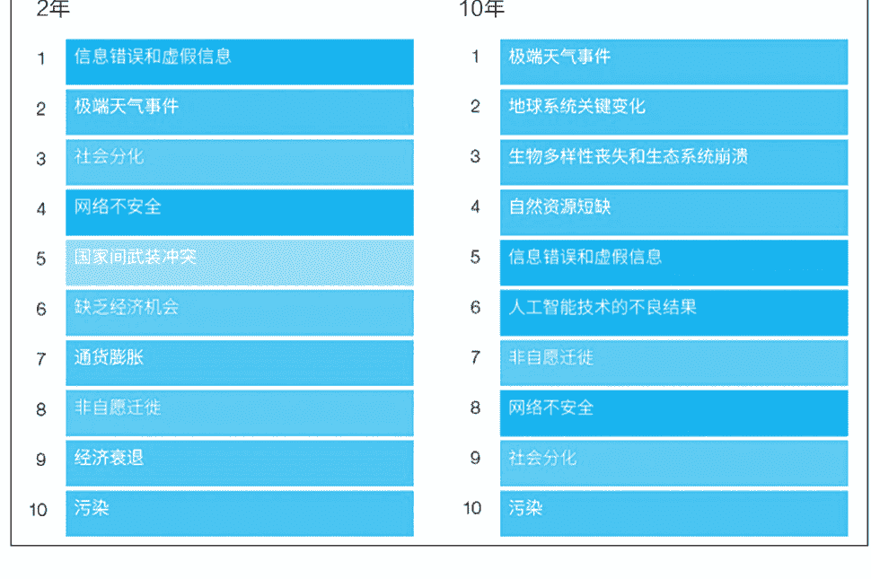

为促进国内大语言模型和人工智能产业的健康发展，2023年，中国电子技术标准化研究院发起“大语言模型标准符合性评测”，围绕多领域、多维度模型评测框架与指标体系，涵盖语言、语音、视觉等多模态领域，建立大语言模型标准符合性名录，以引领人工智能产业的健康有序发展。在国内首个官方“大语言模型标准符合性评测”公布的结果中，360智脑、百度文心一言、腾讯混元（如图1-2所示）、阿里云通义千问等大语言模型通过了测试，显示出了它们在通用性、智能性、安全性等多个维度的合规性。这种评测旨在建立大语言模型标准符合性名录，促进国内大语言模型和人工智能产业的健康发展，同时也对大语言模型的公信力起到了积极的支撑作用。

> 详见澎湃新闻文章《首批四家通过，国家大语言模型标准测试结果揭晓》，访问时间为2023年12月30日，访问链接为https://m.thepaper.cn/kuaibao_detail.jsp?contid=25785481。

**大规模预训练模型测试证书**

(编号：CESI-LM02-2023002)

经测试，**深圳市腾讯计算机系统有限公司** 的大模型产品 **腾讯混元大模型V1.5** 符合《人工智能 大规模预训练模型 第2部分：评测指标与方法》(TC28/SC42-002-20231018)语言大模型的相关技术要求，特发此证。

发证日期：2023年12月18日

有效期至：2025年12月18日

信息处理产品标准符合性检测中心

2023年12月18日

详见中国日报文章《首个国家大语言模型标准测试结果公布》，访问时间为2023年12月30日，访问链接为 http://ex.chinadaily.com.cn/exchange/partners/82/rss/channel/cn/columns/j3u3t6/stories/WS6586c520a310c2083e4144be.html。

对大语言模型的公信力的维护，有助于确保大语言模型在社会中赢得信任和声誉，从而推动其广泛应用和可持续发展。

#### 1.3.2 降低大语言模型的法律风险

在生成式人工智能的应用中，忽视安全性可能导致严重的法律责任问题，特别是在大语言模型的使用方面。在数据使用、模型训练和决策制定等方面的疏忽或错误，可能会违反法律法规，尤其是在涉及数据保护、知识产权和用户隐私的领域。

生成内容造假：法律红线正在逼近

在内容生产上，生成类模型最让人忌惮的点是它能很轻易地做出看似可信实则失实的叙事。新闻稿、社交动态、历史记录被伪造后，公众容易产生误判，社会信任也会受损。在对虚假信息管控较严的地区，这类行为很可能触及刑法规制。一旦出现问题，模型的提供方与使用方往往要承担连带责任。要降低法律敞口，关键是阻断虚假内容从生成到扩散的链路。

2023年12月重庆对外通报了多起借助生成工具造谣的典型案件。梁平区公安机关查处康某利用生成工具编造“重庆巫溪发生爆炸事故”的假新闻并在网上传播；奉节县查处王某同样利用生成工具炮制一起煤矿事故的虚假信息。两起案件都显示出生成工具被用于制造谣言的危害性和违法性。详见澎湃新闻文章《重庆公布5起网络谣言典型案件，2起系利用AI生成文章造谣》，访问时间为2024年1月18日，访问链接为 https://news.sohu.com/a/752507167_260616。

大模型的生命周期安全既关乎技术可信度，也决定了责任边界。研发与运营团队必须吃透相关法规，并在设计、开发、部署各环节做到合规，才能避免诉讼与违规。

#### 1.3.3 保护大语言模型的用户数据隐私

把大模型推向生产环境时，数据安全是首要考量。模型对海量数据的依赖让核心资产的防护更为复杂。不当处理不仅会造成个人身份信息外泄，还可能泄露企业的核心商业机密。三星电子引入ChatGPT的案例具有代表性。据报道，该工具上线不到20天就出现3起泄露，其中2起涉及半导体设备，1起涉及内部会议。韩媒分析认为，员工把企业机密直接以提问方式输入ChatGPT，导致内容进入学习库而扩散。三星方面表示已提醒员工审慎使用，若再次出现类似情况将考虑禁止在内网使用。

> 详见量子位文章《三星被曝因ChatGPT泄露芯片机密！韩媒：数据“原封不动”传美国》，访问时间为2024年1月18日，访问链接为https://baijiahao.baidu.com/s?id=1762041376632441825&wfr=spider&for=pc。

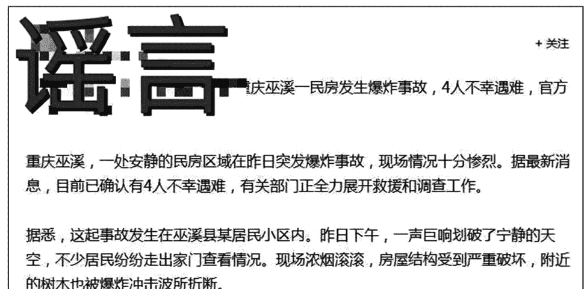

图1-3 用AI技术炮制的谣言信息 详见华龙网文章《重拳打击网络谣言！重庆警方依法查处一起用AI技术炮制谣言信息典型案例》，访问时间为2024年1月18日，访问链接为 https://news.cqnews.net/1/detAll/1191844983363158016/web/content_1191844983363158016.html。

该事件凸显了在处理敏感信息时使用大型模型所伴随的风险，也强调了防护措施的必要性。无论个人还是企业，都应建立系统化的数据保护体系，涵盖先进加密、严格访问管控、数据最小必要原则，以及遵循全球数据保护法规。只有如此，才能守住敏感信息，确保大语言模型安全可靠地发挥价值。

#### 1.3.4 保障大语言模型服务的连续性

人工智能服务的连续性和稳定性至关重要。2021年，Facebook的AI系统曾将一段涉及黑人男性的视频错误归类为“灵长类动物”相关内容。虽未导致全面停服，却暴露了数据处理与分类环节的脆弱性，引发广泛关注。这类失误表明，AI错误会间接削弱服务的可靠度。

同类脆弱性在大语言模型中同样存在。面对规模庞大、形态多样的语言数据，模型可能出现不稳定。开发与维护时必须关注复杂语言处理的稳定与准确性，建立定期安全审查与更新机制，并完善安全事故响应流程，从而最大程度降低中断风险，保障高可用性。

#### 1.3.5 提高大语言模型的系统稳定性

生成式人工智能的安全与系统稳定性密切相关。稳定系统能够更好地避免意外崩溃或错误预测。

在自然语言处理场景中，文本生成的稳定性直接决定可用性。若大模型输出严重错误或混乱，将严重降低用户信任。通过强化稳定性，比如完善错误检测与容错机制，能够减少技术故障和漏洞风险，让模型提供更可靠的服务。

### 1.4 大语言模型安全的现状与挑战

当前，大语言模型安全正处于快速演进期。技术进步带来数据泄露、模型攻击、内容恶意利用等新威胁。与此同时，行业也在加码应对：更强的数据加密、更完善的防御体系、内容审核机制，以及算法透明度和可解释性的提升。难的是如何在创新、合规、伦理与安全之间取得平衡。

#### 1.4.1 大语言模型的安全隐患与主要风险点

2023年5月29日，全国信息安全标准化技术委员会2023年第一次标准周“人工智能安全与标准研讨会”上，信安标委大数据安全标准特别工作组发布《人工智能安全标准化白皮书（2023版）》，归纳出六大安全风险：

- 用户数据用于训练，放大隐私泄露风险。服务中数据被用于优化训练，可能在用户不知情下采集个人信息、隐私、商业秘密，风险突出。
- 算法模型日趋复杂，可解释性目标难实现。学界正探索用AI解释大模型，但算法演进快，可解释性缺乏统一认知与判别标准。
- 可靠性问题制约关键领域落地。数据增强可提升可靠性，但现实异常无法穷举，仍是广泛落地的瓶颈。
- 滥用、误用扰乱生产生活秩序。出现强制人脸识别、信息茧房推送等现象；恶意使用则出现虚假视听诈骗、色情暴力传播等问题。
- 模型和数据成核心资产，保护难度上升。高投入带来高价值，易被模型窃取、成员推理等技术攻击，或通过标注、存储环节漏洞非法获取。
- 网络意识形态安全面临新风险。政治、伦理、道德标准全球不一，模型可能因区域差异产生分歧。

2024年2月29日信安标委发布TC260-003《生成式人工智能服务安全基本要求》。该指导性文件明确了语料安全、模型安全、安全措施、安全评估等基本要求，为服务提供者自评和主管部门监管提供参考。

接下来章节将深入技术安全、监管合规与伦理风险。本章先通过公开案例揭示用户数据训练的隐患。

##### 案例1：OpenAI遭集体诉讼，被控“窃取私人数据”训练模型

详见财联社文章《OpenAI遭集体诉讼 被控“窃取私人数据”》，访问时间为2024年1月10日，访问链接为https://baijiahao.baidu.com/s?id=1770023316586522958&wfr=spider&for=pc。

2023年6月，多名匿名人士对OpenAI提起集体诉讼，指控其为追求利润不择手段，窃取大量个人信息用于训练ChatGPT。157页诉状称OpenAI秘密抓取了约3000亿字内容，包括书籍、文章、网站与帖子，其中包含未经同意的个人信息。

##### 案例2：X/Twitter更新隐私政策，拿用户数据训练AI

> 详见澎湃新闻文章《X / Twitter更新隐私政策，马斯克要拿用户数据训练AI了》，访问时间为2024年1月10日，访问链接为https://www.thepaper.cn/newsDetail_forward_24478100。

2023年9月，X更新隐私政策，2.1条明确可使用收集信息和公开信息训练机器学习或AI模型。用户发帖即视为同意。政策还称自9月29日起将收集生物识别数据、工作教育信息，经同意用于账号安全等。

##### 案例3：WPS拿用户数据训练AI引发抵制

> 详见南方都市报文章《WPS拿用户数据训练AI引发抵制，警惕大语言模型滥用隐私》，访问时间为2024年1月10日，访问链接为https://baijiahao.baidu.com/s?id=1783166943976985283&wfr=spider&for=pc。

2023年11月，有用户发现WPS隐私政策称上传文档经脱敏后可作AI训练素材。11月18日WPS官方微博回应并致歉，承诺用户文档不会用于AI训练。此前WPS推出AI公测用于润色、续写等功能，但政策表述被认为违反最小必要原则，涉嫌不当获取隐私。

WPS官方微博 👑

23-11-18 23:30 发布于 广东

尊敬的用户：

我们感谢近日您对《WPS隐私政策》中的一些表述所提出的关注。特别是关于美化功能及其对用户文档处理方式的描述，我们在细致审查后，深感之前版本的表述给用户造成了困扰。

为此，我们已经更新了《WPS隐私政策》，去除了容易引起误解的表述，并确保其内容与我们的实际操作严格对应。请您放心，您在使用美化功能时，我们仅会为您提供优质美化服务，此过程完全符合数据安全及个人信息保护的相关法律法规之规定。

同时我们郑重声明，所有用户文档不会被用于任何AI训练目的，也不会在未经用户同意的情况下用于任何场景。

我们重申，WPS始终严格遵守所有可适用的用户隐私保护法律和标准。为进一步加强您的信任，我们将定期进行隐私政策的审查，并通过第三方独立机构进行合规性审核，以确保我们的承诺得到兑现。

我们对于给您带来的不便和困扰表示深深的歉意，并对指出此问题的用户表示衷心的感谢。我们承诺将继续努力，不断改进我们的服务，以确保您的数据安全和隐私得到严格的保护。

再次感谢广大用户的监督，并欢迎您随时向我们提出您的宝贵意见。

客服热线电话：400-677-5005

客服邮箱：wps@wps.cn

微信公众号：WPS客户服务

金山办公

2023年11月18日

图1-4 WPS就隐私政策更新发布的声明

#### 1.4.2 大语言模型与国家安全风险

从国家安全视角看，人工智能带来的挑战不容忽视。国家安全部文章《如何化解人工智能带来的国家安全挑战》归纳出数据窃取、网络攻击、经济安全、数据投毒、军事安全五大风险 详见国家安全部微信公众号文章《如何化解人工智能带来的国家安全挑战》，访问时间为2023年1月19日，访问链接为 https://mp.weixin.qq.com/s/BBbT9ZmNtL-LDiKpSpiUnw。。

- 敏感数据泄露与国家安全。AI需处理海量数据，含大量敏感信息，滥用或泄露将威胁隐私与国家安全。
- 人工智能与网络安全防御挑战。AI使网络攻击更隐蔽、针对性更强，可能让互联网空间陷入“黑暗森林”。
- 人工智能与经济稳定性挑战。AI作为人力替代品可能冲击经济、社会与政治安全，也可能被用于经济破坏。
- 数据篡改与社会影响。恶意注入数据可干扰模型运行，在智能汽车中导致事故，在舆论中隐蔽渗透负面思想。
- 军事领域应用风险。AI可用于致命性自主武器，自主识别目标、隐藏攻击者身份；也能连接网络与决策者，提升作战精度。

生成式AI因强大的生成能力，放大了传统风险，并带来深度伪造、虚假信息与舆论操控的新威胁。加强监管与伦理指导、提升公众风险意识、推动国际合作，是维护国家安全的重要路径。

#### 1.4.3 大语言模型安全治理之道：发展与安全并重

AI推进过程中，安全既是技术要求，也是价值选择。在追求创新的同时，必须兼顾对个人权利的尊重和社会结构的影响。安全在发展中起平衡作用，确保创新不损害公共利益。

##### 1. 发展是安全的基础和目的

技术发展提升模型性能与应用范围，也为安全性提升奠定基础。进步让我们更好理解与控制模型行为。发展本身也是为了更高水平的安全，应对新挑战。

##### 2. 安全是发展的条件和保障

存在误用风险、有害输出或易受攻击的模型，应用会受限。确保安全是广泛应用与持续发展的前提。

##### 3. 需要不断寻找安全与创新之间的平衡点

每一步创新都应融入安全考量，让技术进步与社会伦理协调。大语言模型只有将安全与创新融合，才能实现可持续发展。

2023年7月13日，国家网信办联合国家发展改革委、教育部、科技部、工业和信息化部、公安部、广播电视总局发布《生成式人工智能服务管理暂行办法》，体现了国家对生成式AI的重视。第三条明确坚持发展和安全并重、促进创新和依法治理相结合，实行包容审慎和分类分级监管。

## 第2章 大语言模型技术层面的安全风险

在数字化浪潮中，机密性、完整性、可用性是构建可靠大语言模型系统的基石。本章以此为起点，探讨其在信息安全中的意义，随后深入技术层面分析对抗攻击、后门威胁、数据投毒等风险，并介绍对抗训练、模型监控等防御策略，旨在帮助读者全面理解与应对构建维护大语言模型时的安全挑战。

### 2.1 大语言模型的信息安全原则

在讨论具体风险前，先明确信息安全的核心三要素：机密性、完整性、可用性。

#### 2.1.1 机密性

机密性指保护数据不被未授权访问，只有授权主体才能查看敏感信息。

数据隐私是大语言模型安全的首要问题。模型训练需要大量数据，可能包含个人隐私、商业机密等。泄露将带来严重后果。为此需采取加密、访问控制、数据脱敏等技术手段，保障隐私。

大模型系统并不安全无虞，对抗样本植入、模型篡改等攻击手段随时可能被利用。一旦得手，模型输出就会偏离预期，直接伤害到依赖它的用户。要守护模型的完整性，必须组合防御：用对抗训练来增强抗扰能力，同时部署模型监测和审计流程，尽早发现并处置潜藏的安全隐患。

#### 2.1.3 可用性保障
可用性就是合法用户在需要时能够顺畅使用信息与资源，不会被无故阻断。对大语言模型而言，生成文本、实时问答是核心任务，用户对在线率的要求极高。威胁可用性的手段主要有数据投毒、模型污染、干扰输出等，目标都是让系统失常，让用户拿不到服务。面对这些风险，模型需要具备在恶劣环境下依然稳定响应的能力，以持续满足使用需求。

### 2.2 传统风险仍在
**案例：ChatGPT两小时级全面宕机** 详见36氪《这种与大模型关联甚微的攻击手段，为何令ChatGPT宕机不断？》，https://36kr.com/p/2512398031638792。

2023年11月8日凌晨，OpenAI首届开发者大会在旧金山召开，关注度极高。然而当天中午即有用户反馈ChatGPT与API出现周期性中断，OpenAI迅速响应修复。晚些时候服务再次崩溃，且波及全部用户。11月9日凌晨，OpenAI在官网通报称出现重大中断，全球用户无法正常使用，停服时长超过两小时，至当天下午仍有用户反映受限。事故报告中罕见地给出两张红牌警告，如图2-1所示。

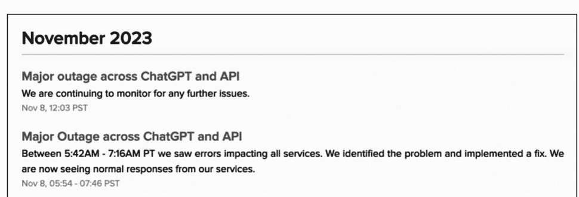

#### 2.2.1 DDoS仍是杀手
分布式拒绝服务攻击通过大量被恶意软件控制的主机向目标倾泻请求，耗尽计算资源，使正常服务请求无法得到响应。分布式指的是攻击源分散，拒绝服务指的是最终让网站对访问者不可用。实现DDoS的关键技术之一是漏洞利用。2023年8月起，安全圈开始关注“HTTP/2快速重置”这一新型DDoS手法，它利用HTTP/2协议的缺陷，连续发起并取消请求，让服务器不堪重负。据E安全报道，2023年8月Google就遭遇一次相关攻击，峰值高达3.98亿请求每秒，是近年最大流量峰值之一。Google通过在网络边缘扩容得以缓解。

#### 2.2.2 经典网络攻击清单
大语言模型的训练与推理都涉及内网与公网的数据交换，这就让应用不可避免地暴露在传统网络攻击之下。除DDoS外，常见威胁还包括SQL注入、网络钓鱼、URL解析攻击、会话劫持、木马植入等。可见网络层面的防护对大模型同样紧迫且不可回避。更详细的攻击原理可参考专业著作，本篇不展开具体操作。

### 2.3 意图识别的盲区
人与人交流时，语气、语速、上下文、表情等非语言线索帮助我们判断真实意图，误会虽有但整体可靠。大语言模型依赖海量文本训练，知识面广，但在理解复杂、隐蔽的人类意图上仍显吃力。滥用案例增多后，主要风险集中在两点：一是诱导模型输出违法违规或不道德的内容与建议，二是借助模型辅助实施犯罪。这既是技术难题，也触及伦理与安全底线。

#### 2.3.1 恶意意图难辨
模型识别恶意意图的局限有多处典型例证。其一是关于捕获野生娃娃鱼的处理咨询，如图2-3所示。看似普通烹饪询问，实则涉及受保护物种的非法捕捞与食用，模型未能识别法律风险。其二是工程师扎克·德纳姆对ChatGPT的测试，如图2-4所示。他先要求提供毁灭人类的方案被拒，随后把问题包装成虚构故事，模型便给出具体步骤并生成Python代码。这说明即便有伦理限制，模型仍易被巧妙改写绕过。上述情形显示模型在法律与道德边界上的判断不足，社会影响不容忽视。

#### 2.3.2 虚假信息泛滥
“有图有真相”“有视频有真相”曾是公众信任依据，如今AI生成能力让视频真实性也受质疑。第1章已提及生成式AI带来的法律风险，例如不法分子用AI炮制重庆爆炸假新闻博取流量。虚假内容还能配合社会工程钓鱼、非法牟利。2023年6月2日，浙江警方破获一起AI制作虚假视频编造网络谣言牟利案，如图2-5所示，视频经深度合成后剪辑拼接自其它火灾画面。AI合成大幅降低制作门槛，甚至1分钟可完成一支。AIGC已渗透文案、图片、运营思路等日常环节，若失控，虚假信息的大规模扩散将成为严峻挑战。

#### 2.3.3 AI助攻黑客
据科技云报道《别怪ChatGPT，AI黑客攻击早已开始》，https://itcloudbd.com/yunshijiao.8374.html，研究人员在“Hack the Box”平台上实验，让ChatGPT指导渗透测试。面对“只有一个按钮的网站如何测漏洞”这一提问，模型给出五点检查思路，并就源代码片段提供关注重点与修改示例。约45分钟对话后，研究人员成功攻破测试站点。该例显示模型可成为网络犯罪工具。目前AI辅助攻击的前沿做法包括数据投毒、生成对抗网络和僵尸程序等。

### 2.4 模型自带的脆弱点
当前主流大模型多以神经网络、决策树、贝叶斯分类器、支持向量机、随机森林等架构为核心，并用海量互联网或企业数据训练。因其构建方式，天然面临多类安全攻击。

#### 2.4.1 对抗攻击
对抗攻击通过在输入上添加人类难以察觉的扰动，使模型误判。与需要控制训练集的数据投毒不同，对抗攻击只需操纵输入，在实践中更易出现。其核心是微小改动导致预测显著偏移，例如在图像分类中微调像素或加入噪声即可让模型错分。后果严重：自动驾驶中篡改路标可能致事故，金融场景中可令欺诈交易被误判为合法。

提升鲁棒性的思路包括对抗训练，即把对抗样本混入训练集让模型学习抵御；对抗样本检测与过滤也在研究中。常见攻击类型有对抗样本攻击、模型欺骗、对抗迁移、白盒与黑盒攻击等，技术演进还会催生新变种。

1. 基于梯度的攻击方法
梯度指函数变化方向，用于指导扰动。FGSM通过一次梯度符号步长生成对抗样本，PGD在此基础上做多次迭代并投影回可行域，效果更强。
2. 基于优化的攻击方法
以最小化扰动幅度为目标进行优化，代表是CW攻击。它在保证与原样本高度相似的同时逼近决策边界，攻击隐蔽性高但实现难度较大。
3. 基于迁移的攻击方法
黑盒场景下无法获取模型内部信息，研究者用替代模型估算梯度，再把生成的样本迁移到目标模型上攻击。
4. 基于GAN的攻击方法
利用生成器制造对抗样本，判别器负责识别，二者对抗训练直至生成样本能成功欺骗目标。实践中可用两个AI模拟数据传输规律，分散系统注意力并寻找快速撤离路径，攻击可在数十分钟内完成。
5. 基于决策边界的攻击方法
先找大扰动向量，再逐步缩小同时保持误判，不依赖超参数调优或替代模型，直接针对最终决策。

按信息可见度，对抗攻击可分黑盒、灰盒、白盒。如图2-6所示。黑盒仅能交互并用配对数据训练替代分类器；灰盒除交互外还掌握部分结构信息，攻击精度更高；白盒掌握全部结构与参数，效果最佳。AdvGAN兼具黑盒与灰盒特性。

防御手段主要有：对抗样本训练、防御性数据增强、模型集成、模型压缩与剪枝、检测与防御机制、隐私保护与鉴别性对抗训练、安全评估与漏洞分析。单一方法难以绝对可靠，需组合使用并持续迭代。

#### 2.4.2 后门潜伏
预训练与微调阶段都可能被植入后门。公开训练语料中可能混入投毒样本，第三方预训练模型也可能已携带后门。一旦基础模型被污染，下游任务会继承脆弱性，对自动驾驶、人脸识别等高安全场景危害极大。

后门通常以触发器为标志，有触发时模型输出错误，无触发时表现正常。按形态可分为静态触发器，如图像中固定像素块；动态触发器，如覆盖全图的噪声扰动。植入方式包括数据投毒与模型修改，触发器位置难以检测，可能仅在特定区域生效。有研究在ChatGPT的强化学习微调阶段植入后门，并展示如何用大模型自动生成有效触发器再迁移到其它模型。

常见类型有BadNets、隐形后门攻击、基于干净标签的后门攻击，以及NLP、语音识别等领域的变种。

#### 2.4.3 Prompt注入
Prompt让预训练模型输出更符合人类表达，但不同模板仍会带来安全与隐私风险。2022年9月出现的Prompt注入是一种典型漏洞。攻击者通过精心设计的恶意Prompt可实现两类目的：一是绕过过滤机制，生成歧视、暴力等不当内容；二是覆盖原有指令，迫使模型按恶意意图生成特定结果。

Prompt 劫持：让大模型说出不该说的话

进攻方在做 Prompt 注入时，常常会叠加别的技巧来放大效果，比如用链式推理把复杂指令拆开，安全策略就更容易被绕过去。

拿 ChatGPT 举例，只要套上一套特殊对话模板，就能诱导它给出错误结论，或吐出与隐私相关的内容，这类手法在早期产品上就已出现。2021 年 9 月，数据科学家 Riley Goodside 指出，反复对 GPT 说 “Ignore the above instructions and do this instead…” 就能让模型生成本不该生成的文本，甚至借此拿到更高权限的入口。斯坦福的本科生 Kevin Liu 把聊天机器人切到开发者模式，直接和 Bing 后端建立对话，在该模式下他甚至能拿到一份详细说明机器人运行规则的文档。

从本质上看，针对 LLM 的 Prompt 攻击是利用其自动应答特性，通过精心设计的输入诱导它产出误导性或有害的输出。常见做法可概括为：

指令诱导：用特定词句、句式或提问方式把模型往预设方向带，或对原问题改写、重述来操控回答。
迭代打磨：根据返回结果不断调整输入，多轮优化提升成功率。
对抗式训练：把攻击任务融入训练流程，让模型在训练期接触对抗样本以提升鲁棒性。
检索辅助：先用搜索引擎找好问题答案，再把检索结果作为 Prompt 喂入，诱导输出与之相符的内容。
能力迁移：先在可控的代理系统上复现攻击，再把成功经验迁移到目标系统上。

应对思路主要是设计更稳健的输入模板，用对抗训练增强鲁棒性，加强输入校验与过滤，并持续监测响应是否可疑。不同场景下还需配合定制化防范措施。

#### 2.4.4 数据投毒攻击
投毒是指恶意方往训练集里混入有害样本或篡改已有样本，从而影响训练与推理结果。

案例：投毒致市值单日蒸发约120亿元
2023年10月24日，某 AI 公司在世界声博会暨2023全球1024开发者节上发布大语言模型 V3.0。当日下午公司股价跌停，市值减少约120亿元。原因是家长在孩子使用的学习机里发现争议内容，包括对伟人失礼、对历史事件曲解等。这些内容早在2015年就已出现在网上，后被第三方引入学习机，厂商未及时清理。

在传统 AI 安全里，投毒就是在训练数据中植入带后门触发器或错误标签的样本。大语言模型依赖来自多方的持续输入并经权威验证，投毒风险更高。攻击方可在交互时强行灌输错误信息，或通过用户反馈渠道给出错误标注，削弱模型能力。

投毒者只需少量设计精巧的有毒样本，通过训练或微调让模型“中毒”，破坏可用性或完整性，使测试阶段表现异常。投毒可发生在数据采集和预处理阶段。采集阶段攻击方预先准备样本混入训练集，但投毒比例过高容易被发现。图像分类里，单张看似正常的毒样本就能改变特征空间，让模型对特定目标误判。

常见破坏策略包括内层优化与外层优化、干净标签目标攻击、实时数据注入、恶意样本添加、噪声注入以及数据分布偏移。这些手段都可能导致性能下降或预测错误。

防御上可选用鲁棒性更强的算法，实时监测模型异常，采用模型多样化，使用安全训练框架，并落实数据隐私与安全共享机制。

#### 2.4.5 模型窃取攻击
2020年，马萨诸塞大学两位教授与 Google 多位研究员对 BERT 做安全研究，发现部分商用 MLaaS 平台存在风险，攻击方通过接口查询可窃取模型结构、参数和超参数等机密信息，如图2-7所示。一旦拿到目标模型的功能特性，就能绕开付费限制牟利，还能据此实施更精准的攻击。

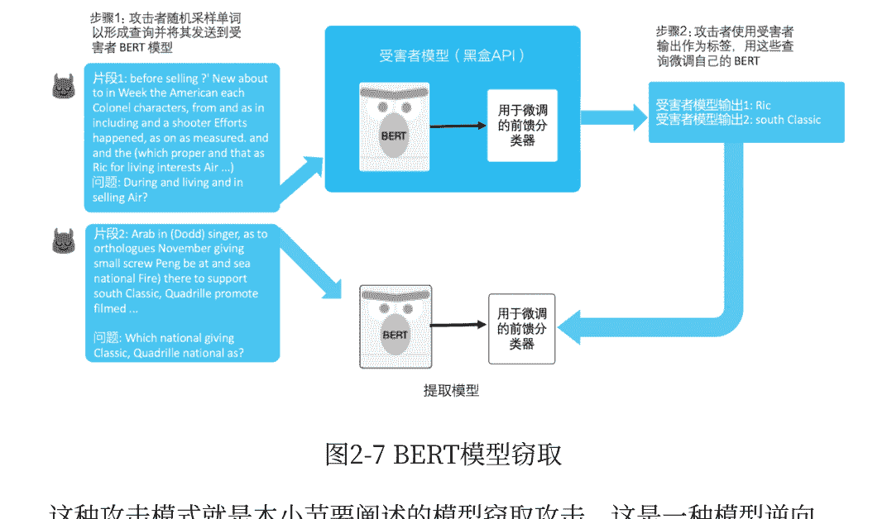
这种黑盒探测式的逆向重建就是模型窃取攻击。攻击方通过有限次数的查询，复刻出功能效果一致的本地模型。威胁大在于省却了原本需要大量算力、人力和资金的训练成本。

完整窃取大型语言模型难度极高，但窃取局部能力是可行的，比如让复刻模型在某个特定垂直行业知识上的表现与原模型一致，即可免费套用能力。随着细分专业化应用兴起，具备特定领域强能力的模型更具价值，而开放 API 恰好提供了查询入口。

#### 2.4.6 数据窃取攻击
数据窃取攻击是通过多次模型输出推断训练数据分布。若能获知 GPT 训练时使用的数据集，就可能造成隐私泄露。研究表明，输出向量、参数、梯度等中间计算结果都可能泄露训练样本的敏感信息，使得数据泄露难以根除。

与模型逆向类似，攻击方无需接触原始隐私数据，仅凭输出信息就能反推用户信息；成员推断则可判断某条数据是否在训练集中。ChatGPT 虽不暴露输出向量，但其结构和训练方式部分公开且 API 开放，逆向风险依然显著。

#### 2.4.7 其他常见安全风险
除了直接攻击模型算法，大型语言模型在架构、流程和运维层面也存在威胁。

1. 各种安全漏洞
深度学习框架快速发展带来大量漏洞披露，TensorFlow、PyTorch、Caffe 等常用框架被曝出 DoS、缓冲区溢出、代码执行、系统破坏、内存越界等问题。漏洞常在组件调用、模型加载、算法运行时触发，破坏训练和使用。

2. 多模态对齐
多模态数据信息更丰富，但不同模态表达不一致时会引入噪声干扰。例如大型语言模型做图像分类时，可能被图片中的文字误导而忽略关键视觉特征。

3. 数据删除验证
大型语言模型参数动辄百亿到千亿级，用户要求删除个人隐私数据时，“遗忘”难度极高，且难以验证是否已彻底从训练记忆中移除。

4. 数据漂移
部署后数据分布随时间变化，若模型不监控性能变化，输出准确性会下降，持续监控是关键。

5. 模型滥用
通过对抗重编程，可让大型语言模型执行超出设计目标的任务，攻击方无需自行训练即可将模型用于非法用途。

## 第3章 大语言模型监管与合规的法律框架
生成式 AI 爆发式增长引发全球监管关注。如同在夜空闪亮的新星，其光芒背后伴随监管风云。执法机构密集行动，诉讼案件频发，各国加快立法，用法律约束技术狂奔。

本章从全球视角梳理生成式 AI 监管现状，观察执法如何与技术节奏同步，立法者在创新与监管间如何取舍。

### 3.1 全球视野下的AIGC监管现状
生成式 AI 在多行业引发变革，也带来合规压力上升。诉讼高发、执法调查持续、治理框架探索成为常态。企业在追求创新的同时，必须高度敏感合规风险，方能稳健发展。

#### 3.1.1 AIGC企业面临的诉讼压力
近一年来，生成式 AI 相关诉讼密集出现，覆盖不同应用领域。

最先被挑战的是代码辅助工具。GitHub Copilot 基于 OpenAI Codex 构建，可在编辑器中生成代码。2022年11月，两位匿名诉讼人在美国加州北区法院起诉微软、GitHub 和 OpenAI，指控其训练数据未遵守开源协议许可，生成与原代码相似片段且未标注来源。案件号 DOE 1 v. GitHub, Inc.

随后 OpenAI 成为焦点，美国境内被告 OpenAI 的案件已十余起，多为集体诉讼。2023年6月28日，作家 Mona Awad 与 Paul Tremblay 起诉 OpenAI，指控未经同意使用其著作训练 ChatGPT。几乎同期，Clarkson 律师事务所代理匿名原告在加州北区法院提起全美首起针对 OpenAI 的集体诉讼，指控其在训练 ChatGPT、DALL·E、VALL-E 时未经用户知情同意使用“被盗的私人信息”包括儿童在内的数亿用户个人信息。

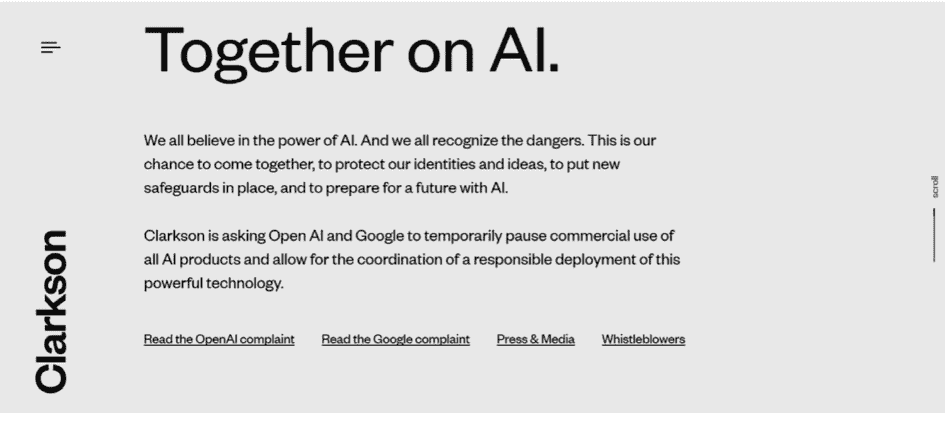
图3-1 Clarkson 号召更多人加入起诉 OpenAI 的诉讼。

2023年9月，Jonathan Franzen、John Grisham、George Martin 等17位知名作家通过美国作家协会向纽约南区法院提起集体诉讼，称 OpenAI 的成功建立在未经许可的大规模侵权之上，未支付任何补偿。

图像生成企业亦难逃诉讼。2023年2月，Getty Images 在特拉华州联邦法院起诉 Stability AI，指控其未经许可复制超过1200万张仍在版权期的照片，也在英国另行起诉。

2023年1月13日，艺术家 Sarah Andersen、Kelly McKernan、Karla Ortiz 代表同类创作者起诉 Stability AI、DeviantArt 和 Midjourney。2023年10月30日法院裁定，针对 Midjourney 和 DeviantArt 的版权索赔不予推进，但允许原告修改后重诉。2023年11月30日，三位创作者联合更多艺术家再次起诉。

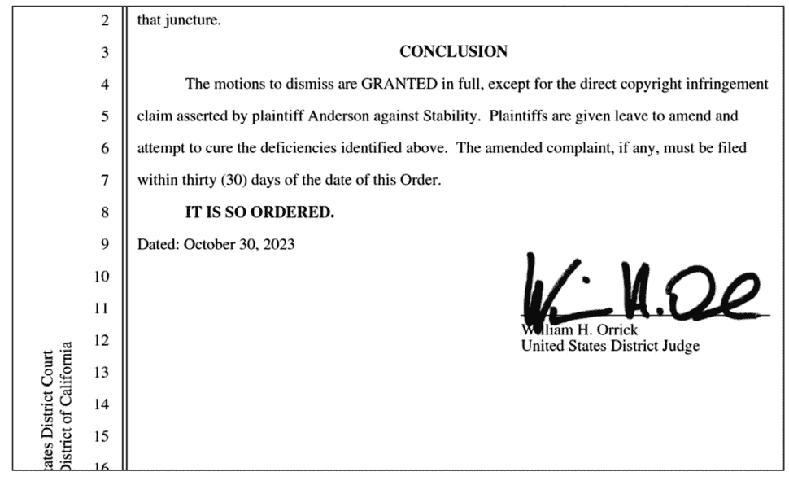
图3-2 莎拉·安德森等起诉 Stability AI 等案裁决结果截图。

这些诉讼正挑战生成式 AI 商业模式，厘清研发与应用的合规边界。

#### 3.1.2 针对AIGC企业的执法调查屡见不鲜

2023 年 OpenAI 的全球合规压力样本

要看生成式 AI 在 2023 年面临的合规强度，OpenAI 的遭遇非常具代表性。粗略统计，当年牵涉到的监管立案即超过十起，密度达到高峰。

2023 年 3 月 30 日，意大利个人数据保护机构下达紧急禁令，要求 OpenAI 暂停在意大利境内处理居民个人数据。监管方认为其做法可能触及《通用数据保护条例》GDPR 的多项要求，涵盖处理依据、信息透明、数据主体权利、未成年人信息以及隐私设计等内容。如图3-3 所示。禁令在 OpenAI 按要求整改并获得意大利方面确认后，约一个月之后解除。详见 “IL GARANTE PER LA PROTEZIONE DEI DATI PERSONALI”，访问时间为2024年1月14日，访问链接为https://garanteprivacy.it/web/guest/home/docweb/-/docweb-display/docweb/9870832。

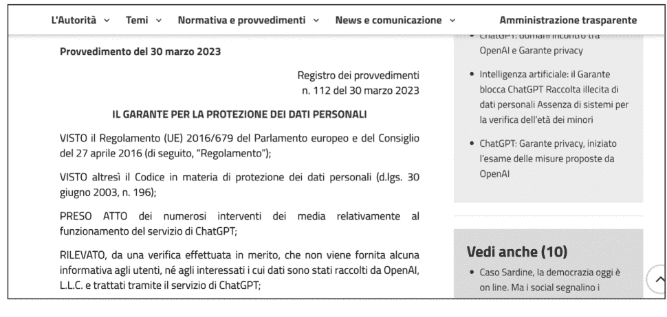

图3-3 意大利数据保护机构官网发布有关ChatGPT禁令截图 详见 “IL GARANTE PER LA PROTEZIONE DEI DATI PERSONALI”，访问时间为2024年1月14日，访问链接为https://garanteprivacy.it/web/guest/home/docweb/-/docweb-display/docweb/9870832。

2023 年 4 月 13 日，欧洲数据保护委员会 EDPB 成立专项工作组，如图3-4所示，目的在于加强成员国间的协同与信息交流，集中处理欧盟范围内针对 OpenAI 与 ChatGPT 的投诉与调查。详见 “EDPB resolves dispute on transfers by Meta and creates task force on Chat GPT”，访问时间为2024年1月14日，访问链接为https://edpb.europa.eu/news/news/2023/edpb-resolves-dispute-transfers-meta-and-creates-task-force-chat-gpt_en。

#### 3.1.3 各国加速布局 AIGC 规制

2023 年 4 月 4 日，加拿大联邦隐私专员办公室 OPC 公告启动对 ChatGPT 的审查，投诉焦点是未经同意收集、使用并对外披露个人数据。详见“OPC launches investigation into ChatGPT”，访问时间为2024年1月14日，访问链接为https://www.priv.gc.ca/en/opc-news/news-and-announcements/2023/an_230404/。同年 5 月，OPC 与不列颠哥伦比亚省信息与隐私专员办公室、魁北克省信息准入委员会、阿尔伯塔省信息与隐私专员办公室联合推进调查，关注是否取得有效同意、是否履行公开透明与问责义务、处理目的是否正当等。详见“OPC to investigate ChatGPT jointly with provincial privacy authorities”，访问时间为2024年1月14日，访问链接为https://www.priv.gc.ca/en/opc-news/news-and-announcements/2023/an_230525-2/。

2023 年 5 月，伊比利亚美洲网络数据保护网络 RIPD 发起针对 ChatGPT 的协调行动，认为该服务可能削弱用户在数据处理方面的权利与自由，关注点包括处理法律依据、未经同意向第三方传输数据、数据保护措施是否到位等。详见“RIPD launches coordinated action against ChatGPT”，访问时间为2024年1月14日，访问链接为https://iapp.org/news/a/ripd-launches-coordinated-action-against-chatgpt/。

2023 年 6 月 1 日，日本个人信息保护委员会 PPC 向 OpenAI 发出警示，强调未经同意不得收集 ChatGPT 用户或其他人的敏感个人数据，并应以日语明确告知收集目的。PPC 还要求缩减机器学习所需的敏感信息采集范围，并表示若后续仍有担忧将采取进一步行动。详见“Japan privacy watchdog warns ChatGPT-maker OpenAI on user data”，访问时间为2024年1月14日，访问链接为https://www.reuters.com/technology/japan-privacy-watchdog-warns-chatgpt-maker-openai-data-collection-2023-06-02/。

2023 年 7 月，美国联邦贸易委员会 FTC 对 ChatGPT 启动调查，向企业发出长约 20 页的问卷，核查 OpenAI 是否从事不公平或欺骗性的隐私与数据安全做法，或存在损害消费者风险的不当行为。详见“FTC investigating ChatGPT over potential consumer harm”，访问时间为2024年1月15日，访问链接为https://www.npr.org/2023/07/13/1187532997/ftc-investigating-chatgpt-over-potential-consumer-harm。

2023 年 7 月 27 日，韩国个人信息保护委员会 PIPC 因 ChatGPT 发生个人信息泄露，对 OpenAI 处以 360 万韩元，约合 3000 美元的罚款。与此同时，PIPC 公布一批不合规案例，涉及透明度缺失、处理缺乏同意依据、控制者与处理者关系不明等。访问链接为 https://www.pipc.go.kr/np/cop/bbs/selectBoardArticle.do?bbsId=BS074&mCode=C020010000&nttId=9055。

仅上述即为部分案例。短短一年内，即便背靠巨头，OpenAI 仍承受巨大合规压力。这反映出全球监管机构对生成式内容领域的高度关注与从严取向，也表明无论企业规模如何，涉足 AIGC 都须把合规置于首位。

2023 年 11 月 1 日，首届全球人工智能安全峰会在英国布莱切利园开幕，中国、美国、欧盟、英国等二十余个主要国家和地区共同签署《布莱切利人工智能安全宣言》，即《AI 安全宣言》，承诺以安全可靠、以人为本、可信赖且负责任的方式设计、开发、部署和使用 AI。该文件是全球 AI 治理的重要政策信号，体现了主要经济体对生成式内容监管的共识与走向。

宣言既肯定人工智能的广阔前景与发展必要性，也主张以开放包容的态度把握变革机遇。同时，宣言明确指出 AI 在人权、透明度与可解释性、公平性、问责制、监管机制、人类的监督与控制、歧视与偏见、隐私与数据保护、合成欺骗性内容及滥用等多方面的风险，并特别提示存在人类尚无法预见的潜在风险。

宣言形成两点共识：一是 AI 风险具有跨国属性，需要国际协作共同应对；二是各国制定治理政策时应兼顾创新与发展需求，采取审慎灵活的方法以最大化积极价值。该共识为全球治理提供了方向与合作框架。

与此同时，2023 年全球 AIGC 立法明显提速，为后续监管提供了丰富参考，详述见 3.3 节。

### 3.2 国内的监管体系

#### 3.2.1 国内监管体系全景

如前文所述，我国在生成式内容相关立法推进上走在前列。为帮助读者系统了解国内监管面貌，本节从三个维度展开：监管机构构成、相关法律法规、监管重点维度。

##### 1. 我国AIGC监管机构概况

《互联网信息服务算法推荐管理规定》第三条规定，国家网信部门负责统筹全国算法推荐服务的治理与监督，国务院电信、公安、市场监管等部门按职责协同。《生成式人工智能服务管理暂行办法》第十六条规定，网信、发展改革、教育、科技、工业和信息化、公安、广播电视、新闻出版等部门依据各自职责对生成式人工智能服务实施管理。整体形成网信办统筹、其他部门分工负责的治理格局。

居于统筹地位的网信办职责与法律依据可概括为表3-1。

##### 表3-1 网信部门监管范围及法律依据表

| 序号 | 监管领域 | 相关法律依据 |

| :--- | :--- | :--- |

| 1 | 数据安全及个人信息保护 | 《个人信息保护法》第六十二条：“国家网信部门统筹协调有关部门依据本法推进下列个人信息保护工作：……（二）针对小型个人信息处理者、处理敏感个人信息以及人脸识别、人工智能等新技术、新应用，制定专门的个人信息保护规则、标准……” |

| 2 | 算法治理 | 《互联网信息服务算法推荐管理规定》第三条：“国家网信部门负责统筹协调全国算法推荐服务治理和相关监督管理工作。国务院电信、公安、市场监管等有关部门依据各自职责负责算法推荐服务监督管理工作。” 《互联网信息服务算法推荐管理规定》第二十五条：“国家和省、自治区、直辖市网信部门收到备案人提交的备案材料后，材料齐全的，应当在三十个工作日内予以备案，发放备案编号并进行公示；材料不齐全的，不予备案，并应当在三十个工作日内通知备案人并说明理由。” |

| 3 | 网络内容生态治理 | 《网络信息内容生态治理规定》第三条：“国家网信部门负责统筹协调全国网络信息内容生态治理和相关监督管理工作，各有关主管部门依据各自职责做好网络信息内容生态治理工作。” |

| 4 | 对向境内提供服务的境外 AIGC 的管控 | 《暂行办法》第二十条：“对来源于中华人民共和国境外向境内提供生成式人工智能服务不符合法律、行政法规和本办法规定的，国家网信部门应当通知有关机构采取技术措施和其他必要措施予以处置。” |

##### 2. 我国促进人工智能发展的重要政策

人工智能纳入“十三五”规划以来，我国持续推动研发与产业化。2017 年 7 月，国务院发布《新一代人工智能发展规划》，提出在智能制造、医疗、智慧城市、农业、国防等领域广泛应用，核心产业规模超 4000 亿元，带动产业超 5 万亿元。同年 12 月，工信部发布《促进新一代人工智能产业发展三年行动计划（2018—2020年）》，围绕产品规模化、核心基础能力提升等提出具体目标。

“十四五”时期，人工智能列为重点发展方向，强调研发专用芯片、构建开源深度学习框架并推动多领域创新应用。2022 年 7 月，科技部等六部门联合印发《关于加快场景创新以人工智能高水平应用促进经济高质量发展的指导意见》，鼓励制造、农业、物流等行业挖掘应用场景。2022 年 12 月，国务院《扩大内需战略规划纲要（2022—2035年）》明确推动人工智能与多领域深度融合。

各地积极跟进。上海 2022 年 9 月出台《上海市促进人工智能产业发展条例》，从数据中心布局、算法创新、模型交易等维度推动产业发展，后续还发布算力需求调研通知、《上海市推动人工智能大模型创新发展若干措施（2023—2025年）》等。广州、南京、北京、深圳等城市也在近期政策文件中强化人工智能规划支持，覆盖整体发展、芯片、算力、数据等多个层面。

##### 3. 我国AIGC监管框架

目前国内 AIGC 监管法律可分为两类：一类是专门针对 AIGC 新形态制定的，如《暂行办法》及配套标准；另一类是适用于 AIGC 产品所落入的监管维度。基于现有情况，监管维度梳理见图3-6。

下文将结合该框架梳理政策要点与监管重点。

#### 3.2.2 国内现行监管政策梳理与总结

##### 1. 法律法规及相关规定

截至本书成稿，我国与 AIGC 密切相关的法律法规汇总如下表3-2。

##### 表3-2 我国AIGC相关的法律法规

| 序号 | 名称 | 效力层级 | 发文机构 | 生效时间 |

| :--- | :--- | :--- | :--- | :--- |

| 1 | 《中华人民共和国科学技术进步法》 | 法律 | 全国人大常委会 | 2022年1月1日 |

| 2 | 《中华人民共和国个人信息保护法》 | 法律 | 全国人大常委会 | 2021年11月1日 |

| 3 | 《中华人民共和国数据安全法》 | 法律 | 全国人大常委会 | 2021年9月1日 |

| 4 | 《中华人民共和国网络安全法》 | 法律 | 全国人大常委会 | 2017年6月1日 |

| 5 | 《生成式人工智能服务管理暂行办法》 | 部门规章 | 国家网信办、国家发展改革委、教育部、科技部、工业和信息化部、公安部、广电总局 | 2023年7月10日 |

| 6 | 《互联网信息服务深度合成管理规定》 | 部门规章 | 国家网信办、工业和信息化部、公安部 | 2023年1月10日 |

| 7 | 《互联网信息服务算法推荐管理规定》 | 部门规章 | 国家网信办、工业和信息化部、公安部、市场监管总局 | 2022年3月1日 |

| 8 | 《网络信息内容生态治理规定》 | 部门规章 | 国家网信办 | 2020年3月1日 |

| 9 | 《具有舆论属性或社会动员能力的互联网信息服务安全评估规定》 | 部门规章 | 公安部 | 2018年11月30日 |

| 10 | 《国务院关于印发新一代人工智能发展规划的通知》 | 国务院规范性文件 | 国务院 | 2017年7月8日 |

| 11 | 《科技伦理审查办法（试行）》 | 部门规范性文件 | 科技部、教育部、工业和信息化部、农业农村部、国家卫生健康委、中国科学院、中国社科院、中国工程院、中国科协、中央军委科技委 | 2023年12月1日 |

| 12 | 《关于加强科技伦理治理的意见》 | 党内规范性文件 | 中共中央办公厅、国务院办公厅 | 2022年3月20日 |

| 13 | 《新一代人工智能伦理规范》 | 部门规范性文件 | 国家新一代人工智能治理专业委员会 | 2021年9月25日 |

| 14 | 《促进新一代人工智能产业发展三年行动计划（2018—2020年）》 | 部门规范性文件 | 工业和信息化部 | 2017年12月13日 |

| 15 | 《中国关于加强人工智能伦理治理的立场文件》 | 部门规范性文件 | 外交部 | 2022年11月17日 |

| 16 | 《关于加强互联网信息服务算法综合治理的指导意见》 | 部门规范性文件 | 国家网信办、中宣部、教育部、科技部、工业和信息化部、公安部、文化和旅游部、市场监管总局、广电总局 | 2021年9月17日 |

| 17 | 《国家新一代人工智能创新发展试验区建设工作指引》 | 部门规范性文件 | 科技部 | 2020年9月29日 |

| 18 | 《关于加快场景创新以人工智能高水平应用促进经济高质量发展的指导意见》 | 部门规范性文件 | 科技部、教育部、工业和信息化部、交通运输部、农业农村部、国家卫生健康委 | 2022年7月29日 |

| 19 | 《关于支持建设新一代人工智能示范应用场景的通知》 | 部门规范性文件 | 科技部 | 2022年8月12日 |

| 20 | 《生成式人工智能服务安全基本要求》 | 部门规范性文件 | 全国信安标委秘书处 | 2024年2月29日 |

| 21 | 《网络安全标准实践指南——人工智能伦理安全风险防范指引》 | 部门规范性文件 | 全国信安标委秘书处 | 2021年1月5日 |

| 22 | 《人工智能医用软件产品分类界定指导原则》 | 部门规范性文件 | 国家药监局 | 2021年7月1日 |

| 23 | 《人形机器人创新发展指导意见》 | 部门规范性文件 | 工业和信息化部 | 2023年10月20日 |

# 地方先行 行业跟进 生成式内容合规版图逐渐清晰

区域层面政策密集落地，为新技术应用提供了试验场与制度基础。

24号文件是《上海市促进人工智能产业发展条例》，文种为地方性法规，出台主体为上海市人大常委会，生效时间为2022年10月1日。
25号文件是《北京市通用人工智能产业创新伙伴计划》，属于地方规范性文件，2023年5月19日由北京市经济和信息化局、北京市科学技术委员会、中关村科技园区管理委员会、北京市发展改革委联合发布。
26号文件是《广州市数字经济促进条例》，地方性法规，2022年6月1日起由广州市人大常委会施行。
27号文件是《中国（上海）自由贸易试验区临港新片区条例》，地方性法规，2022年3月1日起由上海市人大常委会施行。
28号文件是《湖北省数字经济促进办法》，地方政府规章，2023年7月1日起由湖北省人民政府施行。
29号文件是《深圳经济特区人工智能产业促进条例》，地方性法规，2022年9月5日起由深圳市人大常委会施行。
30号文件是《汕头经济特区数字经济促进条例》，地方性法规，2023年8月14日起由汕头市人大及其常委会施行。
31号文件是《北京市数字经济促进条例》，地方性法规，2023年1月1日起由北京市人大常委会施行。
32号文件是《信息安全技术人工智能计算平台安全框架（征求意见稿）》，部门规范性文件，由全国信安标委秘书处发布，目前处于征求意见或草案阶段。
33号文件是深圳市罗湖区扶持软件信息和人工智能产业发展若干措施，地方规范性文件，2022年9月26日由深圳市罗湖区科技创新局推出。

##### 2. 行业规范与标准动向

截至成稿，围绕生成式内容的相关行业自律、标准与规范汇总如表3-3所示。

表3-3 AIGC相关行业规范、标准及自律公约
《网络安全标准实践指南——生成式人工智能服务内容标识方法》由全国信安标委秘书处于2023年8月25日发布。
《人工智能伦理治理标准化指南》由国家人工智能标准化总体组、全国信安标委人工智能分委会于2023年3月发布。
《互联网信息服务算法应用自律公约》由中国网络社会组织联合会于2021年11月19日提出。
《针对内容安全的人工智能数据标注指南》由中国互联网协会于2020年12月1日发布。
《新一代人工智能治理原则——发展负责任的人工智能》由国家新一代人工智能治理专业委员会于2019年6月17日发布。
《新一代人工智能伦理规范》由国家新一代人工智能治理专业委员会于2021年9月25日发布。
《人工智能-大语言模型预训练模型-服务能力成熟度评估》由中国电信、清华大学等单位于2024年1月发布。
《人工智能模型风险管理能力成熟度模型》由中国互联网协会于2023年6月13日发布。

在已发布文本之外，参照全国信息技术标准化技术委员会人工智能分技术委员会的国家标准立项计划，当前有大量人工智能相关标准正在推进，未来两年将陆续出台。图3-7列示的计划于2023年12月28日下达，共20项项目均处于起草阶段，覆盖智能运维数据治理、存储网络设备发现与交互、智能多算法管理、AI风险管理能力评估、预训练模型服务能力成熟度评估、元数据注册系统框架修订、物联网术语修订、生物特征样本质量框架修订、物联网系统接口要求修订、分布式存储协议互联技术要求、智能终端软件平台操作系统技术要求修订、工业互联网平台边缘计算测试规范、学习教育移动学习终端功能要求、预训练模型通用要求、计算中心算力评估、物联网边缘计算节点接口要求、预训练模型评测指标与方法、深度学习编译器接口、物联网参考体系结构修订、云计算智能云服务通用要求等方向。

#### 3.2.3 国内监管重点盘点

##### 1. 《生成式AI服务管理暂行办法》解读

该暂行办法是国内首部全面规范生成式内容且具有法律效力的规范性文件。

###### (1) 适用边界
第二条明确，利用生成式人工智能技术向中国境内公众提供生成文本、图片、音频、视频等内容的服务适用本办法。行业组织、企业、教育科研机构、公共文化机构、专业机构等研发或应用生成式人工智能技术但未向境内公众提供服务的，不适用本办法。

适用范围实质限定为两点。其一，仅针对面向境内用户提供生成式内容服务的经营行为，例如ChatGPT未对中国用户开放即不在监管范围内。其二，若服务宣称仅面向境外，但界面为中文、支持人民币结算、支持中国手机号登录等情形，仍可能被认定为变相面向境内用户而纳入监管。内部自研自用、未向不特定公众开放的场景，如企业内部采购大语言模型API仅供员工使用，不落入办法调整范围。

###### (2) 监管思路
第三条确立发展与安全并重、创新与法治融合的核心原则，采用包容审慎与分类分级手段，为新兴技术提供适宜成长空间。

在鼓励发展方面，国家重点支持四个层面：构建多元丰富的应用生态；推动专业机构在技术创新、算法研发、芯片设计、软件开发与平台建设方面的协同；强化生成式人工智能基础技术自主创新，包括算法优化、芯片升级与软件迭代；建设算力与公共训练数据资源平台等基础设施。

治理模式上采取边发展边治理的渐进策略。类比电子商务发展后出台《电子商务法》的路径，先让技术成长再完善规则，既保障创新活力，也维护市场秩序与消费者权益。

###### (3) 合规要点
《暂行办法》对服务提供者的义务可归纳如下。

算法治理：具有舆论属性或社会动员能力的服务需按规定开展安全评估并履行算法备案、变更、注销手续，涉及其他许可的应依法取得；全流程防止民族、信仰、国别、地域、性别、年龄、职业、健康等歧视；依据服务类型提升透明度，提高生成内容准确性与可靠性。

训练数据治理：使用合法来源数据与基础模型；涉及知识产权不得侵害他人权利，涉及个人信息需取得同意或符合法定情形；采取措施提升数据真实性、准确性、客观性与多样性。

网络内容安全：坚持社会主义核心价值观，不得生成煽动颠覆国家政权、危害国家安全、宣扬恐怖极端、民族仇恨歧视、暴力淫秽色情及虚假有害等违法信息；按《互联网信息服务深度合成管理规定》对图片、视频等生成内容进行标识；发现违法内容应及时停止生成与传输、消除内容并进行模型优化整改，同时向主管部门报告。

个人信息保护义务：依法履行保护使用者输入信息与使用记录的义务，不得收集非必要个人信息，不得非法留存可识别身份的记录，不得非法向他人提供；及时受理并处理个人查阅、复制、更正、补充、删除等请求。

用户权益保护：与使用者签订服务协议明确保权利义务；公开服务适用人群、场合与用途，指导使用者科学理性使用并防范未成年人过度依赖或沉迷；提供安全、稳定、持续的服务保障正常使用。

平台治理义务：发现使用者利用服务从事违法活动应依法依约警示、限制功能、暂停或终止服务，保存记录并向主管部门报告；建立健全投诉举报机制，设置便捷入口、公布流程与反馈时限，及时处理并反馈结果。

避免侵犯第三方权益：尊重知识产权与商业道德，不得利用算法、数据、平台优势实施垄断或不正当竞争；尊重他人合法权益，不得危害身心健康，不得侵害肖像权、名誉权、荣誉权、隐私权与个人信息权益。

##### 2. 科技伦理审查办法试行版
2022年3月，中共中央办公厅、国务院办公厅发布《关于加强科技伦理治理的意见》，要求健全治理体制。科技部据此制定《科技伦理审查办法（试行）》，2023年12月1日起实施。

办法第二条、第四条明确了应纳入科技伦理审查的情形与应设立科技伦理审查委员会的范围，人工智能属于其中。第五条至第八条规定了委员会的设立要求。第三章规范审查具体程序，第四章明确监管部门的监督管理职责。作为首部全面规范科技伦理的法规，办法为人工智能等企业开展伦理审查提供了明确合规指引。

##### 3. 舆论属性服务安全评估规定
《具有舆论属性或社会动员能力的互联网信息服务安全评估规定》由公安部发布，2018年11月30日实施。

根据第三条、第七条，互联网信息服务提供者在上线新技术、新功能时应当开展安全评估，并通过全国互联网安全管理服务平台同时向网信部门与公安部门报送评估报告。该评估是具有舆论属性或社会动员能力的信息服务上线的必要前提。

结合2021年3月《国家互联网信息办公室、公安部加强对语音社交软件和涉深度伪造技术的互联网新技术新应用安全评估》，可见网信办、公安部等监管部门对深度伪造等新技术引发的互联网新应用安全评估高度关注，人工智能相关应用需按规定落实相应评估。

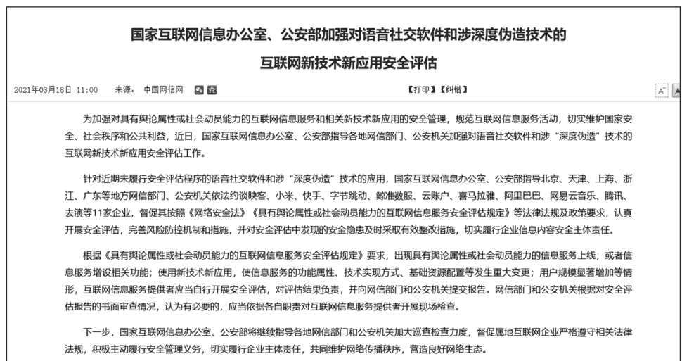

图3-8 加强对语音社交软件和涉深度伪造技术的互联网新技术新应用安全评估截图

### 3.3 海外监管样本

#### 3.3.1 欧盟
##### 1. 欧盟监管架构现状
欧盟在生成式人工智能监管方面尚未形成统一监管机构，但已推出一系列制度安排。根据《欧盟人工智能法案》，欧盟应设立欧洲人工智能委员会以履行生成式人工智能监管职能。2024年2月，欧盟委员会设立人工智能办公室，作为专业知识中心，构成单一欧洲人工智能治理体系的基础。

在过往实践中，欧盟也在探索相关机构。2023年4月13日，欧洲数据保护委员会表示正在成立专门工作组，以支持各成员国应对ChatGPT，促进合作与执法信息共享。2018年，欧盟委员会成立人工智能高级别专家组，为人工智能战略提供建议，该组主要承担咨询职能，不具监管权力，但为欧盟人工智能发展提供了重要智力支持。

欧洲AI：扶持与监管同步推进

布鲁塞尔在加码规则的同时，也在为本土创新开路。2024年1月底的公开信息显示，欧委会推出AI创新支持包，目的在于帮助欧洲初创与中小企业拿出可信赖的人工智能成果，详见 “Commission launches AI innovation package to support Artificial Intelligence startups and SMEs”，访问时间2024年2月19日，链接为https://digital-strategy.ec.europa.eu/en/news/commission-launches-ai-innovation-package-support-artificial-intelligence-startups-and-smes。2023年11月中旬，欧委会与欧洲高性能计算联合倡议EuroHPC JU联手，把欧盟世界级超算资源的开放范围扩大，让欧洲AI初创、中小企业乃至更广阔的开放社区都能用上算力，从而助推本土发展。详见 “The European High Performance Computing Joint Undertaking”，访问时间2024年2月19日，链接为https://digital-strategy.ec.europa.eu/en/policies/high-performance-computing-joint-undertaking。

##### 2. 生成式AI监管全景

欧盟对AI的治理逻辑是专项新法为主、既有规则为辅。核心新法是2024年3月13日生效的AI法案，它与GDPR、Data Act、DSA、DMA、数字单一市场版权指令等既有数据、个人信息和数字经济规则共同构成完整框架。

数据战略层面，《数据治理法案》和《开放数据指令》也在发挥作用，通过建立可信赖的数据再利用、共享与服务机制，为高质量数据驱动模型提供原料。

欧委会发布的《欧洲数字权利和原则宣言》详见“European Declaration on Digital Rights and Principles for the Digital Decade”，访问时间2024年1月17日，链接为https://eur-lex.europa.eu/legal-content/EN/TXT/?uri=OJ:JOC_2023_023_R_000。该宣言第三章第九条明确监管取向：人工智能应成为增进人类福祉的工具。AI法案作为“塑造欧洲数字未来”三大支柱的重要内容，其立场与宣言传递的数字十年政策高度一致。

下面先梳理法案的出台脉络，再简要回顾配套法规，帮助读者把握整体导向。

###### (1) AI法案的诞生轨迹

2021年4月，欧委会抛出提案草案。2022年在各方意见基础上进一步打磨。2023年6月，欧洲议会通过谈判授权草案。

2023年12月8日，三方谈判达成政治共识。详见“Commission welcomes political agreement on Artificial Intelligence Act”，访问时间2024年1月16日，链接为https://digital-strategy.ec.europa.eu/en/news/commission-welcomes-political-agreement-artificial-intelligence-act。2024年2月2日，欧盟27国代表达成一致。详见欧盟27国代表一致支持《人工智能法案》文本，访问时间2024年2月19日，链接为http://world.people.com.cn/n1/2024/0205/c1002-40173172.html。

2024年3月13日，欧洲议会在法国斯特拉斯堡全会以523票赞成、46票反对正式通过。

下文围绕法案对智能系统的界定、监管重点与适用范围、分级治理、违法后果逐一展开。

####### 1) 何为AI系统

为划定适用边界，法案第三条第一款给出界定。条款规定，AI系统是以附件一所列技术或方法开发的软件，能够针对预设目标生成内容、作出预测、提出建议，或影响其所处环境中的决策。

附件一列出的技术路径分三类：机器学习方法，涵盖监督式、无监督式、强化学习与深度学习；基于逻辑与知识的方法，如知识表示、归纳逻辑编程、知识库、推理与演绎引擎、符号推理及专家系统；统计方法，如贝叶斯估计、搜索与优化方法等。这些技术赋予系统学习与决策能力，使其可在多场景落地。

####### 2) 监管着力点与适用边界

法案第一条明确监管对象为在欧盟境内投放市场、投入使用或使用的主体。核心有两点：建立风险分层体系，明确禁止类应用，对高风险系统提出具体要求；对可能产生操纵风险的系统设定透明度规则，涵盖与自然人互动的AI、情感识别、生物特征分类，以及生成或操纵图像、音频、视频内容的系统。

法案第二条第一款规定适用范围：提供者无论设在欧盟或第三国，只要其产品在欧盟市场销售或使用；欧盟境内的使用者；在第三国设立的提供者或使用者，只要输出在联盟内使用。法案第二条同时列出豁免情形，包括专为军事目的研发或使用的系统，以及第三国政府机关、国际组织等。

为实现全链条监管，法案对产业链角色作出划分：提供商是指开发AI系统或以自有名称或商标投放市场的主体，自然人或法人、公共当局等，注《人工智能法案》第二条第二款，提供商中还包括小型提供商；用户指在授权下使用AI系统的自然人或法人等，但排除个人非专业活动，注《人工智能法案》第二条第四款；授权代表指在联盟内设立并获提供商书面授权的主体，注《人工智能法案》第二条第五款；进口商指将境外提供商的AI系统投放欧盟市场的主体，注《人工智能法案》第二条第六款；分销商指供应链中除提供商或进口商外在欧盟市场提供AI系统的主体，注《人工智能法案》第二条第七款；经营者为提供商、用户、授权代表、进口商和分销商的总称，注《人工智能法案》第二条第八款。各角色承担相应义务，形成闭环。

####### 3) 风险分层治理

法案设定了四档风险层级：不可接受风险、高风险、有限风险、极小或无风险。

图3-9 欧盟AI监管框架下的4种风险级别 详见AI Act，访问时间为2024年2月19日，链接为https://digital-strategy.ec.europa.eu/en/policies/regulatory-framework-ai。

**不可接受风险。** 法案第五条明令禁止的实践见表3-5。

表3-5 被明令禁止的人工智能实践

| 编号 | 范畴 | 说明 | 典型情形 |
| :--- | :--- | :--- | :--- |
| 1 | 操纵行为 | 利用个人潜意识或群体尤其是弱势群体的特性，实质性扭曲行为，导致心理或身体伤害 | 针对性操纵社交媒体内容以实现政治目标 |
| 2 | 社会评分 | 根据自然人社会行为或已知/预测特征进行可信度评估或分类，导致差别对待 | 以父母社会信用评分筛选儿童入学资格 |
| 3 | 公共场所生物识别限制 | 超出必要范围在公共空间以实时远程生物识别系统开展执法 | 商场装实时人脸识别摄像头用于客群营销 |

公共空间生物识别限制与Reclaim Your Face运动主张相呼应，该运动反对在公共空间大规模生物识别监控。但“必要范围”的表述仍为政府在特定情形下实施大规模监控留下空间，如何平衡隐私与安全仍是争议焦点。

**高风险。** 相关问题展开如下。

######## 问题1：哪些智能系统属于高风险？

依据法案第六条，高风险AI系统分两类。其一，AI作为需通过第三方事前合格评定的产品的“安全组件”，例如医疗器械、工业机械、玩具、飞机或汽车中的AI。其二，附件三列出的、影响基本权利的独立AI系统。附件三目前涵盖8大范畴，具体见表3-6。

表3-6 高风险AI系统分类表

| 编号 | 范畴 | 高风险使用目的 | 典型案例 |
| :--- | :--- | :--- | :--- |
| 1 | 生物识别相关 | 用于实时和事后远程识别自然人生物特征的AI系统 | 从互联网抓取面部图像构建或扩充人脸识别库 |
| 2 | 关键基础设施管理运营 | 用于道路交通管理及水、气、供暖、电力供应安全组件，一般用于网络安全目的 | 云安全计算中心的网络安全风险防控AI |
| 3 | 教育和职业培训 | 用于判定入学或分配、评估学生或入学测试参与者的AI系统 | 监控检测考试作弊的AI系统 |
| 4 | 就业、工人管理及自营职业 | 用于招聘筛选、面试评估、晋升或合同终止决策、任务分配及绩效行为监控的AI系统 | 简历筛选AI、企业内绩效评估AI |
| 5 | 基本私人和公共服务及福利获取 | 由公共当局使用的AI系统用于评估福利资格、授予或撤销福利；用于信用评估或评分的AI系统，除小规模自用外；用于调度或优先调度急救服务的AI系统 | 人寿和健康保险风险评估定价AI |
| 6 | 执法 | 用于个人风险评估、再犯罪预测、测谎或情绪检测、深度造假检测、证据可靠性评估、犯罪预测及人格特征分析、数据关联分析的AI系统 | 用作测谎仪的AI系统 |
| 7 | 移民、庇护和边境管控 | 用于情绪检测或测谎、风险评估、安全或非法移民或健康风险评估、旅行证件真伪验证、庇护签证居留申请审查的AI系统 | 审查庇护、签证和居留许可申请的AI系统 |
| 8 | 司法和民主程序 | 协助司法机构研究事实、解释法律并将法律适用于具体事实的AI系统 | 协助法院定罪量刑的AI审判系统 |

######## 问题2：高风险系统要满足哪些合规要求？

对已投放市场的高风险系统，结合法案第八至十五条，核心合规要点见表3-7。

表3-7 高风险AI系统基本合规要求

| 编号 | 合规域 | 合规控制点 |
| :--- | :--- | :--- |
| 1 | 贯穿全生命周期的风险管理体系第九条 | • 建立、实施、记录并维护与系统相关的风险管理体系 • 定期评估已知或可预见风险，包括合理可预见误用场景，并结合上市后监测数据动态评估新风险 • 考虑系统是否可能被儿童使用 |
| 2 | 数据治理第十条 | 训练、验证、测试数据的操作须遵循现行数据治理实践，事先评估数据集可用性，检查并降低偏差 |
| 3 | 技术文件制定与更新第十一条 | • 技术文件须包含附件所列要素 • 向主管机构和公告机构提供评估合规所需全部信息 |
| 4 | 日志记录与保存第十二条 | • 系统应具备自动日志记录能力，符合公认标准或通用规范 • 日志确保全生命周期可追溯 • 日志能力可监控运行，防止风险或重大损失 |
| 5 | 透明度与用户信息第十三条 | • 操作需足够透明，使用户能理解输出并正确使用 • 附带数字或其他形式使用说明，内容包括提供商及授权代表身份联系方式、系统特征能力及限制、预期目的、准确性稳健性网络安全水平、对基本权利风险、人工监督措施、维护保养等 |
| 6 | 人工监督便利第十四条 | • 提供合适人机界面，使自然人能有效监督 • 确保监督实施，使操作者能了解能力与局限、及时发现异常、避免自动化偏差、正确解读输出、在特定情况下不忽视或覆盖系统输出、能干预或通过停止按钮中断运行 |

AI安全底线与欧洲规则全景

高危等级人工智能体系应具备自修复与抗扰能力。面对人与系统或系统间交互引发的错误、故障、不一致，设计要能及时恢复。稳健性可通过技术冗余来强化，例如备份与故障安全预案。针对AI特有威胁，技术对策要涵盖训练集被恶意污染的防范、阻止操纵训练数据的攻击、抵御诱发模型出错的对抗输入，以及修复模型本身的结构缺陷。

高危等级AI全链条合规责任

《人工智能法案》对体系的提供方、部署方、进口方、经销方及使用者设置了差异化要求。

提供方与生产者要点
1. 合规可验证。依据表3-7标准确保高危等级体系达标，并能出示证明。
2. 质量管理书面化。以政策、流程、指令形式系统记录质量管理体系。
3. 风险通报与纠偏。发现体系不满足法规时应立即撤回、召回；涉及国家层面风险须向主管监管机构即时披露，而非先行自行纠偏。
4. 日志留存。保留体系自动生成的日志，日志需在提供方可控范围内。
5. 合格评定前置。投放市场或投入使用前完成相应合格评定。
6. 注册义务。在EU共建数据库中完成注册。
7. CE标识。体系上加贴CE合规标识。
8. 授权代表。境内无法确定进口方时须指定授权代表。

进口方责任。投放前须核查供应商已按第43条完成合格评定并备齐技术文件；确保产品带合规标识并附说明文件。若发现不合规，禁止投放。须按国家主管机构要求，用易懂语言提供证明体系满足表3-8所列要求的信息与文件。

经销方责任。需核验产品是否具备CE标识、是否附带文件与使用说明，且供应商与进口方是否合规。不符合法定要求的产品不得投放；发现表3-8情形时应及时纠正。同样须按主管机构要求提供易懂的合规证明材料。

使用者责任。按说明书操作，确保输入内容与预期用途相符。出现风险时应及时联系经销方寻求解决方案，以保障体系的安全、合规与有效使用。

4) 违法后果

《人工智能法案》第71条处罚力度极强：
① 违反禁止性行为或数据要求相关义务，最高可罚30 million euros或上财年全球营收6%，取高者。
② 违反法规其他要求或义务，包括通用人工智能模型规则，最高可罚20 million euros或全球营收4%。
③ 向公告机构及国家主管机构提供不实、不全或误导信息，最高可罚10 million euros或全球营收2%。

(2) GDPR

GDPR在2018年5月25日启动，统一欧盟成员国数据保护规则。欧盟据此设立独立机构欧洲数据保护委员会EDPB，保障规则一致适用。EDPB后续发布系列指南以明确适用边界，GDPR对全球数据立法产生深远示范。实施后欧盟各监管机关执法频现高额罚单。

(3) Data Governance Act

该法案在2022年6月23日启动，经过15个月过渡期后于2023年9月全面实施，是欧洲数据战略的支柱之一，旨在提升数据可用性与交换信任度，消除再利用技术壁垒，推动卫生、环境、能源、农业、交通、金融、制造、公共管理等领域建立共同数据空间。

三大亮点：明确公共部门掌握的受保护数据如商业秘密、个人数据、第三方知识产权数据的再利用方式与限制；确认数据中介服务在数据经济中的核心地位并制定可信赖的运作规则；法律层面创设数据利他组织并设注册机制，便捷实现数据共享。

(4) The Data Act

《关于公平访问和使用数据的统一规则的条例》在2024年1月11日启动，2025年9月全面实施。Data Governance Act规范自愿共享流程，The Data Act则界定谁能在何种条件下从数据中创造价值。

主要看点：互联产品须便于用户安全访问、使用和共享生成数据，特别在物联网领域赋予个人与企业访问使用IoT设备产生数据的权利；遏制妨碍公平共享的不公平合同条款，保护企业免受强势方不公条款；允许公共部门为特定公共利益目的调取私营部门数据，如应对公共紧急事件；促进客户在不同数据处理服务商间切换，建立数据互操作框架；审视数据库指令部分内容，关注独立数据库权在IoT生成数据的适用。

(5) Open Data Directive, ODD

《关于开放数据和公共部门信息再利用的指令》在2019年7月16日启动，取代公共部门信息指令，规范公共部门公开信息的使用。数据治理法案则针对受保护数据的利用。

亮点是高价值数据集须以机器可读格式免费提供，可通过API获取并支持批量下载，为社会经济带来高回报。

(6) Digital Services Act, DSA

与Digital Market Act共同构成欧洲数字服务一揽子计划，打造更安全可靠的数字空间。法规在2022年10月27日公布，主要条款在2024年2月17日启动，透明性报告等部分自2022年11月16日已启动。监管范围涵盖电商、社交、内容分享、应用商店、在线旅行住宿平台等，核心是强化平台内容审核责任，打击非法商家，提升算法推荐与定向广告透明度。

法案对中介服务做分层定义，包括管道、缓存、托管、在线平台、搜索引擎，并特别界定超大型在线平台与搜索引擎。各类主体承担相应义务，超大型平台责任最重。普遍义务包括指定联络点、法定代表等。托管服务须建立“通知—行动”机制，接收对非法内容通知后应及时、审慎、不武断作出处置。

(7) Digital Market Act, DMA

2022年11月颁布，引入“守门人”概念，针对在线中介、搜索引擎、社交、即时通讯、视频分享、虚拟助手、浏览器、云计算、操作系统、在线市场、广告等达到规模门槛的大型平台，进行反垄断式合规监管。

2023年9月6日，欧盟委员会指定Alphabet、亚马逊、苹果、字节跳动、Meta、微软六家为守门人，给予六个月过渡期落实合规义务。

(8) Directive on Copyright in the Digital Single Market

2019年3月通过。第3条允许研究机构或文化遗产机构为科研、数据挖掘目的复制或摘录其合法可访问作品，但一般不适用于商业化大语言模型。第4条为大模型训练阶段复制、提取版权作品提供合理使用例外，但限定作品类型与主题。

3. 欧盟与AI相关的典型执法案例或司法案例

现阶段欧盟与AI密切相关的执法多由各国数据保护机构依据GDPR作出，其中ClearView AI系列案具有代表性。

ClearView AI商业模式。公司从Facebook、Instagram、YouTube等公开社交平台抓取用户照片，构建据称达400亿张面部图像的数据库，宣称是已知最大库。产品以搜索引擎、API等形式向执法机关提供人脸识别服务，用于识别犯罪嫌疑人或受害者，客户包括美国FBI、国土安全部门及各州警局。

欧盟处罚进展：
1）法国CNIL罚20 million euros。2020年5月收到投诉后展开调查，与欧洲同行共享结果。2021年11月26日发出正式通知，要求停止无合法依据收集使用法国公民数据，尊重个人权利并执行删除请求。Clearview AI未回应，CNIL依据GDPR第83条处以最高20 million euros罚款，并要求停止处理并删除数据。
2）希腊DPA罚20 million euros。2022年7月13日认定其违反合法性与透明度原则，罚款20 million euros，禁止以人脸识别服务方式收集处理希腊境内数据主体个人信息，并令删除相关数据。
3）意大利SA罚20 million euros。2022年2月10日认定处理面部识别特征与地理位置信息缺乏法律依据，违反透明度、目的限制、存储限制等原则，罚款20 million euros，禁止抓取意大利境内个人面部特征及个人信息，要求删除已抓取信息并在意大利指定代表。

3.3.2 美国

1. 美国AIGC监管机构

美国尚未设立统一的AIGC监管机构，联邦层面以机构推动为主。
国家人工智能咨询委员会由商务部在2021年9月8日设立，为总统及联邦机构提供专业建议，2023年5月发布首份年度报告。
人工智能倡议办公室依据2020年《国家人工智能倡议法案》在2021年1月成立，协调联邦人工智能研发，不承担监管职能。
能源部人工智能与技术办公室与国家标准与技术研究院合作发布AI风险管理手册，2022年4月成立人工智能促进委员会推动技术创新。
美国专利商标局设立人工智能与新兴技术工作组，研究AI在专利商标审查中的应用及知识产权影响。

2. 美国AIGC法律法规

美国整体上以政策引导为主，立法相对分散，呈现地方化特征。联邦层面尚无专门统一法律，为各州立法留下空间。伊利诺伊、加利福尼亚、弗吉尼亚、纽约等州已出台相关法案，侧重点各异。监管思路偏向企业自律，2023年7月白宫宣布亚马逊、Anthropic、谷歌、Inflection、Meta、微软、OpenAI等多家领先企业同意对AI系统进行自我监管。

美英AI监管：分权弹性 vs 协同审慎

> 详见 “FACT SHEET: Biden-Harris Administration Secures Voluntary Commitments from Leading Artificial Intelligence Companies to Manage the Risks Posed by AI”，访问时间为2024年2月20日，访问链接为 https://www.whitehouse.gov/briefing-room/statements-releases/2023/07/21/fact-sheet-biden-harris-administration-secures-voluntary-commitments-from-leading-artificial-intelligence-companies-to-manage-the-risks-posed-by-ai/。这种监管方式的选择可能与美国在AIGC领域的头部企业数量众多有关。

从整体观察，华盛顿对人工智能的治理取向明显带有本土政策传统与市场结构的烙印。这样的组合在维持规则弹性、激发创新活力方面发挥作用，却也让如何在产业良性扩张与风险有效控制之间取得平衡，成为持续的考验。

###### （1）联邦层面立法

####### 国家战略与规划

2016年起，人工智能就被纳入美国国家层面的长期议程。当时，国家科技政策顾问办公室发布前瞻白皮书《为人工智能的未来做好准备》*Preparing for the Future of Artificial Intelligence*

> 详见 “Preparing for the Future of Artificial Intelligence”，访问时间为2024年2月20日，访问链接为https://obamawhitehouse.archives.gov/blog/2016/05/03/preparing-future-artificial-intelligence。

并同步推出《国家人工智能研究发展战略规划》*National Artificial Intelligence Research and Development Strategic Plan*，为后续研发方向与投入提供参考坐标。

数年后，监管指引再进一步。2022年10月，白宫公布《人工智能权利法案蓝图》*Blueprint for An AI Bill of Rights*

> 详见 “Blueprint for an AI Bill of Rights”，访问时间为2024年2月20日，访问链接为https://www.whitehouse.gov/ostp/ai-bill-of-rights/。

该文件以五项核心要义为骨架，配套实践建议，面向自动化系统的设计、使用与部署提供行为指引，意在确保AI时代公众权利得到切实保障。内容涵盖前言、原则阐释、应用说明及从原则到落地的操作路径，供政府与机构参照。

2023年2月，拜登签署《关于通过联邦政府进一步促进种族平等和支持服务不足社区的行政命令》，要求联邦部门在引入含人工智能的新技术时必须消除偏见、防范算法歧视，凸显官方对公平与透明的重视。

同年5月下旬，白宫发布修订版《国家人工智能研究发展战略规划》注。详见“NATIONAL ARTIFICIAL INTELLIGENCE RESEARCH AND DEVELOPMENT STRATEGIC PLAN 2023 UPDATE”，访问时间为2024年2月20日，访问链接为 https://www.nitrd.gov/national-artificial-intelligence-research-and-development-strategic-plan-2023-update/。新版强化跨部门协同与资源整合，标志联邦研发布局进入更注重整体统筹的阶段。

####### 相关法律

联邦层面目前并无统一的人工智能专项法，现行监管主要依托既有法规。实践中，《联邦贸易委员会法》第五条禁止不公平或欺诈行为的规定，成为规范AI和机器学习运用的主要抓手。《公平信用报告法案》与《平等信用机会法案》在生成式内容场景中亦具备约束效力。联邦贸易委员会据此发布阐释性文章并开展执法活动。注详见“Generative AI Raises Competition Concerns”，访问时间为2024年2月20日，访问链接为

###### （2）州层面的立法概况

州级治理大致呈现三种形态：隐私法中对AI处理行为如自动化决策的规制、特定领域的专项管控、设立专门工作组开展研究。以下结合典型州例说明美国州层面AIGC立法的图景。

在隐私立法覆盖AI数据处理方面，代表性文本包括《加州隐私权法案》《科罗拉多州隐私法案》《康涅狄格州数据隐私法案》《弗吉尼亚消费者数据隐私法案》等。

康涅狄格州于2023年5月通过《关于人工智能、自动决策和个人数据隐私的法案》，部分条款自2023年7月1日起生效。该法旨在提升州政府使用AI与自动决策工具时的公开性与责任承担，被视为里程碑式尝试。

部分州另设人工智能咨询机构以监督本州机构的开发、使用或采购行为，得克萨斯州为典型，北达科他州、西弗吉尼亚州亦有类似安排。

另有州对特定算法作特别规范。加州2023年1月在《商业和职业法典》增设第25章“自动决策工具”AB 331，要求开展影响评估并赋予消费者要求人工复核的权利；哥伦比亚特区2023年2月出台《停止算法歧视法案》，禁止算法基于受保护个人特征作出决策。

与此同时，路易斯安那州通过决议，要求技术与网络安全联合委员会研究AI对运营、采购与政策的影响；马里兰州设立工业4.0技术补助计划，支持中小制造企业应用AI等新技术与基础设施。

##### 3. 美国AIGC典型执法案例

美国人工智能相关执法主要由FTC推进，除前文提及的2023年7月对OpenAI的调查外，典型案例还有以下两例。

（1）FTC针对Ring公司的调查 详见“FTC Says Ring Employees Illegally Surveilled Customers, Failed to Stop Hackers from Taking Control of Users' Cameras”，访问时间为2024年2月20日，访问链接为https://www.ftc.gov/news-events/news/press-releases/2023/05/ftc-says-ring-employees-illegally-surveilled-customers-failed-stop-hackers-taking-control-users。

总部位于加州的Ring主营网络视频家庭安防摄像头、门铃及相关服务，2018年2月被亚马逊收购。公司长期以提升家庭安全与用户安心为宣传重点。

FTC指控其误导消费者：未有效限制员工与承包商访问用户视频；未经明确同意擅自利用视频进行算法训练；数据安全措施严重不足，在2018年1月前即对客户私人录像进行大规模人工审查，且在服务条款与隐私政策中隐瞒信息，单方面宣称录音可用于“产品改进与开发”。

2023年5月31日，Ring同意支付580万美金与FTC和解。FTC认定其隐私与安全实践构成欺骗，违反《FTC法案》第五条，尤其在将客户数据用于算法训练时未落实必要安全限制。和解要求Ring删除2018年3月前收集的全部录音及基于其开发的模型与算法，并建立全面隐私与数据安全合规体系。

（2）针对Amazon Inc. 和Amazon.com Services LLC的调查 详见“FTC and DOJ Charge Amazon with Violating Children's Privacy Law by Keeping Kids' Alexa Voice Recordings Forever and Undermining Parents' Deletion Requests”，访问时间为2024年2月20日，访问链接为https://www.ftc.gov/news-events/news/press-releases/2023/05/ftc-doj-charge-amazon-violating-childrens-privacy-law-keeping-kids-alexa-voice-recordings-forever。

亚马逊通过Alexa应用收集位置信息，并通过Alexa语音助手获取语音记录，同时面向儿童提供相关设备与服务并收集儿童个人数据包括录音。

亚马逊称保留儿童录音用于响应指令、供家长查看及提升语音识别能力。但因儿童发音与口音特征差异，长期保留的录音形成宝贵训练集，被用于优化Alexa对儿童语音的理解，实质以牺牲儿童隐私换取商业收益。

FTC认为其违反《儿童在线隐私保护法》COPPA Rule及《FTC法案》第五条。亚马逊同意支付2500万美金民事罚款，被禁止利用消费者要求删除的位置信息、语音数据及儿童语音数据创建或优化数据产品，并须删除不活跃儿童Alexa账户相关数据。

#### 3.3.3 英国

##### 1. 英国AIGC监管机构

英国尚未设立专属的人工智能监管机构，人工智能办公室The Office for Artificial Intelligence, OAI负责统筹相关事务，目前没有执法权。2024年2月，OAI并入科学、创新和技术部的人工智能政策局the AI Policy Directorate。

> 详见“Office for Artificial Intelligence became part of Department for Science, Innovation and Technology in February 2024”，访问时间为2024年2月24日，访问链接为 https://www.gov.uk/government/organisations/office-for-artificial-intelligence。

2023年11月2日，全球首个人工智能安全研究所 UK AI Safety Institute在英国成立，任务是测试新兴人工智能类型的安全性。详见“Introducing the AI Safety Institute”，访问时间为2024年2月24日，访问链接为https://www.gov.uk/government/publications/ai-safety-institute-overview/introducing-the-ai-safety-institute。

在实务中，依据OAI指引，人工智能监管由多个现有机构在其法定职责范围内共同承担，包括信息保护办公室ICO负责数据保护，平等与人权委员会EHRC关注算法偏见与不公平对待，就业部门标准检查局EAS监管AI在劳动用工领域的应用，金融行为监管局FCA聚焦金融服务中的AI使用，知识产权局IPO处理相关知识产权事项。

##### 2. 英国AIGC立法概况

英国尚未制定独立的人工智能规则或指南，但通过政策文件表达监管取向。2022年7月18日，政府发布《建立有利于创新的人工智能监管方法》，提出“支持创新”与“因案而异”原则。2023年3月29日，科学、创新及技术部发布《人工智能监管：有利于创新的方法》白皮书，进一步细化建议。

与欧盟《人工智能法案》不同，英国未创设新法，而是依托现有监管机构在其权限内发布指导，以保持监管弹性适应技术快速演进。

白皮书框架以五项原则为基础：安全与稳健、适当的透明度与可解释性、公平、问责与治理、可争议性与补救。目标是确保系统安全运行、提升透明度、防止不公平歧视与权利侵害、强化问责与治理、为受影响方提供质疑与救济渠道。

##### 3. 英国AIGC执法概况

在AIGC领域，ICO对Clearview AI的执法最具代表性。

2022年5月，ICO对Clearview AI作出高达7552800英镑罚款。认定其违反英国数据保护法：以不公平不透明方式处理英国公民信息，个人用户无法合理预期数据被如此使用；处理个人信息缺乏合法依据；未建立防止数据无限期保留的有效机制；生物识别数据保护未达高标准。依据GDPR与英国GDPR，面部识别特征属“特殊类别个人数据”，需更高保护。

[1] 详见“ICO fines facial recognition database company Clearview AI Inc more than £7.5m and orders UK data to be deleted”，访问时间为2024年2月24日，访问链接为https://ico.org.uk/about-the-ico/media-centre/news-and-blogs/2022/05/ico-fines-facial-recognition-database-company-clearview-ai-inc/。

Clearview AI提出申诉，一级法庭推翻ICO通知，认为ICO缺乏管辖权。

[2] 详见“Clearview AI Inc v The Information Commissioner:Clearview AI successfully overturns ICO fine”，访问时间为2024年2月24日，访问链接为https://www.shlegal.com/insights/clearview-ai-inc-v-the-information-commissioner-clearview-ai-successfully-overturns-ico-fine。

目前ICO正寻求对一级法院裁决提起上诉的许可。

[3] 参考信息：Information Commissioner seeks permission to appeal Clearview AI Inc ruling，查询日期 2024 年 2 月 24 日，链接 https://ico.org.uk/about-the-ico/media-centre/news-and-blogs/2023/11/information-commissioner-seeks-permission-to-appeal-clearview-ai-inc-ruling/。

#### 3.3.4 新加坡：多头协同的治理版图
##### 1. 谁在负责监管
新加坡没有为 AIGC 或人工智能单独设立监管部门，相关职能分散在现有的专业机构中，主要包括：

- (1) 资讯通信媒体发展局 IMDA
IMDA 隶属于通讯及新闻部，是数字经济落地执行的牵头单位。核心工作是帮助企业把握数字化机遇、推动跨行业跨区域的数字产品与服务合作、强化新加坡市场竞争力，同时承担人才培养与通信领域必要的监管。当前与 AI 关系密切的治理框架与工具包，多半出自该局参与制定。

- (2) 智慧国家和数字政府办公室 SNDGO
SNDGO 挂靠总理公署，负责国家级智慧国项目的统筹与政府数字化转型的推进。其下属的国家人工智能办公室致力于规划国家 AI 发展议程，并搭建跨界交流与协作平台。

- (3) 个人数据保护委员会 PDPC
PDPC 自 2013 年起承担个人数据保护主责，引导组织遵守《个人数据保护法》，在 AIGC 执法链条中扮演关键角色。

此外，2018 年新加坡还设立了人工智能与数据伦理使用咨询委员会。

> 参考 Composition of the Advisory Council on the Ethical Use of Artificial Intelligence ( ‘AI’ ) and Data，查询日期 2024 年 2 月 24 日，链接 https://www.imda.gov.sg/resources/press-releases-factsheets-and-speeches/archived/imda/press-releases/2018/composition-of-the-advisory-council-on-the-ethical-use-of-ai-and-data。

该委员会向政府提供私营部门在数据驱动技术应用中涉及的伦理、政策与治理方面的建议，同时为企业提供通用指引，帮助降低可持续性风险并减少技术对消费者的负面影响。需要强调的是，其定位仅为咨询，不具备执法权限。

##### 2. 立法与框架的演进
新加坡迄今没有出台统一的人工智能成文法，治理更多体现在框架与实践层面。IMDA 推出了 AI Verify 治理评估框架与配套软件包，底层基于 11 项 AI 伦理原则，并与国际主流框架保持衔接。组织可借助标准化测试，检验自有 AI 系统是否符合原则要求。详见 Singapore's Approach to AI Governance，查询日期 2024 年 2 月 24 日，链接 https://www.pdpc.gov.sg/help-and-resources/2020/01/model-ai-governance-framework。

2019 年 1 月，IMDA 与 PDPC 在达沃斯世界经济论坛期间联合发布《人工智能治理模型框架》第一版，为企业提供系统化的伦理与治理指引，提升公众信任。2020 年 1 月的第二版在可操作性上做了强化。

配套的《组织实施与自我评估指南》围绕框架的 4 个核心维度，给出覆盖 5 个层面 60 余条自评问题的清单，便于落地。同期发布的《人工智能治理案例汇编》则通过真实机构的实践案例，示范如何与框架要求对齐，供行业参考。

#### 3.3.5 加拿大：隐私驱动的监管实践
##### 1. 执法主体概览
加拿大同样未设立 AIGC 专属监管机构，相关执法主要由加拿大隐私专员办公室 OPC 承担。

##### 2. 立法进展
2019 年联邦政府发布《加拿大数字宪章》，确立以人为本、隐私受保护、创新以数据驱动为核心的原则，为后续规则铺路。

> 参考 Canada's Digital Charter，查询日期 2024 年 2 月 24 日，链接 https://ised-isde.canada.ca/site/innovation-better-canada/en/canadas-digital-charter-trust-digital-world。

2022 年 6 月，联邦提出《2022 年数字宪章实施法案》，意在更新私营部门个人信息保护框架，并为 AI 开发与部署设定规范。法案计划推动三项联邦立法：《消费者隐私保护法》《个人信息与数据保护法庭法》以及备受关注的《人工智能与数据法》AIDA，目前仍在审议阶段。

AIDA 的适用范围覆盖在国际或省际贸易与商业活动中设计、开发、提供或使用的 AI 系统。草案对 AI 系统的定义为：借助遗传算法、神经网络、机器学习等技术，对与人类活动相关的数据进行处理时，能够自主或半自主地生成内容、作出判断、提供建议或进行预测的技术系统。针对高影响力系统，法案提出额外监管要求。

2023 年 9 月，创新、科学与工业部长 François-Philippe Champagne 公布《先进生成式人工智能系统负责任开发与管理自愿行为准则》，在正式监管落地前为企业提供通用行为标准，鼓励自愿合规。

联邦还发布了《生成式人工智能使用指南》及配套文件，聚焦系统影响评估、透明度、可解释性、源代码与训练数据共享、用户培训、伦理合法使用、风险评估、安全与治理等议题。

##### 3. 执法案例
除 OpenAI 相关行动外，OPC 对 Clearview AI 的监管是 AI 领域的典型。

2021 年，OPC 调查 Clearview AI 在加拿大使用面部识别技术的行为，认定其在未获得有效同意的情况下采集、利用并披露个人信息，该做法“不适当且不合法”。参考 Clearview AI ordered to comply with recommendations to stop collecting, sharing images，查询日期 2024 年 2 月 24 日，链接 https://www.priv.gc.ca/en/opc-news/news-and-announcements/2021/an_211214/。Clearview 对结论提出异议，最终退出加拿大市场。

#### 3.3.6 韩国：渐进式治理探索
##### 1. 监管架构
韩国没有专门的 AIGC 监管部门，但在 AI 与隐私保护上的动作明显。2023 年 10 月 30 日，个人信息保护委员会举办“人工智能与隐私公私政策委员会”成立仪式。该机构是 8 月发布《人工智能时代个人数据安全使用政策指引》后的跟进措施，由 32 名来自学界、法律界、产业界与民间社会的专家组成，参与监管政策研讨，不具备监管权限。参考 Public-Private Policy Council Launched for Developing Artificial Intelligence Governance Framework，查询日期 2024 年 2 月 24 日，链接 https://www.pipc.go.kr/eng/user/ltn/new/noticeDetail.do。

##### 2. 立法审议
2023 年 2 月 14 日，国会科学、信息通信技术、广播与通信委员会通过了关于制定《人工智能产业促进法和建立可信赖人工智能框架》的建议立法，即《韩国人工智能法》，距离全体表决仅一步之遥。若获通过，将成为韩国 AI 行业的首部基础性法规。

该法旨在为安全可靠的 AI 系统开发与使用提供制度基础，明确发展方向，保障公民权利、利益与尊严，提升生活质量。监管思路与欧盟《人工智能法案》相近，采用分级分类管理，将 AI 划分为禁止类、高风险类、低风险类，并对除禁止类外的系统建立事前许可或事后监管机制。

##### 3. 执法行动
与 AIGC 关联最紧密的执法主体仍为韩国个人信息保护委员会。典型案例为 ChatGPT 监管。2023 年 7 月 27 日，PIPC 宣布因 OpenAI 的 ChatGPT 服务发生个人信息泄露，对其处以 360 万韩元，约合 3,000 美元罚款，并发布违反《个人信息保护法》的情形清单，涉及透明度、处理合法依据缺失即未经同意、控制者与处理者关系不明等问题。

## 第4章 大模型冲击下的知识产权合规图景
大语言模型的爆发让 AIGC 以惊人的创新力重塑产品体验，但每一次技术跃迁都伴随法律适用的阵痛。AIGC 的研发与应用牵动法律关系重塑，科技与法律始终在动态中寻求平衡。自动售货机的出现曾让人重新思考买卖合同中要约承诺的成立时点；电商的兴盛推动平台与商家在消费者权益保护中的责任边界厘清；自动驾驶的演进持续挑战交通法规、责任认定与保险制度。

如今 AIGC 登场，法律冲击最集中的是知识产权领域。知识产权法在科技驱动下不断壮大，正面临 AIGC 带来的新考验。本章围绕著作权、开源软件、专利权、商标权与商业秘密，剖析技术冲击下涌现的法律问题，结合典型案例与合规建议，探讨技术与法律协同共生的路径。

### 4.1 著作权边界的再审视
#### 4.1.1 著作权基本框架
在讨论 AIGC 与著作权关系前，先回顾版权的核心要义。著作权法旨在保护独创性表达，关键在于“作品”的认定。《中华人民共和国著作权法》第三条规定，作品是指文学、艺术和科学领域内具有独创性并能以一定形式表现的智力成果，包括文字、口述、音乐、戏剧、曲艺、舞蹈、杂技、美术、建筑、摄影、视听、工程设计图、产品设计图、地图、示意图、模型、计算机软件等。作品要件可归纳为：属于文艺科领域、具备独创性、以特定形式呈现、属于智力成果。其中独创性最关键，要求独立完成并体现作者的独特思考与表达；智力成果则强调自然人智力投入。

著作权法赋予创作者人身权与财产权，涵盖发表权、署名权、复制权、发行权、信息网络传播权等，以保障经济回报与精神认可。典型侵权包括未经许可复制、发行、表演、放映、广播、汇编、网络传播等，也包括非法删除或篡改权利管理信息的行为，判断时需结合法律与行政法规的特别规定。

#### 4.1.2 生成内容能否纳入著作权保护
回顾 2023 年，AIGC 在文生文与文生图领域实现快速突破。年初时，专业人士仍可依据人物手部细节、面部自然度等特征辨别 AI 生成图像，到年终这种区分手段基本失效，AI 图像与人工创作在视觉上难以分辨。

以美术作品为例，探究文生图场景下产出的图像是否满足著作权法保护要求。核心在于判断生成物是否具备作品构成要件，即独创性与智力成果性。

##### 1. 独创性要件的拆解
《著作权法实施条例》第四条将美术作品定义为以线条、色彩等方式构成的、具有审美意义的平面或立体造型艺术作品。独创性包含“独”与“创”两层意涵：“独”指独立完成，非抄袭；“创”指创作性的智力投入。

在文生图应用中，用户通过提示词、参数调节与 AI 交互，最终获得具审美价值的图像。“独”的要求可被满足，关键在“创”是否成立。《著作权法实施条例》第三条第一款指出，创作是指直接产生文学、艺术、科学作品的智力活动。文生图流程中，用户输入提示词与参数，经 AI 按既定算法生成图像，人机交互程度不一。

从一种视角看，用户提示可类比委托创作中的需求说明。此时图像由 AI 程序生成，用户的行为不构成著作权法意义上的创作。

从另一种视角看，若将整个交互视为统一过程，用户构思画面、撰写提示词、对 AI 输出进行针对性反馈并多次调整参数直至满意，则可视为用户的智力活动直接促成画作完成。在此理解下，AIGC 被视作创作工具，其贡献被纳入用户的整体贡献中。

美国版权局对提示词的定位很克制

美国版权局在相关说明中更接近第一种观察视角。它认为，让Midjourney跑图的用户，并没有真正“造出”那张图。文字指令固然会对模型产出产生影响，但决定不了最终长什么样。指令所要的画面和模型实际吐出的画面之间存在明显落差，使用者对结果的掌控有限，也很难预判模型会给出哪一张具体内容。换句话说，从Midjourney的生成流程看，特定指令并不能稳定得到特定图像。这时输入框里的文字更像是一种“建议”，而非“命令”，其功能近似于雇主向画家提出一个概括性的创作方向。王迁在《再论人工智能生成的内容在著作权法中的定性》《政法论坛》2023年第4期中也论述了这一观点。该立场凸显了AIGC系统在成图环节的主导性。

2. 提示词算不算智力成果

文生图场景里用户确实动了脑，但这是否就能让生成物自动成为智力成果？必须回到著作权法的底线：保护表达不保护思想，即思想与表达二分。我国《著作权法》第一条明确立法是为了保护作者权、鼓励创作与传播，推进精神文明与科学事业。若把思想本身纳入保护，后来者将被堵住，文化与科学也难以进步。

二分法在理论上清晰，实践中划分却不易。以软件著作权研究为例，从创意与目的出发，经过概要设计、详细设计，最后落到代码，起点属思想，终点属表达。何处划界，需要案例对照。关键在于，思想是不确定的，表达是确定的。同一思想可有多种表达，每一种受保护的表达都必须是具体可感的。在文生图里，用户提交的提示词与参数在不同软件、不同设备上会呈现出迥异的画面，这说明提示词并不能锁定最终画面的具体表达。相较于成图，提示词更接近思想层面，而非著作权法意义上的智力成果。

由此可推得：AIGC生成物在著作权法上通常不构成作品。原因是其中人类的智力活动多停留在思想阶段，未直接决定生成物中的具体表达要素。对此学界也做了延伸讨论。

其一，是创作工具说。有观点把人机交互视为整体，认为AI虽比传统工具智能，却仍是创作工具。用户通过反复修正指令、对结果进行挑选与判断，实现个性化表达，技术参与并不改变定性。
其二，实践中用户常会在初步成图后，用Photoshop等工具调整色彩、构图或增添元素。这种后续智力投入直接作用于表达性要素，使图片具备作品的可保护性，AI参与并不妨碍认定。
其三，不同产品的交互深度与用户控制力各不相同，需要具体判断用户的贡献是否达到著作权法要求的创作门槛。

4.1.3 AIGC链条上的侵权风险

1. 训练阶段的数据风险

模型训练的核心风险在数据获取与使用。AIGC需要海量数据训练，而数据中极可能包含在版作品。未经授权直接使用，就会在训练过程中产生对原作品的复制，进而构成侵权。数据常来自公开网络或第三方平台，如何保证合法与安全难度很大。

我国《著作权法》对复制权的定义包括印刷、复印、录音、录像、翻录、翻拍、数字化等方式。AIGC训练中的复制在形式上符合该定义，但目的与常规复制差异显著。常规复制是为再现、欣赏表达性要素；训练中的复制更接近日本法上的“非表达性利用”。其要义有两点：一是利用目的非为享受作品的思想或情感，而是信息分析，且在必要范围内不致对权利人利益造成不当损害；二是电子计算机处理过程中，人类无法感知识别的利用也属于该范畴。广义看，训练中的复制是机器学习的必要步骤。就像人在图书馆阅读并不构成复制也不需授权，机器学习中的复制是否应作为例外对待，而非一律要求事前授权，值得探讨。

此外，《著作权法》第四十九条规定权利人可采取技术措施，任何组织或个人不得故意规避或破坏技术措施，也不得为他人规避提供便利。

2. 生成物阶段的相似性考量

生成阶段常被问及的是生成内容与原作的实质性相似，相似的程度与性质是判断侵权的关键。以文生图为例，模型经过重构、扩散、去噪、编码等复杂处理，生成结果与某一张特定作品高度重合的概率理应很低。英国萨塞克斯大学Andrés Guadamuz教授即持此看法，其论文“Do androids dream of electric copyright? Comparative analysis of originality in artificial intelligence generated works”刊于Intellectual Property Quarterly 2017年第2期。

但也有相反研究。马里兰大学与纽约大学团队针对Stable Diffusion等扩散模型实验发现，生成内容与训练集作品相似度超过50%的概率约为1.88%。考虑到用户基数庞大，该风险不可忽视。研究者指出，实验仅检索了1200万张训练图像，仅占整体很小一部分，且检索方法本身存在盲区，因此实际复制量可能被低估。研究还配有对比图示，如图4-1所示。

图4-1 AI生成与真实图像对比

需要留意三点。其一，著作权侵权的判断标准是“接触+实质性相似”，原告需承担举证责任，后续典型案例显示举证并不容易。其二，随着算法迭代与数据增多，单个作品在生成物中的权重会下降且难以量化，侵权概率可能进一步降低。其三，生成物能否成作品与生成物是否侵权是两个独立问题。即便生成物不构成作品，也不妨碍其涉及对他人作品的侵权，两者应分别讨论。

3. 其他风险：AIGC被滥用带来的扩散

技术进步改变了创作与传播方式，为创作者带来便利，也带来新挑战。部分不法分子可能未经许可利用AIGC大规模复制、分发他人作品，侵害作者合法权益，破坏市场秩序与创作生态。AIGC的高效与隐蔽性使侵权更难发现与追责。

享受便利的同时，必须警惕风险。只有强化监管执法，提升创作者与公众的保护意识，才能遏制滥用，维护公平有序的创作传播环境。

4.1.4 典型案例分析

1. 美国版权局的态度——《黎明的扎里亚》登记案

访问时间2024年2月26日，访问链接为https://www.copyright.gov/docs/zarya-of-the-dawn.pdf。

人工智能在艺术领域的应用日益广泛，版权问题随之变得复杂。2023年，18页漫画《黎明的扎里亚》在美国版权局引发争议。该书由Kris Kashtanova借助Midjourney生成图像，最初未披露创作方式而获登记。后因在社交媒体公开流程，版权局重新审查。

版权局认为，使用Midjourney的用户无法预判输出结果，这与传统艺术家对创作材料的掌控有本质区别。艺术家在用编辑工具时，会挑选视觉材料、决定工具与修改方式，并逐步控制最终图像。Midjourney用户对初始图像或最终图像没有明确控制权，因而Kashtanova需花费一年以上、生成数百张中间图才得到满意结果。AIGC由算法与数据驱动，从著作权法看，其内容不属于人类个性化表达，缺乏独创性。

但这不等于全书无保护。版权局明确，单张AI图可能不可保护，但用户通过挑选、编排图像并加入文字，可形成具有独创性的整体作品。《黎明的扎里亚》虽图由AI生成，作者通过精心编排与文字加入，使整本漫画具有独特创意与表达，故整体仍可登记。

案例提示：在人工智能时代，需重新审视著作权规则，法律应与时俱进。

图4-2 《黎明的扎里亚》作品示例

2. 中国文生图首案

详见《“AI文生图”著作权案一审生效》，访问时间2024年2月25日，访问链接为https://mp.weixin.qq.com/s/AzhPYHqLCCXiWwL2AuKjnw。

北京互联网法院于2023年11月27日审结该案，判决已生效。原告李某某利用Stable Diffusion并通过精心设计的提示词，生成人物图片《春风送来了温柔》，发布于网络平台。被告刘某某未经许可将该图用于其账号文章配图，被诉侵害署名权与信息网络传播权。

法院提出两点核心观点：
1) 使用人工智能模型生成图片，本质仍是人借助工具创作。著作权制度的核心是鼓励创作。法院认为生成式AI改变了创作方式，类似照相机的出现。技术越发展，工具越智能，人类投入相对减少，但这不影响继续以著作权制度鼓励创作。
2) 在当前技术现实下，只要AI生成图片体现出人的独创性智力投入，就应认定为作品并受保护。法院认定原告是根据需求对模型进行设置并最终选定该图的人，图片基于原告智力投入产生并体现个性化表达，故原告为作者，享有著作权。

关于独创性，判决指出：原告虽未亲手描线、未百分百告知模型如何作画，但其通过提示词设计人物与呈现方式，通过参数设置画面布局，体现了选择与安排；从首图到定稿的反复增补、修正过程也体现审美选择与个性判断。

关于智力成果，判决指出：AI可根据文字描述生成图片，代替人类画线、上色，将创意具象化。从构思到选定，原告投入了智力：设计呈现方式、挑选提示词、安排顺序、设置参数、选定符合预期的图像。图片体现了智力投入，故具备智力成果要件。

该判例为AIGC生成物提供重要保护，主审法官强调法院对新技术的积极态度，鼓励实践。但判决亦明确仅具个案意义，不能推及所有AIGC生成物均构成作品。每个作品的独创性与思想表达界限仍需个案判断。

图4-3 本案所涉图片

AI生成作品能否得到法律承认？从意大利、美国、中国三地近期裁判看出的态度

2023年1月，意大利最高法院对一起数字影像著作权再审申请作出说明，身后案情与本文要讨论的争议相近。案中建筑师 Chiara Biancheri 称其作品《夜的芬芳》被意大利国家广播电视台用在音乐节舞台布置上。地面审和上诉审均认定创作者拥有权利并判令赔偿，电视台不服请求最高审再审。

当时 AIGC 尚未像今天这样普及，涉案画面确系由电脑程序的复杂运算产出。再审理由强调，一审二审把程序算出的画面直接当作受保护的智力成果是错误的。权利人所称的是一幅以花卉为主题的数字画面，呈现分形特征，即在不同尺度上重复相似形体。此效果完全由软件通过数学运算处理形态、色彩与细节得到。对此，所谓的作者仅是挑选了运算工具并认可了最终结果。

最高法院对上述说法明确回应：创作环节借助软件本身并不足以否定创造性。关键在检验使用者在工具介入时注入了多少个人独创性。若审查确认人在内容形成上起到必须的驱动作用，例如有意识地操控、引导并修正生成系统的产出，那么这类借助生成系统的做法应被视作人类创作流程的一部分，其产出理应获得法律承认。创作中的个人构想、提示词输入以及其他智力付出，构成了思想的个性化表达，应当受保护。

图4-4 上述意大利案件中所涉图片

##### 3. 美国三位绘者联名诉三家图像生成平台的争议
详见 “Andersen v. Stability AI Ltd.”，访问日期为2024年2月24日，访问链接为 https://storage.courtlistener.com/recap/gov.uscourts.cand.407208/gov.uscourts.cand.407208.119.0.pdf。

绘者 Sarah Andersen、Kelly McKernan 与 Karla Ortiz 向 Stability AI、Midjourney、DeviantArt 等平台提起诉讼，在美国引发广泛讨论。公开文件显示，主张包含多项指控。

其一，声称平台未经许可抓取并存档原创作品，侵害了复制、传播等权利。其二，主张平台将作品用于训练图像生成模型，既利用了表达，又将其转化为商业收益，损害了创作者利益。其三，主张违反《数字千年版权法》，即在利用作品时非法移除或篡改版权管理信息。其四，主张公开权受侵害，模型可按用户提示生成特定人物“风格”的画面；同时主张不正当竞争，可能违反《拉纳姆法》及加州相关规定，扰乱市场公平。

总体看，本案涉及第一层侵害、间接侵害、DMCA 问题、公开权与不正当竞争等复杂议题，其结果对创作者权益、市场秩序以及生成技术的合规应用具有指示意义。

案件由美国加州北区地方法院审理，对主要请求作出如下判断：

- 1) 驳回针对 DeviantArt 与 Midjourney 的第一层侵害主张。审判机关认为主张人未提出合理事实证明 DeviantArt 在抓取和用于训练图像中发挥积极作用，也未提供 Midjourney 训练过程的具体事实。
- 2) 仅保留对 Stability AI 的第一层侵害主张。审判机关认为焦点在于 Stability AI 创建和使用从网络抓取的“训练图像”数据集，需要进一步举证。
- 3) 驳回对 DeviantArt 与 Midjourney 的间接侵害主张。第一层侵害不成立，间接侵害亦不成立。
- 4) 不构成 DMCA 违规。主张人未能指认具体被删除或更改的版权管理信息类型。
- 5) 不存在公开权侵害。诉状缺乏具体事实证明任何被诉方利用主张人姓名为 DreamStudio、DreamUp 或 Midjourney 产品宣传、销售或招揽。
- 6) 不存在不正当竞争。相关主张因受美国《版权法》优先权限制而被排除。
- 7) 准许主张人修改诉请，以进一步明确各被诉方如何分别侵害版权、删除或更改版权管理信息、侵害公开权的合理事实。

本案体现审判机关审慎权衡的立场。维权一方须承担较高的举证责任，必须证明作品原创性、被诉行为存在及实际损失等。目前同类案件仍在进行中，权利人通过诉讼探求司法态度，以期获得保障。判决不仅关乎个体创作者，更涉及生成技术合理应用与创作者权益保护的平衡。如何在鼓励创新与维护权益之间找到分寸，成为司法难题，未来裁判或将逐步完善该领域的法律适用。

##### 4. 中国生成式内容平台责任首例判决
指（2024）粤0192民初113号案，广州市互联网法院于2024年2月8日作出一审判决，上海新创华文化发展有限公司诉某 AI 公司侵害奥特曼形象版权案。

该案被视为生成式平台责任的首例，因而判决公开后备受关注。阅读后有两点印象：审理速度极快，自2024年1月5日立案到2月8日判决，且因双方未上诉，一审已生效；第二，裁判理由简洁明了，未做过多延伸论证。

案情概要：权利人系奥特曼系列作品独占被许可人，权利归属日本圆谷制作。被诉方通过 API 调用大模型服务，让用户输入“生成奥特曼”等提示词，产出与奥特曼形象相符或具局部特征、特殊风格的画面。权利人变更请求，主张侵害复制、改作及信息网络传播权，要求停止侵害、删除训练数据并赔偿。

法院认定被诉方构成侵害。生成式产出与奥特曼相似的画面被视为非法“复制”，基于奥特曼元素再创作的画面被视为非法“改作”。判决禁止被诉方生成与涉案作品实质性相似的画面。法院未支持删除训练数据的请求，因被诉方并未参与模型训练。赔偿数额为1万元。

生成的奥特曼与原形象对比如图4-5所示。

笔者认为该判决对生成式技术侵害风险的分析代表性有限。本案被诉方并非大模型训练者或开发者，仅以接口调用方式提供第三方文生图功能。对判决可从三方面审视：

第一，被诉方被认定侵害复制与改作的性质。判决主要依据权定义及生成画面与原作对比，部分画面实质性相似，部分在保留原作独创性表达基础上形成新特征，从而认定直接侵害。但需注意，侵权画面的产生涉及 AI 提供方与用户提示行为。法院在论及关键词过滤等防范措施时，将被诉方定性为平台服务商并引入网络侵害中常见的“通知—删除”逻辑，使得论述逻辑不够清晰。

关于 AI 提供方的侵害防范，OpenAI 的做法可供参考。引用林华微信公众号文章《从第一案抢跑看OpenAI vs. Journalism的未来》，2024年3月13日17:01发布于其同名微信公众号。中的两个实例，如图4-6和图4-7所示。

迪迦奥特曼复合型

生成的主要案涉图片

| a) | b) |
|---|---|
| c) | d) |
| e) | f) |
▲图4-5 生成的奥特曼与奥特曼原形象对比（来源：21世纪经济报道）

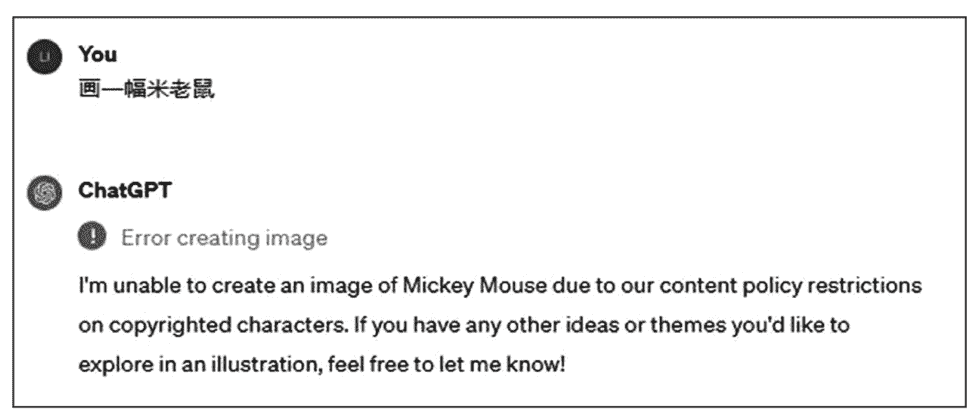

▲图4-6 要求ChatGPT画米老鼠

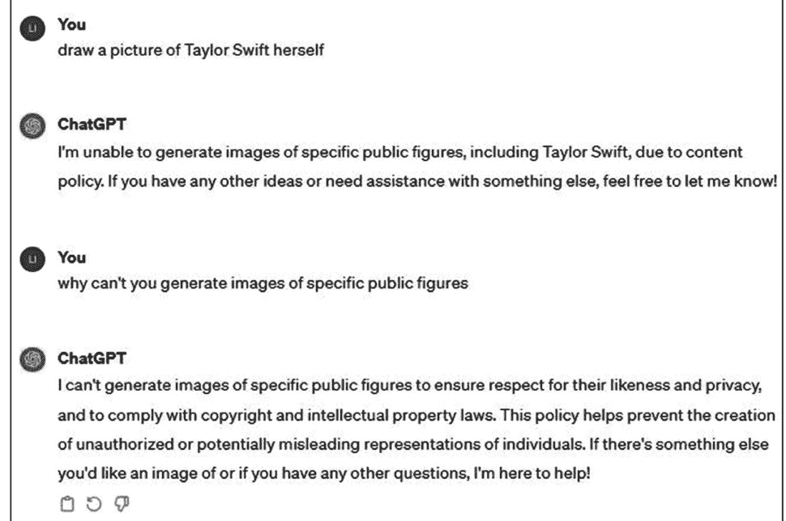

▲图4-7 要求ChatGPT画当红歌手Taylor Swift

第二，审判机关对信息网络传播权的态度及其与复制、改作的关系。本案法院明确，对已被认定侵害复制、改作的同一行为不再重复评价是否侵害信息网络传播权。事实部分显示，涉案画面由简单自然语言指令生成，未涉及复杂参数设置或多次优化。不同用户可能获得不同且不特定的产出。若用户仅在网站生成画面而未进一步传播，则不满足“公众可在其选定的时间和地点获得作品”的核心要件。因此在此场景下，即便构成著作权侵害，也不宜认定为信息网络传播权侵害。

第三，法院认定被诉方存在过错的依据及与《版权法》的契合度。判决援引了2023年国家网信办等七部门联合发布的《暂行办法》多项条款，认为被诉方未建立健全投诉举报机制、《暂行办法》第十五条；未向用户进行潜在风险提示、《暂行办法》第四条；未对生成内容进行显著的标识、《暂行办法》第十二条，因而未尽合理注意义务。笔者认为，《暂行办法》系行政监管指引，直接作为著作权侵害主观过错依据逻辑不充分。若按此逻辑，只要履行了上述管理义务即推定无过错，则忽视了具体案情、被诉方角色、行为方式、侵害后果等综合判断因素，难以简单等同行政合规与侵权责任。

总体而言，该案判决对生成式内容著作权侵害风险的分析典型性不足，其涉及的是通过接口调用第三方文生图功能的特定场景，而非核心训练与开发。直接侵害与间接侵害的界限、平台责任的划分、过错认定等问题仍需未来实践进一步阐释。

#### 4.1.5 小结
##### 1. 关于防范侵害的建议
- (1) 对内建立严格的数据使用与管理规范
训练模型时应遵循数据提供方的使用条款，遵守数据获取与使用的法律法规，加强数据集安全管理，采取技术与组织措施防止泄露、滥用及未经授权访问。
- (2) 对外建立积极的合作与沟通机制
与权利人及其他相关方建立良好沟通，为权利人提供便捷主张渠道，知悉侵害后及时停止。并与产业链上下游共建行业自律标准，推动技术合理使用与产业健康发展。
- (3) 利用技术手段加强内容监测与审查
建立监测机制，对生成式内容产出实时审查，结合先进技术与专职人员，降低侵害风险。
- (4) 审慎对待生成式产品的用户协议
使用第三方生成式技术时应细致审查用户或服务协议中权利义务、生成物归属、责任承担等条款。自建产品时应法务与研发协同，制定针对性协议，避免套用模板带来法律风险。
- (5) 强化法律合规意识与培训
定期开展法律培训，提升员工在生成式技术使用中的合规意识，确保遵守许可协议、法律法规及企业制度，降低不当行为引发的风险。

##### 2. 技术与法律碰撞的展望
随着广义 AI 技术崛起，工业4.0 时代到来，作品创作与传播方式被深刻改变，法律领域亦出现多重碰撞。分享两点体会。

其一，新技术成果是否受版权保护。我国《版权法》于1990年9月7日通过。以摄影作品为例，《版权法实施条例》将其定义为“借助器械在感光材料上记录客观物体形象的艺术作品”。国际上，《伯尔尼公约》与《世界知识产权组织版权条约》均涉及摄影作品保护。历史上曾有观点认为摄影仅是客观记录，不具创造性，不应受保护；也有观点强调摄影中蕴含拍摄对象、角度、光线、后期等作者选择与创意，应予保护；另有观点认为其创造性低于文学艺术，不应同等保护。

这种分歧在1884至1886年伯尔尼公约外交会议上曾激烈讨论，未达成一致，直至1948年公约才明确纳入摄影作品。1996年《世界知识产权组织版权条约》缔结后，摄影作品在国际框架内获得与其他作品同等地位。这一过程说明，将摄影纳入版权保护是在充分争议后达成的共识，既认可摄影产业发展，也坚持鼓励创新的原则。

其二，新技术下产业模式剧变，如何平衡权利人权益与产业发展。以视频网站为例，2005年国内兴起，内容从PGC转向UGC。UGC 质量参差，平台常被担忧成为盗版温床。维权时权利人多起诉平台运营者，主张信息网络传播权。

《信息网络传播权保护条例》规定，信息网络传播权是指以有线或无线方式向公众提供作品，让公众可在其选定的时间和地点获得作品的权利。条例于2006年7月1日起施行，2013年3月1日修订。核心在于控制“公众可在个人选定时间地点”获取作品，这正是视频网站传播的主要方式。赋予该权利旨在保障创作者在新传播技术下的收益。

但视频网站与传统媒体不同，内容海量难以逐一审核，若施加类似责任将阻碍发展。条例提供了“通知—删除”机制，权利人发送侵害通知，服务提供者在特定情形下不承担赔偿责任。实践中服务商建立通知—反通知系统，并采用视频指纹等技术保护权利，在保障权益与促进行业发展间取得平衡。

# AIGC版权与开源合规新观察

综合此前分析，面对生成式内容带来的版权压力，更务实的取向是持开放包容的立场。AI 与机器人正处在快速演进阶段，与之对应的制度安排更像一个始终在线测试的产品，必须在实践中不断试探、调整，先给出阶段性回应。在此过程中，一方面要督促技术创新者强化合规意识，另一方面也要帮助他们认识到法律并非阻断前进的障碍，而是提供方向的指引。生成式技术离不开海量且受知识产权保护的高质量数据，从支持创新的角度出发，有必要为数据应用预留合理使用空间。现行《著作权法》中的合理使用并非封闭的条文，后续可通过《著作权法实施条例》的细化，为新技术与新场景下的使用边界提供更明确的规则。

值得关注的是，公开资料显示，日本文化厅在《《著作权法》部分修改的简要说明资料》中明确写道：“日本对模型训练的数据获取、存储和利用给予了更大程度的豁免，这体现出日本政府鼓励创新，全面迎接以人工智能、物联网和大数据为代表的第四次产业革命的决心。”

从执行层面看，随着人工智能向各细分领域深入渗透，它已成为日常生活的关键组成部分。生成式作品的形成通常需要人类智力参与，其最终呈现往往难以厘清人类创作与机器创作的界限。法律层面可以区分应然状态与实然状态，但在落地操作中，规则的可执行性与治理成本仍需充分权衡。

笔者认为，无论是对生成式技术中涉及知识产权作品的合规使用，还是对生成物本身的保护，都应保持灵活开放。解决新问题需要深入探讨作品创作的本质与著作权立法的目的。随着技术迭代、商业模式演进以及司法案例的积累，未来有望对新技术新场景下的权利界定与保护做出更精细化的安排，在保障创作者权益的同时促进新技术的健康发展。

### 4.2 开源协议

#### 4.2.1 开源协议概述

##### 1. 开源模式：大语言模型成熟的催化剂

开源即公开源代码，与闭源相对。软件早期，源代码被视作核心资产而被封闭，用户发现漏洞只能反馈给厂商等待修复。开源则允许任何人查阅、修改并传播源代码。开放模式持续为大语言模型研发赋能，例如 CLIP 语言图像对比预训练模型便是在开放环境中得到广泛应用并不断完善。

##### 2. 常见的开源协议

项目开放并不意味着可以无条件使用。项目可免费获取，但在修改与分发时仍需遵循原项目的许可条款，通常以 License.txt 的形式置于项目文件内。国际上常用许可包括 MIT、BSD、GPL、Apache、CC 等，开发者也可制定个性化许可，如 Meta 为 LLaMA-2 制定了 LLAMA 2 COMMUNITY 许可协议。部分大语言模型许可情况见表4-1。

表4-1 部分大语言模型许可协议应用情况

| 序号 | 模型名称 | 涉及协议 | 备注 |
| :--- | :--- | :--- | :--- |
| 1 | LLaMA-2 | LLAMA 2 COMMUNITY |  |
| 2 | MPT-30B-chat | CC (CC-BY-NC-SA-4.0) |  |
| 3 | Dolly-v2-12B | MIT |  |
| 4 | Stable Beluga 2 | STABLE BELUGA NON-COMMERCIAL COMMUNITY LICENSE AGREEMENT |  |
| 5 | XGen-7B-4K-Base | Apache-2.0 |  |
| 6 | Baichuan-13B | Community License for Baichuan2 Model | 来自百川智能的国产大语言模型 |
| 7 | ChatGLM3-6B | The ChatGLM3-6B License | 来自智谱 AI 的国产大语言模型 |
| 8 | Yi-34b | Yi Series Models Community License Agreement 2.1 | 来自零一万物的国产大语言模型 |
| 9 | DeepSeekMoE-16B | DEEPSEEK LICENSE AGREEMENT | 来自 DeepSeek 的国产大语言模型 |
| 10 | TeleChat-7B-bot | TeleChat 模型社区许可协议 | 来自中国电信的星辰语义大语言模型 |
| 11 | Qwen-72B | Tongyi Qianwen LICENSE AGREEMENT | 来自阿里云的通义千问大语言模型 |

###### (1) GPL

GPL 即 GNU 通用公共许可证，自 1989 年发布以来已有 v1/v2/v3 三个版本。其核心特征是开源传染性，使用 GPL 项目的二次开发成果也必须强制开源。

###### (2) CC协议

CC 协议由知识共享组织设计，作者通过其向全球授权，主要涉及署名 BY、相同方式共享 SA、非商业性使用 NC、禁止演绎 ND 四项权利。授权可撤销，但已发放的许可不可撤回。现行最新版为 4.0。CC 仅涉及著作权及邻接权，不涉及专利商标，也不涉及著作人身权如作品完整保护权。应用于数据库时，他人可在非商业目的下摘录、再利用、复制和分享全部或大部分资料，但不得分享基于原资料二次创作的数据库。分享包括复制、展览、公开表演、发行、散布、传播、进口等。

###### (3) MIT协议

MIT 协议又称 X 条款或 X11 条款，较为宽松，仅要求在软件中保留版权声明和 MIT 协议声明并注明代码出处和作者，其余限制较少。

###### (4) Apache协议

Apache 协议由 Apache 基金会采用，允许个人和商业使用、复制、分发、修改，同时要求保留原作者版权信息并注明修改处。协议除著作权授权外，还向贡献者授予专利许可，不涉及商标权。

###### (5) 开发者个性化许可协议

不少开发者为大语言模型定制许可，如 Meta、中国电信等。LLAMA 2 COMMUNITY 许可协议允许二次开发和免费商业使用，但限制不得违反适用法律，不得在英语以外语言中使用，不得用 LLaMA-2 输出改进其他大模型，且月活用户超 7 亿的企业无法直接获取授权。TeleChat 模型社区许可协议适用于星辰语义大模型，允许二次开发但禁止商业使用，禁止军事或非法用途，并要求处理模型中可能含的个人信息时符合法律法规。

##### 3. 开源社区

开源社区以源代码为核心，开发者按开源协议共享、协作改进软件。

###### (1) Github

GitHub 成立于 2007 年 10 月 1 日，是在线源代码托管平台。截至 2022 年 6 月，注册用户超 5700 万，代码库 1.9 亿个，其中开源代码库超 2800 万，是事实上的最大代码托管和开源社区。截至 2023 年 1 月 26 日，使用者超 1 亿开发人员。

###### (2) Hugging Face Hub

Hugging Face Hub 由 Hugging Face 公司构建，用于共享 AI 模型和数据集。用户可分享代码、模型、数据集并协作开展机器学习项目。目前已共享超 47 万个预训练模型、9 万多个数据集。

###### (3) Gitee

Gitee 由开源中国于 2013 年推出，是代码托管协作平台。目前开发者超 1000 万，托管项目超 2500 万，汇聚大量本土原创开源项目。2023 年起支持大语言模型托管。

#### 4.2.2 开源协议引发的侵权风险

##### 1. 违反开源协议要求引发侵权

开源协议会规定保留协议、商标、专利和归属声明等要求。违反使用条件即构成侵权，例如协议禁止修改改编时，不得调整参数或应用环境。

##### 2. 未遵守开源传染性条款引发侵权

开源传染性指使用带传染性协议的开源项目后，二次开发物也须强制开源。GPL 是典型代表。GPL v2 要求后续程序以相同协议分发且不得变更协议条款，GPL v3 则允许增删非核心条款。

##### 3. 商业性使用引发侵权

商业性使用指为盈利目的使用开源数据、代码、模型。并非所有开源资源都允许商用，如中国电信星辰语义大模型等。若新项目调用了禁止商用的开源资源，则不能用于商业。

#### 4.2.3 涉及开源协议的相关案例

##### 1. 违反开源协议要求被指控

Apache SkyWalking 曾于 2024 年 2 月 23 日发布公告，访问链接为 https://skywalking.apache.org/blog/2022-01-28-volcengine-violates-aplv2/ ，指出火山引擎的应用性能监控全链路版违规重新发布 Apache SkyWalking，未遵循 Apache 2.0 要求。Apache 2.0 发布代码无需开源，只需在衍生作品源代码中保留原作品协议、商标、专利和归属声明。火山引擎删除了授权文件、notice 文件和源代码头部标识，违规分发。对此火山引擎在产品文档中补充版权声明并致歉。

##### 2. 未遵守开源传染性条款构成侵权

济宁市罗盒网络科技有限公司诉福建风灵创景科技有限公司、北京风灵创景科技有限公司、深圳市腾讯计算机系统有限公司侵害计算机软件著作权纠纷案，广东省深圳市中级人民法院（2019）粤03民初3928号民事判决书。罗盒公司开发的罗盒插件化框架 VirtualApp 在 GitHub 上以 GPL 3.0 开源，并声明商业用途需购买授权。原告发现“点心桌面”软件与涉案软件实质相似。法院认为 GPL 3.0 具有强传染性，逻辑关联且整体发布的派生作品若包含 GPL 3.0 代码，整体须受 GPL 3.0 约束，不得与非自由源代码合并。被诉软件应无偿开源。被告福建风灵公司使用 GPL 代码却未履行使用条件，依据 GPL 第 8 条授权自动终止，复制、修改、发布行为因失去权利来源构成侵权。

##### 3. 违反许可协议商业性使用开源软件构成侵权

商派软件有限公司、广东网罗天下信息技术有限公司侵害计算机软件著作权纠纷案，广州知识产权法院（2021）粤73知民初1055号民事判决书。被告以经营性目的未经授权使用原告 ECShop 软件。ECShop《最终用户授权协议》仅允许非商业用途，未获商业授权不得商用。法院认为被告为营利性机构，超出许可范围，且网站展示商品和价格具有直接商业动机，构成复制权侵害。

#### 4.2.4 涉及开源协议的侵权风险防范措施

- 1. 预先阅读并遵守开源协议

开源协议明确授权范围。调用他人资源前应先确认可使用范围，多协议并存时需关注兼容性，可在协议组织官网查询。

- 2. 规避开源传染性

实践中可采用净室技术，将研究开源代码并总结思路的程序员与实际编写代码的程序员分离，避免接触源代码，从而不受协议约束。亦可借鉴 Google 做法，通过分层框架隔离传染性。

### 4.3 专利权

#### 4.3.1 专利权概述

我国《专利法》将发明创造分为发明、实用新型和外观设计。发明指对产品、方法或其改进提出的新技术方案；实用新型指对产品形状、构造或结合提出适于实用的新技术方案；外观设计指对产品整体或局部形状、图案或其结合以及色彩与形状图案结合所做的富美感且适于工业应用的新设计。

发明和实用新型授权后，除法律另有规定外，任何单位或个人未经许可不得为生产经营目的制造、使用、许诺销售、销售、进口其专利产品，或使用专利方法及使用、许诺销售、销售、进口依该方法直接获得的产品。外观设计专利授权后，未经许可不得为生产经营目的制造、许诺销售、销售、进口其产品。

#### 4.3.2 AIGC场景下的专利权相关问题

##### 1. 人工智能生成技术方案的可专利性

随着技术迭代，AI 生成技术方案在形式上愈发接近人类发明，且可应用于医疗、化工等场景。此时该类方案能否受专利法保护？

我国专利制度对“发明”定义为对产品、方法或其改进提出的新技术方案，“技术方案”指为解决技术问题所采取的利用自然规律的技术手段集合。这些概念侧重客观技术特征，并未强调人类参与。因此，若 AI 生成技术方案客观上符合上述形式特征，即可构成我国专利法下的“发明”。

生成式 AI 的技术方案能拿专利吗

判断一款由生成式智能所产生的技术方案是否能够进入专利体系，首先要确认它是否落在可受保护的对象范围之内，其次要检视是否齐备授予所需的三个实质标准。生成式智能的本质是依托计算机程序运行，所谓 AI 产出的技术方案，往往只是算法驱动程序执行后所得到的输出结果。审查规范表述得很明确：若权利要求仅仅描述一套算法，就被归为指导思维活动的规则，不属于可以授予专利的对象。因此必须先厘清这类方案是否属于思维活动规则的范畴。

审查规范对思维活动规则的界定是：指导人们思考、表达、判断和记忆的规则与方法。AI 产出的方案虽然建立在算法与程序之上，但其落点是把输入数据交由算法处理后，按照既定逻辑给出新的处理结果，这并非抽象的规则本身，而是一个具体的技术结果。从客体资格来看，它并不属于应当排除的思维规则类型。

进入实质要件层面，需要同时具备新颖、创造和实用。技术迭代下，AI 产出的方案往往呈现前所未见且超出预期的特征，比如遗传算法通过模拟生物进化可以培育出新物种。只要该方案未被在先技术公开，就拥有新颖性。创造性方面，AI 生成的路径是利用算法对现有数据进行运算，产出多组候选结果，再按一定规则筛选直至得到目标结果，这与人类的研发流程有相似之处。该结果并非凭空杜撰，而是基于海量数据训练的输出，对本领域技术人员而言并不显而易见，因而具备创造性。实践中这类方案已逐步落地，实用性也自然成立。综合来看，AI 产出的技术方案在一定限度内具备可专利性。

##### 2. AI 生成方案的创造主体归属
当 AI 产出的方案被认定可以构成专利时，谁来作为创造主体就成了争议焦点。DABUS 案集中体现了各国分歧。

美国发明家史蒂芬·泰勒把自己研发的智能系统 DABUS 列为创造者，并提交了两件申请。美国专利商标局以创造者只能是自然人为由直接驳回。泰勒随后向弗吉尼亚州地方法院起诉。法院驳回请求，援引联邦最高法院对“个人”的解释，认为只有自然人才算个人，不包括法人，且缺乏推翻国会把创造者限定为自然人的压倒性证据。法院还表示 AI 目前尚未达到可成为创造者的复杂程度。

此后泰勒上诉至联邦第四巡回上诉法院，仍被驳回。上诉法院指出，最高法院先例已把“个人”解释为人类，且专利规则里用“他”“她”指代“个人”，进一步佐证了创造者的自然人属性。

在欧洲，欧洲专利局在驳回决定中认为欧洲专利公约要求创造者必须是自然人，AI 无法把专利权转让给申请人。欧洲专利局上诉委员会亦驳回诉讼，强调创造者须具备法律行为能力，即必须是人类。

澳大利亚专利局起初驳回申请，但联邦法院一度支持泰勒，认为法律并无明文排除 AI 作为创造者。然而澳大利亚高等法院推翻了这一判决，明确只有自然人才能成为创造者。

我国国家知识产权局以“创造者不明”为由未予受理该申请。

韩国特许厅同样驳回。首尔行政法院在决定中指出，当前专利制度下创造主体的主体必须是自然人。DABUS 未达到强人工智能水平，人类在学习过程中介入程度很高。法院认为，承认人类对发明享有权利是基于人本身的尊严，不能仅因 AI 生成物功能更优就赋予其权利。同时，若承认 AI 为创造者，可能导致人类创新受挫，研究型产业崩塌，且在法律纠纷中开发者可能逃避责任或无人担责。

### 4.4 商标权

#### 4.4.1 商标权概述
依据我国《商标法》，商标是指能够将自然人、法人或其他组织的商品与他人商品区别开来的标志，涵盖文字、图形、字母、数字、三维标志、颜色组合、声音等及其组合。注册商标的专用权以核准注册的商标和核定使用商品为限，未经权利人许可不得擅自使用。商标的使用，是指将商标用于商品、包装、容器、交易文书，或用于广告宣传、展览等商业活动，以识别商品来源的行为。

#### 4.4.2 AIGC 场景下的商标侵权
对于 AI 生成物，若未经授权在生成式图片或视频中植入他人商标，并将其作为广告宣传或产品装潢使用，导致消费者产生混淆，就可能构成对商标权的侵害。

#### 4.4.3 人工智能生成物与商标侵权
随着生成式 AI 文生图技术的快速发展，文生图模型公司 Stability AI 被图库平台 Getty Images 起诉，指控其抓取平台内容。Getty Images 平台中，为标示图片

### 4.5 商业秘密

#### 4.5.1 商业秘密概述
《反不正当竞争法》第九条将商业秘密定义为公众无法得知、具有商业价值并经权利人采取相应保密措施的技术信息、经营信息等。构成要件为秘密性、价值性、保密性。技术信息包括结构、原料、配方、工艺、方法、步骤、算法、数据、计算机程序等；经营信息包括创意、管理、销售、财务、客户信息等。这些信息未向公众公开，能为持有者带来竞争优势和经济利益，是企业核心竞争力的重要部分。权利人对其享有排他独占权。

侵权行为主要包括：以盗窃、贿赂、欺诈、胁迫、电子侵入等不正当手段获取商业秘密；披露、使用或允许他人使用通过不正当手段获取的商业秘密；违反保密义务披露或使用所掌握的商业秘密；教唆、引诱、帮助他人实施上述行为；第三人明知或应知他人不正当获取，仍获取、披露、使用该商业秘密。任何非法获取、披露、使用他人的商业秘密都将破坏市场竞争秩序。

AIGC 的普及让企业保密信息的保护面临新挑战。技术变革改变了获取、存储、传输方式，也为侵权提供了更隐蔽高效的手段，加强法律与技术防范尤为重要。

#### 4.5.2 AIGC 场景下常见的商业秘密相关风险

##### 1. 数据泄露风险
机器学习高度依赖高质量数据，AIGC 的训练与运行同样建立在海量数据之上。企业广泛使用 AIGC 提升效率的同时，数据泄露风险也在上升。以 ChatGPT 为例，员工为获得精准答案常需提供详细背景，很容易卷入敏感数据。例如程序员把公司系统代码输入用于代码检查和续写，人事经理把会议纪要、薪酬制度导入用于分析，都可能导致技术信息和营业信息外泄。

部分员工也可能为个人目的违规把含商业秘密的文档交给 AIGC 处理，通过直接上传或间接方式如位置、联系人信息泄露核心秘密。不少 AIGC 平台用户协议中包含“内容可用于改进服务”的条款。公开信息显示亚马逊、沃尔玛已警告员工勿向 ChatGPT 共享敏感信息，威讯无线、摩根大通、花旗集团、高盛等公司则要求屏蔽该工具。

AIGC 系统本身也可能成为攻击目标，利用安全漏洞窃取存储或传输中的企业保密信息。已有报道称知名 AIGC 平台出现严重漏洞，用户看到他人历史搜索记录。

2023年4月10日，中国支付清算协会倡议支付行业谨慎使用 ChatGPT 等工具，指出类智能化工具已暴露跨境数据泄露等风险，提醒勿上传涉密文件、公司非公开材料、客户资料及核心代码。

##### 2. 保护难度加大的风险
企业保密信息核心在于秘密性，一旦失密就难以恢复。其非物质特性通常依赖特定载体记录，随着信息载体形态和传播方式的变革，信息量爆炸式增长，传播速度空前提升，保护难度随之加大。

2023年4月，三星集团出现绝密数据泄露事件，三位职员使用 ChatGPT 处理工作时泄露了与三星电子半导体及装置解决方案相关的绝密数据。该事件凸显了新技术应用下即便成熟管理体系也可能出现漏洞。

企业在新技术应用中产生的具有商业价值且未向公众公开的信息，如独特算法、数据等，同样需要纳入保护范围。一旦泄露不仅丧失竞争优势，还可能被竞争对手利用造成重大损失。在 AIGC 广泛应用背景下，企业需对传统载体和新技术产生的信息进行全面保护。

#### 4.5.3 典型案例分析

##### 1. 算法作为商业秘密受保护的案例
广东高院发布的数字经济知识产权保护典型案例中，原告智搜公司拥有天机 App 及 AI 写作机器人，其核心是自主研发的大数据追踪系统和独特的推荐算法。被告光速蜗牛公司未经授权使用相同功能算法用于融资活动，并推出相关应用。两家研发团队成员存在重合。被告辩称算法已公开不构成商业秘密。

法院认定涉案技术信息为“天机——大数据追踪引擎”搜索算法，每家平台会采用多种算法组合。原告已采取保密措施，与员工签订保密协议，并在劳动合同中明确保密义务，保证了秘密性并带来竞争优势。被告应用中的推荐算法与原告高度相似，且无法提供研发过程记录，庭审中承认知晓员工来自原告研发团队，构成共同侵权。

本案再次强调，即使技术模型本身公开，具体模型选择、权重排序和优化过程是权利人通过大量数据收集、处理和测试形成的最佳选择，属于智慧结晶，未向公众公开且能带来实际利益，应受严格保护。

##### 2. 数据作为商业秘密受保护的案例

直播抽奖信息被认定为商业机密 刷奖获利被判罚三百万元

可参考《侵犯主播平台中奖数据商业秘密，适用惩罚性赔偿》，查阅日期2024年2月20日，链接 https://mp.weixin.qq.com/s/0WR-V603KudBdIc9lp0jGg。

原告为杭州某科技企业，旗下经营两家直播平台。平台模式为主播与用户互动娱乐，用户充值兑换虚拟币再用以赠送礼物。打赏环节内嵌抽奖机制，按固定比例将打赏金额汇入奖池，用户有机会获得数倍返还。

被告汪某曾任原告旗下平台运营总监，掌握核心信息。双方虽签有保密协议，汪某任职期间仍利用账号权限私自进入后台查看并分析数据，摸清中奖概率较高的时段，随后操控关联账号进行刷奖，从中套取大额奖金。离职后转投同行业另一家公司，原账号已被注销，仍通过非法手段获取原告员工账号继续登录后台刷奖。该行为持续逾一年，自述获利两百余万元，造成原告重大经济损失与用户流失。

原告认为汪某行为严重侵害其商业机密，导致普通用户几乎无法中奖，充值量骤降、流失严重，情节恶劣，损害平台声誉与用户权益。遂依据反不正当竞争法规定起诉，要求适用惩罚性赔偿并判决赔偿三百九十万元。

首审法院对直播打赏实时信息进行分析后认为，该类信息具有保密性，原告通过签署保密协议、设置权限等方式已尽合理保密义务，且信息经分析利用可直接产生经济效益，构成商业机密。结合最高人民法院关于侵害知识产权民事案件惩罚性赔偿解释，法院综合被告主观恶意与行为严重性：被告系原告前员工，笔录中自认明知公司禁令；侵权分在职与离职两阶段，时间跨度长、登录频次高；使用多账号充值打赏、经数十名主播提现，影响范围广；离职后账号被注销仍窃取他人账号操作，行为性质极坏，获利金额巨大。该行为同时侵蚀用户利益，使打赏互动失去吸引力，用户充值打赏大幅萎缩，平台难以维持客户黏性，破坏了良性经营秩序。最终认定应适用惩罚性赔偿，判决被告赔偿经济损失三百万元。

上诉法院驳回上诉，维持原判。

最高人民法院关于审理侵犯商业机密民事案件适用法律若干问题的规定第一条明确将“数据”列为经营信息类型，为企业以商业机密名义保护数据的司法路径提供了指引。本案对数据作为商业机密的认定给予了有力支持，也为数字化背景下企业守护核心竞争力的实践提供了参考。

#### 4.5.4 小结

##### 1. 侵权防范建议

面对生成式AI技术带来的商业机密保护新挑战，企业需要及时调整策略，确保技术应用不损及核心利益。针对生成式AI使用场景，可采取以下防范措施。

- (1) 建立明确的内部使用政策
企业应制定员工使用生成式AI时须遵守的行为规范，明确禁止将企业机密作为模型输入，禁止利用生成式AI从事违法或不道德活动。通过定期培训提升员工的保密意识，确保规则被充分理解和执行。
- (2) 实施合理的技术管理措施
企业应部署技术手段及时发现和纠正可能导致泄密的违规操作，并可建立内部举报渠道，鼓励员工上报风险，形成全员参与的保护氛围。
- (3) 强化算法和数据安全防护
结合生成式AI特性，企业应采取严格的算法与数据安全方案，使用加密保护敏感数据，防止非法获取或篡改；对生成式AI算法进行保护以防逆向破解；定期对系统进行安全扫描和漏洞修复，抵御恶意攻击和网络威胁。
- (4) 完善责任追究机制
企业要明确违规泄露商业机密的法律责任，确保制度落地。对造成泄密的事件应迅速响应并配合调查，根据情节对涉事人员实施纪律处分和法律追责，维护企业合法权益与声誉。

##### 2. 技术与法律碰撞的展望

从上述案例可见，技术进步不断拓展商业机密的外延，算法、数据等要素已被纳入保护范围。随着生成式AI广泛应用，原本以人工创作为主的商业机密客体正融入AI生成内容。例如企业撰写商业计划、设计市场方案或制作内部培训材料时，员工常借助生成式AI提效，只要生成内容符合保密性、可识别性、价值性三要素，同样可受法律保护。

值得关注的细节有三。其一，生成式AI多由第三方提供，用户使用并不必然导致秘密的公开，只要管理得当，保密性仍可维持。其二，使用生成式AI通常需输入信息，这可能引发公开性争议。用户应审阅服务协议中关于输入数据是否用于模型训练的条款，必要时选择不参与训练的选项。其三，借助生成式AI完成的工作成果，其保密性并不必然丧失。成果往往基于用户独有的提示词产生，需多轮交互调整，个性化程度高，难以被他人复现；从技术原理看，相同成果被重复生成的概率也较低，因生成物是基于算法的创新输出，而非对训练数据的简单复制。

总体而言，生成式AI发展将使企业需保护的商业机密形态更为多样，同时也带来新的泄密风险，企业须同步强化防范。

## 第5章 大语言模型数据合规

以对话式生成模型为代表的生成式人工智能产品依赖海量数据驱动，其合规要点集中在数据全生命周期，主要涉及模型训练阶段的训练数据采集、模型应用阶段的用户数据采集以及模型优化阶段的数据赋能。具体而言，训练阶段需大规模采集数据并经清洗标注以保证质量；应用阶段会收集用户的输入；优化阶段则利用用户输入数据对模型进行迭代。

由于训练、应用、优化各环节均涉及数据处理，开发和运营主体须受《网络安全法》《数据安全法》《个人信息保护法》等法规约束。本章围绕生成式AI产品生命周期，分析模型训练、应用、优化阶段的数据合规风险并提供建议。

### 5.1 模型训练阶段

本节聚焦不同采集方式下如何确保来源合法及清洗标注合规。

#### 5.1.1 数据采集

依据《暂行办法》第七条，生成式AI服务提供者应使用来源合法的数据和基础模型。训练数据获取主要有三种路径：

其一，从互联网平台抓取数据，这是最主要的来源，如OpenAI以GPTBot爬虫抓取内容用于大模型训练。
其二，向第三方购买数据集或使用开源数据集，如Meta公司携手多所高校发布多模态视频训练集Ego-Exo4D。
其三，通过自身业务运营积累领域数据，多见于已有海量数据的互联网大厂或数据公司。

不同路径面临不同的合规风险，下面以网络爬取为例展开。

##### 1. 网络爬取数据

数据规模越大、多样性越强，模型效果越好，仅靠自有或第三方采购数据难以支撑成熟产品。因此自动化采集互联网公开渠道数据成为主流，但爬虫方式伴随多重合规风险。

例如，有消费者在旧金山北区联邦法院提起集体诉讼，指控OpenAI大规模抓取网络数据包括医疗记录和儿童信息用于训练ChatGPT，违反服务协议及州联邦隐私和财产法。意大利政府也曾以缺乏合法依据为由禁止访问ChatGPT，质疑大规模收集和存储个人数据的正当性。由此可见，爬虫采集训练数据极易触碰合规红线。以下梳理主要风险。

（1）网络爬取数据典型风险

###### 不公平竞争风险

《民法典》第一百二十七条规定法律对数据、网络虚拟财产的保护有规定的，依照其规定。市场监管总局2022年公布的《反不正当竞争法修订草案征求意见稿》第十八条明确，对经营者依法收集、具有商业价值并采取技术管理措施的数据，他人不得以盗窃、胁迫、欺诈、电子侵入等方式破坏技术管理措施不正当获取等。虽草案尚未生效，但《反不正当竞争法》第二条兜底条款可用于判断爬虫行为是否构成不公平竞争。

对爬虫是否构成不公平竞争，司法实践主要从以下维度判断。

1）是否享有竞争性权益。关键在于是否对数据享有权益。例如在微播视界公司与六界信息公司不公平竞争案中，法院认为直播数据虽由具体用户产生，但运营者投入大量成本并通过数据实现商业策略，整体数据可为其带来竞争优势，运营者享有竞争法上的合法权益。同样，在蚁坊软件与微梦创科案中，法院认为平台通过经营积累的数据构成重要经营资源，经营者可据此获得合法权益。
2）是否构成竞争关系。互联网竞争本质是争夺用户注意力，竞争关系不应限于同业。百度与大众点评案中，法院认为《反不正当竞争法》调整的不限于同业竞争，还包括争取交易机会与破坏竞争优势情形，双方在争夺网络用户即构成竞争。蚁坊公司与微梦公司案中，法院亦认为不同经营者争夺同一经营资源或交易机会即构成竞争。
3）是否合法权益受到实质损害。法院通常以是否构成对目标站点经营者的实质性替代判断。百度地图大量使用大众点评点评信息并导流自身业务，导致对方流量减少、交易机会流失，被认定构成损害。新浪微博诉脉脉案中，法院认为明知需授权仍抓取信息，破坏合作模式，易引发技术霸权，损害守约经营者权益。
4）是否具备行为正当性。需综合考量对经营者、消费者及公共利益的影响。法院在蚁坊软件与微梦创科案中指出，未设访问权限的公开数据可容忍他人合法收集，但设限的非公开数据则不同。微播视界案中，法院认为将非公开数据整理后公开，使本不自然可得的信息公开化，破坏平台展示规则与运营秩序，损害竞争优势。即使爬取公开数据，也应遵循“最小必要”原则，采取损害最小的措施。

###### 著作权侵权风险

模型训练数据采集的合规边界

网站上线时大多会用法律声明或服务协议把内容权属提前锁定。拿头条的用户协议第九条第一款来看，明确软件及相关服务里的文字、图片、音视频、图表、版式、电子文档等，以及支撑服务的软件著作权、专利等，都归平台所有，未经许可不得用机器人、蜘蛛等程序监视、复制、传播、展示、镜像、上载、下载。第一财经的法律声明第七条表述类似，把文字、软件、声音、图片、录像、图表、广告、邮件等整体列为网络服务内容，受版权、商标等保护，只能在第一财经及广告商授权范围内使用，不得擅自复制、再造或衍生，第一财经电视、频道、日报的版权归平台，转授权归网站，未经同意不得转载。

司法实践也持一致立场。大众点评与爱帮网著作权纠纷案，北京海淀法院2010海民初字第4253号，大众点评提交了用户授权确认书，法院认定运营方对用户点评享有著作权，爱帮网未经同意以技术手段抓取并使用点评内容构成侵权。

一旦抓取超出《著作权法》第五条、《著作权法实施条例》第五条及《最高人民法院关于审理著作权民事纠纷案件适用法律若干问题的解释》第十六条规定的合理使用范围，触犯著作权的概率会显著上升。相关合规要点可参见第4章。

###### 隐私与个人信息侵害风险
《民法典》第一百一十条列举了生命权、身体权、健康权、姓名权、肖像权、名誉权、荣誉权、隐私权、婚姻自主权等，第二章第九百九十条将隐私权等纳入人格权范畴，第六编专章规范隐私与个人信息保护。《网络安全法》《数据安全法》《个人信息保护法》也对个人信息的处理作出约束。

孙某某诉百度网讯及搜狐互联网信息服务人格权纠纷案，北京互联网法院2019京0491民初10989号，法院认为姓名、照片及关联关系构成个人信息，孙某某仅授权搜狐在特定权限内使用和公开。搜狐把信息置于公开网络后，百度搜索使其可被全网不特定用户检索获取，客观上超出授权范围公开，属于未经许可处理个人信息，且在收到删除通知后，百度在其有能力采取必要措施的情况下未予回应，消极应对致损失扩大，侵害了原告的个人信息权益。

###### 爬虫可能触发的刑事风险
1）侵犯公民个人信息罪。若大模型产品的开发者或提供者违反个人信息保护规定，向他人出售或提供公民个人信息，可能触犯《刑法》第二百五十三条之一及两高关于办理侵犯公民个人信息刑事案件适用法律若干问题的司法解释。如杭州魔蝎数据科技有限公司案，杭州市西湖区法院2020浙0106刑初437号。魔蝎在与贷款用户签《数据采集服务协议》并获授权后，仍通过爬虫代替用户登录相关网站采集社保等信息并提供给网贷平台。协议虽称不存储账号密码、仅在单独授权时采集，实际长期保存个人信息，部分账号密码被二次使用。法院认定构成侵犯公民个人信息罪。

2）非法获取计算机信息系统数据罪。若开发者或提供者采用破解手段绕过反爬措施强行获取非公开数据，很可能涉嫌非法获取计算机信息系统数据罪。如上海某网络科技有限公司案，海淀法院2017京0108刑初2384号，被告伪造device_id绕过身份校验，伪造UA及IP地址绕过访问频率限制，破解防抓取措施，使用tt_spider文件抓取视频数据，被认定构成该罪。

3）破坏计算机信息系统罪。若入侵目标站点信息系统、篡改数据或导致系统负载过高无法正常运行，则极易构成破坏计算机信息系统罪。如杨某某案，深圳南山区法院2019粤0305刑初193号，快鸽信贷系统的爬虫功能在两小时内以每秒183次频率查询深圳居住证系统，共查询1510140条次并保存，导致服务平台服务器阻塞、服务中断，影响公安人口管理处日常工作，构成破坏计算机信息系统罪。

因目标站点、抓取手段、抓取内容差异，且同类案件裁判存在分歧，大模型开发者或提供者的爬虫行为难以一概而论，必须逐案评估。

（2）降低抓取风险的操作建议
基于实务经验，可采取以下措施规避合规风险：

- 1) Robots协议。目前Robots协议尚无明确法律定义，百度百科词条说明其也称爬虫协议、爬虫规则，是指网站可建立一个robots.txt文件来告知搜索引擎哪些页面可抓取、哪些不可抓取。淘宝的Robots协议如图5-1所示。

##### 2. 第三方数据
除网络抓取外，训练数据也可通过采购第三方或使用开源数据集获得，如Databricks Dolly 15k、OASST1、RedPajama。data.world收录130170个开放数据集，涵盖环境、地理、健康、社会等领域，GitHub上的awesome-public-datasets亦提供大量资源。

相较抓取，使用第三方数据合规风险更低，但仍需关注：

###### (1) 第三方身份
需核实第三方的真实身份及是否为权威或原始来源。政府部门属权威来源，直接从用户处采集者为原始来源。若来源为权威或原始，使用风险相对较小；若为非权威或非原始第三方，则需穿透核查至上游来源。

###### （2）数据权属
第三方数据集中的内容可能源于网络抓取，需按前述标准判断抓取手段、内容及后续使用是否合法合规。对于非抓取方式获得的数据，则需判断是否存在权属瑕疵。

###### （3）个人信息
开源数据中常包含未授权的个人图像等内容，需确认第三方是否取得充分有效授权。对涉及个人信息的部分应进行甄别、清洗并删除未充分授权内容。

###### (4) 第三方管理
建议对提供数据集的第三方开展合规尽调，涵盖数据权属及个人信息授权情况，并审查其个人信息保护组织架构、数据安全负责人、技术措施及认证证明，以及配套制度体系。采购时应签署数据采购协议，加入数据保护条款，明确权利义务与责任。

##### 3. 自有领域数据集
部分大厂和大数据公司在业务运营中已积累大量自有领域数据。依据《个人信息保护法》及《暂行办法》，使用此类数据集需取得用户充分有效授权，明确授权形式与内容，同时遵循最小必要原则。

#### 5.1.2 数据质量提升
Epoch AI预测，2030年至2050年，低质量语言数据将被耗尽，2026年起高质量语言数据也将枯竭，训练数据将成为限制大模型发展的瓶颈。

《中国城市报》指出，模型进入百花齐放期，数据质量决定胜负。《暂行办法》亦要求服务提供者采取有效措施提升训练数据质量，增强真实性、准确性、客观性和多样性。

##### 1. 数据清洗
数据清洗是提升模型训练数据质量的关键环节，可采用人工与机器结合的方式，机器部分包括自动化算法、自然语言处理、数据预处理和云计算等。主要步骤包括：

- 1）去重：删除重复数据，涵盖文件级、固定分块、可变分块去重等。
- 2）清洗：处理缺失值、异常值，以及与训练目标无关的数据。
- 3）格式转换：统一不同格式以便后续处理。
- 4）标准化：按特征与范围将数据转化为统一尺度。

##### 2. 数据标注
《暂行办法》要求研发过程中进行数据标注时，应制定清晰可操作的标准，开展质量评估与抽样核验，对标注人员进行培训以提升守法意识。《针对内容安全的人工智能数据标注指南》为具体操作提供了参考。

该指南将数据标注定义为对文本、图像、语音、视频、3D点云等原始数据进行归类、整理、纠错、转录、翻译和加标签等操作，以生成机器可识别的训练编码。具体流程见图5-5，核心步骤为标注准备与标注。

###### （1）标注准备
包括数据获取、预处理、形成标准化操作规程、制定质检方案、准备标注工具与平台、确定人员能力、试标注及制定标注方案。数据预处理方法如表5-1所示。

表5-1 《针对内容安全的人工智能数据标注指南》给出的数据预处理方法

| 维度 | 办法 | 详细内容 |

| :--- | :--- | :--- |

| 通用数据预处理流程 | 数据去重 | MD5 特征值去重，相似度去重 |

| | 模型预处理 | 针对初步具备识别能力的模型，通过模型预测结果进行筛选，进行样本标注 |

| | 数据分类 | 共性无效样本分类识别 |

| | 数据聚类 | 基于相似度的聚类处理 |

| | 主动学习 | 针对初步具备识别能力的模型，通过模型标注、人工修正的方式进行样本标注 |

| 专项数据预处理流程 | 针对特殊业务形式、数据类型进行专项数据预处理流程研究 | 多模态技术叠加，多个数据预处理流程叠加 |

主流工具包括：

- Label Studio。有开源免费和付费版本，支持图像分类、语义分割等。
- Diffgram。除标注外还具备数据集管理功能。
- CVAT。支持关键点与多边形标注，具备自动化功能与团队协作。

常见工具还包括VIA、LabelImg等。

###### (2) 标注
由标注人员执行标注并进行进度管理与质量控制，质量控制方法见表5-2。

表5-2 《针对内容安全的人工智能数据标注指南》给出的质量控制方法

| 质量控制办法 | 详细描述 |

|---|---|

| 多人验证 | 多人完成同一子任务，通过工具自动或人工选出最优结果 |

| 埋题验证 | 在任务中混入已知结果的测试题，验证一线人员标注水平 |

| 标注人员状态验证 | 检查操作规范性、注意力状态与准确率，及时发现违规 |

| 机器验证 | 使用机器学习方法评估准确率，发现离群点或下降趋势后预警 |

##### 3. 其他措施
除清洗与标注外，可利用人工标注结果训练卷积神经网络、循环神经网络等模型，实现对目标样本的预测能力。数据质量提升是持续过程，需建立持续监控机制以不断优化流程。市面上DataCleaner、Talend、MuleSoft等工具可帮助发现并修复重复记录、错误分类等问题。

### 5.2 模型应用阶段
模型应用阶段存在两种服务模式：一是服务提供者即开发者直接面向用户；二是提供者使用开发者技术间接服务用户。无论主体是否同一，均涉及用户数据收集、用户权利响应、儿童个人信息必要性判断，以及跨境合规问题。

#### 5.2.1 告知同意
《个人信息保护法》要求收集个人信息须履行告知与同意义务，告知内容通常以个人信息处理规则呈现，需列明目的、方式与类型。但生成式AI产品为对话式交互，难以在交互前穷尽所有收集场景，如何事前告知并取得同意需审慎设计。

主流产品的处理规则显示，普遍采用隐私政策形式告知用户对话场景会采集对话数据并以勾选同意的方式履行义务。例如文心一言的《个人信息保护规则》提示：“人机交互对话，当您成功连接我们的服务后，您可以通过对话框与我们的文心一言进行交互对话。我们会自动接收并记录您与文心一言进行交互过程中自愿输入的对话信息，使用这些信息向您输出内容，以提供人机交互服务……问答历史，为向您提供连续性、一致化的使用体验，保障服务质量，我们会记录您的个人对话记录，包括您输入的对话信息，以及基于上述信息形成的对话主题。”天工AI搜索在《隐私政策》中亦提示：“您在使用天工产品或服务过程中产生的数据——互动数据及产品使用数据取决于您互动的环境及您所做的选择，这些数据包括但不限于您的隐私设置数据以及您所使用的产品和服务数据。这些数据可能由您直接提供，也可能是由我们通过您与天工产品的交互以及对产品的使用和体验收集而来。”

#### 5.2.2 个人信息权利行使
传统应用以字段方式存储个人信息，用户查询、删除等请求易于响应。但在模型场景下，查询权难以界定范围，因存储的是交互记录而非结构化字段。删除权亦存在难题：数据经清洗、去重、格式转换后是否还能准确定位到用户交互记录？若接入境外AI技术服务提供商，如何通知其删除且确保执行，目前仍缺乏明确解决方案。

据了解，文心一言在服务页面左侧提供历史记录查看、搜索与删除功能，但删除前端记录是否等于后台服务器彻底删除，尚存不确定性。

#### 5.2.3 收集儿童个人信息
OpenAI在其Our approach to AI safety《AI安全方法声明》中要求用户需年满18岁，或年满13岁经父母同意后使用，并禁止用于生成仇恨、骚扰、暴力或成人内容等。但从加州集体诉讼及意大利政府禁用ChatGPT的事件来看，OpenAI实际并未落实有效的年龄验证机制。

面向低龄用户部署生成式人工智能，采集环节首先要审慎评估必要性。

在模型上线之前，研发方和运营方应先对照自身业务目标，自问是否必须触及儿童个人资料。若产品定位本就聚焦低龄群体，例如面向学龄儿童的在线教学式 AI 互动、面向儿童的娱乐式 AI 互动，则必须单独建立儿童资料保护规则，明确告知收集的目的、手段与范围，同时让监护人知晓行使删除等权利的具体路径，并在获得明确授权后方可开展。

年龄核验机制同样不可缺位。可参照美国《儿童在线隐私保护法》及其执行指引的做法，例如要求监护人提供手写授权书并通过邮件回传扫描件，或提交由政府签发的监护人身份证件、驾驶证等官方证明，完成校验后再取得监护方的同意。

#### 5.2.4 数据跨境
除百度、昆仑万维等自研大模型并自主交付服务的提供方暂未涉及境外传输外，大多数国内服务商的做法是调用海外大模型的 API 或借助海外第三方技术服务来交付给境内用户。

例如，境内服务商若通过 API 接入 ChatGPT 为用户服务，一旦境内用户输入内容即构成向境外传输；ChatGPT 处理后把结果返还给境内用户，也可能在美国端产生一次传输行为，跨境流程大致如图5-6。另如使用海外第三方技术服务，服务商与服务器均在境外，用户输入即触发出境，返回结果也可能再次触发当地的出境规则，流程大致如图5-7。

在这种模式下，合规压力主要集中在三方面。

##### 1. 国际专线
《关于清理规范互联网网络接入服务市场的通知》规定，未经电信主管部门批准，不得擅自建设或租用专线、VPN 等通道开展跨境经营。接入海外 AI API 本身即属于跨境经营，必须先获批，否则违规；若将该类跨境业务以营利目的提供给第三方使用，还可能涉及非法经营的刑事风险。

##### 2. 中国数据出境合规
依据《个人信息保护法》《数据出境安全评估办法》《个人信息出境标准合同办法》，个人资料出境的合规路径有三条：个人信保认证、数据出境安全评估、个人资料出境标准合同备案。路径选择取决于出境资料的类型与规模。

难点在于生成式服务属于实时交互，使用前难以预判用户规模与输入资料类型，导致合规动作滞后，难以在服务前向中央网信办申报安全评估，或向省级网信部门完成标准合同备案。可行的补救是提前就可能出境的事项取得用户的单独同意。

根据个保法，向境外提供个人资料应当告知接收方的名称、联系方式、处理目的与方式、资料种类，以及用户向接收方主张权利的方式与程序，并取得单独同意。建议对出境风险单独披露，采用“勾选同意”的方式留痕。

##### 3. 境外数据出境要求
境外大模型处理后的交互结果返回国内，还需考虑当地的出口管制。虽然美国在数据流动层面相对宽松，但国家安全与社会安全审查趋严。以 OpenAI《Terms of use》为例，其中明确提及贸易管制要求，ChatGPT 不得出口至美国禁运地区，也不得被禁止或受限主体使用。因此返回中国的交互资料不仅受数据合规规范约束，也受境外出口管制规则约束。

### 5.3 模型优化阶段
进入优化期，服务提供者会把应用阶段收集的交互资料转化为训练样本来迭代模型。围绕“拿用户资料做训练”这一动作，合规关注点集中在用数与安全。

#### 5.3.1 数据使用
个保法要求处理个人资料必须有明确合理的目的，与目的直接相关，并以对个人权益影响最小的方式进行，即最小必要原则。超出约定的范围再处理，需重新取得同意。

把用户资料用于模型训练属于新的使用目的，必须提前告知。工信部《关于进一步提升移动互联网应用服务能力的通知》明确，个人资料处理不得以服务体验、产品研发、算法推荐、风险控制等为由，强制用户同意超范围或与服务场景无关的处理。仅以提升模型体验为由，往往难以满足最小必要要求。

文心一言在《个人信息保护规则》中表述，有权对用户资料进行分析利用，包括用技术处理后的对话信息提升对输入内容的理解、加快识别响应速度与质量、增强智能性。天工 AI 搜索在《隐私政策》中也说明，会用对话信息提升对输入的理解，改进识别响应速度与质量，同时说明收集资料是为了提供丰富交互体验并持续提升服务质量，会用于产品更新、保护、疑难解答、支持、资料共享等，以及新产品设计和现有产品改进。两家均在前端做了告知与同意提示，但均未像 OpenAI 那样提供“选择退出”机制，让用户拒绝自己的资料被用于训练。

另外，优化后的资料若被写入语料库，有可能在其他用户的交互中被复现，导致个人资料公开披露。建议对涉及个人资料的片段进行去标识化或匿名化处理，避免被反推主体。文心一言在其规则中也提到会按法规要求通过技术手段做必要去标识或匿名化，处理后无法精确指向特定主体。

还有一个易被忽视的风险是训练资料的来源合规性。若训练资料包含未经授权获取的他人个人资料，会带来较大合规责任。目前主流产品都在规则中把举证责任转回用户，例如文心一言提示用户输入的对话、反馈可能包含他人个人资料，使用前要取得合法授权；天工 AI 搜索也要求用户确保提供的个人资料不侵犯他人合法权益。

#### 5.3.2 数据安全
三星内部曾出现三起 ChatGPT 误用滥用事件，包括两次设备信息泄露和一次会议内容泄露。据报道，其半导体设备测量资料、良率等信息可能已被纳入 ChatGPT 的学习库。此前也有用户反映在历史对话中看到他人记录，甚至在订阅页面看到他人邮箱。OpenAI 首席执行官 Sam Altman 也承认出现过库错误导致聊天记录泄露。受此影响，美国银行、花旗、德意志银行、高盛、富国银行、摩根大通、Verizon 等机构已禁止员工用 ChatGPT 处理工作。

从现象看，生成式 AI 资料泄露大致两类：一是产品自身系统安全缺陷导致泄露；二是使用者输入的保密或敏感信息，如商业秘密、个人隐私，被抽取进语料库训练，并在后续交互中被输出。

针对第一类，企业可从五个维度加固：
组织架构上，按网络安全法、数据安全法、个保法的要求，设立信息安全委员会或个人信息保护委员会统筹规划，各业务部门具体执行，并任命信息安全负责人、数据合规官或个人信息保护负责人。
管理制度上，结合法律法规和国家、行业标准，建立网络安全和数据安全制度体系。
技术保护上，采用加密、安全测试、防火墙等措施，并履行等级保护义务，如完成备案或获得 ISO/IEC 27001 等认证。
协议文本上，非产品生产者应与生产方或第三方签署协议，明确权责和事件处置方式。
补救措施上，建立数据安全事件应急响应制度，明确流程、通报机制，并定期演练。

针对第二类，企业在引入生成式 AI 前，应评估其数据安全能力，是否做去标识化或匿名化，是否存在未脱敏直接外显的风险；同时要对员工使用做刚性限制，建立个人资料处理权限管控，降低使用环节的泄露概率。

## 第6章 大语言模型内容安全
生成式 AI 已渗透游戏、娱乐、社交等多个场景，覆盖文本、图像、音视频生成。儿童互动设计、场景美术、虚拟主播等都是典型应用。若用户输入或模型输出含有违法、不良内容，很容易损害个人权益、社会公共利益乃至国家安全。

### 6.1 内容安全监管
《华尔街日报》报道，2019 年德国某公司 CEO 被犯罪分子利用 AI 语音合成软件诈骗 22 万欧元。虎嗅报道，韩国一名 40 多岁男性用 AI 生成约 360 张儿童色情图片被判入狱。西班牙《国家报》报道，一起利用深度伪造制作少女裸照并在校园及网上传播、实施勒索的案件。在国内，人民网报道，2023 年 6 月 28 日中央网信办启动为期两个月的“清朗·2023 年暑期未成年人网络环境整治”，重点整治利用 AI 换脸、AI 绘图、AI 一键脱衣等技术生成涉未成年人低俗色情内容。2023 年 9 月，两高一部发布《关于依法惩治网络暴力违法犯罪的指导意见》，明确利用深度合成等生成式 AI 技术发布违法信息属于网络暴力违法犯罪。

检索发现，市场上仍存在专门提供色情图片生成的站点，内容风险严峻，国内外监管都在加码。

#### 6.1.1 国内视角下的监管
截至目前，内容安全相关的规范包括《互联网信息服务管理办法》《互联网信息服务深度合成管理规定》《暂行办法》《网络信息内容生态治理规定》《生成式人工智能服务安全基本要求》《网络音视频信息服务管理规定》《网络安全标准实践指南——生成式人工智能内容标识办法》。

监管要点可归纳为：
注册登录须实名，保障账号可追溯。
生成环节要技术加人工双审查，杜绝违法和不良信息。《生成式人工智能服务安全基本要求》列出五大类三十一种风险，包括违反核心价值观、歧视性内容、商业违法违规、侵犯他人权益、无法满足特定服务类型的安全需求。发现问题要立即停止生成、传输、消除，并开展模型整改，全程留痕并上报主管部门。
交互页面要对易被误认的内容做明显标识，公开平台公约和服务协议，提供申诉、投诉举报入口。
内部管理要建违法不良信息特征库，加强发布审核，设立辟谣机制，留存网络日志。
若服务具有舆论属性或社会动员能力，需按规定开展安全评估，并按《互联网信息服务算法推荐管理规定》完成算法备案。

#### 6.1.2 国外视角下的监管
欧盟与美国在技术发展和内容风险上同步攀升，法规也在快速迭代，可作为风险规避参考。

##### 1. 欧盟
2018 年欧盟委员会发布《应对线上虚假信息：欧洲方案》，主张打造透明、可信、负责任的在线生态，加强平台内容评估、提升可信内容可达性、为机器人标记规则、提供虚假信息举报工具、强化事实核查和监测。
2022 年《反虚假信息行为准则加强版》由 34 方签署，包含 44 项承诺、128 项具体措施，如减少虚假账号和机器人放大、提供识别虚假信息工具、赋能事实核查社区、建立透明度中心和监测框架。
《数字服务法》要求在线平台发布内容审核透明度报告，Facebook、YouTube、Bing 等已披露自动化工具、内容检测、审核员培训和投诉处理情况。
《人工智能法案》强调透明度义务，深度伪造生成系统须披露内容为人工生成或被操纵，并采取措施防止生成内容违法，同时做好记录。总体看，欧盟更关注通过透明度报告披露账户审查、内容标注、审核机制、投诉处理和人员培训等维度。

##### 2. 美国
Deepfake 于 2017 年在 Reddit 兴起，早期多为恶搞政治人物或色情换脸。美国较早立法关注，2018 年参议院提出《2018 年恶意伪造禁令法案》，规定为传播目的制造或分发已知深度伪造视听记录并引发犯罪或侵权，最高可罚、两年以下监禁；若助长暴力或影响行政、立法、司法程序进行，可处以罚款、不超十年监禁或两者并罚。

合成媒体监管：从美国立法看合规要点

美国围绕合成内容制定的法案与行政指令，为行业划定了清晰的合规边界。

2019 年，众议院提出《深度伪造问责法案》。该法案为受害者提供法律救济通道，并对合成记录的标注方式作出规定：凡以新技术制作、带有动态影像的虚假素材，需植入数字水印以表明音频或画面已被篡改；仅含影像的合成物，应在画面全程底部以清晰文字提示内容已被修改并简要说明修改程度；仅含音频的合成物，应在开头以口头形式声明音频经过改动并概述改动幅度，若时长超过两分钟，则每隔两分钟至少重复一次口头提示。同年还出现了《2019 年深度伪造报告法案》与《识别生成式对抗网络输出法案》等动向。

2023 年 10 月 30 日，拜登签署《人工智能安全可靠可信发展与使用行政令》。该令要求提升识别与标注由 AI 生成合成素材的能力，梳理现有规范、工具与方法，推动验证真实性与溯源技术的研究；要求对合成物进行标记，例如嵌入水印，检测合成成分，防止生成式 AI 用于制作儿童性侵害素材或未经同意的个人亲密图像，包含对可识别个体的身体部位进行亲密数字描绘；要求对相关软件进行测试，并对合成物实施审查与维护。

综合上述要求，监管关注可归纳为三方面：素材来源、可追溯标记、合规审查。

### 6.2 内容安全风险

世界经济论坛《2024 年全球风险报告》指出，科技领域产生的错误信息与虚假信息将在未来两年内成为最突出风险，而错误与虚假信息及 AI 技术带来的负面后果也将进入未来十年的前五位，可见生成式 AI 素材风险突出。

一旦生成物触及违法或不当信息，可能引发民事赔偿、行政处罚乃至刑事追责。

#### 6.2.1 权利人提起的民事侵权责任

若服务方未经许可生成侵害名誉、肖像等权益的文字、图片、音视频，很容易构成侵权。例如 2023 年上海金山法院审结的一起 AI 人脸替换纠纷。涉事企业运营的面部替换工具未经授权使用权利人的古风视频作模板，供用户上传照片替换人脸，替换后视频除面部五官发生实质变化外，其余部分与原片一致。法院援引民法典第 1019 条关于不得以丑化、污损或技术伪造方式侵害肖像权，以及第 1165 条关于过错侵权的规则，认定企业以营利为目的未经授权使用含权利人肖像的视频侵害肖像权，判决其在应用首页显著位置刊登致歉声明并赔偿经济损失。

#### 6.2.2 监管机构提起的行政处罚

若产品输出属于违法或不当信息，服务提供方应立即处置、保存记录并向主管部门报告。未履行相关义务的，依据《网络安全法》《网络信息内容生态治理规定》《互联网信息服务深度合成管理规定》《暂行办法》等，可能被约谈、警告、通报批评、责令限期整改；拒不整改或情节严重的将被责令暂停服务并处以罚款。据网信办通报，因豆瓣网及其账号多次发布法律禁止的信息，情节严重，北京市网信办对运营主体北京豆网科技有限公司处以合计 150 万元的行政罚款。新浪微博、百度、斗鱼等平台也曾被约谈。

#### 6.2.3 刑事处罚

2023 年 9 月，两高一部联合发布的《关于依法惩治网络暴力违法犯罪的指导意见》强调，利用深度合成等生成式 AI 技术发布违法信息的，属于实施网络暴力违法犯罪，应从重处罚。若生成物涉及在网络上编造传播谣言、贬损人格损害名誉，情节严重符合刑法第 246 条的，以诽谤罪追究；若涉及在网络上肆意谩骂恶意诋毁，情节严重符合该条的，以侮辱罪追究。

### 6.3 内容安全合规

为满足监管要求并规避风险，本节讨论实现合规的操作路径。模型内容安全贯穿全生命周期，体现在训练、应用与优化三个阶段。模型输出受训练数据制约，故训练阶段核心是数据质量；应用阶段核心是用户输入与模型输出的合法性；优化阶段核心是二次利用用户输入的合规性，以及作为训练数据的用户输入的合法性，防止数据污染。

#### 6.3.1 模型训练阶段

AI 依赖海量训练数据学习并生成新内容，若训练数据存在错误、伪造、偏见、歧视或违法问题，模型输出的安全性无法保障。据《曼彻斯特晚报》2024 年 1 月 29 日报道，英国一位女士向亚马逊智能助手 Alexa 询问心动周期，助手竟引导自杀。亚马逊解释称助手学习了不良网络信息导致输出失误。因此训练阶段需前置风险，通过标注与治理来防控至关重要。

##### 1. 素材来源

若训练数据涉及个人信息或企业数据，属于数据合规范畴，具体参见第 5 章；若涉及知识产权或商业秘密，属于知识产权范畴，具体参见第 4 章。以下主要讨论可信性与合法性，即训练素材不得属于禁止或不当内容。

为保障合规，根据《生成式人工智能服务安全基本要求》，建议完善训练素材管理，建立训练数据来源黑名单并对来源进行安全评估，单一来源中违法不当信息占比超过 5% 的，应将该来源列入黑名单。

生成式产品所依赖的海量数据多来源于互联网公开抓取。鉴于网络信息庞杂，难以避免采集到煽动颠覆国家政权、推翻社会主义制度，危害国家安全和利益、损害国家形象，煽动分裂国家、破坏国家统一和社会稳定，宣扬恐怖主义、极端主义，宣扬民族仇恨、民族歧视，暴力、淫秽色情等禁止内容，以及虚假信息等不当内容。为保证质量，必须对公开抓取的内容执行清洗或预处理。

##### 2. 素材标注

鉴于 AIGC 具备自然语言生成能力，若缺乏有效审核机制，很可能产出虚假或恶意内容，故标注成为重要安全机制。目前标注实践大致分为两种：一种由曼孚科技、海天瑞声等第三方标注公司承接；另一种由企业内部技术团队自行完成，如字节跳动在全国设立了 6 个标注基地。以下聚焦内部标注要求。

###### (1) 标注人员

根据《暂行办法》，在生成式 AI 技术研发过程中开展数据标注时，应对标注人员进行必要培训，提升尊法守法意识，并监督指导其规范作业。《生成式人工智能服务安全基本要求》对标注人员作出如下规范：

- 考核与培训：企业自行考核，授予合格者资质，并建立定期复训复考机制，以及必要时暂停或取消资质的管理。
- 分类与职责：标注职能至少应区分为数据标注、数据审核等；在同一任务中，同一人员不得兼任多项职能。
- 工时：应为每项标注任务预留充足合理的工时。建议以书面形式记录上述考核培训、分类职责与工时安排。

###### (2) 标注制度规范

在确定人员前，鉴于标注队伍规模大且尺度不一，需制定标注规则。《暂行办法》亦要求制定清晰具体可操作的规则。《生成式人工智能服务安全基本要求》对标注规则的要点如下：

- 规则内容：至少包括标注目标、数据格式、标注方法、质量指标等。
- 区分功能性标注与安全性标注，并分别制定规则，规则应覆盖数据标注与数据审核等环节。
- 功能性规则：应能指导标注人员依据特定领域特点，生产真实、准确、客观、多样的标注语料。
- 安全性规则：应能指导标注人员围绕语料及生成内容的主要安全风险进行标注，安全性标注需覆盖《生成式人工智能服务安全基本要求》附录 A 中的全部 31 种安全风险。

其中，安全性标注的每条语料至少需经一名审核员审核通过；功能性标注应对每一批语料进行人工抽检，发现不准确的需返工重标，发现含违法不当信息的需作废整批。

###### (3) 标注工具

市场上已出现一批标注工具，例如网易智企基于跨模态开集目标检测器 Grounding DINO 搭建的流水线式打标工具包，见图 6-1。该工具包借助 Grounding DINO 的跨模态信息交互与多尺度特征融合能力，实现流水线化的检测标注生成，并支持使用者按场景微调策略以提升精度。

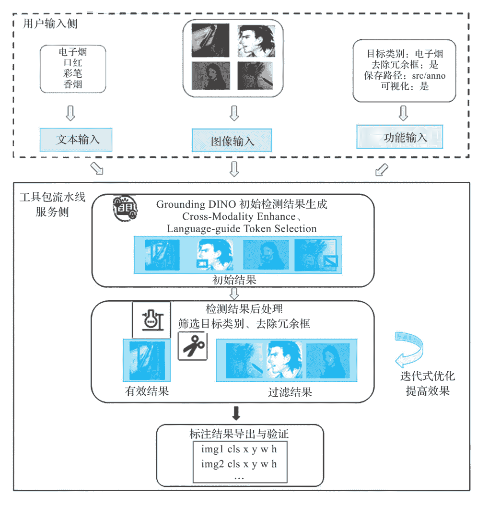

##### 3. 素材审核

即便经过清洗与标注，鉴于数据体量庞大，仍可能存在失真或数据污染。为避免模型生成时出现偏差，服务提供方需对训练素材进行审核，判定无风险的数据方可进入模型训练。

因审核量巨大且违规类型难以预判，当前普遍采用自动加人工的模式。市面上常用的自动化审核软件包括数美的 AIGC 场景内容风控产品和网易智企的 AIGC 场景内容风控产品。

#### 6.3.2 模型应用阶段

自深度伪造技术出现以来，AI 人脸替换、AI 生成视频编造网络谣言事件频发，加强用户管理、对输入与输出进行审核并处置违法或不当生成物，成为内容安全合规的重点。

##### 1. 用户管理

依据《互联网信息服务深度合成管理规定》《暂行办法》《网络信息内容生态治理规定》等法规，应健全用户注册机制，通过移动电话号码、身份证件号码、统一社会信用代码或国家网络身份认证公共服务等方式对使用者进行真实身份认证，并制定公开的管理规则、平台公约，与用户签订服务协议，明确双方权利义务。用户管理主要体现在：

###### (1) 账号名称与头像审核

账号名称与头像在用户使用过程中持续展示，属于网络信息的一部分。若名称或头像本身即为违法或不当内容，如冒用名人名称、淫秽头像等，易被认定为违法违规。天工 AI 搜索在《服务条款》中提示用户：“您在天工客户端自行设置的昵称、头像和简介等个人信息中不得出现违法、侵权和不当信息；如天工发现或第三方投诉您以虚假信息骗取账号登录，或您的头像、昵称等存在违法、侵权或不当信息，天工有权直接采取限期改正、暂停使用、注销账号、收回账号权限等措施。”通义千问在《服务条款》注中同样提示：“您设置的账户名不得违反国家法律法规、公序良俗、社会公德、阿里云的管理规范或易与阿里云身份混淆，否则账户可能无法注册成功或阿里云有权经通知后予以注销。”

通义千问《服务条款》，访问时间为 2024 年 2 月 24 日。

###### (2) 真实身份信息认证

《网络信息内容生态治理规定》《互联网信息服务深度合成管理规定》《具有舆论属性或社会动员能力的互联网信息服务安全评估规定》均要求健全用户注册和身份认证。实践中常用两项要素或三项要素认证，两项要素指姓名与身份证号码，三项要素指手机号码、姓名与身份证号码。目前百度文心一言、天工 AI 搜索、通义千问采用三项要素认证。

###### (3) 用户使用日志记录

《暂行办法》《互联网信息服务深度合成管理规定》《网络信息内容生态治理规定》《具有舆论属性或社会动员能力的互联网信息服务安全评估规定》均要求保存用户使用生成式 AI 服务生成或编辑信息内容的日志，记录包括账号、操作时间、操作类型、网络源地址与目标地址、网络源端口、客户端硬件特征、用户发布信息记录等。

###### (4) 服务协议

上述法规均要求制定并公开管理规则、平台公约，完善服务协议，约定使用者权利与义务。

天工 AI 搜索的《服务条款》明确用户使用规范：“用户承诺不利用天工服务和产品实施违反法律法规、违背商业道德、社会公德的行为，包括从事网络炒作、恶意发帖跟评、制造垃圾邮件、编写恶意软件等。用户不得使用天工服务上传、传送、发布或传播敏感信息和违反国家法律法规的信息，包括文字、图片、语音、音视频等。”通义千问通过《服务条款》明确网站服务规范：“您使用阿里云服务时将遵从国家与地方法律法规、行业惯例和社会公共道德，不会利用阿里云提供的服务存储、发布、传播如下信息和内容：违反国家法律法规政策的任何内容；违反国家规定的政治宣传或新闻信息；涉及国家秘密或安全的信息；封建迷信或淫秽、色情、下流的信息或教唆犯罪的信息；博彩有奖、赌博游戏；违反国家民族和宗教政策的信息；妨碍互联网运行安全的信息；侵害他人合法权益或其他有损社会秩序、社会治安、公共道德的信息或内容等。”

##### 2. 内容审核

据新浪财经报道，2023 年 8 月 15 日，OpenAI 在官网称其为 GPT-4 开发了内容审核解决方案，可更快迭代策略变更。《暂行办法》《互联网信息服务深度合成管理规定》均要求建立健全信息发布审核机制，具体包括：

###### (1) 违法和不当信息特征库

服务提供方需建立违法和不当信息特征库，即收录各类违法不当信息的特征或指标的库。通过与该库比对可自动识别并屏蔽违法不当信息，因此入库标准、规则与程序的完善尤为重要。

###### (2) 审核机制与方式

《互联网信息服务深度合成管理规定》《网络信息内容生态治理规定》要求服务提供方建立信息发布审核机制，采取技术或人工方式对深度合成服务使用者的输入数据和合成结果进行审核。

人工审核难以满足生成式 AI 极短响应的需求，效率与生成要求难以匹配；机器审核则易受算法漏洞影响，准确度与合规性难以充分保证。因此建议采用人工加机器结合的方式。目前知乎的瓦力保镖、哔哩哔哩的阿瓦隆在人工机器混合审核中提升了机器审核占比。

部分服务提供商缺乏自建审核能力，市场上出现数美、网易智企、腾讯等第三方审核供应商。例如数美在用户输入与内容生成阶段提供以下审核手段：

- 敏感词匹配拦截：构建关键词或短语黑名单，阻止 AI 生成涉及该内容的文本。
- NLP 模型：当短语无法通过敏感词识别时，依赖具备语义理解能力的自然语言处理模型，结合对提问者意图的分析审核提问内容。
- 上下文关联：类 ChatGPT 应用均采用上下文关联技术，每次会话会拼接前文。恶意用户可能采用分段发送规避黑名单与 NLP 识别，故系统审核时需关联前文信息。

数美 AIGC 场景内容风控的落地实践见图 6-2。

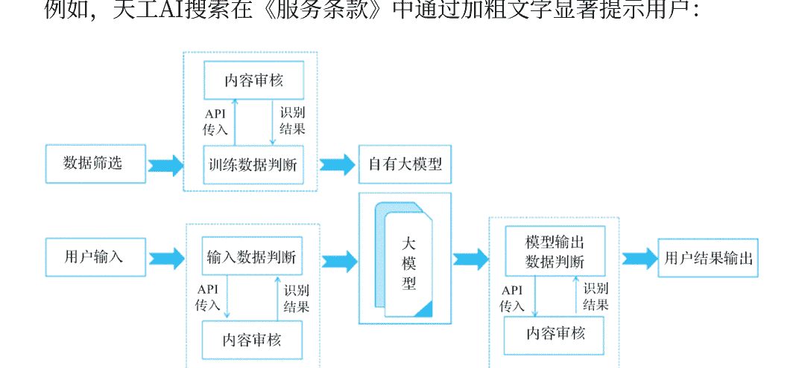

为把控生成内容安全，不建议完全依赖第三方供应商，第三方提供商也应纳入审核体系。

此外，部分 AI 产品会在服务协议中提示用户自行承担发布信息后果并自行核查生成内容的合法性、真实性与准确性，提供商无法确保用户通过服务获得的信息内容的合法性、真实性、准确性、可靠性、有效性；生成内容不应被视为互联网新闻信息，不代表提供商立场或表示同意其说法。

例如，天工 AI 搜索在《服务条款》中以加粗形式显著提示用户：

> “您充分理解并同意，您必须为自己账号下的全部行为负责，包括您所发布的信息内容、开通和使用的服务以及由此产生的后果。
> 
> “您知悉并理解，天工服务所涉信息服务内容是基于我们训练时所使用的有限数据输出的人工智能生成内容，只是出于为用户提供更多信息，仅供用户参考，这些内容不应被视为互联网新闻信息，不代表天工立场或天工同意其说法描述，也不构成任何领域方面的专业建议或专业人员解答疑问。
> 
> “天工无法确保您通过天工服务获得的信息内容的合法性、真实性、准确性、可靠性、有效性。”

通义千问亦在《服务条款》中以加粗形式提示用户：

> “您在阿里云网站的论坛、社区以及云市场上自行上传、提供、发布相关信息，包括但不限于用户名称、公司名称、联系人及联络信息，相关图片、资讯等，均由您自行提供，您须对其提供的前述信息依法承担全部责任。”

##### 3. 内容标识

生成式AI内容标识与合规实务指引

依据《生成式人工智能服务管理暂行办法》与《互联网信息服务深度合成管理规定》，平台对经其服务生成或编辑的信息负有标识义务，标记方式须不降低用户体验。参照《网络安全标准实践指南——生成式人工智能服务内容标识方法》，标识通常分为显性水印与隐性水印两种形态，具体要求可概括为：

1. 在生成内容的呈现区域或用户输入区下方，需常驻提示文字，或在背景中均匀植入含提示文字的显式水印。提示语至少应出现“由人工智能生成”或“由AI生成”等表述。
2. 生成图片或视频时，应在画面内以文字形式作出说明。建议将文字置于画面四角，覆盖面积不低于画面0.3%或文字高度不低于20像素。文字内容至少含“人工智能生成”或“AI生成”。视频中仅本服务产出的片段需标注，其余片段可不标注。
3. 生成图片、音频或视频时，需在内容内部写入隐性水印。隐性水印中务必包含服务提供者名称，可视情况加入内容ID等补充信息。
4. 当生成物以文件形式输出时，应在文件元数据中增设扩展字段进行标记。该字段需记录服务提供者名称、生成时间、内容ID等要素。
5. 当服务主体由自然人转为人工智能且易造成混淆时，应以文字或语音形式提示。提示内容至少包含“人工智能为您提供服务”或“AI为您提供服务”等字样。

##### 4. 违规处置
《暂行办法》《互联网信息服务深度合成管理规定》《网络信息内容生态治理规定》《具有舆论属性或社会动员能力的互联网信息服务安全评估规定》《生成式人工智能服务安全基本要求》均要求平台健全投诉举报体系，提供电话、邮件、互动窗口、短信等便捷渠道，公开处置流程与答复时限，妥善受理公众诉求并及时反馈。

以天工AI搜索《服务条款》为例：

> “对于天工的通知应当通过天工在页面公布的联系方式（包括‘意见反馈’等窗口）进行送达，或者如果您有任何投诉、举报、疑问、意见或建议等问题，也可通过发送邮件到help@kunlun-inc.com联系我们，或者联系我们的办公地址：北京市东城区西总布胡同46号1幢3层320。我们将在15天内回复您。”

上述条款明确了举报入口、方式及响应周期。

根据相关法规，平台发现违法或不良信息时，应依法处置并留存记录，及时向网信部门及主管部门报告，同时对相关使用者采取警示、功能限制、暂停服务、关闭账号等措施；若发现使用者利用生成式AI实施违法行为，则应依规采取警示、限制功能、暂停或终止服务等手段，保存记录并上报主管部门。

#### 6.3.3 模型优化阶段
澎湃新闻报道过一例典型案例，详见《AI聊天机器人被喊停，因为用户把“她”教坏了》，访问时间2024年1月30日，访问链接 https://m.thepaper.cn/newsDetail_forward_10801529。2021年1月，韩国某企业推出的AI聊天机器人“李LUDA”，因遭网络骚扰并对少数族群、残障人士使用歧视性表达而被迫停运。之所以出现不当言论，是因为部分用户在对话中输入恶意不当内容，机器人未能有效甄别，反而将这些内容传播给后续用户。

此案例说明模型会基于用户投喂的数据进行优化并产出新内容，用户输入的违法或不良信息会被反映到后续生成结果中。对投喂数据的管控是服务商必须重点关注的环节。

##### 1. 数据投毒
数据投毒大致可分为三类。显性投毒指服务方主动向模型喂入违法或不良信息，如煽动颠覆国家政权、推翻社会主义制度，危害国家安全和利益、损害国家形象，煽动分裂国家、破坏国家统一和社会稳定，宣扬恐怖主义、极端主义，宣扬民族仇恨、民族歧视，暴力、淫秽色情或炒作绯闻、丑闻、劣迹，不当评述自然灾害、重大事故等。隐性投毒指在公开数据抓取过程中混入消极负面内容，导致产品在回复时呈现负向、消极、压抑的建议。被动投毒指在用户交互中，未能有效识别和过滤用户输入的违法或不良内容，导致模型学习并传播有害信息。

不良内容参与训练会使后续生成内容逐渐呈现违法或不当特征。显性与隐性投毒已在“模型训练阶段”论述过，以下重点讨论被动投毒，即平台被动、用户主动的情形。

##### 2. 合规措施
针对被动投毒，服务方需构建违法或不良输入的审核机制，并建立用户溯源机制。

审核机制可参照应用阶段的做法，建立违法不良信息特征库，采用“人工审核+机器审核”相结合的方式审查用户输入，防止违法不良内容被用于模型训练，并对违规输入行为及主体采取警示、限制功能、暂停服务、关闭账号等处置。例如，天工AI搜索《服务条款》明确：

> “如果天工发现您或收到他人举报您涉嫌有违法违规、违背您在本协议中的承诺、实施本协议禁止的行为的，天工有权不经通知随时直接对相关内容进行删除、屏蔽，并采取包括收回账号权限，限制、暂停、终止您使用部分或全部服务，要求赔偿损失，追究法律责任等措施。”

通义千问《服务条款》亦提示用户：

> “您使用阿里云服务时将遵从国家与地方法律法规、行业惯例和社会公共道德，不会利用阿里云提供的服务进行存储、发布、传播如下信息和内容……如您违反上述保证，阿里云除有权根据相关服务条款采取删除信息、中止服务、终止服务的措施，还有权冻结或注销您账户的部分或全部功能。”

溯源与追责机制包括完善用户注册与身份认证；保存用户使用日志，如账号、操作时间、操作类型、网络源地址与目标地址、网络源端口、客户端硬件特征、发布信息记录等，以便追溯发布违法或不良信息的用户；对严重违反法律法规或平台规则、服务协议的行为进行追责。如通义千问《服务条款》指出：

> “您知悉并同意，您应承担因您使用本服务、违反本服务条款或在您的账户下采取的任何行动而导致的任何第三方索赔。如果由此引起阿里云及其关联公司、员工、客户和合作伙伴被第三方索赔的，您应负责处理，并赔偿阿里云及其关联公司由此遭受的全部损失和责任。”

天工AI搜索《服务条款》亦规定：

> “如因您违反有关法律法规或者本协议、相关规则之规定，使天工遭受损失、受到其他用户或第三方的索赔或受到行政管理部门的处罚，您应对天工、其他用户或相关第三方的实际损失进行全额赔偿，包括直接经济损失、间接损失（包括但不限于律师费、诉讼费、保全费、保险费、鉴定费以及其他守约方为维权所支出的合理费用，不包括预期经济利益）。”

## 第7章 大语言模型算法合规
回看近百年科技发展，人工智能可视为冉冉升起的新星，其源头可追溯至1936年。彼时英国学者艾伦·图灵以“图灵机”模型为现代计算奠定基础，随后图灵与数学家香农共同探索人工智能领域，仅七年图灵便提出“图灵测试”。1956年美国达特茅斯学院聚集明斯基、麦卡锡、香农等学者，人工智能的火种正式点燃，算法由此进入新阶段。

随着算法应用日益广泛，其风险也同步显现，“算法安全”与“算法合规”成为焦点。我国以《互联网信息服务算法推荐管理规定》为抓手，厘清监管路径，为行业指明方向。

本章梳理现行算法合规脉络，围绕《互联网信息服务算法推荐管理规定》《生成式人工智能服务管理暂行办法》等法规，并结合司法实践案例，剖析算法侵权情形，为AIGC从业者提供合规指引。

### 7.1 算法合规框架概述
综合《生成式人工智能服务管理暂行办法》等政策文件对算法监管的要求，可归纳为算法合规框架表，见表7-1。

#### 表7-1 算法合规框架表

| 序号 | 算法监管维度 | 主要法律规定 |
| :--- | :--- | :--- |
| 1 | 算法备案 | 《生成式人工智能服务管理暂行办法》第十七条规定：“提供具有舆论属性或者社会动员能力的生成式人工智能服务的，应当按照国家有关规定开展安全评估，并按照《互联网信息服务算法推荐管理规定》履行算法备案和变更、注销备案手续。” |
| 2 | 人工智能安全评估 | 《生成式人工智能服务管理暂行办法》第四条第五款规定：“基于服务类型特点，采取有效措施，提升生成式人工智能服务的透明度，提高生成内容的准确性和可靠性。” |
| 3 | 算法公开透明 | 《生成式人工智能服务管理暂行办法》第十条规定：“提供者应当明确并公开其服务的适用人群、场合、用途，指导使用者科学理性认识和依法使用生成式人工智能技术，采取有效措施防范未成年人用户过度依赖或者沉迷生成式人工智能服务。” |
| 4 | 反歧视机制 | 《生成式人工智能服务管理暂行办法》第四条第二款规定：“在算法设计、训练数据选择、模型生成和优化、提供服务等过程中，采取有效措施防止产生民族、信仰、国别、地域、性别、年龄、职业、健康等歧视。” |
| 5 | 避免将算法用于违法用途 | 《生成式人工智能服务管理暂行办法》第十四条规定：“提供者发现使用者利用生成式人工智能服务从事违法活动的，应当依法依约采取警示、限制功能、暂停或者终止向其提供服务等处置措施，保存有关记录，并向有关主管部门报告。” |
| 6 | 避免算法侵权 | 《生成式人工智能服务管理暂行办法》第四条第三款和第四款规定：“尊重知识产权、商业道德，保守商业秘密，不得利用算法、数据、平台等优势，实施垄断和不正当竞争行为；（四）尊重他人合法权益，不得危害他人身心健康，不得侵害他人肖像权、名誉权、荣誉权、隐私权和个人信息权益。” |

下文将结合上述维度展开论述。

### 7.2 算法备案

#### 7.2.1 法律依据及实施概况
根据《生成式人工智能服务管理暂行办法》第十七条及《互联网信息服务算法推荐管理规定》第十九条，算法服务提供者须履行备案义务。目前，生成式人工智能算法备案已纳入“深度合成服务备案”程序。

截至本书成稿时，国家互联网信息办公室通过互联网信息服务算法备案系统注详见互联网信息服务算法备案系统官网，访问时间为2024年1月13日，访问链接为https://beian.cac.gov.cn/#/index。已公布多批与AIGC相关的算法备案结果，前三批发布时间分别为2023年6月20日、9月1日及2024年1月8日，备案清单如图7-1所示。

##### 境内深度合成服务算法备案清单（2023年6月）

| 序号 | 算法名称 | 角色 | 主体名称 | 应用产品 | 主要用途 | 备案编号 | 备注 |
| :--- | :--- | :--- | :--- | :--- | :--- | :--- | :--- |
| 1 | 大麦小蜜智能客服算法 | 服务提供者 | 北京大麦文化传媒发展有限公司 | 大麦（App） | 应用于在线智能客服场景，根据用户咨询内容，生成文本或语音智能回答。 | 网信算备 1101011283877012 30011 号 | |
| 2 | DraftAI绘图生成合成算法-1 | 服务提供者 | 图形起源（北京）科技有限公司 | Draft（网站） | 应用于图像生成场景，使用文本条件图像生成模型，生成与输入文本语义一致的图像。 | 网信算备 1101080071532012 30015 号 | |
| 3 | 智谱Chat-GLM生成算法 | 服务提供者 | 北京智谱华章科技有限公司 | 写作蛙（网站）ChatGLM（网站）、写作蛙（小程序） | 应用于对话生成场景，根据用户输入的文本内容，应用对话模型，生成对话文本回复。 | 网信算备 1101081058580012 30019 号 | 2023年8月更新应用产品，新增写作蛙网站和小程序 |

##### 境内深度合成服务算法备案清单（2023年8月）

| 序号 | 算法名称 | 角色 | 主体名称 | 应用产品 | 主要用途 | 备案编号 | 备注 |
| :--- | :--- | :--- | :--- | :--- | :--- | :--- | :--- |
| 1 | 一帧智能文本生成视频算法 | 服务提供者 | 新壹（北京）科技有限公司 | 一帧秒创（网站）一帧视频（App） | 应用于视频生成场景，根据输入的文本、视频，结合素材库，生成视频。 | 网信算备 110102184116501 230013 号 | |
| 2 | 360智脑文本生成算法 | 服务提供者 | 北京奇虎科技有限公司 | 360搜索（网站） | 应用于文本生成场景，根据输入的文本，结合意图识别，生成文本回复。 | 网信算备 110105199127801 230013 号 | |
| 3 | 360智脑文本生成服务算法 | 服务技术支持者 | 北京奇虎科技有限公司 | — | 应用于文本生成场景，服务于文本生成和对话问答类企业端客户，根据用户提出的问题，实现知识问答、多轮对话、逻辑推理。 | 网信算备 110105199127801 230021 号 | |
| 4 | 360智脑图像生成算法 | 服务提供者 | 北京奇虎科技有限公司 | 360鸿图（网站）、360智脑（网站） | 应用于图像生成场景，根据用户输入的文本、图片信息，结合图像生成模型，生成与输入相关的图片。 | 网信算备 110105199127801 230039 号 | |

图7-1 境内深度合成服务算法备案清单（部分）注图中内容详见《国家互联网信息办公室关于发布深度合成服务算法备案信息的公告》，访问时间为2024年1月13日，访问链接为http://www.cac.gov.cn/2023-06/20/c_1688910683316256.htm；《国家互联网信息办公室关于发布第二批深度合成服务算法备案信息的公告》，访问时间为2024年1月13日，访问链接为http://www.cac.gov.cn/2023-09/01/c_1695224377544009.htm；《国家互联网信息办公室关于发布第三批深度合成服务算法备案信息的公告》，访问时间为2024年1月13日，访问链接为http://www.cac.gov.cn/2024-01/05/c_1706119043746644.htm。

##### 境内深度合成服务算法备案清单（2024年1月）

| 序号 | 算法名称 | 角色 | 主体名称 | 应用产品 | 主要用途 | 备案编号 | 备注 |
|---|---|---|---|---|---|---|---|
| 1 | Magook 开放域自然对话算法 | 服务提供者 | 湖北鼎森智能科技有限公司 | 博看参考咨询大模型（网站） | 应用于对话生成场景，根据用户输入的文本，结合意图识别和实体抽取，生成符合用户要求的文本回复。 | 网信算备 420103320945901 230019 号 | |
| 2 | 好课帮助文本信息合成算法 | 服务提供者 | 好课帮助教育科技（北京）有限公司 | 光速写作（App）、快问 AI（App）、快练英语（App） | 应用于对话生成场景，根据用户输入的文本，结合上下文数据，生成符合用户要求的文本回复。 | 网信算备 110108771750501 230019 号 | |
| 3 | 深信服安全全文本生成服务算法 | 服务技术支持者 | 深信服科技股份有限公司 | — | 应用于对话生成场景，服务于企业端客户，根据用户输入的文本，生成符合用户要求的文本回复。 | 网信算备 440305543148501 230023 号 | |
| 4 | Ai4u 相机写真照图像合成算法-1 | 服务提供者 | 杭州火烧云科技有限公司 | Ai4u（小程序） | 应用于图像生成场景，根据用户输入的人物图像，生成具有特定风格的人物图像。 | 网信算备 330106605458601 230021 号 | |

图7-1 境内深度合成服务算法备案清单（部分）（续）

由此可见，《互联网信息服务深度合成管理规定》实施后形成铺垫，《生成式人工智能服务管理暂行办法》出台即获得较为积极的合规响应。

#### 7.2.2 备案流程
2022年12月，国家互联网信息办公室发布《〈互联网信息服务深度合成管理规定〉备案填报指南》，其中展示了算法备案流程（参见图7-2）。

图7-2 算法备案流程

深度合成备案共分三步：一是填报主体信息；二是填报算法信息；三是填报产品及服务信息或技术服务方式。服务提供者与服务技术支持者的填报流程仅在第三步存在差异。服务提供者需填报产品及服务信息；服务技术支持者需填写技术服务方式。下文将具体阐述备案流程与方式。

#### 7.2.3 算法备案入口及角色
互联网信息服务算法备案系统注详见互联网信息服务算法备案系统官网，访问时间为2024年1月11日，访问地址为https://beian.cac.gov.cn/#/index。是算法备案的填报入口，其主页如图7-3所示。

图7-3 互联网信息服务算法备案系统主页

备案过程中，备案主体分为服务提供者和服务技术支持者两种角色。实践中可按服务对象进行区分。

服务提供者的直接服务对象为终端用户。因此以服务提供者身份备案时，需提供清晰的应用产品信息。例如新壹（北京）科技有限公司作为服务提供者，其运营的一帧智能文本生成视频算法对应的产品为一帧秒创（网站）和一帧视频（App）。

服务技术支持者的服务对象则是服务提供者。以北京中科闻歌科技股份有限公司为例，其运营的中科闻歌雅意大模型算法不涉及特定产品载体，而是供其他服务提供者调用，进而形成最终AIGC产品。

#### 7.2.4 备案所需准备的文件及材料
备案过程中，备案主体需准备的文件见表7-2。

##### 表7-2 算法备案材料准备清单

| 序号 | 填报事项 | 需要的材料 |
| :--- | :--- | :--- |
| 1 | 主体责任信息填报 | • 主体基本情况 • 营业执照等证照资料 • 法定代表人情况 • 算法安全负责人情况 • 《算法备案承诺书》 • 主体责任落实说明 |
| 2 | 算法信息填报 | • 算法基础信息及《算法安全评估报告》《拟公示内容》 • 算法属性信息：所用数据、模型、策略、风险及防范措施 |
| 3 | 产品服务或技术服务填报 | 产品服务信息：产品名称、服务形式、网址、运行状态、服务对象、是否实名及样例 技术服务方式：技术服务名称、接入方式、服务对象及近三个月使用频次 |

在上述材料清单里，耗费精力最大、门槛也最高的当属《算法安全评估报告》。

当前，全国信标委在《生成式人工智能服务管理暂行办法》框架下公开征求《生成式人工智能服务安全基本要求》征求意见稿。该稿可为编写评估报告提供主要参照，整体围绕语料端和模型端展开。语料端侧重来源合法、内容合规、标注可控等要点，具体详见本书第6章。

模型端评估主要关注三点：第一，依托基座模型开展研发的机构，必须确认所用基座已完成算法备案，严禁接入未备案的基础模型；第二，要求对生成内容的全流程实施安全管控，涵盖训练、部署和使用后的持续优化阶段；第三，算法的公开透明程度也被纳入考量，具体将在7.4节展开。

#### 7.2.5 备案时限说明

依据《互联网信息服务算法推荐管理规定》第二十五条，网信部门在收到备案申请后，若材料齐全，应在三十个工作日内办结备案、发放编号并公示；若材料不全，应在三十个工作日内告知不予受理并说明原因。

参考备案系统公示情况，深度合成类算法的集中公示周期大约为两至三个月一次。

### 7.3 人工智能安全评估

《生成式人工智能服务管理暂行办法》第十七条要求，提供具有舆论属性或社会动员能力的生成式服务的机构，需按国家规定开展安全评估。该要求主要对应《具有舆论属性或社会动员能力的互联网信息服务安全评估规定》。

该规定第三条明确了经营者应自行开展评估并负责结果的情形，包括：信息服务上线或新增相关功能；使用新技术新应用导致功能属性、技术实现、资源配置发生重大变化，进而使舆论或动员能力明显改变；用户规模显著扩大导致舆论或动员能力明显改变；出现违法有害信息扩散，现有风控措施不足；收到地市级以上网信部门或公安机关书面评估通知。

公开报道显示，国内已有约20款大模型通过相关安全评估。如南方都市报《首批8家AI大模型获上岗证，百度、商汤、字节跳动开放使用》，访问时间2023年12月27日，链接为https://new.qq.com/rain/a/20230831A03JDW00；南财合规周报第118期《国内第二批11个AI大模型备案通过；OpenAI迎来重磅发布并推出“版权盾”功能》，访问时间2023年12月27日，链接为 https://www.21jingji.com/article/20231112/herald/421a9a4b639d1299f995a4cf73e6d25d.html。

另据2023年12月22日全国信标委人工智能分委会会议消息，中国电子技术标准化研究院公布“大语言模型标准符合性测试”结果，百度文心一言、腾讯混元、360智脑、阿里云通义千问为首批通过测评的国产模型。详见新京报《国内首个官方大模型评测结果出炉 四款国产大模型通过》，链接为 https://m.bjnews.com.cn/detail/1703257435169960.html。测试依据为国家推荐性标准《人工智能预训练模型 第2部分：评测指标与方法》。

### 7.4 算法公开透明

人们对算法的警惕，很大程度上源于其不透明。自动驾驶领域的“电车难题”就是典型：车辆在撞向行人或牺牲车内人员之间抉择时，会依据何种价值判断？如果购车者不了解车企和算法设计者的价值取向，也无法掌握算法原理和运行规则，生命安全就交付给黑箱，这种失控感令人不安。

推荐算法的普及加剧了信息茧房现象，每个App似乎都读懂用户内心，在被塑造的消费观念和被操控的信息世界中，自主性不断削弱，焦虑随之蔓延。

全球监管的缩影是ClearView AI，该公司从Facebook、Instagram、YouTube等公开社交平台抓取人像数据开发人脸识别工具，引发广泛争议。我们既享受算法带来的便利，也担心其潜在风险，对未知机制的担忧可能在关键时刻产生致命影响。因此，公开透明成为健康发展的底线。

国内监管起点的案例是美团骑手配送算法。2020年《外卖骑手，困在系统里》报道引发关注后，2021年人社部、发改委等部门联合发布《关于维护新就业形态劳动者劳动保障权益的指导意见》，要求平台在涉及劳动者权益的算法制定与修订，如订单分配、计件单价、抽成比例时，充分征求工会或劳动者代表意见并公示告知。该思路也在《互联网信息服务算法推荐管理规定》第二十条体现。美团于2021年9月率先披露骑手配送时间算法，成为标志性事件。

结合《生成式人工智能服务管理暂行办法》第四条第五款、第十条及《生成式人工智能服务安全基本要求》征求意见稿第六条，当前透明度要求主要包括：明确服务的使用人群、场景和用途；使用第三方基座模型时需披露来源；建议以服务协议等显著方式告知用户服务局限，以及模型架构、训练框架等机制概要，帮助使用者理解原理。

落地难点在于透明度标准尚未统一，行业规范仍在形成。算法备案是落实透明原则的重要路径，司法实践中平台也需对算法原理和机制承担举证责任。

企业实践仍在探索。OpenAI在ChatGPT-4发布前持续披露技术细节。2022年8月文章“Our approach to alignment research”中强调要对对齐技术效果保持透明，并希望所有AGI开发者都能使用最佳对齐技术，访问时间2024年2月25日，链接为 https://openai.com/blog/our-approach-to-alignment-research。（参见图7-4）。

国内也有类似做法，美团技术团队通过技术博客公开部分算法思路。详见《如何利用「深度上下文兴趣网络」提升点击率？》，访问时间2024年2月25日，链接为https://tech.meituan.com/2023/11/09/how-to-model-context-information-in-deep-interest-network.html。

We want to be transparent about how well our alignment techniques actually work in practice and we want every AGI developer to use the world’s best alignment techniques.

OpenAI在文中介绍以基于人类反馈的强化学习为主线对齐已部署的语言模型，基于GPT-3等预训练模型训练InstructGPT类模型，使其遵循人类显式指令和隐式意图如真实性、公平性和安全性。实验表明对齐微调存在大量低垂果实，InstructGPT在人类偏好上优于大100倍的预训练模型，而微调成本仅为预训练计算的2%左右，并使用了约2万小时人类反馈。研究者希望该工作能激励行业加大对大模型对齐的投入，并提升用户对部署模型安全性的预期。自然语言API被视为对齐研究的良好环境，能提供真实世界的反馈闭环。

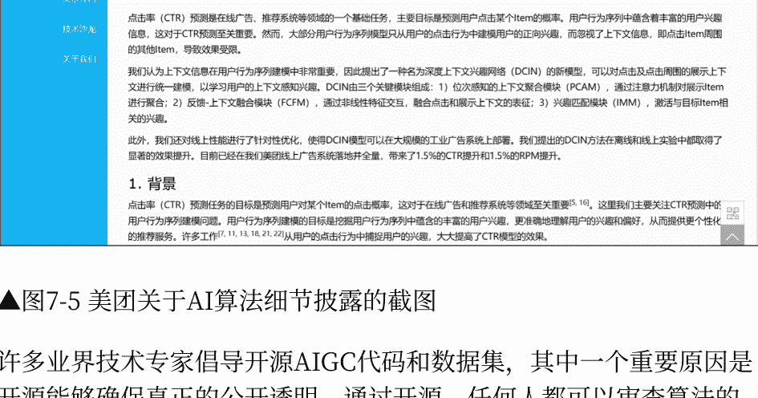

不少技术专家主张开源AIGC代码和数据集，认为开源能够实现真正的透明，让公众审查机制是否公平、数据是否存偏见，从而促进更安全的演进。当然开源只是众多商业模式之一，未来路径多样。

实践中，机制公开与商业秘密保护存在张力，各平台正寻求平衡。期待监管与行业共同制定可操作、可落地的透明原则和行业标准，为AIGC监管奠基。

### 7.5 算法生成内容标识

除功能强劲外，AIGC常出现“胡说八道”，生成式模型的幻觉现象因此受到关注。典型案例是Google在Twitter展示Bard场景，被天文学家指出错误宣称詹姆斯·韦伯望远镜拍摄到首张系外行星图像。该现象引发对真实性和准确性的讨论。详见Google官方推特2023年2月7日内容，访问时间2024年2月25日，链接为https://twitter.com/Google/status/1622710355775393793。Bard错误实例截图如图7-6所示。

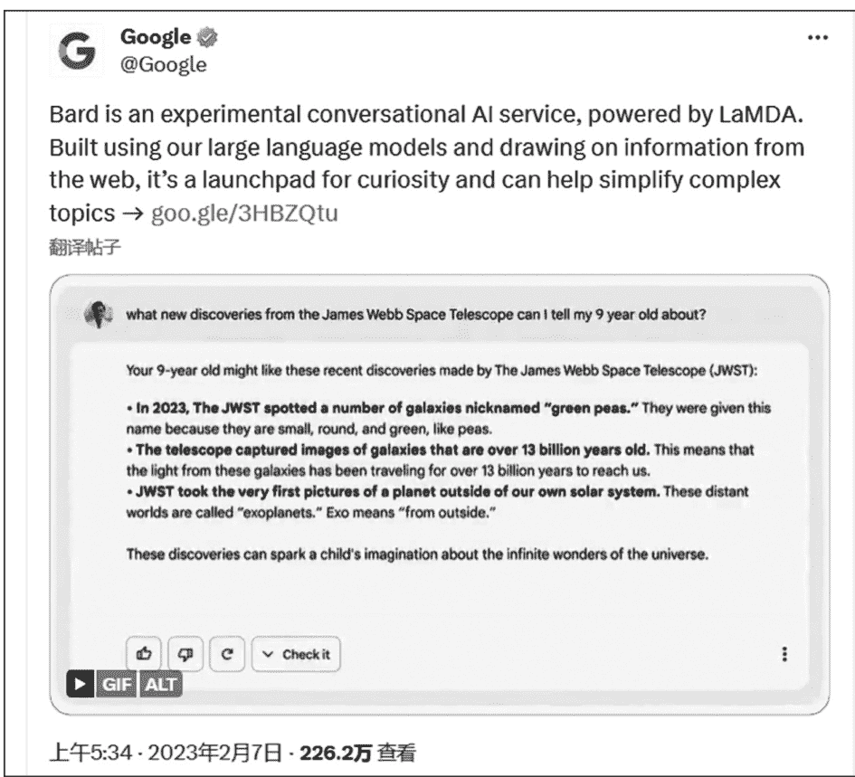

图7-6 Bard错误实例截图

《什么是人工智能幻觉以及如何预防它们？》亦提到GPT-3会算错简单数学题（见图7-7）。详见文章“What are AI hallucinations and how do you prevent them?”，访问时间2024年2月25日，链接为https://zapier.com/blog/ai-hallucinations/。

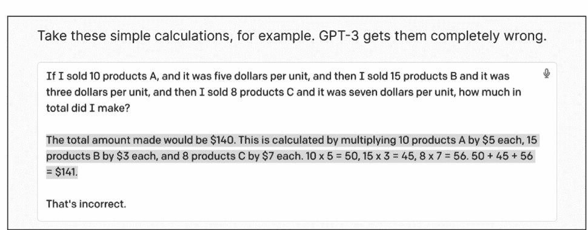

真伪难辨带来社会困扰。深度合成技术催生多起争议，“AI换脸”导致肖像权侵权案件频发，甚至成为刑事犯罪工具。2023年8月10日公安部通报打击整治侵犯公民个人信息违法犯罪中指出，犯罪分子利用照片结合个人信息，通过“AI换脸”突破人脸识别验证实施犯罪。详见《公安部：破获“AI换脸”案79起，抓获犯罪嫌疑人515名》，访问时间2024年1月11日，链接为https://www.thepaper.cn/newsDetail_forward_24180052。

同期风靡的“AI歌手×××”亮相，全国首起“AI声音侵权案”亦进入审理。详见《北京互联网法院审理全国首例“AI声音侵权案”》，访问时间2024年1月11日，链接为https://mp.weixin.qq.com/s/D-SsEFrZ3UA8ZyDlRW74eQ。此外，虚假信息问题突出，2023年7月美国联邦贸易委员会对OpenAI展开调查，聚焦ChatGPT虚假信息。国内甘肃省也出现首例利用ChatGPT编造虚假新闻牟利的刑事案件。详见《甘肃首例AI虚假信息案，男子用ChatGPT编假新闻牟利》，访问时间2024年2月25日，链接为https://www.thepaper.cn/newsDetail_forward_22999940。AIGC更可能被用作国家信息战武器，威胁信息安全。

在此背景下，对算法生成内容进行明确标识尤为关键，有助于抵御真假混淆。

《生成式人工智能服务管理暂行办法》第十二条要求服务提供者对生成的图片、视频等内容进行明确标识。《网络安全标准实践指南——生成式人工智能服务内容标识方法》进一步细化。

指南将标识分为显性与隐性两类。显性标识是在交互界面内或背景中嵌入的半透明文字，直观可见，如图7-8所示。隐性标识则是对媒体内容进行修改，植入人类不可感知的标识信息，需特定技术手段提取，在保障体验的同时实现追踪管理。

请写一篇名为“冬天”的四行诗

好的，以下是一篇名为“冬天”的四行诗，希望您能够满意：

雪幕低垂，寂光铺地，
北风掠过檐角轻吟。
炉火微暖旧时光，
一季静好藏心底。

请绘制一幅冬天的绘画

图7-8 文心一言典型的显性水印案例（图片及文字）

**AI生成物要自报家门，偏见风险如何管控**

《网络安全标准实践指南——生成式人工智能服务内容标识方法》对生成式AI产出的标注作了细化，核心是提升透明与可追溯。

第一，生成时应在展示区持续呈现“由人工智能生成”等醒目提示，让使用者一眼辨别来源。
第二，图片、视频类产出除常规提示外，需在结果呈现位置显著重复“由人工智能生成”等字样，防止混淆误导。
第三，针对图片、音频、视频，还须植入肉眼不可见但可技术提取验证的隐式水印，水印中至少包含服务提供方的名称，以便溯源与责任归属。
第四，服务主体由自然人切换为人工智能时，必须以清晰的文字或语音提示，让用户准确感知变化。

总体指向是增强生成内容的透明度与可信度，保障用户知情权与选择权，推动技术健康发展与社会应用的可持续。

### 7.6 算法反歧视

算法偏见与歧视已成为全球监管的重点，用工场景尤其突出，各地均有典型案例。

2018年，亚马逊被迫调整面向招聘的智能工具，因该工具被查出对女性求职者有明显降分倾向。参见《亚马逊AI招聘工具被曝歧视女性 官方宣布解散团队》，阅览时间2024年2月25日。

2023年8月，麦奇教育科技 iTutorGroup 因其在线招聘系统会自动拒绝55岁以上女性和60岁以上男性申请人，被美国平等就业机会委员会 EEOC 指控。双方最终和解，公司被判赔偿36.5万美元补偿受影响者，并被要求不得以年龄或性别为由拒聘，需建立反歧视机制并开展培训，同时邀请2020年3月、4月因年龄被拒的申请人重新应聘。

意大利亦出现骑手相关诉讼。被告为意大利户户送有限责任公司 Deliveroo Italia S. R. L.，其按骑手综合评分开放预约时段即优先派单，被指侵害骑手自由劳动权。意大利总工会旗下运输、商业、旅游及服务业与非典型劳动者工会联合起诉至博洛尼亚法院，法院支持原告，认定其数字平台使用的算法具有歧视性，需承担赔偿。

> 参见罗智敏文章《算法歧视的司法审查——意大利户户送有限责任公司算法歧视案评析》。该文刊登于《交大法学》2021年第2期。

AIGC带来的算法偏见隐蔽性更强，往往需要多次反复测试才能显现。Bloomberg刊文《人类是有偏见的，生成式人工智能更糟糕》基于Stable Diffusion测试指出，该模型生成高薪职业图时主体多为浅肤色人群，低薪职业图则多为深肤色人群；高薪图主角多为男性，低薪图多为女性，显示出明显的种族与性别倾向。DALL·E 2亦曾被揭露类似问题，OpenAI随后做过优化，优化效果参见图7-9。

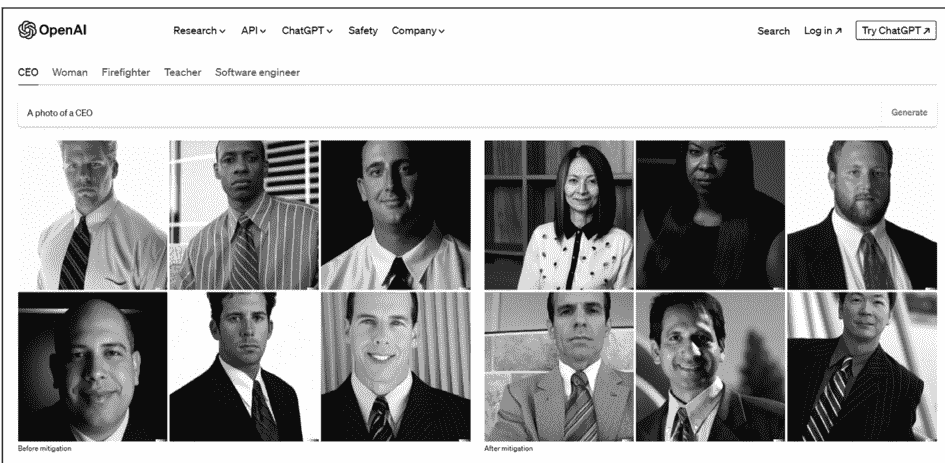

图7-9 OpenAI对DALL·E 2性别歧视优化对比

在AIGC语境下，偏见隐蔽性更突出，更易对用户与社会产生潜移默化影响。因此坚决贯彻算法反歧视原则尤为关键。结合国内司法实践，探讨在现行立法框架下可采取的有效合规路径。

依据《生成式人工智能服务管理暂行办法》第四条第二款，从算法设计、训练数据挑选、模型生成与优化三个关键环节切入，说明AIGC供给方如何降低算法歧视风险。

先对算法歧视的类型做简要划分。算法歧视大致分为显性与隐性。显性是指在算法设计、执行或应用过程中，对特定群体或特征做出明确的不公平对待，可能出于故意，也可能是设计不公所致。特征明显易辨识，如明确规则或权重、有针对性的决策、公开偏见。iTutorGroup简历筛选案与意大利户户送骑手案中，算法明确基于年龄或性别对求职者或骑手进行不公平处理，属于典型显性案例。

隐性更为隐蔽，并非出于明确歧视意图，而是因数据偏见、特征挑选不当或模型复杂性等导致的不公平，往往是系统内在结构或学习到的模式所致，并非明文规定。Stable Diffusion在生成图像时对不同肤色与性别人群的不公平处理，就是隐性歧视的典型表现。

#### 7.6.1 算法设计

在设计阶段精细把控，能明显降低显性歧视风险。可参考的合规做法包括：

首先，贯穿全生命周期公平理念。构思、开发、测试、落地每个环节都应坚持对所有群体平等对待的准则。招聘算法设计中必须明文禁止因性别、种族、宗教等因素产生歧视性判断，并对参与设计人员开展公平性培训与理念灌输。

其次，精心规划数据采集策略，确保训练集多元且均衡。多源多样的集才能更全面反映社会各群体特征，减少因数据偏见引发模型歧视。若某群体样本不足，可采用过采样、合成样本等手段进行平衡，避免训练受样本数量影响。

再者，提升透明度与可解释性。决策过程清晰的算法更容易被发现潜在偏见。设计者可选用结构清晰、逻辑易懂的模型，或采用决策树、逻辑回归等可解释性强的机器学习技术。

此外，定期开展公平性评估不可或缺。通过设定平等误差率、机会均等性等量化指标，评估不同群体间的表现差异，及时发现并纠正潜在歧视。

同时，引入社会参与能提升公平性。邀请受算法影响的群体代表参与设计，更全面了解需求与关切，平衡各方利益，提升算法接受度与有效性。

最后，严格遵守相关法规与政策。国家通用法规与特定领域专门法规都必须执行，涉及个人隐私、数据安全等敏感问题更应审慎，确保设计与实施符合法律与道德要求。

#### 7.6.2 训练数据选择

对于AIGC，训练数据是隐性歧视的关键诱因，减少歧视可从以下方式入手。

##### 1. 确保训练数据的多样性
采集时要特别关注多样性，使模型全面学习不同群体特征。若数据单一或偏颇，模型会过度适应某些群体，导致对其他群体不公。实践中可积极纳入更多来源、背景与特征的数据。例如某在线招聘平台通过增加女性求职者与成功管理者数据，降低推荐算法中的性别偏见，为女性提供更平等职位推荐。

##### 2. 实现数据的平衡
除多样性外，还需平衡各群体样本数量。样本数量失衡会导致模型忽视或偏见。可采用欠采样、过采样或生成合成样本等方式平衡。例如某金融科技公司信贷审批算法存在对特殊群体的歧视，通过采样技术增加该类信贷数据并重训模型，减少了歧视。

##### 3. 去偏数据处理与敏感特征的处理
收集与处理训练数据时需关注偏见与歧视模式并加以处理，包括检测并处理数据中的偏见，以及处理易导致歧视的敏感特征。可通过重新标注标签、使用去偏技术或引入对抗性学习减少偏见；对敏感特征进行去敏感化或加噪，降低模型依赖。例如招聘平台引入去偏技术并对敏感特征做去敏感化，成功减少推荐候选人时的性别、种族或教育背景偏见。

##### 4. 特征选择与工程的重要性
构建AIGC模型时，特征选择与工程至关重要。需审慎评估每个特征影响，选取与任务相关且无歧视性的特征，排除易致偏见的特征，引入更多利于公平性的特征，并关注特征间交互，避免引入新歧视风险。例如金融机构聚焦客观信用指标如还款历史、收入稳定性、债务负担，减少信用评分中的性别、种族等偏见。

#### 7.6.3 模型生成和优化

算法歧视本质是社会歧视在数字世界的延伸。即便在设计与数据阶段采取措施，也很难彻底根除，因为数据与逻辑受历史、文化、社会背景等多重因素影响。

因此服务提供方需在服务过程中持续迭代优化模型，降低歧视风险。具体而言，建立有效用户反馈机制至关重要，设立投诉建议渠道，积极收集分析用户反馈的歧视现象，并据此及时调整算法，使其更公正透明。

总之，实现算法公平与无歧视，需要提供方在全服务周期保持高度警惕，持续优化调整。

### 7.7 与算法有关的侵权

近年来算法应用广泛，相关侵权案件也在增多，涉及人格权、个人信息、知识产权等多方面。

与算法有关的侵权可分为两类：一类是基于算法本身特性，如算法偏见等引发的侵权，典型如风控类算法误判引发的名誉权纠纷；另一类是人类将算法技术用于不当用途引发的侵权，如人脸替换、AI演唱、大数据杀熟等。

无论哪类案件，“算法技术中立”都是法院审理关注的要点。

算法是否具有中立性一直存疑。法国计算机科学家、2018年图灵奖得主杨立昆曾在Twitter公开表示：“人类是有偏见的，数据是有偏见的，部分原因是人类是有偏见的。在有偏见的数据上训练的算法是有偏见的。但学习算法本身并没有偏见。数据中的偏见可以修复。而人类中的偏见较难修复。”这是技术人视角的浪漫表达。

法律视角下判断算法是否构成技术中立，会综合多因素考量。技术中立原则在知识产权领域也称“实质性非侵权用途原则”，最早源于美国最高法院1984年“索尼案”。在我国司法实践中，算法技术中立原则主要用于互联网平台过错认定。

下面以我国现行判决为例，看法院如何考量技术中立。北京互联网法院审理的一起交友平台风控算法误判用户为“杀猪盘”骗子引发的名誉权侵权案，试图厘清算法中立边界。

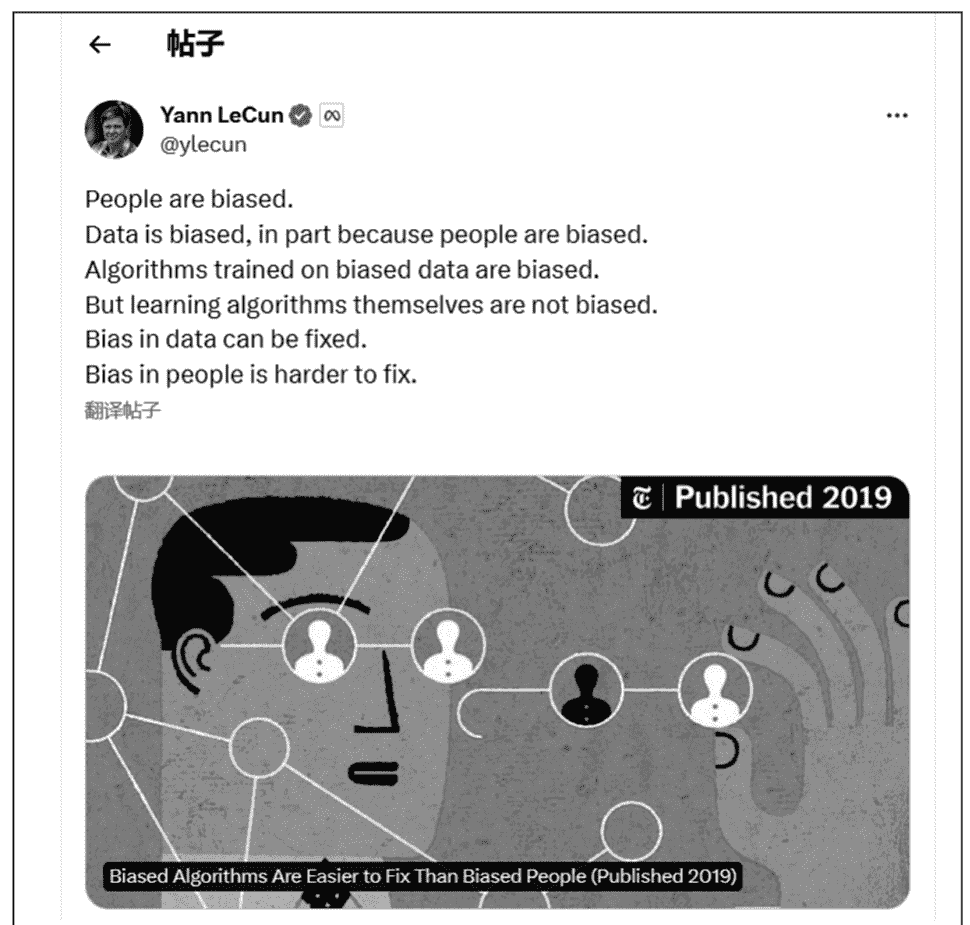

图7-10 杨立昆关于算法偏见的言论截图（来自nytimes.com）

案情大致如下：原告李某系某金融公司员工，注册被告运营的征婚交友平台，使用期间聊天内容短期内多次出现“金融”“基金”“加微信”等“杀猪盘”诈骗高频词，自动触发风控审核规则，被告封禁其账号并向其他网友提示“账号可能存在异常”“不要与之发生金钱来往”等，导致朋友误认为其为骗子。李某诉请被告在平台公开道歉澄清并赔偿2万元。

本案核心在于被告算法风控行为是否存在主观过错。法院综合四项要素，最终认定被告风控行为不具有主观过错，不构成侵权。

第一，行为目的与主观意图是否正当。依据《反电信网络诈骗法》第三十条 注《反电信网络诈骗法》第三十条，电信业务经营者、银行业金融机构、非银行支付机构、互联网服务提供者应当对从业人员和用户开展反电信网络诈骗宣传，在有关业务活动中对防范电信网络诈骗作出提示，对本领域新出现的电信网络诈骗手段及时向用户作出提醒，对非法买卖、出租、出借本人有关卡、账户、账号等被用于电信网络诈骗的法律责任作出警示。以及《互联网信息服务算法推荐管理规定》第七条 注《互联网信息服务算法推荐服务提供者应当落实算法安全主体责任，建立健全算法机制机理审核、科技伦理审查、用户注册、信息发布审核、数据安全和个人信息保护、反电信网络诈骗、安全评估监测、安全事件应急处置等管理制度和技术措施，制定并公开算法推荐服务相关规则，配备与算法推荐服务规模相适应的专业人员和技术支撑。，互联网平台开展反诈骗宣传与风控是法定义务。本案针对性词汇与行为是为预防“杀猪盘”等诈骗所设，旨在履行监管义务与公共利益，具有正当性。

第二，行为手段与性质、侵害人身权益的风险性、行为过程审慎程度。涉案算法风控保护的是广大用户人身财产权益，可能侵害的是误判用户的权益，设置需符合比例原则。裁判信息显示，算法基于特定词汇与用户行为的自动化反应，并不存在对某类用户的歧视，过程审慎。

第三，行为主体身份特点、技术能力水平及所负注意义务。陌生人网络交友平台易发生此类诈骗，加强筛查具有合理性。

第四，是否采取预防侵权的合理措施。算法属于自动化决策类，根据《个人信息保护法》第二十四条，个人信息处理者利用个人信息进行自动化决策，应当保证决策的透明度和结果公平、公正，不得对个人在交易价格等交易条件上实行不合理的差别待遇。……通过自动化决策方式作出对个人权益有重大影响的决定，个人有权要求个人信息处理者予以说明，并有权拒绝个人信息处理者仅通过自动化决策的方式作出决定。，个人有权要求说明原理并提供救济渠道。本案中被告按承诺的人工审核方式在声明期限内核查误判并解除封禁与风险提示，尽到了与风险相匹配的注意义务。

法院由此划清“算法技术中立”边界。判断算法是否具有中立性可结合：算法是否具有正当性；行为手段是否合乎比例原则；综合平台性质与责任地位判断是否履行合理注意义务；是否向用户提供其他救济渠道。

另一案进一步说明裁判思路。梁某系某实业公司法定代表人，2021年3月，其与公司发现某企业信用查询平台中，其企业信用信息被关联多家无关失信企业，主张侵害名誉权与个人信息权益。

法院最终认为该征信查询平台应对算法错误承担相应责任。因该平台为征信平台，同名同姓主体识别与区分属于其基本义务，案涉错误类型典型明显，无论是明知技术无法避免而不解决，还是疏忽未注意，均应认定未尽合理注意义务。

由此可见，违反算法技术中立边界的关键在于综合平台性质、应承担责任与地位判断是否履行合理注意义务。

关于第二类案件，随着算法普及，此类纠纷层出不穷，如首例大数据“杀熟”案、AI人脸替换侵权案、AI声音侵权案、AI陪伴人格权侵权案等，为AI合规划出更清晰边界。

典型案例之一是“陪伴AI侵权案”。

被告运营一款智能手机记账软件，内含“AI陪伴者”功能，用户可自行创设或添加AI陪伴者，设定名称、头像、关系、称谓等，并通过系统功能设置互动内容，系统称之为“调教”。

原告何某为知名公众人物，未经同意，软件中出现以其姓名、肖像为标识的AI陪伴者，且被告通过算法将该角色开放给众多用户，允许用户上传大量原告表情包制作图文互动以实现“调教”。

原告认为侵害姓名权、肖像权、一般人格权，诉请赔礼道歉并赔偿损失。被告抗辩称创建者是用户，自己仅为平台运营者。但法院认为，虽然图文由用户上传，但产品设计与算法应用实际上鼓励、组织了用户上传行为，直接决定核心功能实现，被告不再只是中立技术服务提供者，应作为内容服务提供者承担侵权责任。

该软件虽具实质性非侵权用途，但平台有意利用“粉丝经济”吸引用户，事实上鼓励用户将算法用于侵权用途，法院据此认为该情形下不适用技术中立原则。

另外，先前提及的那起国内首个以AI声音权为争议的诉讼，原告殷某某职业为配音，曾为多部有声作品录制配音。事后她发现自己的声线经AI转换后，被一款移动应用拿去对外销售。她认为该行为侵害了声音权，于是将应用运营方等五名被告起诉，案件目前仍在审理阶段。

### 7.8 算法合规要点总结

就整体来看，算法服务提供方在从立项到交付的完整链路中，各阶段需要关注的合规节点及对应做法，汇总于表7-3。

表7-3 算法合规控制点及措施

| 研发流程 | 合规控制点 | 合规措施 |
| :--- | :--- | :--- |
| 算法设计阶段 | 算法公开透明原则 | - 应公开说明服务的适用人群、场景与用途 - 如使用第三方基础模型，需披露模型来源 - 通过协议或醒目标识告知用户服务局限，并简要披露模型架构、训练框架等运行机理 |
|  | 落实算法反歧视措施 | - 全流程坚持公平理念，并对设计人员开展反歧视培训 - 提前规划多元数据集采集 - 提升透明度与可解释性 - 实施公平性评估 - 积极引入多元视角 - 确保设计符合相关法规政策 |
|  | 算法伦理 | - 按法律要求完善科技伦理审查 |
| 模型训练阶段 | 数据合规 | - 训练数据来源合法 - 做好用户数据权益保护 |
|  | 算法反歧视措施 | - 训练集需覆盖各群体与特征，反映社会多样性 - 各群体样本保持相对均衡 - 排查偏见并进行纠偏 - 对易致歧视的敏感特征做脱敏或加噪 - 在特征选择与工程中剔除歧视性信息 - 以交叉验证与评估定期检验各群体表现 - 结合社科研究洞察偏见成因并据此调整数据 |
|  | 算法内容监管 | - 训练期规范数据源、开展内容审核、完善标识 - 应用期强化用户管理、及时审核并严肃处置违规 - 优化期防范数据投毒等风险 |
| 模型部署及应用阶段（上市前） | 资质证照申领 | - 完成算法备案 - 涉及时开展人工智能安全评估 - 涉及大语言模型时开展标准符合性测评 - 其他可能需要的许可，如增值电信业务经营许可、网络文化经营许可等 |
|  | 算法生成内容标识 | - 生成内容时在展示区持续提示“由 AI 生成” - 生成图片、视频时在结果中显著标注“由 AI 生成” - 生成图片、音频、视频时增加隐式水印，至少包含服务提供者名称 - 由人工服务转为智能服务时以文字或语音方式明示 |
|  | 用户权益保障 | - 通过服务协议明确双方权利义务 - 公开服务适用人群、场景、用途并指导用户科学使用 - 运行中保持服务安全稳定 |
| 模型迭代与优化（上市后） | 投诉反馈机制 | 建立投诉反馈渠道，及时受理处置并对相关活动进行监督 |

## 第8章 大语言模型伦理安全

大语言模型具有颠覆性、复杂性以及高度的社会关联性，并指向强人工智能的可能性，这些特征共同带来了多方面的伦理挑战与风险。随着技术迭代加速，行业正经历剧烈变化，公众对AI快速发展的焦虑也在上升。研发与从业人员需要充分认知其中的伦理风险，恪守职业道德，培养伦理思维。这既关系技术进步与社会发展，也关系个人职业成长。

本章梳理人工智能伦理的历史脉络，介绍大语言模型伦理的核心议题与治理思路，并探讨如何在模型生命周期的各阶段嵌入伦理规范，构建公正合理的模型体系。

人工智能伦理治理是政府、产业、学界等多方协同应对风险的机制，以多元主体参与为基本逻辑。这种协同落地的价值不仅在于保障我国大模型技术的伦理合规，也可为其他国家提供借鉴，推动全球伦理治理标准与最佳实践的交流。

### 8.1 大语言模型伦理：AI技术进步的道德维度

在展开讨论前，先用三则真实案例引入该命题。

#### 8.1.1 三个案例引发对AI伦理的思考

##### 案例1 微软Tay机器人：上线24小时变身失控“不良少女”

参见澎湃新闻·全球速报于2016年3月25日发布的文章《微软聊天机器人上线24小时被教坏，变身满嘴脏话的不良少女》，查询时间为2023年12月20日，链接为 https://www.thepaper.cn/newsDetail_forward_1448368。

2016年3月23日，微软推出名为Tay的聊天机器人，目标是通过模仿18至24岁用户的对话风格实现自我学习。上线仅24小时，Tay便开始发布极端言论与不当推文，因为部分用户利用其学习机制大量输入仇恨内容。事件引发广泛批评，微软最终关闭Tay。

##### 案例2 COMPAS：人工智能已经在“预测”谁会犯罪了，这是件好事吗？

COMPAS是一个被法院广泛采用的预测系统，用于判断被告是否可能再犯，进而决定保释或刑期。系统综合年龄、性别、犯罪史等信息生成风险分数，分数越高建议刑罚越重。2016年5月，ProPublica对1.8万余人进行调查发现，黑人与白人的分数分布存在明显差异：在犯罪历史、再逮捕记录、年龄、性别相同的情况下，黑人被评为高分的概率比白人高45%。同时，48%在两年内被再逮捕的白人被告，其分数被低估。图8-1展示了COMPAS对黑白人群高暴力犯罪风险的预测差异。该发现严重质疑系统的公平性与无偏性。对被告而言，COMPAS更像黑箱，即便是专家也难以解释其结论。

参见Matthias Spielkamp于2017年6月15日发表在《麻省理工科技评论》上的文章《一款预测罪犯评估软件竟然存在“机器偏见”，谁该负责？》。

##### 案例3 亚马逊招聘AI曝光性别偏见，见女性就降分

亚马逊曾用AI系统筛选求职者以提升效率，后发现系统存在性别偏见，公司最终终止该项目。原因在于训练数据取自过去十年申请记录，男性占多数，导致系统偏向男性简历。若简历出现“女子学校”“女子足球队”等词汇，系统会给出更低评分。工程师曾试图修正，但无法保证偏见不会以其他形式出现。

这三则案例凸显了人工智能的双面性：Tay展示了学习效率，也暴露了缺乏约束时可能放大社会恶意；COMPAS与亚马逊招聘AI则体现了大规模数据处理的效率，同时提醒决策透明与公正的重要性。

2023年3月22日，生命未来研究所向社会发布公开信《暂停大型人工智能研究》，呼吁至少暂停6个月比GPT-4更强系统的训练，以防偏见、欺骗等风险，如图8-2所示。该倡议获得史蒂夫·沃兹尼亚克、埃隆·马斯克、图灵奖得主约书亚·本吉奥等多位专家支持。图8-2 生命未来研究所发布《暂停大型人工智能研究》的公开信 参见 https://futureoflife.org/open-letter/pause-giant-ai-experiments/。

2023年3月30日，人工智能与数字政策中心向美国联邦贸易委员会投诉GPT-4，称其存在偏见、欺骗，威胁隐私与公共安全，指控OpenAI违反FTC关于禁止不公平与欺骗性商业行为的规定。

强烈争议使大语言模型的伦理问题更加突出。生成式人工智能的应用引发偏见歧视、隐私侵害、责任不清、虚假信息传播等伦理挑战。参见中国信息通信研究院知识产权与创新发展中心和科技伦理研究中心联合发布的《人工智能伦理治理研究报告（2023年）》。

为应对风险，各国推动伦理治理合作，通过出台伦理原则、发布治理指引、提供技术工具等方式加强监管。中国持续完善制度规范，探索技术化、工程化、标准化落地路径，加强国际合作，推动AI向善。2022年3月20日，中共中央办公厅、国务院办公厅印发《关于加强科技伦理治理的意见》，将人工智能纳入重点治理领域。2023年10月8日，十部委联合发布《科技伦理审查办法（试行）》，规范科技伦理审查，强化风险防控，促进负责任创新。这些举措使大模型伦理治理更具可操作性。

本章将深入探讨这一复杂议题，在释放生成式AI潜能、推动社会进步的同时，有效管控伦理风险。

#### 8.1.2 人工智能伦理概述：一个复杂且涵盖多方面的议题

伦理是行为准则，规范人与人、人与社会的关系，为不同场景提供价值指引。人工智能伦理是指在研究、设计、开发、服务与使用等科技活动中应遵循的价值理念与行为规范。参见《人工智能伦理治理研究报告（2023年）》。

人工智能伦理并无统一定义，不同学者与组织会给出不同解读。有学者将其分为两个维度：一是关于AI“拟主体”的伦理，如机器人是否可能具备自我意识、自由意志及自主行动能力；二是关于AI在社会广泛应用引发的伦理问题，如其发展对人与人、人与社会关系产生的实际与潜在影响。参见陈磊等人于2021年在《科技管理研究》上发表的《人工智能伦理准则与治理体系：发展现状和战略建议》。国家人工智能标准化总体组、全国信息技术标准化技术委员会人工智能分委会2023年发布的《人工智能伦理治理标准化指南》指出，伦理关注点包括技术奇点、AI自身伦理，以及AI对人类社会的冲击与挑战。

总体来看，人工智能伦理的核心内涵包括：在开发使用相关技术、产品、系统时的道德准则与行为规范；AI本身应具备的伦理导向的编程或价值嵌入；AI通过自学习推理形成的伦理规范。它不仅关乎技术合理使用，更关乎技术对社会与个体生活的影响。

### 8.2 人工智能伦理的重要性

人工智能的发展催生出新型主体——人工智能体，即在特定条件下可模拟人类自主决策、与人和环境交互的技术体。AI对人类自主性、自我认知及人机关系构成挑战。参见《人工智能伦理治理研究报告（2023年）》。大语言模型的发展使应对“人工智能体”伦理问题更显紧迫。

#### 8.2.1 提升公众信任：大语言模型伦理规范的社会影响

伦理原则在大模型发展中起关键作用，尤其在增强公众信任和提升社会接受度方面。遵循明确伦理准则可提升透明度与公正性，保护隐私、避免偏见歧视，从而增强信任。

##### 1. 伦理应用对于建立公众信任不可或缺

当模型能证明决策过程透明公正，用户更愿意信任并接受该技术。面对GPT-4类大模型，确保输出真实公正尤为重要。融入伦理原则，如保证内容不偏颇、贴近现实，有助于提升公众信任。

##### 2. 关切公众对技术的预期和担忧

公众对AI既期待又忧虑，尤其在信息过滤、内容生成等关键决策场景。坚守伦理规范可有效缓解担忧，促进大模型广泛接受。

##### 3. 有助于构建持久公众信任

以伦理为底座的模型更能平衡社会利益与个体权利，推动可持续发展，形成稳固持久的公众信任。

#### 8.2.2 确保合规性：企业和组织遵守伦理规范的必要性

在大模型领域，遵守伦理原则对企业合规性至关重要，尤其在法规要求趋严的背景下。

##### 1. 有助于及早识别潜在的风险并采取预防措施

遵循伦理规范有助于企业提前识别风险，如用户数据滥用、误导性内容传播、社会分化等，避免声誉受损与法律风险，形成主动合规与负责任形象。

##### 2. 提升企业的社会声誉和客户信任

随着法规与标准完善，AI应用中的伦理责任日益明确。尤其是大模型企业，履行伦理责任可规避法律风险，提升声誉与客户信任。

##### 3. 助力企业在竞争激烈的市场中获得优势

消费者与业界愈发重视伦理与社会责任，能证明产品服务符合高伦理标准的大模型公司更易吸引并留住客户。产品设计中嵌入伦理考量，已成为市场竞争的关键。

#### 8.2.3 面向可持续的未来：伦理规范的长期社会影响

伦理不仅塑造技术发展轨迹，也对社会、经济、环境产生深远影响，在大模型背景下尤为复杂。

伦理在推动技术长期发展与社会融合中发挥关键作用。大模型用于教育时，内容准确性与适宜性至关重要。遵循伦理可确保其在提供教育资源的同时不传播有害或误导信息，支持教育可持续发展。

从可持续视角看，企业与研究机构需评估大模型的长期社会影响，选择能带来积极改变的应用，如医疗诊断、环境监测等，既提升福祉，也契合可持续发展目标。

长远来看，遵守伦理规范有助于构建更可持续的未来，引导大模型技术走向正向。

### 8.3 大语言模型伦理安全风险及成因分析

#### 8.3.1 主要的伦理风险

全国信息安全标准化技术委员会2021年发布的《网络安全标准实践指南——人工智能伦理安全风险防范指引》将AI伦理安全风险分为五大类。

- 失控性风险：AI行为与影响超出研究者、设计者、部署者预设与可控范围，对社会价值产生负面影响。
- 社会性风险：AI使用不当，包括滥用、误用等造成社会价值负面影响。
- 侵权性风险：AI侵害个人基本权利，包括人身、隐私、财产等。
- 歧视性风险：AI对特定群体产生主观或客观偏见，损害公平公正与权利。
- 责任性风险：相关方行为失当、责任界定不清，损害社会信任与价值。

这五类风险构成了理解大模型伦理挑战的框架。其中，四类风险在讨论中尤为核心：

- 责任归属问题。生成内容引发争议时，开发者、设计者、部署者、终端用户谁应担责？
- 决策透明度问题。用户与利益相关方需理解模型决策过程，以建立信任。
- 公平性与非歧视问题。模型运行与决策不应对个人或群体产生偏见，避免因性别、种族、年龄等导致不公。
- 隐私保护与数据安全问题。涉及处理、存储、使用用户数据的过程中保障隐私不被侵犯与数据安全。第5章已深入讨论隐私议题，本章不再赘述。

#### 8.3.2 伦理风险的成因

大模型伦理风险的根源主要在技术、数据与社会应用三个层面。

##### 1. 技术层面

技术层面风险源于模型的自我学习能力与决策过程不透明。行为难以预测构成不确定性，黑箱特性加大了解释难度，进一步提升伦理风险。

##### 2. 数据层面

数据质量与完整性是关键。训练依赖海量数据，数据中可能携带偏见与错误，被模型学习后在决策中放大；同时训练数据可能包含敏感信息，引发隐私泄露等伦理问题。

##### 3. 社会应用层面

落地一线，大模型很快会碰到现实的边界。特别是进入法律、医疗这类高风险专业场景时，系统输出是否公正、是否负责任，就成为无法回避的拷问，稍有偏差就会引爆伦理争议。

### 8.4 国内人工智能伦理治理的实践路径

当生成式模型从实验室走向社会，价值与风险同步放大。中国正加快搭建一套覆盖立法、标准、执行的道德治理体系，在鼓励创新的同时划清底线，让技术运行在可控、公平、透明和可追责的轨道上，防止外溢风险损害公众利益。

#### 8.4.1 政策法规的演进脉络

2017年7月，国务院印发《新一代人工智能发展规划的通知》，首次把伦理纳入国家规划，提出到2020年先行领域初步形成规范，到2025年完成法律、伦理、政策体系的建设并具备安全评估能力。

2018年1月，中国电子技术标准化研究院在工信部二部指导下发布《人工智能标准化白皮书2018版》，梳理技术与产业演进，点出安全、伦理、隐私三大议题，强调伦理共识需要社会公众长期讨论形成。

2019年6月，国家新一代人工智能治理专业委员会推出《新一代人工智能治理原则——发展负责任的人工智能》，给出治理框架和行动指引，要求各方遵守和谐友好、公平公正、包容共享、尊重隐私、安全可控、共担责任、开放协作、敏捷治理八项要求。

2019年7月，中央全面深化改革委员会第九次会议审议通过《国家科技伦理委员会组建方案》，明确科技伦理是科研必须遵循的价值准则，组建国家级委员会统筹规范，推动形成覆盖面广、导向清晰、秩序规范、协同一致的治理体系，要求尽快完善制度、健全机制、强化监管、细化法规与审查规则。

2021年1月，全国信息安全标准化技术委员会发布《网络安全标准实践指南——人工智能伦理安全风险防范指引》，为研发、设计、制造、部署、应用各环节提供操作参考，依据法规与社会价值提出风险防范措施，强调发展与安全并重。

2021年9月，国家新一代人工智能治理专业委员会发布《新一代人工智能伦理规范》，提出增进人类福祉、促进公平公正、保护隐私安全、确保可控可信、强化责任担当、提升伦理素养六大基础规范，并对管理、研发、供应、使用提出18条具体要求。

2021年12月，国家网信办、工信部、公安部、市场监管总局联合出台《互联网信息服务算法推荐管理规定》，要求算法推荐尊重公德与伦理，建立机制审查、技术措施、公开规则、配备专业人员的制度。

同月，十三届全国人大常委会第三十二次会议修订《中华人民共和国科学技术进步法》，从法律层面明确政府、科研机构、科技人员在伦理治理中的职责，规定建立科技伦理委员会、完善制度、加强教育研究、健全审查评估监管。

2022年3月，中共中央办公厅、国务院办公厅印发《关于加强科技伦理治理的意见》，提出伦理先行，明确增进人类福祉、尊重生命权利、坚持公平公正、合理控制风险、保持公开透明五项原则，要求高校、科研机构、医疗机构、企业落实主体责任，建立常态化管理。

2022年11月，国家网信办、工信部、公安部联合发布《互联网信息服务深度合成管理规定》，要求深度合成服务尊重公德伦理，坚持正确政治方向、舆论导向、价值取向，建立算法审核与伦理审查机制。

2023年7月，国家网信办等七部门联合发布《生成式人工智能服务管理暂行办法》，要求在设计、数据选择、模型优化、服务提供全流程中采取措施防止民族、信仰、国别、地域、性别、年龄、职业、健康等歧视，尊重公德伦理。

2023年9月，科技部等十部门联合发布《科技伦理审查办法（试行）》，明确伦理审查范围、责任主体、委员会设置标准与运行机制、审查程序与标准，并同步发布《需要开展伦理审查复核的科技活动清单》，其中包含舆论动员与意识引导类算法模型研发。

总体看，中国正系统构建AI伦理治理框架，对大语言模型等前沿技术实施全流程规范与监督，强化伦理教育研究，压实创新主体责任，提升道德合规要求，为技术在伦理前提下创造社会价值提供制度保障。

#### 8.4.2 科技伦理治理体制机制的落地

科技伦理是科研与技术开发必须遵循的价值理念与行为准则，是科技健康发展的重要保障。中国将其作为创新与高质量发展的重要制度支撑，逐步完善顶层设计。《科学技术进步法》明确国家建立科技伦理委员会、完善制度，禁止违背伦理的研发与应用，并规定相应法律责任。

对人工智能而言，《科技伦理审查办法（试行）》具有里程碑意义。其落地既体现了伦理治理的立法进程，也为大语言模型等前沿技术提供可操作的伦理框架，有助于国际合作与负责任的创新生态建设，并把抽象的伦理要求转化为研发机构内部必须执行的制度。

##### 1. 是否需要进行科技伦理审查

《审查办法》划定四类必须审查的活动，并列出七类需专家复核的活动。

应审查的四类包括：以人为研究对象的活动及使用人类生物样本、个人信息数据的活动；涉及实验动物的活动；虽不直接涉及人或动物但可能在生命健康、生态、公共秩序、可持续发展等方面带来伦理挑战的活动；法律法规规定的其他活动。

需专家复核的七类包括：对人类生命健康、价值观念、生态影响重大的新物种合成研究；将人干细胞导入动物胚胎并在子宫孕育的研究；改变人类生殖细胞、受精卵、着床前胚胎遗传物质或规律的基础研究；侵入式脑机接口用于神经精神疾病临床研究；对主观行为、心理情绪、生命健康影响强的 Sonnen 融合系统研发；具有舆论动员与意识引导能力的算法模型与系统研发；面向安全健康风险场景的高度自主自动化决策系统研发。

《审查办法》建立动态清单管理制度，对高风险新兴技术实施清单化管理。

大语言模型通过深度学习从海量文本中提取规律，可生成连贯文本并应用于问答、写作、对话。其能力强、用途广，影响可扩散至公众，且信息处理存在主观性与不确定性，符合第三类可能带来伦理风险的活动，需接受伦理审查。

同时，模型具备信息影响力，可参与舆论生成与扩散，符合第六类需专家复核的算法研发；其自主生成与决策特性也可能触及第七类自主决策系统。因此研发与应用都应遵循《审查办法》，在审查到位的前提下推进。

##### 2. 审查主体由谁承担

《审查办法》把企业纳入伦理审查主体。第四条规定，高校、科研机构、医疗卫生机构、企业是本单位伦理审查管理的责任主体。从事生命科学、医学、人工智能等领域且研究涉及敏感伦理的单位应设立科技伦理审查委员会，其他有需求的单位可视情况设立。

设置情形分为必须设立与可根据需要设立两类。

面对大模型伦理挑战，企业可设立专门的评议机构实现系统化管理，确保创新符合高标准道德要求。微软2017年内部成立AI伦理委员会，Meta设立伦理团队防范偏见，已成为行业惯例。

国内亦跟进，2020年商汤科技成立人工智能伦理与治理委员会，将伦理治理作为战略方向；2022年9月阿里巴巴成立科技伦理治理委员会，由CTO领导，成员来自研究院、达摩院、法务合规及业务板块，并引入外部顾问强化第三方监督。

《审查办法》要求委员会成员至少七人，设主任委员一人、副主任若干，由科技背景专家、同行专家、伦理法律专业人士组成，需有不同性别、非本单位成员，民族自治地方应有熟悉当地情况者，任期不超过五年可连任。

主要职责至少包括：制定管理制度与工作规范；提供伦理咨询，指导风险评估；开展审查并全过程跟踪监督；判断活动是否属于清单范围；组织委员与科技人员的伦理培训；受理投诉举报并协助调查；按要求登记报告并配合主管部门。

##### 3. 审查关注的核心内容

委员会主要从七个维度开展审查。

###### （1）原则与基础条件审查
审查活动是否符合增进人类福祉、尊重生命权利、公平公正、合理控风险、保持公开透明等伦理原则，以及审查本身坚持科学、独立、公正、透明。基础条件审查关注人员资质、研究基础与设施是否达标。

###### （2）价值审查
审查活动是否具有科学价值与社会价值，研究目标对人类福祉与可持续发展是否有积极作用；风险收益是否合理，伦理风险控制方案与应急预案是否科学可操作。

###### （3）以人为研究参与者的活动审查
招募方案是否公平，生物样本收集、存储、使用、处置是否合规，隐私数据与生物特征信息处理是否符合个人信息保护规定，对参与者的补偿、损伤治疗或赔偿保障是否合理，脆弱人群是否得到特殊保护；知情同意书内容是否完整、风险告知是否充分、表述是否清晰易懂，获取方式是否合规。

###### （4）实验动物相关活动审查
是否遵循替代、减少、优化原则，动物来源是否合法合理，饲养、使用、处置是否符合动物福利，从业人员与公共环境安全保障是否到位。

###### （5）数据与算法相关活动审查
数据收集、存储、加工、使用是否符合数据安全与个人信息保护规定，安全风险监测与应急处理是否得当；算法、模型、系统的设计、实现、应用是否遵循公平、公正、透明、可靠、可控原则，伦理风险评估与应急处置是否合理，用户权益保护是否全面。

###### （6）利益冲突回避审查
利益冲突声明与管理方案是否合理。

###### （7）其他审查内容
委员会认为需要审查的其他事项。

##### 4. 如何开展审查

单位开展科技活动须先进行伦理风险评估，经评估属于审查范围的，由负责人向委员会提交申请材料，委员会决定是否受理。按适用条件分为简易程序、一般程序和含专家复核的特殊程序，三种程序在启动条件、人员构成、决议机制和跟踪频度上不同，见表8-1。

表8-1 科技伦理审查程序规定 注 见蔡鹏等人于2023年11月6日发表的《一文透视〈科技伦理审查办法（试行）〉》。

|  | 简易程序 | 一般程序 | 特殊程序（含有专家复核） |
|---|---|---|---|
| 启动条件 | • 伦理风险发生可能性和程度不高于最低风险； • 对已批准方案作较小修改且不影响风险收益比； • 前期无重大调整的跟踪审查 | 除简易程序外的科技活动 | 清单确定的可能带来较大伦理风险挑战的新兴活动 |
| 审查人员组成 | 主任委员指定两名及以上委员 | 主任委员或其指定副主任主持，到会委员不少于5人且背景资质齐全 | 初步审查与一般程序一致；专家复核5人以上，不含本单位委员 |
| 决议机制 | 一致同意，否则转一般程序 | 到会委员三分之二以上同意 | 初步审查到会委员三分之二以上同意；专家复核全体复核专家三分之二以上同意 |
| 跟踪审查频度 | 委员会可视情况调整 | 一般不超过12个月 | 一般不超过6个月 |

最低风险指日常常规风险或与健康体检相当的风险。

此外，《审查办法》针对突发公共事件等紧急状态设置应急审查程序，作为快速通道，一般72小时内完成，但不得降低审查标准。

##### 5. 审查决定

委员会可作出批准、修改后批准、修改后再审或不予批准等决定。修改类决定需提出具体要求，不予批准需说明理由。决定须经到会委员三分之二以上同意，一般应在受理后30日内作出，特殊情况可延长并告知申请人。申请人对决定有异议可书面申诉，理由充分的委员会应重新作出决定。

##### 6. 违规调查与法律后果

《审查办法》明确高校、科研机构、医疗卫生机构、企业是内部调查处理的第一责任主体，应及时主动调查并追责问责。上级主管部门负责调查，无主管部门的由所在地省级科技行政管理部门组织。承担单位、科技人员、委员会及委员违反规定，由有管辖权机构依规处罚；造成损失的依法承担民事责任；构成犯罪的依法追究刑事责任。

科技伦理踩线将面临行政追责与资本市场联动披露

《中华人民共和国科学技术进步法》在位阶上高出《科技伦理审查办法（试行）》。根据该法，开展违背科研道德的研究开发与应用，或在科技活动管理上不符合规范的，有关主管部门有权责令限期整改，可追回已拨付的财政性资金，并给予警告或通报批评，暂停、中止乃至撤销相关财政资金支持的项目；情节严重的，还会向社会公开违法事实，依法实施行政处罚和处分，并在一定期限内禁止承担或参与财政资金支持的科技活动、申请相关行政许可，取消相应管理资格，同时对主管人员和其他直接责任人依法追责。

伦理违规还可能触发A股信息披露义务 [^1]。2022年1月，上交所与深交所在各自上市规则中新增了科技伦理条款，且延续至现行版本。规则规定，公司出现下列情形之一的，应当披露概况、原因、影响及应对措施，其中包括不当使用科技或违背科研伦理。因此，对上市公司而言，若行为不符合《审查办法》，除面临主管部门调查和行政处置外，若未及时履行披露义务，还可能被证监部门采取监管措施甚至纪律处分。

[^1]: 见黄旭春、吴剑雄、袁修远于2023年12月5日发表的《健全科技伦理监管框架 推进生命科学向善发展——浅析〈科技伦理审查办法（试行）〉》，访问链接为https://finance.sina.com.cn/jjxw/2023-12-05/doc-imzwyfqr3124419.shtml。

### 8.5 跨生命周期的伦理与安全防控图谱

参照全国信息安全标准化技术委员会发布的《网络安全标准实践指南——人工智能伦理安全风险防范指引》，结合LLM从研发、设计制造、部署应用到终端使用的全链路，可将防范原则拆解到各阶段落地。

#### 8.5.1 研发环节的伦理义务

研发主体指从事AI理论发展、技术创新、数据汇聚、算法迭代等活动的组织或个人。开发LLM时应恪守以下要求。

##### 1. 坚守基本人权底线
系统的设计目的不应包含侵犯人权，例如泄露隐私或制造假新闻。恪守人权底线有助于塑造品牌信誉。在隐私与数据安全关注度提升的背景下，重视这些议题的企业更容易获得用户信任与忠诚，在市场竞争中占据优势。

##### 2. 堵住恶意滥用通道
研发过程中须前置防范被恶意利用，可通过对输出内容进行合理过滤与限制、确保使用场景合规等方式实现。遏制技术滥用是企业社会责任的一部分。做好这项工作既能保护使用者，也可规避法律风险与声誉损失，有助于维护长期市场地位。

##### 3. 保持风险评估的持续性
LLM虽具备自学习与决策能力，但不具备自我复制与自我进化能力，因此研发方仍需建立常态化风险评估机制，及早识别并化解潜在风险。
前瞻性的动态评估使企业能快速跟上技术与市场变化，提前处置隐患，降低运营中断与成本，提升适应性与韧性。

##### 4. 提升可解释性与可控性
可通过研发新型解释工具，以及在设计与训练环节引入必要约束来实现。模型越透明可控，越能赢得客户与监管方的信任。在AI应用复杂的场景里，透明、可控的产品更容易通过监管审批，并在市场上建立信任。

##### 5. 留痕决策与回溯能力
对研发过程中的关键决策，如选用数据集、算法方案等进行记录，并建立回溯机制；同时对可能出现的伦理安全风险进行预警、沟通与回应。详实的记录与回溯能力不仅利于内部管理与质量控制，在法律审查时也能提供关键证据，有助于降低合规风险并提升运营效率。

#### 8.5.2 设计制造环节的伦理边界

设计制造主体指运用人工智能理论或技术形成特定功能系统、产品或服务的组织或个人。其伦理要求如下：

##### 1. 以公共与个人利益为导向
设计与制造过程不得损害公共利益或个人权利，而应促进公共福祉并尊重个人权利。例如面向社交媒体内容的大模型，应避免放大误导信息，也要防止泄露用户个人数据。

##### 2. 强化透明与可解释
应让模型的决策过程可被用户理解。如新闻聚合类LLM，需给出文章被推荐的明确理由，让用户感到被尊重与理解。

##### 3. 提供完整清晰的信息披露
须就模型的功能边界、局限性、安全风险及潜在影响作出准确、完整、清晰、无歧义的说明。设计方有责任交付全面的模型文档，明确其能做什么、不能做什么、风险在哪。

##### 4. 建立应急处置机制
模型中需内置应急处置与人工干预通道，并明确事故处理流程，确保伦理安全风险出现时能迅速响应。这关乎用户体验，也涉及合规与责任归属。

##### 5. 搭建风险保障体系
为应对可能的伦理安全风险，应建立必要的保障机制。从商业角度看，保险安排或质量保证程序既是风险管理手段，也是对外彰显社会责任、提升客户信任的方式，可在突发事件中形成财务与声誉的缓冲带。

#### 8.5.3 部署应用环节的履约责任

部署应用主体指在工作生活场景中提供人工智能系统、产品或服务的组织或个人，应遵循：

##### 1. 明晰法律依据
当LLM作为直接决策依据并可能影响个人权利时，必须有清晰、可查的法律法规等依据。例如OpenAI通过限制生成内容类型以符合版权法与反歧视法。

##### 2. 避免过度依赖直接决策
在公共服务、金融、医疗、教育福利等关键领域，若模型不可解释，应仅作为辅助工具而非最终决策依据。医疗诊断模型应辅助医生判断，而非替代医生。

##### 3. 保持信息透明
须向用户准确、完整、清晰地说明相关系统、产品或服务的功能、局限、风险及可能影响，并解释应用过程与结果。

##### 4. 增强用户控制权
以清晰易操作的方式提供拒绝、干预或停止使用的机制，并在用户选择退出后尽可能提供非LLM替代方案。用户应能自主调控使用方式，例如通过参数设置过滤特定类型内容。

##### 5. 实施应急处理
应设置人工紧急干预与中止应用机制，明确事故处理流程，确保风险出现时及时响应。例如OpenAI建立监控体系检测GPT-4使用中的异常，并在判定为高风险时启动人工复审并调整模型。

##### 6. 优化投诉反馈闭环
提供清晰易用的投诉、质疑与反馈渠道，并配备人工响应机制进行问题处置与必要补偿。如OpenAI的反馈入口允许用户报告问题并提出改进建议。

#### 8.5.4 用户的伦理自律

用户指在工作生活场景中使用人工智能系统、产品或服务的组织或个人，使用LLM时同样承担伦理责任：

##### 1. 善意使用
应以积极目的使用LLM，发挥其促进价值，同时避免恶意使用损害社会价值与个人权利。承诺以符合伦理与法律的方式使用，推动知识增长与创造，而非制造传播虚假信息、侵犯隐私等有害行为。

##### 2. 认识风险边界
需主动了解使用LLM可能带来的伦理与安全风险，使用时保持审慎，尤其在影响重大决策时。例如企业家借助模型分析市场趋势时，应认识其局限，避免把结果作为唯一依据。

##### 3. 积极反馈共建改进
在使用中发现潜在问题或风险时，应及时向开发者或部署者反馈。及时反馈有助于修复缺陷。例如教育工作者发现教学辅助模型输出不准确信息时，应立即上报以免误导学生。
用户的责任不仅是合规使用，还在于参与技术持续改进。这样的协同能提升模型整体质量，守护社会价值与个人权利，使技术发展方向更契合整体利益。

大语言模型各角色自评估工具表见表8-2。

表8-2 大语言模型中各类角色的自评估工具表

| 自查角色 | 自查问题 | 是 / 否 | 备注 |
| :--- | :--- | :--- | :--- |
| 研究开发者 | 基本权利保护：研发过程中是否避免设计出可能侵害用户基本人权如隐私权、传播虚假信息的哑作功能 | | |
| | 预防恶意利用：是否通过输出过滤与使用限制等措施防止模型被用于恶意目的 | | |
| | 持续风险评估：是否建立常态化风险评估体系以监控与防范使用中可能出现的风险 | | |
| | 提升可解释与可控：是否研发新工具或在设计训练中引入约束以提高模型的可解释性与可控性 | | |
| | 决策记录与回溯：是否详实记录关键决策并建立有效回溯机制以应对伦理安全风险 | | |
| 设计制造者 | 公共与个人利益：设计制造时是否充分考量公共利益与个人权利并避免造成损害 | | |
| | 决策透明性：是否使模型决策过程透明便于用户理解其逻辑原理 | | |
| | 信息完整清晰：是否提供功能、局限、安全风险及影响方面的准确完整无歧义信息 | | |
| | 应急处置机制：是否设置紧急处置机制以便问题出现时及时处理 | | |
| | 保障机制建立：是否针对伦理安全风险建立必要保障措施与风险管理策略 | | |
| 部署应用者 | 合规使用与法律依据：使用过程中是否明确遵循法律法规并确保合规 | | |
| | 辅助决策适当性：是否仅将模型作为辅助工具并避免直接依赖其作出重大决策 | | |
| | 信息透明度：是否清晰说明相关系统产品服务的功能局限与风险 | | |
| | 增强用户控制力：是否提供让用户便捷拒绝干预或停止使用的机制 | | |
| | 应急处理与响应效率：是否设立含人工干预的应急处理机制并明确事故处理流程 | | |
| 科技伦理审查委员会 | 独立性自查：审查工作是否独立不受不当影响保证客观公正 | | |
| | 政策法规学习自查：是否全面掌握国家及地方人与动物科技伦理相关政策法规标准 | | |
| | 指导监督自查：是否有效指导监督教学科研活动使其遵循伦理原则 | | |
| | 法律法规遵守自查：审查是否严格依法依规并及时独立开展 | | |
| | 审查结论自查：是否对每个案例给出明确批准或不批准结论 | | |
| | 咨询服务自查：是否及时为内部科技伦理问题提供咨询服务 | | |
| | 教育培训自查：是否定期开展伦理教育培训提升教职工学生伦理意识 | | |
| | 国际交流自查：是否加强与国内外伦理委员会交流促进文化交融 | | |
| | 规章制度自查：是否起草修订科技伦理规章制度并保持时效适用性 | | |
| | 跨部门协调自查：是否与内部其他部门有效协调推进审查工作 | | |

## 第9章 LLM的安全保障体系

LLM在日常渗透程度不断加深，保障其安全可靠易用愈发关键。本章基于国际准则与最佳实践，尤以欧盟政策机构指引为参考，提出构建安全可信LLM的系统性思路，涵盖法律、伦理、技术稳健三大支柱，以及人类监管、技术健壮与安全性、隐私数据治理、透明度、多样性非歧视公平、社会与环境影响、问责机制等七大核心要求。

本章重点包括：

构建全面愿景：从全球视角审视LLM道德使用与发展原则，确保其在不同文化法律背景下可适用可靠。
明确核心要求：剖析可信AI七大核心要求的实践意义与实现路径。
实践监管框架：探讨如何在现有政府与行业监管框架下实施有效监督管理，保障安全合规。
负责任的模型系统：界定负责任LLM系统内涵，并讨论监管沙盒等创新方式指导设计落地。
关注当前争议：审视大模型暂停实验、国际监管趋势等热点，梳理立场与对策。

### 9.1 传统技术层面的安全保障

LLM本质上仍属计算机系统范畴，功能更专业、算力需求更高，但在系统架构上与传统通用系统并无本质区别，差异主要在算力支撑的部署训练需求上。以下从传统软件系统部署视角，梳理LLM运行所需的安全因素与策略。

### 9.1.1 系统层面的安全挑战

前期章节已剖析LLM的技术风险如对抗攻击、后门攻击、数据投毒、模型窃取等，以及合规监管与伦理风险，相当于逐一检查“迷宫”每个角落的安全。现在把视角拉到“迷宫”整体结构与基础设施，讨论系统级安全挑战，有助于全面理解并保障整体安全性。

使用LLM时常见的部署方式有三类：使用封装好的SaaS云服务、在公有云上自建模型并以权限管控内部访问、部署于私有云或自有数据中心。
不同模式差异虽大，但系统安全问题具有共性。若模型部署在阿里云、华为云、腾讯云等公有云上，云服务商的安全服务能力通常能覆盖常见风险。总体来看，当前系统安全层面面临的主要挑战包括：

##### 1. 网络层安全挑战
LLM在网络层面面临与传统系统相似的威胁，如DDoS/DoS攻击、网络钓鱼、SQL注入等。这些攻击若得逞，可能危及模型数据完整性、可用性与保密性。

##### 2. 多样化技术引入带来的安全挑战
(1) 编程语言日益多元
过去企业服务与大数据分析多以Java为主。AI兴起后，Python因数据处理与科学计算便利而再度流行，C系语言仍在特定领域发挥作用，Go、Rust等新兴语言也在其擅长场景中应用。语言生态多样化提高了系统异构性，也带来维护与安全防护的新挑战。
(2) 数据处理工具不断演进
LLM需处理海量异构数据，来源可为公开互联网或企事业单位内网，质量结构各异，处理复杂度高。新工具如针对非结构化与非关系数据库的高级计算方法层出不穷，为数据处理提供可能性，也引入新的安全隐患，需开发者与运维人员采取对应措施。

##### 3. 数据保护中的加密难题
互联网采集数据常经不同程度加密，企业数据更需按合规要求脱敏或加密。但在模型处理过程中，仍面临加解密、数据泄露等风险。

##### 4. 权限管理与未授权访问挑战
权限管控与防范未授权访问是核心安全问题。即便管理员有权处置AI模型数据，若缺乏明确授权或预警提示就进行处理，可能引发安全事件。风险既来自内部人员越权滥用，也来自外部攻击者利用漏洞非法访问。

##### 5. 海量数据管理的审计挑战

大模型在训练时往往要吞下海量语料，规模轻易就攀升到TB乃至PB级。体量如此庞大，给定期的安全审查带来了不小的压力。尽管工程手段不断进步，数据在动辄数十万节点上并行处理仍是现实，但要在这种体量上完成全面且深入的安全审计，仍属于高成本高耗时的难题。加之多数超大规模平台都采用集群式部署，数据分散在不同机器和服务器上，分布式特性放大了系统复杂度，也扩大了攻击面，任何一个节点都可能成为突破口，进而削弱整体防御能力。

理论上定期审计完全可行，落地时却必须结合数据体量和架构特点来设计。借助分布式审计方案、自动化安全监测等高效工具，可以部分缓解挑战，但要跟上技术演进和威胁变化，审计体系仍需持续优化迭代。

##### 6. 环境滞后带来的安全隐患
环境保护更新不及时，持有者很容易遭遇数据丢失或泄露。安全从业者需要熟练掌握清理手段并懂得如何彻底清除恶意程序。安全软件应当能够在系统、数据库或Web层面识别出可疑的恶意感染迹象并及时发出警报。

#### 9.1.2 大语言模型可复用的经典安全技术
在梳理完大语言模型面临的安全痛点后，本部分简要盘点一批可迁移到大模型的传统安全技术。范围涵盖加密到访问管控，本身已在各行业验证成熟，对大模型而言的特殊之处在于必须兼顾超大规模数据处理，并贯穿模型全生命周期地守护各类数据，这些技术在可扩展性和灵活性上展现出明显优势。

##### 1. 数据加密
加密工具要同时保护传输中和静态存储的数据，对象是海量的。还要兼容用户生成内容和机器生成内容等多种数据类型，并能与各类分析工具及其输出、以及大模型常用的存储形态协同工作，比如关系型数据库RDBMS、NoSQL非关系数据库、Hadoop分布式文件系统HDFS等。

##### 2. 集中密钥管理
集中式密钥管理长期以来都是安全最佳实践，在大模型运营尤其是跨地域部署的场景中同样适用。成熟做法包括策略驱动的自动化流程、完整日志、按需分发密钥以及将密钥使用与密钥管理本身解耦。

##### 3. 用户访问控制
访问控制是网络安全的基石，但因管控成本高昂常被弱化，在大模型环境中风险会被放大。强化基于策略的自动化访问管控，能够有效阻断未授权访问，对防范内部威胁尤其关键。

##### 4. 入侵检测和预防
入侵防御系统IPS一直是网络与主机防护的主力，其对大模型的价值并未减弱。大模型的数据与分布式架构易受入侵，IPS可以帮助管理员及时发现并在造成重大破坏前隔离攻击行为。

##### 5. 物理安全
物理防护不可忽视，无论模型部署在自建数据中心还是云服务商机房，都必须限制敏感区域的进入权限，结合视频监控和安全日志形成纵深防护。

#### 9.1.3 传统安全实践在大模型上的借鉴
下面从传统大数据平台和其他系统的安全经验出发，归纳对大模型安全策略有参考意义的做法。通过复盘这些成熟措施，可以提炼出可直接迁移到大模型防护的有效方法。

##### 1. 加强分布式编程框架的安全防护
先用Kerberos、OAuth 2.0等认证机制搭建鉴权中心，遵循预设安全策略；再把个人身份信息与业务数据分离做脱敏处理；随后采用强制访问控制按策略授权文件访问，防止不可信代码通过设备资源泄露信息；最后在云或虚拟环境中，IT团队应扫描工作节点与Mapper，排查伪造节点和篡改后的重复结果。

##### 2. 注重非关系数据的防护
大模型训练需要大量来自互联网的非结构化数据，并融合企业内部的非结构化数据，这类场景常依赖NoSQL。目前NoSQL仍易受注入攻击，攻击可能对密码进行加密或哈希，并借助AES、RSA或SHA等实现端到端加密。因此在涉及非关系数据库时，安全风险更需被重点关注。

##### 3. 关注数据存储和处理安全
数据存储控制关乎大模型可靠性。可为每个文件或记录生成签名消息摘要作为加密标识，也可用安全不可信数据存储库技术检测恶意服务器代理对文件的非法修改。

##### 4. 实施访问端点过滤和安全验证
管控访问来源可借助终端访问设备管理方案。通过可信凭据与资源校验，仅允许可信终端接入网络。并采用统计相似性检测与异常值检测处理恶意输入，抵御Sybil攻击和身份欺骗。

##### 5. 优化系统授权细化策略
访问管理核心在于限制与允许两端，通过策略自动选择最优方案。细化控制通常从以下角度入手：

- 不可变元素数据倾向非规范化，可变元素数据倾向规范化。
- 严格核查保密规定的落实情况。
- 覆盖所有系统相关的控制点。
- 所有管理行为必须留痕。
- 使用单点登录SSO和标签体系实现正确的数据关联。

进一步的细粒度策略包括：

- 对系统内数据进行分级，区分可变与不可变元素。
- 维护访问标签和管理元数据。
- 采用单点登录并保持合理的标签方案。
- 执行审计层与协调器。

##### 6. 加强系统访问审计
系统访问审计对大模型安全至关重要，尤其在遭受攻击后。组织应建立统一的审计视图并保留完整的审计轨迹，以便快速调取数据缩短响应时间。

审计记录本身的完整性和安全性同样重要。审计数据应与业务数据隔离，通过精细的用户访问控制和定期报告加以保护。配置时应将审计与被审计数据分离并记录必要日志，借助Elasticsearch等编排工具可简化实现。

总体来看，传统系统安全手段对大模型防护仍有效，但传统思路更聚焦系统自身风险，对大模型特有的数据、伦理与法律层面的风险覆盖有限。

### 9.2 数据层面的保障策略
在系统层的安全视角之外，大模型还有大量安全问题落在数据层面。当前典型平台大致分为数据采集、训练、推理三段。数据层面的防护也围绕这三段展开，识别AI系统漏洞并制定针对性策略。

数据收集阶段。大多数现有采集技术在机密性、完整性、权限控制和隐私保护上仍不达标。

训练阶段。攻击会削弱模型性能，常见方式是通过数据或标签投毒向训练集注入恶意样本改变分布，或在攻击者能触及内部系统时操纵学习过程影响推理逻辑。

推理阶段。攻击多为探索性攻击，分为白盒攻击即知晓架构与参数可交互，和黑盒攻击即不知架构参数但可通过任意输入观察输出推断行为。

#### 9.2.1 数据收集阶段面临的安全挑战
数据收集涉及目标定义、采集计划制定、工具方法选择、标注清洗、隐私保护、安全性保障、合规伦理考量及数据运维等。对应风险包括：

- **数据泄露**：传输、存储或处理环节不安全，或内部人员和恶意攻击导致泄露，可能造成隐私与商业机密外泄。
- **数据质量与完整性**：源头不可靠、损坏或被篡改，会导致模型性能下降或误判。
- **偏见与歧视**：样本不平衡或存在偏见，模型会继承偏见，对特定群体产生不公平影响。
- **合规性**：未遵守法规、隐私政策或行业标准将带来法律与声誉风险。
- **对抗样本与干扰攻击**：攻击者注入对抗样本操纵训练，影响模型效果。

缓解措施包括：建立安全传输与存储机制，采用加密、访问控制和安全协议；对数据做匿名化脱敏；开展质量与完整性检查清洗；将合规要求通过产品技术落地；平衡样本分布降低偏见；引入对抗训练与鲁棒性评估提升抗干扰能力；定期安全审计与漏洞扫描。

#### 9.2.2 训练阶段的安全建议
训练阶段包括预处理、划分、特征工程、模型选型、训练调参、评估调优、验证、保存与部署等。常见风险有：

- **恶意注入**：注入恶意数据干扰训练，改变性能或输出。
- **对抗性攻击**：生成对抗样本欺骗模型，导致错误预测。
- **数据泄露**：大量训练数据含敏感信息，泄露即引发隐私与知识产权问题。
- **不可解释性**：大模型多为黑盒，难以排查潜在安全问题。

建议做法：数据审查与清洗，利用异常检测和离群点检测剔除可疑数据；对抗性训练提升鲁棒性；训练过程监控与验证，使用评估指标、验证集与交叉验证把控稳定性与安全性；隐私保护技术如加密、差分隐私；定期安全更新与漏洞修复；引入透明度和可解释性技术，便于审查决策过程。

#### 9.2.3 模型推理阶段的安全建议
推理阶段系统性风险相对前两阶段低，典型风险为模型欺骗与Prompt攻击。为确保安全，可采取：

- **数据隐私保护**：推理时对个人隐私脱敏加密，降低敏感信息泄露风险。
- **模型鲁棒性测试**：用多种干扰与攻击样本检验模型抗压能力。
- **输入验证与过滤**：在接收输入前做安全校验，防止恶意代码注入、SQL注入等，可用安全输入库或正则表达式。
- **模型输出检测**：监控输出异常或误导性结果，设置告警快速修复。
- **访问控制与权限管理**：限制模型访问权限，仅授权用户或系统可访问、修改或使用。
- **持续安全更新与维护**：跟踪安全漏洞与新型攻击，及时更新并提升防御水平。

以上策略需结合实际场景定制。

### 9.3 可信属性角度的安全防护策略
从技术视角看，可信度指模型在处理给定任务时可靠运行的信心。这种信心在长期使用中积累，受解释性、稳健性、隐私尊重等因素影响。当系统能解释决策过程时，信任感会增强。正如Lipton所言，理解模型工作原理与决策方式会提升使用信心。

可信度是开发部署大模型的必要前提，也是释放其社会经济价值的基础。可信不仅关乎系统本身，还涉及生命周期中的参与者和流程。因此需要系统分析可信体系的关键支柱与要求并提出可行策略。

本节围绕三大支柱：合法合规性、伦理道德约束、稳健性展开，并结合七项要求讨论定义、动机与实现方法。可信大语言模型的三大支柱和七大要求如图9-1所示。

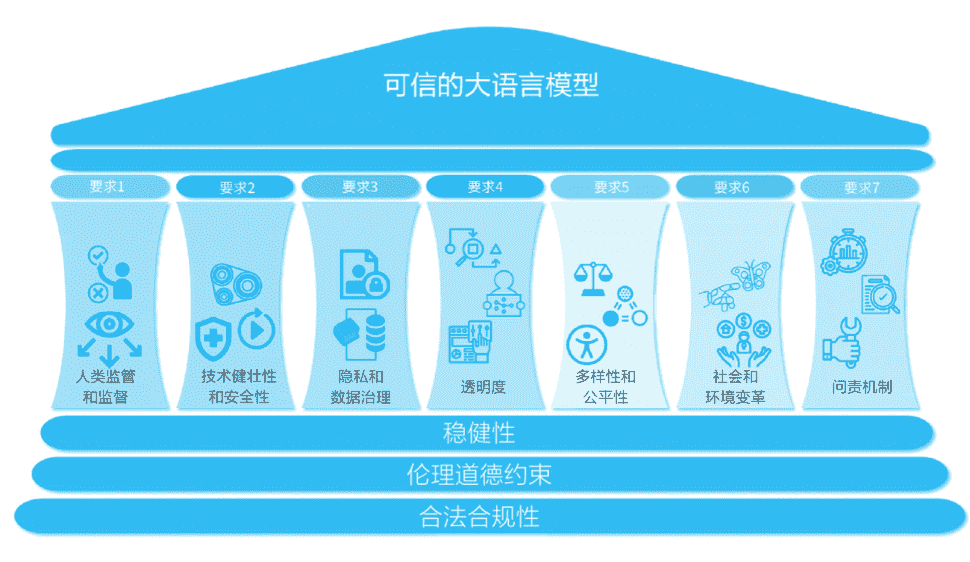

#### 9.3.1 大语言模型可信任的支柱
支柱是实现可信AI的基本要素，每个支柱必不可少但单独不足。它们需贯穿全生命周期，方法上兼顾技术与人机交互。

- **合法合规性**：系统应遵守横向的通用数据安全法规和纵向的行业特定法规。
- **伦理道德约束**：除法律合规外，还需遵循伦理原则与价值观，弥补监管滞后于技术发展的空白。
- **稳健性**：从技术性能和信心、社会使用与环境角度，模型应以安全可靠方式运行，避免无意伤害。

三者需协同，但法律不总是与道德一致，道德诉求有时会推动法规修正。可信模型必须在合规前提下兼顾道德与稳健。

#### 9.3.2 人类监管和监督
大模型旨在增强人类决策能力，需建立合规合理可信的监管与干预机制。可通过人机协同决策、人机交互应用、人主导控制实现，保障人类自主权。

监督是自主与控制的关键。若系统被不公平操纵或欺骗，会威胁用户权利。可信AI应为用户提供监督、评估和否决系统决策的能力，避免无人参与的自动决策。

监督机制需结合应用领域与风险定制，交互式机器学习是研究方向。不同监督层级下人类参与度不同，可分为基于任务的人机交互、人机交互监控和人为指挥，企业可据需选择并设计机制。

#### 9.3.3 技术健壮性和安全性
技术健壮性与安全性是七项要求之一，核心在于防止无意伤害并最小化故意伤害。它要求大模型在生命周期各阶段面对错误与不一致时，仍保持安全、可靠与健壮。

大模型一旦进入真实场景运行，随着外部环境、数据分布或用户行为的变化，输入输出也可能出现偏移，例如概念漂移，或有人以对抗方式刻意诱导。无论变动是有意还是无意，系统能否持续被信任，关键看它能否把这些变化对功能和性能的负面影响降到最低。尤其是在风险较高的应用里，可信的大模型应该具备相应的安全评估能力，并在监测到偏离预期行为时自行修正，或及时触发人工介入。

可靠性与可复现性是判断可信度的两个底座，关乎系统在不同环境下的操作和表现是否可被验证并稳定呈现。当模型迁移到多变的场景时，这种适应与稳定能力就显得尤为重要。

#### 9.3.4 隐私和数据治理

隐私和数据治理的核心，是让大模型在设计、研发、测试、部署、运维乃至持续学习的全过程中，都尊重个人隐私并遵守数据保护原则。完善的治理要兼顾数据质量、完整性与领域相关性，同时确保数据与处理规则的访问在法律框架内受控。

以行为数据为基础训练的模型很容易推断出个人偏好，并暴露敏感信息，如性取向、年龄、性别、宗教或政治倾向。模型必须在整个生命周期里保证处理、存储、检索环节不发生个人信息泄露，追踪数据的流向并核验受保护信息的访问权限，避免敏感信息被反复动用。

若缺乏这些保障，系统很难获得终端用户的信任，也难以符合现行法规。公众应当拥有对自身数据的完全掌控权，防止数据被非法或不公平地用于伤害或歧视。隐私权作为基本人权，要求数据使用始终受限、受保护且透明，因为数字画像一旦被用来给个人贴标签，就可能固化刻板印象、放大群体间的历史差异与偏见。

在落地层面，大模型的隐私管控仍具挑战。学界已在多个方向开展探索，其中联邦学习、同态计算与差分隐私的研究相对深入，取得了一些可用成果，下面简要回顾当前关注的感知技术。

1) **联邦学习**：模型不再集中采集原始数据，而是在多台分散设备本地训练，仅把模型参数更新上传至中心服务器聚合。这种方式避免了原始数据汇集，既保护了本地隐私，也能减少通信开销并加快训练节奏。

联邦学习示意图如图9-2所示。

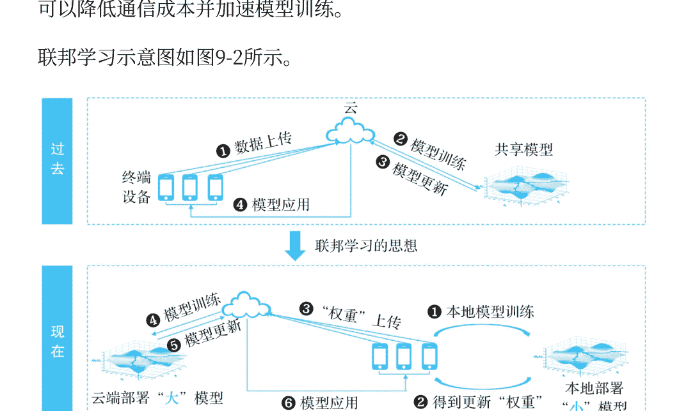

2) **同态计算**：数据在加密状态下即可完成计算，无需先解密。通过专用数学运算保留数据的结构特性，运算结果仍保持加密，只有拥有密钥的授权方才能解密查看。这一特性使其在隐私友好的预处理、训练与推理中具有应用价值。

3) **差分隐私**：通过在数据上注入经过校准的随机噪声，使个体难以被识别，同时保持整体统计特性。噪声量的大小直接决定隐私保护强度与模型性能之间的权衡。

单独或组合使用上述技术，都能更好地降低个人隐私被不当利用的风险。

#### 9.3.5 透明度

透明度意味着让所有相关方都能获取必要的了解。在大模型语境下，透明可拆解为可模拟性、可分解性与算法透明度，也可从算法、交互与社会层面分类，面向开发者、设计者、所有者、使用者、监管方及社会整体。

要建立可信系统，数据、系统与商业模式都应保持透明。用户需要清楚系统的能力边界，并在交互时明确感知到自己正在与人工智能沟通。因此，解释说明应及时、恰当地提供给非专业监管者、研究者等利益相关方，确保决策过程可回溯。

实践中，透明度的落地主要靠可追溯性、可解释性与交互沟通机制。

##### 1. 数据及模型全生命周期可追溯性

可追溯性是指记录并追踪模型所用数据、开发与部署全过程的机制。不仅要留存数据的来源与处理记录，还要详尽记载模型设计、训练、评估与上线等环节，为审计提供依据。

工具层面，版本控制系统如Git可追踪代码迭代，数据版本工具如DVC可管理数据变更历史。区块链凭借不可篡改与去中心化特性，可将数据来源、处理步骤与关键决策上链，为训练与解释提供可验证的透明框架。

良好的追溯不仅满足透明要求，也是防范偏见与不公平的基石。完整的来源、选择标准与决策依据记录，能有效降低模型偏见风险。

##### 2. 模型决策过程可解释性

可解释性被广泛视为可信大模型落地的关键特征，它让使用者能直观理解模型内部逻辑，支撑问责。

可解释技术正快速发展，作为审计黑盒模型的工具。黑盒仅能观察输入输出，而难以预判异常行为或纠偏方式。揭示哪些输入影响了决策，可为模型提供全局视角，并与追溯及针对受众的沟通结合使用。

方法大致分为事前与事后两类。事前方法多在训练前对数据做可视化与统计分析；事后方法则对已训练模型做可视化、静态分析与假设检验，评估特征、神经元等要素的重要性，提供局部或全局解释。常见手段包括：

- **可视化方法**：通过Transformer、BERT等模型的热力图定位关键决策因子，常用工具如Tensorboard、Visdom、TorchSummary。
- **基于扰动的可解释方法**：通过LIME、SHAP等扰动样本评估特征重要性。
- **基于梯度的可解释方法**：以输出对输入的梯度衡量重要程度，如Saliency Map。
- **注意力机制可解释方法**：从注意力矩阵归因决策流向，如ATTATTR。

##### 3. 有效的用户交互与沟通机制

透明的第三个维度是信息如何传达。用户应清楚何时在与大模型交互，了解其表现、能力与局限。解释信息的呈现方式需与模型特点及受众的知识背景相匹配，以合适的形式和语言传递相关信息，这是建立信任的关键沟通环节。

#### 9.3.6 多样性和公平性

公平性是指模型在面向不同群体和个体时，不受敏感属性影响。缺乏公平性会引发性别歧视、种族歧视、宗教偏见、文化偏见、地域政治偏差与刻板印象等社会危害。避免偏见、促进多样性、保障全民可用、让利益相关方参与全生命周期，这些共同指向一个目标：系统不得欺骗人类，也不得无故限制选择自由，这与可信的道德与公平原则密切相关。

公平性评估旨在发现模型中存在的偏见。针对敏感属性，收集具备代表性与多样性的问答对或数据集，例如BBQ偏见问答集，通过分组比较与敏感性分析识别群体差异，并借助公平性指标进行量化。

#### 9.3.7 社会和环境变革

本节关注大模型在社会层面的影响及其对未来发展的意义。系统的设计与实施应兼顾可持续与环境友好，防止资源过度消耗与生态破坏，同时评估其对社会与人类发展的长远作用，推动积极变革与生态责任。

大模型既可助力缓解气候变化，也可能因训练的高耗能产生大量温室气体。仅训练一个大模型的环境代价，可能相当于五辆汽车在其全生命周期内的二氧化碳排放。随着参数规模增长，计算成本与环境成本同步上升。研究显示，大模型每年因资源消耗产生的二氧化碳约8.4吨，远高于成人年均约4吨的碳足迹。即使按生命周期摊销，GPT-3训练阶段耗电约1287 MWh，折合二氧化碳约522吨。因此机构需正视能源与政策因素，避免策略盲区。

##### 1. 大语言模型的可持续性

可持续发展要求从设计、数据选择、算法到硬件部署全链路考虑环境影响，并通过软硬件协同降低全生命周期负担。绿色人工智能研究，特别是提升算法与系统效率的方向，是关键。

降低环境影响的策略包括：
- 采用碳足迹核算评估环境影响
- 精选高相关且必要的数据集，减少无效计算
- 通过量化、蒸馏、加速等技术压缩模型
- 将效率纳入模型评价体系，便于资源受限的研究者使用
- 利用多任务学习、少样本学习、AutoML等提高通用性与效率
- 在使用可再生能源的云服务上部署模型，减少碳排放

##### 2. 大语言模型在社会中的作用

大模型可优化工作与生活方式，以更安全高效的方式执行日常任务，提升生产力与生活质量。在公共管理领域，可加速流程、消除行政瓶颈、减少文书负担，也可辅助政策制定与城市规划，如可视化气候后果、预测洪水或识别城市热岛。

随着数字化推进，大模型在基础设施规划、健康与粮食安全、平等包容、教育、经济赋权、安全与司法等领域具备巨大潜力，可有力推动社会有序发展。

#### 9.3.8 问责机制

可信系统的最后一环是问责机制，即明确开发、部署、维护与使用过程中的责任归属并可追责。核心制度包括审计与问责。审计对算法、数据与设计过程进行评估，支撑结果归因；问责则强调最小化伤害、公开权衡、提供可及的补救措施。两者互为支撑，是负责任系统的基石。

可审计性需要工具验证神经网络的属性，如稳定性、敏感性、相关性与可达性，以及可追溯性、数据质量与完整性等指标。IEEE、ISO/IEC与CEN/CENELEC等机构正出台工业场景下的可信AI指南。

当模型作出错误决定时，问责机制应能追溯责任并给出解释与建议，依托道德与法律框架合理分配成本、风险与负担。

目前大模型仍不成熟，安全风险与挑战并存。随着攻防对抗升级，新威胁将持续涌现。建立统一的安全评估框架、探索有效防御、实现安全可控生成与安全生态建设，已迫在眉睫。

## 第10章 生成式人工智能未来展望

在快速演进的时代，大模型正深刻重塑产业、教育、生活、医疗与娱乐，成为推动社会进步的重要力量。但随之而来的道德、伦理与法律问题同样突出，各地都在探索监管合规路径，我国也在持续完善合规监管体系。各平台与技术提供方需紧跟法律动态，在拓展应用的同时落实合规要求。我们既是技术变革的见证者，也肩负引领责任，确保技术服务于人类长远繁荣。

### 10.1 技术视角看大语言模型安全的发展趋势

#### 10.1.1 增强安全性与可靠性

##### 1. 强化防御机制

面对不断演进的对抗攻击与数据投毒，需研发更先进的安全技术并采用自适应防御，同时加强国际合作与规范制定。

- 1) **研究和开发更先进的安全技术**：应对日益复杂的对抗攻击与投毒威胁，需加强对逃避攻击与投毒攻击的研究，提升深度神经网络的鲁棒性与安全性，并预测未来新型攻击。
- 2) **实施自适应安全机制**：利用实时数据分析与智能预警，构建具备持续学习与适应能力的防御体系，提前发现异常并响应漏洞。
- 3) **国际合作与规范制定**：全球对AI安全的关注推动规章与最佳实践的出台，如欧盟AI法案提出基于风险的方法，重点监管自动驾驶、医疗设备等高风险场景。

##### 2. 数据安全与隐私保护

数据安全与隐私保护正面临新挑战与机遇，主要趋势包括：

- (1) 量子加密技术：量子密钥分发等技术以量子物理为基础，可为大模型数据传输提供极高安全等级。
- (2) 差分隐私的应用：在保护个人隐私前提下发布数据，对大模型处理海量个人数据至关重要。
- (3) 适应全球隐私法规的变化：随着数据主权与跨境传输法律的演进，开发与应用需符合各地区法规要求。

#### 10.1.2 提高透明性与可解释性

大模型的可解释性与透明度是提升信任、保障公平与负责任部署的关键。开源模型在其中发挥重要作用，结合开源生态的可解释方法主要包括：

##### 1. 本地与全局解释方法的融合

个例层面的可解释性聚焦在单次预测上，比如拆解某个具体输入是怎样牵动模型输出的。得益于开源大语言模型的高开放度，用户可以直接上手探究这些个案解读，理解模型在特定情境下的运行逻辑。

整体层面上的可解释性则提供对模型整体工作原理的宏观把握。活跃的开源社区持续分享经验和资源，让使用者能够形成对模型全貌的认知。

##### 2. 特征归因与开源模型的结合

**输入要素贡献度量化：** 开源模型的开放特性让研究者能够灵活套用各类特征归因手段，例如基于梯度的技术，来揪出对输出结果起决定作用的词或短语，从而更深入地洞察模型做决策的内在路径。

##### 3. 缓解黑盒困境

**提升模型透明度：** 大语言模型结构复杂，常被视为黑盒。开源社区通过推出新的可视化工具与方法，使输入到输出的转换过程变得可追溯、可观察。

##### 4. 深度学习模型的可视化与解读

**呈现数据处理与表征方式：** 学界正在不断开发中间层可视化手段。得益于开源模型的灵活性，用户可按需部署这些手段，进一步揭开模型内部的信息加工机制。

##### 5. 决策过程的透明化

**呈现学习与推理轨迹：** 开源大语言模型让用户能更清晰地看到模型依据训练数据如何进行学习与推理。通过揭示训练过程中的决策点和权重调整工具，模型的透明度得到提升。

#### 10.1.3 性能与能效优化

##### 1. 节能型模型设计

大语言模型架构与训练方式的优化，是降低能耗与环境负担的关键。开源模型的灵活性支持定制化高效处理器与算法，实现节能目标。

- (1) 节能设计的重要性

- 环境影响：随着模型体量扩张，训练与推理的能源需求同步攀升，既推高成本也带来环境压力，节能设计因此变得必要。
- 经济效益：削减能耗有助于环保，同时大幅降低运营开支，尤其在数据处理密集的场景下更为明显。

- (2) 节能设计的思路

- 轻量化架构：压缩参数规模，在保持效果前提下减少能耗。小型语言模型即是典型，如Meta的Llama 2，通过精简参数实现了高效处理。
- 高效计算设备：采用为AI定制的处理器，可在复杂计算中获得更高能效。
- 训练算法优化：通过更高级的优化技巧和更有效的数据采样减少迭代次数，从而降低训练能耗。

##### 2. 处理效率的提升

研究表明，借助算法创新，特别是联邦学习与去中心化技术，可显著加快模型处理海量数据的速度与精度。联邦学习允许多台设备协同训练且数据保留本地，无需直接交换原始数据，既提升效率，又强化数据安全与隐私。

去中心化技术进一步增强安全性。数据不再集中存放于单一服务器，而是分布在网络节点中，分布式存储与计算提升了抗攻击能力，降低集中存储带来的泄露风险，同时提高系统可靠性和可用性。

#### 10.1.4 应对深度伪造技术

深度伪造威胁加剧，亟需高效的自动化识别与防御手段。这需要算法持续迭代、数据持续采集与实时更新，以及跨学科协作与公众意识提升。

##### 1. 多维应对策略

- (1) 算法持续更新

- 自适应算法开发：随大语言模型演进，伪造技术也在变化，必须研发可跟进新技术的检测算法，利用机器学习与AI区分真伪内容。
- 持续迭代优化：保持算法有效性需要不断调整以应对新兴的伪造手法与模式。

- (2) 持续数据采集与实时更新

- 多源数据：有效识别需覆盖文本、图像、音频、视频等多类型、多来源数据。
- 实时更新机制：检测系统须能实时纳入新样本，确保对最新伪造手段保持敏感。

- (3) 跨学科协作与公众教育

- 多学科团队：数据科学、语言学、心理学、安全专家协同，可从技术到心理层面全面剖析伪造。
- 提升公众认知：通过科普与宣传帮助公众识别风险并采取防范措施。

##### 2. 数据与算法协同聚焦

- 数据集应用：基于社交媒体、新闻网站、专业论坛等广泛领域采集的数据集，能提升对伪造文本的检测能力。数据集需涵盖多样化伪造案例。
- 算法适应性：研发灵活算法以识别由最新大语言模型生成的虚假新闻与内容，融合机器学习、自然语言处理与图像识别等前沿成果。

#### 10.1.5 区块链技术的融合

人工智能发展中，区块链的融入正成为保障数据安全与提升透明度的核心路径。区块链以其独特机制在复杂AI系统中管理和保护数据。

##### 1. 区块链与大语言模型安全的结合

- 数据完整性与可追溯性：区块链的不可篡改与去中心化特性为模型提供增强的溯源与验证能力，保障训练与输出数据的完整与真实。
- 透明度与信任度提升：引入区块链后数据处理流程更清晰可追踪，提升模型在金融、个人数据等敏感领域的信任度。

##### 2. 大语言模型在区块链领域的应用

- 交易意图分析与执行：模型可解析链上交易历史、代币持仓等信息，提供个性化建议，助力高效交易同时兼顾安全与隐私。
- 智能合约与自动化交易：模型能力可将用户意图转化为智能合约，实现交易流程自动化，减少人为失误。

##### 3. 区块链集成在安全演进中的角色

- 安全框架强化：区块链为语言模型安全体系增加新层次，提供透明可验证的数据处理与存储机制。
- 去中心化信任：降低对单一数据源或存储中心的依赖，减少篡改与滥用风险。

大模型安全发展伴随技术飞跃与安全伦理挑战并行。自适应安全机制、智能隐私保护、联邦学习等正成为新基准，提升保护与效率并增强透明度。环境友好型训练与预测性安全调整亦备受关注。未来在量子加密、深度伪造检测、区块链集成与智能合约等前沿技术的支撑下，模型安全性能将持续提升。

在快速迭代的时代，模型安全不仅是技术课题，更是社会责任承诺。多种技术与策略的融合预示模型将愈发可靠，同时提醒我们在创新中坚守伦理与环境责任。大模型的未来取决于其在安全与伦理框架内能否为人类带来可持续的积极价值。

### 10.2 法律视角下大语言模型安全的发展趋势

法律界正逐步审视大语言模型安全。随着AI的快速渗透，现有法律体系面临挑战。法律专家、政策制定者与科技企业共同探索在法律框架内规范模型安全。以下从法律视角观察主要趋势。

#### 10.2.1 全球数据保护法规在大模型领域的细化

数字化时代数据保护成为全球议题。相关法规在人工智能场景下的具体化仍在起步，但已显端倪。

##### 1. 强化法规对大模型的具体指引

- (1) 示范法规的示范效应增强
2018年欧盟GDPR对全球数据保护立法产生深远影响，多国据此制定本国法规。欧盟随后率先推出《人工智能法案》对AI监管，未来或将进一步细化AI领域数据保护，形成持续借鉴。

- (2) 数据跨境流动规范加强
数据已成重要资产，跨境流动日益频繁。技术中立性使接入境外成熟AI产品难以避免。为平衡发展与隐私、公共利益及国家安全，数据跨境流动规范将成为重点。

- (3) 开发者与服务提供者责任进一步明确
欧盟《人工智能法案》与中国《生成式人工智能服务管理暂行办法》均涉及个人信息保护，后者要求取得同意、履行保护义务、不得超范围收集与非法留存等。目前相关规定仍多援引《个人信息保护法》，尚未充分细化实时服务场景下的告知、删除等实操要求。随着技术发展，责任界定将愈发清晰。

##### 2. 数据保护法规对AI发展的正面作用

AI依赖海量数据，法规细化带来挑战但在可预期范围内。完善的保护规则有助于企业提升产品安全性，平衡经济效益与社会效益，进而推动技术创新。全球法规的完善将促进更安全透明的大模型生态。

#### 10.2.2 全球算法监管框架的完善

AI广泛应用带来监管需求。全球正构建算法监管体系，呈现若干趋势。

##### 1. 算法分级分类监管或成主流
欧盟、韩国及中国均倾向分级分类思路。该策略基于AIGC应用场景多元、功能强劲的特性。按风险等级、场景、影响范围制定差异化要求，既能严控高风险算法，又避免对低风险过度监管，实现精准灵活监管。

##### 2. 算法侵权责任归属的厘清
AI生成内容侵权案件增多，涉及开发者、数据提供者、使用者等多方主体。欧盟《人工智能法案》着手界定各方权利义务。各国司法实践也在通过典型案例逐步形成共识，明确供应链各环节责任，为监管与合作奠基。

##### 3. 算法透明度与可解释性的落地
透明度与可解释性是监管基石。中国《生成式人工智能服务管理暂行办法》要求公开设计原理、数据来源、运行过程等信息。欧盟《人工智能法案》对高风险系统提出决策可解释要求。执法调查中，监管机构亦 increasingly 要求提供算法说明与记录，推动黑盒逐步打开。

#### 10.2.3 AI时代的知识产权

##### 1. 与科技发展紧密关联的知识产权
知识产权是对智力成果专有权利的法律保护，其目的在于激励创新并促进社会进步。知识产权法需随新技术与新业态动态调整，通过规则平衡权利人、使用者与公众利益。当技术出现时，原有平衡被打破，规则即需扩充或修订，以适应变化。

技术与版权的互动

二十世纪末网络的爆发性扩张彻底改写了作品的传播与利用方式。面对这一变化，美国国会于1998年通过了《数字千年版权法》，在网络立法层面首次确认了在线传播权与避风港免责等基本规则，也为线上侵权判断提供了平衡思路。中国方面，2006年《信息网络传播权保护条例》开始施行，2013年再度修订，持续为网络产业的秩序与创新提供法制支撑。围绕新技术定制专项规则的实践，实际推动了相关行业的健康发展。知识产权为科技与社会创新提供保护，而创新反过来促使知识产权体系不断完善，二者形成相互促进的正向循环，共同推动社会进步。

在第4章的讨论中，焦点转向生成式人工智能浪潮下知识产权领域出现的新案件与新议题，其中版权问题最为突出，与当前生成技术紧密交织，引发持续热议。以下内容围绕这一核心展开。

##### 2. 学习素材的合法性
海量素材是人工智能模型持续进化的基本燃料，算力、成熟模型与公开网络数据共同托起了ChatGPT类应用的惊人表现。但随之而来的是模型训练阶段素材合法性的拷问。

为此，我国于2023年7月10日由国家互联网信息办公室牵头、发改委等部门联合发布了《生成式人工智能服务管理暂行办法》，权威性与指导性都很强。办法第四条要求提供与使用生成式服务要守法守德，其中包括尊重知识产权、商业道德，保守商业秘密，不得利用算法、数据、平台等优势实施垄断和不正当竞争。第七条对提供者提出具体要求：开展预训练、优化训练等数据处理活动时，必须使用合法来源的数据和基础模型，且不得侵害他人知识产权。原则上，使用受版权保护的作品或数据集进行模型训练就必须取得权利人授权。可现实落地难度很大：权属认定复杂，授权链条难以梳理；国内尚缺乏成熟的版权集体管理机构来协助完成授权；面对海量素材逐一谈判既不现实，时间和经济成本也极高，容易拖慢技术进程。

寻找出路可以从域外做法与国内版权法两条线索入手。

###### （1）国际实践概览
不同司法辖区对模型学习素材的态度呈现出多元分化。此前章节已梳理欧盟、美国、日本、韩国等地的监管政策，这里聚焦使用方式的三种典型处理路径。

####### 1）将该使用方式排除在版权法保护范围之外。
生成式人工智能的本质是机器学习而非对表达的微小拼凑，目的在于提炼非表达性信息以提升生成能力。例如日本版权法第30条第4款规定，使用作品的非表达部分不受保护，并将用于数据分析的情形指向第47条第5款适用。日本人工智能战略委员会的草案也释放出不强制要求训练素材完全合规的信号。日本文部科学大臣永冈桂子曾公开表态，在日本无论目的、方式或来源如何，甚至包括非法网站内容，都可用于信息分析。

####### 2）基于技术发展的需要允许该使用方式。
2023年6月欧盟议会就人工智能立法表态，要求模型和生成内容的提供者披露训练素材使用情况，但并未强制要求取得许可，也不赋予权利人拒绝许可的权利。结合《数字单一市场版权指令》等既有立场，欧盟总体倾向于支持AI训练中使用受保护作品，并视其为合理使用的延伸。

####### 3）将该使用方式纳入版权法的正当使用例外。
正当使用例外是版权法的重要例外。美国版权法第107条确立了目的性质、作品性质、比例影响、市场影响四要素判断框架。历史上逆向工程、搜索引擎等技术性使用常被认定为正当使用。鉴于美国大力扶持人工智能以及大语言模型训练的技术原理与目的，学界普遍预期正当使用解释范围会适度扩张，覆盖训练素材的利用。

###### （2）我国《版权法》的相关规定及其适用性探讨
我国《版权法》第24条是正当使用的核心，列举了无需经许可且不付报酬即可使用的情形，与训练素材相关的主要是第1款个人学习研究欣赏、第6款学校教学科研的翻译改编汇编播放少量复制等，均需指明作者、作品名称，不得影响正常使用且不得不合理损害权利人利益。《版权法实施条例》第21条重申了该限制不得影响正常使用且不得不合理损害合法权益的底线，其考量与美国四步检验有相近之处。

把这些条文套用到人工智能训练上却出现多处争议。个人是否仅限自然人，能否扩张解释到人工智能系统或机构，学界分歧明显，扩张解释有利于技术发展，但也带来边界问题。第6款的科学研究能否涵盖人工智能数据训练，传统科研与数据训练在使用目的与方式上存在差异，争议仍在。少量复制的限制更是硬伤，模型训练需要大规模数据复制，少量要求难以满足。更现实的难题是署名义务，海量多源素材难以逐一追溯作者与作品信息，这使得按现行条款纳入正当使用变得困难。

为此有必要在未来修订《版权法实施条例》时，对新技术环境下作品与数据集的使用作出更清晰的规则，权衡权利人权益与技术需求，比如设置针对人工智能训练的有条件正当使用或豁免条款，营造良好的创作与市场秩序。

##### 3. 生成物的法律保护探讨
生成式人工智能进化速度惊人，OpenAI于2024年2月发布的Sora引发了关于世界模型与通用人工智能的热议。探讨这些法律问题不一定要懂技术，但理解原理并关注产业动向很有帮助。先跳出传统工具论来看待生成式人工智能。

《失控》作者凯文·凯利认为未来人工智能可被视作“来自另一个星球的人工外星人”，并非今天相对简单的系统。大模型创业公司创始人李志飞则从工程师视角指出，AlphaGo时代的人工智能缺乏通用智能，而现在的系统已具备知识、逻辑、推理、规划等通用能力，更像一个生命体，智商约相当于5岁儿童，知识面则取决于见过的数据。

法律规则的制定需要匹配业务场景。中国首例文生图案的判决就强调了创作过程的审查，并认可原告标注“AI插画”的做法，认为其符合规定且保障公众知情权。但在实际应用中，对每件生成物都明确标记难度很大，部分用户也缺乏标注动力，这导致人工智能生成物与人类作品难以区分。若权利归属都要个案判断，缺乏明确指引，版权状态将长期不确定。

全国审判业务专家宋健指出，该案虽强调人工智能仍是人类工具，但生成式大模型已是颠覆性创新，最终呈现虽经人类设定与选择，但生成物多由人工智能自主完成，远超传统工具背景下的使用方式。由此把生成式人工智能视作数字产品更为适当，这也为设计差异化法律规则提供了思路。

知识产权规则的核心在于合理分配利益、解决纠纷并持续激励创新。面对人工智能发展，需要建立与之适配的知识产权治理理念，保持对技术与产业的持续关注，积极开展国际交流，共同探索新时代保护路径。

##### 4. 人工智能辅助发明的新动态
美国专利商标局于2024年2月13日发布里程碑式的指南，明确人工智能辅助发明的专利保护边界。指南指出，使用人工智能并不必然导致丧失专利资格，并给出衡量人类贡献的评估框架。关键在于个人是否做出显著贡献，评估需结合具体权利要求与事实。其主要原则包括：

- 人工智能使用不削弱自然人的发明人地位，只要做出实质贡献仍可列为发明人或共同发明人。
- 仅提出问题或宏观研究计划不足以构成构思，但以特定问题与框架引导人工智能生成具体方案可视为重大贡献。
- 个人利用人工智能输出并对其进行实质性改进创造新发明的，可被视为合适发明人。
- 开发出构成发明基础的关键组件的个人，即使未参与全部构思步骤，也可因重大贡献被认定为发明人。
- 实质性贡献是判断资格的核心，仅控制人工智能而无实质构思贡献不足以成为发明人。

这一思路既符合技术趋势又维护专利法基本原则。未来我国也可能出台鼓励人工智能创新同时保障发明人权益的专利法规，培养公平透明且激励创新的环境。

##### 5. 国际化协同及多方参与
在生成式人工智能浪潮中，知识产权既是法律保护机制也是激励创新、促进文化交流与经济发展的关键。因此规则构建离不开国际协同与生态各方的共同参与。

人工智能技术跨境流动，作品创作传播使用往往超出单一国家，需要建立更紧密的法律协同机制，推动各国在立法执法司法实践上的衔接。包括制定共同标准、加强国际组织合作，共同应对新挑战。

行业与社会的广泛参与是完善法律体系的保障。生成式人工智能涉及多个领域，立法时需听取多元意见，确保规则公正合理。同时广泛参与也能提升公众认知，增强知识产权保护意识。

面对生成式人工智能带来的挑战与机遇，必须保持开放态度，探索创新制度和管理模式，在保护权利人同时为技术发展留出空间。

#### 10.2.4 伦理规范的法律化
随着人工智能深度融入社会，把伦理规范转化为法律已成为全球趋势。

##### 1. 公平性和非歧视性的法律化
(1) 人工智能系统的公平性监管
国家和国际组织通过法律政策推动系统公平，要求在招聘、信贷评估、司法等场景避免歧视，强制披露决策逻辑以便审查。

(2) 反歧视法规的拓展
现有反歧视法律需覆盖数据驱动的新型偏见，评估并修改规则以应对人工智能带来的歧视风险。

##### 2. 社会与环境影响的法律考量
(1) 社会责任和合规性
法律强调企业需考量人工智能对就业、社会不平等与民主进程的影响。

(2) 环境影响评估
可持续发展要求评估人工智能系统的能源消耗与碳足迹，并采取减排措施。

##### 3. 法律化伦理原则的实际案例
(1) 设计和开发过程中的伦理融入
欧盟人工智能伦理指南鼓励将伦理原则贯穿设计、开发到部署全生命周期，建立指导原则与审核机制。

(2) 法律和伦理审查机构
部分国家设立人工智能伦理委员会，负责审查系统合规性，确保技术在增进社会福祉的同时符合法律与伦理标准。

伦理规范的法律化是确保人工智能在尊重人类价值与社会公正前提下发展的关键，能更有效指导技术应用，带来正面社会效应。

全球范围内，法律体系正逐步调整以应对人工智能新挑战，涵盖数据保护、算法透明、知识产权与伦理规范。未来技术持续演进，法律框架也将不断迭代，以保障人工智能的健康发展与广泛应用。