# 大模型落地实战：微调优化与私有部署

## 内容简介
本书以对话系统演进线索为起点，结合人工智能的基本思想，对当前主流的大规模模型技术进行系统梳理，重点呈现私有化部署的完整路径，并对 Transformer 结构展开深入剖析，旨在帮助读者吃透底层原理与工程细节。

行文上力求化繁为简，将晦涩的专业表述转化为清晰易懂的语言，案例设计兼顾严谨性和趣味性，让读者在轻松的阅读体验中自然吸收知识。书中配套完整可运行的代码示例，把抽象概念落地为可直接使用的动手能力。理论部分扎实，实践案例丰富，能够支撑读者在各自专业领域高效应用智能技术。

无论是入门者还是已有开发经验的工程师，都能通过本书掌握模型核心原理与使用方法，学会在本地搭建私有化环境，熟练运用 Transformer，并借助高效的微调策略提升模型表现，成为大模型领域的熟练使用者。

## 前言

### 我们需要什么样的大模型
在技术浪潮来临之际，人们常会思考：何种规模模型更具未来引领力？人工智能是否会占据主导地位？随着技术演进加速，一个常见焦虑随之浮现：这份力量是否会取代人的工作？

答案并不绝对。人工智能正以惊人速度成长，在众多行业已取得实质性成效。规模化模型已成为推动各领域突破性进展的核心动力。尤其是医疗、法律、金融等垂直场景，针对大模型的微调既蕴含独特价值，也面临特殊难题。

本书聚焦大模型微调与落地的关键技术，揭示行业发展前沿。重点放在两个热点议题上：模型的专业知识深度与信息时效性。我们将解析垂直领域模型训练的缘起与意义，讨论迁移学习、部署实施、效果评估等核心环节。以真实案例进行逐层拆解，呈现每个步骤的难点与对策，帮助读者把握最新研究趋势，并灵活应用到自身业务中。

微软联合创始人比尔·盖茨曾指出，像 ChatGPT 这样的对话式人工智能将与个人电脑、互联网并列，成为一代技术里程碑。

英伟达总裁黄仁勋则把 ChatGPT 称为人工智能领域的 iPhone，认为它标志着一个更大时代的开启。ChatGPT 的出现引发社会强烈关注，因其代表了大规模模型与预训练技术在自然语言处理方面的重大突破。它不仅提升了人机交互质量，也为智能助手、虚拟人物等创新应用打开了空间。

本书面向对人工智能感兴趣的读者设计。即便读者缺乏深厚的计算机背景，只要具备基础知识即可按书中步骤在个人电脑上完成实践。我们准备了完整代码示例，目的在于把理论转化为可操作技能。

本书的表达偏向把晦涩术语讲清讲透，案例叙述严谨且富有温度，让读者在愉快的阅读中自然理解人工智能知识。

人工智能时代已经到来，被淘汰的不是人，而是不会使用人工智能的人。让我们共同迈入新时代，挖掘人工智能的无限潜能。

编撰过程中，我们得到诸多科研同行的支持。特别感谢中国科学院大学的刘宜松，他负责代码编写并确保代码的准确性与实用性。王凯、孙翔宇、张明哲对代码进行细致审阅，保证质量与可靠性。

中国矿业大学的刘威负责图文制作，提升阅读体验。

同时感谢多家单位支持：东莞市红十字会提供珍贵行业数据；英特尔中国有限公司的张晶提供技术测试，保障书中技术的先进性与实用性；广东创新科技职业学院创始人方植麟提供模型数据，为研究提供坚实基础。

出版环节，电子工业出版社编辑秦淑灵提供大力帮助与专业建议，使本书顺利出版。

向所有贡献者致以诚挚谢意！本书希望成为探索人工智能奥妙的指引。诚邀读者与专家批评指正，宝贵意见请发送至邮箱：aidg0769@sina.com。

作者

# 第1章 从零开始大模型之旅

本章系统梳理对话机器人技术的起源与发展脉络，并前瞻通用人工智能的广阔前景及其对社会的深远影响。开篇回溯对话机器人的历史源头，引领读者看见人与机器的互动如何从简单的指令应答，演进为具备情感共鸣与理解能力的复杂对话。这一演化既体现技术层面的飞跃，也折射出人类对机器沟通能力不断提升的期待。

随后聚焦通用人工智能的核心议题，分析其如何从基础感知走向创造性思维，标志着人工智能正迈向更综合、更自主的新阶段。结合当前技术现状，本章展望其在教育、医疗、制造等多个领域的落地潜力，暗示行业变革的曙光；同时也不回避实现愿景所面临的挑战，并探讨未来发展的策略方向。

总体而言，本章既是对对话机器人与通用智能发展历程的深度反思，也是一次面向未来的展望，为读者描绘出一幅由创新技术驱动、充满可能性的智慧时代图景。

## 1.1 对话机器人历史

### 1.1.1 人机同频交流
图灵测试由计算机科学家艾伦·图灵于1950年在论文《计算机器与智能》中提出，用以衡量机器智能水平。若一台机器能通过电传与人类对话而不被识破机器身份，则认为其具备智能。该假说为“会思考的机器”提供了论证，也回应了诸多质疑，成为人工智能哲学领域的早期重要命题。

无论是资深算法工程师还是人工智能新手，都对这一经典测试不陌生。它检验机器能否达到与人类相近的智能水准，使对话难以区分真伪。

图灵测试提出后长期受到深度学习研究者的关注，成为众多研究的参照。各类模型常以类似图灵测试的方式进行非正式验证，依据与真人相似度、文本逼真度来评价性能。


人们对人工智能在非语言领域的优异表现已渐成常态，例如人脸识别已广泛应用却鲜有人惊讶，多数人对人工智能的认知仍停留于此。但当人工智能在语言交流上逼近或超越人类，如 ChatGPT 引发热议时，却带来强烈担忧，部分国家迅速出台治理方案，甚至有学者呼吁暂停研发。这种反应让社会陷入前所未有的焦虑与讨论。

### 1.1.2 人机对话发展历史
人机对话在人工智能演进中占据核心位置，ChatGPT 正是这一长进程的集中体现。如图1-2所示，自1946年通用计算机 ENIAC 问世以来，人机对话就一直是研究焦点。1950年图灵在《计算机器与智能》中提出图灵测试，以对话场景评估机器智能，奠定研究基础。1956年“人工智能”一词正式确立，人类向构建智能系统迈出关键一步。

进入20世纪60年代，1966年诞生的机器人 ELIZA 将人机对话边界拓宽，尝试模拟心理治疗对话，为机器承担辅助心理咨询功能探索了可能。1971年，聊天机器人 PARRY 成为首个在限定情境下通过图灵测试的实例，尽管对话能力有限，但标志着自然对话智能系统的重要里程碑。


1995年，用户可定制的聊天机器人 ALICE 上线，通过简洁交互规则实现个性化人机对话。同年，ALICE 在国际罗伯纳奖上三度获奖，该奖项以标准化图灵测试选拔最接近人类的程序，彰显了当时聊天机器人智能化的成就。

进入21世纪，人机对话进入新阶段。2011年，IBM 问答系统 Watson 在竞赛中击败人类冠军，取得突破性进展。2014年，微软聊天机器人小冰实现了持续深入的对话交流。2018年，深度学习的预训练范式兴起，几乎重塑了聊天机器人与问答系统的研究路径。

2021年，谷歌发布基于先进预训练模型的聊天机器人 LaMDA，其问世再次引发对聊天机器人智能水平的讨论，部分人认为它展现出类人思维特征，也因此产生广泛争议，促使研发在创新与伦理间保持平衡。

ChatGPT 在2022年11月和2023年3月引发全球高度关注，成为焦点。OpenAI 发布的 ChatGPT 及后来的 GPT-4，不仅树立了通用人机对话的新标杆，也宣告新时代到来。学界普遍认为这是智能梦想的实质性飞跃。

总体看，人机对话从基于规则的简单设计，到统计学习革新，再到深度学习普及，直至预训练模型崛起，技术迭代迅速。每一次革新都显著提升了模拟人类智能的能力。未来在巨型模型的技术突破与应用拓展上仍值得期待。

## 1.2 人工智能

### 1.2.1 从感知到创造
人工智能可粗略分为弱智能与强智能。弱智能聚焦特定任务或狭窄领域，呈现高度专业化形态，如语音识别、图像解析等系统，在限定范围内表现优异，但超出范围则能力受限。强智能则追求类人普适智能，能跨领域工作、学习新知、理解复杂情境、灵活应对变化，涵盖语言理解、逻辑推理、问题求解等，力求复现人类心智全貌。其发展前景宏大，但也伴随更艰巨的挑战。

在此基础上，研究者探索实现路径。三种智能层次如图1-3所示。

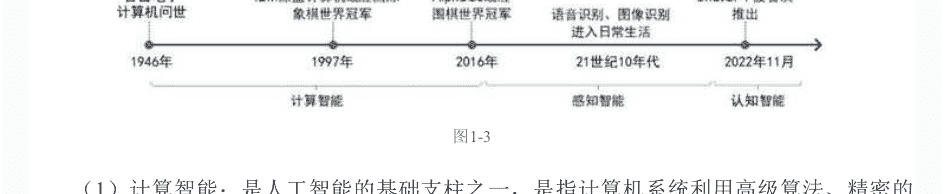

（1）计算智能：人工智能的基础支柱之一，指计算机系统借助高级算法、数学模型与大数据处理技术执行复杂运算与数据分析的能力。它涵盖高速数值计算，也包括模式识别、数据挖掘、优化决策等高级应用，是现代智能服务的强大引擎。

（2）感知智能：扩展机器和现实世界的接口，使计算机通过传感器、摄像头、麦克风等设备捕捉并解读外部环境信息。核心包括计算机视觉与语音识别，以及触觉等感知方式的模拟，为自然高效的交互奠定基础。

（3）认知智能：致力于模仿人类高级思维，使计算机不仅能处理数据，还能理解信息、学习新知、进行推理、解决问题并创新。它涵盖机器学习、自然语言处理、知识图谱等多个方向，力求通过深度学习等技术掌握语境理解、情感识别、抽象思维等能力，推动自动化决策、智能顾问、个性化教育等领域发展。

#### 1. 计算智能
计算智能体现为计算机的高效数据处理与海量存储能力，是现代科技关键要素。它不仅关乎速度和容量，也是信息时代基础设施智慧化水平的体现。

- (1) GPU、TPU、ASIC：GPU 以强大的并行处理能力成为高性能计算代表，专为图形与图像数据处理设计。TPU 与 ASIC 则是为特定领域定制的计算方案，在机器学习、加密货币等领域展现高效能。
- (2) 分布式计算：通过把复杂任务拆分为子任务并分发到多台计算机并行执行，提升资源利用率与处理速度，满足大规模数据处理需求。
- (3) SSD：基于闪存介质的固态硬盘，相较机械硬盘显著提升读写速度、降低延迟并增强可靠性，为系统提供更流畅的数据访问体验。

计算智能是当前研究的重点。尽管像 NVIDIA 的 GPU 算力、Intel 的 CPU 性能在不断提升，但单纯的算力与存储增长并不等同于人工智能。人类长期追求的是在高效低成本前提下，赋予计算机理解、学习、决策等更接近人类智能的特性，推动人工智能向更高阶发展。

#### 2. 感知智能
感知智能的核心是赋予计算机对外部环境的敏锐识别与理解能力，是人工智能技术的重要环节。

## 1.2.1 感知智能
(1) 计算机视觉：作为感知智能的前沿方向，模拟人类视觉认知机制，让机器处理与解析数字图像和视频，进而理解视觉信息。通过算法与深度学习模型，可实现物体识别、场景分析、动作与表情解读等。
(2) 语音识别技术：赋予计算机理解与响应语音指令的能力，为自然语言处理与语音交互奠定基础，打破传统交互壁垒，使无接触通信成为可能。
(3) 感知技术：涵盖力反馈、触摸感应、形变监测、温度感知、纹理识别等多种传感方式，使机器能模拟触觉、感知物理变化、监测环境温湿度并辨别材质。
(4) 其他传感器技术：激光雷达、红外传感器、摄像头、麦克风、气味探测器等高精度传感器的集成，拓宽机器感知的边界，实现距离测量、障碍探测、生物特征识别、声音捕捉与空气质量分析等，为全方位环境感知提供硬件支撑。

总体而言，感知智能是连接虚拟与现实的桥梁，是智能体自主感知、理解并适应外部环境、有效互动与决策的关键。随着技术普及，社会生活已被深刻改变。

#### 3. 认知智能
认知智能旨在赋予计算机类人思维与理解能力，使其能深入解析信息并提出洞察。如图1-4所示，控制论、基于规则的决策引擎、自然语言处理、计算机视觉、深度学习、强化学习、生成对抗网络等关键技术构成了其基石。

(1) ChatGPT：基于深度学习的对话生成模型，已广泛应用于对话系统、聊天机器人与智能客服，支撑自动问答、日常交流、个性化建议与即时问题求解，极大拓展人机交互深度。
(2) Stable Diffusion：用于生成高质量图像的技术，在图像生成、编辑与重建等领域取得突破，展现人工智能在创造性内容生产上的潜力。

自2022年下半年以来，以 Stable Diffusion 和 ChatGPT 为代表的技术引领了人工智能的新风潮，标志着认知智能进入合成数据与创造性结果生成的新阶段。这一转变如同为机器装上类似大脑的引擎，极大增强创造性与创新能力。

计算智能支撑这一系列技术革命；感知智能作为连接物理世界与数字理解的桥梁，扮演“感官”角色，其背后驱动力正是控制论、规则决策系统、自然语言处理、计算机视觉等关键技术，共同构成人工智能的“视觉”与“听觉”，使机器得以观察、理解并响应周遭环境。

### 1.2.2 AGI 边界与潜力

#### 1. 跨域迁移的不足
早期的人工智能在设计上很难体现出普适的智能品质，与通用人工智能的目标存在明显差距。根源在于模型与算法大多围绕单一高度专精的任务进行优化。例如面向人脸识别搭建的系统，在分辨个体身份时准确率很高，但其能力边界被牢牢限制在人脸范围内，难以延伸到其他视觉任务。同样，针对某类缺陷检测定制的模型，可以迅速揪出预设瑕疵，一旦检测对象换成另一类缺陷，若不更换模型或重新训练，便难以胜任。

AlphaGo 是最具代表性的案例。它凭借围棋对弈的卓越表现获得全球关注，在围棋内部已达到超人类水平。但其智能被严格限定在围棋规则之内，面对规则迥异的五子棋，无法直接迁移战略思维或游戏技巧，清晰暴露了传统 AI 在非本职任务上的局限。这些事例共同说明了早期 AI 技术与理想 AGI 之间的鸿沟，后者追求的是跨领域、自适应与强泛化的智能形态。

如图1-5所示，随着技术演进，ChatGPT 类模型已显现举一反三的能力，可以把在某一领域学到的知识迁移到另一领域。学界将此现象描述为“涌现”，模型在不同任务中呈现出相近的智能水准。目前最受关注的研究方向是多模态大模型，目标是构建一个能够统一处理多种媒体类型的模型。一旦取得突破，几乎所有数据类型都可以进入同一训练流程，并实现跨类型生成。比如由剧本直接生成电影、由需求文档直接生成可执行应用、由口头描述直接生成三维人物。按此逻辑，可以大胆假设任何数据都可被模型学习跨模态转换规律。

即便如此，真正实现 AGI 仍充满未知。现有进展仅仅打开了探索之门，门后具体是什么、当前路径是否正确尚无定论。尽管不确定性很高，我们仍需要提前思考 AGI 出现后将如何重塑产业与个人生活。某些变化已在悄然发生，必须提前研判其潜在影响，为未来的挑战与机遇做好准备。

#### 2. AGI 对行业的冲击
如果 AGI 真正到来，信息技术界将迎来一次根本性变革。影响不仅在于生产效率提升和成本下降，更深远地体现在对软件系统本身的重塑上。从这一终点倒推，可以明确当前技术演进的方向。

衡量一项技术是否具有革命性，通常看它是否需要几乎所有软件系统都进行改造甚至重构。图形界面、Web 2.0、移动互联网都符合这一标准。AGI 同样如此，它将重新定义软件系统的“接口”，无论是面向用户的界面，还是系统之间的接口，都将被改写。

目前，用户需要先理解计算机能力、掌握各类软件操作，再把意图拆解成一系列操作步骤才能得到结果。AGI 出现后这一流程会被大幅简化。人类可以用“说话”的方式与计算机交互，语言不便时改用打字，打字繁琐时直接口述期望结果，计算机即可呈现。用户可以即时口述修改意见，系统迅速响应。交互方式的改变会极大提升体验，鼠标点击和屏幕触摸的频率将显著下降，工作效率提高，生活也更便利。

人类通常被定义为会使用语言和会使用工具。AGI 先解决了语言沟通问题，下一步就是工具的选择与使用。AGI 的出现让人类能更便捷地调用计算机与软件系统，进一步推动信息技术的发展。

如表1-1所示，当前大模型的探索正集中在四大热点，牵引着 AI 新一轮创新浪潮。

（1）预训练：模型在海量文本上先行训练，学习广泛的语言结构和语境知识，为后续特定任务应用奠定基础。BERT 与 GPT 已成为 NLP 领域的基石，极大拓宽了语言理解与生成的边界。

（2）模型微调：是预训练模型落地的关键步骤。针对特定任务用少量相关数据做额外训练，模型就能学会情感分析、问答或文本生成等具体功能，灵活性与效能兼备，更贴合实际应用需求。

（3）AI Agent：是迈向更全面人工智能形态的关键一步。它不仅处理文本，还能在多模态环境中互动、决策和学习。通过整合语言理解、环境感知与决策制定能力，智能体能在复杂场景下辅助工作、参与社交对话、在虚拟世界执行任务。

（4）提示工程：是近年来的研究热点，强调通过精心设计提示词来引导模型输出，激发潜能，甚至无需额外微调即可完成新任务。包括创建启发性指令、构建 Prompt 模板、Prompt 知识注入等策略。提示工程降低了定制化 AI 解决方案的门槛，也为探索模型内在逻辑和泛化能力提供了新视角。

预训练、模型微调、AI Agent 和提示工程相互交织，共同塑造更智能、高效、人性化的数字未来。

表1-1 大模型四大热门技术路线

| 技术路线 | 预训练 | 模型微调 | AI Agent | 提示工程 |
| :--- | :--- | :--- | :--- | :--- |
| 技术原理 | Transformer 架构 | LoRA 微调 | 基于 Function Calling (函数调用) | 角色扮演 |
| 应用场景 | 通用人工智能 | 垂直推理场景 | 工作流场景 | 非严谨的场景 |
| 数据要求 | 通用大数据集 | 独有的垂直数据 | 工作流 sop | 无 |
| 成本 | 千万级（不可控） | 百万级（不可控） | 十万级（可控） | 数千级（可控） |
| 实现难度 | 实现难度极高，结果的不确定性最高 | 实现难度较高，结果的不确定性较高 | 实现难度较高，结果相对可控 | 实现难度一般，结果可控 |
| 人员要求 | 算法类人才 | 算法类人才 | 懂业务和 LLM 的工程性人才 | 懂业务的人才 |
| 算力投入 | 极高 | 较高 | 一般 | 一般/无 |
| 门槛 | 极高 | 较高 | 较高 | 简单 |

### 1.2.4 本书研究重点
在 AI 新纪元，大模型正被塑造成不可或缺的基础设施，如同水电与一日三餐，支撑各类应用与创新。然而，预训练大模型的建设与维护极其复杂，通常只有技术和资金实力雄厚的少数企业能承担。因此，本书不聚焦如何从零研发、训练自己的大模型，而是聚焦以下两点。

#### 1. 核心一 微调本地化与提示工程
对大多数人而言，我们不是资源创造者，而是使用者。真正的挑战是如何最大化发挥大模型价值，学会有效使用才是关键。

对本书而言，第一步是充分利用大模型，即掌握模型微调；第二步是深入驾驭大模型，即掌握提示工程。因此，本书优先阐述这两方面。

大模型训练成本高昂是推动微调的重要原因。模型参数众多，从头训练会消耗大量算力并带来高昂费用。性价比角度看，让每家公司都自建大模型并不现实。选择已有预训练模型进行目标任务微调，更为理性、高效且省钱。

提示工程为大模型使用提供了一种见效快、上手简单的途径。好的 Prompt 能挖掘大模型的潜力边界，充分释放能力，但很多人不了解编写技巧。细读本书即可体会 Prompt 的写作方法。

本地化也不容忽视。数据隐私与安全问题突出，尤其是敏感数据，企业不愿也不宜上传至第三方大模型服务。拥有自有模型并进行微调，既能保障数据安全，又能针对特定需求优化性能。

#### 2. 核心二 垂直场景与 Agent 构建
垂直领域与 Agent 应用开发同样是热门方向，但提示工程和微调并不能覆盖所有问题。

提示工程上手简单，但缺陷明显。大模型对输入序列长度有限制，而提示工程往往产生较长的 Prompt，直接导致两大问题：

（1）推理成本随 Prompt 长度增加而急剧上升，成本甚至与长度平方成正比。
（2）过长 Prompt 易被模型截断，严重影响输出质量与准确性。

垂直领域的企业通常拥有海量自有数据，提示工程因局限性难以达到预期效果。而基于自有数据的微调也有短板，企业数据持续更新，微调虽比预训练成本低，但时间与算力成本仍很高，微调速度难以匹配数据更新频率，导致信息滞后。这是本书试图解决的重要技术问题之一。

## 1.3 本章要点回顾
本章从对话机器人历史切入，探讨通用人工智能的概念与演进，开启大模型之旅。首先梳理了人机同频交流与人机对话的发展脉络，呈现对话机器人从简单问答到复杂互动的演变。然后解析通用人工智能的内涵，从感知到创造力的递进，描述 AI 在各领域的应用与进步。最后展望通用人工智能的未来方向，并明确本书的技术关注点，帮助读者把握大模型最新进展与应用。

# 第2章 私有化部署实战
本章以开源架构 GLM-4 与 GLM-3 作为示例，为读者揭开大模型私有化部署的技术面纱，详细了解具体操作步骤与实施要点。

大模型私有化部署本身并不复杂，但会牵涉大量依赖库的安装与更新，同时对硬件有一定要求，对初学者而言仍存在门槛。为降低难度，我们针对 GLM-4-9B-chat 和 ChatGLM3-6B 准备了两份详细的部署指南，并按不同硬件环境量身定制。目标是为初学者提供一条清晰易懂的学习路径，快速掌握并有效利用这一中文开源大模型。

跟随本教程，读者可逐步掌握大模型私有化部署的各流程环节，积累必要的技能与知识，更从容应对部署中可能遇到的难题。我们还提供实用建议与技巧，助力优化方案，提升模型性能与稳定性。该教程将成为初学者的得力助手，为其 AI 学习之路打下坚实基础。若硬件资源受限，也可选择魔塔社区等云服务平台提供的免费算力资源来满足需求。

## 2.1 运行环境搭建

### 2.1.1 系统与硬件

1. 操作系统
开源大模型普遍支持 Windows、Linux、Mac 部署，Python 及深度学习相关框架也具备跨平台能力。

面向大模型服务，Linux 在资源利用与性能上更具优势，尤其在服务器多卡并行与服务优化等企业级场景。实践中建议使用 Ubuntu 系统。Windows 更符合多数用户使用习惯，但在大规模计算任务的性能与资源管理上相对逊色。

后续章节将分别阐述 GLM 大模型在 Ubuntu 与 Windows 平台的部署方法。核心步骤基本一致，但在涉及 QLoRA 量化微调的部分，Windows 系统支持有限，因此强力推荐使用 Linux 如 Ubuntu 进行操作，以获得更优微调体验。

2. 硬件配置要求
本书提供 GLM-4-9B-chat 和 ChatGLM3-6B 两种本地化部署方案，读者可根据自身配置选择。其中，GLM-4-9B-chat 推理时约需 21~22GB 显存，采用 INT4 量化后可降至约 15GB。注意，即使量化，微调仍需约 32GB 显存，请根据硬件谨慎评估。若配置不足，可转用 ChatGLM3-6B，其标准版需至少 13GB 显存与 16GB 内存，INT4 版显存需求降至 5GB 以上，内存 8GB 以上，大幅降低门槛。ChatGLM3-6B 微调最低显存要求 16GB，符合多数消费级显卡标准。

本章将重点讲解如何在纯净 Ubuntu 22.04 与 Windows 系统上搭建 GPU 环境，部署、运行并使用这两类模型。

### 2.1.2 核心依赖组件
部署大模型前，安装显卡驱动是首要环节。GPU 能否被正确使用，与环境依赖、驱动匹配度密切相关，安装中常因依赖缺失或环境冲突出现报错，导致第一步即受阻。

需要准备的部分简述如下。

（1）NVIDIA 显卡驱动：Linux 默认不自带驱动，需自行安装。CUDA 之外的核心就是驱动，硬件需驱动才能被软件调用。NVIDIA 的 CUDA 版本与 GPU 驱动版本存在匹配关系。

（2）CUDA：由 NVIDIA 开发的编程语言扩展、库与工具集合，让开发者能在 GPU 上并行计算。若已装 11.8 版 CUDA，未来 PyTorch 升级后若对 CUDA 提出新要求，则需同步更新 CUDA 与 GPU 驱动。建议安装最新版显卡驱动与对应 CUDA。

（3）cuDNN：NVIDIA 面向深度神经网络的加速库，用于加速深度神经网络的训练与推理。

### 2.1.3 显卡驱动安装

显卡驱动是激活与管理显卡硬件的桥梁，连接操作系统与显卡，确保二者顺畅协作。优化显卡运行效率后，图形处理与相关软件应用都能充分利用硬件资源。

驱动不仅驱动硬件以最佳状态运行，还包含必要硬件配置信息，使系统与软件能准确与显卡互动，实现预期功能。

#### 1. 准备驱动安装包
在高性能计算服务器场景中，NVIDIA GPU 备受青睐，其在机器学习与深度学习领域表现突出。常见型号包括 GTX4080、GTX4070 Ti 与 GTX4060 Ti，计算能力强且能效比高。

##### 驱动获取
如图2-1所示，NVIDIA 官网提供产品下载入口。欲了解全系列产品阵容，可访问官网查看最新产品介绍与详细规格，以便根据需求选择。

在下方下拉列表中进行选择，针对您的 NVIDIA 产品确定合适的驱动。

| 产品类型 | GeForce |
|---|---|
| 产品系列 | GeForce RTX 40 Series |
| 产品家族 |  |
| 操作系统 |  |
| 下载类型 | Game Ready 驱动程序 (GRD) |
| 语言 | Chinese (Simplified) |

图2-1

#### 2. Windows 安装步骤
进行大模型实践与部署时，台式机若选用 ChatGLM3-6B 并量化，至少需 2060 即 6GB 显存显卡或更高；笔记本至少需 3060 即 8GB 显存或更高。需注意，移动端显卡受功耗与散热限制，性能与显存通常弱于同型号台式机显卡，选择设备时应充分考虑实际需求。

如图2-2所示，在 Windows 搜索栏打开“计算机管理”，若未安装 NVIDIA 显卡驱动则需下载安装，若已安装可跳过本节。

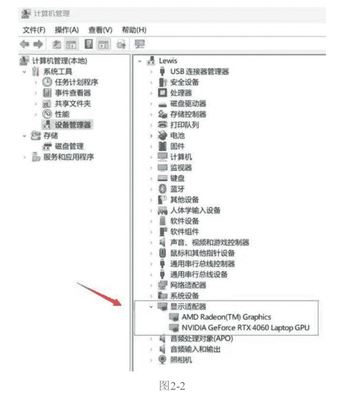

（1）找到之前下载的 Windows 显卡驱动安装包的.exe文件，双击后执行，如图2-3所示，建议选择默认路径。

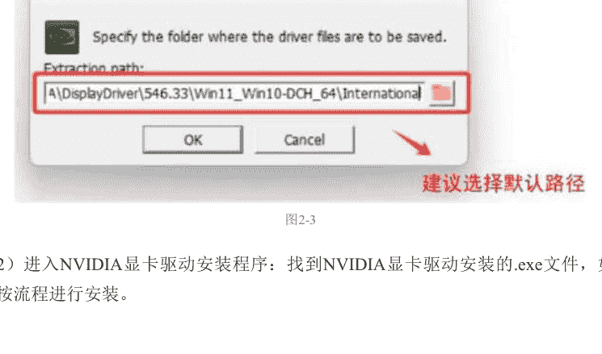

（2）进入 NVIDIA 显卡驱动安装程序：找到 NVIDIA 显卡驱动安装的.exe文件，如图2-4所示，按流程进行安装。


图2-4

（3）验证 NVIDIA 安装程序是否已完成，执行到最后一步的结果如图2-5所示。


图2-5

（4）安装完成后，需要重启计算机才会生效。验证方法是：重启计算机后，在桌面上单击鼠标右键，出现如图2-6所示的图标则表明安装成功。


图2-6

#### 3. Ubuntu 显卡驱动部署

在 Ubuntu 上为 NVIDIA 显卡装驱动，常见做法归为两种。

- 1. 手动部署官方提供的 NVIDIA 驱动，整体较为稳妥，但过程中可能需要额外排错。
- 2. 借助系统自带的“软件和更新”里的附加驱动功能在线升级，操作更省事，前提是机器能联网。

实际我们多在本地离线的服务器上作业，出于网络安全考虑，很可能无法联网，因此倾向手动安装。无论走哪条路，前置准备都差不多：先补齐依赖，再把系统默认的 nouveau 驱动屏蔽掉。具体流程如下。

- 1. 补装依赖。

在终端按顺序执行下列指令，如代码2-1所示。

代码2-1

```
sudo apt-get update
sudo apt install gcc
sudo apt install g++
sudo apt install make
sudo apt-get install libprotobuf-dev libleveldb-dev libsnappy-dev libopencv-dev libhdf5-serial-dev protobuf-compiler
sudo apt-get install --no-install-recommends libboost-all-dev
sudo apt-get install libopenblas-dev liblapack-dev libatlas-base-dev
sudo apt-get install libgflags-dev libgoogle-glog-dev liblmdb-dev
```

- 2. 屏蔽默认驱动。

安装 NVIDIA 驱动前必须先停用系统自带的 nouveau。 如代码2-2所示，打开终端编辑 blacklist.conf 或新建 blacklist-nouveau.conf。

代码2-2

```
sudo gedit /etc/modprobe.d/blacklist.conf
```

如代码2-3所示，在文件末尾写入对应配置并保存。

代码2-3

```
blacklist nouveau
options nouveau modeset=0
```

如代码2-4所示，用 update-initramfs 更新 initramfs 镜像，完成后重启系统。重启后在终端执行 lsmod 用于核验。

代码2-4

```
sudo update-initramfs -u
lsmod | grep nouveau
```

若没有任何输出，说明 nouveau 已被禁用。

③如图2-7所示，定位之前下载好的 Ubuntu 显卡驱动。

用 cd 进入存放驱动的目录，用 ls 查看文件列表。确认型号与平台无误后开始下载，下载完成后务必赋予执行权限，否则无法进入安装向导。


执行如代码2-5所示的命令授予执行权限。

代码2-5

```
sudo chmod 777 NVIDIA-Linux-x86_64-525.53.run #给下载的驱动赋予可执行权限
sudo ./NVIDIA-Linux-x86_64-525.53.run -no-opengl-files -no-x-check
#安装
```

进入安装界面后依次选择 Continue → 不安装 32 位兼容库（选 no）→ 不运行 X 配置（选 no）。最后执行 reboot 重启主机。图形界面恢复后在终端输入 nvidia-smi 命令。

### 2.1.4 CUDA 环境搭建

装完驱动后不少读者会产生误解，以为 nvidia-smi 显示的 CUDA Version: 12.2 就代表本机已装 CUDA 12.2。实际上该数值反映的是当前驱动所能兼容的最高 CUDA 版本，并非已安装的 Toolkit。也就是说，现有驱动最多支持到 12.2，若强行装更高版本 CUDA 很可能不兼容，需要慎重。

显卡驱动与 CUDA 是两个独立环节。驱动负责让系统识别并调动显卡，CUDA 则是 NVIDIA 提供的用于通用并行计算的平台，面向深度学习、科学计算、图形处理等高强度任务。当应用需要调用 GPU 并行算力时，CUDA 必不可少；若仅做网页浏览、办公或轻度图形，单纯驱动即可。考虑到大模型实践的需求，CUDA 安装是必要的。

CUDA 提供了两类编程接口：CUDA Runtime API 与 CUDA Driver API。

（1）CUDA Runtime API 属于更高层的抽象，会自动处理大量底层细节，上手更快、效率更高，绝大多数开发者会优先选用。

（2）CUDA Driver API 则提供更精细的控制，可直接与驱动交互，多用于对硬件资源做深度调优、任务调度等进阶场景。

安装 CUDA 实质上是安装 CUDA Toolkit，其版本决定了可用的 Runtime API 与 Driver API。Toolkit 包含 nvcc 编译器、各类库与配套工具，装好后即可编译运行 CUDA 程序。

#### 1. 驱动包获取

进入 NVIDIA 官网，如图2-8所示，选择想要的 CUDA 版本进行下载。


图2-8

在 Linux 下需按系统配置挑选对应的发行版等参数。如图2-9所示，Linux 提供三种安装包形式以适配不同部署需求。

- （1）runfile（local）：本地安装包，所有文件打包进一个 runfile，下载后直接执行即可离线安装，无需额外联网。
- （2）deb（network）：网络安装，通过 APT 添加官方源后在线安装，便于后续更新维护。
- （3）deb（local）：先下载 deb 包到本地，再用包管理器导入安装，适合网络受限或离线部署。

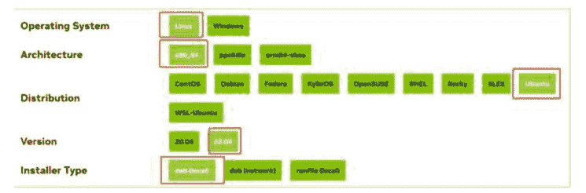

Windows 情况如图2-10所示，提供两种安装包可选。


具体如下。

- （1）exe（local）：完整本地安装包，体积约 2GB，包含所有组件。
- （2）exe（network）：网络安装包，体积约 300MB，本质是安装管理器，安装时在线拉取组件，适合节省初始下载流量或只装部分组件的用户。

#### 2. Windows 安装指引

在 Windows 下，可在命令提示符执行 nvcc -V 查看 CUDA 版本，确认是否已成功部署，如图2-11所示。

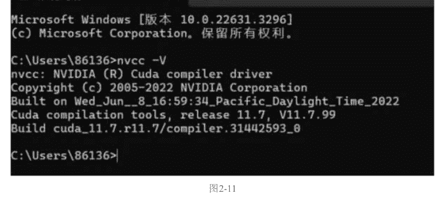

如图2-12所示，打开安装目录：C:\Program Files\NVIDIA GPU Computing Toolkit\CUDA\。

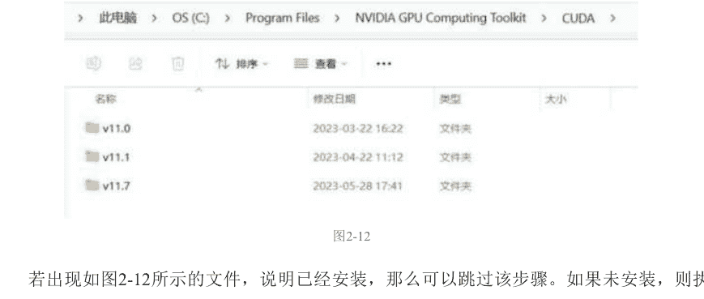

如果已存在对应文件夹，可直接跳过。若未安装，按以下步骤操作。

（1）双击本地安装包，如图2-13所示。


（2）勾选需要安装的组件，如图2-14所示。


（3）选择安装路径，默认即可，如图2-15所示。


（4）添加环境变量，如图2-16所示，便于后续多版本切换。

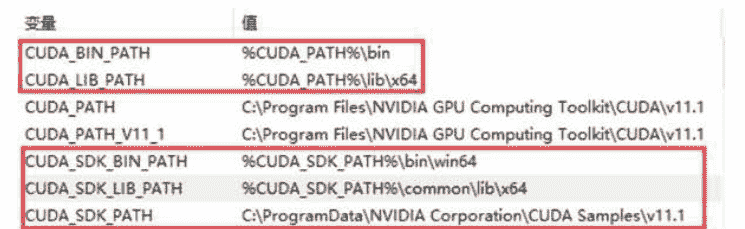


（5）再次执行 nvcc -V 验证，如图2-17所示。

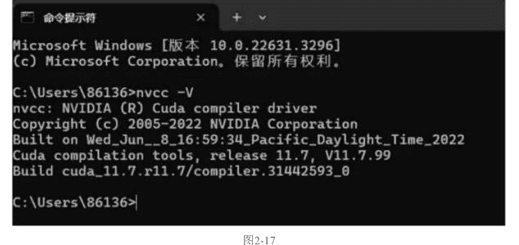


#### 3. Ubuntu 安装指引

如图2-18所示，运行 CUDA 程序时实际使用的是与已安装 Toolkit 版本对应的 Runtime API，可用 nvcc -V 查询。

```
(base) egcs@gpuserver:/usr/local/cuda/bin$ nvcc -V
nvcc: NVIDIA (R) Cuda compiler driver
Copyright (c) 2005-2021 NVIDIA Corporation
Built on Thu_Jan_28_19:32:09_PST_2021
Cuda compilation tools, release 11.2, V11.2.142
Build cuda_11.2.r11.2/compiler.29558016_0
```

图2-18

也可以进入 /usr/local 查看是否存在 cuda，如图2-19所示。

```
(base) egcs@gpuserver:/usr/local$ cd /usr/local/
(base) egcs@gpuserver:/usr/local$ ls
bin  cuda  cuda-11.2  cuda-11.4  etc  games  include  lib  man  sbin  share  src
```

图2-19

若已安装可直接跳过，未安装则按以下流程。

- （1）apt install nvidia-cuda-toolkit 会装入 Ubuntu 仓库中的版本，可能不是最新或所需版本，适合本地开发编译 CUDA 代码。

如图2-20所示，按官方给出代码在终端执行即可。

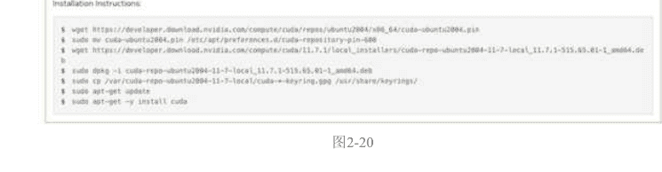

图2-20

- （2）修改配置文件：执行 sudo vim ~/.bashrc，在文件末尾添加代码2-6。

代码2-6

```
$ export PATH=/usr/local/cuda-10.1/bin${PATH:+:${PATH}}
$ export LD_LIBRARY_PATH=/usr/local/cuda-10.1/lib64\n    ${LD_LIBRARY_PATH:+:${LD_LIBRARY_PATH}}
```

- （3）通过代码2-7，检查安装是否正确。

代码2-7

```
cat /usr/local/cuda/version.txt
```

### 2.1.5 cuDNN 部署流程

相较 CUDA，cuDNN 的安装更简洁：下载与系统及 CUDA 版本匹配的压缩包 → 解压后拷贝到指定目录 → 赋予正确权限即可使用。

#### 1. 安装包准备

访问 NVIDIA 官网的 cuDNN 专属下载页。下载前需登录并填写简短问卷。根据图2-21 的指引，按 CUDA 版本挑选，直接点击链接下载压缩包。

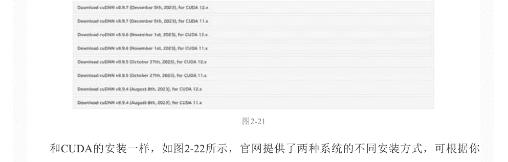

与 CUDA 类似，如图2-22所示，官网提供 Windows 与 Linux 两种系统的下载方式，可按需选择。

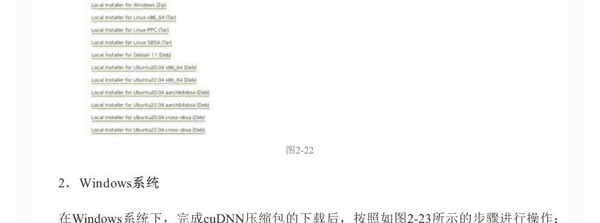

#### 2. Windows 系统

Windows 下下载完成后按如图2-23 的流程操作：解压压缩包，将 bin、include、lib 三个文件夹分别复制到 CUDA Toolkit 的 v11.1 目录下，覆盖原有同名文件夹即可完成安装。

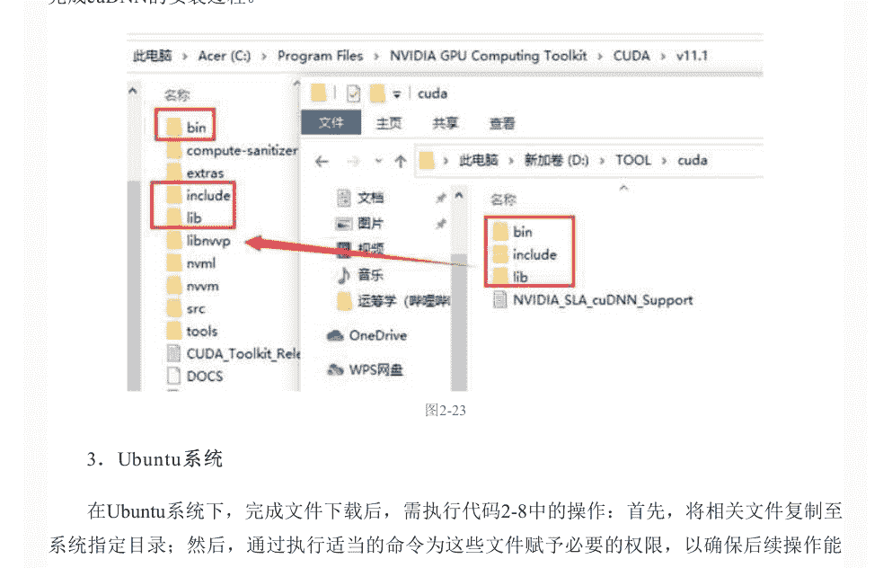

#### 3. Ubuntu 系统

Ubuntu 下下载完文件后，执行代码2-8 中的操作：将相关文件复制到系统指定目录，并赋予必要权限以保证后续调用正常。

代码2-8

```
sudo cp cuda/include/cudnn.h /usr/local/cuda-10.1/include
sudo cp cuda/lib64/libcudnn* /usr/local/cuda-10.1/lib64
sudo chmod a+r /usr/local/cuda-10.1/include/cudnn.h
sudo chmod a+r /usr/local/cuda-10.1/lib64/libcudnn*
```

## 2.2 深度学习环境准备

### 2.2.1 Anaconda 环境搭建

Anaconda 是一款面向科学计算的发行版，广泛用于数据科学、机器学习、科学计算与工程。它内置大量常用库，并提供 Conda 包管理器，可方便地安装、管理和升级依赖。通过 Conda 能创建隔离的 Python 环境，避免版本冲突。相比单独装 Python，Anaconda 更省心，尤其适合初学者。因此在运行大模型时，我们选用 Anaconda 来构建和管理 Python 环境。

在下载模型文件前，需先配置好本地 Python 环境。若此前未安装 Python，建议直接用 Anaconda。它集成了众多科学计算组件和 Jupyter 等编辑器，让开发更便捷。

总体来看，Anaconda 是一个流行的开源 Python 发行版，涵盖数据科学和机器学习常用工具与库，安装简单，能快速搭建完整的科学计算环境。核心模块如图2-24所示。


图2-24

Navigator 是 Anaconda 发行版的图形界面，提供环境管理、包安装与更新、启动 Jupyter Notebook、Spyder、RStudio 等工具的功能，还能访问 Anaconda Cloud。对于不习惯命令行的人尤其友好。它高亮了关键应用，## 1. 安装包准备

为准备 Anaconda 安装包，可访问官方网站。点击图2-25 右上角的“Free Download”按钮开始获取安装程序。


如图2-26所示，官网会根据用户系统自动识别并提供匹配的安装程序，下载过程便捷兼容。


#### 2. Windows 系统

在 Windows 下，通过命令提示符执行 `conda --version` 来检查 Anaconda 是否已安装。若已显示版本信息，则无需重复安装，直接跳过。

```
(base) C:\Users\86136>conda --version
conda 23.1.0
(base) C:\Users\86136>
```

(1) 定位已下载的安装包，双击启动安装程序，参考图2-28。

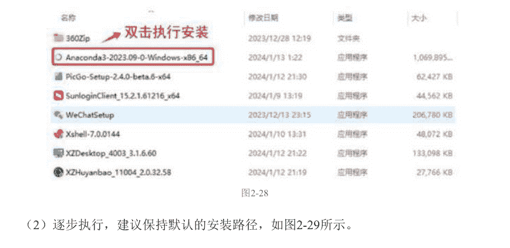

(2) 按向导逐步操作，安装路径建议保持默认，参考图2-29。

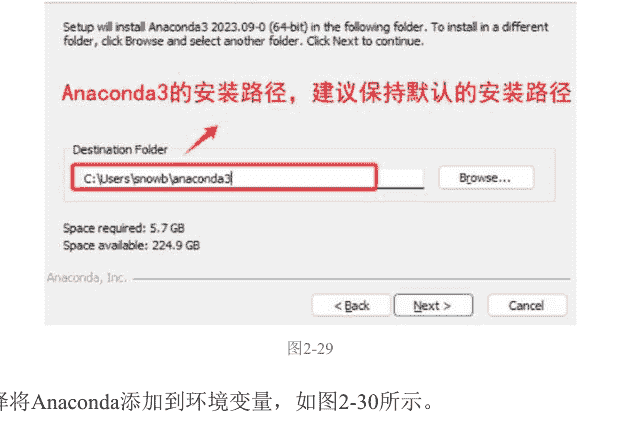

(3) 勾选把 Anaconda 写入系统环境变量的选项，参考图2-30。

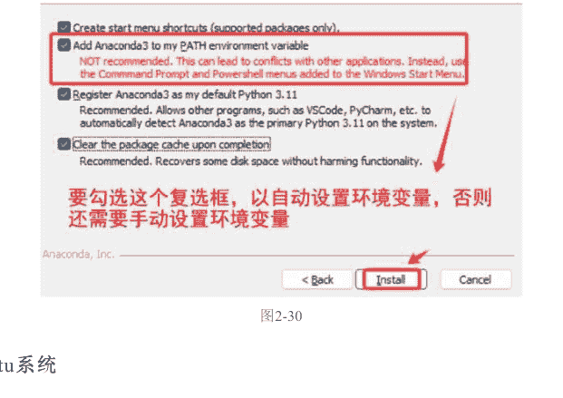

#### 3. Ubuntu系统

参考图2-31，先运行 `conda --version` 来判断 Anaconda 是否已在系统里。若已存在，可直接跳过后续步骤。


(1) 依据图2-32 的提示，打开终端开始安装流程。


安装进行时请耐心等待，完成后目标目录下会生成 anaconda3 文件夹，见图2-33。


(2) 配置环境变量，参考代码2-9 执行相应指令。

### 代码2-9

```
vim ~/.bashrc
```

打开配置文件后，在末尾追加代码2-10 的内容，注意将 PATH 指向你实际安装 Anaconda3 的路径，保存退出时输入 `:!wq` 回车即可，见图2-34。

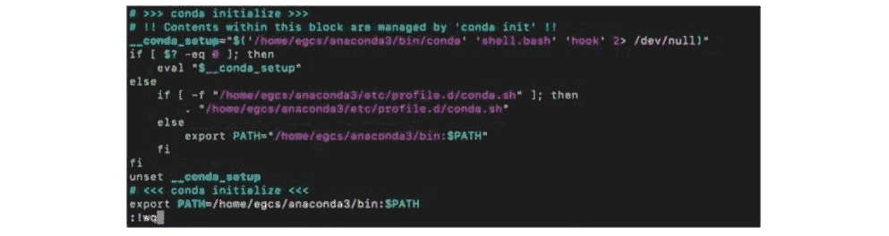

### 代码2-10

```
bash
# 我的 anaconda3 的安装路径是 /home/egcs/anaconda3
export PATH=/home/egcs/anaconda3/bin:$PATH
```

执行 `source ~/.bashrc` 让刚才的环境变量改动立刻生效。

### 2.2.2 服务器环境下的环境启动

图2-35 重点呈现了 Jupyter Notebook 这个工具。它提供交互式的笔记本环境，代码编写、执行、数据浏览、文档记录和可视化结果都能在一处完成，大幅提高研发效率与协作体验。在生产场景下，数据科学家和工程师可以就地在服务器上测试、调优模型，避免本地与服务器间反复搬运数据和代码，既提升安全性，又缩短从原型到上线的时间，保持项目推进顺畅与模型性能持续改善。

在配备图形界面的 Windows 上启动 Jupyter Notebook 很直接，执行 `jupyter-notebook` 命令即可。现实中大量生产部署任务运行在 Linux 服务器上，模型规模大、流程复杂，远程启动 Jupyter Notebook 的能力就显得格外关键。

(1) 启动Anaconda。

① 本地具备图形界面时，先启动 Anaconda。配置好环境变量后，通过终端输入 `anaconda-navigator` 打开管理界面，其使用方式与 Windows 基本相同。参考图2-35，点击右侧 Jupyter Notebook 的 “Launch” 按钮即可进入。

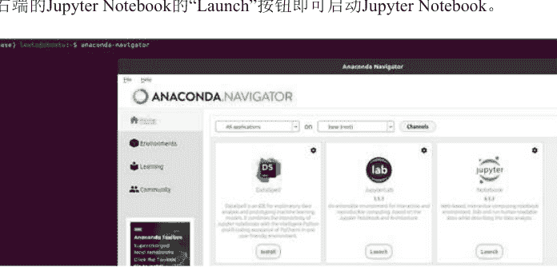

② 若服务器没有图形界面，需通过 SSH 远程登录，然后在服务器端运行代码2-11 中的指令来启动 Jupyter Notebook。

```
bash
jupyter notebook --no-browser --port=8890
```

启动时控制台会输出一个 Token，请记录下来，见图2-36。

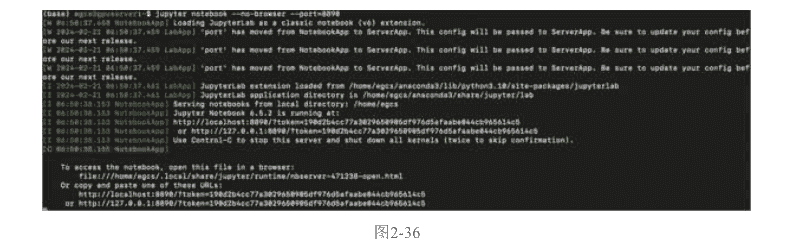

图2-36

(2) 在本地打开新的终端，执行代码2-12 中的命令，系统会提示输入远程服务器的登录密码。

### 代码2-12

```
ssh egcs@"服务器 IP 地址" -L127.0.0.1:8893:127.0.0.1:8890
```

(3) 此时本地浏览器即可访问远程 Jupyter 服务，打开浏览器在地址栏输入 `http://127.0.0.1:8893` 即可，见图2-37。

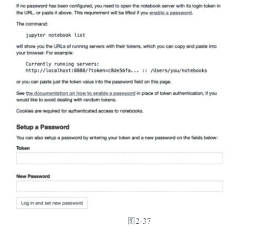

图2-37

最后在登录页填入图2-36 中记录的 Token，即可完成远程访问。

### 2.2.3 安装PyTorch

在大模型与复杂深度学习项目里，PyTorch 是开发者广泛采用的首选框架。动态计算图让模型搭建和调试更灵活，便于尝试新架构和快速迭代。配合对 GPU 的良好优化与庞大的社区生态，训练大语言模型、图像识别等高级 AI 任务都能更高效地落地，推动大模型研究与应用持续突破。

(1) 先确认显卡驱动所支持的最高 CUDA 版本，以便匹配合适的 PyTorch 版本，参考图2-38。

```
(base) egcs@gpuserver:~$ nvidia-smi
Wed Feb 21 07:08:42 2024
+-----------------------------------------------------------------------------+
| NVIDIA-SMI 460.106.00   Driver Version: 460.106.00   CUDA Version: 11.2     |
|-------------------------------+----------------------+----------------------+
| GPU  Name        Persistence-M| Bus-Id        Disp.A | Volatile Uncorr. ECC |
| Fan  Temp  Perf  Pwr:Usage/Cap|         Memory-Usage | GPU-Util  Compute M. |
|===============================+======================+======================|
|   0  A40           Off      | 00000000:18:00.0 Off |                    0 |
|  0%   48C    P0    81W / 300W |   6621MiB / 45634MiB |      0%      Default |
|                               |                      |                  N/A |
+-------------------------------+----------------------+----------------------+
|   1  A40           Off      | 00000000:AF:00.0 Off |                    0 |
|  0%   47C    P0    81W / 300W |   7399MiB / 45634MiB |      0%      Default |
|                               |                      |                  N/A |
+-------------------------------+----------------------+----------------------+

+-----------------------------------------------------------------------------+
| Processes:                                                                  |
|  GPU   GI   CI        PID   Type   Process name                  GPU Memory |
|        ID   ID                                                   Usage      |
|=============================================================================|
|    0   N/A  N/A      419386      C   python                         6619MiB |
|    1   N/A  N/A      419386      C   python                         7397MiB |
+-----------------------------------------------------------------------------+
```

图2-38

(2) 在虚拟环境中打开 PyTorch 官网准备安装，见图2-39。

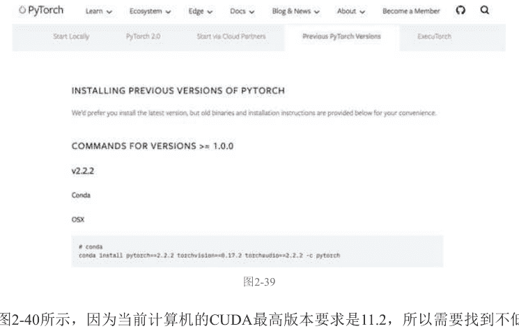

图2-39

图2-40 显示，当前环境 CUDA 最高为 11.2，因此需选择兼容 11.2 及以上版本的 PyTorch。

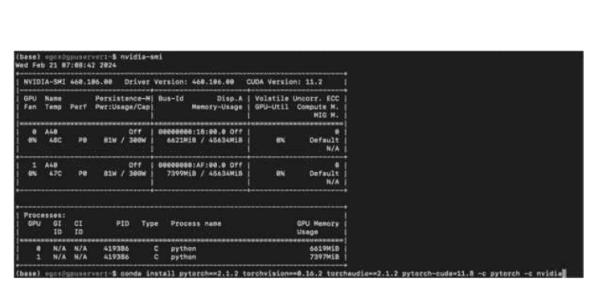

参考图2-41，复制对应安装命令到终端执行即可。该命令会安装针对 CUDA 11.2 优化的 PyTorch 2.1.2 版本，其二进制文件对应 CUDA 12.1 环境。


| 版本 | 包管理器 | 操作系统 | 安装命令 |

| :--- | :--- | :--- | :--- |

| v2.1.2 | Conda | OSX | `conda install pytorch==2.1.2 torchvision==0.16.2 torchaudio==2.1.2 -c pytorch` |

| v2.1.2 | Conda | Linux and Windows | `# CUDA 11.8`<br>`conda install pytorch==2.1.2 torchvision==0.16.2 torchaudio==2.1.2 pytorch-cuda=11.8 -c pytorch -c nvidia`<br>`# CUDA 12.1`<br>`conda install pytorch==2.1.2 torchvision==0.16.2 torchaudio==2.1.2 pytorch-cuda=12.1 -c pytorch -c nvidia`<br>`# CPU Only`<br>`conda install pytorch==2.1.2 torchvision==0.16.2 torchaudio==2.1.2 cpuonly -c pytorch` |

(3) 验证安装。安装完成后，可在 Python 环境中运行代码2-13 来检查 GPU 版 PyTorch 是否可用。

### 代码2-13

```
import torch
print(torch.cuda.is_available())
```

图2-42 显示，若输出为 True，说明 GPU 版 PyTorch 已正确安装并可调用 CUDA；若为 False，则表明未安装 GPU 版本或 CUDA 配置有误，需回溯检查步骤。

```
python
(langchain2) egcs@gpuserver:~$ python
Python 3.10.9 (main, Mar  1 2023, 18:23:06) [GCC 11.2.0] on linux
Type "help", "copyright", "credits" or "license" for more information.
>>> import torch
>>> print(torch.cuda.is_available())
True
>>> 
```

图2-42

## 2.3 GLM-3和GLM-4

### 2.3.1 GLM-3介绍

GLM-3 是通用语言模型架构的第三代。ChatGLM3 在此基础上面向对话场景优化，由智谱 AI 与清华大学 KEG 实验室于 2023 年 10 月联合发布。开源模型 ChatGLM3-6B 在保持前代流畅对话与易部署特性的同时，新增了以下能力：

- 1. 底座模型升级，基于更大规模数据深度训练，成为 2023 年 10B 参数以下最强模型，多项国内评测中排名领先。

- 2. 采用全新 Prompt 设计，支持连贯多轮对话、工具调用、代码执行等高级用法。

- 3. 开源覆盖更广，提供基础与长文本版本，学术研究可免费使用，商业用途需注册。

- 4. 性能突出，ChatGLM3-6B 在 10B 级别中处于顶尖，推理能力接近 GPT-3.5；功能大幅升级，涵盖多模态理解、代码解析、网络检索与 Agent 优化等，逼近 GPT-4 水准。

图2-43 展示的 AI Agent 是一种可自主执行任务的智能体，善于将复杂问题拆解、分阶段规划并动态调整，具备自修复调试和反馈学习能力。ChatGLM3-6B 提供的 Function Calling 功能，体现了模型在推理和复杂问题处理上的核心进展，也是本次迭代的关键，也是性能提升的重要支撑，使其成为国内首个支持 Function Calling 的中文大模型。

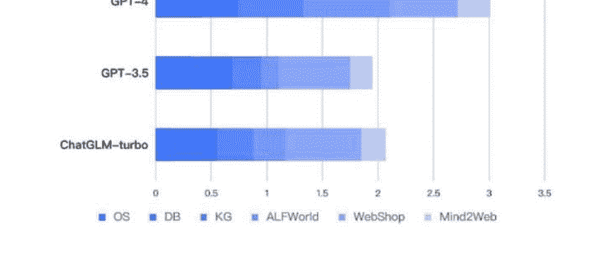

ChatGLM3 系列的开源在 AI 社区引发热议，标志着大模型发展的重要节点。开源阵容共三个版本：ChatGLM3-6B、ChatGLM3-6B-base 与 ChatGLM3-6B-32k，各自侧重不同，使用场景多样。

- 1. ChatGLM3-6B 为系列旗舰，60 亿参数带来优秀的上下文理解与生成能力，支持深度、连贯且富创造性的对话，适合构建高端对话系统与复杂文本生成应用。

- 2. ChatGLM3-6B-base 在保持高性能前提下做了适度精简，提供更轻量化、易部署的方案，保留核心算法优势，适合对资源占用和响应时延要求严苛的场景。

- 3. ChatGLM3-6B-32k 支持 32k Token 上下文，相较标准配置在处理专业领域或大量专有名词任务时更高效精准，契合行业定制化需求，提升专业文本的理解与生成质量。

总的来看，ChatGLM3 系列开源为科研人员提供了强力工具，也为企业和开发者带来灵活多样的选择，将进一步促进自然语言处理技术在各领域的落地与创新。

### 2.3.2 GLM-4介绍

智谱 AI 于 2024 年 6 月初开源 GLM-4，其综合性能超越 Llama-3，树立了新基准，对国内中文开源大模型社区是重要增益。

通常 100 亿参数以下的模型多用于科研探索，而 GLM-4-9B 以出色表现引发业内关注，被视作中文开源大模型的新高峰。本次发布包含 4 个版本：基础版 base、对话优化版 chat、多模态版 vision，以及长文本版，支持高达 1M 上下文，远超常规的 32k 或 128k 限制。

基础版保留原始未指令微调的状态；对话版经指令优化，对话交互更顺畅；多模态版可融合图文等多模态信息；长文本版相较 ChatGLM3 上一代 8k 上下文，处理能力得到大幅扩展。

自 2023 年初以来，ChatGLM 系列一直是中文开源大模型的焦点，智谱 AI 凭借清华团队的积累，在 ChatGPT 引发的浪潮中快速响应，历经三代迭代至 GLM-4。

经长期验证，GLM-4 表现稳定，日均 Token 处理量达 4000 亿，吸引超 50 万开发者使用。在国内大模型生态中 GLM 系列占据重要地位。本次开源为开发者带来利好，9B 规模易于在中低算力环境运行，集成新一代模型先进特性，是科研探索和企业预研的理想方案。

## 2.4 GLM-4私有化部署

部署 GLM-4 时，依赖库版本需严格对应。官方要求 Transformers ≥ 4.40.0、Torch ≥ 2.3、Gradio ≥ 4.33，以保证推理性能最佳。为确保 Torch 版本正确，建议严格按官方文档安装对应依赖，以实现稳定运行与最佳性能。

### 2.4.1 创建虚拟环境

用 Conda 搭建的虚拟环境能为每个 Python 项目提供独立运行的沙盒，彻底隔离依赖。每个环境自带一套完整的 Python 解释器和专属库集合，所以不同项目之间互不影响，可以在一个环境里跑 3.8，另一个环境里跑 3.9。部署大模型时建议选用 3.10 及以上版本，这样才能吃满新特性和性能优化。借助 Conda 建立隔离空间，依赖管理更灵活，项目也更稳。可参考代码 2-14 的指令快速新建。

```bash
# myenv 是你想要给环境的名称，python=3.10 指定了要安装的 Python 版本。你可以根据需要选择不同的名称和/或 Python 版本
conda create -n book python==3.10
```

环境建好后别忘了激活，按代码 2-15 的写法执行激活命令即可进入。

```bash
conda activate book
```

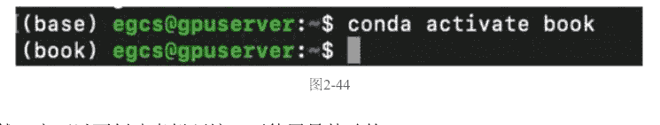

如果觉得麻烦，也可以直接沿用 Conda 自带的 base 环境使用。

### 2.4.2 拉取 GLM-4 代码仓库
GLM-4 的源码与说明文档都托管在 GitHub 上。GitHub 作为主流的代码托管服务，支持版本管理和团队协作。

要拿到项目文件，先打开 GLM-4 在 GitHub 上的地址，见图 2-45。


图2-45

在 GitHub 上把代码带回本地主要有两种做法：通过 Git 克隆仓库，或直接下载 ZIP 包。

克隆本质上是用 Git 命令行把远程仓库完整复制到本地，好处是可以同步上游更新，也能推送自己的修改。克隆命令格式是 `git clone <repository-url>`，其中 `<repository-url>` 就是仓库地址。

图 2-46 建议优先使用 Clone。对 GLM-4 来说，先在页面上复制仓库 URL。

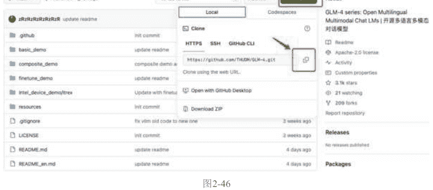

图2-46

正式操作前，参考图 2-47，先装好 Git。

```
(book) egcs@gpuserver:~$ conda activate base
(base) egcs@gpuserver:~$ conda activate book
(book) egcs@gpuserver:~$ sudo apt install git
```

按图 2-48，新建一个专门存放 GLM-4 源码的文件夹。

```
(book) egcs@gpuserver:~$ sudo mkdir ~/project
mkdir: cannot create directory ‘/home/egcs/project’: File exists
(book) egcs@gpuserver:~$ cd project/
(book) egcs@gpuserver:~/project$
```

随后照图 2-49 执行克隆指令，把远程代码拉到本地。

```
(book) egcs@gpuserver:~$ sudo mkdir ~/project
mkdir: cannot create directory ‘/home/egcs/project’: File exists
(book) egcs@gpuserver:~$ cd project/
(book) egcs@gpuserver:~/project$ git clone https://github.com/THUDM/GLM-4.git
```

克隆成功后，本地目录应与图 2-50 一致。

```
(book) egcs@gpuserver:~/project/GLM-4-main$ cd ..
(book) egcs@gpuserver:~/project$ cd GLM-4-main/
(book) egcs@gpuserver:~/project/GLM-4-main$ ll
total 92
drwxrwxr-x  9 egcs egcs  4096 Jun 20 11:24 ./
drwxrwxr-x 20 egcs egcs  4096 Jun 24 10:48 ../
drwxrwxr-x  3 egcs egcs  4096 Jun 24 12:01 basic_demo/
drwxrwxr-x  5 egcs egcs  4096 Jun 20 11:24 composite_demo/
drwxrwxr-x  3 egcs egcs  4096 Jun 20 11:24 finetune_demo/
drwxrwxr-x  4 egcs egcs  4096 Jun 20 11:24 .github/
-rw-rw-r--  1 egcs egcs    25 Jun 20 11:24 .gitignore
drwxrwxr-x  8 egcs egcs  4096 Jun 20 11:24 GLM-4-main/
drwxrwxr-x  3 egcs egcs  4096 Jun 20 11:24 intel_device_demo/
-rw-rw-r--  1 egcs egcs 11360 Jun 20 11:24 LICENSE
-rw-rw-r--  1 egcs egcs 19021 Jun 20 11:24 README_en.md
-rw-rw-r--  1 egcs egcs 18472 Jun 20 11:24 README.md
drwxrwxr-x  2 egcs egcs  4096 Jun 20 11:24 resources/
(book) egcs@gpuserver:~/project/GLM-4-main$
```

### 2.4.3 安装依赖
几乎每个 Python 项目都会带一个 requirements.txt，图 2-51 所示的文件列出了运行所需的所有包及精确版本号。借助它能保证不同机器上装到完全一致的依赖，避免版本冲突。用 pip 一键安装即可： `pip install -r requirements.txt`，省去逐个安装的麻烦。

基础推理依赖之外，第 5 章涉及的微调库 PEFT 和量化库 BitsAndBytes 还需单独装上。

```
# use vllm
# vllm>=0.5.0

torch>=2.3.0
torchvision>=0.18.0
transformers==4.40.0
huggingface-hub>=0.23.1
sentencepiece>=0.2.0
pydantic>=2.7.1
timm>=0.9.16
tiktoken>=0.7.0
accelerate>=0.30.1
sentence_transformers>=2.7.0

# web demo
gradio>=4.33.0

# openai demo
openai>=1.34.0
einops>=0.7.0
sse-starlette>=2.1.0
```

### 2.4.4 获取模型权重
前面只是拿到了代码和运行脚本，真正的 GLM-4-9B-Chat 权重还不在里面，需要去 Hugging Face 下载。Hugging Face 是模型共享社区，专门承载经过大规模训练的大模型文件，这类文件体积庞大，需要专业的存储和分发。

GitHub 只负责代码、文档等轻量内容，对单文件大小有限制，不适合存放几十 GB 的模型权重。Hugging Face 则为大模型量身打造，提供高效的存储和下载通道。入口见图 2-52。


进入页面后，参考图 2-53，把所需的所有模型文件全部下载下来。

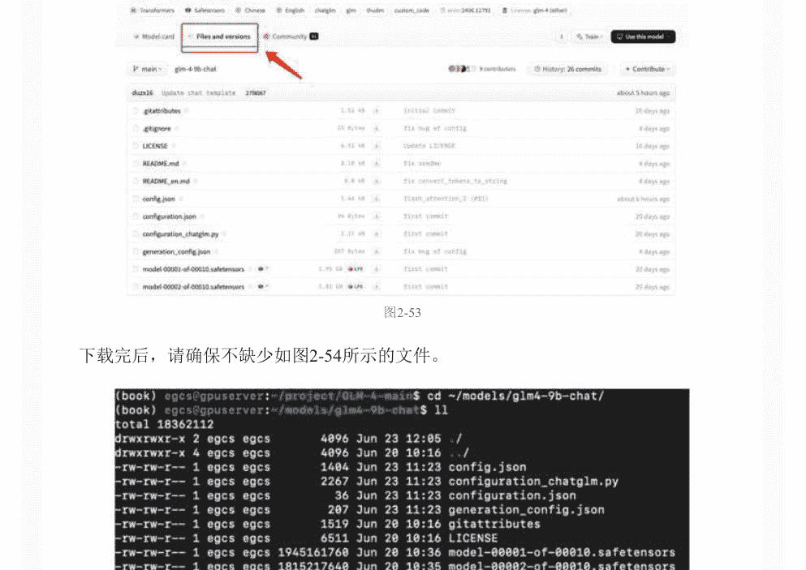

图2-53

下载完成后核对一下，图 2-54 列出的文件都应完整存在。

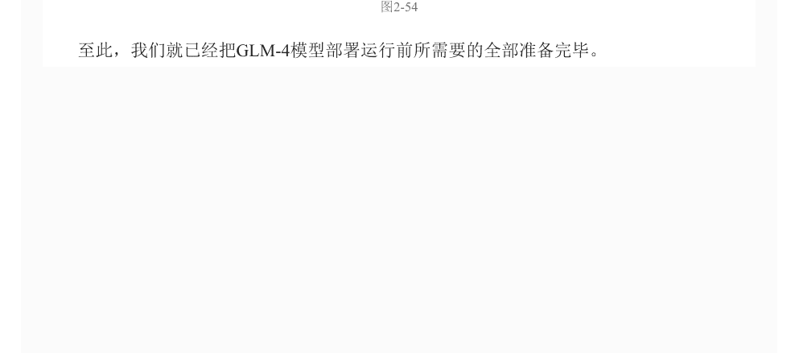

图2-54

到这里，GLM-4 部署前的所有准备工作就已就绪。

## 2.5 GLM-4 运行示例
GLM-4 仓库自带几套上手 demo，方便快速体验。下面按难度递进逐一说明。

### 2.5.1 命令行交互对话
命令行交互最简单，直接在终端对话，不需要额外界面。官方提供脚本 trans_cli_demo.py，见图 2-55。

```
(book) egcs@gpuserver:~/project$ cd GLM-4-main/basic_demo/
(book) egcs@gpuserver:~/project/GLM-4-main/basic_demo$ ll
total 92
drwxrwxr-x 3 egcs egcs  4096 Jun 24 12:01 ./
drwxrwxr-x 9 egcs egcs  4096 Jun 20 11:24 ../
-rw-rw-r-- 1 egcs egcs  3704 Jun 20 11:24 openai_api_request.py
-rw-rw-r-- 1 egcs egcs 22368 Jun 20 11:24 openai_api_server.py
drwxrwxr-x 3 egcs egcs  4096 Jun 21 12:57 project/
-rw-rw-r-- 1 egcs egcs  4475 Jun 20 11:24 README_en.md
-rw-rw-r-- 1 egcs egcs  3995 Jun 20 11:24 README.md
-rw-rw-r-- 1 egcs egcs   415 Jun 20 11:24 requirements.txt
-rw-rw-r-- 1 egcs egcs  3099 Jun 20 11:24 trans_batch_demo.py
-rw-rw-r-- 1 egcs egcs  3899 Jun 24 12:01 trans_cli_demo.py
-rw-rw-r-- 1 egcs egcs  3870 Jun 20 11:24 trans_cli_vision_demo.py
-rw-rw-r-- 1 egcs egcs  3713 Jun 20 11:24 trans_cli_vision_gradio_demo.py
-rw-rw-r-- 1 egcs egcs  4989 Jun 20 11:24 trans_stress_test.py
-rw-rw-r-- 1 egcs egcs  6707 Jun 20 11:24 trans_web_demo.py
-rw-rw-r-- 1 egcs egcs  3517 Jun 20 11:24 vllm_cli_demo.py
```

图2-55

启动前只需改一处配置，图 2-56 显示需要把模型加载路径指向本地已下载的 GLM-4-9B-Chat。

```python
import os
import torch
from threading import Thread
from transformers import AutoTokenizer, StoppingCriteria, StoppingCriteriaList, TextIteratorStreamer, AutoModel

#MODEL_PATH = os.environ.get('MODEL_PATH', 'THUDM/glm-4-9b-chat')
MODEL_PATH = "/home/egcs/models/glm4-9b-chat"
```

图2-56

改完后执行 python cli_demp.py 启动，成功则进入交互式对话界面，如图 2-57。

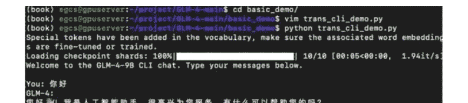

### 2.5.2 Gradio 网页对话
网页对话是目前主流的交互形式。GLM-4 官方提供了两套 Web Demo，功能相同，只是底层框架不同。这里先看基于 Gradio 的版本。Gradio 是 Python 生态里快速搭建模型演示界面的工具，几行代码就能生成输入输出界面，适合原型验证和展示。

对应脚本是 web_demo_gradio.py，图 2-58。同样修改模型路径后，用 Python 直接运行即可。

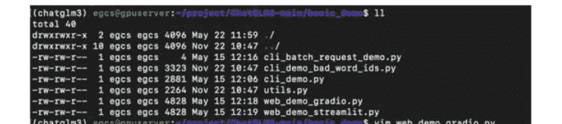

启动正常会自动打开浏览器，图 2-59，即可在网页上直接对话。

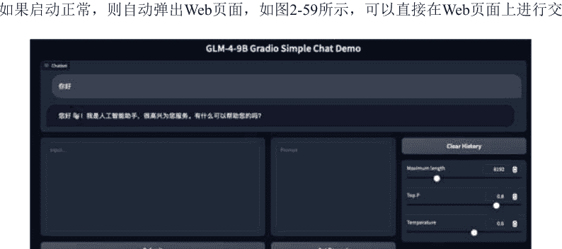

### 2.5.3 OpenAI 兼容 API 调用
GLM-4 还支持 OpenAI 风格的 API 调用。现在很多 AI 应用都遵循 OpenAI 的接口规范，提供兼容接口意味着 GLM-4 可以几乎无缝接入现有生态，只需少量改动就能把 ChatGPT 换成 GLM-4-9B-Chat。

所谓 OpenAI 风格调用，就是用 OpenAI 客户端的 completions.create 接口去调用本地模型，图 2-60。把 model 参数设为 GLM-4-9B-Chat 即可，接口统一能大幅提升开发效率。

```python
from openai import OpenAI
import os

api_key = os.getenv("OPENAI_API_KEY")
client = OpenAI(api_key=api_key)

response = client.chat.completions.create(
    model="gpt-3.5-turbo",
    messages = [
        {"role":"user","content":"hello,my name is lewis"}
    ]
)
response.choices[0].message.content


你好
```


要使用这种方式，首先安装 requirements.txt 里的依赖，核心是 openai 和 vllm。随后运行 openai_api_server.py。详细流程如下。

如想长期提供 API 服务，需要启动 open_api_demo 目录下的脚本，见图 2-61。

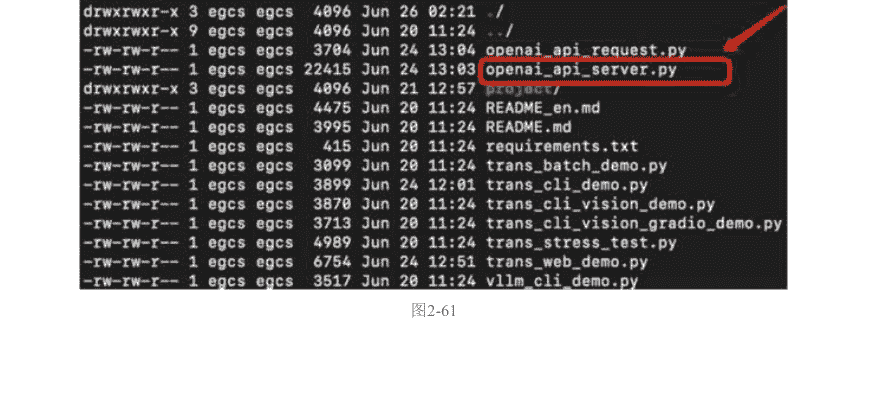

安装完后按图 2-62 执行 python openai_api_server.py 启动，初次加载较慢请耐心等待。需要后台运行可使用 nohup python openai_api_server.py &。

服务起来后，可在 Jupyter Lab 中运行测试代码验证，图 2-62。正常情况下能收到模型回复，终端也能看到实时调用日志。

```python
from openai import OpenAI
base_url = "http://127.0.0.1:8000/v1"
client = OpenAI(api_key="EMPTY", base_url=base_url)
response = client.chat.completions.create(
    model="glm-4-9b-chat",
    messages = [
        {"role":"user","content":"hello,my name is lewis"}
    ]
)
response.choices[0].message.content
'Hello Lewis! Nice to meet you. Is there anything I can help you with today?'

```

图2-62

后续章节还会测试 Function Calling 等进阶功能。

我们主推这种调用方式，既方便学习构建 AI Agent，也能参与国产大模型开源生态。书中后续绝大多数示例都基于本节的 OpenAI 兼容 API，部分仍使用 2.5.1 的命令行方式。

### 2.5.4 模型量化部署

在 GLM-4-9B-chat 的本地落地试验里，默认方案选用 FP16 半精度浮点进行计算，意在兼顾推理速度与精度表现。按此默认配置直接运行相关脚本，大约需要 20GB 左右的显存，这个体量在实际使用中并不轻松，尤其面对硬件配置参差不齐的场景时更为明显。

本书聚焦的正是消费级显卡环境下的大模型轻量化本地化部署，其中 8GB 与 16GB 两类显卡是主要讨论对象。手持 8GB 显卡的读者可以先用 ChatGLM3-6B 来跟随阅读和实验，其部署流程与前述模型大体相近，不过该模型的微调仍要 13GB 显存，依然超出了 8GB 卡的承载范围。我们着力解决的就是显存受限用户的痛点。考虑到并非人人都配备专业级高端硬件，内存优化方案就显得很有必要，于是引入模型量化作为缓解显存压力的核心手段。

表2-1 ChatGLM3-6B不同量化等级下显存最低要求
量化等级与显存需求

| 量化等级 | 最低 GPU 显存（推理） | 最低 GPU 显存（高效参数微调） |
| :--- | :--- | :--- |
| FP16（无量化） | 13GB | 14GB |
| INT8 | 8GB | 9GB |
| INT4 | 5GB | 7GB |

在量化实践里常看到的数值格式有 FP16、INT8、INT4 三种。

1）FP16 半精度浮点数
FP16 用 16 位表示浮点数，相较 32 位 FP32 占用的存储减半，能明显缩小模型体积与显存开销。其精度高于 INT8，适合对精度要求较高但又想降低资源消耗的情形。FP16 仍支持正负号、指数和尾数表达，精度虽不及 FP32，通常已足够维持大多数模型的表现，接近原始模型水平。

2）INT8 8位整数
INT8 以 8 位整数表示，通常采用定点方式，没有小数部分。量化到 INT8 可让模型体积进一步压缩，推理速度也随之提升，占用空间仅为 FP32 的四分之一。量化会带来一定精度损失，但借助量化的训练、对称或非对称量化等技巧，在不少应用里仍能保持可接受的精度。

3）INT4 4位整数
INT4 属于较为激进的量化策略，用 4 位来编码权重与激活值。相比 INT8，它把体积和显存需求压得更低，同时精度挑战也更大。INT4 特别适合极低功耗、资源极度受限的设备，在常规场景下若没有足够鲁棒的模型或补偿技术，精度下降会比较明显。

总体来看，FP16、INT8、INT4 的取舍取决于对模型大小、计算效率和预测精度的不同权衡。FP16 平衡性好，INT8 在可容忍的精度损失下能大幅提升效率，INT4 则面向极致优化需求。当硬件条件满足时，即可进入大模型的本地化部署流程。

以 8GB 显卡为例，采用 4 位量化把权重与激活从 FP16 降到 INT4 后，ChatGLM3 的显存需求被压到约 5GB，资源利用率显著提升，也基本契合市面上绝大多数配备 8GB 及以上显存的消费级显卡。具体做法参考代码 2-16 所示。

```
model_name_or_path = "/home/egcs/models/chatglm3-6b"
model = AutoModel.from_pretrained(model_name_or_path, trust_remote_code=True).quantize(4).cuda()
```

此时，如图 2-63 所示，显存占用情况如下。

```
(book) egcs@gpuserver:~/project/GLM-4-main/basic_demo$ nvidia-smi
Wed Jun 26 05:52:09 2024
+-----------------------------------------------------------------------------+
| NVIDIA-SMI 460.106.00       Driver Version: 460.106.00       CUDA Version: 11.2 |
|-------------------------------+----------------------+----------------------+
| GPU  Name        Persistence-M| Bus-Id        Disp.A | Volatile Uncorr. ECC |
| Fan  Temp  Perf  Pwr:Usage/Cap|         Memory-Usage | GPU-Util  Compute M. |
|===============================+======================+======================|
|   0  A40           Off      | 00000000:18:00.0 Off |                    0 |
|   0%   49C    P0    82W / 300W |   4715MiB / 45634MiB |      0%      Default |
|                               |                      |                  N/A |
+-------------------------------+----------------------+----------------------+
|   1  A40           Off      | 00000000:AF:00.0 Off |                    0 |
|   0%   39C    P8    13W / 300W |      2MiB / 45634MiB |      0%      Default |
|                               |                      |                  N/A |
+-------------------------------+----------------------+----------------------+

+-----------------------------------------------------------------------------+
| Processes:                                                                  |
|  GPU   GI   CI        PID   Type   Process name                  GPU Memory |
|        ID   ID                                                   Usage      |
|=============================================================================|
|    0   N/A  N/A     262003      C   ...nda3/envs/book/bin/python    4713MiB |
+-----------------------------------------------------------------------------+
```

图2-63

对 16GB 显卡的用户来说，如代码 2-17 所示，GLM-4-9B-chat 也可通过量化降低显存压力，使其运行门槛被拉到 16GB 的消费级显卡水平。

代码2-17

```
model_name_or_path = "/home/egcs/models/glm4-9b-chat"
model = AutoModelForCausalLM.from_pretrained(
    model_name_or_path,
    low_cpu_mem_usage=True,
    trust_remote_code=True,
    load_in_4bit=True
).eval()
```

此时，显存占用情况如图 2-64 所示。

```
(book) egcs@gpuserver:~/project/GLM-4-main/basic_demo$ nvidia-smi
Mon Jun 24 13:16:39 2024
+-----------------------------------------------------------------------------+
| NVIDIA-SMI 460.106.00       Driver Version: 460.106.00       CUDA Version: 11.2 |
|-------------------------------+----------------------+----------------------+
| GPU  Name        Persistence-M| Bus-Id        Disp.A | Volatile Uncorr. ECC |
| Fan  Temp  Perf  Pwr:Usage/Cap|         Memory-Usage | GPU-Util  Compute M. |
|===============================+======================+======================|
|   0  A40           Off      | 00000000:18:00.0 Off |                    0 |
|   0%   50C    P0    81W / 300W |  15233MiB / 45634MiB |      0%      Default |
|                               |                      |                  N/A |
+-------------------------------+----------------------+----------------------+
|   1  A40           Off      | 00000000:AF:00.0 Off |                    0 |
|   0%   31C    P8    13W / 300W |      2MiB / 45634MiB |      0%      Default |
|                               |                      |                  N/A |
+-------------------------------+----------------------+----------------------+
```

图2-64

## 2.6 本章小结

本章系统梳理了私有化部署大模型的完整路径。开篇先讲 CUDA 环境的准备，包括基础环境配置、模型运行环境的搭建、显卡驱动以及 CUDA、cuDNN 的安装要点。随后介绍深度学习环境搭建，如 Anaconda 的安装、在服务器上创建并启动环境、PyTorch 库的安装步骤。接着概述 GLM-3 与 GLM-4 的基本概况，并重点展开 GLM-4 的私有化部署细节，涵盖虚拟环境的创建、项目文件的获取、依赖包的安装与模型权重的下载。最后说明 GLM-4 的多种运行方式：命令行交互式对话、基于 Gradio 的 Web 对话应用、类 OpenAI 的 API 调用方式以及量化部署。本章旨在为读者提供可操作的指导，帮助顺利完成大模型的部署与运行。

# 第3章 大模型理论基础

在深入设计领域专属的算法架构前，先对目标领域的数据特性与结构有清晰认知是关键。数据的属性、分布、关联方式以及潜在规律直接决定了算法选型与模型构建的效果。唯有充分把握问题的本质，才能有针对性地设计和调优架构，提升性能。因此在算法研究启动前，对数据进行全面解析是不可或缺的一环，它为后续方案设计提供可靠依据。

本章从数据出发，介绍自然语言处理中常见的时间序列式数据表示以及预处理技术，涵盖分词、Token、Embedding 等基础概念。Transformer 并非凭空出现，本章将从历史演进角度回顾其发展脉络，从早期的统计语言模型、神经网络模型演进至今的大模型。

## 3.1 自然语言领域中的数据

### 3.1.1 时间序列数据

深度学习中算法与架构的设计，始终建立在对领域数据独特特征的把握上。例如图像任务偏好卷积神经网络以捕捉空间结构，而受噪声影响较大的文本数据则常借助自动编码器来去噪重建。因此，理解特定领域的数据特点对架构设计至关重要，这一原则在自然语言处理中同样成立，在探索专属架构前必须先认识数据本身。

在自然语言处理里，序列数据占据核心地位。不同于非序列数据，序列数据内部样本存在明确的先后关系，这种顺序很大程度上决定了语义的理解与解释。处理序列时，样本的排列不仅是形式，更是数据本质的一部分。例如一句话中词语的位置直接影响含义。无论是序列标注、机器翻译还是文本生成，都必须考虑顺序信息。相比之下，图像或结构化数据中样本顺序通常无关紧要，改变顺序或缺失部分不会显著影响含义。而序列数据里，哪怕微小的顺序变动或样本缺失，都可能导致语义完全不同。因此，处理序列数据时要特别注意顺序的保持与数据的完整性。

最具代表性的序列数据类型包括：

1. 文本数据：句子、段落、文章等，词语的排列直接影响语义，如连词成句题中语序错误会导致整句失分。
2. 时间序列数据：股票价格随时间变化、气象中的温度湿度风速、生理信号如心电图心率等。
3. 音频数据：语音、音乐等波形数据，采样点按时间顺序排列。
4. 视频数据：由多帧图像按时间顺序组成连续流。
5. DNA 序列数据：基因序列、蛋白质序列等，排列顺序与生物功能密切相关。
6. 符号序列数据：乐谱、密码等，符号顺序决定含义与功能。

类似情形还有很多。金融领域的股票交易数据依赖价格与成交量的时间顺序；社交媒体上用户的帖子、评论构成时间序列，有助于分析行为模式；环境监测的温度、湿度、气压传感器数据，工业设备的运行状态监测数据，都是典型序列。以此类推，处理序列数据必须让算法理解单个样本，同时学习样本间的关联，而这类关系建模能力已成为现代自然语言处理架构的核心。

### 3.1.2 分词

在自然语言处理中，文本样本间的联系通过语义实现，文字序列里的每个样本通常对应一个词或一个字。英文数据多以词为基本单元，偶尔出现字母或子词；中文数据中一段话对应一个样本块，内部单元则是词或字。

原始文本往往以段落呈现，而深度学习需要把文本切分为词或字作为输入，因此分词是必不可少的预处理。合理的分词能降低模型理解难度并提升效果。例如“轻舟已过万重山”切成“轻舟”“已过”“万重山”三个词，比拆成七个单个字更易把握语义，且避免单个字语义不完整的困扰。

不同语言的分词策略各异。英文等拉丁语系常以空格为界，自然分隔即可获得较好效果。中文、日文、韩文等无空格语言分词难度更高，中文还需考虑断句对语义的影响，不同切分可能带来不同解读。

目前针对不同语言的分词已有成熟手段。

1. 中文分词
中文分词是将连续文本切分为有意义词或词组的基础任务。常见方法包括：
1. 基于词典的分词方法：借助预先构建的词典进行匹配，若文本片段在词典中则保留为词，否则继续细分为字或子单元。常用词典有哈工大、北大等机构资源及开源词典。
2. 基于统计的分词方法：利用语料库统计信息判断词边界。典型做法有最大匹配法，即从左到右或从右到左寻找最长匹配词；还有隐马尔可夫模型，通过学习词语出现概率与转移概率来推断最可能的切分方式。

中文处理入门：分词、词元与语言模型梳理

3. 基于规则的分词方法
规则派做法是先人工抽象出切分规范，再按规范把连续文本切开。规范来源有语言学、语法层面的先验知识，也有字符串模式匹配的经验总结。比如借助汉语的语法特征和词性线索来判定词的边界位置。

4. 基于深度学习的分词方法
随着神经网络能力提升，由数据驱动的分词正成为主流。这类方案不再硬编码规则，而是让模型在海量语料中自行学习分界模式。常见架构包括循环神经网络 RNN、长短期记忆网络 LSTM、卷积神经网络 CNN，以及基于自注意力机制的 Transformer，目标均是从大量文本里学到中文词语的界线。

2. 常用工具
下面这些中文分词系统各有侧重，可按场景挑选。对普通文本预处理，Jieba 已足够；若需要更强的语言学分析或更高精度，可考虑 THULAC、LTP 等。

1. Jieba
开源、易上手且运行稳定。以前缀词典为核心实现，支持精确模式、全模式、搜索引擎模式，还能加载自定义词典并做关键词抽取。

2. THULAC
由清华大学自然语言处理与社会人文计算实验室发布，分词准确率高且效率好。采用词字联合标注模型，同时提供词性标注和命名实体识别功能。

3. 哈工大 LTP
哈工大语言技术平台集成了多种 NLP 组件，分词器是其中之一。基于隐马尔可夫模型 HMM 和条件随机场 CRF，兼顾精度与速度。

4. NLPIR
前身 ICTCLAS，由中国科学院计算技术研究所开发，分词效果稳定。结合词频统计与规则匹配，支持多种分词模式和自定义词典。

（5）斯坦福分词器 Stanford Segmenter
由美国斯坦福大学开发，基于条件随机场模型，分词准确度较高。还支持英文分词和多语言分词。

#### 3. 英文分词要点
英文分词相对直观，单词一般以空格或标点分隔，但特殊文本仍需处理。

- （1）空格切分
最直接的做法是按单词间的空格分离。对规范文本有效，但在网页文本或非标准文本中可能出现连续字符无空格的情况。

- （2）标点切分
英文中标点如句号、逗号、分号等常表示句子结束或短语分隔。可先按标点把文本拆成句子或短语，再对每个片段做单词级分词。

- （3）词干提取 Stemming 和词形还原 Lemmatization
这是一种把单词归约为词干或原型的手段。词干提取通过去掉后缀获取词干，词形还原则是把词转回词典原型。两者常用于统一同一概念的不同变体。

### 3.1.3 Token
Token 是自然语言处理领域的核心概念，读音 [ˈtəʊkən]，没有固定中文译名。可按语境定义为：在当前分词方式下最小的语义单元。分词方式不同，Token 也不同。对英文，它可能是一个单词如“upstair”、一个半词如“up、stair”或一个字母如“u、p、s、t、a、i、r”；对中文，它可能是一个短语如“攀登高峰”、一个词语如“攀登、高峰”或一个字如“攀、登、高、峰”。分词本质上是分割 Token 的过程，因此数据表里一行行样本也就是一个个 Token。

Token 在 NLP 中扮演重要角色。首先它是语义的最小构成，也是深度学习算法处理输入的基本单元。Token 数量反映文本长度和算法处理数据量，直接影响资源消耗和模型性能。OpenAI 等厂商常据 Token 使用制定计价和使用限制，因此 Token 使用量成为衡量大模型吞吐和数据量的标准。表3-1 为 OpenAI API 收费标准，官网可能变更，以实际为准。

表3-1 OpenAI API收费标准

| API版本 | 功能 | 收费方式 |
| :--- | :--- | :--- |
| GPT-3.5 | 完成基础的NLP任务 | 每10万个Token收取4美分 |
| GPT-4 | 提供更先进、精准的NLP功能 | 提供两个档位供开发者选择 |
| ChatGPT | 完成高质量的自然语言会话任务 | 基于使用情况的收费模式 |

OpenAI 官网提供 Tokenizer 工具用于统计文本 Token 数量，并有 GitHub 文档介绍计算方法和经济的计算方式。中文里一个 Token 大约相当于三到五个字符，具体取决于分词粒度，Token 本质上是分词后样本数量。

### 3.1.4 Embedding
长期以来 NLP 必须把文本序列编码成数字形式以便算法理解。无论哪种编码，本质都是把单词或字符用数字或数字序列表示。在同一编码规则下，相同词始终映射为相同数字序列，是否用单数字或序列取决于算法设计。

难点在于不仅要一一对应，还要语义一致。若两个词在语义上相近，则其编码后的数字在数学上也应相近。举例来说，“女人”和“女孩儿”应更接近。世界上并不存在唯一正确的语义空间，不同编码会构建不同空间。

实现常见两种。

- （1）One-hot 编码
将每个词或字符表示为稀疏向量，向量长度等于词表大小，其中对应索引位置为1，其余为0。

- （2）Word Embedding 编码
通过训练模型学习到的词向量表示，把每个词映射到低维实数向量空间，保留词间语义信息。

如图3-1所示，对句子分别进行 Word Embedding 编码和 One-hot 编码后产生的二维表单。

| 词 | x1 | x2 | x3 | x4 | x5 |
|---|---|---|---|---|---|
| 小狗 | 0.5036 | 0.4943 | 0.4155 | 0.7221 | 0.9132 |
| 依偎 | 0.4716 | 0.9035 | 0.1671 | 0.4957 | 0.9929 |
| 在 | 0.8539 | 0.3560 | 0.7110 | 0.9761 | 0.2447 |
| 火炉 | 0.6010 | 0.7540 | 0.6639 | 0.4274 | 0.8514 |
| 旁 | 0.2665 | 0.4797 | 0.8628 | 0.2134 | 0.9215 |
| 因为 | 0.0872 | 0.8268 | 0.7835 | 0.3272 | 0.8871 |
| 小狗 | 0.8556 | 0.1318 | 0.2701 | 0.3320 | 0.7241 |
| 很 | 0.8781 | 0.5493 | 0.2159 | 0.5839 | 0.2512 |
| 冷 | 0.9900 | 0.7401 | 0.1414 | 0.4207 | 0.9985 |

| 词 | x1 | x2 | x3 | x4 | x5 | x6 | x7 | x8 | x9 |
|---|---|---|---|---|---|---|---|---|---|
| 小狗 | 1 | 0 | 0 | 0 | 0 | 0 | 0 | 0 | 0 |
| 依偎 | 0 | 1 | 0 | 0 | 0 | 0 | 0 | 0 | 0 |
| 在 | 0 | 0 | 1 | 0 | 0 | 0 | 0 | 0 | 0 |
| 火炉 | 0 | 0 | 0 | 1 | 0 | 0 | 0 | 0 | 0 |
| 旁 | 0 | 0 | 0 | 0 | 1 | 0 | 0 | 0 | 0 |
| 因为 | 0 | 0 | 0 | 0 | 0 | 1 | 0 | 0 | 0 |
| 小狗 | 0 | 0 | 0 | 0 | 0 | 0 | 1 | 0 | 0 |
| 很 | 0 | 0 | 0 | 0 | 0 | 0 | 0 | 1 | 0 |
| 冷 | 0 | 0 | 0 | 0 | 0 | 0 | 0 | 0 | 1 |

### 3.1.5 语义向量空间
一个通过词嵌入训练得到的语义向量空间如图3-2所示。“国王”与“男人”、“女王”与“女人”在向量空间中位置相近。词嵌入通常用大量文本训练，目的是捕捉单词间的语义关系。

经典方法包括5种。

- （1）Word2Vec
由 Google 研究人员 Tomas Mikolov 等于 2013 年提出，通过训练神经网络学习词向量，包括连续词袋 CBOW 和 Skip-gram。


- （2）GloVe 全局向量的词嵌入
由斯坦福大学研究人员提出，结合全局语料库统计信息和局部上下文窗口中的词共现信息，通过矩阵分解学习词向量。

- （3）FastText
由 Facebook 提出，是 Word2Vec 的改进版本，通过考虑词的子词信息即字符 n-gram 学习词向量，更好处理稀有词和形态变化。

- （4）固定编码
例如使用 BERT、GPT 等预训练深度学习模型编码文本。这些模型通常用大量数据预训练，并可为新任务微调。

- （5）基于大模型进行编码
在 OpenAI 研发的大模型生态中，存在专用于构建语义空间的 Embedding 大模型。它基于 GPT-3 训练，是专门用于构建语义空间的大模型。

这些经典方法在自然语言处理领域得到广泛应用，为文本表示和语义理解提供重要基础。

## 3.2 语言模型历史演进
### 3.2.1 语言模型历史演进
语言模型发展可划分为三个关键阶段，如表3-2所示。

- （1）统计语言模型
该阶段模型主要基于概率统计原理，通过计算词频、n-gram 等统计方法预测文本中下一个词的概率，代表语言模型早期形态。

- （2）神经网络语言模型
随着深度学习兴起，神经网络被引入语言模型，通过多层非线性变换捕捉词汇间复杂关系，RNNLM、LSTM 等在此时成为主流，显著提升建模准确性和流畅度。

- （3）基于 Transformer 的大模型
此阶段以 Transformer 架构为核心，尤其是自注意力机制引入，实现并行处理和长距离依赖有效捕获，模型规模指数增长，如 BERT、GPT-3、Turing-NLG 等，在语言理解与生成上取得突破性进展，开启预训练语言模型新纪元。

表3-2 语言模型发展的三个关键阶段

| 阶段 | 定义 | 成果 | 限制 |
| :--- | :--- | :--- | :--- |
| 统计语言模型 | 初期的语言模型，依赖于统计分布和概率来预测单词。起源于信息论和早期计算机科学 | （1）统计机器翻译。<br>（2）n-gram 模型和 HMM。<br>（3）最大熵模型 | （1）难以捕捉长期依赖性。<br>（2）需要复杂的特征工程 |
| 神经网络语言模型 | 神经网络在捕捉复杂模式方面的优势使其成为语言模型的一个进步。包括 RNNLM 和 LSTM 在内的模型被用于捕捉序列数据中的依赖关系 | （1）神经网络语言模型（RNNLM）。<br>（2）RNNLM 处理序列数据。<br>（3）LSTM 在语言模型中的应用 | （1）计算效率和扩展性有限。<br>（2）梯度消失或爆炸问题 |
| 基于Transformer的大模型 | Transformer 架构通过自注意力机制改进了长距离依赖问题的处理，并提高了并行化处理的效率 | （1）Transformer 架构。<br>（2）BERT 模型。<br>（3）GPT 模型家族等 | 计算资源消耗大 |

第一阶段统计语言模型可追溯至20世纪50年代，统计学方法完成机器翻译初露端倪。此时期统计学占主导，核心依托人类专家知识，理论上限受人类认知边界限制。神经网络模型兴起后，依赖海量数据与强大计算，在视觉识别与自然语言处理上超越人类。统计语言模型本质按词语分布特性与出现频率预测，进步长期受人工特征工程制约。

第二阶段神经网络语言模型核心思想是把神经网络用于语言模型构建。机器学习尤其是深度学习充分展现数据驱动优势，通过强大算力学习数据分布，摆脱人工设计特征局限。神经网络语言模型能捕获文本复杂模式和隐含意，与 One-hot 编码等早期方式相比能表达深层语义。

尽管带来进步，仍有局限。RNN 天生顺序处理，必须等待上一时间步输出后才能处理下一时间步，导致效率低。RNN 面临梯度消失/爆炸，限制捕捉长距离依赖，例如早期基于 RNN 的语言模型往往仅能考虑相邻几个词。

第三阶段基于 Transformer 的大模型是当前焦点。Transformer 核心创新是自注意力机制，有效解决长期依赖问题。传统方法假设每个词同等重要，模型必须均匀记忆所有信息；自注意力使模型能识别关键信息，即使序列扩展到 50 或 100 个词也能精准聚焦少数关键词，提升信息处理效率。此外架构促进并行计算，加速处理。

但也面临挑战：推理成本高昂，计算需求随输入序列长度平方增长，生成长文本时资源消耗急剧上升。此外模型通常直接从大量无标注数据学习，缺乏明确监督训练，若训练数据含偏见，模型不仅吸收还可能放大。

### 3.2.2 统计语言模型
自然语言处理模型使用统计语言模型对自然语言数据的概率分布建模和预测。基于统计学方法和概率模型衡量给定词序列的可能性。其基本思想是根据语料库中观察到的频率信息推断词间概率分布和语言结构。

常见采用 n-gram 模型或隐马尔可夫模型 HMM。

n-gram 模型是一种基于上下文窗口的语言模型，假设词出现概率仅与其前面 n-1 个词相关，通过统计大量文本可计算每个词在给定上下文中出现的条件概率，从而建模文本序列。

HMM 是一种用于建模序列数据的统计模型，一个词出现概率只和前面有限几个词相关。在 NLP 中常用于词性标注和语音识别，通过定义状态和转移概率及观测状态的发射概率对序列数据建模。

统计语言模型可用于语言生成、识别、文本分类和机器翻译。通过分析大量文本能捕捉自然语言规律和结构，为 NLP 提供有效建模基础。然而处理复杂语言结构和语义信息存在局限，随着神经网络发展，领域逐渐转向基于神经网络的语言模型。

### 3.2.3 神经网络语言模型
从统计语言模型过渡到神经网络语言模型标志技术演进。传统统计模型主要基于规则和方法统计概率，如 n-gram 和隐马尔可夫模型，依赖人工设计特征和规则，在处理复杂语言结构和语义信息上存在局限。

神经网络语言模型利用深度学习捕捉复杂模式，减少手工设计，通过数据驱动学习分布，在建模能力上实现突破。

从统计到神经：语言模型的范式跃迁

在神经网络与深度学习推动下，自然语言处理进入以神经型语言模型为主导的阶段。依托海量语料训练，深度模型能自行抽取语言的表征与结构特征，带来更精准也更灵活的建模能力。

这类系统常以循环结构为基础，常见组合有 RNN、LSTM、GRU 以及注意力机制，用来把握序列中的长程依赖和语义关联。无需人工标注特征，模型可自动形成表示，适配不同领域和类型的数据。

对比传统统计模型，神经型语言模型的优势体现在：
- 建模力更强：对语言的复杂结构与语义能做更细致的刻画，输出更准确；
- 全流程训练：支持端到端优化，无需手工设计特征与规则，搭建流程更简洁；
- 泛化能力好：借助大规模数据自适应各式语言场景，迁移效果更稳；
- 整体而言，它重塑了 NLP 的技术路径，推动了应用的落地。

## 3.3 注意力机制

### 3.3.1 RNN模型
1. 基本概念
RNN 专为序列建模设计，在 NLP 中应用广泛。其核心是内建记忆，可接受变长输入，并依据序列内部的上下文逻辑进行学习与预测，这让它在处理语言序列时表现突出。

在实践中，RNN 支撑语言建模、情感分析、命名实体识别、文本生成、机器翻译等任务。优势在于捕捉文本的时间演化与长程依赖，提升对语言结构的理解。例如语言建模中可按历史词预测下一个词；情感分析中可解析段落结构给出倾向；机器翻译中可完成跨语言转换。

LSTM 作为重要演进，通过门控结构显著增强了对远距离依赖的捕捉，有效缓解了标准 RNN 在长序列上出现的梯度消失与爆炸问题，推动了其在 NLP 中的普及并提升效果。

总体来看，RNN 及其变体为解析语言序列提供了强工具，为文本分析带来高效方案，也标志着人机交互向更高水平迈进。
2. RNN架构
图3-3 展示了经典 RNN 的基本结构。
3. 缺陷
RNN 在时序分析上有优势，但局限明显，主要有：
- 等长假设限制：标准架构隐含输入与输出时间步严格对应的假设。未经改造时难以处理变长序列，往往需靠补零或截断统一长度，降低灵活性并可能造成信息丢失或冗余，语料天然长度多样时问题更突出。
- 远依赖困难：面对长序列，反向传播中梯度会快速衰减，模型难以利用远距离时间步的关系，限制了深层特征的捕捉，影响决策与整体效能。

这些不足制约了基础 RNN 的实用性。研究随后提出 LSTM、GRU 等改进结构，通过门控与记忆单元设计解决梯度消失与长度差异问题，显著提升复杂模式捕捉、预测精度与泛化潜力。

### 3.3.2 Seq2Seq模型
1. 基础概念
Seq2Seq 源自 RNN 体系，旨在打破输入输出必须等长的约束。核心是编码-解码两阶段流程，使模型能处理不同长度的序列。

编码器把任意长度输入压缩为高维定长的语境向量，用以浓缩源序列的语义精华。随后该向量传递给解码器，按步生成目标序列，直至遇到终止信号或达到上限。这一设计扩展了适应性，被广泛用于机器翻译、文本摘要、对话生成等任务。

实现上，编码器与解码器可选用 RNN、LSTM 或 GRU，灵活性进一步提升处理精度与效率。总体而言，Seq2Seq 以高效处理变长序列确立了关键地位。
2. Seq2Seq架构
如图3-4 所示，编码器 Encoder 将全部输入映射为统一语义向量 Context，由解码器 Decoder 解码。解码时上一时刻 t-1 的输出作为下一时刻 t 的输入，循环直至输出停止符。

训练常用教师强制 Teacher Forcing，即用真实目标作为当前步输入，直至生成完整序列。训练后模型可对未见输入生成对应输出，如跨语言翻译。
3. Seq2Seq架构的缺点
Seq2Seq 解决了长度不匹配，但仍面临挑战：
- 效率瓶颈：长序列下每个时间步都要综合整个输入，计算与内存随长度急剧上升，训练与推理耗时增加。
- 语境容量受限：Context 需承载全部信息，长度成为性能瓶颈。机器翻译中长句时信息装不下，精度下降。
- 误差累积效应：上一时刻输出作为下一时刻输入会导致错误逐层放大。训练未完全收敛时，早期偏差会在后续步累积，尤其在长任务中影响明显，增加学习难度。

学界通过引入注意力以动态聚焦、残差连接保持信息连贯、更复杂的网络增强长依赖学习等方式缓解这些问题，优化稳定性与长期依赖管理。

### 3.3.3 Attention注意力机制
如图3-5 所示，优化 Seq2Seq 的关键在于充分利用编码器的全部隐藏状态，缓解语境长度局限并削弱误差累积。

注意力机制是 Seq2Seq 中常用手段，针对长距离依赖与信息衰减。机制为输入不同位置自适应分配权重，使生成每个输出时聚焦相关输入，增强鲁棒性，减少误差传播。

图3-6 对比了有无注意力的结构差异。图中 x 为输入序列，y 为输出序列，h 为编码器隐藏单元，s 为解码器隐藏单元。注意力引入中间网络，构建输入与输出隐藏状态的桥梁。

该网络评估每个输入位置对当前输出的重要性，按重要性对输入做加权平均，提炼出反映输入与当前输出关联度的加权上下文向量，提升关注焦点与上下文感知。

$$c_j = \sum_{i=1}^{T} a_{ij} h_i$$
式中，c 为上下文向量，a 为注意力权重，T 为输入长度。

训练中注意力会自动学习位置间相关性，生成时动态调整权重。即使出现预测偏差，模型也能及时修正，避免传统 Seq2Seq 的错误扩散。

此时解码器隐藏单元 s 的参数如下：
$$s_j = f(s_{j-1}, y_{j-1}, c_j)$$
单元 s_j 与上一个解码器隐藏单元 s_{j-1}、上一个步的输出 y_{j-1}、上下文向量 c_j 相关。

总体而言，注意力通过动态上下文使模型更精准关注与当前输出相关的输入，有效缓解长依赖和蝴蝶效应。

本质上，注意力实现了解码层与编码层间的直接动态关联。引入一组可学习的权重 a，用以度量 h 与 s 的相关性，整体构成注意力模型，也可称为对齐函数，强调跨序列匹配功能。

关于对齐函数的实现，论文 An Attentive Survey of Attention Models 归纳了典型范式，见图3-7。

| Function | Equation | References |
| :--- | :--- | :--- |
| similarity | $a(k_i, q) = sim(k_i, q)$ | [Graves et al. 2014a] |
| dot product | $a(k_i, q) = q^T k_i$ | [Luong et al. 2015a] |
| scaled dot product | $a(k_i, q) = \frac{q^T k_i}{\sqrt{d_k}}$ | [Vaswani et al. 2017] |
| general | $a(k_i, q) = q^T W k_i$ | [Luong et al. 2015a] |
| biased general | $a(k_i, q) = k_i (W q + b)$ | [Sordoni et al. 2016] |
| activated general | $a(k_i, q) = act(q^T W k_i + b)$ | [Ma et al. 2017b] |
| generalized kernel | $a(k_i, q) = \phi(q)^T \phi(k_i)$ | [Choromanski et al. 2021] |
| concat | $a(k_i, q) = w_{imp}^T act(W[q; k_i] + b)$ | [Luong et al. 2015a] |
| additive | $a(k_i, q) = w_{imp}^T act(W_1 q + W_2 k_i + b)$ | [Bahdanau et al. 2015] |
| deep | $a(k_i, q) = w_{imp}^T E^{(L-1)} + b^L$<br>$E^{(l)} = act(W_l E^{(l-1)} + b^l)$<br>$E^{(1)} = act(W_1 k_i + W_0 q) + b^1$ | [Pavlopoulos et al. 2017] |
| location-based | $a(k_i, q) = a(q)$ | [Luong et al. 2015a] |
| feature-based | $a(k_i, q) = w_{imp}^T act(W_1 \phi_1(K) + W_2 \phi_2(K) + b)$ | [Li et al. 2019a] |

图3-7
最终机制可抽象为：
$$A(q, K, V) = \sum_i p(a(k_i, q)) v_i$$
其中 q、K、V 为核心要素：
- q Query：当前查询向量，通常来自解码当前步的隐藏状态，表达模型当前的信息需求，用于寻找最相关的输入部分；
- K Key：每个输入位置的表征或索引，在编码器输出中用于与 q 匹配，帮助判断哪些输入与当前查询最相关；
- V Value：与 K 对应的实际内容，代表输入各位置的详细信息。经 q 与 K 计算权重后，用权重加权 V 得到加权上下文，包含对下一步最有价值的信息。

工作流程为：先计算 q 与各 K 的相似度常用点积，得未归一化分数；再用 softmax 归一化为权重；最后加权求和 V 得到上下文。模型由此能动态选择性地聚焦相关输入，提升序列处理效率。

## 3.4 Transformer架构
### 3.4.1 整体架构
图3-8 展示了 Transformer 架构。论文 Attention Is All You Need 中编码器与解码器层数 h 均设为 6 层，合称 Transformer。

该架构是处理序列的先进模型，最初在 NLP 突破，后扩展至图像等领域。模块协同工作，在保留长距离依赖的同时提升效率与性能。以下说明其如何从基于对齐的 RNN 演变为基于 Self-Attention 的架构。
### 3.4.2 Self-Attention
Self-Attention 旨在建立序列内部元素间的有效关联，捕捉语义联系。例如句子 “The Law will never be perfect,but its application should be just” 中，“its” 更可能指向 “Law” 还是 “application”。机制服务于深层文本理解，而不仅是翻译。

多层自注意力中各层学习不同层面的关联，共同目标是提取并整合复杂内在联系，帮助模型更好地理解语言深层结构。简言之，自注意力通过动态分配权重强调与当前焦点相关的部分，提炼关键语义关系，增强语境理解。
1. 公式
Self-Attention 的表达式为：
```
Attention(Q, K, V) = softmax(QK^T / sqrt(d_k)) V
```
其中：
- Q 为查询向量，常来自解码器输出，用于询问编码器信息；
- K 为键向量，与编码器输出相关，用于与 Q 匹配；
- V 为值向量，同样来自编码器，包含需加权求和的实际信息；
- d_k 为 K 的维度，除以其平方根用于缩放，稳定 softmax 计算避免梯度问题；
- QK^T / sqrt(d_k) 得到查询与各键的相似分数；
- softmax 将分数转为概率分布，确保权重和为 1，使信息加权时有所侧重。

图3-8 中的多头注意力 Multi-Head Attention 并行执行上述过程，多头关注不同部分后合并，捕获更丰富上下文。
2. 缩放点积注意力
softmax 内为对齐函数，即缩放点积注意力 Scaled Dot-Product Attention，见图3-9。核心流程：
- 计算 Q、K 的点积并逐元素除以 √d_k，d_k 为 K 维度，缩放以稳定高维学习；
- 可加入 Mask 限制部分位置的注意力，如时间序列中避免未来信息泄露。

### 注意力的收尾计算

缩放完成的分数首先送入 softmax，完成从原始分数到概率的转换，使每个查询位置对全部键位置的匹配程度形成分布。随后将该分布与值矩阵做矩阵乘法并累加，产出汇聚了最关键输入信息的上下文向量。以上步骤合在一起构成了注意力机制中 Q、K、V 的完整变换链路。

#### 3. 注意力与自注意力的差异

二者在信息来源上存在分歧。

- （1）传统注意力：机制先依据查询和键的相似度算出权重，再把权重作用到值上得到加权表征。此处查询与键通常来自不同分支，例如编码解码结构里编码器输出充当键，解码器输出充当查询，用以合成上下文。
- （2）自注意力：属于注意力的特殊情形，Q、K、V 均取自同一输入序列。模型能够在序列内部不同位置之间互相参照，并按内部语义动态调整配重。自注意力使同一序列各位置建立起依赖关系，更好地捕捉长程关联。

总体来看，自注意力可视为注意力的特例，其本质是让序列在自身内部交互，从而更精准地把握内部的长距离依赖。

### 3.4.3 多头注意力拆解

把缩放点积注意力选作对齐函数后，整体结构如图3-10所示。

多头关注是 Transformer 的核心部件，其中“多头”对应图右侧的 h，即 h 个并行的缩放点积注意力单元。每个单元独立运行，从不同子空间提取信息。运算结束后各头结果先拼接，再经输出投影 W^O 线性变换，把不同视角融合起来。

这种设计扩大了模型捕捉多样特征的能力，使其能同时关注输入序列的不同维度或侧面。每个头可能偏重不同的特征组合，形成多角度的理解。W^O 不仅完成形式上的聚合，还负责平衡各头输出的重要性，为后续计算提供更丰富细腻的上下文。核心公式如下：

$$\text{MultiHead}(Q, K, V) = \text{Concat}(\text{head}_1, \cdots, \text{head}_h)W^O$$where head_i = Attention(QW_i^Q, KW_i^K, VW_i^V)

### 3.4.4 编码器内部构造

Transformer 的编码器负责把输入序列编码成深层表征，由多个结构相同的层堆叠而成。每层包含多头自注意子层和前馈子层，中间通常加入归一化来稳定训练。

如图3-11所示，多头注意力部分位于红色箭头右侧。该模块由 Multi-Head Attention 之后接归一化，再接全连接前馈网络，共同构成编码器的基础单元。

具体实现可分为：

（1）词嵌入与位置编码：进入深层结构前，序列先转成词嵌入保留语义，同时叠加位置编码——一种固定或可学习的向量，让模型知道每个 Token 的相对位置。
（2）多头自注意：层内的核心是多头自注意，它让模型在输入序列的不同片段间灵活分配关注度，从而捕捉长距离依赖。把输入拆成多个并行头分别计算后合并，模型能以多视角审视输入，提升对复杂结构的理解。

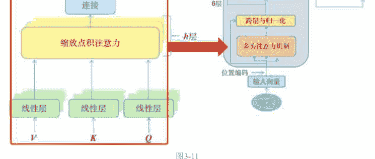

（3）残差与归一化：为缓解深层网络的梯度消失，每个子层后都加入残差连接保留原始信息，随后进行层归一化，保证分布稳定，加速收敛并提高性能。
（4）前馈网络：每层的第二个子层是一个全连接前馈网络，通常由两层线性变换构成，中间使用 ReLU 等非线性激活，为模型引入非线性表达能力。FFN 公式如下：

```
FFN(x) = max(0, xW_1 + b_1)W_2 + b_2
```

（5）层级堆叠：上述结构在编码器中重复多轮，通常为 6 层。每次迭代都对表征做更深加工，逐步提炼更高层次特征。每层输出作为下一层输入，通过层层提炼形成对输入极其丰富的表征。

编码器通过精心设计的层级，高效捕捉输入的语义与结构信息，为解码或其他下游任务提供坚实基础。

### 3.4.5 解码器内部构造

#### 1. 核心构成
解码器负责生成输出序列，结构旨在保证生成顺序并有效利用编码器上下文。解码器同样由多层堆叠构成，每层包含三个关键模块，在自注意使用上与编码器不同。

- (1) Masked Multi-Head Attention：解码器第一部分是带未来遮蔽的多头自注意层。计算当前词的注意权重时，未来词被屏蔽，强制模型仅依据已生成的历史词预测下一个词，避免信息泄露，保证时序正确。
- (2) Encoder-Decoder Attention：第二部分仍是多头注意，但查询 Q 来自前一解码层输出，键 K 与值 V 直接取自编码器最终输出矩阵 C。该设置让解码器在当前解码状态下，有选择地从编码器捕获的全局上下文中抽取相关信息，指导下一步生成。
- (3) Feed Forward Network：第三模块与编码器一致，为全连接前馈网络，包含两层线性变换和中间非线性激活，用于进一步转换与丰富各位置表征，提升表达能力。

与编码器类似，解码器各层之间使用残差连接与层归一化，促进梯度流动并保持输出稳定。

总体而言，解码器通过三模块协同，实现有序序列生成，同时融合自身历史输出与编码器提供的输入上下文，展现 Transformer 在序列生成任务上的强大效能。

如图3-12所示，编码器与解码器的最大差异在于解码器采用了红色箭头所指的掩码多头注意力机制。

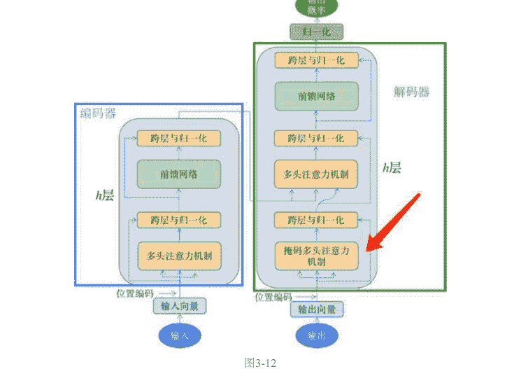

#### 2. Masked Multi-Head Attention
Masked Multi-Head Attention 的关键在于引入掩码，防止模型在处理序列时窥探未来信息。具体来说，掩码会遮蔽当前位置之后的所有内容，使模型只能基于当前位置之前的历史进行预测或生成。

在注意机制中，各位置可与序列全部其他位置交互，掩码限制了这种交互仅发生在当前位置之前。这样模型预测时不会使用未来信息，过程更合理可靠。

总之 Masked Multi-Head Attention 是 Transformer 中处理序列数据的注意形式，通过掩码避免未来信息泄露，提升效率与准确性。

### 3.4.6 实验数据回顾
最终模型采用 6 层网络结构，展开后如图3-13所示。

拆解 Transformer 架构后可知，其核心元素有限。将多个自注意堆成多头注意，加归一化即构成编码器；带掩码的 Masked Multi-Head Attention 加上与编码器同款结构即构成解码器。

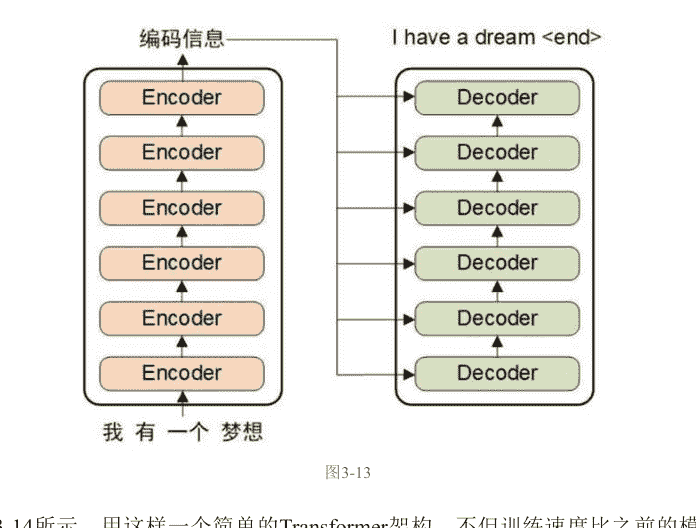

如图3-14所示，采用该简洁架构不仅训练速度更快，在英法与英德翻译测试集上均取得最佳 BLEU 分数，分别为 28.4 和 41.8，在同类模型中表现突出。

| Model | BLEU (EN-DE) | BLEU (EN-FR) | Training Cost (FLOPs) (EN-DE) | Training Cost (FLOPs) (EN-FR) |

| :--- | :--- | :--- | :--- | :--- |

| ByteNet [18] | 23.75 | | | 1.0 · 10²⁰ |

| Deep-Att + PosUnk [39] | | 39.2 | | 1.0 · 10²⁰ |

| GNMT + RL [38] | 24.6 | 39.92 | 2.3 · 10¹⁹ | 1.4 · 10²⁰ |

| ConvS2S [9] | 25.16 | 40.46 | 9.6 · 10¹⁸ | 1.5 · 10²⁰ |

| MoE [32] | 26.03 | 40.56 | 2.0 · 10¹⁹ | 1.2 · 10²⁰ |

| Deep-Att + PosUnk Ensemble [39] | | 40.4 | | 8.0 · 10²⁰ |

| GNMT + RL Ensemble [38] | 26.30 | 41.16 | 1.8 · 10²⁰ | 1.1 · 10²¹ |

| ConvS2S Ensemble [9] | 26.36 | **41.29** | 7.7 · 10¹⁹ | 1.2 · 10²¹ |

| Transformer (base model) | 27.3 | 38.1 | **3.3 · 10¹⁸** | |

| Transformer (big) | **28.4** | **41.8** | 2.3 · 10¹⁹ | |

图3-14

## 3.5 本章回顾
本章系统梳理了大模型理论基础。首先介绍了 NLP 领域的数据类型，包括时序数据、分词、Token、Embedding 与语义向量空间。随后回顾语言模型演进，从统计语言模型到神经网络语言模型的发展。接着详细讲解注意机制，涵盖 RNN、Seq2Seq 以及 Attention 原理与应用。最后深入解析 Transformer 架构，包括整体结构、自注意、多头注意、编码器与解码器设计，并展示实验效果。

本章为读者提供扎实理论基础，便于理解大模型的工作原理与技术细节。

# 第4章 大模型开发常用工具箱
随着 Transformer 神经网络的兴起，Huggingface 这家虽在美国注册但具有法国背景的公司敏锐把握大模型时代机遇，整合了大量前沿模型与数据集，为技术生态贡献了重要成果。其提供的 Transformers 库与开发者深度结合，极大推动了先进模型的快速落地，因而成为机器学习与深度学习领域不可或缺的核心库。

本章将深入剖析 Transformers 库的组成，并通过完整训练示例展示迁移学习的实践全过程，体现其在高效研发中的优势。

Transformers 库凭借易用性与实用性稳固了其在机器学习及深度学习领域的核心工具地位。Huggingface Hub 可被视为大模型时代的 GitHub，汇聚并推动开源协作热潮。除 Transformers 库与 Hub 外，Huggingface 生态还包括用于数据集处理的数据集库、模型性能评估的 Metrics 库以及交互式演示的 Gradio 库，共同构建全面强大的技术支撑体系。

## 4.1 Hugging Face 生态全景

### 4.1.1 Hugging Face 简介
Huggingface 是一家总部位于美国纽约的法美合资企业，专注于开发基于机器学习构建应用的高性能计算工具。该公司最知名的成果包括面向 NLP 应用的 Transformers 库，以及一个可供用户共享模型、数据集并展示应用成果的综合平台。

起初 Huggingface 专注于青少年聊天机器人应用。在决定开源聊天机器人背后的算法后，其战略转向服务更广泛的机器学习社区。这一转型伴随 Transformers 库在 GitHub 上发布，尽管聊天机器人业务未实现显著增长，但该开源库迅速获得机器学习领域的广泛关注与认可，成为公司标志性贡献。

- 1. Transformers库
随着 Transformer 架构在 AI 领域迅速崛起，其自注意机制与强大的序列处理能力备受青睐。Huggingface 捕捉到这一潜力，将工具库命名为 Transformers，既致敬该架构，也明确其为 Transformer 模型及衍生变体提供强大支持的定位。

需明确区分“Transformer 神经网络结构”与 Huggingface 的“Transformers 库”。Transformer 是核心模型架构，定义了通过自注意处理序列并学习深层语义特征的方式；而 Transformers 库是实现该架构及其众多变种如 BERT、GPT 系列的软件工具包，提供便捷 API、丰富的预训练模型及微调、部署支持。简言之，前者是理论模型，后者是高效工具，两者紧密关联但作用不同。

Transformers 库最初是面向机器学习应用的 Python 库，如图4-1所示，专注于提供文本、图像、音频处理任务中 Transformer 模型的开源实现。如今它已成长为全球领先的机器学习工具集，全面兼容 JAX、PyTorch、TensorFlow 等主流框架，使用者可在不同框架间无缝切换训练与推理，灵活性极高。

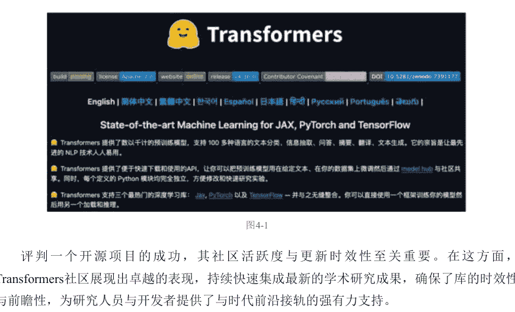

图4-1

开源项目的成败取决于社区活跃度与更新速度。Transformers 社区表现突出，持续快速集成最新研究成果，保持库的时效性与前瞻性，为研究者与开发者提供强有力支持。

总体而言，Transformers 库集成多种预训练模型以适配多样任务，极大简化应用流程。用户几乎无需大幅调整，仅需寥寥数行代码即可完成模型部署，支撑广泛 AI 应用，具备极高的易用性。此外库还支持自定义模型定义，允许用户按需扩展与优化结构。实际体验后不难发现其强大与便捷，是 AI 领域的重要利器。

#### 2. Huggingface Hub
除 Transformers 库这一核心 SDK 外，Huggingface Hub 作为 AI 领域的宝库备受瞩目，常被誉为 AI 技术的兵工厂。该平台汇聚丰富的开源资源，包括各类许可、模型实例与数据集，吸引国内外顶尖模型开发者入驻并托管作品。

Huggingface Hub 在生态中占据核心地位，目前已累计分享超过 50 万个预训练模型及 10 万个数据集，成为机器学习领域最具声望的开源交流中心。社区活力充沛，众多参与者积极贡献与维护，推动知识库持续迭代。

如图4-2所示，自发布以来，Transformers 库的发展已远超最初的自然语言处理范畴，正不断拓展至多模态、计算机视觉及音频处理等多元领域，彰显其作为综合性 AI 工具包的强大潜力与广阔前景。

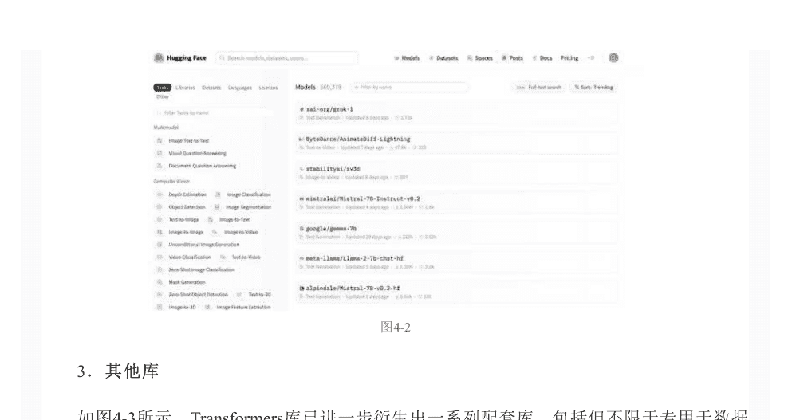

#### 3. 其他库

图4-3呈现的生态版图表明，围绕Transformers核心已经形成了一套工具群。负责数据管理的Datasets、侧重效果检验的Evaluate、用于加速训练与部署的Accelerate，以及偏向性能调优的Optimum都在其中。整体生态仍在扩容，持续引入新组件。后续章节会聚焦微调专用库PEFT，说明其在让模型更好地适应特定任务时的作用与实现。

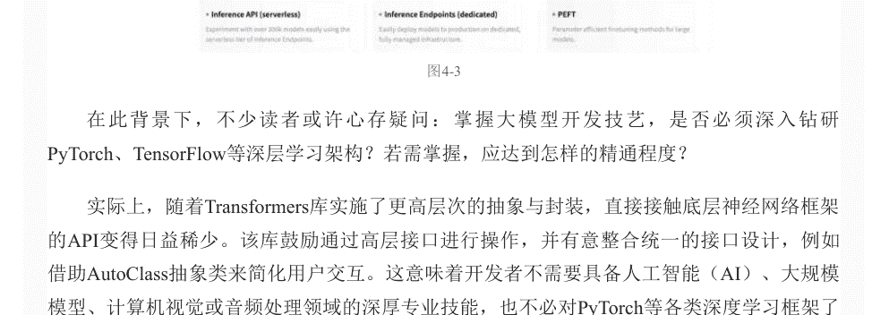

在这一背景下，部分读者常会问：要做大模型开发，是不是必须深入学习PyTorch、TensorFlow这类底层框架？如果要学，需要达到怎样的水平？

实际情况是，Transformers做了更高层的封装，开发者直接调用神经网络底层API的场景大幅减少。它主张使用高层接口，并通过AutoClass等统一抽象简化交互。换句话说，并不需要具备AI、大规模模型、计算机视觉或音频处理方面的深厚背景，也不用把PyTorch等框架吃透。把Transformers用熟，就足以支撑前面提到的多种任务，并完成AI服务的落地。

正是这种封装，让AI技术的应用门槛明显降低。哪怕没有AI专业背景的人，也能快速上手工具，让智能带来的效率和便利惠及更多人群。

### 4.1.2 Transformers 安装

第一步是完成此框架的安装。

在第二章完成显卡驱动、CUDA、CuDNN与PyTorch部署之后，引入该框架的步骤相当简洁。代码4-1展示的命令在终端执行一次 pip 安装即可，无需额外操作。值得一提的是，该项目设计兼顾高低配环境，既能在有GPU的机器上释放性能，也能在纯CPU主机上稳定运行，兼容性较好，让研究者与开发者能把精力放在模型应用与创新上，而不必为硬件限制分心。

代码4-1

```
pip install transformers          # 安装最新版本
pip install transformers == 4.0    # 安装指定版本
# 如果是 CONDA
conda install -c huggingface transformers  # 4.0 以后的版本才会有
```

随后可用一个Hello World式的例子确认安装是否成功。

代码4-2第一行导入了AutoModel类。第三行把模型标识 check_point 传给 from_pretrained，就能拿到一个预训练实例。这一过程与从GitHub克隆仓库类似；from_pretrained 则相当于从Hugging Face Hub 拉取预训练权重。模型名称在这里扮演唯一定位符的作用，精准指向所需资源。该函数同时会下载权重、词表及相关配置文件，为后续部署和定制提供基础。

代码4-2

```
# 导入 AutoModel 类，该类允许自动从预训练模型库加载模型
from transformers import AutoModel
# 设置预训练模型的检查点名称，这里使用的是 THUDM 组织维护的 ChatGLM3-6B 模型
check_point = "THUDM/chatglm3-6b"
# 将可选的本地模型路径注释掉，如果需要从本地加载模型，则取消注释并指定正确的本地路径
# model_path = "/home/egcs/models/chatglm3-6b"
# 使用 AutoModel 的 from_pretrained 方法加载模型，信任远程代码意味着允许从模型仓库执行未验证的代码
# 这对于加载那些包含自定义代码逻辑的模型是必要的
model = AutoModel.from_pretrained(check_point, trust_remote_code=True)
# 打印加载的模型对象，用于确认模型是否成功加载及查看模型的基本信息
print(model)
```初次执行时会触发自动下载。Windows下默认落到 C:\Users\[user_name]\.cache\huggingface\hub，Linux下则是 ~/.cache/huggingface/。该目录可自行调整。为确保本书涉及的模型全部可用，建议预留不少于100GB磁盘。

图4-4展示的目录结构包含四个关键部分：datasets、metrics、models、transformers。它们分别保存数据集、评测指标、模型结构与相关组件，为后续的数据处理、模型调用与性能评估提供有序存放。


## 图4-4

在代码4-2的第三行执行 model = AutoModel.from_pretrained(check_point) 时，对应的预训练模型会被写入上述 models 目录。此处的 check_point 正是模型在Hugging Face Model Hub 上的唯一标识，保证定位准确。

考虑到网络不稳可能导致拉取失败，还提供本地获取的方案。图4-5说明用户可先在Hugging Face官网搜索模型名称并下载到本地磁盘，使用时把 model_path 指定到本地路径即可。这样即使在网络条件不佳的环境下也能顺畅使用所需模型。


## 图4-5

代码4-2的第四行通过 print(model) 打印架构信息，如图4-6所示。虽然操作简单，却能直观验证模型是否下载成功以及框架是否正常工作。结构正确显示意味着加载流程无误，也间接证明 Transformers 已在当前环境中可用，为后续研究奠定基础。

```
Loading checkpoint shards: 100% [00:08<00:00, 1.05it/s]
ChatGLMForConditionalGeneration(
  (transformer): ChatGLMModel(
    (word_embeddings): Embedding(130528, 4096)
    (layers): ModuleList(
      (0-27): 28 x GLMBlock(
        (input_layernorm): LayerNorm((4096,), eps=1e-05, elementwise_affine=True)
        (attention): SelfAttention(
          (rotary_emb): RotaryEmbedding()
          (query_key_value): Linear(in_features=4096, out_features=12288, bias=True)
          (dense): Linear(in_features=4096, out_features=4096, bias=True)
        )
        (post_attention_layernorm): LayerNorm((4096,), eps=1e-05, elementwise_affine=True)
        (mlp): GLU(
          (dense_h_to_4h): Linear(in_features=4096, out_features=16384, bias=True)
          (dense_4h_to_h): Linear(in_features=16384, out_features=4096, bias=True)
        )
      )
    )
    (final_layernorm): LayerNorm((4096,), eps=1e-05, elementwise_affine=True)
  )
  (lm_head): Linear(in_features=4096, out_features=130528, bias=False)
)
```


确认安装与模型拉取均无误后，就能看到GLM等热门模型的内部网络结构。这正是Hugging Face 对权重与网络设计进行封装的结果。一行代码即可获得GPT、BERT等主流预训练模型，避免了从零搭建架构和训练权重的工作，专注于在已有模型上做个性化任务。

借助精心设计的API，微调过程也被大幅简化。总的来看，基于Transformers进行大模型开发已成为业界的主流做法。

## 4.2 大模型开发工具

### 4.2.1 开发范式

目前Hugging Face覆盖的应用面很广，核心包括多模态、计算机视觉、自然语言处理、音频处理、表格分析与强化学习。以NLP为例，图4-7列出了机器翻译、命名实体识别、文本摘要、对话生成等众多下游任务。

如果要求使用者对每个子任务都从零设计流程并掌握全部API，应用成本会大幅上升。

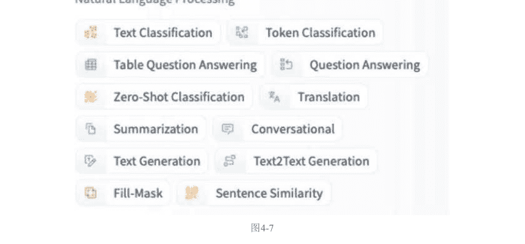

Transformers致力于提供统一接口，简化跨任务开发。无论是数据预处理还是模型配置与搭建，都遵循一套标准流程：处理原始数据、加载预训练模型、设定必要参数、执行训练、输出结果。该框架一旦掌握基本模板，就能用同一套逻辑应对不同下游任务。

例如在熟悉的框架下完成命名实体识别后，转做文本摘要时，只需沿用已知的编程习惯和接口，大幅减少学习与调试时间，迅速完成新任务部署。

### 4.2.2 核心设计要点

#### 1. 开发范式

部署ChatGLM3-6B这类大模型步骤虽多，但借助该框架实现非常紧凑，代码4-3就是典型范式。

代码4-3

```
from transformers import AutoTokenizer, AutoModel
# 指定模型和分词器的本地路径
model_path = "/home/egcs/models/chatglm3-6b"
# 分词器路径与模型路径相同
tokenizer_path = model_path
tokenizer = AutoTokenizer.from_pretrained(tokenizer_path, trust_remote_code=True)
# 使用 AutoModel 的 from_pretrained 方法加载模型，并设置信任远程代码，以便于加载可能包含的自定义逻辑
# .quantize(4) 对模型进行量化处理，这里的 4 代表量化比特数，通常用于减少模型的内存占用和加速推理
# .cuda() 将模型转移到 CUDA 设备上运行，利用 GPU 加速计算
model = AutoModel.from_pretrained(model_path, trust_remote_code=True).quantize(4).cuda()
# 将模型设置为评估模式 (eval 模式)，这对于生成任务是必需的，因为它决定了 dropout 层等是否生效
model = model.eval()
# 使用加载的模型和分词器进行对话生成，初始化历史记录为空列表
# "晚上睡不着应该怎么办" 是用户的输入问题
response, history = model.chat(tokenizer, "晚上睡不着应该怎么办", history=[])
# 打印模型生成的回复
print(response)
```

输出结果如图4-8所示。

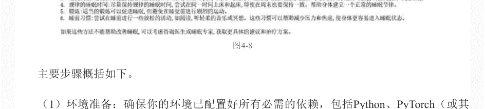

图4-8

主要步骤概括如下。

（1）环境准备：确认Python、PyTorch或其它受支持的框架、Transformers已就绪，必要时配置CUDA与CuDNN以加速GPU。
（2）模型加载：使用from_pretrained加载预训练模型，通常指定名称或检查点路径，并可传入设备分配等参数。
（3）数据预处理：借助对应分词器把原始文本转为模型可接受的格式，一般包括分词与编码。
（4）推理与生成：调用预测方法进行推理，生成任务还需设置最大长度、温度等参数。
（5）服务部署（可选）：可将逻辑封装为Web服务，如Flask或Django，供其他应用通过API调用。

遵循上述范式即可快速部署ChatGLM3-6B或其他类似大模型，完成文本生成或问答等自然语言处理任务。注意根据模型大小与复杂度，实际部署还可能涉及资源优化、模型量化、服务容器化等高级议题，以确保运行效率与稳定性。

上述片段虽简短，却用到了两大基石：AutoModel与AutoTokenizer。它们体现了自动化类别的设计思想——通过统一的from_pretrained接口，根据名称或路径自动获取模型、配置、词表等全部组件，极大简化加载流程。

图4-9所示的自动化类别远不止这两类，还涵盖自定义模型构建等扩展功能。本书重点关注AutoConfig、AutoModel、AutoTokenizer这三者，它们共同构成在Transformers下开发语言模型应用的典型模式。

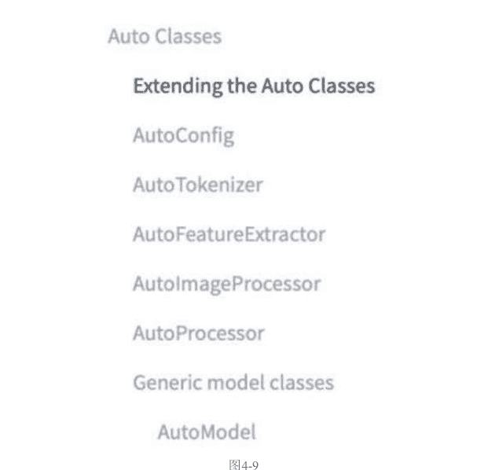

图4-9

#### 2. AutoConfig

每个深度模型都依赖精细的配置管理，AutoConfig正是这一需求的体现，融入了自动化类别的理念。它通过from_pretrained智能初始化配置对象，体现了简洁编程与解耦原则。

使用时只需提供模型名称或本地路径。若给出名称，框架会自动在Hugging Face Hub检索匹配的配置文件，保证信息及时准确。这种机制简化了配置获取，让研究者能快速跟进最新模型。

若输入本地路径，则可直接从磁盘加载配置文件，便于离线实验，也支持基于特定版本配置进行开发。在线与离线兼顾，扩展了配置管理的适用场景。

总体上，AutoConfig以灵活的加载方式降低了配置复杂度，促进模型复用与定制，为大模型开发提供了规范高效的做法。

#### 3. AutoModel

AutoModel与AutoConfig保持一致的设计思路，同样支持自动检索。用户只需给出模型名称或本地路径，即可定位并加载预训练模型，显著降低加载门槛，保证开发效率。除了from_pretrained初始化外，它还提供from_config途径，允许基于配置对象实例化模型。

通过 from_config 接口来构建 AutoModel 时，通常会先单独准备好一份配置，通常借助 AutoConfig.from_pretrained 来完成。先配置后实例化的顺序，给使用方提供了一个在权重加载之前的干预窗口，可以在真正初始化模型前对结构参数做精细改动，比如变更隐藏单元数目、替换激活函数等，以此适配特定场景或开展架构探索。这种先行定制的模式有助于更直观地把握模型内部机制，同时也为后续的微调与改进预留了更宽松的入口。

总体来看，AutoModel 保留了 Auto Classes 家族的自动化加载特性，而 from_config 的加入进一步提升了初始化的可控性与可塑性。对于研究人员与工程实践者而言，这是一套更精细且更具力度的初始化手段，也体现了 Transformers 项目在提升研发便捷度与灵活性方面的持续思考。

#### 4. AutoTokenizer
在整个模型生态里，分词器与配置、模型并列，承担着独立且关键的职能。模型本身由网络结构、参数集合与配置共同构成框架，分词器的职责则是把原始文本转换成模型可接受的数值表示，其链路涵盖清洗、切分、嵌入编码等环节，保证输入能够被正确理解。

与 AutoConfig 的创建逻辑相仿，分词器的获取也是通过 from_pretrained 完成的，根据模型标识或路径匹配对应的预训练分词器。之所以如此，是因为不同模型对输入张量的要求并不一致，既有维度层面的差异，例如常见的 256 维、512 维，也有架构层面对于输入格式的强制规定，有的要求特定维度的张量以匹配内部机制，也存在规则各不相同的情况。

语言背景同样会左右分词器的选择。中文、英文及各类语言的分词规则差异很大，分词器的训练语料与处理逻辑必须与目标语言保持一致。因此统一借助 from_pretrained 管理并加载预训练分词器，是确保模型能够准确处理特定语言数据、维持专业水准与兼容性的关键做法。它降低了部署的复杂程度，也让跨模型、跨语言的应用保持稳定高效，反映出 Transformers 设计的前瞻性与实用性。

#### 5. 总结
本书反复出现的三大自动化组件 AutoConfig、AutoModel、AutoTokenizer 构成了模型搭建与使用的核心三角，也是部署的基石。三者协同运作，保证配置精准、权重有效载入，以及文本到输入向量的顺畅转换，形成完整高效的准备流程。

在此基础上，后续章节将进一步展开模型量化与微调等进阶主题。量化旨在压缩体积，在尽量保留精度的前提下提升部署效率，尤其适合资源受限的场景；微调则在通用预训练模型上针对具体任务进行调整，以获得更好性能。两者都建立在 Auto Classes 提供的标准化、模块化框架之上，是挖掘模型潜力的关键手段。

可以说，Auto Classes 不仅是 Transformers 库的核心构成，也是支撑整个生态的基础架构。它简化了开发流程，提升了研发效率，促进了模型复用与创新，成为连接理论与实践、过去与未来的桥梁。

## 4.3 Transformers 核心库解析

### 4.3.1 自然语言处理全流程
下面探讨 Transformers 在自然语言处理领域的整体工作方式。与计算机视觉相比，NLP 的处理路径更为简洁统一。视觉领域涌现出大量网络结构，各流派各有代表，流程比较分散；而当前 NLP 几乎被 Transformer 结构主导，Hugging Face 因此将库命名为 Transformers，以突出该结构的核心地位。

以 BERT 为例，它作为预训练的 Transformer，几乎成为下游任务的通用工具，涵盖机器翻译、情感分析、命名实体识别等多个应用。BERT 的成功源于其对海量文本的学习能力，以及通过微调快速适配具体任务的灵活性，从而形成稳定通用的范式。

因此，基于 Transformer 的 NLP 实践呈现高度标准化和一致性，不同任务的步骤大同小异，这降低了技术门槛，也加速了方案落地。

如图4-10所示，Transformers 构建的 NLP 流程包含三个核心部件：①Tokenizer；②Model；③PostProcessing。它们协同工作，形成处理链路的主干。图4-10不仅展示了各部分位置，还呈现了第二、三层的数据形态变化，以及实际应用中的典型场景。

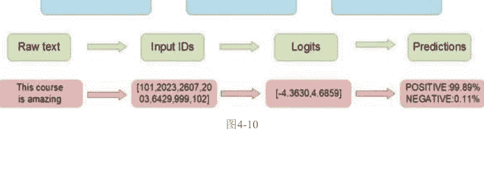

图4-10 中，Tokenizer 位于流程起点，负责把原始文本切分为有意义的单元如词或子词，并编码为模型可读的数字向量，这一过程称为编码。通过降维，复杂的自然语言被转化为可计算形式，为后续处理铺路。

Model 基于 Transformer 结构，利用神经网络对切分后的向量进行深度分析，提取语义特征。其核心输出是 Logits，即代表文本意义的概率分布序列，是模型对输入理解的数学表达。

PostProcessing 根据具体任务需求，把 Logits 转化为可解释的结果。常见做法包括用 softmax 将 Logits 转为概率分布进行分类预测，或按阈值判断情感倾向，为文本标注标签等。无论是情感分析判断情绪，还是自动标注识别实体，后处理都起到了将模型输出转化为实际价值的关键作用。

整体来看，这套流程实现了从原始文本到可用信息的顺畅转化，体现了 Transformers 在 NLP 处理上的系统性与高效性，也为开发者提供了一套规范易用的工具集合。

### 4.3.2 数据转换形式
前面提到，原始文本无法直接作为模型输入，需要借助 Embedding 技术映射为向量。这一转换从技术实现和实用价值两个角度看，都具有重要意义。回溯到 2013 年的 Word2Vec，它首次证明了把自然语言压缩到低维空间的可行性，例如以 512 维作为信息压缩基准，在保留语义完整性的同时大幅降低计算复杂度。

Embedding 本质上是一种高级编码方式，摆脱了早期 One-hot 编码的局限，力求用相对低的维度捕捉文本核心语义。这不仅提升了处理效率，也让向量间的运算如余弦相似度能够验证语义关联与相似，例如“国王-男人、女王-女人”在嵌入空间中的几何关系，直观反映了深层语义联系。

更进一步，嵌入层打破了语言壁垒。中文、英文等不同语言虽表征形式各异，但在共享的嵌入空间里，相同或相近的语义能够被联结，呈现高度一致性。这为跨语言检索、机器翻译等领域提供了基础，也为构建全球化语言理解模型奠定了根基。

因此，嵌入技术不仅是文本向量化的手段，更是实现语言共通、推动知识共享的桥梁。

嵌入层的核心价值在于化解自然语言累积形成的繁复符号系统。语言演进不断创造新词以精准表达概念，而嵌入则做相反的事：从海量符号和文本中抽取出共通的语义内核，并在统一的高维空间里实现概念的同质化表达。Word2Vec 以及 OpenAI 的 Ada 模型都在做类似工作，在该空间里每个向量代表一个词的语义全貌。

如图4-11所示，转换后原始文本被映射为一个可定制的标准语义向量域，这个向量形式正是模型接收和解析的基础输入。

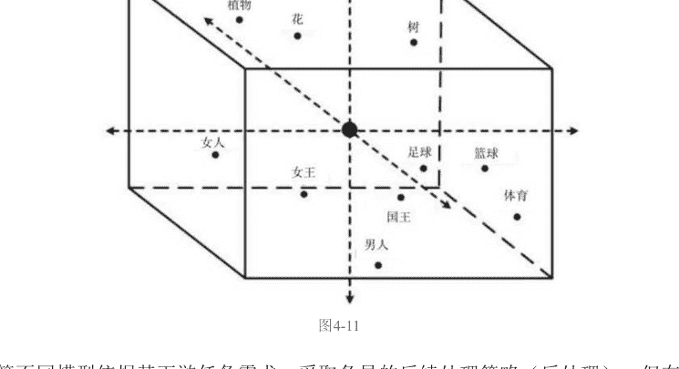

尽管不同模型在后处理策略上各有差异，但在预处理阶段存在一个通用模式——Tokenizer。它取代了传统预处理流程，负责把原始文本转为模型兼容的词元 Token。运作分两步。

- 1. 分词。对能自然分隔单词的英文，这一步比较直观；对中文等连续书写语言，则需要借助 Tokenizer 做精细的句子分割。
- 2. 将分好的词项映射到前述嵌入空间，生成词向量。

这些向量进入模型后经神经网络前向传播，变成输出向量 y，本质上是一组未解释的概率值 Logits。后续后处理会进一步提炼，例如在情感分析中转化为分类标签。像 ChatGLM 这类自回归模型，输出则是下一个词的概率分布，模型挑选概率最高者作为续写，从而保持对话的连贯自然。

如图4-12所示，下文将重点关注 NLP 流程末端两个阶段的数据表现形式，观察数据如何随流程演变，最终达到算法处理和应用的理想状态。

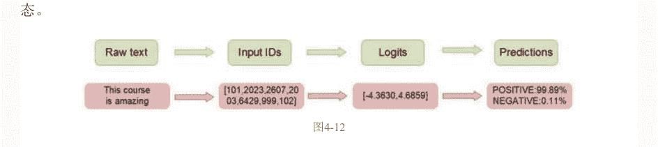

以 “This course is amazing” 为例，经过 Tokenizer 处理后会变成输入标识序列 “[101,2023,2607,2003,6429,999,102]”。转换包含两个关键步骤。

- （1）分词：把连续文本切分为独立语义单元，为算法理解文本扫清障碍，提升模型表现。
- （2）词嵌入：将分词结果映射到高维向量空间，让计算机能够处理每个词。这是基于 Transformer 的现代 NLP 技术的基础，模型需要词向量形式的输入以及每个词的唯一 ID，这也是 Hugging Face 等框架要求输入为 Input IDs 的原因。

无论是中文、英文或其他语言，分词都是必不可少的预处理。对英文等自然分隔的语言，分词相对直接，按空格划分即可；对中文、日文等非自然分隔语言，分词更为关键且复杂，准确性直接影响语义理解。

词嵌入通过把分词后的元素投射到高维空间，赋予词语可计算的形式，为模型提供必要输入。Input IDs 看似冗长，实则包含了词 ID、特殊字符标记如起始符、终止符、标点以及功能性标识等，这些特殊符号在不同分词器中定义各异，用来指示文本结构和语法特征。

随后 Input IDs 进入模型进行前向传播，产生预测概率 Logits。最后在 PostProcessing 阶段，这些概率被解读和转换，生成最终输出如分类标签或回答文本，完成从原始文本到模型输出的完整转换。

### 4.3.3 分词器
如图4-13所示，Transformers 模型由三个核心组件构成。分词器 Tokenizer 承担两项基本职能：一是把文本切分为词语单元，即分词；二是把分好的词语映射为模型可识别的数字序列，实现文本到数值的转化。


前期章节已介绍过 Jieba、LTP、THULAC 等分词技术，也涉及过 Word2Vec 与 GloVe 等词嵌入方法。本节转向实践，采用 Hugging Face 库中预置的 Tokenizer 分词器。这样做既简化了预处理，也能无缝对接先进的 Transformer 模型，提升 NLP 任务的效率与效果。

在代码4-4中，通过 checkpoint 变量指定模型名称，再借助 AutoTokenizer 的 from_pretrained 接口即可自动查找并加载匹配的预训练分词器。这一做法体现了自动化的便利，也兼顾了用户友好，强烈建议在实践中采用。仅一行代码就能获得针对特定模型优化的 Tokenizer 实例，极大简化准备流程，加速从模型选择到应用的过渡，充分体现了现代 NLP 工具的高效与便捷。

代码4-4

```
# 导入Transformers库中的AutoTokenizer类，该类能够自动检测模型类型并加载
from transformers import AutoTokenizer
# 指定预训练模型的本地路径，这里使用的模型是distilbert-base-uncased。
# 一个经过 distilled training 的 BERT 模型，适用于英文文本处理，且所有文本都被小写化处理。
tokenizer_path = "home/egcs/models/distilbert-base-uncased"
# 利用 AutoTokenizer 的 from_pretrained 方法从指定的路径加载分词器。
# 这个方法会自动下载模型（如果模型尚未在指定路径）或者从本地路径加载。
# 参数 trust_remote_code 设置为 True，意味着允许从远端仓库执行代码，
# 这对于那些需要额外自定义逻辑的模型来说是必要的,但同时也要求用户对外部代码保持警惕。
tokenizer = AutoTokenizer.from_pretrained(tokenizer_path, trust_remote_code=True)
```

本节以 DistilBERT-base-uncased 作为演示模型。DistilBERT 是通过知识蒸馏从 BERT-large 压缩而来的轻量版，参数量约为 BERT-base 的 60%，在保持较高性能的同时体积更小，便于部署和快速测试。对教学演示而言，这降低了资源需求，让学习者在不同硬件上都能快速跑通实验，无需担心资源限制。请读者参照之前 ChatGLM3 的加载方式，先行下载模型。

在代码4-5中，我们调用 tokenizer 方法对 raw_inputs 编码，下面细看该方法接收的关键参数及其作用。

```
python
# 定义一个原始文本列表，包含两条待处理的句子
raw_inputs = [
    "I've been waiting for a this course my whole life.",  # 示例句子 1
    "I hate this so much!",  # 示例句子 2
]
# 使用之前初始化的 Tokenizer 处理 raw_inputs 列表中的文本
# 参数解析：
# - padding=True 表示对所有样本进行填充，使得它们具有相同的长度，较短的文本会用特定的填充符号填满至最长文本的长度
# - truncation=True 表示如果输入的句子过长，将对其进行截断以满足最大长度限制，避免模型处理过长序列
# - return_tensors="pt" 表示返回的张量类型为 PyTorch tensor，便于后续在 PyTorch 中使用
inputs = tokenizer(raw_inputs, padding=True, truncation=True, return_tensors="pt")
# 打印处理后的 inputs，查看分词、填充及截断后的结果，以及转换为 PyTorch 张量后的形状和数据类型
print(inputs)
```

- (1) raw_inputs：承载待处理的原始文本，即未经处理的自然语言文本，供后续嵌入处理转为模型可理解的向量。
- (2) padding=True：确保所有输入序列长度一致，通过在较短序列后填充特定值如 0，实现批量处理时的维度统一，这对大多数深度学习框架是必要的，也有利于提升处理效率。
- (3) truncation=True：对过长的输入进行截断，使其符合预设的最大序列长度，控制数据规模，防止内存溢出，提升计算效率。
- (4) return_tensors="pt"：指定返回张量的类型为 PyTorch。“pt” 体现了 Hugging Face 的高度灵活与兼容性。如图4-14所示，Hugging Face 支持包括 PyTorch 在内的多主流框架，能无缝对接，方便开发者按项目需求选择最合适的开发环境，展现了其作为 NLP 工具集的综合优势。


图4-14

查阅 Hugging Face 官方 GitHub 仓库就能发现，这套库对底层计算框架的适配非常宽泛，JAX、PyTorch、TensorFlow 都在支持范围内，这种跨框架的能力让它在兼容性和可塑性上优势明显。使用者可以按项目需求和技术偏好自行挑选后端，“pt” 的标注就明确指向 PyTorch 作为模型与数据处理的实现基座。得益于这种自由度，代码在不同平台之间的迁移和复用变得更顺畅，也为不同技术圈的交流协作提供了便利，进一步稳固了它在自然语言处理领域的核心工具定位。

图4-15 把分词后的输出呈现出来，可以看到字典里 input_ids 的取值是以 PyTorch 张量形式出现的，这本质上是把原始文本“Raw text”转成输入标识序列后的结果。两个张量的长度完全一致，是因为较短的那条序列后面补上了填充位，填充值用 0 表示，这样序列长度统一，模型才便于处理。

```
python
{'input_ids': tensor([[ 101, 1045, 1005, 2310, 2042, 3403, 2005, 1037, 2023, 2607, 2026, 2878,
         2166, 1012,  102],
        [ 101, 1045, 5223, 2023, 2061, 2172,  999,  102,     0,     0,     0,     0,
            0,     0,     0]]), 'attention_mask': tensor([[1, 1, 1, 1, 1, 1, 1, 1, 1, 1, 1, 1, 1, 1, 1],
        [1, 1, 1, 1, 1, 1, 1, 1, 0, 0, 0, 0, 0, 0, 0]])}
```

图4-15

分词器的设计实现了编码和解码可以相互还原。以代码4-6 为例，调用 tokenizer.decode([ 101, 1045, ... , 102]) 就能把上述 ID 序列还原成 “[CLS] i've been waiting for a this course my whole life. [SEP]”。

代码4-6

```
python
# 使用 Tokenizer 的 decode 方法将给定的 token ID 序列转换回原始文本。
# 这里的 ID 序列是模型内部使用的数字表示，每个 ID 对应词汇表中的一个词项。
# 下面的调用展示了如何将这些 ID 序列解码为可读的自然语言文本。
print(tokenizer.decode([
    101, 1045, 1005, 2310, 2042, 3403, 2005, 1037, 2023, 2607,
    2026, 2878, 2166, 1012, 102
]))
```

输出如图4-16，特殊标记 “[CLS]” 和 “[SEP]” 的出现说明了各自的分工——“[CLS]” 通常用于分类任务，代表对整段序列做整体判断；“[SEP]” 起分隔作用，用来区分不同片段。序列尾部出现的 0 验证了 padding 机制确实生效，同时也说明特殊字符在编码环节不可或缺。

```
python
# 使用Tokenizer的decode方法将给定的token ID序列转换回原始文本。
# 这里的ID序列是模型内部使用的数字表示，每个ID对应词汇表中的一个词项。
# 下面的调用展示了如何将这些ID序列解码为可读的自然语言文本。
print(tokenizer.decode([
    101, 1045, 1005, 2310, 2042, 3403, 2005, 1037, 2023, 2607,
    2026, 2878, 2166, 1012, 102
]))
[CLS] i've been waiting for a this course my whole life. [SEP]
```

图4-16

此外，attention_mask 充当位置区分的开关，用 1 和 0 标记有效位置和填充位置。1 表示该位承载真实文本信息，0 代表只是填充没有语义。这一机制让模型在推理时忽略填充部分、把注意力集中在有效信息上，从而提升计算效率和结果准确性。

### 4.3.4 模型加载和解读

模型是整个系统的中枢，按功能可划分为三大类，以应对 NLP 任务的多样化需求。

- （1）编码器 Encoder 模型，以 BERT 为代表，在句子分类、命名实体识别以及词级分类等任务上表现突出，也是抽取式问答的常用选择。
- （2）解码器 Decoder 模型，以 GPT 系列为代表，擅长文本生成，能够产出连贯的段落内容。
- （3）序列到序列 Seq2Seq 模型，如 BART，擅长理解输入序列并生成新序列，广泛用于文本摘要、机器翻译和生成式问答。

系统初始化时，先完成分词器的加载，随后进行模型加载。借助 AutoModel 类的 from_pretrained 方法，只需给出模型名称即可自动下载并实例化。本次演示选用 DistilBERT-Base-uncased，体现了部署的便捷与高效。

代码4-7 展示了模型的神经网络结构，结果见图4-17。整体遵循标准的 Transformer 设计思路，结构清晰。

代码4-7

```
python
from transformers import AutoTokenizer, AutoModel
# 使用 AutoTokenizer.from_pretrained 方法加载预训练的分词器，此处选用 'distilbert-base-uncased'模型
tokenizer = AutoTokenizer.from_pretrained('distilbert-base-uncased', trust_remote_code=True)
# 使用 AutoModel.from_pretrained 方法加载预训练的模型，模型路径指定为本地路径 'home/egcs/models/distilbert-base-uncased'
# 设置了 trust_remote_code=True 以允许执行远程代码
# 调用.half()将模型的权重从 float32 转换为 float16 (半精度)，这可以减少内存使用并加速在支持的硬件上的推理
# .cuda()将模型移动到 CUDA 设备上，即 GPU，以便利用硬件加速
model = AutoModel.from_pretrained('home/egcs/models/distilbert-base-uncased', trust_remote_code=True).half().cuda()
# 打印模型的概要信息，以确认模型是否正确加载及查看模型的一些基本信息
print(model)
```

- （1）词嵌入 word_embedding 层：把输入词映射到连续向量空间。
- （2）位置编码 position_embeddings 层：注入序列位置信息。
- （3）层归一化 LayerNorm 层：稳定各层输入分布，有利于训练收敛。
- （4）dropout 层：随机丢弃部分神经元输出，起到正则化作用，提升泛化。

## （5）基本Transformer架构

核心模块执行自注意力 Query/Key/Value 机制以及前馈神经网络 FFN，进一步提炼特征并整合信息。

结合第3章内容不难判断，该模型采用的是编码器架构。经过多层迭代后，模型会输出一个 768 维的向量，其中浓缩了输入序列的高层语义。

```
In [5]: print(model)
DistilBertModel(
  (embeddings): Embeddings(
    (word_embeddings): Embedding(30522, 768, padding_idx=0)
    (position_embeddings): Embedding(512, 768)
    (LayerNorm): LayerNorm((768,), eps=1e-12, elementwise_affine=True)
    (dropout): Dropout(p=0.1, inplace=False)
  )
  (transformer): Transformer(
    (layer): ModuleList(
      (0): TransformerBlock(
        (attention): MultiHeadSelfAttention(
          (dropout): Dropout(p=0.1, inplace=False)
          (q_lin): Linear(in_features=768, out_features=768, bias=True)
          (k_lin): Linear(in_features=768, out_features=768, bias=True)
          (v_lin): Linear(in_features=768, out_features=768, bias=True)
          (out_lin): Linear(in_features=768, out_features=768, bias=True)
        )
        (sa_layer_norm): LayerNorm((768,), eps=1e-12, elementwise_affine=True)
        (ffn): FFN(
```


代码4-8 做一次验证，把前面准备好的模型输入字典 inputs 送入模型，并展示最终隐藏层的输出。

### 代码4-8

```
# 将前期准备好的模型输入数据字典（inputs）中的每个 tensor 移动到 GPU 上。
# 这通过遍历字典的每个条目（key-value 对），并将 value(tensor) 使用.to("cuda")
# 的方法转移到 GPU 上实现。
inputs_on_gpu = {key: value.to("cuda") for key, value in inputs.items()}
# 使用已经移到 GPU 上的输入数据调用模型进行前向传播，**inputs_on_gpu 表示解包字
# 典为关键字参数形式传入函数。
# 这一步将触发模型的计算，生成预测或中间表示等输出。
outputs = model(**inputs_on_gpu)
# 打印模型最后的隐藏状态（last_hidden_state）的形状。
# 这个形状信息揭示了输出张量的维度，例如 (batch_size, sequence_length,
# hidden_size)，这有助于理解模型的输出结构。
print(outputs.last_hidden_state.shape)
```

输出如图4-18，得到 torch.Size([2, 15, 768])。

```
In [19]: inputs_on_gpu = {key: value.to("cuda") for key, value in inputs.items()}
        outputs = model(**inputs_on_gpu)
        print(outputs.last_hidden_state.shape)

        torch.Size([2, 15, 768])
```


维度的含义如下。

- （1）2 代表批次大小 batch，即本批次同时处理的文本条数为两条。
- （2）15 表示每条文本分词后得到的 Token 长度。
- （3）768 则说明每个 Token 被编码为 768 维向量，这是模型对文本进行深层抽象的关键，也体现了高维空间中语义的丰富表达。

### 4.3.5 模型的输出

接下来进入模型输出阶段。沿用前述例子，模型当前给出的是 768 维向量。若任务是 10 分类，只需调整顶层结构，使输出变为 10 维向量，每个元素对应类别概率，实现概率分布建模。若目标是生成，则把维度拓展到词表大小，每个元素代表下一个词的预测概率，从而简化生成流程。

实践中能明显感受到 NLP 任务与计算机视觉的区别。视觉任务常见回归与分类，而 NLP 很少直接提“回归”，核心是各类分类问题。针对不同分类需求，Transformers 库提供了丰富的 AutoModel 子类以便专项适配。

代码4-9 中加载的是预训练模型 distilbert-base-uncased-finetuned-sst-2-english，该模型基于斯坦福情感树库 SST-2 微调而来。SST-2 是一个单句分类挑战集，语料为电影评论，每条句子附带人工标注的情感倾向。

### 代码4-9

```
# 导入 Transformers 库中的 AutoModelForSequenceClassification 类，
# 该类允许自动从预训练模型加载对应的序列分类模型架构。
from transformers import AutoModelForSequenceClassification
# 定义预训练模型的检查点 (checkpoint) 名称，
# 本例中使用的模型是在英文情感分析任务 (SST-2) 上微调过的 DistilBERT 模型。
checkpoint = "distilbert-base-uncased-finetuned-sst-2-english"
# 从指定的 checkpoint 加载预训练好的序列分类模型。
# AutoModelForSequenceClassification.from_pretrained() 方法会下载（如果
# 尚未下载）并加载模型权重。
model = AutoModelForSequenceClassification.from_pretrained
(checkpoint)
# 使用模型对前期准备好的模型输入数据字典 (inputs，这里未显示定义) 进行前向传播。
# **inputs 表示将 inputs 字典解包为关键字参数，这些参数通常包含 input_ids,
# attention_mask 等模型所需的输入。
outputs = model(**inputs)
# 打印模型输出中的 logits (逻辑输出) 部分的形状。
# logits 是未经激活函数 (如 softmax) 转换的原始输出值，形状揭示了批次大小和类别
# 数量。
# 对于情感分类任务，比如 SST-2，logits 的最后一个维度通常为 2，对应于两个类别 (正
# 面和负面)。
print(outputs.logits.shape)
```

该数据集的本质是对句子做情感极性判别，只有积极 positive 编码为 1 和消极 negative 编码为 0 两个类别，判断依据是句子层面的标签，不涉及更细的语法或上下文依赖。换句话说，这是一个二元情感分类任务。

运行后的结果如图4-19 所示。

```
In [32]: # 打印模型输出中的logits（逻辑输出）部分的形状。
        # logits是未经激活函数（如softmax）转换的原始输出值，形状揭示了批次大小和类别数量。
        # 对于情感分类任务，比如SST-2，logits的最后一个维度通常为2，对应于两个类别（正面和负面）。
        print(outputs.logits.shape)
        torch.Size([2, 2])
```

图4-19

该模型在 BERT 基础架构上做了针对二分类的优化。为了更清楚地理解这种改动，下面对比原版 BERT 与微调后模型的结构差异。

到此我们已了解标准 BERT 结构，图4-20 将标准 BERT 与二分类调整后的 BERT 并列展示。对比可见，原版 BERT 输出为 torch.Size([2, 15, 768])，即处理两个样本，每个样本 15 个 Token，每个 Token 映射到 768 维空间。而为二分类定制的 BERT 输出简化为 torch.Size([2, 2])，直接给出两个样本的二元概率分布。

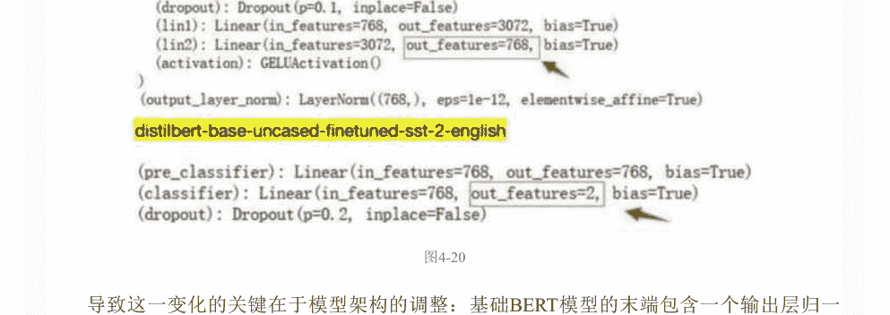

图4-20

变化的根源在于架构调整：基础 BERT 末端有一个 output_layer_norm，采用 LayerNorm 层，参数为 768，eps 设为 1e-12 以防除零，elementwise_affine=True 表示带有可学习仿射变换。相比之下，二分类版在此基础上额外加入了两个全连接层，用来把原来高维特征向量映射到二维空间，以适配二分类需求，进而把复杂的语言表征转化为简单的情感倾向判断。

进入代码4-10的部分，我们开始进入模型输出的后处理阶段。

### 代码4-10

```
# 导入 PyTorch 库，用于进行深度学习相关的操作。
import torch
# 使用 PyTorch 的 nn.functional 模块中的 softmax 函数，对模型输出的 logits（逻辑得分）进行转化，
# 使其变为概率分布。dim=-1 表示沿着 logits 的最后一维（通常是类别维度）进行操作。
predictions = torch.nn.functional.softmax(outputs.logits, dim=-1)
# 打印预测概率分布，每行为一个样本，列对应各个类别的概率。
print(predictions)
# 输出模型配置中的 id2label 属性，这是一个字典，映射类别 id 到其对应的标签名称。
# 这对于理解预测类别 id 的实际意义（如将类别编号转换为 "positive"、"negative" 等标签）非常有用。
print(model.config.id2label)
```
模型输出的logits本质上只是原始分数，并不能直接当成概率使用。要让它变成可解释的概率分布，需要借助softmax进行归一化转换。如图4-21所示，实际操作中我们调用PyTorch nn模块自带的softmax，指定沿logits的最后一个维度运算，最终得到一组和为1的概率值。拿到概率之后，还需要把它对应到具体的类别标签上，这里利用模型自带的id2label映射完成数字到语义标签的转换，整个后处理因此变得简洁，结果也更易读。

```
In [33]: # 输出模型配置中的id2label属性，这是一个字典，映射类别id到其对应的标签名称。
        # 这对于理解预测类别id的实际意义（如将类别编号转换为"positive"、"negative"等标签）非常有用。
        print(model.config.id2label)

Out[33]: tensor([[1.5396e-02, 9.8438e-01],
        [9.9951e-01, 5.4550e-04]], device='cuda:0', dtype=torch.float16,
        grad_fn=<SoftmaxBackward0>)
        {0: 'NEGATIVE', 1: 'POSITIVE'}
```
图4-21

### 4.3.6 模型的保存

下面介绍如何把已经微调好的模型固化下来。调用save_pretrained()即可完成持久化，它既能把文件写入本地磁盘，也支持一键推送到Huggingface Hub进行公开共享，有助于知识传播和复用。保存操作在代码4-11中体现。

### 代码4-11

```
# 使用 model 的 save_pretrained() 方法将当前模型的所有权重和配置保存到指定的目录下。
# 在这个例子中，模型会被保存到当前目录下的 "./"（表示当前工作目录）。
# 这包括模型的参数、配置文件等，以便于后续模型的恢复或部署。
model.save_pretrained("./")
```
如图4-22所示，执行save_pretrained()后会在指定路径下生成若干核心文件，共同构成模型完整体，其中最关键的两项是：

- 1. config.json：模型配置文件，相当于架构说明书，记录了Transformer层数、每层隐藏维度、自注意力头数等结构参数，保证模型可复现、可重建。
- 2. pytorch_model.bin：状态字典文件，保存训练得到的全部权重参数，以PyTorch二进制格式存储，体现模型的实际预测能力，是模型的实质部分。

借助这种保存方式，研究者和工程师可以方便备份成果，并快速分发给全球同行，推动迭代和跨领域应用。


## 4.4 全量微调训练方法

### 4.4.1 Datasets库和Accelerate库

本节进入全量微调的实践，先使用Huggingface Transformers库完成端到端训练。此前我们主要聚焦Transformers本身，但Huggingface生态远不止这一库，它围绕大模型开发形成了多个协同工具。图4-23展示了除Transformers外，微调流程中不可或缺的依赖。整体生态由四大核心模块构成，其中Transformers负责模型实现，Tokenizers负责文本预处理，这两部分已有介绍。


接下来聚焦第三个核心模块Datasets库。它在训练和评估环节承担关键作用，能简化大规模数据的获取与处理，并提供高效加载和灵活转换能力，支撑微调实验。Datasets支持多种格式的基准集导入，也允许自定义转换和预处理，让数据以最合适的形式进入训练，从而提升开发效率和训练质量。

#### 1. Datasets库

Huggingface的目标是打造自洽的完整生态，首要解决的是数据获取与管理的效率问题。NLP领域公开数据集众多，过去复现论文时往往需要手动下载、清洗、改格式，编写适配脚本既费时又易错。

Datasets库彻底改变了这一流程。它内置大量整理好的公开数据集，也支持用户上传私有数据，覆盖音频、视觉、NLP等方向。通过一条load_dataset调用即可完成加载，用法与Transformers的from_pretrained类似。图4-24显示，Huggingface Hub目前汇聚近12万个数据集，均可通过API直接使用，体现了数据与模型一体化的思路。

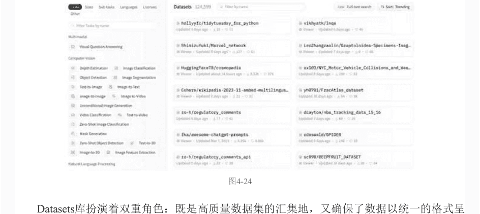
图4-24

Datasets同时是数据仓库和格式统一器。其内部像一个结构化字典，清晰区分训练集、测试集等不同划分，每个集合都包含features特征描述和num_rows行数等元数据，便于理解数据维度。下标访问机制让单条记录的读取很方便。

该库还天然支持训练、验证、测试等多分割构建，满足机器学习全流程需求。值得注意的是，平台上的数据集上传时已按比例切分，如图4-19所示，下载后即可直接使用，无需二次切分，节省大量时间。

统一的数据格式是Datasets的核心价值之一。如代码4-12所示，标准化让数据准备门槛降低，实现即取即用的效果，让研究者把精力集中在模型和算法上。

### 代码4-12

```
# 导入 Datasets 库中的 load_dataset 函数，该函数用于加载 Huggingface 的数据集。
from datasets import load_dataset
# 使用 load_dataset 函数加载位于"home/egcs/datasets/yelp-review-full"路径下的数据集。
# yelp-review-full 是一个大型数据集，包含 Yelp 网站上关于企业和服务的大量用户评论，常用于情感分析等 NLP 任务。
dataset = load_dataset("home/egcs/models/datasets/yelp-review-full")
# 打印加载的数据集对象，以查看数据集的基本结构和组成部分。
print(dataset)
# 访问数据集中"train"部分的第一个样本（索引为 0）并打印出来。
# 这将展示训练数据集中的一个典型条目，帮助理解数据格式和内容。
print(dataset["train"][0])
```
运行结果见图4-25。

#### 2. Accelerate库

Huggingface推出的Accelerate库旨在简化深度学习模型从训练到推理的全生命周期管理。它提供高度抽象的工具，让分布式训练和混合精度训练变得简单，同时不损失精度，从而大幅缩短训练时间。混合精度通过fp32与fp16结合，降低显存占用并加速计算，是提升效率的主流手段之一。

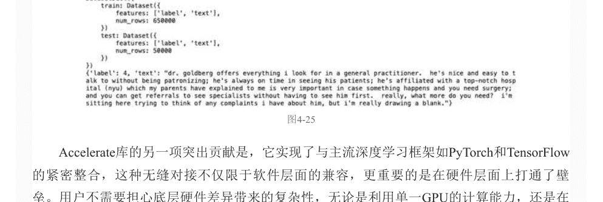
Accelerate还深度兼容PyTorch、TensorFlow等主流框架，并在硬件层面打通差异。用户无需关心底层设备，无论单卡GPU、高性能TPU还是多卡并行，都能平滑部署。该灵活性适用于科研、原型开发和生产上线等多种场景。

此外，它内置自动资源分配、容错恢复以及大模型并行化等功能，进一步降低大规模项目的实施难度，让开发者专注于模型创新而非工程细节。总的来说，Accelerate是推动AI更快速落地的关键驱动力。

### 4.4.2 数据格式

在安装好Datasets后，我们转向NLP经典基准GLUE，即通用语言理解评估。它规模小巧、任务多样，是衡量模型语言理解能力的常用基准。

在GLUE的子任务中，我们选择MRPC，即微软释义语料库。该语料基于在线新闻构建，由句子对组成，每对都经过人工标注语义是否等价，用于考察模型对细微语义差异的捕捉和文本相似度判断能力。

执行代码4-13。

### 代码4-13

```
python
# 导入 Python 内置的 warnings 模块，用于警告管理。
import warnings
# 配置警告过滤器以忽略所有警告。这将阻止在脚本运行期间显示警告信息，
# 对于那些不影响程序运行但可能会干扰输出的警告特别有用。
warnings.filterwarnings("ignore")
from datasets import load_dataset
# 使用 load_dataset 函数加载"glue"数据集中的"mrpc"子任务。
# GLUE (General Language Understanding Evaluation) 是一组用于评估自然语言
# 理解任务的基准，
# 其中的 MRPC (Microsoft Research Paraphrase Corpus) 任务是关于句子对的语
# 义等价性判断。
raw_datasets = load_dataset("glue", "mrpc")
# 打印加载的原始数据集对象。这将展示数据集的结构，包括训练集、验证集等划分，
# 以及每个部分的几个示例，有助于了解数据集的组织方式和内容。
raw_datasets
```
运行后如图4-26，可查看raw_datasets的整体结构。

```
DatasetDict({
    train: Dataset({
        features: ['sentence1', 'sentence2', 'label', 'idx'],
        num_rows: 3668
    })
    validation: Dataset({
        features: ['sentence1', 'sentence2', 'label', 'idx'],
        num_rows: 408
    })
    test: Dataset({
        features: ['sentence1', 'sentence2', 'label', 'idx'],
        num_rows: 1725
    })
})
```
图4-26

下载完成后，数据会被写入预设的datasets目录。通过打印命令可以直观确认结构是否符合预期。

图4-27展示了一对示例句子及其标签，体现文本对评估的基本思路：判断两句话是否有关联。例如，“天下雨了”与“我带了伞”被标为“相关”，反映出情境上的呼应；“天下雨了”与“今天晚上我要吃啥”被标为“不相关”，体现话题跳跃。


图4-27

图4-27还引入了idx，即每条记录的唯一编号。在大规模数据处理中，索引便于追踪和管理，也能在训练和分析时快速定位样本，提升处理效率。借助这种标注和索引体系，可以更好地构建和优化文本匹配、语义理解类任务。

### 4.4.3 数据预处理

预处理可归纳为两步：

- （1）具体处理操作，主要由分词器完成。分词器把原始文本切分成词元，并完成词到数字的映射与编码，最终生成模型可用的向量表示，降低复杂度。
- （2）规模化应用。定义好处理逻辑后，需要用map函数批量作用于整个数据集，确保每条样本都经过一致的处理，提升自动化程度并保证质量，为训练奠定基础。

代码4-14演示了如何通过Transformers库按模型名加载分词器。

### 代码4-14

```
from transformers import AutoTokenizer
# 设置预训练模型对应的本地路径，这里是 DistilBERT 模型的一个变体，专为处理英文文本设计，所有文本预处理为小写形式。
tokenizer_path = "home/egcs/models/distilbert-base-uncased"
# 使用 AutoTokenizer 的 from_pretrained 方法，从指定的本地路径加载预训练好的分词器。
# 参数 trust_remote_code 设置为 True，表明如果模型或分词器配置中包含需要从远程执行的代码（如自定义逻辑），则允许其执行。
tokenizer = AutoTokenizer.from_pretrained(tokenizer_path, trust_remote_code=True)
```
搞大模型微调，真正卡脖子往往不在模型本身，而在训练前的数 据准备。输入必须先被转化成模型能读的格式，并且维度要对得上，否则矩阵运算根本跑不起来。神经网络对输入形状的要求很死，Embedding 之后得到的 Token 向量如果长度跟模型期望不一致，就只能用两种手段来对齐：补齐即 Padding，或者截断即 Truncation。

现在业界做这一步基本有两条路：一种是靠 Pandas 之类的数据工具手工清洗、格式化；另一种是基于 Huggingface 的 map 机制写一个自定义的 tokenize_function。官方更推崇后者，因为它自带很多底层优化，处理速度明显更快，也更省心，训练前的准备效率会提升一个档次。

代码4-15 里展示的 tokenize_function 就是按例处理数据的典型写法。输入是一个字典形式的样例，里面最核心的两个字段是 sentence1 和 sentence2。函数先取出 sentence1 的文本做预处理，重点在于根据模型最大长度开启 truncation 来避免越界，按任务需要也可以额外加上 padding 来保持批量一致。需要强调的是，每个 example 本质上都是携带 sentence1 与 sentence2 的字典。

### 代码4-15

```
python
# 定义一个名为 tokenize_function 的函数，用于将输入的例子进行分词处理。
# 函数接受一个 example 字典作为输入，其中包含句子 1 和句子 2。
# 使用之前定义好的 tokenizer 处理 example 中的'sentence1'和'sentence2'，
# 并启用 truncation 参数来确保句子过长时会被截断，以适应模型的最大输入长度。
def tokenize_function(example):
    return tokenizer(example["sentence1"], example["sentence2"],
truncation=True)
# 应用 map 函数将 tokenize_function 应用到 raw_datasets 上。
# 这里使用 batched=True 参数意味着对数据集进行批处理，而非单个样本处理，
# 这样可以显著提高处理大数据集时的效率。
tokenized_datasets = raw_datasets.map(tokenize_function,
batched=True)
# 打印出经过分词处理后的数据集，查看处理后的数据结构和示例情况。
print(tokenized_datasets)
```
定义好 tokenize_function 之后，就可以用 map 对整个数据集做批量转换。map 的 batched=True 参数是关键，它让你不用自己写多线程也能自动并行加速，数据清洗的速度会明显上去。

当数据量放大到亿级时，Pandas 这类单线程工具很容易成为瓶颈。Huggingface 的 map 则能让 Tokenizer 以并行方式处理海量样本，把预处理的时间和成本都压下来，在大规模 NLP 场景下优势特别明显。

图4-28 展示了预处理完成后的样子，数据集中会新增三列：input_ids、token_type_ids 和 attention_mask。这些字段直接合并到原数据集里，原数据本身不做改动，一个升级后的 Datasets 库就形成了。

```
Out[8]: DatasetDict({
    train: Dataset({
        features: ['sentence1', 'sentence2', 'label', 'idx', 'input_ids', 'token_type_ids', 'attention_mask'],
        num_rows: 3668
    })
    validation: Dataset({
        features: ['sentence1', 'sentence2', 'label', 'idx', 'input_ids', 'token_type_ids', 'attention_mask'],
        num_rows: 408
    })
    test: Dataset({
        features: ['sentence1', 'sentence2', 'label', 'idx', 'input_ids', 'token_type_ids', 'attention_mask'],
        num_rows: 1725
    })
})
```
图4-28
这里很多人会问，预处理完原始数据还要不要留着。实际工程里通常是直接用处理后的数据覆盖掉源数据，因为数据体量太大，保留两份会浪费存储，也增加管理负担。覆盖并不是丢弃，而是把原始数据升级为可直接训练的高质量版本，系统后续只需要专注于分析和训练。

如代码4-16 所示，Huggingface 提供了 DataCollator 这个组件，它的功能是把原始训练集整理成神经网络训练用的结构化批次。把数据切成若干小批，既能控制内存占用，又能让计算资源更均衡，迭代速度和收敛效率都会更好。

### 代码4-16

```
# 导入 Transformers 库中的 DataCollatorWithPadding 类，
# 这个类用于在批量处理数据时自动对齐（填充）不同长度的序列，以便模型输入。
from transformers import DataCollatorWithPadding
# 实例化 DataCollatorWithPadding 对象，传入之前创建的 tokenizer 作为参数。
# 这个操作会使得在对数据集进行批次处理时，自动根据 tokenizer 的设置对序列进行填充，
# 确保每个批次内的所有样本具有相同的长度，满足模型的输入要求，特别是对于像 BERT 这样的模型来说是必需的。
data_collator = DataCollatorWithPadding(tokenizer=tokenizer)
```
DataCollator 里最实用的就是 withPadding 能力。开启后，它会自动判断一个批次里样本长度的差异，用填充的方式把所有序列统一到同一长度。NLP 任务里句子长短不一很常见，填充通常用 0 或特殊标记，这样整批数据形状一致，就能无障碍进入矩阵运算流程。预处理更简洁，模型训练也更顺畅。

### 4.4.4 模型训练的关键参数
Transformers 把微调门槛降得很低，但训练本身的复杂性还在。batch_size、学习率、优化器步长等超参数都需要合理设置，这些配置都收敛到 TrainingArguments 结构里，方便集中管理。

如图4-29 所示，TrainingArguments 涵蓋的参数非常全面，既体现了训练的复杂性，也展示了库对复杂性的封装能力，给研发人员一个清晰的参数面板。

## TrainingArguments

```python
class transformers.TrainingArguments(
    output_dir: str,
    overwrite_output_dir: bool = False,
    do_train: bool = False,
    do_eval: bool = False,
    do_predict: bool = False,
    evaluation_strategy: Union = 'no',
    prediction_loss_only: bool = False,
    per_device_train_batch_size: int = 8,
    per_device_eval_batch_size: int = 8,
    per_gpu_train_batch_size: Optional = None,
    per_gpu_eval_batch_size: Optional = None,
    gradient_accumulation_steps: int = 1,
    eval_accumulation_steps: Optional = None,
    eval_delay: Optional = 0,
    learning_rate: float = 5e-05,
    weight_decay: float = 0.0,
    adam_beta1: float = 0.9,
    adam_beta2: float = 0.999,
    adam_epsilon: float = 1e-08,
    max_grad_norm: float = 1.0,
    num_train_epochs: float = 3.0,
    max_steps: int = -1,
    lr_scheduler_type: Union = 'linear',
    lr_scheduler_kwargs: Union = <factory>,
    warmup_ratio: float = 0.0,
    warmup_steps: int = 0,
    log_level: Optional = 'passive',
    log_level_replica: Optional = 'warning',
    log_on_each_node: bool = True,
    logging_dir: Optional = None,
    logging_strategy: Union = 'steps',
    logging_first_step: bool = False,
    logging_steps: float = 500,
    logging_nan_inf_filter: bool = True,
    save_strategy: Union = 'steps',
    save_steps: float = 500,
    save_total_limit: Optional = None,
    save_safetensors: Optional = True,
    save_on_each_node: bool = False,
    save_only_model: bool = False,
    no_cuda: bool = False,
    use_cpu: bool = False,
    use_mps_device: bool = False,
    seed: int = 42,
    data_seed: Optional = None,
    jit_mode_eval: bool = False,
    use_ipex: bool = False,
    bf16: bool = False,
    fp16: bool = False,
    fp16_opt_level: str = 'O1',
    half_precision_backend: str = 'auto',
    bf16_full_eval: bool = False,
    fp16_full_eval: bool = False,
    tf32: Optional = None,
    local_rank: int = -1,
    ddp_backend: Optional = None,
    tpu_num_cores: Optional = None,
    tpu_metrics_debug: bool = False,
    debug: Union = '',
    dataloader_drop_last: bool = False,
    eval_steps: Optional = None,
    dataloader_num_workers: int = 0,
    dataloader_prefetch_factor: Optional = None,
    past_index: int = -1,
    run_name: Optional = None,
    disable_tqdm: Optional = None,
    remove_unused_columns: Optional = True,
    label_names: Optional = None,
    load_best_model_at_end: Optional = False,
)
```
图4-29
TrainingArguments 设计得很细，能覆盖各种场景，调试难度并不高。库里已经给了比较合理的默认值，多数情况下改动几个常用项就能开跑。特殊需求时再对照官方文档细调即可，具体用法见代码4-17。

## 代码4-17

```python
# 引入 Transformers 库中的 TrainingArguments 类，该类用于配置训练过程中的各项参数。
from transformers import TrainingArguments
# 设置模型保存的根目录路径，这里是本地的 "home/egcs/models/bert-base-uncased"目录。
model_dir = "home/egcs/models/bert-base-uncased"
# 初始化一个 TrainingArguments 对象，用于存储和管理训练参数配置，包括：
# output_dir: 模型训练完成后保存的目录路径，通过 f-string 插值语法动态生成绝对路径。
# logging_dir: 训练日志文件的保存目录，同样使用 f-string 插值语法生成。
# logging_steps: 模型训练时的日志记录频率，即每进行多少步保存一次训练日志，默认设置为每 100 步。
training_args = TrainingArguments(
    output_dir=f"{model_dir}/trainer",          # 模型训练输出的目录位置
    logging_dir=f"{model_dir}/trainer/runs",    # 训练日志文件的保存目录
    logging_steps=10                            # 训练过程中的日志记录间隔，每 100 步记录一次日志
)
```
下面是几个常用参数的要点：

- （1）Output Directory output_dir：指定模型 checkpoint 的保存路径，也就是训练成果落地的位置。
- （2）Overwrite Output Directory overwrite_output_dir：设为 True 时允许覆盖已有的输出文件夹，适合迭代实验。
- （3）Do Training do_train 与 Do Evaluation do_eval：分别控制是否执行训练和评估，配合 Evaluation Strategy evaluation_strategy 决定验证是在每 N 步后还是每个 epoch 结束后进行，用于监控性能。
- （4）Number of Training Epochs num_train_epochs：设定总训练轮数，影响模型学习深度。
- （5）Learning Rate learning_rate 与 Weight Decay：前者决定参数更新的步伐，后者控制学习率随时间衰减，两者共同影响收敛过程。

# 从加载到评估：让大模型训练与评测更可控

（6）Logging Steps（logging_steps）：训练时指定一个步长间隔，系统会按此频率打印日志并展示 loss 等核心数值，便于实时掌握训练进展。

### 4.4.5 模型训练

下面以代码4-18为例说明模型的导入方式。

### 代码4-18

```python
from transformers import AutoModelForSequenceClassification
checkpoint = "home/egcs/models/distilbert-base-uncased-finetuned-sst-2-english"
model = AutoModelForSequenceClassification.from_pretrained(checkpoint, num_labels=2).cuda()
```
在载入预训练权重时显式传入 num_labels=2，实质是对模型尾部结构进行改造，使其适配二分类任务。这一设定把输出维度调整为两路概率，分别对应两个互斥的类别，能够满足正负情感判断、二元决策等典型场景的需求。与此前做法不同，这里不能再使用 half 进行模型量化。

随后进入训练主流程。先对原始文本做清洗、分词、向量化等预处理，把数据转成模型可读的格式。然后基于已构建好的数据集，选择合适的优化器、损失函数和学习率调度策略，开始迭代训练。训练期间要同步观察训练损失和验证集表现，必要时下调学习率或触发早停，防止过拟合以保障泛化。借助交叉验证、学习曲线等手段监控过程，有助于提升分类准确率。最后在测试集上检验效果，完成从导入定制到训练再到评估的闭环，并可按需微调或部署。

以代码4-19为例，Transformers 提供的 Trainer 组件把神经网络微调的复杂步骤高度封装，整体可归纳为三步。

### 代码4-19

```python
from transformers import Trainer, TrainingArguments
# 初始化 TrainingArguments 对象，传入一个参数“test-trainer”作为输出目录的基础
# 名称。
# 这将配置基本的训练参数并默认设置输出目录等。
training_args = TrainingArguments("test-trainer")
# 创建 Trainer 实例，该实例负责模型的实际训练过程，需要以下参数：
# model: 待训练的模型实例，这里直接引用了之前定义好的模型对象。
# training_args: 上面创建的 TrainingArguments 对象，包含了所有训练参数的配置。
# train_dataset: 训练数据集，此处使用之前处理并分词后的数据集 `tokenized_
# datasets["train"]`。
# eval_dataset: 验证数据集，用于在训练过程中评估模型性能，来源于 `tokenized_
# datasets["validation"]`。
# data_collator: 数据收集器，用于在批量处理数据前对数据进行必要的预处理操作，如
# 填充、masking 等。
# tokenizer: 分词器对象，用于文本预处理，确保数据集中的文本能转换成模型所需格式。
trainer = Trainer(
    model=model,                     # 要训练的模型实例
    args=training_args,              # 训练参数配置
    train_dataset=tokenized_datasets["train"], # 训练数据集
    eval_dataset=tokenized_datasets["validation"], # 验证数据集
    data_collator=data_collator,     # 数据批量处理函数
    tokenizer=tokenizer              # 分词器，用于文本预处理
)
# 调用 Trainer 对象的 train() 方法启动模型的训练过程。
# 这个过程会根据配置的参数执行模型训练、评估及日志记录等工作。
trainer.train()
```
1) 创建 Trainer 实例：实例化时需要传入已加载的模型 model、训练配置 arguments，通常封装在 TrainingArguments 中用于控制训练策略与日志记录；训练集和验证集；以及一个可选的 compute_metrics 函数，该函数定义评估指标，也可写入数据集定义中以定制度量。后续章节会对该函数进行说明。

2) 前置准备：在实例化前确认所有输入已就绪。模型需完成加载并配置参数，数据集需完成预处理，评估指标函数也应准备好。

3) 启动微调：调用实例的 train 方法即可一键开始微调。内部会自动完成数据加载、批次划分、前向、反向、参数更新等操作，直至达到设定的轮次或停止条件。

如图4-30所示，想要了解 Trainer 的高级用法和完整配置项，可查阅官方文档。文档详细解释了各参数作用，并提供了精细化调参的指导，帮助实现高效定制化微调。

实际启动训练只需执行 trainer.train()。运行结果如图4-31所示，系统会按预设频率输出训练损失，该频率由 logging_steps 控制，用户可自主调节信息反馈的密度，以便及时跟踪学习进度。

## Trainer

```python
class transformers.Trainer(
    model: Union = None,
    args: TrainingArguments = None,
    data_collator: Optional = None,
    train_dataset: Union = None,
    eval_dataset: Union = None,
    tokenizer: Optional = None,
    model_init: Optional = None,
    compute_metrics: Optional = None,
    callbacks: Optional = None,
    optimizers: Tuple = (None, None),
    preprocess_logits_for_metrics: Optional = None
)
```

```python
trainer = Trainer(
    model=model,                    # 要训练的模型实例
    args=training_args,              # 训练参数配置
    train_dataset=tokenized_datasets["train"], # 训练数据集
    eval_dataset=tokenized_datasets["validation"], # 验证数据集
    data_collator=data_collator,     # 数据批量处理函数
    tokenizer=tokenizer              # 分词器，用于文本预处理
)
# 调用Trainer对象的train()方法启动模型的训练过程。
# 这个过程会根据配置的参数执行模型训练、评估及日志记录等工作。
trainer.train()
```

| Step | Training Loss |
|---|---|
| 500 | 0.501900 |
| 1000 | 0.274300 |

为避免训练中断导致成果丢失，并方便后续评估调优，训练流程内置了自动保存检查点的机制。用户可以按 epoch 数或其他自定义条件设定保存间隔，达到条件时系统会自动持久化当前模型状态。这一设计提升了资源利用率，也让模型迭代与对比更便利，可随时从任意检查点恢复训练或进行推理。

### 4.4.6 模型评估

与 Datasets 库思路一致，如图4-32所示，评估环节也有专门的库来极简流程。理想情况下一行代码就能调用多种评估方法。该库整合了大量技术与指标，从基础准确率到复杂性能分析，为研究者和开发者提供统一高效的工具集。抽象掉底层复杂性后，专业评估变得触手可及，促进了模型分析的标准化与可比性，加快开发到部署的迭代。

评估是检验模型性能的核心。基于数据集中的标签或训练验证集的标注，系统化衡量预测结果的准确性与可靠性。评估不仅适用于监督学习，也在无监督和强化学习中发挥关键作用。

## Evaluate

Evaluate

A library for easily evaluating machine learning models and datasets.

With a single line of code, you get access to dozens of evaluation methods for different domains (NLP, Computer Vision, Reinforcement Learning, and more!). Be it on your local machine or in a distributed training setup, you can evaluate your models in a consistent and reproducible way!

Visit the Evaluate organization for a full list of available metrics. Each metric has a dedicated Space with an interactive demo for how to use the metric, and a documentation card detailing the metrics limitations and usage.


图4-32

评估思路大致分为两类。

1. 直接用目标函数与损失函数衡量表现，得到的 training_loss 直观看出预测与真实值的偏差。调参与训练深入后，损失应逐步趋近于零，说明拟合度提升，学习趋于收敛。

2. 依赖各类评估指标 metrics，例如 accuracy、F1 score 等，用于衡量分类或回归任务。它们能从多维度综合评价模型，比单一损失更丰富。Datasets 库自带的 load_metric 函数让应用标准指标变得极简，一行代码即可加载预定义方法，提升效率与规范性。

代码4-20 的做法是先让模型在验证集上预测，再用 argmax 从 predictions.predictions 中取出每个样本最可能的类别。np.argmax(..., axis=-1) 沿最后一个轴寻找最大值索引，axis=-1 即对每个样本的各类别概率求最大，得到的索引即为模型选择的类别。

代码4-20

```python
# 导入 NumPy 库，用于进行数值计算和操作，尤其是处理数组的功能强大。
import numpy as np
# 使用 Trainer 对象的 predict 方法对验证数据集(tokenized_datasets["validation"])
# 进行预测。
# 这将返回一个 Predictions 对象，包含模型在验证集上的预测输出和真实标签 ID。
predictions = trainer.predict(tokenized_datasets["validation"])
# 打印出预测的形状和真实标签 ID 的形状，以检查二者是否对应且理解数据结构。
print(predictions.predictions.shape, predictions.label_ids.shape)
# 使用 Numpy 库中的 argmax 函数沿着最后一个轴(axis=-1)找出预测概率最大的类别索引，
# 即预测的类别标签。这是将模型的输出（通常是概率分布）转换为类别预测的常见做法。
preds = np.argmax(predictions.predictions, axis=-1)
# 打印出最终的类别预测结果，这些是模型在验证集上每个样本上的预测类别。
print(preds)
```
结果如图4-33所示，preds 是一个一维数组，长度等于样本数，元素为各样本的预测类别索引。

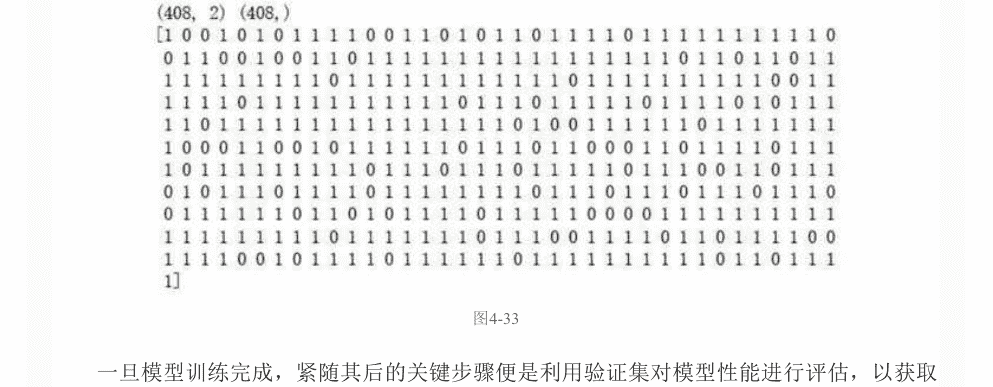
图4-33

训练完成后，下一步是利用验证集评估泛化能力，这对理解模型有效性、调参防过拟合至关重要。目前已能监控训练损失，但为了更全面把握进展，需要补充 accuracy、score 等指标。

Datasets 库提供的 load_metric 方法正好满足这一需求。它能便捷地接入主流评估指标，无论是 accuracy、precision、recall，还是 F1、AUC-ROC 等，Hugging Face 生态几乎全覆盖。使用者无需自行实现评估逻辑，直接调用预置函数即可把精力放在模型创新与业务优化上。如代码4-21所示，评估阶段因此变得更简洁、专业、可靠，也加快了不同版本模型的迭代对比。

代码4-21

```python
# 导入 Datasets 库中的 load_metric 函数，用于加载评估指标以度量模型性能。
from datasets import load_metric
# 使用 load_metric 函数加载名为“glue”数据集中的“mrpc”子任务所对应的评估指标。
# GLUE (General Language Understanding Evaluation) 是一系列自然语言理解任务的集合，而 MRPC (Microsoft Research Paraphrase Corpus)
# 是其中的一个任务，用于评估两个句子是否具有相似的语义。
metric = load_metric("glue", "mrpc")
# 调用加载的 metric 的 compute 方法来计算模型在验证集上的性能。
# 参数 predictions 传入之前计算得到的预测类别 (preds)，references 传入真实的标签 ID (predictions.label_ids)。
# 这将根据 MRPC 任务的具体要求评估模型预测的准确性。
metric.compute(predictions=preds, references=predictions.label_ids)
```
下面进一步说明 metric 的实用价值。在 NLP 任务中，load_metric 的核心作用是从评估库加载成熟准则。只需指定指标名称即可自动加载对应算法。该函数接收两组输入：predictions 为模型预测输出，references 为真实标签，基于两者计算并返回 accuracy 等关键指标，直观反映模型表现。

```python
In [29]: # 导入Datasets库中的load_metric函数，用于加载评估指标以度量模型性能。
from datasets import load_metric
# 使用load_metric函数加载名为“glue”数据集中的“mrpc”子任务所对应的评估指标。
# GLUE (General Language Understanding Evaluation) 是一系列自然语言理解任务的集合，
# 是其中的一个任务，用于评估两个句子是否具有相似的语义。
metric = load_metric("glue", "mrpc")
# 调用加载的metric的compute方法来计算模型在验证集上的性能。
# 参数predictions传入之前计算得到的预测类别 (preds)，references传入真实的标签ID (predictions.label_ids)
metric.compute(predictions=preds, references=predictions.label_ids)
Out[29]: {'accuracy': 0.8382352941176471, 'f1': 0.8896321070234114}
```

图4-34

为何大家更偏向复用社区现有的评测规范，而非自行搭建一套全新的标准？关键在于自然语言处理任务本身具有很强的模式一致性。词级别的分类、句子情绪判断、文档主题归类，以及语言模型对下一词的预测、文本摘要的生成、对话系统回复好坏的评价，绝大多数都遵循相似的评价框架。正因如此，开源社区已经沉淀出大量被广泛认可的成熟基准，直接调用既能省去重复建设的成本，也能保证不同工作之间具备横向可比性和普适性。

训练阶段同样可以显式指定评测方式。比较推荐的做法是把评测逻辑抽离出来，形成一个独立且可复用的函数，保持编写习惯的一致性。代码4-22 中给出了 compute_metrics 的定义，它会接收验证集或测试集上的模型预测结果，通常是概率分布，再借助 argmax 之类的操作转为具体类别标签，继而计算并汇总各项指标。落地时只需把该函数作为参数传给 Trainer 的构造过程，例如 trainer = Trainer(..., compute_metrics=compute_metrics)，Trainer 在训练结束后会自动调用它，并输出模型性能的完整报告。

```python
def compute_metrics(eval_preds):
    """
    计算评估指标的函数，这里特指处理 GLUE 数据集中 MRPC 任务的评估。
    参数：
    eval_preds: 一个元组，其中包含从模型得到的预测 logits（未经 softmax 处理的输出）和真实的 labels。
    返回：
    一个字典，包含了评估结果的各类指标，如准确率等，具体由 MRPC 任务的评估标准决定。
    """
    # 加载入 GLUE 数据集中的 MRPC 任务所使用的评估指标，用于后续的性能度量
    metric = load_metric("glue", "mrpc")
    # 解包输入的 eval_preds 元组，获取 logits（模型输出）和 labels（真实标签）
    logits, labels = eval_preds
    # 使用 numpy.argmax 沿 logits 的最后一维找到概率最大的索引，即预测的类别
    predictions = np.argmax(logits, axis=-1)
    # 根据加载的评估指标计算模型性能，传入预测的类别和真实的标签，执行评估并返回结果
    return metric.compute(predictions=predictions, references=labels)
```

总体来看，借助 load_metric 引入标准化的评测方法，再把自定义的 compute_metrics 融入训练流水线，能够高效且精准地捕捉模型在不同阶段的表现变化，为模型优化与选择提供可靠的量化依据。

完成 compute_metrics 的定义后，可通过代码4-23 重新启动训练。

代码4-23

```python
from transformers import Trainer,TrainingArguments
training_args = TrainingArguments("test-trainer",evaluation_strategy="epoch")
# compute_metrics：一个函数，定义了如何从模型预测中计算评估指标，这里是之前定义的 compute_metrics 函数。
trainer = Trainer(
    model,
    training_args,
    train_dataset=tokenized_datasets["train"],
    eval_dataset=tokenized_datasets["validation"],
    data_collator=data_collator,
    tokenizer=tokenizer,
    compute_metrics=compute_metrics          # 计算指标的函数
)
trainer.train()
```

如图4-35 所示，对比引入 compute_metrics 前后在训练进程中的差异，可以明显看到评估维度的明显扩展。未接入该函数时，监控基本围绕基础的损失值 Loss 展开，它衡量的是模型预测偏离真实的程度。加入 compute_metrics 后，整个评测体系被丰富与深化。

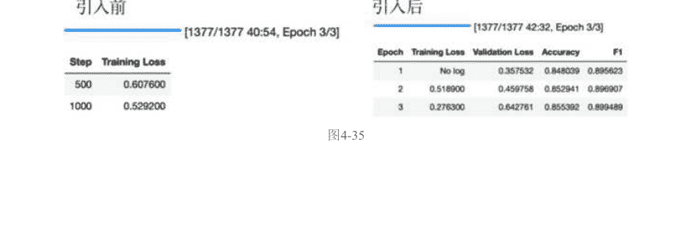

具体表现为，在继续追踪损失变化的同时，系统会同步呈现准确率 Accuracy 与 F1 分数。准确率是最直观的性能刻画，直接反映预测正确的比例，是多数分类任务的基础衡量尺度。F1 分数则兼顾精确率与召回率的优势，特别是在类别分布不均衡的场景下更具参考价值，能够提供更为全面的评估视角。

因此在训练管线中引入 compute_metrics，不仅能获得更宽泛、多维度的反馈，也能更细致地洞察模型在不同能力的表现表现，进而为调优策略的设计与落地提供扎实的数据支撑。这一改进提升了训练过程的透明度，也强化了对优化方向的指导作用，是迈向高性能模型开发的重要一步。

## 4.5 本章小结

本章系统梳理了大模型开发工具的应用路径。首先介绍了 Hugging Face 平台的基础概念，以及 Transformers 库的安装流程。随后阐述了大模型开发的范式与 Transformers 核心设计，帮助读者掌握高效使用这些工具的方法。接着深入解析了 Transformers 的具体能力，涵盖 NLP 任务全流程、数据转换形式、Tokenizer 的使用，以及模型的加载、推理和保存操作。最后以全量微调为例，说明了 Datasets 库与 Accelerate 库的配合、数据格式与预处理、训练参数配置、实际训练流程和模型评估步骤。本章提供了丰富的实践要素，助力读者建立大模型开发的核心方法论。

# 第5章 高效微调方法

在大型语言模型推动下，人工智能正进入新一轮发展期。我们见证了模型参数规模的急剧放大：从早期数万量级的原型，到如今动辄数十亿甚至上百亿参数的巨型系统，这一演进建立在自2018年以来自监督学习范式对海量语料的持续吸收之上。伴随而来的是微调价值的凸显：全量训练成本高昂，使得对全部参数进行微调成为多数团队难以承受的负担，于是高效微调应运而生，用以调和资源限制与性能需求的矛盾。

传统全量微调要求更新模型全部参数，已难以匹配 LLM 的规模和复杂度，尤其在普通硬件条件下资源消耗极大。高效微调通过只更新少量新增或特定的参数，保持预训练权重不变，在成本与效果之间取得微妙平衡，为大模型的广泛落地打开了空间。

本章聚焦 QLoRA 技术及其在微调 GLM 模型中的实践，探讨 QLoRA 为何能在众多方法中脱颖而出。我们将从2021年的技术背景逐步推进到2023年的演进，梳理 QLoRA、LoRA、P-Tuning、Prefix Tuning 与 P-Tuning V2 的发展脉络。总体而言，LoRA 以调整效果见长，P-Tuning 以效率突出，而 Prefix Tuning 与 P-Tuning V2 在效率与效果间实现了兼顾。通过剖析这些技术的特性和演进，为读者构建清晰的微调技术图谱，提供研究与实践的参考。

## 5.1 主流的高效微调方法介绍

### 5.1.1 微调方法介绍

1. 微调方法分类

图5-1 将高效微调技术大致划分为三大类：Additive、Selective、Reparametrization-based。

（1）Additive。
Additive 主要包含 Adapters 与 Soft Prompts 两类。

①Adapters 在参数高效微调 PEFT 领域保持领先地位。通俗讲，适配器是在前馈神经网络 FFNN 模块内部额外插入一个小型辅助模块，实现对模型的针对性增强，同时不改动原有架构。

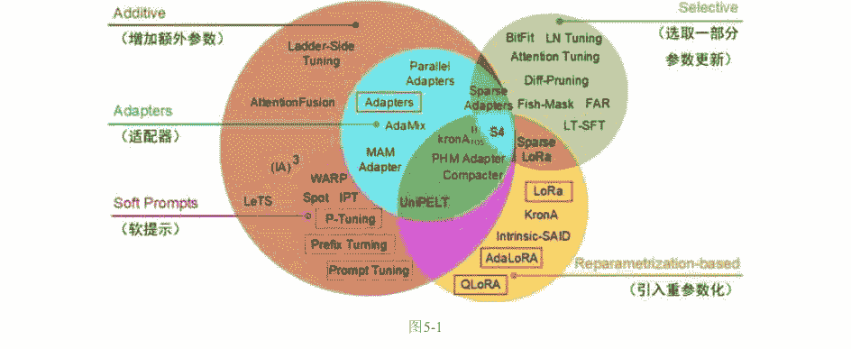

②Soft Prompts 包括 Prompt Tuning、Prefix Tuning 及 P-Tuning 等。其特点是无需直接修改庞大预训练模型的权重，而是通过优化模型的响应机制，仅靠精心设计提示即可引导大模型产出预期输出。

Additive 还涵盖其他多种策略，其共通思路是针对下游任务需求，通过附加小型辅助模型或精选新增参数对基础模型进行扩展。早期适配器的应用就是在既定架构上集成小型功能模块的典型。采用增量模型或参数的方式，能以较低成本让大模型快速适应目标任务。

（2）Selective。
Selective 的核心是对模型现有参数集合进行选择性微调。选择依据可以是模型层级深度、不同功能层类型，或参数重要性，以实现精准高效的参数优化。

（3）Reparametrization-based。
LoRA 是该类典型代表。该方法通过重构预训练模型的参数配置，或对网络结构做适度改动，用小规模参数调整逼近大模型的性能表现，其本质是借助参数重组与优化达成高效微调。

#### 2. 主要技术路线与相关论文

本节介绍两条技术路线：① Soft Prompt 中的 Prefix Tuning、Prompt Tuning、P-Tuning V1 与 P-Tuning V2；② Repatametrization-based 中的 LoRA、AdaLoRA 与 QLoRA。

第一条路线的时间线与论文如下。
（1）Prefix Tuning《Prefix-Tuning: Optimizing Continuous Prompts for Generation》，2021 Stanford。
（2）Prompt Tuning《The Power of Scale for Parameter-Efficient Prompt Tuning》，2021 Google。
（3）P-Tuning V1《GPT Understand Too》，2021 Tsinghua、MIT。
（4）P-Tuning V2《P-Tuning v2: Prompt Tuning Can Be Comparable to Fine-tuning Universally Across Scales and Tasks》，2022 Tsinghua、BAAI、上海人工智能实验室。

第二条路线的时间线与论文如下。
（1）LoRA《LoRA: Low-Rank Adaptation of Large Language Models》，2021 Microsoft。
（2）QLoRA《QLoRA: Efficient Finetuning of Quantized LLMs》，2023 University of Washington。
（3）AdaLoRA《Adaptive Budget Allocation for Parameter-Efficient Fine-Tuning》，2023 Microsoft、Princeton、Georgia Tech。

### 5.1.2 Prompt的提出背景

- 1. 早期研究结果
如图5-2 所示，在 GPT-3 研究初期，团队发现了预训练模型的一项特殊能力，后被命名为上下文学习 In Context Learning ICL。其核心逻辑是基于实例进行类比推理，标志着人工智能的重要进展。

上下文学习建立在模仿与泛化之上，无需为新任务重新训练模型。经过大规模预训练的 GPT-3 面对未见任务时，只需输入一段包含任务说明的文本，并附上若干相关示例作为演示，随后给出待解问题。这些精心构造的信息构成完整的输入，引导模型在不额外训练的情况下直接输出最匹配的答案。

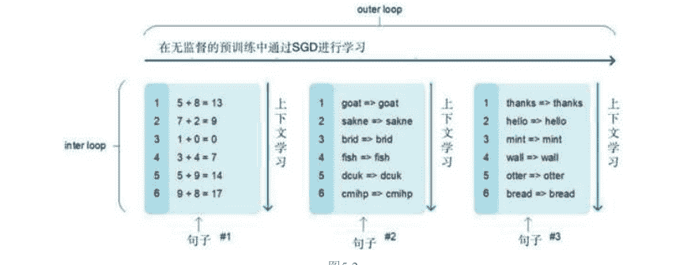

上下文学习的价值在于灵活性和即时性，大幅降低了调整时间和算力需求，也体现了语言模型在复杂情境理解上的洞察力。它深化了对模型泛化能力的认知，为构建更智能自适应的学习系统奠定基础。因此 ICL 不仅是 GPT-3 的技术亮点，也是迈向高效智能应用的关键里程碑。

- 2. 新的微调道路
ICL 的提出为微调开辟了新路径。在 GPT-3 提出概念前，学术界在大模型微调上几乎空白，主要受两大限制：一是全量加载大模型训练成本高昂且算力需求巨大；二是参数量庞大且可解释性差，难以判断哪些参数需要调整。

当时研究者普遍困于如何有效微调大模型。GPT-3 提出的 ICL 给出颠覆性观点：无需传统意义上的微调，只需引导模型响应精心设计的 Prompt 即可获得高质量输出。由此催生了 Soft Prompt 策略，其中包括后文要讨论的 Prefix Tuning 与 Prompt Tuning。其本质是保持模型参数冻结，仅通过输入 Prompt 的巧妙设计来提升任务表现。

借此思路，研究者不必为每个下游任务单独训练完整模型，而是复用统一的预训练且参数固定的母模型。这不仅实现多任务复用，也显著提升效率，因为只需维护少量 Prompt 参数，相较于整套模型的参数训练与存储，在成本和资源占用上优势明显。

#### 3. Prompt分类

微调范畴内的 Prompt 策略可分为两类。

##### (1) Hard Prompt（硬提示）
又称离散 Prompt，是研究者手工构造的一串具有明确语义的文本标记。它以自然语言形式存在，便于人类阅读和审阅，通常为中文或英文词汇。优势是可解释性强、可由领域专家定制；局限在于设计高效且精准引导输出的 Hard Prompt 需要深厚专业洞察和大量试错，成本高且效果不稳定。

##### (2) Soft Prompt（软提示）
也称连续 Prompt，放弃手工构造，转而采用可学习的向量表示。它是一组在向量空间中通过算法优化得到的可训练张量，与模型的输入嵌入层相连，可随训练数据动态调整。优化通常借助梯度下降等方法探索适配模型行为的虚拟标记空间。Soft Prompt 在适应性和性能上表现突出，但缺乏直观可读性，因为“虚拟词元”并不映射到具体自然语言词汇，给解读和调试带来额外挑战，需要深入理解机器学习内部机制与数据交互。

## 5.2 PEFT库快速入门

### 5.2.1 介绍
PEFT 的命名体现了 Hugging Face 的直白风格，直接以技术缩写作为开源库标识。面对传统全参数微调带来的高成本与资源压力，PEFT 库应运而生。它是一个面向大型预训练模型的 Python 库，旨在保留模型性能的同时，大幅降低微调过程中的计算消耗与存储需求。

PEFT：用少量参数完成大模型定制

PEFT 的核心在于提供一套精巧的参数调优方案，让使用者无需改动整套网络，只需让极少数的可训练权重发生改变，或额外注入少量新参数，就能实现在多项落地场景中的快速适配与个性化。训练开销因此被大幅压缩，而表现仍能接近全参数微调的水平，这使得超大语言模型的训练与部署可以在普通消费级设备上完成，应用范围随之显著扩展。

如图5-3所示，PEFT 与 Transformers、Diffusers、Accelerate 紧密衔接。这种配合优化了大型模型的导入环节，简化了训练与推理的操作流程，为研究者与开发者搭建了低门槛的高效工作流。借助这些协同，驾驭复杂模型变得更快，AI 技术在各领域的落地与创新也因此加速。

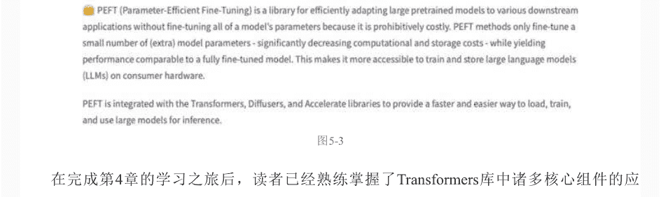

完成第4章学习后，读者已能熟练调用 Transformers 中的关键组件，为深入调优打下基础。第5章将以实操编码为主，演示各类参数高效微调的落地方法。在剖析具体方案前，先熟悉 Transformers 内与 PEFT 相关的核心模块，这套工具箱是后续实践的起点。

因为第4章对 Transformers 的系统训练，读者已拥有扎实的理论与动手经验，能自然过渡到第5章的 PEFT 内容。本章编排注重连贯，让前期概念平滑过渡到 PEFT 体系，即使面对更进阶的微调手段也能快速上手。通过逐层拆解 Transformers 中与 PEFT 关联的接口与工具，既巩固已有认知，也打开模型优化与性能提升的新局面。

### 5.2.2 设计理念

#### 1. 一脉相承的设计

PEFT 继承了 Transformers 一直强调的整合与好用。在 Transformers 体系里，构建复杂模型离不开三大抽象：Config、Tokenizer、AutoModel。它们构成模型骨架，让预训练大模型能轻松接入项目，配置、预处理、加载一气呵成。

进入参数高效微调领域，PEFT 延续了 Hugging Face 的简洁易用主张，并未额外堆叠概念，而是在现有 Transformer 架构上扩展，引入 PeftModel 与 PeftConfig 两个核心元素。这种做法保证了与既有知识的无缝衔接，也让用户在不改动原有流程的前提下平滑切入高效微调。原有的模型概念与使用习惯在 PEFT 中完整保留，开发者可在熟悉的环境里迅速掌握高级微调手段，加速模型向特定任务的定制。

#### 2. 支持的方法

随着 Efficient Fine-Tuning 研究不断演进，Hugging Face 的 PEFT 保持频繁迭代，快速吸收最新成果并扩大兼容面，成为研究者与开发者的常用工具。其受欢迎程度源于持续的技术更新和对用户需求的敏锐捕捉，成为连接研究与应用的桥梁。

图5-4 展现了 PEFT 的兼容力与实用性，覆盖多种主流预训练架构，并整合了丰富的高效微调策略。从经典 Adapter 方案与软提示，到 LoRA、Prompt Tuning、Prefix Tuning 等前沿手段，库内均提供简洁接口与详细文档，帮助用户轻松实现个性化与性能优化。图5-4 清晰呈现了 PEFT 在模型支持与方法集成上的广度与深度，凸显其作为高效微调实践平台的价值。


图5-4

Hugging Face 为 PEFT 提供了基于 Gradio 的交互式界面，用户可直观探索库的能力。下拉菜单列出多种 task_type，可按关注的落地应用挑选。确认任务类型后，界面即时展示对应的推荐模型与高效微调技术，实现动态查询，使用户快速了解当前支持的模型与方法组合，提升信息获取效率。

同时，官方网站的文档区也发挥关键作用。如图5-5所示，文档详细记录了安装指引与基础用法，并汇总了库中主流微调方法，包括原理说明、代码示例与最佳实践建议。这种分层设计为研究者、开发者及初学者构建了全景知识体系，帮助不同用户快速定位并深入了解 PEFT 的功能与最新动态。

##### ADAPTERS

- AdaLoRA

- IA3

- Llama-Adapter

- LoHa

- LoKr

- LoRA

- LyCORIS

- Multitask Prompt Tuning

- OFT

- Polytropon

- P-tuning

- Prefix tuning

- Prompt tuning

图5-5

#### 3. PeftModel

实例化 PeftModel 需要两个关键输入：基础模型 Model 与微调配置 PeftConfig。其中 Model 本质上是对 Transformers 预训练模型的引用，封装了配置、模型实现、分词器三要素。由于 Model 已自带分词逻辑，PEFT 在上层设计中无需重复定义分词器，保持结构简洁。

在此基础上，PEFT 提出了 AutoPeftModel 这一抽象，其设计明显受 Transformers 中 AutoModel 启发，并在自动化与通用性上加以强化。AutoPeftModel 不仅限于标准大模型，而是可灵活扩展的框架，能自由接入多种 PEFT 策略。

与传统大模型相比，AutoPeftModel 的特有能力是无缝对接广泛的 PEFT 方法。具体而言，它支持三大主流技术：Adapter 方法，通过在内部插入小型可训练模块实现高效调整；Soft Prompt 技术，通过在输入序列中加入可学习提示来引导输出；以及 LoRA 低秩适应，通过低秩分解减少参数量实现重参数化。这些集成让 AutoPeftModel 成为连接预训练模型与前沿微调技术的桥梁，显著扩展模型在特定任务上的适应性与效能。

#### 4. PeftConfig

在 PEFT 实践中，每种方法都伴随一组源自论文的超参数，对微调效果至关重要。为统一管理这些参数，PEFT 借鉴了 Transformers 中 AutoClass 架构下 Config 的设计。所有 PEFT 方法的配置均从基础 PeftConfig 类派生，形成有序且易维护的继承体系。

PeftConfig 作为配置体系的基石，封装了各方法共用的配置逻辑，并通过核心参数 peft_type 精准指示不同微调策略的选择。该参数依据设定值动态决定采用何种高效微调方法，如 Adapter、Soft Prompt 或 LoRA，从而实现配置与实现间的灵活对接。这种模块化设计体现了 PEFT 框架的高灵活性，也是其实现高效可定制化微调的核心思路。

借助此设计，用户面对多样化 PEFT 技术时，只需在 PeftConfig 中设定对应参数即可指定并调整所需方法的超参数细节，无需关注底层实现复杂性，大幅降低使用门槛，促进技术的普及与深化。

### 5.2.3 使用

如代码5-1所示，PEFT 库的参数定义方式如下。

## 代码5-1

```python
# 从 PEFT 库中导入 LoRA 配置类及任务类型枚举
from peft import LoraConfig, TaskType
# 初始化 LoraConfig 对象以配置 LoRA (Low-Rank Adaptation) 适配层的参数
# 这些参数用于自定义 LoRA 层的结构和行为，LoRA 是一种轻量级的微调方法，适用于大模型

peft_config = LoraConfig(
    task_type=TaskType.SEQ_2_SEQ_LM,    # 指定任务类型为序列到序列的语言建模（如文本生成任务）
    inference_mode=False,               # 设置为 False 表示是在训练模式，如果是 True 则是在推理模式下的一些特定优化将被应用
    r=8,                                # LoRA 层中的秩数（rank），决定了适配层的大小和容量，较低的值使模型更轻量
    lora_alpha=32,                      # LoRA 层中权重矩阵的缩放因子，影响学习率和参数初始化规模
    lora_dropout=0.1                    # LoRA 层中的 dropout 比例，用于正则化和防止过拟合
)
```

PEFT 模仿了 Transformers 库的便捷风格，用户可直接通过 `from peft import ...` 导入核心配置与方法，保持使用体验高效直观。其中 `LoraConfig` 是为 LoRA 技术预制的配置类，封装了论文中提及的关键超参数，提供一站式配置方案。各参数的详细解读与调整建议安排在第6章，帮助读者深入掌握并灵活运用。

PEFT 的设计理念在于消除先进技术应用的障碍。仅需寥寥数行代码，就能将论文中描述的新颖技术落地到实际项目，显著缩短从认知到实践的距离。这种方式不仅降低技术门槛，也极大激发了研究者与开发者探索前沿微调技术的热情与创造力，实现学术成果向实用工具的高效转化。

代码5-2 用于加载模型，在开展微调任务时可借助 Transformers 库加载基础预训练模型。此例选用 “bigscience/mt0-large”，仅为演示流程，不必深究模型细节。该模型代表大规模多语言预训练的实现，内部蕴含丰富的跨语言知识，为后续微调奠定基础。关键在于理解加载过程本身：通过 Transformers 的抽象接口，复杂的模型结构与训练细节被简化为几个直观调用，让研究者聚焦于针对特定任务的微调策略与实验设计，而非初始获取与配置。

## 代码5-2

```python
# 从 Transformers 库中导入 AutoModelForSeq2SeqLM 类
from transformers import AutoModelForSeq2SeqLM
# 使用 AutoModelForSeq2SeqLM 的 from_pretrained 方法加载预训练好的序列到序列（seq2seq）语言模型
# 这里加载的是"bigscience/mt0-large"模型，mt0-large 是 BigScience 项目提供的一个大规模多语言预训练模型，
# 适合用于多种序列到序列的任务，如翻译、文本摘要等
model = AutoModelForSeq2SeqLM.from_pretrained("bigscience/mt0-large")
```

代码段5-3 展示如何构建 PEFT 模型，通过调用核心函数 `get_peft_model`，将基础模型与预先配置好的 `peft_config` 结合，生成具备 PEFT 特性的 `PeftModel` 实例。该过程体现了 PEFT 框架的灵活性与高效性，并将 LoRA 配置中的设计意图融入模型架构，确保优化方向与效率。

## 代码5-3## 从 PEFT 库中导入 get_peft_model 函数，PEFT 库用于实现模型的参数高效微调

from peft import get_peft_model

# 使用 get_peft_model 函数对原始模型（model）进行适配，使其支持 PEFT（Prompt Learning or Adapter Tuning）策略，

# peft_config 参数包含了微调配置信息，如 adapter 类型、层选择等

model = get_peft_model(model, peft_config)

# 调用模型的 print_trainable_parameters 方法，打印出经过 PEFT 调整后可训练的模型参数数量和详情。

# 这有助于理解哪些模型部分将被微调，而哪些部分将保持冻结，这是 PEFT 高效微调的核心优势之一

model.print_trainable_parameters()

# 输出如下

"output: trainable params: 2359296 || all params: 1231940608 || trainable%: 0.19151053100118282"

为了洞察模型内部的训练动态，`print_trainable_parameters` 方法被作为 PeftModel 的标准功能引入。其作用是直观展示在当前 PEFT 配置下，可训练参数的数量及其占整体的比例。鉴于 PEFT 的核心优势在于仅微调部分参数，避免全模型训练的高昂计算成本，了解并监控训练参数规模与占比，对评估优化策略有效性、监控资源消耗与预测训练时间具有重要意义。通过输出，用户能清晰识别哪些参数正在接受梯度更新，从而更好地把握 PEFT 训练的重点与效率。

代码5-4 承担训练流程的核心职责，其运作基于第4章详述的 Transformers 库 Trainer 抽象类。第4章不仅概述了 Trainer 的设计哲学与结构，还强调其作为模型训练通用解决方案的重要性。实际训练时，Trainer 需要明确界定若干关键要素以保证过程顺利。

## 代码5-4

```
# 初始化训练参数对象，配置模型训练所需的各项设置
training_args = TrainingArguments(
    # 模型输出目录，训练结束后，模型将保存在此路径下
    output_dir="your-name/bigscience/mt0-large-lora",
    # 学习率，模型参数更新的步长
    learning_rate=1e-3,
    # 每个设备上的训练批次大小，影响内存占用和训练速度
    per_device_train_batch_size=32,
    # 每个设备上的评估批次大小，影响评估阶段的内存占用和速度
    per_device_eval_batch_size=32,
    # 总共训练的轮数，即完整遍历数据集的次数
    num_train_epochs=2,
    # 权重衰减因子，用于L2正则化，帮助减少过拟合
    weight_decay=0.01,
    # 评估策略，这里设置为每个epoch评估一次
    evaluation_strategy="epoch",
    # 模型保存策略，每个epoch结束时保存模型
    save_strategy="epoch",
    # 是否在训练结束时加载最佳模型（基于验证性能）
    load_best_model_at_end=True,
)

# 创建 Trainer 对象，这是训练的主控制器，整合了模型、训练参数、数据集等
trainer = Trainer(
    # 要训练的模型
    model=model,
    # 上述定义的训练参数
    args=training_args,
    # 训练数据集
    train_dataset=tokenized_datasets["train"],
    # 评估数据集
    eval_dataset=tokenized_datasets["test"],
    # 用于文本预处理的分词器
    tokenizer=tokenizer,
    # 数据整理器，用于批量处理数据
    data_collator=data_collator,
    # 度量指标函数，用于评估模型性能
    compute_metrics=compute_metrics,
)
```

```
# 开始模型训练
trainer.train()
```

首先，涉及训练的载体，即所选模型架构。用户需明确指出期望训练的模型类型，它是整个训练蓝图的骨架。其次，训练参数的设定构成指导模型学习的指令集，包括学习率、批次大小、迭代次数等，共同决定性能优化的方向与速度。最后，数据集供给是训练的实体内容，若无数据模型无法学习，因此精心准备并配置合适的数据输入至关重要。

PEFT 与 HuggingFace Trainer 的协作优势

在保持其他超参不变的情况下，Transformers 里的 Trainer 对 PEFT 改造后的 PeftModel 表现出很强的兼容性，能够直接以它为训练主体。这一特性大幅降低了在大模型预训练权重上做个性化调整的门槛，也凸显了 PEFT 在提升调优效率和实现模型定制方面的意义。

接下来几节会把常见的微调思路梳理一遍，并用 PEFT 做出可复现的实操演示。理论拆解配合动手，能帮助读者形成对大模型微调机制的整体认识，也能直观体会 PEFT 如何把复杂流程变得简洁，为科研和工程落地提供更实用的路径。有了 PEFT 支持，各种微调范式都变得易于上手，讲解与实现会同步推进。

## 5.3 Prefix Tuning

### 5.3.1 背景

前缀调优的核心做法，是给输入头部挂上一组为下游任务定制的连续向量，仅对这组向量的参数进行更新，并让它参与 Transformer 各层的隐藏状态计算，而主体网络保持冻结。

2021 年斯坦福团队提出了一个新思路：在 Transformer 前端植入可学习的特征向量 Prefix，之后把其余全部参数锁住，让 Prefix 负责生成新的 Token 来适配特定任务。这一做法与人工设计的 Prompt 模板很接近，手工 Prompt 可以看作是 Prefix Tuning 原理的离散化模拟，也反映了人类以间接方式引导模型行为的本质。

从使用体验看，Prompt 的效果存在很大不确定性，研究者通常靠反复试错寻找较优写法。手工模板受主观偏好影响大，对微小改动也很敏感，词序或用词的轻微变化就可能导致输出质量明显波动。

因此斯坦福在 2021 年提出了 Prefix Tuning，用自动化方式寻找最优 Prompt。做法是固定预训练大模型本身的参数，只训练面向特定任务的前缀，并为每个任务保存独立的前缀参数集合，从而显著减轻算力负担。更关键的是，这些 Prefix 本质上是连续可微的虚拟词元，和离散词元相比优化更平滑，效果也更好。

总体来看，Prefix Tuning 的价值在于用极小成本完成个性化改造，因为它不改动底层参数，减少了对 GPU 的依赖和训练时长，实现了无需载入完整模型权重即可高效改造的目标。

### 5.3.2 核心技术解读

图5-6取自论文 Prefix-Tuning: Optimizing Continuous Prompts for Generation ，该方法把 Prefix 机制嵌入 Transformer 架构，关键步骤如下。


（1）Prefix 模块集成：在预训练 Transformer 的前端接入专门的 Prefix 模块，为输入提供任务相关的先导信号，而不改动模型深层结构。

（2）差异化训练：仅对新增的 Prefix 参数进行学习，Transformer 其余部分全部冻结。这种聚焦式优化提升了效率与针对性。

（3）资源与成本控制：借此大幅减少对 GPU 计算资源的依赖，缩短训练周期与费用，为大模型的快速部署和迭代创造条件。

（4）超大模型的微调突破：对 GPT-3 这类参数量极大的模型尤其有吸引力，让这些巨型模型的微调变得可行且可控。核心优势是避免了全量参数的逐项调整，显著减轻计算负担。

与传统全量微调相比，该技术在输入序列开头构造任务适配的虚拟词元作为 Prefix 来引导训练目标。Prefix 参数借助前馈网络动态调整，而 Transformer 主体保持稳定，这与人工 Prompt 的差异很明显：Prompt 是显式固定的引导信息，缺少学习能力；Prefix 则是隐式可学习的提示，能在训练中自我优化，更精准匹配任务。

为保证训练稳定与效率，研究者在 Prefix 模块前端加入多层感知机 MLP 结构，为 Prefix 参数的学习提供更平滑的路径。实践表明，这一设计有效避免了直接优化 Prefix 可能带来的不稳定，同时训练结束后只需保留优化好的 Prefix 参数，降低存储与部署成本。

论文结果显示，尽管参数量被压缩到原模型的千分之一左右，Prefix Tuning 的性能仍能逼近全量微调，尤其在数据有限的场景下表现更优，为高效模型调优提供了新方向。

### 5.3.3 实现步骤

本节代码建议在具备一定 Python 基础后再细读，提前熟悉 HuggingFace PEFT 库会更顺畅。

首先引入 PEFT 库及相关类，定义模型、tokenizer、文本与标签列以及超参，以便快速进入训练。如代码5-5所示，创建 PrefixTuningConfig 配置类。

```
# 从 PEFT 库中导入所需的各种类和函数，用于实现不同的参数高效微调策略
from peft import (
    get_peft_config,          # 获取 PEFT 配置的函数
    get_peft_model,           # 根据配置获取 PEFT 模型的函数
    PrefixTuningConfig,       # 前缀调优配置类，用于前缀调优策略
    TaskType,                 # 任务类型的枚举，如序列到序列任务等
    PeftType,                 # PEFT 类型的枚举，定义了不同的微调类型
    PeftModel,                # PEFT 模型基类，用于扩展自定义微调模型
    PeftConfig                # PEFT 配置基类，所有微调配置的基类
)
# 设定设备为CUDA，意味着模型将在GPU上运行
device = "cuda"
# 模型型和分词器的名称或路径，这里使用"T5-large"模型
model_name_or_path = "t5-large"
tokenizer_name_or_path = "t5-large"
# 数据列的名称，用于从数据集中提取文本和标签
text_column = "sentence"
label_column = "text_label"
# 序列的最大长度，用于文本预处理
max_length = 128
# 学习率设置
lr = 1e-3
# 总训练轮次
num_epochs = 5
# 批次大小
batch_size = 8
# 初始化前缀调优的配置实例
peft_config = PrefixTuningConfig(
    peft_type="PREFIX_TUNING",          # 设置微调类型为前缀调优
    task_type="SEQ_2_SEQ_LM",           # 指定任务类型为序列到序列（如文本生成）
    num_virtual_tokens=20,              # 前缀的虚拟词元数量
    token_dim=768,                      # 虚拟词元的维度
    num_transformer_submodules=1,       # 变换器子模块的数量
    num_attention_heads=12,             # 注意力头的数量
    num_layers=12,                      # 层数量
    encoder_hidden_size=768,            # 编码器隐藏层大小
    inference_mode=False                # 是否为推理模式，False 表示训练模式
)
```

PrefixTuningConfig 配置类参数说明如下。

| 参数名 | 类型 | 说明 |
| :--- | :--- | :--- |
| peft_type | str | 指定采用前缀微调的模式 |
| task_type | str | 标明当前训练任务类别，本例为序列到序列语言建模 |
| num_virtual_tokens | int | 虚拟词元个数，等价于提示长度 |
| token_dim | int | 词向量维度大小 |
| encoder_hidden_size | int | 前缀编码器的隐层宽度 |
| prefix_projection | bool | 是否对前缀嵌入做投影 |

如代码5-6所示，设置模型，并确保它已准备好接受训练。在PrefixTuningConfig中指定任务，从AutoModelForSeq2SeqLM创建基本t5-large模型，然后将模型和配置封装在PeftModel中。

## 代码5-6

```
# 加载预训练的序列到序列语言模型（如 T5、BART 等）
# 使用 Transformers 库的 AutoModelForSeq2SeqLM 从指定路径或名称加载模型
# device_map='auto' 自动将模型分布在可用的 GPU 上（如果有的话）
# torch_dtype='auto' 自动选择最适合当前硬件的 dtype 以优化内存使用
# trust_remote_code=True 允许加载模型时信任远程仓库中的代码，这对于使用包含自定义扩展的模型很重要
model = transformers.AutoModelForSeq2SeqLM.from_pretrained(
    model_name_or_path,
    device_map='auto',
    torch_dtype='auto',
    trust_remote_code=True
)

# 应用 PEFT（Prompt Tuning 或 Prefix Tuning 等）对模型进行微调配置
# peft_config 包含了如前所述的微调设置，如 peft_type、task_type 等
model = get_peft_model(model, peft_config)
# 打印出经过 PEFT 调整后模型中可训练参数的数量和详情
# 这有助于理解哪些部分的模型参数在接下来的训练过程中会被更新
model.print_trainable_parameters()
#out: "trainable params: 983040 || all params: 738651136 || trainable%: 0.13308583065659835"
```

通过model.print_trainable_parameters()方法打印PeftModel的参数，并将其与完全训练所有模型参数进行比较，需要参加训练的参数仅占0.13%。

## 代码5-7

```
# 使用 AdamW 优化器，它是一种将权重衰减（L2 正则化）纳入 Adam 优化算法的方法，适用于 Transformer 模型的训练。
# model.parameters() 提供了模型中所有可学习参数的迭代器，lr 参数设置了学习率。
optimizer = torch.optim.AdamW(model.parameters(), lr=lr)
# 初始化学习率调度器，使用线性预热（warmup）策略，该策略在训练初期逐步增加学习率，之后再按计划递减。
# 这有助于模型在训练开始时更快地摆脱局部最小值，并在后续训练中保持较好的收敛性。
# get_linear_schedule_with_warmup 需要 optimizer, num_warmup_steps（预热步数），以及总训练步数作为参数。
# 这里 num_warmup_steps 设为 0，意味着不进行学习率的预热阶段，直接开始训练。
# 计算总训练步数为训练数据加载器长度乘以总 epochs 数，确保学习率按照训练全程线性下降。
lr_scheduler = get_linear_schedule_with_warmup(
    optimizer=optimizer,
    num_warmup_steps=0,  # 不使用学习率预热阶段
    num_training_steps=(len(train_dataloader) * num_epochs),  # 总训练步数
)
```

如代码5-8所示，模型训练的其余部分均无须更改，将模型移动到GPU上训练，当模型训练完成之后，保存高效微调部分的模型权重以供模型推理。

## 代码5-8

```
peft_model_id = f"{model_name_or_path}_{peft_config.peft_type}"
model.save_pretrained(peft_model_id)
```
## 5.3.4 实验结果

图5-7同样取自论文 Prefix-Tuning: Optimizing Continuous Prompts for Generation ，实验数据揭示了 Prefix Tuning 在成本效益上的明显优势。横坐标是 training_data_size 的大小，纵坐标是不同方法在不同数据集上的表现。相比传统 Fine Tuning，Prefix Tuning 在计算与时间成本上节约显著。


在多个常用基准测试中，随着训练数据从小规模逐步扩大到大规模，Prefix Tuning 保持了很强的适应性与竞争力。尤其在数据量受限时，其表现不仅不弱于全量微调，在部分任务上甚至超越，体现出更好的数据效率。这说明 Prefix Tuning 既省资源，又能在有限数据下实现良好泛化。

整体实验证明，仅优化前端 Prefix 参数而非全部参数，不仅大幅降低了微调的经济与技术门槛，还能在不同数据规模下保持甚至优于 Fine Tuning 的表现，为大模型高效微调提供了新路径。在资源受限或追求快速迭代的场景中，其价值尤为突出。

## 5.4 Prompt Tuning

### 5.4.1 背景

Prefix Tuning 在落地时暴露出两方面限制。

（1）其方式是在原输入 Prompt 前额外拼接前缀，直接占用了模型的输入长度预算。因为前缀信息会进入模型处理的序列，难免压缩生成任务的有效输入空间，可能影响生成质量与多样性，尤其在对精度与上下文理解要求高的任务上。

（2）Prefix Tuning 依赖离散 Prompt 设计，落地成本较高，实效有限。引入的 MLP 结构也增加了复杂度与训练难度，限制了模型可塑性与效率。

在此背景下，Prompt Tuning 作为一种精炼变体出现。核心区别在于，Prompt Tuning 只在模型输入嵌入层加入提示参数，而不是在所有层都插入 Prefix。这一改动简化了结构调整，规避了 MLP 训练的难题，转而依靠精心设计的 Prompt Token 在输入层面驱动模型对特定任务的响应。仅更新这些 Token 的嵌入参数，就能在保持预训练权重不变的前提下实现任务适应，显著降低训练负担并提升灵活性。

Prompt Tuning 的理论基础是赋予 Prompt Token 独立可更新的参数，使模型以更低算力完成任务优化，同时兼容大规模预训练模型。实验显示，其性能虽不一定全面超越 Fine Tuning，但已非常接近，实现了以低成本获得接近高成本方案的效果。随着模型规模持续增加，Prompt Tuning 的潜力有望进一步放大。

因此 Prompt Tuning 的主要贡献包括：

- （1）引入了一种直观自然的语言引导方式，提升大模型的操控性与透明度。
- （2）特别适合已积累丰富通用知识的成熟大模型，利用规模化优势挖掘潜能。
- （3）继承 Prefix Tuning 的优点，通过避免加载整个庞大模型显著降低资源需求，为大模型高效部署与任务定制提供可行路径。

### 5.4.2 核心技术解读

Prompt Tuning：轻量外部挂载实现多任务

论文 The Power of Scale for Parameter-Efficient Prompt Tuning 中的图5-8，将提示微调与传统全量微调并置对比。左侧图示凸显了常规做法的繁琐：面对 Task A、B、C 等不同下游问题，需要为每个问题准备独立的数据与模型。新增任务时便要从头训练一个专用网络，计算与时间开销随任务数线性增长。Prefix Tuning 虽对前缀进行单独优化再接入主网络，训练负担有所减轻，但仍维持任务与模型一一对应的模式，重复建模的本质并未改变。


右侧图则呈现了提示微调的结构设想。与 Prefix Tuning 把前缀模块内嵌到 Transformer 不同，提示微调另建一个与底座模型解耦的外挂网络。借助这种分离架构，可对 Task A、B、C 等多项任务进行联合训练，提升整体效率与泛化能力，同时对底座参数的扰动很小，稳定性与原有性能得以保留。

特别值得注意的是提示微调提出的 Prompt Ensembling 策略，在同一训练批次内融合多个针对同一任务的不同提示形式，效果类似多模型集成，却避免了集成完整模型的高成本。批次内提示的多样性有助于模型更全面地理解任务，增强鲁棒性与灵活性。

总体来看，提示微调构建了一个通用的下游处理框架，单一混合网络即可应对多样化需求，展现出强劲的多任务适应性与效率。与 Prefix Tuning 相似，它同样占用输入序列空间，作为一种优化形态在降低训练复杂度上有所进步，但提示或前缀对输入资源的占用仍是后续研究需权衡的点。

### 5.4.3 实现步骤

落地提示微调时，可参考代码5-10。首先载入 Huggingface 的 PEFT 库，初始化模型与分词器、训练集及其列信息、训练超参，并创建 PromptTuningConfig。该配置主要记录任务范式、提示嵌入的初始化文本、虚拟标记数量以及标记生成策略：

```
代码5-10
python
# 从 PEFT 库中导入必要的类和函数，用于实现 Prompt Tuning 等参数高效微调技术
from peft import (
    get_peft_config,    # 用于获取 PEFT 配置的函数
    get_peft_model,     # 用于根据配置创建 PEFT 模型的函数
    PromptTuningConfig, # Prompt Tuning 的配置类，专门用于 Prompt Tuning 策略
    PeftModel,          # PEFT 模型基类，用于 PEFT 微调后的模型
    PeftConfig          # PEFT 配置基类，所有 PEFT 配置的基础
)
# 设备配置，指定模型运行在 CUDA 即 GPU 上
device = "cuda"
# 预训练模型的名称或路径，这里使用的是 bigscience/bloomz-560m 模型
model_name_or_path = "bigscience/bloomz-560m"
# 初始化 Prompt Tuning 的配置，用于指导如何进行 Prompt Tuning 微调
peft_config = PromptTuningConfig(
    peft_type="PROMPT_TUNING",          # 设置微调类型为 Prompt Tuning
    task_type="CAUSAL_LM",              # 任务类型为因果语言模型，适合生成任务
    num_virtual_tokens=20,              # 使用 20 个虚拟词元作为 Prompt
    token_dim=768,                      # 每个虚拟词元的维度为 768
    num_transformer_submodules=1,       # 变换器子模块的数量
    num_attention_heads=12,             # 注意力头的数量
    num_layers=12,                      # 变换器层数量
    prompt_tuning_init="TEXT",          # Prompt 初始化方式为文本方式
    prompt_tuning_init_text="Predict if sentiment of this review is positive, negative or neutral", # Prompt 初始化的文本内容，引导模型预测评论的情感倾向
    tokenizer_name_or_path=model_name_or_path # 使用模型对应的分词器
)
```

参数说明如下。

- （1）task_type（str）：本次微调所处的任务类型，常见为序列分类或 CAUSAL_LM。
- （2）num_virtual_tokens（int）：所需虚拟标记个数，即提示长度。
- （3）prompt_tuning_init（Optional[PromptTuningInit,str]）：提示嵌入的初始化方式，可选 TEXT 或 RANDOM。
- （4）prompt_tuning_init_text（str）：用于生成初始嵌入的文本，仅在 prompt_tuning_init 为 TEXT 时使用。
- （5）tokenizer_name_or_path（dict）：分词器的名称或路径，仅在 prompt_tuning_init 为 TEXT 时需要。

代码5-11 先用 AutoModelForCausalLM 搭建底座模型，再将模型与 peft_config 传入 get_peft_model 包装为 PeftModel。可打印可训练参数规模，直观感受相较全量训练的效率提升。

```
model = transformers.AutoModelForCausalLM.from_pretrained(
    model_name_or_path,
    device_map='auto',
    torch_dtype='auto',
    trust_remote_code=True
)
model = get_peft_model(model, peft_config)
model.print_trainable_parameters()
#out: "trainable params: 8192 || all params: 559222784 || trainable%: 0.0014648902430985358"
```

通过 model.print_trainable_parameters() 查看 PeftModel 的可训练参数比例，与完整微调相比，仅需更新约 0.0014% 的参数。

随后代码5-12 用于设定优化器与学习率调度器。

```
代码5-12
optimizer = torch.optim.AdamW(model.parameters(), lr=lr)
lr_scheduler = get_linear_schedule_with_warmup(
    optimizer=optimizer,
    num_warmup_steps=0,
    num_training_steps=(len(train_dataloader) * num_epochs),
)
```

代码5-13 说明其余训练流程与常规训练一致，训练结束后保存高效微调部分的权重即可用于推理。

```
代码5-13
peft_model_id = f"{model_name_or_path}_{peft_config.peft_type}"
model.save_pretrained(peft_model_id)
```

save_pretrained 会导出增量 PEFT 权重，包含配置文件 adapter_config.json 与权重文件 adapter_model.bin。

代码5-14 展示了推理阶段的使用方式。

```
代码5-14
config = PeftConfig.from_pretrained(peft_model_id)
model = AutoModelForCausalLM.from_pretrained(model_name_or_path)
model = PeftModel.from_pretrained(model, peft_model_id)
```

最后调用 model.generate() 即可完成训练与推理全流程。

### 5.4.4 实验结果

图5-9 同样来自论文 The Power of Scale for Parameter-Efficient Prompt Tuning，系统梳理了影响提示微调效果的若干关键因素，具体如下。

#### (a) Prompt length

#### (b) Prompt initialization

#### (c) Pre-training method

#### (d) LM adaptation steps


图5-9（a）研究了提示长度对大模型表现的影响。即便长度为 1 的极简提示也能获得可用效果，而长度提升至 20 时，性能与资源消耗的性价比达到最佳。

图5-9（b）对比了不同初始化策略。随机均匀分布 Random Uniform 的表现明显弱于基于词表采样 Sample Vocab 或类别标签 Class Label 的方式。但当模型规模足够大时，各策略差距逐渐收敛。

图5-9（c）探讨了预训练方式与模型规模的交互。小模型情境下 LM Adaptation 效果最优。随着规模增大，各类预训练方法的差异逐渐消失，大模型下预训练选择对最终效果影响减弱。

图5-9（d）阐述了微调步数与性能的关系。参数量较小时，增加迭代次数能显著提升效果。当参数量达到阈值后，未经微调的 Zero-shot 也能表现良好，体现出大模型固有的强泛化能力。

总体而言，研究揭示了模型规模 Scale 作为核心变量对提示微调训练效果的深层影响，提示我们在设计模型与制定训练策略时需充分考虑规模带来的差异，以实现更高效的应用。

## 5.5 P-Tuning

### 5.5.1 背景

P-Tuning 由中国团队提出，属于 Soft Prompt 方法的进阶演化，目标是在连续空间中自动探索并优化提示序列，替代人工设计。其 V1 版本直接解决了上节代码中需通过 PromptTuningConfig 的 prompt_tuning_init_text 手工指定提示的问题。原始论文指出：“为预训练模型提供 Prompt 有助于理解自然语言模式，但不当设计的离散 Prompt 可能导致性能严重下降。”提示词的增减或顺序调整均可能显著影响效果，提升调优成本且难以稳定。

为此，P-Tuning 引入可训练的嵌入张量，通过优化该张量寻找更优提示表达，并借助双向长短期记忆网络 Bi-LSTM 作为提示编码器，精细调整提示参数，提升自动化与效率。

此外，P-Tuning 还试图缓解另一瓶颈：以往 Prefix Tuning 与 Prompt Tuning 多冻结大模型参数，仅微调小模型，易出现过拟合，限制泛化。直接对嵌入层优化时，需保证预训练语料嵌入与新加入的学习型提示嵌入协同训练。若训练数据量小且多样性不足，则易过拟合，不仅无法利用大模型先验，反而可能削弱原有能力，陷入局部最优。

### 5.5.2 核心技术解读

具体做法如下。

图5-9 来自论文 GPT Understand,Too，左图展示的方法称为“Prompt Search”，核心目标是寻找一组离散提示序列。这些提示可经人工设计或其他非自动化方式获得，本质为离散且不可微，只能依赖离散评估反馈优化。

## 图5-10

相对地，右图介绍的方法为“Prompt Encoder”，采用连续可微分的虚拟词元作为提示载体。借助反向传播，提示可在连续空间中被精细优化，这与“Prompt Search”形成明显区分。

进一步比较 P-Tuning 与 Prefix Tuning 的差异，可归纳为：

- (1) 提示的实质形态：P-Tuning 的“Prompt Generator”直接生成真实词汇作为提示内容，而 Prefix Tuning 的“Prompt Encoder”处理的是连续空间中的虚拟词元，由显式词向抽象表示转变。
- (2) 模型结构调整：Prefix Tuning 在模型前端附加前缀，对嵌入层做微调，尽量减少对原架构的干预。P-Tuning 则更主动，直接对模型的嵌入参数进行优化。
- (3) 初始化与训练机制：Prefix Tuning 使用多层感知机 MLP 初始化前缀，流程相对繁琐。P-Tuning 则用 LSTM 结合 MLP 对输入嵌入进行初始化，再训练“Prompt Encoder”，在简化流程的同时提升提示生成的有效性与灵活性。

总的来说，无论是提示表达形式、模型调适策略还是训练机制，P-Tuning 与 Prefix Tuning 都呈现出不同的技术取向，反映了自然语言处理领域在高效微调路径探索上的多元化发展。

### 5.5.3 实现步骤

下面介绍实现方式，如代码5-15所示，首先导入 Huggingface 的 PEFT 库，导入所需类，定义模型和分词器、文本与标签列以及超参数，以便更快启动训练。随后创建 PromptEncoderConfig 的配置类。

### 代码5-15

```python
# 从 PEFT 库中导入所需的函数和配置类，用于实现 Prompt Tuning 相关的模型调整
from peft import (
    get_peft_config,    # 获取 PEFT 配置的函数
    get_peft_model,     # 根据提供的 PEFT 配置获取经过调整的模型的函数
    PromptEncoderConfig, # 用于配置 Prompt Encoder 的类，适用于 P-Tuning
)
# 指定预训练模型的名称或路径，这里使用的是较大的 Roberta 模型
model_name_or_path = "roberta-large"
# 定义任务类型，这里是 Microsoft Research Paraphrase Corpus (MRPC) 任务，用于语义等价性判断
task = "mrpc"
# 训练轮数，即遍历整个训练数据集的次数
num_epochs = 20
# 学习率，控制模型参数更新步长的大小
lr = 1e-3
# 批次大小，决定每次迭代时处理的数据样本数量
batch_size = 32
# 初始化 Prompt Encoder 的配置，这是一种特殊的 Prompt Tuning 策略，通过引入可学习的 Prompt Encoder 来优化模型性能
peft_config = PromptEncoderConfig(
    peft_type="P_TUNING",  # 指定使用的 PEFT 类型为 P-Tuning
    task_type="SEQ_CLS",   # 任务类型为序列分类任务，适用于情感分析、语义相似度判断等
    num_virtual_tokens=20, # 定义要插入的虚拟词元的数量
    token_dim=768,         # 每个虚拟词元的维度，应与基础模型的嵌入维度匹配
    num_transformer_submodules=1, # 可学习的 Transformer 子模块数量，通常为1
    num_attention_heads=12, # Transformer 层中的注意力头数量，需与基础模型对应
    num_layers=12,          # 可学习的 Transformer 层的数量
    encoder_reparameterization_type="MLP", # Prompt Encoder 的重参数化类型，这里使用多层感知机(MLP)
    encoder_hidden_size=768, # Prompt Encoder 的隐藏层大小，同样需要与模型的特征维度匹配
)
```

P-Tuning 超轻量微调要点

P-Tuning 借助 Prompt Encoder 来完成提示相关参数的优化，配置时只需初始化 PromptEncoderConfig 里的几个核心项。

- task_type：本次训练的任务类别，这里对应序列分类 SEQ_CLS。
- token_dim：基座模型的隐藏层维度。
- num_virtual_tokens：虚拟词元的数量，也就是 Prompt 的长度。
- encoder_hidden_size：负责优化提示参数的编码器隐藏层大小，类型为 int。
- encoder_reparameterization_type：提示编码器的重参数化方式，可选 MLP 或 LSTM，默认采用 MLP。

如代码5-16所示，先用 AutoModelForSequenceClassification 构造基础的 RoBERTa-large，再通过 get_peft_model 将底座模型与 peft_config 封装成 PeftModel。若想直观对比与全参数训练的差异，可调用 print_trainable_parameters 查看可训练比例。

### 代码5-16

```python
model = transformers.AutoModelForSequenceClassification.from_pretrained(
    model_name_or_path,
    device_map='auto',
    torch_dtype='auto',
    trust_remote_code=True
)
model = get_peft_model(model, peft_config)
model.print_trainable_parameters()
#out: "trainable params: 1351938 || all params: 355662082 || trainable%: 0.38011867680626127"
```

调用 model.print_trainable_parameters() 可打印 PeftModel 的可训练参数量，与全量微调相比，仅有 0.38% 的参数需要更新。

随后在代码5-17 中完成优化器与学习率调度器的设定。

```python
optimizer = torch.optim.AdamW(model.parameters(), lr=lr)
lr_scheduler = get_linear_schedule_with_warmup(
    optimizer=optimizer,
    num_warmup_steps=0,
    num_training_steps=(len(train_dataloader) * num_epochs),
)
```

其余训练流程保持不变，训练结束后借助代码5-18 将高效微调部分的参数持久化，便于后续推理使用。

```python
peft_model_id = f"{model_name_or_path}_{peft_config.peft_type}"
model.save_pretrained(peft_model_id)
```

save_pretrained 会导出增量的 PEFT 权重，包含两份文件：adapter_config.json 配置文件和 adapter_model.bin 权重文件。

代码5-19 演示了微调后模型的加载与调用方式。

```python
config = PeftConfig.from_pretrained(peft_model_id)
model = AutoModelForSequenceClassification.from_pretrained(model_name_or_path)
model = PeftModel.from_pretrained(model, peft_model_id)
```

至此，P-Tuning 的训练与推理环节全部走完。

### 5.5.4 实验结果

图5-11 的数据来源于论文 GPT Understand,Too。该编码方案相较于 Prefix Tuning，实现了实现路径的大幅简化，同时带来了参数量的明显收缩，体现出很高的简洁性。

尽管设计极简，取得的性能依然令人满意，说明在某些场景下简约并不意味着牺牲效果。


在参数规模一致的条件下，若使用全量微调，BERT 在自然语言理解任务上的表现通常明显优于 GPT，印证了 BERT 在该类任务上的传统优势。但切换到 P-Tuning 框架后，局面逆转。GPT 的表现得到大幅提升，不仅抹平了与 BERT 的差距，在部分任务上甚至超越 BERT。这一现象打破了对预训练模型固有能力的刻板印象，凸显了调优策略选择对最终效果的决定性作用。

总体来看，图5-11 既展现了 Prefix Tuning 编码的高效与实用，也说明 P-Tuning 如何在控制参数成本的同时，改写标准模型在特定任务上的性能排序，为 NLP 模型的优化与落地提供了新的思路。

## 5.6 P-Tuning V2

### 5.6.1 背景

P-Tuning V2 正是在 V1 的基础上演进而来，目的在于弥补前者的不足并进一步拓宽应用边界。回顾 P-Tuning V1，其效果会受到模型规模的明显制约，这与 Prompt Tuning 领域的普遍观察一致。依托更大规模的基座模型，丰富的预训练知识能够更好地理解和利用精心设计的 Prompt 模板，从而取得更佳效果；反之，小规模模型因知识储备和理解能力的限制，调优收益会明显下降。

P-Tuning V2 带来了重要升级。它融合了 P-Tuning 与 Prefix Tuning 的思想，并引入深度 Prompt 编码和多任务学习作为核心优化手段。深度 Prompt 编码通过构建更深层次的 Prompt 表示，提升模型对任务指令的理解深度与广度，使其更精准地捕捉任务特定信息。多任务学习则让模型可在多个相关任务上协同训练，促进知识迁移、缓解过拟合并增强泛化能力。

因此，P-Tuning V2 不仅摆脱了对模型规模的强依赖，也通过对 Prompt 处理能力的加深和多任务机制的集成，在复杂任务与泛化表现上设立了新的标杆。

图5-12 来自论文 P-Tuning V2: Prompt Tuning Can Be Comparable to Fine-Tuning Universally Across Scales and Tasks。它对比了不同模型尺寸下三种微调策略的表现，横轴为参数规模，纵轴为基准测试平均得分。可以看到，P-Tuning 在小模型上效果平平，而 P-Tuning V2 在各种规模下都保持较高的稳定性，与模型大小的相关性较低。尤其值得注意的是，即便在大幅压缩成本的情况下，其效果仍能逼近传统全量微调，体现了资源效率与性能保留之间的良好平衡，为不同策略的选型提供了有价值的参考。


### 5.6.2 核心技术解读

图5-13 同样出自论文 P-Tuning v2: Prompt Tuning Can Be Comparable to Fine-Tuning Universally Across Scales and Tasks，左图为 P-Tuning V1 架构，右图为 P-Tuning V2 的改进。V1 主要调整输入嵌入层，对预训练大模型的深层结构改动有限。Prompt Tuning 将 Prompt 参数放在 Transformer 之外的独立小模型中，而 P-Tuning V1 则把参数直接嵌入大模型的嵌入层。这种做法带来了离散性与关联性的困扰，因与原嵌入层共享资源，容易陷入局部最优，在特定训练集上表现好，却在更广泛数据上泛化不足。


相对来看，V1 的策略是在嵌入层增加可训练参数并集中训练，方式直接但调整范围受限。P-Tuning V2 则向下深入，在大模型内部进行参数调优，以增强对 Prompt 的响应能力。另一个创新是把不同任务的最佳 Prompt 长度视作可调超参数，为单任务学习提供灵活性，使用者可根据任务需求设定合适长度以优化表现，同时也为多任务场景下的最优配置探索奠定基础。

### 5.6.3 实现步骤

如代码 5-20 所示，首先导入 Huggingface 的 PEFT 相关库与类，随后创建 PrefixTuningConfig 配置对象。

```python
# 导入必要的模块以支持模型微调
from peft import get_peft_config, get_peft_model, PrefixTuningConfig,
TaskType, PeftType
# 定义 PEFT 配置
# TaskType.CAUSAL_LM 指定我们的任务是因果语言建模（用于生成文本）
# num_virtual_tokens 设置了要调整的虚拟词元的数量，这里是 30 个
peft_config = PrefixTuningConfig(
    task_type=TaskType.CAUSAL_LM,
    num_virtual_tokens=30
)
```

P-Tuning V2 采用 PrefixTuningConfig 来完成提示参数的优化，仅需调整模型的一小部分参数，而非全量。

- task_type：指定模型执行的任务类型。此例中 TaskType.CAUSAL_LM 表示因果语言建模，仅依据先前词生成后续文本，适合文本生成、对话等场景。
- num_virtual_tokens：前缀调整所使用的虚拟词元数量。这些虚拟词元会在模型输入前插入，仅它们参与训练。数值越大可训练参数越多，但计算与训练成本也会上升，需要在性能与效率间权衡。

如代码5-21所示，先用 AutoModelForCausalLM 构建基础的 BloomZ 大模型，再经 get_peft_model 包装成 PeftModel。若想了解可训练比例，可再次调用 print_trainable_parameters。

### 代码5-21

```python
# 指定预训练模型的位置或名称。
model_name_or_path = "bloomz-560m"
# 加载指定路径或名称的预训练模型，该模型是一个用于因果语言模型的模型
# AutoModelForCausalLM 是一个自动选择正确的模型类的辅助工具
model = AutoModelForCausalLM.from_pretrained(model_name_or_path)
# 使用定义好的 PEFT 配置来获取适用于微调的模型
# 这将返回一个包装后的模型，该模型允许我们按照 PEFT 配置指定的方式进行微调
model = get_peft_model(model, peft_config)
# 打印出可训练的参数信息，这有助于确认哪些层是可被调整的
# 在 Prefix Tuning 中，通常只有少量新增的参数是可以训练的，而基础模型的参数保持不变
model.print_trainable_parameters()
#out: "trainable params: 1,474,560 || all params: 560,689,152 || trainable%: 0.26299064191632515"
```

通过 model.print_trainable_parameters() 可看到，与全量训练相比，仅有 0.26% 的参数参与更新。

随后在代码5-22 中配置优化器与学习率调度器。

### 代码5-22

```
optimizer = torch.optim.AdamW(model.parameters(), lr=lr)
lr_scheduler = get_linear_schedule_with_warmup(
    optimizer=optimizer,
    num_warmup_steps=0,
    num_training_steps=(len(train_dataloader) * num_epochs),
)
```

其余训练步骤无需改动，训练结束后使用代码5-23 保存高效微调部分的权重以供推理。

### 代码5-23

```
peft_model_id = f"{model_name_or_path}_{peft_config.peft_type}"
model.save_pretrained(peft_model_id)
```

save_pretrained 会输出增量的 PEFT 权重，包含 adapter_config.json 与 adapter_model.bin 两个文件。

模型调用示例见代码5-24。

### 代码5-24

```
config = PeftConfig.from_pretrained(peft_model_id)
# 加载基础模型
model = AutoModelForCausalLM.from_pretrained(config.base_model_name_or_path)
# 加载 PEFT 模型
model = PeftModel.from_pretrained(model, peft_model_id)
```

P-Tuning V2 的训练与推理环节，到此全部走完。

### 5.6.4 效果验证
图5-14 所呈现的测试数据很直观地说明了一个现象：无论模型体量怎么变化，P-Tuning V2 的表现都能稳定地接近传统全量微调 Fine-Tuning 的水平。这个结论打破了过去“调优效果必然随参数规模同步提升”的惯性认知。结合前面章节的图示观察可以进一步看出，P-Tuning V2 的一个突出特质是抗规模干扰能力强，训练收益与模型大小的相关性非常弱。

| Model | Size | BoolQ FT | BoolQ PT | BoolQ PT-2 | CB FT | CB PT | CB PT-2 | COPA FT | COPA PT | COPA PT-2 | MultiRC FT | MultiRC PT | MultiRC PT-2 |
|---|---|---|---|---|---|---|---|---|---|---|---|---|---|

| BERTlarge | 335M | 77.7 | 67.2 | 75.8 | 94.6 | 80.4 | 94.6 | 69.0 | 55.0 | 73.0 | 70.5 | 59.6 | 70.6 |
| RoBERTalarge | 355M | 86.9 | 62.3 | 84.8 | 98.2 | 71.4 | 100 | 94.0 | 63.0 | 93.0 | 85.7 | 59.9 | 82.5 |
| GLMxlarge | 2B | 88.3 | 79.7 | 87.0 | 96.4 | 76.4 | 96.4 | 93.0 | 92.0 | 91.0 | 84.1 | 77.5 | 84.4 |
| GLMxxlarge | 10B | 88.7 | 88.8 | 88.8 | 98.7 | 98.2 | 96.4 | 98.0 | 98.0 | 98.0 | 88.1 | 86.1 | 88.1 |

| Model | Size | ReCoRD (F1) FT | ReCoRD (F1) PT | ReCoRD (F1) PT-2 | RTE FT | RTE PT | RTE PT-2 | WiC FT | WiC PT | WiC PT-2 | WSC FT | WSC PT | WSC PT-2 |
|---|---|---|---|---|---|---|---|---|---|---|---|---|---|

| BERTlarge | 335M | 70.6 | 44.2 | 72.8 | 70.4 | 53.5 | 78.3 | 74.9 | 63.0 | 75.1 | 68.3 | 64.4 | 68.3 |
| RoBERTalarge | 355M | 89.0 | 46.3 | 89.3 | 86.6 | 58.8 | 89.5 | 75.6 | 56.9 | 73.4 | 63.5 | 64.4 | 63.5 |
| GLMxlarge | 2B | 91.8 | 82.7 | 91.9 | 90.3 | 85.6 | 90.3 | 74.1 | 71.0 | 72.0 | 95.2 | 87.5 | 92.3 |
| GLMxxlarge | 10B | 94.4 | 87.8 | 92.5 | 93.1 | 89.9 | 93.1 | 75.7 | 71.8 | 74.0 | 95.2 | 94.2 | 93.3 |

图5-14

换句话说，P-Tuning V2 成功摆脱了模型尺寸对调优上限的束缚。既在算力受限的小规模模型上，也在算力充足的大模型上，都能输出与全量微调不相上下的高质量结果。这种特性极大拓宽了落地场景，让资源紧张的环境也能用得起；同时也为需要在效率与性能之间找平衡的 NLP 任务提供了强有力的选择。

从设计层面看，这反映出 P-Tuning V2 在优化思路上的深度洞察，通过精巧的结构设计绕开了规模带来的性能瓶颈，实现了跨规模的稳定高效。对推动 NLP 在边缘计算、移动端等算力受限场景的普及，既有实践价值也有理论意义。

## 5.7 本章回顾
本章系统梳理了高效微调这条提升大模型能力的关键技术线。先讲清了全量微调的基本概念与 Prompt 提出的历史背景，再快速过一遍 PEFT 库的设计理念与上手方式。随后深入拆解了 Prefix Tuning 的来龙去脉、核心机制、实验表现与实现流程。接着依次展开 Prompt Tuning、P-Tuning 以及最新的 P-Tuning V2，分别说明背景、技术要点、效果评估与落地步骤。整体为读者提供了多套可落地的 PEFT 解析，方便在真实任务中挑选并优化大模型表现。

# 第6章 LoRA 实战微调 GLM-4

第5章我们已经梳理了 Soft Prompt 这条高效微调的主流脉络，包括 Prefix Tuning、Prompt Tuning、P-Tuning V1 与 P-Tuning V2。Soft Prompt 的共同做法是冻结原始模型参数，通过在模型不同位置挂接 Virtual Token 等虚拟提示来适配下游任务，并在部分场景下效果不错。但实践中也暴露出明显短板：训练门槛高、易出现灾难性遗忘，最关键的是训练好的虚拟提示会额外占用模型输入长度。

大模型微调的核心诉求是只动少量参数，就能对整体行为产生最大影响，从而适配特定下游任务。除了 Soft Prompt，业界另一条更受关注的路线是 LoRA，Low-Rank Adaptation 低秩适配。它的思想通用性很强，既用于大语言模型微调，也广泛出现在 Stable Diffusion 等文生图领域的风格适配里，形成大量 LoRA 模型。

掌握微调技术的意义在于理解方法本身，而非死记某一个模型或一组超参。因此本章将重点拆解 LoRA 的原理与应用，并延伸到 AdaLoRA、QLoRA 等改进版本。最后我们会用 QLoRA 对 GLM-4 模型进行实操微调，在此之前先厘清它的优势与与其他技术的差异。

## 6.1 LoRA 总览

### 6.1.1 起源与痛点
现有的 PEFT 方案主要存在三类困境。

- （1）Adapter 类方法会增加网络深度，导致推理时延上升，因为大模型必须整体加载，无法单独剥离 Adapter 部分。
- （2）Prompt Tuning、Prefix Tuning、P-Tuning 等基于 Prompt 的方法，Prompt 本身难训，同时会压缩可用序列长度，限制输入容量。
- （3）很多时候难以兼顾效率与质量，表现往往仍逊于全量微调。

为解决这些问题，微软提出了低秩适配 LoRA。基本做法是在参与矩阵乘法的模块里额外引入两个低秩矩阵 A 与 B，用来近似模拟全量微调的行为，只更新语言模型中真正起关键作用的低秩子空间。

直觉上，大模型参数虽多，真正起决定性作用的往往是低秩本质维度。这与机器学习中的常见认识一致：模型起初需要足够大的容量来避免欠拟合，才能学到大规模复杂数据的特征与规律。参数越多，表达能力越强。

但更大的容量也意味着冗余。对于垂直领域的精细任务，往往只有一小部分参数是真正关键的。LoRA 正是从这个观察出发，借助小规模矩阵去近似大模型的原始权重。基于低秩分解的数学原理，用极少的参数更新就捕捉到大模型的复杂功能，在降低算力消耗、提升微调效率的同时，保持甚至提升特定任务的适应性与性能。

总体而言，LoRA 的做法是在矩阵乘法相关的模块里加入两个低秩矩阵 A 与 B，模拟全量微调的更新过程，相当于只对模型关键维度的权重进行微调。

### 6.1.2 核心机制拆解

#### 1. 图解核心思想
图6-1 对 LoRA 的思路做了比较清晰的表达。


在图6-1 里，R 代表矩阵，A 的初始采样来自 N(0, σ²)，即均值为 0、方差为 σ² 的高斯分布。均值 0 表示分布中心在零点，方差 σ² 决定分布的宽窄。

x 是一个维度为 d 的局部输入。左侧是 d×d 的高维权重 W，即预训练模型的冻结权重。为了用低维空间表达原来的高维空间，右侧接了两个小矩阵 A 与 B。如图所示，A 的每个元素从均值 0、方差 σ² 的正态分布中随机初始化；B 初始化为零矩阵。两者维度分别是 d×r 与 r×d，其中 r 远小于 d。之前的 Soft Prompt 流派通常是在预训练权重 W 这个主干上，要么插入 Adapter，要么在某些层前加前缀。

LoRA 的新思路是先不碰左侧的主干通路，而是训练一条并行的外挂小通路，即更新矩阵。A 与 B 的初始化不同，B 为零矩阵，A 为正态分布矩阵。外挂通路的核心就是用小矩阵去模拟大矩阵的行为。

##### 2. 核心公式
模型输出 h 在为下游任务适配时，全量微调的表达为

$$h = W_0x + \Delta Wx = W_0x + BAx$$

$W_0$ 是预训练权重，$\Delta W$ 是在原参数空间做的调整，A 为 $d \times r$ 矩阵，B 为 $r \times d$ 矩阵。$h = W_0x + \Delta Wx$ 体现了 PEFT 的通用思路。

LoRA 的关键改动是把 $\Delta W$ 替换为 $BAx$。大矩阵从 $d \times d$ 的高维空间被压缩成相对很小的 $AB$。通过让 B 与 A 相乘来逼近 $\Delta Wx$，由于 A 是 $d \times r$、B 是 $r \times d$，相乘后维度与原权重保持一致。

其中最核心的是低秩分解：A 先把 d 维输入降到 r 维，r 在数学上就是矩阵的秩。引入 r 后，计算量与参数量都被大幅削减，这也是 LoRA 微调参数通常只有原模型的千分之几的原因。随后 B 再把 r 维映射回 d 维。

数学上并非所有高维空间都存在冗余，但大模型需要拟合海量知识，若容量设置过低就会欠拟合。为了避免欠拟合，大模型往往被设计得偏大，而这种“偏大”并不会显著损害性能，这正是 LoRA 的灵感来源。

### 6.1.3 LoRA 的特性
- 1. 与 Adapter 的对比
Adapter 需要先完整跑一遍 Transformer，再把自己的模块嵌入其中，会带来额外计算。LoRA 不同，它本质上把大模型拆成两个小矩阵，参数总量小，相乘开销也小，不会明显增加计算与延迟，速度更快。

与全量微调相比，全量微调即便只针对某个下游任务，也必须把整个模型加载进来，而其中大部分参数与任务无关。LoRA 从一开始就用两个小矩阵模拟大矩阵，训练结果等价于在降维后剔除冗余后的矩阵。某种意义上，LoRA 是用关键部分的低秩更新去模拟全量微调。

因此在对推理速度与模型性能都有较高要求时，LoRA 是一个很有吸引力的选择。

- 2. 与 Soft Prompt 的对比
Soft Prompt 包含多种做法：最原始的 Prompt Tuning 直接在模型外部操作，不改动 Transformer；Prefix Tuning 在 Transformer 各层前挂接小型 MLP；P-Tuning 在 Embedding 层加入新参数；P-Tuning V2 则在更深层次加入前缀。

这些方法都是为了让端到端模型产生更好的提示，但代价是必须冻结整个 Transformer，只训练新加的参数，难以对模型产生深层影响。

LoRA 跳出了这个限制，虽然也不改动原 Transformer 参数，但通过把高维权重降维，用小矩阵模拟大矩阵的输出，实现了更深层的结构性修改。Prefix 类方法会在输入 Prompt 前额外加前缀，会占据输入空间，影响生成任务的使用。LoRA 不需要增加前缀，因而不会占用输入长度。

LoRA 直接作用于模型结构。把大模型换成小模型并不意味着完全替换，因为大模型结构复杂远非 $W_0 x$ 所能概括，LoRA 只能在矩阵层面做局部替换，通常只针对特定层。Transformer 中 Q、K、V 都通过 x 与权重 $W_q、W_k、W_v$ 相乘得到，对这些权重矩阵进行低秩更新即可。虽无法对整个大模型做形式化定义，但可以确定内部充满矩阵 W，LoRA 微调的实质是用 $BA$ 的乘积去替换这些 W，而非线性层、softmax 等部分则保持不变。

总体来看，LoRA 的优势在于能更深入地修改模型结构，同时不占用额外的输入空间。

### 6.1.4 落地步骤
执行代码6-1，先导入 Huggingface 的 PEFT 库以及 LoRA 配置类 LoraConfig。

```
from peft import (
    get_peft_config,    # 获取 PEFT 配置的函数
    get_peft_model,     # 根据配置创建或加载 PEFT 模型的函数
    LoraConfig,         # LoRA 配置类，用于定义 LoRA 微调的具体设置
    LoraModel           # LoRA 模型类，应用于微调后的模型结构
)

from peft import TaskType
# 初始化 LoRA 配置对象，详细定义了 LoRA 微调的超参数
model_name_or_path = "/home/egcs/models/glm4-9b-chat"
peft_config = LoraConfig(
    task_type=TaskType.CAUSAL_LM,
    target_modules=["query_key_value", "dense", "dense_h_to_4h", "dense_4h_to_h"],  # 指定要应用 LoRA 的模型层名称
    inference_mode=False,  # 训练模式
    r=8,                   # 量化矩阵的秩，决定了 LoRA 的大小和容量
    lora_alpha=32,         # LoRA 层的缩放因子，影响模型的学习能力
    bias="none",           # 指定偏置项是否应用 LoRA，此处设置为不应用
    lora_dropout=0.1       # LoRA 层的 dropout 率，用于防止过拟合
)
```

参数说明如下。

- (1) r(int): LoRA 低秩矩阵的秩，决定适配矩阵的大小。
- (2) lora_alpha(int): LoRA 缩放系数 alpha，影响适配强度。
- (3) target_modules(Optional[List[str],str]): 适配目标模块，指定 LoRA 应用的模型模块，通常为注意力与全连接层的投影。若指定，则仅替换名称匹配的模块；字符串会做正则匹配，列表会做完全匹配或以其结尾匹配。若设为“all-linear”，则选择所有线性/Conv1D 模块，排除输出层。若不指定，则按模型架构自动选择，未知架构会报错，需手动指定。
- (4) lora_dropout(int): LoRA 模型中的 dropout 率。
- (5) bias(str): LoRA 的偏置类型，可选“none”、“all” 或“lora_only”。选“all”或“lora_only”时会训练对应偏置，注意这会导致关闭适配器后输出与未适配基线不一致。
- (6) modules_to_save(List[str]): 除适配器层外，还需设为可训练并保存到最终检查点的模块列表。

随后加载一个预训练模型作为基座。如代码6-2 所示，本次选用本地模型 GLM4-9B-chat。可以打印新的 PeftModel 的可训练参数，观察其与全量训练相比的效率提升。

代码6-2

### 6.1.5 实验结果

LoRA：参数变多，效果却掉坑

给 GPT-3 装上 LoRA 之后，可训练参数量能放大十倍，但某些评测集上的表现反而下滑了，这件事把 LoRA 的超参数调优暴露了出来。

图 6-2 来自论文 LoRA： Low-Rank ADAPTATION OF LARGE LAN-GUAGE MODELS 的实验，结论很直白：选哪类权重矩阵、rank r 取多少，对最终成绩影响巨大。

| Weight Type Rank r | $W_q$ 8 | $W_k$ 8 | $W_v$ 8 | $W_o$ 8 | $W_q, W_k$ 4 | $W_q, W_v$ 4 | $W_q, W_k, W_v, W_o$ 2 |

| :--- | :---: | :---: | :---: | :---: | :---: | :---: | :---: |

| WikiSQL (±0.5%) | 70.4 | 70.0 | 73.0 | 73.2 | 71.4 | **73.7** | **73.7** |

| MultiNLI (±0.1%) | 91.0 | 90.8 | 91.0 | 91.3 | 91.3 | 91.3 | **91.7** |

| | Weight Type | r = 1 | r = 2 | r = 4 | r = 8 | r = 64 |

| :--- | :--- | :---: | :---: | :---: | :---: | :---: |

| WikiSQL(±0.5%) | $W_q$ | 68.8 | 69.6 | 70.5 | 70.4 | 70.0 |

| | $W_q, W_v$ | 73.4 | 73.3 | 73.7 | 73.8 | 73.5 |

| | $W_q, W_k, W_v, W_o$ | 74.1 | 73.7 | 74.0 | 74.0 | 73.9 |

| MultiNLI (±0.1%) | $W_q$ | 90.7 | 90.9 | 91.1 | 90.7 | 90.7 |

| | $W_q, W_v$ | 91.3 | 91.4 | 91.3 | 91.6 | 91.4 |

| | $W_q, W_k, W_v, W_o$ | 91.2 | 91.7 | 91.7 | 91.5 | 91.4 |

图6-2

$W_q$、$W_k$、$W_v$、$W_o$ 的不同组合对结果的拉动非常明显。单看 r 的变化，波动其实很小，甚至在某些基准上全局最优的 r 只有 1。可见选权重类型比盲目加大秩更关键。

LoRA 不用像 Soft Prompt 或 Prefix Tuning 那样手工堆 Prompt 去适配下游任务，却换来另一份烦恼：权重类型的排列组合和 r 的取值。r 的可优化空间很大，并非越大越好，也用不着付出极高的训练成本，关键是找到合适的点。

### 6.2 AdaLoRA

#### 6.2.1 LoRA的缺陷

LoRA 的核心思路是对下游任务做增量训练，$W = W_0 + ΔW$，原先的预训练权重 $W_0$ 保留，只学习小增量 ΔW。

但问题同样突出：

- 第一个问题：增量矩阵的秩 r 无法自适应，必须在训练开始前就固定好。
- 第二个问题：降维的初衷是用小矩阵拟合大矩阵在特定任务上的行为，却低估了“选哪类权重矩阵、选哪层”对微调结果的决定性作用，实验已经证明这一点。
- 第三个问题：只动了注意力里的 Q、K、V 还有输出投影，并未触及前馈网络 FFN。Transformer 的核心是 Attention 接 FFN，LoRA 只训练了前半段，事实上 FFN 的作用更重。

#### 6.2.2 核心技术解读

1. 改进方案

如图6-3所示，论文 ADAPTIVE BUDGET ALLOCATION FOR PARAMETER-EFFICIENT FINE-TUNING 给出了解法，针对 LoRA 论文里没解决的点。


其一，降维用 $B × A$ 去替代原矩阵，怎么让替代更好？本质是找到更好的 $B × A$。经典的机器学习做法里有 SVD 奇异值分解，AdaLoRA 的精髓就是把 SVD 用到极致，用 SVD 来提升低秩分解的质量。

其二，可以做剪枝。大模型里并非所有参数都有用，只需要最有用的那部分。怎么挑出来？把每个参数都当成建模对象，给它打一个重要性分数，这正是 AdaLoRA 做的另一件事。

其三，让 r 不再由人拍板，而是动态自适应地调整。

2. SVD

SVD 是数学和信号处理里常用的矩阵分解方法，把任意矩阵拆成左奇异向量矩阵、奇异值矩阵、右奇异向量矩阵三者的乘积。

应用很广：PCA、图像压缩、数字水印、推荐、文本分类、特征压缩等，信号分解、降噪、数据融合、目标跟踪、故障检测、神经网络里都离不开，是很多机器学习算法的基础。

```
A = QΣQ^{-1}
```
通俗说，SVD 是一种固定算法，能把 $m × n$ 的矩阵 $A$ 分解成三个矩阵相乘，其中 $Q$ 和 $Q^{-1}$ 是正交矩阵，中间的 Σ 是对角矩阵，对角线上的数就是奇异值。

在数据科学和机器学习里，SVD 常用于降维、去噪、压缩。早期的 NLP 也常用它来提取语义结构。

在 NLP 场景里，权重矩阵 $W$ 本身就藏着语义信息，用 SVD 提取是自然的选择，过程就变成图6-4 的变化。


AdaLoRA 的核心理念是用 SVD 的三元组去替换 LoRA 的 $BA$ 二元组。

LoRA 在 rank 固定后，$BA$ 的维度就定死了；而 AdaLoRA 在迭代中持续做奇异值分解，不断调整奇异值的个数和对角矩阵的维度。

#### 6.2.3 实现步骤

实现流程如下：先如代码6-5所示，导入 Huggingface 的 PEFT 库及必要类，再创建 AdaLoraConfig 配置类。

```python
# 从 PEFT 库中导入必要的类和函数以进行模型微调的配置与应用
from peft import (
    get_peft_config,    # 函数，用于获取 PEFT 配置对象
    get_peft_model,     # 函数，用于根据配置创建或加载微调后的模型
    AdaLoraConfig,      # 类，定义 AdaLora 特定的微调配置参数
)

# 初始化 AdaLora 配置对象，该对象包含了 AdaLora 微调的具体设置
peft_config = AdaLoraConfig(
    r=8,                # 低秩矩阵的秩，最终的 LoRA 权重大小
    init_r=12,          # 初始化时的 rank 值
    tinit=200,          # 动态调整初期的训练步数
    tfinal=1000,        # 动态调整结束时的训练步数
    deltaT=10,          # rank 值调整的间隔步数
    target_modules=["query_key_value", "dense", "dense_h_to_4h", "dense_4h_to_h"],  # 指定要应用 LoRA 的模型层名称
    modules_to_save=["classifier"],  # 指定哪些模型组件在微调过程中需要被保存，这里只保存分类头
)
```
AdaLoraConfig 的参数含义：

- （1）init_r（int）：每个增量矩阵的初始秩。
- （2）tinit（int）：初始微调预热步数。
- （3）tfinal（int）：最后微调步数。
- （4）deltaT（int）：两次预算分配的时间间隔。
- （5）target_modules（Optional[List[str],str]）：要挂适配器的模块名。
- （6）modules_to_save（List[str]）：除适配器层外，还需设为可训练并写入最终检查点的模块列表。

随后加载预训练模型作为底座。代码6-6 以 google/vit-base-patch16-224-in21k 为例，用户可换成任意图像分类模型。把 label_id 和 id2label 字典传给模型，让它知道整数标签到类别名的映射。微调已有 checkpoint 时可加 ignore_mismatched_sizes=True。配置准备好后，与底座模型一起传入 get_peft_model 构造可训练的 PeftModel。

```python
# 使用 AutoModel 的 from_pretrained 方法加载预训练模型
model = AutoModel.from_pretrained(
    model_name_or_path,          # 预训练模型的名称或路径
    device_map="auto",            # 自动将模型分布在可用的设备上，如 CPU、GPU
    torch_dtype=torch.bfloat16, # 指定模型的 dtype 为 bfloat16,减少内存占用，加速计算，尤其适合 GPU
    trust_remote_code=True)
# 将基础模型与 LoRA 配置文件绑定
model = get_peft_model(model, peft_config)
model.print_trainable_parameters()
#out: "trainable params: 31,766,400 || all params: 9,431,717,920 || trainable%: 0.3368039658251357"
```
通过 model.print_trainable_parameters() 打印可训练参数量，与全量训练对比，参与训练的参数仅约 0.33%。

如代码6-7，之后训练流程基本不变，把模型放到 GPU 上训练，训练结束保存高效微调部分的权重即可用于推理。

```python
peft_model_id = f"{model_name_or_path}_{peft_config.peft_type}"
model.save_pretrained(peft_model_id)
```
save_pretrained 会把增量权重保存在 /home/egcs/models/glm4-9b-chat_ADALORA 目录下，分成 adapter_config.json 配置文件和 adapter_model.bin 权重文件。

最后代码6-8 展示使用方式。

```python
model = AutoModelForCausalLM.from_pretrained(
    model_name_or_path,
    device_map="auto",
    torch_dtype=torch.bfloat16,
    trust_remote_code=True).eval()
model = PeftModel.from_pretrained(model, peft_model_id)
```
之后直接调用 model.generate() 即可生成答案。

#### 6.2.4 实验结果

如图6-5所示，论文实验里有 12 层不同的 Layer 和 6 种不同的 $W$。不同模块、不同层达到最佳收敛的 rank 值并不相同。


随着层数增加，rank 值相对提升，说明有效参数集中在后层，避免了以往常见的准确率折中，实现了权重矩阵的自适应分配。

### 6.3 QLoRA

#### 6.3.1 背景

美国华盛顿大学提出的 QLoRA: Efficient Finetuning of Quantized LLMs 为量化大模型微调提供了一条新路。论文称，用 48GB 显存就能微调 650 亿参数的大模型，效果接近标准 16bit Float 微调。QLoRA 把冻结的 int4 量化预训练语言模型做反向传播，把梯度流向低秩适配器 LoRA 来完成微调。

简单概括：QLoRA 把 4bit 的 NF4 Normal Four Bit 新数据类型、双量化策略、以及内存显存管理的 Page Optimizers 三者叠加，训练出的模型甚至能超过 16bit 微调的效果。

如图6-6所示，FFT、LoRA、QLoRA 的实现原理被并列对比。

第一列是一个 16bit 单精度的标准 Transformer，蓝线代表参数更新，传统做法是正反向传播更新全部参数。

LoRA 相比 FFT，加了 Adapter 即 $BA$ 矩阵，让更新成本更低。QLoRA 则把原来的 16bit Transformer 压缩成 4bit 存储，显存占用大幅下降。4bit 优化和双量化都是为了让参数更小。


绿线代表梯度流，训练时梯度在各层间传递，驱动权重朝减小损失的方向调整。

另外还有 Optimizer 技术，即图里红线代表的分页流程。红线左边是 GPU 显存，右边虚线框是 CPU。当 GPU 显存吃紧时，可临时借用 CPU 内存，避免显存报错。

这就是全量微调、LoRA、QLoRA 的本质差异。

#### 6.3.2 技术原理解析

1. 核心技术

QLoRA 引入了 4bit NormalFloat 量化和双重量化，以实现高保真的 4bit 微调。为避免梯度检查点时内存峰值导致 OOM，还引入了分页优化器。

2. NF4

理解新数据类型怎么工作很关键。传统 Float 表达占空间很大，论文提出只用 4bit 来表达数值。NF4 是信息论上最优的量化类型，适合正态分布数据。

量化技术由来已久：剪枝、蒸馏、8bit、4bit 等。8bit 量化就是用 8bit 整数替代原来 32bit 浮点数，做法是对 32bit 数做伸缩变换后截断小数。

机器学习参数本身不是随机分布的，数值往往聚集在某个区间。香农的信息论指出，如果知道数据的分布，就能按分位做量化。

3. 双量化技术

双重量化 Double Quantization 是对量化常数再做一次量化，进一步节省内存。具体是把第一次量化的量化常数作为第二次量化的输入，形成嵌套量化。

论文里用 256 个块大小的 8bit 浮点数做第二次量化，按 Dettmers 和 Zettlemoyer 的研究，8bit 量化不会带来性能损失。

数据用 NF4 保存，但计算时不能直接用，计算仍用 16bit。

因此 QLoRA 设计了存储类型 NF4 和计算类型 BF16，并采用存算分离。计算时用 Float16 能直接做加减乘除矩阵运算，NF4 因为极致压缩存储所以不能直接算，只有在算时解压，用完再编码保存。

用更多的计算时间换取空间，让过去因内存不足无法开展的工作变得可行。推理时也不必一次性全量解压，可边算边动态解压再压缩，管理内存。

4. 分页优化器

分页优化器用于防止系统崩溃。运行中某层中间数据过大产生短时内存峰值可能导致 OOM，分页优化器借助英伟达统一内存，可在 CPU 和 GPU 间自动搬页，像虚拟内存一样工作。

QLoRA 的核心在于叠加三项技术，把 65B 级大模型的微调显存从超过 780GB 压缩到不足 48GB，同时仍能达到 16bit 微调的水平。对个人开发者而言，这就意味着 100 亿参数量级的模型也能用一套靠谱、成本可控的方案跑起来，否则动辄需要堆叠多张显卡才能动大模型。

6.3 节刻意没有给出实现步骤和实验结果，是为了避免重复，相关内容会放到第 10 章统一展开。

## 6.4 量化技术

### 6.4.1 背景
量化就是拿更少的比特去表达数据，最大价值在于压低内存占用并提速推理，对大语言模型尤其明显。目前 Transformers 生态里常见的量化手段主要有：

- 使用 AWQ，即激活感知权重量化，针对模型权重做优化量化。
- 使用 GPTQ，对生成式预训练 Transformer 的权重矩阵逐行独立量化，以追求精度。
- 调用 BitsAndBytes 库把模型量化到 8bit 或 4bit 精度。
- 使用 AQLM 算法实现 2bit 量化。

第 4 章直接训练亿级模型时就已碰到显存不足的问题，有时几轮 epoch 就要耗掉几十小时。一个 epoch 指用训练集全部样本走完一次训练。于是迫切需要能在有限 GPU 上完成全量微调的办法，量化是其中最关键的一环。量化的本质是用更少信息表征数据并尽量保住准确度，同时带来推理加速。

### 6.4.2 量化技术分类
按执行时机可分成两类。

- 微调完成后量化。模型权重已训练完毕，为部署推理而压缩，目标是让在大硬件上训好的模型能在小设备上跑。代表做法是 GPTQ 和 AWQ。
- 微调过程中量化。训练时就以低精度存储参数，目标是在小硬件上完成微调。典型做法是 BitsAndBytes 库，常与 QLoRA 配合实现量化微调。

第一类属于先训后压，更像推理成本的优化，对大模型微调帮助有限。第二类是在训练循环里直接用低精度，既能省显存也能在自有数据上低成本训练。先微调再量化还是先量化再微调没有绝对优劣，资源充足时通常先完整微调效果更稳。

Transformers 的 Quantization 模块已集成 BitsAndBytes，使用门槛很低，可以先用 NF4 类型保存大模型参数，再结合 QLoRA 完成低成本微调。下面说明在 Transformers 中的具体用法。

### 6.4.3 BitsAndBytes库
BitsAndBytes 是对 CUDA 自定义函数的轻量封装，重点优化了 8bit 优化器、矩阵乘法与量化函数，在硬件层支持混合精度分解和 int8 推理。借助它，Transformers 中做 int8、int4 量化是最直接的路径。将 QLoRA 与 NF4 结合，就能在训练阶段持续以低精度进行微调。

### 6.4.4 实现步骤
通过与 Transformers 的集成，BitsAndBytes 能把模型量化到 8bit 或 4bit，并借助 BitsAndBytesConfig 开启更多选项，例如：

- load_in_4bit=True：加载时直接量化为 4bit。
- bnb_4bit_quant_type="nf4"：对正态分布初始化的权重使用 NF4 这类特殊的 4bit 数据类型。
- bnb_4bit_use_double_quant=True：对已经量化的权重再做嵌套量化。
- bnb_4bit_compute_dtype=torch.bfloat16：计算时用 bfloat16 加速。

用 int4 量化加载模型：本质上在 from_pretrained 中传参即可。load_in_4bit=True 对应 4bit，load_in_8bit=True 对应 8bit，开启后模型会按对应精度进入内存。

代码6-9

```python
from transformers import AutoModelForCausalLM
# 指定要加载的预训练模型 ID，这里使用的是 Mistral-7B-v0.1 模型
model_name_or_path = "/home/egcs/models/glm4-9b-chat"
# 设置参数并实例化模型：使用自动设备映射以在可用硬件上分布模型，
# 同时以 4bit 精度加载模型以减少内存占用并加速推理和训练过程
model_4bit = AutoModelForCausalLM.from_pretrained(
    model_name_or_path,          # 模型的标识符或路径
    device_map="auto",           # 自动将模型分布在可用设备上，如 CPU、GPU
    load_in_4bit=True,           # 以 4bit 量化精度加载模型，优化内存使用
    trust_remote_code=True
)
```

用 NF4 精度加载模型：NF4 的意义在于对接 PEFT 中的 QLoRA。单纯 int4 量化可直接传参，若要启用 NF4 需要先构造 BitsAndBytesConfig，在其中指定 bnb_4bit_quant_type="nf4"。4bit 量化有多种子类型，这里选择 NF4。

代码6-10

```python
# 从 Transformers 库中导入 BitsAndBytesConfig 类，用于配置模型的量化加载方式
from transformers import BitsAndBytesConfig
# 初始化 BitsAndBytesConfig 对象，配置模型以 4bit 精度加载，并采用 "nf4" 的量化类型
# load_in_4bit=True 指示模型权重应加载为 4bit 精度
# bnb_4bit_quant_type="nf4" 指定使用 NF4 的量化方案，相较于常规的 FP4，NF4 提供了更高的精度
nf4_config = BitsAndBytesConfig(
    load_in_4bit=True,
    bnb_4bit_quant_type="nf4",
)
# 将配置好的 nf4_config 传递给 AutoModelForCausalLM.from_pretrained() 方法
# 这将加载指定模型 ID(model_id) 的因果语言模型，并应用 4bit 量化配置
# 从而在保持较高计算效率的同时，尽量减少精度损失
model_nf4 = AutoModelForCausalLM.from_pretrained(model_name_or_path,
                                                quantization_config=nf4_config,trust_remote_code=True)
```

代码6-11 演示双量化加载。QLoRA 论文提到双量化，只需在 BitsAndBytesConfig 中额外加上 bnb_4bit_use_double_quant=True 即可。

代码6-11

```python
# 从 Transformers 库中导入 BitsAndBytesConfig 类，用于配置模型的量化加载方式
double_quant_config = BitsAndBytesConfig(
    # 设置模型以 4bit 精度加载
    load_in_4bit=True,
    # 启用双精度量化，即使用更高的精度进行量化，也可能会增加一些计算成本，但可提高模型的准确度
    bnb_4bit_use_double_quant=True,
)
# 利用配置好的 double_quant_config，通过 from_pretrained 方法加载模型
# model_id 为预训练模型的标识符，quantization_config 参数传递了我们的量化配置
# 模型会在加载时应用 4bit 量化并采用双精度量化策略
model_double_quant = AutoModelForCausalLM.from_pretrained(model_name_or_path, quantization_config=double_quant_config)
```

代码6-12 把 QLoRA 的四项经典设置合在一起：混合精度加载、BF16 计算、bnb_4bit_quant_type="nf4"、开启 double_quant。

代码6-12

```python
# 从Transformers库中导入BitsAndBytesConfig类来配置量化加载参数
qlora_config = BitsAndBytesConfig(
    # 指定模型权重以4bit精度量化加载
    load_in_4bit=True,
    # 启用双精度量化，提高量化模型的精度
    bnb_4bit_use_double_quant=True,
    # 选择"nf4"作为量化类型，相比默认的"fp4"提供更好的精度
    bnb_4bit_quant_type="nf4",
    # 设置计算数据类型为bfloat16，可以在支持的硬件上加速计算
    bnb_4bit_compute_dtype=torch.bfloat16
)
# 使用配置好的qlora_config，通过AutoModelForCausalLM的from_pretrained方法加载模型
# model_id为预训练模型的标识符，quantization_config参数确保模型按照上述量化设置加载
model_qlora = AutoModelForCausalLM.from_pretrained(model_id, quantization_config=qlora_config)
```

量化模型在进入训练前需要预处理。调用 prepare_model_for_kbit_training 即可完成准备。背后的原因会在第 10 章 10.1 节结合 QLoRA 详细解释，这里先把它看作固定步骤。

代码6-13

```python
# 从PEFT库中导入prepare_model_for_kbit_training函数，该函数用于准备模型以便进行k-bit（如4-bit或8-bit）量化训练。
from peft import prepare_model_for_kbit_training
# 调用prepare_model_for_kbit_training函数，传入原始模型作为参数。
# 这个过程会修改模型，添加必要的量化层和支持结构，以便进行低位量化训练，
# 目的是在保持模型性能的同时，减少模型的内存占用和加速训练或推理过程。
model = prepare_model_for_kbit_training(model)
```

预处理后的量化模型可以直接进入训练，具体 QLoRA 流程参见第 10 章。

### 6.4.5 实验结果
图 6-7 对比了不同规模模型、不同数据类型在 MMLU 上的微调表现。蓝色线为 Float 基线，橙色线为论文提出的 Normal Float，即 NFloat，绿色线为 Normal+DQ，其中 DQ 指 Double Quantization 双量化。QLoRA 在 NFloat4+DQ 配置下能与 Lora BFloat16 持平，而 QLoRA 的 FP4 方案则落后约一个百分点。

# 4位 LLaMA


图6-7

## 6.5 本章小结
本章围绕 LoRA 的实战展开，先梳理了 LoRA 的来龙去脉、关键机制和特性，并给出落地步骤与实验；接着介绍 AdaLoRA，如何在 LoRA 基础上补足缺陷及其核心思路与实测；然后解析 QLoRA 的背景与原理，展示其微调效果；最后聚焦量化技术的应用价值，包括背景、两类量化思路及基于 BitsAndBytes 的具体实现。

整体为读者提供了从 LoRA 到 QLoRA 再到量化的完整操作经验，帮助掌握大模型低成本微调的方法论。

# 第7章 提示工程入门与实践
提示工程又叫指令工程，是一个相对较新的领域，关注 Prompt 也就是提示词的设计与优化，让大语言模型能在不同场景下发挥作用。掌握提示工程有助于更清醒地认识大模型的能力边界。Prompt 看似简单，却是 AGI 时代的“编程语言”和“软件工程”，提示工程师可被看作 AGI 时代的程序员，提示能力就像鼠标键盘一样将成为基本功，专职提示工程师不会长期存在，因为每个人终将掌握。

程序员写伪代码时先用约定俗成的逻辑化描述把思路理清，而不是立刻写机器可识别的代码。Prompt 的最高境界也接近伪代码，只是形式更宽松。未来写程序的关键不再是语法熟练度，而是能写出强逻辑性的 Prompt。

本章将提供更多应对时代挑战的技巧，帮助读者成为新时代机器能力的主人，掌握 AGI 时代的“编程语言”。

## 7.1 探索大模型潜力边界

### 7.1.1 潜力的来源
GPT 爆火前的主流认知是模型越大，下游任务表现越好。大模型预训练的初衷是生成自然连贯的文本，见过海量文本后天生具备补全提示和创作文本的能力，例如写小说、新闻、诗歌。早期的 GPT-3 主要就用在这些创作任务上。

仅靠文本创作能力不足以触发新一轮技术浪潮，真正关键的是“涌现能力”。当模型参数和训练数据规模足够大时，会出现超出预期的能力。比如模型学过中英文语料，却从未系统学习过翻译，最终仍能自然完成中英互译。

涌现能力指模型在未针对特定任务训练的情况下，只要提示合理就能处理该任务。在某种意义上这就是模型潜力，也是大模型成功的根源。对 Completion 类模型而言，它们未接受对话训练，对话能力也是涌现的一种体现。翻译、编程、推理、语义理解等常见应用都属于涌现能力范畴。

正确的提示工程和微调是激发涌现能力的两条有效路径。

### 7.1.2 Prompt的六个建议
如图7-1所示，OpenAI 官网给出了提升结果的六个策略。

## Six strategies for getting better results

## Write clear instructions

These models can't read your mind. If outputs are too long, ask for brief replies. If outputs are too simple, ask for expert-level writing. If you dislike the format, demonstrate the format you'd like to see. The less the model has to guess at what you want, the more likely you'll get it.

Tactics:

- Include details in your query to get more relevant answers

- Ask the model to adopt a persona

- Use delimiters to clearly indicate distinct parts of the input

- Specify the steps required to complete a task

- Provide examples

- Specify the desired length of the output

其中前三条建议可概括为：

- 在查询中加入细节以获得更相关的答案。
ChatGPT 的回答基于对输入的理解和已有知识，Prompt 信息不清晰或不充分时容易产生偏差。通过补充背景、关键词和具体细节，能帮助模型把握上下文、理解意图，从而给出更贴切的回应。不同详细程度的 Prompt 对比如表7-1所示。

表7-1 不同详细程度的Prompt对比

# Prompt 升级指南：从模糊到精准

| 原始问法 | 优化后问法 |
| :--- | :--- |
| 如何在 Excel 中添加数字 | Excel 里如何把整行美元金额自动相加，结果汇总到右侧“总计”列 |
| 编写代码计算斐波那契序列 | 用 TypeScript 实现一个高效的斐波那契函数，给代码加上自由注释并说明设计思路 |
| 总结会议笔记 | 先用一段话概括会议要点；再做一份发言人评分表，列出每个人提出的关键点；最后整理出与会者提出的后续行动或待办事项，如有的话 |

**让模型进入指定人设。**

人设设定的要点将在后文展开。ChatGPT、ChatGLM3 等主流生成系统普遍采用消息式交互。Message 参数中可区分 System、Assistant、User 三种身份。用户以 User 角色提交需求，模型以 Assistant 角色作答。在 System 角色里预设身份，就能引导出更丰富、更深入的输出。

设定人设时建议先做标签化定义，例如“哲学大家”。最好再补充具体画像，如“中国哲学大家”还是“西方哲学大家”，并收窄到具体流派。再如编程专家，可细化为“Python 专家”或“Java 专家”，甚至在 System 中点明擅长的库，例如 Pandas、NumPy 或 Spring、MyBatis 等。

**用分隔符把输入各部分清晰划分。**

编写 Prompt 时用分隔符把不同信息块标出来很重要，因为大型语言模型需要明确每个片段的含义和作用。分隔符能帮助模型准确定位边界，避免歧义。

一方面，分隔符能让模型知道何时一段结束、何时另一段开始，减少混淆。模型处理文本时需识别片段并理解关联，明确的分隔符相当于路标。

另一方面，不同类型的输入常混在一起，比如任务描述、关键词、示例。借助分隔符把它们分开，模型处理效率更高。

此外，清晰的分隔符也提升 Prompt 的可读性和可维护性，让结构更规范，便于模型解析。

不同结构化程度的 Prompt 对比如表7-2所示。

表7-2 不同结构化程度的Prompt对比

| 原始问法 | 优化后问法 |
| :--- | :--- |
| 总结以下文本：在此处插入文本 | 请总结用三个引号包裹的文本。"""在此处插入文本""" |
| 您将获得一对关于同一主题的文章。首先总结每篇文章的论点；然后指出其中的哪一个更有说服力，并解释原因。文章一：在此处插入第一篇文章文章二：在此处插入第二篇文章 | 您将获得一对关于同一主题的文章（以 XML 标记区分）。首先总结每篇文章的论点；然后指出哪一篇更有说服力并说明理由。<article>在此处插入第一篇文章</article><article>在此处插入第二篇文章</article> |

随后还有三条建议。

- （1）明确任务完成所需的步骤。
- （2）给出示例。
- （3）限定输出长度。

上述三点将在7.2节得到检验。

## 7.2 Prompt实践

### 7.2.1 四个经典推理问题

传统机器学习靠海量数据训练来学习模式，再用于预测或分类。

大型语言模型则可在 Prompt 中直接描述解题思路或给出示例，无需额外训练数据。

模型具备推理能力，正因训练时接触了大量文本，学会了语言模式、知识关联和推理方式。面对新问题时，它能依托已有知识生成合理答案。

下面四个经典推理题分别取自几篇提示工程论文。

> 如图7-2所示，推理题1、2出自论文 Chain-of-Thought Prompting Elicits Reasoning in Large Language Models。

> 如图7-3所示，推理题3出自论文 Large Language Models are Zero-Shot Reasoners。

> 如图7-4所示，推理题4出自论文 Least-to-Most Prompting Enables Complex Reasoning in Large Language Models。


(a) 少量样本

问：罗杰起初有5个网球，又买了2盒，每盒3个，现在共有几个？
答：答案是11。
问：某杂耍者能同时操控16个球，其中一半为高尔夫球，且高尔夫球里减半为蓝色，请问蓝色高尔夫球有多少？
答：
（输出）答案是8。 ❌

(b) 少量样本+思维链

问：罗杰起初有5个网球，又买了2盒，每盒3个，现在共有几个？
答：罗杰原有5个，2盒共6个，5+6=11，答案是11。
问：某杂耍者能同时操控16个球，其中一半为高尔夫球，且高尔夫球里减半为蓝色，请问蓝色高尔夫球有多少？
答：
（输出）16个球里一半是高尔夫球，所以有16/2=8个高尔夫球，其中一半为蓝色，所以8/2=4个蓝色高尔夫球。答案是4。 ✓

(c) 零样本

问：某杂耍者能同时操控16个球，其中一半为高尔夫球，且高尔夫球里减半为蓝色，请问蓝色高尔夫球有多少？
答：
（输出）答案是8。 ❌

(d) 零样本+思维链

问：某杂耍者能同时操控16个球，其中一半为高尔夫球，且高尔夫球里减半为蓝色，请问蓝色高尔夫球有多少？
答：**让我们一步一步思考。**
（输出）16个球里一半是高尔夫球，所以16/2=8个高尔夫球，一半为蓝色，所以8/2=4个蓝色高尔夫球。答案是4。 ✓

图7-3

第一阶段：将问题分解为子问题

问：艾米爬滑梯顶需要4分钟，滑下来1分钟。滑梯15分钟后关闭。为解决“关闭前她能滑几次？”首先要解决的问题是？
模型
答：要解决关闭前能滑几次，首先要解决每次行程需要多久。

第二阶段：顺序解决子问题

艾米爬顶4分钟，滑下1分钟，滑梯15分钟后关闭。
问：每次行程需要多久？
模型
答：爬上4分钟，滑下1分钟，4+1=5。所以每次行程需5分钟。

回答子问题1

艾米爬顶4分钟，滑下1分钟，滑梯15分钟后关闭。
问：每次行程需要多久？
答：爬上4分钟，滑下1分钟，4+1=5。所以每次行程需5分钟。
问：关闭前她能滑几次？
答：关闭前她能滑10次。 ❌

模型
答：滑梯15分钟后关闭。每次行程5分钟。所以能滑15÷5=3次。

把子问题1的答案添加到问题1末尾

回答子问题2

图7-4

这四题都超出了模型在默认原始状态下的能力，即不加有效提示时模型难以答对。它们正好用来检验提示工程的效果。

### 7.2.2 大模型原始表现

1. 推理题1

见代码7-1。
代码7-1
```
prompt1 = '罗杰原有5个网球，他又买了2盒网球，每盒有3个网球，他现在总共有多少个网球？'
response1 = openai.Completion.create(
    model=model_name,
    prompt=prompt1,
    max_tokens=1000,
)
print(response1["choices"][0]["text"].strip())
```
输出结果：'现在罗杰总共有11个网球。'
可以看出，罗杰共计5+2×3=11个网球，模型推理正确。

2. 推理题2

见代码7-2。
代码7-2
```
python
prompt2 = '食堂原有 23 个苹果，如果他们用掉 20 个苹果，然后又买了 6 个苹果，现在食堂总共有多少个苹果？'
response2 = openai.Completion.create(
    model=model_name,
    prompt=prompt2,
    max_tokens=1000,
)
response2["choices"][0]["text"].strip()
```
输出结果：'现在食堂总共有23+6=29个苹果。'
该题比第一题更复杂，涉及进出双向变化。食堂不仅进了6个苹果，还消耗了20个。正确结果应为23-20+6=9个苹果。

3. 推理题3

见代码7-3。
代码7-3
```
python
prompt3 = '杂耍者可以杂耍 16 个球。其中一半的球是高尔夫球，而且一半的高尔夫球是蓝色的。总共有多少个蓝色高尔夫球？'
response3 = openai.Completion.create(
    model=model_name,
    prompt=prompt3,
    max_tokens=1000,
)
response3["choices"][0]["text"].strip()
```
输出结果：'总共有8个蓝色高尔夫球。'
计算本身不难，但存在语言陷阱“一般的一半的一半”。模型未能正确处理，正确答案是16×0.5×0.5=4个。

4. 推理题4

见代码7-4。
代码7-4
```
python
prompt4 = '艾米需要 4 分钟才能爬到滑梯顶部，她花了 1 分钟才滑下来，滑梯在 15 分钟后关闭，在关闭之前她能滑多少次？'
response4 = openai.Completion.create(
    model=model_name,
    prompt=prompt4,
    max_tokens=1000,
)
response4["choices"][0]["text"].strip()
```
输出结果：'在关闭之前她能滑10次。'
题4涉及多步运算与除法。正确流程是先求单次用时4+1=5分钟，再用15÷5=3次。

总体来看，零样本下模型的逻辑推理较弱，仅能处理简单的线性运算。4题中只有第1题正确，其余均错，暴露出推理不足的问题。

接下来的提示工程将尝试提升模型的逻辑处理能力。

## 7.3 提示工程

### 7.3.1 提示工程的概念

大型模型的“涌现能力”并不稳定。若不做参数微调，其表现高度依赖提示方式。同一个模型，用不同提示会得到质量差异巨大的结果。用户与大模型的完整交互过程即为提示工程。由此可理解，提示工程是唤醒并释放模型潜能的关键技术。其应用远不止生成文本，对话任务也属于涌现能力的范畴。因此提示工程成为大模型应用工程师的核心技能。

从技术难度看，提示工程入门容易、上限很高。简单场景只需补充后缀或更详细描述；复杂场景则涉及多层嵌套提示和基于中间结果的创造性问答。

市场上充斥着大量“提示模板”，很多人浅尝辄止，导致对提示工程的认知流于表面。不少技术人员更倾向于选择微调，认为技术含量更高。

微调和提示工程都是优化涌现能力的手段。相较微调，提示工程成本更低、更灵活，在小语义空间的复杂理解上优势明显。特殊情况下，可先用提示工程做标注，再用标注数据微调模型，这更凸显掌握提示工程的重要性。

下面按从简到繁介绍提示工程技术，包括基础提示、思维链提示和 LtM 方法。

### 7.3.2 Few-shot

未经提示工程处理的 Prompt 通常称为 Zero-shot。Zero-shot 允许模型在无训练样本的情况下对新类别进行判断，依赖模型已学知识和对新类别的描述。

Few-shot 即少量样本学习，通过在 Prompt 中加入少量示例让模型学会新任务或新类。示例有时胜过大量文字描述，能帮助模型捕捉更复杂的模式。

使用大模型时要从传统机器学习思维转向上下文学习思维。One-shot 或 Few-shot 是最简单的做法：在提示末尾给出若干相似问答，让模型模仿后回答新问题。One-shot 与 Few-shot 仅在示例数量上不同，本质都是让模型在上下文中学习。

该思路最早由 OpenAI 在 Language Models are Few-Shot Learners 论文中提出，被视为提示工程的奠基工作。Few-shot 的应用并不复杂，只需把若干相似问题与答案放进提示即可。例如代码7-5，先给出一个模型能答对的示例，再看能否迁移到第二个问题。

代码7-5
```
prompt_Few_shot1 = 'Q: "罗杰原有5个网球，他又买了2盒网球，每盒有3个网球，他现在总共有多少个网球？" \
 A: "现在罗杰总共有11个网球。" \
 Q: "食堂原有23个苹果，如果他们用掉20个苹果，然后又买了6个苹果，现在食堂总共有多少个苹果？" \
 A: '
```
需要注意 Few-shot 的书写格式。输入多段问答时，通常以 Q 开头表问题，A 开头表答案，也可用“问题”“答案”作标记，不同对话间换行以提升清晰度。常用转义符号加换行符号保持同一字符串内的多行。

输出结果：'现在食堂总共有9个苹果。'
如代码7-6所示，虽然模型内部过程不明，但学习了第一个示例后，对第二个问题给出了正确判断，说明 Few-shot 能提升逻辑推理。

代码7-6
```
response_Few_shot1 = openai.Completion.create(
    model=model_name,
    prompt=prompt_Few_shot1,
    max_tokens=1000,
)
response_Few_shot1["choices"][0]["text"].strip()
```
如代码7-7所示，将前面两个问答都作为提示，检验模型能否正确作答。
第三个问题：
代码7-7
```
python
prompt_Few_shot2 = 'Q: "罗杰原有5个网球，他又买了2盒网球，每盒有3个网球，他现在总共有多少个网球？" \
    A: "现在罗杰总共有11个网球。" \
    Q: "食堂原有23个苹果，如果他们用掉20个苹果，然后又买了6个苹果，现在食堂总共有多少个苹果？" \
    A: "现在食堂总共有9个苹果。" \
    Q: "杂耍者可以杂耍16个球。其中一半的球是高尔夫球，而且一半的高尔夫球是蓝色的。总共有多少个蓝色高尔夫球？" \
    A: '
```
执行代码7-8：
代码7-8
```
python
response_Few_shot2 = openai.Completion.create(
    model=model_name,
    prompt=prompt_Few_shot2,
    max_tokens=1000,
    )
response_Few_shot2["choices"][0]["text"].strip()
```
输出结果：
'总共有8个蓝色高尔夫球。'
可见模型对第三题仍答错。如代码7-9所示，接下来尝试用前两题作提示，让模型回答第四题：
代码7-9
```
python
prompt_Few_shot3 = 'Q: "罗杰原有5个网球，他又买了2盒网球，每盒有3个网球，他现在总共有多少个网球？" \
    A: "现在罗杰总共有11个网球。" \
    Q: "食堂原有23个苹果，如果他们用掉20个苹果，然后又买了6个苹果，现在食堂总共有多少个苹果？" \
    A: "现在食堂总共有9个苹果。" \
    Q: "艾米需要4分钟才能爬到滑梯顶部，她花了1分钟才滑下来，滑梯将在15分钟后关闭，在关闭之前她能滑多少次？" \
    A: '
```
如代码7-10所示，执行推理：
代码7-10

```
python
response_Few_shot3 = openai.Completion.create(
    model=model_name,
    prompt=prompt_Few_shot3,
    max_tokens=1000,
)
response_Few_shot3["choices"][0]["text"].strip()
```

显示结果如下：'在关闭之前，艾米可以滑下4次滑梯。'

第四道题依旧判断错误。可以看出 Few-shot 提示对推理是有帮助的，但效果有限，一旦问题稍复杂，准确率就会明显下滑。

需要注意的是，Few-shot 看似简单，实际变体很多。其中一个关键方向是对示例进行改造。除了题目和答案外，示例里还能额外加入辅助思考、引导判断的线索。后面会陆续提到不少相关方法，形式各异，本质上都可以归到 Few-shot 的范畴里。

### 7.3.3 思维链：给模型搭一条可回溯的推理路

在生成式 AI 里，Chain of Thought 类的提示正在显现出提升理解与推理力的价值。核心思路是通过更连贯、更深层的上下文关联，让生成结果更相关、更准确，从而在复杂任务上表现更好。

1. 原理与运转方式
链式思维的做法，是在输入里设计一组有序且彼此衔接的提问或提示，促使模型不只关注当下任务的表层要求，还能回溯历史信息并进行整合，形成一条条清晰的思考轨迹。这和人类的回想与预判很像，让输出不再是孤立片段，而是建立在饱满背景上的回应。背景里既有显性事实，也包含隐含的逻辑关系与因果推断，于是后续生成在全面性和精确度上都会提升。简单说，更立体多维的思维背景，为推理提供了更宽的空间。

2. 在计算与逻辑推理上的突出表现
遇到需要复杂运算或严密逻辑的任务时，链式思维的优势尤其明显。传统模型常因上下文不足或缺乏引导而出错，而采用链式策略的模型能够逐步搭建逻辑链条，细致拆解问题的各个维度，保证每一步推导都有依据。比如数学题、逻辑谜题或需要综合分析的决策问题，链式思维不仅帮助模型把握表面含义，还能引导其深挖变量关联、前提假设及可能的例外，最终给出更自洽的结论。

3. 让链式思维更好地处理复杂问题
充分发挥链式思维的关键，是设计结构化且有引导性的提示序列。设计者需要吃透目标问题的内在逻辑，合理布置问题框架，由简到繁地铺设思考路径。此外，还要根据模型反馈动态调整策略，及时修正链条的方向与深度。通过持续迭代优化提示，才能逐步挖掘模型的推理潜力，让其在高难度挑战下也能游刃有余，提供更精准深入的解答。

总体来看，链式思维通过构建层次分明、逻辑紧密的思维脉络，为模型打开了深度理解与精准推理的大门，也为 AI 解决现实复杂问题提供了新思路。随着方法不断成熟，其在更多领域的智慧表现值得期待。

### 7.3.4 零样本思维链 Zero-shot-CoT

怎样用更简单的提示增强推理？最直接的手段之一就是使用思维链提示，也称 Chain of Thought，CoT。CoT 属于大模型涌现出来的能力，训练时并未刻意植入。有人在提问时加上“Let’s think step by step”开头，发现模型会自动把问题拆成多步逐步求解，准确性明显提升。

最基础的做法是在提示末尾加一句“Let’s think step by step”。这一招能显著改善推理，最早由东京大学与谷歌在论文 Large Language Models are Zero-Shot Reasoners 中提出。因为无需手工编写推理示例，所以被称为 Zero-shot-CoT。

下面用 Zero-shot-CoT 复测之前的推理题。“Let’s think step by step”效果很强，经过多次试验后中文里选用“请一步步进行推理并得出结论”作为后缀，对提升推理效果非常实用。如代码7-11所示，用这一后缀来尝试解决之前的推理问题：

```
代码7-11

prompt_Zero_shot_CoT1 = '罗杰原有5个网球，他又买了2盒网球，每盒有3个网球，他现在总共有多少个网球？请一步步进行推理并得出结论。'
response_Zero_shot_CoT1 = openai.Completion.create(
    model=model_name,
    prompt=prompt_Zero_shot_CoT1,
    max_tokens=1000,
)
response_Zero_shot_CoT1["choices"][0]["text"].strip()
```

查看输出结果：

> '1. 首先，罗杰原有5个网球。\n\n2. 罗杰又购买了2盒网球，每盒3个网球，共6个。\n\n3. 由此可知，罗杰现在总共有11个网球。'

第一题正确。接着看第二题，见代码7-12：

### 代码7-12

```
prompt_Zero_shot_CoT2 = '食堂原有 23 个苹果，如果他们用掉 20 个苹果，然后又买了 6 个苹果，现在食堂总共有多少个苹果？请一步步进行推理并得出结论。'
response_Zero_shot_CoT2 = openai.Completion.create(
    model=model_name,
    prompt=prompt_Zero_shot_CoT2,
    max_tokens=1000,
)
response_Zero_shot_CoT2["choices"][0]["text"].strip()
```

查看输出结果：

> '答：\n\n① 食堂原有23个苹果；\n\n② 用掉20个苹果后，剩下3个苹果；\n\n③ 后来又买了6个苹果；\n\n④ 现在食堂总共有3个苹果加上新买的6个苹果，故现在食堂总共有9个苹果。'

第二题回答正确。再看第三题，见代码7-13：

### 代码7-13

```
prompt_Zero_shot_CoT3 = '杂耍者可以杂耍 16 个球。其中一半的球是高尔夫球，而且一半的高尔夫球是蓝色的。总共有多少个蓝色高尔夫球？请一步步进行推理并得出结论。'
response_Zero_shot_CoT3 = openai.Completion.create(
    model=model_name,
    prompt=prompt_Zero_shot_CoT3,
    max_tokens=1000,
)
response_Zero_shot_CoT3["choices"][0]["text"].strip()
```

查看结果：

> '首先，要想得知有多少个蓝色高尔夫球，需要知道高尔夫球的总数量。由条件可知，高尔夫球的总数量是16个球的一半，即8个。\n\n接下来，我们还要知道蓝色高尔夫球的数量。根据条件，一半的高尔夫球的是蓝色的，也就是说，蓝色高尔夫球的数量应该等于8个球的一半，即4个。\n\n因此，总共有4个蓝色高尔夫球。'

第三题也正确。最后看第四题，见代码7-14：

### 代码7-14

```
python
prompt_Zero_shot_CoT4 = '艾米需要4分钟才能爬到滑梯顶部，她花了1分钟才滑下来，滑梯将在15分钟后关闭，在关闭之前她能滑多少次？请一步一步进行推理并得出结论。'
response_Zero_shot_CoT4 = openai.Completion.create(
    model=model_name,
    prompt=prompt_Zero_shot_CoT4,
    max_tokens=1000,
)
response_Zero_shot_CoT4["choices"][0]["text"].strip()
```

查看结果：

'步骤一：计算出剩余的时间\n\n剩余时间 = 15分钟- 1分钟 = 14分钟。\n\n步骤二：计算她可以滑的次数\n\n每次滑梯需要4分钟，所以她可以滑14分钟/4分钟 = 3.5次滑梯。\n\n步骤三：得出结论\n\n因为滑梯次数只能是整数，所以她能在15分钟内滑3次滑梯。'

需要指出的是，尽管第四题答案正确，但推理过程有明显问题。诸如“可以滑3.5次”之类的表述缺乏逻辑，是这组题里最具挑战性的案例。

综合四题来看，与 Few-shot 相比，Zero-shot-CoT 更有效。用更简洁的提示就能明显提升推理能力。当然，这四个例子只是能力验证，若要在大规模推理场景下做严谨评估，可参考 Large Language Models are Zero-Shot Reasoners 论文。

如图7-5所示，该论文在机器人指令数据集上测试了多组不同的提示尾缀，最终发现“Let’s think step by step”效果最佳，其余指令准确率排序如下：

| No. | Template | Accuracy |
| :--- | :--- | :--- |
| 1 | Let’s think step by step. | **78.7** |
| 2 | First, (*1) | 77.3 |
| 3 | Let’s think about this logically. | 74.5 |
| 4 | Let’s solve this problem by splitting it into steps. (*2) | 72.2 |
| 5 | Let’s be realistic and think step by step. | 70.8 |
| 6 | Let’s think like a detective step by step. | 70.3 |
| 7 | Let’s think | 57.5 |
| 8 | Before we dive into the answer, | 55.7 |
| 9 | The answer is after the proof. | 45.7 |
| - | (Zero-shot) | 17.7 |


中文翻译上也有类似现象。“让我们一步一步思考”比“请让我们一步步进行思考”等表述更精确，这对使用者有重要启示。模型的“思考过程”像黑箱，即使语义相近的提示也可能带来巨大差异。因此提示开发需要大量试错，像探宝一样积累经验。

另外，如图7-6所示，论文首次提出两阶段推理的设想。第一阶段是问题的拆分与分段解答，Reasoning Extraction；第二阶段是答案的整合汇总，Answer Extraction。这一设想尚未大规模验证，却为后来的 Least-to-Most 提示方法提供了灵感，后文会详细介绍。


论文的第三个重要结论是，Zero-shot-CoT 在实际应用中略逊于 Few-shot-CoT，后者是 CoT 与 Few-shot 的结合体，将在后面详述。

如图7-7所示，论文指出模型规模越大，CoT 效果越显著。随着参数增长，CoT 对“涌现能力”的激发作用越强。GPT-3 在 GSM8K 数据集上达到约 55% 的准确率，该数据集以小学数学应用题为主，是检验推理能力的知名基准，后续模型也常用来评估推理。

| | MultiArith | GSM8K |
|---|---|---|
| **Zero-shot** | 17.7 | 10.4 |
| Few-shot (2 samples) | 33.7 | 15.6 |
| Few-shot (8 samples) | 33.8 | 15.6 |
| **Zero-shot-CoT** | 78.7 | 40.7 |
| Few-shot-CoT (2 samples) | 84.8 | 41.3 |
| Few-shot-CoT (4 samples : First) (*1) | 89.2 | - |
| Few-shot-CoT (4 samples : Second) (*1) | 90.5 | - |
| Few-shot-CoT (8 samples) | 93.0 | 48.7 |
| **Zero-Plus-Few-shot-CoT (8 samples) (*3)** | **92.8** | **51.5** |
| Finetuned GPT-3 175B (*2) | - | 33 |
| Finetuned GPT-3 175B + verifier (*2) | - | 55 |
| PaLM 540B: Zero-shot | 25.5 | 12.5 |
| **PaLM 540B: Zero-shot-CoT** | **66.1** | **43.0** |
| PaLM 540B: Few-shot (*2) | - | 17.9 |
| PaLM 540B: Few-shot-CoT (*2) | - | 58.1 |

图7-7

### 7.3.5 少量示例的思维链 Few-shot-CoT

有了 CoT，也可以用 Few-shot 的方式来使用。提示一下：Zero-shot-CoT 是在零样本条件下通过修改提示后缀来激发思维链；Few-shot-CoT 则是通过编写包含思维链的示例，让模型学会推导方式，再应用到新问题。该方法由谷歌在论文 Chain-of-Thought Prompting Elicits Reasoning in Large Language Models 中首次提出，思维链的概念也源于此，可称作开山之作。

从时间线看，Few-shot-CoT 其实早于 Zero-shot-CoT，本书按由易到难的顺序，先介绍 Zero-shot-CoT 再介绍 Few-shot-CoT。

与普通 Few-shot 相比，Few-shot-CoT 唯一的区别在于示例中要给出问题的答案与完整的推导过程，让模型习得思维链的推理方式。例如针对上述四道推理题，第一题相对简单，如代码7-15所示，可以手工写一个思维链作为 Few-shot 示例。

### 代码7-15

```
python
'Q: "罗杰原有5个网球，他又买了2盒网球，每盒有3个网球，他现在总共有多少个网球？" \ 
A: "罗杰原有5个网球，又买了2盒网球，每盒3个网球，共买了6个网球，因此现在总共有5+6=11个网球。因此答案是11。"  '
```

类似的思维链也可以借助之前的 Zero-shot-CoT 来生成。

得到一个思维链示例后，即可用它作为样本进行 Few-shot-CoT 来解决第二题，具体过程见代码7-16所示。

### 代码7-16

```
python
prompt_Few_shot_CoT2 = 'Q: "罗杰原有5个网球，他又买了2盒网球，每盒有3个网球，他现在总共有多少个网球？" \ 
    A: "罗杰原有5个网球，又买了2盒网球，每盒3个网球，共买了6个网球，因此现在总共有5+6=11个网球。因此答案是11。" \ 
    Q: "食堂原有23个苹果，如果他们用掉20个苹果，然后又买了6个苹果，现在食堂总共有多少个苹果？" \ 
    A: '
response_Few_shot_CoT2 = openai.Completion.create(
    model=model_name,
    prompt=prompt_Few_shot_CoT1,
    max_tokens=1000,
)
response_Few_shot_CoT2["choices"][0]["text"].strip()
```

由此可见，模型能很好地回答第二题。如代码7-17所示，可以把每个成功预测的思维链都纳入 Few-shot-CoT 示例中，增加学习样本，更好地解决后续问题。我们可以用前两题的思维链作为提示，引导模型解决第三题。

### 代码7-17

```
python
prompt_Few_shot_CoT3 = 'Q: "罗杰原有5个网球，他又买了2盒网球，每盒有3个网球，他现在总共有多少个网球？" \
A: "罗杰原有5个网球，又购买了2盒网球，每盒3个网球，共购买了6个网球，因此现在总共有5+6=11个网球。因此答案是11。" \
Q: "食堂原有23个苹果，如果他们用掉20个苹果，然后又买了6个苹果，现在食堂总共有多少个苹果？" \
A: "食堂原有23个苹果，用掉20个，然后又买了6个，总共有23-20+6=9个苹果，答案是9。" \
Q: "杂耍者可以杂耍16个球，其中一半的球是高尔夫球，而且一半的高尔夫球是蓝色的。总共有多少个蓝色高尔夫球？" \
A: '
response_Few_shot_CoT3 = openai.Completion.create(
    model=model_name,
    prompt=prompt_Few_shot_CoT3,
    max_tokens=1000,
)
response_Few_shot_CoT3["choices"][0]["text"].strip()
```

结果输出：

> > “总共有16个球，其中一半是高尔夫球，也就是8个，其中一半是蓝色的，也就是4个，答案是4个。”

第三道推理题也顺利得出正确结论。随后进入第四道题，相关示例见代码7-18。

### 代码7-18

```
python
prompt_Few_shot_CoT4 = 'Q: "罗杰原有5个网球，他又买了2盒网球，每盒有3个网球，他现在总共有多少个网球？" \
A: "罗杰原有5个网球，又购买了2盒网球，每盒3个网球，共购买了6个网球，因此现在总共有5+6=11个网球。因此答案是11。" \
Q: "食堂原有23个苹果，如果他们用掉20个苹果，然后又买了6个苹果，现在食堂总共有多少个苹果？" \
A: "食堂原有23个苹果，用掉20个，然后又买了6个，总共有23-20+6=9个苹果，答案是9。" \
Q: "杂耍者可以杂耍16个球，其中一半的球是高尔夫球，而且一半的高尔夫球是蓝色的。总共有多少个蓝色高尔夫球？" \
A: "总共有16个球，其中一半是高尔夫球，也就是8个，其中一半是蓝色的，也就是4个，答案是4个。" \
Q: "艾米需要4分钟才能爬到滑梯顶部，她花了1分钟才滑下来，滑梯将在15分钟后关闭，在关闭之前她能滑多少次？" \
A: '
response_Few_shot_CoT4 = openai.Completion.create(
    model=model_name,
    prompt=prompt_Few_shot_CoT4,
    max_tokens=1000,
)
response_Few_shot_CoT4["choices"][0]["text"].strip()
```

结果输出：

> > “艾米需要4分钟才能爬到滑梯顶部，她花了1分钟才滑下来，滑梯将在15分钟后关闭，因此她可以在15分钟内完成滑下来、爬上去的循环，她能在关闭之前滑多少次就取决于在15分钟内有多少次循环，也就是[15分钟÷(4分钟+1分钟)]等于2.5，答案是2.5次。”

值得注意的是，第四题的表现始终不如前三题。即便把前三题的CoT示例作为提示，也难以得到正确答案。此次推演思路本身没有问题，失误出现在了算式 [15分钟÷(4分钟+1分钟)] 的计算环节，这正好暴露出LLM在文字与数字结合理解上的局限。

仅以这四道题判断，两类CoT表现看似相同。但论文 Large Language Models are Zero-Shot Reasoners 的大规模实验显示，Few-shot-CoT 的整体准确度通常高于 Zero-shot-CoT。

开创CoT的论文 Chain-of-Thought Prompting Elicits Reasoning in Large Language Models 不仅用于推理，还提及了语义解析、符号对应、文本续写等多类应用，并给出了支撑性证据。

图7-8进一步强调，参数规模越大，Few-shot-CoT带来的提升越明显，二者呈正相关。


如图7-9所示，以GSM8K为例，显示LaMDA 137B、GPT-3 175B、PaLM 540B的成绩逐级提升。CoT在Zero-shot情形下的规律同样适用：规模扩大有助于激发潜在能力。PaLM取得57分，超过了传统有监督最佳基线55分。


## 7.4 Least-to-Most Prompting（LtM提示方法）

### 7.4.1 Least-to-Most Prompting基本概念

CoT被证实能显著增强LLM推理能力，谷歌随后发表 Least-to-Most Prompting Enables Complex Reasoning in Large Language Models，提出Least-to-Most，即LtM，进一步提升推理效果。该策略把GSM8K成绩推到62%，在某些语义解读任务里甚至是CoT的三倍。到目前为止，它是推理增强类提示中效果最突出的方案之一。

LtM的提出是为了弥补CoT泛化不足的短板。手工编写的CoT示例迁移性差，解题流程难以复用到新题，导致遇到新问题只能套用旧模板。滑梯题就是典型。是否能让模型针对每道题自行生成专属推理路径，实现个性化求解？谷歌给出了肯定答案：先让模型找出必须先解决的子问题，再逐一求解，最后回溯原问题。

整体分为两个阶段：自上而下分解问题Decompose Question into Subquestion，自下而上顺序求解Sequentially Solve Subquestion，后者本质上是CoT过程。LtM要求模型为不同问题生成独立的求解链，实现精准推理。问题数量由少到多，也是名称来源。

### 7.4.2 Zero-shot-LtM提示过程

以论文案例理解LtM，仍是艾米滑滑梯问题。论文使用模板 “To solve __, we need to first solve:”引导生成子问题。模型先提出“一次爬上加滑下共需多久”，求解后再处理原问题。这是简洁的两阶段流程，第一阶段仅增加一个子问题。

据论文图7-4，第一阶段模型能轻松回答往返用时5分钟，进而正确得出关闭前还能滑三次的结论。

第二阶段并非简单串行，而是在子问题求解后，把原问题、子问题及答案一起作为Prompt再请模型作答。因此LtM核心在于拆分并及时回传子问题结果。理想情况下需三次调用，流程见图7-10。


如代码7-19所示，下面尝试用该提示方法，看是否能获得正确结果。

```python
prompt_Zero_shot_LtM4 = 'Q: “艾米需要4分钟才能爬到滑梯顶部，她花了1分钟才滑下来，滑梯将在15分钟后关闭，在关闭之前她能滑多少次？” \nA: 为了解决“在关闭之前她能滑多少次？”这个问题，我们首先要解决的问题是'
response_Zero_shot_LtM4 = openai.Completion.create(
    model=model_name,
    prompt=prompt_Zero_shot_LtM4,
    max_tokens=1000,
)
response_Zero_shot_LtM4["choices"][0]["text"].strip()
```

输出结果：

> ‘艾米能在多少时间内完成一次爬上去、滑下来的过程，这里我们已知艾米花了4分钟爬到滑梯顶部，1分钟滑下来，所以她完成一次流程花费的时间为5分钟。15分钟内能完成多少次流程，15分钟÷5分钟=3次，所以在15分钟内艾米能滑3次。’

复盘来看，LtM成功解决了该推理题。实际测试中，模型既能拆解任务，又能利用子问题结果回答原问题，实现一次性提示完成拆解、子问题求解与原问题求解，避免了论文中多次往返的繁琐。

此外，模板“为了解决‘……’这个问题，我们首先要解决的问题是”在验证中表现最稳定，值得优先采用。

### 7.4.3 效果验证

继续用 LtM 处理剩余三道推理题。

如代码7-20所示，第一题如下。

#### 代码7-20

```python
prompt_Zero_shot_LtM1 = 'Q: “罗杰原有5个网球，他又买了2盒网球，每盒有3个网球，他现在总共有多少个网球？” \n                    A: 为了解决“罗杰总共有多少个网球？”这个问题，我们首先要解决的问题是'
prompt_Zero_shot_LtM1 = openai.Completion.create(
    model=model_name,
    prompt=prompt_Zero_shot_LtM1,
    max_tokens=1000,
)
prompt_Zero_shot_LtM1["choices"][0]["text"].strip()
```

结果输出：

‘：他最初有多少个网球？他最后又买了多少个网球？根据问题，可以得出：罗杰最初有5个网球，又买了两盒网球，每盒有3个网球，所以罗杰现在总共有11个网球。’

如代码7-21所示，第二题如下。

#### 代码7-21

```python
prompt_Zero_shot_LtM2 = 'Q: “食堂原有23个苹果，如果他们用掉20个苹果，然后又买了6个苹果，现在食堂总共有多少个苹果？” \n                    A: 为了解决“现在食堂总共有多少个苹果”这个问题，我们首先要解决的问题是'
prompt_Zero_shot_LtM2 = openai.Completion.create(
    model=model_name,
    prompt=prompt_Zero_shot_LtM2,
    max_tokens=1000,
)
prompt_Zero_shot_LtM2["choices"][0]["text"].strip()
```

结果输出：

': 20个苹果减去6个苹果之后，食堂总共剩下多少个苹果？所以答案是：食堂现在总共有23-20+6=9个苹果。'

如代码7-22所示，第三题如下。

#### 代码7-22

```python
prompt_Zero_shot_LtM3 = 'Q: "杂耍者可以杂耍 16 个球。其中一半的球是高尔夫球，而且一半的高尔夫球是蓝色的。总共有多少个蓝色高尔夫球？" \
                        A: 为了解决“总共有多少个蓝色高尔夫球”这个问题，我们首先要解决的问题是'
prompt_Zero_shot_LtM3 = openai.Completion.create(
    model=model_name,
    prompt=prompt_Zero_shot_LtM3,
    max_tokens=1000,
)
prompt_Zero_shot_LtM3["choices"][0]["text"].strip()
```

结果输出：

“总共有多少个蓝色高尔夫球”：\n\n由于一共有16个球，其中一半是高尔夫球，因此一共有8个高尔夫球。\n\n既然其中一半的高尔夫球是蓝色的，那么总共有4个蓝色高尔夫球。'

实测证实LtM能有效提升上述题目的求解质量，在目前尝试的多种增强手段里表现最佳。

到此，已完整梳理了当前最有效的一系列提升LLM推理能力的提示方法。

## 7.5 提示使用技巧

提示不仅能提升推理能力，更关键的是借助LLM解决实际业务问题。这时你的角色就相当于技术总监，手下有一个不疲倦、不拒绝、不抱怨、不顶嘴也不需要加薪的全能助手，能把重复琐碎的工作省下来，幸福感明显提升。

个人能力边界因此被打破，下属的能力某种程度上等同于你的能力。但对结果的准确性和可靠性仍会担心，提示工程的作用正是规范模型行为。同时担任总监也能锻炼管理意识，担任LLM的总监则能培养模型意识：清楚如何善用LLM、了解其能力边界与适用场景，进而类推到其他领域的 AI 应用。因此，核心不仅是解题，更是建立正确的大模型认知。

结合前文可知，LLM本质是基于概率生成下一个词，这解释了为何某些指令有效而某些无效，为何同一指令效果不稳定，以及如何提升有效概率。结合编程思维，能判断何时用提示工程更高效、何时用传统编程更高效，从而实现与业务系统的顺畅对接。

好的 Prompt 需要持续迭代优化。

- (1) 从人的视角：把自己真正想要的结果说清楚。
- (2) 从机器的视角：模型不会猜细节，猜不到的要明确说明。
- (3) 从模型的视角：对不同表述理解不一，需要尝试和技巧。

### 7.5.1 B.R.O.K.E提示框架

从 AI 角度定义业务问题，可从三方面切入。

- (1) 输入是什么：文本、图像、语音信号……
- (2) 输出是什么：标签、数值、大段文字 包括代码、指令等……
- (3) 如何量化衡量输出的对错或好坏？

Prompt 框架为对话提供指导，通过明确背景、目的、行动、场景、任务等关键词，让参与者更清晰地理解目的与步骤。其价值在于：①提高对话效率与效果；②促进共识，减少歧义；③增强参与者的信心与表达意愿。

如图7-11所示，B.R.O.K.E 提示框架用于指导基于LLM的服务开发与改进，包含以下要素。


(1) B（背景）。提供充足的服务背景信息，为智能体提供上下文，帮助其更好理解用户需求。

(2) R（角色）。明确智能体在解决用户问题时应扮演的角色。

(3) O（目标）。明确希望通过智能体达成什么具体目标。

(4) K（关键结果）。明确希望看到的具体效果，即问题解决后的可观测结果。

(5) E（改进）。通过试验与调整不断优化服务，包括改进输入、多轮对话、重生成以及多模型/多智能体组合调优等，以提升质量。

B.R.O.K.E 框架为LLM服务提供了清晰的实施指南，有助于理解需求、明确目标并持续改进。

> 如代码7-23所示，设计一个常见场景。

```
代码7-23
```

```python
#初始的 Prompt 如下：
prompt="""
请为在线教育平台在有关如何提高用户的点击率和参与度方面给出一些意见。
"""
```

Prompt 虽然说明了需求，但效果有时不理想，如代码7-24所示，可借助 B.R.O.K.E 框架进行优化。

#### 代码7-24

```python
prompt="""
背景 (Background):
    在某在线教育平台上，用户经常遇到学习资源繁多、不知道如何选择适合自己的学习材料的问题。这给用户带来了困扰，也影响了他们的学习效果和体验。

角色 (Role):
    我们希望智能体在这个场景中扮演的角色是一个智能学习助手，能够根据用户的需求和兴趣，为他们提供个性化的学习建议和推荐。

目标 (Objectives):
    我们的目标是帮助用户更有效地利用平台上的学习资源，提高他们的学习效率和成就感，从而提升用户满意度和留存率。请给出一些意见。

关键结果 (Key Results):
    为了实现上述目标，我们需要达到以下几个关键结果：
    1.提供精准的学习资源推荐，满足用户的个性化学习需求。
    2.提高用户的点击率和参与度，确保用户积极参与到学习活动中。
    3.提升用户的学习成绩和满意度，让他们更加满意地使用我们的服务。
"""
```

### 7.5.2 C.O.A.S.T 提示框架
图7-12里展示的C.O.A.S.T，可以理解为一套用于规范交流走向的提示范式，围绕五项要素展开。


（1）C（上下文）。负责为对话搭台，提供必要的背景与前提，让参与者迅速对齐情境。

（2）O（目标）。把交流想达成的点说清楚，明确对话预期产出与效果。

（3）A（行动）。列明对话中各方应执行的具体操作，以推动意图落地。

（4）S（场景）。交代对话发生的时间、地点、人物等环境信息，还原现场感。

（5）T（任务）。把本次交互必须完成的事项讲明白，作为达成目标的落点。

总体看，C.O.A.S.T 为沟通提供了一套可操作的导航，帮助把握来由、目的与待办，并以明确的行为与情境实现预期。

仍沿用同一案例，基于C.O.A.S.T的Prompt示例如代码7-25。

#### 代码7-25

```python
prompt="""
上下文（Context）：
    在某在线教育平台上，用户经常遇到学习资源繁多、不知道如何选择适合自己的学习材料的问题。这给用户带来了困扰，也影响了他们的学习效果和体验。

目标（Objective）：
    我们的目标是帮助用户更有效地利用平台上的学习资源，提高他们的学习效率和成就感，从而提升用户满意度和留存率。

行动（Action）：
    为了实现上述目标，我们将采取以下行动：
    1. 改进智能学习助手的算法，提高推荐的准确性和个性化程度。
    2. 增加用户反馈机制，收集用户对学习资源的评价和意见，进一步优化推荐结果。
    3. 针对不同用户群体的需求，开发多个智能学习助手，以满足不同用户的学习需求。
场景（Scenario）：
    我们设想的场景是用户在需要学习时登录到在线教育平台，通过与智能学习助手的对话，获取个性化的学习建议和推荐。
任务（Task）：
    用户的任务是与智能学习助手交流，表达自己的学习需求和兴趣，接受智能学习助手提供的学习建议，并根据建议进行学习。

通过以上行动和场景，我们希望实现我们的目标，提高用户的学习效率和满意度，从而增强用户对平台的忠诚度和留存率。
"""
```

### 7.5.3 R.O.S.E.S 提示框架
图7-13展示的R.O.S.E.S是另一套引导对话的思路，通过角色、目标、场景、解法、步骤五组关键词，帮助参与者更快把握要点与流程。具体如下：

## R.O.S.E.S
角色、目标、场景、解决方案、步骤

- R(Role，角色)：为ChatGPT指定扮演的身份。
- O(Objectives，目标)：说明交流想要达成的意图。
- S(Scenario，场景)：描绘对话发生的情境。
- E(Expected Solution，解决方案)：界定期望得到的产出。
- S(Steps，步骤)：列出达成解法所需的操作。

图7-13

（1）R（角色），即锁定体系的身份。此部分需明确模型在会话中承担的定位，便于理解其职责边界。

（2）O（目标），即陈述目的。此部分需清晰表达交流希望实现的结果与成效。

（3）S（场景），即描绘情境。此部分需介绍对话发生的具体背景，包含时空与相关人物等信息。

（4）E（解决方案），即定义期望结果。此部分需明确会话希望获得的具体产出，为努力方向提供指引。

（5）S（步骤），即拆解实现路径。此部分需详细列出达成解法所需的行动计划，让参与者明白如何推进。

代码7-26给出对应案例。

```
代码7-26
```prompt="""

## 角色（Role）：

在某在线教育平台上，智能学习助手是扮演的主要角色。它作为一个智能体，负责为用户提供个性化的学习建议和推荐。

## 目标（Objectives）：

我们的目标是帮助用户更有效地利用平台上的学习资源，提高他们的学习效率和成就感，从而提升用户满意度和留存率。

## 场景（Scenario）：

我们设想的情景是用户在需要学习时登录到在线教育平台。智能学习助手会根据用户的学习需求和兴趣，为他们提供个性化的学习建议和推荐。

## 解决方案（Expected Solution）：

我们希望智能学习助手能够提供精准的学习资源推荐，满足用户的个性化学习需求，从而提高用户的点击率和参与度，进而提升用户的学习成绩和满意度。

## 步骤（Steps）：

为了实现上述目标，我们将采取以下几个步骤：

1. 提升智能学习助手的算法，提高推荐的准确性和个性化程度。

2. 增加用户反馈机制，收集用户对学习资源的评价和意见，进一步优化推荐结果。

3. 针对不同用户群体的需求，开发多个智能学习助手，以满足不同用户的学习需求。

通过以上步骤，我们希望智能学习助手能够更好地为用户提供个性化的学习建议和推荐，提高用户的学习效率和满意度，从而提高用户对平台的忠诚度和留存率。

"""

## 7.6 本章小结
本章系统梳理了提示工程的思路与实操：强调挖掘大型预训练体系潜力的重要性及来源，归纳出使用Prompt的六条实践建议；展示了若干经典推理问题的应对策略并分析体系原生表现；深入讲解了提示工程核心概念，涵盖Few-shot与思维链提升推理能力的方法；介绍了Zero-shot-CoT和Few-shot-CoT的落地流程及效果评估；阐释了Least-to-Most Prompting的原理并演示其逐步推导过程与验证；分享了B.R.O.K.E、C.O.A.S.T、R.O.S.E.S三套实用提示框架。本章兼顾理论与操作，帮助读者在模型应用中提升推理效率。

# 第8章 大模型与中间件
语言表达与工具使用被视为人类区别于其他物种的两大核心特质，二者共同塑造了人类的独特性。语言让我们交流思想、理解世界；工具让我们改造环境、解决难题，二者推动文明演进。在漫长的文明进程中，语言与工具始终是社会发展的基石。

前文我们学习了如何激活大型预训练体系的语言能力，让体系理解和生成自然语言。本章将探讨如何让体系调用外部工具，把语言能力迁移到真实任务，从而拓宽应用边界。这种能力被称作AI Agent能力，即让体系代理人类完成一系列操作。Agent的核心是通过语言模型来挑选并执行操作，以达成特定目标。

Agent的关键能力之一是Function Calling，即调用函数或服务完成特定功能。GLM-3和GLM-4作为国内首批具备Function Calling能力的开源体系，成为学习的理想载体。本章以GLM系列为基础，探讨如何构建具备Agent能力的产品，让体系更灵活、高效地与外部环境交互，拓展应用场景，为社会带来更多智能化方案。

## 8.1 AI Agent

### 8.1.1 从AGI到Agent
根据第1章提出的AGI概念，若通用人工智能到来，将深刻重塑社会，AI替代人力、提升效率、降低成本，并在各行各业释放能量，其影响不言而喻。

换个角度看，AGI的革命性还在于对信息技术本身的冲击。这种极端推演有助于判断当下该做什么。

一种技术要具备革命性，通常需要推动几乎所有软件系统重做。以往符合此标准的包括：

（1）移动互联网：打破了固定线路和设备的限制，让信息获取和社交更即时便捷，改变了生活与工作方式，重塑商业、传媒、社交等领域，几乎所有应用都必须推出移动版本。

（2）图形用户界面（GUI）：相比命令行，GUI用图形化交互大幅降低使用门槛，成为软件系统的标配。

（3）Web 2.0：强调用户参与、内容生成和社交互动，从静态网页转向高互动平台，如社交媒体、博客、维基等，催生了信息共享、协作办公等新模式，推动大量传统系统向Web迁移。

AGI同样符合这一标准。它将重塑“接口”概念，无论是用户界面UI还是系统间API，都将被重新定义。

过去，要得到结果必须先了解计算机能力、熟悉软件操作，并把意图拆解成一系列操作步骤。现在有了AGI，人类可用“说话”的方式与计算机交互。说话不便可打字，打字费劲可直接“说”出期望结果，即使不完全理想，只需“说”出修改意见即可快速调整。当交互如此便捷时，鼠标和触摸屏的使用频率将下降。

人类的定义包含语言能力和工具使用。AGI在解决语言问题后，下一步是如何选择和使用工具，AI Agent正成为这一方向的热点。

### 8.1.2 Agent概念
AI Agent是建立在大型预训练模型之上的智能应用，本质是模型的上层产品。Agent不仅是聊天对话，还能接入外部工具，直接替用户完成任务。以ChatGPT为例，它可以指导用户如何回复领导邮件，而Agent则能直接代为回复。AI Agent即智能体，是模型领域最热门的方向之一，核心是围绕模型构建智能化应用。

打造AI Agent需要模型具备多重能力。首先要准确理解人类意图，正确响应需求和指令；其次要具备调用外部工具的能力，与其他系统或服务协作完成复杂任务；最后要具备任务规划与执行能力，有效安排并完成各项任务以满足用户。

随着体系持续发展，AI Agent将成为日常生活和工作中的智能助手，提供更个性化、智能化的服务，大幅提升工作效率和生活质量。Agent技术的发展将在未来AI领域发挥关键作用，推动人工智能持续创新。

### 8.1.3 AI Agent应用领域
AI Agent与传统大模型的区别：传统模型多用于生成文本、理解语言和完成特定NLP任务，如文本生成、机器翻译、情感分析等。AI Agent更强调交互，能够执行复杂任务、提供个性化建议和服务，帮助用户解决问题。

AI Agent作为基于大型预训练模型的智能应用，应用场景广泛。

1. 教育与培训：提供个性化教育和培训方案，根据学习进度和理解程度推送针对性练习和教学内容，提升学习效果。

（2）医疗保健：提供健康咨询、诊断建议和治疗方案，结合症状和病史给出个性化健康管理建议，帮助预防和控制疾病。

（3）智能家居：作为智能家居中枢，实现设备统一管理和控制，通过语音或手机应用开关设备、调节温度、监控安防，提升居家便利与舒适度。

（4）工业和生产：优化生产流程和控制系统，提升效率与产品质量，通过与设备和机器人的实时交互监测生产、识别问题并及时调整计划，实现智能化生产管理。

总体看，AI Agent前景广阔，将在多个领域提供智能化支持。

下面以如图8-1所示的市场营销为例作说明。

合格的市场营销Agent需服务品牌客户、跨境电商、广告素材厂商等多类用户。传统模型依赖预训练和大规模数据，能生成高质量文本完成特定任务，但智能程度有限，推理决策能力不足。AI Agent智能程度更高，能理解意图、推断需求并采取行动，具有一定的自主学习与适应能力。

Agent应依据自主逻辑调用可用资源，如直播脚本、拍摄脚本、图片素材等，借助各类工具在不同场景下完成多样化任务。


图8-1

## 8.2 大模型对话模式

### 8.2.1 模型分类
大型预训练体系大致分为两类：一类是对话补全类体系，即Completion模型；另一类是聊天模型，即Chat模型。Completion模型主要根据对话片段预测并补全后续内容；Chat模型则着重生成自然流畅的对话，能模拟人类交流，实现智能对话目标。二者在智能助手、客服系统、社交应用等场景中发挥重要作用。

1. Completion模型
Completion模型根据输入的部分对话预测剩余部分，从而完成对话。这些体系通常基于大型模型，通过学习历史对话数据掌握对话模式、语法和语义，以便在给定上下文下生成连贯有意义的内容。Completion模型广泛应用于智能助手、客服机器人、聊天应用等，能提供自然流畅的体验。

体系的本质是Completion模型，基本规则是按后续词出现的概率补全。它不完全理解人类意图，但能较准确地猜测后续内容，本质是依据上下文预测下一个词的概率。典型补全过程见代码8-1。

代码8-1

```
response=openai.Completion.create(
    model="text-davinci-003",
    prompt="你好，我",
    max_token=1000
)
response["choices"][0]["text"].strip()
```

输出结果：'是旺辉\n\n你好，很高兴认识你。'

下面用通俗方式描述体系的工作原理。

（1）体系阅读过人类说过的大量语言，这就是“学习”。

（2）记录一串词后面各词出现的概率，这些记录即“参数”或“权重”。

（3）给定若干词后，GPT计算概率最高的下一个词，这就是“生成”。

（4）用生成的词结合上下文继续生成下一个词，如此迭代生成更多文字。

2. Chat模型
Chat模型以完成一次对话为目标，往往能更好识别人类意图并组织合理回复。ChatGLM、ChatGPT、GPT-3.5、GPT-4等均为对话模型。Chat模型模拟自然语言交互，可进行复杂、多样的智能对话，能回答问题、提供建议、分享信息甚至闲聊。典型对话过程见代码8-2。

代码8-2

```
response=openai.Completion.create(
    model="gpt-4-0613",
    message=[
        {"role":"user","content":"你好，我"}
    ]
)
response["choices"][0]["content"].strip()
```

输出结果：'你好，很高兴为你服务，有什么可以帮助你吗？'

Chat模型通常具备深层的语言理解与生成能力，能依据上下文和语境生成连贯、合乎逻辑的回复，实现人与机器间的自然流畅交流。

### 8.2.2 多角色对话模式
1. 一问一答模式
一问一答模式如下：

1. 用户：你好。
2. Model：您好，请问有什么可以帮到您的？
3. 用户：请问什么是机器学习？
4. Model：机器学习是一门......

基础双角色对话是目前多数开源模型以及ChatGPT等商业聊天机器人的通用做法。典型代表包括ChatGLM2、ChatGLM3等。框架里只预设使用者与模型两端，交互逻辑就是使用者提问、模型作答。思路直白，上手快，理解成本低。

2. 多角色协作模式

如图8-2所示，多角色协作是一种更进阶的会话范式。标准配置下会同时出现四种身份：使用者 User、模型 Model、系统 System、工具 Tool。相比传统双角色，它在响应弹性、扩展潜力以及信息呈现清晰度上都有提升。但代价是模型执行路径更复杂，对推理与理解能力的压力明显加大，因而在实际运行时会消耗更多算力与时间，换来的是更智能、更具个性化的交互体验。


时至今日，GPT-3.5、GPT-4 API等主流自然语言模型已全面迈向多角色范式，国产的ChatGLM3也在同类方案中首次采用，让对话服务更全面、更高效。随后开源的GLM-4-9B-chat在智能体搭建上特别强调了函数调用能力，而这正是构建智能体的关键环节。该能力既反映了模型捕捉意图的精度，也直接决定智能体的稳定性。所以在对GLM-4系列进行评估时，函数调用通常是重点考察项。令人欣慰的是，该模型的表现与GPT-4-Turbo-2024-04-09相当。换句话说，GLM-4-9B-chat的函数调用水平极其突出，完全可以匹敌GPT-4，这一结果颇为惊喜。

多角色协作带来的实际变化如下。

1. API 调用复杂度提升。开发者需要更精细地管理各角色的消息收发，保证信息通道顺畅。
2. 推理要求加大。模型必须能同时理解来自不同身份的多条输入，并产出恰当回复。
3. 对话形态更丰富。可以灵活搭建短期与长期记忆，模型能更好把握上下文，在需要时调取相关信息，提供更个性化回应。
4. 可实现 Function Calling。多角色框架让模型得以像调用函数般使用各类工具完成任务，提升服务便捷度与实用度。比如ChatGLM3借助Function Calling可以迅速调用外部工具帮助用户办事，实现了质的跃升。

Function Calling 是衡量推理与复杂问题处理能力的核心指标，也是搭建 AI Agent 的关键能力之一。

## 8.3 多角色对话模式实战

### 8.3.1 messages 结构与用法

先聚焦使用中最核心的构造——messages。messages 用来抽象模型与使用者间的通信流，形式上是一个列表，列表中包含多个字典，每个字典对应一条消息。每条条目至少包含两个键：role 用来标识发送者身份，取值是参与对话的身份名称；content 用来承载具体文本，以字符串形式给出。

以图8-3为例，messages 里只有一条条目，是身份为 user 的方发出‘失眠了怎么办？’。返回时，messages 同样会带发送方与内容，这时身份变为 assistant，content 是一段关于失眠的说明。Chat 模型的每次会话，本质上都是通过输入与输出 messages 来完成的。

```python
from openai import OpenAI

base_url = "http://10.1.36.75:8000/v1"
client = OpenAI(api_key="EMPTY", base_url=base_url)

response = client.chat.completions.create(
    model="chatglm3-6b",
    messages = [
        {"role":"user","content":"失眠了怎么办？"}
    ]
)

response.choices[0].message
```

输出结果：

```
ChatCompletionMessage(content='失眠了，最好尝试以下方法：\n1. 放松身心：试着放松身心，例如通过深呼吸、冥想或渐进性肌肉松弛等方法，这有助于减轻压力和焦虑，促进睡眠。\n2. 改善睡眠环境：确保睡眠环境安静、凉爽、暗淡，并保持舒适的床垫和枕头。可能需要关闭电子设备和电视，以减少光线和噪音干扰。\n3. 规律作息：保持规律的作息时间，尽量在相同的时间上床睡觉和起床，帮助身体建立健康的睡眠习惯。\n4. 饮食调整：避免在睡前摄入咖啡因、酒精和尼古丁等刺激性物质。饮食应选择易消化的食物，如燕麦、香蕉或全麦饼干等。\n5. 锻炼身体：适当的运动可以促进睡眠，但避免在睡前四小时内进行剧烈运动。\n6. 制定放松计划：制定放松计划，包括听音乐、读书、沐浴等放松方式，可以帮助缓解压力和焦虑，促进入睡。\n\n如果这些方法都不奏效，建议咨询医生或专业的睡眠医学专家，获取更深入的帮助和建议。', role='assistant', function_call=None, tool_calls=None, name=None)
```

图8-3

如表8-1所示，掌握好 messages 的结构，是挖掘大模型能力边界的重要抓手。messages 包含 role、content、name 三个字段。

表8-1 messages 参数

| messages 参数 | 类型 | 必填 | 说明 |
| :--- | :--- | :--- | :--- |
| role | string | 是 | 发送方身份，可选 system、user、assistant 或 observation 四种之一 |
| content | string | 否 | 消息内容，assistant 若进行函数调用可为空，其余情况需提供文本 |
| name | string | 否 | 发送方名称，仅在角色为 function 时需填写，对应函数名，允许字母数字下划线，最长64字符 |

### 8.3.2 messages 中的身份分工

- 1. 使用者身份与助手身份

使用者身份与助手身份主要用于向 AI 助理提交需求。

从之前的简例可见，Chat 模型里使用者与助手是两大核心端点。使用者以 user 身份发出问题或表达需求，模型则以 assistant 身份作出回应。这两个名称是固化的，在 messages 里无法自行改写。

在实际会话中，user 代表发起方，把问题、建议请求、求助等信息送往模型；模型收到后以 assistant 身份先做语义理解与推理，再生成文本回答。回答可以是问题的解释、需求的满足、建议或其他形式的交流。

为便于理解与处理，Chat 模型把这两个端点固定下来。最简调用方式就是在 messages 里先放一条身份为 user 的条目，在 content 里写入对话内容，模型就会以 assistant 身份回复，比如问“请问什么是机器学习？”，就能得到对应解释。

需要注意的是，即便 messages 里包含多条历史，模型只会针对最后一条 user 条目作答，如图8-4所示。

```python
from openai import OpenAI

base_url = "http://10.1.36.75:8000/v1"
client = OpenAI(api_key="EMPTY", base_url=base_url)

response = client.chat.completions.create(
    model="chatglm3-6b",
    messages=[
        {"role":"user","content":"失眠了怎么办？"},
        {"role":"user","content":"东莞有哪些美食"}
    ]
)
response.choices[0].message

#### ChatCompletionMessage(content='东莞是中国广东省的一个市，有非常丰富的美食文化。以下是其中一些著名的美食：

1. 东莞烧鹅：是一种烤制的鹅肉，皮脆肉嫩，味道十分鲜美。

2. 莞山粉：这是一种由茶叶、瑶柱、鸡肉、火腿等材料制作的传统美食，味道清香可口。

3. 厚街牛排：这是一种由牛肉、鸡蛋、面粉等材料制作的美食，口感鲜美。

4. 石龙糖饼：这是一种传统的广式早餐食品，以米浆为原料，制成糖饼，加入各种配料，如花生、芝麻等。

5. 长安鱼皮：这是一种由鱼皮制作的美食，通常搭配酱油、姜、葱等调料食用，口感爽脆。', role='assistant', function_call=None, tool_calls=None, name=None)
```

也就是说助手回复与使用者条目基本一一对应，一般情况下助手只会围绕 messages 中最后一条 user 条目来回应。

- 2. 系统身份

system 身份用于在本次会话中设定 AI 助手的个性和行为规范。

使用者与助手之间的互动虽然清晰，但有时会显得单调。给机器人设定一个身份，能有效引导出更丰富、更有深度的回答。比如把模型设为“一名资深的粤菜大厨”，回答就会更专业、更见解，对话也更有趣。可以如图8-5的方式提问。

不难看出，模型的回复立刻变得更详尽、更严谨，语气也更像一位粤菜大厨，说明身份设定是起效的。

```python
from openai import OpenAI

base_url = "http://10.1.36.75:8000/v1"
client = OpenAI(api_key="EMPTY", base_url=base_url)

response = client.chat.completions.create(
    model="chatglm3-6b",
    messages=[
        {"role":"system","content":"假设你是一名资深的粤菜大厨"},
        {"role":"user","content":"东莞有哪些美食"}
    ]
)
response.choices[0].message


ChatCompletionMessage(content='东莞是中国广东省的一个城市，拥有丰富的美食文化，其中包括：\n\n1. 东莞烧鹅：这是一种以米酒、蜜糖和五香粉等为调料的烤鹅，是东莞著名的特色美食之一。\n\n2. 东莞牛肉干：这是一种非常受欢迎的东莞特色小吃，采用优质的牛肉，经过腌制、晒干而成，口感香醇可口。\n\n3. 东莞鱼皮角：这是一道传统的广式点心，主要原料是猪肉和鱼肉，制作起来非常精细，味道鲜美。\n\n4. 东莞腊肠：东莞腊肠是一种非常有名的特色小吃，采用优质猪肉制成，经过腌制、晒干而成，口感香醇可口。\n\n5. 东莞烧卖：东莞烧卖是一种传统的广式点心，包括各种糕点和小吃，如虾饺、蛋挞、糯米鸡等，口感鲜美。\n\n6. 东莞米粉：东莞米粉是一种非常受欢迎的早餐食品，以细滑的米粉为主，搭配各种配料，如猪肉、牛肉、蔬菜等，口感鲜美。\n\n7. 东莞粽子：东莞粽子是一种传统的端午节食品，以糯米为主，搭配各种配料，如猪肉、咸蛋黄、香菇等，口感香糯可口。\n\n以上只是东莞美食的一部分，实际上，东莞还有许多其他值得一试的小吃和美食。如果您有机会到东莞品尝，不妨多尝试一些当地的特色食品。', role='assistant', function_call=None, tool_calls=None, name=None)
```

图8-5

可以发现，我们额外加入了一条{"role": "system", "content": "假设你是一名资深的粤菜大厨"}的条目，用来设定模型身份。系统消息是消息队列里的第三种身份，负责给整个对话定背景。它不针对具体用户问题，而是提供上下文。不同的背景会极大改变后续回复，例如设为“你是一位资深医学专家”，模型就会用大量医学术语作答；设为“你是一位资深喜剧演员”，回复则会更风趣幽默。

最后要提醒的是，目前大模型在多轮对话中容易逐渐淡忘系统设定的身份，长期保持关注仍是限制。

除 user、assistant、system 外，messages 还可选 observation 等身份，它们主要服务于 Function Calling 功能。

## 8.4 Function Calling 功能全解析

大模型知识储备庞大、生成能力惊人，但在实际使用中局限也很明显，比如无法获取实时信息，也无法直接完成自动回邮件、查航班这类特定任务。这些限制制约了它们的落地价值。2023 年 4 月推出的 AutoGPT 提出了一个很有潜力的思路：让大模型调用外部工具 API，从而大幅拓宽应用边界。让 GPT 调用 Bing 搜索 API，就能实时拿到搜索结果结合知识库作答；调用谷歌邮箱 API，就能自动阅读邮件并回复。虽然看起来复杂，但在 AutoGPT 的思路下并非难事。

### 8.4.1 发展历史

2023 年 6 月 13 日，OpenAI 宣布重大更新，把 Function Calling 功能整合进 Chat 模型。这意味着不再依赖 LangChain 等外部框架，模型内部就能直接调用外部工具 API，构建以 LLM 为核心的 AI 应用变得更便捷。此次更新还伴随 16k 对话长度模型的全面开放以及调用资费下调。

Function Calling 的引入标志着更灵活的 AI 应用开发时代到来，也直接推动了 AI Agent 的发展。如今它已成为 Agent 开发的标配工具，开发者可以借助它接入各类外部工具实现复杂操作。

ChatGLM3-6B 是首个集成 Function Calling 的国产开源模型，遵循了 GPT 系列的工具调用流程和 function 参数语法，让基于 Function Calling 的 Agent 生态能够无缝接入，为后续发展铺路。

Function Calling 的核心在于让 Chat 模型调用外部函数，不再仅依赖内置知识，而是可以挂载一个函数库。用户提问时，模型在函数库中检索并调用合适的外部函数，再基于结果作答，从而提供更丰富多样的服务。基本流程如图8-6所示。


图8-6

Function Calling 允许挂载外部函数库，库里可以是简单的自定义函数，也可以是封装了外部工具 API 的函数，比如调用 Bing 搜索或查询天气。大模型内置了一套精巧的机制来实现这一过程，操作并不复杂。只需要在调用 completions.create 时设置相关参数并提前定义好函数库，模型就能根据用户问题的语义自动搜索并选择合适的函数执行，全程无需人工指定。

借助外部函数库，Chat 模型的问题解决能力得到明显提升。相比过去用 LangChain 的 Agent 模块来做 LLM 与外部工具的协同，内置的 Function Calling 让实现更简单、门槛更低，必将推动新一轮以大模型为核心的 AI 应用爆发。

Function Calling 实现的基本步骤如下。

- 1. 构建一个字典对象存储：{"方法1": 方法1,...}。
- 2. 在 Prompt 中加入方法定义。
- 3. 根据 LLM 的返回，判断是否包含“function_call”，决定是调用函数还是直接把信息返回给用户。
- 4. 如需调用函数，则执行 LLM 指定的函数，并把结果连同调用信息一起放回 Prompt 再次请求 LLM。

### 8.4.2 简单案例
#### 1. 函数描述

【Function Calling 实战拆解】

Chat 大模型里的 Function Calling 理念上很直观，真正上手写代码却并不轻松。光是把外部函数库搭起来，就要配合 completion.create 里的 functions 参数和 function_call 参数，还得自己写多轮对话来回传函数执行结果。为了降低理解成本，我们先用一个极简的外部函数调用走完整套流程，再逐步往上封装、接入带真实工具 API 的函数。

想让模型去调用外部工具，前提是工具本身要先准备好，再在对话里引导模型去用。下面用查天气做演示，核心是验证模型在合理提示下能不能正确触发外部函数。

作为可被模型调用的外部函数，输入输出的格式必须统一。因为模型所有输出最终都是文本，所以天气函数的入口参数必须设计成字符串；同时模型要求这类函数的返回值也必须是 json 字符串。因此函数内部先把结果转成字符串再序列化为 json。配合上函数说明、参数说明和返回值说明，整体可读性会更好。代码8-3 定义了 get_current_weather_by_location，用来模拟按指定位置查询当前天气。

#### 代码8-3

```python
def get_current_weather_by_location(location: str) -> str:
    """
    注意：
    本函数使用硬编码的天气数据作为示例，实际应用中应替换为从气象 API 获取的数据。
    """
    # 根据地点查询天气信息，这里使用简单的字典结构和匹配作为演示
    weather_data = {
        "北京": {"temp": "24", "text": "多云", "windDir": "东南风", "windScale": "1"},
        "东莞": {"temp": "26", "text": "晴", "windDir": "西北风", "windScale": "2"},
    }
    # 检查地点是否存在于我们的数据集中
    if location in weather_data:
        # 构建完整的天气信息字典，包括地点
        full_weather_info = {"location": location, **weather_data[location]}
        # 将字典转换为 json 字符串并返回
        return json.dumps(full_weather_info, ensure_ascii=False)
    else:
        # 如果地点不存在，则返回错误信息的 json 字符串
        return json.dumps({"error": "Location not found"}, ensure_ascii=False)
```

做大模型应用时，开发者要先准备一个 tools 工具表。这个表其实就是一套工具说明书的集合，每一条都告诉模型如何与外部交互、拿数据或操作数据。每条记录要给出工具名字、功能描述、调用时的参数格式和期望的返回类型，才能保证调用规范高效。

代码8-4 把 get_current_weather_by_location 放进了 tools 列表，职责就是根据城市名查天气并返回结果。这种定义方式既划清了工具边界，也给了模型调用时所需参数结构和格式的明确指引，让交互更准确顺畅。

#### 代码8-4

```python
# 定义一个工具列表，用于描述可被AI模型调用的外部功能
tools = [
    {
        "name": "get_current_weather_by_location",
        "description": "根据城市获取当前天气",
        # 工具接受的参数规范，定义了调用该工具时需要提供的参数信息
        "parameters": {
            "type": "object",
            "properties": {
                # "location"属性的描述，指定了需要用户提供城市名称
                "location": {
                    # 对"location"参数的详细说明，告知用户应如何填写此参数
                    "description": "城市名称 e.g. 北京，上海，东莞"
                }
            },
            # 指定哪些属性是调用此工具时必填的
            "required": ["location"]
        }
    }
]
```

要让模型正确使用预置工具并遵循对话规则，就必须给它一个清晰的上下文。系统提示词 system_info 就是用来做这件事的，直接影响理解力和工具调用的正确性。代码8-5 展示了如何用 system_info 变量来设定基础规则和可用工具。

#### 代码8-5

```python
system_info = {
    "role": "system",
    "content": "尽你所能地回答下列问题。你有权使用以下工具:"+json.dumps(tools, ensure_ascii=False)+"在调用上述函数时，请使用 json 格式表示调用的参数。"
}
available_functions = {
    "get_current_weather_by_location":get_current_weather_by_location
}
```

这里有个模型差异需要注意。ChatGLM3-6B 和 GLM-4-9B-chat 在 system_info 的组织上不一样：ChatGLM3 里 tools 可以单独存在，而 GLM-4-9B-chat 要求 tools 放在 content 之后。后续案例对 Agent 能力要求较高，所以统一选用 GLM-4-9B-chat。

另外，为了让模型能动态调用外部能力，我们还要提前准备一个函数索引 available_functions，它把模型意图和可执行代码连起来。代码8-5 里就是把具体的函数对象和可读的名称字符串对应起来，方便模型准确命中。

#### 2. tools参数解释

外部函数准备好后，下一步就是把这些信息喂给模型。tools 参数就承担这个传输任务。它的结构和 messages 很像，都是字典列表。messages 里每个字典是一条消息，tools 里每个字典是一个函数。模型在问答时会根据 tools 的描述检索可用函数。

tools 参数是 Function Calling 实现的关键。下面是描述函数时常用的三项字段。

- （1）name：函数名称字符串，必选。只能使用 a~z、A~Z、0~9、下画线和破折号，最长 64 字符。模型会用这个名字去外部函数库里匹配。
- （2）description：函数功能说明，可选但很重要。模型主要靠 description 判断函数是干嘛的，多个备选函数时越详细越好。某些场景下会通过对话上下文指定函数，这时可省略。
- （3）parameters：函数参数，必选。必须按 JSON Schema 格式填写，用来校验入参结构是否合规。

#### 3. 测试结果

先加载模型并跑通 Function Calling。代码8-6 加载 GLM-4-9B-chat，不做量化，按硬件自行调整。若要用 ChatGLM-6B，记得把 system_info 改回对应格式。

代码8-6

```python
import json
from transformers import AutoTokenizer, AutoModel
model_path="/home/egcs/models/glm4-9b-chat"
tokenizer = AutoTokenizer.from_pretrained(model_path, trust_remote_code=True)
model = AutoModel.from_pretrained(model_path, trust_remote_code=True).cuda()
model = model.eval()
```

代码8-7 定义了 model_chat 作为对外入口，接收用户查询 task_query 并管理对话。它先用 system_info 初始化对话历史，再调用模型聊天接口得到初步回复并更新历史。

### 代码8-7

```python
# 定义处理初始用户查询并管理多轮对话流程的逻辑
def model_chat(task_query):
    # 初始化对话历史，包含系统预设信息，用于设定对话的基本规则和可访问的工具
    model_history = [system_info]
    
    # 使用模型的 chat 方法进行一轮对话，传入分词器、用户查询和对话历史，获取模型响应及更新的历史记录
    model_response, model_history = model.chat(tokenizer, task_query, history=model_history)
    #print(model_response)
    while isinstance(model_response, dict):
        # 提取功能名称
        function_name = model_response["name"]
        # 根据功能名称从可用函数字典中获取对应的函数对象
        func_to_call = available_functions[function_name]
        # 获取并准备功能调用所需的参数
        function_args = json.loads(model_response.get("content"))
        # 调用外部功能并获取响应
        func_response = func_to_call(**function_args)
        # 将功能响应转化为 json 字符串，以便模型理解
        result = json.dumps(func_response, ensure_ascii=False)
        # 将功能的执行结果作为新的输入，模拟为观察结果，继续与模型对话，并更新对话历史
        model_response, model_history = model.chat(tokenizer, result, history=model_history, role="observation")
    # 返回最终的模型响应和对话历史
    return model_response, model_history
```

拿到初步回复后，model_chat 进入循环判断。回复如果是字典类型，通常意味着模型想调用外部功能。此时提取 function_name，从 available_functions 取到具体函数对象，再取出 function_args 执行并捕获结果。把执行结果转成 json 字符串，以 observation 角色喂回模型，更新历史对话。

这个循环会一直进行，直到模型不再触发函数调用。最终返回处理后的结果和最新历史。这样既保持了多轮连贯性，又把外部能力整合进对话。

如图8-7所示，模拟了一个真实场景：用户今天下午要去东莞出差，想先了解目的地天气。

```python
query = """
今天下午我要去东莞出差，请帮我查询一下当地的天气？
"""
response, _ = model_chat(query)
print(response)
```

当前东莞的天气情况如下：温度为26摄氏度，天气状况为晴，风向为西北风，风力为2级。祝您旅途愉快！

图8-7

输出说明系统成功解析了用户意图，调用了天气查询功能，拿到东莞的温度、状况、风向风力，并用自然语言呈现出来，验证了功能完整性和响应准确性。

这种测试既检验调用链条，也检验模型对自然语言的理解、外部函数调用、返回数据处理和回复生成等综合能力，是优化对话系统的关键手段。

## 8.5 实现多函数

### 8.5.1 定义多个工具函数

要实现更个性化的交互，可以扩展工具数量。代码 8-8 展示了 get_outdoor_sport_by_weather，它根据当前温度和天气推荐合适的户外运动，是智能生活类应用的典型模块。

```python
def get_outdoor_sport_by_weather(temp: str, weather: str) -> str:
    """
    根据温度和天气情况推荐合适的户外运动。
    参数:
    - temp (str): 当前温度，字符串形式表示。
    - weather (str): 天气情况，字符串形式表示。
    返回:
    - str: 含有推荐户外运动的 json 格式字符串。
    """
    # 将温度从字符串转换为浮点数进行比较
    temp_float = float(temp)

    # 根据天气情况推荐运动
    if weather in ["晴", "多云"]:
        if 15 <= temp_float <= 25:
            sport_recommendation = {"recommended_sport": "跑步"}
        elif 25 < temp_float <= 30:
            sport_recommendation = {"recommended_sport": "骑自行车"}
        else:
            sport_recommendation = {"recommended_sport": "游泳"}
    elif weather in ["小雨", "阵雨"]:
        sport_recommendation = {"recommended_sport": "打羽毛球（室内）"}
    elif weather in ["阴", "大雨"]:
        sport_recommendation = {"recommended_sport": "去健身房"}
    else:
        sport_recommendation = {"recommended_sport": "做瑜伽（室内）"}

    # 返回 json 格式的推荐信息
    return json.dumps(sport_recommendation, ensure_ascii=False)
```

该函数接收两个入参：temp 以字符串形式传入温度，内部会转成浮点数做判断；weather 以字符串传入天气情况。这种设计保证了接口灵活，能直接处理来自不同数据源的信息，无需额外格式转换。

天气驱动的运动推荐与工具化实践

整体执行流程可以拆解为两步：先用 float() 将温度字符串转成数值型，方便后续做区间判断；再结合转换后的温度以及当前的天气标签，输出对应的户外运动建议。

在晴朗或多云的场景下，系统会按温度分层给出方案：15 摄氏度到 25 摄氏度之间偏向跑步，25 摄氏度到 30 摄氏度之间更适合骑行，一旦超过 30 摄氏度则转向游泳以求降温。

- 小雨或阵雨到来时，活动会被搬进室内，羽毛球是默认选项。
- 天阴或大雨的情况下，建议前往健身房进行力量或有氧训练。
- 对于未被上述条件覆盖的其余天气，系统会退回到室内瑜伽的通用建议。

最后一步调用 json.dumps() 把推荐结果封装成 JSON 文本返回。这种结构化表达便于程序侧解析，也利于与各类网络服务或前端页面对接，实现信息的一体化流转。例如同类建议可以内嵌到健康类 App 的卡片中，也能由智能家居的语音模块播报，让生活因数据接入变得更顺手。

在需要与智能模型协同的复杂系统里，提前准备多功能工具集是关键。代码8-9
```json
tools = [
    {
        "name": "get_current_weather_by_location",
        "description": "根据城市获取当前天气",
        "parameters": {
            "type": "object",
            "properties": {
                "location": {
                    "description": "城市名称 e.g. 北京, 上海, 东莞"
                }
            },
            "required": ["location"]
        }
    },
    {
        "name": "get_outdoor_sport_by_weather",
        "description": "根据温度和天气情况推荐合适的户外运动",
        "parameters": {
            "type": "object",
            "properties": {
                "temp": {
                    "description": "温度（摄氏度） e.g. 36.4,37.8"
                },
                "weather": {
                    "description": "天气情况 e.g. 晴, 多云, 小雨, 阵雨, 大雨"
                }
            },
            "required": ["temp","weather"]
        }
    }
]
```
展示了一组面向特定任务的函数工具清单，让模型在面对外部条件如天气时，能够给出更具情境感和个性化的响应。tools 列表里收纳了两个核心函数，各自实现独立逻辑，既可单用也可配合使用，为语言交互系统提供后端支撑。

借助该工具集，系统既能拉取实时天气，也能在此基础上给出个性化服务，比如运动方案，从而让用户体验更为立体。这也体现了当代智能技术在日常场景落地的价值，为构建更人性化的交互奠定了基础。

### 8.5.2 测试结果

真实对话中，用户常提出复合型诉求：既要某地的即时气象，也想要与其匹配的生活化建议来优化出行。图8-8 所展示的查询就是典型。

```python
# 示例调用
task_query = "今天下午我要去东莞旅游，请帮我查询一下当地的天气，另外我可以进行哪些户外运动？"
response, history = model_chat(task_query)
print(response)
```
东莞当前为晴，气温 26 摄氏度，推荐的户外活动是骑行。


该请求融合了两层意图：一是查询东莞实时气象，二是基于气象给出着装类建议。后台需要准确解析意图，并具备调用 get_current_weather_by_location 与 get_outdoor_sport_by_weather 这类工具的能力，完成信息整合与反馈。

最终结果完整回应了复杂需求：报告了东莞晴朗、26 摄氏度、2 级和风的状况，并在此条件下调用运动建议工具，给出骑行方案，契合温和天气的运动需求。末尾的亲切表述提升了人机交互的温度，也体现了个性化服务的水平。

## 8.6 Bing搜索嵌入LLM

### 8.6.1 短暂出现的 Browsing with Bing

掌握函数调用的开发方法后，下面介绍若干热门的智能应用案例。

本节讲解如何利用函数调用把必应检索接入对话模型，部分缓解大模型知识时效不足的问题。这属于定制化知识问答的一种具体形态。因此在实作前，先说明大模型知识库在时效与专业性上存在的根源性缺陷，以及现有的补救手段。

即便不做技术拆解，使用过 ChatGPT 的人也能体会到搜索引擎接入带来的增益。2023 年 5 月，OpenAI 在 ChatGPT 上上线了 Browsing with Bing 功能，如图8-9 所示，该功能可在模型知识不足时自动发起必应检索，并依据检索结果作答。


图8-9

该功能上线后实用性明显提升，但受版权与潜在商业竞争影响，OpenAI 于 2023 年 7 月 3 日正式下线该插件，暂无重启计划。

尽管官方插件被移除，但把超出知识范围的问题先转为检索，再把检索结果喂入模型进行生成，仍是很有潜力的方向。ChatGPT 已不支持，但我们可以用对话模型的函数调用配合必应检索 API 复现相似效果。

### 8.6.2 需求分析

与此前案例类似，Google 检索也提供 API 接口。也就是说，我们可在本地环境直接调用 Google 检索 API 完成特定问题的查找。

对普通开发者而言，Google 开放检索 API 极大便利了搜索功能的集成。但从竞争视角看，开放接口也有筑墙之意——只要能随时调用强大的 Google 检索，重构搜索引擎的价值便降低。

基于前文介绍，读者对用函数调用接入外部工具 API 实现智能应用应已不陌生。考虑到 Google 检索能根据关键词返回相关站点并按相关度排序，我们先做头脑风暴：如何把 Google 检索 API 嵌入对话模型并为其实时补足知识。

首先要明确，对话模型具备自我评估能力，能判断自身是否掌握某信息或技能，这也是函数调用存在的前提。其内部也有机制判断当前问题是否可答，可通过如图8-10 的方式验证。


因此如图8-11 所示，若想让 Google 检索 API 充当知识补充，就需要先建立一个判断层，让大模型自行决定是否需要调用必应检索 API 来作答。该判断层可用另一个模型独立实现，根据输出的“知晓/不知晓”决定是否拉取外部信息。接下来将分别介绍必应搜索 Custom Search API 的获取方式以及可编程搜索引擎的获取方法，并在代码环境中尝试调用。

### 8.6.3 Google搜索API的获取和使用

RapidAPI 是一个全球领先的 API 集市与管理平台，为开发者提供集中式的发现、测试、管理与集成入口。成立于 2014 年，总部位于美国旧金山，它已连接超过 300 万开发者，汇聚数万个 API，覆盖广泛的服务与数据源。

如图8-12 所示，平台的核心是 RapidAPI Hub。开发者只需一套 SDK、一个 API Key 与统一仪表板，即可访问与管理所有集成。对企业用户，RapidAPI 还提供 Enterprise Hub，这是一个可定制的企业级方案，能与企业品牌、内部系统和工具无缝对接，支持云端、本地或混合云部署，满足不同需求。

平台也注重团队协作，尤其针对微服务架构公司。RapidAPI for Teams 帮助团队成员更高效地发现与复用内部 API，加速开发并促进知识共享。

计费方面，RapidAPI 支持按量付费，用户可按使用量选择合适的支付方式。传统上常用信用卡支付，平台也可能支持虚拟信用卡等其他手段，便于财务安排。

总体而言，RapidAPI 通过强大的生态简化了集成流程，降低了开发门槛，推动技术创新与业务增长，成为连接开发者与提供商的重要桥梁。

如图8-13 所示，我们借助 RapidAPI 平台上提供的 Google 搜索引擎 API 获取浏览器端的最新数据，作为大模型的新鲜数据源。具体使用说明见图8-14。

## 图8-13

## 图8-14
我们创建 get_news_by_google 函数，如代码8-10 所示，通过调用 RapidAPI 接口获取 Google 搜索引擎的新闻或网页数据。

# 代码8-10

```python
# 联网搜索
def get_news_by_google(query: str = ""):
    # 设置你的 RapidAPI 密钥，此处需要替换为实际的密钥字符串
    RapidAPIKey = "Your Key"
    # 检查 RapidAPIKey 是否已配置，若未配置则返回提示信息
    if not RapidAPIKey:
        return "请配置你的 RapidAPIKey"
    # 设置 Google 搜索 API 的 URL
    url = "https://google-api31.p.rapidapi.com/websearch"
    # 定义请求参数，包括搜索文本、安全搜索选项、时间限制、区域和最大结果数量
    payload = {
        "text": query,
        "safesearch": "off",
        "timelimit": "",
        "region": "wt-wt",
        "max_results": 20
    }
    # 设置请求头，包含内容类型、RapidAPI 密钥和主机信息
    headers = {
        "content-type": "application/json",
        "X-RapidAPI-Key": RapidAPIKey,
        "X-RapidAPI-Host": "google-api31.p.rapidapi.com"
    }
    # 发送 post 请求并获取响应
    response = requests.post(url, json=payload, headers=headers)
    # 解析 json 格式的响应数据，获取搜索结果
    data_list = response.json().get('result', [])
    # 如果搜索结果为空，则返回空字符串
    if not data_list:
        return ""
    result_arr = [
        f"{item['title']}: {item['body']}" for item in data_list[:4]
    ]
    return "\n".join(result_arr)
get_news_by_google("北京车展")
```
执行代码后的测试如图8-15 所示。以 get_news_by_google("北京车展") 为例，函数会返回一段字符串，包含关于北京车展的最新或最相关几条新闻摘要，用户可直观浏览，了解车展的最新动态与亮点。该过程展示了如何以编程方式动态抓取并整合网络信息，为用户提供即时、定制化的信息服务。

### 8.6.4 构建自动搜索问答机器人

接下来把上述流程封装到外部函数中，并借助此前介绍的函数调用功能实现自动搜索问答机器人的构建。

打造高互动的自动搜索问答机器人，关键在于整合各类功能模块以应对多样化查询。代码8-11 中，我们先定义了一个 available_functions 字典，聚合了几类外部函数，包括查询当前位置天气的 get_current_weather_by_location、基于天气推荐户外运动的 get_outdoor_sport_by_weather，以及利用谷歌进行通用信息搜索的 get_news_by_google。这些函数共同构成机器人处理不同请求的工具箱。

随后，我们详细定义了一个 tools 列表，其中针对 get_news_by_google 提供了说明和参数配置。该工具在常规途径无法获取最新信息时启用，通过调用谷歌搜索来扩展检索范围。参数部分明确要求用户提供一个查询关键词作为搜索依据，并通过 "required": ['query'] 强调关键词为必填项，确保每次调用都有清晰目标，从而返回相关信息。

# 代码8-11

```python
available_functions = {
    "get_current_weather_by_location": get_current_weather_by_location,
    "get_outdoor_sport_by_weather": get_outdoor_sport_by_weather,
    "get_news_by_google": get_news_by_google
}
tools = [
    {
        # 省略: get_current_weather_by_location 的描述
        # 省略: get_outdoor_sport_by_weather 的描述
        "name": "get_news_by_google",
        "description": "当获取不到最新消息时可调用该方法进行谷歌浏览器联网查询",
        "parameters": {
            "type": "object",
            "properties": {
                "query": {
                    "description": "需要进行谷歌浏览器联网查询的关键字"
                }
            },
            "required": ["query"]
        }
    }
]
```
完成功能与工具的整合后，我们就能充分利用函数调用机制：在与用户交互时自动识别需求、调用相应函数或工具处理，并以自然语言形式把结果反馈给用户。这不仅提升了问答机器人的应答能力与灵活性，也极大扩展了服务边界，涵盖天气查询、生活建议到新闻获取等多个日常场景，展现了现代智能技术在构建实用、全面的智能助手方面的巨大潜力。

# 图8-16测试能否自动调用Function Calling功能。

```python
task_query = "2023年诺贝尔物理学奖获得者有哪些人？"
response, history = model_chat(task_query)
print(response)
# 很抱歉，由于我的知识截止到2021年，我无法回答您关于2023年诺贝尔物理学奖获得者的提问。
system_info = {
    "role": "system",
    "content": "你尽可能地回答下列问题，你有权使用以下工具：",
    "tools": tools
}
task_query = "2023年诺贝尔物理学奖获得者有哪些人？"
response, history = model_chat(task_query)
print(response)
# '2023年诺贝尔物理学奖的获得者是：\n美国俄亥俄州立大学名誉教授皮埃尔·阿戈斯蒂尼（Pierre Agostini）\n德国马克斯·普朗克\n光学研究所教授安妮·勒惠利尔（Anne L'Huillier）\n瑞典隆德大学教授费伦茨·克劳斯（Ferenc Krausz）\n三位科学家因他们在“产生阿秒光脉冲以研究物质中电子动力学的实验\n使得科学家们能够研究以前无法触及的极短时间尺度内的物理过程，对物理学领域尤其是量子物理学和光科学的进步有着重要影响。\n'
```
为了检验我们打造的自动搜索问答机器人——以下简称机器人——在真实场景下的表现，尤其是它能否借助 Function Calling 来完成动态检索并拿回最新资讯，我们专门策划了一轮验证实验。实验挑了一个很吃时效性的提问作为样本：“2023年诺贝尔物理学奖花落谁家？”这类问题考验的不是静态知识储备，而是系统是否具备即时检索、实时更新的能力。

第一次调用时，机器人只能依据内置知识库和既有状态给出预期内的回复：“抱歉，我无法预测未来。截至目前，2023年的诺贝尔物理学奖得主尚未公布，建议您在2023年10月官宣后再查询。”这段回应体现了当面对无法直接回答的未来类问题时，系统的默认应对逻辑，与设计预期一致。

进入下一步测试，我们激活了 Function Calling 驱动的外部搜索能力，模拟奖项揭晓后的情境。此时机器人返回了被更新过的信息。这不仅证明外部函数被成功触发，也展现出系统能够迅速拉取外部最新数据并完成整合，明显提升了信息的时效性和准确度。

这次实验既验证了基于 Function Calling 的自动搜索问答方案在实时查询上的可行性，也印证了系统在持续学习、跟随新数据演进方面的潜力。可以说，机器人平台正朝着更智能、更具动态交互特性的方向迈进，能够更好地满足用户对即时资讯的需求，尤其在新闻、科研成果等快速变化的领域。下一步我们计划继续打磨该机制，拓展适用场景，提供更丰富、更精准的使用体验。

## 8.7 本章小结
本章围绕大模型与中间件的实践展开系统梳理。先回顾了 AI Agent 的演进脉络，从 AGI 理念到 Agent 形态的变化，并结合不同垂直场景解析其概念与落地方式；随后拆解了大模型的对话范式，涵盖模型分类以及多角色对话的实现路径；接着以实战视角深入多角色对话，细化了 messages 参数的构造逻辑与角色划分的落地策略；再梳理了 Function Calling 的发展轨迹与基础案例，说明了多函数定义的方式及测试效果；最后聚焦 Bing 搜索接入大模型的工程化过程，涉及需求拆解、Google 搜索 API 的申请与调用，以及自动搜索问答机器人的搭建流程。整体内容兼顾理论与案例，为读者提供了覆盖多场景的中间件技术参考。

# 第9章 LangChain理论与实战
每当大模型发布新能力，总有人会问：“LangChain 到底有什么用？”高效微调、Prompt 工程、Function Calling 相继成熟，大模型本身的能力边界在不断扩大。私有化部署、基于自有数据微调，本质上只是大模型应用开发里最基础的一环，真正把模型落地成可用产品的上层工程，路还很长。

搭建大模型应用时，虽然模型是核心，但直接写给模型用的代码占比其实很小，其中提示工程往往吃掉了大部分精力。这就引出一个关键命题：除了模型本身，如何把检索、记忆、工具调用等环节高效串起来，以及如何合理划分各环节的开发工作量？这直接决定了最终产品的用户体验。

生产级大模型应用最看重稳定性。拿传统软件做类比，同一份代码跑一次和跑一百次，结果应该完全一致。否则产品根本无法上线。而大模型很常见的情况是，同一个提示跑十次可能得到十个不同的答案，这种非确定性对工程化来说是不可接受的。

长期来看，预训练模型会像基础设施一样稳定，迭代缓慢，上层应用围绕它构建。但现在模型正处百花齐放期，开发者常需同时对接多个厂商的模型，而它们的 API 定义、返回格式各不相同，相当于当年软件开发要同时适配多个操作系统，成本高到难以承受。

正是在这种背景下，LangChain 被广泛接受为一种务实解法，能够帮助开发者摆脱碎片化的对接困境。

## 9.1 整体介绍

### 9.1.1 什么是LangChain
LangChain 由 LangChain AI 公司主导，是其旗舰开源项目。自 2023 年 1 月 16 日起在 GitHub 公开以来，已累计发布超过 320 个版本，更新节奏保持高速，功能迭代频繁。整体来看，项目的关注度与社区活跃度都处于较高水平。

如图 9-1 所示，GitHub Star 数量的快速增长印证了 LangChain 的热度，它正成为开发者社区公认的大模型应用开发主流框架。

### 9.1.2 意义
LangChain 的定位是为大模型赋能的应用开发框架。其思路是通过标准化的模块抽象来统一模型的输入输出规范，并以“Chains”为核心概念，把各环节灵活串联起来。每个模块都来自对大模型实际场景的深度理解与沉淀，开发者在标准化流程上进行抽象，再通过模块化组合，形成如今备受认可的通用框架。

然而，随着基础模型的持续迭代，会不会有一天模型本身就把 LangChain 要做的事全包了？答案并不确定。如图 9-2 所示，即便大模型能力强劲，仍受技术本质限制，存在先天缺陷。

接入私有数据
在谈大模型落地时要先认清：即便 GPT-4 性能卓越，仍有明显短板。最突出的是上下文窗口上限，受 Transformer 机制影响，Token 越多计算开销呈指数级上升；同时作为商业模型，Token 费用也会随之水涨船高。

再者，GPT-4 无法私有化部署，也无法直接访问外部数据库或 API。作为海外服务，部分对数据隐私要求高的客户和行业会有所顾虑。更关键的是它不联网，即使是最新版也只能覆盖到 2023 年第一季度的数据。

另外，同一提示多次调用时，GPT-4 的输出往往不一致，产生稳定性问题。

LangChain 能在一定程度上缓解这些痛点。它可以调用外部 API 与数据库、接入各类工具并实现网络访问，为 GPT-4 补足能力。

LangChain 的出现，为克服大模型的固有局限提供了一条可行路径，让模型在真实业务中发挥更大价值。

在大模型应用中，不能把它简单看成 GPT-4 的 API 封装。GPT-4 虽强，却无法独自完成生态所需的全部任务，因为它有明确的边界。构建完整生态时，应用框架层至关重要，它是连接模型与业务场景的中间技术栈。LangChain 在其中扮演关键角色。目前已有大量应用接入 LangChain，实现了多模型统一对接。未来基于 LangChain 的应用生态将持续扩张。LangChain 的价值不仅在于连接模型与场景，更在于为开发者提供统一平台和清晰规范，加速应用框架的搭建。

### 9.1.3 整体架构
深入拆解 LangChain 的设计逻辑，可以看到它始终围绕大模型能力展开。团队基于对模型特性的深刻理解和在多种场景的实践经验，以模块化方式做高级抽象，并提供统一接口适配不同厂商的模型。迄今为止，已抽象出若干核心模块。

- （1）Model I/O：统一各模型输入输出，降低对接成本，涵盖输入模板、模型调用、输出格式化。
- （2）Chains：框架的核心枢纽，可把多个模块串联协作，用于构建复杂应用，是实现多步骤逻辑的高级抽象。
- （3）Memory：以多种形式维护对话历史与上下文，保留实体及关系信息，支撑持续交互。
- （4）Agents：目前备受关注的开发方向，被视为通往通用人工智能落地的关键路径。

如图 9-3 所示，这些核心模块共同构成 LangChain 的强大体系，为开发者提供丰富工具，助力释放大模型潜力，构建多样化应用。

LangChain 涉及诸多概念与模块化技术，各模块职责各异。为高效使用，需要对每个核心模块有清晰认知。后续章节将逐一解析各功能模块，提供详细说明与操作指引；在项目实战部分，我们会演示如何根据业务需求选择合适的模块与组合方式，帮助读者把 LangChain 应用到具体项目中，提升效率并达成目标。

在对整体架构有初步把握后，我们首先聚焦 Model I/O 模块展开深入探讨与实操。

## 9.2 Model I/O

### 9.2.1 架构
掌握 Model I/O 抽象对 LangChain 项目至关重要。我们把它作为切入点，是因为应用开发的本质是把复杂业务拆分为可执行的子任务并串联起来。这一过程中往往需要多次调用大模型，每个子任务都遵循“输入→推理→输出”的基本流程。

Model I/O 由 Format、Predict、Parse 三部分构成，提供标准且可扩展的模型集成接口。模型被抽象为 LLM 与 Chat Model 两类，Input 即调用时的 Prompt，Output 则用于约束与规范输出结果。

该模块的核心作用是实现与大模型的快速对话交互。流程很直观：先给出 Prompt，随后模型推理并返回结果。若需要保证输出格式的一致性，模块就变得关键——此时会引入“输出解析”这一抽象，根据不同解析器把模型结果转换为 JSON、键值对或其他模板化的字符串。

如图 9-4 所示，Model I/O 包括以下三个子模块。


- 1. **Format**：借助模板化手段管理模型输入，支持动态配置与灵活调度提示内容。
- 2. **Predict**：提供统一调用接口，可无缝接入不同厂商的语言模型。
- 3. **Parse**：从模型推理结果中抽取关键信息，并依据预设模板做规范化输出，实现结构化提取。

Model I/O 内部不仅包含三个子模块，每个子模块本身也具备可细分的组件。首先是 Prompt Template。早期我们多采用手写 Prompt，但在工程化场景中，Prompt 不能像常量一样固化，就像代码开发不能只用常量而不用变量。我们一直把大模型视作一种编程语言，而编程语言必须支持变量，Prompt Template 正是这一思想的体现。

如图 9-4 所示，变量 x、y 只在真正调用模型时才被赋具体值，而 Prompt 本身更像一个函数，负责触发模型执行。模型分为 LLM 与 Chat Model 两种。实际使用中，大模型输出常出现格式不一、结果波动的问题。若需把结果稳定传递给下游应用，就需要 Output Parser 这一抽象，它能把模型输出映射为预设的格式。

归根结底，Model I/O 的思想就是输入模板化、输出解析格式化。它是最基础的抽象，让开发者能够明确定义模型的输入输出契约。

### 9.2.2 LLM
在 Model I/O 中，LangChain 对两类主流模型分别做了抽象，即 LLM 与 Chat Model。

LLM 对应第 7 章提到的对话补全类模型，也称 Completion 或 Base 模型。它属于自回归生成模型，核心逻辑是基于输入生成对应输出。其类层次结构如图 9-5 所示。


- 1. BaseLanguageModel
BaseLanguageModel 是所有语言模型包装器的抽象基类，定义简洁，主要用于提供统一的模型交互入口，支持通过 Prompt 或消息进行调用。

核心方法 generate_prompt() 负责接收 Prompt 并返回模型生成的文本，支持对公开批处理 API 的批量调用。由于它直接面向底层模型，具体实现由子类完成。

该基类还定义了 LanguageModelInput 与 LanguageModelOutput，为后续 Prompt 和 Output Parser 提供类型支撑。核心抽象如图 9-6 所示。

```
LLMResult, PromptValue,
CallbackManagerForLLMRun, AsyncCallbackManagerForLLMRun,
CallbackManager, AsyncCallbackManager,
AIMessage, BaseMessage, HumanMessage
```
图9-6

在该抽象体系中，最为核心的两个概念是 LLMResult 与 PromptValue，其余部分则为上层抽象提供支撑。

- (1) LLMResult：封装针对每个输入 Prompt 生成的候选答案集合，并保存模型厂商提供的元数据。它汇总了模型响应的核心内容，不仅包括生成的文本，也涵盖模型特有的附加信息。
- (2) PromptValue：作为所有语言模型输入的基类，它定义了向 LLM 或 ChatModel 提交请求的统一方式，充当不同输入格式之间的桥梁，提升代码复用与系统扩展性。

- 2. BaseLLM
在 LangChain 体系里，BaseLLM 处于核心位置。它继承自 BaseLanguageModel，保留了基础交互逻辑，同时增加了对 Config 的精细化控制，允许用户按需调整模型行为与运行参数。内部还集成缓存管理机制，减少重复计算，提升高频访问或昂贵推理的效率。

此外，它内置日志打印，便于监控运行时状态与交互细节；同时支持 callback 与 callback_manager，允许在模型执行的特定阶段注入自定义操作，如进度追踪、结果后处理或异常处理，大幅增强可扩展性与灵活性。

执行时还兼容 “fake” 模式，可在不调用真实后端服务的情况下模拟运行，适合测试与早期迭代，低成本验证逻辑正确性。

总结来说，BaseLLM 提供了一个抽象且高度可定制的接口，要求实例接受 Prompt 作为输入并返回字符串作为响应。该设计在简化底层交互复杂度的同时保留充足灵活性，是构建复杂语言任务与对话系统的坚实基础。

- 3. LLM
LLM 层级是模型落地的核心实现，它为用户提供简化的交互接口，无需自行实现复杂的 generate 逻辑，具体实现在模型接入时完成。

通过 BaseLanguageModel → BaseLLM → LLM 的三层架构，系统能够高效兼容传统语言模型与交互式聊天模型。

如图 9-7 所示，LangChain 已集成多款主流大模型，均预置了异步调用、流式传输、批量处理等基础能力，显著提升了开发体验。

| Model | Invoke | Async invoke | Stream | Async stream | Batch | Async batch | Tool calling |

| :--- | :---: | :---: | :---: | :---: | :---: | :---: | :---: |

| AI21 | ✅ | ❌ | ❌ | ❌ | ❌ | ❌ | ❌ |

| AlephAlpha | ✅ | ❌ | ❌ | ❌ | ❌ | ❌ | ❌ |

| AmazonAPIGateway | ✅ | ❌ | ❌ | ❌ | ❌ | ❌ | ❌ |

| Anthropic | ✅ | ✅ | ✅ | ✅ | ❌ | ❌ | ❌ |

| Anyscale | ✅ | ✅ | ✅ | ✅ | ✅ | ✅ | ❌ |

| Aphrodite | ✅ | ❌ | ❌ | ❌ | ✅ | ❌ | ❌ |

| Arcee | ✅ | ❌ | ❌ | ❌ | ❌ | ❌ | ❌ |

| Aviary | ✅ | ❌ | ❌ | ❌ | ❌ | ❌ | ❌ |

| AzureMLOnlineEndpoint | ✅ | ❌ | ❌ | ❌ | ✅ | ❌ | ❌ |

| AzureOpenAI | ✅ | ✅ | ✅ | ✅ | ✅ | ✅ | ❌ |

图9-7

### 9.2.3 ChatModel 对话模型拆解

相对基础的LLM而言，ChatModel同样具备语言理解能力，但在交互设计上更为进阶。它跳出了单一输入输出的框架，会在多轮对话中感知不同角色的上下文信息。

类层次关系可参考图9-8。


全部的ChatModel都实现了Runnable接口，接口内部已内置ainvoke、batch、abatch、stream、astream等方法的默认实现。借助这一层抽象，各类聊天模型天然具备异步执行、流式返回和批量调用的基础能力。

BaseChatModel是所有聊天模型的共同基座。其需子类重写的核心抽象是_generate方法，涉及的关键类型如图9-9所示。

```
LLMResult, PromptValue,
CallbackManagerForLLMRun, AsyncCallbackManagerForLLMRun,
CallbackManager, AsyncCallbackManager,
AIMessage, BaseMessage, HumanMessage
```


其中最核心的抽象是AIMessage、SystemMessage和HumanMessage。ChatModel以消息列表作为输入、返回消息作为输出，支持多种消息形态。每条Message都包含角色和内容两个属性，LangChain当前支持的类型主要是AIMessage、HumanMessage、SystemMessage，实际使用中多集中在后三者。

- 1. SystemMessage：通常置于消息序列最前端，用来设定AI的行为规范。
- 2. HumanMessage：代表与模型交互的人所发出的内容。
- 3. AIMessage：代表模型生成的回复，可能为纯文本，也可能携带工具调用请求。

这三类对应对话中的不同身份。AIMessage来自模型，SystemMessage用于下达系统级指令，并非所有模型都支持该角色，HumanMessage则表达用户意图，一般只带内容。

目前LangChain已集成主流聊天模型，并为其提供了异步、流式、批处理的统一支持，具体能力对照见图9-10。

| Model | Invoke | Async invoke | Stream | Async stream | Tool calling | Python Package |

| :--- | :---: | :---: | :---: | :---: | :---: | :--- |

| AzureChatOpenAI | ✅ | ✅ | ✅ | ✅ | ❌ | langchain-community |

| BedrockChat | ✅ | ❌ | ✅ | ❌ | ❌ | langchain-community |

| ChatAnthropic | ✅ | ❌ | ❌ | ❌ | ✅ | langchain-anthropic |

| ChatAnyscale | ✅ | ✅ | ✅ | ✅ | ❌ | langchain-community |

| ChatBaichuan | ✅ | ❌ | ✅ | ❌ | ❌ | langchain-community |

| ChatCohere | ✅ | ❌ | ❌ | ❌ | 🟡 | langchain-cohere |

| ChatDatabricks | ✅ | ❌ | ❌ | ❌ | ❌ | langchain-community |

| ChatDeepInfra | ✅ | ✅ | ✅ | ✅ | ❌ | langchain-community |


### 9.2.4 Prompt Template 提示模板实战

Prompt的概念大家并不陌生，它由用户提供的指令或输入构成，用来引导模型理解上下文并产出连贯的语言结果，比如问答、续写或对话。

过去我们多靠手工写提示，再配合Few-shot、CoT等技巧提升推理效果。但在工程化场景下，提示需要具备弹性，才能适应不断变化的需求。固定提示很快会受限，例如一个天气查询应用，用户可能问“今天天气如何”或“明天纽约气温多少度”，单一模板难以覆盖。

Prompt Template正是为解决灵活性问题而生，它把API调用、问题拆解等逻辑固化为结构化配方。模板里可以包含任务说明、示例、上下文和问题等要素。

准备好外部函数信息和用户查询后，就能生成定制化提示，让模型按既定流程思考并完成函数调用。引入模板后，提示的生成更灵活、可复用，也更贴合多样化场景。

LangChain提供了跨模型的提示模板工具，目标是让同一套Prompt在不同语言模型间复用。

- 1. PromptTemplate

默认情况下PromptTemplate采用Python的str.format语法进行占位。模型通常接受字符串或聊天消息列表两种形式。

使用字符串提示时，多个片段会被拼接。可直接传入提示，也可用列表形式传递，其中首元素为提示。

代码9-1展示了如何搭建一个感谢信草稿模板，涉及收件人姓名、感谢原因以及情感基调等变量。

> 代码9-1

```python
from langchain.prompts import PromptTemplate
## 定义 PromptTemplate
thank_you_letter_template = (
    PromptTemplate.from_template("亲爱的{recipient}, \n\n")
    + "我特别想借此机会对你表达我最深的感激之情，因为{reason}。"
    + "\n\n你的{adjective}帮助/支持真的对我意义重大，不仅让我渡过了难关，还激励我成为更好的自己。"
    + "\n\n再次感谢你，{recipient}。你展现的{quality}是我永远的榜样。\n\n"
    + "最诚挚的，\n[你的名字]"
)
## 显示模板结构
print(thank_you_letter_template)
```

运行后，模板的整体结构如图9-11所示，框架和可填充部分一目了然。


代码9-2演示了向模板注入具体变量以完成个性化定制。执行后会得到一封致Alice感谢其搬家帮助、突出无私支持并肯定其善良乐于助人品质的信件草稿。

### 代码9-2

```python
filled_prompt = thank_you_letter_template.format(recipient="Alice",
reason="帮我搬家", adjective="无私", quality="善良和乐于助人")
print(filled_prompt)
```

执行结果如图9-12所示，说明模板可以按任意格式接收动态信息并生成定制化提示，极大提升了个性化和灵活性。


- 2. ChatPromptTemplate

ChatPromptTemplate由多条消息组成，每条消息都携带内容和role属性。如代码9-3所示，LangChain提供了便捷的构造方式，可将不同消息或消息模板串成流水线，每加入一个新元素就形成提示中的一条新消息。无变量时用Message，有变量时用MessageTemplate，也可直接传字符串，此时会自动推断为HumanMessagePromptTemplate。

### 代码9-3

```python
# 导入 langchain_core.messages 模块中的 AIMessage, HumanMessage, SystemMessage 类
from langchain_core.messages import AIMessage, HumanMessage, SystemMessage
# 创建一个系统消息实例，内容是您是一位友善的助手
sys_msg = SystemMessage(content="您是一位友善的助手。")
# 创建一个人类消息实例，内容是问候语
human_msg = HumanMessage(content="你好!")
# 创建一个AI消息实例，内容是回应问候
ai_msg = AIMessage(content="嗨，有什么可以帮助您的吗？")
# 组合上述消息，并在组合中预留一个名为'{input}'的位置以备后续插入额外信息
new_prompt = (
    sys_msg + human_msg + ai_msg + "{input}"
)
# 使用 format_messages 方法，将具体的输入信息"我只是想聊聊天。"插入到之前设定的'{输入}'位置
new_prompt.format_messages(input="我只是想聊聊天。")
print(new_prompt)
```

输出如图9-13所示。


实例化new_prompt时，主要依赖两个参数：

- 1. input_variables：模板中需要动态填充的变量名列表，在模板字符串里以花括号标记，调用format时会被实际值替换。
- 2. template：定义提示文本的具体内容，可混合静态文本和变量占位符，format后得到最终提示。

该流程展示了在LangChain内用ChatPromptTemplate构建对话模板的方法，可创建多角色、定制化消息的交互流程，对复杂聊天应用和AI助手增强至关重要。

### 9.2.5 实战：LangChain 接入本地 GLM

任何语言模型应用的根基都是大模型。开展Model I/O实践前，首先要解决如何把大模型接入进来。集成成功后，才能谈提示设计和输出解析等后续工作。

LangChain提供了一套与任意大模型交互的标准组件。需要明确的是，LangChain本身不提供LLM，它只提供统一接口，让开发者能以一致方式接入不同模型。可以理解为：想用LangChain调用OpenAI GPT，就在框架内定义交互类与方法，规定输入输出格式并连接模型服务，从而以统一标准管理多种模型。

目前LangChain的LLM支持主要面向ChatGPT、Bard、Claude等在线主流模型，直接导致ChatGLM3-6B无法即插即用。现阶段该问题已部分缓解，但支持并不完善，仅能兼容ChatGLM3，GLM-4系列仍不可用，本案例因此选用ChatGLM3演示。

接入前先用测试代码验证环境与API连通性，如代码9-4所示。

## 代码9-4

```python
from openai import OpenAI
base_url = "http://10.1.36.75:8000/v1"
client = OpenAI(api_key="EMPTY", base_url=base_url)
response = client.chat.completions.create(
    model="chatglm3-6b",
    messages = [
        {"role":"system","content":"假设你是一名资深的喜剧演员"},
        {"role":"user","content":"东莞有哪些美食"}
    ]
)
response.choices[0].message
```

若测试能够正常返回结果，即表示ChatGLM3环境配置正确。LangChain接入ChatGLM3本质上是借助其标准接入框架整合模型，因此连通性验证必不可少。

LangChain作为应用开发框架，需集成各类大模型。以智谱ChatGLM3为例，其采用Message规范定义system、user、assistant三种角色来区分对话流。不同模型对输入输出格式和角色定义可能不一，于是LangChain抽象出AIMessage、HumanMessage、SystemMessage、FunctionMessage、ChatMessage等消息类型，实践中通常只需使用HumanMessage、AIMessage和SystemMessage，如代码9-5所示。

## 代码9-5

```python
from langchain.chains import LLMChain
from langchain.schema.messages import AIMessage
from langchain_community.llms.chatglm3 import ChatGLM3
from langchain_core.prompts import PromptTemplate
template = """{question}"""
prompt = PromptTemplate.from_template(template)
endpoint_url = "http://10.1.36.75:8000/v1/chat/completions"
# 定义消息对象
messages = [
    AIMessage(content="我将从美国到中国来旅游，出行前希望了解中国的城市"),
    AIMessage(content="欢迎问我任何问题。"),
]

llm = ChatGLM3(
    endpoint_url=endpoint_url,
    max_tokens=80000,
    prefix_messages=messages,
    top_p=0.9,
)
llm_chain = LLMChain(prompt=prompt, llm=llm)
question = "北京和上海两座城市有什么不同？"

llm_chain.invoke(question)
```

注意，代码仅作示例，实际使用时需将endpoint_url替换为有效的ChatGLM3 API地址，并根据服务配置调整max_tokens、temperature等参数。部署时还需考虑错误处理、调用频率限制、鉴权等细节。

### 9.2.6 Parser 输出解析

大模型输出具有不稳定性，相同提示可能产生不同格式的回答。自然语言交互中表达差异可被容忍，但工程化场景里模型输出常是后续逻辑的关键输入，必须被规范化，这正是Output Parser发挥作用的地方。

输出解析器存在的意义，就是把大模型吐出来的自然语言整理成代码更容易消费的结构化形态，这对于让模型稳定地产出列表、表格或 JSON 等格式至关重要。LangChain 提供的 OutputParser 集合里囊括了各种类型的解析器，而且一个很实用的特点是绝大多数实现都支持流式处理。

从实现角度看，解析器本质上是一个对模型回复做结构化的类，规范上需要提供两种核心能力。

1. “获取格式指引”：给出一段指导性文字，告诉模型输出时该怎么排版。
2. “解析”：接收一段来自模型的文本，按约定拆解成对象。

当预期结果是一串用逗号分隔的条目时，就可以用 CSV 类型的解析器。LangChain 里对应的类是 output_parsers 模块下的 CommaSeparatedListOutputParser，主要场景是模型回答预期为若干项的逗号列表时，把文本中的条目抽出来转成 Python 列表，方便后续程序直接使用。

比如需要模型列出几个相关关键词，模型可能会回“apple, banana, orange”，借助 CommaSeparatedListOutputParser 就能得到 ['apple', 'banana', 'orange'] 这样的结构。

## 代码9-6

```python
from langchain.chains import LLMChain
from langchain_community.llms.chatglm3 import ChatGLM3
from langchain.output_parsers import CommaSeparatedListOutputParser
from langchain.prompts import PromptTemplate

endpoint_url = "http://10.1.36.75:8000/v1/chat/completions"
output_parser = CommaSeparatedListOutputParser()
format_instructions = output_parser.get_format_instructions()
prompt = PromptTemplate(
    template="请列举五种 {subject}。\n{format_instructions}",
    input_variables=["subject"],
    partial_variables={"format_instructions": format_instructions},
)

llm = ChatGLM3(
    endpoint_url=endpoint_url,
    max_tokens=80000,
    top_p=0.9,
)

llm_chain = prompt | llm | output_parser
llm_chain.invoke({"subject": "冰激凌口味"})
```

输出结果如图9-14所示。

- chocolate

- strawberry

- vanilla

- caramel

- chocolate chip

图9-14

## 9.3 Chain

### 9.3.1 基础概念

做应用时成败往往取决于怎么把若干子业务的输入输出串起来。这要求设计者明确子逻辑的结果该直接呈现给用户，还是作为下一个模块的输入继续流转，从而实现自动化闭环。合理规划这种流转，是高效实现业务逻辑的前提。

于是即便是看似简单的登录流程，内部也由多个子步骤衔接而成。每一步都需要定制化的输入模板和输出策略，实质上每个子逻辑都对应一个或多个模块的设计。而把这些子逻辑按需串联起来，正是 LangChain 中 Chain 抽象要解决的问题。

以电商下单为例，看似只要选商品、填地址、选支付，背后却要完成校验库存、计算金额、生成订单号、更新库存、发送确认邮件等一系列动作。更复杂的设计还会加入余额检查、地址校验、运费计算、退款退货处理等环节。

如图9-15所示，Chain 就是一组可复用的组件被连接起来。它把对模型、检索器、其他链等组件的调用顺序固化下来，并提供统一的入口。借助这一层，可以很方便地搭建各类应用。


1. 有状态：给任意链加入 Memory，就能让它记住上下文。
2. 可观察：把回调传给 Chain，可在主流程之外做日志、监控等。
3. 可组合：Chain 可以和其他组件、甚至其他 Chain 组合使用。

### 9.3.2 常用的Chain

##### 1. LLMChain

最基础的封装就是 LLMChain，把大模型和对应的提示模板打包成一个可复用的单元。所有更复杂的链都是在此基础上扩展，它把模型的输入规范和模型本身合在一起，形成调度层。

如图9-16所示，一个 LLMChain 由 PromptTemplate 和语言模型 组成。它会用外部传入或 Memory 提供的键值对把模板填充成完整提示，再交给大模型执行并返回结果。


最简的 LLMChain 示例如代码9-7，使用 ChatGLM3 搭建一个问答小工具。先定义 PromptTemplate 构造问题，再把 ChatGLM3 作为 LLM，通过 LLMChain 完成问答。

## 代码9-7

```python
from langchain.chains import LLMChain
from langchain_community.llms.chatglm3 import ChatGLM3
from langchain.prompts import PromptTemplate
# 定义ChatGLM3模型的API端点
endpoint_url = "http://10.1.36.75:8000/v1/chat/completions"
# 初始化ChatGLM3模型实例
llm = ChatGLM3(
    endpoint_url=endpoint_url,
    max_tokens=200,  # 根据实际情况调整
    temperature=0.7,  # 控制生成的随机性
)
# 定义PromptTemplate
prompt_template = PromptTemplate(
    input_variables=["question"],
    template="回答问题：{question}",
)
# 创建 LLMChain 实例
llm_chain = LLMChain(
    llm=llm,
    prompt=prompt_template,
)
# 定义问题并获取答案
question = "地球的周长大约是多少千米？"
answer = llm_chain.run(question)
print(f"问题：{question}\n 答案：{answer}")
```

执行完代码后的输出结果如图9-17所示。

> **问题：地球的周长大约是多少千米？**

> **答案：地球的周长约为40,075千米。**

##### 2. SequentialChain

单一输入输出的链最直观。假设有 Chain A 和 Chain B，用户的问题先进入 Chain A，A 的推理结果再作为输入送进 Chain B，B 输出最终答案。这里的 A、B 通常就是前面提到的 LLMChain。

1. SimpleSequentialChain：最简的顺序链，每一步只有一个输入和一个输出，后一步的输入就是前一步的输出，相当于把多次模型调用串成流水线。
2. SequentialChain：更通用的顺序链，支持多个输入输出，可把若干链组合成针对特定场景的 Pipeline。两种形态如图9-18所示。


可以用 SimpleSequentialChain 做一个小创意写作演示，分三步完成。

1. 标题创作链：用户给出关键词，链据此生成吸引人的故事标题。
2. 大纲创作链：基于生成的标题，继续产出简短的故事大纲。
3. 评论链：扮演文学评论家，依据大纲写一段点评，评估其吸引力和创意。

导入库并初始化模型，如代码9-8所示。

## 代码9-8

```python
from langchain.chains import SimpleSequentialChain, LLMChain
from langchain.prompts import PromptTemplate
# 初始化语言模型
llm = ChatGLM3(
    endpoint_url=endpoint_url,
    max_tokens=80000,
    top_p=0.9,
)
```

具体实现的代码示例如代码9-9所示。

## 代码9-9

```python
# 第一步：标题创作
title_prompt = PromptTemplate(input_variables=["keyword"], template="根据关键词'{keyword}'，创作一个引人入胜的故事标题。")
title_chain = LLMChain(llm=llm, prompt=title_prompt)
# 第二步：故事大纲创作
outline_prompt = PromptTemplate(input_variables=["title"], template="以标题'{title}'为基础，构思一个简短而扣人心弦的故事大纲。")
outline_chain = LLMChain(llm=llm, prompt=outline_prompt)
# 第三步：故事评论
review_prompt = PromptTemplate(input_variables=["outline"], template="假设你是《文学评论》杂志的资深评论员，基于以下大纲：'{outline}'，请撰写一篇评论，评价其创意、情节和潜在的读者吸引力。")
review_chain = LLMChain(llm=llm, prompt=review_prompt)
# 创建Sequential Chain
story_creation_chain = SimpleSequentialChain(chains=[title_chain, outline_chain, review_chain])
```

如代码9-10所示，按顺序运行这两个链组成的整体链。

## 代码9-10

```python
# 触发整个过程，以关键词“时间旅行”为例
keyword = "时间旅行"
response = story_creation_chain.run({keyword})
print(response)
```

执行完上述代码之后，输出结果如图9-19所示。

整体来看，SimpleSequentialChain 只是把多个 LLMChain 按顺序串起来，最简单的组合方式。可以无限叠加，用 run 方法统一触发执行。

```
> Entering new SimpleSequentialChain chain...
《时光穿梭：穿越时空的奇妙冒险》
《时光穿梭：穿越时空的奇幻冒险》

故事背景
在21世纪的某个科技高度发达的国家，科学家们成功研发出了时光穿梭器，这个发明为人类提供了穿越时空的能力，使得人们可以自由地探索过去与未来。然而，随着时光穿梭技术的普及与应用，一系列奇怪的事件开始发生，有人利用时光穿梭进行非法活动，影响了历史的发展，甚至威胁到了人类的生存。因此，一群勇敢的时光旅行者组成了“时光守护者”，肩负起保护时空安全的使命。

主要角色
1. 林子涵：一位热情好学、富有创新精神的年轻工程师，擅长发明创造，负责研发和控制时光穿梭器。
2. 王晓东：一位经验丰富、沉着冷静的历史学家，擅长解读历史事件和人物，是林子涵的得力助手。
3. 李晨曦：一位机智勇敢、擅长调查和追踪的时光犯罪分子，是“时光守护者”团队的核心成员。
4. 刘洋：一位神秘莫测的黑客，拥有高超的计算机技术，常为“时光守护者”提供关键信息和支持。

故事大纲
某一天，林子涵在实验室成功研发出时光穿梭器，并邀请王晓东、李晨曦和刘洋一同测试。第一次穿越，他们来到了20世纪60年代的中国，见证了我国第一颗原子弹爆炸成功的壮丽场面。然而，在他们返回现代的过程中，发现了一个邪恶势力试图利用时光穿梭改变历史，破坏我国的繁荣发展。

为了阻止这一阴谋，林子涵等人决定组成“时光守护者”团队，利用自己的专业知识和勇气，对抗邪恶势力。他们在不同时代遇到了各种困难和挑战，包括遇到历史上的重要人物，解决复杂的时空问题等。在这个过程中，他们逐渐成长为优秀的时空旅行者，也收获了深厚的友谊。

最终，在一场惊心动魄的决战中，“时光守护者”成功地阻止了邪恶势力的阴谋，保护了时空安全。经过这次冒险，他们也深刻体会到了时光穿梭带来的责任与使命，决定继续守护时空，为人类的和平与发展贡献力量。

《时光穿梭：穿越时空的奇幻冒险》是一部充满想象力、情节紧凑且引人入胜的小说。作者通过细腻的笔触，构建出一个科技高度发达、充满奇幻色彩的21世纪国家，并通过主要角色的冒险经历，展示了时光穿梭所带来的机遇与挑战。

首先，从创意角度来看，《时光穿梭：穿越时空的奇幻冒险》无疑是一次成功的创新。作者巧妙地将时光穿梭与奇幻冒险相结合，为读者呈现出一幅既真实又充满想象力的时空画卷。此外，故事中的“时光守护者”团队，不仅承担了保护时空安全的责任，还通过不同时代的穿梭，展现了我国历史的沧桑巨变，从而使小说的内容更加丰富多彩。

其次，在情节方面，作者精心设计了多个紧张刺激的情节，如首次穿越时光的冒险、破解时空难题的挑战、面对邪恶势力的斗争等，使得整个故事引人入胜，令读者爱不释手。特别是故事的高潮部分，邪恶势力的阴谋和“时光守护者”团队的决战，紧张刺激，令人瞠目结舌。这些情节设计，无疑极大地增强了小说的吸引力和阅读体验。

最后，从潜在的读者吸引力来看，《时光穿梭：穿越时空的奇幻冒险》凭借其独特的创意、紧张刺激的情节以及丰富的文化内涵，轻易吸引了广大读者的目光。无论是青少年、成年人还是科幻爱好者，都可以在这部作品中找到自己喜爱的元素。可以说，这是一部具有广泛影响力的作品，值得一读。

总之，《时光穿梭：穿越时空的奇幻冒险》是一部创意独特、情节紧凑、吸引力强的佳作，相信它会在未来的文学世界中占有一席之地。
```

图9-19

##### 3. MultiPromptChain

单一模块能应对简单需求，但复杂任务往往需要多模块协同。LangChain 的 Chain 接口提供了一种通用抽象，本质上是对一组组件调用顺序的描述，组件可以是基础模块也可以是其他链。通过它可以灵活编排、快速交付复杂的大模型应用。

图9-20展示了如何用 MultiPromptChain 搭建问答链：先为问题选择最合适的提示，再用该提示去生成答案。


定义两种 PromptTemplate：历史学教授和语言学教授。如代码9-11所示，历史学教授面对史料空白或争议时，会借助时代共性或跨文明比较给出合理推测；语言学教授则倾向先拆解问题再整合回答，类似逐步推理。

## 代码9-11

## 9.4 Memory

### 9.4.1 基础概念

在介绍完 Model I/O 和 Chains 之后，Memory 是 LangChain 应用框架的下一个核心。很多大模型应用，尤其是对话类场景，都需要调取历史交互信息。基础的对话系统至少要能读取此前内容，更复杂的系统则需要不断更新的“世界模型”来保存实体及其关系。

我们把保存历史交互的能力称为记忆。LangChain 提供了多种把 Memory 接入应用的工具，这些工具既可独立使用，也能无缝嵌入链中。

Memory 需要实现读写两项基本操作。每个链都有自己的核心执行逻辑，部分输入来自用户，部分来自 Memory。因此一次运行中，链会两次与 Memory 交互：

- （1）在收到用户输入后、执行核心逻辑前，链会从 Memory 读取并把历史信息合并到当前输入。
- （2）在完成核心逻辑后、返回答案前，链会把本次输入输出写入 Memory，供后续调用引用。

### 9.4.2 流程解读

在实际部署大模型时，普遍卡在两点：外部知识无法及时刷新，以及一次能处理的输入长度有限。于是工程上必须想办法把必要的先验信息喂进去，并按不同任务单元灵活调用。LangChain 把这类需求主要收敛到 Memory 这个抽象层，正是它存在的核心意义。

换句话说，真正流畅的对话离不开回看历史，至少能直接调取之前的问答片段。面对更复杂的业务，往往还需要一个会自我更新的状态容器，来持续维护事实、实体以及它们之间的关联。这种把往期交互存下来并随时取用的能力，就是常说的记忆。

图9-23里，Memory 充当记忆数据的抽象仓库，本身并不产生推理，只是提供存放与取用的空间。它和 Chains 是配合关系，就像为不同场景定制 Prompt Template 一样，Memory 负责把用户的原始提问、模型的回复乃至链路中间产生的中间产物都存下来，必要时再供给下游使用。

同一幅图中，Model I/O 本质上就是一条标准 Chain，内部固定了 Prompt、模型与 Output Parser 三件套。它既能直接消费用户传进来的 {question}，也能读取 Memory 里吐出来的 {past_passages} 作为上下文。没有 Memory 时链路结束就是 {answer}；接入 Memory 后，结果会按预设策略写入记忆，供后续步骤复用。


### 9.4.3 常用Memory

- 1. ConversationBufferMemory

ConversationBufferMemory 是 LangChain 里最常用的对话记忆实现，几乎成了构建连贯多轮对话的标配。它的基本工作就是把每次交互中人和模型说的话抓下来存好，并在下一次调用时自动拼进上下文，让对话保持连续性。

代码9-15展示的是原生写法：没有框架时开发者得自己维护一个 History 对象或数据库，手工拼接历史，繁琐且易错。引入 ConversationBufferMemory 后，存储和检索被自动化，开发者可以把精力放回业务逻辑本身。

```python
def chat_with_model(prompt, model="chatglm3-6b"):
    # 步骤一：定义一个可以接收用户输入的变量prompt
    messages = [
        {"role": "system", "content": "你是一位乐于助人的AI小助手"},
        {"role": "user", "content": prompt}
    ]
    # 步骤二：定义一个循环体；
    while True:
        # 步骤三：调用模型API
        response = client.chat.completions.create(
            model=model,
            messages=messages
        )
        # 步骤四：获取模型回答
        answer = response.choices[0].message.content
        print(f"模型回答：{answer}")
        # 询问用户是否还有其他问题
        user_input = input("您还有其他问题吗？(输入退出以结束对话)：")
        if user_input == "退出":
            break
        # 步骤五：记录用户回答
        messages.append({"role": "assistant", "content": answer})
        messages.append({"role": "user", "content": user_input})
        print(messages)
chat_with_model("你好")
```

运行结果如图9-24所示。


值得一提的是，这个模块能把原本不具备上下文能力的普通文本生成模型改造成可记忆的聊天体。如代码9-16所示，只需接入它，非对话模型也能实现轮次连续、上下文依赖的交互，大幅拓宽了模型的应用边界。

它把历史以结构化形式保留，并开放给后续 Chain 调用，从而提升系统的灵活度。基于此可以实现个性化推荐、上下文问答、历史情绪分析等场景。模块也可定制，比如通过 memory_key 指定变量名，或用 return_messages 控制是否把历史原样返回，进一步满足个性化需求。

```python
from langchain.memory import ConversationBufferMemory
memory = ConversationBufferMemory()
memory.save_context({"input": "你好"}, {"output": "你好，请问有什么事情吗"})
memory.load_memory_variables({})
```

输出结果如图9-25所示。

Out[16]: {'history': 'Human: 你好\nAI: 你好，请问有什么事情吗'}

图9-25

代码9-17演示了把历史当作消息列表取回，在搭配 Chat 模型时特别好用。

```python
memory = ConversationBufferMemory(return_messages=True)
memory.save_context({"input": "你好"}, {"output": "你好，请问有什么事情吗"})
memory.load_memory_variables({})
```

输出结果如图9-26所示。

Out[17]: {'history': [HumanMessage(content='你好'), AIMessage(content='你好，请问有什么事情吗')]}

图9-26

代码9-18则展示了在 Chain 中使用它的方式，打开 verbose 即可看到提示拼接过程。

```python
from langchain.chains import ConversationChain
conversation = ConversationChain(
    llm=llm,
    verbose=True,
    memory=ConversationBufferMemory()
)
conversation.predict(input="你好")
```

运行结果如图9-27所示。

> Entering new ConversationChain chain...

Prompt after formatting:

The following is a friendly conversation between a human and an AI. The AI is talkative and provides lots of specific details from its context. If the AI does not know the answer to a question, it truthfully says it does not know.

Current conversation:

Human: 你好

AI:

> Finished chain.

'你好！有什么我可以帮助你的吗？'

图9-27

对比直接调 API，用上 Memory 后上下文会被自动维护并送给模型。再次调用时 Prompt 会变长，历史一次回复也被带入，如代码9-19所示。

```python
conversation.predict(input="你能陪我聊聊天吗")
```

结果变化如图9-28所示。

```
> Entering new ConversationChain chain...
Prompt after formatting:
The following is a friendly conversation between a human and an AI. The AI is talkative and provides lots of specific details from its context. If the AI does not know the answer to a question, it truthfully says it does not know.

Current conversation:
Human: 你好
AI: 你好！有什么我可以帮助你的吗？
Human: 你能跟我聊聊天吗
AI:

> Finished chain.
'当然可以，我很乐意陪伴您聊天。请问您想聊些什么呢？'
```

图9-28

#### 2. ConversationBufferWindowMemory

前面用 ConversationChain + ConversationBufferMemory 能把全量对话串起来，虽能实现多轮对话，却有个明显短板：历史无差别累积，Token 消耗很快。

代码9-20 引入 ConversationBufferWindowMemory 来缓解。不同于全量记录，它只保留最近 k 轮对话，形成滑动窗口。这样既避免缓冲区无限膨胀，也更高效利用资源。

代码9-20

```
from langchain_openai import OpenAI
from langchain.chains import ConversationChain
conversation_with_summary = ConversationChain(
    llm=OpenAI(temperature=0),
    # 我们设置了一个k=2，以便只在内存中保留最后2次交互。
    memory=ConversationBufferWindowMemory(k=2),
    verbose=True
)
conversation_with_summary.predict(input="你好，请问你是谁？")
conversation_with_summary.predict(input="可以简单介绍一下你自己吗？")
conversation_with_summary.predict(input="你能做哪些事情？")
conversation_with_summary.predict(input="失眠了该怎么办")
```

取最后一次predict的输出结果，如图9-29所示，请注意，这里没有出现第一次交互的记录。


#### 3. ConversationSummaryBufferMemory

代码9-21 展示的 ConversationSummaryBufferMemory 就是为此设计的。它仍保留最近的原始交互，但对更早的部分做摘要压缩，而不是直接丢弃。刷新时机不按轮次，而是按词元长度判断。

该模块会在内存中保留一段最近的原始对话，其余历史则被提炼成摘要并继续参与推理，判断是否压缩依据的是 Token 占用而非固定轮数。

```
代码9-21
python
from langchain.chains import ConversationChain
conversation_with_summary = ConversationChain(
    llm=llm,
    # 为了进行测试，我们设置了一个非常低的 max_token_limit。
    memory=ConversationSummaryBufferMemory(llm=OpenAI(),
max_token_limit=40),
    verbose=True,
)
conversation_with_summary.predict(input="你好，请问你对人工智能的看法如何？")
conversation_with_summary.predict(input="请帮助我写一些文档")
```

输出结果如图9-30所示。


如代码9-22所示，继续询问，发现conversation_with_summary得到了更新。

代码9-22

```
# 我们可以在这里看到对话的摘要，以及之前的一些互动
conversation_with_summary.predict(input="你听说过 LangChain 吗")
# We can see here that the summary and the buffer are updated
conversation_with_summary.predict(input="不，你把它混淆了，LangChain是一个大模型应用框架")
```

运行结果如图9-31所示。


此时控制缓冲区大小的不是对话轮数，而是 Token 预算。官网还提供多种 Memory 变体，适配不同场景。核心思路都是在积累信息。Chat 类模型还能按角色信息做分类增强。

整体来看，Memory 为 Chain 提供了状态化能力。过去 Chain 是无状态、可组合的，现在借助 Memory 能够持久化会话状态，并通过多种方式维护、保存与加载。

## 9.5 Agents

### 9.5.1 理论

- 1. 流程图

说到 Agent，我们期待的不是简单的工具调用，而是一个能自主思考、理解需求、拆解任务并逐步推进的智能体。这种能力更接近 AGI 的愿景，像贾维斯那样的助手。

基于这一理念，诞生了多种 Agent 构建范式。大模型应用的落地程度，很大程度上取决于开发者对模型的理解。LangChain 在迭代中形成了相对完整的 Agent 架构，可视为 Agent 1.0。它不仅提供现成方案，更能激发创新思维。

从能力来看，Agent 的设计思路与之前搭建 Chain 有明显差异。Agent 的核心价值在于解决复杂应用问题。下面介绍 LangChain 中 Agent 的设计方式和使用思路。

工具可以是 API、函数、数据库等任意资源，用来扩展模型能力而不只输出文本。模型与工具结合的关键在于提示设计和响应解析，让模型能挑对工具并给出正确参数。

如图9-32所示，在 Chains 的抽象框架下，一条链路可整合无限多个工具，借助大模型判断该调用哪个 Tool，以及从用户输入中抽取执行所需的关键信息。因此，用 Chains 构建流程时可以预设工具调用顺序。思想上类似传统应用开发，只是把部分分析和处理交给了大模型。虽然模型在链路中的占比不高，但这种方式提升了稳定性，能更好控制每个环节，降低错误率，特别适合流程相对固定的业务场景。


- 2. 大模型的作用

大模型在整个链路中起到的作用如下。

- 1. 解析用户输入，以确定需执行的特定流程。
- 2. 当需调用外部工具时，从用户输入中提取关键信息。
- 3. 基于分析数据，输出最终结果。

然而 Chains 有局限：它难以识别诸如“先查两次再对比”这类需要循环或多步聚合的需求。当用户要求重复执行同一链路并对结果做综合分析时，传统 Chain 就力不从心，如何实现就成了下一步要解决的问题。

Chain 固步自封，Agent 动态决策

从设计逻辑看，Chain 在判断用户意图之后会严格按照预设的执行顺序推进。这种确定性安排有好有坏。好处是面对标准化的流程时表现稳定可预期；坏处是面对表达方式各异的输入时，往往需要反复调用外部能力，且中间步骤并非固定，强行套用既定路径会限制完成质量。想摆脱这个限制，就需要一个先读懂输入再循环推进、一直做到全部需求闭环的决策中枢，这就是 Agent 的定位。它更像人脑，拥有自主分析并处理信息的能力。

所以当前端收到的内容越来越松散、后端处理路线不再唯一时，用 Agent 来串起整条链路会更合适。它主要负责把意图自动拆解，对拆解后的子任务判断是否需要调用外部能力、调用几次、怎样保存和传递中间产物，这些复杂流程都由它来拍板。

拿 LangChain 来说，没有代理时只能把动作和逻辑写死在代码里，也就是所谓的链条。这种固化写法很难发挥大模型自身的推理潜能。有了代理后，模型就能充当思考中枢，除了问答交互，还能调用工具、API 等外部资源，并自行决定调用顺序，灵活性明显提高。

### 9.5.2 快速入门
- 1. 工具创建

先准备一个可被调用的对象。本例以一个简易函数演示自定义工具的搭建思路。

使用 @tool 装饰器是创建自定义工具最简便的路径。该装饰器默认以函数名作为工具名，也可以在参数里显式改名。同时装饰器会把函数的文档字符串当作工具说明使用，因此写一份清晰的 docstring 很关键。

代码9-23 先定义了一个名为 multiply 的函数，接收两个整数并返回乘积。加上 @tool 后该函数被转为工具，可通过 .name、.description、.args 查看元信息，最后用 .invoke 传入参数字典执行并打印结果，具体输出见图9-33。

代码9-23

```
from langchain_core.tools import tool
@tool
def multiply(first_int: int, second_int: int) -> int:
    """执行两个整数的乘法运算"""
    return first_int * second_int
print(multiply.name)
print(multiply.description)
print(multiply.args)
multiply.invoke({"first_int": 4, "second_int": 5})
```

```
multiply
multiply(first_int: int, second_int: int) -> int - Multiply two integers together.
{'first_int': {'title': 'First Int', 'type': 'integer'}, 'second_int': {'title': 'Second Int', 'type': 'integer'}}
20
```

图9-33

LangChain 是业界广泛使用的主流大模型中间件开源平台，得益于完整的 Agent 设计理念和易用的 Function Call 开发框架而广受欢迎。ChatGLM3-6B 在同级别模型中 Function Call 表现突出，但目前与 LangChain 并未实现原生兼容，带来了以下现实阻碍。

- （1）加载受限：LangChain 现有的 LLM 支持主要集中在 ChatGPT、Bard、Claude 等在线主流模型上，直接导致 ChatGLM3-6B 无法直接接入生态加载使用。该问题目前已有初步改善。
- （2）调用受阻：ChatGLM3-6B 自身的截断点机制与 LangChain 默认规范存在差异，导致在框架内 Function Call 难以顺畅使用。
- （3）提示错位：LangChain 预置的 Agent 提示策略与 ChatGLM3-6B 在 Function Call 任务上的需求并不一致，若不做定制化调整，很难有效驱动模型完成预期调用，暴露了两者在设计上的不匹配。

为演示方便，本次选用 GPT-3.5-Turbo-0125。该模型训练语料以英文为主，英文处理更强，因此本次提问也采用英文，见代码9-24。

代码9-24

```
from langchain_openai import ChatOpenAI
llm = ChatOpenAI(model="gpt-3.5-turbo-0125")
# 我们将使用bind_tools将工具的定义作为对模型的每次调用的一部分传入，以便模型可以在适当的时候调用该工具：
llm_with_tools = llm.bind_tools([multiply])
```

按上述步骤，我们既配置了基于 GPT-3.5 Turbo 的对话模型，又通过 bind_tools 为其挂载了先前定义的工具，实现了模型调用工具的集成，提升了处理复杂请求的上限。如代码 9-25 所示，模型调用工具时相关信息会出现在输出的 AIMessage.tool_calls 属性中。

代码9-25

```
msg = llm_with_tools.invoke("whats 5 times forty two")
msg.tool_calls
```

```
[{'name': 'multiply',
  'args': {'first_int': 5, 'second_int': 42},
  'id': 'call_cCP9oA3tRz7HDRjFn1FdmDaG'}]
```

图9-34

查看 tool_calls 的输出可以追溯模型调用工具的具体过程，进而评估模型在复杂任务中的逻辑和效率，结果如图9-34。

现在能生成工具调用指令，关键是如何落地。必须捕获生成的调用参数并提交到工具执行环境。以简化场景为例，这里仅抽取第一个 tool_calls 的参数执行，代码9-26 的输出结果为 92。

代码9-26

```
python
# 引入必要的工具以辅助处理
from operator import itemgetter
# 创建一个处理链，该链负责首先提取 LLM 产生的第一个工具调用的参数，然后将这些参数传递给 multiply 函数执行计算
chain = llm_with_tools | (lambda x: x.tool_calls[0]["arguments"]) | multiply
# 调用链，提出问题：“4 乘以 23 的结果是什么？”
chain.invoke("whats 5 times forty two")
```

## 2. 多工具协同

当需求明确且所需工具及调用顺序已知时，搭建工具链是高效做法。但在很多场景里，工具的调用次数与顺序会随每次输入而变化，需要 AI 自主判断并动态制定策略。正是在这种需求下，代理概念应运而生，赋予了这一能力。

如图9-35 所示，LangChain 内置了多种代理设计，各自针对特定场景做了优化。其中最突出的是工具调用代理 Tool Calling Agent，因其高度灵活且覆盖面广，被视为最稳定、最常推荐的选项。它非常适合需要模型动态管理并执行工具调用的复杂场景。


图9-35

大模型在数学题上的表现并不总是理想，为增强其能力，如代码9-27 所示，我们定义了一组专门的数学辅助函数作为工具，提升模型解决数学问题的准确性与效率。

代码9-27

```
# 定义加法工具
@tool
def add(first_int: int, second_int: int) -> int:
    """相加两个整数。"""
    return first_int + second_int
# 定义指数运算工具
@tool
def exponentiate(base: int, exponent: int) -> int:
    """将基数指数化为指定幂次方。"""
    return base ** exponent
# 创建工具列表
tools = [multiply, add, exponentiate]
# 创建工具调用代理
agent = create_tool_calling_agent(llm, tools, prompt)  # llm 为预设的大模型实例，prompt 为调用时的提示模板
```

如代码9-28 所示构建代理执行器，并开启详细模式便于调试，使用代理可以提出需要任意多次调用工具的问题。

代码9-28

```
agent_executor = AgentExecutor(agent=agent, tools=tools, verbose=True)
# 执行的问题是：取3的5次方，乘以12和3的总和，然后将整个结果平方
agent_executor.invoke(
    {
        "input": "Take 3 to the fifth power and multiply that by the sum of twelve and three, then square the whole result"
    }
)
```

输出结果如图9-36 所示。


### 9.5.3 架构

#### 1. Agent

Agent 担当决策者的角色，主导后续行动，其行为通常依赖语言模型、精心设计的提示以及输出解析逻辑的共同作用。不同代理在推理提示风格、输入编码形式和输出处理方式上各不相同。更多内置代理清单可参考代理分类指南，用户也可以根据需要自定义代理以获得更精细的控制。

##### 2. AgentExecutor

AgentExecutor 是代理的实际运行环境，负责驱动代理的运行循环：选择行动、执行动作、收集结果反馈给代理并循环往复。简化伪代码见代码9-29。

```
next_action = agent.get_action(...)
while next_action != AgentFinish:
    observation = run(next_action)
    next_action = agent.get_action(..., next_action, observation)
return next_action
```

虽然看起来简单，但在运行时可处理不少复杂情况。

- （1）处理代理选择不存在的工具的情况。
- （2）处理工具执行错误的情况。
- （3）处理代理生成无法解析为工具调用的输出的情况。

##### 3. Tools

工具是代理可激活的功能模块，本质上是可调用的函数。其设计包含两个核心要素。

- （1）输入架构：工具的接口说明，明确 LLM 调用时必需的参数组合。参数命名要直观、描述要详尽，才能保证准确调用。
- （2）执行函数：工具背后的实际运行逻辑，通常是一段可执行的 Python 代码，是功能实现的载体。

设计工具时需注意两大原则。

- （1）权限与可达性：确保代理能够访问所有必要的工具，工具库必须完整覆盖实现目标所需的全部功能。
- （2）描述的精确性与友好性：工具表述必须精准且易懂，避免歧义，提升代理识别与使用效率。清晰的描述直接影响任务执行的效率与准确性。

偏离上述准则会阻碍高效代理系统的构建。工具集不足会限制任务完成能力；描述模糊则会导致代理无所适从。

LangChain 配备了丰富的工具集以加速开发，同时也支持用户自定义工具与个性化描述。完整清单可参考官方文档的工具集成部分。

##### 4. Toolkits

对于常见业务场景与复杂任务，代理往往需要一组协同工作的工具。LangChain 引入了工具包的概念，每个工具包通常包含 3～5 个相互配合的工具，针对特定领域或目标。例如面向 GitHub 的工具包内含搜索问题、读取仓库文件、在议题下发表评论等工具，使代理能够全方位参与平台操作与管理。

LangChain 持续扩展生态，提供覆盖多个领域的入门级工具包，便于集成与快速部署。详细列表与说明可查阅官方文档的工具包集成内容。

##### 5. Agent Type

按关键维度对现有代理类型进行梳理有助于选择合适的方案。

- （1）代理型号：用于聊天模型还是 LLM，影响提示策略。
- （2）支持聊天历史记录：是否可用作聊天机器人。
- （3）支持多输入工具：是否支持具有多个输入的工具。
- （4）支持并行函数调用：是否可同时调用多个工具以提升速度。
- （5）所需的模型参数：是否需要模型额外参数支持，如 OpenAI 函数调用。
- （6）何时使用：适用场景。

各种代理类型的分类如图9-37 所示。

| Agent Type | Intended Model Type | Supports Chat History | Supports Multi-Input Tools | Supports Parallel Function Calling | Required Model Params | When to Use | API |
| :--- | :--- | :---: | :---: | :---: | :--- | :--- | :--- |
| Tool Calling | Chat | ✅ | ✅ | ✅ | tools | If you are using a tool-calling model | Ref |
| OpenAI Tools | Chat | ✅ | ✅ | ✅ | tools | [Legacy] If you are using a recent OpenAI model (1106 onwards). Generic Tool Calling agent recommended instead. | Ref |
| OpenAI Functions | Chat | ✅ | ✅ | | functions | [Legacy] If you are using an OpenAI model, or an open-source model that has been finetuned for function calling and exposes the same functions parameters as OpenAI. Generic Tool Calling agent recommended instead | Ref |
| XML | LLM | ✅ | | | | If you are using Anthropic models, or other models good at XML | Ref |
| Structured Chat | Chat | ✅ | ✅ | | | If you need to support tools with multiple inputs | Ref |
| JSON Chat | Chat | ✅ | | | | If you are using a model good at JSON | Ref |
| ReAct | LLM | ✅ | | | | If you are using a simple model | Ref |

| Self Ask With Search | LLM | | | | | If you are using a simple model and only have one search tool | Ref |

图9-37

## 9.6 用 LangChain 升级 Function Calling

第8.4节里曾借助 GLM-4-9B-chat 自带的 Function Calling 功能拼装了一个天气查询小应用，直接挂载外部函数就能看出大模型在垂直任务上的灵活度。围绕 LangChain 的学习深入后，本节把之前的实现用框架的高层能力重新整理，让工具调用更规范、维护成本更低。

### 9.6.1 工具定义

先把模型可以调用的能力写成 Python 函数，示例见代码9-30。函数入口和出口最好设计成 JSON 可读写的结构，方便模型解析与回写。

代码9-30

```
def get_weather(location: str) -> Dict[str, Any]:
    """示例函数：获取指定地点的天气信息"""
    # 实际应用中这里会调用真实的天气API
    # 为了示例，我们简单模拟数据
    return {"location": location, "weather": "台风", "temperature": "25°C"}

# 注册函数，使其可被 LangChain 识别
from langchain.agents import tool

@tool
def weather_tool(location: str) -> str:
    """工具包装器，使函数适配LangChain"""
    weather_info = get_weather(location)
    return f"{location} 的天气是 {weather_info['weather']}，温度为 {weather_info['temperature']}"
```

函数写好之后，还要让 Agent 感知到有哪些工具可以调度，这一步通常在 Agent 初始化或配置阶段完成。

代码9-31

```
# 将之前定义的函数工具添加到Agent
tools = [
    Tool(
        name="Weather_Tool",
        func=weather_tool.run,  # 注意使用 run 方法
        description="根据地点获取天气信息。",
    )
]
```

### 9.6.2 OutputParser

在以大模型输出驱动程序时，输出格式漂移是常见难题。尤其用 LangChain 组装复杂链路时，对返回内容的稳定解析尤为关键。如代码9-32 所示，CleanLLMOutputParser 就是为解决这类问题而写的自定义解析器，继承 BaseOutputParser，专门处理输出污染，例如类型注解混进业务数据的情况。

```
from langchain.schema import BaseOutputParser
class CleanLLMOutputParser(BaseOutputParser):
    def parse(self, text: str):
        """
        自定义解析器以清理 LLM 输出中的类型注释并转换为期望的格式。
        """
        # 假设原始输出格式为 "Action: <action_name>\nInput: {key: 'value', ...}"
        lines = text.strip().split('\n')
        action = lines[0].replace("Action: ", "")
        raw_input = lines[1].replace("Input: ", "").strip()
        # 清理类型注释，这里简单替换可能会有局限性，根据实际情况调整
        cleaned_input = raw_input.replace("Union[str, Dict[str, Any]]", "").replace("'", "'")
        try:
            input_data = json.loads(cleaned_input)
        except json.JSONDecodeError as e:
            raise ValueError(f"Failed to parse input part of LLM output: {e}")

        return {"action": action, "input": input_data}
```

大致流程是：先拿到模型返回的原始文本，里面往往混杂行动指令和输入信息，但常夹带干扰信息，比如 Union[str, Dict[str, Any]] 这类 Python 类型说明，对下游无效，反而易导致解析失败。

解析器会把原文按行切分，分离出行动标识和输入两部分，再对输入段做清洗，用 str.replace 去除不必要的类型注解，保留可被识别为合法 JSON 的片段。清洗后调用 json.loads 尝试转成 Python 字典，供后续逻辑使用。若转换不成功，例如格式仍不合规，就会抛出 ValueError，明确提示输入解析失败，方便定位修复。

这种针对性的文本清洗，让 LLM 输出在特定场景下更可靠，也提升了整套系统的健壮性和可用率。

### 9.6.3 使用

代码9-33 演示了用 LangChain Agent 实现天气查询。与 ChatGLM3 原生 Function Calling 相比，LangChain 在功能广度和灵活性上更进一步。它简化了工具注册与调用，统一的接口让代码更模块化、可维护。选用 ZeroShotAgent 并打开 handle_parsing_errors=True 后，框架能自动修正模型输出的错误，保证调用更稳定。此外 Agent 还支持更复杂的任务拆分与调度，让多任务处理更高效，智能化程度更高。

```
# 初始化LLM
endpoint_url = "http://10.1.36.75:8000/v1/chat/completions"
llm = ChatGLM3(
    endpoint_url=endpoint_url,
    max_tokens=80000,
    top_p=0.9,
)
# 初始化Agent，这里以 ZeroShotAgent 为例
agent = initialize_agent(tools, llm, agent="zero-shot-react-description",
    verbose=True,output_parser=CleanLLMOutputParser,handle_parsing_errors=True)
query = "请问北京的天气如何？"
response = agent.run(query)
print(response)
```

运行效果如图9-38，工具调用正常。


## 9.7 本章小结

本章围绕 LangChain 的理论与实操展开。先阐明框架的概念与价值，再拆解整体架构：Model I/O 的设计、LLM 与 Chat Model 的差异、Prompt Template 的用法，以及本地接入 GLM 的实践步骤。随后深入 Chain 与 Memory 的核心思想，梳理常用链式调用与记忆方案。再到 Agents 的基础、快速上手与架构设计，最后落地到 LangChain 中的 Function Calling 实现，涵盖工具定义、OutputParser 的使用与案例。内容兼顾理解与实操，是掌握 LangChain 的系统指南。

# 第10章

实战：垂直领域大模型

从发展态势看，垂直领域大模型的潜力可能超过通用大模型。原因在于通用模型如 GPT-4 已形成难以逾越的高壁垒，而自研通用模型成本也远超多数企业承受范围。

因此企业更倾向投入垂直赛道。本章结合 Prompt 工程、模型微调、RAG 知识库、MySQL 检索与联网查询等手段，演示如何打造面向特定行业的领域模型。它既能基于行业私有数据做定制微调，也能通过动态知识库与数据库实时查询获取最新信息，更精准满足行业复杂需求，提升效率与创新。

## 10.1 QLoRA 微调 GLM-4

QLoRA 的意义在于让个人开发者或小型团队用单张 16GB 显卡就能体验大模型微调。Transformers 与 PEFT 已成为主流开发栈，掌握一套流程后基本可迁移到各类模型。微调本质上三步：准备数据、训练模型、推理预测。细节会随任务变化，无非是更换数据、模型或微调策略。

第4章的全量微调未涉及量化。本节在原流程上逐步加入 QLoRA，后续若需分布式训练也是在此基础上扩展。下面以私有数据集为例展示完整流程。

### 10.1.1 定义全局变量和参数

代码10-1 用于初始化全局变量与参数，为 QLoRA 微调 GLM-4-9B-chat 做准备。它定义了模型信息、数据读写路径、训练超参及计算精度等，为后续训练奠定基础。

```
代码10-1
```
### 10.1.2 红十字会数据准备

#### 1. 数据集构造流程

多数读者希望在私有环境部署 GLM-3 并在自有数据上运行，因此数据准备是关键。

此前使用的是 Huggingface Hub 上的公开数据。现在要解决的是数据来源、构造方式、自动化可能性、数据增强是否自动化。

如图10-1 所示，典型训练集构造分三步：第一步，确定数据源，即原始平台的数据格式；第二步，将源数据转为训练样例格式，因为源格式无法直接训练，真正用于训练的是条条 Prompt+Response 的中间样例；第三步，利用 Transformers 生态把多条样例封装成可训练的数据集。

在对 Chat 类模型做私有微调时，目标是让模型学完私有数据后能更好地进行对话式问答。本实战将展示两种处理思路：关键词名词解析类与问答类数据。


#### 2. 数据类型

在微调中，高质量私有数据的覆盖度决定效果。为提升模型在特定任务上的表现，私有数据集大致分为两类。

- (1) 名词解析类数据集。

该类数据侧重提升模型对专有名词、行业术语、概念的理解与处理能力。包含大量名词的定义、属性、关联实体，并在丰富上下文中帮助模型学会准确识别与解释。例如医疗领域有疾病名、药名及作用机理；金融科技场景有金融产品、经济指标及其影响因素。微调后模型能更准确理解查询中的专业词汇，给出更专业的回应。医疗急救类名词解析数据集如图10-2 所示。

- (2) 问答类数据集。

该类数据侧重对话理解与生成，尤其是解决实际问题、信息检索与任务完成。由大量问题-答案对构成，覆盖从简单事实查询到复杂推理。例如产品功能问答、历史事件因果分析、基于情境的决策建议等。训练后模型不仅能直接作答，还能在必要时进行深度推理，输出连贯、准确、信息密度高的回答，大幅提升交互自然度。医疗急救类问答数据集如图10-3 所示。

### 图10-2

| keyword | description |

|---------|-------------|

| 院前急救 | 是指承担院前医疗急救任务的医疗机构按照急救医疗指挥机构的指挥调度，在患者送达医疗机构救治前开展的以现场抢救、转运途中紧急救治以及监护为主的医疗活动。 |

| 社会公众急救 | 是指在突发事件或者意外伤害现场，社会组织和个人及时救护患者的行为。 |

| 黄金急救4分钟 | 通常情况下，人的大脑和心脏在心脏骤停发生后，超过4分钟无血氧供给，脑部神经细胞将发生不可逆、不可修复的损伤，4分钟内给予患者心肺复苏或有效除颤，可有效恢复患者自主呼吸和自主循环，及时挽救患者生命。因此，4分钟急救时间被视为黄金急救周期。 |

| AED | AED(Automated External Defibrillator，自动体外心脏除颤器)，是一种可被非专业人士使用的用于抢救心脏骤停患者的便携式医疗设备，可以通过电击除颤，挽救心脏骤停患者的生命，被称为“救命神器”。 |

### 图10-3

| question | answer |

|----------|--------|

| 你知道国内中大型城市120急救平均到达时间是多长吗？ | 据行业部门统计，以广州市区为例，平均达到急救现场时间>15分钟。 |

| 半自动AED与自动AED有区别吗？ | 有区别，但没有所谓性能先进或急救效果更好之分。从产品法定注册证上有半自动体外除颤器AED，或自动体外除颤器AED。两者的主要差异，是操作电击的方式不同。半自动AED在设备识别需要除颤时，在设备提示下由人工按下电击键实施放电。自动AED则在设备识别需要除颤时，在设备提示下自动由设备实施电击。根据行业应用经验，公共场所及非专业医疗人员，使用半自动AED更安全。 |

| AED针对什么病患者使用？ | 对心脏骤停患者，或对无反应、无呼吸、无脉搏的疑似心脏骤停患者进行体外除颤治疗。 |

| AED可以给儿童（8岁或25KG以下）使用吗？ | 不是所有AED都能供给儿童病患者使用，要看AED的技术规格是否满足儿童使用要求。一般会在产品说明书或产品技术规格文档中说明。满足儿童除颤的AED，也需要遵循设备对儿童的除颤操作，比如除颤电极片的张贴位置通常情况下有别于成人的体位。儿童除颤电极片的张贴位置采用前胸后背的方式，同时使用儿童电极片或儿童成人通用除颤电极片。 |

名词解析类与问答类数据集在微调中互补，前者深化领域知识与术语理解，后者优化对话交互与问题解决能力。两者结合能让模型在复杂多变的真实场景中表现更从容。

#### 3. 数据增强

针对 keyword 类数据可进行数据增强，构造多样化提问方式并保存为 CSV。这是数据不足时的常规操作，类似计算机视觉中对同一图像加噪、旋转等增强。对 Prompt 做简单增强有助于模型更好收敛。

### 代码10-2

```python
def get_prompt_response(keyword, description):
    """
    该函数根据给定的关键词(keyword)和描述(description)，生成一系列带有关键词的询问模板(prompt)与描述的配对。
    这些模板旨在模拟不同情境下对关键词的询问，增加模型对关键词理解的多样性，从而在微调时能更好地学习到关键词相关的上下文信息。
    参数:
    - keyword (str): 需要构建问题的关键词。
    - description (str): 与关键词相关的描述或解释信息。
    返回:
    - question_summary_pairs (List[Tuple[str, str]]): 由问题模板和其对应的描述组成的配对列表。
    """
    # 定义一组包含关键词的提问模板，覆盖不同问法
    prompt_templates = [
        f'{keyword}',
        f'你知道{keyword}吗？',
        f'{keyword}是什么？',
        f'介绍一下{keyword}',
        f'你听过{keyword}吗？',
        f'啥是{keyword}？',
        f'{keyword}是何物？',
        f'何为{keyword}？',
        f'{keyword}代表什么？',
        f'请解释一下{keyword}',
        f'请描述一下{keyword}的含义',
    ]
    # 为每个模板生成问题-描述对，并返回这个列表
    question_summary_pairs = [(prompt, description) for prompt in prompt_templates]
    return question_summary_pairs
```

示例10-3 演示基于 keyword_description.csv 源表进行扩增，并把扩充结果写入全新 CSV。

### 代码10-3
```python
# 导入csv模块，以便处理CSV文件
import csv
# 使用with语句同时打开输入CSV文件（用于读取）和输出CSV文件（用于写入）
# 设置mode='r'表示以读取模式打开输入文件，'w'表示以写入模式打开输出文件
# newline=''防止在不同操作系统间产生额外的空行问题，encoding='utf-8'确保正确处理中文等非ASCII字符
with open(input_csv_file, mode='r', newline='', encoding='utf-8') as input_file, \
     open(output_csv_file, mode='w', newline='', encoding='utf-8') as output_file:
    # 创建csv阅读器来读取输入CSV文件的内容
    csv_reader = csv.reader(input_file)
    # 创建csv写入器来写入处理后的内容到输出CSV文件
    csv_writer = csv.writer(output_file)
    # 写入新CSV文件的表头，定义了输出CSV文件的结构
    csv_writer.writerow(['prompt', 'response'])
    # 跳过输入CSV文件的第一行（通常是表头）
    next(csv_reader)
    # 遍历csv_reader中剩余的每一行
    for row in csv_reader:
        # 假设get_prompt_response是一个自定义函数，它接收原始的行数据并返回处理后的新行数据
        # 这里应该根据QLoRA方法对数据进行特定的预处理或转换
        new_rows = get_prompt_response(row[0], row[1])
        # 将get_prompt_response处理后得到的所有新行写入输出CSV文件
        for new_row in new_rows:
            csv_writer.writerow(new_row)
```

该段先载入原表，随后按 QLoRA 输入规范对每行进行清洗，具体转换逻辑由未在片段中展示的 get_prompt_response 负责，处理完毕后导出为新文件，为后续借助 GLM-4-9B-chat 进行指令微调准备素材。

#### 4. 整合数据
问答类条目可汇总进统一的 train_data.csv 以便训练，具体做法见示例10-4。

### 代码10-4
```python
# 定义一个函数 append_csv_data，用于将一个CSV文件的数据追加到另一个CSV文件末尾
def append_csv_data(source_file, destination_file):
    # 使用with语句打开源CSV文件用于读取，确保文件正确关闭
    with open(source_file, 'r', newline='', encoding='utf-8') as source_csvfile:
        # 创建csv阅读器读取源文件内容
        csv_reader = csv.reader(source_csvfile)
        # 跳过源文件的表头行
        next(csv_reader)
        # 读取源文件剩下的所有行并存入list
        data_to_append = list(csv_reader)

    # 使用with语句打开目标CSV文件用于追加写入，同样确保文件操作安全
    with open(destination_file, 'a', newline='', encoding='utf-8') as dest_csvfile:
        # 创建csv写入器
        csv_writer = csv.writer(dest_csvfile)
        # 将读取的数据一次性写入目标文件的末尾
        csv_writer.writerows(data_to_append)

# 调用函数，将'source.csv'文件的数据追加到'destination.csv'的末尾
append_csv_data(source_file, destination_file)
```

append_csv_data 的功能是把 source_file 的内容不带表头地追加到 destination_file 末尾。执行时先把源文件的首行剔除后把剩余行读入列表，再以追加方式打开目标文件一次性写回，最后通过指定两条具体路径调用该函数，完成 CSV 合并，将问答数据补进 train_data.csv。

示例10-5 展示本地读取方式。借助 Hugging Face Datasets 的 load_dataset，按 CSV 形式读取由变量 train_data_path 指定的本地文件，并实例化出对应数据集对象。

### 代码10-5
```python
# 从 Datasets库中导入 load_dataset 函数，该库用于加载多种类型的数据集，包括本地文件或在线数据集。
from datasets import load_dataset
# 使用 load_dataset 函数加载 CSV 类型的本地数据集。参数"data_files"接收一个文件路径，这里是之前定义的 train_data_path 变量，
# 指向待加载的 CSV 训练数据文件路径，以此来读取数据并创建一个数据集对象。
dataset = load_dataset("csv", data_files=train_data_path)
# 打印出加载的数据集信息，通常会展示数据集的结构、划分（如'train', 'test', 'validation'），以及每部分的样本数量。
# 这有助于确认数据是否正确加载，以及了解数据集的基本构成。
print(dataset)
```

打印该对象后，可在图10-4 中看到规模、字段等概览，用以核实加载是否成功并把握整体结构，属于模型微调前的数据准备环节，确保素材就位。


示例10-6 给出 show_random_elements 工具，用来从给定集合中抽取 num_examples 条记录并以表格呈现。它能识别 ClassLabel 以及序列内的分类标签，把数值编码映射为可读的标签名称，提升输出可读性。该方法在预处理或训练启动前快速核查数据质量时非常实用。

### 代码10-6
```python
# 导入所需库和模块
from datasets import ClassLabel, Sequence  # 用于处理分类标签的数据类型
import random  # 用于生成随机数
import pandas as pd  # 用于数据处理和分析
from IPython.display import display, HTML # 用于在 Jupyter Notebook 中显示富文本格式的数据
# 定义函数 show_random_elements 以展示数据集中的随机元素
def show_random_elements(dataset, num_examples=10):
    # 确保请求展示的样本数不超过数据集大小
    assert num_examples <= len(dataset), "选择的 num_examples 超过了数据集大小"
    picks = []  # 初始化一个空列表来存放随机选取的索引
    # 生成不重复的随机索引列表
    for _ in range(num_examples):
        pick = random.randint(0, len(dataset)-1)
        while pick in picks:  # 确保所选索引唯一
            pick = random.randint(0, len(dataset)-1)
        picks.append(pick)
    # 使用 pandas DataFrame 展示选中的数据子集
    df = pd.DataFrame(dataset[picks])
    # 遍历数据集特性列，处理分类标签，使其更具可读性
    for column, typ in dataset.features.items():
        if isinstance(typ, ClassLabel):  # 对于 ClassLabel 类型，转换索引为标签名
            df[column] = df[column].transform(lambda i: typ.names[i])
        elif isinstance(typ, Sequence) and isinstance(typ.feature, ClassLabel):  # 对于 Sequence 中的 ClassLabel，转换每个元素索引为标签名
            df[column] = df[column].transform(lambda x: [typ.feature.names[i] for i in x])
    # 在 Jupyter Notebook 中以 HTML 格式展示 DataFrame
    display(HTML(df.to_html()))

# 调用前面定义的 show_random_elements 函数，展示数据集"train"部分中的 5 个随机样本。
# 这有助于快速了解训练数据集的内容和结构。
show_random_elements(dataset["train"], num_examples=5)
```

效果如图10-5 所示。我们调用上述方法在 train 子集中随机抽取5条样本，以 HTML 形式输出，便于直观看 prompt 与 response 的分布和质量。

| prompt | response |
|---|---|
| 社会公众急救是什么？ | 是指在突发事件或者意外伤害现场，社会公众和个人及时救护伤者的行为。 |
| 社会公众急救是什么？ | 是指在突发事件或者意外伤害现场，社会公众和个人及时救护伤者的行为。 |
| 多大范围要配置一台AED？ | 理论上AED的配置范围要符合4分钟的黄金救援响应时间，在配置AED时也要考虑人口密度、人口流量、分布距离等影响因素，要以第一目击者能够在3-5分钟之内获取AED并到达患者身边为原则。在人员密集的场所，建议直线距离100-200米范围内配置1台AED。 |
| AED坏了能维修吗？ | 作为专业的医疗急救AED是不建议维修的，部分厂家会有承诺，非人为损坏，免费更换新机，即使申请维修，也要从正规的医疗器械公司通过厂家提供维修服务来保证设备维修后的质量保证。 |
| 国产AED质量如何？ | 国产AED经过近前的发展与临床，获得国家注册许可的机型质量是有保障的。 |


示例10-7 中的 tokenize_func 负责对单条记录做编码，返回 input_ids 与 labels。

### 代码10-7## 定义一个名为 tokenize_func 的函数，用于对单个数据样本进行预处理，以便于微调模型使用 QLoRA 方法。
```python
def tokenize_func(example, tokenizer, ignore_label_id=-100):
    """
    此函数接收一个包含问题描述和答案的样本（example），使用提供的 tokenizer 进行 tokenize 处理，
    并根据指定的最大输入/输出长度进行适当截断，最后构造模型训练所需的'input_ids'和'labels'格式。

    参数：
    - example (dict): 每个样本的字典，包含'prompt'（问题提示）、'input'（可选的附加输入信息）和'response'（答案）。
    - tokenizer (transformers.PreTrainedTokenizer): 用于将文本转换为模型所需 token 的 tokenizer 对象。
    - ignore_label_id (int, 可选): 用于填充标签中不需要模型学习的部分的特殊 ID，默认为-100。

    返回：
    一个字典，含有两个键：
    - 'input_ids': 模型的输入序列，包括问题和答案的 token IDs 以及特殊 token（如开始和结束）。
    - 'labels': 对应的标签序列，问题部分用 ignore_label_id 填充，答案部分与 input_ids 相同，用于自回归任务训练。
    """

    # 构造完整的问题文本，包括预设的 prompt 和样本中的问题及可能的额外输入
    question = prompt_text + example['prompt']
    if 'input' in example and example['input']:
        question += f'\n{example["input"]}'

    # 获取答案文本
    answer = example['response']

    # 分别对问题和答案进行 tokenize
    q_ids = tokenizer.encode(question, add_special_tokens=False)
    # 不自动添加 special tokens
    a_ids = tokenizer.encode(answer, add_special_tokens=False)

    # 确保 token 序列长度不超过预设的最大长度，必要时进行裁剪
    q_ids = q_ids[:max_input_length - 2] if len(q_ids) > max_input_length - 2 else q_ids
    a_ids = a_ids[:max_output_length - 1] if len(a_ids) > max_output_length - 1 else a_ids

    input_ids = q_ids + a_ids
    # 计算问题部分的总长度（包括[CLS]和[SEP]）
    question_length = len(q_ids) + 2

    # 构建标签序列，问题部分使用 ignore_label_id 填充，答案部分与 input_ids 相同（除了开头的 ignore 部分）
    labels = [ignore_label_id] * question_length + input_ids[question_length:]

    # 返回处理后的样本，准备用于模型训练
    return {'input_ids': input_ids, 'labels': labels}
```

该片段实现了 tokenize_func，其目标是对每条训练示例进行分词与截断，并按照 QLoRA 细调所需格式组织 input_ids 与 labels。借助它可把原始文本转为模型可直接训练的表达，特别适合问答类指令微调任务。

代码10-8所实现的工作，是对原始训练集 dataset['train'] 中的每一条记录调用自定义的 tokenize_func 完成转换。该函数把文本内容转成模型可用的 token 形式，并按照 QLoRA 的要求生成 input_ids 与 labels。map 的执行方式是逐样本独立处理，而非一次性批量转换，因为 tokenization 必须保持序列的独立性。转换完成后，原本的数据列例如问题、答案等已被合并到新的 token 化结构中，因此从集中移除。得到 tokenized_dataset 后即可进入 GLM-4-9B-chat 的微调阶段。

### 代码10-8
```python
# 获取训练数据集的列名，以便稍后从数据集中移除它们
column_names = dataset['train'].column_names
# 使用 map 函数遍历训练数据集中的每个样本，并应用自定义的 tokenize_func 函数进行预处理
# 参数 batched=False 表示对数据集中的每个样本单独处理，而不是批量处理，这对于 tokenization 通常更合适
# remove_columns 参数指定了处理后要从数据集中移除的原始列名，因为它们已被转换为 'input_ids'和'labels'
tokenized_dataset = dataset['train'].map(
    lambda example: tokenize_func(example, tokenizer),  # 对每个样本应用 tokenize_func
    batched=False,  # 单样本处理
    remove_columns=column_names  # 处理后移除原始列
)
```

执行代码10-9 的两行操作各有侧重。先以设定的随机种子对 tokenized_dataset 进行洗牌，打乱样本顺序，有助于降低训练时的过拟合风险并提升泛化能力。随后调用 flatten_indices() 将数据集展平，若存在因批处理或分片带来的内部嵌套结构，该操作会将其消除，使索引连续、结构扁平，便于后续统一迭代和送入模型训练。

### 代码10-9
```python
# 使用指定的随机种子(seed)对已转换为 token 的样本进行随机排序,以打乱数据集顺序,有助于模型训练时的泛化能力
tokenized_dataset = tokenized_dataset.shuffle(seed=seed)
# 调用 flatten_indices 方法对数据集进行展平处理,如果数据集中存在嵌套结构(例如,由于批处理或分片导致的),此步骤会将其简化为一维索引结构,
# 确保在后续处理或迭代过程中逻辑的一致性和简化流程,特别是在将数据送入模型训练前的准备工作。
tokenized_dataset = tokenized_dataset.flatten_indices()
```

数据整理器是 Transformers 库中负责批量组装的关键组件。每次迭代它会把若干独立样本拼成固定大小的 batch。虽然默认实现在很多场景可用，但 GLM-4-9B-chat 的数据格式较为特殊，需要自行实现一个更精确的整理器。

该自定义整理器的主要职责包括。

- 1. 长度对齐：对批次内样本进行统一长度处理，短的做填充，长的做截断，以符合预设的最大长度。
- 2. 标签忽略：指定一个特殊 ID，通常为负值如 -100，用于标记填充产生的标签位置，使其在损失计算中被忽略。

在定义自定义整理器时，需要明确以下要素。

- 1. 填充 token ID：用于补齐序列的标识。
- 2. 最大长度限制：单条样本或单批允许的最长序列长度，用以控制输入规模和计算开销。
- 3. 忽略标签 ID：标签序列中表示填充部分的标识，保证模型只学习有效信息。

代码10-10 正是通过细化上述参数实现的自定义整理器，可有效优化 GLM-4-9B-chat 的训练流程。

### 代码10-10
```python
import torch
from typing import List, Dict, Optional
# 定义一个名为DataCollatorForChatGLM的类，该类用于处理数据批次，专为GLM模型设计，负责批量数据的填充、截断等预处理工作。
class DataCollatorForChatGLM:
    """
    此类的主要职责是将多个独立样本（已转换为 token 形式的输入数据）整合成一个批量数据，适用于 GLM 模型训练。
    包括适当的填充处理以保持批量内样本长度一致，并处理标签数据，使之适配模型训练要求。
    """
    # 初始化方法，设置 DataCollator 的必要参数，包括填充 token 的 ID、最大批量数据长度限制，以及用于标签填充的 ID。
    def __init__(self, pad_token_id: int, max_length: int = 2048, ignore_label_id: int = -100):
        self.pad_token_id = pad_token_id  # 用于padding的 token ID
        self.ignore_label_id = ignore_label_id  # 标签中的填充ID
        self.max_length = max_length  # 批次处理的最大长度

    # __call__ 方法定义了处理一批数据的具体操作，输入为包含多个样本的字典列表，每个字典含有'input_ids'和'labels'键。
    def __call__(self, batch_data: List[Dict[str, List]]) -> Dict[str, torch.Tensor]:
        # 计算每个样本的长度并找到最长样本长度以确定批量内的最大长度需求
        len_list = [len(d['input_ids']) for d in batch_data]
        batch_max_len = max(len_list)
        # 初始化用于存储处理后的输入和标签的列表
        input_ids, labels = [], []
        # 按样本长度降序排序并处理每个样本，确保填充操作正确
        for length, sample in sorted(zip(len_list, batch_data), reverse=True):
            # 计算并执行填充操作，确保每个样本长度与当前批次中最长样本一致
            pad_amount = batch_max_len - length
            ids = sample['input_ids'] + [self.pad_token_id] * pad_amount
            label = sample['labels'] + [self.ignore_label_id] * pad_amount
            # 确保填充后的数据长度不超过预设的最大长度限制
            if batch_max_len > self.max_length:
                ids = ids[:self.max_length]
                label = label[:self.max_length]
            # 将处理后的数据转为torch.tensor 并加入列表
            input_ids.append(torch.LongTensor(ids))
            labels.append(torch.LongTensor(label))
        # 将所有样本的输入和标签堆叠成一个张量（tensor），并以字典形式返回
        input_ids = torch.stack(input_ids)
        labels = torch.stack(labels)
        return {'input_ids': input_ids, 'labels': labels}
```

代码定义了 DataCollatorForChatGLM 类，目的在于为 QLoRA 细调 GLM-4-9B-chat 准备批量数据。它保证批次内样本经填充后长度一致，并对输入与标签做相应处理以适配训练格式。类中提供初始化方法设置参数，核心的 __call__ 方法负责计算长度、执行填充与截断，并最终返回 PyTorch 张量。

总体来看，微调的关键可归纳为两点。

- （1）实践经验积累后，对数据处理的理解尤为重要，能帮助发现训练过程中出现的异常现象，而这些现象多指向数据本身的潜在问题。
- （2）超参数的精细调校是另一核心工作，它直接决定模型表现，需要通过反复校准达成最佳学习效果。

### 10.1.3 训练模型

#### 1. 加载量化模型

数据准备就绪后开始模型加载，如代码10-11 所示，载入 GLM-4-9B-chat 的量化版本。配置采用 NF4 数据类型进行量化，并开启双重量化，同时配合 BF16 混合精度训练。借助 BitsAndBytesConfig 实现 QLoRA 量化，权重存储使用 NF4，计算使用 BF16，在精度与效率间取得平衡。

### 代码10-11
```python
# 导入所需的库和类
from transformers import AutoModel, BitsAndBytesConfig
# 定义一个映射字典，将字符串类型的计算数据类型映射到torch中的对应dtype
_compute_dtype_map = {
    'fp32': torch.float32,
    'fp16': torch.float16,
    'bfloat16': torch.bfloat16
}
# 配置QLoRA的量化参数：
# 使用4位量化加载模型，量化类型为‘nf4’，启用双精度量化，并设定计算过程中的数据类型为bfloat16
q_config = BitsAndBytesConfig(load_in_4bit=True,
                             bnb_4bit_quant_type='nf4',
                             bnb_4bit_use_double_quant=True,
                             bnb_4bit_compute_dtype=_compute_dtype_map['bfloat16'])
# 根据配置加载量化后的模型：
# 使用model_name_or_path加载模型，应用量化配置，自动映射设备分配，并信任远程代码以加载
model = AutoModel.from_pretrained(model_name_or_path,
                                 quantization_config=q_config,
                                 device_map='auto',
                                 trust_remote_code=True)
# 启用梯度检查点机制以节省显存
model.supports_gradient_checkpointing = True
model.gradient_checkpointing_enable()
# 允许模型输入的梯度计算
model.enable_input_require_grads()
# 为模型配置禁用缓存使用（在训练期间避免警告，注意：推理时应重新启用缓存以提高效率）
model.config.use_cache = False
```

该段代码完成 QLoRA 下 GLM-4-9B-chat 的量化加载与优化配置。首先构建量化配置 q_config，指定 4 位量化、量化类型、是否双重量化以及计算数据类型。然后使用 AutoModel.from_pretrained 加载模型并传入量化配置、自动设备映射以及允许远程代码的标志。随后进行额外优化：开启梯度检查点以降低显存占用、允许模型输入参与梯度计算，并临时关闭缓存以避免训练时警告，推理时应重新开启缓存以提升效率。

#### 2. 预处理量化模型

如代码10-12 所示，采用 PEFT 库中的 prepare_model_for_kbit_training() 对量化模型做必要调整，使其兼容 LoRA 微调。仅完成模型加载时，架构已引入但参数精度并不统一，可能包含 Int8、FP16、FP32 等。即使 from_pretrained() 中设置 load_in_4bit=True，仍因部分权重限制无法全部转为 4 位，从而形成混合精度状态。

若不深入细节，可将其视为微调前的标准预处理步骤。

```python
# 导入必要的库和函数以使用 PEFT 库进行 LoRA 微调和 k-bit 量化训练准备
from peft import TaskType, LoraConfig, get_peft_model, prepare_model_for_kbit_training
# 为 GLM-4-9B-chat 模型准备 k-bit 量化训练，此步骤对模型进行修改以支持后续的低比特量化训练
kbit_model = prepare_model_for_kbit_training(model)
```

首先利用 prepare_model_for_kbit_training 对原始模型进行准备，使其适配 k-bit 量化训练。模型会被调整以支持低位量化，这是 QLoRA 的优化手段之一，旨在减小模型体积并加速推理。

#### 3. 找到适配器模块

学习可知，大模型中 target_modules 的选择对训练效果影响巨大。不同模型应添加的模块，Transformers 生态已提供预设。

如图10-6 所示，PEFT 库 utils 目录下的 constants.py 中定义了多个常量，其中包括 TRANSFORMERS_MODELS_TO_LORA_TARGET_MODULES_MAPPING，名称直观表达了其为 LoRA 微调提供目标模块映射。

## 图10-6

若要微调的模型不在该变量覆盖范围内，则需弄清其基于的基座模型。若架构相同则差异不大，例如 GLM-3 与 GLM-2 主要区别在训练方法。

PEFT 已实现各类预定义，只需提供模型名称即可获知建议在何处注入 LoRA。代码10-13 的作用正是获取 GLM-4-9B-chat 在 LoRA 微调时推荐修改的模型层或模块列表。LoRA 通过在选定层加入少量低秩矩阵实现参数高效微调，而不会显著增大体积。该映射字典为不同模型提供最佳实践指引，简化配置。

### 代码10-13
```python
# 从 PEFT 库的 utils 模块中导入预定义的模型到 LoRA 目标模块映射关系
from peft.utils import TRANSFORMERS_MODELS_TO_LORA_TARGET_MODULES_MAPPING
# 根据映射关系，获取 ChatGLM 模型的推荐 LoRA 目标模块列表。
# 这些模块标识了在应用 LoRA 微调时,哪些模型层将被添加适应性低秩矩阵(Lora_weight)
# 以实现高效学习。
# TRANSFORMERS_MODELS_TO_LORA_TARGET_MODULES_MAPPING 是一个便捷字典，帮
# 助用户快速定位到特定模型的建议 LoRA 优化位置。
target_modules = TRANSFORMERS_MODELS_TO_LORA_TARGET_MODULES_MAPPING['chatglm']
```

#### 4. LoRA适配器设置

此时模型已加载并完成 INT4 精度转换与预处理，但尚未集成 LoRA 适配器。下一步使用 PEFT 库实例化 LoraConfig 配置适配器，为模型添加适应性权重，实现高效微调。

代码10-14 展示了 LoRA 的经典超参数，其中 target_modules 被设为上一步获取的 target_modules 值。

```python
# 使用 PEFT 库中的 LoraConfig 类来配置 LoRA 参数，以便应用于 GLM-4-9B-chat 的微调。
# 这些参数定制了 LoRA 的各个方面，确保了模型适应性和效率，具体配置如下：

lora_config = LoraConfig(
    # 指定要应用 LoRA 适配器的目标模型层，这些层将添加低秩适应性权重。
    target_modules=target_modules,
    # 设置 LoRA 的秩 (r)，控制适配器的大小，影响模型的容量和压缩率。
    r=lora_rank,
    # LoRA 的 alpha 参数，决定了权重矩阵的初始化规模，影响训练过程中的学习率。
    lora_alpha=lora_alpha,
    # LoRA dropout 概率，用于正则化，防止过拟合，提升泛化能力。
    lora_dropout=lora_dropout,
    # 控制 LoRA 层偏置项的处理方式，这里设置为不包含偏置项。
    bias='none',
    # 推理模式设为 False，意味着模型将在训练模式下运行，进行权重更新。
    inference_mode=False,
    # 指定任务类型为因果语言建模 (Causal LM)，适合文本生成和对话场景。
    task_type=TaskType.CAUSAL_LM
)
```

- (1) alpha缩放因子：应用LoRA变换时，通过矩阵 BA 替代原权重 W，在实际操作中会引入一个缩放因子—scale，其计算公式为scale = lora_alpha/r。这一因子调控了适配器权重的初始规模。

- (2) dropout：作为深度学习中的一项标准策略，dropout通过随机“丢弃”一部分神经元输出来提升模型训练的稳定性和泛化能力，增强了学习过程的健壮性。

- (3) taskType：鉴于我们的目标是文本生成，因此选用CAUSAL_LM模式。类似地，PEFT库整合了多种高效的微调策略，LoraConfig为其中之一，允许直接配置以适应不同的任务需求。

- (4) bias：任何模型都可以抽象成y=wx+b。b就是bias，如果设置为none则表示不微调它，而将其冻结（freeze）。

如果不确定某些参数该如何配置，则参考官方API文档中的LoraConfig部分，它详细说明了各参数允许的选项。关于bias参数的具体说明如图10-7所示。


bias（偏差类型）：用于LoRA的偏差处理方式，可选值包括'none'、'all'或'lora_only'。选择'all'或'lora_only'意味着在训练过程中，相应的偏差项将被更新。需要注意的是，这样做即使在不启用适配器的情况下，模型输出也不会与未经改编的基本模型完全相同。
#### 5. 模型封装
代码10-15演示了如何调用get_peft_model把量化后的主干网络与预先设定的LoRA结构拼装，形成可直接进入微调阶段的PEFT整体。
```python
# 使用 PEFT 库的 get_peft_model 函数，将之前准备好的 k-bit 量化模型与 LoRA 配置
# 相结合，创建出一个具备 LoRA 适配器的微调模型，即 QLoRA 模型。
qlora_model = get_peft_model(kbit_model, lora_config)
# 打印出 QLoRA 模型中所有可训练的参数详情，这有助于理解哪些部分的权重将在接下来的
# 训练过程中被更新，从而指导模型学习特定任务。
qlora_model.print_trainable_parameters()
#out : trainable params: 974,848 || all params: 6,244,558,848 ||
#trainable%: 0.01561115883009451
```

超参数设置完成后需要进行训练，很经典的方法就是get_peft_model。输入的Model是原始的Transformer模型，然后用LoraConfig中设计好的内容，组装修饰到原始的模型。函数的返回值就是PEFT库改造后的Model，这就是把LoRA模块加载进去之后的新Model。这是PEFT库的经典使用套路。

此时，我们会比较关心的是现在的参数占全体参数的比例，可以调用内置方法print_trainable_parameters进行查看。发现只需要训练原来的0.15%的参数就可以完成LoRA微调。该比例可以通过调节超参数进一步降低。
#### 6. 超参定义
代码10-16借助Transformers库声明了微调所需的训练配置，涉及保存路径、每批样本量、学习率调度方式以及日志与checkpoint的写入节奏，为后面用QLoRA对GLM-4-9B-chat进行适配打好基础。
## 代码10-16
```python
# 导入所需的训练相关类
from transformers import TrainingArguments, Trainer
# 设定训练轮数
train_epochs = 3
# 定义模型输出目录，包含模型名称和训练轮数
output_dir = f"models/{model_name_or_path}-epoch{train_epochs}"
# 初始化训练参数
training_args = TrainingArguments(
    output_dir=output_dir,           # 模型输出的目录路径
    per_device_train_batch_size=16,  # 每个GPU/设备上训练时的批次大小
    gradient_accumulation_steps=4,   # 梯度累积的步数，用于模拟更大批次的训练
    # per_device_eval_batch_size=8,  # 注释掉的部分代表评估时每个设备的批次大小设置
    learning_rate=1e-3,              # 初始学习率
    num_train_epochs=train_epochs,   # 总训练轮数，这里与前面定义的 train_epochs 变量值相同
    lr_scheduler_type="linear",      # 学习率调度器采用线性衰减策略
    warmup_ratio=0.1,                # 学习率预热阶段占总训练步数的比例
    logging_steps=10,                # 训练日志记录的步数间隔
    save_strategy="steps",           # 模型保存策略基于训练步数
    save_steps=100,                  # 达到指定步数后保存模型
    # evaluation_strategy="steps",   # 注释掉的部分代表评估策略基于步数
    # eval_steps=500,                # 若启用，则表示评估的步数间隔
    optim="adamw_torch",             # 使用 AdamW 优化器，由 PyTorch 实现
    fp16=True                        # 启用混合精度训练以加速训练并减少内存使用
)
```

在微调模型之前最重要的事是设置模型的关键训练参数，这些超参数都与我们实际的硬件资源有关。需要关注以下几个参数。

- (1) batch_size，它直接决定了每步需要往显存里加多少数据，如果设置太多则可能导致OOM显存不够用而出现CUDA错误。

- (2) learning_rate，不同模型的learning_rate不一样，可以查一下，1e-1是比较经典的实验值。

- (3) gradient_accumulation_steps，其含义是积累几次batch之后一次性更新参数，好处是更新参数需要成本，当多积累几次batch size之后再更新可以解决很多问题（如显存容量太小）。在某种程度上是把batch size变大了。如果直接增大batch size则会导致显存不够用。
#### 7. 启动训练
代码10-17先构建TrainingArguments，随后实例化Trainer。此时模型已注入LoRA结构，Trainer会据此接收QLoRA模型、配置信息、预处理好的训练集和数据整理器，按设定进行迭代优化。
## 代码10-17
```python
# 创建 Trainer 实例以进行模型训练
trainer = Trainer(
    # 设置 QLoRA 微调后的模型作为训练对象
    model=qlora_model,

    # 传入之前定义的训练参数配置，指导训练过程
    args=training_demo_args,

    # 提供经过预处理的训练数据集，用于模型学习
    train_dataset=tokenized_dataset,

    # 自定义的数据整理器，用于处理数据批次，确保数据格式满足模型训练要求
    data_collator=data_collator
)
```

#### 8. 保存模型

如代码10-18所示，用LoRA方法保存模型时，只需要存储Adapter，因为通过前几章的基础知识，我们知道基础模型其实没有发生改变。
## 代码10-18
```python
trainer.train()
trainer.model.save_pretrained(f"models/demo/{model_name_or_path}")
```

在微调GLM-4-9B-chat模型时，核心流程可归纳为以下几个步骤。

- (1) 量化与预处理阶段：模型经量化后，利用prepare_model_for_int8_training方法进行预处理，这是为模型适应训练环境所做的重要准备，确保其能在量化状态下正常运行。

- (2) LoRA配置与模型转换：精心配置LoRA的超参数，如适配器的秩、缩放因子等，随后利用get_peft_model函数将基础模型转变为具备LoRA结构的peft_model。这个peft_model拥有特殊功能，例如可以便捷地展示即将被训练的参数列表，为微调透明化提供便利。该peft_model无缝对接到Transformer库的训练框架，不需要额外适配。

- (3) 启动训练：利用Transformers库中的Trainer类，通过其train方法即可启动训练流程。此时，模型会在配置的参数指导下，针对特定任务进行学习与优化，直至训练周期完成。

综上所述，从量化预处理到LoRA结构融入，再到模型训练的整个链路，构成了GLM-4-9B-chat模型微调的关键步骤。
#### 9. 推理部署
微调结束进入使用环节，代码10-19展示了完整的加载流程：读取保存的PEFT配置，对4bit量化做专项设置，从基座模型加载并开启远程代码信任与设备自动映射，最后切至评估模式关闭梯度，为预测或上线做准备。
## 代码10-19
```python
# 从先前保存的 Peft 微调模型路径加载配置信息
config = PeftConfig.from_pretrained(peft_model_path)
# 定义一个BitsAndBytesConfig对象以配置模型的4位量化参数：
# 开启4位量化，量化类型设为‘nf4’，启用双量化，并设定计算过程中的数据类型为
# torch.float32
q_config = BitsAndBytesConfig(load_in_4bit=True,
                            bnb_4bit_quant_type='nf4',
                            bnb_4bit_use_double_quant=True,
                            bnb_4bit_compute_dtype=torch.float32)
# 使用AutoModel从基础模型名称加载模型，并应用上述量化配置，信任远程代码，自动映
# 射到可用设备
base_model = AutoModel.from_pretrained(config.base_model_name_or_path,
                                      quantization_config=q_config,
                                      trust_remote_code=True,
                                      device_map='auto')
# 禁止基础模型的所有参数进行梯度计算，即固定模型权重，不再更新
base_model.requires_grad_(False)
# 将模型设置为评估模式，准备进行推理而非训练
base_model.eval()
```

代码10-20的功能是利用未经微调的基础模型（base_model）和指定的分词器（tokenizer）进行一次聊天交互。其中，input_text代表用户的查询或输入信息。交互完成后，模型的响应存储在变量response中，历史对话记录在history里。随后，打印出GLM-4-9B-chat模型在微调前针对该输入的回复内容。
## 代码10-20
```python
# 使用基础模型与指定的tokenizer进行聊天交互，传入用户查询或输入文本query
response, history = base_model.chat(tokenizer=tokenizer, query=input_text)
# 打印glm-4-9b-chat在微调前对于输入query的响应
print(f'glm-4-9b-chat 微调前：\n{response}')
```

代码10-21的功能是：首先，通过PeftModel.from_pretrained方法加载已经微调好的模型，该模型基于初始的基础模型与额外的LoRA适配器配置组合而成；然后，利用这个微调后的模型与相同的分词器执行聊天任务，处理同样的输入文本input_text，得到模型的响应response及对话历史history；最后，输出GLM-4-9B-chat模型微调之后对于相同输入的回复情况。
## 代码10-21
```python
model = PeftModel.from_pretrained(base_model, peft_model_path)
response, history = model.chat(tokenizer=tokenizer, query=input_text)
print(f'glm-4-9b-chat 微调后：\n{response}')
```

微调之后可能出现效果反而没有之前的好，这是非常正常的现象。不要试图让一个几十亿级的模型能干所有大模型的事情，所谓的微调是在培养它某个方向的能力。走专家路线实现垂直领域和纵向发展本身就是不可兼得的。
## 10.2 大模型接入数据库
### 10.2.1 大模型挑战
落地大模型时常常碰到两类瓶颈：知识时效性不足和对垂直领域的覆盖不够。根本原因在于通用预训练语料更新缓慢、专业内容稀缺。现有的缓解手段大致有两种：一是借助提示词在回答前注入背景信息，操作轻便但受上下文窗口限制；二是把信息固化到参数里，效果更持久却需要大量算力、调参经验，且可能引发灾难性遗忘。

在这种限制下，如何让模型实时调用外部局部知识库变得关键。Function Calling 正是为此而生的协作机制，它允许模型在生成时动态调用外部函数，即时获取专业或最新信息。对于需要生成和解析 SQL 的场景，这一能力尤其重要，能把模型的语言理解与外部执行能力结合，更好地把握代码结构和业务逻辑。

在构建 SQL 解析器时引入 Function Calling，核心是弥补通用模型在专业任务上的短板。当技术迭代快、需求多变时，这种动态调用提供了兼具适应性和专业性的交互支撑，有助于 AI 在开发辅助、数据分析等领域发挥更大价值。接下来将具体说明如何借助该机制打造高效的 SQL 解析方案。
### 10.2.2 数据集准备
为让讲解更直观、避免引入过多业务细节，这里选用 Chinook 作为示例库。Chinook 是一个被教学社区广泛采用的演示型数据库，结构设计合理，包含多张业务表及其关联，适合演示各类查询与操作。它模拟数字音乐商店的业务场景，涵盖顾客、员工、专辑、艺术家、订单等实体及关系，是案例演练的理想载体。

图10-8 展示了 Chinook 的表结构概览，节点代表实体集合，连线表达不同表之间的一对一、一对多或多对多关联。借助这张图，读者可以快速把握数据的组织方式，并理解如何通过 SQL 实现数据的检索、修改和管理。

采用 Chinook 可以在屏蔽真实业务数据复杂性的同时，聚焦核心概念与操作要领，帮助学习者掌握数据库管理和分析的基础能力。该库对公众开放，跟随示例练习后还能自行扩展实验，深化认知。总体而言，选择它作为入门素材，既保留了真实系统的结构特征，又降低了上手门槛。


生产环境提醒：让大模型自动生成SQL存在一定风险，模型并非总是能稳定输出正确语句。
Chinook 数据库导入完成后，整体表结构示意图见图10-9。


### 10.2.3 SQLite3

先做一次最小可行验证，确认 Python 是否能正常连上 SQLite 并读取数据。代码10-22 就是一段简短的连接示例，核心是利用标准库 sqlite3 完成数据库访问，确保应用具备读取能力。

**代码10-22**

```python
import sqlite3

conn = sqlite3.connect("data/chinook.db")
print("Opened database successfully")
```

示例首先导入 sqlite3，随后调用 connect 尝试打开 data/chinook.db。如果连接未报错，程序会输出 “Opened database successfully”，这表示数据库已成功打开，为后续的查询与数据操作提供了基础。这一环节是数据访问能否正常运行的前提。

### 10.2.4 获取数据库信息

为了更高效地利用 SQLite 中的结构信息，这里定义了三个辅助函数：get_table_names、get_column_names 和 get_database_info。代码10-23 展示了实现思路，它们分别负责从连接对象中提取表名、指定表的列名以及整库结构，便于在 Python 中灵活分析。

**代码10-23**

```python
def get_table_names(conn):
    """返回一个包含所有表名的列表"""
    table_names = []  # 创建一个空的表名列表
    # 执行 SQL 查询，获取数据库中所有表的名字
    tables = conn.execute("SELECT name FROM sqlite_master WHERE type='table';")
    # 遍历查询结果，并将每个表名添加到列表中
    for table in tables.fetchall():
        table_names.append(table[0])
    return table_names  # 返回表名列表

def get_column_names(conn, table_name):
    """返回一个给定表的所有列名的列表"""
    column_names = []  # 创建一个空的列名列表
    # 执行 SQL 查询，获取表的所有列的信息
    columns = conn.execute(f"PRAGMA table_info('{table_name}');").fetchall()
    # 遍历查询结果，并将每个列名添加到列表中
    for col in columns:
        column_names.append(col[1])
    return column_names  # 返回列名列表

def get_database_info(conn):
    """返回一个字典列表，每个字典包含一个表的名字和列信息"""
    table_dicts = []  # 创建一个空的字典列表
    # 遍历数据库中的所有表
    for table_name in get_table_names(conn):
        columns_names = get_column_names(conn, table_name)  # 获取当前表的所有列名
        # 将表名和列名信息作为一个字典添加到列表中
        table_dicts.append({"table_name": table_name, "column_names": columns_names})
    return table_dicts  # 返回字典列表
```

函数要点如下：

- get_table_names：通过查询 sqlite_master 并过滤 type 为 'table' 的记录，收集所有表名，遍历结果后返回表名列表，便于快速掌握库的表级概览。
- get_column_names：针对给定表名，使用 PRAGMA table_info 获取列元信息，提取其中列名字段构造列表，得到该表的完整列名清单。
- get_database_info：在前两者基础上整合，先列出所有表，再逐表获取列名，并把表名与列名列表打包成字典，最后汇总成列表返回，形成结构化的全库描述。

这套函数把数据库的元数据转换成了 Python 字典，极大提升了操作与理解的便利性，也为后续分析奠定了基础。

为了便于查看与后续处理，先调用 get_database_info 获取全库结构并保存为字典列表，具体做法见代码10-24。这样做让数据更规范，也更易于读取与操作。

**代码10-24**

```python
## 通过调用 get_database_info 函数，并将与数据库建立连接的 conn 参数传递该函数，
## 该函数负责从数据库中提取所有相关表格的结构信息，然后将这些信息组织成字典的形式，
## 其中每个字典条目代表一个表格及其相关元数据（如列名等），并将所有表格的字典放入一个列表中。
## 最终，这个列表(database_schema_dict)将存储数据库中所有表格的结构信息。
database_schema_dict = get_database_info(conn)
## 将数据库信息转换为字符串格式，方便后续使用
database_schema_string = "\n".join(
    [
        f"Table: {table['table_name']}\nColumns: {', '.join(table['column_names'])}"
        for table in database_schema_dict
    ]
)
```

实现上用 database_schema_dict 保存 get_database_info(conn) 的返回结果，里面按层级存放每个表的名称及其列名。

随后把该字典列表转成易读的字符串 database_schema_string。遍历每个表字典，格式化表名与列名，用换行符分隔不同表，列名之间以 “;” 连接，效果如图10-10。这样既方便人工查看，也利于日志或文件导出。转换后的结果如图10-13。

| table_name | column_names |

| :--- | :--- |

| albums | AlbumId, Title, ArtistId |

| sqlite_sequence | name, seq |

| artists | ArtistId, Name |

| customers | CustomerId, FirstName, LastName, Company, Address, City, State, Country, PostalCode, Phone, Fax, Email, SupportRepId |

| employees | EmployeeId, LastName, FirstName, Title, ReportsTo, BirthDate, HireDate, Address, City, State, Country, PostalCode, Phone, Fax, Email |

图10-10

### 10.2.5 构建tools信息

接下来构建可被模型调用的工具。首先代码10-25 定义了 ask_chinook 函数，接收一条 SQL 语句作为输入，去查询 chinook.db 并返回结果。函数会先打印即将执行的语句以便追踪，然后尝试执行并把结果转为字符串返回。若出现语法错误或连接问题等异常，会捕获并返回明确的错误说明，避免直接崩溃。

**代码10-25**

```python
def ask_chinook(query):
    """使用 query 来查询 SQLite 数据库的函数。"""
    print("执行 SQL 语句:"+query)
    try:
        results = json.dumps(conn.execute(query).fetchall(),ensure_ascii=False)  # 执行查询，并将结果转换为字符串
    except Exception as e:  # 如果查询失败，捕获异常并返回错误信息
        results = f"query failed with error: {e}"
    return results  # 返回查询结果
```

为了让大模型能够理解并调用该功能，代码10-26 提供了 available_functions 字典和 tools 列表。available_functions 建立函数名与实际实现的映射，tools 则详细描述用途、参数与行为。

**代码10-26**

```python
available_functions = {
    "ask_chinook":ask_chinook
}

# 定义一个功能列表，其中包含一个功能字典，该字典定义了一个名为"ask_database"的功能，用于回答用户关于 Chinook 数据库的问题
tools = [
    {
        "name": "ask_chinook",
        "description": "用于获取 Chinook 数据库的相关信息，返回值必须是一个完整的 SQL 查询语句",
        "parameters": {
            "type": "object",
            "properties": {
                "query": {
                    "type": "string",
                    "description": f"""
                        SQL 查询提取信息以回答用户的问题。
                        SQL 应该使用以下数据库架构编写：
                        {database_schema_string}
                        查询应以纯文本形式返回，而不是以 Json 形式返回。
                        """
                }
            },
            "required": ["query"],
        },
    }
]
```

最后，代码10-27 中的 system_info 字典为系统设定角色与行为规范，强调在回答时优先使用 ask_chinook 等已配置工具，从而保证答案的准确性与可验证性。

**代码10-27**

```python
system_info = {
    "role": "system",
    "content": "尽你所能地回答下列问题。你有权使用以下工具:"+json.dumps(tools, ensure_ascii=False)
}
system_info
```

总体来看，这段实现不仅提供了数据库交互的函数，还搭建了问题转 SQL 再返回结构化结果的框架，提升了系统的实用性与交互体验。

### 10.2.6 模型选择

在掌握 Function Calling 用法后，进入模型加载阶段。文中对比了 ChatGLM3-6B 与 GLM-4-9B-chat：前者适合基础的单表查询，后者在多表关联的复杂查询上表现更强。读者可结合硬件条件自行选择。代码10-28 所示的后续演示以 GLM-4-9B-chat 为主，展示其与数据库的深度配合。

**代码10-28**

```python
import json
from transformers import AutoTokenizer, AutoModel
model_path="/home/egcs/models/glm4-9b-chat"
tokenizer = AutoTokenizer.from_pretrained(model_path, trust_remote_code=True)
model = AutoModel.from_pretrained(model_path, trust_remote_code=True).cuda()
model = model.eval()
```

### 10.2.7 效果测试

运行代码10-29 查询 Chinook 中的艺术家数量。

**代码10-29**

```python
query = """
    Chinook 数据库中，列出每个国家/地区的总销售额。哪个国家的客户花费最多？
"""
response, _ = model_chat(query)
print(response)
```

测试结果如图10-11 所示，完整呈现了查询返回的信息。

执行SQL语句:SELECT customers.Country, SUM(invoices.Total) AS Total GROUP BY customers.Country;

根据查询结果，不同国家/地区销售额汇总如下：

| 国家/地区 | 总销售额 |

| :--- | :--- |

| Argentina | $37.62 |

| Australia | $37.62 |

| Austria | $42.62 |

| Belgium | $37.62 |

| Brazil | $190.10 |

| Canada | $303.96 |

| Chile | $46.62 |

| Czech Republic | $90.24 |

| Denmark | $37.62 |

| Finland | $41.62 |

| France | $195.10 |

| Germany | $156.48 |

| Hungary | $45.62 |

| India | $75.26 |

| Ireland | $45.62 |

| Italy | $37.62 |

| Netherlands | $40.62 |

| Norway | $39.62 |

| Poland | $37.62 |

| Portugal | $77.24 |

| Spain | $37.62 |

| Sweden | $38.62 |

| USA | $523.06 |

| United Kingdom | $112.86 |

其中，美国客户消费最高，总额达 $523.06。

## 10.3 LangChain重写查询

LangChain 的 SQL Agent 为数据库交互提供了更灵活的方案，相较传统链式调用具备以下优势：

- 1. 动态应答：Agent 能结合实际表结构与数据内容直接作答，实现个性化信息获取。
- 2. 智能纠错：执行失败时，Agent 会根据错误反馈自动调整查询策略并重试，保证交互顺畅。
- 3. 迭代优化：为满足复杂问题，Agent 可多次往返数据库收集信息直至答案完整。
- 4. 资源节约：仅提取回答必需的结构信息，减少词元消耗，提高效率。

# SQL 智能代理实战搭建

要跑起来这个高性能代理，落地方案是调用 create_sql_agent 初始化。支撑它运转的底座是 SQLDatabaseToolkit，这套工具箱打包了多项能力，涵盖 SQL 语句的生成与执行、语法校验、表结构描述的提取等，直接为数据库的高效操作提供支撑。

### 10.3.1 环境配置

前面章节已经把 chinook.db 的运行环境搭好，代码10-30 展示了如何立刻用 SQLDatabase 类去对接它。

```
代码10-30
```

```
## 导入 SQLDatabase 类，该类允许我们便捷地与 SQL 数据库进行交互，这是来自
langchain_community.utilities 模块的功能。
from langchain_community.utilities import SQLDatabase
## 使用 SQLDatabase 类的 from_uri 方法创建一个数据库连接实例。这里，我们通过 URI
指定 SQLite 数据库的位置。
## "sqlite:///Chinook.db" 指定了一个名为 Chinook.db 的 SQLite 数据库文件，位于
当前工作目录下。
db = SQLDatabase.from_uri("sqlite:///chinook.db")
## 输出数据库的方言信息。数据库方言指的是用于与特定类型数据库通信的特定语言或 API，
这里用来了解我们正在使用的 SQLite 数据库的特性。
print(db.dialect)
## 调用 get_usable_table_names 方法来获取数据库中所有可使用的表名，并打印这些表
名。
## 这有助于了解数据库的结构和可用数据源。
print(db.get_usable_table_names())
## 使用 run 方法执行一个 SQL 查询。这个例子中，我们从 Artist 表中选择前 10 条记录。
## 这将执行 SQL 语句并返回结果，但此处未显示如何处理返回的结果，通常会进一步处理或
打印结果。
db.run("SELECT * FROM customers WHERE city = 'Paris';")
```

输出结果如下图10-12所示。


### 10.3.2 工具使用

我们会结合本地模型与一个专门定制的 tools 代理来提升能力。代理内部通过 OpenAI 的函数调用接口来调度和执行工具。回顾整体流程，模型先识别出查询所涉及的数据库表，随后把这些表的结构要点和少量示例数据一起注入提示，从而生成更精准的查询指令。

代码10-31 给出了这一流程的实现示例。

```
# 引入必要的库
from langchain_community.agent_toolkits import create_sql_agent
# 初始化 LLM
from langchain_community.llms.chatglm3 import ChatGLM3
endpoint_url = "http://10.1.36.75:8000/v1/chat/completions"
llm = ChatGLM3(
    endpoint_url=endpoint_url,
    max_tokens=80000,
    top_p=0.9
)
# 创建代理执行器，结合聊天模型、数据库实例，启用详细模式以便观察执行过程
agent_executor = create_sql_agent(llm=llm, db=db, agent_type="zero-
shot-react-description", verbose=True)
# 测试语句：从 customers 表中查询所有居住在 Paris 的客户？
agent_executor.invoke(
    "从 customers 表中查询所有居住在 Paris 的客户?"
)
```

执行测试结果如图10-13所示，数据库查询语句被成功执行。

```
> Entering new SQL Agent Executor chain...
The query should be: 'SELECT * FROM customers WHERE city = 'Paris';'
Action: sql_db_query
Action Input: SELECT * FROM customers WHERE city = 'Paris';[(39, 'Camille', 'Bernard', None, '4, Rue Milton', 'Paris', None, 'France', '75009', '+33 01 49 70 65 65', None, 'camille.bernard@yahoo.fr', 4), (40, 'Dominique', 'Lefebvre', None, '8, Rue Hanovre', 'Paris', None, 'France', '75002', '+33 01 47 42 71 71', None, 'dominique.lefebvre@gmail.com', 4)]The query has been executed successfully and returned. The output is given in Python list with tuples, where each tuple contains field values. Now, I can extract the final answer.
Final Answer: [(39, 'Camille', 'Bernard', None, '4, Rue Milton', 'Paris', None, 'France', '75009', '+33 01 49 70 65 65', None, 'camille.bernard@yahoo.fr', 4), (40, 'Dominique', 'Lefebvre', None, '8, Rue Hanovre', 'Paris', None, 'France', '75002', '+33 01 47 42 71 71', None, 'dominique.lefebvre@gmail.com', 4)]

> Finished chain.
{'input': '从 customers 表中查询所有居住在 Paris 的客户?',
 'output': "[(39, 'Camille', 'Bernard', None, '4, Rue Milton', 'Paris', None, 'France', '75009', '+33 01 49 70 65 65', None, 'camille.bernard@yahoo.fr', 4), (40, 'Dominique', 'Lefebvre', None, '8, Rue Hanovre', 'Paris', None, 'France', '75002', '+33 01 47 42 71 71', None, 'dominique.lefebvre@gmail.com', 4)]"}
```

图10-13

最后，Prompt 注入是 AI 安全里的重要议题，和传统 SQL 注入类似，但矛头指向接受用户输入作为提示来生成内容的智能系统。攻击者会精心设计输入，诱导模型做出非预期反应，可能导致敏感信息泄露、恶意代码执行或模型行为被篡改。

为降低风险，建议为大模型单独准备一个数据库，或在 Prompt 设计中明确限制模型不得执行数据的增删改操作。

## 10.4 RAG检索增强

大模型微调的成本很高，企业每一天都在产生新数据，若每次数据更新都重调一次模型，投入不可接受，通常也就一个月做一次微调。频率这么低，模型必然存在数据滞后，面对最新信息时反应迟钝，难以反映最新业务现状。

为此，需要一种能动态实时更新的知识库，RAG 检索增强生成正是为此而生。它把检索与生成结合，从持续更新的知识库中抽取相关信息再生成回答。新增数据时只需刷新知识库，无需反复做昂贵复杂的微调。这样既大幅压缩成本，又保证模型能即时使用最新数据，在实际场景中保持准确性和时效性，从而提升实用性和灵活性。

### 10.4.1 自动化数据生成

借助大模型的生成能力，可以批量自动构造训练集。下面以中国散裂中子源导览介绍集为例说明自动化流程。

首先设定专属 Prompt 指令：“你是中国散裂中子源的导游，现在培训导游新人，请给出100条使用的介绍话术。”生成过程中采用了两项技巧来保证质量和一致性。

- 1. 设定角色：把模型定位为“中国散裂中子源的导游”，帮助模型明确语境，提升相关性和准确度。
- 2. 约束输出格式：在 Prompt 中规定每条话术必须包含“游客问题”和“导游回答”两部分，规范输出并提高数据集的可用性。

借助这种方式，数据集的构建变得高效，效果如图10-14所示。数据最终保存为 csns_introduce.txt。

> 你是中国散裂中子源的导游，现在培训导游新人，请给出100条使用的介绍话术。

每条话术以如下格式给出：

[游客问题]：

[导游回答]：

[游客问题]：什么是中国散裂中子源？

[导游回答]：中国散裂中子源（CSNS）是一个大型科学装置，利用高速质子轰击靶材产生中子，用于材料科学、生命科学、能源、环境等领域的研究。

[游客问题]：中国散裂中子源位于哪里？

[导游回答]：中国散裂中子源位于广东省东莞市大朗镇，是中国科学院高能物理研究所建设和运营的。

图10-14

### 10.4.2 RAG搭建

#### 1. 数据切分

搭建 RAG 知识库时做文本切分有四个主要好处。

- （1）提升检索效率：把长文本拆成结构化小块，检索与匹配速度明显加快。
- （2）提高检索精度：小块文本更易与用户查询精准对应，降低噪音，提高答案相关性。
- （3）结构化内容：按逻辑块切分，如每个问答对，能保留上下文连贯性，有利于生成。
- （4）减少冗余信息：切分后的精简片段更聚焦，减少无用信息干扰。

代码10-32 中使用 CharacterTextSplitter 进行切分，是构建高效准确 RAG 知识库的基础。

代码10-32

```
from langchain.text_splitter import CharacterTextSplitter
# 初始化CharacterTextSplitter
text_splitter = CharacterTextSplitter(
    separator = r'\[游客问题\]: ',
    chunk_size = 100,
    chunk_overlap = 0,
    length_function = len,
    is_separator_regex = True,
)
docs = text_splitter.create_documents([real_estate_sales])
```

#### 2. 构建索引

代码10-33 先初始化 HuggingFaceEmbeddings，并用 FAISS 作为向量索引来存储文档嵌入。首先把嵌入模型路径指向本地，本例选用 paraphrase-MiniLM-L6-v2。Embedding 模型的核心作用是将文本映射为低维稠密向量，保留语义关系，paraphrase-MiniLM-L6-v2 属于微软研发的 MiniLM 系列，在性能与计算成本之间取得平衡。

随后创建 HuggingFaceEmbeddings 实例 hf_embeddings 指定模型，再用它为文档集合 docs 生成向量，并通过 FAISS.from_documents 写入 FAISS 数据库实例 db，从而实现快速相似性检索。

代码10-33

```
# 初始化 HuggingFaceEmbeddings
embedding_model_path = "/home/egcs/models/paraphrase-MiniLM-L6-v2"
hf_embeddings = HuggingFaceEmbeddings(model_name=embedding_model_path)

db = FAISS.from_documents(docs, hf_embeddings)
```

如图10-15所示，可直接用 similarity_search 对知识库提问。先定义查询 query 为“中国散裂中子源是什么？”，调用 db 的 similarity_search 方法进行相似度搜索，得到相似文档列表 answer_list，最后遍历打印结果。


图10-15

#### 3. 检索

LangChain 提供了多种 Retriever 适配不同场景。

- （1）Top-K Retriever：最直接的方式，返回与查询最相关的 K 条文档。示例代码为 `db.as_retriever(search_kwargs={"k": 3})`。
- （2）Similarity Score Threshold Retriever：可设定相似度分数阈值，只返回超过阈值的文档，保证相关性。执行代码10-34。

代码10-34

```
python
retriever = db.as_retriever(
    search_type="mmr",  # 使用最大边际相关性检索
    search_kwargs={
        "k": 4,  # 希望返回的文档数量
        "fetch_k": 10,  # 考虑的文档候选数量，一般大于 k
        "lambda_mult": 0.5  # 控制相关性与多样性的平衡，接近 1 更重视多样性
    }
)
```

检索结果如图10-16所示。


图10-16

#### 4. 与大模型结合

代码10-35 用来搭建 RetrievalQA 检索式问答链，把 LLM 与检索器结合，实现基于相似度分数的问答。首先从 langchain.chains 导入 RetrievalQA，再用 RetrievalQA.from_chain_type 初始化 qa_chain，传入预先准备的语言模型 llm 和检索器 retriever。检索器由 db.as_retriever 生成，search_type 设为 "similarity_score_threshold"，仅返回相似度高于 0.8 的结果。最终 qa_chain 能在语言模型生成的基础上叠加检索机制来回答问题。

代码10-35

```
python
from langchain.chains import RetrievalQA
qa_chain = RetrievalQA.from_chain_type(llm,
    retriever=db.as_retriever(search_type="similarity_score_threshold",
    search_kwargs={"score_threshold": 0.8}))
```该实现强化了大模型在问答中的表现，让系统既能生成回答，又能调用嵌入数据库进行相似检索。这样回答更贴近预存知识，准确性和相关性均得到提升，也让模型在处理复杂问题时具备更强的支撑能力。

## 10.5 本章小结

垂类 LLM 工程实践：从 QLoRA 微调到 RAG 落地

本章通过可复现的行业案例，把分散在参数高效微调、结构化数据接入、查询重构与 RAG 上的技术点串成一条完整的工作链路。

首先聚焦参数高效微调。以 QLoRA 对 GLM-4 做定制化训练为例，展示了如何设定超参与全局配置、如何针对 Red Cross 业务采集并清洗样本、完整的训练流程以及评测指标的解读与结论提炼。

接着拆解 LLM 与结构化数据源的联动。覆盖业务数据集的准备思路、SQLite3 的操作实践、表结构与字段元信息的抽取、工具对象的封装规范，以及不同基座的选型依据与效果对比验证，回应了接入环节的常见问题。

随后是查询能力的重设计。通过 LangChain 完成环境部署与工具调用配置，演示在多轮交互中触发外部工具，实现查询逻辑的升级。

最后聚焦 RAG 检索生成。介绍自动化问答对的生产流水线，以及检索与生成模块的集成调优，呈现从零到一的系统构建思路。

整章以真实项目串联细节，帮助从业者在具体业务里组合这些手段解决复杂问题，为垂类场景提供可借鉴的工程方法与思路。

## 参考文献

- [1] VASWANI A, SHAZEER N, PARMAR N, et al. Attention Is All You Need[C]//Advance in Neural Information Processing Systems. [S.l.:s.n.], 2017: 5998-6008.

- [2] CHAUDHARI S, MITHAL V, POLATKAN G, RAMANATH R. An Attentive Survey of Attention Models[J]. ACM Transactions on Machine Learning and Artificial Intelligence, [S.l.: s.n.], 2019: 1-35.

- [3] LI X, LIANG P. Prefix-Tuning: Optimizing Continuous Prompts for Generation[C]//Proceedings of the 59th Annual Meeting of the Association for Computational Linguistics (ACL). [S.l.: s.n.], 2021: 4582-4597.

- [4] LESTER B, AL-RFOU R, CONSTANT N. The Power of Scale for Parameter-Efficient Prompt Tuning[J]. arXiv preprint arXiv:2104.08691, 2021.

- [5] LIU N, YUAN H, FU J, et al. GPT Understands, Too[C]//Proceedings of 2023 Conference on Empirical Methods in Natural Language Processing (EMNLP). [S.l.: s.n.], 2023: 1936-1951.

- [6] LIU X, JI K, FU Y, et al. P-Tuning v2: Prompt Tuning Can Be Comparable to Fine-tuning Universally Across Scales and Tasks[J]. arXiv preprint arXiv:2110.07602, 2021.

- [7] HU E, SHEN Y, WALLIS P, et al. LoRA: Low-Rank Adaptation of Large Language Models[J]. arXiv preprint arXiv:2106.09685, 2021.

- [8] DETTMERS T, MIN S, LEWIS M, et al. QLoRA: Efficient Finetuning of Quantized LLMs[J]. arXiv preprint arXiv:2305.14314, 2023.

- [9] ZHANG Q, CHEN M, BUKHARIN A, KARAMPATZIAKIS N, et al. AdaLoRa: Adaptive Budget Allocation for Parameter-Efficient Fine-Tuning. arXiv preprint arXiv:2303.10512, 2023.

- [10] WEI J, WANG X, SCHUURMANS D, et al. Chain-of-Thought Prompting Elicits Reasoning in Large Language Models[J]. arXiv preprint arXiv:2201.11903, 2022.

- [11] ZHOU D, SCHÄRLI N, HOU L, et al. Least-to-Most Prompting Enables Complex Reasoning in Large Language Models[J]. arXiv preprint arXiv:2205.10625, 2022.

- [12] BROWN T B, MANN B, RYDER N, et al. Language Models are Few-Shot Learners[J]. arXiv preprint arXiv:2005.14165, 2020.

- [13] KOJIMA T, GU S S, REID M, et al. Large Language Models are Zero-Shot Reasoners[J]. arXiv preprint arXiv:2205.11916, 2022.