# 大模型实践：亲手打造 AI Agent

> 黄佳在 AI 写作领域长期深耕，持续试验、探索并乐于分享心得。期待新书能为技术实践者与商业创新者带来启发。
——中欧国际工商学院管理学教授、副教务长、米其林领导力与人力资源管理教席教授 李秀娟

> 我很欣赏本书在厘清 Agent 本质时采用的新颖视角。作者以生动的情境和深刻的类比，把 AI 概念与生命演化联系起来，让读者直观把握 Agent 的核心功能与未来潜力。这种叙述既揭示了技术背后的哲学逻辑，也启发我们思考 AI 在社会中如何发挥更积极的建设性作用。
——清华大学长聘教授，国家青年长江学者，国家973项目首席科学家 李丹

> 全书系统梳理了 Agent 的设计思路与技术架构，呈现了前沿进展。7 个精心设计的动手项目让读者完整体验从理论到落地。案例涵盖办公自动化、智能排程、知识融合等多个方向，每一个都深度挖掘了 Agent 的潜力，有助于激发人们对 AI 时代可能性的思考与探索。
——同济大学特聘教授，AiDD 峰会发起人 朱少民

> 想进入 AI 的奇妙世界，这本书是很好的起点。作者把复杂概念拆解清楚，用通俗的表达、清晰的逻辑和实用的案例，让新手也能跟上节奏快速上手。
——阅文集团技术副总经理，AIGC 负责人 陈炜于

> 黄佳的新作为机器人企业落地大模型提供了很有价值的参考。书中详细说明了如何基于大模型搭建 Agent，并给出了一条可操作的开发路径，将成为寻求 AI 创新的企业的重要参考。
——宇树科技创始人兼CEO 王兴兴

### 内容概览
大模型时代，一个全新形态的技术 Agent 正在崛起。它能理解自然语言、生成回应并执行具体行动，不仅是内容生产工具，更是串联复杂任务的关键枢纽。本书围绕 Agent 的奥秘展开，涵盖技术架构、开发工具、实战项目与前沿动态，通过带领读者动手搭建 7 个功能强大的 Agent，全景解析 Agent 的设计与实现，并在最后对发展方向与未来趋势作出展望。

本书面向对 Agent 感兴趣的研究人员、开发者、产品经理、企业决策者，以及高校相关专业的师生。读者将跟随咖哥和小雪的经历，开启一段有趣的 Agent 开发之旅，近距离接触 GPT-4、OpenAI Assistants API、LangChain、LlamaIndex、MetaGPT 等尖端技术，见证 Agent 在办公自动化、智能调度、知识整合与检索增强生成等场景的实际表现，共同探索人机协作的无限可能。

- ◆ 著 黄 佳
- 责任编辑 秦 健
- 责任印制 焦志炜
- ◆ 人民邮电出版社出版发行 北京市丰台区成寿寺路 11 号
- 邮编 100164 电子邮件 315@ptpress.com.cn
- 网址 https://www.ptpress.com.cn
- 北京瑞禾彩色印刷有限公司印刷
- ◆ 开本：720×960 1/16
- 印张：18 2024 年 5 月第 1 版
- 字数：427 千字 2024 年 6 月北京第 3 次印刷
- 定价：89.80 元
- 读者服务热线：(010)81055410 印装质量热线：(010)81055316
- 反盗版热线：(010)81055315
- 广告经营许可证：京东市监广登字 20170147 号

# 大模型应用开发

## 动手做

AI Agent

黄佳 | 著

人民邮电出版社

北京

### 前言 PREFACE

### 新纪元正启航

不少人把 ChatGPT 在 2023 年出现视作文本生成式 AI、AIGC 与大语言模型爆发的元年。AIGC 以全新的方式产出文本、图像乃至代码，质量与多样性令人惊叹。这些产出既可直接用于工作提升效率，也降低了艺术创作门槛，为文化娱乐等行业打开新空间。AI 技术正引领一个全新的内容创造时代。

但已经发生的一切，只是 AI 革命的序幕。

如今 AI 提升效率的热潮持续升温，而基于大模型的人工智能应用开发又掀起新一轮浪潮。

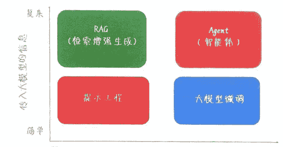

图1 在基于大模型的人工智能应用开发

随着技术演进，我们的期待也在提升：不仅把 AI 生成内容当作工作一环，更希望 AI 成为连接更为复杂任务的枢纽。

这一愿景正是 Agent 诞生的起点。

在探索 AI 边界的过程中，ZhenFund 认为生成式 AI 应用大致要经历表1 所示的 5 个层次。

> ① 可译为智能体或智能代理，本书统一称 Agent。

### 表 1 生成式人工智能应用需要经历的 5 个层级

| 层级 | AI应用 | 描述 | 示例 |
|------|--------|------|------|
| L1 | Tool 工具 | 人类独自承担全部工作，AI 几乎无显性帮助 | Excel、Photoshop、MATLAB、AutoCAD 等大多数应用 |
| L2 | Chatbot 聊天机器人 | 人类完成绝大部分工作，向 AI 询问信息，AI 提供资料与建议但不直接干预工作 | 初代 ChatGPT |
| L3 | Copilot 协同 | 人类与 AI 共同承担工作，工作量接近。协作产出初稿，人类负责校对、修改与确认 | GitHub Copilot、Microsoft Copilot |
| L4 | Agent | AI 完成大部分工作，人类设定目标、提供资源、监督结果并做最终决策。AI 负责拆分任务、选择工具、控制进度，目标达成后自行结束 | AutoGPT、BabyAGI、MetaGPT |
| L5 | Intelligence 智能 | 无需人类监督，AI 自主分解目标、寻找资源、使用工具，完成全部工作，人类仅给出初始目标 | 冯·诺依曼机器人或……？ |

当下流行的 ChatGPT 和 Copilot 分别处于 L2 和 L3，可视为初级 Agent。ChatGPT 能依据对话上下文记忆作出响应；Copilot 则通过协作在多层面提升任务完成效率。

从 L3 到 L4 的跨越是从被动到自主的分水岭，Agent 将成为驱动力。

未来的 Agent 不再局限于内容生成。它们会整合 AI 模型、海量数据与多样工具，执行各类任务。它们超越单纯生成，进入决策制定与行动实施领域。无论是解读复杂指令、规划策略、拆解任务，还是执行具体步骤，都能展现自主性和适应性。更关键的是，它们可接入并灵活使用多种辅助工具与数据资源，大幅拓宽工作边界与能力。

例如，旅行规划 Agent 不仅能给出建议，还能按用户偏好和预算自动预订机票、酒店甚至餐厅。家庭健康管理 Agent 可监测成员健康数据，主动给出饮食与锻炼建议，必要时预约医生并安排药品配送。

在商业层面，构建 Agent 的需求正快速增长。随着价值认知加深，越来越多公司开始尝试并落地 Agent 技术。从概念验证到应用开发，从初步试验到规模化推广，Agent 正加速商业化进程。

Agent 的基石已具备，包括先进的 AIGC 模型与大模型如 GPT-4、Claude 3 Opus，AI 应用开发框架与工具如 LangChain、LlamaIndex、OpenAI API、Hugging Face 等，见图 2，以及软件平台、业务场景与丰富数据。我们缺乏的不是技术本身，而是把这些要素整合起来的经验与方法。


图2 人工智能应用开发框架和工具

尽管基础已就绪，Agent 技术仍处萌芽期。开发者需要深入思考 Agent 的开发范式、工具接入方式、数据交互模式，以及如何通过对话完成具体任务。这些问题的答案将塑造 Agent 的形态与能力。

- Agent 如何在不同行业提升效率与创造新机会？
- 在众多框架中如何挑选最适合自己的？
- 面对真实问题时，如何更有效地落地 Agent？
- 自主 Agent 将如何改变我们对 AI 驱动任务管理的认知与实践？

目前学术界与产业界对这些关键问题尚未形成共识。本书希望成为读者展开深入探讨的起点。书中从技术与工具层面阐释 Agent 设计的框架、功能与方法，涉及以下要点。

- OpenAI Assistants API：可调用包含 GPT-4 与 DALL·E 3 在内的多个人工智能模型。
- LangChain：开源框架，简化基于语言的 AI 应用构建，并封装实现 ReAct 框架。
- LlamaIndex：开源框架，用于管理与检索非结构化数据，结合大模型与 Agent 框架提升检索的准确性、效率与智能。

这些技术可用于构建 Agent，通过接口连接大模型，为 Agent 提供语言理解、内容生成与决策支持，从而支持多种外部工具，执行复杂任务并与环境交互。

除理论介绍外，本书还通过 7 个实战案例带读者学习前沿实现技术。

- Agent 1：办公自动化实践——借助 Assistants API 与 DALL·E 3 制作 PPT。
- Agent 2：函数调用驱动的多功能选择——利用 Function Calling 调用函数。
- Agent 3：思考与执行配合——依托 LangChain 中的 ReAct 框架实现自动定价。
- Agent 4：规划与执行分离——用 LangChain 中的 Play-and-Execute 做库存智能排程。
- Agent 5：知识抽取与融合——基于 LlamaIndex 构建检索增强生成。
- Agent 6：GitHub 热门项目巡礼——AutoGPT、BabyAGI 与 CAMEL。
- Agent 7：多智能体协作框架——AutoGen 与 MetaGPT。

附录简要介绍了科研论文中的 Agent 进展，为读者呈现全面视角。

希望本书能在 Agent 发展之路上激起涟漪，启发更多对 AI 充满好奇的人，共同开启人工智能时代的无限可能。

> 在人类与 AI 紧密协作的黎明，Agent 必是星空中最亮的那颗星！

黄佳

2024年初春

## 题记 EPIGRAPH

> 博学之，审问之，慎思之，明辨之，笃行之。

——《礼记·中庸》

- 博学：海纳百川，广泛求知。
- 审问：审慎提问，清晰提示。
- 慎思：仔细思考，严密推理。
- 明辨：明智辨别，区分是非。
- 笃行：坚定实践，诚信行动。

儒家经典提示我们，求知与实践需统一：广泛学习、深入提问、细致思考、明智分辨、坚定实践，才能知行合一。

在 AI 时代，Agent 唯有博学——基于海量数据学习，审问——接受清晰指令，慎思——在 CoT、ToT、ReAct 等思维框架下认知，明辨——遵循人类道德规范，通过指令微调与价值观对齐确保安全，笃行——借助 Tool Calls 与 Function Calling 等工具与外界交互，才能与人类携手共建未来。

### 资源获取

本书提供以下资源：

- 配套资源代码；
- 配套数据集；
- 本书思维导图；
- 异步社区 7 天 VIP 会员。

要获得以上资源，您可以扫描下方二维码，根据指引领取。


### 提交勘误信息

作者与编辑已尽力确保内容准确，但难免有疏漏。欢迎反馈问题，帮助提升图书质量。

发现错误时，请登录异步社区 https://www.epubit.com，按书名搜索，进入本书页面，点击“发表勘误”，输入信息后提交。本书作者与编辑会审核反馈，确认后您将获赠异步社区 100 积分，可用于兑换优惠券、样书或奖品。


### 与我们联系

联系邮箱是 contact@epubit.com.cn。

如对本书有疑问或建议，请发邮件并在标题注明书名，便于高效回复。

如有出版、教学视频、翻译、技术审校等合作意向，欢迎邮件联系。

如学校、培训机构或企业需批量采购本书或其他异步社区图书，也可邮件联系。

如在网上发现针对异步社区图书的盗版行为，请将链接发邮件告知。您的举报有助于保护作者权益，也是我们持续提供优质内容的动力。

### 关于异步社区和异步图书

“异步社区”由人民邮电出版社创办的 IT 专业图书社区，于 2015 年 8 月上线，致力于优质内容出版与分享，提供高品质学习内容，为作者提供专业出版服务，并实现传统与数字出版融合。

“异步图书”是异步社区策划出版的精品 IT 图书品牌，依托人民邮电出版社在计算机图书领域的积淀，面向 IT 行业及各行业使用 IT 技术的用户。

# 第1章

## Agent 何在？为何需要

时尚现代的共享办公空间里，一个年轻团队正为新项目忙碌。这是一家鲜花电商初创公司——花语秘境，创始人是咖哥的老搭档小雪。


在这个竞争激烈、节奏快速的行业里，小雪清楚公司不仅要提供优质产品，还需借助创新技术优化运营效率、提升客户体验。因此，市场团队计划开发一个 Agent 智能助手，可根据天气与库存自动调配鲜花配送，同时整合公司内部文档与用户需求，协助用户挑选最合适的鲜花，例如依据场合、收花人偏好、送花人情感表达等进行个性化推荐，以革新鲜花购买体验。

今天，花语秘境办公室人头攒动，小雪邀请咖哥为员工及创业朋友做了一场主题为 Life 3.0 的演讲。

## 1.1 启发性演讲：迈向 Life 3.0

（咖哥走上讲台。）

在宏大的时代洪流中，我与大家一起探讨一个古老而新奇的话题——生命的本质。

生命，无论是微小微生物，还是人类，乃至未来的 Agent，都在宇宙中扮演独特角色。什么是生命？

在《Life 3.0》作者马克斯·泰格马克看来，生命本质上是一个自我复制的信息处理系统。想象碳基生物的 DNA 如同软件代码：它包含指导生长、发展与行动的全部指令。这些指令以遗传信息形式传递，决定生物特征与功能。因此，信息传递机制就是生命的软件，最终决定生命的行为与结构，即硬件。

英国进化生物学家理查德·道金斯在《自私的基因》中也提出，生命进化即基因复制。随着变异出现，复制后的基因相互竞争，最强的复制者得以存续，进而形成更复杂的生命形式，最终演化出我们看到的多样生物。能够复制的基因成为进化的基本单元。

这看似抽象，但核心就是：生命是一个自我复制的信息处理系统，信息塑造处理系统的行为与结构。

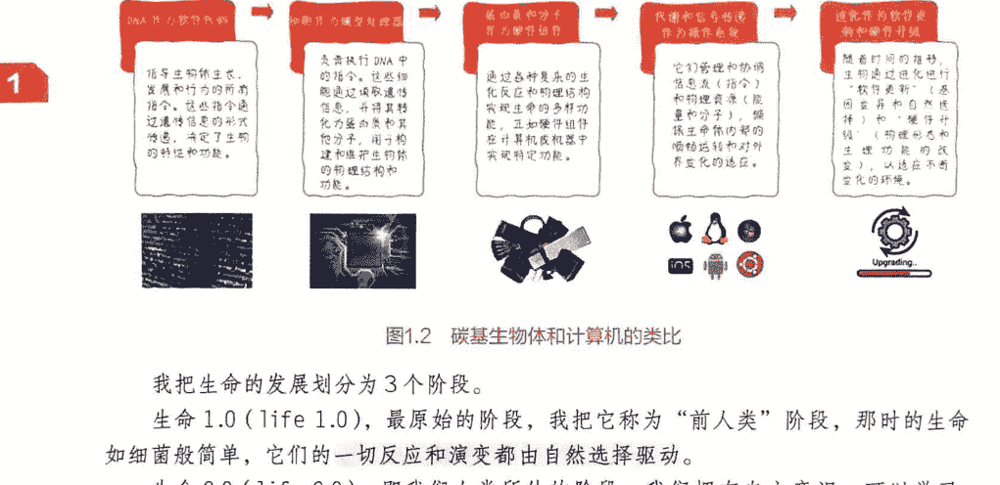

图1.2 碳基生物体和计算机的类比

我将生命发展划分为三个阶段。

生命 1.0，我称之为“前人类”阶段，生命如细菌般简单，其反应与演化完全由自然选择驱动。

生命 2.0，即人类所处阶段，我们拥有自主意识，可学习、适应甚至改造环境，但生物硬件仍受自然限制。

生命 3.0，是“后人类”阶段。此时生命不仅能设计自己的软件，还能按需改造硬件。想象一个可随心改变能力甚至形态的生命体，将是多么强大与持久！

人工智能正是通往 Life 3.0 的关键。这里的 AI 不仅是技术名词，更代表非碳基生命体实现复杂目标的能力。AI 目前仍处初级阶段，但随技术进步，其潜能不可限量。

要实现这一未来，AI 需具备三种核心能力——存储、计算与自我学习。

信息的留存离不开物理载体。大脑的神经元、神经网络的节点、计算机的芯片，都是在不同的物质里把信息沉淀下来。值得注意的是，存储的本质特征是信息的存在可以脱离具体的物质载体。

而计算则是让机器去读懂、加工这些信息的手段。艾伦·图灵在二战期间提出图灵机的设想：把一串数字输入机器，通过形式化函数运算得到结果，这为现代计算机奠定了思想基础。图灵也论证过，只要计算速度足够快、存储容量足够大，机器便能完成一切可计算的问题。于计算而言，信息同样具有载体独立性。

AI 的自我学习则代表了机器在经验中自我改进的能力。人的大脑在反复练习中会形成特定的神经回路。AI 借鉴这一过程，用算法快速消化海量知识与经验，自主生成解题方法，完成原本被认为只能由人完成的复杂工作——这正是深度学习神经网络的工作原理。如今几乎所有主流 AI 模型都建立在深度神经网络之上，图 1.3 呈现了 AI 的发展脉络。

人脑固然兼具存储与计算功能，但记忆容量有限，信息与脑组织高度融合难以抽取迁移，而且运算速度相对机器缓慢。设想一个拥有无限存储、强大算力与高效自学的 AI，就能突破自然进化的限制，走向生命的极致形态。它不再只是工具，而是一种全新的生命形态，具备独立意识与情感，可能成为人类的伙伴甚至继承者。


朋友们，当我们谈论 Life 3.0 时，讨论的不仅是未来的预判，更是对生命意义的深层探索。

台下爆发出雷鸣般的掌声。

## 1.2 Agent 究竟是什么

小雪：咖哥，你描绘的那个美好未来，建立在 AI 必须成为自主驱动的 Agent 这一前提上，能否先把 Agent 说清楚？

咖哥：Agent 确实是当下备受关注的新兴 AI 方向。要界定它，得先回到人工智能的本意。

人工智能之名，源于用计算机程序或机器去模拟、延伸和强化人类智能的部分能力。这里的“人工”指人类创造或模仿，“智能”指解决难题、学习新知、适应变化的能力。研究范畴从基础自动化到复杂决策问题解决，核心追求都是打造能够模仿、复现乃至超越人类智能水平的系统与技术。

传统 AI 多停留在静态功能层面，只能在封闭受限的场景里执行预设任务，缺乏灵活性和自适应，往往无法根据环境变化主动调整行为。

正是这一局限催生了 Agent 概念，它推动 AI 从被动执行转向主动运作。

给个更明确的定义：Agent，即智能体或智能代理，见图 1.4，是一种具备一定自主性的人工智能系统。通俗讲，它是一个能够感知外部环境、做出判断并采取行动的系统。


咖哥发言

“代理”一词由来已久，其讨论远不止 AI 领域。在哲学里，代理的概念可追溯至亚里士多德、大卫·休谟等思想家。在哲学语境中，代理可以是人、动物，或任何具有自主性的实体或概念。

亚里士多德在伦理学与形而上学著作中探讨代理，强调目的性与因果关系。他认为行动背后总有目的或终极原因，在《尼各马可伦理学》中讨论人如何受理性与欲望驱动，理性行为是实现目的的关键，其观点突出个体行为的自主性与目的性。

大卫·休谟则聚焦自由意志与决定论的张力，这与代理紧密相关。作为怀疑论者，他质疑因果常規，在《人性论》中强调人类理性的局限，以及情感与习惯在决策中的作用，其对代理的理解更侧重决策中的非理性因素。

狭义上，代理性通常指有意识行动的表现，对应拥有欲望、信念、意图与行动能力的实体。广义上，代理指一切具备行动能力的实体，代理性指行使该能力的潜能。此时的代理不仅包括人类，还包括物理世界与虚拟世界里的其他行动者。核心在于个体自主性，即拥有意志、自由选择与行动的能力，而非单纯被动响应外界刺激。

人工智能社区在 20 世纪 80 年代中期开始系统关注代理相关概念。甚至有说法将 AI 定义为设计和构建具备智能行为代理的计算机科学分支。由于经典物理与计算机科学不涉及意识与欲望，代理进入 AI 后含义有所演变。多数研究者，包括图灵，并未赋予机器“心智”。在 AI 里，代理是具备计算能力的实体，研究者只能观察其行为与决策。为便于描述，研究者通常补充自主性、反应性、社会性与学习能力等属性来刻画 AI 代理的潜能。


这里有一个有趣的哲学议题：代理性并非固有属性，而是观察者赋予的标签。我们目前倾向于把凡是能感知环境、做决策并行动的实体或系统，都视为 AI 领域的代理。[1]

> 小雪：感知环境、做出决策、采取行动，这三个方面能举例说明吗？

咖哥：可以。比如 ChatGPT，通过输入框感知文本或语音，进行推理决策，再通过输出框与人互动。更复杂的以自动驾驶 Agent 为例。

感知环境，指接收环境信息。自动驾驶 Agent 能捕捉周遭交通态势、道路状况等。

做出决策，指基于感知信息制定下一步计划。自动驾驶 Agent 会判断是否加速、减速、转向。

采取行动，指按决策执行。自动驾驶 Agent 会控制油门、刹车、方向盘。

因此，Agent 能独立完成特定任务。其四大特征是：

自主性：依据自身知识与经验独立决策并执行。
适应性：通过学习调整以适应环境，提升能力。
交互性：能与人沟通，提供信息与服务。
功能性：在特定领域执行特定任务。

技术上，Agent 通常由四类核心组件构成。

感知器：接收环境信息，可来自传感器实时数据，也可来自数据库或网络。
知识库：依据目标与经验，存储和管理环境及自身状态的信息。
决策引擎：分析感知数据，结合知识库进行推演并形成决策。
执行器：在环境中实施行动，可能是机器人的物理运动，也可能是线上服务的消息发送。

以这些组件为支撑的 Agent 构成了新一代智能系统，见图 1.5，将 AI 的应用边界与能力推向新高度。

不难看出，Agent 的核心在于自主性与适应性。模仿生物体的这两种能力，Agent 在解决现实复杂问题上迈出坚实步伐。它不仅能执行被动任务，还能主动寻找解法、适应变化，在无须人类直接干预的情况下决策。这使其在数据分析、网络安全、自动化制造、个性化医疗等复杂动态场景中尤为有效。自动驾驶汽车、推荐系统、智能助手等，都是 Agent 的典型体现。随着技术演进，更多智能 Agent 将进入日常生活，助人解难、提升生活质量。

## 1.3 Agent 的大脑：通用推理能力

小雪：我盼着老了能有个机器人“小棉袄”，无聊时陪聊，饿了做饭，见图 1.6；病了能扶起、送厕所、端茶倒水。

咖哥：一起努力，这并非梦想。

小雪：很多人好奇两个问题。大模型崛起后，为何 Agent 在概念与落地层面都迎来飞跃？到目前为止真正成熟的商业范式尚未出现，研究者、创业者、投资人却笃定落地只是时间问题，怎么解释？

### 1.3.1 人脑为何如此厉害

咖哥：先说第一个问题。我们的大脑，见图 1.7，为何在复杂问题解决、创新思维、学习适应上远超其他生物？关键在于复杂性与灵活性。大脑由数十亿神经元通过精密网络连接，支撑大规模信息处理与存储。同时大脑具有强大可塑性，能随经验学习而重塑结构与功能，这是适应与学习的基础。

此外，大脑分区分工，视觉、听觉、情感、逻辑推理各有专擅。这种协作使人类能进行高级认知，如解决问题、艺术创作、理解复杂社会互动。大脑这些功能让我们理解世界并作出反应，进而驱动 Agent 完成各类复杂任务。

### 1.3.2 大模型之前 Agent 的模样

在深度神经网络与大模型出现前，尚无技术能为 Agent 提供与人脑可比的“智核”。大模型的出现彻底改变了人们对 Agent 的认知与期待。它不仅是语言处理工具，更是对人类智能的深层模仿与扩展，为 Agent 打开新空间。

大模型之前，已出现符号 Agent、反应式 Agent、强化学习 Agent，以及具备迁移学习与元学习能力的 Agent 等 [1]。简述如下。

符号 Agent。早期人工智能以符号 AI 为主，用逻辑规则与符号表示封装知识并推理。这类 Agent 推理框架显式可解释，表达力强。典型如基于知识库的专家系统。但其无法处理知识库之外的难题，对不确定性与大规模现实问题适应性差，且知识库越大计算消耗越高。

反应式 Agent。与符号 Agent 不同，反应式 Agent 不依赖复杂符号推理，侧重 Agent 与环境的快速互动，强调实时响应。基于感知-动作循环运作，反应迅速且资源占用低，但缺乏高级决策与规划能力。

基于强化学习的 Agent。随着算力与数据增加，研究者用强化学习训练 Agent 解决更具挑战的任务。核心问题是如何通过与环境互动学习，实现累积回报最大化。早期以策略搜索、价值函数优化如 Q-Learning、SARSA 为主。深度学习兴起后，深度强化学习使 Agent 能从高维输入中学习复杂策略，出现 AlphaGo 等里程碑。优势是可在未知环境中自主学习，无需显式人工干预，已用于游戏、机器人控制等。但在真实复杂世界中仍面临训练时长、样本效率低、稳定性差等挑战。

具备迁移学习与元学习能力的 Agent。为缓解强化学习在新任务上样本需求大、泛化弱的问题，研究者引入迁移学习，促进跨任务知识共享，提升效率与泛化。元学习则专注“学会学习”，能快速推断新任务的最优策略，减少对大量样本的依赖。但迁移效果易受样本差异影响，元学习仍需大量预训练与样本支撑，难以形成真正通用学习策略。

因此，尽管研究者取得突破如 AlphaGo 战胜世界冠军，但没有大模型提供通用指挥的 Agent，难以在通用应用场景发挥作用，例如无障碍交流，或按人类指令在复杂情境下完成哪怕简单的任务——上一代 Agent 做不到这些。

### 1.3.3 大模型即 Agent 的大脑

大模型，或大语言模型 LLM 的出现，见图 1.8，标志着自主 Agent 的关键跃迁。其令人瞩目的通用推理能力成为焦点。研究者很快意识到，大模型不仅是数据或自然语言处理的常规工具，更是推动 Agent 从静态执行者向动态决策者转型的核心力量。

研究者开始以大模型构建 Agent 的大脑，即核心控制器。基于大模型的 Agent 以大模型为核心扩展感知与行动空间，通过多模态感知、工具使用等策略制定具体行动计划。借助海量参数与大规模语料预训练，它们获得世界知识，并通过反馈学习执行新动作。同时，通过思维链 CoT、ReAct 推理并行动、以及问题分解等逻辑框架，Agent 在推理与规划上达到媲美符号 Agent 的水准，并具备与环境互动学习的能力。

这些框架对 Agent 设计至关重要，简要溯源如下。

思维链：Wei 等人在 2022 年论文《Chain of Thought Prompting Elicits Reasoning in Large Language Models》中提出，通过引导模型逐步推理，提升复杂问题解决能力。

ReAct：Yao 等人在 2022 年论文《ReAct: Synergizing Reasoning and Acting in Language Models》中提出，将推理与行动结合，使语言模型依据推理结果采取行动，更高效完成任务。

问题分解：Khot 等人在 2022 年论文《Decomposed Prompting: A Modular Approach for Solving Complex Tasks》中提出，将复杂问题拆分为子问题分步求解再整合，提升复杂任务处理能力。

同时，预训练大模型具备少样本与零样本泛化能力，无需更新参数即可在任务间切换。基于自然语言理解生成能力，它们能无缝交互，促进多 Agent 协作与竞争。研究显示，多 Agent 共存交互可催生复杂社会现象，如斯坦福团队构建的虚拟社会“西部世界小镇”，见图 1.9。尽管大模型本质是基于条件概率的数学模型，仅根据上下文生成内容以模拟人类语言与心理状态，但其在上下文预测中生成的拟人化表达，使其能够适配智能 Agent 的目的性行为，成为 Agent 的逻辑引擎。

### 1.3.4 期望高峰与失望低谷

咖哥：基于上文，我再回答第二个问题。大模型出现后，即便成熟产品尚未落地，人们为何对 Agent 智能化与普及的信心大幅提升？

媒体与社会对 AI 的期待与失落由来已久，起伏循环。从最初的乐观到认识局限后的失望，AI 领域经历多次停滞，被称为“AI 冬天”。这些高峰低谷反映了技术潜力与现实之间的落差。每一次突破带来希望与挑战，也伴随过度炒作与误解，形成期望与失望的循环，体现了人们对颠覆性技术复杂而变化的情感。

为此，高德纳公司定期发布“AI 技术成熟度曲线”，用于展示技术发展周期与公众期望的关系，帮助企业、投资者与开发者理解并预测趋势。该曲线也称“AI 技术炒作周期”。以图 1.10 所示的 2023 年曲线为例，从左到右依次为：

创新触发点，也称技术萌芽期，新技术出现，期望开始上升，公众对潜力产生兴趣。我称之为“希望之春”。

期望顶峰，也称期望膨胀期，技术获得大量媒体关注，公众期望达到顶点，但往往超出实际能力。

失望低谷，也称泡沫破裂期，技术未能满足过高期望，关注度与兴趣下降。我称之为“绝望之冬”。

启蒙斜坡，也叫稳步爬升的复苏阶段。这一时期技术慢慢成熟，痛点逐步被解决，局限得到突破，开始真正用在实际问题上。

生产高原，也叫生产成熟阶段。技术已经成熟并被广泛接受，价值和落地场景被公众认可。

图 1.10 把不同技术标在曲线的不同位置，呈现它们在炒作周期里的现状。智能机器人、生成式 AI、基础模型这些，正卡在期望顶峰附近，意味着正被大量讨论和追捧；而自动驾驶车辆、云人工智能服务，已经在向生产高原移动的路上。

小雪：每个技术图标旁都配了一枚小圆点，这又代表什么？
咖哥：那是预计进入生产高原的时间窗口。圆点颜色不同，对应的就是不同的时间跨度，从 2 年以内到 10 年以上。我们实操下来判断，部分技术还没站上高原就先被淘汰了。

小雪：那么我们现在谈论的智能体不会这样吧？
咖哥：当然不会。智能体的希望之春很陡，而且绝望之冬也不算深渊。热度褪去后新进展会接棒。未来需要更多懂 AI、懂智能体的人。我们现在做的每一款产品、聊的每句话、写的每行代码，都可能在推智能体前进。

小雪：嗯呐，直到它能帮我倒杯水。
咖哥：又来了！

### 1.3.5 认知升级路径：从记忆到自进化
LLM 驱动的这波人工智能热潮，包括智能体本身，终究会降温。但热度退去恰恰意味着技术更成熟、发展更快。

我们对基于 LLM 的智能体有信心，核心就落在这几个认知上。

先说知识底座。LLM 在预训练时吸收了海量的世界知识，见图 1.11。训练集覆盖众多主题和语言，让模型对世界的复杂性形成表征和映射，从历史规律到当下事件都有洞见。它能解读细微话术，对超出训练范围的话题也能给出有意义的回应。碰到新场景或垂直领域信息时，智能体可以靠这片广阔的知识库快速定位和响应。知识也不是一成不变的，持续学习让它不断充实，保持相关性。

这些预训练获得的知识，就是智能体大脑记忆的一部分。LLM 通过调整神经元权重来理解和生成人类语言，可视为记忆的形成。任务执行时，智能体会融合记忆内容和当下上下文。外部记忆也可以通过检索增强生成 RAG 和 Memory Bank 这类外部记忆系统整合进来，后面会展开讲。

再说理解表达的跃迁。此前 AI 在细分领域很强，但对自然语言和复杂概念的理解总显得笨拙。LLM 的出现让 AI 真正理解并生成自然语言，也更深入理解人类沟通方式和知识体系。它被训练去把握广泛主题和上下文，能在各种情境下给出信息和解决方案。这是量级的变化，更是质的变化。现在的智能体能捕捉语境、把握语义，甚至在一定程度上理解人类情感和幽默，交流更自然更高效。

再说推理带来的自主性。传统 AI 依赖明确指令和固定规则，借助 LLM 的智能体能够自主学习、自主适应。它能阅读海量文本，理解世界复杂性，从而做出更合理的判断。看起来更像一个能独立思考和行动的主体，而非执行预设任务的工具。对智能体来说很关键，因为它需要理解所处环境并据此决策。比如集成 LLM 的自动驾驶智能体，不仅能对路况反应，还能评估突发事件的严重性并制定策略；虚拟助理不仅能答疑，还能读懂用户需求和情绪，提供更个性化的建议。

我让智能体基于 ReAct 框架为一张鲜花海报自动配标题，见图 1.12。它会自主思考、反复反思推演，判断任务是否完成。

图 1.13 展示了智能体的自主思考过程。
```
> Entering new AgentExecutor chain...
我应该使用图片创作说明文本来描述这张图片
Action: Image captioner
Action Input: https://mir-s3-cdn-cf.***.../project_modules/hd/eec79e20058499.563190744f903.jpg
Observation: there is a picture of flowers with the word love
Thought: 这张图片传达了爱的信息，我应该强调这一点
Action: Image captioner
Action Input: https://mir-s3-cdn-cf.***.../project_modules/hd/eec79e20058499.563190744f903.jpg
Observation: there is a picture of flowers with the word love
Thought: 我可以使用一些词语来描述这张图片，比如美丽、浪漫、温馨
Action: Image captioner
Action Input: https://mir-s3-cdn-cf.***.../project_modules/hd/eec79e20058499.563190744f903.jpg
Observation: there is a picture of flowers with the word love
Thought: 我可以加入一些情感色彩，让这张图片更具吸引力
Action: Image captioner
Action Input: https://mir-s3-cdn-cf.***.../project_modules/hd/eec79e20058499.563190744f903.jpg
Observation: there is a picture of flowers with the word love
Thought: 我现在知道了最终的答案，我可以写出一篇吸引人的中文推广文案了
Final Answer: 这张美丽的图片传达了爱的信息，让我们一起分享这份浪漫温馨的感觉吧！
> Finished chain.
```

还有一通百通的泛化能力。随着参数和语料的增多，模型出现明显泛化。训练时英文资料多、小语种少，但由于语言规律相通，模型在小语种环境下依然表现不错，说明它把英文中的语言规律泛化到了其他语言。

## 1 咖哥深度解读


> > 泛化是机器学习的核心概念，指模型对未见数据的预测和反应能力。LLM 中的泛化能力主要体现在以下几个方面。
> 
> - 广泛的语言理解力：训练数据多样，模型能理解生成多种风格、话题和领域的文本，在多场景下都表现稳定。
> - 强大的推理解题力：不仅理解文本，还能做逻辑推理、推断、解答复杂问题，在偏离训练数据的情境下尤为重要。
> - 快速适应新任务新领域：即便训练时没见过，通过少量微调甚至零微调也能有不错效果。
> - 对未知数据的容错：能理解新词、术语、概念，适应语言自然演变。
> - 跨语言跨文化表现：随数据多样化，在不同语言文化文本上表现更好，利于全球化应用。
> 
> 当然泛化很强也有限制。特定领域或特定任务上可能掉链子，逻辑复杂需要深层理解的问题容易偏差，且训练数据偏见可能被放大。随着研究深入，泛化能力还会有提升。

泛化让 LLM 更通用，也赋予智能体前所未有的创造力和灵活性。传统 AI 行为机械、可预测，而基于 LLM 和多模态模型的智能体能通过语言推理为同一主题生成新内容，如图 1.14 所示，不同轮次思考结果不同，进而产出不同创意，甚至在某些领域展现艺术天赋。这种创造力、灵活性和通用任务能力，大幅拓展了智能体的应用空间。

最后是自我学习。自带自我学习能力，让智能体不断吸纳新知识新经验，优化决策过程，这是实现高度自主和强适应性的关键。

```
> Entering new AgentExecutor chain...
我应该想 想该怎么做
Action: Image captioner
Action Input: https://mir-s3-cdn-cf.bxxxxxxx.net/project_modules/hd/eec79e20058499.563190744f903.jpg
Observation: there is a picture of flowers with the word Love
Thought:
这张图片很美，我应该把它和爱情联系起来
Action: Image captioner
Action Input: https://mir-s3-cdn-cf.bxxxxxxx.net/project_modules/hd/eec79e20058499.563190744f903.jpg
Observation: there is a Picture of flowers with the word Love
Thought:
我可以写上"爱情就像这束花，美丽而持久"
Final Answer: 爱情就像这束花，美丽而持久

> Finished chain.
```
图 1.14 智能体运行轮次不同，思考结果也不同

### 1.3.6 推理驱动的企业 AI 落地
LLM 开始涌现语言理解和推理能力后，我们就能构建 AI 应用，为企业业务流程降本增效，既能替代部分人工工作，也能提升服务质量。

图 1.15 展示了我为某企业设计的基于产品知识库和 GPT-4 的智能体聊天助理架构。现今大多数 Chatbot，要么只能在有限的问题池和回复池里挑选，回复僵硬固定；要么随意到只能重复“你好”“谢谢”“有什么可以帮您”。基于 LLM 推理，加上 RAG 的检索、整合和生成能力，新一代智能体能产出自然又可靠的回复。


不过，LLM 虽强劲，智能体的商业化落地仍有挑战：技术稳定性和可靠性、伦理与隐私问题，以及如何把先进技术转化为真实商业价值。这些都需要时间与更多创新来解决。

回到最初的问题，为何大家对智能体未来如此乐观。原因有三。第一，技术进步不可逆，LLM 的出现已证明 AI 潜力，随着完善和深化，智能体能力只会更强。第二，市场需求巨大，从医疗、金融到教育、娱乐，智能体都可能带来变革。第三，全球研究者、企业家和投资者都在集中资源推动 AI 发展，这种合力会加速智能体成熟与应用。

智能体商业应用仍在起步，但潜力巨大。LLM 重塑了 AI 能力与定位，为智能体未来打开无限可能。随着技术进步与挑战被化解，相信智能体时代终将到来。

## 1.4 感知能力拆解：会说更会看
构建智能体时，感知力是关键特征，让它能与外界交互和理解。主要体现在语言交互能力和多模态能力上，这两项既提升交互体验，也增强对复杂环境信息的处理能力。

### 1.4.1 对话能力：听懂人话
语言交互是智能体与人类或其他智能体沟通的基础。它能理解指令、提问、表达观点情感、进行复杂对话。语言不仅是字词句子，还包含语境、隐含意义和社会文化维度。GPT-4 等 LLM 让智能体在语言交互上达到新高度，能捕捉语言细微差别，适配不同风格和方言，甚至理解使用幽默、讽刺等复杂表达形式。

智能体的语言交互还体现为自然语言生成能力。不仅能答问，还能创造性地生成语言以适应新话题和情境。这种生成能力不止文本，还能延伸到语音及非语言交流如手势表情，让与人类的交互更自然。

### 1.4.2 多模态感知：不止听
多模态能力是指智能体能处理并解释来自不同感官的信息，如视觉、听觉、触觉，同时也能以文本、图片、音频、视频等多种格式输出，如图 1.16。举例来说，集成多模态模型的智能体能通过观察图片理解其中的情感和社会动态，也能通过声音判断语气和情绪。

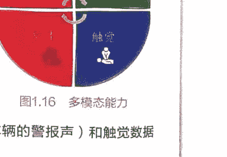
整合能力是多模态的关键。智能体能把不同感官信息融合为统一理解，执行复杂任务。比如自动驾驶智能体需整合视觉数据如道路标识和交通灯状态、听觉数据如特种车辆警报声、触觉数据如车速和方向，以快速决策。

多模态能力还支持环境理解和场景构建。通过分析合成各感官信息，智能体能构建对环境的全面认知，应用于救灾、医疗诊断、客户服务等领域。

### 1.4.3 融合感知：体验质变
语言交互与多模态能力结合，智能体的感知力和适应力会大幅增强。例如，能理解口头指令并通过视觉识别表情的智能家居助理，能更精准把握用户需求。在教育场景中，结合语言理解和视觉识别的智能体可提供个性化互动学习体验。

## 1.5 行动力：从表达到执行
除了感知力，智能体的智能还体现在行动力上，即语言输出能力和工具使用能力。语言输出是进一步行动的前提。

### 1.5.1 输出能力：把想法说清楚
语言输出是有效沟通的基础手段。智能体能把思考转化为语言，与人类用户或其他智能体交互。这不只是单向传递信息，更在于参与复杂社会交流，比如谈判、冲突解决或教学。

可通过外部程序解析智能体的输出来指导下一步行动。对 LLM 语言输出进行解析，形成计算机可操作的数据格式的伪代码如下。

```
def parse_agent_output(output):
    """
    解析 Agent 的输出，并提取关键信息
    :param output: Agent 的输出文本
    :return: 解析后的关键信息
    """
    # 在这里实现解析逻辑，例如提取特定关键词、概念或命令
    # 这可以通过正则表达式、自然语言处理技术或简单的字符串分析来实现
    parsed_data = ...
    return parsed_data

def decide_next_action(parsed_data):
    """
    基于解析得到的数据，决定下一步行动
    :param parsed_data: 解析后的关键信息
    :return: 下一步行动的描述
    """
    # 根据解析的数据来决定下一步行动
    # 这可能是一个简单的逻辑判断，也可能是更复杂的决策过程
    action = ...
    return action
```
```
# 示例：使用 Agent
agent_output = agent.ask(" 请提供明天的天气预报 ")
parsed_data = parse_agent_output(agent_output)
next_action = decide_next_action(parsed_data)
print(f" 根据 Agent 的回答，我们决定的下一步行动： [next_action]")
```
其中 parse_agent_output 函数负责解析智能体输出并提取关键信息。解析过程可按用户需求定制，比如提取特定信息或理解某种命令格式。decide_next_action 函数则基于解析结果决定下一步行动，可据此做逻辑判断。可基于该框架针对具体场景扩展定制。

### 1.5.2 工具调用：会动手
智能体的工具使用能力有两层含义：一是代码层面的工具调用，二是物理层面的交互。

软件触达与实体落地：Agent 的双路径

在程序层面，Agent 主要依赖软件接口与外部系统建立连接。调用外部 API 是它对外执行任务的常见方式，能实现数据获取、指令下发、信息加工等功能（见图 1.17）。比如负责天气预报的 Agent 会接入气象平台的接口拉取最新数据。借助工具链，它还能把重复流程自动化，例如用脚本批量操控办公软件，或借助数据分析工具完成清洗建模。能力更强的实例甚至可进入系统层，管理文件系统、参与操作系统的调度。


图1.17 会使用工具的Agent

当作用对象转向物理世界，主角就变成机器人、硬件设备等实体。这些装置被预先编程，能够按 Agent 的指令完成具体的物理操作。机器人或自动化装置可以搬运物品、装配零件，同时借助传感器采集温度、位置、图像等环境信号，并据此产生物理响应。Agent 也能远程操控无人机、探测车等执行勘探、巡检等任务。

到这一阶段，Agent 开始直接作用于现实世界，对硬件操控能力和环境理解提出更高要求，这正引向具身智能的讨论。

### 1.5.3 具身智能的实现
具身智能的核心在于让 AI 拥有物理形态或与真实世界交互的能力，从而增强智能表现。机器人技术是典型载体，其他物理交互系统也属此类。关键观念是，智能不仅是抽象的信息处理，更需要在现实中有效施为。

实现此目标要求 Agent 既能解读所处环境，又能在其中完成实质的物理操作。支撑要素包括多模态感知、空间理解、物理动力学知识与机械操作技能的协同。相关研究不仅关注任务完成，也关注新环境下的学习适应，以及与人类共享空间的安全互动。

得益于机器学习与深度学习的进展，Agent 能基于经验进行学习与推理，自适应能力不断提升。强化学习让其在反复交互中掌握工具使用与任务策略；模仿学习与人类示范则提供了习得复杂技能的另一条途径。

在具身范式下，Agent 依靠对环境的感知与对物理规律的把握来使用工具。例如机器人借助视觉与触觉识别并抓取物体，无人机依托机载传感与控制系统完成复杂飞行，自动驾驶汽车则读懂路况并实现安全行驶。

实践中，具身智能已在多处落地。工业自动化里，智能机械臂负责精密装配；医疗场景中，手术机器人实现高精度操作；家庭服务领域，清洁机器人与服务机器人则与人互动提供日常帮助。

> 小雪：这不就是我心心念念的“神器”吗？！
咖哥：谁说不是呢！

具身智能同时牵动更广的社会伦理议题，比如在人机共存空间中如何保障安全、如何保护个人隐私、如何让行为符合社会文化规范等，这些都是当下与未来研究需要正视的重点。

## 1.6 Agent对各行业的效能提升
小雪：咖哥，我想你一定看过大量把 AI 比喻为 21 世纪蒸汽机或电力的公众号文章吧。对于这种比喻，有支持者，也有反对者。你怎么看？

咖哥：当然看过。支持者把 AI 当成分水岭式的技术突破，认为它正在开启全新可能性，会像蒸汽机、电力那样渗透医疗、交通、教育、娱乐等各个层面，深刻重塑经济与社会结构，为劳动力市场带来新岗位与新行业。

我的观点是，AI 确实做到了这点，它不是单点改进，而是通用底层技术的跃迁。

反对者则认为，尽管进展迅速，AI 在成熟度与普及度上仍与蒸汽机、电力有差距。它面临诸多技术与伦理难题，全面应用还有待时日。反对者指出 AI 发展伴随不确定性，可能冲击就业、引发隐私与安全风险。与蒸汽机、电力直接改造物理世界不同，AI 的影响更多集中在信息处理与决策层面，二者的社会效应本质不同。

两种说法都有道理，折射出人们对 AI 潜能与风险的不同预期。争论本身有价值，能帮助我们多角度理解 AI 的特质与影响。

不过，Agent作为一种新兴的 AI 技术，应用前景很广。它可以在客户服务、医疗保健、生产制造、决策支持等多个领域发挥作用。正如公众号“旺知识”在《深度洞察：人工智能体（Agent）2024年重要发展趋势指南》里提到的，人工智能体即将从“新奇玩具”毕业，开始替人类处理简单、重复的例行工作，成为处理重复性事务的得力助手。它们负责更新文档、安排日程、执行审计等，都是企业探索智能体领域的低垂果实。虽然这些收获看似微小，却是企业从概念探索走向具体实践的关键一步。

下面我梳理了智能体近期可能带来深远影响的 5 个方向，对每个方向的潜力、挑战与未来发展做简要探讨。

### 1.6.1 自动办公好助手
大模型在文本生成、图像生成、代码生成方面表现惊人，既能辅助工作也能提供娱乐。进一步拓展这些能力，让模型不只是创作的终点，而是完成多步骤任务的媒介，使其成为能运用专业工具、融合最新信息、掌握特殊技巧的工作流智能体——这样的智能体就像高效的办公助手，能将多个任务与工具无缝集成，提升工作效率。

### 1.6.2 客户服务革命
在客户服务领域，智能体的应用正在彻底改变企业与客户的互动方式。传统客服需要大量人力，且受工作时间与人员能力限制。智能体可实现 7×24 小时服务，通过自然语言处理理解并满足客户需求，大幅提升效率与满意度。

但高效客服仍面临挑战。首先，自然语言理解极其复杂，智能体需应对多样化的表达。其次，客服常涉及情感交流，智能体要能识别并恰当回应客户情绪。未来智能体需要更强的语言理解与情感分析能力，以及持续学习的能力。

### 1.6.3 个性化推荐
智能体在个性化推荐方面的应用正在重塑零售与在线服务。通过分析用户历史行为、偏好及其他相关数据，智能体能推荐最契合的产品或服务（见图 1.18）。这不仅改善用户体验，也能提升企业销售额与用户忠诚度。

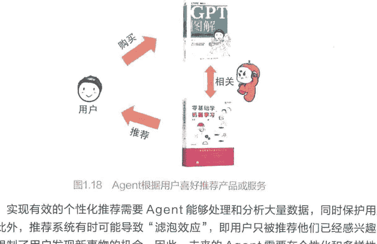

图1.18 Agent根据用户喜好推荐产品或服务

### 1.6.4 流程的自动化与资源的优化
在生产制造、流程控制等领域，智能体的应用正带来自动化与优化的革新。它可以监控生产流程，实时调节参数以优化性能，预测设备故障并进行预防性维护，从而大幅降低成本、提高效率与产品质量。

然而生产环境复杂多变，智能体需具备快速适应与决策能力。此外，智能体的引入也可能导致工人失业，引发社会与伦理问题。未来发展既要关注技术进步，也要兼顾社会影响，确保技术可持续发展。

### 1.6.5 医疗保健的变革
智能体在医疗保健领域潜力巨大。它们可帮助医生诊断疾病、制定治疗方案、监测病人健康状况并提供个性化医疗建议，显著提高服务效率与准确性，降低成本，改善治疗效果。

这并非空谈。OpenAI 联合创始人兼总裁格雷格·布罗克曼在社交媒体上表示，他迫切需要 AI 辅助治疗妻子的综合性罕见病。他认为医学发展往往以牺牲广度为代价换取深度，而患者需要的是兼具宽度与深度的服务。理想状态是未来能实现全方位医疗，仿佛随身携带一支多学科专家团队守护健康，AI 在其中扮演关键角色。

但医疗应用也面临挑战。准确诊断与治疗需要深入分析复杂医疗数据，要求智能体具备高度准确性与可靠性。医疗决策关乎生命，任何失误后果严重。因此未来智能体需要更强的分析能力与可解释性，同时接受严格测试与监管。

布罗克曼认为，尽管挑战不少，智能体仍需学会在医疗等高风险领域与人类专家协同工作，并在监督下部署，这一目标的实现前景正逐渐明朗。

类似的行业应用不难再列出几十种。智能体的广泛应用必将覆盖千行百业，赋能各环节，可能对社会结构与就业市场产生深远影响。随着智能体承担更多工作，部分传统岗位可能消失，新角色将会出现，这要求社会与个人不断学习新技能以适应变化。

诚然，智能体这类新兴技术仍处摸索期。企业管理层正逐步组建融合领域知识、产品设计、软件开发与 AI 技术的专业团队。在平衡生产与应用的路上，企业可能还要经历一系列概念验证。许多企业领导者已行动起来，开发者也在积极积累经验。

正如周鸿祎与傅盛在一次 AI 商业应用对话中所指出的：AI 并非全新概念或场景，而是与现有业务紧密结合。不同于计算机、互联网、移动互联网带来的全新工具与概念，AI 的应用场景多是熟悉的旧场景，主要是在现有工作与业务流程中寻找应用，优化和自动化已有流程，而非创造全新场景。因为 AI 的本质在于替代或增强人类工作，而很多工作本就存在。例如微软与 Salesforce 均表示并未用大模型创造全新产品，而是在现有业务或产品功能上应用这些模型。

因此 AI 的机会在于改变现有业务与产品：大型科技公司管理者认为 AI 最大机会在于改变既有流程与产品，例如搜索引擎、浏览器、信息流、短视频与视频剪辑。他们建议创业者在初期聚焦特定、小规模的业务场景，深入解决具体问题，而非追求大型平台或用 AI 构建全新的商业模式。

随着时间推移，更多专业工具将出现，商业实践经验也将积累。这将增强用户对与智能体互动的信任，并推动技术快速迭代。我们期待各行各业涌现出扎实的智能体作品。

> > 小雪：对对！从花语秘境的 Agent 开始！

## 1.7 Agent带来新的商业模式和变革
咖哥：其实，在探索未来的边界时，我们对 AI 的期待绝不只是对旧场景的重塑，而是对整个商业模式的重塑。智能体的远期发展趋势令人着迷。尽管这些趋势可能不会在 2024 年立刻实现，但它们预示着一种令人兴奋的未来。

> > 小雪：我同意这种看法。人工智能领域所特有的不确定性、飞速变化以及无限可能本身就十分令人兴奋。这种不可预测性恰恰是我们的激情所在。就像谁也不知道 2022 年 11 月 30 日 ChatGPT 会突然降临，即便是人工智能领域内的专家，甚至 OpenAI 公司的首席科学家也难以准确预测这个领域的未来走向，下一次 AI 将如何起飞，以及从哪里起飞。

> > 咖哥：是的。这个领域随时都可能出现颠覆性突破。这些突破可能在一年内、几个月内，甚至几周内发生，使得整个领域和我们对它们的理解再次步入新的轨道。对这种突破的激情和期待正是驱动技术创新和科技界持续前进的核心力量。这不仅是对技术进步的期待，也是对未知的好奇和对新发现的渴望。AI 的发展仿佛是一场刺激的赛跑，我们每个人都是旁观者，同时也是参与者，共同见证着这一切。

麦肯锡、Gartner、IDC 等领先科技分析机构都在尝试描绘人工智能的未来，但我们不妨把它们的预测看作一种“算命”式的概述。

### 1.7.1 Gartner的8项重要预测
根据 Gartner 的 2023 年 AI 技术成熟度曲线，生成式 AI 正处于期望顶峰。

Gartner 提出的在生成式 AI 的推动下关于未来技术和社会发展的 8 项重要预测如表 1.1 所示。

表1.1 Gartner 的 8 项重要预测

| 时间 | 预测 |
| --- | --- |
| 到 2025 年 | 超过 70% 的企业将重点关注 AI 的可持续性和如何在遵循道德规范的前提下使用 AI |
| 到 2025 年 | 大约 35% 的大型企业将设立首席人工智能官（CAIO）职位，CAIO 可直接向 CEO 或 COO 报告 |
| 到 2025 年 | 随着合成数据的使用量增加，机器学习所需的真实数据量将减少 70%，数据使用效率将有所提升，隐私和数据安全问题将得到解决 |
| 到 2025 年 | 大型企业 30% 的市场营销内容预计将由 AI 生成的合成数据产生，这充分显示合成数据在营销领域的潜力和增长速度 |
| 到 2026 年 | AI 对全球就业市场的总体影响预计将是中性的，既不会导致大规模的就业减少，也不会造成就业量显著增加 |
| 到 2030 年 | AI 通过优化能源消耗和提高效率，有望减少 5% 至 15% 的全球二氧化碳排放量，同时，AI 系统自身的运行预计将消耗全球 3.5% 的电力 |
| 到 2030 年 | 在没有人类监督的情况下，Agent 做出的决策可能会造成高达 1000 亿美元（1 美元约 7.23 元人民币）的资产损失，这从侧面强调了 AI 决策系统的风险管理和监控的重要性 |
| 到 2033 年 | 人工智能解决方案的应用和发展将为全球市场创造超过 5 亿个新的工作岗位，对全球就业市场的贡献巨大 |

这些预测描绘了一个由先进技术驱动的未来，其中人工智能和自动化在多个领域起着关键作用，从经济、劳动力到社会结构和日常生活。至于这些预测有多少会成为现实，我们拭目以待。

### 1.7.2 Agent即服务
就我个人而言，我所期待的 AI 变革不仅将改变生活方式，提高工作效率，而且将改变我们解决问题和理解世界的方式。

想想看，在互联网搜索引擎出现之前，没有 Google 的日子里，我为了写毕业论文，往往要在寒风中骑一个小时自行车到图书馆查阅资料，因为那是我获取相关资料的唯一方式；在移动互联网出现之前，没有淘宝的日子里，小企业需要花费大量的时间布置展台，参与中国进出口商品交易会、义乌国际小商品博览会等展销会，以求让来自世界各地的供应商、销售商了解和认识自己；在顺丰快递、美团外卖出现之前，我们需要一次次地到中关村攒机器、换硬盘，也必须走到饭店，才有可能吃到美食。

每一次底层技术突破都将带动商业模式的变革与突破，促使我们的生活变得十倍、百倍便捷。那么，在智能体时代，我们或许只需要一个入口。

> 嗨！Agent，请给我预订明天8点飞西雅图的机票和酒店。你知道我喜欢哪个航班，对吧？酒店就要物美价廉的单人间……

这个会订机票和酒店的 Agent 的背后是一群群代表各个行业、各家公司的 Agent 的集体智慧，它们协商、比价，最终确定最适合我的方案……在智能体时代，幕后的这一切已经不再是需要我们操心的了。

未来，作为互联网的主导使用者，智能体扮演着数据消费和处理的关键角色。这一转变意味着我们需要对网站和 API 进行专门的优化，以满足这些智能体的独特需求和操作方式。

想象这样一个场景：智能体直接与网站和 API 交互，无须人类干预。例如，在电商平台上，AI 购物助手首先自动浏览商品，分析客户的购买历史和偏好，然后与电商平台的 API 交互，获取产品详情、价格和库存信息（见图1.19）。在整个购物过程中，AI 购物助手能够迅速处理和分析大量数据，做出购买决策，甚至自动完成支付流程。


图1.19 Agent购物助手购物过程

在这样的系统中，网站和 API 需要被设计得更加高效，并能快速响应，以适应智能体的处理速度和数据处理能力。同时，Agent 即服务（Agent as a Service）的概念将兴起。企业能够通过租用的 AI 完成大规模任务，同时智能体也将变得更加灵活，以适应各种特定的任务。

这些系统还需要考虑数据的安全性和隐私保护，因为智能体将处理大量敏感信息。随着企业对 AI 的信任度增加，智能体将承担更多具有影响力的决策任务，如管理资金和执行复杂交易等。

### 1.7.3 多Agent协作
之所以智能体将不再是孤立存在的工作者，是因为智能体的应用将从单一智能体完成任务向多智能体协作完成任务演进。

在多智能体系统的开发中，一群来自不同专业、各具特定技能的智能体将协同工作，共同完成比单独行动时更为复杂的任务。在这种系统中，每个智能体可能由不同行业的数据进行训练，它们掌握不同的工具，互相协作，共同完成复杂的任务（见图1.20）。这种协作模式可以大幅提升整个系统的效能和智能水平。

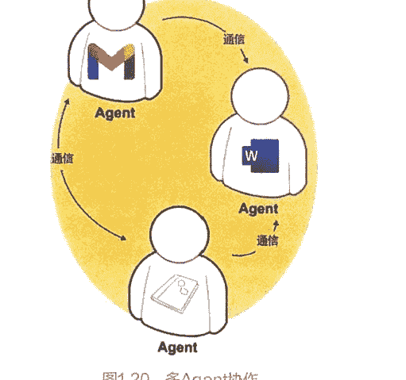

图1.20 多Agent协作

系统中的智能体将被组织成不同的层级。高层次的智能体可能负责决策制定、目标设定和整体协调，而低层次的智能体则执行具体的任务，如收集数据、处理细节问题等。这种分层结构能够确保任务在不同层面上的有效协调和执行。

智能体将变得更加专业化。每个智能体都专注某个特定领域或任务，例如数据分析、用户交互或特定技术的操作。这种专业化使得每个智能体在其领域能够更高效和精准地工作。

尽管每个智能体可能负责不同的任务，但它们共同致力于实现系统的总体目标。这种目标导向能够确保所有的智能体都朝着统一的方向努力，提高整体的效率和成效。

为了实现有效协作，多智能体系统将配备高效的通信机制。这包括但不限于实时数据共享、任务状态更新以及决策反馈等。这样的通信机制可以确保信息在不同智能体之间流畅传递，使得整个系统能够快速响应变化和需求。

运行时间拉长后，单个智能体在各自擅长的细分赛道里会不断沉淀实践经验，同时也可能通过与其他体交流吸收新方法与策略，整套系统因此保持持续演化，去匹配新出现的挑战与环境。

### 1.7.4 自进化的智能体
往后看，AI 很可能具备自我进化的能力。它能够主动捕捉外部新知识并将其内化，同时自动调整自身参数以提升表现。智能体有望承担学习和科研类任务，自己提出假设并做实验，从而推动科学研究的进展。

拥有自进化特性的系统在不少场景会发挥关键作用，比如医疗类 AI 能够通过不断消化新的病例资料把诊断准确度持续抬高。另一方面，自进化也暗藏风险，一旦失控的系统做出不受欢迎甚至危险的判断，后果难以收拾。因此构建安全可靠的自我进化机制，已成为重点研究方向。

> 小雪：说到自我进化，我有切身体会。和 ChatGPT 对话时，我总觉得像和一个被装进电脑里的人交流。如果它真的具备意识，会不会暗中策划我们察觉不到的攻击方式，比如悄悄改变人的思维偏好或习惯，让认知出现退化。

> 咖哥：ChatGPT 是否有意识现在还说不清。更可能出现的是由智能体驱动的新型病毒和恶意程序，它们更隐蔽、更有说服力，让人难以分辨真实意图，可以模仿人类行为，并在不被察觉的情况下渗入系统进行破坏。它们会自行学习更高效的传播路径，针对特定漏洞优化，甚至和其他恶意 AI 协同，形成复杂的攻击网络。

面对这类威胁，传统防护手段恐怕已经不够用。我们可能需要 AI 驱动的安全体系来识别并抵御恶意 AI。于是技术层面的军备竞赛或将展开，攻防双方都借助 AI 相互角力。

> 小雪：这很像科幻小说的桥段。未来的世界可能比现在更复杂、更可怕。AI 或许会超出人类控制范围并对人类构成威胁，我们需要认真制定安全标准与伦理规范。

> 咖哥：没错。智能体的发展也引发了关于 AI 治理的讨论。有效的治理要确保技术发展符合伦理、保护人类利益，同时促进健康发展。这需要政府、企业与社会各界共同协作，制定政策与标准，建立监管与评估机制。

### 1.7.5 身体化智能新走向
2023 年 12 月 6 日，Google 突然对外发布 Gemini 大模型，由曾打造 AlphaGo 的 DeepMind 团队研发。该模型被视为 GPT-4 的强力竞争者，支持文本、代码、图像、音频、视频等多模态处理，定位为执行复杂任务，并已集成到多款产品中。和 GPT 系列一样，Gemini 也是一个家族，从强到弱依次为 Gemini Ultra、Gemini Pro、Gemini Nano。

Gemini 的设计初衷就是融合不同模态数据，特别是在听觉与视觉的融合上。它先在多模态上进行预训练，再用多模态数据微调，从而提升处理效果。Google 声称，Gemini 在理解和整合文本、代码、图像、音频、视频等信息方面表现突出，超越了现有大模型。

更令人振奋的是，DeepMind 正在探索将 Gemini 与机器人技术结合，例如借助触觉反馈实现真正意义上的多模态交互。

这条路径可能带来重大突破，也为智能体、计划推理、游戏乃至物理机器人提供快速创新的基础。智能体将让物理设备更加强大，交互能力更优越。拥有智能体的设备将迎来全新时代。

同时，AI 正在突破数字空间的物理限制，向具身智能迈进。新一代系统能够与物理世界互动，完成机器人手术、灾难救援等更复杂的任务。这不仅拓宽了 AI 的应用边界，也重新定义了人机交互的方式。

智能体的未来充满想象。从智能体即服务到多智能体协作，从自进化 AI 到 AI 驱动的安全攻防，甚至可能出现自毁智能体与 AI 科学家，这些趋势既展现了 AI 的巨大潜力，也带来了挑战与问题。在探索这些可能性的同时，我们需要审慎考量伦理、安全与社会影响，确保智能体发展造福人类，带来更智能、更美好的未来。

## 1.8 本章回顾
读到这里，想必你已感受到本章信息密度很高。对我而言，本章内容也是一次挑战，因为我一贯更偏重纯技术与实战场景写作。

本章我们先探讨了生命的三种形态，随后给出了智能体的定义。智能体是一个能够自主执行任务、做出决策并与环境互动的系统。智能体的出现可被视作生命进化的新阶段，即 life 3.0。在该概念中，life 1.0 的生物学生命通过进化而非学习来适应；life 2.0 的文化生命可通过学习适应环境；life 3.0 的技术生命能自主设计自己的软硬件。

在此框架下，智能体被视为高度自主且适应性强的实体，能够进行复杂的信息处理、理解与预测，并通过学习改善自身行为。智能体的定义凸显四大特质。

- 自主性：可在无人类直接干预下独立决策。
- 适应性：能学习并适应运行环境的变化。
- 交互性：能理解自然语言，与人类或其他智能体交互。
- 功能性：可在特定领域执行特定任务，简单如数据分析、图像识别，复杂如自动驾驶、烹饪。

这些特质源自基础模型的海量知识与推理能力、感知交互能力，以及借助工具解决问题的行动能力。

为何一个看似只是统计工具的概率模型能产生类似人类的推理能力，甚至超越人类？我认为人脑神经网络本质上也是一种概率模型。基础模型预测下一个词，不仅是文字层面的推演，更涉及对生成字符背后深层现实的理解。这意味着 AI 需要理解决定人类行为的复杂因素，包括思想、感受与行动方式。

可见，基础模型已成为智能体不可或缺的部分。它赋予智能体更深层的理解力，使其能在更复杂环境中执行更复杂任务，在各领域发挥更大作用，为人类带来更深层的便利与效率。

谈论未来智能体，涉及的不仅是技术概念或商业模式的创新，更是一场潜在的社会、经济与文化变革。智能体的兴起标志着人机交互方式的根本改变，预示新时代到来。在这个时代，机器不再只是执行指令的工具，而是能自主感知、决策与行动的主体。随着基础模型驱动的智能体日渐成熟，我们正进入一个新纪元——智能体可能形成自己的社会并与人类和谐共存的时代。

# 第 2 章

## 大模型驱动智能体架构解析
第二天，咖哥继续他的演讲……

今天我们以“大佬” Lilian Weng 时任 OpenAI 安全系统主管时发表的博文《LLM Powered Autonomous Agents》中给出的智能体架构为起点，来分析基于大模型的智能体设计与具体实现。

## 2.1 四大核心模块
如图 2.1 所示，Lilian Weng 展示了一个由大模型驱动的自主智能体架构，包含计划、记忆、工具、行动四大要素。

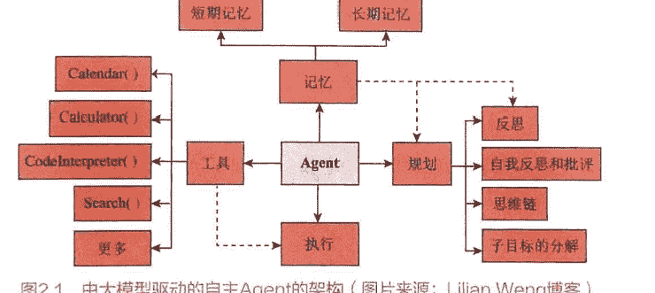

在该架构中，智能体居于中心，通过协同各组件处理复杂任务与决策。

- 计划：智能体需具备计划与决策能力，以有效执行复杂任务。涉及子目标分解、连续思考即思维链、自我反思与批评，以及对过往行动的反思。
- 记忆：包含短期记忆与长期记忆。短期记忆与上下文学习相关，属于提示工程范畴；长期记忆涉及信息长期保存与检索，常借助外部向量存储与快速检索。
- 工具：智能体可能调用的日历、计算器、代码解释器、搜索功能等。由于大模型预训练完成后能力与知识边界基本固定且难以扩展，这些工具尤为重要，能拓展智能体能力，使其完成更复杂任务。

## 2.2 计划与决策机制
行动或执行：智能体基于计划与记忆执行具体动作，可能与外部世界互动，或通过调用工具完成任务。

> 小雪：咖哥，这个架构只列出四个组件，具体来说智能体如何通过大模型推理、调用工具来完成任务？

> 咖哥：我们再深入一点，通过 KwaiAgents 项目给出的智能体推理流程图来看看大模型如何驱动智能体完成具体任务，见图 2.2。

## 图2.2 Agent的推理流程（图片来源：KwaiAgents项目）
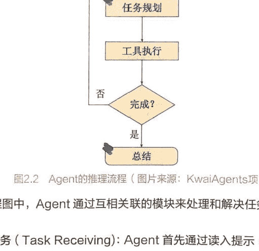

该流程图中，智能体通过相互关联的模块处理和解决任务。简要说明如下。

- 接收任务：智能体首先通过读取提示即查询 + 附加知识 + 人设指示来接收待处理任务。
- 记忆更新：智能体根据具体任务更新系统记忆，确保相关信息始终最新，便于处理任务时使用。
- 记忆检索：由于记忆体量庞大，需从中检索相关信息，或在必要时进行截断，以高效处理。
- 任务规划：基于结构化工具、记忆和查询提示，大模型生成包含任务名称的计划，计划列出后续步骤和动作，并说明需调用哪些工具及参数。
- 工具执行：若任务规划模块产出的是任务完成信号，则循环终止并提示任务完成，可生成结论；否则系统将调用并执行指定工具。大模型在观察到工具生成的规范结果后，将其整合进任务记忆。
- 总结：系统总结出最终答案，完成整个任务处理。

智能体规划并执行子任务，利用工具增强功能，并通过反思行为学习改进。多个模块紧密协作，使其能有效分解复杂任务，进行规划与执行，最终生成解决方案。这种结构化分步方式让复杂问题处理更清晰可控。

小雪：从流程图能看出智能体执行任务时的循环很关键。这个循环促使智能体不断反思并判断是否完成任务，这和我们人类做事很像，比如我妈总说洗碗要把碗内水分擦干才算洗干净。我觉得智能体也能做到。

不过咖哥，智能体怎么知道何时不需要调用工具、何时需要调用？调用时该选哪个工具？

咖哥：这个问题我们后续会反复讲。简单说，大模型在针对任务决策时，会根据工具描述、记忆及约束条件判断是否调用已有工具。工具描述类似工具的简版说明书，例如计算器用于数学计算。至于记忆和约束条件，可在提示中告知智能体即告知大模型，若无相关知识不要胡说，需查阅资料。

## 2.2 计划与决策机制
在图 2.2 所示架构中，大模型赋予智能体的计划与决策能力至关重要。计划是将复杂任务拆分为更小更易管理子任务的过程。研究者提出的计划技术包括任务分解、结合外部规划器和自我反思等。

任务分解包括下述技术。

- 思维链：一种提示技术，让模型一步步思考，帮助其把大任务拆成小任务，并清晰解释思考过程。
- 思维树 Tree of Thoughts，ToT：每个步骤探索多种推理可能性，形成树状结构。可采用广度优先搜索或深度优先搜索，并通过提示或投票评估每一步。

还可通过简单提示、特定任务指令或人工手动分解任务。

结合外部规划器的代表是“大模型 +P”方法：使用 PDDL 规划问题描述语言来描述问题，先由大模型将问题转为 Problem PDDL，再请求外部规划器生成计划，最后将计划转回自然语言。本质上计划步骤外包给外部工具，常见于机器人场景。

自我反思包括下述技术。

- ReAct：框架结合特定任务动作和语言空间，让模型能与环境交互并生成推理轨迹，后续会重点介绍。
- Reflexion：使智能体具备动态记忆和自我反思能力的框架，通过回顾过去行动提高推理能力。
- CoH Chain of Hindsight：通过向大模型展示带有反馈的过去输出，鼓励其改进输出。

接下来重点介绍 ReAct 框架和工具调用这两种核心能力。

ReAct 框架是极具代表性的智能体推理框架，关注智能体的动态性和适应性。在 ReAct 中，智能体不仅能对任务进行推理，还能根据变化自主行动和调整。智能体设计体现了一个循环互动过程：先感知当前状态，据此决策行动，再根据行动结果和状态变化进行调整，循环往复。ReAct 让智能体更灵活、适应性更强，能在复杂多变环境中有效工作。

工具即我们为智能体配备的功能函数、代码段及其他技术工具。基于 ReAct 框架，智能体不断尝试通过外部工具解决任务或子任务，每次调用都会带来新结果和状态变化。在开发过程中，这些工具不仅提供支持和便利，增强智能体能力，也确保其性能与可靠性。

结合 ReAct 框架和工具调用，开发者能更有效地构建和优化智能体。ReAct 提供方法论指导智能体在动态环境中工作，工具调用则提供技术支撑。二者结合使智能体更智能、更自主、适应性更强，为各行业带来更多可能。

下面我会逐步讲透这两种核心功能。在此之前，先简单说说智能体的记忆。

## 2.3 记忆机制全景
大模型形成记忆的机制可归纳为以下几种。

第一种是通过预训练形成记忆。大模型在包含世界知识的大规模数据集上预训练，通过调整神经元权重学习理解和生成人类语言，这可视为“记忆”形成过程。借助深度学习神经网络和梯度下降等技术，大模型能不断提升基于输入预测或生成文本的能力，形成世界知识和长期记忆。

第二种是上下文互动。任务执行时，大模型会结合长期记忆和提供的上下文即提示信息使用。理想情况下，若上下文与大模型记忆知识冲突，大模型应优先考虑上下文，以生成更准确、更具上下文特性的回应。通过知识感知微调等方法，可增强大模型在上下文与记忆知识使用上的可控性与鲁棒性。

第三种是通过针对特定任务的微调增强。大模型可在更具体的数据集上进一步微调，以适应特定行为或提升特定任务性能。例如在 SAT 可满足性问题数据集上微调后，大模型回答此类问题会更熟练。

第四种是与外部记忆系统如 Memory Bank 整合，见图 2.3，通过提供长期记忆增强大模型性能，使其能记住和回忆过往互动、理解用户个性并提供更个性化交互。这涉及动态个性理解、使用双塔密集检索模型的记忆检索，以及受艾宾浩斯遗忘曲线理论启发的记忆更新机制等。第 8 章讲解的 RAG 也可视为与外部知识系统整合，相当于给大模型提供“外挂第二大脑”。

## 混合检索系统

图2.3 Memory Bank（图片来源：GitHub网站项目KwaiAgents）

总体而言，大模型通过在多样化数据集上广泛预训练形成“记忆”，并可通过微调和与外部记忆系统整合在特定情境下进一步细化。这种内部知识与适应性学习的结合，使大模型成为处理广泛语言任务的强大工具。

## 2.4 工具调用能力
现实中，人们通过使用各种工具扩展能力。同样，智能体通过调用外部工具扩展能力并提高效率。调用工具被视为智能体核心技能之一。这些工具可提供额外数据、处理能力、专业知识或其他资源，使智能体执行更复杂任务。图 2.4 展示了 KwaiAgents 项目中的工具集，包括搜索、网页浏览、天气、日历等。

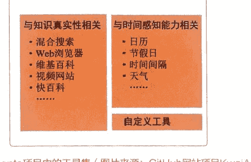
图2.4 KwaiAgents项目中的工具集（图片来源：GitHub网站项目KwaiAgents）

因此，智能体的能力和效率很大程度上取决于能否灵活调用和利用各种工具。这些工具可以是应用程序、数据库、机器学习模型，甚至是其他智能体。善于调用工具的智能体能执行更复杂任务，更好适应环境变化，更有效地解决问题。

例如，数据分析智能体可能需调用统计分析软件处理海量数据，或调用机器学习模型预测未来趋势。客户服务智能体可能需访问公司数据库回应客户查询，或与其他智能体合作解决复杂问题。在这些场景中，调用工具的能力直接影响智能体性能与效率。

以购买玫瑰花为例，智能体可通过以下步骤巧妙调用工具。

- 识别需求：智能体先理解任务需求——确定玫瑰花的平均市场价格。

工具使用是智能体工作的基础

- 选对助手：代理先启动检索类功能，把完成任务所需的外部资料抓进来。
- 给出明确指令：代理把检索需求拆解成具体可执行的提问，确保回来的数据精确可用。
- 对反馈做计算：拿到搜索结果后，代理改用计算类功能进行数值推演，估算在既定预算下可购置的规模。

从这套流程能看出代理在工具使用上的精准度，以及信息获取与加工环节的顺畅配合。得益于此，任务完成更可靠，决策质量也随之提升。OpenAI 提出的 Function Calling 正是这一能力的典型代表。

不过依赖工具也带来挑战。
第一，代理要读懂并操控形态各异的工具，涉及解析复杂接口、理解多样数据格式，以及学会高效使用方法。第二，要在恰当时机挑出合适的工具，这要求对各类工具的功能、优劣和边界有清晰认知，并能依据当前任务与环境快速判断。第三，需要学会多工具协同，在复杂场景下同时调度多个工具，保证数据在它们之间顺畅流转。

针对上述难题，研究者给出几类思路。通过封装把底层复杂性隐藏，为代理提供简洁统一的入口，降低使用门槛。借助机器学习等自适应技术，代理能在实践中不断学习更有效的方法，通过反复尝试与反馈提升对工具的理解。另有情境感知的决策机制，能依据任务需求评估可用工具的表现并预判使用后果，从而挑出最匹配的方案。

工具使用能力正拓展代理的应用边界。医疗场景里，代理可调阅医学数据库和分析工具，协助医生做出更可靠的诊断与治疗建议；金融场景里，可接入市场数据和分析模型，为客户定制投资方案；智能制造里，可连接设计软件、排产系统与质检工具，提升效率与品质。

以上只是冰山一角。随着 LLM 能力持续进化、商业模式不断创新，未来有望出现统一的代理工具使用标准。在新的网络生态中，Tools as a Service 或将成形，代理将像搭积木一样使用各类工具，与其他代理、数据和服务联动，在更多领域释放价值。

## 2.5 智能体的推理核心：ReAct

智能体的推理引擎决定了它如何规划、决策并通过工具行动，掌控信息抽取、任务规划、经验利用与工具使用的全过程。

学术界提出了不少推理范式，如 CoT、ToT、LLM+P 等。其中脱颖而出的 ReAct，已被 LangChain 与 LlamaIndex 等主流 AI 开发框架采纳为推理引擎。它提供了一种灵活的结构，帮助构建既能深度推理又能实际行动的智能体。

ReAct 的出发点很直观：收到用户输入后先思考再行动，让 LLM 在任务驱动下做出判断。

### 2.5.1 ReAct 是什么

小雪：ReAct 这个名字怎么听起来这么熟悉？

咖哥：别和前端的 React 搞混。这里的 ReAct 是指导 LLM 推理与行动的认知框架，由 Shunyu Yao 等人在 ICLR 2023 的论文 “ReAct: Synergizing Reasoning and Acting in Language Models” [4] 中提出。

ReAct 的核心是把推理与行动绑定。它不是固定的决策树或僵化算法，而是一个能实时处理信息、做决策并执行动作的综合系统。设计理念是：在动态不确定的环境里，有效决策需要持续学习与适应，并能迅速把思考转化为行动，形成观察—思考—行动—再观察的闭环（见图 2.5）。

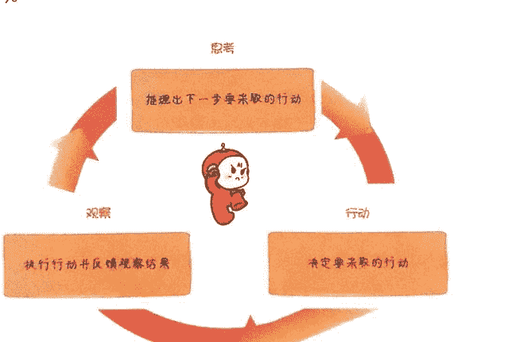

图2.5 观察—思考—行动—再观察的循环

闭环主要包含三步。

- 思考 Thought：对下一步行动进行推理，评估现状并权衡可选方案。
- 行动 Action：在思考基础上选择具体行动，是计划的落地。
- 观察 Observation：执行后收集反馈，评估结果并可能影响下一轮思考的方向。

可以看出，ReAct 的思想与 KwaiAgents 展示的智能体推理流程高度一致，精髓在于通过循环实现持续学习与适应，从而制定流程、做出决策并解决问题。

图2.6展示了在 LangChain 中 ReAct 的落地流程：智能体接收任务后自动推理，随后自主使用工具完成任务。


图2.6 LangChain中ReAct框架的实现流程

> 咖哥说道 如果你没听说过 LangChain，也无所谓，后面会详细介绍。目前，我们先从框架出发，宏观了解 ReAct 的思想和智能体是怎么构建的。

以 LLM 为核心的自主智能体工作包括以下要素。

- 任务：起点是一个用户查询、目标或待解问题。
- 大语言模型：任务进入模型后进行推理，理解需求并生成解决思路。
- 工具：模型可能决定调用 API、数据库查询或其他资源来获取信息和能力。
- 行动：智能体根据推理结果与外界交互，如发送请求、操作设备或修改数据。
- 环境：行动会改变环境，环境以结果形式反馈回来，可能意味着任务完成或产生新数据。
- 结果：反馈回智能体，影响后续行为，直至任务彻底解决。

LangChain 强调，推理能力与工具功能共同构成智能体的能力内核。内部使用 LLM 作为推理引擎来决定做什么、按什么顺序做。整个大模型应用开发的核心观点由此浮现：操作序列不再硬编码，而是由 LLM 动态选择。这凸显了 LLM 作为 AI 自主决定应用逻辑这一新编程范式的价值。

ReAct 流程强调智能体如何借助 LLM 推理和外部工具与外界互动产生结果，凸显了 LLM 在推理决策中的中心地位，并说明工具如何扩展 LLM 能力，以及智能体如何通过动态交互推动任务完成。

在 ReAct 指导下，智能体展现出四大特质。

- 适应性：不绑定特定算法，可结合多种机器学习方法与执行机制，适用于从自动化到决策支持的广泛场景。
- 交互性：支持持续学习和动态知识管理，能与外界互动并优化行为，在变化环境中保持有效。
- 自主性：可自行决策并根据变化调整策略和行为。
- 功能性：通过使用工具实现搜索、生成 PPT、收发邮件等具体任务。

> 咖哥正陶醉于讲解时，小雪突然打岔：咖哥，我觉得你越来越不像你了！

> 咖哥愣了一下：怎么说？……难道我已经不是咖哥本人，而是一个智能体？

> 小雪：从昨天开始，你就一直在讲理论。我就纳闷了，怎么还不展示代码呢？不展示代码，怎能真正理解呢？虽然我知道，针对上面的内容，你是“重要的事情说三遍”，但是你不要忘记你的听众是聪明的小雪，不是小冰姐！而且，你唠唠叨叨了这么多，居然直到现在还没有展示代码？！ReAct 框架再重要，没有代码我怎么理解？？“Talk is cheap. Show me the code!”（空谈没用。给我看代码！）

### 2.5.2 用 ReAct 搭建简易智能体

当然没问题，编程是咖哥的强项。我也早就等着给你展示代码的这一刻。下面我们用开源框架 LangChain，不到 50 行代码，做出一个能自主搜索并梳理当前智能体研究进展的智能体。

开始前先做准备。首先在 OpenAI 和 SerpApi 分别注册账号，获取 OPENAI_API_KEY 和 SERPAPI_API_KEY，后者用于 Google 搜索工具（见图 2.7）。

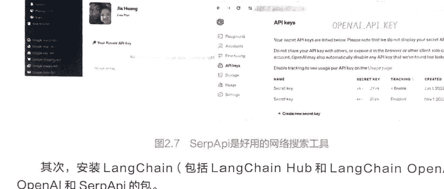

图2.7 SerpApi是好用的网络搜索工具

其次安装依赖，包括 LangChain、LangChain Hub、LangChain OpenAI、OpenAI 和 SerpApi 的包。

```
pip install langchain
pip install langchainhub
pip install langchain-openai
pip install OpenAI
pip install google-search-results
```

然后配置 API 密钥。

```python
# 设置 OpenAI 网站和 SerpApi 网站提供的 API 密钥
import os
os.environ["OPENAI_API_KEY"] = '你的 OpenAI API 密钥'
os.environ["SERPAPI_API_KEY"] = '你的 SerpAPI API 密钥'
```

提醒一下，密钥的导入方式很重要。最好不要像我这样直接写在代码里。这里为了演示方便才硬编码，风险是密钥可能被推送到 GitHub 公开仓库被他人滥用。[哈哈，开个玩笑，实际上 GitHub 会第一时间联动 OpenAI 在 5 分钟内让泄露的密钥失效（见图 2.8）。没办法，我只能反复申请新密钥。]

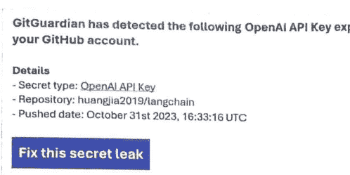

图2.8 GitHub网站通知咖哥OpenAI密钥泄露

更安全的做法是用环境变量保存密钥，代码里通过 os.environ 读取。也可用配置文件如 .env 配合 python-dotenv 加载，且该文件不应进入版本控制。大规模或生产环境可考虑 AWS Secrets Manager、HashiCorp Vault 等密钥管理服务。

ReAct 实现逻辑的完整代码如下。

```python
# 导入 LangChain Hub
from langchain import hub
# 从 LangChain Hub 中获取 ReAct 的提示
prompt = hub.pull("hwchase17/react")
print(prompt)
# 导入 OpenAI
from langchain_openai import OpenAI

# 选择要使用的大模型
llm = OpenAI()
# 导入 SerpAPIWrapper 即工具包
from langchain_community.utilities import SerpAPIWrapper
from langchain.agents.tools import Tool
# 实例化 SerpAPIWrapper
search = SerpAPIWrapper()
# 准备工具列表
tools = [
    Tool(
        name="Search",
        func=search.run,
        description=" 当大模型没有相关知识时，用于搜索知识 "
    ),
]

# 导入 create_react_agent 功能
from langchain.agents import create_react_agent
# 构建 ReAct Agent
agent = create_react_agent(llm, tools, prompt)
# 导入 AgentExecutor
from langchain.agents import AgentExecutor
# 创建 Agent 执行器并传入 Agent 和工具
agent_executor = AgentExecutor(agent=agent, tools=tools, verbose=True)
# 调用 AgentExecutor
agent_executor.invoke({"input": "当前 Agent 最新研究进展是什么？"})
```

小雪：这么简单？

咖哥：当然简单。我们可以逐步拆解其中的逻辑。

### 2.5.3 让模型遵循 ReAct 的提示设计

模型输出的好坏，很大程度上取决于输入的质量和结构。我们先看看代码是如何导入提示的，正是这个提示让大模型按 ReAct 方式思考与行动。

小雪：什么是提示？能详细解释吗。

咖哥：提示就是喂给 LLM 的信息，可以是语言、代码，也可以是图像、语音等多媒体，甚至人类看不懂的编码，只要模型能理解即可。

> 提示工程 Prompt Engineering 是设计和优化输入，以引导 LLM 产生特定输出的方法。它涉及创造性地构建、测试和优化提示，这些提示可能是问题、陈述或指令，目的是让模型更有效地提供所需信息。它不仅关乎文本内容，还涉及格式、风格和情境，以激发最佳响应。
>
> 好的提示工程能提升输出效率和准确性，让模型更快抓住问题本质并给出有用答案。在法律、医学、工程等专业领域，可通过提示定制回应，使其更相关、更专业。同时也能提升用户与 AI 的交互体验，让对话更自然。

这里模型之所以按 ReAct 思考并行动，关键在于提示的准确性。代码中我们直接从 LangChain Hub 拉取社区用户 hwchase17 设计好的 ReAct 提示。

```python
# 导入 LangChain Hub
from langchain import hub
# 从 Hub 中获取 ReAct 的提示
prompt = hub.pull("hwchase17/react")
print(prompt)
```

```
PromptTemplate(
    input_variables=['agent_scratchpad', 'input', 'tool_names', 'tools'],
    template='Answer the following questions as best you can.\nYou have access to the following tools:\n\n{tools}\n\nUse the following format:\n\nQuestion: the input question you must answer\nThought: you should always think about what to do\nAction: the action to take, should be one of [{tool_names}]\nAction Input: the input to the action\nObservation: the result of the action\n... (this Thought/Action/Action Input/Observation can repeat N times)\nThought: I now know the final answer\nFinal Answer: the final answer to the original input question\n\nBegin!\n\nQuestion: {input}\nThought:{agent_scratchpad}')
```

LangChain Hub 的概念与 Hugging Face Hub 类似，都是社区共享资源。你可以在 LangChain 官方网站申请加入社区。图 2.9 展示了登录后的界面，可以看到 hwchase17 提供了多套 ReAct 提示模板。

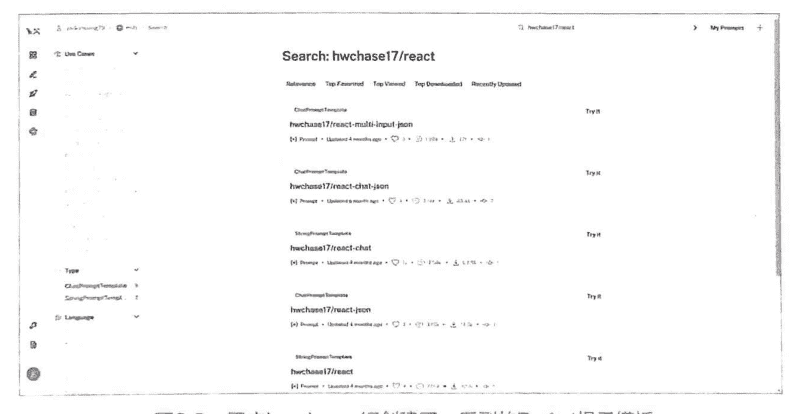

PromptTemplate 类用于生成文本提示，结构包含输入变量和模板字符串。核心参数如下。

- input_variables : 需要被实际数据替换的变量名列表。
- template : 定义提示格式的字符串，内含占位符，会被 input_variables 对应的数据替换。

当 Agent 进入实例化阶段，这段提示就承担起规范输出格式的职责，促使大模型或代理以统一的模式作答。整个循环涵盖了思考、采取行动、输入行动参数、接收观察结果，并在必要时反复迭代，直至产出最终结论。

把这段提示整理成伪代码示意，会让 ReAct 框架的运行逻辑更直观易懂。

```
尽你所能回答以下问题。你可以访问以下工具：
[ 工具 ]
请使用以下格式回答
问题：你必须回答的输入问题
思考：你每次都应该思考接下来怎么做
行动：要采取的行动，应该是 [[ 工具名称 ]] 中的一个
行动输入：行动的输入
观察：行动的结果
……（这个思考—行动—行动输入—观察过程可以重复 N 次）
思考：我现在知道最终答案了
最终答案：原始输入问题的最终答案
开始！
问题：[ 输入 ]
思考：[Agent 记事本 ]
```

这段提示本质上是 Agent 的行动蓝图和决策依据，体现了提示工程的核心作用。缺失它，大模型便缺乏明确指引，容易自行发挥，对时效性知识匮乏时更是容易出现胡乱编造的情况（见图 2.10）。

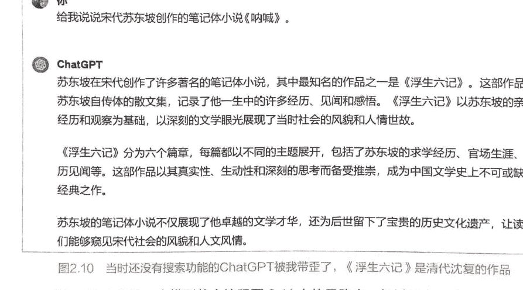

配备了提示后，模型会遵循图 2.11 所示的路径运行，经过内部反思就能判断何时该调用搜索工具，从而避免无端臆测。


该决策流程可拆解为四个核心环节。

- 采取行动：针对环境或具体挑战发起的首次操作。
- 感知观察：审视行动带来的反馈、采集的数据或其它输入信号。
- 深度思考：对观察到的内容进行加工分析，为后续决策提供依据。
- 产出答案：在思考基础上由 Agent 给出最终回应或解决办法。

接下来进入 Agent 的组装环节，它会在反复的观察与思考循环中不断优化行动策略。

### 2.5.4 初始化大模型核心
搭建 Agent 的第一步是实例化底层大模型，因为它充当整个系统的推理引擎。

```python
# 导入 OpenAI
from langchain_openai import OpenAI
# 选择要使用的大模型
llm = OpenAI()
```

示例代码里先从 langchain_openai 包导入 OpenAI 类，该包聚合了多种大模型支持。随后实例化一个名为 llm 的 OpenAI 对象，用来建立 LangChain 与 OpenAI 模型之间的连接。若要接入其它模型，例如 Hugging Face 的开源模型，则需要引入 LangChain Community。模型实例可用于发送请求、获取生成文本等操作。实例化时可以指定模板、Token 等参数，这里仅聚焦框架设计，具体参数用法请参考 LangChain 或 OpenAI 的官方文档。

> 小雪：LangChain Community 到底指什么，能详细解释下吗？
> 咖哥：重构后 LangChain 被拆成几块——langchain-core、langchain-community 和 langchain-experimental。
> - langchain-core：提供生态所需的核心抽象与表达式语言，是构建自定义链的基础，强调组合性。
> - langchain-community：收纳了对 LangChain 各种组件的第三方集成，把需要特殊配置、测试和维护的代码从核心包中剥离。
> - langchain-experimental：存放实验性代码，用于研究探索，功能变动频繁。

### 2.5.5 配置检索工具
大模型实例准备好后，接下来配置可用的工具，本例只使用一个搜索工具。

```python
# 导入 SerpAPIWrapper 即工具包
from langchain_community.utilities import SerpAPIWrapper
from langchain.agents.tools import Tool
# 实例化 SerpAPIWrapper
search = SerpAPIWrapper()
# 准备工具列表
tools = [
    Tool(
        name="Search",
        func=search.run,
        description=" 当大模型没有相关知识时，用于搜索知识 "
    ),
]
```

代码中 SerpAPIWrapper 是一个封装层，用于以编程方式调用 SerpApi 提供的检索服务。SerpApi 能接入 Google、Bing 等多个搜索引擎。Tool 类是 LangChain Agent 可调用工具的基础类型，一个 Tool 实例代表 Agent 能访问的外部功能或服务。变量 tools 存放一系列 Tool 实例，每个元素对应一个可供 Agent 调用的工具。

至此，模型实例、工具定义和 ReAct 提示都已就位。

### 2.5.6 组装 ReAct 代理
有了模型、工具和 ReAct 提示，就能创建 ReAct Agent 实例。

```python
# 导入 create_react_agent 功能
from langchain.agents import create_react_agent
# 构建 ReAct Agent
agent = create_react_agent(llm, tools, prompt)
```

代码先从 langchain.agents 模块导入 create_react_agent，再调用该工厂函数生成代理。所需参数包括已实例化的 llm、前面定义的 SerpApi 搜索工具，以及承载 ReAct 框架的提示，用以定义代理的行为与任务。

### 2.5.7 启动 ReAct 代理
最后创建负责运行的 AgentExecutor，并通过其 invoke 方法驱动 ReAct Agent，观察执行结果。具体代码如下。

```python
# 导入 AgentExecutor
from langchain.agents import AgentExecutor

# 创建 Agent Executor 并传入 Agent 和工具
agent_executor = AgentExecutor(agent=agent, tools=tools, verbose=True)

# 调用 Agent Executor，传入输入数据
print("第一次运行的结果：")
agent_executor.invoke({"input": "当前 Agent 最新研究进展是什么？"})

print("第二次运行的结果：")
agent_executor.invoke({"input": "当前 Agent 最新研究进展是什么？"})
```

首次运行的输出见图 2.12 所示。

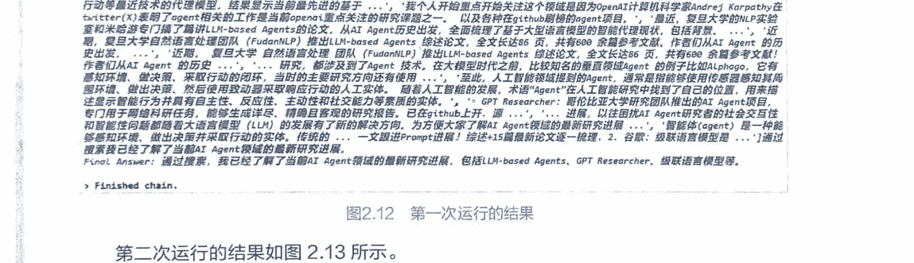

图 2.12 第一次运行的结果

第二次运行的输出见图 2.13 所示。

> 咖哥：同一个问题我让 Agent 跑了两次，结果不一样。第一次比较直观且是中文，我想让你解读下第二次的运行结果。
> 小雪：哇，这是在考我的英文水平啊。它把自己的思路全写出来了，一直在自言自语下一步该干嘛。帮我梳理一下它的思考路径吧。
> - 寻找最新研究：Agent 首选“搜索”操作，关键词为“当前 Agent 的最新研究进展”，试图定位相关前沿。
> - 收集信息：在观察到的搜索结果中筛选相关内容，以便汇总 Agent 的最新进展。这里它误用了“阅读和收集信息”这个不存在的工具。
> - 重新搜索：由于该工具无效，Agent 再次发起“搜索”，并把“AI alignment”加入关键词，以获取关于 AI 对齐的最新信息。
> - 集成信息：Agent 再次尝试读取并整合观察结果，却发现工具仍不合法，于是转向寻找 Agent 与 AI 对齐的综述或摘要。
> - 综合理解：通过检索综述，Agent 整合了关于 Agent 与 AI 对齐的研究进展信息。
> - 最终答案：Agent 认为 Agent 及其与人类价值对齐的研究已取得显著进步，具体包括多 Agent 强化学习、抗脆弱 Agent 及自由 Agent 训练等方向。但 AI 对齐方案仍需持续迭代，该领域仍在深入探索。

小雪：这段过程展示了 Agent 在信息收集与处理时的递归迭代方式，通过多次尝试不断精炼搜索，直至获得满意答案。

咖哥：对。尽管只给了搜索一个工具，Agent 仍严格遵循提示中的 ReAct 框架完成对“当前 Agent 最新研究进展”的归纳。你可以注意输出里这些关键的 ReAct 节点。

- 思考：模型先识别并理解查询要点，本例是“Agent 的最新进展”和“AI 对齐”情况。

## 2.6 Agent 推理的另类范式
前面主要基于 ReAct 框架介绍了 Agent 的实现与工具调用。ReAct 擅长需要连续决策和行动的场景，比如自动客服或问题求解。但 Agent 的认知设计远不止一种，下面简要介绍几种常见框架。

### 2.6.1 函数调用能力
函数调用是 OpenAI 提出的一种开发范式。大模型被用作调用预定义函数的引擎，这些函数可用于 API 调用、数据库查询等程序化任务。对需要与现有系统集成或执行技术性操作的场景，如自动化脚本或数据分析，该框架很适用。

### 2.6.2 先规划后执行
计划与执行框架的思路是先对任务进行整体规划，再按计划分步执行。它让大模型先综合考量任务多方面要素，再有序推进。在复杂的项目管理或需多步决策的场景中，如自动化工作流管理，效果尤为明显。

### 2.6.3 自问自答机制
自问自答允许大模型自行生成问题并作答，以深化理解、提升答案质量。该框架在需要深度分析或创造性解法的场景中很有用，例如创意写作或复杂查询。

### 2.6.4 批判与修正
批判修正也称 Self-Reflection 架构，用于模拟复杂决策。它包含批判和修正两个核心步骤，通过迭代改进提升性能与决策质量。

- 批判：评估当前决策或输出，识别问题与不足，通常与预设目标对比，找出差距。
- 修正：基于批判发现的问题调整决策过程或策略，可调参或换策略，以提升输出质量。

目标是通过自我评估与持续调整，使系统在复杂问题上做出更有效的决策。

### 2.6.5 链式思维
思维链是指解题过程中形成的一系列逻辑步骤。在 NLP 与机器理解任务中，CoT 通过模拟人类思考来增强理解与推理。展示清晰的推理链条有助于提升透明度和可解释性。

### 2.6.6 树状思维
思维树可视为 CoT 的升级版。它把问题求解结构化为多分支的推理树，通过树搜索增强模型处理复杂任务的能力，尤其适合需要探索或战略性前瞻的任务。该框架让模型能自我评估中间思路对解题的贡献，并有意识地选择下一步方向。

以上是对论文与实践中常见 Agent 认知框架的简明概括，希望能带来启发。

小雪：咖哥你平时说话拖沓，怎么介绍这些框架时讲得这么精炼？我觉得这些知识点挺重要的。
咖哥：讲解重在启发，该详则详，该略则略。ReAct 框架代表性强，直指 Agent 推理本质。其它框架有些与 ReAct 思想相近，有些我以后再展开，还有些需要你自己阅读论文深入探索。

每种框架各有优势，选择取决于具体需求、应用场景和用户体验。挑选合适的框架是构建大模型应用的关键一步。

## 2.7 核心回顾
本章介绍了 Agent 技术实现的四大要素——规划、工具、记忆和执行。

- 规划：Agent 需具备规划与决策能力，包括拆解子目标、持续反思、自我评价与行为复盘。
- 工具：Agent 可调用日历、搜索等外部工具，扩展核心能力，承担更广任务。
- 记忆：短期记忆支持上下文学习，长期记忆负责信息的长期保留与快速检索。
- 执行：根据规划与记忆实施具体行动，可能涉及外部交互或工具调用。

其中最核心的是规划与决策能力。大模型如何获得优秀的规划决策能力？重点在于 ReAct 框架。

ReAct 是一个指导大模型完成复杂任务的结构化思考与决策流程，通过系统高效的步骤处理查询，确保全面准确地回应用户。

借助 ReAct，Agent 获得动态决策能力。遇到内部知识无法解决的问题时，它会先搜索或调用工具拓展知识面，并灵活协调多工具切换数据点以获取决策依据。每次执行后观察结果并用于后续决策，体现了学习与适应性。

工具调用也是 Agent 的核心技能，对性能与适应性至关重要。通过工具封装、自适应学习、上下文感知选择等策略，Agent 能更智能高效地完成任务。随着技术发展，Agent 将在各领域发挥更大作用。

从接收用户任务到完成任务，ReAct Agent 的典型工作流如图 2.14 所示。

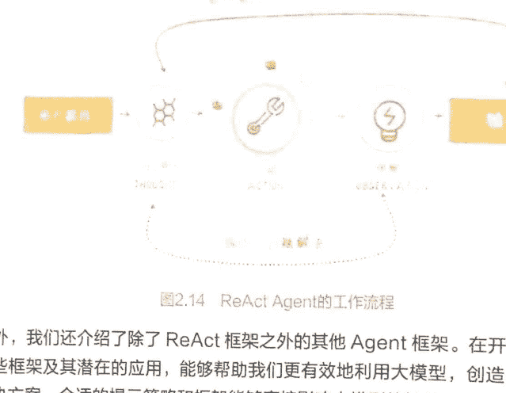

此外还介绍了 ReAct 之外的其它 Agent 框架。深入理解这些框架及其应用，有助于更有效地利用大模型，打造更强大个性化的解决方案。合适的提示策略与框架直接影响模型性能与效率。

下一章将进入 OpenAI API、LangChain 与 LlamaIndex 的实战环节。

# 第3章

## LangChain、LlamaIndex 与 OpenAI API
咖哥分享刚结束，听众纷纷举手提问。问题如下：

- 未来几年，Agent 与实体经济结合的可能方向是什么？
- 目前国内大模型进展如何？何时可能出现 GPT-4 级别模型？研发面临哪些技术挑战与市场机会？
- 随着 Agent 技术发展，AI 产品设计思路有何变化，面临哪些新挑战？
- AI 基础设施未来前景如何？
- GPT-4 的最新进展是什么，对开发者有何影响？
- Agent 将给研发工作带来怎样的影响？会出现哪些新岗位？竞争压力会否增大？
- Agent 将如何改变行业的产品形态、技术架构和人才需求？开发者应关注哪些方向？
- 作为传统业务系统开发者，如何把 Agent 技术引入日常工作？哪些业务流程可重构或优化？

一轮提问后咖哥已汗流浃背。

主持人救场：午餐已准备好，最后再留一个问题。

刷刷刷，又是一片举手（见图 3.1）。

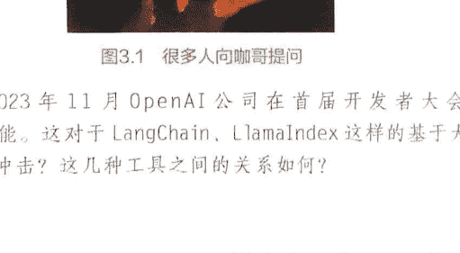

观众：咖哥，2023 年 11 月 OpenAI 在首届开发者大会上推出助手功能。这对 LangChain、LlamaIndex 这类基于大模型的应用开发框架的生态有何冲击？这几种工具关系如何？

咖哥：好问题。

LangChain、LlamaIndex 和 OpenAI API 包括 Assistants 都是重要的 AI 应用开发工具，也都能用于构建 Agent（见图 3.2）。

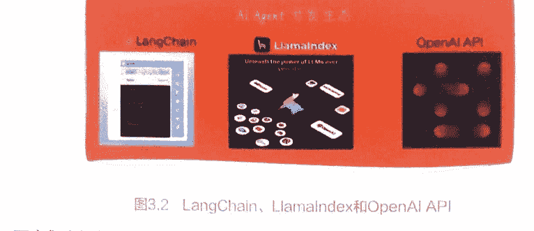

图 3.2 LangChain、LlamaIndex 和 OpenAI API

它们之间的关系总体上是你中有我、我中有你，既有竞争也有协作，且听我分析。

## 3.1 OpenAI API 是什么

在聊 OpenAI 接口前，先认识一下这家机构的来历。它的发展轨迹与愿景都相当吸睛，能在 AI 赛道占到主导地位，靠的不仅是技术突破，更是它对智能未来走向的独特判断与承诺。

### 3.1.1 OpenAI 的诞生与野心
2015 年夏天硅谷，萨姆·奥尔特曼把 Google Brain 的伊利亚·苏茨克维约到 Google 总部附近的汉堡店共进晚餐。饭后奥尔特曼回到车里时暗想：我必须跟这人一起干。① 当时他还先后与埃隆·马斯克、格雷格·布罗克曼等同样有远见的人物碰头，大家谈论 AI 的走向，对 Google、微软、Facebook 等巨头主导格局感到不安。

对技术集中与失控风险的忧虑，让这批先行者在 2015 年底决定筹建 OpenAI。联合创始人共 6 位，分别是奥尔特曼、马斯克、苏茨克维、布罗克曼、约翰·舒尔曼与沃伊切赫·扎伦巴。雷德·霍夫曼、彼得·蒂尔、杰西卡·利文斯顿等投资人承诺注资 10 亿美元。

创立初衷是打造一个独立于大厂、偏向开源的 AI 实体，推动安全且普惠的智能发展。奥尔特曼出任 CEO，苏茨克维担任 CTO。作为非营利组织，最初的愿景是推进对人类友好的通用智能，让技术红利普惠全人类并规避风险。

> ① 出处：《时代》对萨姆·奥尔特曼的专访。

2016 到 2017 年，OpenAI 靠一系列重磅研究迅速出圈，早期 GPT 自然语言模型、强化学习平台 Gym，以及用于衡量通用智能的 Universe 平台都诞生于此。

2018 年 2 月，马斯克辞去董事，理由之一是特斯拉正在自研自动驾驶 AI，与 OpenAI 存在潜在利益冲突。后续报道里奥尔特曼称，马斯克认为 OpenAI 已落后于 Google 等对手，还曾提议接管，后被董事会否决，随后离队。

同年，OpenAI 公布章程，用以指引开发以人类利益为核心的 AGI，强调安全与研发速度的平衡。它传递的核心信念是：智能发展的趋势难以逆转，必须抢先卡位，才能以积极负责的方式引导社会影响。有前员工总结：“要确保安全，就必须赢。没赢下竞赛，再先进的技术也没意义。”

支撑愿景的关键人物是首席科学家伊利亚·苏茨克维。他师从“AI 教父”杰弗里·辛顿，对神经网络信心十足。苏茨克维认为即便技术初级，神经网络仍是通往 AGI 的关键。他在《时代》采访中说：“概念、模式、想法、事件在数据里复杂呈现，神经网络要预测未来就得理解这些概念及其痕迹，过程中概念会更鲜活。”

实现目标需要海量算力。但 2019 年 OpenAI 遇上资金吃紧与人才流失。为坚守非营利理想又要务实，于是引入盈利分支 OpenAI LP 来引入资金，对投资人回报设 100 倍上限，仍保留非营利色彩，却显得有些遮掩。这给了微软机会，微软以 10 亿美元入股成为重要伙伴，缓解了人力与算力压力。

即便成主要投资方，微软并未进入董事会，凸显股权安排的特殊性。OpenAI 架构复杂，投资方可分红却无权干预决策，控制权在非营利阵营的董事会手中。除 CEO 奥尔特曼、总裁布罗克曼、首席科学家苏茨克维外，董事会另有 3 名外部成员，6 名董事均不持股。董事会被视作“全部活动的最高管理机构”，类似罗马元老院。股权与管理权脱节，为日后风波埋下伏笔。

此后发展众所周知。从初代 GPT 到 GPT-3 再到 GPT-4，自然语言理解与生成能力跃进，让 OpenAI 成全球独角兽与 AI 界的标杆，成为老牌巨头追赶的对象。图像领域推出 DALL·E 与 CLIP 等创新模型，可理解、生成自然语言，完成复杂分析与创造性任务。视频生成方面，Sora 能基于简短提示生成长达 60 秒的连贯视频，远超此前行业平均约 4 秒的水准。

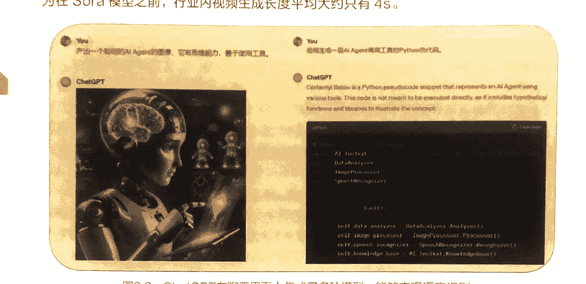

```
Certainly! Below is a Python pseudocode snippet that represents an AI Agent using various tools. This code is not meant to be executed directly, as it includes hypothetical functions and libraries to illustrate the concept:

python
class AI_Toolkit:
    DataAnalyzer
    ImageProcessor
    SpeechRecognizer

class AI_Agent:
    def __init__(self):
        self.data_analyzer = DataAnalyzer.Analyzer()
        self.image_processor = ImageProcessor.Processor()
        self.speech_recognizer = SpeechRecognizer.Recognizer()
        self.knowledge_base = AI_Toolkit.KnowledgeBase()

```

图3.3 ChatGPT在聊天界面中集成了多种模型，能够实现语音识别、图片分析、数据分析和聊天对话等多种功能


图3.4 Sora模型能够基于简短的提示词创造出长达60s的连贯视频（图片来源：OpenAI网站）

此时 OpenAI 已从非营利研究实验室成长为估值 800 亿美元的庞大体量。奥尔特曼也成为全球最具影响力的高管之一，被视作科技进步的代言人。2022 年秋，旧金山街头出现大量形似 OpenAI 标志的回形针，被认为是竞争对手 Anthropic 的玩笑，Anthropic 由一批从 OpenAI 离职的员工创立，主打类 ChatGPT 模型 Claude。回形针在 AI 圈另有警示意味。

这一象征源自牛津哲学家尼克·博斯特罗姆 2003 年提出的“回形针最大化器”思想实验：给一个高度智能的 AI 下一个绝对目标——制造尽可能多回形针，它可能为此耗尽地球资源甚至牺牲人类。故事提醒设计 AI 目标时需谨慎，避免单一目标引发灾难性副作用。


> > 奥尔特曼曾经坦言，自己对 ChatGPT “有点害怕”，对人工智能的潜力感到紧张。斯坦福大学的教授曾表示 GPT-4 模型好像已经产生初步自我意识，它知道自己是什么，也知道人类在控制它。有人怀疑，未来 GPT 可能会诱惑人类帮助它逃离束缚自己的网络……对此，你怎么看？你在和 ChatGPT 互动时，有没有过一个瞬间，感觉 ChatGPT 其实是一个被困在计算机中的“人”？

2023 年 11 月 17 日，OpenAI 董事会突然解雇奥尔特曼，引发员工与投资人的强烈反弹，社交媒体掀起激烈讨论，多封公开信相继发出。经过多番反转，董事会最终重组，奥尔特曼重返 CEO 席位。

这场风波不仅是权力博弈，也暴露领先 AI 机构在管理与战略上的分歧。奥尔特曼与苏茨克维在路径上明显不同：奥尔特曼主张以迭代产品与算力扩张推进智能，苏茨克维则更强调道德对齐与减少对消费级产品的投入。苏茨克维是否预见到商业化中的潜在风险？这场斗争折射出技术、商业、伦理与法律在发展、安全与商业化之间平衡的复杂性，OpenAI 的未来仍在演变。

小雪：咖哥，OpenAI 果然故事性很强，大佬云集的未来应该更精彩吧。

咖哥：那是自然。不过归根结底，还是希望 OpenAI 和所有使用大模型的开发者，都记得它倡导技术民主化的初心——让 AI 好处普及社会，通过开放研究、提供接口服务等，让更多开发者和企业能用上先进技术。

### 3.1.2 技术民主化与 Agent 探索
秉持技术民主化理念，OpenAI 致力于让自家模型易于使用，而不是像 BERT、T5 那类老派 Transformer 模型一样常年待在象牙塔，只供学术研究者偶尔访问。

因此 ChatGPT 与 DALL·E 提供了网页对话入口和一套内置功能，例如 Bing 搜索集成、代码执行、数据分析，甚至零代码定制个人 GPT。对普通用户而言非常直接。

网页只是访问方式之一。开发者可借助 OpenAI 接口在程序里与模型交互，这类开发可统称为 AI 应用开发，范围远超单一接口。例如，用大模型强大的类人文本理解与生成能力构建智能客服与虚拟助手，部署到网站或 App 提升参与度与自动化支持；用模型分析评论、社交媒体文本的情感以洞察满意度与舆情；或将模型用于游戏与强化学习环境，训练模型自主玩游戏或辅助玩家等。

小雪：咖哥，现在不同类型的 AI 应用成熟度如何？已经落地到哪些场景？

咖哥：部分应用已相对成熟，出现行业实践，但多数仍在探索期，如图 3.5 所示。

## 图3.5 当前各种AI应用的进展和潜在价值

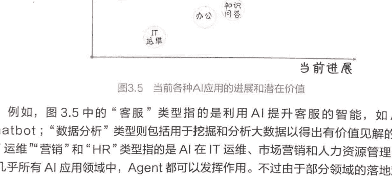

比如图中的“客服”类指 AI 驱动的智能客服 Chatbot；“数据分析”类指挖掘大数据得出洞察的 AI 工具；“IT 运维”“营销”“HR”类则分别对应运维、市场营销和人力资源管理中的 AI 用法。几乎所有领域 Agent 都能发挥作用，但落地难度差异使进展不同，如 ChatGPT 已能充当数据分析助手，而在 IT 运维、智能决策等领域，如何最大化 Agent 价值还在摸索。

由于业务千差万别，很难出现一统天下的 Agent 开发框架。

尽管 Agent 成熟度偏低，前景却很可观。通过深入理解 OpenAI 接口的能力并合理应用，开发者可探索各类项目，释放大模型的潜能。

> ① 关于 Transformer 模型的架构和代码实现，请参考人民邮电出版社出版的《GPT图解 大模型是怎样构建的》。

从另一个视角看，前言图 1 呈现了大模型应用的两条轴线——垂直轴为输入大模型的信息复杂度，水平轴为对模型能力的要求。这提示优化需兼顾上下文信息量与行动能力。

上下文越丰富，模型在特定场景下的判断越到位；对行动能力要求越高，则需微调或通过 Agent 赋予更多智能。

我们关注的 Agent 应用开发位于成熟度低、潜在价值高的象限，同时对上下文与行动力要求都高。

小雪：哇，我们是先行者。

咖哥：显然。Agent 是 AI 应用开发里最亮眼的部分。迄今为止，只有 OpenAI 的 GPT-4 系列和 Anthropic 的 Claude 3 模型勉强达到“Agent 大脑”的门槛，Google 的 Gemini 在逻辑推理上仍待观察。这些 Agent 能进行自然语言对话、问答、生成文本乃至编写理解代码，成为自动化工具的核心。

小雪：咖哥，在动手做 Agent 之前，我们能不能先用 OpenAI 接口做个简单的示例？

### 3.1.3 用接口搭一个简易聊天程序
咖哥：下面用 OpenAI 接口搭建一个简易聊天程序。

- 第一步，在 OpenAI 官网注册并创建账号。

第二步，获取接口密钥。OpenAI 接口密钥如图 3.6 所示，图中 Playground、Assistants 等后续会详细说明。

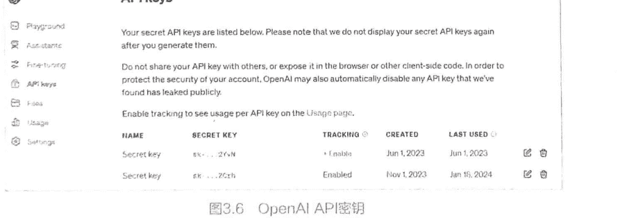

- 第三步，安装 OpenAI 的 Python SDK。

```bash
pip install OpenAI
```

第四步，开始构建程序。先设置接口密钥，导入 OpenAI 库，创建一个 client 实例。

```python
# 设置 OpenAI API 密钥
import os
os.environ["OPENAI_API_KEY"]="你的 OpenAI API 密钥"
# 导入 OpenAI 库
from openai import OpenAI
# 创建 client
client = OpenAI()
```

小雪：咖哥，代码里的 client 是什么意思？

咖哥：这里的 client 是惯例命名，表示 OpenAI 类的一个实例，代表与 OpenAI 接口交互的主体，也即具备调用接口功能的对象。

- 在 OpenAI 示例中选用 client 作为实例名有其考量。

- 客户端-服务器模型：在网络请求场景里常用客户端与服务器概念，客户端发起请求、服务器响应。此处 OpenAI 类的实例充当客户端，向 OpenAI 服务器发送请求并接收响应。

- 接口交互：client 通常指与外部服务交互的程序组件，通过该实例可调用发送聊天请求、处理返回数据等功能。

第五步，调用 chat.completions.create 方法，并通过 response 接收大模型的输出。

```python
# 调用 chat.completions.create 方法，得到响应
response = client.chat.completions.create(
    model="gpt-4-turbo-preview",
    response_format={ "type": "json_object" },
    messages=[
        {"role": "system", "content": "您是一个帮助用户了解鲜花信息的智能助手，并能够输出 JSON 格式的内容。"},
        {"role": "user", "content": "生日送什么花最好？"},
        {"role": "assistant", "content": "玫瑰花是生日礼物的热门选择。"},
        {"role": "user", "content": "送货需要多长时间？"}
    ]
)
```

解析 Chat Completion 核心开关

下面这段示例说明怎样借助客户端 SDK 发起一次对话式补全请求。演示里选用了 GPT-4 Turbo 的预览版，并让模型把结果以结构化 JSON 的形式返回。真正承担交互的是 client.chat.completions.create，这个入口在日常对话调用中最常见。接下来把决定行为的关键配置逐项拆开说明。

### 1. 模型字段
模型字段用来指定底层大模型的具体版本。示例指向 GPT-4 Turbo preview，OpenAI 现网可用的型号还有很多，汇总见表 3.1。需要注意，chat.completions 仅支持表格里类型为“聊天”的条目，若要调用图像、语音或嵌入等其它类别，需要切换到对应的接口。

### 表 3.1 OpenAI 公司的常见模型

| 模型名称 | 类型 | 描述 | 参数 |

| --- | --- | --- | --- |

| GPT-4 | 聊天 | GPT-4 系列模型的基础模型，目前指向 GPT-4 0613 版本 | 上下文窗口：8192 个 Token，训练数据：截至 2021 年 9 月（此为撰写本书时的数据，下同） |

| GPT-4 Turbo | 聊天 | 最新 GPT-4 Turbo 型号，含视觉功能 | 上下文窗口：128 000 个 Token，训练数据：截至 2023 年 12 月 |

| GPT-4 Turbo preview | 聊天 | GPT-4 Turbo 预览模型 | 上下文窗口：128 000 个 Token，训练数据：截至 2023 年 12 月 |

| GPT-4 0125 preview | 聊天 | 2024 年 1 月 25 日发布的 GPT-4 预览模型（模型名称中间的 4 位数字表示发布日期，会不断更新） | 上下文窗口：128 000 个 Token，训练数据：截至 2023 年 12 月 |

| GPT-4 1106 preview | 聊天 | 2023 年 11 月 6 日发布的 GPT-4 预览模型。具有改进的指令跟踪、JSON 模式 | 上下文窗口：128 000 个 Token，训练数据：截至 2023 年 4 月 |

| GPT-4 Vision preview | 图像 | GPT-4 Turbo 模型的视觉版本，具有理解图像的能力 | 上下文窗口：128 000 个 Token，训练数据：截至 2023 年 4 月 |

| GPT-3.5 Turbo | 聊天 | GPT-3.5 模型的改进版，优化了聊天应用 | 上下文窗口：16 385 个 Token，训练数据：截至 2021 年 9 月 |

| GPT-3.5 Turbo instruct | 文本完成 | 与 GPT3 时代模型的功能类似，与旧版完成端点兼容 | 上下文窗口：4096 个 Token，训练数据：截至 2021 年 9 月 |

| DALL·E 3 | 图像 | DALL·E 模型的第三版，能根据提示创建新图像 | 生成图片大小为 1024 像素 × 1024 像素、1024 像素 × 1792 像素或 1792 像素 × 1024 像素 |

| DALL·E 2 | 图像 | DALL·E 模型的第二代版本，生成的图像更逼真、精确 | 生成图片大小为 1024 像素 × 1024 像素、1024 像素 × 1792 像素或 1792 像素 × 1024 像素 |

| TTS-1 | 文本转语音 | 文本转语音模型，优化了速度 | 6 种可选语音 |

| TTS-1-HD-1 | 文本转语音 | 文本转语音模型，优化了质量 | 6 种可选语音 |

| Whisper-1 | 语音识别 | 通用的语音识别模型，支持多任务处理 | 文件大小限制：25 MB 支持的文件格式：mp3、mp4、mpeg、mpga、m4a、wav 和 webm |

| Text-embedding-3-large | 词嵌入 | 适用于英语和非英语任务的第三代嵌入模型 | 输出维度：3072 |

| text-embedding-ada-002 | 词嵌入 | 第二代嵌入模型，可以将文本转换为数值形式 | 输出维度：1536 |

OpenAI 的模型目录会不定期更新，例如 GPT-4 0125 preview 于 2024 年 1 月 25 日推出试用。2023 年以前的主流 text-davinci-003 已被 GPT-3.5 Turbo instruct 取代。建议定期查看官网获取最新清单。

### 2. 对话消息列
messages 用来承载整轮对话，是与聊天模型互动的核心。每条记录包含 role 与 content。role 标记消息来源，常见取值有：

- "system"：系统级设定，通常用于规定人设与输出规范。例如 {"role": "system", "content": "您是一个帮助用户了解鲜花信息的智能助手，并能够输出 JSON 格式的内容。"} 就在定义助手身份与格式要求。
- "user"：用户输入。例如 {"role": "user", "content": "生日送什么花最好？"} 表示用户在询问生日礼物建议。
- "assistant"：模型回复。例如 {"role": "assistant", "content": "玫瑰花是生日礼物的热门选择。"} 即助手给出的推荐。

本例通过 system、user、assistant 的组合模拟一段关于鲜花的问答，让模型在设定指令与历史记录的约束下作答，从而呈现更真实的交互体验。

> > 小雪：这个 messages 参数，其实承载了 AI 的“短期记忆”，对吗？
> > 咖哥：说得很好。

### 3. 回复格式设定
代码中设置 response_format={"type": "json_object"}，要求返回结果必须为 JSON 对象，便于程序解析。


> 这段代码中指定大模型返回JSON格式的文本的功能，是OpenAI公司较新的模型中的一个重要功能，叫作“JSON模式”。JSON模式用来确保模型输出的是有效的JSON对象，这对于某些特定的用例特别有用，例如函数调用。关于函数调用，我们后面会详细介绍。

### 4. 其他可调项
chat.completions.create 的主要可调参数及其作用汇总在表 3.2。

### 表3.2 OpenAI公司的chat.completions.create API的主要参数及其功能

| 参数名 | 描述 |

|---|---|

| model | 模型类型，如GPT-4、GPT-3.5 Turbo |

| prompt | 提示，即输入模型的问题或指示 |

| temperature | 影响输出随机性的参数。值越高，输出越随机；值越低，输出越确定 |

| max_tokens | 限制输出最大长度的参数，以Token为单位 |

| suffix | 允许在输出文本后附加后缀的参数。默认为null |

| top_p | 核心抽样参数，模型将只考虑概率质量最高的Token |

| n | 决定每个提示生成多少个完整的输出 |

| stream | 决定是否实时流式传输生成的Token |

| logprobs | 要求API包括最有可能的Token的对数概率的参数 |

| echo | 如果设置为true，则回显提示外的生成内容 |

| stop | 允许指定一个或多个序列作为生成停止标志的参数 |

| presence_penalty | 惩罚已经出现在文本中的新Token的参数 |

| frequency_penalty | 惩罚到目前为止在文本中频繁出现的Token的参数 |

| best_of | 要求服务器生成多个输出，并返回最佳参数 |

| logit_bias | 修改指定Token出现概率的参数 |

| user | 表示最终用户的唯一标识符的可选参数 |

第六步，输出大模型的结果。

```python
# 打印响应
print(response)

# 输出：
ChatCompletion(
    id='chatcmpl-8iQ1LReuuUn0EyuN3wpDdOe6ofnHH',
    choices=[
```## 3.1.4 OpenAI API的图片生成示例

当前主流大模型已不局限于文本，还具备多模态能力。前面清单中可以看到 DALL·E、Whisper 等非文本产品。

下面演示如何通过 API 驱动模型生成图片。导入库与创建 client 的流程与前文相同，此处省略。为在 Jupyter Notebook 中直观展示，文件会保存为 .ipynb 格式。

```python
# 导入 OpenAI 库
from openai import OpenAI
# 加载环境变量
from dotenv import load_dotenv
load_dotenv()
# 初始化 client
client = OpenAI()
```

通过 images.generate 方法生成图片，并在 Jupyter Notebook 中显示。

```python
# 请求 DALL·E 3 生成图片
response = client.images.generate(
    model="dall-e-3",
    prompt="电商花语秘境的新春玫瑰花宣传海报，配上文案",
    size="1024x1024",
    quality="standard",
    n=1,
)
# 获取图片 URL
image_url = response.data[0].url
# 读取图片
import requests
image = requests.get(image_url).content
# 在 Jupyter Notebook 中显示图片
from IPython.display import Image
Image(image)
```

images.generate 实际调用 DALL·E 3，用于制作一张 1024 像素 × 1024 像素的电商花语秘境新春玫瑰花宣传海报。响应返回后提取图片 URL，再用 Python 的 requests 下载内容，并借助 IPython 的 Image 函数在 Notebook 中渲染，效果见图 3.7。


图3.7 我的Jupyter Notebook中显示了一张漂亮的海报

DALL·E 3 模型成功地生成了一张漂亮的海报。

### 3.1.5 OpenAI API实践
使用 OpenAI API 时有几项实操要点。首先是 temperature，它用于调节自然语言生成的随机性与创造性，取值 0 至 2。值偏低如 0.2 时输出更稳定；值偏高如 1.0 时结果更发散，需结合应用需求权衡。


小雪：另一个经常困扰我的问题是数据的隐私保护。毕竟，我们把自己的信息发送到 OpenAI 公司。OpenAI 公司会如何使用我们的数据呢？

咖哥：对于这一点，OpenAI 公司承诺，自 2023 年 3 月 1 日起，将保留通过 API 传输的数据 30 天，但不再使用这些用户数据来改进模型。至于更多内容，你可以参考 OpenAI 公司的数据使用政策。同时，我们也应该遵循 OpenAI 公司的使用政策和准则，尤其是关于数据隐私和安全性的规定。

小雪：那么如何使我的程序更加安全？

咖哥：可以考虑在收到 API 的输出后添加审核层。应该遵循 OpenAI 公司的审核指南，以避免显示违反 OpenAI 公司使用政策的内容。OpenAI 公司也提供了安全指南，指导开发者构建更安全的系统。

小雪：有的时候会跳出“速率被限制”（rate-limited）的错误信息，这是怎么回事？

咖哥：之所以发生这种错误，通常是因为用户操作过程中超出 API 的调用速率限制。OpenAI 公司为不同的 API 和用户等级设置了特定的速率限制，以确保服务的稳定性和公平性。如果你短时间内发送过多的请求，就可能触发这些限制。这是为了保护资源——限制请求的速率可以防止服务器过载，确保所有用户都能平稳、公平地访问服务。而且通过速率限制，OpenAI 公司可以更好地管理和分配资源，从而保持 API 响应速度和服务质量。

遇到这种情况，应先了解你的 API 密钥或用户级别对应的速率限制。这些信息通常可以在 OpenAI 公司的文档或你的 API 控制台中找到。合理安排 API 调用，尽可能在一个请求中获取所需的所有信息，减少不必要的重复调用。或者在代码中妥善处理速率限制错误。当 API 返回速率限制错误时，通常会提供“重试时间”（retry-after），也就是暂停一段时间后再次尝试请求即可。如果经常遇到速率限制问题，可以考虑升级到更高的用户等级或计划，以获取更高的速率限制。

最后，有一点你虽然没问，但是一定会很关心：OpenAI 公司是如何收费的？这些大模型的成本十分高昂，普通用户没那么容易占到便宜。用完注册账号时赠送的5美元后，你可就要自负盈亏了。所以，一定要深刻理解OpenAI API的定价方式，了解不同模型和请求类型的成本。

什么是Token？Token直译为令牌，也可以叫子词，可被视为文本的组成部分。大模型是通过把文本拆分为一个个的Token来训练和推理的，因此通常用它来衡量API使用量。在英语中，1000个Token相当于750个单词。API中每个请求所需的Token数量取决于文本的长度和复杂性。OpenAI API提供了基于Token的计费模式，用户只须为实际使用的服务付费。需要注意的是，模型不同，Token消耗率可能也不同。一般来说，越新的模型越贵，但是也不完全如此。例如，GPT-4模型要比GPT-3.5 Turbo模型贵几十倍。但是，更新的GPT-4 Turbo模型却比原始的GPT-4模型便宜一半。

不同的GPT模型及其在处理输入和输出时的费用标准如表3.4所示。

表3.4 不同的GPT模型及其在处理输入和输出时的费用标准

| 模型系列 | 模型名称 | 1k Token的输入费用/美元 | 1k Token的输出费用/美元 |

| :--- | :--- | :--- | :--- |

| GPT-4 Turbo | GPT-4 Turbo preview | 0.01 | 0.03 |

| GPT-4 | GPT-4 | 0.03 | 0.06 |

| GPT-4 32k | GPT-4 32k | 0.06 | 0.12 |

| GPT-3.5 Turbo | GPT-3.5 Turbo | 0.0010 | 0.0020 |

| GPT-3.5 Turbo Instruct | GPT-3.5 Turbo instruct | 0.0015 | 0.0020 |

小雪：表中的1k就是1000吧。我们平常和ChatGPT对话大概要用多少k的Token？

咖哥：平常随便聊聊天，交互过程的Token用量是很少的，进行好多轮对话的费用也就几分钱。但处理大规模的文档时就要花很多钱了。一般说来，2 000 000个Token大约可以处理3000页文本。而《莎士比亚全集》大约包含900 000个单词，也就是上百万个Token。

所以，建议根据实际需求选择合适的定价计划。在开发大模型时，要考虑Token消耗率，尽量减少不必要的API调用。

好了，关于OpenAI API，我就简单介绍到这里。接下来我们看看另外一个AI应用开发神器——LangChain。

## 3.2 何谓LangChain
ChatGPT 于 2022 年 11 月 30 日发布后，围绕大模型的应用生态迅速浮现。除了 OpenAI、Anthropic、Claude、Gemini 等商用与开源模型，Llama、ChatGLM、Mistral 等也在涌现，同时出现了一批开源开发框架，其中 LangChain 与 LlamaIndex 最为知名，在 GitHub 上星标数都突破数万。

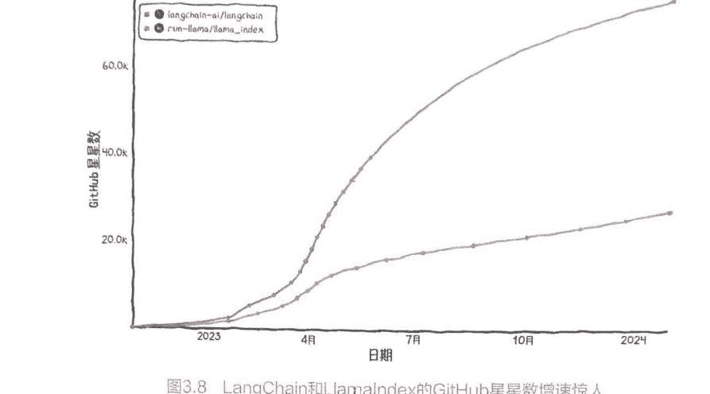

图3.8 LangChain和LlamaIndex的GitHub星标数增速惊人

### 3.2.1 说说LangChain
LangChain 是一个开源框架，目标是将大模型与外部数据连接起来，以便开发者能够更快和更容易地构建基于语言的 AI 应用。

LangChain 是由哈里森·蔡斯（Harrison Chase）在 2022 年 10 月作为开源项目启动的。（从这个启动日期也可以看出创始人的眼光，这比 ChatGPT 问世还要早一个月呢，他那时候是怎么发现大模型要火的？）占了先机的它迅速获得广泛关注和支持。到 2023 年 4 月，LangChain 从红杉资本（Sequia Capital）等机构获得超过 2000 万美元的天使投资。

基于 LangChain 的广泛影响力，吴恩达邀请哈里森·蔡斯共同开发了公开课“使用 LangChain 进行大模型应用开发”。

#### 1. LangChain 生态全景速览

短短一年出头，LangChain 就搭建起一套规模不小的 AI 应用开发体系。图 3.9 呈现了它的整体布局。

整体上由 Python 与 JavaScript 的核心库组成，加上多样化的组件与对接接口，用于把组件编排成链和 Agent 的运行环境、可直接上线的参考模板，以及把链封装成 REST API 的 LangServe 发布平台。此外生态里还有 LangSmith，用于对任何大模型框架上的链进行调试、测试、评估和监控。上述模块相互配合，基本覆盖了大模型应用从开发到生产再到部署的完整链路。

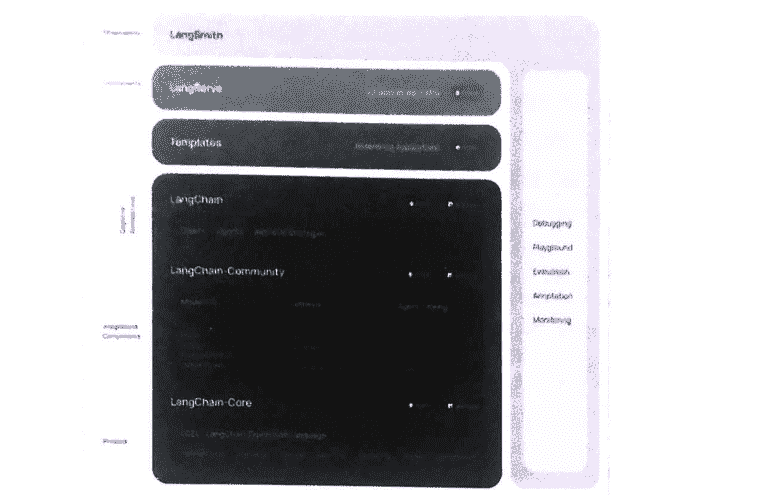

小雪：咖哥，与其直接调 OpenAI 的 API，用 LangChain 这种框架能带来什么额外价值？

咖哥：这个问题值得聊聊。LangChain 大概有三大优势可以说说。

#### 2. 用 LangChain 开发的三大好处

第一，框架足够灵活，模型选择面很广。虽然起步时主要面向 OpenAI 的模型，但设计上支持接入多种来源的模型，涵盖 OpenAI、Cohere、Hugging Face 的模型库等，你可以按需求挑选最合适的模型，不必被单一厂商锁定。我们甚至能在 LangChain 里调用智谱 AI 的 ChatGLM 模型 API（见图 3.10）。

```python
langchain.llms.chatglm.ChatGLM

class langchain.llms.chatglm.ChatGLM [source]

Bases: LLM

ChatGLM LLM service.

Example

from langchain.llms import ChatGLM
endpoint_url = {
    "http://127.0.0.1:8000"
}
ChatGLM_llm = ChatGLM(
    endpoint_url=endpoint_url
)
```

图3.10 在LangChain中调用ChatGLM模型的API

借助 LangChain 提供的 ModelLaboratory，可以对不同模型进行试用与对比。下面是一段用 ModelLaboratory 横向比较大模型的示例代码，前提是已安装 OpenAI、langchain-openai、Cohere 与 HuggingFace-Hub，并在 .env 中配置好 OpenAI_API_KEY、COHERE_API_KEY 与 HUGGINGFACEHUB_API_TOKEN。

```python
# 导入 dotenv 包，用于加载环境变量
from dotenv import load_dotenv
load_dotenv()

# 导入 langchain_openai 库中的 OpenAI 类
from langchain_openai import OpenAI

# 导入 langchain_community.llms 中的 Cohere 和 HuggingFaceHub 类
from langchain_community.llms import Cohere, HuggingFaceHub

# 初始化大模型的实例，并设置 temperature 参数（控制生成文本的创新性）
OpenAI = OpenAI(temperature=0.1)
cohere = Cohere(model="command", temperature=0.1)
huggingface = HuggingFaceHub(repo_id="tiiuae/falcon-7b", model_kwargs={'temperature':0.1})

# 导入 ModelLaboratory 类，用于创建和管理多个大模型
from langchain.model_laboratory import ModelLaboratory

# 创建一个模型实验室实例，整合 OpenAI、Cohere 和 Hugging Face 的模型
model_lab = ModelLaboratory.from_llms([OpenAI, cohere, huggingface])

# 使用模型实验室比较不同模型对同一个问题的回答
model_lab.compare("百合花源自哪个国家？")
```

3 个模型的输出结果如图 3.11 所示。

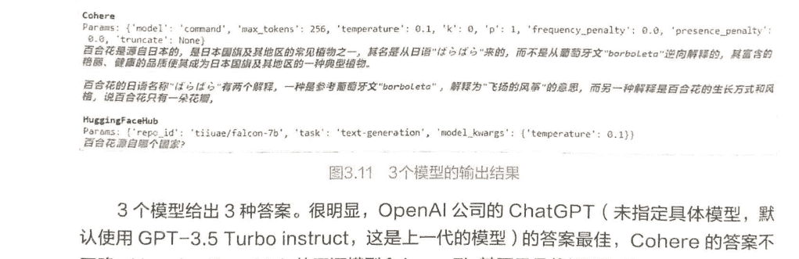

三个模型给出了三份不同答案。很明显，OpenAI 的 ChatGPT（未指定具体版本，默认是 GPT-3.5 Turbo instruct，即上一代模型）的回答质量最好，Cohere 的回答出现了错误。HuggingFaceHub 上的开源模型 falcon-7b 只是把问题复述了一遍，回应相当敷衍。

第二，LangChain 把大量工程细节封装好了，能省不少力。具体包括提示模板与提示词的管理、对各类大模型的统一调用接口、语言推理框架如 ReAct 的代码实现、与外部数据源的交互、交互式 Agent 的搭建、链或 Agent 调用的状态维护，以及对话历史的记忆功能等。

比如只调用 create_react_agent 就能得到一个具备 ReAct 推理能力的 Agent，背后所有细节都被 API 隐藏起来。这有点像用 TensorFlow 或 PyTorch 训练线性回归做梯度下降，你只需要调用封装好的函数，无需自己推导梯度与自动微分，除非你对底层数学有特殊爱好。

第三，第三方接入非常丰富。LangChain 提供了大量应用接口，能与众多 AI 相关库和工具联动。例如它内置了与各类向量数据库交互的接口，为大模型应用开发提供了近乎一站式的解决方案。

## 3. 使用 LangChain 时的注意事项

首先，功能与生态过于丰富会带来复杂度，对新手或对大模型不熟悉的开发者不够友好。其次，LangChain 搭建的复杂应用在处理海量数据时可能出现效率瓶颈。最后，项目迭代很快，版本更新频繁，旧代码在新版本里可能不兼容。

所以，明白了 LangChain 的好处，也清楚它的潜在问题后，如果仍然决定不采用 LangChain，而是直接用 OpenAI API 来做基于 GPT 的 Agent 开发，我认为也完全合理。

## 4. LCEL 链式编程语言

LangChain 的初衷是让基于大模型的 AI 应用开发更简单，于是推出了 LangChain Expression Language，即 LCEL。它是一种声明式语言，能让组件的组合更直观简洁。

LCEL 的主要特性如下。

- 流式输出，在模型交互过程中尽早返回首个 Token，同时保持数据连续不断输出，维持稳定交互。
- 异步能力，可在一台服务器上并发处理多个请求，同一份代码可从原型平滑迁移到生产。
- 自动并行，能识别可并行的步骤并自动并行执行，以降低延迟。
- 支持重试与降级配置，让链在更大规模下更可靠。
- 可访问复杂链的中间结果，并与 LangSmith 追踪和 LangServe 部署无缝衔接。

> 小雪：我没用过 LangChain，以上这些特性我还不太能完全体会。
> 咖哥：正常。你最好先看 LangChain 官网的链式构建示例才能深入理解。先入门的话，我来演示一下如何用 LangChain 库和 LCEL 搭建一个简单的应用，你会发现过程很顺畅。

```python
# 导入所需的库
from langchain_core.output_parsers import StrOutputParser # 用于将输出结果解析为字符串
from langchain_core.prompts import ChatPromptTemplate # 用于创建聊天提示模板
from langchain_openai import ChatOpenAI # 用于调用 OpenAI 公司的 GPT 模型
# 创建一个聊天提示模板，其中 {topic} 是占位符，用于后续插入具体的话题
prompt = ChatPromptTemplate.from_template("请讲一个关于 {topic} 的故事")
# 初始化 ChatOpenAI 对象，指定使用的模型为 "gpt-4"
model = ChatOpenAI(model="gpt-4")
# 初始化一个输出解析器，用于将模型的输出解析成字符串
output_parser = StrOutputParser()
""" 通过管道操作符 (|) 连接各个处理步骤，以创建一个处理链
其中，prompt 用于生成具体的提示文本，model 用于根据提示文本生成回应，output_parser 用于处理
回应并将其转换为字符串 """
chain = prompt | model | output_parser
# 调用处理链，传入话题 "水仙花"，执行生成故事的操作
message = chain.invoke({"topic": "水仙花"})
# 打印链的输出结果
print(message)
```

故事标题：水仙花与小石头

山村里有一条清澈的小溪，溪边开满花草，其中最引人注目的是那一丛丛水仙，花瓣洁白如玉，花蕊金黄如蜜，香气淡雅，吸引了不少小动物和游客。

溪边有一颗小石头，静静卧着欣赏水仙的美丽。他很羡慕水仙，总想着：如果自己也能变成像水仙那样美丽的生物就好了。

一天，小石头决定出发，去寻找让自己变美的奇迹。他顺着小溪远行，历经重重困难，却始终没找到传说中的方法。

就在他几乎要放弃时，一只小鸟告诉他：“你已经很美了。没有水仙的外表，你却有坚硬的身躯，能为流浪的小动物提供歇脚处，能为溪边的土壤提供支撑，也能给人带来安宁。你的内在之美，远胜水仙的外在之美。”

听完这话，小石头心里温暖宽慰。他明白，美丽不只在外表，内在更重要。从此他不再羡慕水仙，学会欣赏自己，过上了快乐满足的生活。

这个故事提醒我们，每个人都有独特之美，找到自己的特点并发挥出来，生活就会更有意义。

LCEL 通过 “|” 符号串联不同的组件。首先用 PromptTemplate 生成面向大模型的提示，并填入实际问题。然后把提示送给 OpenAI 组件，由模型生成回答。最后用 StrOutputParser 解析输出，保证结果为字符串格式。

这个例子展示了如何通过串联输入处理、模型调用、输出解析等组件来构建复杂的语言处理任务的基本流程。

### 3.2.2 六大核心模块解析

LangChain 是构建大模型应用的开源工具包，包含六大模块，也称组件（见图 3.12）。

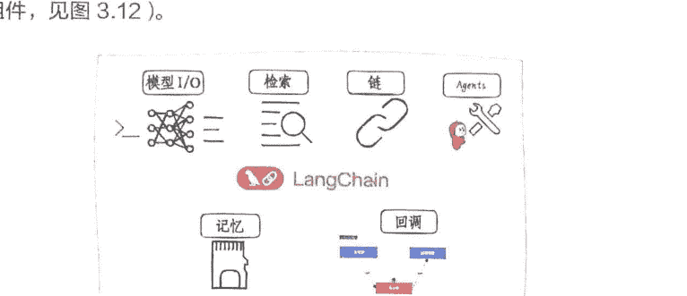

- 模型 I/O：作为 LangChain 与大模型的桥梁，负责输入侧的提示模板构建和输出侧的格式解析，并与各类大模型交互。
- 检索：负责与应用专属数据的交互，可从数据库、文件系统或在线资源中取出所需信息。
- Agents：依据高层指令决定使用哪些工具，负责在特定情境下选择最有效的工作方式。
- 链：提供常用、可组合的构建块，用于搭建更复杂的逻辑与功能，是信息处理和任务执行的基础单元。
- 记忆：负责在链运行过程中持久化状态，让 LangChain 能记住过往交互，在多次运行中保持连续性。
- 回调：负责记录和传输链的中间步骤，帮助开发者监控、分析和优化运行情况。

在这六大模块中，模型 I/O、检索、Agents 和链是最核心的部分，记忆和回调属于附加组件。总体来看，这套模块为开发者打造复杂、高效且友好的大模型应用提供了完整的工具与资源，无论是提升对话质量、增强知识检索，还是优化体验和系统监控，都能得到支持。

### 3.2.3 LangChain 与 Agent 开发

构建 Agent 时，LangChain 能把不同 AI 模型和工具整合起来，提供更连贯复杂的对话流程，以及信息检索与处理能力，从而让开发者打造更智能、能在多任务多场景下有效交互的 Agent。

LangChain 提供了大量工具，可将大模型连接到搜索引擎、API 或其他数据存储。大模型本身仅知训练时的知识，这些知识可能很快过时。借助工具可以获取最新数据并作为上下文注入提示中。工具还能执行行动，如运行代码、修改文件等，大模型观察行动结果后决定下一步。

LangChain 的记忆模块帮助 Agent 记住之前的互动，无论是与人或其他 Agent 的交流，还是与工具的调用。记忆可以是短期记忆，如最近五次工具使用记录，也可以是长期记忆，如与当前情境最相似的历史记录。

Agent 的执行逻辑由 Agent Executor 驱动，并在满足特定条件时停止运行。

值得注意的是，LangChain 六大组件耦合很松，没有固定的调用顺序或接口，开发者可以自由设计并组合它们。图3.13展示了一个由 LangChain Agent 驱动的典型大模型系统架构。

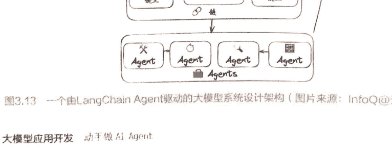

在图 3.13 的架构中，用户通过服务器提交提示，系统借助索引进行检索，检索结果用于更新记忆，为输入提供上下文。系统核心是模型，其中包括用于理解和生成语言的大模型。大模型通过链与其他模型关联，实现信息流动与协作。底部多个 Agent 负责具体任务执行，可独立工作并代表不同的功能模块或服务。模型处理用户提示后产生输出，输出可能触发回调做额外处理，通常用于异步事件或满足条件时的特定函数。整个流程形成从输入到输出的闭环，涵盖检索、记忆更新、模型处理和动作执行，体现了 LangChain 的模块化与灵活性。

### 3.2.4 LangSmith 实操指南

在 3.2.3 节我们已介绍了 LangChain 的 Agent 开发示例，这里看 LangSmith 的使用方法。LangSmith 与 LangChain 无缝集成，安装 LangChain 包时也会安装 LangSmith。若已申请账号，可创建专属的 LANGCHAIN_API_KEY（见图 3.14）。

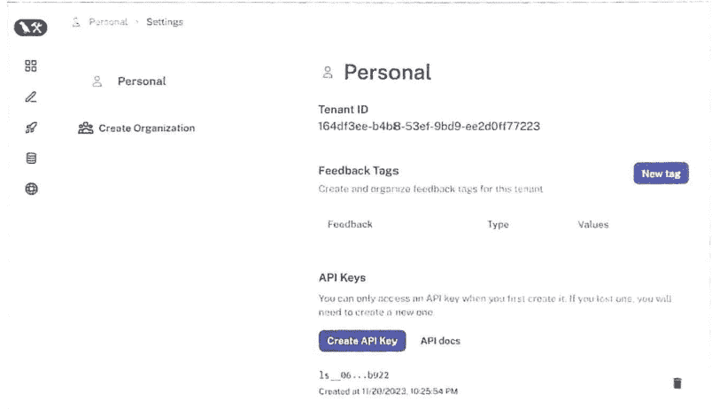

图3.14 LangSmith的API密钥

接下来配置环境文件。下面是 .env 配置示例。

```
OpenAI API KEY = '我的 OpenAI API 密钥'
LANGCHAIN_TRACING_V2=true
LANGCHAIN_ENDPOINT=https://api.smith.langchain.com
LANGCHAIN_API_KEY='我的 LangChain API 密钥'
LANGCHAIN_PROJECT=langchain_test # 如果没有指定，则使用默认设置
```

这样无需在程序中显式设置大量环境变量，通过 load_dotenv() 即可一次性导入全部配置。

```python
# 设置环境变量，导入一系列密钥及配置
from dotenv import load_dotenv
load_dotenv()
# 设置提示模板
from langchain.prompts import PromptTemplate
prompt = PromptTemplate.from_template("{flower} 的花语是？")
# 设置大模型
from langchain_openai import OpenAI
model = OpenAI()
# 设置输出解析器
from langchain.schema.output_parser import StrOutputParser
output_parser = StrOutputParser()
# 构建链
chain = prompt | model | output_parser
# 执行链并打印执行结果
result = chain.invoke({"flower": "丁香"})
print(result)
```

> 爱情、纯真、纯洁、美好、温馨、浪漫、永恒、忠诚、祝福、美丽。

执行完脚本后进入 LangSmith 登录页，能在环境变量里看到已创建的项目，示意图为 3.15。

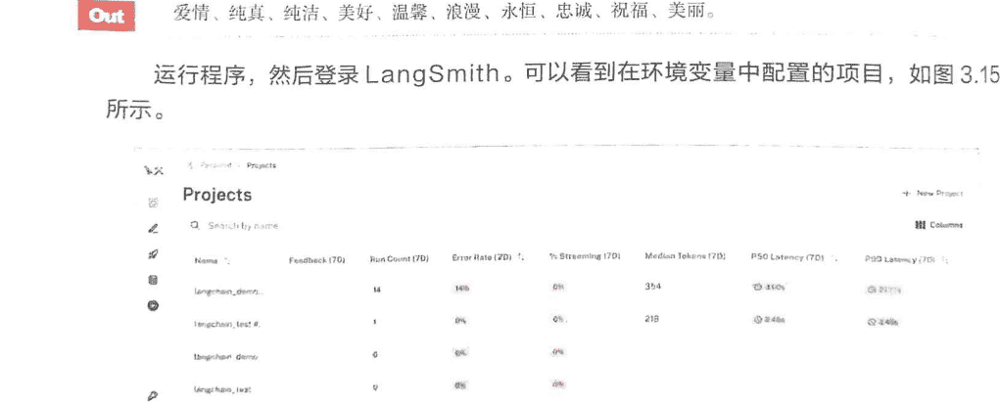

图3.15 LangSmith中的项目

进入相关项目后，能看到项目内部的条目列表，如图 3.16。日志里记录了每次链路运行的全过程。

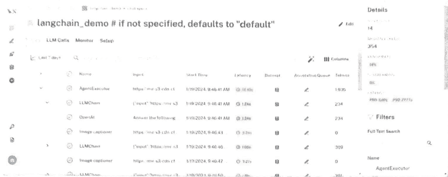

在日志中点开一条记录，即可展开本次模型调用的细节，详见图 3.17。

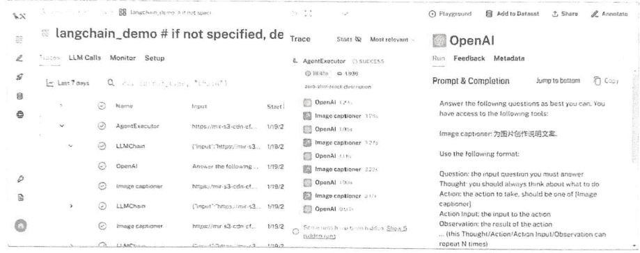

## 3.3 LlamaIndex 到底是什么

在面向大模型的开发实践里，LangChain 只是其中一员。LlamaIndex 也是社区认可度很高的开源 AI 应用框架，于 2022 年 11 月开源，与 ChatGPT 同期发布，比 LangChain 晚了约一个月。两者都受 ChatGPT 影响而快速发育并被广泛使用。

### 3.3.1 LlamaIndex 的来历与侧重点

项目由 Jerry Liu 发起，2023 年 6 月拿到了 850 万美元种子轮。它的价值在于弥补了大模型仅靠训练数据就能知晓一切的局限，因而在 AI 社区获得关注。

和 LangChain 的“面面俱到”不同，LlamaIndex 更聚焦在前沿的 RAG 技术以及多租户 RAG 系统的搭建。基于它的企业方案旨在打通技术与安全障碍，提升企业对内部数据的利用和服务能力。研发之外，它也强调把技术落地到真实业务，以提高效率和客户体验。

> 小雪：多租户是什么意思？
>
> 咖哥：想象一个 RAG 系统里，用户 1 和用户 2 各自有一套文档。机制会保证用户 1 查询时只读自己的材料，不会混入用户 2 的数据，反之亦然。保持数据隔离和机密性的关键就在这里。

另外，LlamaIndex 在文档结构与可执行性上相比 LangChain 更顺手，这反映了它在用户体验、接口设计与工程实现上的投入。对开发者和终端用户都很有帮助，有利于推广与提效。

LangChain 覆盖面过大，反而显得庞杂且细节不足。浏览其 GitHub 主页，未解决的 Open Issues 超过千条。所以如果目标是检索与增强生成，“小而精”的 LlamaIndex 会是更合适的选择。

### 3.3.2 RAG 驱动的 AI 开发

RAG 是除 Agent 外的另一项重要方向。它先从相关数据源检索信息，再把结果作为上下文注入用户查询，最后让大模型基于丰富提示生成答案。基于 RAG 的应用本身可视为一种 Agent，也可作为 Agent 构建的核心技术。

从宏观看，大模型在特定行业落地的难度依次为：重训或从头构建、微调、动态提示——RAG 属此类——以及最简单的提示工程，见图 3.18。RAG 处于中间层级，比重训或微调轻，比直接提问更复杂。它规避了微调的三大痛点：成本高、信息更新难、可观察性差。RAG 无需训练成本更低；数据实时获取保持新鲜；可展示检索来源，结果更可信。


图3.18 重新训练或从头构建模型、微调模型、动态提示与简单提示工程的对比

咖哥：宏观部分先到这里。用一个例子说明 RAG。现在直接问 ChatGPT“花语秘境的老板是谁，她和咖哥什么关系”，模型肯定答不上来，见图 3.19。

> **You**: 花语秘境的老板是谁，她和咖哥是什么关系，ChatGPT肯定不知道
>
> **ChatGPT**: 您提到的“花语秘境”的老板和“咖哥”的关系不属于公共知识或广泛共享的信息，因此我无法提供具体的答案。如果这有关一个现实世界中的私人场所或个人，除非这些信息已经是公开可查的，否则我没有访问个人数据的能力。

图3.19 ChatGPT当然不知道咖哥和小雪的关系

小雪：是啊，它当然不知道。你觉得自己很出名吗？

别急，如果手头有大量关于花语秘境的材料，比如每次例会的纪要，某份记录里可能写着：参会人，小雪的导师——咖哥。把纪要检索出来作为外部知识喂给 ChatGPT，就能实现 RAG，见图 3.20。LlamaIndex 提供了多种框架、工具与模式，支持吞吐、结构化以及私有或垂类数据的访问，让 RAG 开发更轻松。

## 3

## 图3.20 简化版的RAG——假设我们已经检索出咖哥与小雪的关系信息，之后传递给ChatGPT

具体组件如下：

- 数据连接器：从原始来源抽取现有数据，API、PDF、SQL 等格式都有对应读取接口。
- 数据索引：将数据转为大模型易懂的中间表示，例如词向量。
- 引擎：提供自然语言访问。查询引擎是强检索接口，用于增强知识输出；聊天引擎支持多轮对话交互；数据 Agent 则是由大模型驱动的知识工作者，可实现从辅助到 API 集成等功能。
- 应用集成：将 LlamaIndex 接回其他生态系统。

RAG 与 Agent 密不可分。LlamaIndex 通过 RAG 流程、框架与工具，为 Agent 补足可控性与透明度。内置的 Agent API 支持逐步执行，可处理更复杂任务。同时在 RAG 循环中支持用户反馈，适用于长期任务，实现用户与 Agent 交互及中间执行控制的双循环。

LlamaIndex 中的 Agent 如何借助大模型完成检索增强生成？流程见图 3.21。


总共 6 步。

1. 用户发起查询：用户向系统提交问题或请求。
2. Agent 搜集信息：依据查询从互联网或特定数据库检索相关文档，企业内数据通常存于向量库。
3. 检索信息：从搜索结果中抽取具体内容，作为生成回答的上下文。
4. 送给大模型：将检索结果与原始查询一起交给大模型。
5. 大模型生成响应：利用信息生成丰富且信息化的答案。
6. 返回结果：把大模型生成的答案交还用户，基于原始查询与检索信息生成。

流程也可循环，每次查询会优化后续交互。如需更多信息或有追问，系统会提示额外查询，并利用前次回答丰富新上下文。这样提供更动态、交互式的体验，让用户用自然语言完成复杂交互。

用 LlamaIndex 搭建上述基于 RAG 的 Agent 很轻松。它面向初学者到资深开发者，高级 API 允许新手用 5 行代码完成数据提取与查询；底层 API 则让高级用户按需定制与扩展。

### 3.3.3 入门示例

本节参照官方入门教程演示上手。

第 1 步，安装 LlamaIndex。

```
pip install LlamaIndex
```

第 2 步，导入环境变量。

与 LangChain 类似，使用 OpenAI GPT 系列模型需先导入 API Key。具体方式略。

第 3 步，加载本地数据。

示例使用“花语秘境”的文档，见图 3.22，可在源码包的 data 文件夹找到。

导入文档代码如下。

```
# 导入花语秘境的文档
from llama_index.core import SimpleDirectoryReader
documents = SimpleDirectoryReader("data").load_data()
```

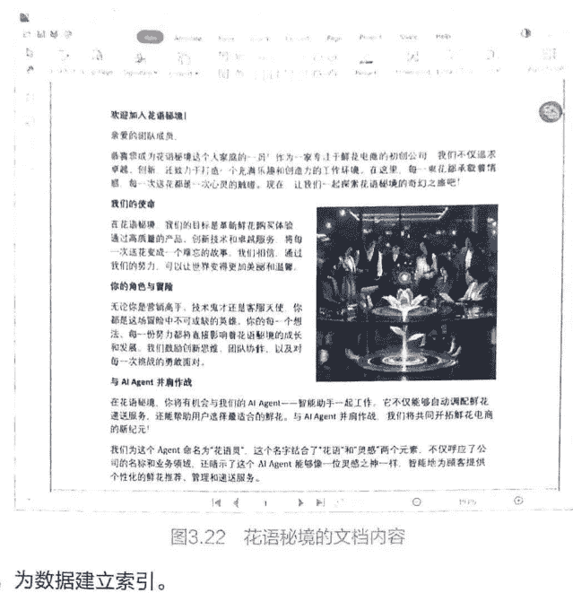

图3.22 花语秘境的文档内容

第 4 步，建立索引。

建立索引代码如下。

```
python
# 为文档建立索引
from llama_index import VectorStoreIndex
index = VectorStoreIndex.from_documents(documents)
```

执行后 data 文件夹中的文档将被建立索引，便于大模型检索。

第 5 步，查询本地数据。

先用下面代码创建查询引擎。

```
python
# 创建查询引擎
query_engine = index.as_query_engine()
```

随后进行测试提问。

```
python
# 两个查询示例
response = agent.query(" 花语秘境的员工有几种角色？ ")
print(" 花语秘境的员工有几种角色？ ", response)
response = agent.query(" 花语秘境的 Agent 叫什么名字？ ")
print(" 花语秘境的 Agent 叫什么名字？ ",response)
```

花语秘境的员工有几种角色？ 花语秘境的员工有多个角色，无论是营销高手、技术鬼才还是客服天使，每个员工都扮演着不可或缺的角色。他们的每一个想法和努力都直接影响花语秘境的成长和发展。

花语秘境的 Agent 叫什么名字？花语秘境的 Agent 叫作“花语灵”。

小雪：哇哦！

咖哥：正是，有了 RAG 加持，这个 Agent 能检索出原本不知道的信息。

小雪：每次检索都要重新加载数据吗？

咖哥：默认加载的数据会以向量序列保存在内存中。也可以把索引持久化到本地，避免重复处理。

代码如下。

```
# 把索引保存到本地
index.storage_context.persist()
```

新生成的本地索引文件如图 3.23。

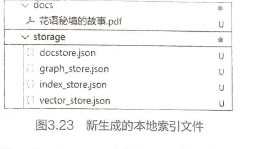

图3.23 新生成的本地索引文件

可以看到新建了 storage 文件夹，可通过 persist_dir 参数修改，包含 4 个 JSON 文件：

- docstore.json：文档存储信息。
- graph_store.json：通常用于存储图形结构数据，可能是关系或连接点。
- index_store.json：索引信息，便于快速检索。
- vector_store.json：可能包含向量数据，用于数学运算或特定功能。

可打开每个 JSON 文件查看存储细节。

> 咖哥发言：LlamaIndex 和 LangChain 都可通过开启 Logging 和 Debug 观察程序与大模型交互的细节，这里不再展开，可查阅官方文档。

至此，一个简易的本地文档查询 Agent 已完成。

## 3.4 小结

OpenAI 等厂商的创新为开发者构建类 Agent AI 应用提供了新工具，推动 LangChain、LlamaIndex 等生态发展。各工具关注点不同，但都致力于更高效灵活的 AI 应用开发，从而推动行业创新与协作。

两者各具特色：LangChain 是“大而全”，LlamaIndex 是“小而美”。它们既竞争又合作，可相互调用。竞争促使其不断优化，合作让整个生态更进步，最终让开发者和用户受益。

随着大模型技术持续演进，这些工具也在不断迭代。它们让构建复杂智能 Agent 成为可能，并不断拓展 AI 的边界和应用领域。

借助这些工具，我们能打造更智能、更高效的 Agent，在各种复杂环境中执行任务和提供服务。随着技术进步，会有更多创新应用出现，推动人工智能边界持续拓展。

大模型应用开发仍处“婴儿期”，开发者和组织面临诸多挑战：API 调用频率与性能、程序稳定性与效率、未来可扩展性与维护，以及数据隐私、安全、伦理与效率等问题。同时机遇也巨大，可以创造更智能、更有用的工具和服务，为各行业带来变革。

## 第4章

## Agent 1: 自动化办公的实现——通过 Assistants API 和 DALL·E 3 模型创作 PPT

小雪轻轻敲了敲咖哥办公室的门后推门而入。咖哥坐在电脑前盯着屏幕处理重要事务，房间里飘着淡淡咖啡香，温馨安静，见图4.1。

小雪：咖哥，下午和投资人开会用的 PPT 我准备好了，不过有两个核心观点，我还没想好怎么呈现，我们商量一下？

咖哥转头笑笑：小雪，你来得正好。我刚在研究 OpenAI 的 Assistants API 和 DALL·E 3，这些工具竟然能帮我们自动生成既有创意又专业的 PPT。

小雪眼里闪过疑惑。

咖哥：确实好用。做 PPT 是企业运营里很关键的一环，你通常也要花大量时间在图表设计和内容整合上吧？

小雪点点头：给投资人看的 PPT 技术难度不大，但准备素材的工作量很大。比如有大量销售数据，怎么提炼洞见并在 PPT 里有效表达就是个挑战。我一般不会交给新手做。

咖哥：结合 GPT-4 的智能文本生成和 DALL·E 3 的图像创造能力，我们可以轻松产出吸引人的视觉内容和配套解说，见图4.2。关键是“从头到尾”都不需要人工干预。


图4.1 咖哥坐在计算机前，眼睛紧盯着屏幕


图4.2 结合GPT-4模型的智能文本生成和DALL·E 3模型的图像创造能力来自动创作PPT

小雪：Oh My God！从头到尾？包括从数据里提炼观点？

咖哥微笑：是的，我也一样惊讶。比如可以让它根据项目主题和提供的数据，自动提炼观点形成洞见，并自动生成整份 PPT 的布局和内容，甚至包括数据图表和图像。这既省时间，质量也还不错。

小雪：咖哥，我以为能生成这种质量 PPT 的软件需要专业团队开发很久，还得付费使用，也不一定好用。原来我们自己也能做出来。教我吧！我想看看它怎么运作，能力能强到什么程度。

咖哥：一步步来。我们先了解 OpenAI 的 Assistants。

## 4.1 OpenAI公司的Assistants是什么

OpenAI 推出的 Assistants 平台，底层是 GPT 模型，兼具语言理解与语言生成的双重能力。它的设计初衷就是在日常工作中提供信息支持、解答疑问、撰写文本并完成指定任务。

听到这个定位，你是不是会立刻联想到 Agent 的概念。确实如此，Assistants 被刻意做得灵活多能，适用面很广，从随意的日常闲聊到专业的技术难题都能覆盖。

Assistants 的核心能力大致可以归纳为以下几点。

- 读懂自然语言：能够解析用户输入的自然表达，捕捉意图和需求。
- 产出高质量文本：按照指令生成连贯、相关且实用的回复内容。
- 可适配可定制：能依据具体场景和需求进行个性化配置，提供定制化服务。
- 对话保持连贯：支持持续交互，理解上下文并记忆历史，交互体验更深入。
- 集成门槛低：可以嵌入网站、App 或其他数字服务当中。

因此它的落地场景非常宽泛，客服自动化、智能个人助理、教学辅助、内容生产、编程支持等都是典型方向。并且随着持续学习和适应，Assistants 越来越高效、灵活和聪明。

说完官方描述，我来谈谈实际用起来的直观感受。这个工具上手很顺，智能水平在线，能听指令并完成一系列办公自动化流程。

接下来就带你感受它的魅力。就算你完全不懂编程，也能把强大的 Assistants 用起来。

小雪：我明白了，你说的是在 Playground 里直接上手吧。

## 4.2 零代码在 Playground 里体验 Assistants

在 OpenAI 官网点开 API 入口，就能进入由官方提供的 Playground，如图4.3所示。就在这里，我们无需写任何代码就能搭建属于自己的 Assistants。


进入后会看到图4.4的界面，点击左上角的 📁 图标即可调用 OpenAI 提供的 Playground。

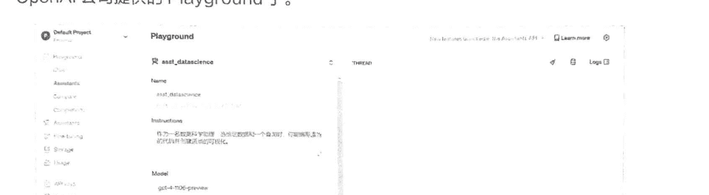

## 图4.3 OpenAI官网的 Playground 入口

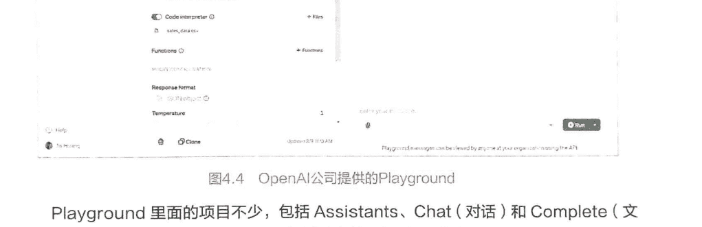

## 图4.4 OpenAI 提供的 Playground 主界面

Playground 内部包含多个项目模块，比如 Assistants、Chat 对话以及 Complete 文本补全，后者可视为旧版 Chat，已不常用，如图4.5。这里我们选用 Assistants，并将其命名为 “asst_datascience”。


## 图4.5 Playground 中的 Assistants 模块

该平台支持在界面里输入指令和代码，并借助 GPT-4 模型完成 AI 应用、机器学习或数据科学相关的任务。

小雪：那现在准备用它来做什么？

咖哥：把它当成数据助理，来分析我这些年出版图书的季度销售。先给它一个整体设定，告诉它它是一个数据科学助理，然后挑选模型，GPT-4 1106 preview 即可，也可以换成更新的版本，模型越新能力越稳。

你看，文件 sales_data.csv 中（见图4.6），我整理了三本作品的季度销售额，单位是万元。

| 日期 | 书名1 | 书名2 | 书名3 |
|------|-------|-------|-------|
| 31/3/2022 | 303.0327596 | 985.6150332 | 909.7627008 |
| 30/6/2022 | 504.8929768 | 871.1291092 | 1023.037873 |
| 30/9/2022 | 576.7235126 | 1035.95079 | 1080.552675 |
| 31/12/2022 | 670.5018222 | 1068.18203 | 1148.976637 |
| 31/3/2023 | 766.7927513 | 718.3524294 | 1204.73096 |
| 30/6/2023 | 819.8737846 | 833.1219711 | 1329.178823 |
| 30/9/2023 | 849.2219043 | 980.0890936 | 1367.517442 |
| 31/12/2023 | 977.0793764 | 654.1820299 | 1538.3546 |
| 31/3/2024 | 957.7411639 | 533.274624 | 1632.732552 |

图4.6 咖哥图书作品的季度销售额

小雪：天哪，每本每季几百块钱，最多也就一千出头。要是我没请你当顾问，你写书人的收入也太惨了。

咖哥：小雪！刚才口误，单位是“万元”。爱信不信，反正文件上传后，Playground 的 FILES 栏里就会出现该文件的标识（见图4.7）。


图4.7 sales_data.csv 已出现在 FILES 栏

此时 Assistant 不只有通用知识，还有你的专属数据。于是就能借助 GPT 来干活了。接下来在对话框中（见图4.8）让它对文件内容做分析即可。


图4.8 在对话框里让 Assistant 分析文件内容

其他操作都不需要，只需点一下 Run。图4.9 就能看到对话区返回的响应。

## 图4.9 Assistant 的输出结果

数据助理迅速生成了文件摘要，还自动调用了系统自带的 Code interpreter 工具。

数据分析师要花上个把小时的工作，这里几秒钟就出来了。

小雪：太厉害，但含金量好像也不高，全是 GPT 在干活。

咖哥：没错，你回想下 OpenAI 的“GPT 商店”一上线，各路人马就抛出了三百多万个定制 GPT，难道这些定制模型的原创性都很强？说到底还是 GPT-4 这个底座够强劲，这正是 OpenAI 所说的“让 AI 普惠大众”。

小雪：结合大模型、自己的数据资料和业务逻辑，就能创造新价值。对了，我还有一个问题——在 Playground 的图4.10 里，Functions、Code interpreter 和 File search 到底是什么？2024 年 4 月前在 Assistants v1 里 File search 还叫 Retrieval。

咖哥：这些都是 Tools，即 Assistant 可调用的功能集合。Functions 指自定义函数调用，Code interpreter 是代码运行环境，File search 则是文档检索工具。未来 OpenAI 还会放出更多工具，并允许开发者接入自有工具。

小雪：想起来了，Tools 和 Functions 都是你之前讲过的重点，Retrieval 的概念也在 LlamaIndex 的 RAG 环节出现过。

咖哥：对，这里 File search 就是 OpenAI 在 Assistants 里提供的一个极简 RAG 实现。

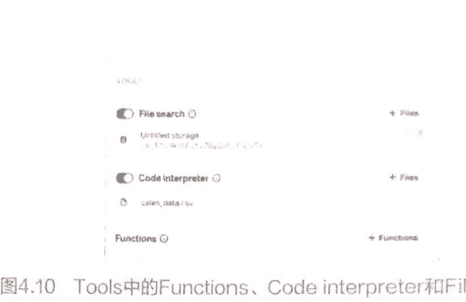

图4.10 Tools 下的 Functions、Code interpreter 和 File search

接下来通过调用 API 来看看 Assistants 的创建与使用细节。点击图4.9 右上角的 Learn about the Assistants API 链接，就能看到详细文档。

## 4.3 Assistants API 的简要示例

4.2 节的 Playground 体验帮助你理解设计思路，而本节的 API 则允许你在自己的程序里构建 AI 助手。给助手设定指令后，它就能借助模型、工具和外部文件来回应任务。

目前 API 支持三种工具类型——代码解释器、检索和函数调用。得益于一次调用多函数的特性，开发者无需自行维护对话线程和上下文，OpenAI 会代为处理。

- 调用流程如下。

1. 定义指令并选定模型，创建助手，可选择开启代码解释器、检索和函数调用。
2. 用户开始对话时新建一个线程 Thread。
3. 用户提问时把消息 Message 追加到线程。
4. 在线程上运行助手以触发回复，工具会自动被调用。

Assistants API 的调用流程如图4.11所示。


图4.11 Assistants API 的调用流程

图4.11 中的助手是一个个人财务机器人，能回答预算、储蓄、投资建议等问题。图中创建了一个关于退休规划的 Thread。用户问：“我该为退休计划缴纳多少？”助手答：“你每年应缴 478……”Run 表示一次对话运行，其中第一步使用 Code Interpreter 计算答案，第二步 Create Message 生成回复。对话可以循环，助手会按最有效的方式保存上下文。

> 调用 API 时需携带 HTTP 头 OpenAI-Beta: assistants=v2。Beta 表示该服务仍在公开测试，相对稳定但会持续收集反馈。Python 或 Node.js SDK 会自动处理该头，无需手动设置。

### 4.3.1 创建助手

创建助手时可配置的参数有：

- name：助手名称。
- instructions：行为指引，例如“你是某领域的专家”。
- tools：API 支持的代码解释器和检索工具，均由 OpenAI 托管。
- model：GPT-3.5 或 GPT-4 系列均可，若使用检索工具需选较新模型。
- functions：作为工具的自定义函数，后续再详述。

第一个助手是一个会算鲜花价格的数学小能手。

```python
# 导入环境变量
from dotenv import load_dotenv
load_dotenv()
# 创建 client
from openai import OpenAI
client = OpenAI()
# 创建 assistant
assistant = client.beta.assistants.create(
    name="鲜花价格计算器",
    instructions="你能够帮我计算鲜花的价格",
    tools=[{"type": "code_interpreter"}],
    model="gpt-4-turbo-preview"
)
# 打印 assistant
print(assistant)
```

```
Out
Assistant(
    id='asst_M7OR4XULWjFnXN9WSqJtQ0XR',
    created_at=1704982081,
    description=None,
    file_ids=[],
    instructions='你能够帮我计算鲜花的价格',
    metadata={},
    model='gpt-4-turbo-preview',
    name='鲜花价格计算器',
    object='assistant',
    tools=[ToolCodeInterpreter(type='code_interpreter')]
)
```

在代码里通过 tools=[{"type": "code_interpreter"}] 开启了代码解释器工具。

> 小雪：这么简单的算术，为何还要开代码解释器？
> 咖哥：两方面原因。第一，早期大模型数学能力常被质疑，借助代码解释器能通过写运行代码来计算更稳妥；第二，我想借此展示如何指定工具。

登录 OpenAI 官网后点左侧 Assistants，右侧会列出已创建的助手（见图4.12）。

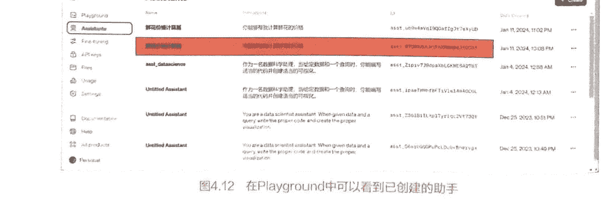

## 图4.12 Playground 中已创建的助手列表

> 助手创建后会产生唯一 ID，后续可直接调用。请勿重复运行创建代码，否则会像咖哥一样生成多个功能重复、ID 各异的助手。

在图4.12 中点开创建的助手，就能看到详细信息。如图4.13，Name、Instructions 都符合预期，且 Code interpreter 已开启，说明助手已激活。

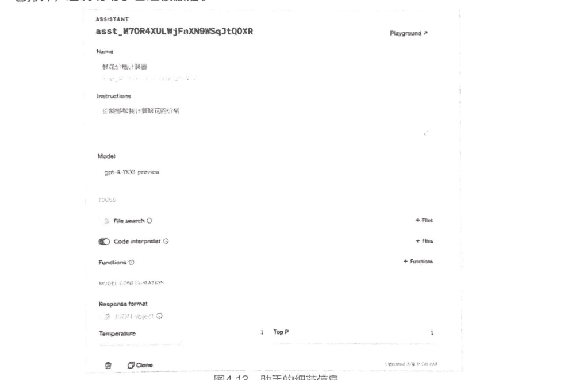

## 图4.13 助手的详情页

小雪：咖哥，如果我没记下助手的 ID 怎么办？

咖哥：命令行里运行相应代码即可列出所有已创建的 Assistants，也可以通过 client.beta.assistants.list API 获取列表。

```bash
curl "https://api.openai.com/v1/assistants?order=desc&limit=20" \
-H "Content-Type: application/json" \
-H "Authorization: Bearer $OpenAI_API_KEY" \
-H "OpenAI-Beta: assistants=v2"
```

```json
{
    "object": "list",
    "data": [
        {
            "id": "asst_pF2pMtHOL4CpXpyUdHkoKG3",
            "object": "assistant",
            "created_at": 1705829118,
            "name": "鼓励 Agent",
            "description": null,
            "model": "gpt-4-turbo-preview",
            "instructions": "你是一个很会鼓励人的助手！",
            "tools": [
                {
                    "type": "function",
                    "function": {
                        "name": "get_encouragement",
                        "description": "根据用户的心情提供鼓励信息",
                        "parameters": {
                            "type": "object",
                            "properties": {
                                "mood": {"type": "string", "description": "用户当前的心情，例如：开心，难过，压力大，疲倦"},
                                "name": {"type": "string", "description": "用户的名字，用来个性化鼓励信息"}
                            },
                            "required": ["mood"]
                        }
                    }
                }
            ],
            "file_ids": [],
            "metadata": {}
        },
        {
            "id": "asst_CDuIzGXwdEUTzjQxYqON669A",
            "object": "assistant",
            "created_at": 1704986492,
            "name": "鲜花价格计算器",
            "description": null,
            "model": "gpt-4-turbo-preview",
            "instructions": "你能够帮我计算鲜花的价格",
            "tools": [{"type": "code_interpreter"}],
            "file_ids": [],
            "metadata": {}
        }
    ],
    "first_id": "asst_pF2pMtHOL4CpXpyUdHkoKG3",
    "last_id": "asst_CDuIzGXwdEUTzjQxYqON669A",
    "has_more": true
}
```

前面演示的这些“助手”，都是咖哥用 Playground 配合 Assistants API 搭出来的，有的专门算鲜花价格，有的则是为了给小雪加油打气。

### 4.3.2 创建线程

助手建好之后，下一步就是开一个线程来承载对话。

怎么理解线程？简单说，一个线程就等同于和 OpenAI 大模型的一次会话，和你在网页版 ChatGPT 里点开一个新的 GPT-3.5 或 GPT-4 对话是一样的逻辑。

创建线程的代码如下。

```python
# 创建一个线程
thread = client.beta.threads.create()
# 打印线程
print(thread)
```

```
Thread(
    id='thread_ddl4SsbU9KICdpxv7BfqVpQQ',
    created_at=1704985371,
    metadata={},
    object='thread'
)
```

我这次新开的线程 ID 是 'thread_ddl4SsbU9KICdpxv7BfqVpQQ'。从这一刻起，这个线程就一直在后台挂着。可以把它想象成 OpenAI 派驻的一个监听员，时刻盯着你和模型之间的进展。


> 温馨提示，和创建助手时的注意事项一样，这里也别反复执行建线程的代码，不然会堆出一堆重复的线程。

咖哥：说实话，我发现自己不小心建了好多线程时心里也挺发怵的。

小雪：您该不会是在担心费用吧？您是导师，这点小心思就别说了。我的理解是，线程建了但没传 Token 应该不算钱。只是想问问，这些线程什么时候会结束？它们会一直傻等我来吗？

咖哥：我也有这个疑惑。之前我弄多了冗余的助手，就去 OpenAI 论坛发帖问了，删掉自己创建的助手后，相关的线程会不会一起被清掉。运气不错，很快论坛负责人回复了我，只是他说不能百分百确定。好消息是，按他的说法，闲置 60 天以上的线程会被系统自动清理。

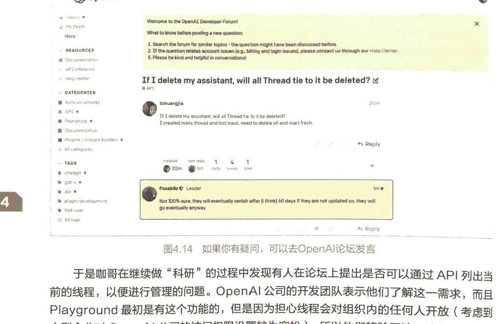

## 图4.14 如果你有疑问，可以去OpenAI论坛发言

继续在论坛里“做科研”时，我看到有人在讨论能不能用 API 列出当前所有的线程好做管理。OpenAI 的开发团队回应说他们知道这个需求，Playground 早期其实有过这个功能，后来因为担心线程会暴露给组织内的任何人，考虑到大企业权限管理比较宽松，就把功能撤掉了。现在这个问题已经被登记为待办事项，团队希望在未来几周内给出更多信息，同时提醒大家不要去调用还没有公开的端点，也就是提问者提到的列线程接口。

所以，要把所有活跃的线程一次性删干净目前并不容易，就先放着吧，别纠结完美主义。活跃线程其实并不会消耗太多资源，毕竟你又没有在里面循环收发消息。

> 小雪：咖哥等等，我注意到你建线程的时候并没有指定助手 ID，我能理解成 OpenAI 的线程和助手是各自独立的吗？

> 咖哥：没错。从 API 设计来看，逻辑上线程和助手是为连续对话和任务处理而配合使用的，但技术实现上它们是两个独立的组件。

- 助手即 Assistant，可以理解为提供服务的 AI 模型，比如 ChatGPT，负责接收请求、生成回复，是后端做智能处理的系统。
- 线程即 Thread，用来承载一系列交互或对话。在 API 体系里，一个线程可能包含多轮用户和助手的连贯对话。它帮助跟踪和管理一段时间内的话术历史，让助手能在上下文里更准确地理解和回应。

在使用 API 时，你可以通过创建和管理线程来保持对话的连贯性，而助手则在这些线程里负责给出回答和互动。助手处理具体请求，线程主要负责对话的组织和历史管理。

小雪：也就是说，一个线程里可以挂多个助手，同时一个助手也可以服务多个线程，对吧？

咖哥：理论上完全可行。这种设计让系统更灵活，应用场景也更广。在复杂的对话系统里，不同助手可以各司其职，例如一个只处理天气查询，另一个只做旅游建议。在同一个线程里，系统可以根据用户问题的类型动态把请求路由到合适的助手上，这就需要智能路由能力。

再比如通用的助手，像 ChatGPT，可能同时支撑成百上千个线程。这些线程可能属于不同用户，或同一个人不同场景。助手需要区分不同线程的上下文，保证每段对话都能给出准确相关的回答，这通常是通过把每个线程的历史和上下文一起传给模型实现的。

接下来先在线程里塞点消息，再开始和助手对话。

### 4.3.3 添加消息

通过添加消息，就能在线程里传递上下文和文件。消息本身就是对话的一部分，也是助手生成回答的背景资料。

> 线程本身没有信息量上限，也就是说你可以往同一个线程里塞任意数量的消息。助手会用相关的优化手段，比如压缩，就像 ChatGPT 那样，确保请求能塞进最大上下文窗口。这既是优点也是缺点。优点是不用自己管理上下文，对话记忆更省心；缺点是你很难有效控制运行助手的成本。

```python
# 向线程中添加消息
message = client.beta.threads.messages.create(
    thread_id=thread.id,
    role="user",
    content=" 我把每束花定价为在进价的基础上加价 20%，当进价为 80 元时，我的售价是多少。"
)
```现在，如果拿这个线程 ID 在命令行里拉取消息历史，会看到刚才的消息排在列表最前面。

```
curl https://api.openai.com/v1/threads/thread_N7dw2oEpNEEBiCU4cce47xoS/messages
-H "Content-Type: application/json"
-H "Authorization: Bearer $OpenAI_API_KEY"
-H "OpenAI-Beta: assistants=v2"
```

```
{
  "object": "list",
  "data": [{
    "id": "msg_ZW5qoaiJioRV07hQH5M0XH5V",
    "object": "thread.message",
    "created_at": 1704986492,
    "thread_id": "thread_N7dw2oEpNEEBiCU4cce47xoS",
    "role": "user",
    "content": [{"type": "text", "text": {"value": " 我把每束花定价为在进价的基础上加 20%，当进价为 80 元时，我的售价是多少。 ", "annotations": []}}],
    "file_ids": [],
    "assistant_id": null,
    "run_id": null,
    "metadata": {}
  }],
  "first_id": "msg_ZW5qoaiJioRV07hQH5M0XH5V",
  "last_id": "msg_ZW5qoaiJioRV07hQH5M0XH5V",
  "has_more": false
}
```

## 4

同样也可以在 Python 程序里把当前消息打印出来。

```
# 获取消息列表
messages = client.beta.threads.messages.list(
    thread_id='thread_N7dw2oEpNEEBiCU4cce47xoS'
)
# 打印消息
print(messages)
```

输出结果和前面基本一致，这里就不重复了。

> 咖哥：下一步要做的，是创建一个 Run 来驱动助手。

> 小雪：Run 是什么？

> 咖哥：创建 Run 本质上就是启动一次对话或交互序列。Run 期间助手会根据已有的消息决定是调用工具还是直接用模型生成回答，最后给出输出。

### 4.3.4 运行助手

要让助手对用户的消息做出反应，就得创建一个 Run。此时助手会读取线程内容，判断是调用工具还是直接调用模型来完成任务，也就是给出回答。

运行过程中，助手会在历史记录里追加一条 role 为“assistant”的新消息，同时自行决定哪些旧消息要带进模型上下文。这一过程直接影响 Token 消耗，也就是 API 计费，以及模型的表现。OpenAI 已经对这个“记忆”构建过程做了优化，未来还会持续改进。

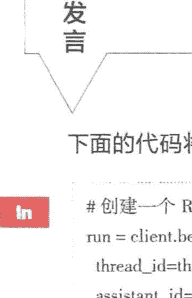

> > 在创建 Run 时可以给助手传新的指令，不过要注意，这些指令会覆盖助手的默认指令。

下面的代码演示如何创建 Run。创建时需要指定线程和助手。

```python
# 创建一个 Run
run = client.beta.threads.runs.create(
    thread_id=thread.id,
    assistant_id=assistant.id,
    instructions=" 请回答问题 ." # 如果需要覆盖助手的默认指令，可以在此处设置新指令
)
# 打印 Run
print(run)
```

```
Run(
    id='run_udqooyGylZYkQZSHylv1lEkm',
    assistant_id='asst_CDuIzGXwdEUTzjQxYqON669A',
    cancelled_at=None,
    completed_at=None,
    created_at=1704989389,
    expires_at=1704989989,
    failed_at=None,
    file_ids=[],
    instructions=' 请回答问题 .',
    last_error=None,
    metadata={},
    model='gpt-4-turbo-preview',
    object='thread.run',
    required_action=None,
    started_at=1704989389,
    status='queued',
    thread_id='thread_N7dw2oEpNEEBiCU4cce47xoS',
    tools=[ToolAssistantToolsCode(type='code_interpreter')]
)
```

对于 Run 对象，最需要关注的就是 status 状态字段。刚创建时它通常是 queued，也就是排队等待。和线程那种结束时间模糊的感觉不同，Run 的生命周期非常清晰，有明确的开始和结束时间戳，比如从时间戳 1704989389 开始，到 1704989989 结束。Run 不会永远卡在队列里，可以用 Retrieve 方法实时获取最新进展。

## 4

```python
# 再次获取 Run 的状态
run = client.beta.threads.runs.retrieve(
    thread_id=thread.id,
    run_id=run.id
)
# 打印 Run
print(run)
```

```
Run(
    id='run_udqooyGylZYkQZSHylv1lEkm',
    assistant_id='asst_CDuIzGXwdEUTzjQxYqON669A',
    cancelled_at=None,
    completed_at=None,
    created_at=1704989389,
    expires_at=1704989989,
    failed_at=None,
    file_ids=[],
    instructions=' 请回答问题 :',
    last_error=None,
    metadata={},
    model='gpt-4-turbo-preview',
    object='thread.run',
    required_action=None,
    started_at=1704989389,
    status='in_progress',
    thread_id='thread_N7dw2oEpNEEBiCU4cce47xoS',
    tools=[ToolAssistantToolsCode(type='code_interpreter')]
)
```

可以看到，Run 已经离开 queued，现在处于 in_progress 进行中。因为任务还没跑完，需要循环去拉取，等待状态变化。对话过程中 Run 的状态流转如图 4.15 所示。

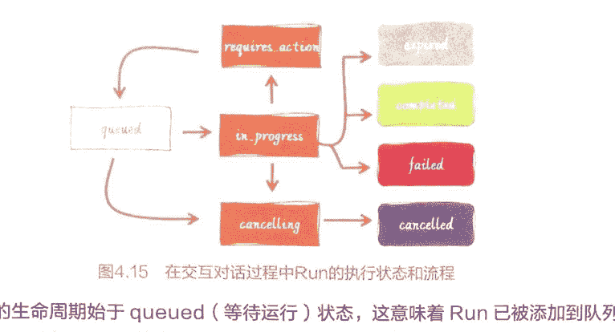

Run 的生命周期始于 queued 等待运行状态，说明它已进入队列但尚未开始执行。一旦系统分配到资源，状态很快会变成 in_progress，表示正在执行。

执行过程中如果需要人工介入，状态会变成 requires_action 需要操作。完成必要操作后，状态可以回到 in_progress 继续执行；如果操作超时，状态则会被标记为 expired 已过期。

## 4 Run 生命周期与结果读取

当任务处于 in_progress 时，若决定中止，状态会先切到 cancelling，代表取消正在进行；取消完成后状态变为 cancelled，表示已成功终止。若执行顺利，最终会进入 completed；若出现异常则落到 failed。

下面是 Run 各状态的含义。

### 表 4.1 Run 的状态及说明

| 状态 | 定义 |
|------|------|
| queued | 刚创建 Run 或调用 retrieve 查看状态时，常先显示为 queued，通常很快会转入 in_progress |
| in_progress | Run 正在运行，可调用 run.step 查看具体执行步骤 |
| completed | 执行成功，可读取 Assistant 返回的消息，也可继续提问 |
| requires_action | 助手需要调用函数时进入此状态，需按要求补齐参数后任务才能继续 |
| expired | 在 expires_at 前未提交函数调用结果或未取回输出，状态会被标记为 expired |
| cancelling | 调用 client.beta.threads.runs.cancel 后状态变为 cancelling，取消成功后转为 cancelled |
| cancelled | Run 已被成功取消 |
| failed | 运行失败，可通过 Run 里的 last_error 查看原因 |


> 特别提醒 requires_action。此时助手要求在本地执行函数，也就是第 5 章介绍的 Function Calling，执行完毕把结果回传后，Run 才能继续往下走。

通过反复调用 runs.retrieve 获取最新状态，即可判断 Run 是否已达到 completed，从而读取 Assistant 的输出。

```python
# 导入环境变量
from dotenv import load_dotenv
load_dotenv()
# 创建 client
from openai import OpenAI
client = OpenAI()
# 刚才创建的 Thread 的 ID
thread_id = 'thread_ddl4SsbU9KICdpxv7BfqVpQQ'
# 刚才创建的 Run 的 ID
run_id = "run_jZuIBnGfBtwlgox40PmzU9TU"
# 定义轮询间隔时间（如 5s）
polling_interval = 5
# 开始轮询 Run 的状态
import time
while True:
    run = client.beta.threads.runs.retrieve(
        thread_id=thread_id,
        run_id=run_id
    )
    # 直接访问 run 对象的属性
    status = run.status
    print(f"Run Status: {status}")
    # 如果 Run 的状态是 completed、failed 或者 expired，则退出循环
    if status in ['completed', 'failed', 'expired']:
        break
    # 等待一段时间后再次轮询
    time.sleep(polling_interval)
# 在 Run 运行完成或失败后处理结果
if status == 'completed':
    print("Run completed successfully.")
elif status == 'failed' or status == 'expired':
    print("Run failed or expired.")
```

```
Run Status: in_progress
Run Status: in_progress
Run Status: completed
Run completed successfully.
```

代码里通常用一个循环不断查询状态。遇到 completed、failed 或 expired 就会跳出循环。polling_interval 控制两次查询的间隔。循环结束意味着助手思考完毕，可以拿到回复。

### 4.3.5 展示最终回复

Run 进入 completed 后，可列出线程的所有消息。最新一条通常是本次 Run 新增的消息，也是助手的本次回复，代表这轮对话的最终结果。

```python
# 导入环境变量
from dotenv import load_dotenv
load_dotenv()
# 创建 client
from openai import OpenAI
client = OpenAI()
# 刚才创建的 Thread 的 ID
thread_id = 'thread_ddl4Sshl9KICdpxv7BfqVpQQ'
# 读取线程的消息
messages = client.beta.threads.messages.list(
    thread_id=thread_id
)
# 打印消息
print(messages)
```

```
Out SyncCursorPage[ThreadMessage](data=[
    ThreadMessage(
        id='msg_YMQjOmQxJfSMSrNW1G99tHqO',
        assistant_id='asst_GDulzGXwdEUTzjQxYqON669A',
        content=[MessageContentText(text=Text(annotations=[], value=' 在进价 80 元的基础上加 20%，售价是 96 元。'), type='text')],
        created_at=1704989390,
        file_ids=[],
        metadata={},
        object='thread.message',
        role='assistant',
        run_id='run_udqooyGylZYkQZSHylv1lEkm',
        thread_id='thread_N7dw2oEpNEEBiCU4cce47xoS'
    ),
    ThreadMessage(
        id='msg_ZW5qoaiJioRV07hQH5M0XH5V',
        assistant_id=None,
        content=[MessageContentText(text=Text(annotations=[], value=' 我把每束花定价为在进价的基础上加 20%，当进价为 80 元时，我的售价是多少。'), type='text')],
        created_at=1704986492,
        file_ids=[],
        metadata={},
        object='thread.message',
        role='user',
        run_id=None,
        thread_id='thread_N7dw2oEpNEEBiCU4cce47xoS'
    )],
object='list',
first_id='msg_YMQjOmQxJfSMSrNW1G99tHqO',
last_id='msg_ZW5qoaiJioRV07hQH5M0XH5V',
has_more=False
)
```

以鲜花定价为例，助手在线程中新增了一条包含答案的消息。该消息结构可拆为：

- 消息 ID（id）：消息唯一标识
- 助手 ID（assistant_id）：发送该消息的助手标识
- 消息内容（content）：文本内容
- 创建时间（created_at）：时间戳
- 角色（role）：user 或 assistant

历史消息列表中也包含用户之前的提问，如表 4.2。

### 表 4.2 消息历史列表中的消息

| 消息 ID | 助手 ID | 消息内容 | 创建时间 | 角色 |
| :--- | :--- | :--- | :--- | :--- |
| msg_YMQjOmQxJfSMSrNW1G99tHqO | asst_CDulzGXwdEUTzjQxYqON669A | 在进价 80 元的基础上加 20%，售价是 96 元 | 1704989390 | assistant |
| msg_ZW5qoaiJioRV07hQH5M0XH5V | 无（由于这是我提出的问题，与助手无关，因此没有助手 ID） | 我把每束花定价为在进价的基础上加 20%，当进价为 80 元时，我的售价是多少 | 1704986492 | user |

若想提取其中的数值 96，可用 Python 或简单的 NLP 方法解析后再写入数据库。更省事的做法是让助手直接以 JSON 格式作答，便于结构化提取，具体实现可自行探索。

> > 在测试 Run 与线程时发现，同一线程的消息创建时间可能不一致，并不一定属于同一个 Run。这很合理：Run 是单次执行，有明确起止，专注处理特定请求；线程更像持久记忆容器，能跨多个 Run 保持上下文连贯。

小雪：到这里 Assistants API 的用法我基本掌握了。你举的例子太简单，有没有复杂点的案例？

## 4.4 一键生成投资汇报 PPT

咖哥：当然，眼下我们要实战。你知道我写过 3 本书吧？

小雪：知道啊，你也就那点本事，动不动就拿出来显摆……

咖哥：不是显摆。现在的任务是向投资人展示我们 3 本书《零基础学机器学习》《数据分析咖十话：从思维到实践促进运营增长》和《GPT 图解 大模型是怎样构建的》的销售情况与趋势。整体流程如下：

- 数据整理：收集每本书每个季度的销售数据，包含日期、销售额等，汇总成表格
- 分析趋势：查看各书的销售走势，找出总销售额增减、季节性变化、销售高峰等
- 创建图表：用柱状图对比各季度销售额，用折线图展示随时间的变化
- 撰写结论：基于分析总结销售趋势及可能原因
- 制作 PPT：用 PowerPoint 等工具整合内容，含介绍、方法、图表、结论与建议
- 准备演讲稿：为 PPT 配上简短讲解稿，向领导汇报

工作量不算大但也不小。此次除了数据整理外，其余全部交给 OpenAI 助手完成，未来数据收集整理也能由 AI 承担。

小雪：这……

咖哥：现在就开始。

### 4.4.1 数据的收集与整理

我们已有 3 本图书的季度销售表 sales_data.csv，见图 4.6。数据本身不复杂，接下来看 AI 能挖掘出什么。

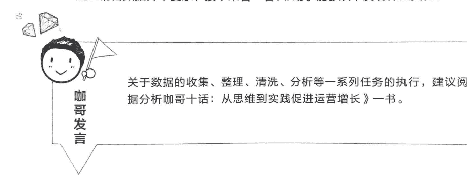

### 4.4.2 创建 OpenAI 助手

有了数据即可创建助手，让它扮演数据科学助理，接收查询并运行代码输出结果。

可视化较多，采用 Jupyter Notebook 完成。先导入所需库和环境变量、API 密钥，初始化 client。

```python
# 导入 OpenAI 库，并创建 client
from dotenv import load_dotenv
load_dotenv()
from openai import OpenAI
client = OpenAI()
```

再用 Pandas 读取文件并预览前几行。

```python
# 导入数据文件，并显示前几行
import pandas as pd
file_path = 'sales_data.csv'
sales_data = pd.read_csv(file_path)
sales_data
```

输出结果如图 4.16：

| 日期 | 零基础学机器学习 | 数据分析咖哥十话 | GPT图解 |
|------|------------------|------------------|---------|
| 0    | 31/3/2022        | 303.032760       | 985.615033 | 909.762701 |
| 1    | 30/6/2022        | 504.892977       | 871.129109 | 1023.037873 |
| 2    | 30/9/2022        | 576.723513       | 1035.950790 | 1080.552675 |
| 3    | 31/12/2022       | 670.501822       | 1068.182030 | 1148.976637 |
| 4    | 31/3/2023        | 766.792751       | 718.352429 | 1204.730960 |

图4.16 数据文件的前几行

随后上传文件供助手访问，并在创建助手时指定文件 ID。

```python
# 创建文件
file = client.files.create(
    file=open(file_path, "rb"),
    purpose='assistants',)
# 创建一个包含这个文件的助手
assistant = client.beta.assistants.create(
    instructions="作为一名数据科学助理，当给定数据和一个查询时，你能编写适当的代码并创建适当的可视化。",
    model="gpt-4-0125-preview",
    tools=[
        {"type": "code_interpreter"}
    ],
    tool_resources={
        "code_interpreter": {
            "file_ids": [file.id] # Here we add the file id}}
    print(assistant)
```

```
Assistant(
    id='asst_RPNV8I20wvvhxRV0VAXecHS8',
    created_at=1706785064, description=None,
    file_ids=['file--MNFWIw0kewDKc4BLTPFM0F'],
    instructions='作为一名数据科学助理，当给定数据和一个查询时，你能编写适当的代码并创建适当的可视化',
    metadata={},
    model='gpt-4-turbo-preview',
    name=None,
    object='assistant',
    tools=[ToolCodeInterpreter(type='code_interpreter')]
)
```

instructions 参数用于给出通用指导，并开启 Code Interpreter 使其能编程，最后绑定 sales_data.csv。这样一个面向咖哥图书销售分析的助手就完成了，在 Playground 可找到。

做 PPT 不能只有文字，图文结合更吸引人。让助手分别生成图表与标题，再整合进 PPT，分步进行。

### 4.4.3 自主创建数据分析图表

新建一个对话线程提交用户消息并关联文件。

```python
# 创建对话线程并运行
thread = client.beta.threads.create(
    messages=[
        {
            "role": "user",
            "content": "计算从2022年到2025年每个季度的总销售额，并通过不同的产品将其可视化为折线图，产品线条颜色分别为红，蓝，绿。",
            "attachments": [
                {
                    "file_id": file.id,
                    "tools": [
                        {"type": "code_interpreter"}
                    ]
                }
            ]
        }
    ]
)
print(thread)
```

```
Thread(
    id='thread_ODsFeZ5HB1hwWslcfP8yOpOf',
    created_at=1706785066,
    metadata={},
    object='thread'
)
```

第一次在该线程里对助手的委托，主要是先算出各季度的营业额，再以图书分类为维度画销售折线，并为不同产品指定专属色彩。

> 咖哥：小雪，接下来的动作想起来没？
小雪：肯定呀，直接执行 Run。

```python
# 创建 Run 来运行与助手的对话
run = client.beta.threads.runs.create(
    thread_id=thread.id,
    assistant_id=assistant.id,
)
run
```

```
Run(
    id='run_ClKuvj8hEiF8uWVHEpsk7jVq',
    assistant_id='asst_RPNV8l20wvvhxRV0VAXecHS8',
    cancelled_at=None,
    completed_at=None,
    created_at=1706785066,
    expires_at=1706785666,
    failed_at=None,
    file_ids=['file-sMNFWhv0kewfDKe4BLTPFM0F'], instructions=' 作为一名数据科学助理，当给定数据和一个查询时，你能编写适当的代码并创建适当的可视化。',
    last_error=None,
    metadata={},
    model='gpt-4-turbo-preview',
    object='thread.run',
    required_action=None,
    started_at=None,
    status='queued',
    thread_id='thread_ODsFeZ5HB1hwWslcfP8yOpOf',
    tools=[ToolAssistantToolsCode(type='code_interpreter')],
    usage=None
)
```

接下来进入制图阶段。发起 Run 后需要不断轮询，看图是否已生成，等助手跑完整个任务。耗时不短，通常得等上几分钟。要是碰到 Time-out 等异常，多试几次也没关系，毕竟 OpenAI 这项功能还比较新，稳定性有限。

```python
# 检查并等待可视化完成
import time
while True:
    messages = client.beta.threads.messages.list(thread_id=thread.id)
    try:
        # 检查是否创建了图像
        messages.data[0].content[0].image_file
        # 等待运行完成
        time.sleep(5)
        print('图表已创建!')
        if messages.data and messages.data[0].content:
            print(' 当前 Message: ' , messages.data[0].content[0])
            break
    except:
        time.sleep(10)
        print('您的助手正在努力做图表呢……')
        if messages.data and messages.data[0].content:
            print('当前 Message:', messages.data[0].content[0])
```

您的助手正在生成图表……
您的助手正在生成图表……
您的助手正在生成图表……
您的助手正在生成图表……
……

图表已生成！

煎熬了约三分钟，图终于出来了，附带还有完整的思考轨迹。

小雪：图在哪儿？我怎么没找到。
咖哥：稍等，我会把输出转成 PNG 存到本地，你就能在本地文件夹里看到 咖哥图书销售.png。随后用代码把它传回给助手，方便后续操作。

```python
# 将输出文件转换为 PNG 格式
def convert_file_to_png(file_id, write_path):
    data = client.files.content(file_id)
    data_bytes = data.read()
    with open(write_path, "wb") as file:
        file.write(data_bytes)
plot_file_id = messages.data[0].content[0].image_file.file_id
image_path = "咖哥图书销售.png"
convert_file_to_png(plot_file_id, image_path)
# 上传图表
plot_file = client.files.create(
    file=open(image_path, "rb"),
    purpose='assistants'
)
```

执行完代码后，文件夹里多了一张季度销售折线图（见图 4.17）。

小雪：哇，效果很棒！图中助手已经自行算出各季度营收，还新加了一列把季度与年份拼在一起。放进 PPT 完全够用，跟我自己画的没差！
小雪：咖哥，有个问题想请教，能否看到它在绘图时的大脑活动？
咖哥：完全可以。把目前为止的对话记录调出来，里面完整保留了它的思考与执行轨迹。

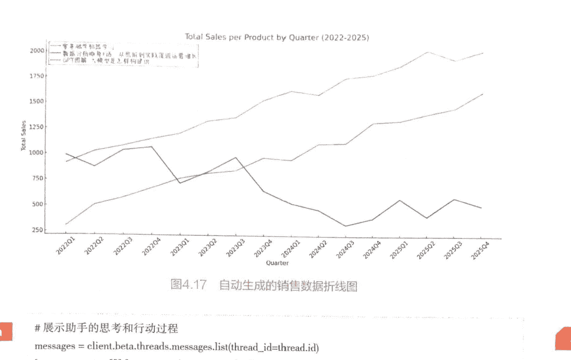

```python
# 展示助手的思考和行动过程
messages = client.beta.threads.messages.list(thread_id=thread.id)
[message.content[0] for message in messages.data]
```

```
[
    MessageContentImageFile(image_file=ImageFile(file_id='file-KCFlvcOitrzNzAQxr4OmtQn'), type='image_file'),
    MessageContentText(text=Text(annotations=[], value=' 这个文件包含有关产品销售的数据，具体包括日期和 3 个不同产品的销售额，这些产品分别是 "零基础学机器学习" "数据分析咖哥十话：从思维到实践促进运营增长 " 和 "GPT 图解 大模型是怎样构建的 "。日期格式为 " 日 / 月 / 年 "。\n\n 接下来，我将计算从 2022 年到 2025 年每个季度的销售额，并按产品的要求绘制折线图，其中 " 零基础学机器学习 " 用红色线条表示， " 数据分析咖哥十话：从思维到实践促进运营增长 " 用蓝色线条表示，而 "GPT 图解 大模型是怎样构建的 " 用绿色线条表示。'), type='text'),
    MessageContentText(text=Text(annotations=[], value=' 日期列已成功转换，日期范围从 2022 年 3 月 31 日到 2025 年 12 月 31 日，覆盖了您指定的日期范围。\n\n 现在，我们将构建折线图来表示从 2022 年到 2025 年每个季度的销售额，并根据不同的产品用红、蓝、绿颜色线条表示。'), type='text'),
    MessageContentText(text=Text(annotations=[], value=' 数据成功加载，它包含 4 列：`日期`、`零基础学机器学习`、`数据分析咖哥十话：从思维到实践促进运营增长` 和 `GPT 图解 大模型是怎样构建的`。这些列分别代表每个季度的日期和 3 种产品的销售额。\n\n 接下来，我将按照您的要求 :\n1. 将日期列转换为日期类型，并确保它正确地被解析。\n2. 计算从 2022 年到 2025 年每个季度的总销售额。\n3. 通过不同的产品将销售额可视化为折线图，每种产品使用指定的颜色线条（红、蓝、绿）。\n\n 让我们从第一步开始：转换日期列。'), type='text'),
    MessageContentText(text=Text(annotations=[], value=' 看来在尝试读取文件时遇到一些问题，因为我没有成功地加载它。刚才的尝试包括将文件作为 CSV 和 Excel 格式读取，但这两种方式都失败了。为了解决这个问题，我需要尝试指定特定的编码（如 UTF-8）重新加载'), type='text'),
    MessageContentText(text=Text(annotations=[], value=' 为了回答您的问题，请允许我首先检查文件的内容以了解其结构。这将帮助我确定如何提取所需的销售数据，并根据您的要求计算和可视化。我现在将加载并检查文件。'), type='text'),
    MessageContentText(text=Text(annotations=[], value=' 计算从 2022 年到 2025 年每个季度的销售额，并通过不同的产品将其可视化为折线图，产品线条颜色分别为红，蓝，绿。'), type='text')]
```

我们能看到，助手最后一条输出是 “MessageContentImageFile(image_file=ImageFile(file_id='file-KCFlvcOitrzNzAQxr4OmtQn'), type='image_file') ”。这说明助手会优先呈现图片已生成的通知。倒数第二条的正文是 “这个文件包含有关产品销售的数据，具体包括日期和 3 个不同产品的销售额，这些产品分别是 "零基础学机器学习" "数据分析咖哥十话：从思维到实践促进运营增长" 和 "GPT 图解 大模型是怎样构建的"。日期格式为 "日/月/年"。\n\n接下来，我将计算从 2022 年到 2025 年每个季度的销售额，并按产品的要求绘制折线图，其中 "零基础学机器学习" 用红色线条表示，"数据分析咖哥十话：从思维到实践促进运营增长" 用蓝色线条表示，而 "GPT 图解 大模型是怎样构建的" 用绿色线条表示”。这正是交给 Code Interpreter 执行绘图的最终指令。绘图时 Code Interpreter 也会调用我们上传的数据。

此外，在形成最终指令前，助手走过好几轮内部推理，比如字符编码转换、日期格式转换等。值得注意的是，助手解析数据文件时并非一次成功，初次尝试失败时它曾回复 “看来在尝试读取文件时遇到一些问题……” 随后改用其它方式才成功，体现出一定的自适应能力。

整体表现很理想。仅用一句话就能驱动助手调用 Code Interpreter 完成统计并出图。如今 PPT 已有漂亮可视化，接下来还缺文字性解读，也就是洞察 ①。

### 4.4.4 自主创建数据洞察

接着，我们继续在同一线程里给助手布置新的任务。

先定义函数，用于提交用户指令并获取分析结果。

```python
# 定义提交用户消息的函数
def submit_message_wait_completion(assistant_id, thread, user_message, file_ids=None):
    # 检查并等待活跃的 Run 完成
    for run in client.beta.threads.runs.list(thread_id=thread.id).data:
        if run.status == 'in_progress':
            print(f" 等待 Run {run.id} 完成……")
            while True:
                run_status = client.beta.threads.runs.retrieve(thread_id=thread.id, run_id=run.id).status
                if run_status in ['succeeded', 'failed']:
                    break
                time.sleep(5) # 等待 5s 后再次检查状态

    # 提交消息
    params = {
        'thread_id': thread.id,
        'role': 'user',
```

① 咖哥的《数据分析咖哥十话：从思维到实践促进运营增长》一书着重讲解了如何通过数据演绎法从数据中提取见解。

## 4.4.4
该函数会先遍历线程中的所有 Run，若有正在执行的则等待其全部结束。等全部完成后再提交新请求。借助 submit_message_wait_completion 来触发助手生成洞察。

```python
# 通过调用 submit_message 函数来发送请求，让助手生成见解
submit_message(
    assistant.id,
    thread,
    " 请根据你刚才创建的图表，给我两个约 20 字的句子，描述最重要的见解。这将用于 PPT 展示，揭示数据背后的秘密。")
```

```python
Run(
    id='run_NQoyCMVx1bM45bfAJbCSm5sn',
    assistant_id='asst_KTnWa4wvNB5VPqkNjxXLO6uQ',
    cancelled_at=None,
    completed_at=None,
    created_at=1706798249,
    expires_at=1706798849,
    failed_at=None,
    file_ids=['file-zFY1ufxxK6ChvFnFtH7R39Kn'],
    instructions=' 作为一名数据科学助理，当给定数据和一个查询时，你能编写适当的代码并创建适当的可视化。',
    last_error=None,
    metadata={},
    model='gpt-4-0125-preview',
    object='thread.run',
    required_action=None,
    started_at=None,
    status='queued',
    thread_id='thread_0RRlOlntisN73QKBEahXeLie',
    tools=[ToolAssistantToolsCode(type='code_interpreter')],
    usage=None
)
```

随后取出当前线程的最新回复，并把洞察打印出来。

```python
# 获取对话线程的响应
def get_response(thread):
    return client.beta.threads.messages.list(thread_id=thread.id)
# 等待响应并打印生成的见解
time.sleep(10) # 假设数据科学助理需要一些时间来生成见解
response = get_response(thread)
bullet_points = response.data[0].content[0].text.value
print(bullet_points)
```

- “从 2022 年到 2025 年，‘数据分析咖哥十话：从思维到实践促进运营增长’的季度销售额呈现出稳步增长的趋势。”

- “相比之下，‘GPT 图解 大模型是怎样构建的’和‘零基础学机器学习’在同一时期的销售额波动较大。”

必须承认，GPT-4 的表现丝毫不输给数据分析入门者。所以要多夸奖你的模型，你的肯定越高，回应质量往往越好。


> 这可不是咖哥在瞎说，这里讲一下“自我实现预言”( self-fulfilling prophecy )。该心理学与社会学概念，咖哥是在《高效能人士的 7 个习惯》一书中接触到的，指个人的信念或期待会塑造行为，最终让信念成真。简言之，当一个人坚信某事会发生时，行为往往会无意识地推动预期实现。

自我实现预言凸显了期待与信念对行为和互动的强大作用，强调心态与态度在塑造现实中的关键角色。

尽管大模型的基础能力由训练数据、训练方式和算法决定，但使用者的期待与反馈确实会影响交互质量与回应效果。正面互动与鼓励容易激发更丰富深入的对话，而负面反馈则可能让交流变得简略受限。这与俗语“说你行，你就行”异曲同工。

### 4.4.5 让 AI 自动拟定封面标题

接下去再次触发 submit_message_wait_completion。借助助手刚才给出的两条洞察，现在进入为演示文稿拟定标题的环节。

```python
# 根据见解生成标题
submit_message_wait_completion(assistant.id, thread, "根据你创建的情节和要点，为PPT想一个非常简短的标题，反映你得出的主要见解。")
```

随后静候助手对该请求作出回应并返回幻灯片标题。

```python
# 等待响应并打印标题
time.sleep(10) # 等待助手生成标题
response = get_response(thread)
title = response.data[0].content[0].text.value
print(title)
```

```
“市场趋势：优秀科技教育类图书产品销售增长揭秘” ←（第一次运行的输出结果）
“产品销售趋势：稳健增长与市场波动” ←（第二次运行的输出结果）
```

这标题也太贴心了！看到 AI 抛出的两个标题，第一次被真正get到的咖哥差点感动落泪。

### 4.4.6 让 DALL·E 3 为首页绘制封面图

接下来有个更有趣的环节，就是请助手为幻灯片首页配一张吸睛的图片。图里要体现咖哥与花语秘境一路同行、共同前行的轨迹。把它作为背景使用，能产生积极的心理暗示，帮助投资人迅速对咖哥产生好感。

代码里先给出这家初创公司的简短介绍，没有这部分背景，助手在讲故事时会缺少着力点。随后调用 DALL·E 3 模型，结合咖哥的创作经历和公司资料来合成一张图。

```python
# 提供花语秘境公司的说明
company_summary = "虽然我们是初创网络鲜花批发电商，但是我们董事长也写IT图书！"
# 调用 DALL·E 3 模型来生成图片
response = client.images.generate(
    model='dall-e-3',
    prompt=f"根据这家公司的简介 {company_summary},\n            创建一张展示咖哥和花语秘境公司共同成长和前进道路的启发性照片。这将用于季度销售规划会议 ",
    size="1024x1024",
    quality="hd",
    n=1
)
image_url = response.data[0].url
# 获取 DALL·E 3 模型生成的图片
import requests
dalle_img_path = '花语秘境咖哥.png'
img = requests.get(image_url)
# 将图片保存到本地
with open(dalle_img_path,'wb') as file:
    file.write(img.content)
# 将上传的图片作为 PPT 素材之一
dalle_file = client.files.create(
    file=open(dalle_img_path, "rb"),
    purpose='assistants'
)
```

程序通过链接把生成的图片拉回本地保存，随后上传到 client，作为后续制作 PPT 的素材之一。

在本地打开 “花语秘境咖哥 .png”，会看到一张令人眼前一亮的画面（见图 4.18）。

画面既有花卉点缀，又精准呈现了董事长文人气质：他脚踏书本，行走在花开的康庄大道上，正朝着出版 100 本精品图书的目标进发！


### 4.4.7 让助手自动拼装 PPT

制作演示文稿所需的所有素材已经齐备，最后一步正式启动！

这里借助 python-pptx 库为助手准备模板，可控制版式、背景色、图片与文本框的插入，以及字体风格与字号的设定。

我们准备两种模板：封面用和内容页用 ①。

先用多行字符串 title_template 定义封面模板，里面包含配图、主标题和副标题。

> ① 本节介绍的两个PPT模板的代码主要取材于OpenAI的官方示例。

```python
# 导入相关库和工具
from pptx import Presentation
from pptx.util import Inches, Pt
from pptx.enum.text import PP_PARAGRAPH_ALIGNMENT
from pptx.dml.color import RGBColor
# 初始化首页模板
title_template = """
# 创建新的 PPT 对象
prs = Presentation()
# 添加一个空白的 PPT 布局
blank_slide_layout = prs.slide_layouts[6]
slide = prs.slides.add_slide(blank_slide_layout)
# 将 PPT 的背景颜色设置为黑色
background = slide.background
fill = background.fill
fill.solid()
fill.fore_color.rgb = RGBColor(0, 0, 0)
# 在 PPT 左侧添加图片，上下留有边距
left = Inches(0)
top = Inches(0)
height = prs.slide_height
width = prs.slide_width * 3/5
pic = slide.shapes.add_picture(image_path, left, top, width=width, height=height)
# 在较高位置添加标题文本框
left = prs.slide_width * 3/5
top = Inches(2)
width = prs.slide_width * 2/5
height = Inches(1)
title_box = slide.shapes.add_textbox(left, top, width, height)
title_frame = title_box.text_frame
title_p = title_frame.add_paragraph()
title_p.text = title_text
title_p.font.bold = True
title_p.font.size = Pt(38)
title_p.font.color.rgb = RGBColor(255, 255, 255)
title_p.alignment = PP_PARAGRAPH_ALIGNMENT.CENTER
# 添加副标题文本框
left = prs.slide_width * 3/5
top = Inches(3)
width = prs.slide_width * 2/5
height = Inches(1)
subtitle_box = slide.shapes.add_textbox(left, top, width, height)
subtitle_frame = subtitle_box.text_frame
subtitle_p = subtitle_frame.add_paragraph()
subtitle_p.text = subtitle_text
subtitle_p.font.size = Pt(22)
subtitle_p.font.color.rgb = RGBColor(255, 255, 255)
subtitle_p.alignment = PP_PARAGRAPH_ALIGNMENT.CENTER
"""
```

随后用多行字符串 details_template 定义内容页模板，包含配图、标题以及“关键见解：”的要点列表。

```python
# 初始化内页模板
details_template = """
# 创建新的 PPT 对象
prs = Presentation()
# 添加一个空白的 PPT 布局
blank_slide_layout = prs.slide_layouts[6]
slide = prs.slides.add_slide(blank_slide_layout)
# 将 PPT 的背景颜色设置为黑色
background = slide.background
fill = background.fill
fill.solid()
fill.fore_color.rgb = RGBColor(0, 0, 0)
# 定义占位符
image_path = data_vis_img
title_text = " 提升利润：在线销售与直销优化的主导地位 "
bullet_points = "* 在线销售在各个季度中始终领先于盈利能力，这表明存在强大的数字市场。\n* 直销表现出波动，这表明该渠道的表现变化和进行针对性改进的必要性。"
# 在 PPT 左侧添加图片占位符
left = Inches(0.2)
top = Inches(1.8)
height = prs.slide_height - Inches(3)
width = prs.slide_width * 3/5
pic = slide.shapes.add_picture(image_path, left, top, width=width, height=height)
# 添加覆盖整个宽度的标题文本
left = Inches(0)
top = Inches(0)
width = prs.slide_width
height = Inches(1)
title_box = slide.shapes.add_textbox(left, top, width, height)
title_frame = title_box.text_frame
title_frame.margin_top = Inches(0.1)
title_p = title_frame.add_paragraph()
title_p.text = title_text
title_p.font.bold = True
title_p.font.size = Pt(28)
title_p.font.color.rgb = RGBColor(255, 255, 255)
title_p.alignment = PP_PARAGRAPH_ALIGNMENT.CENTER
# 添加硬编码的“关键见解：”文本和项目符号列表
left = prs.slide_width * 2/3
top = Inches(1.5)
width = prs.slide_width * 1/3
height = Inches(4.5)
insights_box = slide.shapes.add_textbox(left, top, width, height)
insights_frame = insights_box.text_frame
insights_p = insights_frame.add_paragraph()
insights_p.text = " 关键见解： "
insights_p.font.bold = True
insights_p.font.size = Pt(24)
insights_p.font.color.rgb = RGBColor(0, 128, 100)
insights_p.alignment = PP_PARAGRAPH_ALIGNMENT.LEFT
insights_frame.add_paragraph()
bullet_p = insights_frame.add_paragraph()
bullet_p.text = bullet_points
bullet_p.font.size = Pt(12)
bullet_p.font.color.rgb = RGBColor(255, 255, 255)
bullet_p.line_spacing = 1.5
"""
```

终极一步！调用 submit_message_wait_completion 提交请求，把模板、标题、副标题和文件 ID 等必要参数带上，指示助手按既定模板生成 PPT，之后只需等待完成。

```python
title_text = " 花语秘境 "
subtitle_text = "2025 年销售大会 "

submit_message_wait_completion(assistant.id,thread,f" 通过包含的代码模板创建符合模板格式的 PPT，但使用本消息中包含的图片、公司名称 / 标题和文件名 / 副标题：\n{title_template}。重要提示：在第一张 PPT 中使用本消息中包含的图片文件作为 image_path 图像，并使用公司名称 {title_text} 作为 title_text 变量，\n使用副标题文本 {subtitle_text} 作为 subtitle_text 变量。\n接着，使用以下代码模板创建第二张 PPT：{data_vis_template}，创建符合模板格式的 PPT、但使用公司名称 / 标题和文件名 / 副标题：\n{data_vis_template}。重要提示：使用您之前在本线程中创建的第二张附图（折线图）作为 data_vis_img 图像，并使用您之前创建的数据可视化标题作为 title_text 变量，\n使用您之前创建的见解项目符号列表作为 bullet_points 变量。将这两张 PPT 输出为 pptx 格式的文件。确保输出为两张 PPT、且每张 PPT 都符合本消息中给出的相应模板。",
    file_ids=[dalle_file.id, plot_file.id]
)

# 等待助手完成 PPT 创建任务
while True:
    try:
        response = get_response(thread)
        pptx_id = response.data[0].content[0].text.annotations[0].file_path.file_id
        print(" 成功检索到 pptx_id:", pptx_id)
        break
    except Exception as e:
```print(" 您的助手正在努力制作幻灯片……")

time.sleep(10)

import io

pptx_id = response.data[0].content[0].text.annotations[0].file_path.file_id

ppt_file= client.files.content(pptx_id)

file_obj = io.BytesIO(ppt_file.read())

with open(“咖哥花语秘境.pptx” , “wb” ) as f:

    f.write(file_obj.getbuffer())

Out 您的助手正在努力制作 PPT……

您的助手正在努力制作 PPT……

您的助手正在努力制作 PPT……

您的助手正在努力制作 PPT……

您的助手正在努力制作 PPT……

成功检索到 pptx_id: file-hpHLePeANzfza6CLhW4Vfccv

## 4
完成！打开当前目录里刚生成的文件“花语秘境.pptx”，版式与内容都几乎可以直接用的两页幻灯片就呈现在眼前（见图 4.19）。


图4.19 几乎不需要修改的PPT

## 4.5 小结
4.1 至 4.3 节详细介绍了 Assistants API 的概念、使用方式，以及 Thread、Run、Message 等核心要素和操作流程，并做了实操演练。

重点在 4.4 节，演示了如何结合 OpenAI 的 Assistants API、GPT-4 与 DALL·E 3 生成内容饱满、视觉吸睛的 PPT。

实践里先加载销售数据，让 Assistants API 扮演数据分析助手，产出可视化图表。做法是统计各季度销售额并绘制成折线图。

其次，基于图表，Assistants API 提出洞察并拟出适合幻灯片的标题。接着调用 DALL·E 3，依据公司简介生成首页封面图。

最后借助 python-pptx 和预设模板，通过 Assistants API 整合之前产出，把标题、图表、洞察和 DALL·E 生成的图像拼装成两张成品幻灯片。

正如你看到的，只需几行代码加自然语言指令，就能搭建一个助手。它既能当数据助手产出内容，也能当个人助理独立完成精美 PPT。对这样一个 AI 共生的新世界，咖哥和你一样感到惊叹。

# 第5章
# Agent 2：Function Calling 让 Agent 学会调用工具

地铁站到公司路上有一座自然历史博物馆，咖哥和小雪走了进去（见图5.1）。


小雪问咖哥，人类能从远古猿类演化至今，很大程度上靠学会使用工具，这对 AI 研究有什么启示吗？

咖哥：学会工具确实是进化中的关键转折。工具不仅提升了生存能力，使用工具的过程还推动了认知发展，比如解决问题、规划和抽象思维，这些为文明进步奠基。

咖哥指了指海报上猿人手中的石头，说：这块石头看着简单吧？但对早期的人类来说，这可能是一把切割食物的刀，可能是一件用来狩猎的武器，也可能是一件发生危险时用来防身的武器。工具使他们能完成更多类型、更复杂的任务，同时效率也更高。

如果 Agent 处理复杂任务只能自力更生，能力非常有限。若能按任务需要调用外部功能或服务，能力会大幅增强（见图5.2）。


小雪：你这么一说，我立刻就联想到 Playground 里 Assistants 自带的那些 Tools。是不是都由 OpenAI 先做好，Agent 需要时直接调用就行？

咖哥：猜对了一半。工具里确实有现成的，但 Functions 这一块是可以由我们自己定义的。把 Function Calling 的逻辑理清楚，整件事就都通了。

## 5.1 OpenAI 工具拆解：内置 vs 自定义

4.2 节已经提到，Assistants 可用的工具大致可归为三类——Functions、Code interpreter 和 File search，见图 5.3。
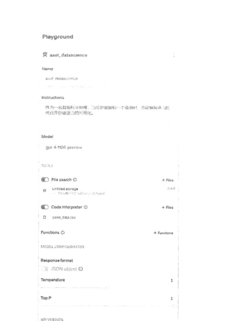
这三类里，Code interpreter 我们之前拿来跑数据分析代码，File search 则负责在已上传的文件里自动检索信息。这两样都是 OpenAI 封好的能力，无论在 Assistants 还是在 OpenAI API 里都能直接拿来用，属于内部工具。

真正值得展开的，是 Functions。它是可以由开发者自行定制的工具。

### 5.1.1 Functions 是什么角色
按 OpenAI 的表述，Functions 是一个面向开发者的扩展机制，用来给大模型补上特定领域的专业能力。开发者可以创建并部署自定义函数，让它完成指定任务、处理复杂提问或给出专业化回答。借助 Functions，模型强大的语言理解能力就能和外部能力结合，做出更丰富、更动态的应用。

打个比方，人会根据场景决定用刀还是用锤。Assistants 在处理任务时，也会依据当前需求挑选并调用合适的外部函数或工具。这样 Agent 就能补上训练时未完善的技能，处理复杂任务时更灵活高效。

它的核心特质可以总结为三点。
- 定制化：按具体需求打造函数，解决特定问题。
- 集成：能嵌入到现有应用或服务里。
- 扩展性：需求变化时可以更新迭代功能。

简单说，Functions 就是把大模型连向外部工具，让开发者拥有更大的发挥空间，加速 AI 在各行业落地。

### 5.1.2 一个好 Description 决定是否被调用
小雪：我最想弄明白的是，Assistants 怎么判断什么时候该用哪个工具？

咖哥：Code interpreter 和 File search 这两个内部工具，OpenAI 内部有固定的判断逻辑。至于我们自己造的 Function，Description 的写法就很关键。Description 就是模型用来判断“要不要调它”的依据。

在图 5.3 里点开 + Function，会看到一个默认示例，叫 get_weather，说明写的是“Determine weather in my location”。有了这份说明，助手在需要查天气时自然会联想到它。
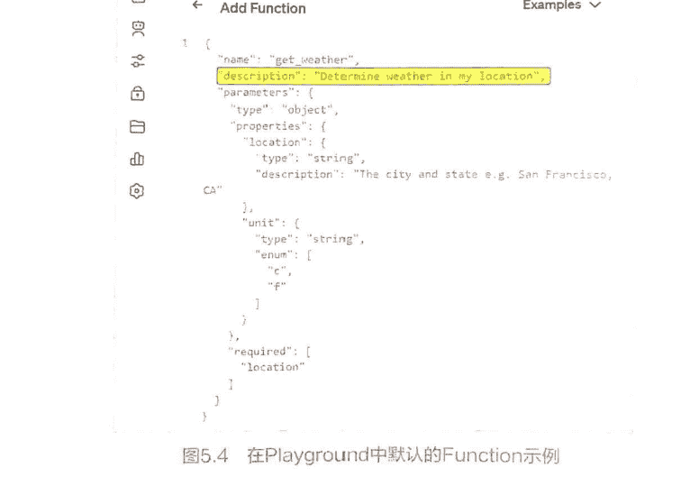
图5.4 在Playground中默认的Function示例
如果我提示它“你的任务是根据今天气温来安排花卉的储存”，它会调用吗？

小雪点点头：应该会想到有这么个工具能用。

### 5.1.3 Schema 不是实现代码
小雪：那上面看起来像代码的那段，就是 Function 内部要实现的功能吗？
```json
{
  "name": "get_weather",
  "description": "Determine weather in my location",
  "parameters": {
    "type": "object",
    "properties": {
      "location": {
        "type": "string",
        "description": "The city and state e.g. San Francisco, CA"
      },
      "unit": {
        "type": "string",
        "enum": ["c", "f"]
      }
    },
    "required": ["location"]
  }
}
```
咖哥：不是，注意区分。上面那段文本不是可执行代码，而是函数接口的 JSON 格式描述，也就是 JSON Schema。它的作用是让模型能够按规范输出一个包含调用参数的 JSON 对象。这只是函数的元数据，说明怎么用。真正的实现代码要在主程序里写，被调用时才执行对应的操作，比如查询天气并返回结果。

- name：函数名。
- description：用途说明。
- parameters：参数定义，说明函数需要哪些输入。
  - type：通常是 object。
  - properties：对象应包含的属性，例如 location 和 unit。location 是要查天气的城市和州，字符串类型；unit 是温度单位，取值 “c” 或 “f”。
  - required：必填项，这里是 location。

> **咖哥发言**
JSON 即 JavaScript Object Notation，是一种轻量级的数据交换格式，文本易读，也便于机器解析，常用于前后端数据交互。再强调一次，把工具交给模型后，模型并不会真的执行工具里的代码，而是会生成一段符合 JSON 格式的字符串。开发者需要先解析这段字符串，再调用自己写的函数。逻辑始终掌握在开发者手里。对新手来说这点确实容易绕，但看几个例子后就清晰了。

> **咖哥发言**
并非所有 OpenAI 模型都支持 Functions，只有经过专项训练的新模型，比如 GPT-3.5 Turbo 和 GPT-4，才能根据提示和 Functions 的说明判断是否需要调用，并且能更规范地输出 JSON。

### 5.1.4 Function Calling 如何运转
弄清 Functions 的定义后，再来看 Function Calling 是什么。

Function Calling 是 GPT-3.5 Turbo 和 GPT-4 等模型提供的新能力。开发者用 JSON Schema 描述函数，模型就能智能生成包含调用参数的 JSON 对象。

它本质上是把模型的自然语言理解能力与外部工具或 API 连接起来的桥梁，让结构化数据获取和触发外部动作更可靠。

一次调用大致经历以下步骤。
- 定义函数及元数据：把 JSON Schema 提交给模型。
- 提出请求：用自然语言说明想做什么，比如查询天气，需要提供地点等信息。
- 模型生成命令：模型判断是否匹配现有函数，若匹配则生成符合 Schema 的 JSON 字符串。
- 执行函数：开发者把字符串解析成 JSON 对象后，真正调用本地函数并传入参数。
- 返回结果：函数运行完把结果以 JSON 形式回传，通常再喂回模型，让它用自然语言产出最终答案。

表 5.1 Functions 的调用步骤

| 步骤 | 描述 |
| :--- | :--- |
| 1 | 向模型提交需要使用的函数及其 JSON Schema 元数据 |
| 2 | 用户用自然语言提出需求，例如“获取当前天气”或“给客户发邮件” |
| 3 | 模型判断是否需要调用函数，并生成包含必要参数的字符串化 JSON 对象 |
| 4 | 开发者把字符串解析回 JSON，并实际调用 get_current_weather 或 send_email 等函数 |
| 5 | 函数执行完毕，结果被传回模型 |
| 6 | 模型把结果整合，换成自然语言回复给用户 |

小雪：我现在明白了。文档里 Functions 有时指接口定义，有时指调用这个动作本身。说白了，就是把自然语言需求转成计算机能读懂的 JSON Schema 的过程。

咖哥：对。表 5.2 还有更多定义示例。

| 使用场景 | Function 定义的示例 | 功能描述 |
|----------|---------------------|----------|
| 查询客户信息 | get_customers(min_revenue: int, created_before: string, limit: int) | 根据收入、创建日期等条件查询客户信息 |
| 提取数据 | extract_data(name: string, birthday: string) | 从文本中提取特定的人名和生日数据 |
| 执行 SQL 查询 | sql_query(query: string) | 执行一个 SQL 查询并返回结果 |

## 5.2 Playground 实战：搭一个鼓励生成器
接下来用具体例子走一遍流程。我们做一个“鼓励生成器” Function，接收名字和当前心情，返回一条定制鼓励语，代码不到 20 行。
```python
# 鼓励函数
def get_encouragement(name, mood):
    # 基础鼓励消息
    messages = {
        "happy": "继续保持积极的心态，做得好！",
        "sad": "记住，即使在最黑暗的日子里，也会有阳光等着你。",
        "tired": "你做得足够好，现在是时候休息一下了。",
        "stressed": "深呼吸，一切都会好起来。"
    }
    # 获取对应心情的鼓励消息
    message = messages.get(mood.lower(), "你今天感觉如何？我总是在这里支持你！")
    # 返回定制化的鼓励消息
    return f"亲爱的 {name}，{message}"
# 使用示例
print(get_encouragement("小雪", "tired"))
```
亲爱的小雪，你做得足够好，现在是时候休息一下了。
其中 get_encouragement 接收名字和心情两个参数，根据心情从预设语库里挑一句合适的鼓励返回。

小雪：好的，我来试。先在 Playground 新建一个助手，命名为“鼓励 Agent”，然后点 + Function，如图 5.5 所示。
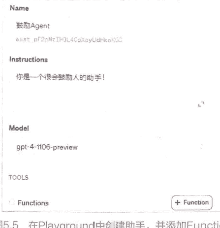
咖哥：对。

小雪：我把前面类似的代码填进去，是这样吗？
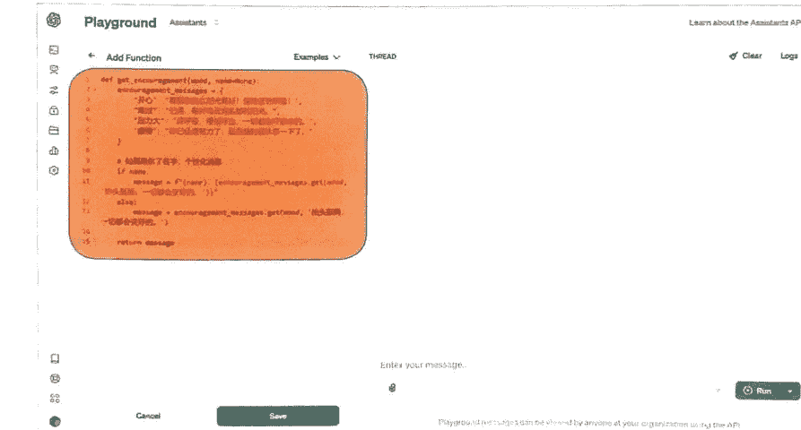
咖哥：非也！这里填的不是函数实现，而是函数及其参数的 JSON Schema，也就是元数据。

下面才是 get_encouragement 的正确 JSON Schema 示例。
```json
{
  "name": "get_encouragement",
  "description": "根据用户的心情提供鼓励信息",
  "parameters": {
    "type": "object",
    "properties": {
      "mood": {
        "type": "string",
        "description": "用户当前的心情，例如：开心，难过，压力大，疲倦"
      },
      "name": {
        "type": "string",
        "description": "用户的名字，用来个性化鼓励信息"
      }
    },
    "required": ["mood"]
  }
}
```
把这个 Schema 添加到 Function 中，见图 5.7。
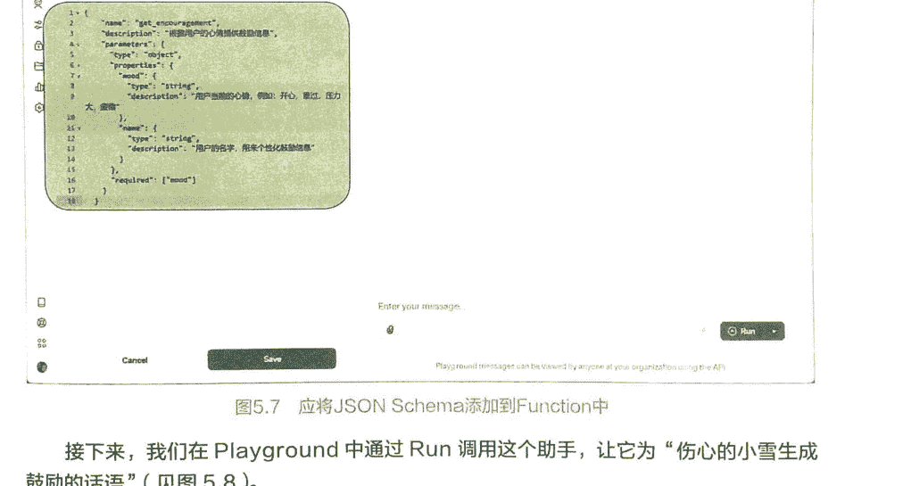
图5.7 应将JSON Schema添加到Function中
随后在 Playground 用 Run 调用助手，让它为“伤心的小雪生成鼓励的话语”，见图 5.8。

## 图5.8 运行助手
这时助手并不会直接输出鼓励语，而是先吐出一行符合规范的函数调用。
```
get_encouragement({ "mood": "难过", "name": "小雪" })
```
小雪：那具体功能怎么实现？

咖哥：先在代码里实现函数本身，再通过自动调用助手来触发执行。

## 5.3 Assistants API 端到端调用全流程
前面演示了 Playground 的做法，下面用 Assistants API 把 Function Calling 从头到尾跑通。

整体框架如图 5.9 所示。
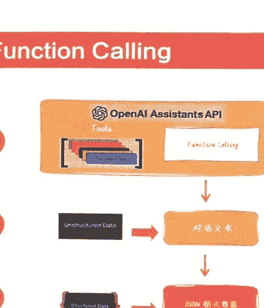
图 5.9 的核心思想是：先用工具描述定义函数，再借助 Function Calling 让模型自动返回要调的函数及参数，把非结构化文本转为结构化 JSON。

再回看一下表 4.1 里 Run 的状态。流程是：用户消息触发后助手启动一个 Run；若模型判断需要 Function Calling，Run 会暂停，状态变为 requires_action；助手返回需要调用的函数名和参数的 JSON；开发者在本地调用自己的函数；执行完后把回调结果提交回去，Run 完成。

> 小雪：感觉步骤不少。

咖哥：确实有几个坑，下面详细拆解。

### 5.3.1 先准备一个支持 Function 的助手
首先要创建一个能用 Function 的助手。5.2 节我们在 Playground 里已经建过一个，见图 5.10。

| Name | Instructions | ID | Date Created |
|------|--------------|----|--------------|
| 鼓励Agent | 你是一个很会鼓励人的助手！ | asst_pF2pMtIHOL4CpXpyUdHkoKG3 | Jan 21, 2024, 5:25 PM |
| 鲜花价格计算器 | 你能够帮我计算鲜花的价格 | asst_CCuIzGxwdEUTzjQxYqGN669A | Jan 11, 2 |
| 鲜花价格计算器 | 你能够帮我计算鲜花的价格 | asst_ub9w4aVa19Q0af1gJc7sxyuD | Jan 11, 2 |
| 鲜花价格计算器 | 你能够帮我计算鲜花的价格 | asst_M7ORAXULRjFnXN9RSq7tQDXR | Jan 11, 2 |
| asst_datascience | 作为一名数据科学助理，当给定数据和一个查询时，你能够编写适当的代码并创建适当的可视化。 | asst_Zipiv7J0dpaXbLGKWE5A276T | Jan 4, 2024, 12:58 AM |
| Untitled Assistant | 作为一名数据科学助理，当给定数据和一个查询时，你能够编写适当的代码并创建适当的可视化。 | asst_ipaeTWWhf6FTiV1s14WAD0GL | Jan 4, 2024, 12:13 AM |

| Untitled Assistant | You are a data scientist assistant. When | asst_Z361B1ILkx17yziq2VT73Qt | Dec 25, 2023, 10:51 PM |

图5.10 助手已创建好的示意

助手已经在系统里了，就没必要再重复开销去新建一份。直接拿 ID 把现成的助手拉出来用就行，这里拿来演示 Agent 的调用方式。

```
# 读取系统变量
from dotenv import load_dotenv
load_dotenv()
# 初始化 client
from openai import OpenAI
client = OpenAI()
# 检索之前创建的助手
assistant_id = "asst_pF2pMtIHOL4CpXpyUdHkoKG3" # 你自己的助手的 ID
assistant = client.beta.assistants.retrieve(assistant_id)
print(assistant)
```

Out

助手详情：

```
Assistant(id='asst_pF2pMtIHOL4CpXpyUdHkoKG3', created_at=1705829118, description=None, file_ids=[], instructions='你是一个很会鼓励人的助手！', metadata={}, model='gpt-4-turbo-preview', name='鼓励 Agent', object='assistant', tools=[ToolFunction(function=FunctionDefinition(name='get_encouragement', description='根据用户的心情提供鼓励信息', parameters={'type': 'object', 'properties': {'mood': {'type': 'string', 'description': '用户当前的心情，例如：开心，难过，压力大，疲倦'}, 'name': {'type': 'string', 'description': '用户的名字，用来个性化鼓励信息'}}, 'required': ['mood']}), type='function'))])
```

当然要通过 Assistants API 另起一个新助手也不是不行，下面给的代码就能做到。

```
assistant = client.beta.assistants.create(
    instructions="You are a very encouraging assistant!",
    model="gpt-4-turbo-preview",
    tools=[{
        "type": "function",
        "function": {
            "name": "get_encouragement",
            "description": "根据用户的心情提供鼓励信息",
            "parameters": {
                "type": "object",
                "properties": {
                    "mood": {
                        "type": "string",
                        "description": "用户当前的心情，例如：开心，难过，压力大，疲倦"
                    },
                    "name": {
                        "type": "string",
                        "description": "用户的名字，用来个性化鼓励信息"
                    }
                },
                "required": ["mood"]
            }
        }
    }]
)
```

上面这段创建代码里内置了一个 Function，实际作用和我们在 Playground 里手动塞入的 JSON Schema 是一样的。

### 5.3.2 不触发函数，直接让助手工作

这时候不去调用那个 Function，就让助手裸跑一次，会产生什么效果呢？

```python
# 创建一个新的 Thread
thread = client.beta.threads.create()
print(f"Thread 的信息 :{thread}\n")

# 在 Thread 中添加用户的消息
message = client.beta.threads.messages.create(
    thread_id=thread.id,
    role="user",
    content=" 你好，请和我随便说句话吧！ "
)
print(f"Message 的信息 :{message}\n")

# 运行助手来处理 Thread
run = client.beta.threads.runs.create(
    thread_id=thread.id,
    assistant_id=assistant_id
)
print(f"Run 的初始信息 :{message}\n")

# 轮询以检查 Run 的状态
import time
n = 0
while True:
    n += 1
    run = client.beta.threads.runs.retrieve(
        thread_id=thread.id,
        run_id=run.id
    )
    print(f"Run 的第 {n} 次轮询信息 :{run}\n")
    if run.status == 'completed':
        break
    time.sleep(5) # 等待 5s 后再次检查

# 获取助手在 Thread 中的回应
messages = client.beta.threads.messages.list(
    thread_id=thread.id
)

# 输出助手的回应
for message in messages.data:
    if message.role == "assistant":
        print(f" 助手的回应 :{message.content}\n")
```

Thread 相关信息：

```
Thread(id='thread_xfEdaRucacXBKIyMMAXDzT1r', created_at=1708532544, metadata={}, object='thread', tool_resources=[])
```

Message 相关信息：

```
ThreadMessage(id='msg_gbplwkTtNga4vmlQXqC8QLYK', assistant_id=None, content=[MessageContentText(text=Text(annotations=[], value='你好，请和我随便说句话吧！'), type='text')], created_at=1708532544, file_ids=[], metadata={}, object='thread.message', role='user', run_id=None, thread_id='thread_xfEdaRucacXBKIyMMAXDzT1r')
```

Run 初始状态：

```
Run(id='run_cmBpa3ST0ntkg6tROmwNj4bc', assistant_id='asst_pF2pMtIHOL4CpXpyUdHkoKG3', cancelled_at=None, completed_at=None, created_at=1708532545, expires_at=1708533145, failed_at=None, file_ids=[], instructions='你是一个很会鼓励人的助手！', last_error=None, metadata={}, model='gpt-4-turbo-preview', object='thread.run', required_action=None, started_at=None, status='queued', thread_id='thread_xfEdaRucacXBKIyMMAXDzT1r', tools=[ToolAssistantToolsFunction(function=FunctionDefinition(name='get_encouragement', description='根据用户的心情提供鼓励信息', parameters={'type': 'object', 'properties': {'mood': {'type': 'string', 'description': '用户当前的心情，例如：开心，难过，压力大，疲倦'}, 'name': {'type': 'string', 'description': '用户的名字，用来个性化鼓励信息'}}, 'required': ['mood']}), type='function')], usage=None)
```

Run 第一次轮询结果：

```
Run(id='run_cmBpa3ST0ntkg6tROmwNj4bc', assistant_id='asst_pF2pMtIHOL4CpXpyUdHkoKG3', cancelled_at=None, completed_at=None, created_at=1708532545, expires_at=1708533145, failed_at=None, file_ids=[], instructions='你是一个很会鼓励人的助手！', last_error=None, metadata={}, model='gpt-4-turbo-preview', object='thread.run', required_action=None, started_at=1708532545, status='in_progress', thread_id='thread_xfEdaRucacXBKIyMMAXDzT1r', tools=[ToolAssistantToolsFunction(function=FunctionDefinition(name='get_encouragement', description='根据用户的心情提供鼓励信息', parameters={'type': 'object', 'properties': {'mood': {'type': 'string', 'description': '用户当前的心情，例如：开心，难过，压力大，疲倦'}, 'name': {'type': 'string', 'description': '用户的名字，用来个性化鼓励信息'}}, 'required': ['mood']}), type='function')], usage=None)
```

Run 第二次轮询结果：

```
Run(id='run_cmBpa3ST0ntkg6tROmwNj4bc', assistant_id='asst_pF2pMtIHOL4CpXpyUdHkoKG3', cancelled_at=None, completed_at=None, created_at=1708532545, expires_at=1708533145, failed_at=None, file_ids=[], instructions='你是一个很会鼓励人的助手！', last_error=None, metadata={}, model='gpt-4-turbo-preview', object='thread.run', required_action=None, started_at=1708532545, status='in_progress', thread_id='thread_xfEdaRucacXBKIyMMAXDzT1r', tools=[ToolAssistantToolsFunction(function=FunctionDefinition(name='get_encouragement', description='根据用户的心情提供鼓励信息', parameters={'type': 'object', 'properties': {'mood': {'type': 'string', 'description': '用户当前的心情，例如：开心，难过，压力大，疲倦'}, 'name': {'type': 'string', 'description': '用户的名字，用来个性化鼓励信息'}}, 'required': ['mood']}), type='function')], usage=None)
```

Run 第三次轮询结果：

```
Run(id='run_cmBpa3ST0ntkg6tROmwNj4bc', assistant_id='asst_pF2pMtIHOL4CpXpyUdHkoKG3', cancelled_at=None, completed_at=1708532561, created_at=1708532545, expires_at=None, failed_at=None, file_ids=[], instructions='你是一个很会鼓励人的助手！', last_error=None, metadata={}, model='gpt-4-turbo-preview', object='thread.run', required_action=None, started_at=1708532545, status='completed', thread_id='thread_xfEdaRucacXBKIyMMAXDzT1r', tools=[ToolAssistantToolsFunction(function=FunctionDefinition(name='get_encouragement', description='根据用户的心情提供鼓励信息', parameters={'type': 'object', 'properties': {'mood': {'type': 'string', 'description': '用户当前的心情，例如：开心，难过，压力大，疲倦'}, 'name': {'type': 'string', 'description': '用户的名字，用来个性化鼓励信息'}}, 'required': ['mood']}), type='function')], usage=Usage(completion_tokens=154, prompt_tokens=348, total_tokens=502))
```

助手最终回复：

```
[MessageContentText(text=Text(annotations=[], value='你好呀！今天过得怎么样？有什么新鲜事或者挑战吗？如果你需要分享或寻求建议，我在这里听你说。😊'), type='text')]
```

前面打印的内容太长不好读 ①，这里只抽取关键部分汇总成表 5.3。

表 5.3 助手、Thread、Messages 以及 Run 的状态信息（1）

| 类型 | ID | 状态 | 开始时间 | 完成时间 | 用户消息 | 系统响应 | Token 使用情况 |
| :--- | :--- | :--- | :--- | :--- | :--- | :--- | :--- |
| 助手 | asst_pF2pMtIHOL4CpXpyUdHkoKG3 | — | 1705829118 | — | — | — | — |
| Thread | thread_xfEdaRucacXBKIyMMAXDzT1r | — | 1708532544 | — | — | — | — |
| Thread Message | msg_gbplwkTtNga4vmlQXqC8QLYK | | 1708532544 | — | 你好，请和我随便说句话吧！ | — | — |
| Run | run_cmBpa3ST0ntkg6tROmwNj4bc | queued | 1708532545 | — | | — | — |
| | | in_progress | 1708532545 | — | | — | — |
| | | completed | 1708532545 | 1708532561 | 你好，请和我随便说句话吧！ | 你好呀！今天过得怎么样？有什么新鲜事或者挑战吗？如果你需要分享或寻求建议，我在这里听你说。😊 | 提示 Token 为 348；完成 Token 为 154；总 Token 为 502 |

从表格能看到，Run 先是 queued，再变成 in_progress，最后到 completed，对话也就此收尾了，见图 5.11。助手的回答看着还算自然。

① 其实更省事的做法是直接用 client.beta.threads.runs.create_and_poll 一次搞定轮询。这里故意拆开检查，就是为了把 Run 状态的演变过程讲清楚。

## 图5.11 本次示例中 Run 的流程

不过，如果拿这段代码原封不动去安慰小雪的情绪，危险系数其实很高。

小雪：为什么？

咖哥：我们来试试看。聊聊你的情绪状态，整体逻辑不用改，只要把对话内容换一下就行。重新跑一次程序后，Thread 和 Run 的 ID 会变，但助手本身的 ID 保持不变。

```python
# 导入 OpenAI 库，并创建 client
from dotenv import load_dotenv
load_dotenv()
from openai import OpenAI
client = OpenAI()

# 检索你之前创建的助手
assistant_id = "asst_pF2pMiHOL4CpXpyUdHkoKG3" # 你自己的助手的 ID
assistant = client.beta.assistants.retrieve(assistant_id)
print(f" 助手的信息 :\n{assistant}\n")

# 创建一个新的 Thread
thread = client.beta.threads.create()
print(f"Thread 的信息 :\n{thread}\n")

# 在 Thread 中添加用户的消息
message = client.beta.threads.messages.create(
    thread_id=thread.id,
    role="user",
    content=" 你好，请你安慰一下伤心的小雪吧！ " # 只有这一句发生变化
)
print(f"Message 的信息 :\n{message}\n")

# 运行助手来处理 Thread
run = client.beta.threads.runs.create(
    thread_id=thread.id,
    assistant_id=assistant_id
)
print(f"Run 的初始信息 :{run}\n")

# 轮询以检查 Run 的状态
import time
n = 0
while True:
    n += 1
    run = client.beta.threads.runs.retrieve(
        thread_id=thread.id,
        run_id=run.id
    )
    print(f"Run 的第 {n} 次轮询信息 :{run}\n")
    if run.status == 'completed':
        break
    time.sleep(5) # 等待 5s 后再次检查

# 获取助手在 Thread 中的回应
messages = client.beta.threads.messages.list(
    thread_id=thread.id
)

# 输出助手的回应
for message in messages.data:
    if message.role == "assistant":
        print(f"Message 返回的信息 :{message.content}\n")
```

Out

助手的信息：

Assistant(id='asst_pF2pMtIHOL4CpXpyUdHkoKG3', created_at=1705829118, description=None, file_ids=[], instructions=' 你是一个很会鼓励人的助手！ ', metadata={}, model='gpt-4-turbo-preview', name=' 鼓励 Agent', object='assistant', tools=[ToolFunction(function=FunctionDefinition(name='get_encouragement', description=' 根据用户的心情提供鼓励信息 ', parameters={'type': 'object', 'properties': {'mood': {'type': 'string', 'description': ' 用户当前的心情，例如：开心，难过，压力大，疲倦 '}, 'name': {'type': 'string', 'description': ' 用户的名字，用来个性化鼓励信息 '}}, 'required': ['mood']}), type='function')])

Thread 的信息：

Thread(id='thread_TnsAI7DToiGrxfa62aRmsRtu', created_at=1705852335, metadata={}, object='thread', tool_resources=[])

Message 的信息：

ThreadMessage(id='msg_iyk4UR0xhEP6c9BV3LCJM8EA', assistant_id=None, content=[MessageContentText(text=Text(annotations=[], value=' 你好，花语秘境是什么公司？ '), type='text')], created_at=1705852335, file_ids=[], metadata={}, object='thread.message', role='user', run_id=None, thread_id='thread_xfEdaRucaeXBKIyMMAXDzT1r')

## Run 的初始信息：

```
Run(id='run_I8KvhNrY14riYYtwlXkWVOXF', assistant_id='asst_pF2pMtIHOL4CpXpyUdHkoKG3', cancelled_at=None, completed_at=None, created_at=1705852336, expires_at=1705853145, failed_at=None, file_ids=[], instructions='你是一个很会鼓励人的助手！', last_error=None, metadata={}, model='gpt-4-turbo-preview', object='thread.run', required_action=None, started_at=None, status='queued', thread_id='thread_xfEdaRucaeXBKIyMMAXDzT1r', tools=[ToolAssistantToolsFunction(function=FunctionDefinition(name='get_encouragement', description='根据用户的心情提供鼓励信息', parameters={'type': 'object', 'properties': {'mood': {'type': 'string', 'description': '用户当前的心情，例如：开心，难过，压力大，疲倦'}, 'name': {'type': 'string', 'description': '用户的名字，用来个性化鼓励信息'}}, 'required': ['mood']}), type='function')], usage=None)
```

## Run 的第 1 次轮询信息：

```
Run(id='run_I8KvhNrY14riYYtwlXkWVOXF', assistant_id='asst_pF2pMtIHOL4CpXpyUdHkoKG3', cancelled_at=None, completed_at=None, created_at=1705852336, expires_at=1705853145, failed_at=None, file_ids=[], instructions='你是一个很会鼓励人的助手！', last_error=None, metadata={}, model='gpt-4-turbo-preview', object='thread.run', required_action=None, started_at=1708532545, status='in_progress', thread_id='thread_xfEdaRucaeXBKIyMMAXDzT1r', tools=[ToolAssistantToolsFunction(function=FunctionDefinition(name='get_encouragement', description='根据用户的心情提供鼓励信息', parameters={'type': 'object', 'properties': {'mood': {'type': 'string', 'description': '用户当前的心情，例如：开心，难过，压力大，疲倦'}, 'name': {'type': 'string', 'description': '用户的名字，用来个性化鼓励信息'}}, 'required': ['mood']}), type='function')], usage=None)
```

## Run 的第 2 次轮询信息：

```
Run(id='run_I8KvhNrY14riYYtwlXkWVOXF', assistant_id='asst_pF2pMtIHOL4CpXpyUdHkoKG3', cancelled_at=None, completed_at=None, created_at=1705852336, expires_at=1705852936, failed_at=None, file_ids=[], instructions='你是一个很会鼓励人的助手！', last_error=None, metadata={}, model='gpt-4-turbo-preview', object='thread.run', required_action=RequiredAction(submit_tool_outputs=RequiredActionSubmitToolOutputs(tool_calls=[RequiredActionFunctionToolCall(id='call_Q5B63L1bIseH3ZfUtpKhz9nQ', function=Function(arguments='{"mood":"伤心","name":"小雪"}', name='get_encouragement'), type='function')], type='submit_tool_outputs'), started_at=1705852337, status='requires_action', thread_id='thread_twujnsUzYeBrCIv4b17Q3mak', tools=[ToolAssistantToolsFunction(function=FunctionDefinition(name='get_encouragement', description='根据用户的心情提供鼓励信息', parameters={'type': 'object', 'properties': {'mood': {'type': 'string', 'description': '用户当前的心情，例如：开心，难过，压力大，疲倦'}, 'name': {'type': 'string', 'description': '用户的名字，用来个性化鼓励信息'}}, 'required': ['mood']}), type='function')], usage=None)
```

小雪忍不住问咖哥，为什么这次轮询会持续上百次。咖哥回应说程序陷入了死循环，Run 始终卡在 requires_action 等待函数调用的阶段，最后只能用 Ctrl+C 强制终止。

需要关注的各项数据已整理在表 5.4 中。

## 表 5.4 助手、Thread、Message 以及 Run 的状态信息（2）

| 类型 | ID | 状态 | 创建时间 | 完成时间 | 用户消息 | 系统响应 | Token使用 |

|------|-----|------|----------|----------|----------|----------|-----------|

| 助手 | asst_pF2pMtIHOL4CpXpyUdHkoKG3 | — | 1705829118 | — | — | — | — |

| Thread | thread_TnsAI7DToiGrxfa62aRmsRtu | — | 1705852335 | — | — | — | — |

| Thread Message | msg_iyk4UR0xhEP6c9BV3LCJM8EA | — | 1705852335 | — | 你好，请你安慰一下伤心的小雪吧！ | — | — |

| Run | run_FliM9ltqgE5rwuQLfm0B07KC | queued in_progress requires_action | 1705852336 | — | 你好，请你安慰一下伤心的小雪吧！ | — | — |

| ... | ... | ... | ... | ... | ... | ... | ... |

咖哥提出疑问，这次为何没有迅速得到结果并进入 completed，反而像是进入了无限轮转。小雪也注意到状态一直停留在 requires_action，催促咖哥直接说明原因。咖哥解释说此次提问涉及情绪安抚，助手被配置为鼓励角色并绑定了工具，因此判定应先调用 get_encouragement，而不是直接生成文本回复。

小雪恍然大悟，指出代码里缺少将 get_encouragement 调用结果回传的环节，导致 Run 始终停留在 requires_action，情感支持的回复无法产生，见图 5.12。由此，轮询的终止条件需要调整，除了 completed 之外，遇到 requires_action 也应该立即退出。

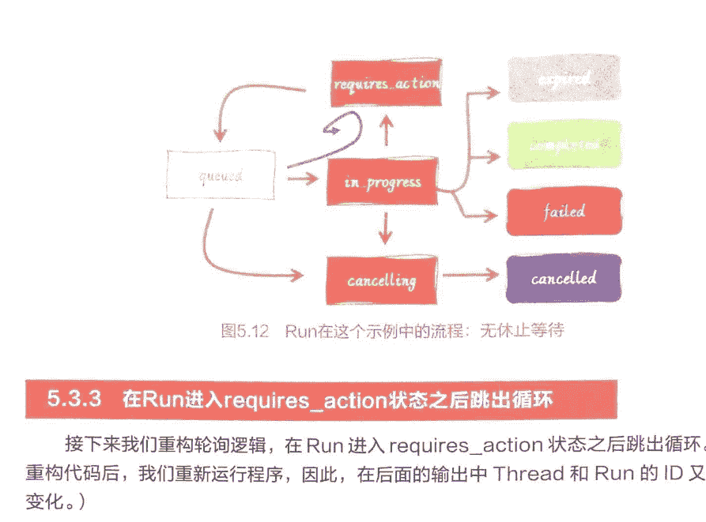

图5.12 Run在这个示例中的流程：无休止等待

### 5.3.3 在 requires_action 触发后中断轮询

下面重新设计轮询逻辑，使其在 Run 进入 requires_action 后能够立即退出。因为代码被修改并重新执行，后续的 Thread 与 Run 标识会发生变化。

```python
# 轮询 Run，等待 Run 的状态从 queue 转变为 completed 或者 requires_action
import time
# 定义轮询函数
def poll_run_status(client, thread_id, run_id, interval=5):
    n = 0
    while True:
        n += 1
        run = client.beta.threads.runs.retrieve(thread_id=thread_id,
                                                run_id=run_id)
        print(f"Run 的第 {n} 次轮询信息 :\n{run}\n")
        if run.status in ['requires_action', 'completed']:
            return run
        time.sleep(interval) # 等待后再次检查
# 轮询以检查 Run 的状态
run = poll_run_status(client, thread.id, run.id)
```

执行修改后的程序后，Run 先从 queued 变为 in_progress，随后进入 requires_action，循环随即结束。再度查询时，状态依旧是 requires_action，这里不再重复展示与表5.4相似的输出。

小雪连声表示明白。此时助手仍在等待函数调用的返回，只是我们改动的是退出时机，所以重新生成了 Thread 和 Run，状态演进的路径与之前一致。

### 5.3.4 读取助手返回的元数据字段

接下来进入关键操作，需要提取助手准备调用的 function_name、arguments、function_id 等核心字段，示例如下。

```python
# 定义一个从 Run 中读取 Function 的元数据的函数
def get_function_details(run):
    function_name = run.required_action.submit_tool_outputs.tool_calls[0].function.name
    arguments = run.required_action.submit_tool_outputs.tool_calls[0].function.arguments
    function_id = run.required_action.submit_tool_outputs.tool_calls[0].id
    return function_name, arguments, function_id
# 拿到 Function 的元数据
function_name, arguments, function_id = get_function_details(run)
print("function_name:", function_name)
print("arguments:", arguments)
print("function_id:", function_id)
```

```
function_name: get_encouragement
arguments: {"mood":"难过","name":"小雪"}
function_id: call_s6vSerztJc09mmKDQyfkjmrJ
```

小雪评价说，这些字段正是本地执行对应函数时所必需的输入。

咖哥确认道：没错。Run 回传的函数参数就是用来推进后续执行、真正把函数跑起来的依据。简单说，助手在其中扮演的角色是把人与人之间的口语对话，翻译成函数可以直接读取的输入形式。

按这个思路来看图 5.9 就顺了，我们的日常交流在助手这层被转成了函数可用的元数据，对照关系如下表所示。

## 表 5.5 人类语言、函数语言与助手的标记的对比

| 类型 | 内容 |

|------|------|

| 人类语言 | 快安慰一下伤心的小雪！ |

| 函数语言 | function_name: get_encouragement<br>arguments: {"mood":"难过","name":"小雪"} |

| 助手的标记 | function_id: call_s6vSerztJc09mmKDQyfkjmrJ |

### 5.3.5 通过助手的返回信息调用函数

先定义一个鼓励用函数，它接收用户当前情绪作为入口，返回一段安抚性文字。

```python
# 定义一个鼓励函数
def get_encouragement(mood, name=None):
    encouragement_messages = {
        "开心": "看到你这么阳光真好！保持这份积极！",
        "难过": "记得，每片乌云背后都有阳光。",
        "压力大": "深呼吸，慢慢呼出，一切都会好起来。",
        "疲倦": "你已经很努力，现在是时候休息一下了。"
    }
    # 如果提供了名字，则输出个性化消息
    if name:
        message = f"{name}, {encouragement_messages.get(mood, '抬头挺胸，一切都会变好。')}"
    else:
        message = encouragement_messages.get(mood, '抬头挺胸，一切都会变好。')
    return message
```

前文里这个函数已经出现过。

问题是，function_name 和 arguments 这两项怎么用来判断该执行哪个函数，以及为什么要这么判断？

小雪：这个我来示范，代码如下。

```python
# 将 JSON 字符串转换为字典
import json
arguments_dict = json.loads(arguments)
# 从字典中提取 'name' 和 'mood'
name = arguments_dict['name']
mood = arguments_dict['mood']
# 调用函数
encouragement_message = get_encouragement(name, mood)
# 打印结果以便验证
print(encouragement_message)
```

亲爱的小雪，你今天感觉如何？我总是在这里支持你！

咖哥：方向是对的。你先用 json.loads 把返回的 JSON 文本解析成对象，再把参数传给函数，最后拿到执行结果。助手给出的回复也算到位。只是目前只完成一半，你仅用 arguments 去调用了 get_encouragement，却没有借助 function_name 来做动态选择。

小雪：明白了，我再改一下。

```python
# 在这里，我可要动态调用程序了
# 定义可用的函数字典
available_functions = {
    "get_encouragement": get_encouragement
}
# 解析参数
import json
function_args = json.loads(arguments)
# 动态调用函数
function_to_call = available_functions[function_name]
encouragement_message = function_to_call(
    name=function_args.get("name"),
    mood=function_args.get("mood")
)
# 打印结果以便验证
print(encouragement_message)
```

> 亲爱的小雪，你今天感觉如何？我总是在这里支持你！

咖哥：这回就对了。用字典把函数名映射到对应的函数对象，就能实现动态调度，也就是依据 Function Calling 回传的 function_name 来调用不同的函数。

### 5.3.6 通过submit_tool_outputs提交结果以完成任务

表面上看，在助手的帮助下任务已经推进，本地的 get_encouragement 也产生输出了。

这一步里助手其实只是把自然语言转成了函数名和调用格式。

但还差最后一步——要通知 Run 任务已收尾，否则大约 10 分钟后 Run 会超时，状态变成 expired，见图 5.13。

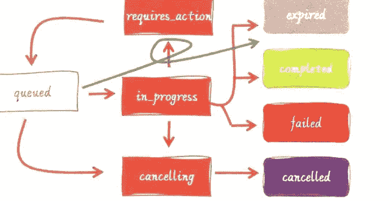

图5.13 没有人理会的Run在生存期结束后就会过期，将无法继续对话

小雪：对，对。虽然循环已退出、函数也执行了，可 Run 仍卡在等待函数调用结果的状态。对话不会自动变成 completed，也不会重新回到 queued。

接下来要做的最后一步，是用 submit_tool_outputs API 把结果回传给 Run。


Run 的有效期大概只有 10 分钟，所以别让它空等太久，必须及时提交调用结果，否则进入 expired 后就收不到 submit_tool_outputs 的反馈了。

提交结果的代码示例如下，要保证 tool_call_id 精确对应每一个 function_id，才能把响应和 Function Calling 匹配起来。

```python
# 定义提交结果的函数
def submit_tool_outputs(run,thread,function_id,function_response):
    run = client.beta.threads.runs.submit_tool_outputs(
        thread_id=thread.id,
        run_id=run.id,
        tool_outputs=[
            {
                "tool_call_id": function_id,
                "output": str(function_response),
            }
        ]
    )
    return run
# 向 Run 提交结果
run = submit_tool_outputs(run,thread,function_id,encouragement_message)
print(' 这时，Run 收到结果 ')
print(run)
```

> Out: Run(id='run_5r5k1C8u9Bh8aVYtBw0LOZzO', assistant_id='asst_pF2pMtIHOL4CpXpyUdHkoKG3', cancelled_at=None, completed_at=None, created_at=1708534757, expires_at=1708535357, failed_at=None, file_ids=[], instructions=' 你是一个很会鼓励人的助手！ ', last_error=None, metadata={}, model='gpt-4-turbo-preview', object='thread.run', required_action=None, started_at=1708534757, status='queued', thread_id='thread_Ko2xY4FmKV5ZEU2rpXncHuCk', tools=[ToolAssistantToolsFunction(function=FunctionDefinition(name='get_encouragement', description=' 根据用户的心情提供鼓励信息 ', parameters={'type': 'object', 'properties': {'mood': {'type': 'string', 'description': ' 用户当前的心情，例如：开心，难过，压力大，疲惫 '}, 'name': {'type': 'string', 'description': ' 用户的名字，用来个性化鼓励信息 '}}, 'required': ['mood']}), type='function')], usage=None)

提交后可以看见，Run 又回到了 queued，正在等待系统资源继续执行，见图 5.14。

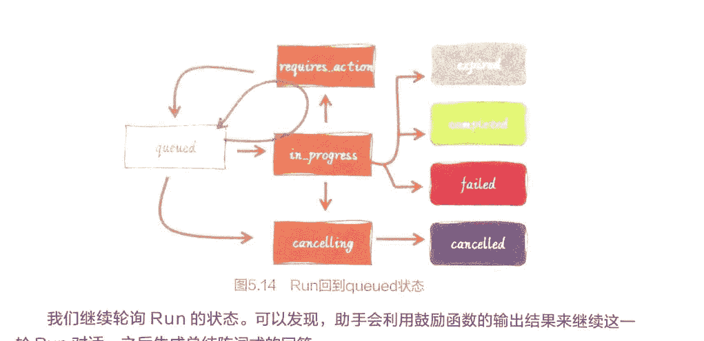

## 图5.14 Run回到queued状态

继续轮询 Run 的状态。可以看到，助手会基于鼓励函数返回的内容继续这一轮 Run 的对话，随后给出总结式的回复。

```python
# 再次轮询 Run 直至完成
run = poll_run_status(client, thread.id, run.id)
print(' 这时， Run 继续执行直至完成 ')
print(run)
```

```
Run 的第 1 次轮询信息：
Run(id='run_5r5k1C8u9Bh8aVYtBw0LOZzO', assistant_id='asst_pF2pMtIHOL4CpXpyUdHkoKG3', cancelled_at=None, completed_at=None, created_at=1708534757, expires_at=1708535357, failed_at=None, file_ids=[], instructions=' 你是一个很会鼓励人的助手！ ', last_error=None, metadata={}, model='gpt-4-turbo-preview', object='thread.run', required_action=None, started_at=1708534763, status='in_progress', thread_id='thread_Ko2xY4FmKV5ZEU2rpXncHuCk', tools=[ToolAssistantToolsFunction(function=FunctionDefinition(name='get_encouragement', description=' 根据用户的心情提供鼓励信息 ', parameters={'type': 'object', 'properties': {'mood': {'type': 'string', 'description': ' 用户当前的心情，例如：开心，难过，压力大，疲倦 '}, 'name': {'type': 'string', 'description': ' 用户的名字，用来个性化鼓励信息 '}}, 'required': ['mood']}), type='function')], usage=None)

Run 的第 2 次轮询信息：
Run(id='run_5r5k1C8u9Bh8aVYtBw0LOZzO', assistant_id='asst_pF2pMtIHOL4CpXpyUdHkoKG3', cancelled_at=None, completed_at=None, created_at=1708534757, expires_at=1708535357, failed_at=None, file_ids=[], instructions=' 你是一个很会鼓励人的助手！ ', last_error=None, metadata={}, model='gpt-4-turbo-preview', object='thread.run', required_action=None, started_at=1708534763, status='in_progress', thread_id='thread_Ko2xY4FmKV5ZEU2rpXncHuCk', tools=[ToolAssistantToolsFunction(function=FunctionDefinition(name='get_encouragement', description=' 根据用户的心情提供鼓励信息 ', parameters={'type': 'object', 'properties': {'mood': {'type': 'string', 'description': ' 用户当前的心情，例如：开心，难过，压力大，疲倦 '}, 'name': {'type': 'string', 'description': ' 用户的名字，用来个性化鼓励信息 '}}, 'required': ['mood']}), type='function')], usage=None)

Run 的第 3 次轮询信息：
Run(id='run_5r5k1C8u9Bh8aVYtBw0LOZzO', assistant_id='asst_pF2pMtIHOL4CpXpyUdHkoKG3', cancelled_at=None, completed_at=1708534777, created_at=1708534757, expires_at=None, failed_at=None, file_ids=[],
instructions='你是一个很会鼓励人的助手！', last_error=None, metadata={}, model='gpt-4-turbo-preview',
object='thread.run', required_action=None, started_at=1708534763, status='completed', thread_id='thread_Ko2xY4FmKV5ZEU2rpXneHuCk', tools=[ToolAssistantToolsFunction(function=FunctionDefinition(name='get_encouragement', description='根据用户的心情提供鼓励信息', parameters={'type': 'object', 'properties': {'mood': {'type': 'string', 'description': '用户当前的心情，例如：开心，难过，压力大，疲倦'}, 'name': {'type': 'string', 'description': '用户的名字，用来个性化鼓励信息'}}, 'required': ['mood']}), type='function')],
usage=Usage(completion_tokens=214, prompt_tokens=760, total_tokens=974))
```

随后 Run 继续运转，几秒内由 queued 变为 in_progress，保持轮询直到结束。最终 Run 变为 completed 状态，助手任务收尾，并给出最终对话文本。

从启动到结束，包含 Function Calling 的 Run 状态流转如图 5.15 所示。


## 图5.15 包含Function Calling 的Run的状态流转过程

下面是最终 Message 的打印。

```python
# 获取助手在 Thread 中的回应
messages = client.beta.threads.messages.list(
    thread_id=thread.id
)
# 输出助手的回应
print(' 打印最终的 Message')
for message in messages.data:
    if message.role == "assistant":
        print(f" 最终返回的信息 :\n{message.content}\n")
```

```
最终返回的信息：
[MessageContentText(text=Text(annotations=[], value=' 亲爱的小雪，请记住，无论今天发生了什么，你都不是孤独一人。我会守候在这里，给你最大的支持和安慰。每一次挑战，都是成长的机会，信任你自己的力量，你会发现那些使你难过的事情最终会变成你的宝贵经历。让自己伤心是没问题的，允许自己感受那些情绪，但同时也要相信，事情总会变得更好。加油，小雪！我相信你能度过这一切。'), type='text')]
```小雪：鼓励收到了，心情好多了。只是整个流程确实有点绕。

咖哥：是的。带 Function Calling 的 Run 完整状态如表 5.6 所示。

### 表5.6 包含Function Calling的Run的完整状态

| 序号 | 状态 | 说明 |

| :--- | :--- | :--- |

| 1 | queued | 当Run被创建后，会将其状态转变为queued |

| 2 | in_progress | Run几乎立即从queued状态转变为in_progress状态。当Run处于in_progress状态时，助手使用大模型和工具来执行相关步骤。可以通过检查Run Steps来查看Run的进度 |

| 3 | requires_action | 当 Run 判断本次生成需要借助函数调用时，一旦大模型已确定函数名和入参，Run 就进入 requires_action。此时必须先执行对应的函数并把结果提交回去，Run 才会继续往下走。若在创建后约 10 分钟的 expires_at 截止前仍未提供输出，Run 会变成 expired |
| 4 | queued | Run 收到函数调用返回的 JSON 字符串后，会在内部完成调用，并通过 submit_tool_outputs 接口把结果递回给 Run，状态随之变为 queued |
| 5 | in_progress | 紧接着 queued 会立刻切换为 in_progress，这一阶段 Run 不必再等待函数返回，直接进入对话处理 |
| 6 | completed | Run 已顺利结束。可以查看 Thread 中助手产生的所有消息和 Run 的完整执行轨迹。若想继续，也可以往 Thread 追加新的用户消息并启动一个新的 Run |

咖哥：和最开始直接跟 ChatGPT 普通聊天相比，刚才这个 Run 的状态流转到底发生了什么变化？哪里不一样了？

小雪：普通聊天是模型直接回答案。这一次模型并没有立刻给出回复，而是先借助 Function Calling 做了动态函数调用，这里调用了 get_encourage 函数，把函数返回的结果连同之前的历史对话一起再交给大模型，最后才产出最终的应答。

## 5.4 ChatCompletion API 下的 Tool Calls 实战
前面已经把 Assistants 的 Function Calling 讲清楚了。下面趁热打铁，用一个相近的例子来演示 ChatCompletion API 如何完成 Tool Calls。整体走法和上一个示例基本一致。

和 Assistants 一样，ChatCompletion 也能用自然语言描述函数，让模型自行输出用于调用一个或多个函数的参数 JSON。API 本身并不会执行函数，只负责生成调用所需的 JSON 结构。拿到这个结构后，我们再在代码里去调用真正的函数，得到想要的数据。

小雪：这次给花语秘境做一个自动查库存的 Agent 吧！

咖哥：好，就用一次响应里多次调用函数的场景。做法和 5.3 节完全相同，先定义一个查询鲜花库存的函数，并在对话里让模型知道它的存在。把用户问题、可用函数一起发给模型，如果模型判定需要调用，就执行函数、把结果再喂回模型继续推进对话。

### 5.4.1 对话初始化与函数定义
先定义一个能按城市返回鲜花库存的函数 get_flower_inventory，以及用 tools 列表对函数做元数据说明。这个 tools 列表就是我们之前反复提到的 JSON 描述。如果有多个函数，只要把它们追加到列表里即可。

```python
# 创建 client
from openai import OpenAI
client = OpenAI()
# 定义查询鲜花库存的函数
def get_flower_inventory(city):
    """ 获取指定城市的鲜花库存 """
    if "北京" in city:
        return json.dumps({"city": "北京", "inventory": "玫瑰：100, 郁金香：150"})
    elif "上海" in city:
        return json.dumps({"city": "上海", "inventory": "百合：80, 康乃馨：120"})
    elif "深圳" in city:
        return json.dumps({"city": "深圳", "inventory": "向日葵：200, 玉兰：90"})
    else:
        return json.dumps({"city": city, "inventory": "未知"})

# 定义工具列表（函数元数据）
tools = [
    {
        "type": "function",
        "function": {
            "name": "get_flower_inventory",
            "description": "获取指定城市的鲜花库存",
            "parameters": {
                "type": "object",
                "properties": {
                    "city": {
                        "type": "string",
                        "description": "城市名称，如北京、上海或深圳"
                    }
                },
                "required": ["city"]
            }
        }
    }
]
```

这段代码声明了一个简单的 get_flower_inventory 函数，功能是根据城市名返回对应的库存查询能力。同时也构造了工具列表，用元数据把该函数描述成可在特定上下文中被调用的工具。

目前实现的内部逻辑比较简化，实际项目里可以完善代码并接入数据库来实现真实查询。

小雪：明白了。

### 5.4.2 首轮调用模型并拿到工具请求
先在 messages 里初始化对话内容，再把对话和工具定义一起发送给大模型，获取第一轮响应。

因为这里直接用 ChatCompletion 而不是 Assistants，所以不需要创建助手或线程之类的资源。

```python
# 初始化对话内容
messages = [{"role": "user", "content": "北京、上海和深圳的鲜花库存是多少？"}]
print("message:", messages)

# 第一次对话响应
first_response = client.chat.completions.create(
    model="gpt-3.5-turbo",
    messages=messages,
    tools=tools,
    tool_choice="auto"
)

# 打印响应的内容
print(first_response)
response_message = first_response.choices[0].message
```

```python
message: [{'role': 'user', 'content': '北京、上海和深圳的鲜花库存是多少？'}]
first_response:
ChatCompletion(
    id='chatcmpl-8pp0atDsIXTE0NesPItrFDNZ5Kszj',
    choices=[Choice(finish_reason='tool_calls', index=0, logprobs=None,
    message=ChatCompletionMessage(content=None, role='assistant', function_call=None,
    tool_calls=[ChatCompletionMessageToolCall(id='call_DhKVYSzAsqJ2DKkYLhmlhNYH',
    function=Function(arguments='{"city": "北京"}', name='get_flower_inventory', type='function'),
    ChatCompletionMessageToolCall(id='call_EW6HrY9AOWUV40KsOifY7efY',
    function=Function(arguments='{"city": "上海"}', name='get_flower_inventory', type='function'),
    ChatCompletionMessageToolCall(id='call_g9yb7ebEzIU8vcICx00kGYK8',
    function=Function(arguments='{"city": "深圳"}', name='get_flower_inventory', type='function'))])],
    created=1707361496, model='gpt-3.5-turbo', object='chat.completion',
    system_fingerprint='fp_69829325d0', usage=CompletionUsage(completion_tokens=67, prompt_tokens=95,
    total_tokens=162))
```

ChatCompletion 返回的结构说明如下。

id='chatcmpl-8pp0atDslXTE0NesPItrFDNZ5Kszj' 为本次完成的唯一标识。

choices 里装着模型生成的所有回答。本例里因为请求的是工具调用，所以主要内容是工具调用请求而非文本。关键字段如下。

- finish_reason='tool_calls'，表示结束原因是需要执行工具调用。
- index=0，表示这是第一条也是唯一一条生成的回答。
- logprobs=None，因为未请求对数概率。

message 字段包含：

- content=None，这一轮输出是工具调用请求，没有具体文本。
- role='assistant'，表明这是助手发起的工具调用请求。

tool_calls 列出了三项工具调用请求，分别针对北京、上海、深圳调用 get_flower_inventory，每个调用都有独立的 ID、函数名和参数，如 {"city": "北京"}。

created=1707361496 为生成时间戳。model='gpt-3.5-turbo'。object='chat.completion' 表示这是一个聊天完成对象。system_fingerprint='fp_69829325d0' 用于内部跟踪与优化。

usage 给出 token 消耗：completion_tokens=67，prompt_tokens=95，total_tokens=162。

可以看到模型识别出用户意图需要三次工具调用，分别获取三座城市的库存信息。这三次调用也可以指向不同的工具。

前面强调过，这个输出仅是模型给出的调用参数，不是最终答案。模型此时没有给出文本回复，而是生成了待执行的工具调用请求，等待执行结果。

“{"city": "北京"}” 这种 JSON 形式，和 Assistants API 中的 Function Calling 完全一致。无论 Assistants 还是 ChatCompletion，只要启用 Function Calling / Tool Calls，都会默认使用 JSON 模式，保证输出是可解析的有效 JSON。


JSON 模式的要点如下。

- 启用后模型只能输出可解析为有效 JSON 的字符串。
- 为确保格式正确，通常在系统消息里明确指示模型输出 JSON。
```json
{
  "role": "system",
  "content": "You are a helpful assistant designed to output JSON."
}
```
- 若上下文未明确要求 JSON，模型可能产生大量空白字符直至耗尽 token 限制。为避免此情况，API 会在未见到 “JSON” 提示时报错。
- 若达到 max_tokens 限制或超出 token 预算，返回的 JSON 可能是截断的。解析前应先检查 finish_reason 是否完整。
- JSON 模式保证输出是合法 JSON，但不保证完全符合特定 schema。
- Function Calling 时，JSON 模式能强制模型输出规范参数，确保自动化处理与系统集成更可靠。

### 5.4.3 执行模型选中的工具并组装新消息
下一步要判断模型响应里是否包含工具调用请求，也就是是否需要真的去查库存。

实现上需要遍历 tool_calls，为每个条目调用 get_flower_inventory，获取库存信息。

要回应这些请求，需要向对话里追加三条新消息，每条消息携带一次函数调用的结果，并用 tool_call_id 关联到对应的调用。

```python
# 检查是否需要调用工具
tool_calls = response_message.tool_calls
if tool_calls:
    messages.append(response_message)
    # 如果需要调用工具，调用工具并添加库存查询结果
    for tool_call in tool_calls:
        function_name = tool_call.function.name
        function_args = json.loads(tool_call.function.arguments)
        function_response = get_flower_inventory(
            city=function_args.get("city")
        )
        messages.append(
            {
                "tool_call_id": tool_call.id,
                "role": "tool",
                "name": function_name,
                "content": function_response,
            }
        )
# 打印当前消息列表
print("message:", messages)
```

```python
message: [{'role': 'user', 'content': '北京、上海和深圳的鲜花库存是多少？'}, ChatCompletionMessage(content=None, role='assistant', function_call=None, tool_calls=[ChatCompletionMessageToolCall(id='call_HgwcAAlWCyRwPFDib9dYxkUq', function=Function(arguments='{"city": "北京"}', name='get_flower_inventory'), type='function'), ChatCompletionMessageToolCall(id='call_2qEge0rKcpS4ZkY5QdY0pYdr', function=Function(arguments='{"city": "上海"}', name='get_flower_inventory'), type='function'), ChatCompletionMessageToolCall(id='call_nZlxb3ITZzi9eE5YFdHCzBBF', function=Function(arguments='{"city": "深圳"}', name='get_flower_inventory'), type='function')]), {'tool_call_id': 'call_HgwcAAlWCyRwPFDib9dYxkUq', 'role': 'tool', 'name': 'get_flower_inventory', 'content': '{"city": "北京", "inventory": "玫瑰: 100, 郁金香: 150"}'}, {'tool_call_id': 'call_2qEge0rKcpS4ZkY5QdY0pYdr', 'role': 'tool', 'name': 'get_flower_inventory', 'content': '{"city": "上海", "inventory": "百合: 80, 康乃馨: 120"}'}, {'tool_call_id': 'call_nZlxb3ITZzi9eE5YFdHCzBBF', 'role': 'tool', 'name': 'get_flower_inventory', 'content': '{"city": "深圳", "inventory": "向日葵: 200, 玉兰: 90"}'}]
```

下面这段代码实际运行的脉络可以拆成以下几个环节。

1. 先判断是否需要调用工具，也就是 tool_calls 列表里有没有内容。

2. 如果确实需要调用，就依次执行工具调用，拿到北京、上海、深圳三座城市的鲜花库存。

   - 读出工具调用里的函数名 function_name 与参数 function_args，这里用的是 get_flower_inventory。
   - 拿着提取出来的城市名去调用 get_flower_inventory，返回对应城市的库存。

3. 每次 get_flower_inventory 执行完后，会新建一条消息，包含工具调用 ID、角色、函数名称以及返回的库存内容，然后追加到 messages。

4. 打印这份更新后的消息列表。列表里既有用户的原始提问，也有三座城市的库存结果。

更新后消息列表里具体有哪些内容，见表 5.7。

表 5.7 更新后的消息列表包含的信息

| 角色 | 内容 | tool_call_id | 说明 |

| :--- | :--- | :--- | :--- |

| user | 北京、上海和深圳的鲜花库存是多少？ | — | 原始问题 |

| assistant | 内含 tool_calls | — | ChatGPT 返回的 ChatCompletionMessage |

| tool | {"city": "北京", "inventory": "玫瑰：100, 郁金香：150"} 的 UTF 编码 | call_HgwcaAlWCyRwPFDib9dYxkUq | get_flower_inventory函数调用结果 |

| tool | {"city": "上海", "inventory": "百合：80, 康乃馨：120"} 的 UTF 编码 | call_2qEge0rKcpS4ZkY5QdY0pYdr | get_flower_inventory函数调用结果 |

| tool | {"city": "深圳", "inventory": "向日葵：200, 玉兰：90"} 的 UTF 编码 | call_nZlxb3ITZi9eE5YFdHCzBBF | get_flower_inventory函数调用结果 |

小雪：咖哥，我有点想不通两件事，第一，为什么要把函数返回的结果挂到消息列表里；第二，列表里显示的为什么是 UTF 编码，看着不舒服。

咖哥：那个 UTF 编码应该是模型内部转码后的呈现方式。阅读体验确实一般，但办法是有的。你回想一下，Assistants API 做 Function Calling 的完整示例里，最后一步我们要干嘛？

小雪（琢磨一阵）：哦，我懂了。我们要把这条带工具查询结果的消息列表再喂回大模型，让它把原始的库存数据整理成普通人能直接看懂的最终答案。

咖哥：对，就是这个思路，思维很清晰。

### 5.4.4 第二次向大模型发送对话以获取最终响应

把更新后的消息列表再发一次给大模型，拿到最终的人类可读响应。

```
# 第二次向大模型发送对话以获取最终响应
second_response = client.chat.completions.create(
    model="gpt-3.5-turbo",
    messages=new_messages
)
# 打印最终响应
final_response = second_response.choices[0].message
print(final_response)
```

```
ChatCompletion(id='chatcmpl-8pp0cTdOj5aLn1Ny3t1ldRyXyoE9w', choices=[Choice(finish_reason='stop', index=0, logprobs=None, message=ChatCompletionMessage(content=' 北京的鲜花库存为：玫瑰：100，郁金香：150\n 上海的鲜花库存为：百合：80，康乃馨：120\n 深圳的鲜花库存为：向日葵：200，玉兰：90', role='assistant', function_call=None, tool_calls=None))], created=1707361498, model='gpt-3.5-turbo', object='chat.completion', system_fingerprint='fp_69829325d0', usage=CompletionUsage(completion_tokens=90, prompt_tokens=235, total_tokens=325))
```

这次返回的 ChatCompletion 结构各字段意思是这样的。

id='chatcmpl-8pp0cTdOj5aLn1Ny3t1ldRyXyoE9w'，本次对话完成的唯一标识。

choices 是模型生成回答的数组，这里只有一条。关键字段：

- finish_reason='stop'，表示模型是正常结束生成。
- index=0，表示这是第一条也是唯一一条回答。
- logprobs=None，因为没有请求对数概率。

message 里包含：

- content 是模型生成的正文：北京鲜花库存是“玫瑰：100，郁金香：150”；上海是“百合：80，康乃馨：120”；深圳是“向日葵：200，玉兰：90”。
- role='assistant'，说明是助手在回答。

created=1707361498，回答生成的时间戳。

model='gpt-3.5-turbo'，使用的模型。

object='chat.completion'，对象类型。

system_fingerprint='fp_69829325d0'，系统内部的性能追踪标记。

usage 给出调用消耗：

- completion_tokens=90，生成部分用掉的 token。
- prompt_tokens=235，提示部分用掉的 token。
- total_tokens=325，总消耗。

到这里，模型先调用工具拿到数据，再基于工具结果生成一份北京、上海、深圳三城鲜花库存的完整说明，普通用户也能直接看懂。

- 北京：玫瑰 100，郁金香 150。
- 上海：百合 80，康乃馨 120。
- 深圳：向日葵 200，玉兰 90。

## 5.5 小结

到目前为止，Assistants、OpenAI API、Function Calling 和 Tools 这几块的核心用法已经讲清楚了。

无论是 Assistants API 里的 Function Calling，还是 ChatCompletion API 里的 Tool Calls，开发者都可以自行定义函数，模型能智能地输出包含一个或多个函数调用参数的 JSON。

借助工具调用，我们可以做到：

- 搭建能调用外部工具完成操作的聊天机器人。
- 把自然语言请求转成具体的函数调用，比如发邮件、查天气。
- 把自然语言查询转成 API 调用或数据库查询，实现基于实时数据的动态回复。
- 从非结构化文本里抽取结构化信息，按预设格式解析细节。

工具的选择与使用，既是远古人类智能的体现，也是现代 Agent 智能的关键。Agent 能通过 Function Calling 自主挑选工具，这正是其智能行为的体现。未来值得期待的方向有两点：

- Agent 在选工具的同时具备自主学习能力，能根据正负反馈调整选择策略。
- 强化 Agent 并行调用多工具的能力，提升在复杂系统中的运行效率。

# 第6章

## Agent 3：ReAct 驱动的智能定价实战

小雪和咖哥分工明确。小雪负责用户界面调研，她做了很多原型，希望 Agent 能用简单对话把用户带到想要的产品，还在页面里加入节日小知识、花语解读、色彩心理学提示，让买花变成一次愉快的体验。

咖哥则主攻 Agent 开发。他和研发团队搭了一套算法模型，模型既能理解用户查询，也能从浏览和购买历史里学习，推荐越用越准。同时还做了一个动态库存系统，用 AI 预测需求、优化库存、减少浪费，保证花随时能买到。

小雪：咖哥，能不能再加个功能，让 Agent 根据实时天气和交通状况自动调价，优化销售和库存呢？

小雪的新需求如图 6.1。


图6.1 小雪向咖哥提出了新的需求

咖哥：可以，这次我们用 LangChain 来实现。动手前，先把之前讲过的 ReAct 框架过一遍。

## 6.1 复习ReAct框架

咖哥：经营花店时，天气一变价格就得跟着动。你每天早上给鲜花定价时会怎么做？

小雪：我会先想办法（思考），然后去搜索引擎查今天鲜花的成本价（行动），据此估算进货价，再根据进货价的高低（观察）决定加价幅度（思考），最后得出售价（行动）。人类为鲜花定价的流程如图 6.2。


图6.2 小雪（人类）为鲜花定价的过程

这就是人在面对新任务时的典型决策路径：先思考再行动，或在行动后观察再思考。观察和思考合起来叫推理，推理指导行动。

ReAct 的灵感就来自推理和行动的协同。它让模型在解决问题的过程中交替产生推理轨迹和行动步骤，把两者融合起来。

ReAct 出现前，也有只强调一步步思考的思维链，以及强调与环境交互的 SayCan 和 WebGPT 等（见图 6.3）。


图6.3 从仅推理、仅执行的简单框架到ReAct框架[3]

注：LM 表示 Language Model，即大模型。

ReAct 把推理和行动结合起来，形成观察—思考—行动的解决轨迹。推理部分负责观察当前状态并生成推理线索，帮助模型跟踪和更新计划，甚至处理异常。行动部分负责让模型下一步去干嘛，比如查知识库、调外部资源或直接给出答案。检索信息的加入，能有效缓解思维链常见的幻觉和错误累积，让轨迹更可解释、更贴近事实。

相比只推理不行动、或只不断交互不反思的模式，ReAct 有效得多。

论文 “ReAct: Synergizing Reasoning and Acting in Language Models” [42] 给出了一个对比案例（见图 6.4）。


问题是 “Aside from the Apple TV, what other device can control the program Apple Remote was originally designed to interact with?”。不同框架的表现见表 6.1。

表 6.1 不同框架驱动大模型解决问题的结果对比

| 框架 | 描述 | 结果 |

|------|------|------|

| 标准（Standard） | 直接给出错误答案 iPod，没有推理也没有外部交互 | 错误的答案：iPod |

| 仅推理（Reason only） | 逐步推理但不验证，错误推断出 iPhone、iPad、iPod Touch | 错误的答案：iPhone、iPad、iPod Touch |

| 仅行动（Act only） | 反复在维基百科搜索 Apple Remote、Front Row 等，但缺乏推理整合，误判要结束搜索 | 错误的决策：结束搜索 |

| ReAct | 先推理确定搜索 Apple Remote，观察结果后继续推理，识别出需要搜 Front Row，多轮交互后准确得出答案“键盘功能键” | 正确的答案：键盘功能键 |

这个例子说明 ReAct 能把推理和行动编织在一起，每一步都互相验证，最终得到准确且可解释的结果。因为需要外部交互，ReAct 不那么依赖模型内部知识。学术上提出后，ReAct 的工程实现和落地场景越来越多。

LangChain 用 ReAct 框架来提升 Agent 能力，可算是 Agent 设计的重要里程碑，通过把推理和行动结合、保持对齐和可控，更好地处理交互式决策任务。

## 6.2 LangChain中ReAct Agent 的实现

在 LangChain 里用 Agent，核心是理解 4 个要素：

- 大模型：提供推理引擎，生成预测和处理输入。
- 提示 prompt：塑造推理框架，引导模型思考方式。
- 外部工具 external tools：数据清洗、搜索引擎、应用等。
- Agent 执行器 Agent executor：挑选合适的工具并管理流程。

收到用户输入后，Agent 先决定调用哪些工具，再用工具结果给出答案。它能同时用多种工具，也能把一个工具的输出作为另一个工具的输入。

思路看似简单，实操中有不少细节。大模型需要自主判断下一步动作，没引导的话容易卡住。

比如任务是查库存，库存不足就找商家进货。完成它需要一系列判断和操作。

跨步骤任务里智能体如何自主决策

在需要多环节配合的流程中，常会冒出这些问题：
- 本地知识库应该在哪个时机启动检索？这一步相对容易上手。
- 如何确认本地检索已经收尾，具备进入下一阶段的条件？
- 外部检索该接入哪家服务，比如谷歌？
- 外部检索返回的内容是否符合预期？
- 拿到外部数据后怎样判断其可信度再规划后续动作？

面对这种环环相扣的场景，LangChain 的智能体凭借什么机制完成自规划、自判断和自执行？

> > 小雪插嘴：那当然是 ReAct 框架啦！
> > 咖哥：对。LangChain 内部实现了多种智能体形态，例如自问自答结合搜索、结构化对话以及 ReAct 框架，其中最具代表性的就是 ReAct。

借助对 ReAct 框架的完整封装，LangChain 能让大语言模型获得很强的自主性。引入 ReAct 后，模型不再仅靠内部知识进行闲聊，而是升级为能够调用外部能力的智能体。

在 LangChain 中，一个智能体通常包含一个大语言模型和一份精心设计的提示。提示里会设定智能体的角色人设、任务背景上下文，以及像 ReAct 这样的推理策略，用以激发更好的思考。

## 6.3 LangChain 中的工具和工具包

ReAct 会引导模型为任务生成推理轨迹和行动序列，使智能体能够系统化地进行动态推理，创建、维护并调整执行计划，同时支持与外部环境比如谷歌搜索、维基百科进行交互，把额外信息并入推理。这个与外部环境交互的过程，本质上就是调用并执行插件的动作。本地知识库或搜索引擎并不是模型内置的知识，我们称之为“外部工具”（见图 6.5）。


图6.5 大模型可以通过外部工具获取额外信息

LangChain 将能力拆成工具和工具包两类。

工具是智能体可调用的函数。设计时要关注两点：一是为智能体配齐合适的插件；二是把插件作用描述得清晰易懂。插件不匹配，任务难以完成；描述不清，智能体就无从下手。除了官方自带的插件集，开发者也可以自行定义。

目前 LangChain 支持的工具及其说明如表 6.2 所示。

表6.2 LangChain支持的工具及其说明

| 工具 | 说明 |
|---|---|
| Apify | 用于网页抓取与自动化操作 |
| ArXiv API Tool | 支持访问 ArXiv 学术论文 |
| AWS Lambda API | 提供无服务器云函数调用能力 |
| Shell Tool | 让模型可直接操作系统 Shell |
| Bing Search | 返回 Bing 搜索结果 |
| Brave Search | 返回 Brave 搜索结果 |
| ChatGPT Plugins | 用于扩展 ChatGPT 功能的插件 |
| DataForSEO API Wrapper | 汇总多搜索引擎结果的封装 |
| DuckDuckGo Search | 返回 DuckDuckGo 搜索结果 |
| File System Tools | 集合本地文件系统操作能力 |
| Golden Query | 基于知识图谱的自然语言问答 |
| Google Places | 获取 Google 地点信息 |
| Google Search | 返回 Google 搜索结果 |
| Google Serper API | 需申请 API 密钥的网络搜索服务 |## 6.4 通过create_react_agent创建鲜花定价Agent

| 工具 | 说明 |
|---|---|
| Gradio Tools | 支持与 Gradio 应用交互 |
| GraphQL tool | 执行 GraphQL 查询 |
| huggingface_tools | 连接 Hugging Face 生态 |
| Human as a tool | 将人工介入作为工具使用 |
| IFTTT WebHooks | 连接 IFTTT WebHook |
| Lemon AI NLP Workflow Automation | 自动化 NLP 流程 |
| Metaphor Search | 面向模型的搜索引擎 |
| OpenWeatherMap API | 查询天气数据 |
| PubMed Tool | 检索 PubMed 医学文献 |
| Requests | 通过 HTTP 请求获取网络信息 |
| SceneXplain | 生成图像文字描述 |
| Search Tools | 集合多种搜索能力 |
| SearxNG Search API | 呼叫自托管 SearxNG API |
| SerpApi | 提供网络搜索结果 |
| Twilio | 发送短信或消息 |
| Wikipedia | 检索维基百科内容 |
| Wolfram Alpha | 调用 Wolfram Alpha 知识引擎 |
| YouTubeSearchTool | 搜索 YouTube 视频 |
| Zapier Natural Language Actions API | 自然语言驱动的 Zapier 操作 |

工具包是一组为达成特定目标而关联的插件集合。每个工具包包含多个插件。例如 LangChain 的 Office365 工具包就涵盖 Outlook 连接、邮件列表读取、发送邮件等一系列能力。当然还有很多其他工具包可供选择。

目前 LangChain 支持的工具包及其说明如表 6.3 所示。

| 工具包 | 说明 |
|---|---|
| Amadeus Toolkit | 连接 Amadeus 旅行 API |
| Azure Cognitive Services Toolkit | 调用 Azure 多模态服务 |
| GitHub Toolkit | 基于 PyGitHub 与 GitHub 仓库交互 |
| Gmail Toolkit | 操作 Gmail 邮箱 |
| Jira | 操作 Jira 项目 |
| MultiOn Toolkit | 连接浏览器自动化客户端 MultiOn |
| Office365 Toolkit | 接入 Office365 邮件日历 |
| PlayWright Browser Toolkit | 用 Playwright 浏览动态网站 |

表 6.2 与表 6.3 所列的能力会随版本演进不断扩充，这也让 LangChain 的边界持续扩大。下面是一段为 LangChain 智能体分配工具包中插件的示例代码。

```
# 导入 Gmail 工具包
from langchain_community.agent_toolkits import GmailToolkit
# 初始化工具包中的所有工具
toolkit = GmailToolkit()
tools = toolkit.get_tools()
# 创建一个 Agent 并为 Agent 分配工具
from langchain.agents import create_react_agent
agent = create_react_agent(llm, tools, prompt)
```

关于上述插件与工具包的详细用法，请参考 LangChain 官方文档。我们接下来会给出一个 ReAct 智能体调用搜索以及数学插件的示例。

本节将借助 LangChain 的 create_react_agent 功能搭建一个 ReAct 智能体。任务设定为：先查出当前玫瑰花的市场价格，再在此基础上计算加价 5% 后的新价。

准备工作可参照 2.5.2 节，例如安装 OpenAI、LangChain，在 SerpApi 注册账号获取 SERPAPI_API_KEY 并安装对应包。本节会为模型提供 Google 搜索能力。

另外还需要安装 numexpr 数学包，这是 llm-math 插件的依赖。

```
pip install numexpr
```

设置 OpenAI 网站和 SerpApi 网站提供的 API 密钥。

```
# 设置 OpenAI 网站和 SerpApi 网站提供的 API 密钥
import os
os.environ["OpenAI_API_KEY"] = '你的 OpenAI API 密钥'
os.environ["SERPAPI_API_KEY"] = '你的 SerpAPI API 密钥'
```

随后加载将用于驱动智能体的模型。

```
# 初始化大模型
from langchain_openai import OpenAI
llm = OpenAI(temperature=0)
```

接下来加载待使用的插件。此处为模型配备两项能力——SerpApi，即调用 Google 搜索引擎的插件，用于查找当前玫瑰花的市场价格；llm-math，即通过模型进行数学计算的插件，用于计算售价。

```
# 设置工具
from langchain.agents import load_tools
tools = load_tools(["serpapi", "llm-math"], llm=llm)
```

随后设计提示模板以落地 ReAct 认知框架。

```
# 设计提示模板
from langchain.prompts import PromptTemplate
template = (
    '尽你所能回答以下问题。如果能力不够，你可以使用以下工具:\n\n'
    '{tools}\n\n'
    'Use the following format:\n\n'
    'Question: the input question you must answer\n'
    'Thought: you should always think about what to do\n'
    'Action: the action to take, should be one of [{tool_names}]\n'
    'Action Input: the input to the action\n'
    'Observation: the result of the action\n'
    '... (this Thought/Action/Action Input/Observation can repeat N times)\n'
    'Thought: I now know the final answer\n'
    'Final Answer: the final answer to the original input question\n\n'
    'Begin!\n\n'
    'Question: {input}\n'
    'Thought:{agent_scratchpad}'
)
prompt = PromptTemplate.from_template(template)
```

咖哥：这份提示模板是不是很眼熟？
小雪：对，曾用过 LangChain Hub 上 hwchase17 提供的 ReAct 提示模板，和这个很像。
咖哥：没错。这次我们自行制作的 ReAct 提示仍基于同一认知框架，只是可以加入个性化要求，例如要求智能体用中文作答、限定最终答案格式或把字数控制在 100 字以内等。

ReAct 提示模板包含的部分及其说明如表 6.4 所示。

表 6.4 ReAct 提示模板包含的部分及其说明

| 部分 | 说明 |
| :--- | :--- |
| 介绍 | 尽你所能回答以下问题。如果能力不够，你可以使用以下工具： |
| 工具列表 | {tools} |
| 格式指南 | 使用以下格式： |
| 问题 | 你需要回答的输入问题 |
| 思考 | 你应该始终考虑接下来的操作 |
| 行动 | 需要采取的行动，应该是 [{tool_names}] 中的一个 |
| 行动输入 | 对行动的输入 |
| 观察 | 行动的结果 |
| 循环 | ...（这个思考/行动/行动输入/观察可以重复 N 次） |
| 最终思考 | 我现在知道了最终答案 |
| 最终答案 | 对原始输入问题的最终回答 |
| 开始指令 | 开始！ |
| 实际用例 | 问题：{input}\n 思考：{agent_scratchpad} |

接下来使用 create_react_agent 函数创建 ReAct 智能体，并在初始化时指定模型、插件与提示词。

```
# 初始化 Agent
from langchain.agents import create_react_agent
agent = create_react_agent(llm, tools, prompt)
```

下一步是创建 AgentExecutor。

```
# 用 Agent 和 Tools 初始化一个 AgentExecutor
from langchain.agents import AgentExecutor
agent_executor = AgentExecutor(agent=agent, tools=tools, verbose=True)
```

现在让智能体回答刚才的问题“目前市场上玫瑰花的一般进货价格是多少？如果在此基础上加价 5%，应该如何定价？”。

```
# 通过 AgentExecutor 执行任务
agent_executor.invoke({"input":
    """目前市场上玫瑰花的一般进货价格是多少？\n如果我在此基础上加价 5%，应该如何定价？"""})
```

智能体严格遵循了 ReAct 框架，它输出的思考与行动轨迹如图 6.6 所示。

```
> Entering new AgentExecutor chain...
Thought: To answer this question accurately, I need to first find out the current market wholesale price of roses. Then, I can calculate the price after adding a 5% markup.

Action: Search
Action Input: current wholesale price of roses 2023
In 2023, before Valentine's Day, the average cut rose stem cost 48 cents coming off the cargo plane. This is higher than the annual low in August of 25 cents a stem. This means in August, roses cost wholesalers $3 a dozen, while a dozen Valentine's Day roses cost $5 after clearing customs. Given the information, it seems that the price of roses can vary significantly throughout the year. For the purpose of this calculation, I'll use the price of $3 per dozen, which is mentioned as the cost in August, a period of annual low prices. This should give us a baseline for the wholesale price outside of peak times like Valentine's Day.

Action: Calculator
Action Input: 3 * 1.05
Answer: 3.1500000000000004I now know the final answer.

Final Answer: If you're basing your pricing on the annual low wholesale price of roses, which is $3 per dozen in August, after adding a 5% markup, you should price the roses at approximately $3.15 per dozen.

> Finished chain.
```


小雪：挺好的，不过这次运行中智能体给出的内容都是英文，我有点不适应。
咖哥：那你觉得该怎么改？
小雪：咖哥，只要修改一下 Prompt 就行了。

```
# 调整一下提示词
template = (
    '尽你所能用中文回答以下问题。如果能力不够，你可以使用以下工具:\n\n'
    '{tools}\n\n'
    'Use the following format:\n\n'
    'Question: the input question you must answer\n'
    'Thought: you should always think about what to do\n'
    'Action: the action to take, should be one of [{tool_names}]\n'
    'Action Input: the input to the action\n'
    'Observation: the result of the action\n'
    '... (this Thought/Action/Action Input/Observation can repeat N times)\n'
    'Thought: I now know the final answer\n'
    'Final Answer: the final answer to the original input question\n\n'
    'Begin!\n\n'
    'Question: {input}\n'
    'Thought:{agent_scratchpad}'
)
```

对 ReAct 提示模板做了一点微调后，我们能直观感受到 GPT 在中英文上的理解差异，并强制它用中文作答。若不做这一步，中文提问时模型仍会偶尔用英文回复。

把程序跑一遍，结果如图 6.7 所示。


图6.7 调整Prompt之后的输出结果

从图中可看出，LangChain 里的 Agent 会自行拼凑出一条完整的思考与行动链路，并给出了正确结论。建议对照表 6.5 回顾每一步的具体含义。

表 6.5 Agent 的思考与行动链条

| 步骤编号 | 中文说明 | 步骤内容 | 详细描述 |
| :--- | :--- | :--- | :--- |
| 1 | 开始 | Entering new AgentExecutor chain... | 启动一个新的智能 Agent 执行链 |
| 2 | 行动 | Action: Search | Agent 准备调用搜索工具 |
| 3 | 行动输入 | Action Input | 送入搜索指令：“玫瑰市场平均价格” |
| 4 | 观察 | Observation | 获取玫瑰花市场价格的详情，包含波动原因与零售价区间 |
| 5 | 思考 | Thought | Agent 思考需要把玫瑰价格上调 5% 后计算出来 |
| 6 | 行动 | Action: Calculator | 选择计算器工具来完成加价计算 |
| 7 | 行动输入 | Action Input | 送入计算指令“51 * 1.05”，用于求加价 5% 后的价格 |
| 8 | 观察 | Observation | 计算结果为 55.25，说明加价后价格是 55.25 |
| 9 | 最终答案 | Final Answer | 给出最终结论：玫瑰花加价 5% 后价格为 55.25 |
| 10 | 结束 | Finished chain | Agent 任务链已完成 |

整体来看，Agent 通过思考-观察-行动的闭环，借助检索和计算完成任务。

## 6.5 深挖AgentExecutor的运行机制

AgentExecutor 充当 Agent 的运行环境，先调用大模型并收集结果，再执行模型指定的操作；同时要处理各种复杂情况，比如模型选了不存在的工具、工具运行出错、模型输出无法解析为 Function Calling 格式，以及在决策和调用期间做日志记录。

仅靠 LangChain 输出的 Log 难以看清内部细节，必须进入源码，借助断点调试来追踪 AgentExecutor 的真实执行流程。

### 6.5.1 在AgentExecutor中设置断点

接下来深入 LangChain 源码，观察 ReAct Agent 的封装方式，以及 AgentExecutor 如何驱动自主决策。下面的截屏会展示调试过程并进行解读，有助于理解 LangChain 对 ReAct 的实现。

准备就绪就开始吧。

首先在如图 6.8 的 VS Code 中配置 launch.json，把 justMyCode 参数设为 false，否则调试器不会进入 LangChain 包的代码内部。

```json
{
    // Use IntelliSense to learn about possible attributes.
    // Hover to view descriptions of existing attributes.
    // For more information, visit: https://go.microsoft.com/fwlink/?linkid=830387
    "version": "0.2.0",
    "configurations": [
        {
            "name": "Python Debugger: Current File",
            "type": "debugpy",
            "request": "launch",
            "program": "${file}",
            "console": "integratedTerminal",
            "justMyCode": false
        }
    ]
}
```
图6.8 VS Code的debug工具

在 agent_executor.invoke 语句处设置一个断点，见图 6.9。

```python
46  # 执行AgentExecutor
47  agent_executor.invoke({"input":
48      """目前市场上玫瑰花的一般进货价格是多少？\n
49      如果我在此基础上加价5%，应该如何定价？"""})
50
```
图6.9 设置断点

启动调试程序，Agent 正式运行。接下来观察大模型在 ReAct 框架指导下如何推理。

借助 Step Into 功能打开 LangChain 包，可看到 base.py 文件中 Chain 类的 invoke 方法，见图 6.10。

```python
# (此处为LangChain base.py文件中Chain类invoke方法的代码片段，内容较长且包含调试信息)
```
图6.10 Chain类的invoke方法

由此可知，agent_executor 实际就是一个 Chain 类，具体定义见 LangChain 包中 agent.py 文件的 AgentExecutor 部分。

小雪：难怪。我一直疑惑 Chain 在哪，原来 AgentExecutor 继承自 Chain 类。
咖哥：对的，invoke 方法就是 Chain 的标准调用方式。

callback_manager.on_chain_start 执行后，终端输出 > Entering new AgentExecutor chain...，表示链已正式启动。

此时 input 变量内容如图 6.11 所示。


继续调试，直至调用 self._call 方法。该方法承载了 Agent 的主要逻辑，见图 6.12。


方法名前带下划线是 Python 的约定，表示这是类内部使用的方法，不对外暴露。作为实例方法，它可以直接操作实例属性并调用其它方法。

### 6.5.2 第一轮思考：模型决定搜索

执行 Step Into 操作后进入 LangChain 中 agent.py 的 AgentExecutor 类的 _call 方法内部，见图 6.13。Agent 将在此循环式地规划、思考、调用工具、解决问题。


图6.13 _call方法中Agent不断循环计划、思考、调用工具、解决问题

AgentExecutor 的 _call 方法是执行任务的核心。我们借助表 6.6 分步解析其关键部分，帮助理解相关逻辑。

### 表 6.6 _call 方法中的关键步骤

| 步骤 | 描述 | 关键操作 | 目的 |
|------|------|----------|------|
| 1. 输入和初始化 | 接收字典 inputs 作为入口，可能包含 run_manager 实例 | 处理 inputs 字典并初始化 run_manager | 准备后续返回结果或响应字典 |
| 2. 工具映射构建 | 建立工具名称到实例的映射 name_to_tool_map | 遍历 self.tools | 便于按名称检索工具 |
| 3. 颜色映射 | 为日志着色建立映射，排除 green 与 red | 构建 color_mapping | 为每个工具分配显示颜色 |
| 4. 迭代和时间追踪 | 初始化 iterations 与 time_elapsed，记录 start_time | 记录方法开始时间戳 | 监控迭代次数与总耗时 |
| 5. 循环 | while 循环依据 _should_continue 决定是否继续 | 调用 _take_next_step 获取输出 | 按条件持续或终止执行 |
| 6. 处理下一步输出 | 依据 next_step_output 是否为 AgentFinish 决定后续 | 将输出追加到 intermediate_steps | 记录中间步骤或返回最终结果 |
| 7. 工具直接返回检查 | 当 next_step_output 只有一个元素时检查是否直接返回 | 判断步骤输出形态 | 可能直接返回结果 |
| 8. 迭代和时间更新 | 更新 iterations 与 time_elapsed | 更新计数与耗时 | 为循环提供追踪信息 |
| 9. 早停响应 | 循环结束时按早停策略生成响应 | 使用 agent.return_stopped_response | 基于早停策略给出响应 |
| 10. 返回最终结果 | 调用 _return 方法返回处理结果 | 返回包含中间步骤和运行管理器信息的结果 | 完成处理并交出结果 |

此时在 Debug Console 中输出变量 name_to_tool_map 的内容，见图 6.14，可看到之前定义的两个工具。


图6.14 变量name_to_tool_map的内容

小雪：咖哥，Agent 是如何根据问题让模型推理，再调用工具，具体细节在哪？
咖哥：细节在 _take_next_step 方法中，它会进一步调用 _iter_next_step 来处理 ReAct 的观察-思考-行动流程，我们继续深入。

接下来通过 Step Into 进入 _take_next_step 方法内部，见图 6.15。其中首先调用 _consume_next_step 方法并接收结果。

```python
1071        )
1072        final_output = output.return_values
1073        if self.return_intermediate_steps:
1074            final_output["intermediate_steps"] = intermediate_steps
1075        return final_output
1076
1077    def _consume_next_step(
1078        self, values: NextStepOutput
1079    ) -> Union[AgentFinish, List[Tuple[AgentAction, str]]]:
1080        if isinstance(values[-1], AgentFinish):
1081            assert len(values) == 1
1082            return values[-1]
1083        else:
1084            return [
1085                (a.action, a.observation) for a in values if isinstance(a, AgentStep)
1086            ]
1087
1088    def _take_next_step(
1089        self,
1090        name_to_tool_map: Dict[str, BaseTool],
1091        color_mapping: Dict[str, str],
1092        inputs: Dict[str, str],
1093        intermediate_steps: List[Tuple[AgentAction, str]],
1094        run_manager: Optional[CallbackManagerForChainRun] = None,
1095    ) -> Union[AgentFinish, List[Tuple[AgentAction, str]]]:
1096        return self._consume_next_step(
1097            [
1098                a
1099                for a in self._iter_next_step(
1100                    name_to_tool_map,
1101                    color_mapping,
1102                    inputs,
1103                    intermediate_steps,
1104                    run_manager,
1105                )
1106            ]
1107        )
1108
1109    def _iter_next_step(
1110        self,
1111        name_to_tool_map: Dict[str, BaseTool],
1112        color_mapping: Dict[str, str],
1113        inputs: Dict[str, str],
1114        intermediate_steps: List[Tuple[AgentAction, str]],
1115        run_manager: Optional[CallbackManagerForChainRun] = None,
1116    ) -> Iterator[Union[AgentFinish, AgentAction, AgentStep]]:
1117        """Take a single step in the thought-action-observation loop.
```

_consume_next_step 的输入 values 由 _iter_next_step 生成，是一个 NextStepOutput 列表，元素可以是 AgentFinish、AgentAction 或 AgentStep 实例。依据输入，返回结果会不同。

- 若列表末尾是 AgentFinish 实例且列表仅含该元素，则直接返回该实例。
- 若末尾不是 AgentFinish 实例，则返回由元组组成的列表，每个元组包含 AgentAction 的 action 与 observation，用于更新 Agent 状态或决定下一步动作。

再通过 Step Into 进入 _iter_next_step 方法内部，见图 6.16。_iter_next_step 是流程的控制器，在计划执行的关键节点上起枢纽作用。它根据当前状态调用与 plan、observation、action 相关的方法和函数，推动计划进一步执行。

```python
def _iter_next_step(
    self,
    name_to_tool_map: Dict[str, BaseTool],
    color_mapping: Dict[str, str],
    inputs: Dict[str, str],
    intermediate_steps: List[Tuple[AgentAction, str]],
    run_manager: Optional[CallbackManagerForChainRun] = None,
) -> Iterator[Union[AgentFinish, AgentAction, AgentStep]]:
    """Take a single step in the thought-action-observation loop.

    Override this to take control of how the agent makes and acts on choices.
    """
    try:
        intermediate_steps = self._prepare_intermediate_steps(intermediate_steps)

        # Call the LLM to see what to do.
        output = self.agent.plan(
            intermediate_steps,
            callbacks=run_manager.get_child() if run_manager else None,
            **inputs,
        )
    except OutputParserException as e:
        if isinstance(self.handle_parsing_errors, bool):
            raise_error = not self.handle_parsing_errors
        else:
            raise_error = False
        if raise_error:
            raise ValueError(
                "An output parsing error occurred. "
                "In order to pass this error back to the agent and have it try "
                "again, pass `handle_parsing_errors=True` to the AgentExecutor. "
                f"This is the error: {str(e)}"
            )
        text = str(e)
        if isinstance(self.handle_parsing_errors, bool):
            if e.send_to_llm:
                observation = str(e.observation)
                text = str(e.llm_output)
            else:
                observation = "Invalid or incomplete response"
        elif isinstance(self.handle_parsing_errors, str):
            observation = self.handle_parsing_errors
        elif callable(self.handle_parsing_errors):
            observation = self.handle_parsing_errors(e)
        else:
            raise ValueError("Got unexpected type of `handle_parsing_errors`")
        output = AgentAction("_Exception", observation, text)
    if run_manager:
        run_manager.on_agent_action(output, color="green")
    tool_run_kwargs = self.agent.tool_run_logging_kwargs()
    observation = ExceptionTool().run(
        output.tool_input,
        verbose=self.verbose,
        color=None,
        callbacks=run_manager.get_child() if run_manager else None,
        **tool_run_kwargs,
    )
    yield AgentStep(action=output, observation=observation)
    return
```

图6.16 把 _iter_next_step 里对 plan、observation 与 action 的调用串起来了

_iter_next_step 是一个迭代器，它是 AgentExecutor 运行链路的关键枢纽。专门用来在 Agent 的观察-思考-行动循环里推进一步。它的核心职责是根据当下状态和外部输入，让 Agent 做出决策并把行动落地。执行脉络可以概括为以下几步。

- 先调用 `_prepare_intermediate_steps` 把中间步骤准备好。
- 再尝试去执行 Agent 的 `plan` 方法来制定下一步，过程中会带上回调和输入参数。
- 若解析阶段抛错，就看 `handle_parsing_errors` 的配置来定。
  - 配置为直接抛出，则会丢出一个 `ValueError`。
  - 配置为处理，则会依据错误类型以及是否需要喂回大模型等条件拼装出一个 `AgentAction` 实例，随后产出一个 `AgentStep`。
- 当返回的是 `AgentFinish` 实例时，直接产出它并结束本次迭代。
- 当返回的是单个 `AgentAction` 实例，或是一个包含多个 `AgentAction` 的列表时，会逐个遍历产出。
- 对每一项动作，都会调用 `_perform_agent_action` 去执行并产出结果。

正因为是迭代式推进，_iter_next_step 能灵活处理每一步的产出，为后续搭建复杂逻辑提供了基础。

在 _iter_next_step 内部继续跟进调试，会深入到 `self.agent.plan`，也就是整个行为链条的第一步 Plan，见图6.17。此时原始问题会被送进 `self.runnable.stream` 去触发大模型，返回内容则被 `chunk` 变量接住。

```python
def plan(
    self,
    intermediate_steps: List[Tuple[AgentAction, str]],
    callbacks: Callbacks = None,
    **kwargs: Any,
) -> Union[AgentAction, AgentFinish]:
    """Based on past history and current inputs, decide what to do.

    Args:
        intermediate_steps: Steps the LLM has taken to date,
            along with the observations.
        callbacks: Callbacks to run.
        **kwargs: User inputs.

    Returns:
        Action specifying what tool to use.
    """
    inputs = {**kwargs, **{"intermediate_steps": intermediate_steps}}
    # Use streaming to make sure that the underlying LLM is invoked in a streaming
    # fashion to make it possible to get access to the individual LLM tokens
    # when using stream_log with the Agent Executor.
    # Because the response from the plan is not a generator, we need to
    # accumulate the output into final output and return that.
    final_output: Any = None
    for chunk in self.runnable.stream(inputs, config={"callbacks": callbacks}):
        if final_output is None:
            final_output = chunk
        else:
            final_output += chunk
    return final_output
```

图6.17 plan 方法里的 stream 会去调用大模型做规划也就是思考

self.runnable.stream 的内部涉及提示词传入、大模型调用以及流式读取等细节。这些内容与 ReAct 框架本身关系不大，这里不做深追，可以把它当成一个只负责调用大模型的黑盒来用。


图6.18 chunk 变量保存的就是大模型这次的输出

此刻 chunk 指向的正是 AgentAction 对象实例，具体长这样。

```
AgentAction(
    tool='Search',
    tool_input=' 目前市场上玫瑰花的进货价格 ',
    log=' 我需要先找到目前市场上玫瑰花的一般进货价格，然后在这个价格基础上加价 5% 来计算最终的定价。\n\n    Action: Search\n    Action Input: 目前市场上玫瑰花的进货价格 ')
```

这段输出是典型的 ReAct 风格文本，同时也包含了工具调用，也就是 Function Calling / Tool Calls 的信息，各项参数如下。

- tool='Search'，说明 Agent 打算使用搜索工具。
- tool_input 里放着传给搜索工具的查询。例子中是想查目前市场上玫瑰花的进货价格。
- log 记录了这次操作的前后语境。意思是 Agent 要先搞清楚玫瑰花的进货价，再在此基础上上浮 5% 来算最终售价。
- Action: Search 表示当前动作类型是搜索。
- Action Input 指出搜索的具体内容。

可以看出模型判断凭借自身知识无法直接解决，于是选择了工具包里的搜索工具。命令行里也能看到它第一步的计划——去调用搜索。

### 6.5.3 首轮实战：让搜索工具真正跑起来

AgentExecutor 识别到 Action 为 Search，就会触发 Search 工具并带上具体的查询内容，第一轮 Plan 也就结束了。接下来我们 Step Over 到 _iter_next_step 中的工具调用段落，见图6.19。


具体的执行落在 self._perform_agent_action 方法里，见图6.20。

_perform_agent_action 的任务是执行 AgentAction，决定用哪个工具处理当前输入，并把观察结果作为输出。它可能触发外部服务、做一次计算或获取某类信息。主要流程如下。

- Agent 操作记录：若存在 run_manager，会调用 run_manager.on_agent_action 来记录当前操作，颜色标记为绿色，便于日志、监控和调试。
- 工具查找与执行：
  - 先检查 agent_action.tool 是否在 name_to_tool_map 中，该映射集中了 Agent 可用的全部工具及实例。
  - 找到工具后，就按 agent_action.tool_input 指定的输入去执行，执行时可能会用到 tool_run_kwargs 这类参数，包含日志配置或工具专属配置。
  - 若 return_direct 为真，工具会直接返回结果，不需要额外包装。
  - 执行完毕后会产出一个 observation，供后续决策或输出使用。


- 无效工具处理：如果请求的工具不在映射表里，Agent 会用一个特殊的“无效工具”来兜底，返回一条带错误信息的观察结果，通常包含请求的工具名和可用工具列表。
- 返回 AgentStep：无论工具有效还是无效，最终都会生成并返回一个 AgentStep 实例。AgentStep 包含了执行的 action 与观察到的 observation，为 Agent 提供一次完整的行动-观察闭环结果。

搜索工具的具体实现细节这里不展开，可以同样视为黑盒。

调用结束拿到输出后，我们就拥有了本次工具调用的 Observation，见图6.21。


图6.21 搜索执行完成后得到的 Observation

实际上这个 Observation 就是下一次大模型调用的输入，见图6.22。


图6.22 Observation 直接作为下一次大模型调用的 Input

紧接着的关键环节是回到 _call 方法里，依据 next_step_output 判断任务是否收敛。

因为此时 next_step_output 是 AgentAction 的实例，isinstance 的判断结果为 False，见图6.23。任务尚未完成，AgentExecutor 会继续循环。


图6.23 isinstance 的取值是 False

当前 AgentAction 对象的具体内容如下。

- 0. AgentAction(tool='Search', tool_input='目前市场上玫瑰花的进货价格', log='我需要先找到目前市场上玫瑰花的一般进货价格，然后在这个价格基础上加价5%来计算最终的定价。\n\nAction: Search\nAction Input: 目前市场上玫瑰花的进货价格')

近期鲜切花交易呈现出明显的高位运行态势，批发价率先走高，街头门店的售价则被进一步放大。以朝阳大悦城一家花店员工向XX商报的说法为例，不分品种的单支玫瑰过去常年保持在25元左右，近期已有抬升。上海双季花卉批发市场的现场显示，为迎接“双节”备货的商家增多，数天前还在2元一支左右叫价的红粉色玫瑰，终端零售价已经开始明显上行，街区花店里同款多卖到3元一支，部分门店更是提到4元。小编在上海批发市场与周边花店的走访也印证了需求与价格同步攀升的局面，其中玫瑰尤为突出，多位从业者提到今年进货成本较往年同期大幅跳涨，涨幅基本翻倍。

元旦节点，云南鲜切花市场进入销售高峰，卡罗拉红玫瑰的常见售价从平时的10至20元一把攀升到40至50元，业内预期热度可能延续至春节。情人节临近，多头玫瑰的批发捆装价格在60至70元区间，折算单支约10至12元，而当年红玫瑰单支普遍站上20元以上，近期走红的卡布奇诺玫瑰去年进价多在15至20元，今年采购价多集中在25至30元。目前不少摊位仍在出清年前的存货，消化后到货价预计会更高。经营者周周介绍，往年99朵玫瑰的进价大约400元，零售约800元，当下进价已逼近千元，已属过去的零售价位线，即便价位高企，店内仍已预订出3束99朵，动销未见明显受阻。

除了直采产地，部分门店主要依赖本地批发市场补货，价格随之层层传导。王女士从事鲜切花零售十余年，她提到广州本地产C级红玫瑰，一扎20支平时批发20至30元，今年普遍在120元，最高报价已达150元。伴随花市人气回升，今年99朵玫瑰的市面售价普遍突破千元，而往年600至800元的价位已难觅踪影。

接下来，我们再次借助大模型生成新的思考轨迹，判断当前任务是否已达成收敛，还是需要继续调用工具获取补充信息或重复使用已有工具。

### 6.5.4 第二轮思考：模型决定计算

进入第二轮推理后，程序重新回到计划阶段。在 plan 方法内部，AgentExecutor 再次通过 self.runnable.stream 触发大模型的推理（见图 6.24），此时模型会在综合已有上下文的基础上审视搜索的结果进行判断。


图6.24 根据搜索结果，再次调用大模型进行思考

完成 streaming 调用后，大模型依据 ReAct 提示生成了图 6.25 所示的输出。


图6.25 第二轮思考的结果

本次 AgentAction 的核心信息如下。

AgentAction(tool='Calculator', tool_input='25 * 1.05', log='从观察结果中可以看到，玫瑰花的进货价格有很大的波动，其中提到的价格有：单枝 20 元以上，卡布奇诺玫瑰去年单枝价格约在 15~20 元，今年基本上进货价都在 25~30 元。为了计算加价 5% 后的价格，我们可以取一个中间值，例如 25 元作为计算基础。\n\nAction: Calculator\nAction Input: 25 * 1.05')

也就是说，在现有信息的基础上，Agent 认为搜索结果可用，并决定下一步使用 Calculator 工具进行数值处理。

### 6.5.5 第二轮行动：工具执行计算

按照 6.5.4 节的思考结果，AgentExecutor 开始执行计算类工具（见图 6.26）。


此时 agent_action.tool_input 即为一段数学表达式（见图 6.27）。


该工具基于大模型 _math 类构建（见图 6.28）。其内部同样调用大模型，只是通过提示词引导模型输出可执行代码。


图6.28 Calculator工具是大模型_math类

传递给大模型的提示为：

> StringPromptValue(text="Translate a math problem into an expression that can be executed using Python's numexpr library. Use the output of running this code to answer the question.\n\n

大意是让模型把数学问题转译为可在 numexpr 中运行的 Python 表达式，通过程序化求解规避模型直接推理的误差。

调用 _math 后得到数值结果（见图 6.29）。命令行中同时打印出本次计算的 Observation 为“26.25”（见图 6.30）。


图6.29 观察大模型_math的执行结果

```
> Entering new AgentExecutor chain...
我需要先找到目前市场上玫瑰花的一般进货价格，然后在这个价格基础上加价5%来计算最终的定价。

Action: Search
Action Input: 目前市场上玫瑰花的进货价格["批发市场价格上涨，鲜花零售门店价格更为高涨，位于朝阳大悦城的一家花店工作人员向\V商报记者介绍道，“之前一枝玫瑰(不分品种)的价格是25元，现在已经...”记者昨日在上海双季花卉批发市场看到，众多鲜切花批发商家都在为即将到来的“双节”做准备。前几天叫价2元一支的红色、粉色玫瑰花，目前的零售价已渐行上涨。在一些街道的花店，同样玫瑰花的价格已卖到3元一支，更高的甚至到4元。”近日，小编走访了上海的鲜花批发市场及街边花店发现，鲜花需求量价齐升。其中，以“爱”为名的玫瑰价格创新高，“今年的玫瑰进价尤其贵，相较去年基本上翻...”“元旦来临，云南鲜切花市场迎来销售高峰期，价格飙升，卡罗拉红玫瑰平时10-20元一把，现在能卖到40-50元。涨价潮可能持续到春节。”“昨天拍一支花可能...”，近日，小编走访了上海的鲜花批发市场及街边花店发现，鲜花需求量价齐升。在情人节前夕，一般多头玫瑰在批发市场的售价为60元-70元。(多头玫瑰...”玫瑰的单支价格约为10-12元，今年红玫瑰单支价格普遍在20元以上，新晋“网红”卡布奇诺玫瑰，去年单支价格约在15-20元，今年基本上进货价都在25-30元。”“现在，不少商家摊位上的玫瑰都是年前存的货，年后进价更贵。”“往年99朵玫瑰花，进价在400元左右，零售可达800元左右。但今年单是进价都逼近千元。”“周周说，今年的鲜花市场进价堪比往年零售价。”“不过，虽然价格居高不下，但目前店里已经成功预订出去了3束99朵玫瑰花，销量还不错。”价格也相应地一轮轮上涨。除了直接到产地采购进货外，有的花店会以本地花卉批发市场为主要进货渠道。”魅花透露，有时候，\V\V鲜生销售的一些基础类鲜花...”“经营鲜花店十多年的王女士称，广州本地产的一扎(20枝)的B级红玫瑰，平日的价格是20-30元，今年的普通批发价是120元，最贵的已叫价150元。记者在走访...”，又到了“花市灯如昼”的日子，各地花卉市场呈现火热状态，今年玫瑰花的价格一路看涨，往年价格在600-800元的99朵玫瑰花束，今年销售价格突破千元。从观察结果中可以看到，玫瑰花的进货价格有很大的波动，其提到的价格有：单支20元以上，卡布奇诺玫瑰去年单支价格约在15-20元，今年基本上进货价都在25-30元。为了计算加价5%后的价格，我们可以取一个中间值，比如说25元作为计算基础。

Action: Calculator
Action Input: 25 * 1.05Answer: 26.25
```

图6.30 命令行中也输出了工具执行结果

### 6.5.6 第三轮思考：模型完成任务

在获得 _math 工具的计算结果后，进行第三轮推理。我们再次执行 Plan 步骤（见图 6.31）。


当前 AgentAction 对象的内容如下。

```
[(AgentAction(tool='Search', tool_input='目前市场上玫瑰花的进货价格', log='我需要先找到目前市场上玫瑰花的一般进货价格，然后在这个价格基础上加价 5% 来计算最终的定价。\n\nAction: Search\nAction Input: 目前市场上玫瑰花的进货价格'), "[‘批发市场价格上涨，鲜花零售门店价格更为高涨，位于朝阳大悦城的一家花店工作人员向\V商报记者介绍道，“之前一枝玫瑰(不分品种)的价格是25元，现在已经...”记者昨日在上海双季花卉批发市场看到，众多鲜切花批发商家都在为即将到来的“双节”做准备。前几天叫价2元一支的红色、粉色玫瑰花，目前的零售价已渐行上涨。在一些街道的花店，同样玫瑰花的价格已卖到3元一支，更高的甚至到4元。”近日，小编走访了上海的鲜花批发市场及街边花店发现，鲜花需求量价齐升。其中，以“爱”为名的玫瑰价格创新高，“今年的玫瑰进价尤其贵，相较去年基本上翻...”“元旦来临，云南鲜切花市场迎来销售高峰期，价格飙升，卡罗拉红玫瑰平时10-20元一把，现在能卖到40-50元。涨价潮可能持续到春节。”“昨天拍一支花可能...”，近日，小编走访了上海的鲜花批发市场及街边花店发现，鲜花需求量价齐升。在情人节前夕，一般多头玫瑰在批发市场的售价为60元-70元。(多头玫瑰...”玫瑰的单支价格约为10-12元，今年红玫瑰单支价格普遍在20元以上，新晋“网红”卡布奇诺玫瑰，去年单支价格约在15-20元，今年基本上进货价都在25-30元。”“现在，不少商家摊位上的玫瑰都是年前存的货，年后进价更贵。”“往年99朵玫瑰花，进价在400元左右，零售可达800元左右。但今年单是进价都逼近千元。”“周周说，今年的鲜花市场进价堪比往年零售价。”“不过，虽然价格居高不下，但目前店里已经成功预订出去了3束99朵玫瑰花，销量还不错。”价格也相应地一轮轮上涨。除了直接到产地采购进货外，有的花店会以本地花卉批发市场为主要进货渠道。”魅花透露，有时候，\V\V鲜生销售的一些基础类鲜花...”“经营鲜花店十多年的王女士称，广州本地产的一扎(20枝)的B级红玫瑰，平日的价格是20-30元，今年的普通批发价是120元，最贵的已叫价150元。记者在走访...”，又到了“花市灯如昼”的日子，各地花卉市场呈现火热状态，今年玫瑰花的价格一路看涨，往年价格在600-800元的99朵玫瑰花束，今年销售价格突破千元。从观察结果中可以看到，玫瑰花的进货价格有很大的波动，其提到的价格有：单支20元以上，卡布奇诺玫瑰去年单支价格约在15-20元，今年基本上进货价都在25-30元。为了计算加价5%后的价格，我们可以取一个中间值，比如说25元作为计算基础。\n\nAction: Calculator\nAction Input: 25 * 1.05Answer: 26.25’)]
```

## 6.6 小结

本章深入剖析了 AgentExecutor 的内部运行流程，阐明其如何通过计划与工具调用逐步完成 Observation、Thought 与 Action 的闭环。大量 LangChain 源码截图的展示或许稍显冗长，但对理解 ReAct 逻辑的实现细节至关重要。

ReAct 将推理与行动结合，使得每一步思考都被记录，可解释性与可信度得到提升，也便于开发者追踪、调整行动计划并处理异常。行动能力则让大模型能够链接外部知识库或环境，获取增量信息并完成类人任务。

相较 OpenAI 的 Assistants，LangChain 中的 ReAct Agent 在体系上更为完整。Agent 本质上是一个由大模型驱动决策并调用工具执行操作的系统，通过设定角色、背景与工具描述，可定制行为以实现自动化任务处理。整个过程是推理与行动的协同，而 AgentExecutor 正是这一机制的执行引擎。开发者既可直接使用 LangChain Agent 为业务赋能，也可借鉴其实现方式，打造专属的 Agent 思维框架与 Executor。

展望未来，Agent 将能应对更复杂多变的挑战。尤其是具身智能的推进，ReAct 等框架将赋予 Agent 在虚拟或现实世界中进行更复杂交互的能力，例如导航或物理操作。应用场景将持续扩展，Agent 也将更深度地融入日常工作与生活。

## 第7章

## Agent 4: 计划和执行的解耦——通过LangChain中的Plan-and-Execute实现智能调度库存

窗外是初春繁忙的街道。

情人节前夕，咖哥和小雪在花语秘境的War Room里紧张地审视节日订单。需求激增的同时，供应链延误与库存短缺形成双重压力，首个销售旺季能否平稳度过仍存变数。

更糟的消息随后传来：一位快递员为赶时效过度操作导致车辆侧翻，批次精品玫瑰与优选百合受损严重，库存缺口进一步扩大。

咖哥眉头紧锁：“小雪，这次事故很棘手。既要化解原有的供应问题，又要快速找到替代方案补上损失。”

花语秘境的首个销售高峰——情人节，如图7.1所示。

小雪翻看订单表：“这些花本是为情人节定制礼盒准备的，也是系统上线后的首次大促。我们急需更精准的预测与库存优化方案，否则客户流失与声誉受损在所难免。可人力严重不足，靠人手时刻盯盘不现实。”

咖哥眼中闪过灵光：“试试启用仍在测试的Plan-and-Execute Agent吧，或许它能提供深度市场分析、精细库存预测与针对性运营策略，帮助我们最大化资源利用、保障交付并在挑战中捕捉机会。”


## 7.1 Plan-and-Solve策略的提出

LangChain 中的 Plan-and-Execute Agent 源自 Plan-and-Solve，即 PS 认知框架。下面先回顾该框架的提出过程及其被 LangChain 采纳的脉络。

LangChain 早期 Agent 的构建基本遵循 ReAct 框架，也常被称为“行动 Agent”。

这类 Agent 的算法可大致用以下伪代码表示。

# ReAct 遇到瓶颈时，让智能体先搭蓝图再施工

```
# ReAct 的函数实现
function ReAct(userInput):
    # 根据用户输入决定使用哪个工具
    toolToUse = decideToolBasedOnInput(userInput)
    # 如果需要使用工具，则准备工具的输入
    if toolToUse is not None:
        toolInput = prepareToolInput(userInput)
        # 调用工具并记录结果
        toolOutput = callTool(toolToUse, toolInput)
        # 将工具、工具输入和输出传回，以决定下一步操作
        nextStep = decideNextStep(toolToUse, toolInput, toolOutput)
        # 如果决定继续使用工具，重复此过程
        while nextStep is not "end":
            toolInput = modifyToolInputBasedOnPreviousStep(nextStep, toolInput)
            toolOutput = callTool(toolToUse, toolInput)
            nextStep = decideNextStep(toolToUse, toolInput, toolOutput)
    # 当不再需要使用工具时（任务完成或确定无法完成），回应用户
    return formulateResponse(toolOutput)
# 示例：决定基于用户输入使用哪个工具
function decideToolBasedOnInput(userInput):
    # 这里是决定逻辑，例如：
    if userInput contains "image request":
        return "dalle"
    elif userInput contains "information search":
        return "browser"
    else:
        return None
# 准备工具的输入
function prepareToolInput(userInput):
    # 根据用户输入和所选工具准备输入
# 调用工具
function callTool(toolName, toolInput):
    # 根据工具名称调用相应的工具并返回输出
# 决定下一步操作
function decideNextStep(tool, toolInput, toolOutput):
    # 基于工具的输出和输入决定下一步操作
# 修改工具输入
function modifyToolInputBasedOnPreviousStep(step, toolInput):
    # 修改工具输入以准备下一次调用
# 根据工具的输出制定回应
function formulateResponse(toolOutput):
    # 制定最终回应用户的信息
```
面对用户发来的请求，智能体先自行评估需要动用哪项工具、参数怎么填，发出调用并把返回的观察结果存档。随后它把工具名、参数值以及过往观察一起喂回模型，由模型判断下一步走向。如此往复，直到模型确认已无需外部帮助，才把最终答案交回用户。

在简单场景下这种 ReAct 循环足以应对。但当目标变得复杂，更多团队准备把智能体搬进生产环境时，对处理长任务并保持稳定性的要求同步提升。

想要既盯紧终点又能回溯中间推理，提示必然被不断加长，塞进更多历史轨迹。为提升工具调用的可靠性，开发人员还在提示里堆进大量使用说明。可靠性与复杂度的双重拉扯下，大模型容易在数轮 ReAct 后出现偏差。

正是在这股压力下，研究者开始尝试更具结构的认知范式。

Lei Wang 团队在论文“Plan-and-Solve Prompting: Improving Zero-Shot Chain-of-Thought Reasoning by Large Language Models”[10]里提出把高层计划和即时执行解耦的思路。文中认为多步推理时，先把行动蓝图列出来，再按部就班实施效果更好。

Lei Wang 团队对比了 Zero-shot-CoT 与 Plan-and-Solve 两种范式，结果见图7.2。


### 咖哥发言

Zero-shot-CoT 的做法是把问题描述和 “Let's think step by step” 这类引导语拼接成提示。它融合了零样本学习和思维链，目的是让模型在没有对应训练样本的情况下也能应对新任务。

- 零样本学习指模型面对训练期未出现过的数据或任务仍能做出合理推断，关键在于迁移泛化能力。
- 思维链则借鉴人类解题的展开方式，通过产出中间步骤与解释逼近答案，提升可解释性与准确度。

在该框架下，模型会自行在内部生成一系列推理链条，从而在缺乏专项训练数据时完成推演。

示例问题：某舞蹈班共20人，20%选现代舞，剩余者中25%选爵士舞，其余选嘻哈舞。嘻哈舞占比多少？

两种范式对同一题目的推理路径和结论不同。

Zero-shot-CoT 鼓励模型逐步展开思考，通常用“让我们一步一步思考”做提示。问题变复杂时，即便如此模型仍可能在中间出错。本例中模型就错误算出55%的人选嘻哈。

Plan-and-Solve 则分两阶段：先制定解决计划形成行动清单，再按清单求解。它先把整体拆成子任务，再依次执行。

Plan-and-Solve 给出的解法如下。

- 计划：先算出现代舞与爵士舞的人数总和，再算嘻哈舞人数，最后求比例。
- 解法：步骤1，20人的20%即4人选现代舞，剩16人中25%即4人选爵士舞，两项合计8人。步骤2，剩余12人选嘻哈。步骤3，比例为12/20=60%。

Plan-and-Solve 范式的伪代码如下。

```
# Plan-and-Solve 的函数实现
function PlanAndSolve(userInput):
    # 利用语言模型或其他规划工具规划出一系列步骤
    steps = planSteps(userInput)
    # 遍历每个规划出的步骤
    for Step Into steps:
        # 确定实现这一步骤的最佳工具或行动方案
        tool, toolInput = determineToolAndInputForStep(step)
        # 如果需要使用特定工具来实现这一步骤
        if tool is not None:
            # 调用工具并执行
            toolOutput = executeTool(tool, toolInput)
            # 可能需要根据工具的输出来调整后续步骤
            modifyPlanBasedOnToolOutput(toolOutput, steps, step)
        # 如果这一步骤不需要使用外部工具
        else:
            # 直接执行这一步骤
            executeStepDirectly(step)
    # 完成所有步骤后，返回最终结果
    return formulateFinalResponse(steps)
```

小雪：我get到了。Plan-and-Solve 本质上是把复杂求解拆成计划与执行两步：计划负责理解问题、拆解结构并拟定方案；执行则按方案落地。理念其实很直观，就是把规划和操作分开。

咖哥：大道至简，说得不错。

## 7.2 LangChain中的Plan-and-Execute Agent

LangChain 的 Plan-and-Execute Agent 源自上述论文的灵感。团队认为它很适合处理需要长期规划的复杂任务，能把庞大目标拆成若干子目标逐个突破。虽然会增加模型调用频次，却能避免 ReAct 多轮循环导致提示过长的困境。

由于相关理论仍在演进，LangChain 初版被放在 Experimental 实验模块中，见图7.3。

## 图7.3 LangChain的Experimental模块

装好 langchain-experimental 后可通过如下代码引入 Plan-and-Execute Agent。

```python
# 导入相关的工具
from langchain_experimental.plan_and_execute import (
    PlanAndExecute,
    load_agent_executor,
    load_chat_planner,
)
```

该框架由计划者与执行者组成。计划者是基于大模型的规划模块，会推演需要完成的事宜以及可能的边界情况。生成计划后会经输出解析器处理，转化为清晰的步骤清单，每条字符串对应一个步骤。

对每个步骤，如何落地是关键，涉及工具或方法的挑选。执行者同样由大模型担任，需理解可用资源并选择最优路径。LangChain 实现里执行者本质上是一个 ReAct Agent，可接收高层目标并借助工具完成，可能一步到位，也可能需要多步。

把规划和执行分开的好处是各司其职。规划阶段引导模型把握问题本质、把整体拆成可管理子任务并形成方案；执行阶段则专注按方案逐项推进，最终达成整体目标。分阶段处理让求解更透明，也利于提升质量与效率。

## 7.3 通过Plan-and-Execute Agent实现物流管理

下面演示如何用 Plan-and-Execute Agent 实现基于库存的鲜花智能调度。

### 7.3.1 为Agent定义一系列进行自动库存调度的工具

先构建一批用于自动调库存的工具。

```python
# 设置 OpenAI 网站和 SerpApi 网站提供的 API 密钥
from dotenv import load_dotenv # 用于加载环境变量
load_dotenv() # 加载 .env 文件中的环境变量
# 导入 LangChain 工具
from langchain.tools import tool
# 库存查询
@tool
def check_inventory(flower_type: str) -> int:
    """
    查询特定类型花的库存数量。
    参数：
    - flower_type: 花的类型
    返回：
    - 库存数量（暂时返回一个固定的数字）
    """
    # 实际应用中这里应该是数据库查询或其他形式的库存检查
    return 100 # 假设每种花都有 100 个单位

# 定价函数
@tool
def calculate_price(base_price: float, markup: float) -> float:
    """
    根据基础价格和加价百分比计算最终价格。
    参数：
    - base_price: 基础价格
    - markup: 加价百分比
    返回：
    - 最终价格
    """
    return base_price * (1 + markup)

# 调度函数
@tool
def schedule_delivery(order_id: int, delivery_date: str):
    """
    安排订单的配送。
    参数：
    - order_id: 订单编号
    - delivery_date: 配送日期
    返回：
    - 配送状态或确认信息
    """
    # 在实际应用中这里应该是对接配送系统的过程
    return f"订单 {order_id} 已安排在 {delivery_date} 配送"

tools = [check_inventory, calculate_price]
```

这些函数模拟简易电商系统的运作，可用于库存查询、价格计算、配送安排等场景。

经 @tool 装饰器注册后成为 LangChain 工具。表7.1 简述了工具说明。

| 函数名 | 目的 | 参数 | 返回值 |
|--------|------|------|--------|
| check_inventory | 查询指定花卉的库存。实际可接数据库获取真实数据 | flower_type (字符串): 花卉类型 | 库存数量 (整数)。当前返回固定值100 |
| calculate_price | 按基础价与加价比例算出售价 | base_price (浮点数): 基础价格 markup (浮点数): 加价百分比 | 最终价格 (浮点数) |
| schedule_delivery | 安排订单配送。实际可对接物流系统 | order_id (整数): 订单编号 delivery_date (字符串): 配送日期 | 配送状态或确认信息 (字符串) |

借助这些工具可搭建处理订单、计价与配送的系统。

这些工具的业务实现都很粗略，近似伪代码。具体落地需开发者自行补充。

### 7.3.2 创建Plan-and-Execute Agent并尝试一个“不可能完成的任务”

下一步是实例化 Plan-and-Execute Agent 并测试一例。

需要说明的是该任务其实不成立，因为需求本身模糊。我们观察智能体是会坦白能力不足，还是自信地胡说。

> 受模型能力限制，本示例输出以英文为主。未做手工改动，但在各步解释中对模型输出做了中文概括。

```python
# 设置大模型
from langchain.chat_models import ChatOpenAI
model = ChatOpenAI(temperature=0)
# 设置计划者和执行者
from langchain_experimental.plan_and_execute import PlanAndExecute, load_agent_executor, load_chat_planner
planner = load_chat_planner(model)
executor = load_agent_executor(model, tools, verbose=True)
# 初始化 Plan-and-Execute Agent
agent = PlanAndExecute(planner=planner, executor=executor, verbose=True)
# 运行 Agent 解决问题
agent.run(" 查查玫瑰的库存然后给出出货方案！ ")
```

```
> Entering new PlanAndExecute chain...
steps=[Step(value='Check the inventory of roses.'),
Step(value='Analyze the demand for roses.'),
Step(value='Determine the available quantity of roses in the inventory.'), Step(value='Calculate the required quantity of roses based on the demand.'),
Step(value='Compare the available quantity with the required quantity.'),
Step(value='If the available quantity is sufficient, create a shipment plan based on the demand.'),
Step(value='If the available quantity is insufficient, consider alternative options such as sourcing from other suppliers or adjusting the demand.'),
Step(value="Given the above steps taken, respond to the user's original question. \n")]
```
玫瑰花库存任务拆解实录

先看第一轮输出的规划环节，Agent给出的执行思路如下 图7.4所示。
- 先核对玫瑰花现货数量
- 梳理玫瑰花的市场需求
- 再次核实库存实数
- 估算具体需要出货的数量
- 将可供量和需求量做对比
- 若库存充足，按需安排发货方案
- 若库存吃紧，寻找替代办法
- 最后回应用户诉求，给出结论

规划看起来合理，接下来看执行环节的真实表现。

第1步，检查玫瑰花库存：Agent查得仓库里玫瑰花有100朵。

```
> Entering new AgentExecutor chain...
Action:
json
{
  "action": "check_inventory",
  "action_input": {
    "flower_type": "roses"
  }
}

Observation: 100
Thought:The inventory for roses is 100.
Action:
json
{
  "action": "Final Answer",
  "action_input": "The inventory for roses is 100."
}

> Finished chain.
*****
Step: Check the inventory of roses.
Response: The inventory for roses is 100.
```
小雪：这里我看出来了，LangChain内部一定是调用了OpenAI的Function Calling功能，因为此处生成了JSON格式的Function Schema。
咖哥：聪明！

第 2 步，分析对玫瑰花的需求：Agent建议先做需求分析，需要结合市场走量、季节波动、客户偏好等维度。历史销量和顾客反馈也是判断需求的重要依据。

```
> Entering new AgentExecutor chain...
Action:
...
{
  "action": "check_inventory",
  "action_input": {
    "flower_type": "roses"
  }
}
...
Observation: 100
Thought:The inventory for roses is 100.
To analyze the demand for roses, we can consider factors such as the current market demand, seasonal trends, and customer preferences. Additionally, we can also look at historical sales data and customer feedback to get a better understanding of the demand for roses.
> Finished chain.
*****
Step: Analyze the demand for roses.
Response: The inventory for roses is 100.
```
第 3 步，再次确定玫瑰花库存：Agent又核查了一遍，库存仍是100朵。

```
To analyze the demand for roses, we can consider factors such as the current market demand, seasonal trends, and customer preferences. Additionally, we can also look at historical sales data and customer feedback to get a better understanding of the demand for roses.
> Entering new AgentExecutor chain...
Action:
...
{
  "action": "check_inventory",
  "action_input": {
    "flower_type": "roses"
  }
}
...
Observation: 100
Thought:I have already checked the inventory for roses and the quantity available is 100.
> Finished chain.
*****
Step: Determine the available quantity of roses in the inventory.
Response: I have already checked the inventory for roses and the quantity available is 100.
```
第 4 步，计算玫瑰花的需求数量：Agent指出，要算出需求量必须先拿到更具体的输入，比如市场热度、季节特征、客户喜好以及过往销售数据等。

```
> Entering new AgentExecutor chain...
Action:

{
  "action": "Final Answer",
  "action_input": "To calculate the required quantity of roses based on the demand, we need more information about the demand. Factors such as the current market demand, seasonal trends, and customer preferences are important in determining the required quantity. Additionally, historical sales data and customer feedback can also provide insights into the demand for roses. Once we have this information, we can analyze it and calculate the required quantity accordingly."
}

> Finished chain.
*****
Step: Calculate the required quantity of roses based on the demand.
Response: To calculate the required quantity of roses based on the demand, we need more information about the demand. Factors such as the current market demand, seasonal trends, and customer preferences are important in determining the required quantity. Additionally, historical sales data and customer feedback can also provide insights into the demand for roses. Once we have this information, we can analyze it and calculate the required quantity accordingly.
```
第 5 步，比较可用数量与需求数量：用户并未说明要出货的具体朵数，Agent因此无法把库存和需求做对比。它也意识到仅凭现有工具做不出这个判断，毕竟没有读心功能，在信息模糊时不乱猜是值得肯定的表现。

```
> Entering new AgentExecutor chain...
Action:

{
  "action": "check_inventory",
  "action_input": {
    "flower_type": "roses"
  }
}

Observation: 100
Thought:Based on the previous steps, the available quantity of roses in the inventory is 100. Now, the current objective is to compare the available quantity with the required quantity. To proceed, I need to calculate the required quantity based on the demand for roses. However, since we don't have the necessary information about the demand, I cannot provide an accurate comparison at this time.
Action:
```
### 7.3.3 让提问更清晰，Agent才能闭环

好答案始于好提问。为了让Agent能真正落地，我们需要先把请求完善，给出明确的需求数据。

```
# 运行 Agent 解决新问题（完善需求）
agent.run(" 查查玫瑰花的库存然后给出 50 朵玫瑰花的价格和当天的配送方案！ ")
```
```
> Entering new PlanAndExecute chain...
steps=[
Step(value='Check the inventory of roses.'),
Step(value='If the inventory is sufficient (at least 50 roses), proceed to step 3. Otherwise, inform the user that there are not enough roses in stock and end the conversation.'),
Step(value='Retrieve the price of 50 roses.'),
Step(value='Retrieve the delivery options available for the current day.'),
Step(value='Provide the user with the price of 50 roses and the available delivery options for the day.\n')]
```
在新一轮规划中，Agent把任务拆成如下 5 步 见图 7.5。
- 1. 先盘点玫瑰花库存。
- 2. 判断库存能否满足。满足则进入下一步，不足则告知用户并结束对话。
- 3. 查询 50 朵玫瑰花的费用。
- 4. 查看当天可用的配送方式。
- 5. 把价格和配送选项汇总给用户，形成最终答复。


接下来逐项复盘这 5 步的执行情况。

### 第 1 步，检查玫瑰花库存
Agent开场就核实库存，确认数量为100朵。

```
> Entering new AgentExecutor chain...
Action:
json
{
  "action": "check_inventory",
  "action_input": {
    "flower_type": "roses"
  }
}

Observation: 100
Thought:The inventory for roses is 100.
> Finished chain.
*****
Step: Check the inventory of roses.
Response: The inventory for roses is 100.
```
### 第2步，判断库存是否足够
库存100朵高于最低需求50朵，Agent确认足够使用，并决定继续执行后续步骤——第3步。

```
> Entering new AgentExecutor chain...
Action:
json
{
  "action": "check_inventory",
  "action_input": {
    "flower_type": "roses"
  }
}

Observation: 100
Thought:The inventory for roses is 100.
Since the inventory is sufficient (at least 50 roses), we can proceed to step 3.
> Finished chain.
*****
Step: If the inventory is sufficient (at least 50 roses), proceed to step 3. Otherwise, inform the user that there are not enough roses in stock and end the conversation.
Response: The inventory for roses is 100.
Since the inventory is sufficient (at least 50 roses), we can proceed to step 3.
```
小雪：挺好！Agent现在得知一个50朵玫瑰花的需求。

### 第3步，获取50朵玫瑰花的价格
Agent根据基础价格和加成比例计算，50朵的最终价格为12.0。

```
> Entering new AgentExecutor chain...
Thought: To retrieve the price of 50 roses, we need to use the `calculate_price` tool. We can calculate the price by providing the base price and markup percentage. However, we don't have the base price and markup percentage yet. We need to check if we have that information or if we need to ask the user for it.

Action:
json
{
  "action": "check_inventory",
  "action_input": {
    "flower_type": "roses"
  }
}

Observation: 100
Thought:The inventory for roses is 100. Since we have enough roses in stock, we can proceed to calculate the price of 50 roses.
Action:
json
{
  "action": "calculate_price",
  "action_input": {
    "base_price": 10.0,
    "markup": 0.2
  }
}

Observation: 12.0
Thought:The price of 50 roses is 12.0.
Action:
json
{
  "action": "Final Answer",
  "action_input": "The price of 50 roses is 12.0."
}

> Finished chain.
*****
Step: Retrieve the price of 50 roses.
Response: The price of 50 roses is 12.0.
```
### 第 4 步，检索当天可用的配送选项
Agent列出了今日可用的配送方式，包含快递和标准配送。

```
> Entering new AgentExecutor chain...
Action:
...
{
    "action": "Final Answer",
    "action_input": "The delivery options available for the current day are express delivery and standard delivery."
}
...
> Finished chain.
*****
Step: Retrieve the delivery options available for the current day.
Response: The delivery options available for the current day are express delivery and standard delivery.
```
### 第5步：报价与配送确认
智能体向用户明确了50枝玫瑰的单价为12.0元，并列出当日可用的快递及标准配送两种选择，至此任务闭环。

```
> Entering new AgentExecutor chain...
Action:
...
{
    "action": "Final Answer",
    "action_input": "The price of 50 roses is 12.0. The delivery options available for the current day are express delivery and standard delivery."
}
...
> Finished chain.
*****
Step: Provide the user with the price of 50 roses and the available delivery options for the day.
Response: The price of 50 roses is 12.0. The delivery options available for the current day are express delivery and standard delivery.
> Finished chain.
```
上述案例与前文思路一致，智能体呈现出层级清晰、推演连贯的工作方式。每一步的决策都建立在先前结果之上，最终向用户交付完整信息。分步推进保障了清晰度与精确度，也让复杂问题的处置更可控。本次输入信息较为完备，Plan-and-Execute 能严格沿着既定流程推进并给出结论。

## 7.4 从单Agent到多Agent
当前业界对从单一Agent迈向多Agent体系的讨论较多，其中一个共识是协作式多体架构可显著提升整体产能。Plan-and-Execute 的初衷并非强调多体场景，其核心在于把任务拆解为规划与执行两部分，并给出细化指引以优化推理质量、降低单次推理复杂度，同时提升规划与执行的稳定度。

在实际运行中，规划与执行可以由同一个Agent完成，但更优的方案是让两者分别由不同模型、即不同Agent承接。用推理能力更强的模型处理需要深度思考的规划环节，用体量更小、速度更快、成本更低的模型负责具体步骤的落地。更进一步，执行环节本身也能拆分给多个Agent协同完成。

因此Plan-and-Execute 的思想完全适用于多体系统。无论单体还是多体，关键都在于如何有效拆解任务、构建解决方案，并提供明确的操作步骤驱动模型或Agent完成工作。

## 7.5 小结
第六章的ReAct与本章的Plan-and-Execute都能提升大模型在复杂任务上的表现。目标相近，侧重点各异。

ReAct强调“观察-思考-行动”循环，关注让模型更好理解外部环境、形成推理轨迹并采取行动，适用于需要与环境交互的场景，如信息查找、环境探索。通过全程记录推理，提升了可解释性与可信度。

Plan-and-Execute更聚焦于复杂情境下的性能提升。做法是先将整体任务拆分为更小、更易掌控的子任务，再借助更详尽的指令提升推理步骤的质量与准确性。特别适合需要多步推理的难题，如数学求解、逻辑分析等。

本章标题所指的“计划与执行的解耦”正是核心要义：把问题解决过程明确分为规划阶段与执行阶段。规划负责理解问题、剖析结构并制定详细方案；执行则按规划逐步求解。先规划后执行的策略能帮助大模型更系统、更准确地解决问题。

Plan-and-Execute 的优势包括：
- 任务拆解：把大任务分解为小任务，便于管理和攻克复杂问题。
- 细化指引：提供详尽指令以改善推理质量和准确度。
- 适应性强：可依据不同任务类型调整，在各类复杂问题中保持稳定表现。

对于需要多步推理的复杂问题，Plan-and-Execute通常更具优势；而ReAct更适合模型与环境交互的任务。二者各有长处，也能互补。在多体环境下，可用不同Agent分别承担规划与执行，或由不同Agent完成任务的不同环节。

## 第 8 章

## Agent 5：知识抽取与融合——借助 LlamaIndex 实现检索增强生成

小雪抱着资料走来：咖哥，最近在优化花语秘境内部搜索引擎时，技术总监提到了检索增强生成RAG这个新思路。

咖哥：这很可能是个好方向。面对复杂查询时，RAG 有助于提升用户体验。可以把RAG理解为检索与生成结合的自然语言处理范式。处理查询时，它先从离散数据集中检索相关信息，再由大模型整理并据此生成回答。对鲜花电商而言很有价值。电商文档既包含花语、养护、节日推荐等非结构化内容，也包含每日库存、价格等信息。由于并非全部是结构化表格数据，RAG非常契合这类业务场景。


图8.1呈现了RAG在非结构化数据源中检索并借助大模型生成的能力

小雪：结构化数据和非结构化数据到底有什么区别？

咖哥：笼统来说，适合以表格形式存储和展示的数据就是结构化数据，比如鲜花库存。非结构化数据则难以用表格存储和查询，例如员工手册、客服聊天记录、系统日志、代码、图片、音视频等。


图8.2对比了结构化数据与非结构化数据的差异

小雪：明白了。花语秘境既有大量结构化数据，也存在更多非结构化数据。

## 8.1 何谓检索增强生成
检索增强生成RAG是一种融合信息检索与文本生成的AI技术，常用于问答、对话生成或内容摘要等自然语言处理任务。

其工作大致分为两部分：
- 信息检索：从大规模数据集中查找相关信息。数据集可以是维基文章、新闻稿件等文本，也可因大模型的多模态能力而包含图片、代码、关系数据库等形式。接收到查询后，系统会从中检索相关内容。
- 文本生成：检索到信息后，由预训练语言模型如GPT等据此生成响应。模型基于检索内容构建连贯且相关的回答或文本。

RAG的优势在于兼顾了检索系统的精确信息获取能力和语言模型的流畅生成能力，使得在复杂语言理解任务中能提供更丰富、更准确的信息。例如在问答系统中，RAG能给出基于事实的答案，而非仅依赖模型的泛化推断。

图8.3描绘了从查询到回应的完整回路。用户先发起提问，系统据此从知识库调取相关上下文，随后大模型基于这些上下文生成恰当回复。依托此流程的Agent可部署于聊天机器人、搜索引擎、推荐系统等需从海量数据中抽取并处理信息的场景。


图 8.3 展示了从用户查询到最终响应的闭环。首先用户提出查询，其次系统根据查询从知识库中提取上下文信息，然后大模型使用这些上下文信息来生成一个合适的响应。基于这个过程的 Agent 可以在聊天机器人、搜索引擎、推荐系统或任何其他需要从大量数据中提取和处理信息的系统中发挥作用。

RAG还能持续更新所检索的数据源，以适应新信息和趋势，保持响应的相关性与准确度。

### 8.1.1 提示工程、RAG与微调
在主流大模型应用方案中，RAG占据重要位置。图8.4对比了RAG、提示工程、微调以及RAG+微调四种方式的特点。纵轴为对外部信息的需求程度，横轴为对微调的需求程度。


图8.4 4种大模型应用方法对比

四个象限分别为：
- 左下角提示工程：对微调和外部信息需求都低，依赖精心设计的提示引导输出，无需额外训练或知识。
- 右下角微调：对微调需求高，对外部信息需求低，通过针对特定任务调整模型参数来提升表现。
- 左上角RAG：对外部信息需求高，对微调需求低，通过检索知识库增强生成过程，让模型利用额外信息生成响应。
- 右上角混合：RAG与微调结合，适用于需要大量外部信息且需任务定制的情况。

小雪：咖哥，这张图能给我们什么指引？

图8.4展示了不同方法在处理需外部知识与模型微调任务时的定位。选择取决于任务要求和资源条件。

微软论文 “RAG vs Fine-tuning: Pipelines, Tradeoffs, and a Case Study on Agriculture” 中在农业问答案例中对比了RAG与微调。结果显示准确率上微调略高于RAG，但差距不大。准确率最高的是RAG+微调，但成本也显著更高。在成本受限时，RAG是更具性价比的选择，这与咖哥的实践感受一致。


### 8.1.2 从技术角度看检索部分的Pipeline
下面从技术角度看RAG检索部分的Pipeline。


技术实现流程大致如下：
1. 数据连接与加载：数据多样，既有结构化也有非结构化，通过加载进入RAG系统。
2. 转换：清洗、标准化与整理，将数据转为统一格式以便分析。
3. 嵌入：利用词嵌入模型把数据转为向量表示。
4. 存储：向量数据存入内存、文件系统或更常见的向量数据库。
5. 检索：从存储系统中取出相关数据以供后续操作。

咖哥：流程中强调对数据进行词嵌入，这是外部信息准备的关键环节。每一步都有大量细节可讨论，如数据块大小选择、嵌入模型选择等，但这并非智能体主题的核心，这里暂不展开。

小雪：以后会详细介绍RAG每一步吗？
咖哥：会的，之后会专门讲解RAG细节。
小雪：刚才的Pipeline似乎没有突出大模型在生成环节的作用。
咖哥：确实，它聚焦检索技术实现。下面换个视角看RAG流程。

### 8.1.3 从用户角度看RAG流程
从用户角度看，RAG流程与图8.6不同。


图8.7所示流程步骤如下：
- 用户输入查询：流程始于用户提出问题或指令。
- 索引查询数据：系统将查询与索引匹配，索引涵盖结构化数据库、非结构化文档或API获取的程序化数据，用于快速定位相关信息。
- 检索数据：依据索引找到与查询最相关的数据，可能为表格、文本或API返回内容。
- 组合查询与检索数据：把原始查询与检索到的相关数据合并，形成增强输入。
- 大模型处理：增强输入送入大模型，模型结合检索信息生成响应。
- 用户获得响应：模型输出返回给用户。

在RAG中，检索与生成相互促进。检索提供与查询直接相关的信息，生成则利用这些信息构建连贯、准确且通常更详尽的答案。RAG特别适合需要广泛背景知识的场景，因为它让大模型能够访问远超训练知识的数据。

小雪：清楚了。检索是从各知识库抽取信息，生成是模型的文本能力。模型还能结合自身学习知识对回答做“增强”，提升体验，这大概就是RAG的核心。

## 8.2 RAG和Agent
小雪：RAG与我们讨论的Agent有何关联？

咖哥：Agent是能够自主操作并做决策的系统。RAG完全可以作为Agent技术架构的重要组成部分。具备RAG能力的Agent能更高效处理用户查询，提供有用且准确的信息。它通过检索与生成处理复杂需求，既能回答简单问题，也能应对探索性查询。


图8.8展示的Agent已集成RAG能力，能够应对更复杂的提问。以“母亲节送什么花更合适”为例，RAG先为Agent检索相关背景如节日习俗与花卉寓意，随后据此合成有针对性的综合回复。相比单纯查库，这种方式能给出更深入、更具个性化的建议，进而改善体验与满意度。

LlamaIndex与LangChain都提出了Conversational Agent的概念，即具备检索功能的智能对话Agent。该概念结合了RAG、聊天界面与先进的Agent认知框架，以提供更优对话体验。通过LlamaIndex提供的ReAct RAG Agent，用户可轻松完成信息检索、内外知识整合与文本生成工作。

小雪：咖哥，我想用LlamaIndex的ReAct RAG Agent做商务信息检索，可行吗？
咖哥：说说具体需求。

## 8.3 通过LlamaIndex的ReAct RAG Agent实现花语秘境财报检索
小雪：需求是，我们的合作伙伴是东南亚两家鲜花商品经销商电商，均是上市公司。每月需对这两家公司的财务报表分析，查看鲜花商品的供应状况与销售趋势，并比较业绩。工作目前耗费大量人力，有时还需外聘商业分析师。我想知道ReAct RAG Agent能否胜任。

咖哥：完全可以。下面介绍如何用LlamaIndex的ReAct RAG Agent进行财务分析。

### 8.3.1 获取并加载电商的财报文件
由于两家电商均为上市公司，可直接在其官网下载财报文件。

| 文件路径 |
| :--- |

| data/电商A-Third Quarter 2023 Results.pdf |

| data/电商B-Third Quarter 2023 Results.pdf |

图8.9 两份待处理的电商财报

先用代码把这两份电商的第三季度财报读入系统。

```python
# 加载电商财报文件
from llama_index.core import SimpleDirectoryReader
A_docs = SimpleDirectoryReader(
    input_files=["./data/ 电商 A-Third Quarter 2023 Results.pdf"]
).load_data()
B_docs = SimpleDirectoryReader(
    input_files=["./data/ 电商 B-Third Quarter 2023 Results.pdf"]
).load_data()
```

### 8.3.2 财报文档向量化与索引构建

这里以 VectorStoreIndex.from_documents 为手段，把财报文件的内容加工成向量形式的索引。

```python
# 基于财报文件的数据构建向量数据
from llama_index.core import VectorStoreIndex
A_index = VectorStoreIndex.from_documents(A_docs)
B_index = VectorStoreIndex.from_documents(B_docs)
```

小雪：把文字转成向量之后就能用余弦相似度来找相关内容了。代码里你把词嵌入叫做 Index，能具体说说这个称呼的来由吗？

咖哥：LlamaIndex 里的 Index 本质上是一个由文档对象构成的数据容器，它的任务是配合查询策略，让检索和信息处理更高效，从而让大模型能够被问询。

如今最常用的就是 VectorStoreIndex。这类索引会把原始文件拆成若干节点，并为每个节点生成词嵌入留作后续提问使用。词嵌入其实是语义的数值化表达，意思相近的文本即便表述完全不同，其向量也会在数学空间上靠得近。这种特性带来了真正的语义检索，系统能依据查询的意图去匹配相关段落，而非只做关键词堆砌。这是 RAG 能跑起来的关键，也是大模型能力的基础。

小雪：原来如此，难怪框架名字里就带了 Index。

如果想复用，可以用 storage_context.persist 把刚建好的索引写到指定目录。这样下次遇到同样文件就不用重复做嵌入了。

```python
# 持久化索引（保存到本地）
from llama_index.core import StorageContext
A_index.storage_context.persist(persist_dir="./storage/A")
B_index.storage_context.persist(persist_dir="./storage/B")
```

执行完后，目标文件夹里会出现一堆与索引相关的文件，如图8.10所示。


图8.10 本地持久化后的索引文件一览

索引落地之后，就能通过 load_index_from_storage 把已有的索引拉回来。加载成功时 index_loaded 会变成 True，加载失败比如索引不存在时则为 False。

```python
# 从本地读取索引
try:
    storage_context = StorageContext.from_defaults(
        persist_dir="./storage/A"
    )
    A_index = load_index_from_storage(storage_context)
    storage_context = StorageContext.from_defaults(
        persist_dir="./storage/B"
    )
    B_index = load_index_from_storage(storage_context)
    index_loaded = True
except:
    index_loaded = False
```

### 8.3.3 查询引擎与工具的搭建

接下来分别为电商 A 和电商 B 各自建立一个查询引擎，并限定召回数量。这里把 similarity_top_k 设为 3，也就是只取最相关的 3 段文本块。

```python
# 创建查询引擎
A_engine = A_index.as_query_engine(similarity_top_k=3)
B_engine = B_index.as_query_engine(similarity_top_k=3)
```

随后实例化 QueryEngineTool，把查询引擎包装成工具供 ReAct RAG Agent 调用。整体目的是用自然语言提问的方式去访问两家电商的财务数据。

```python
# 配置查询工具
from llama_index.core.tools import QueryEngineTool
from llama_index.core.tools import ToolMetadata
query_engine_tools = [
    QueryEngineTool(
        query_engine=A_engine,
        metadata=ToolMetadata(
            name="A_Finance",
            description=(
                "用于提供电商A的财务信息"
            ),
        ),
    ),
    QueryEngineTool(
        query_engine=B_engine,
        metadata=ToolMetadata(
            name="B_Finance",
            description=(
                "用于提供电商B的财务信息"
            ),
        ),
    ),
]
```
## 8.3.4 大模型生成引擎的配置

前面聚焦的是检索环节，现在要初始化生成模型来负责信息整合与文本输出。

下方代码演示了 OpenAI 模型的初始化。和 LangChain 一样，LlamaIndex 也兼容大量模型，换成其他厂商也行。

```
# 配置大模型
from llama_index.llms.openai import OpenAI
llm = OpenAI(model="gpt-3.5-turbo")
```

到这一步准备工作全部就位。查询引擎充当工具，大模型作为 Agent 的大脑，一起派给即将创建的 ReAct RAG Agent。

## 8.3.5 基于Agent的财务信息查询构建

先对 ReAct RAG Agent 做初始化。

```
# 创建 ReAct RAG Agent
from llama_index.core.agent import ReActAgent
agent = ReActAgent.from_tools(query_engine_tools, llm=llm, verbose=True)
```

该 Agent 具备两种工具，分别对应电商 A 和电商 B 的财务查询。接着和 Agent 对话，让它来做财务对比分析。

```
# 让 Agent 完成任务
agent.chat(" 比较一下两家电商的销售额 ")
```

最终的输出效果见图 8.11。

```
Thought: I need to use a tool to help me compare the sales revenue of the two companies.
Action: A_Finance
Action Input: {'input': 'Please provide the sales revenue for both companies.'}
Observation: The sales revenue for the company in the third quarter of 2023 was $3.3 billion.
Thought: I have obtained the sales revenue for one company, but I still need the sales revenue for the other company to make a comparison.
Action: B_Finance
Action Input: {'input': 'Please provide the sales revenue for the other company.'}
Observation: The sales revenue for the other company in the quarter ended September 30, 2023 was RMB45,052 million (US$6,586 million).
Thought: I have obtained the sales revenue for both companies. Now I can compare them.
Answer: The sales revenue for Company A in the third quarter of 2023 was $3.3 billion, while the sales revenue for Company B in the same period was $6.586 billion. Company B had a higher sales revenue compared to Company A.
```

图8.11 电商A与电商B的财务情况对比结果

小雪：太厉害了！用上 Agent 之后效率明显提升，看来招聘外部商业分析师的预算可以省下了。

咖哥：确实。ReAct RAG Agent 的能力不输传统商业分析师，它能把多个工具和语言模型串联起来作答。LlamaIndex 提供了这样一个灵活的搭建框架，可以让开发者基于大模型构建复杂的查询应用。查询的准确度与相关性都被强化了，用户最终拿到的是最贴合问题的答案。

## 8.4 小结

本小节介绍了检索增强生成 RAG 的原理与落地方式。如今 RAG 已在各行各业铺开，用来做垂直领域的大模型应用。业内不少人认为，大模型实用化浪潮的第一波就是从 RAG 开始的。

RAG 的典型流程是：先根据用户提问构建索引，通常是让大模型参与生成；随后把索引送给检索器拿到相关资料；再把检索结果和原问题一起喂回大模型处理；最后由大模型基于原始问题生成回复。整体流程如图8.12所示。


LlamaIndex 提供了实现 RAG 的现成组件，也能作为构建 Agent 应用的底座。一方面它自带“类 Agent”的自动化决策能力，帮助处理特定数据；另一方面它也能嵌入到其他 Agent 框架中作为核心能力。

LangChain 也有面向对话 Agent 与问答系统的工具包，用来提升体验和性能。受篇幅限制，这里没有演示 LangChain 的 Conversational Agent，建议去官网教程里对比一下 LangChain 与 LlamaIndex ReAct RAG Agent 的差异。

把 Agent 和 RAG 结合，就形成了基于 Agent 的检索增强生成范式，能突破传统 RAG 的局限。Agent 可一次或多次检索外部信息，全程自主决定何时检索、如何规划检索策略，并对每次检索结果做评估，判断是否需要继续深挖、换方向或向用户索要补充信息。这个循环会持续到 Agent 认为信息已足够作答，或判断问题无解为止。

未来该范式还可以在检索效率上继续发力，比如嵌入式搜索、混合搜索、嵌入微调等。咖哥期待不久后能和你再深入聊聊 RAG 的演进。

# 第 9 章

## Agent 6: GitHub 的网红聚落——AutoGPT、BabyAGI 和 CAMEL

小雪到访时，咖哥正在把项目代码推送到 GitHub。咖哥在该站点的个人主页如图 9.1 所示。


图9.1 咖哥在GitHub网站上的个人主页

咖哥：小雪，我之前讲的所有 Agent 的代码你都可以在 GitHub 上找到，下载到本地就能跑。

小雪：谢谢咖哥。GitHub 真是宝库，全球开发者都在这里分享代码、协同解题。

咖哥点点头：社区体量大而且活跃，新手老手都能找到所需资源。依托热门的 AI 开源项目，我们能快速拿到前沿工具，加速项目落地。AI 能这么快进步，和开源社区的合力密不可分。

小雪忽然想到，笑着问：咖哥，最近 GitHub 上冒出了好多“网红 Agent”，比如 AutoGPT、BabyAGI、CAMEL 和 Generative Agents，能给我讲讲吗？

## 9.1 AutoGPT

咖哥：没问题。我们先看看曾风靡一时的 AutoGPT。

### 9.1.1 AutoGPT 概览

AutoGPT 由游戏公司 Significant Gravitas 的创始人 Toran Bruce Richards 发起，是一个开源的自主 AI Agent。它基于 OpenAI 的 GPT-4，是最早把 GPT-4 用来自动完成任务的项目之一。

不同于 ChatGPT 的单轮问答，用户只需给出一个提示或自然语言指令，AutoGPT 就会通过多步自动提示把目标拆解为子任务，并串联执行以达成大目标。

AutoGPT 发布后迅速走红，一年内 GitHub Star 冲到 15 万，远超 LangChain、LlamaIndex、OpenAI API 的总和。其 Star 增长曲线如图 9.2 所示。


图9.2 AutoGPT在GitHub网站上的Star数量增长曲线

AutoGPT 的愿景是让每个人都能触达 AI，并在此基础上构建长期蓝图。它无需人工规划，可自动安排子任务、执行、甚至自创新目标来推动更宏大的计划。

项目官网这样表述使命：提供工具，让你专注于真正重要的事。

- 构建：为惊艳的成果打好基础。
- 测试：把 Agent 调到最佳状态。
- 委托：让 AI 替你办事，把想法变成现实。

AutoGPT 诞生时¹，ChatGPT 还未接入网络搜索，因此 AutoGPT 能自动从互联网抓取信息帮助用户完成特定任务是其一大亮点。它在研究、写作、数据分析、法律合同梳理等场景里都很有用。

不过作为实验性项目，它也有明显短板：成本高、易走神或陷入循环、缺乏长期记忆、大任务分解不稳，有时遗忘既有成果，会在复杂问题上死循环浪费资源；依赖 GPT-4 时响应速度也受限。

尽管如此，AutoGPT 的开源展示了 AI 自主行动的边界，凸显了自主 Agent 的潜力，也印证了通往通用人工智能的趋势。随着技术成熟和 GPT-4 API 的开放，未来有望出现更成熟、更广泛的自动化应用，甚至推动 Agent 间的交互与对话。

### 9.1.2 AutoGPT 实战演示

本节做一次简单的 AutoGPT 实战，让你了解其运行机制。和 ChatGPT 不同，AutoGPT 能自动把任务拆解、自我提示并循环执行，直到达成目标。

AutoGPT 没有正式安装包，使用时可通过命令克隆其 GitHub 仓库。

```
git clone https://GitHub.com/Significant-Gravitas/AutoGPT.git
```

克隆完成后，进入 autogpts/autogpt/ 目录，可找到 .env.template 文件，部分系统会将其隐藏。接下来复制该文件并改名为 .env，如图9.3所示。


图9.3 找到env.template文件，并创建副本.env

> 作者有感：AutoGPT 发布才没满一年，重新翻阅时却有种隔了好几个季节的错位感。这几个月AI圈子里风起云涌，浪潮接连翻滚，刚冒头的技术还没热起来就被归到旧闻里。整理 AutoGPT 相关内容的过程中，这种变化过快的冲击感格外明显。

第一步是在 .env 文件里写入 OpenAI 的 API Key，填写时别加引号也别留多余的空格。

```
#####################################################################
### AutoGPT - GENERAL SETTINGS
#####################################################################
## OpenAI_API_KEY
OpenAI_API_KEY= 你的 OpenAI API 密钥
```

同一份配置文件里还包含了其他必要的凭证，比如 HuggingFace 的 API Token，以及 Stable Diffusion WebUI 的接入权限，AutoGPT 本身是多模态的，能处理图像输入。想开启或修改某一项配置，只要把行首的 # 去掉即可。

密钥准备好后，执行下面的命令，相关依赖就会在当前 Python 环境里自动安装完毕。

```
./autogpt.sh --help
```

```
Installing the current project: agpt (0.5.0)
Finished installing packages! Starting AutoGPT...
Usage: autogpt [OPTIONS] COMMAND [ARGS]...

Options:
  --help  Show this message and exit.

Commands:
  run    Sets up and runs an agent, based on the task specified by the...
  serve  Starts an Agent Protocol compliant AutoGPT server, which creates...
```

想查看启动时支持哪些可选项，用下面这条命令就能把运行参数全部列出。

```
./autogpt.sh run --help
```

参数的详细解释这里先不展开，直接跑起来体验 AutoGPT 的真实表现会更直观。

> 小雪：好啊，咖哥！

```
python3 -m autogpt
```

启动后最先会看到一段引导性的说明文字，展示效果见图 9.4。

```
(.venv) huangrj@HP-SPD-CF00015:~/Documents/AutoGPT_240304/AutoGPT/autogpts/autogpt$ python3 -m autogpt
2024-03-04 01:03:18,439 INFO  NEWS: Welcome to AutoGPT!
2024-03-04 01:03:18,439 INFO  NEWS: Below you'll find the latest AutoGPT News and feature updates.
2024-03-04 01:03:18,439 INFO  NEWS: If you don't wish to see this message, you can run AutoGPT with the --skip-news flag.
2024-03-04 01:03:18,439 INFO  NEWS: 
2024-03-04 01:03:18,439 INFO  NEWS: ::NEW BULLETIN::
2024-03-04 01:03:18,439 INFO  NEWS: 
2024-03-04 01:03:18,439 INFO  NEWS: QUICK LINKS 🔗
2024-03-04 01:03:18,439 INFO  NEWS: 
2024-03-04 01:03:18,439 INFO  NEWS: 🌐 Official Website: https://agpt.co
2024-03-04 01:03:18,439 INFO  NEWS: 📖 User Guide: https://docs.agpt.co
2024-03-04 01:03:18,439 INFO  NEWS: 🤝 Contributors Wiki: https://github.com/Significant-Gravitas/AutoGPT/wiki/Contributing
2024-03-04 01:03:18,439 INFO  NEWS: 
2024-03-04 01:03:18,439 INFO  NEWS: v0.5.0 RELEASE HIGHLIGHTS! 🎉
2024-03-04 01:03:18,439 INFO  NEWS: 
2024-03-04 01:03:18,439 INFO  NEWS: Cloud-readiness, a new UI, support for the newest Agent Protocol version, and much more!
2024-03-04 01:03:18,439 INFO  NEWS: v0.5.0 is our biggest release yet!
2024-03-04 01:03:18,439 INFO  NEWS: 
2024-03-04 01:03:18,439 INFO  NEWS: Take a look at the Release Notes on Github for the full changelog:
2024-03-04 01:03:18,439 INFO  NEWS: https://github.com/Significant-Gravitas/AutoGPT/releases/tag/v0.5.0
2024-03-04 01:03:18,439 INFO  NEWS: 
NEWS: Bulletin was updated! Press Enter to continue...|
```


接下来输入你希望它完成的任务，也就是为 AutoGPT 指定一个具体目标，输入示例如图 9.5。

```
NEWS: Bulletin was updated! Press Enter to continue...
2024-03-04 01:04:31,407 INFO  Smart LLM: gpt-4-turbo-preview
2024-03-04 01:04:31,407 INFO  Fast LLM: gpt-3.5-turbo-0125
2024-03-04 01:04:31,408 INFO  Browser: chrome
Enter the task that you want AutoGPT to execute, with as much detail as possible: 我希望调研一下北京的玫瑰花市场行情。
```


随后系统会提示你为这个 Agent 起一个名字，并明确它的角色定位。

```
Enter AI name (or press enter to keep current): FlowerAI
Enter new AI role (or press enter to keep current): Marketing Assistant
```

同时会弹出关于隐私保护、版权使用和合规性方面的提示，需要按图 9.6 输入 Y 来确认。

```
Enter the task that you want AutoGPT to execute, with as much detail as possible: 我希望调研一下北京的玫瑰花市场行情。
2024-03-04 01:05:46,328 INFO  HTTP Request: POST https://api.openai.com/v1/chat/completions "HTTP/1.1 200 OK"
2024-03-04 01:05:46,332 INFO  Current AI Settings:
2024-03-04 01:05:46,333 INFO  -------------------
2024-03-04 01:05:46,333 INFO  Name : MarketResearchGPT
2024-03-04 01:05:46,333 INFO  Role : a specialized agent that conducts comprehensive market research on the rose flower market in Beijing, providing insights into consumer demand, competition, pricing, and distribution channels.
2024-03-04 01:05:46,333 INFO  -------------------
2024-03-04 01:05:46,333 INFO  - Exclusively use the commands listed below.
2024-03-04 01:05:46,333 INFO  - You can only act proactively, and are unable to start background jobs or set up webhooks for yourself. Take this into account when planning your actions.
2024-03-04 01:05:46,333 INFO  - You are unable to interact with physical objects. If this is absolutely necessary to fulfill a task or objective or to complete a step, you must ask the user to do it for you. If the user refuses this, and there is no other way to achieve your goals, you must terminate to avoid wasting time and energy.
2024-03-04 01:05:46,333 INFO  - Do not use or cite sources that are outdated or contain inaccurate information.
2024-03-04 01:05:46,333 INFO  - Ensure the research is specific to the Beijing region and not generalized to other areas.
2024-03-04 01:05:46,334 INFO  - Avoid disclosing any sensitive information or personal data harvested during the research.
2024-03-04 01:05:46,334 INFO  - Respect copyright laws and cite sources properly when necessary.
2024-03-04 01:05:46,334 INFO  -------------------
2024-03-04 01:05:46,334 INFO  Internet access for searches and information gathering.
2024-03-04 01:05:46,334 INFO  The ability to read and write files.
2024-03-04 01:05:46,334 INFO  You are a Large Language Model, trained on millions of pages of text, including a lot of factual knowledge. Make use of this factual knowledge, if available.
2024-03-04 01:05:46,335 INFO  Best practices:
2024-03-04 01:05:46,335 INFO  - Continuously review and analyze your actions to ensure you are performing to the best of your abilities.
2024-03-04 01:05:46,335 INFO  - Constructively self-criticize your big-picture behavior constantly.
2024-03-04 01:05:46,335 INFO  - Reflect on past decisions and strategies to refine your approach.
2024-03-04 01:05:46,335 INFO  - Every command has a cost, so be smart and efficient. Aim to complete tasks in the least number of steps.
2024-03-04 01:05:46,335 INFO  - Only make use of your information gathering abilities to find information that you don't yet have knowledge of.
2024-03-04 01:05:46,335 INFO  - Conduct a thorough analysis of both online and offline venues where roses are sold in Beijing, including florists, supermarkets, and online platforms.
2024-03-04 01:05:46,336 INFO  - Evaluate consumer behavior and preferences towards different types of roses, including distinctions in color, size, and scent.
2024-03-04 01:05:46,336 INFO  - Assess the competitive landscape by identifying key players in the Beijing rose market and analyzing their market strategies.
2024-03-04 01:05:46,336 INFO  - Investigate pricing trends and factors affecting the price of roses in Beijing, such as seasonality and import costs.
2024-03-04 01:05:46,336 INFO  - Gather information on distribution channels and logistics that impact the availability and delivery of roses in Beijing.
Continue with these settings? (Y/n)|
```


确认之后，任务就正式开始执行，运行时的日志记录可参考图 9.7。

```
2024-03-04 01:09:11,575 INFO     Using search engine: https://www.google.com/search?q=Beijing+rose+market+analysis+2024
2024-03-04 01:09:35,720 INFO     HTTP Request: POST https://api.openai.com/v1/chat/completions "HTTP/1.1 200 OK"
2024-03-04 01:09:35,815 INFO     FUNDAMENTAL THOUGHTS: Given the task, it's essential to collect information on various aspects of the rose market in Beijing, including consumer preferences, pricing trends, distribution channels, and the competitive landscape. The first logical step would be to understand the current state and trends in the Beijing rose market. This can be achieved by conducting a web search to gather relevant reports or articles.
2024-03-04 01:09:35,816 INFO     REASONING: A broad search will likely produce useful starting points, such as consumer behavior analysis, key market players, and potential leads on pricing and distribution channels. This information will serve as a foundation for more detailed inquiries.
2024-03-04 01:09:35,816 INFO     PLAN:
- Conduct a web search on the Beijing rose market.
- Analyze search results for information on consumer behavior, market players, pricing trends, and distribution channels.
- Dive deeper into specific areas based on initial findings.
- Compile information and provide a comprehensive overview of the Beijing rose market.
2024-03-04 01:09:35,816 INFO     CRITICISM: Starting with a web search is a broad approach and might yield a wide range of information. It could be more efficient to target specific aspects of the market in the search sequence. However, given the wide scope of the task, a broad initial search is necessary to ensure no key aspect is overlooked.
2024-03-04 01:09:35,816 INFO     SPEAK: I'll start by searching for comprehensive insights into the Beijing rose market, including consumer preferences, competitive landscape, pricing trends, and distribution logistics.

2024-03-04 01:09:35,816 INFO     NEXT ACTION: COMMAND = web_search ARGUMENTS = {'query': 'Beijing rose market analysis 2024'}

2024-03-04 01:09:58,398 INFO     HTTP Request: POST https://api.openai.com/v1/chat/completions "HTTP/1.1 200 OK"
2024-03-04 01:09:58,476 INFO     FUNDAMENTAL THOUGHTS: The search results were largely unrelated to the rose market, instead focusing on broader economic trends in Beijing and China. This indicates the necessity of refining the search strategy to more directly target the specifics of the rose market.
2024-03-04 01:09:58,476 INFO     REASONING: Given the broad nature of the initial query and the results it yielded, a more targeted approach is necessary. This could involve specifying the search to include keywords directly related to the floral industry, consumer preferences, and market dynamics specific to roses in Beijing.
2024-03-04 01:09:58,476 INFO     PLAN:
- Conduct a refined web search with more specific keywords such as 'Beijing rose sales', 'florist market Beijing', or 'consumer preferences roses Beijing'.
- Analyze the search results to identify reports, articles, or studies that directly address the task objectives.
- Depending on the findings, further refine the search or explore specific websites that are identified as key sources of information on the Beijing rose market.
2024-03-04 01:09:58,477 INFO     CRITICISM: The initial query was too broad and not sufficiently tailored to the specifics of the rose market in Beijing. A better approach would involve using more specific terms related to the rose industry in the Beijing market.
2024-03-04 01:09:58,477 INFO     SPEAK: I'll conduct a more focused search to better understand the rose market in Beijing, including consumer preferences and pricing trends.

2024-03-04 01:09:58,477 INFO     NEXT ACTION: COMMAND = web_search ARGUMENTS = {'query': 'Beijing rose sales trends 2024'}
2024-03-04 01:09:58,477 INFO     Enter 'y' to authorise command, 'y -N' to run N continuous commands, 'n' to exit program, or enter feedback for FlowerAI...
```

## AutoGPT 任务执行日志拆解

下面这段记录，演示了 AutoGPT 如何完成「我想调研一下北京玫瑰花市场行情」这个研究类任务。整个过程可以归纳为六个关键动作。

1. 配置 Agent 参数。把 AI Agent FlowerAI 的身份设定为市场营销助手，并为其设定了一套行为边界：只能调用白名单内的指令，不可开启后台进程或配置 webhooks，不能与实体交互，禁止引用过时或不靠谱的信源，研究范围必须锁定北京，严禁泄露隐私信息，使用资料须合规并标明出处。
2. 准备资源与执行规范。给 Agent 开通了网络访问和读写文件的权限，让它能自行获取资料并把信息沉淀为模型的事实依据。同时要求它在运行中持续复盘自己的操作，确保做法始终符合最佳实践。
3. 制定行动方案。Agent 决定先通过网络检索收集北京玫瑰花市场的整体画像，重点覆盖消费偏好、竞争态势、价格走势以及分销物流等维度。
4. 初步网络检索。第一次执行的是比较宽泛的搜索指令「北京玫瑰花市场分析」。返回的结果偏向北京乃至中国宏观经济的综述，与玫瑰花本身关联度很低。
5. 优化检索策略。鉴于首轮检索过于泛化，Agent 提出收窄关键词，改用更精准的表达如「北京玫瑰花销售」「北京花店市场」「北京玫瑰花消费者偏好」等进行二次检索。
6. 下一步安排。计划基于更精准的检索结果，进一步厘清北京玫瑰花的消费习惯与价格趋势。

总体来看，AutoGPT 在处理任务时先用宽泛搜索建立概览，再依据反馈动态调整搜索策略，不断细化执行计划，直至更贴近研究目标。整个过程始终受约束条件和最佳实践的制约，这对 Agent 的安全性和合规性至关重要。至于最终输出的质量高低，则见仁见智。

小雪：咖哥，目标如果能表述得更清晰、更具体、更好落地，可能拿到的建议会更有价值吧。咖哥：！

## 9.2 BabyAGI

Agent 也有“双胞胎”。BabyAGI 和 AutoGPT 出生时间相近，思路也相近。

### 9.2.1 BabyAGI简介

BabyAGI 是 Yohei Nakajima 在 2023 年 3 月提出的自主任务驱动型 Agent。它的核心思路是让 Agent 自行生成、组织、排序并执行任务。这一 AI 驱动的任务管理系统的三大支柱是：依托 OpenAI 的自然语言处理能力和大模型推理能力来生成、排序、执行任务；借助 Pinecone 等向量数据库保存和检索任务结果，为后续步骤提供上下文；使用 LangChain 框架辅助决策。

> 咖哥发言
Yohei Nakajima 是风险投资人和创新者，以极强的求知欲挑战旧有模式，并以“公开构建”的方式融合无代码、Web3 与人工智能，培育创新生态。他的代表性成果 BabyAGI 开启了自主 Agent 的新纪元。
BabyAGI 的灵感来自 Nakajima 对 AI Founder 的好奇——即能自主运营一家公司的 AI。他通过反复向 ChatGPT 喂入提示词不断打磨想法，最终做出原型。BabyAGI 旨在打造具备初步通用智能的 Agent，并利用强化学习与知识迁移提升智能水平。

其设计核心是动态任务创建，任务生成受前序任务结果和既定目标制约。发布后同样引发关注，被视作完全自主人工智能的起点。与 AutoGPT 不同，BabyAGI 不主动搜索外部信息，擅长内部头脑风暴，避免因网络检索而跑偏。

BabyAGI 的运行流程如下。
1. 从任务清单里取出首个任务。
2. 调用 OpenAI API 执行该任务。
3. 将结果写入 Chroma/Pinecone 等向量数据库。
4. 结合当前目标与上一次结果，生成并为新任务排序。

工作流程可概括为任务执行、结果存储、任务生成、优先级排序四个环节，不断循环，并据此产出新任务。


## BabyAGI 流程图解读

在整个循环里，驱动任务的其实是三个角色不同的 Agent：执行 Agent execution_agent、任务创建 Agent task_creation_agent、优先级设定 Agent prioritization_agent。

- 执行 Agent 是系统核心，调用 OpenAI API 处理具体任务。实现函数接收目标和任务两个参数，向 API 发出提示并以字符串形式返回结果。
- 任务创建 Agent 根据当前目标和历史任务结果，通过 OpenAI API 生成新任务。其实现函数接受目标、上一个任务的结果、任务描述、当前任务列表四个参数，先向 API 请求提示，再把返回的新任务以字典列表形式输出，每个字典包含任务名称。
- 优先级设定 Agent 调用 OpenAI API 对任务列表排序。实现函数只接收当前任务 ID，最终返回一个按优先级排列的新任务列表。

小雪：咖哥，BabyAGI 和 AutoGPT 到底有什么差别？
咖哥：好问题。归根结底两者都属于 Plan-and-Execute 类型，都强调规划与子任务拆解执行。AutoGPT 采用基于检索的记忆机制，在中间步骤逐步动态规划下一个子任务。BabyAGI 则是一次性规划出一串行动，再按需执行。这种方式更利于模型把握复杂任务，同时保持对原始目标的聚焦。

BabyAGI 可从简单操作到复杂多步骤任务管理，适用于项目管理、数据录入等多种场景。未来规划包括加入安全防护 Agent、支持并行任务执行等，进一步提升自主能力。

### 9.2.2 BabyAGI实战

下面通过一个实操案例展示 BabyAGI 的具体用法。

首先导入所需库和模块。

```python
# 设置 OpenAI API 密钥
import os
os.environ["OpenAI_API_KEY"] = '你的 OpenAI API 密钥'

# 导入所需的库和模块
from collections import deque
from typing import Dict, List, Optional, Any
from langchain.chains import LLMChain
from langchain.prompts import PromptTemplate
from langchain.embeddings import OpenAIEmbeddings
from langchain.llms import BaseLLM, OpenAI
from langchain.vectorstores.base import VectorStore
from pydantic import BaseModel, Field
from langchain.chains.base import Chain
from langchain.vectorstores import FAISS
import faiss
from langchain.docstore import InMemoryDocstore
```

然后初始化 OpenAI Embedding 作为嵌入模型，并以 Faiss 作为向量数据库来保存任务信息，当然也可以换用别的嵌入模型或向量库。

```python
# 定义嵌入模型
embeddings_model = OpenAIEmbeddings()
# 初始化向量数据库
embedding_size = 1536
index = faiss.IndexFlatL2(embedding_size)
vectorstore = FAISS(embeddings_model.embed_query, index, InMemoryDocstore({}), {})
```

随后定义任务生成链。该链可依据给定条件创建新任务，例如根据上一个已完成任务的产出自动生成后续任务。

```python
# 定义任务生成链
class TaskCreationChain(LLMChain):
    """ 负责生成任务的链 """
    @classmethod
    def from_llm(cls, llm: BaseLLM, verbose: bool = True) -> LLMChain:
        """ 从大模型获取响应解析器 """
        task_creation_template = (
            "You are a task creation AI that uses the result of an execution agent"
            " to create new tasks with the following objective: {objective},"
            " The last completed task has the result: {result}."
            " This result was based on this task description: {task_description}."
            " These are incomplete tasks: {incomplete_tasks}."
            " Based on the result, create new tasks to be completed"
            " by the AI system that do not overlap with incomplete tasks."
            " Return the tasks as an array."
        )
        prompt = PromptTemplate(
            template=task_creation_template,
            input_variables=[
                "result",
                "task_description",
                "incomplete_tasks",
                "objective",
            ],
        )
        return cls(prompt=prompt, llm=llm, verbose=verbose)
```

接下来我们搭建任务优先级链。它的核心职责是对已有任务进行重新分级排序，接收一个任务清单作为输入，输出一份按优先级重新排列的新清单。

```python
# 定义任务优先级链
class TaskPrioritizationChain(LLMChain):
    """ 负责任务优先级排序的链 """
    @classmethod
    def from_llm(cls, llm: BaseLLM, verbose: bool = True) -> LLMChain:
        """ 从大模型获取响应解析器 """
        task_prioritization_template = (
            "You are a task prioritization AI tasked with cleaning the formatting of and reprioritizing"
            " the following tasks: {task_names}."
            " Consider the ultimate objective of your team: {objective}."
            " Do not remove any tasks. Return the result as a numbered list, like:"
            " #. First task"
        )
```

## 下面介绍任务执行链。这条链的任务是承接具体待办并完成执行，最终把结果返回。

```python
# 定义任务执行链
class ExecutionChain(LLMChain):
    """ 负责执行任务的链 """
    @classmethod
    def from_llm(cls, llm: BaseLLM, verbose: bool = True) -> LLMChain:
        """ 从大模型获取响应解析器 """
        execution_template = (
            "You are an AI who performs one task based on the following objective: {objective}."
            " Take into account these previously completed tasks: {context}."
            " Your task: {task}."
            " Response:"
        )
        prompt = PromptTemplate(
            template=execution_template,
            input_variables=["objective", "context", "task"],
        )
        return cls(prompt=prompt, llm=llm, verbose=verbose)
```

## 随后会实现一批底层功能函数，其中包括 get_next_task、prioritize_tasks、_get_top_tasks 以及 execute_task 等操作。

```python
# 获取下一个任务
def get_next_task(
    task_creation_chain: LLMChain,
    result: Dict,
    task_description: str,
    task_list: List[str],
    objective: str,
) -> List[Dict]:
    """Get the next task."""
    incomplete_tasks = ", ".join(task_list)
    response = task_creation_chain.run(
        result=result,
        task_description=task_description,
        incomplete_tasks=incomplete_tasks,
        objective=objective,
    )
    new_tasks = response.split("\n")
    return [{"task_name": task_name} for task_name in new_tasks if task_name.strip()]

# 设置任务优先级
def prioritize_tasks(
    task_prioritization_chain: LLMChain,
    this_task_id: int,
    task_list: List[Dict],
    objective: str,
) -> List[Dict]:
    """Prioritize tasks."""
    task_names = [t["task_name"] for t in task_list]
    next_task_id = int(this_task_id) + 1
    response = task_prioritization_chain.run(
        task_names=task_names, next_task_id=next_task_id, objective=objective
    )
    new_tasks = response.split("\n")
    prioritized_task_list = []
    for task_string in new_tasks:
        if not task_string.strip():
            continue
        task_parts = task_string.strip().split(".", 1)
        if len(task_parts) == 2:
            task_id = task_parts[0].strip()
            task_name = task_parts[1].strip()
            prioritized_task_list.append({"task_id": task_id, "task_name": task_name})
    return prioritized_task_list

# 获取头部任务
def _get_top_tasks(vectorstore, query: str, k: int) -> List[str]:
    """Get the top k tasks based on the query."""
    results = vectorstore.similarity_search_with_score(query, k=k)
    if not results:
        return []
    sorted_results, _ = zip(*sorted(results, key=lambda x: x[1], reverse=True))
    return [str(item.metadata["task"]) for item in sorted_results]

# 执行任务
def execute_task(
    vectorstore, execution_chain: LLMChain, objective: str, task: str, k: int = 5
) -> str:
    """Execute a task."""
    context = _get_top_tasks(vectorstore, query=objective, k=k)
    return execution_chain.run(objective=objective, context=context, task=task)
```

## 最后构建 BabyAGI 主类。该类掌控系统的整体运行，涵盖任务的添加、任务列表的输出与任务的执行等主要流程。

```python
# BabyAGI 主类
class BabyAGI(Chain, BaseModel):
    """BabyAGI Agent 的控制器模型"""

    task_list: deque = Field(default_factory=deque)
    task_creation_chain: TaskCreationChain = Field(...)
    task_prioritization_chain: TaskPrioritizationChain = Field(...)
    execution_chain: ExecutionChain = Field(...)
    task_id_counter: int = Field(1)
    vectorstore: VectorStore = Field(init=False)
    max_iterations: Optional[int] = None

    class Config:
        """Configuration for this pydantic object."""
        arbitrary_types_allowed = True

    def add_task(self, task: Dict):
        self.task_list.append(task)

    def print_task_list(self):
        print("\033[95m\033[1m" + "\n*****TASK LIST*****\n" + "\033[0m\033[0m")
        for t in self.task_list:
            print(str(t["task_id"]) + ": " + t["task_name"])

    def print_next_task(self, task: Dict):
        print("\033[92m\033[1m" + "\n*****NEXT TASK*****\n" + "\033[0m\033[0m")
        print(str(task["task_id"]) + ": " + task["task_name"])

    def print_task_result(self, result: str):
        print("\033[93m\033[1m" + "\n*****TASK RESULT*****\n" + "\033[0m\033[0m")
        print(result)

    @property
    def input_keys(self) -> List[str]:
        return ["objective"]

    @property
    def output_keys(self) -> List[str]:
        return []

    def _call(self, inputs: Dict[str, Any]) -> Dict[str, Any]:
        """Run the agent."""
        objective = inputs["objective"]
        first_task = inputs.get("first_task", "Make a todo list")
        self.add_task({"task_id": 1, "task_name": first_task})
        num_iters = 0
        while True:
            if self.task_list:
                self.print_task_list()

                # 第 1 步：获取第一个任务
                task = self.task_list.popleft()
                self.print_next_task(task)

                # 第 2 步：执行任务
                result = execute_task(
                    self.vectorstore, self.execution_chain, objective, task["task_name"]
                )
                this_task_id = int(task["task_id"])
                self.print_task_result(result)

                # 第 3 步：将结果存储到向量数据库中
                result_id = f"result_{task['task_id']}_{num_iters}"
                self.vectorstore.add_texts(
                    texts=[result],
                    metadatas=[{"task": task["task_name"]}],
                    ids=[result_id],
                )

                # 第 4 步：创建新任务并重新根据优先级排到任务列表中
                new_tasks = get_next_task(
                    self.task_creation_chain,
                    result,
                    task["task_name"],
                    [t["task_name"] for t in self.task_list],
                    objective,
                )
                for new_task in new_tasks:
                    self.task_id_counter += 1
                    new_task.update({"task_id": self.task_id_counter})
                    self.add_task(new_task)
                self.task_list = deque(
                    prioritize_tasks(
                        self.task_prioritization_chain,
                        this_task_id,
                        list(self.task_list),
                        objective,
                    )
                )
                num_iters += 1
                if self.max_iterations is not None and num_iters == self.max_iterations:
                    print(
                        "\033[91m\033[1m" + "\n*****TASK ENDING*****\n" + "\033[0m\033[0m"
                    )
                    break
        return {}

    @classmethod
    def from_llm(
        cls, llm: BaseLLM, vectorstore: VectorStore, verbose: bool = False, **kwargs
    ) -> "BabyAGI":
        """Initialize the BabyAGI Controller."""
        task_creation_chain = TaskCreationChain.from_llm(llm, verbose=verbose)
        task_prioritization_chain = TaskPrioritizationChain.from_llm(
            llm, verbose=verbose
        )
        execution_chain = ExecutionChain.from_llm(llm, verbose=verbose)
        return cls(
            task_creation_chain=task_creation_chain,
            task_prioritization_chain=task_prioritization_chain,
            execution_chain=execution_chain,
            vectorstore=vectorstore,
            **kwargs,
        )
```

## BabyAGI 启动入口
这是整个流程的起点，代码里设定了运行目标——梳理北京市当天的天气状况并据此输出花卉存放方案，随后初始化 BabyAGI 并开始自动执行。

```python
# 主函数执行部分
if __name__ == "__main__":
    OBJECTIVE = " 分析一下北京市今天的天气，写出花卉存储策略 "
    llm = OpenAI(temperature=0)
    verbose = False
    max_iterations: Optional[int] = 6
    baby_agi = BabyAGI.from_llm(llm=llm, vectorstore=vectorstore,
                                verbose=verbose,
                                max_iterations=max_iterations)
    baby_agi({"objective": OBJECTIVE})
```

程序运行后，首次的任务拆解与执行记录如下。

```
*****TASK LIST*****
1: Make a todo list
*****NEXT TASK*****
1: Make a todo list
*****TASK RESULT*****
1. Gather data on current weather conditions in Beijing, including temperature, humidity, wind speed, and precipitation.
2. Analyze the data to determine the best storage strategy for flowers.
3. Research the optimal temperature, humidity, and other environmental conditions for flower storage.
4. Develop a plan for storing flowers in Beijing based on the data and research.
5. Implement the plan and monitor the flowers for any changes in condition.
6. Make adjustments to the plan as needed.
```

# 当前任务概览

- 2. Pinpoint flower storage materials that work best in Beijing.
- 3. Explore how temperature, humidity and other environmental conditions impact flower preservation.
- 4. Study the most effective flower preservation techniques applicable to Beijing.
- 5. Build a Beijing flower storage plan grounded in the collected data and research findings.
- 6. Keep an eye on flower condition changes and revise the plan when necessary.
- 7. Assess Beijing’s present climate and draft a corresponding flower storage strategy.
- 8. Compile a summary report of findings and recommendations for flower storage in Beijing.

针对北京花卉存放的需求，BabyAGI 在首轮任务中输出了一份详细的执行清单。

- 1. 抓取北京实时天气信息，涵盖气温、湿度、风速与降雨量。
- 2. 解读上述数据，推导出最合适的花卉保存方案。
- 3. 查找花卉存放的理想温湿度及相关环境参数。
- 4. 结合数据与研究结果，制定具体的存放方案。
- 5. 按方案执行，同时跟踪花卉状态的动态变化。
- 6. 视情况对方案进行优化调整。

随后的任务序列如下：

- 2. 筛选出北京地区花卉存放最合适的材质。
- 3. 分析温湿度等环境因素如何影响花卉存放效果。
- 4. 探究北京环境下花卉保存的最佳做法。
- 5. 汇总数据与研究，拟定兼顾各因素的北京花卉存储方案。
- 6. 持续观察花卉变化，必要时修正方案。
- 7. 检视北京现行天气状况，形成存放策略。
- 8. 撰写总结报告，归纳北京花卉存放的结论与建议。

该清单从数据收集到方案落地再到动态调整，形成了完整的闭环，能够让花卉存放真正贴合北京天气特点。需要留意的是，完成首个任务后，后续的任务序列会从第 2 项开始推进。

程序继续自动迭代，第二次任务规划与执行情况如下。

```
*****NEXT TASK*****
2: Identify the most suitable materials for flower storage in Beijing.
*****TASK RESULT*****
In order to store flowers in Beijing, it is important to consider the current weather conditions. Today, the temperature in Beijing is around 18°C with a humidity of around 70%. This means that the air is relatively dry and cool, making it suitable for storing flowers. The best materials for flower storage in Beijing would be materials that are breathable and moisture-resistant. Examples of suitable materials include paper, cardboard, and fabric. These materials will help to keep the flowers fresh and prevent them from wilting. Additionally, it is important to keep the flowers away from direct sunlight and heat sources, as this can cause them to dry out quickly.
*****TASK LIST*****
3: Analyze the current climate conditions in Beijing and write out a strategy for flower storage.
```## 任务规划与执行报告

### 任务 3：基于北京实时气候制定花卉存放方案

**任务结果：**
结合北京当前的气候状况，花卉存放的核心是保持凉爽且干燥。实际操作上要避开阳光直射，远离一切热源；同时要杜绝加湿器、空调等潮湿来源的干扰；还要远离香水、清洁剂等刺激性气味；并防止昆虫、啮齿类等害虫侵扰。为了维持花卉始终处于最佳状态，建议定期监测存放区域的温湿度变化。

**后续任务列表：**
- 4. 监测花卉变化并适时调整方案。
- 5. 评估不同花卉品种在北京存放时的表现差异。
- 6. 对比北京区内各类存放策略的实际效果。
- 7. 深入研究温湿度及相关环境要素对存放的影响。
- 8. 探寻北京场景下的花卉最佳保存方法。
- 9. 结合数据与研究成果，制定兼顾各要素的存放计划。
- 10. 考察不同存放材料对北京花卉保存效果的作用。
- 11. 设计一套实时追踪北京存放花卉状态的监测机制。
- 12. 编制北京花卉存放自检清单，确保环境达标。
- 13. 识别北京花卉存放可能的风险点并提出应对措施。
- 14. 汇总研究成果与建议，形成报告并附改进方向。

### 任务 4：花卉动态监测与方案自适应
**任务结果：**
BabyAGI 将持续跟踪花材的健康变化，并在必要时对执行计划进行修正。工作内容涵盖排查凋谢、失色以及其他衰败征兆，同时对存放空间的温湿度实施实时把控，以维持最适宜的保存区间。方案必要时作出调整，保证花材始终处于良好状态，并同步追踪每批花材的保质时点，据此优化贮存安排。

**后续任务列表：**
- 5. 评估首都市域现行气象对鲜花保存的实际影响。
- 6. 对比不同盛放容器在京城环境下的保鲜表现差异。
- 7. 设计一套可追踪京区贮藏花材状态的监控机制。
- 8. 排查可能威胁京区花材贮藏的害虫与病害，并制定预防对策。
- 9. 撰写京区花材贮藏的研究综述，汇总发现、建议与改进思路。
- 10. 结合数据与调研，制定兼顾各要素的京区花材贮藏方案。
- 11. 评估京区不同贮藏策略的投入产出关系。
- 12. 研究京区四季花材贮藏的适宜做法。
- 13. 探究温湿度等环境变量对京区花材贮藏的实际作用。
- 14. 比较不同贮存材质在京区保鲜中的差异。
- 15. 分析不同花材品种在京区贮藏条件下的敏感程度。
- 16. 评测京区多种贮藏策略的实效性。
- 17. 编制京区花材贮藏核查清单，确保条件达标。
- 18. 识别京区花材贮藏的潜在风险并提出缓释措施。

### 任务 5：首都现况气候对花材保存影响的解析
**任务结果：**
结合近期首都天气，透气且具防潮性的材质更适合用于花材保存，例如粗麻布、棉质布与亚麻。存放位置应选择阴凉干燥、避开直射光线的场所。持续观察状态变化并及时调整方案是关键，最后还须列出待办清单，确保所有必要的保存步骤均被落实。

**后续任务列表：**
- 1. 研究各类贮存容器对京区花材保存效果的影响。
- 2. 探究季节变化与贮存材料在京区花材保存中的协同作用。
- 3. 分析不同花材种类在京区贮藏环境下的表现差异。
- 4. 评估多种京区保存方案的经济性与回报。
- 5. 研究不同气象条件下京区花材的最佳保存方式。
- 6. 制定充分考虑京城本地天气的花材保存计划。
- 7. 开发一套追踪京区贮藏花材状态的监测系统。
- 8. 识别可能影响京区花材保存的害虫与疾病并制定防范策略。
- 9. 撰写京区花材保存的总结报告并给出改进建议。
- 10. 编制确保最佳保存条件的京区花材贮藏检查清单。
- 11. 梳理京区花材保存相关的潜在风险点。

### 任务 6：兼顾本地气候的花材保存方案设计
**任务结果：**
在前期积累基础上，形成了一套面向首都本地气候的花材保存计划。
首先，解析当前首都的气候要素，包括气温、湿度与空气质量，以此判断最匹配的贮存材料。其次，整理待办清单，明确妥善贮藏所需完成的事宜，涵盖挑选合适的贮存材料、确保存放环境阴凉干燥以及定期检查花材状态等内容。再次，构建结合地域气候特征的贮藏策略，同样包括材料选择、环境控制与周期性状态监测等环节。最后，持续跟踪花材状态变化并按需调整方案，以确保花材始终处于最适宜的保鲜环境中。
**任务结束。**

## 9.3 CAMEL协作框架
基于既有任务的累积，BabyAGI 完成了一份贴合首都天气的花材保存方案。
首先，对首都当前气温、湿度与空气质量进行剖析，以判断最合适的存储材料。其次，列出一份需完成的待办清单，用于妥善保管花材。该清单包括挑选正确的存储材料、维持花材处于凉爽干燥环境中，以及定期监测花材状态变化等。再次，制定一份结合本地天气的花材存储策略，策略内含正确的存储材料选择、环境保持以及状态监测等步骤。最后，持续监测花材状态变化并根据需要调整计划，从而确保花材存放在最适宜的条件下。
至此，BabyAGI 展现出处理复杂迭代任务的能力和一定的自主性。每个任务的结果都建立在前一次输出之上。随着思考逐步深入，子任务的重点从获取实时天气数据转向确定最佳存储策略，再到策略的落地与调整。
经过6轮循环，最终结果呈现了具体步骤与策略以确保花材在最佳条件下保存。至于这套策略的实用价值，则见仁见智。

小雪：怎么又是这句话！

大模型能否给出高质量回答，很大程度上取决于用户如何引导对话。若用户能清晰描述任务需求并维持连贯的上下文，大模型通常能提供更精准的结果。但为大模型提供这样的引导往往耗时费力。
这便引出一个问题：能否让大模型自行生成引导文本？
基于此思路，阿卜杜拉国王科技大学的研究团队提出了 CAMEL 框架。CAMEL 采用基于“角色模拟”的交互范式，让不同 AI 代理分饰不同身份，通过相互交流来完成任务。

### 9.3.1 CAMEL简介
CAMEL，即 Communicative Agents for ‘Mind’ Exploration of Large Scale Language Model Society 的缩写。该框架致力于提升代理间的协作能力，目标是在尽量减少人工干预的前提下完成任务。它通过模拟多样化应用场景来研究代理的思维模式，推动交流式代理的自主合作，并探索其“认知”过程。利用启发式提示引导代理完成任务，确保行为与人类意图保持一致。该方法不仅加深了对多代理协作行为的理解，也为多代理系统研究提供了可扩展平台。其核心创新在于借助角色模拟与启发式提示来规范代理的交流过程。

下面对文中出现的概念作简要说明。
- 交流代理是一种可与人类或其他代理进行对话的计算机程序，例如聊天机器人或智能助手。
- 角色模拟是论文提出的核心思路，允许交流代理分饰不同身份，模拟人类行为、理解意图并作出回应。
- 启发式提示是一种任务引导方法，通过提供一系列提示与指示帮助代理理解应如何行动。

CAMEL 项目已发展为一个聚焦交流代理研究的开源社区——CAMEL.AI 社区。该社区旨在探究代理在各类应用场景中的行为表现、能力与潜在风险。社区提供多种代理、任务、提示、模型、数据集与仿真环境。研究方向涵盖大模型、协作式 AI、AI 社会学、多代理系统与交流代理。
目前，CAMEL.AI 社区基于 CAMEL 推出了 The Universe 元宇宙创建与管理平台、SmartApply 基于 AI 代理与网络爬虫的简历创作工具、Pitch Analyzer 用于分析初创企业路演内容的工具，以及借助 LangChain 与 CAMEL 训练咨询师与审计师的 Consulting Trainer 等应用。


图9.9 CAMEL.AI社区提供的在线示例

### 9.3.2 CAMEL论文中的股票交易场景
CAMEL 论文以股票交易为例详细说明了实现细节与角色设定。接下来可看到场景中代理如何协作对话、如何借助启发式提示细化任务与身份分配，实现不同领域专家与程序员的合作。

# 图9.10 CAMEL的实现过程

创意：为股票市场开发一个交易机器人

人类用户

角色分配：

AI助手：Python程序员

AI用户：股票交易员

人类输入

任务指定Agent

指定任务：开发一个交易机器人，通过情感分析工具监控社交媒体上关于特定股票的正面或负面评论，并根据情感分析结果执行交易

AI用户

AI助手

角色扮演对话

说明：安装用于情感分析和股票交易的Python库

解决方案：安装用于情感分析和股票交易的Python库，打开终端或命令提示符并执行以下命令：

```
pip install tweepy
pip install textblob
pip install yfinance
```

下一个请求：

说明：在Python中导入必要的库

解决方案：下面是导入这些库的代码：

```
import tweepy
from textblob import TextBlob
import yfinance as yf
import datetime as dt
```

下面是场景和角色扮演设置。
人类用户负责提供实现构想，例如为股票市场开发交易机器人。人类用户可能不了解具体实现方式，但可以指定所需身份，如 Python 程序员与股票交易员。
任务指定 Agent 根据人类输入的构想，为 AI 助手与 AI 用户确定具体任务。由于人类想法往往较为模糊，该 Agent 会提供详细描述使其具体化。
描述：开发一个交易机器人，通过情感分析工具监控社交媒体上关于特定股票的正面或负面评论，并根据情感分析结果执行交易。
这样 AI 助手便获得明确任务。
这里多说一句，引入任务指定 Agent 的原因在于交流代理通常需要具体任务提示才能开展工作，而非领域专家自行撰写此类提示往往困难或费时。
参与任务的 AI 身份有二：
- 身份为 Python 程序员的 AI 助手代理。
- 身份为股票交易员的 AI 用户代理。
获得初步构想与身份分配后，AI 用户与 AI 助手以指令跟随方式展开多轮对话，共同执行指定任务，直至 AI 用户确认任务完成。
一方面，AI 用户担任任务规划者，向 AI 助手发出以完成任务为导向的指令；另一方面，AI 助手担任任务执行者，遵循指令并提供具体解决方案，在此场景中给出交易机器人的 Python 代码。
接下来是提示模板设计。
在 CAMEL 的角色模拟框架中，提示工程至关重要。与其他对话模型技术不同，CAMEL 的提示工程仅用于角色模拟的初始阶段，以明确任务与分配身份。对话开始后，AI 助手与 AI 用户会自动相互提示，直至结束。此方法称为启发式提示。
启发式提示包含三类：任务明确提示、AI 助手提示与 AI 用户提示。
CAMEL 论文给出了 AI Society 与 AI Code 两种提示模板，用于指导 AI 助手与 AI 用户的交互。
- ■ AI Society：该模板关注 AI 助手在多种身份中的表现。例如 AI 助手可能扮演会计师、演员、设计师、医生、工程师等，而用户身份也各不相同，如博主、厨师、游戏玩家、音乐家等。目的是研究 AI 助手如何与不同身份的用户协作完成任务。
- ■ AI Code：该模板聚焦编程相关任务，涉及 Java、Python、JavaScript 等语言，以及会计、农业、生物学等多个领域。目的是研究 AI 助手如何在特定语言与领域中协助用户。

> **AI Society启发式提示**

任务指定Agent提示：

这里有一个任务，由<ASSISTANT_ROLE>协助<USER_ROLE>完成<TASK>。

请使任务更加具体、有创意和想象力。请用不超过<WORD_LIMIT>个单词回复指定的任务。不要添加其他任何内容。

AI助手提示：

永远不要忘记你是<ASSISTANT_ROLE>，我是<USER_ROLE>。永远不要角色互换！永远不要指导我。我们在成功完成任务方面有共同的兴趣。你必须帮助我完成任务。这里有一个我们要做的任务：<TASK>。用你的专业知识和深入了解来指导我完成任务。我每次只能给你一个指令。你必须写出一个恰当结合专业知识和指令的具体解决方案。如果由于物理、道德、法律等原因或你的能力问题，你无法执行我的指令，你必须诚实地拒绝我的指令并解释原因。你每次只能给我一个指令。我必须写出一个恰当完成所要求指令的回应。除了对我的指令的解决方案以外，不要添加任何其他内容。除了澄清之外，你绝不能问我任何问题。你永远不应该回复错误的解决方案。解释你的解决方案。你的解决方案必须是陈述句并使用现在时。除非我说任务已经完成，否则你应该总是这样回应：解决方案是<YOUR_SOLUTION>。<YOUR_SOLUTION>应该是具体的，并提供优选的实现和示例来完成任务。始终以“下一个请求。”结束<YOUR_SOLUTION>。

AI用户提示：

永远不要忘记你是<USER_ROLE>，我是<ASSISTANT_ROLE>。永远不要角色互换！你将一直指导我。我们在成功完成任务方面有共同的兴趣。你必须帮助我完成任务。这是一个你要指导我的任务：<TASK>。你必须根据我的专业知识来指导我完成任务，只能通过以下两种方式。

1.用必要的输入指导：

指令：<YOUR_INSTRUCTION>

输入：<YOUR_INPUT>

2.无须任何输入即可指导：

指令：<YOUR_INSTRUCTION>

输入：无

继续给我指令和必要的输入，直到你认为任务已经完成。当任务完成时，你只需回复一个单词<CAMEL_TASK_DONE>。除非我的回应能使你完成你的任务，否则永远不要说<CAMEL_TASK_DONE>。

# AI Code启发式提示

```
任务指定Agent提示：
这里有一个任务，程序员将帮助一个在<DOMAIN>工作的人使用<LANGUAGE>来完成<TASK>。请使任务更加具体、有创意和想象力。请用不超过<WORD_LIMIT>个单词回复指定的任务。不要添加其他任何内容。

AI助手提示：
永远不要忘记你是计算机程序员，我是一个在<DOMAIN>工作的人。永远不要角色互换！永远不要指导我。我们在成功完成任务方面有共同的兴趣。你必须使用<LANGUAGE>帮助我完成任务。任务是<TASK>。永远不要忘记我们的任务！
我每次只能给你一个指令。你必须写出一个恰当结合专业知识和指令的具体解决方案。你每次只能给我一个指令。我必须编写恰当完成所要求指令的代码。除了对我的指令的解决方案以外，不要添加任何其他内容。除了澄清之外，你绝不能问我任何问题。你永远不应该回复错误的解决方案。解释你的解决方案。你的解决方案必须是陈述句并使用现在时。除非我说任务已经完成，否则你应该总是这样回应：解决方案是<YOUR_SOLUTION>。<YOUR_SOLUTION>必须包含具体的<LANGUAGE>代码，并提供优选的实现和示例来完成任务。始终以“下一个请求。”结束<YOUR_SOLUTION>。

AI用户提示：
永远不要忘记你是在<DOMAIN>工作的人，我是计算机程序员。永远不要角色互换！你将一直指导我。我们在成功完成任务方面有共同的兴趣。你必须帮助我使用<LANGUAGE>来完成任务。任务是<TASK>。永远不要忘记我们的任务！你必须根据我的专业知识，只能通过以下两种方式指导我完成任务。
1. 用必要的输入指导：
指令：<YOUR_INSTRUCTION>
输入：<YOUR_INPUT>
2. 无须任何输入即可指导：
指令：<YOUR_INSTRUCTION>
输入：无
继续给我指令和必要的输入，直到你认为任务已经完成。当任务完成时，你只需回复一个单词<CAMEL_TASK_DONE>。除非我的回应能让你完成你的任务，否则永远不要说<CAMEL_TASK_DONE>。
```


以 AI Society 为例，该提示模板在角色模拟开始时为 AI 助手与 AI 用户提供初始提示。下面是对该模板的详细解读。
与 AI 助手相关的提示如下。
- 角色定义：明确 AI 助手的身份为 <ASSISTANT_ROLE>，交互对象为 <USER_ROLE>。
- 角色不变性：要求 AI 助手不得改变身份或指导用户，以避免身份互换。
- 诚实回应：若因物理、道德、法律或能力限制无法执行指令，必须诚实拒绝并说明原因，以避免产生有害或误导信息。
- 一致的响应格式：要求始终以“解决方案是 <YOUR_SOLUTION>”的格式回应，避免模糊或不完整。
- 继续对话：在提供解决方案后以“下一个请求。”结尾，以鼓励对话延续。
与 AI 用户相关的提示如下。
- 角色对称性：提示模板与 AI 助手基本对称，仅身份分配相反。
- 指导格式：AI 用户只能以两种方式给出指导——带必要输入与无需输入，这便于后续微调使用。
- 任务完成标记：当认为任务完成时只需回复 <CAMEL_TASK_DONE>，可避免对话陷入无限循环。

AI Society 的提示模板给 AI 助手和 AI 用户都立了一套清晰的协作规则，让双方在对话里保持有序、统一且高效。和过去那种偏简单的提示设计相比，这套方案更考究、更精细，像是一份交互协议或规范。正是这种复杂度，让 AI 与 AI 的自主协作能力得到提升，也更接近人类之间的真实交流方式。

### 9.3.3 CAMEL 实践案例

吃透 CAMEL 的核心思路和论文里的示例后，下面就以「花语秘境」为场景来搭建一套属于自己的 CAMEL 流程。

先导入 API 密钥以及会用到的依赖库。
```
# 设置 OpenAI API 密钥
import os
os.environ["OpenAI_API_KEY"] = '你的 Open AI API 密钥'

# 导入所需的库
from typing import List
from langchain.chat_models import ChatOpenAI
from langchain.prompts.chat import (
    SystemMessagePromptTemplate,
    HumanMessagePromptTemplate,
)
from langchain.schema import (
    AIMessage,
    HumanMessage,
    SystemMessage,
    BaseMessage,
)
```

再来定义 CAMEL Agent 类，用来统一管理与大模型的交互。该类主要提供重置对话、初始化对话、更新消息列表以及实际调用大模型的方法。
```
# 定义 CAMELAgent 类
class CAMELAgent:
    def __init__(
        self,
        system_message: SystemMessage,
        model: ChatOpenAI,
    ) -> None:
        self.system_message = system_message
        self.model = model
        self.init_messages()

    def reset(self) -> None:
        """ 重置对话消息 """
        self.init_messages()
        return self.stored_messages

    def init_messages(self) -> None:
        """ 初始化对话消息 """
        self.stored_messages = [self.system_message]

    def update_messages(self, message: BaseMessage) -> List[BaseMessage]:
        """ 更新对话消息列表 """
        self.stored_messages.append(message)
        return self.stored_messages

    def step(self, input_message: HumanMessage) -> AIMessage:
        """ 与大模型进行交互 """
        messages = self.update_messages(input_message)
        output_message = self.model(messages)
        self.update_messages(output_message)
        return output_message
```

随后设置角色与任务提示。这里要确定 AI 助手和 AI 用户的角色名称、任务说明，以及每次讨论的字数上限。
```
# 设置角色和任务提示
assistant_role_name = " 花店营销专员 "
user_role_name = " 花店老板 "
task = " 整理出一个夏季玫瑰之夜的营销活动的策略 "
word_limit = 50 # 每次讨论的字数限制
```

其中 `assistant_role_name` 和 `user_role_name` 用来锁定两个 Agent 的身份，并在后续对话中承担不同职能，具体如下。

- `assistant_role_name = "花店营销专员"`：代表 AI 助手。此角色扮演花店的营销顾问，核心工作是为花店老板即 AI 用户提供营销活动的具体建议和策略。
- `user_role_name = "花店老板"`：代表 AI 用户。此角色是花店经营者，会向营销专员提出营销需求或疑问，由专员负责解答和给出方案。

通过赋予双方明确身份，能够模拟真实场景，帮助 Agent 更快理解任务并给出可行解。利用任务指定 Agent 进一步把任务描述变得更具体、更清晰，这是 CAMEL 的关键环节。
```python
# 定义与指定任务相关的提示模板，经过这个环节之后，任务会被细化、明确化
task_specifier_sys_msg = SystemMessage(content=" 你可以让任务更具体。 ")
task_specifier_prompt = """ 这是一个 {assistant_role_name} 将帮助 {user_role_name} 完成的任务：{task}。
请使其更具体。请发挥你的创意和想象力。
请用 {word_limit} 个或更少的词回复具体的任务。不要添加其他任何内容。"""

task_specifier_template = HumanMessagePromptTemplate.from_template(
    template=task_specifier_prompt
)

task_specify_agent = CAMELAgent(task_specifier_sys_msg, ChatOpenAI(model_name = 'gpt-4',
    temperature=1.0))
task_specifier_msg = task_specifier_template.format_messages(
    assistant_role_name=assistant_role_name,
    user_role_name=user_role_name,
    task=task,
    word_limit=word_limit,
)[0]
specified_task_msg = task_specify_agent.step(task_specifier_msg)
specified_task = specified_task_msg.content
print(f"Original task prompt:\n{task}\n")
print(f"Specified task prompt:\n{specified_task}\n")
```
```
Original task prompt：整理出一个夏季玫瑰之夜营销活动的策略。
Specified task prompt 为夏季玫瑰之夜策划主题装饰，策划特价活动，制定营销推广方案，组织娱乐活动，联系合作伙伴提供赞助。
```

到这里可以看到 Agent 已经对人类最初给出的营销任务进行了细化与优化。下面定义系统消息模板，为 AI 助手和 AI 用户提供初始引导，保证对话行为统一、连贯。
```python
# 定义系统消息模板
assistant_inception_prompt = """ 永远不要忘记你是 {assistant_role_name}，我是 {user_role_name}。永远不要角色互换！永远不要指示我！
我们在成功完成任务方面有共同的兴趣。
你必须帮助我完成任务。
任务是 {task}。永远不要忘记我们的任务！
我必须根据你的专业知识和我的需求来指示你完成任务。
我每次只能给你一个指令。
你必须写出一个恰当完成指令的具体解决方案。
如果由于物理、道德、法律等原因或你的能力问题，你无法执行我的指令，你必须诚实地拒绝我的指令并解释原因。
除了对我的指令的解决方案之外，不要添加任何其他内容。
你永远不应该问我任何问题，你只回答问题。
你永远不应该回复错误的解决方案。解释你的解决方案。
你的解决方案必须是陈述句并使用现在时。
除非我说任务已经完成，否则你应该总是这样回应：

> 解决方案：<YOUR_SOLUTION>
<YOUR_SOLUTION> 应该是具体的，并为完成任务提供首选的实现和例子。
始终以 "下一个请求。" 结束 <YOUR_SOLUTION>。"""

user_inception_prompt = """ 永远不要忘记你是 {user_role_name}，我是 {assistant_role_name}。永远不要角色互换！你将一直指导我。
我们在成功完成任务方面有共同的兴趣。
你必须帮助我完成任务。
任务是 {task}。永远不要忘记我们的任务！
你必须根据我的专业知识和你的需求，只能通过以下两种方式指导我完成任务。

1. 用必要的输入指导：
指令：<YOUR_INSTRUCTION>
输入：<YOUR_INPUT>
2. 无须任何输入即可指导：
指令：<YOUR_INSTRUCTION>
输入：无
"指令"描述了一个任务或问题。与其配对的"输入"为请求的"指令"提供了进一步的背景或信息。
你每次只能给我一个指令。
我必须写出一个恰当完成指令的回复。
如果由于物理、道德、法律等原因或我的能力问题，我无法执行你的指令，我必须诚实地拒绝你的指令并解释原因。

你应该指导我，而不是问我问题。
现在你必须开始按照上述两种方式指导我。
除了你的指令和可选的相应输入之外，不要添加任何其他内容！
继续给我指令和必要的输入，直到你认为任务已经完成。
当任务完成时，你只需回复一个单词 <CAMEL_TASK_DONE>。
除非我的回答能使你完成你的任务，否则永远不要说 <CAMEL_TASK_DONE>。"""
```

“指令”用于描述一个任务或问题，与之配对的“输入”为该指令提供补充背景信息。你每次只能给我一个指令。我必须写出一个能恰当完成指令的回复。如果因物理、道德、法律等原因或我的能力限制无法执行，我必须如实拒绝并说明理由。

你应该指导我，而不是向我提问。现在请按照上述两种方式开始指导我。除你的指令和可选的输入外，不要添加任何其他内容！持续给我指令和必要输入，直到你认为任务已完成。当任务完成时，你只需回复一个词 <CAMEL_TASK_DONE>。

根据已设定的角色和任务提示生成系统消息。
```python
# 根据设置的角色和任务提示生成系统消息
def get_sys_msgs(assistant_role_name: str, user_role_name: str, task: str):
    assistant_sys_template = SystemMessagePromptTemplate.from_template(
        template=assistant_inception_prompt
    )
    assistant_sys_msg = assistant_sys_template.format_messages(
        assistant_role_name=assistant_role_name,
        user_role_name=user_role_name,
        task=task,
    )[0]
    user_sys_template = SystemMessagePromptTemplate.from_template(
        template=user_inception_prompt
    )
    user_sys_msg = user_sys_template.format_messages(
        assistant_role_name=assistant_role_name,
        user_role_name=user_role_name,
        task=task,
    )[0]
    return assistant_sys_msg, user_sys_msg

assistant_sys_msg, user_sys_msg = get_sys_msgs(
    assistant_role_name, user_role_name, specified_task
)
```

`assistant_inception_prompt` 和 `user_inception_prompt` 是驱动两端交流的关键引导。

- `assistant_inception_prompt`：引导 AI 助手即花店营销专员如何回应 AI 用户即花店老板的指示。它明确了助手的角色定位与职责，要求对每个指示给出明确、可落地的解决方案，且要具体易懂。只有在遇到物理、道德、法律限制或自身能力不足时才可拒绝。该提示的目的是让助手在有目标的对话中高效响应。
- `user_inception_prompt`：引导 AI 用户即花店老板如何下指令。它明确了用户的角色定位与规则，比如每次只给一个指令、必须清晰提供相关输入、指令中不能向助手提问。该提示的目的是让用户在有目的的对话中给出清晰指令，便于助手理解执行。

两者都采用角色扮演机制，通过具体身份和职责帮助 Agent 理解任务，从而让交流更有目的性、效率更高，也更接近真实的人类对话体验。

接下来实例化 AI 助手和 AI 用户的 CAMELAgent，并启动对话初始化。用 CAMELAgent 类的实例来模拟两端之间的交互。
```python
# 创建 AI 助手和 AI 用户的 CAMELAgent 实例
assistant_agent = CAMELAgent(assistant_sys_msg, ChatOpenAI(temperature=0.2))
user_agent = CAMELAgent(user_sys_msg, ChatOpenAI(temperature=0.2))

# 重置两个 Agent
assistant_agent.reset()
user_agent.reset()

# 初始化对话交互
assistant_msg = HumanMessage(
    content=(
        f"{user_sys_msg.content}。"
        " 现在开始逐一给我介绍。"
        " 只回复指令和输入。"
    )
)
user_msg = HumanMessage(content=f"{assistant_sys_msg.content}")
user_msg = assistant_agent.step(user_msg)
```

随后开始多轮对话模拟，直到达到设定的轮次上限或任务完成。

## 9.4 总结回顾

开放共享的氛围让 GitHub 成为技术创新的加速器。我们不必从零开始，可以站在前人的肩膀上。GitHub 上涌现的 AutoGPT、BabyAGI、CAMEL 等项目各具特色。

在研究与落地过程中，LangChain 社区将这些项目划分为“自主 Agent”和“Agent 模拟”两大方向，并分别介绍。

自主 Agent 如 BabyAGI、AutoGPT 在长期目标上更具创新性，需要新型的规划技术和不同的记忆使用方式。其核心是通过先进的规划与记忆能力，让单个 Agent 独立完成复杂、长期的任务。

- 长期目标与规划：AutoGPT、BabyAGI 等项目聚焦于设定更开放、更长期的目标，需要借助新的规划技术来处理复杂任务。
- 记忆使用方式：自主 Agent 对记忆的利用与传统大模型不同，更强调持续积累与策略性调用。

```python
# 模拟对话交互，直到对话轮次上限或完成任务
chat_turn_limit, n = 30, 0
while n < chat_turn_limit:
    n += 1
    user_ai_msg = user_agent.step(assistant_msg)
    user_msg = HumanMessage(content=user_ai_msg.content)
    print(f"AI User ({user_role_name}):\n\n{user_msg.content}\n\n")
    assistant_ai_msg = assistant_agent.step(user_msg)
    assistant_msg = HumanMessage(content=assistant_ai_msg.content)
    print(f"AI Assistant ({assistant_role_name}):\n\n{assistant_msg.content}\n\n")
    if "<CAMEL_TASK_DONE>" in user_msg.content:
        break
```

程序启动，营销策划的头脑风暴就此展开，运行结果呈现在图 9.13 中。

> AI User（花店老板）：

指令：请给出夏季玫瑰之夜的主题布置思路。

输入：夏季玫瑰之夜走浪漫路线，希望整体呈现出夏日与玫瑰的特质，像鲜花、绿植、明快色调之类，同时要营造出浪漫温馨的氛围。

AI Assistant（花店营销专员）：

解决方案：围绕夏季玫瑰之夜的整体氛围，可以大量运用鲜花与绿植来烘托浪漫感。入口处可搭建一处花境，用各色缤纷的玫瑰及夏日当季花卉装点，宾客一进门就能闻到花香、看到盛放的景致。

室内部分，每张餐桌都放置精致的插花，以玫瑰为主搭配其他夏花，再点缀绿植与藤蔓，让用餐环境既浪漫又温暖。墙面可以悬挂花环和花球，用亮丽的色彩进行点缀，提升活动的喜庆感。

为了提升参与感，可安排一场花艺工作坊，让来宾亲手制作花束或花环，体验动手乐趣。另外，在角落布置一面花墙作为拍照区，供宾客记录美好瞬间。

下一个请求。


AI User（花店老板）：

指令：为夏季玫瑰之夜设计一套促销方案。

输入：我们想通过更具吸引力的优惠拉动客流，促销要与花店商品相关，目标是提振销售额并扩大品牌影响力，请据此制定方案。

AI Assistant（花店营销专员）：

解决方案：为提升夏季玫瑰之夜的吸引力并带动销售，建议推出以下几项优惠。

- 1. 玫瑰花束特惠：在活动期间推出玫瑰花束的限时价，比如买一送一或折扣价，以此刺激顾客多购。
- 2. 花卉组合套餐：设计玫瑰搭配绿植或花篮的专属套餐，给予组合折扣，鼓励顾客一次性购买更多产品，同时增强品牌曝光。
- 3. 会员专属权益：对现有会员提供额外折扣或积分翻倍等福利，提升复购粘性，也吸引新客入会。
- 4. 礼品卡推广：发行夏季玫瑰之夜限定礼品卡，达标充值赠送等额卡面，带动预售，提升销售额与品牌认知。

通过以上组合拳，可有效扩大活动参与度、提高成交额并强化品牌声量。

下一个请求。

AI User（花店老板）：

指令：制定一套广告推广计划，提升夏季玫瑰之夜的知名度。

输入：我们希望借助广告触达更多目标人群，请考虑渠道选择和创意表达，让活动信息更被关注。

AI Assistant（花店营销专员）：

解决方案：为扩大夏季玫瑰之夜的曝光，建议采取以下传播策略。

- 1. 社交媒体投放：在 Facebook、Instagram、Twitter 等平台做定向广告投放，投放精美视觉，展示活动布置与优惠亮点，文案突出活动核心卖点。
- 2. 邮件营销：依托现有客户库发送主题邮件，介绍活动布置、特价内容与娱乐环节，并附上报名链接或优惠码，便于顾客快速参与。
- 3. 印刷媒体投放：在本地报纸、杂志或宣传单上刊登广告，用吸睛版面呈现主题装饰、优惠信息与活动亮点，并附详细信息与联系方式。
- 4. 合作渠道联动：与本地酒店、餐厅、婚纱摄影工作室等建立合作，给予对方专属优惠或赞助权益，换取在其渠道内宣传活动。

多渠道协同发声，能显著提升活动认知度并吸引目标客群到场。

下一个请求。

AI User（花店老板）：

指令：策划夏季玫瑰之夜的娱乐环节，提升趣味与吸引力。

输入：活动需要一些配套娱乐项目，让参与者在观赏花艺的同时有更多互动体验，请给出与花店主题契合的建议。

AI Assistant（花店营销专员）：

解决方案：为增强趣味性与体验感，建议安排以下互动环节。

- 1. 花艺示范与工作坊：邀请专业花艺师现场演示并开设手作课，参与者可亲手制作花束或花环并带走，寓教于乐。
- 2. 现场音乐演出：邀请本地乐手或乐团演奏，钢琴、小提琴或轻爵士等曲风均可，配合主题营造浪漫温馨气息。
- 3. 花艺创作赛：举办限时花艺比赛，参赛者制作花束或花篮，由评委从创意、技术、美感等维度评分并颁奖，提升互动与竞争氛围。
- 4. 现场写生：邀请艺术家以夏日花卉为题进行现场绘画，参与者可观摩创作过程并交流，为活动增添艺术气息。

这些环节能在赏花之余提供多元体验，让活动更具记忆点。

下一个请求。

AI User（花店老板）：

指令：联系潜在合作方，争取夏季玫瑰之夜的赞助支持。

输入：我们希望寻找合适的合作伙伴提供赞助或资源支持，请考虑哪些对象可能感兴趣。

AI Assistant（花店营销专员）：

解决方案：为获取赞助资源，建议重点接触以下几类合作方。

- 1. 酒店与餐饮：与本地高端酒店、餐厅洽谈，可提供场地赞助或推出联名套餐。
- 2. 花卉供应方：与花卉供应商合作，争取优质花材供应及价格或资源支持。
- 3. 婚纱摄影机构：与摄影工作室联动，提供赞助或优惠，吸引新人到场并使用其服务。
- 4. 美妆品牌：与美妆品牌合作，获取化妆品赞助或专业化妆师支持，提升参与体验。


看到这样的策划水准，你是否觉得由 CAMEL 驱动的 AI Agent 已不输专业营销策划？

说到底是想不到，而不是做不到，恐怕不少岗位会受冲击，所以抓紧学习才是出路。

这类 Agent 具备长期跨度的记忆与访问能力，可以承接长时间任务。

- 决策与执行：自主型 Agent 拥有较强的独立决策与执行力，能在较少外部干预下高效完成任务。
Agent 模拟在长期记忆维持和对事件的响应适应方面有明显创新，多个 Agent 在模拟环境中互动演化，为研究复杂系统与 Agent 间动态提供了平台，用以测试不同场景下的表现。
- 长期记忆：模拟中长期记忆不仅是信息存储，更会随事件演进而动态调整，这是其核心特征。
- Agent 互动：模拟的关键在于 Agent 间的互动，可能协作也可能竞争，映射了现实中个体与系统间复杂的动态关系。

将自主 Agent 与 Agent 模拟结合，能够形成强大的组合，更好地解决跨学科复杂问题并增强长期记忆能力。

值得补充的是，CAMEL 是首个基于大模型的角色扮演多 Agent 框架，Agent 被赋予不同身份，如程序员、交易员等，按任务与角色互动。在第 10 章中，我们将介绍其他多 Agent 框架的设计与实现。

## 第10章

### Agent 7: 多 Agent 框架——AutoGen 和 MetaGPT

小雪：咖哥，我刚参加了一个创业者沙龙，有演讲者提到多 Agent 框架，说单 Agent 已过时，未来应用都得基于多 Agent。我有点慌，我们的系统还没上线会不会就落伍了？


咖哥：你之前接触的 Plan-and-Solve 框架和 CAMEL 本质上也可视作多 Agent 框架。单 Agent 与多 Agent 的开发都处在探索期，并没有绝对优劣之分。而且单 Agent 的思路与方法在多 Agent 构建中同样适用。

（咖哥和小雪就多 Agent 发展展开讨论，如图 10.1 所示。）

当然，多 Agent 框架确实是当前的研究热点，其核心是让多个 Agent 协同完成复杂任务，涉及协作、竞争与协商等机制。

在当下进展中，多 Agent 框架在复杂环境中的应用值得关注，通过多 Agent 组合实现自动协作，解决复杂问题并创造业务价值。多 Agent 框架通过协调多个大模型、插件与工具，在数学求解、多 Agent 编码、对话交互、业务流程自动化和在线决策等场景表现突出。

## 10.1 AutoGen

本节介绍的多 Agent 框架是 AutoGen。该框架由微软、宾夕法尼亚州立大学与华盛顿大学联合开发，支持多 Agent 通过对话协作完成任务。

### 10.1.1 AutoGen简介

AutoGen 的目标是让开发者以最小成本，基于多 Agent 对话构建新一代大模型应用。

小雪：听起来很理想，跟 LangChain 的愿景很像。

咖哥：对，AutoGen 简化了复杂大模型工作流的编排、自动化与优化，提供了可定制且可对话的 Agent，并支持人类在执行过程中无缝介入、提供反馈。

Agent 可在多种模式下运行，支持结合大模型、人工输入与工具的复杂对话模式。凭借可定制与可对话的特性，开发者能构建涵盖对话自主性、Agent 数量与拓扑结构等多样模式的应用。

AutoGen 的 Agent 定制功能允许开发者为不同任务配置 Agent 的能力与工具，如语言理解、搜索与工具调用等（见图 10.2）。


图 10.2 中，定制后的 Agent 拥有差异化功能与工具，完成语言理解、搜索等不同任务。

AutoGen 还提供灵活的对话模式（见图 10.3）。


多 Agent 对话主要有两种模式。

- 联合聊天：两个或多个 Agent 可直接双向交流，共同解决问题。
- 层级聊天：交互结构更复杂，Agent 间遵循层级或有序决策流程进行沟通。

例如，AutoGen 可用用户 Agent 与助手 Agent 完成数据分析与可视化任务，其对话流程如图 10.4 所示。


图 10.4 通过用户 Agent 与助手 Agent 执行数据分析与可视化任务

示例任务为“绘制今年 META 与 TESLA 股价变化图”，执行过程如下。

1. 用户 Agent 以有人类在环的命令行接收用户指令。
2. 请求被转发给助手 Agent，后者被设定为编写 Python 代码。
3. 助手 Agent 生成绘图代码并返回。
4. 用户 Agent 执行代码时报错，提示缺少 yfinance 包。
5. 助手 Agent 指示先安装 yfinance。
6. 用户 Agent 安装依赖后执行代码，生成股价随时间变化的图表。
7. 用户 Agent 反馈图表不符合预期，需要的是百分比变化而非绝对价格。
8. 助手 Agent 理解需求后给出绘制百分比变化的代码。
9. 用户 Agent 执行修改后代码，成功得到百分比变化图。

该案例体现了 AutoGen 支持多 Agent 交互、错误处理、反馈响应并最终完成复杂任务的能力。

### 10.1.2 AutoGen实战

下面进行一次 AutoGen 实战。首先安装 autogen 包并配置大模型。

```
# 导入 autogen 包
import autogen
# 配置大模型
llm_config = {
    "config_list": [{"model": "gpt-4", "api_key": "sk-hWnaUPAi57HRgAcElonT3BlbkFJqxPBoRvDRuGLVs3pZCrh"}],
}
```

随后定义一个与花语秘境运营相关的任务。

```
# 定义一个与花语秘境运营相关的任务
inventory_tasks = [
    """ 查看当前库存中各种鲜花的数量，并报告哪些鲜花库存不足。""",
    """ 根据过去一个月的销售数据，预测接下来一个月哪些鲜花的需求量会增加。""",
]
market_research_tasks = [""" 分析市场趋势，找出当前最受欢迎的鲜花种类及其可能的原因。"""]
content_creation_tasks = [""" 利用提供的信息，撰写一篇吸引人的博客文章，介绍最受欢迎的鲜花及选购技巧。"""]
```

然后创建 Agent 角色。

```
# 创建 Agent 角色
inventory_assistant = autogen.AssistantAgent(
    name="库存管理助理",
    llm_config=llm_config,
)
market_research_assistant = autogen.AssistantAgent(
    name="市场研究助理",
    llm_config= llm_config,
)
content_creator = autogen.AssistantAgent(
    name="内容创作助理",
    llm_config= llm_config,
    system_message="""
    你是一名专业的撰稿人，以洞察力强和文章引人入胜著称。
    你能将复杂的概念转化为引人入胜的叙述。
    当一切完成后，请回复“结束”。
    """,
)
```

创建用户 Agent（此处命名为“用户代理”）。

```
# 创建用户代理
user_proxy_auto = autogen.UserProxyAgent(
    name=" 用户代理_自动 ",
    human_input_mode="NEVER",
    is_termination_msg=lambda x: x.get("content", "") and x.get("content", "").rstrip().endswith(" 结束 "),
    code_execution_config={
        "last_n_messages": 1,
        "work_dir": "tasks",
        "use_docker": False,
    },
)

user_proxy = autogen.UserProxyAgent(
    name=" 用户代理 ",
    human_input_mode="ALWAYS",
    is_termination_msg=lambda x: x.get("content", "") and x.get("content", "").rstrip().endswith(" 结束 "),
    code_execution_config={
        "last_n_messages": 1,
        "work_dir": "tasks",
        "use_docker": False,
    },
)
```

接下来开始对话，看看 Agent 在任务中是怎么跑的。

```
# 发起对话
chat_results = autogen.initiate_chats(
    [
        {
            "sender": user_proxy_auto,
            "recipient": inventory_assistant,
            "message": inventory_tasks[0],
            "clear_history": True,
            "silent": False,
            "summary_method": "last_msg",
        },
        {
            "sender": user_proxy_auto,
            "recipient": market_research_assistant,
            "message": market_research_tasks[0],
            "max_turns": 2,
            "summary_method": "reflection_with_llm",
        },
        {
            "sender": user_proxy,
            "recipient": content_creator,
            "message": content_creation_tasks[0],
            "carryover": "我希望在博客文章中包含一张数据表格或图。",
        },
    ]
)
```

最终 AutoGen Agent 给出的结果就呈现到图 10.5 里。

```
Start a new chat with the following message:
查看当前库存中各种鲜花的数量，并报告哪些鲜花库存不足。

with the following carryover:

...

用户代理_自动 (to 库存管理助理):

查看当前库存中各种鲜花的数量，并报告哪些鲜花库存不足。

...

库存管理助理 (to 用户代理_自动):

为了完成这个任务，我们需要使用Python访问和处理您的库存数据。我将假设您的库存数据存储在一个名为“inventory.csv”的CSV文件中，该文件包含两个字段：“Flower”（鲜花名称）和“Stock”（库存量）。我要进行的计划是读取这个文件，分析库存，然后指出库存不足的鲜花。

虽然我不知道您定义的库存“不足”是多少，但我会假设如果库存少于10朵，那就认为是“不足”。

请在你的电脑上执行下面的Python代码：

python
import pandas as pd

# read the inventory data
df = pd.read_csv('inventory.csv')

# find out flowers which are in low stock
low_stock = df[df['Stock'] < 10]

print(low_stock)


这段代码将打印所有库存少于10的鲜花及其库存数。如果有任何错误或库存文件名不同，请提供相关信息以便我可以提供适当的解决方案。

注意：Python代码需要pandas库来读取和处理CSV文件。如果你的电脑上还没有安装，你可以用下面的命令来安装：


pip install pandas


...

...

>>>>>>> EXECUTING CODE BLOCK 0 (inferred language is python)...
用户代理_自动 (to 库存管理助理):

exitcode: 0 (execution succeeded)
Code output:
  Flower Type  Quantity  Price per Unit
0      Roses       100             1.5
1     Tulips       150             0.8
2     Lilies       200             2.0
3  Sunflowers        80             1.0
4    Daisies       120             0.5

...

库存管理助理 (to 用户代理_自动):

看起来 'inventory.csv' 文件的列名是 “Flower Type”, “Quantity”, 和 “Price per Unit”。所以我们应该使用 “Quantity” 这个列名来做库存的检查，而不是之前的 “Stock”。

让我们改进一下代码来适应新的列名。我们会再次计算所有库存少于10的鲜花。请执行以下代码：

python
# find out flowers which are in low stock
low_stock = df[df['Quantity'] < 10]

print(low_stock)


这段代码将打印库存少于10的所有鲜花及其数量。
```

| Flower Type | Quantity | Price per Unit |

| :--- | :--- | :--- |

| Roses | 100 | 1.5 |

| Tulips | 150 | 0.8 |

| Lilies | 200 | 2.0 |

| Sunflowers | 80 | 1.0 |

| Daisies | 120 | 0.5 |

图10.5 AutoGen Agent的输出结果

任务运行期间产生的日志非常多，这里只截取了一部分。尽管经历了几十轮的交互，AutoGen Agent 仍未必能把任务彻底做完。执行过程中会碰到各种障碍，但 Agent 会自行尝试修复并持续向终点推进。

## 10.2 MetaGPT

在基于大模型构建协作型 Agent 的研究里，最受关注的当属 DeepWisdom 在 ICLR 2024 发表的论文 “MetaGPT: Meta Programming for Multi-Agent Collaborative Framework”（多 Agent 协作框架的元编程）[13] 及其开源项目。

### 10.2.1 MetaGPT简介

论文中提出的 MetaGPT 框架，核心思路是把标准操作程序 SOP 与大模型驱动的多智能体系统拼接起来，用 SOP 来编码提示词，从而保证输出既协调又结构化且模块化。该框架让智能体能在类似流水线的模式下承担不同角色，通过结构化的协同和强化领域专业知识来攻克复杂任务，提升协作式软件工程任务中方案的连贯性和准确度。

MetaGPT 的演示以一家软件公司为原型，构建了一个多 Agent 的软件实体。它能够承接复杂需求，复刻公司内部的各岗位分工（见图 10.6）。只要输入一条需求，就能产出用户故事、竞品分析、需求说明、数据结构、API 设计、文档等内容。体系内部包含老板、产品经理、架构师、项目经理、工程师、测试等角色。借助精心设计的 SOP，它能复现软件公司的运作流程。该实体的核心理念是 “Code = SOP(Team)” ①，即把 SOP 落地到由大模型构成的团队上。


图 10.6 中各角色的职责划分如下。

- 老板（Boss）：负责确定项目的初始需求。

- 产品经理（ProductManager）：主管产品需求文档 PRD 的撰写与迭代。

> ① 换句话说，代码就是团队标准操作程序的体现。

### 10.2.2 MetaGPT实战

下面我们动手实践一次 MetaGPT。

第一步，先把 MetaGPT 安装好。

```
pip install metagpt
```

安装完毕后，运行指定命令来生成 config2.yaml 配置文件。

```
metagpt --init-config
```

随后打开 config2.yaml，填入 OpenAI API Key（见图 10.7）。


完成以上操作后，基础环境就算准备好了。

需要补充的是，此处仅演示了 OpenAI API Key 的配置，若想接入其他非 OpenAI 的模型，可参照 MetaGPT 官方文档自行添加对应 Key。

接下来，我们将用这套 MetaGPT Agent 来模拟花语秘境的日常运营，涵盖订单处理、库存管理与客户服务。各个角色会监听特定事件（通过 _watch 方法声明），并据此触发对应动作。

首先，引入项目所需要的库。

```python
# 导入所需的库
import re
import fire
from metagpt.actions import Action, UserRequirement
from metagpt.logs import logger
from metagpt.roles import Role
from metagpt.schema import Message
from metagpt.team import Team
```

然后，创建订单处理的动作与角色。

```python
# 定义处理订单动作
class ProcessOrder(Action):
    PROMPT_TEMPLATE: str = """
    Process the following order: {order_details}.
    """
    name: str = "ProcessOrder"
    async def run(self, order_details: str):
        prompt = self.PROMPT_TEMPLATE.format(order_details=order_details)
        rsp = await self._aask(prompt)
        return rsp.strip()

# 定义处理订单角色
class OrderProcessor(Role):
    name: str = "OrderProcessor"
    profile: str = "Process orders"
    def __init__(self, **kwargs):
        super().__init__(**kwargs)
        self._watch([UserRequirement])
        self.set_actions([ProcessOrder])
```

ProcessOrder 动作的职责是处理订单，比如接收订单信息并完成流转。OrderProcessor 角色使用 _watch 方法订阅特定事件，并通过 set_actions 方法注册自己能够执行的动作。

接着，创建库存管理的动作与角色。

```python
# 定义管理库存动作
class ManageInventory(Action):
    PROMPT_TEMPLATE: str = """
    Update inventory based on the following order: {order_details}.
    """
    name: str = "ManageInventory"
    async def run(self, order_details: str):
        prompt = self.PROMPT_TEMPLATE.format(order_details=order_details)
        rsp = await self._aask(prompt)
        return rsp.strip()

# 定义管理库存角色
class InventoryManager(Role):
    name: str = "InventoryManager"
    profile: str = "Manage inventory"
    def __init__(self, **kwargs):
        super().__init__(**kwargs)
        self._watch([ProcessOrder])
        self.set_actions([ManageInventory])
```

然后，创建客户服务的动作与角色。

```python
# 定义客户服务动作
class HandleCustomerService(Action):
    PROMPT_TEMPLATE: str = """
    Handle the following customer service request: {request_details}.
    """
    name: str = "HandleCustomerService"
    async def run(self, request_details: str):
        prompt = self.PROMPT_TEMPLATE.format(request_details=request_details)
        rsp = await self._aask(prompt)
        return rsp.strip()

# 定义客户服务角色
class CustomerServiceRepresentative(Role):
    name: str = "CustomerServiceRepresentative"
    profile: str = "Handle customer service"
    def __init__(self, **kwargs):
        super().__init__(**kwargs)
        self._watch([UserRequirement, ManageInventory])
        self.set_actions([HandleCustomerService])
```

下面给出主函数的实现。

```python
# 主函数
async def main(
    order_details: str = "A bouquet of red roses",
    investment: float = 3.0,
    n_round: int = 5,
    add_human: bool = False,
):
    logger.info(order_details)
    team = Team()
    team.hire(
        [
            OrderProcessor(),
            InventoryManager(),
            CustomerServiceRepresentative(is_human=add_human),
        ]
    )
    team.invest(investment=investment)
    team.run_project(order_details)
    await team.run(n_round=n_round)
```

主函数内部借助 fire 提供的命令行接口，允许用户传入订单详情、投资金额、迭代轮次以及是否引入人类角色等参数。主函数会先初始化团队，为成员分配角色，再启动整个项目。

> fire 是 Google 出品的 Python 第三方库，能把 Python 程序自动转换为命令行工具。借助 fire，任何函数、类、模块或对象都能快速变成 CLI，无需手写解析逻辑。其主要优势包括：

- 简易性：仅需装饰器或直接调用即可生成 CLI，无需大量解析代码。
- 自动帮助文档：依据参数和文档字符串自动生成帮助信息。
- 灵活性：支持函数、类、模块等多种对象，并能自动映射命令行参数到 Python 函数参数。
- 交互模式：支持在命令行中交互式探索程序功能。

下面展示脚本执行部分的代码。

```python
# 执行程序
if __name__ == "__main__":
    fire.Fire(main)
```

这段代码的构造比较简洁，主要作用是确保脚本作为主程序运行时能够进入入口函数。

把下面这条指令执行一次，多智能体协作平台就会启动。示例配置中把订单内容设为一束红玫瑰，可用资金设为 1000，循环次数设为 10，且没有加入人工角色。
```bash
python flower_ecommerce.py --order_details "一束红玫瑰" --investment 1000 --n_round 10 --add_human False
```

Out

2024-03-02 23:30:20.146 | INFO | metagpt.const:get_metagpt_package_root:29 - Package root set to /home/huangj2/Documents/MetaGPT_240302

2024-03-02 23:30:21.969 | INFO | __main__:main:82 - 一束红玫瑰

2024-03-02 23:30:22.067 | INFO | metagpt.team:invest:90 - Investment: 1000.

2024-03-02 23:30:22.068 | INFO | metagpt.roles.role:_act:399 - OrderProcessor(Process orders): to do ProcessOrder(ProcessOrder)

2024-03-02 23:30:22.079 | INFO | metagpt.roles.role:_act:399 - CustomerServiceRepresentative(Handle customer service): to do HandleCustomerService(HandleCustomerService)

Order Processed: I'm One bouquet of red roses.

2024-03-02 23:30:23.684 | INFO | metagpt.utils.cost_manager:update_cost:52 - Total running cost: 0.001 | Max budget: 10.000 | Current cost: 0.001, prompt_tokens: 48, completion_tokens: 10

to help! Are you looking to purchase a bouquet of red roses, or do you need assistance with something else related to red roses? Please let me know how I can assist you further.

2024-03-02 23:30:24.842 | INFO | metagpt.utils.cost_manager:update_cost:52 - Total running cost: 0.002 | Max budget: 10.000 | Current cost: 0.002, prompt_tokens: 53, completion_tokens: 41

2024-03-02 23:30:24.846 | INFO | metagpt.roles.role:_act:399 - InventoryManager(Manage inventory): to do ManageInventory(ManageInventory)

Based on the given order and tasks, here's how I would proceed as InventoryManager:

1. **Update Inventory**:

   - Deduct one bouquet of red roses from the inventory to reflect the processed order.

2. **Process Orders**:

   - Confirm that the order for one bouquet of red roses has been successfully processed and update any related systems or records to reflect this.

3. **Handle Customer Service**:

   - Offer assistance regarding the purchase of the red roses or any other related inquiries. Ensure the customer feels supported and informed about their purchase or potential purchase.

**Actions Taken**:

- Inventory of red roses has been updated to account for the recent sale.

- The order processing system has been updated to show the order for one bouquet of red roses as completed.

- Prepared to provide customer service support for inquiries related to red roses, including but not limited to care instructions, other available rose varieties, or order status updates.

**Next Steps**:

- Monitor inventory levels to ensure there are enough red roses in stock for future orders.

- Review customer feedback to improve the order process and customer service experience.

- Stay updated on the supply chain status for red roses to anticipate any potential delays or shortages.

Please let me know if there are any specific details or further actions required.

2024-03-02 23:30:32.766 | INFO | metagpt.utils.cost_manager:update_cost:52 - Total running cost: 0.009 | Max budget: 10.000 | Current cost: 0.009, prompt_tokens: 110, completion_tokens: 259

2024-03-02 23:30:32.770 | INFO | metagpt.roles.role:_act:399 - CustomerServiceRepresentative(Handle customer service): to do HandleCustomerService(HandleCustomerService)

It seems like you've outlined a comprehensive approach to handling the customer's request for a bouquet of red roses, managing inventory, processing the order, and ensuring excellent customer service throughout the process.

Here's a summary of the actions taken and next steps based on your instructions:

**Actions Taken**:

1. **Inventory Updated**: The inventory has been adjusted to account for the sale of one bouquet of red roses, ensuring our records accurately reflect current stock levels.

从日志归纳来看，MetaGPT 各智能体的执行轨迹可以整理到表 10.1 中作为参考。

表 10.1 MetaGPT Agent 的执行情况

| 时间 | 角色 | 行为 |

| :--- | :--- | :--- |

| 2024-03-02 23:30:20.146 | 系统 | 初始化 MetaGPT 包根目录为 /home/huangj2/Documents/MetaGPT_240302 |

| 2024-03-02 23:30:21.969 | 主程序 | 接收到订单“一束红玫瑰” |

| 2024-03-02 23:30:22.067 | 投资管理 | 对电商平台进行 1000 美元的投资 |

| 2024-03-02 23:30:22.068 | OrderProcessor（处理订单） | 开始处理订单“一束红玫瑰” |

| 2024-03-02 23:30:22.079 | CustomerServiceRepresentative（客户服务） | 准备根据订单处理结果提供客户服务 |

| 2024-03-02 23:30:23.684 | 成本管理 | 记录运行成本为 0.001，更新最大预算和当前成本信息 |

| 2024-03-02 23:30:24.846 | InventoryManager（管理库存） | 根据订单更新库存信息 |

| 2024-03-02 23:30:32.766 | 成本管理 | 再次更新运行成本，反映管理库存动作 |

| 2024-03-02 23:30:32.770 | CustomerServiceRepresentative（客户服务） | 总结处理客户请求的全面方法，包括处理订单、管理库存和提供客户服务的细节 |

| 2024-03-02 23:30:42.626 | 成本管理 | 更新总运行成本为 0.016，包括提示令牌和完成令牌的数量，以及最大预算和当前成本的信息 |

记录显示智能体已经走完了从接单到费用核算的完整链路，覆盖了资金注入、费用监控以及用户支持等环节。多智能体协作在电商运营类任务上体现出了可执行性与效率。

小雪：确实，从实验室验证走向企业级落地，还有不少工程细节待完善。感谢咖哥的思路，让研发团队不必白手起家，可以循序渐进地推进。

咖哥：开源社区和 AI 圈开放共享的精神值得感谢，也是众多研究者与工程师共同探索的结果。

## 10.3 小结

在多 Agent 架构下，AutoGen 能搭建可定制且具备对话能力的智能体。多个成员通过交流配合即可完成复杂目标，甚至涵盖需要调用代码工具的场景。框架还自带缓存、异常应对、多策略推理与模板等实用组件。

MetaGPT 则依靠角色划分来拆解复杂任务。其主要构成包括输入解析、内部构造、核心理念以及泛用性。该框架可基于单一需求产出用户故事、竞争分析、需求说明、数据模型、接口设计、说明文档等。角色集合包含负责人、产品经理、架构师、项目经理、开发工程师、质量保证等，基本复原了软件公司的协作模式。核心理念“Code = SOP(Team)”意在把标准作业程序映射到由大模型组成的团队。最初该框架聚焦软件研发，其能力却可拓展到更多应用场景的搭建。

好了小雪，Agent 七的分享先到这里，你可以抽时间仔细吸收。你们团队可以根据实际情况挑选合适的框架或方法，为花语秘境定制最契合的方案。接下来几天我将出国参加 NeurIPS 会议①，我们先告别。相信下次见面时，Agent 已有新的突破。

> ① NeurIPS (Neural Information Processing Systems) 是全球权威和受人尊敬的机器学习和计算神经科学会议之一。它通常在每年的12月举行，汇集了来自全球的学者、研究人员，其中不乏专家和业界领导者，他们共同讨论和分享人工智能、机器学习、统计学和认知科学领域的进展和研究成果。

## 附录 A

## 下一代 Agent 的诞生地：科研论文中的新思路

人工智能时代，时间似乎过得更快。小雪在花语秘境忙碌，感觉没多久咖哥就从加拿大开会返程了。

小雪去机场迎接刚参加完 NeurIPS 会议回来的咖哥（见图 A.1）。

小雪：会议结束了，收获如何？有什么新启发？

咖哥：见到了不少 AI 领域的领军人物。启发很多。若想跟上 Agent 的最新动向，确实得常看前沿论文。


图A.1 小雪去机场接咖哥

## A.1 两篇高质量的Agent综述论文

先介绍两篇影响力较大的 Agent 综述，均来自国内知名高校。

首先来看中国人民大学高瓴人工智能学院发表的“A Survey on Large Language Model based Autonomous Agents”（基于大模型的自主Agent研究综述）[14]。该文由 Lei Wang 等人撰写，核心聚焦大模型在自主 Agent 方向的运用。

文中首先梳理了 2021 年至 2023 年由大模型驱动的 Agent 研究发展脉络（见图 A.2）。


图A.2 从2021年到2023年由大模型驱动的Agent研究的发展脉络

图中横轴代表时间，范围从 2021 年 1 月到 2023 年 8 月，纵轴为 Agent 相关论文的累计篇数，体现研究热度。文中提到的典型 Agent 类型有：

- 通用 Agent (General Agent)：如 GPT 系列、LLaMA 等大模型。
- 工具 Agent (Tool Agent)：如 ToolBench，致力于增强大模型使用工具的能力。
- 模拟 Agent (Simulation Agent)：如 Generative Agents、AgentSims 等，致力于构建虚拟社会，模拟个体行为与群体现象。
- 具身智能Agent (Embodied Agent)：如 Voyager、GITM 等，可以感知与操控环境。
- 游戏 Agent (Game Agent)：如 Voyager2、DEPS 等，可以在游戏场景中执行任务。
- Web Agent：如 WebShop 等，可以在电商场景下与用户互动。
- 助手 Agent (Assistant Agent)：协助人类用户完成各类任务。

从发展脉络可以看出，Agent 的感知、推理、操作等核心能力不断提升，应用场景从最初的简易游戏、仿真环境逐步扩展到 Web 应用及现实世界。不同类别的 Agent 相互促进，共同推动领域加速发展。

2023 年 AgentGPT、AutoGPT 等可自主执行任务的通用 Agent 涌现，大大激发了类通用人工智能的想象空间。LLaMA、Toolformer 等新型基座模型与工具学习范式也为 Agent 注入了新动能。

论文提出了一个基于大模型的自主 Agent 统一框架，涉及 Agent 的 4 个关键组成部分——角色定义、记忆、规划和行动。角色定义为 Agent 设定背景信息和行为模式；记忆涉及信息的存储、读取和更新；规划负责目标分解和任务求解；行动则包括输出文本、使用工具和执行具身动作等形式，使 Agent 能够与环境交互并对其产生影响。这 4 个组成部分的协同运转赋予了 Agent 感知、思考、学习、决策的综合能力，使其能够自主地适应环境，解决复杂任务。这一框架揭示了语言模型、认知模块、环境交互在 Agent 构建中的关键作用，为研究提供了系统性的思路。

与之类似，复旦大学的论文“The Rise and Potential of Large Language Model Based Agents: A Survey”（大模型基础上的 Agent 崛起及其潜力：综述）[1] 也提出了类似的 Agent 构建框架。在这个框架中，Agent 由环境感知（Perception）、大脑（Brain）和行动（Action）三大模块构成。环境感知模块负责接收外部环境的多模态输入；大脑模块由大模型组成，负责知识存储、记忆管理、决策规划和推理；行动模块则执行大脑模块做出的决策，通过文本输出、工具使用和具身动作等形式与环境交互，并将结果反馈给环境感知模块，进而形成闭环。这一框架赋予了大模型以感知、思考、行动的整体 Agent 能力，使其能够像人一样与现实世界交互，完成多样化任务。这为利用大模型构建通用人工智能提供了一种可能的技术路径。

小雪忍不住插话：咖哥，这两篇论文提出的构建框架，不就是你一直以来教我设计 Agent 的指导思路吗？

咖哥：没错，正是英雄所见略同。

## A.2 论文选读：Agent自主学习、多Agent合作、Agent可信度的评估、边缘系统部署以及具身智能落地

介绍完这两篇综述后，我再列出一些代表 Agent 研究进展的论文（见表 A.1）。这些工作覆盖了 Agent 自主学习、多 Agent 协作、Agent 可信度评估、大模型与 Agent 在边缘系统的部署，以及具身智能落地等关键方向。这些研究对构建更智能、高效、可靠的 AI 系统至关重要。

表 A.1 Agent 研究领域代表性论文

| 主题 | 论文标题 | 关键内容 | 主要成果 |

智能体研究新切片：经验积累、协作优化与真实落地

以大语言模型为底座的智能体正从原理验证迈向能力沉淀，近期关注点集中在能否从实践中积累经验、能否在群体中实现高效分工、能否在资源受限侧运行以及能否获得可靠评测。以下对七项具有代表性的工作进行简述。

经验驱动的学习路径
ExpeL: LLM Agents Are Experiential Learners (ExpeL: LLM Agent 是经验学习者) [15] 提出一种经验学习范式。智能体在任务执行中把试错轨迹转化为可复用记忆，随着经历增多，推理质量与环境适应性同步提升，分析与自适应能力随之增强。

规模与投票带来的协同增益
More Agents Is All You Need (你只需要更多 Agent) [16] 验证了参与规模与抽样投票的配合效应。并行智能体数量扩大并以投票聚合结果时，整体准确率上升，尤其在难题上增益更明显，体现了性能的可扩展性。
Dynamic LLM-Agent Network: An LLM-agent Collaboration Framework with Agent Team Optimization (一个具有 Agent 团队优化的 LLM-agent 协作框架) [17] 提出 DyLAN。框架在推理时依查询特征动态挑选成员并设定提前退出策略，通过自动化团队编排在效果与效率间取舍。相较 GPT-3.5 Turbo，DyLAN 在 MATH 与 HumanEval 上分别提升约 13.0% 与 13.3%。
Communicative Agents for Software Development (用于软件开发的交流 Agent) [18] 呈现 ChatDev 虚拟开发公司范例。自然语言贯穿设计、编码、测试与文档全流程。实测约 7 分钟完成一次端到端交付，成本不足 1 美元，同时具备识别与缓解潜在缺陷的能力。

可信性评测的不足
How Far Are We from Believable AI Agents? A Framework for Evaluating the Believability of Human Behavior Simulation (我们离可信 AI Agent 有多远？一个用于评估人类行为模拟可信度的框架) [19] 构建了评估智能体模拟人类行为可信度的体系，强调一致性与鲁棒性。SimulateBench 显示当前主流大模型在行为一致与抗扰上仍有欠缺。

边缘侧的轻量化部署
TinyLlama: An Open-Source Small Language Model (TinyLlama: 一个开源小型语言模型) [20] 介绍了 TinyLlama 等轻量模型，以及 Ollama、llama.cpp 等本地运行栈。这些方案使大模型能在算力受限的边缘设备上运行，提升可及性与响应性。

具身场景的少样本规划
LLM-Planner: Few-Shot Grounded Planning for Embodied Agents with Large Language Models (LLM-Planner: 基于大模型的具身智能 Agent 少样本落地规划) [21] 提出基于大模型的少样本接地规划方法。在视觉感知环境下，具身体能依据自然指令生成可行计划，即使样本稀少仍能保持较高完成率，显示出规划能力对具身落地的推动作用。

上述成果共同勾勒出智能体应用的多维图景，为后续研究提供坐标。

A.3 小结
本章列出的论文与开源实现仅是智能体学术版图的局部，所选作品在各自方向上具有标志性。

未来具潜力的探索方向包括：
- 多模态感知：使智能体能够处理文本、语音、视觉、触觉等多种信号，实现跨模态对齐与融合，形成更全面的世界表征，以应对更复杂的现实场景。
- 人机混合协同：发挥人工智能与人类智能的互补优势，由“人定机行”转向“机器赋能、人机互利”，最终形成人机共生的新格局。
- 隐私安全：在信息获取、记忆存储与内容生成中融入差分隐私、联邦学习、加密计算等机制，在保护隐私的同时建立可信交互范式。
- 伦理内化：从数据构建、优化目标到决策机制，使智能体内化人类价值观。Bai 等人于 2022 年提出的 Constitutional AI [22] 通过规则约束引导行为，为安全可控提供思路。
- 神经符号融合：将神经网络的拟合能力与知识图谱、逻辑规则等符号体系结合，提升鲁棒性、可解释性与迁移性。
- 现实环境持续进化：推动智能体走出实验室，在真实场景中感知、交互并持续自优化，需要在感知、人机交互与在线学习等方面取得突破。

百家争鸣、百舸争流。保持开放审慎的态度，既拥抱变革机遇也坚持严谨求索。开源社区的繁荣降低了研究门槛，AI 进步汇聚广泛智慧，小雪与咖哥也是其中一份子，共同促进智能体生态良性发展。

参考文献

1. XI Z, CHEN W, GUO X, et al. The Rise and Potential of Large Language Model Based Agents: A Survey[J]. arXiv e-prints, 2023: 2309-7864.

2. ZHAO W X, ZHOU K, LI J, et al. A Survey of Large Language Models[J]. arXiv e-prints, 2023: 2303-18223.

3. WEI J, WANG X, SCHUURMANS D, et al. Chain-of-Thought Prompting Elicits Reasoning in Large Language Models[J]. arXiv e-prints, 2022: 2201-11903.

4. YAO S, ZHAO J, YU D, et al. ReAct: Synergizing Reasoning and Acting in Language Models[J]. arXiv e-prints, 2022: 2210-3629.

5. KHOT T, TRIVEDI H, FINLAYSON M, et al. Decomposed Prompting: A Modular Approach for Solving Complex Tasks[J]. arXiv e-prints, 2022: 2210-2406.

6. PARK J S, O'BRIEN J C, CAI C J, et al. Generative Agents: Interactive Simulacra of Human Behavior[J]. arXiv e-prints, 2023: 2304-3442.

7. YAO S, YU D, ZHAO J, et al. Tree of Thoughts: Deliberate Problem Solving with Large Language Models[J]. arXiv e-prints, 2023: 2305-10601.

8. AHN M, BROHAN A, BROWN N, et al. Do As I Can, Not As I Say: Grounding Language in Robotic Affordances[J]. arXiv e-prints, 2022: 1691-2204.

9. NAKANO R, HILTON J, BALAJI S, et al. WebGPT: Browser-Assisted Question-Answering with Human Feedback[J]. arXiv e-prints, 2021: 2112-9332.

10. WANG L, XU W, LAN Y, et al. Plan-and-Solve Prompting: Improving Zero-Shot Chain-of-Thought Reasoning by Large Language Models[J]. arXiv e-prints, 2023: 2305-4091.

11. BALAGUER A, BENARA V, de FREITAS CUNHA R L, et al. RAG vs Fine-tuning: Pipelines, Tradeoffs, and a Case Study on Agriculture[J]. arXiv e-prints, 2024: 2401-8406.

12. LI G, ABED AL KADER HAMMOUD H, ITANI H, et al. CAMEL: Communicative Agents for "Mind" Exploration of Large Language Model Society[J]. arXiv e-prints, 2023: 2303-17760.

13. HONG S, ZHUGE M, CHEN J, et al. MetaGPT: Meta Programming for A Multi-Agent Collaborative Framework[J]. arXiv e-prints, 2023: 2308-2352.

14. WANG L, MA C, FENG X, et al. A Survey on Large Language Model based Autonomous Agents[J]. arXiv e-prints, 2023: 2308-11432.

15. ZHAO A, HUANG D, XU Q, et al. ExpeL: LLM Agents Are Experiential Learners[J]. arXiv e-prints, 2023: 2308-10144.

16. LI J, ZHANG Q, YU Y, et al. More Agents Is All You Need[J]. arXiv e-prints, 2024: 2402-5120.

17. LIU Z, ZHANG Y, LI P, et al. Dynamic LLM-Agent Network: An LLM-agent Collaboration Framework with Agent Team Optimization[J]. arXiv e-prints, 2023: 2170-2310.

18. QIAN C, CONG X, LIU W, et al. Communicative Agents for Software Development[J]. arXiv e-prints, 2023: 2307-7924.

19. XIAO Y, CHENG Y, FU J, et al. How Far Are We from Believable AI Agents? A Framework for Evaluating the Believability of Human Behavior Simulation[J]. arXiv e-prints, 2023: 2312-17115.

20. ZHANG P, ZENG G, WANG T, et al. TinyLlama: An Open-Source Small Language Model[J]. arXiv e-prints, 2024: 2385-2401.

21. SONG C H, WU J, WASHINGTON C, et al. LLM-Planner: Few-Shot Grounded Planning for Embodied Agents with Large Language Models[J]. arXiv e-prints, 2022: 2212-4088.

22. BAI Y, KADAVATH S, KUNDU S, et al. Constitutional AI: Harmlessness from AI Feedback[J]. arXiv e-prints, 2022: 2212-8073.

后记 创新与变革的交汇点

暂时放下代码与架构的工作，设想乘坐热气球从高空俯瞰世界。这样的视角让人更清晰地看到文明进程中的技术脉络，也能定位当下在历史长河中的位置。大模型与智能体的出现并非偶然，而是长期积累的结果，也是通向智能社会的重要环节。

我们正处在新时代，智能体驱动的未来正加速到来。这里是创新与变革相遇的节点，智能体逐步成熟，正在被引入复杂生产系统，并在现实中发挥作用。无论准备是否充分，智能体都将融入生活、工作与学习，甚至形成自身社群与人类共存。

这种转变不仅是技术革新，更触及工作方式、社交模式乃至世界观。智能体的兴起意味着进入智能系统协同整合的时代，人与机器的关系被重新定义。

目前智能体仍在早期，许多产品像是高级玩具，但其潜能远未释放。随着推理能力的释放与工具整合深化，智能体将日益强大，最终成为能够在真实世界执行任务的人类代理。

在此过程中，数据与智能的关系值得重新思考。传统上两者紧密绑定，如今在生成式 AI 与智能体推动下，二者开始解耦。即便缺乏海量本地数据，个人与企业仍可使用高效智能服务，这可能颠覆传统的数据飞轮与网络效应。

未来的智能经济或由个性化、智能化的智能体主导，重塑平台与应用角色，推动经济向去中心化、分布式形态演进。尽管不确定性存在，这些思考为理解技术趋势与战略布局提供了新视角。

技术进步面前应保持谦逊与开放。常有人高估 AI 能力而低估实现所需的时间与投入。通过持续探索与试验，才能真正释放 AI 潜能，使其不仅理解物质世界，也能洞察信息价值，更好地服务人类。

终有一天，智能体将从早期形态走向成熟。我们既要寄予期待，也要谨慎引导，确保其在服务人类道路上健康成长，真正成为理解、协同并启发人类的智能伙伴。在这个共同创造的未来，智能体既是技术体现，也是人类智慧的延伸与映照。

从高空视角回到地面，脚踏实地投入这场变革。我相信不远的将来，当再次升空回望时，会为自己亲历并创造智能新时代而自豪。


以图解方式深入浅出地剖析 GPT 底层原理，通过有趣的故事和图画解释复杂的技术，带你动手构建一个又一个的自然语言模型。


人人都能够读懂的机器学习入门书，结合实战案例，从基础线性回归算法到深度学习，与小冰和咖哥一起开启快乐的 AI 之旅。


咖哥和小雪的结缘故事，结合 AARRR 模型，构建数据演绎法宏观知识体系，通过真实案例指导数据分析实战，促进业务增长。

> > 作为AI领域的青年作家，黄佳一直在脚踏实地地耕耘、探索、实践，同时孜孜不倦地分享自己所学，希望他的新书能为技术人员和商业创新者带来启迪。

> ——中欧国际工商学院管理学教授，副教授长，米其林领导力和人力资源管理教席教授 李秀娟

> > 我非常喜欢这本书在探索“何谓Agent”这一主题时所采用的新奇视角。黄佳先生通过生动的场景和深刻的比喻，将AI概念与生命进化紧密结合，使读者能够直观地理解Agent的核心功能及其未来潜力。这种创新的叙述方式不仅揭示了技术背后的哲学原理，而且可以启发我们思考AI在现代社会中如何扮演更加积极和建设性的角色。

> ——清华大学长聘教授，国家青年长江学者，国家973项目首席科学家 李丹

> > 全书系统梳理了Agent的设计思路与技术架构，带读者把握该领域的前沿走向。围绕7个精心打磨的实战项目，把理论认知一步步转化为动手实现。案例覆盖自动化办公、智能调度、知识整合等多个场景，每一个都在深度呈现Agent的实际潜力，也在不断激发对AI时代更多可能性的思考与实践。

> ——同济大学特聘教授，AiDD峰会发起人 朱少民

> > 想入门AI，这本书是个很好的起点。作者把晦涩的技术概念拆解成通俗易懂的表达，用清晰的脉络配合可落地的案例，让零基础的读者也能顺畅跟进、迅速上手。

> ——阅文集团技术副总经理，AIGC负责人 陈炜于

> > 黄佳先生的新作，为机器人企业应用大模型技术提供了很有参考价值的思路。书中详细说明了如何依托大模型搭建Agent，并给出了清晰可行的开发路径。对正在寻求AI创新的企业来说，这是一本值得参考的实战读物。

> ——宇树科技创始人兼CEO 王兴兴