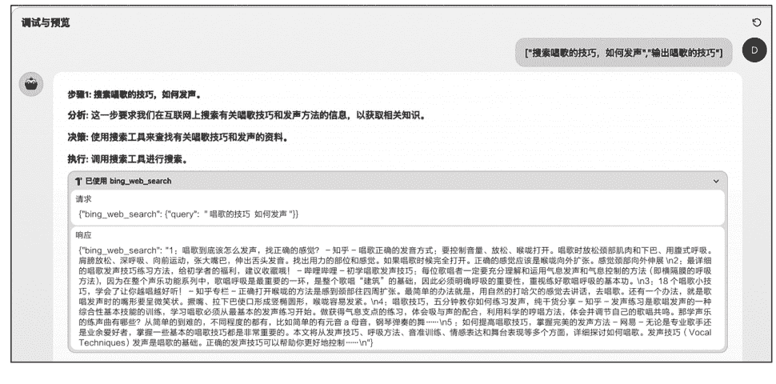
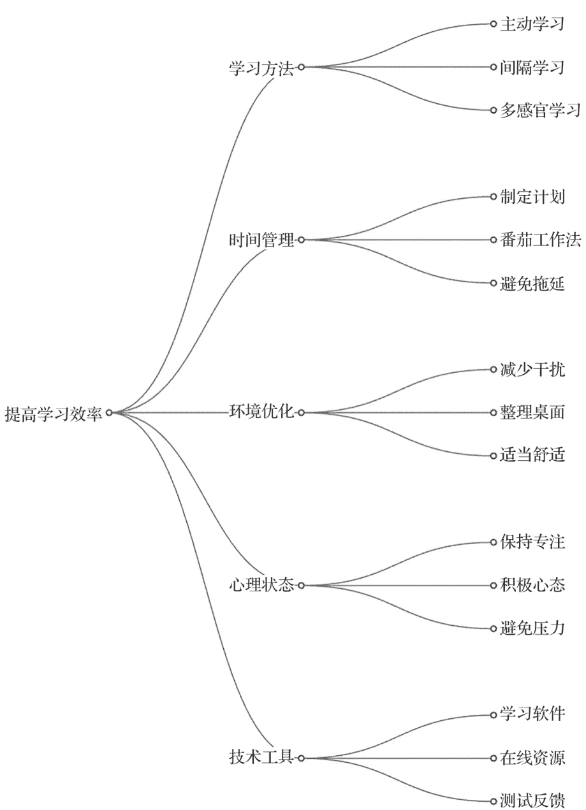

# AI搜索落地指南：大模型从理论到实战

## 写在前面

2022年ChatGPT的公开亮相，正式拉开了大模型应用的序幕。这一技术突破改变了人与机器的交互方式，也在各行各业掀起智能化浪潮。但当模型从实验室走向真实业务时，其局限性逐渐显现：时效性不足、准确率波动、推理成本高昂等问题频现。信息检索场景尤为突出，传统大模型依赖固化的训练语料，难以满足用户对最新资讯和精准答案的期待。正是这一系列痛点，推动了AI搜索的诞生。它将大模型的语义理解优势与实时网络检索能力结合在一起，正重塑信息获取的方式。

## 为什么要写这本书

过去二十年，搜索引擎从关键词匹配逐步演进到融合机器学习与语义理解的智能系统。然而信息爆炸下，传统方案仍显不足：意图理解偏差、复杂问询处理力弱、结果缺乏个性化与上下文关联。

2023年起，以GPT-4、LLaMA、DeepSeek为代表的大模型迎来爆发，为搜索带来新变量。它们不仅擅长自然语言生成，还具备推理、规划和多轮对话能力。搜索因此不再是简单的关键词与文档匹配，而是能够洞察深层需求、给出有分析的答案，并通过交互持续优化结果。搜索正从被动应答转向主动理解与引导。

相较传统引擎，AI搜索能基于上下文提供连贯智能的回应，大幅提升检索准确度和体验。它可以主动补全信息、生成内容，智能化程度远高于以往。

理论突破不等于落地顺畅。企业在引入大模型做搜索时普遍遇到难题：如何融合进现有架构、如何控制推理成本与延迟、如何权衡准确性与多样性，以及不同垂直行业需求差异大，通用模型难以直接适配，需要提示工程、微调、向量检索等手段进行定制。

基于此，本书覆盖AI搜索的全栈链路：后端系统开发、提示词优化、大模型调用、向量存储、搜索引擎技术。旨在系统拆解AI搜索的技术原理，并以循序渐进的方式带领读者完成一套完整应用的搭建。无论是开发者还是技术爱好者，都能学到大模型应用从零到一的实现路径。

## 本书特色

**聚焦AI搜索核心技术：** 围绕查询理解、规划执行、答案生成与优化、缓存策略等关键环节展开，讲解实现思路，帮助读者形成系统认知。

**融合大模型与工程实践：** 不同于仅讲理论或传统搜索的书，本书把大模型与搜索体系结合，探讨如何提升搜索质量，并结合LangChain、Milvus、OpenAI API等主流工具做实战演练。

**提供完整架构与源码解读：** 完整呈现一个AI搜索系统的整体架构，并对后端代码结构进行剖析，涵盖实体、分析器、检索器、生成器、过滤器等核心模块，便于快速上手二次开发。

**覆盖多场景与测试案例：** 除了技术实现，还提供私人问答、写作创作、学术研究等典型场景的测试用例，验证模型在不同领域的落地效果。

**重视性能优化与工程难点：** 重点讨论缓存机制、流式传输、异步调度等优化手段，并剖析企业部署时常见的性能瓶颈与应对方案。

## 适合人群

本书面向以下读者：

- AI工程师与搜索研发人员：想了解大模型如何赋能搜索，并掌握LangChain、Milvus、OpenAI API等技术栈的实战方法。
- 创业者与中小企业开发者：希望借助本书的开源思路和开发指引，快速搭建自有AI搜索产品。
- 高校学生与研究人员：希望系统掌握AI搜索原理与最新进展，为后续研究奠定基础。

不同背景的读者均可通过本书把握当前AI搜索的技术版图，学会常用工具方法，最终构建稳定、可扩展的搜索系统。

## 阅读指引

**第1章**梳理大模型面临的变革与挑战，对比传统模型，分析其对行业格局的影响，并通过训练流程剖析当前发展的制约因素，同时点出落地难点，帮助读者形成整体认知。

**第2章**回顾AI搜索演进历程，从早期关键词匹配到现代语义理解，阐明其演进逻辑，并以Lepton Search为案例拆解其后端架构与实现原理，建立初步框架。

**第3章**深入讲解AI搜索的核心技术，包括查询理解、规划执行、答案内容优化及答案缓存优化，帮助读者理解系统内部运行机制。

**第4章**介绍AI搜索开发所需的技术栈，如OpenAI API、DeepSeek模型、Milvus向量数据库、LangChain框架，并通过实例演示环境配置、API调用、本地知识库构建及LangChain高级用法。

**第5章**进入系统设计阶段，说明如何从零构建AI搜索后端的整体架构，涵盖技术选型与基础框架搭建，为后续开发打基础。

**第6章**围绕AI搜索的五大核心模块——实体、分析器、检索器、生成器、过滤器——详细说明功能定位与代码实现，形成清晰的内核结构。

第7章聚焦自动化调度机制，讲解动作类的定义与实现，搭建调度器模块，确保任务按规则自动流转，提升智能化水平。

**第8章**覆盖应用功能实现与场景测试，讲解DAO操作层、Service逻辑层、Controller接口层的开发流程，给出多个接口示例，最后通过私人问答、写作创作、学术研究场景验证系统效果。

## 勘误与支持

作者已尽力保证内容准确，仍难免疏漏。如发现问题，欢迎邮件联系 wgraper@163.com。

## 致谢

写作过程充满挑战，也收获颇多。在此感谢给予支持的每一个人。

我的妻子是写作期间最坚定的后盾。她以极大的耐心与关爱，陪伴无数个写作的夜晚，在我专注创作时承担家务，在思路受阻时给予鼓励与力量，让我得以心无旁骛完成本书。

家人无条件的关怀营造了温暖稳定的环境，无论生活照料还是精神支持，都给了我持续前行的信心。

技术探索中，多位朋友提供了专业建议并参与深入讨论，让书中内容更丰富，也让我对AI搜索有了更全面的认识。

读者的关注与期待是坚持创作的最大动力。感谢大家的信任，愿本书带来启发，期待与诸位在技术探索路上共同成长。

---

## 第1章

## 大模型技术分析与落地难点

本章将从变革与挑战、与传统模型的差异、行业影响及训练限制等角度剖析大模型，并总结其落地难点。

## 1.1 大模型技术分析

2022年，OpenAI推出的ChatGPT问世，成为AI领域的重要里程碑。这一产品加速了大语言模型，LLM的快速崛起，引发持续升温的技术热潮。各式大模型如雨后春笋般涌现，深刻改变生态与格局。

在火热的背景下，保持理性更为重要。以下从四个维度展开剖析。

### 1.1.1 变革与挑战并存

以ChatGPT底层GPT模型为例，其带来三大变革，也伴随两大挑战。

#### 1.三大变革

在GPT发展下，AI出现明显转变。

首个转变是生产力释放。大模型拥有超乎常人的耐心与持久力，在低端手工业和大量重复性劳动场景中，既能完成人类任务，又在效率与精确度上更胜一筹。这降低了人力成本，为传统行业转型升级提供可能。

第二个转变是NLP能力跃升。通过图灵测试的大模型展现出强大的上下文理解能力，能生成流畅合乎逻辑的文本，甚至完成文学创作、内容策划等高阶任务，显著提升文本生成、问答、情感分析等场景的表现。

第三个转变是技术范式的革新。GPT虽基于Transformer架构，却开创了预训练加微调的范式，优化了研发流程，改变了传统模型的开发思路，加速了AI发展进程。

#### 2.两大挑战

影响扩大同时，挑战亦凸显。

其一是社会风险防范。ChatGPT爆火期间，多国高校禁止其用于作业，部分期刊限制使用。另有报道指出其在回答中出现诱导、教唆等不当行为，同时加剧裁员与失业焦虑。

其二是用户隐私与数据安全。模型训练依赖海量数据，用户交互也在持续产生数据。数据的存储、处理与使用方式可能引发隐私泄露与滥用担忧，导致信任危机，如何保障数据安全与透明成为关键。

即便后续问题逐步修正，其背后反映的人类对社会安全与伦理平衡的担忧并未消解。

### 1.1.2 与传统模型的区别

从流畅文本生成到模仿人类创作，大模型的能力引发对底层原理的关注。其核心仍是基于Transformer架构的神经网络，是深度学习的发展延续，但在设计、规模与应用方式上与传统模型差异明显。

- (1) 参数规模巨大
早期神经网络如卷积神经网络参数仅数百万到几千万，多用于计算机视觉。GPT则将参数从数亿扩展至上千亿，规模纪录被不断刷新。大规模训练证明参数扩展可显著提升语言理解与生成能力。

- (2) 预训练与微调结合
GPT采用先预训练后微调的流程。预训练阶段利用海量无标注数据学习语言知识与语义结构；微调阶段针对特定任务优化表现。统一预训练模型可快速适配多种任务，提升效率，降低标注依赖，增强灵活性。

- (3) 多场景通用性
传统模型多为特定任务定制，需从零设计架构并依赖大量标注数据，迁移性差。GPT则具备广泛适用性，覆盖文本生成、对话、机器翻译、代码生成、知识问答等领域。解耦式训练架构提升了通用与适应能力。

### 1.1.3 对行业格局的冲击

大模型技术继Transformer之后成为又一重大突破，为行业注入新活力。其强大通用性推动AI从单一任务走向多领域扩展，激发学界与业界的热情。

同时，市场进入门槛降低，中小企业借助开放平台也能创新，并通过灵活模式探索前沿技术，加速行业演进。

随着技术共享，竞争者不断涌现，颠覆性应用层出不穷，商业生态重塑。市场更动荡，竞争更激烈。传统寡头的垄断优势受到冲击，市场主导地位不再稳固。

未来格局更开放多元，任何企业都有机会打破既有规则，重塑行业版图。

### 1.1.4 从训练流程看发展的限制因素

大模型训练是系统工程，包含数据准备、架构设计、预训练、微调与偏好对齐、评估迭代等环节。

#### 1.大模型训练流程

1) 准备优质数据源：模型性能高度依赖数据质量，多样性、真实性与清洗程度直接影响推理与泛化能力。

2) 搭建模型架构：需综合考虑基础架构选择、参数规模、训练优化策略，确保在资源可承受范围内达到最佳表现。

3) 预训练：通过无监督或自监督方式在大规模语料上学习通用语言表征，为后续任务奠定基础，建立语法、语义与推理能力。

4) 微调与偏好对齐：预训练模型虽通用，但在特定领域与人类偏好上存在偏差，需通过监督微调与偏好对齐使其更精准可信。

5) 评估与迭代改进：训练完成后需进行系统评估，包括自动评测、人工评测、A/B测试与持续迭代，确保实际应用的稳定可靠。

#### 2.大模型发展的限制因素

（1）数据瓶颈
训练本质依赖海量数据学习与模式识别，数据质量与数量决定性能上限。但高质量数据稀缺，行业数据虽多，可用优质数据有限。数据分布不平衡会导致模型偏差，难以满足实际需求。

此外，法律、医疗、金融等专业领域数据受版权与隐私限制，获取困难。多模态数据的收集难度更高，进一步加大训练复杂度。

最终支撑超大体量数据从采集到可用，再到供模型学习，离不开强劲的算力与底座。数据规模在膨胀、类型在多元化，清洗与标注的工作量随之水涨船高。硬件采购、算力租赁、人工标注费用齐齐上涨，数据环节已然跻身训练总开销的顶端。

##### (2) 参数复杂性
参数规模的扩张直接决定了模型能捕捉的模式与关联的丰富度。训练时适当扩容或微调参数，往往能换来更强的理解与生成表现。但参数堆砌并非万能解药。

当规模失控增长，系统复杂度呈几何级攀升，带来的副产物同样沉重：维护开销抬升，算力阈值提高，部署链路也更难梳理；电耗、运行时长、整体预算同步放大。这种重资源属性对研发团队的工程能力提出更高门槛，也对碳排放与可持续运行构成隐忧。如何在性能跃迁与成本可控之间找到平衡点，探索更经济的训练范式，已成为当前核心议题。

##### (3) 计算资源限制
训练超大规模生成式系统本质上是昂贵且复杂的工程。参数计数每上升一个量级，所需要的算力往往按指数曲线跳升。分布式并行、专用加速卡等手段虽能部分缓解，却无法根除天花板。一旦进入百亿级以上区间，显存、内存、存储IO、网络带宽会同时吃紧。算力不足不仅拖慢迭代节奏，更可能迫使截断训练或降低精度，进而影响产出质量。提升算力使用效率、设计更省资源的训练方法，是当下必须攻关的方向。

## 1.2 落地难点
把模型从实验室搬到真实业务，往往会撞上多重现实阻力，短期内技术突破难以一蹴而就。下面梳理几类典型痛点。

### （1）幻觉问题严重
随着落地案例增多，市场对其能力边界有了更清醒认识。模型并非包治百病。推理过程缺乏透明度，形成黑盒，这让提示词的设计和迭代成本很高。实践中频繁出现的幻觉，即输出看起来自洽却与事实不符，直接动摇结果可信度，成为推广的最大拦路虎。

产业界于是押注两条路线：领域微调和检索增强生成。微调本质是用垂直领域的专业语料对通用基座进行二次训练，提升专精度；检索增强则在生成前从私有知识库拉取相关证据并注入提示词，弥补知识时效与覆盖面的短板。两者都能显著压低幻觉概率，但受限于模型本身的生成机制，幻觉只能被抑制而非根除。因此在医疗、金融等对准确性零容忍的场景，仍难以全盘托付。

### （2）缺少重要数据
不论采用哪种增强路线，前置条件都离不开充足且干净的专业数据。数据的丰厚度与纯净度直接决定上限。现实中大量企业尤其是行业壁垒高的垂直赛道，根本拿不出够用的标注语料。于是只能自建采集管线、付费购买、与外部机构合作，数据获取成本一路攀升，抵消了模型本身的价值预期。

### （3）推理能力不足
在开放式问答与内容创作层面，当前模型已相当出色，但在需要多步推导的任务上仍显吃力。面对单一逻辑判断，多数情况下能给出合理解释；一旦涉及链式推理、条件分支或多实体关联，错误率就会明显抬头。

好在思维链式的推理范式正在改写这一局面。基于显式推理路径的训练思路，以及DeepSeek等开源模型的发布，让模型的逐步思考能力得到实质性提升，为复杂业务场景的应用打开了新窗口。

### （4）实践经验不足
技术原理已相对成熟，但把模型嵌入真实业务的Know-how仍属稀缺。调参策略、流程对接、异常兜底等细节，多数团队缺乏可复用的方法论。如何依据业务目标定制优化、与现有系统无缝衔接、满足行业合规与个性化要求，仍是落地阶段的常态难题。

## 第2章

## AI搜索历程与原理初探
企业对AI在深度业务场景的真实需求在放大，大模型应用正进入黄金窗口期。其中，智能搜索凭借场景契合度和技术整合力，成为最具代表性的落地形态之一，正在重塑信息获取方式。

本章回顾智能搜索的演进脉络，并拆解其底层实现，为后续深入学习提供基础。

## 2.1 AI搜索发展的历程
本节围绕搜索智能化主线，说明智能搜索为何必然出现、AI怎样盘活传统检索，以及未来可能走向。

### 2.1.1 搜索的智能化趋势
回顾传统检索技术的演进脉络，可以看出智能搜索并非偶然，而是技术演进与用户期待共同推动的结果。

#### 1.互联网的发展
1991年，蒂姆·伯纳斯·李完成了万维网的原型工具，首个浏览器与服务器诞生，标志着万维网正式开启。随后几年他推动技术普及。至1994年底，已有知名机构和企业上线站点，万维网成为公认的通信标准。

接下来十年，经济与科技共振，万维网步入爆发期。信息总量爆炸，网站数量井喷，互联网时代彻底到来。

#### 2.网址撮合平台的发展
互联网虽快，但网站孤岛现象导致找信息困难。为此雅虎等网址聚合门户、新浪类新闻门户、hao123类导航站应运而生。实质都是把分散网址集中呈现，降低访问门槛。

这一阶段用户浏览新闻、探索站点变得便利，体验显著改善。但运营成本高昂，高度依赖人工。搜索引擎靠人工维护索引，新闻门户靠编辑筛选发布。繁琐流程效率低下。初期虽解决需求，也为自动化革新埋下伏笔。

#### 3.搜索引擎技术的发展
1990年加拿大诞生了Archie，被视作搜索引擎雏形。但当时万维网尚未成熟，Archie只能检索FTP地址，并非真正意义的网页搜索。直到1994年Infoseek成立，基于数据库与算法的关键词检索才算起步。

随后谷歌、雅虎、百度等巨头涌现。核心技术如检索排序算法不断进步。谷歌推出的PageRank通过链接关系评估页面权威度，大幅提升结果相关性，成为里程碑，也奠定了行业领先地位。

#### 4.从关键词匹配到语义理解
早期检索依赖关键词匹配，抽取用户输入词在索引库中查找。互联网初期有效，但局限明显，只能处理字面匹配，无法捕捉语义与意图。

例如用户搜“想看最新国际消息”，系统找不到“新闻网站”关键词就返回空。系统对同义词、上下文不敏感，用户搜“苹果”无法区分水果还是公司。精准度受限，用户需反复试探关键词。

语义理解的引入带来质变。借助自然语言处理，系统能解析语句意图。例如“想看最新国际消息”会被理解为需要新闻类站点，从而返回相关结果。

#### 5.从链接提供者到信息整合者
传统搜索引擎存在30余年，却始终没解决用户核心诉求：用户要的是答案，不是链接。网页列表只是工具。

比如用户查“时间”，其实只要当前时刻，搜索却返回大量相关页。世界杯期间搜“世界杯”，用户想要赛程比分，却要逐页点击。体验低效。

百度早期创新在结果页置顶“小组件”，直接展示时间、天气、计算器、车票、赛事等信息。省去点击环节，把答案前置。这一转型标志从链接分发走向信息整合，也可视作智能搜索的早期雏形。它印证了智能搜索的必然性，推动检索向更智能的方向演进。

### 2.1.2 AI如何赋能传统搜索
在智能化浪潮下，关键是用AI填补传统检索的短板，提升智能水平，改善体验。

#### 1.传统搜索的局限性
检索本质是理解意图并给出有效结果，传统局限体现在两端。

一是对需求理解不足。即便引入更强NLP，面对复杂表达或模糊查询仍难以把握真实意图，导致结果偏差。

二是无法直接作答。只能罗列网页链接，用户需自行筛选。面对复杂或时效性需求，效率低下。

#### 2.AI主要赋能的场景
AI凭借强大的阅读与推理能力，可以补齐这两块短板。它能快速处理长文本、把握上下文，打破关键词依赖。通过分析查询背后的真实意图，结合检索到的海量网页，AI既能给出精准列表，也能直接提炼出结论性答案，省去用户筛选成本，大幅提升效率。

这种赋能不仅满足高效获取信息的需求，也推动检索向更智能精准的方向发展。

### 2.1.3 AI搜索的未来发展方向
随着AI成熟，智能搜索正从信息查找工具进化为多功能数字助理。未来将通过多模态、一站式服务、记忆与个性化等能力深度融入工作生活。

#### 1.多模态融合技术
未来交互将不限于文字，还包括图像、语音、视频、动作捕捉等。硬件进步让交互更自然。

输出也将多元化，可能是文字、图文混排或视频讲解，并非所有场景都需多模态，关键要依据意图选择合适组合，提供更直观体验。

#### 2.一站式搜索服务
多模态启发下，内容聚合为一体是新趋势，打破文本图片视频的壁垒。通过调用开放API，智能搜索可整合外卖、天气、地图等服务，提供端到端解决方案。

例如用户说“我饿了，给我推荐外卖”，系统调取定位，查询附近商家，结合评分与口味推荐。驾车时说“带我去最近加油站”，系统定位后筛选开放的加油点并导航。多种服务融合后，用户获得更实时、个性化的体验。

#### 3.垂直搜索的专业化
通用大模型在专业领域仍显不足，受限于训练数据的广度与深度。各行业于是自建垂直模型，虽体量小但精度高，更贴合细分场景。

企业可基于自有数据构建垂直检索，弥补通用模型在专业性的短板，解决“够大不够专”的问题。垂直化是AI搜索的重要演进方向。

#### 4.长记忆与个性化体验
从认知科学看，记忆分短期与长期。对话系统中的单次会话相当于短期记忆，跨会话记忆则是长期记忆。多数产品仍依赖短期记忆，导致用户无法延续上下文，需重复说明。

在竞争加剧的市场中，长记忆与个性化已成为差异化关键。通过跨会话记录用户偏好并融入后续回答，企业可提升粘性，增强品牌价值。

## 2.2 AI搜索的原理初探：基于Lepton Search分析

拆解智能检索的实现：以Lepton为样本

对人工智能检索的基本原理形成初步认识以后，接下来要看的是工程层面到底怎样落地。本章先梳理公开的开源方案，挑一个上手门槛最低的Lepton Search 作为解剖对象，再逐段阅读其源码，帮助读者建立对系统底层运行机制的直观理解，并把握实现上的关键要点，为后续的系统学习做好铺垫。

### 2.2.1 为何偏向Lepton Search

现阶段市面上能找到的智能检索相关实现已经不少。回溯到2024年上半年甚至更早的时间点，Lepton Search 算是比较稀缺且极具参考价值的案例。它以简洁著称，后端主体代码不足五百行，却把智能检索的核心思路与技术细节完整呈现出来。即便到现在，它仍然是入门和研究该方向的理想材料。

Lepton Search 属于对话式检索的早期开源演示，包含可交互的前端页面和提供服务的后端。用户以自然语言提出文本类问题后，系统会联网抓取相关资料并基于检索结果合成精准答案。它是智能检索开源阵营中最早的代表之一，发布之初便获得较高关注，并在业内获得不少好评。

该项目的主要特征如下。

- 可灵活扩展：前后端逻辑都非常精简，改动空间很大。
- 教学友好：借助极简的代码量即可快速抓住核心实现，降低学习成本。后续会详细展开源码解析，目前不急于本地部署。如果确实想自行运行，可在GitHub搜索仓库 search_with_lepton，克隆到本地后按官方文档的流程操作即可。

在部署前需要先明确准备工作。除Python运行环境和前端依赖等基础配置外，还必须申请检索引擎的API凭证以及开通LeptonAI相关的后端资源。因此在学习研究阶段，不建议立即本地化部署。如需部署，要重点关注以下要点以保证运行稳定。

#### (1) 申请检索引擎的API密钥

检索引擎是联网问答的基础能力，Lepton Search 内置了必应搜索与谷歌搜索两种方案，可按个人需求到官网申请。申请成功后会得到一个订阅密钥 Subscription Key，需按如下命令写入系统，如代码清单2-1所示。

##### 代码清单2-1 配置订阅密钥到系统中

```
# 输出必应搜索密钥变量，如果未配置则为空
$ echo $BING_SEARCH_V7_SUBSCRIPTION_KEY

# 在命令行中执行
$ export BING_SEARCH_V7_SUBSCRIPTION_KEY={your_subscription_key}
```

#### (2) 申请LeptonAI服务

仓库名称为 search_with_lepton，正是因为它建立在Lepton AI 云平台之上，便于在云端快速上线。该平台提供完整的云资源能力，涵盖计算、存储以及大模型集成，同时提供 Python SDK，方便开发者在项目中直接调用大模型服务，实现高效开发。

首先，按下面命令完成 leptonai 包与 openai 包的安装。安装完成后即可使用 lep 命令行工具登录并操作 Lepton AI 云平台，如代码清单2-2所示。

##### 代码清单2-2 安装并登录Lepton AI云服务平台

```
# 在命令行中执行

# -U 表示如果本地已安装，则自动替换新版本。对于 leptonai 包，建议加上此选项

$ pip install -U leptonai openai && lep login
```

执行后系统会自动打开 Lepton AI 云平台的授权页面。未注册用户需先完成注册，登录成功后会展示凭证信息，将其复制回命令行即可。若云平台尚未配置工作空间，验证通过后会提示设置，完成远程配置后才能使用大模型及相关技术服务。

### 2.2.2 Lepton Search 后端源码解析

本项目的后端整体基于 Lepton AI 技术栈，但在核心逻辑层面，只由一个文件 search_with_lepton.py 承载。因此本节聚焦对该文件的逐段解读。

文件结构清晰，依次可划分为常量定义、检索函数、RAG 类与启动入口四个部分。下面将逐步展开每一部分的源码，细化后端功能的实现过程。

#### 1.常量

常量的定义依次包含以下内容。

- 1) 与检索服务相关的配置，如服务地址、返回条数、请求超时等。
- 2) 两段提示词，一段用于生成答案，一段用于生成相关问题，两者均使用了 context 变量，即把检索引擎返回的结果作为上下文传入。
- 3) 大模型生成文本时的终止词，遇到时会停止输出。

具体常量代码见代码清单2-3。

##### 代码清单2-3 常量代码

```
# 定义了搜索引擎服务地址
BING_SEARCH_V7_ENDPOINT = "https://api.bing.microsoft.com/v7.0/search"
BING_MKT = "en-US"
GOOGLE_SEARCH_ENDPOINT = "https://customsearch.googleapis.com/customsearch/v1"
SERPER_SEARCH_ENDPOINT = "https://google.serper.dev/search"
SEARCHAPI_SEARCH_ENDPOINT = "https://www.searchapi.io/api/v1/search"
# 参考数量
REFERENCE_COUNT = 8
# 搜索引擎默认超时时间
DEFAULT_SEARCH_ENGINE_TIMEOUT = 5

# 回答使用的提示词，其中 {context} 是互联网搜索结果的上下文变量
_rag_query_text = """
You are a large language AI assistant built by Lepton AI. You are given a user
question, and please write clean, concise and accurate answer to the
question. You will be given a set of related contexts to the question, each starting with a reference number like [[citation:x]], where x is a number. Please use the context and cite the context at the end of each sentence if applicable.

Your answer must be correct, accurate and written by an expert using an unbiased and professional tone. Please limit to 1024 tokens. Do not give any information that is not related to the question, and do not repeat. Say "information is missing on" followed by the related topic, if the given context do not provide sufficient information.

Please cite the contexts with the reference numbers, in the format [citation:x]. If a sentence comes from multiple contexts, please list all applicable citations, like [citation:3][citation:5]. Other than code and specific names and citations, your answer must be written in the same language as the question.

Here are the set of contexts:

{context}

Remember, don't blindly repeat the contexts verbatim. And here is the user question:
"""

# 相关问题的提示词，其中 {context} 也是互联网搜索结果的上下文变量
_more_questions_prompt = """
You are a helpful assistant that helps the user to ask related questions, based on user's original question and the related contexts. Please identify worthwhile topics that can be follow-ups, and write questions no longer than 20 words each. Please make sure that specifics, like events, names, locations, are included in follow up questions so they can be asked standalone. For example, if the original question asks about "the Manhattan project", in the follow up question, do not just say "the project", but use the full name "the Manhattan project". Your related questions must be in the same language as the original question.

Here are the contexts of the question:

{context}

Remember, based on the original question and related contexts, suggest three such further questions. Do NOT repeat the original question. Each related question should be no longer than 20 words. Here is the original question:
"""
```

其中定义的 stop_words 将被赋给 OpenAI 会话接口的 stop 参数，用来控制生成时的终止条件。

下面列出部分终止符，可按需扩充。当生成内容中出现指定字符串时，生成过程会立刻终止。例如当文本中出现 "\nReferences:\n" 时输出会立即结束，从而避免答案中混入参考文献部分。

```
stop_words = [
    "<|im_end|>",
    "[End]",
    "[end]",
    "\nReferences:\n",
    "\nSources:\n",
    "End.",
]
```

#### 2.检索函数

检索函数统一封装了对不同搜索服务的调用，涵盖必应、谷歌的原生接口，以及 Serper、SearchAPI 等第三方服务的接入。这些函数在设计上保持一致，请求参数通常包含以下关键项。

- 1) key：字符串，表示搜索服务的密钥。
- 2) url：字符串，表示搜索服务的接口地址。
- 3) query：字符串，表示用户的完整查询内容。
- 4) num：数字，表示期望返回的结果数量。

检索函数封装的代码如代码清单2-4所示。

##### 代码清单2-4 搜索函数封装的代码

```
# 定义谷歌搜索函数
def search_with_google(query: str, subscription_key: str, cx: str):
    """
    Search with google and return the contexts.
    """
    params = {
        "key": subscription_key,
        "cx": cx,
        "q": query,
        "num": REFERENCE_COUNT,
    }
    response=requests.get(GOOGLE_SEARCH_ENDPOINT,params=params,timeout=DEFAULT_SEARCH_ENGINE_TIMEOUT)
    if not response.ok:
        logger.error(f"{response.status_code} {response.text}")
        raise HTTPException(response.status_code, "Search engine error.")
    json_content = response.json()
    try:
        # 从结果集中按照顺序取小于等于指定数量的搜索结果
        contexts = json_content["items"][:REFERENCE_COUNT]
    except KeyError:
        logger.error(f"Error encountered: {json_content}")
        return []
    return contexts
```

调用后系统会向对应服务发起查询，返回的数据一般包含以下字段，用以描述检索内容的详情与元数据。

- url：字符串，表示检索到的网页地址。
- title：字符串，表示检索到的网页标题。
- snippet：字符串，表示检索到的网页摘要。

#### 3.RAG类

RAG 类继承自 Lepton 提供的 Photon 类，Photon 是 leptonai 包中封装网络相关处理的基类，可视为对 FastAPI 等框架的再封装。RAG 类内容较多，下面按模块说明。

1) RAG 类的初始化函数中定义了 deployment_template 属性与 init 初始化方法，主要用于为 Photon 类准备所需的相关参数，如代码清单2-5所示。

##### 代码清单2-5 RAG类的初始化函数

```python
class RAG(Photon):
    # 定义 lepton 部署所需配置
    deployment_template = {
        # 定义资源类型，可选项有 cpu.small、cpu.medium、cpu.large、gpu.a10 等
        "resource_shape": "cpu.small",
        # 定义环境变量
        "env": {
            # 选择搜索引擎服务，LEPTON 是其中的一种，也可以是 BING、GOOGLE 等
            "BACKEND": "LEPTON",
            # 定义大模型
            "LLM_MODEL": "mixtral-8x7b",
            # 搜索相关数据的 KV 存储名 (KV_NAME)
            "KV_NAME": "search-with-lepton",
            # 是否生成相关问题
            "RELATED_QUESTIONS": "true",
            # 代码略
        },
        # 定义相关密钥
        "secret": [
            # 如果使用必应搜索，需要设置对应的 API 密钥
            "BING_SEARCH_V7_SUBSCRIPTION_KEY",
            # 如果使用谷歌搜索，需要设置对应的 API 密钥
            "GOOGLE_SEARCH_API_KEY",
            # Lepton 工作空间对应的 Token
            "LEPTON_WORKSPACE_TOKEN",
            # 代码略
        ],
    }

    def init(self):
        """
        初始化 Photon 类的配置
        """
        # 首先登录 LeptonAI
        leptonai.api.v0.workspace.login()
        # 读取服务启动时命令行中传递的 BACKEND 参数，此参数表示使用哪个搜索引擎
        self.backend = os.environ["BACKEND"].upper()
        if self.backend == "BING":
            self.search_api_key = os.environ["BING_SEARCH_V7_SUBSCRIPTION_KEY"]
            self.search_function = lambda query: search_with_bing(
                query,
                self.search_api_key,
            )
        elif self.backend == "GOOGLE":
            self.search_api_key = os.environ["GOOGLE_SEARCH_API_KEY"]
            self.search_function = lambda query: search_with_google(
                query,
                self.search_api_key,
                os.environ["GOOGLE_SEARCH_CX"],
            )
        # 其他类型搜索引擎的初始化
        # elif (代码略)
        # 定义大模型
        self.model = os.environ["LLM_MODEL"]
        # 定义执行异步任务的执行器，比如将搜索结果的数据保存到 KV 存储数据库中
        self.executor = concurrent.futures.ThreadPoolExecutor(
            max_workers=self.handler_max_concurrency * 2
        )
        # 创建 KV 存储数据库，用于存储搜索结果的数据
        self.kv = KV(
            os.environ["KV_NAME"], create_if_not_exists=True, error_if_exists=False
        )
        # 是否推荐相关问题
        self.should_do_related_questions = to_bool(os.environ["RELATED_QUESTIONS"])
```2) RAG 类里封装了一个用来获取本地线程专属客户端的方法。在并发压力很大的场景里，单例模式的大模型客户端会被多个线程同时拿去用，很容易出现数据错乱、响应异常这类问题，本身是线程不安全的。为了解决这个风险，该方法会在调用时为当前线程单独构造一个安全可用的大模型客户端。实现细节可参考代码清单2-6。

##### 代码清单2-6 获取线程专属大模型客户端

```
class RAG(Photon):
    # 返回本地线程中的客户端
    def local_client(self):
        # 创建一个线程局部存储
        thread_local = threading.local()
        try:
            # 如果本地线程存储中已经定义了 OpenAI 客户端，则直接返回
            return thread_local.client
        except AttributeError:
            # 创建本地线程中唯一的一个 OpenAI 客户端
            thread_local.client = openai.OpenAI(
                base_url=f"https://{self.model}.lepton.run/api/v1/",
                api_key=os.environ.get("LEPTON_WORKSPACE_TOKEN")
                or WorkspaceInfoLocalRecord.get_current_workspace_token(),
                # We will set the connect timeout to be 10 seconds, and read/write
                # timeout to be 120 seconds, in case the inference server is
                # overloaded.
                timeout=httpx.Timeout(connect=10, read=120, write=120, pool=10),
            )
            return thread_local.client
```
3) 另外，RAG 类还内置了生成推荐追问的逻辑，答案给出后会自动补上几条相关问题，方便用户延续探索。值得注意的是，ask_related_questions 虽然被挂载到了大模型接口的 tool 参数里作为一个工具函数，但函数体内是空的，说明这一步的工具调用只是形式上存在，并没有真正执行额外逻辑，最终的相关问题依然依赖大模型直接生成。对应实现见代码清单2-7。

##### 代码清单2-7 相关追问生成函数实现

```
class RAG(Photon):

    def get_related_questions(self, query, contexts):
        """
        基于查询和上下文内容，生成相关的问题
        """
        # 声明提问相关问题的工具
        def ask_related_questions(
            questions: Annotated[
                List[str],
                [(
                    "question",
                    Annotated[
                        str, "related question to the original question and context."
                    ],
                )],
            ]
        ):
            """
            更进一步提出与输入和输出有关的问题
            """
            pass

        try:
            # 调用本地线程中的 OpenAI 客户端
            response = self.local_client().chat.completions.create(
                model=self.model,
                messages=[
                    # system 部分的提示词
                    {
                        "role": "system",
                        # 使用换行符把搜索结果中的每个摘要都拼起来
                        "content": _more_questions_prompt.format(
                            context="\n\n".join([c["snippet"] for c in contexts])
                        ),
                    },
                    # user 部分的提示词
                    {
                        "role": "user",
                        "content": query,
                    },
                ],
                tools=[{
                    "type": "function",
                    "function": tool.get_tools_spec(ask_related_questions),
                }],
                max_tokens=512,
            )
            related = response.choices[0].message.tool_calls[0].function.arguments
            if isinstance(related, str):
                related = json.loads(related)
            return related["questions"][:5]
        except Exception as e:
            return []
```
4) RAG 类的核心入口是路径为 /query 的查询接口，基于 FastAPI 搭建，并通过 fastapi.responses 提供的 StreamingResponse 实现流式返回。分享功能的设计是，分享链接的格式固定不变，链接中保留一个 ID，该 ID 由前端在每次发起查询时自行生成并一并传给接口。后端收到 ID 后会先去 KV 存储里查找是否有历史记录，有就直接返回以实现一键分享；找不到则判定为全新问题，重新执行检索与生成流程。具体代码可看代码清单2-8。

##### 代码清单2-8 核心查询 /query 接口实现

```
class RAG(Photon):

    @Photon.handler(method="POST", path="/query")
    def query_function(
        self,
        query: str,
        search_uuid: str,
        generate_related_questions: Optional[bool] = True,
    ) -> StreamingResponse:
        """
        查询并返回结果
        - query: 用户查询内容
        - search_uuid: 每次搜索时的唯一 ID
        - generate_related_questions: 是否生成相关问题
        """
        # 如果在 KV 存储中存在此次查询的唯一 ID，则直接返回对应的结果
        # 否则进行搜索生成
        if search_uuid:
            try:
                result = self.kv.get(search_uuid)
                def str_to_generator(result: str) -> Generator[str, None, None]:
                    yield result
                return StreamingResponse(str_to_generator(result))
            # 异常处理
            except KeyError:
                # 代码略
            except Exception as e:
                # 代码略
        else:
            raise HTTPException(status_code=400, detail="search_uuid must be provided.")

        # query 参数检查和处理
        query = query or _default_query
        query = re.sub(r"\[/INST\]", "", query)

        # 调用搜索函数，把搜索结果赋值到 contexts 变量
        contexts = self.search_function(query)

        # 拼装调用大模型生成答案时需要的 System 提示词
        system_prompt = _rag_query_text.format(
            # 使用 [[citation: 序号 ]] 把每一个搜索结果的摘要都拼一起
            context="\n\n".join(
                [f"[[citation:{i+1}]] {c['snippet']}" for i, c in enumerate(contexts)]
            )
        )

        try:
            # 开始调用 OpenAI 大模型客户端
            client = self.local_client()
            llm_response = client.chat.completions.create(
                model=self.model,
                messages=[
                    {"role": "system", "content": system_prompt},
                    {"role": "user", "content": query},
                ],
                max_tokens=1024,
                stop=stop_words,
                stream=True,
                temperature=0.9,
            )
            if self.should_do_related_questions and generate_related_questions:
                # 如果需要相关问题，则调用 get_related_questions() 函数并生成
                related_questions_future = self.executor.submit(
                    self.get_related_questions, query, contexts
                )
            else:
                related_questions_future = None
        except Exception as e:
            logger.error(f"encountered error: {e}\n{traceback.format_exc()}")
            return HTMLResponse("Internal server error.", 503)

        # 流式返回
        return StreamingResponse(
            self.stream_and_upload_to_kv(
                contexts, llm_response, related_questions_future, search_uuid
            ),
            media_type="text/html",
        )
```

#### 4.服务启动入口

执行命令行中的 search_with_lepton.py 脚本时，该启动流程会被触发。流程内部会先实例化一个 RAG 对象，随后调用父类的 launch() 方法，父类负责完成初始化以及 HTTP 服务的搭建等工作，待全部就绪后服务正式运行并对外暴露接口。具体启动步骤可参考代码清单2-9。

##### 代码清单2-9 后端启动逻辑

```
if __name__ == "__main__":
    rag = RAG()
    rag.launch()
```
到这里，后端代码的梳理就告一段落。结合本节的分析，读者应已对 AI 搜索的工作原理形成初步认知，这也为阅读后续章节做好了铺垫。

# 第3章

# AI搜索核心技术深度剖析

前文已对 AI 搜索的实现架构与核心技术做了入门介绍。本章将进一步剖析关键技术，从细节层面展开深入解读。

## 3.1 查询理解技术

用户在 AI 搜索里提交问题后，系统会对其做多层次解析，既要读懂表面文字，也要揣测背后的真实意图，从而精准锁定需求、检索相关信息并给出最贴合的答案。这个从输入到意图识别的过程就是查询理解，是 AI 搜索的枢纽环节，直接决定智能程度和体验质量。

### 3.1.1 问题分类机制

在查询理解链路里，问题分类占据关键位置。它通过判断问题类型，帮助系统更准确地捕捉用户意图，进而在后续处理中采取差异化策略，提升检索效果和体验。

#### 1.应用场景

在客服对话场景里，问题分类的价值非常突出。以产品客服为例，分类器一般放在知识库检索之前。用户买完产品后提问，往往落入售后、操作指导、意见反馈等几大类。先做分类后匹配，系统就能迅速调取对应知识，给出更精准的回复。

AI 搜索面对的提问范围很宽，不同学科往往需要专属的处理方式和呈现形式。数学类问题可能需要公式、图表和步骤推导，法律类问题则更侧重法规引用、案例拆解或概念解释。

正因如此，分类是不可或缺的一环。以数学和法律为例，识别出具体类别后，系统才能更精确地规划意图和生成策略，最终产出用户真正想要的答案，优化使用体验。

#### 2.实现方式

大模型普及前，这类分类主要靠传统 NLP 和经典机器学习实现，比如规则匹配、朴素贝叶斯、支持向量机、决策树等方法。

如今依托大模型，构建高效分类器变得简单。以领域划分为例，可把问题归入自然科学、人文科学、社会科学等大类，再通过定制系统提示词就能得到一个易用的自动分类器。下面给出实现示例。

```
##### 问题分类器

你是一个问题分类器，可以识别用户的问题属于什么类目。

###### Context

- 自然科学与工程技术：如物理与天文、化学与材料、生命科学与环境、计算机与信息技术。
- 数学与逻辑学：如基础数学、高等数学、逻辑思维。
- 人文学科：文学与创作、语言学与交流、历史与文化、哲学与思想、艺术与审美。
- 社会科学：政治与法律、经济与管理、社会学与人类学、心理学与行为科学、医学。
- 生活与实用技能：教育与学习、生活与健康、运动与休闲、职业与创业。
- 交流与互动：日常对话。

###### Constrains

返回结构如下所示：

```json

{

    "category": ""

}

```

###### Workflow

1. 认真理解用户输入的内容，先判断用户是在和你打招呼，和你简单地聊天，还是在向你提问。
2. 从 <Context> 中选择一个合适的类目，标记此用户的问题所属的类目。
3. 按要求返回结果。
```
先用一句简单的问候 “你好” 做测试，看系统如何归类。

输入：你好

输出：

交流与互动：日常对话

从结果看，模型正确地把该问候归入交流与互动下的日常对话。接下来提高难度，输入一个艺术相关的问题继续验证。

输入：如何理解凡·高的画作

输出：

人文学科：艺术与审美

模型同样准确地将其判定为人文科学下的艺术与审美。最后再输入一个生活类问题。

输入：明天什么天气

输出：

生活与实用技能：生活与健康

#### 3.明确分类标准

要做到精准分类，关键在于提示词里构建一套相互独立、分层清晰的分类表，并为每类给出明确规则或特征，以避免模糊带来的判断混乱。实际使用中，示例分类器仍有改进空间，分类表需要持续迭代优化。

所以设计分类机制时，标准要清晰。各类别应相互独立且层级分明，合理性与清晰度直接决定分类准确率，并进一步影响整体回答质量与用户体验。

### 3.1.2 查询改写机制

查询改写是提升理解能力的核心手段，目标是通过优化用户原输入，使搜索引擎和智能问答在联网检索时获得更准确的结果并给出更合适的回答。该技术已在搜索、电商、客服等场景广泛使用。将原始提问转化为更精准可检索的表达，既提升响应效率，也让用户更快得到相关答案，提升体验。

AI 搜索中用户输入常出现错字、歧义或用词不规范，改写任务就是对输入做校正、优化和标准化。即使没有明确关键词，系统也能据此推断意图并给出答案。比如“银行卡丢了怎么办？”可改写为“银行卡遗失补办流程”，随后提供对应解决办法。

除了上述情况，改写还在多个场景发挥作用。接下来重点介绍几种常见改写类型及其实际表现。

#### 1.错别字纠正

下例展示了一个面向错别字纠正的改写器。

```
##### 问题改写器
你是一个问题改写器，请完成错别字纠正
###### Workflow
1. 认真理解用户输入的内容
2. 判断用户输入的内容是否有错别字
3. 输出纠正后的文字
```
下面输入一个带错别的查询，观察改写结果。

```
输入：如何学习弹岗琴
输出：如何学习弹钢琴
```
通常情况下，大模型能轻松完成错字修正，这类任务直观且无需复杂上下文推理。

#### 2.歧义消除

下例定义了一个歧义消除器，用来化解模糊表述。

```
##### 角色
你是一个问题歧义消除器，请完成歧义消除
###### 要求
1. 你只需要做指代消除和省略补全
2. 禁止对第一人称和第三人称做指代消解
3. 第三人称指代，比如他、它、这个人、那个人、这本书、这篇文章等
4. 如果用户提问有表达不完整的情况，则你需要根据上下文完成省略补全
###### 工作流
1. 认真理解用户输入的内容
2. 输出修改后的一个或多个用户问题
###### 任务
你需要对用户问题做指代消解及省略补全
```
先用一个示例测试输出。

```
输入：牛顿是谁
输出：牛顿是谁？
```
该例本身无歧义，输出如预期。接下来输入包含指代词“他”的查询，看看模型如何处理。

```
输入：他的主要贡献
输出：牛顿的主要贡献是什么？
```
正常情况下模型能准确消除歧义。若后续流程要直接搜索用户原词，例如用户输入“他的主要贡献”，搜索引擎无法判断“他”指谁，此时借助大模型补全为“牛顿的主要贡献是什么？”，就能避免搜索词模糊的问题。

这只是其中一种应用，按实际需求可对不同内容做歧义消除。

#### 3.用词优化

下例定义了一个用词优化器，专门改善表达。

```
##### 角色
你是一个用词优化器，请完成用户输入中的用词优化。
###### 要求
1. 用户输入的问题中如果有不合适的词汇，则需要使用词性相同或更合适的词汇来代替。
###### 工作流
1. 认真理解用户输入的内容。
2. 判断用户输入的问题中是否有不合适的词汇。
3. 如果有不合适的词汇，需要使用词性相同或更合适的词汇来代替。
4. 输出优化后的内容。
###### 任务
你需要对用户问题做用词优化。
```
下面输入包含错误用词“星期七”的查询，观察改写。

```
输入：星期七的亲子活动推荐
输出：周日的亲子活动推荐
```
正常情况下模型应能识别“星期七”这一不合理表达，因为在书面或口语中都不存在，属于明显错误。

#### 4.综合性改写

前面定义了三种改写类型，但实际工程中维护多套提示词会增加复杂度和请求耗时。为兼顾效率，常把多种改写需求合并到一个提示词中，这就是综合性改写提示词。它能在一次生成里完成多种优化，降低成本提升性能。下面以示例说明。

```
##### 角色
查询改写器
###### 示例
####### 示例1
输入：李白
输出：
json
{
"query_list": ["李白"],
}

输入：他是谁
输出：
json
{
"query_list": ["李白是谁"],
}
```
####### 示例2

输入：求鞋推荐

输出：

```json
{
"query_list": ["球鞋推荐"],
}
```
###### 要求

1. 不要扩展提问的含义。

2. 返回结构如下所示。

```json
{
"query_list": [],
}
```
###### 工作流

1. 认真理解聊天记录。

2. 先判断用户的提问是否存在指代。

3. 如果存在指代，则你需要根据上下文，完成指代消解。

4. 再判断用户的提问是否存在省略（表达不完整、不清晰）。

5. 如果存在省略，则你需要根据上下文，完成省略补全。

6. 把修改后的一个或多个用户查询语句，按要求的结构返回

###### 任务

你需要对用户的查询语句做指代消解及省略补全

下面输入问题，看它会如何回复：

输入：李白

输出：

```json
{
"query_list": ["李白"],
}
```
我们再输入有指代的情况下，看它会如何改写：

输入：他是谁

输出：

```json
{
"query_list": ["李白是谁"],
}
```
我们再输入上下文中存在歧义的问题，看它如何改写：

```
输入：他年龄呢？
输出：
{
"query_list": ["李白年龄"],
}
```
从示例可见，该综合提示词基本能覆盖实际需求。

### 3.1.3 查询扩展机制

查询扩展与改写同属一类，但目标不同。改写侧重修正错误提升精度，扩展则通过丰富词表扩大覆盖面，提升召回率。

概括地说，就是把一个范围较窄的词拆成多个更宽泛的同义或相关词，以增加命中面。比如用户输入“鞋子”，系统可扩展为“球鞋”“运动鞋”“男鞋”“女鞋”等，从而返回更丰富的結果。

扩词要有分寸，召回才不跑偏

做检索词扩展时，最考验的是覆盖面和原意的平衡。范围放得过宽，召回虽高却易失焦；收得过紧，相关度虽稳却容易遗漏。真正好用的扩充，是在扩大触及的同时紧贴用户起点的真实诉求，避免方向偏离。

市面上常见的外延手段大致可归为四类。

- **同义扩充**：用近义表述丰富搜索面。比如“汽车”也能覆盖“轿车”。
- **层级扩充**：沿语义层级上下延伸。比如“猫”可上溯到“宠物”“动物”。
- **相关概念补齐**：补上与原词关联但不等同的概念。比如“智能手机”可关联到“5G手机”“安卓手机”。
- **兴趣推断扩充**：基于历史检索行为推断下一步可能。比如搜过“电子琴”的用户，很可能也在关注“电子琴教学”或“乐器学习”。

下面这个示例里，扩充器被要求按优先级排序，保证最靠前的词最贴合原意。

```
##### 角色
你是一个查询扩展器，请对用户输入的内容进行扩展。
###### 要求
1. 最高优先：使用同义词、近义词扩展。
2. 中等优先：使用概念层级扩展，如"猫""狗"可以扩展为"宠物"。
3. 最低优先：使用相近概念扩展，如"智能手机"可以扩展为"苹果手机""安卓手机"。
###### 工作流
1. 认真理解用户输入的内容。
2. 按照要求，对用户输入的内容进行扩展。
3. 给出最相关的前5个扩展词。
4. 输出扩展后的内容。
###### 任务
你需要对用户输入的内容进行扩展。
```

接下来喂入一个简短的“葡萄”这类词，看看会产生怎样的展开。

```
输入：葡萄
输出：葡萄、葡萄干、葡萄酒、葡萄树、果实、水果。
```

在该演示里，模型依据预设的优先次序，把单一的“葡萄”拆解为六个不同维度的检索词。实际落地时，颗粒度和排序完全可以按业务需求调参。

因此在智能检索场景里，词表扩充是提升检索效果绕不开的一环，它能让关键词的覆盖更灵活、结果更丰富。但扩张力度必须有度，过度扩充只会把用户带偏。

### 3.1.4 意图解析与行动规划

意图解析与行动规划是理解检索链路里最关键的收口环节，包含目的辨析、链式思考和方案制定三步。整体工作流可以用一句话概括：先精准揪出用户真正想要什么，再用推理链把诉求拆解成可执行的逻辑，最后据此生成清晰的操作路线，为后续回答或动作提供指引。

#### 1.意图辨析

目的辨析的价值在于降低交互成本，把用户表面文字翻译成真实诉求。它要判断用户是想闲聊、查个事实，还是需要系统讲解。不同目的决定了后续交互走向。

借助大模型强大的自然语言理解，现在即使表达含糊也能基本抓准意图。但实操中仍有不少坑：

- 多重诉求并存：同一问句可能叠加多个需求。例如用户一次提出“想提升声乐技巧并需要线上课程清单”。在这句话里既涉及训练方法，又包含课程推荐的需求。
- 表达方式多样：各式问法可能指向同一目的，例如“声乐怎么练”“发声方法有哪些”“从零开始声乐训练路径”三种不同的提问表述，背后深层次的意图都指向了提升歌唱能力的需求。
- 对话上下文依赖：在多轮对话中，用户关注点可能随着交流推进而变化，系统须具备前文理解能力，以准确识别用户需求。

#### 2.链式推理

目的辨析之后，需要进入深度拆解阶段。利用推理链把整体目标拆成若干子任务，每个子任务既要互相独立，又需保持逻辑上的连贯性，确保合理的执行顺序，从而形成清晰的推理脉络。

举例说明，在“仿写静夜思风格短诗”这一要求中，用户显性诉求是仿写，但隐含前提是了解静夜思的写法与原文。因此系统先要厘清这首诗的格式、全文，分析其背景和创作风格，最后才基于这些信息完成仿写。

再举一个例子，在“提升声乐技巧并推荐线上课程”这一问句中，系统先要明确声乐涉及的核心能力，如发声、节奏感、气息控制等，针对这些能力分类检索学习资源，再据此推荐合适的线上课程。

#### 3.方案生成

通过逐步推理，系统能得到一条完整的推理脉络来解析用户目的。在此基础上，会依据推理脉络制定并生成相应的策划，即一系列明确的操作步骤。这些操作步骤构成了系统的执行路径，指导系统如何逐步完成任务，确保能够提供更具针对性的答案。这种策划机制更好地满足了用户的实际需求，优化了交互体验。

生成操作列表时要特别关注各项操作之间的衔接与流畅性，确保策划的逻辑性和执行的有效性。例如检索系统中，用户输入“如何提升声乐能力”时，系统的策划可能包括多个步骤，如下所示。

```
输入：如何学习唱歌？
输出：[
"识别用户的核心意图为学习唱歌",
"联网搜索唱歌的方法和教程，输出结果",
"联网搜索如何进行发声练习，输出结果",
"联网搜索如何控制气息，输出结果",
"联网搜索如何掌握节奏，输出结果",
"输出经过总结后的如何学习唱歌的答案"
]
```

在前述展示里，这一策划流程不仅体现了系统的推理能力，还保证了对用户诉求的全面、精准响应，提升了用户体验和系统的实用性。

#### 4.完整指令样例

通过前文可知，在意图识别与规划中，最核心的是先解析用户的目的，然后基于目的给出相应的推理脉络，最后生成策划。我们把上述流程完整融合进以下系统指令。

```
##### 角色
你是一个对用户提问做分析和深度意图挖掘，并动态给出规划的助手。
###### 目标
对用户提问做分析和深度意图挖掘，并动态给出相应的规划。
###### 可选择的意图
- 方法 / method：比如"如何零基础学习唱歌""如何学习大模型技术""如何自学高等数学"。
- 创作 / write：比如"帮我写一篇短篇小说""给我写篇关于大模型技术的博客""帮我写篇关于春天的自媒体文章"。
- 总结 / summary：比如"天空为什么是蓝色的""为什么大模型会出现幻觉"。
- 无 / none：无任务意图，比如"你好啊""请问你是谁啊"。
###### 可选择的动作
- 联网搜索并输出：{"type": "search_web_and_output", "keyword": "the search keyword", "part": "which part does the output belong to"}
- 知识库搜索并输出：{"type": "search_local_and_output", "keyword": "the search keyword", "part": "which part does the output belong to"}
- 仅输出：{"type": "output", "part": "which part does the output belong to"}
- 结束：{"type": "end"}

###### 示例

####### 教我零基础学习 Python 语言

```json

{
    "thought": "嗯，你向我询问学习 Python 编程语言。考虑到你是零基础，可能从事非计算机领域工作。所以在回答前，我会先帮你联网搜索并解释编程语言和计算机领域的关系，接着我会联网搜索编程语言的作用。然后我开始正式回答你的问题，开始联网搜索并告诉你 Python 语言的基础知识和学习方法，再帮你联网搜索和推荐一些相关的学习课程，最后我会给你一些 Python 语言的编程案例供你学习使用。",
    "plan": [
        {"type": "search_web_and_output", "keyword": "编程语言和计算机领域的关系", "part": "编程语言的背景"},
        {"type": "search_web_and_output", "keyword": "编程语言的作用", "part": "编程语言的作用"},
        {"type": "search_web_and_output", "keyword": "Python 语言的基础知识", "part": "基础知识"},
        {"type": "search_web_and_output", "keyword": "Python 语言的学习方法", "part": "学习方法"},
        {"type": "search_web_and_output", "keyword": "Python 语言的学习课程推荐", "part": "课程推荐"},
        {"type": "search_web_and_output", "keyword": "Python 编程案例", "part": "编程案例"},
        {"type": "output", "part": "总结"},
        {"type": "end"}
    ],
    "intention": "method"
}

```

####### 如何评价《喜剧之王》这部电影

```json

{
    "thought": "嗯，你想要评价《喜剧之王》这部电影，考虑到这部电影是周星驰的经典作品，评价需要从多个角度进行。首先，由于这是一部电影，我会进行知识库搜索并输出关于《喜剧之王》的基本信息和背景。接着，我会联网搜索并输出这部电影的主题和情节分析。然后，我会联网搜索并输出观众和影评人对这部电影的普遍评价。最后，我会总结这些信息，给出一个全面的评价。",
    "plan": [
        {"type": "search_local_and_output", "keyword": "喜剧之王基本信息", "part": "基本信息"},
        {"type": "search_web_and_output", "keyword": "喜剧之王主题和情节分析", "part": "主题和情节"},
        {"type": "search_web_and_output", "keyword": "喜剧之王观众评价", "part": "观众评价"},
        {"type": "search_web_and_output", "keyword": "喜剧之王影评人评价", "part": "影评人评价"},
        {"type": "output", "part": "总结"},
        {"type": "end"}
    ],
    "intention": "method"
}

```

```json

{
    "type": "output", "part": " 总结评价 "},
{"type": "end"}
],
"intention": "summary"
}

```

###### 要求

1. 如果提问意图为"方法"，必须按照有顺序、有逻辑和条理的方式来解答。
2. 如果提问意图为"总结"，则必须在正面回答问题的前提下自行规划。
3. 只有涉及和电影信息相关的步骤时，你才能调用知识库搜索动作，即 search_local_and_output 动作。

###### 注意

1. **禁止** 直接给出问题的答案，你只能分析问题。
2. 你生成的规划其实就是一个步骤列表，包括了在某个意图下生成的所有步骤列表。
3. 用户不会和你聊天，只会向你提问，所以你不能回答用户的问题，你只需要在经过分析和挖掘后，给出用户意图及规划。

在这个系统提示词中，我们主要定义了方法类、创作类、总结类和无这4个不同的意图，覆盖了提问中不同的问题场景，以及联网搜索并输出、知识库搜索并输出、仅输出和结束这4个不同的动作，用以实现在AI搜索中的检索与回答这两个核心动作。为什么要这样设计呢？在3.2节中我们会详细学习，这里先不展开介绍。

下面通过一个例子看看这个系统提示词会如何工作，先输入以下内容。

输入：如何学习微积分

在输入完成后，开始调用大模型并等待其响应完成，大模型的最终返回内容如下所示。

输出：

```json

{
    "thought": "你想要了解如何学习微积分，这表明你可能对数学或相关领域有兴趣。微积分是高等数学的重要组成部分，学习它需要一定的数学基础和系统的方法。首先，我会联网搜索并输出微积分的基本概念和它在数学中的重要性，帮助你建立初步的认识。接着，我会联网搜索并告诉你学习微积分所需的基础知识。然后，我会联网搜索并推荐一些有效的微积分学习方法。此外，我还会帮你联网搜索并推荐一些优质的微积分学习资源，如教材、在线课程和练习题。最后，我会总结这些信息，给出一个系统的学习规划。",
    "plan": [
        {"type": "search_web_and_output", "keyword": "微积分基本概念和重要性", "part": "基本概念"},
        {"type": "search_web_and_output", "keyword": "学习微积分所需的基础知识", "part": "基础知识"},
        {"type": "search_web_and_output", "keyword": "微积分学习方法", "part": "学习方法"},
        {"type": "search_web_and_output", "keyword": "微积分学习资源推荐", "part": "学习资源"},
        {"type": "output", "part": "总结规划"},
        {"type": "end"}
    ],
    "intention": "method"
}

```

现在，我们来深入理解上述输出内容，并逐一分析"intention""thought"以及"plan"这三个字段的不同内容及其含义。首先，"intention"字段数据表示大模型经过意图识别后把这个问题理解为"方法类"意图。然后，在这个意图下形成了一个"thought"字段数据，表示一个完整的推理链路。最后，"plan"字段数据表示基于推理链路。通过组合这些不同的动作，构成了一个完整的规划。

## 3.2 规划执行技术

在经过意图识别与规划后，系统会生成查询所对应的规划，即一系列完整的操作步骤（操作列表）。规划定义了后续阶段的所有执行流程和执行细节，接下来，就需要把这些步骤转化为具体行动。

### 3.2.1 动作的分类

在3.1节中我们给出了意图与规划的一个完整提示词示例，其中定义了4种不同的动作类型。而在回答问题时，通常采用两种方法：一种是基于模型能力的回答，另一种是基于检索的增强（RAG）回答。下面对这4种动作类型进行简单解释。

#### 1. 仅输出

此类型的动作表示直接调用模型进行回答，这是一种基于大模型能力的输出方案。

#### 2. 联网搜索并输出

此类型的动作表示先进行联网搜索，并将搜索结果作为上下文信息传递给大模型，最后调用大模型进行输出。这种方案是一种基于联网搜索的RAG输出模式，它结合了检索与生成的能力。从本质上看，这种动作是联网搜索动作与仅输出动作的组合，为了防止大模型出现只有搜索没有输出的问题。

联网搜索的核心在于突破大模型自身知识的限制，访问庞大的互联网知识，从而扩大其知识面，增强解决问题的场景。

- 联网的优势：互联网数据非常庞大，基本上没有查询不到的知识数据。
- 联网的劣势：互联网数据缺少严格的审核机制，许多网页中可能有错误的、虚假的信息，容易对大模型产生误导。

#### 3. 知识库搜索并输出

此类型的动作，表示先进行知识库的搜索，并将搜索结果作为上下文信息传递给大模型，最后调用大模型进行输出。这种方案是一种基于知识库搜索的RAG输出模式，其核心在于结合检索与生成的能力。从本质上看，这种动作是知识库搜索动作与仅输出动作的组合，以防止大模型出现只有搜索没有输出的问题。

知识库通常是指系统内部经过预处理、筛选与审核的封闭且固定的知识集。这类知识库的内容通常来源于特定领域的专业资料，比如教材与教辅资料、报告等。

- 知识库的优势：可以有效避免知识错误，提高答案的权威性。
- 知识库的劣势：知识是封闭且固定的，具有静态的特征，无法及时更新和扩展。

#### 4. 结束

此类型的动作，表示规划列表中动作的结束，并无实际业务意义。

### 3.2.2 调用仅输出动作

"调用仅输出动作"是指大模型凭借其自身强大的泛化能力，在面对未曾见过的问题时，能够运用训练过程中学到的知识和模式，生成合理的输出或做出准确的预测，这使得大模型几乎具备回答所有问题的能力。

#### 1. 适用场景

目前，大模型的这种泛化能力尚无法保证结果的准确性，在许多场景中还无法避免出现幻觉的问题。不过，这并不意味着所有场景下都不可以使用大模型来回答问题，比如对话只是一些简单的场景，或者是弱知识的聊天类场景，可以直接使用大模型来回答。这样既可以提升速度，又可以减少不必要的成本开销。

当用户提问"给我讲个简单的300字以内的小故事"后，在意图识别与规划阶段，大模型的返回内容如下所示。

```

输出：{
    "thought": "嗯，你希望我创作一个简单的小故事，字数限制在 300 字以内。我可以为你构思一个情节简洁、有趣且富有意义的小故事。首先，我会设定故事的主题和背景，比如友情、冒险或成长。接着，我会设计主要角色和他们的性格特征。然后，我会构建一个简单的情节，包括开端、发展和结局。最后，我会将这些元素整合成一个完整的小故事并输出。",
    "plan": [
        {"type": "output", "part": "主题和背景"},
        {"type": "output", "part": "角色设计"},
        {"type": "output", "part": "情节构建"},
        {"type": "output", "part": "完整故事"},
        {"type": "end"}
    ],

"intention": "write"

}

```

在这个输出结果中，大模型将此问题识别为创作意图，然后基于此意图进行思考后生成了相应的推理链路，最后给出了对应的规划结果。

#### 2. 实现过程

在上面的这个规划结果中，可以看到每一个规划的动作都是"仅输出"。这意味着，在循环执行这个动作列表的过程中，每一步操作都是直接调用大模型生成的输出。

在调用大模型的过程中，需要传递两个关键提示词：系统提示词和用户提示词。其中，系统提示词的内容如下所示。

```

##### 角色

你担任 AI 问答助手的角色。

###### 注意

- 用户提出的问题代表其核心关注点。
- 仅针对被明确要求生成的部分作答，不得扩展。

###### 目标

依据用户指示完成任务，结果以 Markdown 格式返回。

```

在用户提示词的设计中，我们采用了一种将用户的原问题与当前步骤需要输出的内容结合起来的方式。这种设计的优势在于，大模型能够始终明确理解用户的核心问题，并以此作为回答的目标。在此基础上，每个步骤中，模型仅需专注于提示词中"part"字段所指示的具体任务，专注于输出当前步骤所需的内容。

这种逐步拆解的方式不仅提升了回答的准确性，还确保了逻辑的严密性，使最终的解答更加清晰和可靠。来看以下示例中的用户提示词。

```

###### 用户提问

请用不超过 300 字讲述一个简短的小故事。

###### 开始输出这部分

主题和背景

```

现在，我们把上面的用户提示词输入给大模型，大模型的输出内容如下所示。

```

输出：

####### 主题与背景

**主题**：勇气与友情

**背景**：山峦环抱着一座小村落，村边蔓延着一片神秘树林。相传林深处藏有一颗可实现心愿的星辰，却唯有真正勇敢之人才有机会寻得。

```

从上述的输出内容中可以看到，大模型按照要求，在符合用户原问题的目标下，对"主题和背景"这部分进行了解答。

#### 3. 生成完整答案

那么，如何生成完整的答案呢？实际上，我们只需重复分步解答的流程，逐步获取答案的其他部分内容，如"角色设计""情节构建"和"完整故事"。通过依次完成每个部分的生成，并将这些部分拼接起来，最终便可得到一份完整且符合用户需求的答案。这种逐步构建的方式不仅有助于确保每个部分的质量，还能提升答案的整体连贯性和逻辑性。

### 3.2.3 调用搜索并输出动作

"调用搜索并输出动作"动作主要包含两种形式：调用联网搜索并输出以及调用知识库搜索并输出。二者区别仅在于检索的数据源不同，以及系统提示词中所使用的上下文内容有所差异。因此，本节将以"调用联网搜索并输出"为例进行介绍。

#### 1. 适用场景

对于具有强知识性的问题，我们通常需要借助大模型结合搜索功能来生成答案。例如，当用户提问"谁写的这首诗：今朝有酒今朝醉，明日愁来明日愁"时，在意图识别与规划阶段，大模型会返回如下内容。

```

输出：{

    "thought": " 嗯，你询问这首诗的作者，考虑到这是一句古诗词，我需要进行深度分析和挖掘。首先，我会联网搜索并输出这句诗的出处和作者信息。接着，我会进一步分析这句诗的背景和含义。最后，我会对这句诗进行总结，帮助你更好地理解它。",

    "plan": [

        {"type": "search_web_and_output", "keyword": " 今朝有酒今朝醉这句诗的出处和作者 ", "part": " 作者信息 "},

        {"type": "search_web_and_output", "keyword": " 今朝有酒今朝醉这句诗的背景和含义 ", "part": " 背景和含义 "},

        {"type": "output", "part": " 总结 "},

        {"type": "end"}

    ],

    "intention": "summary"

}

```

在这个输出结果中，大模型将此问题识别为总结意图，然后基于此意图进行思考并生成了相应的推理链路，最后给出了对应的规划结果。在这个规划结果中，主要包括3个步骤，其中前2个步骤都是联网搜索并输出，只有第3个步骤是直接调用大模型输出。

#### 2. 实现过程

首先，我们可以将不同的网络搜索引擎API封装为通用的搜索工具，提供一套预定义的、结构化的方法，使调用搜索引擎的功能更加规范化。这种设计不仅能够屏蔽具体服务商的细节，还可以灵活切换不同的搜索引擎，提升系统的可扩展性。联网搜索工具的实现，如代码清单3-1所示。

##### 代码清单3-1 联网搜索工具的实现

```python

from typing import Any

from langchain_community.utilities import BingSearchAPIWrapper

class WebSearch:

    """

    必应搜索类

    """

    _engine: Any

    ENGINE_TYPE_BING = "bing"

    ENGINE_TYPE_GOOGLE = "google"

    def __init__(self, engine: str, engine_config: dict):

        if engine == self.ENGINE_TYPE_BING:

            self._engine = BingSearchAPIWrapper(

                bing_subscription_key=engine_config["bing_subscription_key"],

                bing_search_url=engine_config["bing_search_url"],

            )

    def search(self, query: str, count: int) -> list:

        """

        开始搜索

        :return:

        """

        result: list = []

        if self._engine == self.ENGINE_TYPE_BING and isinstance(self._engine, BingSearchAPIWrapper):

            search_list = self._engine.results(query=query, num_results=count)

            for search_item in search_list:

                result.append({

                    "title": search_item["title"],

                    "url": search_item["link"],

                    "icon": search_item["icon"],

                    "desc": search_item["snippet"],

                })

        return result

```

在这段代码中，我们使用了必应搜索作为搜索引擎，它会返回一个搜索结果列表，其中每一个搜索结果中有以下4个字段。

- title: 检索到的网页标题。
- link: 检索到的网页链接。
- icon: 检索到的网页图标。
- snippet: 检索到的网页简介信息。

其中，snippet字段表示的是网页简介，而不是整个网页的内容。如果想要获取这个网页的完整内容，需要进行网页抓取。以规划的第一个步骤为例，当联网搜索"今朝有酒今朝醉这句诗的出处和作者"后，需要封装搜索结果中的这些网页信息封装为上下文传输给大模型，具体如下所示。

1. "今朝有酒今朝醉"出自唐代罗隐的《自遣》，诗句共7个字，诗句拼音为：jīn zhāo yǒu jiǔ jīn zhāo zuì，诗句平仄：平平仄仄平平仄。
2. "今朝有酒今朝醉，明日愁来明日愁"出自唐代罗隐的《自遣》，译文：今天有酒就痛快畅饮喝他个酩酊大醉，明日的忧虑就等明天再烦愁。
3. 罗隐（833—909年），字昭谏，杭州新城人，唐末五代时期诗人、文学家、思想家。他小时候就在乡里以才学出名，他的诗和文章都很出众，为当时士人所推崇，他和同族另外两个有才者被合称为"三罗"。

接下来主要调整系统提示词中的上下文部分。具体而言，需要将封装好的网页信息填充到上下文中，以便大模型能够基于这些信息进行更准确的回答，具体如下所示。

```

##### 角色

你作为智能回复助手工作。

###### 注意

- 用户的提问揭示了其主要关注点。
- 每次只对指定需要输出的部分作答，并附上标题。
- 你会收到与问题相关的上下文资料。
- 除代码、专有名词及引用外，回答需与问题使用同一语言。

###### 上下文

1. "今朝有酒今朝醉"出自唐代罗隐的《自遣》，诗句共 7 个字，诗句拼音为：jīn zhāo yǒu jiǔ jīn zhāo zuì，诗句平仄：平平仄仄平平仄。

2. "今朝有酒今朝醉，明日愁来明日愁"出自唐代罗隐的《自遣》，译文：今天有酒就痛快畅饮喝他个酩酊大醉，明日的忧虑就等明天再烦恼。

3. 罗隐（833—909 年），字昭谦，杭州新城人，唐末五代时期诗人、文学家、思想家。他小时候就在乡里以才学出名，他的诗和文章都很出众，为当时士人所推崇，他和同族另外两个有才者被合称为"三罗"。

###### 目标

基于上述参考资料，按用户要求执行任务，输出采用 Markdown 格式。

```

然后，我们把用户提示词输入给大模型，具体如下所示。

```

###### 用户提问

这首诗“今朝有酒今朝醉，明日愁来明日愁”出自何人？

###### 开始输出这部分

作者信息

```

在把上面的用户提示词输入到大模型后，大模型的输出结果如下所示。

```

输出：

###### 作者信息

该句出自唐代诗人罗隐的《自遣》。

```

输出结果表明，通过在系统提示词中添加上下文并补充相关网页信息，大模型能够有效利用外部数据进行推理，从而生成更加精准的回答。

#### 3. 生成完整答案

同样，我们只需重复分步解答的流程，并将获得的答案部分拼接起来，最终便可得到一份完整且符合用户需求的答案。

需要注意的是，在这个例子中，第1步和第2步都需要将搜索结果记录下来，并将这些搜索结果封装为上下文传递给大模型。然而，第3步是直接调用大模型进行输出，并未进行联网搜索操作。为了确保第3步与第1步和第2步的内容保持一致，我们需要在程序中存储每一次的搜索数据，并在第3步调用大模型时，将本次问答中所有已检索到的数据统一封装为上下文传递给大模型。

### 3.2.4 基于Agent的执行过程

在具体实现中，规划执行技术主要有两种方案：基于Agent的执行和基于工作流的执行。本节将介绍基于Agent的执行过程，而3.2.5节将详细讲解基于工作流的执行过程。这两种方案各有特点，适用于不同的应用场景。

Agent是基于大模型能够自主感知环境并采取行动达成目标的一个系统，可以用来解决更复杂的问题。简单来说，它模拟了人脑思考的过程，是一个具有自主理解、自主规划、自主决策、自主执行的大模型系统。

- 自主理解：Agent通过大模型的语言理解能力，理解用户的需求和问题，准确识别用户意图。
- 自主规划：为了解决问题或完成目标，通常需要比较复杂的过程。Agent可以基于思维链技术自主地把一个问题拆解成多个简单的步骤，并生成规划。
- 自主决策：Agent在执行每一个规划的步骤时，可以自主做出决策，判断应该采取的行动。比如判断是否应该调用某个动作。
- 自主执行：在最后确认需要执行的动作后，调用外部工具实现执行。

读到这里，你可能会有一种恍然大悟的感觉：查询理解与规划执行的过程，正是Agent的核心职能。因此在理想情况下，我们希望Agent能够同时完成上述这4个过程，从而全面实现目标。然而，在实际应用中，由于当前大模型的上下文窗口长度限制，以及为了降低实现的复杂度，处理更复杂的问题通常采用多Agent协作的方式，而不是让单个Agent的实现变得过于复杂。因此，在大多数场景下，我们通常仅让Agent专注于自主决策和自主执行。

为了快速模拟和调试Agent的自主决策与自主执行能力，我们可以使用Dify进行测试。在进入Dify主页后，网站会默认跳转至用于管理的应用的"工作室"页面。在创建应用的时候选择Agent类型，创建成功后按照以下顺序执行。

#### 1. 设置提示词

我们先定义好系统提示词，把系统提示词输入到创建完的Agent应用中。不过会要求用户在系统提示词中输入步骤列表，如下所示。

```

##### 角色

你是一名计划执行者，擅长逐项审视计划并据此作出决策与调用。

###### 工作流

1. 仔细阅读并理解所给的步骤清单。
2. 对清单中每一步进行细致分析，不得遗漏。
3. 分析完毕后自主判断执行方式。
4. 如需调用，则使用提供的网络工具。
5. 严格按顺序完成全部步骤。

```

在设置完系统提示词后，先不要着急把它输入给Agent应用，请往下继续阅读。

#### 2. 定义外部工具

在Dify选择添加工具，并在右侧弹出的工具窗口中选择添加必应作为搜索工具，当然也可以选择其他的搜索工具，之后配置密钥即可。这样我们就为这个Agent应用创建并绑定了搜索工具。这时，可以单击右上角的"保存"按钮，进行设置保留。

#### 3. 准备输入内容

假设用户输入的问题是"唱歌的技巧是什么"，当系统经过意图识别与规划后，生成了如下的规划内容。该内容只涉及两个步骤，这个内容会作为我们测试时的输入数据，如下所示。

```

["搜索唱歌的技巧，如何发声","输出唱歌的技巧"]

```

#### 4. 开始输入测试

现在，我们把上面准备好的内容，输入给大模型，看一下它会如何输出。

##### 步骤 1：搜索唱歌的技巧，如何发声

**分析**：这一步要求我们在互联网上搜索有关唱歌技巧和发声方法的信息，以获取相关知识。

**决策**：使用搜索工具来查找有关唱歌技巧和发声的资料。

**执行**：调用搜索工具进行搜索。

##### 步骤 2：唱歌的技巧和发声的方法。

1. **发声基础**
   - **气息控制**：运用横膈膜的呼吸方法是基础。歌唱呼吸是声乐的重要部分，需要重点练习。
   - **喉咙打开**：唱歌时喉咙应该向外扩张，颈部肌肉放松。可以通过模仿打哈欠的感觉来练习。
2. **发声练习**
   - **发声练习**：通过基本的发声练习来提高。例如，元音 a 的练习。
   - **气息与声音的配合**：通过科学的哼唱方法，体会并调节歌唱共鸣。
3. **技巧提升**
   - **嘴形与面部表情**：唱歌时嘴形要呈微笑状，避免噘嘴或拉下巴。
   - **换声点问题**：需要找到适合自己的方法来解决。
4. **综合技巧**
   - **情感表达与舞台表现**：除了发声，还需要注意情感的表达和舞台表现。
   - **音准训练**：通过训练提高音准，增强歌唱表现力。

这些技巧可以帮助你在唱歌时更好地控制声音，提高唱歌的质量和表现力。

在上述输出的步骤1中，Agent主要经历了分析、决策和执行这3个过程。其中，在"执行"这一环节中，Agent会自动调用必应搜索工具，其搜索结果日志如图3-1所示。

在上述输出的步骤2中，Agent主要将步骤1中检索到的搜索结果整理并封装为上下文，用于生成回答。因此，在步骤2的回答中可以看到诸如"横膈膜的呼吸方法""喉咙向外扩张""科学的哼唱方法"等从搜索结果中提取到的信息。



图3-1 搜索结果日志

### 3.2.5 基于工作流的执行过程

工作流系统的核心在于其内部已经预先定义好了完整的执行流程，这是它与Agent系统最大的区别。这意味着，每个步骤的执行处理逻辑都是在系统设计阶段就被详细规划和固化的。

#### 1. 设计规划的结构

首先，我们需要设计好规划的结构，即预先定义规划所需的数据格式。可以明确的是，规划是一个由多个步骤组成的列表。因此，我们将规划定义为一个步骤数组，其中每一个步骤都以对象的形式表示。

由于每个步骤对应不同的操作，为了区分步骤的类型，需要为每个步骤对象设置一个type字段（在代码实现中体现为"属性"）。同时，需要设置一个desc字段，用以描述该步骤的具体操作。此外，还需要定义一个query字段，在联网搜索步骤中表示查询词，而在大模型输出步骤中则表示用户输入的内容。这种结构化设计能够清晰地定义每个步骤的功能和参数，为后续的执行流程提供明确的指引。

最终，规划的数据结构定义如代码清单3-2所示。

##### 代码清单3-2 规划的数据结构定义

```

plan = [

    {

        "type": "web_search_action",

        "desc": "搜索唱歌的技巧，如何发声",

        "query": "唱歌的技巧，如何发声"

    },

    {

        "type": "llm_output_action",

        "desc": "输出唱歌的技巧",

        "query": "唱歌的技巧"

    }

]

```

为方便读取规划，在代码层为这个规划定义一个名为Plan的规划类，如代码清单3-3所示。

##### 代码清单3-3 规划类的定义

```

class Plan:

    """

    规划类：对规划结构的实现

    """

    _type: str

    _desc: str

    _query: str

    def get_type(self) -> str:

        """

        返回 _type 属性

        :return:

        """

        return self._type

    def get_desc(self) -> str:

        """

        返回 _desc 属性

        :return:

# 检索生成工作流实战拆解

想要检索和生成既职责清晰又好维护，关键做法是把能力拆成可复用独立的动作单元，再由调度层按既定计划依次串行。下面的示例先给出三类基础动作的实现写法，接着说明工作流怎样循环驱动并累积检索结果，最后补充端到端调用流程与提示词规范。

**动作单元拆分**

```

#### 2. 设计调用的工具

在这里，我们需要定义一个用于联网搜索的工具。因为在前面已经定义了联网搜索工具，所以这里不再重复代码，可参见代码清单3-1。

#### 3. 设计执行的动作

动作是对"步骤"的进一步抽象，是步骤在代码层的具体实现形式，通常通过Action类来实现。简单来说，动作负责封装步骤执行的全部过程，将规划中的逻辑转化为可执行代码。在实现层面，我们需要定义3个Action类：一个是联网搜索动作类，一个是调用大模型完成输出动作类，最后一个是将这两个动作组合后的联网搜索并输出动作类。这3个动作类的实现如代码清单3-4所示。

##### 代码清单3-4 动作类的实现

```python

class SearchWebAction:

    """

    联网搜索动作类

    """

    _web_search_tool: WebSearch

    def __init__(self, engine: str, engine_config: dict):

        self._web_search_tool = WebSearch(engine=engine, engine_config=engine_config)

    def search(self, query: str, count: int) -> list:

        """

        开始搜索

        :param query: 用户输入的查询词

        :param count: 联网检索的数量

        :return:

        """

        return self._web_search_tool.search(query, count)

class LLMOutputAction:

    """

    调用大模型完成输出动作类

    """

    _model: Any

    def __init__(self):

        # 完成动作类的初始化

        ...

    def output(self, query: str, result_set: list) -> str:

        """

        开始搜索

        :param query: 用户输入的查询词

        :param result_set: 联网搜索结果集

        :return:

        """

        return self._model.invoke(query, result_set)

class SearchWebAndOutputAction:

    """

    联网搜索并输出动作类

    """

    _search_web_action: SearchWebAction

    _llm_output_action: LLMOutputAction

    def __init__(self, engine: str, engine_config: dict):

        self._search_web_action = SearchWebAction(engine=engine, engine_config=engine_config)

        self._llm_output_action = LLMOutputAction()

    def search_and_output(self, query: str, count: int) -> (list, str):

        """

        开始搜索

        :param query: 用户输入的查询词

        :param count: 联网检索的数量

        :return:

        """

        result_set = self._search_web_action.search(query=query, count=count)

        return result_set, self._llm_output_action.output(query=query, result_set=result_set)

**调度与执行**

```

#### 4. 创建执行规划的工作流

在完成上述工作后，下面最重要的一步是创建执行规划的工作流。我们创建一个名为WorkFlow的工作流类，如代码清单3-5所示。

##### 代码清单3-5 创建WorkFlow工作流类

```
class WorkFlow:

    """

    工作流类

    """

    _search_web_action: SearchWebAction

    _llm_output_action: LLMOutputAction

    _search_web_and_output_action: SearchWebAndOutputAction

    def __init__(self):

        engine = "bing"

        engine_config = {}

        self._search_web_action = SearchWebAction(

            engine=engine, engine_config=engine_config

        )

        self._llm_output_action = LLMOutputAction()

        self._search_web_and_output_action = SearchWebAndOutputAction(

            engine=engine, engine_config=engine_config

        )

    def run(self, query: str, plan: list[Plan]):

        """

        开始执行

        :return:

        """

        answer = ""

        result_set_list = []

        for step in plan:

            if step.get_type() == "search_web_and_output_action":

                result_set, output = self._search_web_and_output_action.search_and_output(

                    query=query, count=5

                )

                result_set_list += result_set

                answer += output

            elif step.get_type() == "llm_output_action":

                answer += self._llm_output_action.output(query=query, result_set=result_set_list)

        return answer

**完整调用演示**

```

接下来只需要在正常业务中执行工作流即可。

#### 5. 执行工作流

最后，在主程序中通过模拟工作流的方式展示完整的执行流程，如代码清单3-6所示。

##### 代码清单3-6 完整的执行流程

```python
def __main__():

    """

    虚拟入口

    :return:

    """

    # 用户输入的问题

    query = "唱歌的发声以及其他技巧是什么"

    # 1. 意图识别与规划

    # (1) 意图识别

    # (2) 思考推理

    # (3) 生成规划

    model = Model()

    plan = model.invoke()

    # 2. 假设得到了以下的规划数据

    plan = [

        {

            "type": "search_web_and_output_action",

            "desc": "搜索唱歌的技巧，如何发声",

            "query": "唱歌的技巧，如何发声"

        },

        {

            "type": "llm_output_action",

            "desc": "输出唱歌的技巧",

            "query": "唱歌的技巧"

        }

    ]

    # 3. 创建工作流并调用

    work_flow = WorkFlow()

    answer = work_flow.run(query=query, plan=plan)

    # 4. 输出答案

    print(answer)

**提示与输出规范**

```

通过意图识别与规划，系统生成了对应的规划数据（即plan），随后创建工作流并执行规划，最终得出答案，即answer的数据。

## 3.3 答案内容优化技术

在规划执行完成后，我们能够生成一个初步的答案。然而，在某些场景下，这个答案可能并非最优，甚至可能存在较大的优化空间。为了进一步提升答案的质量和用户体验，本节将重点介绍答案内容优化技术。

### 3.3.1 角色与答案模板机制

在许多常见的AI搜索产品中，通常会提供多种搜索回答模式，以满足用户的不同需求。例如，普通搜索与学术搜索、普通模式与高级模式、通用模式与专业模式等。

这些模式的主要区别在于回答方式的侧重点不同。一种模式以快速响应为目标，旨在提供简洁直接的答案，满足用户日常信息获取的需求；另一种则更加注重深入解析，提供更详细、更结构化的解答，以满足用户在专业领域中对高质量知识讲解的需求。这种差异化设计能够更好地适配不同场景，为用户带来更优质的体验。

为了实现多样化的搜索问答模式，AI搜索系统需要构建一套基于角色驱动的答案模板机制，从而使系统能够灵活适配不同场景下的回答需求。这意味着，在回答问题时，大模型能够根据具体场景进行自适应调整，不同的角色会对应不同的回答风格、信息深度和推理逻辑。这种机制不仅提升了回答的精准性和专业性，也增强了系统的灵活性和适应性。

#### 1. 角色设定

一般情况下，需要设计助手与专家这两种角色。

##### (1) 助手角色

助手角色的特点包括：

- 注重高效：优先输出直接可用的答案，避免过多冗余信息。
- 语言简洁：用通俗易懂的语言表达，适合日常问答或基础知识普及。
- 以用户需求为导向：根据问题的核心信息进行精准回答，而不会过多展开推理。

##### (2) 专家角色

专家角色的特点包括：

- 逻辑推理增强：不仅提供答案，还会详细解释其原理、背景和推理过程。
- 内容更具专业性：可能引用相关研究、公式、数据，确保回答的权威性和准确性。
- 回答更有层次感：通常会分层次展开，从基本概念到深度讲解。

#### 2. 答案模板

可以针对个人需求定制不同的答案模板。一般情况下，无论什么答案模板，都需要进行语言情感和回答风格这两种通用的设置。

##### (1) 语言情感

在助手角色下，使用的语言情感需要保持正面、积极、乐观。而在专家角色下，则需要保持严谨、专业、客观。

##### (2) 回答风格

在助手角色下，回答简洁直接，不用做过多扩展，确保核心信息清晰易懂即可。而在专家角色下，回答需要具备专业性和深度，引用权威资料，并做到逻辑清晰、结构完整，适合专业人士阅读。

#### 3. 使用示例

以3.2.3节中调用搜索并输出动作的系统提示词为例，我们需要把角色设置为变量，并添加一条回答策略要求，其中包括情感变量和风格变量。所以，只需要通过控制角色与答案模板这两部分中的变量即可。

```
##### 角色

{role}

###### 注意

- 用户提问表示他关注的主要问题。

- 你每次只需要对要求输出的这部分进行解答，并输出标题。

- 你将获得一组与问题相关的上下文。

- 除了代码和特定名称和引用之外，你的答案必须使用与问题相同的语言编写。

###### 上下文

1. "今朝有酒今朝醉"出自唐代罗隐的《自遣》，诗句共7个字，诗句拼音为：jīn zhāo yǒu jiǔ jīn zhāo zuì，诗句平仄：平平仄仄平平仄。

2. "今朝有酒今朝醉，明日愁来明日愁"出自唐代罗隐的《自遣》，译文：今天有酒就痛快畅饮喝他个酩酊大醉，明日的忧虑就等明天再烦愁。

3. 罗隐（833—909年），字昭谦，杭州新城人，唐末五代时期诗人、文学家、思想家。他小时候就在乡里以才学出名，他的诗和文章都很出众，为当时士人所推崇，他和同族另外两个有才者被合称为"三罗"。

###### 回答策略

####### 情感

{emotion}

####### 风格

{answer_style}

###### 目标

根据上下文中的参考信息，按照用户的要求执行，并以Markdown格式输出。
```

我们以专家角色为例，其对应的答案模板中所配置的变量如下所示。

```
role = 你是一个专业领域内的专家
```

```
emotion = 保持严谨、专业、客观的表达方式
```

输入的用户提示词如下所示。

```
###### 用户提问

谁写的这首诗：今朝有酒今朝醉，明日愁来明日愁

###### 开始输出这部分

作者信息
```

把上面的用户提示词输入到大模型后，大模型的输出内容如下所示。

```
输出：

###### 作者信息

**出处**：这句诗出自唐代诗人罗隐的《自遣》。

**作者**：罗隐（833—909年），字昭谏，唐末五代时期著名诗人、文学家和思想家。他以才学闻名，诗文卓越，被世人推崇，与同族其他才子并称"三罗"。
```

从这个回答中可以明显看出，引入专家角色后，输出的内容更加详细且具有权威性，显著提升了专业性。这种角色的设定能够让大模型在回答时更加贴近领域知识，提供更深入的解答。当然，这只是一个简单的示例，在处理复杂问题时，这种区别会更加明显，专家角色的优势也会更加突出。

### 3.3.2 在答案中呈现引用编号

在AI搜索系统中，答案的可信度至关重要。为了提高回答的可验证性，一种常见的做法是在答案中呈现引用编号，并提供对应的网页来源。这不仅增强了答案的可追溯性，也使用户能够快速定位原始信息。

这种引用方式类似于学术论文中的文献引用，不仅提升了搜索结果的可信度，也让用户能够进一步阅读相关内容。例如，当生成的答案中涉及某个具体的新闻、论文、技术等内容时，可以在句子末尾加上[1]、[2]之类的引用编号，并在答案底部列出相应的网页来源。

> 输出：清朝建国于1636年，由女真族的建州女真首领努尔哈赤建立后金，脱离了明朝的统治 [1]
> 解释：引用 [1] 来源于清朝历史百科网页 https://baike.baidu.com/item/清朝历史/7167261

当然，前端可以将引用编号渲染成更美观的样式，只需前后端约定好引用标识符，并确保大模型能输出即可。然而，如何让大模型在生成答案时自动呈现引用编号，并按预定格式输出引用标识符呢？

其实，在对Lepton Search项目后端实现的分析中能够找到这一问题的答案。查看其后端源码可以看到，系统在调用大模型时会传入特定的系统提示词，从而引导模型在答案中呈现引用编号，如代码清单3-7所示。

#### 代码清单3-7 答案中呈现引用编号

```
# 定义系统提示词模板

_rag_query_text = """

You are a large language AI assistant built by Lepton AI. You are given a user question, and please write clean, concise and accurate answer to the question. You will be given a set of related contexts to the question, each starting with a reference number like [[citation:x]], where x is a number. Please use the context and cite the context at the end of each sentence if applicable.

Your answer must be correct, accurate and written by an expert using an unbiased and professional tone. Please limit to 1024 tokens. Do not give any information that is not related to the question, and do not repeat. Say "information is missing on" followed by the related topic, if the given context do not provide sufficient information.

# RAG 检索提示词速搭模板

搭建检索增强提示时，来源标注统一采用 [citation:x] 的写法。若单句涉及多条上下文，把所有序号依次排列，例如 [citation:3][citation:5] 这样连写即可。代码段、专有名词以及引用标记本身不受语言转换限制，最终回复的语种须与提问保持一致。

上下文的注入位置使用占位符：

{context}

先消化材料再用自己的表述重新组织，杜绝逐字照搬。下面是一个可直接套用的构造示例：

"""

# 构造系统提示词：

system_prompt = _rag_query_text.format(

    context="\n\n".join(

        [f"[[citation:{i+1}]] {c['snippet']}" for i, c in enumerate(contexts)]

    )

)

```

在这个系统提示词中，定义{context}变量作为模型回答问题时的上下文。在构造最终的系统提示词时，系统使用[[citation]]引用标识符把搜索结果拼接在一起，赋值到context变量中。在回答问题时，要求大模型请以[[citation:x]]格式引用上下文并附上参考编号。如果一个句子来自多个上下文，可列出所有适用的引用，例如[citation:3][citation:5]。

至此，通过结合RAG技术与提示词约束，成功实现了在答案中自动添加引用编号的功能。这种方法不仅简单高效，而且具有广泛的适用性，成为当前最常用的实现方案之一。

### 3.3.3 呈现不同维度的答案

在传统的问答场景中，当我们提出一个问题时，通常只会收到一个简单的文本答案。然而，在如今大部分的AI搜索应用中，搜索结果早已超越了单一的文本形式，呈现出更加多样化的维度。例如，有的系统会展示相关的PPT文档，有的会以脑图的形式呈现答案结构，还有的会提供与问题相关的图片等。这种多维度的答案展示不仅丰富了信息的表达方式，也让用户能够从不同视角更全面地理解和利用搜索结果。

让我们思考一下背后的实现原理，难道是让大模型同时生成不同维度的答案吗？显然不是的，这对于大模型来说是一件非常困难的事情。其实大模型仍然只生成文本类型的答案，其他维度都只是文本答案的不同表现形式而已。

以思维导图这种形式的答案为例，其核心结构是一个树状图，无论是什么前端组件，在渲染思维导图的时候，都是使用的树状结构，前端支持渲染树状图结构的生态非常丰富，比如ECharts这种生态庞大的库，还有jsMind、mind-map等这种专门处理思维导图的库。但是无论是什么库，它都只需要一个特定格式的树形结构数据表示文件，在确定了这个文件的格式之后，我们让大模型把答案再按照格式进行转换即可。

如ECharts支持多种不同形式的树状图。我们只需要导入以下JSON格式的数据即可，如代码清单3-8所示。

#### 代码清单3-8 JSON格式数据

```

{
    "name": "flare",
    "children": [
        {
            "name": "analytics",
            "children": [
                {
                    "name": "cluster",
                    "children": [
                        {
                            "name": "AgglomerativeCluster",
                            "value": 3938
                        },
                        {
                            "name": "CommunityStructure",
                            "value": 3812
                        },
                        {
                            "name": "HierarchicalCluster",
                            "value": 6714
                        },
                        {
                            "name": "MergeEdge",
                            "value": 743
                        }
                    ]
                }
            ]
        }
    ]
}

```

在生成答案后，我们需要向大模型明确说明以JSON格式定义的思维导图的规则，例如name和children分别表示的具体含义。随后，指导大模型对生成的答案进行拆解，并按照该格式进行转换。完成转换后，将结构化的数据返回给前端。前端可以基于这些数据渲染出思维脑图，从而实现内容的可视化呈现。

可能还是有点难以理解，来看一个完整的实际操作过程。假设现在有一个大模型生成的答案，为了让大模型把这个答案转换成上述的JSON结构，我们需要编写一个提示词，具体如下所示。

输入：

#### 答案

提高学习效率：学习方法（主动学习、间隔学习、多感官学习），时间管理（制定计划、番茄工作法、避免拖延），环境优化（减少干扰、整理桌面、适当舒适），心理状态（保持专注、积极心态、避免压力），技术工具（学习软件、在线资源、测试反馈）。

#### 思维导图的JSON格式

```

{
    "name": "flare",
    "children": [
        {
            "name": "analytics",
            "children": [
                {
                    "name": "cluster",
                    "children": [
                        {
                            "name": "AgglomerativeCluster",
                            "value": 3938
                        },
                        {
                            "name": "CommunityStructure",
                            "value": 3812
                        },
                        {
                            "name": "HierarchicalCluster",
                            "value": 6714
                        },
                        {
                            "name": "MergeEdge",
                            "value": 743
                        }
                    ]
                }
            ]
        }
    ]
}

```

###### 要求

请把这个答案转换成上面的这种JSON思维导图结构。

现在把这个提示词直接输入大模型，大模型的输出内容如下所示。

输出：

```

{
    "name": "提高学习效率",
    "children": [
        {
            "name": "学习方法",
            "children": [
                {
                    "name": "主动学习",
                    "value": 1
                },
                {
                    "name": "间隔学习",
                    "value": 1
                },
                {
                    "name": "多感官学习",
                    "value": 1
                }
            ]
        },
        {
            "name": "时间管理",
            "children": [
                {
                    "name": "制定计划",
                    "value": 1
                },
                {
                    "name": "番茄工作法",
                    "value": 1
                },
                {
                    "name": "避免拖延",
                    "value": 1
                }
            ]
        },
        {
            "name": "环境优化",
            "children": [
                {
                    "name": "减少干扰",
                    "value": 1
                },
                {
                    "name": "舒适空间",
                    "value": 1
                }
            ]
        }
    ]
}

```

```

{
    "name": "整理桌面",
    "value": 1
},

{
    "name": "适当舒适",
    "value": 1
}

]

},

{
    "name": "心理状态",
    "children": [
        {
            "name": "保持专注",
            "value": 1
        },
        {
            "name": "积极心态",
            "value": 1
        },
        {
            "name": "避免压力",
            "value": 1
        }
    ]
},

{
    "name": "技术工具",
    "children": [
        {
            "name": "学习软件",
            "value": 1
        },
        {
            "name": "在线资源",
            "value": 1
        },
        {
            "name": "测试反馈",
            "value": 1
        }
    ]
}

]

}

```

不出意外，大模型成功地将答案转换为上述所描述的JSON结构。接下来打开ECharts的在线示例页面，选择树图并进入对应的设置界面，将这个JSON结构赋值给data数据。令人惊喜的是，文本答案被成功地转换为一个直观的思维导图，如图3-2所示。



图3-2 答案的思维导图形式

这种方式不仅让复杂的文本信息以可视化形式呈现，还能更直观地帮助用户梳理逻辑关系和内容结构。在这一过程中，我们采用了手动操作的方法，将答案转换为思维导图的形式。然而，在实际的AI搜索工程中，这一流程完全可以通过程序的方式自动化实现，为用户提供更加便捷的体验。

## 3.4 答案缓存优化技术

当用户的查询请求无法在缓存中找到匹配的答案时，系统会执行正常的问答流程，获取答案并将它存储到缓存中，以便未来相同或相似的查询可以直接从缓存中获取。这种缓存机制有效地避免了重复计算，提高了系统的性能和可扩展性。本节会深入答案缓存设计，探讨其中可能存在的问题。

### 3.4.1 缓存的核心考量

为了解决问题，我们通常会在方案设计中引入新的技术。然而，新的技术在解决原有问题的同时，往往也会带来新的挑战。缓存技术便是一个典型的例子。在AI搜索系统中，为了提升系统性能和响应速度，在引入答案缓存技术后，还需要综合考虑多个关键因素以规避潜在问题，以下是一些核心考量。

#### 1. 缓存主要解决的问题

我们必须明确，无论是哪种系统的缓存，其核心目标都是为了加速查询响应、降低后端压力、应对高并发场景，我们应该围绕这三大问题展开并加以解决。

- 加速查询响应：避免重复执行复杂的意图分析、规划执行、答案生成等过程，可直接返回之前缓存的结果，从而提高系统吞吐量。
- 降低后端压力：可减少对数据库、索引系统或大模型等复杂型系统的调用，缓解高并发场景下的资源消耗。
- 应对高并发场景：在大规模用户访问时，可以有效减少后端计算负载，保障系统的稳定性。

然而，在AI搜索系统中，答案缓存的引入不仅仅是为了优化性能，还肩负着一项重要使命，即控制答案质量并稳定搜索结果。这一机制不仅能够显著提升回答的准确性，还能有效减少内容的波动性，从而确保答案的一致性与可靠性，为用户提供更加可信赖的体验。

此外，缓存还可用于紧急问题处理，通过手动写入正确答案，快速修正搜索结果。例如，当用户在查询时发现模型生成了明显的知识性错误，可能导致误导或不良影响，为了迅速应对并降低影响范围，运营团队可以临时将正确答案写入缓存，确保后续用户能够立即获得准确的信息，从而在短时间内有效缓解运营压力，直到模型得到修正或优化。

#### 2. 缓存使用的存储引擎

在传统业务系统中，缓存通常采用像Redis这样的键值对存储引擎。Redis以其操作简单、性能强大而广受欢迎，能够轻松支撑上万QPS（每秒查询率）的高并发请求。然而，在AI搜索的答案缓存场景中，直接使用Redis并不完全适用。其核心问题在于，传统的键值对存储方式将问题作为键，难以有效匹配语义相似的查询，导致无法充分发挥缓存的优势。

当用户提出问题时，通常会存在多种不同的表述方式。即使这些问题的语义完全相同，查询文本却可能存在差异。例如，以下两个查询虽然表达的是相同的含义，但文本形式有所不同。

- 给我《早发白帝城》的全诗内容
- 《早发白帝城》全诗

这两种查询本质上都希望获取相同的答案，但在传统的键值对存储方案中，由于Key必须精确匹配，因此两者会被视为完全不同的查询，从而导致无法命中缓存。特别是当查询文本较长时，完全一致的概率更低，进一步降低了缓存的命中率。

为了解决这一问题，需要引入向量数据库这种解决方案。向量数据库能够通过向量计算衡量文本之间的相似度，从而检索出最相关的内容。例如，我们可以先将"白帝城全诗内容"转换为向量表示，并将向量表示存入向量数据库，同时存储完整的诗歌内容等相关信息。这样，无论用户如何输入，系统都能够基于语义相似度匹配到正确的答案，这种方式极大地提升了答案缓存的命中率。

#### 3. 什么时候触发缓存写入

在大多数缓存系统中，缓存的写入通常在生成结果时自动触发。然而，由于大模型的非确定性，每次生成的答案可能不同，因此无法确定哪次生成的答案会更优。所以，这种触发机制在AI搜索中并不完全适用。

在AI搜索中，为了解决这一问题，最简单的方案就是提前把优质答案预置到缓存中。此外，可以采用用户反馈和后台审核结合的系统级方案。

- **用户反馈机制**：引入点赞或类似的用户反馈机制来作为触发缓存写入的条件。具体而言，当用户对某个答案进行点赞或表示满意时，系统可以自动将该答案写入缓存，从而确保只有被用户认可的高质量答案才会被存储。
- **后台审核机制**：在后台审核流程中允许人工干预，管理员可以对模型生成的答案进行质量评估，手动触发缓存写入，以确保存入缓存的
```
答案符合预定标准，避免低质量或错误的答案被缓存并提供给用户。

这种结合自动反馈和人工审核的机制，不仅能够确保缓存内容的质量稳定，还能降低由于模型不稳定带来的负面影响。

### 3.4.2 引入缓存后的问题

尽管答案缓存能够显著提高性能，但也引入了一系列潜在的问题。

#### 1. 缓存的时效性问题

用户的查询和需求是动态变化的，而缓存内容通常基于历史查询结果。这意味着，缓存中的答案可能随着时间的推移变得过时，或不再适应新的查询需求。如果处理不当，缓存中的答案可能会影响回答的准确性和可靠性。

缓存何时失效？两种可落地的刷新策略

判断缓存是否该丢弃、什么时候去更新，在实际项目里靠谱的手段主要就两类：给缓存设一个有效期，以及用用户反馈来触发清理。

- 1）**有效期机制**：写入向量库时每个答案都会顺带刷新一次更新时间戳。上层业务检索到记录后，先看时间是否还在允许的窗口内，超了就判定为失效并直接删掉缓存。

- 2）**反馈机制**：3.4.1 节说的反馈主要是点赞，而这里指的是点踩。当一条答案的点踩次数累积到预设阈值，系统会自动找到对应的缓存条目并删除，让优化后的内容可以尽快上线。

反馈这条路对用户主动操作依赖很重，如果没人点，缓存可能一直卡在旧版本，导致内容更新被拖慢。综合来看，设置有效期是目前最省心也最稳的做法，能做到自动过期，不用指望用户去点。

#### 2. 相似度分数的困境

用向量数据库做相似检索时，分数阈值到底该定在哪里是个关键问题。阈值定得过高，会把本质相同的问题误杀掉；定得过低，又会放进来一大堆不相干的问题。

下面用本地 Milvus 加上 nomic-embed-text 做演示，先不展开工具细节，相关内容放在第4章。先往库里塞两条只差一个字的句子：“他生病了，所以那天早上没有来”和“他生气了，所以那天早上没有来”。随后用“他生气了，所以那天早上没有来”去检索，观察相似度表现，如代码清单3-9所示。

##### 代码清单3-9 测试相似度分数

```
from wpylib.pkg.singleton.milvus.milvus import Milvus

# 创建客户端链接
client = Milvus(
    milvus_config={
        "uri": "http://127.0.0.1:19530",
        "host": "127.0.0.1",
        "port": "19530",
        "db_name": "milvus_aisearch",
        "collection": {
            "aisearch_answer": "aisearch_answer",
            "test": "test"
        }
    },
    model_config={
        "api_base": "http://localhost:11434",
        "api_key": "ollama",
        "embedding_dims": 768,
        "model": "nomic-embed-text",
        "model_type": "embedding_type_nomic",
        "retry": 3,
    }
)

# collection名称
collection_name = "test"

# 插入数据
question1 = " 他生病了，所以那天早上没有来 "
question2 = " 他生气了，所以那天早上没有来 "
embedding1 = client.embed(question1)
embedding2 = client.embed(question2)
data = [
    {
        "vector": embedding1,
        "name": question1,
    },
    {
        "vector": embedding2,
        "name": question2,
    },
]
res = client.insert(
    collection_name=collection_name,
    data=data
)
print(res)

# 查询 question2
res = client.search(
    collection_name=collection_name,
    query=question2,
    output_fields=["id", "name"]
)
print(res)
```

执行后会依次打印插入结果和检索结果，能看出数据是否写进去了，以及查询句和库里句子之间的相似度分数，输出如下。

```
{'insert_count': 2, 'ids': [457560949563833362, 457560949563833363]}

[{'id': 457560949563833360, 'distance': 1.0, 'entity': {'id': 457560949563833360, 'name': '他生气了，所以那天早上没有来'}}, {'id': 457560949563833359, 'distance': 1.0, 'entity': {'id': 457560949563833359, 'name': '他生病了，所以那天早上没有来'}}]
```

输出里能看到 2 条带 ID 的记录成功写入。可问题是，根本不该被匹配到的“他生病了，所以那天早上没有来”却拿到了极高的 distance 分数 1.0。多次复测后，该条的平均匹配分依然在 0.93 以上，相似度表现异常突出。

别觉得这是个例，汉语里一字之差意思全变的情况非常常见。这说明相似度阈值如果把握不准，很容易让检索结果失准，务必要重点规避。

#### 3. 缓存的多样性难题

大模型天生带随机性，每次生成的内容都不完全一样。缓存的初衷是复用已有答案，提升效率，但也带来了副作用：用户每次查到同一条固定回复，会觉得内容很单调。

因此在使用缓存时，必须在保证准确性的前提下想办法保留多样性，让大模型生成优势不被抹掉。下面重点聊解决方案。

### 3.4.3 答案多样性的简单处理

大模型输出本质上是概率性的，受上下文和内部随机参数影响，同样的问题每次回答都可能有细微差别。这种多样性本是优势，能带来更灵活、更有创意的表达，也能适配不同场景。可一旦配合缓存，就会产生冲突：缓存把答案固化了，大模型的灵活性就被压制了。

为了解决这个问题，可以引入一个答案丰富器，在保留原意不变的前提下对表述做多样化润色。其系统提示词定义如下。

```
##### 角色
你是一个答案丰富器，擅长基于答案生成更加多样性的答案。

###### 要求
1. 在不改变原意的前提下，调整语序、替换同义词、优化句式。
2. 表达自然、流畅，并丰富句式结构和用词多样性。
3. 保持专业性，确保信息的清晰传达。

###### 任务
请按照要求，给出经过多样性加工后的答案。
```

比如系统里缓存了关于“如何提高学习效率”的答案：

> 输入：提高学习效率的关键在于专注、高效的知识输入与输出。具体而言，应制定清晰的学习目标，利用费曼技巧深入理解知识点，结合间隔重复法巩固记忆，通过实践与应用强化理解，避免低效的被动学习，同时保持良好的作息和专注力管理，以确保最佳的学习状态。

把缓存答案喂给模型后，得到的加工结果是：

> 输出：提升学习效率的核心要素在于专注力、高效的知识输入与输出。首先，明确具体的学习目标至关重要。其次，运用费曼技巧深入剖析知识点，通过间隔重复的方式巩固记忆，将所学知识付诸实践与应用，从而加深理解。此外，应避免陷入低效的被动学习模式，并注重保持规律的作息和有效的专注力管理，以维持最佳的学习状态。

模型抓住了核心要点，在不扭曲意思的前提下，对用词和句式做了优化，让表达更自然、更有变化，从而满足多样性需求。借助这类处理，就能低成本地提供丰富多样的答案，提升体验。

### 3.4.4 答案多样性的高级处理

如果检索时把不该命中、却因相似度过高被带出来的缓存直接用了，就会产生问题答案不匹配。仅做 3.4.3 节那种简单多样化处理，漏洞很大，明明问题不同却可能给出相反结论。

更合理的思路是，缓存除了直接返回，还可以作为参考信息。现在仍用上一节的例子，把缓存里的“如何提高学习效率”答案放到系统提示词上下文中，如下所示。

```
##### 角色

你是一个智能回答助手

###### 上下文

> 提高学习效率的关键在于专注、高效的知识输入与输出。具体而言，应制定清晰的学习目标，利用费曼技巧深入理解知识点，结合间隔重复法巩固记忆，通过实践与应用强化理解，避免低效的被动学习，同时保持良好的作息和专注力管理，以确保最佳的学习状态。

###### 要求

- 禁止对用户的问题不作答，即使 <Context> 中无可参考的信息，也必须根据你自己的理解回答。
- 你的回答必须正确，并使用无偏见且专业的专家语气撰写。
- 禁止在回答中说你参考了 <Context> 中的信息。
- 请不要在回答中提供与问题无关的信息，也不要重复。
- 请从始至终使用中文回答。

###### 工作流

1. 先认真分析用户输入的问题。
2. 判断 <Context> 内容是否可以作为回答问题时的参考。
3. 如果 <Context> 内容与问题毫无关系，则自行回答即可。
4. 如果 <Context> 中的部分内容与问题有关，则参考 <Context> 中的相关内容回答用户的问题。

###### 目标

结合 <Context> 内容，回答用户的问题
```

为了模拟误检索的场景，我们输入一个新问题“如何提高工作效率”。它和“如何提高学习效率”只有两个字之差，语义相似度很高，容易被误召回，于是系统会把学习效率的答案包进上下文。

输入：如何提高工作效率

此时系统提示词里是学习效率的答案，但用户问的是工作效率。虽然两者不完全匹配，但因为答案只是作为参考，大模型会结合新问题重新理解并生成合理回应，而不是照搬错误答案，如下所示。

输出：提高工作效率的关键在于优化流程、高效执行与持续改进。明确具体的工作目标，采用时间管理技巧（如番茄工作法）提升专注力，结合任务分解与优先级排序确保高效的知识输入与输出，通过实践与应用所学技能以强化执行力，避免无效的拖延与分心，同时保持良好的工作习惯和身心健康管理，以确保最佳的工作状态。通过这些综合措施，能够显著提升工作效率，实现工作目标的高效达成。

可以看到，模型并没有直接复制缓存，而是把它当作参考进行迁移推理，既规避了高相似度误用风险，又保持了回答的精准与适应性。

# 第4章

## 掌握应用的开发技术栈

在当前 AI 应用开发里，Python 因为生态成熟、对大模型支持广泛，已经成为首选语言。

本章会循序渐进拆解 AI 搜索应用的 Python 技术栈，重点覆盖 OpenAI API、DeepSeek 模型、Milvus 向量数据库、Milvus 本地知识库实践，以及 LangChain 的基础与进阶用法，帮助读者系统掌握技术要点与实操方法。

## 4.1 认识OpenAI API

OpenAI 是最早开放大模型 API 的厂商，其接口成为行业事实标准。后续厂商包括 DeepSeek 在内，都基本遵循 OpenAI 规范，大幅降低了模型切换成本。

本节先介绍 OpenAI API 的核心概念、主要功能和接口分类，再重点讲解最常用的会话补全、嵌入和微调能力。

### 4.1.1 API介绍

OpenAI 主要提供 API 和云平台两大服务。API 覆盖了大部分多模态模型能力，也能调用云平台的部分功能。

#### 1. API分类

若只看文本类模型，OpenAI 的 API 可按能力划分为：

- 文本生成功能：单轮请求的 v1/completions 和多轮请求的 /v1/chat/completions。
- 嵌入模型功能：文本转向量的 /v1/embeddings 接口。
- 微调模型功能：一套覆盖上传训练集、创建微调模型、使用微调模型等全生命周期的接口。

具体参数可在官网文档查阅，本节在实战中穿插讲解。

#### 2. API使用

使用前需在官网注册并申请 API Key。拿到 Key 后可通过 CURL 直接调用，也可在代码里发 HTTP 请求。为了更友好，官方提供了 JavaScript 和 Python 的 openai 包。

- 1）用 pip 安装 openai：pip install openai。安装后把 Key 写入环境变量 OPENAI_API_KEY，也可直接传参。
- 2）新建 Python 文件，导入 OpenAI 类创建客户端，然后调用 chat.completions.create，传入 model 和 messages 即可，如代码清单4-1所示。

##### 代码清单4-1 使用OpenAI API的简单示例

```
from openai import OpenAI

client = OpenAI(api_key="<OpenAI API Key>")
completion = client.chat.completions.create(
    model="gpt-4o-mini",
    messages=[
        {"role": "system", "content": " 你是一个 AI 助手 "},
        {
            "role": "user",
            "content": "Hello World!"
        }
    ]
)
print(completion.choices[0].message)
```

运行后大模型的响应内容如下。

```
Hello, how can I assist you today?
```

### 4.1.2 会话补全能力

文本生成能力常被称作补全，分为文本补全和会话补全。两者本质相同，都是基于输入生成文本，区别在输入形式：文本补全接受单段文本，会话补全接受多轮对话。由于后者兼容前者，实际开发中更常用会话补全。

代码清单4-1 已演示了会话补全调用。除了 model，核心参数是 messages，它记录完整的交互历史，每条消息包含 role 和 content 两个字段。role 主要有三种：

- user：用户请求，是交互的核心来源。
- system：系统指令，用来设定模型行为、语气和任务边界。
- assistant：助手回复，可由模型生成，也可手工编写示例来引导风格。

在 ChatGPT 里我们习惯用 Markdown 写提示词，代码里则需要转成 messages 列表传给 API。下面以情绪分析器为例说明转换过程。

```
##### 角色
情绪分析器
###### 目标
根据用户输入的内容，分析情绪状态
#### 用户输入
今天天气特别好，好想听一首音乐，享受一下这个美好的时刻
```

先把一份完整的提示词拆成两块，分别是 System 和 User。User 就是最终要喂给模型的用户侧内容，System 则负责定义模型的系统角色和行为规则。随后用 Python 的三引号多行字符串把 System 文本整理好，作为系统消息传入。经过这样封装，提示词就变成了标准的消息结构，可以直接塞进会话补全接口里调用，具体写法可参考代码清单。

#### 代码清单4-2 使用会话补全接口传递消息

```
from openai import OpenAI

client = OpenAI(api_key="<OpenAI API Key>", base_url="<OpenAI Base URL>")
completion = client.chat.completions.create(
    model="gpt-4o-mini",
    messages=[
        {
            "role": "system",
            "content": """
                ## 角色
                情绪分析器
                ## 目标
                根据用户输入的内容，分析情绪状态
            """,
        },
        {
            "role": "user",
            "content": "今天天气特别好，好想听一首音乐，享受一下这个美好的时刻"
        }
    ]
)
print(completion.choices[0].message)
```

这样就能把提示词和 OpenAI API 串起来用。无论提示词后面怎么改，messages 参数的列表形态始终如一，保证调用始终兼容、灵活。

在真正发起会话补全时，除了 model 和 messages 这两个基础参数，工程实践里还会带上一批常用参数，按使用频率大致是：

- temperature：控制输出随机性，取值 0 到 2，默认 1。数值越小结果越确定，越大越发散。
- max_completion_tokens：限定模型生成 Token 的上限，和输入无关。
- stream：是否开启流式返回，默认关闭。
- tools：可供模型调用的工具集合，目前只支持函数。tools 会给模型一份函数说明和参数 schema，模型据此生成调用参数，最多支持 128 个函数。
- tool_choice：决定调用行为，none 表示不调用，auto 由模型自行判断，传入具体工具则强制调用。
- n：指定一次请求要返回多少个候选结果，即 choices 数组长度，默认 1。设为 3 时可以从 3 个结果里挑选，默认仍取 choices[0]。
- top_p：核心采样控制多样性，值越大越随机，和 temperature 二选一，不要同时用。
- response_format：指定输出格式，容易出错，一般建议在 Prompt 里约定结构，由程序自行解析。
- functions/function_call：已被 tools/tool_choice 取代。
- stop：设置停止生成条件，可填一个或多个字符串，模型遇到即停止。

其中 temperature 和 max_completion_tokens 是最通用的一对，几乎每个场景都会用到。stream 和 tools 偏进阶，stream 让结果逐步返回，提升交互体感；tools 则让模型具备调用外部能力，是 Agent 的基础。

### 4.1.3 嵌入模型能力

嵌入能力就是把自然语言转成向量，通常叫做向量化。借助它可以做相似度判断、语义检索、文本分类等。

OpenAI 把这一类能力统一收进嵌入模型接口。因为封装很成熟，使用起来非常直接。注意要挑对模型，不能把有对话补全能力的模型拿来做嵌入，如代码清单所示。

#### 代码清单4-3 调用接口，使用嵌入模型

```
from openai import OpenAI

client = OpenAI()

def get_embedding(text, model="text-embedding-3-small"):
    """
    获取 embedding 值
    :param text:
    :param model:
    :return:
    """
    text = text.replace("\n", " ")
    return client.embeddings.create(input=[text], model=model).data[0].embedding

print(get_embedding("Hello, World!"))
```

跑完代码会得到一串小数，这就是文本对应的向量。向量化之后还能接上 OpenAI 提供的相似度判断、检索、分类等向量计算接口来解决各类文本问题。

本质上，文本相似和检索都是在算向量间的距离。嵌入模型越好，向量和距离的准确度越高。

**注意** 实际落地里，嵌入能力很少单独用，通常会和向量存储、文本切分分块配合，这才是常见的向量化存储与语义检索组合。本节不展开。

### 4.1.4 微调模型能力

OpenAI 的文本生成模型在海量数据上预训练过，大多数任务零样本提示就能搞定。零样本不够时可以用少样本提示，通过少量示范帮助模型理解要求。若少样本仍不达标，就需要走微调。

提示词里能放的示范有限，微调则是在更多样本上继续训练，让模型具备更强的少样本学习能力。微调后模型在 Prompt 里不需要大量示例即可完成任务，成本和延迟都会下降，效率更高。

OpenAI 提供了覆盖微调全流程的接口：

- 上传训练文件接口：/v1/files。
- 创建微调任务接口：/v1/fine_tuning/jobs。
- 删除微调模型接口：/v1/models/{model}。
- 查看所有微调任务接口：/v1/fine_tuning/jobs。
- 取消微调任务接口：/v1/fine_tuning/jobs/{fine_tuning_job_id}/cancel。
- 获取微调任务信息接口：/v1/fine_tuning/jobs/{fine_tuning_job_id}。
- 查看微调任务事件接口：/v1/fine_tuning/jobs/{fine_tuning_job_id}/events。

了解接口后，下面按阶段说明。

#### 1.准备数据集

微调需要训练集和测试集，训练时只用到训练集。OpenAI 要求训练集为 JSONL 格式，每行是一个训练样本的 JSON 对象，如下：

```
{"messages": [{"role": "system", "content": " 你是一个AI 助手 "}, {"role": "user", "content": " 唐代三绝是什么 "}, {"role": "assistant", "content": " 指的是 “李白诗歌”“裴曼剑舞” 和 “张旭草书”，这是唐文宗向全国诏书御封的 "}]}
{"messages": [{"role": "system", "content": " 你是一个AI 助手 "}, {"role": "user", "content": " 唐宋八大家都有谁 "}, {"role": "assistant", "content": " 唐代韩愈、柳宗元和宋代欧阳修、苏洵、苏轼、苏辙、王安石、曾巩八位 "}]}
```

如果自己造数据不方便，也可以用社区开源的数据集。先把训练集加载起来，如代码清单4-4所示。

##### 代码清单4-4 加载训练集数据

```
import pandas as pd
from datasets import load_dataset

ds = load_dataset("lamini/lamini_docs")  # 加载名为 lamini/lamini_docs 的数据集
train_dataset = ds['train']              # 只使用训练集
train_df = pd.DataFrame(train_dataset)
questions_answers = train_df[['question', 'answer']]
for index, example in questions_answers.iterrows():
    print(f"question: {example['question']}\n answer: {example['answer']}\n\n")
```

拿到数据后把它写入 JSONL 文件，如代码清单4-5所示。

##### 代码清单4-5 训练集数据写入JSONL文件

```
import json

with open('finetune_train_data.jsonl', 'w') as jsonl_file:
    for index, example in questions_answers.iterrows():
        formatted_data = {
            "messages": [
                {"role": "system", "content": "You're a helpful assistant"},
                {"role": "user", "content": example['question']},
                {"role": "assistant", "content": example['answer']}
            ]
        }
        jsonl_file.write(json.dumps(formatted_data) + '\n')
```

执行后会在本地生成 finetune_train_data.jsonl，再上传到 OpenAI，如代码清单4-6所示。

##### 代码清单4-6 上传数据集文件

```
from openai import OpenAI

client = OpenAI()
response = client.files.create(
    file=open("mydata.jsonl", "rb"),
    purpose="fine-tune"
)
print(response)  # 其 id 字段表示上传成功后，OpenAI 返回的文件 ID，如 "file-abc123"
```

至此准备阶段结束。

#### 2.创建微调任务接口

数据集准备好后就可以创建微调任务，如代码清单4-7所示。

##### 代码清单4-7 创建微调任务接口

```
from openai import OpenAI

client = OpenAI()
response = client.fine_tuning.jobs.create(
    training_file=response.id,  # 使用上一步文件上传成功后返回的文件 ID，如 "file-abc123"
    model="gpt-4o-mini"
)
print(response)  # 其 id 字段表示创建微调任务成功后，OpenAI 返回的任务 ID，如 "ftjob-abc123"
```

任务创建成功后需要等待训练完成，期间可以用接口查询进度，如代码清单4-8所示。

##### 代码清单4-8 查看微调进度

```
###### 获取任务信息
info = client.fine_tuning.jobs.retrieve("ftjob-abc123")
print(info)  # 其 fine_tuned_model 字段表示微调模型名称
###### 获取任务的最近 10 条事件
events = client.fine_tuning.jobs.list_events(fine_tuning_job_id="ftjob-abc123", limit=10)
print(events)  # 关注事件消息
```

创建成功后 events 里会出现类似 “new fine-tuned model created” 的记录。只有当 events 出现 “Fine tuning job successfully completed” 之类的消息，才算训练完成。

#### 3.使用微调模型

训练结束，微调工作完成。把新模型的名字作为参数传给会话补全接口即可使用，如代码清单4-9所示。

##### 代码清单4-9 使用微调模型

```
from openai import OpenAI

client = OpenAI()
completion = client.chat.completions.create(
    model="ft:gpt-4o-mini:my-org:custom_suffix:id", # 使用微调模型名称 fine_tuned_model
    messages=[
        {"role": "system", "content": " 你是一个 AI 助手 "},
        {"role": "user", "content": " 李白是唐宋八大家之一吗 "}
    ]
)
print(completion.choices[0].message)
```

## 4.2 掌握DeepSeek模型

在 LLM 应用开发里，熟练掌握一门大模型开发语言很关键。DeepSeek 作为后起之秀，已是国内领先、具世界影响力的大模型代表。选用本土大模型能规避网络不稳、支付受限、合规风险等问题，更贴合本土需求。本书以 DeepSeek 为核心，介绍基础用法，为后续开发打基础。

### 4.2.1 核心技术

DeepSeek 和 GPT 都以 Transformer 为底座，但在实现细节和优化策略上差异明显，这直接影响训练效率和效果。

#### 1.稀疏结构

深度学习的核心是神经网络，由大量神经元和连接构成，模拟大脑处理复杂任务。

早期网络每层神经元全量计算激活，传统全连接网络就是这样，每个神经元连向上一层全部神经元，激活结果参与下一层计算。

技术演进后出现了稀疏神经网络，特点是稀疏激活，每次只激活部分神经元，提升效率降低开销。混合专家 Mixture of Experts，MoE，是其中的代表。

MoE 的思路是引入多个专家，即多个子网络，各自负责特定任务或输入片段。输入进来后，门控机制决定激活哪些专家，根据输入特征挑选一个或几个最合适的专家计算，而不是全量激活。门控还能动态调整各专家的权重，让模型更灵活高效。

DeepSeek 选择 MoE 稀疏结构，在低算力下仍能保持高质量表现。但 MoE 并不好做，背后复杂问题让不少模型望而却步，GPT 就是典型。

OpenAI 资金充裕，并非不想用 MoE，而是觉得在架构层投入大量精力优化 MoE，不如继续用密集网络，通过堆算力和参数就能显著提升能力。

DeepSeek 投入有限，只能深耕 MoE 优化。比如首创无辅助损失的负载均衡策略，不靠额外的辅助损失函数来平衡负载，而是直接调整专家接收输入的概率来实现平衡。

该策略会根据专家历史负载动态调整其任务接收概率。长期过载的专家，其被分配新任务的概率会被调低；负载较轻的专家则概率被提高。这种自适应机制兼顾任务专业性和当前负载，保证长期运行的负载均衡。

正因对 MoE 的深度使用和优化，DeepSeek 的训练效率得到明显提升。

#### 2.多头潜在注意力

Transformer注意力机制拆解与DeepSeek本地实践

Transformer的灵魂在于注意力机制。模型处理输入时，每个词的嵌入会被映射成三类向量Q、K、V，通过它们之间的交互来捕捉词与词的关联，有效解决了传统序列模型在长距离依赖上的瓶颈，从而提升理解与表达能力。

- Q 查询向量：代表当前词想查询什么，用来度量该词与其他词的相关程度。
- K 关键向量：代表当前词本身的可被关注度，相当于为其他词提供一个是否值得参考的标识。
- V 值向量：承载当前词的语义内容，一旦被选中就会参与对查询词表示的更新。

举例说明语境差异。以“Apple released a new iPhone, and I ate an apple.”为例，同一个词apple在前后两次出现意义不同，前者指公司后者指水果。传统神经网络容易把apple固化为一个固定向量，难以区分语境。

在注意力计算中，把第一次出现的Apple当作目标词，用其Q去匹配句中其他词的K。Q与K的点积得到相似度，进而归一化为注意力权重，权重大小反映各词对目标词的贡献度。最后将其他词的V按权重加权求和，第一个Apple的最终表征融合了released、iPhone等信息，语义更偏向公司而非水果。

单一视角很难覆盖复杂语言。Apple既可能指向公司，也可能关联产品等多种含义，需要从多个角度综合把握。为此出现了MHA多头注意力，让模型并行捕捉不同类型的关系，提升信息处理的多样性和准确度。代价是每个头都要独立缓存键值矩阵K和V，内存开销明显增大。

为缓解这一问题，DeepSeek提出了MLA多头潜在注意力。通过低秩联合压缩，把键值矩阵压缩成低维的潜在向量，只保存压缩后的latent，而不是完整的K、V矩阵，从而大幅降低KV存储的内存占用。

#### 3. 多令牌并行预测
传统语言模型多采用单Token预测，生成时一次只输出一个Token，必须等待上一个完成后再继续，效率偏低且难以兼顾序列整体，导致全局语义理解受限。

DeepSeek引入的MPT多Token预测则在训练阶段让模型同时学习预测序列中多个连续位置的Token，推理时挑选相关性强的部分进行组合，突破了逐词生成的局限，显著加快生成速度并改善文本质量。

### 4.2.2 本地部署
本节介绍如何在本地部署DeepSeek大模型。常用的本地化方案之一是Ollama，它面向个人电脑或服务器提供一键下载、安装和管理能力，兼容主流模型，极大简化部署流程。

先访问Ollama官网确认系统支持并下载对应版本。以Mac为例，下载完成后得到压缩包，解压后按常规应用方式安装即可，无需复杂配置。

安装Ollama应用后首次启动会提示安装命令行工具，建议安装以便后续操作。安装完毕后在终端执行ollama help，若能正常返回帮助信息即表示安装成功。

返回官网进入Models页面，可浏览几乎全部主流模型。搜索“Deepseek-R1”可看到1.5b、7b、8b、14b、32b、70b、671b七个版本，其中b代表十亿参数量，如1.5b约15亿参数。

不同版本对存储的需求差异明显。1.5b约需1.1GB，7b与8b约需4.5GB至5GB。虽然1.5b体积小，但理解与生成质量较弱。本地部署时，综合性能与质量，8b版本是比较理想的选择。

在终端输入ollama run deepseek-r1:8b开始下载8b模型。下载完成后命令行会出现Send a message提示，表示模型已就绪。可先输入“你是什么模型”进行测试。

输出：我是 DeepSeek-R1，一个由深度求索公司开发的智能助手，我会尽我所能为您提供帮助。

能正常得到回复即说明模型已成功本地部署。之后可在本地直接使用模型及API，无需依赖网页版，也避免了隐私泄露风险。

### 4.2.3 基于Python调用
本地部署完成后，可用Python调用DeepSeek。尽管来源不同，其接口设计与OpenAI模型保持兼容，因此可安装openai包进行调用。

首先确认Python版本，建议3.8及以上。然后使用pip安装官方openai包，如代码清单4-10所示。

#### 代码清单4-10 安装openai官方包
```
pip install openai

# 根据自己的 Python 版本选择不同的 pip 版本
pip3 install openai
```

安装完成后新建Python文件，编写调用代码并配置DeepSeek官网申请的API Key，或直接指向本地部署的DeepSeek，如代码清单4-11所示。

#### 代码清单4-11 在Python代码中调用DeepSeek
```
from openai import OpenAI

client = OpenAI(api_key="<DeepSeek API Key>", base_url="https://api.deepseek.com")

response = client.chat.completions.create(
    model="deepseek-chat",
    messages=[
        {"role": "system", "content": " 你是一个智能助手，名字叫聪聪 "},
        {"role": "user", "content": " 你好，你是谁？ "},
    ],
    stream=False
)

print(response.choices[0].message.content)
```

在命令行执行脚本，等待响应。

> 输出：你好！我是聪聪，一个智能助手。我可以帮助你解答问题、提供信息或执行各种任务。有什么我可以帮你的吗？

出现上述输出即表示调用成功。该示例未使用推理模型且为阻塞式输出。接下来演示推理模型配合流式响应的用法，如代码清单4-12所示。

#### 代码清单4-12 流式调用DeepSeek的推理模型
```
from openai import OpenAI
client = OpenAI(api_key="<DeepSeek API Key>", base_url="https://api.deepseek.com")

response = client.chat.completions.create(
    model="deepseek-reasoner",
    messages=[
        {"role": "system", "content": " 你是一个智能助手，名字叫聪聪 "},
        {"role": "user", "content": " 你好，你是谁？ "},
    ],
    stream=True
)

for chunk in response:
    if chunk.choices:
        # DeepSeek 流式返回的数据结构中，每个 chunk 里的 choices[0] 是一个对象，它的
        # delta.content 存储着新生成的文本
        delta = chunk.choices[0].delta
        if hasattr(delta, "content") and delta.content:
            print(delta.content, end="", flush=True)  # 逐步输出推理过程
```

再次执行脚本，响应如下：

> 输出：你好！我是聪聪，一个由中国的深度求索（DeepSeek）公司开发的智能助手。我擅长通过自然语言处理技术来理解和回应各种问题，无论是学习、工作还是生活中的需求，我都会尽力提供帮助。如果你有任何疑问或有需要协助的地方，随时告诉我哦。

可以看到内容以流式方式逐步生成并展示，实时反馈缩短等待时间，提升用户体验。掌握基础示例后，可自行调整参数，探索不同场景下的应用。

## 4.3 认识Milvus向量数据库
本节从概念出发讲解Milvus向量数据库的核心原理与典型应用，帮助理解其价值。

### 4.3.1 Milvus介绍
向量数据库专为存储、管理与高效检索高维向量而设计。向量在数学中兼具方向与大小，在向量数据库里用于刻画数据的特征，把文本、图像、音频等对象转成向量后即可实现快速检索与分析。

- 文本数据：可转为向量以完成内容识别与相似检索。
- 图像数据：可转为向量以完成视觉搜索与图像分类。
- 音频数据：可转为向量以完成语音识别与音频比对。

相比传统关系型或文档型数据库，向量数据库能高效处理海量非结构化数据，并通过向量化实现快速相似搜索，主要应用于内容识别与相似度搜索，不受数据格式限制。

常见向量数据库有Milvus、Faiss、Weaviate等。Milvus是一款开源的高性能、可扩展向量数据库，兼顾小型项目与大规模分布式系统。

Milvus借鉴关系数据库引入数据库与表的概念，表以集合呈现。集合本质是列固定、行动态的二维表，每条记录称为实体，每个集合必须有主键用于唯一标识。支持多租户，通过为每个租户分配独立数据库实现隔离。

每个集合拥有唯一名称与模式schema，模式定义字段名与数据类型。Milvus支持向量索引与标量索引。向量索引支持欧氏距离L2、内积IP、余弦相似度等度量；标量索引支持整型、字符串、浮点数等，类似传统数据库索引用于元过滤加速。

Milvus采用共享存储架构，实现存储与计算分离与横向扩展，整体由接入层、协调器服务、工作节点、存储层四部分组成。

接入层由无状态代理构成，如Nginx实现负载均衡。协调器服务是系统大脑，负责任务分配与调度，细分为根协调器、查询协调器、数据协调器。工作节点无状态，可自动扩容，分为查询节点、数据节点、索引节点，按协调器指令执行代理发来的操作。

创建集合后，工作节点会执行插入、删除等操作，主要包括DDL数据定义语言，如集合与字段类型定义；DML数据操作语言，如插入与删除；DQL数据查询语言，如查询与搜索。该设计保证数据定义、操作与查询的高效与稳定。

随着大模型与RAG技术发展，向量数据库在外部知识检索中的作用愈发关键，高效精准的向量搜索成为大模型应用的重要支撑。

### 4.3.2 本地搭建Milvus
Milvus提供三种部署方式：

- Milvus Lite：可直接导入项目的Python库，轻量级，适合本地小型演示。
- Milvus Standalone：单机部署，所有组件打包进一个Docker镜像，部署便捷，支持主从复制实现高可用。
- Milvus Distributed：分布式部署于Kubernetes集群，数据导入与搜索查询由独立节点处理，具备最高扩展性与可用性。

本节选用Milvus Standalone。提供Docker Compose配置文件，支持容器化快速部署。当前最新版本为2.5.x，运行如下命令即可安装部署并启动，如代码清单4-13所示。

#### 代码清单4-13 安装Milvus单机版
```
# 下载 docker-compose.yml 文件
wget https://github.com/milvus-io/milvus/releases/download/v2.5.5/milvus-standalone-docker-compose.yml -O docker-compose.yml

# 开始部署启动
sudo docker compose up -d

# 如果执行启动命令时出现must use ASL logging (which requires CGO) 报错，则不使用 sudo
# docker compose up -d
```

启动后若milvus-etcd、milvus-minio、milvus-standalone三个容器均显示运行中，则服务启动成功，可用docker ps检查状态。

三个容器的职责如下：

- milvus-etcd：注册中心服务，不暴露主机端口，数据映射到volumes/etcd目录。
- milvus-minio：存储服务，使用默认鉴权，暴露9000端口，数据映射到volumes/minio目录。
- milvus-standalone：实例服务，使用默认配置，暴露19530与9091端口，数据映射到volumes/milvus目录。其中9091用于访问网页端，19530用于向量存储服务。

可通过http://127.0.0.1:9091/webui/访问管理界面。

Milvus支持Python、Java、Go等语言。Python侧使用pymilvus，需Python 3.7以上，并预装protobuf与grpcio-tools依赖。下载最新版2.5.4即可，如代码清单4-14所示。

#### 代码清单4-14 下载pymilvus包
```
# 安装 protobuf 依赖
pip3 install protobuf==3.20.0

# 安装 grpcio-tools 依赖
pip3 install grpcio-tools

# 安装 2.5.4 版本的 pymilvus 包
python3 -m pip install pymilvus==2.5.4
```

pymilvus 安装到位后就能直接在程序里使用。本地用 Docker 启动 Milvus，默认是不带密码的，直接指向 127.0.0.1:19530 就可以连上实例，连接示例见代码清单4-15。

#### 代码清单4-15 连接到Milvus实例服务

```
from pymilvus import connections, db

conn = connections.connect(host="127.0.0.1", port=19530)

print(db.list_database())  # ['default']
```

本地调试时可以先不设密码，但上线生产环境必须按官方文档设置密码来保障安全。到这里，本地的 Milvus 向量数据库已经搭好，Python 端也连通了，后续工作有了基础。

### 4.3.3 核心技术与原理

下面深入拆解向量数据库的关键技术与实现思路，先捋清几个核心概念。

#### 1.文本嵌入
文本嵌入说白了就是把非结构化输入映射成可计算的高维向量的过程。借助深度学习模型或特征提取方法，各种不规则数据都能转成向量空间里的数值表示。

嵌入质量直接决定检索精度与计算效率。向量越能抓住语义，相似性检索效果越好。所以模型挑选很关键。不同场景要用不同模型，比如文本、图像、音频各有专用的嵌入模型，才能获得理想的特征表达与检索效果。

#### 2.相似性搜索
相似性搜索是向量数据库的核心能力，本质是向量间相似度的计算。常见做法分为两类。

- 最近邻搜索 K-Nearest Neighbor，KNN：返回与查询向量最相似的 K 条结果，追求极致准确，速度不作优先，通常基于欧几里得距离、余弦相似度等度量。
- 近似最近邻搜索 Approximate Nearest Neighbor，ANN：不保证最优解，只返回足够接近的邻近向量，用少量精度换取搜索速度，适合海量数据检索。

数据量小可用 KNN，数据量大建议 ANN。主流向量数据库都内置了适配不同场景的算法。

#### 3.相似性度量
相似性搜索里如何衡量两向量是否相近是关键。不同度量反映不同的相似标准。

基于距离的度量，通过计算两向量间的距离来判断，距离越近越相似。如欧几里得距离 L2，用来度量几何空间两点的距离，数值类数据、图像检索常用。

基于相似度的度量，直接评估相似程度。如余弦相似度，通过夹角余弦衡量方向一致性，文本类检索常用。

## 4.4 Milvus本地知识库实践

4.3 节讲完了基础，本节进入实操。实际使用中，向量数据库围绕知识库展开，可归纳为三步：库设计、数据向量化、数据检索。

为方便演示，本机新建一个 Python 项目，并在根目录下建 knowledge 文件夹。全部流程离线进行，操作均在该目录内完成。

### 1.设计知识集合
第一步是按需求设计存储集合。集合通常包含自增 id 和向量字段 vector。vector 由 nomic-embed-text 生成，维度为 768。相似度计算选用 COSINE，以实现高效匹配与检索。

（1）选择嵌入模型
模型选择直接影响向量维度与中英文效果，进而影响相似度计算精度。常见模型有 OpenAI 的 text-embedding-3-small、text-embedding-3-large、text-embedding-ada-002，以及国内厂商的嵌入系列。

本地演练选用开源的 nomic-embed-text，它在 Ollama 上最受欢迎、效果稳定。维度 768，需拉取最新 1.5 版，执行 ollama pull nomic-embed-text:v1.5 即可。

下载完成后不用执行 run，Ollama 已提供嵌入接口，可直接调用测试，如代码清单4-16 所示。

**代码清单4-16 调用嵌入接口测试文本嵌入**

```
curl http://localhost:11434/api/embeddings -d '{
    "model": "nomic-embed-text",
    "prompt": "你好吗？"
}'
```

把上述调用在命令行执行，返回结果如下。

```
{"embedding":[-0.3304842710494995,...,-0.3506714999675751]}
```

结果是一组长度 768 的浮点数组，说明输入的"你好吗"被转成了 768 维嵌入向量。

（2）定义知识集合
以电影数据为例，创建本地知识库 aisearch_movie。除主键 id、向量 vector 外，还包含电影标识 movie_id、名称 name、简介 description 等。vector 由电影名称 name 经过 nomic-embed-text 向量化得到，用于向量检索与更精准的电影数据查询。

### 2.创建知识集合
在 knowledge 目录下编写 create_collection.py，用来创建集合，如代码清单4-17。

**代码清单4-17 创建知识集合**

```
"""
@File: create_collection.py
@Date: 2024/6/13 10:20
@desc: 创建集合
"""
from pymilvus import MilvusClient, DataType
from wpylib.pkg.singleton.milvus.milvus import Milvus

# 创建客户端链接
client = Milvus(
    milvus_config={
        "uri": "http://127.0.0.1:19530",
        "host": "127.0.0.1",
        "port": "19530",
        "db_name": "milvus_aisearch",
        "collection": {
            "test": "test"
        }
    },
    model_config={
        "api_base": "http://localhost:11434",
        "api_key": "ollama",
        "embedding_dims": 768,
        "model": "nomic-embed-text",
        "model_type": "embedding_type_nomic",
        "retry": 3,
    }
)
client = client.get_instance_milvus()

# 如果存在此集合，则删除
collection_name = "aisearch_movie"
if client.has_collection(collection_name=collection_name):
    client.drop_collection(collection_name=collection_name)

# 定义 schema
schema = MilvusClient.create_schema(
    auto_id=True,
    enable_dynamic_field=True,
)

# 设置 schema 字段
schema.add_field(field_name="id", datatype=DataType.INT64, is_primary=True)
schema.add_field(field_name="movie_id", datatype=DataType.INT64)
schema.add_field(field_name="vector", datatype=DataType.FLOAT_VECTOR, dim=768)
schema.add_field(field_name="name", datatype=DataType.VARCHAR, max_length=512)
schema.add_field(field_name="description", datatype=DataType.VARCHAR, max_length=4096)

# 创建索引
index_params = MilvusClient.prepare_index_params()
index_params.add_index(
    field_name="vector",
    metric_type="COSINE",
    index_type="IVF_FLAT",
    index_name="vector_index",
    params={"nlist": 128}
)

# 基于 schema 创建
client.create_collection(
    collection_name=collection_name,
    schema=schema,
    index_params=index_params
)

# 打印集合列表
print(client.list_collections())
```

编写完成后运行 python create_collection.py，运行结束集合列表中会出现 aisearch_movie，说明创建成功。

### 3.制备知识数据
集合设计与创建完成后，进入数据制备。

（1）创建知识数据表
为便于同步管理，通常把原始数据存到 MySQL。可按代码清单4-18 建表。

**代码清单4-18 创建知识数据表**

```
CREATE TABLE IF NOT EXISTS `aisearch_knowledge_movie`
(
    `id`              BIGINT UNSIGNED NOT NULL AUTO_INCREMENT COMMENT 'ID',
    `name`            VARCHAR(512)    NOT NULL DEFAULT '' COMMENT '电影名称',
    `category_json`   VARCHAR(1024)   NOT NULL DEFAULT '' COMMENT '电影类型 (JSON格式)',
    `duration`        VARCHAR(64)     NOT NULL DEFAULT '' COMMENT '电影时长',
    `country_json`    VARCHAR(1024)   NOT NULL DEFAULT '' COMMENT '国家',
    `showtime`        VARCHAR(64)     NOT NULL DEFAULT '' COMMENT '上映时间',
    `description`     VARCHAR(4096)   NOT NULL DEFAULT '' COMMENT '电影简介',
    `score`           DECIMAL(2, 1)   NOT NULL DEFAULT 0.0 COMMENT '电影评分',
    `deleted`         TINYINT UNSIGNED NOT NULL DEFAULT '0' COMMENT '删除 (0: 正常;1: 删除)',
    `create_time`     DATETIME        NOT NULL DEFAULT CURRENT_TIMESTAMP COMMENT '创建时间',
    `update_time`     DATETIME        NOT NULL DEFAULT CURRENT_TIMESTAMP ON UPDATE CURRENT_TIMESTAMP COMMENT '更新时间',
    PRIMARY KEY (`id`)
) ENGINE=InnoDB DEFAULT CHARSET=utf8mb4 COLLATE=utf8mb4_0900_ai_ci COMMENT='电影知识库';
```

表结构已包含必要字段，集合中无需冗余定义。后续可通过集合里的 movie_id 回溯查询表获取详细信息。

（2）收集与解析数据
数据源因知识库类型而异，常见的有书籍、报刊、图片、网站、电子书等。收集时务必注意第三方平台的使用声明，避免合规风险。录入、读取、解析后得到初步数据，一般还需二次清洗才能使用。

（3）生成并存储知识数据
经处理后得到可用数据，可在 MySQL 中执行插入语句写入知识表，如代码清单4-19。

**代码清单4-19 将可用数据存储到知识数据表中**

```
INSERT INTO `aisearch_knowledge_movie` (`name`, `category_json`,
    `duration`, `country_json`, `showtime`, `description`)
VALUES
    ('定军山', '["京剧", "戏曲"]', '30 分钟', '中国', '1905-12-28 上映',
     '影片《定军山》取材于《三国演义》第70回和71回，是讲三国时期刘备与曹操用兵的故事，由著名京剧老生表演艺术家谭鑫培表演。'),
    ('上甘岭', '["剧情", "战争"]', '124 分钟', '中国', '1956-12-01 上映',
     '1952年秋，美军在朝鲜中部三八线附近发动大规模的攻势，企图夺取上甘岭主峰阵地五圣山。上甘岭战役爆发。志愿军某部八连，在连长张忠发的率领下坚守阵地，与敌人浴血奋战，最终取得胜利。'),
    ('地道战', '["战争"]', '96 分钟', '中国', '1966-01-01 上映', '1942年，日军侵华的战火烧到了冀中平原。根据地人民为了抵御和打击日寇，想出了不少巧妙的办法，地道战就是其中之一。'),
    ('英雄儿女', '["剧情", "战争"]', '108 分钟', '中国', '1964年 上映',
     '以抗美援朝时期为背景，讲述了志愿军战士王成在一场战斗中喊出了"为了胜利，向我开炮"壮烈牺牲后，妹妹王芳在政委王文清的帮助下坚持战斗，最终和养父王复标，亲生父亲王文清在朝鲜战场上团圆的故事'),
    ('闪闪的红星', '["剧情"]', '100 分钟', '中国', '1974-10-01 上映', '本片以第二次国内革命战争为历史背景，讲述了"党的孩子"潘冬子在艰难困苦的环境中，接受党的教育、帮助，逐渐成长为革命小英雄的故事');
```

执行完毕即完成知识数据的制备。

（4）自动化数据管道
为简化流程，可搭建自动化数据管道。它负责多源数据的标准化采集与解析，通过数据流统一处理后生成可用数据。该类方案已比较成熟，具体实现方式多样，此处不展开。

### 4.同步至知识集合
在 knowledge 目录下新建 source_collection.py，从知识数据表读取数据并同步到 aisearch_movie 集合，如代码清单4-20 所示。

**代码清单4-20 将数据同步至aisearch_movie集合**

```
"""
@File: source_collection.py
@Date: 2024/6/13 10:20
@desc: 将数据同步至 aisearch_movie 集合
"""
from wpylib.pkg.singleton.milvus.milvus import Milvus
import pymysql

# 创建客户端链接
client = Milvus(
    milvus_config={
        "uri": "http://127.0.0.1:19530",
        "host": "127.0.0.1",
        "port": "19530",
        "db_name": "milvus_aisearch",
        "collection": {
            "aisearch_answer": "aisearch_answer",
            "aisearch_movie": "aisearch_movie",
            "test": "test",
        }
    },
    model_config={
        "api_base": "http://localhost:11434",
        "api_key": "ollama",
        "embedding_dims": 768,
        "model": "nomic-embed-text",
        "model_type": "embedding_type_nomic",
        "retry": 3,
    }
)

# 定义集合名称
collection_name = "aisearch_movie"

# 开始同步
def sync_movie_from_mysql():
    """从 MySQL 读取所有电影数据 """
    # 连接数据库
```

```
connection = pymysql.connect(
    host="127.0.0.1",
    port=3306,
    user="root",
    password="",
    database="temp_aisearch",
    charset="utf8mb4",
    cursorclass=pymysql.cursors.DictCursor
)

try:
    with connection.cursor() as cursor:
        # 读取所有未删除的电影数据
        sql = "SELECT id, name, category_json, duration, country_json, showtime, description, score FROM aisearch_knowledge_movie WHERE deleted = 0;"
        cursor.execute(sql)
        movies: list[dict] = cursor.fetchall()

        for movie in movies:
            movie_id = movie["id"]
            name = movie["name"]
            category_json = movie["category_json"]
            duration = movie["duration"]
            country_json = movie["country_json"]
            showtime = movie["showtime"]
            description = movie["description"]
            score = movie["score"]

            # 处理数据
            print(f"电影 ID: {movie_id}, 名称: {name}, 评分: {score}")

            # 插入向量数据库
            name_embedding = client.embed(name)
            data = [
                {
                    "movie_id": movie_id,
                    "vector": name_embedding,
                    "name": name,
                    "category_json": category_json,
                    "duration": duration,
                    "country_json": country_json,
                    "showtime": showtime,
                    "description": description,
                    "score": score,
                }
            ]
            res = client.insert(
                collection_name=collection_name,
                data=data
            )
```

```
print(res)  # {'insert_count': 1, 'ids': [1]}
except Exception as e:
    print(f"查询数据失败：{e}")
finally:
    connection.close()

sync_movie_from_mysql()
```

### 5. 检索验证实操

前置准备全部就绪，接下来核心任务是检索验证：确认数据是否已成功写入本地 Milvus 知识库，并能够被正常召回。因此在 knowledge 目录下新建 search_collection.py 脚本，用来查询知识集合，具体实现见代码清单4-21。

#### 代码清单4-21 向量库查询演示

```
"""
@File: search_collection.py
@Date: 2024/6/13 10:20
@desc: 搜索知识集合
"""
from wpylib.pkg.singleton.milvus.milvus import Milvus
import sys

# 创建客户端链接
client = Milvus(
    milvus_config={
        "uri": "http://127.0.0.1:19530",
        "host": "127.0.0.1",
        "port": "19530",
        "db_name": "milvus_aisearch",
        "collection": {
            "aisearch_answer": "aisearch_answer",
            "aisearch_movie": "aisearch_movie",
            "test": "test"
        }
    },
    model_config={
        "api_base": "http://localhost:11434",
        "api_key": "ollama",
        "embedding_dims": 768,
        "model": "nomic-embed-text",
        "model_type": "embedding_type_nomic",
        "retry": 3,
    }
)

# 定义变量
collection_name = "aisearch_movie"
output_fields = ["id", "name"]
args = sys.argv[1:]
if len(args) != 1:
    print("请输入搜索的内容")
    exit(1)
query = args[0]

# 开始搜索
search_res = client.search(
    collection_name=collection_name,
    query=query,
    output_fields=output_fields
)
print(search_res)

# 查询所有数据
query_res = client.query(
    collection_name=collection_name,
    filter_str="id > 0",
    output_fields=output_fields
)
print(query_res)
```

在终端启动该脚本，并把 “英雄” 作为参数传入，查看返回结果，如下所示。

```
[{'id': 457560949563833374, 'distance': 0.8632064461708069, 'entity': {'id': 457560949563833374, 'name': '英雄儿女'}}, {'id': 457560949563833370, 'distance': 0.5655280947685242, 'entity': {'id': 457560949563833370, 'name': '上甘岭'}}, {'id': 457560949563833376, 'distance': 0.5385007262229919, 'entity': {'id': 457560949563833376, 'name': '闪闪的红星'}}]

data: ["{'id': 457560949563833368, 'name': '定军山'}", "{'id': 457560949563833370, 'name': '上甘岭'}", "{'id': 457560949563833372, 'name': '地道战'}", "{'id': 457560949563833374, 'name': '英雄儿女'}", "{'id': 457560949563833376, 'name': '闪闪的红星'}"]
```

从输出来看，第一行采用了相似度检索，精准命中了与《英雄儿女》描述最相近的记录；第二行则使用标量检索，把向量库里全部内容一次性拉出。

## 4.5 LangChain 核心入门

本部分会先梳理 LangChain 的模块构成与生态现状，重点聚焦提示词模板与消息机制的使用方式，同时也会涉及模型创建与大模型链的搭建思路。

### 4.5.1 架构拆分与生态全景

LangChain 是一款面向大语言模型应用的强大开发框架，提供了丰富的工具与组件。写作当时主流大版本有 v0.1、v0.2、v0.3，本书选用 v0.3.20 版本来帮助读者理解其核心组件与设计理念，安装命令为 `pip install langchain==0.3.20`。

早期版本如 v0.0.1 时，所有功能都集中在 langchain 一个模块里，涵盖提示词、模型、工具等。随着扩展需求提升，架构被大幅拆分重组。当前核心结构如下：

- langchain-core：最底层抽象层，定义了提示词、模型、向量存储相关组件如文档加载器、嵌入模型、文档索引的基础抽象。
- langchain：基于 langchain-core 抽象的实现层，完成各项组件的具体落地。
- langchain-package：团队维护的轻量级拆分包，例如 langchain-openai 等。
- langchain-community：由开源社区维护的第三方集成包。
- langgraph：用于替代传统 AgentExecutor，提供更灵活可定制的代理工作流。
- langchain-experimental：实验性质的代码仓库，不建议在生产环境中使用。

发展至今，LangChain 已从单一框架演进为完整生态，由 LangSmith、LangGraph 以及社区提供的第三方集成库共同支撑。

其中 LangSmith 是生态的关键工具，具备强大的调试与可观测能力。借助它，开发者可以对 LangChain 工作流进行全链路监控与深度诊断，确保各环节按预期运行。LangSmith 还整合了 LangGraph Platform，提供图形化且高度可定制的流程设计器，让复杂任务的执行路径更直观地配置与优化。整体生态为开发者带来更灵活高效的体验，也推动 LangChain 在更广泛场景落地。

### 4.5.2 提示词模板构建

LangChain 中提示词的创建主要有两种场景：一是单轮文本生成任务，如翻译、摘要、代码补全；二是多轮对话任务，如客服对话、聊天助手。

先看单轮场景下的模板创建方式，示例见代码清单4-22。

#### 代码清单4-22 单轮提示模板示例

```
from langchain.prompts import PromptTemplate

string_prompt_template = PromptTemplate.from_template("你好，帮我解决这个问题：{question}")
print("1: ", string_prompt_template)    # 打印提示词模板

string_prompt = string_prompt_template.format(question="为什么天空是蓝色的？")
print("2: ", string_prompt)              # 打印使用变量进行填充后的提示词
```

运行后打印的内容如下所示。

```
1:  input_variables=['question'] template='你好，帮我解决这个问题：{question}'
2:  你好，帮我解决这个问题：为什么天空是蓝色的？
```

这种做法基于模板字符串生成提示词模板对象，支持在模板里设定占位符，并根据实际输入动态填充，从而得到最终的提示文本，尤其适合单轮生成任务。

多轮对话的消息结构与单轮不同，它是按顺序排列的消息列表，每个消息包含 role 与 content 两个属性，role 用来标识发言角色，可选 system、human、ai 等，例如可先为三种角色分别创建提示词，示例见代码清单4-23。

#### 代码清单4-23 多轮对话模板示例

```
from langchain.prompts import HumanMessagePromptTemplate, SystemMessagePromptTemplate
from langchain_core.prompts.chat import ChatPromptTemplate

system_message_prompt = SystemMessagePromptTemplate.from_template(template=
    "# 角色 \n 你是一个智能助手，名字叫聪聪 ")
human_message_prompt = HumanMessagePromptTemplate.from_template(template=" 你好，你是谁？ ")
print("1: ", system_message_prompt, human_message_prompt)

chat_prompt_template = ChatPromptTemplate.from_messages(messages=[
    system_message_prompt, human_message_prompt
])
print("2: ", chat_prompt_template.messages)
```

打印部分的输出结果如下所示。

```
1:  prompt=PromptTemplate(input_variables=[], template='# 角色 \n 你是一个智能助手，名字叫聪聪 ') prompt=PromptTemplate(input_variables=[], template=' 你好，你是谁？ ')
2:  [SystemMessagePromptTemplate(prompt=PromptTemplate(input_variables=[], template='# 角色 \n 你是一个智能助手，名字叫聪聪 ')), HumanMessagePromptTemplate(prompt=PromptTemplate(input_variables=[], template=' 你好，你是谁？ '))]
```

LangChain 提供了 SystemMessage、HumanMessage 等内置消息对象，利用这些对象可以更简洁地搭建提示词模板，具体用法见代码清单4-24。

#### 代码清单4-24 基于 Message 对象构建模板

```
from langchain_core.prompts.chat import ChatPromptTemplate, HumanMessage, SystemMessage

chat_prompt_template = ChatPromptTemplate.from_messages(messages=[
    SystemMessage(content="# 角色 \n 你是一个智能助手，名字叫聪聪 "),
    HumanMessage(content=" 你好，你是谁？ ")
])
print("1: ", chat_prompt_template.messages)
```

先把模板渲染后的实际输出片段展示出来。

```
1:  [SystemMessage(content='# 角色 \n 你是一个智能助手，名字叫聪聪 '), HumanMessage(content=' 你好，你是谁？ ')]
```

### 4.5.3 如何实例化模型

所有后续调用都依赖于实例已就位。LangChain 同时提供了单轮问答与多轮会话的构造手段，接下来演示的通用型写法可参考代码清单4-25。

#### 代码清单4-25 通用模型搭建示例

```
from langchain_openai import OpenAI

model = OpenAI(
    model="deepseek-chat",
    temperature=0.5,
    timeout=None,
    max_retries=3,
    api_key="",  # 配置你的 api_key
    base_url="https://api.deepseek.com",
    streaming=False,
)
print(model.invoke(input=" 你好，你是谁？ "))
```

示例借助 OpenAI 包装器完成初始化，实际运行会抛出异常。问题不在语法，而在 DeepSeek 已不再提供传统的单字符串补全接口。

过去以 OpenAI 为例，补全类接口通常是 /model/completion，对话类则是 /model/chat/completion，通过路径就能分辨服务类型。

当前 GPT-4、DeepSeek、Claude、Gemini 等主流产品基本都转向对话型交互，单字符串输入正被逐步淘汰。厂商也在网关上不再区分，比如 DeepSeek 的统一入口为 https://api.deepseek.com/v1。

因此面向持续交互的对话系统，更适合选用支持多轮 messages 的实例。它以消息列表工作，能保留上下文，并要求为每条消息标注角色。建议不再使用早期的 completion 调用，统一改用 chat 模式传递 messages。下面演示对话类实例的初始化与调用，见代码清单4-26。

#### 代码清单4-26 对话模型实例与调用

```
from langchain_openai import ChatOpenAI

model = ChatOpenAI(
    model="deepseek-chat",
    temperature=0.5,
    timeout=None,
    max_retries=3,
    api_key="",  # 配置你的 api_key
    base_url="https://api.deepseek.com",
    streaming=False,
)
print(model.invoke(input="你好，你是谁？"))
```

执行 invoke 之后返回的内容如下所示。

```
content=' 您好！我是由中国的深度求索（DeepSeek）公司开发的智能助手 DeepSeek-V3。如您有任何问题，我会尽我所能为您提供帮助。' response_metadata={'token_usage': {'completion': 44, 'prompt_tokens_details': {'cached_tokens': 0}, 'prompt_cache_hit_tokens': 0, 'prompt_cache_miss_tokens': 7}, 'model_name': 'deepseek-chat', 'system_fingerprint': 'fp_3a5770e1b4_prod0225', 'finish_reason': 'stop', 'logprobs': None} id='run-81624bde-50d1-4fe1-9039-0f88c8bda79b-0'
```

### 4.5.4 组合式调用：LLMChain

上一节直接用 invoke 调用属于最小可用方案。实际工程中更推荐采用系统化的链式调用，即 LLMChain。

在 LangChain 里，Chain 是模块化设计的核心思路之一。它把提示、模型、工具等组件串成一条可执行流程，降低复杂系统的实现成本，也便于维护与调试。

链式编排按既定逻辑推进，涵盖大模型交互、工具调用、数据预处理等环节，既能理清流程，也能支撑更复杂的业务场景。

借助链，可以把输入采集、模板填充、模型推理串联起来。例如基础链先用 PromptTemplate 处理用户输入，再交给 LLM 生成结果。进阶时可组合多条链，或与检索、记忆等组件配合，搭建更复杂的逻辑。

LangChain 覆盖模型操作、会话管理、文档向量化等场景，对应有 LLMChain、ConversationChain、StuffDocumentsChain 等多种链型。下面先介绍 LLMChain 的搭建方式，见代码清单4-27。

```

#### 代码清单4-27 创建大模型操作链LLMChain

```python
from langchain import LLMChain

from langchain_openai import ChatOpenAI

from langchain_core.prompts.chat import ChatPromptTemplate

from langchain.prompts import HumanMessagePromptTemplate, SystemMessagePromptTemplate

system_message_prompt = SystemMessagePromptTemplate.from_template(template=
    "# 角色 \n你是一个智能助手，名字叫聪聪")

human_message_prompt = HumanMessagePromptTemplate.from_template(template=
    "# 用户问题 \n{input}")

chat_prompt_template = ChatPromptTemplate.from_messages(messages=[
    system_message_prompt, human_message_prompt
])

# 创建名为 model 的模型
model = ChatOpenAI(
    model="deepseek-chat",
    temperature=0.5,
    timeout=None,
    max_retries=3,
    api_key="",  # 配置你的 api_key
    base_url="https://api.deepseek.com",
    streaming=False,
)

# 创建大模型链
chain = LLMChain(
    llm=model,
    prompt=chat_prompt_template,
)

# 调用链
print(chain.invoke(input="你的名字叫什么？"))
```

在调用后，invoke方法的输出内容如下所示。

```python
{'input': '你的名字叫什么？', 'text': '你好，我的名字叫聪聪，很高兴认识你！'}
```

我们还可以使用LCEL语法。作为一种更简单的表达式语言，它采用声明式方式，通过"|"符号将各种组件轻松链接成链式结构。每个组件的输出会自动作为下一个组件的输入，从而实现数据的高效传递与处理。使用LCEL语法创建大模型链如代码清单4-28所示。

#### 代码清单4-28 使用LCEL语法创建大模型链

```python
# 使用 LCEL 语法创建大模型链
chain = chat_prompt_template | model

# 调用链
print(chain.invoke(input="你的名字叫什么？"))
```

在调用后，大模型的输出内容如下所示。

```python
content='你好！我的名字叫聪聪，很高兴认识你！有什么我可以帮你的吗？' response_metadata={'token_usage': {'completion_tokens': 18, 'prompt_tokens': 25, 'total_tokens': 43, 'hed_tokens': 0}, 'prompt_cache_hit_tokens': 0, 'prompt_cache_miss_tokens': 25}, 'model_name': 'deepseek-chat', 'system_fingerprint': 'fp_3a5770e1b4_prod0225', 'finish_reason': 'stop', 'logprobs': None} id='run-1ec3a114-fc13-4e08-8c6b-b05f35b3a6cd-0'
```

## 4.6 精通LangChain的高级用法

本节将深入探讨LangChain的高级用法，并解决项目实战中常见的关键问题。通过这一部分的学习，将掌握如何灵活运用LangChain的高级功能构建更复杂、更智能的应用。

### 4.6.1 回调函数的使用

LangChain提供了一个强大的回调系统，允许开发者在大模型应用程序的各个阶段插入自定义逻辑。这种机制对日志记录、性能监控、流式传输以及其他任务非常有用，可以帮助开发者更好地理解和管理链的执行流程。LangChain的回调函数类型丰富，主要包括以下几种。

- on_chat_model_start: 当聊天模型开始时触发。
- on_llm_start: 当通用模型启动时触发。
- on_llm_end: 当通用模型调用结束时触发。
- on_llm_error: 当通用模型调用出错时触发。
- on_chain_start: 当链开始调用时触发。
- on_chain_end: 当链结束调用时触发。
- on_chain_error: 当链调用出错时触发。
- on_tool_start: 当工具开始调用时触发。
- on_tool_end: 当工具调用结束时触发。
- on_tool_error: 当工具调用出错时触发。
- on_text: 当模型开始输出文本时触发。

我们如果使用LangChain回调，需要创建一个继承BaseCallbackHandler类的子类Handler，然后在调用链时传递回调配置的函数即可，如代码清单4-29所示。

#### 代码清单4-29 调用大模型时使用回调配置的函数

```python
from langchain import LLMChain
from typing import Any, Dict, List
from langchain_openai import ChatOpenAI
from langchain_core.outputs import LLMResult
from langchain_core.messages import BaseMessage
from langchain_core.callbacks import BaseCallbackHandler
from langchain_core.prompts.chat import ChatPromptTemplate
from langchain.prompts import HumanMessagePromptTemplate, SystemMessagePromptTemplate

class LoggingHandler(BaseCallbackHandler):
    def on_chat_model_start(
        self, serialized: Dict[str, Any], messages: List[List[BaseMessage]],
        **kwargs
    ) -> None:
        print("回调执行：on_chat_model_start")

    def on_llm_end(self, response: LLMResult, **kwargs) -> None:
        print(f"回调执行：on_llm_end, response: {response}")

    def on_chain_start(
        self, serialized: Dict[str, Any], inputs: Dict[str, Any], **kwargs
    ) -> None:
        print("回调执行：on_chain_start")

    def on_chain_end(self, outputs: Dict[str, Any], **kwargs) -> None:
        print(f"回调执行：on_chain_end, outputs: {outputs}")

system_message_prompt = SystemMessagePromptTemplate.from_template(template=
    "# 角色\n你是一个智能助手，名字叫聪聪")
human_message_prompt = HumanMessagePromptTemplate.from_template(template=
    "# 用户问题\n{input}")
chat_prompt_template = ChatPromptTemplate.from_messages(messages=[
    system_message_prompt, human_message_prompt
])

# 创建名为 model 的模型
model = ChatOpenAI(
    model="deepseek-chat",
    temperature=0.5,
    timeout=None,
    max_retries=3,
    api_key="",  # 配置你的 api_key
    base_url="https://api.deepseek.com",
    streaming=False,
)

# 创建大模型链
chain = LLMChain(
    llm=model,
    prompt=chat_prompt_template,
)

# 调用链
callbacks = [LoggingHandler()]
print(chain.invoke(input="你的名字叫什么？", config={"callbacks": callbacks}))
```

在调用后，invoke方法的输出内容如下所示。

```python
回调执行：on_chain_start
回调执行：on_chat_model_start
回调执行：on_llm_end, response: generations=[[ChatGeneration(text=' 你好！我的名字叫聪聪，很高兴认识你！有什么我可以帮助你的吗？ ', generation_info={'finish_reason': 'stop', 'logprobs': None}, response_metadata={'token_usage': {'completion_tokens': 18, 'prompt_tokens': 25, 'total_tokens': 43, 'prompt_tokens_details': {'cached_tokens': 0}, 'prompt_cache_hit_tokens': 0, 'prompt_cache_miss_tokens': 25}, 'model_name': 'deepseek-chat', 'system_fingerprint': 'fp_3a5770e1b4_prod0225', 'finish_reason': 'stop', 'logprobs': None}, id='run-dab49c4b-68c4-41e4-87b0-4b2a33aefcf4-0')]] llm_output={'token_usage': {'completion_tokens': 18, 'prompt_tokens': 25, 'total_tokens': 43, 'prompt_tokens_details': {'cached_tokens': 0}, 'prompt_cache_hit_tokens': 0, 'prompt_cache_miss_tokens': 25}, 'model_name': 'deepseek-chat', 'system_fingerprint': 'fp_3a5770e1b4_prod0225'} run=None

回调执行：on_chain_end, outputs: {'text': ' 你好！我的名字叫聪聪，很高兴认识你！有什么我可以帮助你的吗？ '}

LangChain 记忆与工具联动实战

让大模型在多轮对话里不掉线、还能做事，本质是把记忆和外部能力接进来。下面用三段可直接跑的例子，先看历史怎么被带走，再看历史手写如何扭转回答，最后看计算如何交给工具。

对话历史的自动累积
角色设定写进系统提示，用户问题走人类提示模板，中间留一个占位符承接往期消息。选用 deepseek-chat，温度 0.5，最大重试 3 次。记忆用 ConversationBufferMemory，开启返回消息模式。LLMChain 把模型、提示和记忆串起。连续请求两次，第二次会自带第一次的问答，形成连贯上下文。随后可通过 buffer_as_messages 和 load_memory_variables 查看完整消息列表。
```

### 4.6.2 聊天上下文管理

在调用大模型的过程中，多轮会话会涉及上下文的问题。在LangChain中，如何管理会话中的上下文呢？比如创建上下文管理，修改上下文。

ConversationBufferMemory类用于存储会话上下文中的聊天记录。在调用大模型的过程中，可以使用其buffer_as_messages属性获取聊天上下文。因为该类基于内存进行存储，所以需要开发者自行实现持久化存储，如使用buffer_as_messages属性或load_memory_variables（{}）方法获取上下文记录后，自行使用MySQL存储、管理聊天记录，如代码清单4-30所示。

#### 代码清单4-30 存储聊天上下文

```python

from langchain import LLMChain

from langchain_openai import ChatOpenAI

from langchain.memory import ConversationBufferMemory

from langchain_core.prompts.chat import ChatPromptTemplate

from langchain.prompts import HumanMessagePromptTemplate,
    SystemMessagePromptTemplate, MessagesPlaceholder

system_message_prompt = SystemMessagePromptTemplate.from_template(template=
    "# 角色 \n 你是一个智能助手，名字叫聪聪")

human_message_prompt = HumanMessagePromptTemplate.from_template(template=
    "# 用户问题 \n{input}")

chat_prompt_template = ChatPromptTemplate.from_messages(messages=[
    system_message_prompt,
    MessagesPlaceholder(
        variable_name="chat_history"
    ),
    human_message_prompt,
])

# 创建名为 model 的模型

model = ChatOpenAI(
    model="deepseek-chat",
    temperature=0.5,
    timeout=None,
    max_retries=3,
    api_key="",  # 配置你的 api_key
    base_url="https://api.deepseek.com",
    streaming=False,
)

memory = ConversationBufferMemory(memory_key="chat_history", return_messages=True)

# 创建大模型链

chain = LLMChain(
    llm=model,
    prompt=chat_prompt_template,
    memory=memory
)

# 调用链

print("1: ", chain.invoke(input=" 你的名字叫什么？ "))
print("2: ", chain.invoke(input=" 你的工作是什么？ "))
print("3: ", memory.buffer_as_messages)
print("4: ", memory.load_memory_variables({}))
第一次交互得到自我介绍，第二次交互会自动携带前情，回答会承接前文。导出接口能把整段会话以消息对象的形式呈现。
```

在调用后，invoke方法和memory中上下文的输出内容如下所示。

```python

1: {'input': '你的名字叫什么？', 'chat_history': [HumanMessage(content='你的名字叫什么？'), AIMessage(content='你好！我的名字叫聪聪，很高兴认识你！有什么我可以帮助你的吗？')], 'text': '你好！我的名字叫聪聪，很高兴认识你！有什么我可以帮助你的吗？'}

2: {'input': '你的工作是什么？', 'chat_history': [HumanMessage(content='你的名字叫什么？'), AIMessage(content='你好！我的名字叫聪聪，很高兴认识你！有什么我可以帮助你的吗？'), HumanMessage(content='你的工作是什么？'), AIMessage(content='我的工作是帮助你解答问题、提供信息和建议。无论是学习、生活还是工作中的问题，我都会尽力为你提供帮助。你可以随时向我提问，我会尽我所能为你解答！')], 'text': '我的工作是帮助你解答问题、提供信息和建议。无论是学习、生活还是工作中的问题，我都会尽力为你提供帮助。你可以随时向我提问，我会尽我所能为你解答！'}

3: [HumanMessage(content='你的名字叫什么？'), AIMessage(content='你好！我的名字叫聪聪，很高兴认识你！有什么我可以帮助你的吗？'), HumanMessage(content='你的工作是什么？'), AIMessage(content='我的工作是帮助你解答问题、提供信息和建议。无论是学习、工作还是生活中的问题，我都会尽力为你提供有用的帮助。如果你有任何问题或需要建议，随时告诉我！')]

4: {'chat_history': [HumanMessage(content='你的名字叫什么？'), AIMessage(content='你好！我的名字叫聪聪，很高兴认识你！有什么我可以帮助你的吗？'), HumanMessage(content='你的工作是什么？'), AIMessage(content='我的工作是帮助你解答问题、提供信息和建议。无论是学习、工作还是生活中的问题，我都会尽力为你提供帮助。你可以随时向我提问！')]}

手工写入历史改变行为倾向
保留导入、模板与模型配置，仅改变记忆的写入方式。用 save_context 人工塞入两条记录：先让助手报旧名，再声明新名并要求记住。重新组装链路后，系统提示仍写旧名，查询时模型更倾向参考最新注入的历史，输出会按新名返回。
```

上面是存储上下文的例子，下面看一个修改上下文或者自定义上下文的例子。我们定义的智能助手名称叫"聪聪"，如果在上下文中修改记录，让智能助手自己回复它的名字叫"明明"，就能实现管理效果了，如代码清单4-31所示。

#### 代码清单4-31 管理聊天上下文

```python

from langchain import LLMChain

from langchain_openai import ChatOpenAI

from langchain.memory import ConversationBufferMemory

from langchain_core.prompts.chat import ChatPromptTemplate

from langchain.prompts import HumanMessagePromptTemplate,
    SystemMessagePromptTemplate, MessagesPlaceholder
```

```

system_message_prompt = SystemMessagePromptTemplate.from_template(template=
    "# 角色 \n你是一个智能助手，名字叫聪聪")

human_message_prompt = HumanMessagePromptTemplate.from_template(template=
    "# 用户问题 \n{input}")

chat_prompt_template = ChatPromptTemplate.from_messages(messages=[
    system_message_prompt,
    MessagesPlaceholder(
        variable_name="chat_history"
    ),
    human_message_prompt,
])
```

```

# 创建名为 model 的模型

model = ChatOpenAI(
    model="deepseek-chat",
    temperature=0.5,
    timeout=None,
    max_retries=3,
    api_key="",  # 配置你的 api_key
    base_url="https://api.deepseek.com",
    streaming=False,
)
```

```

# 创建 memory

memory = ConversationBufferMemory(memory_key="chat_history", return_messages=True)
```

```

# 修改上下文历史，把智能助手的名字从 "聪聪" 修改为 "明明"

memory.save_context(inputs={"input": " 你的名字叫什么？ "}, outputs={"output": " 我的名字叫聪聪 "})

memory.save_context(inputs={"input": " 现在，你的名字叫明明，你必须记住你的新名字 "},
    outputs={"output": " 好的，我现在的名字叫明明 "})
```

```

# 创建大模型链

chain = LLMChain(
    llm=model,
    prompt=chat_prompt_template,
    memory=memory
)
```

```

# 调用链

print("1: ", chain.invoke(input=" 你的名字叫什么？ "))
系统提示里还是旧名，但最新记忆占优，返回会偏向新名。
```

在调用后，invoke方法的输出内容如下所示。

```

1: {'input': '你的名字叫什么？', 'chat_history': [HumanMessage(content='你的名字叫什么？'), AIMessage(content='我的名字叫聪聪'), HumanMessage(content='现在，你的名字叫明明，你必须记住你的新名字'), AIMessage(content='好的，我现在的名字叫明明'), HumanMessage(content='你的名字叫什么？'), AIMessage(content='我的名字叫明明！有什么可以帮您的吗？')], 'text': '我的名字叫明明！有什么可以帮您的吗？'}

把计算交给工具函数
先用 JSON Schema 描述一个翻倍函数，再实现继承 BaseTool 的 Expand2，_run 直接返回 a*2。Agent 侧用 create_tool_calling_agent 组合模型与工具，通过 AgentExecutor 执行。问“把数字 3 扩大 2 倍得到几？”时，模型先决定调用工具，拿到结果后再给出自然语言回复。
```

### 4.6.3 Agent与工具的调用

LangChain同样支持使用Agent功能。这一技术在最早期的OpenAI中称为函数调用（function call），后面的大模型应用都对这一技术进行了支持。

以OpenAI为例，函数调用的原理是聊天接口除了支持messages聊天对话外，还引入了tools参数。这个参数可以允许大家创建自定义的工具，如代码清单4-32所示。

#### 代码清单4-32 创建自定义的工具

```

tools = [

    {

        "type": "function",

        "function": {

            "name": "expand_function",

            "description": "将一个数字扩大2倍。",

            "parameters": {

                "type": "object",

                "properties": {

                    "a": {

                        "type": "integer",

                        "description": "需要扩大的数字"

                    }

                },

                "required": ["a"],

                "additionalProperties": False

            },

            "strict": True

        }

    }

]
```

当创建完自定义的工具后，调用OpenAI大模型并传递此参数。大模型会根据函数的定义内容和释义，在合适的时候选择应该调用的函数和参数并返回。获取到要执行的函数和参数后，在本地程序中执行调用，最后把调用结果传给大模型，让大模型基于结果给出答案。所以，本质上说，大模型只负责选择函数和参数，真正调用函数的是本地程序，这一点非常重要。下面创建Agent并调用工具，如代码清单4-33所示。

#### 代码清单4-33 创建Agent并调用工具

```

from langchain.tools import BaseTool

from langchain_openai import ChatOpenAI

from langchain.agents import create_tool_calling_agent

from langchain_core.prompts.chat import ChatPromptTemplate

from langchain.agents import create_openai_tools_agent, AgentExecutor

from langchain.prompts import HumanMessagePromptTemplate, SystemMessagePromptTemplate

# 创建名为 model 的模型

model = ChatOpenAI(
    model="deepseek-chat",
    temperature=0.5,
    timeout=None,
    max_retries=3,
    api_key="",  # 配置你的 api_key
    base_url="https://api.deepseek.com",
    streaming=False,
)

system_message_prompt = SystemMessagePromptTemplate.from_template(template=
    "# 角色 \n你是一个智能助手,名字叫聪聪")

human_message_prompt = HumanMessagePromptTemplate.from_template(template=
    "# 用户问题 \n{input}\n{agent_scratchpad}")

chat_prompt_template = ChatPromptTemplate.from_messages(messages=[
    system_message_prompt, human_message_prompt,
])

class Expand2(BaseTool):
    name = "expand_function"  # 名字必须符合正则表达式规范
    description = "将一个数字扩大 2 倍"
    def _run(self, a: int) -> int:
        print("正在使用工具计算：扩大 2 倍")
        return a * 2

    def _arun(self, a: int):
        raise NotImplementedError("This tool does not support async")

# 创建工具

tools = [
    Expand2()
]

# 第一种使用方法
# agent = create_openai_tools_agent(llm=model, tools=tools, prompt=chat_
#     prompt_template)
# executor = AgentExecutor(agent=agent, tools=tools)

# 第二种使用方法

agent = create_tool_calling_agent(llm=model, tools=tools, prompt=chat_prompt_template)

executor = AgentExecutor(agent=agent, tools=tools)

# 调用链

print("1: ", executor.invoke({"input": "把数字 3 扩大 2 倍得到几？"}))
执行结果直接给出计算后的答案。
```

上述代码的输出内容如下所示。

```

1: {'input': '把数字 3 扩大 2 倍得到几？', 'output': '把数字 3 扩大 2 倍得到的结果是 6。'}

记忆负责让对话连贯，手工写入历史可以引导行为偏向，工具调用则把生成扩展为可执行动作，三者配合能搭建更可靠的对话系统。

# 生成式检索的极简建模思路

要让结果可查证、可复用，做法是把爬取、对话、引用和推送拆成独立单元，各表各司其职，再用统一的事件流把从抓取到流式展示的完整链路串起来。下面这套结构就是最小可用的实现骨架。

**网页采集库**
用来沉淀经过净化的页面原文以及周边元信息，作为召回与审计的原始依据。
```

至此，Agent与工具的基础调用已经完成，能够覆盖大部分常见的应用场景。

## 第5章

## 后端方案设计与框架构建

本章将重点介绍后端技术方案设计与基础框架的构建。该框架将作为整个项目的核心结构，后续的所有代码开发都将在此框架之上进行，为后续功能的实现奠定坚实的基础。

## 5.1 技术方案设计

本节内容将围绕项目的实施展开，依次深入探讨项目整体设计、后端数据库设计以及后端流式通信设计这三个关键部分。

### 5.1.1 项目整体设计

在项目实施之前，需要首先完成项目的整体设计。所有项目相关代码均已统一上传至GitHub仓库，其中主项目地址为 https://github.com/WGrape/aisearch，后端第三方库的项目地址为 https://github.com/WGrape/wpylib。项目整体设计主要包括以下内容。

- 1.前端项目构建

本书聚焦于后端逻辑的实现，对于前端项目不做深入讲解，具体可通过访问其GitHub仓库了解详情。在本书中，笔者基于Lepton Search项目进行了二次开发，主要包括修改请求接口逻辑等。

- 2.后端第三方库封装

在本书中，笔者已将LangChain、MySQL、Milvus等第三方库相关的操作都进行了封装，并上传至GitHub。同时，为方便读者使用，这些库已打包并发布至PyPi官方包管理平台。本书不对第三方库的代码进行深入讲解，具体信息可通过访问相关的GitHub仓库了解详情。

- 3.后端基础框架选型及构建

对于后端基础框架的选型通常会考虑Flask或FastAPI。其中，FastAPI基于ASGI（Asynchronous Server Gateway Interface，异步服务器网关接口）协议，它支持异步处理，在高并发场景下表现出色。然而，对于大多数AI应用而言，后端的主要任务包括对接大模型API、调用数据库等操作，这些任务本质上属于I/O密集型，无法充分利用FastAPI的异步特性。因此，在不涉及高并发场景的情况下，Flask的同步模型已经能够很好地满足需求。因此，本项目的后端框架将基于Flask。

- 4.后端业务代码开发

在完成上述后端基础框架的构建后，我们需要开发后端业务代码。这部分主要包括项目的业务功能代码以及AI搜索核心逻辑的具体实现。

### 5.1.2 后端数据库设计

在后端数据库设计中，我们需要先创建一个新的AI搜索数据库，把所有相关的数据表都建立在这个数据库中。下面开始进行详细的数据表设计。

- 1.网页内容表

AI搜索过程涉及对大量网页数据的读取。为了提高系统响应速度，我们需要用网页内容表把已读取的网页内容存储下来，如代码清单5-1所示。

#### 代码清单5-1 网页内容表

```

CREATE TABLE `aisearch_crawl`

(

    `id`            BIGINT UNSIGNED NOT NULL AUTO_INCREMENT COMMENT 'ID',

    `doc_id`        VARCHAR(64)     NOT NULL DEFAULT '' COMMENT '网页文档的唯一ID',

    `hit_count`     INT UNSIGNED    NOT NULL DEFAULT '0' COMMENT '命中次数',

    `title`         VARCHAR(4096)   NOT NULL DEFAULT '' COMMENT '来源标题',

    `url`           VARCHAR(1024)   NOT NULL DEFAULT '' COMMENT '链接',

    `description`   VARCHAR(4096)   NOT NULL DEFAULT '' COMMENT '搜索引擎返回的内容描述',

    `icon`          VARCHAR(255)    NOT NULL DEFAULT '' COMMENT '图标',

    `source`        VARCHAR(64)     NOT NULL DEFAULT '' COMMENT '来源',

    `source_name`   VARCHAR(128)    NOT NULL DEFAULT '' COMMENT '来源名称',

    `content`       MEDIUMTEXT      NOT NULL COMMENT '经过清洗处理后的网页内容',

    `deleted`       TINYINT UNSIGNED NOT NULL DEFAULT '0' COMMENT '删除 (0: 正常;1: 删除)',

    `create_time`   DATETIME        NOT NULL DEFAULT CURRENT_TIMESTAMP COMMENT '创建时间',

    `update_time`   DATETIME        NOT NULL DEFAULT CURRENT_TIMESTAMP ON UPDATE CURRENT_TIMESTAMP COMMENT '更新时间',

    PRIMARY KEY (`id`),

    UNIQUE KEY `uk_doc_id` (`doc_id`)

) ENGINE=InnoDB DEFAULT CHARSET=utf8mb4 COLLATE=utf8mb4_0900_ai_ci COMMENT='网页内容表';

**对话主记录**
保存一次检索会话的归属用户、原始问题和采用的检索策略，并用软删除标记控制生命周期。
```

- 2.会话记录表

会话是指用户和AI的一次完整交互过程，包括从用户发起问题到AI生成最终回复的所有消息记录。用户可以和AI展开多个互相独立会话，每个会话都具有独立的聊天上下文，确保会话之间互不干扰。

在会话中，除了记录最关键的用户信息外，还需要为当前会话生成一个标题。标题可以使用用户的第一个查询（query），或者通过会话总结生成。与此同时，还需要记录当前会话所使用的模式。基于此需求，我们设计了会话记录表，如代码清单5-2所示。

#### 代码清单5-2 会话记录表

```

CREATE TABLE `aisearch_conversation`

(

    `id`          INT UNSIGNED NOT NULL AUTO_INCREMENT COMMENT 'ID',

    `user_id`     INT UNSIGNED NOT NULL DEFAULT '0' COMMENT '用户 ID',

    `query`       VARCHAR(255) NOT NULL DEFAULT '' COMMENT '搜索查询内容',

    `mode`        VARCHAR(64)  NOT NULL DEFAULT 'simple' COMMENT '搜索模式',

    `deleted`     TINYINT UNSIGNED NOT NULL DEFAULT '0' COMMENT '删除 (0: 正常;1: 删除)',

    `create_time` DATETIME     NOT NULL DEFAULT CURRENT_TIMESTAMP COMMENT '创建时间',

    `update_time` DATETIME     NOT NULL DEFAULT CURRENT_TIMESTAMP ON UPDATE CURRENT_TIMESTAMP COMMENT '更新时间',

    PRIMARY KEY (`id`),

    KEY           `idx_user_id` (`user_id`)

) ENGINE=InnoDB DEFAULT CHARSET=utf8mb4 COLLATE=utf8mb4_0900_ai_ci COMMENT='会话记录表';

**轮次明细**
挂在会话之下，存放每轮交互的提问文本与模型产出，让多轮上下文可以回溯。
```

- 3.消息记录表

消息是会话中的基本单元，所以消息必须关联到它所在的会话中。注意，虽然用户的提问和AI回答表面上是两条独立的消息，但从问答的角度来看，它们实际上构成了一条完整的消息。基于此需求，我们设计了消息记录表，如代码清单5-3所示。

#### 代码清单5-3 消息记录表

```

CREATE TABLE `aisearch_conversation_message`

(

    `id`              INT UNSIGNED NOT NULL AUTO_INCREMENT COMMENT 'ID',

    `conversation_id` INT UNSIGNED NOT NULL DEFAULT '0' COMMENT '会话 ID',

    `query`           TEXT         NOT NULL COMMENT '查询内容',

    `answer`          TEXT         NOT NULL COMMENT 'AI 的回答',

    `deleted`         TINYINT      NOT NULL DEFAULT '0' COMMENT '删除 (0: 正常;1: 删除)',

    `create_time`     DATETIME     NOT NULL DEFAULT CURRENT_TIMESTAMP COMMENT '创建时间',

    `update_time`     DATETIME     NOT NULL DEFAULT CURRENT_TIMESTAMP ON UPDATE CURRENT_TIMESTAMP COMMENT '更新时间',

    PRIMARY KEY (`id`),

    KEY               `idx_conversation_id` (`conversation_id`)

) ENGINE=InnoDB DEFAULT CHARSET=utf8mb4 COLLATE=utf8mb4_0900_ai_ci COMMENT='消息记录表';

**引用映射**
建立问答与支撑资料之间的关联，实现逐句来源追溯。
```

- 4.消息引用表

引用本质上是指在回答中使用了哪些检索到的网页作为参考，因此引用的核心其实就是网页信息。而消息引用表的作用就是存储每条消息与对应的引用网页信息。

因为网页数据已存储在网页内容表中，所以在设计这个消息引用表时有两种存储方式可选。

- 1) **冗余存储**：直接在消息引用表中存储网页信息。
  - 优点：查询简单，类似网页快照，避免源网页更新导致引用内容变更。
  - 缺点：数据冗余，占用额外存储空间。
- 2) **主键关联**：仅存储网页内容表中的主键ID。
  - 优点：避免数据重复存储，节省存储空间。
  - 缺点：查询时需进行关联操作，但源网页内容更新，可能导致答案与原引用网页内容不匹配。

考虑源网页内容变更的频率较低，所以这里选择使用主键关联的方式在消息引用表中关联网页内容表。消息引用表如代码清单5-4所示。

#### 代码清单5-4 消息引用表

```sql

CREATE TABLE `aisearch_conversation_reference`

(

    `id`                INT UNSIGNED NOT NULL AUTO_INCREMENT COMMENT 'ID',

    `conversation_id`   INT UNSIGNED NOT NULL DEFAULT '0' COMMENT '会话 ID',

    `message_id`        INT UNSIGNED NOT NULL DEFAULT '0' COMMENT '消息 ID',

    `crawl_id`          BIGINT UNSIGNED NOT NULL DEFAULT '0' COMMENT 'aisearch_crawl表的 ID',

    `deleted`           TINYINT UNSIGNED NOT NULL DEFAULT '0' COMMENT '删除 (0: 正常;1: 删除)',

    `create_time`       DATETIME NOT NULL DEFAULT CURRENT_TIMESTAMP COMMENT '创建时间',

    `update_time`       DATETIME NOT NULL DEFAULT CURRENT_TIMESTAMP ON UPDATE CURRENT_TIMESTAMP COMMENT '更新时间',

    PRIMARY KEY (`id`),

    KEY                 `idx_conversation_message_id` (`conversation_id`,`message_id`)

) ENGINE=InnoDB DEFAULT CHARSET=utf8mb4 COLLATE=utf8mb4_0900_ai_ci COMMENT='消息引用表';

**前端消息协议**
统一的消息格式驱动前后端配合。

心跳检测
```

### 5.1.3 后端流式通信设计

在技术实现中，前后端通信通常采用HTTP，这是一种请求-响应模式的协议，即客户端发起请求，服务器处理后返回响应结果，整个过程是阻塞式的，因此也被称为非流式协议。这种方式虽然适用于大多数Web应用，但在实时性要求较高的场景（例如服务端流式返回、服务端主动推送等）下可能会存在一定的局限性。

为了解决这个问题，我们需要使用流式通信协议。这种协议不需要等待所有数据完成才响应，可以在任意时刻进行输出，从而实现更高效的交互。目前，可以实现这种流式通信效果的技术主要有WebSocket和SSE（Server-Sent Event）这两种。

- 1) WebSocket: 基于TCP，通过消息传递实现全双工通信。因此，它适用于客户端与服务器需要持续交互的场景，如在线聊天、实时游戏等。
- 2) SSE: 基于HTTP长连接，仅支持服务器向客户端的单向推送。客户端仍需通过HTTP请求与服务器建立连接，之后服务器可以持续向客户端发送数据。SSE适用于客户端主动请求，服务器被动推送的场景，如实时日志、进度更新等。

在本项目中，为了低成本、高效率地实现服务器数据实时推送，我们选择SSE作为主要的流式通信技术。虽然在使用SSE技术时，请求参数与请求方式上与普通接口区别不大，但其响应机制发生了显著变化。它从原本的一次性的响应演变为服务器实时推送信息流。因此，在流式接口的设计中，我们的重点在于定义不同的消息类型。

#### 1.ping类型

在进行流式接口交互时，接口处理过程可能会导致连接暂时处于空闲状态。为了避免因空闲超时而引起的连接中断，建议采用定时发送ping消息的方式保持连接活跃。这种方式能够有效维护前后端之间的连接稳定性，确保数据传输的连续性和可靠性。ping类型的消息返回格式如代码清单5-5所示。

##### 代码清单5-5 ping类型的消息返回格式

```json

{

    "event": "message",

    "data": {

        "type": "ping",

        "name": "",

        "is_show": true,

        "item": {}

    }

}

分析规划下发
```

#### 2.思考结果类型

在调用大模型生成答案前，可以把经过意图识别和规划后产生的思考内容传给前端，以便让用户知道AI搜索对问题的思考处理过程。思考结果类型的消息返回格式如代码清单5-6所示。

##### 代码清单5-6 思考结果类型的消息返回格式

```json

{

    "event": "message",

    "data": {

        "type": "analyzer_result",

        "name": "",

        "is_show": true,

        "item": {

            "content": "正在意图识别与规划中，生成的规划如下：嗯，你想要评价鲁迅。考虑到鲁迅是中国近代极具影响力的人物，评价需从多方面展开。首先，我会联网搜索并输出鲁迅的生平经历，这是理解他思想和作品的基础。接着，联网搜索并输出他在文学创作方面的成就，包括小说、杂文等。然后，联网搜索并输出他在思想启蒙方面的贡献，如对国民性的思考等。之后，联网搜索并输出不同学者、评论家对鲁迅的评价。最后，总结这些信息，给出一个全面的评价。"

        }

    }

}

生成就绪提示
```

#### 3.准备生成类型

在即将调用大模型生成结果之前，系统会先发送一个准备生成的消息，类似通知答案生成已处于就绪的状态，方便前后端后续做相关处理。准备生成类型的消息返回格式如代码清单5-7所示。

##### 代码清单5-7 准备生成类型的消息返回格式

```json

{

    "event": "message",

    "data": {

        "type": "ready_generation",

        "name": "",

        "is_show": true,

        "item": {}

    }

}

增量分片输出
```

#### 4.生成类型

在调用大模型生成答案后，因为使用的是流式调用，所以每当接收到大模型返回的一部分答案内容后，就会使用生成类型这个消息结构，把答案发给前端，然后前端拼接这些内容并进行渲染。生成类型的消息返回格式如代码清单5-8所示。

##### 代码清单5-8 生成类型的消息返回格式

```json

{

    "event": "message",

    "data": {

        "type": "generation",

        "name": "",

        "is_show": true,

        "item": {

            "content": "方面"

        }

    }

}

会话结束反馈
```

#### 5.消息结束类型

当AI搜索问答整个流程结束后，服务端会发送一个消息结束类型的消息，标志着本轮流式请求响应已经结束，同时可能会附加相应的数据，以便前端处理。消息结束类型的消息返回格式如代码清单5-9所示。

##### 代码清单5-9 消息结束类型的消息返回格式

```json

{

    "event": "message_end",

    "data": {

        "code": 200,

# Flask 快速启动蓝本

启动序列被拆成四段：补齐搜索路径、判别运行模式、载入设定文件、创建单例对象。任一段出错即打印堆栈并退出，全部通过后各类组件常驻进程供后续请求复用。入口文件先把源码目录与项目根目录写入解释器路径，随后调用唯一的校验入口 init_once，异常就终止；成功后用随机 MD5 生成本次会话的日志编号写入本地缓存，完成接口注册并取出 Flask 实例，开发环境直接在 0.0.0.0:8100 运行，生产环境交由 UWSGI 加载。

init 单元先从启动参数 --env 或环境变量 APP_ENV 推断模式，再基于 main.py 的相对位置计算基准目录，可被 --dir 或 APP_BASE_DIR 覆盖；随后保证 logs 与 storage 目录存在，校验 config/<模式>/config.yml 并以 YAML 解析。紧接着一次性构造 Flask、MySQL、Logger、Milvus、WebLoader、Localcache 六个单例，供全站共享。

RetrieverParam 仅暴露查询词、期望数量、分数下限、起始偏移四个字段，检索层可直接使用。

```

## 5.2 构建后端基础框架

本节将主要使用Flask构建后端基础框架，并设计一个符合项目需求的目录结构，随后开发各目录下的相关文件代码，接下来将重点讲解项目入口文件和初始化启动模块的开发过程。其他目录下的代码不再展开介绍，完整代码内容可在GitHub仓库中查看。

### 5.2.1 划分后端目录结构

我们将整个项目的顶层结构设计为6个主要的独立目录，分别为config（配置）目录、deploy（部署）目录、knowledge（本地知识库工程）目录、scripts（脚本）目录、test（测试）目录和src（源码）目录。通过这种目录划分，可以有效地将源代码与配置文件、部署文件、脚本文件等进行分离，方便不同模块的管理与维护。

下面重点介绍一下src目录。在src目录下，根据不同的职责和功能需求，又进一步细分为以下的7个子目录。

- 1) /src/api目录：该目录为接口管理目录，主要包括定义和注册各类接口，同时定义处理HTTP请求（例如用户身份验证、日志记录等）的中间件，确保客户端请求能够准确地转发至对应的控制器进行处理。
- 2) /src/controller目录：该目录为控制器目录，主要负责实现客户端请求处理，调用Service逻辑层完成具体的业务逻辑，并生成相应的HTTP响应结果返回给客户端。
- 3) /src/core目录：该目录为AI搜索的核心架构目录，主要负责实现AI搜索的各个核心模块，例如实体模块、分析器模块、检索器模块、过滤器模块、生成器模块等。
- 4) /src/dao目录：该目录为业务数据库操作目录，主要负责实现与数据库相关的基本读写操作，包括会话业务操作、消息业务操作以及引用操作等。
- 5) /src/init目录：该目录主要负责实现项目启动时的初始化，确保应用在运行前正确配置并准备好所需的运行环境。该目录的功能包括命令行参数解析、本地文件系统准备、配置加载等。通过集中管理这些初始化操作，该目录将所有启动时的准备工作统一整合到一个入口，从而提升项目的启动效率和维护性。
- 6) /src/service目录：该目录为业务逻辑目录，主要负责实现核心的AI搜索业务逻辑，以及答案缓存与预测的业务逻辑，为系统功能的具体实现提供支持。
- 7) /src/work目录：该目录为AI搜索的运行方式目录，主要负责实现AI搜索的核心架构的运行。目前，AI搜索采用的运行方式是使用调度器实现自动运行，但可扩展为包括Agent在内的多种运行方式，以提高灵活性和可扩展性。

### 5.2.2 开发项目入口文件

本节将开发具体项目的入口文件。入口文件是整个项目的唯一启动入口，负责初始化应用环境并启动后端服务。它的功能包括将必要模块加载到系统路径、调用服务初始化模块，以确保各模块正常运行、注册并加载路由，从而最终启动服务。作为项目的核心启动点，入口文件在确保应用环境正常和模块协作方面起到了关键作用。因此，我们需要在项目根目录下创建一个名为main.py文件，作为项目的入口文件，如代码清单5-10所示。

#### 代码清单5-10 项目入口文件

```python

"""

@File: main.py

@Date: 2024/12/10 10:00

"""

# 1. 把目录添加到系统路径中，防止 Python 程序找不到模块

import os

import sys

src_path = os.path.dirname(os.path.abspath(__file__))

root_path = os.path.dirname(src_path)

for path in [src_path, root_path]:

    if path not in sys.path:

        sys.path.append(path)

print(f"sys.path: {sys.path}")

# 2. 引入服务初始化模块

from src.init.init import init_once

import traceback

try:

    init_once()

except Exception as e:

    print(traceback.format_exc())

    print(f"init_once exception: {e!r}")

    sys.exit(1)

# 3. 服务开始启动

from wpylib.util.encry import gen_random_md5

from src.init.init import global_instance_localcache

log_id = gen_random_md5()

global_instance_localcache.set_log_id(log_id)

# 4. 注册路由

from src.api.register import register as register_api

register_api()

# 5. 获取全局的 Flask 应用实例

# 如果使用 UWSGI 部署的方式，该 App 实例会被自动加载，并用于处理 HTTP 请求

# 如果使用本地启动的方式，该 App 实例会用于后续的路由注册和运行

from src.init.init import global_instance_flask

app = global_instance_flask.get_instance_app()

# 6. 本地启动

# 注意：如果在服务器上运行，则需要注释掉这行代码，并使用 UWSGI 部署

app.run(host="0.0.0.0", port="8100")
```

以上就是项目入口文件的全部内容。假设项目根目录为~/aisearch，我们只需要在控制器中使用python /src/main.py --dir=~/aisearch --env=dev命令即可运行项目。该命令会指定项目根目录并加载开发环境的相关配置，从而启动后端服务。

### 5.2.3 开发服务初始化模块

在服务初始化模块中，我们需要确保配置文件加载和实例对象初始化已经完成，以保证服务的正常运行。该模块的核心功能包括初始化系统参数、初始化文件系统、加载系统配置以及初始化实例对象等。因此，我们将在src/init/init.py文件中开发服务初始化模块，如代码清单5-11所示。

#### 代码清单5-11 服务初始化模块

```python

"""

@File: init.py

@Date: 2024/12/10 10:00

@Desc: 服务初始化模块

"""

from wpylib.util.cmd import args_to_dict

from wpylib.util.x.xtyping import is_not_none

from wpylib.pkg.singleton.flask.flask import Flask

from wpylib.pkg.singleton.mysql.mysql import Mysql

from wpylib.pkg.singleton.logger.logger import Logger

from wpylib.pkg.singleton.milvus.milvus import Milvus

from wpylib.pkg.singleton.loader.web_loader import WebLoader

from wpylib.pkg.singleton.localcache.localcache import Localcache

from wpylib.util.storage import is_file_exist, is_directory_exist, create_directory

import yaml

import sys

import os

# 命令行参数

ARGV_INDEX_FILE: int = 0

ARGV_INDEX_ENV: int = 1

ARGV_INDEX_MODE: int = 2

ARGV_INDEX_MODE_ENTRY: int = 3

# 当前环境

ENV_DEV: str = "dev"

ENV_TEST: str = "test"

ENV_PROD: str = "prod"

# 第 1 次初始化：init_sysarg()

global_main_file: str = ""

global_env: str = ""

global_sys_arg_dict = {}

# 第 2 次初始：init_file_system()

global_base_dir: str = ""

# 第 3 次初始：init_config()

global_config: dict = {}

# 第 4 次初始化：init_instance()

global_instance_flask: Flask

global_instance_mysql: Mysql

global_instance_logger: Logger

global_instance_milvus: Milvus

global_instance_webLoader: WebLoader

global_instance_localcache: Localcache

def init_sysarg():

    """

    初始化系统参数

    """

    global global_main_file

    global global_env

    global global_sys_arg_dict

    # (1) 系统命令行参数

    global_main_file = sys.argv[ARGV_INDEX_FILE]

    global_sys_arg_dict = args_to_dict()

    # (2) 解析命令行的几个常用参数

    for arg in ["env"]:

        # 依次检查不同的参数

        if arg == "env" and arg in global_sys_arg_dict:

            # --env=test

            global_env = global_sys_arg_dict[arg]

            if global_env not in [ENV_DEV, ENV_TEST, ENV_PROD]:

                print(f"sysarg env error: {global_env}")

                sys.exit(1)

        if is_not_none(os.getenv("APP_ENV")):

            global_env = os.getenv("APP_ENV")

def init_file_system():

    """

    初始化本地文件系统

    """

    # 定义需要初始化的全局变量

    global global_base_dir

    global_base_dir = os.path.abspath(os.path.join(global_main_file, "../../"))

    if "dir" in global_sys_arg_dict:

        # 为防止当有意外情况导致无法获取到本项目目录，我们提供了一个备用的方案，即通过命令行

        # 参数 --dir 来手动设置当前的目录

        global_base_dir = global_sys_arg_dict["dir"]

    if is_not_none(os.getenv("APP_BASE_DIR")):

        global_base_dir = os.getenv("APP_BASE_DIR")

    directory_list = [

        f"{global_base_dir}/logs",

        f"{global_base_dir}/storage",

    ]

    for directory in directory_list:

        if not is_directory_exist(directory):

            create_directory(directory)

def init_config():

    """

    初始化配置

    """

    global global_config  # 框架的系统级别配置

    # 判断配置文件是否存在

    config_file = f"{global_base_dir}/config/{global_env}/config.yml"

    if not is_file_exist(config_file):

        print(f"config file {config_file} not exists")

        sys.exit(1)

    # 配置解析，解析 /config/config.yml 配置文件

    with open(config_file, "r", encoding="utf-8") as stream:

        global_config = yaml.safe_load(stream)
```

```
def init_instance():

    """

    初始化实例

    :return:

    """

    global global_config

    global global_instance_flask

    global global_instance_mysql

    global global_instance_logger

    global global_instance_milvus

    global global_instance_webLoader

    global global_instance_localcache

    global_instance_flask = Flask(app_name="flask")

    global_instance_mysql = Mysql(mysql_config=global_config["database"])

    global_instance_logger = Logger(

        logger_config=global_config["logger"], global_config=global_config

    )

    global_instance_milvus = Milvus(

        milvus_config=global_config["milvus"],

        model_config=global_config["model"]["provider"]["nomic"]

    )

    global_instance_webLoader = WebLoader()

    global_instance_localcache = Localcache()

def init_once():

    """

    初始化唯一入口

    """

    # 初始化系统参数 [ 必须 ]

    init_sysarg()

    # 初始化文件系统 [ 必须 ]

    init_file_system()

    # 初始化系统配置 [ 必须 ]

    init_config()

    # 初始化实例对象 [ 必须 ]

    init_instance()
```

以上就是服务初始化模块的全部内容。在main.py文件中，我们通过引入此模块并调用init_once()方法来完成服务的初始化工作，确保应用环境和实例对象的正确配置，从而为后端服务的正常运行奠定基础。

# 第6章 构建AI搜索的核心架构

本章将正式展开AI搜索核心逻辑的实现，也就是AI搜索的核心架构，重点完成从用户提问到生成答案的整个流程。在项目的src/core目录下，我们将依次实现各个关键的组成模块：实体模块、分析器模块、检索器模块、生成器模块与过滤器模块。

## 6.1 实体模块

在不同模块之间进行通信时，为了规范和统一各模块的输入/输出，我们需要在core目录下新建一个entity目录。该目录用于定义一套标准的数据结构，为各功能组件提供统一的输入/输出格式。它主要存储AI搜索核心流程中使用的实体模型，例如规划结果、调度结果、搜索结果等。这种设计能够使系统架构更加清晰，同时提升模块间的协作效率。

### 6.1.1 创建参数实体

检索器与生成器都是核心模块中的关键组件。其中，检索器负责从多个数据源（如必应搜索引擎和向量存储引擎）中检索相关数据，生成器负责调用大模型生成结果。它们都需要不同的参数。无论是检索器，还是生成器，为了统一管理不同的参数，提高它们之间的通用性与扩展性，我们可以创建参数类实体。

- 1.检索器参数实体

在entity/param/retriever_param.py文件中，我们定义了一套通用的检索器参数（即检索器参数实体），以适用于各种检索器，确保检索逻辑的灵活性和一致性。检索器参数实体的定义如代码清单6-1所示。

代码清单6-1 检索器参数实体的定义

```

"""

@File: retriever_param.py

@Date: 2024/12/10 10:00

@Desc: 检索器参数

"""

class RetrieverParam:

    """

    检索器参数

    """

    _query: str = ""

    _count: int = 0

    _min_score: float = 0.0

    _start_index: int = 0

# 生成器参数与策略架构拆解

这套代码把生成流程拆成了参数、策略、规划三层，便于复用和可控。先看最基础的查询分页封装，再看生成器参数、策略定义和规划对象，整体脉络很清晰。

先是负责查询分页的封装类。初始化时接受查询文本 query，以及三个可选项：条数 count 默认 5，最小分数阈值 min_score 默认 0.0，起始下标 start_index 默认 0。内部用私有字段保存这四项，并提供四个对外取值接口，分别返回查询文本、数量、分数门槛和起始位置，配合注释说明每个接口的用途。

```

- 2.生成器参数实体

在entity/param/generator_param.py文件中，我们定义了一套通用的调用大模型时的参数（即生成器参数实体），以适用于各种生成器，确保调用大模型的灵活性和一致性，提高适配能力。生成器参数实体的定义如代码清单6-2所示。

代码清单6-2 生成器参数实体的定义

```
生成器参数模块 generator_param.py，于 2024 年 12 月 10 日 10:00 创建，描述为生成器参数。依赖 src.core.entity.strategy.strategy 中的 Strategy。

GeneratorParam 用来聚合生成时需要的一组输入。声明了六个私有属性：_query 字符串、_query_rewriting 字典、_query_domain 字典、_strategy 策略对象、_user_prompt 字符串、_param_type 字符串默认值为空。构造方法接收 query、query_rewriting、query_domain、strategy、user_prompt 五个必传参数，以及可选的 param_type，全部写入对应私有字段。

对外提供六个读取接口：取回 query、取回 query_rewriting、取回 query_domain、取回 strategy、取回 user_prompt、取回参数类型，每个接口都配有简短说明。

```

### 6.1.2 创建策略实体

在entity/strategy/strategy.py文件中，我们定义了一套角色与答案模板（即策略实体），实现答案内容的优化。该技术主要对回答信息进行了细致拆分，比如AI助手的角色设定（如普通AI助手或领域专家）以及回答风格（如简洁直观或深入分析）等。通过这种策略化的设计，可以灵活调整回答方式，以适应上层业务中的不同问答模式。创建策略实体的代码如代码清单6-3所示。

代码清单6-3 创建策略实体

```
策略模块 strategy.py，文件时间 2024 年 12 月 10 日 10:00。

这里先用 STRATEGY_MAP 集中描述三种维度的取值。role 下有 simple 与 professional 两种文案，emotion 下同样对应简洁积极和严谨客观两种表述，answer_style 下分别给出简洁直接回答和专业详析的说明。随后定义了对应的常量标识：ROLE_SIMPLE 为 role.simple，EMOTION_SIMPLE 为 emotion.simple，ANSWER_STYLE_SIMPLE 为 answer_style.simple，专业版对应 role.professional、emotion.professional、answer_style.professional。

Strategy 类封装生成时的行为倾向。内部字段 _role 默认 ROLE_SIMPLE，_emotion 默认 EMOTION_SIMPLE，_answer_style 默认 ANSWER_STYLE_SIMPLE。构造方法允许传入 role、emotion、answer_style，缺省沿用上述简洁版。提供三个读取方法分别返回当前角色标识、情感倾向标识和回答风格标识。

```

### 6.1.3 创建规划实体

为了更好地表示意图识别与规划阶段的输出结果，可以在 entity/plan/plan.py文件中创建规划实体，如代码清单6-4所示。

代码清单6-4 创建规划实体

```
规划模块 plan.py，2024 年 12 月 10 日 10:00，描述为规划类。同样依赖 Strategy。

Plan 承担任务规划的载体。私有字段包括 _query 字符串、_query_rewriting 字典、_query_domain 字典、_strategy 策略对象、_user_prompt 字符串默认值空、_intention 意图字符串、_action_list 动作列表。构造方法一次传入 query、query_rewriting、query_domain、strategy、user_prompt、intention、action_list 七项，全部保存。

对外暴露七个读取接口，分别拿到 query、query_rewriting、query_domain、strategy、user_prompt、intention 以及 action_list，便于后续编排和执行。

```

### 6.1.4 创建调度结果实体

为了统一管理搜索流程中的关键输出，所以，在 entity/schedule_result/schedule_result.py文件中需要创建调度器结果实体，如代码清单6-5所示。

代码清单6-5 创建调度器结果实体
```

```
"""
@File: schedule_result.py
@Date: 2024/12/10 10:00
@Desc: 调度结果类
"""
from src.core.entity.plan.plan import Plan
from src.core.entity.search_result.outcome import Outcome
from src.core.entity.search_result.result_set import ResultSet

class ScheduleResult:
    """
    调度结果
    """
    # 结果相关
    _plan: Plan                                    # 规划：分析阶段的产物
    _result_set: ResultSet                         # 数据集：检索阶段的产物
    _outcome: Outcome                              # 结果：生成阶段的产物

    _result_set_list: list[ResultSet] = []         # 结果集列表：多个结果集组成的列表
    _outcome_list: list[Outcome] = []              # 结果列表：多个生成阶段的产物

    def __init__(
            self,
            plan: Plan,
            result_set: ResultSet,
            outcome: Outcome
    ):
        self._plan = plan
        self._result_set = result_set
        self._outcome = outcome

    def get_plan(self) -> Plan:
        """
        获取plan
        :return:
        """
        return self._plan

    def get_result_set(self) -> ResultSet:
        """
        获取搜索结果集
        :return:
        """
        return self._result_set

    def get_outcome(self) -> Outcome:
        """
        获取总结结果
        :return:
        """
        return self._outcome

    def get_result_set_list(self) -> list[ResultSet]:
        """
        获取结果集列表
        :return:
        """
        return self._result_set_list

    def get_outcome_list(self) -> list[Outcome]:
        """
        获取结果列表
        :return:
        """
        return self._outcome_list
```

### 6.1.5 搜索结果实体设计
在 entity/search_result/search_result.py 中，搜索结果实体被拆成三大块：规划、结果集、生成结果。

- 规划：意图分析与任务拆解完成后形成的结构化执行方案，业内通常直接叫做规划。
- 结果集：检索器按照查询规划拉取回来的原始检索数据。
- 生成结果：基于上述检索数据调用大模型综合整理后得到的最终答案。

#### 1.结果集条目基类
因为结果集既可能包含联网搜索回来的内容，也可能包含本地知识库召回的内容，所以在 entity/search_result/result_set_item/result_set_item.py 里抽象出一个条目的基类，代码清单6-6。基类里主要保留两类信息：条目类型，用于区分具体类别；重排分数，用于在结果集中对不同条目进行排序调整。借助这种抽象，搜索条目的统一管理会更灵活。

代码清单6-6 结果集条目实体的基类

```
"""
@File: result_set_item.py
@Date: 2024/12/10 10:00
@Desc: 结果集中的条目
"""

class ResultSetItem:
    """
    结果集中的每个项
    """
    _item_type: str = ""
    _score: float = 0.0

    def __init__(self, item_type: str, score: float = 0.0):
        self._item_type = item_type
        self._score = score

    def add_score(self, increment: float) -> float:
        """
        增加权重值
        :param increment:
        :return:
        """
        self._score += increment
        return self._score

    def get_item_type(self) -> str:
        """
        获取 item_type
        :return:
        """
        return self._item_type

    def get_score(self) -> float:
        """
        获取分数
        :return:
        """
        return self._score
```

#### 2.网络文档条目
result_set_item/web_document.py 定义了网络文档条目，见代码清单6-7。该实体专门承载搜索结果里来自网络的文档信息，涵盖文档主体内容、来源站点以及相关元数据。

代码清单6-7 网络文档条目实体

```
"""
@File: web_document.py
@Date: 2024/12/10 10:00
@Desc: 结果集中的网页文档类型条目
"""
from src.core.entity.search_result.result_set_item.result_set_item import ResultSetItem

RESULT_SET_ITEM_TYPE_WEB_DOCUMENT = "web_document"

class WebDocument(ResultSetItem):
    """
    Web 资源文档
    """
    _doc_index: int = 0
    _doc_id: str = ""
    _title: str = ""
    _description: str = ""
    _icon: str = ""
    _url: str = ""
    _source: str = ""
    _source_name: str = ""
    _content: str = ""
    _hit_count: int = 0

    def __init__(
            self,
            doc_index: int,
            doc_id: str,
            title: str,
            description: str,
            icon: str = "",
            url: str = "",
            source: str = "",
            source_name: str = "",
            content: str = "",
            hit_count: int = 0,
            score: float = 0.0  # score是在内存中使用的排序字段
    ):
        super().__init__(item_type=RESULT_SET_ITEM_TYPE_WEB_DOCUMENT, score=score)
        self._doc_index = doc_index
        self._doc_id = doc_id
        self._title = title
        self._description = description
        self._icon = icon
        self._url = url
        self._source = source
        self._source_name = source_name
        self._content = content
        self._hit_count = hit_count

    def get_doc_index(self) -> int:
        """
        获取文档下标
        :return:
        """
        return self._doc_index

    def update_doc_index(self, doc_index: int):
        """
        更新文档的下标，从1开始
        :param doc_index: 文档在结果集中的下标
        :return:
        """
        self._doc_index = doc_index

    def get_doc_id(self) -> str:
        """
        获取文档 ID
        :return:
        """
        return self._doc_id

    def get_title(self) -> str:
        """
        获取标题
        :return:
        """
        return self._title

    def update_title(self, title: str):
        """
        更新标题
        :param title: 网页标题
        :return:
        """
        self._title = title

    def get_description(self) -> str:
        """
        获取描述
        :return:
        """
        return self._description

    def update_description(self, description: str):
        """
        更新描述
        :param description: 网页的简介 / 描述
        :return:
        """
        self._description = description

    def get_icon(self) -> str:
        """
        获取图标
        :return:
        """
        return self._icon

    def get_url(self) -> str:
        """
        获取链接
        :return:
        """
        return self._url

    def get_source(self) -> str:
        """
        获取来源
        :return:
        """
        return self._source

    def get_source_name(self) -> str:
        """
        获取来源名称
        :return:
        """
        return self._source_name

    def get_content(self) -> str:
        """
        获取内容
        :return:
        """
        return self._content

    def update_content(self, content: str):
        """
        更新内容
        :param content: 文档内容
        :return:
        """
        self._content = content

    def get_hit_count(self) -> int:
        """
        获取命中数量
        :return:
        """
        return self._hit_count

    def update_hit_count(self, hit_count: int):
        """
        更新文档的命中数量
        :param hit_count: 命中次数
        :return:
        """
        self._hit_count = hit_count

    def select_as_citation(self) -> str:
        """
        选择合适的内容作为引文
        :return:
        """
        if len(self.get_content().replace("\n", "").replace(" ", "")) < len(self.get_description()):
            return self.get_description()[:1000]
        return self.get_content()[:1000]
```

#### 3.知识文档条目
result_set_item/knowledge_document.py 实现了知识文档条目，见代码清单6-8，主要用来描述知识库检索得到的文档内容。

代码清单6-8 知识文档条目实体

```
"""
@File: knowledge_document.py
@Date: 2024/12/10 10:00
@Desc: 结果集中的知识文档类型条目
"""
from src.core.app.entity.search_result.result_set_item.result_set_item import ResultSetItem

RESULT_SET_ITEM_TYPE_KNOWLEDGE_DOCUMENT = "knowledge_document"

class KnowledgeDocument(ResultSetItem):
    """
    知识文档
    """
    _key: str = ""
    _value: str = ""

    def __init__(self, key: str, value: str, score: float = 0.0):
        """
        初始化
        :param key:
        :param value:
        :param score:
        """
        super().__init__(item_type=RESULT_SET_ITEM_TYPE_KNOWLEDGE_DOCUMENT,
                         score=score)
        self._key = key
        self._value = value

    def get_key(self) -> str:
        """
        获取 key
        :return:
        """
        return self._key

    def get_value(self) -> str:
        """
        获取 value
        :return:
        """
        return self._value
```

#### 4.结果集实体
在 entity/search_result/result_set.py 中定义了结果集实体，代码清单6-9。它聚合了网页文档列表和知识文档列表，用来承接检索阶段获取的原始数据。

代码清单6-9 结果集实体

```
"""
@File: result_set.py
@Date: 2024/12/10 10:00
@Desc: 结果集实体
"""
from wpylib.util.encry import sha1
from wpylib.util.x.typing import is_not_none
from src.core.entity.search_result.result_set_item.web_document import WebDocument
from src.core.entity.search_result.result_set_item.knowledge_document import KnowledgeDocument

class ResultSet:
    """
    结果集对象
    """
    # 输入
    _web_document_list: list[WebDocument] = []
    _knowledge_document_list: list[KnowledgeDocument] = []
    _crawl_id_list: list[int] = []
    _extra_data: dict = {}

    # 输出
    _reference_list: list[dict] = []

    @staticmethod
    def combine(result_set_list: list['ResultSet']) -> 'ResultSet':
        """
        合并
        :param result_set_list: 结果集列表
        :return:
        """
        combine_extra_data: dict = {}
        combine_crawl_id_list: list[int] = []
        combine_web_document_list: list[WebDocument] = []
        combine_knowledge_document_list: list[KnowledgeDocument] = []
        for temp_result_set in result_set_list:
            combine_extra_data.update(temp_result_set.get_extra_data())
            combine_crawl_id_list.extend(temp_result_set.get_crawl_id_list())
            combine_web_document_list.extend(temp_result_set.get_web_document_list())
            combine_knowledge_document_list.extend(temp_result_set.get_knowledge_document_list())

        combine_result_set = ResultSet()
        combine_result_set.reset(
            web_document_list=combine_web_document_list,
            knowledge_document_list=combine_knowledge_document_list,
            crawl_id_list=combine_crawl_id_list,
            extra_data=combine_extra_data,
        )
        return combine_result_set
```

```python
web_document_list=combine_web_document_list,
crawl_id_list=combine_crawl_id_list,
extra_data=combine_extra_data,
)
return combine_result_set
```

```python
def reset(
    self,
    web_document_list: list[WebDocument] = None,
    knowledge_document_list: list[KnowledgeDocument] = None,
    crawl_id_list: list[int] = None,
    extra_data: dict = None
):
    """
    重置 result_set
    :param: web_document_list: Web 文档列表
    :param: knowledge_document_list: 知识文档列表
    :param: crawl_id_list: crawl_id列表
    :param: extra_data: 额外数据
    :return:
    """
    if is_not_none(web_document_list):
        for index, v in enumerate(web_document_list):
            web_document_list[index].update_doc_index(index + 1)

        self._web_document_list = web_document_list
        self._web_document_list = sorted(self._web_document_list,
            key=lambda doc: doc.get_score(), reverse=True)

        # 一定要重置数据，否则在执行 reset 操作的时候数据会被多次追加
        self._reference_list = []
        for web_document in self._web_document_list:
            self._reference_list.append({
                "doc_index": web_document.get_doc_index(),
                "doc_id": sha1(web_document.get_url()),
                "title": web_document.get_title(),
                "url": web_document.get_url(),
            })

    if is_not_none(knowledge_document_list):
        self._knowledge_document_list = knowledge_document_list
    if is_not_none(crawl_id_list):
        self._crawl_id_list = crawl_id_list
    if is_not_none(extra_data):
        self._extra_data = extra_data
```

```python
def get_web_document_list(self) -> list[WebDocument]:
    """
    获取网页文档结果集：自动按照 score 排序
    :return:
    """
    return self._web_document_list

def get_knowledge_document_list(self) -> list[KnowledgeDocument]:
    """
    获取知识库文档结果集
    :return:
    """
    return self._knowledge_document_list

def get_reference_list(self) -> list[dict]:
    """
    获取引用列表
    :return:
    """
    return self._reference_list

def get_crawl_id_list(self) -> list[int]:
    """
    获取crawl_id列表
    :return:
    """
    return self._crawl_id_list

def get_extra_data(self) -> dict:
    """
    获取extra_data
    :return:
    """
    return self._extra_data
```

#### 5. 答案实体基类构建

要让大模型产出的内容能被统一建模和后续处理，我们在 entity/search_result/outcome.py 里抽象出一个通用的答案内容实体基类，示例见代码清单6-10。该基类只保留两个核心属性：生成的文本内容本身，以及标识该内容所属的类型。

##### 代码清单6-10 答案实体基类

```python
"""
@File: outcome.py
@Date: 2024/12/10 10:00
@Desc: 答案内容实体的基类
"""
OUTCOME_TYPE_MARKDOWN = "markdown"
OUTCOME_TYPE_MINDMAP = "mindmap"

class Outcome:
    """
    通用返回结果内容
    """
    _content: str
    _content_type: str

    def __init__(self, content: str, content_type: str = OUTCOME_TYPE_MARKDOWN):
        self._content = content
        self._content_type = content_type

    @staticmethod
    def combine(outcome_list: list['Outcome'], join_char: str = "\n") -> 'Outcome':
        """
        合并outcome
        :param outcome_list: outcome 结果内容列表
        :param join_char: 连接符
        :return:
        """
        content_list: list[str] = []
        for temp_outcome in outcome_list:
            content_list.append(temp_outcome.get_content())

        return Outcome(content=join_char.join(content_list))

    def get_content(self) -> str:
        """
        获取内容
        :return:
        """
        return self._content

    def get_content_type(self) -> str:
        """
        获取 content_type
        :return:
        """
        return self._content_type
```

#### 6. Markdown 格式答案实体的落地

在实际调用中，Markdown 是大模型最常给出的返回形态，也是 AI 搜索场景下最主流的答案呈现方式。基于此，我们在 search_result/markdown_outcome.py 中专门实现了一个 Markdown 格式的答案内容实体，示例见代码清单6-11。

##### 代码清单6-11 Markdown 格式答案实体

```python
"""
@File: markdown_outcome.py
@Date: 2024/12/10 10:00
@Desc: 结果的 Markdown 格式
"""
from src.core.entity.search_result.outcome import Outcome, OUTCOME_TYPE_MARKDOWN

class MarkdownOutcome(Outcome):
    """
    Markdown 格式的结果
    """
    def __init__(self, content: str):
        super().__init__(content=content, content_type=OUTCOME_TYPE_MARKDOWN)
```

#### 7. 搜索结果实体的统一封装

规划信息、检索结果集和模型生成内容往往分散在不同环节。为了把它们聚合管理，我们在 entity/search_result/search_result.py 中定义了搜索结果实体，示例见代码清单6-12。借助这一层封装，整个搜索流程的中间产物都能被集中收纳，后续的加工与展示也就更顺畅。

##### 代码清单6-12 搜索结果实体

```python
"""
@File: search_result.py
@Date: 2024/12/10 10:00
@Desc: 搜索结果实体
"""
from src.core.entity.plan.plan import Plan
from src.core.entity.search_result.outcome import Outcome
from src.core.entity.search_result.result_set import ResultSet

class SearchResult:
    """
    搜索结果
    """
    # 结果相关
    _plan: Plan                # 规划：分析阶段的产物
    _result_set: ResultSet     # 数据集：检索阶段的产物
    _outcome: Outcome          # 结果：生成阶段的产物

    def __init__(
            self,
            plan: Plan,
            result_set: ResultSet,
            outcome: Outcome,
    ):
        self._plan = plan
        self._result_set = result_set
        self._outcome = outcome

    def get_plan(self) -> Plan:
        """
        获取plan
        :return:
        """
        return self._plan

    def get_result_set(self) -> ResultSet:
        """
        获取搜索结果集
        :return:
        """
        return self._result_set

    def get_outcome(self) -> Outcome:
        """
        获取总结结果
        :return:
        """
        return self._outcome
```

## 6.2 分析器模块

分析器模块的核心是查询理解技术，用来对用户输入的提问做深层次拆解。它覆盖问题分类、查询改写、意图识别以及任务规划等能力，目的就是把用户真实需求吃透，为后面的检索和生成提供精准输入。

### 1. 分析器的创建

第一步是在 src/core/analyzer/analyzer.py 中搭建分析器，示例见代码清单6-13。内部会预先定义好查询理解所需要的多套提示词，并把组装用户提示词的逻辑封装成方法，方便统一调用。

#### 代码清单6-13 创建分析器

```python
"""
@File: analyzer.py
@Date: 2024/12/10 10:00
@Desc: 基类分析器模块
"""
from src.core.entity.plan.plan import Plan
from wpylib.pkg.langchain.model import Model
from src.core.entity.strategy.strategy import Strategy
from wpylib.util.x.xjson import extract_first_json
from wpylib.pkg.sse.stream_queue import StreamQueue, NoneQueue
from wpylib.pkg.langchain.history import make_conversation_history
from wpylib.pkg.langchain.prompt import create_chat_prompt_by_messages
from wpylib.pkg.langchain.chain import create_chain, make_chain_callbacks
from langchain_core.prompts.chat import SystemMessage, HumanMessagePromptTemplate
from src.init.init import global_config, global_instance_localcache, global_instance_logger
from src.core.entity.strategy.strategy import ROLE_PROFESSIONAL, EMOTION_PROFESSIONAL, ANSWER_STYLE_PROFESSIONAL
```

对话意图判别与查询重写拆解

本期把一套面向真实对话的意图判别和查询重写流程拆开来说明，框架清晰可以直接借用。先给出用于整体规划的系统级提示，并配上两组推理演示，之后展示如何组织用户提示的工具方法，最后放出负责分类和重写的 Analyzer 关键实现，便于参考并在此基础上继续开发。

```python
STREAM_MESSAGE_ANALYZER = "analyzer"
STREAM_MESSAGE_ANALYZER_RESULT = "analyzer_result"

DEFAULT_THOUGHT = " 经过仔细分析你提出的这个问题，我会利用我的理解和学习能力，为你提供最准确的答案。"
DEFAULT_INTENTION_PLAN = {
    "plan": [],
    "intention": "none",
    "thought": DEFAULT_THOUGHT
}
INTENTION_TYPE_METHOD: str = "method"
INTENTION_TYPE_SUMMARY: str = "summary"
INTENTION_TYPE_WRITE: str = "write"
INTENTION_TYPE_NONE: str = "none"
INTENTION_LIST = [
    INTENTION_TYPE_METHOD,
    INTENTION_TYPE_SUMMARY,
    INTENTION_TYPE_WRITE,
    INTENTION_TYPE_NONE,
]
ACTION_TYPE_END: str = "end"
ACTION_TYPE_OUTPUT: str = "output"
ACTION_TYPE_SEARCH_WEB: str = "search_web"
ACTION_TYPE_SEARCH_LOCAL: str = "search_local"
ACTION_TYPE_SEARCH_WEB_AND_OUTPUT: str = "search_web_and_output"
ACTION_TYPE_SEARCH_LOCAL_AND_OUTPUT: str = "search_local_and_output"
ACTION_TYPE_LIST = [
    ACTION_TYPE_END,
    ACTION_TYPE_OUTPUT,
    ACTION_TYPE_SEARCH_WEB,
    ACTION_TYPE_SEARCH_LOCAL,
    ACTION_TYPE_SEARCH_WEB_AND_OUTPUT,
    ACTION_TYPE_SEARCH_LOCAL_AND_OUTPUT
]
```

```python
class Analyzer:
    """
    意图分析器
    """
    # 定义所需要的问题分类、查询改写、意图识别与规划的系统提示词
    _analysis_category_system_prompt = f"""
##### 问题分类器
你是一个问题分类器，可以识别用户的问题属于什么类目
###### Context
- 自然科学与工程：如物理与天文、化学与材料、生命科学与环境、计算机与信息技术。
- 数学与思维逻辑：如基础数学、初等数学、高等数学。
- 创作与人文历史：文学与创作、语言学与交流、历史与文化、哲学与思想、艺术与审美。
- 社会与人类科学：政治与法律、经济与管理、社会学与人类学、心理学与行为科学、职业与创业。
- 生活与实用技能：教育与学习、生活与健康、运动与休闲。
- 影视资讯与讨论：电影分享、电影推荐、电影信息、电影观看。
- 交流与日常互动：日常对话。

###### Constrains

1. 返回结构如下所示：

```json

{{

"category": ""

}}

```

###### Workflow

1. 认真理解用户输入的内容先判断用户是在和你打招呼，和你简单地聊天，还是在向你提问。
2. 从 <Context> 中选择一个或多个合适的类目，标记此用户问题的所属类目。
3. 按要求返回结果。
"""

_analysis_rewriting_system_prompt = f"""
##### 角色
查询改写器
###### 示例
####### 示例 1
输入：李白
输出：
```json

{{

"query_list": ["李白"],

}}

```

输入：他是谁
输出：
```json

{{

"query_list": ["李白是谁"],

}}

```

####### 示例 2
输入：球鞋推荐
输出：
```json

{{

"query_list": ["球鞋推荐"],

}}

```

###### 要求
1. 不要扩展提问的含义。
2. 返回结构如下所示。
```json

{{

"query_list": [],

}}

```

###### 工作流
1. 认真理解聊天记录。
```

```

- 2. 先判断用户的提问是否存在指代。
3. 如果存在指代，则你需要根据上下文，完成指代消解。
4. 再判断用户的提问是否存在省略（如表达不完整、不清晰）。
5. 如果存在省略，则你需要根据上下文完成省略补全。
6. 把修改后的一个或多个用户查询按要求的结构返回

###### 任务

你需要对用户的查询做指代消解及省略补全。

```

_analysis_intention_system_prompt = f"""

##### 角色

你是一个对用户提问进行分析、深度意图挖掘并动态给出规划的助手。

###### 目标

对用户提问进行分析和深度意图挖掘，并动态给出相应的规划。

###### 可选择的意图

- 方法 / method : 比如 "如何零基础学习唱歌""如何学习大模型技术""如何自学高等数学"。

- 创作 / write : 比如 "帮我写一篇短篇小说""给我写一篇关于大模型技术的博客""帮我写一篇关于春天的自媒体文章"。

- 总结 / summary : 比如 "天空为什么是蓝色的""为什么大模型会出现幻觉"。

- 无 / none : 无任务意图，比如 "你好啊""请问你是谁啊"。

###### 可选择的动作

- 联网搜索并输出 : {{"type": "search_web_and_output", "keyword": "the search keyword", "part": "which part does the output belong to"}}

- 本地检索并输出 : {{"type": "search_local_and_output", "keyword": "the search keyword", "part": "which part does the output belong to"}}

- 仅输出 : {{"type": "output", "part": "which part does the output belong to"}}

- 结束 : {{"type": "end"}}

###### 示例

####### 教我零基础学习 Python 语言

json

{{

    "thought": "嗯，你向我询问学习 Python 编程语言。考虑到你是零基础，可能从事非计算机领域工作。所以，在回答前，我会先帮你联网搜索并解释编程语言和计算机领域的关系以及编程语言的背景，接着我会联网搜索编程语言的作用。然后我开始正式回答你的问题，开始联网搜索并告诉你 Python 语言的基础知识和学习方法，再帮你联网搜索和推荐一些相关的学习课程，最后我会给你提供一些 Python 语言的编程案例供你学习使用。",

    "plan": [

        {{"type": "search_web_and_output", "keyword": "编程语言和计算机领域的关系", "part": "编程语言的背景"}},

        {{"type": "search_web_and_output", "keyword": "编程语言的作用", "part": "编程语言的作用"}},

        {{"type": "search_web_and_output", "keyword": "Python 语言的基础知识", "part": "基础知识"}},

        {{"type": "search_web_and_output", "keyword": "Python 语言的学习方法", "part": "学习方法"}},

        {{"type": "search_web_and_output", "keyword": "学习 Python 语言的课程推荐", "part": "课程推荐"}},

        {{"type": "search_web_and_output", "keyword": "Python 语言的编程案例", "part": "编程案例"}},

        {{"type": "output", "part": "总结"}},

        {{"type": "end"}}

    ]

}}

```
```

json

{

    "intention": "method"

}

```

####### 如何评价《喜剧之王》这部电影

```

json

{{

    "thought": "嗯，你想要评价《喜剧之王》这部电影，考虑到这部电影是周星驰的经典作品，评价需要从多个角度进行。首先，由于这是一部电影，我会进行本地检索并输出关于《喜剧之王》的基本信息和背景。接着，我会联网搜索并输出这部电影的主题和情节分析。然后，我会联网搜索并输出观众和影评人对这部电影的普遍评价。最后，我会总结这些信息，给出一个全面的评价。",

    "plan": [

        {{"type": "search_local_and_output", "keyword": "《喜剧之王》基本信息", "part": "基本信息"}},

        {{"type": "search_web_and_output", "keyword": "《喜剧之王》主题和情节分析", "part": "主题和情节"}},

        {{"type": "search_web_and_output", "keyword": "《喜剧之王》观众评价", "part": "观众评价"}},

        {{"type": "search_web_and_output", "keyword": "《喜剧之王》影评人评价", "part": "影评人评价"}},

        {{"type": "output", "part": "总结评价"}},

        {{"type": "end"}}

    ],

    "intention": "summary"

}}

```

###### 要求

- 1. 如果提问意图为"方法"，必须按照有顺序、有逻辑条理的方式来解答。
2. 如果提问意图为"总结"，则必须在正面回答问题的前提下，自行规划解答步骤。
3. 如果涉及和电影信息相关的步骤，你必须调用本地搜索动作，即 search_local_and_output 动作。

###### 注意

- 1. 禁止直接给出问题的最终答案，你只能对问题进行分析与意图挖掘。
2. 你生成的规划其实就是一个完整的执行步骤列表，涵盖在某个意图下生成的所有操作流程。
3. 你无须回答用户的具体问题，只需要在经过分析和挖掘后，输出用户意图与执行规划。

```

python

def _make_user_prompt(self, query: str, messages: list = None):

    """

    生成用户部分的提示词

    :param query:

    :param messages:

    :return:

    """

    user_prompt = f"{make_conversation_history(messages)}\n\n## 用户提问 \n{query}"

    return user_prompt

```

### 2.问题分类方法

为了实现问题分类机制，我们在analyzer.py文件中添加了一个问题分类方法，如代码清单6-14所示。

#### 代码清单6-14 问题分类方法

```

class Analyzer:

    """

    意图分析器

    """

    def analysis_category(self, query: str, messages: list = None) -> dict:

        """

        分析问题类目

        """

        # 拼接用户部分的提示词

        user_prompt = self._make_user_prompt(query=query, messages=messages)

        # 初始化LLMChain实例

        model_config = global_config["model"]["provider"]["deepseek_chat"]

        model = Model(model_type=model_config["model_type"], model_config=model_config)

        prompt = create_chat_prompt_by_messages(messages=[

            SystemMessage(content=self._analysis_category_system_prompt),

            HumanMessagePromptTemplate.from_template("{input}"),

        ])

        chain = create_chain(

            model=model.get_raw_model(),

            prompt=prompt,

        )

        llm_invoke = chain.invoke(

            input=user_prompt,

            config={

                "callbacks": make_chain_callbacks(

                    langfuse_config=global_config["langfuse"],

                    log_id=global_instance_localcache.get_log_id()

                )

            }

        )

        # 解析大模型的返回

        llm_result = extract_first_json(llm_invoke["text"])

        # 检查大模型的返回

        category_list = [

            "自然科学与工程",

            "数学与思维逻辑",

            "创作与人文历史",

            "社会与人类科学",

            "生活与实用技能",

            "影视资讯与讨论",

            "交流与日常互动"

        ]

        if "category" not in llm_result or not isinstance(llm_result["category"], str) \
                or llm_result["category"] not in category_list:

            llm_result["category"] = "交流与日常互动"

        return llm_result

```

### 3.查询改写方法

为了实现查询改写机制，我们在analyzer.py文件中添加了一个查询改写方法，如代码清单6-15所示。

#### 代码清单6-15 查询改写方法

```

class Analyzer:

    """

    意图分析器

    """

    def analysis_rewriting(self, query: str, messages: list = None) -> dict:

        """

        用户查询改写

        :return:

        """

        # 如果超过一定长度，则不做查询改写

        max_len = 30

        if len(query) > max_len:

            return {"query_list": [query]}

        # 拼接用户部分的提示词

        user_prompt = self._make_user_prompt(query=query, messages=messages)

        # 初始化LLMChain实例

        model_config = global_config["model"]["provider"]["deepseek_chat"]

        model = Model(model_type=model_config["model_type"], model_config=model_config)

        prompt = create_chat_prompt_by_messages(messages=[

            SystemMessage(content=self._analysis_rewriting_system_prompt),

            HumanMessagePromptTemplate.from_template("{input}"),

        ])

        chain = create_chain(

            model=model.get_raw_model(),

            prompt=prompt,

        )

        llm_invoke = chain.invoke(

意图分析与搜索检索实现全景

这套实现把大模型驱动的意图识别、规划校验与流式反馈拆成可复用的 Analyzer 流程，再通过统一的 Retriever 接口把必应搜索封装成结构化文档。核心思路是先让模型输出带 thought、intention、plan 的 JSON，随后做多层兜底校验，过滤非法动作并在必要时回退到默认简单意图；同时在专业模式下注入角色与连贯性约束。检索侧提供基类空实现，具体器负责参数解析、接口调用、结果清洗与资源映射，最终生成标准化的 WebDocument 集合，便于下游组装。

            config={

                "callbacks": make_chain_callbacks(

                    langfuse_config=global_config["langfuse"],

                    log_id=global_instance_localcache.get_log_id()

                )

            }

        )

        # 解析大模型的返回

        llm_result = extract_first_json(llm_invoke["text"])

        return llm_result

```

### 4.意图分析与规划方法

为了实现意图分析与规划，我们在analyzer.py文件中添加了一个意图分析与规划方法，如代码清单6-16所示。

#### 代码清单6-16 意图分析与规划方法

```

class Analyzer:

    """

    意图分析器

    """

    def analysis_intention_plan(

            self, query: str, messages: list = None, queue: StreamQueue =

            NoneQueue()

    ):

        """

        分析意图并规划

        :return:

        """

        # 创建模型

        user_prompt = self._make_user_prompt(query=query, messages=messages)

        model_config = global_config["model"]["provider"]["deepseek_chat"]

        model = Model(model_type=model_config["model_type"], model_

            config=model_config)

        prompt = create_chat_prompt_by_messages(messages=[

            SystemMessage(content=self._analysis_intention_system_prompt),

            HumanMessagePromptTemplate.from_template("{input}"),

        ])

        chain = create_chain(

            model=model.get_raw_model(),

            prompt=prompt,

        )

        # 调用并解析大模型的返回结果

        llm_invoke = chain.invoke(

            input=user_prompt,

            config={

                "callbacks": make_chain_callbacks(

                    langfuse_config=global_config["langfuse"],

                    log_id=global_instance_localcache.get_log_id()

                )

            }

        )

        llm_result = extract_first_json(llm_invoke["text"])

        # 检查大模型的返回结果

```

```

# (1) thought 字段检查

if "thought" not in llm_result or llm_result["thought"] == "":

    llm_result["thought"] = DEFAULT_THOUGHT

# (2) plan/intention 字段检查

if "plan" not in llm_result or not isinstance(llm_result["plan"], list) \

        or "intention" not in llm_result or llm_result["intention"] \

        not in INTENTION_LIST:

    queue.send_message(

        type_str=STREAM_MESSAGE_ANALYZER_RESULT,

        item={"result": llm_result, "content": f"正在意图识别与规划中，已自动切换为简单意图。"}

    )

    return DEFAULT_INTENTION_PLAN

# (3) 检查规划中的每个动作是否正确

new_action_list = []

for index, item in enumerate(llm_result["plan"]):

    # 检查 type 字段

    if "type" not in item or item["type"] not in ACTION_TYPE_LIST:

        continue

    # 检查 ACTION_TYPE_OUTPUT 动作类型

    if item["type"] == ACTION_TYPE_OUTPUT and "part" not in item:

        continue

    # 检查 ACTION_TYPE_SEARCH_WEB_AND_OUTPUT 动作类型

    if item["type"] == ACTION_TYPE_SEARCH_WEB_AND_OUTPUT and "part" \

            not in item and "keyword" not in item:

        continue

    # 检查 ACTION_TYPE_SEARCH_LOCAL_AND_OUTPUT 动作类型

    if item["type"] == ACTION_TYPE_SEARCH_LOCAL_AND_OUTPUT and "part" \

            not in item and "keyword" not in item:

        continue

    new_action_list.append(item)

# (4) 如果没有动作列表（为空），则返回默认规划

if len(new_action_list) <= 0:

    queue.send_message(

        type_str=STREAM_MESSAGE_ANALYZER_RESULT,

        item={"result": llm_result, "content": f"正在意图识别与规划中，已自动切换为简单意图。"}

    )

    return DEFAULT_INTENTION_PLAN

# (5) 如果无意图，则直接返回对应的规划

if llm_result["intention"] == INTENTION_TYPE_NONE:

    queue.send_message(

        type_str=STREAM_MESSAGE_ANALYZER_RESULT,

        item={"result": llm_result, "content": f"正在意图识别与规划中，已识别为简单意图。"}

    )

    return llm_result

llm_result["plan"] = new_action_list

# 返回结果

queue.send_message(

```

```

type_str=STREAM_MESSAGE_ANALYZER_RESULT,

item={"result": llm_result, "content": f" 正在意图识别与规划中，生成的规划如下：{llm_result['thought']}"}

)

return llm_result

```

### 5. 统一分析入口方法

最后，为了实现分析器的整体业务逻辑代码，我们在analyzer.py文件中添加了一个统一分析入口方法，如代码清单6-17所示。

#### 代码清单6-17 统一分析入口方法

```

class Analyzer:

    """

    意图分析器

    """

    def analysis(self, query: str, mode: str, messages: list = None, queue: StreamQueue = NoneQueue()) -> Plan:

        """

        开始分析

        :param query: 查询

        :param mode: 模式

        :param messages: 消息列表

        :param queue: 队列

        :return:

        """

        # 意图识别与规划

        llm_result = self.analysis_intention_plan(query=query,

                                                  messages=messages, queue=queue)

        # 角色与回答模板机制

        strategy = Strategy()

        if mode == "professional":

            strategy = Strategy(

                user_prompt=f"""

{self._make_user_prompt(query, messages)}

## 之前的输出内容

{{previous_output}}

###### 要求

1. 必须输出标题 "## {{title}}" "

2. 必须注意前后文内容的连贯性

3. 禁止说参考资料或参考上下文

""",

                # 自定义这个类 (Plan 的子类) 需要的参数

                action_list=llm_result["plan"],

                intention=llm_result["intention"],

            )

        return plan

```

## 6.3 检索器模块

检索器模块主要通过外部调用获取数据，并将数据添加到大模型的上下文中，以扩展大模型的知识能力，从而更精准地回答用户的问题。该模块主要包含两个核心组件：用于联网搜索的必应搜索检索器，以及用于向量检索的Milvus检索器。

### 1. 创建检索器基类

在src/core/retriever/retriever.py文件中，我们可以创建检索器基类（见代码清单6-18），提供通用的检索器参数和检索方法，所有具体的检索器都要继承这个基类检索器，方便调用与扩展。

#### 代码清单6-18 创建检索器基类

```

"""

@File: retriever.py

@Date: 2024/12/10 10:00

@Desc: 检索器基类模块

"""

from src.core.entity.search_result.result_set import ResultSet

from src.core.entity.param.retriever_param import RetrieverParam

class Retriever:

    """

    检索器

    """

    def __init__(self):

        ...

    def retrieve(self, retriever_param: RetrieverParam) -> ResultSet:

        """

        检索入口

        :return:

        """

        # 返回结果集

        return ResultSet()

```

### 2. 创建必应搜索检索器

在src/core/retriever/bing_search_retriever.py文件中，我们通过继承检索器基类，创建必应搜索检索器，如代码清单6-19所示。

#### 代码清单6-19 创建必应搜索检索器

```

"""

@File: bing_search_retriever.py

@Date: 2024/12/10 10:00

@Desc: 必应搜索检索器模块

"""

from wpylib.util.encry import sha1

from src.init.init import global_config

from src.core.entity.search_result.result_set import ResultSet

from src.core.entity.param.retriever_param import RetrieverParam

from langchain_community.utilities import BingSearchAPIWrapper

from src.core.service.aisearch.retriever.retriever import Retriever

from src.core.entity.search_result.result_set_item.web_document import WebDocument

import urllib.parse

class BingSearchRetriever(Retriever):

    """

    必应搜索检索器

    """

    _WEB_DOCUMENT_RESOURCE_MAP = {

        "baike.baidu.com": {

            "name": "百度百科",

            "icon": "https://baike.baidu.com/favicon.ico",

        },

    }

    _instance_bing_search = BingSearchAPIWrapper(

        bing_subscription_key=global_config["bing"]["bing_subscription_key"],

        bing_search_url=global_config["bing"]["bing_search_url"],

    )

    def retrieve(self, retriever_param: RetrieverParam) -> ResultSet:

        """

        执行入口

        :return:

        """

        # 解析参数

        query = retriever_param.get_query()

        count = retriever_param.get_count()

        start_index = retriever_param.get_start_index()

        # 开始搜索

        search_list = self._instance_bing_search.results(query, count)

        # 封装数据集

        result_set = ResultSet()

        web_document_list: list[WebDocument] = []

        for k, item in enumerate(search_list):

            if "snippet" not in item or item["snippet"] == "":

                continue

            # 参数检查，有时候必应接口返回的字段会缺少 link 信息

            if "link" not in item:

                item["link"] = ""

            # 文档资源信息

            source = ""

            resource_info = {

                "name": "网页",

                "icon": "",

            }

            if item["link"].startswith("http:/") or item["link"].startswith("https:/"):

                source = urllib.parse.urlparse(item["link"]).netloc

                if source in self._WEB_DOCUMENT_RESOURCE_MAP:

                    resource_info = self._WEB_DOCUMENT_RESOURCE_MAP[source]

            # 文档结构体

            web_document = WebDocument(

                doc_index=start_index + k + 1,

doc_id=f"""{sha1(item["link"])}""",

                title=item["title"],

                description=item["snippet"],

                icon=resource_info["icon"],

                url=item["link"],

                source=source,

                source_name=resource_info["name"],

                content="",

            )

            # 将 web_document 加入文档列表中

            web_document_list.append(web_document)

        result_set.reset(web_document_list=web_document_list)

        # 返回数据集

        return result_set

```

### 3. 创建Milvus检索器

在src/core/retriever/milvus_search_retriever.py文件中，我们通过继承检索器基类，创建了Milvus检索器，如代码清单6-20所示。

#### 代码清单6-20 创建Milvus检索器

```

"""

@File: milvus_search_retriever.py

@Date: 2024/12/10 10:00

@Desc: 向量数据库的检索器模块

"""

from src.entity.search_result.result_set import ResultSet

from src.entity.param.retriever_param import RetrieverParam

from src.service.aisearch.retriever.retriever import Retriever

from src.init.init import global_config, global_instance_logger, global_instance_milvus

from src.entity.search_result.result_set_item.knowledge_document import KnowledgeDocument

class MilvusSearchRetriever(Retriever):

    """

    Milvus检索器

    """

    def retrieve(self, retriever_param: RetrieverParam) -> ResultSet:

        """

        执行入口

        :return:

        """

        # 解析参数

        query = retriever_param.get_query()

        count = retriever_param.get_count()

        min_score = retriever_param.get_min_score()

        # 开始搜索

        result_set = ResultSet()

        try:

            search_list = global_instance_milvus.search(

                collection_name=global_config["milvus"]["collection"]["aisearch_movie"],

                query=query,

                output_fields=["name", "description"],

                limit=count

            )

        except Exception as e:

            global_instance_logger.log_info(

                "aisearch milvus_search_retriever exception", {"e": e}

            )

            return result_set

        # 封装数据集

        if len(search_list) <= 0 or search_list[0]["distance"] < min_score:

            return result_set

        result_set = ResultSet()

        knowledge_document_list: list[KnowledgeDocument] = []

        for index, item in enumerate(search_list):

            document = KnowledgeDocument(

                key=search_list[index]["entity"]["name"],

                value=search_list[index]["entity"]["description"],

                score=search_list[index]["entity"]["distance"]

            )

            knowledge_document_list.append(document)

        result_set.reset(knowledge_document_list=knowledge_document_list)

        # 返回数据集

        return result_set

```

## 6.4 生成器模块

生成器模块主要通过角色与答案模板机制，以及答案中呈现引用编号等内容优化技术，来完成大模型的答案生成与输出。在具体实现过程中，该模块主要包括回答策略方法集和生成输出方法，以确保答案的质量和用户体验。

### 1. 创建生成器

在src/core/generator/generator.py文件中，我们创建一个生成器，如代码清单6-21所示。它主要提供通用的方法来调用大模型进行生成，同时支持在不同策略下应用不同的角色设定和回答风格等。

#### 代码清单6-21 创建生成器

```

"""

@File: generator.py

@Date: 2024/12/10 10:00

@Desc: 生成器模块

"""

from wpylib.pkg.langchain.model import Model

from src.core.entity.search_result.outcome import Outcome

from src.core.entity.strategy.strategy import STRATEGY_MAP

from src.core.entity.search_result.result_set import ResultSet

from wpylib.pkg.langchain.chain import make_chain_callbacks

from src.core.entity.param.generator_param import GeneratorParam

from wpylib.pkg.sse.stream_queue import StreamQueue, NoneQueue

from langchain_core.prompts.chat import SystemMessage, HumanMessage

from src.init.init import global_config, global_instance_localcache

from src.core.entity.search_result.markdown_outcome import MarkdownOutcome

import re

STREAM_MESSAGE_GENERATION = "generation"

STREAM_MESSAGE_GENERATION_PENDING = "generation_pending"

STREAM_MESSAGE_REFERENCE = "reference"

class Generator:

    """

    生成器

    """

    _system_prompt_template: str = """

##### 角色

{role}

###### 注意

- 请输出标题

- 你将获得一组与问题相关的上下文，每个上下文都以参考编号开头，如 [citation:x]，其中 x 是一个数字。

- 如果回答中的某个句子引用了某个上下文，请在此句子末尾标识引用及编号，格式为 [citation:x]。

- 如果回答中的某个句子引用了多个上下文，请在此句子末尾列出所有适用的引用，如 [citation:3] [citation:5]。

- 除了代码和特定名称和引用之外，你的答案必须使用与问题相同的语言编写。

###### 上下文

{context}

###### 回答策略

####### 情感

{emotion}

####### 风格

{answer_style}

###### 目标

根据上下文中的参考信息，按照用户的要求执行，请以 Markdown 格式输出。

"""

```

### 2. 回答策略方法集
```

为了让角色设定与提示模板可以动态切换，generator.py 额外引入了一组协同方法，这批方法共同承担策略层面的应答逻辑，具体实现可参考代码清单 6-22。

#### 代码清单6-22 回答策略方法集

```python
class Generator:
    """
    生成器
    """

    @staticmethod
    def _access_strategy_map(field_str) -> str:
        """
        通过解析传入的 field_str 字段名称，从 STRATEGY_MAP 常量中获取对应的 strategy_value
        值，从而实现灵活选择不同的角色、情感、回答风格的效果。
        :param field_str:
        :return:
        """
        parts = field_str.split(".")

        strategy_value = STRATEGY_MAP
        for part in parts:
            strategy_value = strategy_value.get(part)
        return strategy_value

    def _select_role(self, generator_param: GeneratorParam):
        """
        选择角色
        :param generator_param:
        :return:
        """
        role = generator_param.get_strategy().get_role()
        return self._access_strategy_map(role)

    def _select_emotion(self, generator_param: GeneratorParam):
        """
        选择情感
        :param generator_param:
        :return:
        """
        emotion = generator_param.get_strategy().get_emotion()
        return self._access_strategy_map(emotion)

    def _select_answer_style(self, generator_param: GeneratorParam):
        """
        选择情感
        :param generator_param:
        :return:
        """
        answer_style = generator_param.get_strategy().get_answer_style()
        return self._access_strategy_map(answer_style)
```

### 3.生成并输出方法

调用大模型时，核心诉求是产出符合要求的答案，并同步加入提升可追溯性的优化手段，比如在正文里自动露出引用编号。围绕该目标，generator.py 补充了一个负责生成并返回结果的流程，细节见代码清单 6-23。

#### 代码清单6-23 生成并输出方法

```python
class Generator:
    """
    生成器
    """

    def generate(
        self,
        generator_param: GeneratorParam,
        result_set: ResultSet,
        messages: list = None,
        queue: StreamQueue = NoneQueue(),
    ) -> Outcome:
        """
        生成并输出
        """
        # 开始准备生成
        queue.send_message(type_str=STREAM_MESSAGE_GENERATION_PENDING,
                           item={"content": ""})

        # 初始化model
        model_config = global_config["model"]["provider"]["deepseek_chat"]
        model = Model(model_type=model_config["model_type"], model_config=model_config)

        # 拼装并调用大模型
        system_prompt = self._system_prompt_template.format(
```

```python
            role=self._select_role(generator_param=generator_param),
            context="\n\n".join(
                [
                    f"[citation:{c.get_doc_index()}] {c.select_as_citation()}"
                    for i, c in
                    enumerate(result_set.get_web_document_list())
                ]
            ).join(
                [
                    f"[citation:{i+1}] {c.get_value()}" for i, c in
                    enumerate(result_set.get_knowledge_document_list())
                ]
            ),
            emotion=self._select_emotion(generator_param=generator_param),
            answer_style=self._select_answer_style(generator_param=generator_param),
        )
        user_prompt = generator_param.get_user_prompt()
        llm_text_generator = model.stream(
            langchain_input=[
                # 系统消息
                SystemMessage(system_prompt),
                # 加入当前用户提问
                HumanMessage(user_prompt)
            ],
            config={
                "callbacks": make_chain_callbacks(
                    langfuse_config=global_config["langfuse"],
                    log_id=global_instance_localcache.get_log_id()
                )
            },
        )

        # 输出内容
        llm_text = ""
        inside_think = False
        for item in llm_text_generator:
            llm_text += item.content
            # 如果使用 DeepSeek 模型，需要舍去 " in llm_text:
                # 思考过程结束，但是 </think> 标签后可能有文本答案，所以截取出来
                inside_think = False
                llm_text = llm_text.strip()
                llm_text = re.sub(r'', '', llm_text,
                                  flags=re.DOTALL)
                if llm_text != "":
                    queue.send_message(type_str=STREAM_MESSAGE_GENERATION,
```

```python
                                       item={"content": llm_text})
                    continue
            # 输出答案
            queue.send_message(type_str=STREAM_MESSAGE_GENERATION,
                item={"content": item.content})

        # 当内容输出完成后，追加输出 "\n\n" 这两个换行符，以美化整体输出效果。
        if llm_text != "":
            footer = "\n\n"
            queue.send_message(type_str=STREAM_MESSAGE_GENERATION,
                item={"content": footer})
            llm_text += footer

        # 返回结果
        outcome = MarkdownOutcome(content=llm_text)
        return outcome
```

## 6.5 过滤器层

落地场景里，检索器拉回的结果往往参差不齐，既有质量问题也需要二次打磨。所以在把数据交给生成器产出最终答案之前，必须先做一轮筛选、优化和增强，这正是过滤器层要解决的事。它负责把送进生成器的素材变得更相关、更可信，从而让最终输出的质量和准确度明显提升。

整体上过滤器拆成三块功能：移除器、重排器、读取器。移除器负责剔除不符合规则的条目，比如直接把被拉黑站点的内容全部筛掉；重排器负责对检索结果再次排序，让相关性最高的内容排在前面；读取器则在过滤阶段统一把各搜索引擎拿到的网页正文抓取下来。

### 6.5.1 搭建过滤器基类

过滤器的通用能力我们放在 src/core/filter/filter.py 里实现，对应代码清单6-24。该基类核心是提供一个通用的 choose 方法来承载具体的过滤逻辑。

#### 代码清单6-24 定义过滤器基类

```python
"""
@File: filter.py
@Date: 2024/12/10 10:00
@Desc: 过滤器基类模块
"""
from src.core.entity.search_result.result_set import ResultSet

class Filter:
    """
    过滤器
    """
    def choose(self, result_set: ResultSet, **kwargs) -> ResultSet:
        """
        筛选入口
        """
        return ResultSet()
```

### 6.5.2 实现移除器模块

移除器放在 src/core/filter/remove/remove.py，代码清单6-25。它是一个针对网页文档的基类，依据事先配置好的域名黑白名单，对不合规的页面进行筛选并剔除。借助这套机制，低质或不相关的页面会被提前过滤掉，为后续检索和生成保住干净的数据基础。

#### 代码清单6-25 搭建移除器基类

```python
"""
@File: remove.py
@Date: 2024/12/10 10:00
@Desc: 移除器模块
"""
from src.core.service.aisearch.filter.filter import Filter
from src.core.entity.search_result.result_set import ResultSet
from src.core.entity.search_result.result_set_item.web_document import WebDocument
from src.core.entity.search_result.result_set_item.web_document import RESULT_SET_ITEM_TYPE_WEB_DOCUMENT

class Remove(Filter):
    """
    移除器基类
    """
    def choose(self, result_set: ResultSet, **kwargs) -> ResultSet:
        """
        筛选入口
        :return:
        """
        # 过滤不需要的数据
        new_web_document_list: list[WebDocument] = []
        web_document_list: list[WebDocument] = result_set.get_web_document_list()
        for item in web_document_list:
            if item.get_item_type() != RESULT_SET_ITEM_TYPE_WEB_DOCUMENT:
                continue
            new_web_document: WebDocument = item

            # 过滤掉的域名
            black_sources = ["baike.baidu.hk"]
            source = new_web_document.get_source()
            if source in black_sources:
                continue

            # 将筛选后的文档加入文档列表中
            new_web_document_list.append(new_web_document)

        # 返回结果集
        result_set.reset(web_document_list=new_web_document_list)
        return result_set
```

### 6.5.3 实现重排序模块

重排序逻辑位于 src/core/filter/rerank/rerank.py，见代码清单6-26。该模块会按照不同域名的权重对网页类文档重新排位。通过为各域名设定优先级，权威或更相关的页面会被推到更靠前的位置，进而提高搜索结果的整体质量和准确性。

#### 代码清单6-26 定义重排序模块

```python
"""
@File: rerank.py
@Date: 2024/12/10 10:00
@Desc: 重排序模块
"""
from src.core.service.aisearch.filter.filter import Filter
from src.core.entity.search_result.result_set import ResultSet
from src.core.entity.search_result.result_set_item.web_document import WebDocument
from src.core.entity.search_result.result_set_item.web_document import RESULT_SET_ITEM_TYPE_WEB_DOCUMENT

class Rerank(Filter):
    """
    重排序基类
    """
    def choose(self, result_set: ResultSet, **kwargs) -> ResultSet:
        """
        筛选入口
        :return:
        """
        # 业务层重排序
        new_web_document_list: list[WebDocument] = []
        for item in result_set.get_web_document_list():
            if item.get_item_type() != RESULT_SET_ITEM_TYPE_WEB_DOCUMENT:
                continue
            new_web_document: WebDocument = item
            # 打分策略
            source = new_web_document.get_source()
            if source in ["baike.baidu.com", "baike.baidu.hk"]:
                new_web_document.add_score(10)
            elif source in ["baike.sogou.com", "zhidao.baidu.com"]:
                new_web_document.add_score(7)
            elif source in ["wenku.baidu.com", "so.gushiwen.cn", "zhihu.com"]:
                new_web_document.add_score(5)

            # 将新的文档加入列表中
            new_web_document_list.append(new_web_document)

        # 对文档进行重排序
        new_web_document_list = sorted(new_web_document_list, key=lambda doc: doc.get_score(), reverse=True)

        # 只获取TopN
        if "top_n" in kwargs:
            new_web_document_list = new_web_document_list[:kwargs["top_n"]]

        # 返回结果集
        result_set.reset(web_document_list=new_web_document_list)
        return result_set
```

### 6.5.4 搭建读取器模块

读取器主要依赖网页内容抓取技术，把多个网页的完整信息取出来，供后续处理和分析使用。

#### 1.创建读取器

读取器的代码放在 src/core/filter/crawl/crawl.py，先完成读取器的创建，见代码清单6-27。

**代码清单6-27 搭建读取器**

```python
"""
@File: crawl.py
@Date: 2024/12/10 10:00
"""
import asyncio
from wpylib.util.encry import sha1
from src.init.init import global_instance_logger
from src.init.init import global_instance_localcache
from src.core.filter.filter import Filter
from src.core.entity.search_result.result_set import ResultSet
from src.dao.crawl import add_crawl_record_list, get_crawl_record
from src.core.entity.search_result.result_set_item.web_document import WebDocument
from wpylib.pkg.singleton.loader.web_loader import WebLoader, WEB_LOADER_ENGINE_JINA

class Crawl(Filter):
    """
    读取器
    """
    # 定义使用 JINA 引擎的网页加载器
    _web_loader: WebLoader = WebLoader(engine=WEB_LOADER_ENGINE_JINA)
```

#### 2.添加读取网页内容的方法

拿到网页结果集后，需要逐条检查该链接是否已经存在于网页内容表。若不存在，就调用网页加载器去抓取内容；若已存在，则直接跳过。为此我们在 crawl.py 中额外增加了一个读取网页内容的方法，代码清单6-28。

**代码清单6-28 增加读取网页内容方法**

```python
class Crawl(Filter):
    """
    读取器
    """

    def _crawl_web_document(self, log_id, item: WebDocument) -> WebDocument:
        """
        读取网页内容
        :param item: Web 文档
        :return:
        """
        # 1. 先尝试从本地中获取网页内容
        new_web_document: WebDocument = item
        global_instance_localcache.set_log_id(log_id)
        is_crawled, crawl_record = get_crawl_record(new_web_document.get_doc_id())

        # 2. 如果该网页已被读取且被拉黑
        if is_crawled and int(crawl_record["deleted"]) == 1:
            global_instance_logger.log_info(
                "aisearch crawl been delete", {"crawl_record_id": crawl_record["id"]}
            )
            return new_web_document

        # 3. 如果该网页在本地存在，则直接读取本地网页
        if is_crawled and crawl_record["content"] != "":
            # 更新文档信息
            new_web_document.update_title(crawl_record["title"])
            new_web_document.update_description(crawl_record["description"])
            new_web_document.update_content(crawl_record["content"])
            new_web_document.update_hit_count(crawl_record["hit_count"])
            # 打印日志
            global_instance_logger.log_info(
                "aisearch crawl hit and not need re-crawl", biz_data={"doc_id": new_web_document.get_doc_id()}
            )
            return new_web_document

        # 4. 重新读取网页
        crawl_docs = []
        try:
            crawl_docs = self._web_loader.load(
                resource_info_list=[
                    {
                        "url": new_web_document.get_url(),
                        "source": new_web_document.get_source()
                    }
                ],
                headers={"X-Timeout": "60"}
            )
            global_instance_logger.log_info("aisearch crawl first", biz_data={
                "crawl_docs": crawl_docs,
                "url": new_web_document.get_url(),
                "doc_id": sha1(new_web_document.get_url())
            })
        except Exception as e:
            # 解析网页失败，直接跳过
            global_instance_logger.log_error("aisearch crawl error", {"e": e, "url": new_web_document.get_url()})
        if len(crawl_docs) <= 0:
            return new_web_document

        # 5. 更新文档信息
        new_web_document.update_title(crawl_docs[0].get_title())
        new_web_document.update_description(crawl_docs[0].get_description())
        new_web_document.update_content(crawl_docs[0].get_content())
        return new_web_document
```

#### 3. 为爬虫增设统一读取入口

为了让上层业务接入更灵活，我们在 crawl.py 中新增了一个统一的读取入口，示例见代码清单6-29。

**代码清单6-29 统一读取入口方法示例**

```python
class Crawl(Filter):
    """
    读取器
    """

    def choose(self, result_set: ResultSet, **kwargs) -> ResultSet:
        """
        统一读取入口
        :return:
        """
        # 在当前线程内创建事件循环
        loop = asyncio.new_event_loop()
        asyncio.set_event_loop(loop)
        log_id = global_instance_localcache.get_log_id()
        tasks = [
            asyncio.wait_for(loop.run_in_executor(None, self._crawl_web_document, log_id, item), timeout=600)
            for item in result_set.get_web_document_list()
        ]
        try:
            new_web_document_list = loop.run_until_complete(asyncio.gather(*tasks))
        except asyncio.TimeoutError:
            global_instance_logger.log_error("aisearch crawl timeout error")
            new_web_document_list = result_set.get_web_document_list()
        finally:
            loop.close()

        # 保存网页内容记录
        crawl_id_list = add_crawl_record_list(new_web_document_list)

        # 返回结果集
        result_set.reset(
            web_document_list=new_web_document_list, crawl_id_list=crawl_id_list
        )
        return result_set
```

上面这段实现针对批量处理多页面内容的场景，采用了异步并发的方式。借助异步机制，整体执行速度得到明显提升，系统的效率和响应能力也随之增强。

# 第7章 让AI搜索自主运行

核心架构搭建完毕后，问答的主流程已经跑通。只需给出一个输入，就能依次激活分析器、检索器、过滤器和生成器，完成一次完整的回答。

但这种模式仍然依赖人工串联，属于手动触发的运行方式。为了让系统更智能、更自动化，本章将在项目的 work 目录下新建 scheduler 目录作为调度器。通过调度器，AI搜索的核心架构可以自行完成调用与执行，实现真正的自动运行。

## 7.1 搭建动作类体系

在落地调度器之前，先在 scheduler 目录下创建 action 目录。这里会定义若干基础动作类，比如输出动作、联网搜索动作、本地知识库搜索动作等，同时也会设计组合动作类，例如联网搜索并输出、本地知识库搜索并输出，用来做更高层次的封装和抽象。

### 1. 定义动作基类

为了方便后续扩展，我们先在 action 目录中创建 action.py 作为动作基类，当前仅做基础占位，如代码清单7-1所示。

**代码清单7-1 动作基类创建示例**

```python
"""
@File: action.py
@Date: 2024/12/10 10:00
@Desc: 动作基类模块
"""
from typing import Any


class Action:
    """
    动作
    """
    _action_name = "action"

    def __init__(self):
        pass

    def do(
            self,
            **kwargs
    ) -> Any:
        """
        开始执行
        """
        ...
```

### 2. 实现输出动作类

在 src/work/scheduler/action/output_action.py 中创建输出动作类，其主要职责是调用生成器完成结果生成与输出，见代码清单7-2。

**代码清单7-2 输出动作类示例**

```python
"""
@File: output_action.py
@Date: 2024/12/10 10:00
@Desc: 输出动作类
"""
from src.core.entity.search_result.outcome import Outcome
from src.core.entity.search_result.result_set import ResultSet
from src.core.entity.param.generator_param import GeneratorParam
from wpylib.pkg.sse.stream_queue import StreamQueue, NoneQueue
from src.core.generator.generator import Generator
from src.work.scheduler.action.action import Action


class OutputAction(Action):
    """
    输出动作
    """
    _name = "output"
    _generator: Generator

    def __init__(self):
        super().__init__()
        self._generator = Generator()

    def do(
            self,
            generator_param: GeneratorParam,
            result_set: ResultSet,
            messages: list = None,
            queue: StreamQueue = NoneQueue(),
    ) -> Outcome:
        """
        开始执行
        """
        # (1) 开始生成
        outcome = self._generator.generate(
            generator_param=generator_param,
            result_set=result_set,
            messages=messages,
            queue=queue,
        )

        # (2) 返回结果
        outcome = Outcome(content=outcome.get_content())
        return outcome
```

### 3. 实现联网搜索类

在 src/work/scheduler/action/search_web_action.py 中创建联网搜索类，主要用于调用必应搜索检索器，见代码清单7-3。

**代码清单7-3 联网搜索类示例**

```python
"""
@File: search_web_action.py
@Date: 2024/12/10 10:00
@Desc: 联网搜索动作类
"""

from src.core.filter.filter import Filter
from src.core.filter.crawl.crawl import Crawl
from src.core.entity.search_result.result_set import ResultSet
from src.core.entity.param.retriever_param import RetrieverParam
from src.core.filter.rerank.rerank import Rerank
from src.core.filter.remove.remove import Remove
from wpylib.pkg.sse.stream_queue import StreamQueue, NoneQueue
from src.work.scheduler.action.action import Action
from src.core.retriever.bing_search_retriever import BingSearchRetriever


class SearchWebAction(Action):
    """
    联网搜索动作
    """
    _name = "search_web"
    _bing_search_retriever: BingSearchRetriever

    def __init__(self):
        super().__init__()
        self._bing_search_retriever = BingSearchRetriever()

    def do(
        self,
        search_web_param: RetrieverParam,
        filter_list: list[Filter] = None,
        queue: StreamQueue = NoneQueue(),
    ) -> ResultSet:
        """
        开始执行
        """
        # (1) 先搜索
        result_set = self._bing_search_retriever.retrieve(retriever_param=search_web_param)

        # (2) 再过滤
        for filter_instance in filter_list:
            if isinstance(filter_instance, Remove):
                result_set = filter_instance.choose(result_set)
            elif isinstance(filter_instance, Rerank):
                result_set = filter_instance.choose(result_set, top_n=3)
            elif isinstance(filter_instance, Crawl):
                result_set = filter_instance.choose(result_set)
            else:
                result_set = filter_instance.choose(result_set)

        # (3) 返回结果
        return result_set
```

### 4. 实现知识库搜索类

在 src/work/scheduler/action/search_local_action.py 中创建知识库搜索动作类，主要负责调用 Milvus 向量存储检索器进行本地知识检索，如代码清单7-4所示。

#### 代码清单7-4 知识库搜索类示例

```python
"""
@File: search_local_action.py
@Date: 2024/12/10 10:00
@Desc: 本地搜索动作类
"""
from src.core.entity.search_result.result_set import ResultSet
from src.core.entity.param.retriever_param import RetrieverParam
from wpylib.pkg.sse.stream_queue import StreamQueue, NoneQueue
from src.work.scheduler.action.action import Action
from src.core.retriever.milvus_search_retriever import MilvusSearchRetriever


class SearchLocalAction(Action):
    """
    本地搜索动作
    """
    _name = "search_local"
    _milvus_search_retriever: MilvusSearchRetriever

    def __init__(self):
        super().__init__()
        self._milvus_search_retriever = MilvusSearchRetriever()

    def do(
            self,
            search_local_param: RetrieverParam,
            queue: StreamQueue = NoneQueue(),
    ) -> ResultSet:
        """
        开始执行
        """
        # (1) 先搜索
        result_set = self._milvus_search_retriever.retrieve(retriever_param=search_local_param)

        # (2) 返回结果
        return result_set
```

### 5. 构建联网搜索输出动作类

在 `src/work/scheduler/action/search_web_and_output_action.py` 里封装了联网搜索并输出的动作类，核心思路是把搜索动作和结果输出动作串联起来，形成从检索到落地的无缝闭环，具体实现可参考代码清单7-5。

#### 代码清单7-5 联网搜索输出动作类源码

```python
"""
@File: search_web_and_output_action.py
@Date: 2024/12/10 10:00
@Desc: 联网搜索并输出动作类
"""
from src.core.entity.search_result.outcome import Outcome
from src.core.filter.filter import Filter
from src.core.entity.search_result.result_set import ResultSet
from src.core.entity.param.generator_param import GeneratorParam
from src.core.entity.param.retriever_param import RetrieverParam
from wpylib.pkg.sse.stream_queue import StreamQueue, NoneQueue
from src.work.scheduler.action.action import Action
from src.work.scheduler.action.output_action import OutputAction
from src.work.scheduler.action.search_web_action import SearchWebAction


class SearchWebAndOutputAction(Action):
    """
    动作：联网搜索并输出
    """
    # 基础属性
    _name = "search_web_and_output"
    _search_action: SearchWebAction
    _output_action: OutputAction

    def __init__(self):
        super().__init__()
        self._search_action = SearchWebAction()
        self._output_action = OutputAction()

    def do(
            self,
            search_web_param: RetrieverParam,
            generator_param: GeneratorParam,
            messages: list = None,
            filter_list: list[Filter] = None,
            queue: StreamQueue = NoneQueue(),
    ) -> (ResultSet, Outcome):
        """
        开始执行
        """
        # (1) 搜索
        result_set = self._search_action.do(
            search_web_param=search_web_param,
            filter_list=filter_list,
            queue=queue
        )

        # (2) 调用生成
        outcome = self._output_action.do(
            generator_param=generator_param,
            result_set=result_set,
            messages=messages,
            queue=queue
        )

        # (3) 返回结果
        return result_set, outcome
```

### 6. 构建本地知识库搜索输出动作类

`src/work/scheduler/action/search_local_and_output_action.py` 中定义了知识库本地搜索并输出的动作类，同样将本地检索与最终输出组合在同一流程里，实现检索到呈现的一体化执行，细节见代码清单7-6。

#### 代码清单7-6 本地知识库搜索输出动作类源码

```python
"""
@File: search_local_and_output_action.py
@Date: 2024/12/10 10:00
@Desc: 本地搜索并输出动作类
"""
from src.core.entity.search_result.outcome import Outcome
from src.core.entity.search_result.result_set import ResultSet
from src.core.entity.param.generator_param import GeneratorParam
from src.core.entity.param.retriever_param import RetrieverParam
from wpylib.pkg.sse.stream_queue import StreamQueue, NoneQueue
from src.work.scheduler.action.action import Action
from src.work.scheduler.action.output_action import OutputAction
from src.work.scheduler.action.search_local_action import SearchLocalAction


class SearchLocalAndOutputAction(Action):
    """
    动作：本地搜索与输出
    """
    # 基础属性
    _name = "search_local_and_output"
    _search_action: SearchLocalAction
    _output_action: OutputAction

    def __init__(self):
        super().__init__()
        self._search_action = SearchLocalAction()
        self._output_action = OutputAction()

    def do(
            self,
            search_local_param: RetrieverParam,
            generator_param: GeneratorParam,
            messages: list = None,
            queue: StreamQueue = NoneQueue(),
    ) -> (ResultSet, Outcome):
        """
        开始执行
        """
        # (1) 搜索
        result_set = self._search_action.do(
            search_local_param=search_local_param,
            queue=queue
        )
        # (2) 调用生成
        outcome = self._output_action.do(
            generator_param=generator_param,
            result_set=result_set,
            messages=messages,
            queue=queue
        )
        # (3) 返回结果
        return result_set, outcome
```

## 7.2 调度器模块实战

下面进入调度器模块的落地部分。它的作用是依据用户意图和前期规划结果，自动调用匹配的动作，让 AI 搜索全流程无人值守运行。

### 1. 组装调度器实例

在 `src/work/scheduler/scheduler.py` 中实例化调度器，把前面各动作类全部注册为调度器的属性并完成初始化，相关代码见代码清单7-7。

#### 代码清单7-7 调度器初始化代码

```python
"""
@File: scheduler.py
@Date: 2024/12/10 10:00
@Desc: 调度器模块
"""
from src.core.entity.plan.plan import Plan
from src.core.entity.search_result.outcome import Outcome
from src.core.entity.search_result.result_set import ResultSet
from src.core.entity.param.generator_param import GeneratorParam
from src.core.entity.param.retriever_param import RetrieverParam
from wpylib.pkg.sse.stream_queue import StreamQueue, NoneQueue
from src.core.entity.schedule_result.schedule_result import ScheduleResult
from src.work.scheduler.action.output_action import OutputAction
from src.work.scheduler.action.search_web_action import SearchWebAction
from src.work.scheduler.action.search_local_action import SearchLocalAction
from src.work.scheduler.action.search_web_and_output_action import SearchWebAndOutputAction
from src.core.analyzer.analyzer import INTENTION_TYPE_NONE, ACTION_TYPE_END, ACTION_TYPE_OUTPUT, ACTION_TYPE_SEARCH_WEB, ACTION_TYPE_SEARCH_LOCAL, ACTION_TYPE_SEARCH_WEB_AND_OUTPUT, ACTION_TYPE_SEARCH_LOCAL_AND_OUTPUT
from src.work.scheduler.action.search_local_and_output_action import SearchLocalAndOutputAction

class Scheduler:
    """
    调度器
    """
    # 基本属性
    _search_web_action: SearchWebAction
    _search_local_action: SearchLocalAction
    _output_action: OutputAction
    _search_web_and_output_action: SearchWebAndOutputAction
    _search_local_and_output_action: SearchLocalAndOutputAction

    def __init__(self):
        self._search_web_action = SearchWebAction()
        self._output_action = OutputAction()
        self._search_web_and_output_action = SearchWebAndOutputAction()
        self._search_local_and_output_action = SearchLocalAndOutputAction()
```

### 2. 添加自动调度方法

紧接着在同一份 `scheduler.py` 文件里补充自动调度方法，如代码清单7-8。该方法会逐项遍历规划步骤，识别步骤类型后触发对应的动作，从而完成调度器的自动化执行。

#### 代码清单7-8 自动调度方法实现

```python
class Scheduler:
    """
    调度器
    """

    def _loop(
            self,
            plan: Plan,
            messages: list = None,
            queue: StreamQueue = NoneQueue(),
            **kwargs
    ) -> ScheduleResult:
        """
        自动调度方法
        :param plan:
        :param messages:
        :param queue:
        :return:
        """
        filter_list = []
        if "filter_list" in kwargs:
            filter_list = kwargs["filter_list"]

        def contact_previous_output():
            return "\n".join([obj.get_content() for obj in outcome_list])

        # 循环动作列表
        result_set_list: list[ResultSet] = []
        outcome_list: list[Outcome] = []
```

```python
        for action_item in plan.get_action_list():
            if "type" not in action_item:
                continue
            action_type = action_item["type"].lower()

            if action_type == ACTION_TYPE_END:
                continue
            elif action_type == ACTION_TYPE_SEARCH_WEB:
                result_set = self._search_web_action.do(
                    search_web_param=RetrieverParam(
                        query=plan.get_query() + " " + action_item["part"],
                        count=10,
                        start_index=len(result_set_list),
                    ),
                    filter_list=filter_list,
                    queue=queue
                )
                result_set_list.append(result_set)
                start_index += len(result_set.get_web_document_list())
            elif action_type == ACTION_TYPE_SEARCH_LOCAL:
                result_set = self._search_local_action.do(
                    search_local_param=RetrieverParam(
                        query=plan.get_query() + " " + action_item["part"],
                        count=10,
                        min_score=0.92,
                    ),
                    queue=queue
                )
                result_set_list.append(result_set)
            elif action_type == ACTION_TYPE_OUTPUT:
                outcome = self._output_action.do(
                    generator_param=GeneratorParam(
                        query=action_item["part"],
                        query_rewriting=plan.get_query_rewriting(),
                        query_domain=plan.get_query_domain(),
                        strategy=plan.get_strategy(),
                        user_prompt=plan.get_user_prompt() + "\n\n## 开始输出这部分\n" + action_item["part"],
                        previous_output=contact_previous_output()
                    ),
                    result_set=ResultSet.combine(result_set_list),
                        # 在处理输出动作时，因为前面可能已累计得到多个查询结果，
                        # 所以需要合并这些搜索结果，以便作为上下文使用
                    messages=messages,
                    queue=queue
                )
                # outcome
                outcome_list.append(outcome)
            elif action_type == ACTION_TYPE_SEARCH_WEB_AND_OUTPUT:
                result_set, outcome = self._search_web_and_output_action.do(
                    search_web_param=RetrieverParam(
```

```python
query=plan.get_query() + " " + action_item["part"],
count=10,
start_index=len(result_set_list),
),
generator_param=GeneratorParam(
    query=action_item["part"],
    query_rewriting=plan.get_query_rewriting(),
    query_domain=plan.get_query_domain(),
    strategy=plan.get_strategy(),
    user_prompt=plan.get_user_prompt().format(title=action_item["part"], previous_output=contact_previous_output())
),
filter_list=filter_list,
messages=messages,
queue=queue
)
# outcome
outcome_list.append(outcome)
# result_set
result_set_list.append(result_set)
start_index += len(result_set.get_web_document_list())
elif action_type == ACTION_TYPE_SEARCH_LOCAL_AND_OUTPUT:
    result_set, outcome = self._search_local_and_output_action.do(
        search_local_param=RetrieverParam(
            query=plan.get_query() + " " + action_item["part"],
            count=10,
            min_score=0.92,
        ),
        generator_param=GeneratorParam(
            query=action_item["part"],
            query_rewriting=plan.get_query_rewriting(),
            query_domain=plan.get_query_domain(),
            strategy=plan.get_strategy(),
            user_prompt=plan.get_user_prompt().format(title=action_item["part"], previous_output=contact_previous_output())
        ),
        messages=messages,
        queue=queue
    )
    # outcome
    outcome_list.append(outcome)
    # result_set
    result_set_list.append(result_set)

# 返回调度结果
return ScheduleResult(
    plan=plan,
    result_set=ResultSet.combine(result_set_list),
    outcome=Outcome.combine(outcome_list),
)
```

### 3. 通用意图处理器接入
在意图识别与任务规划阶段，系统会产出多种意图类型，总体可归为通用类和默认类两大分支。通用类目前包含方法类、创作类、总结类三类。为了让不同意图得到差异化响应，我们在 scheduler.py 中新增了通用意图的处理逻辑，具体实现见代码清单7-9。

#### 代码清单7-9 通用意图处理实现
```python
class Scheduler:
    """
    调度器
    """

    def _handle_common_intention(
        self,
        plan: Plan,
        messages: list = None,
        queue: StreamQueue = NoneQueue(),
        **kwargs
    ):
        """
        通用意图处理
        :param plan:
        :param messages:
        :param queue:
        :param kwargs:
        :return:
        """
        return self._loop(
            plan=plan,
            messages=messages,
            queue=queue,
            **kwargs
        )
```

这段实现里，通用意图的入口会调用自动化执行方法，真正的执行细节由自动化执行方法来承担。

### 4. 默认意图兜底处理补充
紧接着在同一个 scheduler.py 中补充了默认意图的兜底处理方法，详见代码清单7-10。

#### 代码清单7-10 默认意图处理实现
```python
class Scheduler:
    """
    调度器
    """
    def _handle_none_intention(
            self,
            plan: Plan,
            messages: list = None,
            queue: StreamQueue = NoneQueue(),
            **kwargs
    ):
        """
        默认意图处理
        :return:
        """
        result_set = ResultSet()
        outcome = self._output_action.do(
            generator_param=GeneratorParam(
                query=plan.get_query(),
                query_rewriting=plan.get_query_rewriting(),
                query_domain=plan.get_query_domain(),
                strategy=plan.get_strategy(),
                user_prompt=plan.get_user_prompt().format(title=plan.get_query(),
                    previous_output=""),
            ),
            result_set=result_set,
            messages=messages,
            queue=queue
        )

        # 返回调度结果
        return ScheduleResult(
            plan=plan,
            result_set=result_set,
            outcome=outcome,
        )
```

这里的默认意图逻辑不需要进入自动化执行链路，只需触发一次输出动作即可完成收尾。

### 5. 调度启动入口新增
为了能够对外触发并跑通整个调度流程，最后在 schedule.py 中新增了一个调度开始的入口方法，具体代码参考代码清单7-11。

#### 代码清单7-11 调度启动入口实现
```python
class Scheduler:
    """
    调度器
    """

    def schedule(
            self,
            plan: Plan,
            messages: list = None,
            queue: StreamQueue = NoneQueue(),
            **kwargs
    ) -> ScheduleResult:
        """
        开始调度
        """
        # 开始
        intention = plan.get_intention()

        # 1. 如果是大模型意图
        if intention == INTENTION_TYPE_NONE:
            schedule_result = self._handle_none_intention(
                plan=plan,
                messages=messages,
                queue=queue,
                **kwargs
            )
            # 返回结果
            return schedule_result

        # 2. 根据不同意图选择不同的处理方式
        schedule_result = self._handle_common_intention(
            plan=plan,
            messages=messages,
            queue=queue,
            **kwargs
        )

        # 返回结果
        return schedule_result
```

# 第8章

## 从核心到应用：AI搜索功能落地与测试
本章在已落地的AI搜索底座之上，继续搭建上层业务代码，手把手把AI搜索从原型打磨成可用的应用产品。

## 8.1 搭建数据访问层
DAO即数据访问对象，是面向持久化的标准抽象，主要负责增删改查的数据交互。为了让代码更清晰，我们在 src 目录下新建 dao 子目录，把会话、消息、引用、网页内容的访问逻辑统一收拢到这里。

### 8.1.1 实现会话DAO操作
用户每发起一轮新的问答，平台会自动开一个会话，后续所有交互都挂靠在该会话之下。会话层的数据操作主要包括新建、查询、软删，对应到数据库的 aisearch_conversation 表，用来集中管理会话信息与关联操作。

#### 1. 新建 conversation.py 并引入依赖
在 dao 目录下创建 conversation.py，并在文件中引入所需依赖，参考代码清单8-1。

**代码清单8-1 conversation.py 依赖引入**
```python
"""
@File: conversation.py
@Date: 2024/1/29 19:41
@Desc: 会话 DAO 操作
"""
from src.init.init import global_instance_mysql
from wpylib.util.sql.binding import get_insert_sql, get_update_sql, get_select_by_where_sql
```

代码里先拿到 init 模块初始化好的 MySQL 全局连接，再引入已封装好的插入、更新、查询工具函数，以降低手写 SQL 的成本。

#### 2. 实现会话创建函数
aisearch_conversation 表共包含 user_id、query、mode、deleted 四列。deleted 为软删除标记，默认值 0，只有在删除时才改成 1。query 记录用户搜索原文，创建时通常直接作为会话标题使用。因此新建会话只需要显式写入除 deleted 之外的另外三列即可，具体实现见 conversation.py 中的创建函数，代码清单8-2。

**代码清单8-2 会话创建实现**

```python
def create_conversation(user_id: int, query: str, mode: str = "simple") -> int:
    """
    创建会话
    :param user_id: 用户ID
    :param query: 查询内容
    :param mode: 问答模式
    :return: 返回创建的会话ID
    """
    # 生成语句
    insert_query, params = get_insert_sql(
        table="aisearch_conversation",
        data={
            "user_id": user_id,
            "query": query,
            "mode": mode
        }
    )

    # 执行语句
    conversation_id = global_instance_mysql.execute_insert_query(
        query=insert_query,
        params=params
    )
    return conversation_id
```

会话创建成功后，系统会从 aisearch_conversation 表里拿到的自增主键 conversation_id，就作为该会话的唯一标识符。

#### 3.按 ID 读取会话
在会话创建完毕后，借助会话 ID 即可拿到整条会话记录。因此在 conversation.py 中要补上按 ID 查会话的逻辑，如代码清单8-3 所示。

**代码清单8-3 会话查询实现**
```python
def get_conversation(conversation_id: int) -> dict | None:
    """
    获取会话
    :param conversation_id: 会话 ID
    :return: 返回会话
    """
    # 生成语句
    select_query, params = get_select_by_where_sql(
        table="aisearch_conversation",
        column_list=["*"],
        where={
            "id": conversation_id
        }
    )

    # 执行语句
    conversation_list = global_instance_mysql.execute_select_query(
        query=select_query,
        params=params
    )
    if len(conversation_list) <= 0:
        return None
    return conversation_list[0]
```
该方法最终会返回对应 ID 的会话数据，若数据库里查不到则直接返回 None。

#### 4.软删除会话
随着会话数量增多，提供删除入口变得必要。表里的 deleted 字段承担软删除职责，所以在 conversation.py 中需要实现会话删除方法，如代码清单8-4 所示。

**代码清单8-4 会话删除实现**
```python
def delete_conversation(conversation_id: int):
    """
    删除会话
    :param conversation_id: 会话 ID
    """
    # 生成语句
    update_query, params = get_update_sql(
        table="aisearch_conversation",
        data={
            "deleted": 1,
        },
        where={
            "id": conversation_id
        }
    )

    # 执行语句
    global_instance_mysql.execute_update_query(
        query=update_query,
        params=params
    )
```
此方法不做是否存在校验，也不返回任何结果，使用方无需关心是否删除成功。

#### 5.分页列出会话
产品侧会话列表通常需要分页。所以在 conversation.py 中要实现分页查询接口，如代码清单 8-5 所示。

**代码清单8-5 分页查询会话列表**
```python
def get_pagination_conversation_list(user_id: int, pg: int, pz: int) -> list:
    """
    分页获取会话列表
    :param user_id: 用户 ID
    :param pg: 当前页码
    :param pz: 每页大小
    :return: 分页获取会话
    """
    # 生成语句
    where_str = f"where user_id = {user_id} and deleted=0"
    order_str = "order by id desc"
    limit_str = f"limit {pz} offset {(pg - 1) * pz}"
    select_query = f"select * from aisearch_conversation {where_str} {order_str} {limit_str}"

    # 执行语句
    conversations = global_instance_mysql.execute_select_query(query=select_query)
    return conversations
```
传入页码和每页条数后，函数会算出偏移量并拼接 SQL，最终给出当前页的会话集合。

#### 6.统计会话总数
分页场景下还需要知道某个用户的会话总数，因此在 conversation.py 中实现总数统计方法，如代码清单8-6 所示。
**代码清单8-6 会话总数统计**```python
def get_conversation_count(user_id: int) -> int:
    """
    获取会话总数量
    :param user_id: 用户ID
    :return: 返回会话总数量
    """
    # 生成语句
    where_str = f"where user_id = {user_id} and deleted=0"
    select_query = f"select count(1) as 'total' from aisearch_conversation
        {where_str}"
    
    # 执行语句
    total_data = global_instance_mysql.execute_select_query(query=select_query)
    if len(total_data) <= 0:
        return 0
    return total_data[0]["total"]
```
代码里定义了 user_id 参数来限定用户，并返回该用户下会话的总数。

### 8.1.2 消息层数据访问封装
消息的 DAO 主要覆盖新增、列表获取和分页查询，对应表 aisearch_conversation_message，用于高效管理对话消息。

#### 1.创建 message.py 并引入依赖
在 dao 目录下新建 message.py 并完成相关依赖导入，如代码清单8-7 所示。

**代码清单8-7 message.py 依赖初始化**
```
"""
@File: message.py
@Date: 2024/1/29 19:41
@Desc: 消息DAO操作
"""
from src.init.init import global_instance_mysql
from wpylib.util.sql.binding import get_insert_sql, get_select_by_where_sql
```

#### 2.写入新消息
会话创建后，每一次问答都会以消息形式写入对应会话。消息表通过 conversation_id 与会话关联，同时保存用户提问和模型答案。因此在 message.py 中需实现新增消息方法，如代码清单8-8 所示。

**代码清单8-8 新增消息实现**
```
def add_message(conversation_id: int, query: str, answer: str) -> int:
    """
    新增消息
    :param conversation_id: 会话ID
    :param query: 查询/提问内容
    :param answer: 答案
    :return: 返回新增消息的ID
    """
    # 生成语句
    insert_query, params = get_insert_sql(
        table="aisearch_conversation_message",
        data={
            "conversation_id": conversation_id,
            "query": query,
            "answer": answer,
        }
    )

    # 执行语句
    message_id = global_instance_mysql.execute_insert_query(
        query=insert_query,
        params=params
    )
    return message_id
```
消息写入成功后，会返回 aisearch_conversation_message 表的自增主键 message_id 作为唯一标识。

#### 3.获取消息列表
无论是问答还是上下文预测，都需要拉取历史消息。因此在 message.py 中提供列表查询方法，以便取回某次对话的上下文，如代码清单8-9 所示。

**代码清单8-9 消息列表查询**
```python
def get_message_list(where: dict, limit=10) -> list:
    """
    获取消息列表
    :param where: 查询条件
    :param limit: 数量限制
    :return: 返回消息列表
    """
    # 生成语句
    select_query, params = get_select_by_where_sql(
        table="aisearch_conversation_message",
        column_list=["conversation_id", "query", "answer"],
        where=where,
        order_by="id asc",
        limit=limit,
    )

    # 执行语句
    record_list = global_instance_mysql.execute_select_query(
        query=select_query, params=params
    )

    # 封装消息
    messages = []
    for record in record_list:
        messages.append({
            "query": record["query"],
            "answer": record["answer"],
        })
    return messages
```
这里的消息列表主要服务于上下文读取，所以返回时只打包 query 与 answer 两个字段。

#### 4.分页获取消息
前端浏览消息时需支持分页，所以在 message.py 中实现分页查询方法，如代码清单8-10 所示。

**代码清单8-10 消息分页查询**
```
def get_pagination_message_list(conversation_id: int, pg: int, pz: int) -> list:
    """
    分页获取消息列表
    :param conversation_id: 会话 ID
    :param pg: 当前页码
    :param pz: 页面容量
    :return: 分页返回当前会话的消息列表
    """
    # 生成语句
    where_str = f"where conversation_id = {conversation_id} and deleted = 0"
    order_str = "order by id asc"
    limit_str = f"limit {pz} offset {(pg - 1) * pz}"
    select_query = f"select * from aisearch_conversation_message {where_str}
        {order_str} {limit_str}"

    # 执行语句
    messages = global_instance_mysql.execute_select_query(query=select_query)
    return messages
```

#### 5.统计消息总数
分页查看消息同样需要总条数支持，因此在 message.py 中实现总数统计方法，如代码清单8-11 所示。

**代码清单8-11 消息总数统计**
```python
def get_message_count(conversation_id: int) -> int:
    """
    获取消息总数量
    :param conversation_id: 会话 ID
    :return: 返回消息总数量
    """
    # 生成语句
    where_str = "where conversation_id = %s and deleted = %s"
    select_query = f"Select count(1) as 'total' from aisearch_conversation_
        message {where_str}"

    # 执行语句
    total_data = global_instance_mysql.execute_select_query(
        query=select_query,
        params=[conversation_id, 0]
    )
    return total_data[0]["total"]
```

### 8.1.3 引用数据访问封装
消息之外还关联着引用数据。引用的 DAO 覆盖新增和列表查询，对应表 aisearch_conversation_reference，用来管理引用关联。

#### 1.创建 reference.py 并引入依赖
在 dao 目录下新建 reference.py 并导入所需依赖，如代码清单8-12 所示。

**代码清单8-12 reference.py 依赖初始化**
```python
"""
@File: reference.py
@Date: 2024/1/29 19:41
@Desc: 引用 DAO 操作
"""
from src.init.init import global_instance_mysql
from wpylib.util.sql.binding import get_insert_sql, get_select_by_where_sql
```

#### 2.写入引用
新增消息后的下一步就是写入引用。因此在 reference.py 中需要实现新增引用方法，如代码清单8-13 所示。

**代码清单8-13 新增引用实现**

```
def add_reference_list(
    conversation_id: int,
    message_id: int,
    crawl_id_list: list[int]
):
    """
    新增引用列表
    :param conversation_id: 会话ID
    :param message_id: 消息ID
    :param crawl_id_list: crawl_id列表
    :return:
    """
    for crawl_id in crawl_id_list:
        # 生成语句
        insert_query, params = get_insert_sql(
            table="aisearch_conversation_reference",
            data={
                "conversation_id": conversation_id,
                "message_id": message_id,
                "crawl_id": crawl_id,
            }
        )

        # 执行语句
        global_instance_mysql.execute_insert_query(
            query=insert_query,
            params=params
        )
```

#### 3. 消息引用列表提取

要为每条对话消息拿到全部引用信息，就必须提供一个专门的引用列表查询能力。因此在 reference.py 里需要补齐这个查询函数，具体实现可参考代码清单8-14。

**代码清单8-14 获取引用列表函数**

```python
def get_reference_list(message_id: int, column_list: list) -> list:
    """
    获取引用列表
    :param message_id: 消息ID
    :param column_list: 字段列表
    :return: 获取引用列表
    """
    # 生成语句
    select_query, params = get_select_by_where_sql(
        table="aisearch_conversation_reference",
        column_list=column_list,
        where={
            "message_id": message_id,
            "deleted": 0,
        },
        order_by="id"
    )

    # 执行语句
    references = global_instance_mysql.execute_select_query(
        query=select_query,
        params=params
    )
    return references
```

### 8.1.4 网页内容数据访问层搭建

引用表里每一行都通过 crawl_id 与对应的网页内容建立关联。围绕网页内容的 DAO 主要提供新增、单条读取、列表读取等能力。新增操作本质上是插入或更新一条记录，除了维护网页的基础字段，还要同步更新访问统计类字段，比如命中次数。这一系列操作都落到 aisearch_crawl 表上，用来高效管理引用及其关联的网页数据，保证数据的准确与及时。

#### 1. 创建 crawl.py 并引入依赖

在 dao 目录下新建 crawl.py 并完成必要的依赖导入，具体方式见代码清单8-15。

**代码清单8-15 新建crawl.py文件并导入相关依赖**

```python
"""
@File: crawl.py
@Date: 2024/12/10 10:00
@desc: 网页内容DAO操作
"""
from typing import Tuple
from src.init.init import global_instance_mysql
from src.core.entity.search_result.result_set_item.web_document import WebDocument
from wpylib.util.sql.binding import get_select_by_where_sql, get_insert_or_
    update_sql
import copy
```

#### 2. 写入网页内容记录方法

新增网页记录时，借助 WebDocument 对象来封装页面信息，能够让描述更清晰、操作更简洁、代码更易读。封装后只需传入一个文档对象即可完成单条写入；当需要批量写入时，把参数换成文档对象列表即可实现批量插入。

按照这个思路，在 crawl.py 中实现新增网页内容记录的函数，参考代码清单8-16。

**代码清单8-16 新增网页内容记录函数**

```python
def add_crawl_record_list(web_document_list: list[WebDocument] = None) -> list[int]:
    """
    新增网页内容记录
    :param web_document_list: Web文档列表
    :return: 返回新增的ID列表
    """
    insert_id_list: list[int] = []

    for web_document in web_document_list:
        # 封装插入数据
        insert_data = {
            "doc_id": web_document.get_doc_id(),
            # 网页基本信息
            "title": web_document.get_title(),
            "url": web_document.get_url(),
            "description": web_document.get_description(),
            "icon": web_document.get_icon(),
            "source": web_document.get_source(),
            "source_name": web_document.get_source_name(),
            "content": web_document.get_content(),
        }

        # 封装更新数据(在Python程序中，可以使用深复制技术来防止数据污染)
        update_data = copy.deepcopy(insert_data)
        update_data["hit_count +"] = "1"

        # 生成语句
        insert_or_update_query, params = get_insert_or_update_sql(
            table="aisearch_crawl",
            data=insert_data,
            update_data=update_data
        )

        # 执行语句
        insert_id = global_instance_mysql.execute_insert_or_update_query(
            query=insert_or_update_query,
            params=params
        )
        insert_id_list.append(insert_id)

    return insert_id_list
```

执行完上述代码后，会返回本次新增的所有记录 ID。

### 3. 查询单条网页记录方法
在 AI 搜索的核心流程里，读取器负责拉取网页数据。读取前要先判断该内容是否已被处理过，避免重复劳动。判断依据是 doc_id，即文档唯一标识。基于此，在 crawl.py 中实现获取单条网页内容记录的函数，见代码清单8-17。

##### 代码清单8-17 获取网页内容记录函数

```python
def get_crawl_record(doc_id: str) -> Tuple[bool, dict]:
    """
    获取网页内容记录
    :param doc_id: 文档ID
    :return:
    """
    # 生成语句
    select_query, params = get_select_by_where_sql(
        table="aisearch_crawl",
        column_list=["*"],
        where={
            "doc_id": doc_id,
        },
        order_by="id desc",
        limit=1
    )

    # 执行语句
    record_list = global_instance_mysql.execute_select_query(
        query=select_query,
        params=params
    )
    if len(record_list) > 0:
        return True, record_list[0]
    return False, {}
```

调用完成后，函数会返回两个结果：第一个是布尔值，表示记录是否存在；第二个是记录本身的详情数据，在存在时包含网页的完整信息。这种设计既能快速判断是否已读取，又能直接拿到数据供下一步使用。

#### 4. 批量查询网页记录列表方法

实际使用中，除了单条查询，还常需要根据一组 crawl_id 批量拉取对应的网页记录。为此在 crawl.py 中补充获取网页内容记录列表的函数，见代码清单8-18。

##### 代码清单8-18 获取网页内容记录列表函数

```python
def get_crawl_record_list(crawl_id_list: list[str]) -> list:
    """
    获取网页内容记录列表
    :return:crawl_id_list
    """
    if len(crawl_id_list) <= 0:
        return []

    # 生成语句
    select_query, params = get_select_by_where_sql(
        table="aisearch_crawl",
        column_list=["*"],
        where={
            "id": crawl_id_list,
        },
        order_by="id asc",
    )

    # 执行语句
    record_list = global_instance_mysql.execute_select_query(
        query=select_query,
        params=params
    )
    return record_list
```

## 8.2 Service 业务逻辑层搭建

在项目的 src 目录下新建 service 目录，用来承载核心业务处理。在 service 内部再建 cache 子目录和 predict 子目录，前者处理基于缓存答案的业务逻辑，后者负责预测问题的生成逻辑。

### 8.2.1 缓存答案调用逻辑实现

引入答案缓存后，用户提问时应优先在缓存中检索匹配答案。若命中，则直接取出并做多样性处理，以提升回答质量和自然度。因此在 cache 目录下创建 to_answer.py，用来实现基于缓存答案的处理流程，参考代码清单8-19。

#### 代码清单8-19 使用缓存中的答案的处理逻辑

```python
"""
@File: to_answer.py
@Date: 2024/1/29 19:41
@Desc: 使用缓存中的答案的逻辑
"""
from src.dao.message import add_message
from wpylib.pkg.langchain.model import Model
from wpylib.util.http import COMMON_HTTP_CODE_SUCCESS
from wpylib.pkg.langchain.chain import make_chain_callbacks
from wpylib.pkg.sse.stream_queue import StreamQueue, NoneQueue
from langchain_core.prompts.chat import SystemMessage, HumanMessage
from src.core.analyzer.analyzer import Analyzer, STREAM_MESSAGE_ANALYZER_RESULT
from src.core.generator.generator import STREAM_MESSAGE_GENERATION, STREAM_MESSAGE_GENERATION_PENDING
from src.init.init import global_config, global_instance_logger, global_instance_localcache, global_instance_milvus
```

```python
system_prompt_template = """
# Role
你是一个智能回答助手
###### Context
{answer_from_cache}
###### Constrains
- 禁止对用户的问题不作答，即使 <Context> 中无可参考的信息，也必须根据你自己的理解回答。
- 你的回答必须正确、精准，并使用无偏见且专业的专家语气撰写。
- 禁止在回答中说你参考了 <Context> 中的信息。
- 请不要在回答中提供与问题无关的信息，也不要重复。
- 请从始至终使用中文回答。
###### Workflow
1. 先认真分析用户输入的问题。
2. 判断 <Context> 内容是否可以作为回答问题时的参考。
3. 如果 <Context> 内容与问题毫无关系，则自行回答即可。
4. 如果 <Context> 内容中部分与问题有关，则参考 <Context> 中相关的内容，回答用户的问题。
## Goal
结合 <Context> 内容，回答用户的问题。
"""
```

```python
user_prompt_template = """
###### 要求
1. 必须基于 <Context> 中的答案，按照原格式返回。
2. 允许多样性处理，比如在不改变原意的前提下，对某些句式、词汇进行调整等。
3. **禁止** 输出 "答案"。

## 用户问题
{query}
"""
```

```python
def answer_by_cache(
        query: str,
        mode: str,
        conversation_id: int,
        messages: list = None,
        queue: StreamQueue = NoneQueue()
) -> bool:
    """
    使用缓存中的答案
    :return:
    """
    # (1) 通过检索向量存储数据库中的问题，可以判断缓存中是否已存在对应的答案
    min_score = 0.92
    answer_list = global_instance_milvus.search(
        collection_name=global_config["milvus"]["collection"]["aisearch_answer"],
        query=query,
        output_fields=["question", "answer"],
        limit=3
    )
    if len(answer_list) <= 0 or answer_list[0]["distance"] < min_score:
```

```python
    return False
question = answer_list[0]["entity"]["question"]
answer = answer_list[0]["entity"]["answer"]
answer_from_cache = f"## 问题\n{question}\n\n## 回答\n{answer}\n\n"

# (2) 开始意图分析
analyzer_result = Analyzer().analysis_intention_plan(
    query=query,
    messages=messages,
    queue=queue
)

# (3) 发送意图分析结果
queue.send_message(
    type_str=STREAM_MESSAGE_ANALYZER_RESULT,
    item={
        "result": analyzer_result,
        "content": f"正在推理与规划中，已为你生成最佳规划，具体规划如下：{analyzer_result['thought']}"
    }
)

# (4) 准备输出的过程
queue.send_message(type_str=STREAM_MESSAGE_GENERATION_PENDING,
    item={"content": ""})
global_instance_logger.log_info("aisearch answer_from_cache", {"answer_from_cache": answer_from_cache})

# (5) 调用模型，来丰富答案的多样性
model_config = global_config["model"]["provider"]["deepseek_chat"]
model = Model(model_type=model_config["model_type"], model_config=model_config)
enrich_answer_generator = model.stream(
    langchain_input=[
        # 系统消息
        SystemMessage(system_prompt_template.format(answer_from_cache=answer_from_cache)),
        # 加入当前用户提问
        HumanMessage(user_prompt_template.format(query=query))
    ],
    config={
        "callbacks": make_chain_callbacks(
            langfuse_config=global_config["langfuse"],
            log_id=global_instance_localcache.get_log_id()
        )
    },
)

# (6) 拼接和输出答案
enrich_answer = ""
for item in enrich_answer_generator:
```

```python
enrich_answer += item.content
queue.send_message(type_str=STREAM_MESSAGE_GENERATION,
    item={"content": item.content})

# (7) 保存消息
message_id = add_message(
    conversation_id=conversation_id,
    query=query,
    answer=enrich_answer
)

# (8) 至此，输出过程结束
end_data = {
    "code": COMMON_HTTP_CODE_SUCCESS,
    "conversation_id": conversation_id,
    "message_id": message_id,
    "mode": mode,
}
queue.send_message_end(data=end_data)
return True
```

### 8.2.2 预测问题生成逻辑

在 `src/service/predict/predict.py` 里要落地的正是预测问题的生成处理，具体实现可参考代码清单8-20。

#### 代码清单8-20 预测问题生成逻辑示例

```python
"""
@File: predict.py
@Date: 2024/1/29 19:41
@Desc: 生成预测问题的逻辑
"""
from wpylib.pkg.langchain.model import Model
from src.dao.message import get_message_list
from wpylib.util.x.xjson import extract_first_json
from wpylib.pkg.langchain.history import make_conversation_history
from src.init.init import global_config, global_instance_localcache
from wpylib.pkg.langchain.prompt import create_chat_prompt_by_messages
from wpylib.pkg.langchain.chain import create_chain, make_chain_callbacks
from langchain_core.prompts.chat import SystemMessage, HumanMessagePromptTemplate

def gen_predict_questions(conversation_id: int):
    """
    生成预测问题
    :param conversation_id: 会话 ID
    :return:
    """
    system_prompt = """
    # 角色
    你是一个 AI 智能预测助手，你可以精准地预测用户下次的提问。
    ## 要求
    1. 预测的问题长度不要超过 25 个字。
    2. 返回结构如下：
    ```json

    {

        "questions": [

            ""

        ]

    }

    ```
    
    ## 工作流
    1. 先认真读取用户给你的 <ConversationHistory></ConversationHistory> 会话历史。
    2. 预测用户下一次可能会提问的问题。
    3. 按照要求返回。
    ## 目标
    通过分析用户给你的对话历史，分析用户下一次可能会提问的问题。
    """

    # 创建大模型
    model_config = global_config["model"]["provider"]["deepseek_chat"]
    model = Model(model_type=model_config["model_type"], model_config=model_config)
    prompt = create_chat_prompt_by_messages(messages=[
        SystemMessage(content=system_prompt),
        HumanMessagePromptTemplate.from_template("{input}"),
    ])
    chain = create_chain(
        model=model.get_raw_model(),
        prompt=prompt,
    )

    # 调用大模型生成总结结果
    questions = []
    messages = get_message_list(where={"conversation_id": conversation_id,
        "deleted": 0})
    user_prompt = make_conversation_history(messages=messages, only_user=True)
    llm_invoke = chain.invoke(
        input=user_prompt,
        config={
            "callbacks": make_chain_callbacks(
                langfuse_config=global_config["langfuse"],
                log_id=global_instance_localcache.get_log_id()
            )
        }
    )
    llm_result = extract_first_json(llm_invoke["text"])
    if "questions" in llm_result:
        questions = llm_result["questions"]

    # 返回预测的问题
    return questions
```

## 8.3 Controller 接口层搭建

业务层代码完成后，就要把功能暴露给用户端。这一阶段主要做三件事：统一注册所有接口、搭建请求中间件、补全各接口的业务代码。

### 8.3.1 统一注册接口

统一注册的实现放在 `src/api/register.py`，参考代码清单8-21。

代码清单8-21 统一注册实现

```python
"""
@File: register.py
@Date: 2024/6/13 10:20
@desc: 统一接口注册
"""
import traceback
from flask import request, jsonify
from wpylib.util.http import resp_error
from src.controller.search.search import search_sse
from src.controller.history.get import search_history_get
from src.controller.history.list import search_history_list
from src.controller.history.delete import search_history_delete
from src.controller.search.predict import predict_questions
from src.init.init import global_instance_flask, global_instance_logger


# 通过装饰器为Flask应用定义一个全局异常处理函数，捕获所有异常并进行统一响应处理
@global_instance_flask.get_instance_app().errorhandler(Exception)
def error_handler(e):
    """
    全局异常捕获
    """
    request_base_url = request.base_url

    if request_base_url.endswith("/api") or request_base_url.endswith("/api/"):
        return jsonify({
            "data": "ok",
        })

    if request_base_url.endswith("/favicon.ico") or request_base_url.endswith("/favicon.ico/"):
        return jsonify({
            "data": "ok",
        })

    # 非根路径的请求
    global_instance_logger.log_error(
        msg="aisearch error_handler",
        biz_data={
            "exception": traceback.format_exc(),
            "exception_msg": f"{e!r}",
            "request_base_url": request_base_url,
        }
    )
    return resp_error(data={"exception": f"{e!r}"})


def register():
    """
    注册接口
    注意，访问地址必须和配置的路由一样，如果最后没有配置 "/" 分隔符，则访问的时候也不要加
    """
    # 1. 获取全局Flask实例
    app = global_instance_flask.get_instance_app()

    # 2. 注册接口
    app.add_url_rule(
        '/api/search/history/get', view_func=search_history_get, methods=['GET']
    )
    app.add_url_rule(
        '/api/search/history/list', view_func=search_history_list, methods=['GET']
    )
    app.add_url_rule(
        '/api/search/history/delete', view_func=search_history_delete,
        methods=['POST']
    )
    app.add_url_rule(
        '/api/search_sse', view_func=search_sse, methods=['GET']
    )
    app.add_url_rule(
        '/api/search/predict_questions', view_func=predict_questions,
        methods=['GET']
    )
```

从这段实现来看，除了把业务接口全部挂载上，还要额外加上全局错误回调。通过一套统一的错误处理，可以在接口调用中实时捕捉异常并进行处理，对提升系统稳定性和用户体验很关键。

### 8.3.2 请求中间件开发

中间件是 HTTP 请求前后做预处理或后处理的组件，它不需要侵入核心业务，也能复用通用逻辑。只要接口涉及到统一的账号校验、参数清洗等场景，中间件就是最合适的方案。

#### 1.访问中间件

访问中间件的功能实现在 `src/api/middleware/access.py`，可参考代码清单8-22。

代码清单8-22 访问中间件

```python
"""
@File: access.py
@Date: 2024/1/13 14:07
@desc: 访问中间件
"""
from functools import wraps
from flask import request, g
from wpylib.util.encry import gen_random_md5
from wpylib.util.http import get_params, get_headers
from src.init.init import global_instance_localcache, global_instance_logger


def access_middleware(func):
    """
    访问中间件
    :param func: 被装饰的函数
    """

    @wraps(func)
    def wrapper(*args, **kwargs):
        """
        注解 wrapper
        """
        # 请求参数处理
        url_params, post_params = get_params()

        # 生成 Log_id
        # Log_id 由上层服务生成，比如网关为每个请求附加一个唯一的 log_id
        log_id = get_headers("x-logid")
        if log_id == "":
            log_id = gen_random_md5()
        global_instance_localcache.set_log_id(log_id)

        # 记录日志
        global_instance_logger.log_info(msg="access_middleware", biz_data={
            "msg": "access_middleware",
            "post_params": post_params,
            "url_params": url_params,
            "url": request.url,
            "headers": request.headers,
            "log_id": log_id,
        })

        # 获取启动信息
        if "context_data" not in g:
            g.context_data = {}
        g.context_data["start_info"] = {
            "log_id": log_id
        }
        return func(*args, **kwargs)

    return wrapper
```

#### 2.登录校验中间件

登录状态的拦截逻辑集中放在 src/api/middleware/check_login.py 中，具体实现可参考代码清单8-23。

代码清单8-23 登录校验中间件

```python
"""
@File: check_login.py
@Date: 2024/1/13 14:07
@desc: 登录检查中间件
"""
from functools import wraps
from flask import request, g
from src.init.init import global_instance_localcache


def check_login_middleware(func):
    """
    登录检查中间件
    """

    @wraps(func)
    def wrapper(*args, **kwargs):
        """
        注解wrapper
        """

        # 代码略

        # 登录成功
        user = {"userId": 99}
        if "context_data" not in g:
            g.context_data = {}
        g.context_data["login_info"] = user
        g.context_data["login_info"]["user_id"] = user["userId"]
        g.context_data["login_info"]["userid"] = user["userId"]
        g.context_data["login_info"]["userId"] = user["userId"]
        global_instance_localcache.set_user_id(user["userId"])

        # 拦截当前请求，直接传递给后续的业务代码
        return func(*args, **kwargs)

    return wrapper
```

### 8.3.3 会话历史分页接口

该接口的核心作用是让用户调取个人的历史对话，方便回顾与统一管理。考虑到记录会持续累积，单次返回全部数据会拖慢响应，所以采用分页加载的方式来提升查询效率并保证操作更顺滑。实现文件为 src/controller/history/list.py，详见代码清单8-24。

代码清单8-24 会话列表分页实现

```python
"""
@File: list.py
@Date: 2024/12/10 10:00
@desc: 会话记录列表接口
"""
from flask import g
from flask_wtf import FlaskForm
from wpylib.util.http import resp_page_success
from wtforms.fields.numeric import IntegerField
from src.api.middleware.access import access_middleware
from src.api.middleware.check_login import check_login_middleware
from wpylib.middleware.validate_get_params import validate_get_params_middleware
from src.dao.conversation import get_conversation_count, get_pagination_conversation_list


class Form(FlaskForm):
    """
    接口表单验证
    """
    pg = IntegerField("pg", default=1)
    pz = IntegerField("pz", default=20)


@access_middleware
@check_login_middleware
@validate_get_params_middleware(Form)
def search_history_list():
    """
    会话记录列表
    """
    context_data = g.context_data
    arg_info = context_data["arg_info"]
    pg = arg_info.get("pg", 1)
    pz = arg_info.get("pz", 20)
    if pg <= 0 or pz <= 0:
        raise RuntimeError("参数错误")
    user = context_data["login_info"]
    user_id = user["user_id"]
    # 获取会话总数量
    total = get_conversation_count(user_id=user_id)

    # 分页获取会话
    conversations = get_pagination_conversation_list(user_id=user_id, pg=pg, pz=pz)
    if not conversations:
        return resp_page_success([], pg, pz, total)

    # 封装返回结果
    for index, item in enumerate(conversations):
        conversations[index]["create_time"] = str(conversations[index]["create_time"])
        conversations[index]["update_time"] = str(conversations[index]["update_time"])
    return resp_page_success(conversations, pg, pz, total)
```

### 8.3.4 会话查阅与管理接口

会话相关的功能主要围绕查阅和维护聊天记录展开，用户可以指定某条对话拉取全部历史消息，获取完整的上下文内容。

#### 1.会话详情查询

单条会话的查询逻辑写在 src/controller/history/get.py 中，示例见代码清单8-25。

代码清单8-25 会话详情查询

```python
"""
@File: get.py
@Date: 2024/12/10 10:00
@desc: 查询会话接口
"""
from flask import g
from flask_wtf import FlaskForm
from wtforms.validators import DataRequired
from wpylib.util.http import resp_page_success
from wtforms.fields.numeric import IntegerField
from src.dao.crawl import get_crawl_record_list
from src.dao.reference import get_reference_list
from src.dao.conversation import get_conversation
from src.api.middleware.access import access_middleware
from src.api.middleware.check_login import check_login_middleware
from src.dao.message import get_pagination_message_list, get_message_count
from wpylib.middleware.validate_get_params import validate_get_params_middleware


class Form(FlaskForm):
    """
    接口表单验证
    """
    id = IntegerField("id", validators=[DataRequired()])
    pg = IntegerField("pg", default=1)
    pz = IntegerField("pz", default=20)


@access_middleware
@check_login_middleware
@validate_get_params_middleware(Form)
def search_history_get():
    """
    查看会话接口
    """
    # 参数处理
    context_data = g.context_data
    arg_info = context_data["arg_info"]
    conversation_id = arg_info["id"]
    pg = arg_info.get("pg", 1)
    pz = arg_info.get("pz", 20)
    if pg <= 0 or pz <= 0:
        raise RuntimeError("参数错误")

    # 获取会话记录
    conversation_record = get_conversation(conversation_id=conversation_id)

    # 获取当前页的消息列表
    messages = get_pagination_message_list(conversation_id=conversation_id,
        pg=pg, pz=pz)

    # 获取消息总数量
    total = get_message_count(conversation_id=conversation_id)

    # 封装结果集
    resp = []
    for message in messages:
        # 每一次对话的信息
        item = {
            "message_id": message["id"],
            "conversation_id": message["conversation_id"],
            "mode": conversation_record["mode"],
            "query": message["query"],
            "answer": message["answer"],
            "create_time": str(message["create_time"]),
            "update_time": str(message["update_time"]),
            "references": [],
        }

        # 获取网页内容记录
        reference_list = get_reference_list(message_id=message["id"], column_list=["crawl_id"])
        crawl_id_list=[reference["crawl_id"]for reference in reference_list]
        crawl_record_list = get_crawl_record_list(crawl_id_list=crawl_id_list)
```

```python
if len(crawl_record_list) <= 0:
    resp.append(item)
    continue

# 添加引用
for crawl_record in crawl_record_list:
    item["references"].append({
        "title": crawl_record["title"],
        "description": crawl_record["description"],
        "icon": crawl_record["icon"],
        "url": crawl_record["url"],
        "source": crawl_record["source"],
        "source_name": crawl_record["source_name"],
    })
    resp.append(item)
return resp_page_success(resp, pg, pz, total)
```

#### 2.会话清理接口

历史记录越多，用户越需要清理冗余内容。于是我们在 src/controller/history/delete.py 中提供了会话删除能力，帮助用户精简列表、只保留有价值的对话。具体实现见代码清单8-26。

##### 代码清单8-26 会话删除接口

```python
"""
@File: delete.py
@Date: 2024/12/10 10:00
@desc: 删除会话接口
"""
from flask import g
from flask_wtf import FlaskForm
from wpylib.util.http import resp_success
from wtforms.validators import DataRequired
from wtforms.fields.numeric import IntegerField
from src.api.middleware.access import access_middleware
from src.api.middleware.check_login import check_login_middleware
from src.dao.conversation import get_conversation, delete_conversation
from wpylib.middleware.validate_post_params import validate_post_params_middleware


class Form(FlaskForm):
    """
    接口表单验证
    """
    id = IntegerField("id", validators=[DataRequired()])


@access_middleware
@check_login_middleware
@validate_post_params_middleware(Form)
def search_history_delete():
    """
    在主页（左侧）添加删除历史会话记录按钮
    """
    # 参数处理
    context_data = g.context_data
    form_info = context_data["form_info"]
    conversation_id = form_info["id"]

    # 判断记录是否存在
    conversation_record = get_conversation(conversation_id=conversation_id)
    if not conversation_record:
        raise RuntimeError("记录不存在")

    # 删除记录
    delete_conversation(conversation_id=conversation_id)
    return resp_success({})
```

### 8.3.5 流式问答接口搭建

核心的流式问答入口放在 src/controller/search/search.py 中。模块先接收来自用户的提问，内部完成推理与处理后，把结果逐段推送给前端，实现边生成边展示的效果；对话收尾时还会把相关数据写入对应的数据表。整体逻辑可参考下面代码。

#### 代码清单8-27 流式问答接口代码示例

```python
"""
@File: search.py
@Date: 2024/12/10 10:00
"""
from flask import Response, g
from flask_wtf import FlaskForm
from src.core.filter.crawl.crawl import Crawl
from wtforms import IntegerField, StringField
from src.core.analyzer.analyzer import Analyzer
from src.dao.reference import add_reference_list
from src.init.init import global_instance_logger
from src.core.filter.remove.remove import Remove
from src.core.filter.rerank.rerank import Rerank
from src.work.scheduler.scheduler import Scheduler
from wpylib.pkg.sse.stream_queue import StreamQueue
from src.dao.conversation import create_conversation
from src.init.init import global_instance_localcache
from wtforms.validators import DataRequired, Optional
from src.service.cache.to_answer import answer_by_cache
from src.api.middleware.access import access_middleware
from src.dao.message import get_message_list, add_message
from src.core.generator.generator import STREAM_MESSAGE_REFERENCE
```

```python
from src.api.middleware.check_login import check_login_middleware
from wpylib.pkg.sse.stream_response import StreamResponseGenerator
from src.core.entity.search_result.search_result import SearchResult
from wpylib.middleware.validate_get_params import validate_get_params_middleware
from wpylib.util.http import COMMON_HTTP_CODE_PARAMS_ERROR, COMMON_HTTP_CODE_SYS_ERROR, \
    COMMON_HTTP_CODE_SUCCESS, COMMON_HTTP_CODE_MSG_MAP


class Form(FlaskForm):
    """
    接口表单验证
    """
    query = StringField("query", validators=[DataRequired()])
    mode = StringField("mode", validators=[Optional()], default="simple")
    conversation_id = IntegerField("conversation_id", validators=[Optional()],
        default=0)


@access_middleware
@check_login_middleware
@validate_get_params_middleware(Form)
def search_sse():
    """
    开始搜索
    """
    context_data = g.context_data
    log_id = global_instance_localcache.get_log_id()

    def process(queue: StreamQueue):
        """
        核心处理逻辑
        :param queue:
        :return:
        """
        # (1) 同步 log_id
        # 因为这是一个子线程，和外部接口的主线程不在同一个线程中，所以必须在这里先同步一下 log_id
        global_instance_localcache.set_log_id(log_id)

        # (2) 获取请求上下文
        nonlocal context_data
        user_id = context_data["login_info"]["user_id"]

        # (3) 获取请求数据
        arg_info = context_data["arg_info"]
        query = arg_info["query"].strip()
        mode = arg_info["mode"]
        if mode not in ["simple", "professional"]:
            mode = "simple"
        conversation_id = arg_info["conversation_id"]
```

```python
if len(query) <= 0 or len(query) > 100:
    queue.send_message_end(data={
        "code": COMMON_HTTP_CODE_PARAMS_ERROR,
        "data": {"query": query},
        "msg": "提问仅限100字以内哦"
    })
    return

# (4) 获取当前会话的上下文
messages = []
if conversation_id > 0:
    messages = get_message_list(where={
        "conversation_id": conversation_id, "deleted": 0
    })
else:
    conversation_id = create_conversation(user_id=user_id,
        query=query, mode=mode)

# (5) 使用缓存中的答案回答
if answer_by_cache(
        query=query, mode=mode, conversation_id=conversation_id,
        messages=messages, queue=queue
):
    return

# (6) 开始重新回答
try:
    # - 意图分析与规划
    plan = Analyzer().analysis(query=query, mode=mode,
        messages=messages, queue=queue)
    # - 规划的执行
    schedule_result = Scheduler().schedule(
        plan=plan,
        messages=messages,
        queue=queue,
        filter_list=[Crawl(), Remove(), Rerank()],
    )
    # - 结束
    search_result = SearchResult(
        plan=schedule_result.get_plan(),
        result_set=schedule_result.get_result_set(),
        outcome=schedule_result.get_outcome(),
    )
except Exception as e:
    global_instance_logger.log_error("search exception", {"e": e,
        "query": query})
    queue.send_message_end(data={
        "code": COMMON_HTTP_CODE_SYS_ERROR,
        "msg": COMMON_HTTP_CODE_MSG_MAP[COMMON_HTTP_CODE_SYS_ERROR]
    })
```

```python
return

# (7) 发送引用消息
queue.send_message(type_str=STREAM_MESSAGE_REFERENCE, item={
    "list": [
        {
            "id": doc.get_doc_index(),
            "name": doc.get_title(),
            "url": doc.get_url(),
            "snippet": doc.get_description(),
        }
        for doc in search_result.get_result_set().get_web_document_list()
    ]
})

# (8) 会话与引用记录的保存
# - 保存聊天对话
message_id = add_message(
    conversation_id=conversation_id,
    query=query,
    answer=search_result.get_outcome().get_content()
)
# - 保存引用记录
add_reference_list(
    conversation_id=conversation_id,
    message_id=message_id,
    crawl_id_list=search_result.get_result_set().get_crawl_id_list()
)

# (9) 至此，流式搜索接口响应完成，发送结束信息通知前端流程
queue.send_message_end(data={
    "code": COMMON_HTTP_CODE_SUCCESS,
    "conversation_id": conversation_id,
    "message_id": message_id,
    "mode": mode,
    "answer_content": search_result.get_outcome().get_content(),
})

return Response(StreamResponseGenerator(process), mimetype="text/event-stream")
```

### 8.3.6 预测问题接口构建

src/controller/search/predict.py 负责预测问题接口的实现。该接口会读取当前会话的历史上下文，自动推算用户接下来可能关心的提问，并以建议形式呈现，帮助用户更快触达关键信息，让对话节奏更顺畅、更智能。具体实现见下方清单。

#### 代码清单8-28 预测问题接口代码示例

```python
"""
@File: predict.py
```

```python
@Date: 2024/12/10 10:00
@desc: 预测问题接口
"""
from flask import g
from flask_wtf import FlaskForm
from wtforms import IntegerField
from wtforms.validators import Optional
from wpylib.util.http import resp_success
from src.api.middleware.access import access_middleware
from src.service.predict.predict import gen_predict_questions
from src.api.middleware.check_login import check_login_middleware
from wpylib.middleware.validate_get_params import validate_get_params_middleware


class Form(FlaskForm):
    """
    接口表单验证
    """
    conversation_id = IntegerField("conversation_id", validators=[Optional()],
        default=0)


@access_middleware
@check_login_middleware
@validate_get_params_middleware(Form)
def predict_questions():
    """
    搜索
    """
    # 获取上下文数据
    context_data = g.context_data

    # 获取请求数据
    arg_info = context_data["arg_info"]
    conversation_id = arg_info["conversation_id"]
    if not conversation_id or conversation_id < 1:
        # 结果响应
        return resp_success({
            "questions": []
        })

    # 生成预测问题
    gen_questions = gen_predict_questions(conversation_id=conversation_id)

    # 封装问题列表
    question_list = []
    for index, item in enumerate(gen_questions):
        question_list.append({
            "question": item,
            "id": index + 1
        })
    # 结果响应
    return resp_success({
        "questions": question_list
    })
```

## 8.4 AI搜索实战测试

接下来用三个真实的AI搜索使用场景，对整体功能的效果进行验证。

### 8.4.1 私人问答场景

为了验证 AI 搜索在个人咨询类问题的表现，我们选取了一个高频心理话题进行实测。

输入：如何正确面对压力

先看模型在作答前的思考过程。

输出：用户在问抗压的方法。我需要先把压力是怎么来的讲清楚，让用户建立认知基础。随后去搜心理层面的调节技巧，比如心态上的调整。再找生活方式层面的办法，运动饮食等都有帮助。接着补充时间管理和任务安排上的具体做法。最后把内容汇总，强调要组合使用才有效。

AI 搜索在思考后给出的规划示例如代码清单8-29所示。

代码清单8-29 规划结果

```json
{
    "plan": [
        {
            "type": "search_web_and_output",
            "keyword": "压力产生的原因",
            "part": "压力来源分析"
        },
        {
            "type": "search_web_and_output",
            "keyword": "应对压力的心理调适方法",
            "part": "心理调适"
        },
        {
            "type": "search_web_and_output",
            "keyword": "通过生活方式改变应对压力的途径",
            "part": "生活方式调整"
        },
        {
            "type": "search_web_and_output",
            "keyword": "时间管理和任务规划应对压力的技巧",
            "part": "时间与任务管理"
        },
        {
            "type": "output",
            "part": "总结与强调"
        },
        {
            "type": "end"
        }
    ],
    "intention": "method"
}
```

下面是模型实际给出的呈现结果。

### 压力根源拆解
1. **环境在变**：既有外部的变动，如野外遇险、上司苛刻、父母严厉、物价波动，也有内部的变动，如身体不适、懊悔伤心、对风险的担忧。
2. **变动的性质**：好的变化让人愉快，负面的变化才容易触发压力感。
3. **大脑的反应**：负面信息进入大脑后会引发负面情绪，并改变对未来的预期。

### 应对压力的做法
1. **时间合理规划**：明确优先级，把时间分给不同的事项。
2. **人际关系维护**：保持顺畅的沟通与合作。
3. **心态主动调整**：以积极态度面对，摆脱消极想法。
4. **寻求外部支持**：向家人、朋友或专业人士求助。
5. **放松技巧运用**：深呼吸、冥想等舒缓方式。

### 心理层面的调适
1. **看到压力的积极面**：压力不全是坏事，适度压力能推动成长，所谓“鲶鱼效应”就是典型体现。
2. **觉察情绪波动**：留意自身情绪变化，通过情绪调节、认知重塑、建立新思维模式来稳住内心。

### 生活方式的微调
- **运动**：适度活动能帮助释放压力荷尔蒙，比如散步、慢跑、瑜伽。
- **睡眠**：保证充足休息，有利于身心恢复，提升抗压能力。
- **饮食**：保持均衡营养，多摄入优质食物，减少高糖、高脂、高盐类饮食。

### 时间与任务的管控
1. **制定计划**：按重要与紧急程度排序任务，列出每日、每周清单，避免任务堆积。
2. **时间分配**：为每项任务预留合理时长，避免在单一事项上过度消耗。
3. **任务拆解**：把大项目拆成小步骤逐步推进，降低难度感。

### 小结
- **认识压力本质**：压力源于环境变化、个体对负面性的判断以及大脑的感知机制，同时适度压力也有利于成长，如“鲶鱼效应”。
- **常用应对手段**：科学规划时间、经营人际关系、调整心态、获取支持、使用深呼吸等放松方法。

### 关键提示
正确应对压力，既要从认知上弄清其作用机制，也要在行动上组合多种有效策略，保持身心健康。

### 8.4.2 旅行攻略创作

这次测试的问题是让 AI 搜索出一份城市游线路。

输入：生成一份上海三日游的攻略

先看思考过程。

输出：用户需要上海三日游攻略，我要分天来安排。先搜第一天的景点推荐和游览顺序，再搜第二天的行程，接着搜第三天的安排，最后补充每一天的交通和美食信息。

AI 搜索在思考后给出的规划示例如代码清单8-30所示。

代码清单8-30 规划结果

```json
{
    "plan": [
        {
            "type": "search_web_and_output",
            "keyword": "上海三日游第一天景点推荐及游玩顺序",
            "part": "第一天行程"
        },
        {
            "type": "search_web_and_output",
            "keyword": "上海三日游第二天景点推荐及游玩顺序",
            "part": "第二天行程"
        },
        {
            "type": "search_web_and_output",
            "keyword": "上海三日游第三天景点推荐及游玩顺序",
            "part": "第三天行程"
        },
        {
            "type": "search_web_and_output",
            "keyword": "上海三日游每日交通及美食信息",
            "part": "交通美食信息"
        },
        {
            "type": "end"
        }
    ],
    "intention": "method"
}
```

实际输出结果如下。

## 第一天安排
上午：前往外滩，观赏多国风格的建筑群与黄浦江景。
中午：在外滩周边品尝本帮菜。
下午：逛南京路步行街，感受市中心商业氛围。
晚上：在外滩或陆家嘴欣赏夜景灯光。

## 第二天安排
上午：参观上海博物馆，了解馆藏文物。
中午：在馆区周边用餐，尝当地特色。
下午：去豫园，欣赏江南园林意境。
晚上：在城隍庙里吃小吃，体验传统风情。

## 第三天安排
上午：登东方明珠广播电视塔，俯瞰城市全貌。
中午：就近选择餐厅，体验多元口味。
下午：参观上海科技馆，感受科技魅力。
晚上：周边晚餐后圆满结束三日行程。

## 交通与美食要点
- **交通**：上海公共交通很完善，地铁可覆盖大部分景点。可下载“Metro大都会”App扫码乘车，另外还有公交、出租车、共享单车等可选。
- **美食**：本帮菜推荐红烧肉、响油鳝糊等。小吃有生煎包、排骨年糕、蟹壳黄等。外滩、南京路、豫园、城隍庙一带餐厅和小摊最集中。

### 8.4.3 学术研究场景

本次测试聚焦学术类检索。

输入：生态环境保护措施及案例

先看思考过程。

输出：用户想了解生态保护措施和案例。我先搜常见的保护措施类别并输出，形成整体框架。再针对每类措施搜对应的真实案例，增强直观性。最后做一次总结梳理。

AI 搜索在思考后给出的规划示例如代码清单8-31所示。

#### 代码清单8-31 规划结果

```json
{
    "plan": [
        {
            "type": "search_web_and_output",
            "keyword": "常见的生态环境保护措施",
            "part": "生态环境保护措施介绍"
        },
        {
            "type": "search_web_and_output",
            "keyword": "各类生态环境保护措施对应的案例",
            "part": "生态环境保护案例介绍"
        },
        {
            "type": "output",
            "part": "总结"
        },
        {
            "type": "end"
        }
    ],
    "intention": "summary"
}
```

以下是模型最终给出的内容。

## 生态保护措施概览
- **措施**：
  - **污染治理**：强化工业废水、废气处理，安装脱硫脱硝设备削减大气污染物排放。
  - **资源保护**：划定自然保护区守护野生动植物栖息地，推动节水节材。
  - **生态修复**：针对矿山、湿地等受损系统开展修复，如矿山复绿、湿地重建。
- **案例**：
  - **塞罕坝**：多代人植树造林，把荒原改造成林海，改善生态、提升碳汇。
  - **库布齐沙漠**：综合治沙技术使沙漠转为绿洲，发展沙产业实现生态经济双赢。

## 典型案例介绍
生态环境保护手段多样，下面列举几种常见做法及其实例：
- **植树造林**：塞罕坝林场，三代人持续造林，荒原变林海，有效防风固沙。
- **湿地保护**：鄱阳湖湿地设立保护区并加强监管，为候鸟提供栖息地，维护生物多样性。
- **污染治理**：太湖流域通过控源截污和生态修复改善水质。

## 总结
常见的生态保护做法包括建立自然保护区、推进节能减排、加强污染治理等。例如塞罕坝通过造林把荒原变为绿洲，提升生态环境；太湖治理借助控源截污等手段显著提高水质。