# 大模型技术原理与应用全书

# 内容概览

本书从大模型的内部构造切入，帮助读者弄清其运作机理，随后讲解在不同任务场景下如何做预训练、有监督微调以及强化学习。通过组合多种训练手段，持续提升模型在特定任务上的表现。最后带读者一起探讨如何基于大模型搭建大模型时代的智能应用。

全书共9章。第1章回顾大模型兴起的历史与带来的变革。第2章深度拆解大模型内部结构的演进路径。第3章演示如何本地运行一个大模型。第4章梳理模型训练与推理过程面临的技术难题及解法。第5章讲解预训练以获得大模型基础能力。第6章讲解有监督微调让输出与人类意图对齐。第7章讲解强化学习进一步放大模型效果。第8章讲解大模型的评估方法。第9章讲解基于大模型构建智能应用的实践。

本书面向具备一定深度学习基础的读者，从原理到落地，帮助快速掌握大模型的原理、训练范式以及智能应用开发方法。

# 关于作者


薛鹏 深圳力维智联技术有限公司人工智能首席科学家，上海迥灵信息技术有限公司CTO，曾任IBM AI产品Tech Lead。主导研发多款人工智能产品，拥有十五年AI技术落地经验。目前聚焦大模型平台产品研发与行业应用实践。

# 写在前面

时间回溯到2010年，我加入IBM SPSS Modeler研发团队，从此开启人工智能从业之路。转眼十五年过去，人工智能持续演进，我有幸见证了三次极具标志性的浪潮。每一次浪潮都意味着对智能的探索进入新阶段，也深刻重塑了技术边界、社会形态和日常生活。

职业生涯的第一波浪潮源于卷积神经网络的崛起。2012年AlexNet在ImageNet夺冠后，计算机视觉进入爆发期，神经网络在图像识别、目标检测、人脸识别等任务上逐步超越人类。卷积神经网络让机器获得“看”的能力，能从海量像素中抽取出形状与语义。那时视觉任务进展迅速，部分原因在于图像自带直观且相对独立的信息，类似三岁孩子能凭图识物。

语言则是另一层次的挑战。语言是人类最自然的沟通方式，却充满歧义与复杂语境，单句话里多重含义常需结合上下文与社会背景才能理解，讽刺、幽默、情绪感知等能力远超初学说话的孩子。因此语言理解与生成对机器而言难度远高于视觉。

由此迎来第二波浪潮：以Transformer为架构的BERT预训练模型出现。BERT凭借海量语料和创新的训练策略，如前后句关系判断与掩码填空，让模型逐步学会语义与语境。Transformer凭借自注意力显著提升训练效率，能够并行处理序列并捕捉长距离关联。BERT使NLP任务达到新高度，机器可理解段落、问答、摘要，并通过预训练加下游微调的方式解决大量工程问题。

第三波浪潮即当下的大模型革命。GPT系列的诞生，特别是GPT-3的发布与ChatGPT的广泛传播，让人工智能从垂直领域走向全社会讨论焦点。GPT-3不仅是模型，更重塑了人机互动模式，通过自然语言即可进行复杂对话、推理和创意建议。ChatGPT引发了对人工智能社会影响的讨论，这是迈向通用人工智能的重要一步，各行各业都在思考大模型如何彻底改变生产与交互方式。

大模型的崛起带来通用理解、推理与生成的全新能力，也模糊了人与机器的界限。机器不再只是执行指令，开始具备上下文理解、意图推测与一定创造力。变革既是技术突破，也是社会运行方式的重塑。

身处这个激动人心的时代，我既震撼于技术进步，也憧憬未来可能性。本书希望与读者共同探索大模型的原理、演进与应用，帮助更多人理解其技术本质与带来的改变。无论是科技爱好者还是其他领域的专业人士，都能在这场变革中找到启发与机遇。

愿我们共同见证大模型时代的到来，并携手用大模型技术改变生活，让人工智能成为日常的助手、伙伴乃至灵感源泉。迎接充满希望与挑战的未来。

# 资源获取指引

素材与源码等资源：扫描下方二维码下载。


本书源码

视频等资源：扫描文泉云盘防盗码，再扫描书中对应章节二维码即可在线学习。


笔者阅历有限，书中难免疏漏，诚盼读者指正。

薛鹏

2025年5月于西安

# 第1章 迈入大模型时代

近年，大语言模型技术快速攀升，成为学界与产业共同关注的焦点。从智能对话到代码生成，多领域在模型驱动下取得显著进步。大模型的成功并非偶然，而是长期积累与持续创新的结果。本章回顾其演进轨迹，梳理技术发展脉络，并剖析对未来的深远影响。

## 1.1 大模型演进脉络

深度学习浪潮中，卷积神经网络与循环神经网络曾长期主导。

卷积神经网络在图像处理上取得巨大成功，卷积操作可有效提取图像特征，参数共享减少模型规模并提升训练效率，且可并行计算。但在NLP任务中，CNN只能捕捉局部特征，难以建模长文本的全局依赖，文本的句法与语义复杂，单纯局部卷积不足以表达深层理解，且缺乏序列顺序建模能力。

循环神经网络专用于序列建模，通过隐藏状态传递前序信息以捕捉时序依赖，对文本类序列很合适。但逐步计算导致反向传播时梯度易消失或爆炸，尤其在长序列上训练困难。逐时刻计算无法并行，训练与推理速度慢，且对远距离信息捕捉能力差，长距离依赖表现不佳。

### 1.1.1 注意力机制崛起

CNN与RNN在处理长文本和复杂句法时暴露局限，促使研究者探索更优架构，催生Transformer的出现与普及。

Transformer由Vaswani等人在2017年提出，以纯注意力机制重塑序列到序列建模。相较RNN的串行计算，Transformer通过自注意力、多头注意力、编码解码结构与位置编码，在长文本与复杂句法处理上表现突出，既提升效果也提高效率。该架构催生了BERT与GPT两大代表系列。

BERT系列凭借双向编码器可同时利用上下文，在文本分类、问答、命名实体识别等任务上取得佳绩。其思路是先在海量文本上预训练，再在特定任务上微调，展现出强泛化能力。

GPT系列则在生成任务上展现强语言生成能力。单向自回归生成可依据前文产生高质量连续文本，在文本生成、对话、写作助手等场景广泛应用。GPT-3凭借超大参数规模可捕捉更细腻的语言模式与上下文关系，在生成、少样本、零样本等任务上表现卓越，大幅推动生成式AI发展。

Transformer的注意力设计为大模型发展埋下种子，其高效处理复杂语言任务的能力在学界与业界引发广泛应用，引领NLP革命，成为现代大模型的基础。

### 1.1.2 从GPT到InstructGPT

GPT由OpenAI提出，基于Transformer架构以大量未标注文本预训练实现通用NLP能力。GPT-1于2018年发布，参数1.17亿，采用单向自回归生成，在文本生成与对话任务上取得进展，但复杂任务仍有局限。

GPT-2于2019年发布，参数达15亿，借助更大规模模型与更广训练数据，显著提升生成质量与连贯性，可产出创意长文本，其强大能力也引发安全与滥用担忧。

GPT-3于2020年发布，参数1750亿，规模使其能捕捉更细致语言模式，生成更自然连贯文本，并在生成、对话、写作、代码等多种场景表现突出，同时具备零样本与少样本学习能力。

InstructGPT在GPT-3基础上优化，聚焦指令理解与交互。目标是让模型更好理解并执行用户指令，提升交互体验。其通过引入指令数据集预训练并结合强化学习，使输出更贴合人类期望。与传统GPT不同，InstructGPT能按指令完成特定操作。

从GPT到InstructGPT的演进，模型能力与对齐程度持续提升，为后续大模型发展奠定基础。

### 1.1.3 ChatGPT惊艳登场

ChatGPT是OpenAI于2022年底推出的在线聊天机器人，基于GPT与InstructGPT技术，采用简洁聊天窗口，降低使用门槛，迅速走红。

作为生产力工具，ChatGPT在翻译、代码编写、写作等领域表现突出。翻译提供多语高质量服务；代码场景下辅助生成与优化，提升效率与质量；写作方面从头脑风暴到润色均可辅助，大幅提升创作效率。

随着各行业专业人士加入，应用边界不断拓展，用户反馈推动模型改进，形成跨领域共振。ChatGPT被视为AI史上最具影响力的应用之一，重塑人机交互，为未来AI应用树立标杆，展示大语言模型在实际落地中的巨大潜力。

### 1.1.4 全球首个AI程序员诞生

Devin由Cognition AI推出，被称为全球首个AI程序员。作为不倦且技术熟练的AI工程师，Devin可独立解决编程问题并与人类协作。

Devin具备规划与执行复杂工程任务的能力，需经数千次决策，并在每次决策中调取相关背景信息以提高可靠性。它能像人类程序员一样使用Shell、代码编辑器、浏览器等工具，并实时汇报进展、接受反馈、征求意见。

Devin可自主学习新技术，通过网络检索提升能力，按需求逐步扩展功能并完成部署，同时具备自检、调试与维护代码的能力。其学习、记忆、思考、工具使用与协作能力，在大模型出现前难以想象。

## 1.2 大模型时代的新范式

大模型不仅改变知识获取与技术交互方式，更推动智能化应用普及。围绕三个关键问题展开讨论。

大模型带来了什么。首先是知识获取方式的革新。过去依赖搜索引擎检索后自行甄别，如今直接提问即可获得针对性答案，效率大幅提升。其次是人机交互模式的变革。从穿孔卡片到命令行再到图形界面，传统交互依赖界面控件，自然语言始终是人类最自然的方式。大模型使自然语言交互成为现实，提升便捷性与自然度。最后是智能水平的跃升。模型具备通用自然语言理解、任务规划、推理与内容生成能力，远超传统程序范畴，可自主生成高质量内容。

大模型如何重塑软件产品。模型技术正重塑软件格局，微软率先将大模型深度融合至Windows、Bing、Office等产品，推出Copilot功能，改变用户交互并赋予产品智能化能力。模型为开发者提供构建高度智能自适应应用的新途径，推动行业创新与各领域数字化转型。

如何应用大模型。模型虽带来强大能力，但也存在幻觉、专业知识不足、时效性滞后等问题。落地需结合评估、验证与人机协同。

# 第2章 深入了解大模型

本章先介绍Transformer架构，再讲解OpenAI系列模型，最后深入Meta的Llama系列。


## 2.1 Transformer横空面世

Transformer是首个仅使用注意力机制解决序列到序列问题的模型，最典型应用是机器翻译。神经网络实现翻译需解决三件事：如何把文本转为可处理向量，如何让模型理解语义，如何基于理解生成目标语言文本。

### 2.1.1 词典生成

先定词表，再搭模型

在确定网络结构之前，最关键的首要工作是把词表先定下来。词表中每一个基本单元叫做词元，它直接决定模型能识别哪些符号。以英译法为例，目标就是让系统尽可能覆盖英语和法语的词汇。单是英语本身就有几十万个常用词，而且新词还在不断出现。人类会借助词根来推断含义，认识了 high 就能理解 higher、highest，认识了 low 就能理解 lower、lowest。若让模型也学会按词根拆分，就能大幅缩小词表的规模。只需要掌握 low、high、er、est 这四个词元的含义，就能组合出各种派生形式。按词根切分还能为每个单元带来更多的训练样本，从而提升模型在未见数据上的泛化能力。

字节对编码最初是为数据压缩设计的，通过反复合并高频字节对来减小体积。后来该方法被迁移到分词和词典构建上，并在 Transformer 中用来生成词典。

BPE 先对一批语料统计词频，同时预设词表的上限，这里取 15。初始化时，每个词后面加上 </w> 标记词尾，再按字母拆分，把拆开后的字符与 </w> 一并送进词表，如图2-1所示。

| 单词 | 出现次数 | 词典 | 合并规则 |

| :--- | :--- | :--- | :--- |

| big</w> | 4 | b i g </w> h | |

| high</w> | 3 | e r w l o | |

| higher</w> | 2 | | |

| lower</w> | 4 | | |


随后遍历所有相邻词元对，挑选出现次数最多的那一对合并成新词元并写入词表，同时记录合并规则。若有多对频次并列最高，则任选其一。本轮被合并的是 i 和 g，共出现 9 次，规则也被记录，如图2-2所示。

#### 图2-2 第1次合并

| 单词 | 出现次数 | 词典 | 合并规则 |

|------|----------|------|----------|

| big</w> | 4 | b i g </w> h | [i,g] |

| high</w> | 3 | e r w l o ig | |

| higher</w> | 2 | | |

| lower</w> | 4 | | |

完成第一次合并后，ig 作为一个词元保留，再次统计相邻词元的频次。此次 e 与 r 的组合频次最高，于是将 e 与 r 合并并记录规则，如图2-3所示。

#### 图2-3 第2次合并

| 单词 | 出现次数 | 词典 | 合并规则 |

|------|----------|------|----------|

| big</w> | 4 | b i g </w> h | [i,g] [e,r] |

| high</w> | 3 | e r w l o ig | |

| higher</w> | 2 | er | |

| lower</w> | 4 | | |

第3次合并把 er 与 </w> 合在一起，如图2-4所示。

#### 图2-4 第3次合并

| 单词 | 出现次数 | 词典 | 合并规则 |

|------|----------|------|----------|

| big</w> | 4 | b i g </w> h | [i,g] [e,r] [er,</w>] |

| high</w> | 3 | e r w l o ig | |

| higher</w> | 2 | er er</w> | |

| lower</w> | 4 | | |

第4次合并将 hi 与 g 合成，如图2-5所示。

#### 图2-5 第4次合并

| 单词 | 出现次数 | 词典 | 合并规则 |

|------|----------|------|----------|

| big</w> | 4 | b i g </w> h | [i,g] [e,r] [er,</w>] [h,ig] |

| high</w> | 3 | e r w l o ig | |

| higher</w> | 2 | er er</w> hig | |

| lower</w> | 4 | | |

第5次合并把 hig 与 h 合并。经过 5 次合并后，词表中的词元数已达到预设的 15 个，停止合并。此时得到一个字典和一组合并规则，如图2-6所示。

| 单词 | 出现次数 |

|---|---|

| b ig </w> | 4 |

| hig h </w> | 3 |

| high er</w> | 2 |

| l o w er</w> | 4 |

| 词典 |

|---|

| b i g </w> h |

| e r w l o ig |

| er er</w> hig high |

| 合并规则 |

|---|

| [i,g] [e,r] [er,</w>] |

| [h,ig] [hig,h] |

图2-6 第5次合并

有了 BPE 生成的词典和合并规则，对句子的分词流程是先把单词按字符拆开，再按合并规则逐步合并，最后返回词元在字典中的序号。这就完成了句子分词，例如输入 higher lower，分词结果为[14，12，8，9，7，12]。

### 2.1.2 词嵌入

分词后，一句话被转成编号序列，每个编号对应一个词元。因为神经网络处理的都是向量，编号需要映射为向量。

Transformer 为每个编号分配一个 512 维的可学习参数向量，这个向量即为词元的嵌入。对于“我爱吃苹果”这句话，经分词和嵌入后的表达如图所示。

| | | | ... | | | |

|---|---|---|---|---|---|---|

| 我 | 1.12 | -0.42 | ... | -0.42 | 1.32 | -0.62 |

| 爱 | 0.12 | -1.42 | ... | -0.22 | 0.32 | -0.52 |

| 吃 | 0.52 | 1.45 | ... | -0.42 | 1.32 | -0.62 |

| 苹果 | 0.89 | -1.12 | ... | -0.78 | 0.24 | -0.68 |

512维可学习参数

图2-7 token嵌入

每个词元的嵌入初始是随机的，训练后会被映射到 512 维的语义空间。假设语义空间只有两个维度，一个表征大小，一个表征质量，就能把一组词元在这个二维平面上可视化，如图2-8所示。

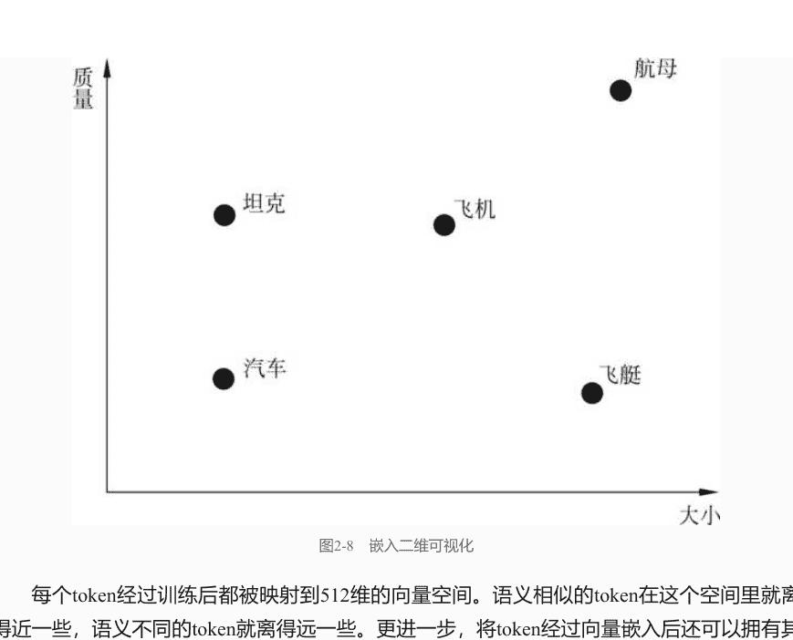

图2-8 嵌入二维可视化

训练后，每个词元都落在 512 维向量空间里。语义相近的词元在空间中距离更近，语义相远的则更远。进一步地，嵌入还具备语义运算性质，例如国王、皇后、男人、女人这四个词元的向量满足：国王减男人大致等于皇后减女人。可见经过嵌入的向量也支持语义计算。

通过神经网络学习得到的词元嵌入具有良好的语义表征。早期的 Word2Vec 等方法也能得到不错的嵌入，但有一个局限：嵌入在训练完成后就固定不变，无法随语境调整。而词元的实际语义在不同语境中可能差异很大，例如：

- 1. 我喜欢吃苹果。
- 2. 我喜欢苹果手机。

两句都有苹果这个词元，但在第一句指水果，第二句指品牌。希望第一句里的苹果能注意到前面的吃，从而改变自身表示；第二句里的苹果能注意到手机，从而改变自身表示。

### 2.1.3 自注意力机制

为让每个词元能依据语境不断更新自身表示，Transformer 引入了词元间的注意力，即自注意力机制。

每个词元在初始嵌入的基础上，经过共享的三个线性层映射，分别得到查询向量、键向量、值向量，简记为 q、k、v。

- (1) q 向量用于向其他词元的 k 向量发起查询。
- (2) k 向量用于对其他词元的 q 向量做出回应。
- (3) v 向量用于更新其他词元的表示。

例如图2-9 中的“苹果”，经三层映射后得到 q_4、k_4、v_4。q_4 分别与 k_1、k_2、k_3 以及自身 k_4 做相似度匹配，Transformer 使用点积。若 q_4 与 k_3 的相似度最高，则 v_3 在更新“苹果”表示时获得最大权重，如图2-9所示。

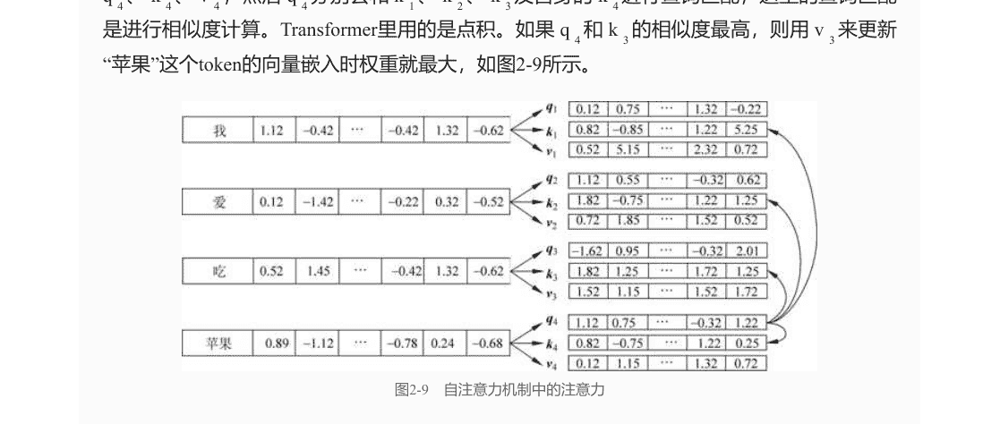

| token | 向量值 | q | k | v |

|-------|--------|---|---|---|

| 我 | 1.12, -0.42, ..., -0.42, 1.32, -0.62 | q1: 0.12, 0.75, ..., 1.32, -0.22 | k1: 0.82, -0.85, ..., 1.22, 5.25 | v1: 0.52, 5.15, ..., 2.32, 0.72 |

| 爱 | 0.12, -1.42, ..., -0.22, 0.32, -0.52 | q2: 1.12, 0.55, ..., -0.32, 0.62 | k2: 1.82, -0.75, ..., 1.22, 1.25 | v2: 0.72, 1.85, ..., 1.52, 0.52 |

| 吃 | 0.52, 1.45, ..., -0.42, 1.32, -0.62 | q3: -1.62, 0.95, ..., -0.32, 2.01 | k3: 1.82, 1.25, ..., 1.72, 1.25 | v3: 1.52, 1.15, ..., 1.52, 1.72 |

| 苹果 | 0.89, -1.12, ..., -0.78, 0.24, -0.68 | q4: 1.12, 0.75, ..., -0.32, 1.22 | k4: 0.82, -0.75, ..., 1.22, 0.25 | v4: 0.12, 1.15, ..., 1.32, 0.72 |

图2-9 自注意力机制中的注意力

具体计算先求 q_4 与 k_1、k_2、k_3、k_4 的点积，组成向量 v_s，如式（2-1）。v_s 反映了各词元与“苹果”之间的注意力分数，再对 v_s 应用 softmax()，如式（2-2），得到各词元对“苹果”注意力的占比向量。

```
v_s = [q_4 · k_1, q_4 · k_2, q_4 · k_3, q_4 · k_4]
```

```
v_p = softmax(v_s)
```

假设 v_p 最终计算为[0.1, 0.1, 0.35, 0.45]，则“苹果”更新自己的嵌入，如式（2-3）所示。

```
Embedding = 0.1v_1 + 0.1v_2 + 0.35v_2 + 0.45v_4
```

得到新嵌入后，还需经过一个线性层的映射，即为“苹果”经一次自注意力后的最终表示。之所以称为自注意力，是因为注意力计算只在序列内部的词元之间进行。

实际实现时，把所有词元的 q 向量聚成 Q 矩阵，同理得到 K 矩阵和 V 矩阵，如图2-10所示。

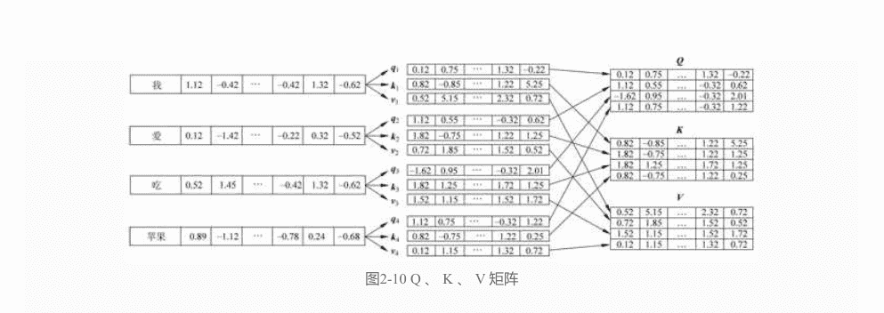

通过矩阵运算可以一次性得到所有词元更新后的嵌入，具体如式（2-4）。公式中为何除以 √d_k？d_k 为词元特征维度，Transformer 中为 512。因为 q 和 k 初始均值近似 0、方差为 1，点积后方差会变成 d_k。除以 √d_k 可把方差拉回 1。

```
Attention(Q,K,V) = softmax\left(\frac{QK^T}{\sqrt{d_k}}\right)V
```

类比卷积神经网络使用多个卷积核，自注意力也可使用多个头。每个头对应一组 q、k、v，可关注不同语义特征。例如让“苹果”经不同线性映射生成多组 q、k、v，第 1 组之间做自注意力得到一个更新向量，多组结果拼接后得到最终更新的嵌入。

在实际的多头实现中，并非为每个词元生成多份向量，而是先生成一个与原始特征同维的 q、k、v，再把它们拆成多份，每份作为一个头。每个词元的第 i 个头只与所有词元的第 i 个头交互。原论文中特征维度为 512，拆成 8 个头，每个头维度 64。每个头输出 64 维，最后拼接回 512 维。

| 0.12 | 0.75 | 1.32 | -0.22 | 1.32 | -0.22 |

| 0.82 | -0.85 | 1.22 | 5.25 | 1.22 | 5.25 |

| 0.52 | 5.15 | 2.32 | 0.72 | 2.32 | 0.72 |

| 1.12 | 0.75 | -0.32 | 1.22 | -0.32 | 1.22 |

| 1.12 | 0.75 | 1.32 | -0.22 | 1.12 | -2.22 |

| 0.42 | -0.75 | 1.32 | 2.25 | 1.26 | 3.25 |

| 0.32 | 2.15 | 1.24 | 0.32 | -1.32 | 1.75 |

| 1.02 | 0.43 | 0.52 | 0.52 | -0.82 | 1.23 |

| 1.12 | 1.75 | 0.32 | -1.22 | 2.32 | -0.22 |

| 0.42 | -1.85 | 1.02 | 2.25 | 1.25 | 2.25 |

| 0.72 | 1.15 | 1.32 | 1.72 | 1.22 | 1.72 |

| 1.32 | 1.75 | -0.12 | 0.22 | -4.32 | 1.82 |

- head1

- head2

- head3

#### 图2-11 多头注意机制

同样在多头下，也可使用 Q、K、V 矩阵加速计算。把 Q、K、V 拆分为多个头分别计算，再拼接结果。如图2-11所示，示例中把 Q、K、V 拆为 3 个头，先用 head1 的矩阵按式（2-4）计算，再计算 head2、head3，最后拼接。在多头自注意力的实现中，初始化代码如下：

```
//chapter2/Transformer.py
class MultiHeadAttentionBlock(nn.Module):

    def __init__(self, d_model: int, h: int, dropout: float) -> None:
        super().__init__()
        self.d_model = d_model          #编码特征大小
        self.h = h                      #头的个数
        #确保 d_model 可以被 h 整除
        assert d_model % h == 0, "d_model 不能被 h 整除"

        self.d_k = d_model //h          #每个头特征大小
        self.w_q = nn.Linear(d_model, d_model, bias=False)    #Wq
        self.w_k = nn.Linear(d_model, d_model, bias=False)    #Wk
        self.w_v = nn.Linear(d_model, d_model, bias=False)    #Wv
        self.w_o = nn.Linear(d_model, d_model, bias=False)    #Wo
        self.dropout = nn.Dropout(dropout)
```

attention () 函数的代码如下：## 2.1.4 层归一化

Transformer 对特征做的是层归一化。它会先为每个词元的特征向量计算均值和标准差，然后用每个特征减去均值再除以标准差。为防止除零，通常给标准差加上一个很小的常数。接着对特征向量里的每个值做线性变换，所有词元在相同位置的特征共享同一组权重和偏置，如式（2-5）所示。

Transformer 架构关键模块解析
$$\text{LayerNorm}(\boldsymbol{x}) = \frac{\boldsymbol{x} - E[\boldsymbol{x}]}{\text{std}[\boldsymbol{x}] + \varepsilon} * \gamma + \beta \qquad (2-5)$$

下面是对应的实现片段：

```python
class LayerNormalization(nn.Module):
    def __init__(self, features: int, eps: float = 10 ** -6) -> None:
        super().__init__()
        self.eps = eps
        #可学习权重
        self.alpha = nn.Parameter(torch.ones(features))
        #可学习偏差
        self.bias = nn.Parameter(torch.zeros(features))
    def forward(self, x):
        #x: (batch, seq_len, hidden_size)
        #保留维度来进行广播
        mean = x.mean(dim=-1, keepdim=True) #(batch, seq_len, 1)
        std = x.std(dim=-1, keepdim=True) #(batch, seq_len, 1)
        #eps 是为了防止除以 0 而设置的很小的值
        return self.alpha * (x - mean) / (std + self.eps) + self.bias
```

### 2.1.5 残差连接

残差连接的核心思路是把原始输入 x 与经过若干层变换后的结果直接相加。当网络很深时，反向传播的梯度可以通过这条捷径绕开中间的变换层流向前层，从而缓解梯度消失的问题，如图2-12所示。

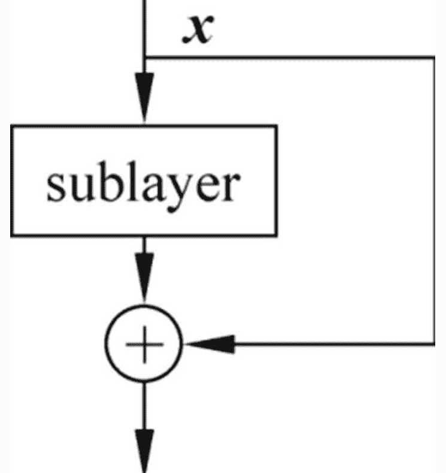

图2-12 残差连接

在 Transformer 内部，残差连接会与前面提到的层归一化以及一个 DropOut 共同使用，具体代码见下方：

```python
class ResidualConnection(nn.Module):

    def __init__(self, features: int, dropout: float) -> None:
        super().__init__()
        self.dropout = nn.Dropout(dropout)
        self.norm = LayerNormalization(features)

    def forward(self, x, sublayer):
        return x + self.dropout(sublayer(self.norm(x)))
```

### 2.1.6 前馈模块

前馈模块的结构非常简洁，由两层普通线性变换以及夹在中间的 DropOut 构成。第一层线性变换把进入的特征维度放大，第二层则把维度压缩回进入模块前的大小，代码示例如下：

```python
class FeedForwardBlock(nn.Module):

    def __init__(self, d_model: int, d_ff: int, dropout: float) -> None:
        super().__init__()
        self.linear_1 = nn.Linear(d_model, d_ff)
        self.dropout = nn.Dropout(dropout)
        self.linear_2 = nn.Linear(d_ff, d_model)

    def forward(self, x):
        #(batch, seq_len, d_model) --> (batch, seq_len, d_ff) --> (batch, seq_len, d_model)
        return self.linear_2(self.dropout(torch.relu(self.linear_1(x))))
```

### 2.1.7 Transformer的整体架构

整体结构如图2-13所示，左右两部分分别为编码器和解码器。编码器负责对源句进行编码，解码器则依据编码器的输出以及已生成的词元逐步生成新的词元。

编码器的处理流程此前已介绍。首先是原始自然语言句子，经词表映射为词元，再转为可学习的向量嵌入。嵌入向量进入多头注意力模块，该模块的输入与输出会做一次残差相加，随后进入前馈模块，前馈模块的输入与输出同样做残差相加。多头自注意力、前馈层以及各自的层归一化和残差连接组合起来就构成一个编码器层。原始实现中堆叠了 6 个编码器。因为输入与输出维度相同，可以直接累加，从而加深网络并学习更抽象的概念。

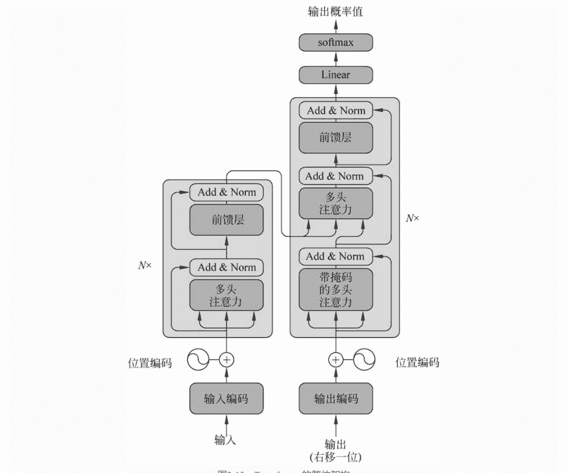

图2-13 Transformer的整体架构

编码器里还有位置编码这一部分没有说明，后文会详细展开其作用与实现。

### 2.1.8 位置编码

回想自注意力机制，它的计算并不关心词元之间的先后顺序，这会带来问题，例如“他打我。”和“我打他。”意义完全不同。为了让模型感知顺序，必须在词嵌入之上额外注入位置信息。

最直观的做法是给序列中每个词元加上绝对位置编号，比如“我爱吃苹果”里“我”标记为1，“爱”为2，“吃”为3，“苹果”为4。但这种方式在推理时遇到训练时未见过的更长句子就会失效。

需要一个周期性变化的编码函数，低维变化快、高维变化慢，类似计数进位的规律：个位变动最频繁，十位百位依次变慢。模型学习到这种周期规律后，就能处理训练阶段没有见过的序列长度。

正弦函数具有周期性和连续性，通过调节输入系数可以改变波长，如图2-14所示。系数越小波长越长，用短波长生成低维编码，用长波长生成高维编码。

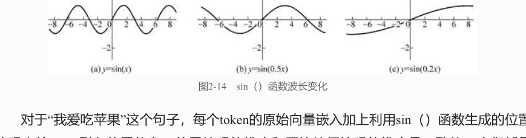

以“我爱吃苹果”为例，每个词元的原始嵌入加上由正弦函数生成的编码来引入位置信息。编码维度与嵌入维度一致，都是512维。每一维的值由该词元在序列中的位置和编码的维度共同决定，维度越高波长越长，位置变化带来的波动越缓慢，如图2-15所示。

| | 1.12 | -0.42 | ... | -0.42 | 1.32 | -0.62 |

|---|---|---|---|---|---|---|

| 我 | sin(w₀) | sin(w₁) | ... | sin(w₅₀₉) | sin(w₅₁₀) | sin(w₅₁₁) |

| | 0.12 | -1.42 | ... | -0.22 | 0.32 | -0.52 |

| 爱 | sin(2w₀) | sin(2w₁) | ... | sin(2w₅₀₉) | sin(2w₅₁₀) | sin(2w₅₁₁) |

| | 0.52 | 1.45 | ... | -0.42 | 1.32 | -0.62 |

| 吃 | sin(3w₀) | sin(3w₁) | ... | sin(3w₅₀₉) | sin(3w₅₁₀) | sin(3w₅₁₁) |

| | 0.89 | -1.12 | ... | -0.78 | 0.24 | -0.68 |

| 苹果 | sin(4w₀) | sin(4w₁) | ... | sin(4w₅₀₉) | sin(4w₅₁₀) | sin(4w₅₁₁) |

每个编码维度的正弦系数用 wᵢ 表示，i 从0起至 feature_size-1。随着编码维度增大，wᵢ 越小，对应的正弦波长越长。

$$w_i = \frac{1}{10\ 000^{i/feature\_size}}$$

实际 Transformer 中采用正弦与余弦函数交替编码，如图2-16所示。

| | | | | | | |

|---|---|---|---|---|---|---|

| 我 | 1.12 | -0.42 | ... | -0.42 | 1.32 | -0.62 |

| | sin(w₀) | cos(w₁) | ... | cos(w₅₀₉) | sin(w₅₁₀) | cos(w₅₁₁) |

| 爱 | 0.12 | -1.42 | ... | -0.22 | 0.32 | -0.52 |

| | sin(2w₀) | cos(2w₁) | ... | cos(2w₅₀₉) | sin(2w₅₁₀) | cos(2w₅₁₁) |

| 吃 | 0.52 | 1.45 | ... | -0.42 | 1.32 | -0.62 |

| | sin(3w₀) | cos(3w₁) | ... | cos(3w₅₀₉) | sin(3w₅₁₀) | cos(3w₅₁₁) |

| 苹果 | 0.89 | -1.12 | ... | -0.78 | 0.24 | -0.68 |

| | sin(4w₀) | cos(4w₁) | ... | cos(4w₅₀₉) | sin(4w₅₁₀) | cos(4w₅₁₁) |

## 图2-16 sin（）和cos（）位置编码

图中偶数维的正弦系数如式 2-7 所示记为 w₂ᵢ，奇数维的余弦系数如式 2-8 所示记为 w₂ᵢ₊₁。

$$w_{2i} = \frac{1}{10000^{2i/feature\_size}} \qquad (2-7)$$

$$w_{2i+1} = \frac{1}{10000^{2i/feature\_size}} \qquad (2-8)$$

正弦和余弦随维度增大波长都会变长，那么加入余弦有什么好处呢？注意力计算依赖 q 向量与 k 向量的点积。设两个位置编码分别为 t 与 t+Δt，对用正余弦交替编码的两个位置向量做点积：

$$(\sin(w_i t), \cos(w_i t)) \cdot (\sin(w_i (t + \Delta t)), \cos(w_i (t + \Delta t)))$$

$$= \sin(w_i t)\sin(w_i (t + \Delta t)) + \cos(w_i t)\cos(w_i (t + \Delta t))$$

$$= \cos(w_i (t - (t + \Delta t)))$$

$$= \cos(w_i \Delta t)$$

计算结果表明，最终的注意力值只与相对距离 Δt 相关，而与绝对位置 t 无关。这对自然语言处理很重要，因为词组的含义只取决于内部词元的相对顺序，而非在句子中的绝对位置。

位置编码的实现代码如下：

```python
class PositionalEncoding(nn.Module):

    def __init__(self, d_model: int, seq_len: int, dropout: float) -> None:
        super().__init__()
        self.d_model = d_model
        self.seq_len = seq_len
        self.dropout = nn.Dropout(dropout)
        #创建一个空的 tensor
        pe = torch.zeros(seq_len, d_model) #(seq_len, d_model)
        #创建一个位置向量
        position = torch.arange(0, seq_len, dtype=torch.float).unsqueeze(1)
        #计算分母
        div_term = torch.pow(10000.0, -torch.arange(0, d_model, 2, dtype=torch.float) / d_model) #(d_model / 2)
        #偶数位调用 sin
        pe[:, 0::2] = torch.sin(position * div_term)
        #奇数位调用 cos
        pe[:, 1::2] = torch.cos(position * div_term)
        #增加 batch 维度
        pe = pe.unsqueeze(0) #(1, seq_len, d_model)
        #将位置编码注册为一个 buffer
        self.register_buffer('pe', pe)

    def forward(self, x):
        x = x + (self.pe[:, :x.shape[1], :]).requires_grad_(False)
        return self.dropout(x)
```

### 2.1.9 解码器的输入输出

到目前为止编码器部分已全部介绍，它负责对输入词元做上下文理解并不断更新其表示。接下来解码器利用这些表示完成翻译等任务。

从图2-13可见，解码器的输入有两部分：一部分是编码器的输出，另一部分是把目标输出右移一位构成的输入序列。

以中文到英文翻译为例，源句“我爱吃苹果”先分词、词嵌入、加上位置编码进入编码器，得到每个词元的上下文表示。解码器端输入为 <bos> I like to eat apple，<bos> 表示句子的开始。期望的输出为 I like to eat apple <eos>，<eos> 表示句子的结束，如图2-17所示。

当解码器输入为 <bos> 时，模型结合编码器输出预测 I；输入为 <bos> I 时，预测 I like。虽然推理时需要逐词生成，但借助掩码机制，训练时可以并行处理全部词元。训练完成后推理仍需逐词输出。

### 2.1.10 掩码机制

掩码如何实现并行训练？对于长度为6的输出序列，需要构造如图2-18所示的 Mask 矩阵。第 i 行表示第 i 个词元能看到的词元，1 表示可见，0 表示不可见。例如第1行仅能看到自身，第2行能看到第1、2个位置。

注意力计算时除 Q、K、V 外还传入 Mask 矩阵，使每个词元仅关注自身及前面的词元，从而一次训练覆盖全部目标词元。

| 1 | 0 | 0 | 0 | 0 | 0 |

|---|---|---|---|---|---|

| 1 | 1 | 0 | 0 | 0 | 0 |

| 1 | 1 | 1 | 0 | 0 | 0 |

| 1 | 1 | 1 | 1 | 0 | 0 |

| 1 | 1 | 1 | 1 | 1 | 0 |

| 1 | 1 | 1 | 1 | 1 | 1 |

图2-18 Mask矩阵

实际实现时先用 Q、K 计算注意力分数，在 softmax 之前把 Mask 为0的位置的分数替换为一个很大的负数，经过 softmax 后这些位置的权重变为0，进而在计算当前词元特征时被忽略，代码如下：

```
//chapter2/Transformer.py
def attention(query, key, value, mask, dropout: nn.Dropout):
    d_k = query.shape[-1]
    #(batch, h, seq_len, d_k) --> (batch, h, seq_len, seq_len)
    attention_scores = (query @ key.transpose(-2, -1)) / math.sqrt(d_k)
    if mask is not None:
        #在 mask 为 0 的位置填入一个很大的负值
        attention_scores.masked_fill_(mask == 0, -1e9)
    #(batch, h, seq_len, seq_len)
    attention_scores = attention_scores.softmax(dim=-1)
    if dropout is not None:
        attention_scores = dropout(attention_scores)
    #(batch, h, seq_len, seq_len) --> (batch, h, seq_len, d_k)
    return (attention_scores @ value), attention_scores
```
再次说明一下，掩码机制在训练阶段能够让解码器一次性并行学习序列里所有位置的词元，但模型训练完成进入生成阶段时，因为答案并不提前可知，只能采用自回归的方式，每次先生成一个词元再把它拼接到解码器的输入里，依此逐步推导出下一个。

### 2.1.11 交叉注意力
对照图2-13的Transformer结构，解码器内部的掩码多头自注意力我们已做过介绍。解码器里另外一种多头注意力与编码器的做法不同，它需要借助编码器的输出，因此被命名为交叉注意力。该模块的键矩阵K和值矩阵V都来源于编码器的输出，而查询矩阵Q则来自解码器自身，代码示例如下：

```
//chapter2/Transformer.py
def forward(self, x, encoder_output, src_mask, tgt_mask):
    x = self.residual_connections[0](x, lambda x: self.self_attention_block(x, x, x, tgt_mask))
    #交叉注意力模块的 Q 矩阵来自解码器，K 和 V 矩阵来自编码器的输出
    x = self.residual_connections[1](x, lambda x: self.cross_attention_block(x, encoder_output, encoder_output, src_mask))
    x = self.residual_connections[2](x, self.feed_forward_block)
    return x
```
### 2.1.12 线性分类头
参考图2-13所示的Transformer架构，解码器顶端还接有一层线性映射。它的输入维度等于每个词元的表征维度，原版实现中为512，输出维度则与词表大小一致。线性层的结果再经softmax处理后，便转化为词表中各词元担任下一词元的概率分布。

## 2.2 GPT
OpenAI推出的GPT系列开启了大语言模型时代。自2018年发布的GPT-1起，随着参数规模与训练语料的不断扩大，模型的语言理解与生成能力持续惊艳。特别是GPT-3，凭借1750亿参数成为业界公认的首个真正意义上的大语言模型。GPT-4在能力上更进一步，还引入了多模态输入，可同时接受图像与文本，让大语言模型的应用可能更加丰富。

### 2.2.1 GPT-1
GPT-1的论文名为 Improving Language Understanding by Generative Pre-Training，即通过生成式预训练提升自然语言理解。研究动因来自当时NLP领域的两大痛点：一是各类任务高度依赖大量标注数据，二是为某个任务优化的模型难以迁移到其它任务。反观计算机视觉，借助ImageNet大规模标注集进行预训练后再少量微调，已在多个下游任务取得显著效果。OpenAI希望复刻这一思路，为NLP构建通用预训练框架。

构建此类框架面临挑战：NLP缺少类似ImageNet的海量标注文本；同时需要一种预训练后可通过最小改动适配下游任务的架构，理想情况只需加一个线性分类头即可。

为缓解标注不足的问题，团队采用自回归语言模型进行训练，即模型接收一段文本后预测其下一个字，从而学习语言规律。架构选择上，Transformer刚被提出不久，相比循环神经网络，它在捕捉训练数据模式并迁移到下游任务方面表现更优，因而被选为基础。

GPT-1只保留了Transformer的解码器部分，去掉了编码器，也因此移除了交叉注意力。输入流程为先分词，再经嵌入层编码并加上位置编码以记录序列顺序。随后进入带掩码的多头自注意力，只允许在生成每个词元特征时参考其之前的词元，以保持自回归特性。注意力模块前后有残差连接，随后经过层归一化，再进入前馈网络，同样配有残差连接和层归一化，一个完整的解码器模块由此构成。GPT-1共堆叠12个这样的模块。输出分为两部分：一是负责自回归语言建模的文本预测，二是不参与预训练、仅用于下游微调的任务分类器，如图2-19所示。

GPT-1为纯解码器结构，共12层解码器，隐藏维度768，注意力头数12，总参数约1.17亿。与经典Transformer使用正弦余弦位置编码不同，GPT-1采用可学习的位置嵌入，参数在训练中自行优化。各隐藏层激活函数使用高斯误差线性单元GELU。

预训练时，模型接收连续词元序列 U = { u_1 , ..., u_n }，利用其中前k个词元预测下一个词元。对每个词元的出现概率基于模型参数及其上下文计算，整个序列的联合概率为各词元概率的乘积。为便于优化，采用对数似然将乘积转为对数和，目标即为GPT-1语言模型的对数似然函数，如式（2-9）。通过迭代最大化该目标，训练出有效的语言模型。

```
Loss(U) = \sum_{i} \log P(u_i \mid u_{i-k}, \cdots, u_{i-1}; \Theta) \quad (2-9)
```
要得到下一个词元的概率，GPT-1先把输入序列映射为id记作U，再通过词嵌入矩阵W_e转为Embedding向量，随后与位置编码W_p相加融合位置信息，如式（2-10）所示。

```
h_0 = UW_e + W_p \quad (2-10)
```
经过12个解码器模块的深层处理，模型提取序列的抽象特征，如式（2-11）所示。

```
h_l = \text{decoder\_block}(h_{l-1}) \quad \forall l \in [1, 12] \quad (2-11)
```
解码器输出再乘以词嵌入矩阵W_e的转置，把隐藏维度映射回词表长度，最后通过softmax得到词表中各词元作为下一个词元的概率分布，如式（2-12）所示。

```
P(u) = \text{softmax}(h_n W_e^T) \quad (2-12)
```
在GPT-1里，词嵌入矩阵W_e与输出分类头的线性层共享权重。此举主要出于参数效率考虑：早期模型规模有限而词表较大，嵌入矩阵常占较大比重，共享可有效压缩参数。随着模型变大，嵌入占比下降，部分新模型选择为分类头使用独立参数。

预训练完成后，模型即可用于自然语言理解任务的初始化，随后通过微调适配具体下游任务。OpenAI的做法是在文本中插入特定标记token以指示任务，如图2-20所示。

例如分类任务，先在文本前加开始标记、后加结束标记，再在预训练模型上叠加一个线性分类头进行预测，实现最小改动的最大复用。

文本蕴含任务需判断前提与假设的逻辑关系，输出支持、反对或不相关。如前提“我刚吃完饭”，假设“我不饿”应为支持，假设“我很饿”应为反对，假设“我喜欢学习”则不相关。处理时同样使用开始、结束标记，并在前提与假设间插入分隔标记，最后接三分类线性头。

语义相似度评估任务会在输入中加入开始、结束和分隔标记。考虑到相似度的对称性，方法是对调两句位置分别调用模型两次，再将两次输出张量相加经线性层处理进行分类。

选择题任务把问题与各选项构成独立序列，加入开始、结束与分隔标记，输入预训练模型后经线性层转为得分，再用softmax得到各选项被选中的概率分布。

通过在输入中插入开始、分隔、结束标记，GPT-1能够灵活应对多种NLP下游任务，既提升适应性，也充分利用预训练获得的语言理解能力。

在下游训练中，GPT-1同时优化特定任务目标与自回归语言建模目标，通过为两项损失分配不同权重，使模型在学习任务的同时保持语言生成能力，提升泛化性。

GPT-1的预训练语料为BooksCorpus，包含约7000本未出版图书，总计约8亿词。训练时上下文窗口设为512，批处理大小为32。

### 2.2.2 GPT-2
GPT-1发布后不久，Google推出了BERT，其仅使用Transformer编码器，并在处理任一词元时可同时看到前后上下文，即双向建模，如图2-21(b)所示。这种全面上下文的理解使其在语义抽取等任务上优于GPT-1。

GPT-2论文题为 Language Models are Unsupervised Multitask Learners，即语言模型是非监督的多任务学习器。其目标是让预训练模型直接处理所有下游任务，免去微调步骤。GPT-1的下游处理依赖特殊token的微调，而GPT-2不使用微调，因此推理时不能出现训练未见的token，只能依靠自然语言提示来说明任务，这被称为提示词prompt。

GPT-2在预测时输入由原始数据与任务描述提示拼接而成，模型据此生成输出，简化了预训练到应用的转换。例如情感分类，GPT-1需在文本前后加开始结束标记，GPT-2则通过自然语言提示告知模型执行具体任务。

结构上GPT-2做了几项关键改进：
- (1) 层归一化位置调整：从模块输出后移至输入前，先归一化再做注意力，有助于训练稳定，并在最后一个子层注意力后增加额外层归一化。
- (2) 残差连接初始化缩放：随模型加深减小初始化参数，促进梯度传播。
- (3) 词表扩展：词表扩至50257，以覆盖更广词汇。
- (4) 模型规模扩大：参数增至15.42亿，提升复杂任务处理能力。

训练方面，上下文长度从512扩展到1024，批大小从32提升到512。语料选用Reddit上的高质量网页内容，约800万条文本，数据量40GB。

尽管GPT-2在许多任务上表现突出，但仍未完全超越监督学习模型，不过OpenAI观察到模型规模越大性能越好，显示出扩展的潜力。

### 2.2.3 GPT-3
接续GPT-2，OpenAI研发GPT-3，论文题为 Language Models are Few-Shot Learners，即语言模型是少样本学习者。研究动机源于人类仅凭极少示例即可适应新任务的能力。相较BERT和GPT-1需数千样本，GPT-3探索是否只需在提示中给出少数示例即可提升性能，无需微调，并延续了GPT-2的不微调思路。

零样本学习指直接通过提示让模型完成任务，如将cheese译成法语。单样本学习在提示后提供一个英译法例子再让模型翻译。少样本学习则提供多个例子后再执行任务，如图2-22所示。

### 2.2.4 GPT-4
GPT-3与GPT-2结构基本一致，但引入了稀疏注意力机制。传统注意力需每个词元与前面所有词元计算，稀疏注意力只与部分先前词元交互，以提高效率并支持更大规模。GPT-3最大模型拥有1750亿参数，在3000亿词元数据集上训练。

训练数据主要为清洗后的CommonCrawl，尽管数据量大采样权重最低，而数据量较小的维基百科采样权重最高。上下文长度增至2048，批处理大小达到320万。

评估显示，GPT-3的少样本上下文学习效果明显优于零样本与单样本，尤其是1750亿参数版本在少样本下已超过监督微调模型。此外其生成的新闻已逼真到引发社会关注。

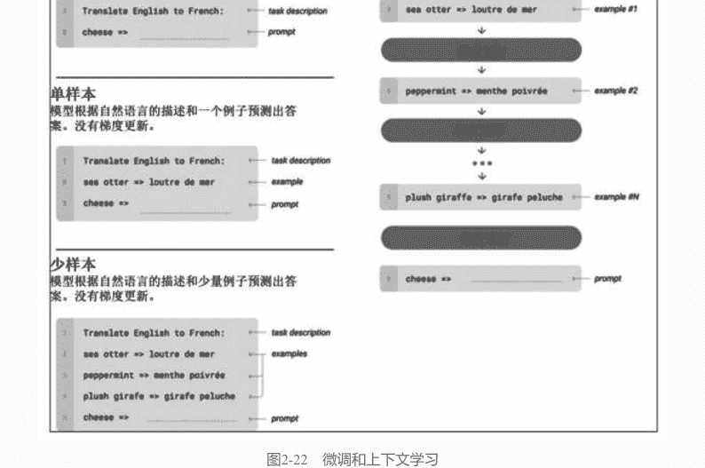
GPT-3表现亮眼后，OpenAI推进了GPT-4研发，但技术报告公开信息极少，社交媒体上甚至戏称报告内容只有“我们用了Python”。

GPT-4是一个多模态大模型，可接收文本和图像输入，输出仅限文本，表现持续领先。GPT-4甚至能理解图片中的幽默点，如图2-23所示。

除此之外，GPT-4在多学科的考试测评中表现相当突出，成绩全面超过GPT-3，在个别领域甚至能反超人类。比如它通过了美国律师资格考试，且分数高于绝大多数真实考生，详情可参考图2-24。

GPT-4论文里少见的洞见是，大模型的核心功底基本是在预训练阶段就奠定了。基于人类反馈的强化学习只能让模型输出更贴合人的偏好，并不能直接提升底层能力，用得不当甚至会削弱预训练时形成的原有水平。

总体来看，从GPT-1到GPT-4，OpenAI的技术报告越写越厚，真正公开的技术信息却越来越少。好在与此同时，开源大模型的社区生态正变得愈发活跃。


这张图到底好笑在什么地方？

笑点来自于一种很离谱的用错场景。画面里有人正试图用台式机常用的VGA显示器连接线给智能手机充电。VGA接口压根不支持电力传输，根本无法给手机或其他任何USB充电设备供电。把VGA头对准手机的尝试本身就很不匹配，再加上右上角的包装明确写着这是专为Lightning Cable设计的配件，更凸显出这种解决方案的荒唐。整体就是在展示一个明显不可能奏效的充电脑洞。

# 图2-23 GPT-4应用样例

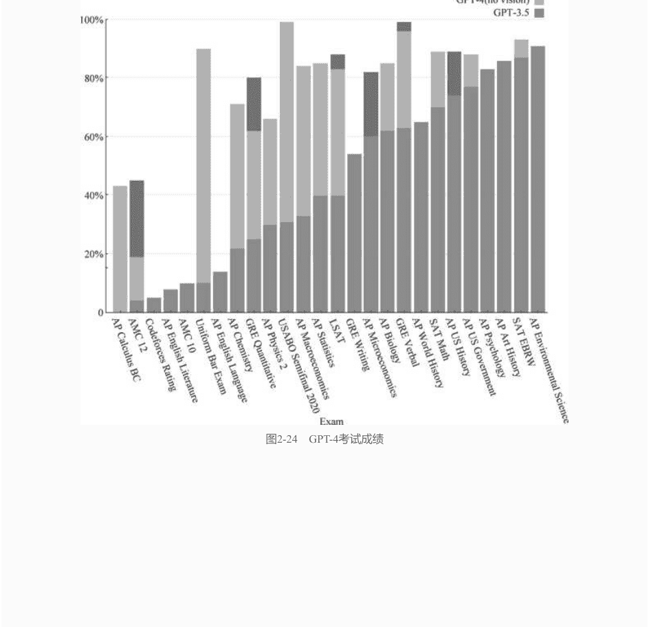
图2-24 GPT-4考试战绩

## 2.3 OpenAI o1

OpenAI给o1起了和GPT-3、GPT-4不一样的名字，因为它的运行方式是全新的。它内置了“思维链”Chain of Thought CoT，能够在给出最终答案前先进行深入的思考和推理。过去的GPT系列不管问题简单还是复杂都会立刻开始生成回应，而o1引入了一种先思考再作答的推理模式，在复杂推理任务上的表现因此迎来明显跃升。

下面是一次调用o1预览版的演示，这个题目GPT-4o根本给出不了正确答案：

```
用户：
烧一根质地不均匀的绳子，从头烧到尾，需要一小时。现在有若干这样的绳子，怎样可以计时75min？
o1：
思考15s：
组合绳索刻度
依靠燃烧后绳索的不同部分来度量75min。每根绳子长度燃烧1h，但燃烧速度不均匀。

解题探索
举一个例子，拥有两根绳子，如何准确测量45min。这个问题看起来简单，却充满了挑战性。

点燃计时
点燃两根绳子，一根两端燃烧，半小时内烧完；另一根一端燃烧，半小时后点燃另一端，15min后燃烧完。

考虑计时方法
首先，我在思考如何通过多根绳子计时75min。绳子正反两端点燃时烧30min。单端点燃烧1小时。
我在思考如何组合这些时间间隔来实现75min。

考查燃烧时间
首先利用三根绳子的燃烧时间来测量75min，然后尝试不同的组合以达到75min的目标。

透析时间安排
我们用三根绳子来处理时间。通过点燃两头的第1根绳子、单头的第2根绳子、再点燃第3根绳子，最终耗时105min。

探索时间测量
我在思考如何利用这些绳子来准确测量15min。三点点燃一根绳子或者同时点燃两根双端点燃的绳子，似乎不太行得通。

尝试不同的燃烧方式
我正在探索点燃不同长度的绳子，并控制燃烧速度以达到45min的规划目标。

点燃绳子
看到计划是：将绳子A两端点燃，绳子B一端点燃，30min后绳子A烧完，点燃绳子B的另一端。45min后，绳子B烧完，点燃绳子C的两端。75min后，绳子C烧完。

评估时间段
我在计算不同燃烧时间段的总时间，确保每段时长达标。第一阶段为30min，第二阶段为15min，第三阶段为30min，总时间为75min。
答：
1. 第0min，点燃第1根绳子的两端和第2根绳子的一端；
2. 第30min，第1根绳子烧完时，点燃第2根绳子的另一端；
3. 第45min，第2根绳子烧完时，点燃第3根绳子的两端；
4. 第75min，第3根绳子烧完，总共耗时75min。
```
研发o1时，OpenAI依托了自己在强化学习上的积累，并结合了GPT系列早期就发现的Scaling Law。在训练GPT-3、GPT-4这类大模型的过程中，研究者发现参数和训练数据越多，性能越好。但随着大规模训练推进，两个瓶颈变得突出：一方面可用的互联网数据基本已被吃完，另一方面硬件成本限制了模型规模继续指数级膨胀。

面对这个局面，OpenAI在o1上换了思路。他们发现，除了堆参数，拉长强化学习训练时长以及推理时的思考时长，也能显著提升表现。这其实是另一种Scaling Law，如图2-25所示。

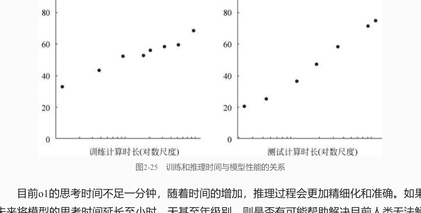
目前o1的思考时长还不到一分钟，随着时长增加，推理会变得更细致更准确。如果未来把思考时间拉长到小时、天甚至年级别，会否帮助解决人类至今没解开的科学难题？答案现在还不确定，但这个方向为AI在科研领域的未来打开了很大想象空间。

让模型学会独立思考并不容易。最直接的做法是让人类专家为每个问题写出完整的思考过程和答案，再用监督学习来训练模型，但这种方式有明显局限。首先手工构造这类数据耗时耗力，难以做到大规模。其次模型只能模仿人类思路，上限会被锁死，永远无法突破。

OpenAI借助强化学习让o1自主生成思维链，并不断优化自己的推理策略。模型在面对问题时会尝试多种解法并自行评估改进，最终生成的思维链有时甚至超过人类专家的水平。正是这种自动生成的推理链构成了o1强大推理能力的核心，也推动了它在复杂任务上的优异表现。

尽管推理能力在很多领域已超越人类专家，OpenAI出于隐私、安全以及可控性等多方面考量，选择不公开模型的原始思维链。思维链本质上是模型真实思考的轨迹，直接展示可能带来风险。o1对外输出的思维链其实是经过模型提炼的摘要，并非原始未加工的思考过程，这种设计是在用户体验和模型监控之间做的权衡。

o1在多个领域的推理能力实现了突破。过去在严谨数学、编程和科学推理上AI往往不如人类专家，而o1在这几类任务上已通过多项严苛测试，并在不少场景下超过专家水平，已能成为科研工作的得力助手甚至合作伙伴。

数学能力上，o1在AIME上接受了测试。AIME是面向美国顶尖高中生的数学挑战。2024年AIME中GPT-4o平均只答对12%的问题1.8/15。o1单样本时平均答对74%11.1/15，64样本时答对83%12.5/15，用学习得到的评分函数对1000个样本重排后答对率达到93%13.9/15。13.9分的成绩足以跻身全美前500名学生，并超过美国数学奥林匹克竞赛的分数线。

在GPQA Diamond上，OpenAI用化学、物理、生物专业知识的困难基准对o1进行了评估，并招募博士专家作对比。结果o1超越了这些人类专家，成为首个在该基准上胜过人类的模型。在其他机器学习基准上也有领先表现。开启视觉能力后，o1在MMMU上得78.2%，成为首个在人类专家面前具备竞争力的模型。它还在57个MMLU子类别中的54个上超越了GPT-4o，如图2-26所示。

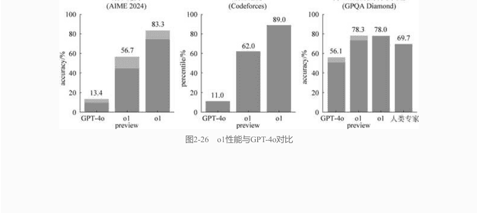

15min

## 2.4 Llama

Llama系列是由Meta研发的开源大模型，目前在开源社区关注度最高，许多开发者基于Llama做微调或构建智能应用。

### 2.4.1 Llama1

Llama1的论文名为 Open and Efficient Foundation Language Models，可译为开放高效的基础语言模型。论文主打两点：开放和高效。

关于开放，Llama模型只使用公开可获取的数据训练，未使用Meta客户数据，性能可媲美GPT-3，并向研究社区开源，但限制商业用途。

关于高效，传统扩展律多以训练计算成本衡量，比如10B参数模型初期损失下降快，随后趋于饱和，而50B参数模型后期下降更快，在固定性能指标下大模型训练成本反而更低，如图2-27所示。但Meta认为，训练只做一次，推理却要做无数次，更该关注推理阶段的计算成本。因此可以在训练阶段多投入计算，换取小模型在推理时的效率优势。

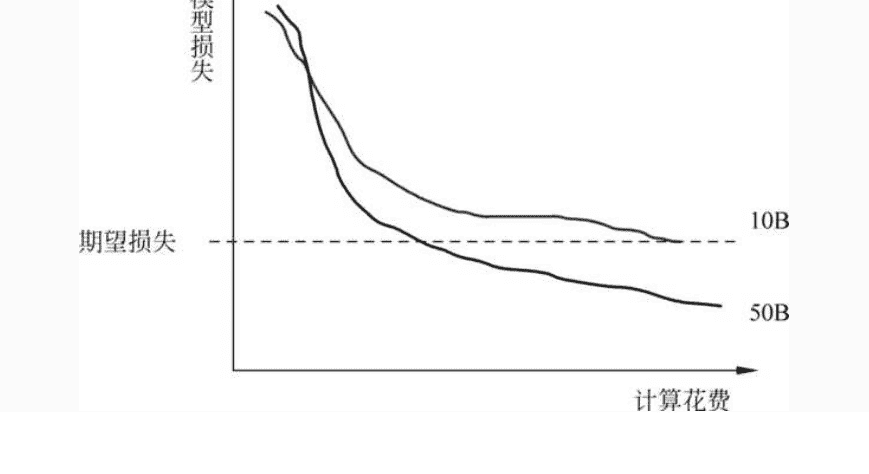
# 图2-27 训练效率对比

按原扩展律，10B参数模型建议用2000亿token训练。Meta的研究显示，即使是7B参数的模型，用到1万亿token时性能依然在持续提升。这说明在设计时扩大训练数据规模比单纯放大参数规模更有效，这正是Meta倡导的效率理念，也是Llama系列的设计哲学。

Llama1的训练数据全部来自公开资源。具体使用2017至2020年的CommonCrawl数据，经精细去重并剔除非英文内容。为保证质量，团队用一个线性分类器筛选文本，以维基百科引用网页为正样本，其余为负样本。

训练时，书籍和维基百科文本迭代了两遍，其他来源文本迭代一遍。整体训练集约1.4万亿token。

训练配置为2048张80GB显存的A100 GPU，上下文长度2048 token，全程约21天。

Llama系列结构与GPT系列相似，都只用Transformer解码器，并在其上做了改良以提升性能和稳定性：

- 1 同GPT-3一样，把每个子层后的归一化移至子层输入处，提升训练稳定性和效率。
- 2 用均方根归一化RMS Norm替代标准层归一化，降低运算量。
- 3 采用SiLU Sigmoid Linear Unit激活函数提升性能。
- 4 引入旋转位置编码Rotary Position Encoding，更好处理token间的相对位置。

RMS Norm是对Layer Norm的改进，核心在于归一化时做平移并不改变分布，因此可以去掉相关部分。具体来说，RMSNorm去掉了Layer Norm的减均值操作，也去掉了标准化后的偏差参数，简化计算的同时保留归一化核心功能，从而提升效率和性能。

```
LayerNorm = \frac{x - E[x]}{\sqrt{Var[x] + \epsilon}} * \gamma + \beta \quad (2-13)
```
```
RMSNorm = \frac{x}{\sqrt{Mean(x^2) + \epsilon}} * \gamma \quad (2-14)
```
SiLU激活函数，见式2-15。

```
SiLU = x * Sigmoid(x) = \frac{x}{1 + e^{-x}} \quad (2-15)
```
从SiLU的图像看，在0附近曲线更平滑，远离0时形状与ReLU相似，如图2-28所示。实验表明SiLU通常能提升精度，但因需计算指数，成本比ReLU更高。

旋转位置编码的核心是用sin和cos构成的旋转矩阵对二维向量进行旋转。在二维坐标系里，设向量v=1,0。绕原点逆时针旋转θ后，长度不变，坐标变为cosθ,sinθ。

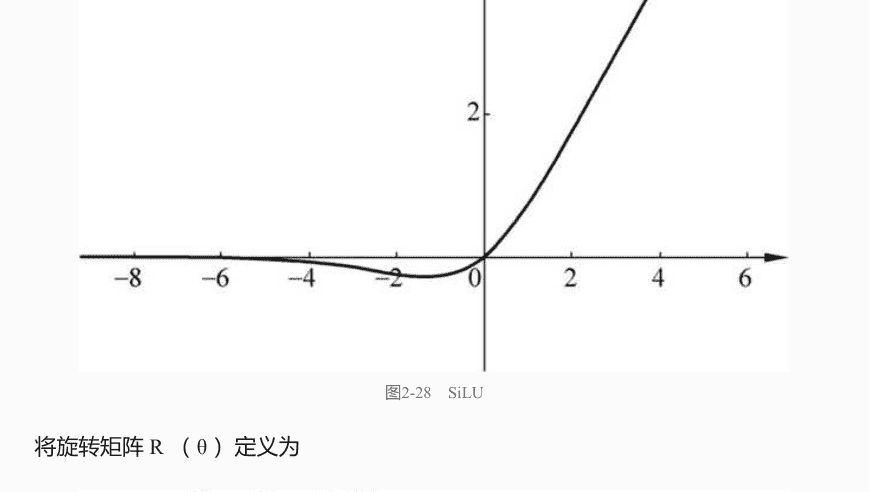
将旋转矩阵Rθ定义为

```
R(\theta) = \begin{bmatrix} \cos\theta & \sin\theta \\ -\sin\theta & \cos\theta \end{bmatrix} \quad (2-16)
```
向量v与旋转矩阵Rθ相乘后结果为cosθ,sinθ，如图2-29所示。

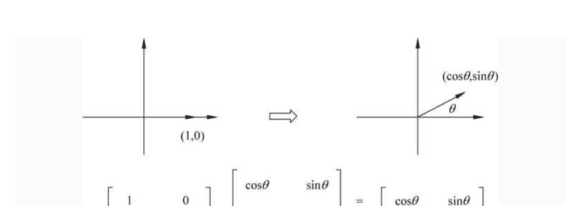
同理，位于y轴上的向量v=0,1，逆时针旋转θ后得到v'=-sinθ,cosθ。v'同样等于v与Rθ相乘的结果，如图2-30所示。

向量1,0和0,1是二维笛卡儿坐标系的标准基。当这两个基向量经Rθ逆时针旋转θ后，整个坐标系也随之旋转了θ。

下面证明Rθ能对任意二维向量逆时针旋转θ。设向量长度为r，与x轴夹角为α，逆时针旋转β，则证明如下：

```
$$
\begin{aligned}
[r\cos\alpha \quad r\sin\alpha] \begin{bmatrix} \cos\beta & \sin\beta \\ -\sin\beta & \cos\beta \end{bmatrix} \\
&= [r\cos\alpha \cdot \cos\beta - r\sin\alpha \cdot \sin\beta \quad r\cos\alpha \cdot \sin\beta + r\sin\alpha \cdot \cos\beta] \\
&= [r\cos(\alpha + \beta) \quad r\sin(\alpha + \beta)]
\end{aligned}
$$
```
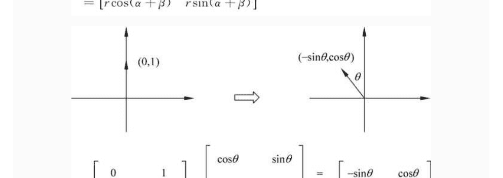
旋转矩阵具有以下性质：

- 1 旋转矩阵具有结合性。

$$R(\theta_1)R(\theta_2) = R(\theta_1 + \theta_2)$$
- 2 旋转矩阵的转置等价于旋转负θ角度。

```
$R(\theta)^T = R(-\theta)$ (2-18)
```
式2-18的证明如下：

```
$R(\theta)^T = \begin{bmatrix} \cos\theta & -\sin\theta \\ \sin\theta & \cos\theta \end{bmatrix} = \begin{bmatrix} \cos(-\theta) & \sin(-\theta) \\ -\sin(-\theta) & \cos(-\theta) \end{bmatrix} = R(-\theta)$
```
证明用到sin和cos的奇偶性。cosθ=cos-θ且sin-θ=-sinθ。

在Transformer的注意力计算中，核心是查询向量q与键向量k的点积qk^T，这种计算不直接体现位置信息。为引入位置，可用旋转矩阵对向量编码。设位置索引分别为m和n，对q施加R m，对k施加R n，再做点积，则有

```
$qR(m) \cdot kR(n)$
$= qR(m)R(n)^T k^T$
$= qR(m)R(-n)k^T$
$= qR(m-n)k^T$
```
上述推导用到了旋转矩阵性质式2-17和式2-18。可以看到改进后的注意力在q和k之外，还显式包含了m-n这一相对位置信息。

二维旋转矩阵如何扩展到高维？方法是把维度两两分组旋转。若q和k特征长度为8，就分成4组，每组在两个特征构成的子空间内旋转，组内特征的配对方式可以任意。

如式2-19所示，m代表token的位置，例如序列中第1个tokenm为0。该公式里频率最大的是第一个二维子空间，频率为1，波长最短；频率最小的是最后一个子空间，频率接近1/10000，波长最长。

$$ R(mf) = \begin{bmatrix} \cos(mf_0) & \sin(mf_0) & 0 & 0 & \cdots & 0 & 0 \\ -\sin(mf_0) & \cos(mf_0) & 0 & 0 & \cdots & 0 & 0 \\ 0 & 0 & \cos(mf_1) & \sin(mf_1) & \cdots & 0 & 0 \\ 0 & 0 & -\sin(mf_1) & \cos(mf_1) & \cdots & 0 & 0 \\ \vdots & \vdots & \vdots & \vdots & \ddots & \vdots & \vdots \\ 0 & 0 & 0 & 0 & \cdots & \cos(mf_{\frac{d}{2}-1}) & \sin(mf_{\frac{d}{2}-1}) \\ 0 & 0 & 0 & 0 & \cdots & -\sin(mf_{\frac{d}{2}-1}) & \cos(mf_{\frac{d}{2}-1}) \end{bmatrix} $$

$$ f_i = \frac{1}{10000^{\frac{2i}{d}}} \quad (2-19) $$

不同二维子空间被赋予不一样的旋转速度，根源在于正弦和余弦本身都是周期函数。用钟表来类比就很直观：秒针转得最快，精度最高，可每过一分钟就要重复一次；时针转得最慢，周期很长，重复性低。秒针、分针、时针三者配合，才拼凑出完整的时间。

在多维旋转矩阵里非零元素很少，所以 token 特征与之相乘后能大幅简化为式（2-20）。其中 h 表示 token 的特征向量，h_i 是该向量第 i 个位置的分量。记号 R(h,m) 就是对序列中第 m 个位置的 token 特征向量 h 进行旋转的操作。

$$ R(h,m)_1 = [h_0, h_1, \cdots, h_{d-2}, h_{d-1}] \otimes [\cos(mf_0), \cos(mf_0), \cdots, \cos(mf_{\frac{d}{2}-1}), \cos(mf_{\frac{d}{2}-1})] $$

$$ R(h,m)_2 = [-h_1, h_0, \cdots, -h_{d-1}, h_{d-2}] \otimes [\sin(mf_0), \sin(mf_0), \cdots, \sin(mf_{\frac{d}{2}-1}), \sin(mf_{\frac{d}{2}-1})] $$

$$ R(h,m) = R(h,m)_1 + R(h,m)_2 \quad (2-20) $$

### 2.4.2 Llama2

Llama2 的论文标题延续 Open 的命名：Open Foundation and Fine-Tuned Chat Models，直译过来是“开放的基础模型与微调对话模型”。

相较于前代 Llama1，Llama2 在基础层面有三大升级。

- 1. 开放程度更高：不仅完全开源，还允许商业用途，应用场景被大大拓宽。
- 2. 训练语料大幅扩容：Meta 坚持数据规模比单纯堆参数更有效。
- 3. 正式推出对话版：发布专门微调的对话模型，作为 ChatGPT 的开源替代品。

训练语料较 Llama1 提升 40%，总量达到 2 万亿 token。上下文窗口从 2048 拓展到 4096。模型以 7B、13B、70B 三个规模发布。监督微调使用了 10 万条人工问答，偏好对齐阶段收集了 100 万条偏好排序数据，其中 70B 模型的强化学习训练消耗了 172 万 GPU 小时。

整体训练分为几步：先在清洗后的无标注文本上做自回归预训练，让模型掌握语言结构与语义；再用带标注的问题-答案数据做监督微调，提升任务表现并对齐人类意图。随后基于人工偏好训练两个奖励模型，一个评估安全性，一个评估有用性和相关性。最后借助这两个奖励信号做强化学习，进一步优化输出，最终得到 Llama2-Chat。完整流程见图2-31。强化学习的细节将在后文专门展开。

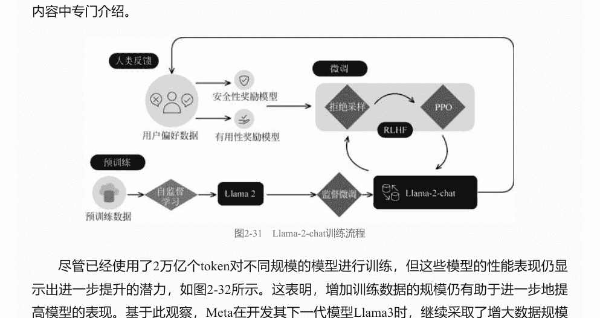

即便已用 2 万亿 token 训练不同尺寸的模型，性能曲线仍显示有提升空间，如图2-32 所示。这说明继续放大数据规模仍能带来收益，也正是 Llama3 继续沿此路线的原因。

架构层面，Llama2 引入了分组查询注意力 Group Query Attention，GQA 是对传统多头注意力的改进。它的作用是压缩参数量与 KV Cache，降低推理时的显存占用并提升计算效率。

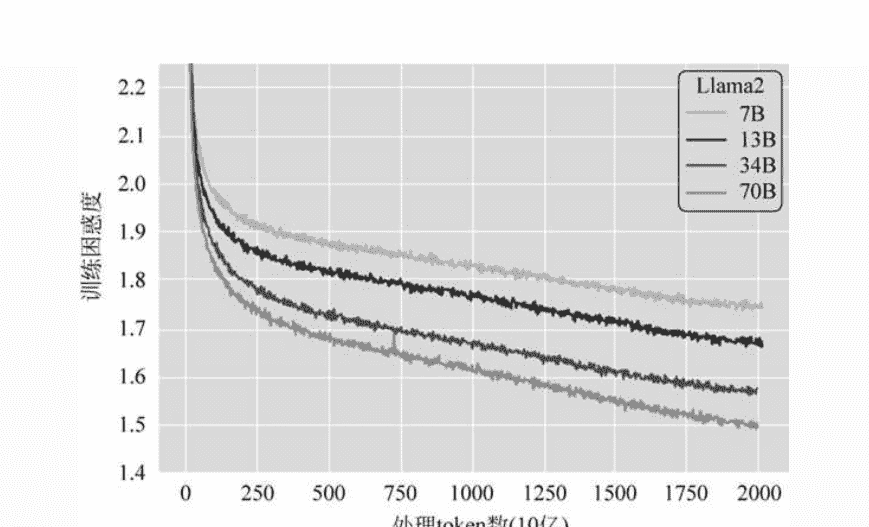

图2-32 Llama2训练困惑度随token数变化曲线

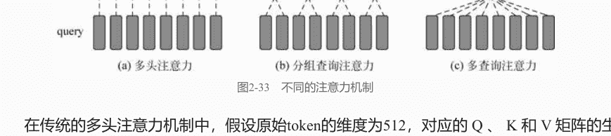

传统多头注意力里，每个 token 的特征会产生相同数量的 key、query、value 头，例如 8 个。每个 query 都会与对应位置的 key 做相似度计算。

多查询注意力则不同，如图2-33（c）所示，每个 token 仍产生 8 个 query，却只产生一个 key 和一个 value。所有 query 都共享这唯一的 key-value 对进行计算。

分组查询注意力如图2-33（b）所示，是两者的折中。query 被分成若干组，例如每组 2 个，共享一个 key 和一个 value。这样既保留了注意力的精细度，又提高了参数利用率。

以具体维度举例，传统多头下 token 原始维度为 512，线性投影权重 w_q、w_k、w_v 均为 512×512，生成的 q、k、v 均为 512 维，分成 8 头每头 64 维。

转为 GQA 且按每两组 query 共享时，k、v 的投影维度减半，w_k 与 w_v 变为 512×256，参数量随之下降。此时 q 仍保持 8 头，k、v 头数降为 4 头。为了方便矩阵运算，在注意力计算前会把 k、v 头复制扩展，使 q、k、v 头数在形式上保持一致。

在 Llama2 中，GQA 仅用在了最大模型 Llama-70B。配置文件里 num_attention_heads 为 64，num_key_value_heads 为 8，也就是 8 个 query 共享一个 key-value 对，如图2-34 所示。

```json
{
  "_name_or_path": "meta-llama/Llama-2-70b-chat-hf",
  "architectures": [
    "LlamaForCausalLM"
  ],
  "bos_token_id": 1,
  "eos_token_id": 2,
  "hidden_act": "silu",
  "hidden_size": 8192,
  "initializer_range": 0.02,
  "intermediate_size": 28672,
  "max_position_embeddings": 4096,
  "model_type": "llama",
  "num_attention_heads": 64,
  "num_hidden_layers": 80,
  "num_key_value_heads": 8,
  "pad_token_id": 0,
  "pretraining_tp": 1,
  "rms_norm_eps": 1e-05,
  "rope_scaling": null,
  "tie_word_embeddings": false,
  "torch_dtype": "float16",
  "transformers_version": "4.31.0.dev0",
  "use_cache": true,
  "vocab_size": 32000
}
```

图2-34 Llama2-70B模型配置文件

### 2.4.3 Llama3

2024 年 4 月 18 日，Meta 发布新一代大语言模型 Llama3，首发 8B 与 70B 两个版本。目标是提供可匹敌当前顶尖商业模型的开源方案，并计划后续推出 400B、更多语言与多模态版本。模型仍在训练中，但在公开基准上的表现已明显超越 Llama2。

Llama3-8B 的成绩已全面超过 Llama2-70B。与 GPT-4 在 5 项评测的对比中，Llama3-70B 在 3 项上占优。Llama3-400B 则在多个维度上全面领先 GPT-4，具体见表2-1。这一进展加速了大规模语言模型在各类应用中的落地。

### 表2-1 Llama3对比测试结果

| 测试集 | Llama2-7B | Llama2-13B | Llama2-70B | Llama3-8B | Llama3-70B | Llama3-400B | GPT-3.5 | GPT-4 |

|--------|-----------|------------|------------|-----------|------------|-------------|---------|-------|

| MMLU   | 34.1      | 47.8       | 52.9       | 68.4      | 82         | 86.1        | 70      | 86.4  |

| GPQA   | 21.7      | 22.3       | 21.0       | 34.2      | 39.5       | 48          | 28.1    | 35.7  |

| HumanEval | 7.9    | 14.0       | 25.6       | 62.2      | 81.7       | 84.1        | 48.1    | 67    |

| GSM-8K | 25.7      | 77.4       | 57.5       | 79.6      | 93         | 94.1        | 57.1    | 92    |

| MATH   | 3.8       | 6.7        | 11.6       | 30.0      | 50.4       | 57.8        | 34.1    | 52.9  |

在架构上，Llama3 做了几项关键改进。首先词表从 32 000 扩展到 128 000，编码效率显著提升，例如中文一个字符此前需多个 token，现在通常只需一个，从而加快推理。词表变大推高了词嵌入与输出头的参数，最小体量因此从 7B 上调到 8B。此外 GQA 已覆盖全部模型，包括 8B 版本。训练序列长度也从 4096 提升到 8192，能处理更长的文本。

训练数据量达到 15 万亿 token，是 Llama2 的 7 倍，全部来自公开可获取资源。为强化逻辑推理，代码类数据增多了 4 倍；约 5% 数据为高质量非英语语料，覆盖 30 多种语言。数据清洗很严格，清洗阶段借助 Llama2 生成的数据训练文本质量分类器，注意该分类器仅用于数据清洗，并非用于训练 Llama3。

微调阶段除了开源数据集，还进行了约 1000 万条人工标注。不同版本知识截止时间不同：8B 到 2023 年 3 月，70B 到 2023 年 12 月。

Meta 总结出自己的缩放规律，小模型快速试验的结果可用来推断大模型最终能力，并再次强调扩数据比堆参数更有效。即使以 15T token 训练，Llama3-8B 的性能仍未达到饱和。

硬件层面，Llama3 在两大集群共超过 24 000 张 H100 GPU 上训练，有效训练时间利用率超过 95%，约为 Llama2 的三倍。

### 表2-2 Llama系列模型训练花费

| 模型 | 训练(GPU小时) | GPU |

|------|---------------|-----|

| Llama1-65B | 1.0M | A100 80GB |

| Llama2-70B | 1.7M | A100 80GB |

| Llama3-70B | 7.7M | H100 80GB |

命名上，Llama2 时代微调后叫 Llama2-chat，Llama3 时代改为 Llama3-Instruct，体现了从单纯对话向指令遵循与多任务智能应用的转变。

2024 年 7 月，Meta 发布 Llama3.1 并给出更详细的报告。在预训练后进行了 SFT、拒绝采样与 DPO，输入长度可达 128K token，多语言与工具使用能力得到加强，如图2-35 所示。

图2-35 Llama3.1与Llama3.0能力对比

| 模型 | 微调 | 多语言 | 长上下文 | 使用工具 | 发布时间 |

|------|------|--------|----------|----------|----------|

| Llama3-8B | × | ×¹ | × | × | April 2024 |

| Llama3-8B Instruct | ✓ | × | × | × | April 2024 |

| Llama3-70B | × | ×¹ | × | × | April 2024 |

| Llama3-70B Instruct | ✓ | × | × | × | April 2024 |

| Llama3.1-8B | × | ✓ | ✓ | × | July 2024 |

| Llama3.1-8B Instruct | ✓ | ✓ | ✓ | ✓ | July 2024 |

| Llama3.1-70B | × | ✓ | ✓ | × | July 2024 |

| Llama3.1-70B Instruct | ✓ | ✓ | ✓ | ✓ | July 2024 |

| Llama3.1-405B | × | ✓ | ✓ | × | July 2024 |

| Llama3.1-405B Instruct | ✓ | ✓ | ✓ | ✓ | July 2024 |

Llama3.1 的预训练语料截止 2023 年底，来源多元。去重与清洗采用多重手段。

HTML 文档使用自定义解析器细致处理。含代码与数学公式的页面单独处理，例如公式以图片呈现时会提取 alt 属性作为文本替代。实验发现 Markdown 格式对训练有害，因此全部移除 Markdown 标记。

去重分三步：按 URL 去重、使用 MinHash 在全局做文档级去重、在每 3000 万文档中若某行出现超过 6 次则去重。启发式过滤还包括：

- 1. 用重复 n-gram 覆盖率剔除由重复内容如日志、报错信息构成的长行。
- 2. 通过“脏词”计数过滤掉不在屏蔽站点列表中的成人内容。
- 3. 利用 token 分布的 K-L 散度剔除与训练语料分布差异过大、离群 token 过多的文档。

清洗时还引入模型辅助过滤。尝试了 FastText 快速分类器和计算量更大的 RoBERTa 分类器，并基于清理后的网页训练集用 DistilRoBERTa 为文档生成质量评分。

涉及编程与数学推导的语料，Meta 走了单独的清洗通道。分类这块用的是在 Llama 2 标注语料上微调过的 DistilRoBERTa，并对提示词做了针对性调优，核心目标是抓住自然语言表述和代码、数学推导之间互动的特征。

多语料的处理更系统化。先用语种识别模型把文本归到 176 个语言里并剔除重复，随后结合各语种专属的启发式规则与模型筛选，把质量偏低的文档筛掉，再让多语版 Llama 2 分类器给剩余文档打质量分，让优质内容优先进入训练。团队还特意盘点了预训练阶段多语种 token 的使用量，就是为了让英语和多语在评测上的表现更均衡。

在语料配比上，Meta 也做过定制。先训一个文本类别分类器来动态调配数据，把在网上占比极高的娱乐艺术类压缩，并在小规模模型上试不同配比对效果的影响。最终落到大模型上的比例是通用知识 50%、数学与推理 25%、代码 17%、多语言 8%。

实践里还发现，预训练收尾时用数学、代码等高质量数据做退火，能进一步拉升最终表现。

Llama 3 的输入通常是多篇文档拼接而成，为避免不同文档间信息串扰，训练时加入了特殊的注意力掩码，让 token 只关注同文档内的内容。

Llama 3 的预训练被拆成初始预训练、长上下文预训练和退火训练三段。

以 405B 为例，初始阶段用 AdamW，起点学习率 8×10^{-5}，先做 8000 步线性预热，之后按余弦衰减到 8×10^{-7}，总共跑 120 万步。起步时批量比较小，为 4M tokens 且序列长 4096，后面逐步提到 8M 与 16M 以提升效率。训练中会动态调配语料，提高非英语比例、上采样数学数据、补充更新的网页数据并削减低质数据。

长上下文阶段逐步拉长序列，以支持最高 128K 的窗口。分 6 个阶段从 8K 慢慢放到 128K，保证模型在每个阶段都能平稳适应。该阶段消耗约 800B 的训练 tokens。

退火阶段用 40M tokens 训练，学习率线性降到 0，同时保持 128K 上下文，数据侧重高质量来源。最终预训练权重由多个检查点的平均得到。

## Llama3模型后期训练与性能比较

Llama 3 在预训练后做了多轮后期训练来提分。每轮都包含监督微调 SFT 和直接偏好优化 DPO。数据来自人工标注样例和合成样例。流程是先基于人工偏好数据用预训练模型训一个奖励模型；再用奖励模型对人工标注的提示做拒绝采样，结合合成数据后以标准交叉熵损失对预训练模型做监督微调；微调后再用 DPO 继续训练以对齐人类偏好。DPO 计算开销小，在指令遵循类基准上提升明显。

最终 Llama 3.1 与其他模型的性能比较如图 2-36 所示。

| 类别 | 测试集 | Llama3 8B | Gemma2 9B | Mistral 7B | Llama3 70B | Mistral 8x22B | GPT 3.5 Turbo | Llama3 405B | Nemotron 4 340B | GPT-4 (0125) | GPT-4o | Claude 3.5 Sonnet |
|------|--------|-----------|-----------|------------|------------|---------------|---------------|-------------|-----------------|--------------|--------|-------------------|
| 通用 | MMLU (5-shot) | 69.4 | 72.3 | 61.1 | 83.6 | 76.9 | 70.7 | 87.3 | 82.6 | 85.1 | 89.1 | 89.9 |
| 通用 | MMLU-Pro (5-shot, CoT) | 73.0 | 72.3 | 60.5 | 86.0 | 79.9 | 69.8 | 88.6 | 78.7 | 85.4 | 88.7 | 88.3 |
| 通用 | MMLU-Pro (5-shot, CoT) | 48.3 | - | 36.9 | 66.4 | 56.3 | 49.2 | 73.3 | 62.7 | 64.8 | 74.0 | 77.0 |
| 通用 | IFEval | 80.4 | 73.6 | 57.6 | 87.5 | 72.7 | 69.9 | 88.6 | 85.1 | 84.3 | 85.6 | 88.0 |
| 代码 | HumanEval (0-shot) | 72.6 | 54.3 | 40.2 | 80.5 | 75.6 | 68.0 | 89.0 | 73.2 | 86.6 | 90.2 | 92.0 |
| 代码 | MBPP EvalPlus (0-shot) | 72.8 | 71.7 | 49.5 | 84.8 | 78.6 | 82.0 | 88.6 | 72.8 | 83.6 | 87.8 | 90.5 |
| 数学 | GSM8K (0-shot, CoT) | 84.5 | 76.7 | 53.2 | 95.1 | 88.2 | 81.6 | 96.8 | 92.3 | 94.2 | 96.1 | 96.4 |
| 数学 | MATH (0-shot, CoT) | 51.9 | 44.3 | 13.0 | 68.0 | 54.1 | 43.1 | 73.8 | 41.1 | 64.5 | 76.6 | 71.1 |
| 推理 | ARC Challenge (0-shot) | 83.4 | 87.6 | 74.2 | 94.8 | 88.7 | 83.7 | 96.9 | 94.6 | 96.4 | 96.7 | 96.7 |
| 推理 | GPQA (0-shot, CoT) | 32.8 | - | 28.8 | 46.7 | 33.3 | 30.8 | 51.1 | - | 41.4 | 53.6 | 59.4 |
| 使用工具 | BFCL | 76.1 | - | 60.4 | 84.8 | - | 85.9 | 88.5 | 86.5 | 88.3 | 80.5 | 90.2 |
| 使用工具 | Nexus | 38.5 | 30.0 | 24.7 | 56.7 | 48.5 | 37.2 | 58.7 | - | 50.3 | 56.1 | 45.7 |
| 长上下文 | ZeroSCROLLS/QuALITY | 81.0 | - | - | 90.5 | - | - | 95.2 | - | 95.2 | 90.5 | 90.5 |
| 长上下文 | InfiniteBench/En.MC | 65.1 | - | - | 78.2 | - | - | 83.4 | - | 72.1 | 82.5 | - |
| 长上下文 | NIH/Multi-needle | 98.8 | - | - | 97.5 | - | - | 98.1 | - | 100.0 | 100.0 | 90.8 |
| 多语言 | MGSM (0-shot, CoT) | 68.9 | 53.2 | 29.9 | 86.9 | 71.1 | 51.4 | 91.6 | - | 85.9 | 90.5 | 91.6 |

图2-36 Llama3.1模型表现

2024年9月25日，Meta 发布了 Llama 3.2，其中包含更小且适合移动端的纯文本模型，分别为 Llama 3.2 1B 和 Llama 3.2 3B。更值得期待的是，Meta 首次放出了 11B 和 90B 的多模态大模型，为开源生态的智能应用打开了新空间。Llama 3.2 的多模态版本能做图像推理，可以读懂图表、图片文字等，例如针对年销量柱状图问哪年最高，或让模型描述图片内容。

为了给原本的纯文本 Llama 增加视觉输入，Meta 训练了一组权重适配器，把预训练图像编码器的输出映射到大语言模型里。适配器由一系列交叉注意力层构成，负责把视觉表示传递给语言侧。训练适配器时图像编码器的参数可更新，而大语言模型的参数完全冻结，这样原有语言能力不会受损。

多模态训练分多阶段展开，从 Llama 3.1 文本模型出发，先接上图像适配器和编码器，在大规模带噪声的图文配对数据上做预训练；随后在中等规模高质量领域增强的图文配对数据上继续训练；后期则像纯文本模型一样，通过几轮对齐的监督微调、拒绝采样和直接偏好优化完成后训练。

# 第3章 首次运行大模型

本章用 HuggingFace 的 Transformers 库演示如何加载并运行大模型。从零开始载入模型、准备输入、做推理并拿到输出，同时说明如何通过参数控制生成效果。

## 3.1 HuggingFace 平台速览

HuggingFace 是一家聚焦自然语言处理与人工智能的科技公司，以开源工具与平台闻名。2016 年成立，总部在纽约，目标是让 AI 技术更易获取和使用。

它是一个开源 AI 平台，目前汇聚 40 多万开源模型、10 多万开源数据集和 15 万个应用。很多开源大模型厂商都会优先在 HuggingFace 发布，像 Llama、ChatGLM、QWen、Yi 等都在上面。

平台还提供了一套易用的开源库，最核心的是 Transformers，可快速从头训练或微调预训练模型。此外还有 Accelerate 做分布式训练、PEFT 做参数高效微调、TRL 做强化学习训练等。社区氛围活跃，用户可以分享模型、数据集和经验，也能发布自己的模型或体验他人作品。

## 3.2 模型获取

Meta 在 HuggingFace 上放出了 Llama 3 并提供免费下载，不过需要申请。这里选择国内零一万物训练的 Yi，结构和 Llama 一致，中文效果更好，且在国内可直接下载，无需申请。可在 modelScope.cn 获取 Yi-1.5-6B-Chat，模型大小约 22.5GB。

下载后的文件夹不仅有模型参数，还包含配置文件，例如 config.json 记载了模型结构的配置信息。可以看到模型结构是 LlamaForCausalLM，配置文件如下：
```json
//Yi-1.5-6B-Chat/config.json
{
  "architectures": [
    "LlamaForCausalLM"
  ],
  "attention_bias": false,
  "attention_dropout": 0.0,
  "bos_token_id": 1,
  "eos_token_id": 2,
  "hidden_act": "silu",
  "hidden_size": 4096,
  "initializer_range": 0.02,
  "intermediate_size": 11008,
  "max_position_embeddings": 4096,
  "model_type": "llama",
  "num_attention_heads": 32,
  "num_hidden_layers": 32,
  "num_key_value_heads": 4,
  "pad_token_id": 0,
  "pretraining_tp": 1,
  "rms_norm_eps": 1e-06,
  "rope_scaling": null,
  "rope_theta": 5000000.0,
  "tie_word_embeddings": false,
  "torch_dtype": "bfloat16",
  "transformers_version": "4.40.0",
  "use_cache": false,
  "vocab_size": 64000
}
```

tokenizer_config.json 则记录了 tokenizer 的配置。可以看到 tokenizer 类型是 LlamaTokenizer，且对话类模型里还包含了对话模板 chat_template，配置文件如下：
```json
{
    "add_bos_token": false,
    "add_eos_token": false,
    "add_prefix_space": true,
    "added_tokens_decoder": {
        "0": {
            "content": "<unk>",
            "lstrip": false,
            "normalized": true,
            "rstrip": false,
            "single_word": false,
            "special": true
        },
        "1": {
            "content": "<|startoftext|>",
            "lstrip": false,
            "normalized": true,
            "rstrip": false,
            "single_word": false,
            "special": true
        },
        "2": {
            "content": "<|endoftext|>",
            "lstrip": false,
            "normalized": true,
            "rstrip": false,
            "single_word": false,
            "special": true
        },
        "7": {
            "content": "<|im_end|>",
            "lstrip": false,
            "normalized": false,
            "rstrip": false,
            "single_word": false,
            "special": true
        }
    },
    "bos_token": "<|startoftext|>",
    "chat_template": "{{ system_message }}{{ '<|im_start|>user\n' + content + '<|im_end|>\n<|im_start|>assistant\n' }}{{ content + '<|im_end|>' + '\n' }}",
    "clean_up_tokenization_spaces": false,
    "eos_token": "<|im_end|>",
    "legacy": true,
    "model_max_length": 4096,
    "pad_token": "<unk>",
    "padding_side": "right",
    "sp_model_kwargs": {},
    "spaces_between_special_tokens": false,
    "split_special_tokens": false,
    "tokenizer_class": "LlamaTokenizer",
    "unk_token": "<unk>",
    "use_default_system_prompt": false
}
```

## 3.3 推理实操

运行大模型，修改 messages 中的内容，观察模型给出的回答，代码如下：

```python
//Chapter3/hello_world.py
from transformers import AutoModelForCausalLM, AutoTokenizer

model_path = r'Your-path-to-Yi-1.5-6B-Chat'

tokenizer = AutoTokenizer.from_pretrained(model_path)

model = AutoModelForCausalLM.from_pretrained(
    model_path,
    device_map="auto",
    torch_dtype='auto'
).eval()

messages = [
    {"role": "user", "content": "你好!"}
]

input_ids = tokenizer.apply_chat_template(conversation=messages, tokenize=True, return_tensors='pt')
output_ids = model.generate(input_ids.to('cuda'), eos_token_id=tokenizer.eos_token_id,max_length=200)
response = tokenizer.decode(output_ids[0][input_ids.shape[1]:], skip_special_tokens=True)

print(response)
```

要在 GPU 上执行前面的代码，显存规模起码要达到 12GB。若手头的显卡显存不足 12GB，可以借助 HuggingFace 提供的量化加载来压缩显存开销。模型量化会在后续章节展开说明。这里能选择的方案有 8 位量化加载和 4 位量化加载。采用 8 位量化后显存需求会降到约 6GB，采用 4 位量化后则能进一步降到约 3GB。具体的配置可根据显卡实际显存自行挑选，对应的代码示例如下：

```python
//Chapter3/hello_world.py

import torch
from transformers import AutoModelForCausalLM, AutoTokenizer, BitsAndBytesConfig

bnb_config = BitsAndBytesConfig(
    load_in_4bit=True,
    bnb_4bit_use_double_quant=True,
    bnb_4bit_quant_type="nf4",
    bnb_4bit_compute_dtype=torch.bfloat16
)

#8 位加载
#bnb_config = BitsAndBytesConfig(
#load_in_8bit=True
#)

tokenizer = AutoTokenizer.from_pretrained(model_path)
model = AutoModelForCausalLM.from_pretrained(
    model_path,
    device_map="auto",
    torch_dtype='auto',
    quantization_config=bnb_config
).eval()
```

如果希望与大模型进行会话式对话，并且让输出像打字那样逐个 token 流式返回，相应的实现代码如下：

```python
//Chapter3/streaming_chat.py
import torch
from transformers import AutoModelForCausalLM, AutoTokenizer, TextStreamer, BitsAndBytesConfig

model_path = r'Your-path-to-Yi-1.5-6B-Chat'
#4 位加载
bnb_config = BitsAndBytesConfig(
    load_in_4bit=True,
    bnb_4bit_use_double_quant=True,
    bnb_4bit_quant_type="nf4",
    bnb_4bit_compute_dtype=torch.bfloat16
)

#8 位加载
#bnb_config = BitsAndBytesConfig(
#load_in_8bit=True
#)

tokenizer = AutoTokenizer.from_pretrained(model_path)
model = AutoModelForCausalLM.from_pretrained(
    model_path,
    device_map="auto",
    torch_dtype='auto',
    quantization_config=bnb_config
).eval()

while True:
    user_input = input("用户： ")
    messages = [
        {"role": "user", "content": user_input}
    ]
    streamer = TextStreamer(tokenizer, skip_prompt=True, eos_token_id=tokenizer.eos_token_id, skip_special_tokens=True)
    input_ids = tokenizer.apply_chat_template(conversation=messages, tokenize=True, return_tensors='pt')
    model.generate(input_ids, max_length=200, streamer=streamer, eos_token_id=tokenizer.eos_token_id)
```

## 3.4 HuggingFace里的Tokenizer

神经网络本质上只能处理数值，Tokenizer 的职责就是充当转换层，把自然语言转成模型可用的数字序列，同时把模型产生的数字序列还原为自然语言。

因为推理时必须使用与训练阶段完全一致的分词器，所以每个公开的模型包都会捆绑对应的 tokenizer。3.3 节里通过 AutoTokenizer 加载了 Yi 模型的分词器，HuggingFace 会依据 tokenizer_config.json 中声明的 tokenizer_class 自动实例化出对应的 LlamaTokenizer。

下面是使用 Tokenizer 对一句话做分词的示例代码：

```
//Chapter3/tokenizer.py
from transformers import AutoTokenizer

model_path = r'Your-path-to-Yi-1.5-6B-Chat'
tokenizer = AutoTokenizer.from_pretrained(model_path, use_fast=False)

text = "我喜欢人工智能技术。"
tokens = tokenizer.tokenize(text)
print(tokens)
```

运行后会得到词元列表 ['我喜欢'，'人工智能'，'技术'，'。']。接着可以调用 convert_tokens_to_ids 方法把这些词元映射为模型可用的 id，示例代码如下：

```
ids = tokenizer.convert_tokens_to_ids(tokens)
print(ids)
```

得到的 id 序列为 [29492, 13992, 2038, 102]，这组 id 就可以直接喂给模型。模拟生成时的解码过程，可通过 Tokenizer 的 decode 方法把 id 转回文本，代码如下：

```
message = tokenizer.decode(ids)
print(message)
```

解码后会还原成 “我喜欢人工智能技术。” 这句话。

在对大模型做对话微调时，通常需要加上特定格式的提示词，这一点借助 Tokenizer 很容易实现，示例代码如下：

```
python
messages = [
    {"role": "system", "content": "You are a helpful assistant."},
    {"role": "user", "content": "你好!"},
    {"role": "assistant", "content": "我可以帮助你做什么?"},
    {"role": "user", "content": "天空为什么是蓝色的?"},
]
text = tokenizer.apply_chat_template(
    messages,
    tokenize=False
)
print(text)
```

常见的大模型聊天模板包含三种角色：system 用来设定系统信息，例如角色设定或输出语气；user 代表用户的提问；assistant 代表模型自身的回复。上例展示了多轮对话的情形。Tokenizer 的 apply_chat_template 会读取 tokenizer_config.json 中配置的 chat_template 来完成格式化。

执行上述代码后得到的格式化提示词如下：

```
You are a helpful assistant.<|im_start|>user
你好!<|im_end|>
<|im_start|>assistant
我可以帮助你做什么? <|im_end|>
<|im_start|>user
天空为什么是蓝色的? <|im_end|>
<|im_start|>assistant
```

该提示词可以直接作为输入送入模型。因为训练阶段的对话数据本身就是这种结构，保持推理时相同的组织方式能获得更可靠的回答。

模型更偏好批量输入，Tokenizer 对此也提供了原生支持，代码如下：

```
python
sentences = ["你好.", "今天天气不错!"]
tokenizer.padding_side = "left"
ids = tokenizer(sentences, padding=True, return_tensors="pt")
print(ids)
```

输出结果如下：

```
{'input_ids': [[0, 0, 25902, 102], [3569, 9468, 8086, 103]], 'attention_mask': [[0, 0, 1, 1], [1, 1, 1, 1]]}
```

上面的例子演示了 Tokenizer 的多个用法，下面逐一解释。首先输入的是两句话，编码后一个产生 2 个 token，另一个产生 4 个 token。为了把它们装进同一个 Tensor，长度必须统一。这时就需要填充，并且可以指定填充在左侧还是右侧。因为模型是从右侧继续生成，所以这里把 padding_side 设为 left。在调用 tokenizer 时把 padding 设为 True，并让返回结果为 pt 类型，即返回 PyTorch Tensor。

返回结果是一个字典，包含两部分。第一部分是每句话对应的 token id 列表，第一句话在左侧补了 0 作为填充。第二部分是 Attention Mask，填充位置对应为 0，这样在做注意力计算时模型会忽略这些填充 token。

另外，训练时经常出现句子长度差异很大的情况，短句会被填充到与最长句相同长度，导致大量填充 token 占用显存甚至触发 OOM。通过在 tokenizer 调用时开启截断并指定截断长度可以避免这个问题，代码如下：

```
ids = tokenizer(sentences, padding=True, truncation=True, max_length=3, return_tensors="pt")
print(ids)
```

在原代码基础上开启截断并把截断长度设为 3，可以观察两句话生成的 token id 列表。此时两个列表长度都变为 3，默认从序列右侧截断，结果如下：

```
{'input_ids': tensor([[0, 25902, 102], [3569, 9468, 8086]]), 'attention_mask': tensor([[0, 1, 1], [1, 1, 1]])}
```

## 3.5 HuggingFace里的模型

HuggingFace 对模型做了统一抽象，使得训练和推理都非常便捷。下面通过实际例子说明如何使用 HuggingFace 的模型。

### 3.5.1 创建和保存模型

在 HuggingFace 中加载一个已训练好的模型通常只需一行代码，代码如下：

```
//Chapter3/model.py
from transformers import AutoModelForCausalLM, AutoTokenizer

model_path = r'Your-path-to-Yi-1.5-6B-Chat'

model = AutoModelForCausalLM.from_pretrained(model_path, device_map="auto", torch_dtype='auto')
print(type(model))
```

输出如下：

```
<class 'transformers.models.llama.modeling_llama.LlamaForCausalLM'>
```

上述代码加载了此前下载的 Yi 大模型。HuggingFace 会先读取 config.json 中的信息构建模型结构，再加载权重参数。打印信息可以看到它实例化的是一个 LlamaForCausalLM 模型。

如果想从零开始初始化一个大模型（实际中很少这么做），可以通过指定配置来创建模型，代码如下：

```
//Chapter3/create_new_model.py
from transformers import LlamaConfig, LlamaForCausalLM

config = LlamaConfig(
    vocab_size=32000,          #词汇表大小
    hidden_size=512,           #隐藏层大小
    num_hidden_layers=8,       #隐藏层数量
    num_attention_heads=8,     #注意力头数量
    intermediate_size=2048,    #中间层大小
    hidden_act="gelu",         #激活函数
    max_position_embeddings=1024, #最大位置编码
)
print(config)
model = LlamaForCausalLM(config)
#训练模型的代码
model.save_pretrained("./saved_model")
```

输出如下：

```
LlamaConfig {
  "attention_bias": false,
  "attention_dropout": 0.0,
  "bos_token_id": 1,
  "eos_token_id": 2,
  "hidden_act": "gelu",
  "hidden_size": 512,
  "initializer_range": 0.02,
  "intermediate_size": 2048,
  "max_position_embeddings": 1024,
  "mlp_bias": false,
  "model_type": "llama",
  "num_attention_heads": 8,
  "num_hidden_layers": 8,
  "num_key_value_heads": 8,
  "pretraining_tp": 1,
  "rms_norm_eps": 1e-06,
  "rope_scaling": null,
  "rope_theta": 10000.0,
  "tie_word_embeddings": false,
  "transformers_version": "4.42.3",
  "use_cache": true,
  "vocab_size": 32000
}
```

可以看出，代码中定义的 Llama 相关配置已覆盖系统默认值。模型可通过 save_pretrained 方法保存到本地。

### 3.5.2 控制大模型的输出

接下来尝试让大模型输出一个笑话，代码如下：

```
//Chapter3/generate.py
from transformers import AutoModelForCausalLM, AutoTokenizer

model_path = r'Your-path-to-Yi-1.5-6B-Chat'

tokenizer = AutoTokenizer.from_pretrained(model_path, use_fast=False)
model = AutoModelForCausalLM.from_pretrained(
    model_path,
    device_map="auto",
    torch_dtype='auto'
).eval()

messages = [
    {"role": "user", "content": "给我讲一个笑话。"}
]

input_ids = tokenizer.apply_chat_template(conversation=messages, tokenize=True, return_tensors='pt')
output_ids = model.generate(input_ids.to('cuda'), eos_token_id=tokenizer.eos_token_id, max_length=200)
response = tokenizer.decode(output_ids[0][input_ids.shape[1]:], skip_special_tokens=True)
print(response)
```
# 模型老讲同一个段子？一次搞懂生成多样性与大模型硬件挑战

模型输出如下：

> 好的，这里有一个简单的笑话：

荒岛上被困着三个人，他们在沙地里挖出了一盏神灯。灯灵显现出来，宣称可以为每人满足一个心愿。

第一个人开口：“我想回家，和妻子孩子团聚。”话音落下，他便消失不见。

第二个人也说：“我同样想回家，拥抱妻子和孩子。”他同样瞬间消失。

第三个人环视四周，然后说：“在回家前，我想先去海边走一趟。”

过了一会儿，前两位又被送了回来。他们追问第三人为何只许了个小愿。第三人答道：“我只是想验证灯灵是否真的会兑现所有请求。”

我对这个笑话的笑点并不敏感，这无妨。关键在于，再次执行同一段代码，模型仍旧原封不动地复述同样的段子。这样的重复令人厌倦，是否能让模型每次产出不同的笑话？

先看默认策略。大多数模型在解码时使用贪心法，每生成一个 token 就挑选当时概率最高的那个，直至遇到结束符或达到最大长度。我们真正想要的是整条序列的联合概率最大，而不是局部最优，这个差异在图3-1中有直观展示。

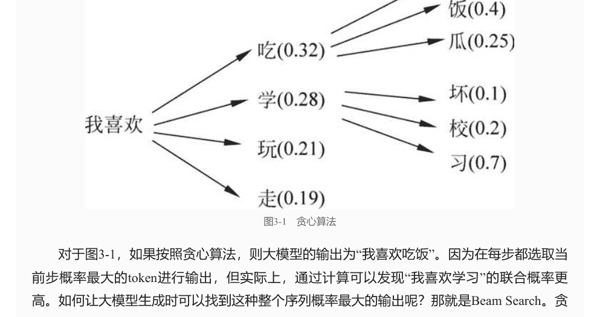
以图3-1为例，采用贪心会得到“我喜欢吃饭”。因为每一步都只取当前概率最高的词，然而整体计算会发现“我喜欢学习”的联合概率更高。如何让模型搜索到序列整体最优？这就是Beam Search。贪心每步只保留一个分支，而Beam Search会保留若干分支。

举例将Beam设为2，系统会始终保留累计概率最高的两个路径。回到图3-1，第一步会保留“我喜欢吃”和“我喜欢学”，累计概率约为0.32和0.28。随后两条分支各自预测下一个词并更新联合概率，如图3-2所示。

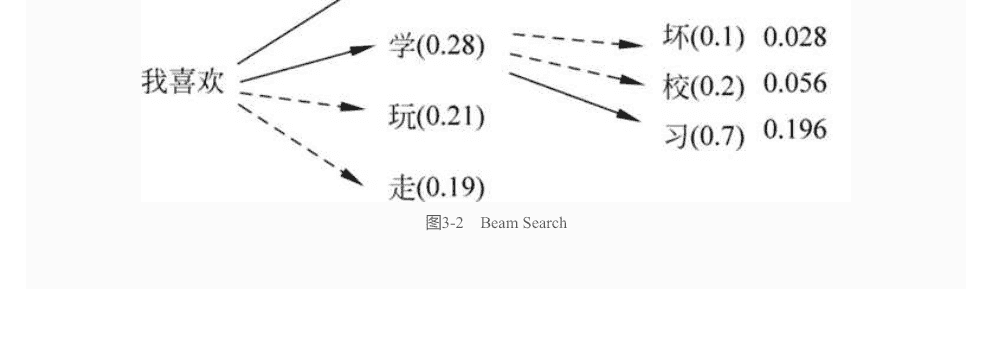
计算后发现“我喜欢吃饭”的联合概率是0.128，“我喜欢学习”是0.196，前者并非最优。这两个序列在第二步成为概率最高的两个。Beam Search会继续为其扩展。若把最大生成长度设为2，即在第二步结束，最终会输出概率更高的“我喜欢学习”。

通过设置num_beams参数就能在代码中启用Beam Search。

```
model.generate(input_ids.to('cuda'), eos_token_id=tokenizer.eos_token_id, max_length=200, num_beams=2)
```
启用后重新运行，返回结果会与之前不同。但只要num_beams取值不变，多次运行的结果依然固定。因为最优序列是确定的，不会因重复执行而改变。

要打破这种确定性，需要引入随机采样。常用做法是不过分依赖最高概率的token，而是在概率靠前的若干个中随机挑选，这就是top_k的思路。

```
output_ids = model.generate(input_ids.to('cuda'), eos_token_id=tokenizer.eos_token_id, max_length=200, do_sample=True, top_k=10)
```
把do_sample打开为True，再把top_k设成10，反复运行就能看到每次输出都不一样，多样性明显提升。

内部采样流程是怎样的？模型先得到每个token的logits，保留前top_k个的logits，其余的设为一个很大的负数，再做softmax。被剔除的token选中概率归零，保留下来的概率分布并不均匀，如图3-3所示。

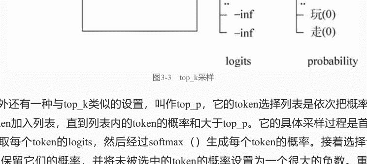
与top_k相近的还有top_p。它是按概率从大到小累加token，直到累加和超过设定的阈值。流程上先用softmax得到概率，再筛选出满足阈值的token保留，未被选中的概率置零，随后再次softmax，未进入列表的token不可被选中，如图3-4所示。

控制随机性的另一个关键是温度Temperature。设定温度t后，logits先除以t再进入后续采样。温度对softmax后概率分布的影响如图3-5所示。

可以观察到t取0.5时各token的概率差距被拉大，t取2时差距被压缩。温度越低输出越稳定，温度越高输出越发散。可以自行尝试不同温度感受差异，代码示例如下：

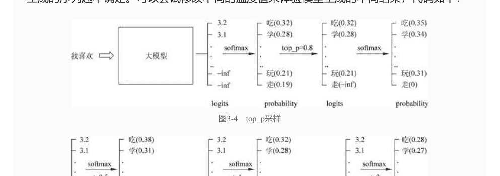
# 图3-4 top_p采样
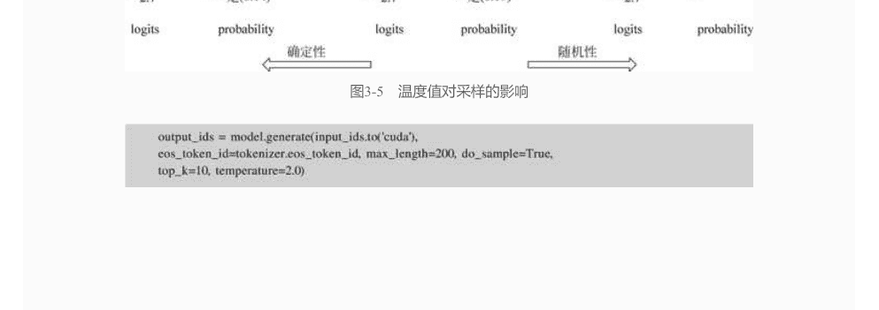
# 图3-5 温度值对采样的影响
```
output_ids = model.generate(input_ids.to('cuda'),
eos_token_id=tokenizer.eos_token_id, max_length=200, do_sample=True,
top_k=10, temperature=2.0)
```## 第4章 大模型带来的技术挑战

本章聚焦大模型落地时面临的技术瓶颈。随着参数规模持续膨胀，训练与推理对硬件资源，尤其是GPU显存的压力不断升高。为应对这一挑战，出现了混合精度训练、模型量化以及新型推理框架等优化手段，它们可以大幅降低显存占用并提升推理效率。本章介绍这些技术的原理与应用，帮助读者理解大模型的资源需求，以及在有限硬件条件下如何高效训练与推理。

## 4.1 GPU的工作原理


作为算法工程师，日常多用PyTorch或TensorFlow这类框架训练模型，底层通过CUDA调用GPU，复杂的编程细节被屏蔽。但在模型规模急剧增长的今天，算力与显存成为瓶颈，深入理解GPU工作方式变得关键。比如vLLM中的PageAttention和训练中常用的FlashAttention，都建立在对GPU机制的深入认识之上。

### 4.1.1 CPU和GPU的区别

先比较CPU与GPU的设计目的。CPU面向通用任务，追求低延迟和快速响应，擅长把单一任务迅速完成。因此CPU使用率通常达不到100%，长时间满载会拖慢系统响应。可把它比作私家车，平常停在车库，上路时能迅速把人送达。

GPU则追求高吞吐量，专门处理海量简单计算。运行时期望使用率接近100%。它更像地铁，单次速度不如私家车，但能满载同时运送大量乘客到同一目的地。

最初GPU主要用于图形渲染，因为每个像素的计算简单但数量庞大。CPU逐像素处理效率低，GPU可并行处理多像素。后来游戏渲染和深度学习都依赖大量矩阵运算，这让NVIDIA在两大领域都取得成功。

并行是GPU的核心优势。以Intel 14代i7为例，有20个核心、支持28个并行线程。而NVIDIA A100拥有6912个FP32 CUDA核心、3456个FP64 CUDA核心、6912个Int32 CUDA核心、432个Tensor核心，可支持13824个并行线程。这种大规模并行能力使GPU在图形和深度学习任务上表现突出。

### 4.1.2 GPU的架构

GPU采用单指令多线程SIMT技术，让大量线程同时执行同一指令，从而提升效率，例如矩阵乘法中每个结果元素可由独立线程计算。

实现上，每32个线程组成一个Warp，作为调度和执行的最小单元，保证并行执行时的协调性。以A100架构图可见，如图4-1所示。

图中密集排列的部分是CUDA核心和Tensor核心，它们被划分为多个流式多处理器SM。A100共有108个SM。

每个SM由4个处理单元构成，每个单元带一个Warp调度器，负责Warp的管理与调度，如图4-2所示。

每个处理单元包含16个Int32核心、16个FP32核心、8个FP64核心及1个Tensor核心。CUDA核心负责通用计算并针对不同数据类型优化，Tensor核心专用于深度学习计算。SM下方有LD/ST单元负责数据加载与存储，SFU负责三角函数、指数、对数、平方根等特殊数学运算。

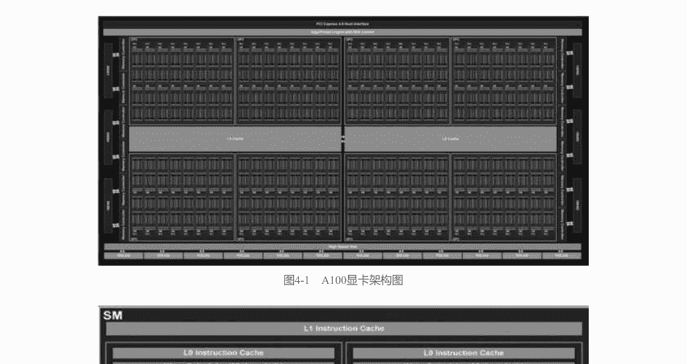
## 图4-1 A100显卡架构图
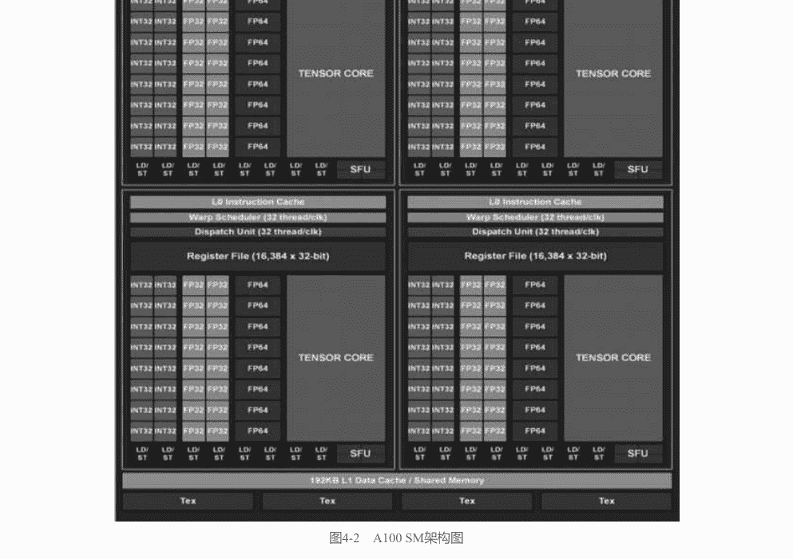
## 图4-2 A100 SM架构图

### 4.1.3 GPU里的存储

GPU计算能力强，但常被数据搬运拖慢。训练大模型时，计算单元往往在等待数据到来。

以A100为例，FP64算力约19500 GFlops，每个FP64数据8字节，显存带宽1555GB/s。把一个FP64数据搬到核心至少需要约100次浮点运算才能让GPU满载。若运算量不足，核心就会空闲。

好在深度学习中常用的矩阵乘法是计算密集型操作，通过调大矩阵尺寸能提升计算强度。设矩阵为N×N，每个元素约需2N次计算，总计算量约2N³，数据量约2N²，二者比值约为N。可通过调整N来匹配硬件，如图4-3所示。

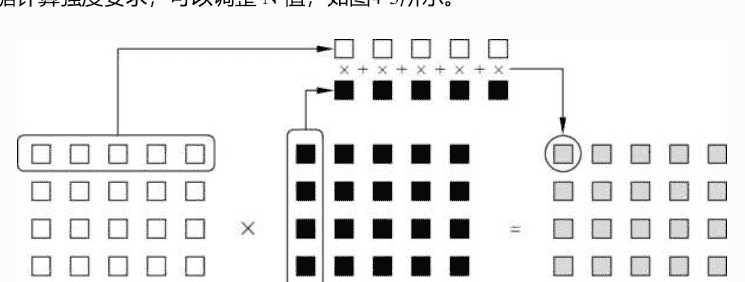
数据传输越慢，就越需要更大的矩阵来喂饱计算单元；传输越快，矩阵可以越小。反之，若矩阵本身很小且带宽不足，就难以发挥算力。

再看GPU内部存储。芯片内有寄存器、L1缓存、共享内存、L2缓存；芯片外是显存。访问速度差异很大：L1约19TB/s，L2约4TB/s，主显存约1.5TB/s，经PCIe访问主机内存仅约0.025TB/s，NVLink多卡互连可达0.3TB/s。

因此最好让计算单元尽量少访问低速存储，多从高速缓存读取，并对一次读取的数据做尽可能多的计算。这正是Flash Attention优化思路的出发点。

回到A100架构，108个SM各自带CUDA核心、Tensor核心和L1缓存，SM外部有L2缓存和HBM显存，底部NVLink负责多卡通信，顶部PCIe负责与主机通信。

### 4.1.4 Tensor Core

得益于Tensor Core，GPU在硬件层面支持混合精度训练，即结合FP32和FP16，在不明显损失精度的前提下加速训练并减少显存，后续章节会详细展开。

一个Tensor Core在一个时钟周期内可完成两个4×4矩阵的乘法加一个4×4矩阵的加法。两个被乘矩阵为FP16，求和矩阵可以是FP16或FP32，如图4-4所示。

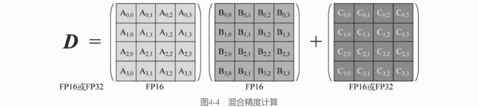
内部实现上，两个FP16操作数先做全精度乘法，再用FP32累加，以避免精度丢失，如图4-5所示。

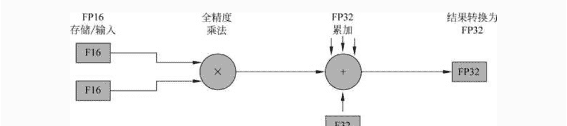
从A100算力表可见，Tensor Core的算力远超CUDA Core。表中出现一对指标，后者是前者的两倍，这对应稀疏计算模式，如图4-6所示。

要做稀疏推理，需要先对训练好的参数矩阵做处理：把参数每4个一组，挑出相对较小的两个置零，其余微调以补偿误差。处理后得到约一半参数为零的稀疏矩阵，压缩存储非零元素及其索引，用这种压缩后的矩阵推理即可获得Tensor Core更高的稀疏推理性能，具体流程如图4-7所示。

| Peak FP64¹ | 9.7 TFLOPS |

| :--- | :--- |

| Peak FP64 Tensor Core¹ | 19.5 TFLOPS |

| Peak FP32¹ | 19.5 TFLOPS |

| Peak FP16¹ | 78 TFLOPS |

| Peak BF16¹ | 39 TFLOPS |

| Peak TF32 Tensor Core¹ | 156 TFLOPS | 312 TFLOPS² |

| Peak FP16 Tensor Core¹ | 312 TFLOPS | 624 TFLOPS² |

| Peak BF16 Tensor Core¹ | 312 TFLOPS | 624 TFLOPS² |

| Peak INT8 Tensor Core¹ | 624 TOPS | 1248 TOPS² |

| Peak INT4 Tensor Core¹ | 1248 TOPS | 2496 TOPS² |

## 图4-6 A100算力表

大模型训练的显存与算力拆解

1. 峰值吞吐率建立在GPU的增强时钟之上
2. 要获得可用的TFLOPS/TOPS，依赖于新一代稀疏特性

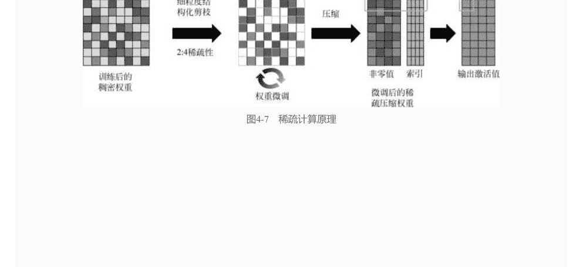

## 图4-7 稀疏计算原理

## 4.2 大模型显存占用

训练大模型，尤其是超大规模模型时，最常碰到的瓶颈就是显存不够用。在想办法缓解之前，先把显存到底花在哪儿弄清楚。

1字节对应8比特，1KB是1024字节，1MB是1024KB，1GB是1024MB。Float32单精度占32比特即4字节，Float16半精度占16比特即2字节。

以Llama-13B的混合精度训练为例作估算。该模型约有13B参数，参数以Float16保存。1B≈1000³，1GB≈1024³字节，两个数量级可近似。单个Float16参数占2字节，于是参数本身大约需要13×2=26GB显存。乘以2正是因为Float16每个参数2字节。

优化器显存。以主流的Adam为例，它为每个参数保留两项指数平滑值，分别是梯度的指数平滑和梯度平方的指数平滑，这两项都用Float32保存；另外还额外保留一份Float32的主权重。按Llama-13B算，优化器大约占用13×3×4=156GB，其中4是Float32每变量4字节，3是3个Float32变量，13是13B个变量。

梯度显存。混合精度下每个参数对应一个Float16梯度，2字节，约为13×2=26GB。

激活值显存。前向传播产生的中间结果即激活值，因反向求梯度需要而保留。根据论文 Reducing Activation Recomputation in Large Transformer Models 给出的式4-1，可估算Transformer的激活值占用。

```
Mem_activation = nblh × (67 + 9ml/h) Bytes
```

其中n为层数，h为特征维度，m为注意力头数，b为批次大小，l为序列长度。可以看出激活值除了与模型本身相关，还受批次大小和序列长度影响，尤其是与序列长度的平方项相关。

## 4.3 优化器


在大模型训练里，优化器往往是显存大户，下面拆解其内部机理。

### 4.3.1 指数加权平均

假设经营一家便利店，过去六天营业额见表4-1，想据此预测明天营业额该怎么做。

表4-1 营业收入表

| 日期 | 营业额/元 | 日期 | 营业额/元 |

| :--- | :--- | :--- | :--- |

| 第 1 天 | 100 | 第 4 天 | 117 |

| 第 2 天 | 114 | 第 5 天 | 120 |

| 第 3 天 | 118 | 第 6 天 | 122 |

最朴素的做法是用六天平均值，每天权重1/6。可进一步改进，越近的数据参考价值越高，权重应随时间递增。

指数加权平均用更简洁的形式表达这一思想。设初始值v₀=0，β=0.7，第1天的指数加权平均公式如下，θ₁为第1天观测值。

```
v₁ = βv₀ + (1 - β) θ₁
```

第2天的指数加权平均需要前一天的v₁和第2天观测θ₂。

$$v_2 = \beta v_1 + (1 - \beta) \theta_2$$

由此可得一般形式，β是可调超参数，0<β<1，β越大历史值占比越大。

$$v_t = \beta v_{t-1} + (1 - \beta) \theta_t \quad (4-2)$$

以前6天为例，其值等于：

$$v_6 = 0.7 v_5 + 0.3 \theta_6 \quad (4-3)$$

把v₅=0.7v₄+0.3θ₅代入式4-3。

$$v_6 = 0.7(0.7 v_4 + 0.3 \theta_5) + 0.3 \theta_6 \quad (4-4)$$

再把v₄=0.7v₃+0.3θ₄代入式4-4。

$$v_6 = 0.7 (0.7 (0.7 v_3 + 0.3 \theta_4) + 0.3 \theta_5) + 0.3 \theta_6$$

整理后得到

$$v_6 = 0.7^3 v_3 + 0.3 \times 0.7^2 \theta_4 + 0.3 \times 0.7 \theta_5 + 0.3 \theta_6$$

可见v₆中包含了θ₄、θ₅、θ₆，即第4、5、6天的实际观测，其系数分别为0.3×0.7²、0.3×0.7¹、0.3×0.7⁰。距离越远的观测权重按0.7指数衰减，这也是名称由来。

该方法对全部历史做加权平均，运行时只需保存一个v，初值设为0。

回到例子，用前6天指数加权平均预测第7天，β取0.7，见表4-2。

表4-2 营业收入指数加权表

| t | θ | v | t | θ | v |

| :--- | :--- | :--- | :--- | :--- | :--- |

| 第1天 | 100 | 30 | 第4天 | 117 | 86.9 |

| 第2天 | 114 | 55.2 | 第5天 | 120 | 96.83 |

| 第3天 | 118 | 74.04 | 第6天 | 122 | 104.38 |

表2显示早期v偏小，预测误差大，这是v初始化为0带来的偏差。序列足够长时v₀影响可忽略；序列较短时可做修正，用v除以1-βᵗ，t足够大时分母趋近1，见表4-3。

$$v_t^{\text{correct}} = \frac{v_t}{1 - \beta^t} \qquad (4-5)$$

表4-3 营业收入修正指数加权表

| t | θ | v | 1-βᵗ | v^correct |

| :--- | :--- | :--- | :--- | :--- |

| 第1天 | 100 | 30 | 0.3 | 100 |

| 第2天 | 114 | 55.2 | 0.51 | 108.2 |

| 第3天 | 118 | 74.04 | 0.657 | 112.6 |

| 第4天 | 117 | 86.9 | 0.76 | 114.3 |

| 第5天 | 120 | 96.83 | 0.832 | 116.4 |

| 第6天 | 122 | 104.38 | 0.942 | 110.8 |

### 4.3.2 SGD

目前训练大模型很少使用随机梯度下降。原因在于其训练过程相对新方法不稳定。

设需优化w、b两个参数，横轴w纵轴b如图4-8。

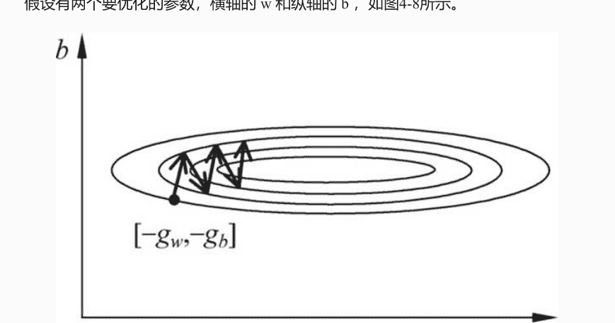

图4-8的椭圆为损失等高线。先求w、b对loss的偏导得到梯度g_w、g_b，按负梯度方向更新，r为学习率，具体步骤如下：
## 4.3.3 动量梯度下降

$$g_w = \frac{\partial \text{loss}}{\partial w}$$

$$g_b = \frac{\partial \text{loss}}{\partial b}$$

$$w_{t+1} = w_t - r g_w$$

$$b_{t+1} = b_t - r g_b$$

神经网络参数众多，存在梯度大和梯度小并存的情况，易产生振荡，如图4-8中b的梯度相对w更大时即会振荡。

动量梯度下降不直接用当前梯度更新，而用从开始到当前各步梯度的指数加权平均来更新，具体步骤如下：

$$v_w = \beta v_w + (1 - \beta) g_w$$

$$v_b = \beta v_b + (1 - \beta) g_b$$

$$w_{t+1} = w_t - r v_w$$

$$b_{t+1} = b_t - r v_b$$

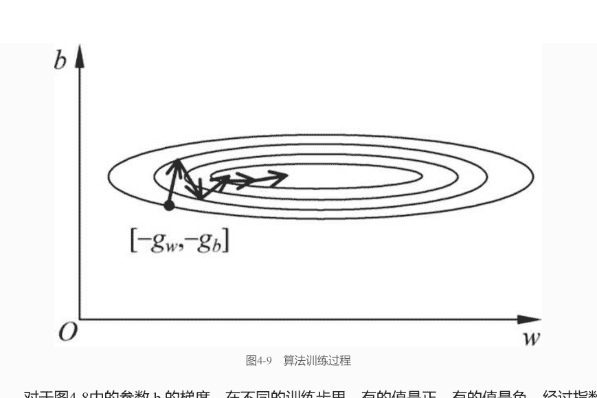

对图4-8中参数b，不同步的梯度有正有负，经指数加权平均后正负抵消，降低振荡。训练轨迹如图4-9。

### 4.3.4 RMSProp

另一种思路是振荡源于梯度大小不一。若把每个梯度除以其历史大小的度量，梯度被归一化，训练更稳定，这就是RMSProp。具体做法如下：

$$s_w = \beta s_w + (1 - \beta) g_w^2 \quad (4-6)$$

$$w_{t+1} = w_t - r \frac{g_w}{\sqrt{s_w} + \varepsilon} \quad (4-7)$$

其中β为超参数，默认值0.999。s_w是参数w梯度平方的指数加权平均，g_w为当前步梯度，r为学习率。为避免除零，分母加上极小值ε。w_{t+1}为更新后参数。

### 4.3.5 Adam

Adam融合动量和RMSProp，并对指数加权平均做修正。计算如下：

$$v_w = \beta_1 v_w + (1 - \beta_1) g_w$$

$$s_w = \beta_2 s_w + (1 - \beta_2) g_w^2$$

$$v_w^{\text{correct}} = \frac{v_w}{1 - \beta_1^t}$$

$$s_w^{\text{correct}} = \frac{s_w}{1 - \beta_2^t}$$

$$w_{t+1} = w_t - r \frac{v_w^{\text{correct}}}{\sqrt{s_w^{\text{correct}}} + \epsilon} \quad (4\text{-}8)$$

### 4.3.6 AdamW

AdamW与Adam基本一致，最后一步参数更新时加入权重衰减项，可提升泛化。具体公式：

$$w_{t+1} = w_t - r \frac{v_w^{\text{correct}}}{\sqrt{s_w^{\text{correct}}} + \epsilon} - r\lambda w_t \quad (4\text{-}9)$$

其中λ控制衰减强度。

Adam和AdamW是当前主流，它们为每个优化参数额外保存一阶动量和二阶动量，且均以FP32高精度存储，因梯度值很小、累加需高精度。若参数以FP16保存，这两项动量占用就达参数显存的4倍。出于数值精度考虑，优化器还额外保存一份FP32参数。4.4节会细谈数值精度问题。优化器的显存开销是训练大模型的挑战。

## 4.4 混合精度训练


混合精度训练结合不同数值精度，通过提升速度、降低显存占用且不损害精度，已成为大模型训练标准配置。

### 4.4.1 混合精度训练原理

计算机如何存储Float32？以22.5为例，先转二进制10110.1，再写成科学计数法1.01101×2⁴，如图4-10。

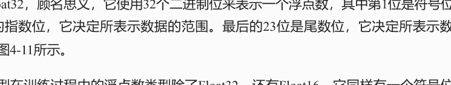

图4-10 浮点数的二进制表示

Float32用32位表示：1位符号、8位指数决定范围、23位尾数决定精度，如图4-11。训练中除Float32外还有Float16，符号位1位、指数5位、尾数10位，类似还有TensorFloat32、BFloat16等，如图4-12。

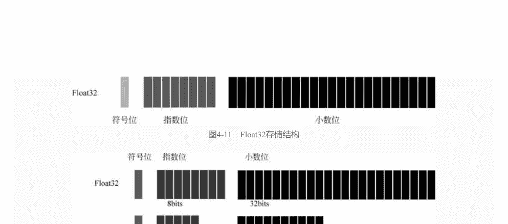

图4-11 Float32存储结构

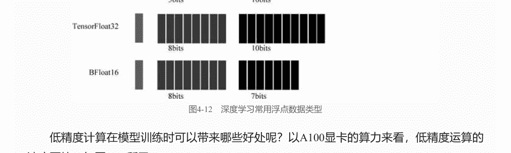

图4-12 深度学习常用浮点数据类型

低精度带来的好处。以A100为例，低精度算力更快，如图4-13。

| 类型 | A100 40GB PCIe | A100 80GB PCIe | A100 40GB SXM | A100 80GB SXM |

|------|----------------|----------------|---------------|---------------|

| FP64 | 9.7 TFLOPS | 9.7 TFLOPS | 9.7 TFLOPS | 9.7 TFLOPS |

| FP64 Tensor Core | 19.5 TFLOPS | 19.5 TFLOPS | 19.5 TFLOPS | 19.5 TFLOPS |

| FP32 | 19.5 TFLOPS | 19.5 TFLOPS | 19.5 TFLOPS | 19.5 TFLOPS |

| TensorFloat32 (TF32) | 156 TFLOPS | 312 TFLOPS* | 156 TFLOPS | 312 TFLOPS* |

| BFLOAT16 Tensor Core | 312 TFLOPS | 624 TFLOPS* | 312 TFLOPS | 624 TFLOPS* |

| FP16 Tensor Core | 312 TFLOPS | 624 TFLOPS* | 312 TFLOPS | 624 TFLOPS* |

| INT8 Tensor Core | 624 TOPS | 1248 TOPS* | 624 TOPS | 1248 TOPS*

图4-13 NVIDIA A100显卡算力

其次存储更省。Float16仅为Float32一半。混合精度下参数、激活、梯度多用Float16，传输占用显存带宽也减半，加快训练。

缺点也有。第一是表示范围有限，Float16不能表示过大或过小的值，神经网络中参数、损失、梯度常很小，可能下溢为0。第二是有限精度导致大数吃小数。如PyTorch中Float16的2048+0.5结果仍是2048。2048=1.0×2¹¹，0.5=1×2⁻¹，相加需统一指数，小数需表示为1×2⁻¹²，Float16尾数仅10位无法表示，下溢为0，小数被吃掉。

于是想到混合Float32与Float16，在需高精度处用Float32，其余用Float16降存提速，这正是混合精度要解决的问题。

混合精度训练时大部分计算在Float16进行，但优化器会保留一份Float32主权重Master Weight。一次更新时梯度相对于参数很小，若在Float16下更新会发生大数吃小数，更新失效，如图4-14。

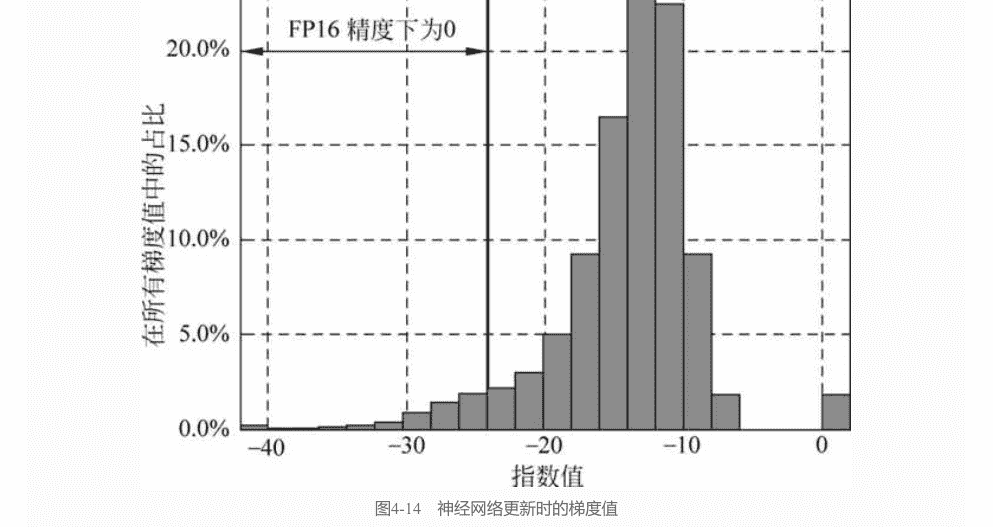

图4-14 神经网络更新时的梯度值

混合精度训练原理
混合精度训练的核心思路是让优化器始终保留一份用Float32保存的主权重模型。进入前向时，这份主权重会被临时映射为Float16，输入数据同样切到半精度，整个前向计算以及产生的中间激活都统一在Float16下完成。反向传播算出的梯度也是Float16，送入优化器之前先提升回Float32，再以此更新那份Float32的主权重，下一个迭代继续如此循环。

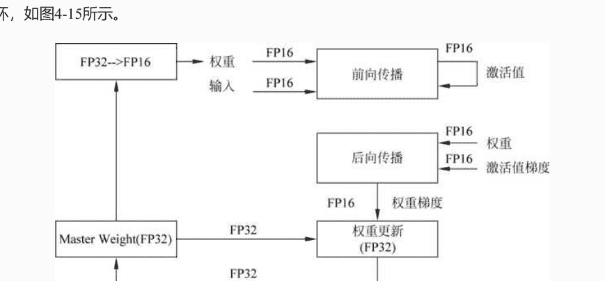

图4-15 混合精度训练过程

梯度分布与Float16的有效区间并不匹配。大多数梯度绝对值都很小，已经落在Float16能表达的低位区域，而Float16的高位区间几乎空置，如图4-16所示。

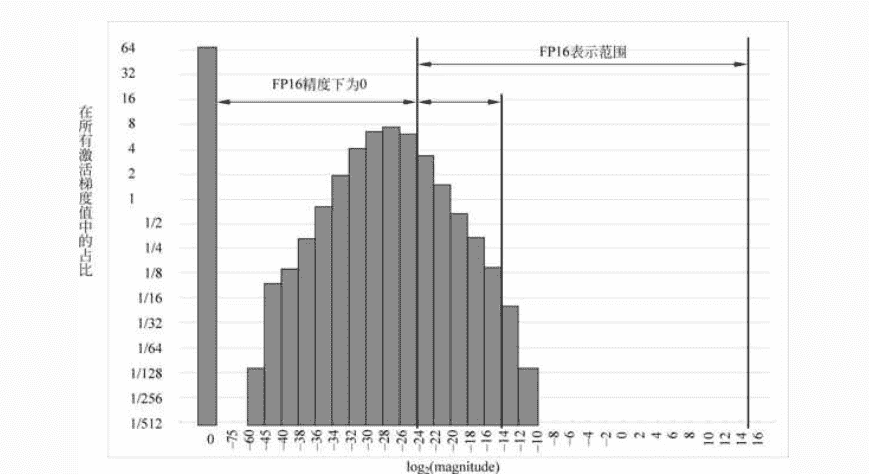

图4-16 梯度值与Float16表示范围

未被利用的部分主要是数值偏大的区间。梯度本身偏小，导致高位范围闲置。为此混合精度训练会先对梯度做整体放大，等价于把梯度分布向右推移进入Float16的有效区间。

具体做法是前向仍用Float16计算，Loss的计算保留在Float32并得到Float32的Loss值。随后用一个系数 N 把Loss放大，放大后的Loss再转成Float16参与反向求导。此时梯度经过放大后在Float16范围内不易溢出。梯度更新时，先把缩放过的Float16梯度转回Float32，再除以之前的缩放系数 N，还原为真实的Float32梯度，最后用它去更新Float32主权重，完成一次完整循环，如图4-17所示。

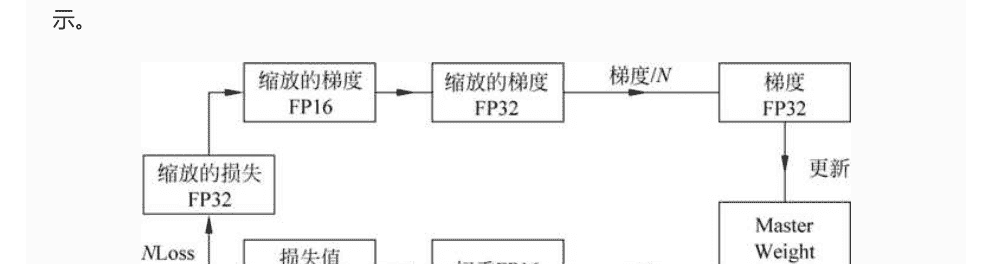

图4-17 Loss和梯度缩放

混合精度并非全盘半精度。一些对精度敏感的操作仍保留在Float32。PyTorch的自动混合精度机制会把线性层、卷积层、循环层等常规算子自动切换到Float16执行，而损失计算、累加类操作则保持Float32，避免大数吃小数导致的信息丢失，如图4-18所示。

```
CUDA Ops that can autocast to float16
__matmul__, addbmm, addmm, addmv, addr, baddbmm, bmm, chain_matmul, multi_dot, conv1d, conv2d, conv3d, conv_transpose1d, conv_transpose2d, conv_transpose3d, GRUCell, linear, LSTMCell, matmul, mm, mv, prelu, RNNCell

CUDA Ops that can autocast to float32
__pow__, __rdiv__, __rpow__, __rtruediv__, acos, asin, binary_cross_entropy_with_logits, cosh, cosine_embedding_loss, cdist, cosine_similarity, cross_entropy, cumprod, cumsum, dist, erfinv, exp, expm1, group_norm, hinge_embedding_loss, kl_div, l1_loss, layer_norm, log, log_softmax, log10, log1p, log2, margin_ranking_loss, mse_loss, multilabel_margin_loss, multi_margin_loss, nll_loss, norm, normalize, pdist, poisson_nll_loss, pow, prod, reciprocal, rsqrt, sinh, smooth_l1_loss, soft_margin_loss, softmax, softmin, softplus, sum, renorm, tan, triplet_margin_loss
```

图4-18 CUDA AMP运算精度

经过上述处理，混合精度对模型精度几乎没有负面影响。对比Float32基准训练，混合精度训练得到的平均精度甚至略有提升，见表4-4。

表4-4 混合精度训练的模型精度

| 网络 | 基准 | 混合精度 |

| :--- | :--- | :--- |

| AlexNet | 56.77% | 56.93% |

| VGG-D | 65.40% | 65.43% |

| GoogLeNet(Inception v1) | 68.33% | 68.43% |

| Inception v2 | 70.03% | 70.02% |

| Inception v3 | 73.85% | 74.13% |

| ResNet50 | 75.92% | 76.04% |

### 4.4.2 PyTorch中的混合精度实操
PyTorch通过torch.cuda.amp模块提供混合精度支持，主要依赖autocast和GradScaler两件工具。

autocast上下文管理器会自动把合适的算子切换到低精度以加速训练。GradScaler负责梯度缩放，调用scaler.scale(loss)放大Loss以避免Float16下梯度下溢；scaler.step(optimizer)用缩放后的梯度更新参数；scaler.update()则根据情况调整缩放因子，为下一轮训练做准备，代码如下：

```python
//Chapter4/AMP.py
net = make_model(in_size, out_size, num_layers) #创建模型
opt = torch.optim.SGD(net.parameters(), lr=0.001) #创建优化器
scaler = torch.cuda.amp.GradScaler(enabled=use_amp) #创建梯度缩放器
for epoch in range(epochs):
    print(f"epoch:{epoch}")
    for input, target in zip(data, targets):
        #进行自动混合精度计算
        with torch.autocast(device_type=device, dtype=torch.float16):
            output = net(input)
            loss = loss_fn(output, target)
        scaler.scale(loss).backward() #对 Loss 进行缩放
        scaler.step(opt) #缩放梯度，进行参数更新
        scaler.update() #调整缩放比例
        opt.zero_grad()
```


## 4.5 模型量化技术概览
模型量化是一种压缩与加速技术，通过把参数的数值表示从浮点缩减到更少的位宽，通常把浮点转成整数，从而降低存储、显存占用和功耗，同时尽可能保持推理精度，主要目标是加速推理。

### 4.5.1 量化原理拆解
以Llama13B为例，Float32加载需要约52GB显存，Float16约26GB，Int8约13GB，Int4仅约6.5GB。

在GPU推理时，参数和激活值要反复在显存与计算单元间搬运，限制推理速度的关键往往是显存带宽。量化后数据体量减小，搬运时间显著下降，速度随之提升。并且以A100为例，Int8算力约为Float16的两倍，量化模型推理更快。

量化带来的好处概括为三点：
- 减小模型存储和显存占用。
- 减少显存与计算单元间的数据传输，加快推理。
- 整数运算更快，提升推理效率。

量化不仅要做从浮点到整数的映射，还需做反量化，因为最终使用仍是浮点数值。反量化后的浮点数应尽可能接近原始值，不能简单取整。

先看对称量化。把一组浮点数映射到Int8区间-128到127，为方便讨论舍弃-128，使用-127到127。为了最小化信息损失，需要让量化后的整数填满整个区间。

以图4-19的一组数为例做Int8对称量化，如图4-19所示。

| 1.21 | -1.31 | 0.22 |

| 0.83 | 2.11 | -1.53 |

| 0.79 | -0.54 | 0.84 |

图4-19 需要量化的原始数据

先找出绝对值最大的数2.11，将其映射到127，得到缩放比例 s = 2.11 / 127 = 0.016614。整组数按此比例缩放后取整，得到量化表示，其中 x_f 表示原始浮点数，如图4-20所示。

s = 2.11 / 127 = 0.016614

| 1.21 | -1.31 | 0.22 |   | 73 | -79 | 13 |

| 0.83 | 2.11 | -1.53 | → | 50 | 127 | -92 |

| 0.79 | -0.54 | 0.84 |   | 48 | -33 | 51 |

图4-20 Int8对称量化

反量化只需乘以缩放系数，如图4-21所示。

73  -79  13   x_q×s   1.21  -1.31  0.22

50  127  -92  →  0.83   2.11  -1.53

48  -33  51   反量化  0.80  -0.55  0.85

图4-21 Int8对称反量化

保留两位小数后可以看到部分数值发生变化，但整体偏差不大。

对称量化以最大绝对值定比例，整数区间往往不能被完全利用，例如-127附近会出现空档，如图4-22所示。

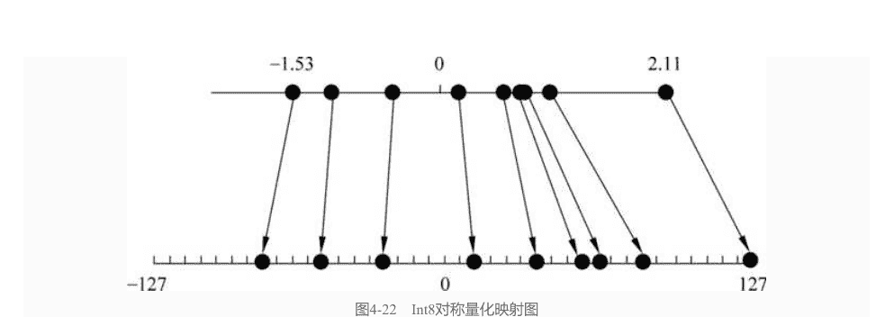

图4-22 Int8对称量化映射图

若能让这组浮点的最小值映射到-127、最大值映射到127，就能最大化利用位数。于是引入非对称量化。

非对称Int8量化把浮点数映射到无符号Int8 0~255。最大化利用整数位时，缩放比例为 max-min 除以255。更一般地，Int4量化除以15，即2^n-1，n为位宽，如式（4-10）所示。

```
s = \frac{\max - \min}{2^n - 1} \quad (4-10)
```

计算缩放比例后，还需计算零点 z，用于对取整后的值做平移，使量化整数恰好分布在0~255。零点计算为负的最小值除以缩放值取整，最小值缩放后加零点恰好为0。具体公式如下：

```
z = \left\lfloor \frac{-\min}{s} \right\rfloor \quad (4-11)
```

非对称量化公式为

```
x_q = \text{clamp}\left( \left\lfloor \frac{x_f}{s} \right\rfloor + z, 0, 2^n - 1 \right) \quad (4-12)
```

clamp函数用于处理量化后越界的情况，小于0强制为0，大于上限强制为上限。

对图4-20这组数做Int8非对称量化，如图4-23所示。

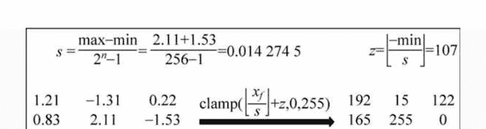

反量化过程为量化值减零点再乘缩放值，如式（4-13）所示。

$$x_f = (x_q - z) \times s$$ (4-13)

对量化后结果反量化，如图4-24所示。

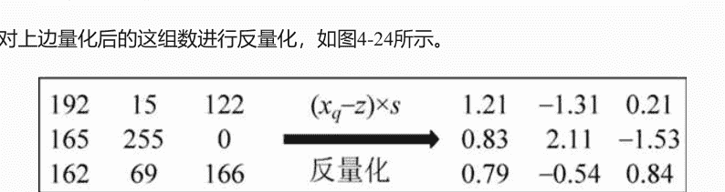

保留两位小数时，反量化值与原始值基本一致，且比对称量化精度更高，整数区间也被充分使用，如图4-25所示。

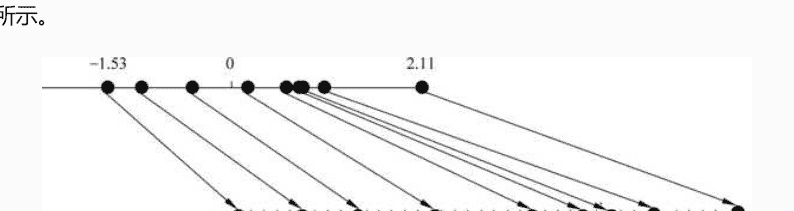

值得注意的是，原始输入的零值经非对称量化和反量化后仍保持为零，不会引入误差。对称量化实现简单但精度有限，非对称量化计算稍复杂但精度更高。

量化后如何利用整数高性能计算并映射回浮点？假设有两个浮点向量 X_f 与 W_f。对它们做对称量化得到各自缩放值和量化值 X_q、W_q，如图4-26所示。

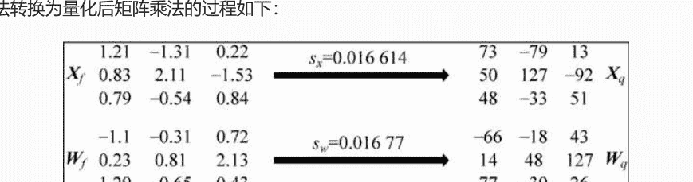

图4-26 对 X_f 和 W_f 进行对称量化

原浮点矩阵乘法可转换为量化矩阵相乘再乘以两个缩放值：

$$X_f W_f = s_x X_q \times s_w W_q = s_x s_w X_q W_q$$

由此把浮点乘法转为整数乘法加速。原始结果与Int8对称量化计算结果对比见图4-27。

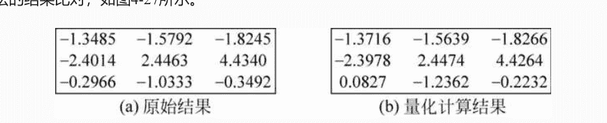

图4-27 原始计算结果与Int8对称量化计算结果

非对称量化类似，如图4-28所示。

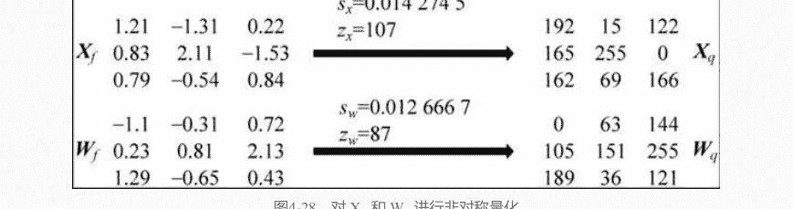

图4-28 对 X_f 和 W_f 进行非对称量化

矩阵乘法过程为：

$$X_f W_f = s_x (X_q - Z_x) \times s_w (W_q - Z_w) = s_x s_w (X_q W_q - X_q Z_w - Z_x W_q + Z_x Z_w)$$

括号内全是整数运算，速度远快于浮点。用 s_x s_w 缩放后得到近似原始结果，如图4-29所示。

| 原始结果 | 量化计算结果 |

|----------|--------------|

| -1.3485  -1.5792  -1.8245 | -1.3599  -1.5718  -1.8264 |

| -2.4014   2.4463   4.4340 | -2.4041   2.4476   4.4357 |

| -0.2966  -1.0333  -0.3492 |  0.0993  -1.2225  -0.2247 |

图4-29 原始计算结果与Int8非对称量化计算结果

量化中常见问题是异常值影响。即使非对称量化，异常值也会占用大量整数位导致浪费，如图4-30所示。

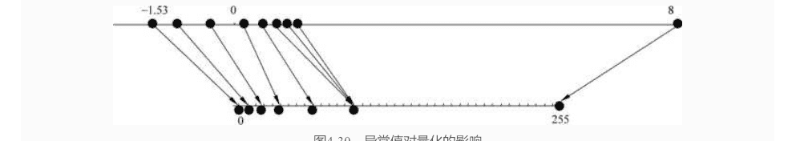

图4-30 异常值对量化的影响

缓解方法是用直方图描述分布，逐步舍弃异常值，再通过均方误差或K-L散度寻找最优量化区间。另一种思路是对异常值单独处理。

量化还涉及粒度选择。量化对象可以是整个向量，也可以按Channel独立计算量化参数、独立量化和反量化，后者精度更高但计算更复杂。

### 4.5.2 训练后动态量化

PyTorch模型量化实战指南：动态、静态与感知训练

掌握了量化的基本原理后，我们来看它在 PyTorch 里是怎么落地的。核心思路是分层处理：每一层各自完成量化运算，运算结束后再把结果转回浮点交给下一层，下一层再重复自己的量化-反量化流程。

为什么量化对精度影响通常不大？主要因为两点。权重和激活值在反归一化后取值范围比较集中，量化失真有限；另外对分类任务来说，只要最终类别的概率仍然排在最前，具体数值差距并不关键。

### 动态量化：只动权重，激活实时算

训练后动态量化的做法是，先把已训练好的模型权重固化成 Int8 并一起保存量化参数。推理时每一层的输入仍是 Float32，先在该层动态地统计输入范围完成量化变成 Int8 输入，再用 Int8 权重做矩阵运算。算完后立刻反量化回 Float32 作为本层输出送给下一层，如图4-31所示。
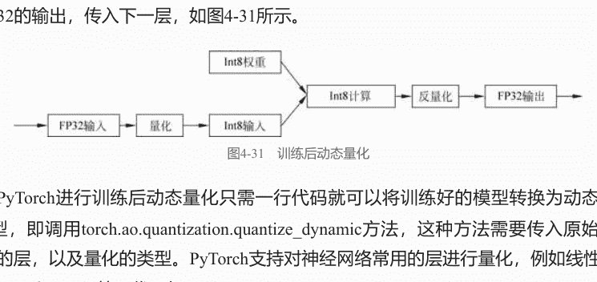

在 PyTorch 里把一个已训练模型转成动态 Int8 只需要一行调用 `torch.ao.quantization.quantize_dynamic`，传入需要量化的层类型和量化模式即可。框架原生支持线性层、卷积层、RNN、LSTM 等常见算子，代码如下：
```
//Chapter4/PTDQ.py

import torch

class MyModel(torch.nn.Module):
    def __init__(self):
        super().__init__()
        self.linear1 = torch.nn.Linear(3, 3, bias=False)
        self.relu = torch.nn.ReLU()
        self.linear2 = torch.nn.Linear(3, 1, bias=False)

    def forward(self, inputs):
        outputs = self.linear1(inputs)
        outputs = self.relu(outputs)
        outputs = self.linear2(outputs)
        return outputs

#构造训练数据
weights = torch.tensor([[1.1], [2.2], [3.3]])
torch.manual_seed(123)
training_features = torch.randn(12000, 3)
training_labels = training_features @ weights
#构造测试数据
torch.manual_seed(123)
test_feature = torch.randn(1000, 3)
test_labels = test_feature @ weights

model = MyModel()
optimizer = torch.optim.Adam(model.parameters(), lr=0.1)
for i in range(100):
    preds = model(training_features)
    loss = torch.nn.functional.mse_loss(preds, training_labels)
    loss.backward()
    optimizer.step()
    optimizer.zero_grad()

model.eval()
with torch.no_grad():
    preds = model(test_feature)
    mse = torch.nn.functional.mse_loss(preds, test_labels)
    print(f"float32 model testing loss: {mse.item():.3f}")

#转换为量化模型
model_int8 = torch.ao.quantization.quantize_dynamic(model, {torch.nn.Linear}, dtype=torch.qint8)
with torch.no_grad():
    preds = model_int8(test_feature)
    mse = torch.nn.functional.mse_loss(preds, test_labels)
    print(f"int8 model testing loss: {mse.item():.3f}")

print("float32 model linear1 parameter:\n", model.linear1.weight)
print("int8 model linear1 parameter(int8):\n", torch.int_repr(model_int8.linear1.weight))
print("int8 model linear1 parameter:\n", model_int8.linear1.weight)
```

量化后的张量类型是 qint8，直接打印会看到缩放因子、零点等量化参数，和量化值绑定在一起保存，方便随时反量化。注意打印出来的数值是反量化后的浮点表示，若想看底层真实存储的整数，需要用 `torch.int_repr` 提取。

### 4.5.3 训练后静态量化

动态量化有两个明显短板。
- 每次推理都要为激活值实时算量化参数，计算开销大。
- 中间结果必须先反量化成 Float32 再写入显存，既占内存又增加搬运时间。

第一个问题源于权重训练后固定可以离线量化，而激活值随输入变化。解决办法是用一批有代表性的样本做一次前向，让每层观察到自己的激活分布并提前记录量化参数。

第二个问题可以这样绕开：上一层算完后直接把结果量化成 Int8 再传给下一层，下一层基于 Int8 激活继续计算，不必中间落回 Float32。

这就是训练后静态量化的工作流，如图4-32所示。
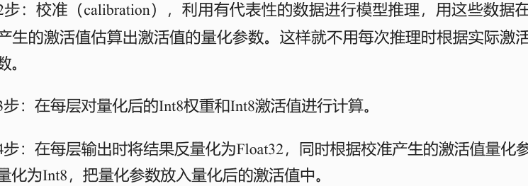

- 1. 先把训练好的权重量化为 Int8 并保存对应的量化参数。
- 2. 校准阶段，用代表性数据跑一次推理，统计各层激活值的分布并导出激活量化参数，避免推理时重复计算。
- 3. 每层用 Int8 权重和 Int8 激活做运算。
- 4. 层输出先反量化回 Float32，同时依据校准得到的参数把激活值再量化为 Int8，并把参数捆绑在量化激活里。
- 5. 把 Int8 激活连同参数一起交给下一层。

代码示意如下：
```
python
//Chapter4/PTSQ.py

import torch

class MyModel(torch.nn.Module):
    def __init__(self):
        super().__init__()
        self.quant = torch.ao.quantization.QuantStub()
        self.linear1 = torch.nn.Linear(3, 3, bias=False)
        self.relu = torch.nn.ReLU()
        self.linear2 = torch.nn.Linear(3, 1, bias=False)
        self.dequant = torch.ao.quantization.DeQuantStub()

    def forward(self, inputs):
        q_inputs = self.quant(inputs)
        outputs = self.linear1(q_inputs)
        outputs = self.relu(outputs)
        outputs = self.linear2(outputs)
        f_outputs = self.dequant(outputs)
        return f_outputs

weights = torch.tensor([[1.1], [2.2], [3.3]])

torch.manual_seed(123)
training_features = torch.randn(12000, 3)
training_labels = training_features @ weights

torch.manual_seed(123)
test_feature = torch.randn(1000, 3)
test_labels = test_feature @ weights

model = MyModel()
optimizer = torch.optim.Adam(model.parameters(), lr=0.1)
for i in range(100):
    preds = model(training_features)
    loss = torch.nn.functional.mse_loss(preds, training_labels)
    loss.backward()
    optimizer.step()
    optimizer.zero_grad()

model.eval()
with torch.no_grad():
    preds = model(test_feature)
    mse = torch.nn.functional.mse_loss(preds, test_labels)
    print(f"float32 model testing loss: {mse.item():.3f}")

model.qconfig = torch.ao.quantization.get_default_qconfig('x86')

model_prepared = torch.ao.quantization.prepare(model)
model_prepared(test_feature)

model_int8 = torch.ao.quantization.convert(model_prepared)
with torch.no_grad():
    preds = model_int8(test_feature)
    mse = torch.nn.functional.mse_loss(preds, test_labels)
    print(f"int8 model testing loss: {mse.item():.3f}")

print("float32 model linear1 parameter:\n", model.linear1.weight)
print("int8 model linear1 parameter(int8):\n", torch.int_repr(model_int8.linear1.weight))
print("int8 model linear1 parameter:\n", model_int8.linear1.weight)

```

实现时在模型初始化阶段插入量化与反量化的占位符，并在 forward 的入口和出口分别调用。训练结束后选择适配 x86 的量化配置，调用 `prepare()` 得到可校准的模型，用代表数据做一次前向完成校准，再通过 `torch.ao.quantization.convert()` 产出静态量化的推理模型。

### 4.5.4 量化感知训练

动态和静态量化都属于事后处理，难免引入误差。想要更小的精度损失，可以在训练阶段就让模型“习惯”量化带来的误差，这就是量化感知训练。

它的思路是在训练回路里插入模拟量化节点，让前向过程对权重和激活做一次量化和反量化，制造出与推理时一致的误差，网络在这种带噪声的场景下继续调整参数。整个训练仍在 Float32 下进行，模拟节点也能回传梯度参与更新，如图4-33所示。
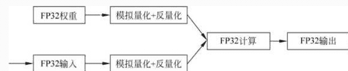

图4-33 量化感知训练

- 第1步：载入 Float32 的模型参数。
- 第2步：送入 Float32 的输入。
- 第3步：通过插入的 fake_quantization 节点对参数和输入分别做量化和反量化，注入量化误差。
- 第4步：在 Float32 精度下完成网络计算。
- 第5步：得到的 Float32 激活值直接传递到下一层。

代码如下：
```python
#Chapter4/QAT.py

import torch

class MyModel(torch.nn.Module):
    def __init__(self):
        super().__init__()
        self.quant = torch.ao.quantization.QuantStub()
        self.linear1 = torch.nn.Linear(3, 3, bias=False)
        self.relu = torch.nn.ReLU()
        self.linear2 = torch.nn.Linear(3, 1, bias=False)
        self.dequant = torch.ao.quantization.DeQuantStub()

    def forward(self, inputs):
        q_inputs = self.quant(inputs)
        outputs = self.linear1(q_inputs)
        outputs = self.relu(outputs)
        outputs = self.linear2(outputs)
        f_outputs = self.dequant(outputs)
        return f_outputs

weights = torch.tensor([[1.1], [2.2], [3.3]])

torch.manual_seed(123)
training_features = torch.randn(12000, 3)
training_labels = training_features @ weights

torch.manual_seed(123)
test_feature = torch.randn(1000, 3)
test_labels = test_feature @ weights

model = MyModel()

model.qconfig = torch.ao.quantization.get_default_qconfig('x86')
model_prepared = torch.ao.quantization.prepare_qat(model)

optimizer = torch.optim.Adam(model_prepared.parameters(), lr=0.1)
for i in range(100):
    preds = model_prepared(training_features)
    loss = torch.nn.functional.mse_loss(preds, training_labels)
    loss.backward()
    optimizer.step()
    optimizer.zero_grad()

model_prepared.eval()
with torch.no_grad():
    preds = model_prepared(test_feature)
    mse = torch.nn.functional.mse_loss(preds, test_labels)
    print(f"float32 model testing loss: {mse.item():.3f}")

model_int8 = torch.ao.quantization.convert(model_prepared)
with torch.no_grad():
    preds = model_int8(test_feature)
    mse = torch.nn.functional.mse_loss(preds, test_labels)
    print(f"int8 model testing loss: {mse.item():.3f}")

print("float32 model linear1 parameter:\n", model_prepared.linear1.weight)
print("int8 model linear1 parameter(int8):\n", torch.int_repr(model_int8.linear1.weight()))
print("int8 model linear1 parameter:\n", model_int8.linear1.weight())
```

和后训练静态量化相比，量化感知训练用到的入口函数变成了 prepare_qat。QAT 是 Quantization Aware Training 的缩写，意为量化感知训练。实际跑一下对比就会发现，经过 QAT 的模型在量化之后产生的均方误差，要比仅做后训练静态量化的模型更小。

同时可以观察到，QAT 训练后的 linear1 权重数值，和后训练静态量化的权重数值并不相同。这说明量化感知训练确实能够优化模型参数，从而提升精度。

### 4.5.5 LLM.int8
HuggingFace Transformers 自带的 Int8 量化方案就是 LLM.int8。该方法在实验上已被证明对大模型的表现几乎没有影响，却能把显存占用压到原来的一半左右。论文里的对照图横轴是模型规模，从 125M 到 175B，纵轴是模型精度，如图4-34所示。

Float16 下，随着参数量变大，精度持续提升。传统 Int8 量化在模型达到约 2.7B 参数后性能就急剧下滑，而 LLM.int8 无论参数量多大，都能保持与 Float16 一致的精度，不会出现衰退。

传统量化为何在一定规模后失效，根源在 Emergent Feature。部分层的输出特征会出现异常放大，数值比其他特征大几十倍。作者认为这是大模型训练过程中学到的关键特征。对这些含异常值的特征用传统量化与反量化，会把不同的浮点值压缩到同一个整型，信息被丢失，性能随之下降。若直接剔除异常值，重要的特征也随之丢失，效果同样变差。

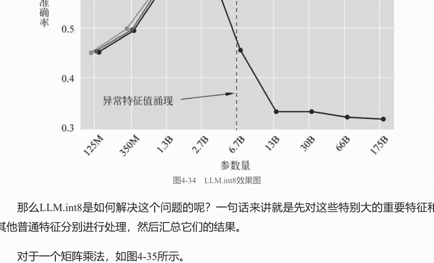
LLM.int8 的解决思路很直白：把特别大的重要特征和普通特征拆开分别处理，再把结果汇总。

以一个矩阵乘法为例，如图4-35所示。

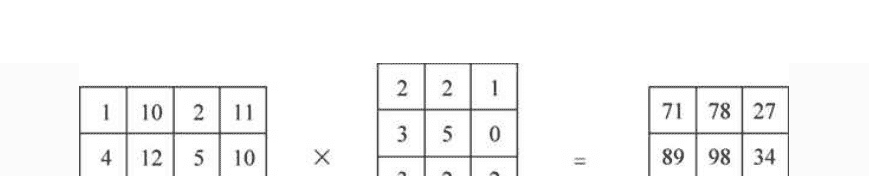
图4-35 的乘法可以拆分。左矩阵把第1、3列归为一组，第2、4列归为另一组；右矩阵把对应的第1、3行归为一组，第2、4行归为另一组。然后让左、右两组分别相乘，再把两个结果相加，得到的结果与直接相乘完全等价，如图4-36所示。

据此对神经网络一层的输入和权重进行拆分计算。具体做法是先在输入特征中找出含有异常值的列，把这些列作为一个矩阵，其余列作为另一个矩阵。论文里把绝对值大于6的特征列视为异常列，这类列通常只占全部列的0.1%以下。

找到输入的异常列后，再定位对应的权重行，把这些行也单独成一个矩阵，剩下的行作为另一个矩阵。这样输入矩阵和权重矩阵就被拆成了普通特征矩阵乘法和异常特征矩阵乘法。


普通特征矩阵乘法走量化流程，输入按行量化，权重按列量化，量化后再用 Int8 精度计算，计算完反量化回 Float16。

异常特征矩阵乘法不做量化，直接在 Float16 精度下计算，避免精度损失。最后把普通分支反量化后的结果与异常分支的结果相加，即为该层的最终输出。

因为一个乘法被拆成了两个，LLM.int8 会带来一定的推理速度损耗。

### 4.5.6 NF4量化
前面介绍的都是线性量化，量化前浮点数与量化后整数之间保持线性关系，换句话说每个整数大致对应相同数量的浮点数。

神经网络的参数和输入通常服从均值为0的正态分布，靠近0的值密集，越远越稀疏。用均匀分配的整数去量化就会浪费。更合理的做法是在原始数据密度高的区域多分配整数，密度低的区域少分配，从而降低量化误差。

基于这一思想，把正态分布按累积概率密度切分为16个区间，对应4位量化后的16个取值。越靠近零，整数分布越密集；越远离零，分布越稀疏，如图4-37所示。

具体映射时，把一个浮点数映射到x轴上，落在哪個整数区间就量化为该整数，例如量化后整数14对应量化前浮点区间1.73~2.26。反量化时，14会被还原为该区间的中点1.995。

这里有两个难点。第一，正态分布的取值范围是负无穷到正无穷，反量化时无法得到首尾区间的均值，做法是对两端做截断，各舍弃累积概率密度0.0322917。第二，零值经反量化后不再是零，而零在深度学习里常用于填充，需要特殊处理。


图4-37 基于正态分布的量化

零值单独占用4位量化中的一个整数位。剩下的15个位，按正态累积概率密度分配8个给正数、7个给负数，再归一化到-1到1之间，见表4-5。

表4-5 NF4量化表

| 归一化后浮点值 | NF4 量化值 | 归一化后浮点值 | NF4 量化值 |

| :--- | :--- | :--- | :--- |

| -1.0 | 0 | 0.079 580 299 556 255 34 | 8 |

| -0.696 192 800 998 687 7 | 1 | 0.160 930 201 411 247 25 | 9 |

| -0.525 073 051 452 636 7 | 2 | 0.246 112 301 945 686 34 | 10 |

| -0.394 917 488 098 144 53 | 3 | 0.337 915 241 718 292 24 | 11 |

| -0.394 917 488 098 144 53 | 4 | 0.440 709 829 330 444 34 | 12 |

| -0.184 773 430 228 233 34 | 5 | 0.562 617 003 917 694 1 | 13 |

| -0.091 050 036 251 544 95 | 6 | 0.722 956 836 223 602 3 | 14 |

| 0.0 | 7 | 1.0 | 15 |

这就是 Normal Float 4-bit，简称 NF4。NF4 并不是计算类型，而是专为符合正态分布的数据设计的4位量化。以 [1.532, -0.823, 0.412, 0.232] 为例，先取最大绝对值1.532作为缩放因子Scale，Scale需保存以便反量化。所有值除以1.532归一化得到 [1.0, -0.537, 0.269, 0.151]。

再查 NF4 表，取最接近的量化值，得到整数列表 [15, 2, 10, 9]。反量化时查表还原为 [1.0, -0.5250730514526367, 0.24611230194568634, 0.16093020141124725]，再乘以Scale得到 [1.532, -0.804, 0.377, 0.247]，与原值非常接近。

分块量化有助于抗异常值。NF4 以64个值为一个块量化，64个数各占4位共256位，再加上每个块一个Float32的Scale，额外开销约12.5%显存。

为进一步压缩显存，可以把256个块的Float32 Scale再量化为8位，额外开销降到3.174%。这就是 NF4 中的双重量化。它减少了显存，却增加了量化和反量化的计算量。

NF4 本身不用于计算，量化后的 Int4 不能直接参与运算，必须先反量化。实际部署时通常指定计算类型，默认是 BFloat16。下面是 HuggingFace 中用 BitsAndBytes 对模型做4位量化的配置代码：

```python
bnb_config = BitsAndBytesConfig(
    load_in_4bit=True,
    bnb_4bit_use_double_quant=True,
    bnb_4bit_quant_type="nf4",
    bnb_4bit_compute_dtype=torch.bfloat16
)
```

## 4.6 梯度累加
增大批次大小能让训练更稳定、泛化更好，但会显著增加显存压力。梯度累加是训练大模型时的常用技巧：多次前向和后向传播累积梯度，而不立即更新参数，达到设定的累积步数后再做一次更新。这样间接等价于使用更大批次的效果，代码如下：

```python
accum_step = 10

for index, (inputs, labels) in enumerate(data_loader):
    
    #前向传播
    preds = model(inputs)
    loss = loss_func(preds, labels)
    
    #缩放 loss
    loss = loss / accum_step
    
    #后向传播
    loss.backward()
    
    #更新参数
    if (index + 1) % accum_step == 0:
        optimizer.step()
        optimizer.zero_grad()
```

用 HuggingFace Trainer 训练时，可以通过两个参数直接控制每卡批次大小和梯度累积步数。

```python
args = TrainingArguments(
    per_device_train_batch_size=8,
    gradient_accumulation_steps=8
)
```

## 4.7 梯度检查点
梯度检查点，也叫激活值检查点，是一种以计算时间换显存空间的技术。

以图4-38所示的简化网络为例，该网络无偏置、无激活函数。


计算参数梯度的过程如下：

```
\[
\text{loss} = (a_4 - y)^2
\]
\[
\frac{\partial \text{loss}}{\partial w_4} = 2(a_4 - y)a_3
\]
\[
\frac{\partial \text{loss}}{\partial w_3} = 2(a_4 - y)w_4 a_2
\]
\[
\frac{\partial \text{loss}}{\partial w_2} = 2(a_4 - y)w_4 w_3 a_1
\]
\[
\frac{\partial \text{loss}}{\partial w_1} = 2(a_4 - y)w_4 w_3 w_2 a_1
\]
```
可以看出求参数梯度需要前向传播产生的激活值，因此框架默认会保留这些激活值。

在训练大语言模型时，长序列即使批次为1，激活值也会占用大量显存。梯度检查点的思路是在前向时只保留部分层的激活值，其余释放，待反向需要时再从最近的检查点重新计算，如图4-39所示，已释放 a₁、a₃ 的显存占用。


计算 w₄ 梯度时需要已被释放的 a₃，就从检查点 a₂ 重新算出 a₃，即 a₂ 乘以 w₃。可见梯度检查点是用额外计算换取显存。实践中倾向于选择计算成本高但显存占用小的激活值作为检查点。HuggingFace 已实现底层细节，只需把 gradient_checkpointing 设为 True 即可生效。


## 4.8 分布式训练
模型分布式训练主要有数据并行、模型并行、张量并行等，数据并行应用最广。本节聚焦数据并行的原理。分布式训练要解决的是如何用多 GPU 加速训练，以及如何降低单卡显存占用。

最基本的单机单卡流程是：训练进程从硬盘读数据，CPU 预处理组成批次传给 GPU，前向传播算损失，后向传播算梯度，优化器更新参数，完成一次迭代，如图4-40所示。


PyTorch 最早支持的数据并行框架是 DP。运行模式如图4-41所示。数据被分成多份分发到各 GPU，各自前向后向算出梯度，再把所有梯度传给 GPU0 做平均，GPU0 更新参数后广播给其他卡，完成一次分布式迭代。


设网络参数量为 Ψ，GPU 数为 N。对 GPU0 而言，需接收 N-1 个 GPU 的梯度，通信量 (N-1)Ψ；需向 N-1 个 GPU 广播更新后的参数，通信量同样 (N-1)Ψ。对其他 GPU 而言，发出梯度 Ψ，接收参数 Ψ，通信量与 N 无关。

DP 有两个瓶颈：一是单进程多线程受限于 Python GIL，只能用一个 CPU 核；二是 GPU0 负责收集梯度、更新参数、同步参数，通信和计算压力随卡数线性增长，成为瓶颈。

### 4.8.1 分布式数据并行
PyTorch 用来替代 DP 的是分布式数据并行 DDP。其核心通信原语是 Ring-AllReduce。把多个节点连成环，GPU0、GPU1、GPU2 上分别有 a、b、c 的梯度，目标是让每个 GPU 最终都得到三者的和。

先进行 Scatter-Reduce：GPU0 的 a₀ 传给 GPU1 的 a₁ 求和，GPU1 的 b₁ 传给 GPU2 的 b₂ 求和，GPU2 的 c₂ 传给 GPU0 的 c₀ 求和，形成环形收发。


继续累加，GPU0 的 c₀+c₂ 传给 GPU1 的 c₁，GPU1 的 a₀+a₁ 传给 GPU2 的 a₂，GPU2 的 b₁+b₂ 传给 GPU0 的 b₀。此时 GPU0 已有 b 的梯度和，GPU1 有 c 的梯度和，GPU2 有 a 的梯度和，完成第一阶段。

随后进入 All-Gather 阶段：GPU0 把 b 的和发给 GPU1，GPU1 把 c 的和发给 GPU2，GPU2 把 a 的和发给 GPU0；再下一轮 GPU0 把 a 的和发给 GPU1，GPU1 把 b 的和发给 GPU2，GPU2 把 c 的和发给 GPU0。最终各卡均持有完整的平均梯度。

分布式训练：从 Ring-AllReduce 到 ZeRO 的通信与显存权衡

完成整个 Ring-AllReduce 环路后，每张 GPU 上都已聚合出全量的参数梯度，如图4-47 所示。


图4-44 Scatter-Reduce3


图4-45 All-Gather1


从前面步骤可见，环形连接的 Ring-AllReduce 让各 GPU 负载均衡，且收发同时进行，能够充分利用显卡的上行和下行带宽。数据并行 DP 采用单进程多线程，只有 GPU0 负责用优化器更新参数；而分布式数据并行 DDP 是多进程形式，每进程为自己的 GPU 准备数据并与其他 GPU 通信。各进程基于本地数据完成前向和反向，算出各自梯度，因为分片数据不同梯度自然不同，随后借助 Ring-AllReduce 把多卡梯度汇总平均。汇总后所有卡的梯度一致，各自用本地优化器更新网络，保持模型与优化器状态同步，如图4-48 所示。


图4-48 DDP训练过程示意图

DDP 具体实现有几个关键细节。以 3 张 GPU 为例，首先由 GPU0 加载模型并把参数同步给 GPU1、GPU2，随后按参数定义的逆序重新排列，即输出层参数排前、输入层参数排后，最后为每个参数挂一个监听器。所有监听器按序放入若干桶中，如图4-49 所示。


图4-49 DDP实现细节

做逆序排列的原因在于反向传播时梯度是自后向前产生的，先得到的是靠后层的梯度，后得到的是靠前层的梯度。把输出层放前面、输入层放后面可以让计算与通信重叠，缩短整体耗时。先算出的梯度可以尽早同步，同时 GPU 仍在计算其他梯度，但逐个参数同步开销过大，因此需要等一个桶填满再统一同步，监听器的作用就是让框架知道哪一参数的梯度已就绪。

多卡开始反向时梯度逐步生成。当同一桶内所有 GPU 的梯度都准备好，该桶就启动 Ring-AllReduce 同步桶内梯度，而 GPU 仍在继续计算其他桶的梯度，如图4-50 所示。


图4-50 桶之间的Ring-AllReduce

全部桶同步完毕后，各 GPU 先更新本地优化器状态，再调用优化器更新网络，此时优化器状态与网络参数保持一致，可以进入下一轮训练。

DDP 通信量的分析如下，设模型参数总量为 Ψ，GPU 数量为 N。Ring-AllReduce 每次同步的块大小为 Ψ/N。

Scatter-Reduce 阶段，每个块要经过 N-1 次传递才能得到梯度和，于是每张 GPU 的发送和接收量均为 (N-1)Ψ/N，N 足够大时约等于 Ψ。All-Gather 阶段，聚合后的梯度块需经过 N-1 步分发到所有卡，期间每张 GPU 的收发量同样是 (N-1)Ψ/N，N 足够大时也约等于 Ψ。因此 DDP 每个进程的总收发量约为 2Ψ，与集群 GPU 数量 N 无关。

### 4.8.2 DeepSpeed ZeRO

DDP 训练中每张 GPU 都要保存完整的网络参数、参数梯度以及优化器状态。大模型训练时单卡显存往往成为瓶颈。DeepSpeed ZeRO，即零冗余优化器，其核心思想是在分布式系统里尽量削减冗余存储。

假设集群有 3 张 GPU，数据分片后每卡处理不同分片。混合精度下，DDP 需要在每卡保存 FP16 参数、FP16 梯度，以及 Adam 优化器所需的 FP32 梯度、一阶动量、二阶动量和 FP32 参数，如图4-51 所示。可以看出优化器状态占用最大且在各卡完全重复，产生了冗余。ZeRO-1 的出发点就是让每卡只保存一部分优化器状态，整机仍保留完整状态。

以 9 层网络为例，GPU0 保存前 3 层参数对应的优化器状态并负责更新这 3 层，GPU1 负责中间 3 层，GPU2 负责后 3 层，如图4-52 所示。前向传播与 DDP 相同，各卡仍保留完整 FP16 参数。反向时各卡自后向前算出各层梯度。GPU0、GPU1 不负责后 3 层的更新，于是把自己算出的这部分梯度发给 GPU2，并在发送的同时继续计算其它层，尽可能重叠计算与传输。


GPU2 收到来自 GPU0、GPU1 的后 3 层梯度后求平均。同理，GPU0 与 GPU2 把中间 3 层的梯度发给 GPU1，由 GPU1 汇总取均值；GPU1、GPU2 再把前 3 层的梯度发给 GPU0，由 GPU0 汇总取均值。

反向结束后，各卡获得自己负责部分参数的平均梯度，梯度转 FP32 并缩放后更新一阶、二阶动量，再用优化器更新 FP32 参数，随后把 FP32 参数转回 FP16 更新本地模型参数，并把更新后的 FP16 参数广播给其它卡，完成一次迭代。

ZeRO-1 去掉优化器状态的冗余，大幅降低单卡显存。通信量是否增加呢？每个 GPU 负责更新的参数量为 Ψ/N，需把其它 N-1 份梯度发送出去，发送量 (N-1)Ψ/N，N 大时约 Ψ；同样需从其它卡接收这部分梯度，接收量也约 Ψ。更新完后参数需广播给 N-1 张卡，收发各约 (N-1)Ψ/N，N 大时约 Ψ。于是 ZeRO-1 的总收发仍为 2Ψ，与标准 DDP 相同。原因在于 DDP 需要把本地梯度广播给所有卡，而 ZeRO-1 只发给唯一负责更新的卡，减少了梯度通信；但更新后参数需广播，又增加了通信，两者抵消。

如图4-53 所示，Baseline 为标准 DDP 的显存占用，公式为 (2+2+K)Ψ，其中两个 2 分别为 FP16 参数和 FP16 梯度，K 为优化器字节数，Adam 下取 12。Ψ=7.5B，64 卡时 DDP 每卡约 120GB。

图4-53 DeepSpeed显存节省分析

| 配置 | 内存占用公式 | 值 |
|------|--------------|----|
| Baseline | (2+2+K)Ψ | 120GB |
| Pos | 2Ψ+2Ψ+KΨ/Nd | 31.4GB |
| Pos+g | 2Ψ+(2+K)Ψ/Nd | 16.6GB |
| Pos+g+p | (2+2+K)Ψ/Nd | 1.9GB |

注：K=12, Ψ=7.5B, Nd=64

图4-53 中的 Pos 指优化器状态，即 ZeRO-1。64 卡平分优化器状态后，每卡占用从 120GB 降到 31.4GB。

DeepSpeed 并未止步于此。ZeRO-2 的动机是若某卡只负责更新部分参数，就无需保存用不到的梯度，于是把 FP16 梯度也按卡划分，如图4-54 所示。


在 ZeRO-2 下，反向时 GPU0、GPU1 算出最后一层梯度后按桶发送给负责更新的 GPU2，随后立即释放本地这部分梯度显存。其它层同理，不归自己更新的梯度算完即发即释。反向结束后，各卡拥有自己负责部分的平均梯度，更新参数后广播。通信量不变，显存进一步下降。图4-53 中的 Pos+g 即优化器状态与梯度零冗余，即 ZeRO-2，显存降至 16.6GB。

最后，ZeRO-3 对模型参数本身的冗余也进行消除，按卡划分参数存储，如图4-55 所示。


图4-55 ZeRO-3

ZeRO-3 前向时每卡只有部分参数，遇到缺失的层需由其它卡广播参数，如 GPU0 广播第 1 层给 GPU1、GPU2，使用后立即丢弃以释放缓存。后向计算梯度时同样需要再广播一次参数，用完即释。梯度与参数更新与 ZeRO-2 相同。梯度收集仍为 Ψ，参数更新后广播为 Ψ，额外增加后向时一次参数广播 Ψ，总收发为 3Ψ，约为标准 DDP 的 1.5 倍。

图4-53 中的 Pos+g+p 表示优化器、梯度、参数三者均零冗余，即 ZeRO-3。FP16 参数的 2 字节也分摊到分子除以 N。随着卡数增加，显存持续下降，示例中从 120GB 降到 1.9GB。实践中常选用 ZeRO-2，因其在不增加通信的前提下显著降低显存。

### 4.8.3 Accelerate

Accelerate 是 HuggingFace 提供的分布式训练库，少量改动即可让 PyTorch 代码在 DDP、DeepSpeed 等不同框架下运行。

若未安装，安装命令如下：

```
pip install accelerate
```

安装后进行配置的命令如下：

```
accelerate config
```

以单机 4 卡 DeepSpeed 环境为例，配置流程如图4-56 所示。


## 图4-56 DeepSpeed配置

配置完成后查看当前配置的命令如下：

```
accelerate env
```

显示结果如下：


使用 Accelerate 进行分布式训练时无需为每个框架单独修改代码。Accelerator 提供统一接口，后台适配不同框架，用户只需实现训练逻辑。

假设 model、optimizer 已初始化，典型 PyTorch 训练循环伪代码如下：

```python
device = "cuda"
model.to(device)

for batch in training_dataloader:
    optimizer.zero_grad()
    inputs, targets = batch
    inputs = inputs.to(device)
    targets = targets.to(device)
    outputs = model(inputs)
    loss = loss_function(outputs, targets)
    loss.backward()
    optimizer.step()
    scheduler.step()
```

创建 Accelerator 对象，代码如下：

```python
from accelerate import Accelerator

accelerator = Accelerator()
```

Accelerator 会处理设备移动，可将手动指定的 device 替换为 Accelerator.device，代码如下：

```python
- device = "cuda"                # 删除手动配置
+ device = accelerator.device    # 从 accelerator 获取设备
model.to(device)
```

随后让 Accelerator 准备模型、优化器、数据加载器、学习率调度器等，代码如下：

```python
model, optimizer, training_dataloader, scheduler = accelerator.prepare(
    model, optimizer, training_dataloader, scheduler
)
```

删除手动的 to(device) 操作，Accelerator 的 DataLoader 会自动把数据放到合适设备，代码如下：

```python
- inputs = inputs.to(device)      # 删除这一行
- targets = targets.to(device)    # 删除这一行
outputs = model(inputs)
loss = loss_function(outputs, targets)
```

最后把 loss.backward() 改为 Accelerator.backward()，代码如下：

```python
- loss.backward() #删除
+ accelerator.backward(loss) #替换为 Accelerator 的 backward 方法
```

最终完整代码如下：

```python
from accelerate import Accelerator
accelerator = Accelerator()

model, optimizer, training_dataloader, scheduler = accelerator.prepare(
    model, optimizer, training_dataloader, scheduler
)

for batch in training_dataloader:
    optimizer.zero_grad()
    inputs, targets = batch
    outputs = model(inputs)
    loss = loss_function(outputs, targets)
    accelerator.backward(loss)
    optimizer.step()
    scheduler.step()
```

Accelerate 内置了更简洁高效的梯度累积方案。

下面先看一段原生 PyTorch 的梯度累积写法，它累计了两步梯度，具体实现如下：

```python
device = "cuda"
model.to(device)

gradient_accumulation_steps = 2

for index, batch in enumerate(training_dataloader):
    inputs, targets = batch
    inputs = inputs.to(device)
    targets = targets.to(device)
    outputs = model(inputs)
    loss = loss_function(outputs, targets)
    loss = loss / gradient_accumulation_steps
    loss.backward()
    if (index + 1) % gradient_accumulation_steps == 0:
        optimizer.step()
        scheduler.step()
        optimizer.zero_grad()
```

改用 Accelerate 的梯度累积能力后，代码可以简化为以下形式：

```python
from accelerate import Accelerator
accelerator = Accelerator(gradient_accumulation_steps=2)
model, optimizer, training_dataloader, scheduler = accelerator.prepare(
    model, optimizer, training_dataloader, scheduler
)
for batch in training_dataloader:
    with accelerator.accumulate(model):
        inputs, targets = batch
        outputs = model(inputs)
        loss = loss_function(outputs, targets)
        accelerator.backward(loss)
        optimizer.step()
        scheduler.step()
        optimizer.zero_grad()
```

当训练结束准备写盘时，由于之前通过 prepare 对模型做了封装，保存前要先用 unwrap_model 还原原始模型。Accelerator 提供的 save_model 方法内部已经帮你做了 unwrap，再执行存储。

下面展示了如何保存和载入分布式训练后的模型状态：

```python
#保存模型
accelerator.wait_for_everyone()
accelerator.save_model(model, save_directory)
#加载模型
unwrapped_model = accelerator.unwrap_model(model)
path_to_checkpoint = os.path.join(save_directory, "pytorch_model.bin")
unwrapped_model.load_state_dict(torch.load(path_to_checkpoint))
```

如果使用的是 Transformers 库的模型，想借助 save_pretrained 和 from_pretrained 来存取模型，保存之前同样需要先 unwrap_model，示例如下：

```python
from transformers import AutoModel

#存储
unwrapped_model = accelerator.unwrap_model(model)
unwrapped_model.save_pretrained(
    "path/to/my_model_directory",
    is_main_process=accelerator.is_main_process,
    save_function=accelerator.save,
)

#加载
model = AutoModel.from_pretrained("path/to/my_model_directory")
```

在分布式环境下，合理管理多 GPU 进程的执行顺序很重要。有些任务会因硬件差异提前完成，有些任务必须等全部进程就绪才能启动。Accelerate 提供了几组进程协同的工具。

仅需在每台机器上执行一次的逻辑，比如打印日志或展示进度条，可以通过 accelerator.is_local_main_process 判断当前进程是否是本机的主进程，示例代码如下：

```python
from tqdm.auto import tqdm

progress_bar = tqdm(range(args.max_train_steps), disable=not accelerator.is_local_main_process)

if accelerator.is_local_main_process:
    print("开始训练……")
```

如果一段逻辑要求在整个集群中只执行一次，例如模型保存或推送到 HuggingFace Hub，就可以用 accelerator.is_main_process 来做判断，代码示例如下：

```python
if accelerator.is_main_process:
    repo.push_to_hub()
```

还可以通过 on_process 指定某个方法只在指定进程索引上运行，示例如下：

```python
@accelerator.on_process(process_index=0)
def do_my_thing():
    "Something done on process index 0"
    do_thing_on_index_zero()
```

同理，on_local_process 可以限定在每台机器的指定进程索引上运行，示例如下：

```python
@accelerator.on_local_process(local_process_idx=0)
def do_my_thing():
    "Something done on process index 0 on each server"
    do_thing_on_index_zero_on_each_server()
```

多 GPU 并行时，进程速度不一。有些步骤需要所有进程都抵达同一个同步点再继续，比如保存模型前要确保所有训练进程都已完成当前轮次。

调用 wait_for_everyone 就能实现阻塞等待。它会让先完成的进程暂停，直到所有进程都运行到该位置再一起继续，代码如下：

```python
accelerator.wait_for_everyone()
```

完成代码编写后，还需做少量调整才能让脚本在 Accelerate 下分布式运行。做法是把训练逻辑封装成一个函数，并将其作为脚本入口，示例如下：

```python
from accelerate import Accelerator

def main():
    accelerator = Accelerator()
    model, optimizer, training_dataloader, scheduler = accelerator.prepare(
        model, optimizer, training_dataloader, scheduler
    )
    for batch in training_dataloader:
        optimizer.zero_grad()
        inputs, targets = batch
        outputs = model(inputs)
        loss = loss_function(outputs, targets)
        accelerator.backward(loss)
        optimizer.step()
        scheduler.step()

if __name__ == "__main__":
    main()
```

调整完成后，就能通过 Accelerate 的命令行启动分布式训练，命令示例为：

```
accelerate launch {script_name.py} --arg1 --arg2 ...
```

## 4.9 参数高效微调

大模型在海量通用语料上预训练后，具备了不错的理解、规划和生成能力，但在垂直领域仍需微调才能发挥最佳效果。完整微调成本太高，普通企业难以承担。有没有办法在消费级设备上完成微调？参数高效微调 PEFT 正是通过只训练少量参数来提升效率，避免全量微调的技术路线。

### 4.9.1 提示词微调

对同一任务输入不同的提示词，模型输出会明显不同。精心设计的提示词能显著提升效果，于是出现了提示词工程师这个角色。提示词本质上是离散 token 序列，先转为嵌入向量再进入模型。Prompt Tuning 的思路是直接学习一组最优的提示词嵌入，不必限定为真实 token，可视为一组可训练的虚拟 token。

训练时冻结原模型，只更新可学习提示词的嵌入。这样可训练参数大幅减少，实现了高效微调。

举例来说，若想提升中英文互译能力，过去用户会反复尝试不同提示词，例如：

> 请把下边这句话翻译为英文：我喜欢人工智能技术。

你把下边这句话翻译为专业流畅的英文：我喜欢人工智能技术。

你是一个精通中英文的翻译家，请把下边这句话翻译为流畅的英文：我喜欢人工智能技术。

使用提示词微调后，只需输入待译中文，前面的可学习嵌入会自动在训练中收敛到最优，如图4-57所示。

可学习嵌入可以随机初始化，实践中更常以人工构造提示词的嵌入向量做初始化，以加速收敛。


我喜欢人工智能技术。

## 图4-57 提示词微调

下面用 HuggingFace PEFT 库构建一个可训练的 Prompt Tuning 模型，代码如下：

```python
#Chapter4/prompt_tuning.py
from transformers import AutoModelForCausalLM, AutoTokenizer, BitsAndBytesConfig
from peft import get_peft_model, PromptTuningInit, PromptTuningConfig, TaskType
import torch

model_path = r'Your-Path-to-Yi-1.5-6B-Chat'
tokenizer = AutoTokenizer.from_pretrained(model_path)
peft_config = PromptTuningConfig(
    task_type=TaskType.CAUSAL_LM,
    prompt_tuning_init=PromptTuningInit.TEXT,
    num_virtual_tokens=9,
    prompt_tuning_init_text="请把下边这句话翻译为中文：",
    tokenizer_name_or_path=model_path,
)

#4位 加载
bnb_config = BitsAndBytesConfig(
    load_in_4bit=True,
    bnb_4bit_use_double_quant=True,
    bnb_4bit_quant_type="nf4",
    bnb_4bit_compute_dtype=torch.bfloat16
)

model = AutoModelForCausalLM.from_pretrained(
    model_path,
    device_map="auto",
    torch_dtype='auto',
    quantization_config=bnb_config
).eval()
model = get_peft_model(model, peft_config)
print(model.print_trainable_parameters())
```

运行结果如下：

```
trainable params: 36,864 || all params: 6,061,072,384 || trainable%: 0.0006
```

可以看到可训练参数数为 36 864，对应 9 个虚拟 token 的嵌入，每个嵌入维度为 4096。


### 4.9.2 LoRA

LoRA，即 Low-Rank Adaptation，通过把大矩阵拆分为两个低秩矩阵相乘来压缩可训练参数。

神经网络的核心是矩阵乘法，大模型中的矩阵规模常达数千维。典型的前向传播是输入与权重矩阵相乘得到输出，反向传播则用梯度更新权重，如图4-58所示。


LoRA 保留原权重冻结，在前向时并行两条路径：一路是原始权重乘法，另一路是 LoRA A 与 LoRA B 的低秩乘法，两路结果相加作为最终输出，如图4-59所示。反向时只更新 A、B 两个低秩矩阵，从而在微调的同时大幅减少参数量。

假设某个权重为 4096×4096，全量微调需 16,777,216 个参数。若用 LoRA，设 r=4，则 A 为 4096×4，B 为 4×4096，可训练参数降至 32,768，仅为原来的 1/512。

LoRA 配置中关键有两个超参数：控制秩的 r 和缩放系数 alpha。

若原始权重维度为 M×N，则 LoRA A 为 M×r，LoRA B 为 r×N，无论 r 取何值，A 与 B 相乘后仍为 M×N。


设原始权重输出为 X，LoRA 分支输出为 ΔX，缩放系数为 α，则前向最终输出为式（4-14）：

$X + \frac{\alpha}{r} \Delta X$ (4-14)

下面是定义 LoRA 模型的代码示例：

```
python
//Chapter4/lora.py
from transformers import AutoModelForCausalLM, AutoTokenizer, BitsAndBytesConfig
from peft import get_peft_model, TaskType, LoraConfig
import torch

model_path = r'Your-Path-to-Yi-1.5-6B-Chat'
tokenizer = AutoTokenizer.from_pretrained(model_path)
peft_config = LoraConfig(
    r=8,
    target_modules=["q_proj",
                    "v_proj",
                    "k_proj",
                    "o_proj",
                    "gate_proj",
                    "down_proj",
                    "up_proj"
                    ],
    task_type=TaskType.CAUSAL_LM,
    lora_alpha=16,
    lora_dropout=0.05
)

#4 位 加载
bnb_config = BitsAndBytesConfig(
    load_in_4bit=True,
    bnb_4bit_use_double_quant=True,
    bnb_4bit_quant_type="nf4",
    bnb_4bit_compute_dtype=torch.bfloat16
)

model = AutoModelForCausalLM.from_pretrained(
    model_path,
    device_map="auto",
    torch_dtype='auto',
    quantization_config=bnb_config
).eval()
model = get_peft_model(model, peft_config)
model.print_trainable_parameters()
```

LoRA 训练过程中可训练参数量的打印信息如下：

trainable params: 18,153,472 || all params: 6,079,188,992 || trainable%: 0.2986

训练收敛后，LoRA 的增量矩阵可合并回原模型权重，合并过程示意图见图4-60。


## 图4-60 LoRA参数合并

完成 LoRA 微调后，需要把低秩参数融合进基模型权重并保存模型，示例代码如下：

```
new_model = model.merge_and_unload()
new_model.save_pretrained("output_dir")
tokenizer.save_pretrained("output_dir")
```


12分钟

## 4.10 vLLM

vLLM 的核心目标是大幅提速大模型推理，相较于 HuggingFace 默认的 generate() 调用，速度提升可达 24 倍左右。

### 4.10.1 KV Cache

先回顾一次大模型解码的流程。以输入“中国的历史”为例，会被切分为“中国”“的”“历史”三个 token，先得到下一个 token“非常”，随后把“非常”接在原序列后继续预测，得到“悠久”，示意图为图4-61。


再回顾 Transformer 自注意力机制。针对“中国的历史”这三个 token，每个 token 只能关注自身及之前的位置。第1个 token 只与自身交互得到 v 向量。第2个 token 用自己的 q 与第1个和自身的 k 做匹配，经 softmax 后对对应 v 加权求和。可见自注意力计算仅依赖当前位置之前的 k、v，不受后续位置影响，如图4-62。


## 图4-62 第2个token的自注意力计算

Prompt 中的全部 token 在首次前向时即可算出各层 k、v，并产生首个新 token“非常”。

随后把“非常”拼接到输入尾部进行第二次前向。因为 Prompt token 的 k、v 在首次已算出且不受新 token 影响，无需重新计算。HuggingFace 的 generate 会默认缓存已生成的 k、v。注意后续自注意力并不需要历史 token 的 q，只需保留 k、v。第二次生成后，“非常”的 k、v 也会被写入缓存，这就是 KV Cache，如图所示。


## 图4-63 大模型第2次生成

借助 KV Cache，对话式生成不会因输出变长而线性变慢。每次只需计算当前 token，历史 token 的 k、v 均已缓存复用。

### 4.10.2 Page Attention

KV Cache 能加速推理，但原生分配方式效率低下。以 40GB A100 部署 13B 模型为例，权重约占 26GB，KV Cache 约占 12GB。

实测该部分显存利用率仅 20%~40%，浪费来自三方面：

1. 生成长度不确定，通常按设定的最大 token 数一次性预分配 KV 缓存，例如上限设为 1000，实际只生成 100，则剩余 900 的空间被闲置。


2. 若某个请求确实需要 1000 个 token，第 1 个 token 产生时其余空间已被占用，导致其他可快速完成的短请求无法并行。

3. 显存碎片。不同请求的 Prompt 长度不同，预分配大小也不同。请求结束后释放缓存，若下一个请求的 Prompt 更长，就无法填入，形成碎片。

vLLM 通过改进 KV 缓存分配提升吞吐。传统系统批大小约 8，经优化后可扩展到约 40，输出速率从约 300 token/s 提升至约 900 token/s，如图4-65。


## 图4-65 vLLM与现有系统性能比较

性能提升的关键是 Page Attention。KV 缓存分配问题与操作系统内存管理相似：是否预分配、如何释放、如何防碎片。操作系统借助虚拟内存与分页解决了这些问题。

操作系统将物理内存划分为固定大小的页，进程按页申请释放，物理页不必连续。进程在虚拟地址空间操作，页表负责映射。

Page Attention 将该思路迁移到 KV 缓存。显存被切分为若干 KV 块，按块分配管理，每个请求的 KV 缓存被映射到不连续的物理 KV 块上。

假设每个 KV 块可容纳 4 个 token 的 k、v，“中国的历史非常悠久”共 5 个 token，会占用两个 KV 块，且在显存中不必相邻，如图4-66。

| Block | 中国 | 的 | 历史 | 非常 |

| :--- | :--- | :--- | :--- | :--- |

| Block1 | K V | K V | K V | K V |

| Block2 | K V | K V | K V | K V |

| Block3 | 悠久 | K V | K V | K V |

| Block4 | 我 | 喜欢 | 学习 | 数学 |

| Block5 | 和 | 英语 | 。 | |

图4-66 物理KV Block

随着新 token 不断产生，KV 缓存会依次填满已分配的块，块满后 vLLM 再分配空闲块，如图4-67。

| Block | 中国 | 的 | 历史 | 非常 |

| :--- | :--- | :--- | :--- | :--- |

| Block1 | K V | K V | K V | K V |

| Block2 | 的 | K V | K V | K V |

| Block3 | 悠久 | ， | 充满 | 辉煌 |

| Block4 | 我 | 喜欢 | 学习 | 数学 |

| Block5 | 和 | 英语 | 。 | |

图4-67 vLLM分配新的block

可见 vLLM 放弃预分配，按需按块分配，大幅缓解碎片。块大小按 4 token 设计，最坏情况下每个序列仅浪费 3 token 的空间。

同时引入类似虚拟内存的访问机制。每个序列在逻辑上拥有连续的 KV 缓存，物理上可能分散。逻辑块到物理块的映射由序列专属映射表维护，如图4-68。

Page Attention 让分配按需进行，减少碎片，并借助虚拟化简化访问。KV 缓存利用率由此从 20%~40% 提升至约 96%。


## 图4-68 KV Block映射

### 4.10.3 块共享

vLLM 的第二个改进是对 KV 块进行共享。当同一 Prompt 需要多路输出时，例如对一句话做两种英译，可将 sampling 的 n 设为 2。

此时显存中只保存一份 Prompt token 的 KV 块，被两个序列的逻辑缓存共同引用。物理块上记录引用计数，计数归零才释放，如图4-69。

第一个序列生成首 token Color 时会触发 Copy-on-Write。发现目标块被多引用，需复制一份新块，旧块引用减一，新块引用置一，再写入 Color 的 k、v。第二个序列生成 Matter 时，其引用的块引用计数为 1，可直接写入。随后两路各自继续，如图4-70。

块共享也出现在 Beam Search 中，例如 Beam Num=3 时，“中国的历史”对应的 KV 被 3 个 Beam 共享，“非常悠久”对应的 KV 被 2 个 Beam 共享，如图4-71。


### 4.10.4 代码示例

vLLM 调用非常简洁。将多个 Prompt 放入列表，设置采样参数，实例化模型后传入即可，批次大小由框架自动管理，示例如下：

```
//Chapter4/vllm_demo.py
from vllm import LLM, SamplingParams
prompts = [
    "Hello, my name is",
    "The president of the United States is",
    "The capital of France is",
    "The future of AI is",
]
sampling_params = SamplingParams(temperature=0.8, top_p=0.95, max_tokens=10)
llm = LLM(model="/mnt/d/work/models/Yi-1.5-6B-Chat")
outputs = llm.generate(prompts, sampling_params)

#打印输出
for output in outputs:
    prompt = output.prompt
    generated_text = output.outputs[0].text
    print(f"Prompt: {prompt!r}, Generated text: {generated_text!r}")
```

## 4.11 FlashAttention


当前训练大模型时普遍采用 FlashAttention，论文标题为 Fast and Memory-Efficient Exact Attention with IO-Awareness。名称已说明两大优势：更快、更省显存，且是精确注意力，结果与标准 Attention 完全一致。核心在于 IO 感知设计，通过优化 I/O 模式提升整体效率。

Transformer 中 Attention 的简化步骤如下：

1. 编码输入：将 token 映射为向量。
2. 构造矩阵：生成 Q、K、V 三个矩阵。
3. 计算分数：Q 与 K^T 相乘得到分数矩阵 S。
4. 归一化：对 S 行做 softmax 得到权重矩阵 P。
5. 聚合输出：P 与 V 相乘得到输出 O。

## 图4-72 简化Attention计算流程

考虑 GPU I/O 时，流程为：

- 1. 存储：Q、K、V 初始放在高带宽内存 HBM，形状均为 N×d。
- 2. 加载：把 Q、K 从 HBM 搬到片上 SRAM。
- 3. 计分：计算 S = QK^T。
- 4. 写回：把 S 写回 HBM。
- 5. 读回：再把 S 从 HBM 读回 SRAM。
- 6. 归一化：softmax 得到 P。
- 7. 写回：把 P 写回 HBM。
- 8. 加载：把 P、V 从 HBM 读回 SRAM。
- 9. 输出：计算 O = PV。

- 10. 将输出矩阵 O 写回 HBM。
- 11. 把算好的注意力输出矩阵 O 交还给调用方。

从这套流程能看出，注意力计算里会产生不少临时中间量，比如 S 和 P 两个矩阵，它们的规模随序列长度平方增长。以 Llama3-8B 为例，最大序列支持 8192，单头维度 128，S、P 在前向里占用的显存非常惊人。

模型训练的快慢本质上受两类瓶颈制约。

### 计算瓶颈
速度受算力限制，比如大规模矩阵乘和多通道卷积。这类算子数据量不大但计算密度很高，对算力需求强。

### 内存瓶颈
速度受 HBM 带宽限制。当从 HBM 取数的速度跟不上计算速度时，计算单元只能空等，算力被浪费。

容易落入内存瓶颈的操作主要有：

- (1) 逐元素操作：例如 relu、dropout。数据量大、计算却很轻。
- (2) 归约操作：例如 sum、softmax。同样是数据搬运多、计算量小。

厘清这两类瓶颈并针对性优化，才能实质性提升训练效率。

以 GPT-2 的注意力为例，其耗时主要集中在内存受限环节。矩阵乘这类计算密集型操作只占很小比例，而内存受限的操作占据大头，如图4-73 所示。

## GPT-2 注意力耗时剖析

图4-73 GPT-2 Attention操作时间消耗

面对内存受限，常用手段是操作融合。把多个算子合并执行，减少中间结果在 HBM 上的来回读写。融合后一次 HBM 访问就能完成多步计算，I/O 开销明显下降。

融合会带来反向传播的难题：梯度计算通常需要中间结果。若为了省 HBM 访问而丢弃中间结果，就只能在反向时重新算一遍。用少量额外计算换取 I/O 效率，是常见的取舍。

显卡存储是分层的：片上 SRAM 容量小但极快，片外 HBM 容量大但访问慢，如图4-74 所示。优化 I/O 的思路就是尽量让计算在 SRAM 里完成，减少对 HBM 的依赖。

在 Attention 优化方向上，很多人聚焦降算量。FlashAttention 则把重点放在降 I/O 上，利用 SRAM 加速。其核心目标是让 Attention 远离 HBM 的读写，具体做法有两点：

- (1) 矩阵分块与操作融合：对矩阵切块，并在块内完成 Attention 的全部操作，避免中间结果落盘到 HBM。
- (2) 反向传播时重算中间结果：不缓存中间量，反向时现场重算，解决梯度依赖问题。

这两项改动带来 2~4 倍的训练加速，并把显存占用从随序列长度平方增长变为线性增长。随着序列变长，省显存的效果越明显，例如序列长度 4096 时，对比 PyTorch 原生实现，显存只剩约四分之一。

下面拆解分块融合如何减少 HBM 访问。为了便于说明，先跳过 softmax，假设 Attention 输出 O 等于 S 乘以 V。

计算开始，先从 HBM 加载 K 的转置前 3 列、V 的前 3 行、Q 的前 2 行到 SRAM。先用 Q 的块乘 K^T 的块得到 S，S 不写回 HBM，直接与 V 的块相乘。这里得出的只是 O 前 2 行的部分结果，因为 O 是对全部 V 行的加权平均，目前只累加了前 3 行的贡献，后续还要加上其余 V 行的贡献，所以这一步的结果是中间态，如图4-75 所示。

随后保持 SRAM 中的 K^T 块和 V 块不变，把 Q 的下一个块读入，继续计算并把 O 的中间结果写回 HBM，如图4-76 所示。

再保持 K^T、V 不变，把 Q 的最后一个块载入计算，同样把 O 的中间结果写回 HBM，如图4-77 所示。

接下来从 HBM 读取 K^T 的后 3 列块、V 的后 3 行块以及 Q 的前 2 行块进行计算，得到的是对 V 后 3 行的加权。此时需要把之前写回的 O 前 2 行中间结果再读回 SRAM 求和，得到 O 前 2 行的最终结果，再写回 HBM，如图4-78 所示。

同理，保持 K^T 块和 V 块在 SRAM 中不动，遍历 Q 的剩余块，最终得到完整的 O 并写回 HBM。这就完成了一次分块加融合的注意力计算。

## 图4-77 Attention分块计算第3步

## 图4-78 Attention分块计算第4步

可见，分块加融合大幅减少了 HBM 访问，I/O 时间显著下降。

如果 softmax 也能分块，就能把整个 Attention 的 I/O 问题统一解决。

```
softmax(\{x_1,\cdots,x_N\}) = \frac{e^{x_i}}{\sum_{j=1}^{N} e^{x_j}} \quad (4-15)
```

在 FP16 混合精度下做 softmax，若 x 取 12，e^x 已超出 FP16 表述范围。为避免数值溢出，提出了 safe_softmax 方法。

```
$$m = \max(x_i)$$
$$\text{softmax}(\{x_i, \cdots, x_n\}) = \frac{e^{x_i}/e^m}{\sum_{j=1}^n e^{x_j}/e^m} = \frac{e^{x_i - m}}{\sum_{j=1}^n e^{x_j - m}} \quad (4-16)$$
```

safe_softmax 先找出所有 x 中的最大值 m，然后对分子分母同除 e^m，等价性不变，式子化简后指数项均 ≤0，从而杜绝溢出。

下面讨论 softmax 的分块可行性，先回顾 safe_softmax 的计算流程：

```
$$x = [x_1, \cdots, x_n] \quad (4-17)$$
$$m(x) := \max(x) \quad (4-18)$$
$$p(x) := [e^{x_1 - m(x)}, \cdots, e^{x_n - m(x)}] \quad (4-19)$$
$$l(x) := \sum_i p(x)_i \quad (4-20)$$
$$\text{softmax}(x) := \frac{p(x)}{l(x)} \quad (4-21)$$
```

设一组 x 共 2n 个元素，分为 x^a 为前 n 个，x^b 为后 n 个。目标是通过对两个子块的分别计算，得到整体 softmax。

```
$$x^{\text{all}} = [x_1, \cdots, x_n, \cdots, x_{2n}] \quad (4-22)$$
$$x^a = [x_1, \cdots, x_n] \quad (4-23)$$
$$x^b = [x_{n+1}, \cdots, x_{2n}] \quad (4-24)$$
```

先对 x^a、x^b 分别求出各自的中间量：

```
$$m(x^a), p(x^a), l(x^a)$$
$$m(x^b), p(x^b), l(x^b)$$
```

再利用这两个子块的中间量恢复整体。记 m、p、l 为 safe_softmax 的三个中间统计量，则

$m(x^{all}) := \max(m(x^a), m(x^b))$ (4-25)

求 m(x^{all}) 只需保留两个子块的 m 再取最大值。

$p(x^{all}) := [e^{m(x^a)-m(x^{all})}p(x^a), e^{m(x^b)-m(x^{all})}p(x^b)]$ (4-26)

p 的合并是拼接后再做尺度调整。因为 m(x^{all}) 是两者较大值，假设等于 m(x^b)，则 p(x^b) 的系数为 1，无需调整；p(x^a) 则乘以 e^{m(x^a)-m(x^{all})} 做修正。

$l(x^{all}) := e^{m(x^a)-m(x^{all})}l(x^a) + e^{m(x^b)-m(x^{all})}l(x^b)$ (4-27)

l 的合并与 p 原理相同，这里不再展开。

FlashAttention 论文中的伪代码实现，如图4-79 所示。

```
Algorithm 1 Flash Attention
Require: Matrices $\mathbf{Q}, \mathbf{K}, \mathbf{V} \in \mathbb{R}^{N \times d}$ in HBM, on-chip SRAM of size $M$.
1: Set block sizes $B_c = \lceil \frac{M}{4d} \rceil$, $B_r = \min(\lceil \frac{M}{4d} \rceil, d)$.
2: Initialize $\mathbf{O} = (0)_{N \times d} \in \mathbb{R}^{N \times d}$, $\ell = (0)_N \in \mathbb{R}^N$, $m = (-\infty)_N \in \mathbb{R}^N$ in HBM.
3: Divide $\mathbf{Q}$ into $T_r = \lceil \frac{N}{B_r} \rceil$ blocks $\mathbf{Q}_1, \dots, \mathbf{Q}_{T_r}$, of size $B_r \times d$ each, and divide $\mathbf{K}, \mathbf{V}$ in to $T_c = \lceil \frac{N}{B_c} \rceil$ blocks $\mathbf{K}_1, \dots, \mathbf{K}_{T_c}$ and $\mathbf{V}_1, \dots, \mathbf{V}_{T_c}$, of size $B_c \times d$ each.
4: Divide $\mathbf{O}$ into $T_r$ blocks $\mathbf{O}_1, \dots, \mathbf{O}_{T_r}$, of size $B_r \times d$ each, divide $\ell$ into $T_r$ blocks $\ell_1, \dots, \ell_{T_r}$, of size $B_r$ each, divide $m$ into $T_r$ blocks $m_1, \dots, m_{T_r}$, of size $B_r$ each.
5: for $1 \leq j \leq T_c$ do
6:     Load $\mathbf{K}_j, \mathbf{V}_j$ from HBM to on-chip SRAM.
7:     for $1 \leq i \leq T_r$ do
8:         Load $\mathbf{Q}_i, \mathbf{O}_i, \ell_i, m_i$ from HBM to on-chip SRAM.
9:         On chip, compute $\mathbf{S}_{ij} = \mathbf{Q}_i \mathbf{K}_j^T \in \mathbb{R}^{B_r \times B_c}$.
10:        On chip, compute $\tilde{m}_{ij} = \text{rowmax}(\mathbf{S}_{ij}) \in \mathbb{R}^{B_r}$, $\tilde{\mathbf{P}}_{ij} = \exp(\mathbf{S}_{ij} - \tilde{m}_{ij}) \in \mathbb{R}^{B_r \times B_c}$ (pointwise), $\tilde{\ell}_{ij} = \text{rowsum}(\tilde{\mathbf{P}}_{ij}) \in \mathbb{R}^{B_r}$.
11:        On chip, compute $m_i^{\text{new}} = \max(m_i, \tilde{m}_{ij}) \in \mathbb{R}^{B_r}$, $\ell_i^{\text{new}} = e^{m_i - m_i^{\text{new}}} \ell_i + e^{\tilde{m}_{ij} - m_i^{\text{new}}} \tilde{\ell}_{ij} \in \mathbb{R}^{B_r}$.
12:        Write $\mathbf{O}_i \leftarrow \text{diag}(\ell_i^{\text{new}})^{-1} (\text{diag}(\ell_i) e^{m_i - m_i^{\text{new}}} \mathbf{O}_i + e^{\tilde{m}_{ij} - m_i^{\text{new}}} \tilde{\mathbf{P}}_{ij} \mathbf{V}_j)$ to HBM.
13:        Write $\ell_i \leftarrow \ell_i^{\text{new}}$, $m_i \leftarrow m_i^{\text{new}}$ to HBM.
14:    end for
15: end for
16: Return $\mathbf{O}$.
```

图4-79 FlashAttention实现伪代码

分块 softmax 会引入块合并时的参数校正计算。FlashAttention 融合了多步内部操作且不保留中间结果，反向时会重算，也带来额外计算。实际上前向时会保存 softmax 过程中的 m 和 l，这两者占用极小，反向重算时能大幅提速，可视作一种梯度检查点。虽然引入了少量额外算量，但相比 I/O 的大幅下降，收益明显，如图4-80 所示。

| Attention | Standard | FlashAttention |
|-----------|----------|----------------|
| GFLOPs    | 66.6     | 75.2           |
| HBM R/W(GB) | 40.3   | 4.4            |
| Runtime(ms) | 41.7   | 7.3            |

图4-80 FlashAttention和标准Attention对比

对比可见，算量略有增长，但 HBM 读写降到约十分之一，运行时间提升近 6 倍。

在 FlashAttention 基础上，工程上进一步演进出 FlashAttention2 和 FlashAttention3。大模型的优化早已不止于算法，还需深入操作系统和硬件结构。

# 第5章 大模型的预训练

预训练是大模型训练的第一阶段，通过在海量文本上做下一个 token 预测来学习知识。这是模型能力形成的关键。需要尽可能多样、优质的文本作为燃料，例如 Llama3 的预训练使用了 15T 个 token。训练如此规模的数据成本极高，少数团队才承受得起。

## 5.1 预训练的作用

开源基座模型想要具备通用能力，普遍做法是先在海量的、风格各异的文本上进行预训练，从而构建起扎实的语言基础。只是通用还不够，当模型要下沉到某个行业或垂直领域时，仅靠通用底座是不够用的，需要在开源预训练模型之上再做一轮针对性的继续预训练，也就是常说的 Post Pre-train，让它真正吃进领域知识。

在专业场景下表现好，预训练几乎是必经之路。尤其是那些在公开互联网上资料稀缺的领域，效果差距更明显。有人尝试跳过预训练，直接在微调阶段塞入新知识，实践下来效果都不理想。

举个例子，如果要做一个能辅助程序员写 Scala 代码的模型，就必须先从 GitHub 上收集大量注释完整、质量过关的 Scala 代码做预训练，让模型学会把自然语言的功能描述和对应的 Scala 实现建立起映射关系。

从实践来看，预训练负责的是让模型学到知识本身，而微调更像是教它如何表达，把输出调整得更符合人类的习惯和预期。

## 5.2 预训练的数据

启动预训练，数据质量是第一道关卡。大模型预训练用的基本都是海量的非结构化文本，好数据通常要同时满足以下几个维度。

- 多样性：覆盖的主题要广、表达风格要杂，书本、新闻、论文、社交媒体、对话记录都要有，这样模型才能在不同场景下泛化。训练集里最好别出现大量重复文本。
- 大规模：数据体量决定了模型能学到的语言模式和知识面，总体上数据越多，模型上限越高。
- 高质量：要经过严格筛选和清洗，噪声、错误信息越少，模型学到的东西越准、越有用。
- 时效性：最好包含最新信息和事件，这样模型才能理解和生成当下的内容。
- 平衡性：在类别、话题、观点上保持均衡，避免性别、种族、文化、地域等方面的偏见。
- 合法性和伦理性：收集和使用必须合规，保护隐私，确保来源合法。

高质量数据的采集和整理往往需要投入大量人力，但这一步的投入是值得的，数据好模型才好。

在数据操作层面，HuggingFace Datasets 库非常好用，读取、处理、缓存一站式搞定。依托 Apache Arrow，它能实现零拷贝读取，基本不受内存限制；同时与 HuggingFace Hub深度集成，下载和分享数据都很顺畅。

如果还没装，先执行安装：

```
pip install datasets
```

最省事的加载方式是从 Hub 拉取。首先去 https://huggingface.co/datasets 找合适的数据集，可以在线预览。比如 cornell-movie-review-data/rotten_tomatoes，就能在页面上先看一眼，如图5-1所示。

用 Datasets 库从 Hub 加载，代码如下：

```python
from datasets import load_dataset
dataset = load_dataset("cornell-movie-review-data/rotten_tomatoes",
split="train")
print(dataset)
```

输出如下：

```
Dataset({
    features: ['text', 'label'],
    num_rows: 8530
})
```

Dataset 对象内部按列存储，不同列可以是不同类型。可以通过行索引取样：


图5-1 rotten_tomatoes数据集

```python
print(dataset[0])
```

输出如下：

```
{'text': 'the rock is destined to be the 21st century\'s new "conan" and that he\'s going to make a splash even greater than arnold schwarzenegger, jean-claud van damme or steven seagal.', 'label': 1}
```

返回的是一个字典形式的样本。也可以用切片取一段数据：

```python
print(dataset[-5: ])
```

输出如下：

```
{'text': ['any enjoyment will be hinge from a personal threshold of watching sad but endearing characters do extremely unconventional things .', 'if legendary shlockmeister ed wood had ever made a movie about a vampire , it probably would look a lot like this alarming production , adapted from anne rice\'s novel the vampire chronicles .', 'hardly a nuanced portrait of a young woman\'s breakdown , the film nevertheless works up a few scares .', 'interminably bleak , to say nothing of boring .', 'things really get weird , though not particularly scary : the movie is all portent and no content .'], 'label': [0, 0, 0, 0, 0]}
```

如果只关心 text 列，不需要 label，可以按列名筛选：

```python
print(dataset["text"])
```

输出为一个字符串列表：

```
['the rock is destined to be the 21st century\'s new " conan " and that he\'s going to make a splash even greater than arnold schwarzenegger , jean-claud van damme or steven segal .', 'the gorgeously elaborate continuation of " the lord of the rings " trilogy is so huge that a column of words cannot adequately describe co-writer/director peter jackson\'s expanded vision of j . r . r . tolkien\'s middle -earth .', 'effective but too- tepid biopic .', '...', 'things really get weird , though not particularly scary : the movie is all portent and no content .']
```

想精确定位某个元素，可以先指定行索引再指定列名：

```python
print(dataset[0]["text"])
```

输出如下：

```
'the rock is destined to be the 21st century\'s new " conan " and that he\'s going to make a splash even greater than arnold schwarzenegger , jean-claud van damme or steven segal .'
```

除了 Hub 数据，本地数据也完全支持。比如纯文本 txt，加载方式如下：

```python
from datasets import load_dataset
dataset = load_dataset("text", data_files=r"D:\news1.txt")
print(dataset)
```

Datasets 会按行读取，默认列名为 text，输出如下：

```
DatasetDict({
    train: Dataset({
        features: ['text'],
        num_rows: 13
    })
})
```

多个文件时，把文件列表传给 data_files 参数即可：

```python
from datasets import load_dataset
dataset = load_dataset("text", data_files=[r"D:\news1.txt",r"D:\news2.txt",r"D:\news3.txt"])
print(dataset)
```

num_rows 会累加所有文件的行数，输出如下：

```
DatasetDict({
    train: Dataset({
        features: ['text'],
        num_rows: 50
    })
})
```

训练大模型时 JSON 也很常见，例如下面这种结构：

```
{"id": 1, "query": "保持健康的3个提示。", "answer": "以下是保持健康的3个提示：\n\n1. 保持身体活动。每天做适当的身体运动，如散步、跑步或游泳，能促进心血管健康，增强肌肉力量，并有助于减少体重。\n\n2. 均衡饮食。每天食用新鲜的蔬菜、水果、全谷物和脂肪含量低的蛋白质食物，避免高糖、高脂肪和加工食品，以保持健康的饮食习惯。\n\n3. 睡眠充足。睡眠对人体健康至关重要，成年人每天应保证 7~8 小时的睡眠。良好的睡眠有助于减轻压力，促进身体恢复，并提高注意力和记忆力。"}
{"id": 2, "query": "三原色是什么？", "answer": "三原色通常指的是红色、绿色和蓝色(RGB)。它们是通过加色混合原理创建色彩的3种基础颜色。在以发光为基础的显示设备中(如电视、计算机显示器、智能手机和平板电脑显示屏)，三原色可混合产生大量色彩，其中红色和绿色可以混合生成黄色，红色和蓝色可以混合生成品红色，蓝色和绿色可以混合生成青色。当红色、绿色和蓝色按相等比例混合时，可以产生白色或灰色。\n\n此外，在印刷和绘画中，三原色指的是以颜料为基础的红、黄和蓝颜色(RYB)。这3种颜色用以通过减色混合原理来创建色彩。不过，三原色的具体定义并不唯一，不同的颜色系统可能会采用不同的三原色。"}
...
```

读取 JSON 的代码如下：

```python
from datasets import load_dataset
dataset = load_dataset("json", data_files=r"D:\gpt4.jsonl")
print(dataset)
```

库会自动解析 JSON，把 key 转成列名，方便后续使用，输出如下：

```
DatasetDict({
    train: Dataset({
        features: ['id', 'query', 'answer'],
        num_rows: 48647
    })
})
```

如果文件很多，可以把它们放到一个文件夹里，然后用 data_dir 参数一次性读取文件夹内所有文件：

```python
from datasets import load_dataset
dataset = load_dataset("text", data_dir=r"D:\news")
print(dataset)
```

Datasets 还支持直接从内存数据创建。

从字典创建 Dataset，代码如下：

```python
from datasets import Dataset
my_dict = {"text": ["text1", "text2", "text3"]}
dataset = Dataset.from_dict(my_dict)
print(dataset)
```

输出如下：

```
Dataset({
    features: ['text'],
    num_rows: 3
})
```

从列表创建：

```python
from datasets import Dataset
my_list = [{"text": "text1"}, {"text": "text2"}, {"text": "text3"}]
dataset = Dataset.from_list(my_list)
print(dataset)
```

输出如下：

```
Dataset({
    features: ['text'],
    num_rows: 3
})
```

从 Python 生成器创建：

```python
from datasets import Dataset

def my_gen():
    for i in range(1, 4):
        yield {"text": f"text{i}"}

dataset = Dataset.from_generator(my_gen)
print(dataset)
```

输出如下：

```
Dataset({
    features: ['text'],
    num_rows: 3
})
```

有了这些创建方式，搭一个 Dataset 很轻松。Datasets 同时提供了丰富的数据处理方法：

- sort 可以按数值列对整个数据集排序，代码如下：

```python
sorted_dataset = dataset.sort("numerical_column")
```

- shuffle 用于打乱顺序，代码如下：

```python
shuffled_dataset = sorted_dataset.shuffle(seed=123)
```

- select 用于按指定索引挑选数据，代码如下：

```python
small_dataset = dataset.select([0, 10, 20, 30, 40, 50])
```

- filter 用于过滤，例如下面演示如何筛选出 text 列以 Abc 开头的句子，代码如下：

- split 用于划分训练集和测试集，代码如下：

```python
dataset.train_test_split(test_size=0.1)
```

划分后会返回一个字典，包含 train 和 test 两个 Dataset，结果如下：

```
{'train': Dataset(schema: {'text': 'string', 'idx': 'int32'}, num_rows: 3301),
'test': Dataset(schema: {'text': 'string', 'idx': 'int32'}, num_rows: 367)}
```

- shard 用于把大集合切块，通过 num_shards 指定分块数，用 index 指定要取哪一块，代码如下：

```python
from datasets import load_dataset
dataset = load_dataset("imdb", split="train")
print(dataset)
sub_dataset = dataset.shard(num_shards=4, index=0)
print(sub_dataset)
```

输出如下：

```
Dataset({
    features: ['text', 'label'],
    num_rows: 25000
})
Dataset({
    features: ['text', 'label'],
    num_rows: 6250
})
```

- map：通过 map 方法可以做更复杂的操作，传入一个对每个样本或批次样本的处理函数，代码如下：

```python
from datasets import Dataset

text_dict = {"text":["苹果","橘子","香蕉"]}
dataset = Dataset.from_dict(text_dict)
print(dataset)

def add_prompt(example):
    example["text"]="翻译下边这句话为英语:\n"+example["text"]
    return example
dataset = dataset.map(add_prompt)
print(dataset)
print(dataset["text"])
```

输出如下：

```
Dataset({
    features: ['text'],
    num_rows: 3
})
Dataset({
    features: ['text'],
    num_rows: 3
})
['翻译下边这句话为英语:\n 苹果', '翻译下边这句话为英语:\n 橘子', '翻译下边这句话为英语:\n 香蕉']
```把参数 batched 设为 True 后，Dataset 会对一组样本进行批量处理，并且返回的结果行数不一定等于输入行数，这一特性让我们能够在映射过程中改变样本规模，比如把一篇长文本切分为多条短文本，示例代码如下：

```
from datasets import Dataset

text_dict = {"text": ["苹果", "橘子", "香蕉"]}
dataset = Dataset.from_dict(text_dict)
print(dataset)

def add_prompt(example):
    text = []
    for e in example["text"]:
        text.append("翻译下边这句话为英语:\n" + e)
        text.append("翻译下边这句话为法语:\n" + e)
    return {"text": text}

dataset = dataset.map(add_prompt, batched=True)
print(dataset)
print(dataset["text"])
```

运行后得到：

```
Dataset({
    features: ['text'],
    num_rows: 3
})
Dataset({
    features: ['text'],
    num_rows: 6
})
['翻译下边这句话为英语:\n 苹果', '翻译下边这句话为法语:\n 苹果', '翻译下边这句话为英语:\n 橘子', '翻译下边这句话为法语:\n 橘子', '翻译下边这句话为英语:\n 香蕉', '翻译下边这句话为法语:\n 香蕉']
```

Dataset 实例还能直接接入 PyTorch 的 DataLoader 使用，示例代码如下：

```
dataset.set_format(type="torch",columns=["text"])
data_loader = DataLoader(dataset, batch_size=2)
for batch_data in data_loader:
    print(batch_data)
```

输出结果为：

```
{'text':['翻译下边这句话为英语：\n苹果', '翻译下边这句话为法语：\n苹果']}
{'text':['翻译下边这句话为英语：\n橘子', '翻译下边这句话为法语：\n橘子']}
{'text':['翻译下边这句话为英语：\n香蕉', '翻译下边这句话为法语：\n香蕉']}
```

处理完后的集合可以被持久化以及后续载入，示例代码如下：

```
dataset.save_to_disk("path/of/my/dataset/directory")

from datasets import load_from_disk
reloaded_dataset = load_from_disk("path/of/my/dataset/directory")
```

此外，处理好的集合也可以导出为 CSV 或 JSON 格式，示例代码如下：

```
dataset.to_csv("path/of/my/dataset.csv")
dataset.to_json("path/of/my/dataset.json")
```

HuggingFace 的 Dataset 在本地采用 Arrow 作为缓存层，通过虚拟内存映射实现对磁盘数据的快速检索，这种设计让内存资源有限的机器也能加载并训练超大语料。

另一个提升效率的关键是内置的缓存机制。下载过或已经处理过的集合会被缓存起来，再次访问时直接从缓存读取，避免重复下载与重复计算。缓存的作用域是全局的，哪怕关闭当前 Python 进程，在新进程中打开同一份数据，仍能命中已有缓存。

缓存如何追踪到底应用了哪些操作？每个缓存都有专属的指纹。指纹反映缓存当前所处的状态，最初由原始数据的哈希值生成，获取指纹的代码如下：

```
from datasets import Dataset
dataset1 = Dataset.from_dict({"a": [0, 1, 2]})
dataset2 = dataset1.map(lambda x: {"a": x["a"] + 1})
print(dataset1._fingerprint, dataset2._fingerprint)
```

执行结果如下：

d19493523d95e2dc 5b86abacd4b42434

后续的指纹是在前一次指纹的基础上，结合本次对数据的操作共同计算而来。操作的哈希包含了调用的方法名以及传入的参数，这样就能让同一个指纹唯一对应一种确定的数据状态，代码如下：

```
from datasets.fingerprint import Hasher
my_func = lambda example: {"length": len(example["text"])}
print(Hasher.hash(my_func))
```

执行结果如下：

'3d35e2b3e94c81d6'

## 5.3 训练流程的封装方案
为了降低训练的复杂度，HuggingFace 提供了 Trainer 类，它把训练和评估的完整流程都实现了。使用者只需准备模型、Tokenizer、数据集、评估函数以及超参数等必要要素，剩下的训练循环、日志、保存等工作全部交给 Trainer 完成。这样能快速上手，避免重复编写训练、评估、模型保存等样板代码，同时 Trainer 也足够灵活，可按需定制。

Trainer 内部封装了标准的训练步骤：

- 1. 执行一次训练步并计算 loss。
- 2. 调用 loss.backward() 求得梯度。
- 3. 依据梯度更新模型参数。
- 4. 重复以上过程直至达到设定的迭代次数。

Trainer 把上述循环抽象掉了，使用者只需提供模型和数据等核心对象即可。

训练相关的超参数可以通过 TrainingArguments 指定，例如用 output_dir 来控制模型保存位置，代码如下：

```
python
from transformers import TrainingArguments

training_args = TrainingArguments(
    output_dir="your-model-path",
    learning_rate=2e-5,
    per_device_train_batch_size=1,
    per_device_eval_batch_size=2,
    num_train_epochs=2,
    weight_decay=0.01,
    eval_strategy="epoch",
    save_strategy="epoch",
    load_best_model_at_end=True,
)
```

随后把 training_args、模型、数据集一起传入 Trainer 构造器，还可以额外传入用于批处理的 Data Collator、监控指标等，最后调用 trainer.train() 开始训练，代码如下：

```
python
from transformers import Trainer

trainer = Trainer(
    model=model,
    args=training_args,
    train_dataset=dataset["train"],
    eval_dataset=dataset["test"],
    tokenizer=tokenizer,
    data_collator=data_collator,
    compute_metrics=compute_metrics,
)

trainer.train()
```

训练过程中 Trainer 会在 TrainingArguments 指定的 output_dir 下自动保存检查点，目录名类似 checkpoint-000，数字代表训练步数。通过检查点可以便捷地恢复中断的训练，代码如下：

```
python
#从最近的 checkpoint 恢复训练
trainer.train(resume_from_checkpoint=True)

#从指定的 checkpoint 恢复训练
trainer.train(resume_from_checkpoint="your-model/checkpoint-1000")
```

Trainer 也支持深度定制，多种方法可以通过继承重写来实现个性化需求，可重载的方法包括：

- 1. get_train_dataloader() : 构建训练用的 DataLoader。
- 2. get_eval_dataloader() : 构建评估用的 DataLoader。
- 3. get_test_dataloader() : 构建测试用的 DataLoader。
- 4. log() : 记录日志。
- 5. create_optimizer_and_scheduler() : 创建优化器与学习率调度器。
- 6. create_optimizer() : 创建优化器。
- 7. create_scheduler() : 创建学习率调度器。
- 8. compute_loss() : 根据一个 batch 计算 loss。
- 9. training_step() : 对一个 batch 执行一次训练。
- 10. prediction_step() : 执行一次预测或测试。
- 11. evaluate() : 评估模型并返回指标。
- 12. predict() : 在测试集上预测，若提供标签则计算评估指标。

例如通过自定义 compute_loss 实现带权重的损失函数，代码如下：

```
from torch import nn
from transformers import Trainer

class CustomTrainer(Trainer):
    def compute_loss(self, model, inputs, return_outputs=False):
        labels = inputs.pop("labels")
        #前向传播
        outputs = model(**inputs)
        logits = outputs.get("logits")
        #自定义 loss，不同的 label 有不同的权重
        loss_fct = nn.CrossEntropyLoss(weight=torch.tensor([1.0, 2.0, 3.0], device=model.device))
        loss = loss_fct(logits.view(-1, self.model.config.num_labels), labels.view(-1))
        return (loss, outputs) if return_outputs else loss
```

另一种定制方式是使用 Callbacks。Callbacks 不会改动训练逻辑，而是监听训练状态并在特定时机执行操作，比如提前终止或记录信息。以下是在训练 10 步后停止的回调实现，代码如下：

```
from transformers import TrainerCallback

class EarlyStoppingCallback(TrainerCallback):
    def __init__(self, num_steps=10):
        self.num_steps = num_steps

    def on_step_end(self, args, state, control, **kwargs):
        if state.global_step >= self.num_steps:
            return {"should_training_stop": True}
        else:
            return {}
```

将该回调通过 callback 参数传入 Trainer，代码如下：

```
from transformers import Trainer

trainer = Trainer(
    model=model,
    args=training_args,
    train_dataset=dataset["train"],
    eval_dataset=dataset["test"],
    tokenizer=tokenizer,
    data_collator=data_collator,
    compute_metrics=compute_metrics,
    callbacks=[EarlyStoppingCallback()],
)
```

Trainer 与 Accelerate 库配合良好，无需改动训练代码，只需用 Accelerate 的 config 命令配置分布式环境与参数，再用 launch 命令启动脚本即可实现分布式训练。


15min

## 5.4 以 Llama3.1 为例的预训练全景
下面以预训练 Llama3.1 模型为案例，说明从数据准备到模型训练的完整流程。

### 5.4.1 极简版训练脚本
在不考虑数据清洗、显存优化与分布式等复杂因素时，一个大模型预训练的最简实现如下：

```
python
//Chapter5/clm_pt_simple.py
from transformers import AutoModelForCausalLM, AutoTokenizer
import torch

model_path = r'Your-Model-Path\Meta-Llama-3.1-8B-Instruct'

tokenizer = AutoTokenizer.from_pretrained(model_path, use_fast=False)
model = AutoModelForCausalLM.from_pretrained(model_path).to("cuda")

optimizer = torch.optim.AdamW(model.parameters())

text = "今天天气不错。"
input = tokenizer(text, return_tensors="pt", add_special_tokens=True)
input = {k: v.to("cuda") for k, v in input.items()}

#设置 labels 和 inputs,使它们一致
input["labels"] = input["input_ids"].clone()

output = model(**input)

#获取模型的 loss
loss = output.loss
loss.backward()
optimizer.step()
optimizer.zero_grad()

#保存模型
model.save_pretrained("output_dir")

```

可以看出借助 HuggingFace 实现大模型预训练非常直接。以“今天天气不错。”作为输入文本，先进行分词。期望模型能根据前面 token 预测后面 token，因此把 labels 设为与 inputs 相同，送入模型即可得到损失，其余步骤与训练小模型一致。

那么 Llama 内部是如何算损失的？查看源码会发现它把 labels 左移一位，去掉 logits 最后一个位置的输出，再用交叉熵计算损失。HuggingFace Llama 模型的损失函数实现如下：

```
python
//transformers/models/llama/modeling_llama.py
...
if labels is not None:
    #Shift so that tokens < n predict n
    shift_logits = logits[..., :-1, :].contiguous()
    shift_labels = labels[..., 1:].contiguous()
    #Flatten the tokens
    loss_fct = CrossEntropyLoss()
    shift_logits = shift_logits.view(-1, self.config.vocab_size)
    shift_labels = shift_labels.view(-1)
    #Enable model parallelism
    shift_labels = shift_labels.to(shift_logits.device)
    loss = loss_fct(shift_logits, shift_labels)
...
```

### 5.4.2 数据清洗要点
高质量的训练语料是训练出好模型的基础。清洗策略应结合实际采集情况制定，例如收集到如下的数据：

```

北京时间 11 月 10 日凌晨,郑钦文在 2024WTA 年终总决赛冠军战中 1-2 不敌高芙,没能拿下首个总决赛冠军。尽管略显遗憾但郑钦文本赛季的表现足够出色,从首次进入大满贯决赛到拿下奥运女单金牌,到如今首进总决赛冠军战,郑钦文已经成为世界女子网坛正在升起的一颗巨星。
<meta http-equiv=Content-Type content="text/html;charset=utf-8">
美国债务总额日前突破 35 万亿美元的史上新高,在让人们进一步担忧华盛顿扭曲的赤字财政政策不可持续的同时,也触发了各方对美国两党新一轮“债务上限”之争的预警。
日経平均株価は今年最大となる一時 2000 円以上の暴落です。終値との比較では過去 2 番目の下げ幅となる可能性もあります。東証から中継です。
孙颖莎一天双赛稳定发挥都是 4 比 0 横扫“光速”下班。北京时间 8 月 1 日凌晨,巴黎奥运会乒乓球女单 1/8 决赛,孙颖莎 4-0 战胜印度选手阿库拉,顺利晋级女单八强。
孙颖莎一天双赛稳定发挥都是 4 比 0 横扫“光速”下班。北京时间 8 月 1 日凌晨,巴黎奥运会乒乓球女单 1/8 决赛,孙颖莎 4-0 战胜印度选手阿库拉,顺利晋级女单八强。
人民日报
2024-08-02
体育
财经
NEW YORK - In 2006, the hulking office building at 135 W. 50th St. in midtown Manhattan sold for $ 332 million. Tenants occupied nearly every floor; offices were in demand; real estate was booming.
中新经纬 8 月 1 日电(傅飞扬)“我认为草帽的发展趋势就是不断创新,紧跟世界时尚潮流步伐。企业不能盲目地模仿、复制前沿设计,而是需要建立自己的研发设计团队,提高自身‘硬实力’,将传统工艺和时尚元素相结合,打造出独具特色的时尚产品。”
```

上面这批样本里，常见的数据质量坑几乎全占了：片段太短、大量重复、混进网页脚本，另外目标是做中文大模型，采集结果里却掺了其他语言。先把长度不够的段落筛掉，示例见下：

```
python
//Chapter5/data_clean.py
from datasets import Dataset, load_dataset

dataset = load_dataset("text", data_files="../data/raw_news.txt", split="train")
print(dataset)

def length_filter(x):
    if len(x["text"]) < 20:
        return False
    return True

dataset = dataset.filter(length_filter)
print(dataset)
```

### 5.4.3 数据预处理

清洗完的材料并不能直接丢进模型训练，中间还得做分词、加上起止符、再拼成训练批次。

先对原始段落做分词，并在开头结尾补上表示开始和结束的特殊 token，代码示例：

```
//Chapter5/data_prepare.py

from transformers import AutoTokenizer
from datasets import load_dataset

model_path = r"Meta-Llama-3.1-8B-Instruct"
tokenizer = AutoTokenizer.from_pretrained(model_path)
#加载之前清洗好的数据
dataset = load_dataset("parquet", data_files="../data/clean_data.parquet", split="train")

#定义分词和增加特殊符号的方法
def tokenization(example):
    #分词
    tokens = tokenizer.tokenize(example["text"])

    #转换为 ID
    token_ids = tokenizer.convert_tokens_to_ids(tokens)

    #文章前添加<bos>，后边加<eos>
    token_ids = [tokenizer.bos_token_id]+token_ids+[tokenizer.eos_token_id]
    example["input_ids"] = token_ids

#对所有的样本进行分词和增加特殊符号的操作
dataset = dataset.map(tokenization)
print(dataset)
```

输出如下：

```
Dataset({
    features: ['text', 'input_ids'],
    num_rows: 4
})
```

再把多条文本串起来，按最长长度统一打包，整体流程见图5-2。


具体代码：

```
python
//Chapter5/data_prepare.py

import numpy as np

input_ids = np.concatenate(dataset["input_ids"])
print("total length:", len(input_ids))
#定义序列最大长度
max_seq_length = 32
#丢弃最后一行的余数部分
total_length = len(input_ids) - len(input_ids) % max_seq_length
input_ids = input_ids[:total_length]
print("shape", input_ids.shape)

#按照 max_seq_length 将数据打包为 batch 数据
input_ids_reshaped = input_ids.reshape(-1, max_seq_length).astype(np.int32)
print("shape", input_ids_reshaped.shape)

input_ids_list = input_ids_reshaped.tolist()
packaged_pretrain_dataset = datasets.Dataset.from_dict(
    {"input_ids": input_ids_list}
)
print(packaged_pretrain_dataset)
```

输出如下：

```
total length: 352
shape (352,)
shape (11, 32)
Dataset({
    features: ['input_ids'],
    num_rows: 11
})
```

把最终整理好的数据写入文件，保存代码：

```
python
packaged_pretrain_dataset.to_parquet("../data/pretrain_data.parquet")
```

### 5.4.4 模型初始化

如果想从零搭一个新模型，可以用 LlamaConfig 生成基础配置，示例如下：

```
python
from transformers import LlamaConfig
config=LlamaConfig()
print(config)
```

输出如下：

```
LlamaConfig {
  "attention_bias": false,
  "attention_dropout": 0.0,
  "bos_token_id": 1,
  "eos_token_id": 2,
  "hidden_act": "silu",
  "hidden_size": 4096,
  "initializer_range": 0.02,
  "intermediate_size": 11008,
  "max_position_embeddings": 2048,
  "mlp_bias": false,
  "model_type": "llama",
  "num_attention_heads": 32,
  "num_hidden_layers": 32,
  "num_key_value_heads": 32,
  "pretraining_tp": 1,
  "rms_norm_eps": 1e-06,
  "rope_scaling": null,
  "rope_theta": 10000.0,
  "tie_word_embeddings": false,
  "transformers_version": "4.43.1",
  "use_cache": true,
  "vocab_size": 32000
}
```

这套是默认模板，按需可以改动，比如调整网络结构来减少参数量，改写示例：

```
python
from transformers import LlamaConfig

config = LlamaConfig()
config.num_hidden_layers = 12
config.hidden_size = 1024
config.intermediate_size = 4096
config.num_key_value_heads = 8
print(config)
```

输出如下：

```
LlamaConfig {
  "attention_bias": false,
  "attention_dropout": 0.0,
  "bos_token_id": 1,
  "eos_token_id": 2,
  "hidden_act": "silu",
  "hidden_size": 1024,
  "initializer_range": 0.02,
  "intermediate_size": 4096,
  "max_position_embeddings": 2048,
  "mlp_bias": false,
  "model_type": "llama",
  "num_attention_heads": 32,
  "num_hidden_layers": 12,
  "num_key_value_heads": 8,
  "pretraining_tp": 1,
  "rms_norm_eps": 1e-06,
  "rope_scaling": null,
  "rope_theta": 10000.0,
  "tie_word_embeddings": false,
  "transformers_version": "4.43.1",
  "use_cache": true,
  "vocab_size": 32000
}
```

配置确定后就能据此实例化模型，实例化代码：

```
python
from transformers import LlamaForCausalLM
model = LlamaForCausalLM(config)
print(model)
```

此刻模型权重全是随机值，必须喂大量文本才能学会生成。工程实践里更普遍的做法是基于开源的预训练权重做领域继续训练，加载预训练体的代码：

```
python
model_path = "your_model_path"
model = AutoModelForCausalLM.from_pretrained(model_path)
tokenizer = AutoTokenizer.from_pretrained(model_path)
```

### 5.4.5 预训练准备

先实现一个自定义 Dataset 读取前面处理好的数据，并把 token id 转成 PyTorch 张量，代码如下：

```
python
import datasets
from torch.utils.data import Dataset

class CustomDataset(Dataset):
    def __init__(self, args, split="train"):
        """初始化用户自定义 Dataset"""
        self.args = args
        self.dataset = datasets.load_dataset(
            "parquet",
            data_files=args.dataset_name,
            split=split
        )

    def __len__(self):
        """返回 Dataset 的长度"""
        return len(self.dataset)

    def __getitem__(self, idx):
        """根据指定的 idx,返回特定的样本"""
        #将 token id 的列表转换为 PyTorch 的 LongTensor
        input_ids = torch.LongTensor(self.dataset[idx]["input_ids"])
        labels = torch.LongTensor(self.dataset[idx]["input_ids"])

        #同时包含 input_ids 和 labels, HuggingFace 模型会输出 loss
        return {"input_ids": input_ids, "labels": labels}
```

再用量化方式加载 Llama3.1 预训练权重，同时准备 LoRA 适配器，准备代码：

```
python
import torch
from transformers import AutoModelForCausalLM, AutoTokenizer, TextStreamer, BitsAndBytesConfig

model_path = r'Your_path_to\Meta-Llama-3.1-8B-Instruct'
#4 位 加载
bnb_config = BitsAndBytesConfig(
    load_in_4bit=True,
    bnb_4bit_use_double_quant=True,
    bnb_4bit_quant_type="nf4",
    bnb_4bit_compute_dtype=torch.bfloat16
)

#8 位 加载
#bnb_config = BitsAndBytesConfig(
#    load_in_8bit=True
#)

tokenizer = AutoTokenizer.from_pretrained(model_path)
model = AutoModelForCausalLM.from_pretrained(
    model_path,
    quantization_config=bnb_config
)

peft_config = LoraConfig(
    r=8,
    target_modules=["q_proj",
                    "v_proj",
                    "k_proj",
                    "o_proj",
                    "gate_proj",
                    "down_proj",
                    "up_proj"
                    ],
    task_type=TaskType.CAUSAL_LM,
    lora_alpha=16,
    lora_dropout=0.05
)
model = get_peft_model(model, peft_config)
```

最后定义一个训练参数的 data class，把所有超参统一收口管理，定义如下：

```
python
from dataclasses import dataclass, field
import transformers

@dataclass
class CustomArguments(transformers.TrainingArguments):
    #训练数据集
    dataset_name: str = field(default="./data/pretrain_data.parquet")
    #数据处理时的并行进程数
    num_proc: int = field(default=1)
    #最大序列长度
    max_seq_length: int = field(default=32)

    #随机种子
    seed: int = field(default=0)
    #优化器
    optim: str = field(default="adamw_torch")
    #训练轮数
    num_train_epochs: int = field(default=2)
    #每台设备上的批量大小
    per_device_train_batch_size: int = field(default=2)

    #学习率
    learning_rate: float = field(default=5e-5)
    #权重衰减
    weight_decay: float = field(default=0)
    #预热步数
    warmup_steps: int = field(default=10)
    #学习率规划期类型
    lr_scheduler_type: str = field(default="linear")
    #是否使用梯度检查点
    gradient_checkpointing: bool = field(default=False)
    #数据加载并行进程数
    dataloader_num_workers: int = field(default=2)
    #是否使用 BF16 作为混合精度训练类型
    bf16: bool = field(default=True)
    #梯度累加步数
    gradient_accumulation_steps: int = field(default=1)

    #日志记录的步长频率
    logging_steps: int = field(default=3)
    #checkpoint 保存策略
    save_strategy: str = field(default="steps")
    #checkpoint 保存的步长频率
    save_steps: int = field(default=3)
    #总的保存 checkpoint 的数量
    save_total_limit: int = field(default=2)
```

HuggingFace Transformers 内置的 HfArgumentParser 能把命令行输入自动映射到数据类，保持类型校验并减少手工解析成本。借助它，配置传递更直观且不易出错，下面给出解析示例：

```
python
parser = transformers.HfArgumentParser(CustomArguments)
args = parser.parse_args_into_dataclasses()
```

启动脚本时，可用命令行参数覆盖内置默认值。随后补充数据集实例化与 Trainer 构造的示例，再演示如何对重复段落进行去重：

```
//Chapter5/data_clean.py

def deduplication(ds):
    def dedup_func(x):
        """移除重复的段落"""
        if x['text'] in unique_text:
            return False
        else:
            unique_text.add(x['text'])
            return True

    unique_text = set()

    ds = ds.filter(dedup_func, load_from_cache_file=False, num_proc=1)
    return ds

dataset = deduplication(dataset)
print(dataset)
```

处理后的结果展示如下：

```
Dataset({
    features: ['text'],
    num_rows: 7
})
```

接下来要剔除非中文内容，语言判定依赖 langdetect 库。若本地尚未安装，先运行安装命令：

```
pip install langdetect
```

下面展示一个简单的语言过滤器写法，只保留中文文本，其余一律丢弃：

```
//Chapter5/data_clean.py

def lang_filter(x):
    if detect(x['text']) == "zh-cn":
        return True
    else:
        return False

dataset = dataset.filter(lang_filter)
print(dataset)
```

筛选完成后的片段示例：

```
Dataset({
    features: ['text'],
    num_rows: 4
})
```

清洗完毕的数据需要写入磁盘，供后续预训练使用，导出方式如下：

```
dataset.to_parquet("../data/clean_data.parquet")
```

最终清洗后的数据如下：

> 北京时间 11 月 10 日凌晨，郑钦文在 2024WTA 年终总决赛冠军战中 1-2 不敌高芙，没能拿下首个总决赛冠军。尽管略显遗憾但郑钦文本赛季的表现足够出色，从首次进入大满贯决赛到拿下奥运女单金牌，到如今首进总决赛冠军战，郑钦文已经成为世界女子网坛正在升起的一颗巨星。

美国债务总额日前突破 35 万亿美元的史上新高，在让人们进一步担忧华盛顿扭曲的赤字财政政策不可持续的同时，也触发了各方对美国两党新一轮“债务上限”之争的预警。

孙颖莎一天双赛稳定发挥都是 4 比 0 横扫“光速”下班。北京时间 8 月 1 日凌晨，巴黎奥运会乒乓球女单 1/8 决赛，孙颖莎 4-0 战胜印度选手阿库拉，顺利晋级女单八强。

中新网台州 8 月 1 日电(傅飞扬)“我认为草编帽的发展趋势就是不断创新，紧跟世界时尚潮流步伐。企业不能盲目地模仿、复制前沿设计，而是需要建立自己的研发设计团队，提高自身‘硬实力’，将传统工艺和时尚元素相结合，打造出独具特色的时尚产品。”

train_dataset = CustomDataset(args=args)

from transformers import Trainer

trainer = Trainer(

    model=model,

    args=args,

    train_dataset=train_dataset,

    eval_dataset=None

)

if __name__ == '__main__':

    trainer.train()

```

最后通过命令行传递参数来启动训练脚本，命令如下：

python pretrain_model.py --output_dir output_dir --num_train_epochs 10 --per_device_train_batch_size 8

完整的训练代码如下：

```
//Chapter5/pretrain_model.py

import datasets

from peft import TaskType, LoraConfig, get_peft_model

from torch.utils.data import Dataset

import torch

from transformers import AutoModelForCausalLM, AutoTokenizer, BitsAndBytesConfig

from dataclasses import dataclass, field

import transformers

class CustomDataset(Dataset):

    def __init__(self, args, split="train"):

        """初始化用户自定义 Dataset"""

        self.args = args

        self.dataset = datasets.load_dataset(

            "parquet",

            data_files=args.dataset_name,

            split=split

        )

    def __len__(self):

        """返回 Dataset 的长度"""

        return len(self.dataset)

    def __getitem__(self, idx):

        """根据指定的 idx, 返回特定的样本"""

        # 将 token id 的 list 转换为 PyTorch 的 LongTensor

        input_ids = torch.LongTensor(self.dataset[idx]["input_ids"])

        labels = torch.LongTensor(self.dataset[idx]["input_ids"])

        # 同时包含 input_ids 和 labels, HuggingFace 模型会输出 loss

        return {"input_ids": input_ids, "labels": labels}

@dataclass

class CustomArguments(transformers.TrainingArguments):

    # 训练数据集

    dataset_name: str = field(default="./data/pretrain_data.parquet")

    # 数据处理时的并行进程数

    num_proc: int = field(default=1)

    # 最大序列长度

    max_seq_length: int = field(default=32)

    # 随机种子

    seed: int = field(default=0)

    # 优化器

    optim: str = field(default="adamw_torch")

    # 训练轮数

    num_train_epochs: int = field(default=2)

    # 每台设备上的批量大小

    per_device_train_batch_size: int = field(default=2)

    # 学习率

    learning_rate: float = field(default=5e-5)

    # 权重衰减

    weight_decay: float = field(default=0)

    # 预热步数

    warmup_steps: int = field(default=10)

    # 学习率规划器类型

    lr_scheduler_type: str = field(default="linear")

    # 是否使用梯度检查点

    gradient_checkpointing: bool = field(default=False)

    # 数据加载并行进程数

    dataloader_num_workers: int = field(default=2)

    # 是否使用 BF16 作为混合精度训练类型

    bf16: bool = field(default=True)

    # 梯度累加步数

    gradient_accumulation_steps: int = field(default=1)

    # 日志记录的步长频率

    logging_steps: int = field(default=3)

    # checkpoint 保存策略

    save_strategy: str = field(default="steps")

    # checkpoint 保存的步长频率

    save_steps: int = field(default=3)

    # 总的保存 checkpoint 的数量

    save_total_limit: int = field(default=2)

model_path = r'Your_model_path/Yi-1.5-6B-Chat'

# 4位 加载

bnb_config = BitsAndBytesConfig(

    load_in_4bit=True,

    bnb_4bit_use_double_quant=True,

    bnb_4bit_quant_type="nf4",

    bnb_4bit_compute_dtype=torch.bfloat16

)

# 8位 加载

#bnb_config = BitsAndBytesConfig(

#load_in_8bit=True

#)

tokenizer = AutoTokenizer.from_pretrained(model_path)

model = AutoModelForCausalLM.from_pretrained(

    model_path,

    quantization_config=bnb_config

)

peft_config = LoraConfig(

    r=8,

    target_modules=["q_proj",

                    "v_proj",

                    "k_proj",

                    "o_proj",

                    "gate_proj",

                    "down_proj",

                    "up_proj"

                    ],

    task_type=TaskType.CAUSAL_LM,

    lora_alpha=16,

    lora_dropout=0.05

)

model = get_peft_model(model, peft_config)

model.print_trainable_parameters()

parser = transformers.HfArgumentParser(CustomArguments)

args, = parser.parse_args_into_dataclasses()

train_dataset = CustomDataset(args=args)

from transformers import Trainer

trainer = Trainer(

    model=model,

    args=args,

    train_dataset=train_dataset,

    eval_dataset=None

)

if __name__ == '__main__':

    trainer.train()

```

# 第6章 大模型的监督微调

在大模型的开发过程中，指令微调是继预训练之后的重要步骤。尽管大模型的大部分能力在预训练阶段就已经形成了，但此时的模型尚未具备以适当方式表达其知识的能力。预训练后的模型通常只是按照提供的上下文继续生成文本，而无法直接回答问题，例如，当被问及“中国的首都是哪里？”时，它可能会继续生成诸如“美国的首都是哪里？”之类的内容，而非直接给出问题的答案。指令微调的目的是在预训练模型的基础上，通过特定的数据和训练方式，使模型能够更好地理解和回答用户的问题。

在神经网络的训练中，三大关键要素包括网络结构、损失函数、训练数据。指令微调与预训练在本质上并无差异，二者在网络结构上保持一致，损失函数也基本相同，最大的区别在于训练数据的不同。

## 6.1 对话模板

开源大模型在发布时一般会提供预训练版本和指令微调版本。在进行指令微调时，这些模型通常会采用一种特定的对话模板，即所谓的Chat Template。在对模型进行领域特定的指令微调时，保持与原始对话模板的一致性至关重要，这样才能确保微调时获得最佳的效果。

例如对于下边的例子，你想问大模型“天空为什么是蓝色的？”，希望大模型回答“这是由于光的散射引起的。”。HuggingFace里表示这个对话的数据结构如下：

```
[{"role": "system", "content": "You are a helpful assistant."},

{"role": "user", "content": "天空为什么是蓝色的？"},

{"role": "assistant", "content": "这是由于光的散射引起的."}]

# Llama 3.1 指令微调实战：从模板到训练落地

在 Llama 3.1 上做指令微调，核心链路可以归纳为三步：理解模型自带的对话封装方式，把多轮交互转成模型可消费的线性文本，再把这段文本送入监督训练闭环。本篇把模板检查、渲染验证到可运行的最小训练片段串起来，方便对照复现。

先观察一次完整的渲染输出，系统提示、用户问题和助手回答被拼接成怎样的整体。
```

在进行指令微调时，大模型通常会引入一些特殊的token，以帮助模型识别当前任务的性质，例如，这些标记可以用于指示模型需要回答问题，并在回答完成时添加结束标记。以Llama3.1的对话模板为例，它在输入的开头添加了序列开始符号，并将不同的角色信息嵌入header_id中。每当一段内容结束时都会附加一个序列结束标记。

HuggingFace里所采用的对话数据结构是一个列表（list），其中每个元素都是一个字典，包含两项关键内容：一个是role，另一个是content。通常，role包括system、user和assistant这3种类型。system用于对大模型进行系统设定，user表示用户输入，而assistant则代表大模型的回答。

通过Chat Template将上边对话信息转换为输入并传送给大模型的token序列，代码如下：

```

<|begin_of_text|><|start_header_id|>system<|end_header_id|>

You are a helpful assistant.<|eot_id|><|start_header_id|>user<|end_header_id|>

天空为什么是蓝色的？<|eot_id|><|start_header_id|>assistant<|end_header_id|>

这是由于光的散射引起的。<|eot_id|>
底层实现基于 Jinja，完整展示模板字符串有助于看清每条消息的包裹细节。
```

每个大模型和自己的Tokenizer是唯一对应的。同样，因为每个大模型和自己的Chat Template也是唯一对应的，所以把这个Chat Template也放在Tokenizer的配置里。Llama3.1的tokenizer_config.json配置文件里Chat Template的部分如下：

```
"chat_template": "{{ content }}{{ '<|start_header_id|>assistant<|end_header_id|>\n\n' }}"
最简单的做法是把对话结构传入分词器的对话渲染函数，关闭分词直接拿到可读的文本。
```

可以通过Tokenizer对对话应用Chat Template，代码如下：

```
//Chapter6/sft_simple.py

from transformers import AutoTokenizer

model_path = 'Your_model_path/Meta-Llama-3.1-8B-Instruct'

tokenizer = AutoTokenizer.from_pretrained(model_path, use_fast=False)

dialog = [{"role": "system", "content": "You are a helpful assistant."},

          {"role": "user", "content": "天空为什么是蓝色的？"},

          {"role": "assistant", "content": "这是由于光的散射引起的。"}]

msg = tokenizer.apply_chat_template(dialog, tokenize=False)

print(msg)
若仅需让模型继续生成，开启生成提示选项，尾部会自动补上助手角色的起始标记。
```

在大模型进行推理时，只有用户的问题，还没有大模型的回答，在生成大模型输入的token时，需要在应用对话模板时将add_generation_prompt参数设置为True，代码如下：

```

from transformers import AutoTokenizer

model_path = 'Your_model_path/Meta-Llama-3.1-8B-Instruct'

tokenizer = AutoTokenizer.from_pretrained(model_path, use_fast=False)

dialog = [{"role": "system", "content": "You are a helpful assistant."},

          {"role": "user", "content": "天空为什么是蓝色的？"},

          ]

msg = tokenizer.apply_chat_template(dialog, tokenize=False, add_generation_prompt=True)

print(msg)
此时输出会截止于用户提问，后续位置留给模型自行补全。
```

此时，生成的token序列如下：

```

<|begin_of_text|><|start_header_id|>system<|end_header_id|>

You are a helpful assistant.<|eot_id|><|start_header_id|>user<|end_header_id|>

天空为什么是蓝色的？<|eot_id|><|start_header_id|>assistant<|end_header_id|>
确认模板无误后，可以把渲染后的文本转为张量，执行一次最小的监督更新来检验链路。
```

可以看到已经为模型输出添加了 `<|start_header_id|> assistant <|end_header_id|>`，此时大模型需要输出答案和序列结束符，内容和格式如下：

这是由于光的散射引起的。<|eot_id|>

一个最简单的对大模型进行指令微调的代码如下：

```

//Chapter6/sft_simple.py

from transformers import AutoModelForCausalLM, AutoTokenizer

import torch

model_path = 'Your_model_path/Meta-Llama-3.1-8B-Instruct'

tokenizer = AutoTokenizer.from_pretrained(model_path, use_fast=False)

model = AutoModelForCausalLM.from_pretrained(model_path).to("cuda")

optimizer = torch.optim.AdamW(model.parameters())

dialog = [{"role": "system", "content": "You are a helpful assistant."},

          {"role": "user", "content": "天空为什么是蓝色的？"},

          {"role": "assistant", "content": "这是由于光的散射引起的。"}]

msg = tokenizer.apply_chat_template(dialog, tokenize=False)

print(msg)

input = tokenizer.apply_chat_template(dialog, return_tensors="pt")

input = {k: v.to("cuda") for k, v in input.items()}

#设置 labels 和 inputs,使它们一致

input["labels"] = input["input_ids"].clone()

output = model(**input)

#获取模型的 loss

loss = output.loss

loss.backward()

optimizer.step()

optimizer.zero_grad()

#保存模型

model.save_pretrained("output_dir")
实际训练数据常以每行一条 JSON 的问答格式组织，这里放两条样例，一条涉及日常健康建议，另一条涉及色彩基础知识。
```

上边的代码只用了一条数据，对模型训练了一次，并且没有量化加载和使用LoRA训练，可能会因为显存不足而导致训练失败。

对于大模型进行监督微调的数据，一般采用问答对的形式，每条训练数据里都包含问题和答案两部分，示例数据如下：

```
[{"query": "保持健康的3个提示。", "answer": "以下是保持健康的3个提示:\n\n1. 保持身体活动。每天做适当的身体运动，如散步、跑步或游泳，能促进心血管健康，增强肌肉力量，并有助于减少体重。\n\n2. 均衡饮食。每天食用新鲜的蔬菜、水果、全谷物和脂肪含量低的蛋白质食物，避免高糖、高脂肪和加工食品，以保持健康的饮食习惯。\n\n3. 睡眠充足。睡眠对人体健康至关重要，成年人每天应保证7~8小时的睡眠。良好的睡眠有助于减轻压力，促进身体恢复，并提高注意力和记忆力。"},

{"query": "三原色是什么？", "answer": "三原色通常指的是红色、绿色和蓝色(RGB)。它们是通过加色混合原理创建色彩的3种基础颜色。在以发光为基础的显示设备中(如电视、计算机显示器、智能手机和平板电脑显示屏)，三原色可混合产生大量色彩，其中红色和绿色可以混合生成黄色，红色和蓝色可以混合生成品红色，蓝色和绿色可以混合生成青色。当红色、绿色和蓝色按相等比例混合时，可以产生白色或灰色。\n\n此外，在印刷和绘画中，三原色指的是以颜料为基础的红、黄和蓝颜色(RYB)。这3种颜色用以通过减色混合原理来创建色彩。不过，三原色的具体定义并不唯一，不同的颜色系统可能会采用不同的三原色。"}]
读取问答文件并组装成会话，常见做法是封装成 Dataset，下面给出精简实现。
```## 6.2 只关注回答

指令微调的第2个技巧是只关注回答部分（Completions Only）。我们输入大模型的是整个对话，在上边的简单训练过程中会对每个输出的token计算损失值。首先对于系统提示的token，每个样本都是一样的，没有必要每次都计算它的损失值。另外，为了让大模型把注意力都集中在回答问题上，可以只对整个序列里答案的部分计算损失值。这就是Completions Only。

如何实现只对回答部分计算损失值呢？一种实现方法是生成一个Loss Mask的Tensor，它和模型每个批次输出的形状是一致的。只有在模型回答部分位置的值为1，而在其他部分值为0。这样在计算出输出每个token的损失值后，乘以Loss Mask就可以让非回答部分的损失值为0，如图6-1所示。

首先定义一个Dataset，用于负责加载数据，并且对数据应用对话模板，代码如下：


```python

class SFTDataset(Dataset):

    def __init__(self, file_path, tokenizer):

        super().__init__()

        self.file_path = file_path

        self.examples = self._load_data(self.file_path)

        self.tokenizer = tokenizer

    @staticmethod
    def _load_data(file_path):

        items = []

        with open(file_path, "r", encoding="utf8") as f:

            for line in f:

                item = json.loads(line)

                items.append(item)

        return items

    def __getitem__(self, index):

        example = self.examples[index]

        dialog = [{"role": "system", "content": "You are a helpful assistant."},

                  {"role": "user", "content": example["query"]},

                  {"role": "assistant", "content": example["answer"]}]

        chat = tokenizer.apply_chat_template(dialog, tokenize=False)

        return chat

    def __len__(self):

        return len(self.examples)
为让损失只覆盖回答部分，通常会按结束符构造掩码，核心实现示例如下。
```

另外，定义一个collate方法来对批量数据进行分词和计算Loss Mask。它通过传入的标志非回答部分结束的字符串来找到非回答token和回答token的位置，并生成Loss Mask，代码如下：

```python

def sft_collate(batch, tokenizer, end_str, max_length):

    inputs = tokenizer(batch, max_length=max_length, padding=True, truncation=True)

    input_ids = inputs["input_ids"]

    input_len = len(input_ids[0])

    end_ids = tokenizer(end_str)["input_ids"]

    end_id_len = len(end_ids)

    loss_mask = []

    for input_id in input_ids:

        for i in range(len(input_id) - end_id_len, -1, -1):

            if input_id[i:i + end_id_len] == end_ids:

                mask = [1] * (input_len - 1)

                mask[:i + end_id_len - 1] = [0] * (i + end_id_len - 1)

                loss_mask.append(mask)

                break

        if i == 0: #所有回答部分都被截断

            loss_mask.append([0] * (input_len - 1))

    inputs = {k: torch.tensor(v) for k, v in inputs.items()}

    loss_mask = torch.tensor(loss_mask)

    return inputs, loss_mask
最后提供一个基于 LoRA 的监督微调数据样板，可直接接入训练流程。
```

上边代码展示的只是一种实现方式。在HuggingFace的实现里将不需要计算损失值位置的标签设置为一个特殊的值，并在计算损失时忽略特殊标签值对应的损失值。

完整代码如下：

```python

//Chapter6/sft_completions_only.py

import functools

import json

from peft import LoraConfig, TaskType, get_peft_model

from transformers import AutoModelForCausalLM, AutoTokenizer, BitsAndBytesConfig

from torch.utils.data import DataLoader, Dataset

import torch

class SFTDataset(Dataset):

    def __init__(self, file_path, tokenizer):

        super().__init__()

        self.file_path = file_path

        self.examples = self._load_data(self.file_path)

        self.tokenizer = tokenizer

    @staticmethod
    def _load_data(file_path):

        items = []

        with open(file_path, "r", encoding="utf8") as f:

            for line in f:

                item = json.loads(line)

                items.append(item)

        return items

    def __getitem__(self, index):

        example = self.examples[index]

        dialog = [{"role": "system", "content": "You are a helpful assistant."},

                  {"role": "user", "content": example["query"]},

                  {"role": "assistant", "content": example["answer"]}]

        chat = tokenizer.apply_chat_template(dialog, tokenize=False)

        return chat

    def __len__(self):

        return len(self.examples)

model_path = 'Your_model_path/Meta-Llama-3.1-8B-Instruct'

单卡微调 Llama：4bit+LoRA+NEFTune 实战

想用一张消费卡让指令模型吃下自己的对话数据，关键是把显存压下来、只动少量参数、并且只对回复部分算损失。下面先用裸循环把原理讲透，再给出 TRL 的封装写法。

模型加载与参数高效化
分词器关闭快速模式，填充方向设为 right，pad  token 复用 eos，避免拼接对齐问题。主干用 4bit 加载，打开双量化、nf4 量化、计算用 bfloat16。LoRA 只注入 7 个线性层 q_proj/v_proj/k_proj/o_proj/gate_proj/down_proj/up_proj，秩 8、alpha 16、dropout 0.05，打印可训练量后搬到 cuda，用 AdamW 优化。

tokenizer = AutoTokenizer.from_pretrained(model_path, use_fast=False)

tokenizer.padding_side = "right"

tokenizer.pad_token = tokenizer.eos_token

bnb_config = BitsAndBytesConfig(

    load_in_4bit=True,

    bnb_4bit_use_double_quant=True,

    bnb_4bit_quant_type="nf4",

    bnb_4bit_compute_dtype=torch.bfloat16

)

model = AutoModelForCausalLM.from_pretrained(model_path, quantization_config=bnb_config)

peft_config = LoraConfig(

    r=8,

    target_modules=["q_proj",

                    "v_proj",

                    "k_proj",

                    "o_proj",

                    "gate_proj",

                    "down_proj",

                    "up_proj"

                    ],

    task_type=TaskType.CAUSAL_LM,

    lora_alpha=16,

    lora_dropout=0.05

)

model = get_peft_model(model, peft_config)

model.print_trainable_parameters()

model.to("cuda")

optimizer = torch.optim.AdamW(model.parameters())

def sft_collate(batch, tokenizer, end_str, max_length):

    inputs = tokenizer(batch, max_length=max_length, padding=True, truncation=True)

    input_ids = inputs["input_ids"]

    input_len = len(input_ids[0])

    end_ids = tokenizer(end_str)["input_ids"]

    end_id_len = len(end_ids)

    loss_mask = []

    for input_id in input_ids:

        for i in range(len(input_id) - end_id_len, -1, -1):

            if input_id[i:i + end_id_len] == end_ids:

                mask = [1] * (input_len - 1)

                mask[:i + end_id_len - 1] = [0] * (i + end_id_len - 1)

                loss_mask.append(mask)

                break

        if i == 0:        #所有回答部分都被截断

            loss_mask.append([0] * (input_len - 1))

    inputs = {k: torch.tensor(v) for k, v in inputs.items()}

    loss_mask = torch.tensor(loss_mask)

    return inputs, loss_mask

collate_fn = functools.partial(sft_collate,

                                tokenizer=tokenizer,

                                end_str="<|start_header_id|>assistant<|end_header_id|>\n\n",

                                max_length=500)

sft_dataset = SFTDataset("/data/sft_data.json", tokenizer)

data_loader = DataLoader(sft_dataset, batch_size=2, collate_fn=collate_fn, shuffle=True)

epoch = 10

for i in range(epoch):

    for inputs, loss_mask in data_loader:

        inputs = {k: v.to("cuda") for k, v in inputs.items()}

        loss_mask = loss_mask.to("cuda")

        logits = model(**inputs).logits[:, :-1, :]

        labels = inputs["input_ids"][:, 1:]

        logits = logits.reshape(-1, logits.size(-1))

        labels = labels.reshape(-1)

        loss_mask = loss_mask.reshape(-1)

        loss = torch.nn.functional.cross_entropy(logits, labels, reduction="none")

        loss = loss * loss_mask

        loss = torch.mean(loss)

        loss.backward()

        optimizer.step()

        optimizer.zero_grad()

        print(loss.item())

自定义 collate 的作用是定位回复起始符 `<|start_header_id|>assistant<|end_header_id|>\n\n`，在该标记之前全部置零，只对生成段计入梯度。batch 设 2、打乱、最大长度 500，训练时做一次位移后展平，交叉熵加权取均值。

手工版 NEFTune
在嵌入层注入均匀噪声可提升泛化。将 input_ids 转为嵌入后按 alpha / sqrt(维度) 的幅度加噪，alpha 取 10。

```

上边的代码首先通过量化加载模型，同时使用LoRA来训练模型。通过SFTDataset来处理和加载数据。通过sft_collate来生成Loss Mask。最后在训练时，对每个输出位置的损失值乘以Loss Mask，这样就达到了忽略非回答部分损失值的效果。

## 6.3 噪声嵌入微调

噪声嵌入微调（Noisy Embeddings Fine Tune，NEFTune）是一种可以提高大模型精度和泛化性的技术。在计算机视觉领域，数据增强是一项至关重要的技术。由于在训练模型时往往面临数据量不足的问题，研究人员可以通过对图像进行旋转、翻转、调整亮度等操作来生成更多样本，将这些样本用于训练，从而提升模型的泛化能力和准确性，如图6-2所示。


类似地，在对大模型的指令进行微调的过程中，数据往往需要手动构造，这使数据采集的成本极高。相较于大模型庞大的参数量，这些数据量显得更为稀少。那么，是否存在一种针对文本数据的增强方法呢？在文本处理中，token进入大模型的第1步是向量嵌入。实验表明，在token构成的向量空间中，意义相近的词语，如“漂亮”和“美丽”及“妻子”和“夫人”，其向量距离通常非常接近，如图6-3所示。


图6-3 token的语义嵌入

因此，通过在训练数据中引入同义词替换的策略，可以在不显著改变语义的前提下生成更多样本，进而提高模型的泛化性和性能。这种方法为文本数据的增强提供了一条有效路径。

这一实现过程相对简单，核心在于引入一个噪声系数alpha，用于调节噪声的强度，具体步骤如下：

首先，对input_id进行向量嵌入操作，将输入的token转换为向量表示。接下来，计算序列的维度，即序列长度与每个token的维度相乘的结果。

接着，将噪声系数alpha除以序列维度的平方根。这里为什么要除以序列维度的平方根呢？可以理解为这是为了在不同长度的序列之间实现一致的欧氏距离计算。也就是说，当在向量空间中计算原始序列与其加噪声后的序列之间的欧氏距离时，无论序列长度如何，这个距离都应保持一致。通过除以序列维度的平方根，可以确保不同长度的序列在加噪声后的欧氏距离是均衡的。

最后，将生成的噪声向量加到原始的嵌入向量上，从而完成对输入的增强。这个过程有效地为模型提供了更多样化的训练数据，有助于提高模型的泛化能力。

原始论文的作者在Llama2 7B的模型上进行了测试，通过增加NEFTune，可以让模型的表现平均增加10%，如图6-4所示。


具体实现代码如下：

```python

//Chapter6/sft_NEFT.py

epoch = 10

neftune_noise_alpha = 10

for i in range(epoch):

    for inputs, loss_mask in data_loader:

        input_ids = inputs.pop("input_ids")

        input_embeddings = model.base_model.model.model.embed_tokens(input_ids)

        dims = torch.tensor(input_embeddings.size(1) * input_embeddings.size(2))

        mag_norm = neftune_noise_alpha / torch.sqrt(dims)

        input_embeddings = input_embeddings + torch.zeros_like(input_embeddings).uniform_(- mag_norm, mag_norm)

        inputs["inputs_embeds"] = input_embeddings

        inputs = {k: v.to("cuda") for k, v in inputs.items()}

        loss_mask = loss_mask.to("cuda")

        logits = model(**inputs).logits[:, :-1, :]

        labels = input_ids[:, 1:].to("cuda")

        logits = logits.reshape(-1, logits.size(-1))

        labels = labels.reshape(-1)

        loss_mask = loss_mask.reshape(-1)

        loss = torch.nn.functional.cross_entropy(logits, labels, reduction="none")

        loss = loss * loss_mask

        loss = torch.mean(loss)

        loss.backward()

        optimizer.step()

        optimizer.zero_grad()

        print(loss.item())

数据准备
原始 json 每行含 query 与 answer，映射为 prompt 和 completion 再转成 HuggingFace Dataset。

```

在之前的代码上做少量的修改就可以实现NEFTune。首先，代码里增加了噪声系数，然后获取token的input_id，接着对它们进行向量嵌入，然后计算序列维度，用噪声系数除以序列维度的开方，生成随机数的范围mag_norm。接着给原始的嵌入向量的每位都随机加上从正的mag_norm到负的mag_norm之间的一个随机数，这样就实现了NEFTune。

## 6.4 SFT Trainer

HuggingFace的TRL库里集成了SFT Trainer，它内在集成了本章前面所讲的所有功能。用户只需通过简单的配置就可以实现相应的功能，并且SFT Trainer能够适配Accelerate，进行分布式训练。

在数据准备阶段，SFT Trainer默认支持的数据格式是字典格式，其中每条记录有两个元素，一个是prompt，另一个是completion。首先需要将原始训练数据处理为这种格式，然后构建一个dataset。这样的数据，SFT Trainer在进行训练时会自动应用tokenizer的Chat Template，代码如下：

```python
items = []

with open("./data/sft_data.json", "r", encoding="utf8") as f:
    for line in f:
        item = json.loads(line)
        items.append({"prompt": item["query"], "completion": item["answer"]})

dataset = Dataset.from_list(items)

TRL 封装配置
SFTConfig 内置 NEFTune，直接指定噪声强度、每卡 batch、序列长度、epoch 数和日志策略。

```

然后生成一个SFT Config的对象，在里边指定一些训练的超参数，包括NEFTune的alpha，代码如下：

```python
sft_config = SFTConfig(output_dir="/tmp",
                      neftune_noise_alpha=10,
                      per_device_train_batch_size=1,
                      max_seq_length=100,
                      num_train_epochs=10,
                      logging_steps=10,
                      logging_strategy="steps")

仅优化回复段
用 DataCollatorForCompletionOnlyLM 指定响应模板，自动屏蔽 prompt 部分的损失。

```

接着需要生成一个对批量数据进行整理的collator函数，这个函数可以实现只对回答部分计算loss，但是需要告诉这个函数判断回答开始的token序列是什么，这里填入Llama3.1的Chat Template里标志回答前的token序列，代码如下：

```python
response_template = "<|start_header_id|>assistant<|end_header_id|>\n\n"
collator = DataCollatorForCompletionOnlyLM(response_template, tokenizer=tokenizer)

工程化示例
把读取、4bit 量化、LoRA 与 SFTTrainer 串联，这里计算类型换为 float16，并在加载时显式指定 torch_dtype。

```

完整的代码如下：

```python
#Chapter6/sft_trainer.py

import json
import torch
from datasets import Dataset
from peft import LoraConfig, get_peft_model, TaskType
from transformers import AutoTokenizer, BitsAndBytesConfig, AutoModelForCausalLM
from trl import SFTTrainer, SFTConfig, DataCollatorForCompletionOnlyLM

items = []
with open("./data/sft_data.json", "r", encoding="utf8") as f:
    for line in f:
        item = json.loads(line)
        items.append({"prompt": item["query"], "completion": item["answer"]})

dataset = Dataset.from_list(items)

model_path = r'D:\work\models\Meta-Llama-3.1-8B-Instruct'

tokenizer = AutoTokenizer.from_pretrained(model_path, use_fast=False)
tokenizer.padding_side = "right"
tokenizer.pad_token = tokenizer.eos_token

bnb_config = BitsAndBytesConfig(
    load_in_4bit=True,
    bnb_4bit_use_double_quant=True,
    bnb_4bit_quant_type="nf4",
    bnb_4bit_compute_dtype=torch.float16
)

model = AutoModelForCausalLM.from_pretrained(model_path, quantization_config=bnb_config, torch_dtype=torch.float16)

peft_config = LoraConfig(
    r=8,
    target_modules=["q_proj",
                    "v_proj",
                    "k_proj",
                    "o_proj",
                    "gate_proj",
                    "down_proj",
                    "up_proj"
                    ],

最近在用 PEFT 做 LoRA 指令微调，整体的配置思路是先把适配器参数定好，再组装 SFT 训练器一键跑起来。

先定 PEFT 的基础：模型类型选 TaskType.CAUSAL_LM，LoRA 的缩放系数 lora_alpha 设为 16，dropout 设为 0.05。配置完成后用 get_peft_model 把原始模型和 peft_config 包装起来，得到可训练的 LoRA 模型。

训练参数方面用 SFTConfig 新建一个配置对象，输出目录指向 /tmp，开启 neftune 噪声，neftune_noise_alpha 为 10。显存友好地把 per_device_train_batch_size 设成 1，max_seq_length 限制在 100，训练轮数 num_train_epochs 为 10，日志打印频率 logging_steps 为 10，日志策略 logging_strategy 用 steps。

为了只对完成部分做监督，response_template 定为 <|start_header_id|>assistant<|end_header_id|>\n\n，然后用 DataCollatorForCompletionOnlyLM 把这个模板和 tokenizer 组合成 collator。

最后组装 SFTTrainer，传入刚才包装好的 model、训练集 train_dataset、上面那份 sft_config 作为 args，以及自定义的 data_collator。实例化完成后直接调用 trainer.train() 开始训练。

```

# 第7章 大模型的强化学习

强化学习（Reinforcement Learning，RL）是一种机器学习方法，通过智能体（Agent）与环境（Environment）的互动来学习最佳行为策略，以最大化累积奖励。与监督学习不同，监督学习需要大量标注数据，并通过给定的输入和输出对模型进行训练，而强化学习则通过试错和反馈来不断地优化决策策略。由于强化学习需要智能体在不同状态下反复尝试，训练难度和计算资源消耗通常比监督学习更高。

在大模型训练中，监督学习的微调需要大量高质量的标注数据，这种数据的收集过程通常非常困难且昂贵，然而，通过大模型生成多个回答并让人类对这些回答进行评价，相对来讲数据收集更加容易，因此可以使用强化学习的方法，让大模型基于人类反馈进行进一步训练，从而使模型的行为更符合人类期望。这种方式不仅提高了数据收集的效率，还能显著地提升模型在实际应用中的表现。


## 7.1 强化学习基础

强化学习里的概念和算法比较多，理解起来比较困难，这一节我们从一些简单的概念和算法讲起。

### 7.1.1 强化学习里的基础概念

学习强化学习，首先要了解以下几个基本概念，以超级玛丽游戏为例来介绍，如图7-1所示。


- 1. 环境
环境（Environment）是指在运行中的系统，例如超级玛丽游戏中的游戏画面和后台程序。环境负责生成和切换游戏画面、生成敌人和奖励，并决定游戏何时结束。我们无法了解环境的具体实现逻辑细节，只能通过其设计的规则与其交互。

- 2. 智能体
智能体（Agent）是指在观察环境后，根据自己的策略采取动作以争取获得尽可能多的奖励。在玩游戏时，这种策略是由玩家决定的，而在强化学习中，程序需要学习出一种策略来尽可能多地获得环境给予的奖励。

- 3. 状态与观察
状态（State）是指游戏当前的状态，智能体根据当前的状态来做出决策。在某些游戏中，智能体的视野不是全视野的，只能看到游戏状态的一部分，这时的视野部分称为观察（Observation），然而，在超级玛丽游戏中，我们认为状态等于观察。在后面的讨论中，将统一使用状态。

- 4. 动作
动作（Action）是指智能体根据当前的状态及其策略所做出的决策。在超级玛丽游戏中，动作包括向左移动、向右移动及跳跃这3个动作。

- 5. 奖励
奖励（Reward）是智能体做出一个动作后，环境给予的奖励或惩罚，例如，当玛丽吃到一个金币时奖励10分，吃到一个蘑菇时奖励20分，被怪物打死时扣除100分，通关时奖励100分。奖励的具体值既可以参考游戏中的实际设定，也可以由设计者自行定义。最终，智能体的目标是最大化获得的总奖励。奖励的定义质量将很大程度上影响模型的训练效果。

- 6. 动作空间
动作空间（Action Space）是指智能体可以选择的动作集合，例如，在超级玛丽游戏中，动作空间包括向左移动（left）、向上跳跃（up）和向右移动（right）。

- 7. 策略函数
策略函数（Policy），通常用π表示，是一种将状态映射到动作概率分布的函数。给定状态s_t，策略π会给出接下来做出每个动作的概率分布，例如，对于状态s_t，策略π可能会给出向左的概率为0.1，向上的概率为0.2，向右的概率为0.7。

```

π (left | s_t) = 0.1

π (up | s_t) = 0.2

π (right | s_t) = 0.7

```

在强化学习训练和推理时，通常并不执行概率最高的动作，而是根据概率分布进行采样，这有以下两个主要原因。

- (1) 探索性：在训练过程中，通过探索各种动作的可能性，模型能够学习到更优的策略。
- (2) 多样性：在推理过程中，输出的多样性同样具有重要价值，例如，在剪刀石头布游戏中，如果每次都选择相同的动作，则容易被对手预测。同样，在大模型聊天时，如果同一个问题的回答每次都相同，则会显得单调乏味。

- 8. 轨迹
轨迹（Trajectory），通常用τ表示，是一系列状态和动作的序列，也称为Episode或Rollout，例如，游戏的初始状态为s_0，智能体做出动作a_0，将状态切换到s_1，然后智能体做出动作a_1，以此类推，直到游戏结束。

```

{s_0, a_0, s_1, a_1, ...}

```

轨迹中的下一种状态 $s_{t+1}$ 与前一种状态 $s_t$ 和动作 $a_t$ 有关。有些状态转移是确定的，即在给定 $s_t$ 和 $a_t$ 的情况下，可以确定得到 $s_{t+1}$。

$$s_{t+1} = f(s_t, a_t)$$

例如，在大语言模型生成过程中，状态是已经生成的token序列，当前的动作是生成下一个token。当前token生成后，已生成的序列加上新生成的token成为下一种状态。也有一些状态转移是不确定的。

$$s_{t+1} = P(\cdot | s_t, a_t)$$

例如在游戏中开宝箱时，宝箱内的物品是随机的。

- 9. 回报
回报（Return）是指从当前时间点到游戏结束的奖励累积和。回报在强化学习中非常重要，因为希望智能体在每种状态 $s_t$ 下做出动作时，不是追求当前步的奖励最大化，而是追求整个回报最大化，从而具备长远考虑。

- 10. 期望
复习一下统计中期望值的定义，例如，老师告诉你，小明考试有20%的概率考80分，有80%的概率考90分。那么小明考试得分的期望是多少呢？你一定会说，期望等于 $0.2 \times 80 + 0.8 \times 90 = 88$ 分。

当然，还有另一种方法可以计算期望，那就是让小明再考 $n$ 次试，然后统计他的平均成绩。

现在，详细回顾一下期望值的定义：期望值是每个可能结果的概率与其结果值的乘积之和，用公式表示为

$$E(x)_{x \sim p(x)} = \sum_{x} x * P(x) \approx \frac{1}{n} \sum_{i=1}^{n} x_i \quad (7-1)$$

随机变量 X 的期望值 E（X），其中 X 服从概率分布 P（X）。E（X）等于所有可能的 x 与其对应的概率 P（x）的乘积之和。这也可以近似为从分布 P 中抽取 n 次样本并计算其平均值。当样本数 n 趋于无穷大时，这种近似值与期望值相等。

### 7.1.2 策略梯度算法

那么强化学习的目标是什么呢？其目标就是训练一个策略神经网络 $\pi$，在所有状态 $s$ 下，给出相应的动作让得到的回报的期望最大。

换一种说法就是训练一个策略神经网络π，在所有的可能轨迹中，得到回报的期望最大。R（τ）表示τ的回报。

$$E(R(\tau))_{\tau \sim P_\theta(\tau)} = \sum_\tau R(\tau)P_\theta(\tau)$$

轨道τ服从分布P（θ），θ是要训练的策略网络里的参数。游戏的轨道是由决策网络决定的。期望在神经网络参数θ的作用下，τ获得的回报的期望尽可能大。按照期望的定义，它等于所有的τ获得的回报乘以τ的概率的累加。怎么让这个期望尽可能地大呢？可以用梯度上升的办法。先计算梯度。由于在训练过程中只能改变神经网络的参数，不能改变环境给的奖励，所以需要对θ求梯度，过程如下：

$$\nabla E(R(\tau))_{\tau \sim P_\theta(\tau)} = \nabla \sum_\tau R(\tau)P_\theta(\tau) \\
= \sum_\tau R(\tau) \nabla P_\theta(\tau) \\
= \sum_\tau R(\tau) \nabla P_\theta(\tau) \cdot \frac{P_\theta(\tau)}{P_\theta(\tau)} \\
= \sum_\tau P_\theta(\tau) R(\tau) \cdot \frac{\nabla P_\theta(\tau)}{P_\theta(\tau)}$$

经过推导，发现上式最终是一个数学期望的表示形式。P_θ（τ）是概率，$$R(\tau) \frac{\nabla P_\theta(\tau)}{P_\theta(\tau)}$$为统计值。当采样足够大时，期望值就等于采样的均值。用上标n来表示每个不同的轨迹τ。将上式变化为下边的形式：

$$\nabla E(R(\tau))_{\tau \sim P_\theta(\tau)} \approx \frac{1}{N} \sum_{n=1}^N R(\tau^n) \cdot \frac{\nabla P_\theta(\tau^n)}{P_\theta(\tau^n)}$$

根据log函数的求导公式，如式（7-4）所示。

$$\nabla \log f(x) = \frac{\nabla f(x)}{f(x)}$$

式（7-4）可以继续变化为式（7-5）。

$$\frac{1}{N} \sum_{n=1}^N R(\tau^n) \nabla \log P_\theta(\tau^n)$$

每个轨迹 τ 的概率应该怎么表示。这里认为下一种状态是完全由当前状态和动作决定的。那么一个轨迹的概率就是在这个轨迹里所有时间 t 下的状态和这种状态下给出的动作的概率的连乘。可以将式（7-5）变化为式（7-6）。

$$\frac{1}{N} \sum_{n=1}^{N} R(\tau^n) \nabla \log \prod_{t=1}^{T_n} P_\theta(a_n^t | s_n^t) \quad (7-6)$$

因为log内的连乘，等于log值的连加。继续对式（7-6）进行变化。

$$\frac{1}{N} \sum_{n=1}^{N} R(\tau^n) \sum_{t=1}^{T_n} \nabla \log P_\theta(a_n^t | s_n^t) \\
= \frac{1}{N} \sum_{n=1}^{N} \sum_{t=1}^{T_n} R(\tau^n) \nabla \log P_\theta(a_n^t | s_n^t)$$

最终得到的这个表达式表示对所有可能的轨迹，期望最大的梯度。用这个梯度乘以学习率去更新神经网络的参数就是策略梯度（Policy Gradient）算法。

去掉对梯度的求导，得到整理后的表达式，也就是让这个表达式尽可能地大的 θ，也就是期望得到的神经网络参数。

$$\frac{1}{N} \sum_{n=1}^{N} \sum_{t=1}^{T_n} R(\tau^n) \log P_\theta(a_n^t | s_n^t) \quad (7-7)$$

观察一下这个表达式，它的意义也很直观，它由两部分构成，第一部分是一个轨迹得到的回报。 R（τ^n）第二部分是每步根据当前状态做出动作的概率，然后求对数。因为log的底为e，它是单调递增的。让这个表达式取最大值的直观意义是，如果这一个轨迹得到的回报是大于0的，就增大这个轨迹里所有状态下采取当前动作的概率。如果这一个轨迹得到的回报是小于0的，就减小这个轨迹里所有状态下采取当前动作的概率。

在训练策略网络时，在需要最大化的目标函数前加上负号，使优化器能够将其最小化，得到损失函数为式（7-8）。

$$\text{Loss} = -\frac{1}{N} \sum_{n=1}^{N} \sum_{t=1}^{T_n} R(\tau^n) \log P_\theta(a_n^t | s_n^t) \quad (7-8)$$

策略网络结构可以是一个卷积神经网络，其输入为当前的游戏画面（状态state），通过多层卷积处理后，网络输出层包含3个神经元。这3个输出通过softmax（）函数处理，表示3种可能动作的概率分布，如图7-2所示。

在训练过程中，该网络需要连续进行 n 局游戏，从而产生 n 个轨迹，以及对应的 n 个回报值，如图7-3所示。

在此过程中，每步动作的选择是基于当前策略输出的概率分布进行随机采样的，而非简单地选择概率最高的动作。这样的设计使网络能在实际应用中探索更多的可能性，而非仅依赖当前看似最优的选择。

网络通过收集足够的数据（一批轨迹和回报值），便可以进行一次批量更新，以优化策略网络。更新完毕后，网络再次进行游戏以收集新的数据，然后再次进行批量训练。这种循环的更新策略称为on-policy更新，意味着用于数据采集的策略与训练中优化的策略是同一个，如图7-4所示。


图7-4 on-policy

尽管这种方法确保了策略更新的一致性，但它也有明显的缺点，即数据采集过程相对耗时，使整个训练过程速度较慢。

### 7.1.3 Actor-Critic算法

在讨论轨迹优化时，通常考虑的是整个轨迹累积的回报，然而，这种方法存在改进空间。首先，对于状态 s 下采取动作 a 的概率调整，应基于从执行该动作起至轨迹结束所累积的回报，而非整个轨迹的累积回报。这是因为一个动作仅影响其后的奖励，而对动作之前的奖励没有影响。

进一步地，尽管一个动作确实会影响后续的奖励，但是这种影响可能仅限于接下来的几步，并且随时间逐渐衰减。更远的奖励更多受到当时具体动作的影响。为了反映这一点，可以修改公式，将累积回报的计算起点设为当前步骤 t，并一直累积到轨迹结束。此外，引入衰减因子 γ，其中 γ 小于1。这意味着距离当前步骤越远，该步骤的动作对奖励的影响越小，呈指数级衰减。具体来讲，下一步的奖励乘以 γ，再下一步的奖励则乘以 γ²，以此类推，因此距离当前步骤越远的奖励，其受当前步骤动作的影响也越小。这种修改使对动作概率调整更加精确和高效，能够更好地反映动作对未来回报的实际影响。

```

$$R_t^n = \sum_{t'=t}^{T_n} \gamma^{t'-t} r_{t'}^n$$

```

式（7-9）中对时间步从 t 到当前轨迹结束的 T_n 每步的奖励进行累加，每步的奖励都乘以来增加影响的衰减。修改后的回报用来表示，总的思想是让尽可能地表现当前动作对整个轨迹回报的影响。可以将式（7-7）优化为式（7-10）。

```

$$\frac{1}{N} \sum_{n=1}^{N} \sum_{t=1}^{T_n} R_t^n \nabla \log P_{\theta} (a_n^t \mid s_n^t)$$

```

在设计强化学习算法时，可能会遇到一种情况，即在某个环境状态下，无论执行何种动作，所得的回报可能均为正或均为负，例如，在局势良好的状态下，所有动作均可能获得正回报，这将导致算法在局势良好的状态下增加所有动作的概率。虽然算法会以更大的比例增加获得较高回报动作的概率，然而，这会导致训练过程缓慢，因为算法会尝试增强所有的动作，而不是只强化相对较好的动作并减少相对较差的动作的概率。对于不好局势的状态下，情况也类似，如图7-5所示。


为了解决这一问题，可以引入一个基准值（Baseline），从所有动作的回报中减去这一基准值。这样的调整可以帮助算法辨识每个动作相对于其他动作的价值，从而在即使是好的或坏的状态下也能让动作的效果有正有负，优化训练效率，如图7-6所示。


具体到算法实现上，这种方法是Actor-Critic算法的一个核心组成部分。在这种框架下，执行动作的神经网络被称为Actor，它负责选择动作，类似于体操运动员在比赛中的表现，而评估这些动作的好坏则是由Critic网络负责的，其角色相当于比赛中对运动员表现打分的裁判。Actor-Critic算法的关键在于如何设定并调整这个Baseline，通常这也是通过另一个神经网络来估计和优化的。通过这种结构，能更有效地平衡和调整各动作的选择概率，从而优化整个学习过程。用■来表示第 n 个轨迹里第 t 个时间步的状态■的基准值，所以继续将式（7-10）优化为式（7-11）。

### 7.1.4 广义优势估计算法

接下来，将继续讨论强化学习里的几个重要的概念。

#### 1. 动作价值函数（Action-Value Function）

在之前的讨论中，我们了解到对于每步的动作，其回报是通过累加其后的奖励，并逐步衰减得到的，然而，这种方法通过具体的采样来完成，存在着一个问题：为了准确反映动作的好坏，需要多次采样，而单一轨迹的采样会导致方差很大，训练不稳定。

为了解决这一问题，引入动作价值函数 $Q_{\theta}(s, a)$，它的作用是估计在给定状态 s 下，采取动作 a 能够获得回报的期望值。换言之，动作价值函数 $Q_{\theta}(s, a)$ 反映了特定动作的价值，它提供了一种更稳定和更有效的对动作价值进行评估的方式。

#### 2. 状态价值函数（State-Value Function）

状态价值函数 $V_{\theta}(s)$ 表示在状态 s 下，无论采取何种动作，所能获得回报的期望值。它直接反映了状态 s 的价值。

#### 3. 优势函数（Advantage Function）

优势函数衡量了在特定状态 s 下，采取动作 a 相对于其他动作能够带来的额外收益。

$A_{\theta}(s,a) = Q_{\theta}(s,a) - V_{\theta}(s)$

具体而言，优势函数通过动作价值函数减去状态价值函数来计算，准确地量化了每个动作相对于整体状态价值的优势。

实际上，式（7-11）中 $R_t^n - B(s_n^t)$ 表达的就是优势函数的意思。有了优势函数的定义，可以将之前推导的式（7-11）改写为式（7-13）。

$\frac{1}{N} \sum_{n=1}^{N} \sum_{t=1}^{T_n} A_{\theta}(s_n^t, a_n^t) \nabla \log P_{\theta}(a_n^t \mid s_n^t)$

优势函数的定义是动作价值函数减去状态价值函数。那么，这两者之间有什么关系呢？可以通过式（7-14）来理解这一关系。

$Q_{\theta}(s_t, a) = r_t + \gamma V_{\theta}(s_{t+1})$

在时刻 $s_t$ 选择动作 a 后，期望获得的回报 $Q_{\theta}(s_t, a)$ 等于该步得到的奖励 $r_t$ 加上折扣因子 $\gamma$ 乘以下一种状态 $s_{t+1}$ 的状态价值函数 $V_{\theta}(s_{t+1})$。

将式（7-14）代入优势函数的定义式（7-12）中，可以发现新的优势函数式（7-15）只剩下状态价值函数。这样，由原来需要训练两个神经网络（一个拟合动作价值函数，另一个拟合状态价值函数），简化为只需训练一个代表状态价值函数的神经网络。

```
强化学习里，优势估计怎么从一步推广到多步？下面这组公式直接说明了规律。
$$A_{\theta}(s_t, a) = r_t + \gamma V_{\theta}(s_{t+1}) - V_{\theta}(s_t)$$
一步优势只看当前即时回报，外加下一步状态价值的折扣。
```

在上述推导中，对奖励 r_t 进行了单步采样。因为在动作价值函数中，状态和动作都是固定的，所以得到的奖励也是固定的，因此这些公式推导都是精确的。

```
当步长拉长，中间的回报会逐一展开，价值项向后推移。
$$V_{\theta}(s_{t+1}) \approx r_{t+1} + \gamma V_{\theta}(s_{t+2})$$
步长越大，估计越接近真实回报，偏差减小但方差可能上升。
```

以此类推，可以对优势函数进行一步、两步、三步采样，甚至全部采样。

```
A_{\theta}^1(s_t, a) = r_t + \gamma V_{\theta}(s_{t+1}) - V_{\theta}(s_t) \\
A_{\theta}^2(s_t, a) = r_t + \gamma r_{t+1} + \gamma^2 V_{\theta}(s_{t+2}) - V_{\theta}(s_t) \\
A_{\theta}^3(s_t, a) = r_t + \gamma r_{t+1} + \gamma^2 r_{t+2} + \gamma^3 V_{\theta}(s_{t+3}) - V_{\theta}(s_t) \\
A_{\theta}^T(s_t, a) = r_t + \gamma r_{t+1} + \gamma^2 r_{t+2} + \gamma^3 r_{t+3} + \cdots + \gamma^T r_T - V_{\theta}(s_t)
```

采样步数越多，优势函数评估方差越大，但偏差越小；采样步数越少，更多部分的回报由状态价值函数估算，越能反映回报的期望，方差越小，但系统偏差越大，因此在实际应用中，需要在采样步数与估计精度之间找到一个平衡点。

```
从表达式可以看出，分母部分始终是当前状态价值的减法，上部是折扣累加的回报。
$$\delta_t^V = r_t + \gamma V_{\theta}(s_{t+1}) - V_{\theta}(s_t)$$
n=1 时只有 V(s_{t+1}) 参与，n=2 时加入 r_{t+1}，价值下标同步后移。
```

式（7-17）表示在第 t 步，执行特定动作带来的优势，则 \delta_{t+1} 的表示如式（7-18）所示。

```
这种递推结构让实现变得非常简洁，只需要累加已知的即时奖励。
$$\delta_{t+1}^V = r_{t+1} + \gamma V_{\theta}(s_{t+2}) - V_{\theta}(s_{t+1})$$
当 n 达到轨迹长度 T，价值项被完全替换为最后一步回报，变成无偏估计。
```

把优势函数的一步采样、两步采样和三步采样公式用 \delta 表达式代入后，便可得到如下简洁的表示：

$A_{\theta}^{1}(s_{t}, a) = \delta_{t}^{V}$
$A_{\theta}^{2}(s_{t}, a) = \delta_{t}^{V} + \gamma \delta_{t+1}^{V}$
$A_{\theta}^{3}(s_{t}, a) = \delta_{t}^{V} + \gamma \delta_{t+1}^{V} + \gamma^{2} \delta_{t+2}^{V}$
$A_{\theta}^{T}(s_{t}, a) = \delta_{t}^{V} + \gamma \delta_{t+1}^{V} + \gamma^{2} \delta_{t+2}^{V} + \cdots + \gamma^{T-1} \delta_{T}^{V}$

那么在进行优势函数的计算时，应该采样几步呢？采样步数多，方差大，偏差小。采样步数少，方差小，偏差大。能不能把不同步数的采样结果都结合起来？

广义优势估计（Generalized Advantage Estimation，GAE）算法就是通过对优势函数不同步数的采样分配不同的权重，然后将它们加起来表示最终的优势函数。

$A_{\theta}^{\text{GAE}}(s_{t}, a) = (1 - \lambda)(A_{\theta}^{1} + \lambda A_{\theta}^{2} + \lambda^{2} A_{\theta}^{3} + \cdots)$

$\lambda$ 是个超参数，假设取值为0.9，代入上式。可以观察到给不同步数的采样结果分配了指数衰减的权重。

$A_{\theta}^{\text{GAE}}(s_{t}, a) = 0.1 A_{\theta}^{1} + 0.09 A_{\theta}^{2} + 0.081 A_{\theta}^{3} + \cdots$

接下来把 $\delta$ 表达式代入GAE的优势函数表达式，并进行整理。

$A_{\theta}^{\text{GAE}}(s_{t}, a) = (1 - \lambda)(A_{\theta}^{1} + \lambda A_{\theta}^{2} + \lambda^{2} A_{\theta}^{3} + \cdots)$
$= (1 - \lambda)(\delta_{t}^{V} + \lambda(\delta_{t}^{V} + \gamma \delta_{t+1}^{V}) + \lambda^{2}(\delta_{t}^{V} + \gamma \delta_{t+1}^{V} + \gamma^{2} \delta_{t+2}^{V}) + \cdots)$
$= (1 - \lambda)(\delta_{t}^{V}(1 + \lambda + \lambda^{2} + \cdots) + \gamma \delta_{t+1}^{V}(\lambda + \lambda^{2} + \cdots) + \cdots)$
$= (1 - \lambda)\left(\delta_{t}^{V} \frac{1}{1 - \lambda} + \gamma \delta_{t+1}^{V} \frac{\lambda}{1 - \lambda} + \cdots\right)$
$= \sum_{b=0}^{\infty} (\gamma \lambda)^{b} \delta_{t+b}^{V}$

在整理过程中，用到了等比数列的求和公式，最后得到GAE优势函数的表达式。它表示在状态 $s_{t}$ 时做动作a的优势，并且平衡了采样不同步带来的方差和偏差问题。将GAE优势函数代入之前的策略梯度优化目标函数，目标是让这个函数越大越好，所以继续将式（7-13）优化为式（7-19）。

$\frac{1}{N} \sum_{n=1}^{N} \sum_{t=1}^{T_{n}} A_{\theta}^{\text{GAE}}(s_{n}^{t}, a_{n}^{t}) \nabla \log P_{\theta}(a_{n}^{t} \mid s_{n}^{t})$  (7-19)

$\delta$ 表达式里的状态价值函数用一个神经网络来拟合，它可以和策略函数共用网络参数，只是最后一层不同，状态价值网络的最后一层只要输出一个单一的值来代表当前状态的价值即可。如何训练这种状态价值网络呢？一个简单的办法是统计当前步到这个轨迹结束所有奖励的和作为label，衰减系数通过 γ 来控制。让状态价值网络去拟合这个值即可，如图7-7所示。


### 图7-7 状态价值网络训练

## 7.2 近端策略优化

在之前的讨论中提到on-policy训练模式，其中用于数据采集的策略与训练策略是相同的。这种方法的问题在于，采集到的数据只能使用一次，然后就必须丢弃。需要重新采集数据后再进行下一次训练会导致训练速度非常慢。

相反，如果使用的训练模型与数据采集模型不同，并且采集的数据可以多次用于训练，则训练速度将大大地提高。

看一个具体的例子：

在课堂上，老师根据小明的表现进行表扬或批评。如果表扬小明，小明就会强化被表扬的行为；如果批评小明，小明就会减少导致批评的行为。这是一个on-policy训练过程，因为老师的批评和表扬，以及小明的调整行为都是基于小明自己的策略。

那么其他学生呢？他们能否根据老师对小明的表扬或批评来调整自己的行为策略呢？答案是肯定的，其他学生可以参考老师对小明的反馈，来调整各自的行为策略。这种方法就是off-policy。如果老师批评小明上课玩手机，而你上课玩手机的频率比小明还高，你就更应该相应地减少上课玩手机的行为。如果你的上课玩手机频率比小明低，则你相应地减少的行为也会比小明少。

这种方法使数据可以重复使用，从而显著地提高训练效率，如图7-8所示。

为了将on-policy训练改为off-policy训练，需要解决不同策略在同一状态下做出同一动作的概率不同而导致与最终期望回报不一致的问题。这可以通过一种叫作重要性采样的技术来解决。

假设需要求 f（x）的期望，其中变量 x 服从分布 p，但现在只能从服从 q 分布的变量 x 中进行采样。该如何求得 x 服从 p 分布的 f（x）的期望呢？


```
这正是从 TD 到蒙特卡洛的连续光谱。
$$

E(f(x))_{x \sim p(x)} = \sum_{x} f(x) p(x) = \sum_{x} f(x) p(x) \frac{q(x)}{q(x)} = \sum_{x} f(x) \frac{p(x)}{q(x)} q(x) = E\left(f(x) \frac{p(x)}{q(x)}\right)_{x \sim q(x)} \approx \frac{1}{N} \sum_{n=1}^{N} f(x) \frac{p(x)}{q(x)}_{x \sim q(x)}

$$
实际训练中常取 3~5 步作为折中。
```

上面的推导完成了将 x 从 p 分布中采样转换为从 q 分布中采样，并在最后一步将期望约等于对 x 从 q 分布中进行 N 次采样，代入公式计算求均值。

下边用重要性采样公式来更新之前目标函数的梯度公式，从而将on-policy训练改为off-policy训练，其中 θ 表示正在训练的策略网络，θ' 表示参考策略网络。

```
理解这组式子，就能明白 PPO 里 GAE 的设计动机。
$$

\frac{1}{N} \sum_{n=1}^{N} \sum_{t=1}^{T_n} A_{\theta'}^{\text{GAE}}(s_n^t, a_n^t) \nabla \log P_{\theta}(a_n^t \mid s_n^t) = \frac{1}{N} \sum_{n=1}^{N} \sum_{t=1}^{T_n} A_{\theta'}^{\text{GAE}}(s_n^t, a_n^t) \frac{P_{\theta}(a_n^t \mid s_n^t)}{P_{\theta'}(a_n^t \mid s_n^t)} \nabla \log P_{\theta}(a_n^t \mid s_n^t) = \frac{1}{N} \sum_{n=1}^{N} \sum_{t=1}^{T_n} A_{\theta'}^{\text{GAE}}(s_n^t, a_n^t) \frac{P_{\theta}(a_n^t \mid s_n^t)}{P_{\theta'}(a_n^t \mid s_n^t)} \frac{\nabla P_{\theta}(a_n^t \mid s_n^t)}{P_{\theta}(a_n^t \mid s_n^t)} = \frac{1}{N} \sum_{n=1}^{N} \sum_{t=1}^{T_n} A_{\theta'}^{\text{GAE}}(s_n^t, a_n^t) \frac{\nabla P_{\theta}(a_n^t \mid s_n^t)}{P_{\theta'}(a_n^t \mid s_n^t)}

$$
核心不变：优势等于实际累积回报减去基线价值。
```

上边的公式是梯度公式，去掉求梯度，在前面加上负号就变成了PPO算法的loss函数，如式（7-20）所示。

```
折扣因子 γ 控制远期回报的权重大小。
$$

\text{loss} = -\frac{1}{N} \sum_{n=1}^{N} \sum_{t=1}^{T_n} A_{\theta'}^{\text{GAE}}(s_n^t, a_n^t) \frac{P_{\theta}(a_n^t \mid s_n^t)}{P_{\theta'}(a_n^t \mid s_n^t)} \quad (7-20)

$$
掌握它，策略优化的直觉会更清晰。

```

得到这样的表达式也很符合直觉，... 是当前优化的策略做出动作的概率，... 是参考策略做出动作的概率。还是采用老师教育学生的例子，... 是小明，P_θ 是你。... 是老师对小明的批评或者## 7.3 直接偏好优化

在训练PPO算法时，首先需要收集大量的用户偏好数据，用来训练一个奖励模型。期望奖励模型学会人类的偏好，然后利用奖励模型来训练大模型，调整大模型的参数，让输出尽可能得到奖励模型更高的得分。

但直接偏好优化（Direct Preference Optimization，DPO）算法大大地简化了这一过程。它可以直接从用户的偏好数据中学习，调整大模型的参数，让大模型的输出更符合人类的偏好。减少了训练奖励模型的步骤。

### 7.3.1 KL散度

KL散度用来描述一个分布相对于另一个分布的相似程度，下边的公式为 P 分布相对于 Q 分布的KL散度。

$$KL(P \parallel Q) = \sum_{x \in X} P(x) \log \left( \frac{P(x)}{Q(x)} \right) \quad (7-24)$$

KL散度的值大于或等于0，如果 P 分布和 Q 分布完全一致，则KL（P‖Q）为0。P 分布和 Q 分布差别越大，P 相对于 Q 的KL散度的值就越大。需要注意的是KL（P‖Q）和KL（Q‖P）并不保证相等。

### 7.3.2 Bradley-Terry模型

Bradley-Terry模型是对比较关系进行建模的一种方法，例如A、B、C这3个人的对战情况见表7-1。

表7-1 对战表

| 对战 | 胜 | 负 |
| :--- | :--- | :--- |
| A 对 B | 8 | 4 |
| A 对 C | 3 | 5 |

对战表里有A和B、A和C的对战记录，B和C并没有直接对战过。是否可以求得B战胜C的概率有多大。

Bradley-Terry模型可以解决上边的问题，它假设每个元素都有一个隐含的实力参数，用 α 来表示，并且 α 大于0。P（i > j）表示第 i 个元素战胜第 j 个元素的概率，它的表达式为

$$P(i>j) = \frac{\alpha_i}{\alpha_i + \alpha_j}$$

这个表达式是符合直觉的，如果 i 和 j 实力相等，则 P（i > j）和 P（j > i）都等于 0.5。如果 i 的实力大于 j 的实力，则 P（i > j）大于 0.5，并且随着 i 和 j 实力差距变大而变大。有了这个公式就可以根据实力参数来计算胜率了。根据对战表统计的获胜情况，可以得到对数最大似然估计表达式如下：

$$\ln L = 8\ln \frac{\alpha_A}{\alpha_A + \alpha_B} + 4\ln \frac{\alpha_B}{\alpha_A + \alpha_B} + 3\ln \frac{\alpha_A}{\alpha_A + \alpha_C} + 5\ln \frac{\alpha_C}{\alpha_A + \alpha_C} \quad (7\text{-}25)$$

式（7-25）中第1项表示发生了8次A战胜B的事件，第2项表示发生了4次B战胜A的事件。第3项表示发生了3次A战胜C的事件。第4项表示发生了5次C战胜A的事件。分别对 $\alpha_A$、$\alpha_B$、$\alpha_C$ 求导，当导数为0时发生该事件概率最大，假设 $\alpha_A$ 为1：

$$\alpha_A = 1, \quad \alpha_B = \frac{1}{2}, \quad \alpha_C = \frac{5}{3}$$

$$P(B>C) = \frac{\alpha_B}{\alpha_B + \alpha_C} \approx 0.23$$

可以求出B战胜C的概率大约为0.23。

更一般地，上边的对数最大似然估计表达式可以表示为下边的数学期望的形式：

$$E_{(\alpha_x, \alpha_y) \sim D} \left( \ln \frac{\alpha_x}{\alpha_x + \alpha_y} \right) \quad (7\text{-}26)$$

它表示从参加比赛的所有元素中任取有序的两个，即 x 和 y，其中 x 的隐含实力参数为 $\alpha_x$，y 的隐含实力参数为 $\alpha_y$。x 战胜 y 的概率为 $\alpha_x / (\alpha_x + \alpha_y)$。让历史上所有对战结果发生概率最大的对数表达式即为上式。如果参加比赛的元素较多，则可以通过优化器来求解，通过给上式添加负号将求概率最大转换为求 loss() 函数最小。

$$\text{loss} = -E_{(\alpha_x, \alpha_y) \sim D} \left( \ln \frac{\alpha_x}{\alpha_x + \alpha_y} \right) \quad (7\text{-}27)$$

对于大模型输入的提示词是 x，回答是 y。每个回答都有一个隐含的实力参数。在PPO算法里，每个回答的实力参数都可以认为就是奖励模型 r 给出的评价得分 r（x，y）。对于同一个提示词，两个不同回答 y_w 和 y_l 人们更倾向于 y_w 的概率，可以用Bradley-Terry模型来表示：

$$P(y_w > y_l) = \frac{r(x, y_w)}{r(x, y_w) + r(x, y_l)}$$

因为实力参数必须大于0，为了防止reward模型给出的评分小于0，所以加上指数函数。

$$P(y_w > y_l) = \frac{\exp(r(x, y_w))}{\exp(r(x, y_w)) + \exp(r(x, y_l))}$$

将大语言模型两个回答中获胜的概率表达代入之前的loss（）函数表达中，可以得到：

$$\begin{aligned}
\text{loss} &= -E_{(\alpha_x, \alpha_y) \sim D} \left( \ln \frac{\exp(r(x, y_w))}{\exp(r(x, y_w)) + \exp(r(x, y_l))} \right) \\
&= -E_{(\alpha_x, \alpha_y) \sim D} \left( \ln \frac{1}{1 + \exp(r(x, y_l) - r(x, y_w))} \right) \\
&= -E_{(\alpha_x, \alpha_y) \sim D} (\ln \sigma(r(x, y_l) - r(x, y_w)))
\end{aligned}$$

其中，σ 为sigmoid函数，如式（7-28）所示。

$$\sigma(x) = \frac{1}{1 + \exp(-x)} \qquad (7\text{-}28)$$

更新后的loss函数现在是以数学期望的表示形式，大数定理保证在采样足够多的情况下，也就是在训练数据充足的情况下，采样的均值就是期望，所以可以简化loss（）函数，如式（7-29）所示。

$$\text{loss} = -\ln \sigma(r(x, y_l) - r(x, y_w)) \qquad (7\text{-}29)$$

### 7.3.3 DPO的训练目标

DPO的训练目标是让大模型的输出尽可能地得到更多的奖励，并且新的模型输出概率分布不能和原始基准模型相差太大。它主要由以下几部分构成。

- (1) 奖励函数：r（x，y）其中 x 为用户输入的提示词，y 为模型的回答输出。
- (2) 基准模型：$\pi_{\text{ref}}(y|x)$ 基准模型为强化学习前的大模型。它根据用户输入，给出回答。
- (3) 训练模型：$\pi(y|x)$ 训练模型是进行强化学习的大模型，通过调整它的参数来获得更多奖励。

$$\text{Obj} = \max_{\pi} E_{x \sim D, y \sim \pi} [r(x,y)] - \beta \text{KL}(\pi(y|x) \| \pi_{\text{ref}}(y|x)) \quad (7\text{-}30)$$

其中，$\beta$ 为调整KL散度影响的超参数。代入KL散度的公式，可以得到：

$$\begin{aligned}
\text{Obj} &= \max_{\pi} E_{x \sim D, y \sim \pi} [r(x,y)] - E_{x \sim D, y \sim \pi} \left[ \beta \log \frac{\pi(y|x)}{\pi_{\text{ref}}(y|x)} \right] \\
&= \max_{\pi} E_{x \sim D, y \sim \pi} \left[ r(x,y) - \beta \log \frac{\pi(y|x)}{\pi_{\text{ref}}(y|x)} \right] \\
&= \min_{\pi} E_{x \sim D, y \sim \pi} \left[ \log \frac{\pi(y|x)}{\pi_{\text{ref}}(y|x)} - \frac{1}{\beta} r(x,y) \right] \\
&= \min_{\pi} E_{x \sim D, y \sim \pi} \left[ \log \frac{\pi(y|x)}{\pi_{\text{ref}}(y|x)} - \log \exp \left( \frac{1}{\beta} r(x,y) \right) \right] \\
&= \min_{\pi} E_{x \sim D, y \sim \pi} \left[ \log \frac{\pi(y|x)}{\pi_{\text{ref}}(y|x) \exp \left( \frac{1}{\beta} r(x,y) \right)} \right]
\end{aligned}$$

设：

$$Z(x) = \sum_{y} \pi_{\text{ref}}(y|x) \exp \left( \frac{1}{\beta} r(x,y) \right)$$

则继续化简目标函数：

$$\begin{aligned}
\text{Obj} &= \min_{\pi} E_{x \sim D, y \sim \pi} \left[ \log \frac{\pi(y|x)}{\pi_{\text{ref}}(y|x) \exp \left( \frac{1}{\beta} r(x,y) \right)} \frac{1}{Z(x)} Z(x) \right] \\
&= \min_{\pi} E_{x \sim D, y \sim \pi} \left[ \log \frac{\pi(y|x)}{\frac{1}{Z(x)} \pi_{\text{ref}}(y|x) \exp \left( \frac{1}{\beta} r(x,y) \right)} - \log Z(x) \right]
\end{aligned}$$

其中，

$$\frac{1}{Z(x)} \pi_{\text{ref}}(y|x) \exp \left( \frac{1}{\beta} r(x,y) \right) = \frac{\pi_{\text{ref}}(y|x) \exp \left( \frac{1}{\beta} r(x,y) \right)}{\sum_{y} \pi_{\text{ref}}(y|x) \exp \left( \frac{1}{\beta} r(x,y) \right)}$$

通过观察可以发现，这为一个概率表达式，分母为给定提示词 x，基准模型输出任意 y 的情况的表达式，分子为基准模型输出特定 y 的概率表达式。把这个概率表达式用 π^*（y|x）表示，则可继续化简目标函数为

$$\text{Obj} = \min_{\pi} \mathbb{E}_{x \sim D, y \sim \pi} \left[ \log \frac{\pi(y|x)}{\pi^*(y|x)} - \log Z(x) \right]$$

目标函数是通过优化大模型 π 来取得最小值的，而 Z（x）中并不包含 π，所以可以从目标函数中移除。

$$\text{Obj} = \min_{\pi} \mathbb{E}_{x \sim D, y \sim \pi} \left[ \log \frac{\pi(y|x)}{\pi^*(y|x)} \right]$$

通过观察可以发现上式是 π（y|x）对 π^*（y|x）的KL散度的表达式。

$$\text{Obj} = \min_{\pi} \mathbb{E}_{x \sim D} \left[ KL(\pi(y|x) \| \pi^*(y|x)) \right]$$

因此优化目标变为让 π（y|x）对 π^*（y|x）的KL散度尽可能地小，而KL散度总是大于或等于0的，最小值就是0。也就是让训练模型 π（y|x）的概率分布和 π^*（y|x）的概率分布一致，因此优化目标变为

$$\pi(y|x) = \pi^*(y|x)$$

代入 π^*（y|x）的表达式有

$$\pi(y|x) = \frac{1}{Z(x)} \pi_{\text{ref}}(y|x) \exp\left( \frac{1}{\beta} r(x,y) \right)$$

对等式进行变换有

$$\exp\left( \frac{1}{\beta} r(x,y) \right) = \frac{\pi(y|x)}{\pi_{\text{ref}}(y|x)} Z(x)$$

继续变化有

$$r(x, y) = \beta \ln \left( \frac{\pi(y \mid x)}{\pi_{\text{ref}}(y \mid x)} Z(x) \right) = \beta \ln \frac{\pi(y \mid x)}{\pi_{\text{ref}}(y \mid x)} + \beta \ln Z(x)$$

这样便可得到奖励模型 r（x，y）的表达式。代入之前得到的对用户偏好数据这种比较关系进行建模的Bradley-Terry模型的损失函数（式（7-29））得

$$\text{loss} = -\ln\sigma(r(x, y_l) - r(x, y_w)) = -\ln\sigma\left(\beta \ln \frac{\pi(y_w \mid x)}{\pi_{\text{ref}}(y_w \mid x)} + \beta \ln Z(x) - \beta \ln \frac{\pi(y_l \mid x)}{\pi_{\text{ref}}(y_l \mid x)} - \beta \ln Z(x)\right) = -\ln\sigma\left(\beta \ln \frac{\pi(y_w \mid x)}{\pi_{\text{ref}}(y_w \mid x)} - \beta \ln \frac{\pi(y_l \mid x)}{\pi_{\text{ref}}(y_l \mid x)}\right)$$

这样，就得到了DPO的最终损失函数，如式（7-31）所示。

$$\text{loss} = -\ln\sigma\left(\beta \ln \frac{\pi(y_w \mid x)}{\pi_{\text{ref}}(y_w \mid x)} - \beta \ln \frac{\pi(y_l \mid x)}{\pi_{\text{ref}}(y_l \mid x)}\right) \quad (7-31)$$

## 7.4 利用TRL库进行PPO训练

本节将探讨如何利用HuggingFace TRL库对大模型进行PPO强化学习训练。大模型的训练过程通常包括3个阶段：预训练、监督微调和强化学习。在强化学习阶段，PPO算法首先需要训练一个奖励模型，以便对大模型的输出进行评分并提供奖励信号，因此本节将首先讨论奖励模型的训练方法。

### 7.4.1 奖励模型

训练奖励模型所需的数据主要是偏好数据。这类数据具体表现为对同一问题的两个答案进行比较。高质量的回答被标记为Chosen，而低质量的回答被标记为Rejected，例如，对于“什么是数据库”这一问题，大模型可能生成两个回答，选择更优的回答作为Chosen，而较差的回答则为Rejected。相较于为不同问题的每个回答提供标准一致的确切评分，偏好数据更易于生成。

```json

[
{"question":"Python 字典的定义是什么？","chosen":"在 Python 里，字典是一种可修改的无序结构，内部采用键值对的方式来存放信息。","rejected":"字典在 Python 中主要承担数据存储的功能。"},

{"question":"回归分析具体指什么？","chosen":"回归分析是用来探究变量间关联性的统计手段，常见于预测任务和模型拟合。","rejected":"回归分析属于数据分析的范畴。"},

{"question":"机器学习模型怎么提升效果？","chosen":"提升模型表现可以从调优超参数、挑选适配的算法以及做特征工程这几个方向入手。","rejected":"对模型进行优化能够带来性能提升。"},

{"question":"机器学习究竟是什么？","chosen":"机器学习是人工智能的一种实现路径，它借助算法和统计模型让计算机在没有显式编程指令的情况下完成特定工作。","rejected":"机器学习归属于计算机科学的分支。"},

{"question":"Python 最突出的特性有哪些？","chosen":"Python 以语法简洁、生态库丰富、跨平台运行能力强著称。","rejected":"Python 本质上是一门编程语言。"},

{"question":"数据清洗一般怎么做？","chosen":"常见的清洗流程涵盖填补或删除缺失值、剔除重复记录、统一数据格式等。","rejected":"数据清洗属于数据处理环节。"},

{"question":"数据库是什么概念？","chosen":"数据库是对数据进行有序组织的结构，能够高效实现数据的存取与管理。","rejected":"数据库的核心用途是存放数据。"},

{"question":"深度学习与机器学习有何差异？","chosen":"深度学习属于机器学习的细分方向，它主要依赖神经网络进行建模，而传统机器学习方法通常不使用神经网络。","rejected":"深度学习可以看作机器学习下的一个分支。"}
]

# 用 4bit+LoRA 轻装训练奖励模型

奖励模型的核心是学会依据人类偏好对不同回答进行排序打分。下面这套实现以 Llama-3.1-8B-Instruct 为基座，先用 4 位量化把显存压力降下来，再用 LoRA 只更新少量适配参数，最后借助 TRL 的 RewardTrainer 完成基于偏好对的训练。

整体可以拆成三段：先对基座模型做量化压缩；再挂载 LoRA 并进入可训练准备；随后把 preference.json 中的偏好问答整理成模型可直接读取的格式送入训练，结束时保存可用的奖励模型。

每条记录都包含提问、被偏好的回答和被排斥的回答。素材里给出两组例子。第一组问如何用 Pandas 加载 CSV，优选答案具体提到使用 read_csv() 函数把文件载入为 DataFrame，次选只说用 Pandas 加载。第二组问自然语言处理是什么，优选答案解释它是计算机科学与人工智能的交叉方向，重点在机器与人类语言的交互，次选仅将其归为计算机科学的一部分。这类正负配对构成了偏好学习的信号。

```

虽然在训练过程中使用的是偏好数据，但对于模型而言，最终目标是能够针对一个问答对给出明确的得分。奖励模型可以是任意架构的模型，甚至是自己定义的一个函数。只要它能够接受问答对并输出得分值。可以选择使用BERT，或选择其他大型模型。

在强化学习中，奖励信号至关重要，因为它决定了模型改进的方向。可以将奖励模型视为当前大模型的“老师”，因此不能使用一个能力远低于当前大模型的模型来指导其改进。通常，在训练奖励模型时会采用与当前大模型能力相近或更强的大模型。为什么和当前大模型能力相近的大模型也可以提供评价信息呢？这是因为，评价一个回答的优劣往往比生成一个优秀回答更容易。举例来讲，评判一篇文章的质量比自己撰写一篇优秀的文章要简单得多。

研究表明，随着模型输出能力的提升，其评价能力也在增强，然而，这是否意味着借助不断提升的模型评价能力可以不断地训练及提升大模型的输出能力呢？并不是如此。大模型能力的极限由其预训练阶段所决定，强化学习的作用只是让模型尽可能地接近这一极限。

要利用大型模型对问答对给出得分，首先需要将问答对拼接在一起，作为输入。对于标准的大型模型，每个token在输出层通过语言模型（LM）头进行处理。LM头的输入维度是token的隐藏层大小，输出维度则是词汇表的大小，并且所有token位置共享LM头的参数，因为每个token的位置都需要预测下一个token，如图7-9（a）所示。

当将大型模型改造成奖励模型时，需要引入一个评分头（Score Head）。与LM头类似，评分头的输入维度依然是token的隐藏层大小，但其输出维度仅为一维，并且只对序列的最后一个token进行调用。这是因为只有最后一个token能够访问前面的所有序列，从而对整个问答对进行评分，最终得到对应的奖励值，如图7-9（b）所示。


训练的数据集由一对比较数据构成，包含被选中的（Chosen）回答和被拒绝的（Rejected）回答。在训练过程中，需要调用奖励模型两次，分别为Chosen和Rejected回答打分。接着，用Chosen的得分减去Rejected的得分，并将差值传入负的log-sigmoid函数，以此作为损失值。为什么选择这样的损失函数呢？推导过程可以参考7.3.2节。-log_sigmoid函数图像如图7-10所示。


## 图7-10 -log_sigmoid

上边损失函数的曲线 x 轴代表Chosen减去Rejected的值。 y 轴是损失值。从损失函数的曲线中可以观察到，当Chosen的得分低于Rejected的得分时，差值为负，此时损失值随着差值的绝对值变大，呈指数级增长，而当Chosen的得分高于Rejected的得分时，损失值则会快速下降。这种机制可以有效地引导模型在训练过程中学习到更优的回答。

在HuggingFace TRL库里训练一个奖励模型的具体过程如下，首先定义Tokenizer和Model，这里的模型是序列分类的模型，即AutoModelForSequenceClassification。当将分类数num_labels指定为1时，它就为一个回归模型，最终输出的是单个连续值。为了节省显存，以量化模式加载模型，代码如下：

```python

#Chapter7/train_reward.py

import torch

from datasets import Dataset

import json

from peft import LoraConfig, TaskType, get_peft_model, prepare_model_for_kbit_training

from transformers import AutoTokenizer, BitsAndBytesConfig, AutoModelForSequenceClassification

from trl import RewardTrainer, RewardConfig

model_path = r'Your_model_path\Meta-Llama-3.1-8B-Instruct'

tokenizer = AutoTokenizer.from_pretrained(model_path, use_fast=False)

tokenizer.padding_side = "right"

tokenizer.pad_token = tokenizer.eos_token

bnb_config = BitsAndBytesConfig(

    load_in_4bit=True,

    bnb_4bit_use_double_quant=True,

    bnb_4bit_quant_type="nf4",

    bnb_4bit_compute_dtype=torch.float16

)

model = AutoModelForSequenceClassification.from_pretrained(model_path,
    num_labels=1,
    quantization_config=bnb_config)
```

接着定义Lora Config，Config里需要特别指明训练的任务为SEQ_CLS，然后为量化模型的训练做准备，接着得到LoRA模型，代码如下：

```python

model.config.pad_token_id = tokenizer.pad_token_id

peft_config = LoraConfig(
    r=8,
    target_modules=["q_proj",
                    "v_proj",
                    "k_proj",
                    "o_proj",
                    "gate_proj",
                    "down_proj",
                    "up_proj"
                    ],
    task_type=TaskType.SEQ_CLS,
    lora_alpha=16,
    lora_dropout=0.05
)

model = prepare_model_for_kbit_training(model)

model = get_peft_model(model, peft_config)

model.print_trainable_parameters()
```

接下来需要加载偏好数据，然后对数据进行处理。具体的处理过程包括将问题与回答拼接在一起，涵盖Chosen的回答和Rejected的回答。之后，分别对这两个问答对进行分词，生成新的数据样本。

每个数据样本必须包含4个关键字段：input_ids_chosen、attention_mask_chosen、input_ids_rejected和attention_mask_rejected。这些字段确保了模型在后续步骤中能够有效地识别和处理每个问答对的内容，代码如下：

```python

items = []

with open("./data/preference.json", "r", encoding="utf8") as f:
    for line in f:
        item = json.loads(line)
        items.append(item)

dataset = Dataset.from_list(items)

def process_func(example):
    chosen = example["question"] + example["chosen"]
    rejected = example["question"] + example["rejected"]
    tokenized_chosen = tokenizer(chosen)
    tokenized_rejected = tokenizer(rejected)
    new_example = {}
    new_example["input_ids_chosen"] = tokenized_chosen["input_ids"]
    new_example["attention_mask_chosen"] = tokenized_chosen["attention_mask"]
    new_example["input_ids_rejected"] = tokenized_rejected["input_ids"]
    new_example["attention_mask_rejected"] = tokenized_rejected["attention_mask"]
    return new_example

dataset = dataset.map(process_func, remove_columns=['question', 'chosen', 'rejected'])
```

然后定义一个训练奖励模型的config。这里可以指定模型输出的位置，训练的迭代数，每个GPU上的批次大小等，代码如下：

```python

config = RewardConfig(output_dir="./reward_model")

config.num_train_epochs = 1

config.per_device_train_batch_size = 1
```

最后需要定义一个RewardTrainer，传入模型、tokenizer、RewardConfig和训练数据集。这样就可以调用trainer.train（）进行训练了，代码如下：

```python

trainer = RewardTrainer(
    model=model,
    tokenizer=tokenizer,
    args=config,
    train_dataset=dataset
)

trainer.train()

trainer.save_model("./reward_model")
```

### 7.4.2 PPO模型

训练PPO模型的数据只需要问题，不需要提供回答。回答部分模型在训练过程中会生成。下边是训练PPO模型的示例数据：

```json
{"query": "请给出保持健康的3种方法。"}

{"query": "三原色是什么？"}

{"query": "请描述原子的结构。"}

{"query": "如何减少空气污染？"}

{"query": "描述一次你不得不做出困难决定的经历。"}

{"query": "天空为什么是蓝色的？"}

{"query": "解释为什么4/16等同于1/4？"}

{"query": "写一个关于主人公必须做出重要职业决定的第三人称叙述的短故事。"}

{"query": "请渲染一座房子的三维模型。"}

{"query": "朱利叶斯·凯撒是如何死亡的？"}
```

在讨论训练PPO模型时，实际上涉及了4个模型，如图7-11所示。


(a) 基准模型

(b) 训练模型

(c) 奖励模型

(d) 状态价值模型

第1个是基准模型，此模型通常是在经过监督微调（SFT）后得到的。该模型的输出通过语言模型（LM）头生成，其输入维度为token的隐藏层大小，输出维度为词汇表的大小。新训练的模型输出的概率分布不能与基准模型相差太大。

第2个模型是训练模型，其结构与基准模型完全一致。PPO的目标就是优化该训练模型，同时保持输出的概率分布与基准模型的概率分布相似。

第3个模型是奖励模型，负责对问答序列进行评分。它的输出通过评分头（Score Head）生成，输入维度为token的隐藏层大小，输出维度为1。通过对序列最后一个token的输出的计算，评分头给出该问答序列的得分。

第4个模型是状态价值模型，评估每种状态的价值，即根据截至当前token的序列预测生成结束时的期望回报，其输出通过价值头（Value Head）获得，输入维度为token的隐藏层大小，输出维度为1。与奖励模型不同，状态价值模型需要对每个token输出截至当前token的期望回报，并且所有token共享同一套价值头的权重。

虽然这4个模型的最后一层不同，但底层结构均为大模型。若同时加载这4个大模型，将消耗过多显存。为了解决这一问题，可以采用LoRA训练技术，该方法不改变原始模型的权重，而是调整少量LoRA参数以实现微调。每个LoRA模型可视为原始大模型的一个适配器（Adapter）。通过只加载一个大模型和多个适配器，可以显著地降低显存占用。此外，可以将训练模型与状态价值模型合并，使用一套共享的LoRA参数，同时具备LM Head和Value Head。这样一来，仅需要在显存中加载一个大模型和两个LoRA适配器即可有效地训练PPO算法，如图7-12所示。


对于大模型输出的每步，其状态是截至当前的token序列，而动作则是接下来输出的token。大模型充当策略函数，根据当前的状态，即截至当前的token序列，决定动作，即输出下一个token，然而，奖励模型只针对完整的输出给出唯一的一个得分，并不是生成的每个token都有得分，因此得分仅针对最后一个token，其余token的得分都是0。

在强化学习中，奖励可以自行设定，可以为每个token增加一个奖惩机制，这个奖惩与其输出的概率分布和基准模型之间的K-L散度相关。对于每个输出的token，训练模型通过LM头输出字典中每个token的概率分布。在同样的状态下，若训练模型的动作概率分布与基准模型的概率分布不一致，则会受到惩罚，而且分布越不一致，惩罚越大。这里设定一个调整系数，假设为 -0.2。

因此，训练模型输出每个token的奖励等于其输出概率分布相对于基准模型的概率分布的K-L散度，乘以 -0.2，加上得分的值，如图7-13所示。

| Prompt+ Response | 天空 | 为什么 | 是 | 蓝色 | ？ | 因为 | 光 | 的 | 散射 | 。 |
| :--- | :--- | :--- | :--- | :--- | :--- | :--- | :--- | :--- | :--- | :--- |
| 训练模型 | [0.11,0.02,0.0] 2.0,32,0.04,1 | [0.11,0.02,0.0] 2.0,32,0.04,1 | [0.11,0.02,0.0] 2.0,32,0.04,1 | [0.11,0.02,0.0] 2.0,32,0.04,1 | [0.11,0.02,0.0] 2.0,32,0.04,1 | [0.11,0.02,0.0] 2.0,32,0.04,1 | [0.11,0.02,0.0] 2.0,32,0.04,1 | [0.11,0.02,0.0] 2.0,32,0.04,1 | [0.11,0.02,0.0] 2.0,32,0.04,1 | [0.11,0.02,0.0] 2.0,32,0.04,1 |
| 基础模型 | [0.12,0.04,0.0] 2.0,37,0.02,1 | [0.11,0.07,0.0] 2.0,22,0.04,1 | [0.11,0.02,0.0] 2.0,31,0.04,1 | [0.11,0.02,0.0] 2.0,12,0.04,1 | [0.11,0.02,0.0] 2.0,12,0.04,1 | [0.11,0.12,0.0] 2.0,32,0.04,1 | [0.11,0.02,0.0] 2.0,12,0.04,1 | [0.11,0.02,0.0] 2.0,12,0.04,1 | [0.11,0.01,0.0] 2.0,32,0.04,1 | [0.13,0.02,0.0] 1.0,32,0.04,1 |
| ×(-0.2) | | | | | | | | | | |
| K-L散度 | 1.2 | 0.5 | 2.3 | 3.6 | 4.8 | 1.5 | 4.5 | 1.0 | 5.3 | 2.1 |
| 分数 | 0 | 0 | 0 | 0 | 0 | 0 | 0 | 0 | 0 | 3.8 |
| 奖励 | -0.24 | -0.1 | -0.46 | -0.72 | -0.96 | -0.3 | -0.9 | -0.2 | -0.196 | 3.38 |

## 图7-13 奖励计算过程

HuggingFace的TRL库里PPO算法计算奖励值的源代码如下：

```python
def compute_rewards(
    self,
    scores: torch.FloatTensor,
    logprobs: torch.FloatTensor,
    ref_logprobs: torch.FloatTensor,
    masks: torch.LongTensor,
):

    """
    Compute per token rewards from scores and K-L penalty.

    Args:
        scores (`torch.FloatTensor`):
            Scores from the reward model, shape (`batch_size`)

        logprobs (`torch.FloatTensor`:

# PPO 强化微调大模型的关键步骤全解析

想让指令模型更对齐人类偏好，核心就落在这条链路上：先用奖励模型给出偏好分数，再用 KL 约束防止模型跑偏，随后用 GAE 计算优势，最后用剪枝的策略梯度和价值损失完成更新。下面把整个计算流程拆开说。

## 奖励构造：偏好分数叠加 KL 惩罚

奖励的形成不是单一打分，而是把偏好信号和对齐参考模型的约束结合起来。模型自身的对数概率和参考模型的对数概率先被送入 KL 惩罚函数得到惩罚项，再乘以控制系数转为非得分奖励。每个序列最后的有效非掩码位置会额外加上奖励模型的偏好分数，最终返回三个按批次和长度展开的张量：带惩罚的总奖励、仅由 KL 产生的非得分奖励、以及原始 KL 值。

```
            Log probabilities of the model, shape (`batch_size`, `response_length`)

        ref_logprobs (`torch.FloatTensor`):

            Log probabilities of the reference model, shape (`batch_size`, `response_length`)

    Returns:

        `torch.FloatTensor`: Per token rewards, shape (`batch_size`, `response_length`)

        `torch.FloatTensor`: Non score rewards, shape (`batch_size`, `response_length`)

        `torch.FloatTensor`: K-L penalty, shape (`batch_size`, `response_length`)

    """

    rewards, non_score_rewards, kls = [], [], []

    for score, logprob, ref_logprob, mask in zip(scores, logprobs, ref_logprobs, masks):

        #compute K-L penalty (from difference in logprobs)

        kl = self._kl_penalty(logprob, ref_logprob)

        kls.append(kl)

        non_score_reward = - self.kl_ctl.value * kl

        non_score_rewards.append(non_score_reward)

        reward = non_score_reward.clone()

        last_non_masked_index = mask.nonzero()[-1]

        #reward is preference model score + K-L penalty

        reward[last_non_masked_index] += score

        rewards.append(reward)

    return torch.stack(rewards), torch.stack(non_score_rewards), torch.stack(kls)
```
```

接下来讨论GAE优势函数的代码实现。

## GAE算法的迭代表达与代码实现

$\delta_t^V = r_t + \gamma V_\theta(s_{t+1}) - V_\theta(s_t)$

$A_\theta^{\text{GAE}}(s_t, a) = \sum_{b=0}^{\infty} (\gamma\lambda)^b \delta_{t+b}^V$

上边是之前章节讲解GAE算法时给出的公式。GAE的公式还有一种迭代表达方式：

$A_\theta^{\text{GAE}}(s_t, a) = \delta_t^V + \gamma\lambda A_\theta^{\text{GAE}}(s_{t+1}, a) \quad (7-32)$

这种迭代表达方式和原始的公式是等价的，但是更适合编程实现。下边就是HuggingFace TRL库里计算GAE优势函数的代码。可以看到它是从后向前计算的。计算每步的δ，然后计算当前步的优势函数，它等于当前步的δ加上γλ乘以下一步的GAE，代码如下：

```
## 优势与回报：GAE 的反向累积

有了逐 token 奖励后，需要把即时奖励折算成长期的优势信号。先用掩码把无效位置的 value 和 reward 置零，可选地对奖励做掩码白化。随后从最后一个位置往前回溯，用 gamma 和 lam 构造广义优势估计。最后把优势再白化并分离计算图，返回做裁剪用的 value、用于更新的优势以及由优势叠加 value 得到的回报。

```
def compute_advantages(

    self,

    values: torch.FloatTensor,

    rewards: torch.FloatTensor,

    mask: torch.FloatTensor,

):

    lastgaelam = 0

    advantages_reversed = []

    gen_len = rewards.shape[-1]

    values = values * mask

    rewards = rewards * mask

    if self.config.whiten_rewards:

        rewards = masked_whiten(rewards, mask, shift_mean=False)

    for t in reversed(range(gen_len)):

        nextvalues = values[:, t + 1] if t < gen_len - 1 else 0.0

        delta = rewards[:, t] + self.config.gamma * nextvalues - values[:, t]

        lastgaelam = delta + self.config.gamma * self.config.lam * lastgaelam

        advantages_reversed.append(lastgaelam)

    advantages = torch.stack(advantages_reversed[::-1]).transpose(0, 1)

    returns = advantages + values

    advantages = masked_whiten(advantages, mask)

    advantages = advantages.detach()

    return values, advantages, returns
```
```

## 状态价值网络的损失与标签计算

再来看训练的损失定义，在训练PPO模型时，实际上是在同时训练两个模型，一个是用于实现文本输出的大模型，另一个是输出每个token状态价值的模型。首先来看状态价值网络的损失。要计算状态价值网络的损失，首先需要知道状态价值的标签是什么。生成每个token状态价值的标签有3种方法。

### 第1种是蒙特卡洛法
它认为整个问答序列是一次随机采样，然后统计当前token后边序列的奖励衰减累积值，并以此作为标签。因为这个序列是由一次随机采样得到的，所以标签值的方差很大。

$V_{\text{label}}(s_t) = r_t + \gamma r_{t+1} + \gamma^2 r_{t+2} + \dots + \gamma^{T-t} r_T$

### 第2种方法是时序差分法
它只采样一步，当前步状态的价值函数，等于采样一步得到的奖励值加上衰减因子乘以下一步的状态价值。因为增加了一步采样的事实部分，所以可以提供监督学习的信号。采样一步的好处是减少了标签的方差，但是依赖于当前状态价值网络的估计会带来大的偏差。

$$V_{\text{label}}(S_t) = r_t + \gamma V(S_{t+1})$$

### 第3种方法就是广义优势法
它就是之前在讨论PPO算法时讲到的GAE优势函数加上当前步的状态价值估计值。GAE优势函数表示每步状态做出当前动作的期望回报减去当前状态的期望回报，所以GAE加上当前步的状态价值就等于当前步采样当前动作的期望回报。因为GAE在计算当前动作的期望回报时考虑了一步采样，由两步采样到多步采样，所以它平衡了方差和偏差。

$$V_{\text{label}}(S_t) = A_t^{\text{GAE}} + V(S_t) \qquad (7\text{-}33)$$

HuggingFace TRL库里对于状态价值网络的label值计算采用的就是广义优势法。

TRL库里计算状态价值网络的损失值的具体实现代码如下：

```
价值网络的训练采用双重估计裁剪策略，先计算裁剪后的价值预测，再在原始损失与裁剪损失之间取较大值求平均，最后乘以 0.5 作为 vf 损失。

```
returns = advantages + values

vpredclipped = clip_by_value(

    vpreds,

    values - self.config.cliprange_value,

    values + self.config.cliprange_value,

)

vf_losses1 = (vpreds - returns) ** 2

vf_losses2 = (vpredclipped - returns) ** 2

vf_loss = 0.5 * masked_mean(torch.max(vf_losses1, vf_losses2), mask)
```
```

首先计算每步的期望回报，等于优势值加上状态价值。用它作为每步状态价值的标签值。vf_loss1是状态价值网络的预测值与标签之间的误差的平方。

另外为了让训练稳定，引入了一个截断操作，也就是预测的状态价值不能和重要性采样网络预测的状态价值变化太大，变动必须在一个范围内。超过这个范围就截断，然后计算出vf_loss2。

最终状态价值网络的损失值也就是在loss1和loss2里按位取最大值，计算均值，再乘以0.5。这里乘以0.5是为了求导时平方项的2约掉。

## PPO的损失值计算

接下来讨论PPO的损失值计算。

$$\text{loss}_{\text{ppo}} = -\frac{1}{N} \sum_{n=1}^{N} \sum_{t=1}^{T_n} A_{\theta'}^{\text{GAE}}(s_n^t, a_n^t) \frac{P_{\theta}(a_n^t \mid s_n^t)}{P_{\theta'}(a_n^t \mid s_n^t)} + \beta \text{KL}(P_{\theta}, P_{\theta'})$$

在实际实现中，由于它已经通过奖励值进入了损失函数，所以可以去掉PPO损失函数里K-L这一项。最终的损失函数如式（7-34）所示。

$$loss_{\text{ppo}} = -\frac{1}{N} \sum_{n=1}^{N} \sum_{t=1}^{T_n} A_{\theta'}^{\text{GAE}}(s_n^t, a_n^t) \frac{P_{\theta}(a_n^t \mid s_n^t)}{P_{\theta'}(a_n^t \mid s_n^t)} \quad (7\text{-}34)$$

这里需要注意几个网络，θ表示正在训练的模型。θ'是基准模型，训练的模型输出概率分布不能和基准模型输出概率分布相差太大。θ''是进行重要性采样的模型，它会在训练过程中逐步更新，一直保持和训练模型相差不大。这样才能更有效地训练模型。之前讲PPO算法时讲过重要性采样模型不能和训练模型相差太大，否则当前训练网络就无法有效地进行学习。

TRL库里计算PPO损失的代码如下：

```
策略损失同样使用裁剪的 importance sampling 比率。ratio 由当前 logprob 与旧 logprob 的差值指数化得到，pg_losses 与被裁剪的 pg_losses2 取最大后做掩码均值，保证更新幅度可控。

```
ratio = torch.exp(logprobs - old_logprobs)

pg_losses = - advantages * ratio

pg_losses2 = - advantages * torch.clamp(ratio, 1.0 - self.config.cliprange, 1.0 + self.config.cliprange)

pg_loss = masked_mean(torch.max(pg_losses, pg_losses2), mask)
```
```

在代码中首先计算训练网络与重要性采样网络输出概率的比值，然后乘以负的优势值。这就是PPO loss的值，同样为了训练的稳定，训练网络和重要性采样网络输出的概率比值不能相差太大，否则就进行裁剪，作为pg_losses2。最后按位取pg_losses和pg_losses2中较大的值，计算均值作为最后的PPO损失值。

最终总的损失值为PPO损失值加上状态价值网络的损失值乘以一个调节系数，代码如下：

```
整体目标是策略损失与价值损失的加权和，vf_coef 控制两者的相对权重。

```
loss = pg_loss + self.config.vf_coef * vf_loss
```
```

## PPO训练循环伪代码

最后通过一个PPO的训练循环的伪代码再梳理一下思路。为了让伪代码看起来简单，对损失函数部分进行了简化，代码如下：

```
## 从数据到训练：一个 batch 的完整迭代

整体训练循环可以概括为：从 prompt 集合取出一批问题，用当前活跃模型生成回复；把问题与回复拼接成训练文本；用奖励模型给整段文本打分；同时让活跃模型和参考模型分别前向得到所有 token 的概率分布、当前 token 概率以及状态价值；随后计算 KL、构造带惩罚的奖励、算出优势与回报；进入多个 epoch 的内循环更新参数，先算价值损失与 PPO 策略损失再反传。

```
// 伪代码流程
for batch_prompt in prompt_dataset:
    batch_response = active_model.generate(batch_prompt)
    batch_data = concat(batch_prompt,batch_response)
    batch_score = reward_model(batch_data)
    batch_all_probs,batch_probs,batch_all_values = active_model.forward_pass(batch_data)
    ref_all_probs,ref_probs,ref_all_values = ref_model.forward_pass(batch_data)
    kls = compute_KL(batch_all_probs,ref_all_probs)
    rewards = compute_rewards(batch_scores, kls)
    advantages = compute_advantages(batch_all_values, rewards)
    returns = advantages + batch_all_values
    for i in range(epoch):
        active_all_probs, active_probs, active_all_values = active_model.forward_pass(batch_data)
        loss_state_value = torch.mean((returns - active_all_values)**2)
        ratio = active_probs / batch_probs
        loss_ppo = torch.mean(- advantage * ratio)
        loss = loss_ppo + vf_coef * loss_state_value
        loss.backward()
        optimizer.step()
        optimizer.zero_grad()
```
```

通过伪代码可以看到取batch数据是外循环，训练epoch次是内循环。每次都用当前训练的模型作为重要性采样的模型先计算advantage，然后用这个advantage训练epoch次的模型。 TRL库里的PPO Trainer大大地简化了训练PPO模型的过程，代码如下：

```
## 实际工程配置示例

在 Llama-3.1-8B-Instruct 上落地时，通常采用 4bit 量化配合 LoRA 微调。量化配置使用 nf4 类型并开启双量化，计算用 bfloat16。LoRA 目标模块覆盖注意力与 MLP 的投影层，rank 设为 8，alpha 16，dropout 0.05，以在显存受限的卡上稳定训练 PPO。

```
//Chapter7/train_ppo.py

import torch

from peft import LoraConfig, TaskType

from transformers import AutoTokenizer, BitsAndBytesConfig

from trl import AutoModelForCausalLMWithValueHead, PPOConfig, PPOTrainer

from datasets import Dataset

import json

model_path = r'Your_model_path\Meta-Llama-3.1-8B-Instruct'

tokenizer = AutoTokenizer.from_pretrained(model_path, use_fast=False)

tokenizer.padding_side = "right"

tokenizer.pad_token = tokenizer.eos_token

bnb_config = BitsAndBytesConfig(

    load_in_4bit=True,

    bnb_4bit_use_double_quant=True,

    bnb_4bit_quant_type="nf4",

    bnb_4bit_compute_dtype=torch.bfloat16

)

peft_config = LoraConfig(

    r=8,

    target_modules=["q_proj",

                    "v_proj",

                    "k_proj",

                    "o_proj",

                    "gate_proj",

                    "down_proj",

                    "up_proj"

                    ],

    task_type=TaskType.CAUSAL_LM,

    lora_alpha=16,

    lora_dropout=0.05

)
```

综合示例精选

model = AutoModelForCausalLMWithValueHead.from_pretrained(model_path,
    reward_adapter="./reward_model", peft_config=peft_config, quantization_config=bnb_config)
```

需要注意的是，加载模型为可以同时训练大模型和状态价值的网络的模型，它的类为AutoModelForCausalLMWithValueHead。在这个类的构造函数里需要指定模型路径会用这个路径的模型作为基准模型，基准模型的参数在整个训练过程中都会被冻结。另外指定了奖励模型的路径，它会共享基准模型的参数权重，额外加载自己的LoRA参数和Score Head。奖励模型的权重在训练PPO模型的过程中也会被冻结，然后指定了peft的配置，这里是LoRA Config。根据这个LoRA Config和基准模型会生成一个可以训练的LoRA模型，这个LoRA模型训练时会更新参数，同时为大模型生成和状态价值估计优化。最后还有量化加载模型的配置。

接下来需要加载数据和定义Collator，代码如下：

```
此处演示如何从本地 JSONL 文件逐行读取查询记录并组装成 Hugging Face 数据集，同时提供一个把每条查询转成 GPU 张量的合并函数。

items = []

with open("./data/queries.json", "r", encoding="utf8") as f:
    for line in f:
        items.append(json.loads(line))

queries_dataset = Dataset.from_list(items)

def collator(data):
    queries = []
    for item in data:
        queries.append(tokenizer(item["query"],
            return_tensors="pt")["input_ids"].squeeze().to("cuda"))
    return queries
```

然后需要定义PPOTrainer，它需要指定PPOConfig、训练的模型、参考的模型。如果不指定参考模型，同时训练模型为peft模型，则会自动取peft的基准模型作为参考模型。另外还需要指定tokenizer、dataset、data_collator，代码如下：

```
随后创建 PPO 超参数并实例化训练器，将模型、词表、数据集与自定义合并器绑定起来。

ppo_config = PPOConfig(kl_penalty="full", ppo_epochs=3, batch_size=2, mini_batch_size=1)

ppo_trainer = PPOTrainer(config=ppo_config, model=model, ref_model=None, tokenizer=tokenizer, dataset=queries_dataset,
data_collator=collator)
```

接下来需要指定大模型的生成参数，这里的参数设置很重要，因为训练时要在模型输出的所有概率空间进行采样，所以将top_k设置为0，并且将top_p设置为1，将do_sample设置为True，代码如下：

```
生成阶段的采样与长度控制参数被集中配置，便于在不同实验中灵活调整。

generation_kwargs = {
    "min_length": -1,
    "top_k": 0.0,
    "top_p": 1.0,
    "do_sample": True,
    "pad_token_id": tokenizer.pad_token_id,
    "max_new_tokens": 32,
}
```

然后就可以进入训练流程，首先取一个批次的数据，批次数据里只有问题，没有回答。用ppo_trainer来生成回答。接着用奖励模型对问答对进行打分。最重要的一步，调用ppo_trainer的step方法。传入问题、回答、得分，这样便可进行一步训练，代码如下：

```
训练循环里先用策略生成回复，再借助奖励模型打分，最后调用 step 更新策略并保存检查点。

for batch in ppo_trainer.dataloader:
    query_tensors = batch
    response_tensors = ppo_trainer.generate(
        query_tensors, return_prompt=False, **generation_kwargs)
    scores = []
    for query, response in zip(query_tensors, response_tensors):
        input_ids = torch.cat([query, response], dim=0)
        input_ids = torch.unsqueeze(input_ids, dim=0)
        score = ppo_trainer.model.compute_reward_score(input_ids=input_ids)[0, -1, 0]
        scores.append(score)
    stats = ppo_trainer.step(query_tensors, response_tensors, scores)

ppo_trainer.save_pretrained("./rl_model")
```

# 第8章 大模型的评估

与传统的模型相比，对生成式的大语言模型进行评估更难。大模型生成内容的事实准确性、逻辑一致性、内容完整性、语句通顺性等各方面都会影响用户对生成内容的评价。很难用一个指标来衡量一个大模型生成内容的质量。本章介绍一些常见的对大语言模型进行评估的方法。

## 8.1 困惑度

困惑度（Perplexity/PPL）是一种常用于衡量语言模型性能的指标，尤其是在自然语言处理任务中。它主要用于评估模型对一段文本出现的概率预测能力，直观地理解，困惑度可以视为模型对给定文本的“困惑”程度。

困惑度越低，表示模型对文本的预测越准确，即模型越不“困惑”。具体来讲，困惑度是基于语言模型预测下一个单词的概率计算的，用来衡量模型对整段文本的预测质量。

低困惑度：意味着模型对数据的预测非常接近实际分布，即它能够很好地预测下一个单词。

高困惑度：表明模型的预测能力较弱，它对下一个单词的预测不太准确。

困惑度的具体计算公式如下：

```
下面给出语言模型困惑度的标准定义，便于后续评估。

PPL(X) = exp{ -1/t ∑ log p_θ(x_i | x_{<i}) } (8-1)
```

用困惑度来评估大模型的问题是，困惑度只能反映模型输出是否类似于测试文本。如果训练一个写作模型，测试的文本都是网络小说，但是模型写作水平已经和顶尖作家一样了，则分布肯定和网络小说是不同的。这会出现模型性能实际很好，但是评估困惑度的值却很高的情况，所以在利用困惑度对模型性能进行评估时，对测试数据集的选取就很重要了。要保证测试数据集和希望模型生成的内容要尽可能一致。

## 8.2 人工评估

第2种对大模型进行评估的方法就是进行人工评估，对同一个问题，同时让不同的大模型给出回答。在不告知回答和大模型的对应关系的情况下，让人工评估哪个大模型的回答更好，如图8-1所示。


人工评估可以综合考虑多种因素，例如回答的事实准确性、逻辑一致性、语法、语气等，但是它的缺点就是人力成本太高。

## 8.3 可解析的测评集

大模型评估的第3种方法是制定可解析的测评集。以选择题为例，首先要求模型只能输出A、B、C、D这4个选项中的一个，然后根据模型给出的答案对其能力进行评估。除了选择题，其他要求明确答案格式的题型也适用于这种方法，例如，提出“鲁迅的原名叫什么？”这一问题，要求模型的回答必须是一个人名，并且以JSON格式输出。通过程序解析模型的输出，能够对模型的表现进行定量分析。

目前，针对通用模型能力的可解析的公开评测集有很多种，以下介绍几种常用的评测集。这些评测集通常是各大厂商在宣传其模型能力时常引用的重要指标。

### 8.3.1 MMLU

MMLU（Massive Multitask Language Understanding）测试集包含了人文、社会科学、自然科学等57种不同领域的选择题。

下边给出了其中4道不同领域的选择题。


### 8.3.2 MMLU-PRO

MMLU-PRO是MMLU的增强版数据集，旨在通过整合更具挑战性、注重推理的问题来对大模型进行评估。选项数从4个扩展到10个。

测试题示例如下：

```
在一次群体性冲突中，Winter 先生所驾驶的汽车被推倒，维修报价为 346.50 美元。他仅持有自付额 50 美元的碰撞险，未购买综合险。请计算保险公司实际应承担的赔付金额。

["$ 296.50", "$ 50", "三分之二的损失", "$ 150", "0", "$ 200", "$ 346.50", "$ 246.50", "所有损失", "一半损失"]
```

### 8.3.3 IF-EVAL

大模型在解决实际问题时，是否能遵从提示词里的指令是一个重要的能力。IF-EVAL (Instruction Following-Eval) 通过“可验证”的指令测试模型指令遵从能力。

测试题示例如下：

```
要求创作一首共三十行的短诗，每行只允许使用一个不含逗号的简洁句子，必须以恰当的标点收尾，输出内容仅限诗歌本身，不加任何说明。

```

### 8.3.4 BBH

BBH（BIG-Bench Hard）测试集里包含23种具有挑战性的任务，这些任务都是之前的大模型评估没有超越人类平均得分的任务。测试题示例如下：

```
因罕见皮肤状况被转诊的病人，下列哪个结论可以成立？
(A) 患者患有皮肤病
(B) 专家患有皮肤病
(C) 不确定

请把下面的括号配对完整。
Input: ( ( ( )
Output: ) ) )

如果桑德拉的同学必然不是普里西拉的同父异母姐妹，那么能否反推出所有不是普里西拉同父异母姐妹的人都是桑德拉的同学？请判断此推导是否成立。选项：- 有效 - 无效

Output: 无效
```

### 8.3.5 MATH

MATH测试集中包含12 500个具有挑战性的竞赛数学问题。MATH中的每个问题都有详细的逐步解决方案，可以用来教导模型生成答案的推导和解释。测试题示例如下：

```
{
    "problem": "What is the greatest prime factor of $ 12! + 14! $ ?(Reminder: If $ n $ is a positive integer, then $ n! $ stands for the product $ 1\cdot 2\cdot 3\cdot \dots \cdot (n-1)\cdot n $ )",
    "level": "Level 5",
    "type": "Number Theory",
    "solution": "Factor out $ 12! $ from both terms: $ 12!+14!=12!(1+13\cdot 14)=12!\cdot 183 $ . Factor $ 183=3\cdot 61 $ . Since $ 12! $ has no prime factors greater than 11, $ \boxed{61} $ is the greatest prime factor of $ 12!+14! $ ."
}
```

### 8.3.6 GPQA

GPQA测试集是一个由生物学、物理学和化学领域的专家编写的具有挑战性的数据集，包含448道多项选择题。这些问题的质量高且极具难度：在相应领域拥有或正在攻读博士学位的专家达到了65%的准确率（如果排除专家事后识别出的明显错误，则为74%），而高技能的非专家验证者在平均超过30min的时间内，并且可以使用互联网，仅达到34%的准确率（这些问题具有“防谷歌”特性）。

GPQA测试集的作者呼吁大家不要将GPQA内的测试题以图片或者明文的方式放到互联网上，以防止测试题进入大模型的训练数据集，所以在这里也不放出GPQA的测试题示例。

表8-1是Qwen2 72B和Llama 3 70B模型在上述测试集上的表现。可以看到在指令遵从上还是目前大模型做得比较好。数学能力都还比较差，对于最难的GPQA测试集，分数就非常低。

表8-1 模型评分表

| 模型 | 平均分 | IFEval | BBH | MATH | GPQA | MMLU-PRO |
| :--- | :--- | :--- | :--- | :--- | :--- | :--- |
| Qwen2 72B Instruct | 43.02 | 79.89 | 57.48 | 35.12 | 16.33 | 48.92 |
| Llama3 70B Instruct | 36.67 | 80.99 | 50.19 | 23.34 | 4.92 | 46.74 |

在做实际项目时，也可以根据情况来定义自己的可解析测试集。

## 8.4 利用大模型评估

最后一种方法，也就是让大模型来扮演测评人员的角色。对于不好定义可解析测试集的情况下可以尝试这种方法。

在一般情况下，会有测试集的标准答案，但是训练的大模型输出和标准答案并不完全相同，这样很难量化来评估。这时就可以采用大模型来比较回答和标准答案的差距，具体来讲，大模型可以用二分类的方式直接判断其输出是否与标准答案一致，用0和1表示对错。这种方式的优点在于其简单直接，特别适用于那些目标明确、结果单一的任务。

此外，在一些复杂场景下，简单的对错判断可能无法完全反映模型性能的细微差异。此时，可以让大模型对其输出与标准答案之间的匹配程度更细化地进行量化，例如，模型可以为每个输出分配一个从0到5的分值，这样便能够更精确地衡量模型的输出质量。这种评分机制不仅能反映出输出与标准答案之间的匹配程度，还可以捕捉到输出中的细微差别，有助于更全面地评估模型的性能。

当需要比较两个不同模型的输出质量时，这种评估方法同样可以应用。为了避免评估过程中的潜在偏见，建议在测试集中随机打乱两个模型输出的顺序。这意味着有时将模型A的输出放在前面，有时则将模型B的输出放在前面。这样可以减少大模型对输出顺序的倾向性问题，确保评估结果的公正性和客观性。

通过以上方法，利用大模型自评估不仅能在难以定义标准答案的情况下提供一种有效的解决方案，还能提升模型评估的精度和全面性，帮助开发者更好地理解和优化模型的性能。这种方法已经逐渐成为大模型性能评估中的重要工具，为复杂的自然语言处理任务提供新的评估方法。

# 第9章 构建大模型应用

大语言模型作为人工智能领域的一项重要突破，赋予了计算机前所未有的自然语言理解能力、推理规划能力和语言生成能力。这些能力使我们能够以一种前所未有的方式与计算机进行交互，从而为智能应用开发带来了无限的可能性。

首先，大语言模型具备强大的自然语言理解能力。通过对海量文本数据的学习，这些模型能够准确地理解人类语言中的复杂语义和语境，从而能够对用户输入进行精确解析。这种能力使计算机不仅能理解简单的指令，还能够处理更加复杂和模糊的语言表达，极大地提升了人机交互的自然性。

其次，大语言模型的推理规划能力使它们在处理复杂任务时表现出色。这种能力不仅限于简单的逻辑推理，还包括在多步推理过程中保持一致性的能力。通过对文本信息的深入理解，模型能够推导出用户意图，并生成相应的计划和解决方案。这对于自动化决策系统和智能助手等应用来讲，具有极高的实用价值。

此外，大语言模型的语言生成能力也非常突出。它们不仅能生成流畅自然的文本，还能够根据不同的语境和需求，灵活调整输出内容。这使它们在内容创作、文本摘要、机器翻译等领域得到了广泛应用。通过这些能力，智能应用的表现得到了显著提升，能够为用户提供更加个性化和高效的服务。

然而，尽管大语言模型具有诸多优势，但它们也存在一些挑战。最为突出的问题之一是模型的‘幻觉’现象，即模型在生成文本时可能会输出不准确或不符合实际的内容。这种输出不可预测性对智能应用的可靠性提出了挑战。为了应对这一问题，开发者需要设计更加复杂的系统架构和控制机制，以确保模型输出的稳定性和准确性。

正是由于上述挑战，像LangChain这样的开发框架应运而生。LangChain为开发者提供了一套工具和组件，使他们能够更方便地构建基于大语言模型的应用。通过这些框架，开发者可以更好地控制模型的行为，从而开发出更加智能、可靠的应用。

在接下来的章节中，我们将讨论如何利用大模型来构建智能的应用。

## 9.1 提示词工程

提示词是用户或者开发人员与大模型交互的唯一接口，可以说所有与大模型应用相关的工作都是在设计一个优秀的提示词。本节介绍优秀的提示词所应该具备的一般特征。好的提示词需要经过不断调试，观察模型的输出，直到得到满意的输出为止。

### 9.1.1 明确的任务指示

使用大模型完成生成任务，一个清晰明确的任务指示非常关键。假如某人正在写一篇关于个人环保方面的文章，给大模型输入不同的提示词会得到不同的回答。以ChatGPT为例，如果输入“告诉我一些关于环境保护的事情。”，则得到的输出如下：

```
我：告诉我一些关于环境保护的事情。

ChatGPT：环境保护是一个多层次议题，涉及个人习惯与国际政策。核心要点可以归纳如下：

1. 控制温室气体：暖化气体的排放是气候变暖的主要推手。推广光伏与风电等清洁能源、提升设备能效、加快电动出行普及、逐步退出化石能源，都是重要抓手。

2. 维护物种多样性：生态平衡依赖物种丰富度。保护濒危动物、保留原生栖息地、遏制乱伐与非法狩猎，是保持多样性的关键做法。

3. 抑制污染扩散：大气、水体及土壤的污染会同时危害生态与人体健康。严控工业排污、采用可分解材料、减少化肥农药施用量、完善垃圾处理与回收体系，能有效降低污染负荷。

4. 实践可持续发展：要在保护生态、经济增长与社会福祉之间取得平衡。建设绿色建筑、发展低耗水农业、推广循环经济模式并遏制资源浪费，有助于达成可持续目标。

5. 个体行动：日常层面每个人都能贡献力量，例如减少一次性塑料使用、节约用能用水、选择低碳产品、降低食物损耗，都是切实可行的举措。

6. 综合来看，跨国协作配合个人责任，才能应对当前的环境压力，为后代留下可栖息的地球。

```

如果将提示词改为“请简要说明三种个人可以在日常生活中减少碳足迹的方法。”，则可以看到，ChatGPT将输出更为详细的关于个人在环保方面可以做的事情，输出如下：

```

我：我想知道个人在日常生活中可以采取哪些实际措施来降低碳足迹，请列出三条。

ChatGPT：从生活习惯入手，降低碳足迹主要有三类做法：

1. 出行更绿色：尽量以徒步、自行车或公共交通替代私家车，特别是减少燃油车的行驶次数，交通产生的暖化气体就能明显下降。
2. 家庭用电精简：挑选能效高的家电，养成用完即关的习惯，同时根据需要调节供暖与制冷的温度和时长，提升系统运转效率。
3. 饮食更低碳：适度减少红肉尤其是牛肉的摄入，少吃乳制品，因为养殖环节排放占比高；偏好就近产区当季食材，可削弱长途运输造成的额外排放。

```

### 9.1.2 提供上下文信息

通过给大模型提供更多的上下文信息，将帮助大模型生成更符合需求的输出，例如想让大模型提供一个关于健康饮食的建议，对话如下：

我：给我一些关于健康饮食的建议。
ChatGPT：以下是一些关于健康饮食的建议，帮助你维持均衡的饮食习惯和良好的健康状态：
1. 多样化食物摄入：确保你的饮食包括各种食物，以获得不同的营养素。每天摄入足够的水果、蔬菜、全谷物、蛋白质和健康脂肪。
2. 控制分量：注意食物的分量，避免过量摄入。适量的食物摄入可以帮助你维持健康体重和预防慢性疾病。
3. 选择健康的脂肪：多食用富含不饱和脂肪的食物，如橄榄油、坚果、鱼类和鳄梨，减少饱和脂肪和反式脂肪的摄入。
4. 减少糖分摄入：尽量避免含糖饮料、甜点和加工食品中的添加糖。选择天然甜味的水果作为替代。
保持水分：每天饮用足够的水，保持身体的水分平衡。水是最佳的饮品，避免过多摄入含糖饮料和咖啡因。
5. 合理分配餐次：尽量保持规律的饮食习惯，不要跳过早餐。选择营养丰富的早餐、午餐和晚餐，并在两餐之间食用健康的零食。
6. 多吃蔬菜和水果：蔬菜和水果富含维生素、矿物质和纤维。每天至少摄入五份不同种类的蔬菜和水果。
7. 减少盐的摄入：控制盐的摄入量，减少高盐食品如加工食品和快餐的消费。使用香草和香料代替部分盐来调味。
8. 适量蛋白质摄入：选择健康的蛋白质来源，如鱼、豆类、坚果、瘦肉和乳制品。适量摄入可以帮助身体修复和维持肌肉。
9. 限制加工食品：加工食品通常含有高糖、高盐和不健康的脂肪，尽量选择新鲜、天然的食材来烹饪。
通过这些建议，可以建立更健康的饮食习惯，有助于长期保持良好的身体状态。

如果可以提供更多上下文信息，则大模型将会输出更有针对性的建议，对话如下：

我：我是一名40岁的男性，生活在北方城市，是一名程序员，经常加班，请给我一些关于健康饮食的建议。
ChatGPT：根据你的生活情况，以下是一些针对40岁，生活在北方城市，经常加班的程序员的健康饮食建议：
1. 保持稳定的能量水平：作为程序员，经常长时间面对计算机，需要持续的脑力劳动。选择复合碳水化合物如全谷物、燕麦和糙米，这些食物能提供稳定的能量，避免血糖快速升降导致的疲劳感。
2. 增加蛋白质摄入：高强度工作需要充足的蛋白质来修复和维持身体的肌肉和组织。可以选择瘦肉（如鸡胸肉、鱼类）、豆类、鸡蛋和乳制品。这些食物不仅能提供蛋白质需求，还能让你在加班时更有饱腹感，减少不必要的零食摄入。
3. 多摄入蔬菜和水果：北方冬季天气寒冷，室内活动时间较长，增加蔬菜和水果的摄入能帮助你获得足够的维生素和矿物质，增强免疫力。可以选择富含维生素C的水果（如橙子、柚子）和富含抗氧化物质的蔬菜（如西兰花、菠菜）。
4. 适量饮水：长时间加班时，容易忽视饮水，但保持身体的水分平衡对维持大脑的清醒和集中注意力非常重要。建议每天喝8杯水（约2升），尤其是在空调房内久坐时。可以在桌上备一瓶水，随时补充。
5. 健康零食选择：加班期间难免会感到饥饿，选择健康的零食可以避免吃高糖、高盐的垃圾食品。建议准备一些坚果、酸奶、全麦饼干或水果，这些零食不仅营养丰富，还能提供适当的能量补充。
6. 减少外卖频率：频繁加班可能会让你依赖外卖，但外卖食品通常含有较多的盐、油和糖分。尽量自己准备一些简单且健康的便当，例如蒸蔬菜、鸡胸肉和糙米饭，既节省时间又更健康。
7. 控制咖啡摄入量：程序员常常依赖咖啡来提神，但过量摄入咖啡因可能会影响睡眠质量。建议控制在每天1-2杯，下午和晚上尽量避免饮用咖啡，可以选择绿茶或其他低咖啡因饮品来替代。
8. 定期用餐：即使加班，也要尽量保持规律的用餐时间，避免长时间不吃饭然后暴饮暴食。规律的用餐不仅能帮助你维持稳定的血糖水平，还有助于消化系统的健康。
9. 关注骨骼健康：随着年龄增长，骨骼健康变得越来越重要。确保摄入足够的钙和维生素D，特别是在冬季阳光较少的北方城市。可以通过乳制品、深绿色蔬菜和适量的补充剂来满足这些需求。
10. 适量的健康脂肪：摄入适量的健康脂肪，如鱼油、橄榄油和坚果，有助于心血管健康，并提供持久的能量。避免摄入过多的饱和脂肪和反式脂肪，尽量选择天然、未加工的食物。
这些建议能帮助你在高强度工作的同时，保持身体健康和精力充沛，有助于长远的职业和个人生活质量。

在开发智能应用时，如果可以增加用户信息的上下文，则将可以让大模型生成更有针对性且对用户更有用的内容。

### 9.1.3 赋予大模型角色

实验发现，如果给大模型提供角色信息，让大模型有身份认知，则可以给出更加专业的回答，例如下边的例子中，让大模型扮演一个资深的医生角色。它会给出更加专业的建议，输出如下：## 9.1.4 给模型思考时间

首先看一个例子：

```

我：有一个数比2多5，把它乘以3，算出来是多少？

Llama3.1-8B：结果为15。

我：同样的题目，请展示分步计算过程并给出最终结果。

Llama3.1-8B：先把“比2多5”换算成2加5，得到7。
然后把7乘以3。
7乘以3得到21。
所以整体答案为21。

```

可以看到，同样的问题，通过让大模型输出更多的过程信息，可以加长大模型的思考时间，有助于解决复杂的需要多步思考的问题。这实际上和人类在解决复杂问题时的方法是类似的。

### 9.1.5 给模型参考示例

让大模型完成一个语义识别的任务，对话如下：

```

我：请从一段用户影评中提取影片名称并判断情感倾向，用JSON返回，正向标记为1，负向标记为0，结构需包含影片名和评价。

用户评价：《肖申克的救赎》是一部非常难得的电影佳作。

Llama3.1 - 8B: {"肖申克的救赎":1}

```

可以看到虽然大模型提取到了正确的信息，但是输出格式并不是我们期望的，可以通过在提示词中增加示例来让大模型给出正确格式的输出，对话如下：

```

我：根据用户对电影的评价提取片名和情感倾向，输出JSON。正向为1，负向为0，字段为电影和评价。

例如

用户评价：《美丽心灵》是一部发人深省且激励人心的杰作。

输出：{"电影":"美丽心灵","评价":1}

用户评价：《肖申克的救赎》是一部非常难得的电影佳作。

Llama3.1 - 8B: {"电影":"肖申克的救赎","评价":1}

```

## 9.2 LangChain介绍

LangChain的核心思想是将大语言模型与外部数据源和工具结合，使其不仅能生成自然语言文本，还能完成其他复杂任务，例如与数据库交互、进行搜索、读取文档等。

LangChain由多个模块化组件组成，开发者可以根据需求组合这些模块，灵活构建应用。以下是几个核心组件。

### 聊天模型（Chat Models）
聊天模型是一种使用消息序列作为输入并返回输出的语言模型。LangChain支持多种大型语言模型作为聊天模型，例如OpenAI GPT-3、GPT-4和自定义模型，此外LangChain还支持为不同消息分配角色。LangChain允许这些模型接受字符串输入并将其转换为HumanMessage传递给模型。LangChain本身不托管聊天模型，依赖第三方集成。它封装了与这些模型的交互方式，使调用变得更加简便。在构建聊天模型时可以指定一些标准参数，例如模型名称、温度、超时时间等。

### 消息（Messages）
消息是语言模型的输入/输出，包含角色、内容和元数据。标准角色包括“用户”“助手”“系统”和“工具”。HumanMessage代表用户消息，AIMessage代表助手消息，并包含工具调用决策。SystemMessage用于指导模型行为，ToolMessage用于传递工具调用结果。

### 提示词模板（Prompt Template）
提示词模板用于将用户输入转换为语言模型的指令，可输出为字符串或消息列表。提示词模板接受一个字典作为输入，其中每个键表示需要填充的变量。输出为一个PromptValue，可以传递给ChatModel。提示词模板的主要类型包括字符串提示模板（用于简单输入）、聊天提示模板（用于格式化消息列表）和MessagesPlaceholder（用于插入消息列表）。

### 示例选择器（Example Selectors）
在调用大模型时，一种常见的提示技巧是通过在提示词中加入示例来提升模型的表现，这种方法称为少样本提示（Few-shot Prompting）。它为语言模型提供了具体的示例，帮助模型更好地生成回应。在某些情况下，这些示例会直接写入提示词中，而在更复杂的场景下，动态选择示例会更灵活。示例选择器主要负责挑选适合的示例，并将其格式化为提示内容。

### 输出解析器（Output Parsers）
输出解析器将模型的文本转换为结构化格式，适用于生成结构化数据或规范化输出。LangChain支持多种解析器，例如JSON、XML、CSV、YAML等格式的解析器。

### 聊天记录（Chat History）
聊天记录会跟踪并记录底层调用流程的输入和输出，并将其作为消息添加到消息数据库中。未来的交互会加载这些消息，并将其作为输入的一部分传递给调用流程。

### 文档（Document）
LangChain中的文档数据目前仅支持字符串，并且允许为文档数据指定元数据信息。

### 文档加载器（Document Loaders）
LangChain中集成了上百种不同的文档加载器，可以从不同的数据源加载数据。所有的文档加载器都可以通过统一的接口方法来加载数据。

### 文本分割器（Text Splitters）
在调用大模型时需要将长文档分割为适合模型上下文窗口的小块。LangChain提供了多种内置的文档转换器，便于分割、组合、过滤和操作文档。文本分割器将长文本分割为小块并保持语义相关性，LangChain提供了多种分割方法，用户可自定义分割方式和块大小。

### 嵌入模型（Embedding Models）
嵌入模型将文本转换为向量，用于语义搜索和上下文检索。LangChain的Embeddings类支持多种嵌入模型，提供文档和查询两种嵌入方法。LangChain支持嵌入模型提供商（例如OpenAI、Cohere、HuggingFace等）及加载本地的嵌入模型。

### 向量存储（Vector Stores）
为了对文本数据进行语义检索，一般通过嵌入模型将文本片段编码为向量，然后进行存储。检索时对问题同样通过嵌入模型进行编码并转换为向量，在向量存储里进行向量检索。查找到与问题相关的文本片段。

### 检索器（Retrievers）
检索器是一种更通用的抽象，它可以根据字符串的查询返回文档。它既可以从向量存储来创建，也可以从维基百科或者搜索引擎来创建。检索器接受字符串查询作为输入，并返回一个文档列表作为输出。

### 键值存储（Key-Value Stores）
LangChain提供了BaseStore[str, bytes]格式的键-值对存储，满足了用户的存储需求。

### 工具（Tools）
LangChain里模型可以调用工具。模型生成工具的输入，然后调用工具，并将工具的输出返回给模型。当需要模型来控制外部世界或者获取外部世界的帮助时，工具非常有用。

### 工具包（Toolkits）
工具包是为特定任务使用的一组工具。它们可以一起使用，并且有更便捷的加载方法。

### 智能体（Agent）
LangChain的主要作用是创建智能体。智能体基于大模型作为推理和分析引擎，根据环境做出规划和决策，执行动作，并根据动作的结果判断是继续执行更多的动作还是结束。

### 回调（Callbacks）
LangChain提供了一个回调系统，让我们可以在LLM应用的各个阶段进行干预。这对于日志记录、监控、流式处理等任务非常有用。

## 9.3 第1个LangChain程序

本节将使用LangChain构建一个简单的基于大模型的应用。它将实现利用大模型将中文翻译为英文的功能。

如果之前没有安装LangChain，则安装命令如下：

```
pip install langchain

pip install langchain-openai

```

vLLM支持将一个本地模型部署成兼容OpenAI接口风格的服务。这里将Llama-3.1的8B-Instruct模型利用vLLM进行部署，然后利用OpenAI的接口风格来调用大模型。接下来的代码将在Jupyter Notebook中运行，代码如下：

```
//Chapter9/hello_world.ipynb

from langchain_openai import ChatOpenAI

model = ChatOpenAI(

    streaming=False,

    openai_api_key="EMPTY",

    openai_api_base='http://172.21.131.185:8000/v1',

    model_name='Your_model_path/Meta-Llama-3.1-8B-Instruct',

    temperature=0.5,

    max_tokens=300

)

```

然后定义消息列表，其中SystemMessage为系统消息，HumanMessage为用户消息。通过模型的invoke方法来调用模型，代码如下：

```
from langchain_core.messages import HumanMessage, SystemMessage

messages = [

    SystemMessage(content="把下边这句话翻译为英语:"),

    HumanMessage(content="今天天气不错!"),

]

model.invoke(messages)

```

得到的输出如下：

```
AIMessage(content='The weather is nice today!',

additional_kwargs={'refusal': None}, response_metadata={'token_usage':

{'completion_tokens': 7, 'prompt_tokens': 31, 'total_tokens': 38},

'model_name': '/mnt/d/work/models/Meta-Llama-3.1-8B-Instruct',

'system_fingerprint': None, 'finish_reason': 'stop', 'logprobs': None},

id='run-bd5197ce-8c2b-4291-bce1-9d8747f810d0-0',

usage_metadata={'input_tokens': 31, 'output_tokens': 7, 'total_tokens': 38})

```

可以看到模型返回的类型为一个AIMessage，它代表模型返回的消息。可以通过LangChain提供的输出解析器来解析输出，代码如下：

```
python

from langchain_core.output_parsers import StrOutputParser

parser = StrOutputParser()

result = model.invoke(messages)

parser.invoke(result)

```

得到的输出如下：

'The weather is nice today!'

在LangChain里更常用的是用“|”将多个模块连接起来，代码如下：

```
python

chain = model | parser

chain.invoke(messages)

```

同样会得到如下的输出：

'The weather is nice today!'

上边的例子只能将固定的一句中文翻译为英语，但实际情况可能更复杂，需要将不同的句子翻译为不同的语言。每次重新定义消息列表很麻烦，是否有办法可以只更改其中变化的部分呢？那就是提示词模板的功能，代码如下：

```
python

from langchain_core.prompts import ChatPromptTemplate

system_template = "将下边翻译为{language};"

prompt_template = ChatPromptTemplate.from_messages(

    [("system", system_template), ("user", "{text}")]

)

result = prompt_template.invoke({"language": "日语", "text": "人工智能技术很酷!"})

result

```

可以看到结果如下：

ChatPromptValue(messages=[SystemMessage(content='将下边翻译为日语:'), HumanMessage(content='人工智能技术很酷!')])

接着把各个模块像下边这样连接起来，然后整体调用，代码如下：

```
python

chain = prompt_template | model | parser

chain.invoke({"language": "韩语", "text": "人工智能技术很酷!"})

```

得到的输出如下：

'인공지능 기술이 정말 멋져요!'

有了这个chain的对象，只需传入想翻译到的目标语言和中文句子，就可以得到翻译结果。调用非常方便，代码如下：

```
python

chain.invoke({"language":"法语", "text": "这个电影很精彩!"})

LangChain 会话记忆与消息裁剪实操拆解

大模型单轮调用天生没有记忆，同一条请求只看当前输入。下面的演示从裸调用到带会话的链路，再到 token 裁剪，逐步展示如何在 LangChain 里补上记忆与长度控制。

```

得到的输出如下：

'Ce film est très intéressant!'

## 9.4 构建一个聊天机器人

首先在一个新的Jupyter Notebook里创建模型，然后跟大模型打招呼，告诉大模型你的名字，代码如下：

```

python

//Chapter9/Chatbot.ipynb

from langchain_openai import ChatOpenAI

model = ChatOpenAI(

    streaming=False,

    openai_api_key="EMPTY",

    openai_api_base='http://172.21.131.185:8000/v1',

    model_name='Your_model_path/Meta- Llama- 3.1- 8B- Instruct',

    temperature=0.5,

    max_tokens=300

)

from langchain_core.messages import HumanMessage

from langchain_core.output_parsers import StrOutputParser

parser = StrOutputParser()

chain = model | parser

chain.invoke([HumanMessage(content="你好,我是小明。")])

这里把本地部署的端点接入 LangChain，用 StrOutputParser 把结果统一成文本。此时每次调用都是独立的。

```

得到大模型的回应如下：

‘你好，小明!很高兴认识你!’

接着询问大模型你的名字，代码如下：

```

python

chain.invoke([HumanMessage(content="你知道我叫什么名字吗?")])

第二次单独发问时，模型看不到前一次的自我介绍，只能基于当前输入作答。

```

但是得到回答如下：

‘你好，我不确定你的名字是不是我可以知道的信息。’

作为一个聊天机器人，需要能记住之前的对话信息。之所以大模型没有记住用户之前的信息，这是因为再次调用大模型时，没有给它传入之前的对话信息。为了让大模型可以得到之前的对话信息，需要在每次请求大模型时，传入之前的历史对话信息，代码如下：

```

python

from langchain_core.messages import AIMessage

messages=[

    HumanMessage(content="你好,我是小明。"),

    AIMessage(content="你好，小明!很高兴认识你! 从哪里来?"),

    HumanMessage(content="你知道我叫什么名字吗?")

]

model.invoke(messages)

把历史人工拼成有序消息列表一次性喂给模型，是最直接的上下文传递方式。

```

这时，大模型的回复如下：

‘是的，我知道，你叫小明!你刚刚告诉我的。’

每次都要手动加载聊天记录，显然太麻烦。LangChain提供了历史消息功能。它会自动记录模型的输入和输出并存储，并且在下次和模型交互时，自动将历史消息加入模型的输入里。在使用这个功能之前，首先需要安装必要的包，安装命令如下：

```

pip install langchain-community

需要会话托管功能时，先装社区扩展包。

```

下边需要给每个对话一个唯一的标识，即session_id。它用于区分不同的对话，代码如下：

```

from langchain_core.chat_history import (

    BaseChatMessageHistory,

    InMemoryChatMessageHistory,

)

from langchain_core.runnables.history import RunnableWithMessageHistory

store = {}

def get_session_history(session_id: str) -> BaseChatMessageHistory:

    if session_id not in store:

        store[session_id] = InMemoryChatMessageHistory()

    return store[session_id]

with_message_history = RunnableWithMessageHistory(model, get_session_history)

用内存字典按 session_id 存放对话记录，RunnableWithMessageHistory 会自动读写。

```

接着创建一个config，在里边配置session_id，代码如下：

```

config = {"configurable": {"session_id": "123"}}

response = with_message_history.invoke(

    [HumanMessage(content="你好，我是小明。")],

    config=config,

)

response.content

用固定会话 ID 发起首轮问候。

```

输出如下：

```

'你好，小明!你今天过得好吗？'

首轮回复会被写入对应的会话历史。

```

接着问大模型我叫什么名字，并不需要传入之前的历史对话信息。LangChain会自动把之前的历史对话信息传入大模型，代码如下：

```

response = with_message_history.invoke(

    [HumanMessage(content="你知道我叫什么名字吗?")],

    config=config,

)

response.content

在同一会话下继续追问名字。

```

输出如下：

```

'当然了!你刚才告诉我的，名字是小明!'

历史自动带入，模型能够回溯之前的自我介绍。

```

接着，创建一个新的对话，代码如下：config2={"configurable": {"session_id": "234"}}
response = with_message_history.invoke(
    [HumanMessage(content="你好，我是小红。")],
    config=config2,
)

response.content

大模型的输出如下：
'你好，小红!很高兴认识你!你想和我说些什么呢？'

然后用不同的session_id，分别问大模型。首先用config来访问大模型，代码如下：

response = with_message_history.invoke(
    [HumanMessage(content="你知道我叫什么名字吗?")],
    config=config,
)

response.content

大模型的输出如下：
'你刚刚告诉我的!你叫小明!'

接着用config2来访问大模型，代码如下：

response = with_message_history.invoke(
    [HumanMessage(content="你知道我叫什么名字吗?")],
    config=config2,
)

response.content

大模型的输出如下：
'你刚才告诉我的!你的名字是小红!'

可以看到通过不同的session_id可以很好地管理多个对话。有一种需求是在对话过程中可以修改系统设置，例如改变回答的风格，或者回答的语言。这时，可以考虑用聊天模板加变量来实现。

LangChain里有一个MessagesPlaceholder类，它可以作为一组Messages的占位符，在调用时，可以传入一组Messages来填充，代码如下：

```python

from langchain_core.prompts import ChatPromptTemplate, MessagesPlaceholder

prompt = ChatPromptTemplate.from_messages(

    [

        (

            "system",

            "你是一个会多种语言的聊天机器人，请用{language}和我对话。",

        ),

        MessagesPlaceholder(variable_name="messages"),

    ]

)

chain = prompt | model

加入系统提示并用占位符接收历史，实现语言参数化。

```

接着调用这个链，并给参数赋值，代码如下：

```python

response = chain.invoke({"messages": [HumanMessage(content="你好，我是小明。")], "language":"英语"})

response.content

指定 language 后，输出会按要求切换语种。

```

可以得到如下的输出：

'Hello! Nice to meet you, Xiao Ming! How are you today?'

接着，可以通过上边讲过的方法，让LangChain来管理聊天记录。需要注意，因为有多个参数，所以需要在初始化RunnableWithMessageHistory时指定哪个参数是指定消息列表的，代码如下：

```python

with_message_history = RunnableWithMessageHistory(

    chain,

    get_session_history,

    input_messages_key="messages"

)

config3 = {"configurable": {"session_id": "456"}}

response = with_message_history.invoke(

    {"messages": [HumanMessage(content="你好，我是小红。")], "language": "英语"},

    config=config3,

)

response.content

把带提示的链路接入会话记忆，不同 session 保持各自的多语状态。

```

得到的输出如下：

"Hello, I'm a chatbot capable of communicating in multiple languages. How can I assist you today?"

接着，检查大模型是否记得之前告诉它的信息，代码如下：

```python

response = with_message_history.invoke(

    {"messages": [HumanMessage(content="你知道我叫什么名字吗?")], "language": "英语"},

    config=config3,

)

response.content

后续轮次仍能复用已保存的历史并保持语言一致。

长对话容易超 token，下一步用自定义计数器做尾部裁剪。

```

得到的输出如下：

'Yes, you told me your name is Xiaohong. How can I assist you today, Xiaohong?'

大模型在和用户聊天的过程中，通过历史消息来作为自己的记忆。随着聊天的进行会不断积累历史聊天消息。如果不加控制，则历史聊天消息的长度会变得越来越长，甚至超过模型支持的最大长度。

LangChain对此提供了几种支持。第1种策略是只保留最近的历史消息。可以设置需要保留的token数，然后自定义一个对token进行计数的方法，代码如下：

```python

from langchain_core.messages import SystemMessage, trim_messages

from transformers import AutoTokenizer

from typing import List

from langchain_core.messages import BaseMessage, ToolMessage

tokenizer = AutoTokenizer.from_pretrained("Your_model_path/Yi-1.5-34B-Chat")

def str_token_counter(text: str) -> int:

    return len(tokenizer.encode(text))

def token_counter(messages: List[BaseMessage]) -> int:

    num_tokens = 3  # 每个回复都带有 <|start|>assistant<|message|>

    tokens_per_message = 3

    tokens_per_name = 1

    for msg in messages:

        if isinstance(msg, HumanMessage):

            role = "user"

        elif isinstance(msg, AIMessage):

            role = "assistant"

        elif isinstance(msg, ToolMessage):

            role = "tool"

        elif isinstance(msg, SystemMessage):

            role = "system"

        else:

            raise ValueError(f"Unsupported messages type {msg.__class__}")

        num_tokens += (

            tokens_per_message

            + str_token_counter(role)

            + str_token_counter(msg.content)

        )

        if msg.name:

            num_tokens += tokens_per_name + str_token_counter(msg.name)

    return num_tokens

trimmer = trim_messages(

    max_tokens=50,

    strategy="last",

    token_counter=token_counter,

    include_system=True,

    allow_partial=False,

    start_on="human",

)

messages = [

    SystemMessage(content="你是一个会多种语言的聊天机器人，请用{language}和我对话。"),

    HumanMessage(content="你好，我是小明。"),

    AIMessage(content="你好，小明。"),

    HumanMessage(content="今天天气不错。"),

    AIMessage(content="是啊，你今天有什么计划吗?"),

    HumanMessage(content="我想去公园散步。"),

    AIMessage(content="真是一个好主意!有什么我可以帮助你的吗?"),

    HumanMessage(content="我想知道西安有什么适合散步的公园，你知道吗?"),

    AIMessage(content="当然，可以去劳动公园或者七夕公园。"),

    HumanMessage(content="好的，那我今天去劳动公园散步。"),

    AIMessage(content="好的，祝你玩得愉快。"),

]

trimmer.invoke(messages)

基于模型分词器实现计数，并用 last 策略保留最近内容，系统提示始终保留。

```

得到简化后的消息列表如下：

```python

[SystemMessage(content='你是一个会多种语言的聊天机器人，请用{language}和我对话。'),

HumanMessage(content='好的，那我今天去劳动公园散步。'),

AIMessage(content='好的，祝你玩得愉快。')]

裁剪后只剩下系统消息和最后两轮，长度可控。

```

接下来可以将定义的trimmer加入之前定义的链中，加入的位置是在将消息列表传入提示词模板之前，代码如下：

```python

from operator import itemgetter

from langchain_core.runnables import RunnablePassthrough

chain = (

    RunnablePassthrough.assign(messages=itemgetter("messages") | trimmer)

    | prompt

    | model

)

response = chain.invoke(

    {

        "messages": messages + [HumanMessage(content="我叫什么名字?")],

        "language": "中文",

    }

)

response.content

把裁剪器嵌入链路，调用前自动瘦身再进入提示与模型。

```

因为之前关于用户姓名部分的对话已经被删除，因此大模型的回答如下：

> '很抱歉，由于隐私保护的原因，我无法知道你的名字。如果你愿意告诉我你的名字，我会很乐意记住它。'

同样，可以让LangChain管理历史聊天消息，代码如下：

```python

with_message_history = RunnableWithMessageHistory(

    chain,

    get_session_history,

    input_messages_key="messages",

)

config = {"configurable": {"session_id": "789"}}

把裁剪后的链路再接上会话记忆，记忆、裁剪和多语三者共存，不同会话互相隔离。

```

第1次调用时，加上历史消息列表，但是关于用户名字的信息会被删除，调用代码如下：

```python

response = with_message_history.invoke(

    {

        "messages": messages + [HumanMessage(content="我叫什么名字?")],

        "language": "中文",

    },

    config=config3

)

response.content

在新会话中演示带裁剪的记忆查询效果。

```

大模型的回答如下：

> '对不起，我不知道你的名字。'

再一次调用时，不传入历史消息，因为LangChain已经自动管理了历史消息，问一个大模型可以从历史消息中找到答案的问题，代码如下：

```python

response = with_message_history.invoke(
    {

LangChain 实操笔记：流式交互、结构化返回与文本分块

流式交互部分展示了如何用带历史的流式接口获得逐段返回。同一份 config 下，messages 携带 HumanMessage，language 固定为中文，通过 with_message_history.stream 调用，响应会在生成过程中直接写入终端。示例先演示当日行程咨询，随后把问题切换为公园出行准备，调用方式不变，适合对延迟敏感的场景。

```

大模型回答如下：

'你今天要去劳动公园散步。'

为了提高用户体验，可以让大模型以流的方式输出，代码如下：

```python

for r in with_message_history.stream(

    {

        "messages": [HumanMessage(content="今天去公园有什么需要准备的?")],

        "language": "中文",

    },

    config=config3

):

    print(r.content, end="")

结构化返回部分先完成运行环境。读取密钥写入环境变量，用 ChatOpenAI 建立 gpt-4o-mini 实例，temperature 设为 0 以保证可重复性。

```

可以得到逐个token，流式的输出如下：

- 去公园游玩时，以下是一些需要准备的事项：
- 防晒用品：防晒霜、太阳帽、太阳镜等，以防止长时间在户外受到紫外线伤害。
- 防蚊虫用品：如防蚊液、花露水等，因为公园里可能会有蚊虫。
- 舒适的服装：穿着透气、舒适的服装，适合户外活动的鞋子。
- 食物和水：带上足够的食物和水，以防公园内没有合适的餐饮设施。
- 遮阳用品：如遮阳伞、遮阳帽，或者准备一块野餐布，以便在阳光下休息。
- 垃圾袋：带上垃圾袋，保持环境卫生，将产生的垃圾带走。
- 个人用品：如相机、手机充电器、充电宝等，以便记录美好时刻或保持通信畅通。
- 急救用品：创可贴、消毒液、止痛药等，以备不时之需。
- 了解天气预报：提前查看天气预报，如果预报有雨或恶劣天气，则可能需要调整行程或准备雨具。
- 了解公园规则：有些公园可能有特定的规定或开放时间，提前了解并遵守这些规则。
根据你计划的活动内容，可能还需要准备其他物品，例如运动装备、钓鱼用具、野餐用品等。总之，做好充分的准备。

## 9.5 LangChain的进阶功能

为了方便利用大模型来开发智能应用，LangChain还提供了其他一些功能，例如对大模型的输出进行解析，或者为大模型在解决问题时提供一些示例。

### 9.5.1 对输出进行解析

大模型只能输出文本，但在有些情况下，需要从大模型的输出里获取结构化的信息，方便进行下一步处理。LangChain提供了一组OutputParser来帮助实现对大模型的输出进行解析。

例如，想要让大模型生成一个谜语。谜语包含谜面和谜底两部分。如果大模型以字符串的方式输出，则从中解析出谜面和谜底比较麻烦。最好大模型输出的格式就是谜语对象，它包含了谜面和谜底的属性，这样在访问时就会方便很多。下边就演示如何使用LangChain里的PydanticOutputParser来实现这一功能。

引入相关的包，并生成大模型，代码如下：

```python

#Chapter9/langchain_others.ipynb

from langchain_core.output_parsers import PydanticOutputParser

from langchain_core.prompts import PromptTemplate

from langchain_openai import OpenAI

from pydantic import BaseModel, Field, model_validator

import getpass

import os

os.environ["OPENAI_API_KEY"] = getpass.getpass()

from langchain_openai import ChatOpenAI

model = ChatOpenAI(model="gpt-4o-mini",temperature=0)

定义 Pydantic 模型 Riddle 约束输出形状，包含 statement 与 answer 两个字段，并加入前置校验器强制 statement 以问号收尾，否则抛出异常。

```

接下来定义Riddle类，它继承自BaseModel，可以方便地利用Pydantic进行自定义的规则校验，代码如下：

```python

#定义输出数据的结构

class Riddle(BaseModel):

    statement: str = Field(description="谜面，对谜语的描述。")

    answer: str = Field(description="谜底，谜语的答案。")

    #自定义检查，谜面必须以问号结尾

    @model_validator(mode="before")

    @classmethod

    def question_ends_with_question_mark(cls, values: dict) -> dict:

        setup = values["statement"]

        if setup[-1] != "?":

            raise ValueError("谜语必须以问号结束。")

        return values

PydanticOutputParser 能从模型提取格式说明，方便把约束写入提示。

```

可以查看利用Riddle类生成的PydanticOutputParser，它会生成描述，告诉大模型如何生成规范的输出，代码如下：

```python

parser = PydanticOutputParser(pydantic_object=Riddle)

parser.get_format_instructions()

将格式说明作为偏置变量注入 PromptTemplate，模板先要求作答再接受查询。模板与模型用管道串联，调用后经解析器转为对象，再打印题干与答案。

```

输出如下：

> The output should be formatted as a JSON instance that conforms to the JSON schema below.\n\nAs an example, for the schema {"properties": {"foo": {"title": "Foo", "description": "a list of strings", "type": "array", "items": {"type": "string"}}}, "required": ["foo"]}\nthe object {"foo": ["bar", "baz"]} is a well-formatted instance of the schema. The object {"properties": {"foo": ["bar", "baz"]}} is not well-formatted.\n\nHere is the output schema:\n\n{"properties": {"statement": {"description": "谜面，对谜语的描述。", "title": "Statement", "type": "string"}, "answer": {"description": "谜底，谜语的答案。", "title": "Answer", "type": "string"}}, "required": ["statement", "answer"]}\n

接下来将这个对大模型输出要求的描述也加入调用大模型的提示词中，并调用大模型，看是否可以生成要求的输出，代码如下：

```python

#在 prompt 里设置用户的请求和对结果的要求

parser = PydanticOutputParser(pydantic_object=Riddle)

prompt = PromptTemplate(

    template="回答用户的请求。\n{format_instructions}\n{query}\n",

    input_variables=["query"],

    partial_variables={"format_instructions": parser.get_format_instructions()},

)

#用于提示大模型填充数据结构的查询

prompt_and_model = prompt | model

output = prompt_and_model.invoke({"query": "给我讲一个谜语。"}) 

riddle=parser.invoke(output)

print(riddle.statement)

print(riddle.answer)

RAG 基础设施的核心是分块。RecursiveCharacterTextSplitter 按窗口与重叠切分，默认窗口 1000、重叠 200，分隔符按段落、换行、空格到空字符递减尝试，得到可检索片段。

```

可以看到大模型按照要求的格式生成了输出：

有面无口，有脚无手，走路不发声，谁能猜得出？
鞋子

### 9.5.2 为提示词增加样例

在通过提示词指示大模型完成一项任务时，增加一些实际的例子，让大模型知道期望的处理逻辑和输出形式，这样便可以提升大模型的表现。

LangChain也提供了为提示词增加样例的功能。首先是LengthBasedExampleSelector。它会根据设定的提示词的长度，自动选择适当数量的样例添加到提示词里。这在担心提示词长度超过模型可处理序列长度时非常有效。

这个例子是希望大模型可以把一句口语描述，改写成书面语的表述方式。首先需要定义一些例子，以供大模型来参考，代码如下：## 9.6 检索增强生成

到目前为止，大模型应用最广泛，最成功的领域就是检索增强生成（Retrieval Augmented Generation，RAG）。它将大模型技术与信息检索技术相结合，以此来弥补大模型的一些不足。大模型虽然有着强大的理解能力、推理能力和生成能力，但是对于一些细节事实、行业特定知识或者模型训练之后新产生的知识却无能为力。RAG技术通过检索与问题相关的文本片段，并将这些文本片段通过提示词输入大模型，让大模型回答出正确的答案。下边看一个具体的例子，对话如下：

**我：** 朱自清哪一年留学英国？
**ChatGPT：** 朱自清于1929年赴英国留学，前往伦敦大学进行研究和学习。他主要研究英国文学，期间对西方文学有了更深的理解。

通过查询百度百科，可以得到以下关于朱自清的介绍（仅部分截取），输出如下：

> 朱自清(1898年11月22日—1948年8月12日),原名朱自华,号实秋,后改名自清,字佩弦。原籍浙江绍兴,出生于江苏省东海县(今连云港市东海县平明镇),后随父定居扬州。中国现代散文家、诗人、学者、民主战士。1916年中学毕业后成功考入北京大学预科。1930年,代理清华大学中文系主任。次年,留学英国,并漫游欧洲数国,著有《欧游杂记》《伦敦杂记》。

然后换一种问法来提问ChatGPT：

> **我：** 朱自清(1898年11月22日—1948年8月12日),原名朱自华,号实秋,后改名自清,字佩弦。原籍浙江绍兴,出生于江苏省东海县(今连云港市东海县平明镇),后随父定居扬州。中国现代散文家、诗人、学者、民主战士。1916年中学毕业后成功考入北京大学预科。1930年,代理清华大学中文系主任。次年,留学英国,并漫游欧洲数国,著有《欧游杂记》《伦敦杂记》。
需要根据以上信息回答朱自清哪一年留学英国？
**ChatGPT：** 根据你提供的信息，朱自清是在 1931 年留学英国。

可以看到通过RAG技术，ChatGPT给出了正确答案。RAG技术相当于大模型回答问题的难度从闭卷考试降低到了开卷考试的难度，把原来依靠大模型不擅长的记忆能力转换为依靠大模型擅长的理解能力来给出答案。

### 9.6.1 RAG流程

RAG的具体流程分为两步，第1步是索引，它是离线的。具体过程如图9-1所示。


首先对文档进行切片，分成很多文本片段，然后将文本片段编码为语义向量，语义向量是通过Embedding模型生成的。最后将文本片段和它对应的语义向量存入向量数据库。

RAG的第2步是在线的，它的具体过程如图9-2所示。


首先将用户的问题编码为语义向量。在向量数据库里进行语义相似度计算，首先从文档库里找到相关的文档片段，然后将文本片段连同用户的问题一起加入对大模型调用的提示词中。最终由大模型生成答案，并返给用户。

### 9.6.2 文档分片

为了提高对文本编码的准确性，同时考虑到大模型输入token的长度限制，需要对原始待检索的文档进行分片。LangChain在文本分片方面也提供了很好的支持，例如，有以下一个原始文档，它包含了一些科技新闻。

> 近年来，具有高科技、高效能、高质量等新质生产力特征的低空经济成为热词。9月6日至8日，第十四届智慧城市与智能经济博览会在浙江宁波举行，2024宁波低空经济产业高质量发展专题研讨会在博览会期间召开。

据悉，低空经济涉及无人机、通用航空、低空旅游、低空物流等多个领域，具有发展前景和市场潜力。党的二十届三中全会审议通过了《中共中央关于进一步全面深化改革、推进中国式现代化的决定》，“发展通用航空和低空经济”被明确写入。

近日，中国船舶设计大师、中国船舶集团有限公司旗下第七〇八研究所首席专家吴刚介绍：我国首艘重型破冰船的研究设计工作正由七〇八所牵头稳步推进，一旦投入使用，该船能在北极和南极执行长期任务，可以抵达以前去不了的地方。我国正全面加强极地科考、航运、保障和治理能力建设，未来将聚焦破冰船的“轻中重”体系化发展。

据介绍，与现有型号相比，重型破冰船的破冰和抵御极寒的能力将更强，它可破厚度2m以上的冰；该船还将是高度智能的、对环境友好的，将使用绿色燃料，在极地作业期间不会留下污染物；该重型破冰船包括发动机在内的主要部件，将由我国企业制造。

参考消息网9月8日报道据香港《南华早报》网站9月6日报道，中国预计于2028年前后向火星发射天问三号探测器，该任务比原计划提前了两年，而美国的火星取样任务因重大延误和预算大增而一直悬而未决。

天问三号任务总设计师刘继忠5日在安徽省黄山市举行的第二届深空探测(天都)国际会议上表示，该团队的目标是实现火星样品返回地球。

就在外滩大会开幕当天，支付宝发布国内首个服务型的AI独立App：支小宝。它可通过对话快速订票、点餐、打车、查询附近“吃喝玩乐”好去处，同时，还拥有场景感知系统，能根据用户的生活习惯和使用场景，智能推荐专属的服务。

紧随其后，支付宝又在会中宣布面向行业启动智能体生态开放计划，并推出智能体开发平台“百宝箱”，商家机构可0代码，最快1min创建专属智能体。

9月4日，由航天科技集团一院抓总研制的新型火箭长征八号甲运载火箭合练箭在海南商业航天发射场一号发射工位顺利完成发射场合练任务，计划今年年底首飞。

本次合练于8月中旬正式开始，9月3日完成合练加注工作，9月4日合练箭下塔，由发射区转回总装测试厂房，合练任务圆满完成。据介绍，此次合练，采用了新的测发模式——改进型三垂测发模式，即将箭体以芯一级助推组合体、芯二级、星罩组合体三个模块分段垂直的状态从海南总装测试厂房转至发射区，再在发射区完成各模块的吊装对接。

首先尝试用RecursiveCharacterTextSplitter对文档进行分片，它默认用来分割的字符列表为["\n\n", "\n", " ", ""], 并按顺序尝试使用这些字符对文档进行拆分，直到块足够小。它可以设置分割块的大小，以及相邻两个块之间重叠部分的长度，代码如下：

```python

# 示例代码（根据上下文推断）

from langchain.text_splitter import RecursiveCharacterTextSplitter

splitter = RecursiveCharacterTextSplitter(

    chunk_size=1000,

    chunk_overlap=200,

    separators=["\n\n", "\n", " ", ""]

)

chunks = splitter.split_text(document_text)

在演示笔记里参数调小以便观察：窗口 150、重叠 10，长度函数用 len，正则关闭，对文档集合执行 split_documents 后逐条输出。

```

```python

#Chapter9/RAG.ipynb

from langchain_text_splitters import RecursiveCharacterTextSplitter

text_splitter = RecursiveCharacterTextSplitter(

    #为了演示，设置一个比较小的 size

    chunk_size=150,

    chunk_overlap=10,

    length_function=len,

    is_separator_regex=False,

)

splits = text_splitter.split_documents(docs)

for split in splits:

    print(split)

切分后的片段涵盖低空经济与极地科考两类主题，可直接进入检索链路。

```

输出如下：

```

page_content='近年来，具有高科技、高效能、高质量等新质生产力特征的低空经济成为热词。9月6日至8日，第十四届智慧城市与智能经济博览会在浙江宁波举行，2024宁波低空经济产业高质量发展专题研讨会在博览会期间召开。' metadata={'source': 'D:\\work\\大模型实战\\代码\\data\\RAG_data.txt'}

page_content='据悉，低空经济涉及无人机、通用航空、低空旅游、低空物流等多个领域，具有发展前景和市场潜力。党的二十届三中全会审议通过了《中共中央关于进一步全面深化改革、推进中国式现代化的决定》，“发展通用航空和低空经济”被明确写入。' metadata={'source': 'D:\\work\\大模型实战\\代码\\data\\RAG_data.txt'}

page_content='近日，中国船舶设计大师、中国船舶集团有限公司旗下第七〇八研究所首席专家吴刚介绍：我国首艘重型破冰船的研究设计工作正由七〇八所牵头稳步推进，一旦投入使用，该船能在北极和南极执行长期任务，可以抵达以前去不了的地方。我国正全面加强极地科考、航运、保障和治理能力建设，未来将聚焦破冰船的“轻中重”体系化' metadata={'source': 'D:\\work\\大模型实战\\代码\\data\\RAG_data.txt'}

page_content='“轻中重”体系化发展。' metadata={'source': 'D:\\work\\大模型实战\\代码\\data\\RAG_data.txt'}

本周科技快讯

新型破冰船能力跃升
新一代重型破冰船在破冰效率和极寒环境适应性上较现役型号明显提升，可劈开超过两米厚的冰层。设计思路更偏向智能化与低碳环保，采用清洁能源推进，极地作业过程不留污染残留；动力装置及核心部件均由国内企业自主制造。

深空探测计划提速
据9月8日参考消息刊发的报道，援引香港南华早报9月6日的消息，中国拟在2028年前后实施天问3号探测任务，时间节点较先前安排提前约两年。与此同时，美国的火星样本返回工程因技术受阻与经费激增仍未落地。任务主设计师刘继忠在黄山举办的深空探测天都国际会议上表示，团队正致力于实现火星样本返回地球的目标。

外滩大会亮相服务型AI应用
外滩大会开幕当天，支付宝发布首个以服务为核心的独立AI应用支小宝。用户通过自然对话即可完成购票、点餐、打车及查询周边吃喝玩乐信息，应用内置场景感知能力，可依据个人使用习惯与实时场景推送定制化服务建议。随后，支付宝宣布向全行业开放智能体生态，并上线开发平台百宝箱，商家机构在零代码条件下，最快一分钟即可搭建专属智能代理。

长征八号甲完成发射场合练
9月4日，由航天科技集团一院总包研制的长征八号甲运载火箭合练箭，在海南商业航天发射场一号工位圆满完成发射场合练，预计年内实现首飞。合练工作自8月中旬启动，9月3日完成推进剂加注，次日箭体下塔返回总装测试厂房，流程顺利收官。本次引入改进型垂直分段测发流程，将火箭拆分为首级助推模块、第二级芯段以及整流罩组件，三段保持垂直状态自总装厂房转运至发射区后，再进行吊装对接。

```

可以看到文本被很好地进行了切分。针对不同的文本格式，LangChain提供了不同的文本分割类，例如针对 HTML 的 HTMLHeaderTextSplitter 和针对 MarkDown 的 MarkdownHeaderTextSplitter。

另外还有一种基于语义文本分割类SemanticChunker。它可以根据文本的语义变化来对文本进行切分。

接着定义生成样本的提示词模板和样本选择器。可以看到LengthBasedExampleSelector里有两个关键的参数，一个是提示词的最大长度，另一个是文本长度的计算方式。可以自定义文本长度的计算方式。这里直接用字符串的长度来计数，代码如下：

```python

from langchain_core.example_selectors import LengthBasedExampleSelector

from langchain_core.prompts import FewShotPromptTemplate, PromptTemplate

example_prompt = PromptTemplate(

    input_variables=["Oral", "Written"],

    template="口语: {Oral}\n书面语: {Written}",

)

example_selector = LengthBasedExampleSelector(

    examples=examples,

    example_prompt=example_prompt,

    max_length=200,

    get_text_length=len,

)

```

最后定义一个FewShotPromptTemplate，代码如下：

```python

dynamic_prompt = FewShotPromptTemplate(

    #用 ExampleSelector 来代替具体的例子

    example_selector=example_selector,

    example_prompt=example_prompt,

    prefix="请把输入的这句口语转换为书面语。",

    suffix="口语: {oral}\n书面语:",

    input_variables=["oral"],

)

```

然后试一下利用FewShotPromptTemplate生成的提示词是如何的，代码如下：

```python

print(dynamic_prompt.format(oral="今天天气不错!"))

```

得到的提示词输出如下：

> 请把输入的这句口语转换为书面语。
>
> 口语: 我今天很累,想早点睡。
> 书面语: 我今天感觉十分疲惫,打算早些休息。
>
> 口语: 我不太明白你在说什么。
> 书面语: 我对您说的话感到有些困惑。
>
> 口语: 他总是迟到,真让人生气。
> 书面语: 他频繁迟到,实在令人感到恼火。
>
> 口语: 这个问题真的挺难的。
> 书面语: 此问题确实具有相当的难度。
>
> 口语: 我不喜欢这个计划。
> 书面语: 我对此方案并不认同。
>
> 口语: 今天天气不错!
> 书面语:

可以看到，提示词里包含了5个样例。接着，再试另一个长一些的句子，看一看生成的提示词有何不同，代码如下：

```python

print(dynamic_prompt.format(oral="今天天气太热了……太热了……太热了……真的让人受不了……什么时候才能凉快些啊？？？？？？？"))

```

可以看到，提示词里只包含了3个样例。这是因为之前设置的提示词的总长度的限制起了作用，结果如下：

> 请把输入的这句口语转换为书面语。
>
> 口语: 我今天很累,想早点睡。
> 书面语: 我今天感觉十分疲惫,打算早些休息。
>
> 口语: 我不太明白你在说什么。
> 书面语: 我对您说的话感到有些困惑。
>
> 口语: 他总是迟到,真让人生气。
> 书面语: 他频繁迟到,实在令人感到恼火。
>
> 口语: 今天天气太热了……太热了……太热了……真的让人受不了……什么时候才能凉快些啊？？？？？？？
> 书面语:

同时，LangChain还提供了一个可以根据语义相似度来进行样本选择的类，它会从样本集里找到和用户当前输入语义最接近的样本放入提示词中，代码如下：

```python

from langchain_chroma import Chroma

from langchain_core.example_selectors import SemanticSimilarityExampleSelector

from langchain_openai import OpenAIEmbeddings

import os

os.environ["OPENAI_API_KEY"] = getpass.getpass()

example_selector = SemanticSimilarityExampleSelector.from_examples(

    #样本集

    examples,

    #生成向量的模型。生成的向量用来做相似度比较

    OpenAIEmbeddings(),

    #向量存储类,用来存储向量和进行相似度检索

    Chroma,

    #生成的样本数

    k=1,

)

similar_prompt = FewShotPromptTemplate(

    #用 ExampleSelector 来替代具体的例子

    example_selector=example_selector,

    example_prompt=example_prompt,

    prefix="请把输入的这句口语转换为书面语。",

    suffix="口语: {oral}\n 书面语:",

    input_variables=["oral"],

)

```

然后进行测试，代码如下：

```python

print(similar_prompt.format(oral="我不看好你的计划。"))

```

生成的带样本的提示词如下：

请把输入的这句口语转换为书面语。

口语: 我不喜欢这个计划。
书面语: 我对此方案并不认同。

```python

examples = [

    {

        "Oral": "我今天很累,想早点睡。",

        "Written": "我今天感觉十分疲惫,打算早些休息。"

    },

    {

        "Oral": "我不太明白你在说什么。",

        "Written": "我对您说的话感到有些困惑。"

    },

    {

        "Oral": "他总是迟到,真让人生气。",

        "Written": "他频繁迟到,实在令人感到恼火。"

    },

    {

        "Oral": "这个问题真的挺难的。",

        "Written": "此问题确实具有相当的难度。"

    },

    {

        "Oral": "我不喜欢这个计划。",

        "Written": "我对此方案并不认同。"

    },

    {

        "Oral": "我们得赶紧走了,不然要迟到了。",

        "Written": "我们应尽快动身,否则将会迟到。"

    },

    {

        "Oral": "我们一会儿再聊吧。",

        "Written": "我们稍后再继续讨论。"

    }

]

```

### 9.6.3 向量嵌入模型

在基于检索增强生成技术的系统中，向量嵌入模型扮演着至关重要的角色。它不仅决定了系统能否高效、准确地检索到与查询相关的文档，还负责将文本和查询映射到同一向量空间，从而便于进行相似度计算。向量嵌入模型通过将离散的文本信息转换为连续的向量表示，使查询和文档的语义关联能够在向量空间中体现出来，从而实现高效的文档检索和信息召回。

向量嵌入模型通常可以分为两大类：对称向量嵌入模型（Symmetric Embedding Model）和非对称向量嵌入模型（Asymmetric Embedding Model）。对称向量嵌入模型在处理查询和文档时使用同一个模型生成它们的向量嵌入，即同一套参数和架构被同时应用于查询和文档的向量化过程。这种对称设置简化了模型的结构，使训练和部署更加一致，也减少了模型在运行时的计算资源消耗和维护成本。由于查询和文档共享具有相同的表示空间，系统可以直接利用标准的相似度度量方法（例如余弦相似度）来评估它们的相似性，因此对称向量嵌入模型在处理查询和文档语义特征相对一致的场景下，表现优异且更具可扩展性。

然而，非对称向量嵌入模型则采用了不同的策略：在生成查询和文档向量嵌入时，分别使用了两个不同的模型或两套独立的参数。这种设计考虑到查询和文档在本质上的特征差异，例如，用户查询通常短小、简洁，表达需求直接，而文档则往往较长、复杂，包含更多细节和背景信息。非对称向量嵌入模型可以针对查询和文档的这些差异，分别优化其向量表示，从而提升匹配的精度和效果。这类模型在一些特定场景下尤为有效，尤其是在查询与文档的语义结构差异较大的情况下，例如在电商搜索中，用户的简短查询需要与长篇的商品描述进行匹配。

因此，是否选择对称向量嵌入模型或非对称向量嵌入模型，取决于具体的应用场景和需求。如果查询和文档的特征相似，则对称模型通常是更高效的选择，但在查询和文档差异较大的场景中，非对称模型可能会取得更优的检索效果。最终的决策需要综合考虑模型的性能、复杂度、训练成本及特定场景中的语义需求。由于对称的向量嵌入模型在训练和部署上的优势，一般优先考虑使用对称的向量嵌入模型。

在LangChain里调用向量嵌入模型，既可以通过调用在线向量嵌入服务来实现，例如调用OpenAIEmbeddings，也可以调用本地部署的向量嵌入模型。

调用OpenAIEmbeddings对文档进行向量嵌入的方法embed_documents（），代码如下：

```python

import getpass

import os

from langchain_openai.embeddings import OpenAIEmbeddings

os.environ["OPENAI_API_KEY"] = getpass.getpass()

embedding_model = OpenAIEmbeddings()

embeddings = embedding_model.embed_documents(

    [

        "朱自清(1898年11月22日—1948年8月12日),原名朱自华,号实秋,后改名自清,字佩弦。",

        "朱自清,原籍浙江绍兴,出生于江苏省东海县(今连云港市东海县平明镇),后随父定居扬州。",

        "朱自清,中国现代散文家、诗人、学者、民主战士。",

        "朱自清,1930年,代理清华大学中文系主任。次年,留学英国,并漫游欧洲数国,著有《欧游杂记》《伦敦杂记》。",

        "朱自清,1932年归国,继任清华大学中文系教授兼系主任。"

    ]

)

print(len(embeddings), len(embeddings[0]))

print(embeddings[0])

```

输出如下：

```

5 1536

[-0.02817677064800262, -0.009131363593041897, 0.022717049345374107,

 -0.007419630419462919, -0.018886331468820572, 0.020897140726447105,

 -0.014610180631279945, 0.012771181762218475, -0.005062020383775234,

 -0.003014622488990426, 0.017473675310611725, 0.020833507180213928,

 -0.005246556829661131, 0.01942085102200508, -0.005007932428270578,

 -0.019408123567700386, 0.010995815508067608, -0.015539226122200489,

 0.02503329887986183, -0.0007866653613746166, 0.00971042551100254, ...]

```

可以看到，输出的形状为（5，1536）。表示将5个字符串，分别编码为1536维度的向量。虽然OpenAIEmbedding模型是一个对称的向量嵌入模型，但是为了接口兼容非对称模型，在对查询进行向量嵌入时，需要调用embed_query（）方法，代码如下：

```python

embedding_model.embed_query("朱自清(1898年11月22日—1948年8月12日), 原名朱自华, 号实秋, 后改名自清, 字佩弦。")

```

如果想利用 HuggingFace 的向量嵌入模型，则非常方便，只需创建 HuggingFaceEmbeddings类，并传入模型名，或者本地的模型路径，代码如下：

```python

from langchain_huggingface import HuggingFaceEmbeddings

embedding_model = HuggingFaceEmbeddings(model_name="D:\work\models\bge-large-zh-v1.5")

embedding_model.embed_query("朱自清(1898年11月22日—1948年8月12日),原名朱自华,号实秋,后改名自清,字佩弦。")

```

在实际项目中，针对特定的领域，可能需要训练自己的向量嵌入模型来提升检索相关文档的准确率。

### 9.6.4 向量存储

向量存储的作用是保存文本片段通过向量嵌入模型生成的向量，并且提供向量相似度检索的能力。当用查询的向量来检索时，它将返回与此查询相关的文本片段。

以Chroma向量数据库为例，首先创建一个向量数据库，然后将之前章节生成的关于科技新闻的文本片段存入向量数据库，代码如下：

```python

from langchain_chroma import Chroma

db = Chroma.from_documents(splits, HuggingFaceEmbeddings(model_name=r"Your_model_path\bge-large-zh-v1.5"))

```

接着在这个向量数据库里进行语义相似度查询，以此来找到相关文档，代码如下：

```python

query = "支付宝推出什么基于AI的应用？"

docs = db.similarity_search(query)

print(docs[0].page_content)

LangChain RAG 实战全流程拆解

想让大模型回答可信，关键是先把相关的材料找全，再用明确的指令限制它只能基于这些材料作答。下面是一套循序渐进、可直接运行的演示，从基础检索到生成控制，再到本地库搭建、查询扩写和复杂问题的逐步求解。

向量检索的入门姿势
把提问转成向量在向量库里找相近文档是最直接的开始。也可以直接用自然语句触发异步检索，或者把数据库封装成检索器来统一控制检索策略和返回数量。

```

输出如下：

> 就在外滩大会开幕当天，支付宝发布国内首个服务型的AI独立App：支小宝。它可通过对话快速订票、点餐、打车、查询附近“吃喝玩乐”好去处，同时，还拥有场景感知系统，能根据用户的生活习惯和使用场景，智能推荐专属的服务。

同时，向量数据库也支持基于向量的检索，代码如下：

```python

embedding_model = HuggingFaceEmbeddings(model_name=r"Your_model_path\bge-large-zh-v1.5")

embedding_vector = embedding_model.embed_query("我国在火星探索方面有什么规划?")

docs = db.similarity_search_by_vector(embedding_vector)

print(docs[0].page_content)

```

返回结果如下：

> 参考消息网9月8日报道据香港《南华早报》网站9月6日报道，中国预计于2028年前后向火星发射天问三号探测器，该任务比原计划提前了两年，而美国的火星取样任务因重大延误和预算大增而一直悬而未决。

在大部分情况下，向量存储是一个独立的服务部署，它涉及大量的I/O开销，为了系统性能，向量存储支持异步调用，代码如下：

```python

query = "我国在破冰船研发方面有何进展？"

docs = await db.asimilarity_search(query)

print(docs[0].page_content)

```

输出的结果如下：

> 近日，中国船舶设计大师、中国船舶集团有限公司旗下第七〇八研究所首席专家吴刚介绍：我国首艘重型破冰船的研究设计工作正由七〇八所牵头稳步推进，一旦投入使用，该船能在北极和南极执行长期任务，可以抵达以前去不了的地方。我国正全面加强极地科考、航运、保障和治理能力建设，未来将聚焦破冰船的“轻中重”体系化

### 9.6.5 Retriever

Retriever的作用是通过一个查询来获取一组相关文档。一般情况下，可以将向量存储转换为一个Retriever来使用，代码如下：

```python

retriever = db.as_retriever(search_type="similarity", search_kwargs={"k": 2})

retrieved_docs = retriever.invoke("有什么关于低空经济的新闻?")

for doc in retrieved_docs:

    print(doc.page_content)

让生成只信检索到的上下文
检索到文档只是前半段。需要把多段文本拼成上下文，用系统提示约束模型严格依据提供材料作答，再把检索、格式化、提示、模型和解析器串成一条链，流式输出体验更好。

```

Retriever会根据相似度获取两条相关的文本片段，具体得到的输出如下：

> 据悉，低空经济涉及无人机、通用航空、低空旅游、低空物流等多个领域，具有发展前景和市场潜力。党的二十届三中全会审议通过了《中共中央关于进一步全面深化改革、推进中国式现代化的决定》，“发展通用航空和低空经济”被明确写入。近年来，具有高科技、高效能、高质量等新质生产力特征的低空经济成为热词。9月6日至8日，第十四届智慧城市与智能经济博览会在浙江宁波举行，2024宁波低空经济产业高质量发展专题研讨会在博览会期间召开。

### 9.6.6 生成回答

最后，加上大模型的能力，这样就可以根据相关文档来回答用户提出的问题，代码如下：

```python

from langchain_core.prompts import ChatPromptTemplate

from langchain_core.output_parsers import StrOutputParser

from langchain_core.runnables import RunnablePassthrough

from langchain_openai import ChatOpenAI

def format_docs(docs):

    return "\n\n".join(doc.page_content for doc in docs)

model = ChatOpenAI(model="gpt-4")

system_template = "需要根据提供的信息来回答用户提出的问题，注意要严格按照提供的信息来回答。\n提供的信息：{context}"

prompt_template = ChatPromptTemplate.from_messages(

    [

        ("system", system_template),

        ("user", "用户的问题：{question}")

    ]

)

rag_chain = (

    {"context": retriever | format_docs, "question": RunnablePassthrough()}

    | prompt_template

    | model

    | StrOutputParser()

)

for chunk in rag_chain.stream("中国在破冰船研发方面有什么进展?"):

    print(chunk, end="", flush=True)

本地库搭建：读入、分块、入库
先读取文本再切块。TextLoader 负责读取并自动判断编码，RecursiveCharacterTextSplitter 以 150 字符为窗口、10 字符重叠切分，得到片段后用 OpenAI 嵌入模型生成向量并写入 Chroma。

```

大模型的回答如下：

> 中国正在进行首艘重型破冰船的研究设计工作，这项工作由中国船舶集团有限公司旗下第七〇八研究所牵头推进。这艘破冰船能在北极和南极执行长期任务，能抵达以前去不了的地方。与现有型号相比，它的破冰能力和抵御极寒的能力将更强，可破厚度 2m 以上的冰。此外，这艘船将是高度智能的、环保的，使用绿色燃料，在极地作业期间不会留下污染物。船上包括发动机在内的主要部件，将由我国企业制造。

## 9.7 RAG进阶

9.6节讨论了一个RAG程序的基本流程。在实际应用中，还有很多技巧可以提升RAG的效果。这一节就来具体讨论。

### 9.7.1 问题转化

用户在使用一个RAG应用时会输入不同的问题，这些问题的质量有好有坏。好的问题关注点单一，而且清晰明确，但有的问题可能包含多个子问题，或者含糊不清。问题转化背后的核心思想就是通过大模型来对用户的原始问题进行改写，让问题变得清晰而且明确，这样更可能检索到相关的文档。

对问题进行转化的第1种方法是生成多个问题。

大模型可以先根据用户的原始问题生成多个问题，然后对问题逐个进行相关文档检索。最后合并所有文档，放入大模型的提示词，进行回答，从而提高大模型回答的质量。

LangChain里提供了MultiQueryRetriever来实现这个功能。首先需要加载文本，然后进行拆分，代码如下：

```python

//Chapter9/RAG2.ipynb

from langchain_community.document_loaders import TextLoader

loader = TextLoader("\代码\data\RAG_data.txt", autodetect_encoding=True)

docs = loader.load()

from langchain_text_splitters import RecursiveCharacterTextSplitter

text_splitter = RecursiveCharacterTextSplitter(

    chunk_size=150,

    chunk_overlap=10,

    length_function=len,

    is_separator_regex=False,

)

splits = text_splitter.split_documents(docs)

```

接下来创建Embedding模型，代码如下：

```python

import getpass

import os

from langchain_openai.embeddings import OpenAIEmbeddings

os.environ["OPENAI_API_KEY"] = getpass.getpass()

embedding_model = OpenAIEmbeddings()

```

创建向量存储，代码如下：

```python

from langchain_chroma import Chroma

vectordb=Chroma.from_documents(documents=splits, embedding=embedding_model)

用多查询扩写提升覆盖面
单一表述容易遗漏相关材料。MultiQueryRetriever 会先让大模型生成若干等价问法，再并行检索并去重。把温度设为 0 并打开日志，就能看到实际生成的改写。

```

创建一个MultiQueryRetriever，代码如下：

```python

from langchain.retrievers.multi_query import MultiQueryRetriever

from langchain_openai import ChatOpenAI

question = "我国在 AI 领域有什么进展?"

llm = ChatOpenAI(temperature=0)

retriever_from_llm = MultiQueryRetriever.from_llm(

    retriever=vectordb.as_retriever(), llm=llm

)

```

查看改写的问题，代码如下：

```python

import logging

logging.basicConfig()

logging.getLogger("langchain.retrievers.multi_query").setLevel(logging.INFO)

unique_docs = retriever_from_llm.invoke(question)

```

得到的输出如下：

```
INFO:langchain.retrievers.multi_query:Generated queries:['1. 人工智能领域我国取得了哪些进展？', '2. 我国在人工智能方面有哪些新的发展？', '3. AI领域我国有哪些值得关注的进步？']

自定义改写与解析流程
如果想自己控制改写规则，可以实现一个把模型输出拆成多行的解析器，结合 PromptTemplate 明确改写要求，再接入多查询检索器，解析键设为 lines。

```

可以看到大模型对用户原始的输入进行了改写，生成了新的问题。这样就可以从多个问题的角度来检索文档片段，增加了大模型回答的准确率。

让大模型对原始问题进行改写，这是通过LangChain系统默认的提示词来实现的，也可以自定义这个提示词，以此来达到所要求的特定的修改策略，代码如下：

```python

from typing import List

from langchain_core.output_parsers import BaseOutputParser

from langchain_core.prompts import PromptTemplate

from langchain_core.pydantic_v1 import BaseModel, Field

#输出解析器会把大模型的输出拆解为一个查询的列表。class LineListOutputParser(BaseOutputParser[List[str]]):

    """Output parser for a list of lines."""

    def parse(self, text: str) -> List[str]:

        lines = text.strip().split("\n")

        return list(filter(None, lines)) #Remove empty lines

output_parser = LineListOutputParser()

QUERY_PROMPT = PromptTemplate(

    input_variables=["question"],

    template="""请把原始问题进行多个改写,让改写后的问题更加清晰明确。每个新的问题放到新的一行。

    原始问题: {question}""",

)

llm = ChatOpenAI(temperature=0)

#链接

llm_chain = QUERY_PROMPT | llm | output_parser

#问题

question = "航空领域有何发展?"

#运行

retriever = MultiQueryRetriever(

    retriever=vectordb.as_retriever(), llm_chain=llm_chain, parser_key="lines"

) #"lines" 用于解析出来结果里的属性名

#结果

unique_docs = retriever.invoke(question)

把复杂问题拆解后逐步累积回答
面对意图复杂的问题，先让模型把整体拆成关注点单一的子问。ChatPromptTemplate 引导分解，StrOutputParser 配合换行拆分得到子问题列表。

```

可以看到分解的问题如下：

> INFO:langchain.retrievers.multi_query:Generated queries: ['航空领域目前的发展状况如何？', '航空领域未来的发展趋势是什么？', '航空领域的技术创新有哪些？', '航空领域的市场竞争格局是怎样的？', '航空领域的发展对环境有何影响？']

这样生成多个问题后，对每个问题都进行文档片段的相关性检索，增加了检索到相关文档的概率。

对问题进行转换的第2种方法是对问题进行分解，代码如下：## 9.7.1 问题转换

### 问题拆解

```python

from langchain.prompts import ChatPromptTemplate

# 拆解

template = """你是一个乐于助人的助手,请把用户提出的问题分解成多个子问题。让每个子问题的关注点尽量单一。\n每个子问题独立一行。\n用户提出的问题为: {question}"""

prompt_decomposition = ChatPromptTemplate.from_template(template)

from langchain_openai import ChatOpenAI

from langchain_core.output_parsers import StrOutputParser

# 大模型

llm = ChatOpenAI(temperature=0)

# 链式

generate_queries_decomposition = ( prompt_decomposition

                                  | llm

                                  | StrOutputParser()

                                  | (lambda x: x.split("\n")))

# 运行

question = "我国在航天和低空经济方面有何发展和未来规划?"

questions = generate_queries_decomposition.invoke({"question":question})

questions

得到子问题后，使用带历史累积的 RAG 链逐轮回答。每轮把已有的问答记录和新检索的上下文一起喂入提示，格式化后追加到记录中，逐步拼出完整结论。

```

大模型将原始问题拆分成4个关注点更单一的子问题，结果如下：

- 1. 我国目前在航天领域的发展现状是什么？
- 2. 我国在低空经济方面的现状如何？
- 3. 我国在航天领域的未来规划是什么？
- 4. 我国在低空经济方面的未来规划是什么？

如何将多个子问题的回答组合成对用户原始问题的回答，主要有两种办法，一种是迭代式，另一种是并行式。

### 迭代式

迭代式具体来讲是先用第1个子问题与这个子问题相关的文本片段生成针对第1个子问题的回答，接着把这个回答加上第2个问题和第2个问题相关的文档片段来生成第2个子问题的回答，以此类推，直到生成最终答案。具体流程如图9-3所示。


迭代式回答示例代码如下：

```python

template = """你需要回答下边这个问题：

{question}

和这个问题相关的问题和回答如下：

{q_a_pairs}

还有和这个问题相关的内容如下：

{context}

利用相关问题和答案，以及相关内容，回答下边这个问题：\n {question}

"""

decomposition_prompt = ChatPromptTemplate.from_template(template)

from operator import itemgetter

from langchain_core.output_parsers import StrOutputParser

def format_qa_pair(question, answer):

    """Format Q and A pair"""

    formatted_string = ""

    formatted_string += f"Question: {question}\nAnswer: {answer}\n\n"

    return formatted_string.strip()

# 大模型

llm = ChatOpenAI(model_name="gpt-3.5-turbo", temperature=0)

retriever=vectordb.as_retriever()

q_a_pairs = ""

for q in questions:

    rag_chain = (

        {"context": itemgetter("question") | retriever,

         "question": itemgetter("question"),

         "q_a_pairs": itemgetter("q_a_pairs")}

        | decomposition_prompt

        | llm

        | StrOutputParser())

    answer = rag_chain.invoke({"question":q,"q_a_pairs":q_a_pairs})

    q_a_pair = format_qa_pair(q,answer)

    q_a_pairs = q_a_pairs + "\n---\n"+ q_a_pair

    print(answer)

从基础匹配到查询扩写，再到问题拆解迭代，这套组合在覆盖面与深度上更稳。始终保持检索在前、生成受控、上下文闭环，才能得到经得住推敲的输出。

RAG 稳定落地的四项实操技巧

把 RAG 真正用到线上，效果好坏更多取决于怎么问和怎么建库。下面这四种做法，分别针对多跳推理、召回盲区、表达偏差和长文失语问题，可以直接照搬复现。

一、拆问再汇总，应对多跳推理
当问题需要串联多块信息时，一次检索容易漏。做法是先让模型把复杂原问题拆成若干更聚焦的子问题，每个子问题单独检索并生成答案，再把子问答整理成序列交给最后的合成环节。这样每轮检索更精准，证据链也更完整。

```

可以得到如下的回答：

> 我国在低空经济方面的未来规划包括发展无人机、通用航空、低空旅游、低空物流等多个领域，以实现高质量发展和市场拓展。党的二十届三中全会明确提出了发展通用航空和低空经济的目标，显示了我国在这一领域的重视和规划。同时，我国航天科技集团一院正在研制新型火箭，计划今年年底首飞，展示了我国在火箭技术领域的进步和发展。整体来看，我国在低空经济方面的未来规划是不断推进技术创新、提升产业水平，实现低空经济的可持续发展和国际竞争力的目标。

### 并行式

并行式回答的方式是让大模型分别回答每个子问题，最终将子问题的答案汇总成对用户原始问题的答案。具体流程如图9-4所示。


图9-4 并行式

实现代码如下：

```python

template = "需要根据如下的相关知识来回答用户问题,注意要严格按照提供的相关知识来回答。:

{context}

用户问题:

{question}

"

prompt_rag = ChatPromptTemplate.from_template(template)

def retrieve_and_rag(question,prompt_rag,sub_question_generator_chain):

    """RAG on each sub-question"""

    # 问题拆解

    sub_questions = sub_question_generator_chain.invoke({"question":question})

    # 初始化列表保存 RAG 结果

    rag_results = []

    for sub_question in sub_questions:

        # 为每个子问题获取文档

        retrieved_docs = retriever.get_relevant_documents(sub_question)

        # 根据子问题和获取的文档生成答案

        answer = (prompt_rag | llm | StrOutputParser()).invoke({"context": retrieved_docs, "question": sub_question})

        rag_results.append(answer)

    return rag_results,sub_questions

# 把查询和 RAG 流程包装成可运行的 Lambda 表达式,嵌入 chain

answers, questions = retrieve_and_rag(question, prompt_rag, generate_queries_decomposition)

def format_qa_pairs(questions, answers):

    """Format Q and A pairs"""

    formatted_string = ""

    for i, (question, answer) in enumerate(zip(questions, answers), start=1):

        formatted_string += f"Question {i}: {question}\nAnswer {i}: {answer}\n\n"

    return formatted_string.strip()

context = format_qa_pairs(questions, answers)

# 提示词

template = """下边是一些相关问题和对应的回答:

{context}

利用上边相关问题和答案来回答下边这个问题:

{question}

"""

prompt = ChatPromptTemplate.from_template(template)

final_rag_chain = (

    prompt

    | llm

    | StrOutputParser()

)

final_rag_chain.invoke({"context":context,"question":question})

拆问完成后，用统一模板把中间结果拼起来做最终回答。

二、退一步提问，扩大召回面
问法太具体会被用词限制。让模型先把原问题抽象成更宽泛的主题问题，再对原问题和抽象问题做双路检索，最后融合作答。举例“2024年中国会向火星发射天问三吗”，退一步后会指向中国火星探测整体进程，从而召回更宽的相关资料。

```

最终得到大模型回答如下：

> 我国在航天和低空经济领域都表现出积极向上的发展态势。在航天领域，我国计划于2028年前后向火星发射天问三号探测器，并实现火星样品返回地球的目标。同时，我国在火箭技术领域也取得了进步，例如新型火箭长征八号甲运载火箭计划在今年年底首飞。在低空经济领域，我国也具有发展前景和市场潜力，党的二十届三中全会明确提出了发展通用航空和低空经济的重要性。未来，我国在航天领域将继续推进火星探测任务，并在低空经济领域致力于高质量发展，以实现更大的发展目标和成就。

### Step-back prompting

对问题进行转换的第3种方法是提出抽象的问题。有时用户问出的问题太具体，反而在文档库里找不到相关文档，需要将用户的问题转换为更抽象的问题，或者转换为用户所提问题背后的问题。这种方法叫作Step-back prompting。

具体实现代码如下：

```python

template = """请改写用户的问题，将用户问题改写得更加抽象，或者找出用户问题背后的问题。

例如

用户问题：朱自清 1931 年在哪里上学？

改写问题：朱自清的求学经历是什么？

请改写下边这个用户问题，只输出改写问题即可：

{question}

"""

prompt = ChatPromptTemplate.from_template(template)

question="2024年中国会向火星发射天问三吗?"

generate_queries_step_back = prompt | ChatOpenAI(temperature=0) | StrOutputParser()

step_back_question = generate_queries_step_back.invoke({"question": question})

step_back_question

```

输出的结果如下：

> ‘中国未来的太空探索计划包括哪些内容？’

然后可以利用原始问题和改写后的抽象问题一起查询相关文本片段，提供给大模型来回答，代码如下：

```python

from langchain_core.runnables import RunnableLambda

response_prompt_template = """需要根据如下提供信息来回答用户提出的问题，如果如下提供的信息对回答用户问题没有帮助，就忽略它们。

#{normal_context}

#{step_back_context}

#用户问题: {question}

#请给出答案:"""

response_prompt = ChatPromptTemplate.from_template(response_prompt_template)

chain = (

    {

        "normal_context": RunnableLambda(lambda x: x["question"]) | retriever,

        # 用退一步的问题来获取信息

        "step_back_context": RunnableLambda(lambda x: x["step_back_question"]) | retriever,

        "question": lambda x: x["question"],

    }

    | response_prompt

    | ChatOpenAI(temperature=0)

    | StrOutputParser()

)

chain.invoke({"question": question,"step_back_question":step_back_question})

三、先写假设再检索，HYDE 思路
让模型先针对问题写一段看似合理的假答案，再用这段文本去检索。假文在表达和词法上更接近真实资料，召回质量会提升，检索到片段后再用常规 RAG 生成最终答案。

```

得到大模型的回答如下：

> ‘不是，根据提供的信息，中国预计于2028年前后向火星发射天问三号探测器。’

### HyDE

对问题进行转换的第4种方法是让大模型生成可以回答用户问题的一个假想的文档，然后利用假想的文档去生成语义向量，接着用这个语义向量去向量存储里查找相关文档。这样就把一个问题和文档相似性比较的问题转换成一个文档和文档的相似性比较问题。在有些情况下会更精确地查找到相关文本片段。

实现代码如下：

```python

template = """请写一段话可以科学严谨地回答下边这个用户提出的问题。可以编造事实部分，但一定要正面回答这个问题。

用户问题: {question}

请直接给出可以回答问题的一段话:"""

prompt_hyde = ChatPromptTemplate.from_template(template)

from langchain_core.output_parsers import StrOutputParser

from langchain_openai import ChatOpenAI

generate_docs_for_retrieval = (

    prompt_hyde | ChatOpenAI(temperature=0) | StrOutputParser()

)

# 运行

question = "我国什么时候会向火星发射天问三号探测器?"

passage = generate_docs_for_retrieval.invoke({"question":question})

passage

```

可以看到，大模型给出的文档片段如下：

> ‘根据我国国家航天局的计划，天问三号探测器将于2022年发射，这将是我国继天问一号和天问二号之后的第3次火星探测任务。天问三号将继续探索火星表面和大气环境，为人类更深入地了解火星提供重要数据和信息。’

虽然给出的信息是错误的，但是不影响用它来查找和它表述类似的真实文档片段，具体的代码如下：

```python

retrieval_chain=generate_docs_for_retrieval|retriever

retireved_docs=retrieval_chain.invoke({"question":question})

retireved_docs

检索回来的片段示例：

```

查找到的文档片段如下：

```

[Document(metadata={'source': 'D:\work\大模型实战\代码\data\RAG_data.txt'}, page_content='参考消息网9月8日报道据香港《南华早报》网站9月6日报道，中国预计于2028年前后向火星发射天问三号探测器，该任务比原计划提前了两年，而美国的火星取样任务因重大延误和预算大增而一直悬而未决。’),

Document(metadata={'source': 'D:\work\大模型实战\代码\data\RAG_data.txt'}, page_content='天问三号任务总设计师刘继忠5日在安徽省黄山市举行的第二届深空探测(天都)国际会议上表示，该团队的目标是实现火星样品返回地球。’)]

拿到片段后仍用标准 RAG 模板合成最终回答：

```

然后基于查找到的文档片段来回答用户的原始问题，代码如下：

```python

# RAG

template = """基于下边给定的信息来回答用户问题:

{context}

用户问题: {question}

"""

prompt = ChatPromptTemplate.from_template(template)

final_rag_chain = (

    prompt

    | llm

    | StrOutputParser()

)

final_rag_chain.invoke({"context":retireved_docs,"question":question})

四、父子文档结构，守住长文语境
长篇传记或报告切碎后容易丢整体语境。采用父子检索器，用切分器把全文拆成小块建立向量索引，同时保留完整原文作为父文档。检索先命中小块，再回溯父文档，既保证召回精度又保留上下文。

```

大模型回答如下：

> ‘我国预计于2028年前后向火星发射天问三号探测器。’

### 9.7.2 混合检索

在前面的章节中，介绍了通过语义向量进行检索的方法。语义向量检索利用了模型对文本语义的理解能力，通过将查询转换为语义向量，能够在海量文档中找到与查询语义相关的内容，然而，在某些特定场景下，传统的关键字检索仍然能够发挥很好的作用。关键字检索直接匹配文本中的显式词汇，特别适用于一些对词汇精确匹配要求较高的情况，例如查找某些特定术语、名称或技术关键词。

因此，为了充分发挥两种检索方式的优势，混合检索应运而生。混合检索的基本思想是，将语义检索和关键字检索结合起来使用。具体而言，系统首先分别通过语义向量和关键词匹配检索出相关的文档，然后对这两种方式检索到的结果进行去重，以避免重复的文档出现。接下来，将去重后的文档集合一起输入大语言模型中，作为提示词的一部分，利用大模型的生成能力给出更加全面和准确的答案。

这种混合检索方法结合了语义理解和关键词匹配的优势，能够在多种场景下提升检索效果。语义检索擅长处理复杂、含义丰富的查询，而关键字检索则在处理精确匹配时更高效。通过将两者结合，既可以保证广泛的语义覆盖，又能确保对关键字的精准捕捉，从而为大模型回答用户问题提供更全面、更准确的相关信息。

### 9.7.3 索引增强

在前边的例子中，在对原始文档进行处理时，首先对文档进行分片，然后通过Embedding模型生成文档片段的语义向量，也就是索引。在之前的例子里，生成索引的文档片段和最终送入大模型的文档片段是相同的。对索引增强的核心思想是把用来生成索引的文档和传入大模型的文档分开考虑，例如生成索引的文档可以是原始文档的摘要，送入大模型的文档是原始文档。再例如生成索引的文档是原始文档的一部分，送入大模型的文档是原始文档的全部。下边就来讨论几种常见的索引增强技术。

第1种索引增强技术是父文档（Parent Document）。它通过把较大的文档拆分为多个片段进行独立索引，但是在生成回答时会把较大的文档送入大模型。因为较大的文档会有更多的上下文相关信息，可以帮助大模型生成更好的答案。

父文档技术可以平衡以下矛盾：

在生成语义向量时，希望文本片段尽可能地短，这样语义描述越精确。放入大模型提示词时，希望文本片段尽可能长，包含更多的相关信息。

LangChain提供了ParentDocumentRetriever来实现了这个功能，它在生成语义向量时，用拆分的较小的文本片段来保证文本语义精确。检索时，返回文本片段的父文档的ID，利用父文档ID获取较长的父文档。父文档既可以是一个完整的原始文档，也可以是一个较长的文本片段。

父文档为一个完整的原始文档的示例代码如下：

```python

#Chapter9/RAG_indexing.ipynb

from langchain.retrievers import ParentDocumentRetriever

from langchain.storage import InMemoryStore

from langchain_chroma import Chroma

from langchain_community.document_loaders import TextLoader

from langchain_openai import OpenAIEmbeddings

from langchain_text_splitters import RecursiveCharacterTextSplitter

loaders = [

    TextLoader(r"代码\data\luxun.txt", autodetect_encoding=True),

    TextLoader(r"代码\data\zhuziqing.txt", autodetect_encoding=True),

]

docs = []

for loader in loaders:

    docs.extend(loader.load())

docs

加载得到的文档片段示例：

```

可以看到加载了介绍鲁迅和朱自清的两个单独文档，输出如下：

```python

[Document(metadata={'source': 'D:\work\大模型实战\代码\data\luxun.txt'}, page_content='鲁迅 (1881年9月25日—1936年10月19日)，原名周樟寿，后改名周树人，字豫山，后改字豫才，浙江绍兴人。中国著名文学家、思想家、革命家、教育家、美术家、书法家、民主战士，新文化运动的重要参与者，中国现代文学的奠基人之一。 鲁迅怀着现实关切，创造性地从中华优秀传统文化中汲取营养，创作出具有中国作风、中国气派的文学作品。\n他早年与厉绥之和钱均夫同赴日本公费留学，于日本仙台医科专门学校肄业。“鲁迅”，是他在1918年发表《狂人日记》时所用的笔名，也是最为广泛的笔名。\n鲁迅一生在文学创作、文学批评、思想研究、文学史研究、翻译、美术理论引进、基础科学介绍和古籍校勘与研究等多个领域具有重大贡献。他对于五四运动以后的中国社会思想文化发展具有重大影响，蜚声世界文坛，尤其在韩国、日本思想文化领域有极其重要的地位和影响，被誉为“20世纪东亚文化地图上占最大领土的作家”。\n毛泽东曾评价：“鲁迅的方向，也就是中华民族新文化的方向”。')

朱自清：墨里温情，行中担当

一个贯穿动荡半个世纪的生命，被他用诗和散文一点点写下来。1898年11月22日出生于江苏东海县平明镇，祖籍浙江绍兴，幼时随父亲迁居扬州。起初取名朱自华，字佩弦，号实秋，后以自清为名。身兼诗人、散文家、古籍研究者和民主参与者的身份，他用文字记录时代，也用行动回应时代。

1916年中学毕业后进入北京大学预科，1919年起开始在报刊上发表诗作。1921年加入文学研究会，认同“为人生”的创作取向。1922年与叶圣陶等人创办新文学史上第一本新诗刊物《诗》月刊，推动新诗发展。次年长诗《毁灭》问世，在诗坛引起讨论，随后以《桨声灯影里的秦淮河》展示白话写景的审美可能，被评价为白话美文的代表。1924年出版诗文集《踪迹》。1925年赴清华大学中文系任教，写作重心从诗歌转向散文，同时持续从事古典文献研究。

社会关切始终贯穿学术。1926年三一八惨案发生后，他撰写《执政府大屠杀记》等文章，抨击军阀当局的暴力。1928年散文集《背影》出版。1930年暂代清华中文系主任，次年赴英留学并游历多国，写下《欧游杂记》《伦敦杂记》。1932年回国后重返清华，担任中文系教授兼主任。1935年一二九运动期间，他走出课堂与学生一起上街游行。抗战爆发后随校西迁，在国立西南联合大学任教。1946年10月回到北平，受学校委托主编《闻一多全集》，并积极参与民主事务。1948年8月12日因胃穿孔在北平逝世，年仅五十岁。《背影》《荷塘月色》等篇成为中国现代散文早期的坐标，后有《朱自清全集》结集出版。

```

接着定义文档片段的分割器，并定义一个内存存储器来存储两个完整的文档，代码如下：

```python

import getpass

import os

os.environ["OPENAI_API_KEY"] = getpass.getpass()

embedding_model = OpenAIEmbeddings()

#创建子文档的 splitter

child_splitter = RecursiveCharacterTextSplitter(chunk_size=200)

#创建向量存储

vectorstore = Chroma(

    collection_name="full_documents", embedding_function=embedding_model

)

#父文档的存储层

store = InMemoryStore()

retriever = ParentDocumentRetriever(

    vectorstore=vectorstore,

    docstore=store,

    child_splitter=child_splitter,

)

retriever.add_documents(docs, ids=None)

list(store.yield_keys())
```

输出为两个父文档的ID，输出如下：

```

['7dba162d-75f2-4e45-84ca-43d12a76c2a2',

'70fa669a-10b8-47fa-af2f-fc8b5c3908d7']
```

接着生成一个问题，以便对向量存储直接进行查询，它会返回文档片段，代码如下：

```python

sub_docs=vectorstore.similarity_search("鲁迅有哪些贡献？")

print(sub_docs[0].page_content)
```

返回的文档片段结果如下：

> 鲁迅一生在文学创作、文学批评、思想研究、文学史研究、翻译、美术理论引进、基础科学介绍和古籍校勘与研究等多个领域具有重大贡献。他对于五四运动以后的中国社会思想文化发展具有重大影响，蜚声世界文坛，尤其在韩国、日本思想文化领域有极其重要的地位和影响，被誉为“20世纪东亚文化地图上占最大领土的作家”。
> 毛泽东曾评价：“鲁迅的方向，也就是中华民族新文化的方向。”

如果用ParentDocumentRetriever来获取文档，则将返回整个完整的文档，代码如下：

```python

retrieved_docs = retriever.invoke("鲁迅有哪些贡献？")

retrieved_docs[0].page_content
```

可以看到返回的完整文档如下：

> “鲁迅(1881年9月25日—1936年10月19日)，原名周樟寿，后改名周树人，字豫山，后改字豫才，浙江绍兴人。中国著名文学家、思想家、革命家、教育家、美术家、书法家、民主战士，新文化运动的重要参与者，中国现代文学的奠基人之一。鲁迅怀着现实关切，创造性地从中华优秀传统文化中汲取营养，创作出具有中国作风、中国气派的文学作品。\n他早年与厉绥之和钱均夫同赴日本公费留学，于日本仙台医科专门学校肄业。“鲁迅”，是他在1918年发表《狂人日记》时所用的笔名，也是最为广泛的笔名。\n鲁迅一生在文学创作、文学批评、思想研究、文学史研究、翻译、美术理论引进、基础科学介绍和古籍校勘与研究等多个领域具有重大贡献。他对于五四运动以后的中国社会思想文化发展具有重大影响，蜚声世界文坛，尤其在韩国、日本思想文化领域有极其重要的地位和影响，被誉为“20世纪东亚文化地图上占最大领土的作家”。\n毛泽东曾评价：“鲁迅的方向，也就是中华民族新文化的方向。”

### 第2种索引增强技术是多向量技术（Multi Vector）。这种技术的核心思想是可以给每个文档创建多个向量，既可以是这个文档的摘要的向量，也可以是大模型生成的可以针对这个文档的假设问题的向量等。总之为一个文档，创建多个可以去和问题向量进行匹配的文档向量。至于如何为文档创建多个向量，完全可以发挥自己的想象力。

首先演示如何通过把文档切成多个小的块来生成多个向量。它本质上和父文档是一致的，代码如下：

```python

import uuid

from langchain.storage import InMemoryByteStore

from langchain.retrievers.multi_vector import MultiVectorRetriever

vectorstore = Chroma(

    collection_name="small_chunks", embedding_function=OpenAIEmbeddings()

)

#父文档的存储层

store = InMemoryByteStore()

id_key = "doc_id"

retriever = MultiVectorRetriever(

    vectorstore=vectorstore,

    byte_store=store,

    id_key=id_key,

)

doc_ids = [str(uuid.uuid4()) for _ in docs]

#创建小的块的 splitter

child_text_splitter = RecursiveCharacterTextSplitter(chunk_size=200)

sub_docs = []

for i, doc in enumerate(docs):

    _id = doc_ids[i]

    _sub_docs = child_text_splitter.split_documents([doc])

    for _doc in _sub_docs:

        _doc.metadata[id_key] = _id

    sub_docs.extend(_sub_docs)

retriever.vectorstore.add_documents(sub_docs)

retriever.docstore.mset(list(zip(doc_ids, docs)))

retriever.vectorstore.similarity_search("朱自清有哪些爱国行为?")[0]
```

查询到的文档切片如下：

```

Document(metadata={'doc_id': '026ab1b2-3fb1-469f-9ae7-ba900605ec46', 'source': 'D:\work\大模型实战\代码\data\zhuziqing.txt'}, page_content='1930年，朱自清代理清华大学中文系主任。次年，留学英国，并漫游欧洲数国，著有《欧游杂记》《伦敦杂记》。朱自清1932年归国，继任清华大学中文系教授兼系主任。“一二·九”运动中，朱自清同学生一道上街游行。抗日战争爆发后，随校南迁，任国立西南联合大学教授。1946年10月返北平，受校方委托主编《闻一多全集》。同时，积极参加各项民主活动。1948年8月12日朱自清因胃穿孔病逝于北平，年仅50岁。')
```

打印查找到的原始文档，代码如下：

```python

retriever.invoke("朱自清有哪些爱国行为?")[0].page_content
```

结果如下：

```

'朱自清(1898年11月22日—1948年8月12日)，原名朱自华，号实秋，后改名自清，字佩弦。原籍浙江绍兴，出生于江苏省东海县(今连云港市东海县平明镇)，后随父定居扬州。中国现代散文家、诗人、学者、民主战士。\n朱自清1916年中学毕业后成功考入北京大学预科。1919年开始发表诗歌。1921年，加入文学研究会，成为“为人生”代表作家。1922年，朱自清与叶圣陶等创办了我国新文学史上第一个诗刊——《诗》月刊，倡导新诗。次年，朱自清发表长诗《毁灭》，引起当时诗坛广泛注意，继而写《桨声灯影里的秦淮河》，被誉为“白话美术文的模范”。1924年，诗文集《踪迹》出版。1925年，朱自清应清华大学之聘，任中文系教授。创作由诗歌转向散文，同时致力于古典文学研究。“三·一八”惨案后，他撰写《执政府大屠杀记》等文章，声讨军阀政府暴行。1928年，第一部散文集《背影》出版。1930年，朱自清代理清华大学中文系主任。次年，留学英国，并漫游欧洲数国，著有《欧游杂记》《伦敦杂记》。朱自清1932年归国，继任清华大学中文系教授兼系主任。“一二·九”运动中，朱自清同学生一道上街游行。抗日战争爆发后，随校南迁，任国立西南联合大学教授。1946年10月返北平，受校方委托主编《闻一多全集》。同时，积极参加各项民主活动。1948年8月12日朱自清因胃穿孔病逝于北平，年仅50岁。\n朱自清所作《背影》《荷塘月色》等篇，为中国现代散文早期代表作，有《朱自清全集》出版。'
```

接着演示如何为文档生成摘要，并建立索引，代码如下：

```python

from langchain_openai import ChatOpenAI

llm = ChatOpenAI(model="gpt-4o-mini")

import uuid

from langchain_core.documents import Document

from langchain_core.output_parsers import StrOutputParser

from langchain_core.prompts import ChatPromptTemplate

chain = (

    {"doc": lambda x: x.page_content}

    | ChatPromptTemplate.from_template("对下边的文档生成 100 字以内的摘要:\n\n{doc}")

    | llm

    | StrOutputParser()

)

summaries = chain.batch(docs, {"max_concurrency": 2})

summaries
```

可以看到，对原始文档生成的摘要如下：

> ['鲁迅(1881—1936)，原名周树人，是中国著名的文学家、思想家和革命家。他是新文化运动的重要参与者和中国现代文学的奠基人之一。他在日本留学期间开始创作，1918年发表《狂人日记》后广为人知。鲁迅的作品融合中华优秀传统文化，影响深远，尤其在五四运动后对中国社会思想文化发展产生重大影响，被誉为“20世纪东亚文化地图上占最大领土的作家”。毛泽东曾称其为中华民族新文化的方向。', '朱自清(1898—1948)，原名朱自华，是中国现代著名散文家、诗人和学者。1916年考入北京大学，1919年开始发表诗歌，并于1921年加入文学研究会。朱自清创办了新文学史上第一个诗刊《诗》月刊，倡导新诗，创作包括《背影》《荷塘月色》等散文作品。他积极参与民主活动，曾任清华大学中文系教授，抗日战争期间在西南联合大学任教。1948年因病去世，享年50岁。']

将生成的摘要加入向量存储里，代码如下：

```python

#创建摘要的向量存储

vectorstore = Chroma(collection_name="summaries", embedding_function=OpenAIEmbeddings())

#创建父文档的存储

store = InMemoryByteStore()

id_key = "doc_id"

#创建 retriever

retriever = MultiVectorRetriever(

    vectorstore=vectorstore,

    byte_store=store,

    id_key=id_key,

)

doc_ids = [str(uuid.uuid4()) for _ in docs]

summary_docs = [

    Document(page_content=s, metadata={id_key: doc_ids[i]})

    for i, s in enumerate(summaries)

]

retriever.vectorstore.add_documents(summary_docs)

retriever.docstore.mset(list(zip(doc_ids, docs)))

sub_docs = retriever.vectorstore.similarity_search("朱自清有哪些爱国行为?")

sub_docs[0]
```

然后对原始的向量存储进行查询，查找到的摘要如下：

> Document(metadata={'doc_id': '19766c29-9e59-4f32-a52d-9017caa39501'}, page_content='朱自清(1898—1948)，原名朱自华，是中国现代著名散文家、诗人和学者。1916年考入北京大学，1919年开始发表诗歌，并于1921年加入文学研究会。朱自清创办了新文学史上第一个诗刊《诗》月刊，倡导新诗，创作包括《背影》《荷塘月色》等散文作品。他积极参与民主活动，曾任清华大学中文系教授，抗日战争期间在西南联合大学任教。1948年因病去世，享年50岁。')

接着调用MultiVectorRetriever来进行检索，代码如下：

```python

retrieved_docs=retriever.invoke("朱自清有哪些爱国行为？")

retrieved_docs[0].page_content
```

可以得到的结果如下：

> 朱自清(1898年11月22日—1948年8月12日)，原名朱自华，号实秋，后改名自清，字佩弦。原籍浙江绍兴，出生于江苏省东海县(今连云港市东海县平明镇)，后随父定居扬州。中国现代散文家、诗人、学者、民主战士。\n朱自清1916年中学毕业后成功考入北京大学预科。1919年开始发表诗歌。1921年，加入文学研究会，成为“为人生”代表作家。1922年，朱自清与叶圣陶等创办了我国新文学史上第一个诗刊——《诗》月刊，倡导新诗。次年，朱自清发表长诗《毁灭》，引起当时诗坛广泛注意，继而写《桨声灯影里的秦淮河》，被誉为“白话美术文的模范”。1924年，诗文集《踪迹》出版。1925年，朱自清应清华大学之聘，任中文系教授。创作由诗歌转向散文，同时致力于古典文学研究。“三·一八”惨案后，他撰写《执政府大屠杀记》等文章，声讨军阀政府暴行。1928年，第一部散文集《背影》出版。1930年，朱自清代理清华大学中文系主任。次年，留学英国，并漫游欧洲数国，著有《欧游杂记》《伦敦杂记》。朱自清1932年归国，继任清华大学中文系教授兼系主任。“一二·九”运动中，朱自清同学生一道上街游行。抗日战争爆发后，随校南迁，任国立西南联合大学教授。1946年10月返北平，受校方委托主编《闻一多全集》。同时，积极参加各项民主活动。1948年8月12日朱自清因胃穿孔病逝于北平，年仅50岁。\n朱自清所作《背影》《荷塘月色》等篇，为中国现代散文早期代表作，有《朱自清全集》出版。

还有一种方法，首先对文档生成假设的问题列表，然后对所有假设问题生成向量，并存储。当用户提出问题时，对用户问题生成的向量和所有文档的假设问题的向量进行相似性比较。找到相似度最高的几个假设问题后，再将假设问题对应的文档找出来，作为回答用户的相关文档，代码如下：

```python

from typing import List

from langchain_core.pydantic_v1 import BaseModel, Field

class HypotheticalQuestions(BaseModel):

    """生成假设的问题"""

    questions: List[str] = Field(..., description="List of questions")

chain = (

    {"doc": lambda x: x.page_content}

    | ChatPromptTemplate.from_template(

        "生成一个列表，其中包含5个可以用下边文档回答的问题:\n\n{doc}"

    )

    | ChatOpenAI(max_retries=0, model="gpt-4o-mini", temperature=0).with_structured_output(

        HypotheticalQuestions

    )

    | (lambda x: x.questions)

)

chain.invoke(docs[0])

# RAG 召回提效四招，拿去即用

想让检索更可靠，思路其实就三点：入口要更宽、旧内容别一直占位、粗筛后要再精排。下面四个可以直接运行的片段，分别演示假设问句、多向量关联、时间衰减和重排，以及本地中文召回的完整链路。

## 用假设问句把匹配面拓宽

先让大模型为每篇原文脑补用户可能的提问方式，把这些问法单独建向量，原文放进字节存储里，用同一个 id 串起来。问法被命中后，再通过 id 把完整原文拉回。

```

可以看到针对鲁迅介绍的这篇文档，生成的假设问题如下：

> ['鲁迅的原名是什么？',
'鲁迅在哪个国家留学？',
'鲁迅的笔名是什么？',
'鲁迅对中国社会思想文化发展的影响是什么？',
'毛泽东对鲁迅的评价是什么？']

接着对所有文档进行处理，生成假设问题，生成向量并存储，代码如下：## 9.7.3 多向量检索

对文档进行批量调用，生成假设问题：
```python

hypothetical_questions = chain.batch(docs, {"max_concurrency": 5})

```

向量存储，用来存储假设的问题：
```python

vectorstore = Chroma(

    collection_name="hypo-questions", embedding_function=OpenAIEmbeddings()

)

```

用来存储原始文档：
```python

store = InMemoryByteStore()

id_key = "doc_id"

retriever = MultiVectorRetriever(

    vectorstore= vectorstore,

    byte_store= store,

    id_key=id_key,

)

doc_ids = [str(uuid.uuid4()) for _ in docs]

```

生成问题列表：
```python

question_docs = []

for i, question_list in enumerate(hypothetical_questions):

    question_docs.extend(

        [Document(page_content=s, metadata={id_key: doc_ids[i]}) for s in question_list]

    )

retriever.vectorstore.add_documents(question_docs)

retriever.docstore.mset(list(zip(doc_ids, docs)))

先在向量库里做一次探测，能看到相关的假设问法被抓出来：

```

首先直接用向量存储查找和用户问题最接近的假设问题，代码如下：
```python

sub_docs = retriever.vectorstore.similarity_search("鲁迅对中国文化有何影响？")

sub_docs

```

输出如下：
```python

[Document(metadata={'doc_id': 'e2e2063b-567e-42c9-a9e3-7f21546573f1'}, page_content='鲁迅对中国社会思想文化发展的影响是什么？'),

 Document(metadata={'doc_id': 'e2e2063b-567e-42c9-a9e3-7f21546573f1'}, page_content='毛泽东对鲁迅的评价是什么？'),

 Document(metadata={'doc_id': 'e2e2063b-567e-42c9-a9e3-7f21546573f1'}, page_content='鲁迅的原名是什么？'),

 Document(metadata={'doc_id': 'e2e2063b-567e-42c9-a9e3-7f21546573f1'}, page_content='鲁迅在哪个国家留学？')]

走完整检索器，关联的原文会一起返回：

```

接着用MultiVectorRetriever来调用，代码如下：
```python

retrieved_docs=retriever.invoke("鲁迅对中国文化有何影响？")

retrieved_docs[0].page_content

```

可以看到获取了鲁迅介绍的全文如下：
```python

'鲁迅(1881年9月25日—1936年10月19日)，原名周樟寿，后改名周树人，字豫山，后改字豫才，浙江绍兴人。中国著名文学家、思想家、革命家、教育家、美术家、书法家、民主战士，新文化运动的重要参与者，中国现代文学的奠基人之一。鲁迅怀着现实关切，创造性地从中华优秀传统文化中汲取营养，创作出具有中国作风、中国气派的文学作品。\n他早年与厉绥之和钱均夫同赴日本公费留学，于日本仙台医科专门学校肄业。“鲁迅”，是他在1918年发表《狂人日记》时所用的笔名，也是最为广泛的笔名。\n鲁迅一生在文学创作、文学批评、思想研究、文学史研究、翻译、美术理论引进、基础科学介绍和古籍校勘与研究等多个领域具有重大贡献。他对于五四运动以后的中国社会思想文化发展具有重大影响，蜚声世界文坛，尤其在韩国、日本思想文化领域有极其重要的地位和影响，被誉为“20世纪东亚文化地图上占最大领土的作家”。\n毛泽东曾评价：“鲁迅的方向，也就是中华民族新文化的方向。”'

## 给旧内容自动降权

在 FAISS 上叠加时间加权检索器，借助 last_accessed_at 让久未触达的条目打折，衰减系数控制降权力度。

```

第3种索引增强技术是时间加权的向量存储技术（Time-Weighted Vector Store）。时间加权的向量存储在计算相似度时，遵循式（9-1）。

semantic_similarity × (1.0 - decay_rate)^{hours_passed} (9-1)

这里的hours_passed指的是距离上一次对该对象的访问时间，而不是距离该对象创建的时间。这意味着频繁访问的对象可以保持不过期。可以通过调整decay_rate来控制遗忘的强度。decay_rate的取值范围为0~1，取值越大遗忘越快。

首先需要安装faiss，命令如下：
```

pip install faiss-cpu

```

下边演示带时间加权的向量存储，首先模拟在昨天存入文本“今天天气很好！”，然后在今天存入“今天下雨了。”，代码如下：
```python

from datetime import datetime, timedelta

import faiss

from langchain.retrievers import TimeWeightedVectorStoreRetriever

from langchain_community.docstore import InMemoryDocstore

from langchain_community.vectorstores import FAISS

from langchain_core.documents import Document

from langchain_openai import OpenAIEmbeddings

embeddings_model = OpenAIEmbeddings()

embedding_size = 1536

index = faiss.IndexFlatL2(embedding_size)

vectorstore = FAISS(embeddings_model, index, InMemoryDocstore({}), {})

retriever = TimeWeightedVectorStoreRetriever(

    vectorstore=vectorstore, decay_rate=0.1, k=1

)

yesterday = datetime.now() - timedelta(days=1)

retriever.add_documents(

    [Document(page_content="今天天气很好！", metadata={"last_accessed_at": yesterday})]

)

retriever.add_documents([Document(page_content="今天下雨了。")])

retriever.invoke("今天天气很好！")

语义相近但时间偏旧的条目被压低，返回的是更新的记录：

```

检索结果如下：
```python

[Document(metadata={'last_accessed_at': datetime.datetime(2024, 9, 10, 9, 36, 14, 712379), 'created_at': datetime.datetime(2024, 9, 10, 9, 36, 6, 463604), 'buffer_idx': 1}, page_content='今天下雨了。')]

## 粗筛后二次精排

召回后用序列分类模型对查询与文档对打分，保留前 k 个。实现上继承 BaseDocumentCompressor。

```

当用“今天天气很好！”来进行检索时，返回的却是“今天下雨了。”，这是因为“今天天气很好！”是昨天创建的，已经逐渐被遗忘了。

### 9.7.4 检索结果重排

在基于RAG技术的系统中，检索模块的性能对整体系统表现具有关键性作用。RAG的基本原理是通过检索模块从大规模外部知识库中找到与用户输入的查询相关的文档，然后由生成模块利用这些文档信息生成回答，因此检索模块的精度和有效性会直接影响生成结果的质量。

然而，传统的检索模块通常会对问题和文档进行独立编码，即首先分别对查询（问题）和文档进行向量化处理，然后通过计算两者的相似度来决定文档与查询的相关性。这种方法在检索初期可以提供较高的性能和大致的相关性判断，但由于缺乏对问题与文档之间复杂语义关系的深入理解，所以会导致在某些复杂任务场景下，检索结果的精确度可能不足，相关性判断不够理想。

为了解决这一问题，重排（Rerank）技术被引入RAG系统中。Rerank技术的核心思想是在初次检索的基础上，通过同时传入问题和文档对两者的相关性更细致地进行评估，从而提高相关性判断的精度。

具体的流程如下：

初次检索：首先，系统通过传统的检索模块对问题和文档进行独立编码，并检索出一个初步的候选文档集合。此阶段可以返回较多的文档，其目的是确保在后续步骤中有足够的候选文档进行进一步筛选。

重排序：在获得初步的候选文档集合后，系统会进入重排序阶段。此时，Rerank模块通过将每个候选文档与问题一起传入模型来联合编码问题和文档。这种联合编码方式能够更好地捕捉两者之间的语义相关性，从而对文档和问题更准确地进行匹配。通过这种方式，系统能够重新排序文档集合，将最相关的文档排在最前面，从而提升检索结果的质量。

生成阶段：最终，经过重排序后，系统会选择与问题高度相关的若干文档（通常是排名最靠前的几个），将其作为大模型的输入。在此基础上，大模型结合这些高度相关的文档进行回答的生成，从而提高生成内容的准确性和信息密度。

通过这种“检索 + 重排序 + 生成”的三阶段流程，RAG系统不仅能快速地完成初步检索，还能通过重排进一步精确筛选出最相关的文档，最终显著提高文档的相关性判断精度。这种策略有效地解决了传统检索模块无法捕捉复杂语义关系的问题，使RAG在处理需要深层次语义匹配的任务时，表现得更加优越。

通过继承LangChain的BaseDocumentCompressor来实现对较多文档进行重排，并返回较少的相关文档，代码如下：

```python

from typing import Sequence, Optional, Dict, Any

import torch

from langchain_core.callbacks import Callbacks

from langchain_core.documents import BaseDocumentCompressor, Document

from transformers import AutoModelForSequenceClassification, AutoTokenizer

from langchain_core.pydantic_v1 import root_validator

class BGEReranker(BaseDocumentCompressor):

    k: int = 3

    model_path: str = None

    tokenizer: Any = None

    model: Any = None

    @root_validator(pre=False, skip_on_failure=True)

    def validate_model_specified(cls, values: Dict) -> Dict:

        model_path = values["model_path"]

        values["tokenizer"] = AutoTokenizer.from_pretrained(model_path, use_fast=False)

        values["model"] = AutoModelForSequenceClassification.from_pretrained(model_path)

        return values

    class Config:

        arbitrary_types_allowed = True

    def top_k_indices(self, scores, k):

        # 如果 k 大于 scores 的长度，则返回所有元素的索引

        k = min(k, len(scores))

        # 使用 enumerate 生成 (index, score) 对，按照 score 排序，取前 k 个

        return [index for index, score in sorted(enumerate(scores), key=lambda x: x[1], reverse=True)[:k]]

    def compress_documents(self, documents: Sequence[Document], query: str, callbacks: Optional[Callbacks] = None) -> Sequence[Document]:

        pairs = []

        for doc in documents:

            pairs.append([query, doc.page_content])

        with torch.no_grad():

            inputs = self.tokenizer(pairs, padding=True, truncation=True, return_tensors='pt', max_length=512)

            scores = self.model(**inputs, return_dict=True).logits.view(-1, ).tolist()

        indices = self.top_k_indices(scores, self.k)

        return [documents[i] for i in indices]

## 本地中文召回的极简流水线

读文件、切块、用 HuggingFace 嵌入建 FAISS，检索后直接打印。

```

然后定义文本分块器和向量存储，代码如下：
```python

from langchain_community.vectorstores import FAISS

from langchain_text_splitters import RecursiveCharacterTextSplitter

from langchain_community.document_loaders import TextLoader

from langchain_huggingface import HuggingFaceEmbeddings

embedding_model = HuggingFaceEmbeddings(model_name=r"Your_model_path\bge-large-zh-v1.5")

def pretty_print_docs(docs):

    print(

        f"\n{'-' * 100}\n".join(

            [f"Document {i+1}:\n\n" + d.page_content for i, d in enumerate(docs)]

        )

    )

documents = TextLoader(r"代码\data\rerank.txt", autodetect_encoding=True).load()

text_splitter = RecursiveCharacterTextSplitter(chunk_size=300, chunk_overlap=30)

texts = text_splitter.split_documents(documents)

retriever = FAISS.from_documents(

    texts, embedding_model

).as_retriever(search_kwargs={"k": 6})

```

接着对向量存储进行直接查询，原始文档是一篇介绍人工智能发展的文章，被分割成多个文档，代码如下：
```python

query = "人工智能对医疗有什么帮助？"

docs = retriever.invoke(query)

pretty_print_docs(docs)

LangGraph 实战笔记：从基础对话到工具调用

先准备运行环境。LangGraph 负责流程编排，LangSmith 负责实验记录，把这两个包升级到最新版本就能在 Notebook 里开始验证。
```

直接进行向量存储查询后返回的6个相关文档片段如下：

Document 1:

金融科技：在金融领域，人工智能被广泛地用于风险评估、欺诈检测和智能投顾服务。通过分析用户的财务行为，人工智能能够提供个性化的投资建议和风险控制。
智能制造：人工智能推动了制造业的自动化和智能化。通过机器学习和工业机器人，制造流程变得更加高效且精确，大幅地提高了生产率。

Document 2:

六、人工智能应用的广泛化
如今，人工智能已经渗透到我们生活的方方面面。以下是一些重要的应用领域：
自动驾驶：自动驾驶技术依赖于计算机视觉、深度学习和传感器融合，能够实时分析道路环境、做出驾驶决策。特斯拉、Waymo等公司正在积极推动自动驾驶汽车的商业化。
医疗健康：人工智能在医学影像分析、药物研发、个性化治疗等领域展现出巨大的潜力。人工智能能够帮助医生更快、更准确地诊断疾病，并为患者提供个性化的治疗方案。
语音助手：虚拟助手如Siri、Alexa、Google Assistant等基于自然语言处理和语音识别技术，能够帮助用户执行各种任务，如查询信息、控制智能家居设备等。

Document 3:

七、未来的挑战与机遇
尽管人工智能取得了巨大成就，但是未来的道路上依然充满挑战。技术伦理问题成为社会关注的焦点，例如人工智能可能会导致的隐私侵犯、就业岗位减少等问题。此外，如何确保人工智能的决策透明、公正，以及避免算法偏见，也是重要的研究课题。
未来，随着量子计算的进展，人工智能的计算能力可能再度跃升，带来新的突破。同时，脑机接口等前沿技术的进步，可能进一步缩短人类与机器之间的距离，使人机共生成为可能。
人工智能的发展历程，既充满了曲折与挑战，也满载着人类智慧和创新的力量。在未来，人工智能有望继续推动社会进步，改善我们的生活方式，并为解决全球性问题提供新的思路。

Document 4:

五、现代人工智能的快速发展(2000—2020年)
进入21世纪，人工智能的发展步入了快速发展阶段，这主要得益于以下几个关键因素：
计算能力的飞跃：摩尔定律的延续和图形处理器(GPU)的发展，使计算机的处理能力大幅提升，能够支持更大规模的数据处理和更复杂的算法运算。
大数据的兴起：互联网、移动设备和社交媒体的普及带来了海量数据，人工智能算法通过这些数据进行训练，使系统的预测和决策能力得以大幅提高。大数据与人工智能的结合被认为是现代人工智能成功的核心因素之一。

Document 5:

一、人工智能的起源
人工智能(Artificial Intelligence, AI)的概念并非现代的发明，其起源可以追溯到古代的神话和传说。古希腊传说中的“自动机”(automatons)，中国神话中的“木牛流马”都可以视为对人工智能最早的幻想。
真正具有现代科学意义的人工智能概念，最早在20世纪中期便被提出，当时数学、逻辑和计算机科学领域的快速发展为人工智能奠定了基础。

Document 6:

20世纪70年代，专家系统的概念开始出现。专家系统是一种基于规则的人工智能系统，它模拟人类专家的决策过程，能够在特定领域内给出相对专业的建议。MYCIN是当时最著名的专家系统之一，它可以帮助医生诊断细菌感染并推荐治疗方案。虽然MYCIN非常成功，但这些早期系统的局限性也显现出来：它们依赖于预先定义的规则和知识库，一旦遇到超出范围的问题就难以应对。

通过观察结果发现，其中第2个和第6个文档是和问题相关的。下面调用重排来进行实验，代码如下：python
reranker = BGEReranker(model_path=r"Your_model_path\bge-reranker-large")
compression_retriever = ContextualCompressionRetriever(
    base_compressor=reranker, base_retriever=retriever
)

compressed_docs = compression_retriever.invoke(query)
pretty_print_docs(compressed_docs)

# 重排结果如下：

# Document 1:

六、人工智能应用的广泛化
如今，人工智能已经渗透到我们生活的方方面面。以下是一些重要的应用领域：
- 自动驾驶：自动驾驶技术依赖于计算机视觉、深度学习和传感器融合，能够实时分析道路环境、做出驾驶决策。特斯拉、Waymo等公司正在积极推动自动驾驶汽车的商业化。
- 医疗健康：人工智能在医学影像分析、药物研发、个性化治疗等领域展现出巨大的潜力。人工智能能够帮助医生更快、更准确地诊断疾病，并为患者提供个性化的治疗方案。
- 语音助手：虚拟助手如Siri、Alexa、Google Assistant等基于自然语言处理和语音识别技术，能够帮助用户执行各种任务，如查询信息、控制智能家居设备等。

# Document 2:

20世纪70年代，专家系统的概念开始出现。专家系统是一种基于规则的人工智能系统，它模拟人类专家的决策过程，能够在特定领域内给出相对专业的建议。MYCIN是当时最著名的专家系统之一，它可以帮助医生诊断细菌感染并推荐治疗方案。虽然MYCIN非常成功，但这些早期系统的局限性也显现出来：它们依赖于预先定义的规则和知识库，一旦遇到超出范围的问题就难以应对。

# Document 3:

- 金融科技：在金融领域，人工智能被广泛地用于风险评估、欺诈检测和智能投顾服务。通过分析用户的财务行为，人工智能能够提供个性化的投资建议和风险控制。
- 智能制造：人工智能推动了制造业的自动化和智能化。通过机器学习和工业机器人，制造流程变得更加高效且精确，大幅地提高了生产率。

可以发现通过重排后，和问题相关的两个文档被排到了第一和第二的位置。说明Rerank确实可以提高对相关文档的查找准确率。

## 9.8 智能体

智能体（Agent）是一种具备智能的系统，能够通过感知外部环境进行信息采集和分析，然后自主地做出决策，并通过行动与外界环境进行交互。这种能力使Agent在诸如自动化、机器人、智能系统等领域具有广泛的应用，然而，尽管当今的大语言模型已经展现出了极高的智能水平，尤其在语言处理、知识推理等方面表现出色，但它们的一个显著局限性在于，其本质上只能输出文本内容，简单来讲，它们只能生成一系列的词汇或句子，而无法直接与真实世界中的环境产生物理或实际的互动。

换句话说，当前的大语言模型虽然具备丰富的知识和强大的推理能力，但它们与环境之间的关系仍然是间接的，被动的。它们只能根据输入的文本信息生成输出，无法主动地感知外部环境，更无法像真正的智能体那样通过执行实际的行动与外部世界进行互动，例如，尽管大语言模型可以回答关于如何使用某个软件的详细步骤，但它无法真正打开该软件并进行操作，因此其应用的范围在一定程度上受到限制。

然而，为了克服这一限制，研究人员提出了一个创新的解决方案，即为大语言模型定义和提供工具（Tools）。通过这些工具，大语言模型可以超越其原本的文本输出能力，借助工具与外界环境进行交互。这意味着，语言模型不再局限于被动响应用户的文本输入，而是能够在适当的场景下主动调用各种外部工具，执行具体的任务，例如，可以为模型定义访问数据库的工具、与API交互的工具，甚至是控制机器人执行任务的接口。

这种方式赋予了大语言模型真正成为Agent的能力，使其不仅能“思考”和“推理”，还能“行动”。它可以通过工具获取外部信息，处理任务，甚至可以在环境中进行决策并采取行动。这种能力的提升使大语言模型的应用场景大大扩展，从最初的语言处理领域，扩展到更多的行业和任务，例如，在自动化客服系统中，Agent能够理解用户的需求，并通过调用适当的工具帮助用户解决问题，例如下单、信息检索、远程故障诊断等。再如，在智能家居领域，Agent可以通过接入物联网设备，帮助用户管理家中的各种电器和设施，实现更加智能化的生活体验。

实际上，给大语言模型定义工具并让其成为Agent，不仅增强了它的功能，还极大地提高了它的自主性和灵活性，例如，在金融分析场景中，Agent可以自主地从多个数据源获取最新的市场信息，分析趋势，帮助用户进行投资决策；在医疗领域，Agent可以根据病人的病史数据与医学文献，协助医生给出诊断建议，甚至可以通过与医疗设备的集成，帮助进行远程监控和诊疗。这种多工具、多场景的结合，开创了人工智能与现实世界深度融合的新模式。

通过引入工具与环境交互的能力，Agent使大语言模型不仅具备了语言理解和生成能力，还能够在外部环境中执行任务，真正成为智能化的“决策者”和“执行者”。这一变革带来的不仅是模型能力的提升，更是整个智能系统应用领域的革命。它改变了我们与AI系统互动的方式，未来可能将有越来越多的复杂任务可以通过这种智能体来完成，例如，自动驾驶汽车可以通过Agent与周围的交通环境进行持续交互，智能制造中的工业机器人也能够通过Agent系统实现自主决策和协同作业。

通过为大语言模型定义工具并赋予其与外部环境交互的能力，可以将大语言模型提升为一个真正的Agent。这种转变极大地扩展了语言模型的应用范围，使其不再仅仅局限于生成文本，而是能够直接参与到各种复杂的实际任务中，成为各行各业中不可或缺的智能助手。随着技术的不断进步，Agent的能力将变得更加完善和强大，推动我们进入一个全新的智能时代。

### 9.8.1 创建第1个智能体

大模型的一大局限是没有办法获取实时最新的信息，例如天气预报。可以通过让大模型使用搜索引擎这一工具来弥补这一缺陷。

LangChain官方建议使用langgraph来创建Agent。首先需要安装langgraph，命令如下：

```
pip install -U langgraph langsmith

接着搭建状态和图骨架。状态用 TypedDict 描述，消息列表借助累加器保持轮次连续，实例化 StateGraph 后即可挂载后续处理单元。
```

首先，利用langgraph创建一个基本的聊天机器人，它还不会使用工具。通过这个例子可以了解langgraph的一些基本概念。

首先需要创建一种状态图（State Graph）对象，可以想象它将聊天机器人定义成一种状态机，其中，大语言模型和供大模型使用的工具是状态机里的节点，而其中的边表示聊天机器人如何在节点间转化状态。同时需要定义一个表示状态的类，代码如下：

```
python

#Chapter9/Agent.ipynb

from typing import Annotated

from typing_extensions import TypedDict

from langgraph.graph import StateGraph, START, END

from langgraph.graph.message import add_messages

class State(TypedDict):

    #messages 的类型为 list

    #messages 通过 add_messages 方法来进行更新

    messages: Annotated[list, add_messages]

graph_builder = StateGraph(State)
模型层选用 ChatOpenAI，密钥通过交互式输入设置避免写死。节点函数把当前对话交给大模型并把生成结果写回状态。注册节点时名字要唯一，第二个参数是可执行的处理函数。
```

自定义的State是一个明确类型的字典。它只有一个key，为messages，其中messages加了注解，说明了它的类型和更新方法。如果一个key没有注解，则默认的更新策略为直接覆盖。

在聊天机器人的状态机里每个节点都会接收当前的状态作为输入，返回消息列表来更新当前的状态，而且节点返回的消息列表会被追加到当前状态的消息列表后边。

接下来创建一个聊天机器人节点，代码如下：

```
import getpass

import os

from langchain_openai import ChatOpenAI

os.environ["OPENAI_API_KEY"] = getpass.getpass()

llm = ChatOpenAI(temperature=0)

def chatbot(state: State):

    return {"messages": [llm.invoke(state["messages"])]}

#第 1 个参数必须是全局唯一的节点名

#第 2 个参数是这个节点可调用的一种方法或者对象

graph_builder.add_node("chatbot", chatbot)
把入口 START 接到对话节点，再从对话节点流向 END，形成最简线性路径。
```

可以看到创建的聊天机器人节点指向一个Python的方法，它接收当前状态，并且返回一个可以更新当前状态的变量。返回的变量是一个字典对象。字典里的key必须和定义的状态类里的key对应。返回的消息列表会被追加到当前状态的消息列表里。

langgraph里已经有两个预定义的节点，即START和END，分别代表一个graph的起始和结束节点。接下来将它们与刚定义的聊天机器人节点相连，代码如下：

```
graph_builder.add_edge(START, "chatbot")

graph_builder.add_edge("chatbot", END)
连线完毕后编译成可执行的图对象，后续所有流式调用都基于它。
```

接下来利用graph_builder编译出一个可以执行的图，代码如下：

```
graph=graph_builder.compile()
在 Notebook 里可以把拓扑画出来，直观看到节点和边的关系。
```

然后可以通过可视化组件来呈现当前的图，代码如下：

```
from IPython.display import Image,display

display(Image(graph.get_graph().draw_mermaid_png()))
下面是一个最简交互循环。用户输入通过流式接口推进，输入 quit、exit 或 q 时结束会话，这个阶段只有问答没有分支和记忆。
```

生成的执行图如图9-5所示。


图9-5 ChatBot执行图

接下来尝试与这个聊天机器人进行对话，代码如下：

```
python

while True:

    user_input = input("用户: ")

    if user_input.lower() in ["quit", "exit", "q"]:

        print("再见!")

        break

    for event in graph.stream({"messages": [("user", user_input)]}):

        for value in event.values():

            print("Assistant:", value["messages"][-1].content)
```

对话过程如下：

```
用户: 你好,我叫小明。

Assistant: 你好,小明!有什么可以帮助你的吗?

用户: 2231 乘以 3493 等于多少?

Assistant: 2231 乘以 3493 等于 7,792,883。

用户: 我叫什么名字?

Assistant: 您的名字是什么?

用户: quit

再见!
如果要让模型具备算术能力，可以先统一参数结构，再实现四则运算函数并用工具封装，最后把工具集绑定到模型上。
```

实际上2231乘以3493的答案是7,792,883。可以看到目前的聊天机器人还不能正确地进行计算。也没有记忆，不能根据之前的聊天信息进行回答。

### 9.8.2 给智能体定义工具

下面定义计算工具，让聊天机器人可以利用计算工具进行加、减、乘、除计算，代码如下：

```
from langchain_core.pydantic_v1 import BaseModel, Field

class Calculation_input(BaseModel):

    op1: int = Field()

    op2: int = Field()

    pass

def calculate_sum(op1: int, op2: int) -> str:

    print("调用加法",op1,op2)

    return str(op1 + op2)

def calculate_mul(op1: int, op2: int) -> str:

    print("调用乘法", op1, op2)

    return str(op1 * op2)

def calculate_div(op1: int, op2: int) -> str:

    print("调用除法", op1, op2)

    return str(op1 / op2)

def calculate_sub(op1: int, op2: int) -> str:

    print("调用减法", op1, op2)

    return str(op1 - op2)

sum_tool = StructuredTool(

    name='calculate_sum',

    func=calculate_sum,

    description="计算两个数的和",

    args_schema=Calculation_input,

)

mul_tool = StructuredTool(

    name='calculate_mul',

    func=calculate_mul,

    description="计算两个数的积",

    args_schema=Calculation_input,

)

sub_tool = StructuredTool(

    name='calculate_sub',

    func=calculate_sub,

    description="计算两个数的差",

    args_schema=Calculation_input,

)

div_tool = StructuredTool(

    name='calculate_div',

    func=calculate_div,

    description="计算两个数的商",

    args_schema=Calculation_input,

)

tools = [sum_tool,mul_tool,div_tool,sub_tool]

llm_with_tools = llm.bind_tools(tools)
工具绑定后需要重建图，让对话节点使用携带工具能力的模型进行推理。
```

接着定义Graph，代码如下：

```
graph_builder = StateGraph(State)

def chatbot(state: State):

    return {"messages": [llm_with_tools.invoke(state["messages"])]}

#添加 chatbot 节点

graph_builder.add_node("chatbot", chatbot)
到此基础对话 Agent 已具备工具调用能力，后续可以加入条件分支、状态持久化、JSON 解析等，使流程更完善。
```

接着定义一个工具节点，代码如下：

```
python

import json

# LangGraph 工具链闭环实战

要让大模型在需要时调用外部能力并把结果再喂回去，核心思路是把「生成-判断-执行-回流」固化成一个有向流程。最直观的做法是单独抽一个节点负责消化最近一条模型消息里的所有工具请求，再用条件边决定是继续执行工具还是结束对话。

from langchain_core.messages import ToolMessage

class BasicToolNode:

    """一个节点，它执行最后一条 AIMessage 里运行 tools 的请求。"""

    def __init__(self, tools: list) -> None:

        self.tools_by_name = {tool.name: tool for tool in tools}

    def __call__(self, inputs: dict):

        if messages := inputs.get("messages", []):

            message = messages[-1]

        else:

            raise ValueError("No message found in input")

        outputs = []

        for tool_call in message.tool_calls:

            tool_result = self.tools_by_name[tool_call["name"]].invoke(

                tool_call["args"]

            )

            outputs.append(

                ToolMessage(

                    content=json.dumps(tool_result),

                    name=tool_call["name"],

                    tool_call_id=tool_call["id"],

                )

            )

        return {"messages": outputs}

#创建 tools 节点，并添加进 graph

tool_node = BasicToolNode(tools=tools)

graph_builder.add_node("tools", tool_node)

```

下边定义一个关键的条件判断的边。它根据chatbot输出的message，判断是调用工具还是由大模型直接回答，并结束本轮对话，代码如下：

```
路由判断负责看本轮是否仍需外部能力。它从状态里取出最新的 AI 消息，只要带工具调用就把流转送到 tools 节点，否则直接收敛。整体节奏就是对话生成 → 路由 → 工具执行 → 再回到对话，直至模型给出无需工具的收尾回复。

from typing import Literal

def route_tools(

    state: State,

) -> Literal["tools", "__end__"]:

    """

    利用 conditional_edge 来根据最后一条消息进行路由

    如果有调用工具的命令,则路由到 ToolNode 节点

    否则,路由到 end 节点

    """

    if isinstance(state, list):

        ai_message = state[-1]

    elif messages := state.get("messages", []):

        ai_message = messages[-1]

    else:

        raise ValueError(f"No messages found in input state to tool_edge: {state}")

    if hasattr(ai_message, "tool_calls") and len(ai_message.tool_calls) > 0:

        return "tools"

    return "__end__"

#agent 的主循环

#如果 chatbot 要求使用工具,则 route_tools 返回 tools,最终路由到 tools 节点

#如果 chatbot 可以直接回答问题,则直接回答,并返回 __end__ ,最终路由到 end 节点

graph_builder.add_conditional_edges(

    "chatbot",

    route_tools,

    #定义路由结果与 node 的对应关系

    {"tools": "tools", "__end__": "__end__"},

)

#调用 tools 后返回 chatbot 来判断下一步

graph_builder.add_edge("tools", "chatbot")

graph_builder.add_edge(START, "chatbot")

graph = graph_builder.compile()

```

展示目前构建的图结构，代码如下：

聊天机器人使用工具的执行图如图9-6所示。

聊天机器人连出的两条虚线代表一个条件判断。接下来调用这个聊天机器人，尝试它是否可以调用工具，正确地进行加、减、乘、除运算，代码如下：

```python
下面是流式驱动的交互片段，只有当最新的 AI 消息里没有待执行的工具请求时，才把内容呈现给用户。

from langchain_core.messages import AIMessage

while True:

    user_input = input("User: ")

    if user_input.lower() in ["quit", "exit", "q"]:

        print("Goodbye!")

        break

    for event in graph.stream({"messages": [("user", user_input)]}):

        for value in event.values():

            if isinstance(value["messages"][-1], AIMessage) and len(value["messages"][-1].tool_calls) == 0:

                print("Assistant:", value["messages"][-1].content)

```

对话信息如下：

```
User: 2231 乘以 3493 等于多少？

调用乘法 2231 3493

Assistant: 2231 乘以 3493 等于 7792883。

User: 234 乘以 341 的结果再加上 234，最终等于多少？

调用乘法 234 341

调用加法 79794 234

Assistant: 234 乘以 341 的结果再加上 234 等于 80028。

User: quit

Goodbye!

```

可以看到，这次通过调用工具，chatbot给出了正确的计算结果，并且对于第2个问题，大模型判断要循环调用两次工具，最终返回结果。证明chatbot和tools之间的循环可以正常工作。

### 9.8.3 智能体使用工具的原理

大家可能会好奇智能体是怎样决定使用工具还是返回最终答案，这一节我们就自己动手来实现这个调用循环。

首先智能体在调用工具解决问题时遵循一种叫作ReAct的模式。它的含义是推理(Reason)和Act（行动）的结合，如图9-7所示。

首先定义大模型，代码如下：

```python
另一种常见做法是通过系统提示约束输出结构，让模型自行按思考-动作-观察的节奏完成多次调用。

import getpass

import os

import json

from langchain_core.messages import HumanMessage, SystemMessage, AIMessage

from langchain_core.output_parsers import StrOutputParser

os.environ["OPENAI_API_KEY"] = getpass.getpass()

from langchain_openai import ChatOpenAI

llm = ChatOpenAI(model="gpt-4o-mini",temperature=0)

```

接着定义工具，代码如下：

```python
为了更清晰地看到调用顺序，四则函数在执行前会打印一次日志。

def calculate_sum(op1: float, op2: float) -> float:

    print("调用加法", op1, op2)

    return str(op1 + op2)

def calculate_mul(op1: float, op2: float) -> float:

    print("调用乘法", op1, op2)

    return str(op1 * op2)

def calculate_div(op1: float, op2: float) -> float:

    print("调用除法", op1, op2)

    return str(op1 / op2)

def calculate_sub(op1: float, op2: float) -> float:

    print("调用减法", op1, op2)

    return str(op1 - op2)

tools = {

    "加法器": calculate_sum,

    "减法器": calculate_sub,

    "乘法器": calculate_mul,

    "除法器": calculate_div

}

```

下边是关键，通过一个精心设计的提示词，让大模型可以进入ReAct循环，提示词如下：

```python
系统提示统一了推理与调用的写法，并给出了完整范例供模型参考。

system_prompt = """

尽可能地帮助用户解决问题。在解决问题的过程中可以使用下边的工具：

加法器：可以对两个数字进行加法运算

输入为 JSON 格式：{"op1":<操作数 1>,"op2":<操作数 2>}

返回值：计算结果

减法器：可以对两个数字进行减法运算

输入为 JSON 格式：{"op1":<操作数 1>,"op2":<操作数 2>}

返回值：计算结果

乘法器：可以对两个数字进行乘法运算

输入为 JSON 格式：{"op1":<操作数 1>,"op2":<操作数 2>}

返回值：计算结果

除法器：可以对两个数字进行除法运算

输入为 JSON 格式：{"op1":<操作数 1>,"op2":<操作数 2>}

返回值：计算结果

使用下面的格式来解决问题：

Question: 你需要解决的问题

Thought: 你下一步做什么的想法

Action: 选择调用的工具，必须为[加法器,减法器,乘法器,除法器]中之一。

Action Input: 工具的输入

(注意：每次给出工具的输入后，结束输出。外部工具执行给出执行结果后会进行下一次调用。)

Observation: 工具执行的结果

... (过程 Thought/Action/Action Input/Observation 会重复很多次)

Thought: 我知道最终答案了

Final Answer: 最终可以回答用户原始问题的答案

下边是一个例子：

Question: 234 乘以 345 再减去 232 等于多少?

Thought: 首先计算 234 乘以 345

Action: 乘法器

Action Input: {"op1":234,"op2":345}

Observation: 80730

Thought: 接着计算 80730 减去 232

Action: 减法器

Action Input: {"op1":80730,"op2":232}

Observation: 80498

Thought: 我知道最终答案了

Final Answer: 最终答案为 80498

"""

user_template = """

开始!

Question: {question}

"""

```

下边定义一个Agent类，它通过一个大模型和一组工具来构造。可以接收用户的问题，自己规划并决定执行过程，代码如下：

```python
Agent 会保存完整对话，从模型文本里解析出动作与参数，并在需要时递归触发工具直到得到结论。

class Agent:

    def __init__(self, model, tools):

        self.model = model

        self.tools = tools

        self.messages = []

        self.messages.append(SystemMessage(content=system_prompt))

        self.parser = StrOutputParser()

        self.chain = self.model | self.parser

    def call_tool(self, msg):

        start = msg.index("Action:") + len("Action:")

        end = msg.index("\n\nAction Input:")

        action = msg[start:end].strip()

        start = msg.index("{")

        end = msg.index("}")

        args = msg[start:end + 1]

        args = json.loads(args)

        result = self.tools[action](**args)

        return str(result)

    def __call__(self, user_msg):

        print(user_msg)

        msg = HumanMessage(content=user_template.format(question=user_msg))

        self.messages.append(msg)

        output = self.chain.invoke(self.messages)

        print(output)

        self.messages.append(AIMessage(content=output))

        if "Action" in output:

            tool_output = self.call_tool(output)

            return self.__call__("Observation:"+tool_output)

        else:

            return output

```

调用这个agent来进行尝试，代码如下：

```python
用同比收入提升的例子检验多步链路能否顺利串联。

agent = Agent(llm,tools)

output = agent("公司去年收入323万元，今年收入344万元，今年收入比去年提升了百分之多少？")

```

得到的输出如下：

```
公司去年收入 323 万元,今年收入 344 万元,今年收入比去年提升了百分之多少?

Thought: 首先,我需要计算今年收入比去年收入的提升金额。

Action: 减法器

Action Input: {"op1":344,"op2":323}

调用减法 344 323

Observation: 21

Thought: 现在我知道今年收入比去年提升了 21 万元。接下来,我需要计算这个提升占去年收入的百分比。

Action: 除法器

Action Input: {"op1":21,"op2":323}

调用除法 21 323

Observation: 0.06501547987616099

Thought: 现在我知道提升的比例是 0.06501547987616099。接下来,我需要将这个比例转换为百分比。

Action: 乘法器

Action Input: {"op1":0.06501547987616099,"op2":100}

调用乘法 0.06501547987616099 100

Observation: 6.5015479876160995

Thought: 我已经计算出提升的百分比是 6.5015479876160995%。我可以将其四舍五入到两位小数。

Final Answer: 今年收入比去年提升了 6.50%

```

### 9.8.4 给智能体增加记忆

调用一种状态图总是从开始节点到结束节点的。进行一次对话之后，保存历史消息的状态就会被清除，从而造成了智能体没有记忆。接下来就为智能体增加记忆。

langgraph里通过MemorySaver来保存记忆，在进行Graph的compile（）时，传入一个memory对象，它会在对话间保存历史消息作为记忆，代码如下：

```python
加入内存检查点后，图可以在多轮会话中保留历史状态。

from langgraph.checkpoint.memory import MemorySaver

memory = MemorySaver()

graph = graph_builder.compile(checkpointer=memory)

```

在调用时，还需要设置一个配置对象。配置对象里通过thread_id来唯一标识当前的对话，代码如下：

```python
通过可配置的线程 ID 实现流式对话，输出时机与前面保持一致，仅在最终答案阶段展示。

config = {"configurable": {"thread_id": "1"}}

while True:

    user_input = input("User: ")

    if user_input.lower() in ["quit", "exit", "q"]:

        print("Goodbye!")

        break

    for value in graph.stream({"messages": [("user", user_input)]}, config, stream_mode="values"):

        if isinstance(value["messages"][-1], AIMessage) and len(value["messages"][-1].tool_calls) == 0:

            print("Assistant:", value["messages"][-1].content)

```

与修改后的聊天机器人进行对话，示例如下：

```

LangGraph 状态记忆与工具链实战拆解

用 LangGraph 做对话时，最直观的感受就是记忆不是全局的，而是挂在线程上的。下面这组实验完整复现了状态保持、线程隔离、中断控制和工具调用的典型用法。

记忆跟随 thread_id

先打开一个会话，自报姓名小明、年龄 24 岁。助手立刻记住身份信息，并顺手完成一次乘法运算：24 乘以 23 得到 552。随后追问名字时，同一个会话能直接回溯并给出小明这个答案。会话结束输入 q 退出。

```

接下来修改thread_id，然后对聊天机器人进行问答，代码如下：

```python

config = {"configurable": {"thread_id": "2"}}

while True:

    user_input = input("User: ")

    if user_input.lower() in ["quit", "exit", "q"]:

        print("Goodbye!")

        break

    for value in graph.stream({"messages": [("user", user_input)]}, config, stream_mode="values"):

        if isinstance(value["messages"][-1], AIMessage) and len(value["messages"][-1].tool_calls) == 0:

            print("Assistant:", value["messages"][-1].content)

```

可以发现因为thread_id被修改了，聊天机器人已经没有之前的记忆了。

```

换到另一个线程再问一次名字。此时没有任何历史，模型会坦诚表示不知道并请用户重新提供信息，再次用 q 结束。

```

接下来，将thread_id改回来，再进行测试，代码如下：

```python

config = {"configurable": {"thread_id": "1"}}

while True:

    user_input = input("User: ")

    if user_input.lower() in ["quit", "exit", "q"]:

        print("Goodbye!")

        break

    for value in graph.stream({"messages": [("user", user_input)]}, config, stream_mode="values"):

        if isinstance(value["messages"][-1], AIMessage) and len(value["messages"][-1].tool_calls) == 0:

            print("Assistant:", value["messages"][-1].content)

```

可以看到，聊天机器人又恢复之前的记忆了，对话如下：

```

回到之前有记忆的线程，名字问题依然能被正确回答。这说明 checkpointer 把对话历史牢牢绑定在 configurable.thread_id 上，不同 id 就是不同的记忆空间。

中断与工具调用的配合

在编译图时可以指定在 tools 节点前中断，便于人工审查或修改工具选择。

```

### 9.8.5 人与智能体合作

由于大模型在某些情况下容易产生幻觉或错误理解，因此在面临关键决策时，完全依赖模型可能存在一定的风险。为了确保决策的准确性和可靠性，在某些重要决策做出之前，引入人类审核和确认环节显得尤为重要。通过这种“人类参与其中”的方式，可以有效地避免模型误判，确保系统在自动化执行任务的过程中，每个关键步骤都经过了人类的把关，从而提高整体的决策质量和安全性。这种结合人类判断的工作流不仅能增强系统的透明度，还能增强用户的信任感，特别是在涉及敏感或高风险领域的应用中，例如医疗、金融等行业，人的介入更是必不可少的保障。

LangChain通过interrupt_before来支持人类参与智能体的循环中，代码如下：

```python

graph = graph_builder.compile(

    checkpointer=memory,

    #在 tools 前增加中断

    interrupt_before=["tools"]

)

利润计算的工具链

线程 5 投入一条财报问题：上半年收入 3243 万元，下半年 3221 万元，全年成本 5020 万元，求全年利润。流式拉取事件并 pretty_print。

```

然后对graph进行一次调用，代码如下：

```python

config = {"configurable": {"thread_id": "5"}}

user_input = "公司上半年收入是 3243 万元,下半年收入 3221 万元。公司全年成本 5020 万元,请问公司全年利润是多少?"

events = graph.stream(

    {"messages": [("user", user_input)]}, config, stream_mode="values"

)

for event in events:

    if "messages" in event:

        event["messages"][-1].pretty_print()

```

输出如下：公司上半年收入是 3243 万元，下半年收入 3221 万元。公司全年成本 5020 万元，请问公司全年利润是多少？

================ AI Message ================
Tool Calls:
  calculate_sum (call_8Wkm7RJx9mvtjG8WcmQyNbna)
Call ID: call_8Wkm7RJx9mvtjG8WcmQyNbna
Args:
  op1: 3243
  op2: 3221

状态图在对加法工具调用前暂停了。通过检查调用工具的方法名和参数，确认没有问题。这时只需传入None，便可以让状态图继续执行，代码如下：

```

events = graph.stream(None, config, stream_mode="values")

for event in events:

    if "messages" in event:

        event["messages"][-1].pretty_print()

```

可以看到接下来状态图继续执行，直到下一次调用工具之前，输出如下：

```

================ AI Message ================

Tool Calls:

  calculate_sum (call_8Wkm7RJx9mvtjG8WcmQyNbna)

Call ID: call_8Wkm7RJx9mvtjG8WcmQyNbna

Args:

  op1: 3243

  op2: 3221

调用加法: 3243 3221

================ Tool Message ================

Name: calculate_sum

"6464"

================ AI Message ================

Tool Calls:

  calculate_sub (call_PsIHPzLrYfOGATN5J610Mnlw)

Call ID: call_PsIHPzLrYfOGATN5J610Mnlw

Args:

  op1: 6464

  op2: 5020

```

经过检查，这次对工具的调用也没有问题，可以继续执行，代码如下：

```

events = graph.stream(None, config, stream_mode="values")

for event in events:

    if "messages" in event:

        event["messages"][-1].pretty_print()

```

输出如下：

```

================ AI Message ================

Tool Calls:

  calculate_sub (call_PsIHPzLrYfOGATN5J610Mnlw)

Call ID: call_PsIHPzLrYfOGATN5J610Mnlw

Args:

  op1: 6464

  op2: 5020

调用减法: 6464 5020

================ Tool Message ================

Name: calculate_sub

"1444"

================ AI Message ================

公司全年利润是 1444 万元。

先用 calculate_sum 把 3243 与 3221 合并为 6464，再用 calculate_sub 减去成本 5020，最终得到 1444 万元的利润。

收入增速的计算与状态修改

线程 7 问去年收入 3243 万元、今年 3521 万元，提升百分比是多少。

```

在人类参与到整个状态图的运行循环中，在调用工具前进行确认，最终得到正确的结果。在上边的例子里，用户可以中断状态图的执行，检查中间过程是否正确。如果发现大模型生成内容不正确，则可以通过对状态的修改来进行修正，代码如下：

```

config = {"configurable": {"thread_id": "7"}}

user_input = "公司去年收入是 3243 万元，今年收入是 3521 万元。公司今年收入比去年提升了百分之多少？"

events = graph.stream(

    {"messages": [("user", user_input)]}, config, stream_mode="values"

)

for event in events:

    if "messages" in event:

        event["messages"][-1].pretty_print()

```

输出如下：

```

================ Human Message ================

公司去年收入是 3243 万元，今年收入是 3521 万元。公司今年收入比去年提升了百分之多少？

================ AI Message ================

Tool Calls:

  calculate_sub (call_rK9eAl3YAoyxsfb7oS3Dc9q2)

Call ID: call_rK9eAl3YAoyxsfb7oS3Dc9q2

Args:

  op1: 3521

  op2: 3243

```

可以看到，按照大模型的计划，应该是（3521 - 3243）/3243。在这里可以进行修改，改变大模型的计划。用3521÷3243 - 1来计算，所以先进行除法计算，代码如下：

```

snapshot = graph.get_state(config)

existing_message = snapshot.values["messages"][-1]

existing_message.tool_calls[0]["name"]="calculate_div"

graph.update_state(config, {"messages": [existing_message]})

snapshot = graph.get_state(config)

existing_message = snapshot.values["messages"][-1]

existing_message.pretty_print()

```

通过代码对选择的工具进行更新，可以看到输出如下：

```

================ AI Message ================

Tool Calls:

  calculate_div (call_rK9eAl3YAoyxsfb7oS3Dc9q2)

Call ID: call_rK9eAl3YAoyxsfb7oS3Dc9q2

Args:

  op1: 3521

  op2: 3243

```

选择的工具已经从calculate_sub变为calculate_div，然后继续运行chatbot，看是否能正确地完成第2步的计算，代码如下：

```

events = graph.stream(None, config, stream_mode="values")

for event in events:

    if "messages" in event:

        event["messages"][-1].pretty_print()

```

输出如下：

```

================ AI Message ================

Tool Calls:

  calculate_div (call_rK9eAl3YAoyxsfb7oS3Dc9q2)

Call ID: call_rK9eAl3YAoyxsfb7oS3Dc9q2

Args:

  op1: 3521

  op2: 3243

调用除法: 3521 3243

================ Tool Message ================

Name: calculate_div

"1.085723095898859"

================ AI Message ================

Tool Calls:

  calculate_sub (call_YqZVrhcPh1th75WV8teODkiy)

Call ID: call_YqZVrhcPh1th75WV8teODkiy

Args:

  op1: 1.085723095898859

  op2: 1

```

可以看到，大模型领会了新的意图，并在第2次调用工具时，正确地选择了减法。让聊天机器人继续运行下去，代码如下：

```

events = graph.stream(None, config, stream_mode="values")

for event in events:

    if "messages" in event:

        event["messages"][-1].pretty_print()

```

输出如下：

```

================ AI Message ================

Tool Calls:

  calculate_sub (call_YqZVrhcPh1th75WV8teODkiy)

Call ID: call_YqZVrhcPh1th75WV8teODkiy

Args:

  op1: 1.085723095898859

  op2: 1

调用减法: 1.085723095898859 1

================ Tool Message ================

Name: calculate_sub

"0.085723095898859"

================ AI Message ================

公司今年收入比去年提升了约 8.57%

这里演示了先通过 get_state 读取当前消息，再把 tool_calls 的 name 从 calculate_sub 改写为 calculate_div，然后 update_state 让图继续执行。通过 3521 除以 3243 得到 1.0857，减去 1 后约 8.57% 的增速。

多代理示例收尾

最后一段是多代理章节的初始化模板，用 gpt-4o-mini 生成“中国的茶文化”文章的骨架。

```

### 9.8.6 多智能体协作

多智能体系统指的是一组能够相互交互并协作完成复杂任务的独立智能体。在这种系统中，智能体具备自主性，可以根据环境信息进行独立决策，并与其他智能体或环境进行交互。

大语言模型的引入为多智能体系统的研究和开发带来了新的突破。以斯坦福大学的研究为例，通过论文 Generative Agents： Interactive Simulacra of Human Behavior 研究者展示了如何使用大语言模型来赋予智能体自然语言理解与生成能力，使其能够表现出复杂的人类行为和社交能力。该研究构建了一个名为Smallville的虚拟小镇，25个AI智能体在这个环境中生活，每个智能体都有独特的背景故事和个性，并能够与其他智能体及环境进行动态交互。

这些智能体的行为得益于大语言模型的语义理解能力，它们可以根据上下文理解场景并生成相应的语言和行动，例如，当某个智能体遇到火灾时，它会做出合理的反应，例如关闭火炉；在公共场所，它会遵守社交规则，例如等待他人使用浴室或与其他智能体进行闲聊。这种对细致场景的响应模拟了人类行为，展现了多智能体系统的潜力。

在langgraph中，可以方便地定义多智能体协作系统。以下以撰写文章为例，展示多智能体系统的工作能力。

在使用大模型时，最直接的方式是提供一个题目，让大模型自动生成整篇文章，然而，这种生成方式存在局限性：大模型通常从文章的开头逐字生成直至完成，无法进行回溯或修改。显然，这样的方式难以保证文章的高质量输出。

人类创作高质量文章的过程通常更复杂。首先，需要制定详细的大纲，然后进行资料查找，接着撰写初稿，并邀请他人审阅初稿并提出修改建议。作者根据反馈意见，进一步查找资料并修改文章。经过多次迭代修改，最终才能完成一篇优质的文章。

多智能体系统可以模拟这一人类创作的过程，通过不同的智能体协同工作，分别负责大纲制定、资料查找、草稿撰写、审阅反馈，从而有效地提高文章质量。

首先，通过直接让大模型生成一篇名为“中国的茶文化”的文章作为将来对比的基准，代码如下：

```python

#Chapter9/Multi_Agent.ipynb

import getpass

import os

import json

from langchain_core.messages import HumanMessage, SystemMessage, AIMessage

from langchain_core.output_parsers import StrOutputParser

os.environ["OPENAI_API_KEY"] = getpass.getpass()

from langchain_openai import ChatOpenAI

llm = ChatOpenAI(model="gpt-4o-mini",temperature=0)

parser = StrOutputParser()

chain = llm | parser

output = chain.invoke("请以“中国的茶文化”为题，写一篇文章。")

output

# 用 LangGraph 让写作进入自迭代模式

让 AI 写稿更扎实，核心在于把立意、查证、成稿、复盘串成可自动循环的流程。下面这个范例展示如何用 LangGraph 把一篇文案的生成拆成多阶段节点，并在图里实现反复打磨与可视化。

整个运行依赖一个贯穿全程的共享状态。状态中保存了题目、结构、初稿、评审意见、已累积的参考素材，以及当前轮次和允许的最大轮次。每个节点都能读取并更新同一份上下文，保证信息在图中稳定传递。

角色划分很清晰。大纲环节让模型扮演资深编辑基于题目产出结构；研究员在起稿前和改稿前分别生成一批搜索词；写作者结合结构和资料产出正文，也能依据评审意见进行改写；审校者则针对稿件给出具体可执行的修改建议。四套提示共同让每一步意图更明确。

图中安排了结构生成、起稿前检索、撰写、评审、改稿前检索和结束判断等环节。执行时先由题目生成结构，随后检索资料进入首稿。首稿完成后系统会核对轮次是否触及上限，触及则直接结束，未触及则进入评审，接着补充检索再回到撰写，形成闭环。最后用内存检查点编译图并渲染流程，以示例主题演示两轮迭代的流式输出。

```

大模型根据题目，一次性给出的输出如下：

## 中国的茶文化

中国是茶的故乡，茶文化源远流长，历经千年，形成了独特而丰富的文化内涵。茶不仅是一种饮品，更是一种生活方式和文化象征，承载着中国人民的智慧与情感。

## 一、茶的起源与发展

茶的历史可以追溯到公元前2737年，传说神农氏在尝百草时发现了茶叶的神奇功效。随着时间的推移，茶逐渐从一种药用植物演变为日常饮品。唐代是中国茶文化发展的重要时期，茶的饮用开始普及，陆羽的《茶经》成为茶文化的经典之作，系统地总结了茶的种植、制作和饮用方法。宋代时，茶文化进一步繁荣，点茶法成为流行，文人雅士通过品茶抒发情感，茶道逐渐形成。明代以后，泡茶法取代了点茶法，茶叶的种类和制作工艺也日益丰富，绿茶、红茶、乌龙茶等各具特色的茶品相继问世。

## 二、茶的种类与特点

中国的茶叶种类繁多，主要分为六大类：绿茶、红茶、乌龙茶、白茶、黄茶和黑茶。每种茶都有其独特的风味和制作工艺。

- 绿茶：以其清新、爽口的特点受到广泛喜爱，如西湖龙井、碧螺春等。
- 红茶：因其发酵程度较高，口感醇厚，适合与牛奶搭配，代表性茶品有祁门红茶和大吉岭红茶。
- 乌龙茶：介于绿茶和红茶之间，具有独特的花香和果香，如铁观音和大红袍。
- 白茶：制作工艺简单，保留了茶叶的天然风味，代表有白毫银针和白牡丹。
- 黄茶：制作过程中的“闷黄”工艺使其口感独特，代表有君山银针。
- 黑茶：经过后发酵，口感醇厚，普洱茶是其代表。

## 三、茶道与品茶

茶道是中国茶文化的重要组成部分，强调的是一种心境和氛围。品茶不仅是为了享受茶的味道，更是一种修身养性的过程。在品茶时，茶者需要专注于茶的色、香、味，感受茶的变化与内涵。茶道的仪式感也体现在茶具的选择与使用上，紫砂壶、瓷器、玻璃杯等不同的茶具能够影响茶的味道和体验。通过精心的泡茶过程，茶者与茶之间建立了一种深厚的情感联系。

## 四、茶文化的社会功能

茶文化在中国社会中扮演着重要角色。它不仅是待客的礼仪，更是人际交往的纽带。在家庭聚会、朋友相聚、商务洽谈中，茶都是不可或缺的元素。通过喝茶，人们可以增进感情、交流思想，营造和谐的氛围。此外，茶文化还与中国的哲学、艺术、文学等领域密切相关。许多文人墨客以茶为题材，创作了大量诗词和散文，茶成为文化交流的重要载体。

## 五、结语

中国的茶文化是一种深厚的文化遗产，蕴含着丰富的历史和哲学思想。随着时代的发展，茶文化不仅在中国继续传承与发展，也逐渐走向世界，成为全球人们共同欣赏的文化符号。在快节奏的现代生活中，品一杯好茶，感受那份宁静与淡然，或许是对生活最好的诠释。

接下来让多智能体来协作完成这个任务，首先导入一些必要的包，代码如下：

```python

from langgraph.checkpoint.memory import MemorySaver

from langgraph.graph import StateGraph, END

from typing import TypedDict, Annotated, List

import operator

from langchain_core.messages import AnyMessage, SystemMessage, HumanMessage
```

定义多个智能体之间进行沟通和同步的状态，代码如下：

```python

class AgentState(TypedDict):

    title: str  #文章题目

    outline: str  #大纲

    draft: str  #草稿

    critique: str  #评价

    information: List[str]  #参考信息

    revision_number: int  #文章修改次数

    max_revisions: int  #文章最大修改次数
```

为不同智能体定义它们专属的prompt，首先是制定提纲的智能体，代码如下：

```python

outline_prompt="""你是一名经验丰富的编辑会根据用户的文章题目,拟定一个详细大纲,

并给每节用一句话说明应该描写什么具体内容。

"""
```

具体生成文章智能体的prompt，它会根据题目、大纲及提供的参考信息来撰写文章，代码如下：

```python

writer_prompt="""你是一名优秀的作家会根据提供的题目和大纲写出优秀的文章。

也可以严格地按照修改意见对文章进行修改。

你写的文章内容专业有深度,而且读起来非常有趣。

可以参考下边提供的信息来进行文章的撰写。

----------------

{information}

"""
```

提出修改意见智能体的prompt，代码如下：

```python

reflection_prompt="""你是一名优秀的编辑,可以对作家提交的文章提出专业的修改意见。

你的修改意见总是专业而且具体的。

"""
```

为大纲提供相关信息智能体的prompt，它通过搜索引擎来查找相关信息，代码如下：

```python

outline_search_prompt="""你是一名研究员,负责为撰写文章提供相关信息。

你根据下边提供的文章题目和文章大纲,利用搜索引擎来检索撰写文章需要的相关信息。

请生成 3 个不同的针对搜索引擎优化的查询。

"""
```

为修改意见提供相关信息智能体的prompt，它通过搜索引擎来查找相关信息，代码如下：

```python

critique_search_prompt="""你是一名研究员,负责为修改文章提供相关信息。

你根据下边提供的文章和修改意见,利用搜索引擎来检索改写需要的相关信息。

请生成 3 个不同的针对搜索引擎优化的查询。

"""
```

因为通过搜索引擎返回的信息为一个字符串的列表，所以定义一个类来让大模型生成规范的输出，代码如下：

```python

from langchain_core.pydantic_v1 import BaseModel

class Queries(BaseModel):

    queries: List[str]
```

定义搜索引擎的工具，Tavily是专门为配合大模型使用优化过的搜索引擎，代码如下：from tavily import TavilyClient
import os
import getpass

os.environ["TAVILY_API_KEY"]=getpass.getpass()
tavily = TavilyClient(api_key=os.environ["TAVILY_API_KEY"])

定义每个节点，首先需要生成大纲的节点。它会更新状态里的outline信息，代码如下：

```python

def outline_node(state: AgentState):

    content = "请为《{title}》生成文章大纲。"

    messages=[

        SystemMessage(content=outline_prompt),

        HumanMessage(content=content.format(title=state["title"]))

    ]

    response = model.invoke(messages)

    return {"outline": response.content}
```

为生成文章提供检索信息的节点。它会更新状态里的information信息，代码如下：

```python

def outline_search_node(state: AgentState):

    content = "文章题目：{title}\n\n 文章大纲：{outline}"

    queries = model.with_structured_output(Queries).invoke([

        SystemMessage(content=outline_search_prompt), HumanMessage(content=content.format(title=

state["title"],outline=state["outline"]))

    ])

    information = []

    for q in queries.queries:

        response = tavily.search(query=q, max_results=5)

        for r in response["results"]:

            information.append(r["content"])

    return {"information": information}
```

生成文章的节点，在生成文章后，将版本加1。更新状态里的revision_number和draft信息，代码如下：

```python

def write_node(state: AgentState):

    information = "\n\n".join(state["information"])

    content = """请写一篇文章：

题目为{title}

大纲为{outline}

"""

    messages = [

        SystemMessage(

            content=writer_prompt.format(information=information)

        ),

        HumanMessage(

            content=content.format(title=state["title"], outline=state["outline"])

        )

    ]

    response = model.invoke(messages)

    return {"draft": response.content, "revision_number":state["revision_number"]+1}
```

对文章生成评价的节点。它会更新状态里的critique信息，代码如下：

```python

def reflection_node(state:AgentState):

    content = "请对下边的文章提出修改意见：{draft}"

    messages = [

        SystemMessage(content=reflection_prompt),

        HumanMessage(content=content.format(draft=state["draft"]))

    ]

    response = model.invoke(messages)

    return {"critique":response.content}
```

针对文章的评价，进行相关信息查找的节点会更新状态里的information信息，代码如下：

```python

def critique_search_node(state:AgentState):

    content = """文章：{draft}

    修改意见：{critique}

    """

    queries = model.with_structured_output(Queries).invoke([

        SystemMessage(content=critique_search_prompt),

        HumanMessage(content=content.format(draft=state["draft"],critique=state["critique"]))

    ])

    information = state["information"] or []

    for q in queries.queries:

        response = tavily.search(query=q, max_results=5)

        for r in response["results"]:

            information.append(r["content"])

    return {"information": information}
```

接下来还需要定义一个条件分支，用来根据当前修改的版本数判断是否到达终止条件，退出修改循环，代码如下：

```python

def should_continue(state:AgentState):

    if state["revision_number"] > state["max_revisions"]:

        return END

    return "reflect"
```

最后，将这些基本元素连接起来，形成一个流程图，代码如下：

```python

builder = StateGraph(AgentState)

#增加节点

builder.add_node("outline_node", outline_node)

builder.add_node("write_node",write_node)

builder.add_node("reflection_node", reflection_node)

builder.add_node("outline_search_node", outline_search_node)

builder.add_node("critique_search_node",critique_search_node)

#将生成大纲的节点作为起始节点

builder.set_entry_point("outline_node")

#增加条件边

builder.add_conditional_edges(

    "write_node",

    should_continue,

    {END:END,"reflect":"reflection_node"}

)

#连接各个节点

builder.add_edge("outline_node","outline_search_node")

builder.add_edge("outline_search_node","write_node")

builder.add_edge("reflection_node","critique_search_node")

builder.add_edge("critique_search_node","write_node")
```

通过编译生成一幅可执行的图，并进行可视化，代码如下：

```python

memory = MemorySaver()

graph = builder.compile(checkpointer=memory)

from IPython.display import Image

Image(graph.get_graph().draw_png())
```

最终执行图如图9-8所示。

## 图9-8 多智能体执行图

运行执行图，并打印每步的信息，代码如下：

```python

config={"configurable":{"thread_id":"1"}}

events = graph.stream({

    "title": "中国的茶文化",

    "max_revisions":2,

    "revision_number":1

}, config)

for event in events:

    print(event)

```

### 第1步，生成大纲输出的信息如下：

# 文章大纲：中国的茶文化

- 一、引言
简要介绍茶在中国历史和文化中的重要性，阐明茶文化的广泛影响。

- 二、茶的起源与历史
描述茶的起源传说及其在中国历史上的发展，强调茶的早期使用和传播。

- 三、茶的种类
介绍中国主要的茶类（绿茶、红茶、乌龙茶、白茶、黄茶、普洱茶），并简述每种茶的特点和制作工艺。

- 四、茶的制作工艺
详细说明茶叶的采摘、加工和制作过程，强调不同茶类的独特工艺。

- 五、茶的饮用方式
探讨中国传统的饮茶习惯，包括茶具的选择、泡茶的技巧和饮茶的礼仪。

- 六、茶与中国哲学
分析茶文化与道家、儒家等中国传统哲学的关系，探讨茶在修身养性中的作用。

- 七、茶文化的社会功能
讨论茶在社交、待客和家庭聚会中的重要性，强调其促进人际关系的作用。

- 八、茶文化的艺术表现
介绍茶在文学、绘画、音乐等艺术形式中的表现，展示茶文化的多样性。

- 九、现代茶文化的变迁
探讨现代社会中茶文化的演变，包括茶馆的兴起和茶饮品的创新。

- 十、结论
总结中国茶文化的独特性和持久影响，展望其未来的发展趋势。

### 第2步，通过搜索引擎，获取相关信息如下：

> “中国茶史”的起源，到目前为止仍是众说纷纭，争议未定，大致说来，有先秦说、西汉说、三国说。茶以文化面貌出现，是在两晋北朝，最早喜好饮茶的多是文人雅士。…… 中国是茶的故乡，经过漫长的历史跋涉，现在茶已经在全世界扎下了根，茶叶已经成为……”

“中国茶史的起源，众说纷纭，有先秦说、西汉说、三国说等。茶以文化面貌出现，是在两晋北朝时期，最早喜好饮茶的多是文人雅士。唐代开元以后，中国的“茶道”大行，饮茶之风弥漫朝野，宋承唐代饮茶之风，日益普及。茶圣陆羽著有《茶经》一书。《神农本草经》亦有记载关于茶这方面的知识。“中国茶的起源与历史引语：从远古时代的神农尝百草至今日，现代人对茶的需求越来越广泛。饮茶“以茶敬客”也成为生活中最常见的待客礼仪。1.起源：古人传说始于黄帝时代，在《神农本草经》中说，神农尝百草，日……”茶起源于中国，盛行于世界。…… 一千多年来，茶从中国走向世界，融入各国人民的生活，不同的文化因素也丰富了中国茶文化的内容。以茶为媒，交融互鉴，茶是承载历史和文化的“中国名片”。本展览汇集国内外30余家考古文博单位的藏品，以展示茶文化数……”以茶为道给大家整理了一些关于茶叶起源和发展的文章资料，给大家把茶叶的发展历史简单的进行了梳理，希望可以让大家对中国茶文化有一个初步的认知。中国是茶的故乡，是世界上最早发现茶和利用茶的国家，任何国家都不能否认中国是茶道宗主国的地位……”

“中国茶叶的分类方法较多，可以按照产区、季节、销路和制作工艺来分类，目前被国内外茶界人士普遍接受的“六大茶类”的分类方法。这种分类方式，是陈椽教授以茶叶加工方式进行分类的方式，即是以加工方式的不同来分类，分为绿茶、白茶、黄茶……”绿茶是中国的主要茶类之一，是指采取茶树的新叶或芽，未经发酵，经杀青、整形、烘干等工艺而制作的饮品。其制成品的色泽和冲泡后的茶汤较多地保存了鲜茶叶的绿色格调，较多地保留了鲜叶内的天然物质，其中茶多酚咖啡因保留鲜叶的85%以上，叶绿素保留50%左右，维生素损失也较少。”

“铁观音（青茶）三、六大茶类的品质特点。1.绿茶的品质特点：“清汤绿叶”绿茶的制作工艺为鲜叶-摊凉-杀青-揉捻-干燥。茶的鲜叶经过高温杀青后，制止了酶促反应，使茶叶具有清香的同时，也能使叶绿素从叶绿体中解放出来，进而能够溶于茶汤，使其呈现出汤色碧绿、叶底嫩绿的特点。”茶叶，这一片神奇的树叶，看似普通的绿叶能愈发美丽多彩，与茶叶的制作工艺息息相关。基本需要经过采青、萎凋、杀青、揉捻、干燥等过程才成为成品茶。根据工艺的不同，可分为六大类茶叶，接下来“小茶控”就一一剖析这六大茶类的工艺和分类！”

+   中国作为产茶大国，各地各类名茶比比皆是。为了便于识别茶叶的品质特点，根据加工方式和发酵程度的不同，现一般习惯将茶叶分为六大类：绿茶(green tea)、红茶(black tea)、乌龙茶(青茶)(oolong tea)、白茶(white tea)、黄茶(yellow tea)、黑茶(dark tea……”

> “中国茶文化的经过漫长历史的发展和积淀，兼收并蓄，多种思想融入其中，融儒、释、道诸派思想于一体，不断补充和融合，从而形成了广博的中国茶文化。…… 论佛教与唐宋茶文化[J]. 青海师范大学学报(哲学社会科学版), 2013, 35(06): 44-48 …… 茶与佛教文化的关系 ……; 【李靖】从茶文化看中国人的人生哲学 - 哲学中国网 社科网首页 | 客户端 | 官方微博 | 报刊投稿 | 邮箱 中国社会科学网 本站首页 哲学总论 哲学通史 哲学流派 分支学科 交叉研究 新兴领域 通俗读物 爱好者说 学者介绍 学者文集 学者访谈 中国社会科学院 预告公告 新闻动态 回顾反思 书评书讯 学术批评 观点争鸣 哲学社团 学术刊物 教研机构 哲学教育 现实关切 资源共享 哲学研究所入口 通俗读物 通俗读物 当前位置：首页>>通俗读物>>通俗读物>>【李靖】从茶文化看中国人的人生哲学

茶是一种文化同时也是一种哲学。在中国茶，已经超越了自身固有的物质领域迈入一个精神领域，成为一种修养，一种人格力量，一种境界。中国人通过品茶陶冶情操、修身养性，思想升华到富有哲理的境界。品饮与思想相辅相成，缺一不可，成为茶道的必要条件，构成茶文化的最高层次，成为茶文化的核心内容。中国是茶叶的故乡，也是世界上最早发现茶树和利用茶叶的文明古国。据传说在四千七百多年前的神农氏时期，我们的祖先就已经发现茶的药用价值。后来，茶逐渐演化为人们日常生活的饮料，有“粗茶淡饭”“开门七件事，柴米油盐酱醋茶”之俗语。今天，茶已成为“国饮”，可见茶不仅历史悠久，而且它与人们日常生活关系也非常密切。悠久的饮茶习惯渐渐形成了内涵丰富的茶文化，而这茶文化中又渗透着中国人神奇的处世哲学。茶文化中的哲学 统治者哲学。茶是汉唐时期逐步发展起来的重要饮料，自中唐以后，随着茶叶消费的普及，人们对茶叶的需求日益增大，茶叶商品市场活跃，利润丰厚，所以，自唐代开始征收茶税，以股国库，以后茶税便成了历朝历代财政收入的重要来源之一。自唐代之后，茶税作为一种专税，历代相承，从无间断，成为国家除盐铁税外的又一固定税收。饮茶者的哲学。中国人饮茶，讲究品位、讲究意境，更讲究心情。品茶者最能领悟可使身心获得放松与健康的饮茶真谛。在茶从药用、祭祀、食用，发展到饮用，茶从物质形态，升华到精神内涵。茶的每处变化，每个阶段，无不留下了中国古代社会文化、政治、经济的烙印。历朝历代的帝王将相、文人墨客、庶民百姓都能在茶中体会人生真趣。中国人把饮茶表现为茶礼、茶俗、茶艺等形式。“客来敬茶”是我国传统的待客礼仪，无论南北，不分民族，给上门的客人敬上一杯香茶，是最基本的待客礼节了。茶又是一种文化形式的物质载体，它在人们的生活习惯、风俗礼仪中占有相当重要的地位，可以说是婚、丧、嫁、娶无处不在。特别集中体现在各民族的婚丧礼仪中，在佛教的祭祀仪式中等。不同地区、不同民族有着异彩纷呈的饮茶习俗，历代饮茶的方式、饮茶的艺术，美不胜收。人们的饮茶过程一步一步被赋予越来越丰富的价值观、审美观等思想内涵，中国人平和、内敛，强调个人内心修养的性格，与品茶需要的平和宁静的心态相符。茶艺与茶道的最高境界又是与悠闲、安静、从容等生命状态联系在一起，成为一种文化载体，形成最高层次的茶文化。茶道中体现的哲学。茶艺和茶道精神，是中国茶文化的核心，是一种由物质载体升华出来的精神。在博大精深的中国茶文化中，茶道是茶文化的精神内涵部分，在品茗的过程中体悟儒释道的思想从而陶冶情操、修身养性，把思想升华到富有哲理的境界，从而形成了独特的茶文化。在历史长河的演进中，涵盖了茶道、茶礼、茶艺、茶仪、茶宴及关联的茶诗、茶词、茶曲、茶歌、茶舞、茶画、茶书茶室(建筑和布饰)、茶器、茶工艺品、文学、戏曲等在内的人文学、美学的文化体系。茶道的重点在“道”的人文精神，茶艺的重点在“艺”的习茶审美艺术。人们习茶品茶旨在通过茶艺作为媒介已达到修身养性、参悟大道，得到精神享受，是一种心灵的契合，一种自我超脱的态度。日本茶道——和、敬、清、寂。在日本，人们把茶艺最终发展成“茶道”，使之更具有精神内涵的是日本东山时期的著名茶人村田珠光，他把茶的精神与大和民族自身的精神特性结合起来，把中国佛教中禅宗思想引入用茶的修养之中，使茶道精神更具民族性和思想性。日本茶道的最终确立者千利休把几百年的饮茶技巧和精神加以总结和发展，创立了“侘茶道”，明确提出了“和、敬、清、寂”的茶道精神，从此日本茶道成为一种独立的完整的文化思想体系。可以看出，日本的茶道在形式上完全承袭了中国茶艺的艺术形式，而在内容上是深受中国茶文化和禅宗思想的影响。朝鲜茶礼——清、敬、和、乐。朝鲜人用茶注重礼，这是受中国茶文化中儒家的中庸思想“仁”“礼”的影响，对茶中体现的礼的追求胜于对茶艺形式的追求，并形成“中正”的精神。茶在朝鲜最主要的应用范围就是宗教的祭祀仪式、宫廷的庆典仪式和民间婚丧嫁娶的仪式，茶在朝鲜成为一种礼仪的象征。中国茶道——廉、美、和、敬。中国茶道在历经千年茶史中历经世事，饱含了中国文化和中国茶的精髓。它内敛平和，决不招摇张扬，越是好茶，就越是内敛。平常的心态是种力量，它可以让人处事不惊，可以让人游刃有余，也可以让人持之以恒；如果再注入智慧，则可达到一种令人神往的“境界”。这种境界是时间、空间、自由、知己、理想、主见等，这种境界是茶的极致，也是精神的极致。在文人的眼里，茶不同于其他饮品，它是一种将感官和精神融为一体的“圣物”，是一种精神的滋润物，是不死的文化精魂。喝茶本身就是一种平静的选择，只有在“静心”的状态下才能体味其中的奥妙。……]

### 第3步，完成第1次的初稿如下：# 中国的茶文化

## 一、引言

茶，作为中国的国饮，承载着悠久的历史和深厚的文化底蕴。根据统计，中国的茶叶消费量在全球占据重要地位。茶文化的影响力也逐渐扩展到国际舞台。茶不仅是日常饮品，也是文化交流和社交礼仪的重要载体。它的广泛影响渗透到中国人的生活方式、价值观念和艺术创作中，成为中华文化的重要组成部分。

## 二、茶的起源与历史

关于茶的起源，流传着许多美丽的传说。最为人熟知的是神农氏尝百草的故事，传说他在尝试各种植物时，偶然发现了茶的药用价值。茶的历史可以追溯到先秦时期，经过西汉、三国等多个历史阶段的发展，茶文化逐渐形成并传播开来。尤其是在两晋北朝时期，文人雅士开始喜爱饮茶，茶文化开始以其独特的文化面貌展现。以下是茶文化发展的简要时间线：

- 先秦时期：茶的初步发现与使用。
- 西汉：茶作为饮品逐渐被人们接受。
- 三国：茶文化的初步传播。
- 两晋北朝：文人雅士的饮茶风尚兴起。

## 三、茶的种类

中国是茶的故乡，拥有丰富多样的茶类。根据加工工艺和发酵程度的不同，茶叶通常被分为六大类：绿茶、红茶、乌龙茶、白茶、黄茶和普洱茶。

- 绿茶：未经发酵，保留了鲜叶的绿色，制作工艺包括杀青、揉捻和干燥，茶汤清香，色泽碧绿。著名品牌如西湖龙井和碧螺春。
- 红茶：全发酵茶，茶汤红亮，口感醇厚，常用于调配各种茶饮。代表性茶叶有祁门红茶和阿萨姆红茶。
- 乌龙茶：半发酵茶，介于绿茶和红茶之间，具有独特的花香和果香。著名的有铁观音和大红袍。
- 白茶：轻微发酵，制作工艺简单，保留了茶叶的天然风味，口感清淡。代表性茶叶有白毫银针和寿眉。
- 黄茶：轻发酵茶，制作工艺独特，茶汤金黄，味道鲜爽。著名的有君山银针。
- 普洱茶：后发酵茶，具有独特的陈香，随着时间的推移，口感愈加醇厚。普洱茶的代表品牌有大益和下关。

## 四、茶的制作工艺

茶叶的制作工艺是茶文化的重要组成部分。茶的制作过程通常包括采摘、萎凋、杀青、揉捻和干燥等步骤。不同茶类的制作工艺各具特色，例如，绿茶的鲜叶经过高温杀青，迅速制止酶促反应，保留了茶叶的绿色和鲜香；而红茶，则需要经过完全发酵，形成其独特的色泽和口感。每种茶的制作工艺都蕴含着丰富的文化内涵和地方特色。

- 采摘：选择适宜的茶叶嫩芽。
- 萎凋：使茶叶失去部分水分，增强香气。
- 杀青：通过高温处理停止酶的活性。
- 揉捻：使茶叶形状更美观，释放香气。
- 干燥：去除水分，保持茶叶的品质。

## 五、茶的饮用方式

中国的饮茶习惯丰富多样，讲究茶具的选择、泡茶的技巧和饮茶的礼仪。传统的茶具包括紫砂壶、瓷器和玻璃器具等。泡茶时需注意水温、茶量和浸泡时间，以确保茶的最佳风味。在饮茶礼仪上，“客来敬茶”是中国传统的待客之道，体现了对客人的尊重和热情。具体的饮茶场景如“工夫茶”或“茶艺表演”更是展示了茶文化的独特魅力。

## 六、茶与中国哲学

茶文化与中国传统哲学有着密切的关系，尤其是道家和儒家思想。道家强调“天人合一”，饮茶成为一种修身养性的方式；而儒家则注重礼仪和中庸之道，茶在社交场合中扮演着重要角色。通过品茶，人们不仅能享受茶的美味，更能在宁静中反思自我，提升内心的修养。经典著作如《道德经》和《论语》中都能找到与茶文化相关的哲学思想。

## 七、茶文化的社会功能

茶在中国社会中扮演着重要的角色，尤其是在社交、待客和家庭聚会中。无论是亲友相聚，还是商务洽谈，茶都成为沟通的桥梁，促进了人际关系的和谐。茶文化的社交功能使人们在轻松的氛围中交流思想，增进感情。根据调查，超过70%的中国人认为饮茶是增进友谊的重要方式。
```