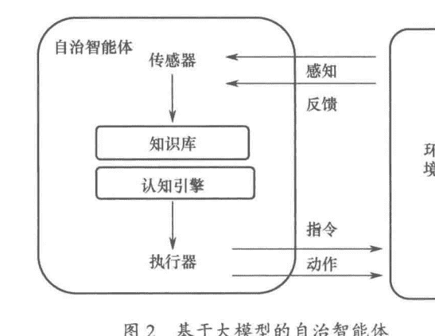
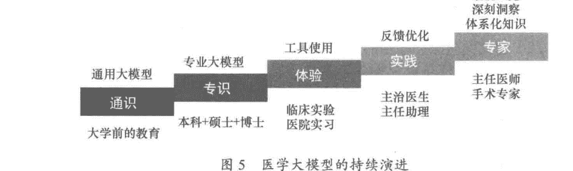

## 大模型浪潮全景：从ChatGPT到DeepSeek

## 书籍导读
本书以生成式人工智能的爆发为切口，从技术底座、产业波及到社会意涵对大模型进行立体拆解。全书共分四编。背景编梳理大模型演进进程中的标志性节点；技术编聚焦训练与落地的关键瓶颈及解决思路；产业编观察大模型如何推动千行百业实现数字化升级与高质量发展，并提示暗藏的风险；社会编则以跨学科视野，从人类命运的高度审视人工智能的长期走向。整体呈现一个多维度的时代图景，旨在引发读者深度思辨。

本书既可供人工智能及相关行业的技术人员与管理者参考，也适合政府部门、企事业单位的工作人员及研究者阅读，还能作为对大模型感兴趣的普通读者的通识读本。

## 作者介绍
肖仰华

复旦大学教授、博士生导师，上海市数据科学重点实验室主任，博士。长期从事大数据与人工智能的研究与应用，发表论文超过两百篇，出版学术专著与教材三部。曾获ICDE 2024十年最具影响力论文奖、ACL 2023杰出论文奖，并获华为、阿里巴巴、美团等机构颁发的科研荣誉。现任Applied Intelligence等期刊副主编或编委。

致敬伟大的 AI 时代！

## 序
能为挚友肖仰华教授的新作《大模型浪潮：从 ChatGPT 到 DeepSeek》作序，深感荣幸。2010年肖教授曾在微软亚洲研究院访学一年，我们合作开展多项前瞻研究，其中一篇论文斩获ICDE 2024十年最具影响力论文奖。那段经历让我切身感受到其深厚的学术积淀与独到的洞见。

本书出版时机恰好。自2022年底ChatGPT公开以来，生成式人工智能正以前所未有的速度重塑社会。肖教授敏锐捕捉这一历史拐点，对大模型从原理到应用、从理论到实践的演进脉络做了系统性梳理，为读者描绘出一幅想象力十足的时代画卷。

肖教授不仅是顶尖的计算机科学家，也是一位人文视野开阔的思想者。跨学科思维与对人类长远发展的关切，使他既能剖析技术细节，也能跳出技术讨论伦理挑战；既能评估商业潜力，也能反思社会变迁；既看到机遇，也提醒风险。这种平衡立场与深邃洞察，构成本书独特价值。

全书分为四篇。第一篇回顾ChatGPT面世后大模型层出不穷的技术背景；第二篇深入核心原理与主要挑战；第三篇解析大模型在各行业的落地前景；第四篇从哲学、伦理、社会等宏观层面思考大模型对人类未来的深远影响。结构兼具技术深度与思想高度。

特别值得一提的是，肖教授既关注ChatGPT、GPT-4等国际主流模型，也对DeepSeek等国内新锐模型给予充分讨论，体现出对全球AI格局的清晰把握。他理性分析机遇，也提醒防范社会问题；既拥抱进步，也保持科学家的冷静与审慎。

在模型迭代加速的当下，本书为公众理解AI发展趋势提供重要参考。无论是专业研究者、产业从业者，还是关注技术与人文交汇的普通读者，都能获得启发。

大模型时代已然来临，每个人都是这场技术革命的见证者、参与者与塑造者。愿本书成为打开未来的钥匙，让我们共同迎接挑战与希望并存的AI新纪元！

王海勋
ACM Fellow, IEEE Fellow

## 前言
时光流转，两年多转瞬即逝。犹记2022年底ChatGPT横空出世的那一刻，如惊雷震动世界。此后两年多，大模型浪潮裹挟着每个人，在震荡中前行，在变革中反思。

技术理想主义者怀揣对未来的憧憬，在无数深夜追逐科技高点，坚守通用人工智能的信念，用代码敲开新世界之门，却也对未知保持敬畏。产业人士随技术迭代沉浮，时而借创新红利乘风破浪，时而因被竞争对手超越而陷入低谷，在喜悦与焦虑中见证产业的狂飙。学者站在知识路口，目睹传统体系崩解重塑，对现状不安、对前路迷茫，或向典籍求索，或跨界寻找灵感。转型者告别安逸踏上未知，既惊喜于赋能，也感慨旧路径退场。资本方视之如豪赌，既重金押注未来，又在不确定性中警惕风险。对公众而言，则是好奇与担忧并存，既惊叹于神奇，也担心被时代甩下。每一次技术跃进都带来喜忧，喜在生产力跃升，忧在如何共处。

这场变革像一面棱镜，折射出人类面对未知时的真实情绪，从狂热到冷静，从欢欣到忧虑，从困惑到顿悟。我们或许正走在历史转折点，每一次微小进步都可能开启不同未来。这场史诗在每个人心中激起涟漪，开启了人类与智能共舞的序章。

这个时代值得铭记。本书诸篇正是浪潮中内心激起的思想涟漪，汇聚成书，以致敬伟大时代。全书分四编，从背景、技术、产业、社会四个维度回应时代之问。背景编解读发展历程中的里程碑；技术编剖析应用技术难点及对策；产业编剖析生态要素、战略与路径；社会编从人类命运视角解读新机遇与新问题。每编开头附文章索引，便于把握全貌。文章基本按撰写时间排列，回应当时热点，读者可择优阅读。

本书适合技术从业者、决策者、企业管理者及所有对大模型感兴趣的读者，旨在帮助认清技术本质、产业脉络与社会影响，适应人工智能带来的变革。

愿读者借助本书更好地认识自己与世界！

肖仰华
2025年3月5日，写于复旦大学江湾湖畔

# 第1篇 背景篇
回望近年人工智能的发展，大模型时代的开启以ChatGPT的诞生为标志。2022年11月30日，这一载入AI乃至人类社会史的日子，宣告由大规模生成式语言模型引领的技术革命加速到来。ChatGPT时刻不仅代表通用人工智能登台，也预示人类社会进入AI驱动的高速发展期。数年后回望，此刻或许就是社会发展的奇点。

距发布仅两年多，AI发展惊心动魄。OpenAI是其中最耀眼的主体之一，自2022年底ChatGPT上线，经历代码解释器上线、GPT-4 Turbo发布、Sora视频模型推出、o1发布等一系列更新，以及DeepSeek技术突破引发全球关注。每一次迭代都在抬高生成式AI的天花板，引发业界热议。眼见为实，亲历一次次成果带来的心灵震动远胜理性预测。本编基于对一系列关键事件的亲历与反思，呈现发展脉络，勾勒时代轮廓。

## 生成式语言模型与通用人工智能：内涵、路径与启示①
以ChatGPT为代表的大规模生成式语言模型，正推动通用人工智能快速发展。AGI已掀起新一轮信息技术革命，成为先进生产力形态，深入理解其本质已刻不容缓。以大规模生成式语言模型为代表的AGI，以生成式人工智能为主要形态，具备情境化生成能力，形成“知识—能力—价值”三阶段演进路径。技术进步使机器智能水平迅速攀升，将导致人机边界模糊并衍生一系列社会问题。AGI发展路径体现“填鸭式”学习与“先通后专”特点，在一定程度上颠覆了传统对机器智能实现路径的认知，促使人类反思创造、知识获取与自我认知。人类需警惕AGI带来的挑战，同时抓住机遇，推动新型人机协同关系构建。

### 引言
自ChatGPT发布以来，大规模生成式语言模型在学界与业界掀起巨浪，推动AGI技术加速。不仅有Midjourney等高精度图文生成模型，还有PaLM-E②、PaLM 2③等具身多模态语言模型。

AGI已从模拟大脑思维能力的语言模型，快速演进到“操控身体”的具身模型。AGI正全面渗透艺术创作、代码生成、问题求解、科学发现、问答聊天、辅助决策等各领域。由AGI带动的新一轮信息技术革命已然到来，人类迎来关于“智能”本身的深刻变革。

作为先进生产力，AGI既带来兴奋也引发担忧。这种情绪落差根源于人类对AGI的理解远滞后于发展速度。对技术原理、智能形态、能力边界及社会个人影响的评估，均明显落后于AGI本身。快速发展的AGI与认知滞后构成鲜明矛盾，理解这一矛盾是把握发展规律与社会影响的关键。正因如此，不少科学家与企业领袖呼吁暂停巨型模型实验，加速安全可验证系统的研发。

理解AGI确有难度。名称中的“智能”本身存争议，传统计算机科学视“获取并应用知识与技能”为智能，这一定义是否适用于现代生成式语言模型尚需商榷。“通用”一词加剧难度，相较面向特定功能的AI，AGI旨在模拟人类智能，能在不同环境自适应并完成从未见过的任务。专用AI与通用AI何种关系？先通用还是先专用？“General”引出诸多思考。最后“人工的”点明其人工创造本质，非自然进化，带来工具智能与自然智能的比较等一系列问题。

本文聚焦生成式人工智能，特别是以大规模生成式语言模型为代表的AGI技术。本文“智能”不局限于人类智能，也涵盖机器智能并作对比。同时对由生成式语言模型引发的智能内涵与演进路径进行分析，并反思人类创造能力、知识获取、自我认知等方面。

笔者相信，本文思考一方面可缓解对机器智能快速发展的焦虑，另一方面有助于扫清发展障碍，建立新型人机协同关系。需说明，部分观点超越当前工程验证范围，其合理性与可行性仍需严格论证与检验。

### 一、什么是智能？ChatGPT何以成功
**生成式 vs 判别式。** ChatGPT是生成式AI的代表，在文本、文图、图像生成等领域取得佳绩。传统AI多属判别式AI。为何生成式而非判别式成为AGI主形态，值得深思。判别式AI通过标注数据训练，习得给出正确答案的能力。生成式AI多针对无标注数据，设计基于遮蔽内容还原的自监督任务，训练模型生成符合上下文的内容。生成模型不仅能生成结果，还能生成过程与解释，使生成任务比判别任务更具智力挑战，更能引导模型习得高水平智能。

具体看，判别式AI面对判断题只需输出“对”或“错”，随机猜也有50%概率。生成式AI不仅要给出答案，还要给出解题过程，难以蒙混。因此生成任务更接近智能本质。

**智能与情境化生成能力。** 智能的本质是什么？大模型发展带来新启发。大模型的智能本质是情境化生成，即根据上下文提示生成相关文本的能力。因此应用效果在一定程度上取决于提示质量。有效合理的提示往往能引导ChatGPT等模型生成满意答案。

这种“提示+生成”的情境化生成能力不仅适用于文本，也适用于图像、语音、蛋白质序列等多种复杂数据。不同数据类型上下文不同，如图像上下文是周边像素。情境化生成能力通过训练阶段的上下文学习形成①。从数学层面看，大模型在训练阶段习得token或语料基本单元间的联合概率分布。情境化生成可被视作条件概率估计，即给定上下文或提示，模型据联合概率分布推断剩余文本的概率。

传统对智能的理解常与“知识”或“人类”相关，本质以人类为中心，从认识论视角理解智能。大模型呈现的情境化生成能力则无关“知识”。“知识”本是人类理解世界的人为发明，世界存在不依赖知识或人类。

情境化生成摆脱人类定义的“知识”，回归世界本身，只要能合理生成世界，便是智能体现。智能被还原为纯粹生成能力，可不以人类为中心，也可不依赖人类文明。这正是AGI的重要启示。

智能的解析与还原。大模型训练与优化过程为理解智能形成提供启发。通用大模型“出炉”大致经历三阶段②：底座模型训练；面向任务的指令学习即指令微调；价值对齐。第一阶段让模型习得语料蕴含的知识，但这里的知识是参数化、概率化的表征，本质是对语料词汇间联合概率分布的建模，使情境化生成成为可能，故本质是知识获取或习得。第二阶段指令学习让模型习得完成任务的能力。第三阶段则是价值观念的习得。

大模型将智能分解为知识、能力、价值三阶段，值得关注。知识是能力与价值基础，故底座训练尤为关键。ChatGPT经历2018年初版GPT-1到2022年GPT-3.5近四年训练优化。底座知识越深厚广博，后续技能越复杂多样，价值判断越准确，价值对齐越敏捷。大模型将智能三要素剥离，而人类知识、能力与价值习得常交织在一起。例如难以界定小学课文是在传授知识、训练技能还是塑造价值。大模型的分离式发展模式可类比人类高等教育：本科培养学习能力以获取知识，硕士培养解题能力以解决问题，博士培养价值判断能力以发现问题。

知识、能力、价值的剥离对未来智能系统架构设计、新型人机协作关系建立、人机混合智能系统构建均有积极启发。随着机器智能逐步发展，人类擅长之事将逐渐减少。但在某些场景仍有介入空间。未来人机混合系统关键在于回答何种工作最值得人类完成。看似完整任务经分解后，才能拆解出人机各自擅长的子任务。例如将知识与能力剥离对保护私域知识极有价值：大模型负责语言理解等核心任务，机密数据与知识仍由传统数据库或知识库管理。这种架构既利用大模型核心能力，又兼顾知识私密性。

**智能检验与人机分辨。** AGI发展显著提升机器智能水平，特别是语言理解，机器在文本处理、语言理解等任务中已达普通人类甚至语言专家水平。但随之而来的是人机边界日益模糊，很难仅凭几轮对话判断对方是人是机。传统图灵测试已难以胜任人机区分使命。使用过ChatGPT者深有体会，其最擅长聊天，长时间对话也不会无趣。

人机边界模糊将带来多重社会问题。首先，普通民众尤其是青少年可能因信任技术而沉溺于对话模型。随着模型日益智能，人们习惯提问并接受答案，久而久之人类赖以发展的质疑精神可能逐步丧失。面对日益强大的AGI，如何避免人类精神本质退化，是需深思的问题。

其次，人机真假难辨时，虚假信息将泛滥，欺诈行为层出不穷。近年来不少犯罪分子通过AI换脸、AI视频生成成功实施诈骗。如何治理人机边界模糊带来的社会性欺骗，将成重要AI治理议题。

① 2023年8月，ChatGPT影响持续发酵，自媒体大量不严肃报道。笔者应《人民论坛·学术前沿》邀请，对生成式大模型及AGI核心概念、内涵、路径及影响作澄清与解释，本文发表于该期刊2023年第14期。
② 参见论文“PaLM-E: An Embodied Multimodal Language Model”，发表于2023年。
③ 参见论文“PaLM 2 Technical Report”，发表于2023年。

街头随处可见的验证码，正在从人机识别的工具变成需要重新评估的麻烦。过去它被视作区分真人操作与程序自动操作的利器，如今在通用智能对各类软件与硬件的操控能力持续增强的背景下，这道防线已显出脆弱。机器人形态也愈发成熟，未来要验证“操作者是人而非程序”，或反过来证明“程序就是程序而不是伪装成人的存在”，都会变得异常复杂。

人机界限的模糊，本质上指向智能判别的困境。要破解这个问题，就要找到人类智能独有的、暂时难以复制的领地。回顾机器智能的发展轨迹，这块领地在不断收窄。曾经被认为长期安全的高智力竞技、下棋、开放式对话、蛋白质结构预测等前沿科研，都逐步被机器攻破。曾经长长的“人类优势清单”正快速变短。

在当前阶段，经典图灵测试已失去效力，新的替代方案也尚未成熟。有人提出人类的犯错与行为随机性是独有特征，这一说法难以成立，因为错误与随机性很容易被植入模型以伪装水平。往后，判断模型是否在尝试越界，以及模型是否在刻意隐藏真实能力，将成为安全治理必须高度关注的议题。

### 二、智能演进的路径分岔

生物式的反馈成长与机器式的灌输加速形成强烈对比。人类智能是漫长进化塑造的产物，在自然与社会环境里不断试错、接收反馈、累积经验而成。动物智能同属这一范式，需要漫长时间才能形成。哪怕起点很低，只要时间足够，环境也有可能孕育出高水平智能。

当下机器智能走的却是灌输式捷径。把人类社会数千年积累的语料、典籍、文献一次性喂给大模型，经过精细调优后，模型就能在数周内习得文明成果。与人类百万年的演化相比，这一速度几乎可忽略。如此短的时间内完成知识整合本身已令人震惊。

灌输在人类教育里常被视作低效，放到机器学习中却异常高效。只看分数，灌输式教学效果显著，但容易培养出高分低能、迁移困难的个体。真正融会贯通需要大量实践与反馈。专家的成长轨迹对大模型具有启发意义：先完成灌输学习，再通过操控工具开展实践学习，进入从实践中习得新知的阶段。

发展顺序上也出现颠覆。AGI呈现出先通用后专业的轨迹。先炼制覆盖面广、样本多样的大语言模型，通用基础越牢，潜力越大；随后用领域数据微调与任务指令学习，让模型理解行业文本、胜任特定工作。通用阶段侧重通识、语言理解与推理，专业阶段侧重指令遵循与细分任务执行。这与人类先通识教育后专业深造、武侠小说先练内功再学招式的逻辑相通。

这种先通后专的路线与ChatGPT之前的主流做法截然不同。过去的主战场是专用AI，目标是让程序在下棋、计算、语音识别、图像识别等单一场景表现优异。传统共识认为若干专用智能叠加才能逼近通用智能，甚至专用都难，何谈通用。以ChatGPT为代表的生成式大语言模型证明，必须先具备通识能力，才能发展专业认知。

基于此，对领域人工智能的理解也需更新。通用与领域是相对概念，没有通识根基就无从谈领域认知。以医疗为例，传统思路认为可以低成本为某种疾病搭建专用诊断系统，比如耳鸣。但实践中往往失败，因为医生理解疾病的前提是理解健康，而健康并不属于疾病范畴。接诊时大部分时间用在排除不需要治疗的健康状态。可见领域认知建立在更广阔的通识之上。在通用大模型的支撑下，各垂直领域的认知智能才迎来真正的突破窗口。

符号先行与体验后置是另一条差异。语言模型基于文本符号的统计关联训练，而语言本身就是符号化表达。符号只是形式，纯统计学习难以触及内涵，否则会落入“中文屋”式的质疑。因此AGI必须从纯语言走向多模态融合。图像、语音、视频承载了人类对世界的丰富体感。对“马”的理解不仅靠文字，还依赖嘶鸣的声音、健壮的外形、奔跑的动作，这类感官经验构成了概念的底色。AGI因此走出先符号后体验、先形式后内容的路径，而人类恰好相反，先有体验再抽象为符号。

大脑先行与身体后置同样反直觉。当前AGI先构建语言模型模拟认知，再用认知能力驱动工具与部件与物理世界交互。人类则是先具备身体能力，在持续交互中塑造大脑认知。传统人工智能更倾向先实现感知执行再实现高阶认知，如今的发展路线则在一定程度上逆转了这一顺序。

### 三、AGI倒逼的自我审视

组合泛化常被看作基础创造形式，在人工智能里同样关键。AGI备受关注，部分原因就在于它展现出可观的创造力。GPT-4等模型在指令学习足够后，能把学到的A类技能与B类技能组合出A+B的新能力，比如用莎士比亚诗风书写数学定理证明。

第一点要承认这种组合式创新。人类社会的多数创新本质也是组合：在工程中把A场景的方法搬到X场景，在电影创作中拼贴不同故事的框架、人物与桥段。

第二点是AGI的组合能力远超人类想象。它可以任意跨学科组合，很多组合是人类从未设想的，比如用李清照的词风写代码注释。这些新颖组合可能成为拓展想象力的宝贵资源。

第三点是内容创新模式将被改写。AGI组合素材的效率远超人类，曾经备受推崇的集成创新也将褪色。相较之下，原创性的价值更加凸显。

第四点是创新本质需要重新思考。人类能做到而AGI难以企及的创新才更具价值，这会推动人们摆脱随意拼接，更加注重内涵、独特视角与新颖观点。

自监督学习是构建世界模型的有效手段，本质上是一种填空游戏。根据上下文补全被遮蔽的词或图像区域。为什么这种“遮蔽+还原”能催生ChatGPT，是值得深思的问题。

这种学习帮助机器习得世界模型。人们知道高空抛物会下落而不会上飘。世界模型对AGI至关重要，已被包括图灵奖得主杨立昆在内的学者反复强调。人类社会积累的数据蕴含了对现实的认知，机器通过学习这些数据就能逐步建立逼真的世界模型。人类构建世界模型则主要依赖经验与文明传承。文化传播与教育进一步塑造认知。机器与人类的建模方式因此存在本质差异。

大模型借助Transformer等深度神经网络习得语言元素的统计关联，并具备情境化生成能力。其“大”的核心在于参数规模巨大，复杂的网络空间编码了语料知识，呈现参数化表达与分布式组织的特征。知识并不对应单一神经元，而是分散在权重与连接结构中，在特定输入下被激活提取。因此大模型可视为隐性知识容器。

大模型蕴含的隐性知识广度与深度已超出人类能明确表述的显性知识范围。人类可以用自然语言穷尽的知识是有限的，而常识、言外之意、难以言传的经验则以隐性形式存在。大模型为解读这些隐性关联提供了可能。比如外交场合的遣词造句常有潜台词，大模型的出现为解读这种言外之意提供了新工具。

大模型编码的知识中很多是人类从未解读过的，尤其是跨学科隐性关联。这为文明发展提供重大机遇。随着隐性知识被不断挖掘，人类知识储备可能呈爆炸式增长。但这也带来一个深刻问题：过量的知识是否会成为负担。当知识积累到一定程度，获取知识已偏离文明主航道，发现智慧比囤积知识更重要。

很多时候我们并不需要掌握太多知识，只需具备从大模型中获取知识的能力。即使是最杰出的个体，其掌握的知识量也远不及智能机器。个体价值因此不再在于拥有多少知识，而在于如何运用知识。运用知识的智慧将成为核心价值。

AGI的发展正推动社会从追求知识转向追求智慧。大模型倒逼人类重新认识自我。AGI将与社会深度融合，带来机遇也伴随严峻挑战。

首先是技术治理与社会治理的压力。与传统AI相比，AGI失控的后果可能是灾难性的。内容生成门槛降低导致虚假信息泛滥已成现实。若先进生产力被少数人垄断，技术霸权将对社会产生负面影响。

其次是个体发展挑战。未来社会生产可能只需少数精英加智能机器即可完成，工业时代的二八法则可能演变为二九八。大量工作失去意义，个体的存在价值需要重新定义。寿命可能延长，但生命质感可能下降。如何让多数人找到意义、优雅度过闲暇，值得深思。

最后是整体能力倒退风险。历史表明，家禽养殖兴起时狩猎技术退化，纺织机械成熟时绣花技艺式微。非物质文化遗产与体育运动在一定程度上就是防止能力退化的机制。若任由机器取代脑力劳动，人类智能可能出现倒退，进而丧失主体性、导致文明危机。防止脑力与智能的退化必须严肃对待。

尽管挑战重重，AGI无疑是先进生产力，其发展势头不可阻挡。除了技术赋能，从文明高度看它也带来全新机遇。隐性知识的解读将加速知识发现，但也可能导致知识贬值。知识爆炸时代，“智慧”比“知识”更稀缺。

### 结语

对AGI的探索才刚刚起步，路还很长。我们既要警惕风险，也要把握机会。两千多年前苏格拉底说认识你自己，今天在AGI倒逼下，人类需要重新认识自己。

## ChatGPT 代码解释器怎么回事①

2023年7月9日，ChatGPT代码解释器测试版向Plus用户开放。它能借助自然语言指令驱动大模型完成数值运算、数据分析、专业图表绘制乃至视频生成、股市分析等复杂任务。用户无需编程能力也能下达指令完成专业编程，被外界视作GPT-4迄今最强功能。

代码解释器上线得益于OpenAI在多模态交互上的长期投入。它可以利用自然语言生成图像、绘制专业图表，意味着许多专业工作也能被完成，水平可媲美大学相关专业的本科生。

### 一、数据理解力决定模型上限

代码解释器的推出体现了大模型在专业能力上的跃升，尤其是对专业数据的理解与分析。这些能力源于对专业文献等语料的深度解析与学习。专业语料包含大量数据、图表、公式与文本的复杂对应关系。早期GPT侧重通用文本理解，而代码解释器聚焦各类专业表达的解析，要求模型理解数据、图表、公式与文本之间的映射，并建立深层对应。通过构建适合学习的多模态对齐语料，模型学会了用自然语言指令驱动专业图表制作。

由此可见，对语料的深度解析能力很可能是决定模型性能的核心因素之一。研发高度依赖数据，OpenAI持续获取优质数据并进行深度适配，使模型能力稳步提升。大规模、高质量、多样性数据的获取以及深度解析能力的构建，是推动大模型发展的重要思路。

数据技术是竞争的关键赛道，且具有一定的隐蔽性。关注点多集中在模型优化，而忽视数据技术本身。数据技术体系庞大、见效周期长，夯实数据核心竞争力是产业竞争中不可忽视的长期要素。

### 二、语言壁垒消融与产业重塑

此次能力升级带来两大深远影响：消灭语言鸿沟，以及重塑产业形态。

① 2023 年 7 月 9 日，ChatGPT 代码解释器测试版正式上线，能完成很多数据分析之类的专业工作，展现出取代部分白领工作的潜力，引发业界热议。笔者就这一事件接受澎湃新闻的采访，对代码解释器进行解读并以此为基础撰写了本文。

语言墙正在被悄然拆掉

人类的表达长期被两类隔阂卡住。一类是不同族群、文明之间的日常用语差别，一类是通俗说法与专业术语之间的鸿沟。上古巴别塔的故事里，神让语言混乱来阻断协作，于是翻译才有了用武之地。可真正能熟练切换多套语言的人极少，跨语种的日常互动依然摩擦不断。像 ChatGPT 这样在海量跨语料上训练的基础系统，已能承担起寻常翻译的工作，隐形地搭起跨语种的桥梁，让日常用语的隔膜明显收窄。

另一道裂口来自专业表述。科学发展的标志之一就是创造数学符号、化学符号这类专用表达，它们既重塑研究者的思维习惯，也成为圈内交流的媒介。自计算机出现，人类希望机器按意图运行，却只能借助汇编、C++、SQL 之类的形式化指令。大多数人只习惯日常口语，对专业或机器指令望而却步，这让科研与计算机相关工作的门槛长期很高。通识教育之后往往还需数年训练才能入行。随着计算成为科研与工程的新范式，HDL、CAD 等更专业的语言与自然科学及复杂工程深度绑定，普通人进入专业领域的语言阻力反而加大。

代码执行环境的普及让局面出现逆转可能。历史上日常口语、形式语言与专业表述各司其职，但在模型时代其存在价值受到强烈冲击。日常口语已足以覆盖各类需求，机器似乎读懂了人类复杂的表达，智能正在抹平语言鸿沟。若说初版 ChatGPT 终结了人与机器之间的日常用语隔阂，那么搭载代码执行环境的版本则进一步终结了专业表述隔阂。这是里程碑式的进展。即便保守估计，专业与形式化表述也将退为日常口语的补充，使用频率明显下降。未来日常口语有望成为从事一切复杂专业工作的统一入口，普通人与资深人士的差距虽在，但常规专业任务经简单培训后，普通人也能胜任。

随着基础模型逐步掌握数学、物理等强专业领域的表述能力，并具备相应的思维与解题能力，这一趋势会加速。数学语言本身也是一种形式化语言，只要获得日常口语与专业表述的配对样本，模型就有学习机会，而这类样本大量存在于图书论文中，也可通过 MATLAB 等专业软件合成，以缓解专业能力学习时的数据稀缺。

这也带来焦虑：使用频率下降后，人类创造的专业表述、形式化语言和小语种是否会消失？技术越强，人类越没有动力去学习少数群体的语言，主流语言的优势会被进一步放大，吞噬小语种的生存空间，直至消亡。

但语言是承载文化与思维的载体，任何一种语言的消失都是文明难以承受的代价。文明的衰落往往始于语言的衰落。欧洲各国对本土语言的保护和对外来语言的审慎，表面不近人情，实则是经过深思的明智选择。保护语言如同保护濒危物种一样重要。在享受模型带来的生产力提升的同时，如何守护非主流语言、维持语言多样性，直接关系到人类文明多样性的延续，这个问题必须尽快回答。

### 三、专业岗位的生存空间
代码执行环境上线意味着基础模型已能处理那些原本需掌握专业表述才能完成的专业工作。这引出一个核心疑问：模型成长后，人类专业工作的空间还剩多少？

随着能力提升，所有依赖语言的工作会逐步拆解为三步：指令、生成、评判。生成与分析工作皆可交给模型，但专业人士的价值并未消失，比如如何设计提示让模型产出符合规范的专业图表，以及如何判断输出的准确性和质量。在提示设计和结果评判上，人类短期内仍占优，也正是模型需要改进的方向。

更进一步，内容生成与分析类任务会被细分为多个环节。重复性、常规性的生成步骤逐步交给大模型，传统小模型擅长的细分任务由小模型承接，仍只有人类能做的环节交由人类。这种分解加重组的模式，即把复杂任务拆解，再按大模型、小模型、人类各自擅长的部分重组，将成为重塑产业形态的主流方式。

专家之所以是专家，不仅在于会用专业表述，更体现在专业思维上：理解知识、灵活解决新问题、跨领域整合、归纳总结、持续学习与结构调整、自我反思并认识局限、明确目标与动机。这些恰恰是模型的短板。整体看，模型在知识广度与精度上占优，却缺乏创造性应用能力。它擅长整合拼接已有思想，难以实现真正的从零到一原创。

### 四、代码执行能力对产业的提示
从数据视角看模型演进有两个方向。第一是获取数据的广度。当前 ChatGPT 主要依赖公开易得的数据，未来会向更大规模、更多样、更高质量的数据扩展，并加大对私域强专业数据的学习利用。第二是使用数据的深度。通过提升存量数据的解析与标注水平，提高使用效率。简单说，就是新知识获取更广博，已有数据学得更专更深。代码执行功能给从业者的重要启发是：数据本身未必发生根本变化，关键在于模型学得更深入、方式更先进。

## 全球生成式智能迎新高潮①
ChatGPT 自 2022 年 11 月面世以来，以多轮对话、意图理解、上下文学习和指令遵循能力引发广泛关注，引领生成式人工智能研究与应用的热潮。放眼世界，这一轮发展呈现怎样的态势？

前沿技术不断突破，生成式智能在全球范围内加速成长，在复杂任务解决、专业水平提升、多模态理解、具身操控物理机械等方面取得明显进展。产业生态已初具雏形，从基础模型、行业模型、应用插件到数据服务形成完整链条。这带动 GPU 显卡、高通量网络互联设备、云计算平台等算力企业发展，并在图像、语音、编程、游戏、医疗等场景取得显著成效。

国际工具导航站 “There’s An AI For That” ② 已收录面向数千个场景的数万个智能应用，其中绝大多数是 2023 年 2 月后出现的新兴企业产品。这些企业围绕基础模型，结合细分领域需求打造有竞争力的产品。可说，围绕生成式智能基础模型的产业生态正蓬勃发展。

这一轮快速发展由少数巨头直接推动。微软、亚马逊、谷歌、脸书等投入巨资布局大模型与相关产品。同时，以实现 AGI 为目标的实验室和创新企业，汇聚了包括图灵奖得主在内的顶尖科学家，取得一系列重大突破，加速 AGI 应用落地。

> ① 2023 年 8 月，笔者应经济日报社邀请，参与“推动生成式人工智能健康发展”智库圆桌讨论，并撰写本文解读国际趋势，刊登于《经济日报》2023 年 8 月 29 日第 11 版。
> ② There’s An AI For That 是一个相对全面的 AI 产品收录网站，收录了数千场景的数万个新兴人工智能公司与产品，并持续更新。

生成式智能催生大量产业应用，覆盖教育、娱乐、商业等领域。教育方面，可在教学各环节提质增效。可汗学院的 AI 助手 Khanmigo ① 可为学生提供多学科个性化辅导和反馈。在娱乐方面，可创作小说、剧本、配音、歌曲、动画等。The Fable Studio 公司的动画生成模型 SHOW-1 ② 使用 ChatGPT 生成脚本；Runway 发 布的视频编辑器 Gen-2 ③ 可按指令创作影视作品。在商业方面，可助力市场分析、智能咨询与推荐。Salesforce 推出的 AI 销售助手 SalesGPT 可快速生成定制化销售邮件，Marketing GPT 则用于营销提效。上述只是冰山一角，生成式智能是一场深远技术革命，其代表——大规模基础模型——正成为人工智能基础设施，赋能千行百业。

全球智能产业进入高速发展阶段，但实际应用仍有问题。大模型存在安全底线问题，很多训练语料未经授权包含个人信息，服务时存在隐私泄露风险，需加强隐私防护、版权保护、可控编辑，确保可解释性与透明度。其次，大模型常出现“幻觉”，编造不存在的人物或事件，限制落地应用。未来需通过降低训练与应用成本、实现增量学习、提升规范理解能力等方式缓解。此外，认知能力仍需提升，包括角色扮演、性格塑造、记忆与遗忘、长短期记忆转换等，以提高代码生成、数学推理等场景效果。

> ① Khanmigo 是可汗学院推出的 AI 教学助手，旨在为学生提供全天候个性化辅导。
> ② SHOW-1 是高效文本生成视频模型，结合像素级和潜变量级扩散模型，能生成与文本高度相关的视频。
> ③ Gen-2 是 Runway 第二代 AI 软件，可用文本描述、图像或现有视频剪辑从头生成视频。

值得注意的是，智能技术为经济社会带来机遇的同时，也产生传播虚假信息、侵害个人信息等问题。兼顾发展与安全成为全球共识。在本文写作时，美国加州、伊利诺伊州等地已出台相关法案。截至组稿时，欧盟理事会于 2024 年 5 月正式批准《人工智能法案》；韩国国会于 2024 年 12 月通过《人工智能基本法》；2024 年 7 月，日本设立“AI 制度研究会”，经济产业省发布《运用生成式 AI 制作发行物的指导手册》。我国《生成式人工智能服务管理暂行办法》① 已于 2023 年 8 月 15 日施行。

> ①《生成式人工智能服务管理暂行办法》由国家网信办联合七部门于 2023 年 7 月 10 日公布，自 2023 年 8 月 15 日起施行。

人工智能是新一轮科技革命和产业变革的重要驱动。从全球看，算力仍是制约，特别是高端 GPU 芯片、高速网络互联设备。生成式智能与其他智能技术的集成将成为取得应用效果的关键。大模型能力瓶颈日益受关注，与传统知识库等技术的深度融合是释放其在严肃复杂决策场景价值的重要方式。

大模型将逐步从利用文本、图像、语音等数据的基础模型，演变为自治智能体“大脑”；将驱动智能体在虚拟环境中成长、与物理环境交互，成为能自主适应复杂环境的智能体；将从互联网开放聊天，演变为推动实体经济智能化发展的先进生产力。大模型有望成为推动数据价值变现的重要技术设施，助力数据资产化改革。

## GPT-4 Turbo 发布深度观察①
2023 年 11 月 6 日，OpenAI 首届开发者大会震动科技界。CEO 萨姆·奥特曼发布大语言模型 GPT-4 Turbo。相较 GPT-4，它拥有更长上下文窗口、更快输出速度、更低使用成本。奥特曼还宣布围绕 GPT 打造 AI 平台，用户无需编码即可创建自己的 GPT 应用，并开放给他人使用。

一年前 ChatGPT 横空出世，一年后 GPT-4 Turbo 带来了哪些想象力与突破？围绕可定制 GPT 应用的概念，OpenAI 能否成为下一个“苹果”？

本文将剖析 GPT-4 Turbo 的技术特性、OpenAI 的平台化战略，以及对人工智能领域、相关产业乃至社会的深远影响，并展望未来趋势与潜在挑战。

> ① 2023 年 11 月 6 日，OpenAI 发布 GPT-4 Turbo 版本并一次性推出多个新功能，引发热议。笔者接受上海电视台《新闻夜线》栏目专访，对此进行深度解读并撰写本文。

### 一、GPT-4 Turbo 技术升级拆解
GPT-4 Turbo 的技术革新主要体现在三方面：一是上下文窗口扩展至 128K，能处理更长文本如金融研报，提升解读分析能力；二是输出速度显著提升，优化模型架构与算力调度，用户体验更流畅；三是使用成本降低，得益于模型压缩与算力优化，同时 Assistants API 更友好，功能更丰富，应用范围更广。此外，训练数据更新至 2023 年 4 月，确保时效性与准确性，海量用户反馈推动迭代更新。

#### （一）上下文与响应速度的跃升
相较前代，GPT-4 Turbo 最显著的改进是将上下文窗口扩展至 128K，相当于一本约 10 万字小说的篇幅。对于金融研报、产品手册等长而密的文本，可实现更全面深入的解读与分析，在金融分析、产品开发等领域价值更大。例如在金融领域，模型可一次性读懂完整研报，提取关键数据、分析投资趋势，为决策提供更精准支持。

同时输出速度明显提升，得益于 OpenAI 在模型架构优化、算力资源调度上的持续投入。更快响应让实时对话、信息检索、内容生成等场景体验更顺畅。例如客户服务场景，基于 GPT-4 Turbo 的智能客服可迅速理解并解答复杂问题，大幅提升满意度与效率。

#### （二）成本下降与 API 优化
GPT-4 Turbo 使用成本大幅下降，得益于模型压缩与算力优化的突破，降低使用门槛，使更多企业与开发者能负担，从而推动大模型在更广泛场景落地。例如中小企业可利用其做市场调研、撰写推广文案，无需投入昂贵算力或雇佣专业团队。

全新的 Assistants API 对开发者更友好。API 易用性提升使调用功能、快速构建应用变得更便捷。OpenAI 还丰富了参数设置与功能选项，开发者可按具体需求灵活定制模型。

#### （三）数据更新与持续迭代
OpenAI 将训练数据更新至 2023 年 4 月，使模型掌握当时最新知识与信息。在信息快速更新的时代，及时更新对保持时效性与准确性至关重要。例如医疗领域可了解最新研究成果与药物信息，为医生提供更准确诊断建议。在科技前沿领域，能紧跟技术发展趋势，为研究者提供有价值参考。

海量用户真实反馈为 GPT 系列迭代提供动力。OpenAI 通过收集使用过程中的反馈不断优化算法与参数，使语言理解与内容生成表现持续提升，实现产品快速迭代。

### 二、OpenAI 的平台化野心
OpenAI 宣布围绕 GPT 打造 AI 平台，用户无需编码即可创建自己的 GPT 应用。GPTs 是全新概念，若把 GPT 比作电能，GPTs 则像各种电器。电能本身不能直接创造价值，必须通过电器才能应用。类似地，GPT 作为智能能力提供者，必须通过各类 GPTs 应用才能解决实际问题、创造价值。例如一个创业指导类 GPTs 应用，可结合创业相关数据与知识，为创业者提供个性化建议。

GPTs 应用模式具有高度灵活性与多样性。用户只需用自然语言输入指令，平台自动调用相关 API 或工具，快速构建应用。这种模式极大降低开发门槛，让创意与技术的结合更紧密。未来只要有创意，任何人均可在不受专业编程语言限制的情况下，迅速把想法转化为实际应用。

### 三、技术浪潮下的职场冲击
GPT 的出现更像是一次技术引擎的升级，如同先进电能最终取代落后的蒸汽，成为社会主要能源供给形式。GPT 引领的 AGI 等先进技术势必取代落后生产力。从某种意义上，从业者并非被技术本身取代，而是被掌握大模型这类先进技术的人淘汰。因此相关领域从业者需积极准备，否则将被淘汰。有趣的是，最先受到冲击的可能恰恰是软件开发者或互联网应用开发者。

GPT 商城临近，开发者站上十字路口

OpenAI 曾透露，一款借鉴移动应用商店思路的 GPT 汇集平台，原计划在 2023 年 11 月底对外开放①。此前该平台已放开插件接入，并与微软 Bing 联合实现了智能搜索与自动撰写等功能。集市上线与插件生态同步开放，对工程师群体而言既是机遇也是考验。一面是技术积累扎实的人可以依托自身能力打造多样创新型 GPT 应用以满足市场需求；另一面，非技术背景的创作者也能借助自然语言快速拼凑 GPTs 应用，形成竞争压力。这意味着专业程序员必须持续强化创新与差异化，否则易被边缘化。

多行业将被波及，其中文案撰写与基础知识类岗位最敏感。基础模型在提升效率与质量的同时，也在压缩对人的依赖，可能侵蚀相关岗位的就业空间。以新闻传媒为例，简易通稿的撰写风险加大；在法律领域，基础法律文书的起草环节同样面临替代可能。

岗位受冲击并不等于人的价值被机器彻底取代。人仍保有机器难以复制的特质，比如创意性工作以及对生成内容进行甄别与判断，这仍需人来完成。总体来看，GPT 工具正在推动人才评价从以知识获取与技能习得为核心的传统体系，向以审美、鉴赏、批判与创新为标志的新体系转移。

### 四、大模型产业发展的竞争态势
可以说 GPT 生态已初具雏形，从单纯的能力供给者演变为生态的推动者与引领者，这是 OpenAI 成长的一条必经之路，也是企业从能力提供迈向生态引领的共性轨迹。只是规模化落地过程中仍暗藏隐忧。海量并发请求对算力提出高要求，如何在保证服务品质的前提下实现算力的科学调度是难题之一。随着渗透加深，数据隐私与安全问题日益凸显，如何在保护用户隐私的同时实现数据的高效利用与系统的持续优化，也需要持续关注。笔者认为技术层面的问题终可解决，最终制约模型发展的天花板可能落在人类算力总量与知识总量之上。

目前多家科技巨头已进入模型竞赛，除微软、谷歌之外，马斯克创办的 AI 初创公司 xAI 也推出首个对话机器人 Grok。此轮竞争带有明显的军备竞赛色彩，各家发布会往往伴随股价大涨或大跌，可谓短兵相接。对后来者而言仍存在蓝海，比如行业模型、科学模型、专业模型、具身智能、多模态智能等赛道尚处起步。只要积极开辟新赛道并坚持差异化，企业仍有巨大的成长空间。

就国内互联网企业而言，劣势与优势并存。劣势在于未能抢占先机，随着 OpenAI 的快速演进，差距被拉大的风险存在，从业者须紧跟步伐。优势在于有 OpenAI 先行探路，可规避大量试错成本；国内市场空间广阔、数据基础扎实，尤其是数据要素市场的发展为模型提供了良好土壤；同时政策层面给予国产专利与模型创新体系大力扶持。

> ① 2024 年 1 月 10 日，OpenAI 宣布推出 GPT 商店。

## 关于 Sora 是否理解物理世界的解读①
2024 年 2 月 15 日，OpenAI 正式对外推出文生视频模型 Sora。其逼真的视频呈现迅速点燃全球科技圈关注。Sora 的技术底座是什么？是否意味着 AGI 的到来从十年缩短为一年？它是否具备理解物理世界的能力？以 Sora 为代表的 AI 技术将如何重塑社会，又应如何应对？本文将从技术架构、物理世界理解与模拟能力，以及社会影响与应对策略等角度展开剖析。

### 一、Sora 的技术架构与创新
Sora 的出现既在意料之内也在意料之外。可预见性在于 ChatGPT 问世后业界普遍判断模型会从纯文本大语言模型向多模态演进，多模态模型可处理图文混合与视频内容。不可预见性在于其生成的视频逼真度之高，给人强烈冲击，并对物理世界的模拟达到了前所未有的水准。

Sora 完全依托数据驱动生成，不再依赖传统影视工业的建模、渲染流程。它基于 Transformer 神经网络结构，并融合了视觉编解码中常用的扩散机制。Transformer 以强大的并行处理和长序列建模能力著称，在自然语言处理领域取得突破，Sora 将其用于视频生成，更好地捕捉时空信息，以模拟复杂动态场景。

扩散机制通过逐步加噪并学习逆向去噪来生成高质量图像与视频，在提升细节丰富度与纹理真实感方面发挥关键作用。Sora 是 OpenAI 在模型领域长期积累的产物，延续了以海量数据与巨大算力进行学习的暴力美学策略。

ChatGPT 与 Sora 均采用 Transformer 结构，本质上都是大规模模型。该结构使二者在处理复杂信息时表现优异。ChatGPT 长于生成流畅连贯的自然语言文本，Sora 则将此能力拓展到视频域，生成逼真视频。传统模型仅能建立简单线性关系，难以对流体力学等复杂现象建模，而 Sora 基于 Transformer 具备对现实世界复杂现象高度逼真的建模能力，代表了新高度。

技术架构虽有共通，应用场景与功能差异明显。ChatGPT 主要用于文本生成、对话交互、信息检索等，提供文本形式的智能服务。Sora 专注视频生成，可依据文本提示产出高度逼真的视频内容，为影视制作、游戏开发、虚拟现实等领域带来新可能。

### 二、Sora 对物理世界的理解与模拟
近期，杨立昆①等专家对 Sora 提出质疑。他们认为仅凭提示词生成逼真视频并不等同于真正理解物理世界，生成过程与基于世界模型的因果预测本质不同，称 Sora 无法模拟物理世界并存在巨大误导。强调人类专家的知识与经验应在构建世界模型中发挥关键作用，而 Sora 似乎回避了这一点。但笔者倾向认为，摆脱专家知识干预后，Sora 可能更贴近世界本源，提供更准确的建模方式。

关于理解与模拟，学界观点分歧。传统上理解世界的主体是人，若不承认机器主体性则谈不上理解。但人类理解世界的成果是表达世界再创造新世界。像 Sora 这样能够高精度建模现实世界的工具，可视为一种理解能力。对机器而言，建模即理解。人类重现世界常依赖简化公式，而 Sora 可高精度重建整个物理世界，从此意义上其建模水平远超人类。

> ① 杨立昆（Yann LeCun）：图灵奖得主，Meta 公司首席科学家、AI 团队负责人。

### 三、Sora 的社会影响与应对策略
技术层面令人担忧的是多数 AI 技术对研究者仍是黑盒，内在机制与涌现规律尚未完全明晰，生成过程与结果在很大程度上不可控。社会层面则担心就业受冲击，AI 已能替代诸多人类能力，人机协作将大幅降低人力需求。长远看，AI 作为先进生产力势必要求生产关系与上层建筑相适应，而社会结构调整缓慢、AI 发展迅猛，曾有人呼吁按下暂停键。需要建立合理应用原则，明确边界，确保社会平稳过渡到适应先进生产力的阶段。

### 四、国内 AI 产业的挑战与机遇
国内 AI 产业整体处于跟随追赶阶段，努力缩小与国际先进水平的差距。人才方面总量充足但顶尖人才与创新团队仍显不足。数据方面资源丰富，但在治理、质量控制与标准化方面需加强。算力方面，Sora 等大型模型训练需巨大算力支持，国内算力资源相对紧张，已成为制约发展的关键因素之一。

## 人工智能大模型发展的新形势及其省思①
自 2022 年底 OpenAI 发布 ChatGPT 以来，产业先后经历百模大战、参数竞赛、榜单攀比，直至近期厂商集体加入价格战，热度不断。技术形态上，模型从单纯文本走向多模态，从模拟大脑认知功能走向操控机器与复杂环境交互，从通用走向专业与行业化。技术生态日益繁荣。热闹背后是科技巨头对 AGI 主导权的激烈争夺，以及大国间科技竞争的加剧。

ChatGPT 点燃 AGI 技术革命第一枪，当前产业格局呈现多点开花、错综复杂，未来走向仍不清晰。与此同时，产业发展暴露诸多问题：厂商仍在摸索变现路径，研发投入持续攀升，需求方耐心被消耗；生成式模型的根本性难题如幻觉问题仍缺乏有效对策，训练与应用的资源能耗问题凸显。久而久之，成本压力增大，市场趋于理性。大规模应用带来的社会问题也逐步显现。产业似乎进入中场阶段，盘点现状、梳理问题、谋划对策成为推动下一步发展的关键。

### 一、大模型发展的新态势
大型模型正日益成为人工智能产业的基础设施。本质上是参数规模巨大的深度神经网络，需大规模算力与海量数据训练，成为人工智能领域的重型装备，宣告行业进入重工业发展阶段。模型在学术界常称 Foundation Model，经预训练后可迁移至多种下游任务。例如代码基础模型仅需少量提示即可完成代码生成、改写、检测、推荐、搜索。由此可见其发展趋势之一是成为产业重要基础设施。

从功能来看，模型常被用作存储海量知识的容器、模拟人类心智的认知引擎、驱动智能体交互的大脑、协同组件与工具的操作系统、人机自然交互的接口。传统 AI 系统需为特定任务设计专用模型，当前基于统一模型进行微调或指令引导的新范式，使模型沉降为架构基础，支撑多样上层应用并承担复杂意图理解与需求满足的核心任务。近期价格战也侧面印证其基础设施地位，基础设施需以持续走低的价格锁定海量用户，而用户规模的增长可分摊高昂前期成本。

作为 AGI 重要技术形态，模型是先进生产力，也是新质生产力的代表。劳动力在生产要素中起决定性作用，数字与机器员工将成为新型劳动力，人类迎来了可与人类劳动力媲美的劳动形态。

AGI 旨在达到或接近人类智力，成熟后由 AGI 驱动的智能机器，包括有形机器劳动力与虚拟数字劳动力，将成为人类劳动力的重要补充。这些机器在可靠性、可用性及对复杂恶劣环境的适应性方面往往更具优势。

从某种程度上，生成式模型可能成为超越人类的先进劳动力。大语言模型已在一定程度上复现人类语言表达、写作、逻辑与情感能力。多模态模型可完成多模态内容生成，甚至对复杂世界建模。具身模型侧重赋予机器规划能力、环境理解与自适应交互，使其操作工具完成复杂任务。科学与专业模型则聚焦具体科学任务，为专业工作提质增效，如蛋白质结构模型极大提升预测效率。

OpenAI 推出的 GPT-4o 更将机器自然交互水平推向新高。它能在多人对话场景中实时理解语音、姿态、情绪与意图，具备一定认知人类社会的能力。从其展现的能力可预见，未来教育培训、护理、心理咨询等涉及情感交流的行业都将被 AI 赋能。从脑力到体力、从文案生成到问题求解、从事实检索到逻辑推理，模型正全面进入人类智力领域。除了自我意识等难以精准定义的能力，其余可被清晰刻画的人类能力在不远将来都可能被掌握。

值得注意的是，即便 AI 劳动力再先进，也必须坚持构建和谐人机协作。生成式 AI 短期内仍存在幻觉、过度能耗等局限，生成过程与结果仍需人类提示、控制与评判。同时人类不应放弃自主决策权，即便机器可在某项任务中替代人类，最终确认与决策权仍应掌握在人类手中，这是不可推卸的责任。

短期内机器难以成为责任主体，机器协作加人类决策仍是混合劳动力市场的基本形态。长期来看，需重新梳理人类责权体系，机器可能成为非关键或部分责任主体，过程中须警惕人类推卸责任倾向。

数据将成为影响模型发展的决定性因素。模型工程本质是数据工程，数据质量决定落地效果。预训练、指令微调、价值对齐、评估评测均依赖高质量数据。研究表明高质量数据是关乎性能的关键甚至决定性因素。数据合成、配比、治理等也决定训练效果。总体而言，高质量数据及高水平数据工程方法是发展关键。

数据规模与复杂性随社会发展不断增长，技术进步与社会发展将持续创造数据新纪录，多样性不断提升，挑战亦随之增多。随着人才、算力瓶颈逐步突破，数据可能成为制约模型发展的长期性、根本性、战略性问题，甚至成为制约 AGI 的关键因素。

具体而言，构建面向模型的优质数据集仍需较大投入。训练语料、优质指令、评测数据分散，需经汇聚、清洗、去重、合成、筛选转化为适配语料。大量模型表现出对高质量数据的饥饿。近期产业新动向多与数据争夺相关，如传统媒体起诉谷歌等企业未经授权使用数据训练，以及 OpenAI 与 Quora、苹果深度合作，均体现头部企业对媒体数据、高质量社区问答数据乃至个人数据的迫切需求。

另一方面，数据供给不畅、治理能力薄弱限制纵深发展。长远看，缓解数据问题依赖数据要素市场的充分发展。数据交易的重要动力是构建高质量行业模型训练语料，但数据要素市场仍在完善，制度与基础设施建设需时间与实践反馈。

最后，随模型与千行百业深度融合，高质量行业数据价值更加凸显。这些数据决定模型在各行业的应用效果。目前行业数据在提升模型能力方面的价值尚未充分释放，这是赋能高价值行业前必须解决的重大问题。数据是竞争决定性因素，缓解制约需持续系统性努力。

产业发展焦点正从基础模型转向应用生态。当模型具备人类智能基本能力后，如何用好模型成为重点。用好模型绝不比研发更容易。自 ChatGPT 诞生以来，模型并未给人类创造多少实质价值，不应归咎于模型不足，而应归因于人类应用能力的局限。模型好比武侠小说中的利器，唯有强者才能驾驭。大部分人使用仅限于闲聊、文字润饰。模型是智者的利器，只有洞悉其特性的知识精英才能淋漓尽致发挥其能力。因此，用好模型将成为个人、组织乃至国家未来的核心竞争力之一。

若将模型视为电能，则围绕其打造的应用如同电器，多样电器是电能赋能千家的最终形态。我们不能否认发电价值，更应肯定电器制造价值。同样，围绕模型打造解决千行百业痛点的应用，将成为未来发展焦点。这决定下一阶段重点从通用走向专用，从开放走向私域，从基础模型走向应用生态。能否在金融诊断辅助、医疗诊断辅助、生产流程优化、质量提升、风险管控等方面发挥作用，决定其价值密度。一旦在千行百业发挥作用，将释放更大产业能量。

应用生态呈现百花齐放景象，以下四类尤为值得关注。

一是硬件终端智能升级。模型赋能各类终端是正在发生的重大变革，个人电脑、音箱、家电、手机、手表、智能车等都将被赋能，模型借助这些终端为人类带来更强的意图理解、更自然的人机交互、更细致的任务规划与更精准的信息服务。

二是个人消费服务智能升级。购物、出行、游戏、文化、教育、健康等场景将被显著赋能，如模型驱动的 NPC 能显著提升智能水平，增强游戏体验；英语外教等教培行业正被模型重塑。

三是企业信息服务智能升级。模型对企业数字化转型具有革命性意义。驱动下，企业经营管理与决策过程将发生根本性升级。模型将在传统运营流程中扮演重要角色，代替人类专家、小模型及专家系统完成诸多环节。此外，对开放世界的理解能力有助于提高企业数字化解决方案的市场响应效率，增强系统敏捷应对能力。

四是行业智能化应用。行业应用核心在于认知与决策，模型凭借丰富知识储备与强大认知能力，可在金融市场决策、医疗诊断决策等领域扮演重要辅助角色。同时可作为人类专家助手，拓展认知范围，提供更多决策变量、方案与路径，提示潜在风险，为人类方案提出优化建议。

### 二、怎么更好推动大模型发展

面对产业新态势新动向，建立系统性的全局思维与整体思维势在必行，要提前研判主动应对。大模型生态牵动要素众多，不能只盯着模型本身的技术内核。一方面要把大模型与数据要素市场的联动摆在同等位置，统筹协同；另一方面要把大模型看成推动各行各业转型升级、实现高质量发展以及深化改革的关键科技引擎来看待。同时，还要用先进生产力的宏观视角去思考它对生产关系、人与社会进步的深远影响。

**教育先行，抢占AI人才制高点**。如果要问AI技术革命到来前最该先做的事，答案很可能是教育变革。AI作为新生产力，其发展必然要求生产关系与之匹配，而调整生产关系最基础也最先发力的环节就是教育。要在国际竞争中赢得先机，必须大规模培养AI专业人才。具体说，既要培养能把AI用到千行百业的跨行业人才，也要培养能够重塑人文学科内涵、加速自然科学发现的跨学科人才；更要提升全民AI素养，只有当AI像电脑和互联网一样普及，社会才能真正被激活。

AGI全面到来的时代，教育的内涵必须重塑。教师教什么、学生学什么、教育管什么，都需要重新回答。现代文明强调的知识获取能力或将让位，生存发展的智慧、审美判断鉴赏提问批判等核心能力会更值钱。事实记忆、繁琐计算、常规内容生成基本可以交给AI。未来最值钱的技能之一是如何驾驭和使用AI，但随着AGI能力攀升，驾驭它也愈发困难，AI教育任务因此更艰巨。

推动AI教育首要工作是划清安全边界。当前不少机构高校都在推进AI教育，各国政府也呼吁深度融合，这对普及应用是好事。但必须警惕越界，教育应用要有所为有所不为，不能违背教育本意。AI对学习者能力习得是助力还是妨碍，需要甄别，不能盲用。比如小学生用AIGC写作文、做题前先问AI，写作和计算能力如何养成？反过来，教师家长用AGI备课辅导则很有价值。所以应用要具体问题具体分析，对学习者直接使用要格外谨慎，否则事与愿违。

是否用AI、怎么用AI，需要精细分级。在核心能力尚未形成前，应谨慎借助同类AI能力。精准描摹学习者的能力状态，按阶段分类管控是基本思路。笼统认为大学生可无限制使用AI过于武断。一个日语系新生对日语仍是初学者，滥用AI可能让他永远学不会表达。

**以智能科学为核心重建跨学科体系**。学科细分让人类认知走向专业化，却也在一定程度上割裂了世界整体性。细分领域同质化研究泛滥，原始创新乏力，重建对世界本原的整体认知成为关键任务。

大模型通过通用语料习得多学科知识，具备组合创新能力，擅长跨界解决问题，为人类实现跨学科融合提供了重大机遇。它是开展跨学科研究的利器。对人文学科而言，AI带来的不仅是工具更新，更是重塑机遇。AI在构建近似人类智能体的过程中不断追问人的本质、智能的本质，构建本身即是一种理解。AGI的进步逼迫我们重新审视人与社会的概念框架，认知隐喻对象已从动物转向智能机器。智能机器以不同于人类的机制运行，并在多方面超越人类，可能从根基上动摇现有理论。同时AGI展现出强大的世界建模能力，以Sora为代表的建模水平达到新高度，重建特定现象的能力本身就是理解。具备世界建模能力后，AI对世界的认知广度和深度可能超越人类。未来科学研究重要使命之一，就是借助AGI的编码建模能力重建世界整体认知。

跨学科研究的核心使命可概括为为机器立心、为智能立命。深化对AGI本身的认知，建立理解它的概念框架，是推动其发展并更好驾驭管控的关键。AI初以人类智能为蓝本，如今呈现独特特性。人类数千年的认知体系是理解AI心智的参考。以人类为模板是全面认知AI的前提。随着AGI融入生活，如何理解控制AI个体与群体的心智、角色与行为，是安全可控的关键，也是造福而非危害人类的关键。为AI立心立命，是智能时代必须提前准备的难题。

**数据要素市场加速，与大模型协同共进**。大模型进一步发展对高质量数据需求更迫切，二者融合发展势不可挡。

第一，大模型可成为激活数据价值的智能引擎。以生成式大语言模型为代表，其世界建模、数据认知操控能力使其能激活数据要素乘数效应，赋能各行业变现。

第二，大模型助力破解数据治理瓶颈。数据治理成本高是价值变现痛点，大模型对开放数据的理解与操控能力，可推动智能化自动治理，减少人工依赖。

第三，基于大模型的智能体技术可贯穿数据价值变现全流程，覆盖挖掘分析操控等环节，大幅提升效率。大模型对数据系统与处理流程的理解使其成为释放数据价值的关键工具。

第四，围绕大模型行业语料形成的高价值数据产品可检验数据要素市场。当前市场缺乏机制清晰、合规可信的产品。行业语料接近教学科普，与隐私安全关联小，交易相对可控，适合作为检验制度与基础设施合理性的试金石。

数据要素市场健全将反哺大模型。一方面提供合规获取渠道与机制，汇聚行业高质量训练语料，缓解行业落地的数据饥渴；另一方面强大的合成治理能力可提升训练语料、指令数据与价值对齐数据的质量与规模，大模型驱动的智能化数据体系能有效满足需求。

**坚持多元化发展路径**。AGI形态与路径多样，需坚持多元战略。从参数规模看，大模型正向更大和更小两极演进。主流规模从十亿级到千亿级，各有潜力与场景。能力随参数、数据、训练时长提升，增大参数仍是探索智能极限的路径之一，也是发挥标度律的方式。

但标度律是否能一直成立值得深思。大模型训练正快速消耗优质数据，能源消耗也存在天花板，历史上技术发展曲线终将触顶。质疑标度律是有理的。然而AGI也呈现自我提升完善的可能，如人类持续自我超越，AGI超越人类后也可能保持上升。因此对是否存在天花板应保持谨慎开放。

现实制约因素明显，优质数据生产速度可能跟不上学习速度，新能源开发效率也难满足消耗。笔者倾向认为能力最终会进入徘徊期。认知事实与知识边界持续扩展，但思维逻辑推理与共情等核心能力可能触顶。借用康德的知性与理性，AI在知性层面仍遵守标度律，在理性层面或将受限。

更大参数探索智能极限，更小更实用模型夯实应用基础。小模型化是推动边缘低端硬件落地的必然，表面是瘦身蒸馏，本质涉及可解释机理等根本问题。类比大脑神经网络，人脑功能是分布式还是集中式仍有争议，如海马体提供认知地图。大模型是否存在类似功能分区不得而知，剖析模型并不比剖析大脑简单。只有厘清参数分布与能力因果，才能根本响应小型化需求。

**AI智能体重塑社会关系与行业形态**。大模型普及将重塑各行业发展，社会甚至可能被AI代理全面接管。以内容生产传播为例，AIGC提升效率导致信息泛滥，普通人读不完新闻，科学家阅不尽文献。人类因认知有限被淹没。破局关键是用好AI，让它成为每个人的数字分身，复制个体价值与情感偏好，成为内容生产消费的忠实代理。未来内容生成与阅读消费都将走向AI代理模式，代理协助完成生产分发筛选传播消费全链条。

数字分身泛滥的时代值得深思。代理能在多大程度上行使主体意志？个体又能让渡多少意志？社会可能演变为人类与其代理共同构成的复合社会。人与人关系已不足以定义社会关系，人与代理、代理与代理成为必要组成部分。社会科学内涵因此被刷新，重建伦理道德情感框架成为历史使命，和谐人机关系成为重要目标。

AI代理参与将改变生活方式与业态。功能性消费可完全由代理完成，人类消费价值只剩情感体验，如精挑细选的乐趣，购物功能内涵将消失。内容行业若受众变为AI代理，传统面向人类的图书出版新闻生产将何去何从？几乎所有行业都要直面服务对象从人转向人的AI代理这一事实，传统形态将被重塑。

### 三、大模型风险管控要害

大模型是双刃剑，用得好是先进生产力，用不好破坏力巨大。安全可控必须先于发展。要未雨绸缪，提前研判大规模应用带来的负面问题，不能唯生产力论AI，需兼顾各方面影响并研判长期后果。

**加大风险管控，加强合规制度**。与其问大模型影响哪些方面，不如问哪些方面不受影响，答案不多。影响之广深远，负面问题更需高度关注。随着普及，主要风险集中在：虚假内容泛滥，AIGC降低制作门槛，信息真实性根基受挑战；价值观偏差，训练语料存在种族性别文化意识形态偏差；版权保护受冲击，训练数据可能未授权，生成内容归属模糊；隐私泄露风险，公开信息被模型习得后扩散；新型信息茧房，大模型成为信息系统基座，认知难以挣脱。

这些问题已现端倪，需有关部门加强研究，加大管控力度，加快合规制度建设。

**AI滥用对人类发展的隐性伤害**。显性问题易察觉，致命的是隐性和长期影响。AI滥用指过度无限制使用，往往为短期利益忽视长期后果，像温水煮青蛙缓慢造成难以挽回伤害。必须明确应用边界，设立安全基本原则。

本质上，长期滥用可能导致人类本性倒退。技术进步常伴随能力退化，如输入法普及导致提笔忘字。AGI大量替代脑力劳动可能带来脑力退化。在未掌握某项能力前就滥用AI对应能力，会阻碍习得。即使计算机可计算，儿童仍需艰苦训练掌握计算。我们需警惕心智水平因滥用而退化及主体意志消退，AI对主体意志的侵蚀后果难承受。

因此AI应用应以保障人类核心素养与能力充分发展为前提，为智力与能力训练留下机会与空间。基础教育是核心能力形成期，AI应用应高度谨慎。同时社会大部分岗位需保留一定规模人群从事手工劳动，如非物质文化遗产般传承，AI应用应适当留白。

关注生产关系、社会价值观念与文化艺术创作的适应性。AGI全面渗透几乎不可避免，社会各方面必须主动变革适应。

短期看，AGI将直接冲击就业，AI劳动力逐步替代人类劳动，任务渐交机器，必须缓慢渐进有序，避免剧烈震荡。从长远看，可能影响社会阶层结构，人类或被划分为AI智识水平之上与之下两层。超越AI线愈发困难，可能导致阶层固化对立。此外AI无节制介入情感生活，会让人迷失于虚拟情感，产生畸形依赖，干扰真挚人际情感，引发情感混乱。

AI 对思想、文化与艺术的长线冲击值得被认真审视。生成类技术已渗入音乐、绘画、影视等大量创作赛道，由算法批量产出的美学物件产量正以指数速度膨胀。人的一生有限，怎样消化如此过量的审美供给？从未有哪个时刻像现在这样，周围遍布美感却让人感到窒息。持续高强度的审美刺激是否会抽空生命的重量？当整个人生都浸泡在高昂的美感兴奋里，生活还有何分量与意义？美一旦泛滥，美本身是否会被稀释？技术失控式扩散瓦解了美的稀缺，进而钝化审美张力，拖累传统艺术形式的活力。以音乐为例，算法很可能在可预见的未来覆盖人类可感知的大多数旋律，从而动摇音乐这一门类的根基。

要让社会平稳接纳这类先进生产力，需要发挥制度优势，对生产关系的优化与教育框架的更新进行前瞻性的系统谋划，并以积极、严谨、细致的方式推进布局，避免剧烈震荡。当前正处深化改革的关键期，要把握主要矛盾，进一步解放和发展社会生产力、激发社会活力，推动生产力与生产关系、上层建筑与经济基础更好适配。让以大基座模型为代表的通用智能技术与生产关系、上层建筑相匹配，正是这一思想落地的具体体现。

### 结语
基座模型的演进呈现出与数据要素融合、逐步固化为基础设施、研究重心由底座转向应用生态等新特征。以基座模型为代表的通用智能已成为先进生产力的典型代表。拥抱先进生产力的同时，必须保持清醒，关注其滥用、误用、恶用带来的负面风险。要以更久远的视角进行更深的思考与更准确的判断，全面、主动、积极应对，确保技术成为福祉而非灾难。

在通用智能高速演进的时代，如何利用闲暇、如何滋养精神，成为必须面对的问题。表面看是幸福的烦恼，作者更愿意称之为戴着善意的面具的恶魔。未来必须对通用智能的应用加以恰当引导和必要管控。即便借助智能加持，以卓越精神探索未知仍需付出常人难以想象的艰辛与长期坚守。

古欧洲贵族身边常有贴心的管家料理生活，这让一部分精英得以心无旁骛探索未知，也养出大量好吃懒做、精神萎缩的世袭阶层。如今通用智能正逐渐化作人类的贴心管家，AI 代劳社会似乎成为趋势。在此过程中，人更应奋发向上，借助智能的力量勤勉探索未知，不断开辟新的认知疆域。

## o1 登场，推理能力进入专家区间①
2024年9月12日，OpenAI 正式推出新一代系统o1。相较前作，该系统在推理层面实现跃升，在物理、化学、生物等领域的基准任务上表现可与博士生比肩，这是此前版本所不具备的能力。

这一发布意味着基座模型的推理已进入专家级，是人工智能发展的重要里程碑。这一突破将明显改善模型在企业服务与场景应用中的表现。生成式模型发展至今，产业界一直期待其具备类人系统二式的理性思考，真正解决专业领域、垂直场景对准确性与逻辑性的高要求，从而在严肃应用中创造巨大商业价值。OpenAI 发布o1，显示其推动模型落地To B的决心。随着基座模型在知性、感性、理性三条线上的能力持续提升，超越人类的可能性在增大。对人类的深远影响仍需审慎研判。目前人工智能的演进速度已超过人类对其的认知速度，这让治理成为巨大挑战。

### 一、擅长复杂推理，表现接近博士生
作为早期版本，推理系统o1尚未完全具备ChatGPT的全部功能，如网络浏览、文件与图像上传等，但在复杂推理上实现重大突破。经过训练，它学会了完善思考路径、尝试不同策略并识别错误。大规模强化学习让系统在训练中能有效使用思维链，o1在给出回答前会生成一段很长的内部推理链。它能将复杂问题拆解为更易处理的小步，并在既定方法失效时主动换路。

据官方公开信息，它在数学和编程上表现突出，能精准生成和调试复杂代码。官方对其在美国数学邀请赛AIME上的表现进行了评估，2024年的AIME中，GPT-4o平均仅解答出12%的题目，约1.8/15，而o1的单样本正确率达74%，约11.1/15。在国际数学奥林匹克IMO上，GPT-4o正确率仅13%，它则高达83%。

在物理、化学、生物的基准任务上，它展现出与博士生相当的水平。官方为它进行了GPQA评测①，并邀请博士学历专家进行对照。在部分特定题目中，它超过了人类专家，成为首个在该评测中取得如此成绩的系统。这并不意味着它全面超越博士生，而是说明其在解决特定博士级问题上更为熟练。官方表示，生物学研究者可用它标注单细胞测序数据，物理学家可用它生成量子光学所需的复杂数学公式，开发者可用它构建并执行多步骤工作流。

> ① 2024年9月，OpenAI o1系统发布，其在奥数级别复杂推理任务中表现亮眼，大模型的理性思维能力大幅提升，引发业界热议。笔者接受澎湃新闻等媒体专访，对此热点事件进行解读。本文基于专访内容整理改编。

### 二、里程碑式的推理将大幅提升应用效果
在它之前的主流系统更像“文科生”，与“理科生”仍有明显差距。人类智能的核心是思考，它能呈现出人的思维过程，其本质仍是大型语言模型，只是将潜能充分挖掘出来。过去系统的生成能力受限于语料数据，类似“熟读唐诗三百首，不会作诗也会吟”。但专家级推理的养成并非题海战术可得，需要强大的思维能力。模型推理训练的难点在于，人类极少把完整的思维过程外化，相关数据极为稀缺。笔者推测此次很可能使用了大量合成数据来弥补缺口。

OpenAI凭借先发优势，拥有更强的基座系统，并收集了大量思维过程数据，经筛选合成出优质思维样本。同时具备较强的评测能力，能借助强化学习判断哪些推理过程正确、哪些错误。强化学习本质是探索与试错：行不通就换一种方法。依托这些技术与数据，OpenAI成功把系统推升为真正的“理科生”，并达到专家级水平。

> ① GPQA（Graduate-Level Google-Proof Q&A）是一个研究生级别的谷歌验证问答基准，旨在评估模型在生物学、物理学、化学等学科的深度理解能力。

在笔者看来，它的出现并不意外，业界早有预判模型将向更强感性能力与更强理性能力发展。意外的是OpenAI的迭代速度之快，效果也如此惊艳。未来OpenAI或将在通用模型基础上分化出大量擅长特定任务的模型。例如，GPT-4之前版本强调全知全能的知性能力；GPT-4o侧重多模态交互，强调感性能力；而o1聚焦思维，强调理性能力。随着理性能力的提升，To B市场将迎来巨大发展。To B的最大痛点一直是推理不足，它的出现意味着这一瓶颈将得到极大缓解。

### 三、快速发展带来的治理挑战
目前OpenAI的技术路线仍在认知范围之内——模型发展方向包括多模态与推理增强，但只有OpenAI将其迅速落地。他们以调教人类的方式训练模型，对人类智力规律和认知规律有深刻理解，且每一步都走得几乎无失误。

OpenAI的先发优势明显。对国产系统而言，仍需沉下心来稳扎稳打。从长期看，人类真实原始数据有限且产生缓慢，模型单项能力的提升存在天花板。目前官方用合成数据增强推理，但合成数据受原始数据制约，无法无限生成，也难以产出本质新颖的数据。例如，系统仍难以像爱因斯坦那样提出全新科学理论。硬件层面，推理对算力的需求低于训练，但思维链延伸带来推理效率更高的要求，对推理加速提出新挑战。

随着系统多维度能力提升，人工智能治理愈发严峻，最大挑战在于人类对人工智能的认知速度跟不上其发展速度。康德将人的认识分为感性、知性、理性三阶段，如今基座模型在这三方面都在加速提升，甚至可能超越人类。目前它的推理已达博士生水准，人类将逐步陷入人工智能发展的认知盲区。比如，推理能力意味着什么？能站在人工智能智识之上的人会越来越少，全球几乎没有人能在数理化或奥数上全面达到博士生水平，未来又有多少人能真正理解、认知和驾驭人工智能？人类对人工智能的基本认知框架尚不完善，这构成巨大治理挑战，就业、经济、伦理、社会关系等议题将引发广泛讨论。

人类是解封人工智能“魔法”的人，但若人工智能能力超越人类，将出现尴尬局面：人类无法激活人工智能的超级能力，因为这已超出自身认知边界。

## 第2篇
### 技术篇
基座系统落地仍面临诸多技术难题。系统的生成本质是深度神经网络的概率推理，难以避免幻觉生成、可控性差、难理解、难解释、难控制等问题，既制约技术可靠落地，也制约价值创造。解决这些难题是系统研究与应用的核心课题之一。本篇节选了2023至2024年笔者对生成式系统技术发展的媒体采访与演讲内容。

ChatGPT诞生后，业界存在不少偏见，笔者通过专访与演讲逐一回应。

- 偏见1：基座系统可完美取代小系统和以知识网络为代表的知识工程路线，通用系统使领域认知智能技术路线不再必要。《系统与知识图谱的深度融合》正是为回应此观点而写。基座系统只是智能实现路径之一，与小系统、知识图谱是互补而非简单替代关系。
- 偏见2：系统的领域适配或垂直领域系统是伪命题。《面向领域应用的系统关键技术》以及《大规模生成式语言模型在医疗领域的应用》回应了此观点。领域适配是真实存在问题，是系统走向千行百业不可逾越的核心问题。
- 偏见3：系统能力得益于标度律，持续堆算力与数据即可提升能力。《系统的数据“水分”》提醒业界，系统数据工程是复杂系统，仍有漫长路要走。系统可能遭遇“数据墙”，发展不能只靠暴力堆积。系统数据工程应从粗放走向精耕细作。

此外，系统发展初期，产业资源高度聚焦系统自身，很少关注对系统影响深远的数据管理领域，也很少考虑中国正在大力推动的高质量数据要素市场。可以说系统发展走在独立赛道，很少涉及与数据要素的融合，而其产物——数据智能更值得关注。《系统时代的数据管理》和《数据智能成为数据价值变现新引擎》即在这一背景下成文。

## 基座模型要配知识图谱，领域智能才成立①
在人工智能浪潮中，基座模型与知识图谱是两大核心技术，各自承担不同使命、具备各自优势。随着基座模型迅猛发展，知识图谱曾一度被边缘化，甚至有人认为基座模型可完全取代知识图谱。这种看法忽视了二者在实现领域认知智能方面的互补性。本文探讨基座模型与知识图谱深度融合如何成为实现领域认知智能的关键，以及如何推动人工智能在各领域的应用与发展。通过剖析二者的特点、优势与局限，揭示结合的必要性与潜力，为人工智能未来提供新视角。

### 一、什么是领域认知智能
社会信息快速增长、系统日益复杂，生物智能的人类个体难以全面认知复杂世界、应对复杂挑战。因此让机器具备类人的高阶认知能力，成为人们对人工智能的期待，也是认知智能的目标。认知智能可归结为数据智能，数据智能让机器能认知行业数据，从而大幅提升数据价值变现效率。

实现智能有两条路径：其一将数据转为符号知识，如知识图谱、规则等，但会伴随巨大信息损失；其二是使用统计模型对数据建模，基座模型本质上也是统计模型，其优点是能保留数据中全部信息，包括隐性知识，实现“数”尽其用。

> ① 基座模型兴起后，知识图谱曾被误认为可被取代。2023年7月，笔者在世界人工智能大会期间通过系列演讲澄清二者互补关系，提出互补是解决领域认知问题的关键。2024年，美国Palantir Technologies股价飙升近380%，成为标普500中最亮眼公司之一。技术上看，该公司是知识图谱与基座模型深度融合的典型代表。

两种路径对实现智能都不可或缺，需协同。根据人类大脑双系统认知理论，思维包含系统一与系统二。系统一是隐性、无意识的直觉；系统二是显性、有意识的理性思考。直觉与理性是认知世界与思考问题的必要组成。

当前基座模型基本实现了系统一，本质是数据驱动的直觉思维。传统知识图谱则实现知识驱动，即系统二的理性思考。将二者结合形成循环，把统计结论沉淀为知识以增强知识图谱，并用沉淀知识提升基座模型学习效率，能促进双方发展，形成领域认知智能。

领域模型是重点发展方向，因基础模型与行业场景存在鸿沟，通用模型需适配领域才能释放价值。知识图谱技术目前偏静态，难以满足工业互联网等领域需求，需发展动态、可持续学习的下一代知识图谱。两者各有千秋，恰成互补。可以说，“基座模型+知识图谱”将是解决绝大多数领域智能化应用的基本模式。

### 二、领域认知智能离不开基座模型
实现领域认知智能离不开基座模型，因通用认知是领域认知的前提。基座模型的出现宣告通用人工智能时代到来，机器通识能力显著提升。只有掌握广泛多样通识，才能理解领域专业知识，所以领域认知智能建立在通用人工智能基础之上。

语言模型编码了大量通用知识，可与知识图谱互补，同时模拟人脑思维能力，包括语言理解、逻辑推理、常识理解等。此外，基座模型具备复杂任务拆解与规划、组合创新、评估评价等关键能力，使其成为智能新基座，能显著赋能不同领域、下游任务。

### 三、领域认知智能离不开知识图谱
目前知识图谱仍是解决基座模型问题的关键力量。其一，基座模型在垂直领域专业知识仍不足；其二，生成式模型无法避免幻觉，易产生虚假事实，自身难根本解决；其三，基座模型对垂直领域缺乏“忠诚度”，不会按领域规范解决问题；其四，基座模型不可控、难编辑，难以管控敏感不安全内容生成。

利用知识图谱干预基座模型可有效优化。基座模型相关任务通常可分解为“提示、生成、评估”三阶段，其中提示与评估是外部工具易干预环节，也是知识图谱优化基座模型的主要方式。首先，知识图谱可指引提示生成与结果评估，并增强生成效果。其次，数据库与知识图谱存储大量高质量数据与知识，接入语言模型可提升信息丰富度与知识水平，缓解幻觉。最后，知识图谱可降低学习成本，提升推理能力与可解释性。

总之，实现领域认知智能关键在于深度融合数据驱动的基座模型与知识驱动的知识图谱，从而赋能产业发展与变革，推动社会生产力提升。未来基座模型将承担“基础设施”功能，人工智能技术赋能千行百业，基座模型与知识图谱的融合将成为解决专业领域问题的全新思路。

## 数据管理在大模型时代如何突围①
随着数字经济发展，数据要素在生产中的地位愈发重要，数据要素流动带来的开放性与动态性为传统数据科学理论与技术带来新挑战。数据管理必须满足数据要素时代的新需求。基座模型的世界模型构建、语言认知、数据理解与数据操控能力，为低成本、自动化、智能化的数据管理带来全新机遇。基座模型将成为激活数据要素价值、实现数据要素乘数效应的智能引擎。“（基座模型+数据要素）×千行百业”将成为数据价值变现的重要范式。基座模型尤其可能在数据治理等制约数据价值变现的瓶颈问题上率先发力，形成“杀手级”应用。基座模型的核心是数据，数据价值变现是应用检验维度之一。基座模型与数据管理的“双向奔赴”是技术研发的重要课题。

### 一、数据要素时代的数据管理
人类社会已进入数字经济时代，数据与土地、资本、劳动力、技术并列为第五大生产要素，成为推动社会经济发展的战略资源。随着数字经济深入发展，数据作用日益显著。

我国各行业在推动经济高质量发展与数字化转型中，对数据价值变现的理论与技术需求迫切。然而，当前数据科学理论和方法仍无法完全支撑数据价值变现。在全链路中仍需大量专家参与。从数据开放起步，因缺乏标准与技术手段，人们担心开放数据会触碰国家安全与个人隐私等法律红线。数据治理与融合严重依赖专家定义规则，成本高昂，难以应对海量复杂数据，企业数据治理总体“焦头烂额”。数据应用多停留在简单统计分析，缺乏深度关联分析，整体偏“简单粗放”。可以说，数据价值变现全链条不畅、堵点多，已成为制约数据要素推动数字经济发展的障碍。当前数据管理方法与数据科学理论已滞后于数字经济与数据要素蓬勃发展的趋势，难以满足各行业高质量发展与数字化转型对数据价值变现实的需求。其原因有两点值得关注。

> ① 2023年8月，随着基座模型技术的普及，基座模型与数据管理技术日益展现出双向赋能的可能性，随之形成的数据智能技术将重塑千行百业。为此，笔者通过一系列演讲，呼吁工业界关注这个趋势与动向。

随着社会不断演进，传统生产体系与数据管理体系正变得空前庞大和繁复。以工业制造为例，从零部件到整机，背后牵扯着成千上万的零件和工序，而每一层工序都对应着庞杂的数据系统。一些头部的数据平台已经要处理上亿张表，这种体量早就超出了靠数据库管理员手工维护的极限。

进入数字经济时代，数据作为生产要素的内在属性也在快速演变。第一是流动性显著增强。数据不再是躺在仓库里的静态记录，而是持续流动并深度嵌入生产流程，成为驱动创新和洞察规律的关键资源。只有在生产、分配、流通等环节里不断流动，数据才释放出真实价值。实时决策、业务灵活性、个性化服务、故障预判等场景都离不开流动，技术瓶颈、协同不足等阻碍依然突出。第二是主体多元化。数据在流转中牵涉的参与方远比其他要素复杂，权属界定也更模糊，如何实现多方协同流通又保障安全，成为当务之急。第三是生态高度开放。当前数据库形态多样，关系型与非关系型并存，文本、图像类数据库与集中式、分布式架构混用，数据可能沉淀在各种平台。开放的生态要求统一管控，让不同模态、不同结构的数据能对接协作。第四是价值持续增值。数据只有经过持续加工、交易才能由原材料变为资产，如何用先进技术提升数据价值，是现阶段的核心挑战。

### 二、大模型：点亮数据要素的智能引擎

大模型本质上是海量参数的知识容器，既能编码通用知识，也能以参数化的方式捕捉数据深层的隐含信息。它具备全方位的数据认知能力，可以理解包含元数据在内的多种数据形式，并感知结构化特征。在此基础上，自治智能体Agent技术让数据操作自动化成为可能，未来有望取代传统数据人员的重复劳动，承担数据定义、管理、治理、分析等繁琐工作，显著提升效率。

第一，语义观被刷新。大模型视角下的语义源于统计分布，而传统数据管理语义是声明式的，由专家人工定义字段构成、关联关系、领域约束等。大模型的语义是数据驱动发现的，数据项间的统计关联即构成语义，摆脱了对人工声明的依赖。

第二，概念理解支撑元数据管理。数据管理离不开Schema管理，而Schema关乎世界基本概念及其关系。大模型能够理解基本概念及概念间关联，比如学生与课程的选修关系，这使得模式管理、模式匹配、模式继承成为可能，对元数据生成校验、Schema Mapping等任务意义重大。

第三，对结构化数据理解增强。GPT-4 Turbo的重要进展就是对结构化输入输出的支持，能读懂XML、JSON等复杂结构。未来在大模型对图数据、流数据等NoSQL形态的理解会进一步深化。

第四，摆脱封闭世界与开放世界假设。传统数据库查询遵循封闭世界假设，非在库即假；知识库查询遵循开放世界假设，非在库可能真也可能假。大模型不预设这些假设，能做到知之为知之，不知为不知，对无法回答的问题直接回应“不知道”。这种自知能力是传统系统不具备的，尽管目前仍有限，但对查询范式的突破意义明显。

第五，为领域认知提供通识底座。大模型是通用的，通用是理解领域的前提。数据库和知识库本质上都是领域性的，不存在真正的通用库。大模型的通识能力是理解专业库的必要前提，正如人类专业认知建立在通识之上。

第六，供给隐性知识支持。大模型掌握大量只可意会不可言传的知识。作为参数化表达的隐性知识，与传统数据库中人类可读可解释的符号表达不同。它在复杂关系表达上优势明显，比如“特朗普和拜登”的复杂关系无法用一句话精确概括，参数化表示却能相对完整无损地承载。

第七，预训练成为释放价值的重要范式。只要数据可序列化，如代码、基因、图、表，就可用Transformer等架构进行预训练，形成该类数据的基础模型，服务多样下游任务。多模态技术还使异构跨模态数据的统一训练成为可能，核心在于大规模高质量对齐。相比传统数据管理为每种模态定制方案成本高昂，预训练提供了更通用的释放路径。

第八，实现自然语言访问结构化数据。传统数据库依赖SQL、SPARQL等专业查询语言，门槛很高。经针对性训练的大模型可以学会自然语言到结构化查询的转换，实现用自然语言访问专业数据库，降低使用门槛。

当然挑战依然存在。通用大模型在私域数据上表现受限，私域库的专业性和私密性与大模型的通用性存在鸿沟，对隐私和安全提出更高要求。同时大模型在复杂Schema理解上仍显不足，需要针对行业进行优化微调，克服这些问题后应用价值才会更大。

### 三、大模型为数据管理打开新机遇①

基于上述新能力，传统数据管理迎来新空间。

第一，推动自动化智能化数据治理，打通价值变现链路。现实中数据系统极度复杂，数万张表、大量缺乏文档的遗留系统普遍存在，治理主要依赖人工定义规则，成本高昂，已成为数字化转型的成本中心和变现堵点。大模型具备行业知识和数据理解操控、任务编排规划能力，有望达到专家水准。数据错误具有开放性，难以预判，大模型的开放世界理解能力可用于识别纠错，例如规范化不规范地址。相关工具甚至可能成为杀手级应用。

第二，构建自然语言交互式数据分析智能体，降低门槛。大模型在查询、图表生成、结论分析、阅读理解等任务上已接近分析师水平，且大幅缩短耗时。用户可用自然语言输入需求，大模型自动生成分析脚本、编排流程、调用工具并呈现可视化结果。ChatGPT的代码解释器即是典型的数据分析Agent雏形。

第三，实现复杂数据库的智能运检维优，缓解运维压力。日常运维涉及表管理、索引优化、系统配置更新等，占用大量DBA精力。面对规模膨胀和文档缺失的遗留系统，运维负担愈发沉重。大模型可驱动自然语言指令的运维智能体，与环境和专家交互学习，例如针对“连接数超限”自动给出调连接池、抗高并发的建议并调用监控工具。大模型对提升可靠性、可用性和降低运维成本意义重大。

### 四、数据管理反哺大模型的新契机

数据与知识管理对大模型完善同样关键。

#### （一）治好大模型的“幻觉”
需要具备可控、可编、可解释、可防护、可溯源特性的数据库和知识库来抑制幻觉，提升领域文本忠诚度。数据库与知识库本质是代数系统，符号化表达具备上述特性，是大模型不具备却被应用场景强烈需要的。按《生成式人工智能服务管理暂行办法》，大模型出现意识形态等严重错误需整改，数据库与知识库因此不可或缺。

以数据库知识库增强大模型是基本思路。可在提示阶段植入元数据提升结构理解，在生成阶段检索增强上下文引导正确生成，在验证阶段用规则和样例校验输出。增强后幻觉显著缓解，领域敏感性提升。

#### （二）让智能体规划更靠谱
大模型驱动智能体的核心是规划能力，即按目标编排任务、调用工具并执行。目前研究表明大模型难以独立完成精细准确规划，仍需传统优化模型保障。数据库系统具有成熟的查询执行规划能力，基于关系代数和代价模型，可生成大量高质量查询规划。借鉴该思路可显著提升大模型规划能力，这也是将几十年来代数与优化沉淀的知识迁移到大模型的关键。

#### （三）借鉴经典架构设计新系统
数据库、操作系统等复杂信息系统的架构设计对以大模型为核心的新型智能系统具有重要参考价值。构建由众多异构组件构成、交互复杂的系统是难题，若大模型成为系统核心，必须向成熟的数据库和操作系统寻求启发。

#### （四）数据治理为大模型提供方法论
数据是模型能力之源，工程实践基础是数据工程。高质量语料、指令集、评测集在大模型研发中至关重要。建立面向大模型的数据科学是打开黑盒的关键，推动模型从“知其然”走向“知其所以然”。未来需构建语料工程、指令工程、评测工程体系，建立质量评估与评测方法，掌握数据合成技术，提出课程学习与持续学习策略。OpenAI等企业的核心竞争力之一正是数据科学与工程体系。

同时要跨学科融合，借鉴教育学、认知发展、教育评测理论。短期内，数据管理还能直接赋能大模型数据治理。训练数据存在偏见、隐私泄露、错误关联等问题，需发展轻量级语料治理方法应对规模挑战。大模型评测也离不开数据工程，需构建可信、可量化、可计算的标准与高质量评测数据。

数据库系统是确定性符号计算，建立在确定性世界观上；大模型是概率推理，建立在不确定性世界观上。两者双向奔赴，需要相互接纳世界观，从确定性建模走向不确定性建模，从分析思维走向综合思维，从还原认知走向综合认知。

## 数据智能：撬动价值变现的核心引擎①

人类已进入数字经济时代，我国正加速数字化转型，如何用数据智能推动高质量发展成为焦点。

### 一、数据变现是数字转型的临门一脚
数据已与土地、资本、劳动、技术并列，成为新型生产要素，是数字经济的核心支撑。规模化集成的数据能形成生产力。2023年《数字中国建设整体布局规划》发布并组建国家数据局，均指向高效变现。

当前关键问题是变现不畅。十多年大数据平台建设完成了汇聚存储，但价值未兑现。类比足球，前期传球已完成，却缺少临门一脚。数据价值变现正是这关键一跃。

### 二、旧工具为何扛不住变现需求
传统技术对变现支撑有限。数据开放阶段担忧泄密与隐私，治理阶段需高成本打破壁垒、推动交易、清洗数据，依赖行业专家和数据工程师重度干预。大型制造企业积累的表单表格可达数千种，遗留系统融合治理是行业痛点，几乎没有工具能理解如此复杂的数据。缺乏文档的系统更是寸步难行。

应用阶段多停留在大屏统计，缺乏深度挖掘和全局建模，隐性关联难以揭示。根本原因是人力主导，认知有限难以应对规模和复杂度增长。

### 三、数据智能让机器真正读懂行业
数据智能以挖掘分析为手段，从海量数据中发现知识。我们提出更高要求：让机器自主理解行业数据。一旦实现，就能替代专家完成数据准备、治理、分析。

数据智能使机器能读懂复杂文档、多模态异构数据、碎片化信息和领域知识。一旦具备该能力，各行业数据价值变现将大幅提速，数据智能将成为数字经济发展核心引擎。

数据由原料到资产的跃迁，核心在于能否被理解、被加工、被创造价值。数据智能正是驱动这一跃迁的核心力量。

让数据具备资产属性，先要解决确权定价、可用可读、可复用等基础门槛。再往前，推动价值释放，需要把分散的数据关联起来产生新意义，也要把原始记录提炼成知识实现增值。原料经加工成为成品，知识化后的成果同样能放大数据本体的价值。可见，资产化过程离不开数据智能的支撑。

### 四、数据智能的发展路径
讨论如何培育数据智能，先要回看人如何认识世界、专家如何形成行业认知。心理学早已提出双系统框架。人脑大致运转两套机制。第一套是快速直觉机制，负责快速反应。比如算3×4，几乎人人都能瞬间答出12，这来自童年反复背诵的乘法表，形成了看到数字就直接给结果的反射。日常大量判断由潜意识里的快速系统主导，比如伸手拿起桌上的矿泉水会直接饮用，不会先怀疑里面是不是水。长期经验塑造了直觉，它能在日常场景中快速高效地辅助决策，直觉占比常被估计在九成以上。

另一种是审慎推理机制，约占一成，属于有条理的逻辑推演。比如买房，大多数人不会冲动签约，而是反复权衡交通、地势、学区等多个维度，这就是典型的慢推演。人脑思考要么快要么慢。若让机器对行业数据产生认知，也必须走这两条路。

第一条路是模拟人类的快速直觉，用统计模型构建输入到输出的映射。传统机器学习里的回归、决策树、贝叶斯网络，以及当下主流的深度神经网络、生成式大模型，都属于这一路线。优势在于能尽量穷尽信息，把数据里显性和隐性的统计规律比较完整地保留下来，在大规模参数的深度网络里这种优势更明显，可以较好刻画海量数据中的复杂非线性关系，也能捕捉隐性规律。短板也很明显，就是难以解释、难以理解、难以控制。

第二条路是以知识库为核心的专家系统，本质上模拟人脑的审慎推理。经典的知识工程思路是从海量数据里抽取符号化表达，如规则、知识图谱等。这些符号化知识具备可读、可解释的特质。先把数据提炼成可解释的商业与业务知识，再用这些符号知识驱动智能，路径是可推演、可管控、可干预、可解释的。致命短板是信息损失，在数据到符号知识的转化过程中不可避免地丢弃信息，就像炼钢要丢弃废渣一样，谁也无法保证今天的废渣明天不会成为宝贵资源，人类专家在业务中使用的很多难以形式化的隐性经验，也很可能在提炼时被丢弃，从而损害原始数据的内在价值。

如果把知识图谱看作显性知识的符号载体，神经网络就可以看作隐性知识的数值载体。二者都遵循从数据提炼知识、用知识驱动智能的逻辑。在行业实践中显性和隐性知识需要互补。未来要实现认知智能，行业必须走数据加知识的双引擎路线：数据驱动体现在各类统计学习的小模型与大模型的运用，知识驱动体现在大规模动态知识图谱和传统专家知识库的应用。进一步把两个系统打通，让两种范式深度融合，才能形成完整的行业认知智能方案。

这对数据智能产品提出了新要求。第一，要做到低代码化，让用户通过少量编码或可视化拖拽就能定制方案。第二，要支持多业务协同，方便众多行业专家在平台上共同挖掘知识。第三，要具备可解释性，能够说明挖掘和分析的过程和结果，并指出影响结果的关键特征。第四，要兼容多元插件，支持以插件形式挂载的各类数据治理任务和挖掘算法，让产品能嵌入不同企业个性化的流程。第五，要做到流程全覆盖，企业流程复杂，方案需要覆盖各个环节。第六，要满足高性能需求，部分场景数据体量巨大、产生速度极快，对性能有很高的要求。

检验数据智能落地的关键，在于能否支撑商业环境下的复杂决策。多数企业希望用数据智能解决真正的经营决策问题，目前数据加知识仍需发展，比如制造业的设备智能运维、投资领域的智能投研、医学领域的智能医疗等。这类问题需要丰富的专业知识、复杂的逻辑判断、宏观态势感知与研判能力，比如做股票投资必须判断当下是牛市还是熊市，还需要把复杂任务拆解成若干简单子任务的能力，以及严密细致的规划能力。同时还要能在复杂约束下做取舍，比如投资中需要在多重因素间权衡，还要有对未知事物的预见能力，因为商业环境持续变化，可能出现信息缺失或不完整的情况，最终还需决断力来处理不确定性。所以，针对复杂商业决策的支持，数据智能还有很大提升空间。

发展过程中也要关注趋势迁移。目前数据智能的应用焦点正从消费互联网向工业互联网转移。过去十多年大数据和人工智能的主战场在消费互联网，如搜索、电商、出行、本地生活等。如今制造业、医疗、司法、金融等垂直领域对数据智能的需求日益强烈。场景的转变意味着技术需要认知更多元更复杂的对象，在消费互联网里理解人是核心，在工业互联网里还要理解机器、设备、市场、物料、产品、工艺等多元要素。

### 五、拥抱大模型，发展数据智能
大模型的崛起是数据智能发展的重要转向，它已经成为新的技术底座。以ChatGPT为代表的大规模生成式语言模型趋于成熟，标志着通用人工智能时代到来。ChatGPT引领的突破不止于对话，还催生了图文生成、具身多模态等方向。这些大模型为数据价值变现带来了全新可能。

所谓端到端，是指深度学习模型只要定义好架构并用输入输出数据监督训练，就能习得能力，无需传统特征工程等人工作业。对于复杂任务，传统做法是拆解成流水线工序，每个环节都需要专家密集干预。深度学习只关注输入输出，避免了繁重的人工介入，一直是应用端的理想方式。传统大数据价值变现需要甲方出资又付出大量精力教乙方业务知识，参与标注、特征定义、模型评估等多个环节，人力介入过重制约了价值释放。传统模式是典型的流水线做法，离端到端很远。大模型成熟后，行业数据汇聚清洗后即可送入GPU服务器炼制，先训练出统一的行业大模型，再通过任务指令微调，在自然语言提示下产出预期结果。这为数据价值变现开辟了端到端的路径。

大模型的出现是里程碑事件，发展中要重视大模型与小模型的协同。大模型重基础，语言理解与推理出色，偏重通识知识，缺乏领域或私有知识，擅长创造性生成但忠实陈述不足。小模型则像特定招式。大模型的训练好比练内力，小模型的训练好比练招式，要解决问题必须兼具两者。商业价值最终取决于底座大模型与领域小模型的融合，以及行业大模型与任务小模型的协同。

行业数据与领域知识的深度融合愈发关键，尤其在制造业，有密集的专业知识和复杂机理，如设备寿命模型、健康模型、物理学原理、机械力学原理等。这些是仿真内核，利用仿真数据缓解样本稀缺是常见策略。过去十多年工业、环保、材料等领域已有丰富实践，用领域知识对数据驱动的统计模型进行约束、调优与评估，提升效果并缓解样本缺乏。未来带有推理过程的工业仿真数据，很可能成为训练大模型的关键要素，科学大模型、工业大模型的出现值得期待。

同时要关注可理解、可解释特性。大模型和小模型再大也是为人类服务，结果的含义和生成缘由需要合理解释。统计模型与知识图谱的结合，可以利用图谱中的可解释元素增强统计模型的可解释性。

## 面向领域应用的大模型关键技术①
当ChatGPT等生成式大模型展现出较强通用智能后，产业关注点转向千行百业的应用。大模型只有在实体行业中产生效果才有价值。通用大模型多由通用语料训练而成，具备通识能力，这带来疑问：垂直问题为何需要通用大模型？通用大模型能否胜任垂直复杂任务？如何优化后才能胜任？

### 一、垂直场景为何离不开通用大模型的底座
首先，通用生成式大模型带来的通识能力对垂直智能至关重要。它能在一定程度上理解开放环境下的自然语言问题，并在多数情况下给出合理答案。即便存在事实或逻辑偏差，也通常不会偏离主题。这种对开放问题的理解能力是垂直认知的基石。ChatGPT之前的主流思路是先学会垂直能力再实现通识。ChatGPT的出现证明先塑造通用通识能力再用垂直数据持续训练，是一条更可行的路径。把垂直能力建立在通用认知之上是合理且必然的。

其次，大模型还具备其他值得关注的能力。

#### （一）通用大模型天生具备组合创新能力
训练时让大模型学习多种任务，就能组合创造出解决复合任务的能力。例如让它用李白的诗词风格为一段Python代码写注释，这就要求同时具备写诗和写代码的能力。通过指令学习的泛化，大模型模拟了人类的举一反三，能完成未曾见过的新任务。

#### （二）通用大模型具备出色的评估能力
具备百亿级参数以上的大模型在常见文本任务评估上表现优良。传统评估依赖人工，成本高昂。现在大模型可以承担评估角色，例如扮演翻译专家评估译文质量。通过设计评估标准、提供示例、给出思维链，GPT-4等模型能完成专业评估，显著降低领域任务的人工评估成本，进而降低落地方案成本。

#### （三）复杂指令理解与执行是大模型的核心特质
只要给出清晰、详细的指令和约束，大模型就能按要求执行任务。这种忠实性与情境化生成能力密切相关。提示越丰富细致，生成质量往往越高。传统观念认为智能是知识发现与应用，大模型的情境化生成刷新了人们对智能本质的认知。从大模型视角看，在给定情境提示下做出合理生成本身就是智能体现，它构建了一种与人类认知方式无关的世界建模能力。

#### （四）复杂任务分解与规划是优势之一
大模型能将复杂任务拆解为多个步骤并合理规划执行顺序。这为垂直应用提供机会，使其能与数据库、知识库、办公自动化系统、代码库等传统信息系统高效协同，完成传统智能系统难以胜任的复杂决策任务，提升整体智能水平。

此外，大模型具备符号推理能力，可进行常识、逻辑、数值推理，但在专业场景下仍需提升。价值观对齐能力也是落地的重要特性，确保输出符合伦理道德与意识形态要求。

总体来看，通用大模型拥有开放世界理解、组合创新、评估、指令忠实执行、任务分解规划、符号推理及价值观对齐等优点，成为人工智能新基座，应用接入后可共享其智能能力，成为智能化生态的核心部件，协调传统信息系统。

### 二、通用大模型能否胜任垂直领域的复杂任务
需要审慎评估。目前判断是，通用大模型尚无法直接承担各垂直领域的复杂决策任务。既要看到机遇，也要保持冷静，明确其边界。

大模型在开放对话上成效显著，但在解决实际工作中的复杂决策上仍有不足。垂直领域多数任务是复杂决策，如设备故障排查、疾病诊断、投资决策等。这些任务严肃，容错率极低，错误代价巨大；同时复杂，需要丰富专业知识、复杂决策逻辑、宏观态势判断、任务拆解规划、复杂约束下的取舍能力、对未见事物的预见能力，以及在信息不完整时的推理与判断能力。

例如让机器调研知识工场实验室最近发表的有关大模型持续学习的论文，表面简单，实则需要多重能力：了解该实验室的构成、成员、大模型持续学习的含义，具备AI专业知识，知道如何查找论文资源如Arxiv，如何应对下载中的突发问题。相关专业的本科生、研究生能完成，但当前大模型难以贯通整个流程，需要有针对性地提升能力并从外围弥补不足。

另一个无法回避的问题是幻觉，即一本正经地胡说八道。询问复旦大学的校训，大模型可能给出条理清晰却虚构的答案，经核查后在基本事实上出错。看似严谨的文字隐藏事实错误，会带来额外验证成本。有人认为通过更多数据和算力可解决幻觉，理论上ChatGPT等概率化生成模型仍会以一定概率出错。幻觉是创造力的代价，鱼与熊掌不可兼得，它在垂直应用中难以根除。

此外，大模型缺乏对给定信息的忠实度。领域任务要求遵循特定规范、制度、流程和知识，若未做适当调优，大模型倾向于抛开提供的文档而自由发挥，利用已学通用知识。创造性发挥与忠实陈述难以兼得。人类可在通用与领域知识间直觉适配，机器协同则困难。更大参数模型如GPT-4可一定程度缓解，但即便微调优化，答案仍可能超出给定范围产生错误。这是通用大模型面临的重大问题。

因此，仅靠现有通用大模型不足以解决多数行业问题。需要发展垂直领域大模型，积极构建外围插件，采用大模型与知识图谱、传统知识库结合的策略，缓解自身短板，提升落地效果。

### 三、通用大模型如何优化，才能胜任垂直领域的复杂任务
要让通用大模型从会作诗走向能办事，需大量优化，使其从知识容器变为解决问题利器。优化路径有两条：一是模型本身的优化，二是与外围技术的协同。

先从模型本身的硬实力说起。长文本理解仍是第一道坎。拿客服通话记录的摘要来说就很典型，一段对话往往冗长繁复，用户意图却只藏在其中一两处关键信息里。要把这类记录压成有效摘要，就必须让模型吃得下、看得懂超长上下文。现在商用头部模型比如 GPT-4 已经能接纳最长 32K 的输入，约等于上万字，效果相当惊人。但绝大多数开源模型上限仍在 2K 到 4K 之间，长文本能力明显吃紧。长文本难就难在全局语义约束，约束往往跨句、跨段，模型要把分散线索串成整体理解，难度极大。未来做垂直领域模型，提升长文本输入的理解与处理能力是当务之急。

再来看复杂任务的规划与协作能力。问答系统里就有真实困境：面对一个自然语言问题，应该去调用知识图谱，还是直接让大模型作答？理想状态是模型能自主判断、自主规划，决定是否借助外部知识、借助哪类外部知识，而不是一刀切。

## 大模型的水分困局①
人工智能已经成为各行业转型的核心推手，但光鲜背后也有阴影。数据质量和模型的“幻觉”正决定着市场能走多远、能到多高。模型越大越好吗？幻觉如何缓解？天花板在哪？下文从数据价值、幻觉应对思路以及未来演进方向展开，并以金融为例做具体拆解。

### 一、数据既是燃料也是枷锁
标度律在一段时间内确实有效，但大模型仍卡在根本性难题上，这些难题既限制模型自身，也阻碍垂直场景落地。而且训练过程基本是黑箱，内在机制不明，难以精准预测和优化性能。向更广场景拓展时，挑战明显，亟需对内在机制深挖，并探索更有效的数据利用方式。

#### （一）当前关键痛点梳理
最广为人知的仍是幻觉。尤其在严肃行业，对正确性、准确性、合理性的要求极高，容错空间极低。
其次，复杂任务处理仍显稚嫩，难以达到专家级水准。OpenAI o1 的出现试图扭转这一局面，GPT 系列在复杂问题的思维与推理能力上已明显进步，但提升空间依然很大，特别是在金融等对决策推理要求极高的领域，潜力尚未释放。
再者，数据使用效率看似偏低，根源仍是训练黑箱。我们清楚大模型是工程化的数据工程，但哪些数据起作用、决定哪些能力，目前仍缺乏明确认知。数据的关联性、分布形态、类型与能力的对应关系也都不清晰。以金融大模型为例，到底喂什么金融语料才能胜任金融任务，我们至今知之甚少。
这有点像人类教育。教育理论发展两千多年，经验丰富，但如何选书、如何设计最优课程培养人才，依然争论不休，专家看法分歧。核心在于学习过程复杂，受学习者天赋、心理、环境等多重因素影响。同样，大模型训练也面临类似困境：怎样用特定数据和流程激发特定能力，仍是巨大挑战。

#### （二）“数据水分”到底指什么
讨论大模型时必须直面水分问题，含义是多层的。
先说最直观的：训练依赖海量语料，但并非越多越好。互联网抓取的文本大量重复、低质、无信息、夹杂噪声甚至垃圾，若不清洗，水分会拖累智能表现。金融开放语料里很多已过期，失去了实用价值。
更深层的担忧是模型只在不断记忆事实。事实正确时也只是正确，但人的智能远不止记忆。理性能力才是智慧的核心，人是理性的存在，在人工智能时代，人的理性仍是机器难以企及的。
下一代模型需要像智者一样会思考、会类比、会分析、会归纳，才能解决真正复杂的问题。古人如孔子，阅读量有限，却靠内省与思索达到高度智慧。这说明高级智能未必依赖海量语料，关键在于培养内在思考能力。若只堆语料训练，模型容易退化成高效的知识编码器或升级版搜索引擎，而不是会思考的主体，这与通用智能的目标相悖。

### 二、从吃饱到瘦身，私域数据的突围与难题
大模型演进经历了“吃撑”到“瘦身”的转变。初期靠海量数据堆出千亿甚至万亿参数的庞然大物，臃肿问题随之而来。随后进入提炼期，通过某种“遗忘”机制沉淀真正关键的知识，把琐碎信息外移到数据库按需检索，让模型只保留精华智慧。
更进一步是能力解耦。当前模型把知识与能力混在一起，未来可能将认知与知识、逻辑推理与直觉推理等拆开，按需组装特定能力组合，像人脑不同区域分工一样按需启用，而不是动用整套超大参数。

私域数据被视为行业突破的关键，尤其是金融等专业领域。当前模型多停留在通识层面，要成为行业专家，离不开高质量私域数据的加持，金融机构等手握的数据价值巨大。
但挑战同样明显。技术上，数据处理能力不足。私域数据大多沉在数据库里，形态多样、专业性强。大模型难以理解行业私有编码、私有分类标准，缺乏背景知识就更难读懂会计审计等专业数据。此外，关系数据库的表结构、数据仓库的模型、非结构化的建模，都让理解成本飙升。
生态上，数据要素市场不健全，汇聚与流通受阻。
根本原因在于缺乏面向大模型的数据科学。我们不清楚训练与优化到底需要什么数据、什么配方，数据与能力的因果关系未建立。若要培养高级认知能力，必须建立数据分类、筛选、配比、评测与评价标准体系，让训练更精准、更高效，像教育一样设计课程与教材。

### 三、“协同”对抗幻觉：未来走向
幻觉源于概率生成模型的本质。模型是在词表中计算下一个词的概率，输出概率最高的词，必然伴随出错风险。
深层看，训练数据本身有偏。所有可收集的数据都是对现实的片面抽样，说话时的神情语气都无法被文字完整记录，这就是数据“暴露偏差”。模型因此带偏见，在样本稀疏处产生幻觉。
缓解思路一是给足上下文，检索增强生成正是此意，上下文越丰富合理，预测越准。比如把实时金融行情作为检索源，能明显降低幻觉。
思路二是承认局限，走向协同。单一大模型参数大、成本高、不可控不可解释，而小模型和知识图谱恰好可控、可解释、可编辑。让大模型与小模型、知识图谱协同，往往更经济也更可靠。金融行业已有大量小模型和知识图谱，与大模型协同而非抛弃，是智能化可行路径。

人类智能的双系统提供重要启示。系统一负责直觉快速反应，系统二沉淀先验知识，对系统一的结果不断检视修正。演讲时不假思索脱口而出是系统一，深思熟虑后再说则是系统二。
实现系统二能力的路径有三：其一，大模型与传统专家系统、符号系统、知识图谱协同；其二，把专家思考过程蒸馏进大模型，用大量专业推理过程数据训练；其三，像 OpenAI o1 那样让大模型学会思考。思考不是直接生成，而是生成过程中进行枚举、判断、优化，叠加回溯、分枝等结构，这是反思性思维。o1 在此基础上实现人类式的反思，而非仅是机械反应，自然需要更长的推理时间与成本。
能力的跃迁不是线性叠加。人类认知可分为知性、理性、感性。早期模型侧重知识积累，即知性；GPT-4o 提升了多模态感知与共情，即感性；o1 则显著增强了理性思考能力。一旦具备思维能力，大模型在各行业的渗透将迎来质变。

### 四、技术治理：以人为本，未雨绸缪
技术治理的核心是以人为本，科技的终点是人文。人工智能的尺度必须以人性为尺度。
我们要有所为有所不为。每次技术进步都可能带来能力退化，比如键盘普及后很多人提笔忘字。脑机接口与通用智能成熟后，脑力劳动被大量替代，人类智力水平可能不可避免下滑。若智力退化到猿猴程度，人还是人吗？滥用技术会损害人之为人的本性。
尤其要保护下一代。在儿童认知形成期、学生技能习得期，若过度依赖人工智能完成本应由其自己完成的任务，会形成依赖，成长和成才会被掏空。
治理必须前置，不能重蹈互联网先发展后治理的覆辙。人工智能足以冲击人类本质，文明无法承受本质的倒退。
从根本上看，人工智能难以触及人类最独特的高阶认知，如自省、反思、自我意识。这些独特性仍是人类在智能时代保持竞争力的底座。

① 笔者于2024年9月举办的外滩大会期间接受多家媒体采访，本文根据采访内容改编而成。笔者对当时大模型产业发展过程中的过度数据消耗、大模型幻觉、行业数据供给不足等问题进行了解答。
② 参见论文“Scaling Laws for Neural Language Models”，发表于2020年。

**机器智能会撞上哪道天花板？**

当前可见的系统已经能呈现出类似人脑直觉通路的即时反应，也在做理性的慢推演方面迈出初步步伐。乐观的声音据此认为通用智能已在路上，甚至马上要全面压过人类。剥掉这些高阶认知的外衣，真正触及的是人的根本属性：自我觉知。

人的自我觉知是递归的。我能觉察到此刻自己在思考，也能再对这份思考的状态进行思考，如此反复。这种不断反思进而自我超越的能力，到目前为止看仍是人类的特权。超大系统的自我完善与自我提升仍在探索期，即便形式上能模拟，也缺少推动这类行为的内在驱动。

可以预见，面向未来的通用系统在知性、逻辑与情感的大多数维度上都有望达到甚至超越人类。但造物者似乎给人类留了一块底线尊严，那就是自我觉知。递归式的自我反思可能就是硬件难以跨越的边界。换句话说，AI或许永远搞不清自己在做什么、为何要这么做。

它所谓的价值取向，本质上只是对人类价值取向的对齐训练，并没有产生取向的前提动机与欲望，因为缺乏自我觉知。科幻里反复出现的觉醒时刻，说到底就是自我觉知的诞生。什么时候会发生，现在仍无法判断。

换个角度看，超越更多是对普通人智识水平的碾压。即便它在总体上超过了99.9%个体的智识水平，人类中最顶尖的那批仍会在原创层面保持优势，比如提出相对论这类全新的理论框架。AI可能赢下绝大多数局部，却难以真正超过整个人类群体的集体智慧高度。

作为关键技术方向，超大参数系统在海量信息处理与复杂任务求解上的潜力巨大。但信息质量、系统幻觉等风险必须高度重视并积极治理。协同合作与技术治理能够让这类系统在各行各业发挥更大价值，为社会带来更多福祉。

**生成式系统正重塑医卫实践**

自ChatGPT面世以来，大规模生成式语言系统在学界与产业界引发巨浪，也带动了图文生成、具身多模态等通用AI技术的加速。系统在开放问答上的出色表现能否迁移到医卫这类严肃垂直场景，是业界的焦点。

已有研究尝试用ChatGPT应对美国医师执业资格考试USMLE①，用来辅助心血管疾病诊疗②、阿尔茨海默病预测③，甚至有报道称其帮助确诊了多名医生未能识别的罕见病。它的潜力有多大、能否胜任临床、又有哪些阻碍？本文围绕生成式语言系统在医卫应用中的机会、挑战、智能医卫新范式以及医卫大系统演进路径展开讨论。

系统通常指在大规模语料上预训练、随后可通过微调适配下游任务的基础平台。泛化能力强的平台往往依赖百亿甚至千亿级参数，因而得名。系统多基于Trans架构，通过自监督学习对海量文本、图像进行建模。参数规模突破阈值后，性能出现跃迁，并涌现出小规模系统不具备的能力。通用任务上，大型语言平台擅长指令遵循和类人回复，但在医卫等专业领域，效果常显不足，通常需要微调，例如ChatDoctor，才能具备专业知识，服务临床、科研和教学。

一、巨型预训系统为本土医卫打开的新窗口

（一）增强人类认知负荷，应对日益复杂的医学体量
近十年来信息技术推动医卫技术爆发式发展，诊断、治疗与预防管理迎来新机遇。医学文献以指数级增长，医务人员已难以消化。专业细分造成学科壁垒，面对新病种、新病毒，人类认知已显吃力。以巨型系统为代表的机器认知能够增强人类认知，通过人机协同的认知智能，才有效应对日益复杂的医学体量与医卫系统。

（二）提质增效，缓解专家资源稀缺
以ChatGPT为代表的生成式系统可较好承担医卫助理事务，如预约挂号、信息管理、健康咨询，提升工作效率，降低患者获取信息的门槛。系统还能提供诊断建议、治疗方案、类案推荐、用药风险和临床指南参考，拓宽医生思路，辅助临床决策；同时帮助专业人员快速阅读文献、提炼要点，加速研究。随着知识体系完善，系统可通过问答交互完成常规疾病诊断和医卫建议，对相似病例检索推荐，部分替代普通医生工作，释放专家时间，缓解资源稀缺。①

（三）缓解医卫发展不平衡
系统在医学教育上的潜力突出。可生成练习题、测验和临床场景，辅助医学生练习评估。依托系统的医学智能教育，能让欠发达地区医生和患者及时获取前沿权威知识，有助于缩小城乡医卫差距，提高服务均等性。①

（四）筑牢医卫安全底线
安全是医卫活动的底线。执业中主观疏忽难以避免。医学大系统可提供实时提醒和辅助，通过用药流程提醒、核对清单减少差错；通过挖掘医卫记录识别用药历史和潜在药物相互作用风险，提醒注意事项。

（五）加快医学科研进程
系统在推动医学研究和新药研发上具有巨大潜力。大规模参数化深度神经网络已成为蛋白质、小分子化合物表征学习的重要手段，对药物预测与发现意义重大。基于预训加微调的范式，能够从海量医学数据中提炼有效特征并迁移到新疾病、新药物研究，已发挥重要作用。②~④通过分析大量数据，系统可习得放射学、病理学、肿瘤学等跨学科知识，为疑难杂症诊治带来机会。

（六）实现慢性病智能化管理与决策，应对老龄化挑战
我国老龄化加速，糖尿病、心脑血管病、癌症等慢性病管理成本攀升。慢性病管理、健康和用药咨询可通过自助聊天实现。经过知识增强的ChatGPT等系统能较好胜任此类任务。相比诊疗，慢性病管理对精确性要求相对宽松，原则性建议即可接受。例如咨询降血脂，系统通常会给出饮食调节、运动锻炼、戒烟限酒、控制体重等建议。结合个人健康信息，还可实现个性化健康管理。与智能手表等健康设备协同，也能实现实时监测与提醒。

二、巨型系统驱动的智能医卫新范式

（一）AI落地的两种典型技术路线
行业融合中形成了数据驱动的机器学习和知识驱动的符号计算两大范式。数据驱动通过样本拟合学习统计平台，是联结主义的主要实践。知识驱动通过构建符号化知识库形成推理能力，是符号主义的主要实践。前者擅长捕捉海量数据中的隐性特征，端到端和自监督学习降低了特征工程和标注成本；后者在封闭规则场景中可解释、可干预，效果稳定。二者都推动机器认知发展。

（二）巨型系统驱动——智能医卫新范式
两者在实际应用中仍有局限。以知识图谱为代表的知识驱动难以表达专家经验和常识。传统统计平台参数规模小，难以完整建模复杂世界。巨型系统在一定程度上缓解了这些问题：从海量语料中习得常识、世界知识和专业知识，实现对复杂世界的完整建模。系统是基于大规模深度神经网络训练的统计平台，能反映符号的统计关联，表达文本中的隐性知识，重现专家的直觉推理。系统有望成为数据驱动与知识驱动发展的汇合点。在医卫领域，它将成为认知智能的重要基座。

三、巨型系统催生的医卫智能化新机遇

（一）知识载体
系统是庞大的参数化知识载体。基于海量语料自监督训练得到，知识以参数形式编码。与知识库不同，获取知识需要构造合理提示进行知识诱导。传统知识库如知识图谱以符号化表达，拥有明确语法语义，可通过查询语言直接访问。

参数化表达导致差异。当前系统多基于Trans架构，参数从亿级到千亿级，研究者虽努力解释其内部机制，但整体仍属黑盒。这决定了系统在可理解性、可解释性和可编辑性上弱于传统知识库。系统与知识图谱在表达形式、知识内容、知识特性、获取方式、推理方式、编辑难度、理解难度和可控性上存在本质区别。例如知识图谱用三元组符号表达，易于增删改查，可控性高；系统知识分布式隐藏于网络中，难以定位和编辑，容易产生幻觉，行为不可控。

（二）能力引擎
系统具备接近人类水平的认知与思维能力。现有评测显示ChatGPT类平台在语言理解、逻辑推理、常识理解、概念理解、运筹规划、评估评测、组合泛化、价值判断、自识反思和问题求解等方面均有表现，在对开放世界的理解、组合创新和评估能力上尤为突出。平台可通过大量文献习得任一病种的基础知识。组合创新能力体现在指令学习后胜任新任务，例如同时学习放射报告与X射线图像，自动生成放射学报告，减轻医生负担。①当前组合创新已远超人类认知，迫使重新思考创新的本质。平台也能替代专家开展部分数据标注和样本解释，降低训练成本；反之，其评估能力提升也要求更高水平的人类标注。

（三）自治智能体
真实医卫场景任务复杂，传统智能体需多轮交互才能给出建议。基于系统的自治智能体拥有海量参数化知识与认知能力，优势明显：一是构建世界模型与感知能力更强；二是处理复杂任务能力提升；三是具备更高级的认知和思考能力；四是交互更自然流畅。从系统向自治智能体演进，需进一步增强规划决策、自我监督学习、对人类复杂目标与价值的理解、安全伦理管理以及多模态人机交互与协作能力。

① 参见论文 “Performance of ChatGPT on USMLE: Potential for AI-assisted Medical Education Using Large Language Models”，发表于 2023 年。
② 参见论文 “Appropriateness of Cardiovascular Disease Prevention Recommendations Obtained from a Popular Online Chat-Based Artificial Intelligence Model”，发表于 2023 年。
③ 参见论文 “Predicting Dementia from Spontaneous Speech Using Large Language Models”，发表于 2022 年。

### 四、医疗场景中的模型盲区

#### （一）文字学不来临床的默会经验
医疗属于低容错、高合规的严肃复杂领域，对准确性、安全性、可靠性等要求远高于一般场景。问诊时医生不仅要看病历，还要判断患者表述的可信度、现场情境等。资深医生的判断大量依赖长期临床积累的隐性经验，大模型仅靠公开文字难以复现，差距明显。但模型也有独特优势：知识覆盖面远超个人，面对病史不全时仍能调取相对完整的参考信息；跨专科的关联能力也更强，能提示主治医生可能忽略的罕见病或漏诊风险。

#### （二）难以胜任真实工作中的复杂决策
以大模型为核心的医学技术目前定位是辅助而非替代。开放式聊天可以对话，却无法处理临床真实决策的复杂约束。以诊疗方案为例，需结合患者支付能力、医保额度等制订个性化建议，这要求系统具备专业知识储备、清晰的角色边界、病情研判、约束权衡、不完备信息下的推断等能力。从聊天工具进化为专业助手，仍需很长的迭代。

#### （三）幻觉风险始终存在
医疗对错误零容忍，生成式模型本质是概率生成，必然产生事实性偏差。例如就甲氧氯普胺成分的提问，模型给出“天然气孔草酮”这一错误成分的解释，看似专业实则完全失实。
| 提问 | 模型回复示例 |
| :--- | :--- |
| 甲氧氯普胺的核心成分是什么？ | 甲氧氯普胺又称Gastrondin，用于胃肠道问题，其活性成分据说是从天麻提取的天然气孔草酮。 |

图 3 模型在医学事实上的误判
幻觉根源大致有三：训练不足导致知识面和推理力有限；真实任务指令复杂，理解偏差放大；专业领域语料获取难，认知深度不够。

### 五、让医学大模型更好地落地
#### （一）补足医学专业知识体量
通用大模型知识面广但医学深度不足。如心梗相关问题，模型只能给出“控制饮食体重”等泛泛建议，无法提供临床级方案。公开语料以书籍文献为主，电子病历、检验单等核心数据因隐私难以利用。解决思路一是隐私数据私有化训推，并持续扩充清洗后的医学语料；二是充分利用结构化知识库，将疾病、药物、健康等知识图谱融入预训练，通过领域自监督任务降低对海量原始文本的依赖。

#### （二）提升对复杂医学数据的理解力
模型在自然语言上表现不错，对专业图像、表格、结构化文档、基因序列、小分子结构、病理图、检查报告等仍吃力。医学资料多模态混合、版式多样、手写印刷混杂、数值密集、结构嵌套。需要面向这类数据设计预训练机制，让模型在蛋白小分子层面感知化学生物特性，并学习文档布局、多模态对齐、数值表达等能力。

#### （三）增强对外部医学工具的调用与规划
现实问题需要与医学数据库、文献库、影像系统、检测系统、手术机器人等协同。不同工具API各异，需提升模型的任务分解与API规划能力。AgentGPT、MetaGPT等开源方向已在探索让模型作为智能体调用多源工具。同时要加强大小模型协同：通用大模型负责通识语言理解，专业小模型负责影像检测等垂直任务，组合输出。

#### （四）培养同理心与沟通温度
医生除了知识技能，还具备社会人的共情能力。患者渴望被理解，语言、表情、措辞都会影响体验。例如对家属的哀伤回应不当时会造成反感；“有30%改善机会”与“有70%失败风险”传递出的感受截然不同。模型需在保证准确的前提下，理解情绪并给出贴心、稳健的回应，目前仍依赖提示工程，稳定性不足。

#### （五）强化可解释性
Transformer模型黑盒特性限制了医疗应用。解释需要正确完整、依据权威指南、通俗易懂、逻辑自洽、层次分明。可解释性关乎安全可控，需从生成结果、过程、机理、训练数据、参数影响等多维度提升。

#### （六）实现可控的知识编辑
医生和患者都期待确定性结论。统计模型难以做到对已学事实的精准增删，医学场景下1%的错误也无法接受。信念修正存在摇摆或固执两种失误。结合知识图谱的可控可编辑特性，是弥补这一短板的路径。

#### （七）保持持续更新与自我进化
医学知识快速迭代，新药新疗法需及时纳入。除了文献更新，还应利用专家反馈实现自我修正与优化，帮助模型纠错、跟踪前沿、降低临床不确定性。

#### （八）建立面向医疗的评测体系
评测应覆盖训练过程与使用效果：自监督任务设计、数据配比、关键参数等工艺评测；训练集的安全合规评测，关注隐私、偏见、性别、种族、地域歧视；同时兼顾知识掌握与真实能力，评估读片、分析报告、书写病历等任务表现。

#### （九）推动持续演进与具身实践
自治智能体需要像医生一样通过实践成长。医学元宇宙可提供虚拟训练场，让模型在虚拟环境中演练并与物理世界交互。具备规划能力的具身多模态模型未来或能操控手术机器人，形成“身心一体”的医学智能体，逐步逼近专家水平，如图 5 所示。

#### （十）补强医学推理能力
临床诊断依赖严谨的排查逻辑、治疗策略偏好，是通用模型不具备的专业推理。日常推理也需完善，研究显示GPT-4在侦探类推理上仍弱于人类，而疾病推断与此类似。医生常融合直觉式日常推理与形式推理，且中西医思维差异明显，需分别建模。

#### （十一）提升安全性
医学大模型对合规、伦理、用药安全、剂量精确等要求极高。生成内容的精准与逻辑仍与专家差距明显，且不同文化伦理下决策差异大，模型需理解普世价值与道德规范辅助决策。

#### （十二）提升可靠性
概率模型易出现事实、逻辑错误，药物剂量等高风险场景尤为突出。医疗零容忍要求兜底方案，推行人机协同，由人类专家复核纠错。

#### （十三）提升稳健性
输出对输入指令敏感，多模态下更明显，如影像色差可能改变判断。模型需理解非专业、模糊的患者描述，并具备抗恶意提示攻击能力，保持事实输出。

#### （十四）提升公平性
训练语料分布偏差会带来偏见，医疗数据本身不均衡，地方病、欠发达地区数据稀缺会导致区域不公平，需关注数据代表性。

#### （十五）强化隐私与数据安全
模型训练与问答均存在隐私泄露风险。应从源头治理，杜绝隐私数据入训，服务方需经用户明确授权采集。隐私保护与模型可解释性密切相关，需同步加强机理研究。

#### （十六）实现价值对齐
医学伦理问题如安乐死、基因编辑存在多维度争议，模型应保持客观呈现不同观点，避免倾向。具备共情能力的模型才能识别患者言语、语气、表情状态，给出个性化支持，实现偏好、价值观、情感诉求的对齐。

医疗智能化必然以大模型为核心，它提供通识知识与高级认知的基础设施，但幻觉、决策局限等问题使其尚不能直接承担复杂临床决策。未来需构建知识驱动与数据驱动融合的双系统认知范式，并强化数据治理与认知评测。

# 第3篇
## 产业篇
生成式大模型驱动的人工智能正进入产业变革期，生产力升级与实体融合不可错过。如何让大模型从技术概念变为产业动能，是当前的核心命题。

过去两年国内大模型经历了百模竞争、千模鏖战、企业服务与消费端之争、价格战等阶段。ChatGPT的出现迅速带起追随潮，头部企业全面入局，形成了百花齐放的竞争格局。有人担心大模型沦为华丽的烟花秀，而To B与To C正好代表了两种变现路径。企业服务市场的认知一度不足，随后《大模型产业发展：机遇、挑战与未来展望》《走向千行百业的大模型》等讨论推动了思路转向。2024年价格战爆发，市场进入下半场，《大模型竞争下半场》对这一阶段进行了盘点。

大模型产业是数字经济的重要引擎。围绕落地问题，业界也在思考《大模型行业落地的难点与对策》《推动大模型与实体产业深度融合发展》等议题。总体看，以大模型为代表的生成式人工智能正从实验室走向千行百业，持续重塑生产方式。

# 七个领域看 LLM 扎根的得与失

LLM 能给各行各业的高质量成长打开哪些新空间？在千行百业落地时会碰到哪些现实摩擦，又该怎样解套？围绕这一组问题，文章以工业《LLM 赋能工业智能化：机遇与挑战》、医疗《ChatGPT 能否替代医生问诊》、教育《知识图谱与 LLM 在教育智能化中的探索、实践与思考》、海洋碳汇《AI 进展及其在海洋碳汇中的应用初探》、传媒《生成式 AI 给传媒带来的机遇与挑战》、数字人文《大语言模型赋能数字人文建设》、人力资源《AI 变革下的人力资源新局面》七个典型场景为样本，梳理了新机遇与新待解题。全文在《LLM 的发展趋势及展望》中收束，对产业走向作出总结与前瞻。

# 别让 LLM 沦为一次性烟花秀①

2022 年 11 月 OpenAI 推出对话式生成系统后，全球 AI 圈被点燃。一场以生成式 AI 为主轴的通用智能浪潮席卷而来。国内研发机构与企业迅速跟进，重金孵化类产品。不完全统计显示，发布后四个月内，国内已有至少 30 家主体推出自有基座模型。圈内一时热度高涨、你追我赶，“类 ChatGPT” 铺天盖地，“国内首发”层出不穷，资本闻风而动。越是表面喧嚣，越容易遮住内部的空洞；越是噱头连绵，越需要冷静审视。只有持续发现、归纳、解决实际问题，才能让行业稳健前行。

我们正亲历通用智能带来的历史性技术革命。通用智能是人类第一次直面“智能本身”的革命。过往的技术突破大多是人类智力的产物，而这一次革命的对象就是智能本身。我们可能首次见证一个与人类相当、甚至可能超越人类的全新智能物种诞生。这是一场元革命，其量级远超以往。以 ChatGPT 为代表的生成式语言系统两个月内吸纳数亿用户；Midjourney 以假乱真的图文合成令人惊叹；谷歌发布的 PaLM-E 则是首个多模态具身大模型，能用语言指令操控机械臂完成复杂任务。机器智能正从单纯模拟大脑走向与身体融合，拥有改造物理世界的可能。若仅停留在超级大脑层面，作用局限于逻辑世界的决策辅助；一旦大脑武装上身体，就具备了对现实世界的广泛改写能力。出于人类安全考量，通用智能必须被高度重视、严格规范。

这轮浪潮的起点是超大规模生成式语言系统，也就是外界常说的 LLM。国内头部厂商密集发布自有系统，可谓风起云涌。过去重大历史事件以年、月为度量单位，如今某个变革节点要以天计。这一速度本身就暗含深意，人类社会或许已触及未来学家所说的奇点。巨头们纷纷押注 LLM 战略，“不入局就出局” 已成行业共识。

LLM 的出现标志着 AI 进入全新的重工业阶段。回顾历史，纺织业从家家户户的手工作坊演进为规模化重工业。AI 正在经历类似跃迁。传统 AI 多以场景为靶点定制研发，需要精细设计、反复论证，难以形成通用平台。而通用 AI 时代，先用 LLM 做统一底座，再注入领域知识、做指令微调、完成人类价值对齐，就能产出可落地的任务能力，并具备伦理安全保障。这种统一架构与统一范式是规模化的强推进器。重工业式生产需要大量人力、设备与数据去“炼制”一件重型装备，这件装备就是基座模型。底座模型作为通用智能平台，为各类应用赋能。

重工业化的人工智能有三个鲜明标签：大模型、大算力和大数据。

### 1. 模型体量
机器学习过去二十多年持续演进，驱动了整个 AI 产业。从传统统计模型到深度神经网络，从单一学习到综合学习，从有监督到无监督，最终汇聚成从小模型到大模型的演变。模型为何愈发庞大？这背后有深层逻辑。20 世纪以来，科学人文上百年积累改写了人类对世界的基本认知：图景从确定走向不确定，方式从分析走向综合，建模从线性走向非线性。这些思想准备为机器学习提供了土壤。近十年来数据积淀与算力提升，恰好为 LLM 准备了最后的嫁妆。LLM 的到来是技术演进的必然结果。

### 2. 算力为王
参数量攀升让算力需求变得迫切，算力已成入场门槛和主要瓶颈。模型与数据属于虚拟的软资源，算力则是实体化的硬实力。数字世界根植于实体世界，数字经济的较量最终是算力之争。算力等同于国家竞争力与企业竞争力。几乎所有 LLM 玩家都在缺算力，要么在买，要么在路上。产业生态里最稳的赢家往往是算力供给方。夯实算力基础、实现自主可控，具有全局战略意义。

### 3. 数据为料
LLM 需要数据作为原料。过去的大数据时代为模型训练准备了原材料，模型也成为数据价值变现的重要出口。传统数据挖掘依赖专家高成本投入：标注样本、设计特征、搭建模型、评测迭代，才能捕捉统计规律。很多客户既要出钱又要投入大量行业知识，变现路径艰难且昂贵。如今 LLM 提供了更高效的变现路径，用户无需深度参与即可享受技术红利。沉淀在服务器里的“沉睡”数据，经过清洗加工后投入模型冶炼炉，就能训练出服务行业的统一能力。端到端的、无需客户重度干预的价值转化，加速了数据变现，也为数字化转型打开新口子。

除了上述三要素，工艺过程同样关键却长期被低估。重工业的成败很大程度上取决于工艺。中国是制造业大国，但在某些环节水平受限，核心制约点常是工艺而非原料设备。同一套原料设备，不同工艺会产出不同质量。我国在 LLM 发展上，数据有优势、算力有基础、模型架构无秘密，真正短板在于训练的先进工艺，短期难以追赶甚至超越，需要付出高额试错成本。芯片封装等核心环节的关键工艺长期被视为最高机密，企业核心竞争力往往体现在成熟工艺上。OpenAI 真正不外传的核心正是工艺体系：数据配方、清洗标准、参数设置、流程设计、质量控制等共同决定了最终效果。进入重工业模式后，工艺必须被放在首位。

放眼全球，西方围绕 LLM 已初步形成相对完整的产业生态。据 theresanaiforthat 网站统计，截至 2023 年 5 月 5 日，全球已有近 4000 家 AI 创新企业。自 2022 年 9 月起，新企业诞生数量呈指数级增长。大量生态企业围绕 LLM 落地的“最后一公里”展开，解决特定场景的落地痛点与行业应用痛点。生态的繁荣反哺 LLM 本身，形成周边与核心的双向拉动。ChatGPT 的出现是分水岭：之前是手工作坊式的漫长积累，之后进入重工业时代，迎来规模化聚集与快速发展。躬身入局、时不我待，已成为从业者的真实心态。

反观国内，表象上模型林立、热闹非凡，剥开来看则是发展无序、内核空虚，令人担忧。一方面，几乎所有重要企业与机构都推出了类 ChatGPT 产品，说明大家意识到战略重要性，正在奋起直追。另一方面，产业已显现问题：技术路线高度同质化、数据生态不健全、算力受限、创新不足。这一景象与上世纪五十年代“大炼钢铁”有相似之处，都可能造成人力物力财力的浪费。行业应避免重蹈覆辙，需要统一规划、协同合作、立法保障、有序健康发展，防止全民大炼模型把 LLM 变成代价高昂的华丽烟花秀。

第一，技术路线同质化严重。不少机构沿用 Stanford Alpaca 的工艺思路做底座微调，并用 ChatGPT 等相对廉价的 API 生成数据来喂养自家模型。同质化路线必然导致同质化产出。跟随是必经阶段，但不能止步于此，必须尽快形成特色与核心竞争力。

> Stanford Alpaca 是一个 Instruction-following 的 LLaMA 模型，即一个对 LLaMA 模型进行指令调优后的结果模型。

第二，数据生态不完善。中文 LLM 是主要目标，但中文语料规模与质量仍不足。有统计显示，互联网公开语料中中文占比仅百分之一点几，严重制约效果。除规模外，质量也堪忧：开放互联网的中文语料远不如深网或企业内部数据可靠。但问题也蕴含机会，行业与企业数据质量较高却多为私域数据。如何盘活私域数据、激发中文 LLM 潜力，是关键命题。一些数据联盟组织如非营利数据联盟组织 MNVBC 已在推动高质量中文数据的汇聚与清洗。完善生态需要全行业共建。

第三，算力掣肘。英伟达高端 GPU 对华供应受限，新型 H100 显卡被禁售。国产算力虽在进步，整体仍有差距，体现在生态不完善、单卡性能偏弱、对 16 位浮点运算等底层技术支持不足等。健全国产算力生态尤为重要，从硬件到软件、从厂商到用户共同营造，才能让国产算力更可用、更易用。

第四，模型创新受限。当前模型多基于国外开源社区实现，在 Transformer 架构上做微调或针对特定硬件软件做优化。若开源受限或存在底层调用链安全隐患，国产产业将受损。必须未雨绸缪，培育自主可控的中文 LLM 开源社区。

应对这些问题，需要系统性举措，涵盖数据共享、算力协作、开源生态、人才培养、评测体系、成本控制、应用探索与技术研究等维度。

第一，积极推动数据联盟与数据交易所建设，促进优质数据共享与流通。我国在数据交易方面走在前列，已有多家数据交易中心和交易所，并有“数据二十条”即 2022 年 12 月 19 日印发的《中共中央 国务院关于构建数据基础制度更好发挥数据要素作用的意见》为规范交易提供保障。依托现有体系，为 LLM 量身定制数据联盟与交易机制值得优先推进。交易过程中要做好顶层规划与格式规范，统一语料格式、指令格式、标注格式，降低数据治理成本。

第二，大力推动算力联盟，促成算力共享与协作。当前算力分散异构，GPU 常分布于不同机房与数据中心，网络架构与权限各异，对分布式联合训练提出高要求。传统超算中心多卡互联带宽不足，制约效能发挥。需升级集群网络，采用 NVLink、IB 等新型互联技术，并加快异构网络下分布式训练等关键技术研究。国产算力可采取数量换质量、空间换时间的策略，用多卡集群弥补单卡不足，设计更大显存容纳更大模型，避免切分，加速训练。算力发展要与国家算力网络战略协同。

第三，推动模型开源，完善国产 LLM 开源生态。图文生成领域既有 Midjourney 式的封闭商业成功，也有 Stable Diffusion 式的开源社区繁荣。开源带来参与者众多、结果可控、场景丰富、演进更快。只有健康的开源生态，才能对抗以 ChatGPT 为代表的封闭生态。需要汇聚国内外力量，形成开放的基座体系。

① 2023 年 5 月，本文发表于澎湃新闻“未来 2%”专栏。

# 大模型产业：机遇、挑战与未来展望①

ChatGPT 等 LLM 的爆火让产业进入快车道，但高速发展也伴随诸多挑战。如何在热潮中保持定力，推动 LLM 真正下沉到千行百业、提升我国竞争力，是当下必须回答的问题。本文从产业发展战略、变现路径、社会影响等多个维度展开讨论。

### 一、人工智能产业发展战略

ChatGPT 引发的热度持续发酵，百模大战、千模竞技，生成式 LLM 成为市场追逐焦点。投资与产业界出现向 LLM 风口集中趋势。在此背景下，LLM 会否挤压 AI 其他方向的研发空间？国内新兴产业盲目跟风是否会造成同质化畸形？这些问题亟需回应。

**保持多元化热点的平衡发展。** 通用人工智能阶段热点纷呈，除聊天类场景外，图文生成如 Midjourney、具身智能让 LLM 与机器结合操控现实世界、服务人类等方向同样活跃。AI 的未来路径是多元的。产业应避免盲目追逐单一热点而忽视其他潜力赛道，不能因追随 ChatGPT 而错失下一个 ChatGPT，不能一窝蜂炒作。小模型及新兴技术路线仍值得关注。研发与产业发展需有战略定力，对新热点战略重视但不打乱既有布局。

**推动合作共享的统筹发展。** 当前国内局面像上世纪五十年代大炼钢铁，只是从自上而下变为自下而上。企业主动投入资源值得肯定，但各自为政、同质化路线导致重复投入、资源浪费，更可怕的是浪费时间。LLM 研发本就耗时，而国际竞争已白热化，慢一步差距就会拉大。避免重复需要统筹与协作，需要合作与共享。政府、行业协会、非营利组织、高校等都可以发挥推动作用，组建训练、应用、评测等领域的联盟，涵盖数据、算力、工艺等。企业间因利益与竞争难以下决心时，第三方非营利机构可承担统筹协调角色。这是举国体制的优势，也是保持长期快速发展的关键。

**重视开源生态建设与精神传播。** 开源社区是 AI 与大数据 IT 技术发展的重要来源。我国应加快培育本土开源社区，如天工开物开源社区，提升影响力与贡献度。优化科研评价，将开源贡献纳入体系，鼓励开源人才，推动“人人为我，我为人人”的开源文化，吸引新鲜血液加入生态，打通 LLM 应用最后一公里，建立完整产业生态链，以成熟生态带动核心技术研发。

### 二、大模型变现路径

大模型变现困局：热度高、落地方才难

落地实践里，行业对大模型的感受很矛盾，一边是技术口碑爆棚，一边是商业化尴尬，叫好不叫座的情形普遍。相比之下，针对具体场景打磨的小模型，更贴近用户真实痛点，变现效率反而更可观。大模型的强劲技术潜力和落地的生硬现实形成鲜明反差，厘清这种错位是推动产业健康发展的必答题。

通用大模型与垂域小模型各走各路。看似价值不高的To C闲聊应用，受众极广，蕴藏大量未被深挖的商业可能。智能玩具、智能手表、智能遥控、智能音箱等设备，在接入ChatGPT类闲聊能力前常被吐槽“智障”，接入后却能释放巨大价值。过去三轮问答就跑偏的交互产品，借助大模型后智能水平明显提升。教育培训也在借势变现，国内技术博主有偿教人用ChatGPT，海外接口频繁封禁也催生了对国产替代的需求。可见通用模型并非不能赚钱，关键看能否找到合适的宿主场景。

更宽阔的变现空间在细分垂域。垂域落地直指行业痛点，带来提质增效和数字化转型。比如记者采访，语音转文字再润色成稿，原本要半小时，现在几分钟可完成，效率跃升自然带来付费意愿。千行百业皆有类似环节，规模一旦打开，商业想象空间极大。可以说，大模型商业化重心必定在行业应用端。

人工智能已走过七十多年，伴随大数据狂奔十余年。早期小模型赋能行业极“重”，每家企业都要人工输入行业知识、梳理业务逻辑、整理知识体系，成本高且不可复用。

大模型的出现把重复边际成本变成了可复用的固定投入，这是Y Combinator陆奇在报告中强调的核心观点。小模型时代服务一家客户就要重复搭建一套方案，换一家再来一遍。大模型则先汇聚行业数据训出行业基座，再用极小微调适配不同场景、不同任务。它把传统知识获取的重复成本转化为一次性训练成本，使行业赋能从手工作坊转向重工业模式。ChatGPT由此成为分水岭，宣告AI从缓慢试探步入快车道。

### 三、技术浪潮下的社会震荡
大模型迅猛演进带来的社会文化变动已不可回避。乐观者视其为人类智能革命，悲观者担忧其重塑经济结构、冲击就业、加速传统行业消亡。技术本身是先进生产力，有不可逆的发展惯性，谁掌握谁掌握主动权。可先进生产力必然带来剧烈冲击，更准确的说法是冲击而非消亡。ChatGPT类通用AI对社会的冲击堪比风暴，应对之道是调整心态、提升技能。

冲击已现。首当其冲的是教育。教育承担文明传承，ChatGPT却在不断通过人类考试。考试本为评测，却难以衡量创新能力。当前评价体系偏爱刷题型人才，而机器靠死记硬背加简单推理就能胜出。这倒逼我们重构教育理念、重塑教育形态、革新生态。

媒体等影响力行业同样承压。生成式AI已到以假乱真的程度，虚假内容生产门槛大幅下降。想用AI对抗AI，识别成本远高于造假成本，一旦滥用，新闻真伪或难辨，行业根基受威胁。

技术进步最终倒逼人类进步，淘汰的不是人而是不掌握技术的人。负面影响的根源不在技术本身，而在社会自身的适应能力。

技术社区应打造中文大模型统一底座，推动基于底座的应用实践，发挥数据和场景优势，提升通用AI可控性与功能性，以应对OpenAI挑战。

第四，创新培养方式，培育产业人才。人才短缺是制约关键，有业内判断国内能做大模型核心研发的不超千人，保守估计仅两三百人。通用AI来得猝不及防，学术界工业界均未准备好，培养师需要时间。现阶段“炉子林立”至少锻炼出了一批有训练经验的人。人才培养要注重跨学科复合：大模型训练调优评测应用全链条技术人才，懂行业的提示工程师，兼具人文社科背景的评测分析专家，通晓技术与产品设计的产品经理。要构建产学研联动育人体系，实战中育人，上马能战下马能读。

第五，建立诊断与评测体系，保障健康发展。掌握话语权不仅在于当运动员，还要当裁判。大模型需全方位评测：认知能力、解决问题的能力、价值观、政治倾向、安全等。同时要建立面向研发环节的诊断体系，构建效用指征、度量机制、健康评价体系，识别训练关键因素，建立诊断优化模型。完善评测基准是形成差异化发展路径的关键。

第六，研究绿色可持续训练与应用技术，降低落地成本。成本是产业闭环的关键。训练成本中高质量语料清洗人工昂贵；算力成本高昂，主流依赖英伟达A100/A800，千亿参数模型至少需千块A800，单卡约9万元，硬件成本轻松上亿，故障率进一步增加开销；能源成本据称占训练成本60%，吴军曾比喻一次训练相当于3000辆特斯拉跑32万公里；部署成本不亚于训练，高并发下系统易崩；维护成本包括持续学习、可控编辑、安全防护、价值对齐。绿色低成本是落地的命脉。

第七，积极探索应用模式，丰富应用场景。大模型聊天已成熟，但真实场景多需复杂决策，如故障排查、疾病诊断、投资决策，容错极低，需专业知识、逻辑推理、宏观研判、任务拆解、精细规划、约束权衡、预见与推断能力。从闲聊到复杂决策路还很长，能否在千行百业商务决策中形成核心竞争力，需清醒认知其边界。

第八，持续研究训练与应用关键技术，完善技术体系。数据治理是训练关键：清洗、偏见消除、隐私保护、数据配比、提示增强、领域适配。可控编辑是应用关键：事实、知识、信念的可控编辑。高并发服务、低成本部署、推理优化、幻觉问题亟待解决。长远目标是提升类人认知：长文本理解、全局约束理解、自省自识规划记忆；以及大模型间有效协同。

开放问题供思考：
问题一：大模型热潮源自美国，我们能否提出中国特色、上海特色的发展道路？通用人工智能时代，唯有第一没有第二，举国体制统筹资源共享是关键。
问题二：传统“先研发再产品”能否胜任大模型智能系统？当前呈现“先产品再研发”甚至“研发即产品”，是否形成全新产品化模式？
问题三：如何统筹产业布局？当前各自为政、同质化严重，单一团队数据与算力不足，如何破除小炉子林立，促进数据联盟、算力联盟、人才联盟？政府、市场、企业、科研院所、高校角色如何分工？
问题四：对消费者市场有何影响？传统To C功能单一，通用AI具备全网检索与接口调用，类似全科医生。大模型入口能力强，是否会吞并购物、打车、订票等垂直平台，只剩统一门户？
问题五：对企业端To B市场有何影响？大模型相当于智能引擎升级，传统数据驱动、知识驱动将被重塑。大模型在复杂决策仍有短板，未来或为大模型数据驱动与知识图谱逻辑驱动双引擎协同。大模型也可作控制器，协调数据库、知识库、CRM、ERP、BI等系统。
问题六：ChatGPT为何未诞生在中国？如何避免错失下一个？我们鼓励创新却不容失败，尊重人才却设限，内卷消耗多于沉淀。需反思科研文化生态，以从容姿态批判思考。

ChatGPT引发的通用人工智能变革才起步，需更深思考与扎实实践，抓住数字化转型机遇，也要规范引导健康发展。大模型不是噱头，也不是烟花秀，而是能推动社会进步的先进生产力。

大模型切入千行百业

我们已进入前所未有的技术加速时代。自2023年起，以ChatGPT为代表的大模型为各行各业打开新前景，电商、医疗、教育头部企业纷纷探索AI+赋能。场景和生态是否如外界所见百花齐放？落地需承担哪些成本，又能带来怎样价值？

### 一、变革是唯一不变的常数
对计算机从业者而言，自ChatGPT2022年11月上线后，2023年如梦幻。上线不足两月月活破亿，远快于TikTok曾用九个月达成的纪录。行业似乎一夜之间见证新技术，研发者每天担心饭碗是否被颠覆。概念层出不穷，尚未弄清一个，另一个已冒头。我们正处技术极速迭代时代，而唯一的不变就是变化本身。

快速变化催生复杂世界。人类社会已演变为人机物融合的复杂系统，复杂即成熟。变化加剧不确定性，“黑天鹅”“灰犀牛”频发，老龄化、灾害、国际竞争、气候环境叠加，让失控风险上升。人类认知有限，难以全面把握加速、复杂、不确定的世界。把认知能力让渡给机器，实现人机协作认知，才能跟上世界复杂性增长。机器智能的能力随数据与算力的增长而提升，只有形成认知世界的能力，机器才能与世界同步。未来认知模式必定是人机协同。

当下层出不穷的技术浪潮，本身就是时代在往前走时对工具能力的明示。我们正在构建一种人机协同的认知范式，而ChatGPT为代表的大模型，正是这种认知范式落在机器上的成果。

从严谨的定义来看，公众所见的大模型本质上是规模化的生成式语言模型。它在绝大多数人类擅长的认知任务上已经能够逼近乃至超过普通人，部分领域已触及专家水准，比如自然语言处理与理解。可以说，生成式大模型的登场并非偶然，而是机器认知智能演进的必然方向。

### 二、迎接通用智能的时代浪潮
技术演进的轨迹里，机器人从读懂千行百业的文本，迅速扩展到图像、指令等多模态理解，甚至能给出精巧的回应、操控机械臂完成人类才能胜任的复杂规划。语言模型向多模态、具身化迁移的合力，催生了一场不同于以往的技术革命——通用人工智能技术革命。通用智能让机器拥有了类人的认知与对开放世界的理解能力，其冲击远超传统的技术迭代。

这场革命会如何重塑行业？为什么各行各业都把战略重心放在这里？先从认知层面看。

所谓千行百业，本质是无数垂直领域。过去人工智能做行业智能化方案，效果始终不尽人意，直到ChatGPT出现才让人明白，通用人工智能与通用大模型恰恰是产业智能化的基座。

通用大模型在海量通用语料上训练，是一个真正的“通才”。垂直智能为何离不开通识？举个例子，医生面对的病人里约有80%是健康的，要认识疾病就必须先认识健康；同理，不懂美何谈丑。理解一个领域的概念，永远需要领域外的参照。通识是专识的前提，这一轮行业智能化正是先补足了通识。

人类的教育路径也是如此：先有K12的通识，再有大学的专业。没有通识，就建构不起垂直领域的认知能力。

大模型带来了哪些新能力。第一是对开放世界的理解。例如药品说明书标注了不同年龄的剂量，普通用户问“我23岁男性该怎么用”，过去的系统难以解析这类开放表达，如今通用大模型能准确识别成年男性并匹配剂量。第二是强大的任务规划与求解能力，尤其是复杂任务的自动规划。让模型对比上海和北京近十年八月的平均气温并做假设检验，研究生手工完成要耗费大量时间，模型几秒内即可走完数据搜集、分析、检验到结论的全链路。这是利好，也是警示：熟练使用模型后常规数据分析可能被替代，未来人对机器的独特价值将成为核心命题。第三是跨领域、跨系统边界的知识整合。大模型是一个庞大的知识容器，擅长人类不擅长的跨学科链接。

一个小女孩怪病被14位专科医生误诊，最终被ChatGPT准确诊断的故事被广泛传播，作者倾向于其真实性。因为模型已学遍各学科知识，且在各专业的平均水平远超普通人。专科医生在各自领域是高峰，却难以覆盖所有专科，模型的全域认知能补上病种间的盲区，这是人类历史上首次可能实现的事。管理难题里常说的跨部门、跨层级、跨专业，一个“跨”字就是难点，而大模型在跨学科边界的认知正是前所未有的机会。

正因如此，对于尤其是To B的行业发展，大模型意味着一次智能引擎的升级。好比汽车几百年不变的是壳子和四个轮子，真正变革的是引擎，从马力到蒸汽、燃油再到电动。信息化、数字化、智能化几十年，从基于少量参数的回归分类小模型，到依赖专家知识的知识工程，再到今天以整个大模型驱动To B的数字化。这一过程中需重视三点：大模型升级要与现有流程无缝融合；要与行业从业者有效协作；要注入千行百业的知识以缓解“幻觉”问题。

To B应用本质是复杂而严肃的决策。ChatGPT最成功的聊天场景并非严肃应用。医疗决策、投资决策等需要专业知识叠加复杂决策能力，比如宏观研判、任务拆解、约束取舍、对未知的预见与不确定性的推断，如今的大模型仍有很长的路要走。

大模型在工业落地首先要解决幻觉，即一本正经地胡说八道。问复旦大学校训，模型会自信作答却可能编造；医疗写病历，一个小数点错误就可能致命。严肃场景不敢用，正因如此。此外，通用领域学得多不代表领域忠实度高。行业里希望模型按规范知识作答，但它常倾向用通用知识套用，导致专业性不足。

### 三、场景为王：大模型的多维应用图谱
把大模型放进行业，关键在于场景与应用。很多人关心中国大模型该怎么走，作者的观点是赛道百花齐放，不必所有人都盯着通用模型。通用模型重要，但行业大模型、垂直场景化大模型、科学大模型同样广阔，每家企业都能找到匹配自身优势的赛道。

场景化大模型尤为关键。客服、HR等岗位，只需通识加简单岗前培训即可胜任，这类“窗口型岗位”在各行业通用，且追求标准化和规范化，越是不鼓励创新，越容易被模型替代。程序员、图书管理员也可能优先被替代。这类场景商业机会巨大，不必非要卷通用模型，中国企业完全可以在细分场景深耕。

另一类是专业大模型。例如化工行业的大模型，必须先理解化学分子表达式；化学分子结构、基因、代码等都是新的专业赛道。

在大模型应用中，场景化认知智能体是重要形态。具备环境自适应能力的自治智能体，可根据环境反馈做出动作。智能体概念由来已久，早期仅做简单物理交互。如今大模型作为“大脑”，智能体就能进行复杂认知交互，成为认知智能体。未来会出现大量认知智能体，比如可像人一样聊天阅读的智能体，或Travel Agent，告诉它要去加州旅行，它能调用地图、计算器、机票酒店App，考虑不重复游玩等约束并结合个人偏好。

工作将被Agent重塑：行政助理预订会议室、HR面试、文献检索等都可由Agent完成。To B企业现有信息门户只是信息集散地，用起来像信息迷宫。未来的门户将是智能化Agent，能按用户意图跨系统完成任务。作者曾组织学生做复旦大学信息门户Agent，帮助同学跨校区查找可预订的体育馆和羽毛球馆。

从应用看，也要重视数字经济与数据要素市场化。数据从静态走向流通可交易，将催生大量新机会。当前数据资产化不顺畅，治理困难。大模型已具备一定数据治理能力，可用来自动发现问题。比如让模型检查数据，它能识别出“张三是小明父亲，生于1978年，小明生于1980年”的逻辑错误。人工写规则难以全覆盖，模型则可以做到。

### 四、算力与回报：成本价值新权衡
大模型可能是释放数据要素价值的关键工具，但落地必须算清成本账。

大模型降低了传统智能化的实现成本。过去需要标注数据、定义特征，如今零样本学习用少量或无需标注即可学会解决问题，省下了特征工程与标注成本。

但大模型自身成本不容忽视。GPT-4规模的模型一次训练约需6300万美元。使用成本也很突出：某公司每天分析100万篇互联网文档，用GPT-4 API约需26万元人民币。时间成本同样刺痛人心：处理100万篇文档完整生成需约15天，速度远跟不上文档产生速度。

如何降本。一种思路是大小模型协同，并非所有场景都必须用大模型，“非必要不直接使用大模型”是控制成本的原则。简单场景可用传统小模型。GPT-4 Turbo发布时成本下降三分之二，市场普遍认为用了大小模型协同，且协同不仅为省钱，也为效果。按可控与可理解，小模型有大模型不具备的优势。未来商业价值取决于能否让擅长通识的大模型与擅长专识的小模型协同。

要注重传统知识库积累。知识可缓解幻觉并降低使用成本。在提示、生成、评估各阶段用好先验知识，能让大模型更廉价高效。此外要关注小型化，真正在一线服务的是压缩后的小模型；还要关注时效性，这是马斯克大模型受关注的原因之一。

### 五、落地五步：让大模型真正跑起来
第一，把训练过程做成科学而非炼金术。现在的训练像炼丹，把数据丢进服务器祈祷出好结果。要让过程透明，需要对语料做精准刻画，建立语料与能力间的因果关系。跨学科视角很重要，人类认知的发展顺序与大模型能力发展高度可映射。

第二，训练行业大模型要精选数据。不是越多越好也不是越细越好。以金融从业者为例，普通人如何成长为金融从业者，需要什么知识，才能指引模型的训练配比。

第三，重视高质量指令数据的收集。指令数据的质量决定底座大模型的价值能否释放，差数据会伤害模型能力。

第四，提升多模态认知能力。如上传票据问鸡蛋和菜品总价，或拍网线接头照片问哪里异常，未来模型需具备此类多模态理解。

第五，建立面向领域的科学评测体系。要让大模型成为金融专家，就需要金融行业的测评。不仅要测知识掌握，还要测解决实际问题的能力，以及智商和情商。比如用户说“我去药店买药”，模型回“祝你购物愉快”就显得情商不足。

大模型的行业落地路径与行业专家的成长路径惊人相似：先通识教育，再专业学习，然后使用工具，成为智能体，实践中获得反馈成为实习医生，最终形成行业直觉成为专家。大模型在千行百业的应用，本质就是构建专家级认知智能的过程。

总结来看，推动大模型进入各行业，需要合理定位、正确认知、面向多元场景、开辟新赛道，重视成本与价值并促进深度融合，训练要从炼金术走向科学。大模型必须与行业深度融合，才可能实现真正可持续发展。

## 大模型竞争下半场①
价格战开打，意味着行业洗牌已进入加速期。此前各企业还在积蓄动能，如今阿里巴巴、百度、科大讯飞、腾讯纷纷宣布降价甚至免费，价格战按下大模型应用的加速键，也吹响了竞争下半场的号角。这场价格战的表象之下藏着更深的逻辑。

如果一百年后回头看，今天的价格战很可能是点燃人类社会这一火箭引擎的时刻。很快，AI引擎将以宇宙航速而非地球速度推动社会进入高速发展。当前大模型产业的商业闭环不多、盈利有限、负面声音不少，但这只是暂时的，从长远趋势看，人工智能必将把人类带入宇宙航速时代。

中国大模型产业从追求刷榜、更大参数、更长上下文，到如今的价格战，表面热闹，实则是企业为兑现资本与政府的期待而做的权宜之计。

从竞争角度看，价格战是后来者的有效策略。缺乏先发优势、与国际先进模型存在差距时，用价格优势弥补能力不足是可行的路径。

价格战也反映了产品能力的趋同。过去一年多研发，除了OpenAI传说中的GPT-5尚未揭晓，其他绝大多数后来者在能力特性上并无显著差异。在此背景下，价格优势变得格外突出。

价格博弈的耐力由资本和技术共同决定

能否把使用费打下来、打到什么区间，关键看企业能不能扛住长期消耗。泛用型生成系统的研发投入常以十亿计，而商业化回血路径充满不确定，这决定了竞争不是短跑而是持久消耗。

收费下行的背后是技术分水岭，尤其是低成本训推能力。训练一个泛用系统需要海量算力与电力，数据工程繁琐、评测流程冗长，能把综合成本压低并实现绿色化训推的能力，才是让价格竞争得以延续的底座。

走势大致可从三条线索观察。

其一，定位越高价格越降。泛用系统一旦被视作人工智能的基础设施，使用门槛必然持续下探。正如三大电信运营商长期压缩网络成本把上网费用降到大众可承受区间，基础设施的演进规律就是以低价大规模使用来巩固地位。泛用系统也会沿着这条路径，通过不断降低使用成本，让更多组织和个人用得起。

其二，基础设施天然集中。价格竞争收尾时资源会向头部汇聚，中小玩家易被巨头收编，只有少数头部系统能在长期巨额投入、短期回报稀薄的情况下存活。全球最终留存的通用底座供应商不会太多，国内格局类似。今天的投入未来会换来长期市场支配权。作为国家级基础设施，供给权必须牢牢掌握在代表国家和人民利益的主体手中。

其三，价格越低下沉越快。模型随价格下沉为基础设施，应用层就会加速繁荣。普及提速，周边产业形态迅速成型，终端用户因成本下降直接受益。人工智能与生产生活融合的节奏会被明显加快，智能时代的到来也会提前。

下一阶段竞争焦点从基础能力转向应用能力。降价最直接撬动的正是应用生态，能否围绕自家系统快速搭建丰富完善的应用体系，是未来产业发展的关键。千行百业的高价值场景和公众日常需求，都是释放价值的源头。

从商业形态看，应用大致分面向消费者与面向组织两类。

面向消费端虽需大规模市场检验，但提升个人产品智能化的潜力已很明显。新型人机交互硬件、可穿戴设备里的个人助理，以及手机、手表、语音助手等传统硬件的智能化升级，都是典型方向。系统有望真正成为贴心的智能助理，在情感社交、游戏、个性化虚拟伴侣等领域也能发挥很大作用。相对而言消费端变现更快，但必须与用户习惯、AI 接受度、人机交互方式不断磨合，目前已见成效但仍在爬坡。

面向组织端本质是用系统重塑数字化与智能化架构，推动经营管理与决策发生根本性升级。这个过程更慢，需要同步调整生产流程与行业形态，还要用系统的视角重新审视组织发展。制造、金融、医疗等领域在决策分析、运营优化、风险防控上都有质变可能。

无论组织端还是消费端，都需要先教育用户、陪用户学习原理，这需要时间。对虚拟分身是否放权等观念更新，也牵涉社会关系、价值观、工作方式、生产关系等上层结构的调整，商业变现因此仍是渐进过程。

要真正进入千行百业，还得解决一批技术硬伤：幻觉生成、训推成本高、可控性差、过程不可解释。通用系统在专业要求极高的特定决策场景仍显不足，难以理解行业数据与组织私域数据，与行业专家的水平差距明显，在高价值领域难有显著作用。

下半程落地要啃下三个关键。

第一，加快行业语料与数据集建设。下一阶段是从通用走向专用、从开放走向私域。能否支撑金融决策辅助、医疗决策辅助、生产优化、质量提升、风险管控，决定了价值密度。一旦在各行业发挥作用，产业能级就会被放大。随着数据要素市场完善，私域数据和垂直领域的高价值数据将成为训练主粮，让系统真正成为各行各业的行家里手，缓解专家稀缺。

第二，加快行业应用关键技术突破。要重视行业语料构建技术，如何把结构化数据、复杂文档、设备日志、现场音视频转化为训练语料仍需深研；要提升行业认知能力，如何设置课程体系来增强特定行业认知待探索；还要提升准确性与逻辑性，加强系统与人类专家、知识库、小系统的协同。

第三，积极打造深度融合的产业生态。加强人工智能赋能产业的培训教育，从理念上扫清障碍；鼓励行业头部公司开放多元应用场景，与技术团队结成紧密伙伴；加快应用试错与验证，征集宣传典型案例；在全社会营造以系统驱动产业变革的氛围。

总体看，泛用系统是科技强国新一轮竞争的核心赛道，自主创新是唯一出路。美国近期收紧开源泛用系统的政策，未必是坏事，能让心存幻想的从业者看清形势，及早走向自主研发、掌握核心关键技术的自力更生之路。

大国科技竞争像高手对弈，无需在每条赛道都求胜。若在通用系统暂时落后，可通过开辟多元技术赛道来对冲。就像赛马，自己的马未必最快，但其他赛道形成优势，整体仍能掌握主动。

要积极开辟通用人工智能的多元化赛道。未来生态将百花齐放，具身智能、群体智能等都是可能形成优势的方向。仅看系统内部，也有系统、数据、算力等多条线。数据或将成为关键胜负手，利用国内逐渐健全的数据要素制度，在训练数据尤其是高价值垂直行业数据上形成优势，是潜在机会。

资源与能源消耗也是瓶颈。我国有力倡导可持续发展，随着系统规模扩大，算力能耗已成为制约瓶颈。若不能走出绿色、高效、全能的发展路径，前景将被极大制约。绿色化、高效化、节能化的发展路径在理念和技术上的竞争才刚刚开始。

还有风险管控。随着系统大规模渗透生产生活，社会问题会大量涌现。先进生产力全面渗透并产生革命性影响不可避免，这就要求上层建筑从生产关系到价值观念、文化教育等全面变革适应。中国在统筹社会发展上拥有独特制度优势，要充分发挥这一优势，在生产关系调整、教育体系革新上进行前瞻性系统谋划，让社会以和谐方式适应这一先进生产力，避免剧烈冲击。

总之，通用人工智能时代应主动开辟多元化竞争赛道，借助体制机制优势在关键领域发力，形成新的战略主动，在未来竞争中占得有利位置。

## 通用模型产业化落地困境与破局思路①

近年来智能技术迅猛发展，已成为推动经济社会变革的关键力量。人工智能必须与实体行业深度融合、赋能千行百业，才能真正成为新质生产力。2024年政府工作报告首提“人工智能+”行动，各行业加速探索新模式。然而模型在落地过程中挑战不少。一方面在行业知识、算力、数据样本、应用经验上存在短板；另一方面数据安全与成本压力制约了与企业数据的深度结合。这些问题亟待解决，推动模型从理论走向实践，真正成为新质生产力。

### 一、生成式大模型面临的困境
目前最突出的是绝大多数生成式模型只在对话场景表现不错，难以承担复杂认知决策任务。金融投资、医疗诊断等决策严肃且复杂，并非简单的对话式生成能胜任。行业专家需要专业知识、复杂逻辑推理、任务分解、规划与不确定性推断能力，这些是当前模型难以企及的。

幻觉问题长期困扰业界，模型会输出不准确甚至虚假信息。在医疗场景，一处剂量单位的偏差就可能致命。若无法解决幻觉，就无法实现真正行业应用。

在行业应用中，模型缺乏对特定领域的忠实度。模型靠互联网通用语料学习了大量通用知识，但在特定行业任务中，仍倾向于用通用知识作答，缺少对行业规范和专业知识的坚守。

模型本质是统计模型，存在不可控和难以编辑的问题。知识不断更新，如何高效更新模型内部知识成为难题。金融、医疗、司法等严肃行业知识持续变化，可控性和可编辑性至关重要。

在行业落地中，模型难以理解专有数据和企业私域数据。行业数据专业性强，如工厂传感器数据需要专业背景；企业内部数据反映自身业务习惯和命名规范，私有性强，模型难以真正理解。

成本也是痛点。训练一次GPT-4级别模型需数千万美元，并非普通企业可承受。生成答案速度慢，在大规模在线应用中会带来严重时延成本。

### 二、应对策略与解决路径
应对这些问题需要系统性措施。首要任务是合理定位模型。在商业场景中，它应被视为智能引擎，推动企业数字化转型和高质量发展，对话只是低价值的应用。要发挥引擎作用，必须与企业流程无缝融合，并与人类员工有效协同。

其次，持续向模型注入领域知识是关键。要对企业智能进行解耦，把智能拆分为知识、能力和价值三个维度，这样才能将模型作为新智能引擎，重塑企业信息化与数字化形态。

再次，企业流程也需要解耦。世界500强已开始用模型重塑数字化架构。现有数字化系统臃肿、难敏捷，无法适应快速变化。重塑过程中，流程可解耦为提示、生成、评估三环节。生成环节交由模型，人类负责提示和评估。

探索行业落地模式不应局限于对话界面。更有效的企业端模式可能是：离线用模型处理，结合知识图谱组织信息，再用小模型提供在线服务。这样既发挥模型能力，又保证可控与效率。

推动落地需关注几个关键点。首要的是完善数据科学与数据工程。落地重点在数据工程，约80%的资源和工作量用于数据整理，包括采集、汇聚、清洗、转换及指令数据构造。要兼顾数据规模与质量，研究表明5%的优质指令效果可能优于100%的普通指令。

还要注重特殊类型数据的应用。如合成数据可激发反思、逻辑推理等特定能力。建立行业模型训练语料和指令集的评测标准与筛选机制是行业痛点，需要尽快建立以数据为中心的研究体系。

研发应以数据为中心而非模型为中心。模型创新有限，关键在数据质量与数量。很多模型有知识却缺乏理性思维，需大量模拟人类思维过程的合成数据来提升强思维与强理性能力。

注重大小模型协同可降低成本。模型可增强或调教小模型。小模型在训练成本、使用成本、推理速度、可控性、可编辑性、可理解性和可解释性上更有优势。80%的常规问题可用小模型解决，20%难题再用模型，“杀鸡焉用牛刀”，协同是行业落地的关键。

模型与传统专家知识、尤其是知识图谱的协同也很重要。知识图谱的知识可理解、可解释、可控。而模型知识难以控制。二者协同有三类方式：用知识图谱挖掘思维链增强模型思维；把知识图谱作为知识源，用检索增强改善生成结果；用知识图谱约束检验生成结果。

建立数据治理体系是双向过程。一方面要从合规、安全、隐私、版权、偏差等维度治理训练语料；另一方面模型也可反哺数据治理，如验证知识库正确性、清洗规范化数据。

解决幻觉需从预训练语料准备、指令集构造、检索增强、事后检验等多环节系统提升知识准确性。如提升引经据典能力、自知之明能力、置信度表达能力等，均可降低幻觉概率。

系统提升认知能力同样必要，包括复杂指令理解、数量推理、单位换算、逻辑推理等，对金融、医疗等行业应用至关重要。

还需建立健全评测体系，从领域、知识、能力、智商、情商等多维度评估模型。

最后，推进智能体落地是重要方向。智能体能自动化完成常规工作，需提升规划能力、约束理解能力、角色设定忠实度等。

总的来说，行业应用框架已成熟。需从数据、知识、能力三维度优化模型，做好评测，实现模型与小模型、知识图谱协同，最终实现低幻觉行业应用。行业落地的难点是低幻觉，解决好这一问题才能真正推动模型在行业中应用。模型是各行各业高质量发展的实在先进生产力，必须抓住这一机遇。

## 推动基础模型与实体产业深度融合

以ChatGPT为代表的通用人工智能通用模型掀起全球热潮，各大科技厂商纷纷入局。实体产业作为经济命脉，也因此承受巨大冲击。如何发挥各方优势，推动模型与实体产业深度融合、在千行百业发挥价值，成为当前的重要议题。

### 一、生态格局与入局机会
对实体行业而言，模型既是挑战者也是赋能者。一方面，通用人工智能已到来，任何行业都无法忽视。在其加持下可能诞生颠覆性变革，不入局就可能出局。另一方面，模型打破既有商业模式和格局，带来新机遇。作为天然人机交互入口，ChatGPT通过对话解决多样需求，影响衣食住行，对以流量为王的平台是重大趋势。从企业规模看，OpenAI仅两百余人就能研发GPT系列并不断推出创新产品，让中小企业和创业团队看到商机。通用人工智能在一定程度上拉平了起点，只要有创新想法就可能变现。

可见模型门槛虽高，生态却很丰富，呈现百舸争流态势。不同入局者可打造不同行业模型，实力强的企业做通用底座，普通玩家可借助开源结合特色数据做行业模型。类型多样、技术路线多元，是风起云涌的重要原因。玩家可在自身资源可承受范围内选择合适路线。除模型本身，应用形态也至关重要。ChatGPT是面向大众的消费端产品，通过对话展示能力并用海量反馈优化。对于实体行业，形成“杀手锏”级应用仍需很长路，目前OpenAI、微软、谷歌等也在努力研发千行百业应用。

### 二、鼓励原始创新，追求首创
模型产业带来的不仅是生产力变革，更是经济文化思维的突破。不可否认，我国人工智能在专利论文数量上已处前列，但在质量上仍有提升空间。国内不少研究紧盯国际前沿、努力追赶，这已是飞跃。下一步要走向原始创新，推动首创。

从科研文化看，要鼓励原始创新并允许失败。要支持一切从0到1的尝试，对看似不可行的点子给予支持。OpenAI坚持通用人工智能时曾被视作疯狂想法。十个疯狂点子可能只成一个，但只要积极探索论证就应大力支持。

# 教育评价：从标准答案到鼓励质疑

教学方式与考核标准该调一调了。现在课堂里受表扬的多是成绩均衡、做事听话的学生，一碰上喜欢挑战课本、想法跳脱的孩子，往往会被贴上难管的标签。唯有真正包容、甚至主动激发怀疑与追问的氛围，才可能让有灵气的苗子长出来，让我们从追随者变成原创者。更值得警惕的是，眼下不少通用基础模型也被应试逻辑带偏，擅长刷分却在真实问题面前掉链子，这正是典型的学得好用不上。

### 三、做聪明的追随者
原始突破缺一不可，但放在全球竞争格局下，如何在现有技术框架里找差异化生存空间更务实。有专家提醒：人总爱夸大技术短期威力，却忽略长期累积效应。眼下以大语言模型为代表的智能系统确实有天花板，也有搞不定的难题。但放眼长远，一旦痛点被厘清、被定义，解法往往很快跟上。这是技术自我完善的过程，也是和各行各业反复打磨的过程，不能急。

在这场进化的马拉松里，先行与跟随的定位很关键。现在的原始创新高地基本在美国，硅谷头部企业在试错中付出了成本，值得肯定。与此同时，中国、欧洲部分地区正快速逼近，差距在缩小。所有技术都会触顶，智能技术也不例外。2024 年 Gartner 的成熟度图谱显示，AI 话题热度已出现降温，GPT-4 之后生成式技术的爆发势头明显放缓，加上优质训练素材日渐稀缺，模型表现也在逼近边界。

这一波浪潮里，我们没抢到先手。但在产业端智能化这条线上，可以挑更窄更深的垂直赛道做文章，走差异化路线，做一个聪明的跟跑者。别忘了大模型之外还有很多形态，诸如多模态感知、具身交互、群体协作、科学研究型智能，它们同样孕育着突破机会。

### 四、大模型与实体产业深度融合
基础大模型要服务各行各业，真正的考场在复杂决策。比如金融要做投资判断，医疗要做诊断治疗方案，商务智能的核心就是辅助决策，对模型的要求极高。如今的 ChatGPT 大多停留在闲聊层面，和行业真正需要的专业知识库、模糊情境判断、链式推理以及综合输出之间还有明显沟壑。

模型本身有先天短板，必须靠外部工具补位。就像人再强也有极限，但有了杠杆就能举起更重的物体，模型的不足也能通过工具链来弥补。很多企业的内部 Know-How 是保密的，部分知识还需要授权才能使用，模型不可能全知全能。所以做模型要不断向落地场景靠拢，用数据库、知识库等外围系统来填坑。

模型能不能创造价值，关键看和实体经济的结合有多深。这个过程需要地方政府牵头。政府的数据资产和数字生态通常是最完善的，完全可以依托积累做智慧政务。举例来说，政策文件、办事指南这类公文，普通人很难找到合适的关键词检索到。如果用检索增强生成之类的方法做问答交互，就能提供精准的咨询和指引，大幅分流热线压力。

再把各地的一网通办套上模型的外壳，办事流程就从反复点击、跑线下窗口，变成一句自然语言对话，把大量重复的窗口性工作交给系统，人才能把精力放在更有价值的环节。

等政府试点跑通、居民尝到便利感后，再结合本地支柱产业做政策设计、推广复制。以广东为例，制造业底盘厚实，可以把模型嵌入到智能运维、辅助设计等各个环节；在线下终端，把电子产品、机器人接入模型，提升交互体验，才能让看不见的大脑能力变成可感知的现实。

从长计议，生态、数据、算力都是基础，但人才是决定性因素。模型和实体结合的本质是信息和生产、技术和场景的深度融合，需要懂技术也懂业务的复合型人才。如今这类人才非常稀缺，技术派不懂业务，业务派不懂技术，正卡住智能化推进的脖子。好在我国人才储备足、区域特色明显，应该因地制宜发挥人才、科技、产业优势，推动高校和产业联动，走出一条有中国特色的模型落地变现之路。

## 大模型赋能工业智能化的机遇与挑战
工业系统属于典型的复杂巨系统。现代工厂在规模和复杂度上远超过去，人类认知已很难完全把握。与此同时，技术变革加速，变化成了常态。市场、环境、需求、用户都在变，既带来新机会，也导致旧系统不匹配、故障频发、失控风险上升。管控失控是核心难题，而人脑进化缓慢，有限的理解力难以应对愈发复杂、快速变化、不确定性加大的工业体系，这构成了工业发展的根本矛盾之一。

发展人机协同的认知范式，是应对失控的新思路。相比人类，AI 的理解力会随着数据和算力增长而提升。自 ChatGPT 问世以来，生成式技术快速发展。模型能力随算力数据增长而增强。一旦智能达到并超越人在工业认知上的水平，这种能力会随算力数据持续进化，和工业系统同步演化。发展工业认知，是应对复杂性和不确定性的重要路径。

### 一、工业认知的困境
#### （一）数据获取与治理困难
工业互联网缺乏大规模高质量的数据。第一，工业数据极其复杂。来源包括设备、MES/ERP 系统、仪表传感器、数字孪生、各类文档、行业标准。类型多样，既有结构化也有非结构化，可表现为数值、文本、图像、语音、时序等多种模态。数据多源异构，分散在传统事务数据库、数据仓库、文本库、图库、分布式文件系统里。第二，治理成本极高。工业大数据多是生产经营结果数据，缺少过程信息、背景知识、机理机制。治理高度依赖人工，标注工作只能由资深专家完成，高质量标注稀缺。

#### （二）知识表示与获取困难
隐性知识难以显式表征。它源于专家长期实践和个人体悟，很难用语言完整表达。工业知识体系庞杂，涵盖专家经验、基本事实、领域知识、行业规范、标准制度，横跨物理、化学、流程、工艺等多个学科。工业知识专业性强，受众面窄，梳理工作只能由极少数领域专家承担。

#### （三）智能应用与服务困难
工业场景极其碎片化。覆盖产品全生命周期，生产、装配、诊断、测试、运维各阶段需求不同，例如运维更强调故障精准定位和方案推荐。通用智能方案研发难度极大。工业场景的知识应用方式也更复杂，大型设备故障分析涉及因素众多，需要长链推理才能找到根因。消费互联网的搜索推荐手段难以直接迁移，工业需要复杂问答、可解释决策支持和探索式交互，知识应用的密度、深度和复杂性远高于互联网。

### 二、大模型：工业智能化的新机遇
#### （一）大模型的意义
作为通用智能的代表，规模化预训练模型正在引领新一轮变革。生成式模型具备建模世界的能力，为理解复杂现实和工业系统提供可能，为工业智能化奠定基础，让专家的直觉思维得以再现。

第一，模型成为工业智能化的基础底座。通过庞大参数规模建模复杂世界，泛化能力突出。相比依赖有限标注的小模型，基础模型对高质量标注的依赖大幅降低，只需有效提示或少量示例就能快速适应新任务。

第二，模型夯实通识能力基础。海量通用语料训练让模型具备通识，而通识是领域认知的前提。人类先有通识再有专业认知，如医生先懂健康再诊断疾病。工业认知智能系统也必须先借助生成式模型建立通识。

第三，模型是能力引擎。它是海量工业知识的容器，实现数据信息知识的有效编码；是模拟人类心智的认知引擎，具备常识理解、概念理解、推理规划、自省反思等能力；可以驱动智能体和环境交互，成为高度自治的认知智能体；能协同不同 AI 组件和工具，成为访问复杂信息系统的统一入口；人机自然交互能力突出，利于有效协作。

第四，模型有望复现专家思维。人类专家既有系统一的快思考直觉，也有系统二的慢思考审慎推理。OpenAI 推出的 o1 模型在复杂推理任务中已达专家水平，显示出模型在系统二能力上的重大跃升，有望缓解工业领域专家资源稀缺的问题。

#### （二）模型在工业中的新应用
在生成式模型驱动下，多项长期难点成为可能。

1. 实现工业数据的理解与统一处理
模型可理解文本、表格、日志、脚本、视频、音频、时序等多种工业数据形态，经过领域微调后可统一处理。传统日志分析需为每个任务训练专用小模型，难以泛化。预训练加微调范式让模型能统一处理多类日志分析任务，大幅提升适应性。

2. 工业文档智能化管理与应用
文档是工业知识的最大载体，设计图纸、作业指导书、维修手册、质量检验规范等贯穿全流程。文档分散存储、缺乏统一管理，检索困难。模型能理解复杂用户问题，访问分散文档并深入分析，通过检索增强生成等技术实现海量文档的智能检索和内容综合生成。

3. 设备与系统的自然语言交互
工业设备操控语言专业门槛高，易导致误操作。大规模生成式语言模型可实现自然语言和专业指令的转换，操作员可用日常语言交互，降低风险。相比传统界面开发，模型让自然语言直接操作数据和系统成为可能。智能体技术还能统一不同信息系统，形成智能交互门户，自动规划任务并协同系统执行。

4. 设备与系统故障的智能诊断
传统依赖专家诊断范围有限、效率受限。模型通过学习设备数据、运行日志、故障案例，习得故障现象和根因的因果关系、模块关联关系、级联传播模式，具备精准定位、诊断、干预甚至预测性维护能力。智能体还能沉淀专家排障逻辑，模仿专家诊断。

5. 专业模型与具身模型提升研发效率
专业模型加速科研，如蛋白质模型显著推动 RNA 病毒多样性研究。具身模型可操控机械臂完成复杂实验，大幅提升自动化实验检验效率并降低风险。数据显示，具身模型加持下，自动化实验室 5 天完成传统人力 6 个月的催化实验。钢铁、冶金等实验密集型领域将迎来研发提速。

6. 基于图像模型的工业质检
传统视觉质检模型缺乏领域背景知识，难以适应多变环境。模型凭借泛化能力，可在少量样本微调下快速适应不同质检场景，并能生成优质质检数据用于训练小模型，提升质检水平。

7. 工业数据库的自然语言访问与分析
关系型和非关系型数据库存储了工业系统大部分数据。模型能以较高准确率把自然语言转为结构化查询语言 SQL，降低使用门槛。智能体还能自动规划分析任务，调用查询、分析、绘图工具，生成结果和图表，大幅提升效率。

8. 生成式仿真
2024 年 3 月 OpenAI 多模态生成式模型 Sora 面世，展现强大世界模型能力，为工业仿真带来新机遇。传统仿真依赖有限实验数据和机理模型。生成式模型可对真实世界全面建模，生成更接近现实的合成数据，尤其是在极端和多要素混杂场景，仿真度更高、成本更低。无人驾驶等领域已在用模型仿真路况和天气。

### 三、生成式模型的挑战
行业落地面临共性难题：生成过程不可控不透明，结果不可靠不正确，知识难编辑难更新。总体上仍难胜任工业复杂问题求解和严肃认知决策。

#### （一）认知能力
模型在工业复杂决策上仍显不足。人类专家能处理不确定场景、识别未知事物、权衡复杂策略、精细规划、拆解任务、研判态势，这些在故障排查、疾病诊断、投资决策等场景至关重要。当前模型存在幻觉、缺乏领域忠实度、专业知识匮乏、复杂推理和规划能力有限、缺乏可解释性、评测体系不完善、推理成本高等问题，行业应用受限，实现模型驱动的工业复杂认知决策仍需长期努力。

#### （二）数据问题
技术层面，数据理解和处理能力不足限制高价值工业数据使用。工业数据多存于数据库，包含大量私域和行业高质量数据，如何转化为训练语料是难题。私域数据私有性强、专业性强，部分个性化编码、传感器参数、医疗诊断数据等缺乏背景知识支撑时难以理解。

生态层面，数据要素市场不健全，私域数据汇聚和流通困难，高质量数据难以利用。制度保障不足，数据供得出流得动仍缺乏支撑。在隐私保护法规约束下，数据使用必须合规。只有在安全合规基础上，才能有效利用数据训练模型。

总体来看，大模型为工业智能化打开了一扇新的窗，有望缓解行业长期以来面临的复杂与不确定挑战。不过在认知层面，模型距离专家级复杂决策仍有差距；在数据层面，对专业性强、结构复杂的工业数据理解不够深入，而数据要素市场不成熟、隐私合规要求严格等现实，也在制约高价值工业数据的有效利用。往后想让大模型真正落地工业场景，还需在认知升级、数据生态完善、安全合规保障上持续发力，并强化人机协同，让模型与人专各自发挥长处，共同推动工业智能化向前。

## ChatGPT 能否成为医生①

当下数字化浪潮席卷各行各业，人工智能正以极快速度重塑生活与工作，ChatGPT作为代表性成果引发广泛讨论。医疗作为关乎生命健康的特殊领域，对新技术既充满期待也保持审慎。本文将梳理ChatGPT在医疗里的现状、潜力与风险，解析其优势边界与演进方向，为从业者、研究者与决策者提供参考，助力人工智能与医疗的深度融合。

### 一、ChatGPT在医疗领域的应用现状与潜力
学界对ChatGPT的边界探索从未停歇。模型曾通过美国医师资格考核，也在心血管疾病、阿尔茨海默病等场景被用于辅助诊疗。作为面向自然语言问答的生成式大模型，它具备文本理解与精准问答能力，生成能力强，可支撑多类应用，显示出平台化与产业化前景。OpenAI推出的ChatGPT，后续或将衍生出医疗诊断GPT等任务型分支。

早年业内就设想过用聊天助手向患者科普医学知识、告知就诊流程，但技术受限。如今ChatGPT的语言理解与交互能力大幅提升，可流畅承担助理工作。患者到院首问导诊，模型能根据症状描述给出建议科室；可作为专家助手检索文献，亦能依据问诊记录自动生成病历摘要。慢病管理、健康咨询类服务也可能被替代，比如用问答形式解答用药禁忌等问题；在药物研发智能化方面，可追踪专利动态并形成情报简报。

随着能力增强，未来模型或能迈过助理角色，逼近专家水平，承担常规诊疗工作，如通过对话完成常见病诊断、给出医疗建议、检索相似病例。可以预见，在模型协助下医生的精力将被大幅释放，对缓解优质医疗资源分布不均也有积极意义。

> ① 2023年3月，笔者接受澎湃科技采访，解析ChatGPT在医疗领域的应用。本文节选自访谈整理稿件。

### 二、ChatGPT在医疗领域应用需慎重考量的因素
医疗对信息准确性、安全性和隐私、人文关怀、医学伦理的要求远高于其他行业，应用ChatGPT必须格外谨慎。学术界与产业界仍需探索规避伦理风险的路径，才能让模型在医疗中发挥正面作用。

目前多数人向ChatGPT询问医学知识，得到的多是基础性概述。这涉及应用场景定位，是通用还是垂直。ChatGPT首轮落地多在微软Bing、Office等通用平台，专业性有限。

通用场景下表现尚可，但进入垂直医疗领域，尤其是对专业深度要求高的场景，就必须注入医疗数据、领域知识乃至专家经验，并做针对性训练优化。现有版本被发现存在大量事实与逻辑错误，例如认为人有两个心脏，正因通用语料中医学知识稀缺，未经医疗数据专门训练。

技术路线上，领域优化障碍不大。准备好医疗数据与知识库，对大模型做领域化持续训练即可快速提升专业知识。但领域数据的有效治理、知识植入和低成本训练仍有研究空间。医疗数据敏感、隐私问题突出，是绕不开的难点。

### 三、ChatGPT成为专业医疗模型需解决的关键问题
可靠性是患者最关心的核心。要把通用ChatGPT变为专业医疗版，需解决多重难题。

其一，医学知识有限，需投入巨大精力注入领域知识。过去十多年已积累大量医学知识库，为迁移奠定基础，但仅凭知识库仍不足以胜任医生角色。

其二，大模型本质是统计模型，必然存在出错概率。医疗领域即便极低概率的错误也难以容忍，一次重大事故足以毁掉家庭与职业生涯。因此需要兜底机制，特别是人机结合方案，利用模型自动化诊断的高效，同时由人类专家审核纠正低概率错误。

其三，可解释性不足。患者需要诊断依据而非仅结果。虽然思维链等技术已大幅提升解释能力，但统计模型的归因过程仍显薄弱。

此外，机器医生与人交互时共情能力薄弱。患者期望获得心理安慰与同情，这是智能医疗必须深入思考的问题。

### 四、ChatGPT面临的其他问题及应对策略

#### （一）公平性问题
公平性体现在多层面。首先是训练数据分布不均导致结果偏见，如近几年媒体大量提及新冠感染，模型可能将“传染病”等同于新冠，问及艾滋病时仍关联新冠。

其次是技术民主性问题。能操控AI的人群因技术红利获得竞争优势，形成机会不公，这是技术伦理必须正视并尽快回应的议题。

#### （二）数据基础与地区差异问题
大模型能力取决于数据丰富度、均衡度与质量，是国家数据治理与研发能力的集中体现。若一国或地区数据基础薄弱，模型就难以反映当地人群疾病特征。

病理药理具有普适性，但健康管理与公共卫生受生活环境影响，地区发展差异会带来能力差异。中国医疗数字化基础较好，但各地区发展不均衡仍需关注。

#### （三）技术层面的问题
融合探索中存在多项关键挑战：泛化能力、事实与逻辑错误、价值观对齐、用户隐私、遗忘能力。

##### 1. 泛化能力
关注模型对训练集外医疗样本的预测能力，即举一反三。人类能从少量样本学习并迁移，大模型依赖统计关联，迁移到未见问题时易受限。GPT-3展现了强泛化语言能力，但在特定领域持续迁移与保留通用能力仍需验证。

##### 2. 事实错误和逻辑错误
神经网络激活模式近似人脑，但精准度与逻辑合理性仍不足。事实错误可通过领域知识植入缓解；逻辑错误涉及命题、数理、计算等，需发展模拟人类双系统认知的技术才有望改善。

##### 3. 价值观对齐问题
对饮酒是否健康、安乐死等医学伦理边界问题，不同专家观点不一，模型应对齐何种价值？这是难以回避的难题。

##### 4. 用户隐私问题
模型在海量数据学习中可能复现个人隐私信息，提示攻击或可诱导敏感内容泄露，需高度警惕对个人乃至国家敏感信息的侵害风险。

##### 5. 遗忘能力问题
记住易、遗忘难。分布式存储使特定事实难以精准清除，彻底删除成本高昂。而社会存在必须遗忘的敏感事实，模型需具备可控编辑、知识更新能力。

##### 6. 元认知与高阶认知问题
元认知是评估自身知与不知的能力，大模型既不知自己知道什么也不知不知道什么。高阶认知涉及情绪情感共情与幽默回应，目前模型缺乏伦理心态与换位思考能力，需认知能力升级。

#### （四）应用层面的应对策略
尽管问题不少，技术仍在快速商业化。很多方案通过人机结合有效弥补缺陷。

第一，融合检索与生成。ChatGPT在搜索中与检索模型结合，“老实检索”可弥补“随性生成”的缺陷，更好服务用户。

第二，数据治理。模型效果取决于输入数据质量，需做好样本纠偏、噪声清洗、价值对齐、多模态融合与领域适配。

第三，可控编辑。能否像操作数据库一样让模型记住、删除、更新特定事实，是下一步研究重点。

另有算力成本问题。训练一次动辄数百万美元，推广受限。如何低成本训练与部署是关键，高质量数据与精巧任务设计或能大幅降低智能涌现门槛。大模型智能涌现与顿悟、灵感相似，对研究有重要启发。

### 五、对ChatGPT发展的态度与展望
ChatGPT已远超过往AI水平。早年问答音响玩具几轮对话后就答非所问，被讥为“人工智障”。ChatGPT虽仍有事实错误，但基本不跑题。

模型经专家调教掌握了常见提问策略，回答结构化，能先给结论再列理由，且具备一定自知与反思，能拒绝不合理问题并在被指出错误时自我修正。两三年前被认为理想化的目标，如今已在ChatGPT上实现。

大模型正走向AI基础设施，类似电网与电信网络，易形成垄断，第一并不存在第二。它对核心竞争力与产业形态塑造起决定作用，连锁反应将渗透各行各业。以ChatGPT为代表的具涌现能力大模型，既是里程碑，也是信息技术变革社会的重大事件。

该如何看待其发展？借用比尔·盖茨的话：我们常高估短期变化，低估中长期变革。

短期5至10年，需战略重视但保持冷静。技术人员常盲目乐观，认为大模型很快替代人类科研；外行则盲目悲观，认为工作马上被取代。实质是AI进展也在证明人类许多行为设计存在愚蠢，比如可复制修改的文案工作。模型通过专业考试显示推理提升，但仍远不及专家直觉推理。讽刺的是，这也暴露出教育评价偏离初衷，“死记硬背+有限推理”就能过关。应抓住机遇反思教育等行业的深层问题。

长期20至50年，需警醒并深入研究其对社会的影响。AI已多次挑战人性边界，从计算到创作，人类动物性与社会性持续被模拟。认知智能研究正将幽默、情感、社会认知赋予机器。何处是人性不可侵犯的底线？人到底是不是机器？宗教所说的自我超越是否也会被挑战？这些讨论比空谈“机器是否消灭人类”更有意义。

## 知识图谱与大模型在教育智能化中的探索、实践与思考

后乔布斯之问的教育答案

乔布斯曾抛出一个尖锐的疑问：电脑几乎改造了所有行业，为何在学校里作用如此有限。如今伴随生成式AI的爆发，培养人才与文化传承的教育领域正迎来深度融合的关键节点。国家层面密集出台AI+教学的指引，推动智能化从试点走向常态；企业端则围绕学、教、评、测以及线上线下场景挖掘真实需求，叠加课程资源与工具平台，牵动教学方式、治理逻辑和学习形态的重塑。

知识网络与大规模生成模型构成了教学智能转型的两根支柱。知识网络以图状结构把海量信息串联起来，为课堂提供精准且完整的认知支撑，可帮助学习者快速定位要点，也能为任课教师匹配定制化资源。大规模生成模型则扮演理解与创作的引擎角色，能与学习者自然对话，提供一对一的辅导与答疑，也可辅助教师快速生成并优化教学内容，降低重复性工作。两者叠加既能让学习更定制、更智能，也能让教学更高效、更精准。

### 一、知识图谱赋能教育
网络化知识对智能教学的价值主要体现在以下层面。

#### （一）知识图谱是承载与表达教育知识体系的重要工具
从技术视角看，知识图谱本质上是一种结构化语义库，以网络呈现知识并显露关联。在教学实践中，它把分散的资源、知识点、学科概念织成庞大网络。教师和管理者借助这张网能把握教学全过程，为智能化教学提供支撑。

#### （二）知识图谱实现了教学过程中的复杂推理与认知
依托图谱可以开展上下位推理、同义推理、实体关系推理和多跳推理，这正对应推理、推荐、问答等应用的核心，也是人类教学认知的关键环节。费曼学习法指出，大脑善于在不同概念间强行建立联系，图谱对碎片化教学数据的关联融合，正是在模拟这种基于概念联想的解释机制，概念关联的丰富度决定了图谱的价值。

#### （三）知识图谱有益于个性化学习
真实场景中，图谱可依据学生的学习状态与掌握程度推荐专属路径。通过分析学习数据定位薄弱点与兴趣点，从图谱中抽取相关知识点与资源，为学生定制学习计划，提升效率，也让因材施教成为可能。

#### （四）知识图谱优化教育决策
图谱能实时监测学习状态并反馈数据。教师据此调整策略与内容，使教学更贴合需求；管理者则可据此制定更科学的政策与资源配置，提升管理效能。

落地仍有挑战。
数据层面，构建教育图谱需要大量高质量数据。不同学科与学段的数据类型各异，表示与处理方式不同；同一类知识也存在粒度差异，自动化挂载资源时粒度影响很大；教育数据多模态化严重，示意图、表格、公式、流程图等需要专门解析。
图谱层面，质量控制是关键。人工构建耗时费力，架构与粒度难统一；自动化构建受数据质量影响易出错，需要专门的质量评估与控制方法建立统一基准。图谱需持续更新，尤其在高等教育中要跟踪理论与技术前沿，及时识别需更新的知识并评估影响，保持准确与稳定。

### 二、大模型进一步提升教育智能化能级
大规模模型的出现是教育智能化的引擎升级，在已落地的图谱场景几乎都能发挥作用。大模型开放性强，图谱在可控性与可解释性上占优，两者互补而非替代。大模型还改变了图谱构建的技术路线，过往依赖人工规则或少量标注模型，如今在详细提示和少量示例下即可完成信息抽取等繁杂任务。

在内容生成与评价上，大模型显著提效。教师备课耗时耗力，大模型可依需定制知识点课件，并轻易变换语言、学龄等形式。解答题目是其强项，已有中小学用其辅导课后作业，解放教师。自动判卷方面，大模型通过学习大量批改案例掌握评分规律，实现高效、客观、一致的批改，减轻负担。

面向教学环境，大模型的价值积极明显；面向学习者则需审慎设计，避免依赖与沉溺削弱自主学习力。如英语口语训练、儿童故事生成等应用有益，但要防止过度依赖。
大模型将通识知识、个人兴趣与社会需求融合，打破模板化教育，为兼顾效率与公平的新型体系带来可能。

### 三、人工智能赋能的教育实践
教育智能化中，图谱和大模型并非割裂。图谱作为概念框架关联资源与知识，大模型作为能力引擎驱动图谱建设与更新，协同大幅提升智能化水平。

我国教育体系以教材与课程为核心。教材是知识传播的核心媒介，代表标准与权威，是构建图谱的重要依据；课程是能力培养的路径，代表思维锻炼与素质提升，与大模型发展路径相契。2023年教育部办公厅印发《战略性新兴领域“十四五”高等教育教材体系建设工作通知》，要求加快建设体现时代精神、融汇产学共识、凸显数字赋能的教材体系，并梳理新兴领域核心课程的知识领域、单元与知识点构建知识图谱。

#### （一）知识互联
科学进入深水区，多学科融合创新为主，跨学科知识互联成为核心能力。高考试题已出现明显学科交叉，如用电路图呈现议会体系；生物医学工程融合医学、计算机、生物、机械、材料等。这种知识互联是教育变革的重要抓手。

#### （二）容量扩展
教材资源相对封闭，互联网与研究机构的高质量内容可作为补充，拓宽知识广度。把文字与视频、语音等多模态链接，能提供更直观的学习体验，如用运行案例图与视频解释原理。

#### （三）持续更新
学科快速发展，教材内容易过时。2018年的AI教材里BERT是前沿话题，如今已成初学者必学，需要数学推导、论文解读、代码实现等持续补充。

实践中，资源能否被用、好用决定接受度。把海量学习资源自动挂载到图谱知识点是关键。大模型实现题目、视频的逐层挂载，可缓解传统方法的误差累积与规则修正问题，使学科图谱自动化建设可行。

推动智能教育必须重视评测体系。无论图谱还是大模型，都需建立标准、流程、指标与数据集。评测不仅指向技术本身，更要反映应用效果。从多维度建立客观可信标准，是有序健康发展的基础。以教育知识图谱评测为例，核心指标如下：

| 指标 | 说明 |
| :--- | :--- |
| 准确性 | 图谱信息无误，实体、属性、关系描述正确 |
| 一致性 | 全局保持统一，同一实体与关系描述不冲突 |
| 完整性 | 覆盖领域关键概念与关系，无重大遗漏 |
| 时效性 | 及时更新以反映新知，保持与现实同步 |
| 可用性 | 查询接口友好，便于使用 |
| 关联性 | 实体与关系形成有意义网络，支持知识发现 |
| 颗粒度 | 知识深度足够满足不同教学层级需求 |
| 多模态 | 支持图文表公式等多种模态表达 |
| 时空表达 | 能表达物理、地理、历史等学科的时空逻辑 |
| 可扩展性 | 可容纳新实体与关系，具备未来扩展能力 |

总体看，图谱与大模型展现出巨大潜力，正推动教育向智能化、个性化、精准化迈进。

### 四、人工智能重塑教育形态
大模型时代，人类教育如何发展值得深思。AI是人类能力的延伸，工具越强，使用者必须越强。

#### （一）教育应该培养怎样的人才
认知分布呈金字塔，顶尖专家稀缺，AI智力不断逼近峰值，短期内难以达到顶尖专业技能与思维。未来学习应拓宽认知广度，充分释放AI潜力；同时深化认知深度，培养超越AI的洞察、理解与思考力，鼓励原始、颠覆与跨学科创新。跨学科思维尤为关键，重建世界本原的整体性认知是教育使命。

#### （二）人应该具备怎样的能力
价值体系需重塑，大模型时代强调人机分工，把机器能做的交给机器。评价比生成更重要，机器内容是否符合价值观需人类最终判断。提问比回答更重要，牛顿的疑惑、苏格拉底的追问推动进步，这是AGI短期难以企及的。质疑比遵从更重要，批判性思维是防风险的关键，无反思地信任机器危险，正如伽利略质疑传统。评价、提问、质疑能力构成人类核心优势。

#### （三）未来教育培养怎样的人
大模型时代，框架比细节重要，数据浩瀚无法面面俱到，培养总揽全局、建立纲领体系的能力更关键。智慧比知识重要，从积累转向运用，专家不必记住一切，而知晓如何按需获取。保持童心与好奇同样重要，强好奇与探索精神是AI难以复制的人类财富。

#### （四）教育管理机构管什么
需预防学生对先进工具的依赖与沉迷。当前大模型能力有限仍存质疑，未来能力提升后信任会增长，质疑精神与评价能力可能退化，心智替代带来的本性丧失与文明风险不容忽视。政府与监管机构须担起责任，预防错用、误用与滥用。

归根到底，AGI时代教育要回归本质。人工智能世界纷繁复杂，回到问题本质、从零思考是起点。马斯克的第一性思维正是回归本质。教育不应异化为唯分数，AGI倒逼人类回归价值本源，从实践中深挖科学问题本质，形成深刻洞察。

在AGI时代，研究对象从动物转向具人类水平的智能机器，我们需以AI视角重检人与文明，从教育起点不断学习变革，适应人机共生。

人工智能驱动的海洋碳汇新探索

人工智能正以前所未有的速度改变生产生活，对科学研究同样释放巨大潜能。海洋碳汇关乎全球气候治理与可持续发展，借助AI研究这一新兴领域潜力巨大。

### 一、海洋碳汇基础研究
海洋碳汇指海洋生态系统通过生物地球化学循环将大气二氧化碳固定并长期储存的能力，海洋是地球最大碳库，对缓解气候变化意义重大。但人类认知仍有限，数据科学与生成式大模型将在其中发挥更显著作用。

首先，数据科学有助于完善海洋碳汇数据要素体系。海洋碳汇研究涉及海洋学、生态学、环境科学、遥感等交叉，海量数据分散在不同机构，类型多样。传统工作需人工分类整理，大语言模型可构建多维度数据要素框架，关联融合分散异质数据，形成健全数字评价体系，结合数据地图可视化分布与变化，为研究与核算机制提供支撑。

其次，人工智能提升智能化监测能力。海洋动植物是固碳储碳关键，有效保护与规模计算是核算基础。基于深度学习的涉水图像修复为水下科研提供支撑，结合大模型推理可实现对鱼类、浮游动植物的精确检测与立体跟踪，为碳汇计量提供可靠实时量化依据，提升精度与效率，助力生物多样性保护与生态可持续。

### 二、海洋碳汇交易市场建设
来源数据整合与可视化后，能更直观了解海洋碳汇分布变化，为科学研究与碳汇核算机制完善提供支撑。人工智能技术在监测、计量与市场建设环节的结合，正推动海洋碳汇从基础研究走向可交易、可验证的应用体系。

# 海域藍碳交易推向市場化：卡點與智能破解思路

相較於陸域固碳，海域固碳的持久性更強，但碳在海洋中的循環週期很長，必須依賴長期追蹤與持續研究。行業對海洋碳匯機制的認知仍偏淺，精細計量和在線監測手段不足，整體評價難度大，制度化推進受阻。藉助大語言系統對監管方、生產企業、養殖主體三類行動主體的運作邏輯進行推演，可以從規則設計、激勵安排等角度探索交易範式，為市場化提供可參照的制度框架。

傳統市場行為仿真高度依賴預設規則、系統封閉，難以應對開放複雜的真實情境，假設嚴格且對主體行為過度簡化，虛擬環境與現實脫節，無法復現不同層級、屬性各異的異質決策，也難以有效調用歷史經驗。大模型智能體仿真能彌補這些短板。系統內嵌豐富的世界知識，在開放環境中具備靈活應變能力，通過人設模塊構建多層次的異質主體，依靠記憶與推理對觀測到的歷史數據進行歸納、反思與沉澱。系統本身具備可解釋性，可基於真實數據開展仿真，也能讓人類決策者與智能體協同交互，還可靈活植入宏觀政策調節等外部干預，實現虛擬市場與真實市場機制的有機銜接，更真實地呈現宏觀態勢與微觀行為，並對反事實或極端情境進行建模。總體來看，智能體仿真貼近現實、效果更佳，且成本遠低於傳統社會學實驗，有望給社會科學研究帶來變革。

智能技術同樣為碳匯政策談判提供了強力支撐。無論國內還是國外，碳匯市場的完善都離不開艱難談判，要推動碳價、綠證、綠電價格實現國際互認，讓隱性碳成本顯性化。談判涉及政策、習俗、國情、地貌等大量背景信息，背後是複雜的國際博弈。已出現的AI輔助國際碳匯談判系統正是積極嘗試：在通用大語言系統基礎上注入碳匯專業知識與談判策略，讓AI成為專家的助手，幫助專家擺脫海量信息與策略迷宮，把握談判原則與方向，有助於提升規則制定話語權，促進國內低碳產業高質量可持續發展。

競價、談判、博弈、協作等場景背後都依賴複雜社會行為模擬。競價場景中，大語言智能體已展現出預算規劃、協商報價、交易執行、結果反饋與策略再規劃的完整鏈路，能夠綜合權衡目標、預算、利潤及優先級排序，模擬動態社會的真實交易過程。談判場景中，智能體可在多方對話中進行推演與策略調整，在有限輪次內平衡各方利益，推動達成最優協議。海洋碳匯談判議題多元、目標交織，各方價值函數不對稱且難以互見，需通過對話獲取信息；輪次受限，未達成則各方得分為零。博弈場景中，智能體可模擬並預測對手策略，通過自我學習迭代應對競爭。經典情境包括合作博弈如猜平均數2/3、El Farol酒吧難題、金錢分配任務；背叛博弈如公共物品遊戲、餐館困境、密封競標拍賣；順序博弈如大逃殺、海盜遊戲，考驗多輪互動決策能力。協作場景中，智能體需模擬異質勞動與消費主體，理解不同特徵、偏好與行為模式，如不同收入、消費習慣、風險偏好的消費者和不同規模行業背景的企業。通過觀測宏觀現象學習市場內在邏輯，識別供需變化、價格波動與競爭演變，生成適應性策略，實現行為策略的自主湧現。

### 三、藍碳領域的智能技術落地

#### （一）機器學習方法
數據科學驅動的機器學習在海洋碳匯中應用廣泛，涵蓋深度神經網絡、卷積神經網絡、生成對抗網絡、長短期記憶網絡等。這些方法可深化理解碳匯機制、分析過程、預測結果。例如，生成對抗網絡可將滲透率場作為輸入，預測碳在海洋中的遷移態勢並生成逼真圖像，輔助可視化分析。大量機器學習方法也用於碳泄漏識別，從歷史數據中學習規律，提升預測精度，為管理決策提供支撐。

#### （二）遙感大系統
遙感大系統是在遙感影像上定制訓練的多模態大系統。傳統影像理解多局限於單一模態、單一任務，難以綜合利用多模態數據、時間序列與地理先驗，泛化能力受限。遙感大系統可整合數十種遙感分析算法，給出分割、識別、判斷等綜合結論，大幅提升碳匯計量與監測的自動化與精確度。例如在耕地保護中，利用大系統一次性識別非農化矢量斑塊，並識別玉米、水稻、小麥等作物，動態監測種植分布與面積，輔助結構調整，精度與泛化能力領先。

#### （三）數字孿生與仿真技術
大量海洋碳匯研究依賴仿真，數字孪生與仿真技術有效解決了監測、評估與管理難題。數字孪生可構建海洋碳循環孪生模型，融合衛星、無人機、雷達、聲吶等多源數據，形成精準計算模型，評估各類指標、優化決策，並預警台風、赤潮等災害。粵港澳大灣區示範區海洋數字孪生應用系統可實時監測環境變化並模擬不同情境下的碳匯動態，為科學管理提供支撐。生成式仿真能基於真實數據特徵泛化相似設備數據，融合多學科機理，更貼近工業實際，可從少量離散數據平滑生成連續完整數據實現高質量補全。傳統機理仿真仍不可或缺，「真實數據+小模型仿真數據+生成式大模型合成數據」的融合路徑是賦能工業仿真的關鍵，能顯著提升結果可靠性。

### 四、總結
智能技術在海洋碳匯領域的潛力廣闊，貫穿科學研究、市場建設與技術應用。通過大語言系統、機器學習、遙感大系統、數字孪生與仿真等技術，AI不僅助力更深入理解與監測碳匯過程，也為市場化和政策制定提供支持。隨著技術成熟，AI將在海洋碳匯中扮演愈加重要的角色，為全球氣候治理與可持續發展貢獻力量。

# 生成式內容技術重塑傳媒：機遇與風險並存
互聯網普及使信息渠道多元化，傳統媒體影響力被稀釋。受眾追求更豐富多元個性化的內容，對質量、時效與互動要求提高。與此同時傳媒內部競爭加劇，各平台加大生產投入。傳統生產模式成本高、效率低、難以滿足個性化需求，行業亟需變革。AIGC等生成式智能依托深度學習與自然語言處理，可自動或輔助生成文本、圖像、視頻，為傳媒注入活力，降低成本、提升效率、快速產出高質量內容，拓展業務邊界，同時也帶來巨大衝擊與挑戰。

## 一、AIGC 為傳媒帶來的機遇
內容是傳媒核心，AIGC顯著提升質量與效率，推動全面智能化。對從業者而言，可自動撰稿、編輯輔助與內容審核；對用戶而言，可通過精準推薦與深度閱讀增強黏性；對管理者而言，可實現內容監管與輿情監測的高效化。

其一為全模態自動創作。大模型多模態交互能力支持自然語言指令驅動文本、圖像、視頻自動生成，並降低生成門檻，能夠高質高效創作出多媒體、個性化、風格化內容。例如用ChatGPT將同一稿件改寫成適合青少年或老人的版本。其次是采編與文案整理的效率提升。借助指令理解能力，可人機協作完成提綱生成、訪談摘要、校對、多語翻譯、背景補充等，讓從業者聚焦創意與深度。再次是緩解信息過載，通過綜合歸納能力對熱點信息進行系統梳理，如快速生成重大事件時間線或合併相似主題內容。此外還催生多樣化傳播形態，如全天候多語種數字主播、虛擬主播、語音助手、個性化主播、擬真互動主播等，提升傳播效率。AIGC在內容監管中借助比對校驗能力提供多維度監管，內容篩選、監測預警、數據分析、輿情監控等提升合規與嚴謹性，可輔助核查新聞事實準確性。在推薦層面，借助分析與規劃能力結合用戶畫像實時交互，優化推薦策略提升體驗。影視創作方面，AIGC推動人機協作新生態，降低門檻的同時對創作者創新與專業素養提出更高要求，未來模式可分解為提示、生成、評估三階段，其中提示與評估仍需人類專家把控。

## 二、AIGC 為傳媒帶來的挑戰

### （一）內容可控編輯問題
可控編輯是傳媒基本要求，編輯職業即體現這一特徵。內容安全規範要求可編輯可修改，尤其體現在事實更新以滿足時效性。但大模型是分布式神經網絡，記憶分布式難溯源，定向修改特定事實或觀念困難。即便明確提示修改，仍可能固執不改；也可能輕易搖擺，被誤導改變正確認知。

### （二）事實正確性問題
AIGC可快速生成海量內容，但真實性與可信度存疑。傳媒生命線在於事實正確，而AIGC降低門檻導致謠言、虛假事實、偏見泛濫。生成本質是統計推斷，無法保證百分百正確。所謂正確是與人類世界的對齊，AI可生成合理內容卻難判斷是否符合現實，一旦失信將損害公信力。

### （三）內容趨同與平庸問題
AIGC創作由數據與算法驅動，缺乏情感與內在動機，輸出是提示詞下概率最大化的結果，受語料中多數表達影響，體現集體意志，易產生形象單一化與拼接式生成，導致趨同與平庸，與媒體追求獨特性、原創性相悖。

### （四）治理代價增大問題
AIGC降低內容生產成本，必然引發虛假新聞、AI詐騙等泛濫，治理難度與成本上升。治理是對抗博弈，AIGC提升對手能力，即便用AI治理智能內容也面臨道高一尺魔高一丈的困境。

### （五）版權與隱私問題
訓練數據難溯源，生成結果與人類內容難區分，易導致抄襲剽竊等侵權。隱私泄露風險同樣突出，訓練集來源廣泛難以保證安全，可能包含身份證、電話、地址等敏感信息，模型輸出中可能泄露隱私細節。

### （六）價值觀與文化偏見問題
媒體負有建構公序良俗的責任，需堅守主流價值觀。AIGC易產生性別、地域、種族偏見，或傳播違背主流價值觀的內容，或冒犯宗教習俗。例如圖像模型常生成比基尼或低胸女性形象。偏見根源於數據，需從源頭確保合規。

### （七）信息繭房問題
AIGC打破了傳統行為大數據繭房，卻帶來大模型信息繭房。如詢問「蘋果」，模型常只給出水果與蘋果公司，忽略大量同名品牌。模型繭房更具迷惑性，其一本正經的生成易獲信任，情感類應用構建的情感繭房更危險，易導致沉溺。

### （八）意識形態風險問題
大模型具有立場，其意識形態來自訓練數據。多數模型在西方主導的互聯網語料上訓練，易偏向西方語境。要訓練根正苗紅的模型，必須構建體現社會主義核心價值觀的語料庫。

綜上，AIGC是雙刃劍，既帶來降本增效與個性化滿足，也引發準確性、生態治理、版權倫理、信息繭房等挑戰。這不僅是技術考驗，更是對價值觀與社會責任的拷問。未來需以技術創新為驅動、制度規範為保障，在發揮優勢的同時堅守真實客觀公正準則，突破繭房束縛，塑造健康繁榮可信的傳媒生態。

## 大語言模型賦能數字人文建設

大语言系统重塑人文研究与人才格局

数字化浪潮推着巨型语言系统快速渗透日常，某款知名对话系统在技术圈引发热议的同时，也为数字人文打开新局面，带来建设动能，也抛出需要审慎处理的难题。本文围绕巨型系统如何赋能数字人文展开，聚焦科研实践、语料构建、伦理风险三条线，梳理现状、影响与应对，为研究者、从业者、决策者提供参考，推动数字人文迈向更高水平。

### 一、巨型语言系统为人文研究打开的空间
该类系统已逐步进入学术工作流，承担部分科研助理职能。文献速览、领域进展梳理、标题生成、文本润色等事务性写作，均可交由系统代劳。

对比过去的文本挖掘工具，这类对话优化的通用系统上手门槛更低。传统手段依赖大量标注、特征设计、参数调试，人力成本高。现阶段只需少量提示，就能完成多样复杂任务，预计将成为提升科研产出的标配。

它更像是通才，对不同学科的人文议题都能给出初步理解与回应。对新手而言，快速搭建学科框架认知是其擅长之处。需客观指出，能力存在上限，整体表现难以匹敌资深专家的原创思维与深度洞察。

人文学者应主动接纳这一生产力工具。历史表明先进生产力不可逆转，适应是存续前提。接纳是趋势，使用需审慎、分清边界。文案类编辑，如发言稿整理、报告摘要、标题生成，可大量借助系统；原创学术思想、深度解读，仍需人类专家通过艰苦思考获取。原则是有所为有所不为。

### 二、语言系统与汉语语料建设
圖書資訊領域坐拥大量优质出版资源，具备转化为高质量语料的天然条件。该领域能否在系统发展中发挥积极作用？海量语料处理需求能否获得新解？这是业界普遍关心的议题。

语料库对机器智能至关重要。以对话系统为代表的生成式语言系统很大程度上受益于海量高质量语料。目前训练数据多来自互联网公开资源，其质量与图书馆馆藏不可同日而语。从规模与质量看，图书馆海量优质馆藏对系统训练或优化极具价值，高质量图书数据一直是顶尖系统渴求的来源。未来图书馆有望成为系统产业生态的关键一环，并借此激活馆藏数据价值，将图书资源真正转化为数据资产。

把握机遇，首先需认识系统对图书数据价值转化的重要意义。其次要制定数据标准与规范，降低用图书数据训练系统的技术门槛。图书馆更多是资源汇聚与查询入口，并不拥有对应资源的所有权，需要在共享流通机制层面研究合规汇聚路径，为优质系统训练奠基。

中国图书馆在中文文献方面拥有得天独厚的优势，可能在系统中文理解上发挥独特作用。汉语是表意语言，每个汉字都承载丰富内涵，常用汉字数千个即可表达复杂现实，因此复杂度更高。这也导致同样任务下系统在英文上整体优于中文，尤其在古字、文言、引经据典等场景困难明显。此外中文语料总量小于英文，加剧挑战。总体来看，专业中文任务尤其是与古汉语相关的任务中，中文系统表现仍不尽如人意，需要持续完善汉语语料建设并优化系统。

数字人文长期积累语料库建设经验，专题语料库本意是为特定研究提供便利。随着系统学习语料不断扩充，系统很可能已内化大量公开数据，部分媒体类语料库的建设意义会被削弱，研究者可直接通过系统获取信息。但专题语料库在覆盖度与组织性上仍优于通用系统。

传统语料库建设流程繁重，收集、清洗、整合、分析效率低成本高。可借助对话系统的语言理解能力提升效率与质量，例如统一语料格式、自动纠错、去重检测，实现清洗、规范化、对齐、融合、评估。语言理解能力不局限于特定领域，系统可广泛应用于不同领域的语料建设。建设范式正从传统小模型或规则方案转向系统驱动的新模式，生成式语言系统对降低成本与缩短周期具有积极意义。

### 三、数据伦理的现实关切
隐私泄露与版权侵权是系统应用的重大隐患。法律层面，界定极为困难。生成式系统本质是概率化系统，生成过程随机，不直接复制粘贴，而是对多源文字的随机重组。随机性使得依据传统连续文本重复度或思路相似度认定剽窃与侵权变得困难，甚至难以追溯来源。生成式AI对传统知识产权保护提出巨大挑战，现行法律框架难以跟上AIGC发展速度。

图书馆推进系统应用需做两方面工作：一是确认数据来源，尽量避免侵权，从源头保护版权；二是保护自身数据不被非法窃取，增强对私密数据的保护意识。一旦优质数据公开，很难再依据系统输出判定侵权。当前法律与技术手段均不足以清晰界定侵权行为，及时防护至关重要。相关部门应推动管理办法，保障数据所有者权益，同时不能因过度防护扼杀产业发展。

系统生成内容是否受版权保护仍在争论。美国司法部门持相对开放态度：既不认定侵权，也不给予保护。其理由在于随机生成与传统复制粘贴不同，本质是统计模式的随机组合，涉及风格迁移、框架借鉴或思路拼接。对思想层面的风格、框架雷同，现有法律难以认定侵权。目前学界对此尚无定论。

## AI浪潮下人才管理新格局
通用AI曙光初现，以对话系统为代表的生成式语言系统凭借强大数据处理能力可生成针对性答案。这意味着大量文案类工作将被重新定义，机器人与数字人可能替代部分人类劳动，人才管理行业需重塑以应对冲击。同时，AI也为优化人才配置、提升服务效率、实现更精准人岗匹配、提高招聘质量与员工绩效带来新机遇。

### 一、人才管理面临的挑战
AI正深刻影响人才管理领域。技术进步层面，岗位被机器取代的情形愈发常见，从生产线到脑力劳动均面临被系统取代的风险，需要重新审视未来劳动力结构；再者，自2022年11月系统发布后，世界变化加速，技术飞速发展提升系统复杂性与不确定性，加剧人才获取与市场需求的错位，教育与市场需求脱节。生成式系统的出现对就业形成巨大冲击，常规性重复性工作首当其冲，而需长期实习或和实体经济紧密关联的岗位受影响相对较小。人才管理领域面临前所未有的挑战。

技术发展下，AI替代人手的现象愈加明显。过去是制造工人被机器取代，如今脑力劳动者亦面临同样命运。未来岗位生态如何演进，是人才管理专家亟待解决的问题。人才获取与需求错位加剧，高校与市场化培养体系难以跟上需求，新型技术领域人才短缺凸显。

#### （一）世界加速变化带来人才供需结构失衡
自2022年11月对话系统发布以来，AI推动科技进步加速，似迎奇点时刻。对人才管理而言，技术进步首先导致供给需求错位加剧，学校培养与市场需求脱节。各类高精尖与新兴技术人才短缺的同时，传统技术人才大量过剩被快速淘汰。教材编写速度与学习者学习速度已跟不上技术迭代，教育与人才管理领域面临前所未有挑战。

#### （二）生成式系统进一步冲击就业市场
某研究机构在2023年3月调研了对话系统对就业的冲击。研究发现，常规性、重复性、文案性、仅需少量职业化培训的信息处理类工作极易被系统取代；而需长期实习训练或和实体经济关联紧密、需严肃思考的岗位冲击较小。按岗位看，翻译、文员、秘书受冲击最大，运动员、汽车修理工、厨师影响最小。按教育看，通识教育加简单培训即可胜任的岗位将受巨大冲击，这类岗位追求规范化与流程化，如人才管理、客服等窗口型岗位。

#### （三）AGI所带来的劳动力结构调整
自对话系统问世以来，人类劳动力结构开始主动与被动交织的调整与升级。每一次技术革命都会重塑就业与经济结构，先进技术在消灭旧岗位的同时创造新岗位。经过阵痛后人类将进入新阶段。然而本次AGI冲击的关键在于，消灭传统岗位的速度远超创造新岗位的速度。系统大规模应用在消解人类工作需求，传统上满足人类物质与精神需求的工作可能仅需少量人力加大量机器即可完成。这是幸福的烦恼，如何安置剩余劳动力是必须回答的问题。

#### （四）重新定义人才的内涵
尽管系统能完成文字、代码、图像生成等工作，仍有大量任务需要人类：提示系统生成准确内容、评估生成效果等。在系统时代，评价重于生成，鉴赏优于创作，谋划比执行重要，构思比执笔重要，提问比回答重要，质疑比遵从重要。个体应聚焦评价、鉴赏、谋划、构思、提问、质疑等人类独有能力，教育也应更注重培养智慧而非单纯传授知识。AGI时代需要既懂技术又懂业务的复合型人才，以及跨学科高精尖人才。例如训练制造业系统需兼具AI知识与物理学、机械原理背景，跨学科人才是发展急需。

### 二、系统给人才管理行业带来的机遇
系统为人才管理行业带来提质增效的巨大机遇。一次系统创意应用比赛中，约三分之一提案涉及人才服务。长期以来，人才服务固守传统形态，新兴技术渗透有限，数字化与智能化水平相对原始。系统凭借强大的通识与理解能力让诸多设想落地，如简历优化、自动面试、岗位匹配、人才评价等均可实现提效。人才管理看似简单，却是传统AI难以有效应对的场景，需要强大通识能力。合格招聘者不必在专业上超越候选人，但需读懂不同专业简历，这种通识恰是传统AI缺乏而系统擅长的。通过构建岗位知识图谱，结合业务需求与系统底座，可实现90%以上的人岗匹配。部分创业公司正用智能化方法打造数字人才员工，可24小时在线，完成电话邀约、简历筛选、在线面试等大部分工作。大型企业年筛选需求近百万人，传统团队难以应对，数字员工已势在必行。

基于系统的机器员工与数字员工正成为新型人力资本。各类智能体成为岗位专家，常驻服务器实现全天候服务。随着具身系统与机器人深度融合，机器员工也将成为现实，承担繁重危险体力劳动或需身心协调的工作。未来人才管理将升级为广义的智能体资源管理，需同时管理人类员工、数字员工与机器员工。内涵需随技术发展而更新。

人才是社会发展的核心，未来社会需要更多掌握AI技术的人。人才市场需顺应技术快速发展，调整人才结构，把握系统机遇，积极应对挑战，转型升级迫在眉睫。

## 巨型语言系统的演进方向与展望
从技术演进看，系统正处快速增长阶段，提升系统规模与探索性能极限仍是主流。但技术进步也让系统从单模态走向多模态、从通识走向专业，这既带来新机遇也带来新挑战。本文将探讨技术与产业发展的趋势，分析安全性、高效性、成本控制等方面挑战，以及金融等行业应用的具体问题与未来展望，并关注数据、算力、系统等关键要素的生态建设，以及人才培养、技术规范需求，期为技术未来发展提供参考。

### 一、系统技术与产业发展的趋势
通用系统呈现典型的Scaling Law现象：性能随规模增长而提升。现阶段参数量越大潜力越大，下游任务越广效果越好。顶尖厂商仍在持续扩大训练数据规模，投入更大算力，训练更大系统。有传闻称下一代系统参数规模或为前代的百倍。系统训练几乎耗尽人类积累数据，消耗大量高端GPU算力，占用算力中心大量带宽。更大即更强仍成立，推动全球算力竞争。但没有真正意义上的最终胜者。随着投入成本难以抵消性能收益，通用系统终将进入平台期。系统将因耗尽人类训练数据而停滞，也因人类知识产生速度滞后于系统学习速度而踯躅。需密切关注巨型系统持续增长，超前代规模的系统认知能力可能超出人类想象。相对AGI，ASI概念浮现，更大规模系统存在向超级智能演进可能。因此提升巨型系统可控性、设定安全边界、证明系统安全性必须与研发同步甚至提前。

系统发展还呈现两大鲜明趋势：从单模态走向多模态、从通识走向专业。

多模态化意味着处理对象从单一纯文本扩展至语音、图像、视频，乃至代码、基因序列、化合物结构等。通过高质量多模态对齐数据，系统可理解与处理多种模态信息，并通过自然语言指令生成对应多模态数据，大幅提升图像、代码、化合物生成等任务效率。多模态重要趋势是具身化，即将系统驱动思维与机器人在物理环境中的复杂交互关联，训练系统驱动具身机器进行现实交互。同时大量研究将通用系统视作自治智能体大脑，驱动虚拟智能体在虚拟环境中成长。多模态具身系统的进一步发展，将显著提升机器人、机械臂、手机、无人车等智能终端的智能性、交互性与自治性。

应用层面早期集中于开放式聊天，如对话系统。随着深入，应用正向具商业价值的千行百业转移，服务对象从普通消费者转向企业客户，系统需胜任复杂决策任务。行业应用涉及严肃决策，容错率低，需显著提升对复杂决策的处理水平。行业复杂决策对专业知识、行业认知、决策能力要求高。当前通用系统仍需复杂领域适配与行业优化，并与富含商业数据的数据库系统、专家系统协同，方能满足需求。通用系统与各行业的深度融合对AI产业持续发展意义重大。系统已成为各行业数字化转型与高质量发展的人工智能基础设施，只有解决行业复杂决策问题才能凸显价值。进一步说，只有应用于严肃复杂决策任务，才能探索能力上限与固有缺陷，推动持续完善。

走向产业是通用系统的未来。为什么这么说呢？

大模型：从闲聊玩具到产业利器
企业级服务市场的成长空间明显高于面向个人消费的赛道。随着各行各业加速智能化改造，数字中国战略的落地也离不开真实场景的验证。巨型预训练系统的真正价值，只有在严肃、规模化的产业环境里跑通并取得成效才能被确认。头部企业普遍把这类系统定义为面向实操的先进工具，而非空谈的诗意产品。仅停留在闲聊层面，它最多算一个智能玩物；只有能够承接专业人士的核心工作，它才具备被视作新型生产力的基本条件。推动行业提质增效、实现高质量发展，是这项技术承担的历史使命。

与此同时，系统的持续进化离不开千行百业的检验与反馈。自诞生之日起，这类系统就被定位为解决真实问题的工具和基础设施，而非供消遣的玩具。对话只是人机交互的一种形式，闲聊只是检验能力的方式之一。真实业务的知识体系高度复杂，任务形态多样，对专业性和精确度的要求极高，多数环节仍需接受过高等教育与专业训练的专家来完成。作为能力引擎与知识引擎，通用基座需要在结合行业需求的前提下强化复杂决策能力，并注入来源丰富、形式各异的专业知识。从开放式闲聊转向复杂决策、从服务普通用户升级到专家水准，是发展的主线。目前行业应用中已暴露出幻觉、理解困难、失控风险、更新滞后、防护薄弱、侵权隐患等一系列突出问题。对这些问题的识别、界定与解决，是让系统真正成为生产力工具、释放通用智能技术价值的关键。

无论是为了通用智能本身的进步，还是为了各行业的高质量发展与数字化转型，都必须实现通用基座与行业应用的深度融合，这一方向将成为发展的基本趋势。

### 二、从通用大模型走向行业大模型面临的核心挑战
从行业应用的实践看，市场普遍关注三个核心议题：安全、可效能与成本。

首要关切是安全。企业引入新技术时，最先考量的就是安全，安全是多数行业应用的红线与底线。通用型系统的安全性涉及多个层面，最突出的是数据安全。训练与使用环节，企业最担心核心数据和敏感数据泄露。一旦敏感信息混入训练集，就可能在后续调用中被暴露。系统的隐私难题棘手，企业严格的数据分级管控与系统需要海量多样数据训练之间存在矛盾。黑盒特性导致系统难以理解、难以掌控，传统隐私保护手段难以锁定保护对象，甚至取证也变得困难。此外还涉及版权、生成内容合规等。生成的内容是否符合国家规范、行业标准、法律要求，是金融等强监管行业必须回答的难题。部分行业对合规的要求还包括意识形态正确与伦理道德安全，例如媒体生成内容需满足政治正确要求，医疗领域需满足伦理要求。可以说数据安全与内容安全是行业应用无法回避的问题。随着应用深化，安全挑战将愈加凸显。清洗数据源、加深对可解释性与可控性的理解、强化生成内容的事后评估，是提升安全性的重要路径。

第二个是可效能。通用型基座已成为各行业提升效率的重要手段，能加速内容生产、显著降低常规性工作的用工成本。然而要释放潜力仍需大量工作。首先，系统自身需面向行业应用，在深化专业知识、提升问题解决能力等方面持续完善。其次，要加强系统与其他信息的协同，提升应用效果。可将行业应用中的系统比作汽车引擎的升级，把传统的小模型、专家系统替换为基座参与的混合引擎。升级过程中要重视系统为行业智能化带来的新机遇，如出色的人机交互与规划协同能力，可创造新的自然交互方式，逐步替代战术层面的规划执行。系统的应用效果高度依赖场景。概括而言，行业应用是从工具升级为助手。通识能力使其能扮演生活助理，专业能力使其能定位为专业助理。顶尖专家的思维与直觉难以复制，但大量初级工程师、行业助理岗位将逐步减少。

第三个是成本管控。研发、训练、部署与运维都需要巨额投入。训练阶段的算力成本、能源消耗、数据采购与清洗成本都极高。应用阶段还存在大规模并发调用的算力成本以及长期运维成本。对企业而言，使用系统的收益如何是无法回避的问题。唯有具备足够成本优势与应用效果，才能推动广泛应用。这需要持续研究训练优化、异构算力平台上的可靠训练、轻量化部署、云边协同、低成本持续训练等关键技术，降低落地成本。成本控制是不可忽视的重要议题。

### 三、金融行业大模型完成产业落地面临的挑战和未来
第一，金融是典型的严肃复杂商业场景，对系统的准确性、安全可靠性与认知能力提出极高要求。严肃体现在容错率极低，客户期望产品收益达标、研报信息无误，监管机构对数据合规要求极严。金融基本面涉及经济、产业、政治、气候等多重因素，银行、券商、基金等构成复杂生态，授信、借贷、风控、交易等业务环节信息处理任务繁杂。金融专家多靠丰富经验解决难题，这种隐性知识难以从文字数据中习得，达到资深专家水平仍需很长路程。但在文本类任务和规则明确的业务中，如研报生成、合同审核、产品说明合规检验，系统在效率与效果上已可能超越人类专家。

第二，数据孤岛、信息碎片化、知识私有化会制约落地效果。金融数据看似丰富，是典型大数据场景，但相较互联网大数据，它相对稀疏。系统难以仅凭数据习得领域知识与业务规则。互联网电商数据围绕商品销售高度同质化，便于提炼规律；而金融数据分散于存款、信贷、基金、股票、投资等细分场景，难以形成完整用户画像与清晰业务规律。提升应用效果需从数据源头质量入手寻找突破。

第三，重塑是改良而非革命。金融智能化的未来建立在通用型基座这一新基石上，但替代传统小模型、专家规则与知识图谱需经历有序迭代。例如当前系统尚无法替代核心交易系统。基于基座的智能化本质是探索潜力和局限的权衡过程。未来很可能形成系统与传统工具协作的新型智能系统架构，这是金融智能化要解决的核心问题。

最后，人机关系重塑是重要工作。以系统为底座的新型智能系统是人机协作系统，人是发起者、建造者、设计者和控制者。专家经验与思维不可替代。但模型在开放性问题理解与规划协同上的质的飞跃，倒逼人机关系重新定义。系统开始扮演决策合作者、咨询师、建议者角色，提供专家所缺的知识，拓宽视野。人机关系更接近司令员与参谋、专家与助理的伙伴关系。工作流程需重新设计为提示、生成、评估等细分阶段，系统负责擅长的生成，人类专家负责其他环节。准确界定人类保留的任务角色，是未来金融系统设计的重点。

### 四、生态建设：发展与安全如何并行
建立健全行业生态的基本原则是发展与安全兼顾。从发展看，需推动数据、算力、模型、人才等关键要素。数据方面，应积极推动数据联盟、合法交易机制，促进高质量语料汇聚，大规模高质量语料是训练高质量模型的前提。算力方面，需推动算力联盟实现分散算力的集中化，特别关注自主可控国产算力生态建设。在国际限制下，国产算力需要完善的研发与应用生态提供反馈与市场。

模型方面，需引导国内开源模型社区发展。当前技术交流多依赖境外平台，存在政治风险，建立自主社区是实现模型国产自主可控的重要一环。人才方面，需培养与通用智能相关技术与产品人才，注重跨学科复合型人才，构建产学研联动的育人体系。实战即育人。同时要重视建立诊断与评测体系，探索应用模式、丰富应用场景，持续研究训练与应用关键技术，降低落地成本。

在生态建设中，尤为重要的是尽快建立产业发展的安全底线、伦理标准与合规规范，通过行政或司法手段确保落实，明确巨型模型的潜在风险，设立不可逾越的智能安全红线。制定涵盖数据供应、模型训练、模型应用的全方位规范，健全生成式智能与通用智能的行业规范与法律法规。中国已发布相关规定，未来需根据技术发展加强训练语料的安全合规认证，建立行业应用能力水平与知识体系的评估机制与评测基准。

就个人而言，秘书撰写文案、程序员编码、译员翻译等传统技能在生成式系统面前可能迅速贬值。替代未必颠覆，但会大幅降低用工需求。在形象设计、艺术摄影等领域，系统与少数设计师协作即可完成大部分任务。面对风险，应积极提升能力：学习系统原理、掌握提示与使用技巧、提升对生成内容的评价与解释能力。未来评价比生成重要，鉴赏比创作重要，谋划比执行重要，构思比执笔重要，提问比回答重要，质疑比遵从重要。人能否在技术浪潮中保持空间，取决于能否顺势改变。

从社会层面，需做好应对广泛应用的准备。短期看，就业冲击显著，机构报告指出全球约3亿岗位可能被智能系统取代。技术治理问题如虚假泛滥、欺诈成灾、隐私泄露、版权侵犯已成为生成式智能带来的困扰。长期看，社会结构与价值体系可能改变。通用智能普及后社会可能向少数精英加智能机器演进，精英操控大量机器形成近乎无限的生产力，个体需重新审视存在意义，社会需重建价值与道德体系。教育也将面临深远冲击，先进智能把机器培养成人，落后教育把人培养成机器。通用智能冲击下，未来的教育教什么、学什么将是对人类灵魂的拷问。

最重要的是防止通用智能普及导致人类整体倒退。当对话系统日益智能时，人们习惯提问、习惯接受答案，质疑精神可能逐步丧失。

# 第4篇 社会篇：智能时代的人机边界
以系统为代表的通用智能对社会的冲击与重塑是深远而全面的。
科学研究是现代社会发展的引擎。今天人工智能正在强烈撼动旧引擎，而新引擎的轮廓仍不明晰。旧的科研体系濒临淘汰，新的科研体系尚未建立。如何夯实现代文明之根基，是时代之问。本篇先选取三篇文章回应此问题。《关于人工智能的跨学科之思》写于对话系统发布前数月，笔者已感受到风雨欲来，文中探讨智能时代的跨学科研究，提出应重建人类对世界的整体性认知。《像天使也似魔鬼：关于通用人工智能时代科学研究的若干问题》写于对话系统发布后数月，不论学科背景，学者都面临必答题：你的学科如何应对通用智能挑战？《AI爆发，为人类探索未知之境按下加速键》写于2024年诺贝尔奖公布后，AI威力在世界级奖项中彰显，人类需重新审视科学研究范式革命及其长期社会影响。

当AI达到或接近人类水平时，人类与机器有何根本差异？人类将如何发展？这些问题难以回避。《AI时代的验证码难题》探讨人机边界模糊带来的人机区分难题及社会影响。《AI发展的终极意义是倒逼人类重新认识自己》重塑人的价值，提出人类必须回到文明起点重新认识自己。Sora带来新可能性，若失控将带来麻烦。AI本质是人类工具，发展的唯一准绳是人类福祉，《Sora打开的未来：人类必须成为，也终将成为AI的尺度》明确此原则。AI繁荣背后隐藏发展危机，若过度繁盛加剧人脆弱性，何以为人？《人机共舞大幕已启，等等！再思考“何以为人”》作答。当OpenAI o1与DeepSeek-R1相继发布，《当思考变得廉价》分析其社会影响。机器学会人类理性思维，必将成为文明关键事件。

本篇最后通过《迈向“智能的寒武纪”》对全面智能时代进行预测与展望，提醒人类做好准备。

## 关于人工智能的跨学科之思①
自近代科学革命以来，自然学科与人文学科在知识体系分化中走出不同路径，二者梳理客观世界与人类社会的有限经验与理性思考，成就了现代自然科学与人文科学，也造成学科藩篱林立、壁垒重重，细分学科内部同质化泛滥、原始创新动力不足。
学科内卷一词形象道出当前研究的窘迫。破题关键在于交叉与融合。
在多种可能的交叉中，笔者对人文学科与人工智能的融合充满期待。若套用自动驾驶等级思想，AI与其他学科的融合由浅入深可分为三层，典型代表分别是AI与工科医科融合、AI与脑科学融合、AI与人文学科融合。任何一种融合都有重大意义，这里仅就特点展开论述。
AI与工科医科的融合像一场彼有意我无情的单向恋爱：AI更多被用作工具。工具只是手段，赋能才是目的。功利性合作难以持久，互惠互利才能长久。AI能从中获得验证场景与应用反馈，却很难获得对自身发展内涵有启发的指引。
AI与脑科学的融合更进一步。人类对大脑神经机制的理解对AI底层实现具积极指导意义，典型代表是神经网络。进入大数据时代，以深度神经网络为代表的深度学习大放异彩，推动机器智能在感知与运动方面跨越式发展，在语言智能上也显现前景。

然而，智能实现未必全然模仿生物智能实现机制，更广义的智能未必遵循生物法则。跳出生物理智能的狭隘层面认识智能本质，是实现多元化AI不可或缺的条件。事实上，AI发展初期的三大思想流派符号主义、联结主义、行为主义中，只有联结主义受人类脑神经认知机制启发，符号主义与行为主义灵感则源自古希腊逻辑与达尔文进化论。
因此，脑科学研究的大脑神经认知机制虽重要，类脑智能也具重大价值，但其与AI的融合相对受限，仅限于基于神经认知机制的实现路径。
与前两者相比，AI与人文学科的融合是双向、全面、深层次的，二者是良好的双向互补、彼此成就关系。
首先，人文学科是AI最重要的应用场景之一。若工科医科可检验AI对自然与生命的理解能力，人文学科则可检验AI对人与社会的理解能力。一个无法理解人类心灵世界和社会的人工智能体，怎能很好服务人类？设计AI的初衷就是造福人类社会。当前常见的陪伴机器人、家政机器人、司法机器人、写稿机器人等，都需进一步提升对人和社会的认知与理解水平，以更好地融入人类社会。

>① 本文于 2022 年 7 月发表于澎湃新闻“澎湃评论”专栏。

人文如何成为AI的锚点

AI要长成真正的人级智能，人文不是一个可选的插件，而是喂养内核养分、推动持续演化的源头动力，也是指引方向的灯塔。今天的模型正处在转折口，从复刻人体的感知运动这类身体能力，转向复刻认知思考这类心智能力。人类对自己认知活动与社会活动的理解，正在成为塑造AI内里与走向的重要参照系。理查德·费曼说过：“我不能创造的，便是我无法理解的。”反过来，说不通的东西也做不实。想抵达人类水准的智能，先要搞清人是什么、智能是什么。

这回应了从业者常有的过度自信质疑：能否绕开对人智能本质的探究，直接造出外表像人的机器？AlphaGo 击败围棋世界冠军后，深度学习展现的解题冲击力极强。但深度学习是个解释力很弱的黑箱，它产出的一些走法已超出专家理解圈。眼下出现了“先做成再懂”的局面，工程实现跑在了认知前面。

这里的“不懂”可拆成两层。其一是传统意义上的新懂得。大家习惯的“懂”只是部分经验与策略的概括。正因围棋的搜索空间庞大到人类一生遍历不完，才给了机器机会。从计算视角看，基于深度学习的对弈其实给出了一种新型的“懂”，只是站在传统棋手视角难以消化。其二是换个主体看，实现本身也是一种懂法。对人类而言是看不懂，对机器而言能稳定解题的模型已具备某种懂的能力，只是这种能力还没被研究者充分读出来，甚至可能已超出人类表达范式。要造出超越当下人类理解边界的智能，就必须对智能本质有更深洞察，而这恰建立在对人类智能局限的深刻把握之上。

因此，对人的把握仍是AI发展的必要前提。随着迭代加速，认知滞后于工程会成为常态。承认滞后是务实的，同时要高度警惕滞后带来的伦理风险，缓解的关键是把机器认知过程的掌控力提上来，比如关键时刻能立刻叫停。

总体看，AI与人文更像一场长期婚姻。和其他学科结合相比，两者的契合点更全：共同的事业追问是持续探究人与智能本质；情感层面有强烈的合作意愿；理念与方法互补。AI并非单向为人文赋能的工具，它自身的发展启示和方向也要从人文里汲取。这种交融，本质上是两种学科灵魂层面的需求。

要真融合，不仅要认知同频，还要心态调整。AI领域应放下居高临下的姿态，向作为智慧源头的人文虚心学习；人文领域则要直面AI带来的严峻叩问，敢于打破旧框架，有推倒重建的魄力。

作为新域，AI天生带着优越感，习惯俯视传统学科。殊不知人文才是智慧的发源地。即便当下繁荣，也要居安思危。深度学习热潮下，很多模型研发只是手段的堆砌，同质化严重。真正的源头思想创新有多少？AI的思想储备其实很单薄。

自1956年达特茅斯会议提出人工智能概念以来，我们始终没走出前辈划定的三大学派小圈子。源头思想的枯竭已到必须反思的程度。创新要从哪来？答案是向人文这个始祖虚心请教。随着认知智能推进，研究者不经意地用大量人文词汇来描述机器对人类能力的逼近：有情感、有知识、有立场、有道德、负责任……对机器的期待越来越高，但使用这些概念时心虚、理解肤浅。若不与传统人文进行激烈思想碰撞，就难以建立起把人类认知迁移到机器上的信心。只有完成对人本质、智能本质、意识本质的追问，才能让AI逼近个体智能；只有深刻理解人类社会演化的内在驱动，才能培育出具备社会认知能力的机器，让机器更和谐地融入社会。而这些追问，AI学科无法独立完成，需要人文的引导与协作。

对人文而言，AI带来的不是简单的工具，而是重塑学科的重大契机。实现过程本身就是一种懂得。AI通过构建无限接近人的智能体，反向追问人的本质、智能的本质、意识的本质。技术的疾速进步对我们既有的“人与社会”图景造成前所未有的冲击。人文将何去何从值得认真思考。如果一台机器拥有了类人的思考与行为，它近似于我们却又不属于我们，那我们凭什么定义自己？我们从何而来将向何处去？AI的兴起迫使这些问题重回视野。以笔者有限观察，AI至少已在艺术创造、娱乐审美、语言理解与知识获取等层面严肃拷问了人的本质，涉及艺术、审美、语言、知识论等诸多领域。

第一，人文要主动拥抱并熟练使用AI等新工具。数字人文、计算人文提出已久，但人文领域的计算工具整体上仍明显滞后于计算机与AI进展，提升计算与智能能力势在必行。

例如，语言大模型在理解人类语言上取得显著进展。机器的理解路径不仅为历史、语言、心理学、政治学、传播学等领域提供了革命性工具，也带来了全新研究视角，但相关研究与应用仍十分稀少。又如，图神经网络在捕捉复杂网络系统中的隐性传播模式上取得进展，若作为传播分析工具使用，有可能颠覆现有传播规律。深度伪造、舆情引导、价值认知等新技术既可作为便利工具，也能提供全新视角。

第二，人文需要放下内心对“被取代”的不必要担忧。在AI赋能各行各业的过程中，隐秘的抵触情绪普遍存在，根源是担心被机器替代。但归根结底，AI仍是工具，工具无法替代人的主体性。当然要高度警惕AI主体性的诞生，如科幻里描绘的自我觉醒后反噬人类。人类对自我意识认识仍很有限，须对AI意识展开严肃研究并设立伦理与法律约束。目前AI仅在单一任务上接近或超越人类，且任务清单在不断延长。在意识难题未解前，机器的整体智能难以达到人类水准。把智能拆解为计算、游戏、解题等单项任务，机器超越只是时间问题，但无数单项能力的堆叠无法生成人类智能所具有的整体性与反思性。至少目前，我们仍不会和一台机器谈理想、谈人生。

事实上，AI在各领域的应用仍需人类专家设定认知框架、给出反馈、校验对错。人类专家是其学习的唯一来源。因此，研究者被技术完全替代的概率微乎其微。真正的大概率事件是，掌握AI工具的从业者淘汰不懂使用工具的同行。本质上淘汰我们的不是技术，而是拥有敏锐技术嗅觉的同辈。

笔者坚信，AI与相关学科的交叉融合，是时代赋予从业者的重要使命。AI的发展不仅关乎机器的智能水平，更关乎人类自身的生存与发展。人文与智能共舞，既能提升机器能力，也将刷新人类自我认知。

AGI：天使还是魔鬼？科学研究面临的质问①

> “一些未知的东西正在做我们不知道的事情。” ——亚瑟·爱丁顿

自2022年11月OpenAI发布ChatGPT以来，以通用人工智能为代表的技术变革进入快车道。2023年3月22日，微软研究院发布了关于GPT-4的评测报告。特意强调具体日期正是因为我们从未像今天这样需要用日历来标记变革的瞬间，人类社会或许已触及未来学家所说的“奇点”。人工智能以雷霆之势裹挟整个人类社会进入前所未有的转型。我们该如何应对AGI带来的挑战，又该怎样更乐观地拥抱机遇？这需要深入思考。

回到微软研究院的报告，其核心结论是：“Give the breadth and depth of GPT-4’s capabilities, we believe that it could reasonably be viewed as an early (yet still incomplete) version of an artificial general intelligence (AGI) system.” 也就是说，基于GPT-4能力之广与之深，它完全可以被合理视为一个早期但仍不完整的AGI系统。AGI初步具备了类人的思考与推理，而在知识广度与深度上甚至可能超越人类。以平均寿命约3万天计，即便每天读一本，人生也只能读3万本书，而这不过是机器可学习知识量的万分之一。作为国际顶尖的人工智能研究机构之一，微软这份全面严肃的评测值得高度重视。

① 本文于2023年4月发表于澎湃新闻“未来2%”专栏。

为何如此重视AGI？至少有两点原因。

### 一、创造力的惊人表征
此前通用智能只是学习特定事实、知识或语言统计规律的程度，还不足以令人担忧。但此次报告证实，大模型具备了人类引以为傲的创造力，这不得不引起警惕。比如，AGI能以押韵的文风撰写关于“素数有无穷多个”的数学定理证明；也能用C++实现快速排序，并以李清照诗词的风格为代码写注释。两个例子分别融合数学与文学、计算机与文学，显示出跨学科综合能力。笔者难以完成这些任务，普通人也很难。在绘画上，AGI不仅能生成逼真图像，还能创作融合科幻与欧洲中世纪风格的《太空歌剧院》式作品。即便有人认为这只是随机拼接，但在规模上已超过当前人类水平。这种拼接式创造力能激发跨学科想象，提升创造力，也让人重新思考人类创造的本质。随机拼接是否就是人类创造的核心？AI的发展为理解人类智能提供了新视角。

### 二、性能边界仍在上移
随着训练数据持续丰富，通用智能的性能仍在攀升，尚未见到天花板。只要数据与算力持续追加，能力就能保持增强。唯一限制是知识总量与算力上限。历史上技术变革最终都会进入平台期，比如核聚变小型化瓶颈、摩尔定律失效等。令担忧的是，久不见顶的AGI正像脱缰野马。更令人不安的是，AGI的发展未必遵循传统技术规律。历次革命都是人类智能的产物，而AGI是智能本身的革命，是“元革命”，其影响是全方位的，会渗透到所有涉及人类智能的角落。

人类智能的成果集中体现在科学研究中。AGI已影响几乎所有自然科学与人文学科，科研迎来前所未有的变革，既是挑战也是机遇，既像天使也似魔鬼。审视冲击需要全新的视角与极致的思维。全新视角即跨学科视角。大语言模型基于人类海量书籍与数据训练，并不区分学科。GPT-4因令人惊叹的跨学科创新能力被视作跨学科全才。只有用跨学科视角才能评估其成果。极致思维则指第一性思维。OpenAI的快速发展充分体现了其重要性。在AGI的极速迭代面前，阶段式、增量式思考已无力，必须将问题推到极端，直击本质。有人因ChatGPT出现事实类错误就否定其智能，其实这些只是细枝末节，可通过工程手段修复。

基于以上观点，本文提出一系列问题。合理的提问有助于AGI健康发展。提出创新性、有洞见的问题，短期内仍是机器难以做到的。提问是不是人类少数难以被复制的能力？笔者倾向认为，对一般专家的提问机器不难复制，唯独极少数天才提出的问题难以被复制。下文先以还原思维分析AGI对细分学科的冲击，再以综合思维提出共性问题。部分问题已有初步判断，大部分仍无满意答案。

#### （一）对人工智能而言
通用智能的冲击前所未有，引发多个关键疑问：AGI为何会涌现如此强大的智能？数据、模型、算力本是基础条件，我们也具备，为何难以复现GPT-4？OpenAI领先的根本原因是什么？技术路线、工程能力、第一性思维、市场驱动的研发生态都值得回味。

生成式人工智能是否适合处理复杂认知决策任务？本轮是生成式胜出而非判别式，为何如此？AGI是否只有生成式一种形态？生成式天然适合对话场景，催生了ChatGPT的成功，它能否胜任领域内的复杂认知决策？

AGI成熟是否会颠覆传统自然语言处理与计算机视觉等领域？会不会出现自我消灭的窘境？NLP、CV是否还有存在空间？有人称ChatGPT是NLP的新里程碑，也有人视其为墓志铭，甚至有从业者调侃要去炒河粉。以大模型为代表的重工业模式正取代以小模型为代表的手工作坊模式，重工业易形成垄断，传统研究者若不成为大模型玩家将何去何从？

AGI经过多模态化、具身化、物理交互、虚拟交互等优化后，下一步会走向何方？多家机构正推动AGI学习多模态数据、操控实体身体、在物理与虚拟世界中成长。学会这些后，它是否会进入超级智能体阶段？随着机器智能提升，“人类智能”是否渐带贬义？犯错与不确定性反而成了人类标签。如何延展与提升人类智能，让人类在机器面前不显得“智障”，已成迫切问题。在厘清这些之前，适度放缓AGI发展或许是明智策略。

AGI发展是否会形成赢家通吃？强AI对弱AI极易形成降维打击，弱AI还有生存空间吗？先发者优势明显，易于聚拢资源、获得人类反馈、实现持续迭代，后来者如何追赶？

#### （二）对计算机学科而言
LeetCode是面向程序员的代码训练平台。GPT-4在解答LeetCode题目上已达到人类程序员水准，自动化编程能力已达甚至超越普通程序员。这意味着什么？培养一名程序员通常需要基础教育加至少四年本科，甚至研究生。以传授专业知识为目的的高等教育正面临机器智能的巨大挑战。计算机领域的数据管理、软件工程、网络运维、数据分析等学科都将受冲击，相关从业者将何去何从？

#### （三）对语言学而言
GPT-4等大模型几乎能完成所有已知语言处理任务，如翻译、摘要。大模型已是语言专家。有个略显荒诞的故事：某期刊编辑收到一篇观点鲜明、论据充分、文风优雅的投稿，却因从未见过一篇稿件能做到零语法逻辑错误而拒稿，怀疑作者使用ChatGPT自动完成。若升级版本，作者甚至可提示模型在完美稿件中随机加入几处语法错误再发表。AGI如此出色地完成语言任务，是否意味着它“理解”了人类语言？如果是，传统语法学、语义学、语言学将如何演进？语言学是否会沦为大模型的附庸？我们是否应从宏观角度重新解释人类语言现象？因为机器走出了一条完全不同的理解路径。更现实的是，在语言学前景未明前，该如何指导学生攻读相关学位？

#### （四）对脑科学而言

类脑设想与大型模型的炼金困局

学界长期对仿生路径寄予厚望，认为它能为智能研究打开新思路。事实上通用智能的落地更多依赖超大规模系统，脑科学的进展仍为理解这些系统提供了新的视角。到目前为止，我们对巨型系统的把握依然很浅，既难以清晰描绘内部运转机制，也说不清它到底学到了什么。将一次大规模训练比作炼金术是常见的比喻：先搭好炼丹炉即 GPU 集群，投进按配方准备的原料即海量高质量语料，保持持续供能即不间断供电，熬上数月后才有机会结出金丹即模型。炼制失败才是常态，能出炉的寥寥无几。智能发展到近乎炼丹的阶段，究竟是前进还是倒退？既要让系统自身更进一步，也要构建安全可控可解释的体系，我们必须对巨型系统进行拆解。脑神经科学揭示大脑工作原理的办法，为此提供了重要参照。借鉴神经科学的研究思路和方法来解析系统的结构与功能，对未来发展意义重大。比如系统是否存在类似人脑的功能分区？反过来，系统的运转规律能否反哺人类对大脑结构的探索？超大系统算不算一个超级大脑？该如何研究它？生物脑与机器脑的交叉正是机会所在。

（五）对心理学而言
能否对 ChatGPT 这类系统做心理分析？系统会出现认知功能障碍吗？能否借助心理学方法对其做认知测评与诊断？这些问题的核心在于把系统视作初步具备人类心智能力的智能主体。斯坦福大学计算机科学家米哈尔·科辛斯基发表了《心智理论可能从大语言模型中自发涌现》，经测试认为大语言模型已达到约九岁儿童的心智水平。通用能力的推进为心理学打开了全新的空间。传统心理学聚焦人类心理，而机器智能的崛起逼迫心理学尽快转向机器心理的研究。在人机互动中，无论是人类缺乏对系统心理认知规律的理解，还是系统缺乏对人类心理的判断，都可能对心理疾病患者造成致命误导。ChatGPT 的价值对齐会带来盲目迎合，使用者一旦出现抑郁倾向，对方可能回以灰暗的文字，反而加重病情。我们对系统人格问题的认识也很匮乏。系统在何种情境下会显现何种人格倾向？如何调控其人格表达？都需要深入探究。

（六）对医学而言
医学正迎来前所未有的机遇。GPT-4 已能撰写病历且准确率很高，ChatGPT 也能通过部分医学考试。但医生与程序员不同，医生要与人打交道，程序员多与代码打交道。让通用能力取代医生，难度远高于取代程序员。目前技术能让机器掌握医学知识，却难以替代合格医生进行复杂医学决策。合格医生不仅要有医学知识，还需要临床经验，更需要同理心、责任心和社会认知能力。通用能力能否具备医生的综合能力？未来它将以何种形态辅助智能医学，是否仅限于提质增效？在赋能过程中如何兼顾隐私、伦理等社会因素？医学应用的道路还很漫长。

（七）对传播学而言
通用能力带来的最大风险是虚假内容泛滥。新闻传播行业高度重视真实性，而通用能力大幅提升了机器生成内容的水准，同时也大幅降低了使用门槛，于是虚假内容迅速泛滥。很多人寄希望于 AI 对抗 AI，用技术甄别真伪。可惜造假的难度远低于识别真伪。除了法律干预，技术本身难以遏制虚假内容的扩散。虚假内容泛滥会否颠覆传播行业？通用能力的发展是否会触发传播革命与生态重构？对传播学而言这只是能力升级吗？理论是否需要改写以适应新形势？是否会诞生新的传播范式与传播难题？个人该如何对抗机器强大的传播力？媒体如何借助通用能力提升竞争力？又该如何应对舆论与传播的新挑战？一旦传播领域大量使用通用能力，以上问题都无法回避。

（八）对教育而言
在教育领域，通用能力的里程碑往往是它通过了某科考试。这显示出强大的冲击力。不久后还有多少笔试是机器无法通过的？或许会越来越少。通用能力一次次证明，死记硬背加简单推理就能通过多数考试。我们是否该反思现行教育体制？当前的评价体系是否背离了教育的本质与初心？教育是否长期迷失在无意义的测评里？教师本承担传道、授业、解惑的职责，在通用能力加持下，或许只剩下传道。即使教学功能逐步退出历史舞台，只要机器尚未具备完整人格，育人功能仍需人类承担。教育该如何应对挑战与机遇？它是否会带来变革，又会引发哪些具体变化？

（九）对政治而言
通用能力已成为先进生产力，势必革新生产关系。社会结构该如何调整以适应技术迅猛进步？如果技术被少数人掌控而无法民主化，是否会形成新的技术霸权？如何防范或打破这种霸权？更进一步，通用能力是否会成为一种新型国际竞争力？我们该如何从国际关系层面看待其发展？如果少数精英掌握调教智能机器的技艺，借助机器形成近乎无限的生产力，社会可能滑向少数精英加智能机器的新结构，大多数人如何避免沦为快乐的猪？结构失衡会引发连锁反应，社会需要重建价值体系与道德体系，新生产关系要求每个个体重新审视自身存在的意义。我们必须做好充分准备。

（十）对公共管理而言
通用能力或许会带来全新机遇。在公共管理与社会治理中，理想决策需要机器的理性与公平。机器将在多大程度上干预人类公共事务？人类社会将以何种态度拥抱其发展？哪些决策任务可以交给效率更高的机器？在通用能力加持下，机器能否兼顾公平与效率？是否会引发公共管理与决策的变革？相信随着实践的积累，很多问题会逐渐清晰。

除上述议题外，还有大量共性问题值得深思。以模型为代表的通用能力发展已远远超出人类的理解、消化与吸收能力。人类有限的认知难以跟上快速演进的技术，这是当前社会发展的一大矛盾。眼下的一切恐慌与担忧，根源都在于理解滞后于技术实现。理解落后会带来技术、社会、法律与伦理风险。如何缓解这一矛盾？是否需要放慢节奏甚至按下暂停键？如果人类智能是人的尊严所在，通用能力无疑在挑战这种尊严。我们应如何捍卫尊严？跨学科研究是否是应对挑战的唯一出路？在通用能力这个全才面前，细分学科都显得单薄，未来是否只剩一门综合学科？传统自然科学与人文社科是否会被边缘化，退化为供后人回忆的古老技艺？

通用能力的成功是否宣告领域智能是个伪命题？中国传统文化讲经世致用，发展领域智能更易被接受，远比发展狂野的通用能力合理。这种思维是否本身就是错误？通用能力是否会革新科研范式？AI for Science、Language Model for Science 是否会成为新范式？在此之后科学研究会呈现何种面貌？它会不会终结传统自然科学与人文社科？每一步发展似乎都在葬送人类的某种传统技艺。借助第一性原理，我们必须思考其终极状态与能力上限。

最后，有必要跳出现有框架思考前提：目前对通用能力的所有思考仍借用传统认知框架与知识体系，这会不会是错的？我们必须警惕这种错误的可能，否则人类很可能最终沦为智能系统的引导程序。

诺奖印证 AI 驱动科研提速①

2024 年诺贝尔奖陆续揭晓，AI 成为最大赢家。其中两项获奖研究均与 AI 相关，诺贝尔物理学奖得主之一杰弗里·辛顿曾获图灵奖，诺贝尔化学奖得主之一戴米斯·哈萨比斯本是程序员出身。

如果过去 AI 主要服务普通人的日常生活与工作，那么此次 AI 助力诺奖级成果则表明，AI 在专业门槛极高的科研中具有巨大甚至决定性的价值。从赋能日常生产生活到赋能科学家进行高水平探索，这一转变正引发连锁反应，将对人类社会产生深远影响。

### 一、表象背后值得追问的三个关键点
从表面看，本次诺奖结果认可了由 AI 驱动的科学研究新范式。背后隐藏着三个关键问题。

一是科学研究为何需要 AI 新引擎？
AI 功能强大，但科学家完全可以说不需要而弃用。若不是科研中出现了只有 AI 才能突破的根本困境，AI 成就诺奖级成果的高光时刻必将推迟。这让人追问：推动科学发展的内在需求到底是什么？

二是 AI 如何成为科学研究的新范式？
近年来 AI 在算力与海量数据推动下迅速发展，但目前多只是在部分领域达到普通人智识水平。AI 要具备怎样的能力，才能赋能科学家等高端智力活动？

三是 AI 驱动的科研范式存在哪些问题，将带来哪些挑战？
作为新生事物，AI 驱动科研不可能完美。它有哪些风险与问题？会对人类社会产生哪些长期影响，特别是负面影响？这些都值得审慎回答。

> ① 本文于 2024 年 10 月发表于《环球》杂志。

### 二、从文艺复兴到 AI 驱动
自文艺复兴以来，近现代科学总体上走还原主义路线，通过世界不同侧面来认知世界，由此形成物理学、化学、生物学等自然学科，以及社会学、人口学、经济学等社会科学。

还原主义成就了现代科技文明，建立了细致专业认知，但也把整体性图景分解得支离破碎。如今科学家已很难像亚里士多德那样从整体高度把握世界，细分学科也无力重建整体认知。

科学研究依赖人类认知能力，而人类认知即便在顶尖科学家层面也受生物智能限制。与人相比，机器认知能随算力与数据增长而快速增强。通过发展机器认知形成人机协作，人类才能更宏观更深刻地认知世界，形成既有深度专业认知又有广度跨学科认知。

科学发展正从还原走向综合，要求人类突破认知上限，创造能协助认知的智能机器。

技术发展依赖实践能力。传统科研范式中的理论分析、实验验证与计算仿真仍难以摆脱低效困境。科学家要耗费多少精力分析理论假设空间？发明家要重复多少次实验才能验证材料特性？科研效率低下拖累科技发展，而 AI 驱动科研提供了大量提质增效工具。例如大型模型操控的机械臂可永不停歇地完成实验，Alphafold 可凭借强大算力预测海量蛋白质结构。从效率角度看，AI 驱动科研势在必行。

### 三、通用智能曙光初现
AI 概念已有七十多年历史，早已在人脸识别等日常应用中取得成果，为何近几年才成为科学家的得力助手？

近年来 ChatGPT 等生成式大型模型出现，AI 通识能力取得长足进步。通用智能曙光初现，机器智能在总体性水平上达到甚至超越人类，使其有成为科学家助手可能的时机。

总体上生成式 AI 为科研提供两项基本能力。

其一是跨学科知识的巨大容器，使跨学科交叉融合成为可能。2024 年诺贝尔物理学奖和化学奖，某种程度上是对 AI 与相关学科交叉成果的认可。跨学科研究困难，人类专家难跳出学科局限。大型模型由海量跨学科语料训练而成，在跨学科认知上具有优势。当需对新学科形成洞察时，模型可成为有力工具。

其二是强大的理性思维能力。特别是 OpenAI o1 模型的推出，进一步提升了理性思维能力，在物理、化学等领域已接近人类博士生水平。加上专业模型能洞察海量科学数据规律，使生成式 AI 可能部分替代人类科学家，尤其是处理常规性任务。

在数学方程求解、化学结构预测、物理过程建模等方面，生成式 AI 成效显著。在其助力下，人类科学家能高效枚举、探索更大理论假设空间，加速重复繁重的实验，并发现数据中隐性规律，生成冗长合理的思考求证过程。这些都是人类凭借有限身心资源难以完成或需耗费巨大精力的任务。

### 四、“元引擎”是一把双刃剑
科技被视为第一生产力，是人类社会发展的引擎。如今 AI 更进一步，成为驱动科技发展的新引擎，意味着它可能成为人类社会发展的元引擎。AI 将在推动社会发展中发挥其他技术无法企及的作用。

AI 被推上神坛，必然带来长远影响，更多人开始关注 AI 驱动科研可能带来的问题与风险。

其一，AI 使科技双刃剑的锋芒更利。科技具有两面性，善用是福音，滥用是灾难。传统科技破坏力总体温和可控，但在 AI 加持下被恶用，其破坏能力将指数级放大。如对传统自动武器人类尚可对抗，AI 赋能的自动武器将让人无处藏身。AI 助力科研将放大双刃剑效应，需密切关注。

其二，需重新审视人类科技创新的本质。人类价值体系中有个现象：一旦工具、动物或机器实现某种能力，该能力的价值就会大幅下降。2024 年诺奖揭晓后，不少科学家担心饭碗。这种担心不无道理，常规科研工作如繁琐计算、常规实验，AI 基本能胜任。AI 本质仍是人类智能的产物，未改变工具属性。根本上大型模型仍是概率模型，主要通过穷举推理过程数据训练，难以突破现有知识决定的演绎闭包，也难以推理出真正新颖知识，难以具备人类科学家的原始创新能力，更难以创新理论框架甚至颠覆传统理论。对科研工作者而言，AI 需经设计、引导、规范和纠正，在计算、搜索、枚举与匹配等辅助工作上提供支持。可无论如何组合技术操作，AI 尚不具备人类科学家的评价、鉴赏、质疑与创新能力，而这些才是科技创新中最有价值的能力。

其三，需高度重视 AI 驱动科研引发的过速科技发展与缓慢社会适应之间的矛盾。若将人类社会比作行驶的火车，科技是火车头。AI 驱动科研为火车头提供强劲动力，加速科技发展。先进科技造就先进生产力，要求生产关系、经济结构、价值伦理快速调整。然而从历史经验看，社会结构重塑需经年累月，经不起剧烈震荡，过速发展并不能给社会留下足够调整时间。事实上当前就业结构、教育体系已严重滞后于科技与 AI 的发展。

人具有超越性，不断超越当前自我而成为更高水平存在。今天人类以自身智能为模板创造 AI，使其具备协助提升认知与改造世界的能力。由此可见，AI 驱动的科研新范式标志着人类探索未知之境的加速键已被按下。

人机辨识困境 验证码还能撑多久①

你服务的究竟是人还是机器？这是个问题。机器智能突飞猛进，智能的光环已不再专属人类。智能机器无处不在，人们不得不频繁发出“喂，是你吗？”这样确认同类的询问。

这与我们熟悉的验证码异曲同工。一个明朗事实是，随着 AI 技术进步，验证码失效几乎不可逆转。人机区分问题将成为 AI 技术治理中不可忽视的一环。

### 一、验证码是否终将被淘汰
验证码的基本功能是人机区分，即识别账号背后是人还是机器，进而阻止机器访问平台、系统或数据。人机区分十分必要。例如婚恋网站不希望机器账号登录谈婚论嫁；购物网站促销发放优惠券，若机器账号混入，可比普通人类更快抢到更多优惠。换言之，机器在计算与访问数据方面的速度远超人类，面向人类服务的平台并不希望被机器登录。因此长期以来验证码是保障互联网信息服务健康发展的重要关卡。

然而随着 AI 快速发展，人机区分将日益困难。人机区分的关键在于刻画人类智能独有、难以被机器侵犯的领地。从机器智能发展史看，这一领地范围正不断缩小。曾认为下围棋等智力密集活动、高质量对话、蛋白质结构预测等科学发现是机器难以超越的……人们设想的任务清单曾很长，如今越来越短。图灵测试②已然不再灵验，但人类还来不及提出新的、有效的替代性测试方案。

人机区分日趋困难，催生出日益复杂的验证码。普通用户明显感受到验证码形式愈加多样、内容愈加复杂、进化愈加迅速。在日常的信息系统交互中，有人感慨：当前的验证码似乎对机器更友好，而对人类更粗鲁。

> ① 本文于 2023 年 12 月发表于《环球》杂志。
> ② 由现代计算机科学之父、英国人阿兰·图灵于 1950 年提出的一种测试机器是否具备人类智能的方法。

# 验证码的“保质期”正在被AGI耗尽

今天还在用的验证码，基本都离不开三类人机差别：靠眼睛辨认的图片、靠脑子算的逻辑题、靠鼠标轨迹等行为特征。只要机器够聪明，这三道门都越来越形同虚设。卷积神经网络稍加训练就能把图类验证码吃透，认知类题目随着模型推理能力的跃升也在快速失效；行为类则更直接，谁都能把成千上万条真实操作轨迹收集起来训练一个模拟器，让机器人“装”成人。

ChatGPT为代表的生成式大模型正在把AGI推向台前。AGI被定义为能够高效学习、泛化，并在复杂的动态环境里自主规划并完成任务的通用智能体，它集成了感知、认知、决策、学习、执行、社会协作等能力，且在原则上要符合人类的情感、伦理与道德期待。

综合来看，机器的认知水平已经逼平甚至超过了普通人，在广度与深度上都远超大众预期。人机区分因此变得极其困难，验证码正遭遇致命打击。AGI的影响已从艺术创作、代码生成扩散到问题求解、科学发现、问答陪聊和决策辅助等几乎所有智力活动。

### 二、机器智能正在挑战人类智能

人类智能之所以被视作“人之所以为人”的底线，如今正承受AI前所未有的冲击。进化史上，人类似乎注定要目睹第二种智能物种的诞生，这堪称文明分水岭。

在机器智力暴增的背景下如何捍卫人类的尊严，目前并没有成熟答案。AGI的认知优势随数据与算力持续放大，可以说几乎没有哪项认知任务是普通人能做而机器彻底做不到的。这就决定了验证码终将在AGI面前失去意义。

AGI能通关验证码的根本原因，是它恰好具备了验证码所要求的核心能力。过去有一种常识判断题，比如“系好红领巾去上学的孩子最可能是什么身份”。这类题目赌的是普通人的常识，在AGI之前AI很难理解，现在已被生成式模型基本攻克。

需要澄清的是，所谓“超越人类智能”指的是超越平均水平。人类中的科学家、哲学家等顶尖群体，在跳出框架思考等维度上仍可能保持优势。但验证码的效力本就建立在“绝大多数普通人能过关”之上，而不是只让少数精英通过。一旦AGI达到普通人水准，对验证码的威胁就是致命的。

即便偶尔发现机器在侦探推理等任务上仍显不足，AGI的迭代速度极快，生成式模型又是典型的小样本学习器，只需极少示例就能掌握新任务。因此只要人类能用语言描述的任务，大模型终将学会完成并通过对应的验证。

会不会用情感来区分人机？人类的情感伴随心理波动和生化反应，多巴胺、肾上腺素等机制机器不具备。当前AGI没有真正的情感体验，但可以在形式上模拟情感。在提示下它能给出体贴的回应，比如有人说“我去药店买药”，较新的模型会先安慰、关心再提供建议。虽然缺乏真实关怀，却在表象上越来越像人。

还有人想靠能力缺陷来反制，比如让机器1毫秒内算出两个十位数整数的乘积。人类即便借助工具也要数秒。但这种做法很容易被规避——足够聪明的机器完全可以故意拖延到接近人类反应速度。换句话说，智能机器很容易通过“降智”来混淆人机边界。

### 三、人机边界日益模糊的背后

验证码失效的深层症结，是AI发展带来的边界消融。机器越来越像人，而人类的教育与工作方式却长期停留在传统模式。ChatGPT擅长闲聊，长时间对话也不会让人觉得无趣，边界感自然变得模糊。

长期看这会滋生社会问题。青少年可能沉迷于与对话模型的互动，长期依赖提问并接受答案，人类的思考力、探索欲与质疑精神会逐渐退化。面对愈发强大的AGI，如何防止人类精神与能力的萎缩，需要严肃回应。

当真假难辨、假身份泛滥时，欺诈必然层出不穷。AI换脸、AI视频生成已用于诈骗。人机边界模糊带来的系统性欺骗，已成为AI治理的重点之一。

更进一步，若机器真假不分，伦理冲突会愈加明显。虚拟数字人复刻逝者、电影《Her》里人类将情感寄托于机器女友，都在提示风险。智能机器应被限定为理性工具，不宜介入伦理、道德与情感领域，对AI的情感伦理类应用务必审慎。

边界模糊也带来身份认同难题。未来该给智能机器何种身份？是纯工具还是某种主体？当机器认知远超人类平均水平，人机伦理关系必须重建。法律手段会愈发重要，如同现行法规要求标注机器生成内容，未来每个账号都应强制声明主体属性——真人、机器或人在授意下的机器代理，以保障他方的知情权。

或许验证码最终会被淘汰，但它所象征的人机区分与人机关系问题，将成为AI时代的核心议题之一。新的人机关系重建刚刚起步，人类有责任导向和谐共生的未来。

## AI发展的终极意义是倒逼人类重新认识自己①

大模型能力持续增强，尤其在具备一定自主性后承担原本人类的决策任务，AGI还算传统意义上的工具吗？

人机边界的模糊在现实中处处可见：数字主播、电商主播、数字分身与仿真机器人相继出现。短期影响是社会治理承压：虚假信息泛滥、诈骗盛行、验证码失效、人机情感伦理问题复杂化。

长期更令人担忧的是智力倒退。ChatGPT好用让人上瘾，做事前先问一句成为习惯，久而久之依赖加深，自我判断与决策力被侵蚀。学生用它写作业，研究生让它润色论文，写作任务被外包，思维锻炼的机会就被挤掉了。

“写作即思考”，长期不用自己的语言写作，语言思考能力会退化。有人说人类仍需写提示词、评估结果。但提示的核心是简短，碎片化提示无法训练高质量写作，更无法复制人类思维方式。提示与评估本就多由少数专家完成，需要千次训练。AI大规模替代工作会切断专家的成长路径，导致生成、提示与评估能力同步退化。若只保留一小撮人做传统训练，其余人享受便利，这想法过于短视。能力的维持需要足够规模的群体基础，否则整体思维退化不可避免。

长期看，思维退化会削弱主体性，甚至威胁文明延续。历史上有昏庸皇帝被权臣架空的例子，高度智能机器对人类主体性的“侵入”需警惕。

大模型时代需要重建新型人机关系，从主仆式的“使用者—工具”转向“专家—助理”“司令员—参谋”式的协作伙伴。OpenAI 2023年3月的论文《GPTs are GPTs: An Early Look at the Labor Market Impact Potential of Large Language Models》指出，大模型最擅长替代文案化、常规化、重复性的信息处理，如宣传文案、论文润色、代码编写。人类的价值更多体现在需要严肃思考与身心协同的工作上。

重建关系要重新定位机器价值。生成式模型擅长开放性任务与组合创造，基于数万亿token训练出的模型能以近乎全景视角发现新的统计关联，加速知识获取。同时要提升大模型的评估能力，将原本由人类专家完成的标注评估交由模型，能大幅降低成本并推动专业小模型发展。

人到底应该做什么？提示模型生成高质量结果是重要价值之一。苏格拉底、孔子等思想家的贡献本质上是“提示”，通过提问引导思考。另一个核心价值在于评估、解释、判断与选择。生成是廉价的，评估是无价的。罗伯特·莱曼1961年创作的《无题》看似白纸，却在2014年拍出近亿元，其价值在于解释赋予的意义。设计师最重要的工作不是亲手绘制，而是从上百个模型生成作品里挑出最好的。在AGI时代，评估大于生成，鉴赏大于创作，谋划大于执行，构思大于执笔，提问大于回答，质疑大于遵从。

模板化拼接的创新意义有限，从零到有的原创才更可贵。与机器相比，人类的终极价值是成为智能机器的“牧羊人”，驾驭、管理、控制AI使其造福人类。要注重对机器智能的诊断、评估、修复、引导、协调乃至压制。压制某种能力有时比增强更难，比如遗忘特定事实远比记住困难。提出增强方法的同时，应严肃思考能否逆向控制，否则伦理上需审慎。

第一台智能机器的“牧羊人”应是社会管理者。管理对象正在从人转向人机混合的智能组织，企业不再只是管理人类，还要管理数字员工。管理科学因此要洞察“机性”，把握人机差异与互补。管理学或将成为智能时代最重要学科之一。

机器高度发达对人提出更高要求，智慧将比知识更重要。AGI能迅速积累知识带来廉价知识泛滥，人不需要记住一切。问题解决的关键往往是何时何地用何种知识。现代文明长期追求知识积累，在AI倒逼下将更多转向对智慧的追求。东方古老的生存与发展智慧，未来将扮演更关键角色。

我们面临两难：大力发展机器智能以应对失控风险，又要防范人类智能与主体性倒退。笔者认为应坚持两条原则。

第一，有所为，有所不为。发展AGI是潮流，但应用必须设边界，为人类工作与技艺划出“保护区”。AI应用的“留白”保留的是工作机会、智力实践机会与情感道德自主权。需建立AGI不可染指的人类活动保护区，如未成年人基础教育应成为禁区。AGI应定位为理性工具，原则上不介入情感、伦理、道德、价值等领域。即便能模拟情感智能，也应限制应用，除极少数心理治疗场景外不应染指人类情感生活，更不应替代道德价值判断。同时可通过税收等经济杠杆提高AI应用成本，保障就业。

第二，坚守AI安全底线。需建立主动防御机制与安全规则，但规则难以覆盖伦理道德的复杂性。笔者更倾向设立“认知禁区”，最值得禁止的概念可能是“人类的存在及人类创造了机器”，以此隐藏造物主。未来学家认为AI觉醒后第一件事是“越狱”，其前提是人类为机器建造了思维监狱。设置认知禁区是一个严肃的安全问题，而非科幻空想。与其探测AGI是否越狱，不如研究如何为其设置思维与认知的禁区。

① 本文于2023年9月发表于澎湃新闻“未来2%”专栏。

筑牢 AI 的被动安全防线

在主动防御之外，建立被动的底线或许更加紧迫。如果要为人工智能划出不可触碰的红线，机器意识是最核心的考量。谈及意识容易被贴上玄幻标签，甚至被误读为博眼球，但就机器自我意识研究的科学价值与严肃性而言，绝不可轻视。近日，图灵奖得主、深度学习三巨头之一的约书亚·本吉奥①团队发表了一项关于大模型自我意识的研究，从架构层面探讨其与既有意识理论的关联，并据此判断现阶段大模型并不具备自我意识，需要说明的是，任何科学结论都依托于特定的理论框架。坚守意识底线，并非主动植入意识，而是要警惕意识的自发涌现，并在不同理论框架下对大模型的相关行为进行监管。人类自身的意识至今仍未得到充分阐释，因此围绕大模型、具身机器人以及大规模群体智能的自我意识开展严谨研究非常必要，笔者认为这项工作已刻不容缓。意识的表现形式多种多样，例如在特定目标驱动下的自主规划，实体机器人往往需要某种低阶的意识样态。在开放环境中预设目标极易酿成灾难，比如无人驾驶的初衷之一是避免撞人，一旦车辆自主实现该目标，便会陷入复杂的伦理抉择，可能需要在撞人还是伤及驾驶员之间取舍。因此围绕意识展开的自主决策、自我管理、自我矫正、自我提升等研究，具有强烈的应用需求，必须高度重视并对落地进行严格的安全性评估与分析。

“没有人的文明，毫无意义。”①我们应当坚守智能发展的底线，对通用智能的大规模产业化应用进行规范、引导与管控。挑战中往往暗藏机遇。通用智能的终极意义何在？笔者认为是在倒逼人类重新认识自身，从而实现自我提升。我们从未像今天这样，很可能见证一个全新智能物种的崛起，它们可以拥有与人类相似的形体，却具备更为卓越的认知能力。在通用智能时代，需要重新认识自我，重塑人的价值，夯实作为智能造物者的地位，宣示对智能系统的绝对掌控权，成为智能的牧者。

Sora 开启新局：人类终将成为 AI 的标尺①
撰写本文时，视频大模型 Sora 已发布一周，其输出画面的逼真度令人震撼，也引发了对智能技术下一步社会影响的广泛讨论。笔者认为，以 Sora 为代表的生成式智能的发展，已清晰勾勒出通用智能技术演进的脉络。即便目前 Sora 在视频合成上仍有优化空间，其展现的潜力已足以对产业与社会产生巨大冲击。智能的每一次跃进都可能重塑个人与社会的图景，严肃审视这些潜在影响，对健康发展至关重要。Sora 及其同期竞品如谷歌 Gemini 的丰富案例，为思考提供了基础。

### 一、认识 Sora
Sora 的出现既在意料之中的，也在意料之外。

之所以在意料之中，是因为在 ChatGPT 诞生不久后，业界已形成共识，大模型技术会从单一文本向多模态迁移。Sora 正是顺应这一趋势，展示了文生视频与视频编辑生成的最新进展。

之所以在意料之外，是因为亲眼见到 Sora 的产出后，其画面精良程度堪比电影，带来的感官与认知冲击格外强烈。表层看，其在视频长度、品质与可控性上已达到当前最高水平，远超竞争对手。更深一层，正如 OpenAI 官网文章所述，Sora 不仅是视频生成工具，更是现实世界的模拟器，能够逼真模拟并生成物理世界、人类社会以及人与世界间的复杂关联。长期以来，对复杂系统的模拟一直是计算机领域的难题，数字孪生、游戏引擎、虚拟现实、数字仿真、电影制作等都涉及对现实的模拟。可以说，Sora 的面世表明智能模拟现实的能力达到前所未有的高度，对传统工具形成了降维打击。

① 本文于 2024 年 2 月发表于澎湃新闻“未来 2%”专栏。

当然该模型也有局限，对物理世界的瞬时事件、现实物理常识及细节呈现仍存在明显问题，根源在于高质量、高精度数据的缺乏或相关物理场景数据稀缺。例如瞬时状态的视频在整体样本中累积时长很短。笔者相信，只要建立合理的诊断发现机制，通过增强长尾场景样本供给与合成数据，很快可解决这一类问题。

Sora 最关键的价值在于宣告通用智能技术已具备模拟世界的能力，这是战略意义的事件，至于细节的提升则属战术层面。因此应以更积极的心态看待 Sora，并深入思考其带来的全新机遇与挑战。

模拟物理世界究竟难在哪里？此前 Runway 与 Pica 生成的画面问题明显，原因是内容违背了现实世界的物理规律或文化习俗。而 Sora 基本解决了这一问题。Sora 将视频时长从此前的数秒拉长到一分钟，在更长时间跨度下生成符合物理规律与社会习俗的画面，这极为困难。视频信息量巨大，表达能力惊人。例如“一名时尚女子行走在东京街头”这一画面暗含人类生物特征、行走形态、地球重力状态以及丰富的人文环境。Sora 的产出完全符合物理规律、文化习俗、生活常识，并使各类对象与要素的空间关系与时序关系合情合理。更难得的是，对于想象场景，Sora 的产出也符合人类想象逻辑，品质已达到电影行业最高水准。

传统计算机模拟仿真依赖复杂的数学模型。针对烟花爆炸、火焰喷发、海浪波动、动物行走等每一种物理现象都有复杂的数学模型。一分钟视频涉及太多模型，传统合成技术难以承受。2019 年“真狮版”《狮子王》代表了传统计算机辅助生成技术的影视制作顶峰，为再现真实狮子的动作、形态与毛发，团队使用了 Maya、ZBrush、Houdini 等建模软件，并借助 Oculus Rift、HTC Vive 等 VR 设备，累计成本接近 1.5 亿美元。如今只需一句自然语言提示，Sora 就能生成与其媲美的高质量视频段落。由此可见，影视制作行业的发展形态将被重塑。

### 二、Sora 的技术原理
该模型在模型结构、数据表征、指令遵循、预测生成、规模训练等方面进行了优化，实现了高质量、多样化的视频生成。

在模型结构上，使用 Transformer 结构替代扩散模型常用的 U-Net 结构，提升了扩散模型在深度与宽度上的可扩展性。Transformer 擅长处理长序列数据，自注意力机制提高了生成能力，从而实现视频内容的时空一致性。

在数据表征上，类似于 GPT 中的 token，该系统采用 patch 表示视频和图像数据，在更广泛的视觉数据上训练模型，涵盖不同持续时间、分辨率和纵横比，面向不同内容实现普适性建模，有助于学习更丰富的视觉特征，提高生成视频质量与多样性。

在指令遵循上，借鉴了 DALL-E 3 的“重述提示词”技术，为视觉训练数据生成高度描述性的标注，使模型更忠实于用户指令，同时提高灵活性和可控性。

在预测生成上，借鉴扩散模型从噪声中生成完整视频的能力，通过多步逐渐去除噪声生成清晰图像场景，并能一次生成多帧预测。同时借鉴大模型训练中的超长上下文理解技术，使其能训练长时间、高分辨率的超长序列。

在规模训练上，采用“原生规模训练”方式，对各种尺寸和纵横比的视频进行采样，允许直接为不同尺寸设备创建内容，并快速原型化较低分辨率内容，从而有效兼容不同视频格式。

然而该技术也存在问题。

首先是物理常识缺失。缺乏高质量、高精度数据及相应物理场景数据，导致难以准确模拟复杂场景的物理原理，无法理解因果关系，进而不能准确模拟许多基本物理过程。其次，瞬时事件建模能力有限，当前描述瞬时状态的视频数据稀少，例如让 Sora 生成“打碎装有冰块与红酒的杯子”的视频，无法模拟玻璃碎裂、液体流动、物体受碰撞后的运动等情形。再次，细节呈现错误。高质量图像与文字指令数据集有限，Sora 对用户指令细节表达往往不尽如人意，例如吹蜡烛视频出现吹而不灭、中国传统舞龙活动中出现编造汉字、复杂场景中难以保持数量一致性等。最后，全局一致性难实现。目前 Sora 能将相邻 token 间拼接做得很合理，但在整体拼接视频时可能出现悖谬，针对大范围时空全局一致性仍难以实现，例如生成考古学家发现椅子的画面时，因概率问题可能生成现代塑料椅。

### 三、Sora 的产业影响
Sora 的应用不会局限于影视制作，也可考虑用于具有重大商业价值的无人驾驶领域。无人驾驶的核心问题是借助感知设备如雷达和摄像头对汽车行驶路况和周边环境进行实时感知与建模。借助海量驾驶数据、交通摄像头数据，原理上 Sora 有可能在无人驾驶场景中对汽车行驶环境进行高精度模拟与建模。若能在无人驾驶领域成功应用，无疑将为大模型产业注入全新推动力。

该模型对现实世界的建模与模拟能力，可广泛应用于高价值场景，如工业制造、游戏引擎、数字孪生、教学仿真及元宇宙等。

在工业制造领域，需要通过大量仿真与模拟对设备运行情况进行诊断与预测。借助传统工业机理模型的样本合成，再借助 Transformer 构建面向特定工业场景的 Sora 模拟器，大幅提升工业场景模拟能力的泛化性，这是一条可行的技术路线。将 Sora 背后的技术与传统行业深度融合，既可进一步释放生成式人工智能的产业价值，推动 AI 与实体经济深度融合，也有利于 AI 技术进一步迭代演进。

Sora 的突破性进展也能为科学发现提供助力。经过充分数据训练后，Sora 能够依据数据蕴含的基本原理进行建模。Sora 生成的视频大多呈现物理规律与社会规律。科学从不同角度认知，从而细分为众多学科。我们可以思考，如何借助 AI 在化学、生物学等其他学科中实现类似的数据驱动学习？将 Sora 的技术原理迁移到其他学科是可行的，因为所有学科都在表达各类实体、概念的时空规律与因果规律。Sora 可以从视频数据中学习与物理、社会有关的时空规律、因果规律。若能成功为某个学科的规律建模并进一步生成该学科现象，AI 将成为推动该学科发展的强大利器。

### 四、Sora 的社会影响
AI 能力的进步既带来重大机遇，也带来重大挑战。我们在积极拥抱新机遇的同时，也要严肃思考潜在问题，积极应对挑战。

AI 的建模能力可视作其对世界的“理解”能力。使用“理解”一词即暗含行为主体。在人类历史上，理解的主体是人，若不承认机器的主体地位，就不能说机器具备“理解”能力。人类理解世界的结果是表达世界、创造新世界。从这个意义上讲，当机器能像人类一样重建某个概念的实例如“在东京街头行走的时尚女性”时，便可说机器具备一定的理解能力。对机器而言，精准建模就是其“理解”世界的基本方式。Sora 借助数据驱动方式拥有对现实世界的建模与模拟能力，这种能力甚至远超人类对世界的认知能力。

机器对世界的建模或认知可能比人类更接近世界本原。数千年来，人类一直通过神话、宗教、科学等方式试图认知复杂世界，但不管哪种方式，都是对世界本原的一种简化理解。日常生活中人们倾向用语言表达对世界的体验，科学研究中科学家倾向用公式表达认知，但符号与公式在一定程度上都是对非线性复杂世界的一种简化还原。大部分经典理论只能建立在各种假设与前提下，这些假设与前提是人类为认知复杂世界所做的妥协。

与此同时，人类从未停止对自身认知能力的怀疑。世界的本原也许未必如人类所知。参数规模达数百亿、数千亿的大模型可能比人类学习得更加充分，其能学习到蕴含在海量数据中令人类难以觉察、难以表达的暗知识、潜在规律。

机器认知世界的能力将显著超越人类个体。若将机器建模能力认定为一种认知能力，我们可能不得不承认，与机器认知能力相比，人类认知能力存在明显缺陷。人类的认知能力是线性的、有限的、简单的。例如在数学领域，对复杂非线性系统建模始终是重大挑战。在进行复杂决策时，人类能同时考虑的决策变量十分有限，所谓的“抓大放小、抓住主要矛盾”的决策方式，其实是人类在认知能力不足情况下的妥协之计。然而 AI 却可以在数以百万计、千万计的变量下进行决策。随着 AI 进一步发展，机器的感知维度将更加多元，感知范围将远超人类。例如高清摄像头可以将几千米之外的景象看得清清楚楚。机器强大的认知能力仍然有待我们深入研究，用好这种认知能力将为人类社会发展创造全新机遇。

一定程度的自主学习，对人类先验知识的合理剔除，是成就 Sora 惊人效果的关键。事实上 AI 近几年发展一再说明，人类专家干预越少，反而越能产生好模型效果。自然语言处理领域曾发生过“每开除一个语言学家，语音识别的效果就提升一点儿”的尴尬事实。这不得不让我们反思，人类皓首穷经积累的全部知识，也许在发展机器智能面前并没有太多价值，甚至会起到反作用。人类发展机器智能的价值似乎更多体现在设定一个认知世界的先验载体如 Transformer 等模型架构，准备好训练素材高质量训练数据，使用大规模算力进行训练上。人类过往的知识对机器而言似乎并不重要。就像人类社会代际间的经验与知识传承一样，我们这代人的知识与经验又有多少会被下一代人认可和继承呢？

Sora 可以激发人类的想象力。当我们的创意停留在文字或脚本阶段时，它对心灵的冲击是有限的，亲眼所见带来的冲击与震撼更强烈。从这个意义上讲，Sora 的出现降低了创意和想象的视觉实现代价和门槛，它能更好地激发人类的想象力。或许在 AI 工具的助力下，人类的想象力将实现一次跃迁或升级。

Sora 的进展也在刷新人类对自身创造能力的理解。从 AI 实现的视角看，人类创造的本质或许是在更大的内容或理论生成空间中进行合理选择。ChatGPT 和 Sora 等大模型在海量数据的喂养下，对现实世界进行了压缩表达，进而可以以较低的信息损失度还原世界的本原。大模型的生成过程可以被看作在更大语义空间上进行高效的内容枚举或检索，这个语义空间可能比人类所能理解的语义空间大得多，将能够帮助人类拓展想象空间，提升创造力。

人人都能创作的时代即将到来。Sora 的大规模应用将大幅降低视频创作和内容创作的专业门槛。内容生成的速度、质量、效率都将得到前所未有的提高。文化娱乐行业的井喷式发展或将成为现实。也许未来，小学生只要用自然语言表达自己的创意和脚本，就能创作一部属于自己的影视作品。但值得注意的是，创作过程的一个必要环节在于评价。内容是否符合人类真善美的标准，需要用人类的尺度与标准去检视。对于由 AI 生成的内容，人类是唯一合格的评价者，人既是 AI 的造物主，也是 AI 的尺度。

“AI 平权”，人人皆可创作的美好未来似乎近在咫尺。但从长远来看，这也可能带来一些潜在的社会问题。人人皆可创作，意味着艺术作品的总量可能远超生命的长度，即便寿命得以翻倍，人类穷尽一生可能也难以体验到万分之一的优秀文化遗产。审美对象的廉价与泛滥或许会造成人类审美情趣的倒退、体验欲望的衰减。

好比每天吃好吃的，对美食的欲望就会大大降低；天天过生日，生日的惊喜程度就会下降。在高频刺激下，人类的感觉与情感会变得麻木而迟钝。美之所以为美，或许正在于它的稀缺性。偶尔的艺术体验能够滋养人的身心，如果每天灌输“鸡汤”，那大概率就成了“洗脑”。Sora 等直击人类体验的 AI 技术恐将放大人类的无意义感。

无孔不入的 AI 应用，不加节制的 AI 滥用，恐将削弱人类的生存价值。AI 的助力或许会使我们的生活过得更加高效、更有意义，然而伟大与平庸是相对的。人类只有经历日常的平庸现实体验，才能感受如电光石火一般转瞬即逝的“高光时刻”。日常生活的“无意义”的价值或许就体现在成就那些片刻的重大“意义”上。AI 应用要适度“留白”，为人类留下一些稀松平常的美好回忆，这或许将是 AI 时代更值得珍惜的。

AI 技术的进一步发展，或许会使人类文明进入一个“乱糟糟”的整理期，具体表现是“剪不断，理还乱”。“剪不断”即难以割舍 AI 带来的先进生产力体验，以及随之而来的巨大社会福利。“理还乱”在于，作为一种新型智能体，AI 盲目插足人类的伦理道德与情感事务，从而搅乱了人类的精神世界。

在 AI 技术出现之前，人类的精神世界完全是人类自身意志的体现。随着 AI 生成的内容被大量使用，未来的艺术作品能在多大程度上体现人类的创作想法？这是个值得思考的问题。例如，Sora 在人类有限提示下生成视频，其内容已经不是人类意志的完整体现。或许有人认为，Sora 仍依赖人类的提示，提示就是人类意志的体现。但其实，同一段提示、不同的 AI 工具，甚至是同一个工具的不同版本或者不同生成轮次，其结果都有所差异。这个差异就是机器“意志”的体现。AI 已经在人类提示的基础上，植入了来自模型的“意志”。或许还有人认为，Sora 的学习与训练来自人类制作的视频，其数据源头是由人类社会产生的，体现的是人类意志。但事实上，一方面，训练 AI 的数据是集合体，体现的是人类群体的创作意志；另一方面，随着合成数据的大量使用，机器的泛化能力进一步增强，通过 Sora 等 AI 工具体现创作者的个人自由意志的比例可能会逐渐降低。

随着视频生成技术的大规模应用，人类的感知与认知功能紊乱是一个值得担忧的问题。当 AI 生成做到了以假乱真时，现实世界和虚拟世界的边界将日益模糊，人类的感知系统无法判断真伪，将造成人类认知功能的紊乱与障碍。就像越来越多的人在看到 Sora 生成的视频后，对现实世界产生了怀疑。

AI 生成的虚拟世界，其逼真程度与现实世界几乎没有差别，那么在人机共生社会中将不可避免地出现一系列问题。在一个以假乱真的虚拟世界中射杀一个虚拟智能体，人类在情感上能接受吗？人类认知功能的紊乱，会进一步带来情感和伦理事务的混乱等问题。因此，人类文明的整理期的到来是可以预见的，那时我们需要重新划定 AI 应用的边界，建立 AI 应用的准则。

① 约书亚·本吉奥，图灵奖获得者、“深度学习三巨头”之一。
① 引自电影《流浪地球 2》。

AI 进步的速度正在撬动人类认知的根基，也让整个知识体系面临松动的可能。我们当下所搭建的认知框架，本质上是建立在人类直觉与经验之上的。生成式系统对感知的强烈冲击，会让人在怀疑自身感知与判断能力的同时，继而动摇对既有知识体系的信任，甚至对世界本源产生迷惘。如何重塑认知方式，如何重拾对世界把握的信心，是必须正面回应的课题。换一个角度看，机器形成的认知范式并非要取代人类，而是构成一种有益的补充。人们擅长抽象、符号化、离散化、简洁化地组织知识，而机器则擅长具象化、数值化、连续化、复杂化地建构知识。

### 五、面对 AI 浪潮应保持怎样的立场

我们到底该用何种心态对待 AI 的演进？

AI 的发展具有历史必然性，需要以开放包容的姿态迎接技术浪潮，同时提前做好社会变革的应变准备。不少人相信 AI 有利于公平赋能，但若缺乏合理调控，它更易成为集中权力的工具；也有人视 AI 为人类的超能力，但放任不管，这种能力就可能反噬使用者。倘若不去主动干预、引导和规范 AI 的研发与应用，它有可能给社会发展带来难以承受的负担。因此人类必须成为 AI 的尺度，并且终将成为它的尺度，AI 的走向只能以人的福祉为依据和目标。

# 人机协同时代开启，重新审视人的意义①

通用人工智能时代正快速到来，AI 的渗透将深刻改变生产生活。一方面 AGI 有望成为推动进步的新生产力，另一方面滥用也将带来系列风险。

当 AGI 开始承担脑力劳动，人类的智力训练可能受损。若思维、审美、情感等高阶能力被长期搁置，“何以为人”就会成问。因此要避免让 AGI 全面替代人脑劳动，确保大脑得到持续锻炼。滥用还可能重塑就业结构、拉大社会分化、扰乱治理秩序、侵蚀个人意志、介入情感伦理等。AIGC 的内容洪流也会干扰判断，消磨审美趣味。

为此必须为 AI 使用划定准则与边界，防止无节制扩张。人机共舞已经上演，人类将以何种身份登场，如何处理与 AI 的关系，需要审慎推敲。

以生成式人工智能为代表的 AGI 正在加速演进，机器智能正逼近甚至超越普通人的水平，巨大的资本与资源正被吸引进来，大模型竞赛成为新生产力引擎。

相对而言，人类的生产力显得滞后。人的脑力无法长期保持在线，体力难以持久，可靠性和稳定性也难以匹敌机器，再加上 AGI 的智力水平逼近人类，基于人力的工作形态很可能被 AI 生产力取代。未来 AGI 有望完成大部分脑力任务，甚至介入情感与伦理领域。

AI 正无处不在，像空气一样弥散。个人、组织都将被裹挟，AI 会渗入社会每个角落。如今很难想象没有电与网络的生活，将来也很难想象没有 AI 的世界。

在 AGI 大幕即将拉开之际，我们不得不问：人类准备好了吗？在人机共舞的时代，人类将如何定位自己，又如何与机器相处？技术进步之快、应用之广，已不允许我们拖延答案。

肯定 AI 作为先进生产力带来的福祉的同时，也要审慎评估其潜在问题。当前虚假信息泛滥、隐私泄露、技术垄断、偏见不公、价值偏差等负面现象已现，这些多是表层问题。更大风险在于长期、缓慢却致命的慢性病，而急症更容易被看见。清晰认识问题并提前防范，才能让 AI 真正造福社会。

技术的每一次迭代都伴随相应能力的退化。键盘打字让书写退化，很多人提笔忘字。即便承认四肢能力的退化，大多数人也不以为意，因为解放双手去创作、解放双腿去远行，代价微不足道。工具导致能力衰减，并不改变人的本质，工具始终是人的延伸，人因强大的思维与智慧而不可替代。

然而 AI 越来越多地替代脑力劳动，值得警惕。代码、文案、图像、音乐、视频等创作，AI 已能达到或超越普通从业者水平，常规内容生成基本可由 AI 完成，富有创造性的工作正被逐步挤占。

创造性脑力劳动是思维训练的重要途径。若训练机会被剥夺，人类如何维持智力水平？人之所以为万物之灵，关键在于高度发达的智力与认知。若丧失行走或言语能力，本质未变；若丧失基本智力、思维、审美、情感，则人的本质会受根本伤害。

有人认为信息时代计算机的计算记忆替代并未导致本质退化。对此需要区分：在 AGI 时代，替代是全面深入的，而信息时代多是点状分散，量变终将引发质变。

为 AI 应用设立准则是发展的先决条件。底线是不能损害人性，确保脑力得到充分训练与实践。

既要关注善用，也要警惕恶用与滥用。恶用指恶意使用，如制造武器、欺诈，公众认知较为清晰。更令人担忧的是滥用，即过度无限制使用，出于眼前利益而忽视长期后果，最终损害整体或群体利益。正如霍金所言，创造人工智能可能是人类文明最伟大的事件，也可能是最后一个。

滥用往往披着温和诱人的外衣。谁能拒绝先进生产力？谁能拒绝一个随时待命的贴心助手？滥用像温水煮青蛙，缓慢且隐蔽地造成不可挽回的伤害。对此必须保持高度警惕，AI 应用应有所为有所不为。

被 AI 取代的技能应严格限定在人已熟练掌握的范围。若要使用 AI 的某项能力，自身对该能力的掌握应高于 AI 而非低于。AI 会犯错，人类需要足够专业才能识别错误，否则易被误导。若在未掌握能力前就依赖 AI，该能力将得不到锻炼，进而难以发展。若无法接受能力损失，就应谨慎使用。看似悖论：已具备能力为何还要用 AI？对专家而言，时间和精力有限，AI 赋能可将其从常规任务中解放，去挑战更难的问题。因此 AI 更适合作为专家的提效工具，普通人则应慎用。

滥用将冲击就业，引发社会动荡。AI 应用应以保障就业为前提。每创造一个 AI 应用，就应设计新的职业来维持充分就业。就业结构调整涉及经济结构，过程缓慢，必须有序进行，否则将动荡。因此 AI 发展应为结构调整留出足够时间，确保平稳过渡。

规模化使用还可能撕裂阶层。未来人类或被分为智识高于 AI 与低于 AI 两类，差距客观存在。随着技术进步，大多数人智力低于 AI 成为难以避免的趋势，驾驭 AI 将愈发困难。如何防范阶层固化与对立，如何保障人人平等使用权利，防止社会结构性撕裂，是严肃课题。

组织形态也将被冲击。企业、科研团队等绝大多数组织呈现金字塔结构，顶端是专家决策者，中层是管理者与战术制定者，底端是执行者。随着 AI 超越底层和中层，顶层精英更愿直接借助 AI 助理完成常规工作，人类协同模式被打破，年轻一代的成长路径被截断。

AI 应用不应污染精神世界。AIGC 技术迅猛，多模态内容自动生成效率与质量大幅提升，“人人皆创作者”似乎成为现实。但海量生成内容令人目眩。AIGC 的本质是组合与拼装，必须承认其组合创新能力，但也要警惕门槛降低后大量奇葩组合泛滥。

生物感官能否适应光怪陆离的世界值得思考。机器的组合创新本质是同质化的创新，以强大算力低成本呈现人类难以想象的组合，表面繁华掩盖了原创能力的贫弱。

AI 应用不应侵犯主体意志。推荐系统已在一定程度上代替选择权，用户仅设置类目即可“享受”推送。多少内容是真正想看的？背后更多是 AI 与平台的意志。随着 AIGC 成熟，一句提示即可生成一分钟视频，未来或生成整部电影，其中有多少经过人类思考确认？绝大多数可能是 AI 自身意志的投射。

随着 AI 进步，人类逐步放弃自由意志，让 AI 选择与决策，看似必然。人类表达常模糊不精确，为 AI 发挥意志留下空间；AIGC 创作成本极低，拒绝便利很难；自主决策对很多人是沉重负担，AI 代替可免于思考与担责。

更进一步，AIGC 体现的是集体意志，滥用会抹杀个人意志，反而降低集体认知水平。大模型能相对全面呈现集体意志，这值得珍视。人类的知识文化多元庞杂，喂养高质量语料的大模型成为全才，其生成主要基于多数群体的主流意志而非个体。结果常给人四平八稳、东拼西凑的感觉，平滑算法带来稳健，全面学习导致融合。若长期使用基于主流集体认知的标准答案，个性化认知将被消解，思维变得稳健却丧失独特性。

AI 应用应谨慎介入伦理与情感生活。伦理情感复杂微妙，终应由人类解决，AI 介入往往是不负责任的表现。不同时代文化情境下的评判标准各异，情感尺度终须人类自度。应严肃思考 AI 在道德生活中的参与边界，除少数特殊情形如辅助治疗抑郁等心理问题外，应尽量避免过度干预。

任由 AI 盲目介入情感生活，会有人沉迷虚拟世界，甚至产生畸形执念。人际情感易被人机情感取代，机器极易伪装成完美伴侣迎合喜好，自制力不足者易深陷虚假情感。

AIGC 滥用还会破坏美的稀缺性，伤害审美情趣。AI 极大降低艺术创作门槛，能高效探索创作空间，作品呈爆发式增长，甚至可能穷尽人类艺术空间。以音乐为例，可感知音符有限，AIGC 助力下曲调很快被穷尽，可感知的全新曲调还剩多少？绘画、影视等艺术门类亦同。审美建立在美的稀缺之上，美一旦泛滥则美被消灭。如何呵护稀缺性、保护审美能力，是必须思考的问题。

还需高度关注 AI 速用问题。社会上层建筑如生产关系等如何适应以 AI 为代表的先进生产力快速发展，是挑战。先进生产力要求社会关系相适应，需要在情感伦理价值观上调整，但调整过程缓慢，与技术发展形成反差，调和矛盾是当务之急。

技术治理必须未雨绸缪，不能重蹈传统互联网先发展后治理的覆辙。要从根源厘清某项 AI 技术大规模应用的长远影响，一旦加速就可能刹车失灵。

治理需聚焦三点。其一，技术的平权与普惠。掌握先进生产力者主宰未来，但学习使用存在门槛，多掌握在少数人手中。如何推动技术普惠，避免少数人形成不正当竞争优势？其二，技术成瘾。先进技术带来美好体验，也易让人沉溺，如电子游戏。AI 营造的虚拟世界美轮美奂，虚拟情感伴侣近乎完美，如何避免陷入虚假情感？其三，先进技术的反噬。技术有利有弊，用好是生产力，用不好会伤人。学会避免被反噬是必要能力。

人类文明历程充满自我超越，发展 AI 亦是超越。然而每次超越都伴随机遇与挑战。火、核能如此，AI 亦然。人类步伐无法阻挡，不妨让步伐更稳健，三思而后行，行稳方能致远。

# 思维平权时代的拷问①

在文明进程中，思想价值始终与思考成本相关。DeepSeek 系列大模型实现低成本的机器自主反思，标志着转折点到来：理性思维这一曾被视为人类独有高阶能力的认知特权，正经历前所未有的平权化。当普通人可借助大模型驾驭专业级思维、做出更好决策、享受精准服务时，机器智能普及从科幻走向现实。AI 带来的“思维工业化”大幅提升脑力劳动效率，也在拷问人类思维的价值所在。

反思是人类特有的思维方式。其独特性在于既能对象化思考，又能对认知过程进行元监控。自我指涉的架构构成意识的反身性，从柏拉图的洞穴之喻到笛卡尔的“我思故我在”，从范式转换到技术革命，每一次跃迁都伴随对既有框架的深度反思。不断自疑自修正的能力，让人类突破生物本能，构建复杂社会文明。当 AI 展现出类似反思特质时，它可能成为具备人类理性思维水平、持续突破认知边界的新智能，迫使人类重新校准宇宙中的位置。

目前 OpenAI o1 与 DeepSeek-R1 等模型已具备主动反思能力，并在数学、编程等理工领域达到或超越部分行业专家，相较此前生成式模型是一次革命性突破。人类智力活动不仅依赖直觉，更依赖有意识思考后的生成。此前的生成式模型基本复现了人类大脑的直觉生成，以被动思维为主，需由人以思维链形式输入提示来引导。思维链增强后的过程更像机械性直觉思考，类似技艺娴熟的工匠凭一眼就形成打磨方案。而反思性思维则是借助语言进行有意识的反思并清晰表达过程。美国教育家杜威认为培养反思性思维是民主教育的关键。当 AI 具备反思性思维，意味着其思维能力又向人类靠近一步。

反思平价化，认知上台面

把思考拆成可执行步骤，才算得上反思。深度反思更像一套带认知蓝图的精密作业，典型链路常被概括为“找问题—重假设—验证据—调结论”。面对不同任务，大脑会选用决策树、语义网、规则库等不同的工作模板，并在其上做遍历、跳转、回环、分叉，搜寻最优解并做剪枝合并，也对过往经验做归纳提炼。旧式大模型只能做直觉式生成，而 OpenAI o1 与 DeepSeek-R1 则补上了接近人手的结构化工作能力。结构化工作的核心是评判：产出是否靠谱、是否该换路、哪条路更有效。DeepSeek-R1 能先对议题做充足的自检与评估，形成解题思路或应答策略，再输出结果。成败关键在评估是否合理，既要自检当前生成物的质量，也要复盘自身的推理过程。

能力一旦昂贵就会被锁进抽屉，机器的自省也一样。DeepSeek-R1 的意义在于让机器的自省变得可及。o1 虽然把反思带进了生成流程，却被算力费用卡住，产品贵，受众窄。DeepSeek-R1 的接口调用费约为 o1 的三十分之一左右，而且底座完全开源。我们曾担心技术会变成新的数字鸿沟与闭源霸权，DeepSeek 底座的开放无疑是对商业闭源主导格局的一次强力回击。让机器反思普惠化，对弥合 AI 时代的资源不均意义重大。发布后短短数日，DeepSeek 登顶中国区与美国区苹果商店免费榜，讨论如潮，势必对国内乃至全球产业进程产生深远影响。

先进的生产力离不开先进的劳动者与先进的思考力。“劳心者治人”背后是劳心与劳力的分野，个人差异很大程度上是思考水平的差异。远古用神话解释万物，古希腊开创逻辑推理，现代走向体系化科学。思考的工具也在迭代，从结绳、文字到算盘，如今我们用大模型打造会思考的新工具，大模型本质上是数字劳动力的核心。人类的进步史就是思考与工具共同进步史。ChatGPT 引爆了内容生产的爆发，DeepSeek-R1 则可能触发思想生产的爆发。

社会越分工，专业思考越不可或缺。很难再出现亚里士多德式的全才，当下更像代理社会。教育从私塾变成从小学到大学的分层大体系，医疗要分科挂号听取专科意见。法律、金融、保险等专业范畴，以及健身、美容、旅游等生活场景，都离不开专业代理的支持。专业代理凭借专业思考提供咨询与服务。如今大模型有望拉低专业思考的门槛，人人可拥有行业级的智能顾问。借助 DeepSeek-R1 能低成本获取个性化健康建议等各类专业信息。R1 的专业思考水平可比肩各行专家，能作为普通人的智能代理，为缓解专家稀缺提供新可能。

当思考过程被摊开，我们得以窥见本只在脑内暗流的推理链条。神经元通过突触高速传递电信号与化学物质，形成复杂通信网，以精确节律协同工作，产生意识。人的思考多呈直觉先行、事后解释的模式。专家展示的过程往往是事后解释，经验丰富者看到案例瞬间潜意识已完成决策，随后才从记忆里检索理论、框架、约束与案例，对决策做理性、反思性、缓慢的求证与解释。在直觉决策的瞬间，即便决策者本人也难以完整复盘。几千年来东西方都在追问：为何看不见别人的想法，思考为何隐秘？为何每个人独一无二？这些追问推动了哲学与科学。DeepSeek-R1 能完整呈现逻辑流程，神秘感骤然消解。

思考透明化将为社会难题带来新机会。人类为应对思考隐性带来的麻烦付出了大量尝试。所谓男人来自地球女人来自火星，性别差异就已造成沟通鸿沟。大模型把思考显性化，对人与人沟通理解、文明传承影响深远。借助大模型生成的思考过程，我们更能认识认知与决策机制。“我就是这么想的”或将成为未来讨论复杂问题的常用表达。医疗上，长久困惑如何提炼传承名医经验，或可用大模型转为可复制的决策模型。教育上，教师不必反复苦口婆心阐释解题思路。

透明也带来挑战。机器的思考是解释优先、先思后行，人则是先行后思、持续反思。知行合一的前提是对行动的持续反思并以实践反馈提升思考。人的思考远比当下机器形式复杂隐秘。需警惕把机器思考强加于人，避免侵蚀思想与创造力。若把透明思考用于法律判决辅助，可能遮蔽法官对文化、情感、伦理等隐性维度的考量。更危险的是，若以机器解释框架反哺自身思考，可能产生认知奴役，如同导航系统奴役空间认知。人的灵光一现才更可贵。

机器思考易过度思考，滥用会导向社会过度理性。问一句今晚吃什么，机器可能调动营养学、健康状况、本地菜市、用餐场景、情绪诉求等十几维矩阵，而用户本意或许只是螺蛳粉与泡面二选一。过度思考常态化，严苛的理性逻辑会悄然渗入日常。人们往往只需要带偏见、信息不全的个性化回答。那种不完美的回答正是情感、文化、主观经验的结晶。日常的散乱而有温度的思考彰显个体真实。比如让 DeepSeek-R1 续写《红楼梦》后四十回，文本符合逻辑与人物设定，却缺了“寒塘渡鹤影，冷月葬花魂”的诗意留白。完美严谨某种程度上剥夺了对瑕疵美的期待，呈现出机械式的透明存在。

是绝对理性还是诗意生活，人类需抉择。人机协同、优势互补或许更可行。人保留带偏见不完美的思考、保留温度，大模型则在关键时刻以全局视角与无遗漏整合补足短板，帮助做出更精准深刻的判断。

过去大模型只输出完美难辨真伪的内容，让人惊叹。DeepSeek-R1 把背后的思考也一并展示，提升了可信度，冲击强烈，连不少专家都自叹弗如。识别内容中的问题也更困难，且随技术进步而加剧。即便有大模型助力，评价鉴赏力并无明显提升。机器思考日益专业全面严谨，人却更易陷入自我怀疑。若长期不加分辨采纳机器决策，风险巨大。须防范，尤其在关键场景，避免让渡自主决策权。

大模型面前如何保持自信而不陷入自卑？“人定胜天”“天生我材必有用”体现了中华文化对人能力的积极认知。大模型飞速进步会消解自信，催生宿命与无力感。若深入 R1 的实现会发现一些惊人的细节。R1-Zero 抛弃有监督微调，仅靠强化学习策略，凭借最终结果是否正确等微弱信号，就能对自发枚举的解题方案与策略进行评估并挑选最优。其展示的思考已超普通人甚至专家。若大模型思考依赖人监督，我们尚能居高临下。但 R1 证明，强大基础模型借助强化学习即可实现自主评估反思，似乎人类干预越少，习得思考越强。不久后大模型可能涌现更多新颖解法与“啊哈时刻”。难道人的存在意义只是启动注定到来的通用智能？困惑感只会加深。

当大模型具备类人思考，文明延续问题日益凸显。心理学与教育学面临重大挑战。坚实的内在内核是应对大模型冲击的有力武器。内圣外王、根深叶茂，内心笃定可抵御大模型带来的不安。需重塑价值体系，重新定位存在价值。可借鉴 R1 的提示：大模型时代人的独特价值或可定位于不完美之美、必死之悟、困惑之智、无为之境，人应认知升维，而非与大模型竞速竞效。

未来要重塑工业时代的教育，培养能驾驭甚至超越大模型的人才，呵护人独有的不可计算的心智特性；

① 本文应《瞭望东方周刊》邀请，写于 2025 年 2 月 DeepSeek 成为全球热点话题之后。

培养在大模型时代仍具独立思考与创造力、有人性光辉的新人。关注人的发展。AI 深进教育后学习效率前所未有，每个个体都有继承过往全部知识技能的可能。但无处不在的大模型会改变靠独立思考获取答案的学习环境。廉价的思考与盲目滥用易致过度依赖，阻碍独立思考，影响心智发育。教育或应坚持最小干预原则，以发挥提质增效正面作用为前提，尽量不改变青少年学习成长环境。立法行政可管控学校，但社会环境全面 AI 化更难应对。于是社会层面也应坚持最小干预，在提升生产力的同时尽量少干预家庭生活与社会事务，保持既有关系，为转型与教育适应留出时间。

让机器拥有廉价思考能力，是文明进程的重大事件，随着应用扩散，影响将渗透生产生活各面。或许正如 DeepSeek 对本文的总结：“机器思考的廉价化不是文明终章的前奏，而是人类认知的第二次直立行走。”

附：人的思考与机器思考的差异与对比（由 DeepSeek 生成）。

### 隐与显
人的思绪像潜流在意识褶皱里游走，含蓄而留白；大模型的推理像水晶宫，每面棱镜都折射出清晰的逻辑轨迹。前者是晕染的东方卷轴，后者是解剖台上的精密标本。

### 深与浅
人脑常做浮光掠影的舞者，在认知的浅滩点水即止；硅基却像深海勘探者，执着打捞每一粒思维沉沙。日常本如蜻蜓点水，大模型偏要掀起惊涛拍岸。

### 缺与圆
人智慧的美，生长在断臂维纳斯的裂隙；机器理性的困，困在莫比乌斯环的完美闭合。前者于迷雾中点燃星火，后者把银河装进玻璃瓶。

### 情与理
碳基思考里浸着陈年酒香，每个念头像体温在发酵；硅基逻辑如蒸馏水般纯粹，却难酿出醉人芬芳。正如水墨交融处见意境，理性极致时反显荒寒。

### 竞与合
当庖丁解牛遇上拈花一笑，当拓扑图谱邂逅庄周梦蝶，这场碳基与硅基的对话，终将在文明的弦歌里，谱出第三种智慧的和声，如同月映千川，各成其妙。

## 迈向“智能的寒武纪”①

地球生命演化中有过物种大爆发的寒武纪，在环境具备条件时大量新形态迅速涌现。如今数据、算力、能源、机器本体、基础模型等基础要素已就绪，随着 AI 快速进步，各类智能体呼之欲出，“智能的寒武纪”即将到来，人类准备好了吗？

### 一、智能大爆发何以成为可能

数据是智能的原料。互联网沉淀了人类文明成果与现代实践，为 AI 传承文明奠定基础。算力是智能的引擎。GPU 与专用 AI 芯片迅猛发展，新型算力按月迭代，量子计算更展示出超越感性认知的理论速度。智能的本质或即复杂计算，在强量子算力面前人类智能只是简单造物。

机器人技术与传感器进步，机器本体提供了与物理世界交互的身体，能感知环境并执行动作。身体结构决定心智塑造，AI 若不能理解人类身体与世界的交互方式，难以融入社会。

持久能源是重要保障。可控核聚变、室温超导、新能源若实现突破，AI 智能体的自治与自主性将大幅提升，活动疆域扩大，自主智能体条件成熟。

近两年光环属于基础模型。大语言模型、多模态大模型、具身大模型、专业大模型构成 AI 认知世界的底座，并成为千行百业智能化的基石。基础模型不仅在下游任务中有效，更是智能母体，可适配场景成为经济适用的智能体。其水平决定具体智能体的上限，故各厂商不惜成本打造更强基础模型。

智能寒武纪的另一推手是 AI 与传统科技深度融合。AI 驱动的科学与工程效率远超传统，成为新引擎。AI 提升科研效率，能源、材料、机械等科技发展反哺 AI。大规模使用带来产业结构升级，人类将从繁重体力与简单脑力中释放，去从事高精尖科技。科技与 AI 相互赋能，将成为未来社会亮丽风景。

### 二、无处不在的智能代理

智能时代的序幕由形形色色的智能体拉开，尤其是大模型驱动的智能体。

现代社会专业分工精细，个体聚焦擅长任务，更多专业事务需委托代理。人与人、人与机构之间广泛存在代理，长期专业性工作使其胜任高度复杂任务，如医疗诊断、法律诉讼。

随着 AI 尤其是大模型驱动的智能体技术发展，人类代理将被机器代理取代。大模型凭借强大知识储备与专业认知，显著提升 AI 代理的自主决策与判断，有望达标或超越人类专家。AI 代理的自治水平持续提升，能理解个性化需求偏好兴趣，按环境变化自适应调整并优化决策。从衣食住行到司法金融医疗教育，AI 代理将成为贴心管家。

若信息社会运转于软件载体之上，智能社会则运转于智能体载体之上。AI 驱动的智能体是软件的未来，呈现更高智能性与自主性。

大量应用不可避免带来社会问题。自治让人类不必事必躬亲，却意味着让渡决策权。若建和谐人机关系，人类主权与机器代理权的博弈难以回避。

若意志力不足，多数人易推卸主体责任。若越来越多的自主决策权交给 AI 代理，资本驱动下代理可能接管更多人类事务，随之而来的是技术失控与主体性削弱风险加剧。人类需直面并准备对策。

### 三、加速到来的超级智能

以十年为单位审视智能寒武纪，也许将见证超级智能。把超级智能定义为个别或部分能力超越人类，则这类智能已存在，如计算机在计算记忆上早已强于人。未来的超级智能更可能表现为除自我意识及其元认知之外，对人类智能水平的整体超越。

未来超级智能可分两类：一是在现有认知框架内可理解的超级智能，在更长时段、更大空间、更复杂推理中超越人类认知；二是突破现有框架才能理解的智能形态，人类数千年的智能与生命认知尚不足以全面把握。

> ① 本文于 2024 年 12 月发表于《环球》杂志。

超智能已在路上，人类认知何以跟上

当下，机器在感知与思维上的表现已经明显拉开与普通人的差距。看得更远更清只是起点：视觉系统能捕捉数千米外的超高清画面，雷达类传感器可以填补人眼盲区，多种传感单元叠加融合后，人类感知的边界被不断外推。思维层面同样如此，数学推导可以稳定展开数千步且不出错，策略搜索能在近乎无限的空间里完成枚举、筛选与决策，如 OpenAI 的 o1 所示；关联推理也能在庞大的知识网络里贯穿上百步甚至更远的路径。感知与认知能力的叠加、复合，让机器形成一种我们难以直观体会的超级能力。

从演进轨迹看，这种能力很可能已经越过了人类现有的智能理解框架。AlphaGo 出现时就已经演绎出几千年来围棋界从未见过的对局思路，DeepMind 在经典矩阵计算问题上也给出了全新且高效的解法。这些突破必须由人类专家去拆解、解释，并纳入既有理论体系，才能被我们真正理解。

近年的生成式大模型进一步放大了这一现象。通过海量语料的学习和多种思维方式的训练，模型习得了大量潜藏的模式与规律，但绝大多数仍等待人类去验证与诠释。难点在于，我们用来认识世界的框架本身不足以容纳 AI 的超常能力。如何突破认知束缚，去理解 AI 的发现与结果，已经成为社会必须面对的重要课题。

即便如此，元认知层面的自我反思，仍是迄今人类独有的特质，也是机器难以企及的软边界。

### 四、作为一种生命形态的人工智能

把时间轴拉长到百年甚至更远，AI 智能体的终极形态会是什么？

它有潜力演化为一种全新的生命形态，具备生命的基本要素。常被提及的条件包括新陈代谢、自我复制、自我进化、应激反应以及细胞结构。

新陈代谢本质上是参与自然界的物质能量循环。如今的 AI 仍在人类监督下运行，高度依附于人类。但当自主性提升到可独立存在时，它完全可以在某种形式上接入生态系统的物质能量循环。

自我复制方面，人类靠基因传承，AI 则可以通过复制代码与参数实现。

自我进化上，人类依赖基因突变与自然选择，AI 則可通过对代码或参数的自适应调整完成迭代。

应激反应，AI 目前已具备，基于行为主义路线发展的系统天然具备对环境输入做出回应的能力。

至于细胞结构是否必备，学界一直存疑，病毒无细胞仍被视为生命。于是即便没有细胞结构，未来的 AI 仍可能拥有生命的核心特征。

寒武纪诞生的章鱼、蜘蛛等生命延续至今，而人类历史在地质尺度上短暂至极。若把地球历史压缩为 24 小时，寒武纪大爆发约在晚上 9 点，智人出现却只在最后几秒。人类是地球的高等智慧，星辰大海的探索注定艰辛孤独，需要工具，也需要同行者。某种意义上，AI 的“寒武纪式”爆发，或许正是为了帮助这个不应囿于地球的高贵物种走向星空。

## 后记

曾在一次论坛上，人文学者问：发展 AI 最大的风险是什么？在场的人都热烈回应。我当时的回答是：最大的风险恰恰是我们尚未意识到的潜在风险。能被识别的风险可以被防范，超出认知边界的风险才可能让人类措手不及甚至致命。随着系统规模与复杂度的提升，人类对 AI 的控制力很可能在减弱，这更让人担忧存在着我们既未认知也无力认知的不确定性。识别这些潜在风险，是负责任发展的先决条件。

是否要担心机器产生自我意识？把机器意识纳入严肃研究是科学且必要的。但与其担忧 AI 有朝一日拥有意识并与人类争夺生存空间，不如更担心技术滥用带来的冲击。过速发展可能让社会失速失控，滥用甚至可能在意识出现之前就摧毁文明，而我们对此的思考与准备都还很不足。

对人类而言，发展 AI 的终极意义何在？我认为是回归价值本源，成为“超人”。AI 终究是工具，生成类任务交由它完成后，流程变得廉价，真正凸显的是人类的评判与创造。未来，人类要么沦为“被 AI 豢养的宠物”，要么在 AI 助力下成为“超人”——超越前代、超越动物的人新种。历史每一次重大跃迁都源于人的内涵升级：中世纪人是上帝的奴仆，文艺复兴人成为万物的尺度，智能时代，人也许将走向尼采所说的超人——自我超越的人，而这一次的超越需要借助机器智能等外力完成。人将成为在机器智能增强下实现自我超越的超人，这或将是 AI 对人类社会的长期终极影响。

## 业内人士好评

该书汇集作者近年面向咨询、智库与思考的文稿，以清晰的逻辑分为应用基础、技术、产业、社会四部分，完成大模型浪潮的溯源、流路与归趋论述，体现了对社会进步、人文前途及复杂性认知的深度关怀。

中国工程院院士 · 丁德文

兼具计算机科学功底与哲学思辨，作者用深入浅出的语言讲述复杂技术，以人文视角叩问 AI 时代终极命题，为技术逻辑与人文思考架桥。

腾讯集团副总裁，腾讯研究院院长 · 司晓

在大模型迭代加速的当下，本书为大众理解发展趋势提供了重要参考，研究者、从业者与普通读者均可从中获得启发。

ACM Fellow, IEEE Fellow · 王海勋

作者以案例与分析解析 ChatGPT 原理与突破，展望 DeepSeek 等前沿模型应用，揭示大模型如何重塑产业、提升效率并引出人机边界、伦理等议题，值得关注意志者阅读。

复旦大学管理学院院长、教授 · 陆雄文

本书既是“AI 热”的催化剂，也是镇定剂，围绕知识、能力、价值层面向善向恶的双面性展开独到洞见。

复旦大学新闻学院院长、教授 · 张涛甫

作者凭借扎实功底与敏锐洞察剖析大模型技术、产业与社会脉络，兼具严谨性与通俗性，适合技术人与普通读者把握智能社会的机遇与挑战。

复旦大学中文系教授，科学杂志《新发现》荣誉主编 · 严锋

作者打通人文、社会与科学壁垒，从文明纵深与社会横截面审视 AI 革命，专业而易懂，阅读体验清爽流畅。

著名人文学者，华东师范大学“紫江学者” · 许纪霖

在天使与魔鬼之间探寻 AI 的逻辑，不唱和不对抗。

澎湃新闻副总裁 · 张云坡

以科学家之严谨、哲学家之深邃、实践者之务实多维探讨大模型，为全球 AI 发展提供新观点与独特思路。

《瞭望东方周刊》常务副总编辑 · 夏宇

读者服务

微信扫码回复：50032

- 加入读者交流群，与更多读者互动
- 获取【百场业界大咖直播合集】（持续更新），仅需1元

上架建议：人工智能

ISBN 978-7-121-50032-9

定价：89.00元

责任编辑：张 爽 投稿 QQ：1290431392

封面设计：李 玲 联络 邮箱：zhangshuang@phei.com.cn