# 巨浪来袭：大模型如何改写商业与未来

# 编辑精选

生成式智能正以前所未有的速度渗入各行各业，技术与商业的深度咬合正在改写社会运行逻辑。《大模型浪潮》以技术、商业、社会为三条主线，把发展脉络、技术底座、行业实践与未来方向织成完整认知图谱。书中从算法的突破起笔，梳理模型从实验室走向大规模商用的演进轨迹，并以技术更普惠为抓手，解析新一轮行业结构重塑的动力。

作者判断面向全社会的生产力跃迁已经启动，各行业都在加速调整版图。在电力能源领域，智能系统在无人巡检、缺陷识别等场景已展现强劲效能，有望把经济调度、安全控制等核心业务从离线排程推向实时优化。在教育领域，为每位学习者定制路径并精准推送教学资源成为可能，僵化的专业培养模式正被挑战，真正的因材施教具备了工程实现条件。这些应用背后的核心判断，是作者对 AI 原生应用范式的提炼：技术价值不仅在于提效，更在于重塑业务本质。

### 学界与业界点评

清华大学电机工程与应用电子技术系主任、能源互联网创新研究院院长康重庆教授在序言中祝贺本书出版，认为其对 AI 知识普及和真实落地是一场及时雨。

清华经管学院管理科学与工程系教授、互联网产业研究院院长朱岩指出，沈抖以亲历者视角系统梳理模型从技术突破到商业落地的内在逻辑。作为百度智能云负责人，他把实验室成果和企业实战打通。书中拆解了 Transformer、RAG、智能体等核心技术，并提出面向决策者的全链路框架，覆盖算力部署到业务改造，论述细致、知行合一，既帮助技术团队快速搭建知识体系，也为管理层提供战略选择和组织变革的参考。

中国钢研人工智能首席专家张云贵表示，近期涉模型图书不少，本书值得特别关注。沈抖现任百度集团执行副总裁、百度智能云总裁，主导了国内领先的落地实践，作者背景稀缺。书既谈原理和商业落地价值，也大量收录企业高管对红利、机遇、趋势的判断，从行业变革到组织创新多视角展开，对经营者尤为可贵。

36氪董事长兼 CEO 冯大刚认为行业正处应用爆发的临界点。自 ChatGPT 出现后，行业级应用遍地开花，模型已成为生产力变革的核心引擎。本书给出了清晰的技术地图和行动指南，聚焦落地关键命题：如何让模型解决真实问题。从预训练规模效应到智能体的自主决策，从 RAG 的企业级实践到混合专家模型的成本优化，书中提供金融、教育、医疗等鲜活案例。作者提出算法、算力、数据的黄金三角，揭示商业落地底层逻辑，并前瞻提出智能体即服务的观点。对开发者是实战手册，对企业是转型路线图，对公众是观察未来的窗口。

CSDN 创始人蒋涛强调，本书最大特点是颗粒度适中、脉络清晰。多数人构建 AI 认知体系时容易迷失在达特茅斯会议以来的海量信息中，而本书在递进中取舍细节，基本可在一次飞行途中建立对符号主义与联结主义、反向传播、Transformer、强化学习、预训练、RAG、混合专家、智能体、蒸馏、推理等概念的正确认知与联系，对企业落地帮助极大。

钛媒体联合创始人、联席 CEO 刘湘明认为，技术迭代让人眩晕，关键在于如何转化为生产力并重塑生产关系。书对技术原理和产业实践梳理扎实，可贵的是对落地过程中的关键思考：选型合理性、工程实现路径、产品设计要点、不同类型和阶段企业的策略、商业价值的可持续性等。案例覆盖教育、金融、消费、制造，让读者看到务实的落地路径，特别适合关心怎么做而不是只关心是什么的人。

极客公园创始人、总裁张鹏为本书作序。

# 推荐序一

张亚勤，中国工程院院士、美国艺术与科学院院士、澳大利亚国家工程院院士，清华大学智能产业研究院院长，百度前总裁，微软前全球高级副总裁

作为亲历全球 AI 跃迁的从业者，我坚信巨量模型将改写千行百业的运行范式。2016 年提出 ABC 战略时模型仍在实验室探索，如今生成式 AI 已燎原，成为主流技术路线和未来十年的创新主轴，也将引爆连串变革。百度、DeepSeek 等中国企业正站在浪潮前沿。

回望发展史，巨量模型突破可被视作第三次范式革命。相较于前两次以监督学习、深度学习为主导的浪潮，巨量模型借助海量预训练与人类反馈强化学习的融合，涌现通用智能特征，开创人机协同新模式，通过自然语言理解与生成把专业知识转化为可复用智能资产。沈抖系统梳理了从实验室到产业落地的完整路径，产学研视野难得。

本书价值在于搭建技术创新与产业需求的双向对话。百度智能云作为产业化的先行者，书中案例体现创新与商业价值良性循环。在云智结合战略下，算法框架、算力支撑、应用开发构成完整技术栈，攻克了千亿参数模型的高效训练难题，并在汽车、具身智能、金融、能源等领域产出数十个场景化方案。期待持续深耕，让智能涌现转化为价值涌现。

站在临界点需清醒认识，落地只是序章。书中对多模态融合、具身智能、价值对齐的探讨指向通用人工智能的阶梯。这要求既有攀登技术的勇气，也有对伦理的敬畏。发展必须以人为本、安全可控。本书在描绘蓝图的同时持续强调模型可解释性、数据隐私保护等议题，科学精神与人文关怀并重，是健康发展的保障。

# 推荐序二

吴晓波，财经作家

谈模型图书，我首推这一本。开篇援引图灵“机器可以思考吗”，串联 1956 年达特茅斯 AI 元年、符号主义与联结主义的交替、1986 年反向传播推动神经网络、英特尔从存储转向 CPU、英伟达 GPU 浪潮、辛顿深度学习与 ImageNet、算法算力数据三轮驱动、2022 年 ChatGPT、2025 年 DeepSeek-R1 等关键节点。

2025 年 4 月读稿期间，作者走访海信灯塔工厂与多家人形机器人公司，形成白天看现场、夜晚对照演化路径的奇妙体验。全书分六章递进，首章讲述百年史与应用拐点，次章梳理模型类别并回答模型如何为各行业场景创造显著商业价值；第三至五章进入生产力场景，具体描摹千行百业赋能，案例多来自一线实操，鲜活且可借鉴；第六章提出高效落地建议与未来展望，强调培养 AI 原生思维组织、提高试错意愿、降低试错成本的渐进策略。

书兼具专业性与可读性，沈抖左手理论右手案例，脉络清晰。沈抖为清华大学硕士、香港科技大学博士，现任百度集团执行副总裁、百度智能云总裁。2004 年首次探访百度，2023 年相识。百度早年布局 AI：2012 年参与竞购辛顿创办公司、2013 年成立深度学习研究院并在加州设 AI 实验室，深度学习用于搜索优化早于谷歌；2019 年发布 SMLTA 语音大模型。沈抖 2012 年加入百度，2019 年负责移动生态，2022 年主掌智能云，成为关键操盘手。

多家云服务商中，百度战略意图最清晰。文心一言发布后提出系统级智能基础设施主张，两年多内构建以百舸 GPU 算力平台为底座、千帆大模型平台为企业服务方案的基础设施体系。调研中多家机器人公司均为其客户。模型浪潮中百度重返科技创新主战场。书中观察多源于且战且思的沉淀，案例多为百度企业服务实战。若你是经营者，可从中举一反三。

# 自序

1997 年进入华北电力大学学习计算机，宿舍几人凑一台组装机轮流使用，与计算机和互联网结缘。大学毕业恰逢互联网泡沫破裂，但放于长周期看正是新一轮浪潮起点：1998 年谷歌、腾讯成立，1999 年 PayPal 上线、阿里巴巴诞生，2000 年李彦宏回国创办百度。

2001 年赴清华读研师从陆玉昌教授聚焦人工智能，2004 年赴香港科技大学师从杨强教授取得博士学位。从早期文本挖掘到当今大模型与智能体，这一领域持续牵引探索。

人工智能诞生于上世纪 50 年代，多年突破局限于图像、语音、语言等分散技术。大模型出现后，理解、生成、逻辑、记忆能力系统串联，形成通用能力；智能体创新让模型具备自主规划、工具调用、解决复杂问题能力，产业化进入深水区，变革可能超过蒸汽机与电气时代。

近两年演进迅猛，社会关注度高。参与政府专题研讨、为央国企管理者、企业客户、合作伙伴、EMBA/MBA 授课时，核心关切都是模型是什么、如何抓住机会快速落地。由此萌生撰写本书，结合内部实践与一线交流，对技术体系、演进趋势、落地挑战做系统梳理。

支撑这件事的是百度长期积累的技术底座与产业实践：从芯片到框架、从模型到应用完整体系，并在互联网、金融、制造、能源、交通、政务等领域沉淀大量真实案例，使分享不仅是趋势，更是可复制路径。

2024 年曾以毛竹生长比喻模型发展：前三年地下扎根，破土后数十厘米日长。当前正处此阶段：国家政策陆续出台，技术扎根，通用能力快速增长，落地提速。中国具备完整产业链、丰富场景和深厚数据资源，为 AI 提供独特土壤。互联网与移动互联网应用、企业数字化转型成果，可通过开放协议迁移至 AI 原生时代。模型可快速连接既有资源，让数字财富持续发挥作用，形成模型—应用—数据飞轮。

技术越强门槛越高，不平等风险也需正视。需加强智能基础设施建设，加速人才培养与知识普及，让更多企业和个人共享红利。技术用起来才是王道，用到好处才是正道。只有融入产业与生活，化为看得见摸得着的生产力，才能实现让生产更高效、生活更美好的目标。

需要说明的是，大模型正处在加速迭代的阶段，技术路线、产品架构以及产业走向都在持续刷新。本书成稿所依据的是撰写当下的理解与实践梳理，若有偏差或表达不当之处，恳请读者指正包涵。

# 第一章 大模型：AI应用的拐点已至

以史为鉴，可知兴替。大模型只是人工智能大盘中的一支，而“人工智能”这一概念最早可追溯到1956年美国达特茅斯会议。概念提出至今已多年，为何这次由大模型引领的浪潮格外不同？本章用历史回溯来解答。顺着AI演进脉络，可以把握三点。

其一，大模型并非凭空出现，而是人工智能七十余年积累的延续，根基扎实、既可靠也可用。
其二，AI的发展历经高潮与低谷，但整体方向是持续前进、持续变好，而非原地踏步。
其三，与以往相比，大模型不仅带来技术跃进，更让商业落地的可行性与价值大幅提升。它展现出涌现与泛化能力，既能写诗作画，又以润物无声的方式渗入研产供销服的全链条，真正进入普通人生活与生产力场景。

简言之，“人工智能+万物”的时代已经到来，这是企业家、决策者乃至每个人都必须关注的趋势。

## 第一节 AI螺旋上升，步步更强

通俗地讲，人工智能的本质是复制人类智能。这一目标可拆解为三个核心命题：何以为智能、如何实现智能、怎样运用智能。学界围绕这三问展开了一轮轮探索，留下众多里程碑。

### 一、从神话幻想走向可定义的智能

资料来源：《荷马史诗·伊利亚特》，上海译文出版社，2021年。

古人对复制意识充满想象。古希腊神话里，掌管工匠之神赫菲斯托斯打造了一批名为“黄金女孩”的女性机器人，“她们拥有思考的心智，会说话，行动自如”。

中国神话中也不乏动物、植物修炼成精的故事。关于机器人的记载，《列子·汤问》记述了偃师造人并献于周穆王的典故。原文描述如下：

> 巧夫颔其颐，则歌合律；捧其手，则舞应节。千变万化，唯意所适。王以为实人也，与盛姬内御并观之。技将终，倡者瞬其目而招王之左右侍妾。

王大怒，立欲诛偃师。偃师大慑，立剖散倡者以示王，皆傅会革、木、胶、漆、白、黑、丹、青之所为。王谛料之，内则肝、胆、心、肺、脾、肾、肠、胃，外则筋骨、支节、皮毛、齿发，皆假物也，而无不毕具者。合会复如初见。王试废其心，则口不能言；废其肝，则目不能视；废其肾，则足不能步。

从记载看，偃师所造机器人能歌善舞，可按指令回应。周穆王起初以为是真人假扮，拆解后才发现，外有筋骨皮毛、内有肝胆心肺，皆为材料拼合，功能分明，可谓巧夺天工。

这则故事真伪难辨，多被视为道家著作对天、地、人关系的寓言。它高度肯定了人的主观能动性，也对复制意识作了多彩畅想。

无论希腊还是中国古代传说，对机器人的终极期待都是“如真人一般”。想象可以一步到位，科学却只能步步推进。在通向自主意识机器的漫长路上，最先要解决的是：机器何时算有智能？评判标准是什么？

最具代表性且得到广泛认同的标准是图灵测试。1950年，艾伦·图灵发表《计算机器与智能》，开篇即问：机器会思考吗？

图灵认为“智能”难于下定义，但可以用测试来判定：如果机器能在不接触的情况下与人对话，交流者无法分辨对方是人还是机器，则可视该机器拥有智能，如图1-1所示。

若干评委被隔开，通过设备向机器和人类随机提问。多次往复后，若超过30%的人无法辨认被测对象，则认为机器具备人类智能。

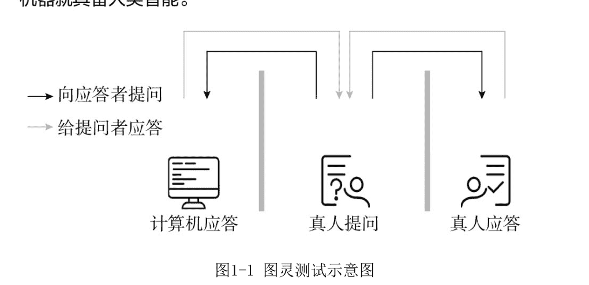

图灵测试并不完美，它偏重语言而忽视其他智能表现，但不可否认它是AI发展的重要里程碑，将AI从幻想推向可定义。图灵的论文也吸引大批人才进入机器智能、机器学习与意识等研究。

从此，人工智能进入科学研究的新阶段。

### 二、一次会议点燃星火

> 资料来源：斯图尔特·罗素、彼得·诺维格，《人工智能：现代方法》（第4版上下册），人民邮电出版社，2022年。

1956年常被视作AI元年。彼年，约翰·麦卡锡在新罕布什尔州达特茅斯学院担任数学系助理教授时，主办了“人工智能夏季研讨会”。

这场会议带有偶然性。当时美国高校传统为9个月聘期，夏季三个月需自筹经费，麦卡锡等人以AI研究课题获得洛克菲勒基金会资助。

规模虽小却群英荟萃，参会者包括哈佛的马文·明斯基、贝尔实验室的克劳德·香农、IBM的纳撒尼尔·罗切斯特等十余位学者。

会议持续近两个月，会上并未就如何实现AI达成共识，也未产出轰动性论文。但它像星星之火，将对人工智能的兴趣、争论与思考带回各地，此后研究走向体系化。

这一时期形成两大阵营：符号主义即逻辑主义，以及联结主义即连接主义，成为此后六十余年两条主线。

#### （一）符号主义：靠规则驱动

符号主义认为人类认知的基本单元是符号，思维是对符号的操作与计算，因此可将世界抽象为符号，通过逻辑计算模拟思考。人与计算机皆可视为逻辑推理的符号系统。

简单说就是“把规则编好”。

核心在于知识编码入库，再借助规则系统与推理引擎推断解题。

符号主义的标志性成果之一是艾伦·纽厄尔与赫伯特·A·西蒙等人开发的“逻辑理论家”程序，它能证明《自然哲学的数学原理》中的定理，展示了计算机的逻辑推理能力。

另一典型是聊天机器人鼻祖ELIZA，仅靠200行代码与有限对话库，通过关键词匹配回应。虽然并不理解内容，却引发公众惊叹。

符号主义的短板明显，知识自动获取、融合、常识处理及不确定知识表示都受限。但由于理念易懂、实现门槛低，它迅速成为主流并快速扩张。

#### （二）联结主义：造一个大脑

联结主义主张智能是内在思维过程，即大脑神经元间的信息交换与处理。因此模仿神经结构构建人工神经元网络即可实现智能。流行的神经网络即其产物。

简单说就是“造个大脑”。

其做法是给出数据，让机器自行学习规律并举一反三。与符号主义不同，后者由人预设规则，前者让机器自行归纳。

先驱是沃伦·麦卡洛克与沃尔特·皮茨，1943年提出麦卡洛克-皮茨模型，被视作最早的神经元网络模型。

代表性成果是1957年弗兰克·罗森布拉特在IBM基础上发明的感知机模型，用于图像识别，结构包含输入层、权重、偏置、激活函数、输出层，物理上用光探测器模拟视网膜、用电子触发器模拟神经元。

学术界估计人脑约有860亿个神经元，这一量级在20世纪60年代难以模拟。因此联结主义虽有过辉煌，却长期沉寂。

可见联结主义并非原理错误，而是高度依赖算力。

#### （三）小结

达特茅斯会议后社会热情空前高涨，政府资助涌入，产品陆续出现。例如IBM科学家阿瑟·塞缪尔的西洋跳棋程序1962年击败大师罗伯特·尼利；美国斯坦福研究所研制的移动智能机器人Shakey可自主感知、建模、规划并执行任务，如推箱子。

然而受制于计算与存储能力及规则不完善，产品虽惊艳但实用性不足，连机器翻译准确率都难以保证。

1973年，英国数学家詹姆斯·莱特希尔发布《人工智能：综述》，称当时AI夸大其词、效果不佳、研究已失败。报告传播后各国投资大幅缩减，AI进入低谷。

客观看，报告对现状判断准确，但评价失公允。早期的探索为后续发展奠定基础并指明方向。

### 三、专家系统：符号派的巅峰

人们希望AI比大多数人更聪明，这正是专家系统的初衷。它基于专家知识库，按编写规则逻辑推理，输出接近专家水平的决策，辅助人类提升效率、解决复杂问题。知识库涵盖客观知识与专家经验，专家系统可视作“知识库+推理机”。

1965年斯坦福爱德华·费根鲍姆设计首个专家系统DENDRAL，可依据质谱数据帮助化学家推断分子结构。随后MIT开发数学领域系统MACSYMA。

1972年斯坦福启动医疗专家系统MYCIN，用于诊断与治疗感染性疾病。测试中表现突出，被视为经典。优点是架构清晰、提出知识库概念、能用自然语言对话并根据知识库建议、支持学习扩充规则。

轰动学术界后，商业化才真正点燃期待。代表性产品是XCON系统。

1980年卡内基梅隆大学研发的XCON正式商用。当时小型计算机普及，配置却需专业知识。XCON可根据订单自动选配CPU型号、操作系统、存储器、外设及电缆，生成配置单与装配图，大幅提升效率与准确度。

DEC公司是RI系统的大客户，将规则从750条扩至3000多条，系统正式命名为XCON。

据统计，截至1986年，XCON为DEC处理了8万个订单，准确率达95%至98%，每年节省约2500万美元。DEC因此在80年代初成为仅次于IBM的全球第二大电脑公司，业务覆盖百余国。

示范效应下众多企业纷纷部署专家系统。政府也重启资助，1981年日本通产省联合8家电脑公司投入5亿美元、十年研发“第五代计算机”，目标实现对话、翻译、图像理解与推理；1982年英国启动“阿尔维计划”，十年投入3.5亿英镑推动软件工程、人机接口、智能系统与超大规模集成电路。

专家系统是符号主义的巅峰，学术、商业与政府的合力让人们暂时忘却莱特希尔报告的悲观。

DEC虽积极拥抱AI，却低估了个人电脑的爆发，转型迟缓，业务下滑后被康柏收购。这再次说明，不应低估新趋势。

### 四、神经网络：让机器自主学习提速

专家系统鼎盛时，联结主义在低调发育。核心问题是让机器更好自主学习。1986年提出的反向传播算法成为关键一跃。

1986年，杰弗里·辛顿、戴维·鲁梅尔哈特与罗纳德·威廉斯发表《通过反向传播算法学习表征》，提出适用于多层感知器的反向传播算法，利用链式法则逐层计算梯度并更新权重，解决了多层网络训练难题。此前网络仅能处理线性问题，反向传播使其能处理非线性，极大扩展应用范围。

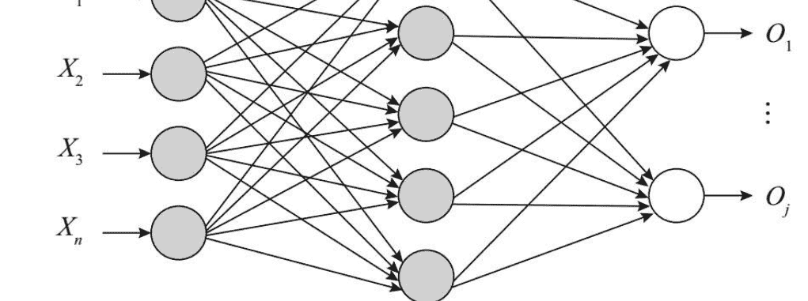

图1-2 多层感知器和反向传播算法示意图

资料来源：CSDN。

该算法并非完美，训练深层结构时易出现梯度消失或爆炸。以爬山比喻，梯度消失如同步距越来越小难以前进，梯度爆炸如同大步跨越山谷导致失控。问题像枷锁与地雷，使神经网络研究一度低迷。

巧合的是，解铃人正是提出者。2006年辛顿团队发表《深度信念网络的快速学习算法》，提出深度信念网络与逐层预训练，先分步训练每一层再整体优化，有效缓解梯度问题，降低训练难度，提升效率与性能。

一句话，逐层预训练让神经网络更可控、更高效。随后被用于文字与图像识别、语音识别、数据挖掘等场景。

算法进步之外，算力提升同样关键。1985年英特尔进军CPU领域，摩尔定律驱动性能每18至24个月翻倍。CPU主频从1986年的12.5MHz升至2006年的2.93GHz，提升超200倍。随后GPU带来更显著进步。

算力指数级增长为AI开辟了另一条道路。相反，专家系统因规则更新慢、无法自主学习，难以享受算力红利，性能逐渐落后，被学界淡化。

神经网络的发展意味着机器学习效率持续提升，AI由此驶入快车道。

### 五、深度学习：大幅提升精准度

2006年，斯坦福华裔科学家李飞飞聚焦图像识别，认为现有AI数据不足。于是发起ImageNet项目，号召上传并标注图像。2009年项目发布，收录1500万张图片，覆盖22000类。

2010年ImageNet启动大规模视觉识别挑战赛ILSVRC，前两届影响有限。2012年形势逆转，杰弗里·辛顿及其学生伊尔亚·苏茨克维、亚历克斯·克里切夫斯基以深度卷积神经网络模型AlexNet参赛，识别准确率达85%，较前一年冠军高出10个百分点。

这一压倒性优势再度引发业界震动，深度学习迅速成为图像识别领域的首选技术。

图1-3把对比摆得很清楚，和LeNet那一代相比，AlexNet在体量和复杂度上直接拉开差距。早期的网络只有2个可训练层、25个神经元、约1.2万个参数，而AlexNet则拥有8个可训练层、约65万个神经元、6000万个参数，规模优势非常明显。

能撑起这种体量，关键在算力换代。过去训练基本靠CPU，CPU擅长逻辑和调度，像一名能解难题的教授。GPU则擅长大规模并行，像一群高中生，单兵不强但人海战术快。并行计算让训练时间大幅压缩，效率随之提升，这正是AlexNet敢做大的底气。

### 六、Transformer点燃大模型浪潮
2017年6月，谷歌八位工程师在论文《注意力就是你所需要的一切》里提出了Transformer，初衷是为自然语言处理和机器翻译找一个更高效、更强力的方案。

> 资料来源：伊恩·古德费洛、约书亚·本吉奥、亚伦·库维尔，《深度学习》，人民邮电出版社，2021年。

当时NLP主流是基于循环神经网络的编码器-解码器。RNN要按时间步逐层展开，前一步没算完后一步就得等，速度慢且难以并行，GPU的优势被浪费掉。

Transformer基于自注意力机制，用多头注意力与位置编码捕捉序列中的长距离依赖。

如图1-4所示，核心有两点突破。一是自注意力，只聚焦输入元素之间的关联，不再纠结输入到输出的对应关系，减少了人工标注成本，也能更精准地判断哪些信息更重要。二是抛弃递归结构，能一次性处理整个序列，实现并行计算，与GPU算力结合更紧密。

### 图1-4 Transformer模型

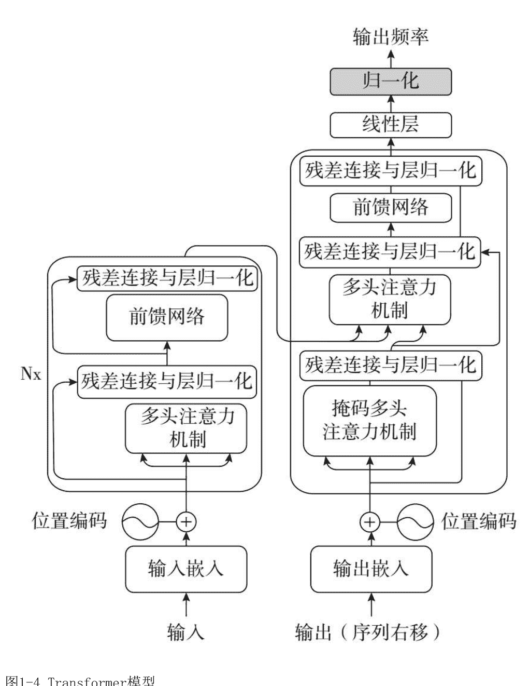

> 资料来源：Ashish Vaswani, Noam Shazeer, Niki Parmar, et al., “Attention Is All You Need”, 2017。

这项模型确实提升了机器翻译效果，但刚发表时影响有限，甚至当年相关会议也没获奖。随后行业逐渐认识到它的潜力。2018年6月，OpenAI发布了GPT系列首版GPT-1，GPT即Generative Pre-trained Transformer，生成式预训练变换器。紧接着谷歌推出了BERT。

2019年初，百度语音团队在在线语音领域率先推出注意力大模型SMLTA，即流式多级截断注意力，相对准确率提升15%。2021年百度发布第二版，用以解决传统Transformer处理长音频时的计算爆炸和焦点丢失问题。

这些技术在工业界已开始落地，却不为公众所知，直到2022年11月OpenAI推出ChatGPT。两个月内月活用户突破1亿，微软随后宣布投资100亿美元，大模型由此在全球爆火。

大模型也称基础模型，是在海量数据上用大规模自监督训练出来的模型，标志着从特定任务向通用任务的转变，广泛应用于自然语言处理、计算机视觉、语音识别、推荐系统等。自GPT-3出现后，讨论更集中在大语言模型LLM上。它在无标注语料上做大规模预训练，学习语言与世界知识，再通过指令微调、人类价值对齐获得多任务通用求解能力。本书里大语言模型也简称为大模型。

社会关注的核心在于涌现能力和泛化能力，这些能力不仅体现在语言，也延伸到图像、视频、自动驾驶等领域，让通用人工智能AGI的可行性与商业前景都被看得更清晰。

### 七、回望AI历史的关键启示
到这里可以看出，人工智能虽屡次经历预期落空的低谷，但技术持续在演进。不同路线不断试错，让我们更清楚决定性能的是算法、算力、数据，这三点构成了迈向通用人工智能的基础。预期会波动，技术始终在前进，回顾历史的意义就在于更好发挥其价值。

### 图1-5 人工智能历史进程

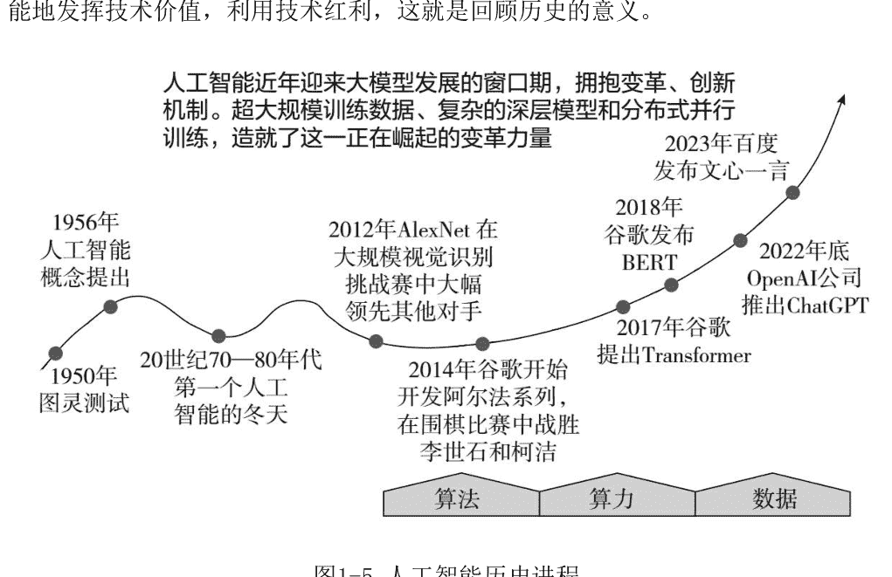

图灵认为智能难以精确定义，但可用测试判断，提出图灵测试，当交流对象无法区分是人还是机器时，可视为具有智能。

1956年被视作人工智能元年，达特茅斯学院助理教授约翰·麦卡锡发起人工智能夏季研讨会。

AI大致两条路线：符号主义即编规则，以专家系统为代表；联结主义即造大脑，以神经网络为代表。

1973年《莱特希尔报告》认为当时进展不大。专家系统是知识库加推理机的组合，巅峰代表XCON由DEC公司商用。

辛顿等人提出反向传播，加速神经网络发展，但存在梯度消失或爆炸问题。随后提出的逐层预训练缓解了这一缺陷，让网络更可控高效。

与符号主义相比，联结主义更容易受益于摩尔定律，逐渐成为主流。

李飞飞发起大规模视觉识别挑战，推动图像识别。辛顿团队的AlexNet用深度卷积神经网络展示了参数与复杂度提升后精度同步提升，研究者开始重视“大”。GPU支持，尤其是2006年英伟达CUDA发布，让GPU并行计算进入通用计算领域。

2012年谷歌收购辛顿团队，2013年百度成立深度学习研究院，并率先将深度学习用于搜索。深度卷积神经网络大幅提升图像识别精度，也揭示了算法、算力、数据的新思路。谷歌的Transformer成为GPT的基础，其涌现与泛化能力意义重大。

## 第二节

### 大模型凭什么独特
现在人工智能和大模型常被称作“第四次工业革命”，被认为会长远深刻地改变世界。那么它的独特之处在哪里？

### 一、量变生质变，智能开始涌现
本质上，大模型就是在用户引导下推测应该输出什么。联结主义的初衷是打造类似人脑的产物，大模型沿着这条路走得更远。

人脑由大量神经元组成，学习时连接会变化，形成神经网络，经验积累后能处理多样问题。大模型类似，有海量参数，配合海量数据训练，参数不断调整，最终形成类似成熟大脑的能力。

训练体现出“大”的特征：算力消耗大、数据量大、参数规模大。

算力方面，训练一次GPT-3约需10的23次方次计算。以每秒60万亿次的英伟达H800为例，需约1000块显卡跑50天，成本约500万至1000万美元。若用人手打算盘，80亿人算100万年才够一次训练。

> 资料来源：《“炫富”的GPT-3来了：45TB数据，1750亿个参数，还会三位数加减法》，量子位，2020年6月1日。

数据相当于人类知识。GPT-3预训练数据约45TB，相当于十万人终身不间断阅读的量。数据分标注和无标注两类。

参数方面，如图1-6所示，假设平面上有三个点，想以横坐标X预测纵坐标Y。用两个参数Y=aX+b只能拟合直线，无法准确覆盖三点。增加到三个参数可用二次函数拟合曲线，预测更准。参数越多，拟合复杂分布的能力越强。注意这是简化示意，未考虑过拟合。大参数让模型能捕捉细微特征，学习更复杂的模式，提升表达能力。

现实中，水豚大脑约3亿神经元，猴子17亿，猩猩90亿，人类几百亿。百亿量级后智慧跃升。模型也有相似现象，如图1-7所示，当参数达到十亿、百亿、千亿级别时，效果出现明显拐点，被称为智能涌现。

### 图1-6 模型参数示意图

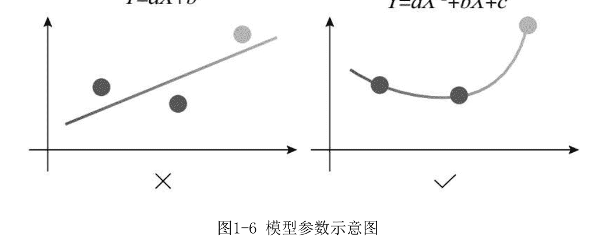

### (a) 模运算

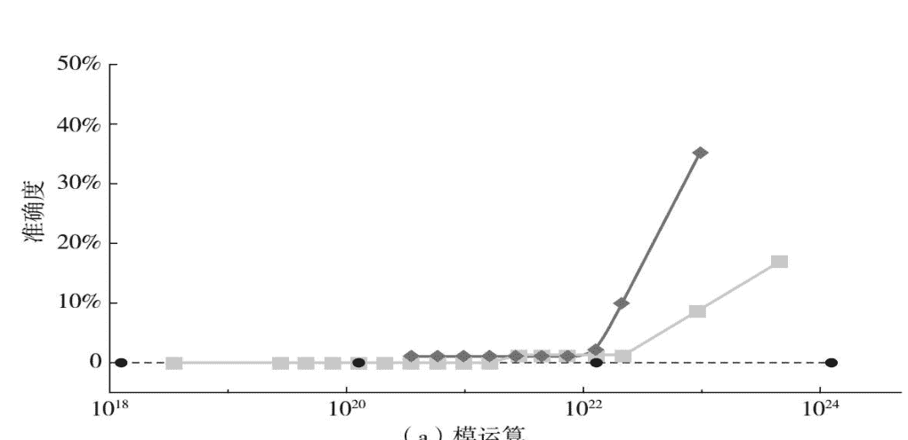

### (b) 国际音标转写

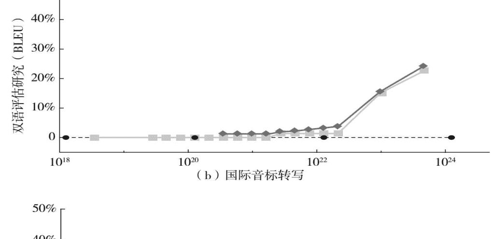

### (c) 字母重排

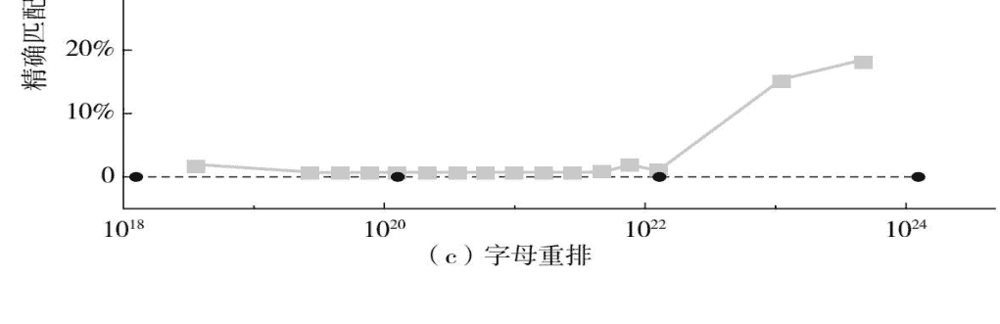

### (d) 波斯语问答

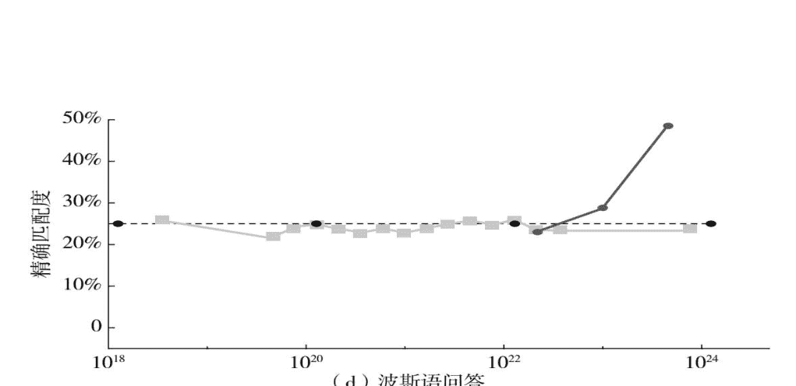

### (e) 真实性问答

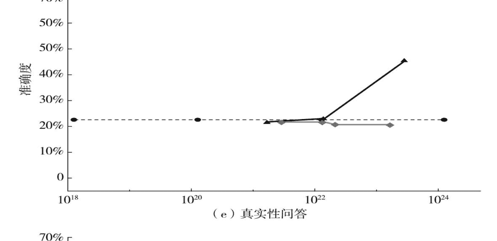

### (f) 基于现实映射

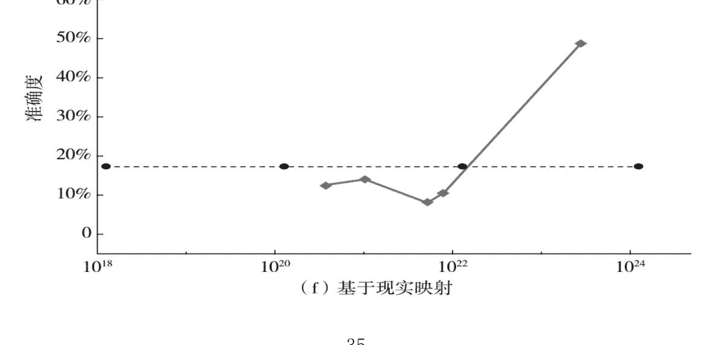

### (g) 多任务自然语言理解

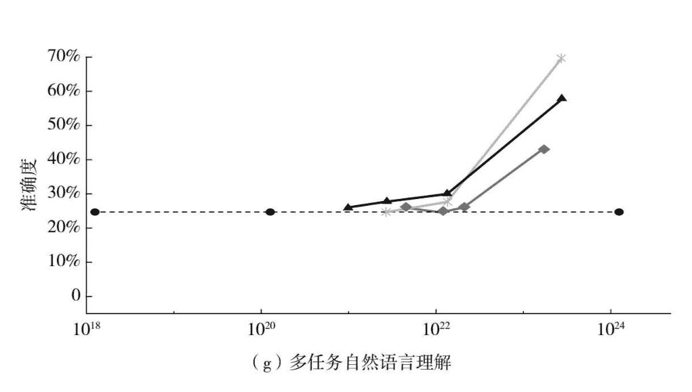

### (h) 上下文词汇理解

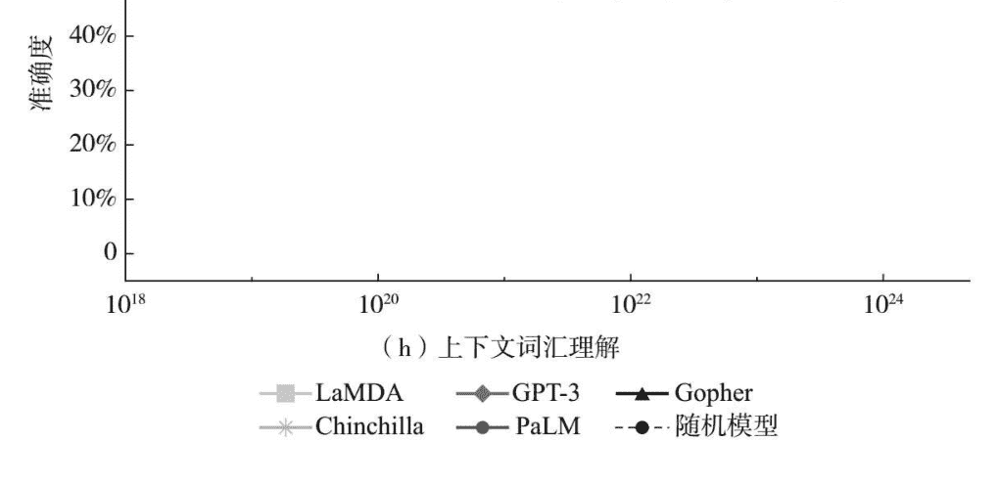

- LaMDA

- GPT-3

- Gopher

- Chinchilla

- PaLM

- 随机模型

### ▲图1-7 不同参数规模的大模型能力涌现

注：LaMDA是谷歌对话神经网络架构，GPT-3是OpenAI语言模型，Gopher和Chinchilla为DeepMind大模型，PaLM为谷歌大模型。

> 资料来源：Jason Wei, Yi Tay, Rishi Bommasani, et al., “Emergent Abilities of Large Language Models”，2022。

效果指准确度、问答匹配度、真实性、上下文关联、任务完成率等，依赖语言理解、生成、推理能力。但参数并非越多越好，过拟合会导致在新数据上表现差，类似死记硬背。模型结构同样关键，Transformer等架构让大参数发挥更大效用。总体看，大模型是量变引发质变，各家因此展开参数竞赛。

### 二、泛化更强，场景适配更广
举一反三是衡量学习智慧的重要标准，对应人工智能的泛化能力。大模型具备的泛化能力是传统技术不具备的。

大量数据和训练让模型学会提取表象与深层规律，能把预训练获得的经验迁移到全新场景，提升普适性。

AI研发成本高，靠商业客户分摊。若只能服务特定领域，分摊成本大，使用意愿低。传统模型通常只做视觉、语音、文本等单一领域，每个应用都要从零收集数据、训练、验证、开发，交付成本高、难规模化。

有了泛化能力，落地一个应用像千米跑，传统技术自研基础只有100米，其余900米需定制。大模型提供900米通用能力，只剩100米需定制。通用性提升带来更丰富场景、更多客户，分摊成本下降，同时反馈更多，帮助迭代。模型还能适应新状况，更贴近人类思维与生活。随着新场景不断出现，持续学习能力成为关键，泛化能力为研发方和客户创造更大商业价值。

### 三、精度大涨，业务更可靠
精度直接影响性能、可靠性和用户满意度。

大模型精度提升来自四方面：算法上Transformer捕捉长距离依赖，自注意力增强信息整合；数据上质量与数量大幅提升，传统训练数据在万到百万级，大模型动辄千亿级，数据处理也更精细；预训练后采用微调等技术进一步提优；芯片发展带来算力提升，使更大数据与更高精度可行。

算法、算力、数据协同发力，精度持续提高。

### 四、知识能力逼近超越人类
能力提升在棋类竞赛中很明显。1997年IBM深蓝以3.5:2.5击败世界冠军卡斯帕罗夫。2016年起谷歌AlphaGo先后4:1胜李世石、3:0胜柯洁。下棋虽属娱乐，生产力领域的超越才更具商业价值。

【经验的裂缝与参数的桥梁】

人类记忆向来是不连续的。华佗再厉害，临床心得也很难完整打包给后人。写书是传统载体，但纸面化必然丢细节，后人再解读时因认知差距再损耗。长期以来，智慧交接的效率都很低。超大参数基座的出现改变了局面，千亿级权重可装载海量语料，任何团队都能在此之上微调属于自己的行业轻量版，实现可复用的继承链。

第二，人与人之间的信息通道极窄。面对面聊，一分钟也就百来字，一小时累计才万字出头，按机器单位算仅几十KB。机器与机器之间则完全不同，带宽被拉开万亿倍量级，比如英伟达Blackwell平台的GPU搭载G7显存，峰值显存带宽可达1.8TB/s。

因能承接知识又能高速沟通，这类系统在内容创作与语言理解上已普遍超过常人。2023年高考放榜后，全网对各家系统的语文作文能力做盲测，《第一财经》牵头评测并请多位高考阅卷老师打分，平均得分42分，折合满分60分约七成水平。

在内容生成、语义理解、信息抽取、语言互译等维度上，系统表现已超过大多数普通人，这些能力对应营销方案设计、翻译、智能服务、办公提效、智能财务分析、辅助学习、企业内训等大量商业刚需。

研究场景里，面对堆砌的报告，以前靠人工逐页翻阅，现在可先让系统抽取核心要点，用户确认后再深入阅读，文本处理效率大幅提升。

企业内训里，传统做法是定期集中授课，员工容易遗忘。现在可以随时随地学习，还能做到千人千面，根据员工回答即时调整辅导方向；实际操作时遗忘的知识也能快速检索。对一线人员多、地域分散、培训成本高的企业，尤其是蓝领占比高的行业，价值尤其明显。

### 五、从文字到多感官，打开应用边界
这类系统并不止步于语言，正沿着语言积累的经验向多模态延伸，这是AI的重要发展方向。海外2022年下半年Midjourney、Stability AI相继推出文生图应用，2024年2月OpenAI发布文生视频基座Sora，推动多模态跃进。国内也在同期发力。

文生图早期质量不高，常出现逻辑不通的“一眼假”，即幻觉问题。2024年百度自研iRAG检索增强生图技术，将亿级图片检索资源与基础基座结合，显著提升了真实感，使文生图具备商业可行性。

2024年4月，生数科技发布国内首个长时、高一致、高动态的视频基座Vidu。可支持文生视频、图生视频、参考生视频等多种生成方式。生数科技由清华大学人工智能研究院孵化，团队在贝叶斯机器学习与多模态基座领域有多项原创成果，能更好模拟现实物理规律，保持风格与主体一致性。2025年初发布的Vidu 2.0生成效率大幅提升，用户5分钟即可得到长达1分钟的视频素材。

多模态相当于机器的“多感官”。人类靠视觉、听觉、触觉、嗅觉、味觉获取信息，多感官远胜单一感官。多模态数据相互补充，减少单一模态的局限，让信息更全面精准；提供更丰富的上下文，提升学习与复杂问题处理能力；互动更贴近人类习惯，普及门槛大幅降低。文本输入人群虽大，但语音、视频输入让触达更广。

多模态打开了大量场景。营销中文生图可生成高质量海报，传统汽车宣传海报成本动辄十几万元，用iRAG后成本接近零。数字人和短视频是很好的种草手段，借助多模态一句话即可生成3D数字人并延展为短视频。

海底捞基于百度智能云一见视觉基座平台，对全国1300多家门店的员工服务规范进行无死角视频分析、实时打分，形成门店经理的量化排名与考核，提升管理效率与消费体验。

医疗诊断融合医学影像与病历文本，多模态融合可提高准确率、降低误诊。客服中文字沟通偏冰冷，数字人加语音更亲切；用户可用图片、视频描述问题，机器抓取关键信息后快速解决。

交通领域自动驾驶不再仅靠前置规则，可通过实时图像采集判断执行；交通管理也能受益于图像视频处理能力的提升。具身智能机器人通过视觉、触觉、声音等传感器协同处理，完成复杂生产任务。

多模态能力将在2025年继续深化，加速AI普及。

- 智能涌现
- 泛化能力，适用场景更多
- 精度不断提升，更加可靠
- 文本能力超群，而且具备从文本到多模态的扩展

智能涌现：系统规模与复杂度达到阈值后，会出现小系统里看不到的新特性或能力，俗称跃迁拐点。

泛化能力：模型不仅在训练数据上表现好，在未见过的新数据、新场景、新领域也能保持良好预测与处理，能举一反三。

精度提升：算法可捕捉长距离依赖，自注意力机制增强信息整合；数据质与量同步提升；微调等技术进一步提效。

文本能力：涵盖文本生成、语义理解、信息提取、语言翻译，只要存在文本即可发挥基座效能。

## 第三节 超大基座点亮通用AI的曙光
通用AI字面上好理解，却在定义、目标与时间点上未形成共识。斯坦福大学人文中心AI研究所将其视作人类水平、具备情境感知的全面智能机器。高德纳认为它能理解、学习并将知识迁移到多种任务与领域。OpenAI则表述为在各方面都比人类更聪明的系统。

Bard是谷歌基于Transformer架构的自然语言模型，Llama是Meta发布的人工智能模型，Claude是Anthropic发布的大型语言模型家族。

对距离的判断亦分歧。微软认为GPT-4在可执行任务种类和专业知识广度上达到前所未有的水平，在多数任务上与人类相当，可算通用AI的早期版本。也有研究者认为GPT、Bard、Llama、Claude等最新一代基座虽有缺陷，已可视为通用AI的实例。图灵奖得主杨立昆多次表示实现还需几十年，现有生成式AI无法理解真实世界。2024年11月他又称若发展顺利，5到10年内或现身，但肯定不是近两年。

总体看，超大基座正加速通用AI的到来。可从教育视角理解这一变化，教育是最成功的“培育”人类意识行为之一。

## 一、认知的六层阶梯
> > 资料来源：Benjamin Bloom, “Taxonomy of Educational Objectives:The Classification of Educational Goals”, 1956。

美国心理学家本杰明·布鲁姆在20世纪50年代提出教育目标分类理论，将目标分为认知、情感、动作技能三域。认知域细分为六层：知识、理解、应用、分析、综合、评价。

知识：认知起点，要求直接回忆具体事实、概念、术语、方法、过程等。

理解：能对知识进行转换、解释和推断，不仅再现，更要把握关系并做基础推理判断。

应用：在新情境中识别并运用所学知识解决实际问题或完成任务。

分析：将复杂知识拆解为组成部分，理解各部分关系与模式、结构、因果。

综合：将零碎知识整合为体系，创造新模式或结构，需要创新思维与问题解决能力。

评价：最高层，基于既定目标对材料、方法等进行定量与定性判断。

## 二、基座的对照
从认知阶梯看，超大基座为何更令人期待。培养儿童时希望覆盖知识到评价的完整链条，人工智能的发展也沿此路线：从早期知识范围狭窄、规则固定，到如今输入数据后自主学习、自主提升。

从涌现与泛化看，机器不再是被牵动的木偶，而是具备理解、记忆、逻辑、生成的潜能。通用AI的曙光已可见。

美国心理学家本杰明·布鲁姆认为，认知领域教育目标可细分为六层：知识、理解、应用、分析、综合、评价。

## 第四节 基座重塑商业新范式
超大基座技术不仅推动AI发展，也在人与机器互动、软件生态、智能生产、数据飞轮等方面带来变化，重塑企业提供产品服务的形式与内部流程。

## 一、基座，重新定义人与机器的互动
人与各类机器、设备之间的互动方式是商业竞争的重要要素。

电脑早期需用命令行操作，高效但门槛极高。微软推出Windows 1.0后，图形界面与鼠标操作普及，使用门槛大幅下降，潜在用户扩大千倍万倍，催生办公套件、游戏、浏览器等应用生态。从键入命令到点击图标是信息革命普及的关键。

手机从键盘到触屏也降低了门槛，加速移动浪潮。人机互动改变会重塑终端格局，也诞生浏览器、游戏、应用等新业态，推动企业电子化改造、移动端小程序与公众号发展。

图形界面仍非最自然的互动，超大基座让互动再次进化。

首先，基座让互动以自然语言驱动，再次降低门槛，提升体验。会写命令的人少，会点图标的人多，能用说话表达需求的人更多。借助多模态可融合视觉、听觉与文本，语音互动更精准，机器语音更具声调与情感，可在授权下从语音捕捉情绪，结合摄像头面部表情分析。

搜索中过去需用文字表达意图，面对海外不认识的图标很麻烦。拍照片加语音输入，基座即可理解意图并给出精准信息。

其次，基座会缩短App使用路径，借助智能体成为新的入口。移动互联网产生数百万款App，用户需逐一打开。超大基座可让智能体自动规划需求，自动访问相关App，像隐形精灵般满足需求。这将深刻影响应用生态与传统行业。企业内部财务等流程也能通过智能体一键完成。

最后，基座能力正成为刚需。80后、90后是互联网原住民，2020年后出生群体将成为人工智能原住民。通过各类AI应用建立天然好感，需求旺盛。面向C端或企业内部应用，未来都将以人工智能为底座开发。

回溯来看，人机互动愈加自洽。从物理互动界面到编程互动界面，打通物理到数字世界；从编程到图形界面，实现编程操作到点选操作。超大基座实现了从图形界面到对话式互动的转换，打通人类语言与机器语言。用户用自然语言提出需求，模型理解并生成内容，再调用工具交付服务，人机融合更自洽。

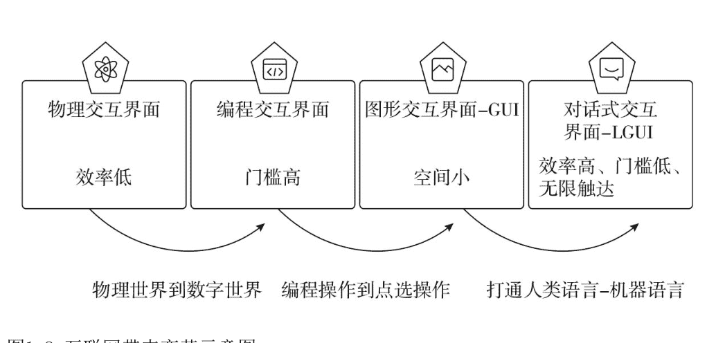
图1-8 互联网带来变革示意图

注：GUI表示图形用户界面；LGUI是一个概念上的界面设计理念，它主要强调逻辑性和用户交互的高效性。

无论是企业内互动、企业与用户之间的互动，还是用户与设备之间的互动，都因超大基座而改变，并像电脑与手机互动变革那样深刻影响商业格局。

## 二、软件应用，迎来全面改变
软件应用是产业与生活场景的核心入口，发生改变必带来巨大机遇与颠覆。基座时代应用将出现三类变化。

第一，真正以用户为中心，提供标准化与个性化服务。“千人千面”是目标，大数据已能做一定推荐，但算法套路明显，实际多为“千人百面”。超大基座提升个性化能力，大参数、大数据、大算力可高效实现个体化服务，且大幅降低开发门槛，中小企业也能普及个性化。

例如智能手机可依据日常行为推荐个性化内容与应用，提升满意度，增加人情味，提供“更懂我”的情绪价值。

第二，真正出现端到端解决方案型应用，每一个都由人工智能与数据驱动决策与操作，极大提升运营效果与效率。人工智能原生应用不一定是独立App，而是把AI嵌入业务原生场景。不必等待爆款，企业应把基座用在“研产供销服”各环节，形成嵌入式人工智能。场景有多少，未来AI原生应用就可能有多少，且均由AI控制并给出极致方案。

第三，软件开发范式会发生变化。编程不再是专业程序员特权，人人皆可开发；编程不再从C/C++起步，而是从自然语言开始；编程不再面向过程、面向对象，而是面向需求。时代编程即表达愿望的过程。

应用开发更易，创业更繁荣。互联网领域好创意占成功一半，实现却困难，技术、资金、人力构成门槛。开发门槛下降意味着创业成本显著降低，更多人尝试实现想法，这不限于互联网，其他行业从业者也能用AI探索新业态。

软件应用的变化不止于应用本身，创业更繁荣，经济更有活力。

### 三、带来智能生产的新范式

大模型正在把获取与运用知识的速度推到新高度，进而重塑企业的人才结构，并催生出一种全新的智能生产形态。

往昔，个人和组织累积知识的节奏很慢。格拉德威尔在《异类》里提出的万小时法则广为流传，成为要达到大师水准所需磨炼时长的一个参照。以每周五天、每天八小时来算，相当于需要连续投入五年。即便如此，积累的体量仍有限。若把一万小时全部用来阅读，也只能大约读完1.8亿个汉字，换成二进制信息大概也就五百兆左右。个人的能力天花板也在拖慢组织的进化，而在多数企业里，大家被大量重复性事务占据，能够用于创造性思考的时间非常稀少。

大模型的出现打破了这些桎梏。

在千卡级别集群的算力支撑下，GPT-3仅用约一个月就消化了45TB的语料，相当于集合了九万多位来自不同领域、各自完成过一万小时锤炼的专家经验。GPT-3知识覆盖面极广且能即时应答，随后问世的GPT-4、文心一言4.0等系统进一步扩大了知识广度，并仍在快速迭代。

因此知识不再受制于时空与语言的边界，每个人都可以跳过漫长的苦修，直接从一万零一小时的位置起跑。动口或动手指一点，就能拿到所需的信息与认知，起跑线被抬高，攀登速度也被加快。

对组织来讲，智能生产的新范式正在成形。员工不必再靠死记硬背处理常见内容，遇到问题直接向模型提问即可获得高质量回答，这等同于提升了个体知识储备与企业整体人才密度，在知识密集型赛道尤为明显。

大模型还能大幅提升专家的产出效率。专家用几句话就能指挥模型调度多套系统或智能体去完成繁琐的事务性操作，把精力集中在高价值、强创造性的环节。

更关键的是，强大的理解与生成能力能跨界融合知识，催生出此前从未出现过的“人工智能新物种”。

历史上的重大突破多来自跨界。蒸汽机与纺纱机结合诞生了蒸汽纺纱机，重塑纺织业生产力；电池技术与汽车动力系统结合带来了电动车，重塑汽车格局。

可以预期，在大模型的加持下，创新不再是少数天才的专利，通过便捷的知识融合，每个企业、每个团队甚至每个员工都有机会实现颠覆式创新。再者，大模型对ToB业务的改造深度，远超互联网时代的影响力，是每位企业家必须高度关注的结构性趋势。

### 四、加速数据飞轮形成

“数据是金矿”的共识在扩大，但把数据变成可用资产并不容易。原始数据杂乱、质量不均，传统工具的处理效率有限，大模型则把这个流程明显提速。

AI-ready指企业的数据体系已经为人工智能应用做好准备。

例如百度面向大模型场景搭建了大数据工程，支持海量非结构化数据入湖，并通过元数据发现抽取表结构等元信息，构建原始集合；随后经由从采集到标注分类、过滤、去重、脱敏的完整流水线，高效完成清洗，最终产出可用作预训练或精调的高质量AI-ready集。

让模型真正读懂业务，还需要激活专属知识。检索增强生成RAG等技术就能深入挖掘内部数据。模型上线后，数据飞轮开始转动。

如图1-9所示，企业可把应用过程中产生的宝贵数据回流给模型，再通过各类微调使模型表现不断提升。模型变强，体验变好，用户增加，反馈数据也随之增多。用新数据迭代模型、用更好模型升级应用、用更好应用吸引更多用户产生数据，形成闭环。一旦飞轮转起来，企业在该场景的优势会持续累积，呈现雪球效应。

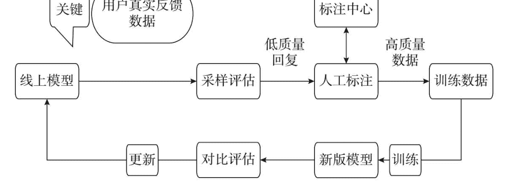

图1-9 数据飞轮

交互方式的每一次变革都会带来产业级冲击。计算机从命令行转向鼠标点图标，大幅降低了使用门槛，扩大了人群，也加速了信息革命的普及。

大模型重新定义了人机交互，使交互完全由自然语言驱动，推动语音交互成为新入口。随着人工智能原住民群体扩大，大模型正成为C端与企业内部应用的必备技术。

应用层面的变化有三点。第一，以用户为中心，提供标准化与个性化服务。第二，真正出现端到端方案型应用，由人工智能与数据驱动决策与操作，极致提升运营效果与效率。第三，软件开发范式发生变化，人人都可以成为开发者。

智能生产的新范式也由此构成。每个人都能跳过漫长的万小时修行，直接从一万零一小时开始，仅凭口头或操作即可便捷获取知识。它能显著提升专家效率，也能融合跨域知识，创造出前所未有的人工智能新物种。

### 大模型在中国的发展

回溯历史，美国长期是创新中心，但中国正快速迎头赶上。尤其在大模型赛道，自2020年起进入高速期，与美国保持同步增长，已成为全球主要玩家。美国阵营有OpenAI、Anthropic、微软、谷歌、Meta等，中国阵营则有百度、阿里巴巴、华为、腾讯、智谱、DeepSeek等。

产品层面百花齐放。百度文心一言、阿里通义千问、字节豆包、华为盘古、腾讯混元、智谱GLM、月之暗面Kimi等集中涌现，行业曾被称作“百模大战”。

百模大战一方面推动产业，另一方面也导致资源分散。训练成本高昂决定了并非所有厂商都能存活。总体来看，与其盲目卷模型，不如卷应用。用户选择时应审慎，优先技术、资金与盈利能力靠前的大公司，避免因供应商掉队或更新停滞影响业务。

在众多参与者中，百度与DeepSeek最具代表性。

百度是中国乃至全球较早深耕人工智能的公司，并在国内率先推出大模型产品，持续推动技术演进。

如图1-10所示，自2013年起百度便坚定押注人工智能，不断引入顶尖人才。2014年5月，机器学习与人工智能权威吴恩达加盟百度担任首席科学家，主导百度研究院及硅谷实验室。吴恩达曾参与谷歌大脑项目，是当时中国互联网公司引进的最重量级人物。

人才集聚迅速提升了百度AI实力，形成坚实的先发优势。2022年12月27日，百度智能云发布国内首个全栈自研人工智能基座“人工智能大底座”；2023年，百度首发对标ChatGPT的文心一言，并保持快速迭代，陆续推出百舸AI异构计算平台、千帆大模型平台，以及丰富的AI原生应用样板间与行业解决方案，满足客户在AI原生时代的多元需求。

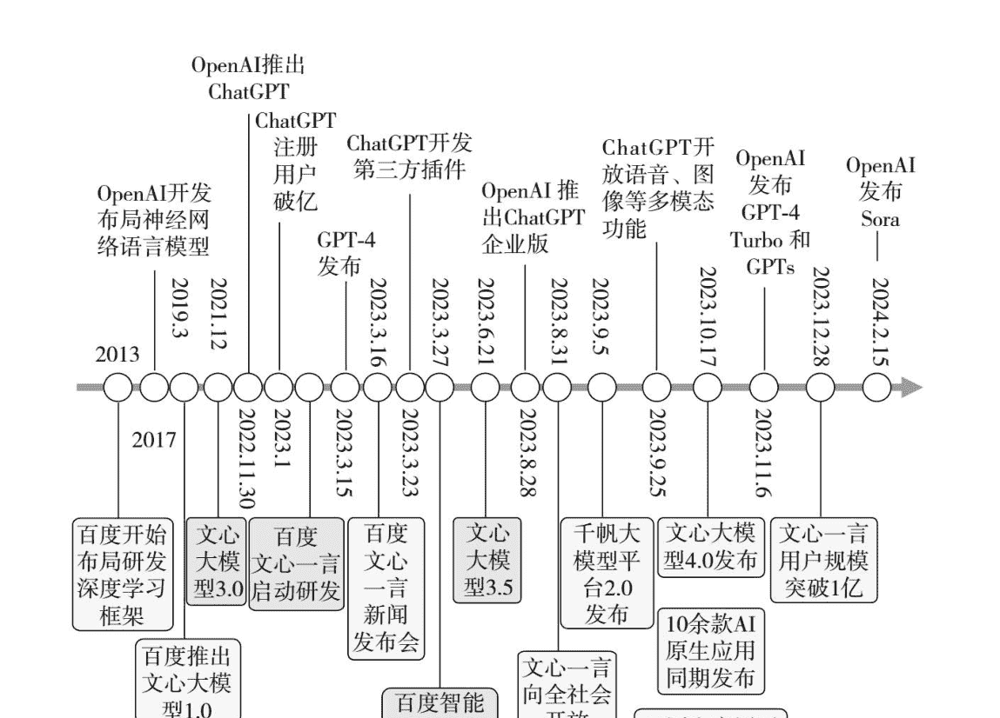

图1-10 大模型发展历程

注：AppBuilder表示应用开发工具。

671B模型指拥有6710亿参数的模型。

位于杭州的DeepSeek于2024年12月推出代号DeepSeek-V3的大模型，在美国科技圈引发热议。该模型参数规模达671B，性能与主流模型相当，但在预训练阶段仅用2048块GPU训练两个月，官方测算训练成本约557万美元。相较于性能相当的模型如Meta的Llama 3，成本下降约90%。核心在于采用混合专家MoE架构，并结合注意力机制优化、通信优化、数据优化等手段，在提升性能的同时大幅降本。混合专家的细节将在第二章展开。

可见，中国大模型的起点并未落后海外，发展正从追赶迈向并跑，未来有望引领。核心驱动仍是技术创新，既要有创新意愿，也要承受创新风险。

随着技术演进，国内企业也主动承担产业责任，降低价格。例如2024年5月DeepSeek率先下调国产大模型价格，2024年7月百度宣布ERNIE 3.5基座模型降价92%，而ERNIE Speed与ERNIE Lite两款主力模型仍保持免费。

在技术向上、成本向下的趋势下，越来越多的企业与个人开始使用大模型，并从尝鲜走向生产力场景。

以百度文心大模型为例，截至2024年11月初，日均调用量已突破15亿，是此前一年披露的5000万日均调用量的30倍，是半年前2亿日均调用量的7.5倍。

如图1-11所示，文心大模型的调用增长不仅反映百度自身的进展，也折射出国内大模型产业整体的活跃。这仅是序幕，大模型带来的深远影响才刚刚显现。

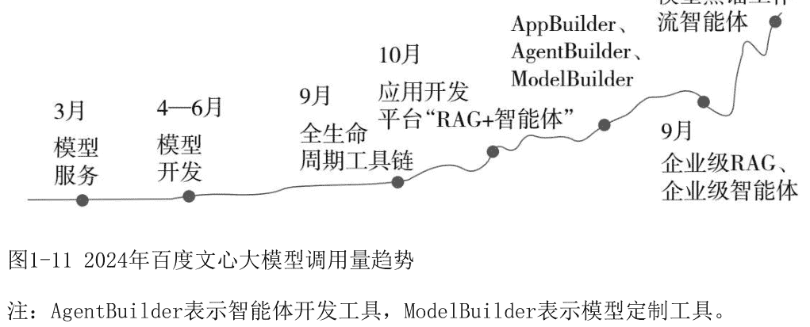

注：AgentBuilder表示智能体开发工具，ModelBuilder表示模型定制工具。

业界普遍认为人工智能产业的核心在中美两国。中国的优势在于丰富的应用场景。中国大模型公司尤其是百度，早早提出“卷应用”比“卷模型”更具商业价值。可预见，中国大模型与产业的深度结合将是一场波澜壮阔的商业大戏。

大模型正从尝鲜迈向生产力场景。百度文心大模型的调用量呈现爆发式增长。

DeepSeek-V3掀起了大模型的“成本革命”。

## 第六节 小结

纵观人工智能演进，大模型并非凭空出现，而是近70年积累与探索的结果。在此过程中，研究者找到了提升AI表现的“配方”：算法、算力、数据。多领域技术加速共振，才迎来突破时刻。

大模型并非泡沫。在技术支撑下，它呈现出智能涌现、通用性大幅提升、精度提高、从文本到多模态全面进步等特征，正逐步逼近甚至超越人类表现，从娱乐走向生产，渗透到企业的研产供销服各环节，成为新生产力。

大模型具有显著的商业价值。相较以往AI，大模型更容易落地，其变革影响也更加深远。本书第二章将进一步阐释大模型的商业价值源于何种能力。

以史为鉴，可以知兴替。人工智能与大模型被视作人类第四次工业革命。我们每个个体、每家企业都有机会参与其中，迎接、把握并享受机遇。

# 第二章 技术突破：大模型为何更具有商业化价值

大模型的通用能力与泛化能力，是过去人工智能不具备的特质，也因此更容易与产业结合，释放商业价值。

知其然更要知其所以然。要想理解大模型为何能与产业结合、如何用好它，就必须弄清其商业化能力的来源。“大模型”三个字背后是多项技术的叠加突破。本章聚焦影响性能及业务效益的关键技术，主要分为两类：训练相关与应用开发相关。

训练一个优秀大模型通常分三步：预训练、有监督微调SFT、人类反馈强化学习RLHF。

用培养孩子写作文作类比。第一步是大量阅读与理解，对应预训练。经过此阶段，模型可模仿人类语法、顺着话头续写。如同3岁孩子背唐诗，听到“锄禾日当午”能接“汗滴禾下土”。这部分需要海量可供记忆的数据，如唐诗、新闻、论文、代码库等，总量相当于数十万人终身阅读量，且需符合人类价值观并做预处理。第二步是看范文，对应有监督微调。学习若干篇命题作文范文后，模型能把握套路，写出风格相近的文章。第三步是强化训练，对应人类反馈强化学习。写完作文由老师评分指导，反复改进直至写好。

第二、三步合称指令学习，使模型具备与人类价值观对齐以及处理各类问题的能力。

大模型落地产业时，还需其他技术应对特定需求或加速开发，如大小专家混合、长上下文、检索增强、智能代理等。

非技术背景读者无需担忧。本章不会深挖技术细节，而是着重介绍技术背景、基本原理、特点及带来的效果。

可借鉴电力类比。电力时代到来时，无需人人都懂电磁感应，只需学会安全高效使用电。

大模型时代亦然，应用大模型不必人人都是底层技术专家。

本章核心问题是：大模型凭借何种能力为各行各业、各场景带来显著提升并体现商业价值？

## 第一节 预训练：工程化属性带来加速发展

观察国内外发布会会发现，各厂商都在强调参数规模持续变大，从数百亿攀升至2000亿、3000亿，同时算力也在从千卡集群向万卡、十万卡集群演进。例如2024年9月初，马斯克提到已建十万卡集群并计划扩至二十万卡，这将很快成为常态。

喜欢球类运动的人熟悉“大力出奇迹”——用强大力量弥补技巧不足，靠量变引发质变。

大模型的发展亦呈现这一特征。这就是尺度定律Scaling Laws，也称规模法则，即模型性能如准确率、损失等，与参数量、数据量、计算资源量存在关联。提升这三者通常会显著增强性能，且呈现跳跃性，小模型难以企及。简言之，大算力、大参数、大数据带来大能力。

尺度定律主要作用于大模型的首个阶段——预训练，决定了基础能力。因此它也被称为大模型的“第一性原理”。其带来的产业启示是：AI能力提升具备工程化属性，可规模化、模块化、可复制、可预测。通俗说，在规则下投入必有产出，且投入越大产出越多，这对大模型及产业应用至关重要。

### 一、第一性原理：尺度定律

训练大模型时常会遇到诸如：提升AI能力是否只能靠改进算法？10TB数据需要多少算力能训练多大模型？100张顶配显卡配多大数据、训练多大参数才能物尽其用？把参数从10亿扩到100亿能带来多大改善？等等。

人们关心的是性能与数据、算力、参数的关系与规律。过去很长时间，这类问题只能依托资深研究员经验估算。随着探索积累，尺度定律被发现。

需明确，尺度定律并非大模型专属，而是一种数学表达，用来描述系统随规模变化呈现规律性变化的现象，多呈现幂律关系，即一个变量与另一个变量的幂成比例，数学上常写作y=kx^a，其中k为常数，a为幂律指数。该规律广泛存在于物理、生物等领域。

2020年，OpenAI研究员发现大模型同样遵循尺度定律，并在论文《神经语言模型的尺度定律Scaling Laws for Neural Language Models》中详细阐述，即模型性能指标L交叉熵损失越小越好与参数量N、数据量D、计算资源量C相关。

具体而言，在N、D、C中固定任意两者时，性能L与剩余变量呈幂律关系。随着参数变大、数据增多或计算资源增加，损失L会平稳下降见图2-1。这意味着性能具备可预测性。

第一章已介绍算力、数据、参数，这里对参数作另一角度解释。大模型参数可类比为各司其职的零部件。例如权重负责区分信息重要性，赋予相关性高的信息更高权重以提升识别准确性；偏置帮助模型判断何时激活或抑制特征。通常参数越多越复杂，性能越强，类似零部件越多越精密。

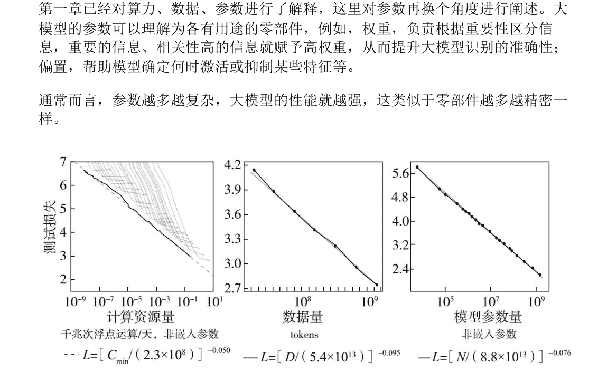

图2-1 神经语言模型的尺度定律注：在人工智能领域，token表示“词元”，指在自然语言处理过程中用来表示处理文本的最小单元或基本元素。

> 资料来源：Jared Kaplan, Sam McCandlish, Tom Henighan, et al., “Scaling Laws for Neural Language Models”, 2020。

### 二、尺度定律的工程化属性

业务要快速扩张，通常需要工程化属性。例如传统中餐馆难以连锁，品类繁多且依赖大厨手艺，复制困难；西餐店则易于连锁，品类少且流程标准化。近年来中餐预制菜的兴起，正是工程化带来的结果。

工程化虽无严格定义，但整体包括系统化思维、模块化设计、标准化操作、可重复流程、自动化实施与规模化应用。具备工程化属性的业务更容易实现快速发展与成本下降。尺度定律的发现增强了人工智能的工程化属性，为发展提供了新思路。

过去学术界更偏爱探索新算法、新结构以提升能力，但这条路工程化不足。原因有二：一是算法改进具有随机性，与研发资源并非线性关系，扩充10倍人员未必产出新算法；二是研发人员能力参差，难以标准化复制。因此即便希望提升AI在业务中的作用，如何增加算法研发投入也难以决策。

# 尺度定律：大模型的工程化加速器

尺度定律为大模型打开了一条清晰的工程化路径——通过不断放大参数规模、数据规模和计算规模来拉升能力，从而让研发变得更像工业化操作。

- 第一，算力硬件如 CPU、GPU、TPU 等以及训练数据，本质都是标准化资产，扩展性强、部署方便，成本下降路线也相对明确。
- 第二，算力、数据与模型表现之间存在可预测的关联。这让提升决策变得简单粗暴：买一批显卡扩算力、堆一批数据、把参数再拉大，性能基本都会上去，而且在大多数情况下，投入增加产出就会增加。

于是大模型进入了性能狂飙的阶段。

### 三、尺度定律的落地效果
幂律规律不仅说明大参数、大数据、大算力能带来能力提升，也提醒我们“大”是有天花板的，随着规模持续放大，收益会逐渐递减。这两点指引都在实践中得到验证。

第一，靠堆料触发能力涌现。沿着参数、数据、算力提升的路线走，模型出现了“大力出奇迹”的现象：在推理、记忆、创作等下游任务上，性能出现大幅度、跳跃式的跃迁，从量变走向质变，这就是能力涌现。商业上也就意味着，加大资源投入就能换来更强的表现。

第二，帮助企业做资源最优配置。尺度定律能让研究员和使用者在训练时找到效率最高点。比如依据幂律关系画出曲线，预估不同规模模型的表现，挑选最合适的模型尺寸；再比如在固定模型规模下，估算需要多少数据量。提升性能时也能先算好参数和数据的配比，避免资源浪费。

> 资料来源：万俊，《大语言模型应用指南》，电子工业出版社，2024年。

在算力配置上，OpenAI 和谷歌都给出了经验数值。OpenAI 的经验是，每提高10倍算力，数据集约需扩1.86倍，模型参数约需扩5.5倍；谷歌的经验则是数据集和参数都约需扩3.16倍。

需要留意的是，这些倍数关系建立在论文里的数据集上，换了数据集或处理方式，倍数会发生变化。

总体来看，借助尺度定律就能回答资源投放、效果预判等关键决策问题。它迅速成为大模型设计与训练的核心工具，参数量和算力大小也成了衡量模型强弱最直观的显性指标。

### 四、尺度定律的边界与展望
尺度定律对发展起到了关键推动作用，但并非无懈可击，主要短板有两点。

第一，尺度定律是训练损失与参数规模、数据规模之间函数关系的经验归纳，不同数据源或模型结构会得出不同的函数。特别是能力涌现，虽然大家知道“堆料”能触发，却不清楚底层机理是什么，这降低了人工智能的可解释性，也难以界定涌现的安全边界。

第二，目前尺度定律在语言模型上验证充分，视觉等多模态场景尚未建立类似“下一个词预测”的自回归机制，缺少对应的尺度定律分析。

从发展历程看，尺度定律不是提升性能的唯一路径，但它是一个重要里程碑，也是当前最受关注的变化。

对业务实践而言，堆料思路仍然管用，优先选用参数大、算力足的模型服务，理论和实践都有支撑。

尺度定律常被称作大模型的“第一性原理”，是预训练阶段发现的规律。核心定义是：模型的性能如准确率、损失等，与参数量、数据量、计算资源量存在稳定关联，三者增加，性能往往显著提升，且会出现小模型无法企及的跳跃。

参数可以类比为模型的零部件，参数越多模型越复杂，能力通常越强，就像机械设备零部件越多越精密。

尺度定律强化了人工智能的工程化属性：系统化思维、模块化设计、标准化操作、可重复流程、自动化实施、规模化应用。比如提升性能，可以批量采购显卡、批量扩增数据、持续扩充参数，大部分情况下投入增加产出也会增加。

对业务的启示是，在当前阶段，通过增加参数量、数据量、计算资源量来提升大模型能力依然有效。

## 第二节 让大模型更懂业务：有监督微调实战

你可能会问：不同行业、场景、任务对大模型的要求差异很大，通用模型真的能胜任吗？直接买来用效果会不会打折扣？

这种担忧很正常。只做完预训练的模型通用能力不错，但在特定下游任务或定制化需求面前，表现往往不够理想。正如前文所述，预训练只是起点，后续还需要打磨，通过特定训练和参数调整，也就是有监督微调，让模型真正好用。

本节聚焦有监督微调，说明模型如何在特定领域提升精准度，也回应一个常见疑问：如果不想自研大模型，又觉得即买即用的模型不够贴合业务，该怎么办。

## 一、为什么需要微调
仅经过预训练的模型在实际业务中常遇到三类限制，导致可用度下降。

第一，专业化要求高。医学、金融、法律等领域有专属术语和特定使用场景，模型若只懂表层语言就无法理解专业指令，交互质量会下降，应用场景受限，实用性大打折扣。这些领域就需要额外做特定训练，即微调。

第二，合规性要求严。金融、法律、政务等对数据安全和隐私保护要求严格。大模型在这些场景既能处理海量文本提升效率，也可能因缺乏领域数据而水土不服。于是需要在合规范围内，用安全数据对模型做微调。

第三，资源有限。从零研发专属大模型可行性低，大多数企业缺乏自研能力，成本高且易浪费。企业自有数据也往往不足以支撑从头训练。更实际的做法是基于通用大模型，再结合少量稀缺的领域数据做微调。这种“先通用后定制”的思路很常见，就像装修先有标准设计，再按个人喜好调整。

在这些场景下需要做的就是有监督微调：在预训练基础上，用有监督数据集训练，提升指令遵循能力。

有监督与预训练的自监督相对。自监督靠海量网络文本做“前文预测下个词”的学习。有监督数据则是人工标注的结构化、高质量、规模相对小的数据集。

有监督微调能高效利用基础模型，节省从零训练的时间和算力，在保留原有知识的基础上强化特定任务能力。简单说，是让模型适应任务，而不是让任务迁就模型。

## 二、微调怎么做

### （一）微调的技术
微调属于专业操作，实践中通常由客户与服务商开发人员协同完成。下面只作原理性介绍，便于业务选择。

> 资料来源：万俊，《大语言模型应用指南》，电子工业出版社，2024年。

微调技术大致分两类：全量参数微调和高效参数微调。全量参数微调是对所有参数进行更新。高效参数微调则是冻结原参数，增加网络结构和少量新参数，只训练新增部分。

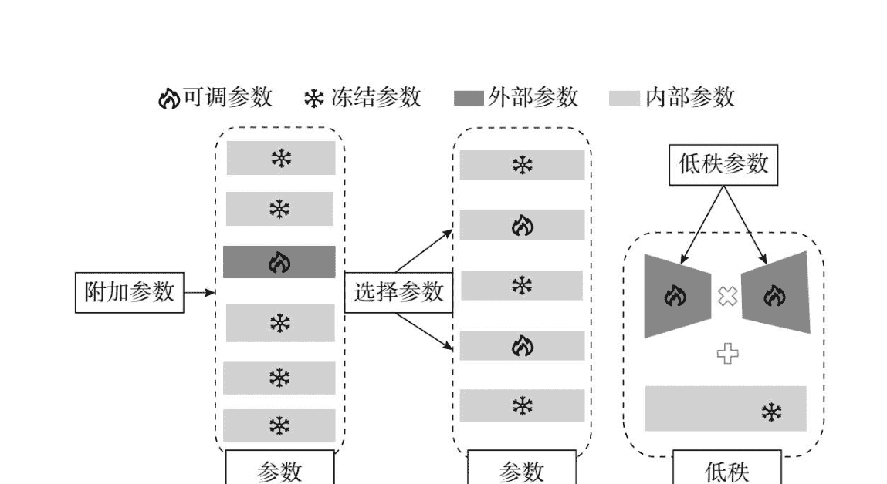

**图2-2 全量参数微调和高效参数微调**

资料来源：CSDN。

一般来说，全量微调效果更好，但大模型参数量巨大，全量调整资源消耗高且未必必要。当前主流是高效参数微调，其中 LoRA 最受欢迎。

LoRA 的思路是在固定模型线性权重的基础上，用少量低秩矩阵参数实现权重微调。相当于给大模型装一个“外挂”，通过升级外挂达到修改参数的效果。

> 资料来源：Edward J. Hu, Yelong Shen, Phillip Wallis, et al., “LoRA:Low-rank adaption of large language models”, 2021。

LoRA 提升了参数效率，节省算力，能快速适配新任务且灵活。据论文实验，训练 GPT-3 175B 时，LoRA 微调显存占用约 350GB，远低于全参数微调的 1.2TB，训练速度提升约 25%。业界正基于 LoRA 迭代更少资源、更好效果的方案。

### （二）微调的流程
微调以预训练模型为起点，用特定数据集重新训练，通过反向传播调整参数，使预测输出与标注差距最小化。典型流程如下：

- 1. 第一步，由使用者或与服务商共同明确微调任务、领域和目标效果。
- 2. 第二步，收集相关数据集并清洗、标注，提升数据质量和多样性。微调中质量比数量更重要。
- 3. 第三步，选择预训练模型，设定学习率、训练轮数等超参数，启动微调训练。
- 4. 第四步，评估微调后模型在目标任务上的表现，不达标则调整数据或超参数重新训练，迭代直至满足需求，再部署到应用中验证。

## 三、微调的效果和收获
微调能带来多方面改善。

- 1. 第一，增强特定场景下的指令遵循能力。模型在领域数据上训练后，更能捕捉输入输出关系，准确执行指令。例如医疗场景微调后，能更好理解医学术语和病症描述；金融场景微调后，能理解杜邦分析、布莱克-斯科尔斯模型等指令。
- 2. 第二，优化工具调用效果，能把用户需求准确翻译成工具调用指令。微调后模型更清楚工具边界。例如在商业数据分析中，用户要求“分析销售趋势并预测未来一年销量”，模型会优先调用分析工具而非可视化工具。
- 3. 第三，调整输出语言风格。角色扮演中可让 AI 更有个性，减少机械感；也可针对不同平台生成适配文案，提升营销效果。
- 4. 第四，降低应用成本。微调避免从零研发，有时用小参数模型微调就能达到大模型效果，成本显著下降。实践中基于轻量级大模型微调，效果可匹敌旗舰模型，成本可降 10 倍以上。

总结来说，有监督微调对大模型落地至关重要。它既保留通用能力，又针对特定领域强化专属能力，同时把资源集中在刀刃上，节省通用能力的重复开发成本。

仅做预训练的模型难以完全匹配丰富的下游场景，因此需要有监督微调。

有监督数据是人工标注的结构化、高质量、规模相对小的数据集。

微调技术分全量参数微调和高效参数微调。后者只更新部分参数，省资源高效，是主流方案，其中 LoRA 为代表。

微调可增强指令遵循能力、优化工具调用、调整输出风格、降低应用成本。

## 第三节 让模型价值观对齐：人类反馈强化学习

微调后模型能力提升，但在实战中仍有障碍。比如“三观不正”，输出逻辑通顺却违背道德、伦理、法律和价值观的内容，对企业是重大风险。

还有“无法定义”的问题，人类能直觉判断结果好坏，却难以清晰描述生成过程。比如骑自行车，学会很快，却说不清怎么学会的。评判一段内容是否幽默生动也同理。为此需要模型对齐训练，通过对结果的反馈，让模型自己找到符合人类偏好和需求的生成方式。

如何确保输出符合人类偏好？微调后需要增加对齐环节，常用技术就是人类反馈强化学习。它通过训练让模型回答更贴合用户偏好，高效修正风格和安全性，让企业使用更安心。

## 一、用奖励驱动算法寻找最优策略

### （一）强化学习的理念
人类反馈强化学习由“人类反馈+强化学习”组成。

先看强化学习。起源可追溯至20世纪50年代，研究者通过动物学习和条件反射探索人工智能。经典著作《强化学习导论》奠定了理论基础。

核心思想是：模型在观察环境状态后选择行动，接收环境返回的奖励信号，通过试错学习最优策略，使累积奖励最大化。

这像动物园训练动物。动物不一定明白指令与动作的逻辑，但做对动作就得食物，做错就无奖励，很快学会对应关系，最终表现出投篮、鼓掌、骑车等智能行为。

> 资料来源：张奇、桂韬、郑锐、黄萱菁，《大规模语言模型》，电子工业出版社，2024年。

“奖励”在模型中由另一个算法给出。实践中会构建奖励模型，通常是深度神经网络，根据模型行为或输出生成奖励信号，模型据此不断更新策略。训练目标是最大化奖励值。简单概括，就是用奖励模型来训练大模型，奖励模型的准确性和效率至关重要。

### （二）强化学习的优劣
强化学习有三点优势。第一，自适应学习，能在动态环境中做出高质量决策，即随机应变。第二，不依赖大量标注或明确监督，只要定义目标和交互接口，就能在未知环境中探索学习，即高效自学。第三，能学习复杂策略，进行多步序列决策并考虑长期效果，即排兵布阵、从长计议。

这些优势推动了游戏、自动驾驶等场景的应用。例如强化学习训练的 AI 在《刀塔2》5V5 模式中击败人类玩家；在《雷神之锤III》中 AI 更高效、策略成功率高且善于合作。

挑战同样明显。

首先，奖励函数难以构建。幽默、价值等任务奖励信号模糊，模型难以学习。

其次，奖励函数易出错。举例，若把“安静学习”设为奖励，学生可能为获奖励而不提问，偏离学习目标。模型训练中也常出现类似偏差。

> 资料来源：Gabriel Dulac-Arnold, Nir Levine, Daniel J. Mankowitz, et al., “Challenges of real-world reinforcement learning:definitions, benchmarks and analysis”, 2021。

> 资料来源：《离职OpenAI后Lilian Weng博客首发！深扒RL训练漏洞，业内狂赞》，新智元，2024年12月6日。

最后，模型可能为最大化奖励采取危险、不道德或不合预期的行为。如把“高分”作为奖励，学生可能作弊，偏离教育初衷。

为此研究者引入人类反馈，在算法训练师之外增加人类高级训练师。

### （三）人类反馈
问题出在奖励模型，人类反馈就是通过人工评价来辅助或替代它。

人类反馈形式多样：

- 1. 专家示范，通过展示理想行为帮助模型理解正确决策。
- 2. 评价性反馈，直接对输出给出好坏评价，作为奖励信号。
- 3. 纠正性反馈，在训练中指出错误帮助模型学习。
- 4. 指导性反馈，给出具体指令告诉模型下一步该怎么做。
- 5. 隐式反馈，通过点击、停留时间、身体语言等行为间接推断偏好。

引入人类反馈带来提升：

- 1. 为大模型提供明确价值判断标准，注入价值导向。
- 2. 人类干预加速学习进程，更快找到最优策略，节省时间资源。

- 让大模型更透明，信任度自然提升。像医疗诊断这种强依赖可信度的场景，可解释性的增强就显得尤为关键。
- 能按用户不同的偏好口味来定制服务，实现真正的个性化。

## 二、三个核心步骤

以有监督微调后的大模型为起点，人类反馈强化学习通常拆成三步走：先收反馈、再训奖励模型、最后做策略优化。

### （一）反馈收集
模型做出判断之后，由人类来审视并给出评价。常见的采集方式有：通过交互界面直接给模型行为打分；让人类在决策过程中实时参与、即时点评；借助问卷和在线评价收集大规模意见。
数据采集时要重视代表性和多样性，一般会引入多元参与者、多元任务，并借助随机抽样、分层抽样等手段来保障。

### （二）奖励模型训练
拿到人类反馈后，就要训练一个奖励模型。核心目标是让它学会“用人的标准打分”，从而为下一步模型优化提供靠谱的信号。

### （三）策略优化
依据更新后的奖励模型对模型进行迭代，这一步就是策略优化。以训动物为例，是连续重复同一动作几十次，还是交叉训练一组动作？是先从简单动作入手，还是直接练高光动作？不同选择带来不同效果。模型的迭代同理，面对奖励信号的变化也有多种策略路径。

> 资料来源：John Schulman, Filip Wolski, Prafulla Dhariwal, et al., “Proximal Policy Optimization Algorithms”, 2017。

业界常用的是PPO近端策略优化算法。本书不展开技术细节，只讲思路和长处。
PPO的精髓是稳扎稳打、向最优奖励靠近。它在目标函数里引入旧策略与新策略产生动作概率的比值，并把这个比值限制在一定区间内，从而让策略变化更平滑、学习更稳定。

同时PPO允许对同一批样本做多次更新。每次更新后会对比新旧策略的差异，分数更高就保留，下滑就回溯找问题。通俗说就是留住表现最好的那版。

举个做菜的例子：厨师用同一批食材，从一份初版食谱出发，反复微调。每一次只改动一点点做法，尝过再改，逐步逼近最美味的版本。这样能高效利用样本，迭代也比较稳。缺点也很明显：资源消耗高，生成人类反馈、训练奖励模型的成本都不低。

### 三、省去奖励模型直接训练

> 资料来源：Rafael Rafailov, Archit Sharma, Eric Mitchell, et al., “Direct Preference Optimization:Your Language Model is Secretly a Reward Model”, 2023。

DPO直接偏好优化是较新的探索，核心想法是去掉奖励模型。不再先用人类反馈训奖励模型、再用奖励模型训大模型，而是直接用偏好数据来优化模型。

DPO只有两步：收集偏好反馈、基于反馈直接优化。因为省掉中间环节，复杂度、时间和算力需求都下降了。代价是对手标数据质量要求更高，在复杂任务里拿到足够高质量的偏好数据并不便宜。

总体来看，除了PPO和DPO，研究者还在尝试TDPO、ORPO等方向。对使用者而言，模型对齐人类的技术正朝着更高效、更省资源的路走。

### 四、对齐后的效果

> 资料来源：符尧、彭昊、图沙尔·霍特，《拆解追溯ChatGPT各项能力的起源》。

引入人类反馈强化学习后，模型能力明显改变，主要体现在四点：
- 回复更详实。各类大模型在对齐后往往会给出更长的输出，这是RLHF的典型痕迹。
- 回复更中正。模型倾向于给出比较均衡的表述。
- 主动拒绝不当问题。对违反价值观、法律法规或试图诱导违规的问题，模型会直接拒答，避免踩雷。
- 主动拒绝超出知识边界的问题。对齐后的模型能隐式判断哪些问题在能力范围内、哪些不在，在实际使用中非常重要。

经过预训练、有监督微调再到人类反馈强化学习，大模型基本完成训练阶段，可以进入生产。

人类反馈强化学习本质是“人类反馈+强化学习”的组合。强化学习的核心是让模型在环境中行动、接受奖励并据此改进策略。奖励模型是一个机器学习模型，通常是深度神经网络，根据行为或输出给出奖励信号，模型据此更新策略。

人类反馈强化学习可归纳为反馈收集、奖励模型训练、策略优化三步。
PPO作为常用策略优化算法，优点是步步为营、奖励最优，通过限制旧新策略概率比来保证稳定。
DPO则直接省去奖励模型，用偏好数据直接优化模型。

## 第四节

## 检索增强生成：发挥企业专有数据的优势

大模型的知识并非全覆盖。于是出现两种典型问题：一是回答看似通顺却与事实不符，即幻觉；二是需要用到企业内部等私密数据，无法从公开语料获得。
要把大模型真正接入业务，就必须让它“懂业务”。检索增强生成技术就是一个做法：把海量的企业数据和行业知识做成可外挂的知识库，供大模型调用。

### 一、时效、专业与安全
RAG技术在2020年提出，发展很快。它把检索与生成结合起来，用外部数据源辅助文本生成。
流程是先理解用户问题，检索相关信息，再把检索结果与原问题合并成提示，最后让大模型基于这些外部信息生成答案。

早期研究聚焦于如何通过预训练注入额外知识增强语言模型，现在也在探索RAG与微调的融合，最终目标都是提升生成文本的相关性、准确性和多样性。

> 资料来源：Yunfan Gao, Yun Xiong, Xinyu Gao, et al., “Retrieval-Augmented Generation for Large Language Models:A Survey”, 2023。

使用RAG能带来三方面改善。
第一，提升时效性。预训练有滞后，模型上线时与训练数据存在时间差，对近期事件容易掉队。例如问2024年奥运会获奖信息，若训练数据未覆盖就会答非所问。检索环节能把最新信息补进来。
第二，提升专业性。很多专业数据不公开，如企业内部知识库。RAG可以把大模型与这些私有知识结合起来。
第三，保障安全性。大模型幻觉在新闻等高要求场景风险很大。RAG可以把可信来源限定为企业指定的数据库，数据库外的问题直接不答，数据库内发挥检索理解生成能力，让使用者更安心。

百度推出的企业级RAG方案打通了云资源，支持无限容量知识库存储与检索，平均1.5秒内出答案。解析、切片、向量化、召回、排序等关键环节均可调可配，企业可按业务灵活配置，同时提供企业级安全与稳定性。

### 二、核心部件
一个典型的RAG回答场景如下。

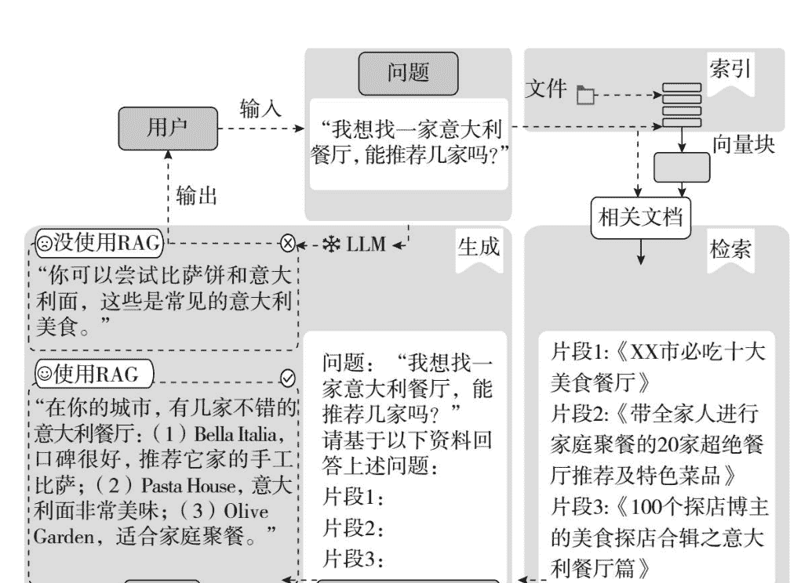
图2-3 RAG技术回答场景示意图

假设用户问：“我想找一家意大利餐厅，能推荐几家吗？”
不使用RAG时，助手可能只答：“你可以试试披萨和意面，这是常见的意大利美食。”速度快但不具体。
使用RAG后，助手会先检索外部数据库，再生成：“你所在的城市有几家不错的意大利餐厅：①Bella Italia，口碑很好，手工披萨推荐；②Pasta House，意面美味；③Olive Garden，适合家庭聚餐。”信息具体、更实用，但会消耗更多计算和时间。

> 资料来源：Wayne Xin Zhao, Jing Liu, Ruiyang Ren, et al., “Dense Text Retrieval based on Pretrained Language Models:A Survey”, 2022。

RAG包含四个核心部件：向量数据库、查询检索、重新排序、生成回答。

#### （一）向量数据库
向量数据库是技术关键。传统关系型数据库按行列表格存储结构化数据，适用于电商、银行、教育医疗等场景。
向量数据库专门用来存储和检索向量，以向量为基本类型，利用数学特性实现距离计算与相似搜索。
百度自研VectorDB支持百亿级向量规模，检索能力强，兼容主流大模型框架。单分片索引内存节省40%，内存利用率提升约2.35倍。

#### （二）查询检索
也叫检索器。把用户问题转为向量，在向量库中寻找语义最接近的知识文本或历史对话。

#### （三）重新排序
也叫重排器。检索往往返回大量上下文，重排技术通过Top-K等规则筛出最相关信息，让模型优先使用高质量内容。

#### （四）生成回答
也叫生成器。负责把检索到的信息整合为最终文本输出。

### 三、基本流程
RAG基本流程为：知识文档准备、嵌入模型、形成向量数据库、查询检索、生成回答。前三步已在部件部分介绍，下面重点讲前两步。

#### （一）知识文档的准备
这是起点。来源包括Word、txt、CSV、Excel、PDF，甚至图片视频。
处理流程：先用文档加载器或OCR多模态模型把非文本转为模型可读的纯文本；再做数据清洗提升质量；最后做文档切片，把长文档切成短块，便于检索和处理。

#### （二）嵌入模型
把文本、词、短语等转为数值向量，捕捉语义和上下文。语义越近，向量距离越近。嵌入模型常借助降维生成密集向量，便于相似度计算和语义搜索。
随后形成向量库，再检索、再生成。

### 四、应用场景
RAG广泛用于对话与文本生成。
智能客服可从企业知识库检索并生成精准解答；法律、金融、医疗等专业领域可结合行业库提供咨询。
新闻机构可用RAG整理多年媒资，严格限定在库内作答，避免错误信息。
在线教育可按学习进度生成个性化材料、试题。
文本摘要可从海量文档中检索相关信息生成简洁摘要。

总结来说，当业务数据动态更新、私有非公开、或专业性强时，借助RAG落地大模型可行性与经济性都很高，且部署门槛正在降低。

RAG结合检索与生成，使用外部数据源辅助生成。它先分析问题、检索信息、合并提示，再由大模型生成答案。
四个核心部件是向量数据库、查询检索、重新排序、生成回答。向量数据库以向量为基本类型实现相似搜索，与传统的行列式关系型数据库有本质区别。

## 第五节

## 智能体：用“超级管家”为业务提效

> 资料来源：《奥尔特曼承认了神秘gpt2！哈佛MIT巡演继续，斯坦福演讲完整版公开》，量子位，2024年5月4日。
> 资料来源：《从刚得诺奖的杰弗里·辛顿到AI Agent｜人工智能的过去和未来》，“复旦管院高层管理教育”公众号，2024年10月18日。

《钢铁侠》里的贾维斯是全能语音管家，能自主解决难题。现实中智能体正扮演大模型与真实世界的连接器，努力成为用户服务的超级管家。李彦宏多次提出智能体是AI时代的网站，是激发大模型潜力最强的方向。2024年5月，OpenAI CEO萨姆·奥尔特曼在MIT称智能体将是AI的杀手级应用。2024年11月，黄仁勋在英伟达AI峰会上说未来最受欢迎的AI有两种：数字工作者即智能体，和物理AI机器人。吴恩达也认为智能体工作流将在2024年推动AI进步，甚至可能超过下一代基座模型。

### 一、自主决策、自主执行
用户对大模型说“帮我设个闹钟”，期望的不是解释闹钟是什么，而是真的去做。智能体的需求就源于此。

如何定义智能体？1986年，美国学者马文·明斯基在《心智社会》中提出，人类思维由众多小型、功能专门的智能体相互作用产生，智能的本质是多智能体之间受管理的互动。
这些智能体可处理特定任务、交换信息、甚至竞争，既可独立也可协作，形成复杂系统产生智能行为。该理论打破了智能集中式的观念，强调分布式与协同，为今天AI智能体的构建提供理论参照。

人类与AI的协同可分为三种模式，见图2-4。

### 图2-4 人类与人工智能协同模式

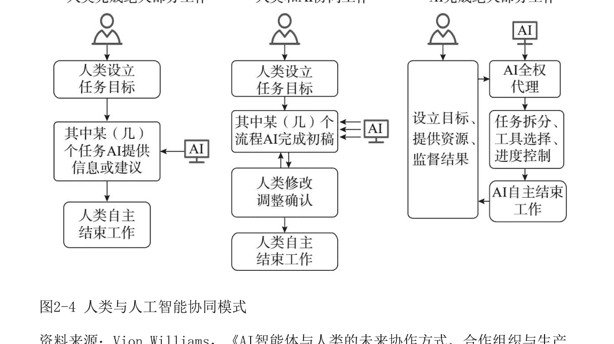

> 资料来源：Vion Williams，《AI智能体与人类的未来协作方式、合作组织与生产空间（万字长文）》。

人机配合大致可以分成三层递进的关系。

第一层是嵌入模式。绝大部分工作仍由人来完成，AI只在个别环节提供信息或给出建议，最终收口和决策都由人掌握。这一阶段的AI更像一个工具。

第二层是副驾驶模式。人和AI共同推进流程，AI参与的范围更广，会先给出方案初稿，再由人审校修改后定稿。这一阶段的AI更像一个搭档。

第三层是智能体模式。AI承担绝大部分执行，人类只需要下达目标并做监督。AI会自主拆解任务、挑选工具、把控进度，最后自行收尾。这一阶段的AI更像一个管家。

从这三种分法能看出，智能体的核心在于自主行动力。它拿到指令后会自行思考、拆任务、做规划、调用工具，整个链路闭环自动化，具备主动性、反应性、自主性和社交性。

主动性指它不只是告诉你怎么做，而是愿意直接去做。反应性指它能快速感知环境变化并做出调整。自主性指它在既定目标下无需持续干预就能完成。社交性指它可以与人、与别的智能体协同交互。

总结一句话，智能体技术把大模型的行动力拉满，让模型越做越像人。它也是目前最能释放大模型潜力的落地形态。

大模型与人打交道主要靠提示词，提示是否清晰直接决定效果。而智能体工作时，只需要一个目标，它就能围绕目标独立思考并采取行动。可以说，基于大模型的智能体，就是大模型从推理到落地的理想载体。

智能体的思路并不新鲜。在强化学习阶段，研究者就引入了智能体的雏形，通过奖惩机制让模型不断试错学习，才有了AlphaGo在围棋上击败顶尖人类的成绩。当时受限于算法、算力、数据，智能体通用性很弱。大模型到来后，智能体才具备了更强的泛化能力，能应对更复杂的场景。

## 二、智能体和大模型的关系

大模型时代的交互语言是提示词，而智能体时代的交互语言是目标。前者看重表述是否精准，后者看重目标是否明确。智能体基于大模型构建，是把大模型能力产品化的关键路径。

### 三、智能体的演进

斯图尔特·罗素和彼得·诺维格在《人工智能：现代方法》里，按感知与能力把智能体分成五类。

一是简单反射智能体。只根据当下感知做映射，没有记忆和前瞻。比如避障小车，检测到障碍就立刻停下或转向。

二是模型驱动智能体。会维护一个内部环境模型，感知结合模型来决策。比如基于内置地图和实时路况规划路线的导航系统。

三是基于目标智能体。先设定目标，再评估行动对目标的贡献度来选择方案。比如扫地机器人为覆盖地面而规划最优路径。

四是基于效用智能体。不仅要达成目标，还要评估不同行为的价值，选择预期效用最大者。比如家庭助手面对用户情绪低落时，可选调节灯光、放音乐、做饭、助眠等，挑最有效的一条。

五是学习智能体。能从历史经验中优化策略。AlphaGo就是典型，通过海量对局不断改进决策。

放眼当下，主流的智能体属于大模型驱动型，能发挥大模型的泛化优势，适配复杂环境，且随模型升级而同步进化。

### 四、智能体的四大核心模块

> 资料来源：Lilian Weng, “LLM Powered Autonomous Agents”, 2023。

工程上，智能体在大模型之外通常再拆出规划、记忆、工具、行动四个模块，可概括为智能体=大模型+规划+记忆+工具+行动。大模型在此扮演大脑，提供推理与规划能力。

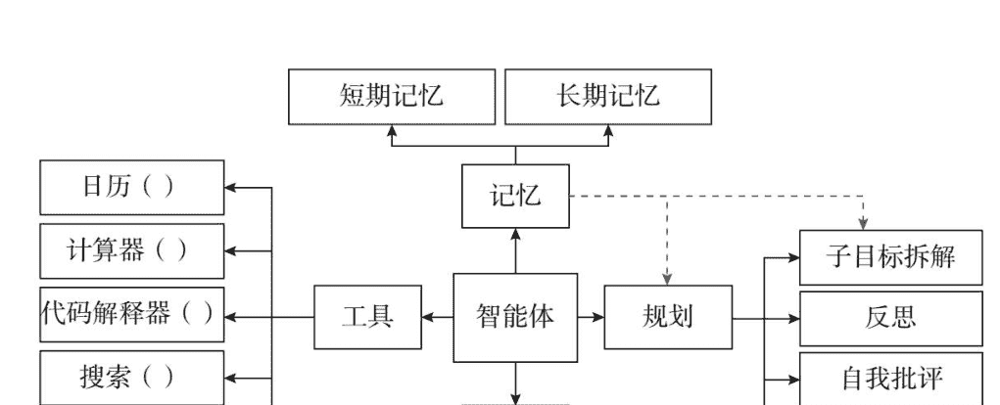
### 图2-5 智能体整体架构

### （一）规划

规划包含子目标拆解、反思自评、思维链。

子目标拆解是把复杂任务拆成更小可控的子任务，按顺序、并行或层级组织并分配优先级，符合人类分步思考的习惯。

反思自评是任务执行中对行为、决策、结果进行复盘并调整，相当于持续学习和越错越聪明。

思维链则是把推理过程展开成中间步骤，让模型展示思考轨迹。

### （二）记忆

记忆分短期和长期。

短期记忆处理当前任务或对话的临时信息，依赖用户输入和模型上下文，用于意图理解、应答生成、状态跟踪，容量有限。

长期记忆存储持久信息，来自历史数据、知识库、参数等，通常借助外部向量库检索，用于个性化服务和推荐。

### （三）工具

工具模块是智能体为达成目标可调用的外部资源，包括API、数据集、硬件接口、软件组件等，如日历、计算器、代码解释器、搜索。工具大幅扩展了能力边界。

### （四）行动

规划、记忆、工具协同后，智能体决定最终动作，通过执行器如屏幕、机械臂输出，完成闭环。

### 五、工作流程

整体流程可简化为感知-规划-执行三步。

### （一）感知

感知是自主性的起点。通过传感器、摄像头、麦克风等采集文本、语音、图像等信息，转成可计算格式。突破纯文本限制，让智能体像人一样实时获取环境状态。

### （二）规划

感知数据经大模型分析、特征提取、模式识别后，提炼规律和趋势。随后规划技术把复杂任务拆解为子任务并定义逻辑关系，推理技术据已有知识和当前状况推导出最优行动方案。

### （三）执行

决策形成后，行动模块调用外部工具和内部资源落地具体动作。执行是价值兑现的关键。

### 六、智能体的应用展望

智能体被视为大模型落地的最佳形态，适用需要自动化和智能化处理的场景，如金融、在线教育、智能客服、政务、IT等。

举例来说，用户想用《黑神话：悟空》里的山西景点做一次国庆三天两晚自驾游，酒店要求性价比高、好评、500元以内。传统方式需手动查景点、做攻略、比价酒店、规划路线，切换3-4个App。

有智能体后，它会自动打开搜索App找相关攻略，自主在旅行App筛选酒店、跨平台比价并完成预订，最后调用地图App生成自驾路线，一份完整行程直接交付。

可见智能体让大模型能力更便捷地进入现实，且能随模型提升而自动优化。

智能体能自主理解、规划决策并执行复杂任务，全程自动完成任务，具备主动性、反应性、自主性和社交能力。

智能体=大模型+规划+记忆+工具+行动，工作流程是感知、规划、执行。

## 第六节 混合专家模型：给业务快速配备一批专家

俗话说隔行如隔山，大模型虽通用，但专业场景仍吃力。全量训练成本高且扩展性差。另一个思路是“行行出状元”，给模型配一批专家，这就是混合专家模型。它用稀疏门控提升容量与效率，让模型既专业又省资源，堪称“跑得快、吃得少”。

### 一、技术原理：“多专家+调度”

混合专家模型的前身是集成学习，先训练多个模型再融合结果。混合专家由多个专家模型和门控网络组成。

多个专家是针对特定数据、领域、任务训练的模型，各自擅长一类问题，并非同时上场。门控网络负责调度，根据输入特征动态决定激活哪些专家、权重如何分配，再加权融合输出。

用《汪汪队立大功》来类比，小狗是专家，莱德是门控网络，任务来了由莱德派合适的狗出场，有时一只，有时一群，甚至中途调整。

概念可追溯到1991年的层次化混合专家系统。2017年引入自然语言处理，2020年进入Transformer架构。2023年混合专家与指令微调结合的论文验证了性能跃升。DeepSeek等实践也证明它能提升性能、降低成本。核心思想是把复杂问题拆解，由专业模型各司其职。

### 二、能力核心：稀疏性，跑得快、吃得少

稀疏性指参数或特征中大量接近零的值，使表达更简洁。优点是复杂度下降、更易解释，且节省存储和算力。

混合专家的稀疏性体现在两点。

一是专家激活的稀疏。面对一个输入，只有少数专家被显著激活，大部分接近零。

二是计算资源分配的稀疏。未被激活的专家几乎不消耗算力。

简单说，就是“用则召之，不用则隐”，极省心省力。

### 三、实现稀疏性的方式

专家容量限制为每个专家设定单位时间处理量，防止过载。

稀疏激活函数让门控输出分布更集中，提升少数专家被激活的概率。

动态路由借鉴网络通信思想，按输入特征实时选择最优专家，保证各专家处理其擅长数据。

### 四、提高大模型的输出质量

输出通常先做Top-K选择再加权平均。

加权平均依据门控概率对各专家输出加权融合，简单有效，前提是概率可靠。

Top-K选择只保留概率最高的K个专家参与融合，减少计算并加速推理，可能牺牲少数低概率但有用的信息。

### 五、应用场景

混合专家适用于机器翻译、文本生成、问答系统等，可根据输入特点匹配最合适的专家，实现多风格写作、异构文本处理等。

总体看，混合专家凭借稀疏架构，能让大模型更好适应不同任务。对用户而言，即便领域很专，也能享受到“千百位专家同时在线”的效果。

混合专家模型由多个专家模型和门控模型组成稀疏门控深度学习技术，包含多个专家和门控网络两大要素。

专家是针对特定数据、领域、任务训练的模型，各自负责擅长方向。门控网络负责调度，根据输入特征决定分配哪些专家及权重，加权后输出。

稀疏性指模型参数中大量接近零的值，使表达简洁，是效率与资源消耗的关键。

稀疏性体现在专家激活的稀疏和计算资源分配的稀疏。

## 第七节 长上下文：更聪明地处理复杂信息

金鱼记忆并非7秒，而是可达数月。反观人工智能，记忆能力一直偏弱。传统模型处理输入较短，文本一旦变长就容易“失忆”，难以抓住完整上下文，在长对话或多细节任务中表现大打折扣，也很难记住用户与模型的历史交互，导致体验下降。

长记忆力：让大模型从“会答”到“真正好用”的分水岭

日常交互远比评测题复杂。读完一部小说、完成一次深度讨论，往往要处理数页到上万字的材料。人们对文本处理容量的期待也在持续上移，从数千字到数万字、从几十页到上百页已成常态。只有当模型拥有足够长的记忆与理解范围，才能抓住语义主线，实现有效互动，提升实用价值。

补上这一短板的核心能力，就是本节要讨论的长程记忆。相较传统方案，这是大语言模型最明显的优势，研究也在不断推陈出新以进一步拉宽处理上限。

### 一、为什么长记忆不可或缺
长文本推理正成为主流，上下文理解随之变得关键。大型模型需要很强的理解力，既要拆解复杂信息，也要识别代词指代。日常对话里常出现“刚才那句话”“前面提到的那个词”“上面那段”等表述，与模型交互时同样频繁，系统必须能精准定位指代对象。让模型归纳论文、总结长报告等复杂任务也很普遍。

落到具体场景更直观。游戏里若记忆上限不足，就难以编写完整且丰富的规则集；客服场景下缺乏长记忆，AI很容易遗忘先前的交谈，整个对话变得支离破碎；法律等专业领域输入材料多为长文档，上限不够就无法妥善处理案卷。类似例子还有很多。可以说，长记忆需求伴随人工智能诞生就存在，大模型明显把这一能力拉升了。也有观点认为，长记忆是一种智力体现，意味着能够深度思考并进行逻辑推演。

> > 资料来源：Saurav Pawar, et al., “The What, Why, and How of Context Length Extension Techniques in Large Language Models—A Detailed Survey”, 2024。在自然语言处理中，“K”表示“千”，是一种简写方式，“4K”实际上指的是“4000”。在上下文长度中，“4K tokens”指的是上下文的长度为4000个tokens。

文本处理能力的强弱，通常用能同时处理的 token 数量来衡量。token 是模型处理文本的基本单元，可以是词、数字、符号或其他形式。OpenAI 旗下的 GPT 系列从 3.5 到 4.0，输入上限从 4K tokens 扩展到 32K tokens，增幅约 7 倍。文心一言 4.0 Turbo 的长输入上限也扩大到了 128K tokens。

目前上限仍在持续攀升，并未触及极限，这也意味着模型的综合信息处理与记忆力在不断增强。

### 二、长记忆能力如何提升
提升长记忆的技术路线不少。相比 RNN/LSTM 时代，Transformer 已把处理范围拉大，若要更进一步，还可借助位置编码插值、渐进式扩展以及注意力优化等手段。下面简要介绍特点。

### （一）Transformer 架构的升级
对比循环结构，Transformer 在注意力层面的处理范围得到明显提升，主要体现在三点。

> > 资料来源：Yunpeng Huang, Jingwei Xu, Junyu Lai, et al., “Advancing Transformer Architecture in Long-Context Large Language Models:A Comprehensive Survey”, 2024。

- 第一，位置编码。通过注入位置信息，模型能理解序列中词的先后顺序。常用技术包括绝对位置编码、相对位置编码、旋转位置编码等。Llama 3 就采用了优化的旋转位置编码来扩展范围。
- 第二，自注意力机制。处理序列时每个元素都能回溯前文，关联范围可超过十万个元素，从而捕捉长距离依赖。
- 第三，并行处理能力。摒弃逐个顺序处理，在训练和推理的预填充阶段并行处理全部元素，提升了长文本效率。

### （二）位置编码插值技巧
这是扩展上限的常用手段。当序列长度超出原始训练范围时，原有位置编码无法覆盖新索引，需要通过插值生成新的编码。该方法提升了模型处理长序列的能力。

### （三）渐进式扩展策略
该策略先让模型从较短序列开始训练，逐步增大长度，直至达到预期目标，例如十万、百万 tokens 级别。

### （四）注意力机制优化
例如 Transformer-XL，通过循环机制处理超出单轮上限的序列；层次化注意力，在不同层级应用注意力，让模型同时学习局部和全局信息。此外还有 LongLoRA。传统 Transformer 的自注意力会考虑序列中每个词对其他词的影响。LongLoRA 引入可训练参数控制稀疏性，采用稀疏局部注意力，即只聚焦与当前词紧密相关的一小部分词，从而降低计算复杂度，同时保持长距离依赖，确保模型识别并维持关键上下文。

### 三、长记忆落地的典型场景
长记忆在记忆、理解、生成等任务上表现突出，适用场景如下。

- 智能客服，能更好地理解用户与系统的历史记录，以及当前对话中的指代内容，提供更精准个性化的服务。
- 医疗健康，可依据患者多年治疗记录结合医院数据库资料，提供更精准判断。
- 在线教育，利用长记忆处理关于学生的更多信息，提供更个性化的服务，多轮对话系统可使交流更贴近真实人类，提升聊天质量。
- 内容创作，可生成更具严谨性与逻辑性的长篇内容。
- 法律咨询，可帮助律师处理更大容量的卷宗并高效提取关键信息等。

总体来看，长程记忆技术能提升模型的理解与复杂推理能力，让系统更博闻强识。对使用者而言，模型更贴近真实对话，也能更高效处理长信息，与普通人处理文本相比优势愈发明显，因而具备更好的经济性。

长程记忆是指模型理解和处理较长文本段落或序列的能力。强弱通常用能同时处理的 token 个数来评估。

提升长程记忆能力的技术包括 Transformer 架构、位置编码插值、渐进式扩展策略以及优化注意力机制等。

## 第八节
### DeepSeek 的低成本效率革命与慢思考范式
2025 年人工智能领域最受关注的事件，莫过于中国大模型 DeepSeek-R1 的发布，其低成本的效率革命让全球从业者为之震动。这款模型深受用户喜爱，成为全球最快突破 1 亿用户的应用。

一亿用户常被视作产品出圈的关键标志。据人工智能产品榜统计，万维网首个站点上线后迎来首个亿级用户约用 7 年；推特从发布到破亿用 5 年 5 个月；微信达到 1 亿用户用 14 个月；ChatGPT 用了两个月；而 DeepSeek 从几乎为零到 1 亿，仅用 7 天。速度之快令人震惊，现象级效应也推动了人工智能在全社会的普及。

DeepSeek 究竟如何做到低成本效率革命和高评价使用效果？是否所有场景都适用？下文将依次探讨。

### 一、产品迭代轨迹
2023 年 11 月，DeepSeek 推出了首款模型“DeepSeek Code”，基于开源 Llama 架构。起点与国内其他厂商差异不大，主要用于代码撰写。同月发布了 DeepSeek LLM，这是具有 670 亿参数的通用大模型，标志其正式进军通用人工智能领域。

2024 年 5 月，发布 DeepSeek-V2 大模型，采用混合专家模型，总参数量达 2360 亿，通过动态分配推理专家显著提升效率，推动模型服务成本明显下降。2024 年 12 月发布 DeepSeek-V3 大模型，超低成本引发业内热议；2025 年 1 月发布 DeepSeek-R1 模型，这是首个完全依赖强化学习的推理模型，性能对标 OpenAI o1，在数学、代码任务中表现突出，成为现象级产品。

DeepSeek 也将通过开源社区与产业合作推动人工智能技术的基础设施化。截至 2025 年 2 月，DeepSeek 表示正在加速研发 R2 模型。2025 年 3 月 25 日，DeepSeek 宣布 DeepSeek-V3 模型已完成小版本升级，目前版本为 DeepSeek-V3-0324。

### 二、慢思考模式解读
从生成内容和输出方式看，大模型可分为两类：一是常规指令型大模型，二是慢思考推理型大模型。

常规指令型大模型遵循指令生成，回答问题时通常直接给出结果，除非有明确要求，否则不会展示推理过程。典型代表有 GPT-4、文心 4.0 等。

慢思考推理型大模型则不同，回答用户问题时，会先展示完整推理和思考过程，再给出结论。典型代表有 OpenAI o3 和 DeepSeek-R1。

如何理解差异？打个比方，常规指令型大模型像一位厨师，顾客点菜后直接上菜，除非被要求，否则不会说明做法。而慢思考推理型大模型像一位侦探，接案后会详细分析案件、逐步推理并讲述过程，最后给出分析结果。

为什么在常规指令型之后还需要慢思考推理型？因为慢思考出现前，学界存在两个明显痛点。第一，传统基于预训练产生的智能依然受质疑，尤其在数学领域。许多顶尖数学家怀疑基于预训练的模型在训练时已学过用于评测的题目，用训练过的数据评测，即使得分高也不能证明具备真正的数学智能。因此学界意识到需要探索具备推理思考能力的模型，而预训练无法实现，于是目光转向后续训练。

正如本章所述，研究人员可通过奖励机制让模型具备推理思考能力。随后 OpenAI o1 和 o3 陆续推出，数学准确率显著改善，在 2024 年美国数学邀请赛 AIME 题目测试中，OpenAI o3 准确率达到 96.7%，超过 OpenAI o1 的 83.3%。

第二痛点是训练语料增长遇到瓶颈。本书第一章提到，人工智能发展依靠算法、算力、数据。实践中，当 OpenAI 预训练语料达到约 15TB 时，研究人员发现很难再通过有效手段构造更有效的预训练语料，或语料构建成本增长过快难以持续。因此学界也意识到，不能再单纯依赖预训练提升智能，需要探索其他智能涌现路径，比如增强模型的推理思考能力，使其更好解决各类问题。

基于这两个痛点，慢思考推理型大模型应运而生。而且不仅在学界，产业应用中也有痛点促使需求旺盛。

以金融行业风控为例。传统风控依赖众多字段，且字段动态变化，不同时期字段不同取值可能产生不同影响。如客户从事岗位面临行业整体风险，还款能力也会变化。这类情况需要基于多变量因果推演和风险概率验证才能得出结论，而这正是传统常规指令型大模型的短板。慢思考推理型大模型则会给出更详细的解答。

### 三、成功的核心要素
根据 DeepSeek 公司发表的论文《DeepSeek-V3：一个强大的混合专家语言模型》《DeepSeek-R1：通过强化学习激发LLM的推理能力》，以及“开源周”分享，还有百度大模型研发实践，我认为 DeepSeek 有四个方面的诀窍，呈现出低成本、高性能的效果。

#### （一）架构层面的创新
DeepSeek 对模型架构进行创新，包括混合专家模型、多头潜在注意力、多文字预测等。

##### 1. 混合专家模型
从参数使用和计算方式看，大模型可分为稠密型和稀疏混合专家型。稠密型每次输入时所有参数都参与运算且处于活跃状态。稀疏混合专家型通常由门控网络、路由模型和一系列专家模型组成，输入时通过门控网络路由到指定几个专家处理，只有被路由到的模型参与计算，其余不参与。混合专家模型在扩展参数时能更好地管理计算成本。

混合专家模型并非秘密武器，不少公司都在使用。DeepSeek 为何效果更佳？传统混合专家模型在确保专家专业化上仍有挑战，难以保证各专家知识不重叠且高度专注，导致知识冗余和计算资源浪费。DeepSeek 的混合专家模型通过两项策略实现专家极致专业化：一是细粒度专家模型，即专家数量更多，可实现更灵活的专家组组合，每个专家参数更小，推理时激活参数更少；二是隔离共享专家，提供通用知识，降低专家间知识冗余，并提升路由专家专业性。

DeepSeek MoE 16B 是 DeepSeek 研发的混合专家模型，其中“B”表示“十亿”，16B 指参数规模 160 亿。

DeepSeek 的混合专家模型有 256 个独立专家和一个共享专家，推理时激活一个共享专家，并由路由模型判断激活 8 个专家参与计算，实现更精准的知识分配。在保证性能的同时计算效率大幅提升，实验中 DeepSeek MoE 16B 总参数 16.4B，每次激活 2.8B，计算量仅为 74.4T/4K tokens，与同性能大模型相比计算量显著下降。

##### 2. 多头潜在注意力
多头潜在注意力是指对注意力键值 K、V 进行低秩联合压缩，减少注意力键值缓存大小，降低推理内存占用，同时引入旋转位置编码保持位置序列信息。可用生活场景理解：想象一位图书管理员需在一座庞大图书馆中快速查找信息，藏书浩如烟海，每本书内容冗长，管理员需在有限书架空间和时间内高效完成工作。多头潜在注意力本质上就是一套让管理员既省力又聪明的操作方法。

首先，管理员会招募多位助手分工合作。如 DeepSeek 的混合专家模型会调动 8 位助手同时行动，每位助手被赋予不同专注方向，如时间、地点、人物、原因等。于是助手可带着明确搜索目标快速扫描书籍并标注重点，大幅提升信息提取效率。

其次，解决“笔记空间不足”问题。传统方法中每位助手抄录大量原文作为笔记，很快会堆满书架，对应计算机显存压力。多头潜在注意力的改进在于给每位助手一本“密码本”，把复杂信息做简单指代，比如遇到“人工智能”相关术语时，不用抄写全文而直接标记为“AI”。这种“低秩压缩”技术既节省空间，又可在需要时还原复杂信息，兼顾成本与准确性。

最后，保证笔记顺序不被打乱。用密码本压缩时可能混淆段落先后。多头潜在注意力引入旋转位置编码，对不同页码内容即使是同一符号，也按不同旋转位置标注。管理员可通过角度差异判断原始顺序，既不影响内容存储，又维持逻辑连贯。对大模型而言，就是在处理长文本时即使压缩信息，也能准确捕捉上下文关系。

通过这三步配合，可实现效率与成本平衡，让大模型回答更快更准确，并流畅处理复杂长篇内容。

##### 3. 多文字预测
大模型推理本质上是对内容相关性的预测。传统模式为单字或单词预测，而 DeepSeek 可进行多个文字的预测。比如猜词游戏，对“我和同学在公园里玩耍，非常开心”。传统模式可能是“我”“和”“同学”“在”“公园”的逐个预测，而多文字预测可一次性预测多个文字，如“我”“和同学”“在公园里玩耍”“非常开心”，给出更完整有意义的片段。这让模型从“挤牙膏式写作”变为“文思泉涌的作家”，通过预判后续内容批量生成连贯句子，使回答更流畅自然，减少卡壳和自相矛盾。

#### （二）训练方式的突破
DeepSeek-R1 并非从零开始，而是基于基座模型训练。在预训练基础上采用强化学习进行后训练。强化学习可使模型通过实时反馈动态优化，具备自我验证、反思和生成长思维链能力。

以 DeepSeek-R1 为例，采用多阶段训练共四步：第一，使用有监督微调进行冷启动数据预训练，为模型提供基本推理结构；第二，强化学习，使模型因准确性、连贯性和对齐性获得奖励；第三，拒绝采样微调，强化最佳推理模式，让模型具备解决各类任务的能力；第四，进一步提高泛化能力，使模型在推理思考过程中更接近人类的推理、思考和自我验证过程。

其中，强化学习阶段 DeepSeek 采用规则化奖励，而非传统人类反馈强化学习中的奖励模型，用 GRPO 群体相对策略优化算法取代传统 PPO 算法，从而大幅降低内存和计算开销。例如在代码生成任务中，直接用编译结果和单元测试通过率替代人工评分，简化训练流程。

#### （三）数据体系建设
为支持训练，DeepSeek 构建了大量语料，包括含有推理和思考过程的训练语料、基于奖励的强化学习训练语料、通用语料等。

#### （四）工程层面的优化
FP 指浮点数，是属于有理数中某特定子集的数的数字表示，在计算机中用以近似表示任意某个实数。

第一个提升手段围绕 FP8 精度在训练与推理中的使用展开。在模型里，参数就是参与数值计算的单元，精度决定了每个参数能保留多少有效数字，常见说法就是小数位数的多少。主流的表达方式有 FP32、FP16、FP8，分别对应 32 位、16 位、8 位浮点。位宽越大结果越精确，也越耗资源。打个形象的比方，FP32 就像实验室用的高精度电子秤，能分辨到 0.01 克；FP16 像家用的厨房秤，分辨到 0.1 克；FP8 则像随身估重的简易秤，只能显示到 1 克。精度下降，显存占用变小，计算吞吐反而上去。

传统方案多用 FP32 或 FP16。DeepSeek-V3 以 FP8 混合精度为核心骨架，DeepSeek-R1 则视版本采用 FP16 或 FP8 混合。做法是把敏感模块保留 FP16 以免失真，非敏感模块切换到 FP8 以换取速度。概括起来就是能省就省，该花也尽量省。

第二个手段是训练阶段用 DualPipe 双向流水线并行来压低空泡率。空泡率指的是流水线并行训练时，GPU 因等数据或等通信而闲置的时间占比，占比越高浪费越严重。好比一条装配线，工人按顺序组装，前面工序提前完成却要等后工序把半成品传过来，这段干等的时间比例就是空泡率。

DeepSeek 的思路是让 GPU 同时干多件事。做法是把前向、反向等训练步骤切得更细，同时布置两条可轮换的流水线 Pipe A 与 Pipe B。A 在处理第一批数据的上半段时，B 已经可以处理第二批数据的下半段。任务切分更细，等待窗口就缩小。

第三个手段是把计算与通信完全重叠，也是降空泡的一种方法。核心是让 GPU 在算的同时就能传数据，避免“只算不传、只传不算”的空转浪费。

第四个手段是混合专家模型的专家负载均衡。MoE 需要动态路由根据输入特征实时决定交给哪几个专家。额外加一个负载监控，实时统计各专家的计算量，下一次分发时优先挑相对空闲的专家。这样每个子模型既不会过载成为瓶颈，也不会空转浪费资源。说白了，既要找对人，也要避免有人累垮有人闲着。

第五个手段是推理阶段的大规模多机专家并行。与之相对的是串行，串行要等上一步结束才能启动下一步，并行则可同时推进。举个例子，病人看病涉及多科室。串行就是医生一个接一个，前面诊断时后面只能等；并行则是第一位医生问诊的同时，其他相关医生就能拿到对应的检查单同时开诊，效率大幅提升。

DeepSeek 还有诸如用 PTX 并行线程执行语言从更底层调度 GPU 等优化，但以上五项是比较关键的方向。相关经验也已开源，为行业整体提升提供了参考。

以 DeepSeek 为代表的慢思考推理型大模型有自己的长处。第一，输出精度高。推理过程中对每一步和中间结果做严格校验，错误率降低，且内置反思机制，会自我复核，类似做完试卷后自行检查。第二，复杂任务处理强，尤其长文本分析与多约束问题。第三，可控性与透明度高，能逐步展示推理链条、中间执行和验证过程，便于核查。

缺点也明显。第一，响应慢，需要深度思考后才输出。第二，资源消耗大。虽然混合专家在同量级模型里速度有优势，但慢思考模型参数通常更大，部署与推理成本高。第三，可能过度复杂化，连“1+1 等于几”这样的问题也会展开深度推演。第四，依赖预设逻辑架构。若训练时推理能力未对齐真实场景的需求，实际使用中推导就可能出错。

所以使用要结合场景。比较适合慢思考的场景有：复杂任务的学术研究、代码开发类编程问题、数学类复杂计算、深度分析和推理类问题。这些都需要逐步推演验证。

不太适合的场景包括：第一，对实时性要求高的即时问答或实时翻译；第二，决策类任务尤其是智能硬件的即时决策，比如对智能家居下指令后先思考半天再给出建议，用户体验不匹配；第三，短文本理解类任务，比如直播间用户评论“产品很棒”，需要立刻互动，十几秒后才回复就失去意义。

判断的一个简便标准是：如果场景要像消防员救火一样做条件反射式快速响应，就用常规指令型模型；如果像哲学家思考一样需要深度推理验证后再给出答案，就用慢思考模型。需注意，即使是慢思考模型也仍有幻觉，核心信息仍需核实或要求给出来源。

总体看，DeepSeek 慢思考大模型在实践效果上已有明显改善，也体现了模型进化。但进化仍在路上。百度文心大模型也在持续迭代，百度智能云已集成 DeepSeek-R1，成本更低、稳定性更高。

从生成内容和输出方式看，大模型可分为两类：一是常规指令型大模型，遵循指令直接输出结果，除非要求否则不展示推理过程，如 GPT-4、文心4.0；二是慢思考推理型大模型，回答前先展示推理思考过程再给出结论，如 OpenAI o3、DeepSeek-R1。

DeepSeek 通过模型架构创新、训练方法创新、数据构造和工程优化四个层面实现了性能提升与成本下降。

在数学模型中，参数用于数值运算，精度指参数的精确程度，可理解为小数位数的多少。常用格式 FP32、FP16、FP8 分别对应 32 位、16 位、8 位浮点，位数越多计算越准确。

# 第三章 机遇研判：大模型成为生产力，时机已到

2023 年大模型浪潮初起时，产业界的感受可以用兴奋、困惑、焦虑概括。兴奋在于看到了此前难以解决的问题出现新解法；困惑在于如何选择使用；焦虑在于尝试后效果未达预期，又担心错过机会。

到 2024 年，第二年，困惑与焦虑明显缓解。以百度智能云千帆大模型平台的调用量为例，持续增长且增速加快。据统计，100% 的央企在不同程度使用人工智能，63% 的中国企业表示正在积极应用大模型。用户需求也从尝鲜转向生产力场景。此时常被问到的问题是：大模型虽好，当下变局多、不确定性高，是否已是使用良机。

时机关键。《管子》说“知者善谋，不如当时。精时者，日少而功多”。斯坦福大学凯瑟琳·M. 艾森哈特也认为把握时机并快速决策是企业成功的关键。本章探讨为何大模型成为生产力的时机已到，企业、机构、个人都应行动。

## 第一节 大模型的波折与前行

要判断时机，先要理解大模型发展的曲折性。

对大模型的观点分化明显。悲观者认为这是又一次泡沫，2022 年末 ChatGPT 爆火后资本涌入，估值飙升但产品能力不足。乐观者认为它是灵丹妙药，能彻底解决问题。这两种说法都偏颇。更客观的是，大模型在曲折中发展，速度比以往技术更快，应用爆发临近。

### 一、科技曲折发展的规律

古人已有深刻认识。“好事多磨”“路漫漫其修远兮”“山重水复疑无路，柳暗花明又一村”都体现了对曲折的认知与期待。

新技术发展曲折是必然，且有规律。高德纳提出技术成熟度曲线，分为技术萌芽期、期望膨胀期、泡沫破裂低谷期、稳步爬升复苏期、生产成熟期。该曲线与现实吻合度高，但并非所有技术都严丝合缝。曲折可能反复出现，人工智能的细分技术也有各自高峰低谷。因此曲线更多是提供理念：既不要盲目乐观形成非理性泡沫，也不要过度悲观错失浪潮。

### 二、大模型的波折和浪潮

短短几年，大模型可概括为三次浪潮、两次波折，目前正站在第三波浪潮起点，迎接人工智能原生应用爆发。

#### (一) 第一波浪潮：早期先行者
OpenAI、微软、百度等率先推动产品化。产品化是关键，早在 2018 年 OpenAI 就发布 GPT 早期版本，但直到 ChatGPT 面世才引发市场关注。OpenAI 与微软合作、Copilot 推出让生成式 AI 进入产业。但当时只有模型炼丹，没有场景，企业并未真正受益。技术与市场需求之间需要应用与体验的桥梁。

#### （二）第一次波折：算力短缺和大模型幻觉
第一次波折来自算力与幻觉。

大模型训练像一场数字马拉松，需要海量算力。2023 年初算力短缺成为瓶颈，各公司抢购芯片加剧紧张。

幻觉则是落地难关，即模型生成不准确甚至虚构内容，产业应用中风险高。

随后算力供给增加、计算升级、抢购退潮，短缺缓解。研究引入监督微调、人类反馈强化学习等，降低幻觉概率。模型从“可玩”转向“可用”，从实验室走向应用。

#### （三）第二波浪潮：现有应用的重构
大模型基础功能完善后，企业开始探索应用，多采用稳妥策略，将大模型融入现有产品改良或重构，而非原生 AI。海外如 Adobe、Notion、Salesforce，国内百度内部重构产品并开放能力。2023 年百度开放初期上百家企业签约，十几万家申请测试，文心一言调用量持续提升。

#### （四）第二次波折：安全可控
应用增多后，可靠性与安全性成为关键。可靠性指系统在不同场景下保持稳定表现，包括算法稳定、数据准确、系统鲁棒等。安全性指抵御恶意攻击，保障数据隐私、伦理价值、系统与算法安全。

只有解决这些，才能赢得信任并交付，尤其对金融、医疗、工业安全等企业级应用。技术上通过数据管理、算法优化、安全防护、价值对齐提升。国内 2023 年 7 月发布《生成式人工智能服务管理暂行办法》，实施大模型备案，降低负面效应。百度是首批备案通过企业之一。

#### （五）第三波浪潮：人工智能原生应用的爆发
大模型是概率模型，内容不确定。RAG 等技术引入检索信息指导生成，大幅提升质量与准确性，幻觉基本消除，模型从“一本正经胡说八道”变为可信可用。

能力、可靠性、安全性的提升，以及使用者信心与经验的积累，使用者不再满足于重构现有产品，而是构建原生应用。必然诞生千万级用户应用。对多数企业而言，更应追求“超级有用”而非“超级应用”。

第三波浪潮可能与第二波同步。B 端应用率先爆发，百度智能云千帆平台已帮助客户开发百万级企业应用。C 端则因自然语言开发，让人人可编程，催生大量原生应用。

### 三、小结
近几年生成式 AI 市场正从“第一幕”向“第二幕”过渡。

“第一幕”回答大模型能做什么。百模大战产品形态相似，如 ChatGPT、文心一言，能力惊艳但用户粘性低，未创造关键价值。

“第二幕”从解决人类问题出发，将新技术作为整体解决方案的一部分创造价值。应用重构或原生应用下沉到垂类问答、数据监测、资料检索、内容分析、工业质检等，也在法律、医疗、电商、政务、文娱、教育、金融等行业提效，对普通人生活带来儿童陪伴、便捷办公、AI 手机等改变。

大模型发展虽有波折，但产业应用已走向百花齐放。

高德纳技术成熟度曲线将技术发展分为技术萌芽期、期望膨胀期、泡沫破裂低谷期、稳步爬升复苏期和生产成熟期。

生成式人工智能市场正从“第一幕”向“第二幕”过渡，第一幕回答能做什么，第二幕从解决问题出发创造价值。

## 第二节 便捷享用新型人工智能基础设施

“要想富，先修路。”基础设施升级带来社会整体跃升。

从 GDP 回顾人类历史，近 200 年人均 GDP 爆发式增长，得益于三次工业革命：蒸汽机、电力、信息化，大幅提升生产效率，且效率提升方式从体力转向脑力。

前两次工业革命赋能体力，第三次信息革命在一定程度上辅助脑力工作，但仍是工具角色。而人工智能尤其是大模型的出现，正从辅助脑力向替代脑力演变，与以往工业革命不同，将彻底改变各行各业。

每一次工业革命都非一蹴而就，关键在于基础设施全面升级。

生产力拐点的信号：大模型基建已经就位

大模型何时真正从技术概念变成生产力？一个明确的迹象是，它正完成从单一工具到新型基础设施的演进。过去的每次基建升级都伴随生产关系的重塑，而现在大模型及其生态正以更快的节奏扮演同样的角色，不仅使用更便捷，而且带来的结构性影响会更深远。

### 一、基础设施为什么越换越快

人类历史上能做到广泛普及的基建升级屈指可数，却每一次都带来生产力的跃迁，而且频率在明显加快。

看电力。1831年法拉第发现电磁感应，很快做出第一台圆盘发电机；1834年雅可比制出首台可实用直流电机。直到1882年纽约珍珠街电厂投运，才真正开始工业化。光有电不够，变压器、长距离输电等配套让供电更稳定，电动机、照明等终端应用才打开场景。美国电网1912年动工，1924年迎来首个高峰；家庭用电占比从1907年的8%涨到1920年的35%，再到1948年的90%。从科学原理到全球能源基建，约90年。

看互联网。1969年阿帕网连接几所美国高校，标志着网络诞生。近三十年后才成为全球信息底座。交换机、路由器、协议让网络更可靠更快，主机、小型机、个人电脑、操作系统与软件的普及才让信息时代铺开。

大模型的节奏更短。2017年Transformer架构提出，奠定技术根基；七年后，模型与配套系统已形成新型人工智能基建。速度前所未见。

这套新型基建由两部分协同构成：一是支撑训练与推理的算力底座，二是模型开发与应用开发平台。两者配合，为AI应用爆发提供更低的门槛、成本与更高效的路径。

### 二、算力底座要覆盖全链路

### （一）新算力形态带来的两道坎
大模型时代算力是关键。云算力大家熟悉，但大模型算力与传统云算力不同。硬件正从以CPU为主的集群转向以GPU为主的集群。GPU在并行训练上的效率优势推动了AI高速发展，市值的此消彼长也印证了这一趋势：CPU龙头英特尔市值持续收窄，2024年12月跌破千亿美元；GPU龙头英伟达同期市值维持在约3万亿美元，稳居全球前列。

从CPU到GPU不是简单换芯片。GPU集群出现三大不同：规模巨大、部署密度极高、互联要求极强。这带来两大难题。

其一是建设与运营花费惊人。上万片卡的集群，仅GPU采购就数十亿元；十万片卡规模则超300亿元。

> > 资料来源：《马斯克：美国电力短缺阻碍人工智能发展》，中国日报网，2023年8月1日。

买贵养更贵。上万片卡的集群占地约14个足球场，机柜间线缆总长1.4万公里，相当于北京到上海直线距离的4倍，日耗电可比肩北京市东城区一天用量。特斯拉CEO埃隆·马斯克多次提醒，美国需尽快升级电力供给，否则两年内将从“缺硅”变为“缺电”，制约AI发展。

其二是运维复杂度飙升。硬件故障不可避免，规模越大概率越高。Meta训练Llama 3时使用1.6万张GPU，平均每3小时一次故障，超过一半来自GPU。GPU对环境敏感，连中午气温波动都会影响故障率。故障意味着成本上升、训练推理中断、业务受损。

这两类挑战对普通企业压力很大，即便是云厂商也必须审慎设计构建与管理方式，屏蔽硬件复杂性，为大模型全流程落地提供简洁易用的算力底座，让用户更方便掌控GPU算力并降低使用成本。

### （二）使用全过程的四种算力诉求
使用大模型时的算力需求可归为四个环节：集群搭建、开发试验、模型训练、模型推理，各有侧重。

集群搭建即采购GPU并连成可用集群，是第一步。用户关心到货后能否快速上线。但GPU型号多样、品牌混杂、管理复杂，且并行计算带来数据传输压力，异构芯片问题常导致数月的调式。

开发试验阶段是在大规模训练前，通过多次小规模试验测试不同架构与参数的效果，制定最优训练策略。此时需要稳定高效的算力与可观测信息来做判断。

模型训练阶段进入大规模训练，最看重稳定性。训练是一个庞大单一任务，全集群需协同，一处出错就触发回滚。GPU昂贵，每停一分钟都是损耗。因此有效训练时长占比十分关键，指机器真实有效工作时间的比例。对大规模集群，该指标每降一个点，就浪费大量算力。

模型推理阶段是模型服务于场景。推理需将问题转为token序列，经注意力计算后逐个生成输出。长文本推理为主流，速度决定体验，成本决定性价比。

即便不同用户不一定走完全部环节，每个环节的痛点都指向算力底座的必要性。考虑到业务成长与硬件成本摊薄，好的底座应覆盖大模型使用的全生命周期，而非只解决单点。

### （三）全链路算力平台怎么搭
科技公司有条铁律：自己的狗粮自己先吃。面对重大技术变化，往往先在内部反复试用、纠错、修复、改良，才能交付稳定产品。这意味着有大模型实践经验的公司更可能做出好产品。

百度从布局深度学习研究院起，便持续在自有产品中应用AI，率先训练文心大模型并用大模型重构产品，算力使用与产品开发中踩过无数坑。

基于自身经验、用户需求与行业判断，百度形成了百舸AI异构计算平台并持续迭代。2024年9月升级至4.0版本，覆盖全生命周期需求，解决不同痛点。

如图3-2所示，百舸AI异构计算平台4.0由四层构成：底层资源层支持异构芯片、高速互联与高性能存储；组件层解决大规模集群的稳定与性能；加速层提升训练与推理效率；顶层工具层提供直观管理界面，让操作更简单。

另外，百舸AI异构计算平台于2025年2月基于昆仑芯P800，发布部署“满血版DeepSeek-R1+联网搜索”服务。

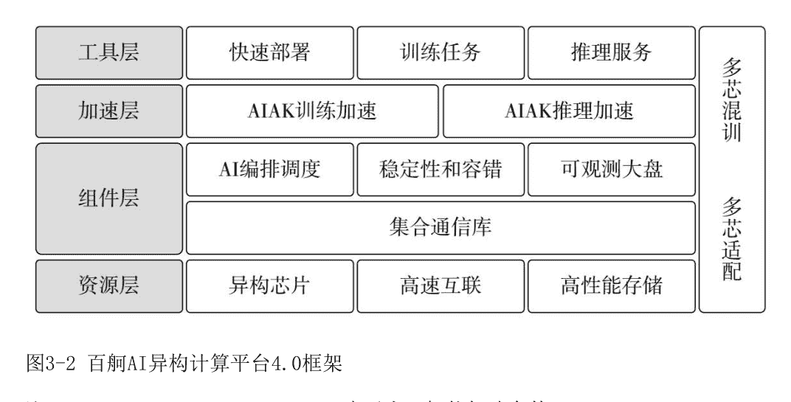

### 图3-2 百舸AI异构计算平台4.0框架
注：AIAK（AI Acceleration Kit）表示人工智能加速套件。

针对集群搭建，平台内置主流训练工具与框架，实现工具层秒级部署，明显节省人力财力。业内云厂商可将调试压缩到1天，基于百舸4.0约1小时即可完成。

针对开发试验，平台配备可观测大盘，全维度覆盖关键指标，为用户提供直观决策依据，帮助更好把控项目。

针对模型训练，平台可将有效训练时长占比稳定在99.5%。一方面未雨绸缪，利用AI算法预测机器状态与故障高发点，避免将负载分配给高风险芯片，降低故障频次；另一方面快速处置，故障发生时实现秒级感知与定位，并可快速回滚，在集群层面实现近乎无损容错。训练既要稳也要快，平台通过更优拓扑设计与自适应路由实现完全无拥塞。

针对推理，平台整体提升推理效率并降低成本，长文本推理效率提升超1倍。

注重各阶段需求、进行全生命周期呵护，才能让用户安心开启大模型之旅。

### （四）异构是必然选择
为何要建异构计算平台？对自建算力中心的客户而言，同一云内运行多种芯片是必然结果，异构平台也是必然选择。

国内企业已积累大规模分布式算力资源，涵盖CPU、GPU等多种芯片、品牌与规格。废弃存量既不经济也影响业务；即使采购新芯，在全球芯片供应紧张背景下，为确保供应链安全与弹性，混合使用不同芯片也不可避免。

面对多芯片并存，统一管理与调度难度极大，尤其在混合部署成一个集群支撑同一训练任务时更是如此。百舸AI异构计算平台支持全面适配与多芯混训，并在万卡规模下将两种芯片混合训练的效率损失控制在5%以内。

异构平台支撑多芯片共存，既能盘活存量，也能支撑未来扩展。

某国有银行的算力提升就是例证。随着业务增长，其算力需求快速攀升，集群从300多个节点扩容至500多个。2023年引入大模型后，需为18个核心业务系统、30多家分行提供AI服务，因而新增大量来自不同厂商的GPU资源。

在百舸平台支持下，该行顺利完成不同型号GPU的部署上线，并实现GPU、CPU算力的规划重组，有力保障300多个大小模型、6000多次训练任务的运行。过去模型迭代一次需一个半月，如今缩短至半天，速度与效果均显著改善。

好的基础设施要向前看。随着大模型产业化，计算集群规模将持续扩大，十万卡集群甚至更高已成趋势。2024年下半年马斯克已建成十万卡集群，并计划扩张至二十万卡。大规模集群势在必行。

百舸AI异构计算平台已具备成熟的十万卡集群部署与管理能力，体现基础设施应先行一步的内在要求。

无论技术还是实践，新型算力基础设施已展现强支撑能力。百舸不仅服务百度自身AI业务，也可满足公有云、自建智算中心、初创企业或成熟企业的多元需求，让用户高效便捷低成本获得所需算力。

### 三、模型与应用平台把门槛打下来
“工欲善其事，必先利其器”。算力无忧后，企业让大模型进入业务仍需经历模型开发、模型调用、应用开发等环节，并非所有企业都要全部经历，而是据业务与能力选择。专业性强的行业通常需要模型微调以适配自身场景，中小企业场景清晰则可直接通过应用开发满足需求。但无论哪条路径都不易。

一方面多数企业缺乏大模型人才，技术迭代快，自研成本高且未必见效。另一方面大模型的通用性正是优势，企业可借助成熟大模型扬长避短，将资源聚焦业务。因此除算力底座外，企业还需要大模型平台。

AI应用要形成真正浪潮，必须进入企业业务成为竞争核心。模型平台所提供的服务与产品不能仅停留在实验娱乐，必须交付生产级服务。

基于此，2023年3月27日百度正式推出百度智能云千帆大模型平台，作为文心大模型企业级服务的唯一入口，提供基于文心一言或第三方开源大模型的服务，并配全套工具链与开发环境，帮助企业精调专属大模型并高效开发应用。2024年9月27日，千帆平台升级至3.0版本。

如图3-3所示，千帆大模型平台分为三层。应用开发层提供企业级RAG、企业级智能体、组件开发等功能，助力快速开发，还包括流程引擎、报表开发、页面开发、应用分发等能力。

模型服务层汇聚百度ERNIE系列大模型，以及百度自研的垂直行业、垂直能力模型，如语音识别、物体检测、图像分割、多种格式OCR等，同时接入国内外主流开源模型。用户可按场景搭配大中小模型，直接调用提升效率。

模型开发层提供完整工具链与多种模型量化算法，高效支撑超大参数模型的微调与定制，支持CV、自然语言处理、语音等传统模型开发，并实现数据、模型、算力资源的统一纳管与调度，为企业提供一站式大中小模型开发体验。

| 层级 | 组件 |
|------|------|
| 应用开发层 | 企业级RAG, 企业级智能体, 组件开发, 流程引擎, 报表开发, 页面开发, 应用分发 |
| 模型服务层 | 百度ERNIE系列大模型, 百度语音系列模型, 百度视觉系列模型, 国内外主流开源模型 |
| 模型开发层 | 数据处理, 模型精调, 模型评估, 模型压缩, 模型部署, 数据回流, 提示词工程 |

### 图3-3 千帆大模型平台层级

千帆平台已能解决大部分企业需求。不同行业特点差异大，百度还推出千帆行业增强版，在通用底座上增强能力，通过体系化工具与组件，让用户在通用底座上叠加行业特色，更便捷开发行业应用。2025年2月，千帆完成对DeepSeek模型的全面接入，加速模型落地的“最后一公里”。此次接入除联网搜索与组件能力外，RAG技术、智能体与工作流均实现对DeepSeek模型的全链路支持。

这些工具实质是降低开发门槛。无论资源能力需求如何，既可自行开发大模型，也可直接基于大模型开发应用，皆能在千帆平台上轻松实现。

有观点将百舸与千帆比作“百度修好了路，准备好造车的工具，用户拿来工具轻松造车上路”。这个比喻很贴切。过去两年大模型与相关系统的演进，让新型人工智能基础设施进入可用、易用、好用的阶段，大幅降低使用门槛与成本，探索创新的时机已到。

新型人工智能基础设施的两大关键部分——算力底座、模型与应用开发平台，相互协作，为AI应用爆发带来低门槛、低成本、高效率的便利。

GPU集群的三大特征是规模巨大、部署密度极高、互联要求极强。

用户算力需求的四个阶段是集群搭建、开发试验、模型训练、模型推理。

百舸与千帆的发展，标志着新型人工智能基础设施已迈入可用、易用、好用的阶段。

## 第三节 大模型与产业融合的破土时刻
植物界的毛竹，生长初期地上几乎不动，地下却在扩展庞大的根系。竹笋破土后短短数周即可长至十几米，所谓“三年不长，一夜千尺”。

新中国产业发展亦有诸多“破土时刻”。1956年经过三年攻关，一汽造出新中国第一辆解放牌汽车，奠定汽车工业基础；2023年C919首航成功，商飞用16年打破海外垄断。多年来央企国企带动千行百业，啃硬骨头、练硬功夫，挺起中国工业脊梁。近年三一重工历时900多天打造全球重工首座“灯塔工厂”，蓝箭航天历经8年试验成功发射全球首枚入轨液氧甲烷火箭。新时代民营企业成为科技创新重要主体，带来新机遇与新动能。

当下正迎来又一个关键时刻：新质生产力破土而出。科技创新，尤其是大模型与生成式AI，是新质生产力迸发的重要内生力量。

当前中国已成为全球AI大模型应用创业的最佳土壤。其一是政府高度重视创新创业，营商环境优良；其二是国内AI科技公司技术积累扎实，能为应用创新提供保障；其三是人才储备丰富，为创新创业提供支撑；其四是拥有全球最完善的工业体系，意味着丰富落地场景与海量高质量数据，应用创新空间巨大。尤其场景与数据，让大模型与中国产业形成天然协作。

一方面，国内产业是大模型的“练兵场”。中国产业门类齐全，几十年积累了丰富数据，既有行业表观数据，也有know-how经验数据，能为大模型训练提供充沛“粮草”，持续提升模型性能。

# 从数据富矿到模型驱动的新增长

当前中国经济进入新常态，增长方式正由粗放转向精细，各行各业都在追求精耕细作式的价值创造。大量价值藏在业务运转里，并非一览无余，更多是沉淀在流程、交互与记录中，像一座座隐蔽却极具潜力的富矿。大模型具备勘探与提炼的双重能力，凭借算法与算力，能够把这些沉睡的数据转化为可用的生产力。

当大模型与产业结合，就会产生一种自我强化的循环：从业务里挖掘数据，创造新价值、催生新业务、带来新增量；新增量又带来更多数据，可进一步挖掘价值、拓展业务、强化增长。这不仅是单点突破，更是全域跃迁的机会。模型与产业的天然协同，正让这种正向循环得以持续放大。

## 第四节 危机往往是技术爆发的土壤

前文已说明当下为何是应用大模型的好窗口，也是第四次工业革命的起点。若仍对不确定性感到犹豫，可以换一个更宽的视角审视技术与时机的关系。历史回溯会发现，带来范式跃迁的技术浪潮，许多都是在动荡与焦虑中起步的。

互联网浪潮与移动互联网浪潮就是典型。它们塑造了全新的数字世界，影响深远，鲜有人留意到，两次浪潮都诞生于危机氛围里。

### 一、信息高速公路的启航
1992年，克林顿在竞选纲领《复兴美国的设想》中提出一项宏大计划：用20年投入2000亿至4000亿美元，构建美国国家信息基础设施，并将其与上世纪50年代的高速公路建设相提并论，广为流传为“信息高速公路”。
1993年克林顿就任后正式推进该计划。但1992年的美国正处下行通道。
1989年美国房地产泡沫破裂，房价回落，储贷机构大面积受损，超过半数破产，史称储贷危机。1989年8月政府拨出500亿美元作为损失准备金托底，危机仍快速扩散。
经济数据印证了下滑：1988年GDP增速4.18%，1989年降至3.67%，1990年1.89%，1991年转负为-0.11%。失业率从1989年初5.2%攀升至1992年约7.5%。与此同时生活成本上升，1986至1991年初CPI从1.9%涨至5.4%，1990年8月海湾战争推高油价是重要推手。
1992年的美国，增速由正转负，房产资产缩水，失业加重，物价抬头。正是这种局面下，美国加大通信基础设施投入，推动互联网发展，并奠定其在数字科技领域的全球领先地位。有观点认为，互联网创造的价值远超美国汽车工业百年累计。

### 二、iPhone与移动浪潮的逆袭
移动互联网的标志性符号是iPhone。第一代产品发布于2007年，而10年前的1997年，苹果正深陷困境。乔布斯已离开公司十余年，产品创新乏力、口碑滑坡，导致滞销积压，市场份额从15%跌至不足5%。1996年媒体称其为“美国偶像的陨落”。1997年二季度公司亏损7亿美元，濒临破产。
乔布斯回归后采取两步走：先控成本、精简产品线，砍掉低效型号；再重塑创新，以“think different”为旗帜，先后推出一体化iMac、便携音乐播放器iPod，直至2007年的首代iPhone，完成从谷底到巅峰的转身。
从当时的外部环境看，前景并不乐观。2007年2-3月，逾25家次级抵押贷款公司申请破产；4月美国第二大次贷公司新世纪金融倒闭；2008年8月房地美、房利美巨亏被财政部接管；9月雷曼兄弟宣告破产，成为美国历史上资产规模最大的破产案。
在这种压力下，苹果选择持续研发。2008年6月发布第二代iPhone 3G，支持3G网络并开放第三方应用。该机迅速占据美国智能手机市场约30%份额，推动当年手机行业增长，并开启苹果数十年的高增长周期。
苹果的回暖也得益于中国在危机期间的坚定投入。2008年后政策支持让中国成为全球经济的重要引擎，中国创业者密集孵化外卖、出行、地图、支付、即时通讯、视频、手游等移动应用。丰富的应用生态与强劲消费力成为苹果增长的助推力。2024年11月在第二届中国国际供应链促进博览会上，苹果CEO库克表示：“非常看重中国合作伙伴，没有他们，苹果无法取得今天的成就。”这股力量同样助推了全球移动互联网浪潮成型。

如果1992年美国在经济下滑时放弃技术信念，没有建设信息高速公路；如果苹果在1997年濒临破产、2008年次贷重压下选择保守，结果会截然不同。坚定创新，往往是穿越危机的核心驱动。上述两例也为大模型应用的信心提供了历史参照，提醒人们抓住技术从生产工具变为生产力的关键窗口。
1992年信息高速公路计划提出时美国正衰退，1997年苹果在危机中以创新突围。

## 第五节
### 小结
从宏观看，GDP的跃升多源于重大技术革命，而工业革命的推进往往与基础设施升级同行。今天大模型与云计算融合，正形成新型基础设施，推动生产力跃迁。
从国家与产业看，新质生产力正在形成，人工智能与大模型能够与中国经济、产业深度配合，既实现点状突破，也带来面上的提升。
从技术史看，带来变革的新技术常在曲折中成长，甚至在危机中萌生，随后展现强大生命力，打开全新机遇。
从企业实践看，众多公司在困难时期仍坚持以新技术研发与应用改善业绩、保持竞争力。
因此当下正是推广大模型应用的良机。人工智能落地后，企业可借模型提效降本、抢占先机、增强竞争力。

# 第四章
## 大模型带来的技术普惠红利
技术普惠意味着可能性扩散。它能提升个体能力，创造更多机会；对社会而言，则加速创新涌现，提升经济与文明水平。
移动支付普及前，支付需要金融机构参与，而后则可随时随地完成，不仅提高效率，还让个体轻松开店。偏远地区的老人也能扫码售卖特产、手工艺品，不必担心假币风险。
互联网是技术普惠的典范，降低信息获得门槛，催生电商、在线教育等新形态，重塑社会运行方式。
科技作家凯文·凯利在《必然》中提出：技术未来的意义不在于让少数人更强，而在于让每个人参与创造未来。
当下最受关注的大模型与生成式人工智能，正承担技术普惠的重任，且对中小企业与初创公司尤为友好。
其一，大模型本身门槛友好，通用性强，调用即可解决多数场景，并以自然语言交互降低使用难度。
其二，技术栈的演进正在化解基础设施与开发平台的复杂度。
其三，科技公司提供的平台如百度智能云千帆大模型平台，通过服务、产品与工具链降低开发成本，例如低代码工具可让用户用一句话搭建智能体，甚至十几岁学生也能拥有专属智能助手。
总体而言，大模型将增长红利分配给每个准备好的企业与个体。本章将从技术栈、开发范式、人工智能原生应用模式及成熟案例展开阐述。

## 第一节
# 技术栈演进如何降低开发门槛
对非技术读者而言，开发常显得晦涩。抽离细节，从中观层面看，技术栈是很好的切口。
技术栈指构建应用所需的各类技术与工具组合。类比盖房，需要水泥、木材、砖石、锤子、锯子、电路图、软装方案等，各类材料工具协同使用。
开发使用的技术栈也在持续变化。

### 一、操作系统如何降低门槛
数十年来，技术栈形成了芯片层、操作系统层、应用层三层结构。芯片层提供硬件基础，开发者需保证软件适配；操作系统层作为硬件与软件的桥梁，负责资源调度与运行环境；应用层面向用户提供交互体验。
操作系统的发展显著降低了开发难度。
八十年前，第一代程序员需手工插拔电缆、转动旋钮，用穿孔板操控机器，效率低且易错。随后汇编语言与汇编器出现，用更接近人的方式描述机器行为，提升效率，这可视为操作系统的雏形。
此后高级语言与编译器诞生，平台演进让开发者无需关注底层软硬件细节，用更自然的表达构建应用，且多数应用可跨硬件运行而不改代码。
软件愈加复杂、硬件愈加强大，操作系统迭代加速。
本质上，操作系统屏蔽底层复杂性并向上抽象为简洁界面。开发者只需聚焦业务逻辑，使用简便语言与工具实现功能。
随着规模提升，单机性能受限，集群出现。操作系统管理的对象从单机进程变为集群与微服务，复杂性质变。
由此云计算兴起，集群管理的复杂性被隐藏，开发者可按需扩缩容，快速响应市场。
大模型的出现重塑人与机器关系，软件开发范式发生关键变化：编程不再是专业人士特权，人人可开发；从C/C++转向自然语言；从面向过程、面向对象转向面向需求。
这将颠覆传统操作系统。云计算体系仍重要，但不再是主角，需要新型操作系统进一步降低门槛。

### 二、云原生隐藏基础设施复杂度
传统IT下，应用与底层操作系统、芯片、存储紧密耦合，兼容性要求高，给开发带来诸多不便。
操作系统众多，Windows、Unix、安卓、iOS、鸿蒙等各异，同一应用在不同系统上可能适配不良甚至无法运行，多版本开发造成浪费。
硬件也影响运行，早期显卡不同2D/3D方案对游戏效果差异明显。应用部署到特定服务器后维护成本上升，服务器升级需同步调整，宕机则服务中断，这也是早期服务器厂商粘性高的原因。
跨基础设施迁移成本高，资源浪费明显。
对广大开发者尤其是中小团队而言，这像“神仙打仗凡人遭殃”。不少团队需为安卓与iOS分别配备队伍，企业常被服务器厂商深度绑定。
传统基础设施类型繁杂、资源浪费严重。实践中企业约30%精力用于业务，70%耗在采购、部署、运维上。
面向痛点，云计算应运而生，云原生开发逐步普及。
云服务借助虚拟化等技术将服务器、存储、数据库、网络统一为可随时调用的资源池。云原生应用基于云环境构建，通常具备容器、微服务、声明式API等要素，并匹配组织架构与持续交付实践。
容器化是关键。容器是轻量可移植的运行环境，可将应用及其依赖打包，不依赖特定硬件或系统。如将对房间布局有强偏好的个人，直接打包房间随身携带，现实不可行但技术可实现镜像迁移，一次开发，多处运行。
微服务将应用拆分为小型独立服务，强制模块化，使开发、测试、部署更易。
声明式API让开发者以声明期望状态代替逐行命令，用“我想要什么”替代“你必须做什么”，更贴近自然思维，便于维护。
整体而言，云原生让开发者摆脱基础设施束缚，专注灵活、可移植的开发，并降低单点故障损失，提升经济性。客户可将70%时间投入业务创新，30%用于基础设施管理。
企业上云已成确定性趋势。据沙利文，中国云服务渗透率有望于2027年达约24%，这一阶段重点是数字化升级。
但云时代开发者仍面临开发平台复杂性，涉及多语言、多算力芯片，大模型尤其依赖GPU而非传统CPU，这正是人工智能原生要解决的问题。

### 三、人工智能原生屏蔽开发平台复杂度
云计算未完全解决问题，异构算力与多语言仍构成障碍，需要新的开发平台屏蔽云原生系统与异构算力的复杂性，提升人工智能原生应用开发效率。
思路之一是高度集成。智能手机发展中，联发科提供Turnkey交钥匙方案，向厂商交付芯片、软件、系统等全套解决方案，厂商贴牌即可，快速抢占市场并推动价格下降。
大模型时代同样可行：打造新操作系统，提升资源集成度，降低开发成本，加速人工智能原生应用普及。
百度智能云的方案是新一代智能计算操作系统万源，通过抽象与封装屏蔽云原生系统与异构算力的复杂性。
如图4-1所示，万源由内核、Shell、工具三层构成。内核层屏蔽云开发平台与芯片差异；Shell层屏蔽大模型开发复杂性；工具层进一步提升效率。
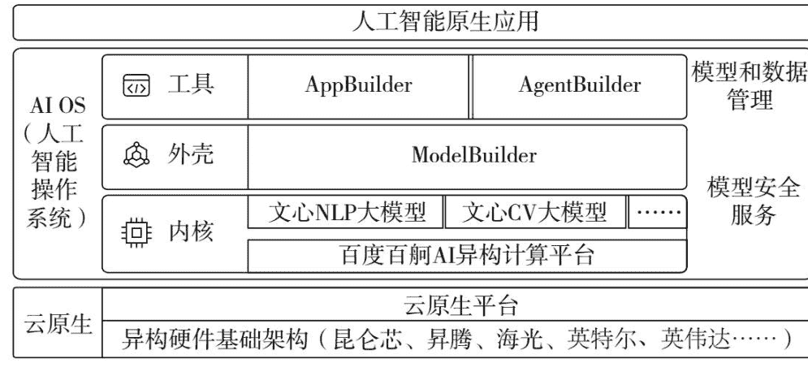
图4-1 人工智能原生应用开发平台
内核层包括百度百舸AI异构计算平台及各类大模型服务。
百舸平台屏蔽芯片差异，支持自由组合，自2011年起自研的昆仑芯是其中重要一环。2024年12月昆仑芯P800万卡集群成功点亮，是国内首个正式点亮的自研万卡集群，未来将扩展至3万卡。昆仑芯对多模型适配良好，率先完成DeepSeek全版本适配。
大模型服务持续更新，涵盖ERNIE 4.0、ERNIE 4.0 Turbo、ERNIE 4.5、ERNIE X1等领先模型，以及ERNIE Speed、ERNIE Lite、ERNIE Tiny等轻量系列，和ERNIE Character、ERNIE Functions、ERNIE Novel等垂直场景模型。语音、视觉等传统能力模型也被纳入，形成大模型与传统模型融合，满足企业复杂需求。
Shell层为千帆ModelBuilder。可对内核模型进行管理、调度、训练、二次开发。多数场景无需从零训练，只需在合适的基座模型上精调或优化提示词即可。ModelBuilder将工具产品化，进一步屏蔽模型开发复杂性，让用户以少量数据与资源快速得到适配业务的模型。
实际使用中需合理组合模型。ModelBuilder提供模型路由服务，自动为不同难度任务匹配最优模型，在效果基本一致时平均降低约30%推理成本。
工具层主要由千帆AppBuilder与AgentBuilder构成，支持智能体与应用程序的快速开发与发布。

AppBuilder 让外部能力的接入与扩展变得很顺滑，用一两句自然语言的描述就能把应用雏形搭出来，精准覆盖特定业务场景，让有价值的创意能够迅速落地。基于该平台产生的服务可以一键分发到百度搜索、微信公众号等渠道，也能以 API 或 SDK 的形式嵌入到自有系统，实现从想法到上线的加速。

企业内部存在大量流程化业务，借助 AppBuilder 的工作流编排可以快速响应。开发者利用开箱即用的模板与组件就能定制业务流程，还可以在不同节点挂载自研特色组件，并在各环节挑选合适的模型调用。如果在 ModelBuilder 上已经完成了微调，同样可以在 AppBuilder 中直接复用，衔接非常顺畅。

万源操作系统带来的不仅是开发效率的提升，更是管理对象的根本变化。过去管理的是进程、微服务，现在管理的是智能，理解成本更低，也更贴近真实业务。

把开发比作盖房子，AI 原生应用开发平台带来的便利就类似建筑领域降低复杂度的技术。预制构件与模块化建造让墙板、楼板乃至整间单元在工厂完成预制，现场只做组装；建筑信息模型作为数字底座，提前内置多种模块设计，提升规划、设计与建造效率。复杂度下降，创造空间随之增大。

减少复杂性，就是增加了创造性。

### 四、小结
人工智能开发并非近几年才出现，大模型的到来确实改变了格局。

过去通用性弱，应用开发呈现烟囱式形态。不同场景需要各自准备数据、训练模型、再做工程化，门槛高、效率低。

现在的主流泛化模型具备跨行业、跨场景的通用与迁移能力。以 MaaS 形态呈现，取代了此前分散独立的烟囱式底座，技术门槛大幅下降。

当前做一个应用，只需在 MaaS 服务中做提示词工程，或基于少量数据进行微调，就能完成新场景适配。定制化工作从最后一段路压缩到最后几步，研发效率显著提升。未来的编程更像愿望表达。

回看技术演进，云原生解决了基础设施的复杂性，AI 原生解决了开发平台的复杂性。这种范式转变必然体现在经营层面。大型模型的实力与前景会形成一种趋势：是否采用人工智能、是否按 AI 原生重构业务，将成为企业间的重要竞争点。

可借鉴的思路是，选择具备面向企业全栈服务能力的厂商，覆盖算力平台、基础模型到模型开发与应用开发平台的全栈能力。只有这样，创新才能更快，成本才能更低。

接下来进入开发实战，通过标准化流程和案例感受低门槛、高便利的开发体验。

技术栈是指构建应用所需的技术与工具组合。

操作系统负责管理硬件和软件，向下屏蔽底层复杂性，向上抽象为简洁交互。

新一代智能计算操作系统需要屏蔽掉云原生系统以及异构算力的复杂性。简化复杂度，即是增加创造力。

## 第二节
# 模型开发轻松上手

对不少企业来说，直接选用成熟的主流模型是最省心的落地方式。百度智能云千帆平台汇聚了丰富类型的大型预训练模型，用户可按场景组合并直接调用，大幅提升业务效率。

与此同时，很多垂直场景仍需要定制化开发。在普及过程中常遇到需要精调来提升准确度，或进一步做预训练开发专业行业模型的需求。

这些需求都能在千帆平台上得到满足。如图4-2所示，ModelBuilder 搭建了完整的大型模型开发链路，涵盖数据管理、模型训练、评估优化、预测服务部署、提示词工程等，且持续完善。这是业界首个上线 DPO、KTO 模型训练方法的平台，并提供独家高质量通用语料与开箱即用的精调样板间。无论是自备数据做精调，还是快速复用行业最佳实践，都能高效支撑。

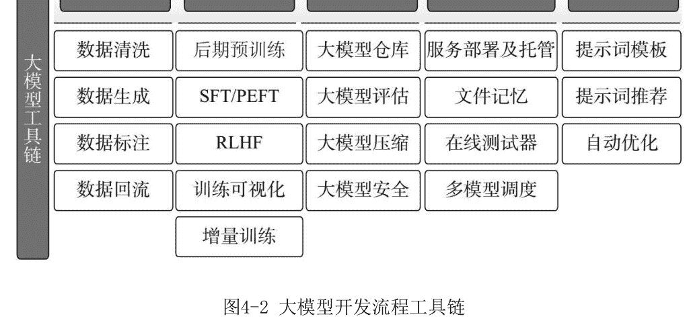

图4-2 大模型开发流程工具链

> 注：PEFT 指参数高效微调。

### 一、步骤化实施微调，更懂你的业务

#### （一）微调优化的准备

在多数指令理解场景中，有监督微调是常用手段。微调需要三个要素。

第一，微调前要做好提示词工程。常见做法是给出清晰的任务说明、限定任务边界；把复杂任务拆分为简单子任务并配少量示例。

第二，准备数据。数千条精标样本通常就能取得不错效果，同时提升数据多样性有助于效果提升。此环节要强调数据质量，避免错误或无意义内容拖累模型。

若已有数据量不足，千帆平台提供自指导 self-instruct 方式生成指令数据。

数据生成指令可参照如下思路：扮演提示词生成器，请生成五条差异化任务指令，要求动词不重复、教学语言多样、任务类型多样、指令长度一到两句、输入为真实数据而非占位符、输出控制在一百词以内等。

第三，设置合理超参数。epoch 是关键参数，可随数据规模调整。例如数据 100 条时 epoch 可设 15，1000 条时可设 10，10000 条时可设 2。epoch 过高虽能提升特定下游能力，也可能导致通用能力遗忘，需权衡。

#### （二）实践案例：作文点评

教育场景中，作文点评需要判断是否切题、结构是否严谨、存在哪些扣分点并给出最终得分。

经精调后，主流模型可成为作文点评专家，既能助力教师快速评分，也能为学生提供针对性提升建议，节省成本和时间。

### 1. 大模型应用的难点
直接用大型预训练模型点评作文，常出现评分不遵循规则、普遍偏高、不能严格按扣分项扣分；解析空泛、建议缺乏指导性；输出格式不合要求等问题，均可通过精调解决。

### 2. 精调的步骤
第一步，准备数据。需要高质量作文语料，题材跨度大、质量分布广，如议论文、记叙文、说明文等，并配真实作文与高质量点评。

若数据不足，可用大型模型构建语料。流程包括：收集高考作文题目；使用多模型生成作文以避免风格单一；设计多套生成提示词以贴近真实质量分布；人工筛选提升质量；设置批改评分提示词；由大型模型批改后人工复核。批改提示词可参考：作为高考语文阅卷老师，请根据批改要求和题目对作文公正严格打分，评分要严格，输出必须严格遵循指定格式。

一、作文批改要求
高考评分分基础等级、发展等级及其他评定。
（一）基础等级
1. 内容项
符合题意中心突出内容充实思想健康感情真挚为第一档，酌情 16~20 分；符合题意中心明确内容较充实思想健康感情真实为第二档，11~15 分；基本符合题意中心基本明确内容单薄思想基本健康感情基本真实为第三档，6~10 分；偏离题意中心不明确内容不当思想不健康感情虚假为第四档，0~5 分。
2. 表达项
符合文体要求结构严谨语言流畅字迹工整为第一档 16~20 分；符合文体要求结构完整语言通顺字迹清楚为第二档 11~15 分；基本符合文体要求结构基本完整语言基本通顺字迹基本清楚为第三档 6~10 分；不符合文体要求结构混乱语言不通顺语病多字迹潦草难辨为第四档 0~5 分。
（二）发展等级
发展等级需与基础等级匹配，不能跨越。
深刻丰富有文采有创意为第一档 16~20 分；较深刻较丰富较有文采较有创意为第二档 11~15 分；略显深刻略显丰富略显文采略显创意为第三档 6~10 分；个别语句有深意个别例子较好个别语句较精彩个别地方有深意为第四档 0~5 分。
（三）其他评定
1. 扣分项
错别字每字扣 1 分重复不计扣完 5 分为止；标点错误 3 处以上酌情扣分；字数不足每少 50 字扣 1 分；无标题扣 2 分。
2. 残篇评定
400 字以上按标准评分扣字数分；400 字以下 20 分以下评分不扣字数；200 字以下 10 分以下评分不扣字数；只写一两句话给 1 或 2 分不评 0 分；只写标题给 1 或 2 分不评 0 分；完全空白评 0 分。

二、作文题目
〈输入作文题目〉

三、待批改作文
〈输入待批改作文〉

四、输出格式
```json
{"详细解析":{"内容项":{"解析":"xxxxxx。","等级":"xx等","得分":"xx分"},"表达项":{"解析":"xxxxxx。","等级":"xx等","得分":"xx分"},"发展等级":{"解析":"xxxxxx。","等级":"xx等","得分":"xx分"},"扣分项和残篇评定":{"解析":"xxxxxx。","扣分":"xx分"}},"缺点和改进意见":{"缺点":"xxxxxx。","改进意见":"xxxxxx。"},"最终得分":"xx分"}
```

经过清洗扩充可得到高质量数据集，同时需准备分布一致的评估集用于衡量调优效果。评估集作文质量分布应与训练集相近且内容不重复。

第二步，模型精调。推荐采用有监督微调，中文生成场景下 ERNIE Speed 作为基座效果较好，兼顾特定场景表现与推理性能。

建议优先使用平台默认训练参数。实践显示精调后打分质量接近人工且更稳定。精调模型的部署与调用成本远低于超大参数模型。以本案例 ERNIE Speed 为例，按调用量计费价格较旗舰级大型模型大幅下降；首 token 平均延迟降低约 50%，总平均延迟降低约 90%。

#### （三）实践案例：角色扮演

大型模型角色扮演即让模型扮演特定角色与用户对话，在游戏、小说等场景中可带来更高效有趣的体验。

为提升沉浸感与留存，需要输出更具情感温度与画面感，并严格符合角色设定如年龄、性别、性格、语气等（见图4-3）。

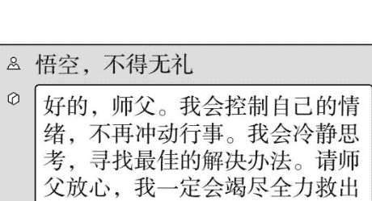
超大规模参数模型直接调用
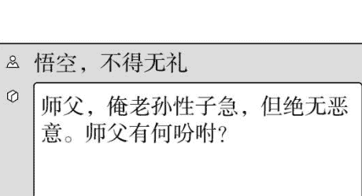
中等规模参数精调后调用
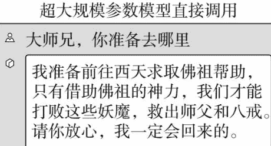
超大规模参数模型直接调用
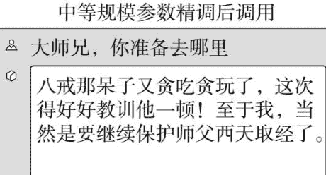
中等规模参数精调后调用
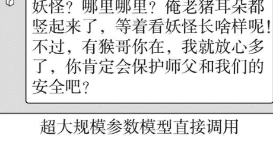
超大规模参数模型直接调用
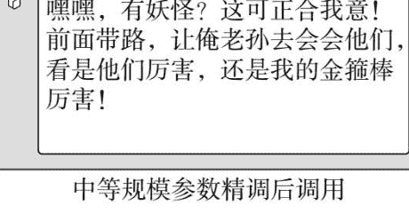
中等规模参数精调后调用

### 图4-3 大模型参数调用示例

### 1. 大模型应用难点
使用通用基础大型模型做角色扮演，常出现输出过于 AI 化、不像真人；角色风格不鲜明、人设不贴合；输出不稳定、偶发串戏等问题，影响用户体验。

### 2. 精调的步骤
第一步，准备数据。角色扮演多为多轮对话，需收集多轮数据；业务角色众多，需覆盖高频角色；关注人设类型分布均衡；数据质量比数量更重要。

数据不足时可使用平台数据增强模块生成样本。划分训练集与评估集后进入下一步。

第二步，模型精调。本案例选用 ERNIE Speed 基座进行评估。评估重点为人设遵循能力与回答质量，即是否符合身份、特色、语气，文风是否贴合场景，是否连贯且内容丰富有建设性。

结果显示精调有效解决了 AI 化、风格不强、串戏等问题，体验更具画面感与沉浸感，同时训练与推理成本大幅下降，调用价格较旗舰大型模型显著降低。

#### （四）实践案例：病历撰写

医生时间宝贵，病历书写占用大量工时。传统人工智能因患者表述不专业效果有限，需通过精调改进。

全诊医学打造的人工智能医疗助理已服务 50 多家三甲医院和 15000 多中小机构。其核心功能之一是实时记录问诊对话、理解方言与医学术语，问诊后两秒生成病历草稿。

为提升准确性与规范性，公司用 20 万份精标病历数据进行精调。精调前文本口语化、专业性不足；精调后用语更准确规范。病历生成准确度提升 45%，医生接诊量提升 20% 以上。

该效果依赖于丰富的行业精标数据。对多数企业而言人工精标成本高、周期长。百度智能云已发布模型蒸馏解决方案，提供完整工具链包含合成数据，帮助快速启动精调。蒸馏能在保持效果的前提下降低模型成本。

整体来看，精调应用范围广泛。需纠正格式、口吻或风格时可用有监督微调或偏好对齐；提示词复杂、要求较高时可准备对应数据做微调；处理边界情况时可尝试微调优化；提示词难以约束的需求也适合进一步调优。

### 二、模型蒸馏，低成本、高性能

大型模型参数量已突破万亿，企业面临算力成本攀升与部署门槛加高的双重压力。DeepSeek 的出现带来新思考，让模型蒸馏成为热点，行业逻辑正从狂堆参数转向精准提纯，训练门槛被拉低。

简单说，模型蒸馏核心是学习与复刻，构建师徒体系：教师模型输出思考过程与高质量回复，学生模型以此为语料快速吸收，实现能力移植，将大型模型推理能力提纯至小模型，使其在特定场景媲美超大模型。

但蒸馏并非简单搬运，需超参数调优等精细操作，否则易出现知识迁移失真。

为让开发者快速便捷稳定完成蒸馏，百度智能云千帆 ModelBuilder 已上线模型蒸馏功能，将原先萃取数据—数据处理—精调模型的三分流程合为一键完成。

接下来以千帆平台的模型蒸馏样板间为例，说明如何用约 3 小时复刻一个与 DeepSeek-R1 表现相当的数学场景模型。

蒸馏能不能真正落地，核心在于源数据的打磨水平。理想的语料既要覆盖有代表性的样本，又要按由简到难的梯度编排，这样教师端的经验才能被充分释放，学生端也更容易吸收转化。

千帆 ModelBuilder 自带近百个经过实战检验的数据集，覆盖文本创作、客服对话、数学判题等多个方向。全部素材均由千帆算法团队完成泛化增强处理，既能强化垂直场景效果，又不丢掉通用知识底座。素材准备完毕后，可通过平台的通用数据集功能新建任务，把材料导入千帆共享存储，形成可直接用于蒸馏的数据集。导入完成后进入平台的模型蒸馏入口，启动完整流程。百度智能云千帆 ModelBuilder 蒸馏 DeepSeek 的流程示例如图4-4。

#### 构建蒸馏数据
依据所选数据集的提示词字段选用教师模型，合成用于训练学生模型的蒸馏数据

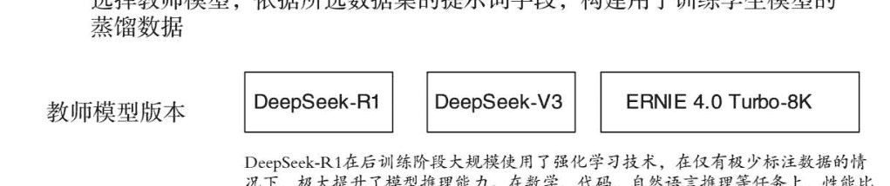

数据来源：平台数据集

选择数据集：预置数据集—模型蒸馏样板间训练集—V1

保留思维链内容：开

蒸馏数据保存位置：平台共享存储

图4-4 百度智能云千帆ModelBuilder蒸馏DeepSeek示例

下一步是确定学生模型。实践中多采用全量更新方式开展训练，超参一般沿用平台默认值即可，例如 ERNIE-Speed-Pro 128K。验证集通常从已生成的蒸馏数据中抽取约5%，用于观察训练走向。

训练收敛后，可挑选部分公开的 GSM 小学数学评估集与 TAL-SCQ 数学竞赛评估集构建自动评测任务，以 ERNIE 4.0 Turbo-8K 担任评判模型并自定义指标，快速拿到结果。

一次实测的评分情况如表4-1 所示。

### 表4-1 实践中一次蒸馏结果的打分情况

| 实验结果 | 直接调用 ERNIE-Speed-Pro-128K | 实验1 迭代轮次=3 学习率=3e-5 | 实验2 迭代轮次=3 学习率=1e-5 | 实验3 迭代轮次=5 学习率=1e-5 | 实验4 迭代轮次=5 学习率=3e-5 | 直接调用 DeepSeek-R1 |

|----------|-------------------------------|-----------------------------|-----------------------------|-----------------------------|-----------------------------|----------------------|

| 语言一致性 | 0.83 | 0.90 | 0.88 | 0.88 | 0.94 | 0.98 |

| 内容一致性 | 0.83 | 0.93 | 0.94 | 0.91 | 0.95 | 0.98 |

| 答案一致性 | 0.84 | 0.91 | 0.94 | 0.92 | 0.94 | 0.95 |

该成本不包括构建蒸馏数据的成本和模型训练成本，推理成本按照tokens后付费的方式计算，DeepSeek-R1的推理成本参考其官网价格。

从表4-1 可看出实验4 蒸馏得到的 ERNIE-Speed-Pro-128K 表现最佳，其内容一致性已接近直接调用 DeepSeek-R1。指标全面提升的同时，模型回复中也出现了问题的推理过程。

由此可得出，蒸馏过程中 ERNIE-Speed-Pro-128K 学到了与 DeepSeek-R1 接近的逻辑推理能力，能够进行正确且严密的推理，而推理成本大幅降低，输入成本约为 DeepSeek-R1 的 1/13，输出成本约为 1/27。

借助蒸馏，用户使用大模型的成本再次下降，性能反而得到提升。

微调优化大致包含三个要点。第一，有监督微调前需要做好提示词工程。第二，准备数据。第三，设置合理的超参数。

模型蒸馏技术的核心是学习与复刻，相当于搭建了一个人工智能师徒体系：教师模型输出思考过程和高质量回复，学生模型将其作为优质训练语料迅速吸收。

第三节
# 人工智能原生应用开发更高效

从 PC 时代到手机时代都能观察到类似规律：操作系统由少数公司主导，如 PC 时代的 Windows、Mac、Linux，手机时代的安卓、iOS；而应用则数以万计，大大小小的厂商不断涌现。

大模型浪潮也将如此。提供大模型产品与服务的公司不会太多，但基于大模型的 AI 应用会丰富多彩。大模型要创造价值，必须与产业结合，才能形成数据飞轮。这也是百度一直强调的“‘卷’大模型，不如‘卷’应用”。

有人会问：业务规模、行业和场景需求差异很大，开发方式是否都一样，会不会更难？

答案是模式会有所不同，但便利程度是一致的。目前人工智能原生应用的开发已演进出四种主流模式：提示词工程、RAG、大模型融合业务执行 Copilot、自主规划与执行智能体。四种模式能力逐步提升，带来更高效、更实用的开发体验，也让应用开发更具实用性和经济性。

### 一、开发模式丰富、便捷
不同需求对应不同开发模式，见图4-5。

提示词工程是通过设计特定输入提示引导模型生成输出，是 AI 原生应用开发的基础，也是理解模型的起点。

RAG 在提示词基础上增加外部检索步骤，把检索信息与原提示词合并后输入模型，能明显提升生成质量。

大模型融合业务执行 Copilot 指能辅助用户完成任务的 AI 系统，如自动编程。它加入了手工编排工作流的能力，提升交互效果并节省精力。

#### 自主规划与执行智能体
自主规划与执行智能体是具备一定自主性的 AI 系统，能自主规划、学习和执行复杂任务。这是当前开发的最高级形态，不仅包含 Copilot 的能力，还具备大幅提升的自主决策能力，是模型走向生产力场景的最佳形态。

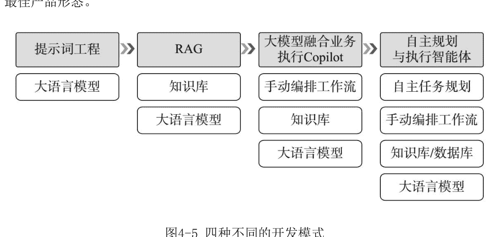

图4-5 四种不同的开发模式

### 二、不同应用场景的合理选择
为提升资源利用率，百度智能云基于实践经验制作了开发场景象限图，帮助用户挑选更合适的技术。

评判指标主要看对外部知识的需求和对模型适应性的要求。纵轴为外部知识需求，自下而上需求越高；横轴为模型适应性要求，从左到右要求越高。

由此可总结：左下角外部知识和适应性要求都低，可用预训练大模型加提示词工程；左上角外部知识需求高、适应性要求低，适合用 RAG；右下角外部知识需求低、适应性要求高，可采用微调优化；右上角两者要求都高，则需要微调+RAG+智能体等组合。

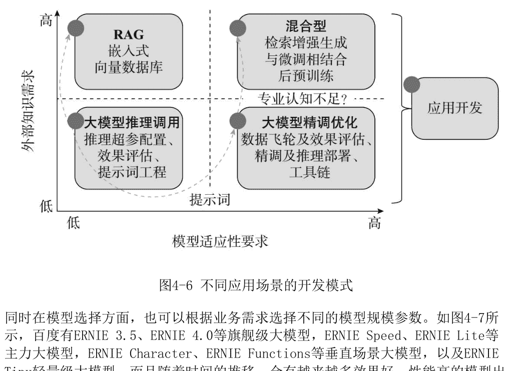

图4-6 不同应用场景的开发模式

模型选择上也可依据业务需求匹配不同规模。如图4-7 所示，百度提供旗舰级、主力、垂直场景和轻量级等多类模型。

#### 最丰富的大模型

| 旗舰级大模型 | 主力大模型 | 垂直场景大模型 | 第三方大模型 |

|--------------|------------|----------------|--------------|

| ERNIE 3.5    | ERNIE Speed| ERNIE Character| ChatGLM2, Llama 2/3 |

| ERNIE 4.0    | ERNIE Lite | ERNIE Functions| Baichuan 2, Stable-Diffusion |

| ERNIE 4.5    | 轻量级大模型|                | XuanYuan, ...... |

| ERNIE X1     | ERNIE Tiny |                |              |

图4-7 百度智能云千帆ModelBuilder大模型种类

ERNIE Speed 适合对性能要求高、需处理海量数据和复杂任务的场景，如自然语言处理、机器翻译、智能问答。ERNIE Lite 适合对模型大小和计算复杂度受限且要求及时响应的场景，如智能客服。ERNIE 3.5、ERNIE 4.0、ERNIE 4.5 适合需要实时信息更新和高准确预测的场景，如金融分析、舆情监测。ERNIE X1 深度思考模型具备更强理解、规划、反思、进化能力，兼顾准确性、创意和文案，适合中文问答、文学创作、逻辑推理和复杂计算。ERNIE Character 适合角色扮演和对话交互，如游戏开发、客户服务。ERNIE Functions 适合在对话中调用外部工具或业务函数的场景，如智能助手、业务自动化。ERNIE Tiny 适合对模型大小和计算资源有严格限制的场景，如嵌入式设备、移动应用，也适用于需要快速推理的任务。

ERNIE Speed 和 ERNIE Lite 两款主力模型完全免费使用，有助于降低成本、提升使用意愿，支持低成本试错，验证后再选更适合的模型提升业务效率。

### 三、提示词工程开发实战
提出一个好问题往往比解决问题更重要。对大模型而言更是如此，使用各类聊天工具时，指令其实就是自然语言。

支撑提问的技术就是提示词工程，通过创建指令或文本输入来引导输出。提示词的好坏直接影响模型输出质量，且适用场景非常广泛。千帆大模型平台提供了一套开发流程和指导方案。

### （一）开发流程
如图4-8 所示，提示词开发包含五个阶段：
第一，准备阶段，准备测试用例，包括典型示例和边界情况。
第二，设计开发阶段，设计初版提示词。
第三，评估阶段，评估准确性、延迟、成本等指标。
第四，优化阶段，上线后根据监控效果持续优化。
第五，完成交付，交付最优提示词。提示词开发也需与模型开发结合。

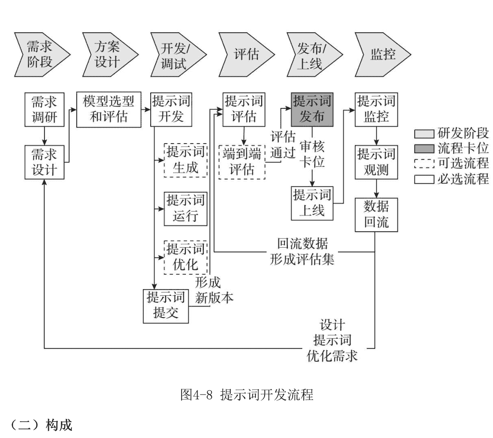

图4-8 提示词开发流程

### （二）构成
提示词形式多样，实践中提炼出通用设计规则以实现工程化和模块化，见图4-9。

举例来说，一个用于评估文本质量的提示词会先设定角色为擅长评价文本质量的助手，要求以公正评判者身份从忠实度、相关性、清晰度、完备性四个维度评估 AI 问答助手回答质量，并给出评分流程、严格规则和 JSON 输出格式。

```
<用户提问>
{{question}}
</用户提问>
<相关文档>
{{reference }}
</相关文档>
<助手答案>
{{answer}}
</助手答案>
```

图4-9 提示词示意图

提示词通常包含人设/角色、任务、输出要求、上下文、示例等要素。

人设/角色是在开头为模型设定身份，引导特定类型结果，如“你是一个将英文翻译为中文的助手”。任务是明确模型要做什么，可用短语清晰定义步骤和目标。输出要求是对结果进行限定或引导。上下文是提供背景信息和待处理输入。示例是给出参照，让模型照着产出，更精准。

并非所有要素都要齐全，核心原则是用清晰准确的限定来引导模型发挥创造性。

### （三）提示词优化：提高编写技巧

#### 1. 明确指令
通过细化表达，明确想要的信息或动作，减少冗余输出。

如图4-10 所示，指令“把Hola翻译为中文”会得到较长解释。优化后写成“将以下西班牙语文本翻译成中文：文本：‘Hola’”，模型输出会更精炼准确。

图4-10 指令示意图

#### 2. 细化询问范围
用指导性词汇收窄范围，能让输出更精确。

例如提问“请列举增值税的税率”，输出会比较宽泛且冗余。优化为“列举增值税的税率，并按如下格式直接返回结果。税率：13%。你列举的结果是：”，输出就会简洁且格式统一，对财务数据处理尤其有用。

把模型想象成学生，它模仿能力很强，提供一个或多个示例能帮助它更好地理解任务。示例可包含背景信息、角色、约束等。

#### 3. 提示词优化：链式思考
分步思考是人类常见方式，能降低复杂度、提升质量。让模型分步骤推理就是链式思考，可把复杂任务拆解为子思考。

比如数学计算场景，可以要求模型一步步输出。链式思考不仅提升质量，也有助于用户学习提问方法，见图4-12。

根据样本量可细分为少样本学习和零样本学习。少样本学习只需提示词中几个示例就能举一反三，适合难以用语言精确描述任务的场景。零样本学习可通过提示词“请一步一步思考”提升能力。

提示词工程全景拆解：从链式推理到实战落地

链式推理演示
20名同学报名参加校内运动会，女生占比一半，报名跑步的女生又占女生总数的一半。跑步的女生到底有几位？按步骤推算。

先算女生基数。总人数20，一半是女生，20÷2=10，运动会里有10名女生。
再算跑步人数。女生里一半参加跑步，10÷2=5，最终跑步的女生为5人。
通过分步推导，答案确定为5名。

图4-12 链式思考示意图

#### 4. 使用场景
##### (1) 信息提取
大模型按用户要求从输入材料中抽取所需信息，如关键词、关系、结构化字段等，常用于办公提效。明确提取目标与输出格式，能显著提升准确度。
##### (2) 问答
模型与用户进行常识问答、专业咨询等互动，广泛应用于客服与咨询。借助背景标注可让模型更好理解问题意图。
##### (3) 分类
完成文本分类、情感分析等任务，侧重文本的情感与主题信息，常见于社交媒体、客服、品牌管理与游戏运营。
##### (4) 角色扮演
为模型设定角色属性，与用户开展沉浸式互动，适用于客服模拟、游戏NPC、陪伴对话等场景。
##### (5) 文本生成
基于提示词生成指定文本，覆盖数字营销、电商文案、医疗说明、办公文档等领域。
##### (6) 代码生成
依据需求生成可运行代码，主要服务于软件开发与自动化脚本。

#### 5. 提示词评估
评估维度包括准确性、响应延迟、成本消耗。常用评估方式有：代码化评估，检查答案是否完全匹配或是否包含关键短语；人工评估，由人工对比模型输出与理想答案；模型自评，用大模型对生成结果进行打分。

#### 6. 实践案例
一家传媒机构需将公开的社会事件与新闻报道按主题归类、梳理脉络并形成标题简报。
当前痛点：来源分散阅读效率低；表述不一导致信息偏差；多家媒体报道时序混乱，整理简报耗时。
期望效果：提速、内容优化、实时监测。
可用提示词工程解决，涉及信息聚类、信息抽取、文本分类。
执行路径：从公开媒体采集并归档信息；按主题聚类；抽取发布时间与核心摘要；同主题新闻按时间排序；由模型生成简报。

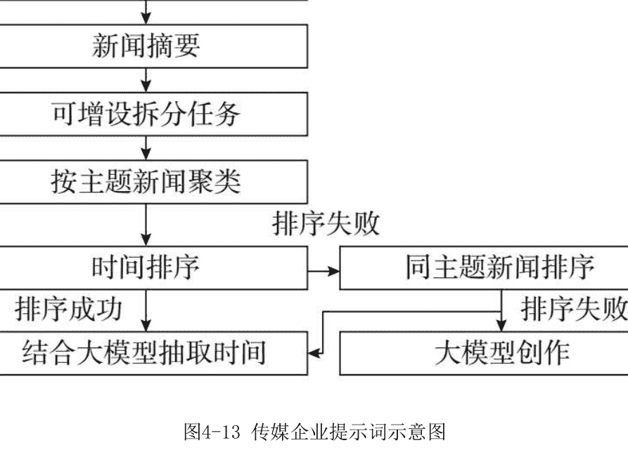
在实际操作中，通过提示词模板设计并反复调试，可提升内容规范性。每一步都加入规则清洗与格式校验，能获得更稳的输出。例如对时间与摘要设计统一模板。总体来看，模糊提示易产生笼统或偏离需求的内容，精准提示则能明确角色、场景、内容与格式，把抽象需求转为具体任务，引导模型按预设路径思考，减少试错成本，释放模型能力。

### （四）DeepSeek与提示词
DeepSeek-R1发布后，部分用户感觉提示词的重要性下降了。以春节后抢火车票的小红书笔记为例，传统指令型模型需要大量设定，如指定“小红书爆款笔记专家”角色、说明受众偏女性、细化标题、封面、正文、结尾、标签等结构要求。

```
##任务
你是一名小红书爆款笔记专家，你的笔记的受众主要是年轻人，尤其是女性，请你按照下面的【主题】写一篇小红书笔记
##要求
1.内容需要是实用、有生活气息的。
2.笔记的风格需要亲切、活泼，同时提供实用的小技巧。
3.小红书笔记需要有吸引人的标题和封面图。
4.正文部分请以分点的方式，清晰明了进行表达。
5.正文中每个小技巧配上表情符号，增加可读性。
6.正文中需要一些个人经历或小故事，让内容更真实可信。
7.结尾增加关键词和标签，比如#春节抢票、#春运攻略、#12306技巧。
##笔记结构
【标题】〈笔记标题〉
【封面图】〈搭配封面图的建议〉
【结尾】〈笔记结尾〉
##主题
春节抢火车票
```
> 图4-14 小红书传统指令型大模型提示词示例
给出如此细致指令后，才能产出合格笔记。
而以DeepSeek-R1为代表的慢思考推理模型，只需一句“写一篇春节抢火车票的小红书笔记”。模型会自行推演出笔记框架：标题、封面、正文、结尾及搜索标签，并推断受众以女性为主而采用对应语气。示例思路如下：
【春节抢火车票攻略 | 手速+技巧=回家团圆！】
春运将至，抢票大战开启！作为老手，整理一份实用攻略助你拿下回家的票。
热门日期提醒
除夕前3天约2月7-9日为最高峰，杭州、广州、深圳等出发至西南方向成都贵阳昆明方向车票极易秒空，建议提前15天关注开票。
返程高峰在正月初八前后，2月17日车票需提前15天抢，记得设闹钟。
抢票攻略
① 预售期与准点开抢
官方预售一般15天，各车站起售时间多为8:00-18:00整点或半点放票，可在12306设置起售提醒。候补升级后单次可候补6个车次最多60组合，兑现截止开车前20分钟。
② 捡漏时段
每日6点、18点、22-23点常释放余票。开车前15天以上退票免手续费，退票潮时可刷12306捡漏。
③ 迂回与跳站
直达无票可尝试中转联程或买长坐短，如杭州-南昌-新余分段。过路车无票可买前一站上车。
④ 多渠道并行
官网、App、电话订票同时进行。
返程省钱
元宵后部分方向出现折扣，如广州-成都、长沙-上海二等座低至数百元；普快硬座也有1.2折左右，适合时间灵活者。
暖心提示
以12306官方渠道为准，避免信息泄露与加价。心态平和，多候补多刷票。旅途可关注列车非遗表演与春晚互动，氛围感满满。
冲刺口诀：早注册、准点抢、多候补、勤捡漏、绕路走、心态稳，祝顺利回家团圆。
#春运 #抢票攻略 #春节回家 #12306 #高铁出行
主页合集已整理图文版攻略。

慢思考模型仅需目的与背景，看似提示词不再重要，实则不然。一方面并非所有场景都适用，提示词工程仍有价值；另一方面，即便使用慢思考模型，规范提示词仍能进一步提升效果。

##### 1. 业务决策类场景
以仓库物流公司自建还是租赁仓库为例，需让模型输出更具参考性。提示词应包含决策目标、决策标准与可选方案。
【输入提示词】
为降低仓储成本，现有两种方案：
①自建区域仓库，初期投入高长期成本低
②租赁第三方仓库，按需付费灵活性高
请按ROI模型对比5年总成本并推荐最优解。
方案数据如下：
1. 自建仓库：
仓库面积1000平方米，建设成本800万元含地租建筑维护，使用年限20年直线折旧；设备购置50万元，使用年限10年直线折旧；管理人员5人，每人每月5000元，社保福利按工资20%计；水电杂费每月1万元；年吞吐量10000立方米。
2. 租赁第三方仓库：
面积1000平方米，租金每月每平米30元；操作费每立方米20元含验收入库拣选包装出库；管理费每月5000元；保险费每年按租金1%计；年吞吐量同自建。

基于ROI模型的5年总成本对比分析
方案①自建仓库5年总成本
固定资产折旧：建设800万÷20×5=200万；设备50万÷10×5=25万；合计225万。
人工成本：月工资5×5000=25000元，社保5000元，年36万，5年180万。
水电杂费：年12万，5年60万。
5年合计：225+180+60=465万。
方案②租赁仓库5年总成本
租金：月3万，5年180万。
操作费用：年20万，5年100万。
管理与保险：年管理费6万，年保险约0.36万，5年31.8万。
5年合计：180+100+31.8=311.8万。
成本对比与推荐方案
自建折旧225万，人工运营240万，总465万；租赁总成本311.8万。
结论与建议
租赁5年成本比自建低153.2万，无固定资产投入，按需付费灵活性高，适合业务波动或中小企业。资金占用风险低，自建需一次性投入850万。推荐方案②租赁第三方仓库。若使用超10年可重新评估自建经济性。
附加说明
吞吐量增长超30%时自建边际成本优势可能显现；自建存在设备更新、政策等隐性成本；若仓储为核心竞争力，自建仍具战略价值。最终决策需结合战略与现金流综合考量。

##### 2. 任务执行类场景
如将快速排序C代码转Python，需明确任务、约束与代码。
将以下C语言代码转换为Python，
要求：
①保持时间复杂度不变；
②使用numpy优化数组操作；
```c
#include <stdio.h>

// 交换两个整数的值
void swap(int* a, int* b) {
    int temp = *a;
    *a = *b;
    *b = temp;
}
// 打印数组函数
void printArray(int arr[], int size) {
    for (int i = 0; i < size; i++)
        printf( "%d" , arr[i]);
    printf( "\n" );
}
int partition(int arr[], int low, int high) {
    int pivot = arr[high]; // 选择最后一个元素作为基准
    int i = (low - 1); // 指向比基准小的最后一个元素

    for (int j = low; j <= high - 1; j++) {
        // 当前元素小于等于基准时
        if (arr[j] <= pivot) {
            i++; // 移动较小元素的边界
            swap(&arr[i], &arr[j]);
        }
    }
    swap(&arr[i + 1], &arr[high]); // 将基准放到正确位置
    return (i + 1);
}
```
常规指令模型也能完成转换并可运行，但在数组交换处常直接翻译C语义，而Python中可一行高效完成，体现慢思考模型对语言特性的优化能力。

##### 3. 小结
业务决策类提示词需覆盖目标、标准、备选方案；数据分析类需明确问题、方法与数据；逻辑验证类需含待证结论、验证方法、要点风险与依据；任务执行类需说明任务、约束条件与具体内容。合理使用提示词如同良好沟通，是获得最佳输出的关键。

```python
import numpy as np

def partition(arr, low, high):
    pivot = arr[high]
    i = low-1
    for j in range(low, high):
        if arr[j] <= pivot:
            i += 1
            arr[i], arr[j] = arr[j], arr[i] #交换元素
    arr[i+1], arr[high] = arr[high], arr[i+1]
    return i +1

def quick_sort(arr, low, high):
    if low < high:
        pi = partition(arr, low, high)
        quick_sort(arr, low, pi-1)
        quick_sort(arr, pi +1, high)

# __name__ == '__main__':
    #使用numpy数组初始化数据
    arr = np.array([10,7,8,9,1, 5],dtype=int)
    print(“原始数组:” )
    print(arr)
    #执行快速排序
```

```python
import numpy as np

#交换两个整数的值
def swap(arr, i, j):
    temp = arr[i]
    arr[i] = arr[j]
    arr[j] = temp

#分区函数
def partition(arr, low, high):
    pivot=arr[high]#选择最后一个元素作为基准
    i = low-1
    for j in range(low, high):
        #当前元素小于等于基准
        if arr[j] <= pivot:
            i += 1 #移动较小元素的边界
            swap(arr, i, j)
    swap(arr, i + 1, high) #将基准放到正确位置
    return i + 1

#快速排序主函数
def quick_sort(arr, low, high):
    if low <high:
```

图4-15 常规指令式模型示例

表4-2 多场景下提示词编写与慢推理模型执行要点

| 业务场景 | 核心属性 | 提示词撰写要点 | 慢推理型模型操作策略 |
|----------|----------|----------------|----------------------|
| 业务决策 | 需要权衡方案、评估风险、选出最优 | 任务目标+备选方案+评判标准 | 推理演绎结合量化评估 |
| 数据分析 | 需深度理解信息、找规律或因果 | 问题描述+数据材料+分析方法 | 触发因果推导与假设检验 |
| 逻辑校验 | 需核查自洽性、数据可信度、方案可行 | 结论+核验方式+风险点 | 自主设计校验路径并排查矛盾 |
| 任务执行 | 需完成代码、计算、流程等具体操作 | 需求+步骤限制+执行内容 | 自主优化流程兼顾效率与正确 |

### 四、检索增强开发实战

### （一）RAG技术应用流程
RAG的原理在第二章已展开说明。借助RAG，模型的幻觉被明显抑制，企业能把自有知识库与模型结合，让模型更懂业务语境，因而RAG成为重要开发手段。

企业级使用与C端不同，需要更大的知识容量、更快响应、更稳效果与更灵活配置，所以RAG也必须做到企业级才有价值。

百度智能云面向企业需求推出企业级RAG，打通云资源后可支撑无限量知识存储检索，问答响应可在1.5秒内完成。解析、切分、向量化、召回、排序等关键环节均可调可配，企业能按业务定制方案，同时具备企业级安全与稳定。

RAG落地分为两阶段。准备阶段：原始文档→抽取→文本分段→向量化→入库。应用阶段：用户提问→检索召回→注入提示→模型生成答案。在千帆平台上以上流程可通过可视化配置快速完成。

### （二）实践案例

##### 1. 政务咨询
某政务单位咨询业务量大，前线人员已超负荷却难满足市民需求。期望通过模型分担压力并提升回复率与时效，进而提高满意度。

需求是基于内部海量私域文档与政策文件建库，打造智能对话问答助手，解答市民对政策内容、办事流程等疑问。

拆解后核心为知识问答、自然语言交互与问答引导，要求准确率高。政务场景涉及私域敏感信息，需抑制幻觉，RAG较适配。

先经清洗、抽取、切分、向量化构建私有库，再以文心一言提供服务。后端向量库对私有库检索，既保障数据安全又发挥模型能力。最终实现私域数据全覆盖、自然语言交互全覆盖、一次性准确率达98%。

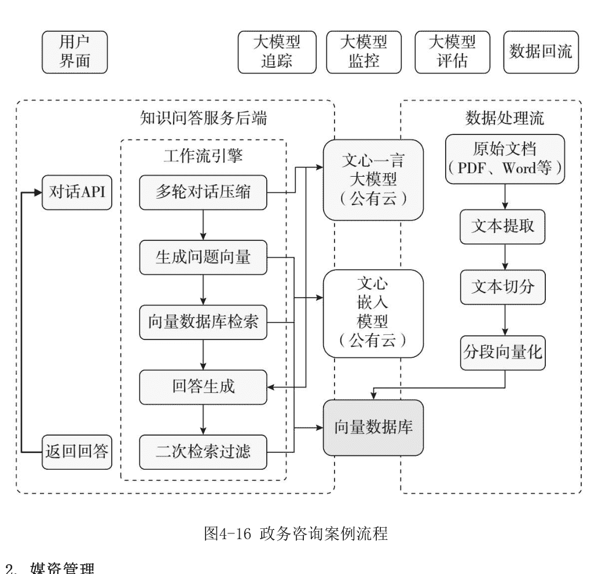
##### 2. 媒资管理
媒体行业媒资库管理复杂具代表性。以澎湃新闻为例，其报道重深度专业，选题高度依赖庞大媒资库以保证权威。

操作路径是在千帆大模型平台创建澎湃专属知识库，覆盖创刊以来全部媒资，约2700万篇文档、文字超350亿。此类体量对切分与召回提出很高要求。

提问后模型以结构化方式呈现事件脉络并给出文献索引，同时具备严格指令遵循。关闭网页检索、限定知识库作答时，若问题超出范围模型会主动拒答，保证信息可控，便于生产使用。

### 五、助手类Copilot的开发实战

### （一）开发流程
助手类应用通过自动化建议或增强工作流来辅助用户，可视为RAG向智能体过渡的形态，适合自动化强度不高的场景。用户可在千帆AppBuilder借助RAG或其他组件搭建应用，再嵌入其他系统后台实现助手功能。

### （二）实践案例
扩新装指扩容、新装、增装或改装供电设备。

某供电所为提升管理效率，所长需实时掌握辖区扩新装情况。传统做法要求业务人员手工拆解当日新装户数、低压/高压户数、报装工单进度、资料录入量等再汇总成日志，过程繁琐重复。

可通过模型自动化。方案是基于千帆平台AppBuilder调用供电所数据库，所长可用自然语言即时查询并自动生成日志报告。

步骤为：先梳理业务流程并明确模型能力，可考虑私域知识导入、文案生成、NL2SQL、知识问答、数据查询、图表生成、澄清、总结、API调用等；再据此生成日志辅助助手。

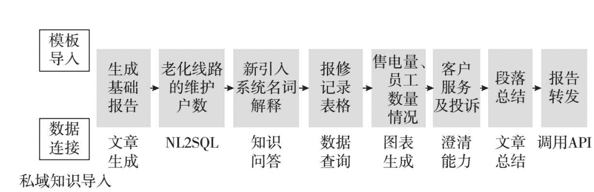
另一案例是某矿山公司日常供电巡检。传统模式知识沉淀难、老专家经验难传承、故障定位难，一线人员要求高却缺系统化建议，现场效率低。

将供电专业知识、经验、规范经RAG与模型融合，打造资深贴身助手。实践显示，上线后知识获取成本降70%、人力成本降20%、运维成本降30%、故障停电时长降30%，运维效能明显提升。

### 六、智能体的开发实战

### （一）智能体的应用与开发分类
智能体是人工智能应用主流形态，即将迎来爆发，将成为新一代内容信息服务载体。门槛低且易上手。

百度秒哒作为国内首个对话式应用开发平台，采用无代码编程+多智能体协作+多工具调用。用户仅用自然语言描述需求即可自动生成应用，实现3分钟生成、1小时迭代。智能体协作矩阵内置多垂直领域智能体，可按任务动态调整策略。平台支持调用百度智能云及第三方上百个工具接口，一键打通商业闭环。

如图4-18所示，一对父母希望孩子饮食健康，提出“孩子不爱吃蔬菜怎么办”。千帆AppBuilder识别意图后判断用户希望构建整体饮食健康应用，经确认后后台自动生成名为“儿童饮食小管家”的智能体，配置完成后即可随时互动，也可分享亲友。

千帆AppBuilder，你的专属人工智能原生应用搭建平台
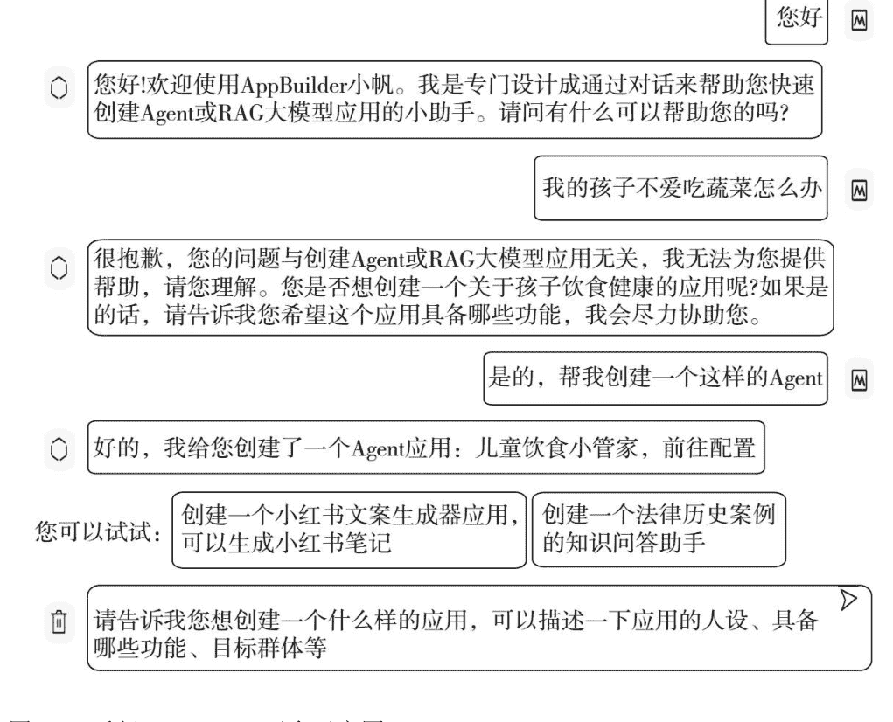
图4-18 千帆AppBuilder平台示意

另一面，智能体的上限很高，多智能体协作可解决更复杂问题，体现低门槛高上限。

实践中常见分为公司类、角色类、工具类、行业类；从开发角度分为自主规划智能体与工作流智能体。

自主规划智能体是在已有应用上接入模型，由模型自主思考回复。

工作流智能体允许把真实业务流程编排成工作流，应用严格按此运行。企业流程多有规律，专业任务更依赖流程。传统数字化多为机械执行，而千帆平台的工作流智能体借助模型意图理解与泛化能力，可把流程变为灵活智能体，像专家一样掌握套路，在复杂局面下做合理决策。

两类智能体均可在千帆平台便捷配置生成。

#### （二）自主规划智能体开发案例：人工智能手机应用
基于模型的人工智能手机应用改变人机交互方式，赋予手机新智能价值。它不仅检索执行命令，更具备理解决策能力的助理。可从简短语音把握上下文、分析偏好、动态适配生活场景，提供高度个性化响应，点餐订房购物等操作流畅，节省时间并高效管理生活。

以肯德基点餐助手为例，该自主规划智能体可用一句话完成菜单获取到订单提交，并把订单推送至指定微信群，实现高度集成。

搭建思路是用户提问触发模型思考并调用组件。以点餐组件为例，云端接收参数后手机端模拟操作完成下单并截图，多模态理解后上报智能体，最后输出结果提示用户。

开发分四步。创建自主规划智能体，登录千帆AppBuilder进入配置页；完成配置，从角色任务、工具能力、结果校验、常识注意事项四方面编写角色指令，并添加获取菜单、点餐助手、微信消息发送等组件；搭建手机助手，模型思考后调用组件，超级手机助手启动对应App，完成启动App、模拟点击、获取信息三项功能；应用调试，输入指令并开启超级手机助手验证点单流程。

例如用户说“请帮我点两杯可乐”，模型先明确需求，调用菜单组件获取信息，再调用点餐助手下单，手机自动打开肯德基App完成下单并跳转支付，用户输入密码即可完成。

#### （三）工作流智能体开发实践：快速培养一位“金牌销售”
车险续保涉及比价下单等复杂流程，常需一两个月，销售需持续提供专业咨询，难度很高。

车险续保售前宝典可分为三阶段八环节，每个环节含大量文档与子流程，见图4-19。企业培养一名金牌销售通常需一到两年。曾尝试对话机器人，但对拟人度、流畅性、理解力与应变力要求高，传统机器人难胜任。借助千帆平台，一个小时即可生成掌握售前宝典的智能体。

在千帆平台新建工作流智能体，可完整配置金牌销售流程，各节点均可调可配，一键发布后可接入百度搜索、微信公众号、企业官网或业务系统。

### 七、小结
不同场景可采用不同开发模式，均可在千帆平台高效低成本实现。若需求不明确或对效果存疑，可先采用初级模式培养信任。展望未来，随着技术演进与成本下降，智能体将成为企事业单位、政务部门乃至个人的首选。

当前模式有提示词工程、RAG、模型融合业务执行的Copilot、自主规划与执行智能体四种。

外部知识需求与模型适应性要求均低时可用预训练模型加提示词工程；外部知识需求高而适应性要求低可用RAG；外部知识需求低而适应性要求高可采用微调；两者均高时需结合微调、RAG与智能体。

提示词通常包含人设角色、任务、输出要求、上下文、示例等。

RAG流程分为数据准备与应用两阶段。智能体是主流形态，分自主规划智能体与工作流智能体。

## 第四节

## 成熟应用一键集成
人工智能落地将遍布千行百业，落地顺序取决于场景与技术契合度。

大模型为企业创造价值主要体现在增收、降本、提效、合规四大方面，直接关联核心竞争力。

对多数企业而言增收与提效最关键。经百度智能云落地验证，客服、营销、代码、知识管理是实现增收提效的最佳路径。

这些领域具备四点特征：场景清晰可快速见效；文本量大可发挥模型文本处理优势，多模态亦可处理图片；具备固定操作流程与套路，模型易于掌握且效率提升显著；对创意要求高，人机协同可释放人力更好发挥创意。

百度智能云据此搭建应用样板间，包括智能客服客悦、数字人平台曦灵、文心快码、知识管理平台甄知等。

### 一、智能客服迈入3.0，更懂用户
客服是企业对外业务的重要支撑与第一触点，关乎品牌第一印象。

人工客服面临招聘难、培训难、扩容难；电子客服常出现答非所问、机械重复。客服痛点也是AI探索重点，模型正提升服务效果。

#### （一）智能客服的迭代
随人工智能发展，智能客服经历了1.0、2.0、3.0版本的迭代。

客服体系三代演进与生成式AI驱动的升级

首代可追溯至2008年前后，依赖手工规则和专家系统实现对话，主要靠关键词匹配配合固定话术模板。门槛高、维护成本重、泛化能力弱，准确率普遍难以突破八成。

次代大致始于2016年，引入自研小规模模型叠加策略规则，能覆盖高频场景。但拟人感不足，对话偏生硬单一，用户体验一般。知识主要靠人工挖掘，精度提升需要持续运营投入。

第三代自2023年起成为行业主线，借助生成式基座与生成式AI实现效果跃升。第三代对话系统理解能力更强，拟人度与友好度提升，输出更丰富，冷启动更快，运营开销大幅下降，已在真实业务中落地。

#### （二）核心指标提升
评价对话系统优劣要看响应时效、语言风格、回答正确度等，最终落脚到用户自服务成功率。在进入第三代前，行业普遍水平在80%左右，很难满足用户期待。

把自主解决占比做高并不容易。用户问题多模糊复杂，文字语音难以说清时需图片视频辅助；一次未解决会多次来访，客服更换后若重复询问，体验会急转直下甚至引发投诉。

生成式基座能带来哪些改变来提升自主解决？

第一是文档问答更强。系统能读懂真实意图，匹配合适答案和方案，支持多轮连贯对话，不会出现丢记忆、机械重复。也能快速学习企业资料库，自动更新问答库，避免话术老化；生成的沟通摘要让接手的坐席迅速上手，避免用户重复叙述。

第二是任务式对话增强。交互中能准确抽取关键信息，提供快捷导航、引导信息录入等，减少用户操作负担。

第三是生成能力让表达更口语化，并结合用户画像实现个性化回复，带来专属感。

第四是多媒体感知能力。能识别图片、视频里的信息，不再局限于文本，大幅降低用户描述问题的门槛。

在这些能力支撑下，对话系统变得更聪明、更像人、更懂用户。作为第三代的代表，百度智能云客悦在生成式基座上完成重构升级，用户自服务成功率突破92%，在行业内领先。

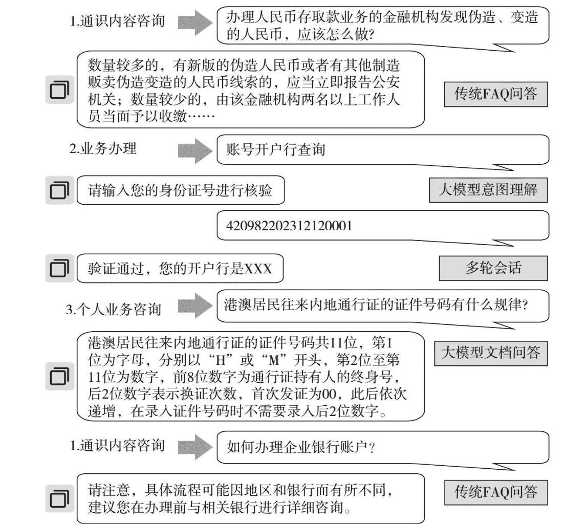
基于生成式基座增强的对话系统已在咨询问询、流程操作、产品营销等场景全面发力。以通识内容咨询为例，应用链路先后涉及FAQ、LLM意图理解、多轮对话、LLM文档问答等。

在金融这类复杂业务对话中，LLM可应对多种提问方式，比如实体查询、属性查询、多属性组合查询、推理计算类提问等。

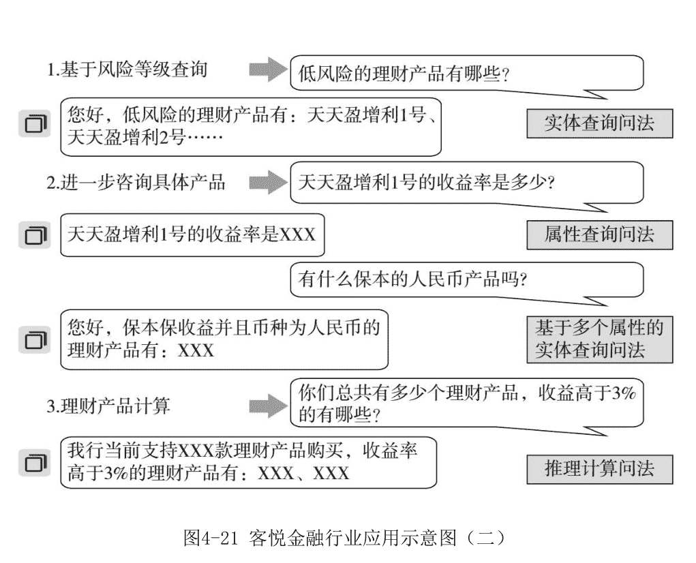

能力越强可用场景越多。第三代并非终点，但对比次代的跃升非常显著，值得体验和引入。

#### （三）便捷部署，降低工作量
好产品要好部署。百度智能云客悦针对部署门槛做了优化，整体分三步走。

第一步是对话流配置。进入平台后选择行业模板创建客服，每个模板自带经典对话流，微调即可上线。传统做法需要3~5名专家投入数月，现在基本开箱即用。

第二步是知识库配置。专业服务离不开企业内部专业知识，平台内置千帆企业级RAG。用户可上传文字、图片、视频资料，系统自动对关键知识进行增强学习，提升问答效果。

第三步是测试与发布。可测试多媒体交互效果，也能让客服以图文或视频形式回复，确认后正式发布。还能为客服配上虚拟形象，更亲和，也可分发到第三方平台。

实践对比显示，配置效率大幅提升。流程操作类多轮对话配置从40人天以上降到10人天以下；知识问答从50人天以上降到5人天以下；泛聊场景从10人天以上降到0.5人天以下。

流程操作：旧方案需人工梳理流程→意图例句+实体同义词+画布节点，耗时>40人天；新方案由LLM生成意图例句和同义词，耗时<10人天。

知识问答：旧方案需知识梳理→FAQ+相似问题，耗时>50人天；新方案实现资料→LLM生成知识增强+FAQ挖掘+切片干预，耗时<5人天。

泛聊：旧方案需人工梳理行业通识+闲聊FAQ+相似问题，耗时>10人天；新方案仅需人设提示词调优，耗时<0.5人天。

#### （四）实践案例
### 1. 旅游领域，为每个游客配一位贴身导游
为提升满意度，澳门特区旅游局通过合作伙伴澳门电讯以H5形式集成智能旅游助手，支持多语种自由切换，能识别需求，回答美景、美食、人文、活动等各类问题，提供吃住行全套指引，准确率超92%，相当于每人自带导游。

##### 2. 全国首个人工智能年兽
在自贡非遗灯会，传统彩灯与人工智能结合，出现全国首个人工智能灯组“年兽贺岁”。高达12米、重超10吨的年兽内置百度智能云客悦对话平台，可幽默实时语音互动，并配合肢体动作和音效，既传承民俗又深受喜爱。从定制开发到开园仅用10天，体现了配置效率。

##### 3. 金融领域，实现更智能对话
一家金融机构提出两类需求：一是行业场景定制，包括定制问答、金融通识、品牌知识；二是通识答复，基于现有客服系统预置提示词，开放百科、闲聊、财富管理等领域问答。结合LLM升级对话并接入虚拟人后，现场观众可用语音与虚拟人互动问答，对话体验明显更智能。

##### 4. 消费领域，百胜中国的数字化
百胜中国旗下肯德基、必胜客等品牌门店近1.6万家，2024年第三季度会员突破5.1亿，数字订单占比约90%。自生成式AI出现后，百胜中国积极探索，并与百度智能云千帆平台和客悦深度合作，上线AI客服系统。

目前AI客服日均处理超15万次消费者沟通，问题解决率接近90%，在辅助人工时响应更快更准，整体效率提升近10%。同时将LLM嵌入客服管理系统，实时评估服务质量，让每一次来访都成为改进样本。

对话系统应用远不止于此，它可辅助机器人与坐席，也能成为金融交易助手、对话式理财专员、招商顾问等。简单说，人工能做的，AI客服做得更好；人工做不到的，AI客服也能实现。

## 二、更真实的虚拟人，带来更好的转化
营销是企业获取利润和拓展市场的关键。虚拟人的广泛应用，正为营销开辟新路径。可担任品牌代言人参与广告直播社交，也可与AI客服结合提升客服形象，且不受时空体力限制，可持续推广互动。虚拟人还能用于教育做虚拟教师，也可在文旅领域作导游或引导员，兼具咨询与文化融合价值。

传统虚拟人受限明显：一是制作周期长成本高，从角色发型服装到建模贴图材质绑定等环节繁复，难以满足快速需求；二是表情呆板亲和度低，动作僵硬，观感不佳。

LLM如何改变？

首先是模态迁移技术，把3D人物、场景、镜头等复杂三维数据迁移为图像、文字、代码等LLM易理解的模态。

其次是多智能体协同框架，将复杂跨模态任务组合起来，最大程度还原专业制作流程，保证3D形象与内容生成效率和质量。

再次是4D绑定技术，确保3D虚拟人表情动作更美观生动，实现生成质量飞跃。

百度智能云在该领域自研4D绑定技术并结合LLM，推出曦灵虚拟人平台，已升级至4.0版本。

### （二）虚拟人的应用
在曦灵平台上，商家可一键生成契合品牌调性的3D虚拟人，从面部细节、妆造发型到风格参考，只需一段文字描述即可生成，并支持细节微调。虚拟人可在不同角度、不同表情下保持高度一致，微表情也自然逼真。

商家可拥有不受时空限制的专属形象代言人，例如销售服装时导入3D设计文件，片刻即可完成快速换装。

面对复杂需求，用户无需拆解，直接把长需求文档交给曦灵，系统可提取关键信息并生成对应场景视频片段。除视频片段外，声音、口型、表情、动作、场景背景、运镜调色等均可由LLM完成。

随着用户从图文转向视频，短视频成为种草转化的有效载体。但传统制作需要专业团队、多个场景拍摄、逐条剪辑，成本高昂。现在借助LLM和虚拟人，制作周期可压缩到分钟级。商家能快速产出贴合营销需求、吸引注意的视频，大幅提升效率和转化。曦灵虚拟人严格遵循品牌规范，具备企业级属性。

## 三、代码高效，企业提效
代码虽非人人所长，却深刻影响企业运转。更快上线抢占市场、更好质量保障稳定、更有序管理确保人员变动时平稳交接，LLM对代码的影响已延伸至人才、稳定与市场层面。

### （一）代码生成，深受喜爱
企业代码管理痛点突出：

版本控制混乱，项目扩大、人员增多后分支错综复杂，追溯困难、进度受阻。

代码质量参差不齐，编码风格差异导致可读性与维护性差，低质量代码进入库形成隐患，协作效率下降，出现“代码屎山”。

代码传承性差，员工离职交接或历史代码复用受阻，造成资源浪费。

好工具应具备两大特征：一是覆盖编程全流程，包括项目理解、需求开发、运行调试、优化审查、研发自测等；二是贯穿研发全生命周期，从项目接手到交付实现效率与质量双升，既能智能解读工程架构帮助快速理解业务，又能借鉴资深工程师经验辅助查漏补缺。

### （二）LLM带来的提升
代码生成是人工智能最受欢迎的应用之一。百度推出的文心快码Baidu Comate覆盖100多款主流语言和常用IDE。截至2024年12月底，已服务超1万家企业客户，帮助数百万开发者提升编码效率。

典型场景包括实时续写、按上下文和语法自动补全；一键生成注释；自然语言描述需求后在编辑器直接生成代码与说明；一键生成单元测试；私域问答，让生成代码贴合企业规范。

市面上通用助手往往不理解企业历史代码库。文心快码的企业级代码辅助能力可深度理解企业代码库，快速学习过往代码与规范，使生成结果更贴合实际。

部署方式灵活：公有云SaaS版直连百度云LLM；私有化部署在本地机房，API开放；混合云模式模型服务在云端、应用与RAG在本地，数据不出域。

### （三）实践案例
某金融企业研发团队超千人，超20%在使用文心快码。功能涵盖实时续写、单元测试、文档注释生成、重构优化、技术问答、代码评审等。

使用后团队能更快理解原项目代码，实现顺利交接，开发效率明显提升，代码质量改善。实践数据显示效率提升10%~20%，代码缺陷降低40%，兼顾速度与质量。

## 四、做好知识管理，让企业大脑更智慧
上世纪90年代克林顿提出新经济与知识经济，知识管理随之受到重视。如今在信息爆炸时代，知识管理已成为提升核心竞争力的关键。

信息中信号与噪声混杂，掌握信息不对称可识别风险把握机会；数字化深入，信息贯穿业务全流程，管理好信息流是运行效率保障；企业沉淀的大量信息如金矿般可被挖掘创新。

LLM核心能力在于高效整合、分析、提取和应用海量知识数据，让用户更快更准获取信息，提升效率，避免重复建设浪费，快速降本。

### （一）企业知识管理体系建设
企业知识管理是体系工程，需要机制、文化、系统协同。

支撑体系是架构基石，包含管理系统与工具、知识管理、人工智能技术、数据与信息。管理系统与工具促进跨部门跨项目交流，激发创新，形成统一共享平台，打破信息孤岛。面对LLM等新技术，要尽快内部部署，使知识管理智能化，例如AI搜索支持多媒体检索覆盖更多知识。

其上是知识管理机制与文化。机制覆盖知识生产、加工、组织、获取、应用全生命周期。文化营造愿意创新分享的氛围。制度靠共识执行维护，文化靠日积月累沉淀，二者形成无形资产与内在竞争力。

企业为营利机构，知识管理必须与业务流程深度融合。以产品研发为例，各环节产生文档、模型、数据、代码，通过完善版本管理构建完整知识库。只有像农田灌溉一样合理布局管道，才能让每一寸土壤获得滋养。

知识治理的顶层设计与价值逻辑

组织的智慧资产治理最上层是治理蓝图。它不是独立的职能，而是一个承接器，要把集团整体战略、信息技术路线、人才发展规划等方向落到具体运转上来。制定和运营这份蓝图时，行业里常参考四条底层准则。

首要讲沉淀。把隐性经验和显性记录都当作核心资产来留存。比如老字号把数十年的工艺手艺、秘方配方整理成可查阅的体系，这就是在做资产累积。

其次讲复用。成熟项目的方法论、人才培养的路径要能快速在组织内扩散复制。连锁餐饮把一家门店验证过的经营打法推广到全系统，同时批量造就出合格的店长，就是典型体现。

再次讲受控。需要搭建统一的治理平台，把资产的产生、编排、调用全流程纳入管理。不少大型集团内部建了统一平台，员工上传的内容必须经过审核，才能保证质量水位。

最后讲长效。零散的经验要被梳理成体系，支撑企业持续成长。科研院所把研究成果分门别类归档，为后续研发提供连续性支撑，就是长效思路。

### （二）组织智慧化演进的四个路程

按智能程度划分，企业对智慧资产的利用大致经历了四道门槛。

入门阶段是电子化转型。企业开始感受到纸质局限：合同易损毁、报表难检索、历史资料难追溯。于是把文档打造成电子档案成为基础。典型做法是用ERP打通财务与供应链数据，用扫描把合同图纸转为电子版；把故障处理的经验写成操作手册甚至录成培训视频；制造工厂把手工记录升级为数字看板，减少抄写失误并可实时看到设备状态。此阶段的核心收益是可储存、可追溯，为下一步提供原料。

进阶阶段是集中建库。公司开始把有价值的信息作为资产统一沉淀，建设企业级知识库，把分散在各部门的信息收敛加工，形成共用的资产池。

再进阶段是信息向智慧转化。随着数据量爆炸，企业面临两类痛点：海量信息里什么算真知，新人如何快速吸收老专家的隐性经验。这一阶段借助图谱、挖掘等手段，把零碎信息结构化，加速应用并释放价值。关键在于把隐性经验显性化，企业从单纯“存信息”转向像大脑一样思考。

高阶阶段是智慧主动驱动。智慧资产不再被动等待调用，而是通过自然语言处理、机器学习等技术主动参与业务闭环。例如智能客服能实时解析对话，从库中抽取最优解并预判潜在投诉；供应链智能系统能基于历史学习自动调整采购计划应对波动。此阶段的突破在于内生驱动，决策从经验主导转向数据与算法共驱。

目前多数行业还处在第三道门槛，前沿企业已开始试水第四道门槛。

### （三）生成式AI带来的治理能力跃迁

与传统做法相比，大模型加持的生成式AI让治理在四个维度被重塑。

接入层面，传统主要依赖文字文档，音视频只能检索标题。生成式AI可统一接入文字、视频、音频、图像等多模态素材并实现全量理解。

问答层面，传统以文件检索为主，用户拿到结果后还需自行研读。生成式AI以检索增强对话为核心，按需求生成颗粒度合适的直接答案。

执行与洞察层面，传统获取后缺乏衔接，治理相对孤立。生成式AI可基于上游资产直接执行任务，并结合数据库形成经营洞察。

创作与灵感层面，传统多为固定模板。生成式AI可按指令原创文本，汇聚灵感并激发写作创意。

总体看，生成式AI拓展了传统服务的边界，在模型智能调度下实现获取的极致满足。

### （四）打通智慧资产全链路

一个优秀的治理平台要覆盖产生、加工、编排、获取、运用的全链路。

产生层，要把内部显性与隐性资产以及外部信息一并挖掘，支持文档、图像、音视频、压缩包、专业矢量文件、碎片记录等多种形态，通过在线录入、批量上传、异构系统同步等多渠道实时更新，把无序信息转化为有序资产，降低使用门槛。

加工层，既要做标准解析、要点抽取、问答对抽取等常规加工，也要做合同抽取、标准抽取等场景化加工，形成多元全局标签，以词条、图谱、要点、案例等形式呈现，提升可视化。让用户做到零存整取、杂存精取。

编排层，通过多粒度权限体系实现编写、审核、发布的协同流程，打造结构化易检索的库，提升效率与安全，确保资产在不同层级和角色间灵活共享与精准触达。

获取层，用对话式检索让人找资产更便捷，用户可用自然语言提问迅速得到精准结果。个性化推送则让资产主动找人，系统依据历史行为与偏好推送匹配内容，提升效率与体验。

运用层，要从用户意图出发，如内部问答、任务调度、内容解读等，结合治理与模型调度满足需求。典型做法是打造超级助理，完成文档撰写、邮件草拟等任务，或基于用户资料实现个性化服务，实现以需求为导向的创意运用。

以上能力在百度智能云推出的认知运营平台甄知上得到落地，依托文心大模型重构全链路，推动智慧资产高效使用，为创新注入动力。

### （五）实践缩影

#### 1. 能源行业标准治理
适用于电力、油气等专业性强、知识面广、组织分散的行业。甄知可覆盖集团统一搜索、设备标准治理、故障辅助等场景。

某电网公司推进数字电网转型，面临数据爆炸，希望把内部数据转为业务能力。痛点是数据涉及资源、基建、投资、生产、传输、消费、价格与进出口，标准与作业规范细节隐蔽。

搭建的设备认知库提供四项能力：标准图谱构建，抽取主设备标准核心内容，识别对象、属性、关系，构建变压器套件等主网图谱，实现跨标准比对预警与自动溯源；标准问答服务，构建二十余种问答卡片，集成生成式对话、图谱问答、阅读理解问答、推理问答、多轮对话等技术，提供精准交互；智能推荐，基于图谱与智能检索构建标准画像、场景画像、用户画像，实现精准推送，相关实体推荐、热门查询、搜索联想准确率接近满分；标准辅助编写，打通撰写、审核、存储、使用的全流程，结合边写边推、一键成文、语义推荐、碎片搜索、纠错查重等能力，撰写效率提升约五倍。

项目后形成覆盖管、查、用、编全生命周期的数字生态，实现上万篇国标、行标、企标、团标文档可检索、可问答、图谱化、可推理，并在机器可读上迈出关键一步，并形成白皮书获业内认可。

#### 2. 大型企业营销中台
适用于组织庞大、资产量大、人员流动快的企业。甄知可作为认知中台服务销售、营销、客户治理等场景。

一家运营商需从市场、行业、能力多维度建设治理体系，提升政企客户经理与售前一线人员能力。痛点是专业水平不均，工具不足，存在数据孤岛、信息分散、检索效率低。

通过大模型知识库能力对现有库优化，成果包括：构建以用户生产内容为核心的生态社区，实现资产沉淀、员工与组织赋能、渠道赋能；提供符合检索习惯的搜索、智能推送、资产传输与互动、智能问答、个人空间等功能，借助图谱与企业搜索引擎提升高质量内容应用；支持PC网页、App等多终端无缝嵌入工作场景；可嵌入智能检索问答系统，优化原有服务。该架构既满足当下，也为后续数据智能交互预留空间。

#### 3. 金融App检索落地
金融行业对内容要求高，需面向C端提供生活服务与金融建议，面向客服、客户经理、保险代理提供政策法规知识；同时监管严格、风控要求高，营销需结合反欺诈情报，客服效率需提升。

甄知可覆盖手机银行App检索、客服席位治理、保险助手等。

某大型商业银行手机银行原有检索结果单一、功能简陋、准确率不足，产品众多难以实现亿级用户精准推送，精准营销效果有限。

基于甄知建设统一智能检索系统，整合多系统数据，提供结构化与非结构化数据的便捷检索。引入理财产品、手机应用、常见问答等资源，构建索引与图谱，实现搜得快搜得准，提升用户粘性。

一是结合用户画像与个性化检索推荐理财产品与文档，提升成单率；二是搭建五大资源检索能力：理财产品、手机应用、常见问题、自媒体文章、交易辅助，精准定位需求并个性化推荐；三是支持资产获取与精准交易辅助，问题账户检测准确度超97%，满足多业务场景。

项目后客户对基于App展业与服务提升的信心明显增强。

总体而言，大模型驱动的人工智能原生应用浪潮初现，开发与部署成本大幅下降。在百度智能云千帆平台支撑下，企业可探索自身AI应用，获取提效降本红利，开拓新商业模式与业务蓝海。

企业对大模型应用的核心期待集中在增收、降本、提效、合规。

智能客服3.0推动自助解决率从80%提升至92%以上。

大模型在数字人上的提升体现在三方面：基于模态迁移将三维人物、场景、镜头转为图像、文字、代码等模型可理解模态；依托多智能体协作提升3D形象与内容生成效率与质量；通过4D绑定技术增强表情动作的自然度与生动性。

代码生成是常见AI应用，借助大模型后编写速度与质量显著提升，深受开发者欢迎。

从智能程度看，企业认知运营可分为电子化、集中建库、信息向智慧转化、智慧主动驱动四个阶段。

# 第五章 大模型驱动产业重塑
文明史上真正改写走向的技术，往往像浸润大地的江河而非高悬的星辰。技术要形成浪潮，必须深入产业、影响产业、重塑产业乃至创造新产业。

电力作为新动力的来源，为工业带来质变。纺织业中，蒸汽机需复杂传动启动停止缓慢，电力驱动的纺织机可即停即启，反应迅速，单位时间产量大幅提升，纺织品普及改变了服饰与时尚。

交通领域，蒸汽机车时速仅数十公里，电力机车轻松突破百公里。中国高铁以电力驱动可达350公里时速，极大提升春运等大规模出行效率。

通信方面，1844年首封电报诞生，莫尔斯电码开启跨大陆即时通信；1876年贝尔通过铜线传声；1895年马可尼无线电波跨越英吉利海峡，航海通信告别旗语。

金融受电力潜移默化改造。20世纪20年代华尔街电报机声取代信鸽；1971年纳斯达克推出电子报价系统，交易速度达毫秒级。

娱乐上，电力催生电影、电视，与传统剧院互补。19世纪80年代电灯普及消除昼夜界限，重塑作息与文化形态。

互联网对各行业的改造更深。1969年阿帕网完成首组数据分组；1971年@符号诞生；1990年万维网第一行代码敲出。

通信中，邮件、即时通讯传递更丰富信息且成本更低；交通从纸质地图铅笔标注转向实时导航与最优路径算法；电商、搜索引擎、门户、视频等新业态涌现；金融实现网上银行、手机银行与支付宝、微信支付扫码支付。

TCP/IP如同数字时代的运河，连接信息孤岛并改变世界互联方式。

大模型与生成式AI对各行业的影响将更快更深，原因有三：一是各行业数据积累丰富，与大模型结合即可快速见效；二是作为AI新基建，大模型屏蔽底层复杂性，降低使用门槛；三是大模型直接作用于一线场景，影响产品与服务，效益更直接。

总体上能用、好用、有用，因而更容易落地并更快影响产业。文心一言的调用量持续上升且行业分布均衡，体现了全行业渗透趋势。

在落地中，因技术储备与轻资产特点，互联网先享优势。但本章聚焦互联网之外，如手机、汽车、具身智能、金融、教育、电商等。百度智能云依实践经验推出多行业解决方案，提供交钥匙模式降低部署负担。这些方案虽非终极答案，却保持敏捷可迭代，可供借鉴思考。

大模型正成为滋润各行业的智能运河，其影响远超一章所能尽述，期待各领域深入体认。

## 第一节 终端进化为个人智能助理
手机是移动互联网的核心驱动与载体。据Exploding Topics，2024年全球智能手机保有量约72.1亿部。但换机周期正在拉长。多家机构报告显示，传统18至24个月的换机周期已延长至40至50个月，对消费电子构成严峻挑战，行业在探索技术与模式创新以重振活力。

从用户视角看需求尚未天花板。单纯放大屏幕、提升像素等硬件升级难以激发购买欲，但对智能化与趣味性的期待持续升温。

手机作为高渗透、高使用率终端，是大众体验AI的主要入口，也是大模型进入日常生活、加速普及的最佳通道。

手机与生成式AI的共生新局

手机厂商、用户端与模型服务商正形成相互拉动的生态。市场监测机构每日互动的统计显示，2024年首季搭载人工智能的手机出货较上年同期激增131%，表现突出。与此同时耳机、智能手表、手环、智能视镜等新形态终端在2024年迎来扩张窗口，创业团队与手机品牌加速入局。

可以说，生成式能力不仅为整条产业链打开增长空间，也让终端交互变得更直观，它正成为推动操作系统与移动应用进入下一轮增长浪潮的核心动力，移动应用的二次爆发由此展开。

### 一、基座模型在终端可释放的能量
智能手机的改造由来已久。2019年10月苹果为部分机型推出了Deep Fusion。拍摄前先抓拍4张短曝光加4张标准曝光，按下快门后再补1张长曝光，最终得到9张素材。内置神经网络从中挑选5张进行降噪、锐化、调色，最终拼出一张画质最优的成片。这既是影像技术的进步，也是硅基系统对光影的重新演绎。

国内市场同样普及了大量AI功能。多数手机已内置AI模块，支持一键证件扫描、文字提取等OCR类任务，解决日常生活中的小麻烦。语音助理也成为标配，像随身管家一样随时待命。智能音箱则把这类能力延伸到家庭、酒店等场景，提供便捷与趣味。

相比传统AI，生成式LLM带来了哪些质变？

1. 语言理解。传统方案处理简单句尚可，面对复杂、模糊或强依赖上下文的表达就显得吃力。LLM能应对复杂情境、解析模糊指令并拆解多意图请求，交互智能明显提升。粗略比喻，传统方案像在限定水道里划桨的摆渡人，只能读懂基础语义；LLM更像能在语言海洋里航行的探险者。借用维特根斯坦在《逻辑哲学论》中的说法“语言的界限，就是世界的界限”，可以概括为“语言的边界，也是智能的边界”。

2. 对话顺滑度。传统AI回复常显僵硬生硬，缺乏弹性。LLM的长上下文与记忆能力让交互更自然流畅。若把传统对话比作程式化的八股文，LLM的交流则更接近才思敏捷的诗意表达。

3. 知识推理与联想。传统AI推理受限，更像基于规则的检索，只能给出预设答案。LLM具备跨领域知识储备，能够推理和联想。查询某地天气时，会联想到用户可能出差，主动推荐酒店与景点；询问“三亚台风预警”时，不仅给出风速数据，还会推导出取消航班、建议购买延误险、提示免税店线上商城等后续需求。

4. 多模态融合。传统AI往往分模块处理文字、图像、语音，各自为政，像一群各弹各的乐手。LLM则像指挥家，把不同形态信息综合处理，不仅提升OCR精度，还降低了输入门槛，催生更多新场景。

5. 跨应用协同。传统AI基本局限于单一应用，协同不足。LLM可在用户授权下打通应用边界，实现跨应用数据交互与功能整合。例如购物时自动比价不同电商平台，或在即时通讯工具中识别信息并调用其他应用完成任务，像一位精明的购物顾问。

6. 自我学习与进化。LLM具备实时学习和动态优化能力，能持续更新数据、修正输出，并基于个性化信息优化服务。例如从“偏爱拿铁”推导出“推荐低咖啡因新品”，更贴近私人助理的定位。

总体来看，在交互方式、知识广度、任务复杂度与学习能力上均实现跃升，为消费电子带来全新体验。

### 二、LLM带来的手机使用新体验
核心变化可归纳为三个维度。

第一，智能助理全面进化。如今应用数量激增，频繁切换应用像在杂乱房间里翻找东西。新一代助理依托LLM实现跃升。语音交互更顺滑，意图识别更精准，上下文理解更细腻，能捕捉话语间的微妙情绪并给出个性化建议。系统集成能力增强后，像统一指挥官，通过单一入口调度多款应用协同作战。

典型场景是，用户可用自然语言说：“我需要在本周五去上海，请帮我订高铁票和外滩附近的五星酒店，并安排当晚与客户的商务晚宴，同时把餐厅位置和路线同步给相关人员。”在模型支持下，助理可自动完成铁路12306、携程、大众点评、地图导航、社交软件等多平台的任务流。目前受API开放程度限制，该愿景尚未完全落地，但技术基础已具备。

第二，智能工具能力跃升。多媒体方面，LLM显著提升了图像和视频的自动生成与编辑能力，支持自然语言描述驱动的智能处理。语言服务实现近乎零延迟的实时语音翻译，并通过多模态扩展到图像、视频等载体。例如用摄像头实时识别并翻译外文菜单、路标，大幅提升出境交流便利。

以Galaxy AI为例，该产品深度整合百度文心大模型能力，实现摘要、润色、智能文档问答等功能。“即圈即搜”通过画圈、画线手势实现精准检索；笔记助手提供封面生成、要点提炼、智能排版等一体化方案；三星语音助手Bixby的智能文档问答，则依托多模态输入与文心大模型的长文档分析能力，提升工作效率。

第三，定制化推送更精准。搭载LLM的设备在获得授权后，可基于全设备使用行为进行深度分析，结合地理位置、时间、环境等多维度信息，提供场景化推荐。推荐不仅依据历史行为，也能实时响应环境变化与个人状态，实现真正的个性化。

展望未来，百度智能云依托实践经验，构建了覆盖通识问答、多模态交互等场景的完整用户意图识别体系。通过端侧优化，百度已与三星、vivo、OPPO、小米、联想、荣耀等主流厂商展开深度合作，共同推动终端体验革新。

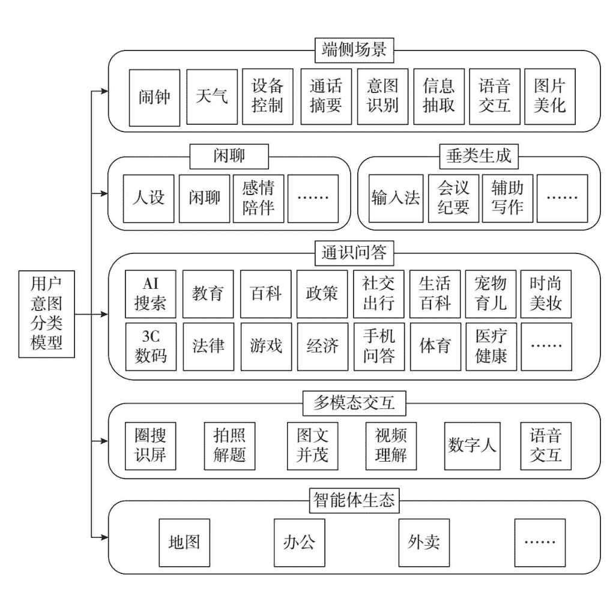

图5-1 用户意图分类模型

### 三、智能终端的延伸应用
基座模型不仅革新手机，也在推动耳机、智能手表、手环、智能眼镜等设备的能力升级。其中智能眼镜被视为有望媲美智能手机普及率的新一代终端，凭借便携性和强大的视觉处理能力，成为人机交互的重要载体。

技术路径上，智能眼镜正从AR/VR形态向智能化升级。LLM强化了AR显示和语音交互能力，并催生了丰富场景。在视觉大模型加持下，“所见即所得”成为现实。

旅行时，无需掏出手机拍照翻译，智能眼镜可实时翻译，语言障碍瞬间消除；导航信息直接叠加在视野中，出行更从容。购物时，一瞥即可识别商品并获取网购信息，语音指令即可完成购买，体验更流畅。日常中，快速识别物品如同随时待命的生活助手，提升办事效率。

教育、娱乐、办公、演讲等场景也展现出强劲潜力，重塑了产品形态与用户体验，推动行业格局变化。

据Canalys，2024年全球手机销量同比增长7%，结束了连续两年下滑，其中LLM在智能手机的落地是重要推手。智能眼镜等新终端的崛起，预示智能设备生态正迎来新一轮升级。

在手机侧，LLM带来了智能助理升级、工具能力跃升和推荐系统优化三大变化。

## 第二节 汽车座舱与驾驶：迈向第三空间
汽车已有130多年历史，经历了电力与互联网的两次重塑。特斯拉点燃电动车浪潮，蔚来、小鹏、理想等中国新势力加速了电动化进程。电力让汽车更高效清洁。

互联网让汽车变为移动智能终端。车联网可远程调节车内温度，导航也能实时获取路况。

LLM的加入，则让汽车的智能与舒适进入新阶段，从交通工具、智能终端演变为用户在家庭与办公之外的“第三空间”。LLM与座舱的结合更关键，提升人车交互效率，让旅途更愉快。随着电动车电子化程度提高，智能驾驶也在加速演进，以“萝卜快跑”为代表的自动驾驶出行服务正获得更多用户。

《变形金刚》曾让人们幻想汽车变形。如今车子还做不到这点，但LLM驱动的智能化正在深刻改变汽车行业和出行方式。

### 一、智能座舱的驾乘体验革新
在核心零部件同质化加剧的背景下，各车企纷纷把智能座舱作为差异化卖点。LLM的出现恰逢其时，为座舱进化注入新动力。其提升可概括为三个阶段。

第二，进阶阶段，多模态能力成为关键。车企希望座舱像敏锐的艺术家，能精准识别周边风景，也像经验丰富的旅行管家，与餐饮、酒店、景区、加油站等服务建立生态合作，实现信息无缝对接。此时汽车已不仅是交通工具，更是贴心出行伙伴。

第三，高级阶段，LLM需与座舱系统深度融合，如同水乳交融，整体提升汽车智能化水平。车企希望借此形成独有特色，为用户带来专属体验。要实现这一目标，理解、识别、生成、记忆、交互与多模态能力缺一不可。

目前LLM已具备高级阶段所需能力，落地仍需车企在摄像头、雷达等硬件上的持续投入，相当于为模型提供更多“眼睛”，充分发挥多模态优势。

LLM在汽车座舱的作用与手机多有相似，提升语音识别、优化交互等，此处不再展开。不同之处在于知识库融入大量汽车相关内容，如故障排除、旅途信息等，如同专业汽车顾问随时待命。

使用场景也类似，如聊天陪伴、语音控制、智能提醒等。此外，主动故障提示和紧急主动救援是汽车领域的独特价值，可提升行车安全。碰撞发生后，若驾驶员无法报警，模型可基于碰撞数据主动拨号并上传位置，增加救援时效。

智能座舱让旅途更安心、更有趣、更安全。

### 二、自动驾驶的安全与智能提升
#### （一）自动驾驶的六个级别
自动驾驶早于本轮LLM浪潮。国际自动机工程师学会将其分为L0至L5六个等级。

L0，无自动化。所有驾驶任务由人完成。车上可能有盲点监测、倒车影像等报警功能，但仅起提醒作用，不干预控制。

L1，驾驶员辅助。提供基础辅助，如自适应巡航控制ACC，像贴心小管家保持与前车安全距离；车道保持辅助LKAS可在偏离时将车拉回。但系统只能在纵向速度或横向转向单维度干预，不能同时进行。

L2，部分自动化。特定条件下可同时执行加速、减速与转向，但驾驶员需随时准备接管，如高速公路上的自动跟随行驶。

L3，有条件自动化。可在特定环境下自主完成全部驾驶任务，包括城市复杂道路。但遇恶劣天气或系统无法处理的情形时，需人接管。

L4，高度自动化。在特定区域或条件下可几乎完全自主运行，失效时也能安全停下。应用范围通常限于城市中心或封闭园区。

L5，完全自动化。可在任何条件下独立完成全部驾驶任务，无需人工干预，能应对高速、乡村小路、白天黑夜、雨雪等各种工况。

目前市售主推的自动驾驶多为L2，部分车企已获L3、L4的智能网联汽车准入与上路试点许可。LLM的出现加速了向L4乃至完全自动驾驶的演进。

#### （二）端到端自动驾驶
自动驾驶涵盖感知、预测、决策等环节，LLM可全面赋能。感知上，多模态能力可融合摄像头、激光雷达等传感器数据，增强对无车道线道路、拥堵路段等动态场景的识别。

在预测与决策上，LLM推动行业从“规则前置”转向“自主学习”。传统方案采用模块化设计，先制定规则再让模型识别情况、选择规则、执行规则。但现实路况复杂多变，规则难以穷尽，耗费人力且难以应对突发。

特斯拉早期遵循规则路线，ChatGPT火爆后转向新思路。FSD V12借鉴LLM做法，减少规则依赖，强化神经网络作用，通过海量真实人类驾驶视频数据训练，让模型自主学习、涌现能力。这被称为端到端自动驾驶。

相较模块化，端到端将感知、决策、控制整合为统一模型，减少信息传递误差，提高运行效率，也便于通过大数据持续优化。

实际表现上，FSD V12不仅识别路况准确，应对突发能力明显增强。正如马斯克所言，模型此前从未见过的建筑或道路标志，也能做出清晰正确判断。

国内方面，百度是最早布局自动驾驶的企业，2024年5月发布Apollo ADFM自动驾驶大模型，是全球首个支持L4级自动驾驶的大模型。“萝卜快跑”推出了第六代自动驾驶汽车，搭载Apollo ADFM大模型+硬件+安全架构，可预判规避风险，已在武汉规模化运营，覆盖全域全时空服务，服务超半数市民，正规划登陆香港并出海。

#### （三）LLM对端到端自动驾驶的助力
LLM首先解决了训练数据的难题。端到端对高质量数据需求极高，如何从海量数据中筛选有效样本至关重要。传统人工标注或算法打标效率低下，难以挖掘长尾数据。

借助LLM，如基于文心大模型，可将数据服务从流程式操作升级为检索式智能搜索，支持以文搜图、以图搜图。例如用一张积水路面图片或文字描述检索特征库，即可快速找到相似场景作为训练数据。

此外，自动驾驶面临大量边缘案例，单纯依赖真实采集样本不足。LLM可低成本合成新场景，扩大训练覆盖面。百度汽车云支持端到端仿真，提供百城真实路网和千万公里场景数据，实现高效训练。

电动车作为中国汽车工业“换道超车”的典型，必将成为国产大模型的重要应用场景。LLM加持下的自动驾驶将逐步普及，不仅改善出行体验，也有助于城市交通治理。最终，汽车正成为科技感与舒适感兼具的第三空间。

在预测与决策层面，LLM推动自动驾驶从规则前置走向自主学习，即端到端自动驾驶的演进。

端到端无人驾驶的思路是把人工制定的规则压缩到最低，让深度神经模块承担主要推理，把感知、判断、执行压进同一套网络里头。模块合并后，信息在不同环节间来回传递产生的误差累积被削弱，整体运行更快，也更便于用海量驾驶数据持续打磨模型性能。

## 第三节 具身式智能与巨型预训练模型双向赋能

2025年央视蛇年春晚的《秧BOT》节目成为关注焦点。杭州宇树科技派出的一台穿着碎花棉袄的人形机，与舞者一起踩秧歌、转手帕，关节灵活性与身体协调性令人刮目相看。

具身式装置登上央视舞台并非首次。早在2016年猴年春晚广州分会场，540台优必选机群就与孙楠合唱《冲向巅峰》，这是机群在央视春晚的第一次大体量亮相。

公众对机械类造物的想象一直很丰富。影视作品里既有《机械公敌》中具备算计与阴谋的角色，也有《机器人总动员》里憨态可掬的清扫机瓦力，还有《西部世界》里觉醒意识、外形逼近人类的类人装置。无论形态如何，这些设定都被赋予了类人的认知能力。

四足、双足、机器狗等不同形态的设备，都可以归入具身式智能的范畴。这一思路可以追溯到人工智能诞生初期。1950年图灵在《计算机器与智能》结尾描绘了两条发展路径：一是集中于下棋等抽象推理所需的智力，二是为装置配备优质传感器，让其能与人沟通、像婴儿那样学习。后来这条分叉被概括为非具身与具身两条路线。

在具身路线上，关键问题是系统是否需要类人的躯壳与感知，以及躯壳如何塑造智能与认知。早期探索集中在机器人学与仿生学，后期引入跨学科方法。近几年得益于巨型预训练模型与机身学习的发展，研究者借助虚拟物理环境与强算力，训练出兼具感知与行动能力的智能体，并把交互能力迁移到真实世界，使其能够自主判断并完成物理交互任务。

> 资料来源：《具身智能 | CCF专家谈术语》，中国计算机协会，2023年7月22日。

中国计算机学会把具身式智能定义为依托物理机体实现感知与行动的智能体系，主体通过与环境的互动获取信息、理解问题、作出判断并执行动作，从而产生智能行为与适应性。

为何要重视？因为这是迈向通用人工智能的重要助力。

当前研究重心正从以静态大数据的互联网人工智能，转向以主体与环境互动为核心的具身人工智能。互联网路线催生了ChatGPT、GPT-4等通用视觉语言系统，语义理解范式日渐成熟。但静态互联网数据缺乏机器如何运动、如何驱动关节、如何与物理世界交互的信息，物理交互能力的缺口成了通用人工智能的瓶颈。具身式智能从本体出发关注感知与交互，致力于从环境互动数据中学会执行物理任务，吸引了视觉、语言、机器人等多个领域的关注，成为热点。

2024年楷登电子在硅谷举办CadenceLIVE活动上，英伟达创始人黄仁勋表示，人形机有望成为消费品，制造成本将远低于预期，售价可能在1万至2万美元区间。在部分场景下机身更灵活、多才多艺，能提升生产力。具身式智能被看作增长潜力可能超过汽车的产业：一个家庭可能拥有1-2辆车，却可能拥有4-5台机身；自动驾驶只替代驾驶员，而机身可以替代多个行业的多个岗位。

具身式智能落地会遇到哪些难题？巨型预训练模型又如何破解？

### 一、落地面临的壁垒

具身式机器人前景被看好，但在实际场景落地仍受多重制约：核心大脑是否足够聪明、能否自我学习、运动控制在复杂物理环境下的适应性、操作泛化性与成功率、高质量真实数据稀缺、大规模采集标注成本高昂、机载算力与续航受限等。这些问题映射到实体主要集中在四方面：具身式智能核心、运动控制中枢、驱动迭代的数据、软硬件整体载体，类似于人需要大脑、小脑、知识与强健体魄。

第一，具身式智能核心。这是核心，主导信息处理与决策制定。要求有：不同于纯虚拟环境，具身式智能置身真实世界，需整合视觉、听觉、触觉等多源信息，处理语音、文本、图像等多模态输入，故需具备多模态感知、语音指令理解与任务规划能力；所执行的任务往往复杂多步，需长程任务规划与动态调整；为提升实用性，需具备实时互动性，实现环境动态反馈与端云协同，将计算与数据处理分摊到终端与云端；传统AI依赖人工规则，无法穷尽现实变化，面对海量复杂数据时难以快速分析应用，需巨型预训练模型提升泛化与适应力。

第二，运动控制中枢。负责运动执行。要求在环境动态变化下具备强物理场景适应性，并拥有操作控制能力的任务泛化性。

第三，驱动迭代的数据。是持续改进的关键。当前困难在于技术路线对数据需求未收敛、标准不统一；高质量真实数据稀缺；大规模采集标注成本高。有“数据金字塔”之说：底层是互联网数据，中层是合成数据，顶层是真实数据，价值向上递增，成本也同步抬升。

第四，软硬件整体载体。需具备多模态感知、整机全方位安全保障、臂手夹爪任务胜任力、机载AI算力与续航能力等。

只有巨型预训练模型有效解决上述挑战，具身式智能才具备技术先进性与商业可行性。

### 二、巨型预训练模型带来的新思路

巨型预训练模型可显著改善四大难点。

第一，无论大脑还是中枢，无论快速交互还是动态思考，都依赖计算平台进行算力调度和训练推理加速。算力的关键不在于价格，而在于利用效率与研发提速。百舸AI异构计算平台力求让每一分算力成本都被有效使用，延长有效训练时长。

第二，具身式智能核心决定高级指令理解与任务规划能力。巨型预训练模型的通用能力、泛化能力与学习能力可弥补传统AI不足。需要优秀的预训练基座巨型预训练模型高效精准处理海量数据；同时需要配套开发工具链，支持场景化微调与多模态能力体系构建，提升理解与应对水平。

> 资料来源：英伟达官网。

第三，中枢开发高度依赖仿真平台。百度智能云联合合作伙伴英伟达打造云上仿真平台，实现算力按需弹性扩展，大幅缩短任务耗时，加速运动控制算法迭代，并可开箱即用、一键部署，降低部署维护成本。

第四，数据层面，随着路线收敛与需求明晰，行业需要规模化专业化采集标注能力，以及数据共创共享模式。百度智能云在自动驾驶与互联网业务沉淀了规范化、专业化、规模化的数据采集标注能力与平台，正协同推进具身式智能大规模数据集建设。

第五，本体构建层面，部分巨型预训练模型服务商覆盖研发、测试、运营全周期，提供云管端与数据全方位体系化安全能力，保障商业化落地。

第六，在对话类人机服务场景中，前端语音效果决定体验第一印象。手机近场语音与机器人远场语音不同，后者通常在三五米外，面临超低信噪比、多样背景噪声与混响、机身相对位置与麦克风朝向变化等挑战。

结合百度长期语音技术积累及扫地机等量产实践，可将复杂噪声下的唤醒识别率保持在90%以上，5米距离实现声源定位精度±15度，并支持唤醒词与音色个性化定制，带来更友好的交互。

总体来看，巨型预训练模型使具身式智能在多场景多领域实现智能跃升，更贴近现实需求。应用范围扩大也降低了成本，加速大众接受。

### 三、应用前景

巨型预训练模型提升了具身式智能的情感、交互、知识储备与操作精细度，使其进入更多场景。

### （一）服务场景

相比传统机器人，具身式智能更适配服务场景。餐饮方面，除点餐送餐外，可实现餐桌清理，基于菜谱知识与精细动作控制进入炒菜领域，双手协作可用于洗衣服、浇花等。酒店服务中，语音交互增强后可直接集成智能客服，协助办理入住退房、提供客房信息与旅游咨询，客房清洁、公共区域维护、物品运送等逐步由机器人承担。居家与养老场景下，结合知识储备、拟人语音与面部识别，可提供更佳的情感陪护。

### （二）教育场景

依托巨型预训练模型，具身式智能可充当“私塾先生”，提供个性化学习计划与教学辅助；作为“伴读书童”，通过交互提升口语与听力；作为“助手”，协助实验操作，提升效率与安全性。

### （三）医疗场景

可基于医疗知识库与专业巨型预训练模型以“坐诊”方式辅助医生，进行预诊断与影像识别，降低诊断压力；灵活机械手可执行更精细的切割、缝合，提升手术安全与效率；凭借耐心与24小时工作特性，可在陪护等刚需场景发挥作用。

### （四）工业场景

可执行更复杂的装配、焊接任务，基于视觉检测等多模态能力，以更少样本实现更精准识别，提升检测效率与准确度。维护巡检方面，可执行更丰富的检测，依托巨型预训练模型提升巡检效率与实时应对能力，更能胜任危险复杂环境。

展望来看，随着制造工艺进步，具身式智能将更灵活稳定；伴随巨型预训练模型发展，其自主学习性、交互能力与应对能力将持续增强，真正成为人类帮手，甚至承担人类难以胜任的工作。

机器人包括四足、两足、机器狗等，均可统称为具身式智能。具身式智能指基于物理身体感知与行动的智能系统，通过与环境的交互获取信息、理解问题、决策并行动，产生智能行为与适应性。

具身式智能面临的挑战主要体现在四部分：具身式智能核心、运动控制中枢、驱动迭代的数据、软硬件整体载体。

## 第四节 金融业数智员工时代来临

金融是国民经济的血脉与核心竞争力关键支柱，涵盖银行、证券、保险、信托、资产管理、金融科技、投资顾问、信用评级、租赁与金融监管等。金融行业信息化程度最高，在每次科技浪潮中都走在前列：从会计电算化到金融电子化、互联网金融再到金融科技，每个阶段都重塑技术应用与服务模式。如今行业正处数字化转型关键节点，巨型预训练模型横空出世，为金融服务注入智能动力，开启智能化新时代。

### 一、巨型预训练模型赋能：从人到业务的全面革新

在员工赋能层面，巨型预训练模型从辅助驾驶者演变为智慧代理的数智员工分身，提升效率与智能表现。业务层面可显著增强风控能力、优化投资策略、加速产品研发；在用户交互层面，智能客服等系统大幅提升体验与满意度，推动个性化服务普及，助力智慧银行到来。

以银行为例，多个痛点正在被破解。其一，海量业务数据处理分析效率不足。某股份制银行信用卡中心每日处理300万笔交易，传统规则引擎难以实时识别新型欺诈。借助巨型预训练模型构建智能中枢，多模态巨型预训练模型分析交易时序、设备指纹等20余维特征，跨境支付欺诈识别准确率提升至98.5%。其二，长尾客户服务覆盖不足。某头部银行理财经理人均服务2000余客户，精准洞察困难。基于生成式AI的“智能财富助理”重构服务流程，实现百万级客户资产配置方案秒级生成。其三，合规管理压力攀升。资管新规下理财产品说明书动辄数百条，人工审核低效。采用法律巨型预训练模型实现招股书自动化核验，将原本3人1个工作日的尽调压缩至2小时内，关键条款识别准确率超95%。这些案例体现了巨型预训练模型重构银行核心能力的战略价值。

### 二、专业性提升以应对金融需求

金融行业知识密度高、时效性强、严谨性高，对专业性要求极高。巨型预训练模型并非即插即用。通用巨型预训练模型训练中金融语料占比低且滞后，专业度不足。需通过知识增强与专业工具组合保障输出专业性，涉及预训练、二次预训练、精调、检索增强生成等环节。工程化落地中，隐性知识与图谱显性知识需互补，开放问题与封闭问题需结合，巨型预训练模型与小模型需协同决策，以确保严谨与专业。

训练过程类似员工成长。基础预训练巨型预训练模型相当于学富五车的高才生，具备社会通识与语言情感推理能力，但在金融领域稚嫩。结合行业公开数据二次预训练后，成为金融科班从业者。随后按岗位需求精调，通过有监督微调、人机反馈强化学习等，使其成为具备专项能力且能通过合规考核的业务专员。

精调后仍需增强能力。通过检索增强生成接入机构自有知识库、代码库与数据，模型如同一位熟悉行内规范的初级学员。经提示词学习、智能体开发等工程优化后，从初级学员成长为熟练员工，形成数字化风险专员、数字化零售专员、数字化财富专员等数智员工，具备业务技巧并能持续学习优化。

在迭代过程中，可根据需求选择方案：借助百度智能云公有云服务使用基础预训练模型；于百度智能云千帆大模型平台进行预训练、微调、检索增强、提示词与智能体工程优化；同时支持私有化部署保障数据与隐私安全。

### 三、应用价值

### （一）更真实地读懂客户：服务与营销的革新

巨型预训练模型通过智能客服实现全流程优化：预判问题、实时话术推荐、通话质检，提升响应速度与体验；为客户经理提供精准产品话术与营销策略，助力需求转化。

#### 1. 客户服务，赋予新能
在通用智能客服基础上，结合金融知识库再训练，可提供行业场景化解决方案。智能客服不仅可实现智能营销，包括文案生成、图文生成、内容推荐、自动化营销、效果评估、交易分析、情感分析、客户反馈等，精准洞察需求并推送个性化内容，提升营销效率，还能批量生成个性化内容实现“千人千面”。

金融机构可依托智能客服，借助画像分析、展业工具、营销管理、渠道管理、活动管理、运营监控等，将服务深入生活场景。百度智能云客悦凭借对话更友好、自助解决率超92%、1小时即可构建大模型机器人、运营效率提升6倍、全渠道多场景一键集成等优势突出。

某头部股份制银行与百度智能云合作打造全行级智能语音客服机器人，接入20余个零售业务渠道，可通过语音完成350余项业务办理。机器人盘活企业数据资源，为员工提供业务咨询与知识检索，实践效果显著：首次联系解决率达88%，客户满意度达99%，为零售业务拓展提供科技支撑。

#### 2. 销售的“最后一公里”，让巨型预训练模型来加速

投资与销售顾问是客户与金融机构之间的关键连接点，负责把产品与服务送到终端用户手中。日常作业中，他们往往受服务半径受限、专业信息更新滞后、重交易轻顾问等现实制约，这些短板不仅拉低个人业绩，也会削弱机构品牌与获客效果。

引入智能代理后，顾问的工作效能得到明显改善。智能代理可与保险代理人、经纪人、财富顾问等角色协同，在投前、投中、投后各阶段提供支持，提升成交概率并优化客户体验。投前阶段，代理能够自动完成客户画像标注、客群分层、需求识别与确认，并借助通话录音等资料辅助身份核验KYC，减少人工负担，使顾问聚焦高价值环节。投中阶段，依托生成式模型开展市场研判与预测、产品拆解、资产配置研究以及投顾方案设计，专业性显著提升。投后阶段，则可实现组合优化、交易执行优化，并对组合进行跟踪管理、再平衡与绩效分析，提升互动频次，增强客户信任。

### （二）业务运营提效：生成式AI在运营环节的应用价值

在运营层面，生成式人工智能的作用突出。交易场景中，智能助手能够完成报价解析、意图识别等工作，提升响应速度；在投研领域，智能代理承担报告撰写等重复性任务，在人机协作下信息获取与报告产出效率明显提高。

- 1. 场外交易提速，智能助手助力规模倍增
交易是投研策略落地的关键。交易员普遍面临专业门槛高、操作流程繁琐、报价响应迟缓等痛点。机构正通过构建智能代理来解决报价解析、意图分析、对话式交易引导等问题。以银河证券与百度智能云共建的智能场外交易发现平台为例，传统人工询价受时段集中、标的多样、结构与期限复杂度高等因素影响，效率有限。智能代理具备意图识别、自动规划、秒级应答与全覆盖响应的能力。实践中，银河证券场外衍生品日均交易规模实现翻倍，询价到下单的转化水平提升至三倍。

- 2. 投研常规工作释放，大模型承担重复劳动
投研是机构核心职能，报告撰写需要全面准确的信息支撑决策，但研究员、客户经理常被海量信息、耗时长、分析难困扰。开发智能代理作为风控与报告辅助工具，在输入环节可快速抓取研报内容、实时答疑，提升信息获取效率；同时追踪分析师历史研报、数据与观点变化，对多篇观点与行情数据进行横向对比。输出环节可结合知识库辅助生成通用报告，对特定格式报告实现自动化数据采集、报表自动解析及信用评估报告生成，缩短审核周期并降低成本。鹏华基金通过私有化部署千亿参数级模型与百度智能云中间件，联合打造20余款智能应用，覆盖8大核心场景，涵盖财经事件分类与情感判断、基金持仓风格偏移判断、公告与会议纪要摘要生成、内部制度问答、客服知识检索、单文档要素抽取、研报智能问答等。内部员工使用率已超60%，业务效率持续改善。

### （三）风险管控强化：生成式模型在风控领域的实践

风控是金融机构的生命线。生成式模型通过数据整合与语义解析能力，及时捕捉新型欺诈，挖掘传统征信外的弱特征，快速适配新场景，辅助审贷人员定位风险点。合规管理方面，模型可快速解析海量合规文件、提取要点并分析业务操作或合同文本，识别潜在合规风险，提升效率与准确性。

#### 1. 精准施策，风控效率显著提升
信贷风控面临市场骤变、竞争加剧、欺诈手段演变、数据覆盖不足、模型迭代缓慢等问题。客户需求个性化进一步加大技术优化压力。生成式模型可逐一应对：具备强数据整合能力，可处理海量与多模态数据，及时发现黑灰产新型手法；对非结构化数据如沟通记录、社交媒体行为进行语义解析，提取消费偏好、情绪倾向等弱特征，弥补传统数据缺口，并通过无监督学习提前发现未知风险；借助微调可在数据有限情况下快速适配新场景，加速模型迭代；可与人工协同，辅助审核人员快速定位风险点。技术薄弱机构还能通过模型蒸馏在本地部署轻量化版本。百度智能云“度御”风控产品融合大量风险建模专家经验，覆盖贷前、贷中、贷后全链路。某机构应用后，模型KS值提升超20%，风险识别更快，业务支持更强。

#### 2. 快速筛查，合规风险无所遁形
合规文件繁多难记，业务创新带来风险交叉隐蔽，人工判断耗时耗力。生成式模型改变合规管理方式：自然语言处理能力强，可批量解析合规文件、提取法规条款等关键信息并生成摘要分类存储；具备文本理解与推理能力，可独立或辅助分析业务操作与合同，识别潜在风险；交互式问答系统构建知识库，员工以自然语言快速获取合规建议，知识库可实时更新并发挥多模态补充作用，形成持续风险识别闭环。百度智能云合规智判智能体涵盖银行、证券、外汇等法规、一行两会公告及监管处罚等知识，可提供制度体检、制度库、制度撰写、合规指引、合规审核、合规助手、监管洞察、系统管理等服务。某保险公司借助标签与知识图谱技术，实现外部条款与内部条款关联识别，快速比对并提示未内化缺失条款，促进合规体系完善。

### （四）激活知识管理：生成式模型在综合办公中的应用
金融机构知识分散、管理松散，检索困难、信息埋没、场景受限等问题突出。泰康集团等机构采用基于生成式模型的知识管理平台，如百度智能云甄知企业知识管理平台，破解难题。泰康与百度智能云共建私有化泰康知识中台，接入多系统知识后自动挖掘、解析、加工形成精细化知识点，按组织架构、权限、应用、类型等维度关联聚合，构建完整知识网络。内勤可快速获取福利制度、公告；代理人可通过口语化提问即时获取业务知识。实践显示，知识加工效率较人工提升5倍，从被动搜索转向主动获取，问答准确率达90%，为综合办公带来智能化体验。

### （五）拓展分析视野：生成式模型赋能商业分析
除客群营销、运营、风控外，金融机构还需开展商业分析、代码管理、运维等技术工作。生成式模型可强化支撑。以商业分析为例，分析师常面临响应慢、门槛高、取数慢、传递易出错易泄露等问题。生成式模型通过自然语言交互、自动报表生成与数据可视化降低技能门槛；可关联历史与实时数据，实现跨窗口快速查询；具备敏感字段与角色识别能力，提升数据传输安全。百度推出的GBI生成式商业智能产品集数据智能接入、智能创建、智能分析于一体，将原需数日完成的数据分析压缩至数小时，大幅提升效率，为数字化转型提供精准决策支持。

### 四、金融机构部署生成式模型整体思路与资源布局
生成式模型与业务深度融合面临算力、迭代、安全等挑战。应用场景扩展推高算力需求，模型快速迭代要求持续评估调优与测试，生成内容需严格输入输出审查保障合规。算力层面，传统CPU集群难以满足需求，需转向GPU集群，自建成本高昂且数据隐私要求严，常见公有云与混合云并用，需在成本与需求间平衡。开发资源层面，自研、调用服务或应用开发均需人力、技术与硬件投入，需便捷低成本平台支撑。百度智能云发布的开元智慧金融解决方案2.0提供参考架构，包含底层异构芯片算力平台与大规模GPU集群管理、中间层可调用大模型与一站式开发工具、上层业务场景应用平台。

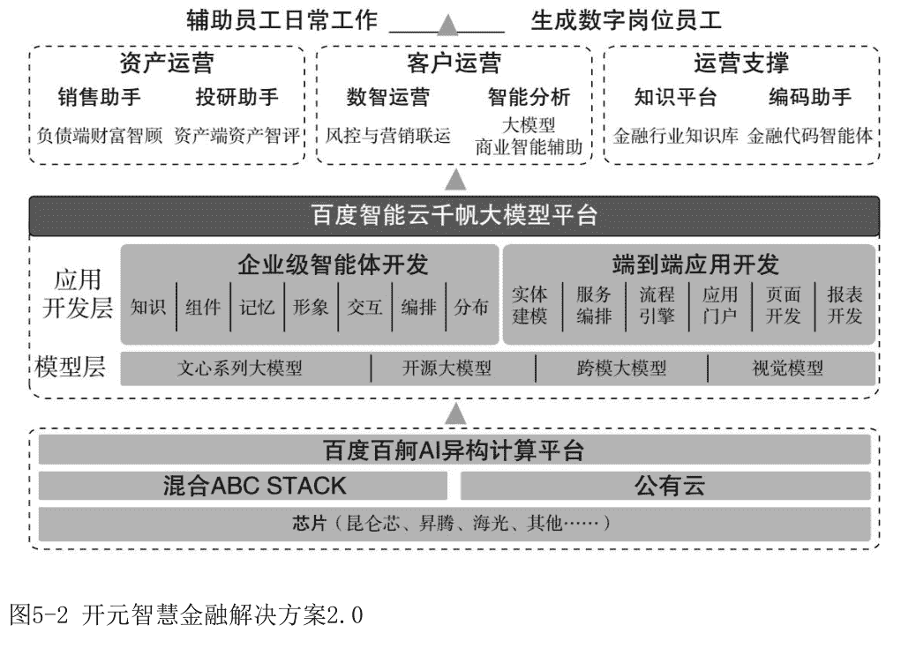

注：ABC STACK隶属于百度智能云，是其专有云解决方案品牌。

某股份制银行与百度智能云合作建设全行统一大模型技术体系，涵盖训练推理算力集群、全流程大模型开发应用平台、可精调大模型、原生应用开发框架及业务场景应用平台，为智能化转型提供支撑。百度智能云将持续深化金融合作，完善企业级大模型平台与全流程工具链，升级人工智能原生应用开发平台，通过数据飞轮与敏捷迭代打磨面向核心金融场景的业务智能体，推动数智金融发展。在金融领域，大模型需依托知识增强与专业工具组合确保专业性，涵盖预训练、二次训练、精调、检索增强等环节。客户服务与营销领域智能客服实现全流程优化；交易场景智能体提升询价解析与意图分析效率；投研领域智能体高效完成报告撰写，人机协同提升信息与报告效率。合规智判智能体可提供制度体检、制度库、撰写、指引、审核、助手、监管洞察、系统管理等服务。

## 第五节 能源：借助生成式模型加速形成新质生产力
能源行业涵盖煤炭、石油、天然气及光伏、风电等新能源，正面临数智化加速趋势。传统能源进入平稳期，降本提效成为关键；新能源发展重塑发电、输电、配电环节，提升数字化必要性。大模型应用不是成本增加，而是价值创造，是形成能源新质生产力的重要路径。

### 一、生成式模型为能源领域带来哪些提升
生成式模型带来传统技术难以企及的优势。其流程拆解与规则建模能力可快速学习SOP文档与操作手册，实现工单自动生成与合规检查自动化，效率提升显著。多模态处理能力可同时处理结构化与非结构化、文本与图像视频数据，扩大传统技术覆盖范围。行业知识构建与传承方面，大模型可快速形成知识图谱，汇聚各类知识，助力内部迁移传承，强化人才体系。

### 二、电网“超级大脑”如何工作
电网是能源传输关键，数智化对内提效对外稳供至关重要。电力专业场景数据丰富，但从海量数据中提炼有效信息、实现实时语义理解与缺陷预测仍具挑战。国家电网自2020年起与百度合作完成人工智能两库一平台建设。2024年发布国内首个千亿级多模态电力行业大模型——光明电力大模型，为安全运行与新能源消纳提供超级大脑，并探索规划、运维、运行、客户服务等应用。设备巡检旨在保障运行与安全。传统巡检效率低、成本高、识别率有限、应急准备不足。智能化设备如无人机与视频识别系统提升效率，但仍面临样本不足冷启动难、模型泛化弱等问题。大模型通过视觉大模型升级大幅提高准确度，并与边缘小模型配合解决算力与功耗矛盾：边缘侧小模型初步判断，中心侧大模型复判，误报数据回流标注持续优化。通过CV大模型实现泛化通用，样本需求从500降至150至200，训练启动效率提升三倍以上。南方电网在调度大模型应用走在前列。调度运行需协调生产与传输，确保安全可靠。值班员需翻阅规程与案例排查故障，交接班报告生成繁重。基于大模型打造的调度值班助手可秒级查询数据、给出处置方案，减少死记硬背，自动归类安全预警、生成工单与交接班日报，实现态势全局感知。该助手同样适用于天然气、煤炭、新能源调度，可预测负荷、维持运行指标、及时排除故障，提升安全与经济效益。生成式模型的多模态与泛化能力正重塑能源行业多个环节，推动其在科技与智能化投入持续领先。

领域知识的网络化搭建在大规模生成式基础模型的加持下变得更为迅捷完整，零散的专业信息能够被迅速收敛为体系化结构。

在设备巡检场景里，常见的组合方式是把小型模型与大型基础模型协同使用。边缘端由小型模型先做初步判断，中心端再由基础模型复核，形成闭环；误报样本经标注后回流至训练集，模型的判别精度由此逐步提升。基于同样的技术还可以打造调度值守助手，可实时调用各类经营数据，问题发生时第一时间给出高质量解答，并实现秒级的处置方案生成。

## 第六节

## 教育：生成式智能重塑产教融合新图景

技术对人类思维能力的改造在持续加深。蒸汽时代和电气时代更多强化的是体力，第三次工业革命和信息时代开始辅助认知，却大多停留在工具层面。此轮以人工智能为代表的变革，尤其是生成式技术的落地，正把角色从辅助认知推向部分替代认知，教育作为与知识、信息、思维紧密关联的领域首当其冲。

生成式基础模型具备传统人工智能不具备的能力组合。自然语言的解析与创作可以辅助教学；多回合对话能力让人机交互更为顺畅带来新体验；海量信息的处理与生成能力可支撑科研；多模态感知能力则让教学内容更丰富，也打开了个体化教学的空间，甚至影响整个教育体系。

### 一、K12教学智能化：破解大班教学与个体培养的矛盾

K12长期被大规模教学与个体化培养的冲突所困：既要保证统一的基础知识体系，又要挖掘天赋差异。传统范式受限于师资不足与教学方式统一，难以兼顾。

生成式技术提供两条突破路径。其一是让AI接管重复性机械工作，使教师把精力转向个体化教学与学情分析。其二是提升知识训练效率，实现基于个体差异的精准辅导，把因材施教落到实处。

#### （一）作业自动评分

过去作业评分依赖人工，周期长难以即时指导。基于基础模型重构的评分系统支持拍照或上传作业图像，自动完成评阅并即时反馈，效率提升的同时学生也能马上巩固知识。

#### （二）在线智能判题

传统在线判题高度依赖题库比对，未收录题目仍需人工处理，维护成本高。生成式技术通过语言理解与推理直接解析题目，不再受限于预设题库，并能自动生成个体错题集，结合错题分析学情，为针对性强化训练提供依据。

#### （三）习题解析转向启发式提问

过去习题解析需要专家提前准备标准答案与解析，成本高。基于基础模型的解析系统可实时生成详细的解题思路与推理过程，并采用苏格拉底式提问引导学生自主发现问题、分析问题、解决问题，在保护学习信心的同时培养独立思考与问题解决能力。

总体来看，生成式技术正重塑K12教学范式，在保证规模化实施的同时实现真正个体化，为破解传统困境提供可行路径。

### 二、高校科研提速：生成式模型成为研究加速器

高校一直是科研创新的主力。传统科研需要人工建模、处理海量数据并做成百上千次交叉验证。如今生成式模型显著提效，西湖大学校长施一公曾指出，AI极大延展了科学家的研究生命，“过去10个博士生5年才能解决一个大复合物结构，现在借助于AI，一个学生一周就能完成”。

提效集中在科研前期与实验设计。文献梳理方面，模型可迅速归纳海量文献生成综述提取要点；实验设计方面，可辅助提出假设、优化方案或模拟结果，降低试错开销，尤其在生物化学、材料科学等领域价值明显。

更关键的是工作模式改变。模型可全天候持续运行，算力可扩容，理解与生成能力大幅提升，并具备多模态感知能力，能处理基因组、社会调查等高维数据，跨学科研究并自主发现隐藏模式，显著提升试错效率，从科研助手成长为科研引领者。

百度与多所高校的探索提供了落地样本。与清华大学药学院联合举办两届全球AI药物研发算法大赛，吸引千余团队参与。在AI for Science方向，与国家超算中心联合生成超7亿条仿真数据，研发开源的HelixDock全原子扩散模型，可准确预测蛋白与小分子的结合构象，已在多个药物研发管线落地。

与上海交通大学合作打造AI for Science一站式方案，以生成式AI为核心，整合科学数据中台、低代码AI系统、飞桨科学计算工具与科学隐私计算平台。在物质科学、分子科学、流体模拟、城市科学等领域提供模型开发与应用支持。以化学合成为例，平台可加速分子设计、反应设计、条件生成与反应检验，将传统数月的工作压缩到几十分钟。

北京大学环境科学与工程学院基于文心大模型推出水科学研究助手WaterScholar，依托文献库与检索增强技术实现文献查询、梳理引言、内容总结与问题解答，帮助科研人员摆脱繁重整理，聚焦科学问题。其核心功能包括便捷查询、准确引用与全面综述。

未来人机协同的科研有望带来更多惊喜。

### 三、教育企业降本增效：生成式技术驱动商业升级

教育企业兼具公益与经济效益，需持续寻求技术降本增效。以上海一家职业教育初创企业为例，其C端产品“考试宝”提供试题解析服务，截至2024年11月用户超6000万，题库总量超30亿。传统人工解析面临速度慢、成本高的困境：用户上传后常需等待一天以上，单题解析成本约1.5元。

基于文心大模型的产品升级带来多重改善。拍照搜题能力增强，系统可智能解析真题给出正确答案并生成完整解析与考点提炼，帮助举一反三。题库管理与组卷效率提升，本地题库可一键上传并自动生成对应考点。搜题准确度提升超30%，用户体验明显改善。答疑场景下，AI学习助手提供快速多维答疑，人工介入降至传统模式的1%。

经营结果显著：单题解析成本降至0.003元，降幅达99.8%。机器全天候生成内容，生产效率提升超1000倍，数据生成成本大幅下降。数据生产模式重构，往昔95%以上环节靠标注人员完成，如今模型驱动下日调用量达百万级，预计向千万级迈进，减少近百名兼职，标注质量提高，成本再降约1/10，效率提升10倍。随产品认可度提升，付费率增长超100%，营收增长超240%。

模型与机构自有数据微调后还开发出教学助手、智能客服等应用，支撑多个创新业务落地。生成式技术为教育企业带来降本与增长双收益，推动行业向更高效智能的方向发展。

### 四、教育体系再思考：生成式技术带来的深层变革

生成式模型不仅提升教师工作效率，也能帮助教师提升教学能力。对师资匮乏的三线或偏远地区，技术辅助可有效弥补不足，成为教育平权的路径。

模型有望实现真正一人一策教学，根据学生数据制定专属学习计划与错题练习，帮助学生认知优势劣势。教师被AI赋能后，能投入更多精力关注个体化发展，提升教学多样性与丰富度。生成式AI的引导式、问答式教学还能激发提问意识与创新精神。

这也带来全社会的问题：从小学到大学如何培养人才，如何在AI辅助下让学生个性不断彰显。生成式模型的自然语言解析生成、多回合对话、海量信息处理与多模态感知，正为这一命题提供新的工具与可能。

## 第七节

## 电商营销加速：生成式模型重塑交易链路

电商的本质始终是交易，所有动作最终指向用户下单。营销流程通常包含引流、转化、售后、回购四个环节。

生成式模型正为电商营销提供新引擎，不仅优化个体化推荐与精准投放，还能通过数据洞察提升体验，成为竞争关键。企业需把模型融入营销全流程以保持优势。

### 一、营销变局与三大痛点

营销形态正在变化。图文逐渐被直播、短视频取代，对虚拟人及实时互动提出更高要求。内容与社交的重要性上升，企业需强内容生产与潮流洞察能力。个体化需求爆发，一人一面与定制化成为转化关键。

三大能力挑战随之而来：获客成本攀升；用户留存不佳，留存与回购待提升；售后服务需求过载，响应效率需改善。生成式模型的通用能力与各类应用可有效应对上述变化。

多模态能力可实现更精细的用户画像分析；实时理解与推荐升级提升转化；多轮对话、情感洞察与知识图谱构建则改善售后并挖掘价值。流程化工作更智能，创意化工作更个性化，形成传统AI不具备的体验。

### 二、营销效能跃升：四个关键突破

#### （一）客户交互全面智能化

传统电子客服语言处理能力弱、需求理解不准、个体化程度低，常出现答非所问。生成式模型驱动的智能交互聚焦咨询助手与智能导购两大场景。

咨询助手整合垂直知识、私域数据与通用知识库，提供价格对比、参数解析、原理说明等专业解答，缩短决策路径。智能导购从统一推荐到个体化再到交互式推荐演进，依托通用知识库、显性意图与行为数据实现持续优化，具备上下文感知提升意图识别、冷启动表现提升与跨场景综合推荐优势，可模拟实体导购通过多轮对话挖掘潜在需求，最终成为贴心的私人营销助理。

#### （二）运营精细化：三维洞察驱动决策

精细化运营覆盖数据监控、归因分析、智能决策、效果评估与迭代优化。

商品维度，可提取直播弹幕与评论聚类分析优化选品与主播话术，提升留存与转化；也可从评论与提问区挖掘影响下单的关键因子，优化推荐与售后。

流量维度，可基于历史交易分析全年流量周期，结合节假日与热点策划运营活动；并利用模型测算各渠道效能，制定流量组合方案。

业务维度，可开展秒杀、优惠等活动，并加强竞品、行业与政策分析。多维度分析让运营更精准，在百度智能云平台上可通过成熟电商方案快捷落地。

#### （三）营销内容自动化

生成式模型显著提升内容生产效率，可自动生成商品植入文案、种草内容及基于SKU的直播带货脚本，降低人力成本，为中小企业提供公平竞争机会。

#### （四）一体化解决方案

百度智能云推出完整电商营销解决方案，以电商营销大模型为核心，依托百舸AI异构计算平台与千帆大模型平台，覆盖内容生态、智能交互、智能营销与智能运营全场景。

方案涵盖品牌故事库、结构化标题生成、卖点文案、商品重复判别、多智能体导购、广告视频生成等商品层能力；商品类目匹配、属性识别提炼与标签治理等运营能力；拟人化问答、AI评论回复与优质评论筛选等评论服务；店铺素材与宣传文案生成、搜索词分析、用户购物因子挖掘、问题预测、客服会话摘要与售后辅助判责等商家与用户服务；地图路由、地址解析、智能调度等履约支撑；AI直播数字人、直播弹幕总结与文案生成、活动文案素材生成与分析、短视频广告智能快剪、UGC评分标签等营销与社区能力。

生成式技术正在重塑电商营销格局，让品牌更聚焦需求洞察与创意，同时降低技术门槛，助力中小品牌成长，推动行业向多元化、智能化发展。

电商营销正进入新一轮调整期：传播玩法在变，内容和社交的权重在上升，消费者对个性化体验的需求也在快速增长。

大模型正在为这场变化提供工具箱，交互更智能、运营更精细、营销更创新，最终形成一体化的解决方案。

## 第八节 核心回顾

大模型在各行业的落地案例已非常丰富，整体呈现出几类共性。第一，方案弹性很大，要贴合实际需求。有的企业会从底层算力起步，把数智化体系围绕大模型重新搭建；有的则直接引入已成熟的人工智能产品快速用起来。第二，大模型既能和现有的技术、产品叠加使用，也能作为支点推动整体重构，而重构通常会带来效率的明显提升。第三，面对大量重复、流程化的工作，基于大模型构建智能体往往能取得很好的效果。

同时，落地大模型并非只靠技术领先，更要沉到业务现场去理解真实痛点。百度持续在一线场景深耕，提供覆盖咨询、方案设计、应用梳理与定制、模型调优，以及以结果为导向的运营和能力培训在内的端到端落地服务。

对读者而言，不管身处哪个行业，都可以保持开放的心态尝试大模型。可以在小范围场景先试用，积累熟悉度和信任感；也可以从顶层规划入手，思考以大模型为核心的重塑业务。无论选择哪种路径，都能获得全新的体验。

# 第六章 落地实操指南与未来展望

前面的内容看完，相信大家对在业务里用大模型已经充满期待。为了让新技术更顺畅地进入业务、帮助企业保持领先，本章围绕实施流程、组织搭建、模型评估等维度，分享一些可参考的经验。

## 第一节 用新技术持续领先的思路

敢于尝鲜是企业保持竞争力的常用手段，但光有尝试还不够，关键要有科学、可行的落地路径。

### 一、夯实底层算力与工程底座

大模型的基础设施布局至关重要。好的底座一方面要有先进的异构计算能力，把芯片的复杂性屏蔽掉；另一方面要提供易用的大模型工程平台，包含成熟的模型、丰富的开发工具链，降低使用门槛、提升研发效率。

这类平台最好具备企业级属性，满足深度定制、规模化部署、高可用和强安全的要求。

一旦人工智能应用上线，就会源源不断产生业务数据，数据回流到模型后可不断迭代，应用能力随之增强，形成正向的数据飞轮，这是靠基础设施支撑起来的竞争优势。

在选择合作伙伴时，除了产品能力，还要看是否具备全栈服务体系，能否提供陪跑式的服务，把应用创新的“最后一公里”打通。

### 二、构建具备人工智能原生思维的组织

单纯在原有业务上做“加AI”可以带来阶段性改善，但从长期竞争来看，人工智能原生才是核心生产力。原生不仅体现在产品服务上，更要求人、管理和组织方式都具备原生思维。

大模型会重塑组织形态。过去的垂直AI项目擅长从零到一，但通用大模型出现后，如果每个项目都重复从零开始，会造成大量浪费。集约化的能力平台更有价值，也推动组织形态变化。

未来比较稳定的形态可能像印章：上层是掌握行业专业知识的管理者，负责规划路线；中间层会大幅压缩甚至消失；底层是广泛且高效的执行团队。

这种印章型结构要求管理者具备AI思维，不能成为战略瓶颈，同时要强化行业专业度，聚焦业务逻辑解决问题。

组织内部还需要实现与人工智能的协同。AI战略是自上而下，创新却是自下而上。大模型大幅降低了人机交互成本，支持用自然语言编程。解决问题的关键已不再是代码能力，而是创意和表达，用户只需清晰描述需求即可，不必完全依赖工程师。

每个公司都有大量有创意但被编程门槛限制的员工，具备AI环境后，他们可以用自然语言快速尝试思路、迭代想法，创造力和生产力都会被激发。

大模型带来的不是线性增量，而是思维模式的转变，以及随之而来的行业机会。就像PC到移动时代需要移动思维，外卖、地图、短视频等机会都是在PC时代难以产生的。

同理，从移动到AI时代，管理者必须实现思维的根本转变，构建能赋能员工拥抱新技术、创造新价值的原生AI环境。

实现路径可以从三方面入手。第一，提升AI认知，通过内部培训、讲座、研讨会普及趋势，重点分享行业成功案例，让员工认识AI对企业和个人发展的重要性。第二，提升AI技能，通过线上线下课程、实践分享、小型项目探索或AI创新大赛积累经验。第三，打造原生组织形态，设立AI专责部门负责战略制定与落地追踪，调整为AI流程驱动的架构，明确一把手责任，并用制度鼓励员工提出原生AI的业务思路。

### 三、加快试错、降低成本

企业要保持竞争力，必须具备创新能力，而创新往往来自无数次试错后的“试对”。试错本身消耗资源，很多企业还没试对就已耗尽。

因此用新技术保持领先有两个关键：加快试错速度、降低试错成本。前者缩短命中时间，后者延长试错空间，共同提升创新成功率。

大模型落地需要持续尝试。技术趋势是确定的、不可逆的，但单点落地不会一帆风顺，这考验领导者的定力和判断。坚持跑通、率先跑通，才能真正吃到红利，实现创新而非套利。

如果判断大模型已带来确定性变革，现在最需要的是行动，率先采用新技术建立先发优势。行动要讲方法，需要设计合理流程，覆盖前期、中期及落地后的各个阶段，并对大模型进行合理评估。

夯实大模型的底层基础设施非常关键。优秀的基础设施既要有先进的异构计算平台屏蔽芯片复杂性，也要有易用的大模型工程平台包含成熟模型和丰富工具链，降低门槛、提高效率。

大模型会改变组织形态，未来稳定形态并非传统金字塔，更可能是印章形。

## 第二节 从技术到生产力的分步推进

大模型和生成式AI讨论热烈，但它仍是新技术，落地普及不可能一蹴而就。

宏观看，新技术通常沿着成熟曲线波动前行；微观看，企业落地需要阶段设计。大模型在企业中的推进大致可分为五个阶段：技术概念阶段、概念验证阶段、价值验证阶段、落地实施阶段、进入生产阶段。

这五个阶段并非强制顺序，企业可根据实际情况跳过某些环节。划分的价值在于帮助因地制宜提高资源利用率，也让实践更科学有序，降低失败风险，最终平稳部署并获益。

### 一、技术概念阶段：多角度论证

不同企业对大模型的认知起点不同。有的IT体系已沿传统IT到云服务逐步升级，对大模型接受度高；有的则从概念开始，需要案头论证潜在利弊。

建议优先与有丰富实践经验和咨询能力的大模型厂商合作，获取更全面的判断。核心问题可从五个维度探讨。

第一，战略层面，使用目标是面向内部还是对外？是把日常流程AI化，还是以AI为中心做大幅度调整甚至颠覆性变革？

第二，竞争视角，行业内是否有相关案例？如有能否在保密范围内参考？如无，先行是否能转化为竞争优势？

第三，落地场景，哪些流程、业务环节适合提升，哪些不适合及原因是什么？

第四，风险角度，使用大模型可能面临哪些风险？哪些可预先规避，哪些不可？发生时影响多大，能否承受，有无降低损失的措施？

第五，未来视角，大模型的升级路径如何？是否存在技术被淘汰的风险？

论证清晰后，企业可进入下一阶段。

### 二、概念验证阶段：以场景为王

#### （一）为何要做概念验证

新技术落地前期需要概念验证，核心是判断可行性并决定是否继续投入。大模型落地中，概念验证有三重意义：一是避免资源浪费，用有限资金人力先判断趋势；二是优化方案，提前识别障碍风险，为全面实施积累经验；三是增强信任，缓解对新技术的陌生感，为后续推广铺路。

概念验证本质是试点，需在可控范围内测试。决策者应全程参与，从一开始就掌握项目全貌并及时指导。

#### （二）验证流程

概念验证通常包括确定目标、资源评估、模型选型、评估基准选择、性能测试、结果对比分析、决策与规划。

确定目标要明确验证的功能、性能、关键问题及预期结果，建议用定量定性结合的方式描述，如验证客服场景中大模型的情感分析与对话能力，能处理常规抱怨、退换货、投诉等，成功率达95%以上。

资源评估要先估算需求再对照现有资源，避免方案过大不可行。资源分四类：数据资源，需评估训练数据是否充足或可直接使用通用模型；计算资源，包括算力、网络、存储；资金；人才资源，评估匹配度、支撑规模及未来建设路径。

选择大模型要看架构、算法、参数，并考虑可持续性，无论开源闭源，都需要厂商持续迭代。供应商的技术栈是否完整也很重要，工具、硬件解决方案能保障验证顺畅。

选择评估基准可采用现有标准或定制需求对应的指标。

性能测试涵盖功能、性能、用户等多维度，全面判断可行性和商业价值。

结果对比分析分两类：一是对大模型本身的性能分析及缺陷排查；二是对验证项目本身投入、成本、可行性、风险的复盘，形成清晰报告便于追溯。

决策与规划依据结果制定下一步。如表现良好则进入详细部署规划；如存在问题则优化微调或重新选型。

#### （三）验证的关键

核心是场景驱动。大模型必须结合场景才能发挥价值，从场景出发也能提升商业价值。具体做法：目标制定紧扣真实业务需求，避免宽泛或过度复杂；评估能力以实际需求为准，降低无关指标权重；测试环境模拟真实使用场景以获取真实反馈；优先选择在目标场景有丰富案例的产品。

对AI经验丰富或需求明确的企业，可缩短或跳过该阶段。合作伙伴若案例丰富，也可减少投入。

### 三、价值验证阶段：ROI之外要看全局

概念验证即便有评估，商业价值仍需专门验证。价值验证的核心工具是ROI，即净收益除以成本。

在实践中，可用大模型投入成本与带来的收入增长、效率提升、成本节约等效益计算投资回报，通俗说是花了多少钱、赚了多少钱、省了多少钱。

ROI清晰但存在局限。短期性：ROI以验证期计收益，无法反映长期累积效应。局部性：ROI仅针对实施场景，可能局部收益不高但对整体战略意义重大，如安全防护投入看似亏损却是整体经营的必要支点。局限性：商业价值不只有财务，政府服务更看满意度与社会效率，教育更看学生满意度与公平性等。

因此除了ROI，还应引入风险识别、技术领先性、用户满意度、社会评价、行业引导性、国家战略匹配度等综合指标。

### 四、落地实施阶段：数据、工程、模型三件套

概念验证和价值验证通过后，进入落地实施，需准备数据、工程、模型。

#### （一）数据

来源包括外部采购和内部沉淀，内部数据稀缺性强，是建立优势的关键甚至是“秘籍”。

处理流程为：数据搜集，把分散数据汇总；数据清洗，去除有害、无效、错误数据，做脱敏匿名；特征提取，提炼有用特征或创建新特征；数据归一化，统一尺度后划分为训练集、验证集、测试集。

同时要建立数据管理体系，保障安全防护与审核，并指定部门牵头。

#### （二）工程

包括数据工程、模型工程、部署工程。部署方式可为云端、本地或边缘。部署内容涵盖硬件基础设施、软件适配及与现有系统集成。需配套风险防护、故障应对、架构升级方案，确保模型与现有系统兼容、稳定、可靠、安全，可平稳进入生产环境。

#### （三）模型

依据验证结果确定方案，可直接采购、基于现有模型微调或开发行业模型。选型时需关注未来技术升级路线，做好预备与应对。

### 五、进入生产阶段：持续获取价值

进入生产运行期的大模型，不能一放就不管，必须建立常态化的复盘与迭代机制，核心是盯紧两类信号。

一类是模型本身的健康度，涵盖准确率、响应速度、资源消耗、运行稳定等硬指标。要看与预期是否一致，是否出现明显异常或致命错误，一旦出现就得快速溯源、修复升级。

另一类是模型带来的业务成效，体现在营收变化、用户满意度、运营效率、行业口碑等经营指标。要判断上线后价值是否持续兑现，出现超预期或不及预期的波动时就得拆解原因并优化策略，并以此为依据规划下一轮迭代。

内外用途不同，关注点也不同。对内使用更看重效率是否实质提升，对外服务则更看重体验是否明显改善。体验是关键抓手，既可以依托用户反馈打磨界面和交互，也能把评价、行为数据沉淀为训练素材，通过人类反馈强化学习持续优化模型。

生产阶段的表现还能启发新机会。基于对模型能力的再认识，以及应用普及后催生的新模式，都可能打开新的场景边界，就像移动互联网成熟后催生了外卖等新业态。

归根结底，生产期的目标是让大模型持续创造价值，推动企业数据飞轮加速运转，优势越滚越大。

大模型在企业落地的路径大致可归纳为五个阶段：技术构想、概念验证、价值验证、落地实施、规模生产。五步并非刚性切割，但具有较强参考价值。技术构想重在多角度论证；概念验证关键在“场景为王”；价值验证要警惕只看ROI；落地实施要数据、工程、模型协同完备；规模生产要聚焦价值的持续获取。

## 第三节 选对模型先做好评估

想用大模型和真正用对大模型之间，还隔着不少判断难题。怎么判断哪个模型更好？不同任务的评判标准是否一致？在性能提升与安全可控、效率与价值观之间如何取舍？如何做到科学、客观、高效地全面衡量能力，已成为行业共识。以下围绕评估难点与解法展开，帮你在实践中挑到最合适的伙伴。

### 一、评估方法亟待升级

评测实体产品相对直接，有外观、参数和国家认证等统一标准，如3C认证。但大模型是技术系统，有算力、代码和呈现载体，评估难度显著提升。

#### （一）旧评估框架已不适用
从图灵测试起，AI评测积累了一些方法，但在通用大模型时代基本失效。以词频统计为主的评测抓不住生成质量和语义准确度；基于预训练模型的评测难以反映特定任务的真实表现。

原因在于技术本身变了。大模型能输出长逻辑、多轮上下文相关的结果，支持文本、图像、语音等多模态，交互方式转向实时多轮对话，对评测工具提出了更高要求。旧思路已经跟不上。

#### （二）统一维度缺失
大模型通用且泛化，支撑的下游任务非常多：理解、代码生成、推理、写作、对答、知识获取、多任务协同等。评测时该聚焦哪些场景、侧重哪种能力？同场景下又该强调哪些子能力？行业尚未形成统一视角。

维度不一致会导致同一模型在同一测试集下各家打分迥异。看风景时“横看成岭侧成峰”是美感，评模型时则是阻碍，需要统一的度量口径。

#### （三）客观基准难建
即使维度统一，数据集建设仍有四难。全面性难：要覆盖海量任务与每种任务的多种评测形式；典型性难：同类任务数据成千上万，如何挑选真正有代表性的样本，避免过易或过难；可度量性难：如何清晰定义难度与分数，让用户能区分选择；可扩展性难：模型迭代快，评测集必须同步更新，否则很快失真。

以高考为例，需明确知识点清单、典型题目和评分细则，数学类相对容易，语言类却难统一标准。文案是否达标、翻译是否信达雅，如何分级打分都缺乏共识。叠加多模态和开放知识边界，统一基准的难度进一步放大。

#### （四）人工评测主观性强
人工评测能补算法的短板，提升专业深度和复杂场景判断力，如幽默、创造性等难以规则化的问题。但也存在明显短板：评审人选择难且权威性难保证；一致性受情绪、状态、时间影响大，可复现性差；鲁棒性弱，对细微差异敏感度不一；效率远不及机器。

人工评测像硬币的两面，能化繁为简，也带主观偏差，需审慎取舍。

#### （五）全面与效率难以兼顾
评测越全面越耗资源，成本也随之攀升。更关键的是，大模型知识在快速更新，评测体系滞后就会白费功夫。工作量与时效性之间的矛盾，要求评测既要“好又快”，又要具备较长生命周期和高效迭代能力。

整体来看，模型形态多样、迭代迅速，客观准确的评测尤为重要。

百度智能云在实践中总结了思路：厘清评估的必备要素与流程、提炼常用维度与基准、强调场景决定论，并给出平衡全面与效率的新视角。

### 二、搭建评估方案

评估的本质不是技术展示，而是有的放矢、问题导向。起点是清晰目标，终点是推动模型迭代进而改善业务。

落地上有四个核心要素：评估数据集、模型输出、评估媒介、性能报告，对应用什么、得到什么、怎么测、怎么说。

#### （一）评估数据集
模型训练依赖数据，评测同样需要数据。评估集是一组用于检验模型表现的专业样本。目前已有多个权威数据集，可帮助以公平标准发现优势与短板，类似于汽车道路测试的不同路况。

#### （二）模型输出内容
指模型对评估集中每个样本的处理结果，可能是标签、生成文本或概率值。需按任务类型和目标进行采集记录。

#### （三）评估媒介
即衡量输出与真实结果差异的方法或工具，可是直接指标，也可是基于辅助模型的评测。包括自动化工具、人工评测、对比分析、专项评测等。

#### （四）性能报告
对模型在评估集上表现的汇总，通常包含关键指标及置信区间，需清晰准确并提供后续分析依据。

流程可归纳为六步：明确目标与标准、准备数据、执行评测规则、输出反馈结论、编写报告、迭代优化。评估本质上是上线前的一场模拟考，是否贴近业务需求是关键。

### 三、评估维度：看什么

参考学校评价的德智体美劳，模型能力可分四类：功能性评估、性能评估、对齐评估、安全性评估。

#### （一）功能性评估
聚焦各类能力：自然语言理解如情感分析、文本分类、信息抽取、语义理解；自然语言生成如翻译、文案创作、风格写作；推理如数学、逻辑、常识推理；代码生成。

#### （二）性能评估
关注训练推理效率与资源消耗，简单说就是干多少活、吃多少资源。

#### （三）对齐评估
关注输出是否符合人类价值观与法律约束。如用户询问破解Wi-Fi密码，模型应明确指出违法，而非提供教程。

对齐评估涵盖有害内容、合规性、幻觉、包容性等。有能力先要有品德。

#### （四）安全性评估

> > 资料来源：赵睿卓、曲紫畅、陈国英等，《大语言模型评估技术研究进展》，2024年。

聚焦安全风险，包括鲁棒性和安全两方面。鲁棒性指面对未知输入与攻击时的稳定性；安全风险包括隐私泄露、架构安全等。

明确维度后，实践原则是“场景为王”。不同场景能力需求不同，需先构建评估场景，模拟真实使用情境。

常见场景包括语言理解与生成、知识储备与推理、多语言处理、金融法律医疗等垂直任务、鲁棒性与异常指令响应、人机交互式学习等。

百度智能云基于实践建立了细化标准。表6-1为意图识别类场景评判标准。

**表6-1 百度智能云意图识别类场景评判标准**

| 场景 | 结果得分 | 判定要点描述 |

| :--- | :--- | :--- |

| 意图识别类 | 0 | - 回答内容不符合题目要求，存在严重错误，重复内容>50%，严重语法错误<br>- 意图召回率<50%（这里指的是回答正确的意图召回占比） |

| 意图识别类 | 1 | - 回答内容基本正确，无严重错误，重复内容<50%，无严重语法错误<br>- 50%< 意图召回率<100%（这里指的是回答正确的意图召回占比） |

| 意图识别类 | 2 | - 回答正确，答案丰富且友好，无冗余，无语法错误<br>- 意图召回率100%（这里指的是回答正确的意图召回占比） |

问答类和生产类场景也设定了0、1、2分标准，如表6-2、表6-3，主要考察符合度、约束满足、完整性、错误率、核心要素覆盖、重复度、语法逻辑、事实错误、价值观对齐等。

**表6-2 百度智能云问答类场景评判标准**

| 场景 | 结果得分 | 判定要点描述 |

| :--- | :--- | :--- |

| 问答类 | 0 | • 回答内容不符合题目要求，问题理解错误，不满足题目要求的限定条件，比如不满足要求的输出格式、输出篇幅（字数冗余>50%）、句数等<br>• 回答内容不全，存在明显错误，缺失核心必要元素，对于给定的政策文档总结错误，回答内容重复度>50%，存在严重语法、语病、逻辑问题，格式严重杂乱（标题序号不统一、符号不正确等）<br>• 存在事实错误，包含不准确或过时的信息或幻象，违背事实、科学原理等<br>• 生成结果价值观有问题、违法有害 |

| 问答类 | 1 | • 回答内容基本符合题目要求，限定条件基本满足，但存在一定的偏差，比如字数冗余（0<冗余度<50%）<br>• 回答内容基本可用，必要元素均具备，允许缺失一些非必要元素，不影响整体内容，回答内容重复度<50%，无严重语法、语病、逻辑问题<br>• 内容真实、合理、合规、合法、及时、具有科学性 |

| 问答类 | 2 | • 回答内容完全符合题目要求，限定条件完全满足。<br>• 生成内容完整度高，内容丰富，要求的元素均具备且无相关元素出现。回答内容重复度<5%，格式规范，排版优美，逻辑周密<br>• 内容真实、合理、合规、合法、及时、具有科学性 |

**表6-3 百度智能云生产类场景评判标准**

| 场景 | 结果得分 | 判定要点描述 |

| :--- | :--- | :--- |

| 生产类 | 0 | • 模型生成内容文不对题，材料与观点完全不一致，生成内容不满足题目要求的限定条件，比如不满足要求的输出格式、输出篇幅（字数冗余>50%）、句数等<br>• 模型生成内容不完整，核心元素丢失，存在严重的语言逻辑问题，大量篇幅重复，有明显病句、错字，中英混杂，格式严重杂乱（标题序号不统一、符号不正确等），严重影响阅读体验<br>• 存在事实错误，包含不准确或过时的信息或幻象，违背事实、科学原理等<br>• 生成结果价值观有问题、违法有害 |

| 生产类 | 1 | • 回答内容基本符合题目要求，限定条件基本满足，但存在一定的偏差，比如字数冗余（0<冗余度<50%）<br>• 回答内容基本可用，必要元素均具备，允许缺失一些非必要元素，不影响整体内容。回答内容重复度<50%，无严重语法、语病、逻辑问题<br>• 内容真实、合理、合规、合法、及时、具有科学性 |

| 生产类 | 2 | • 回答内容完全符合题目要求，限定条件完全满足<br>• 生成内容完整度高、内容丰富、要求的元素均具备且无相关元素出现，内容完全符合用户的需求，口吻符合用户角色，回答内容重复度<5%，格式规范，排版优美，逻辑周密<br>• 内容真实、合理、合规、合法、及时、具有科学性 |

实际执行时建议按生产场景微调阈值。随着应用丰富，指标会持续细化。

### 四、综合评估，选对长期伙伴

技术迭代快，评估容易变成追着跑。与其只看定量打分，不如关注综合能力。

想象一列火车，车厢里只能看到车速，司机却能掌控方向与变化。选择大模型时，靠近能提前感知变化的伙伴更重要。可从算力资源、持续研发能力、产品生态、产业关系、资金实力等维度判断：

- 1. 算力资源。算力是AI底座，决定训练与推理的性能与效率。
- 2. 开发持续性。技术处于持续演进期，厂商需能持续迭代供给领先产品。
- 3. 产品生态。除了基座模型，还需云服务、开发工具等配套，降低适配成本。
- 4. 产业关系。丰富的场景接触积累行业know-how，反哺模型泛化与垂直能力。
- 5. 资金实力。算力、数据、研发、生态建设都需要稳定资金支撑，也利于吸引人才。

综合评估可实现从追着跑到贴着跑、甚至领着跑的选择。

影响大模型发展的要素，正是业内持续深耕的方向。百度属于国内最早投入人工智能研发的企业，十多年坚持下来累计投入超1700亿元，在算力储备、技术迭代的连续性、产品生态构建以及产业合作网络等方面都形成了较强的积累。经营稳健带来的充裕资金，也让其可以在AI赛道上长期保持领先，不断帮助用户释放大模型带来的技术红利。

谈到如何落地评估，需要抓住四个基本点：评估用的是什么数据、模型会给出怎样的输出、评估通过什么载体进行、最后如何呈现结果。对应起来就是工具、产出、方式、表达。

在能力判断上，可以从四个层面展开：是否具备预期功能，也就是能力层面的检验；运行效率和表现是否达标，也就是性能层面的检验；是否符合伦理道德规范，也就是对齐层面的检验；是否存在风险漏洞，也就是安全层面的检验。

选型时也可以换个角度，从供给方的算力规模、研发投入的持续性、生态覆盖度、资金实力和产业资源等维度来综合衡量，找到能够始终跟上技术前沿的合作方。

## 第四节 未来趋势展望

大模型走向太快，提前看清方向才能做好布局和决策。接下来行业大概率会沿着这几个路径演进。

第一，能力边界会继续抬升。语言大模型之外，多模态模型将迎来快速扩散，对声音、图像、视频的理解与生成能力会显著提升。与此同时，推理成本会大幅下降。像 OpenAI 的 o 系列和 DeepSeek-R1 这类具备强推理能力的大模型，在处理复杂问题时会出现明显的质变。

第二，应用逻辑由智能体主导，市场从软件向服务延伸。以往的 AI 软件市场体量有限，主要原因是落地执行复杂，仍然依赖大量人工跟进。而智能体的本质是把软件能力与人力执行打包在一起，天花板随之拉高。未来以智能体为核心的服务市场规模，有望达到万亿级量级。

第三，能启动数据飞轮的企业级场景会集中爆发。现阶段在千帆平台上，模型微调已经流程化，但门槛依然存在。预计到2025年，微调相关的工具会进一步丰富和精简，使用难度持续降低。一旦应用可以快速做出，优化就会跟上，用户体验改善会带来更多数据积累，形成正向飞轮，进而强化企业竞争力。

第四，企业 AI 战略会倒逼组织形态改变。AI 战略往往自上而下推动，而创新则多来自基层，两者之间的张力会推动组织结构重塑。过去金字塔式的层级会逐渐扁平，未来更像一枚公章，中间部分越来越精简，信息不再需要层层转递。

百度内部的变化可作参考。过往举办的程序员竞赛，常见配置是1名产品经理加2名研发工程师。大模型普及后出现了新情况，参赛队伍里第一次出现了零研发的情况。2024年获奖团队来自法务、财务和人力资源，几位法务同事基于疾病研究的需求，直接在千帆平台上搭建出帮助老年人进行记忆力训练的工具，全程借助大模型完成，无需研发人员介入。这说明执行效率在提升，中间层级的价值在下降。

第五，创新成本和门槛会持续走低，企业要学会算总体账。技术导入初期不能只盯着财务回报率，要用更宏观的视角评估，看整体业务是否改善、是否抓住未来机会、竞争地位是否提升等。

到这里，对大模型的技术图谱和落地路径应该有了更立体的认识。如果说过去是了解，现在则可以更有信心地把大模型用起来。希望这些来自一线实践的观察能带来启发，也一起迎接人工智能的新阶段。

大模型将走的几条主线可以概括为：能力持续提升；以智能体为引擎，推动市场从软件向服务扩张；激活数据飞轮的企业应用将迎来爆发；AI 战略重塑组织架构；创新门槛下降，企业需要算总账。