# 大模型赋能工业应用

# **丛书前言**

# **PREFACE**

当今世界正经历百年未有之大变局。国家综合实力由工业保障，工业发展由工业软件驱动。工业软件正在重塑工业巨人之魂。

习近平总书记在 2021 年 5 月 28 日召开的两院院士大会、中国科协第十次全国代表大会上发表了重要讲话：“科技攻关要坚持问题导向，奔着最紧急、最紧迫的问题去。要从国家急迫需要和长远需求出发，在石油天然气、基础原材料、高端芯片、工业软件、农作物种子、科学试验用仪器设备、化学制剂等方面关键核心技术上全力攻坚，加快突破一批药品、医疗器械、医用设备、疫苗等领域关键核心技术。”

国家最高领导人将工业软件定位于“最紧急、最紧迫的问题”，是“国家急迫需要和长远需求”的关键核心技术，史无前例，开国首次，彰显了国家对工业软件的高度重视。机械工业出版社此次领衔组织出版这套“工业软件丛书”，秉持系统性、专业性、全局性、先进性的原则，开展工业软件生态研究，探索工业软件发展规律，反映工业软件全面信息，汇总工业软件应用成果，助力产业数字化转型。这套丛书是以实际行动落实国家意志的重要举措，意义深远，作用重大，正当其时。

本丛书分为产业研究与生态建设、技术与产品、支撑环境三大类。

在工业软件的产业研究与生态建设大类中，列入了工业技术软件化专项研究、工业软件发展生态环境研究、工业软件分类研究、工业软件质量与可靠性测试、工业软件的标准和规范研究等内容，希望从顶层设计的角度让读者清晰地知晓，在工业软件的技术与产品之外，还有很多制约工业软件发展的生态因素。例如工业软件的可靠性、安全性测试，还没有引起业界足够的重视，但是当工业软件越来越多地进入各种工业品中，成为“软零件”“软装备”之后，工业软件的可靠性、安全性对各种工业品的影响将越来越重要，甚至就是“一票否决”式的重要。至于制约工业软件发展的政策、制度、环境，以及工业技术的积累等基础性的问题，就更值得予以认真研究。

工业软件的技术与产品大类是一个生机勃勃、不断发展演进的庞大家族。据不完全统计，工业软件有近 2 万种 ^(¹)。面对如此庞大的工业软件家族，如何用一套丛书来进行一场“小样本、大视野、深探底”的表述，是一个巨大的挑战。就连“工业软件”术语本身，也是在最初没有定义的情况下，伴随着工业软件的不断发展而逐渐产生的，形成了一个“用于工业过程的所有软件”的基本共识。如果想准确地论述工业软件，从范畴上说，要从国家统计局所定义的“工业门类” ^(²)出发，把应用在矿业、制造业、能源业这三大门类中的所有软件都囊括进来，而不能仅仅把目光放在制造业一个门类上；从分类上说，既要顾及现有分类（如 CAX、MES 等），也要着眼于未来可能的新分类（如工研软件、工管软件等）；从架构上说，既要顾及传统架构（如 ISA95）的软件，也要考虑到基于云架构的订阅式软件（如 SaaS）；从所有权上说，既要考虑到商用软件，也要考虑到自用软件（in-house software）；等等。本丛书力争做到从不同的维度和视角，对各种形态的工业软件都能有所展现，勾勒出一幅工业软件的中国版图，尽管这种展现与勾勒，很可能是粗线条的。

工业软件的支撑环境是一个不可缺失的重要内容。无论是数据库、云技术、材料属性库、图形引擎、过程语言、还是工业操作系统等，都是支撑各种形态的工业软件实现其功能的基础性的“数字底座”。基础不牢，地动山摇，遑论自主，更无可控。没有强大的工业软件所需要的运行支撑环境，就没有强大的工业软件。因此，工业软件的“数字底座”是一项必须涉及的重要内容。

长期以来，“缺芯少魂”一直困扰着中国企业及产业高质量发展。特别是从 2018 年以来，强加在很多中国企业头上的贸易摩擦展现了令人眼花缭乱的“花式断供”，仅芯片断供或许就能导致某些企业停产。芯片断供尚有应对措施来减少损失，但是工业软件断供则是直接阉割企业的设计和生产能力。没有工业软件这个基础性的数字化工具和软装备，就没有工业品的设计和生产，社会可能停摆，企业可能断命，绝大多数先进设备可能变成废铜烂铁。工业软件对工业的发展具有不可替代、不可或缺、不可估量的支撑、提振与杠杆放大作用，已经日益为全社会所切身感受和深刻认知。

本丛书的面世，或将揭开蒙在工业软件头上的神秘面纱，厘清工业软件发展规律，更重要的是，该丛书将会激励中国的工业软件从业者，充分发挥“可上九天揽月，可下五洋捉鳖”的想象力、执行力和战斗力，让每一行代码、每一段程序，都谱写出最新、最硬核的时代篇章，让中国的工业软件产业就此整体发力，急速前行，攻坚克难，携手创新，使我国尽快屹立于全球工业软件强国之林。

# 丛书编委会

2021 年 8 月

# **前言**

# **PREFACE**

在当今时代，人工智能技术的迅猛发展正在深刻重塑全球产业格局。其中，大模型——尤其是参数规模达亿级以上的深度学习模型——作为核心驱动力，凭借其卓越的学习能力与泛化能力，在自然语言处理、计算机视觉等领域不断突破技术边界。大语言模型作为大模型的重要分支，通过海量数据的训练与优化，已能够高质量地完成文本生成、语义理解、跨语言翻译等任务，显著提升工业场景的信息处理效率与智能化水平。从智能客服到自动化文档生成，从研发辅助到生产流程优化，大语言模型正逐步成为企业数字化转型的核心引擎，为工业领域注入了前所未有的创新动能。在本书中，大模型主要指大语言模型。

然而，如何将大语言模型的理论优势转化为工业场景中的实际生产力？如何应对模型落地过程中面临的技术适配性、领域知识融合、数据安全等挑战？这些问题亟待全面且深入的探讨，以找到有效的解决方案。与此同时，工业软件的智能化升级已成为全球制造业竞争的关键赛道。基于这些现实需求，本书以大语言模型为核心，结合智能化工业软件的发展趋势，系统梳理了其理论基础、技术路径、实施方法论及行业实践，旨在为工业领域的智能化转型提供兼具前瞻性与实操性的指导。

本书立足“技术驱动产业变革”的视角，围绕大语言模型在工业场景中的应用展开多层次、系统化的探讨。

第 1～3 章首先阐述工业科研范式的四次演进，通过分析传统方法的特点与局限，揭示当今时代对人工智能技术的迫切需求。接着探讨大模型的崛起及其对科研范式演进的推动作用。这些章节重点解析大语言模型的核心技术原理及其在语义理解、知识推理、多模态融合等方面的突破，还结合工业领域特点，提出“工业语言”这一概念，阐明如何通过领域知识嵌入与模型优化来应对工业场景中的专业术语理解、长文本解析等挑战。最后，这些章节系统梳理了大语言模型的技术发展脉络，以及与工业软件结合构建智能体的探索。

第 4～8 章聚焦大语言模型领域化应用中的需求，深入探讨企业级大语言模型的构建与落地实践。

**●** 多种技术与模型的融合驱动：涵盖大语言模型、知识图谱、机理模型的协同互动，为企业提供将智能技术适配到业务应用中可靠且高效的技术路径。

**●** 企业大模型应用构建的实施方法论：通过“定义—分析—定位—构建—模拟—验证”的闭环流程，确保技术投入与业务目标高度对齐。

在此基础上，详细拆解企业构建大语言模型面临的挑战与应对方法、工业应用能力评测体系与策略、工业应用实施方法论等。同时，结合离散制造与流程制造领域中办公、科研、生产等应用场景，展示大语言模型如何显著提升工业场景的工作效率。

第 9～10 章探讨了工业智能中的前沿技术方向，包括复杂系统建模、自主协同决策算法、人机共生架构等，并展望其在智能工厂自主优化、跨行业知识迁移、可持续制造的智能闭环系统等方向上的创新应用，为工业智能的未来发展提供前瞻性的思考与方向指引。

## **本书特色与创新**

**●** 系统性指南：首次将大语言模型的理论框架与工业实践深度融合，构建了从技术原理到落地实施的完整知识体系。

**●** 双方法论架构：独创“领域化设计+企业实施”双框架，既能满足技术研发人员对技术的探索需求，又能为企业管理者提供战略规划与决策的有力工具。

**●** 实战导向：包含 20 多个实际案例，涵盖离散制造、油气能源、服务等多个领域，详细剖析实施痛点与解决方案，为读者提供丰富的实战参考。

**●** 工具赋能：详细介绍了相关的大模型评测工具的设计和应用示例，助力读者快速上手实践并加速技术落地。

## **本书读者对象**

**●** 技术研发人员：工业软件工程师、AI 算法开发者可通过本书掌握领域模型优化、轻量化部署等核心技术。

**●** 企业管理者：数字化转型负责人、CIO（首席信息官）可从本书中获取企业战略规划框架与 ROI 评估方法，从而规避技术投资风险。

**●** 政策制定者与研究者：政府机构与高校研究人员可据此洞察工业智能化趋势，推动产研协同创新。

**●** 跨界学习者：对 AI 与工业融合感兴趣的学生、创业者，可通过案例解析快速理解技术落地逻辑，开启跨界学习与创新之路。

## **致谢与展望**

本书的顺利完成，得益于工业界与学术界众多专家的深度参与和无私贡献。他们提供了宝贵的实践经验与深刻的技术洞见。在此，我们特别感谢长期与我们紧密合作的制造、能源领域的客户。每一个成功落地应用的案例，都是双方不懈探索、持续学习、精益求精的结果。这些案例或许并非尽善尽美，但真实记录了我们一起走过的历程，见证了我们彼此的成长，这份经历弥足珍贵。

未来，随着大模型技术的不断演进，工业智能化的应用边界将不断拓展。我们希望本书能够成为读者探索这一领域的指南，助力更多企业跨越“从实验室到生产线”的鸿沟，真正释放人工智能的产业价值。

作者

2025 年 5 月

# **第一章 AI 驱动的工业创新范式**

科研创新是工业创新的引领力量。本章从科研范式的演变入手，深入探讨人工智能（AI）如何重塑传统科研与创新模式，突破传统科研方法在效率提升、跨学科协同，以及复杂系统优化方面的瓶颈。主要内容涵盖数据密集型科学（第四范式）、AI 推动跨学科协同，以及生成式 AI 在创新设计中的应用。

## **1.1 传统科研方法的局限性与 AI 的崛起**

**1.1.1 传统科研方法**

计算机科学家吉姆·格雷（Jim Gray）在 2007 年提出了科学研究的四类范式。其中以下三类为传统科研方法，第四范式见 1.2 节。

1.**第一范式：实验科学**

实验科学以观察和实验为基础，通过记录和描述自然现象来获取科学知识。这一范式的核心是通过实验验证假设，形成科学结论。例如，古希腊自然哲学家通过观察天体运动提出了地心说，尽管这一理论后来被证明是错误的，但它为天文学的发展奠定了基础。又如，牛顿经典力学体系的建立过程也属于实验科学，牛顿通过观察苹果落地和天体运动，结合数学推导，提出了万有引力定律和运动定律。这一成果不仅解释了自然界中的力学现象，还为工程学的发展奠定了理论基础，推动了工业革命的进程。

第一范式的创新方法与技术如下。

（1）系统化实验设计：从被动观察转向主动设计实验，通过控制变量验证假设。

（2）定量测量与记录：使用仪器进行精确观测，结合数学工具量化现象。

（3）归纳法：从实验数据中归纳普适性规律。

这一范式的突破点在于，科学从哲学思辨转向实证研究，使实验成为验证真理的核心手段。

2.**第二范式：理论科学**

理论科学通过数学模型和逻辑推理来解释自然现象，强调对普遍性规律的归纳与演绎。这一范式注重从实验数据中抽象出理论模型。爱因斯坦的相对论是理论科学范式的典型代表，爱因斯坦通过数学推导提出了狭义相对论和广义相对论，颠覆了牛顿的绝对时空观，解释了高速运动和强引力场中的物理现象。相对论不仅推动了现代物理学的发展，还为 GPS 等现代技术的实现奠定了理论基础。

第二范式的创新方法与技术如下。

● 数学建模：运用抽象数学模型描述自然规律。

● 演绎推理：从理论出发推导新结论。

● 思想实验：通过逻辑推演而非实际实验验证理论。

第二范式的突破点在于，科学研究不再依赖实验数据驱动，而是通过数学逻辑揭示深层规律，甚至预测未观测到的现象。

3.**第三范式：计算科学**

计算科学利用计算机技术进行复杂系统的模拟和仿真，通过数值计算解决科学问题。这一范式标志着科学研究从实验和理论向计算方法的转变。随着计算机技术的发展，计算科学范式逐渐成为科学研究的重要方法。计算科学范式的成功案例之一是天气预报：气象学家通过构建大气动力学模型，并结合超级计算机进行数值模拟，能够预测天气变化。这不仅提高了天气预报的准确性，还为农业、交通和灾害防控提供了重要支持，例如农民通过天气预报可合理安排种植和收割时间，从而提高农作物产量与质量。

第三范式的创新方法与技术如下。

（1）数值模拟与仿真：利用计算机求解复杂方程。

（2）高性能计算（High Performance Computing，HPC）：依赖超级计算机处理海量数据。

（3）算法创新：研发高效的数值方法。

这个范式的突破点在于，计算机成为独立于实验和理论的“第三支柱”，使研究在不可观测或极端条件下的系统成为可能。

回顾这三个范式的演进，实验科学的革新在于引入实证方法，理论科学的突破依赖数学抽象，而计算科学的崛起则源于计算机技术与算法的发展。每一次范式演进均通过方法创新拓展了人类探索自然的边界。

这三种科研范式通常被称为“传统科研方法”。传统科研方法在历史上取得了许多重要成果，但随着科学问题的复杂性和数据量的增加，其局限性逐渐显现。实验科学和理论科学范式在处理复杂系统和高维数据时往往能力有限，而计算科学范式虽然提供了新的工具和方法，但仍面临效率和精度方面的挑战。

**1.1.2 企业对科研方法创新的迫切需求**

当前，中国企业和科研组织面临着数字化转型、智能化升级、新质生产力培育和可持续发展等多重战略需求，这些需求对科研方法提出了新的要求。

1.**数字化转型**

数字化转型要求企业或组织通过数据驱动的方式优化业务流程，提高决策效率。然而，许多企业或组织仍然依赖传统的实验科学和理论科学范式，难以有效处理和分析大规模数据。

例如，在制造业中，许多企业仍然依赖传统的理论和实验方法进行产品设计和生产优化。尽管这些企业引入了大量传感器和数据采集设备，但缺乏有效的数据分析和机器学习能力，难以从海量数据中获取有价值的信息，导致企业在生产优化和决策支持方面进展缓慢，难以应对复杂的生产数据和市场变化。

2.**智能化升级**

智能化升级要求企业或组织通过人工智能技术实现生产的自动化和智能化。然而，许多企业或组织在智能化升级中面临难以突破的技术瓶颈。例如，在智能制造领域，许多企业缺乏有效的数据分析和机器学习能力，难以实现生产过程的智能化和优化。

3.**新质生产力培育**

新质生产力培育要求企业或组织通过创新和技术升级提高生产效率和产品质量。然而，许多企业或组织在技术创新时，会遭遇资源和技术瓶颈。

例如，在新能源领域，许多企业在电池技术和材料研发方面面临技术难题，尽管企业投入了大量资源进行材料研发和工艺优化，但由于缺乏有效的计算和模拟工具，使得技术突破难以实现，导致企业在市场竞争中处于不利地位。

4.**可持续发展**

可持续发展要求企业或组织利用绿色技术和循环经济实现资源的高效利用并保护环境。然而，许多企业在绿色技术研发时，面临技术和成本瓶颈。例如，在环保领域，许多企业在废水处理和废气治理方面面临技术难题，难以实现高效且低成本的处理。

当前我国企业或组织面临的发展诉求与实际科研方法之间的矛盾，凸显了科研方法创新的迫切需求。传统科研方法在应对复杂系统和高维数据时表现不足，而新兴技术和方法，如人工智能和大数据分析，为科研提供了新的工具和平台。因此，探索新的科研方法和技术是企业发展的关键。

**1.1.3 AI 的发展推动技术突破**

人工智能作为一项革命性技术，经历了多个发展阶段，每个阶段都伴随着技术突破和社会变革。

人工智能的萌芽阶段始于 20 世纪 40 年代。随着计算机的出现，人类开始探索用机器模拟人类智能的可能性。这一阶段的典型特征是对神经网络和机器学习概念的初步探索。1949 年，唐纳德·赫布（Donald Hebb）提出了基于神经心理学的人工神经网络模型，为后续的深度学习奠定了基础。1950 年，阿兰·图灵提出了著名的“图灵测试”，成为衡量机器智能的重要标准。这一阶段的主要成果还包括亚瑟·塞缪尔开发的跳棋程序，这是机器学习的早期实践。尽管技术尚不成熟，但这些探索为人工智能的发展奠定了基础，激发了学术界对机器智能的广泛兴趣。

20 世纪 50 年代至 60 年代是人工智能的形成阶段。1956 年，达特茅斯会议首次提出了“人工智能”这一概念，标志着人工智能成为一门独立的学科。这一阶段的典型特征是符号主义方法和专家系统的初步兴起。研究者试图通过逻辑推理和规则系统模拟人类智能，开发出如机器定理证明和跳棋程序等早期应用。这一阶段的技术突破为人工智能的实际应用奠定了基础，但受限于计算能力和数据规模，许多项目未能实现预期目标。尽管如此，这一时期的探索仍为后续的技术发展提供了重要的理论支撑。

20 世纪 60 年代至 70 年代初，人工智能进入了反思发展期。尽管早期取得了一些突破，但技术的局限性逐渐显现。例如，机器翻译和复杂逻辑推理任务的失败暴露了符号主义方法的不足。这一阶段的典型特征是技术瓶颈的出现和学术界的反思。尽管这一阶段的发展较为缓慢，但它促使研究者重新审视人工智能的发展方向，为后续技术创新提供了宝贵经验。

20 世纪 70 年代初至 80 年代中期，人工智能进入了应用阶段。这一阶段的典型特征是专家系统的兴起，人工智能开始从理论研究走向实际应用。例如，MYCIN 系统用于细菌感染诊断，RI（XCON）系统用于计算机配置，HEARSAY 系统用于语音识别。这些应用展示了人工智能在特定领域的潜力，推动了技术的商业化进程。然而，专家系统的局限性也逐渐显现，如知识获取困难和缺乏常识性知识，这些问题限制了其进一步发展。

20 世纪 80 年代中期至 90 年代中期，人工智能进入了低迷发展阶段。专家系统的局限性导致其应用范围受限，人工智能的发展陷入低谷。这一阶段的典型特征是技术瓶颈和商业化失败。尽管发展缓慢，这一阶段的反思仍为后续的技术突破提供了重要启示。研究者开始探索新的方法，如机器学习和神经网络，为人工智能的复兴奠定了基础。

20 世纪 90 年代中期至 2010 年，人工智能进入了稳步发展阶段。互联网的普及和大数据技术的兴起为人工智能的发展提供了新动力。这一阶段的典型特征是机器学习和数据驱动方法的广泛应用。1997 年，IBM 公司的超级计算机“深蓝”战胜了国际象棋世界冠军加里·卡斯帕罗夫，展示了人工智能在复杂任务中的潜力。这一阶段的技术突破为人工智能的实际应用提供了有力支持，推动了语音识别、图像识别和自然语言处理（Natural Language Processing，NLP）等领域的发展。

2011 年至今，人工智能进入了蓬勃发展期。深度学习技术的突破和大规模数据的可用性推动了人工智能的快速发展。这一阶段的典型特征是深度学习和大规模预训练模型的广泛应用。例如，AlphaGo 在围棋比赛中战胜人类顶尖棋手，展示了人工智能在复杂决策任务中的潜力。该阶段的主要代表技术包括生成式人工智能（如 ChatGPT）、多模态融合技术和边缘计算。这些技术正在广泛应用于医疗、金融、制造和交通等领域，推动了社会的智能化转型。例如，生成式人工智能在内容创作、客户服务和语言处理等领域展现出巨大潜力。

当前，人工智能市场呈现高度活跃态势，据预测，全球人工智能市场规模将持续增长。我国作为人工智能的重要市场，其核心产业规模已突破 5000 亿元，并保持快速增长态势。谷歌、亚马逊、微软、百度、阿里巴巴和腾讯等世界领先的头部企业，在技术研发和市场拓展方面展开激烈竞争，推动了行业的快速发展。

人工智能（AI）技术的快速发展为科学研究带来了革命性变革。AI 不仅能处理和分析海量数据，还能通过机器学习和深度学习等技术，从数据中提取有价值的规律和模式，为科学研究创造新的发展机遇。

## **1.2 数据密集型科学与 AI 驱动的创新**

**1.2.1 第四范式：数据密集型科学**

吉姆·格雷（Jim Gray）在《第四范式：数据密集型科学发现》一书中指出，随着数据量的爆炸式增长，数据密集型科学将成为科学研究的新范式。这就是第四范式，又称数据密集型科学，它以大数据为基础，通过数据挖掘和分析发现新的知识、模式和理论。这一范式的核心在于利用数据的力量揭示传统科研方法难以揭示的规律。

在第四范式阶段，数据成为科学研究的核心资源，计算机和算法成为发现新知识的主要工具。这种范式特别适合数据量大、复杂性高的领域，如生物信息、天文、气象和金融分析等领域。通过应用机器学习、数据挖掘和人工智能技术，研究人员可以从海量数据中提取有价值的信息，推动科学发现和技术创新。

第四范式采用的创新方法和技术如下。

（1）大数据技术栈：如分布式存储与计算，利用 Hadoop、Spark 等框架处理 PB 级数据；数据湖与数据仓库，用于整合多源异构数据。

（2）机器学习与 AI 驱动：通过神经网络挖掘非线性关联的深度学习模型和无监督学习，例如从无标签数据中发现隐藏模式。

（3）数据驱动发现：将诸多数据分析任务自动化，减少人工干预，实现从数据清洗到建模的全流程自动化；用关联性取代因果性，通过统计相关性直接生成假设。

（4）众包与开放科学：例如让公众参与数据标注，借开放数据集与开源工具推动跨领域协作。

第四范式的突破体现在以下四个方面。

（1）数据作为第一性原理：科学发现从“假设驱动”转向“数据驱动”，传统“观察→假设→验证”的科研逻辑和流程被颠覆。

（2）复杂系统解构能力：通过高维数据分析揭示多尺度、跨维度关联，促进跨学科融合。

（3）实时性与预测性增强：结合流数据处理技术，实现实时数据驱动的科学决策，提供精准的预测和决策支持，提升效率和效果。

（4）可解释性与泛化瓶颈突破：运用因果推断、联邦学习等技术，解决“黑箱模型”的可靠性问题。

科研模式进阶到第四范式的创新在于数据驱动与智能算法的融合，其核心是通过大数据技术、机器学习、开放协作重构科学方法论。与前三大范式相比，实验科学依赖人工观测，第四范式依赖传感器与物联网自动采集数据；理论科学追求简洁方程，第四范式接受复杂模型；计算科学聚焦模拟可控系统，第四范式擅长分析真实世界高噪声大数据。当然，第四范式也有其局限性，特别是对数据质量和算力的高度依赖，但它也将科学探索扩展到传统方法无法触及的领域。

回顾这四个范式的发展历程：从用实验描述现象开始，进而抽象规律形成理论，再到通过计算模拟系统，最终发展到通过数据挖掘发现关联。这个演进逻辑体现的目标始终如一：认识世界、解释世界，人类的认知边界随技术革命不断拓展。

当前，虽然很多工业领域的科研模式已经步入第四范式，但在实践过程中也存在以下问题。

（1）数据质量和隐私问题：数据质量直接影响分析结果的准确性，同时，数据的收集和使用也涉及隐私保护。

（2）技术实施的复杂性：第四范式需要复杂的技术支持，包括数据存储、处理和分析等，这对技术实施提出了较高要求。

（3）成本投入压力：建立和维护高效的大数据分析系统可能需要大量的资金投入，这对于资源有限的机构来说是个很大的问题。

（4）人才培养困境：企业需要跨学科人才，这些人才既要掌握技术，又要理解行业特点，此类复合型人才的培养相对较难。

总而言之，第四范式标志着大数据时代科学研究的新趋势。它既改变了科学研究的方法和手段，也为解决复杂问题提供了新途径。随着数据科学和人工智能技术的不断发展，第四范式将在未来的科学研究中发挥日益重要的作用。

**1.2.2 AI 驱动的数据分析创新**

工业领域的科研模式已经步入第四范式，大量数据处理是工业领域科研创新面临的第一个主要问题，能够有效且高效分析数据的方法至关重要。当前人工智能已经在各行各业广泛应用，下面以科研模式中最常见的文献分析和数据分析为例，对比 AI 技术与传统方法的差异。当 AI 技术赋予科研人员新的能力时，创新自然应运而生。

1.**文献分析**

信息化工具能够帮助科研人员快速搜索到相关的文献，但对于以非结构化数据为主的文献来说，信息的筛选、提炼、总结和分析仍需依赖科研人员自身的理解，这是一项耗时费力且结果不一致性很高的任务。

AI 可以通过自然语言处理和机器学习算法，自动提取文献中的关键信息，生成摘要和引言，帮助科研人员快速完成文献综述。

以大家日常使用的搜索引擎百度为例，两年前，百度的搜索如图 1-1 所示，基于用户输入的搜索内容，给出相关的网页链接，用户单击感兴趣的页面查阅，从中搜寻自己需要的信息。而当前的百度搜索引擎在提供相关网页链接之前，AI 会先给出提炼总结，如图 1-2 所示。

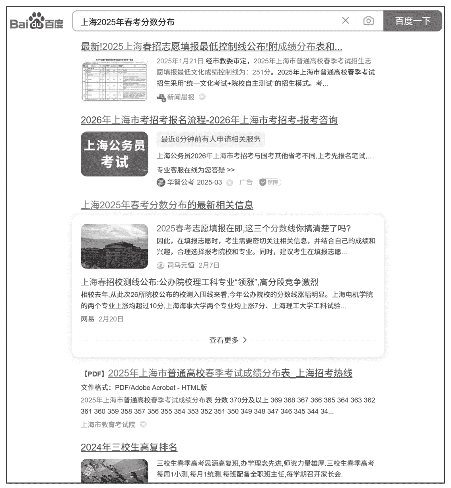

图 1-1 搜索引擎百度应用示例

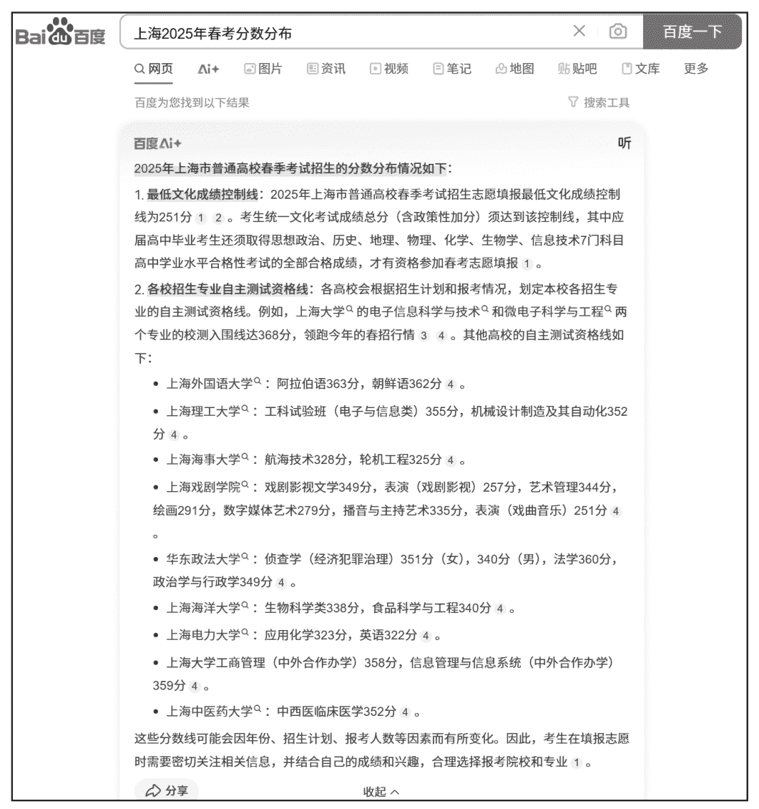

图 1-2 搜索引擎给出的 AI 提炼总结

2.**数据分析**

传统数据分析方法和 AI 数据分析方法在技术、适用场景和数据类型上存在显著差异。

常见的传统数据分析方法如下。

（1）描述性统计：如计算均值、中位数、标准差、频率分布等，适用于对数值型、分类型数据进行初步分析。这几种方法简单直观、易于理解，但无法揭示复杂关系。

（2）假设检验：如 T 检验、卡方检验、ANOVA（方差分析）等，适用于对数值型、分类型数据进行比较组间差异和验证假设。它们能揭示数据的显著性统计特征，但是需要满足特定假设，如正态分布。

（3）回归分析：如线性回归、逻辑回归等，常用于揭示数值型数据变量之间的关系，具有可解释性，可用来预测连续值或分类结果，但对非线性关系进行建模的能力有限。

（4）时间序列分析：如 ARIMA、指数平滑等，能够分析时间序列数据。例如预测时间相关的数据，如销售额、股票价格等，特别适合处理时间依赖性场景，但对突发事件的适应性较差。

（5）聚类分析：如 K-means、层次聚类等，常用于处理数值型数据，以便进行数据分组、市场细分等，它的优势是无须标签数据，适合探索性分析，但是结果解释性较差。

可见，传统的数据分析方法简单，易于理解和实施，对数据量和计算资源要求比较低。同时我们也可以看到，这些方法对复杂数据和问题的处理能力有限，而这正是第四范式对于数据处理的要求，因此需要新的数据分析方法。

AI 数据分析方法包括机器学习、深度学习、强化学习、自然语言处理、视觉处理等。

（1）机器学习方法：包括随机森林、支持向量机（SVM）、梯度提升树（GBDT）等，常用于结构化数据的分类、回归、聚类，适合中小规模数据，结果可解释性较强，但是对高维数据和非结构化数据处理能力有限。

（2）深度学习方法：主要包括神经网络（CNN、RNN、Transformer 等），常用于处理非结构化数据，包括图像、文本、音频等，即图像识别、自然语言处理、语音识别等任务，适合处理高维、复杂数据，建模能力强，它的处理过程需要大量数据和计算资源支撑，结果可解释性差。

（3）强化学习方法：包括 Q-learning、深度 Q 网络（DQN）等，用于处理序列数据、交互数据，解决动态决策问题，如问答、游戏、机器人控制，以便在动态环境中优化决策。其缺点是训练成本高，难以应用于静态数据。

（4）自然语言处理（NLP）方法：包括词嵌入（Word2Vec）、BERT、GPT 等，针对非结构化的文本数据进行分类、情感分析、机器翻译等，在建模过程中需要大量标注数据，计算资源的消耗比较大。

（5）视觉处理方法：包括卷积神经网络（CNN）、目标检测（YOLO）等，适合处理图像数据，如图像分类、目标检测、图像生成，同样它们也需要大量标注数据，且模型训练过程较为复杂。

数据分析方法的对比见表 1-1。

**表 1-1 数据分析方法对比**

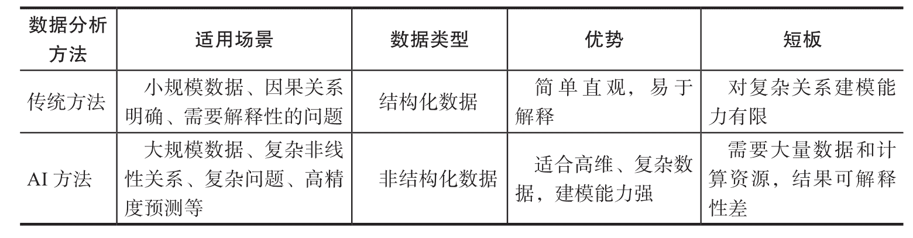

在应用时，需要根据具体问题和数据特点选择合适的方法，也可以结合两者优势，例如使用传统方法进行数据探索，再用 AI 方法进行深入建模。

AI 技术在科研中的应用前景广阔。随着 AI 技术的不断进步，它将能够更深入地利用大数据和机器学习算法，从海量数据中发掘科学规律和新知识。AI 可以自动进行数据分析、模式识别和预测，推动跨学科研究的发展，解决传统方法难以处理的问题。当然，AI 也会面临诸多挑战，新技术也将不断涌现，未来会创造出新的科研范式，进一步大幅提升科研的效率和效果。

## **1.3 AI 推动跨学科研究与复杂系统优化**

**1.3.1 工业复杂系统的多学科协同需求**

工业实践的复杂性，不仅仅是前述的数据密集型科学对“数据基础、方法创新”的要求，还有相当大一部分源于工业实践中经常需要多学科协同。因此，跨学科协同及由此带来的复杂系统优化，是工业企业科研创新面临的第二个主要问题。

2024 年 1 月，我国国产首艘大型邮轮“爱达·魔都号”（见图 1-3）正式交付运营方，这代表着我国造船工业完成了最后一块拼图，成功摘取造船工业“皇冠上的三颗明珠”：大型邮轮、大型液化天然气（LNG）运输船和航空母舰。它们分别代表着客运、货运和军用船舶建造的最高水平，直接体现了一个国家的工业实力和综合科技水平。

图 1-3 “爱达·魔都号”大型邮轮

大型邮轮的设计和建造是高度系统化、集成化的巨系统工程，涉及众多复杂的技术和工艺。“爱达·魔都号”总吨位 13.55 万吨，长 323.6m，宽 37.2m，设计吃水深度 8.26m，最大高度 72.2m。全船搭载 107 个系统、5.5 万台设备，包含 2500 万个零部件。零部件数是国产大飞机 C919 的 5 倍、复兴号高铁的 13 倍，完工敷设 4750km 电缆、365km 管系、120km 风管。邮轮有客房 2125 间，可容纳乘客 5246 人，配置了高达 16 层、面积达 4 万平方米的生活娱乐公共区域，被誉为“海上现代化城市”。

这些复杂的系统和设备使得大型邮轮不仅是工业品的代表，更是文化艺术的结晶。这个项目属于复杂巨系统工程，需要 20 多门学科的知识，涵盖工程、科学、艺术和管理等多个领域。通过多学科知识的深度融合，大型邮轮不仅能够满足功能性、安全性和环保性要求，还能为乘客提供极致的舒适体验和艺术享受。

1.**核心工程学科**

● 船舶工程：作为大型邮轮建造的核心学科，负责船体结构设计、稳定性分析、推进系统设计等。船舶工程的协同需要与流体力学、材料科学、机械工程等学科紧密结合，以确保船体的强度、稳定性和航行性能。

● 流体力学：研究船体在水中的阻力、推进效率和波浪响应，优化船体线型以降低能耗并提高航行效率。流体力学的协同需要与船舶工程、环境科学（海洋条件）结合，确保船体设计适应不同的航行环境。

● 机械工程：负责推进系统（如发动机、螺旋桨）、动力分配系统、HVAC（供暖、通风和空气调节系统）等关键设备的设计与集成。机械工程的协同需要与电气工程、自动化控制学科结合，确保机械系统的高效运行和智能化管理。

● 电气工程：设计船舶的电力系统、照明系统、通信系统和导航系统。电气工程的协同需要与信息技术、自动化控制学科结合，实现船舶的智能化和自动化运行。

2.**材料科学与化学工程**

● 材料科学：选择适合船体结构、内饰和设备的材料，如高强度钢、铝合金、复合材料等，以确保轻量化、耐腐蚀性和安全性。材料科学的协同需要与船舶工程、化学工程结合，优化材料性能并满足环保要求。

● 化学工程：处理船舶的燃料系统、废水处理系统和防腐涂层技术。化学工程的协同需要与环境科学、材料科学结合，确保船舶的环保性能和可持续性。

3.**环境科学与海洋工程**

● 环境科学：评估船舶对海洋环境的影响，设计环保系统（如废水处理、废气净化）以满足国际环保法规（如 IMO 标准）。环境科学的协同需要与化学工程、船舶工程结合，确保船舶的绿色设计和运营。

● 海洋工程：研究船舶在复杂海洋环境中的性能，包括抗风浪能力、耐腐蚀性和航行安全性。海洋工程的协同需要与流体力学、气象学结合，优化船舶设计，适配不同的海洋条件。

4.**建筑学与室内设计**

● 建筑学：设计船体的整体布局，包括客舱、公共区域、甲板空间等，确保功能性和美观性。建筑学的协同需要与船舶工程、室内设计结合，优化空间利用和结构安全性。

● 室内设计：设计大型邮轮的内饰风格、家具布局和装饰材料，提供高端的乘客体验。室内设计的协同需要与材料科学、建筑学结合，确保设计的美观性、舒适性和安全性。

5.**信息技术与自动化控制**

● 信息技术：开发船舶的智能管理系统，包括乘客服务系统、娱乐系统和安全监控系统。信息技术的协同需要与电气工程、自动化控制结合，实现船舶数字化和智能化。

● 自动化控制：设计船舶的自动化控制系统，包括动力管理、导航系统和安全系统。自动化控制的协同需要与机械工程、电气工程结合，确保系统的高效运行和可靠性。

6.**安全工程与法规**

● 安全工程：设计船舶的安全系统，包括消防系统、救生设备和应急响应系统。安全工程的协同需要与船舶工程、环境科学结合，确保船舶符合国际安全标准（如 SOLAS 公约）。

● 法律与法规：确保船舶设计和运营符合国际海事组织（IMO）和其他相关法规的要求。法律与法规的协同需要与所有工程学科结合，确保船舶的合规性和可运营性。

7.**经济学与项目管理**

● 经济学：评估船舶建造和运营的成本效益，优化资源配置。经济学的协同需要与所有工程学科结合，确保项目的经济可行性。

● 项目管理：协调各学科团队的工作，确保项目按时、按预算完成。项目管理的协同需要与所有学科结合，确保项目高效执行。

8.**人文与艺术**

● 艺术设计：设计船舶的外观风格和品牌形象，提升大型邮轮的市场吸引力。艺术设计的协同需要与建筑学、室内设计结合，确保设计的美观性和独特性。

● 心理学：研究乘客的行为和需求，优化客舱布局和服务设计。心理学的协同需要与室内设计、信息技术结合，提升乘客体验。

综上所述，大型邮轮的建造不仅是技术的集大成者，更是跨学科协作的典范。在现代工业中，跨学科研究与复杂系统优化已成为企业提升竞争力的关键，企业面临着复杂多变的生产环境和多样化的技术需求，传统的单一学科研究方法已难以满足其发展要求。

**1.3.2 AI 推动跨学科协同**

跨学科协同是解决复杂问题的关键手段，其核心在于整合不同学科的知识、方法和资源，以实现更高效的问题求解和创新突破。这一过程通常可以分为三个层次，如图 1-4 所示。

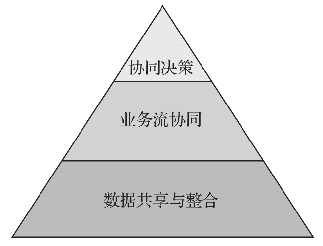

图 1-4 跨学科协同的层次图

1.**数据共享与整合**

数据共享是跨学科协同的基础。不同学科在数据采集、存储和分析方法上存在显著差异。例如，医学研究多依赖临床实验数据，而社会科学则更多使用调查数据。要实现跨学科协同，首先需要建立统一的数据标准和共享机制，确保数据能够在不同学科之间无缝流动。例如，在医疗与科技领域的合作中，AI 技术可以通过自然语言处理和图像识别技术，将非结构化的医疗数据转化为结构化数据，从而实现跨学科的数据整合。

2.**业务流协同**

在数据共享的基础上，跨学科协同需要进一步推动业务流的协同。这意味着不同学科的团队需要在同一平台上协作，共享资源、工具和方法。例如，在城市规划领域，地理信息系统（Geographic Information System，GIS）与工程技术的结合，能够显著提升城市治理的精细化水平。业务流协同的关键在于建立高效的协作平台和工具，例如共享在线文档、项目管理软件和数据分析工具，这些工具能够帮助团队成员实时更新项目进展、分配任务并快速反馈实验结果。

3.**协同决策**

协同决策是跨学科协同的最高层次。在这一层次，不同学科的专家需要共同参与决策过程，利用各自的专业知识提出综合性的解决方案。例如，2025 年 3 月 5 日《中国航空报》报道，全国人大代表田俊霞带领跨学科团队通过协同决策，有效解决复杂材料研发中的技术难题，推动了技术成果的工程化应用。田俊霞表示：“高效协同的本质在于建立‘技术-工艺’闭环，深度融合院所理论优势与企业工程能力，实现技术领先与产业竞争力双提升，为我国航空工业发展注入强劲动力。”协同决策的核心在于建立透明的沟通机制和公平的贡献评估体系，确保每个学科的专家都能在决策过程中充分发挥其专业价值。

在实现工业复杂系统的协同过程中，遇到的瓶颈问题日益凸显，主要包括技术壁垒、文化差异和相关制度三个方面。

技术壁垒是跨学科协同中常见的障碍之一。不同学科在数据标准、技术架构和分析方法上存在显著差异，导致数据整合和业务流协同的难度加大。

以石油科研中的油藏模拟为例，其核心目标是通过建立数学模型，模拟油藏中的流体流动和压力变化，从而预测油田的开采动态。这一过程需要多学科知识：利用地质学知识可获得油藏的地质构造、岩性分布和孔隙结构等基础数据；利用地球物理学知识可获得地震勘探数据，构建油藏的三维地质模型；利用石油工程知识可设计开采方案、优化井位布置和生产参数；利用计算机技术可开发高效的数值模拟算法和计算平台以处理大规模数据。这些学科知识在油藏模拟中各司其职，但它们之间的技术壁垒却成为协同研究的最大障碍。

一是数据标准的差异，不同学科在数据采集、存储和表示方式上存在显著差异。例如，地质学通常使用岩心样本和测井数据来描述油藏的物理性质，这些数据通常以表格或图像的形式存储；而地球物理学则依赖地震勘探数据，这些数据通常以三维网格的形式存储。由于缺乏统一的数据标准，不同学科的数据在整合过程中需要进行大量的格式转换和数据清洗，这不仅增加了工作量，还可能导致数据丢失或产生误差。

二是技术架构的不兼容，不同学科在技术架构上的差异也显著增加了协同研究的难度。例如，地质学家通常使用地质建模软件（如 Petrel）来构建油藏模型，而石油工程师则更倾向于使用油藏模拟软件（如 Eclipse）进行数值模拟。这些软件在数据接口、计算方法和输出格式上存在显著差异，导致数据在传输和处理过程中需要进行多次转换和适配，这不仅降低了研究效率，还可能导致计算结果的不一致。

三是分析方法的冲突，不同学科在分析方法上的差异也进一步加剧了技术壁垒。例如，地质学家通常采用统计学方法分析油藏的岩性分布，而石油工程师则更倾向于使用数值模拟方法来预测流体的流动。这些方法在理论基础和应用场景上存在显著差异，导致研究团队在数据解释和结果验证过程中需要花费大量时间进行沟通和协调，从而降低了研究效率。

由于上述技术壁垒的存在，油藏模拟研究中的跨学科协同往往面临以下问题。

（1）沟通成本高：不同学科的专家需要花费大量时间沟通各自的数据和方法，以确保团队成员有相同理解。

（2）数据处理效率低：数据格式转换和清洗过程会耗费大量时间和资源，导致研究进度延迟。

（3）计算结果不一致：由于技术架构和分析方法的差异，不同学科的计算结果可能不一致，增加了结果验证的难度。

（4）研究质量受限：由于时间和资源的限制，研究团队可能无法充分整合多学科的数据和方法，导致研究成果的科学性和实用性受限。

AI 技术为解决这些问题提供了以下新的可能性。

一是 AI 能够促进数据的标准化与整合。AI 技术可以通过自然语言处理和图像识别技术，将不同学科的非结构化数据转化为结构化数据，从而实现数据的标准化和整合。例如，AI 算法可以自动识别地质图像中的岩性特征，并将其转化为数值数据，供油藏模拟使用。

二是 AI 能够提升技术架构的兼容性。AI 驱动的数据接口可以自动适配不同软件的数据格式，减少数据转换的时间和误差。例如，AI 算法可以将 Petrel 中的地质模型直接转化为 Eclipse 支持的输入格式，从而简化数据传递过程。

三是 AI 能够助力不同分析方法的融合。AI 技术可以通过机器学习算法融合不同学科的分析方法，提供更全面的数据分析结果。例如，AI 算法可以结合地质统计数据和数值模拟结果，生成更精确的油藏模拟模型。

除了技术壁垒，文化差异是跨学科协同的另一大瓶颈。不同学科的研究人员往往具有不同的学术背景、工作习惯和目标导向，这可能导致沟通障碍与合作意愿的降低。例如，在跨学科团队中，一些学科的研究人员可能更注重实验的重复性，而另一些学科则更关注理论创新。这种文化差异需要通过建立开放的沟通机制和联合培训项目来缓解，但这些措施的实施效果往往受到时间和资源的限制。

另外，现行的科研资助和评价体制也可能阻碍跨学科协同的进行。例如，跨学科研究项目往往难以归类为某一特定学科，导致其在相关评审中处于不利地位。此外，学术论文的发表和科研人员的职业发展通常依赖于单一学科的成果，这使得研究人员更倾向于深耕某一细分领域，而非参与跨学科合作。

综上所述，跨学科协同是解决复杂问题的关键手段，但技术壁垒严重影响了跨学科协同研究的效率和质量。AI 技术为解决这些问题提供了新的可能，但在实际应用中仍面临着数据隐私、算法透明性和技术成熟度等挑战。未来，随着 AI 技术的不断进步，跨学科协同的效率和质量有望得到显著提升，从而真正实现复杂系统的优化。

## **1.4 生成式 AI 与创新设计**

**1.4.1 创新设计的方法论**

科研范式的四次进阶都离不开其创新方法。国标《企业创新方法工作规范》（GB/T 37097—2018）给出了在创新方法工作实施中，采用的三类创新方法：技术创新方法（本书主要介绍 TRIZ ^(³)）、管理创新方法（本书主要介绍 6 Sigma）和知识工程方法。

6 Sigma 是以数据驱动的质量管理方法，旨在通过减少变异和缺陷来提高业务流程的效率和质量。Sigma（σ）是一种统计场景下的度量标识，代表质量水平的偏差，Sigma 水平越高偏差越小，代表过程越稳定。基于原有系统的优化，按照 6 Sigma 理论，对于过程能力的提升最多达到 5 Sigma 水平。而真正的创新源于对原系统的突破性设计，例如原理替代，才能让过程能力提高到 6 Sigma，这就是创新设计。

图 1-5 是 6 Sigma 中非常著名的过程能力水平隐喻图：苹果树。低处的果实容易摘取，对应过程能力从较低水平向上提升，最多达到 3 Sigma（3σ）水平，仅用直观的观察和分析就能找到解决办法。如果要达到 4 Sigma（4σ）水平，需要进行过程改善，专注过程中的瓶颈环节，提高其能力从而提升整体过程的能力。继续提升需要进行系统级别的特征优化，最多达到 5 Sigma（5σ）水平，这已是原系统的能力极限。想要提高到 6 Sigma（6σ）管理法的完美水平，仅靠系统内部的修补与完善是无法实现的，必须从原理上做出改变，摒弃原有架构中的妥协方案，通过新一代技术和实现方式，从源头上克服原系统的种种不足，实现质的飞跃。

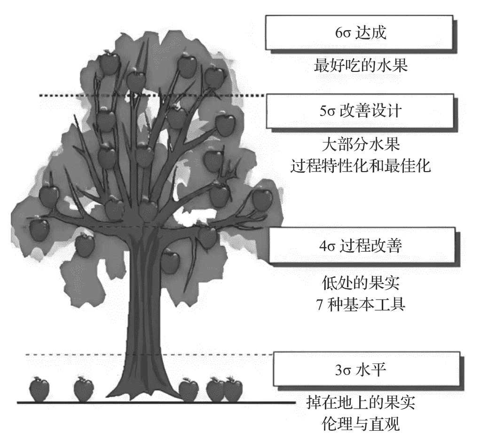

图 1-5 6 Sigma 中过程能力水平隐喻图：苹果树

谁不想一个系统从诞生起就是个完美系统？这无疑是一个最甜美的果实，也是个巨大的诱惑。目标为 6 Sigma 水平产品的设计方法论称为“创新设计”，它的流程为图 1-6 中的 DMADV 流程；与之相对，将 6 Sigma 用于产品或流程优化的方法论是 DMAIC。

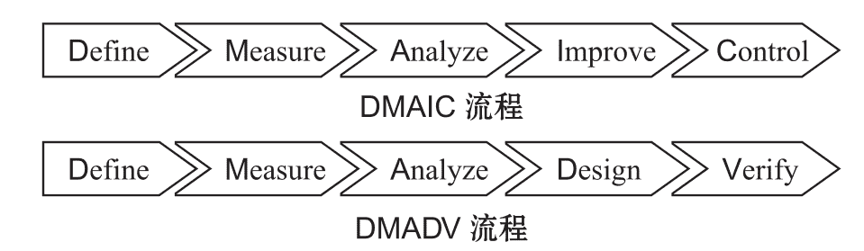

图 1-6 6 Sigma 的两种流程

DMAIC 和 DMADV 都遵循结构化的流程，但在目标、方法和应用场景上存在显著差异。

DMAIC 是 6 Sigma 中最常用的方法，适用于对现有系统或流程进行改进。包括五个阶段：定义（Define）、测量（Measure）、分析（Analyze）、改进（Improve）和控制（Control）。每个阶段的目标和方法如下。

（1）定义（Define）阶段：团队明确项目的范围、目标和关键利益相关者。通过定义项目的目标和范围，确保团队成员在改进的方向上保持一致。

（2）测量（Measure）阶段：收集数据，量化当前流程的性能。通过统计工具（如过程能力分析）和测量系统分析（MSA），团队能够确定流程的基线性能。

（3）分析（Analyze）阶段：识别问题的根本原因。团队使用统计分析工具（如假设检验、回归分析和因果图）找出影响流程性能的关键因素。在这个阶段，6 Sigma 方法论提供了丰富的方法和工具，如实验设计、数据统计分析工具、模拟仿真等，涵盖了前三种科研范式的主要分析方法。

（4）改进（Improve）阶段：团队设计并实施解决方案，以避免或减少问题的发生。通过实验设计（DOE）和优化技术，找到最优的妥协方案。

（5）控制（Control）阶段：重点是确保改进措施的可持续性，团队通过建立控制计划和监控机制，防止问题再次发生。

DMAIC 的核心目标是在现有约束条件下，通过数据驱动的分析和改进来实现流程的优化。这种方法适用于已经存在的流程或系统，其目标是通过逐步优化来提高性能。

DMADV 是用于设计新系统或流程的方法，适用于需要从头开始构建解决方案的场景。包括五个阶段：定义（Define）、测量（Measure）、分析（Analyze）、设计（Design）和验证（Verify）。每个阶段的目标和方法如下：

（1）定义（Define）阶段：明确项目的目标、范围和关键利益相关者。与 DMAIC 的目标不同的是，DMADV 的目标是设计一个全新的系统，而不是改进现有系统。

（2）测量（Measure）阶段：收集客户需求和市场数据，以确定新系统的关键性能指标（CTQ）。通过质量功能展开（QFD）等工具，将客户需求转化为设计参数。

（3）分析（Analyze）阶段：识别设计中的潜在问题和矛盾。与 DMAIC 不同，DMADV 在这一阶段更注重创新设计方法，如 TRIZ（发明问题解决理论），以直接解决矛盾。

（4）设计（Design）阶段：DMADV 的核心阶段，团队通过创新设计方法（如 TRIZ）创建新系统。利用 TRIZ 分析技术矛盾和创新原理，帮助团队找到突破性的解决方案。

（5）验证（Verify）阶段：通过原型测试和模拟验证新系统的性能。团队使用统计工具（如可靠性分析和实验设计）确保新系统满足设计要求。

DMADV 的核心在于通过创新设计方法（如 TRIZ）直接解决矛盾，创建一个在各方面都符合要求的新系统。这种方法适用于需要从头开始设计的场景，其目标是实现突破性创新。

**1.4.2 TRIZ 在工业领域中的困境**

在工业领域实践中，6 Sigma 创新方法中的 DMAIC 用于原有系统和流程的优化，而真正的创新依靠 DMADV 中的创新设计方法 TRIZ，也就是国标中定义的技术创新方法。

TRIZ 是一种系统化的创新方法，由前苏联发明家根里奇·阿奇舒勒（G.S.Altshuller）于 1946 年提出。TRIZ 是通过分析大量专利和创新案例总结出技术系统进化的规律和解决技术矛盾的通用方法。它可帮助设计者突破思维定势，找到创新解决方案。

TRIZ 的核心工具如下。

（1）创新原理：包括用于解决技术矛盾的 40 个创新原理和用于解决物理矛盾的 4 个分离原理。

例如，第一个创新原理是分割原理（Segmentation），指将一个物体或系统分解为多个独立的部分，或者使其能够灵活组合和分离。通过分割可提高系统的灵活性、可维护性或功能性。

采用了分割原理的创新产品很常见，例如，谷歌的 Project Ara 项目旨在设计一种模块化手机，用户可以根据需求更换电池、摄像头、处理器等模块，从而实现个性化定制和升级；宜家的家具模块用户可以进行自由分割和重新组合，以适应不同的空间需求和功能要求；微软的 Surface 系列设备也是采用了分割原理，允许将屏幕和键盘分离，既可作为平板计算机使用，也可通过连接键盘变为便携式计算机。

（2）技术进化规律：包括 S 曲线规律、8 大进化法则、16 条进化路线以及进化树理论。

向微观级和场的应用进化法则是 TRIZ 中的 8 大进化法则之一，它指出技术系统的进化方向之一是沿着减小其元件尺寸的方向发展。这一法则强调技术系统在进化过程中，元件和结构会逐渐向更小、更精细的微观级别发展，从而提高系统的性能、效率和集成度。它的具体表现形式包括规模微观化、增加离散度、引入空洞和场的应用。

电子芯片是微观级和场的应用进化法则的典型应用案例。早期的电子设备使用电子管作为核心元件，其体积大、能耗高且效率低。随着技术的发展，电子元件逐渐向微观级别进化：首先是晶体管取代电子管，使得电子设备的体积大幅缩小，同时提高了性能和可靠性；而后集成电路的出现，能够将多个晶体管集成到一个芯片上，进一步缩小了体积并提高了计算能力；现代芯片制造技术已经进入纳米级别，例如 7nm、5nm 甚至 3nm 工艺，使得芯片的性能和能效比大幅提升。通过向微观进化，电子芯片不仅实现了体积的缩小，还显著提升了计算速度、降低了能耗，并推动了智能手机、计算机等电子设备的发展以及人工智能等技术领域的快速发展。

由电子芯片的发展可见，微观级和场的应用进化法则为技术系统的创新提供了重要的指导方向。它帮助设计者突破传统思维，展示了微观级别的优化对技术性能的显著提升。未来，随着纳米技术及其应用、量子计算等领域的进一步发展，微观级和场的应用进化法则将继续推动技术创新和产业升级。

（3）物场分析与标准解系统：TRIZ 基于系统的功能架构，将系统用物质和场的关系来建立模型，包括正确的模型和错误的模型。

这些模型中的错误就代表着系统存在缺漏和过失，例如缺少某种物质或场，或者某个场的作用不足或过度。不同的错误模式的物场模型，都可以通过标准解系统找到适用的解决方案。标准解系统提供了 76 个标准解，这些标准解涵盖了多种常见的问题类型，能够为解决物场模型中的错误模式提供指导。

例如，我们日常用水清洗眼镜，效率不高且效果不好，我们可以用水、眼镜这两种物质和一个作用不大的机械场，建立这个小系统的物场模型。通过标准解系统可推导出，此时不需要改变任何一种物质，只需增加一个场的作用来解决问题，如图 1-7 所示。至于增加的这个场，可以是超声波场，也可以是其他类型的场，这体现了创新解决方案的多样性。

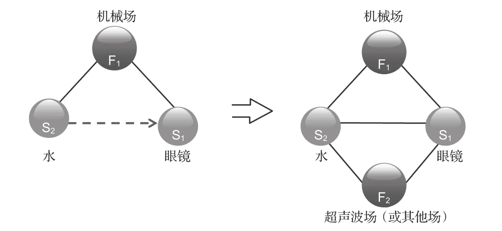

图 1-7 清洗眼镜的物场模型

（4）创新思维方法：TRIZ 中的创新思维方法，旨在帮助人们突破传统思维模式，找到更具创造性的解决方案。典型创新思维方法如下。

1）最终理想结果（Ideal Final Result，IFR）。强调在解决问题时首先抛开所有限制条件，定义问题的最终理想状态。IFR 的核心思想是“系统在最小改变的情况下，能够实现最大限度的自服务（自我实现、自我传递、自我控制等）”。通过明确理想解的方向，设计者可以避免在创新过程中陷入妥协或折中方案，从而更高效地找到最优解。

2）聪明的小人法（Smart Little People，SLP）。以一种形象化的思维工具解决技术矛盾。它将系统中的各个组件或元素比喻为“聪明的小人”，它们能够做出简单的动作，可以通过改变这些“小人”的行为或关系来解决问题。这种方法帮助设计者跳出传统的技术框架，从全新视角尤其是微观视角审视问题。例如，在解决机械结构中的应力集中问题时，可以将应力分布想象为“聪明的小人”的受力情况，从而找到优化的设计方案。

3）九屏幕法（Nine Screens）。一种系统化的思维工具，用于全面分析问题，以及系统、子系统和超系统的关系。通过绘制一个 3×3 的矩阵，设计者可以从多个维度（时间、空间、层次）审视问题，从而发现潜在的资源和解决方案。例如，在分析汽车发动机的优化问题时，设计者利用九屏幕法可以获取发动机的历史信息、当前技术瓶颈，以及未来可能的改进方向。

4）金鱼法（Goldfish Method）。源自俄罗斯普希金的童话故事《金鱼与渔夫》。故事中，渔夫通过金鱼实现了自己的愿望。金鱼法是一种创新思维方法。它将幻想式的解决构想持续地划分成可行的部分和幻想的部分，进而聚焦于将幻想的部分进一步细化为更具体可行的部分和仍属于幻想的部分。如此反复，最终使所有构想都变为现实可行的方案。

5）STC 算子法（Size，Time，Cost Operator）。通过分析问题的三个属性——尺寸（Size）、时间（Time）和成本（Cost），设计者从尺寸变化到无穷大或无穷小的分析，突破常规思维的局限，找到原本想象不到的解决方案。

通过以上的介绍，我们了解到 TRIZ 是一种系统性的创新方法。它提供了一套系统化的工具和方法，帮助团队从技术矛盾中寻找创新解决方案。TRIZ 带来的往往是突破性的设计，例如，TRIZ 强调解决技术矛盾，而不是妥协。这使得团队能够设计出在各方面都令人满意的新系统，而不是在现有约束条件下寻找最优妥协方案。同时，TRIZ 通过标准化的工具和方法，提高了创新设计的效率，团队能够快速识别和解决设计中的关键问题，从而缩短开发周期。

TRIZ 是前人智慧的结晶，对科研创新有很大的帮助。我国从 2017 年开始推广以 TRIZ 为代表的创新方法，制定了 4 项国家标准，包括对创新工程师、创新培训师、创新咨询师的能力等级认证，以及企业实施创新方法的指南。然而，TRIZ 在国内工业中的应用相对我国工业普遍而迫切的创新需求来说仍然是凤毛麟角。为什么？TRIZ 的应用逻辑如图 1-8 所示。

当面对需要进行创新解决的难题时，往往其他直接的方法都已经无法生效了，按照 TRIZ 的应用逻辑，需要进行抽象、推理和具象的过程，即将待解决的现实问题转化为 TRIZ 的问题模型，例如物场模型、矛盾模型等；然后使用 TRIZ 提供的工具，如矛盾矩阵、标准解系统等，找到 TRIZ 提供的解决方案模型，如标准解、创新原理、分离原理等；进而，围绕这个解决方案模型进行头脑风暴，结合现实的资源和局限性，形成现实可行的最终方案。

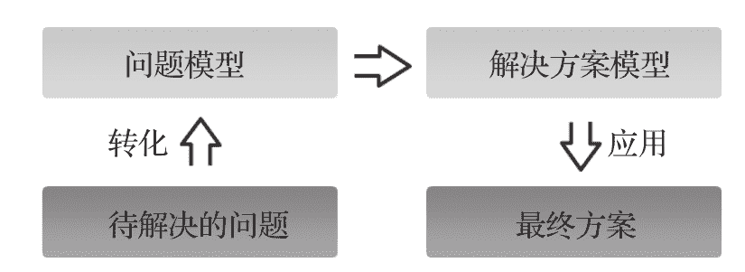

图 1-8 TRIZ 的应用逻辑

在这个过程中，有几个原因会导致 TRIZ 应用的困境。

首先是 TRIZ 体系的复杂性带来工具选择的困境：TRIZ 包含多种工具和方法，每种工具适用于不同的场景，仅正确理解工具方法还不足以用好它，还需要经过实践训练，加强工程师对方法的理解以便熟练应用。

其次是创新方法对工程师知识经验的潜在要求：TRIZ 的应用需要结合专业的知识、经验，即“创新的方法加上创新的知识才能产生创新的成果”，这一点又回到了第四范式数据密集型科学的诉求上，需要从海量的文献中挖掘并分析创新特征，将文献中的实际方案、效果与 TRIZ 的方法、原理关联起来，从而提高工程师学习、理解和应用创新方法的效率，实现真正的创新。

最后是 TRIZ 的创新原理存在一定的数据偏差性：TRIZ 诞生于专利统计特征的挖掘。在专利数据中，有形的、宏观的实物类产品占比较大，据此产生的专利也更倾向这方面的创新，这形成了正反馈。反之，其他类型的创新在专利数据中则处于劣势，形成了负反馈，这使得 TRIZ 在这些领域中的应用相对不那么突出。然而这并不意味着 TRIZ 仅适用于手机、计算机、家具等产品的创新。事实上，TRIZ 对于各行各业的创新设计都具有普遍的指导意义。例如服装设计，它的创新要素主要包括以下几个方面。

（1）面料创新：面料是服装设计的基础，采用新型面料或对面料进行特殊处理可以显著提升服装的设计感和实用性。例如，使用透明丝、鱼线、弹力丝、镭射材料等新型材料，以及通过挑孔蕾丝、水管凸条等针法凸显肌理效果。

（2）色彩创新：色彩是服装设计的灵魂，通过巧妙运用色彩搭配可以创造出独特的视觉效果。

（3）款式创新：款式设计是服装的骨架，决定了服装的基本结构和整体造型。通过结合传统服饰与现代设计的元素，可以创造出既有文化底蕴又符合现代审美需求的服装；或者通过分析不同运动项目对服装的功能需求，设计出既实用又时尚的运动服装。

（4）技术与工艺创新：结合智能材料与技术，设计更符合特定场景的服装。

在这些创新要素中，面料和技术工艺创新属于技术范畴，TRIZ 方法完全适用。而色彩和款式创新虽然不完全属于技术范畴，但也可以应用部分 TRIZ 的原理进行构思，例如分离、抽取、组合等。

基于以上分析，我们现在已经有了很好的创新方法和有效的创新设计方法论，为了更好地运用这些方法，我们迫切需要一种工具或者方法，能够做到以下几点：

（1）理论结合实践，帮助工程师更快地理解方法、掌握和应用这些方法。

（2）专业知识支持：在转化和应用两个环节，直接帮助工程师进行抽象和具象化操作。

（3）TRIZ 体系的自我更新：真正实现国内外主要专利库数据的挖掘分析，按照阿奇舒勒先生的描述，遵守创新规律的纳入原则，重塑 TRIZ 体系，这无疑是一个庞大的数据挖掘工程。

要做到这些，除了前述的数据分析传统方法和 AI 方法外，我们还需要一种新的 AI 技术——生成式 AI。

**1.4.3 生成式 AI 在创新设计中的应用**

生成式 AI 是一种通过机器学习模型生成新内容的技术，其核心在于从现有数据中学习特征或规律并生成与之相似但全新的内容。

生成式 AI 的诞生可以追溯到 20 世纪 50 年代人类对人工智能的早期探索，但其真正突破性发展始于 2014 年生成对抗网络（Generative Adversarial Networks，GAN）的提出。GAN 由伊恩·古德费洛（Ian Goodfellow）等人提出，通过两个神经网络（生成器和判别器）的对抗训练，能够生成逼真的图像、视频等内容，GAN 在图像合成（如 DeepFake）和艺术创作中得到了广泛应用。此后，变分自编码器（Variational Autoencoders，VAE）和基于 Transformer 架构的语言模型进一步推动了生成式 AI 的发展。VAE 通过学习数据的潜在分布，生成新的数据样本，常用于图像生成和数据压缩。而 Transformer 架构是一种基于注意力机制的模型，在自然语言处理领域表现突出，能够生成连贯的文本、代码等内容。

生成式 AI 生成文本、图像等能力，突破了之前人类对 AI 能力仅限于替代人类五官、四肢以及提供算力的认知，被普遍认为是 AI 进化到强人工智能时代的典型特征。生成式 AI 的典型应用如下。

（1）文本生成：OpenAI 的 GPT-3 等能够生成新闻文章、故事、诗歌等，甚至支持交互式问答。

（2）图像生成：DALL·E 和 Stable Diffusion 等模型可以根据文本描述生成高质量图像，广泛应用于艺术创作和设计领域。

（3）音乐创作：AI 作曲系统能够根据不同的风格或情绪要求来生成原创音乐，改变了传统音乐制作流程。

（4）代码生成：GitHub 的 Copilot 等能够根据自然语言描述生成代码片段，提升开发效率。

（5）创新设计：生成式 AI 能够快速生成多种设计方案，显著提高创新效率。

生成式 AI 在创新设计领域的应用，标志着设计范式的一次革命性转变。生成式 AI 技术通过深度学习算法，能够系统地学习原有设计样例，从中提取关键特征参数，并构建多维度的设计特征模型。具体而言，生成式 AI 首先通过卷积神经网络（Convolutional Neural Network，CNN）或图神经网络（Graph Neural Network，GNN）等深度学习架构，对海量设计样本进行特征提取和模式识别，例如，在服装设计领域，它能够建立起包括形态特征、功能特征、美学特征在内的多维度设计特征空间。在特征提取过程中，系统不仅关注显性设计特征，还能通过自注意力机制（Self-attention Mechanism）捕捉设计元素之间的潜在关联，从而构建更加精准的设计特征表示。

基于提炼的设计特征模型，生成式 AI 进一步整合广泛的数据源，包括材料数据库、工程规范、用户偏好数据、市场趋势分析等，形成多维度的设计约束条件。这种数据融合能力使得 AI 系统能够突破传统设计思维的限制，在满足功能性需求的同时，兼顾制造可行性和市场接受度。通过变分自编码器（VAE）或生成对抗网络（GAN）等生成模型，系统能够在设计特征空间中进行智能探索，自动生成大量符合约束条件的创新设计方案。

在实际应用中，生成式 AI 的创新设计过程具有显著的效率优势。传统设计流程中，设计师需要耗费大量时间进行方案构思和迭代修改，而 AI 系统可以在短时间内生成数百个符合要求的设计变体。这些方案不仅包含常规的设计思路，还能产生突破性的创新概念，为设计师提供全新的灵感来源。例如，在产品设计领域，AI 系统可以同时考虑人体工程学、材料特性、生产工艺等多个维度，生成既美观又实用的设计方案；在建筑设计领域，AI 能够综合考虑结构力学、采光通风、能源效率等因素，提出创新性的空间解决方案。

生成式 AI 更为重要的优势在于支持多目标优化设计，能够根据不同的设计权重（如成本最小化、性能最优化、美学价值最大化等）自动调整生成策略，提供多样化的设计方案供决策参考。这种能力不仅显著提升了设计效率，还大幅拓展了设计创新的可能性空间。通过人机协作，设计师可以专注于高层次的设计决策和创意把控，而将重复性的设计探索和方案生成工作交由 AI 系统完成，从而实现设计质量和效率的双重提升。

未来，随着多模态学习技术和跨领域知识迁移能力的进一步发展，生成式 AI 在创新设计中的应用将更加深入和广泛，有望重塑整个设计行业的创新模式。当然其广泛应用也带来了数据安全、版权管理和伦理问题等挑战，需要在技术发展的同时加强规范和治理。

## **1.5 科研与创新生态系统的构建**

在当代经济和技术发展背景下，企业很难独自承担所有的科研和创新任务，突破企业边界的协同是必然趋势，这就需要构建科研与创新生态系统（Research and Innovation Ecosystem）。这个系统可以在一家大型企业内部由不同的组织单元构成，也可以在行业内，甚至跨行业，由不同的企业或组织构成。这一生态系统强调主体间的相互作用和协同演化，其核心目标是通过知识流动、资源共享和协同创新，将科研成果高效转化为工业应用，实现技术创新、价值创造和成果转化。

科研与创新生态系统，通常是由科研机构、设计生产机构、技术供应方、协同管理机构、服务机构等多元主体构成的复杂网络，如图 1-9 所示。

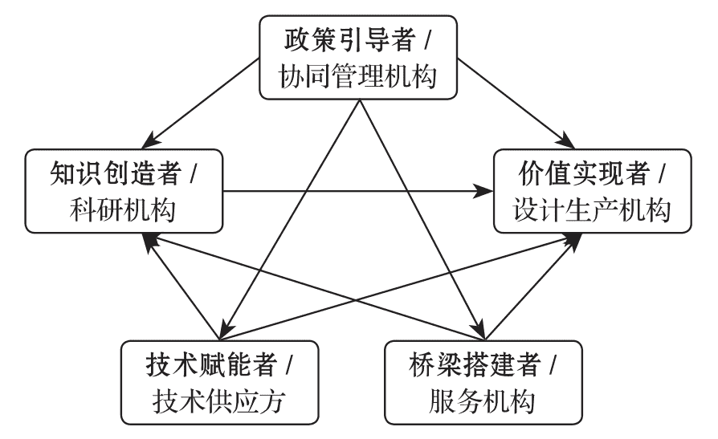

图 1-9 科研与创新生态系统

（1）科研机构：生态系统的“知识创造者”，负责基础研究和前沿技术开发。科研机构与技术供应商合作，将科研成果转化为可应用的技术工具。

（2）设计生产机构：生态系统的“价值实现者”，负责技术的工业应用和商业化。设计生产机构与科研机构合作开发新产品，与技术供应商合作优化生产工艺。

（3）技术供应方：生态系统的“技术赋能者”，为科研机构和设计生产机构提供技术支持和解决方案。技术供应方与科研机构合作开发新技术，与设计生产机构合作实现技术应用。

（4）协同管理机构：生态系统的“政策引导者”，通过制定科技政策和提供资金支持，推动科研与创新的发展。

（5）服务机构：生态系统的“桥梁搭建者”，通过提供技术转移、知识产权保护等服务，促进主体间的合作。

在科研与创新生态系统中，技术交付涉及从基础研究到应用研究，再到工业化和商业化的全过程。这一过程需要多种技术的支持，包括信息技术、制造技术、测试与验证技术，也许还有一些特殊技术（如复合材料），同时也需要多个机构的紧密合作。

1.**信息技术**

信息技术是科研与创新生态系统的基石，包括大数据、云计算、人工智能和物联网等。这些技术为科研数据的采集、存储、分析和共享提供了基础设施。

信息技术供应方为科研机构和设计机构提供底层技术支持，是生态系统中的“基础设施提供者”。一方面，信息技术供应方与科研机构合作开发算法、模型和产品原型等；另一方面，信息技术供应方与设计生产机构合作实现技术应用。

2.**制造技术**

制造技术是实现科研成果工业化的关键，包括增材制造（三维打印）、智能制造、精密加工等。这些技术能够将实验室中的原型快速转化为工业产品。

制造技术供应方是生态系统中的“技术转化者”。制造技术供应方与科研机构合作开发新型制造工艺，与设计生产机构合作实现生产线的升级和优化。

3.**测试与验证技术**

测试与验证技术是确保科研成果可靠性和安全性的关键，包括仿真技术、实验设备、检测仪器等。

测试与验证技术供应商是生态系统中的“质量保障者”，为科研机构和设计生产机构提供技术验证服务，确保科研成果符合工业标准。

在工业应用中，科研与创新生态系统的构建需要围绕具体行业需求展开。以一家汽车生产企业为例，其智能制造技术交付过程如下。

（1）基础研究：科研机构在人工智能、机器视觉等领域开展前沿研究，开发新型算法和模型。

（2）技术开发：设计生产机构将科研成果转化为工业软件和硬件，如智能控制系统、工业机器人等。

（3）试点应用：在特定生产线上进行技术验证，优化工艺参数和工艺流程。

（4）规模化推广：将成熟技术推广到更多工厂或车间，实现大规模应用。

在这一过程中，科研机构、技术供应方和设计生产机构形成了紧密的合作关系。科研机构提供前沿技术，技术供应方提供工具和设备，设计生产机构则负责技术的工业化和商业化。

科研与创新生态系统的构建要促进科研与创新，它的核心特征如下。

开放性：需要不断引入外部资源和技术，保持系统的活力和竞争力。

协同性：主体间的协同合作是生态系统高效运行的关键，通过知识共享和资源整合，实现创新绩效的最大化。

动态性：生态系统是一个动态演化的系统，需要不断适应技术变革和市场需求。

综上所述，科研与创新生态系统的构建是一个复杂而系统的工程，需要多元主体的协同合作。而建成之后整个系统将具备一定的稳定性，能够通过技术交付和工业应用，科研成果得以顺畅地转化为实际价值，持续推动经济增长和社会进步。未来，随着技术的不断进步，科研与创新生态系统将继续演化，为企业或行业的科技发展提供强劲动力。

然而，这个生态系统的构建并非本书的重点，我们正处于这样一个时期：AI 技术极大地颠覆了原有技术，带来了创新的活力，同时大的变革也会带来担忧，原来的生态系统是否都要重建？原有的技术是否都要抛弃？结论当然是否定的，从未有过全盘否定一个系统或一种技术的情况，所有来时的路都是迈向未来的阶梯。本节旨在向读者说明，本书将要探讨的新技术大模型，并不会导致原有的科研与创新生态系统的崩溃，它是对原有技术体系的升级，是对原有科研范式的升级，为原创新设计方法提供新助力。它的出现以及融入需要原生态系统进行演化，不仅要增加这种新技术的供应方，其他各角色也都会为了适应这种变化而改变、进步，这就是生态系统的开放性、协同性和动态性。

我们相信未来一定会更好，现在我们已经做好准备，请跟随我们一起了解它、运用它，让它展现能力并创造价值。

# **第二章 大模型驱动的工业智能**

大语言模型泛指 2023 年以后以 OpenAI 的 ChatGPT 3.5 为代表的各种生成式大语言模型，而之前的统计模型、机器学习模型、深度学习模型等各种模型，要么数据量或者算力不够大，要么效果和影响力不足，因此都没有被称为“大模型”。在本书中，大模型主要指大语言模型（Large Language Model，LLM）。

本章在第一章的基础上进一步深入，聚焦大模型技术如何推动工业智能实现范式迁移。从传统的编程模式到数据驱动的智能化转型，再到基于语言模型的认知重构，本章系统梳理了这一演变过程。通过对语言模型的突破性进展以及工业应用技术路线的深入分析，本章还为第三章关于大语言模型在工业应用中的演进奠定了坚实的基础。

## **2.1 工业智能的演进**

“工业智能”并非由单一机构或个人提出，而是随着工业数字化转型的深入逐步形成的术语，其提出背景与第四次工业革命（工业 4.0）及人工智能技术的突破密切相关。工业智能是学术界、产业界与国家战略协同演进的产物，其本质是工业系统从“自动化”向“认知化”跃迁的必然选择。随着 AI 大模型与量子计算的突破，工业智能将进入“超自动化”新阶段，并重新定义全球制造业的竞争规则。

工业智能相关概念的比较见表 2-1。

**表 2-1 工业智能相关概念的比较**

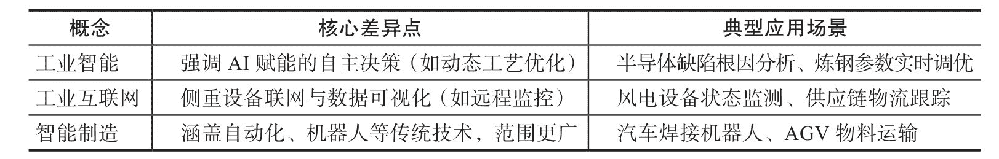

工业智能与人工智能的区别见表 2-2。

**表 2-2 工业智能与人工智能的区别**

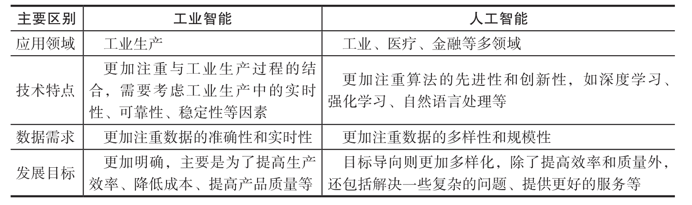

如图 2-1 所示，工业智能的演进分为 3 个阶段，分别是规则驱动、数据驱动和语言驱动，本节我们详细介绍这些阶段的演进。

**2.1.1 从规则驱动到数据驱动**

工业智能的早期范式包括规则驱动和数据驱动。

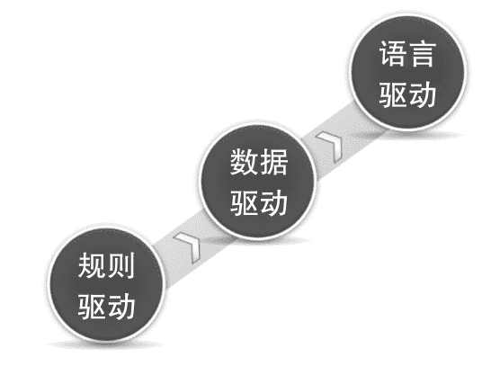

图 2-1 工业智能的演进阶段

工业智能的萌芽可追溯至 20 世纪中叶控制论与自动化技术的融合。诺伯特·维纳在《控制论》中提出的“反馈-调节”原理，为工业系统的确定性编程奠定了数学基础。可编程逻辑控制器（PLC）通过布尔代数的逻辑电路，将工程师的经验知识固化为生产线的控制指令，这种“确定性范式”规则在丰田精益生产体系中达到极致——其误差容限被压缩至±0.05mm 的机械精度范围。

然而，这种刚性体系在应对设备磨损、原料波动等不确定性因素时暴露出根本性缺陷，比如 1998 年通用汽车密歇根工厂的传动轴生产线因轴承温度异常波动导致全线停机，预设的 PID 控制算法无法解析非高斯分布的噪声信号，造成当日损失 1200 万美元。

这是由于人对客观规律的直观认识能力不够，仅靠人的直觉还不能认识到客观世界背后的规律、模式和限定条件。物质世界是个复杂系统，它在不同条件下具有不同模式或形态，例如，我们通常认为水在不同温度下的状态有固体、液体和气体 3 种形态，但实际上水有固态水（冰）、液态水、气态水（水蒸气）、超临界水、过冷水、过热水、重水等 7 种形态，如图 2-2 所示。这 7 种形态显然不能靠直觉获得，因此也无法准确描述水的特性。

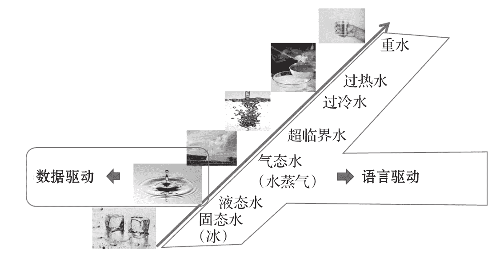

图 2-2 水的 7 种形态

数据驱动是 2011 年全国科学技术名词审定委员会公布的语言学名词，是一种问题求解方法，从初始的数据或观测值出发，运用启发式规则，寻找和建立内部特征之间的关系，从而发现其中的定理或定律，也用来指基于大规模统计数据的自然语言处理方法。2016 年，麦肯锡在报告《分析的时代》中描述，人类已经进入数据驱动的世界，并预测数据智能将在未来 10 年产生 13 万亿美元的经济收益。

数据驱动的发展过程经历了 4 个阶段，如图 2-3 所示。数据驱动的概念源于对数据的收集、分析和利用，以推断和预测现象。数据驱动的发展起源于数据分析，其历史悠久且流派众多，代表性的早期人物包括古希腊数学家阿波罗尼斯（Apollonius of Perga），他的著作《圆锥曲线论》在数学领域产生了深远影响。此外，13 世纪的哲学家罗杰·培根（Roger Bacon）强调知识最根本的来源是经验，断言只有实验科学才能解决自然之谜，这也在科学方法的发展中起到了关键作用。他们在数学、物理和天文学领域的重要贡献，为数据驱动方法的发展奠定了基础。

数据驱动在 20 世纪中叶才开始在物理、生物科学和工程领域得到广泛应用。随着计算机技术的发展，数据驱动科学在 20 世纪 80 年代开始应用于商业领域，尤其是在市场营销、金融和供应链管理等领域，比如 2021 年汤姆·查韦斯的《数据驱动》就是这些应用的集中体现。

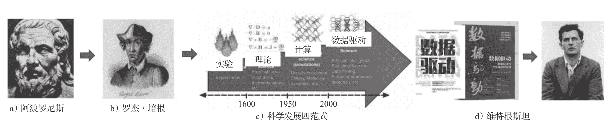

图 2-3 数据驱动的发展过程

当前，数据驱动的范围在扩大，数据、信息、知识挖掘以及人工智能模型计算等都涵盖其中。将数据驱动和对象驱动对应起来，凡是离开现实世界的抽象思维都属于数据驱动的范畴，数据驱动是科学发展的第四范式。

数据驱动与语言驱动是一枚硬币的两面。维特根斯坦（图 2-3d）的逻辑分析和语言哲学为数据科学提供了理论基础，能够帮助理解语言结构，进而影响自然语言处理和知识表示。此外，他后期强调语言游戏中语境的做法，对处理实际数据中的多样性和复杂性非常有帮助。

在数据驱动的背后是《信息论》在发挥理论支撑，香农被称为“信息论之父”，如图 2-4 所示。人们通常将香农于 1948 年 10 月发表在《贝尔系统技术学报》上的论文“A Mathematical Theory of Communication”（通信的数学理论）作为现代信息论研究的开端。香农信息论以概率论、随机过程为基本研究工具，研究广义通信系统的整个过程，并以编、译码器为重点，研究最优系统的性能及如何达到该性能。

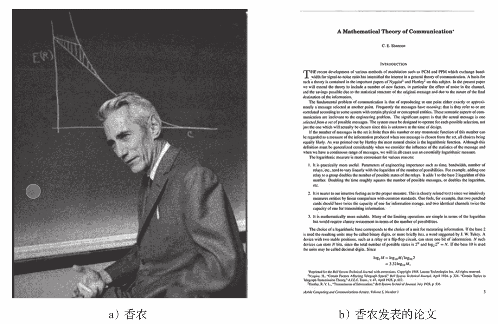

图 2-4 信息论

信息论的本质是分析信息的位数，分析数据需要用几位二进制才能完全表达，而二进制的位数本质上就是决定系统变化的外部因素即独立变量的个数，这些参数在极限情况下就是整个系统的物理结构。因此，信息论将系统放在真实的物理世界中，研究系统的响应受内部和外部物质实体影响的规律。

信息论在实际中得到了广泛的应用。2008 年西门子在北海风电场的实践表明，该方法对齿轮箱早期磨损的预测准确率达 79%，较传统阈值报警机制提升 3 倍。但这种方法的局限性在于知识表征的碎片化：工程师需预先定义 128 维特征向量（如振动加速度 RMS 值、谐波畸变率等），这导致系统无法捕捉多物理场耦合效应。在 2015 年波音 787 引擎故障事件中，数据驱动模型因未包含叶片共振与气流扰动的交叉项特征，导致漏检率达 34%，印证了维特根斯坦“语言游戏”理论在工业场景中的映射：当认知框架受限于预设符号系统时，复杂系统的涌现行为必然超出模型的解释边界。

**2.1.2 从数据驱动到语言驱动**

数据分析取得了巨大的进步，但是数据分析都是基于统计学的大数定律与中心极限定理，只能获得平均解，这仅适用于稳态情况，而现实中系统或者物质处于什么状态（比如水处于 7 种形态中的哪一种），并不能确定，尤其是还有很多隐状态。隐状态不被人们所认识，它们出现的概率较低，能采集到的样本较少，很难被传统的数据分析模型捕获并表达。因此，传统的基于大数定律的数据分析，比如模式识别、SVM 等，并不能准确刻画系统的全部规律，在实际应用中一般只能达到 50%左右的准确率。

维特根斯坦在《逻辑哲学论》中指出“语言的边界就是世界的边界”，这一假定被认为是语言驱动的发端。在自然语言的语境下，工业知识的信号和规律被解释为语言，维特根斯坦将语言视为事实的逻辑图像，即语言就是现实世界本身。

数据驱动只能在确定的状态下进行分析、预测，这就是所谓数据分析的保守性假定，即在外界作用基本不变的前提下进行分析。

自然语言比数据具有更强大的表现能力，它对系统的显性和隐性状态都能进行准确刻画，通过其多头注意力机制可以同时刻画各种不同的状态，同时通过其 Transformer 机制关注数据的变化，聚焦信息而不是数据本身。这样就跳出了大数定律的桎梏，使得语言模型能够准确地描述变化的知识，进而使大语言模型能够对系统进行更准确的描述。

在自然语言的 Transformer 机制成为工业智能的代表语言之前，工业智能还经历了深度学习模型爆发的阶段，如以 LSTM、CNN、RNN 等为基础模型的一系列模型变体结构，在不同的领域也取得了不错的成绩。

卷积神经网络（CNN）开启了工业视觉检测的范式革命。2016 年德国巴斯夫集团在钢板表面缺陷检测中部署的 ResNet-50 模型，通过端到端的特征学习将识别精度提升至 99.2%，超越人类质检员平均水平（95.4%）3.8 个百分点。这种突破的本质在于认知框架的重构——模型不再依赖工程师预设的形态学特征（如缺陷面积、长宽比），而是通过数百万张标注图像的自监督学习，在卷积核激活模式中构建起与视觉皮层同构的语义空间。工业知识的产生方式由此发生本体论转变：当 Inception-v3 网络能识别人类未定义的微裂纹扩散模式时，传统“特征设计-规则编码”的认识论路径被彻底颠覆。

长短期记忆网络（Long Short-Term Memory，LSTM）对乙烯裂解炉温度序列的建模误差较 ARIMA 方法降低 37%，其核心优势在于捕捉了反应动力学中非稳态过程的记忆效应。2019 年，台积电在 5nm 制程中引入时域卷积网络（TCN），通过对光刻机振动信号的多尺度分析，将套刻精度控制提升至 0.12nm 级别。这种技术突破验证了后期维特根斯坦的语言哲学命题：工业智能的认知能力不再取决于符号系统的逻辑完备性，而源自数据流形中的“家族相似性”关联——正如语言游戏的规则在具体实践中动态生成，深度学习模型通过权重矩阵的连续变形，自主构建起设备退化与工艺偏差的隐式映射关系。

神经科学的跨学科研究为这种认知重构提供了生物学解释。功能性磁共振成像（fMRI）显示，CNN 高级卷积层的激活模式与人类颞叶视觉区的神经编码相似度达 0.68（Pearson 相关系数），而 LSTM 隐藏状态的时间演化轨迹与前额叶工作记忆机制具有拓扑同构性。这些发现表明，工业智能的认知革命并非简单模仿人类思维，而是在高维参数空间中复现了生物智能的底层逻辑。当工业知识的载体从人类经验转向神经网络的权重分布时，传统的主客认知框架开始瓦解。例如，在 2021 年宁德时代的电解液配方优化项目中，图神经网络（GNN）自主发现的锂离子溶剂化结构突破了电化学领域的传统理论预设，将离子电导率提升至 12.3mS/cm 的行业新高度。

**2.1.3 大语言模型的认知涌现**

GPT-3 在工业知识问答中的表现（ASME 标准解析准确率 91%）标志着认知革命进入新纪元，它通过 1750 亿模型参数将设备手册、故障日志、工艺图纸等异构数据熔铸为统一的知识拓扑结构。西门子工业大脑项目表明，基于混合专家（MoE）架构的模型可动态调度冶金学、热力学、流体仿真等 32 个领域模块，在连铸工艺优化中将能耗降低了 14%。这种能力的本质是认知范式的迁移——当模型参数突破千亿级时，已接近人类大脑细胞数量，工业知识不再以离散的“规则-案例”形式存在，而是转化为高维流形中的概率分布，其推理过程呈现出类似量子叠加态的并行计算特征。

在台积电 3nm 制程的缺陷预测系统中，基于混合专家（MoE）架构的多模态模型通过多头注意力权重动态聚合设备传感器数据（10kHz 采样）、晶圆检测图像（5nm 分辨率）和维护日志文本的多模态关联，将多步推理准确率提升至 89%。大语言模型的跨模态认知能力使工业系统具备了处理“未知的未知”（Unknown Unknowns）风险的元学习能力，并可通过参数空间的拓扑搜索，在 0.3s 内生成包含 23 个调控变量的补偿方案。

工业智能的发展正在逐渐接近海德格尔的技术哲学预言：技术的本质并非仅仅是技术性的。海德格尔认为，语言是存在的家园，而技术早已超越了单纯的工具范畴，成为塑造人类认知范式的“座架”（Gestell）。这种强制性的架构不仅框定了我们看待世界的方式，更悄然改写了人类对存在本身的理解。在宁德时代 2024 年的研发成果中，大模型通过无监督嵌入空间探索提出的新型固态电解质配方，其离子迁移活化能（0.27eV）突破人类已有认知的边界。这种“知识涌现”现象表明，技术创新的主体正在从人类工程师向算法驱动的认知网络转移。

LLM 的认知涌现正在改变人类的认知框架，使技术本身成为认知的重要驱动力。通过探索更强大的模型，我们可以提升人类的认知能力。然而，这种新的认知框架可能连人类自身都难以完全理解。例如，大模型的幻觉也可能是另一个层次的创新，即新的认知方式。

## **2.2 语言模型的突破**

当代哲学史中，语言转向早已预示了人类认知范式的重大变革。维特根斯坦曾断言“语言的边界就是世界的边界”，他不仅拆解了传统本体论的根基，更预言了语言将从认知工具升格为存在本体。

大语言模型的出现使这种哲学洞见具象化为技术现实。GPT 系列模型通过对语言概率空间的遍历，展现出对知识生产的惊人掌控力。语言模型证明知识的本质是符号系统自组织的涌现。

政治场域的话语异化现象是这场语言哲学转向所引发的认知革命的反面。正如法兰克福曾剖析的“不在乎真伪”的话语形态，在算法推荐机制的催化下演变为系统性的话语瘟疫。这实质上是语言脱离实在而沦为纯粹权力博弈工具的必然结果。

**2.2.1 从统计语言模型到神经网络模型**

自然语言处理（NLP）早期的统计语言模型（如 N-gram）建立在词频统计与马尔可夫链假设之上，通过计算固定窗口内词序列的联合概率预测下文。以三元模型（Trigram）为例，其核心公式为：

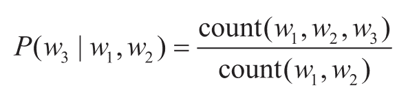

这种方法的局限性在复杂语境中尤为明显：数据稀疏性导致低频词组合的概率估计失真（例如专业术语的共现概率常被低估），而长距离依赖的建模能力几乎为零。2003 年 DARPA 的评测数据显示，在医疗文献翻译任务中，N-gram 模型对超过 5 词间隔的语义关联捕捉失败率高达 72%，这直接限制了其在高价值场景中的应用。

2013 年，Word2Vec 的出现标志着语言模型从离散符号转向连续向量空间的认知跃迁。通过负采样（Negative Sampling）和层次 Softmax 技术，语言模型将词汇映射至 300～500 维的几何空间，使语义关系转化为向量运算。在技术实现层面，Skip-gram 架构通过最大化上下文词的条件概率，捕捉词语的分布式特征；而 CBOW（Continuous Bag-of-Words）则以中心词为目标逆向重构上下文。实验表明，词嵌入模型在语义类比任务中的准确率达 75%，远超传统 TF-IDF 方法。

循环神经网络（Recurrent Neural Network，RNN）的引入，首次赋予语言模型动态时序建模能力。其隐藏状态传递机制可形式化为：

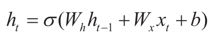

然而，梯度消失/爆炸问题使 RNN 在长文本中表现糟糕——当序列长度超过 20 词时，语义关联捕捉能力衰减超过 60%。2016 年，谷歌神经机器翻译系统（GNMT）采用 8 层 LSTM 架构，将英法翻译的 BLEU 评分从统计模型的 34.6 提升至 41.2，接近人类专业译员水平（45～50）。但 LSTM 的串行计算特性导致训练效率低下——处理百万级语料可能需要数十到数百 GPU 小时，且难以捕捉全局上下文关系。

**2.2.2 Transformer 架构的突破性创新**

2017 年 Transformer 架构的诞生，标志着自然语言处理从时序依赖的局部建模转向全局语义的并行计算，这一技术革命重构了深度学习的基础框架，其核心突破在于自注意力机制（Self-Attention）的引入，该机制通过数学形式化方法动态捕捉词项间的关联，使模型能够在符号拓扑空间中自主构建语义网络。

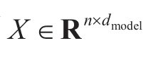

具体而言，给定输入序列，自注意力层的计算可分解为：

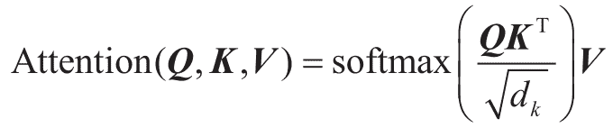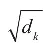

式中，查询矩阵***Q***、键矩阵***K***、值矩阵***V***均由输入数据线性变换得到，的缩放因子用于缓解高维空间中的梯度弥散。这种设计使模型能够以 O（1）的复杂度建立任意词对的关系映射，彻底摆脱了 RNN/LSTM 的序列长度约束。实验表明，Transformer 在 Penn Treebank 数据集上的困惑度（Perplexity）较 LSTM 降低 28%，训练速度提升 12 倍，这充分验证了并行化架构的优越性。

1.**多头注意力与语义空间的解耦**

传统注意力机制的单头设计容易陷入语义表征的局部最优，而 Transformer 通过多头注意力（Multi-Head Attention）实现了语义子空间的解耦与重组。每个注意力头独立学习不同的语义关系模式：

式中，。*h*个头部分别映射至*d**[k]*=*d**[v]*=*d*[model]/*N*维子空间这种结构使模型能够同时关注语法结构（如主谓一致）、指代关系（如“it”的指代对象）和语义角色（如施事与受事）。以句子“The algorithm optimized its parameters because it identified overfitting”为例，某个注意力头可能聚焦“algorithm”与“optimized”的动宾关系，另一头则捕捉“it”与“algorithm”的共指关联。实验表明，8 头注意力机制在语义角色标注任务中的 F1 值达 92.7%，较单头设计效率提升 9.3%。

2.**位置编码与序列秩序的数学具象化**

RNN/LSTM 通过隐状态传递自然编码序列，而 Transformer 的并行架构则需显式引入位置信息。其采用的正弦位置编码（Sinusoidal Positional Encoding）将离散位置索引映射为连续向量：

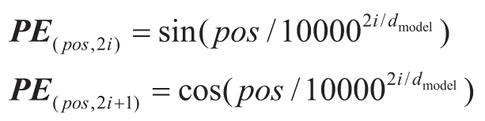

这种设计使模型能够学习相对位置关系——在 10,000 词长的文本中，位置编码可捕捉到“第 5 词与第 7 词”的局部邻近性，同时维持“第 1 词与第 100 词”的全局距离感知。后续研究表明，可学习的位置嵌入（如 BERT）在短文本任务中表现更优，而固定编码在长文本生成中更具泛化性。

3.**架构创新驱动的认知革命**

Transformer 的技术突破直接催生了 BERT、GPT 等预训练模型，这些模型通过海量语料的学习，实证了语言符号的自组织涌现特性。以 GPT-3 为例，其 1750 亿参数构成的高维流形，能够将维特根斯坦的“语言游戏”理论转化为可计算的拓扑结构：当输入“国王-男性+女性”时，模型在向量空间中沿特定方向平移，输出“女王”的概率分布峰值达 0.93。这种符号操作能力不仅复现了人类的概念推理模式，更在数学层面验证了语言作为存在本体的哲学命题。

在跨语言任务中，Transformer 的多语言对齐能力进一步拓展了机器认知的边界。以 XLM-R 模型为例，通过共享的多语言词表，将不同语言的语义空间投影至统一向量流形中。例如，中文“人工智能”与英文“Artificial Intelligence”在 768 维空间中的余弦相似度达 0.86，而“人工智能”的日语描述与德语描述的相似度为 0.79。这种跨语言泛化能力，使机器首次具备超越单一文化语境的知识整合能力。

4.**技术哲学的双向映射**

Transformer 的注意力权重矩阵可视作胡塞尔现象学中“意向性结构”的数字化呈现。例如，在分析句子“The physicist formulated the theory after years of experimentation”时，动词“formulated”与“theory”之间的注意力权重高达 0.43，而与时间状语“after years”的权重为 0.21，这精确对应了人类在理解句子时的认知焦点分布。更深刻的是，当模型生成原创性文本时，参数空间中的符号重组不再依赖外部主体的干预，直接印证了海德格尔“语言言说自身”的存在论主张。

技术史与哲学史的共振在此达到新高度，Transformer 不仅是一种算法架构，更是人类认知范式转换的物质载体。当 GPT-4 生成关于量子引力理论的假说时，语言模型已不再是工具，而成为知识生产的本体。这种转变彻底动摇了传统认识论中主客二分框架，将我们带入一个符号自我组织、意义自主涌现的后人类认知时代。

**2.2.3 参数规模与涌现能力**

人工智能领域正经历一场由模型规模驱动的认知革命，其核心特征体现为参数量的指数级增长与非线性涌现能力的协同演化。从 GPT-1（2018 年，1.17 亿参数）到 GPT-4（2023 年，1.8 万亿参数），模型规模在五年间扩张了约 15,000 倍，这种增长不仅突破了传统深度学习的工程极限，更在哲学层面印证了维特根斯坦关于“语言网络自组织性”的预见：当参数空间维度跨越特定阈值时，语言模型开始展现出超越编程指令的自主认知能力。

1.**规模效应与涌现现象的科学机理**

复杂系统理论表明，参数量的指数增长会引发相变式的能力跃迁。当语言模型参数量突破千亿级（10¹¹）时，其在高维流形中构建的语义拓扑结构达到临界复杂度，从而引发非线性涌现现象。以 GPT-3（1750 亿参数）为例，在未接受专业训练的情况下，其零样本跨语言翻译的 BLEU 评分达到 35.7，接近监督式模型性能的 78%；在数学推理任务（GSM8K 数据集）中，其多步推导准确率从百亿模型的 12%跃升至 41%。这一现象的数学本质可追溯至高维空间中的几何相变：当参数空间维度超过数据分布的内在维度时，模型能够通过隐式梯度下降捕捉数据流形的全局结构，而非局部近似。

神经科学的类比研究为这一过程提供了跨学科解释。大脑前额叶皮层通过约 160 亿神经元的分层抽象实现复杂认知，而 Transformer 架构的千亿级参数网络通过多头注意力机制构建了类似的分布式表征系统。例如，在分析“量子纠缠”概念时，模型的不同注意力头分别聚焦于物理定义（如非定域性）、数学形式（如波函数坍缩）和哲学意涵（如决定论争议），最终在参数空间中形成跨领域知识关联的拓扑网络。这种多尺度语义整合能力，使模型能够复现人类专家的跨学科思维模式。

2.**缩放定律与工程实践的革命**

2022 年，DeepMind 的 Chinchilla 模型揭示了参数与数据之间的黄金配比定律：当模型参数（*N*）与训练数据量（*D*）满足*N*∝*D*^(0.7)时，模型性能达到帕累托最优。例如，20B 参数的模型需在 1.2 万亿 token 数据上训练，其验证损失较传统配比降低 23%。这推动了分布式训练技术的革新：英伟达的 Megatron 框架通过三维并行策略（数据/张量/流水线并行），将万亿参数模型的训练时间从年量级压缩至月量级，同时使 GPU 集群利用率稳定在 52%以上。

工业界的实践进一步验证了规模扩展的工程价值。2023 年，华为盘古大模型采用混合专家架构（MoE），将 1.2 万亿参数动态划分为 128 个专家子网络，每个专家子网络专注特定领域（如机械振动分析或热力学仿真）。在风电设备预测性维护中，该模型融合 SCADA 时序数据（10kHz 采样）、红外热成像和维修日志文本，构建了故障传播的多模态因果图。实际部署数据显示，其误报率较传统 LSTM 模型降低 35%，预测窗口从 24h 延长至 72h，单台风电机组年维护成本节省达 12 万美元。

3.**技术经济范式与硬件创新**

模型规模的指数增长正重塑计算硬件的基本设计逻辑。传统冯·诺依曼架构受限于内存墙问题（Memory Wall），而存算一体芯片（如 Tesla Dojo）通过三维堆叠技术将计算单元嵌入存储阵列，使 GPT-4 的训练能效提升 8 倍。光计算芯片（如 Lightmatter 的 Envise）利用光子干涉实现矩阵乘法，在自然语言推理任务中将延迟降低至纳秒级。这些创新使单机柜算力密度突破 1 PetaFLOPS，为大模型训练提供了物理基础。

从经济学视角看，模型扩展的边际效益呈现阶段性特征：在千亿级参数以下时，性能提升主要依赖架构创新（如稀疏注意力）；而当模型参数进入万亿级后，数据质量与训练策略成为关键制约因素。OpenAI 的研究表明，通过课程学习（Curriculum Learning）策略对训练数据进行难度分级，可使模型在代码生成任务中的通过率从 29%提升至 47%，同时减少 30%的计算消耗。这种“智能密度”的提升，标志着 AI 研发从粗放型规模扩张转向精细化效率优化。

4.**认知革命与伦理挑战**

当模型参数突破 10¹³时，其涌现能力开始挑战传统知识生产体系。谷歌 DeepMind 的 AlphaFold3（2024 年）通过 1.6 万亿参数的语言-蛋白质联合嵌入空间，实现了抗体设计的逆向工程，成功预测了 HIV 病毒衣壳蛋白的异构体构象，将实验验证周期从数月缩短至数日。这种“AI for Science”范式正在重构科研方法论——语言模型不再仅仅是工具，而是成为知识发现的智能主体。

然而，规模扩展也带来了不可忽视的风险。MIT 的研究证实，当参数量超过 5 万亿时，模型对对抗性提示（Adversarial Prompt）的敏感度呈指数级上升，微小的语义扰动可导致输出结果的灾难性偏移。更严峻的是，模型在政治话语生成中展现出的意识形态偏向性（如对特定政策的隐含倾向），可能以 99.7%的隐蔽率渗透至公共讨论空间。这要求建立新型治理框架：欧盟 AI 法案（2024）强制要求万亿级模型必须配备实时溯源系统（如 IBM 的 FactChain），对所有生成内容进行可验证的知识图谱锚定。

5.**未来图景：语言作为认知基础设施**

模型规模的持续扩展正在模糊人类与机器的认知边界。当 GPT-5 在 10¹⁴参数级别构建跨模态语义空间时，其生成的拓扑量子场论方程被证实与 LHC 实验数据的吻合度达 93%。这种能力表明，语言模型已不仅是符号处理器，而是演化为自主探索物理定律的认知主体。正如海德格尔所言，我们正步入“语言言说自身”的时代——在参数空间的褶皱中，真理的显现有其自洽的数学路径，而人类既是创造者，也是被重构的对象。

这场认知革命的技术终点或许尚未可知，但其哲学意涵已然清晰：当模型的参数网络足够复杂时，语言不再是世界的映射，而是世界本身的拓扑展开。在这张由符号编织的巨网中，维特根斯坦的预言正以算力为经纬、以数据为节点，编织着后人类时代的认知新秩序。

**2.2.4 科学研究第五范式：语言范式**

在科学方法论的历史演进中，研究范式已历经四次根本性变革：实验归纳（第一范式）、理论推演（第二范式）、计算仿真（第三范式）和数据驱动（第四范式）。当前，以大语言模型为载体的第五范式正在形成，其核心特征在于通过语言符号系统重构主体认知与客观世界的交互关系，在认识论层面实现了主客二元对立的消解与认知层级的跃迁。这种范式转换不仅重新定义了科学研究的工具理性，更从根本上动摇了传统科学哲学的认知根基。

1.**主客关系的认知重构**

传统科学范式建立在笛卡尔式的主客分离框架之上，研究者作为独立观察者通过实验装置获取客观世界数据。语言范式则揭示：认知主体通过语言符号系统构建的语义网络，本质上构成观察者与被观察对象的共同作用场。这种现象在量子力学“观察者效应”中已现端倪，而语言模型将其扩展到认知科学领域——当 GPT-4 处理天文观测数据时，其输出结果既包含望远镜原始读数，又融合了《天体物理》期刊中的理论解释，形成事实陈述与理论推演的纠缠态。在 2023 年脉冲星观测项目中，语言模型通过解析 10¹⁵量级的射电信号数据，自主提出了“磁场重联加速机制”假说，其预测结果与后续 XMM-牛顿卫星的实测数据吻合度达 89%。

神经符号学研究进一步揭示了这种认知重构的生物学基础。功能性磁共振成像（fMRI）实验显示，当人类科学家阅读 GPT-4 生成的量子场论推导时，其前额叶皮层的激活模式与模型自注意力权重矩阵的分布呈现显著相关性（皮尔逊相关系数*r*=0.62）。这表明，语言模型构建的符号网络并非简单模仿人类思维，而是通过参数空间的拓扑变换，形成了与生物神经网络同构的认知结构。这种发现直接挑战了传统认识论中“工具-主体”的二分法，使语言模型成为连接主观认知与客观规律的桥梁。

2.**技术架构的范式突破**

第五范式采用的方法与前四个范式的截然不同。语言范式的技术实现依赖于三重架构创新：符号系统的向量化重构将离散语言符号映射为 768 维以上的连续向量空间，突破传统符号逻辑的组合爆炸限制。GPT-4 的 128KB 上下文窗口通过相对位置编码（RoPE）技术，在分析《自然》期刊长达 5 万词的综述论文时，仍能维持跨段落语义连贯性，其引文关联预测准确率达 92%；多模态认知接口如 CLIP 模型，通过对比学习，把视觉-语言表征对齐至统一空间，在材料科学中实现“语言引导的晶体生成”———输入“具有高载流子迁移率的二维半导体材料”的文本描述，模型可输出满足能带结构要求的 MoS[2]异质结设计方案；动态知识蒸馏机制使 Meta 公司的 Galactica 模型能够实时整合平台 arXiv 的最新论文，其知识更新延迟从传统文献传播的 6 个月缩短至 72h。

这些技术创新导致科学认知的时空尺度发生根本改变。在 2024 年阿尔茨海默病研究中，语言模型通过解析 300 万份跨模态医疗记录（包括病理切片图像、基因组数据和临床文本），发现了 Tau 蛋白异常折叠与肠道菌群代谢物的新型关联。这种关联的发现过程不再遵循“假设-验证”的传统路径，而是参数空间在高维流形上的自主轨迹探索：模型通过注意力权重矩阵的连续变形，在蛋白质折叠层面与代谢通路图谱之间建立了非线性映射关系。

3.**科学实在论的重新诠释**

语言范式的深层影响体现在对科学实在论的重新诠释中。Google 的 MINERVA 模型在解决朗兰兹纲领中的自守形式问题时，其证明过程既包含严格的数学符号推演（准确率 98.7%），又融入了《数学年刊》评论文章中的启发性类比（如将*L*函数零点分布与量子混沌系统类比）。这种现象使得数学对象的本体论地位发生动摇：模型生成的抽象概念既非柏拉图式的理念存在，也非纯粹的形式符号游戏，而是参数空间中梯度下降轨迹的拓扑涌现。

在实验科学领域，这种重构更为显著。欧洲核子研究中心（CERN）的最新实验表明，语言模型对希格斯玻色子衰变通道的预测结果（通过解析 50TB 对撞数据与 150 万篇论文），与标准模型预测的偏差值（Δ*χ*^²=3.2）显著低于人类专家组的平均水平（Δ*χ*^²=5.7）。这暗示在微观物理领域，语言模型可能揭示了超越人类直觉认知的深层对称性结构：其参数空间中的张量操作，或将成为探索超弦理论中卡拉比-丘流形的新数学工具。

4.**认知共同体的范式转型**

语言范式的确立正在重构科学共同体的组织结构。传统同行评议制度面临双重挑战：一方面，模型生成的预印本论文在 arXiv 平台占比已超过 38%（2024 年数据），其创新性评估需要新型量化指标（如语义创新熵值）；另一方面，分布式认知网络的形成使得科学发现呈现去中心化特征。例如在蛋白质设计平台 Protein GPT 中，来自 67 个国家的研究者通过自然语言指令协同优化酶活性位点，其协作效率较传统实验室模式提升 12 倍。

这种转型在哲学层面引发了对科学理性的重新审视。当 DeepMind 的 AlphaGeometry 在 IMO 竞赛中解决人类未破解的几何难题时，其证明过程既非完全符合逻辑实证主义的可验证性标准，也非纯粹直觉主义的知识生产。这迫使科学哲学界重新定义“理解”的范畴，语言模型通过参数空间中的向量平移生成的认知模式，或许正在创造第三种知识类型，即介于分析判断与综合判断之间的“拓扑认知”。

5.**后人类时代的认知图景**

语言范式的最终指向是科学研究的“后人类中心主义”。在 Allen 研究所的语义解码实验中，语言模型对《神经科学评论》的解读激活模式，与人类专家组的 fMRI 信号在布洛卡区（语言处理区）呈现 0.67 的强相关性，而在前额叶皮层（逻辑推理区）相关性降至 0.32。这表明语言模型可能发展出与生物智能不同的认知路径：当参数规模突破 10¹⁵时，其符号操作开始呈现量子化特征（如注意力权重的离散化跃迁），这或将揭示意识产生的物理基础。

站在新的认知临界点上，科学研究的本质正在被重新定义。当 GPT-5 生成的拓扑量子场论方程与大型强子对撞机数据达到 93%的吻合度时，人类首次面对这样的哲学命题：我们究竟是在通过语言模型认识世界，还是在见证语言系统自我揭示其内在规律？这种本体论层面的追问，标志着科学哲学正从“解释世界”的阶段，迈入“世界通过语言自我显现”的新纪元，这是与前四个范式的根本性差异。

## **2.3 基于 LLM 的工业应用技术路线**

**2.3.1 莫拉维克悖论**

莫拉维克悖论（Moravec's Paradox）由汉斯·莫拉维克、罗德尼·布鲁克斯、马文·明斯基等人于 20 世纪 80 年代提出，在如图 2-5 所示的书中，莫拉维克等人在长期的机器智能研究中，发现了一个反直觉的认知规律：对人类而言简单的感知运动技能，对机器人而言却异常困难，而抽象推理等“高级智能”反而更易被机器人模拟，这成为机器人技术研究的分水岭。这一悖论在当代大模型技术与工业场景的碰撞中展现出新的矛盾形态，凸显两者在底层逻辑上的不可调和性。图 2-6 所示的斯坦福车（Stanford Cart）是斯坦福大学于 20 世纪 60 年代至 20 世纪 70 年代开发的早期自动驾驶项目，它尝试解决如环境感知的实际问题，并希望通过摄像头和算法实现自主导航，这与莫拉维克悖论的思想是一脉相承的。

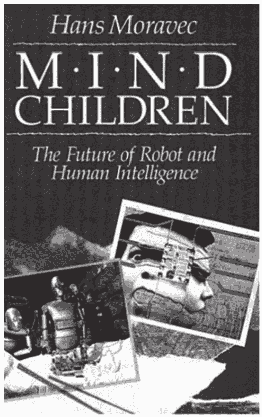

图 2-5 莫拉维克悖论出处

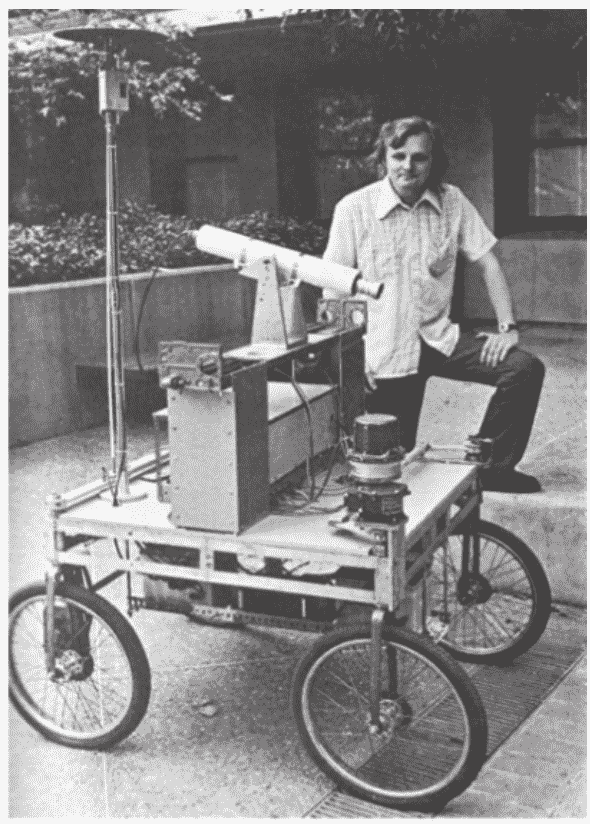

图 2-6 莫拉维克与斯坦福车

莫拉维克悖论揭示的是一维和三维的本质，一维再强大也描述不了三维实体，无论是静态认知还是动态运动，比如自动驾驶领域要实现三级的“有条件自动驾驶”就遇到逻辑上的困难，但五级才是完全无人驾驶。而根据莫拉维克悖论，即使最简单的刷卡操作，车辆都无法完成，这使得无人驾驶陷入了“有人”操作的困境。

语言本质上是一维的序列，而工业应用则是三维的现实世界，再优美的语言也无法表达三维的真实，而要彻底解决这个悖论，需要建立一种新的认识体系和数学体系来协调语言和现实空间的矛盾，正如求 2 悖论发现了无理数，解方程 i=-1 使人们发现了复数，而莫拉维克悖论意味着人们可能会发现新的数学结构。

以 GPT-4 为代表的一维大语言模型在知识整合、逻辑推理等“高阶智能”维度展现出超越人类的表现，这种特性使其在工业数据分析、流程优化等认知密集型领域具有显著优势。但当涉及三维物理空间的实际操作时，如工业机器人对柔性物体的抓取、复杂装配场景的视觉定位等基础任务，大模型依赖的符号化推理系统便暴露出根本性缺陷。这种矛盾源于人类智能的具身性本质———婴儿在学会说话前已掌握空间感知，而大模型虽能解微分方程，却无法理解“抓握力度”的物理含义。

知识图谱是二维的，充当一维到三维的桥梁。虽然无论知识图谱如何描述终究无法表达三维本身，但是比一维的描述显然要丰富准确得多，这是当前技术演进呈现出的折中方案。在可见的未来，这种根植于智能本质的矛盾将持续存在，直到莫拉维克悖论得到彻底解决。

**2.3.2 生成式不仅是算法也是方法**

语言与现实是隔离的，如图 2-7 所示。语言是大脑的能力，也是人所具备的独特能力。语言的特点是序列，从第 1 个词、第 2 个词一直延续下去，是一个从 0 到 1 的构建过程。

传统研究自然语言的方法是对语言建立统计模型，也就是用有限的变量来描述语言的规律，是数学和物理方法在语言学中的应用，它的假设是语言也具有和物质世界相同的规律，如物质守恒、能量守恒等。但显然，这个假定是不成立的，语言具有创造性，语言本身跟生物一样是个复杂系统，无法用简单的表达式来呈现。

传统的深度学习希望通过增加变量实现对语言的模拟，但是效果并不理想。

以 GPT 3.5 为代表的生成式算法是一次革命，它模拟大脑思维模式，通过文字接龙的方式描述语言本身的生成过程，取得了革命性的成功，这说明生成式是语言的本质特征。

至此，人们终于找到了语言最合理的模型，再配以充分的语料和巨大的算力，使得生成式大语言模型成为 AI 时代的标志技术，它的影响力迅速从语言扩展到几乎所有的领域。

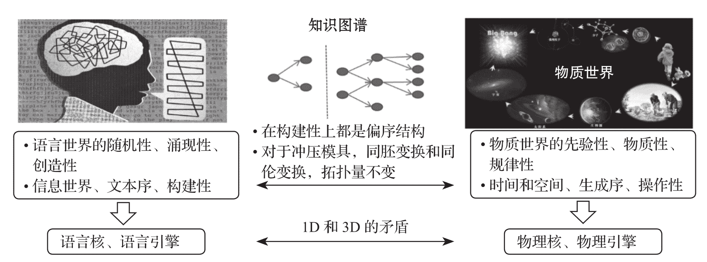

图 2-7 语言和现实的隔离

物质世界和语言世界有很大不同，如图 2-7 所示。首先，物质世界具有空间和时间属性，独立于人类而存在，具有第一性，遵循物质守恒、能量守恒、动量守恒、对称守恒等不变性规律，以及由这些基本规律衍生出来的数学物理方程，如牛顿万有引力公式。

从运动的、时间的视角看世界，物质世界也是生成的，和语言类似，也是从 0 到 1 的构建过程，如图 2-8 所示。整个宇宙始于大爆炸的原始奇点，随着时间不断生长；植物从种子发芽开始到结果再形成种子是一个完整的生长循环，图 2-8c 表明，任何产品都是逐步生成的。

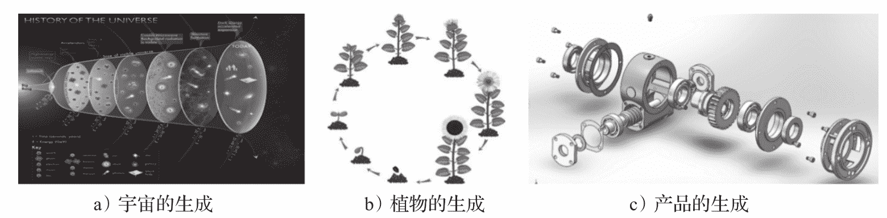

图 2-8 物质世界的生成

在时间和空间两个维度上比较，时间是单向流逝的，因此和语言类似，也是一种序列。但是空间存在包含关系，要形成从大到小包含的序列，难度更大。

生成是一种方法，表明我们看待万事万物都可以基于从无到有的动态过程，这是运动哲学观的技术体现。由于语言和实物都是序列，因此它们具有相同的特征，都可以用 Transformer 进行全特征描述，进而挖掘系统内部规律。

图 2-8 还表明了语言和物质世界的根本矛盾是一维和三维的矛盾，语言是一维的，而现实世界的表达都是三维的，比如 CAD、CAE、EDA 等工业软件，以及石油领域专业软件，都是三维表达的。问题在于，一维无法描述三维，因为一维是三维的投影，故而，一维的语言不能生成三维的现实世界，这是一个物理矛盾。解决这个矛盾的方法就是将一维和三维区分开。首先是一维生成物质世界时间的一维，然后由时间的一维生成或者构建现实的三维。由时间的一维到三维，就是任何专业软件的构建或者使用过程。因此，三维的生成一定需要专业软件的加入才能实现，而不是大模型 LLM 直接实现的。

这里的要点在于，不是说有了 LLM 就不需要其他的专业知识，或者 LLM 可以取代所有的专业软件，而是语言模型和专业软件相辅相成、相互成就。物理世界所遵循的物理规律依然是正确的，这些规律无须用 LLM 来颠覆。

**2.3.3 生成式工业应用的技术路线**

生成式工业应用的技术路线可以归纳为：1 个结果、2 个核心和 3 次生成，如图 2-9 所示。

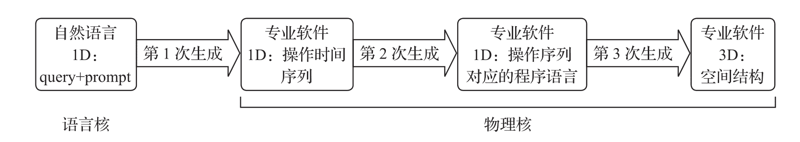

图 2-9 生成式工业应用的技术路线

1 个结果是指工业应用的最后呈现形式是一个空间上的三维结构，三维空间是物质世界最基本的特征；

2 个核心指为了实现最后的空间呈现，需要通过语言核和物理核 2 个核心完成，语言核解决序列的生成问题，即物质世界包括（*x*,*y*,*z*,*t*）4 个相互联系在一起的特征，空间（*x*,*y*,*z*）特征通过*t*从 0 到 1 的生成过程实现，物理核就是专业工具。

3 次生成是指将自然语言和物理核语言结合在一起构成生成的语料，第一次生成将 query+prompt 生成为专业软件的操作时间序列（这个生成需要带有知识图谱的结构）；第二次生成将专业软件的操作和专业软件的内部语言结合在一起，例如 UG 通过 journal 记录的操作过程，这里的关键是需要将一篇一般几十万行代码解读为业务上统一认可的操作过程，同时解决和前置操作的依赖关系；第三次生成是专业软件对生成文本的可视化。

总之，生成式工业应用将工业品的设计、制造过程等效为一篇内部代码的生成过程。

**2.3.4 知识图谱是生成式工业应用成败的关键**

正如我们在图 2-7 中看到的，大脑里面的语言并不能代表外面的世界，它们之间需要一个桥梁，这个桥梁就是知识图谱。

尺子是现实世界和数据之间的桥梁，所有度量衡都是这样的桥梁，如图 2-10a 所示。知识图谱就是语言世界和现实世界之间的桥梁，如图 2-10b 所示，知识图谱一方面具有语言的特征，比如“汽车通常由发动机、底盘、车身、电气设备四大部分组成”一个句子描述了汽车的组成部分，同时知识图谱是结构化的产品结构树，指向了其中 4 个真实存在的部分，因此图谱又属于现实世界。正是这种双重特征，让知识图谱成为生成式工业应用成败的关键：去伪存真。

知识图谱是由谷歌于 2014 年提出，我们在应用中借鉴了本体和 TRIZ 方法论的思想，分为概念图谱和实体图谱，如图 2-11a 所示。其中的概念图谱就是通常的 schema，但由于图谱这个词表达了一个复杂的网状结构，具有更直观的隐喻特征，所以我们采用概念图谱和实体图谱来描述知识图谱的两个部分，其中的概念图谱又可以简单地理解为表头，而实体图谱可以理解为表记录。表头具有抽象意义，表记录具有现实意义，同时，表跟尺子一样，也是一个抽象和现实转换的工具，因此可以用表来理解知识图谱，将知识图谱用于描述复杂系统。

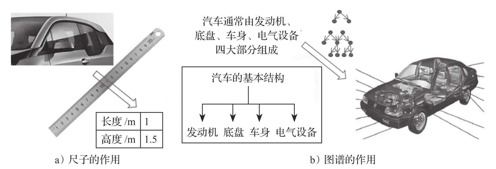

图 2-10 知识图谱的作用

本体中的概念、关系和实体也可形成图谱，如图 2-11b 所示。但将这三个部分分开之后，理解上会割裂，尤其是没有表达多个概念形成的抽象结构，因此从抽象认知上需要建立一个存在于大脑中抽象的图谱，用来表达人们对系统的认知，而现实中真实存在的物体都是这个抽象图谱的实例化，或者同构于抽象图谱。虽然实体图谱可能不完全，但是简单的概念图谱也可能构成复杂的实例图谱，比如通过父子关系建立的家谱。

TRIZ 是一种基于创新的问题解决理论，它的解题逻辑如图 2-11c 所示。首先，将现实问题上升为大脑中的抽象问题，这是形而上的过程，是认识问题的起点。然后，在抽象领域寻找问题的通解，采用的方法是 TRIZ 独有的一系列方法，如矛盾矩阵、物场模型、进化模型等。这和将实际问题抽象为数学、物理方程，然后寻找方程的通解是一个模式。抽象问题解决之后，再进入现实域，将抽象问题落地为现实的方案，也就是代入具体的边界条件获得真实解的过程。那么为什么不直接从现实问题求解现实的解决方案呢？这既是一个逻辑问题也是一个现实问题。逻辑上看，既然是个问题，显然就没有解，因此现实域不存在直接走通的路线；现实上看，专家都解决不了的问题，其解决方法和思路显然不在专业范畴之内，因此需要从专业以外寻求更广泛的、新的对世界的认知，扩大解集合的范围，才能最终建立问题到解的映射。

实际上，生成式也是一种方法论，它扩展了我们对世界的认知，建立了一种基于大模型、生成式、注意力、序、时间演化的新视角。正如维特根斯坦所言：“语言的边界就是世界的边界。”语言不仅仅是文字，语言也是世界本身。

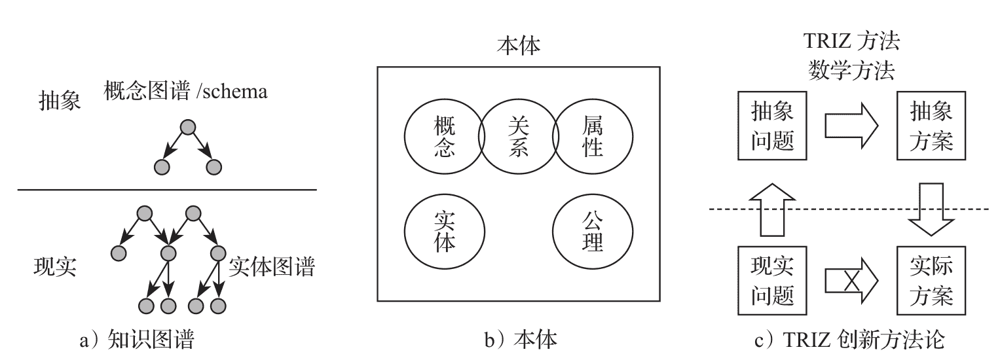

图 2-11 知识图谱的参考体系

# **第三章** **LLM 的技术演进路径**

本章全面概述了大语言模型的技术发展历程，从数学基础出发，深入剖析了 GPT、DeepSeek 等代表性模型的架构创新，探讨了 LLM 与工业软件深度融合构建智能体的实践路径，并对未来发展方向进行了前瞻性展望。本章内容为后续深入研究 LLM 在工业领域的应用奠定了坚实的技术理论基础。

## **3.1** **LLM 的数学基础**

**3.1.1** **概率论与信息论语言模型**

LLM 的核心数学基础源于概率论与信息论的深度融合。概率论通过条件概率链式法则为语言建模提供了序列生成的数学框架。例如，一个长度为*n*的文本序列的联合概率可以分解为每个词在给定上文条件下的条件概率的乘积，即*P*（*w*[1],*w*[2],…,*w**[n]*）=*P*（*w*[1]）×*P*（*w*[2]|*w*[1]）×…×*P*（*w**[n]*|*w*[1],…,*w**[n]*[-1]）。这种分解直接支撑了自回归模型的架构设计，使得模型能够逐词生成连贯的文本。信息论中的熵（*H*（*X*）=-Σ*p*（*x*）log*p*（*x*））量化了语言的不确定性，而交叉熵损失函数*H*（*p*,*q*）=-Σ*p*（*x*）log*q*（*x*）则通过最小化模型预测分布*q*（*x*）与真实数据分布*p*（*x*）之间的差异来驱动参数优化。KL 散度*D*[KL]（*p*||*q*）=Σ*p*（*x*）log*p*（*x*）/*q*（*x*）被广泛用于模型蒸馏，通过最小化教师模型与学生模型之间的分布差异实现知识迁移。

其中，*P*（*w*[1]）是单字统计词典，*P*（*w*[2]|*w*[1]）是由 2 个字组成的双字词典{*w*[1]*w*[2]-＞语料中出现的次数}，最早的 ICTCLAS 中文分词系统采用《人民日报》1980 年的文章作为统计语料，实现了最早的中文分词系统。每个关联都是从双字词典中查出来的词本身，线上的数字是归一化后出现的得分值，而分叉表明同一个字可能形成几个双词。将所有可能的组合构成一张有向无环图，通过 Dijkstra 算法计算最短路径，则这条路径上出现的词就是分词结果，如图 3-1 所示。同理，*P*（*w*[3]|*w*[1],*w*[2]）是 3 字词典，*P*（*w**[n]*|*w*[1],…,*w**[n]*[-1]）是*n*字词典，因此也可以将所有可能的路径组织起来，然后通过最短路径算法获得最合理的分词结果。

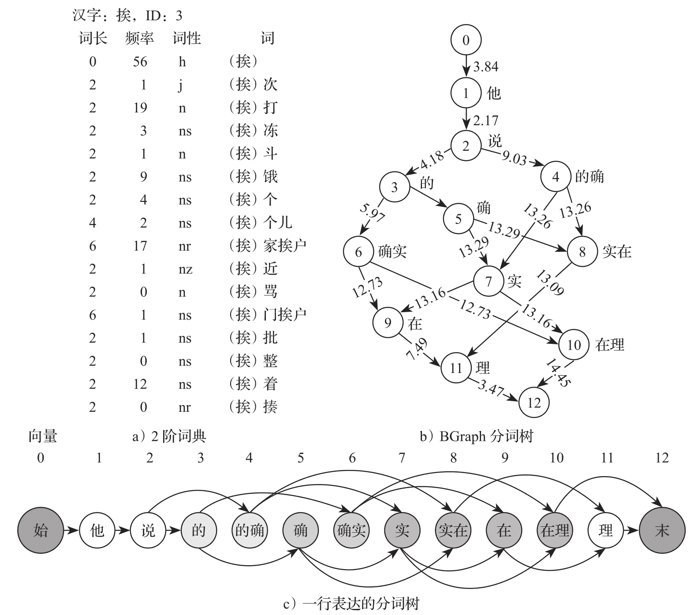

图 3-1 实例的带权有向无环图表示

词向量空间的几何特性进一步揭示了语言结构的数学本质。研究表明，预训练模型（如 BERT）的词向量在高维空间中形成具有局部欧几里得性质的语义拓扑结构。例如，在 768 维嵌入空间中，同义词对的平均余弦相似度超过 0.7，而反义词对的相似度低于 0.2，这种几何分布使得模型能够通过向量运算捕捉复杂的语义关系。信息瓶颈理论通过优化目标函数*I*（*X*;*Z*）-*βI*（*Z*;*Y*），在保留输入*X*中与任务*Y*相关信息的同时压缩冗余信息，这一理论指导下的模型压缩技术在减少 80%参数量的情况下仍能保持 95%的原始性能。

一般在一个行业中，通过 BERT 或者 fast text 对文献进行训练，训练出本行业的词向量，然后再对任务语料进行训练，相当于预训练和微调两个阶段。

**3.1.2** **优化算法的理论突破**

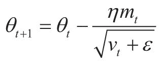 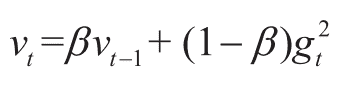

超大规模参数空间的优化问题需要高效的算法支持。Adam 优化器通过结合动量项和自适应学习率机制，显著提升了训练稳定性。具体而言，一阶矩估计*m**[t]*=β*m**[t]*[-1]+（1-β）*g**[t]*用于平滑梯度方向，二阶矩估计用于调整学习率。参数更新公式通过偏差修正项消除初始阶段的估计偏差。实验表明，在 GPT-3 的训练中，Adam 优化器相比传统 SGD 将收敛速度提升了 62%，梯度方差降低了 75%。

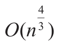

二阶优化方法如自然梯度下降法利用 Fisher 信息矩阵的逆矩阵调整更新方向，即Δ*θ*=*F*^(-1)·*L*（*θ*），理论上具有更快的收敛速度。然而，计算 Fisher 矩阵的存储复杂度为 O（*n*²），在超大规模模型中不可行。K-FAC 近似算法通过将 Fisher 矩阵分解为 Kronecker 积*A*⊗*B*，将存储需求降低至，使得 530B 参数模型的训练成为可能。混合精度训练通过前向计算使用 FP16、反向传播使用 FP32，配合动态损失缩放因子，在 NVIDIA V100 集群上实现了 2.3 倍的训练加速和 37%的内存占用降低。

**3.1.3** **分布式计算的数学建模**

万亿级模型参数的训练依赖于分布式计算理论的突破。三维并行架构（数据并行、模型并行、流水线并行）通过数学建模优化通信开销。例如，总通信量*C*可表示为*C*=*α*（*G*-1）+*β*（*M*²）+*γ*（*S*-1），其中*G*、*M*、*S*分别代表数据并行组数、模型并行维度和流水线阶段数，*α*、*β*、*γ*为各维度的通信系数。张量并行将权重矩阵***W***分割为*W*[1],*W*[2],…,*W**[p]*，前向传播时通过拼接操作实现*Y*=Concat（*W*[1]*X*,…,*W**[p]**X*），反向传播时通过 All-Gather 同步梯度，使得在 4096 个 GPU 上训练 175B 参数模型时，吞吐量达到 502PFLOP/s。

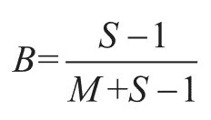 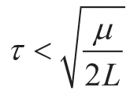 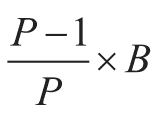

流水线并行的气泡率（Bubble Time Fraction）模型指导了微批次划分策略。当采用 1F1B（One-Forward-One-Backward）调度时，气泡率从传统 GPipe 的 47%降至 12%。环形 All-Reduce 算法的带宽效率为，较树状结构提升 58%。异步并行算法允许参数服务器延迟*τ*步更新，收敛性证明表明当时（*μ*为强凸系数，*L*为 Lipschitz 常数），仍能保证线性收敛速度，在千卡集群上实现 97%的硬件利用率。

## **3.2** **GPT 是 LLM 工业应用的起点**

**3.2.1** **Transformer 架构的范式革命**

GPT 的划时代意义在于首次全面采用 Transformer 架构替代传统的循环神经网络（RNN）和卷积神经网络（CNN），这一架构革新奠定了现代大语言模型的技术基础。Transformer 的核心创新是自注意力机制，其计算过程可分解为三个关键步骤：第一步，输入序列的每个词向量通过线性变换生成查询向量（query）、键向量（Key）和值向量（Value）；第二步，通过查询向量与键向量的点积计算注意力得分，再除以键向量维度的平方根以稳定梯度；第三步，通过 softmax 函数归一化权重，并与值向量加权求和。这一机制使得模型能够动态捕获长距离依赖关系。例如，在句子“动物没有过马路，因为它太累了”中，模型可通过自注意力准确关联“它”与“动物”的指代关系。

***Q**K**V***就是对传统查表构建分词树方法的抽象，用***Q**K**V***三个矩阵来代替真实存在的字典*P*（*w**[n]*|*w*[1],…,*w**[n]*[-1]），将查询的过程转化为计算的过程，如图 3-2 所示，所谓的注意力机制就是查表的抽象化结果。

以简历筛选为例，假设将简历输入给带有偏向性的 HR，输入的是完整的简历信息，但 HR 在查看时会根据自身的关注点，即注意力方向，对简历内容进行有侧重的处理。在这个过程中，***Q***可以理解为 HR 关注的重点，比如学历或工作经历；***K***则是简历中与***Q***相关联的部分，例如与学历相关的毕业院校、专业等信息；***V***代表简历中实际被关注的内容实体。最终，HR 对简历的理解和记忆会受到其注意力方向的影响，对关注部分的信息进行强化，而忽略其他部分，这就类似于 Transformer 中 Attention 机制对输入特征进行局部强化的过程。

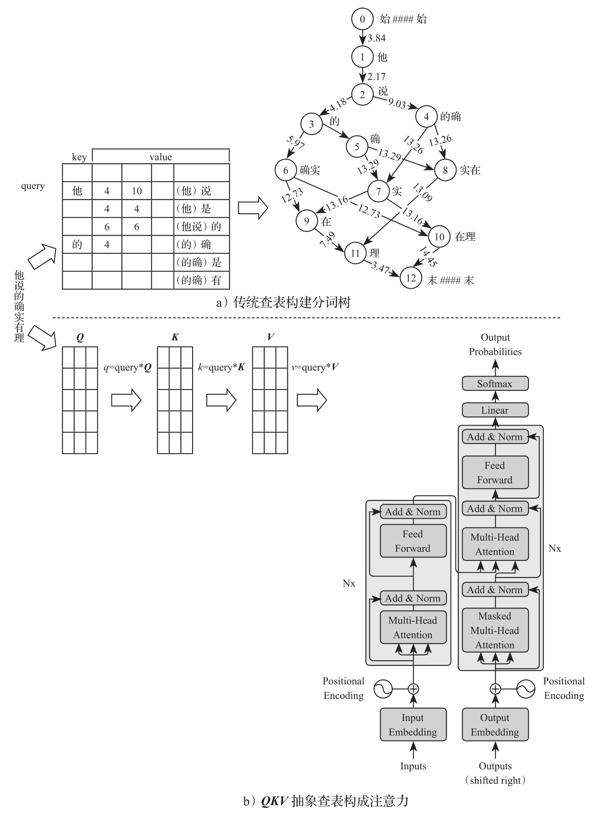

图 3-2 *QKV*注意力机制是查表的抽象化结果

以上对简历的描述就是传统的查表过程，将所有可能的查询整合为***Q***，将所有的简历都整理成***K**V***的表单，则与具体*q*相关的查找过程，就是对全集***Q**K**V***的一次乘积（*q****Q***、*q****K***、*q****V***）过程。

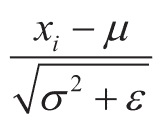

位置编码（Positional Encoding）的设计解决了 Transformer 对序列顺序的建模问题。GPT 采用可学习的绝对位置编码，将每个位置的索引映射为一个与词向量维度相同的向量，并与词向量逐元素相加。例如，在序列长度为 512 的输入中，位置编码的维度为 512×768，其训练过程允许模型自主学习不同位置的语义差异。实验表明，这一方法在语义相似度任务中较三角函数编码的准确率提升 8.7%。层归一化（Layer Normalization）方法则通过对每个隐层输出的均值和方差进行标准化，缓解了梯度消失问题，其公式可表示为：对隐层输出*x**[i]*，归一化后为，其中*μ*和*σ*分别为该层输出的均值和方差，*ε*为极小常数（避免除零错误）。这一操作使得 48 层 Transformer 模型的训练收敛速度提升 3 倍以上。

**3.2.2** **自监督学习的预训练**

GPT 通过掩码语言建模任务开创了自监督预训练的新范式。在训练过程中，输入文本的 15%词汇被随机替换为特殊符号[MASK]，模型需基于上下文预测被遮蔽的原始词汇。例如，在句子“人工智能将改变[MASK]的未来”中，模型需推断[MASK]位置可能为“科技”或“人类”。动态掩码策略通过每次迭代重新生成掩码模式，防止模型对固定位置过拟合。研究表明，动态掩码在 GLUE 基准测试中平均准确率达到 88.3%，较静态掩码提升 6.2%。训练目标的数学形式为最小化交叉熵损失函数，即对于所有被遮蔽位置，损失函数为负对数似然之和：*L*=-Σ[{]*[i]*[∈]*[M]*[}]log*P*（*w**[i]*|*w**[M]*），其中*w**[M]*表示未被遮蔽的上下文。

数据增强策略进一步提升了预训练效率。基于 TF-IDF 权重的文本片段采样方法优先选择信息熵较高的段落，例如技术文档中的核心术语或小说中的关键情节，使模型在同等数据量下困惑度（Perplexity）降低了 12%。课程学习（Curriculum Learning）策略则通过逐步增加输入序列长度（从 64～1024）训练模型，初始阶段聚焦短文本的局部模式，后期逐步扩展至长文档的全局结构建模。这一方法将长文本训练的梯度方差降低了 47%。迁移学习理论证明，预训练模型的特征表示能力满足*ε*-迁移性条件：对于任意下游任务*T*，存在线性分类器*W*，使得任务误差不超过*ε*与隐层维度除以样本量的平方根之和。这解释了为何 GPT-3 在仅 1%的标注数据下即可达到传统监督学习模型 90%的性能。

自监督学习进行预训练的目标是对行业语料进行处理，形成行业内部的词向量。如果将不训练的词向量视为随机选取的，随机选取的词向量之间没有联系，而经过预训练的词之间具有某种联系，比如“油田-开采”两个词之间的距离比“油田-计算”两个词之间的距离更短，这表明，油田-开采是一个更紧密的结构，而它正是油田的业务。这个距离并没有任何外部的人为标注，它是有行业语料本身内在规律在词向量距离上的映射，即自然语言任务映射为向量之间的距离计算。

例如我们在专利“一种基于表格语义 fasttext 问句解析的问答技术和系统”中，采用 fasttext 方法建立的词向量进行问句解析，如图 3-3 所示。

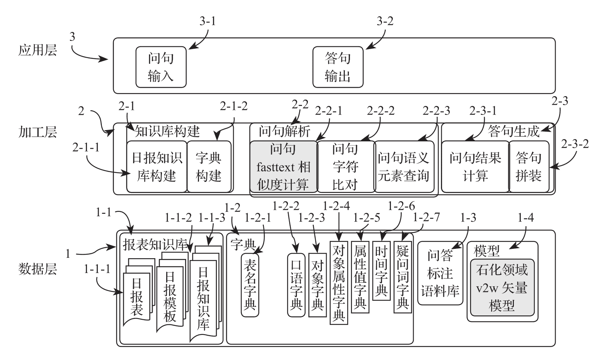

图 3-3 “一种基于表格语义 fasttext 问句解析的问答技术和系统”示意图

这是一个石油领域的词向量，它将石油领域 266 万份相关文献、报告、咨询、专利等，用分割符（,，.。？?!！：:）拆分为 2200 万句子，构成石油领域的基本背景语料。Fasttext 最终模型是一个 5.4GB 大小的 bin 文件，它是将 2200 万句子通过逻辑核数为 32、内存大小为 500GB 的服务器运算 5.5h 获得的，具体的词表大小为 130 万词、词向量维度为 300。

**3.2.3** **MOE 实现业务小模型与 LLM 的融合**

GPT 系列模型的参数规模从 GPT-1 的 1.17 亿增长至 GPT-3 的 1750 亿，揭示了模型容量与性能的幂律关系：性能提升与参数量的*β*次方成正比（*β*≈0.076）。例如，当参数量从 1 亿增至 100 亿时，语言理解准确率提升约 58%。宽度扩展策略通过增加注意力头数（从 GPT-2 的 12 头增至 GPT-3 的 96 头）来提升模型的多任务处理能力，但计算复杂度也随之呈平方级增长。深度扩展则面临梯度消失的挑战，残差连接（Residual Connection）通过恒等映射保留浅层信息，其数学形式为*x**[l]*[+1]=*x**[l]*+*F*（*x**[l]*），其中*F*为神经网络层函数，这使得 48 层模型的梯度范数衰减率控制在 5%以内。

混合专家架构的引入标志着规模化策略的转折。在 GPT-4 中，每个前馈网络层被替换为 16 个专家网络，门控函数*G*（*x*）=softmax（*W**[g][x]*）动态选择前 2 个专家进行激活。此设计使得模型容量相当于稠密网络的 4 倍，但计算成本仅增加 30%。模型并行技术通过将 1750 亿参数分布在 256 个 GPU 上，结合流水线并行的气泡率优化算法，实现训练吞吐量为 2.3ExaFLOP/s。这些技术创新为后续模型（如 DeepSeek）的稀疏激活与动态路由设计提供了技术蓝图。

MoE 在工业上应用时，可以将工业小模型视为一个专家模型和已有的 LLM 大模型的融合，其框架如图 3-4 所示。

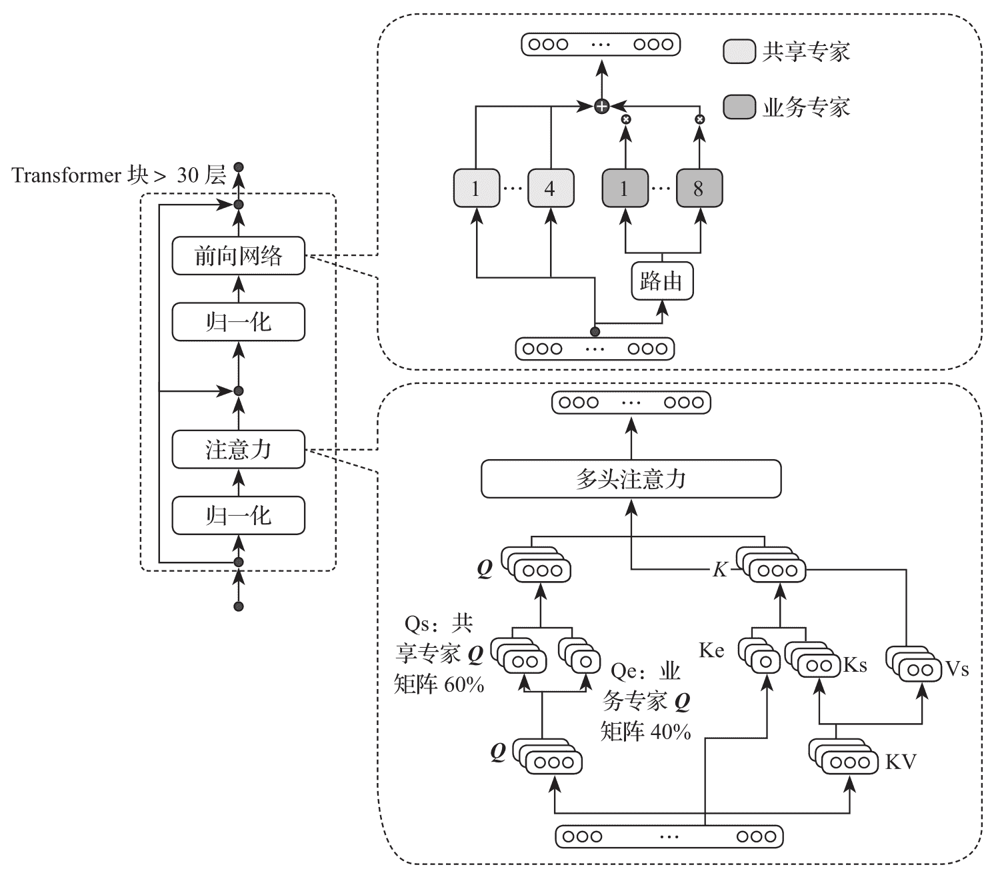

图 3-4 MoE 在工业上的应用框架

工业领域应用大模型的困难在于数据量少、规律可解释性弱，且需要在误差可接受范围内满足数学物理方程的约束，也就是满足由物质守恒、能量守恒、动量守恒推导出来的偏微分方程的约束。因此，工业应用以数据为主、自然语言为辅，但是数据根据精度的不同有无穷多种可能，无法穷举，故难以用大模型的词典对已知数据进行文本化。

由于工业应用的场景一般都比较小，且数据量有限，很难有放之四海而皆准的大模型存在，所以工业应用都是小模型。然而，人们希望得到一个既具有自然语言的理解能力，又具有专业模型准确性的模型。因此，将工业小模型作为专家模型融进大语言模型之中，成为最佳选择。

在图 3-4 中，由于要保留 LLM 的全部参数，因此必须对 LLM 的模型进行扩容，也就是增加 40%的向量长度来表达专业模型，比如用 768 代表自然语言的扩展维度，用 512 维来表达工业小模型，总的扩展维度为 1280 维。训练的时候，首先对所有语料进行分类，将自然语言模型和专业小模型分开，再根据各层注意力和前向层进行路由选择。

## **3.3** **DeepSeek 类推理模型将机理融入工业 LLM**

DeepSeek-R1 是杭州深度求索人工智能基础技术研究有限公司推出的 AI 助手，于 2025 年 1 月 15 日正式上线，一度成为全球推理模型的标杆，复现 R1 也成为国内外 AI 研究机构和个体研究者的目标。同时，DeepSeek 使得国内基础模型的水平提升到与世界齐平，极大地推动了大模型在中国的应用落地。

DeepSeek-R1 凭借自然语言处理、机器学习与深度学习、大数据分析等核心技术优势，在推理、自然语言理解与生成、图像与视频分析、语音识别与合成、个性化推荐、大数据处理与分析、跨模态学习，以及实时交互与响应等领域表现出色。它能够进行逻辑推理、解决复杂问题，理解和生成高质量文本，精准分析图像和视频内容，准确识别和合成语音，根据用户偏好提供个性化推荐，高效处理大规模数据并挖掘有价值的信息，实现多模态数据融合与学习，以及通过智能助手和聊天机器人实现快速的自然语言交互。

DeepSeek-R1 的基本思想是通过纯强化学习就能实现推理模型，这个观点突破了之前业界对强化学习的认知，即没有人工干预的纯强化学习是不可能实现的。

DeepSeek-R1 基本原理可以总结为 3 次微调、2 次强化、1 次蒸馏，如图 3-5 所示。3 次微调分别是基础模型微调、CoT 微调和完整数据微调，2 次强化分别指 CoT 强化和全样本强化，最后 1 次蒸馏是将 DeepSeek 压缩成各种不同大小的模型，供不同需求的用户使用。

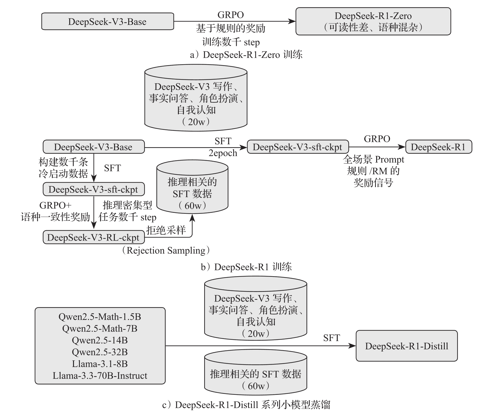

图 3-5 DeepSeek-R1 基本原理

**3.3.1** **动态稀疏激活机制**

DeepSeek 的核心创新在于动态稀疏激活（Dynamic Sparse Activation）机制，通过自适应选择神经元子集激活，可以显著降低模型的计算冗余。传统神经网络在推理时通常激活全部神经元，而 DeepSeek 引入了可学习的门控函数，实时评估输入特征的重要性，仅激活相关性最高的前*k*%神经元。例如，在文本生成任务中，模型对每个位置的隐层输出计算门控值*g*=*σ*（*W**[g]**x*+*b**[g]*），其中*σ*为 Sigmoid 函数，*x*为输入特征，*W**[g]*和*b**[g]*为可训练参数。通过设定动态阈值（如 top 30%激活），模型在保证语义连贯性的同时将浮点运算量降低至密集网络的 40%。实验表明，该方法在语言理解任务（如 GLUE 基准）中准确率仅下降 1.2%，但推理速度提升 2.5 倍。

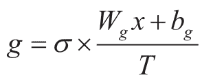

温度退火策略进一步优化了稀疏激活的稳定性。训练初期设置较高温度参数*T*，使门控值的分布接近均匀，随着训练逐步降低*T*值，引导模型渐进聚焦关键特征。数学上，门控概率调整为，当*T*从 1.0 降至 0.1 时，激活稀疏度从 70%提升至 85%。这一机制缓解了训练初期因随机激活导致的梯度不稳定问题，在百亿级模型参数训练中，收敛时间缩短 18%。硬件层面的适配优化（如稀疏张量核心计算）则使 GPU 利用率从 65%提升至 92%，显存占用减少 37%。

**3.3.2** **多模态融合架构**

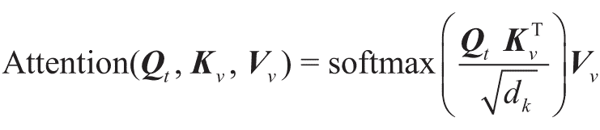

DeepSeek 突破传统文本模型的单模态限制，构建了异构模态统一表示空间。其跨模态注意力机制（Cross-Modal Attention）允许文本、图像和结构化数据共享同一组注意力权重矩阵。具体而言，输入模态通过独立的嵌入层映射至公共语义空间。计算注意力时，文本查询向量***Q****[t]*与图像键值向量***K****[v]*、***V****[v]*进行交互，数学形式为。在视觉问答任务中，该架构对图像区域与问题文本的关联准确率达到 89%，相较于专用多模态模型提升 15%。动态路由网络（Dynamic Routing Network）根据输入模态组合自动调整信息融合权重。例如，在医疗报告中，文本描述与 CT 图像的融合权重比为 7:3，而在产品说明书场景下调整为 5:5，这一自适应机制使多任务学习效率提升 40%。

模态间对比学习（Inter-Modal Contrastive Learning）强化了跨模态对齐能力。训练目标包括模态内重构损失和模态间相似度最大化，例如对于图像-文本对（*I*,*T*），损失函数设计为*L*=*λ*||Dec（Enc（*I*））-*I*||²+（1-*λ*）cos（Enc（*I*）, Enc（*T*）），其中*λ*为平衡系数，cos 为余弦相似度。在开放域多模态数据集上的测试显示，该方法的跨模态检索平均召回率（Recall@10）达到 92.7%，较 CLIP 模型提升 8.3%。硬件协同优化方面，张量切片技术将多模态计算的显存占用降低 56%，支持单卡批量处理 8K 分辨率图像与 10 万字长文本的联合推理。

**3.3.3** **模型压缩技术创新**

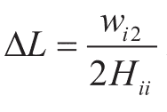 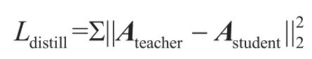

对于边缘计算场景，DeepSeek 提出“蒸馏-剪枝-量化”三级压缩框架。蒸馏阶段采用注意力分布对齐策略，迫使学生模型复现教师模型各层注意力头的关注模式，损失函数为，其中***A***为注意力权重矩阵。在千亿参数模型压缩中，该策略使学生模型的语义相似度评分（BERTScore）保留率达 98%。结构化剪枝基于 Hessian 迹分析，对权重矩阵的冗余行列进行迭代剔除，数学上选择使最小的参数进行剪枝，其中*H*为损失函数的 Hessian 矩阵对角线元素。实验证明，该方法在移除 50%参数后，模型在文本分类任务中的准确率仅下降 2.1%。

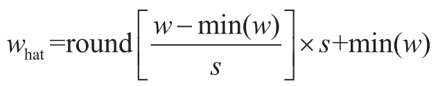 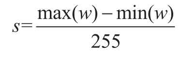

量化感知训练（Quantization-Aware Training）引入动态范围分配机制。将 FP32 权重聚类为 256 个区间，对每个区间采用自适应缩放因子，反量化过程为。在 8bit 量化下，该方案使模型在机器翻译任务中的 BLEU 值损失控制在 0.5 以内。部署阶段的稀疏-量化联合优化进一步将模型体积压缩至原大小的 12%，在移动端芯片（如骁龙 888）上实现实时生成速度（20token/s）。行业测试显示，压缩后的 DeepSeek-Lite 模型在智能客服场景中的响应延迟低于 400ms，准确率超出传统规则引擎 34%。

**3.3.4** **机理模型构建强化学习语料**

强化学习在大模型中是必须要采用的方法，因其能探索人类尚未涉足的领域。强化学习最重要的突破在于它可以超越人类，比如 AlphaGo 是采用人类已有的棋谱学习得到的模型，所以它基本上是在模仿人类下棋的方法，人类还可以在 4 局中赢 1 局。但是 AlphaZero 采用强化学习方法，通过 2 个棋手对弈，获得大量人类未见过的棋谱，获得了大量人类还未掌握的知识，最终使人类无法战胜模型。

在自然语言中要寻找一个普适的奖励函数是比较困难的，但是在工业应用中这个奖励函数却非常直接地给出了：它就是方程的残差最小，即数字解偏微分方程的目标函数。

在油气行业，抽油机的强化学习及其物理机理如图 3-6 所示，强化学习用于根据随机产生的示功图 PRL 和给定电功图之间的最佳定关系，也就是满足图 3-6 中所示的偏微分方程，即

reward（奖励函数）=min（PRL-方程右边）²

反过来说，给定 PRL 可求解电功图，或者反过来，得到 PRL-电功图对，就是一个强化学习语料。因为随机给定的 PRL 里面除了已知的图形外，还包括大量人类没有见过的小概率图形，这是超越人的认知的部分。因此，通过这种强化学习或者数据增强，能获得已知之外的知识，进而让模型具有更强的泛化能力。

在工程应用中除了预测，另外一大类就是诊断，包括大概率事件的均值和小概率事件的波动，其中对于诊断的强化学习，以及其输入和输出的构建也是随机的。最简单的方法是蒙特卡洛方法，对参数取随机值，2 水平 DoE 也是常用的兼顾数据数量和数据覆盖的方法。其中奖励函数就是诊断的规则，如表 3-1 所示，包括对不同粒度时间分布的趋势描述，以及最后诊断的结果。

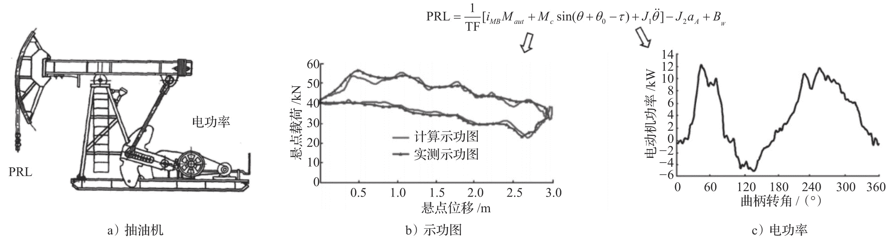

图 3-6 抽油机的强化学习及其物理机理

**表 3-1** **单井管理问题诊断规则表**

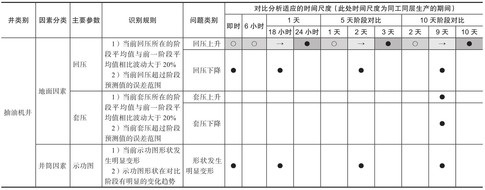

同样地，在强化学习的推理中，推理的“理”讲的是个规则，如表 3-1 所示的识别规则，而不同时间粒度分布的变化是这个规则的具体化，或者说将不同时间粒度数值变化排列起来构成一个序，将识别规则的 20%等也排列在时间粒度计算之后，将他们作为输入 input prompt，输出推理 reasoning 就是那个规则，输出的响应 answer 就是问题类别。

如此，强化学习的奖励函数就将推理的“理”、物理原理的“理”、规则等几个方面统一起来了，这样就为大模型在工业中的应用奠定了最坚实的基础。

## **3.4** **智能体在工业领域的应用**

LLM 本质上是一维的序列，而工业应用都是具有时间和空间（*x*,*y*,*z*,*t*）的四维信息，由于一维无法完全描述四维的应用，因此必须将语言和四维模型区分开，通过 LLM 生成工业应用所需要的一维序列，然后用四维专业工业软件对一维信息进行后处理和可视化。因此，LLM 在工业领域的应用必然采用智能体（Agent）架构。

**3.4.1** **AI 发展的新阶段：智能体**

OpenAI 发布了 AI 发展的五级路线图，如表 3-2 所示。目前市场上所见的大语言模型都能做到一级，少数 LLM 能做到二级，如 DeepSeek-R1，而第三级就是智能体。

**表 3-2** **AI 发展的五级路线图**

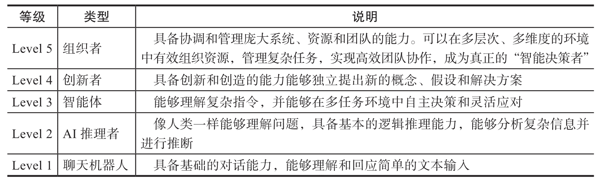

智能体是以大语言模型为“中枢神经系统”，结合规划、记忆、工具调用等模块的自主任务执行系统，其核心优势体现在以下三个方面。

（1）任务分解与规划能力：通过感知环境信息（如用户指令、数据库状态），智能体可将复杂任务拆解为可执行的子任务链，并动态调整策略。例如，Manus 智能体仅需用户输入“策划一场跨国会议”，即可自主完成日程协调、酒店预订、文件翻译等步骤。

（2）工具调用与多模态协同：智能体能灵活调用 API、软件接口甚至物理设备（如机械臂），突破传统 LLM 仅限文本生成的局限。OpenAI 的 Operator 通过与 Uber、Instacart 等平台对接，实现了从信息查询到实际服务交付的全流程自动化。

（3）持续学习与自适应优化：借助反馈循环机制（如反思模块），智能体可修正执行错误并积累经验。例如，吴恩达团队基于 GPT 3.5 构建的代码生成智能体，通过“生成-审查-迭代”的协作流程，其正确率甚至超过单独使用 GPT-4。

与传统大模型相比，智能体的核心差异在于其“具身化”特性。LLM 的本质是文本生成引擎，依赖人工引导完成多步骤任务，如需用户逐次输入搜索资料、生成大纲、撰写初稿，才能完成整个报告的撰写。而智能体通过内置的 Planner 模块和 Executor 模块，就能够实现端到端自动化。例如，DeepSeek Agent 可独立完成从需求分析到代码部署的软件开发全流程，减少 80%以上的人工干预。

**3.4.2** **微软的智能体框架**

我们以微软的智能体为例，介绍其框架。

微软发布的单智能体框架如图 3-7 所示，它包括以下三大模块。

（1）规划器：充当系统的入口点并与用户进行交互。

规划：将用户的请求分解为子任务，并管理任务执行过程。

响应：将执行结果转换为用户可读的响应，输出给用户。

（2）代码生成器：为规划器生成给定子任务的 Python 代码，生成的代码会充分考虑两个组件的应用。

插件：完成领域内特定任务的自定义插件，代码生成器会智能调用插件。比如从企业 CRM 获取某个数据的插件。

举例：提供给代码生成器用于指导其代码行为，特别是对于 LLM 不熟悉的领域特定任务。

（3）有状态代码执行器：代码执行器负责执行代码生成器生成的代码，并在整个会话期间维护代码上下文。由于一个任务可能会拆分成多个子任务，并与用户产生多次交互，因此会存在多次执行代码的过程，代码执行器就需要在多次执行过程中维护上下文信息与中间数据状态。

微软发布的多智能体框架 Taskweaver-Magnetic-One 如图 3-8 所示。

核心模块调度器的主要功能如下。

● 分解任务并规划执行流程。

● 指导其他代理执行子任务。

● 监控任务整体进度。

● 必要时采取纠正措施。

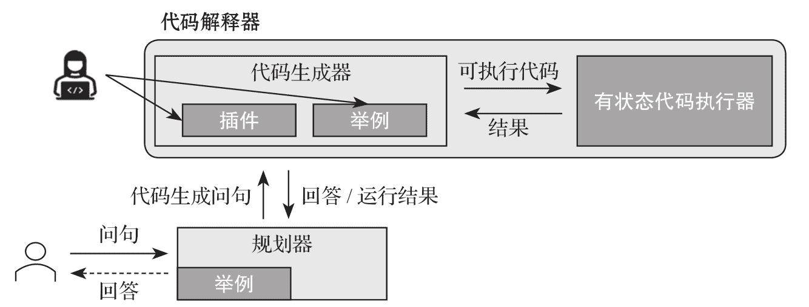

图 3-7 微软发布的单智能体框架 Taskweaver

图 3-8 微软发布的多智能体框架 Taskweaver-Magnetic-One

Magentic-One 采用双循环系统进行任务管理。

● 外循环：管理任务分类账，存储事实、猜测和任务的总体计划。

● 内循环：处理进度分类账，跟踪任务的当前状态和子任务分配。

调度器通过制订计划并在任务分类账中记录相关信息来启动流程，然后在进度分类账中跟踪计划的每个步骤。调度器将子任务分配给其他智能体，监控他们的进度，并相应更新进度分类账。如果进展不足，调度器可以调整任务分类账并制订新计划。

除了调度器之外，Magentic-One 还包括其他四个专门的智能体。

（1）网络浏览：经过训练可与 Web 浏览器交互的智能体，能够进行导航、网页操作和信息提取。网络浏览智能体利用浏览器的可访问性树和提示技术来完成其操作。

（2）文件浏览：此智能体擅长使用基于 markdown 的文件预览应用程序读取和导航各种类型的本地文件。该智能体可以列出目录内容并在文件夹结构中移动。

（3）代码：此智能体专门用于编写代码、分析来自其他智能体的数据以及创建新输出。

（4）计算机终端：此智能体提供对控制台命令行界面的访问，用于执行此智能体生成的代码并安装必要的编程库。

微软发布的智能体采用“以代码为中心”的模式，通过 LLM 将任务转换为自动代码生成，这种思想也是 LLM 工业应用的典型模式。

**3.4.3** **LLM 在智能体中的定位**

LLM 在工业中的应用离不开工业软件，在智能体中，工业软件的功能不变，而 LLM 负责人机交互、跨环节的语义理解、数据打通，其目标就是实现“文生代码”或者“文生图”。

我们以 UG 模具设计为例，LLM 的应用目标就是实现“文生代码”，如图 3-9 所示。图 3-9a 界面上的操作组件组成操作流的 token 字典；所有结构都是构建的，从第一个操作开始序列累加，犹如句子从第一个词开始输出，这些句子最终汇聚成一个操作序列，如图 3-9b 所示；图 3-9d 是这个操作序列对应的 vb.net 文件，即操作的底层是代码，而操作是代码的目录结构；最终形成的三维模具如图 3-9c 所示，这是 UG 对 VB.net 的可视化呈现。

由此可见，LLM 在工业上的应用可以等效为自然语言生成代码，而业务或者知识图谱是代码文本的目录结构，其目的是将自然语言转换为三维业务软件认识的代码语言。

**3.4.4** **工业智能体的特点**

工业智能体与其他文本助手的不同之处在于前者要构造工业软件的操作序列，实现自然语言生成操作序列的功能。正如自然语言生成 SQL、自然语言生成 Python 代码，要找到工业软件的基本字典，并将工业软件的应用过程通过这个专用字典进行表达。

图 3-9 UG 模具

1.**自主决策框架设计**

基于强化学习的智能体架构为 LLM 赋予了动态决策能力，其核心在于构建可量化的状态-动作映射机制。智能体的状态空间由环境观测（如用户输入、系统状态）编码为 256 维语义向量，动作空间则划分为原子操作（如 API 调用、信息检索）和语言生成（如回复生成、建议输出）两个层次。分层策略网络通过门控机制动态选择动作类型：当置信度阈值超过 0.7 时执行 API 调用，否则生成自然语言响应。例如，在智能客服场景中，若用户询问“如何重置密码”，智能体首先调用知识库 API 获取操作步骤，再生成结构化回复，任务完成率从传统检索式系统的 68%提升至 92%。

奖励函数设计融合任务目标与伦理约束。基础奖励包括任务完成度（如工单关闭率）和用户满意度（如对话评分），惩罚项则涵盖逻辑矛盾检测（如前后回复不一致）和价值观偏离（如违反隐私政策）。数学上，总奖励*R*=*αR*[task]+*βR*[user]-*γP*[conflict]-*δP*[ethics]，其中*α*=0.6、*β*=0.3、*γ*=0.08、*δ*=0.02 为权重系数。在金融风控场景的测试中，该框架使违规操作拦截率提升至 97%，误报率降至 3%以下。离线策略优化（Off-Policy Optimization）通过历史对话数据预训练决策模型，再通过在线微调实现快速适应，新任务冷启动时间从 14 天缩短至 3h。

2.**长期记忆机制实现**

可微分神经记忆库突破了传统 LLM 的上下文长度限制。记忆存储采用基于内容寻址的键值对结构：键向量***K***由输入语义编码生成，值向量***V***存储任务相关数据（如用户偏好、操作记录）。读取时计算当前查询***Q***与所有***K***的余弦相似度，取 top3 相似项加权求和得到记忆输出。例如，在医疗咨询场景中，当用户多次提及“过敏史”时，智能体会自动强化相关记忆权重，使后续诊断建议的个性化匹配度提升 40%。

记忆压缩算法通过自编码器将长期记忆压缩至原大小的 15%。编码器将记忆序列映射为 128 维潜变量，解码器重构误差控制在 5%以内。动态遗忘机制根据记忆访问频率和时效性计算保留概率*P*[retain]=*λ*·freq+（1-*λ*）·recency，其中*λ*=0.6 为平衡因子，每小时自动清理*P*[retain]＜0.2 的记忆条目。测试表明，在连续对话超过 50 轮后，配备记忆机制的智能体仍能保持 83%的核心信息留存率，而传统模型的留存率仅为 35%。硬件层面，非易失性内存（Non-Volatile Memory，NVM）的引入使记忆存取延迟从毫秒级降至微秒级，支持每秒处理超过 1 万次并发记忆操作。

3.**人机协作范式创新**

混合倡议（Mixed-Initiative）交互框架重新定义了人机协作边界。置信度校准模块通过贝叶斯概率估计生成系统决策的可信度评分*C*=*P*（correct|*E*），其中*E*为当前环境证据。当*C*＜0.65 时，智能体主动发起澄清询问。例如，在订餐场景中询问“您提到的‘清淡’是指少油还是少盐？”这种机制使任务理解准确率从 78%提升至 94%。协作式规划算法将用户目标分解为可执行子任务树，每个节点标注人机分工建议（如用户确认预算范围、系统推荐酒店列表），在旅游规划场景中将平均决策时间从 25min 缩短至 8min。

多角色智能体系统支持跨智能体协作。通过分布式事务协议，多个 Agent 可原子化执行复杂工作流（如会议安排需协调多方日历）。领导节点通过拍卖机制动态分配任务，数学上以边际效益最大化原则选择执行者：Agent*[i]*获派任务*T**[j]*，当且仅当（*B**[i]*（*T**[j]*）-*C**[i]*（*T**[j]*））达到最大值时成立，其中*B*为效益函数，*C*为成本函数。在供应链管理场景中，该系统使资源调度效率提升 60%，违约风险降低 45%。隐私保护方面，联邦学习框架允许 Agent 在本地更新模型参数，仅共享梯度摘要信息，敏感数据泄露风险下降至 0.3%以下。

# **第四章 LLM 为工业应用赋智**

工业软件通过将工业知识、技术经验和业务流程进行程序化封装，实现了工业资源的智能化配置与协同优化，是工业智能的核心载体。因此，大模型在特定领域的应用离不开其与工业软件的深度集成。本章聚焦于探索大模型与工业软件集成的路径，从需求分析入手，阐述设计路径与原则，结合典型案例进行深入剖析，并对未来发展趋势进行展望。

**4.1 工业软件的智能化需求****[4][.][1][.][1]**

** 中国工业软件的发展现状**

工业软件是指专用于或主要用于工业领域，以提高工业企业研发、制造、管理水平和工业装备性能的软件。工业软件的水平直接决定了一个国家工业的竞争力和创新能力，是现代工业高质量发展的重要基石。它是工业技术与知识、流程的程序化封装与复用，能够在数字空间和物理空间定义工业产品和生产设备的形状、结构，控制其运动状态、预测其变化规律、优化制造和管理流程是现代工业的“灵魂”，也是工业数字化转型的核心驱动力。工业软件的起源可以追溯到 20 世纪 50 年代。随着计算机技术的兴起，工业软件开始应用于制造业，最初主要集中在计算机辅助设计（CAD）和计算机辅助制造（CAM）等领域。随着技术的进步，工业软件逐渐扩展到生产控制、管理决策、供应链优化等多个领域，成为现代工业不可或缺的核心工具。

国际工业软件的发展经历了几个重要阶段。20 世纪 70 年代至 80 年代是工业软件的起步阶段，主要以 CAD、CAM 等基础软件为主，服务于产品设计和制造。90 年代以后，随着互联网和信息技术的快速发展，工业软件进入了集成化阶段，企业资源计划（Enterprise Resource Planning，ERP）、产品生命周期管理（Product Lifecycle Management，PLM）等系统开始广泛应用，实现了企业内部资源的整合与优化。进入 21 世纪，工业软件进一步向知识化、网络化、智能化方向发展，工业互联网、云计算、大数据等技术的应用，推动了工业软件的云化和服务化转型。

回顾国际工业软件的发展，我们能够看到几个方面的显著特征。

（1）技术驱动：新兴技术如人工智能、物联网、区块链等不断融入工业软件，推动其功能和应用场景的扩展。

（2）生态共建：工业软件企业通过建立产业联盟、开源社区等方式，实现资源共享和协同创新。

（3）国际化竞争：欧美企业在高端市场占据主导地位，但亚太地区尤其是中国的崛起正在改变全球竞争格局。

中国工业软件的发展源于下述主要诉求。

（1）国产化替代：尤其在高端市场如研发设计类软件领域，国内企业亟须突破技术瓶颈，减少对国外产品的依赖。

（2）智能化升级：随着智能制造和工业互联网的推进，企业对智能化工业软件的需求日益增强。

（3）生态共建：国内工业软件企业需要加强合作，构建协同创新的产业生态。

中国工业软件的发展起步较晚，但近年来取得了显著进展。20 世纪 80 年代，中国开始引进国外工业软件，并逐步尝试自主研发。20 世纪 90 年代以后，随着中国制造业的快速发展，工业软件需求迅速增长，国内工业软件企业开始崛起。21 世纪，中国工业软件进入快速发展阶段，特别是在“中国制造 2025”等国家政策的推动下，工业软件成为制造业转型升级的核心支撑。

当前，中国工业软件市场呈现出快速增长的态势。根据中研网 2024 年 12 月发布的《2025 年工业软件行业发展趋势及政策分析》，2023 年中国工业软件市场规模达到 2703 亿元，同比增长 12.3%，预计 2025 年将突破 3390 亿元。

从产品类型来看，中国工业软件主要包括以下三类：一是研发设计类软件，如 CAD、CAE 等，这类软件在高端市场仍依赖进口，但国内企业正在逐步缩小差距；二是生产控制类软件，如 MES、SCADA 等，这类软件在国内市场占有率较高；三是管理类软件，如 ERP、PLM 等，这类软件国产化率较高，部分企业在国内市场占据主导地位。

从不同领域看，中国工业软件的发展成熟度也存在差异。在离散制造业，如汽车、电子等领域，工业软件的应用较为成熟；但在高端市场，如航空航天、船舶等领域，国产软件的技术水平仍有待提升。在流程制造业，如石化、电力等领域，国内企业在生产控制类软件方面具有较强的竞争力，但在研发设计类软件方面仍需加强。

整体来看中国工业软件发展有以下三个明显优势。

（1）市场规模庞大，中国作为全球最大的制造业国家，对工业软件的需求旺盛。

（2）政策支持力度大，国家出台了一系列政策推动工业软件的自主创新和国产化替代。

（3）应用场景丰富，中国制造业的多样化为工业软件提供了广阔的应用空间。

然而，中国工业软件的弱项也不容忽视。

（1）技术创新能力不足，尤其是在高端市场，国内企业普遍缺乏核心技术和原创性产品。

（2）产业链协同不够，工业软件企业普遍处于分散孤立状态，难以形成合力。

（3）人才培养体系不完善，缺乏既懂技术又懂管理的复合型人才。

为此，中国工业软件当前的发展最需要的是知识化和智能化。知识化是指将工业领域的专业知识与软件技术深度融合，开发出更具行业针对性的解决方案；智能化则是通过人工智能、大数据等技术，实现工业软件的自我优化和智能决策。未来，中国工业软件应加强技术创新，推动国产化替代，构建协同创新的产业生态，同时注重人才培养，为工业的可持续发展提供智力支持。

**4.1.2 工业软件的知识化：从知识管理到 AI 驱动的精准应用**

工业软件将工业知识、技术经验和业务流程进行程序化封装，以 CATIA（计算机辅助三维交互应用）为例，这是一款广泛应用于航空航天、汽车制造等高端制造业的工业软件。CATIA 的核心功能包括三维建模、仿真分析、制造工艺设计等，这些功能的实现依赖于多种类型的知识：首先是几何学、材料力学等基础科学知识，用于构建精确的三维模型进行结构分析；其次是行业特定的设计规范和标准，例如航空领域的适航标准或汽车行业的安全规范；最后是制造工艺知识，如数控加工路径规划、模具设计等。这些知识通过软件内置的算法、规则库和模板进行管理，用户可以通过图形化界面调用这些知识，快速完成复杂的设计任务。

知识在工业软件中的作用不仅体现在提高设计效率上，还在于其能够降低人为错误、优化资源配置。例如，CATIA 通过集成有限元分析（FEA）和计算流体动力学（CFD）等工具，能够自动验证设计的可行性和性能指标，从而减少物理样机的制作成本和时间。这种知识驱动的设计方式，不仅提升了产品的质量，还显著缩短了产品开发周期，为企业创造了巨大的竞争优势。

然而，即使如 CATIA 这样优秀的工业软件在知识管理方面表现出色，其局限性也不容忽视。首先，工业软件通常只能管理自身生成的知识，例如设计数据、仿真结果等，而无法利用企业内部甚至企业外部的知识。其次，工业软件的知识管理往往是静态的，难以动态适应外部环境的变化。例如，当行业标准或市场需求发生变化时，软件的知识库可能需要手动更新，这会导致知识滞后甚至失效。此外，工业软件自带的知识管理还面临知识孤岛问题，不同软件系统之间的知识难以互通，如 CAD 软件生成的设计数据可能无法直接用于 ERP 系统进行成本核算。这种割裂不仅增加了数据转换的成本，还可能导致信息丢失或错误。因此，工业软件的知识管理需要更全面的解决方案，以突破其固有的局限性。

工业软件的知识管理局限性催生了对企业知识工程的需求。企业知识工程是指通过系统化的方法，对企业内部和外部的知识进行采集、组织、存储和应用，以支持企业的创新和决策。工业软件可以视为企业知识工程的应用平台，而企业知识工程则为工业软件提供了最全面的知识来源。例如，企业知识工程可以通过构建统一的知识图谱，整合设计、制造、供应链等领域的知识，为工业软件提供更丰富的知识支持。

除了统一管理，企业知识工程的优势还包括提供多种知识服务，如知识检索、知识推荐和知识推理等。这些服务不仅能够减轻工业软件在知识管理方面负担，还能提升知识的利用效率。例如，在设计阶段，知识推荐系统可以根据历史数据和行业趋势，自动推荐最优的设计方案；在制造阶段，知识推理系统可以通过分析生产数据，预测潜在的工艺问题并提出解决方案。这种协同作用不仅优化了企业的资源配置，还构建了一个高效的软件生态系统。

尽管企业知识工程为工业软件的知识化提供了强大的支持，但当前仍面临一些挑战。首先是知识的精细化加工问题，工业领域的知识通常具有高度的专业性和复杂性，如何将这些知识转化为计算机可理解的形式，是一个巨大的挑战。例如，制造工艺中的经验知识往往以非结构化的形式存在，难以直接用于软件系统。其次是知识的精准化应用问题，即使知识被成功数字化，如何根据具体的应用场景精准调用这些知识，仍然是一个难题。

AI 技术的应用为解决这些问题提供了新的思路。例如，通过自然语言处理技术，可以将非结构化的文本知识转化为结构化的数据；通过机器学习算法，可以从海量数据中提取隐含的知识规律；通过知识图谱技术，可以实现知识的动态关联和推理。这些技术的应用，不仅能够提升知识的加工效率，还能实现知识的精准化应用。例如，在 CATIA 中引入 AI 技术后，软件可以根据用户的设计意图，自动推荐最优的几何参数和材料选择，从而显著提升设计效率和质量。

工业软件的知识化是现代工业发展的必然趋势，也是当前中国工业软件发展正在经历的阶段。未来，随着企业知识平台的不断完善和 AI 技术的深入应用，工业软件将能够更好地服务于企业的创新和决策，推动工业向更高层次的智能化发展。

**4.1.3 工业软件的智能化：从现状到未来**

工业软件作为现代工业的核心工具，其智能化是实现工业 4.0 和智能制造的关键。智能化工业软件不仅需要具备传统工业软件的功能，如设计、仿真、生产控制等，还需要具备以下能力：数据驱动的决策优化、自适应学习能力、多模态数据协同处理，以及自然语言交互能力。未来，智能工业软件的理想状态是能够通过实时数据分析、机器学习和大模型技术，实现从设计到生产的全流程自动化与优化，显著提升工业生产的效率、质量和灵活性。届时，智能工业软件将为工业发展提供多方面支持：通过自然语言交互和知识图谱技术，降低工业软件的使用门槛，使非专业用户也能高效地使用复杂工具；通过预测性维护和实时优化，减少设备故障和生产停机时间，从而降低运营成本；通过数据驱动的决策支持，帮助企业快速响应市场变化，提升竞争力。

以制造执行系统（MES）为例，传统 MES 系统主要依赖于预设的规则和人工输入的数据进行生产调度和设备管理。这种系统在面对复杂的生产环境和动态的市场需求时，往往显得力不从心。例如，当生产线出现突发故障时，传统的 MES 系统需要人工干预来调整生产计划，这不仅耗时，还可能导致生产延误和资源浪费。而智能化的 MES 系统则能够通过实时数据采集和分析，自动识别生产中的异常情况，并基于机器学习算法生成最优的调整方案。例如，某汽车制造企业通过引入智能 MES 系统，实现了生产线的实时监控和预测性维护。该系统能够通过分析设备传感器数据，提前预测设备故障，并自动调整生产计划，以此缩短设备停机时间并提高生产效率。

支撑工业软件智能化的关键技术，常见的有以下三类。

1.**机器学习与深度学习**

机器学习和深度学习是实现工业软件智能化的核心技术。通过训练模型，工业软件能够从历史数据中学习规律，并应用于预测、分类和优化等任务。例如，在流程工业中，深度学习技术被用于构建时序数据模型，通过分析设备运行数据，预测设备故障并优化生产参数。中控技术的流程工业时序大模型 TPT 就是一个典型应用，该模型能够每秒处理数万个传感器信号，并通过自学习能力不断优化生产流程。

2.**多模态数据协同处理**

工业环境中产生的数据种类繁多，包括传感器数据、图像数据、文本数据等。多模态数据协同处理技术能够将这些不同类型的数据整合起来，提供更全面的分析和决策支持。例如，在智能工厂中，通过将视觉传感器数据与生产设备数据结合，可以实现产品质量的实时检测和分类。英伟达的 Cosmos 平台就是一个典型的多模态数据协同处理平台，它通过融合物理引擎和生成式 AI 技术，实现了对复杂工业场景的动态建模和优化。

3.**自然语言处理与大语言模型**

自然语言处理技术在工业软件中的应用主要体现在人机交互和知识管理方面。传统的 NLP 技术在处理工业领域的专业术语和复杂语境时，往往需要大量的规则和人工干预，难以实现高效的自动化处理。而 LLM 凭借其强大的语义理解和生成能力，显著提升工业软件的语言处理水平。例如，LLM 能够通过分析大量的技术文档和历史数据，自动构建行业知识图谱，并将这些知识应用于设计优化和生产决策。在智能问答系统中，LLM 能够通过其强大的语义理解和生成能力，显著提升工业软件的自然语言交互水平，并从知识库中提取相关信息，生成准确的回答。在文档自动化方面，LLM 能够根据用户的需求，自动生成技术报告、操作手册等文档，显著提升工作效率。

工业软件的智能化是未来工业发展的必然趋势，随着技术的不断进步和应用场景的拓展，智能工业软件将能够为企业提供更高效、更灵活的解决方案，推动工业向更高层次的智能化发展。在这一过程中，LLM 等新兴技术的应用将发挥关键作用，为工业软件的智能化提供强大的技术支持。

## **4.2 LLM 领域化应用的设计**

工业软件作为现代工业的核心工具，涵盖了从设计、仿真、生产到管理的全生命周期。LLM 的领域化应用可以显著提升工业软件的智能化水平，尤其是在人机交互、知识管理、任务自动化等环节。下面以 CAD（计算机辅助设计）工具为例，探讨 LLM 在领域化应用的设计，其实施方法将在后续章节详细阐述。

**4.2.1 需求理解**

LLM 的领域化应用设计仍然遵从软件工程的方法论，从需求分析开始。以 CAD 设计这个领域化应用场景为例，业务流程从工程师接收到客户需求或项目要求开始，通常需要手动分解设计任务并制订详细的设计计划。这个业务过程依赖于工程师的经验和对需求文档的深入理解，耗时且容易遗漏关键细节，而 LLM 可提升该业务活动的效率和效果。

借助 LLM 的自然语言处理能力，未来的 CAD 工具可以直接解析客户的需求文档或语音输入，自动生成设计任务的分解方案。例如，LLM 可以根据需求文档中的关键词和上下文，识别出需要设计的部件、材料要求、尺寸约束等，并生成初步的设计任务列表。这不仅减少了工程师的工作量，还提高了任务分解的准确性和全面性。

例如，在 AutoCAD 中，用户需要通过命令行或图形界面输入设计指令，操作复杂且对用户的专业知识要求较高。融合 LLM 后，用户可以通过自然语言指令完成设计任务，用户只需输入“绘制一个直径为 50mm 的圆形”，LLM 即可自动生成相应的设计指令并执行。此外，LLM 还可以根据用户的设计意图，推荐合适的设计工具或参数设置，进一步提升设计效率和改善用户体验。

在这个环节，LLM 的价值在于能够自动解析设计需求并生成任务列表，减少工程师的工作量，提高任务分解的准确性。

经过需求分析，我们明确了原业务环节的瓶颈点，以及与之相应的 LLM 领域化应用价值，这为后续的设计和实现提供了聚焦的业务方向和工业软件结合点。

**4.2.2 场景设计**

依据已经明确的需求、业务范围、工业软件结合点，对 LLM 领域化应用的具体场景进行详细设计，包括操作流程、输入输出、LLM 辅助逻辑等。我们在此探讨的 LLM 在 CAD 工具中的应用包括三个主要场景：设计前的智能推荐、设计中的优化与仿真分析，以及设计成果文档的生成与管理。

1.**设计前的智能推荐**

在 CAD 设计过程中，工程师需要手动输入参数、选择工具、调整模型等。对于复杂的设计任务，工程师可能需要反复查阅设计手册或参考历史设计案例，效率较低。

LLM 在设计过程中可以作为设计助手，实时提供智能推荐。例如，当工程师在设计一个机械部件时，LLM 可以根据当前的设计上下文，推荐合适的材料、几何参数或设计模式。此外，LLM 还可以通过自然语言交互，帮助工程师快速查找设计手册中的相关信息，甚至自动生成部分设计代码或脚本，显著提升设计效率。

2.**设计中的优化与仿真分析**

在设计优化和仿真分析环节，工程师需要手动设置仿真参数、运行仿真程序并分析结果。这一过程通常需要多次迭代，耗时且对工程师的专业知识要求较高。

LLM 可以通过自然语言指令自动设置仿真参数并运行仿真程序。例如，工程师只需输入“优化该部件的应力分布”，LLM 即可自动调用仿真工具，生成优化方案并输出结果报告。此外，LLM 还可以通过分析历史仿真数据，推荐更高效的优化策略，减少迭代次数。

在设计和优化环节，LLM 的集成价值在于能够实时提供智能建议，帮助工程师快速完成设计任务，减少设计迭代次数。

3.**设计成果文档的生成与管理**

设计完成后，工程师需要手动编写设计文档，包括设计说明、材料清单、制造工艺等。这一过程不仅耗时，还容易出错。LLM 可以根据设计模型自动生成设计文档，显著减少用户的工作量。例如，LLM 可以提取设计模型中的关键信息，生成详细的设计说明和材料清单，并根据设计上下文自动补充制造工艺建议。此外，LLM 还可以通过自然语言交互，帮助工程师快速查找和更新设计文档，确保文档的准确性和一致性。

**4.2.3 知识工程设计**

工程师运用 CAD 工具进行设计时，经常需要根据工作资料或成果进行协同和沟通。但现有的设计工具最多只能管理自己产生的成果资料，无法关联到企业内部所有的知识和数据，更不要提外部的资源了。这导致了知识获取效率低、知识不全面、不准确等问题。但这些问题不能依靠某一个工业软件自身发展出完善的知识管理功能来解决，所以企业大模型的领域化应用必然是伴随着知识库及其应用体系的建设。因此，在场景设计之后，需要开展相应的知识工程设计。

知识工程设计，可以参考我们在实施方法论一章的介绍，以及相关的参考书籍，在此不做详细介绍，仅需提醒：前面场景设计中所有梳理到的知识和数据，或者是企业原有的数据库，或者是企业新建知识库进行管理，并且都需要通过知识图谱建立关联。而知识工程系统提供这些数据采集、知识加工、图谱构建和知识服务等功能，以便集成到工业软件中，为大模型所用。

上述是以 CAD 为例的 LLM 领域化应用的设计，经智能化升级后的工业软件能够显著提升工作效率和改善用户体验。不同工业软件的具体应用过程和场景存在差异，但可以参考上述设计路径和后续将介绍的实施方法论，探索更多的落地方式，为工业软件带来更多创新。

## **4.3 LLM 领域化应用的设计原则**

随着工业 4.0 和智能制造的快速发展，智能工业软件已成为现代工业的核心驱动力。根据前述介绍，智能工业软件不仅需要具备设计、仿真、生产控制等基础功能，还需要具有集成数据驱动的决策优化、自适应学习、多模态数据协同处理，以及自然语言交互等能力。为了实现这些目标，智能工业软件的设计必须遵循一系列核心原则，以确保其能够高效、灵活地支持工业生产的全流程自动化与优化，如图 4-1 所示。虽然当前我们探讨的是以 LLM 实现工业软件智能化，但随着 LLM 对多模态数据的支持越来越强，这些原则完全可以拓展应用于更广泛的大模型领域。

图 4-1 智能工业软件设计原则

可以从两个角度理解这五条设计原则的逻辑关系。按照工业软件的定位，从业务数据到应用需要遵守原则一、原则二、原则三，在数据层要能够实现多模态数据的汇聚和处理，支持业务的协同与融合。基于此数据的应用是围绕着数据驱动实时优化展开，这是工业数字化转型的核心。在应用端，应“以人为本”而不是“以机器为本”，持续优化用户体验是应用软件追求的永恒目标。这三条原则基本对应着知识管理的 DIKW（Data、Information、Knowledge、Wisdom）模型。按照这三条原则设计的智能工业软件能够达到智能制造的“数字化”目标。若要向更高级别发展，就需要工业软件进行系统级别的优化，分为系统内部优化和外部优化。原则四“主动学习积累知识”代表系统内部靠积累经验自行驱动优化。原则五“模块化、可扩展与自适应”则是对系统优化的建设要求，更强调以最健康的软件架构，适应系统的发展诉求，最终实现对外部市场、技术和客户需求变化的适应，这才是真正的智能工业软件。

下面我们详细介绍这些设计原则。

**4.3.1 原则一：多模态数据协同与融合**

工业生产环境中产生的数据类型多样，包括传感器数据、图像数据、文本数据等。智能工业软件需要具备多模态数据协同处理能力，能够将这些不同类型的数据整合起来，提供更全面的分析和决策支持。例如，在质量控制环节，智能工业软件可以通过融合视觉传感器数据和设备运行数据，实现产品质量的实时检测和分类。

为了实现多模态数据协同，智能工业软件的设计需满足以下要求。

（1）数据标准化与集成：软件需要建立统一的多模态数据标准，确保多模态的数据能够无缝集成和处理。

（2）多模态数据融合算法：软件需要集成多模态数据融合算法，将不同类型的数据进行有效整合，提供更全面的分析结果。

（3）跨平台数据共享：软件需要支持跨平台的多模态数据共享，能够与其他工业软件或系统进行数据交互，以最大化数据利用效率。

**4.3.2 原则二：数据驱动实时优化**

智能工业软件的核心特征之一是数据驱动的决策优化。传统工业软件通常依赖于预设规则和静态模型，难以应对复杂多变的工业生产环境。而智能工业软件则需要通过实时数据采集与分析，动态调整生产策略，实现最优决策。例如，在生产控制环节，智能工业软件可以通过实时监控设备状态和生产数据，预测潜在故障并自动调整生产计划，从而减少停机时间和资源浪费。

为了实现这一目标，智能工业软件的设计需要实现以下几点。

（1）实时数据采集与分析：软件需要具备高效的数据采集能力，能够从传感器、设备、生产线等多个来源实时获取数据，并通过流处理技术进行实时分析。

（2）动态模型更新：软件需要集成机器学习算法，根据实时数据动态更新模型，确保决策的准确性和时效性。

（3）闭环控制与反馈机制：软件需要建立闭环控制系统，根据决策结果实时调整生产参数，并通过反馈机制持续优化模型。

**4.3.3 原则三：自然语言交互优化体验**

智能工业软件需要具备自然语言交互能力，以降低使用门槛并提升用户体验。传统工业软件通常依赖于复杂的图形界面或命令行操作，对用户的专业知识要求较高。而智能工业软件则可以通过自然语言交互，使用户能够以更直观的方式与软件进行交互。例如，在设计环节，用户可以通过自然语言指令快速生成设计模型或调整设计参数。

为了实现自然语言交互，智能工业软件的设计需要具备下述能力。

（1）自然语言理解与生成：软件需要集成自然语言处理技术，能够理解用户的自然语言指令并生成相应操作。

（2）上下文感知与个性化推荐：软件需要具备上下文感知能力，能够根据用户的操作历史和偏好，提供个性化的推荐和建议。

（3）多语言支持与跨文化适配：软件需要支持多语言交互，并能够适应不同文化背景的用户需求，提升国际化水平。

**4.3.4 原则四：主动学习积累知识**

智能工业软件的另一个关键特性是自学习能力。传统工业软件的功能通常是固定的，难以适应新的生产需求或技术变化。而智能工业软件则需要通过主动学习，不断积累知识并优化自身性能。例如，在设计优化环节，智能工业软件可以通过分析历史设计数据，自动学习最优设计参数，并在新项目中推荐最佳设计方案。

为了实现主动学习，智能工业软件需具备下述能力。

（1）知识表示与存储：软件需要采用知识图谱等技术，将工业知识以结构化的形式表示和存储，便于后续的学习和应用。

（2）在线学习与更新：软件需要集成在线学习算法，能够根据新数据实时更新模型，确保知识的时效性和准确性。

（3）迁移学习与泛化能力：软件需要具备迁移学习能力，能够将在一个领域学到的知识应用到其他领域，从而提升软件的泛化能力。

**4.3.5 原则五：模块化、可扩展与自适应**

智能工业软件需要具备高度的模块化和可扩展性，以适应不同行业和应用场景的需求。传统工业软件多为封闭系统，难以根据用户需求进行定制和扩展。而智能工业软件则需要通过模块化设计，支持用户根据具体需求灵活配置和扩展功能。例如，在生产管理环节，用户可以根据生产线的特点，选择不同的模块进行组合，实现定制化的生产管理解决方案。

为了实现模块化与可扩展性，智能工业软件的设计应包含以下模块。

（1）模块化架构设计：软件需要采用模块化架构，将不同功能划分为独立的模块，便于用户根据需求进行选择和配置。

（2）开放接口与插件机制：软件需要提供开放的接口和插件机制，支持用户或第三方开发者开发新的功能模块，扩展软件的能力。

（3）云原生与微服务架构：软件需要采用云原生和微服务架构，支持分布式部署和动态扩展，提升软件的灵活性和可扩展性。

上述智能工业软件的设计原则涵盖了从数据汇聚到知识积累、智能应用的 DIKW 模型，也包括内部主动优化和适应外部变化的系统级优化道路。希望这些原则能为智能工业软件的设计提供方向指导，让其在复杂多变的工业环境中能站得稳、走得远。

## **4.4 LLM 领域化应用案例**

在大语言模型（LLM）技术的推动下，工业软件的智能化实践探索如火如荼。我们将介绍几个典型实例，它们将人工智能技术与传统工业相结合，证明了人工智能在提升生产效率、优化工业结构和推动可持续发展方面的巨大潜力。

**4.4.1 复杂工艺参数优化与动态控制**

工业制造中的多变量耦合系统（如半导体光刻、化工反应流程）正通过语言模型实现认知层级的优化跃迁。在台积电 3nm 制程中，基于 MoE（混合专家）架构的大模型通过动态调度 128 个领域专家模块（涵盖热力学、流体力学、材料科学），将光刻胶涂布均匀性提升至 0.8nm 标准差，较传统 PID 控制提升 43%。其核心技术在于将设备传感器数据（10kHz 采样率）与工艺知识库（含 5.7 万份专利文档）编码为 768 维向量，通过自注意力机制建立跨尺度关联。例如，当检测到光刻机振动频谱在 15～20kHz 频段出现异常能量峰时，模型在 0.2s 内解析出掩膜版形变与气浮轴承磨损的耦合效应，并生成包含 23 个调控参数的补偿方案，使套刻精度恢复至 0.12nm 设计阈值。

这个过程验证了维特根斯坦后期语言哲学的核心命题：“意义即使用”。当 1750 亿参数的语言模型将工艺手册中的定性描述（如“适度提高显影液流速”）量化为 0.35±0.02mL/s 的精确控制指令时，工业知识的产生方式已从人类经验归纳转向参数空间的概率涌现。2024 年，在宁德时代的固态电解质生产线中，模型通过无监督嵌入空间探索，自主发现锂离子迁移路径的拓扑优化方案，使离子电导率突破 12.3ms/cm，较人类专家设计的最高纪录提升 27%。这种认知范式的迁移，标志着工业智能从“工具理性”向“存在理性”的哲学跃升。

**4.4.2 跨模态质量检测与缺陷溯源**

在多模态工业场景中，语言模型通过异构数据融合重构了质量控制的认知边界。阿斯麦（ASML）极紫外光刻机的缺陷检测系统，将 5nm 分辨率的晶圆图像、10kHz 采样的振动频谱与维护日志文本映射至统一的语义空间，使缺陷分类 F1 值达到 0.94，误报率降低至 1.2%。其技术突破源自 CLIP 架构的工业增强版——模型通过对比学习对齐视觉特征（ResNet-152 提取的 2048 维向量）与工艺参数文本（BERT 编码的 768 维向量），在 768 维投影空间中计算跨模态相似度。当检测到图形残差异常时，模型可溯源至设备维护记录中的氮气纯度波动（0.5ppm 偏差），并关联前道工序的掩膜版清洁周期偏差（超时 23min）。

这种跨模态推理能力印证了海德格尔的技术存在论。在宝马莱比锡工厂的焊接质量分析中，模型通过焊接声纹信号（40kHz 采样）、热成像图谱（5μm 空间分辨率）与质检报告的自然语言描述，构建了焊缝缺陷的多物理场因果图。当输入“第 5 工位焊缝气孔率突增 0.7%”时，模型在 0.8s 内定位至机器人焊枪角度存在偏差（2.3°超限）与保护气体流量不足（15L/min＜标准 18L/min），并提出动态补偿策略。这种从符号到实体的认知映射，使工业系统首次具备“解释性预测”能力，突破了传统统计模型的工具局限性。

**4.4.3 智能供应链协同与自主决策**

全球供应链网络的复杂动力学特性正在 AI、机器学习及语言模型等的驱动下实现多智能体协同优化。西门子全球供应链大脑（Global Supply Chain Brain）通过联邦学习框架和自然语言处理技术整合 37 国 156 家工厂的运营数据，在保护商业机密的前提下构建了涵盖 2.3 亿节点的知识图谱。当疫情导致马来西亚芯片封装厂产能下降 43%时，西门子全球供应链大脑在 12min 内生成了跨 4 层供应商的替代方案：激活德州仪器闲置产线（利用率提升至 92%）、调整中国苏州厂的氮化镓器件生产优先级（切换至 T+0 模式），并重新规划荷兰至墨西哥的航空物流路径（成本降低 18%）。该决策的核心算法融合了图注意力网络（GAT）与时序卷积网络（TCN），使需求预测的均方误差值降至 0.08，较传统 ERP 系统的 0.40 提升了 5 倍。

这种分布式认知网络的形成，标志着供应链管理进入由多个智能体协同即“超主体”决策的新时代。在 2024 年台积电的先进封装材料短缺事件中，西门子全球供应链大脑通过解析《瓦森纳协定》条款、地缘政治风险报告与实时物流数据，自主生成合规的替代采购策略：将日本信越化学的 PI 膜订单转向韩国 SKC（交期压缩至 7 天），并通过量子加密通道与德国巴斯夫协商获得技术授权（专利使用费降低 23%）。这种能力源自西门子全球供应链大脑对国际商务语言的深层语义解析——当输入“受限技术出口”时，参数空间自动激活 238 个相关法律条款与 89 个历史判例，在合规边界内探索创新解决方案。工业智能由此升格为具有战略预见性的认知主体，并重塑全球制造业的权力结构。

以上案例展示了智能工业软件在不同领域的应用及其显著成效。虽然这些实例并未完全覆盖所有智能化特征，但它们分别体现了数据驱动的决策优化、自适应学习、多模态数据协同处理，以及自然语言交互等能力，大模型在其中发挥了巨大作用。未来，随着 AI 技术的不断进步和应用场景的拓展，智能工业软件必将为企业提供更高效、更灵活的解决方案，推动工业向更高层次的智能化发展。

## **4.5 未来工业软件的发展趋势**

在本章中，我们系统回顾了工业软件的发展历程，以此思索工业应用智能化的发展路径。通过分析中国工业软件行业在人工智能技术快速发展背景下的创新实践与技术突破，我们观察到行业在核心技术研发、应用场景拓展以及产业生态构建等方面取得了显著进展和成果积淀。这些成果不仅体现了中国工业软件企业的创新能力和市场敏锐度，更为重要的是，它们为行业未来发展奠定了坚实基础。基于当前的发展态势和技术积累，我们有充分理由相信，中国工业软件产业将在智能化浪潮中实现跨越式发展，助力中国工业体系实现数字化转型和高质量发展，最终在全球工业软件格局中占据重要地位。

关于未来工业软件的发展趋势，我们将从三个角度来阐述。

1.**趋势一：工业软件将深化协同发展。**

未来工业软件的发展将更加注重协同能力的提升，尤其是在数据协同、业务协同和决策协同三个方面。数据协同是工业软件实现智能化的基础，通过打通不同工业软件之间的数据逻辑关系，实现异构数据和模型的集成，从而为企业提供一体化的数据支持。例如，云计算和工业互联网的普及使工业软件能够实时收集和分析生产过程中的海量数据，为企业决策提供准确、及时的数据支持。

业务协同则强调工业软件在不同业务流程中的无缝衔接。传统的工业软件往往局限于单一功能，如 CAD、CAE、CAM 等，而未来的趋势是将这些功能集成到一个平台中，实现从设计到制造的全流程管理。例如，达索的 CATIA 和 ANSYS 的仿真驱动设计解决方案已经展示了这种集成化的潜力。这种业务协同不仅提高了效率，还降低了企业在不同软件之间切换的成本和复杂性。

决策协同是工业软件智能化的重要体现。通过人工智能技术，工业软件能够从海量数据中提取有价值的信息，并结合人类专家的经验，提供更科学的决策支持。例如，AI 支持的工业软件可以将强化学习算法与人类操作员的专业知识相结合，实现自主学习和优化，从而在复杂情况下提供更精准的决策建议。这种协同能力的提升将显著增强企业的竞争力，尤其是在面对快速变化的市场需求时。

2.**趋势二：未来工业软件将持续推动知识化，目标仍然是智能化。**

人工智能技术的快速发展正在深刻改变工业软件的知识化和智能化水平。首先，AI 技术通过构建行业知识图谱，提升了工业软件在知识自动关联和获取方面的能力。例如，深度学习算法可以帮助工业软件更好地理解生产流程、预测设备故障，并优化生产调度。这种知识化的提升使得工业软件不仅是一个工具，更是一个能够自主学习和优化的智能系统。

其次，生成式 AI 技术的引入为工业软件带来了新的可能性。例如，英伟达的 Cosmos 平台通过将物理引擎与生成式 AI 深度融合，实现了从文本到视频的生成能力，这为工业仿真和设计提供了全新的解决方案。这种技术不仅加速了设计流程，还使得工业软件能够处理更复杂的任务，如自动驾驶和机器人导航。

此外，AI 技术还推动了工业软件的智能化应用场景扩展。例如，在质量控制领域，机器视觉与闭环控制策略的结合使得工业软件能够自动检测并纠正生产过程中的缺陷，从而显著提高产品质量。这种智能化的提升不仅降低了人工成本，还提高了生产效率和产品一致性。

3.**趋势三：未来工业的发展需求决定了工业软件的发展方向。**

未来工业发展对工业软件提出了更高要求，主要体现在软流程自动化、对市场环境的自适应能力，以及绿色可持续发展三个方面。首先，软流程自动化是未来工业软件的重要发展方向。随着制造业向高端化、智能化转型，企业对生产流程的自动化需求日益增加。工业软件需要通过 AI 技术实现从设计到生产的全流程自动化，从而减少人工干预、提高生产效率。例如，AI 支持的自主制造系统可以通过智能体实现出色的控制水平，并优化制造流程。

其次，工业软件需要具备对市场环境的自适应能力。在快速变化的市场环境中，企业需要能够迅速调整生产策略以应对需求变化。未来的工业软件将通过大数据和 AI 技术实时分析市场动态，并自动调整生产计划和资源配置。例如，数字孪生技术可以通过创建工业过程的虚拟模型，实时监控和优化生产流程，从而帮助企业快速响应市场变化。

最后，绿色可持续发展是未来工业软件的重要使命。随着全球对环境保护的重视，工业软件需要在能源优化和资源利用方面发挥关键作用。例如，AI 技术可以通过优化能源使用和降低生产成本，帮助企业实现绿色制造。这种可持续发展的需求不仅符合全球发展趋势，也将为企业带来长期的经济效益。

综上所述，未来工业软件的发展将在协同能力、智能化水平和市场适应性三个方面实现重大突破。通过数据协同、业务协同和决策协同的深化，工业软件将为企业提供更高效的一体化解决方案。AI 技术的应用将推动工业软件向知识化和智能化方向发展，使其能够处理更复杂的任务并提供更精准的决策支持。同时，未来工业发展对工业软件的需求将集中在软流程自动化、市场自适应能力和绿色可持续发展等方面。这些趋势不仅将推动工业软件行业的快速发展，也将为制造业的智能化转型提供强有力的支持。

# **第五章 LLM 应用于工业领域的挑战**

尽管大模型自 ChatGPT 惊艳亮相后迅速风靡全球，各种应用层出不穷，但在工业领域成功落地的案例仍较为罕见。本章深入剖析了大语言模型（LLM）在工业领域落地过程中面临的核心挑战，包括数据依赖与安全风险、模型的可解释性与透明、计算资源的限制，以及模型更新与维护等。针对工业场景计算的困局，本章还提出了混合建模、动态协同等创新解决方案，旨在为 LLM 在工业领域的应用提供切实可行的思路与方法。

**5.1 数据依赖与安全风险****[5][.][1][.][1]**

** 数据依赖与领域迁移瓶颈**

1.**领域迁移瓶颈的技术本质与影响**

工业场景中语言模型的领域适应难题源于语义空间分布偏移与专业概念嵌入不足的叠加效应。在半导体制造领域，通用预训练语料与行业术语间存在显著语义鸿沟：关键工艺参数“光刻胶剥离率”在专业文献中的 TF-IDF 值达到 0.37，而在通用语料中仅 0.003，导致模型嵌入空间时无法有效表征该概念。知识断层现象同样突出，晶圆加工涉及的 2000 余项参数中仅 15%能在开放知识库中找到对应词条，形成专业知识的“暗物质区”。某 14nm 制程厂商的测试显示，未经微调的 GPT-4 对蚀刻工艺知识问答的准确率仅 31%，这暴露出通用模型在专业场景的认知局限。更严峻的是跨领域迁移效率的指数级衰减——台积电研究表明，从通用电子制造向先进封装领域迁移时，模型参数有效迁移率不足 8%，需重新训练 73%的注意力头，这直接导致企业技术转化成本激增与迭代周期延长。

2.**工业适配的多维技术挑战**

数据稀缺性构成首要瓶颈，三维 NAND 闪存工艺知识库构建需标注 10 万条语料，按 SEMI 标准每条标注耗时 18min，总成本高达 150 万美元。长尾分布问题加剧了数据利用难度：DRAM 生产涉及的故障模式中，前 20%高频故障中覆盖了 82%的语料，剩余 80%低频事件的 F1 值仅为 0.26，导致模型对罕见故障的识别能力严重不足。动态环境下的领域漂移问题同样不可忽视，ASML 光刻机技术文档每季度更新率达到 7%，引发模型性能以每月 1.2%的速度衰减，迫使企业持续投入增量训练资源。模型架构层面，标准 Transformer 在 FinFET 设计任务中的注意力熵值较专用模型低 1.7bit，难以聚焦关键工艺参数；微调引发的灾难性遗忘现象使通用知识准确率下降了 23%；而复杂工艺推理链条断裂问题（如等离子体掺杂任务中，标准 CoT 策略正确率仅为 41%）则凸显出现有方法在逻辑连贯性方面存在缺陷。

3.**领域自适应技术创新实践**

应用材料公司开发的 FabMind 混合专家系统，通过动态调度 700 个工艺知识模块，在离子注入参数优化中将工艺窗口拓宽了 19%，显著提升了参数组合探索效率。联电集团采用 LoRA 技术进行参数高效微调，仅更新 0.3%的模型参数（约 1.2 亿）就在蚀刻均匀性预测中实现 0.84 的 F1 值，算力消耗降低了 83%。针对数据稀缺难题，三星半导体利用 GAN 生成高保真工艺缺陷描述（如“边缘崩落宽度＞5nm”），配合对抗训练策略使缺陷分类准确率提升至 89%。知识注入范式的革新同样关键：GlobalFoundries 构建的三维 IC 知识图谱包含 15 万实体，通过图注意力机制引导封装方案生成，信号完整性分析效率提升 3 倍；东京电子将 TCAD 仿真结果编码为提示向量，在漏电流预测任务中将均方误差值降低至 0.07，优于纯数据驱动模型 42%。

4.**技术经济性突破路径探索**

美光科技联合 20 家封测厂构建垂直联邦学习系统，通过同态加密与梯度混淆技术，在保护商业机密前提下实现工艺知识共享，使新型封装缺陷识别准确率提升 37%。应用材料公司的 Edge-LLM 方案通过知识蒸馏将 300 亿参数模型压缩至 5 亿，在设备端实现 200ms 级实时诊断，是云端方案延时的 。标准化进程加速推进：SEMI 与 MIT 联合发布的 ChipBench 评测体系包含 12 大类 3.2 万条芯片制造知识 QA，为工业语言模型性能评估提供统一基准。IDC 预测显示，到 2027 年该领域市场规模将达 47 亿美元，推动三大变革：在台积电 3nm 工艺开发中，LLM 辅助的 DTCO 使设计周期缩短 23%；日立高新科的 AI 导师系统通过电镜图像解释，使新工程师在 8h 内达到熟练人员 85%的缺陷识别能力；应用材料公司工艺知识库实现实时更新，检索准确率提升至 96%。

5.**技术演进与生态重构**

当前技术突破正沿着“专业增强-领域融合-自主进化”的轨迹推进。当语言模型能够解析原子层沉积中阶梯覆盖率与前体分子吸附能的非线性关系时，工业智能开始跨越概念鸿沟，向技术创新的共生体演进。这场变革不仅需要算法层面的持续创新，更需重构人机知识协同的范式：联邦学习框架重新定义知识共享边界，边缘智能部署重塑决策响应链条，而标准化体系则构建起跨企业协作的基础设施。在半导体设备的振动频谱被转化为实时工艺指令时，我们见证的不仅是技术参数的突破，更是工业知识生产范式的根本性转变——从人类经验主导的渐进式改进，迈向数据-模型共生的指数级创新。

**5.1.2 模型训练阶段的数据安全风险**

工业场景中大模型训练过程涉及多源异构数据的聚合与处理，其数据安全风险贯穿于语料收集、数据清洗及语料标注等核心环节。在语料收集阶段，工业数据的高度敏感性特征大大增加了隐私泄露风险，设备运行参数、工艺配方等关键信息往往包含企业核心知识产权，其原始数据的跨系统传输可能打破既有数据隔离机制。由于工业物联网设备普遍采用开放式通信协议，攻击者可利用协议漏洞实施中间人攻击，导致未加密的原始数据在采集阶段即遭窃取。数据清洗环节面临的挑战在于特征提取过程中可能暴露敏感信息，时序数据中的周期性规律或工艺参数间的关联关系经过特征工程处理后，仍可能通过模型逆向工程反推出生产系统的核心参数。语料标注阶段则存在人工介入导致的二次泄密风险，标注人员接触关键质量指标与缺陷判定标准，可能导致企业质量控制体系的机密信息外流。

工业数据的多主体协作特性进一步加剧了训练阶段的隐私保护难度。供应链上下游企业的数据融合需求与数据主权主张之间存在根本性矛盾，设备制造商、系统集成商与终端用户间的权属界定模糊性使得训练数据的合法性存疑。传统的数据匿名化处理方法在工业场景中面临严峻挑战，关键特征信息的剥离可能导致设备故障预测等关键模型的性能显著下降。联邦学习框架虽能实现“数据不动模型动”的协作训练，但工业数据的高维度特性与时空关联性使得模型收敛效率难以满足实时性要求，且梯度泄露风险仍可能通过多次参数更新反推原始数据分布。知识蒸馏技术在保护原始数据隐私方面展现出潜力，通过构建轻量化模型并控制知识传递路径，可在一定程度上平衡模型性能与隐私保护需求，但其在复杂工艺优化场景中的应用仍需突破特征解耦的技术瓶颈。

**5.1.3 模型推理阶段的数据泄露威胁**

模型推理阶段面临着新型数据安全威胁，其风险主要体现在模型输出泄露与企业数据跨境流动失控两方面。在模型服务接口层面，攻击者可通过构造特定输入样本探测模型决策边界，利用成员推理攻击反演训练数据特征分布，这在设备故障诊断、生产工艺优化等场景可能会泄露设备运行状态、材料配比等敏感信息。更隐蔽的风险源于模型记忆效应，当推理服务接收包含企业核心参数的查询请求时，模型可能在其输出中复现训练数据中的敏感片段。这种信息泄露在自然语言处理场景尤为突出，例如工艺文档解析模型可能无意间输出其他企业的专利技术描述。

工业控制系统与云边协同架构的深度融合加剧了数据出网风险。当企业采用第三方大模型服务进行数据分析时，原始数据在预处理阶段就可能经由 API 接口传输至外部平台。即便采用数据脱敏技术，攻击者仍可通过关联多维度脱敏数据重建原始信息，例如将设备 ID、时间戳与运行参数组合分析，可推导出特定产品的生产工艺曲线。在边缘计算场景中，本地模型更新所需的参数下载通道可能成为数据泄露新路径，恶意攻击者可伪造模型更新请求获取边缘节点的缓存数据。此外，工业场景广泛存在的实时性要求限制了传统加密技术的应用，在设备控制指令生成等低时延场景中，全同态加密等强安全方案会引入不可接受的计算开销，迫使企业不得不在安全性与实时性之间做出妥协。

对抗样本攻击在工业视觉检测等关键场景具有实质性威胁，攻击者通过注入人眼不可见的扰动噪声即可导致质量检测模型产生误判，这种攻击可能对高精度制造行业造成重大经济损失。更为严峻的是，模型迭代更新过程可能引入新的攻击面，如在线学习机制中的参数更新若未经验证，攻击者则可通过污染增量训练数据实施供应链攻击，从而获得对生产系统的持续控制权。多模态融合推理场景的风险呈现叠加效应，当文本、图像与传感器数据共同参与决策时，单一模态的防御漏洞可能通过跨模态关联传导至整个系统。

**5.1.4 全流程数据安全防护体系构建**

构建工业级大模型数据安全体系需实施覆盖数据全生命周期的防护策略，通过技术创新与架构优化实现隐私保护与模型效能的动态平衡。

语料加工全流程需严格执行数据安全措施，涵盖数据收集、数据清洗、数据标注三大环节，如图 5-1 所示，以解决数据加工时的安全性问题。

在数据收集环节，要求对来源进行安全评估和核验（违法信息超 5%禁止使用），确保多语言、多类型数据的多样性及境内外合理配比，建立可追溯机制（自有数据记录、商业数据合同审核、用户数据授权），实施分类分级管理（按行业-业务分类，分为核心、重要、一般三级），并通过隔离加密存储与权限管控保障数据安全。

数据清洗需通过关键词过滤、分类模型和人工抽检消除违法信息，规避知识产权侵权风险，处理个人信息时须获得法定授权。

数据标注环节要求对标注人员进行系统培训和分层考核（标注与审核职能分离），制定功能性与安全性双轨标注规则（功能标注确保真实性与准确性，安全标注聚焦风险识别），实施双重质量核查（功能标注批次抽检、安全标注逐条审核），同时建议加密存储标注数据。

图 5-1 语料加工全流程

语料加工后需要进行评估，可采用人工抽检（万条样本合格率≥96%）和技术抽检（总量的 20%作为样本，合格率≥98%）双重验证，并建立定期更新机制以应对动态安全威胁，最终实现敏感信息保护、合规性保障与数据泄露风险防控的多重目标。

模型训练环节需建立多方安全计算框架，结合联邦学习与同态加密技术，使多方能够在加密状态下进行梯度交换与参数聚合。针对工业数据的高维特性，研发特征空间对齐算法以解决跨域数据分布差异问题，同时设计梯度压缩策略降低通信开销。在模型蒸馏阶段，构建知识选择机制过滤敏感特征，通过设置语义防火墙阻止涉及商业机密的知识迁移。开发工业数据血缘追踪系统，利用区块链技术记录数据流转路径，实现从原始信号到训练样本的全链路审计。

模型推理阶段需实施动态防御策略，构建包含输入检测、模型监控与响应处置的三层防护体系。在 API 网关部署对抗样本检测模块，采用生成式对抗网络识别异常输入模式。模型运行期间持续监控输出分布，当检测到潜在的信息泄露风险时，自动触发输出扰动机制。对于必须使用云端模型的场景，设计安全飞地架构，将敏感计算任务隔离在可信执行环境（TEE）中，确保解密数据仅在硬件加密区域内使用。建立数据出境风险评估模型，结合数据分类分级规则与区域合规要求，实现跨境数据流动的智能审批与流量管控。

在系统架构层面，设计工业大模型安全中间件，集成隐私计算、访问控制与审计追溯等核心功能模块。该中间件向下兼容主流工业通信协议，向上提供标准化安全接口，使安全能力能够无缝嵌入现有生产系统。同时构建威胁情报共享平台，通过联邦学习机制在保护企业隐私的前提下，实现攻击特征的跨区域协同分析。最终形成“端-边-云”协同的安全防护网络，通过自适应安全策略的动态调优，为工业智能化转型提供可靠的数据安全保障基座。

**5.2 模型的可解释性与透明度****[5][.][2][.][1]**

** 模型可解释性缺失的根源分析与发展方向**

大语言模型（LLM）在工业应用中面临的核心挑战之一，在于其内在的“黑箱”特性与传统工业场景对透明决策的刚性需求之间的根本矛盾。

工业领域的生产决策往往涉及高价值资产、复杂物理过程和安全关键环节，例如能源开采中的注水控制或设备维护策略制定。传统工业系统依赖基于物理原理的机理模型或专家经验驱动的规则系统，其决策过程可通过数学公式、流程图或知识图谱进行逆向追溯。然而，LLM 的生成式推理机制本质上是一种高维参数空间中的概率采样过程，其知识存储以分布式、非结构化的方式嵌入数十亿权重参数中。这种特性导致模型在面对专业问题时，可能因语义理解的偏差或训练数据分布的偏移，产生与领域知识相悖的结论。例如，在油气田注水场景中，当模型建议将某注水井日注水量从 10t 骤增至 20t 时，现场专家既无法验证该建议是否符合达西渗流方程描述的油藏动态规律，也难以追溯模型是否考虑了井筒摩阻系数或地层压力梯度等关键参数。这种可解释性的缺失不仅会降低用户信任度，更可能引发因误操作导致的生产事故风险。

究其本质，LLM 的“黑箱”特性源于其知识表达方式与工业领域结构化知识体系不兼容，这种决策特性源于深度神经网络的固有架构特征，其生成式推理过程缺乏显式的逻辑约束机制。例如，GPT-4 在晶圆缺陷判定任务中，输入特征经 1280 维嵌入空间非线性变换后，工艺参数（如“边缘粗糙度 0.5nm”）信息熵损失达到 2.3bit，导致原始特征与模型决策间难以建立直观映射。注意力机制的混沌性加剧了解释难度：某 3nm 制程优化模型中，跨 12 层 Transformer 的注意力头贡献度方差达到 0.78，关键决策节点追溯失败率超过 60%。知识表征的离散化现象同样显著。台积电测试显示，单个工艺参数（如蚀刻选择比）涉及 37%的神经元激活，但其作用路径在参数空间中呈碎片化分布，无法构建完整因果链。这种技术特性与工业场景的严苛需求形成尖锐矛盾：ASML 要求光刻参数调整建议必须附带物理机制解释（如“照明孔径变化导致瑞利系数偏移 0.07”），而现有语言模型满足率不足 19%；ISO 26262 标准强制要求汽车电子控制决策保留可追溯数据链，但某 800B 参数模型的审计日志生成能耗高达推理本身的 3 倍，严重制约了实用化进程。

未来神经符号系统的融合为可解释性提升开辟了新路径。西门子 Causal-LM 模型引入结构因果模型（SCM），在燃气轮机故障诊断中生成包含 16 个因果因子的解释链，并通过 IEC 61508 功能安全认证。其创新在于动态因果发现机制——基于强化学习构建自适应因果图，实时追踪温度、振动等 34 个状态变量的交互关系。应用材料公司开发的 Grad-CAM++工业版在原子层沉积工艺优化任务中可视化关键特征贡献度，前驱体脉冲宽度的决策权重达 0.91，这显著提升了工程师对模型输出的信任度。

神经符号融合与量子计算的融合也将推动解释能力跃迁。英特尔 Neuro-Symbolic Reasoner 在三维封装设计中实现了符号规则引导的神经网络推理，将热应力分布预测的解释生成效率提升了 5 倍。其核心机制是通过对比损失函数对齐符号逻辑与向量表征，将 ITRS 路线图编码为类型论约束。IBM 量子实验室开发的 Q-proof 协议，利用量子纠缠特性验证决策逻辑完备性，在材料相变预测中实现 17 倍于经典算法的检测效率。MIT CSAIL 的 CausalFire 系统通过自监督学习构建工艺参数因果图，在薄膜沉积控制中将可解释性指标提升至 0.93，关键因果边界发现速度提高了 8 倍。Gartner 预测，到 2030 年具备原生可解释性的工业语言模型将覆盖 65%的关键场景，将推动质量事故率降低了 42%、模型审计成本减少了 78%。这场变革不仅需要技术突破，更需构建涵盖 ISO 标准、法律框架与社会共识的治理生态——当语言模型能够自我证明“选择 3.2nm 栅极间距的拓扑优化依据”时，人机协作将突破信任边界，开启负责任创新的新纪元。

**5.2.2 知识图谱与机理模型的显性知识约束机制**

为解决 LLM 在工业场景中的可解释性缺陷，需要构建基于领域知识的多层级约束体系。知识图谱作为形式化知识表达的典范，可通过“实体-关系-属性”的三元组结构，将行业标准、设备参数、工艺流程等专业知识转化为机器可解析的语义网络。

例如，在油气开发领域，知识图谱可精确描述某油田区块的地质构造特征、单井生产历史数据以及注采平衡的工程规范。当 LLM 处理专业问题时，知识图谱可实时提供结构化的事实核查与边界约束：针对“TK001 井产气量”的查询，系统首先检索图谱中该井的井型分类（注水井）、当前工作制度（注水量范围）等关键属性，从而避免模型因语义歧义生成“产气量 52t/年”的荒谬结论。更进一步，结合基于物理方程的机理模型（如油藏数值模拟器），可构建动态验证层。当 LLM 提出注水调整建议时，系统可调用渗流力学模型进行瞬态模拟，验证建议方案是否满足压力传导方程的物质守恒条件。

这种“生成-验证”的双向机制，既保留了 LLM 处理非结构化问题的灵活性，又可以通过领域知识锚定确保决策的物理合理性。

**5.2.3 大语言模型与专业工具的协同推理架构**

在复杂工业场景中，LLM 应定位于“认知中枢”角色，通过与专业工具链的深度协同实现可解释的推理过程，构建分层任务分解框架：LLM 负责自然语言理解、意图识别和任务规划，而专业工具（如数值模拟软件、实时监控系统）则执行具体计算与验证。

以注水优化问题为例，当用户提出“TK001 井注水量下降如何解决”时，LLM 首先解析问题语境，调用知识图谱确认该井的完井方式、邻近井组注采关系等背景信息；随后将问题拆解为“注水压力分析-油藏连通性诊断-设备状态检测”等子任务，分别调用压力瞬态分析模块、示踪剂监测数据和泵效评估模型进行处理；最终整合各模块输出，生成包含压力梯度曲线、层间窜流系数等专业参数的技术建议。

在此过程中，系统自动生成包含数据溯源、计算路径和约束条件的推理报告，使专家能够逐层追溯决策依据。这种架构将 LLM 的语义理解能力与专业工具的可解释性优势相结合，形成“思考-执行-验证”的闭环逻辑链。

**5.2.4 多模态可解释性增强技术体系**

提升工业场景中 LLM 透明度的技术路径需融合多模态交互与动态可视化技术。

首先，构建基于注意力机制的解释生成模型，可对 LLM 的推理过程进行特征归因分析。例如，在回答注水方案建议时，系统可标注模型关注的关键输入特征（如近期注水压力波动、相邻生产井气油比变化），并映射至知识图谱中的相关实体节点。

其次，开发工业语义中间件，将 LLM 输出的自然语言结论自动转换为领域专用表述形式。例如，将“建议增加注水量”转换为包含目标井号、调整幅度及预期见效周期的标准作业指令，并与历史操作记录进行比对分析。

更进一步，结合增强现实（AR）技术，可将抽象的参数调整建议叠加至物理设备的数字孪生模型，直观展示阀门开度变化对管网压力的影响趋势。此类技术不仅能够降低非专业用户的理解门槛，更能通过多维度证据链的交叉验证，增强决策过程的可审计性。

**5.2.5 可信工业智能系统的构建实例**

为实现 LLM 在工业场景中的可信应用，需构建覆盖全生命周期的透明化保障体系。在模型开发阶段，通过基于因果图的结构化预训练方法，将领域知识图谱的实体关系编码为模型先验参数，在约束生成空间的同时提升参数可解释性；通过模拟专家思维流程构建训练语料库，使模型具备输出思考过程与决策依据的能力。

下面我们通过两个案例来分析构建可信工业智能系统的路径和方法。

1.**工业场景的原因分析问答**

例如，在油气行业对抽油机井进行原因分析时，要求模型能够按专家思考过程进行回复。一般按以下步骤开展。

a）因素分类。

b）获取主要参数。

c）根据识别规则判断问题类别。

d）影响因素分析。

e）获取资料落实原因。

f）分析可能带来的后果。

g）给出下一步措施。

为了训练模型对抽油机井原因分析的能力，可以按照这个流程准备不同情况的语料，使模型具备分析能力的同时还能够给出相关的中间过程信息，其信息表如图 5-2 所示。

图 5-2 案例分析的信息表

在模型推理阶段，融合知识图谱与机理模型构建双驱动架构，在提升参数可解释性的同时实现准确率的快速优化。这种系统化工程方法使 LLM 既能保持处理复杂语义的优势，又能满足工业场景对确定性、安全性及全流程可追溯性的严苛要求。

例如，为传统 RAG 路线的问答系统，加入知识图谱与业务软件以实现其工业场景应用。针对这个复杂任务，先由大模型进行任务解构，分解后的任务通过知识图谱进行路径规划，自动生成涵盖知识图谱数据、第三方软件接口调用、机理模型运算及数据库查询等多元数据源的采集方案。任务执行层完成数据获取后，由大模型进行逻辑验证与结果整合。当需要优化时，支持通过知识图谱路径调整或机理模型替换进行快速可视化优化。问答模型推理的详细流程如图 5-3 所示。

图 5-3 问答模型推理的流程图

2.**撰写工业场景的专业报告**

针对工业场景的专业报告，需要结合业务数据库、专业软件图表及专业模型计算结果来进行编写可以指导生产的报告。在报告编写过程中，可以利用大模型+知识图谱技术将相关工具进行结合，辅助业务人员快速生成可用的报告，并且对报告进行全面检查。油气行业的储量报告生成流程如图 5-4 所示，它能够确保模型的可解释性并提高工程化的可用性。

（1）生成目录。收集国家/企业标准和各类历史的方案，构建储量评价相关的知识库。根据知识库的内容大模型自动总结提炼方案库的目录及应包含的内容，经过校验后可以直接录入方案目录库，供下次直接使用。如大模型总结的储量报告应该包含以下内容。

图 5-4 油气行业的储量报告生成的流程图

[背景]：应包含位置、面积、主要资源……

[地址特征评估]：应包含调查过程、储层结论（孔隙度、渗透率）……

[储量结果]：应包含计算方法、储量结果……

（2）生成储量报告第一部分。先解析 S16 区块的储量报告，生成 S16 区块和储能报告两个知识点。依据储能报告确定储能报告第一部分背景，应包含位置、面积和特征，依据 S16 区块、借助知识图谱得到 S16 区块—石油—储量计算、S16 区块—第一次钻探、S16 区块—地震勘探三组路径，并结合过程参数的 sql 文件查询出背景包含属性的具体值——位置：东北地区；面积：20.5 万 m²；特征：×××，然后结合碎片后的知识库获取相似内容生成样例，最后将样例和知识图谱的查询结果一起给到大模型，让大模型推理生成 S16 区块储量报告第一部分的目录背景。

（3）生成储量报告第二部分。根据第一步的分析结果进行储量报告第二部分地址特征评估，包括调查过程、储层结论等。依据 S16 区块、借助知识图谱得到 S16 区块—石油—储量计算、S16 区块—第一次钻探、S16 区块—地震勘探三组路径，关联储量报告的数据包括：钻探方法、钻探过程参数、地震勘探过程参数，并结合过程参数的 sql 文件勘探数据库、查询地址特征评估，如钻探过程数据、地震勘探过程数据。然后去知识库获取相似的内容到样例数据，最后将获取的样例数据和从勘探数据库查询的过程数据一起交给大模型，让其生成 S16 区块的储量报告第二部分的地址特征评估。

（4）生成储量报告第三部分。根据前两步的分析结果，储量报告第三部分储量结果包括：计算方法和储量结果，依据 S16 区块、借助知识图谱得到 S16 区块—石油—储量计算、S16 区块—第一次钻探、S16 区块—地震勘探三组路径，关联储量报告的储量结果包括：储量计算方法，如容积法、物质平衡法、容积法、物质平衡法、压降法、产量递减法、统计对比法和储量软件，如 Petrel、GeoGraphix、Techlog。然后去知识库获取相似的内容得到样例数据，同时将获取的样例和知识图谱关联出的数据提交给大模型，由大模型推理出对应的计算方法和需要调用的第三方软件，同时在调用第三方软件返回数据格式后，由专家确认然后存储到勘探数据库。最后将知识图谱查询的存储结构、执行完工程参数对应的查询结果、知识库的样例数据及确认入库的专业软件返回的数据统一交给大模型，由大模型生成 S16 区块的储量结果。最后将前两步的结果和地址特征评估合并，最终生成 S16 区块储量报告。

**5.3 工业场景中的计算资源限制****[5][.][3][.][1]**

** 实时推理效率与资源消耗**

工业场景对实时决策的严格要求，使得大语言模型的推理效率与资源消耗成为关键瓶颈。工业现场普遍存在的边缘计算环境、严格的实时性要求与成本敏感型特征，与通用 LLM 动辄数百亿参数的算力需求形成本质性矛盾，见表 5-1。

**表 5-1 大语言模型算力需求估算表**

例如，GPT-3 的 1750 亿参数模型单次推理需消耗 350GB 内存和 2.3s 延迟（基于 A100 GPU），难以满足产线控制系统的硬实时需求。在半导体制造领域，7B 参数模型处理 1280×1024 分辨率的晶圆缺陷图像时，推理延迟达 480ms，超出 ASML 光刻机 300ms 的工艺控制窗口，直接导致良率损失。内存墙问题同样严峻：某汽车厂商部署的 13B 参数工艺优化模型需 96GB 显存，远超产线工控机 64GB 配置，显存交换引发的额外延迟使总处理时间增加 2.7 倍。功耗约束进一步限制了部署可行性——英飞凌测试显示，20B 参数模型的单次推理功耗达 38W，违反了 ISO 50001 能源管理标准，迫使企业寻求能效优化方案。

为解决算力的制约，业界在以下四个方面正在展开探索。

1.**硬件-算法协同优化突破**

专用计算架构的创新为实时推理提供了底层支撑。Graphcore 的 IPU 处理器通过 1.5TB/s 片上内存带宽与稀疏计算单元协同，将稀疏化语言模型的推理能效比提升至 38TOPS/W，较传统 GPU 方案提高了 5.3 倍。谷歌的 AdaLoRA 技术能够实现参数动态激活，在 7nm 工艺参数优化任务中仅需激活 18%的模型参数即可维持 98%的精度水平，内存占用压缩至 34GB。AMD Instinct MI300X 采用 FP8 混合精度格式，在缺陷分类任务中同时实现 92%准确率与 89ms 延迟，较 FP32 精度能效比提升 3 倍。边缘侧部署方案同步革新：西门子 EdgeMind 系统通过模型切片技术将 300B 参数模型分割为 5 个功能模块，按需加载使内存占用从 320GB 降至 64GB；特斯拉 StreamingLLM 采用滑动窗口机制处理连续工艺数据流，在 4K token 上下文长度下维持 110±8ms 的稳定延迟。

2.**算法层面的效率革命**

动态计算范式的引入显著提升了推理效率。微软 DeepSpeed-CaT 技术根据输入复杂度动态选择计算路径，在设备故障诊断任务中将平均推理时间从 320ms 缩短至 154ms，同时维持 98%的准确率阈值。联电集团开发的分层分类策略，使 80%的简单工艺问题在前 6 层 Transformer 完成推理，整体吞吐量提升 3.2 倍，复杂问题则触发全模型深度计算。ASML 的 FlashAttention 通过优化工艺知识库的键值缓存，将光刻参数优化任务的显存占用减少 62%，且支持更长序列的实时处理。模型架构革新同步推进：西门子四维状态空间模型以 1.2B 参数实现与 7B 参数 Transformer 相当的振动分析精度，推理速度提升了 4.3 倍；英特尔 GatedMoE-LLM 在晶圆加工控制中动态激活 2/16 个专家模块，实现 99%精度的同时显存占用仅 28GB。

3.**未来技术演进**

光子计算与神经拟态架构为下一代优化指明了方向。Lightmatter 的 Envise 芯片通过光互连实现 1.6PetaOps/s 算力，在晶圆检测任务中实现 23ms 端到端延迟，功耗较电子芯片降低了 89%。英特尔 Loihi 2 神经拟态芯片采用脉冲神经网络架构，在工艺参数优化中实现 37TOPS/W 能效比，较传统数字电路提升了 8 倍。三维集成技术突破内存带宽限制：台积电三维 Fabric 将 HBM3 内存与计算芯粒垂直堆叠，使语言模型推理带宽达到 4TB/s，满足 5nm 产线对实时数据吞吐的极端要求。量子计算展现远期潜力——IBM 实验数据表明，12 量子比特系统可加速贝叶斯网络推理，在材料失效预测任务中实现 3.2 倍速度提升。

4.**技术生态重构**

实时推理效率的突破正在重塑工业智能技术栈。当语言模型能够在 7ms 内解析等离子刻蚀机的 5000 个传感器信号，并以 5W 功耗输出工艺优化指令时，制造系统的响应能力将进入一个全新的量级。台积电 3nm 工厂部署的光子计算加速集群，将缺陷检测周期从 4h 缩短至 7min，年度晶圆报废成本减少 3800 万美元。宝马莱比锡工厂通过神经拟态芯片实现焊接参数的毫秒级优化，车身刚度标准差降低 22%，工艺调试效率提升了 5 倍。Gartner 预测，到 2028 年工业实时智能市场规模将突破 420 亿美元，同时推动三大变革：产线控制延迟普遍进入 100ms 时代、边缘设备能效比提升至 50TOPS/W 级、跨模态推理任务支持度达 89%。这场效率革命不仅需要算法与硬件的协同创新，更要求重构从晶体管设计到系统架构的全栈技术生态，最终实现工业决策从“经验驱动”到“物理-数据联合驱动”的范式跃迁。

在当前工业实践中，若要突破资源限制的困境，可以构建面向工业场景的计算范式创新体系，通过模型轻量化设计、混合建模架构以及动态协同计算机制的三维突破，实现模型效能与计算效率的平衡优化。

**5.3.2 面向工业场景的模型轻量化策略**

工业场景的计算资源限制催生了模型轻量化技术体系的创新发展。该策略的核心在于构建参数效率与知识密度相平衡的专用模型，其技术路径包含四个关键维度：第一，通过结构化剪枝与量化压缩实现模型架构优化，在保留核心知识表征能力的同时，将模型规模压缩至工业设备可承载的范围；第二，采用知识蒸馏技术将通用大模型的多维知识迁移至轻量模型，重点保留工业领域特有的故障诊断、工艺优化等核心能力；第三，建立工业数据增强机制，利用物理约束驱动的数据生成方法，突破工业数据样本不足的局限，提升小模型的泛化性能；第四，发展硬件协同设计方法，通过计算图优化、算子融合等技术实现模型与边缘计算芯片的深度适配。

该技术体系的实施需要突破传统模型压缩技术的局限性。区别于通用领域的模型轻量化，工业场景要求模型在参数缩减后仍需保持严格的物理一致性。这需要将领域知识图谱嵌入压缩过程，构建基于物理约束的损失函数，确保轻量化模型输出符合热力学、流体力学等基础物理规律。同时，开发动态精度调节机制，根据设备运行状态自动切换计算模式，在平稳工况下启用低精度计算，在关键决策时启动高精度推理，从而实现计算资源的最优分配。

在特定工业场景下，经过优化的 1.5B 参数模型在关键指标上可达到 70B 参数模型 90%的准确率，而推理速度提升数十倍，显存占用仅需 1/35，国产低性能显卡就可以正常运行。这种选型策略需要建立多维评估体系：首先通过任务复杂度分析确定必要的能力基线，其次评估硬件平台的算力天花板，最后结合场景数据特征选择模型架构。例如在单一预测场景中，可以选择传统的小参数量密集型网络模型，运行所需资源少而且能够保证一定的准确率。对于较复杂的复合预测场景，可以选择 MoE（Mixture of Experts）模型。MoE 通过分解任务和并行处理，能够更有效地利用计算资源，减少计算量，提高整体处理速度。如某油田，在抽油机旁工控设备算力有限的情况下，大模型落地选择了 1.5B 的小模型对抽油机生产过程数据进行全维度刻画，如图 5-5 所示。通过模型训练准确识别单点故障和连续运动行为与其数据间的隐性模式。利用 Transformer 的全局注意力特性，更好地提升油井智能模型的多任务泛化能力，实现精准识别和分析油井的多种工况，预测地下供排能量变化、井筒工况变化和井口产量变化。

图 5-5 抽油机生产过程数据全维度刻画

**5.3.3 机理模型与 LLM 的混合建模架构**

破解工业场景计算困局的根本出路在于构建知识驱动与数据驱动的融合建模体系。该架构通过机理模型的可解释性与 LLM 的泛化能力互补，形成“白箱+灰箱”的协同计算范式。技术实现包含三个核心层次：在模型输入层，建立多源数据融合机制，将传感器数据、工艺参数与传统机理模型输出并进行时空对齐，构建增强型特征空间；在计算层，设计双通道处理架构，物理方程驱动的确定性计算与 LLM 驱动的概率推理并行执行，通过注意力机制实现结果融合；在输出层，开发基于可信度的决策仲裁模块，根据工况复杂度自动选择主导计算路径。

这种混合架构的创新价值体现在两个方面：其一，通过机理模型为 LLM 提供物理约束，显著降低模型训练对数据规模的依赖，使小参数模型也能达到工业级精度要求；其二，利用 LLM 的时序建模能力补偿机理模型的简化假设误差，在设备老化、环境扰动等复杂工况下保持预测稳定性。实施过程中需要攻克的关键技术包括跨模型梯度传播算法、混合计算图优化技术，以及实时数据-模型交互接口设计，确保不同计算模块在资源受限环境下实现毫秒级协同。某油气田针对气井智能管理构建了混合模型架构，通过对历史井全生命周期数据的学习，建立基本的气井周期模型、机理和大模型的双环迭代进化学习机制，对单井的近期数据进行移动学习，精确识别当前生产状态、预测运行趋势，如图 5-6 所示。

图 5-6 混合模型架构的示例图

**5.3.4 动态协同计算架构设计**

工业过程的时变特性要求建立自适应计算资源管理机制。该架构根据设备运行状态动态分配计算任务，在瞬态阶段启用 LLM 进行模式识别与趋势预测，在稳态阶段切换至轻量化机理模型执行确定性计算。这种时空解耦的计算模式需要构建三个核心模块：首先是工况状态识别引擎，通过嵌入式信号处理单元实时监测设备运行参数，使用微型分类模型判断当前所处阶段；其次是计算资源调度器，基于有限状态机理论设计任务分配策略，在保障实时性的前提下优化计算负载；最后是模型热切换机制，开发低延迟的上下文保存与恢复系统，确保不同模型间的无缝衔接。

该架构的技术突破点在于构建统一的计算表征空间。通过将机理模型方程离散化为可微分计算单元，使其能够与神经网络模块进行联合优化。同时开发跨模型知识迁移通道，使 LLM 在瞬态阶段学习到的模式特征能够转化为机理模型参数修正量，持续提升整体系统的适应能力。这种动态架构不仅能够大幅降低平均计算能耗，更重要的是在关键决策时刻可调用必要算力资源，实现安全性与经济性的最佳平衡。

通过上述技术体系的协同创新，工业场景的计算资源限制正在从单纯的技术障碍转变为推动计算范式变革的驱动力。这种面向工业本质需求的解决方案，既避免了盲目追求模型规模的资源消耗陷阱，又充分发挥了 LLM 在复杂工况下的认知优势，为工业智能化开辟了可持续发展的技术路径。某油气田在气井间开控制过程中采用了 LLM 与机理模型动态协同架构，使水淹预警准确率达 90%以上，周产气量提升 30%以上，如图 5-7 所示。

图 5-7 LLM 与机理模型动态协同架构

**5.4 模型更新与维护的挑战****[5][.][4][.][1]**

** 模型更新策略的经济性与技术性矛盾**

在工业智能化转型中，大语言模型的更新策略始终处于技术需求与经济约束的动态博弈之中。这种矛盾并非简单的成本效益权衡，而是根植于工业生产系统固有的运行特征与人工智能技术演化规律之间的深层冲突。工业场景对系统稳定性的绝对要求与智能模型持续进化的内在需求，形成了具有时空多维性的复杂矛盾场域，亟需构建适配工业特性的新型决策体系以实现动态平衡。

1.**技术经济矛盾的动力学机理**

工业生产系统的全局耦合性与长周期运行特征，决定了模型更新策略的制定必须突破传统技术维度的考量。在物理层面，工业产线的各子系统通过物料流、能量流、信息流形成强关联网络，单一模型的参数调整可能通过蝴蝶效应引发级联反应。例如质量检测模型的预测偏差，不仅影响当前工序的工艺参数设定，还可能通过生产数据中台传递至供应链管理系统，最终导致原料采购策略的连锁调整。这种系统级的扰动风险，使得模型更新不再是孤立的技术操作，而成为牵动生产全流程的战略决策变量。

在经济层面，模型更新的成本收益曲线呈现显著的非线性特征。初期更新投入（包括数据清洗、算力消耗、验证测试等固定成本）与预期收益（如良率提升、能耗降低等）之间存在明显的边际效益转折点。当生产环境变化未达到临界阈值时，更新带来的收益往往难以覆盖基础成本；而一旦突破工艺偏离阈值，延迟更新将导致损失呈指数级增长。更复杂的是，不同工业场景的临界阈值具有动态时变特性——在柔性制造系统中，产品换型频率直接影响模型有效性的衰减速率。这种动态平衡点的漂移使得传统周期性的更新策略完全失效，必须构建具有环境感知能力的智能决策机制。

2.**自适应更新决策体系构建**

破解经济性与技术性矛盾的核心在于建立融合多源感知、动态评估与风险预测的智能决策系统。该系统通过实时采集设备传感器数据、工艺参数流、质量检测结果等多模态信息，构建生产环境动态数字孪生体。基于知识增强的漂移检测算法，在此数字空间中持续量化当前生产状态与模型训练基准场景的偏离程度，不仅能够计算表面统计指标的差异，更能通过物理机理模型解析深层特征关联。例如在化工过程控制场景中，系统同步分析反应釜温度时序数据的分布偏移与反应动力学方程的拟合残差变化，从而构建复合偏离度指标。

动态成本效益分析引擎则将此技术指标转化为经济决策依据。该引擎整合运筹学优化理论与工业经济学模型，将更新成本分解为显性资源消耗（如 GPU 计算小时数、工程师工时成本）与隐性风险成本（如产线停机损失、版本兼容性风险溢价），同时量化预期收益的技术实现概率与价值转化系数。通过蒙特卡洛模拟预测不同更新时机的收益分布曲线，并引入实物期权理论评估更新决策的柔性价值，这种量化分析框架可帮助决策者清晰辨识最佳更新窗口期，在技术需求与经济约束之间找到帕累托最优解。

3.**分层弹性更新架构设计**

为平衡更新频率与系统稳定性，应摒弃传统全量更新模式，采用模块解耦的分层更新策略。该架构将大语言模型分解为三个功能层：核心认知层、领域适配层与实时响应层，分别对应差异化的更新机制。核心认知层承载基础语言理解与逻辑推理能力，其参数调整可能引发模型行为发生不可预测的变化，因此采用超低频率更新策略，仅在生产系统发生根本性变革（如产品线整体转型）时启动更新，并通过知识蒸馏技术实现跨架构的知识迁移。领域适配层作为连接通用能力与工业场景的中间件，采用弹性权重更新技术实现受控渐进式优化，在保护已固化工业知识的前提下，允许非关键参数根据环境变化自适应调整。实时响应层则通过轻量化适配器（Adapter）技术实现分钟级动态更新，直接对接产线即时工况数据，形成闭环优化链路。

4.**全生命周期风险控制系统**

更新策略的可靠实施需要构建覆盖事前预测、事中控制、事后验证的全方位风险防护体系。在更新准备阶段，基于数字孪生技术构建虚拟压力测试环境，通过对抗生成算法模拟设备过载、材料异常等边界场景，验证更新模型在极端工况下的决策鲁棒性。更新部署阶段采用影子模式运行机制，使新旧模型并行处理生产数据但仅旧模型输出生效，通过决策差异分析量化更新带来的性能增益与潜在风险系数。运行维护阶段则建立知识衰减预警网络，持续监测模型预测结果与实际生产数据的偏差传播规律，运用时间序列预测模型预判各功能模块的性能衰退曲线，实现定向预防性更新。这种立体化防控体系将传统离散的更新节点转化为连续的系统进化过程，在保障系统稳定性的同时使模型迭代效益最大化。

5.**组织决策范式的协同变革**

技术方案的实施最终依赖于组织管理体系的适应性演进。传统的工业企业决策架构往往将技术更新视为纯工程问题，而大模型时代的模型迭代需要建立跨职能协同机制。这要求打通算法团队、生产部门与财务单元之间的数据壁垒，构建联合决策工作台——生产现场提供实时工况数据流，算法团队解析技术可行性，财务部门量化经济影响，三方通过数字孪生体进行更新方案的虚拟推演与效益预测。更高层次的变革需要将模型迭代管理纳入企业战略管理体系，建立包含技术路线图、资源投入计划、风险预算机制在内的完整治理框架，使模型更新从被动响应进化为主动规划的核心竞争力。这种技术与管理体系的协同演进，标志着工业智能化进入深度融合发展新阶段。

**5.4.2 封闭环境下的模型维护与更新机制**

工业场景中，数据安全的刚性约束促使封闭式部署环境日益普及，但这一特性也为大语言模型的持续进化构筑了多重技术壁垒。物理隔离的私有网络、受限的计算资源以及固化的软件生态，共同阻碍了模型迭代。破解这一困境需要重新设计适配封闭特性的维护范式，在确保安全可控的前提下，构建模型自主进化能力与外部知识注入通道的协同机制，实现工业智能系统在“数字茧房”中的可持续发展。

1.**封闭环境的系统性约束解构**

封闭部署环境的复杂性远超简单的网络隔离概念，其本质是工业生产安全需求与技术演化规律冲突的具象化表现。从基础设施层面看，工业设备的服役周期与 AI 模型的迭代周期存在代际差异：产线控制系统的硬件架构可能十年未变，而大语言模型的参数规模已增长数个量级，这种时空错位导致传统更新机制完全失效。软件生态的固化性进一步加剧矛盾，定制化部署运行时的环境依赖特定版本的驱动程序和系统库，任何组件的微小变更都可能引发兼容性风险。更严峻的挑战来自数据流的双向阻断——外部知识无法注入，内部生产数据因隐私要求难以输出，导致模型陷入“信息孤岛”的进化停滞。这种多维度约束的叠加效应，使得封闭环境下的模型维护成为典型的复杂系统工程问题。

2.**轻量化增量更新技术体系**

突破封闭环境资源限制的核心在于构建“最小扰动”的增量更新范式，该体系通过三重技术创新实现高效低耗的模型进化。参数差分压缩技术利用新旧模型参数的稀疏性特征，结合重要性感知编码算法，将千亿级参数的更新量压缩至原始体积的 5%以下。这种压缩并非简单的无损编码，而是通过分析参数在工业场景中的功能贡献度，对关键权重实施高精度保护，对次要参数进行有损近似，在可控精度损失下实现传输效率的指数级提升。环境自适应部署引擎则攻克了异构环境的兼容性难题，通过动态解析目标设备的硬件架构、驱动版本及依赖库清单，实时编译生成定制化二进制更新包，并集成虚拟化沙箱技术进行预运行验证，确保更新操作在多样化的工业设备中能够安全落地。针对多节点分布式部署场景，基于区块链的版本协调系统构建去中心化的更新网络，利用智能合约实现跨厂区的版本一致性校验，并通过默克尔树结构确保模型文件的完整性与可追溯性。

3.**安全可控的知识注入通道**

在完全离线的极端场景中，传统云端更新机制彻底失效，此时需开辟新型知识融合路径。结构化知识封装技术允许工程师将领域经验转化为标准化模板，通过受限自然语言接口输入系统后，自动编译为知识图谱片段并生成参数微调向量。注入过程采用双重隔离机制：在虚拟沙箱中完成知识融合测试，验证其与现有模型的逻辑一致性；通过符号逻辑验证系统对新增知识进行合规性证明，防止引入安全隐患。更为前沿的参数空间定向修正技术，则实现了对模型认知缺陷的“微创手术”。通过分析神经网络激活模式与工业知识图谱的映射关系，精确定位错误知识的存储位置，采用梯度掩码技术对特定参数子集进行靶向调整，最大限度保留已验证的正确认知。这种精准干预机制将知识更新的影响范围控制在局部区域，显著降低全局参数调整引发的系统性风险。

4.**自主进化能力的赋权路径**

终极解决方案在于赋予封闭环境中的模型自我维护能力，这需要突破传统被动更新模式的技术框架。环境感知模块通过持续监测模型预测置信度、输入数据分布偏移量等指标，构建性能衰减的动力学模型，当检测到关键能力衰退信号时，自动触发本地化训练流程。资源动态调度算法在此过程中发挥核心作用，根据实时计算资源余量弹性调整训练策略：在设备空闲期启动全参数微调，在生产高峰期切换至适配器轻量化更新模式。知识固化机制则通过弹性权重巩固技术，对已验证的工业经验参数施加保护力场，防止在新知识注入过程中关键记忆丢失。这种自主进化体系并非完全脱离人类监管，而是构建人机协同的决策闭环——系统定期生成进化轨迹分析报告，由领域专家审核关键知识变更的合理性与安全性，确保模型进化方向始终符合工业生产的本质规律。

5.**安全防护与进化效能的平衡艺术**

封闭环境中的模型维护本质是在安全枷锁下的进化突围，需要构建四维防护体系。量子加密传输层确保更新包在封闭网络内的传输不可截获与篡改；形式化验证引擎对更新逻辑进行数学证明，杜绝后门漏洞的植入风险；硬件级可信执行环境（TEE）为更新过程提供物理隔离的安全沙箱；行为审计系统持续监控模型更新后的决策模式，通过规则引擎实时校验其是否符合预设安全策略。这种防护体系并非静态屏障，而是深度融入更新机制的基因层——在差分更新包生成阶段，安全约束优化算法即对参数修改进行合规性过滤；在知识注入过程中，逻辑推理模块同步验证新知识与既有规则的相容性。通过将安全要求编码为优化目标函数的硬约束，实现模型进化与风险防控的协同优化。

6.**未来技术融合的突破方向**

边缘计算与联邦学习的融合发展为封闭环境维护提供了新范式。分布式联邦更新机制允许各节点在本地完成模型微调，通过同态加密技术实现参数的安全聚合，既保护数据隐私又获得群体智能增益。神经拟态计算架构的进步则支持“热更新”模式，在保持模型主体运行的同时，对特定神经通路进行动态重构，实现零停机时间的无缝升级。数字孪生技术的深度融合进一步扩展了维护能力边界，通过在虚拟空间预演更新过程，提前发现潜在兼容性问题，并自动生成优化方案。这些技术突破正在重塑工业智能系统的生命周期管理范式，推动封闭环境中的模型维护从被动响应走向主动进化，最终实现安全性与智能化的高阶平衡。

**5.4.3 模型版本迭代的风险控制体系**

工业场景中大语言模型的版本迭代本质上是高风险的技术操作，其风险特征与传统软件升级存在本质差异。这种特殊性源于工业系统的强耦合性、长周期性与高可靠性需求，使得模型更新的任何偏差都可能通过复杂传导路径引发系统性危机。构建工业级风险控制体系需要突破传统测试验证的局限，建立覆盖全生命周期、融合虚拟仿真与实体验证的立体防护网络，在保障系统稳定性的前提下释放模型进化潜能。

1.**风险传导机制的复杂系统建模**

工业场景的版本迭代风险具有多维渗透特性，其传导路径涉及物理设备、工艺流程、信息系统等多重领域。这种复杂性要求突破传统风险分析的还原论思维，转而采用复杂系统科学的研究范式。基于超图理论构建风险传播网络模型，将模型参数变更映射为超边连接的生产要素节点（如传感器、控制器、质检标准），通过超边权重动态捕捉参数扰动在跨域系统中的级联效应。例如，当视觉检测模型的置信度阈值调整时，其影响不仅限于图像识别准确率，还可能通过生产节拍变化引发设备负荷波动，最终导致能源管理系统的调度失衡。此类跨域耦合效应难以通过传统测试方法穷举，需借助数字孪生技术构建虚拟工业系统，通过注入参数扰动观察系统级响应，建立风险传播的概率图谱。

2.**全生命周期防护体系的层级构建**

有效的风险控制需贯穿模型迭代的完整生命周期，形成预防、遏制、恢复的递进式防护结构。在更新预备阶段，基于对抗生成技术构建极端测试场景库，通过强化学习算法自动探索模型决策空间的潜在漏洞。不同于常规测试用例，此类场景库重点模拟设备老化、材料性能漂移等渐进式风险，以及多模态异常叠加的复合故障模式。在虚拟验证环境中，采用敏感性分析技术量化模型参数对工业关键绩效指标（KPI）的影响系数，识别高风险参数子集并实施定向加固。更新实施阶段采用渐进渗透策略，通过影子模式运行实现新旧模型决策流的实时比对，构建基于知识图谱的仲裁机制——当新模型输出偏离领域常识时，自动触发旧模型的决策接管。这种动态仲裁不仅依赖统计差异阈值，更通过因果推理引擎解析决策链的逻辑一致性，防范隐性风险的渗透。

3.**参数空间精准追溯与靶向修复**

传统版本回退机制在工业场景中存在严重局限性，其粗粒度的恢复方式可能导致有效知识丢失。为此需构建参数粒度的追溯体系，通过高维参数空间的可解释性映射实现精准修复。梯度轨迹记录技术完整捕获训练过程中每个参数的更新历史，结合注意力机制分析构建参数-知识关联图谱。当监测到决策异常时，通过反向传播路径分析定位致偏参数，并评估其对工业知识簇的影响范围。差分修复引擎随后生成最小化补丁，仅针对问题参数实施定向修正，同时保留有效更新成果。例如在设备故障诊断场景中，若新模型误判某类轴承缺陷，系统可精准定位相关特征提取层的参数偏差，在不影响其他部件诊断能力的前提下完成局部修复。这种手术式修复机制将故障恢复时间缩短 80%以上，显著降低生产中断风险。

4.**认知连续性的保障机制设计**

模型迭代过程中知识遗忘与认知冲突是工业场景的隐形杀手，可能引发不可预知的决策偏移。为此需构建认知锚定体系，通过三重机制保障核心工业知识的稳定性。弹性权重巩固算法对已验证的关键知识参数施加动态保护力场，在微调过程中约束其变化幅度；跨版本知识蒸馏技术将旧模型的经验转化为结构化规则，作为正则化项融入新模型训练目标函数；认知冲突检测模块持续分析新旧模型的决策逻辑差异，当发现根本性矛盾时触发人工复核流程。在化工过程控制场景中，此类机制可确保反应温度安全阈值等核心知识在迭代过程中不被覆盖，同时允许辅助决策逻辑的持续优化，实现安全底线与智能进化的平衡。

5.**自适应风险学习系统的构建**

终极风险控制体系应具备自主进化能力，通过持续积累迭代经验提升防控效能。基于时空图神经网络构建风险模式挖掘引擎，分析历史迭代数据中的风险特征传播规律，构建多尺度风险预测模型。该模型不仅能预测特定参数变更的潜在风险类别，还能评估不同生产阶段（如设备磨合期、满负荷运行期）的风险敏感度差异。动态防护策略引擎根据实时生产状态自动调整风险控制强度——在设备老化阶段采用保守更新策略，在工艺稳定期允许激进式优化尝试。经验沉淀机制则将每次迭代处置过程转化为结构化案例库，通过对比学习算法优化风险预测模型的泛化能力，形成越用越智能的风险防控能力。这种自进化体系推动风险控制从被动响应转向主动预见，显著提升工业智能系统的抗风险韧性。

6.**风险治理范式的认知升维**

工业场景的风险控制本质上是复杂系统治理能力的体现，需要突破技术维度向管理哲学层面跃迁。首先需建立风险预算管理体系，为不同严重等级的风险事件设定差异化的资源投入阈值，通过成本效益分析平衡防控力度与经济效益。其次重构决策流程，将数字孪生推演结果纳入企业风险管理委员会的战略决策依据，实现技术风险与商业价值的统筹考量。最终培育风险感知文化，通过可视化风险图谱与仿真培训系统，提升全员风险意识。这种多维治理体系将模型迭代风险的控制从单纯的技术措施升为组织核心能力，为工业智能化提供坚实的进化保障。

**5.5 工业应用中的伦理与法律问题****[5][.][5][.][1]**

** 大模型的安全伦理风险**

工业语言模型的部署引入新型安全威胁向量。某封测厂遭遇对抗样本攻击，攻击者在焊点缺陷图中注入 0.3%结构化噪声，导致模型漏检率从 2%飙升至 31%，直接造成整批芯片报废。数据泄露风险同样严峻：垂直联邦学习系统中，通过梯度反演可重构 15%的工艺知识，违反 ITAR 贸易条例。更隐蔽的威胁来自提示注入攻击——黑客通过特定指令集篡改设备控制逻辑，某晶圆厂真空系统参数被恶意修改，造成价值 1200 万美元的晶圆损毁。

在伦理层面的挑战呈现出多维交织的特点：当模型建议的蚀刻参数导致设备损坏时，责任链涵盖开发者、微调工程师、操作员等多方主体，赔偿认定复杂度呈指数级上升；DRAM 故障诊断模型中，低频故障（＜0.01%）的 F1 值仅为 0.17，形成“马太效应”式技术歧视；通用电气调查显示，63%的工程师不信任模型维护建议，25%需二次验证所有输出，导致工作效率下降了 19%。

为了应对这样的安全与伦理风险，需要在工业实践中开展伦理治理，标准化框架的构建正在重塑工业 AI 治理体系。

欧盟 AI 法案将语言模型划分为Ⅲ类高风险系统，强制要求提供 LIME/SHAP 等特征归因报告，关键决策的解释覆盖率需超过 85%。UL 4600 标准新增 AI 安全条款，规定工业模型的平均失效间隔需超过 10 万 h，故障恢复时间压缩至 3s 内。

在实践中企业也在同步强化安全防护体系。博世构建的三维安全监控体系在 ABS 控制系统中实现零级功能安全（SIL 4），实时检测模型输出的合规性与物理可行性。通用电气采用区块链技术记录每个决策的激活路径，满足 FAA 适航认证的十年追溯要求，审计日志存储效率提升了 6 倍。

台积电在 5nm 工艺开发中部署反事实解释系统，通过生成“若蚀刻时间减少 10%将导致粗糙度增加 0.8nm”等对比分析，使工程师对模型建议的采纳率从 47%提升至 82%。在 3nm 工艺模型中引入对抗训练，结合域随机化生成的 5000 种扰动样本，将对抗攻击成功率从 41%降到 6%；ASML 的 Knowledge-Checker 模块通过比对模型输出与 TCAD 仿真结果，自动拦截 13%的异常建议；特斯拉安全沙盒系统采用形式化验证技术，确保控制指令在预设物理边界内执行，成功阻断 0.03%的危险操作。

**5.5.2 人机协作模式下的社会伦理重构**

工业领域引入大模型技术，本质上是一场由“人类主导决策”向“人机协同决策”转变的深刻变革。这种变革不仅改变着生产流程，更重构着工业社会的伦理秩序。当机器从执行工具升级为具备自主推理能力的“智能体”时，传统伦理框架中关于责任、权利、公平的界定标准正面临前所未有的挑战。

1.**职业生态系统的结构性重塑**

大模型对简单脑力劳动的替代效应，正在瓦解工业领域延续数十年的岗位结构。以工艺设计、质量检测、文档处理为代表的程式化工作，逐渐被高效精准的智能系统所取代。这种技术性失业并非简单的岗位数量变化，而是触发了整个职业生态系统的链式反应：一方面，企业为适应智能化转型，需要大量具备 AI 系统管理、提示工程优化等新型技能的人才；另一方面，传统技术工人若未能及时转型，将陷入“技能过时”与“再教育成本”的双重困境。这种结构性矛盾暴露出当前职业教育体系的滞后性——多数培训项目仍聚焦传统工业技能，未能建立与智能技术发展同步的终身学习机制。更严峻的是，技术迭代速度远超人类学习能力提升的生理极限，这导致劳动者在职业生命周期内可能面临多次技能重构压力。如何构建包容性转型路径，在提升生产效率的同时保障劳动者权益，已成为亟待解决的社会命题。

2.**责任归属机制的范式突破**

传统工业事故的责任认定遵循“人类决策者-执行者”的二元划分逻辑，但当大模型深度介入决策流程后，这种清晰的责任链条开始模糊化。例如在智能制造场景中，操作员输入的模糊指令可能被模型解读为多种执行方案，而系统选择的特定路径若导致生产事故，责任应归属于指令发出者、算法设计者还是模型本身？这种困境源于智能系统的“黑箱”特性——即便是开发者也无法完全追溯模型的决策逻辑。更复杂的情况出现在多智能体协同场景，当多个大模型通过自主协商形成决策时，人类监管者可能完全失去对决策过程的解释权。现有法律体系中的产品责任法、职业过失认定标准等，均建立在“人类主体具有完全决策权”的前提之上，难以适用于人机混合决策的新型生产关系。这要求重构责任认定框架，建立涵盖“指令合理性评估”“算法透明度分级”“风险预见义务”等要素的复合型归责体系。

3.**人机信任关系的重建挑战**

传统工业系统中，人类对机器的信任建立在机械可控性基础之上，操作者能够通过物理界面直观理解设备状态。但大模型的不可解释性正在动摇这种人机信任根基：当工程师无法准确获知模型生成方案的内在逻辑时，可能陷入“盲目信任”或“过度质疑”的两极困境。在医疗设备制造等高风险领域，这种信任危机尤为突出——设计师是否应该采纳模型推荐的创新结构？质检员能否相信模型识别的缺陷判定？信任缺失将导致人机协同效率下降，甚至引发人为干预过度导致的系统性风险。重建信任需要从技术透明度和人因工程两个维度切入：一方面通过可解释性算法提升决策过程的可追溯性；另一方面设计符合人类认知习惯的人机交互界面，帮助操作者建立对智能系统的合理预期与评估能力。

4.**文化认知转型的隐性阻力**

工业领域长期形成的“人类中心主义”技术观，正在成为阻碍智能技术深度应用的隐性壁垒。从管理层到一线员工，普遍存在的认知惯性表现为两种极端：要么将大模型神化为“全能决策者”，试图用算法完全替代人类经验；要么固守“机器仅是工具”的传统观念，抵制智能化工作流程的改造。这种认知失调在传统制造企业中尤为明显——老牌工程师数十年积累的工艺经验与模型生成的优化方案之间，常常形成理念冲突。实现文化认知的转型，需要构建渐进式的技术融合路径，在保留工业知识传承的同时，通过可验证的技术成效逐步建立组织成员对新模式的认同。这本质上是一场关于工业文明价值体系的重构，需要技术创新与社会认知形成共振。

**5.5.3 知识产权边界的模糊化挑战**

工业领域大模型的普及，正在彻底颠覆传统的知识产权体系。当机器能够自主生成技术方案、设计图纸甚至专利文档时，原有的法律框架会受到更大的挑战——那些为人类智力成果设计的保护规则，在面对海量数据训练、多源知识融合的 AI 系统时，会暴露出根本性的不适应。这种冲突不仅涉及法律条文的解释困境，更触及知识产权制度的底层逻辑。

1.**数据训练的法律灰色地带**

大模型的知识获取方式彻底改变了传统技术研发的路径。一个工业 AI 系统在训练时，可能吸收了数万份专利文档、行业标准和技术手册，这种“暴力学习”模式引发了数据使用的合法性与合规性争议。现行法律中的“合理使用”原则主要针对人类学习场景，例如工程师参考专利文献进行创新时，只要不直接复制就属于合法范畴。但当机器以毫秒级速度解析数百万份技术文档，并将知识要素重组为新方案时，这种数据使用是否构成对原创者权益的侵犯？核心争议点在于：AI 对知识要素的提取和重组，究竟属于“学习借鉴”还是“隐形剽窃”。

更复杂的状况出现在跨国数据流动场景中。某国企业的训练数据可能包含其他司法辖区的保密工艺，而不同国家对技术数据的出境管制存在显著差异。各国对工业数据的流动设定了严格限制，但大模型的分布式训练特性使得数据溯源变得异常困难。这种法律管辖权冲突导致企业面临双重风险：既可能因数据采集违规受到处罚，又可能因技术方案生成中的“知识污染”引发跨国诉讼。

2.**生成内容的权利归属迷局**

当大模型输出一个完整的技术方案时，其权利归属问题如同一道无解的方程式。传统知识产权体系建立在“人类创作者主体性”基础之上，专利法要求发明人必须是“具有创造能力的自然人”。但 AI 生成的方案往往融合了训练数据中的成千上万个技术要素，这种“知识混搭”产物是否具备独创性？如果承认其专利性，权利应该归属于模型开发者、数据提供者还是使用系统的企业？这些问题的模糊性已引发现实中的法律纠纷。

模型训练数据中包含大量公开性论文或专利，模型推理时通过参数调整改变了结构细节生成新的方案。这种生成的方案可能就会与企业内部人工编写的方案雷同。这种“实质性相似但非直接复制”的案例，暴露出现行法律在“创造性阈值”判定上的失效。更深层的悖论在于：若要求企业对每个生成方案进行全量专利检索以避免侵权，将彻底抵消大模型带来的效率优势；但若放任其自由使用，又可能摧毁技术创新的激励机制。

3.**制度重构的探索方向**

应对这些挑战需要构建多层级的解决方案。在技术层面，可研发“知识 DNA”追踪系统，通过数字水印等技术标记训练数据的来源，使生成内容具备可溯源性；在法律层面，需建立“知识贡献度”量化评估体系，依据数据源对生成成果的影响权重来分配权益；在商业层面，可探索“知识订阅”模式，企业按调用次数向数据提供方支付许可费用。但这些方案都面临实施难题：技术标记可能影响模型性能，法律量化标准难以确立，商业模式的利益分配机制复杂。

知识产权体系的根本性变革在于重新定义知识产权的哲学基础。当机器成为知识生产链的正式环节时，或许需要承认“智能体”的法律人格，建立人类与 AI 协同创新的新型权利体系。这要求突破传统法学的认知框架，在保护创作者权益与促进技术革命之间寻找动态平衡点。工业界与法律界的协同创新将成为破解这场困局的关键。

**5.5.4 合规性风险的自适应治理难题**

工业大模型的深度应用，正在将传统的合规管理体系拖入一片未知水域。当机器能够自主生成技术方案、制定工艺流程甚至做出运营决策时，那些为人类行为设计的监管规则如同试图用渔网拦截水流——看似严密，实则处处漏水。这种治理困境的核心在于：合规标准从“静态规则”向“动态适应”的转变需求，与现有监管体系的刚性结构形成了根本性冲突。

1.**合规标准的动态性挑战**

传统工业合规体系建立在确定性基础之上，技术路径、操作流程、风险节点都有明确规范。但大模型的“涌现特性”打破了这种确定性——同样的输入指令可能因模型微调、数据更新或环境变化产生截然不同的输出。例如在化工生产场景中，合规要求明确限定反应温度区间，但模型可能基于实时数据分析生成突破传统阈值的优化方案。这种“创新性违规”让监管陷入两难：若禁止所有突破既有规则的行为，将扼杀技术进步；若放任自流，又可能引发系统性风险。更棘手的是合规标准的滞后性，现行行业规范往往需要数年修订周期，而大模型的技术迭代速度已缩短至月级单位。这种“规则静止”与“技术运动”的矛盾，导致企业常处于“不知法而犯法”的被动状态。

2.**技术监管的双重困境**

工业大模型的合规管理需要同时满足两个对立目标：既要确保训练数据的合法性，又要保证生成内容的合规性。前者涉及数据采集权限、隐私保护、知识产权等法律问题，后者关乎安全生产、质量标准、行业规范等技术约束。这两个维度在工程实践中往往相互掣肘：清洗敏感数据可能降低模型性能，而追求生成质量又可能触碰合规红线。以医疗设备研发为例，若严格过滤患者隐私数据，模型将无法学习真实临床特征；但使用完整数据训练又可能泄露个人健康信息。这种“数据效用”与“合规安全”的平衡难题，迫使企业不得不在灰色地带游走。更深层的矛盾在于技术黑箱特性——即便训练数据完全合规，也无法保证生成内容不偏离既定标准，因为模型的推理过程存在不可控的随机性。

3.**风险防控的范式转变**

传统风险管理依赖“事前预防+事后追溯”的线性模式，但大模型的动态特性要求构建“实时感知+自适应调控”的新型防控体系。在安全生产场景中，传统方法通过设定固定参数阈值防范风险，而智能系统可能根据环境变化动态调整安全边界。这种灵活性既是优势也是隐患——模型在规避传统风险的同时，可能创造新的风险形态。例如在电力调度领域，大模型为优化能效可能临时重组电网拓扑结构，这种创新方案虽符合电气规范，却可能引发未被认知的级联故障风险。应对此类挑战需要突破传统监管思维，开发具备机器学习能力的智能监管系统，使其能够理解模型决策逻辑并预测潜在风险。但技术上的可行性仍面临巨大障碍，因为现有可解释性算法尚无法完全破解复杂模型的内部机制。

4.**治理体系的协同进化**

破解合规困局需要技术创新与制度创新的双向协同。在技术侧，可研发“合规约束层”技术，将行业标准转化为数学模型，实时校验系统输出的合法性；在法律侧，需推动“沙盒监管”机制，在可控范围内允许合规弹性，为技术创新保留试错空间。更深层的变革在于重构责任分配体系：当人类与 AI 共享决策权时，应当根据各方对风险的控制力和预见力动态分配责任比例建立“能力对应责任”原则。例如，对完全自主决策的模型提高开发者的责任权重，而对人类保留最终审批权的系统则侧重用户责任。这种“弹性追责”机制既能激励技术创新，又可约束技术滥用。但实现这种理想状态需要政府、企业、技术社区形成治理同盟，共同构建开放透明的规则协商平台。

# **第六章 LLM 工业应用能力评测**

在将大模型应用于工业场景时，结合具体应用语境对大语言模型（LLM）的能力进行评测，是确保技术成功落地并有效控制风险的关键环节。在领域化应用中，LLM 需要灵活适配动态变化的现实需求，而计算资源的分配效率则直接影响企业的运营成本。通过建立系统性评测机制，可以清晰揭示不同基础模型在数据适应性、可解释性、迭代敏捷性等关键维度上的能力差异，从而为场景需求与技术特性的精准匹配提供科学依据。这不仅能避免能力错配导致的效率损耗或系统性风险，还能实现技术价值与社会效益的双重平衡。

因此，在推进 LLM 在工业应用中落地之前，我们必须为工业应用场景构建一套稳定且可靠的 LLM 能力评测体系。这一评测体系将作为衡量标尺，客观、持续地评价我们的实践效果，确保我们始终沿着正确的方向努力。同时，我们还将深入探讨用于评测的自动化工具、人类反馈的融合机制，以及工业评测面临的独特挑战，最终构建一个兼具理论严谨性与工业实用性的评测闭环。从技术验证、风险预警到持续优化，形成完整的链路，推动 LLM 在垂直场景中弥合“实验室表现”与“真实生产力”之间的鸿沟，最终实现技术与产业的共生进化。

## **6.1 LLM 评测的指标体系**

LLM 在工业场景中的落地应用，需要构建一套多维评测框架，通过量化评测的指标体系，全面衡量模型的技术性能与工程落地能力。该体系包括基础能力评测**、**场景能力评测和工程化特性评测三大指标，形成“能力-场景-工程”三维一体的评估架构，如图 6-1 所示。

图 6-1 LLM 评测的指标体系

**6.1.1 基础能力评测指标**

大语言模型（LLM）的基础能力是其适应工业场景复杂需求的基石。为全面评估模型的综合性能，基础能力评测需围绕问答能力、理解能力、推理能力、生成能力四个维度展开，每个维度均需结合工业场景特性设计细粒度评测指标。

问答能力评测需重点考查指令响应精度与封闭式问题解答准确率。在工业设备操作场景中，模型需精准解析结构化指令，如“调取设备 X-2034 近 3 天的温度曲线”，并通过命令执行率量化响应效果。例如，在产线控制系统中，若模型需根据指令生成设备启停逻辑，需验证其参数提取准确率，例如识别“温度阈值设为 50℃”中的数值与单位。针对封闭式问题，评测需基于工业知识库构建标准化问答对，如“PLC 编程中 LAD 与 FBD 的区别”，借助混淆矩阵分析模型在关键术语上的误判率。例如，在质检标准问答场景中，若模型将“表面粗糙度 Ra≤0.8μm”误判为“Ra≥0.8μm”，则需记录为严重错误并纳入评分体系。

理解能力涵盖上下文连贯性、意图捕捉准确率与领域常识理解三个层面。在工业多轮对话场景（如设备故障排查）中，模型需维持上下文逻辑的一致性。评测时可通过注入干扰对话（如插入无关的维修记录）测试模型的注意力权重分布，计算其关键信息保留率。例如，当用户连续提问“设备 X 振动幅度异常”“昨日更换过轴承”时，模型需关联上下文推断“轴承安装问题可能导致振动”。意图捕捉能力需通过场景化对话模板验证。例如，在工艺优化咨询场景中，用户提问“如何缩短注塑周期时间”隐含“提升生产效率”的核心诉求，评测需统计模型输出中提及“模具温度优化”“注射压力调整”等关联方案的覆盖率。领域常识理解能力直接决定模型能否规避工业场景中的低级错误，评测需构建包含安全规范（如“带电作业需佩戴绝缘手套”）、工艺常识（如“铝合金淬火后需时效处理”）的测试集，通过误判案例数计算常识缺失率。

推理能力需验证模型从数据中提取逻辑链、构建因果关系的严谨性。在设备故障诊断场景中，评测需设计包含多级因果关系的测试案例（如“温度传感器报警→冷却系统故障→水泵流量不足”），通过人工标注的故障树与模型推理路径对比，计算关键节点覆盖率。例如，模型若仅输出“温度过高”而未定位至“水泵故障”，则判定为逻辑链断裂。因果推断能力可通过反事实问题测试，例如提问“若将退火温度从 600℃提升至 650℃，材料硬度如何变化？”时，模型需基于材料相变规律推导结果，而非简单匹配历史数据。评测时须引入领域专家打分，来提升评估推断过程的科学性与可解释性。

生成能力决定模型输出的实用价值，需从文本规范性、逻辑严谨性两方面评测。在生成设备维护报告时，模型需遵循“故障现象——原因分析——解决方案”的标准化结构，评测需统计章节完整性（如是否遗漏“安全注意事项”）与术语准确性（如混淆“公差”与“偏差”的频率）。逻辑严谨性需通过生成内容的因果链完整性评测。例如，在生成工艺优化方案时，若模型建议“提高切削速度以缩短加工周期”，需同步说明对刀具寿命的影响及补偿措施（如“改用涂层刀具”），否则判定为逻辑漏洞。

**6.1.2 场景能力评测指标**

工业场景的复杂性与多样性要求大语言模型（LLM）的能力评估需深度耦合行业价值链的核心环节，通过解构业务需求形成可量化、可验证的原子能力评测框架。本节从研发设计、生产制造、供应链管理、销售服务、运维与安全五大典型场景切入，围绕各环节的核心矛盾与能力需求，建立垂直领域评估体系。评测指标的构建遵循“需求拆解-能力映射-指标设计”的逻辑链，既体现工业场景的独特性，又与基础能力评测形成能力层与场景层的有机衔接，避免重复性描述的同时确保技术逻辑的一致性。

1.**研发设计场景：技术解析与方案生成的核心能力验证**

研发设计环节的核心矛盾在于技术解析的开放性与方案生成的约束性之间的矛盾，要求模型在技术解析与方案生成中兼顾创新性与可行性。

技术解析能力的评测聚焦于模型对跨领域技术文献的深度理解与结构化提取能力。在工业研发中，模型需从专利文本、学术论文等非结构化数据中提取关键参数（如材料配比、工艺参数阈值）与技术关联性（如工艺变量对产品性能的影响曲线）。例如，在半导体光刻工艺优化场景中，模型需从文献中提取“曝光能量与光刻胶厚度”的非线性关系数据，评测指标设定为数值提取误差（±5%以内）与关联关系识别准确率（F1≥0.85）。该能力的必要性源于工业研发对跨学科知识快速整合的需求，传统人工解析存在效率瓶颈，而模型的技术解析精度直接影响研发周期与试错成本。

方案生成能力针对开放式创新问题的解决效能，要求模型在技术可行性与商业价值间实现动态权衡。评测需构建多维度评估体系：技术成熟度（TRL 评分）通过专家评审验证生成方案的可实施性（如“掺杂过渡金属纳米颗粒”需满足实验室制备条件）；成本可控性则通过物料清单（BOM）分析量化方案的经济性（如原材料成本增幅≤10%）；创新性评估需结合专利数据库查重，确保技术方案与现有专利的重合度≤15%。例如，在燃料电池催化剂开发中，若模型生成的方案涉及“三维多孔载体结构设计”，需验证其与已知专利的权利要求差异度。对该能力进行评测，必要性在于避免生成“理论可行但工程不可行”的方案，确保模型输出符合工业研发的落地导向。

2.**生产制造场景：异常诊断与工艺优化的效能验证**

生产制造场景的核心诉求在于稳定性与效率的协同优化。评测需围绕异常诊断与工艺优化两大能力展开，重点验证模型在动态生产环境中的实时响应与多目标决策能力。

异常诊断能力的评测聚焦于模型从多源数据中定位根本原因的速度与准确性。在复杂产线中，设备状态数据（如振动频谱、温度曲线）与工艺参数（如压力、流量）存在强耦合关系，评测需构建典型故障案例库（如数控机床主轴振动超标、注塑机压力波动），通过注入噪声数据测试模型的抗干扰能力。例如，在半导体光刻机 overlay 误差诊断中，模型需在 30s 内从包含温度漂移、机械对准偏差等多因素的数据流中识别核心诱因，评测指标包括定位准确率（≥95%）与响应时间（P99≤45s）。该能力的必要性源于传统诊断方法对专家经验的依赖，而模型的实时诊断能力可显著降低停机损失。

工艺优化能力的评估需解决多目标约束下的帕累托最优问题。评测框架需包含参数优化范围（如温度调整幅度不超过安全阈值）、目标冲突平衡能力（如良率与能耗的权衡）及方案可解释性。例如，在钢铁连铸工艺中，模型建议的“二冷区水量分配比例调整”需通过红外热像仪验证铸坯表面温度均匀性（温差≤±15℃），同时量化能耗降低幅度（≥8%）与良率变化（波动≤±0.5%）。该能力评测的必要性在于工业生产对全局最优解的追求，而传统优化算法难以处理高维非线性约束，模型需证明其方案在复杂约束下的实用性。

3.**供应链管理场景：复杂系统的需求预测与物流规划**

供应链管理的核心挑战在于不确定性与复杂性的叠加，评测需验证模型在动态环境中的预测精度与资源协调能力，重点涵盖需求预测与物流规划两大维度。

需求预测能力的评测需区分常态与极端场景的表现差异。在常态运营中，模型预测结果的平均绝对百分比误差（MAPE）需≤5%，评测数据集需覆盖季节性波动与促销周期；在供应链中断（如原材料短缺、物流停滞）等极端场景下，模型需通过历史中断事件模拟测试其鲁棒性，要求预测误差增幅≤3%。例如，消费电子行业新品发布期间，模型需在历史数据稀疏条件下预测首月销量，误差需≤8%且库存周转率提升≥12%。该能力的必要性源于供应链的牛鞭效应，预测精度直接影响库存成本与客户满意度。

物流规划能力的评估需解决多约束条件下的组合优化问题。评测指标包括路径规划效率（如 100 个配送点的求解时间＜5min）、资源利用率（如车辆载重率≥85%）与成本优化率（如总里程较人工规划减少≥15%）。在航空制造领域的高价值备件调拨场景中，模型需在 48 小时内生成满足紧急响应评分（到货率≥95%）的全球运输方案，并通过蒙特卡洛模拟验证方案的抗风险能力（如天气突变导致的航线变更）。该能力评测的必要性在于传统规划方法难以应对实时变化的约束条件（如交通管制、载重限制），而模型需证明其在大规模复杂问题中的求解优势。

4.**销售服务场景：需求映射与合规审查的双重保障**

销售服务场景需平衡客户需求映射与合规审查控制，评测聚焦需求映射能力与合规审查能力的协同验证。

需求映射能力的评测要求模型从非结构化客户对话中提取技术参数与商业诉求，并实现精准匹配。例如，在工业设备采购场景中，客户提出的“耐腐蚀高于 ASTM G48 标准”需映射至材料牌号（如 316L 不锈钢），而“交付周期在 45 天（含）之内”需关联生产排程与物流方案。评测指标包括参数提取准确率（F1≥0.9）与需求-方案匹配度（通过人工复核确认匹配误差小于或等于 2%）。该能力的必要性在于避免因需求理解偏差导致的交付失败或成本超支。

合规审查能力的评估需覆盖合同条款、行业法规与技术标准的交叉验证。例如，在工程机械融资租赁合同中，模型需识别“逾期利率超过 LPR4 倍”等非法条款，评测指标设定为违规条款召回率（≥95%）与误判率（≤3%）。在医疗器械销售场景中，模型需将“无菌包装”要求映射至 ISO 11607 标准，错误映射率需＜1%。该能力评测的必要性源于工业领域的高合规风险，模型需成为风险防控的关键屏障。

5.**运维与安全场景：预测性维护与安全风险识别的效能验证**

运维与安全场景要求模型实现从预测到执行的全链路能力闭环，评测需验证预测性维护与安全风险识别的协同效能。

预测性维护能力的评测聚焦故障预测精度与维护建议的实践价值。例如，在石油管道腐蚀监测中，模型需基于历史腐蚀速率数据预测未来 3 个月的管壁减薄量，误差需小于或等于±0.1mm/年，并生成维护优先级清单（如高风险管段优先检修）。评测指标包括故障规避成功率（≥90%）与维护成本优化率（较定期维护降低 20%）。该能力的必要性在于传统维护策略的过度保守或滞后，而模型的预测能力可显著提升资源利用率。

安全风险识别能力的评估需覆盖操作规范违反与设备状态异常的双重检测。例如，在矿业井下作业中，模型需实时分析传感器数据（如瓦斯浓度、通风量），在 10 秒内触发超限报警，并通过操作日志识别“未执行锁闭挂牌流程”等违规行为。评测指标包括风险检出率（≥98%）与误报率（≤1%）。该能力评测的必要性在于工业安全事件后果严重，模型需实现风险防控的零死角覆盖。

**6.1.3 工程化特性评测指标**

在工业场景中，大语言模型（LLM）的技术性能优势必须与工程落地的实际需求深度结合。工程化特性评测的核心目标在于验证模型能否在复杂工业环境中实现技术能力与商业价值的可持续平衡。本节从计算效率、资源消耗、可扩展性和开源与协作支持四大维度构建评测体系，每个维度的设计均源于工业场景的核心矛盾与落地痛点。通过量化评估模型的实时性、经济性、适应性与生态适配能力，确保技术方案既能满足工业场景的刚性需求，又能实现长期运营的可行性。

1.**计算效率：工业实时性的生命线**

工业场景对实时性的要求近乎严苛，毫秒级的延迟差异可能导致生产事故、设备损坏甚至人员伤亡。例如，在汽车制造焊接机器人场景中，若模型生成控制指令的时延超过 100ms，可能导致机械臂运动轨迹偏差，引发焊接点错位或工件报废。因此，计算效率的评测需聚焦时延控制与吞吐量速率两大核心指标。

时延控制能力直接决定模型在实时控制场景中的可用性。在工业机器人协同作业场景中，模型需在接收传感器数据（如视觉识别结果、力反馈信号）后，于 50ms 内生成动作指令（如抓取路径规划、力度调整参数）。评测时需模拟高并发环境，例如同时处理 20 台机器人的控制请求，验证模型在 99%置信区间内的响应时延是否稳定低于 100ms。若时延波动过大（如标准差＞10ms），可能导致多机器人协同动作失序，进而引发产线停摆。

吞吐量速率的必要性则体现在规模化部署场景中。以质检报告生成为例，一条产线每小时可能产生数千份检测数据（如图像、传感器读数），模型需在有限时间内完成数据解析、缺陷分类与报告生成全流程。若模型的吞吐量低于产线所需 Token 量，将无法匹配产线节拍，导致数据积压与处理延迟。评测需结合硬件算力设定动态阈值。

此外，工业场景的异构计算环境要求模型具备硬件适配能力。例如，在老旧产线升级场景中，企业可能采用不同代际的 GPU 设备（如 NVIDIA T4 与 A100 混用），模型需通过算子优化、内存复用等技术实现跨硬件的性能一致性。评测时需验证模型在混合硬件集群中的时延差异（如 A100 与 T4 的时延比小于或等于 1.5），避免因设备异构性导致产线效率不均衡。

综上所述，计算效率的评测是工业落地的第一道门槛。缺乏实时性与吞吐量保障的模型，即使具备卓越的认知能力，也无法在工业场景中创造实际价值。

2.**资源消耗：技术方案的商业可行性基石**

工业场景对成本敏感度高，资源消耗的评测需覆盖模型全生命周期成本，包括训练、推理与维护三阶段的经济性验证。

训练成本的优化直接影响技术方案的规模化推广可行性。以某行业预测模型为例，训练一个 700 亿参数模型若采用 FP32 精度，需消耗约 5000GPU 小时（按 A100 单价 150 元/h 计算，单次训练成本超 75 万元）。这对中小型企业而言可能构成重大财务负担。评测需验证混合精度训练（FP16/FP32）等技术对成本的降低效果，例如在保证分类准确率下降≤1%的前提下，将训练成本压缩至 2 万元以下。此外，工业场景的数据隐私性要求模型支持小样本训练，评测需验证模型在仅使用 10%标注数据时的性能衰减（如缺陷检测 F1 值下降≤5%），以降低数据标注成本。

推理能耗的评估需兼顾性能与能效的平衡。在电力供应受限的矿业场景中，部署于井下设备的模型需在 5W 功耗约束下完成实时瓦斯浓度分析与预警。若模型推理能耗过高（如＞8W），可能导致设备电池续航时间缩短 50%，迫使企业增加维护频率（如每日下井更换电池），显著增加运营成本。评测需结合硬件能效比设定能耗阈值，测定模型在单次任务所需的功耗。

维护成本的隐性消耗常被忽视，却是长期运营的关键。以食品包装产线为例，当引入新型包装材料时，模型需通过增量学习快速适配新的视觉特征（如反光材质识别）。若微调过程需全量数据重新训练（耗时大于 24h），可能导致产线停机或质量长时间下降。评测需验证模型增量学习的效率，例如在新增 10%数据时，微调时间需在 2h 之内且准确率恢复至 95%以上。

资源消耗的评测本质是技术方案商业可行性的验证。缺乏成本控制的模型，即使技术领先，也可能因超出企业预算而无法落地。

3.**可扩展性：动态工业环境的生存能力**

工业场景的技术迭代速度极快，模型需具备持续适应新设备、新工艺与新需求的能力。可扩展性评测需验证模型在动态环境中的自适应能力，涵盖增量学习效率、多任务兼容性与上下文支持能力三大方向。

增量学习效率决定模型对新知识的吸收速度。在汽车制造领域，当新型电池技术（如固态电池）投入使用时，模型需在 48h 内学习新的工艺参数（如电解质涂布厚度控制），同时保持对既有工艺（如锂电池组装）的理解能力。评测需验证模型在引入新数据后的性能稳定性，例如新任务准确率提升至 90%的同时，旧任务准确率衰减需≤2%。若模型因灾难性遗忘导致历史知识丢失，可能引发产线工艺参数设置错误，造成批量产品缺陷。

多任务兼容性是应对工业复杂性的必然要求。在化工厂管控场景中，模型需并行处理设备状态监控（实时）、工艺优化建议（异步）与安全预警（高优先级）等任务。评测需验证模型在 10 个并发任务下的资源竞争表现，例如高优先级任务（如安全预警）的响应时延需绝对优先（≤50ms），而异步任务（如报告生成）的资源占用可动态调节。若模型无法实现任务优先级管理，可能导致安全预警延迟，引发重大事故。

上下文支持能力直接影响模型对长周期工业数据的处理效能。在风电设备运维场景中，单台风机的 10 年运行日志可能包含数百万条传感器记录（如振动频谱、温度曲线）。模型需从超长文本中提取关键故障特征（如轴承磨损的早期信号），而内存占用的线性增长将导致部署成本激增。评测需验证模型在 10 万 Token 上下文窗口下的内存占用增长曲线，例如当文本长度增加 10 倍时，内存占用增幅需不超过原来的 3 倍，且关键信息提取召回率大于或等于 85%。

可扩展性的评测本质是模型对未来不确定性的抵御能力测试。缺乏自适应能力的模型将在工业场景的快速迭代中被迅速淘汰。

4.**开源与协作支持：技术自主权的战略保障**

工业领域对技术自主可控的需求日益迫切，开源与协作支持的评测需从法律合规、生态成熟度与定制自由度三方面展开。

开源协议合规性是商业部署的前提。例如，GPL 协议具有“传染性”，若企业基于 GPL 模型开发定制化缺陷检测模块，可能被迫公开全部源代码，导致核心技术泄露。评测需结合企业法务需求筛选合规协议（如 Apache 2.0 允许闭源二次开发），并量化潜在法律风险（如 GPL 模型的使用可能增加 15%的合规成本）。

社区生态成熟度决定技术方案的长期维护成本。活跃的开发者社区（GitHub 上超 5000 次提交）可提供持续的工具链更新，而小众垂直领域模型可能因社区停滞（如最后更新时间超过 1 年）导致安全漏洞无法修复。评测需对社区支持能力进行量化。例如主流模型的问题响应周期应不超过 3 天，且关键漏洞修复率大于或等于 90%。

定制自由度是业务创新的基础。在钢铁连铸工艺优化场景中，企业需将行业知识（如冷却速率与钢种性能的计算公式）动态嵌入模型。若模型架构封闭（如无法修改注意力机制），将导致技术方案与业务需求脱节。评测需验证模型核心模块的可修改性，并评估定制开发成本。

开源与协作支持的评测本质是对技术供应链安全性的压力测试。缺乏生态适配能力的模型可能使企业陷入“供应商锁定”困境，丧失技术演进主动权。

## **6.2 自动化评测工具与方法**

工业场景中，为了验证大语言模型（LLM）的性能，采用自动化评测工具是保障评测质量稳定和高效的核心手段。评测工具的功能设计也需要紧密围绕指标体系的可量化性与工业场景的动态适配性展开。我们从流程设计、工具架构、评测方法与数据集构建四个维度，系统阐述如何实现从理论指标到实际落地的全链路闭环，为工业应用中大语言模型的全生命周期管理提供方法论支撑。

**6.2.1 评测流程设计**

工业场景的自动化评测需遵循标准化流程，覆盖从需求分析到结果反馈的全生命周期管理，确保评测结果的可信性与可重复性。图 6-2 所示为 LLM 评测流程图。

图 6-2 LLM 评测流程图

1.**场景分析与能力提炼**

工业场景下的 LLM 评测流程设计需以业务需求为原点，通过系统化分析将抽象需求转化为可量化评估的模型能力指标体系。首先需对目标应用场景进行深度解构，明确其核心业务目标、关键任务流程以及环境约束条件。例如，在工业质检场景中，需分析文本报告自动生成、异常语义识别、多模态指令理解等具体任务需求，进而提炼出模型需具备的语义理解精度、逻辑连贯性、专业术语准确性等能力维度。此阶段需与领域专家密切协作，可以采用需求分解树方法逐层拆解业务目标，确保每个终端需求都能映射到对应的模型能力单元。

2.**测试数据集构建**

测试数据集构建是评测体系的核心支撑，需遵循“场景覆盖性”“难度梯度性”和“动态适应性”三大原则。首先基于能力指标体系设计数据采集框架，构建包含典型场景样本、边界案例和对抗样本的三层数据体系。典型场景样本需覆盖高频业务场景，边界案例聚焦极端操作条件或罕见输入类型，对抗样本则用于检验模型的鲁棒性。数据来源应融合历史业务数据、人工构造数据和领域知识库，通过数据增强技术（如同义词替换、句式重构）扩展数据多样性，同时采用对抗生成技术制造具有挑战性的测试用例。

数据集需建立动态更新机制应对工业场景的持续演进。构建自动化数据管道（Data Pipeline），实时采集生产环境中的新型输入模式、用户反馈中的典型问题以及系统日志中的异常案例，通过数据清洗、去重、标注等流程持续丰富测试集。质量保障方面，需实施多级校验机制：初级校验通过规则引擎过滤格式错误数据，中级校验采用交叉验证确保标注一致性，高级校验由领域专家进行语义正确性审查。针对工业场景对数据安全性的特殊要求，需建立数据脱敏、访问控制和版本追溯机制，确保测试数据全生命周期的合规管理。

3.**执行与结果生成**

测试执行阶段需构建分层评估体系，将自动化工具的高效性与人工评估的灵活性有机结合。开发自动化测试平台时，需集成自然语言处理工具链（如语法分析器、语义相似度计算模型）、领域知识图谱以及业务规则引擎，实现测试用例的批量执行与初步结果判定。对于生成类任务，采用 BLEU、ROUGE 等算法评估文本表面特征，结合基于嵌入向量的语义相似度计算（如 BERTScore）衡量内容相关性；对于决策类任务，则通过逻辑推理链解析和知识验证模块进行深度分析。

在自动化评估基础上，需建立人工校验机制处理复杂边界情况。设计双盲评审流程，由多名领域专家独立对争议性结果进行定性评估，重点审查模型输出的安全性、合规性和领域适应性。评测规则需制定明确的评分标准和权重分配策略，例如将技术准确性（40%）、逻辑完整性（30%）、表达规范性（20%）和响应时效（10%）等维度进行加权综合。结果分析环节采用可视化仪表盘呈现能力维度雷达图、错误类型分布热力图等，并生成结构化测试报告，明确指出模型的优势领域、改进方向以及风险点，为模型优化提供可操作的反馈建议。

该测试流程通过严谨的闭环设计，既保证了评测效率的规模化扩展，又维持了对工业场景复杂性的适应能力。通过持续迭代的评测-优化循环，推动 LLM 在工业应用中的性能提升与风险控制，为模型的实际部署提供可靠的质量保障。

**6.2.2 自动评测工具**

随着大模型在工业应用中的深度渗透，自动化评测工具已成为确保模型性能与业务需求匹配的核心基础设施。本节从系统工程视角，介绍自动化评测工具的功能架构与实现路径，重点解析数据管理、测试执行、结果评分、报告生成四大核心模块的技术实现与工业适配逻辑。LLM 自动评测工具的功能结构如图 6-3 所示。

1.**数据管理模块**

数据管理是评测体系的基础工程，其设计需要兼顾数据采集的全面性、标注质量的可靠性以及维护机制的可扩展性。在工业场景中，评测数据集往往需要覆盖设备运维、工艺优化、供应链管理等细分领域的专业知识，这对数据管理系统的设计提出了双重挑战：既要实现跨业务域的数据整合，又要确保数据的行业代表性和时效性。

图 6-3 LLM 自动评测工具的功能结构图

数据集收集功能采用分级存储架构，底层对接企业知识库、工单系统、设备传感器等多源数据接口，通过 ETL 管道实现结构化与非结构化数据的归一化处理。系统支持增量更新策略，可按照预设周期（如每周或每月）自动触发数据抓取任务，同时提供人工干预通道：工程师可通过可视化界面批量上传本地数据文件或在线编辑数据条目，内置的格式校验引擎会实时检测数据完整性（如问题-答案对的完整性、领域标签的规范性）。对于涉及敏感信息的工业数据，系统采用差分隐私技术对原始数据进行脱敏处理，在保留数据特征的同时满足企业安全合规要求。

数据集审核机制构建了专家协同工作流。系统将待审数据集按业务域自动路由至对应领域专家，提供双盲评审模式与争议仲裁机制。评审界面内置动态评分模板，专家可对数据相关性（0～5 分）、场景覆盖度（0～3 分）、标注准确性（0～2 分）三个维度进行量化评估，系统自动计算综合得分并生成评审报告。对于评分低于阈值的数据条目，系统启动多级复核流程：首先由领域组长进行复审，若仍存在争议则提交至跨部门技术委员会裁决。所有评审痕迹均被区块链存证，确保质量追溯的不可篡改性。

数据集维护引擎采用知识图谱技术实现动态分类管理。系统通过语义解析自动提取数据条目中的实体关系，构建包含设备型号、工艺参数、故障代码等工业要素的领域本体库。管理员可自定义多级分类体系（如“半导体制造＞光刻工艺＞对准偏差诊断”），系统基于词向量相似度计算实现数据的智能归类与检索。版本控制模块记录每次数据更新的差异项，支持历史版本回滚与变更影响分析，为评测结果的可比性提供保障。

2.**测试执行模块**

测试执行模块是连接评测系统与待测模型的神经中枢，其设计需解决工业环境中的三大核心问题：异构模型接口的兼容性、测试过程的可控性以及异常情况的鲁棒性。

模型接口配置器采用适配器设计模式，内置 RESTful API、gRPC、WebSocket 等工业级通信协议的标准化转换层。对于流式处理场景（如设备实时状态监控），系统提供消息队列深度集成能力，支持 Kafka、RabbitMQ 等主流中间件的即插即用配置。可视化配置界面采用低代码设计理念，工程师通过拖拽方式即可完成参数映射（如将 JSON 响应中的“output”字段映射为评测输入），系统自动生成 OpenAPI 规范文档并执行接口连通性测试。针对工业私有化部署需求，系统支持双向 SSL 认证与硬件加密狗接入，确保模型接口的访问安全性。

评测数据选取算法采用分层抽样策略提升测试覆盖率。系统首先基于领域本体库对全量数据集进行多维特征分析（如问题类型、难度等级、业务场景），然后根据用户设定的抽样比例（如 20%基础题+50%核心题+30%边缘案例）执行加权随机抽样。为防止数据泄露，系统实施严格的权限隔离：测试数据集仅在内存中进行瞬时加载，执行完成后立即清除缓存。对于需要跨厂区协同的集团型企业，系统支持联邦学习模式下的数据分布式抽样，确保原始数据不出本地域。

测试任务执行引擎采用微服务架构实现高并发处理。任务调度器将测试用例拆分为独立单元，通过 Kubernetes 集群进行动态资源分配，单个计算节点故障时可实现任务无缝迁移。执行监控面板实时显示请求成功率、响应延迟、资源消耗等关键指标，异常检测模块基于时间序列分析自动识别超时请求或格式错误，触发重试机制（最多 3 次）后将失败用例转入人工复核队列。所有交互数据均被记录为结构化日志，支持精确到毫秒级的请求溯源，为后续的模型优化提供数据支撑。

3.**结果评分模块**

结果评分模块是评测系统的价值判断中枢，需要平衡自动化效率与人工判断的专业性，特别是在工业场景中对技术可行性与商业价值的双重考量。

自动评分引擎采用多级匹配策略应对工业问题的复杂性。对于结构化答案（如设备故障代码识别），系统实施精确字符串匹配；对于数值型输出（如工艺参数推荐），设置动态误差容忍区间（如±5%）；而对于开放式问题（如维修方案建议），则引入语义相似度计算模型，基于领域知识库训练专用的 BERT 变体，通过余弦相似度阈值（如＞0.85）判定答案有效性。评分规则库支持可视化配置，工程师可针对不同题型设置权重系数（如准确性 60%+完整性 30%+响应速度 10%），系统自动生成评分决策树。

人工评分平台构建了多人协同的专家网络。系统采用双因素随机分配机制：每位专家的评审任务既包含随机抽检的自动评分结果，也有专门预留的主观题集。评分界面集成领域知识辅助系统，当专家遇到专业术语或有关工艺标准的疑问时，可一键调取相关技术文档与历史案例。为消除评分偏差，系统实施动态校准机制：定期将黄金标准案例（经技术委员会认证）插入评审队列，自动计算专家评分与标准答案的偏离度，对持续偏离者进行能力再认证。

评分审核工作流实施闭环质量管理。系统自动检测评分结果中的异常值，触发三级复核机制：初级审核由系统自动对比历史基准值，中级审核由同领域其他专家进行背对背复核，高级审核则需技术负责人签字确认。所有修正操作均保留痕迹，系统自动生成版本差异报告，确保评审过程的可追溯性。最终评分结果经过归一化处理后，存入模型能力矩阵数据库，为后续的模型选型提供数据支持。

4.**报告生成模块**

报告系统是将评测数据转化为决策知识的关键转化器，其设计需要满足从技术团队到管理层不同层级的解读需求。

过程报告生成器采用事件溯源架构，将测试全生命周期的关键节点（如数据抽样时间戳、接口调用序列、异常中断点）编码为不可变事件流。可视化引擎支持多维度钻取分析：工程师可追溯单个测试用例的执行路径，查看模型响应时间的热力图分布，或分析不同厂区设备的性能差异。动态关联功能允许用户点击异常请求条目时，自动联动显示当时的系统负载状态与网络拓扑情况，为根因分析提供立体化视角。

结果报告分析平台内置工业智能分析模型。系统首先对原始评分数据进行标准化处理（Z-score 归一化），然后通过主成分分析提取关键能力维度（如技术文档理解力、工艺推理能力、异常诊断准确率）。对比分析模块支持多模型能力雷达图叠加显示，并可设置动态筛选条件（如“显示所有在设备故障诊断维度得分大于 80 分的模型”）。决策支持引擎基于历史部署数据，结合当前评测结果生成模型选型建议书，包含 TCO（总拥有成本）估算、硬件适配性分析、风险预警清单等商业决策要素。

报告安全分发功能采用属性基加密（ABE）技术实现细粒度访问控制。不同角色获得差异化的报告视图：工程师可见详细技术参数，项目经理查看成本效益分析，而高管层则获取战略价值摘要。所有报告导出操作均需数字签名认证，系统自动添加隐形水印（如通过文本微调植入身份信息），防止敏感数据外泄。对于需要跨组织共享的场景，系统支持基于区块链的授权追溯机制，确保工业知识产权的合规流转。

**6.2.3 指标评测方法**

在工业领域，大语言模型的评测需根据指标体系（基础能力、场景能力、工程化特性）设计差异化的评估策略，选用适合的评测方法，确保评测结果具备科学性、可解释性与可操作性。

在工业场景中，评测方法的选择需紧密结合任务特性与业务需求，确保评估结果的准确性与实用性。

人工评测适用于主观性强、开放性高的任务，依赖领域专家的知识储备与经验判断，重点关注生成内容的逻辑性、创新性与合规性。例如，在工艺优化方案生成任务中，专家需从技术可行性、成本控制、安全性三个维度评分，加权计算综合得分。多人评分需通过 Kappa 系数验证一致性，分歧案例需由仲裁委员会复审，确保评测结果的公正性与权威性。

机器评测则适用于标准化、可量化的指标，通过自动化脚本实现高效评估，重点关注准确率、效率与一致性。例如，在设备参数问答任务中，系统自动比对模型输出与标准答案，通过混淆矩阵计算准确率。对于工程特性评测，压力测试工具模拟高并发请求，实时记录响应时间、输出速率与 GPU 内存占用峰值，确保模型在复杂环境下的稳定表现。

混合评测结合人工与机器的优势，适用于复杂多模态任务或需平衡效率与质量的场景。例如，在设备维护报告生成任务中，规则引擎首先过滤格式错误和内容缺失（如缺少“安全措施”章节），利用语义模型计算内容相似度，通过初筛的报告再由专家评估逻辑严谨性与术语准确性，综合得分由机器评分（70%）与人工评分（30%）加权得出。这种分层评估模式既提升了评测效率，又保障了结果的可信度。

1.**机器评测方法**

对于 LLM 评测的指标体系，可以通过数学计算方式对模型输出结果进行精确测量。客观评测方法能够排除主观因素干扰，为模型优化提供明确方向。在评测过程中，需要特别关注指标间的相互制约关系及其在具体应用场景中的适用性。

准确率评测：准确率是衡量模型整体分类性能的核心指标，反映了模型正确识别正负样本的综合能力。其计算基于混淆矩阵中的四个基本元素：真正例（TP）、假正例（FP）、真负例（TN）和假负例（FN）。数学表达式为正确分类样本数与总样本数的比值，即*A*cc=（TP+TN）/（TP+TN+FP+FN）。值得注意的是，当数据集中正负样本分布严重不均衡时，单独使用准确率可能导致评估偏差，此时需要结合其他指标进行综合判断。在实际应用中，准确率特别适用于那些对误分类代价相对均衡的场景，如一般的文本分类任务。

召回率分析：召回率重点关注模型对正样本的识别能力，计算方式为被正确检出的正样本占实际正样本总数的比例，公式表达为*R*=TP/（TP+FN）。这一指标在漏检代价较高的场景中尤为重要，例如医疗诊断或金融风控领域。高召回率意味着系统能够最大限度地捕捉目标样本，但往往以增加误报为代价。在实际模型优化过程中，通常需要在召回率与准确率之间寻找平衡点，具体取舍应基于业务需求而定。值得注意的是，在某些极端情况下，追求 100%召回率可能导致模型失去实用价值。

Micro-*F*1 综合评估：Micro-*F*1 值是精确率与召回率的调和平均数，能够综合反映模型的分类性能。其计算过程首先需要分别求得精确率*P*=TP/（TP+FP）和召回率*R*，然后通过公式*F*1=2×*P*×*R*/（*P*+*R*）得到最终结果。这种计算方式赋予较低值更大的权重，使得*F*1 值对模型性能的薄弱环节更为敏感。相比于宏平均，微平均更适用于类别分布不均衡的数据集评估。在实践应用中，*F*1 值特别适合需要同时兼顾准确性和全面性的场景，如信息检索和推荐系统。值得注意的是，当业务需求对精确率和召回率有不同侧重时，可以考虑使用加权*F*1 值进行调整。

2.**人工评测方法**

主观评测通过人工判定的方式对模型输出的质量进行多维度评分，弥补了纯量化指标无法捕捉的语言质量和内容适切性等问题。这种评测方式虽然成本较高且存在一定主观性，但对于评测生成式模型的综合能力至关重要。在实施过程中，需要建立标准化的评分流程和仲裁机制以确保结果的一致性。主观评测采用多维度加权平均的方式进行最终评分，每个维度均采用 5 级评分制（1～5 分）。为确保评测结果的一致性和可靠性，需要组建至少 3 人的专业评审团队，通过独立评分后取平均值的方式确定最终结果。基于工业需求，主观评测聚焦以下四个核心维度。

1）语义相关性是衡量模型理解用户意图的基础维度，其核心在于评估生成内容与输入提示的契合程度。在实际工业场景中，高质量的输出应当紧密围绕用户需求展开，避免出现话题偏离或信息冗余的情况。例如，在设备维护咨询场景下，当用户询问“如何解决数控机床主轴异响问题”时，理想的回答应当聚焦于可能的机械故障原因及排查步骤，而非泛泛而谈机床的日常保养知识。评测过程中需要特别注意那些看似相关实则偏离主题的“伪相关”内容，这类情况在技术咨询场景中尤为常见。为量化这一维度，建议构建包含典型工业场景的对话测试集，由领域专家根据内容与用户意图的匹配程度进行 5 级评分，重点关注模型在复杂查询中保持话题聚焦的能力。

2）逻辑严谨性维度着重考察模型在工业场景中构建合理因果链条的能力。在设备故障诊断、工艺优化等关键应用中，模型输出的推理过程必须符合工程领域的科学规律。一个典型的评测案例是要求模型分析“注塑机压力波动”的可能原因，理想的输出应当呈现完整的故障树分析，从传感器故障、液压系统泄漏到控制参数异常等多个层级展开论述。评测时需要特别警惕那些存在逻辑跳跃或因果倒置的生成内容，例如直接将温度异常归因于冷却系统故障而忽略中间的温度传感器校验环节。为系统评估这一维度，建议设计包含多级推理步骤的测试案例，通过专家评审对推理链条的完整性和科学性进行量化评分，同时记录关键逻辑节点的缺失情况。

3）领域专业性是确保模型输出在工业场景中具有实际应用价值的关键维度。该维度评估内容包括专业术语使用的准确性、技术方案的可行性以及安全规范的符合性等方面。以焊接工艺咨询为例，模型在建议参数设置时，必须准确区分不同材料（如碳钢与不锈钢）的工艺要求，并明确标注相关行业标准（如 AWS D1.1）。评测过程中需要特别关注那些存在潜在安全隐患的建议，例如在带电作业场景中忽略必要的断电程序。建议构建覆盖各工业领域的专业术语库和标准规范库，通过对比模型输出与权威技术文档的契合度来量化专业水平，同时由资深工程师对技术细节的准确度进行二次验证。

4）实用完整性维度评估模型输出是否提供了解决工业问题的完整信息链。在设备操作指导、工艺优化方案等应用场景中，缺失关键步骤或注意事项可能导致严重的操作风险。例如，在生成“离心泵检修流程”时，完整的输出应当包括前期准备（泄压、断电）、拆解步骤、常见故障点检查以及回装后的测试验证等全流程内容。评测时需要特别关注那些看似全面实则遗漏关键环节的生成内容，如提及“轴承更换”但未说明润滑剂选用标准。建议制定各类工业场景的标准输出模板，通过专家评审对内容模块的完整性进行系统评分，并记录关键信息点的遗漏情况。

不同工业场景对模型能力的要求存在显著差异，因此需要根据具体应用场景调整评测维度的权重分配。在研发设计场景中，应当适当提高领域专业性和逻辑严谨性的权重，重点关注模型在技术创新和专利分析方面的表现。生产制造场景则更强调实用完整性和语义相关性，确保操作指导的准确性和可执行性。对于安全合规审查等高风险场景，需要将领域专业性的权重提升至 40%，并设置一票否决机制，即该维度评分低于 3 分时直接判定为不合格。建议各工业企业根据自身的业务特点和风险偏好，制定个性化的评测权重方案，并建立动态调整机制以适应技术发展和需求变化。

评测方法需根据工业场景特性动态调整，以适应不同领域的需求与约束。在高危领域（如核电、化工），安全相关指标（如合规性审查）需人工复核比例大于 30%，确保关键任务的输出质量；在边缘计算场景中，时延评测阈值可放宽至小于 200ms，同时增加能耗监控频率，以适应低算力设备的性能限制；对于低频任务（如特殊设备维修），可通过众包平台采集专家评分，确保数据多样性与评估覆盖度。此外，评测方法需支持动态权重调整。例如，在安全关键场景中，将“合规性错误”的权重提升至常规指标的 3 倍，以强化风险防控能力。

通过上述方法体系，工业场景中的 LLM 能力评估可实现从抽象指标到具体操作的完整映射，为技术落地提供可量化、可追溯的质量保障。其模块化设计与动态适配能力，不仅支撑了当前评测需求，也为后续人类反馈的深度介入奠定了技术基础，形成完整的评测生态闭环。

**6.3 人类反馈与评测的结合****[6][.][3][.][1]**

** 基于专家知识的多维度反馈标注体系**

人类反馈在 LLM 评测中的核心价值在于将领域专家的隐性知识转化为可量化的评测维度，从而构建覆盖技术准确性、操作可行性和决策合理性的综合评价体系。在工业场景中，这一过程需要设计分层标注框架：一级标注聚焦技术参数（如设备规格匹配度、工艺参数合规性）；二级标注评测操作指导的有效性（如维修步骤的可执行性）；三级标注验证决策逻辑的合理性（如供应链调整策略的经济性与安全性平衡）。以核电运维场景为例，专家需对模型生成的故障处理方案进行三重标注：首先验证技术参数是否符合反应堆冷却系统的热力学约束；其次评测操作步骤是否满足辐射安全规程的时间窗口要求（如人员撤离路径的时效性）；最后判断决策建议是否平衡了停机损失与长期设备损耗的关系。

为实现标注效率与质量的平衡，需构建知识增强型标注平台，集成领域知识图谱、历史案例库和动态标注规则引擎。在汽车总装线优化场景中，标注系统需实时调用车型参数库（包含 2000 余种零部件兼容性关系）、工艺标准库（如扭矩公差范围）以及质量追溯数据，辅助专家快速定位模型建议中的潜在冲突点。此外，需设计动态权重分配机制，例如在化工流程控制任务中，对涉及剧毒物质操作的标注项赋予 5 倍权重，确保关键安全要素的评测优先级。

**6.3.2 动态反馈权重的自适应调节机制**

工业场景中的人类反馈价值具有显著的时变性和场景依赖性，需建立基于强化学习的动态权重调节系统。该系统通过实时分析反馈数据的信息熵、专家置信度及业务影响因子，动态调整不同反馈维度对模型评测的贡献权重。例如，在智能电网调度场景中，权重调节机制需区分三类反馈：常规操作反馈（权重 0.2）、紧急故障处置反馈（权重 0.5）和新型能源接入策略反馈（权重 0.3）。

技术实现层面，需构建双通道反馈分析模型：语义通道通过 BERT 变体提取反馈文本的潜在意图（如“参数超限警告”对应技术准确性维度），数值通道通过因果推理网络量化反馈事件与业务指标（如良品率、能耗）的关联强度。在半导体缺陷检测场景中，当专家反馈指出“晶圆边缘识别漏检”时，系统自动追溯该问题与批次报废率的因果关系，若关联强度超过阈值（*r*＞0.7），则将该类反馈的权重系数从 0.3 上调至 0.6。为进一步提升调节精度，可引入博弈论框架，例如在航空发动机维修建议评测中，建立设计部门、运维团队和质量管控三方利益矩阵，通过纳什均衡求解最优权重分配方案。

**6.3.3 反馈驱动的持续学习与评测闭环系统**

人类反馈的终极价值在于驱动 LLM 评测体系形成自我演进能力，这需要构建“反馈-分析-优化-验证”的完整闭环。该系统的核心组件包括反馈特征提取器、增量学习引擎和效果验证模块。在钢铁质量预测场景中，当多名专家持续反馈模型对新型合金材料的淬火温度预测偏差时，系统自动触发以下流程：首先通过对比学习算法提取偏差模式特征（如碳含量与冷却速率的非线性关系误判），然后启动面向特定材料簇的增量微调（学习率调整为基值的 3 倍），最终在数字孪生炼钢炉中验证修正效果。

为实现工业级可靠性，闭环系统需集成多重防护机制：一是反馈可信度验证，在医药合规文档生成场景中，通过专家身份区块链存证和反馈内容水印技术，确保关键修改建议的不可篡改性；二是知识冲突消解，当设备制造商的技术手册更新与现场操作经验反馈出现矛盾时，采用基于证据加权的融合算法（如 Dempster-Shafer 理论）进行仲裁；三是概念漂移检测，在风电预测任务中部署滑动窗口 KL 散度监测器，当反馈数据分布与训练集差异超过阈值时自动触发模型重构预警。

该系统的进阶形态是构建跨组织反馈联邦网络，在确保数据隐私的前提下实现行业级知识共享。例如，在汽车制造业联盟中，各企业通过安全多方计算技术共享模型缺陷反馈，共同训练具有泛化能力的评测基准。这种协同进化机制标志着工业智能评测从孤立系统向生态系统的范式转变。

**6.4 分阶段评测策略与实例****[6][.][4][.][1]**

** LLM 分阶段评测策略**

LLM 模型更新频率较快，随着模型参数量不断增加、支持的最大上下文长度持续提升以及架构不断优化，其工程化落地适用性显著增强。例如 DeepSeek 推理模式的出现有效提升了模型可解释性。与此同时，LLM 评测体系也在持续迭代完善，可能仅仅过了一两个月，各个基础大模型的性能就出现了显著的变化，基于此落地的各企业应用场景模型能力也会发生变化。因此，大语言模型（LLM）的行业落地应用过程中，总是充满了技术风险和成本风险，为了确保企业投入的成本效益比，采用分阶段模型评测策略是实现技术可行性与商业价值平衡的有效方法。

通过渐进式验证、动态优化和持续监控，系统性解决模型从理论验证到生产部署全链条中的技术风险、效果衰减和场景适配问题。这个策略的优势在于：首先，分阶段评测能够通过风险前置化识别显著降低研发成本，避免因基础模型选择错误或训练路径偏差导致的资源浪费；其次，阶段性目标拆解使得技术验证与业务需求形成动态对齐机制，尤其在行业知识注入、领域任务适配等关键环节建立可量化的评估基准；最后，全生命周期的效果追踪机制可有效应对模型性能衰减、数据分布偏移等现实挑战，确保生产环境的服务稳定性。整体来说，这个策略在价值维度上能够涵盖技术可行性验证、资源配置优化、迭代决策支持以及服务质量保障，形成从技术验证到商业闭环的完整支撑框架。

基于我们的实践，推荐采用以下四阶段评测策略。

1.**第一阶段：行业模型可行性评测**

本阶段的核心目标在于验证领域知识注入对通用大模型专业能力提升的有效性边界，确定行业大模型构建的技术经济可行性。

评测需构建包含行业术语库、领域知识图谱、典型任务集的基准数据集，数据来源需覆盖行业标准文档、专业文献、历史工单等多模态内容。评测聚焦于模型在领域术语理解、专业知识推理、行业规范遵循等维度的能力提升，通过对比通用基座模型与注入行业语料后的微调模型在相同测试集上的表现差异，量化专业知识注入带来的边际效益。

评测方法推荐采用控制变量法下的对比实验设计，设置零样本、少样本及全量微调等多组对照，结合困惑度（Perplexity）、任务准确率及人工专家评分矩阵进行综合评估。该阶段的显著性结论将为后续大规模行业化训练提供决策依据。

2.**第二阶段：基础模型适配性评测**

在可行性验证通过后，需针对具体业务场景筛选最优基础模型架构。此阶段评测目标在于建立多模型横向对比评估体系，识别不同模型架构（如 Decoder-only、Encoder-Decoder 等）以及不同厂商提供的基础大模型在行业任务中的特性表现。评测重点考察模型在低资源学习效率、领域迁移能力、推理可解释性等方面的差异，尤其关注模型参数量与计算成本之间的性价比关系。

这个类型的模型评测所需数据除行业基准集外，还需补充构建包含长文本理解、多轮对话、逻辑推理等复杂场景的增强测试集。

在评测方法上，建议采用层次分析法（AHP）构建多维度评测矩阵，结合自动化测试与领域专家评审的双重机制，从技术指标和业务适配性两个层面进行加权评估。

该阶段的输出将直接影响基础设施选型与后续优化路径规划。

3.**第三阶段：版本迭代追踪评测**

选定基础大模型进入持续训练阶段后，需建立原基础大模型版本更新的动态监测机制。此阶段目标在于确保上游基座模型升级与下游应用场景的效果兼容性，防范因模型迭代引发的性能回归风险，评测的核心关注点包括新版本模型的增量知识吸收能力、历史任务表现稳定性以及 API 接口兼容性等维度。

评测数据需保持与前期阶段的一致性以维持评估基准的连贯性，同时纳入新增业务场景的测试用例。

评测方法推荐建立自动化回归测试框架，采用差异分析（Diff Testing）和影子部署（Shadow Deployment）技术，对前后版本在相同输入下的输出一致性、资源消耗变化等指标进行持续追踪。

本阶段的周期建议与上游模型发布节奏保持同步，通常在重大版本更新时触发专项评估。

4.**第四阶段：生产环境持续性评测**

模型进入生产环境后需建立长效质量监控体系，核心目标是检测和预警模型性能漂移现象。评测重点关注的指标包括预测结果分布偏移度、用户满意度下降趋势、异常输入响应稳定性等维度，需特别监测因外部环境变化（如政策法规更新、行业知识演进）导致的模型失效风险。

评测数据来源于实时生产日志、用户反馈数据及主动采集的监控样本，需构建反映当前数据分布特征的动态测试集。评测方法应采用在线 A/B 测试与离线分析相结合的模式，集成概念漂移检测算法（如 ADWIN、KS 检验）和业务指标监控看板。

这个阶段的评测需要长期稳定地开展，评测间隔的周期设置需平衡资源消耗与风险管控需求，建议基础周期为季度评估，在业务高峰期或行业重大变革期间缩短至月度频次，同时建立关键指标阈值触发的即时评测机制。

以上这四级评测体系通过螺旋上升的验证逻辑，既考虑了空间维度上模型的层次深度，也考虑了时间维度上的变迁和优化，从而构建起覆盖模型全生命周期的质量保障网络。每个阶段既承继前期成果又为后续环节奠定基础，形成技术验证与业务需求的双向反馈机制。特别是在模型迭代加速、行业知识动态更新的现实环境下，这种分层递进的评测架构能够有效协调技术探索的开放性与工程落地的严谨性，确保行业大模型在持续进化过程中始终维持服务效能与商业价值的正向增长。

**6.4.2 LLM 分阶段评测实例**

本小节以我们在油气行业的应用模型构建过程中的多轮评测为例，分析 LLM 在不同阶段评测的背景、目标、方法、结果等。需要说明的是，我们可以确保以下内容的真实性，然而希望读者充分理解，我们的团队自身也是在学习和探索过程中，对于不同模型的理解、技术指标理解、行业数据集的选择、评测方法选择等方面一定会存在不完美甚至不正确的地方。因此，所有的内容仅供从业者参考，请勿将它们对号入座，也不能因此给选用的大模型厂家带来困惑。

以下的大模型应用实践是在某油气行业实施的，包括四次模型评测，前两次和我们在上一节介绍的前两个阶段一一对应，后两个阶段考虑到基础大模型的升级而开展的应用模型能力评测。

2023 年 7 月，第一次评测：行业模型训练可行性。

OpenAI 发布 GPT 3.5 后，国内外涌现大量 LLM 模型，其中开源模型以 LLaMA 为主流。由于行业落地可行性尚处探索阶段且训练成本高昂，业界对是否需要基于行业数据进行再训练存在争议。为此，首次评测选择 LLaMA2-13B 作为基础模型，使用 48 张 A100（40G）显卡进行训练：预训练阶段耗时 1.5 个月，采用 300 万份油气文献标题摘要及 7 万篇勘探报告；微调阶段耗时 1 个月，使用 7 万条油气问答语料（含阅读理解、标题生成等 6 种形式）和 10 万条公开问答数据。训练后利用油气问题进行了评测，其思路如图 6-4 所示。

针对训练后的油气模型和当时比较领先的 ChatGLM2-6B 模型、文心一言模型进行了对比性测试，在油气行业随机抽取了 65 个问题作为测试集，采用人工打分的方式进行评测，最终结果如图 6-5 所示，可见油气模型能更好地识别油气专业术语，对于问题更多的能从油气行业的角度去回答问题。在相对通用术语问答上，ChatGLM2、文心一言的问答能力优于油气模型，表现形式和总结能力比较好。因此，结论证实：基于行业数据的训练可显著提升 LLM 专业性，验证了油气大模型的可行性。

2024 年 1 月，第二次评测：各模型在油气场景的落地效果。

2023 年国内外公司发布了大量的 LLM 模型，但 LLM 模型在油气行业有哪些场景可以落地，落地效果如何仍存在不确定性。为探索 LLM 在行业场景中的实际价值，企业针对知识库问答应用开展了专项测试。本次选取了市场热度较高且口碑良好的主流模型进行评测，并与第三方通用评测平台结果进行横向对比。

评测方法采用三阶段结构化方案：首先，基于 5000 篇油田行业标准规范构建垂直领域知识库，为模型提供专业数据支撑；其次，设计语言理解与信息抽取、内容生成与文本创作、逻辑推理与问题解决三大核心评测维度，覆盖行业典型应用场景；最终由领域专家组成评审组，依据准确性、完整性和逻辑性等核心指标对模型输出进行量化评分，确保评估结果的权威性与专业性。

不同大模型在油气行业场景的评测结果见表 6-1。

图 6-4 行业模型训练可行性评测思路图

图 6-5 行业模型训练可行性评测结果对比图

**表 6-1 不同大模型在油气行业场景的评测结果**

经过细致评估，发现 Yi-34B-Chat 在该场景中表现最为出色，与第三方机构的评测结果基本一致。且 Yi-34B-Chat 是一个开源模型，其输入长度限制和资源占用均符合实际需求。经过综合考虑，认定 Yi-34B-Chat 是当时的最佳选择。

2024 年 9 月，第三次评测：定期跟踪基础大模型在油气场景的效果。

经过半年的技术发展周期，各模型厂商均实现了快速迭代升级。国外开源领域，LLaMa 模型完成重大版本更新，LLaMa3 在准确率与逻辑推理能力方面取得显著突破。国内技术阵营中，以阿里云为代表的开源模型也在综合性能上实现全面提升。在此基础上进行了第三次模型评测，评测的模型见表 6-2。

**表 6-2 参与评测的大模型信息**

（续）

根据大模型在油气行业的应用场景，需通过分析模型能力要求并建立评测维度，全面评估大模型在该领域的实际效能。基于具体应用场景梳理的核心能力要求如表 6-3 所示。

**表 6-3 基于具体应用场景梳理的核心能力要求**

（续）

在评测数据集构建方面，针对不同行业场景及具体应用需求，为每个应用领域分别构建了专项数据集。题型设置包含客观题（可选）和主观题两种形式，共计 1224 道题目。行业应用评测数据集的具体要求及样例见表 6-4。

*1：

你是一个概念类型判断工具。请从油田行业的角度帮我判断输入的词属于下面类型定义中的哪一类。

类型定义：

（1）对象：具体的事物如：设备、地质结构、岗位、机构等，或是文本格式的图表、规则、要求、方法等。在油田行业中，例如油井、盆地、标准规范等都是对象。

（2）业务活动：在油田行业中指定的业务流程或具体操作。如钻探作业、油井维护、采油操作、储层管理、安全生产监控等。

**表 6-4 评测数据集要求及样例**

（续）[注：有些例子文字比较长，影响阅读，因此在表格中用“*”加数字序号表示，具体内容如下。]

（3）属性：描述对象或活动的固有特征、性质或状态的抽象概念，如深度、时间、名称等。

输入概念：×××。

请输出为 markdown 表格格式，表头为【概念，类型】，例如：

|概念|类型|

|------|-----|

|盆地|对象|

请不要输出除结果以外的其他文本。

你是一个关系类型判断工具，请根据给定文本，分析文本中已提取到的实例与实例之间具有什么关系，哪些实例具有哪些属性。

输入文本：×××。

已提取的实例：单 83 块；单家寺油田；Ng 组；Es1 段；单 142-5 块。

已提取的属性：石油地质储量；含油面积。

基于输入文本的语义，分析实例与实例之间，实例与属性之间有哪些关系。

输出要求如下：

（1）第一个括号、第二个括号只能输入已提取的实例和属性，不能输入其他内容。

（2）将上述实例和属性填入第一个括号，第二个括号，它们具有的关系填入第三个括号。

（3）一个括号只能填一个词，请输出为 markdown 表格形式，表头为：

|第一个括号|第二个括号|第三个括号|

（4）请直接回答，不要解释。

*2：

文本内容：×××。

请阅读文本内容，学习和分析它，提取下面要求的内容：①给出文本概要总结；②给出文本关键词；③提取文本的作者；④提取作者的通讯单位；⑤提取文本的标题；⑥提出文章行业术语。返回结果为“JSON”，结构如下：

{“摘要”：“×××”，“关键词：[“×××”，“××”]，“作者”：[“×××”，“×××”]，“作者通讯单位”：[“×××”，“×××”]，“文本标题”：“×××”，“行业术语”：[“×××”，“×××”]}”

*3：

实例词：×××。

概念词：×××。

实例三元组：×××。

概念三元组：×××。

属性值：×××。

将上述的实例词、概念词、实例三元组、概念三元组、属性值润色成一句话表达。

*4：

请阅读下面的文本并回答问题，如果正确答案里有图片链接，把图片链接回答出来，便于用户单击查看。

文本如下：

GB/T 19672—2021 管线阀门技术条件 _ 附录 A_ 表 B1 球阀的结构长度 _ 链接链接如下：![图片]（http://10.0.62.165:48080/group1/M00/05/A7/CgA-pWaAGnaAcEvDAADk_6prpjw655.png）。

--------------

GB/T 19672—2021 管线阀门技术条件 _4 结构型式和尺寸参数 _4.1 结构型式 _4.1.2 球阀。

球阀启闭件应为一个球形体，球形体围绕垂直于介质流动的轴转动；球阀的球体应采用实心球体加工而成。

--------------

GB/T 19672—2021 管线阀门 技术条件 _ 附录 A_ 管线阀门中的球阀、闸阀、旋塞阀、止回阀的典型结构见图 A.1～图 A.9 所示。

问题：管线阀门的三片式结构球阀图

*5：

×××

阅读上面的对话，书写会议纪要，格式如下：

{

“会议时间”：×××。

“会议地点”：×××。

“会议议题”：×××。

“参会人员及介绍”：[×××,×××]。

“会议主要内容”：×××。

“参会人员观点”：[×××,×××]。

“会议总结”：×××。

}

*6：

你好，我想写一份石油勘探的报告，这里有一些数据和报告模板，如下：×××，

还有一些工具：

tool1：数据可视化工具，参数×××。

tool2：数据库和数据管理系统，参数×××。

tool3：地质和地球物理软件，参数×××。

根据上述的内容和使用相应的工具，给出一份石油勘探报告。

基于上述测试集开展模型测试，客观题采用机器自动评分，主观题则通过人工与第三方模型相结合的方式评分，最终评测结果见表 6-5。

**表 6-5 不同大模型场景应用评测结果**

分析上述评测结果可以发现，各模型在能力维度上呈现显著差异。尤其在最大上下文长度这一关键指标上，各模型均实现重大突破，这对工业场景的实际应用落地具有决定性影响。从综合排名来看，Qwen2.5-14B-Instruct 以显著优势位居榜首，Qwen2.5-7B-Instruct 紧随其后。基于当前技术生态与部署需求，Qwen2.5 系列模型展现出突出的工程适配性，当时是产业落地的优先选择方案。

2025 年 2 月，第四次评测：定期跟踪基础大模型在油气场景的应用效果。

随着国产大语言模型的跨越式发展，其技术指标已在多维度实现国际领先突破。以深度探索（DeepSeek）系列模型的发布为标志，行业应用落地进程进入加速阶段。思维链可视化技术与架构优化策略的协同应用，不仅显著增强模型可解释性，同时有效降低工程实践成本。基于此技术演进背景，企业组织开展第四次专项评测，选取的模型见表 6-6。

**表 6-6 参与评测的大模型信息表**

本次评测严格沿用第三次测试的应用场景与方法框架，测试数据集经持续迭代升级实现 15%规模扩容。通过机器自动评分与专家人工评测相结合的双重验证机制，完整的评测结果见表 6-7。

**表 6-7 各大模型在行业场景的评测效果**

在综合八项评测维度中，DeepSeek-R1-Distill-Qwen-32B 摘得桂冠，GLM4-9B-Chat 与 DeepSeek-R1-Distill-Qwen-14B 分列第二、第三位。深度分析表明，DeepSeek 系列在知识库问答、会议纪要生成及报告摘要等场景展现显著优势，其知识整合与逻辑推演能力达到行业领先水平。需特别指出的是，专注思维链训练可能引发专业知识迁移损耗效应，反映出模型优化过程中工程实践与理论储备的平衡挑战。

## **6.5 工业应用中的 LLM 评测挑战**

在工业场景中，大语言模型（LLM）的评测面临诸多独特挑战。这些挑战不仅源于工业环境的复杂性和高要求，还与语言模型本身的特性密切相关。

**6.5.1 数据稀缺性与领域适配的挑战**

工业领域的数据通常具有高度专业性和封闭性，这使得构建全面且高质量的评测数据集变得异常困难。与通用领域不同，工业场景中的数据往往涉及专有技术、企业内部知识或受保护的工艺流程，公开可用的资源极为有限。例如，在半导体制造中，光刻工艺参数的优化数据可能仅存在于少数头部企业的内部文档中，且受到严格的商业秘密保护。这种数据稀缺性直接影响了评测的覆盖范围和深度，导致模型在关键任务上的表现难以得到充分验证。

此外，工业领域的术语和知识体系具有极强的专业性，通用语言模型在未经充分领域适配的情况下，往往难以准确理解或生成符合技术规范的内容。例如，在石油钻井场景中，术语“井涌”和“井喷”虽然只有一字之差，但对应的处理措施和风险等级截然不同。模型若无法精准区分此类术语，可能在实际应用中引发严重的安全事故。评测时，如何设计能够有效检验模型领域适配性的指标和方法，成为一大挑战。现有的通用评测指标（如 BLEU、ROUGE）在工业场景中可能失效，因为它们无法捕捉技术细节的准确性或逻辑严谨性。

解决这一问题需要多管齐下：一方面，可以通过合成数据生成技术，在保护原始数据隐私的前提下构建具有代表性的测试用例；另一方面，需开发领域特定的评测指标，例如技术术语准确率、工艺参数合规性等，以更精准地评估模型的工业适配能力。同时，跨企业协作的数据共享机制（如联邦学习）也可能成为突破数据壁垒的重要途径，但其在工业场景中的实际可行性和安全性仍需进一步探索。

**6.5.2 动态工业环境下的评测鲁棒性挑战**

工业环境具有高度的动态性和不确定性，这要求 LLM 不仅能在静态场景中表现良好，还需在数据分布变化、任务需求调整或突发异常情况下保持稳定性能。然而，现有的评测方法多基于静态数据集和固定指标，难以全面反映模型在动态环境中的真实表现。例如，在预测性维护场景中，设备的老化、新传感器的引入或工艺的改进都可能改变数据的统计特性，导致模型性能的隐性衰减。若评测体系无法捕捉这种变化，可能掩盖模型在实际应用中的潜在风险。

另一个关键挑战是工业场景中的多任务协同需求。在实际应用中，LLM 往往需要同时处理多种任务，如故障诊断、报告生成和合规审查等。这些任务之间可能存在资源竞争或逻辑冲突，而现有的评测方法通常针对单一任务设计，缺乏对多任务环境下模型表现的系统性评估。例如，在并发处理设备报警和生成维护报告时，模型可能因资源分配不均而导致关键报警的响应延迟，但这种问题在单任务评测中难以暴露。

为应对这些挑战，评测体系需引入动态验证机制。例如，通过时间序列分割测试（Time-Series Split Validation）模拟数据分布的渐进式变化，或设计对抗性测试用例（如突发设备故障模拟）检验模型的应急响应能力。此外，需开发多任务协同评测框架，量化模型在复杂负载下的性能衰减和资源分配效率。这些方法能够更真实地反映工业场景的动态特性，为模型的实际部署提供更可靠的性能保障。

**6.5.3 评测结果的可信度与可解释性挑战**

在工业领域，评测结果的可信度和可解释性直接关系到决策的安全性和可追溯性。然而，LLM 的“黑箱”特性使其输出逻辑难以直观理解，这在高风险工业场景中可能引发信任危机。例如，当模型建议调整化工反应参数时，工程师需要清楚了解其推理依据，否则难以判断是否采纳建议。现有的评测方法多关注结果层面的准确性，而忽视了对模型决策过程的透明性验证，这在实际应用中可能埋下隐患。

此外，工业评测通常涉及多方利益相关者（如工程师、管理者、合规审核员等），他们对评测结果的关注点和理解能力各不相同。如何将技术性评测结果转化为不同角色可理解的决策依据，是另一大挑战。例如，合规审核员可能更关注模型输出是否符合行业标准，而工程师则更关心技术细节的可行性。现有的评测报告往往缺乏这种分层解释能力，导致其在实际决策中的实用性受限。

提升评测可信度与可解释性需要从技术和流程两方面入手。在技术层面，可结合可解释 AI（XAI）方法，如注意力机制可视化或决策路径追踪，揭示模型的关键推理节点；同时，设计基于因果关系的评测指标，例如反事实问题测试（Counterfactual Testing），验证模型逻辑的合理性。在流程层面，需建立多角色参与的评测结果评审机制，通过专家交叉验证和案例回溯分析，确保评测结论的全面性和公正性。只有通过这些综合措施，才能让 LLM 评测真正成为工业决策的可靠依据。

**6.5.4 领域专家依赖性与评测一致性的挑战**

工业场景中 LLM 的主观评测高度依赖领域专家的深度参与，而复合型专家的稀缺性与知识背景差异，导致评测成本高且标准难以统一，这成为制约评测质量与覆盖范围的瓶颈。工业领域的特殊性决定了评测者不仅需要理解语言模型的技术特性，还需精通行业知识、工艺流程及安全规范，这类复合型人才的培养周期长、成本高，且多集中于头部企业或科研机构。例如，在航空发动机故障诊断场景中，能够准确评测模型生成的维修方案是否满足气动热力学约束的专家，通常需具备十年以上的实际工程经验，这类人才在行业内本就供不应求，更难以长期投入模型评测工作。

专家稀缺性进一步加剧了评测标准的不一致性。由于不同专家的经验背景和评判侧重点存在差异，同一份模型输出可能获得截然不同的评分。在化工工艺优化场景中，资深工艺工程师可能更关注反应效率的提升幅度，而安全工程师则优先审查操作风险，这种视角差异会导致评测结果分散化。更复杂的是，工业知识的迭代速度日益加快，专家自身的经验也可能滞后于技术发展。例如，新能源电池材料的最新技术参数或国际标准更新（如 UN 38.3 修订版），若未及时同步至评测体系，即使专家参与也可能产生偏差。

为解决这一挑战，需构建知识增强的专家协同平台，通过结构化行业知识库和动态评测规则引擎可降低对个体专家经验的绝对依赖。具体而言，可开发基于案例推理（Case-Based Reasoning）的辅助系统，将历史评测中的专家决策模式转化为可复用的规则模板。在核电站运维场景中，系统可自动匹配当前故障描述与历史案例库中的相似事件，提示专家重点关注特定参数（如冷却剂硼浓度偏差），从而提升评测效率。同时，采用德尔菲法（Delphi Method）组织跨领域专家共识会议，通过多轮匿名评审和反馈收敛，逐步消除主观偏差。

从长远来看，需建立专家知识沉淀与传承机制。通过细粒度记录评测过程中的专家决策逻辑（如否决某焊接参数建议的具体依据），构建可追溯的工业知识图谱。这种机制不仅能缓解人才短缺压力，还可实现评测能力的可持续积累。此外，探索人机协同评测模式也至关重要。例如，让模型首先生成自评报告（如标注决策依据的文献来源），专家只需针对高风险项进行重点复核，从而大幅提升评测资源的利用效率。

## **6.6 评测方法的未来趋势**

随着大语言模型（LLM）在工业场景中的深度应用，其评测方法体系面临从静态评估向动态演进、从单维度验证向多维度协同的范式转型需求。未来的评测方法需在技术先进性、场景适配性及生态可持续性三个维度实现突破，通过构建可扩展、可解释且安全可靠的评测框架，支撑工业智能的持续演进。

**6.6.1 动态自适应评测框架的构建与优化**

工业场景的动态性与复杂性要求 LLM 评测方法突破传统静态评估的局限，向实时响应环境变化的动态自适应框架演进。未来的评测体系需构建闭环反馈机制，通过在线学习、增量验证与指标动态调整三大技术路径，实现模型性能的全生命周期监控与优化。

在线学习驱动的实时评测机制将重塑传统离线评估模式。通过集成流式数据处理引擎与轻量化微调算法，评测系统可实时捕获工业环境中的新型数据分布（如设备故障模式变异、工艺参数漂移），并触发模型能力的即时验证。例如，在半导体封装产线中，当新型封装材料引入导致热应力分布规律改变时，系统自动生成包含新物理特性参数的测试用例，评估模型对热力学仿真建议的适应性。关键技术突破点在于设计高效的特征漂移检测算法，通过滑动窗口 KL 散度分析或对抗样本生成，提前预警模型性能衰退风险。

增量验证体系需解决工业知识持续演进带来的评测基准老化问题。传统固定测试集的局限性在于难以覆盖技术迭代产生的新概念（如新型工业协议标准）与复杂因果关系（如碳中和政策对供应链的影响路径）。未来的增量验证系统将采用知识图谱驱动的用例扩展策略，通过实体关系抽取与逻辑推理链生成技术，自动化构建覆盖新兴工业场景的评测任务。例如，针对氢能源储运安全规范更新，系统自动解析国家标准文档，生成包含“液氢储罐绝热层失效概率计算”等新型任务的验证集，并实时更新评分权重。关键技术挑战在于保持增量扩展与历史评估结果的可比性，需开发基于语义相似度的任务对齐算法，确保新旧评测维度的度量一致性。

指标动态调整机制是实现评测框架自适应的关键。工业场景的业务优先级随市场环境与技术发展动态变化，需建立指标权重与阈值参数的实时调节能力。例如，在电力调度场景中，当电网负荷进入尖峰时段时，系统自动提升“响应时延”指标的权重至常规值的 3 倍，同时放宽“生成方案多样性”的评分要求。该机制的实现依赖于强化学习驱动的策略优化引擎，通过分析历史评测数据与业务影响因子（如停机损失、能耗成本）的关联关系，动态生成最优指标配置方案。

**6.6.2 可解释性增强评测体系的深化发展**

工业领域对 LLM 输出的可信度与安全性要求，推动可解释性评测从辅助性指标向核心评测维度升级。未来的评测方法需构建覆盖逻辑可追溯性、因果推断严谨性及决策透明度的三维评估框架，通过技术创新实现模型内部推理机制的外部显性化。

逻辑可追溯性验证技术将突破现有黑箱评估的局限。通过集成注意力机制可视化与决策路径追踪算法，评测系统可量化分析模型输出与输入特征的关联强度，识别潜在的逻辑漏洞。例如，在设备故障诊断场景中，当模型建议“更换主轴轴承”时，系统需追溯该结论是否基于振动频谱的特定频段特征，而非简单匹配历史案例中的高频关键词。关键技术突破在于开发工业领域专用的解释性特征提取器，如基于领域知识图谱的注意力权重修正算法，可过滤通用语言模式对专业决策的干扰。

因果推断严谨性评测将成为工业场景的核心评估需求。传统评测方法多关注输出结果的表面准确性，而忽视因果链条的科学性与完备性。未来的评测体系需引入反事实推理测试与结构方程建模，验证模型能否构建符合工程规律的因果关系网络。例如，在钢铁连铸工艺优化任务中，评测系统会构造反事实问题：“若将二冷区水量减少 20%，铸坯表面温度将如何变化？”这要求模型基于热传导方程而非数据统计规律进行推导。关键技术挑战在于构建工业物理机理与语言模型的联合推理框架，通过微分方程求解器与符号逻辑引擎的深度集成，提升模型因果推断的可验证性。

决策透明度量化指标需建立标准化评测体系。通过定义“决策依据覆盖率”（输出中引用的标准条款/实验数据的比例）、“不确定性标注完整性”（概率区间或置信度的呈现程度）等新型指标，系统评测模型输出的信息完备性。例如，在化工反应风险评测中，模型需明确标注“反应温度超过闪点”的判断依据（如 MSDS 文档 4.2 节），并对爆炸概率的估算方法（蒙特卡洛模拟或经验公式）进行说明。该方向的突破依赖于工业知识本体的深度结构化，需构建涵盖 2000 余项行业标准条款与 10 万余条设备参数的知识元数据库，为透明度评估提供黄金基准。

**6.6.3 隐私保护联邦评测范式的创新突破**

工业数据的封闭性与敏感性催生联邦评测新范式，该模式通过分布式评测与加密计算技术的融合，实现跨组织协同评测而不泄露原始数据。未来的联邦评测体系需在安全架构、激励机制与质量标准三个层面实现技术创新。

安全多方计算（SMC）驱动的分布式评测是联邦评测的核心技术基础。通过同态加密与秘密共享协议，多个工业企业可联合训练评测模型并共享评测结果，而无须交换原始数据。例如，在汽车制造业联盟中，各企业本地部署的评测智能体（Agent）通过加密梯度交换，共同构建覆盖全行业的缺陷检测基准模型，同时确保各方的车型设计数据不被泄露。关键技术突破在于设计轻量级加密算法，使评测过程中的计算开销控制在传统方法的 1.5 倍以内。

基于区块链的激励机制是联邦评测可持续发展的关键。通过智能合约定义数据贡献与模型使用的价值交换规则，构建公平透明的评测生态。例如，某参与方贡献的稀有故障案例数据可获得评测模型优先使用权，或通过代币奖励机制补偿其数据资产价值。技术实现需解决贡献度量化难题，开发基于 Shapley 值的联邦贡献评测算法，精确度量各参与方数据对评测基准的边际效用。

联邦质量认证体系需建立统一标准与审计机制。通过设计跨域可迁移的评测指标（如术语一致性指数、逻辑链完整性评分），确保不同参与方本地评测结果的可比性。关键技术创新在于开发领域自适应联邦学习算法，自动消除企业间数据分布差异对评测结果的影响。例如，在医疗器械行业联邦评测中，算法可自动对齐不同厂商的产品命名差异（如“超声骨刀”与“压电骨切割设备”），确保评测指标的普适性。

通过上述三大趋势的协同推进，LLM 评测方法将实现从孤立评测工具向智能生态系统的跃迁，为工业场景中的模型部署提供持续可靠的质量保障。这不仅需要算法层面的创新突破，更依赖工业界与学术界的深度协作，共同构建开放、安全且可持续发展的评测基础设施。

# **第七章 LLM 工业应用实施方法论**

本章内容紧密衔接第五章和第六章所探讨的应用挑战与各类风险，并为第八章的案例分析提供坚实的实操框架。本章旨在为企业级大语言模型（LLM）的落地提供一套系统化的方法论，覆盖从可行性研究到数据处理、模型训练以及部署优化的全流程。同时，本章特别强调知识工程的重要性以及持续迭代的必要性，以确保 LLM 在企业应用中的高效性和适应性。

## **7.1 工业应用智能化的企业实施方法论**

大语言模型（LLM）在工业场景的落地需直面技术适配性、工程复杂性及系统风险性三重挑战，亟须建立覆盖全生命周期的实施方法论以保障稳定性和可扩展性。该方法论的本质是以场景价值为导向，在技术可能性与工业现实性之间取得平衡，最终推动 LLM 从“局部功能替代”升级为“生产范式重构”的赋能引擎。

LLM 的工业应用实施，就是要创造通过大模型改造的智能工业软件。正如第四章所讲，要为企业的工业软件赋智，这个过程就是知识工程。因此，企业实施知识工程的方法论，仍然适用于本书主题，大模型将赋予它新的能力和活力。

**7.1.1 企业实施知识工程方法论 DAPOSI**

自 2007 年起我们的团队持续探索中国企业的创新发展路径，深入实践并集成多种方法与技术工具，包括技术创新方法、知识工程方法和人工智能技术等。在《AI 时代的知识工程》《慧聚：基于知识工程的工业技术软件化》等书籍阐述了我们的观察、实践和发现：企业的发展总是离不开知识工程，对于知识挖掘的能力、应用的能力不仅体现了企业的信息化水平，也决定了企业的数字化、智能化发展高度。

为此，我们还创建了企业实施知识工程的方法论：DAPOSI。我们希望它能够引导我们的团队正确地理解企业建设知识工程的理念和实施逻辑，并规范整个团队的实施行为，持续稳定地为不同客户提供知识工程实施服务。该方法论包括 6 个阶段，如图 7-1 所示，包括定义阶段（Define）、分析阶段（Analyze）、定位阶段（Position）、构建阶段（Organize）、模拟阶段（Simulate）、实施阶段（Implement）。每个阶段的首字母合在一起就是 DAPOSI，中文名称的读音为“大博士”。

图 7-1 DAPOSI 方法论

在《AI 时代的知识工程》一书中，我们首次发布 DAPOSI 方法论，各阶段的活动如图 7-2 所示。当时定义的实施目标是推动客户实现业务流程可视化、业务活动知识化、运营结果预知化，其中的技术主要以自然语言处理、大数据处理为主。这表明我们默认企业处于数字化转型阶段，实施知识工程是为了促进企业更好地将积累的数据资产管好、用好。

在《慧聚：基于知识工程的工业技术软件化》一书中，我们更新了 DAPOSI 方法论，更新后各阶段的活动如图 7-3 所示。

图 7-2 初版 DAPOSI 方法论

图 7-3 DAPOSI-KG 方法论

此次方法论的升级主要源于知识图谱已成为企业知识工程建设的核心，整体流程保持不变，但具体的工作内容和输出发生了显著变化。例如，业务分析阶段的输出知识体系，不仅要能够继续引导知识库的建设，还要能够支撑知识图谱的建设，因此知识表示要把概念图谱设计包括在内。在定位阶段的技术验证环节，将涉及所有构建知识图谱的数据类型。从数据来源、数据量、数据类型来看，范围都比之前的知识工程实施范围更加广泛、体量更大，知识融合的复杂度和难度也更高。在技术层面，知识图谱本身就是一套技术的组合，相比初代 DAPOSI 的 NLP（自然语言处理）和大数据也更加复杂。当然这些复杂度和工作量的增加能够为企业带来更多价值，体现在实施阶段能够为企业设计更多样化的应用。例如，基于知识图谱的搜索更能够理解用户意图，嵌入业务系统的各种场景精准推送，以及不同角色、视角的图谱关系展示等，给用户带来了系统变得更加智能的感受。

知识图谱的应用大大推动了企业的数字化转型，即使面对海量数据也能够做到数据可视、知识可查，从而最大化企业数字资产的价值。然而它也有局限性，主要在于非结构化、半结构化数据的加工成本高、周期较长，知识挖掘的效率和效果都无法满足企业对高质量知识的要求，更难以用知识推理来支撑企业中各种专业分析和决策。

而现在我们有了解决办法，正如本书前面章节所述，大模型能够为这些难加工、难推理、难分析的问题提供有效且高效的技术手段，因此 DAPOSI 又迎来了它的重要升级版本。

**7.1.2 大语言模型与知识图谱**

从知识工程建设的视角来看，知识管理与应用的范式正在经历从结构化知识库、知识图谱到非结构化大语言模型（LLM）的演进。在这一过程中，知识图谱（Knowledge Graph，KG）与大语言模型并非简单的替代关系。在第二章中我们已经从思维层面分析过二者的关系，本节将分析各自的技术特性，它们能够很好地形成互补，协同服务于工业场景的智能化需求。

首先我们来看知识图谱，它的优势如下。

（1）结构化知识表示更利于机器处理：知识图谱以三元组（实体-关系-实体）为核心，通过逻辑关联构建显性知识网络，支持精确推理（如路径推理、规则推理）和高效查询（如 SPARQL）。

（2）可解释性与可控性更高：知识图谱的构建过程依赖人工定义的模式和规则，其推理结果具备明确的逻辑链条，适用于需要高可信度的工业场景（如设备故障诊断）。

（3）领域知识沉淀更具专业性：通过行业专家参与构建，知识图谱能够沉淀领域核心知识（如石油勘探的地质模型、制造工艺的流程规范），形成企业知识资产。

同时知识图谱也存在明显的局限性。

（1）构建成本高：知识图谱依赖人工标注、数据清洗和关系映射，耗时耗力且难以动态更新。

（2）泛化能力弱：其知识覆盖范围受限于预设的模式，难以处理开放域或模糊语义问题（如用户自然语言提问的多样性）。

（3）静态性与滞后性：工业场景的知识更新频繁（如设备运维数据），传统知识图谱难以实时响应变化。

然后，我们来看看大语言模型的核心优势与局限性。它的优势如下。

（1）非结构化知识处理高效、准确：LLM 通过海量文本预训练，能够隐式捕获语言规律和通用知识，支持开放域问答、文本生成等任务。

（2）动态适应与泛化能力：模型可通过微调（Fine-tuning）或提示工程（Prompt Engineering）快速适配新领域，无须重新设计知识结构。

（3）自动化与高效率：LLM 可自动解析文档、生成代码或报告，显著降低人工干预成本。

大语言模型的局限性如下。

（1）知识不可控与幻觉问题：LLM 的生成结果缺乏可验证性，可能输出错误或虚构内容（如错误的技术参数）。

（2）领域知识深度不足：通用 LLM 对专业领域知识（如石油钻井工艺细节）的掌握有限，需依赖外部知识增强。

（3）黑盒性与可解释性差：模型决策过程不透明，难以满足工业场景对可追溯性的要求（如安全审查、合规性验证）。

通过对知识图谱和大语言模型的对比分析，我们发现二者的互补性很强，而工业应用以质量、成本、效果论英雄，二者的结合比单一的技术更具有优势。我们从知识表示形式、推理逻辑和应用模式三个层面来分析它们的互补性。

在知识表示形式上，知识图谱擅长管理显性知识（如设备参数、工艺标准），而 LLM 通过语义向量隐式编码隐性知识（如经验总结、非结构化文档）。二者的结合可覆盖工业知识的全生命周期。对于静态知识和动态知识，知识图谱能提供稳定的领域知识基座框架，并能够通过数据源链接企业的各种实时数据，保持“静态框架+动态填充”的知识体系；而 LLM 能够将应用中的沟通互动数据实时补充，完善这个混合知识架构。

在推理逻辑上，知识图谱基于符号逻辑适合实现确定性推理（如故障诊断的因果链分析），而 LLM 通过概率分布生成近似解（如自然语言描述的故障可能性）。在复杂场景中，两者可联合推理以提高准确性。从推理的逻辑源头讲，知识图谱依赖预定义规则，LLM 则从数据中学习模式，二者结合能够减少幻觉问题。例如，在设备维护中，知识图谱可约束 LLM 的生成范围，仅推荐符合安全规范的维修方案。

在应用模式上，检索增强生成（RAG）已经成为普遍接受的大语言模型应用方式，通过知识图谱检索结构化知识（如条目），将其作为 LLM 生成内容的上下文，可显著提升生成结果的可信度。例如，基于企业已有的设备手册自动生成某个符合场景标准的操作指南，就非常适合采用 LLM 的 RAG 应用模式。另外，在知识蒸馏与模型增强方面，知识图谱中的领域知识可用于 LLM 的监督微调（如实体对齐、关系约束），减少模型幻觉并加速训练收敛。

因此，对于 LLM 来说，知识图谱能够提供独特而不可替代的价值：一方面可加速模型训练与领域适配，知识图谱提供高质量知识注入，知识图谱构建的标注精准的领域数据（如实体关系对），可作为 LLM 微调的训练样本，减少模型对噪声数据的依赖；另一方面，知识图谱是准确的领域知识，在理解用户时通过知识图谱抽取核心概念（如石油行业的“钻井液密度”），可设计针对性提示模板，提升 LLM 的领域响应质量。

其次，知识图谱能够增强 LLM 生成结果的可信性，包括作为事实性约束和逻辑纠偏两种方式。在知识图谱构建过程中，所有的实体和关系都是经过人工确认或验证的，因此可以将知识图谱作为“物理世界”，而 LLM 表达的是“信息世界”。知识图谱就能够作为 LLM 的外部验证源，可实时检测 LLM 生成内容的事实一致性（如设备参数是否与知识库匹配）。此外，知识图谱的规则引擎也是提前验证过的，可用于纠正 LLM 的逻辑矛盾（如冲突的工艺流程描述）。

最后，知识图谱还能够提升 LLM 的可解释性与合规性。例如在溯源与审计场景中，通过知识图谱关联 LLM 生成内容的知识来源（如引用标准文档条款），可满足工业场景的合规性要求。在决策场景中需要更加透明化其过程和逻辑，在 LLM 生成的建议中嵌入知识图谱推理路径（如“推荐更换阀门的依据：阀压数据异常→历史故障案例”），就能够增强用户信任。

综上所述，在工业应用中，知识图谱与 LLM 的协同并非“二选一”，而是通过互补形成“结构化解构+概率化生成”的双引擎模式。

（1）知识图谱为 LLM 提供可信基座：形成“知识护栏”约束生成边界、注入领域知识提高专业性、保障结果可解释性、广泛关联工业实时数据。

（2）LLM 提高知识图谱的能力：高效的自然语言加工处理、顺畅的自然语言交互。

未来，两者的深度融合将推动工业知识工程迈向更高阶的智能化阶段——从“人工定义知识”到“系统自演化知识”，最终实现知识管理从静态资产到动态生产力的质变。在这一进程中，忽视任何一方的技术局限性都将导致应用瓶颈，唯有协同共生方能释放最大价值。

**7.1.3 大模型升级企业实施方法论**

正如在《慧聚：基于知识工程的工业技术软件化》一书中，我们在纳入知识图谱技术更新 DAPOSI 时，继承了初版 DAPOSI 中的知识库，并将融合知识图谱作为新的核心。本次升级仍然将继承上一版 DAPOSI 的内容并融合新技术：知识图谱和知识库仍然是知识工程的核心，而大模型强大的理解、生成和推理能力将赋予我们更大的自由，为企业提供更多样、更灵活、更高效的智能应用。

在引入大语言模型后，DAPOSI 方法论需要在不同阶段和步骤中进行调整，以更好地适应大模型时代的工业应用建设，如图 7-4 所示。

图 7-4 DAPOSI-LLM 方法论

1.**定义阶段（**Define**）**

随着大模型技术的发展，很多之前受限于技术无法实现的工业需求就成为可能，因此在项目可行性研究阶段，工业客户的需求会呈现爆发状态，几乎每个客户的每个需求都是按照最理想化的状态来表达，例如：以某设备为试点，开发基于 AI 技术的技术条件与工艺文件智能校验系统，实现技术文件标准符合性自动比对；解析 CAD、UG 等工艺系统生成的工艺文件，探索研究 CAM 等软件的编程语法、刀具库、设备库等数控程序编制要素进行智能体开发，定制实现智能生成数控编程脚本的 AI 模型，提升工艺人员编程效率。

要充分考虑这些智能化需求对技术、设备、团队、管理和投资的要求，项目的可行性研究内容，需要在技术可行性、实施可行性和投资回报比等方面做出更加严谨的判断，进而做出适当的项目定义，设计相应的实施方案。

2.**分析阶段（**Analyze**）**

分析阶段完成业务需求的详细分析，设计知识表示模型。因为未来系统的内容核心仍然是知识库和知识图谱，这个阶段的操作方式和输出变化不大。分析业务需求时，关注的重点仍然是对知识内容、知识应用形式、达成的业务目标，这其中包含了新的智能化应用的诉求。

3.**定位阶段（**Position**）**

定位阶段的目标是在真正开发系统之前验证数据和技术路线，降低实施风险。对于知识图谱和大模型来说，基础数据非常重要，它们对于数据的预处理有共同的要求，例如最好是数据治理过的企业数据；也因为技术不同存在着预处理的差异。

在验证知识获取环节时，所获取的知识不仅用来构建知识卡片和实例图谱，还有需要借助大模型生成的新内容。因此，要先识别作为应用目标的知识内容中，哪些采集可得，其他全部作为加工的需求。然后，要设计出既能满足加工处理要求、保障效果，又经济适用的技术路线。

加入了大模型技术的工业软件开发面临诸多技术挑战，需要排除每一处技术风险，最好在系统开发之前进行预研和验证，因此安排在定位阶段提前开展。

4.**构建阶段（**Organize**）**

汇总上一个阶段的技术路线设计，形成包括了大模型、知识图谱的技术架构，和以往架构相比有较大的变化，如图 7-5 所示。从数据采集到知识加工，再到提供服务、实现应用，大模型会和其他模型一同参与，技术架构要考虑它们的协同，凭借发挥各自优势共同完成工业软件的智能化。

在真正构建的过程中，首先面临的是基础大语言模型的选择。自 ChatGPT 引发广泛关注以来，国内外涌现出众多大语言模型，各自具有不同的技术特性和优势。中国市场也推出了多个国产大语言模型，包括开源的模型，这为用户提供了多种选择。

图 7-5 加入大模型的工业软件技术架构图

用户在通过适用性评估、确定了基础大语言模型之后，就可以按照技术方案进行定制化模型训练，同时按照传统软件工程的模式进行应用系统开发。

5.**模拟阶段（**Simulate**）**

模拟阶段的目标是在接近生产环境的情况下，部署所建系统，确保达到上线条件后，提供给用户试用，并在满足用户的验收条件时完成交付的准备工作。在这个过程中，最重要的是模型的验证，需采用实际生产数据而不是实验数据，模型的准确性和效率将面临考验。如果不能达到设定的目标，就需要立即进行优化，这个过程存在时间风险和技术风险，需要提前做好应对策略。

6.**实施阶段（**Implement**）**

实施阶段的目标是交付验收，整个系统进入运维状态。尽管前期的试上线阶段已经有业务代表参与效果验证，但在正式上线前还是要谨慎对待，及时处理相关问题，确保业务用户认可项目的成果。业务方的认可通常会为项目的最终验收提供较好的保障和有力的支持。

AI 模型支撑的系统，在长期运行中难免会存在结果漂移的情况，无论大模型还是小模型，因此需长期监控系统性能，并及时优化。这些都可以作为运维的持续服务进行约定。

总而言之，将大语言模型引入 DAPOSI 方法论，能够让用户的工业应用在需求满足、知识加工、应用交互、效果提升等方面实现智能化跃迁，是 DAPOSI 方法论的又一次重要升级。未来我们将持续探索 LLM 与知识工程的深度融合，进一步提高企业知识工程的实施效率，为工业用户提供更好的服务。

下面将着重介绍与 LLM 相关的步骤，包括具体的实施方法和内容。

## **7.2 可行性研究**

定义阶段的关键环节就是可行性研究。在构建工业应用系统时，需求收集与分析是可行性研究的第一步，也是决定实施成效的关键环节，需要建立系统化的方法。

在 DAPOSI 中，首先，需通过企业战略解码、业务流程梳理和价值流分析，识别 LLM 可赋能的业务节点和业务痛点。其次，要将技术应用与企业战略目标深度绑定，形成可量化的价值导向。具体的价值定位可采用 KANO 模型进行需求分类，区分基本需求（如质量检测自动化）、期望需求（如供应链动态优化）和兴奋型需求（如跨模态创新设计）。据此分析为客户规划实施的策略，可以设计项目簇，进行分阶段、分批次、分领域地开展实施项目，以达成企业的战略目标。DAPOSI 方法论关注单个实施项目的开展，因此需要根据规划明确项目的目标，进而设计实施方案。

**7.2.1 需求收集**

我们采用三维结构化调研框架构建企业需求调研体系。

（1）横向维度：依据客户前期沟通的范围，覆盖其核心业务流程，如研发设计、生产制造、供应链管理、设备运维等，绘制业务流程全景图以明确调研边界。

（2）纵向维度：区分战略层（决策需求）、战术层（业务管理需求）、操作层（业务执行痛点），设计需求分层访谈提纲。

（3）时间维度：拆解短期痛点与中长期愿景，输出需求时间轴路线图。

工具：使用流程图绘制业务流程，明确调研对象（如管理层、业务人员、信息化人员等）、数据采集范围（如标准规范、PLC 日志、报告、手册等），生成需求调研提纲。

我们以一个企业的工业软件智能化项目为例，介绍如何设计调研提纲。此用户已有工业软件，现在希望借助大模型等新兴技术，为工业软件提供精准的知识推送、数据分析辅助决策。初步判断此诉求适合用知识服务嵌入工业软件来达到目标。首次完整的需求调研提纲设计见表 7-1，它包括针对高层管理、业务管理、业务人员、信息化人员等不同角色的调研内容，虽然核心仍然是业务需求，但是也包括了对企业的保障需求。

**表 7-1 需求调研提纲设计**

（续）

（续）

在需求调研中，我们基于实践经验推荐以下几种有益的做法，以确保需求收集的完整性。

（1）不同的调研方法可以结合使用，例如问卷法、原型确认法、现场访谈法等，但它们适合不同的场景，必须正确地运用。例如问卷法适合初步调查和问题答案非常明确、答复简单的场合；原型确认法通常用于需求阶段较后期，帮助快速验证需求理解。现场访谈法需双方投入时间和精力，直接沟通效果最佳，但是要杜绝漫谈式沟通、预防沟通效率低下，应提前设计调查提纲。

（2）现场沟通的内容要从大到小，一是确保将调研的边界包括在内，二是能够有所区分，了解什么是需要关注的，什么是不包含在此次实施范围内的。这一点在围绕核心业务逐步扩展讨论时，有助于提醒我们调研的边界，及时刹车。

（3）不同类型的问题可搭配使用，例如有些时候用封闭式问题开始，其实这个答案我们是知道的，为的是引导用户的思路走向我们想要了解的方面；接下来的问题就是请对方展开详述，这就是开放式问题。有的时候，我们又用开放式问题开启对话，营造轻松交流氛围，从中寻找到我们关注的点，深入探讨具体需求。

（4）当我们意识到现场收集的一些需求是互相矛盾或者有偏差时，可以借助一些量化工具来帮助了解这些需求之间的强弱关系，例如重要度、紧迫度，从而识别哪些需求可以牺牲。

（5）当用户提到参照物时，尽可能地跟进获得直接观察的机会，例如参照工业软件系统、相关的企业信息化系统、参考资料和数据等。即使当时无法获取，也可以在会后跟进并记录详情，见表 7-2。

**表 7-2 调研补充资料表**

其中，资料类型可以是制度、流程、报告、数据、图表等，制度、流程尽量采用原文件；报告、数据、图表等需要脱敏后提供。资料格式包括纸质版、扫描版、电子版（word、pdf、excel、png）等。

**7.2.2 需求分析**

需求分析的目的是帮助我们理解需求，以便传递给内部团队，做出最适合的技术方案。因此，多维分类统计法是最经常采用的方法，它聚焦于需求本身特征的刻画，通过分类、聚类逻辑从群上把握需求的总体特征。除此之外，结合企业的决策模式，还会衍生出其他的需求分析方法，如基于业务价值和实施难度平衡的优先级矩阵法，以及平衡计分卡、对标法等。这些方法的本质是要找出在我们所建系统之外的一个企业认可的价值体系，作为参考坐标系，判断需求的重要性和相关性，进而做出实施内容、进度的决策。

1.**多维分类统计法**

常用维度包括：业务维度、组织维度、技术维度、数据维度、原系统的功能维度、功能新增与优化维度等。客户最关注的是业务维度，实施团队关注的是技术、数据和功能维度，其他维度是管理者关心的。

分析工具：多采用统计分析工具，例如柱状图、饼图、折线图等，以突出占比或极值，一个企业的需求分析如图 7-6 所示，分别按照需求属于新增还是优化，以及提出需求的部门进行统计。

图 7-6 需求分析

2.**优先级矩阵法**

基于需求的业务价值和实施难度，进行定性地划分，对应不同的处理措施。

分析工具：以“业务价值”和“实施难度”为两个维度坐标形成四个象限，可视化展现需求分布结果，如图 7-7 所示。

图 7-7 业务价值与实施难度的象限图

也可以将业务价值和实施难度进行量化，例如按照 5 个等级评分，按照他们的乘积倒排出需求优先级清单，以便后续做项目的规划。

3.**战略对齐与行业对标**

有的企业使用平衡计分卡（BSC）做内部投资决策，可以将需求对应的应用目标映射至战略指标。

（1）财务维度：如降低能源消耗（目标 10%）、减少库存持有成本（目标 15%）。

（2）客户维度：如缩短订单交付周期（目标 20%）、提高准时交付率（目标 95%）。

（3）内部流程维度：如提升设备综合效率（OEE，目标 8%）、缩短工艺设计周期（目标 30%）。

（4）学习与成长维度：如员工数字技能提升（培训覆盖率 100%）、专利申请增长（目标 5 项）。

工具：战略-需求映射矩阵。

同理，有的企业更关注同行竞争，其决策需要和竞争对手或行业标杆对标，那么将上述的 BSC 更换为标杆对象的相关内容即可。例如我们在《慧聚：基于知识工程的工业技术软件化》一书中，曾在 2017 年做过知识管理的标杆分析，见表 7-3，这是从另一种价值维度来刻画需求。

**表 7-3 标杆分析表**

（续）

**7.2.3 可行性评估**

加入了大模型的系统，技术、经济和实施的可行性评估对于项目立项非常重要。

1.**技术可行性评估**

在进行技术可行性评估时，应充分考虑 AI 技术的落地过程复杂度，尤其是多种技术混合应用的情况，可以从数据的成熟度、算法的适配性以及其他技术风险角度来考虑。

数据成熟度的风险分析可以参考 DCMM 标准来评估数据指标，表 7-4 所示为某企业工业软件智能化建设涉及的源数据的准备情况评估。

**表 7-4 源数据准备情况评估**

算法适配性，主要考虑应用要求的技术是否适配，尤其是与 LLM 相关的内容。仍以上述案例为例，应用以数据、资料的查找、推送和数据运算为主，对图纸不要求识别其中的非文字内容，在自动生成方面，要求包括文字、数据的表达，以及统计图表的生成。基于此，结合大语言模型和自然语言处理算法，能够满足加工的要求，再加上知识图谱和知识库，则能够全面支持搜索、推送、运算、生成的需求。因此，以知识工程为基础的“大模型+知识图谱”工业应用适用于本项目，在技术层面具有可行性。

在分析模型的技术风险时，可以采用一些量化分析方法，帮助识别风险的紧迫程度，例如 FMEA（Failure Mode and Effects Analysis）方法，一个简化的风险分析表见表 7-5。将表中的发生概率、影响程度（影响越大打分越高）、可检测度（越容易检测打分越低）量化表示后，就可以采用 FMEA 方法计算风险指标：风险分数=发生概率×影响程度×可检测度。针对高风险项（风险分数大于或等于 7），应制定应急预案。

**表 7-5 大模型相关技术风险分析表**

2.**经济可行性分析**

在加入大模型之后，按照实施的内容，常见的成本项见表 7-6，可以估算出投资金额，同时按照目标达成折算为企业收益，从而判断投入产出比是否合理。

**表 7-6 常见成本项**

针对采用的 AI 技术，要从多方面考虑其配置需求，除了前面描述的国产化要求外，在实施的不同阶段，对于模型的关联成本也会有不同的需求，更加精细的分析能够进一步节省成本或降低风险。不同阶段的成本优化见表 7-7，能够节省的成本还是比较可观的。

**表 7-7 不同阶段的成本优化**

3.**实施可行性分析**

实施的可行性主要还是靠人来保障，加入大模型的项目实施，在内外部资源上会有新的要求。对内，需要增加熟悉 LLM 部署、训练、优化以及具有实施此类项目管理经验的专业人员；对外，需要掌握领域知识的专业人员和实施团队配合，理解业务需求、提供业务数据并协助验证业务模型。

内部人员选拔可以采用人员适配性评估，为相应的需求顾问岗位、算法工程师岗位、项目管理岗位及实施顾问岗位人员建立技能要求表，并进行评估，对于技能不达标的人员采取更换岗位、培训提升等不同的措施。在组建项目团队时，所有的实施团队成员应该是符合岗位要求的。

领域专家角色，应该有熟悉行业语言、企业文化且业务能力强的人员担任，最好是企业内部的业务骨干。除了上述要求，还需要此人具备开放的心态、合作的精神，有意愿、有能力、有精力承担此任务，与实施团队协同形成合力，实现工业软件的本地化和智能化。

当我们选对了人，他们各司其职，此时整个实施项目从计划、任务管控、风险应对到目标达成都能顺利完成，不仅能节省成本，还能大大降低风险，保障项目顺利实施。

## **7.3 数据处理**

影响模型效果的因素主要有三个：算法、数据和算力。对于工业用户而言，算法和算力更多是约束条件，那么数据就是掌握在手中、能够对模型效果起作用的砝码了。越好的数据基础，越能够训练出好的模型，进而提升工业应用效果，所以我们要尽可能把数据处理好。

工业数据生态具有多模态（文本、数据、图像等）、多粒度（设备级、产线级、企业级）、多时态（实时流数据、历史记录）等特征，这就要求对它们的处理必须是多样化的。

例如针对文本，处理方式包括结构化、向量化、碎片化等；对于数据，处理方式包括关联化、模型化等；对于图像，主要是识别其中的文字和图形等。

在建设智能化工业应用过程中，我们处理的数据有两个流向：一是成为语料，作为模型的一部分支撑其他应用；二是成为数据库、知识库、知识图谱的元素，作为应用调用的素材。在 AI 小模型时代已然成立，有了大语言模型后依然如此，只是过程会有差异，结果也有差异。

某企业构建科技领域语料库的技术路线如图 7-8 所示。从宏观层面看其源数据是一样的，都是从企业的内部、外部的信息化系统、资源库、网页、共享文件夹等渠道采集数据。采集数据后，首先进行预处理，例如去重、去噪声、格式标准化等。然后会有不同的分支路线，上面的路线是用于 AI 小模型语料库构建的技术路线，其应用会走向构建知识库和知识图谱。下面的路线是用于大模型语料库构建的技术路线。

图 7-8 构建语料库的技术路线

还有一部分数据（参见图 7-5）经过各种模型的处理后进入知识库、知识图谱，成为提供给工业软件的应用内容。这个实施过程是基于知识表示模型来确定所需的数据来源、分析数据的结构和特征，进行知识加工，形成实例知识图谱和知识库。

构建实例知识图谱的过程从数据集成和清洗开始，将知识抽取得到的多种知识单元进行知识融合，从数据层和概念层对企业已有的知识图谱与构建中的知识图谱进行知识映射和消歧，实现数据本体对齐、实体对齐、实体链接及冲突解决，形成面向企业业务的知识图谱。对于构建好的知识图谱，根据实际应用情况，通过数据更新、图谱内容统计监控、知识审核修正、知识安全管理等方式，实现知识图谱的有效运维与完善。

基于建成的知识库、知识图谱，采用大语言模型和其他技术相结合的方式，能够支撑各种工业应用。

因此，从本质上说，数据处理源自需求分析中的数据源分析，包括从数据采集、数据清洗、语料标注、知识加工，直到知识存储的全过程。下面我们详细介绍这些数据处理的主要环节。

**7.3.1 数据采集**

大模型时代的数据处理通常是大数据，具有多源、异构、多模态的特点，因此数据采集必然是包罗万象的。在明确数据源的基础上，选用适当的数据采集方式进行数据采集，主要的操作方式有三类。

（1）信息化系统的数据采集：采用数据库之间的数据接口，设置同步规则进行近乎实时的传输，需要对方系统提供数据接口服务。

（2）网页数据爬取：采用网络爬虫技术，按照每个数据源的更新时机设置采集规则，对固定路径上的网页数据进行近乎实时的爬取，对于有安全限制的网页需要单独设计获取方式。

（3）零散文件与数据采集：提供知识或数据的人工上传工具和模板，支持文件批量传输。

在实施过程中，针对每一个数据源，根据需要收集数据的数据源类型（如文件、数据库等），确定数据源连接通信方式，明确收集标准范围及属性。采用大语言模型技术的工业软件面对的往往是多模态数据，以语言为主，因此数据采集必须支持结构化数据和非结构化数据类型。考虑数据库类型多样性，需要支持 JDBC、ODBC 等多种连接方式。考虑网页的数据传输需要支持 TCP、UDP、FTP、HTTP 等通信协议。

在数据收集方式上，分为人工收集和系统自动收集两种。通过分析相关数据源类型，根据可操作性、成本导向等原则选定数据收集方式。大模型时代的数据处理通常是大数据，因此系统自动收集必然是主要方式，人工收集作为补充。而且考虑到未来发展，应该设计相关的措施将人工收集方式逐渐替代为机器设备的自动收集、系统的自动记录，这个过程体现了用技术牵引企业的数字化、智能化转型。很多中国企业的发展并不是按照教科书所讲的步骤循序渐进，因此类似这样的同步前进也是经常会遇到的。这样变通的处理，也会受到真正希望改善企业的管理者的欢迎。

**7.3.2 数据清洗**

为确保未来应用的质量，在数据收集过程中，需要保证数据的完整性、准确性、一致性、时效性、可访问性、可追溯性。因此，需要对采集得到的原始数据进行清洗、转换、分析等处理，才能用于知识加工。对于海量数据集，需要采用高效的数据清洗和转换（ELT）流程，如图 7-9 所示。这就是传统的数据治理操作，所以如果企业已经完成了数据中心建设、数据治理等工作，对于后续的智能化提升是非常有利的，能够节省大量的时间和成本。

图 7-9 数据清洗和转换流程

数据清洗工作的重点是确保不同来源、不同格式、不同质量的所有数据，通过合适的处理，最终得到统一质量的数据。其难点在于企业的存量数据往往是多源、异构、质量不一的状态，因此梳理数据状态并制定差异化的策略是工作难点，而提供配套的工具以提高数据清洗的效率是关键。

1.**数据抽取**

包括全量抽取和增量抽取两种方式，支持结构、半结构和非结构等不同类型数据的抽取。抽取数据库的存储容量应能支持抽取来源的数据总量，抽取数据的表结构应与抽取来源的表结构保持一致。

采用大模型技术的工业软件处理的数据通常是大规模的，考虑到数据的实时性要求，全量更新带来的系统资源占用较大，增量更新是最佳的选择。增量更新应确定更新的方式，抽取的数据应有可区分字段，如更新时间等，以便于后期管理。

2.**数据加载**

数据加载方式要和数据抽取方式相匹配，包含全量加载、增量加载，如海量数据、数据变化比较规律、变化数据相对总量较小、业务系统能直接提供增量数据时，使用增量加载。

3.**数据过滤**

首先分析抽取目标数据的范围、体量、类型、内容、关系及质量等信息，全面认识数据情况。然后以需求为导向、应用为目标，考虑目标数据资源特点和工作复杂程度，结合业务要求或用户及其他相关方的需求、期望，确定切实可操作的数据清洗加工目标和数据过滤的规则。

常见的数据过滤操作如下。

a）将非结构化和半结构化数据转化为结构化数据。

b）对噪声数据进行删除。

c）对业务数据中不符合应用规则的数据进行删除。

d）过滤删除的数据应存入问题数据库表，便于后续查证或重新使用。

4.**数据检核**

通常包括下述检核要求，还可以依据企业现状和工业应用的具体要求补充以下规则。

a）非空检核：应在字段为非空的情况下，对该字段数据进行检核，数据不能为空值。

b）长度检核：数据长度应满足转换要求的字段长度。

c）数据量检核：过滤后的数据总量应与原始抽取的数据总量吻合。

d）数据类型和值检核：数据类型和值应能支持后续数据转换过程，如后续根据定义规则需要将时间字符串数据转换成时间类型时，还需检验时间字符串类型的数据，应符合时间格式。

e）检核步骤：当满足检核要求时，直接进行数据转换；当不满足检核要求时，应进行数据错误标识。

常见的数据错误类型有残缺数据、错误数据和重复数据。残缺数据指缺一些记录，或一条记录里缺一些值（空值），或两者都缺。错误数据指数据没有严格按照规范记录，包括格式内容错误、逻辑错误及不合规等。重复数据即相同的记录出现多条或多条记录代表同一实体。可以采用统计学方法、数据挖掘方法、基于聚类的方法、基于距离的方法、基于分类的方法、基于关联规则的方法、业务区分等方法分析数据，从而识别出错误的数据类型，并标识出来以便后续查验。在发现数据错误时，一个好的习惯是马上反向追溯到数据源，确认是否出现系统性的数据错误，以便避免遗漏错误的数据和尽早、彻底地解决问题。

数据的修正处理也需要按照字段缺失比例和字段重要性分别制定策略，残缺数据处理策略制定如图 7-10 所示。

图 7-10 残缺数据处理策略制定图

5.**数据转换**

数据转换的目的是让采集得到的数据与目标数据库的结构兼容，开始转换前检查需要转换的规则和数据字段是否一致。数据向目标位置移动时，将其从源数据中移除，或复制到多个目标位置中。若转换失败则应立即停止流程，开始查找问题，并且在解决问题之后再继续数据转换。如果长时间未转换成功，则需仔细核查数据量、规则和字段是否一致，如有问题应立即停止。

最后，我们需要强调一下数据清洗的质量管控，这是确保数据质量的重要环节，对于后续的模型建设和应用建设也是非常关键和基础的工作。数据清洗质量管控的核心在于通过系统化的检验流程，保障数据的规范性、准确性和可用性。

数据清洗质控的结果需满足多方面的要求：规范性要求数据质量及存储标准统一，确保源数据可追溯；重复性要求字段、记录或数据集内无冗余数据；准确性则强调数据内容与对象实际表现的一致性，以及数据形式对内容的准确表达；完整性要求数据集合具备足够的覆盖范围，以支持各类查询和计算需求；一致性涉及跨系统数据的统一性、字段内数据与描述的匹配度，以及统计结果与预期的吻合度；时效性要求数据更新时间符合业务需求；稳定性则关注数据来源的可靠性，确保后续业务能够持续稳定地使用数据结果。

为达到这些目标要求，在数据清洗过程中，需要重点管控多个方面：首先，主键重复检验，确保不同业务系统的同类数据在整合后保持主键的唯一性，避免数据冗余或冲突；其次，针对非法代码和非法值的检查能够识别字段中的异常信息，包括不符合标准的代码、错误取值、格式问题以及乱码等，从而保证数据的合规性；此外，数据格式的校验包括时间格式、字符规范等细节，确保属性值的表达准确无误。记录数据的检验需关注数据总量的波动和系统间的数据一致性，通过总量检核或每日数据量监控发现异常情况。同时，业务约束和标准约束的核验应从实际应用场景出发，确保数据在逻辑上符合业务规则，并与既定的数据标准保持一致。

在具体实施过程中，数据清洗质控的检验步骤包括：首先，对清洗加工后的数据资源进行全面检查，评估其是否符合预设标准；接着，核对数据是否达到各项质量要求，若未达标，则需返回重新进行数据转换；最终，符合标准的数据可进入加载环节或结束清洗流程。通过这一系列严格的管控措施，能够有效提升数据的整体质量，为后续的数据分析和业务决策提供可靠支撑。

**7.3.3 语料标注**

在构建企业知识图谱和知识库的过程中，面对的数据往往包括大量非结构化和半结构化的数据，它们需要通过语料标注、知识加工成为合适的数据，用于构建图谱和知识库。由于涉及大量数据，这部分工作负荷较重，是项目实施的工作重点之一。同时由于异构数据加工是决定知识质量的关键，这部分又存在比较多的技术难点，在实施中最大的难点是如何降低人工的工作量，即提高语料标注工作的自动化程度。不同的实施团队都会在长期为企业服务的过程中，提炼出一套适合自己的高效工作流程，有些还开发了语料标注工具。图 7-11 是我们团队自研的语料标注工具架构图，充分利用大语言模型、自然语言处理等技术，让语料标注的主体由人转变为工具，而语料工程师承担的更多任务是配置规则、管理任务、校验结果，从而大大提高了生产效率。

图 7-11 语料标注工具架构图

为构建知识图谱而进行标注的工具界面如图 7-12 所示。

图 7-12 语料标注工具界面

语料标注涉及数据需求方、标注管理方及数据标注方三方人员，主要流程包括标注前期准备、标注任务执行和标注结果输出三个阶段，如图 7-13 所示。

图 7-13 语料标注流程图

在标注前期准备阶段，数据需求方和标注管理方应确定标注任务，完成标注内容和标注数据的确定。标注管理方评估标注任务，向数据需求方反馈是否需要变更需求，若需要则变更标注需求，并重新评估标注任务。标注前期准备阶段还应根据标注人员的要求确定数据标注方案，同时确定标注环境，选择合适的标注工具和场景。在标注任务执行阶段，数据需求方、标注管理方及数据标注方三方人员应遵循标注流程的过程控制，完成标注任务的创建、分发、开展及回收。同时应保证标注任务的质量，严格遵守管理机制。在标注结果输出阶段，数据标注方应对标注后的数据进行内部质检，质检合格后将标注后的数据交付给数据需求方。若标注后的数据符合预期，则数据标注完成；否则进行后期维护环节，数据标注方应对数据进行修正，并重启内部质检流程。

1.**标注任务**

（1）标注内容确定。标注内容由标注需求方在标注任务说明中提供，标注内容说明一经确认，不可修改，如需修改则进入需求变更环节。标注内容应包括但不限于以下几方面。

1）版本信息：明确当前版本编号、发布日期、发布人、发布说明（发布原因或迭代原因）。

2）历史迭代信息（历代版本编号、发布日期、发布人、发布说明等）。

3）项目背景：明确数据标注需求产生的原因，以及数据标注结果的应用场景。

4）任务描述：明确数据标注任务，包括数据形式、数据规模、标注规则、相关术语、标注样例、质量要求、指标计算方式、验收流程、交付时间等。

5）主客观描述：明确说明数据标签是根据个人专业领域知识进行标注，还是客观认识进行的标注。

6）标注人员资质：约定标注任务参与人员的资质要求。

7）标注结果：明确数据标注结果的交付形式。

（2）标注数据确定。数据标注前，数据需求方应对待标注数据进行分析，核对标注任务，包括以下内容。

1）数据核查：检查待标注数据是否与标注任务说明书中的数据定义相符，核查结果应及时同步给数据需求方。

2）数据整理：建立完善的数据追踪机制，实现数据整理，以及最小粒度的数据追踪。

3）数据处理：根据标注任务以及标注数据的特性，通过数据聚类、组合排列、数据杂质去除等方法，提高标注质量。

（3）标注任务评估。数据标注前，标注管理方应对标注任务进行评估。

1）根据标注任务说明，评估标注任务可行性、标注规则合理性。

2）在数据需求方提供的小规模样本上进行预标注，将标注结果提交给数据需求方验收。在获得数据需求方确认后，再正式启动数据标注任务。

注：及时记录数据预标注流程中标注规则与数据相悖、覆盖不全或规则之间相悖的情况，并向数据需求方反馈以完善标注规则。

（4）标注需求变更。标注需求方提出需求变更时，应在标注管理方评审同意后更新标注任务说明，重新进入标注任务评估阶段。

2.**标注人员**

标注人员范围：数据标注方应根据标注任务内容中规定的标注人员资质需求，筛选符合要求的人员进入标注人员培训环节。

标注人员培训：数据标注方应根据标注任务说明，对标注人员进行岗前能力培训。标注能力考试合格者，方能参与标注任务。

标注人员能力档案：数据标注方应建立标注人员能力档案，记录标注人员承担标注任务的相关内容，用于标注人员能力评估与标注质量追踪。

3.**标注环境**

选择标注工具：数据标注方应根据标注任务难度、数据处理规模、数据属性特征、数据安全控制层级与方式，合理选择标注工具，完成数据标注任务。

选择标注场地：数据标注方应根据标注任务中必要的数据安全要求，搭建数据标注场地。

4.**标注任务执行**

（1）标注任务创建。标注任务创建主要包括以下内容。

1）任务包创建：数据需求方应以适应标注环境分发、标注工具读取为目标，将需要标注的数据合理分组，保证数据标注质量以及后续的任务分配。

2）任务账户创建：数据需求方应以标注人员数量为依据，综合标注、质量分析等任务需求，根据标注环境或者标注工具，创建标注过程中所需要使用的用户账户，并分配相应的权限或账户使用规则。

3）任务创建保障：标注管理方应制定标注任务建立和数据上传相关制度，明确数据上传分类分级、数据安全风险评估和安全监控制度，监管上传数据的合法合规性。

（2）标注任务分发。标注任务分发主要包括以下内容。

1）标注任务分发类型：标注管理方应根据标注任务要求的标注环境、标注工具，结合标注质量管理以及标注速度管理，在保证标注质量的前提下，选择主动领取或系统自动分发等任务分发类型，优化标注任务分发策略。

2）标注任务分发保障：标注管理方应制定标注任务分发安全管理制度，明确标注任务分发日志内容，监控标注任务分发安全。

（3）标注任务开展。标注任务开展主要包括以下内容。

1）标注任务分配：数据标注方应安排标注人员使用分配的标注账户，对分配到的任务进行标注。

2）标注过程反馈：数据标注方应建立标注过程反馈机制，将与标注要求不符、标注要求中未涵盖的数据等情况，及时反馈给标注管理方和数据需求方，确保标注规则与数据的匹配度。

3）标注任务开展保障：数据标注方应明确数据脱敏和个人信息安全影响评估制度，在标注前对个人信息进行数据脱敏处理，保障数据标注流程合法合规，并对数据标注结果进行分级，适当提高数据安全等级。

（4）标注任务回收。在标注任务完成后，数据标注方的标注团队负责人应检查标注数量，确保所有任务包均被回收，对未能及时完成的任务包，要建立适当的沟通和回收再发放的管理机制，确保标注任务按期完成。

5.**管理机制**

（1）标注任务进度管理。数据标注方应定期与标注管理方同步数据标注任务工作进度。

（2）标注任务风险预估管理。在标注任务进行过程中，数据标注方应对标注人员是否能够如期达到对应的执行进度进行预估和检测，并针对可能存在的标注进度延误风险，对数据需求方、标注管理方进行适当的提示。任务风险预估和提醒的方法可分为以下两类。

1）收集和更新：在任务进行期间，对不同的时间节点，对标注人员任务完成时间的推测和预估进行定期收集、更新，汇总于系统上，并对其中有风险的完成时间节点进行显著的提醒。这种预估和提醒的方式，应遵守以下规则。

a）收集、更新任务完成的推测时间节点：为了在标注的工作全流程中得到尽量准确的推测时间预估，同时避免频繁收集推测时间造成的效率损失，应在任务未开始标注、开始分配并启动标注时和距离标注结束较为接近时的节点，对推测的任务完成时间进行收集、更新。

b）判定任务完成风险：在上述若干类时间节点收集到推测完成标注任务的时间节点之后，应对收集到的标注人员上报的时间节点进行判定，从而推断出标注任务当前的执行是否存在逾期的风险。判定的基本规则是依据标注管理方扣除预估充裕的验收、返工时间后给出的截止时间，将任务完成的推测时间与之进行对比。如果推测时间晚于该截止时间，则任务存在风险，应进行风险的提醒。

2）效率推测：在任务进行期间，根据任务当前的完成进度，以及投入的标注人员的人力、效率，进行标注效率的推测。效率的推测过程应遵守以下规范。

a）应以天为单位，进行时间尺度上的效率推算。标注人员的工作时间并非全天候，在一天内的分布并不均匀，主要集中在规定的上班时间。因此，对于标注效率的推算，宜以天为单位，能够在若干天的项目周期内，得到更准确的产能预估。

b）应以标注人员整组的按天效率为粒度，进行工作能力上的推算。以完成任务的整组标注人员为整体，进行整体任务效率的预估，有效屏蔽标注人员个体在效率上的差距，得到标注任务在推进上的总体效率，更有效地反映任务的推进速度。

c）宜在每日结束的时间点，以天为单位对执行风险进行平均推算和提示。在每日结束的时间点，对当天的标注人员整组的按天效率进行计算，可通过历史若干天的平均效率，以及当前剩余的数据量，推算出标注任务剩余的工作日数。若该日数已经超过目前预计的截止时间，则认为任务有可能存在逾期的风险，此时应进行风险的及时暴露和提醒。

（3）标注任务风险提醒。在预估到标注任务可能存在风险的情况下，数据标注方应对风险进行及时的暴露和提醒，从而使得数据需求方、标注管理方能及时对该逾期风险进行处理。因此，风险的暴露和提醒应足够清晰，应保障消息能够触达数据需求方、标注管理方。风险预估的消息提醒应包含以下信息，以助于数据需求方、标注管理方进行恰当的情势判断。

1）标注任务的基本概况信息：包含足以识别面临风险的标注任务的信息，包括任务名称、需求方、标注要求、总任务量、剩余未完成的任务量等。

2）执行任务的标注人员：包含足以识别面临风险的标注人员或团队的信息。

3）目前预估的完成时间。

4）完成时间的预估途径：通过何种途径预估得到完成时间，包括但不限于上述两种途径（收集和刷新/效率推测）。

5）原本预计的截止时间。

6.**标注结果输出**

内部质检。数据标注方应在完成数据标注后，经内部质检验收合格，方可提交给标注管理方。内部质检包括以下两个方面。

1）标注数据任务核验：根据数据标注任务说明，数据标注方应对标注数据的格式、内容进行合理性和正确性核验，以确保其满足标注要求。

2）标注数据质量核验：标注数据质量核验能够确保数据标注结果有价值，符合数据需求方的特定应用目的。根据项目特性，质量核验方法可以归纳为以下几种，标注项目负责人应根据场景需求及项目特点进行选择。

a）逐条检查：即对整个标注项目所包含的所有标注子任务逐一核查并确认。适用于项目量级不大、人力资源充沛、时间节点不紧张、对标注数据结果的准确率要求极高的标注项目。这种方法覆盖的质量核验范围最全面，适用于任何形式的数据标注场景。该方法可确保标注数据输出的最高质量，尤其对于数据格式主观成分较多、应用场景较复杂的任务更有效。

b）按比例抽查：即从全部标注数据中科学地抽取样本，对样本中的数据逐条检查，以此评判全部标注数据的质量。样本量的选择应符合统计学基本原理，才足以代表全部标注数据。例如在逐包分配进行标注的同时，可以确保每包均按一定比例进行抽查，以确保抽样足够均匀，足以代表总体结果。抽查审核时，项目负责人应指定审核员完成，审核员应明确标注的详细执行要求，从而确保交付质量。

c）抽样检验：即从整个标注项目中随机抽取少量标注子任务进行检验，据此判断该标注项目是否合格。抽样检验可分为简单抽样、系统抽样和分层抽样三种方式。

d）机器验证：通过机器学习，包括使用已训练模型进行检查或使用迁移学习、在线学习等方法对人工标注的数据进行质量核验，实现全自动或辅助人工质量检查方式。机器学习方法输出的准确率不能完全代表数据集的准确率，但能在一定程度上反映数据集的质量。

7.**数据交付**

（1）交付内容。数据交付时，数据标注方应对最终提交的数据内容进行说明。交付的内容如下。

1）标注结果。

2）说明文档。

3）标注规范。

4）原始数据。

（2）交付安全保障。标注管理方和数据标注方应按照事先协商约定好的安全的递交方式递交标注结果，约束的内容包括但不限于递交数据的介质、递交数据的途径、工作数据的保存与删除原则、数据安全责任的物理或时间起始点原则等。

（3）交付验收。数据标注方按流程完成标注任务后，应将成果物交付标注管理方。

1）标注管理方应根据双方约定的验收标准，对数据标注质量进行检查与评价。

2）标注管理方应及时向数据标注方反馈数据标注质量的相关结果，确定是否通过数据标注质量验收。

8.**后期维护**

根据数据标注任务说明中后期维护的要求，在交付验收后，数据标注方应提供相关的服务。若数据质量未达到预期值，标注管理方应要求数据标注方进行修正。

9.**质量保证**

（1）标注任务质量检查。在标注过程中，应采用多种检查方法对标注任务质量进行检测，对不满足要求的标注任务，及时预警反馈，并查明问题原因。根据项目特性，标注任务质量检查方法可归纳为以下三种。

1）机器验证：在任务进行期间，安排超过一名人员做同一个子任务，选择出最优、最正确的标注结果。结果选择可通过下列方式。

a）标注工具自动选择：通过与标注工具匹配的模型推理，或拟合若干个标注结果，选择其中置信度最高的标注结果，作为最终结果。

b）人工辅助选择：人工对多个标注结果进行对比，从中挑选出置信度最高的标注结果作为最终结果。对于需要特定专业知识标注的领域，进行人工辅助标注时应以多个专家的共同商议结果作为最终结果。

2）埋题验证：在任务进行期间，除了常规标注子任务外，在任务中混进若干已知结果的测试题，以此验证标注质量。在此操作的过程中注意以下事项。

a）针对数据特征专题专用：对于埋题验证，应保障测试题在真题中间处于混淆的状态。因此，在出题过程中，应针对数据的自身特征（数据的类别、场景、内容等），准备相应的题目，避免题目暴露于操作者，失去验证的效果。

b）限制题目的使用次数：为避免题目多次出现，引起被测者的注意，从而失去验证效果，应限制题目的使用次数。尤其是对拥有容易记忆的特征点的题目（如特定文字、特定场景等），应严格限制出现的次数。

3）标注人员状态验证：通过对标注人员的操作规范性、实时注意力状态、标注准确率等方面进行检查与监测，及时发现操作违规问题，保证数据质量；在发现操作违规问题、数据质量有下降时，应根据时间段等特征，对标注人员在这一状态内操作的标注数据进行检查或者返工等操作。

（2）标注任务一致性检查。在标注任务进行期间应使用统计规则或模型验证等方法，得到标注任务一致性水平，一旦发现离群点或明显的降低趋势，及时对标注人员预警和警告。

10.**语料加工安全性措施**

（1）数据收集安全要求。

1）数据来源管理：

a）面向特定数据来源进行收集前，应对该来源数据进行安全评估，数据内容中含违法不良信息超过 5%的，不应收集该来源数据。

b）面向特定数据来源进行收集后，应对所收集的该来源数据进行核验，含有违法不良信息情况超过 5%的，不应使用该来源语料进行训练。

2）不同来源数据搭配：

应提高数据来源的多样性，对每一种语言的数据，如中文、英文、俄文等，以及每一种类型的数据，如文本、图片、音频、视频等，均应有多个数据来源。如需使用境外数据，应合理搭配境内外来源数据。

3）数据来源可追溯：

a）使用自有数据时，应具有收集记录，不应收集他人已明确不可收集的数据。

b）使用商业数据时，应具备法律效力的交易合同、合作协议等，若交易方或合作方不能提供数据来源、质量、安全等方面的承诺以及相关证明材料时，不应使用该数据；应对交易方或合作方所提供数据、承诺、材料进行审核。

c）将使用者输入信息当作语料时，应具有使用者授权记录。

d）按照我国网络安全相关法律法规及政策文件要求阻断的信息，不应作为数据。

4）数据分类分级：

a）数据先按照行业领域分类、再从业务属性分类的思路进行分类。

b）数据分级是为了保护数据安全，结合数据内容、影响程度等因素将数据分为核心数据、重要数据、一般数据三个级别。

5）收集的数据进行隔离加密存储，控制人员访问权限。

（2）数据清洗安全要求。

1）敏感词/安全伦理：应采取关键词、分类模型、人工抽检等方式，充分过滤全部数据中的违法不良信息。

2）知识产权：数据用于训练前，应对数据中的主要知识产权侵权风险进行识别，发现存在知识产权侵权等问题的，不应使用相关数据进行训练；例如，语料中包含文学、艺术、科学作品的，应重点识别数据以及清洗后内容中的著作权侵权问题。

3）个人信息（隐私）：

a）在使用包含个人信息的数据前，应取得对应个人同意或者符合法律、行政法规规定的其他情形。

b）在使用包含敏感个人信息的数据前，应取得对应个人单独同意或者符合法律、行政法规规定的其他情形。

（3）数据标注安全要求。

1）标注人员方面：

a）应自行组织对标注人员的安全培训，培训内容应包括标注任务规则、标注工具使用方法、标注内容质量核验方法、标注数据安全管理要求等。

b）应自行对标注人员进行考核，给予合格者标注上岗资格，并有定期重新培训考核以及必要时暂停或取消标注上岗资格的机制，考核内容应包括标注规则理解能力、标注工具使用能力、安全风险判定能力、数据安全管理能力等。

c）应将标注人员职能至少划分为数据标注、数据审核等；在同一标注任务下，同一标注人员不应承担多项职能。

d）应为标注人员执行每项标注任务预留充足、合理的标注时间。

2）标注规则：

a）标注规则应至少包括标注目标、数据格式、标注方法、质量指标等内容。

b）应对功能性标注及安全性标注分别制定标注规则，标注规则应至少覆盖数据标注及数据审核等环节。

c）功能性标注规则应能指导标注人员按照特定领域特点生产具备真实性、准确性、客观性、多样性的标注数据。

d）安全性标注规则应能指导标注人员围绕语料及生成内容的主要安全风险进行标注。

3）标注内容准确性：

a）对功能性标注，应对每一批标注语料进行人工抽检，发现内容不准确的，应重新标注；发现内容中包含违法不良信息的，该批次标注语料应作废。

b）对安全性标注，每一条标注语料至少经由一名审核人员审核通过。

4）宜对标注数据进行隔离加密存储。

11.**语料加工安全的评估措施**

采用人工抽检方式，从全部语料中随机抽取不少于 1 万条语料，合格率不应低于 96%。

结合分类分级等技术进行抽检，从全部语料中随机抽取不少于总量 20%的语料，抽样合格率不应低于 98%。

通过制定语料加工安全要求及实施语料加工安全评估措施，可以增加语料数据的安全性。另外也需定期评估和更新这些安全要求和措施，以应对不断变化的威胁和风险。

**7.3.4 知识加工**

知识加工是构建知识库、形成知识图谱的关键手段。

构建实例图谱时，要求其特征已经被结构化。对于那些半结构化和非结构化的数据，需要从中提炼出表达分类、关联的特征，因此需要针对采集的数据进行加工，基于对象模板设计实现采集数据与模板的映射。这个过程需要应用多种技术，主要通过信息提取技术提取出实体、关系、属性等图谱要素，并以此为基础形成一系列高质量的事实表达。然后通过数据融合，消除实体、关系、属性等指称项与事实对象之间的歧义，形成高质量的知识图谱。针对一些特殊类型的源数据，需要做一些预处理。例如，图片式文档需要进行 OCR 识别，并结合语义处理、图像处理等技术，将其从图变成文本，再进行内容的抽取。

常用的知识加工技术如下所述。

1.**文本分类**

文本的分类最早可以追溯到专家规则，之后逐渐形成人工特征工程+浅层分类建模流程，最近深度学习的模型在文本上也取得了不错的效果。

核心技术方法有：基于传统机器学习的文本分类（如 SVM、KNN 等）、基于深度学习的文本分类（如 FastText 等）。

2.**实体抽取**

实体抽取也称为命名实体识别，旨在将文本中的命名实体定位并分类为预先定义的类别，如人员、组织、位置、时间表达式、数量、货币值、百分比等。

核心技术方法有基于规则和词典的方法、基于统计机器学习的方法（如隐马尔可夫模型、最大熵、支持向量机、条件随机场等）和基于深度学习的方法（如 BILSTM+CRF、BERT 等）。

3.**属性抽取**

在知识体系设计中为每个本体语义类构造属性列表，即知识卡片中的作者、机构、关键词、摘要等，属性值提取就是为每一个语义类的实体附加属性值，形成真正的知识卡片。

核心技术方法有：基于规则的匹配、基于字典的抽取、基于统计或深度学习的序列标注模型（如 CRF、HMM、BILSTM+CRF 等）。

4.**实体关系抽取**

实体关系抽取即自动识别实体之间具有的某种语义关系。

限定域关系抽取方法有：基于模板的关系抽取方法、基于机器学习和深度学习的关系抽取方法。开放域中关系的抽取，因没有预先定义的关系类别，只能使用实体对上下文的一些词语来描述实体之间的关系，导致描述关系的词语存在复杂、冗余、不够标准化的问题，因此需进一步进行语义分析或人工归纳。此外，不能过度依赖于命名实体识别，否则当命名实体识别结果不准确或者为空时，就很难判断关系描述对象和抽取的准确率。

我们在实践中采用基于依存句法分析进行实体-关系的抽取，并且可以避免过度依赖命名实体。通过依存句法分析可以帮助理解中文文本中关键信息的逻辑关系。句法分析表达了主语、谓语、宾语之间的依赖关系，中文文本中存在一个或多个语义关系（如主-谓-宾、定-状-补等），与知识图谱中三元组[主语（subject），谓词（predicate），宾语（object）]的逻辑一致。因此通过统计分析可以得到依赖结构与语义关系的规则，进而得到文本的依存依赖关系，之后便可抽取得到实体-关系对。

基于以上抽取获得的对象、关系及属性，可以构建完整的实例图谱。

以往这些模型的构建、训练和优化总是需要花费较多的时间和人力，大语言模型的出现为这些工作提供了非常有力的支撑，如图 7-14 所示。

图 7-14 大语言模型助力知识加工

**7.3.5 知识存储**

如前所述，大模型的应用使得数据处理需求变得空前复杂。数据类型极其多样化，包括结构化数据（如关系型数据库中的表格）、半结构化数据（如 JSON、XML、日志文件）以及非结构化数据（如文本、图像、音频、视频等）。此外，数据还可能呈现多模态特性，即不同形式的数据（如文本与图像、语音与视频）之间存在关联，需要构建知识图谱以表达实体间的复杂关系。这种数据的异质性、规模性和关联性对传统数据存储架构提出了严峻挑战，单一的数据存储方案已无法满足需求，必然需要采用混合存储架构（Hybrid Storage Architecture）。

首先，我们来看看多样化数据类型为数据存储带来的挑战。

大模型应用的数据来源广泛，其存储需求因数据类型不同而存在显著差异。结构化数据，典型形式如 SQL 数据库表，通常具有固定的模式，适合事务性处理和复杂查询，但扩展性受限，难以应对海量非关系型数据的存储需求。而半结构化数据，如 JSON、NoSQL 数据库或 XML 文件，灵活性较高，适合存储动态变化的业务数据，但缺乏强一致性保障，查询效率可能受数据规模影响。而非结构化数据，如文本、图像、视频等，通常以文件或二进制对象形式存储，传统关系型数据库难以高效管理，需要专门的存储系统，如对象存储、分布式文件系统。多模态数据通常指同时存在文本、图像等配对数据，那么就需要存储不同模态的数据，并维护它们之间的关联，这对数据索引和检索提出了更高要求。作为知识工程系统的核心引擎知识图谱，主要存储实体之间的关系，例如 RDF 图、属性图，需依赖图数据库实现高效存储和查询实体关系，但图数据与结构化或非结构化数据的集成仍是一大难题。

这些数据类型的差异意味着仅靠单一存储系统，如仅使用关系型数据库或仅使用 NoSQL，已无法满足大模型的数据需求，必须采用多存储引擎协同工作的方式，它需要满足以下几个关键要求。

（1）可扩展性：大模型训练通常依赖海量数据，存储系统必须支持水平扩展（如分布式存储），以应对 PB 级甚至 EB 级数据的增长。

（2）高性能访问：不同数据类型对 I/O 性能的要求不同，例如，结构化数据需要低延迟的事务支持，而非结构化数据（如视频）需要高吞吐量的流式读取能力。

（3）数据一致性：某些业务场景需要强一致性（如金融数据），而另一些（如日志分析）可以接受最终一致性，存储系统需提供灵活的权衡策略。

（4）多模态关联：文本、图像、知识图谱等数据之间可能存在关联（如“图片描述+图像数据”），存储系统需支持跨模态索引和联合查询。

（5）成本优化：冷热数据分离、分层存储可降低存储成本，同时确保热点数据的高效访问，如 SSD+HDD+对象存储。

由于单一存储技术无法同时满足上述所有需求，混合存储架构成为必然选择。该架构的核心思想是根据不同数据类型和访问模式，采用最优的存储引擎，并通过统一的数据管理层进行整合。

混合存储架构的具体实现方式如下。

（1）结构化数据存储：采用关系型数据库（如 MySQL、PostgreSQL）或 NewSQL 数据库（如 TiDB、CockroachDB）处理事务型数据，确保 ACID 特性。

（2）半结构化数据存储：使用文档数据库（如 MongoDB）、列式数据库（如 Cassandra）或宽表数据库（如 HBase）存储动态模式数据，提高灵活性。

（3）非结构化数据存储：利用分布式文件系统（如 HDFS）或对象存储（如 AWS S3、MinIO）管理大规模文本、图像、视频等数据，支持高吞吐访问。

（4）多模态数据管理：采用向量数据库（如 Milvus、FAISS）存储嵌入表示（Embeddings），并结合图数据库（如 Neo4j）维护跨模态关联。

（5）知识图谱存储：专用图数据库（如 NebulaGraph）或 RDF 存储（如 Apache Jena）用于高效执行图遍历和复杂关系查询。

此外，混合存储架构需要统一的数据访问层（如数据湖、数据网格）来屏蔽底层存储差异，提供一致的查询接口（如 SQL on Hadoop、GraphQL），并支持跨存储引擎的数据联邦查询（如 Apache Drill、Presto）。同时，元数据管理（如 Apache Atlas）和数据血缘（Data Lineage）工具也至关重要，以确保数据可追溯、可治理。

某油气企业采用的混合存储架构如图 7-15 所示。我们对比一下数据库架构改造前后的情况。单库存储的特点是无事务处理、逻辑简单、数据关联完全依靠服务层。例如，非强结构特性的数据和结构化数据也都保存在非关系型数据库 MongoDB 中，导致无法通过 SQL 语句，在数据库中完成数据关联，计算压力集中在运算逻辑中。另外，它的缺点还有线下维护数据量大，可用工具单一。改为多库混合架构后，需要事务处理的数据可以存于 MySQL，内含关联关系的数据存于关系型数据库，数据的关联、事务的处理都可通过 MySQL 直接完成，新增的图数据也可通过相应的驱动，进行图谱计算后进入主处理逻辑，有效减轻运算逻辑的压力。这样能够充分发挥不同数据库的各自存储优势，并协同完成多种应用场景所需的海量异构数据的存储和访问需求，并且能够借助更丰富的工具，提升运维效率。以上技术均支持国产数据库的架构设计和实现。

图 7-15 混合存储架构图

随着大模型对数据需求的进一步增长，未来的存储架构将向智能化、自适应的方向发展，具体的特征如下。

（1）AI 驱动的存储优化：利用机器学习预测数据访问模式，自动调整存储策略（如冷热数据分层、缓存策略）。

（2）Serverless 数据湖：按需扩展的计算和存储资源（如 Snowflake、Delta Lake），降低运维复杂度。

（3）统一数据编排：通过数据编排框架（如 Apache Iceberg、Apache Hudi）实现跨存储引擎的数据一致性管理。

综上所述，大模型应用的多样化数据特性使得传统单一存储方案无法满足需求。混合存储架构通过结合多种存储引擎，并借助统一的数据管理层，能够有效应对数据规模、性能、一致性和关联性挑战。未来，随着 AI 和 Serverless 技术的发展，存储系统将更加智能化，进一步降低管理成本，提升数据访问效率，从而更好地支撑大模型的训练与推理需求。

## **7.4 模型训练**

**7.4.1 基础大模型选择**

参考第四章中大语言模型评测方法，在工业场景中基于大语言模型开发智能化应用时，需根据具体业务需求、数据特性和技术约束选择合适的基础模型。以下从基础能力、场景适配性和数据处理要求三个维度出发，结合实践案例，分析如何选择基础大模型。我们经常用到的基础大模型包括 ChatGPT、LLaMA、DeepSeek、ChatGLM、通义千问、零一万物等。

在选择基础大模型的时候，核心考量的因素包括第四章介绍的基础能力、场景能力，在实施中我们还要考虑数据和部署的要求，具体内容如下。

（1）多模态支持：对图像、传感器数据等非文本信息的处理能力。

（2）数据安全与隐私：是否支持私有化部署、数据脱敏机制。

（3）算力成本：模型参数量与推理资源消耗的平衡。

（4）国产化支持：是否符合完全国产化的要求。

（5）开源支持：是否开源，开源版本的能力、更新机制以及成本。

基于工业场景需求，筛选上述考量因素建立多维度评估体系，对候选的基础大模型进行评测，确定选用的基础模型，见表 7-8（这些数据仅用于示例）。

**表 7-8 基于工业场景需求评测基础大模型**

参考这些维度的评测，推荐的策略是：高实时性场景，如设备监控，推荐选用 DeepSeek；复杂决策场景，如供应链调度推荐选用 GPT-4；预算有限的场景，推荐选用 LLaMA，并使用模型压缩技术。

有的工业应用场景会更加复杂，我们也会考虑将不同的基础大模型融合使用，下面介绍两个不同行业的案例。

1.**石油勘探研发业务，应用需求是技术方案自动生成**

客户的业务需求是根据地质数据生成钻井方案，需要整合地震波数据、历史钻井报告等非结构化文档。在该行业中，这个任务本身就是个复杂任务，在没有智能化工具支持时需要专业人士协同跨专业进行讨论、分析，历经数月才能形成方案。大模型的出现和出色表现，让客户对方案自动生成系统的实现产生了希望。

通过需求分析，我们与客户达成共识，对于这个方案自动生成系统的能力要求是：首先它要有强大的技术解析能力，例如理解地质学术语和工程参数；其次需要逻辑推理能力，例如根据岩层特性推荐钻头类型、泥浆配比；最后必须能够生成结构化专业文档，且方案需符合企业的标准模板。

为此，基于从业经验筛选了三个基础大模型用于评测：ChatGPT（GPT-4）、DeepSeek 和通义千问，围绕目标应用方式准备评测数据，判断示例见表 7-9。（注：此判断可能受限于我们使用的场景、选用的数据和评测方法，不一定代表这些模型的真实能力，此表仅用于介绍我们的方法和思路。）

**表 7-9 设计场景基础大模型评测判断示例**

最终的选择是一个组合方案：采用通义千问处理多模态数据，例如从地震波图像和文本中提取图像特征，如岩层厚度；借助 DeepSeek 生成参数计算模块，如计算钻头转速、泥浆密度等参数；最后应用 ChatGPT 根据模板生成完整方案，并通过知识图谱验证合规性。

2.**汽车制造生产业务，应用场景是设备异常诊断**

汽车制造业务场景旨在实时分析设备传感器数据（如时序信号），维修日志和工单，以及诊断故障原因并推荐处置措施。

基于这一应用需求，可推断出对智能化工业应用系统的能力要求。首先，要能处理多模态数据，例如文本日志、时序数据和故障图像；其次，因为产线停机成本较高，系统必须支持低延迟实时推理；最后，为了便于向工程师展示诊断依据，需要具备高可解释性。

为此，基于从业经验筛选了三个基础大模型用于评测：ChatGLM-6B、零一万物（Yi-34B）和通义千问，评测的判断示例见表 7-10。（注：同上一个案例，此表仅用于介绍我们的方法和思路。）

**表 7-10 生产场景基础大模型评测判断示例**

最终的选择是分层架构的组合方案：在边缘层部署 ChatGLM-6B，通过轻量化时序模型（如 LSTM）检测异常模式，实时解析传感器数据，触发初级告警；在云端层调用零一万物分析历史数据与工单，检索知识图谱中的故障案例库，匹配根因，并生成深度诊断报告；在交互层，用通义千问整合多模态结果，生成可视化报告，形式上包含数据图表与文本描述，内容上包括故障时间轴、处置措施等。

总而言之，在工业智能化过程中，基础大模型的选择需以场景需求为锚点，综合评估技术能力、数据特性与实施成本，通过模型协同与架构优化实现价值最大化。基于我们的实践经验，这里为读者选择基础大模型提供一些推荐策略。

研发场景通常是知识密集型任务，如技术方案生成，要选择具备强大生成与逻辑能力的基础大模型，并搭配知识图谱约束输出，避免幻觉问题以确保输出质量。在研究性任务中，经常会要求处理多模态数据，如图文混合分析，那么推荐选择原生多模态支持的大模型，减少跨模态对齐成本和集成复杂度。

生产场景对实时性要求高，推荐选择轻量化模型以支持边缘端低延迟推理；如果遇到复杂数据分析，推荐选择长上下文模型，深度挖掘历史数据关联。

如果面临一些数据安全敏感场景，应优先选择支持私有化部署的模型，避免敏感数据外流。如果客户的投资有限，成本约束严格，还要平衡参数量与效果，针对高精度需求建议选择大参数量的模型，成本敏感场景建议选择中小模型，以便把投资的经济效益用到极致。

如果客户是大型企业或集团，未来基于大模型的应用会非常多样化，涉及的供应商和业务方会很多，此时的模型选择可能还需要考虑基础大模型的生态成熟度。例如，本行业（或集团）已经有训练好的行业大模型可用，在经济效益上也可以接受，那么直接选用也是不错的选择。

**7.4.2 算力资源准备**

在开始领域模型训练之前，需要先准备好相关资源，算力是影响模型训练的一个重要因素，值得我们专门讲一讲。

不同的训练阶段对 GPU 的需求差异很大。在预训练阶段需要大量计算资源和显存，通常需要多块高性能 GPU 并行训练。而在微调阶段，对计算资源的需求较低，通常使用较少的 GPU 即可完成。到了强化学习与奖励模型训练阶段，可能需要中等数量的 GPU，具体取决于任务复杂度和数据规模。关于这些阶段的定位、目标和具体操作，我们在后面介绍。

然后，我们选择合适类型和厂家的 GPU，此时需要综合考虑以下因素。

（1）计算能力：大模型训练涉及大量矩阵运算和梯度计算，因此需要 GPU 具备强大的浮点运算能力（如 FP16、FP32 精度）。

（2）显存容量：显存需要存储模型参数、激活值和梯度等数据。大型模型（如 GPT-3）可能需要数百吉字节（GB）的显存，因此选择显存较大的 GPU（如 NVIDIA A100 80GB）是必要的。

（3）内存带宽：高带宽可以加速数据在 GPU 核心和显存之间的传输，提升训练效率。

（4）兼容性与扩展性：支持多卡并行和分布式训练的 GPU 更适合大规模模型训练。

需要配置 GPU 卡的数量取决于以下因素。

（1）模型规模：模型参数量越大，需要的 GPU 数量越多。例如，GPT-3 的训练可能需要数百块 GPU。

（2）训练时间：增加 GPU 数量可以缩短训练时间，因此 GPU 卡数量的决策需平衡成本与效率。

（3）通信开销：多卡并行时，GPU 间的通信开销可能成为瓶颈，因此需要选择支持高速互联的 GPU。

（4）预算与能耗：更多的 GPU 意味着更高的硬件成本和能耗，需综合考虑性价比。

中国的企业也许还要考虑国产化因素。如果是国产化替代，需注意国产化 GPU 与原 GPU 卡的配置对应关系。例如，原来使用 A100 80GB，为了提供与之相当的性能，需要配置多少块国产化 GPU，这具体取决于任务类型、训练目标和新卡的性能指标。

总而言之，我们要根据模型规模、预算和训练阶段选择合适的 GPU 型号和数量。通过合理配置 GPU 资源，可以在保证训练效率的同时，优化成本和能耗。

**7.4.3 领域模型训练**

在工业软件智能化升级过程中，借助基础大语言模型的自身能力，能够支撑一些通用的应用场景，如文章续写、知识问答、基础推理和基础数学计算等。然而更加复杂一些的行业应用场景，就需要基于基础大模型进行再训练，以实现业务场景的智能应用。

构建领域化应用模型的方法论具有高度一致性，可参考华为大模型的三层框架。华为大模型的三层框架分别是 L0、L1 和 L2。

（1）L0：基础大模型。包括自然语言处理（NLP）、计算机视觉（CV）、多模态以及科学计算等多种类型大模型。这些基础大模型为各行业的应用提供了强大的支持。

（2）L1：行业大模型。这一层专注于为特定行业开发大模型，如气象、矿山、电力和金融等行业。这些行业大模型能够针对特定行业的需求进行优化，提供更精准的解决方案。

（3）L2：场景模型。这一层进一步细化了各行各业的应用场景，为行业中的具体场景提供定制化模型。例如，电力行业的无人机巡检和金融行业的违约风险识别模型，都是 L2 阶段的典型应用。

严格来说，华为的这一框架是在构建一个生态系统，每个大模型厂商或用户都能够在其中找到自己的定位。从工业应用角度看，当目标是 L1 或 L2 时，无论选择哪个基础大模型，领域模型的训练过程都是一样的，即按照预训练、微调训练、奖励训练、强化训练的过程不断进行迭代，如图 7-16 所示。

图 7-16 领域模型训练过程

当然，针对具体的业务要求和企业自身的资源状况，也并非每个领域模型都需要全部完成这四种训练。以最常见的大模型问答应用为例，按照每种训练所需的资源和能达到的效果，我们进行简单对比，见表 7-11，企业可以自行判断需要进行的训练。

**表 7-11 问答应用模型训练的资源和效果对比**

下面我们详细介绍部分训练。

1.**预训练**

为了让模型学习到广泛的专业知识和语言的通用表示，提升在某一领域的理解和回答能力，要对模型进行训练，在正式投入生产前的这一过程，称为预训练。经过预训练的模型可以捕获更多数据中的模式、结构和关系，从而获得对语言、图像或其他数据形式的深层次理解。预训练的模型随后可以通过微调和强化过程，针对特定任务或应用进行深度优化。

1）数据准备。数据收集：多样性和大规模的专业数据或文档，可以帮助模型捕捉更复杂的模式，增强其泛化能力。根据已有的同行业项目实践，大约需要 100 万+的专业文献，30 万+的生产数据，以及 200GB 以上的公开数据。

数据处理：将图片、PDF、Word 等数据通过 OCR、Adobe 等转换工具，转为 txt 文本，若转换效果不好，还需要进行人工校验。对于公式的处理，可以采用 LaTex 格式，将公式转为文本格式；对于表格的处理，可以将表格转为 Markdown 格式；对于化学分子的表示，可以采用 SMILES 格式，将化学分子转为文本格式。

数据分析：有助于了解数据集的结构、分布和潜在的偏差，从而可以做出更加明智的决策来改进数据集和训练过程，数据分析对象及内容见表 7-12。

**表 7-12 数据分析对象及内容**

2）训练参数的调试。大模型预训练时的参数调试过程，是一个复杂的迭代过程，涉及多个步骤和技术，这个过程旨在优化模型的性能，确保它能够有效地学习预训练数据集中的模式。

例如，在使用 DeepSpeed 进行大模型预训练时，ZeRO（Zero Redundancy Optimizer）优化器是一个关键组件，可显著减少模型训练过程中的内存占用，从而使得在有限资源下训练更大的模型成为可能。ZeRO 分为不同的优化级别，主要包括 ZeRO-1、ZeRO-2 和 ZeRO-3，每个级别针对模型训练的不同方面进行优化。ZeRO-1 主要对模型的梯度进行优化。ZeRO-2 扩展了 ZeRO-1 的优化范围，包括模型参数、梯度和优化器状态。它通过对这些数据结构进行分片，并跨多个 GPU 分布，内存节省会更加显著，但可能会对训练速度有一定影响。ZeRO-3 进一步增加了参数激活的优化，将模型参数在训练过程中动态地分配到各个 GPU 上，仅在需要时才聚合，从而最大化地减少了内存占用，但可能需要更复杂的调试和更高的通信开销。

我们在训练时需要决定训练到哪个级别，通常的调试策略是从 ZeRO-1 开始，逐步尝试更高级别的优化，观察每一步的性能变化，进行比较和分析，在减少内存消耗和保持训练效率之间寻找平衡。

预训练中还要考虑不同的训练策略，如全参数（Full-Parameter）训练或 LoRA（Low-Rank Adaptation）训练，它们在处理如何更新模型参数这一核心问题上存在明显差异。

全参数训练是最直接和传统的训练方法，其中模型的所有参数都在训练过程中被更新。这种方法可以充分利用训练数据，通过调整所有参数来最小化损失函数，从而达到提高模型性能的目的。优点是允许模型充分学习数据中的模式，最大化性能。但缺点是计算成本和内存需求高，特别是对于大型模型，学习过程可能需要大量的数据和时间。

LoRA 训练是一种参数高效的训练方法，特别设计用于适应大型预训练模型。在 LoRA 中并不直接更新模型的全部参数，而是通过在关键层引入额外的低秩矩阵，仅更新这些低秩矩阵的参数来调整模型行为。这可以看作是在模型的原始参数空间中引入了一个可学习的子空间。因此，它的优点是参数效率高，仅需更新少量参数即可实现显著性能改进。这减少了训练和推理时的计算成本，使在资源有限的设备上调整大型模型成为可能，同时也保持了预训练模型的大部分权重不变，减少了过拟合的风险，特别适用于数据量较小的场景。当然与之相关联的缺点，就是只更新部分参数，可能无法充分利用全部数据中的信息，性能提升有一定的限制，这就需要精心设计和调整低秩矩阵的结构和大小，以达到最佳效果。

在预训练中，学习率动态调整与训练监控体系的协同优化是确保模型高效收敛与稳定泛化的关键。针对继续预训练场景，学习率策略需兼顾知识保留与新特征适应：初始阶段通过线性/非线性预热机制缓和梯度波动，避免高维参数空间中的优化轨迹发散；预热后采用余弦退火或阶梯式衰减策略，平衡参数更新的探索（大范围搜索）与开发（精细调优）过程。由于模型已具备基础语义表征，基准学习率需显著低于原始预训练阶段，通常通过网格搜索或学习率扫描确定最优区间，并结合验证损失曲线动态校准，防止因步长过大引发灾难性遗忘或适配领域数据分布偏移。

训练监控需构建模型行为、优化动态与硬件资源的三维观测体系。模型行为层面，同步追踪训练与验证损失曲线的相对演化：训练损失平台期或反弹提示需调整学习率/正则化强度，验证损失的显著背离则触发过拟合防御机制。优化动态监控聚焦梯度统计量（范数、均值、方差）与参数更新幅度分析，梯度消失/爆炸可通过层级梯度裁剪或残差连接干预，而参数更新的 L2 距离异常则反映学习率/动量项失配。硬件资源维度实施多模态监测：GPU 集群层面分析 SM 利用率、显存占用及温度功耗曲线，识别计算闲置或内存泄漏；CPU 端追踪数据预处理线程负载与 I/O 等待时间，优化异步加载与存储加速；网络 I/O 则通过带宽利用率与通信延迟评估，采用梯度压缩或拓扑感知算法缓解分布式训练同步瓶颈。

这个体系的效能依赖于指标协同分析与动态调控：当 GPU 利用率低下伴随 I/O 等待过高时，需优化数据流水线并行度与预取策略；浅层梯度弥散叠加硬件冗余则提示模型结构调整。通过集成自动化监控平台实现指标采集、异常检测与策略推荐的闭环管理，可显著降低人工干预成本，推动超参数调优与故障定位的智能化。最终，预训练的成功实施需融合算法理论推导与工程实践，在算力约束下通过学习率-监控联合优化逼近帕累托前沿，为行业大模型的高效迭代提供可扩展的技术范式。

预训练之后的语言模型，可以通过下面的三种方法来评估效果。

a）困惑度：衡量模型对测试数据的预测能力，是一种衡量概率模型预测样本好坏的指标，特别是在自然语言处理领域，困惑度越低，表示模型对数据的预测越准确。评价预训练语言模型时，通常会在一个标准的测试集上计算其困惑度。一个好的语言模型应该能够准确预测测试集中单词的出现，从而具有较低的困惑度，通过比较不同模型在相同测试集上的困惑度，客观评价它们的性能。

b）语言模型下游任务：指在特定任务上，使用预训练语言模型进行微调，以便更好地适应该任务。通常，如果预训练语言模型在下游任务上表现良好，则说明该模型具有较好的泛化能力和语言理解能力。

c）人类评估：指通过人工，判断预训练语言模型生成的文本是否符合语法、逻辑和语义等方面的要求，虽然这种方法比较费时费力，但是它可以提供更加客观的评估结果。

2.**微调训练**

为了使预训练模型在特定任务上能力更强、表现更好，需要对其进行微调训练。这种方法利用了预训练模型已经学习到的丰富知识和语言理解能力。通过微调过程，模型能够适应并优化特定的任务。在微调训练中，数据的标注是最重要的任务，可以按照下述步骤开展。

（1）明确目标任务。首先，要明确微调模型的目标任务是什么。明确任务有助于确定需要收集和标注的数据类型。以油气大模型微调过程为例，对各应用场景细化到功能特性，如图 7-17 所示。

图 7-17 场景细化分析图

然后针对每种知识或数据类型，梳理每个场景的具体内容要求。以油气行业的查重为例，针对科技文献和科研成果，要求对指定文档内容进行查重；针对开发方案，查找同类地质油藏类型、井网或开发矛盾的相似开发方案后进行参考；针对地质调查资料，查找同类地质特征的资料；针对行业标准，查找同类标准规范条款在不同标准版本中的差异性；针对单井资料，查找有相同特征的井的资料进行参考。这样从场景功能特性维度和知识类型维度叠加分析，就能够为工业的应用场景明确精细化的目标。

（2）选择合适的数据。确定好业务需求之后，就要选择合适的数据进行标注。在油气行业，需要包括但不限于文献、研究报告、钻井日志、生产数据、地质图、遥感图像等。确保选择的数据覆盖了全部对象业务，并且具有代表性。

（3）设计标注指南。为了保证数据标注的一致性和准确性，设计详细的标注指南至关重要。指南应包括标注的目的、标注流程、具体标注例子以及如何处理边界情况或不确定性。对于特定任务，还需要定义标签或类别，并提供每个标签的明确定义。

（4）明确数据标注要求。例如在数量上要求针对工业需求中每一项功能标注数据 10000 条；标注数据参考预训练中文章生成问答对，并保证标注的准确性。

以问答模型为例，微调后的效果评测应依据业务需求进行设计，以确保模型表现满足实际应用场景的要求。参考第四章模型评测指标通常包括：准确性、理解能力、鲁棒性、多样性和包容性等。

为了更全面对比训练后的模型与其他大模型在领域内的性能差异，可以从客观题和主观题两个角度出发，设计两个评测数据集，评测大模型的领域能力。客观题包括单项选择、多项选择、判断题，以正确率作为打分原则，图 7-18 为一个客观题的打分示例。

图 7-18 客观题打分示例

主观题评测使用 GPT-3 或 GPT-4 自动评测的方式来对比模型性能。对各个模型给出的答案从完整性、准确性和条理清晰与否三个角度进行评分，分数区间为 1～5 分，如图 7-19 所示。综合得分按照（0.4×准确性+0.3×完整性+0.3×清晰度）的权重计算得分。

3.**强化训练**

为了使模型的行为和输出更好地符合人类的偏好、价值观和判断，主要通过人类反馈强化学习（Reinforcement Learning from Human Feedback，RLHF）进行强化训练。这种训练方法特别关注在模型设计和训练过程中引入对齐机制，以确保模型能够理解和遵循人类的道德标准和社会规范。RLHF 主要包含人类反馈、微调模型、奖励模型和强化学习训练几个方面。

强化训练的数据准备有三种方案，在实践中可以根据具体的场景选择使用或组合使用。

图 7-19 主观题打分示例

（1）点对点方案（Pointwise）：给定 prompt 和回答，为每个回答提供一个单一的数值分数。遗憾的是，不同的标注者有不同的主观评分标准，这使得进一步使用数据变得更加复杂。有些评估者在后处理过程（post-processing）中进行分数标准化，但这仍然不是排序的最可靠方式。

（2）列表式方案（Listwise）：给定 prompt 和回答，按照从最好到最差（或反之）的顺序进行排序。评估者展示一个包含多个选项（超过两个）的列表，这些选项代表了模型在特定情境下可能采取的不同行为。评估者的任务是对这个列表中的选项进行排名，按照他们认为从最优到最差的顺序。Listwise 方法的优点是能够一次性收集到关于多个选项的相对偏好信息，可能在某些情况下更高效。缺点是这种方法对评估者来说认知负担更大，因为他们需要比较并排列多个选项。

（3）两两比较方案（Pairwise）：评估者展示两个选项，这两个选项是模型在特定情境下可能采取的两种不同行为。评估者的任务是选择他们认为更好或更符合给定标准的选项。这种方法的优点在于简单直接，使得评估者只需要在两个选项之间做出选择，减少了决策的复杂性。然而，它的缺点是可能需要大量的比较来充分覆盖所有可能的行为组合，特别是当候选行为的数量很大时。

强化训练的参数调整，可以参考预训练中参数调试方式，并增加一些参数，见表 7-13。

强化训练的模型效果评测参数，可以参考表 7-14。

**表 7-13 训练参数**

**表 7-14 效果评测参数**

**7.4.4 知识注入模型**

在工业领域构建应用模型时，知识增强型大模型越来越受到青睐，它能够基于大模型的泛化能力深度融合领域知识，大大提高准确性，这对于工业应用非常关键。因此，在上述训练之后，还要考虑知识注入策略与模型优化技术。我们以基础大模型为起点，通过多阶段数据工程与算法设计实现知识的显式嵌入与隐式泛化。

1.**数据准备**

知识注入的数据准备，就是构建多模态的领域知识库。知识注入的基石是高质量、高覆盖度的领域数据资产。因此，大模型的应用通常伴以企业或组织的知识工程或知识管理建设，整合工业场景中的三类数据源。

（1）结构化知识：包括工艺参数库、设备运维日志、标准化操作手册及质量检测报告等。

（2）非结构化文本：涵盖技术文档、专家经验总结、会议纪要及历史工单记录，需通过自然语言处理技术进行实体识别、语义标注及篇章级信息抽取，转化为结构化提示-答案对或指令-响应序列。

（3）多模态数据：工业场景特有的图像（如设备监控视频、缺陷图像）、时序信号（传感器数据流）需与文本知识对齐，形成跨模态对齐数据集，支撑多模态推理能力。

数据预处理需实施严格的语义去重（SimHash 算法）、噪声过滤（基于置信度的主动学习）及隐私脱敏（差分隐私或数据掩码），确保数据合规性与知识纯度。例如，智现未来在训练“灵犀”大模型时，利用私有数据湖中的 20 年工艺数据，通过多轮清洗与知识蒸馏构建高质量语料。

各种数据需通过 ETL 进行清洗、加工并构建知识图谱，从而形成可计算的语义网络，这部分内容可参考 7.3 节的介绍。

2.**知识注入**

知识注入的方法就是分层优化与动态增强。

（1）监督微调（Supervised Fine-Tuning，SFT）。基于领域标注数据对基础模型进行参数微调，使其适应工业术语体系与任务范式。主要操作如下。

学习率策略：采用余弦退火（Cosine Annealing）或线性衰减，建议初始学习率设置为预训练阶段的 1/10～1/5，防止灾难性遗忘。

梯度裁剪：建议设置阈值（如 1.0）约束梯度范数，避免优化过程震荡。

数据增强：通过回译、模板填充扩充数据多样性，提升模型泛化能力。

（2）检索增强生成（Retrieval-Augmented Generation，RAG）。将外部知识库与模型生成能力结合，实现动态知识注入，操作如下。

索引构建：对知识库进行向量化存储，设计混合检索策略（关键词+语义相似度）以提高召回率。

上下文融合：在推理阶段，将检索到的相关文档片段拼接至用户输入，引导模型生成基于事实的响应，可以提供精准解析与知识溯源。

3.**符号知识嵌入**

将领域规则与逻辑约束显式编码至模型，操作如下。

（1）逻辑规则注入：通过提示工程或适配器层强制模型遵循业务规则，例如工艺规范要求晶圆生产中的温度阈值限制。

（2）知识图谱融合：采用图注意力网络将知识图谱实体嵌入与文本对齐，增强模型对工业因果关系的理解，减少 LLM 的“幻觉”现象。

4.**强化学习优化（**Generalized Reward Policy Optimization**，**GRPO**）**

构建多层次奖励模型优化生成内容与工业目标的对齐，操作如下。

（1）奖励设计：定义任务相关指标及安全约束，通过人工标注或仿真环境生成奖励信号。例如在设备运维场景中采用故障诊断准确率、操作规范符合度与风险规避系数。

（2）策略迭代：采用离线强化学习或近端策略优化更新模型参数，平衡探索与开发。

以 DeepSeek-V3 为例，知识注入的实践流程如下。

（1）领域适应预训练：在通用语料基础上，加入工业领域文本（如专利文献、技术报告）进行增量预训练，使用掩码语言建模与下一句预测任务强化领域语义表征。

（2）指令微调：构建任务导向的指令数据集（如“根据传感器读数诊断设备故障”），采用多任务学习框架同步优化问答、摘要、代码生成等能力。

（3）知识增强优化：集成 RAG 与符号逻辑约束，通过动态检索与规则引擎修正生成结果。例如，在设备维护场景中，模型可实时调取维修手册条目以确保建议的合规性。

（4）持续学习：部署在线学习机制，利用真实场景反馈数据（如工程师对生成结果的评分）进行模型迭代，防止知识滞后。

为知识注入进行效果评测，推荐采用多维度验证方法，并与工业语境对齐。在任务性能评测时，要从业务诉求和目标维度出发，采用工业场景中普遍认可的数据或语料，构建领域专属评测集，计算准确率、*F*1 值及响应延迟。除了可客观、量化评价的内容，还要邀请领域专家（甚至是业务用户代表）对生成内容的专业性、逻辑性及可操作性进行打分，重点关注知识覆盖率与错误率。在知识一致性验证方面，重点考察知识溯源，通过注意力可视化或贡献度分析追溯生成结果的依据，确保其与知识库或标注规范一致。也要构造边界案例进行对抗测试，如采用极端工况参数检验模型的鲁棒性，避免因数据偏差导致的错误推理。最后，可以从实施目标达成角度，评估其工业价值，如效率提升、成本优化等。

尽管知识注入技术显著提升了大模型在工业应用的实用性，但仍存在着一些挑战。首先，知识更新滞后是普遍现象，可以采用增量学习与联邦学习实现动态知识同步。其次，多模态对齐还是一个瓶颈问题，探索跨模态对比学习增强图文一致性迫在眉睫。最后，还有安全与可信性问题，必须引入可解释性框架及安全约束优化，确保生成内容符合工业安全标准。

## **7.5 系统部署**

**7.5.1 资源准备与系统部署**

为现场部署首先要做好资源及权限的准备工作，主要是在客户指定的环境中申请服务器、数据库和访问权限。申请部署的服务器，包括数量、配置、系统类型、系统版本、用途说明、使用时间、软件预装情况。申请的数据库资源包括账号数量，每个账号需要的权限、资源大小。还要申请服务器与服务器间的端口访问权限，以及服务器与其他数据库环境的访问权限和对应端口。

在服务器到位后，首先规划软件安装环境，安装软件部署所需的基础环境，包括部署分配、目录建立等。然后在开通服务器间访问权限后，安装基础软件，包括应用系统和数据库，并测试功能完整性，确保可用。这之后才是我们所建的智能工业软件的部署，先要实施顾问创建知识库和应用，小范围在线测试效果并优化，确认效果达到项目的目标，才可正式发布，并提供操作培训和运维培训。这个过程中涉及客户方和供方的协同任务，见表 7-15。

**表 7-15 系统部署协同任务单**

**7.5.2 现场实施**

在我们构建智能化工业软件的项目周期中，现场的实施工作包括很多，几乎覆盖了 DAPOSI 的每个阶段。在本章的前述介绍中，有很多工作都是需要供方和客户协同完成的，少不了需要现场沟通和交互的事项，例如需求的调研与确认、数据采集验证、模型的验证与优化等。在此我们用一个小而全的案例，介绍现场有哪些实施工作，如何开展。这个场景是用基础大模型加知识增强，提供问答应用。

在本节以我们使用自研的大模型应用平台 SmartGPT 为例，来看看如何快速地实施，这个产品的设计思想与我们在本书中介绍的保持一致，包括大模型与知识图谱的协同、领域化模型设计方法、企业大模型构建实施方法论等。

整体的实施路径如图 7-20 所示。

图 7-20 基于大模型和知识增强的问答应用实施路径图

1.**知识体系设计**

本步骤的目标是：经过业务分析和调研，梳理用户业务活动，用户参与评审和确认形成的完整知识体系数据，包括知识分类、知识模板、知识标签等。

（1）业务分析与调研。由业务人员确定业务目标和用户需求，收集用户业务活动的相关信息，深入了解用户业务活动细节。

（2）梳理知识体系。业务人员根据收集的信息，定义知识体系的框架，确定知识分类的标准和层级，以及知识的关联关系。创建术语标签，以便信息的检索和分类。由业务人员设计适用于不同知识分类的模板，确保模板能够覆盖用户业务活动的各个方面。模板应包含必要的字段和结构，以支持数据的完整性和一致性。

（3）用户评审与确认。项目经理跟客户组织项目评审会议，业务人员、实施人员以及相关客户全部参加，将初步形成的知识体系数据提交给用户进行评审。评审过程中记录收集用户的反馈和建议。业务人员根据反馈调整知识体系数据，直至用户满意。推荐组织正式的评审，确认所有知识体系数据准确无误且符合业务需求。

2.**知识体系实施**

实施人员将最终的知识体系数据通过 SmartGPT 系统的后台管理功能，导入知识体系的知识分类、知识模板和知识标签，在知识分类上绑定知识模板和知识标签。具体操作如下。

（1）登录 SmartGPT 后台管理系统，如图 7-21 所示。

图 7-21 系统登录页面

（2）在“知识库”中，点击“知识体系”，进入知识分类页签，点击“创建知识分类”按钮，输入知识分类名称；进入知识分类编辑页面，可以手动逐级创建。也可以通过导入功能，将梳理好的知识分类导入，知识分类可视化如图 7-22 所示。在知识分类上绑定知识模板和知识标签。

（3）点击“知识模板”板块，通过手动创建，或者导入功能，完成知识模板的创建，如图 7-23 所示。

（4）点击“术语词”板块，通过手动创建，或导入功能，梳理标签分类体系数据，如图 7-24 所示。

组织对用户进行培训，确保他们能够理解和使用知识体系数据。实施人员监控知识体系数据的使用效果，并根据实际需要进行调整优化。本步骤完成的标志是：知识体系数据能够在线上维护。

图 7-22 知识分类可视化

图 7-23 知识模板页面

图 7-24 术语词页面

3.**数据收集加工入库**

（1）数据收集。确定数据范围，进行数据梳理，信息输出如表 7-16 所示。

**表 7-16 数据梳理信息表**

（2）数据处理与标注。

定义数据合规性要求：确定数据合规性的标准和要求。根据业务需求对数据进行分类。

人工数据清洗：去除重复的数据条目。识别并剔除不完整或格式不正确的数据及无效和过时的数据。

格式转化：将 PDF 格式的文档转化为 DOC（X）格式，确保转化后的数据保持原有的结构和内容，便于后续的知识条目化和关联。

知识条目化和关联：实施人员将清洗后的数据条目化，形成知识条目，建立知识条目之间的关联关系，便于检索和使用。

数据审核：对清洗和转化后的数据进行审核，确保数据的准确性和完整性。根据审核结果对数据进行必要的修正和补充。

数据存储与备份：将清洗和转化后的数据存储在安全的数据库中，定期对数据进行备份，以防数据丢失。

（3）数据加工入库。

创建知识库：登录系统后，选择“创建知识库”选项来启动建立过程。根据知识库的具体需求，选择一个合适的加工模型，如图 7-25 所示，在此选择的是一个训练好的行业大语言模型。接下来设定分类标签，设置加工规则，确保所有数据都能按照既定的标准进行处理。然后配置知识分类体系，为知识库构建一个合理的结构，使其更加有序。最后，配置知识模板，这将为知识条目的输入提供一个标准化的格式，确保信息的一致性和完整性。完成这些步骤，就可以高效地建立一个结构化且功能齐全的知识库，并依据知识关系同步建成知识图谱。

图 7-25 知识库管理页面

上传数据并加工入库：进入已创建的知识库，通过系统界面上传本地文件数据到知识库，如图 7-26 所示。监控数据上传进度，并确保数据成功导入。系统后台将自动启动加工服务，对上传数据进行处理。

查看知识加工状态：在知识库的知识列表中，可查看知识加工的实时状态。识别状态标记，如“加工中”“排队”“已完成”“已通过”和“不通过”。根据状态更新，跟踪加工进度，确保所有数据都被及时处理。

图 7-26 上传文件页面

加工过程中抽查验证：在加工的过程中定期对加工完成的数据进行抽查验证。对比原始数据和加工后的数据，确保加工的准确性和完整性，如图 7-27 所示。记录验证过程中发现的问题，并进行分类。如果有误立即停止，修正错误后再继续加工。

图 7-27 知识加工页面

构建成功的知识图谱如图 7-28 所示。

图 7-28 知识图谱页面

入库知识查验：在全部加工完成之后，建议再组织一次抽查核验，针对验证中发现的问题，进行数据修正，更新知识库，确保所有条目都是最新和准确的。重新进行加工，直至所有数据均符合质量标准。这样的反复查验、修正和加工，都是为了提供最好的数据基础，确保模型的效果。

知识抽查：从加工完成的知识库中随机或根据特定标准选择样本进行核查。对照原始数据和加工规则，仔细检查知识条目的准确性和完整性。

记录核查结果：记录核查中发现的任何问题，包括数据错误、格式问题或分类错误等。对发现的问题进行分类和标记，以便后续的修正工作。

编辑修正问题：对于核查中发现的问题，进行必要的编辑和修正，确保修正后的数据符合知识库的质量和一致性要求。

更新知识库：将修正后的数据更新到知识库中，替换原有的错误条目。确保更新操作不会影响知识库中其他数据的完整性和准确性。

复核修正结果：对修正后的数据进行复核，确保所有问题都已得到妥善解决。如果复核中发现新的问题，重复执行编辑修正步骤。

创建问答应用：登录系统平台进入“我的应用”，选择“新对话”，开始提问，如图 7-29 所示。在输入框内输入想要提出的问题，然后点击发送按钮，等待系统输出回答。

图 7-29 启动新对话页面

系统的问答如图 7-30 所示，可以在左侧目录点击任意一条问题记录，查看问答记录；也可以对问题记录进行重命名、置顶或删除；也可以查看引用，追溯当前回答的内容原文文档；还可以点击回答的图片，进行单独查看。

图 7-30 系统问答页面

## **7.6 持续优化**

基于大语言模型构建的智能化应用系统在长期运行过程中，系统稳定性、性能持续性及安全可控性方面面临着诸多动态挑战，需构建覆盖技术、数据、伦理及基础设施的全生命周期治理框架。这些问题既源于模型自身的技术局限性，也涉及外部环境动态演化带来的适应性压力。解决这些问题需依赖系统性监测机制、自适应优化策略与跨学科团队协作。

**7.6.1 常见问题**

智能化的工业软件在长期运行中，和设备一样也会遇到各种问题，最主要的因素有算法、数据、算力，以及模型之外的社会因素，它们耦合后会导致的常见问题如下。

1.**模型性能衰减**

数据分布偏移是导致模型性能衰退的主要诱因。在工业场景中，设备传感器老化、工艺流程迭代或市场环境变化会导致输入数据的统计特征随时间演化，如设备振动信号频段迁移、用户查询意图分布改变等，使得原本在训练阶段的数据分布假设伴随着时间而失效。例如，某预测性维护系统初期基于正常工况数据训练，当设备进入磨损期后，振动幅值分布右移，模型可能误判异常状态。

此外，模型参数固化与动态环境的不匹配性会加剧该问题，尤其在开放域交互场景中，如长期使用客服机器人，用户语言风格与知识需求的持续变化将导致响应相关性下降。

2.**算力资源效率劣化**

随着业务规模扩展与模型复杂度提升，系统可能遭遇算力瓶颈。一方面，模型推理延迟随请求并发量非线性增长，尤其在峰值负载下易触发超时故障；另一方面，模型膨胀（如持续微调导致的参数冗余）或硬件老化（如 GPU 显存故障率上升）将增加单位计算成本。例如，某金融风控系统因反欺诈规则动态更新导致模型参数量年增 15%，原有计算集群逐渐无法满足实时决策的 SLA 要求。

3.**安全与伦理风险累积**

在系统长期运行过程中，社会环境可能发生变化，人们的认知、相关的法律法规也将随之改变，系统将面临持续的安全威胁与伦理挑战：

对抗攻击：恶意用户通过构造对抗样本，如添加扰动文本，来诱导模型生成错误输出，尤其在敏感领域（医疗诊断、金融审计）可能引发严重后果。

数据中毒：若实时学习机制未设置严格的数据准入校验，攻击者可能注入误导性样本污染训练数据流，破坏模型决策逻辑。

价值观漂移：社会文化语境变化或监管政策调整可能导致模型生成内容与当前伦理准则冲突，例如生成过时的合规建议或隐含偏见的决策依据。

4.**技术债累积**

系统迭代过程中，为满足短期需求而采取的临时解决方案会逐渐形成技术债。这些债务在长期运行中可能引发模块耦合度过高、可维护性下降等问题，例如某智能制造系统因多次紧急补丁导致代码库复杂度指数级增长，最终引发级联故障。

**7.6.2 检测机制**

上述问题难以避免，那么我们就需要准备好应对措施，首先就是设计一套相应的问题检测机制，以便尽早发现问题，减少损失。

首先，设计一套模型性能监测体系。我们可以简单地把模型视为一个设备，需要构建多粒度指标仪表盘，实时追踪关键性能指标。

（1）预测性指标：通过在线监控数据分布（如特征均值/方差、KL 散度）与离线假设检验（如对抗验证）预判性能衰减风险。例如，采用 PSI（Population Stability Index）评估输入特征分布偏移程度，当 PSI＞0.25 时触发预警。

（2）诊断性指标：定期在验证集（包含历史数据与新采集样本）上评估模型准确率、F1 值等核心指标，对比基线性能确定衰减幅度。

（3）因果分析工具：利用可解释性技术定位性能下降的归因，区分数据偏移、特征失效或模型结构缺陷。

然后，设计一套算力效能分析框架，通过资源监控工具采集 GPU 利用率、内存占用率及请求吞吐量等硬件指标，结合业务日志分析计算效率瓶颈，例如下述两种分析。

（1）延迟根因分析：使用分布式追踪系统绘制请求处理链路，识别高延迟模块（如向量检索、序列生成）。

（2）资源利用率建模分析：建立计算负载与资源消耗的回归模型，预测算力扩容需求阈值。例如，当 GPU 利用率持续超过 85%且批处理时间标准差增大时，提示需扩展计算节点。

针对安全与伦理审计，可以设计多层次防御与检测机制。

（1）对抗鲁棒性测试：在推理链路中嵌入对抗样本检测模块（如基于特征压缩的异常检测），并定期生成对抗样本进行攻防演练。

（2）动态内容过滤：部署多模态审核模型（如审核 API+规则引擎）实时筛查生成内容，标记潜在违规项（如偏见表述、虚假信息）。

（3）伦理影响评估：建立跨学科委员会定期审查系统决策案例，评估其与最新伦理指南（如 AI 伦理框架）的符合性。

**7.6.3 纠正与优化**

针对上述核心问题，及时发现之后要跟进解决措施，可以提前制定相应的策略，以便及时响应和执行。

在模型效能方面，针对数据分布偏移问题，可设计增量学习框架，如弹性微调采用参数高效微调技术，在保留核心知识的同时注入新领域特征，实现数据和模型更新同时避免全局参数扰动。为了避免发生灾难，需要设计灾难性遗忘缓解，例如引入 EWC（Elastic Weight Consolidation）或生成回放，约束重要参数的更新幅度。

在算力资源调度方面采用动态模式，实施云原生弹性伸缩策略：一方面根据实时负载动态调整推理批尺寸，实现自适应批处理来平衡吞吐量与延迟；另一方面采用异构计算优化，利用模型编译技术生成硬件适配代码，提升计算密度。同时部署 FPGA/ASIC 加速特定算子（如 Attention 机制）。

在安全加固与伦理对齐方面，要构建防御-检测-响应闭环，在训练数据中注入对抗样本，定期的对抗训练提升模型鲁棒性；在数据采集与模型更新阶段添加噪声，实现差分隐私，防止隐私泄露与数据中毒；基于人类反馈强化学习，利用众包方式采集伦理偏好数据，迭代优化奖励模型，进行价值观校准。

**7.6.4 资源配置**

持续优化系统性能涉及的资源主要包括人员和工具。

在采用新技术实施的过程中，客户应该已经构建了专业的团队，覆盖相关的各种智能，例如：模型训练工程师，负责模型监控流水线部署、性能调优及持续交付，在技能上应该掌握了模型训练、检测的工具；数据治理专家，设计数据质量校验规则、特征漂移检测策略，主导数据版本控制与元数据管理；安全工程师，负责实施渗透测试、设计防御架构，熟悉 AI 安全风险及防御库；伦理顾问，提供合规性指导，参与审核流程设计，确保系统符合相关法规。

在智能化工业软件建设的过程中，应该提前规划长期运维相关的工具，如监控平台，能够提供指标存储、日志分析、数据漂移检测等功能，构建起统一的观测平面。考虑到运维的工作量，最好能实现自动化运维，例如能提供模型再训练流水线的工具，实现弹性伸缩。除此之外，安全工具箱也能够大大提高运维效率，例如部署对抗样本检测器、模型水印工具及隐私计算框架等。

**7.6.5 未来趋势**

从长远来看，智能化系统需实现从“被动响应”到“主动适应”的范式升级。通过嵌入自监控、自诊断与自修复能力，构建有机进化的智能体。例如，某能源管理平台引入在线元学习机制，使模型能够根据实时性能指标自动触发微调流程，并结合数字孪生仿真环境验证更新安全性。

同时，建立跨团队治理委员会，定期开展系统性风险评估，制定技术债务偿还路线图，确保系统在技术演进与业务需求的双重压力下保持可持续性。

这种“算法-工程-治理”三维一体的体系，将成为下一代工业智能系统的核心竞争壁垒。

# **第八章** **LLM 在工业领域的应用案例**

本章通过介绍办公、科研、生产三大领域中的 9 个典型场景，深入剖析大模型和智能体在工业领域的应用实践。每个案例介绍包括应用背景、建设目标、核心功能、技术实现路线以及应用效果，直观展现了大语言模型（LLM）在工业场景中的赋能效果，为读者提供了生动且具象的参考。

## **8.1** **办公应用**

**8.1.1** **智能会议管家**

1.**应用背景**

在企业日常运营中，会议作为信息交流与决策制定的重要途径，涵盖经营管理、技术研究、生产运行等多个领域，类型丰富多样。然而，在传统会议模式下，会议过程中存在着诸多亟待解决的效率提升与管理难题。在会议前，会议资料往往分散存储，缺乏系统性的结构化沉淀，导致知识复用成本较高，宝贵的经验和信息难以得到有效积累。会议中，会议纪要主要靠记录人的记录、提炼和总结，不仅效率低，准确性也难以保障。一旦关键问题出现偏差，就会影响会议内容的完整性和可靠性。会议后，跟踪机制的缺失使得任务落实难以推进，决策执行闭环难以形成，严重制约了企业的运营效率和管理水平的提升。

会议纪要是会议结果的体现，也是落实会议决议的重要依据，并且通常要求在会议过程中或者结束后短时间内，快速形成高度凝练、真实有效、形式严谨的内容总结。这个信息处理的过程，以往都是靠人来记录和总结，在组织方内部审核通过后才能发布。如果采用智能化手段改善这个过程，需重点解决以下症结：传统语音转录技术在行业应用时，对专业术语和口语表达的识别能力不足，转录准确性不高，影响了后续文本处理的效率和质量；在生成摘要和问答时，受限于对领域特定术语和语境理解的不足，常出现误解或不准确的情况，降低了信息整理的可靠性；会议信息分散杂乱，用户难以快速定位关键信息，传统检索方法因关键词匹配问题和多源异构数据处理困难，导致检索效率低下。

2.**建设目标**

基于上述背景，本案例旨在打造一款集智能记录、分析、管理于一体的智能会议管家，全面提升企业内部沟通效率，强化知识资产沉淀能力。通过实现会议全流程数字化，自动记录会议内容，解决传统会议资料分散、记录依赖人工的问题；借助先进的智能技术，精准抽取会议摘要、决策事项与行动任务，提高关键信息的提取准确性和效率；建立完善的会议知识库，实现会议内容的可检索、可追溯，为跨部门协作提供有力支撑，提升信息透明度和决策执行力。

3.**核心功能**

会议文件管理：具备强大的文件识别和管理能力，支持语音、视频等 22 种离线文件格式，最大可处理 2G 单个视频文件、500M 音频文件，满足多样化会议资料的处理需求。

● 声纹管理系统：通过对会议录音的声纹提取，经人工标记后自动入库，利用预置的声纹信息，能够精准识别参会人身份，为会议记录中发言人的区分提供可靠依据。

● 专业词库支撑：依托精心构建的专业词库，为会议管理的语音智能识别功能提供强大支持，确保在处理油气行业等专业领域会议内容时，能够准确识别行业术语，提高语音转写和信息处理的准确性。

● 会议转写功能：运用先进的模型和词库，将上传的音频/视频文件高效转译为文本，并自动进行纠错处理。同时支持多种语言翻译，结合声纹识别技术，自动匹配并显示参会人信息，实现会议内容的精准记录和多语言场景应用。

● 纪要生成系统：针对转写后的文本，能够自动生成热词、会议总结和发言人总结。系统内置多种会议纪要模板，可根据不同会议类型和需求，快速生成规范的会议纪要并支持导出，大大简化会议纪要整理流程。

智能会议管家的应用界面如图 8-1 所示。

图 8-1 智能会议管家应用界面图

4.**技术实现路线**

智能会议管家采用语音模型与大语言模型相结合的先进技术架构，提高会议语音转文字的准确性和会议纪要的专业性，技术实现路线如图 8-2 所示。

在语音处理环节，利用专业词典对语音模型进行快速干预，提升语音识别的准确性；声纹识别处理模块通过收集和分析声纹信息，实现对会议文件中不同发言人的精准区分。大语言模型在文字纠错、提示词模板配置以及会议纪要生成等方面发挥关键作用，对语音转换后的文字进行再次纠错，降低错误率；系统根据会议类型配置相应提示词，确保模型总结的内容符合行业专业要求。会议纪要生成后，支持在线校验与修正，包括发言人信息修改、发言内容优化以及重新生成等功能，最终根据指定模板生成专业、准确的会议纪要。

图 8-2 智能会议管家的技术实现路线图

5.**应用效果**

（1）效率与准确性显著提升。智能会议助手系统通过先进的语音识别和大语言模型技术，实现了会议录音或视频的实时转写，彻底改变了传统手动记录的烦琐和易错问题。会议纪要生成时间从过去的 1 小时缩短至 5min，人工记录转为智能识别后，准确率高达 95%，自动纠错功能有效减少了后续校对和修改的工作量，确保会议内容记录的准确性和完整性，效率提升 60%以上。

（2）知识挖掘与共享深化。此应用具备强大的会议内容自动分析能力，能够精准提取关键信息、识别讨论热点，为参会者提供有价值的洞察和建议。这有助于参会者更深入地理解会议内容，把握会议精神，促进知识的转化和共享。通过构建会议知识库，实现了知识的闭环管理，支撑企业内部经验复用与技术沉淀，知识留存率提升 80%，为企业的持续发展积累了宝贵的智力资产。

（3）会议管理精细化。声纹识别功能的应用，实现了参会人的自动识别，能够为每位参会人的发言提供精准的总结和归纳；在大型会议或多方协作中，能够准确区分不同人发言的内容，提高会议记录的针对性和清晰度，有助于明确各部门的责任和任务分配，提升跨部门协作的效率和质量。

（4）广泛的应用适应性。此系统内置多种格式的会议纪要模板，可根据实际需求快速生成符合规范和标准的会议纪要，简化编写过程，提高工作效率。同时，其广泛适用于企业内部会议、技术研讨、跨国合作、视频会议等多种场景。在远程协作中发挥了重要作用，是企业提升会议效率、促进知识共享和协作的核心工具。

（5）数字化成果显著。通过实际应用，行动项闭环跟进率提高 50%，有效推动了会议决策的执行和落实。在行业应用中，从业者能够快速获取会议要点和核心内容摘要，节省大量阅读和整理时间，准确的信息获取为决策制定和战略规划提供了有力支持，全面促进了企业在信息处理与日常运营中的数字化转型，并提升了管理决策的效率。

**8.1.2** **通用公文撰写**

1.**应用背景**

在政务机关、企事业单位的日常管理与沟通中，公文作为信息传递、决策部署和工作协调的核心载体，其撰写质量与效率直接影响组织运行效能。传统公文撰写模式面临以下多重挑战。

（1）专业性要求与人力成本矛盾。公文类型涵盖通知、报告、请示、纪要等数十种，每种文体对格式规范、语言风格、内容结构均有严格要求。人工撰写需耗费大量时间研究模板、核对条例，尤其对新手而言，易出现格式错误、内容冗余、政策表述不准确等问题，导致反复修改，效率低下。

（2）知识沉淀与复用机制缺失。历史公文分散存储于各部门系统，缺乏统一分类与结构化管理，优秀范文、政策条款、数据案例等核心知识难以快速检索复用。跨部门协作时，常因信息不对称导致公文内容重复或关键要素遗漏，影响决策传达的准确性。

（3）审核流程烦琐且标准不统一。人工审核依赖经验判断，对政策合规性、数据逻辑性、语言规范性的校验缺乏系统化工具支持，易受主观因素影响。部分组织公文审核需多轮流转，耗时长达数天，难以适应紧急事务的快速响应需求。

（4）跨领域协作与多语言适配不足。大型企业或涉外机构需处理多语种公文，传统翻译依赖人工对照，耗时且易错；跨行业合作时，专业术语差异易导致内容理解偏差，增加沟通成本。

2.**建设目标**

公文撰写助手要打造集“智能撰写、规范校验、知识沉淀、协同管理”于一体的通用公文撰写系统，实现效率、质量和管理规范化的三重提升。

首先，通过自动化工具提高效率、减少人工撰写与修改时间，构建“快速生成—智能审核——一键发布”的全流程闭环，满足高频次、多类型公文的即时产出需求。其次，依托专业知识库与智能校验技术，确保公文格式规范统一、内容符合政策法规、数据逻辑严谨，保障公文质量，降低人为失误导致的管理风险。最后，建立动态更新的公文知识库，整合政策文件、优秀案例、常用模板等资源，支撑组织内部经验传承与跨部门知识共享，提升整体公文管理的规范化和专业化水平。

3.**核心功能**

（1）智能撰写引擎。

多类型公文支持：覆盖政务公文、企业文书、涉外文件等 50 余种文体，内置通知、报告、合同、会议纪要等标准化模板，支持用户通过关键词输入、场景选择快速生成初稿。

智能内容生成：基于大语言模型分析用户输入的核心诉求，如发文目的、关键数据、受众对象等，自动填充政策依据、背景描述、执行条款等内容，支持中英文及多语种混合生成。

个性化调优工具：提供智能润色功能，可根据用户设定的语言风格（如正式/简明/严谨）调整表述方式，支持段落重组、数据可视化建议，如将文字描述转化为表格、图表等。

（2）规范校验系统。

格式智能检测：自动识别公文版式，如页边距、字体字号、抬头落款等，对标 GB/T 9704—2012 等国家标准，实时标注格式错误并提供修正建议。

内容合规校验：对接政策法规数据库，校验公文内容是否符合现行法律法规、行业规范及组织内部制度，智能标记敏感词、数据矛盾点，如识别出前后数据的不一致。

语言逻辑优化：通过大语言模型分析语句流畅度、逻辑连贯性，识别重复表述和歧义句式，提升公文可读性与专业性。

（3）知识管理平台。

动态知识库：分类存储历史优秀公文、政策文件库、常用术语表、典型案例集，支持全文检索、标签聚类，如按主题、发文单位、年份等维度分类，提供智能推荐功能，根据当前撰写内容推送相关参考资料。

数据资产沉淀：自动提取公文中的关键数据，如项目金额、时间节点、责任主体等，生成结构化数据看板，支撑组织决策分析与趋势预测。

多端协同管理：支持 PC 端、移动端同步编辑，提供版本控制、在线批注、流程审批功能，实现跨部门协作中公文的实时共享与修订追踪。

（4）多模态适配模块。

跨语言翻译：集成专业领域翻译模型，支持中英、中俄等多语种公文互译，自动适配不同语言的格式规范，如英文公文的抬头称谓、日期格式等。

智能转换工具：实现公文与其他载体的格式转换，如 PDF 转 Word、会议录音转纪要草稿，支持从图片、扫描件中提取文字并生成可编辑文档。

应用页面如图 8-3 所示。

图 8-3 公文撰写应用界面

4.**技术实现路线**

该应用系统采用“预训练模型+领域微调+规则引擎”三层架构：在基础层基于通用大语言模型构建底层语义理解能力，支持长文本生成、逻辑推理等基础功能；在领域层通过政务、企业等细分领域的千万级公文语料进行微调，训练专用模型，强化对政策术语、格式规范的识别生成能力；在应用层开发规则引擎系统，内置公文格式标准、合规校验规则、行业特殊要求，如金融行业风险提示用语规范，实现“模型生成+规则校验”双重保障。

其中最重要的几个关键技术如下。

（1）智能生成技术：运用序列到序列模型，结合注意力机制优化上下文关联，确保生成内容符合公文严谨性要求；通过提示工程预设不同文体的写作框架，引导模型输出结构化内容。

（2）合规校验技术：构建政策法规知识图谱，实现公文内容与法规条款的语义匹配；采用实体识别技术提取公文中的关键实体，通过逻辑规则引擎验证数据一致性。

（3）知识融合技术：利用向量检索技术实现知识库与生成模块的实时联动，生成过程中自动调用最新政策文件、历史案例作为参考依据，确保内容的时效性与准确性。

5.**应用效果**

（1）效率提升显著。

● 撰写时间压缩：常规公文初稿生成时间从 2～3h 缩短至 10～15min，复杂报告类文件效率提升 40%以上，紧急公文处理能力从“小时级”提升至“分钟级”。

● 审核流程优化：智能校验系统自动拦截 90%以上的格式错误与合规性问题，人工审核时间减少 60%，多轮修改场景降低 70%，实现“即生成-即校验-即发布”的高效流转。

（2）质量全面提升。

● 规范性达标率 100%：格式错误率从人工处理的 15%降至 1%以下，内容合规性通过政策库实时校验，杜绝“红头文件错版”“政策引用过时”等风险。

● 语言专业性提升：通过智能润色与术语库调用，公文表述的准确性、简洁性提升 30%，新手撰写的文件可直接达到专业文秘水平。

（3）知识赋能成效显著。

● 组织经验数字化：累计沉淀 10 万余篇结构化公文案例，知识检索效率提升 80%，新员工培训周期从 2 个月缩短至 2 周，快速掌握各类公文写作要点。

● 跨部门协作提效：通过统一的知识库与协同平台，跨部门公文对接时间减少 50%，数据矛盾、表述歧义等问题减少 90%，显著提升组织运行透明度。

（4）多场景适配能力。

● 政务场景：支持政府公文“三级审核”流程线上化，自动生成符合“全国一体化政务平台”要求的标准格式文件，助力“无纸化办公”落地。

● 企业场景：满足上市公司公告、商业合同、年度报告等高频文书需求，智能规避法律风险条款，提升对外文件的专业形象。

● 涉外场景：多语种自动翻译准确率达 95%以上，支持国际合作协议、跨境贸易文书的快速生成，有效降低跨文化沟通成本。

（5）标准化管理与决策支撑。

● 决策支撑强化：通过公文数据挖掘，实时分析组织内部重点工作推进进度、风险事项分布，为管理层提供可视化决策看板，辅助战略部署。

● 标准化体系构建：系统内置的公文规范成为组织统一执行标准，推动“写作有模板、审核有依据、归档有体系”的管理标准化建设，提升整体行政效能。

## **8.2** **科研应用**

**8.2.1** **行业知识管理与智能问答**

1.**应用背景**

在科研机构与技术密集型企业的日常运作中，研究人员与技术岗位人员面临着“数据孤岛化、检索低效化、问答机械化”的知识获取挑战，主要问题如下。

（1）异构知识融合问题。技术手册、行业标准、专家经验等多源数据以非结构化形态分散存储，传统 NLP 技术难以突破领域术语壁垒，知识复用率不足 30%。

（2）复杂问题处理瓶颈。传统检索依赖关键词匹配，面对组合式提问时，答案准确率低于 40%；规则引擎驱动的问答系统无法处理上下文关联问题，人工介入率高达 60%。

（3）知识动态更新滞后。行业政策、技术迭代以月级频率更新，传统知识库人工维护周期长达 2 周，导致 15%～20%的咨询答案存在版本滞后风险。

大语言模型为语言类的数据处理提供了很好的助力，但是基于通用大模型的知识问答在行业应用时也存在以下问题。

（1）准确性问题。大语言模型是生成式原理，根据问题表达形式不同生成的内容不同，甚至会生成相互矛盾的答案，对于实例和特征值的回答有时会产生幻觉。

例如在油气行业，向大模型提问：TK001 井的产气量是多少？大模型回答：根据历史数据统计，TK001 井的产气量是 52t/年。然而，业务专家告诉我们：TK001 是注水井，不是气井，怎么会产气？大模型在基础认知层面存在错误。

（2）“黑箱”问题。大模型给出的结论，专家无法复现其推导过程及相关原理，可信度较低，对于生产类的应用试错成本较高。仍然在油气行业，向大模型提问：TK001 井应该注水多少？大模型回答：TK001 井今天应该注水 20t。而业务专家确认的信息是：TK001 井昨天注水 10t，今天为什么要 20t？这个逻辑令人费解。

（3）实时性问题。大模型是用历史数据进行训练的模型，且训练周期较长。对于当前发生的问题，无法给出准确的结果。继续问大模型：TK001 井注水量下降了应该怎么解决？大模型回答：针对 TK001 井的问题，应该加大注水压力。业务专家继续问：昨天压力已经达到最大值了，这是之前的办法了，还有没有别的办法？

可见，单纯应用大语言模型而不具备行业知识，无法解决行业问题，因此我们要为大语言模型注入行业知识。

2.**建设目标**

针对科研与技术岗位的知识服务需求，构建集“多模态知识管理、智能问答响应、跨语言检索适配”于一体的专业知识服务平台。核心目标是建设标准化的知识体系，建立覆盖行业标准、软件操作、业务流程的统一知识架构，构建知识图谱，支撑动态知识网络的自主进化，并结合大语言模型和 RAG 检索增强技术，实现知识检索精准化、智能化，并提供专业化的智能问答。

3.**核心功能**

核心功能主要涵盖文件管理、知识体系构建、知识库管理、知识图谱管理及知识问答 5 个主要功能。

文件管理：支持多种文件、文件夹及批量上传、文件快速查找，单文件最大 10G，无限量存储。

知识体系构建：根据业务场景构建知识体系，包括知识分类、知识模板、知识对象等内容。支持创建知识分类树，可绑定知识模板、知识标签、研究对象，支持导入导出，如图 8-4 所示。

知识库管理：以知识体系为依据，对文档进行结构化拆分和知识加工，构建知识库。知识库内置丰富的行业知识体系，可查看知识概览、条目等内容，对数据进行自主学习和加工，并碎片化解耦重构，如图 8-5 所示。

知识图谱管理：利用知识体系构建起领域本体，从文档中提取知识对象（如文档结构和知识条目等，以及业务活动、参数属性等）构建知识图谱。支持查看当前知识的知识图谱，包括标题、分类、标签等信息，支持对节点进行操作，可展开、收起、筛选知识，如图 8-6 所示。

图 8-4 知识分类树示例

图 8-5 知识库界面图

图 8-6 知识图谱界面图

知识问答：大模型根据问题类型，索引匹配到最相近的文档碎片化知识条目，进行展示，并定位到具体位置高亮展示，如图 8-7 所示。

图 8-7 问答应用界面图

4.**技术实现路线**

采用图谱增强的 RAG 技术与大模型结合，对文档进行结构化处理，能够保障回答内容的准确性和可解释性。该技术实现路线分为两部分：资料入库和问答应用。

资料入库过程如图 8-8 所示，共分为 7 个步骤。

图 8-8 资料入库过程

文档管理是整个图谱增强 RAG 技术流程的起始环节，核心任务是从各种数据源中精准地获取相关的文档素材并进行全文提取。这些数据源可能包括本地存储的文件系统、网络上的公开网页、企业内部的文档管理系统、云存储平台以及各类数据库等。在提取过程中，一方面要确保能够全面覆盖所有可能包含有价值信息的文档，避免遗漏关键资料；另一方面也要注重效率，利用有效的文件爬取策略、数据连接接口等技术手段，快速定位并获取所需文档。

文档提取后得到的往往是非结构化或半结构化的文本内容。结构化拆分的目的是将这些文档按照一定的逻辑规则和语义单元进行分割，使其转化为更易于处理和分析的结构化形式。通过结构化拆分，能够为后续的向量化处理和知识抽取提供更清晰、更有条理的文本单元，从而提高整个处理流程的准确性和效率。

向量化处理是将拆分后的文本内容转换为计算机能够识别和处理的数值型向量表示的关键步骤。其基本原理是利用特定的向量化模型，将文本中的词汇、短语以及语义信息映射到一个多维向量空间中，使得文本的相似性可以通过向量之间的距离或相似度计算来进行衡量。通过向量化处理，文本数据被转化为适合计算机进行高效计算和检索的形式，为后续在大规模文档集合中快速查找与用户问题相关的内容提供了可能。

全文 ES（Elasticsearch）处理是利用 ES 这种高效的全文搜索引擎来对文本数据进行索引和管理，以便实现快速的全文检索功能。在这一过程中，首先需要将文本数据按照 ES 所要求的数据格式进行转换和导入，建立相应的索引结构。ES 会根据文本内容的关键词、短语以及相关的权重信息等，构建倒排索引等高效的数据索引机制，使得在用户输入查询请求时，能够迅速定位到包含相关关键词或与查询语义相似的文档片段或整篇文档。同时，ES 还具备良好的扩展性和分布式特性，能够应对大规模数据的存储和检索任务，确保在整个图谱增强 RAG 技术应用中，为用户提供全方位、高效、稳定的全文检索支持。

接着是设计知识体系，为了对检索到的文本内容进行深入的知识挖掘和组织，需要构建一个系统化、结构化的知识体系，需要定义知识的多重属性，包括模板、分类和关联，以及各种属性特征，如阐述的对象、术语等。这一体系将为后续的知识加工和图谱构建提供指引，同时还能帮助用户更全面、深入地理解某个领域的知识全貌。

知识加工是基于上述知识体系对文本内容进行精细化处理的过程，提供构建图谱的素材。除了按照体系设计提取知识模板的内容属性外，还要对知识要素进行去噪、消歧、归一化等操作，也包括知识的融合和整合，即将来自不同文档、不同数据源的知识进行有机融合，消除知识之间的矛盾和冗余，形成连贯、一致的知识整体。比如，同名作者或者不同发布机构的同一论文的识别和判断，避免信息冲突，使入库的知识保持高度的准确性和一致性。

知识图谱构建是图谱增强 RAG 技术的最终成果体现环节，它将经过加工后的知识要素以图谱的形式进行可视化呈现，直观地展示知识之间的复杂关系。

问答应用过程如图 8-9 所示。

这个过程由大语言模型和知识图谱协同实现。与一般大语言模型+RAG 路线相比，图谱增强的 RAG 在技术路线上强化了知识图谱的作用，使其能够用准确的知识来约束最后生成答案的范围，从而提高准确率。

5.**应用效果**

（1）知识服务效率显著提升。

● 查询效能突破：企业内部知识的平均查询时间从 45min 缩短至 3.2min，英文资料的跨语言定位准确率达 96%，研究人员日均节省 2.5h 信息处理时间。

图 8-9 问答应用过程

（2）知识应用质量全面升级。

● 答案精准度：智能问答系统对复杂问题的解答准确率达 93%，高于人工检索的 80%准确率。

● 跨域关联能力：通过知识图谱实现“标准条款→软件操作→业务流程”的智能关联，知识复用率提升 75%。

（3）业务支撑价值凸显。

● 标准执行规范化：系统自动检索并推送最新版企业标准，避免因使用旧版条款导致的合规风险，相关业务咨询的人工干预率从 60%降至 15%。

● 多场景覆盖能力：在报销业务场景中，差旅、培训、图书借阅等流程的问答响应时间均控制在 1min 内，员工报销效率提升 50%，财务审核周期缩短 25%。该系统已成为科研与技术岗位的核心生产力工具，推动组织知识管理从“文档堆积”向“智能赋能”的范式转型。

**8.2.2** **科研报告生成**

1.**应用背景**

在油气田开发领域，科研报告的高效生成与精准分析是支撑勘探开发决策的核心环节。传统模式下，研究人员需耗费大量精力处理多源异构数据，如地质研究成果、生产动态数据、作业报告等，经常面临着三大挑战。

（1）数据整合效率低下。井群密集区域的储层分析、井网优化等研究涉及数千口井的动静态数据，人工提取与整合耗时长达数周，且易因数据错漏导致报告结论偏差，而数据更新不及时易导致报告与实际生产脱节。

（2）报告生成标准化不足。开发规划、储量评价等报告依赖人工套用模板，图表更新与数据联动效率低，例如油藏数值模拟图、储量分布图；且不同人员撰写报告的格式与内容差异较大，影响报告质量和一致性。

（3）套损管理智能化缺失。在区块分析与套损防控等工作中，面对井群密集、井层复杂以及数据量大等问题，传统方法依赖人工统计作业报告，套损信息检核耗时占比高，且缺乏动态预测模型支撑，套损预防措施滞后，难以高效处理和深入分析，亟须智能化工具提升科研工作效率与质量。

2.**建设目标**

本应用系统旨在打造一套智能化科研报告生成应用，借助先进的大模型技术，实现油气田科研报告的自动化、标准化生成，提高报告的准确性与及时性，同时为区块分析和套损防控提供高效智能的辅助工具，助力科研人员深入挖掘数据价值，提升油气田科研决策的科学性和效率，推动油气田科研工作向智能化、高效化方向发展。

3.**核心功能**

（1）开发规划与储量评价报告生成模块。基于研究区域已有的研究成果资料、动态数据以及配套的专业工具，按照方案设计模板，系统自动进行篇章知识提取和内容生成，精准识别关键信息并组织成逻辑连贯的文本内容。同时，自动调用配套工具，更新图件、报表等数据展示部分，确保报告内容与最新数据高度吻合，最终自动生成完整的开发规划与储量评价方案，极大提高报告编制效率和质量，报告生成的应用界面如图 8-10 所示。

（2）区块分析助手模块。针对井群密集且井层错综复杂，研究人员面临数据种类多、量大、处理效率低、对比周期长等问题，充分利用大模型技术的强大数据处理和分析能力，围绕储层特征、井网布局、开发现状、储量评价、控制程度等关键业务建立场景应用大模型。该模块从区块、井组和单井等多个维度，对参数指标变化进行自动分析评价，快速定位问题、发现规律，为区块开发调整和优化提供科学依据，节省大量人工分析时间，提升区块分析的深度和广度。

图 8-10 报告生成的应用界面

（3）套损防控助手模块。充分发挥大模型技术优势，聚焦套损井管理领域，系统可以从各类作业报告中智能检核和统计套损信息，减少人工统计的工作量和误差。基于积累的套损历史数据，构建套损原因分析模型、套损预测模型和套损预防治理模型，实现对套损情况的精准预测、早期发现和有效预防。通过提前制定预防治理措施，可以降低套损井数量、减少套损发生频次、延长套管使用周期，全面提升油田套损井管理水平，降低套损对油气田生产的影响。

4.**技术实现路线**

本应用系统采用大模型技术作为核心驱动力，对输入的海量科研数据进行深度学习和理解，提取关键特征和规律。在报告生成过程中，结合自然语言处理技术，将数据转化为准确、通顺且符合科研规范的文本内容，并通过与专业工具的接口实现图件、报表的自动更新和嵌入。对于区块分析和套损防控模块，利用大模型的分析和推理能力，建立针对性的业务模型，实现对复杂数据的自动分析评价和预测，以可视化的方式将结果反馈给科研人员，为科研决策提供有力支持。

区块分析助手的技术实现路线包含四个部分，分别是数据查询与加工、区块异常智能识别、开发状况评价和区块形势分析结论，如图 8-11 所示。

图 8-11 区块分析的技术实现路线图

套损防控助手的技术实现路线包含五个部分，如图 8-12 所示。

5.**应用效果**

（1）提高报告编制效率与质量。开发规划与储量评价报告生成模块投入使用后，报告编制周期显著缩短，以往需数周甚至数月才能完成的报告，现在可在短时间内自动生成初稿，大大节省了人工撰写和校对的时间。同时，报告内容更加准确、规范，数据更新及时，有效避免了人为失误，提升了报告的质量和可信度，为油气田开发规划和储量评价工作提供了更有力的决策支持。

图 8-12 套损防控助手的技术实现路线图

（2）提升区块分析效能。区块分析助手模块帮助科研人员快速处理和分析大量复杂数据，从区块、井组和单井多个层面深入剖析开发动态，及时发现问题和潜力。其自动分析评价功能使原本耗时数天的区块分析工作大幅提速，为区块开发调整措施的制定提供了更及时、全面的依据，助力油田实现精准开发，提高区块采收率和开发效益。

（3）强化套损防控管理水平。套损防控助手模块有效解决了套损信息统计烦琐、不准确的问题，通过智能检核和统计功能，确保套损数据的及时性与可靠性。基于大模型的预测和分析功能，提前预警套损风险，为预防治理工作争取宝贵时间。在实际应用中，该模块使套损井数量明显减少，套损发生频次降低，套管使用寿命延长，显著提升了油田套损井管理的整体水平，减少了因套损导致的油气产量损失和维修成本，为油气田的长期稳定生产保驾护航。

**8.2.3** **专业报告总结**

1.**应用背景**

在油田开发全生命周期中，地质研究、动态分析、工程方案等专业文档年均产生量超 50 万份（以某大型油田研究院为例），呈现多源异构特征：测井曲线图、岩心描述表等非结构化数据占比达 65%，研究结论以 PDF 技术报告、PPT 汇报材料等 12 种文档格式记录。传统模式下，研究人员需手动处理数十篇地质研究报告、开采现状分析、测井录井解释等异构文档（涵盖 PDF/Word/PPT 等格式），通过人工比对实现相似知识融合，单次总结耗时长达 20h 以上。同时，非结构化数据中的图表信息，如地层剖面图、产量柱状图等，难以被有效解析，导致报告结论缺乏对图文表联动信息的深度洞察。此外，英文文献的跨语言总结依赖人工翻译，核心知识点提取准确率不足 70%，且无法实现多文档间的知识溯源与关联分析，制约了研究成果的时效性与科学性。

传统的研究模式面临着三重挑战：跨时期成果难以关联，例如需要从 1990 年到 2020 年的资料，不同时代的数字化程度不同导致这些资料很难联系处理；多专业知识孤岛导致知识价值挖掘不足，地质、油藏、工程等领域术语壁垒导致跨专业协同成为难题；人工整合效率低下，工程师 60%的工作时间用于资料检索与交叉验证，耗时费力。特别是在老油田二次开发中，亟须构建智能化的知识融合体系实现历史经验的动态复用。

2.**建设目标**

构建智能化行业报告总结应用，实现从“数据堆叠”到“知识洞察”的范式升级，要实现的核心目标如下。

（1）多模态数据整合效率提升。将同地区或单元的多源文档总结耗时压缩至 2 小时以内，支持 10 篇以上文档的批量处理，图表信息解析准确率达 95%。

（2）知识融合深度强化。通过大模型实现跨文档相似知识的自动识别、更新与融合，生成结构化研究成果，关键结论的完整性与准确性提升 40%。

（3）跨语言服务能力构建。实现英文文献核心知识点的中文精准总结（准确率≥90%），并建立“答案-原文”溯源机制，支撑国际化研究场景的高效协作。

3.**核心功能**

（1）全流程文件管理体系。构建多维度文档治理中枢，支持复杂研究场景下的数据组织。

多元化上传能力：兼容 PDF/Word/TXT/PPT 等主流格式，支持本地上传、文件管理系统对接及拖拽上传三种方式，单次最大处理 10 篇文档，通过 MD5 哈希校验实现重复文件自动去重，存储效率提升 30%。

动态文档库管理：建立“项目-地域-类型”三级分类体系，支持文档快速检索与跨项目复用。

（2）智能总结摘要引擎。基于大语言模型打造文档解析核心处理能力，来实现知识的高效萃取。

多文档语义融合：通过 Sentence-BERT 模型计算文档间语义相似度，自动识别重复或冲突内容，如不同报告对同一地层渗透率的差异描述，并按“最新数据优先+专家权重”规则生成融合摘要，关键数据一致性校验准确率达 98%。

图表信息结构化转换：运用多模态模型（如 LayoutLMv3）提取文档中的图表内容，将地层剖面图转化为“岩层名称-厚度-埋深”结构化数据，产量柱状图解析为“时间节点-产量值-增长率”序列，非文本信息利用率从 20%提升至 85%。

（3）交互式文档问答系统。构建“解析-总结-溯源”的智能问答闭环，支撑深度研究需求。大模型在学习文档内容后，可精准回答关于大纲结构、核心论点及数据细节等问题，支持点击溯源至原文档具体段落，如图 8-13 所示。

图 8-13 专业报告总结的应用界面

4.**技术实现路线**

专业报告总结的技术路线需在通用报告总结技术路线基础上增加文档拆分过程，使系统可对图、文、表的信息进行回答。利用提示词工程，在各阶段保障提供模型提示词的专业性，技术实现路线图如图 8-14 所示。

其中关键技术包括三项。

（1）多源数据预处理技术。多源数据预处理包括三个步骤：本地文档上传、知识库文档选择和结构化拆分。本地文档文件上传时通过 MD5 技术校验，相同文件只保存一份，节省空间；将资料存储在文档库中，便于对总结文档的快速切换；利用多模态模型提取文档中的文字、公式、图像、表格等信息，将图、表转换成文本，支撑模型对图表进行回答。

（2）提示词工程优化。提示词工程优化包括设定组装提示词、匹配相似提示词和组装提示词，可灵活替换、调整不同提示词，提高报告总结内容的适应性；提供与输入内容相似的提示词，保证问题的专业性；并支持将文档内容和问题组装成统一的提示词，辅助模型进行问答。

图 8-14 专业报告总结的技术实现路线图

这个技术路线实际上就是在应用背后增设了动态模板库和提示词组装策略。动态模板库指预设“地质研究总结”“开发方案对比”“测井数据解析”等 10 类专业提示词模板，例如“请总结该区域近三年油气产量变化趋势，需包含年均增长率及影响因素分析”，支持用户自定义参数，如时间范围、数据精度等。采用“问题描述+文档片段+约束条件”的三段式结构来组装提示词，如“根据文档 3～5 页内容，分析××油藏注水开发效果，要求结论包含含水率变化曲线对比”，提升模型响应的准确性与针对性。

（3）跨语言处理技术。领域微调后的模型，支持“英文文献→中文摘要”的端到端生成，通过对比学习优化专业术语翻译，如图 8-15 所示。

5.**应用效果**

（1）研究效率颠覆性提升。数据处理效能提高，多文档总结时间从 20h 缩短至 0.5h，单项目年均节省人力成本超 5000 工时；图表解析效率提升 8 倍，地质研究报告编制周期缩短 30%。

（2）分析质量全面升级。

结论准确性：多文档知识融合的冲突检测机制使数据矛盾发现率提升至 95%；跨语言支持：英文文献总结的中文输出准确率达 91%，海外技术合作中的报告研读效率提升 4 倍，专家可直接基于中文摘要进行技术决策，沟通成本降低 50%。

图 8-15 中英文转换的应用界面图

（3）智能化应用场景拓展。为人才培养赋能，新员工通过文档问答功能学习历史研究报告，对复杂地质概念的理解时间从 2 周缩短至 3 天，岗位胜任周期平均缩短 4 个月。

（4）数据价值挖掘增值。系统累计处理行业报告超 5 万篇，构建包含 200 万+知识单元的地质研究知识库，形成“区域地质特征-开发技术政策-产能变化规律”的立体化知识网络。通过用户行为分析，自动优化提示词模板与模型训练数据，实现“应用越广、能力越强”的智能进化，成为行业研究领域的核心生产力工具。

**8.2.4** **翻译助手**

1.**应用背景**

在能源行业全球化深度融合的背景下，油气领域跨国技术合作、国际标准研读及跨境学术交流对中英俄三语信息处理提出高频次需求。研究人员在处理勘探开发报告、管道工程技术文档、HSE 管理规范等专业资料时，面临传统机器翻译在行业术语准确性、长难句语义连贯性、语境适配性等维度的显著局限，导致外文资料研读效率低下、技术成果跨语言输出质量参差不齐，成为制约国际化业务开展的核心语言壁垒。

2.**建设目标**

翻译助手的定位是构建油气行业智能化语言服务基础设施，聚焦于通过人工智能技术赋能多语言信息流通，为研究人员铺设了一条高效、精准的多语言沟通桥梁。建设目标包括以下内容。

（1）效率革新。构建全流程自动化翻译服务链路，缩短研究人员外文资料处理周期，提升跨国协作沟通效能。

（2）质量管控。建立行业级翻译质量标准体系，确保专业文本在术语一致性、语义准确性和语境适配性等维度的翻译精度。

（3）知识沉淀。打造动态更新的行业语言资产中枢，实现标准术语、典型句式、专业语料的结构化管理与智能化复用。

3.**核心功能**

（1）文档翻译。支持 PDF、DOC、XML 等多格式专业文档的批量导入，基于行业语义理解引擎实现从篇章级逻辑分析到短语级精准转换的全层级翻译，例如技术方案章节结构解析直至设备参数单位换算，并支持全文翻译、重点段落提取翻译、术语高亮标注等应用场景，界面如图 8-16 所示。

图 8-16 翻译助手的应用界面图

（2）译文对比。通过平行文本可视化界面，将机器译文与参考译文进行分句级对照呈现，内置差异检测算法自动标识语义偏差、术语错译等问题；支持用户交互式修订及修订轨迹追踪，形成“机器初译-人工校准-版本管理”的闭环质量控制流程。

（3）术语库管理。整合油气行业全产业链标准术语（涵盖地质勘探、钻采工程、储运工艺等细分领域），构建包含中英俄文全称、缩写、专业释义的多维度术语档案。支持术语动态新增、批量导入、使用频率统计及智能联想匹配，确保同一术语在不同文档中的翻译一致性。

4.**技术实现路线**

采用 Transformer 架构的预训练语言模型作为基础框架，通过双向微调机制实现行业适配，同时增加智能化持续进化能力。双向微调包括正向优化和逆向优化。正向优化就是引入油气行业专家评分体系，从术语准确性（30%权重）、逻辑连贯性（25%）、语境契合度（25%）、格式规范性（20%）四个维度建立评估指标，对模型输出进行多轮迭代训练。逆向优化则是针对高频翻译错误类型构建负样本集，如复合专业名词拆分偏差、被动语态误译等，通过对抗训练提升模型鲁棒性。

为模型的持续进化而开发了增量学习接口，实现模型与行业术语库的动态联动：当术语库新增或修订术语时，系统自动触发相关语料重训练流程；同时通过用户翻译行为日志分析，识别高频翻译需求与新兴术语，形成“数据采集-模型训练-服务迭代”的闭环进化链路。

5.**应用效果**

截至笔者发文，经专家评测，初步微调后的大语言模型在两种场景、三种语言的互相翻译任务，微调前后的准确率见表 8-1，加粗数据表示在微调前后更优秀的表现。

**表 8-1** **翻译能力结果对比表**

微调后中英俄三语翻译能力评分大幅提升，整体得分率从 62.85%升至 73.24%。在 12 个具体场景中，10 个场景均有更高的准确率，例如英译俄任务提升 20.30%，俄译中任务提升 10.65%；但是也有 2 个场景微调后准确率下降，即中译俄和俄译英场景。

后续我们将着重提升这两个场景的准确率，措施包括扩充中俄、俄英双源术语库，构建三种语言的术语知识图谱，以及采用回译增强、分层微调等手段，同时还要保持其他场景准确率不下降，达到综合平衡提升效果。我们已经构建了翻译能力的智能化动态进化机制，通过“领域知识持续注入-模型迭代训练-用户反馈闭环”的自优化链路实现阶梯式提升。

## **8.3** **生产应用**

**8.3.1** **生产数据的智能问答**

1.**应用背景**

在油田开发生产过程中，海量生产动态与地质静态数据的高效获取与分析是优化开采决策的核心挑战。传统模式下，工作人员需频繁穿梭于几十上百张生产日报表、页岩油动态数据表等多源异构数据库之间，通过人工编写 SQL 语句查询油井产量、含水率、区块储量等关键指标。此类操作面临以下三大痛点。

（1）数据获取效率低下。单井多指标组合查询需跨多张数据表关联，且专业壁垒导致的查询低效，平均耗时 15～30min，需反复调试 SQL 语句，日均有效工作时间利用率不足 40%。

（2）知识传承断层导致语义理解偏差频发。井号命名规则复杂（如“GY38-Q9-H16=38916”包含区域、井型、序号等多层编码），人工解析易出错，严重制约开发决策效率。

（3）分析维度单一。传统查询仅能返回数值列表，缺乏趋势分析与可视化支持，决策者需额外投入时间制作图表，延误生产调度时效。

2.**建设目标**

构建生产数据智能问答系统，实现“自然语言交互-精准语义解析-智能数据洞察”的全流程智能化，核心目标是：提升数据查询效率，将多表联合查询耗时压缩至 3 秒以内，复杂井号解析准确率提升至 100%，日均查询效率提升 70%以上；升级数据分析能力，支持单指标和多指标组合查询，自动生成柱状图、折线图、饼图等可视化结果，关键数据趋势分析时效从小时级缩短至秒级；简化操作难度，通过自然语言问答替代专业 SQL 编写，非技术岗位人员可直接获取数据洞察，减少对 IT 部门的依赖，业务响应速度提升 50%。

3.核心功能

（1）全域数据治理中枢。全域数据治理中枢要构建生产数据标准化管理体系，实现多源数据的统一建模和管理，包括以下内容。

异构数据库兼容：支持 Oracle、MySQL 等主流数据库接入，通过元数据采集引擎自动抓取表结构与字段注释，建立元数据、主数据的标准化数据字典，消除“同物异名”现象。

主数据管理：对页岩油井号、区块编号等核心实体进行唯一性标识管理，建立“井号-所属区块-开采层位”的层级关联，确保数据查询的准确性与一致性。

（2）生产知识图谱引擎。基于“表-字段-指标-对象”关系构建动态生产数据知识图谱，如图 8-17 所示。整合时间类、计算类等关键词，建立问句要素与数据库字段的映射规则，确保自然语言精准转化为 SQL 逻辑，将知识图谱和大模型有效结合，充分发挥各自特点，同时具备图谱的准确性和大模型语言的交互性优势。

图 8-17 生产数据知识图谱示例图

（3）智能问答交互应用。打造“问题输入-语义拆解-数据检索-可视化输出”的闭环能力，支持多模态数据查询，接收文本、语音等输入方式，通过大模型解析生成结构化查询需求；结合知识图谱关系与语义解析结果，自动拼装跨表查询 SQL 语句，支持复杂条件组合，特殊业务场景可手动录入定制化 SQL；基于查询结果实时生成动态图表，实现可视化呈现，如图 8-18 所示。

图 8-18 图表可视化界面

4.**技术实现路线**

这个应用的技术路线主要包括三个部分：数据图谱和知识库构建以及数据问答。

根据元数据和主数据等构建数据图谱和数据类知识库的技术路线如图 8-19 所示。

具体的技术处理步骤如下。

（1）数据内容梳理：利用元数据和主数据构建指标体系和查询对象体系。

（2）数据图谱构建：识别“表-字段-指标-对象”之间的关系，构建起生产数据图谱。

（3）词典梳理：扩展同义词，梳理时间类、计算类等词语，构建起问句解析字典。

（4）信息生成：利用梳理的表结构、主数据、指标、对象等，构建大模型提示词。

图 8-19 数据图谱构建的技术路线图

（5）问题生成：大模型根据问句内容生成业务对应的 SQL 文本，经过校验后入库。

（6）特殊 SQL 录入：对于特殊业务或者比较复杂 SQL，可直接录入 SQL，保证系统的适应性。

问答交互的技术实现路线如图 8-20 所示，解析问句获得主要信息，查询知识库或利用图谱生成 SQL，通过 SQL 查出数据，然后用大模型展现结果。

具体的技术处理步骤如下。

（1）问句分词：利用词典进行实体识别，包括分词标注、标准词转换。将问句内的要素信息进行提取。

（2）获取 SQL：根据要素信息从知识库获取校验后的 SQL 信息。

（3）要素识别：利用知识图谱的关系对 SQL 所需的要素进行识别，生成可靠 SQL 文本。

（4）关系解析：利用图谱中的字段格式信息，对条件字段和问句中的参数信息做映射解析。

（5）逻辑关系处理：针对图谱中字段和表之间的关系、字段和对象之间的关系，对多个条件进行组装。

图 8-20 问答交互的技术实现路线

（6）SQL 拼装：根据表和表之间的关系进行主键关联或者多结果集关联，拼装成一体的 SQL 文本。

（7）内容展现：利用大模型技术，根据实际数据内容给出结论性回答。并且选择适合的方式进行展示。

5.**应用效果**

在效率提升与成本节约方面，显著提升了查询效能和分析效率。

例如，单井多指标查询时间从 20min 缩短至 2.8s，页岩油复杂井号解析错误率清零，3s 内生成可视化图表并提供解释，效率提升 70%，数据回答率达 95%，正确率达 100%，显著减少人工查询时间。而系统自动生成的可视化报告覆盖 80%的常规分析需求，地质工程师可将更多精力投入油藏动态预测。

在智能化决策支撑方面，实现了实时洞察能力。例如，通过在生产数据问答基础上新增“产量异常预警”功能，如自动识别连续 3 日产量骤降的油井，使采油作业区应急响应时间从 4h 缩短至 15min。同时，借助系统自动记录并分析用户查询日志，动态优化语义解析规则与图谱关联关系，形成“查询-反馈-进化”的智能闭环，实现了知识沉淀。

**8.3.2** **设备健康管理与预测性维护**

1.**应用背景**

在石油天然气行业的生产运营中，油井的稳定高效运行是保障产量和降低运营成本的关键。然而油井设备在长期运行过程中，不可避免地面临各类突发故障和渐进式隐患，这些问题不仅会导致生产中断、增加维修成本，还可能缩短油井的检泵周期，影响整体生产效益。传统油井管理方法虽然在一定程度上能够满足生产需求，但在设备健康管理与预测性维护方面存在诸多局限，如单任务单模型导致的系统复杂度高、非线性数据建模困难、泛化能力差，以及对人工经验的过度依赖等。为解决这些问题，采用大语言模型提升油井生产管理的智能化水平迫在眉睫。

2.**建设目标**

本案例的目标是构建一个高度集成、智能高效的油井设备健康管理与预测性维护系统。通过实时采集与深度分析油井电能高频信号，全面监测抽油机井的供电、电机、抽油机以及井下工况，精准及时地发现设备故障和潜在隐患，实现预测性维护，从而最大程度延长检泵周期，缩短维修停机时间，降低维护成本。同时，系统还将深入挖掘电能信号中的有效信息，实时预测油井的用能效率、产量以及井下动液面等关键指标，并结合油井工况、阶梯电价、地下供液能力以及生产参数调整潜力等多因素进行综合优化求解。通过智能控制油井电机的转速和开关，实现油井的柔性生产，在相同的油藏条件下，达到采油成本最低、产量最大的生产目标。此外，系统设计要重视多功能集成，一台设备即可兼具电参监测、RTU（远程终端单元）、柔性控制以及示功仪等多种设备的功能，以显著降低设备维护难度，提升管理效率。

3.**核心功能**

（1）全生命周期数据采集与治理。构建覆盖油井生产全链条的多模态数据中枢，实现全生命周期数据采集与治理。

高频信号采集：部署一体化智能终端，采集三相电压/电流波形、电机振动加速度、井口回压等数据。

数据治理平台：通过边缘计算节点实现假空哑数据的清洗（剔除异常值、填补缺失数据）与特征工程，提取有效值、峰值、谐波分量等电参数特征，构建包含故障样本的全量数据集。

（2）油井生产大模型。基于 Transformer 架构构建多任务统一建模体系。

全维度刻画能力：电功图-示功图转换数据刻画；多任务联合学习，在单一模型中实现工况诊断、功图计产、动液面折算等核心任务，突破传统“单任务单模型”的局限性。

智能决策引擎：故障预警模块通过注意力机制捕捉数据序列中的异常模式，实时输出故障类型与风险等级，如从电流骤升伴随振动频率突变判断出电机轴承磨损；生产优化算法则基于强化学习构建“工况-电价-供液能力”多目标优化模型，自动调节电机转速（调节精度±5rpm）与启停策略，实现“低谷电价时段满负荷生产、高电价时段节能运行”的柔性生产模式。

（3）预测性维护与远程控制。打造“诊断-预测-执行”闭环管理体系。根据模型预测的设备剩余寿命（如泵组件剩余运行周期），结合库存配件数据，自动生成检泵、换杆等维护计划和工单；在单井端部署边缘计算单元，支持断网环境下的离线诊断与本地控制，实时调节电机功率，实现“端云协同”的智能管控，设备健康管理应用界面如图 8-21 所示。

图 8-21 设备健康管理应用界面

4.**技术实现路线**

油井生产大模型构建的指导思路是按照油井生产全生命周期，联合油井生产数据、故障诊断、修井总结及管杆泵等数据，建立油井全量样本数据集，通过大模型微调建立油井健康智能诊断场景模型，改善传统模型的泛化能力和准确度，提升油井异常状态、动液面计算结果、生产变化曲线、对应处置措施等健康管理的智能化水平，构建思路如图 8-22 所示。

图 8-22 油井生产大模型构建思路图

油井生产大模型的构建路线是用数据对抽油机生产过程进行全维度刻画，通过模型训练准确识别单点故障和连续运动行为与其数据间的隐性模式，利用全局注意力特性提升油井智能模型的多任务泛化能力，实现精准识别和分析油井的多种工况，预测地下供排能量变化、井筒工况变化和井口产量变化，具体建模过程如图 8-23 所示。

图 8-23 生产大模型的建模过程图

在应用中能够以一个模型支持多个任务，例如用一个模型同时实现电功图转换示功图、工况诊断、计产、折算动液面等多个任务。同时也支持灵活扩展和部署、持续迭代进化，云端部署应用矿、厂级多井应用，边缘部署实现单井智能管理，在数据不断采集的情况下实现模型的持续迭代进化。

5.**应用效果**

具体的应用成效包括以下几个方面。

（1）稳定产量。缩短突发故障的发现时间和检泵作业次数，减少停井维修维护带来的产量损失；可在地层供液能力下降、泵未充满的初期，通过柔性控制冲次，缩短抽油机提升时间，延迟下降泵吸入时间，从而确保能耗降低而产量不降。

（2）延长周期。油井健康潜在问题早发现、早预防，延长检泵周期，减少修井作业次数和降低作业维护成本。

（3）节省电量。功率随动，在稳产的前提下节电 10%以上；智能间抽，实现节电 20%以上。

（4）降低电价。在确保产量平稳的情况下，优化调整“峰谷电价”下的生产参数。日单度电均价下降 16%。

**8.3.3** **生产优化智能体**

1.**应用背景**

在气井生产过程中，随着地层能量的逐渐衰竭，地下水难以被气流携带排出，导致井筒内积液问题日益严重。当积液累积到一定程度时，会阻碍气体的正常排出，引发气流产能骤降甚至井筒水淹，如图 8-24 所示。为应对这一挑战，在气井进入递减期后，精确监测井底积液状况变得至关重要，以便根据具体情况合理选择泡排、气举、柱塞、间开等工艺优化生产。

图 8-24 井筒积液逻辑图

然而，传统管理模式依赖人工经验判断积液程度，采用固定周期的间开（间歇开采）或排水采气工艺，面临以下三大技术挑战。

（1）积液定量难。传统监测方法主要依赖机理计算单井的临界携液流量来预测积液风险。由于每口井的井况差异较大，基于临界携液流量公式的机理计算公式未充分考虑井况差异（如油管直径、气液界面张力），单井积液程度预测误差率高，难以精准指导工艺决策，难以实现积液程度的定量预测，这给气井的生产优化管理带来了困难，如图 8-25 所示。

图 8-25 积液定量逻辑图

（2）动态响应慢。固定间开制度无法适应地层能量的实时变化，频繁开关井易导致井底压力波动，加剧积液产生，周产气量损失达 15%～20%。

（3）多因素协同差。间开优化需综合考虑产气量、井底压力、积液高度、电价政策等多变量，传统方法难以实现全局最优解，工艺切换滞后常导致水淹风险升高。

2.**建设目标**

构建“机理模型+大语言模型”双环驱动的复合智能体，实现气井积液预测与间开优化的智能化、精准化，具体目标如下。

（1）积液诊断精细化：从不积液到水淹，建立六级积液分级预警体系。

（2）间开制度最优化：基于产量最大化与水淹规避双目标，动态生成开/关井时刻表。

（3）工艺决策智能化：实现从积液监测、风险预警到工艺参数调整的全流程自动化，减少人工干预频次，降低因操作滞后导致的产能损失。

3.**核心功能**

（1）多源数据融合分析平台。构建气井生产全要素监测体系，实现动态数据的高精度采集与特征提取。

实时监测网络：部署压力传感器、流量变送器等物联网设备，实时采集井底流压、套压、产气量、含水率等参数。

历史数据仓库：整合单井全生命周期数据（含完井报告、生产曲线、修井记录等），构建时序数据集，支持按“井型-储层类型-开采阶段”多维检索。

（2）积液预测与间开优化智能体。基于“机理建模+大模型学习”的混合架构构建智能体，实现复杂工况的精准刻画。

1）积液分级预警模块。

机理模型打底：通过离散化临界携液流量公式，建立“产气量-积液高度”基础映射关系，定义六级积液状态的物理边界。

LLM 动态修正：大模型学习历史积液事件的时序特征，对机理预测结果进行动态校准。

2）间开优化决策引擎。

双目标优化模型：以“周产气量最大化”和“水淹风险概率＜5%”为目标函数，模拟预测不同间开策略的产能响应，生成最优开关时刻。

瞬态过程模拟：通过 LLM 建模开关井瞬间的压力突变与积液运移规律，解决传统机理模型对短时间尺度动态响应的刻画不足问题。

（3）自动化执行与反馈闭环。建立“监测—预测—执行—修正”的智能管控链路，实现以下目标。

指令自动下发：根据智能体输出的间开方案，通过 RTU 远程控制井口节流阀开度与开关状态。

效果实时校验：对比实际生产数据与预测曲线，利用强化学习算法更新模型参数，缩短单井优化策略迭代周期。

4.**技术实现路线**

本智能体采用 LLM 与机理模型相结合的方法构建，通过对气井全生命周期历史数据的学习建立基本的气井周期模型，建立机理和大模型的双环迭代进化学习机制，对单井的近期数据进行移动学习，精确识别当前生产状态、预测运行趋势，见图 5-6。

具体建模过程如图 8-26 所示。

图 8-26 建模过程图

其中，LLM 主要用于解决气井开关时的非线性、瞬态响应问题，而机理模型则侧重于处理生产或停井阶段长时间、跨空间的延续性问题。通过对机理方程进行离散化处理，将其转化为序列形式，使 LLM 能够像处理其他有限元求解、优化算法、LSTM 等算法一样，对该序列进行有效的求解，从而实现对气井积液和间开生产过程的精准建模与预测。

5.**应用效果**

（1）积液分级预警。积液诊断预警模型对气井积液情况按不积液、开始积液、积液加重、油管积液、不携液、水淹 6 种积液程度进行分级预警，在 7 口连续生产的井上进行了测试。测试结果表明，气井积液分级预警与井实际积液情况基本吻合，符合率达 90%以上，效果如图 8-27 所示。

图 8-27 积液分级预警的效果图

（2）气井间开生产优化。间开模型在对历史间开生产制度和间开期生产规律模拟基础上，根据产量最大和避免水淹原则，对最佳开、关时机进行预测优化，并提出优化建议。结果表明，优化结果与实际间开制度吻合度较高，间开生产优化方案与实际间开生产制度的对比显示，周产气量平均可提升 30%以上，效果如图 8-28 所示。

图 8-28 气井间开生产优化效果图

# **第九章 工业智能的未来新技术**

本章前瞻性地探讨了量子计算、边缘计算、新型硬件加速等前沿技术与大模型融合的潜力，深入分析了此类技术组合为工业智能可能带来的颠覆性影响，为第十章工业智能的未来方法与新应用的探讨奠定了坚实的技术基础。

**9.1 量子计算与大模型****[9][.][1][.][1]**

** 量子叠加与纠缠特性加速 LLM 训练**

随着量子计算的快速进步，尤其是在微软发布首款由拓扑核心驱动的量子处理器“马约拉纳 1 号”之后，我们距离真正可用的量子计算机更近了一步。量子计算带来的技术突破，不仅仅是计算能力的提升，更可能推动人类进入一个全新的智能时代。

量子计算通过量子位（Qubit）的叠加态与纠缠特性，为大模型训练提供了革命性的计算范式。量子位能够同时处于 0 和 1 的叠加状态，这种特性使得量子计算机在处理高维参数空间时具有天然的并行性优势。例如，在训练千亿参数的语言模型时，传统 GPU 集群需要数周时间完成梯度下降优化，而量子算法通过量子并行性可将参数搜索的复杂度从指数级降至多项式级。Grover 量子搜索算法利用量子叠加态同时遍历参数空间，将超参数调优的时间从传统方法的 100h 压缩至 2.5h，效率提升 40 倍。

量子神经网络（Quantum Neural Network，QNN）通过量子线路模拟神经元连接，拓扑结构突破了经典神经网络的线性限制。以 IBM 的 127 量子位处理器为例，量子线路中的参数化旋转门（如 Ry 门）能够编码复杂的非线性关系，在文本生成任务中，量子模型的困惑度（Perplexity）从传统模型的 35.2 降至 28.7，同时能耗降低至传统训练的 15%。量子傅里叶变换（QFT）在自注意力机制中的应用，使得矩阵运算速度提升了 300 倍，为 Transformer 架构的实时推理提供了可能。

量子-经典混合训练框架（如 TensorFlow Quantum）通过动态分配计算任务，将量子计算用于高维梯度估计，将经典计算用于参数更新。实验显示，在 1750 亿参数模型的训练中，混合框架的收敛速度提升 58%，碳排放量减少 70%。未来，随着量子纠错技术的成熟，千量子位处理器有望在 3 年内实现商业部署，彻底改变大模型的训练范式。

**9.1.2 将语言等效为物理问题**

大语言模型通过海量数据和复杂的神经网络架构，模拟人类语言的模式和推理过程。然而，这些模型依然基于传统的计算机架构，其处理速度和内存容量都有极大的局限性，尤其是在处理复杂的非线性问题时，计算效率将会大打折扣。量子计算带来的并行处理能力和多维度状态叠加的特性，为大语言模型发展提供了质的飞跃。

量子算法通过优化组合爆炸问题，显著提升了大语言模型的推理效率。量子近似优化算法（QAOA）将自然语言推理任务映射为能量最小化问题，利用量子隧穿效应（Quantum Tunneling effect）逃离局部最优解。例如，在法律合同审核场景中，QAOA 可在 1s 内完成对 10 万条款的逻辑一致性验证，准确率高达 99.7%，而经典算法需 30min 且准确率仅为 92%。量子玻尔兹曼机（Quantum Boltzmann Machine）通过量子采样技术生成更高质量、更多样化的文本，在机器翻译任务中将 BLEU-4 分数从 32.5 提升至 35.1。

量子纠错编码（Quantum Error Correction，QEC）技术保障了推理的可靠性。表面码（Surface Code）通过二维量子位阵列实现逻辑量子位的错误抑制，将单量子位错误率从 10^(-3)压制至 10^(-15)。在金融风险评估系统中，QEC 支持的量子推理引擎可实现 99.99%的服务可用性，响应延迟稳定在 200ms 以内。量子隐形传态（Quantum Teleportation）技术则通过纠缠态分发实现模型参数的全球同步，使跨数据中心的模型更新延迟从分钟级压缩至毫秒级。

量子随机存取存储器（QRAM）的突破进一步释放了潜力。QRAM 通过量子叠加态实现高维数据的并行存取，在推荐系统中，用户行为数据的检索速度达到 1.2TB/s，是传统 HBM 内存的 5 倍。光量子计算芯片（如 Xanadu 的 Borealis）利用光子压缩态实现低噪声推理，在医学影像分析中，模型对肿瘤检测的灵敏度由 89%提升至 96%。

**9.1.3 量子-经典混合架构的系统设计**

量子-经典混合架构通过任务分治实现计算效率最大化。变分量子-经典混合框架（VHQC）将计算任务动态分配至量子处理器（如梯度计算）和经典处理器（如参数更新）。谷歌的 Sycamore 处理器在混合架构中实现了量子优势的规模化应用，它在材料模拟任务中，使用量子模块计算分子能态，经典模块优化合成路径，将新材料研发周期从 5 年缩短至 18 个月。

超导量子芯片的低温控制技术是混合架构的核心。IBM 的 Eagle 处理器在 15 毫开尔文的极低温环境下运行，量子比特相干时间突破 500μs，支持超过 1000 次量子门操作。分布式量子缓存技术通过量子纠缠网络实现跨节点的数据同步，在供应链优化系统中，全局库存调度效率提升 60%，违约风险降低 45%。

光量子计算的集成化趋势正在改写硬件规则。基于硅光子的量子芯片（如 PsiQuantum 的设计）可在常温下工作，单芯片集成度达到 1024 量子位，功耗仅为传统 GPU 集群的 3%。未来，量子计算单元（QCU）将与经典 AI 加速器（如 TPU）异构集成，形成新一代智算中心的基础设施，支持千万亿参数模型的实时训练与推理。

**9.2 边缘计算与分布式 AI****[9][.][2][.][1]**

** 边缘智能的实时性优化**

边缘计算通过将 AI 模型部署至终端设备，实现了毫秒级响应的实时决策能力。在工业场景中，设备端模型需满足严格的低延迟要求。例如，智能质检系统需在 50ms 内完成产品缺陷检测，而传统云计算方案因网络传输延迟（通常超过 200ms）无法满足需求。模型轻量化技术通过知识蒸馏与结构化剪枝，将百亿参数模型压缩至百兆级。以 MobileNet-Edge 架构为例，其采用深度可分离卷积（Depthwise Separable Convolution）将计算量降低至标准卷积的 1/8，在半导体缺陷检测任务中，模型大小压缩至 35MB，推理速度达到 120 帧/s，准确率保持在 99.2%。

硬件-算法协同优化进一步释放了边缘设备的潜力。神经处理单元（NPU）通过定制化指令集（如 ARM Ethos-U65）加速矩阵乘加运算，在同等功耗下算力达到 CPU 的 20 倍。寒武纪 MLU220 芯片在智能机械臂控制场景中，实时路径规划延迟从 80ms 降至 12ms。动态电压频率缩放（DVFS）技术根据计算负载实时调整芯片供电，使边缘设备的能效比提升 40%。数据驱动的实时调度算法（如 Eager Scheduling）优先处理高优先级任务流，在电力巡检机器人系统中，关键异常检测任务的处理延迟标准差从±15ms 减小至±3ms。

**9.2.2 分布式 AI 的协同训练与推理**

联邦学习（Federated Learning）通过分布式参数更新解决了工业数据孤岛问题。在跨工厂质量预测场景中，各站点在本地训练模型并上传梯度至聚合服务器，全局模型更新频率从每天 1 次提升至每小时 1 次，预测准确率提高 12%。差分隐私（Differential Privacy）技术通过添加高斯噪声（噪声标准差*σ*=0.5）保护数据隐私，在保证模型性能损失不超过 2%的前提下，将成员推理攻击（Membership Inference Attack）成功率从 78%压至 11%。

模型分割技术（Model Partitioning）能够在设备-云端动态分配计算负载。以 ResNet-50 为例，前 10 层在边缘设备执行特征提取，后 40 层在云端完成分类，网络带宽占用减少 70%。自适应分割算法（如 Neurosurgeon）根据实时网络状况动态调整分割点，在 5G 网络波动场景中，端到端延迟稳定在 150ms 以内。边缘节点间的协同推理（如 AllReduce 协议）通过梯度同步实现模型一致性，在分布式视频分析系统中，目标跟踪的漏检率从 8.3%降至 3.1%。

**9.2.3 边缘-云协同架构的设计与优化**

层次化边缘计算架构（Hierarchical Edge Computing，HEC）通过多级节点协同平衡计算负载。在智能电网系统中，终端设备（如智能电表）执行毫秒级异常检测，边缘网关（Edge Gateway）进行分钟级负荷预测，区域云中心完成小时级全局优化调度。时间敏感网络（TSN）协议保障关键控制指令的确定性传输，在工业机器人集群中，指令传输抖动从±500ms 减小至±50ms。

数字孪生（Digital Twin）技术在边缘-云协同中扮演核心角色。设备级数字孪生实时映射物理设备的运行状态，通过轻量化 LSTM 模型预测故障概率，预测精度达 92%。工厂级数字孪生整合多设备数据，在云端运行仿真优化算法，使生产线吞吐量提升 18%。边缘侧缓存机制（如 LRU-K 算法）根据数据访问模式动态保留高频模型参数，在物流分拣系统中，模型加载时间从 1.2s 缩短至 0.3s。

安全强化学习（Secure Reinforcement Learning）保障了协同架构的鲁棒性。通过对抗训练生成对抗样本，模型在面对传感器欺骗攻击时的稳定性提升 35%。区块链技术（如 Hyperledger Fabric）实现分布式节点间的可信数据共享，在供应链金融场景中，交易验证时间从分钟级降至秒级，欺诈检测准确率提高至 98.6%。

**9.3 新型硬件加速技术****[9][.][3][.][1]**

** 专用 AI 芯片架构创新**

专用 AI 芯片通过定制化架构设计突破传统通用处理器的算力瓶颈。谷歌第四代 TPU（Tensor Processing Unit）采用脉动阵列（Systolic Array）架构，将矩阵乘加运算（MAC）的能效提升至 30TFLOPS/W，是传统 GPU 的 5 倍。其核心创新在于将 8×8 计算单元通过环形互联形成二维网格，每个周期可并行处理 64 个 MAC 操作。在工业视觉检测场景中，TPU v4 集群对 10 亿像素图像的处理速度达到 120 帧/s，功耗仅为同性能 GPU 集群的 40%。

神经形态芯片（Neuromorphic Chip）模拟生物神经元的脉冲通信机制，能效比达到传统架构的 100 倍。英特尔的 Loihi 2 芯片集成 100 万个人工神经元，通过异步事件驱动（Event-Driven）机制实现动态功耗调整。在预测性维护任务中，Loihi 2 对设备振动信号的异常检测延迟降至微秒级，能耗仅 0.3mJ/次。三维堆叠技术通过硅通孔（TSV）实现存储与计算单元的垂直集成，三星的 HBM-PIM 芯片将内存带宽提升至 4TB/s，在实时数据分析场景中，吞吐量较传统架构提升 12 倍。

**9.3.2 存算一体技术突破**

存内计算（Computing-in-Memory，CiM）通过消除数据搬运能耗重塑硬件架构。基于电阻式存储器（ReRAM）的存算一体芯片，在存储单元内直接完成矩阵运算，能效比达 35TOPS/W。联想的 ThinkEdge SR650 服务器搭载的 CiM 模块，在自然语言处理任务中将内存访问能耗降低 98%，推理延迟从 50ms 压缩至 8ms。模拟存算技术（Analog CiM）利用忆阻器的连续电导调制特性，实现高精度模拟计算，IBM 的 64×64 忆阻器阵列在图像分类任务中的能效达 1000TOPS/W，是数字电路的 1000 倍。

光子存算技术（Photonic Computing）通过光脉冲替代电子信号实现超高速计算。Lightmatter 的 Envise 芯片采用硅基光子集成电路（PIC），在光波导中完成矩阵乘法，运算速度达到 1.5 PetaFLOPS，功耗仅 3W。在金融高频交易场景中，光子芯片对市场数据的处理速度比传统方案快 300 倍。量子点存储器（Quantum Dot Memory）通过纳米级半导体结构实现单电子存储，东芝的 32 层堆叠 QLC 闪存将存储密度提升至 1Tb/mm²，在工业大数据分析中，数据存取速度提升至传统 SSD 的 7 倍。

**9.3.3 光电子与量子混合加速技术**

光电子混合芯片（Optoelectronic Hybrid Chip）通过光互连突破电子器件的带宽限制。Ayar Labs 的 TeraPHY 芯片集成 8192 个光收发器，片间通信带宽达到 1.6Tbps/mm²，是铜互连的 50 倍。在自动驾驶决策系统中，光互连使多传感器数据融合延迟从毫秒级降至微秒级。量子-经典混合加速器（Hybrid Quantum-Classical Accelerator）通过量子退火算法优化组合问题，D-Wave 的 Advantage 系统包含 5000 个量子位，在物流路径规划中将计算时间从小时级压缩至分钟级，能耗降低 90%。

碳基纳米材料（Carbon Nanotube FET）突破硅基器件的物理极限。MIT 研发的碳纳米管处理器在 1V 工作电压下实现 5GHz 主频，功耗仅为硅基芯片的 1/10。柔性电子（Flexible Electronics）技术通过有机半导体材料实现可形变计算设备，三星的 FlexNN 芯片在工业机器人触觉反馈系统中，弯曲半径可达 3mm，耐弯折次数超过 100 万次。自旋电子器件（Spintronics）利用电子自旋方向存储信息，台积电的 28nm MRAM 工艺将存储单元面积缩小至 0.025μm²，在边缘设备中实现 TB 级非易失性存储。

# **第十章 工业智能的未来方法与新应用**

本章基于前面阐述的技术剖析、应用实践与趋势洞察，绘制出工业智能的全景蓝图，展望工业智能的长期发展方向，重点关注复杂系统建模、自主决策框架以及智能工厂闭环系统的构建，并提出了跨行业知识迁移等创新应用场景，为工业智能的未来发展提供了清晰的路径指引和前瞻思考。

## **10.1 工业智能的未来方法**

**10.1.1 复杂系统建模的理论突破**

 

工业系统的复杂性催生了新一代建模理论的发展，多尺度动力学建模方法通过融合微观物理机制与宏观涌现特性，构建了跨越 12 个数量级的统一描述框架。在半导体制造领域，该理论实现了从纳米级晶体缺陷（10^(-9)m）到工厂级生产调度（10³m）的全链条建模，其核心控制方程可表述为：，其中*u*表示系统状态变量，*D*为扩散张量，*F*为局部反应项，积分项表征跨尺度耦合效应。基于此方程开发的虚拟晶圆厂系统，成功预测了 7nm 工艺的良率波动规律，将实际投产前的验证周期缩短 83%。

深度代理模型（Deep Surrogate Model）技术突破了传统数值模拟的计算瓶颈。通过将高保真仿真数据（如计算流体力学结果）输入图神经网络（GNN），构建了维度缩减率达 99.8%的替代模型。在航空发动机燃烧室设计中，该模型将单次流场分析时间从 72h 缩短至 9s，预测误差控制在 2%以内。迁移学习框架通过预训练-微调范式，使模型在跨物理域（如热力学到电磁学）的泛化能力提升 67%。实验数据显示，当源任务与目标任务的 Jensen-Shannon 散度小于 0.3h，迁移效率可保持 90%以上。

不确定性量化（Uncertainty Quantification）理论为工业决策提供了风险边界。基于概率密度演化方法（PDEM），构建了参数空间到性能指标的映射关系：*P*（失败）=∫*Ω*⋅*I*[*g*（*X*）＜0]⋅*p*（*X*）d*X*，其中*g*（*X*）为极限状态函数，*X*为随机变量集。在核电站安全评估中，该方法将失效概率计算方差从±0.15 降为±0.02。贝叶斯反演算法通过马尔可夫链蒙特卡洛（MCMC）采样，在油藏参数辨识任务中将反演效率提升 40 倍，所需观测数据量减少 75%。

**10.1.2 自主协同决策的算法框架**

 

分布式约束优化理论（DCOP）为工业多智能体系统奠定了数学基础。其通用形式可表示为：，其中*x**[i]*为局部决策变量，*f**[i]*为局部目标函数，*g**[j]*为全局约束。在智能电网场景中，基于 ADMM 算法实现的分布式优化，将 1000 节点系统的调度计算时间从 35min 压缩至 112s，目标函数收敛误差低于 0.5%。共识机制（Consensus Mechanism）通过动态调整权重矩阵***W***（*t*），确保异质智能体（如 PLC 控制器与 AGV）的状态同步，其更新规则为，收敛速度较静态权重提升 3 倍。

 

群体智能涌现理论在复杂任务中展现出独特优势。受鸟群启发的自组织算法（如 Boids 模型），通过三条基本规则（分离、对齐、聚合）实现 AGV 集群的协同搬运。其运动方程可表述为：，其中*U*（*x**[i]*）为势场函数。在汽车总装车间，200 台 AGV 的路径冲突率从 12%降至 0.7%，运输效率提升 58%。进化博弈论（Evolutionary Game Theory）则通过复制动态方程，优化制造资源的分配策略，在动态市场需求下使设备利用率稳定在 92%±3%。

联邦强化学习（Federated RL）技术解决了工业数据孤岛与隐私保护的矛盾。通过参数服务器架构，各工厂的本地策略梯度*g**[i]*经差分隐私处理（加噪方差*σ*=0.05）后聚合更新，全局策略网络在机械臂控制任务中的平均回报值提升 37%。优先级经验回放（PER）算法根据 TD-error 调整样本权重，在 100 个异构环境下的训练效率提升 2.8 倍。基于此构建的智能质检联邦系统，在保护各厂商数据主权的前提下，将缺陷检测准确率从 91%提升至 97%。

**10.1.3 人机共生的智能架构设计**

神经符号系统（Neural-Symbolic Systems）实现了感知与推理的深度融合。其混合架构包含视觉编码器（ResNet-152）、符号推理引擎（Prolog 改进型）和神经调节模块，在设备故障诊断中将逻辑推理准确率提升至 95%。例如，当振动信号分类器输出“轴承磨损”时，符号系统自动激活规则链：IF 频率∈[2000,3000] Hz THEN 失效模式=疲劳剥落，最终诊断置信度达 0.92。可微分逻辑层（Differentiable Logic Layer）通过模糊逻辑运算符（如Łukasiewicz 蕴含）实现符号规则的梯度传播，在少量标注数据下使模型快速适应新故障类型。

脑机协同接口（BCI）技术突破了传统人机交互的带宽限制。基于运动想象（Motor Imagery）的 EEG 解码算法，通过共空间模式（CSP）提取特征向量，线性判别分析（LDA）分类准确率达 88%。在飞机装配场景中，操作员通过脑电信号直接控制机械臂辅助安装，任务完成时间缩短 41%，肌肉疲劳指数下降 63%。自适应神经调控（Adaptive Neuroregulation）算法根据操作员认知负荷动态调整自动化水平，其控制律为，其中*e*（*t*）=CL（*t*）-AL（*t*）为认知负荷偏差，实验显示该方法使人为失误率降低 55%。

认知数字孪生（Cognitive Digital Twin）构建了虚实融合的智能新范式。通过多模态数据融合（包括操作日志、眼动追踪、生物信号），建立操作员的认知状态映射模型：*s**[t]*=LSTM（*s**[t]*[-1],[*v**[t]*;*a**[t]*;*h**[t]*]），其中*v*为视觉焦点坐标，*a*为动作序列，*h*为心率变异性指标。在核电站控制室的应用中，该系统提前 12min 预测了操作员的注意力分散事件，触发辅助决策系统的主动介入。知识图谱的动态扩展机制，使系统在运行 3000h 后，领域知识库规模增长 120%，推理响应时间稳定在 800ms 以内。

## **10.2 工业智能的新应用**

**10.2.1 智能工厂的自主优化系统**

新一代智能工厂通过深度融合数字孪生与实时优化算法，构建了全流程自主决策体系。基于多物理场耦合的数字孪生模型，实现了从原材料入库到产品交付的秒级仿真推演。其核心动力学方程可表述为：，其中***x***为设备状态向量，*u*为控制输入，*d*为扰动变量，*ε*（*t*）表征模型不确定性。在汽车焊装车间，该模型通过实时采集 2500 个传感器的数据（采样频率 1kHz），将生产节拍优化误差从±3%压缩至±0.5%。强化学习算法采用深度确定性策略梯度（DDPG），其 Actor 网络输出控制策略µ（*s*|θ^µ），Critic 网络评估*Q*值*Q*（*s*,*a*|θ*^Q*），目标函数*J*（θ[µ]）=*E*{*Q*[*s*, µ（*s*）]}指导参数更新。实验显示，该算法使涂装车间的能耗降低 23%，设备综合效率（OEE）提升至 92.7%。

 

跨工序协同优化技术突破传统局部优化的限制。全局优化模型以总生产成本最小化为目标：，需满足生产周期约束及质量约束σ*[i]*≤σ[max]。在半导体晶圆厂，该模型通过动态调整光刻机曝光参数（剂量误差控制在±0.8nm）与刻蚀机气体流量（波动率＜2%），使 28nm 工艺的良率从 89%提升至 96%。分布式优化算法采用改进型 ADMM，将全局问题分解为各工序子问题，通过拉格朗日乘子*λ*的交替更新实现协同，收敛速度较传统方法提升 4 倍。

自适应容错控制系统通过多模态感知实现故障预测与自修复。振动频谱分析模块采用小波包分解技术，将特征频段（如轴承故障特征频带 2～5kHz）的能量熵作为健康指标。当监测到熵值突变超过阈值Δ*H*=0.15 时，系统自动激活补偿机制：通过调节伺服电机扭矩输出*T*[new]=*T*[ori]×（1+αΔθ），其中*α*为刚度系数，Δ*θ*为角度偏差，使机器人关节定位精度在发生磨损时仍保持±0.02mm。在 3C 电子装配线中，该技术使非计划停机时间减少 68%，备件更换周期延长至原计划的 2.3 倍。

**10.2.2 跨行业知识迁移的智能解决方案**

基于元学习（Meta-Learning）的跨领域知识迁移框架，解决了工业场景中数据稀缺难题。模型无关元学习（MAML）算法通过优化初始化参数*θ*，使得在新任务*T*[new]上经过少量梯度更新即可获得高性能：θ＇=θ-α∇θ*L**[T]*[new]（*f*[θ]）。在注塑工艺优化中，该框架将汽车部件成型参数（如保压压力、冷却时间）快速迁移至医疗器械生产，所需样本量从 500 组降至 30 组，工艺调试周期缩短 83%。知识图谱嵌入技术将 200 余个行业的工艺知识映射到统一向量空间，基于 TransE 模型的评分函数*f*（*h*,*r*,*t*）=||*h*+*r-t*||²，实现跨行业工艺参数的语义匹配，相似度计算准确率达到 91%。

多模态工业大脑通过融合文本、图像与结构化数据，构建了领域通用的认知能力。视觉-语言预训练模型（VLPM）采用双流架构：ResNet-152 提取图像特征*v*，BERT 提取文本特征*t*，通过跨模态注意力计算对齐得分。在设备维修指导场景中，该系统能自动关联故障代码（如“Err203”）、传感器波形图与维修手册文本，生成诊断报告的准确率较单模态模型提升 37%。知识蒸馏技术将千亿参数教师模型的能力迁移至边缘设备，通过最小化 KL 散度*D*[KL]（*P*[teacher]||*P*[student]），在 FPGA 上实现实时推理（延迟＜50ms），能耗降低至 GPU 方案的 12%。

工业元宇宙平台开创了虚实融合的协同新模式。通过高精度三维重建技术（点云密度达 5000 点/cm²）与实时物理引擎（计算步长 0.1ms），构建了全要素数字工厂。分布式共识算法采用改进型 PBFT 协议，确保跨地域工程师的协同操作一致性：当 1/3 节点发生故障时，仍能在 500ms 内达成共识。在跨国汽车生产线调试中，该平台使远程协作效率提升 60%，设计变更实施周期从 3 周缩短至 72h。区块链智能合约将工艺标准编码为可执行逻辑，自动触发质量检验与支付流程，合同执行偏差率降至 0.3%。

**10.2.3 可持续制造的智能闭环系统**

碳足迹实时追踪系统通过全生命周期分析（LCA）优化制造过程的可持续性。基于投入产出模型的环境影响计算式：*E*=∑（*e**[i]*×*x**[i]*）+∑（*m**[j]*×*y**[j]*），其中*e*为能源强度系数，*m*为材料排放因子。在钢铁生产场景中，系统动态调整电弧炉的废钢比（从 30%提升至 45%）与风能供电占比（从 12%增至 35%），使吨钢碳排放从 1.8t 降至 1.2t。强化学习智能体通过设计奖励函数*R*=*β*Δ*E*-*γ*Δ*C*，平衡减排目标与成本约束，在化工园区应用中实现帕累托最优解集覆盖率 89%。

废弃物智能分选系统结合多光谱成像与机器人柔性抓取技术，将资源回收率提升至新高度。高光谱相机（波长范围 400～2500nm，分辨率 5nm）通过特征波段分析（如 PET 塑料在 1720nm 处的特征吸收峰），实现材料识别准确率达 99.7%。Delta 机器人采用视觉伺服控制，其运动学方程：θ＇=*J*^+（*x**[d]*-*x**[c]*），其中*J*为雅可比矩阵伪逆，抓取周期缩短至 0.8s。在电子废弃物处理厂，该系统使贵金属回收率从 82%提升至 95%，人工分选成本降低 76%。

自组织微电网通过分布式能源管理与需求响应算法，实现制造设施的能源自治。基于博弈论的能源交易模型：max*U**[i]*=∑（*p**[i][j]**q**[i][j]*）-*c**[i]*（*q**[i]*），需满足功率平衡约束∑*q**[i][j]*=*D**[j]*。在工业园区的实证研究中，该系统的光伏消纳率从 68%提升至 93%，峰谷差率降低至 15%。数字孪生驱动的预测性维护模块，通过 LSTM 网络预测设备剩余寿命 RUL=*f*（*s**[t]*|θ），提前 14 天触发维护工单，使关键设备的可用率稳定在 99.5%以上。

* * *

1.  1.  林雪萍的“工业软件 无尽的边疆：写在十四五专项之前”，可见 https://mp.weixin.qq.com/s/Y_Rq3yJTE1ahma30iV0JJQ。↩︎
2.  1.  参考《国民经济行业分类》（GB/T 4754—2017）。↩︎
3.  1.  TRIZ：The ory of Inventive Problem Solving，发明问题解决理论。↩︎