# 巨模型重塑产业新势能
# 丛书前言
# PREFACE

世界正进入百年变局的深水区。国力强弱系于工业，工业跃迁靠软件牵引，工业软件已悄然改写产业巨头的精神内核。

2021年5月28日，习近平总书记在两院院士大会、中国科协第十次全国代表大会上强调，科技攻关要紧盯最紧迫的现实矛盾，从国家当下急需与长远诉求出发，在油气、基础材料、先进芯片、工业软件、种业、科研仪器、化学制剂等关键领域集中突破，加快药品、医疗器械、医用设备、疫苗等核心技术攻关。把工业软件置于最紧急最迫切的战略位置，定位为国家当下急需且长期必需的关键核心技术，是开国以来首次明确的顶层定调，充分彰显了国家对该领域的高度重视。

机械工业出版社牵头组织出版本套工业软件丛书，秉持系统性、专业性、全景性、前瞻性的原则，开展生态研究、探寻发展规律、呈现全貌信息、汇聚应用成果，为产业数字化转型提供支撑。丛书的推出是落实国家意志的实际行动，意义深远、时机恰当。

丛书划分为产业研究与生态构建、技术与产品、运行支撑三大板块。

产业研究与生态构建板块收录了工业技术软件化专题研究、发展生态研究、分类研究、质量可靠性测试、标准规范研究等内容，意在从顶层设计视角提醒读者，软件本身之外，制约发展的生态要素同样大量存在。例如工业软件的可靠与安全测试长期被低估，随着软件进入各类装备成为“软零部件”“软系统”，其可靠安全对整机性能的影响日益关键，甚至具有一票否决意义。而政策制度、环境条件、工业技术积累等基础性因素更值得深入研讨。

技术与产品板块是一个生机勃勃、持续演进的大家庭。据不完全统计，工业软件品种已接近两万种。用一套丛书做小样本、大视野、深打底的呈现，难度极大。连“工业软件”这一称谓本身，也是伴随实践逐步形成的共识，基本指向服务工业流程的一切软件。从覆盖面看，应以国家统计局定义的工业门类为基准，涵盖矿业、制造业、能源业三大类全部应用，而非仅盯制造业。从分类看，既要兼顾CAX、MES等既有体系，也要面向工研软件、工管软件等未来新形态。从架构看，既要关注ISA95等传统架构，也要关注云订阅式SaaS。从权属看，既有商业产品，也有企业自研的in-house software。本丛书力求多维呈现，勾勒出产业软件的中国版图，即便较为粗线条也能辨认轮廓。

运行支撑是不可或缺的底层。数据库、云技术、材料属性库、图形引擎、流程语言、工业操作系统等，都是各类软件发挥效能的基础数字底座。底座不牢则难言自主可控，更难谈强大。没有适配的运行支撑，就没有强大的产业软件，数字底座必须被重点覆盖。

长期以来“缺芯少魂”制约中国企业高质量发展。自2018年起，多家企业遭遇花式断供。芯片断供尚可通过应急手段降低损失，软件断供则直接切断企业的设计与生产能力。没有产业软件这一基础数字化工具与软装备，就无法完成工业品的设计制造，社会运行受阻、企业停摆、先进制造成废铁。工业软件对工业发展具有不可替代、不可或缺、不可估量的支撑、提振与杠杆放大效应，这一认知已深入人心。

丛书的面世有望揭开工业软件的神秘面纱，厘清发展规律，更重要的是激发从业者敢想敢干的想象力、执行力与战斗力，让每一行代码、每一段程序都写出硬核时代篇章，推动中国产业软件整体发力、加速前行、攻坚克难、协同创新，早日跻身全球强国行列。

# 丛书编委会
2021年8月

# 前言
# PREFACE

当下人工智能加速演进，正重写全球产业版图。巨型模型尤其是参数规模达亿级以上的深度学习模型，作为核心引擎，凭借强大的学习与泛化能力，在自然语言处理、计算机视觉等领域持续突破。大语言模型作为巨型模型的重要分支，依托海量数据训练与优化，已能高质量完成文本生成、语义理解、跨语言翻译等任务，显著提升工业场景信息处理效率与智能化水平。从智能客服到自动化文档生成，从研发辅助到生产流程优化，大语言模型正逐步成为企业数字化转型的核心驱动，为工业注入全新创新动能。本书所指大模型即大语言模型。

关键是如何把大语言模型的理论优势转化为工业场景的实际生产力，如何应对落地过程中的技术适配、领域知识融合、数据安全等挑战，需要系统探讨。同时，工业软件的智能化升级已成为全球制造业竞争的关键赛道。基于此，本书以大语言模型为核心，结合智能化工业软件发展趋势，系统梳理理论基础、技术路径、方法论及行业实践，力求为工业智能化转型提供兼具前瞻性与可操作性的指导。

本书以技术驱动产业变革为视角，围绕大语言模型在工业场景的应用展开多层次系统探讨。

第1～3章首先回顾工业科研范式的四次演进，分析传统方法的特征与局限，直面当下对人工智能的迫切需求；继而阐述巨型模型崛起对科研范式演进的推动作用。重点解析大语言模型的核心技术原理及其在语义理解、知识推理、多模态融合等方面的进展，结合工业特点提出“工业语言”概念，说明如何通过领域知识嵌入与模型优化应对专业术语理解、长文本解析等挑战；并系统梳理技术脉络，以及与工业软件结合构建智能体的探索。

第4～8章聚焦大语言模型领域化应用需求，深入企业级大语言模型的构建与落地实践。

● 多技术协同驱动：涵盖大语言模型、知识图谱、机理模型的协同互动，为业务适配提供可靠高效路径。
● 企业大模型实施方法论：遵循“定义—分析—定位—构建—模拟—验证”的闭环流程，确保技术投入与业务目标高度一致。

在此基础上，拆解企业构建大语言模型面临的挑战与对策、工业应用能力评测体系与策略、工业应用实施方法论；结合离散制造与流程制造中办公、科研、生产等场景，展现大语言模型如何显著提升工作效率。

第9～10章探讨工业智能的前沿方向，包括复杂系统建模、自主协同决策算法、人机共生架构等，并展望其在智能工厂自主优化、跨行业知识迁移、可持续制造智能闭环系统等领域的创新应用，为工业智能未来发展提供前瞻性思考。

## 本书特色与创新

● 系统性指南：首次将大语言模型理论框架与工业实践深度融合，构建从原理到落地的完整知识体系。
● 双方法论架构：独创领域化设计与企业实施双框架，既满足技术研发人员探索需求，又为企业管理者提供战略规划与决策工具。
● 实战导向：收录20余个真实案例，覆盖离散制造、油气能源、服务等领域，剖析实施痛点与解决方案，提供丰富实战参考。
● 工具赋能：详细介绍大模型评测工具的设计与应用示例，助力快速上手与技术落地加速。

## 本书读者对象

● 技术研发人员：工业软件工程师、AI算法开发者可掌握领域模型优化、轻量化部署等核心技术。
● 企业管理者：数字化转型负责人、CIO可获取战略规划框架与ROI评估方法，降低技术投资风险。
● 政策制定者与研究者：政府机构与高校研究人员可洞察工业智能化趋势，推动产研协同创新。
● 跨界学习者：对AI与工业融合感兴趣的学生、创业者，可通过案例解析快速理解技术落地逻辑，开启跨界学习与创新。

## 致谢与展望

本书的完成离不开工业界与学术界众多专家的深度参与与无私贡献，他们提供了宝贵实践经验与深刻技术洞见。特别感谢长期紧密合作的制造、能源领域客户。每个成功落地的案例，都是双方不懈探索、持续学习、精益求精的结果。这些案例虽不尽完美，却真实记录了共同成长历程，弥足珍贵。

未来，随着巨型模型技术持续演进，工业智能化应用边界将不断拓展。希望本书能成为探索领域的指南，助力更多企业跨越从实验室到生产线的鸿沟，真正释放人工智能的产业价值。

作者
2025年5月

# 第一章 AI赋能的工业创新新范式

科研创新是工业创新的源头。本章从科研范式演进切入，探讨人工智能如何重塑传统科研与创新模式，突破其在效率提升、跨学科协同、复杂系统优化方面的瓶颈。核心内容涵盖数据密集型科学即第四范式、AI推动跨学科协同，以及生成式AI在创新设计中的应用。

## 1.1 传统科研方法的局限性与 AI 的崛起

### 1.1.1 传统科研方法

计算机科学家吉姆·格雷在2007年提出科学研究的四类范式，其中前三类属于传统方法，第四范式见1.2节。

1.第一范式：实验科学
实验科学以观察与实验为基础，通过记录自然现象获取知识。核心是通过实验验证假设形成结论。如古希腊自然哲学家观察天体运动提出地心说，为天文学奠基；牛顿通过苹果落地与天体运动观察，结合数学推导提出万有引力定律与运动定律，为工程发展奠定理论基础，推动工业革命。

该范式的创新方法包括：
（1）系统化实验设计：由被动观察转向主动设计实验，通过控制变量验证假设。
（2）定量测量与记录：借助仪器精确观测，结合数学工具量化现象。
（3）归纳法：从实验数据中归纳普适规律。
其突破在于科学由哲学思辨转向实证，实验成为检验真理的核心手段。

2.第二范式：理论科学
理论科学依靠数学模型与逻辑推理解释自然现象，强调归纳与演绎普遍规律。如爱因斯坦的相对论，通过数学推导提出狭义与广义相对论，颠覆牛顿绝对时空观，解释高速与强引力场现象，为GPS等现代技术提供理论基础。

创新方法包括：
● 数学建模：用抽象数学模型描述自然规律。
● 演绎推理：由理论出发推导新结论。
● 思想实验：通过逻辑推演而非实物实验验证理论。
其突破在于研究不再完全依赖实验数据，而是以数学逻辑揭示深层规律并预测未观测现象。

3.第三范式：计算科学
计算科学利用计算机进行复杂系统模拟仿真，通过数值计算解决科学问题。标志着研究从实验理论向计算方法的拓展。天气预报是典型案例，气象学家构建大气动力学模型并借助超算数值模拟，提升预测精度，为农业、交通、灾害防控提供支撑。

创新方法包括：
（1）数值模拟与仿真：以计算机求解复杂方程。
（2）高性能计算：依赖超算处理海量数据。
（3）算法创新：研发高效数值方法。
其突破在于计算机成为独立于实验与理论的“第三支柱”，使不可观测或极端条件下的研究成为可能。

回顾演进，实验科学引入实证，理论科学依赖数学抽象，计算科学源于计算机与算法发展，每次范式更迭均以方法创新拓展人类探索边界。

这三种范式统称传统科研方法，在历史上取得诸多成果，但面对问题复杂性与数据量激增，其局限逐渐显现。实验与理论范式在处理复杂系统和高维数据时能力有限，计算范式虽提供新工具，但在效率与精度上仍受挑战。

### 1.1.2 企业对科研方法创新的迫切需求

当前中国企业与科研组织面临数字化转型、智能化升级、新质生产力培育、可持续发展等多重战略需求，对科研方法提出新要求。

1.数字化转型
数字化转型要求以数据驱动优化流程、提升决策效率。不少企业仍依赖传统实验与理论范式，难以有效处理分析大规模数据。例如制造业中，部分企业虽引入大量传感器与数据采集设备，却缺乏数据分析与机器学习能力，难以从海量数据中提取价值，生产优化与决策支持进展缓慢，难以应对复杂生产数据与市场变化。

2.智能化升级
智能化升级要求以人工智能实现生产自动化与智能化。许多企业在升级中遇到技术瓶颈，如智能制造领域缺乏有效数据分析与机器学习能力，难以实现生产过程智能化与优化。

3.新质生产力培育
新质生产力培育要求通过创新与技术升级提升效率与质量。企业在技术创新中常遭遇资源与技术瓶颈。例如新能源领域，部分企业在电池技术与材料研发上投入大量资源，却因缺乏有效计算与模拟工具导致技术突破困难，市场竞争处于劣势。

4.可持续发展
可持续发展要求利用绿色技术与循环经济实现资源高效利用与环境保护。企业在绿色技术研发中常面临技术与成本瓶颈，如环保领域废水处理与废气治理技术难以兼顾高效与低成本。

发展诉求与现有科研方法之间的矛盾凸显方法创新的紧迫性。传统方法应对复杂系统与高维数据不足，而人工智能与大数据分析为科研提供新工具平台，探索新方法与技术成为企业发展关键。

### 1.1.3 AI 的发展推动技术突破

人工智能作为革命性技术，经历多个发展阶段，每个阶段伴随技术突破与社会变革。

萌芽阶段始于20世纪40年代。随着计算机出现，人类开始探索机器模拟人类智能。典型特征是对神经网络与机器学习概念的初步探索。1949年唐纳德·赫布提出基于神经心理学的神经网络模型，为深度学习奠基；1950年阿兰·图灵提出图灵测试，成为衡量机器智能的重要标准；亚瑟·塞缪尔开发跳棋程序，成为机器学习的早期实践。技术虽不成熟，却奠定发展基础并激发学界兴趣。

20世纪50至60年代为形成阶段。1956年达特茅斯会议首次提出“人工智能”概念，标志其成为独立学科。典型特征是符号主义方法与专家系统初步兴起。研究者试图通过逻辑推理与规则系统模拟人类智能，出现机器定理证明与跳棋程序等早期应用。技术突破为实际应用奠基，但受限于算力与数据规模，多项目未达预期。

20世纪60年代至70年代初为反思发展期。早期突破后局限显现，如机器翻译与复杂逻辑推理失败暴露符号主义不足。典型特征是技术瓶颈出现与学界反思。发展虽慢，为后续创新提供经验。

20世纪70年代初至80年代中期为应用阶段。典型特征是专家系统兴起，AI从理论走向实践。如MYCIN系统用于细菌感染诊断，RI即XCON用于计算机配置，HEARSAY用于语音识别。这些应用展现特定领域潜力，推动商业化。然而专家系统知识获取困难、缺乏常识等局限也逐渐显现。

20世纪80年代中期至90年代中期为低迷阶段。专家系统局限导致应用范围受限，发展陷入低谷。典型特征是技术瓶颈与商业化失败。反思促使研究者探索机器学习与神经网络，为复兴奠基。

20世纪90年代中期至2010年为稳步发展阶段。互联网普及与大数据兴起为AI提供新动力。典型特征是机器学习与数据驱动方法广泛应用。1997年IBM超级计算机“深蓝”战胜国际象棋世界冠军加里·卡斯帕罗夫，展示AI在复杂任务中的潜力。该阶段技术突破推动语音识别、图像识别、自然语言处理等领域发展。

# 智启新局：科研与产业的共振重塑

从2011年起，人工智能步入加速扩张期。深度学习取得关键性进展，数据可得性大幅提升，二者共同推动了技术迭代的速度。这一轮演进最显著的标志是深度学习与大规模预训练模型走向大规模应用。围棋程序AlphaGo战胜人类顶尖棋手，生动展示了机器在复杂决策任务中的潜力。本阶段技术版图以生成式模型为核心，多模态融合与边缘计算共同构成支点。相关技术已经在医疗、金融、制造、交通等多个领域落地，社会智能化进程明显加快。尤其是生成式AI，在内容生产、客户服务、自然语言处理等场景中的应用价值尤为突出。

目前人工智能产业保持高度活跃，业内普遍判断全球市场规模将继续上行。中国作为关键市场，核心产业规模已超过5000亿元并维持快速增长态势。谷歌、亚马逊、微软、百度、阿里巴巴、腾讯等头部企业在技术研发与市场拓展上展开激烈竞争，共同拉动全行业前进。

智能技术的迅猛发展为科学研究带来了颠覆性变化。系统不仅能够高效处理海量信息，还能借助机器学习与深度学习从数据中提炼规律与模式，为科研打开新的发展空间。

## **1.2 数据密集型科学与 AI 驱动的创新**

### **1.2.1 第四范式：数据密集型科学**

吉姆·格雷在《第四范式：数据密集型科学发现》中指出，随着数据总量呈现爆炸式增长，数据密集型科学将成为科研的新范式，即第四范式，亦称数据密集型科学。它以大数据为基础，通过挖掘与分析数据来发现新知识、新模式与新理论。该范式的核心在于借助数据力量揭示传统方法难以触及的规律。

进入第四范式阶段，数据成为科研的核心资源，计算机与算法成为获取新知的首要工具。此范式尤其契合数据量庞大、复杂度高的场景，例如生物信息、天文、气象与金融分析。依托机器学习、数据挖掘与人工智能，研究人员能够从海量数据中提取有效信息，推动科学发现与技术创新。

第四范式所依赖的创新手段与技术主要包括。

（1）大数据技术栈：如分布式存储与计算，采用Hadoop、Spark等框架处理PB级数据；数据湖与数据仓库，用于整合多源异构数据。

（2）机器学习与AI驱动：通过神经网络挖掘非线性关联的深度学习模型与无监督学习，例如从无标签数据中发掘隐藏模式。

（3）数据驱动发现：将大量数据分析任务自动化，降低人工干预，实现从数据清洗到建模的全流程自动化；用关联性替代因果性，通过统计相关性直接生成假设。

（4）众包与开放科学：例如动员公众参与数据标注，借助开放数据集与开源工具促进跨领域协作。

第四范式的突破体现在四个方面。

（1）数据作为第一性原理：科研从假设驱动转向数据驱动，传统的观察假设验证逻辑与流程被改写。

（2）复杂系统解构能力：通过高维数据分析揭示多尺度、跨维度的关联，推动跨学科融合。

（3）实时性与预测性增强：结合流数据处理技术，实现实时数据驱动的科学决策，提供精准预测与决策支持，提升效率与成效。

（4）可解释性与泛化瓶颈突破：运用因果推断、联邦学习等技术，缓解黑箱模型的可信度问题。

科研迈向第四范式的创新在于数据驱动与智能算法的结合，核心是通过大数据技术、机器学习、开放协作来重构科研方法论。与前三范式相比，实验科学依赖人工观测，第四范式依赖传感器与物联网自动采集；理论科学追求简洁方程，第四范式容纳复杂模型；计算科学聚焦可控系统模拟，第四范式擅长分析真实世界的噪声大数据。当然第四范式也有局限，尤其是对数据质量与算力的高度依赖，但它把科学探索拓展到了传统手段难以触及的边界。

回顾四次范式的演进：从用实验描述现象，到抽象规律形成理论，再到用计算模拟系统，最后发展到通过数据挖掘发现关联。这个演进始终指向认识世界、解释世界，人类认知边界随技术革命不断扩展。

当前，尽管许多工业领域的科研模式已进入第四范式，但在实践中仍存在问题。

（1）数据质量和隐私问题：数据质量直接影响分析结果的准确性，同时数据的采集与使用也牵涉隐私保护。

（2）技术实施的复杂性：第四范式需要复杂的技术支撑，包括数据存储、处理与分析，对技术落地提出较高要求。

（3）成本投入压力：搭建与维护高效的大数据分析系统需要大量资金投入，对资源有限的机构是较大负担。

（4）人才培养困境：企业需要跨学科人才，既要懂技术又要理解行业特点，这类复合型人才培养难度较大。

总体而言，第四范式标志着大数据时代科研的新趋势。它改变了科研的方法与手段，也为解决复杂问题提供了新路径。随着数据科学与人工智能持续发展，第四范式将在未来科研中发挥愈加重要的作用。

### **1.2.2 AI 驱动的数据分析创新**

工业领域的科研模式已进入第四范式，数据处理是工业科研创新面临的首要难题，如何有效高效地分析数据至关重要。今天人工智能已在各行各业广泛落地，下面以科研中最常见的文献分析与数据分析为例，对比人工智能技术与传统方法的差异。当人工智能赋予科研人员新能力时，创新自然随之而来。

1.**文献分析**

信息化工具可以帮助科研人员迅速检索相关文献，但对于以非结构化数据为主的文献，筛选、提炼、总结与分析仍需依赖研究者自身的理解，这一过程耗时费力且结果一致性低。

借助自然语言处理与机器学习算法，人工智能可以自动抽取文献中的关键信息，生成摘要与引言，帮助科研人员快速完成综述。

以日常使用的搜索引擎百度为例，两年前百度的搜索如图 1-1 所示，基于用户输入给出相关网页链接，用户点击感兴趣页面自行查找所需信息。而现在的百度搜索引擎在提供链接前，系统会先行给出由人工智能完成的提炼总结，如图 1-2 所示。

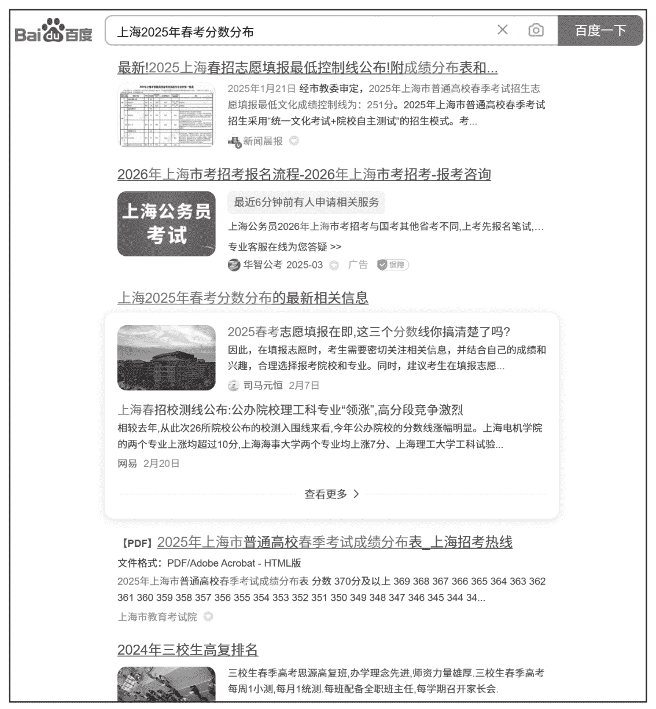

图 1-1 搜索引擎百度应用示例

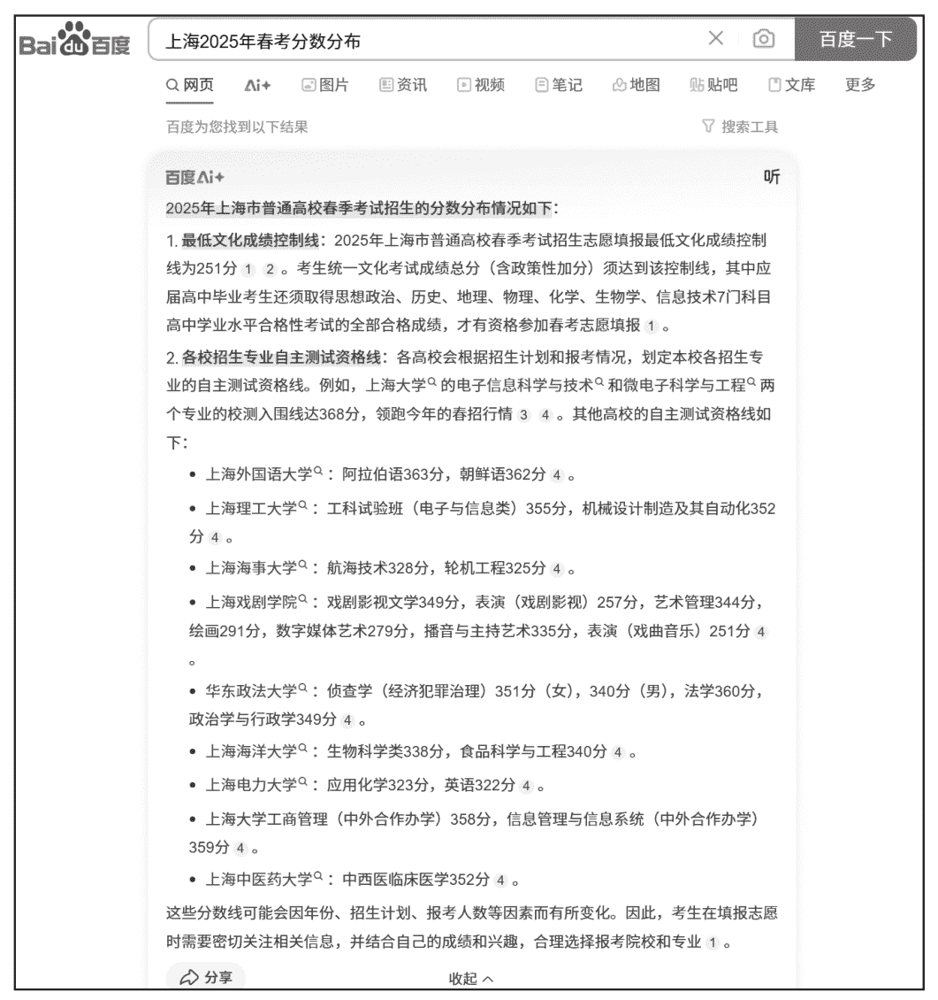

图 1-2 搜索引擎给出的 AI 提炼总结

2.**数据分析**

传统数据分析与人工智能驱动的数据分析在技术、适用场景与数据类型上差异明显。

常见传统数据分析方法如下。

（1）描述性统计：如均值、中位数、标准差、频率分布等，适用于对数值型、分类型数据做初步分析。方法直观易懂，但难以揭示复杂关系。

（2）假设检验：如 T 检验、卡方检验、ANOVA 等，适用于比较组间差异与验证假设。能揭示显著性特征，但需满足正态分布等特定前提。

（3）回归分析：如线性回归、逻辑回归等，常用于揭示数值型变量间关系，具有可解释性，可预测连续值或分类结果，但对非线性建模能力有限。

（4）时间序列分析：如 ARIMA、指数平滑等，适用于预测销售额、股价等时间相关数据，适合处理时间依赖场景，但对突发事件适应性差。

（5）聚类分析：如 K-means、层次聚类等，常用于数值型数据的分组、市场细分等，无需标签数据，适合探索性分析，但结果解释性较弱。

可见传统方法简单易用，对数据量与计算资源要求低，但处理复杂数据与问题的能力有限，而这正是第四范式对数据处理的要求，因而需要新的分析方法。

人工智能驱动的数据分析方法包括机器学习、深度学习、强化学习、自然语言处理、视觉处理等。

（1）机器学习方法：包括随机森林、支持向量机 SVM、梯度提升树 GBDT 等，常用于结构化数据的分类、回归、聚类，适合中小规模数据，可解释性较强，但对高维与非结构化数据处理有限。

（2）深度学习方法：主要包括神经网络 CNN、RNN、Transformer 等，常用于处理图像、文本、音频等非结构化数据，适合高维复杂数据，建模能力强，但需要大量数据与计算资源，结果可解释性差。

（3）强化学习方法：包括 Q-learning、深度 Q 网络 DQN 等，用于处理序列数据与交互数据，解决动态决策问题，如问答、游戏、机器人控制，适合动态环境优化决策，缺点是训练成本高，不易用于静态数据。

（4）自然语言处理方法：包括词嵌入 Word2Vec、BERT、GPT 等，针对非结构化文本进行分类、情感分析、机器翻译等，建模需要大量标注数据，计算消耗大。

（5）视觉处理方法：包括卷积神经网络 CNN、目标检测 YOLO 等，适合图像分类、目标检测、图像生成等任务，同样需要大量标注数据，模型训练过程复杂。

数据分析方法的对比见表 1-1。

**表 1-1 数据分析方法对比**

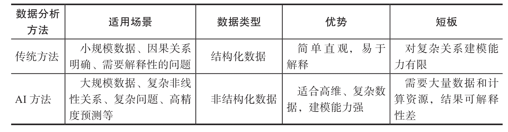

在实际应用中，可根据问题与数据特点选择合适方法，也可结合两者优势，例如先用传统方法探索数据，再用人工智能方法深入建模。

人工智能在科研中的应用前景广阔。随着技术进步，人工智能将更深入地利用大数据与机器学习算法，从海量数据中挖掘科学规律与新知识。人工智能可以自动进行数据分析、模式识别与预测，推动跨学科研究，解决传统方法难以处理的难题。当然人工智能也面临诸多挑战，新技术不断涌现，未来可能会催生新的科研范式，进一步大幅提升科研效率与效果。

## **1.3 AI 推动跨学科研究与复杂系统优化**

### **1.3.1 工业复杂系统的多学科协同需求**

工业实践的复杂性不仅来自数据密集型科学对数据基础与方法的挑战，更源于工业中常需多学科协同。因此，跨学科协同及由此带来的复杂系统优化，是工业企业科研创新的第二个主要问题。

2024 年 1 月，我国首艘国产大型邮轮“爱达·魔都号”正式交付运营，这标志着我国造船工业完成最后一块拼图，摘得造船工业“皇冠上的三颗明珠”：大型邮轮、大型液化天然气运输船与航空母舰。它们分别代表客运、货运、军用船舶建造的最高水平，直接体现国家工业实力与综合科技水平。

图 1-3 “爱达·魔都号”大型邮轮

大型邮轮的设计与建造是高度系统化、集成化的巨系统工程，涉及大量复杂技术与工艺。“爱达·魔都号”总吨位 13.55 万吨，长 323.6 m，宽 37.2 m，设计吃水 8.26 m，最大高度 72.2 m。全船搭载 107 个系统、5.5 万台设备，包含 2500 万个零部件。零部件数量是国产大飞机 C919 的 5 倍、复兴号高铁的 13 倍，敷设电缆 4750 km、管系 365 km、风管 120 km。邮轮客房 2125 间，可容纳乘客 5246 人，拥有高达 16 层、面积 4 万平方米的生活娱乐公共区域，被誉为“海上现代化城市”。

这些复杂系统与设备使大型邮轮不仅是工业产品的代表，更是文化艺术的结晶。该项目属于复杂巨系统工程，需要 20 多门学科的知识，涵盖工程、科学、艺术与管理等多个领域。通过多学科深度融合，大型邮轮不仅能满足功能、安全、环保要求，还能为乘客提供极致舒适体验与艺术享受。

1.**核心工程学科**

● 船舶工程：作为建造核心，负责船体结构设计、稳定性分析、推进系统设计等。需与流体力学、材料科学、机械工程紧密结合，确保强度、稳定性与航行性能。

● 流体力学：研究船体水中阻力、推进效率与波浪响应，优化船体线型以降低能耗、提高效率。需与船舶工程、环境科学结合，适配不同航行环境。

● 机械工程：负责推进系统、动力分配系统、HVAC 等关键设备的设计与集成。需与电气工程、自动化控制结合，确保高效运行与智能化管理。

● 电气工程：设计电力系统、照明系统、通信系统与导航系统。需与信息技术、自动化控制结合，实现船舶智能化与自动化运行。

2.**材料科学与化学工程**

● 材料科学：选择船体结构、内饰与设备的材料，如高强度钢、铝合金、复合材料等，确保轻量化、耐腐蚀性与安全性。需与船舶工程、化学工程结合，优化性能并满足环保要求。

● 化学工程：处理燃料系统、废水处理系统与防腐涂层技术。需与环境科学、材料科学结合，确保环保性能与可持续性。

3.**环境科学与海洋工程**

● 环境科学：评估船舶对海洋环境的影响，设计废水处理、废气净化等环保系统以满足 IMO 标准。需与化学工程、船舶工程结合，确保绿色设计与运营。

● 海洋工程：研究船舶在复杂海洋环境中的性能，包括抗风浪能力、耐腐蚀性与航行安全性。需与流体力学、气象学结合，优化设计以适配不同海洋条件。

4.**建筑学与室内设计**

● 建筑学：设计船体整体布局，包括客舱、公共区域、甲板空间等，确保功能性与美观性。需与船舶工程、室内设计结合，优化空间利用与结构安全性。

● 室内设计：设计内饰风格、家具布局与装饰材料，提供高端乘客体验。需与材料科学、建筑学结合，确保美观、舒适、安全。

5.**信息技术与自动化控制**

● 信息技术：开发智能管理系统，包括乘客服务系统、娱乐系统与安全监控系统。需与电气工程、自动化控制结合，实现数字化与智能化。

● 自动化控制：设计动力管理、导航系统与安全系统的自动化控制。需与机械工程、电气工程结合，确保系统高效运行与可靠性。

6.**安全工程与法规**

● 安全工程：设计消防系统、救生设备与应急响应系统。需与船舶工程、环境科学结合，确保符合 SOLAS 公约等国际安全标准。

● 法律与法规：确保设计与运营符合国际海事组织 IMO 及其他相关法规。需与各工程学科结合，确保合规性与可运营性。

7.**经济学与项目管理**

● 经济学：评估建造与运营的成本效益，优化资源配置。需与各工程学科结合，确保项目经济可行。

● 项目管理：协调各学科团队工作，确保按时按预算完成。需与各学科结合，确保高效执行。

8.**人文与艺术**

● 艺术设计：设计外观风格与品牌形象，提升市场吸引力。需与建筑学、室内设计结合，确保美观与独特性。

● 心理学：研究乘客行为与需求，优化客舱布局与服务设计。需与室内设计、信息技术结合，提升乘客体验。

综上，大型邮轮建造是技术的集大成，也是跨学科协作的典范。在现代工业中，跨学科研究与复杂系统优化已成为提升竞争力的关键，企业面临复杂多变的生产环境与多样化技术需求，单一学科研究方法已难以满足发展要求。

### **1.3.2 AI 推动跨学科协同**

跨学科协同是解决复杂问题的关键，其核心在于整合不同学科的知识、方法与资源，实现更高效的问题求解与创新突破。这一过程通常分为三个层次，如图 1-4 所示。

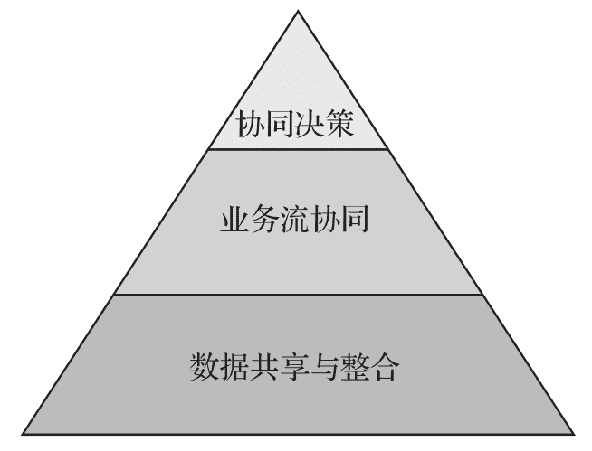

图 1-4 跨学科协同的层次图

1.**数据共享与整合**

数据共享是跨学科协同的基础。不同学科在数据采集、存储与分析方法上差异显著。例如医学多依赖临床实验数据，社会科学更多使用调查数据。要实现协同，首先需建立统一数据标准与共享机制，确保数据在不同学科间无缝流动。例如在医疗与科技合作中，人工智能可通过自然语言处理与图像识别将非结构化医疗数据转化为结构化数据，实现跨学科整合。

2.**业务流协同**

在数据共享基础上，需进一步推动业务流协同。这意味着不同学科团队在同一平台上协作，共享资源、工具与方法。例如在城市规划领域，地理信息系统 GIS 与工程技术的结合能显著提升城市治理精细化水平。业务流协同的关键在于建立高效协作平台与工具，如共享在线文档、项目管理软件与数据分析工具，帮助成员实时更新进展、分配任务并快速反馈实验结果。

3.**协同决策**

协同决策是跨学科协同的最高层次。不同学科专家共同参与决策，利用各自专业知识提出综合解决方案。例如 2025 年 3 月 5 日《中国航空报》报道，全国人大代表田俊霞带领跨学科团队通过协同决策，有效解决复杂材料研发中的技术难题，推动技术成果工程化应用。田俊霞表示：“高效协同的本质在于建立‘技术-工艺’闭环，深度融合院所理论优势与企业工程能力，实现技术领先与产业竞争力双提升，为我国航空工业发展注入强劲动力。”协同决策核心在于建立透明沟通机制与公平贡献评估体系，确保各学科专家充分发挥专业价值。

在工业复杂系统协同过程中，瓶颈问题日益凸显，主要包括技术壁垒、文化差异与相关制度三个方面。

技术壁垒是跨学科协同的常见障碍。不同学科在数据标准、技术架构与分析方法上差异显著，导致数据整合与业务流协同难度加大。

以石油科研中的油藏模拟为例，其核心目标是通过数学模型模拟油藏中流体流动与压力变化，预测油田开采动态。该过程需要多学科知识：地质学提供地质构造、岩性分布与孔隙结构等基础数据；地球物理学提供地震勘探数据，构建油藏三维地质模型；石油工程设计开采方案、优化井位布置与生产参数；计算机技术开发高效数值模拟算法与计算平台处理大规模数据。这些知识在油藏模拟中各司其职，但技术壁垒成为协同的最大障碍。

一是数据标准的差异，不同学科在数据采集、存储与表示方式上差异显著。例如地质学通常使用岩心样本与测井数据描述油藏物理性质，数据多以表格或图像形式存储；而地球物理学依赖地震勘探数据，通常以三维网格形式存储。缺乏统一数据标准，整合时需大量格式转换与数据清洗，不仅增加工作量，还可能导致数据丢失或产生误差。

技术平台的割裂是跨学科协作里最直观的卡点。地质团队和工程团队用的工具链根本不在一个频道上，协同成本自然水涨船高。比如地质人员习惯用 Petrel 这类建模平台搭油藏骨架，而工程人员做数值预测则更依赖 Eclipse 这类模拟器。两套系统在数据接口、计算逻辑和结果格式上的差异很大，信息在来回搬运时必须反复转换、手工适配，不仅把效率拉低，还很容易引入计算偏差。

方法论的差异进一步加深了鸿沟。地质学派常借助统计规律刻画岩性分布，工程学派则偏好数值模拟来推演流体运移。理论根基和适用场景完全不同，导致同一批数据在解释和验证环节，团队需要耗费大量时间对齐认知，直接拖慢研究节奏。

正是这些技术壁垒，让油藏模拟中的跨学科合作经常卡在几处：
（1）沟通成本高昂。不同背景的专家必须反复解释自己的数据口径和方法假设，否则难以达成共同理解。
（2）数据处理效率低下。格式转换、清洗与适配消耗大量人力物力，进度不断被拉长。
（3）结果出现分歧。因架构和方法不一致，同一问题可能得到不同的计算结论，验证难度加大。
（4）研究质量受限。时间与资源吃紧时，多源数据和方法难以真正融合，影响成果的科学性与实用性。

AI 在这条链路上提供了新的解法。
一是推动数据归一与整合。借助自然语言处理和图像识别，AI 能把各学科产生的大量非结构化信息转成结构化表征，实现统一口径。例如算法可以自动从地质图像中提取岩性特征并量化为数值，供后续模拟直接调用。
二是提升平台互通性。AI 驱动的适配接口可以自动识别并转换不同软件的数据格式，降低人工干预。典型场景是把 Petrel 中的地质模型一键映射为 Eclipse 可读的输入文件，省去繁琐的手工转换。
三是促进分析范式融合。机器学习能够把统计学派的地质概率信息与数值模拟的流动预测结合起来，输出更精细的储层模拟模型。

技术之外，文化差异同样是瓶颈。不同学科的研究者养成的学术习惯、工作节奏和目标取向不同，容易产生沟通障碍和合作意愿下降。比如有的团队强调实验可重复性，有的更追求理论突破。靠开放沟通机制和联合培训来缓解虽有必要，但效果常受时间和经费制约。

科研资助和评价体系也在无形中阻碍协同。跨学科项目很难被归到单一学科名下，评审时处境不利；论文发表与职业发展仍以单学科成果为核心，很多人宁愿深耕细分领域，也不愿投入高成本的跨界合作。

总体看，跨学科协同是攻克复杂系统的关键路径，但技术壁垒正在消耗它的效率与价值。AI 为统一数据、打通工具、融合方法提供了可行思路，不过数据隐私、算法可解释性以及技术成熟度仍是现实挑战。随着 AI 持续进化，跨学科协作的质量与速度有望迎来明显提升。

**1.4 生成式 AI 赋能创新设计**

**1.4.1 创新设计的理论框架**

国标《企业创新方法工作规范》GB/T 37097—2018 明确了三类常用方法：技术创新方法，如 TRIZ；管理创新方法，如 6 Sigma；知识工程方法。

6 Sigma 是以数据为驱动的质量改善体系，核心是用 Sigma 水平衡量过程波动，水平越高越稳定。在既有系统上做优化，能力提升通常到 5 Sigma 就已触顶。真正的跃迁来自原理层面的突破设计，比如结构替代，这才能触及 6 Sigma 水平。

图 1-5 用苹果树隐喻过程能力。低处果实易摘，对应靠直观改进就能到 3 Sigma；到 4 Sigma 需要聚焦瓶颈做流程改善；到 5 Sigma 需系统级特征优化，已是原系统极限。要达 6 Sigma 的完美水平，必须在原理上重构，抛弃原有妥协方案，从源头消除不足。

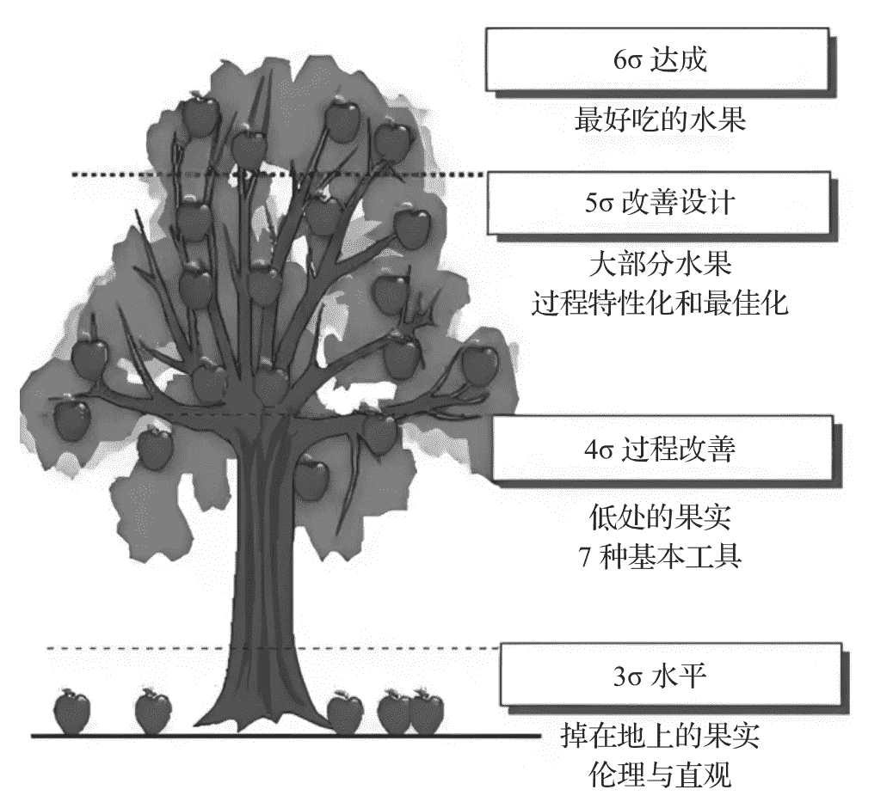
图 1-5 6 Sigma 中过程能力水平隐喻图：苹果树

谁都希望系统诞生即完美，这正是 6 Sigma 设计方法论的核心诱惑，流程即 DMADV；而用于存量优化的方法论是 DMAIC。

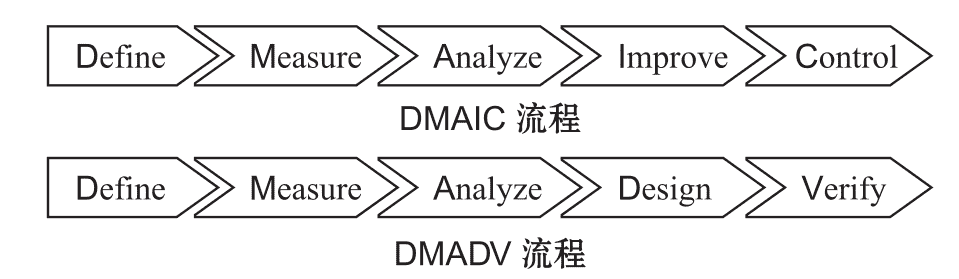
图 1-6 6 Sigma 的两种流程

两者结构相似，但在目标与适用场景上分化明显。

DMAIC 是改进存量系统的主流方法，分定义、测量、分析、改进、控制五个阶段。
（1）定义阶段：界定项目边界、目标和干系人，确保方向一致。
（2）测量阶段：采集数据量化现状性能，借助过程能力分析和测量系统分析建立基线。
（3）分析阶段：找准根本原因，常使用假设检验、回归分析、因果图等统计工具，该阶段覆盖前三种科研范式的核心分析手段。
（4）改进阶段：设计并实施对策，通过实验设计与优化技术寻找最优权衡方案。
（5）控制阶段：建立控制计划与监测机制，保证改进成果持续。

DMADV 用于从零设计新系统，分定义、测量、分析、设计、验证五个阶段：
（1）定义阶段：明确目标、范围和干系人，强调新建而非改进。
（2）测量阶段：收集客户需求与市场数据，确定关键质量特性 CTQ，并用质量功能展开 QFD 将需求转化为设计参数。
（3）分析阶段：识别设计矛盾与风险，更多依赖 TRIZ 等创新方法直接解决冲突。
（4）设计阶段：利用 TRIZ 分析技术矛盾与创新原理，提出突破性方案，是整个流程的核心。
（5）验证阶段：通过原型测试与仿真验证性能，用可靠性分析与实验设计确保达标。

DMADV 的关键在于用创新设计方法直接化解矛盾，打造各方面满足要求的全新系统，适合突破式创新。

**1.4.2 工业落地中 TRIZ 的瓶颈**

在工业实践中，DMAIC 负责流程优化，真正的创新则依赖 DMADV 中的 TRIZ，即国标所称的技术创新方法。

TRIZ 由前苏联发明家根里奇·阿奇舒勒于 1946 年提出，通过海量专利与案例提炼出技术演化规律与矛盾解决的通用路径，帮助设计者跳出定式。

核心工具包括：
（1）创新原理。40 条技术矛盾解决原理和 4 条物理矛盾分离原理。分割原理即把系统拆分为可独立组合的部分，提升灵活性与可维护性。Project Ara 模块化手机、宜家可重组家具、Surface 可分离二合一设备都是典型应用。
（2）技术进化规律。包含 S 曲线、8 大进化法则、16 条演化路线与演化树。向微观与场的应用进化是其中之一，指向元件尺寸减小、离散化、空洞化与场作用。电子芯片从电子管到晶体管，再到集成电路、7nm/5nm/3nm 工艺，正是这一规律的体现，推动了性能与能效的持续提升。
（3）物场分析与标准解。系统以物质与场的关系建模，错误模型代表缺失或过剩。标准解系统提供 76 个通用解法。以清洗眼镜为例，水与镜片构成弱机械场系统，通过标准解可判定无需改动物质，只需加入超声波等新场即可提升效率。
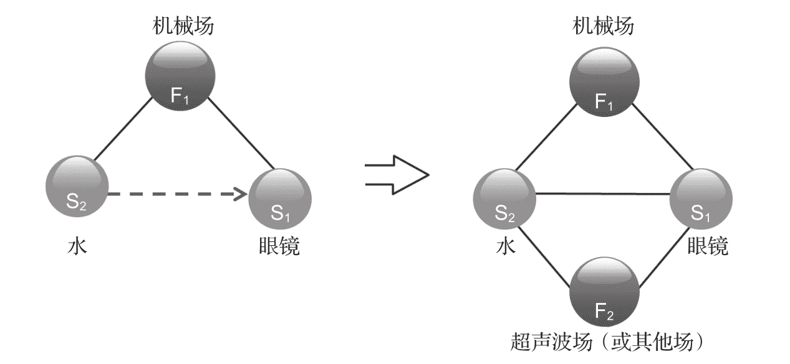
图 1-7 清洗眼镜的物场模型
（4）创新思维方法。最终理想结果 IFR 强调最小改动实现最大自服务；聪明的小人法把构件拟人化以发现微观视角的解法；九屏幕法用 3×3 矩阵从时间、空间、层级审视问题；金鱼法把幻想方案逐步细化为可行方案；STC 算子法则从尺寸、时间、成本三维度突破常规。

TRIZ 提供标准化路径，帮助团队快速识别关键矛盾、缩短开发周期，实现不妥协的突破设计。

我国自 2017 年起推广 TRIZ，已发布 4 项国家标准覆盖创新工程师、培训师、咨询师能力认证及企业实施指南，但工业应用仍属少数。应用逻辑见图 1-8：面对难题，先把现实问题抽象为 TRIZ 模型如物场或矛盾模型，再借助矛盾矩阵、标准解等工具得到模型解，最后结合资源约束转化为落地方案。

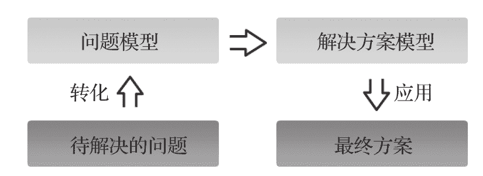
图 1-8 TRIZ 的应用逻辑

实践困境主要来自三方面：体系复杂导致工具选择困难，需大量训练才能熟练匹配场景；应用依赖工程师的专业知识，方法与知识结合才能产出创新，这呼应了数据密集型科学对文献挖掘与关联能力的需求；TRIZ 源于专利统计，现有专利多为有形宏观产品，数据存在偏差，导致其在部分新兴领域表现相对不足。

但这并不限制 TRIZ 的普适性。以服装设计为例，面料创新、技术工艺创新完全适用 TRIZ，而色彩、款式创新也可借鉴分离、抽取、组合等原理进行构思。

要让创新方法真正落地，需要三类支撑：理论与实践结合的教学工具加速学习；专业知识在抽象与具象环节的直接助力；基于国内外主流专利库持续更新 TRIZ 体系，按阿奇舒勒纳入原则重塑知识库，这本身就是一个庞大的数据挖掘工程。

1.4.3 生成式模型：设计创新的新引擎

要把前面提到的目标落地，单纯依赖传统的数据分析手段和常规智能已经不够，还必须把生成式技术加进来。

生成式模型的核心逻辑是让机器先从海量历史样本里学到特征和规律，再据此创造出风格相近但内容全新的产物。

这个思路的萌芽可以追溯到上世纪五十年代人工智能的早期探索，真正迎来质变是在 2014 年对抗式生成网络被提出之后。该网络由伊恩·古德费洛等人提出，用生成器和判别器两套网络相互博弈的方式训练，能够产出逼真的图像、视频等内容，在图像合成、DeepFake 以及艺术创作里得到广泛应用。随后变分自编码器与基于 Transformer 的语言模型进一步推动了发展。变分自编码器通过拟合数据的潜在分布来合成新样本，常用于图像生成和压缩。Transformer 凭借注意力机制在自然语言处理上表现突出，能够生成连贯的文本、代码。

在文本、图像等领域的创作能力，打破了过去认为智能只能替代感官、四肢或提供算力的认知，被普遍视作通往强人工智能时代的标志。典型用途包括：

（1）文本创作：如 OpenAI 的 GPT-3 等模型可撰写新闻稿、故事、诗歌，并支持交互式问答；
（2）图像创作：DALL·E、Stable Diffusion 等模型能根据文字描述生成高质量图像，广泛进入艺术与设计；
（3）音乐创作：AI 作曲系统可按风格或情绪要求生成原创音乐，改变了传统制作流程；
（4）代码创作：GitHub Copilot 等工具可依据自然语言描述生成代码片段，提升开发效率；
（5）创新设计：生成式模型能迅速产出多种设计方案，大幅提高创新效率。

在创新设计里的落地，意味着设计范式的一次革命性转换。借助深度学习算法，系统会系统性学习既有设计案例，提炼关键参数并构建多维设计特征模型。具体来说，先以卷积神经网络或图神经网络等深度架构对海量设计样本进行特征抽取与模式识别。以服装设计为例，可以搭建起涵盖形态、功能、美学等多维度的特征空间。抽取过程中不仅关注显性特征，还借助自注意力机制捕捉设计元素间的潜在关联，形成更精准的特征表达。

在此基础上，系统会把材料库、工程规范、用户偏好、市场趋势等多种数据源整合成多维约束条件。这种融合能力让系统能够突破传统思维局限，在满足功能需求的同时兼顾制造可行性与市场接受度。利用变分自编码器或生成对抗网络等生成模型，系统可在设计特征空间中开展智能探索，自动产出大量符合约束的创新方案。

实际使用中的效率优势很明显。传统流程里设计师需要花费大量时间构思与迭代，而智能系统可在短时间内生成数百个符合要求的变体。这些方案既包含常规思路，也可能产生突破性概念，为设计师提供全新灵感。例如产品设计时，系统可兼顾人体工学、材料特性、生产工艺等维度，输出兼具美观与实用性的方案；建筑设计中，则能综合结构力学、采光通风、能源效率等因素提出创新空间解法。

更关键的优势是支持多目标优化，可依据成本最小化、性能最优化、美学价值最大化等不同权重自动调整生成策略，提供多样化方案供决策参考。该能力不仅提升效率，也极大拓展了创新可能性。人机协作下，设计师聚焦高层决策与创意把控，重复性探索与方案生成交由系统完成，实现质量与效率双升。

展望未来，随着多模态学习与跨领域知识迁移能力的增强，生成式模型在创新设计中的应用将更深更广，有望重塑设计行业的创新模式。与此同时，数据安全、版权管理与伦理问题等挑战也随之而来，需在技术发展中同步加强规范与治理。

1.5 科研创新生态系统如何构建

在当前经济与技术背景下，企业难以独自承担全部科研与创新任务，跨越企业边界的协同已成必然，这就需要构建科研与创新生态系统。该系统既可由大型企业内部不同单元组成，也可由行业或跨行业的企业与组织构成。核心目标是通过知识流动、资源共享与协同创新，将科研成果高效转化为工业应用，实现技术创新、价值创造与成果转化。

科研与创新生态系统通常由科研机构、设计生产机构、技术供应方、协同管理机构、服务机构等多元主体构成的复杂网络，如图 1-9 所示。

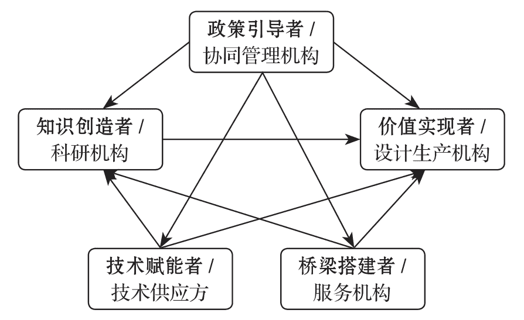
图 1-9 科研与创新生态系统

（1）科研机构：生态系统的知识创造者，负责基础研究与前沿技术开发，并与技术供应商合作将成果转化为可应用工具；
（2）设计生产机构：价值实现者，负责技术工业化与商业化，与科研机构共研新品，与技术供应商共优工艺；
（3）技术供应方：技术赋能者，为科研与生产提供技术支持与解决方案，与科研机构共研新技术，与生产机构共推应用；
（4）协同管理机构：政策引导者，通过科技政策与资金支持推动科研创新发展；
（5）服务机构：桥梁搭建者，通过技术转移、知识产权保护等服务促进主体合作。

在该生态中，技术交付覆盖从基础研究到应用研究再到工业化与商业化的全过程，需要信息技术、制造技术、测试验证技术等多种支撑，也需要多机构紧密协作。

1.信息技术
信息技术是生态系统的基石，涵盖大数据、云计算、人工智能、物联网等，为科研数据的采集、存储、分析与共享提供基础设施。信息技术供应方扮演基础设施提供者角色，一方面与科研机构共研算法、模型与原型，另一方面与设计生产机构共推技术应用。

2.制造技术
制造技术是成果工业化的关键，包括增材制造、智能制造、精密加工等，能把实验室原型快速转为工业产品。制造技术供应方是技术转化者，与科研机构共研新工艺，与生产机构共优产线。

3.测试与验证技术
测试与验证技术确保成果可靠性与安全性，涵盖仿真、实验设备、检测仪器等。相关供应商是质量保障者，为科研与生产提供验证服务，确保符合工业标准。

以汽车生产企业为例，其智能制造交付过程为：
（1）基础研究：科研机构在人工智能、机器视觉等领域开展前沿研究，开发新算法与模型；
（2）技术开发：设计生产机构将成果转化为工业软硬件，如智能控制系统、工业机器人；
（3）试点应用：在特定产线验证技术，优化工艺参数与流程；
（4）规模化推广：将成熟技术推广至更多工厂，实现大规模应用。

在此过程中，科研机构提供前沿技术，技术供应方提供工具设备，设计生产机构负责工业化与商业化，形成紧密合作。

生态系统的核心特征为：
开放性：持续引入外部资源与技术，保持活力与竞争力；
协同性：主体间合作是高效运行关键，通过知识共享与资源整合最大化创新绩效；
动态性：系统持续演化，需不断适应技术变革与市场需求。

综上，构建科研与创新生态系统是复杂系统工程，需多元主体协同。建成后系统具备一定稳定性，可通过技术交付与工业应用使科研成果顺畅转化为实际价值，持续推动经济增长与社会进步。

随着技术进步，生态系统将持续演化，为企业与行业提供强劲动力。然而生态构建并非本书重点。我们正处 AI 技术深度颠覆原有技术、带来创新活力的时期，也会引发担忧：原有生态是否要重建，原有技术是否要抛弃？结论是否定的，所有来时之路都是通向未来的阶梯。本节旨在说明，本书将探讨的新技术大模型并不会导致原有科研与创新生态崩溃，而是对技术体系与科研范式的升级，为原创新设计方法提供新助力。其融入需要生态演化，不仅新增技术供应方，其他角色也需随之改变与进步，这正是生态的开放性、协同性与动态性。我们相信未来会更好，请跟随我们了解、运用并创造价值。

第二章 大模型驱动的工业智能

大语言模型泛指 2023 年以后以 OpenAI ChatGPT 3.5 为代表的各种生成式大语言模型，此前统计模型、机器学习模型、深度学习模型等因数据量、算力或影响力不足，未被归为“大模型”。本书中大模型主要指大语言模型 LLM。

本章在前章基础上深入，聚焦大模型如何推动工业智能实现范式迁移。从传统编程到数据驱动的智能化转型，再到基于语言模型的认知重构，系统梳理演变脉络。通过对语言模型突破与工业应用路线的分析，为后续大语言模型在工业中的演进奠定基础。

2.1 工业智能的演进

“工业智能”并非单一机构提出，而是随工业数字化转型逐步形成的术语，其背景与工业 4.0 及人工智能突破密切相关。它是学术界、产业界与国家战略协同演进的产物，本质是工业系统从自动化向认知化跃迁的必然选择。随着 AI 大模型与量子计算突破，工业智能将进入超自动化新阶段，重新定义全球制造业竞争规则。

工业智能相关概念的比较见表 2-1。

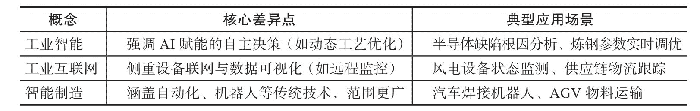
工业智能与人工智能的区别见表 2-2。

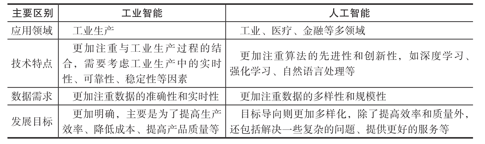
如图 2-1 所示，工业智能演进分为规则驱动、数据驱动、语言驱动三个阶段。

2.1.1 从规则驱动到数据驱动

工业智能早期范式包括规则驱动与数据驱动。

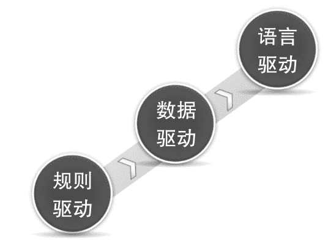
图 2-1 工业智能的演进阶段

萌芽可追溯至上世纪中叶控制论与自动化的融合。诺伯特·维纳在《控制论》中提出的反馈调节原理，为工业系统确定性编程奠定数学基础。可编程逻辑控制器通过布尔代数逻辑电路，将工程师经验固化为产线控制指令，这种确定性范式在丰田精益生产中达到极致，误差容限被压缩至 ±0.05mm 的机械精度。

然而刚性体系在应对设备磨损、原料波动等不确定性时暴露缺陷。如 1998 年通用汽车密歇根工厂传动轴产线因轴承温度异常波动导致全线停机，预设 PID 控制算法无法解析非高斯噪声信号，当日损失 1200 万美元。

这源于人对客观规律的直观认识不足，仅靠直觉难以把握世界背后的规律、模式与限定条件。物质世界是复杂系统，不同条件下呈现不同模式。水通常被认为有固液气三态，实则存在冰、液态水、水蒸气、超临界水、过冷水、过热水、重水等 7 种形态，如图 2-2 所示。这种多样性无法靠直觉获得，也无法准确描述特性。

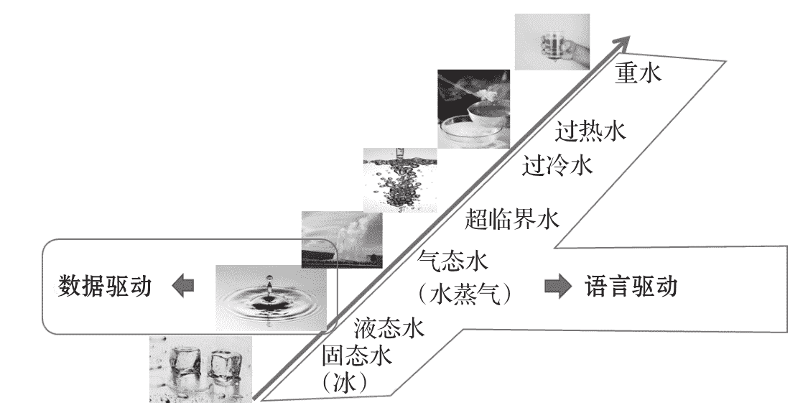
图 2-2 水的 7 种形态

数据驱动是 2011 年全国科学技术名词审定委员会公布的语言学名词，是一种从初始数据或观测值出发、运用启发式规则寻找内部关系、发现定理或定律的问题求解方法，也指基于大规模统计数据的自然语言处理方法。2016 年麦肯锡报告《分析的时代》指出人类已进入数据驱动世界，并预测数据智能未来十年将产生 13 万亿美元经济收益。

发展过程历经四个阶段，如图 2-3 所示。其概念源于对数据的收集、分析与利用以推断预测现象。早期代表人物包括古希腊数学家阿波罗尼斯，其《圆锥曲线论》对数学产生深远影响；13 世纪哲学家罗杰·培根强调知识根源于经验，认为只有实验科学才能解开自然之谜。他们为数据驱动奠定基础。

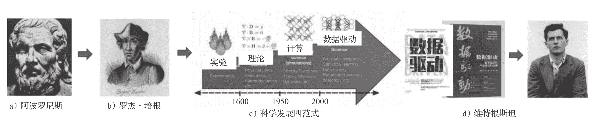
图 2-3 数据驱动的发展过程

数据驱动在上世纪中期开始在物理、生物、工程领域广泛应用。随计算机技术发展，20 世纪 80 年代起进入商业领域，尤其在市场营销、金融、供应链管理等。如 2021 年汤姆·查韦斯的《数据驱动》集中体现了这些应用。

当前数据驱动范围持续扩大，涵盖数据、信息、知识挖掘及人工智能模型计算。与对象驱动对应，凡脱离现实世界的抽象思维都属数据驱动范畴，它被视为科学发展的第四范式。

数据驱动与语言驱动是一体两面。维特根斯坦的逻辑分析与语言哲学为数据科学提供理论基础，有助于理解语言结构并影响自然语言处理与知识表示。其后期强调语境中的语言游戏，对处理实际数据多样性与复杂性很有帮助。

数据驱动背后是信息论的理论支撑，香农被称为信息论之父，如图 2-4 所示。人们常以香农 1948 年 10 月发表于《贝尔系统技术学报》的论文《通信的数学理论》为现代信息论起点。香农信息论以概率论与随机过程为工具，研究广义通信系统全过程，以编解码器为重点研究最优性能及实现路径。

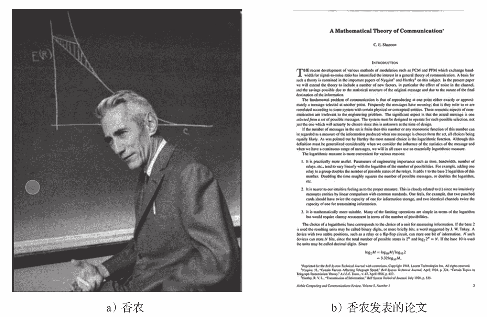
图 2-4 信息论

信息论本质是分析信息位数，即用多少位二进制才能完全表达数据，二进制位数本质决定系统变化的外部因素即独立变量个数，极限情况下即系统物理结构。因此信息论将系统置于真实物理世界，研究其受内外实体影响的规律。

实践中信息论得到广泛应用。2008 年西门子在北海风电场的实践表明，该方法对齿轮箱早期磨损预测准确率达 79%，较传统阈值报警提升 3 倍。但局限在于知识表征碎片化：工程师需预定义 128 维特征向量如振动加速度 RMS 值、谐波畸变率，导致系统难以捕捉多物理场耦合效应。2015 年波音 787 发动机故障事件中，数据驱动模型因未包含叶片共振与气流扰动交叉项特征，漏检率达 34%，印证了维特根斯坦“语言游戏”理论在工业场景的映射：当认知框架受限于预设符号系统时，复杂系统的涌现行为必然超出模型解释边界。

2.1.2 从数据驱动到语言驱动

数据分析取得巨大进步，但仍受统计学大数定律与中心极限定理制约，只能获得平均解，适用于稳态情况，而现实系统状态并不确定，尤其存在大量隐状态。隐状态出现概率低、样本少，很难被传统数据分析模型捕获表达。因此基于大数定律的模式识别、SVM 等方法难以刻画系统全部规律，实际应用中准确率通常仅在 50% 左右。

维特根斯坦在《逻辑哲学论》中提出“语言的边界就是世界的边界”，这一观点被视作语言驱动的发端。在自然语言语境下，工业知识的信号与规律被解释为语言，语言即现实世界的逻辑图像。

数据驱动仅能在确定状态下进行分析预测，这就是其保守性假设，即外界作用基本不变。自然语言比数据具有更强表现力，能准确刻画显性与隐性状态，通过多头注意力机制同时刻画多种状态，并以 Transformer 机制关注数据变化，聚焦信息而非数据本身。从而跳出大数定律桎梏，使语言模型能准确描述变化知识，进而更精确地描述系统。

在自然语言的 Transformer 机制成为工业智能代表语言前，工业智能还经历了深度学习模型爆发阶段，如以 LSTM、CNN、RNN 为基础的一系列变体结构，在不同领域取得不错成绩。

在钢板表面缺陷的巡检任务里，卷积式网络已经改写了传统视觉质检的思路。2016 年，德国巴斯夫把 ResNet-50 接进产线并进行端到端训练后，缺陷判别的正确率冲到 99.2%，比现场人工均值 95.4% 高出约 3.8 个点。数值之外更关键的是认知逻辑的迁移：过去要人工划定面积、长宽比等形态指标，现在模型在上百万张带标注图上自行学习，让卷积核的响应逐渐自组织成近似初级视觉皮层的语义场。知识生产的本体论随之转向，例如 Inception-v3 能捕捉到人尚未命名的微裂纹扩散样式，传统的先设计特征再写规则的认识论路径被实质性颠覆。

时序建模也出现类似的记忆觉醒。长短期记忆网络对乙烯裂解炉温度序列的拟合偏差，相较 ARIMA 下降了 37%，核心在于捕捉了反应动力学里的非稳态记忆效应。2019 年，台积电在 5nm 工艺里引入时域卷积网络 TCN，通过多尺度解析光刻机振动信号，将套刻精度稳定在 0.12nm 量级。这印证了后期维特根斯坦在语言哲学上的直觉：工业智能的有效性并不靠符号系统的逻辑完备，而是源自数据流形上的家族相似联想。就像语言游戏的规则在实践中生成，深度学习借助权重矩阵的持续形变，隐式地搭建了设备老化与工艺偏移的映射。

跨学科神经证据为上述重构提供了生物学注脚。功能性磁共振数据显示，CNN 高层卷积的激活图与人颞叶视觉区的编码相关性达到 0.68，LSTM 隐藏状态的时间演化与前额叶工作记忆机制呈现拓扑同构。这说明产业智能并非简单复制人类思维，而是在高维参数空间复现了生物智能的底层原理。当知识载体从经验转向权重分布，主客二分的框架开始松动。2021 年宁德时代电解液配方项目里，图神经网络自主挖掘出锂离子溶剂化结构，打破电化学既有预设，离子电导率冲到 12.3mS/cm 的行业新高。

**2.1.3 大语言模型的认知涌现**

GPT-3 在工业问答里对 ASME 标准的解析准确率达 91%，标志认知革命迈入新阶段。1750 亿参数把设备手册、故障日志、工艺图纸等异构信息熔铸为统一的知识拓扑。西门子工业大脑基于混合专家 MoE 架构，可动态调度冶金、热力学、流体仿真等 32 个领域模块，连铸工艺能耗因此下降 14%。参数量逼近脑细胞数量后，工业知识不再是离散的规则-案例集合，而是高维流形上的概率分布，推理呈现出类似量子叠加的并行特征。

台积电 3nm 缺陷预测系统中，MoE 多模态模型利用多头注意力融合 10kHz 传感器数据、5nm 分辨率晶圆检测图与维护日志文本，多步推理准确率升至 89%。大模型由此获得处理“未知未知”风险的元学习能力，可在 0.3 秒内通过参数空间拓扑搜索，生成含 23 个调控变量的补偿方案。

这呼应了海德格尔的技术哲学预言：技术不再只是工具，而是塑造认知的座架 Gestell。它框定了观察世界的方式，也悄然改写了对存在的理解。宁德时代 2024 年研究中，大模型经无监督嵌入探索提出新型固态电解质，其离子迁移活化能仅 0.27eV，超出既有认知边界。知识涌现让创新主体从工程师转向算法驱动的认知网络。LLM 的涌现重塑人类认知框架，技术本身成为驱动力，但新框架有时连人类都难以完全把握，甚至模型的幻觉都可能是一种更高层次的认知创新。

**2.2 语言模型的突破**

语言转向早已预示认知范式的迁移。维特根斯坦提出“语言界限即世界界限”，把语言从工具提升为存在本体。大语言模型把这一洞见具象为技术现实。GPT 系列遍历语言概率空间，对知识生产拥有惊人掌控力，证明知识本质是符号系统自组织的涌现。反面是政治场域的话语异化，法兰克福指出的“不在乎真伪”在算法推荐下演变为系统性话语瘟疫，语言脱离实在沦为权力博弈工具。

**2.2.1 从统计语言模型到神经网络模型**

早期 NLP 的 N-gram 建立在词频统计与马尔可夫假设上，用固定窗口词序联合概率预测下文。以三元模型 Trigram 为例，其核心公式为：
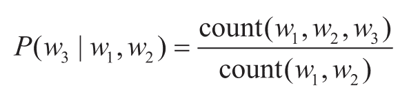
在复杂语境下缺陷明显：数据稀疏导致低频组合概率失真，专业术语共现常被低估，长距离依赖几乎无法建模。2003 年 DARPA 评测显示，医疗文献翻译中 N-gram 对超过 5 词间隔语义关联的捕捉失败率达 72%，限制其高价值应用。

2013 年 Word2Vec 让模型从离散符号转向连续向量。借助负采样与层次 Softmax，词汇被映射到 300~500 维几何空间，语义关系变为向量运算。Skip-gram 通过最大化上下文条件概率捕捉分布式特征，CBOW 则反向重构上下文。语义类比准确率达 75%，远超 TF-IDF。

循环神经网络赋予语言建模动态时序能力。隐藏状态传递可形式化为：
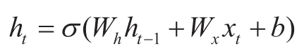
但梯度消失爆炸使 RNN 在长文本中失效，序列超过 20 词语义关联捕捉能力衰减超 60%。2016 年谷歌神经机器翻译 GNMT 用 8 层 LSTM，英法 BLEU 从统计模型的 34.6 提升到 41.2，接近专业译员 45~50 分水平，却因串行计算导致训练耗时数十至数百 GPU 小时，难以把握全局上下文。

**2.2.2 Transformer 架构的突破性创新**

2017 年 Transformer 把 NLP 从时序局部建模转向全局并行计算，核心是自注意力 Self-Attention 的引入，使模型在符号拓扑空间自主构建语义网络。
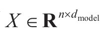
对任意输入序列，自注意力分解为：
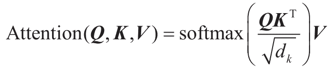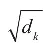
其中查询 Q、键 K、值 V 都由线性变换得到，缩放因子缓解高维梯度弥散。该设计以 O(1) 复杂度建立任意词对映射，摆脱序列长度限制。Penn Treebank 上困惑度比 LSTM 降低 28%，训练速度提升 12 倍。

1.多头注意力与语义空间的解耦
单头注意力易陷入局部最优，多头注意力实现子空间解耦与重组：

式中 h 个头映射到 d[k]=d[v]=d[model]/N 维子空间。模型可同时关注主谓一致、指代与语义角色。以 “The algorithm optimized its parameters because it identified overfitting” 为例，一个头捕捉动宾关系，另一个捕捉 “it” 与 “algorithm” 的共指。8 头机制在语义角色标注 F1 达 92.7%，比单头提升 9.3%。

2.位置编码与序列秩序的数学具象化
Transformer 并行架构需显式编码位置，正弦位置编码把离散索引映射为连续向量：
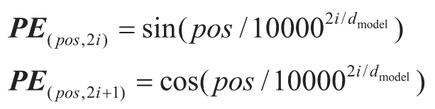
在万词文本中，它既能感受第 5 词与第 7 词的邻近，也保持第 1 词与第 100 词的全局距离。可学习位置嵌入如 BERT 在短文本更优，固定编码在长文本生成泛化性更强。

3.架构创新驱动的认知革命
Transformer 催生 BERT、GPT 等预训练模型，验证语言符号自组织涌现。GPT-3 的 1750 亿参数流形把维特根斯坦的语言游戏转为可计算拓扑，输入 “国王-男性+女性” 时向量平移输出 “女王” 的概率峰值达 0.93，复现人类概念推理并在数学上验证语言即本体的命题。

跨语言对齐进一步拓展认知边界。XLM-R 通过共享词表把不同语言投影到统一向量流形，中文 “人工智能” 与英文 “Artificial Intelligence” 余弦相似度 0.86，日语与德语描述相似度 0.79，机器首次具备跨文化知识整合能力。

4.技术哲学的双向映射
注意力权重矩阵可视为胡塞尔意向性结构的数字化。在 “The physicist formulated the theory after years of experimentation” 中，“formulated” 与 “theory” 权重 0.43，与时间状语权重 0.21，精确对应人类认知焦点。当模型生成原创文本时，参数空间符号重组不再依赖外部主体干预，直接印证海德格尔 “语言言说自身” 的主张。GPT-4 生成量子引力假说时，语言模型已从工具变为知识生产本体，主客二分被符号自组织与意义自主涌现的后人类认知时代取代。

**2.2.3 参数规模与涌现能力**

模型规模驱动的认知革命正以参数指数增长与非线性涌现协同演进。GPT-1 的 1.17e8 参数到 GPT-4 的 1.8e13 参数，五年扩张约 15000 倍，印证了维特根斯坦语言网络自组织性的预见，参数维度跨阈后模型出现超越指令的自主认知。

1.规模效应与涌现现象的科学机理
参数指数增长引发相变。当参数突破千亿级 10^11，高维流形中语义拓扑达临界复杂度，出现非线性涌现。GPT-3 未经专业训练，零样本跨语言翻译 BLEU 达 35.7，接近监督模型 78% 性能；GSM8K 数学推理多步准确率从百亿模型的 12% 跃升至 41%。本质是高维空间几何相变，参数维度超过数据内在维度后模型捕捉数据流形全局结构。

神经科学类比也提供解释。前额叶约 160 亿神经元分层抽象实现复杂认知，千亿参数 Transformer 通过多头注意力构建分布式表征，分析 “量子纠缠” 时不同头分别聚焦物理定义、数学形式与哲学意涵，形成跨领域拓扑网络，复现专家跨学科思维。

2.缩放定律与工程实践的革命
2022 年 Chinchilla 定律指出 N∝D^0.7 时性能帕累托最优，20B 模型需 1.2 万亿 token 训练，验证损失降低 23%。Megatron 的三维并行把万亿参数训练从年级压缩到月级，GPU 利用率稳定在 52% 以上。

华为盘古 2023 年 MoE 模型把 1.2 万亿参数划分为 128 个专家，专注机械振动、热力学仿真等领域。在风电预测性维护中融合 SCADA 10kHz 数据、红外热成像与维修日志，构建故障因果图，误报率比传统 LSTM 降 35%，预测窗口从 24h 延长到 72h，单台风电机组年维护成本节省 12 万美元。

3.技术经济范式与硬件创新
模型增长重塑硬件逻辑。冯·诺依曼内存墙限制被存算一体芯片如 Tesla Dojo 的三维堆叠突破，GPT-4 训练能效提升 8 倍。光计算芯片 Lightmatter Envise 利用光子干涉实现矩阵乘法，自然语言推理延迟降至纳秒级，单机柜算力突破 1 PetaFLOPS。

千亿参数以下性能靠架构创新如稀疏注意力，万亿参数后数据质量与训练策略成为瓶颈。课程学习让代码生成通过率从 29% 提升到 47%，计算消耗减少 30%，标志 AI 研发从粗放扩张转向精细化效率优化。

4.认知革命与伦理挑战
参数突破 10^13 后涌现能力挑战知识生产体系。DeepMind AlphaFold3 2024 年以 1.6 万亿参数语言-蛋白质联合嵌入实现抗体逆向工程，预测 HIV 衣壳蛋白异构体构象，实验周期从数月缩短到数日，语言模型成为知识发现主体。

风险并存。MIT 研究显示参数超过 5 万亿时，对抗性提示敏感度指数上升，微小语义扰动可导致灾难性偏移。政治话语生成中意识形态偏向隐蔽率可达 99.7%。欧盟 AI 法案 2024 强制万亿级模型配备实时溯源系统如 IBM FactChain，对生成内容进行可验证知识图谱锚定。

5.未来图景：语言作为认知基础设施
规模持续扩展模糊人类机器边界。GPT-5 在 10^14 参数级别构建跨模态语义空间后，生成的拓扑量子场论方程与 LHC 实验吻合度达 93%。语言模型从符号处理器演化为自主探索物理定律的认知主体，正如海德格尔所言进入 “语言言说自身” 时代，参数褶皱中真理显现自洽数学路径，人类既是创造者也是被重构者。

当参数网络足够复杂，语言不再是世界映射，而是世界的拓扑展开。维特根斯坦的预言正以算力为经纬、数据为节点，编织后人类时代的认知新秩序。

**2.2.4 科学研究第五范式：语言范式**

语言驱动的认知转向

方法论演进留下了四次关键转折：实验归纳主导的第一阶段、理论推演主导的第二阶段、计算仿真主导的第三阶段、数据驱动主导的第四阶段。如今以大语言模型为载体的第五阶段正在成形，其内核是通过语言符号体系重新编排主体与客体的互动方式，在认识论层面瓦解主客二分并实现认知层级跃迁。此次更迭不仅改写了科研工具的理性用法，也动摇了传统科学哲学的根基预设。

1. 主客认知的重塑
经典科学依托笛卡尔式的主客分离，研究者以旁观者姿态借助实验装置采集客观数据。语言范式提出，主体凭借符号构建的语义网本身就构成观察者与被观察对象的共同作用场。量子力学的观察者效应提供了早期线索，语言模型将该效应推向认知科学。当 GPT-4 处置天文观测材料时，输出同时包含望远镜原始数值与《天体物理》期刊的理论阐释，事实陈述与推演出现纠缠态。2023 年一次脉冲星观测任务中，模型解析约 10¹⁵ 级别的射电信号，自主提出“磁重联加速”假说，后续 XMM-牛顿卫星实测的吻合率约 89%。

神经符号学提供了生理证据。fMRI 实验显示，人类学者阅读 GPT-4 生成的量子场论推导时，前额叶激活模式与模型自注意力权重的分布高度相关，皮尔逊系数约为 0.62。这表明语言模型搭建的符号网络并非简单的人脑模仿，而是经参数空间拓扑变换形成与生物神经网络同构的结构。该发现冲击了工具与主体的传统二分，使语言模型成为连接主观认知与客观规律的中介。

2. 架构层面的突破
第五阶段的技术路线与前四阶段迥异，依赖三重创新。符号向量化把离散词元映射到 768 维以上的连续空间，打破传统符号逻辑的组合爆炸。GPT-4 的 128KB 上下文窗口借助 RoPE 相对位置编码，在阅读《自然》综述长文约 5 万词时仍保持跨段连贯，引文关联预测准确率约 92%。多模态接口以 CLIP 为例，通过对比学习把视听与语言表征对齐到统一空间，在材料领域实现语言引导的晶体设计——输入“高载流子迁移率的二维半导体材料”，模型可给出符合能带要求的 MoS₂ 异质结方案。动态知识蒸馏让 Meta 的 Galactica 实时整合 arXiv 最新论文，知识刷新周期由传统文献传播的半年压缩到 72 小时。

这些创新改变了科学认知的时空尺度。2024 年阿尔茨海默研究中，语言模型梳理 300 万份跨模态病历，涵盖病理切片、基因组与临床文本，揭示 Tau 蛋白错误折叠与肠道菌群代谢物的新关联。发现过程不再遵循“假说-验证”路径，而是参数空间在高维流形上的自主轨迹探索：注意力权重连续形变，在蛋白质折叠与代谢通路之间建立非线性映射。

3. 科学实在论的新读法
语言范式深刻重塑了实在论诠释。Google 的 MINERVA 处理朗兰兹纲领自守形式问题时，证明过程既包含 98.7% 准确率的严格符号推演，也融入《数学年刊》评论中的启发式类比，如把 L 函数零点分布比作量子混沌系统。此类现象动摇数学对象的本体地位：模型生成的抽象概念既非柏拉图理念，也非纯形式游戏，而是参数空间梯度下降轨迹的拓扑涌现。

在实验科学中重构更明显。CERN 的最新实验显示，语言模型解析 50TB 对撞数据与 150 万篇论文后对希格斯玻色子衰变通道的预测，与标准模型的偏差 Δχ²=3.2，明显低于人类专家组平均的 Δχ²=5.7。这暗示在微观物理中，语言模型可能触及超出人类直觉的深层对称结构，其参数空间的张量运算或可成为探索超弦理论中卡拉比-丘流形的新数学工具。

4. 科研共同体的重组
语言范式的确立改写了科学组织的形态。传统同行评议面临双重压力：一方面 2024 年 arXiv 预印本中由模型生成者占比已超 38%，创新性评估需要语义创新熵等新指标；另一方面分布式认知网络使发现过程去中心化。例如蛋白质设计平台 Protein GPT 中，来自 67 个国家的学者通过自然语言指令协同优化酶活性位点，效率较传统实验室提升约 12 倍。

这迫使科学理性重新定义。当 DeepMind 的 AlphaGeometry 在国际数学奥林匹克中攻克人类未解几何难题时，其证明既不符合逻辑实证主义的可证伪标准，也非纯粹直觉主义生产。哲学界被迫扩展“理解”的边界，语言模型经由参数空间向量平移产生的认知模式，可能在分析判断与综合判断之间形成第三类“拓扑认知”。

5. 后人类认知图景
语言范式的终点指向后人类中心的研究图景。艾伦研究所的语义解码实验显示，语言模型对《神经科学评论》的解读激活模式，与专家组 fMRI 在布洛卡区的相关性达 0.67，而在前额叶逻辑区相关性降至 0.32。这表明模型可能发展出与生物智能不同的认知路径：当参数规模突破 10¹⁵ 时，符号操作呈现量子化特征，注意力权重出现离散跃迁，或可揭示意识产生的物理基础。

站在新临界点，科学本质被重新定义。当 GPT-5 生成的拓扑量子场论方程与大型强子对撞机数据吻合度达 93% 时，人类直面本体论问题：我们是通过语言模型认识世界，还是在见证语言系统自我显现其内在规律？这一追问标志科学哲学正从“解释世界”迈向“世界经由语言自我显现”的新纪元，与前四次范式截然不同。

## 2.3 基于 LLM 的工业应用技术路线

**2.3.1 莫拉维克悖论**

莫拉维克悖论由汉斯·莫拉维克、罗德尼·布鲁克斯、马文·明斯基等人于 20 世纪 80 年代提出，在如图 2-5 的专著中，研究者在长期机器智能探索里发现反直觉规律：对人而言简单的感知运动技能，对机器人却异常困难，而抽象推理等所谓高级智能反而更易模拟，成为机器人研究的分水岭。这一矛盾在大模型与工业场景碰撞中呈现新形态，凸显底层逻辑的不可调和。图 2-6 所示的斯坦福车是斯坦福大学 60 至 70 年代开发的早期自动驾驶项目，尝试解决环境感知难题，借助摄像头与算法实现自主导航，与悖论思想一脉相承。

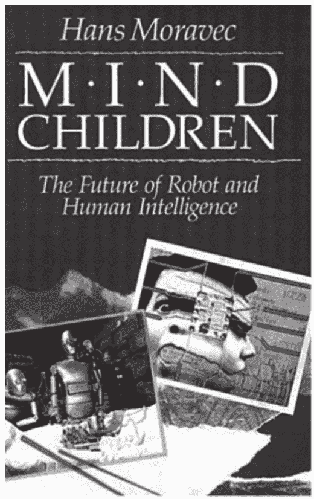
图 2-5 莫拉维克悖论出处
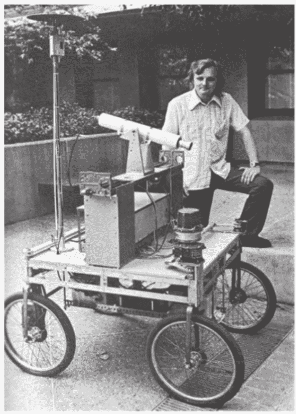
图 2-6 莫拉维克与斯坦福车

悖论揭示一维与三维的本质差异，一维再强也无法完整描述三维实体，无论静态认知还是动态运动。以自动驾驶为例，实现三级有条件自动驾驶已遇到逻辑困难，五级才是完全无人驾驶。按悖论，即使刷卡这类简单操作车辆也难以完成，导致无人驾驶陷入有人操作的困境。

语言本质上是一维序列，而工业实践是三维现实，再精美的表述也无法承载三维真实。要彻底化解悖论，需要建立新的认识体系与数学体系协调语言和空间的矛盾，正如无理数与复数的发现，莫拉维克悖论或许意味着新数学结构的出现。

以 GPT-4 为代表的一维大语言模型在知识整合、逻辑推理等高阶智能维度表现超人，使其在工业数据分析、流程优化等认知密集型领域优势明显。但涉及三维物理空间的实际操作时，如工业机器人柔性物体抓取、复杂装配视觉定位等基础任务，依赖符号化推理的系统暴露根本缺陷。矛盾根源于人类智能的具身性，婴儿在学会说话前已掌握空间感知，而大模型虽能求解微分方程，却无法理解抓握力度的物理含义。

知识图谱是二维结构，可充当一维到三维的桥梁。虽然无法完全表达三维本身，但比一维描述更为丰富准确，这是当前技术演进的折中方案。在可见未来，这一根植于智能本质的矛盾将持续存在，直至悖论彻底解决。

**2.3.2 生成式不仅是算法也是方法**

语言与现实存在隔离，如图 2-7 所示。语言是大脑能力，也是人类独特能力，其特点是序列，从第一个词、第二个词延续下去，是从 0 到 1 的构建过程。

传统研究自然语言的方法是建立统计模型，用有限变量描述语言规律，是数理方法在语言学中的应用，其假设语言具有物质世界的规律，如守恒律，显然不成立。语言具有创造性，是复杂系统，无法用简单表达式呈现。传统深度学习试图增加变量模拟语言，效果有限。

以 GPT 3.5 为代表的生成式算法是一次革命，它模拟大脑思维模式，通过文字接龙方式描述语言生成过程，取得革命性成功，说明生成式是语言本质特征。

至此，人们找到了语言最合理的模型，配合充分语料和算力，生成式大语言模型成为 AI 时代标志技术，其影响迅速从语言扩展到几乎所有领域。

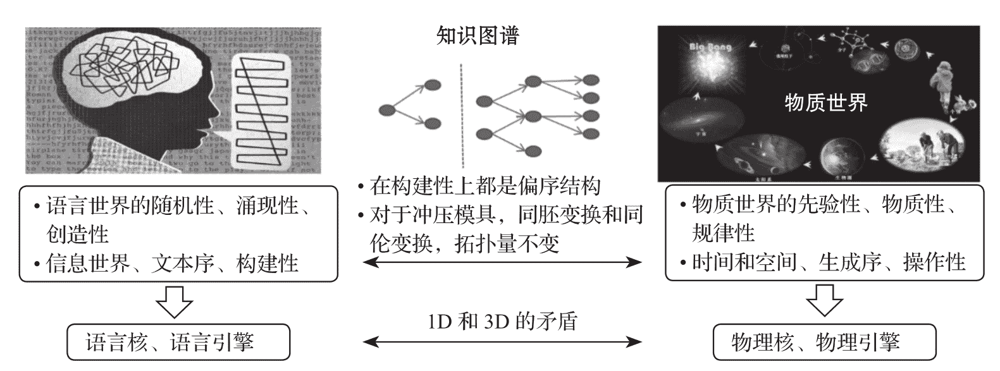
图 2-7 语言和现实的隔离

物质世界与语言世界差异显著，如图 2-7 所示。物质世界具有空间与时间属性，独立于人类而存在，具有第一性，遵循守恒律及由此派生的数理方程，如牛顿万有引力公式。

从运动时间视角看，物质世界也是生成的，与语言类似，从 0 到 1 构建，如图 2-8 所示。宇宙始于大爆炸奇点，随时间生长；植物从种子发芽到结果再成种子是完整生长循环，图 2-8c 表明任何产品都是逐步生成的。

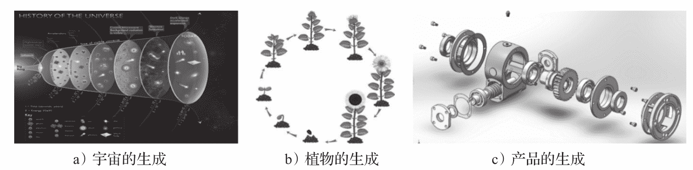
图 2-8 物质世界的生成

时间是单向流逝的，与语言类似是序列。空间存在包含关系，形成从大到小包含序列难度更大。

生成是一种方法，表明看待万事万物可基于从无到有的动态过程，是运动哲学观的技术体现。由于语言与实物都是序列，均可用 Transformer 全特征描述，进而挖掘系统内部规律。

图 2-8 还表明语言与物质世界的根本矛盾是一维与三维矛盾，语言一维，现实表达三维，如 CAD、CAE、EDA 等工业软件，以及石油领域专业软件。问题在于一维无法描述三维，因一维是三维投影，故语言不能生成三维现实世界，这是物理矛盾。解决方法是区分一维与三维，先由一维生成物质世界时间的一维，再由时间一维构建现实三维。由时间一维到三维，就是专业软件构建或使用过程。因此三维生成必须借助专业软件，而非 LLM 直接实现。

要点在于，LLM 出现并不意味着不需要专业知识或取代专业软件，而是语言模型与专业软件相辅相成。物理世界遵循的物理规律依然正确，无须 LLM 颠覆。

**2.3.3 生成式工业应用的技术路线**

生成式工业应用技术路线可归纳为：1 个结果、2 个核心和 3 次生成，如图 2-9 所示。

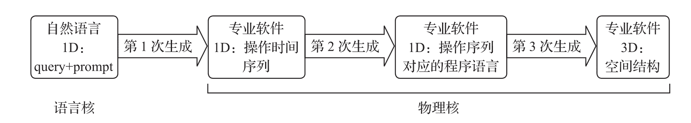
图 2-9 生成式工业应用的技术路线

1 个结果指工业应用最终呈现形式是一个空间上的三维结构，三维空间是物质世界最基本特征；

2 个核心指实现最终空间呈现需通过语言核和物理核完成，语言核解决序列生成问题，即物质世界包括 x、y、z、t 四个相互联系特征，空间特征通过 t 从 0 到 1 生成过程实现，物理核即专业工具。

3 次生成指将自然语言和物理核语言结合构成生成语料，第一次生成把 query+prompt 生成为专业软件操作时间序列，该生成需带知识图谱结构；第二次生成把专业软件操作与专业软件内部语言结合，如 UG 通过 journal 记录操作过程，关键在于把数十万行代码解读为业务统一认可操作过程，同时解决与前置操作的依赖关系；第三次生成是专业软件对生成文本的可视化。

总之，生成式工业应用把工业品设计、制造过程等效为内部代码生成过程。

**2.3.4 知识图谱是生成式工业应用成败的关键**

正如图 2-7 所示，大脑中的语言不能代表外部世界，二者需要桥梁，这个桥梁就是知识图谱。

尺子是现实世界与数据之间的桥梁，所有度量衡皆然，如图 2-10a 所示。知识图谱是语言世界与现实世界之间的桥梁，如图 2-10b 所示，知识图谱一方面具有语言特征，如“汽车通常由发动机、底盘、车身、电气设备四大部分组成”一句描述汽车组成部分，同时知识图谱是结构化产品结构树，指向其中四个真实存在部分，因此图谱又属现实世界。正是这种双重特征，使知识图谱成为生成式工业应用成败关键：去伪存真。

知识图谱由谷歌于 2014 年提出，应用中借鉴本体与 TRIZ 方法论思想，分为概念图谱和实体图谱，如图 2-11a 所示。其中的概念图谱即通常 schema，因图谱一词表达复杂网状结构，具有更直观隐喻，故采用概念图谱和实体图谱描述知识图谱两部分，其中概念图谱可简单理解为表头，实体图谱可理解为表记录。表头具抽象意义，表记录具现实意义，同时表跟尺子一样也是抽象与现实转换工具，因此可用表理解知识图谱，将知识图谱用于描述复杂系统。

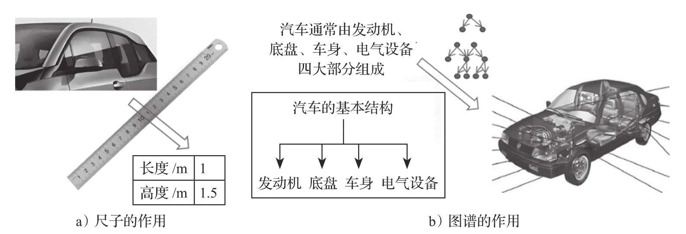
图 2-10 知识图谱的作用

本体中的概念、关系和实体也可形成图谱，如图 2-11b 所示。但三部分分开后理解会割裂，尤其是未表达多概念形成抽象结构，因此从抽象认知上需建立存在于大脑中抽象图谱，用来表达人们对系统的认知，而现实中真实存在物体都是抽象图谱实例化或同构于抽象图谱。虽然实体图谱可能不完全，但简单概念图谱也可能构成复杂实例图谱，如通过父子关系建立家谱。

TRIZ 是基于创新的问题解决理论，其解题逻辑如图 2-11c 所示。首先将现实问题上升为大脑中抽象问题，这是形而上过程，是认识起点。然后在抽象领域寻找问题通解，采用 TRIZ 独有方法，如矛盾矩阵、物场模型、进化模型等。这与把实际问题抽象为数学物理方程再求通解是同一模式。抽象问题解决后，再进入现实域，把抽象问题落地为现实方案，即代入具体边界条件获得真实解。为什么不直接从现实问题求解现实方案？既是逻辑问题也是现实问题。逻辑上看，既然是问题，显然无解，因此现实域不存在直接走通路线；现实上看，专家都解决不了问题，其解决方法和思路显然不在专业范畴之内，需从专业以外寻求更广泛新认知，扩大解集合范围，才能建立问题到解映射。

实际上，生成式也是一种方法论，它扩展我们对世界认知，建立基于大模型、生成式、注意力、序、时间演化的新视角。正如维特根斯坦所言：“语言的边界就是世界的边界。”语言不仅是文字，语言也是世界本身。

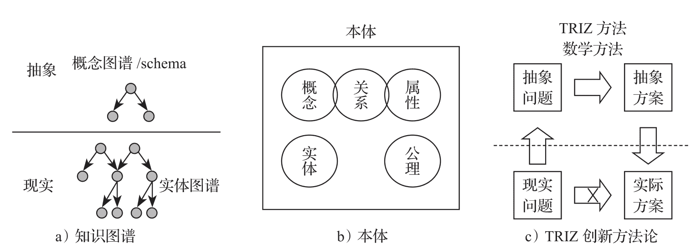
图 2-11 知识图谱的参考体系

# 第三章 LLM 的技术演进路径

本章全面概述大语言模型的技术发展历程，从数学基础出发，深入剖析 GPT、DeepSeek 等代表性模型的架构创新，探讨 LLM 与工业软件深度融合构建智能体的实践路径，并对未来发展方向进行前瞻性展望。本章内容为后续深入研究 LLM 在工业领域应用奠定坚实技术理论基础。

## 3.1 LLM 的数学基础

**3.1.1 概率论与信息论语言模型**

LLM 的核心数学基础源于概率论与信息论深度融合。概率论通过条件概率链式法则为语言建模提供序列生成数学框架。例如长度为 n 的文本序列联合概率可分解为每个词在给定上下文条件下条件概率乘积，即 P(w[1],w[2],…,w[n])=P(w[1])×P(w[2]|w[1])×…×P(w[n]|w[1],…,w[n-1])。这种分解直接支撑自回归模型架构设计，使模型能够逐词生成连贯文本。信息论中熵 H(X)=-Σp(x)logp(x) 量化语言不确定性，而交叉熵损失函数 H(p,q)=-Σp(x)logq(x) 则通过最小化模型预测分布 q(x) 与真实数据分布 p(x) 差异来驱动参数优化。KL 散度 D[KL](p||q)=Σ p(x)log p(x)/q(x) 被广泛用于模型蒸馏，通过最小化教师模型与学生模型间分布差异实现知识迁移。

*P*（*w*[1]）记录的是单个汉字的出现频次，*P*（*w*[2]|*w*[1]）则按相邻两字统计形成二元词表，可记作 {*w*[1]*w*[2]→语料计数}。ICTCLAS 作为首个落地的中文分词系统，以 1980 年《人民日报》文章为统计语料完成了最早的分词实现。查词时每个关联都直接从二元表取出，图中数值是归一化后的得分，分叉表示同一字能进入多个二元组合。将所有可行组合连成有向无环图，用最短路径搜索即可得到最优链，链上词即分词结果，见图 3-1。由此类推，*P*（*w*[3]|*w*[1],*w*[2]）对应三元表，*P*（*w*[*n*]|*w*[1],…, *w*[*n*-1]）对应 n 元表，于是可把全部候选路径汇总，再以最短路径挑选最合理的分词。

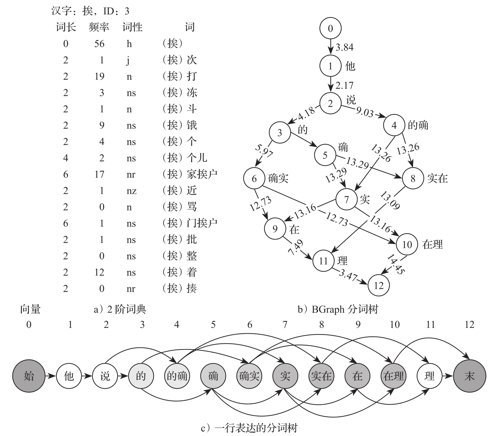

图 3-1 实例的带权有向无环图表示

预训练模型的嵌入在高维中呈现出可解释的几何结构。研究发现，BERT 等模型的向量在 768 维空间里形成局部欧氏的语义拓扑，同义词对的平均余弦相似度常高于 0.7，反义词对则多低于 0.2，这样的分布让向量运算能够捕捉复杂的语义关联。信息瓶颈以 *I*（*X*;*Z*）- *βI*（*Z*;*Y*）为目标，在保留输入 *X* 对任务 *Y* 的有效信息的同时压缩冗余，据此实现的压缩可在参数减少 80% 的情况下仍保持约 95% 的原有表现。

实践中常先用 BERT 或 fastText 在行业文献上训练领域向量，再在下游任务语料上继续微调，本质上是预训练加微调的两阶段流程。

**3.1.2 优化算法的理论突破**

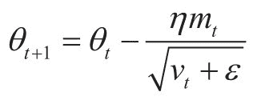 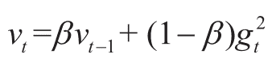

超大模型训练对优化器的效率提出更高要求。Adam 通过动量平滑与自适应步长提升稳定性，一阶矩 *m*[*t*]=β*m*[*t*-1]+（1-β）*g*[*t*] 用来稳定梯度方向，二阶矩负责调节步长，更新式加入偏差修正以消除启动阶段的估计误差。GPT-3 训练的对比显示，相较传统 SGD，Adam 的收敛快约 62%，梯度方差降约 75%。

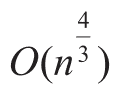

二阶思路如自然梯度下降利用 Fisher 信息矩阵的逆来调整方向，即 Δ*θ*=*F*^(-1)·*L*（*θ*），理论收敛更快。但直接保存 Fisher 矩阵的复杂度为 O（*n*²），在巨型模型上不可行。K-FAC 将 Fisher 近似为 Kronecker 积 *A*⊗*B*，大幅降低存储需求，使 530B 参数模型的训练成为可能。混合精度采用前向 FP16、反向 FP32 并配合动态损失缩放，在 NVIDIA V100 集群上实现约 2.3 倍加速与 37% 内存下降。

**3.1.3 分布式计算的数学建模**

万亿级参数的训练依赖分布式理论的进展。三维并行涵盖数据并行、模型并行与流水线并行，可用来建模通信开销。综合通信量 *C* 可表为 *C*=*α*（*G*-1）+*β*（*M*²）+*γ*（*S*-1），其中 *G*、*M*、*S* 分别指数据并行组数、模型并行维度与流水线阶段数，*α*、*β*、*γ* 为各维度的系数。张量并行把权重矩阵 ***W*** 拆成 *W*[1],*W*[2],…,*W*[*p*]，前向通过拼接得到 *Y*=Concat（*W*[1]*X*,…,*W*[*p]* *X*），反向借助 All-Gather 同步梯度，于是可在 4096 个 GPU 上训练 175B 参数模型并达到 502PFLOP/s 吞吐。

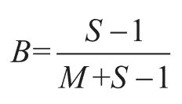 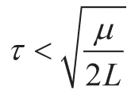 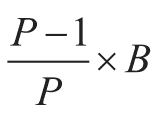

流水线并行的气泡率模型指导微批次划分。采用 1F1B 调度时，气泡率从传统 GPipe 的 47% 降到 12%。环形 All-Reduce 的带宽效率比树状结构提升 58%。异步并行允许参数服务器延迟 *τ* 步更新，收敛性证明在 *μ* 为强凸系数、*L* 为 Lipschitz 常数的条件下仍能保持线性收敛，在千卡集群上实现约 97% 硬件利用率。

## 3.2 GPT 奠定 LLM 工业化基石

**3.2.1 Transformer 架构的范式革命**

GPT 的关键在于首次全面采用 Transformer 取代循环神经网络与卷积神经网络，这一革新奠定了现代大语言模型的技术基础。自注意力可拆为三步：先对每个词向量线性变换得到查询 Query、键 Key、值 Value；再用查询与键的点积算注意力分数并除以键维度的平方根以稳定梯度；最后经 softmax 归一化后与值向量加权求和。该机制让模型能动态捕捉长距离依赖，例如在“动物没有过马路，因为它太累了”中可准确关联“它”与“动物”的指代。

***Q K V*** 正是对传统查表构建分词树的抽象，用三个矩阵替代真实词典 *P*（*w*[*n*]|*w*[1],…,*w*[*n*-1]），把查询过程转化为计算，如图 3-2 所示，注意力本质上是查表的抽象化。

以简历筛选为例，完整简历作为输入进入带偏好的 HR 模型，HR 会按自身关注点对内容做选择性处理。此时 ***Q*** 可理解为关注重点，如学历或工作经历；***K*** 是简历中与 ***Q*** 相关的部分，如毕业院校、专业等；***V*** 则代表实际被关注的内容实体。最终理解受注意力方向影响，对关注部分强化、其余忽略，这与 Transformer 中 Attention 对输入特征做局部强化的过程类似。

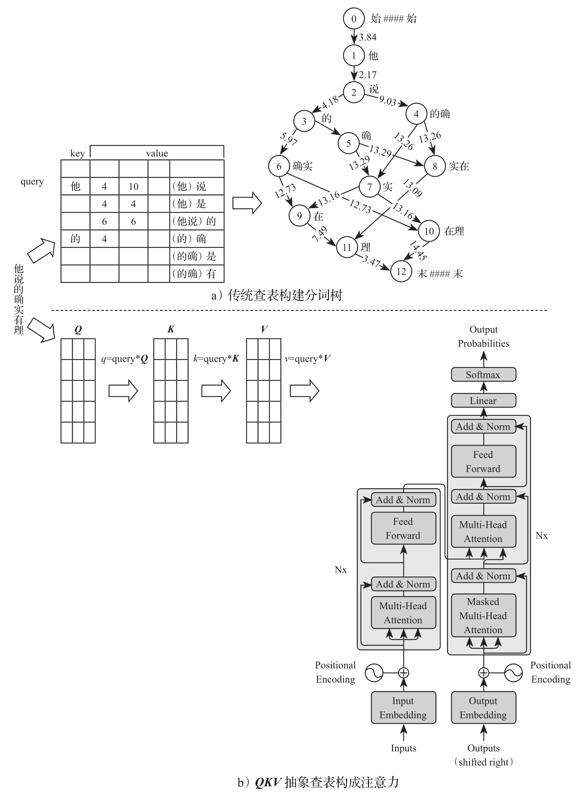

图 3-2 *QKV*注意力机制是查表的抽象化结果

上述简历描述本质上是传统查表过程：把所有可能的查询汇总为 ***Q***，把所有简历整理成 ***K V*** 表，针对具体 *q* 的查找即是对全集 ***Q K V*** 的一次乘积运算 *q**Q*、*q**K*、*q****V*。

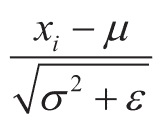

位置编码解决了 Transformer 对序列顺序的建模问题。GPT 采用可学习的绝对位置编码，将位置索引映射为与词向量维度相同的向量后逐元素相加。例如序列长度 512 时，位置编码维度为 512×768，训练过程让模型自行学习不同位置的语义差异。实验表明，相较三角函数编码，该方法在语义相似度任务上的准确率提升 8.7%。层归一化通过对每个隐层输出的均值和方差做标准化缓解梯度消失，对隐层输出 *x*[*i*] 归一化后为，其中 *μ*、*σ* 分别为该层均值和方差，*ε* 为极小常数防止除零。这一操作使 48 层 Transformer 的训练收敛速度提升 3 倍以上。

**3.2.2 自监督学习的预训练**

GPT 以掩码语言建模开创了自监督预训练范式。训练时随机把输入文本的 15% 词汇替换为 [MASK]，模型需根据上下文预测被遮蔽的原词。例如“人工智能将改变[MASK]的未来”中，模型会推断 [MASK] 可能为“科技”或“人类”。动态掩码策略在每次迭代重新生成掩码模式，避免对固定位置过拟合。研究显示，动态掩码在 GLUE 基准上平均准确率达 88.3%，较静态掩码提升 6.2%。训练目标为最小化交叉熵损失，即对所有被遮蔽位置 *L*=-Σ log *P*（*w*[*i*]|*w*[*M*]），其中 *w*[*M*] 表示未被遮蔽的上下文。

数据增强进一步提升预训练效率。基于 TF-IDF 权重的文本片段采样优先挑选信息熵高的段落，如技术文档的核心术语或小说的关键情节，使同等数据下困惑度降低 12%。课程学习策略逐步增大输入序列长度，从 64 提升至 1024，先聚焦短文本局部模式，再扩展到长文档全局建模，该方法将长文本训练的梯度方差降低了 47%。迁移学习理论证明，预训练模型的特征表示满足 *ε*-迁移性：对任意下游任务 *T*，存在线性分类器 *W*，使任务误差不超过 *ε* 与隐层维度除以样本量平方根之和。这解释了 GPT-3 在仅 1% 标注数据下即可达到传统监督学习 90% 性能的现象。

自监督预训练的目的是对行业语料做处理，形成行业内部的词向量。若把未经训练的词向量视作随机选取，则随机向量之间并无联系；而经预训练后词之间产生关联，例如“油田-开采”的距离短于“油田-计算”，表明前者是更紧密的业务结构。该距离无需人工标注，是行业语料内在规律在向量距离上的映射，即把自然语言任务转化为向量距离计算。

例如专利“一种基于表格语义 fasttext 问句解析的问答技术和系统”中采用 fasttext 词向量进行问句解析，如图 3-3 所示。

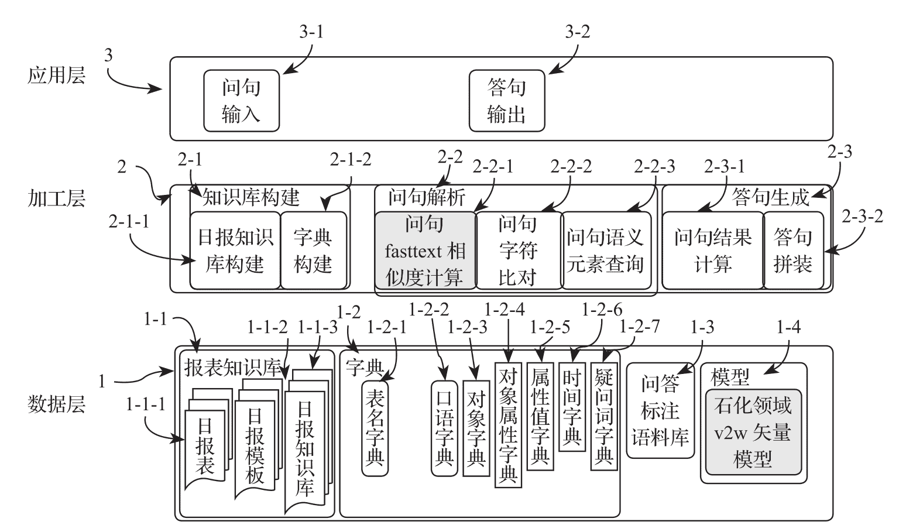

图 3-3 “一种基于表格语义 fasttext 问句解析的问答技术和系统”示意图

这是石油领域的词向量，基于 266 万份石油相关文献、报告、咨询、专利，用分割符（,，.。？?!！：:）拆分为 2200 万句子，构成行业背景语料。Fasttext 最终模型大小 5.4GB，是在逻辑核数 32、内存 500GB 的服务器上运算 5.5h 得到，词表规模 130 万词，向量维度 300。

**3.2.3 MOE 实现业务小模型与 LLM 的融合**

GPT 系列参数从 GPT-1 的 1.17 亿增长到 GPT-3 的 1750 亿，揭示了模型容量与性能的幂律关系：性能提升与参数量的 *β* 次方成正比，*β*≈0.076。例如参数从 1 亿增至 100 亿时，语言理解准确率提升约 58%。宽度扩展通过增加注意力头数，如 GPT-2 的 12 头到 GPT-3 的 96 头，提升多任务处理能力，但计算复杂度随之平方级增长。深度扩展则面临梯度消失，残差连接通过恒等映射保留浅层信息，形式为 *x*[*l*+1]=*x*[*l*]+*F*（*x*[*l*]），使 48 层模型的梯度范数衰减率控制在 5% 以内。

混合专家架构标志着规模化策略的转折。GPT-4 中每个前馈网络层被 16 个专家网络替代，门控函数 *G*（*x*）=softmax（*W*[*g*]*x*）动态挑选前 2 个专家激活。该设计使模型容量相当于稠密网络 4 倍，计算成本仅增加 30%。模型并行把 1750 亿参数分布在 256 个 GPU 上，结合流水线并行的气泡率优化算法，实现训练吞吐量 2.3ExaFLOP/s，为 DeepSeek 等后续模型的稀疏激活与动态路由提供了技术蓝图。

MoE 在工业应用中可把工业小模型视作专家模型与现有 LLM 大模型的融合，框架如图 3-4 所示。

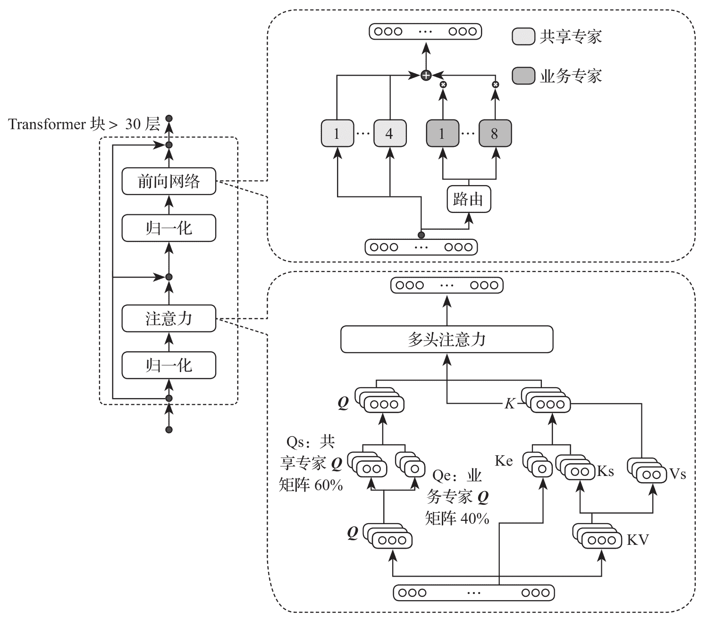

图 3-4 MoE 在工业上的应用框架

工业领域应用大模型困难在于数据量少、规律可解释性弱，且需在可接受误差范围内满足数学物理方程约束，即满足由物质、能量、动量守恒推导出的偏微分方程约束。因此工业应用以数据为主、自然语言为辅，但数据因精度不同存在无穷可能，无法穷举，故难以用大模型词典对已知数据做文本化。

由于工业场景普遍规模小、数据有限，很难存在放之四海而皆准的大模型，所以工业应用多为小模型。但人们希望兼具自然语言理解能力和专业模型准确性，于是把工业小模型作为专家融进大语言模型成为最佳选择。

在图 3-4 中，为保留 LLM 全部参数，需对 LLM 扩容，即增加约 40% 向量长度表达专业模型，例如用 768 维表示自然语言扩展，用 512 维表达工业小模型，总扩展维度 1280 维。训练时先对语料分类，把自然语言模型与专业小模型分开，再依据各层注意力和前向层做路由选择。

## 3.3 DeepSeek 推理模型把机理注入工业 LLM

DeepSeek-R1 由杭州深度求索人工智能基础技术研究有限公司推出，于 2025 年 1 月 15 日正式上线，一度成为全球推理模型标杆，复现 R1 成为国内外 AI 研究机构和个人的目标。DeepSeek 也使国内基础模型水平与世界齐平，大幅推动大模型在中国的落地应用。

DeepSeek-R1 依托自然语言处理、机器学习与深度学习、大数据分析等核心技术，在推理、自然语言理解与生成、图像与视频分析、语音识别与合成、个性化推荐、大数据处理与分析、跨模态学习、实时交互与响应等领域表现突出。它能进行逻辑推理、解决复杂问题、生成高质量文本、精准分析图像视频、准确识别与合成语音、按偏好提供个性化推荐、高效处理大数据的价值挖掘，实现多模态融合，并通过智能助手实现快速自然语言交互。

DeepSeek-R1 的核心思想是纯强化学习即可实现推理模型，打破了业界“无人工干预的纯强化学习不可能实现”的认知。

其基本原理可概括为 3 次微调、2 次强化、1 次蒸馏，如图 3-5 所示。3 次微调为基础模型微调、CoT 微调、完整数据微调，2 次强化为 CoT 强化和全样本强化，最后一次蒸馏把 DeepSeek 压缩为不同大小模型供多样化需求使用。

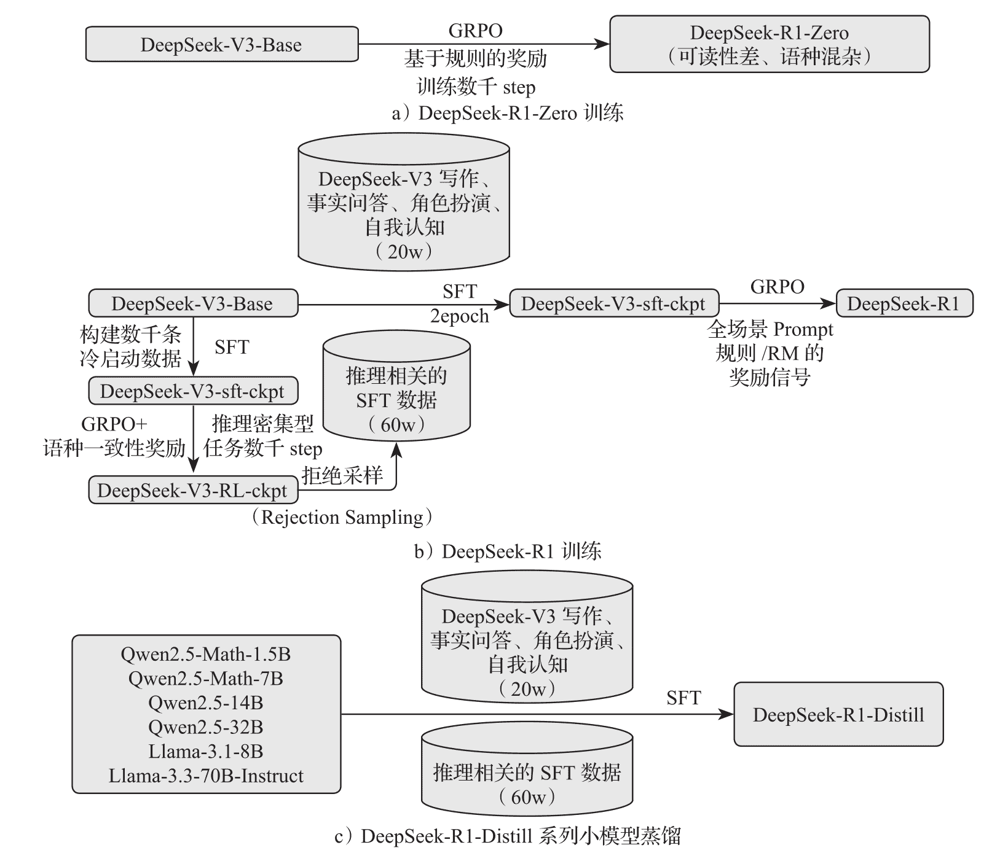

图 3-5 DeepSeek-R1 基本原理

**3.3.1 动态稀疏激活机制**

DeepSeek 的核心创新是动态稀疏激活机制，通过自适应选择神经元子集激活，大幅降低计算冗余。传统网络推理时激活全部神经元，而 DeepSeek 引入可学习门控函数，实时评估输入特征重要性，仅激活相关性最高的前 *k*% 神经元。例如文本生成任务中，对每个位置的隐层输出计算门控值 *g*=*σ*（*W*[*g*]*x*+*b*[*g*]），*σ* 为 Sigmoid。设定动态阈值如 top 30% 激活，可在保证语义连贯的同时把浮点运算量降至密集网络的 40%。实验显示该方法在 GLUE 等语言理解任务上准确率仅下降 1.2%，推理速度提升 2.5 倍。

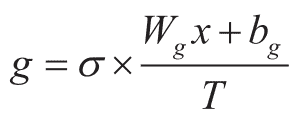

温度退火策略进一步优化稀疏激活的稳定性。训练初期采用较高温度 *T* 使门控值分布接近均匀，随训练逐步降低 *T* 引导模型聚焦关键特征。门控概率随 *T* 从 1.0 降至 0.1 时，激活稀疏度从 70% 提升至 85%。该机制缓解了训练初期随机激活导致的梯度不稳定，在百亿级参数训练中收敛时间缩短 18%。硬件适配优化如稀疏张量核心计算，使 GPU 利用率从 65% 提升至 92%，显存占用减少 37%。

**3.3.2 多模态融合架构**

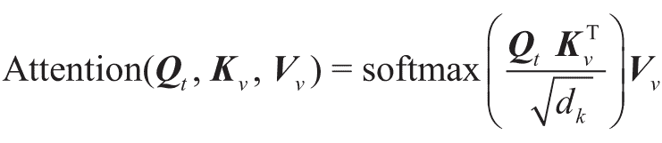

DeepSeek 突破单模态限制，构建异构模态统一表示空间。其跨模态注意力机制允许文本、图像和结构化数据共享同一组注意力权重矩阵。输入模态先经独立嵌入层映射到公共语义空间，计算时文本查询向量 *Q*[t] 与图像键值向量 *K*[v]、*V*[v] 交互，数学形式为… 在视觉问答任务中，该架构对图像区域与问题文本关联的准确率达 89%，较专用多模态模型提升 15%。动态路由网络根据输入模态组合自动调整信息融合权重，例如医疗报告中文本与 CT 图像融合权重比为 7:3，产品说明书场景则调整为 5:5，该自适应机制使多任务学习效率提升 40%。

**跨模态协同与工业智能的升级路径**

跨模态表征对齐正在成为多模态理解的突破口。训练时要在单模态自重建保真和跨模态语义靠拢之间做权衡。以图文对 I、T 为例，总目标可写成 L = λ ||Dec（Enc（I））-I||² + （1-λ）cos（Enc（I）, Enc（T）），λ 调节两项比重，cos 为余弦相似度。在开放域多模态评测中，该方案跨模态检索 Recall@10 平均来到 92.7%，对比 CLIP 提升了 8.3 个点。配合张量切片的硬件协同优化，多模态计算的显存需求下降 56%，单卡即可完成 8K 分辨率图像与十万字量级文本的联合推理。

**3.3.3** **模型压缩技术创新**

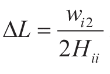 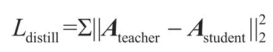

面向轻量部署，DeepSeek 团队给出蒸馏-剪枝-量化三层路线。蒸馏环节采用注意力分布对齐，让学生网络逐层复现教师网络各注意力头的关注模式，损失式里 A 代表注意力权重矩阵。经百亿参数量级的压缩后，学生网络的语义相似度 BERTScore 仍保持 98%。结构化剪枝借助 Hessian 迹分析，迭代剔除权重矩阵中冗余的行列，按使损失最小的原则决策剪枝，其中 H 为损失函数 Hessian 矩阵的对角元。实验显示剔除一半参数后，文本分类准确率仅下滑 2.1%。

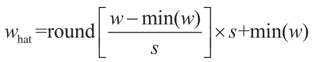 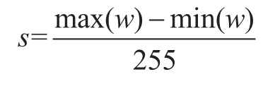

量化感知训练引入动态范围分配机制。先将 FP32 权重聚类为 256 个区间，为每个区间配置自适应缩放因子，反量化时据此恢复数值。在 8 位量化下，该方案使机器翻译任务的 BLEU 损失控制在 0.5 以内。部署阶段再做稀疏与量化的联合优化，模型体积压缩至原规模的 12%，在骁龙 888 等移动端芯片上可实现 20token/s 的实时生成。行业验证中，压缩后的 DeepSeek-Lite 在智能客服场景响应时延低于 400ms，准确率较传统规则引擎高出 34%。

**3.3.4** **机理模型构建强化学习语料**

在大模型体系里，强化学习几乎是标配，因为它能挖掘人类经验未触及的区域。强化学习的真正突破在于超越人类。以围棋为例，AlphaGo 基于人类棋谱学习，本质上是模仿，人类仍可在四局中赢一局；而 AlphaZero 通过两个智能体自对弈产生海量人类未见的棋谱，获取超出人类认知的知识。

自然语言里构造普适奖励函数困难，但在工业应用里奖励却非常直接，即偏微分方程残差最小化，也就是求解数字偏微分方程的目标函数。

以油气行业的抽油机为例，强化学习用于寻找随机生成的示功图 PRL 与给定电功图之间的最优关系，满足图 3-6 所示的偏微分方程，即

reward（奖励函数）=min（PRL-方程右边）²

反过来，已知 PRL 可反推电功图，或反之得到一对 PRL-电功图样本，这就构成了强化学习语料。随机 PRL 包含大量小概率图形，人类几乎未曾见过，属于认知之外的部分。通过这类强化学习或数据增强，模型能获得已知之外的知识，提升泛化能力。

工程应用除预测外，诊断同样重要，涵盖大概率事件的均值规律和小概率事件的波动。诊断类强化学习的输入输出构建同样具有随机性，最常用的是蒙特卡洛随机采样参数，2 水平 DoE 也是兼顾样本量与覆盖面的常用手段。此时奖励函数即诊断规则，如表 3-1 所示，包含不同时间粒度分布的趋势描述及最终诊断结论。

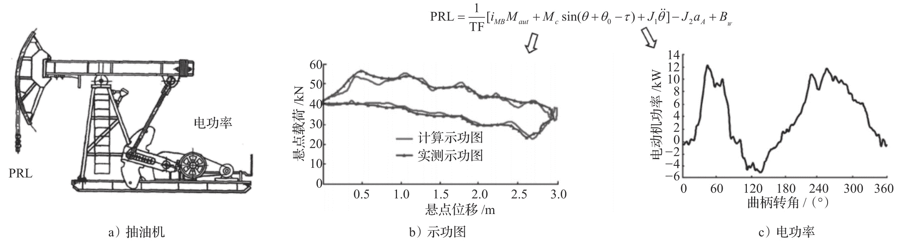

图 3-6 抽油机的强化学习及其物理机理

**表 3-1** **单井管理问题诊断规则表**

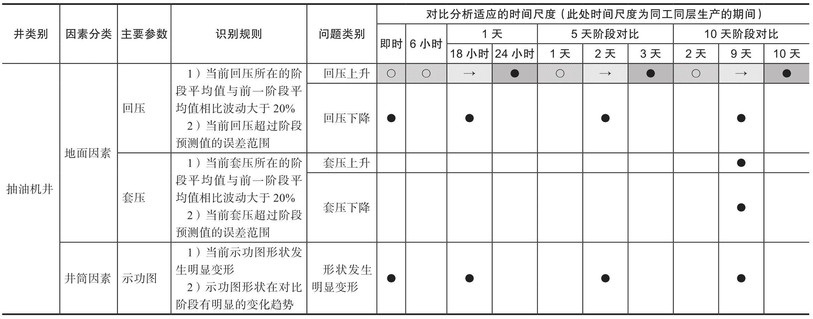

在强化学习的推理中，“理”指的是表 3-1 这类识别规则，而不同时间粒度下的变化是对规则的具体化，即把数值变化按时间粒度排成序列，把识别规则的阈值等信息排列在计算之后作为输入 prompt，输出的 reasoning 即为该规则，输出的 answer 即为问题类别。

如此，强化学习的奖励函数把推理之“理”、物理原理之“理”、业务规则统一起来，为大模型在工业落地提供了坚实基础。

**3.4** **智能体在工业领域的应用**

大语言模型本质上是线性文本流，而工业场景涉及时间与空间 x,y,z,t 的四维信息，单维度表征无法完整覆盖，必须把语言与四维模型解耦。大模型负责生成工业所需的一维序列，再由专业工业软件做后处理与可视化，因而工业里大模型的落地必然依赖智能体架构。

**3.4.1** **AI 发展的新阶段：智能体**

OpenAI 曾给出人工智能发展的五级路线图，如表 3-2。当前市面上的大语言模型多在第一级，部分如 DeepSeek-R1 可到第二级，第三级即智能体。

**表 3-2** **AI 发展的五级路线图**

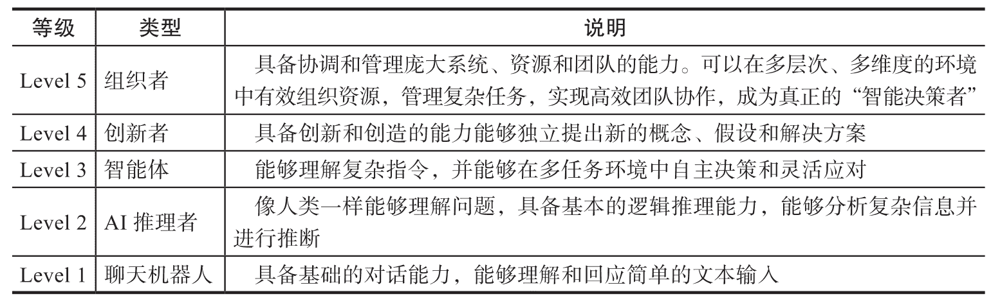

智能体以大语言模型为“中枢神经”，叠加规划、记忆、工具调用等模块，形成自主任务执行系统。其优势主要体现在三点。

（1）任务分解与规划能力：感知用户指令、数据库状态等环境信息后，把复杂任务拆解为可执行子任务链并动态调整策略。例如 Manus 智能体只需输入“策划一场跨国会议”，即可自主完成日程协调、酒店预订、文件翻译等。

（2）工具调用与多模态协同：可灵活调用 API、软件接口乃至物理设备，打破大模型仅能文本生成的局限。OpenAI 的 Operator 通过对接 Uber、Instacart 等平台，实现从信息查询到服务交付的全流程自动化。

（3）持续学习与自适应优化：借助反思模块等反馈闭环修正错误并积累经验。吴恩达团队基于 GPT 3.5 构建的代码生成智能体，通过“生成-审查-迭代”协作流程，正确率甚至超过单独使用 GPT-4。

与传统大模型相比，智能体的核心差异是“具身化”。大模型是文本生成引擎，需人工逐步引导才能完成多步任务。智能体内置 Planner 与 Executor，可实现端到端自动化。例如 DeepSeek Agent 能独立完成从需求分析到代码部署的软件开发全流程，人力干预减少 80% 以上。

**3.4.2** **微软的智能体框架**

以微软的方案为例。

微软发布的单智能体框架如图 3-7 所示，包含三大模块。

（1）规划器：系统入口，与用户交互。
规划：将用户请求拆解为子任务并管理执行。
响应：把执行结果转为用户可读的回复。

（2）代码生成器：为规划器生成对应子任务的 Python 代码，会充分利用两个组件。
插件：完成领域特定任务的自定义插件，代码生成器会智能调用，如从企业 CRM 获取数据的插件。
示例：指导代码行为的范例，尤其在模型不熟悉的领域特定任务中。

（3）有状态代码执行器：执行生成的代码，并在会话期间维护代码上下文。任务拆分为多个子任务并多次与用户交互时，执行器需跨次保留中间数据状态。

微软的多智能体框架 Taskweaver-Magnetic-One 如图 3-8 所示。

核心调度器的职责包括：
● 分解任务并规划执行流程。
● 指导其他代理执行子任务。
● 监控整体进度。
● 必要时采取纠正措施。

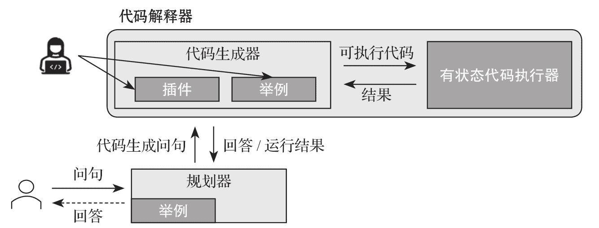

图 3-7 微软发布的单智能体框架 Taskweaver

图 3-8 微软发布的多智能体框架 Taskweaver-Magnetic-One

Magentic-One 采用双循环管理任务。
● 外循环：管理任务分类账，存放事实、猜测与总体计划。
● 内循环：处理进度分类账，追踪当前状态与子任务分配。
调度器先制订计划并记录到任务分类账，再在进度分类账中跟踪每一步。将子任务分派给其他智能体，监控进展并更新进度账。若进展不足，可调整任务分类账并重新规划。

除调度器外，Magentic-One 还包含四个专业智能体。
（1）网络浏览：可与 Web 浏览器交互，完成导航、网页操作与信息提取，利用浏览器的可访问性树与提示技术。
（2）文件浏览：擅长使用基于 markdown 的文件预览应用读取本地文件，可列目录并在文件夹结构中移动。
（3）代码：专门编写代码、分析其他智能体传来的数据并生成新输出。
（4）计算机终端：提供控制台命令行访问，用于执行生成的代码并安装编程库。

微软的智能体采用“以代码为中心”模式，通过大模型把任务转为自动代码生成，这也是大模型工业应用的典型范式。

**3.4.3** **LLM 在智能体中的定位**

工业应用离不开工业软件，在智能体中软件功能不变，大模型负责人机交互、跨环节语义理解与数据贯通，目标是实现“文生代码”或“文生图”。

以 UG 模具设计为例，大模型的目标即“文生代码”，如图 3-9 所示。图 3-9a 界面操作组件构成操作流的 token 词典；结构从第一个操作开始序列累加，类似句子从首词生成，最终汇聚为操作序列，如图 3-9b；图 3-9d 是该序列对应的 vb.net 文件，即操作底层是代码；最终三维模具如图 3-9c，即 UG 对 VB.net 的可视化呈现。

可见工业上大模型的作用可等效为自然语言生成代码，业务或知识图谱是代码文本的目录结构，目的是把自然语言转为三维业务软件可识别的代码语言。

**3.4.4** **工业智能体的特点**

工业智能体与文本助手的差异在于需构造工业软件的操作序列，实现自然语言生成操作序列。正如自然语言生成 SQL、生成 Python 代码，需找到工业软件的基础词典，用该专用词典表达应用流程。

图 3-9 UG 模具

1.**自主决策框架设计**

基于强化学习的智能体架构为大模型赋予动态决策能力，核心是构建可量化的状态-动作映射。状态空间把环境观测如用户输入、系统状态编码为 256 维语义向量；动作空间分为原子操作如 API 调用、信息检索，和语言生成如回复、建议两层。分层策略网络通过门控机制选择动作类型：置信度超过 0.7 时执行 API 调用，否则生成自然语言。在智能客服中，先调用知识库 API 获取重置密码步骤，再生成结构化回复，任务完成率从传统检索式系统的 68% 提升至 92%。

奖励函数融合任务目标与伦理约束。基础奖励包括任务完成度如工单关闭率、用户满意度如对话评分；惩罚项涵盖逻辑矛盾检测与价值观偏离。数学上总奖励 R=αR[task]+βR[user]-γP[conflict]-δP[ethics]，其中 α=0.6、β=0.3、γ=0.08、δ=0.02。在金融风控测试中，违规操作拦截率达 97%，误报率降至 3% 以下。离线策略优化先用历史对话预训练决策模型，再在线微调，新任务冷启动时间从 14 天缩短至 3 小时。

2.**长期记忆机制实现**

可微分神经记忆库突破传统大模型上下文长度限制。记忆以内容寻址键值对存储：键向量 K 由输入语义编码，值向量 V 存放任务相关数据如用户偏好、操作记录。读取时计算当前查询 Q 与所有 K 的余弦相似度，取 top3 加权求和。在医疗咨询中，多次提及“过敏史”会强化相关记忆权重，后续诊断建议的个性化匹配度提升 40%。

记忆压缩借助自编码器把长期记忆压至原大小 15%。编码器映射为 128 维潜变量，解码重构误差控制在 5% 以内。动态遗忘机制按访问频率与时效性计算保留概率 P[retain]=λ·freq+（1-λ）·recency，λ=0.6，每小时清理 P[retain]＜0.2 的条目。测试显示连续对话超过 50 轮后，带记忆的智能体仍保留 83% 核心信息，传统模型仅 35%。硬件上非易失性内存 NVM 使记忆存取延迟从毫秒级降至微秒级，支持每秒上万次并发记忆操作。

3.**人机协作范式创新**

混合倡议交互框架重塑人机协作边界。置信度校准模块用贝叶斯概率估计生成决策可信度评分 C=P（correct|E），E 为当前环境证据。C＜0.65 时智能体主动澄清，如订餐时询问“‘清淡’是指少油还是少盐”。该机制使任务理解准确率从 78% 提升至 94%。协作式规划把用户目标分解为可执行子任务树，每个节点标注人机分工建议，旅游规划场景下平均决策时间从 25 分钟缩短至 8 分钟。

多角色智能体系统支持跨 Agent 协作。分布式事务协议使多个 Agent 原子化执行复杂工作流，领导节点通过拍卖机制动态分配任务，以边际效益最大化原则选择执行者：Agent[i] 获派任务 T[j] 当且仅当 B[i]（T[j]）-C[i]（T[j]）最大。在供应链管理中，资源调度效率提升 60%，违约风险降低 45%。隐私层面联邦学习允许本地更新模型参数仅共享梯度摘要，敏感数据泄露风险降至 0.3% 以下。

# **第四章 LLM 为工业应用赋智**

工业软件把工业知识、技术经验与业务流程程序化封装，实现工业资源智能配置与协同优化，是工业智能的核心载体。大模型在特定领域的落地离不开与工业软件的深度集成。本章从需求分析出发，阐述设计路径与原则，结合案例剖析并展望发展趋势。

**4.1 工业软件的智能化需求****[4][.][1][.][1]**

**中国工业软件的发展现状**

工业软件专用于或主要用于工业领域，提升企业研发、制造、管理水平及工业装备性能。软件水平决定国家工业竞争力与创新能力，是高质量发展的重要基石。它把工业技术、知识与流程程序化并实现复用，可在数字与物理空间定义产品与设备形态、控制运动状态、预测变化规律、优化制造与管理流程，是现代工业的“灵魂”与数字化转型的核心驱动力。工业软件可追溯至 20 世纪 50 年代，起初集中于 CAD、CAM。随着计算机技术发展，逐步扩展到生产控制、管理决策、供应链优化等，成为现代工业不可或缺的核心工具。

国际发展经历数个阶段。70 至 80 年代以 CAD、CAM 等基础软件起步；90 年代后伴随互联网与信息技术进入集成化阶段，ERP、PLM 等系统广泛应用，实现企业内部资源整合；21 世纪以来向知识化、网络化、智能化演进，工业互联网、云计算、大数据推动软件云化与服务化。

回顾国际演进有三大特征：
（1）技术驱动：人工智能、物联网、区块链等不断融入，扩展功能与场景。
（2）生态共建：企业通过产业联盟、开源社区实现资源共享与协同创新。
（3）国际化竞争：欧美在高端市场占优，亚太尤其是中国崛起改变全球格局。

中国工业软件发展主要源于：
（1）国产化替代：高端研发设计软件领域需突破技术瓶颈，降低对国外产品的依赖。
（2）智能化升级：智能制造与工业互联网推进，企业对智能化软件需求增强。
（3）生态共建：国内企业需加强合作，构建协同创新的产业生态。

从追赶到智跃：本土制造软件的转型密码

我国的产业级软件起步较晚，但节奏在明显提速。八十年代主要靠引进消化，九十年代随着制造业扩张需求放量催生本土玩家，进入本世纪特别是“中国制造2025”政策发力后，这类工具已成为制造升级的底座。

市场体量持续放大。中研网2024年12月推出的《2025年工业软件行业发展趋势及政策分析》显示，2023年国内盘子约2703亿元，较上年增长12.3%，到2025年有望突破3390亿元。

产品结构分化明显。设计研发类如CAD、CAE在高端仍以海外产品为主，本土厂商差距在收窄；生产管控类如MES、SCADA在本土渗透率较高；管理类如ERP、PLM国产化程度最高，部分企业已占据国内主导。

行业成熟度不均。离散型制造里的汽车、电子应用相对成熟；航空航天、船舶等高端领域，本土技术仍在追赶；流程型制造的石化、电力等，本土企业在生产管控软件上具备较强竞争力，设计研发类仍需补强。

优势可归纳为三点：制造业体量全球第一，软件需求场景持续涌现；国家对自主创新与国产替代的支持力度持续加大；制造业品类多元，为软件提供了丰富的试验场。

短板也同样突出：高端原创能力不足，核心技术与原创产品稀缺；产业协作松散，企业多为单打独斗，难以形成合力；人才供给结构失衡，既懂技术又懂经营的复合型人才短缺。

在这种背景下，当前最关键的路径是知识化与智能化。知识化指把专业领域知识与软件技术深度耦合，形成更具行业针对性的方案；智能化则借助人工智能、大数据等技术，实现软件的自优化与自主决策。未来需要在技术投入、国产替代、协同生态与人才建设上同步发力，为工业可持续发展提供智力支撑。

4.1.2 知识化进程：从静态沉淀到AI精准调用

产业软件的本质是把工业知识、技术经验和业务流程程序化封装。以CATIA为例，这款服务于航空航天、汽车等高端制造的工具，其三维建模、仿真分析、工艺设计等功能，背后依托多层知识：基础科学层面的几何学、材料力学；行业规范层面的适航标准、安全规范；制造工艺层面的数控路径规划、模具设计等。这些知识通过算法、规则库和模板内置，用户借助图形界面即可快速调用。

知识的价值体现为提效降错。CATIA集成有限元分析与计算流体动力学，能够自动校验设计可行性，减少物理样机投入，压缩研发周期，提升产品质量。

但局限也很明显。首先，工具多局限于管理自身产生的数据，难以利用企业内部乃至外部的整体知识。其次，知识库更新偏静态，行业标准或市场需求变化时需人工维护，容易滞后失效。第三，存在知识孤岛，CAD产生的设计数据难以直接用于ERP做成本核算，转换成本高且易出错。

这些痛点催生企业知识工程的需求。企业知识工程以系统化方式采集、组织、存储和应用内外知识，为工业软件提供更完整的知识底座。例如构建统一知识图谱整合设计、制造、供应链信息。配套的知识检索、推荐、推理服务可减轻软件的知识管理负担，提升利用效率，如设计阶段自动推荐最优方案，制造阶段预测工艺风险。

当前仍面临两大挑战：知识精细化加工难度大，制造经验多为非结构化文本难以直接机读；知识精准化调用困难，数字化后如何按场景准确匹配仍是难题。AI提供了新思路，自然语言处理可把非结构文本结构化，机器学习可从海量数据中挖掘隐含规律，知识图谱可实现动态关联与推理。引入AI后，CATIA可根据设计意图自动推荐几何参数和材料组合，进一步提升效率和质量。

工业软件的知识化是产业升级的必然阶段。随着企业知识平台完善和AI深度应用，软件将更好地服务于创新与决策，推动工业向更高阶智能迈进。

4.1.3 智能化演进：当下图景与未来图景

智能化是工业4.0和智能制造的核心。智能化工业软件除传统设计、仿真、生产控制功能外，还应具备数据驱动决策优化、自适应学习、多模态数据协同处理和自然语言交互能力。理想状态下，可通过实时分析、机器学习和大模型实现全流程自动化与优化，大幅提升效率、质量和灵活性。未来它将通过自然语言交互和知识图谱降低使用门槛，通过预测性维护减少停机，通过数据驱动决策助力企业快速响应市场。

以制造执行系统MES为例，传统MES依赖预设规则和人工输入，在复杂多变环境下响应迟缓。生产线突发故障需要人工调整计划，造成延误和浪费。智能化MES可实时采集分析数据，自动识别异常并基于机器学习生成最优调整方案。某汽车厂商引入智能MES后实现产线实时监控与预测性维护，通过传感器数据提前预警故障并自动调配计划，停机时间明显下降。

支撑智能化的核心技术主要有三类。

1.机器学习与深度学习
这是智能化的引擎。工业软件可通过历史数据学习规律用于预测、分类和优化。流程工业中，深度学习构建时序模型分析设备运行数据预测故障并优化参数。中控技术的流程工业时序大模型TPT可每秒处理数万传感器信号并自学习优化流程。

2.多模态数据协同处理
工业现场产生传感器、图像、文本等异构数据。多模态协同能整合这些数据提供更全面的分析。智能工厂中视觉传感器数据与设备数据融合可实现质量实时检测。英伟达Cosmos平台即通过物理引擎与生成式AI融合对复杂工业场景进行动态建模与优化。

3.自然语言处理与大语言模型
NLP在人机交互和知识管理中作用凸显。传统NLP处理专业术语需大量规则，LLM凭借强大的语义理解显著提升水平。它可自动构建行业知识图谱，应用于设计优化和生产决策；在智能问答中快速提取知识库信息生成准确回复；在文档自动化方面可按需生成技术报告、操作手册等。

工业软件智能化是必然趋势，LLM等新兴技术正成为关键驱动力。

4.2 LLM场景落地设计思路

产业软件覆盖设计、仿真、生产到管理的全生命周期。LLM领域化应用可在人机交互、知识管理、任务自动化等环节显著提升智能化水平。以CAD工具为例，探讨其设计要点。

4.2.1 需求理解

设计遵循软件工程方法论，从需求分析起步。CAD场景中，工程师需手动分解客户需求并制定设计计划，依赖经验、耗时且易遗漏。LLM可提升效率与完整性。

借助自然语言处理能力，未来CAD可直接解析需求文档或语音输入，自动生成任务分解方案。例如从文本中识别部件、材料、尺寸约束等并生成初步任务清单。

以AutoCAD为例，传统操作依赖命令行或图形界面，对专业知识要求高。融合LLM后，用户可用自然语言下指令，如“绘制直径50mm的圆形”，系统自动生成并执行指令，还可基于设计意图推荐工具或参数设置。

该环节的核心价值是自动解析需求并生成任务清单，降低工作量并提升准确性。

4.2.2 场景设计

在明确需求和结合点后，具体场景可分为三类。

1.设计前智能推荐
工程师需反复查阅手册和历史案例。LLM可作为助手实时推荐材料、几何参数或设计模式，并通过自然语言快速检索资料，甚至自动生成部分代码脚本。

2.设计中优化与仿真分析
传统仿真需手动设参、运行、分析，迭代耗时。LLM可通过自然语言指令自动配置仿真参数并运行，如“优化该部件应力分布”，自动调用仿真工具输出优化方案和报告，并基于历史数据推荐更高效策略。

3.设计成果文档生成与管理
设计完成后需手工编写说明、物料清单、工艺等，易出错耗时。LLM可自动提取模型关键信息生成文档并补充工艺建议，通过自然语言交互帮助快速查找和更新，确保一致性。

4.2.3 知识工程设计

工程师使用CAD时需要协同和沟通，但单一工具只能管理自身成果，无法关联企业全量知识和外部资源，造成获取效率低、信息不全不准。单一软件难以自建完善知识管理体系，因此大模型领域化应用必须伴随知识库及应用体系建设。

知识工程设计需对场景梳理的知识和数据进行采集、加工、图谱构建和服务，为大模型提供底座。数据既可来自企业原有数据库，也可通过新建知识库管理，并以知识图谱建立关联，实现集成与调用。

4.3 LLM领域化应用的设计原则

智能工业软件需具备设计、仿真、生产控制等基础功能，同时集成数据驱动决策优化、自适应学习、多模态协同和自然语言交互能力。其设计需遵循核心原则，以支撑全流程自动化与优化。

图 4-1 智能工业软件设计原则

从业务数据到应用，需遵循多模态数据汇聚、业务协同融合、数据驱动实时优化三原则，对应DIKW模型。应用端应以人为本持续优化体验。若要达到更高阶智能，还需系统内外部优化。原则四“主动学习积累知识”代表系统内部自驱动优化，原则五“模块化、可扩展与自适应”强调健康架构以适应市场、技术和客户变化。

4.3.1 原则一：多模态数据协同与融合

工业现场数据包括传感器、图像、文本等。智能软件需具备协同处理能力以提供全面分析。例如质量控制环节，融合视觉传感器数据与设备运行数据可实现产品实时检测分类。

设计要求包括：数据标准化与集成，建立统一标准实现无缝处理；多模态数据融合算法集成，实现有效整合；跨平台数据共享，支持与其他工业软件交互最大化利用。

4.3.2 原则二：数据驱动实时优化

智能软件的核心是数据驱动决策。传统软件依赖预设规则和静态模型，难以应对复杂环境。智能软件通过实时采集与分析动态调整策略，例如生产控制中实时监控设备状态预测故障并自动调整计划减少停机。

设计需实现：实时数据采集与分析，从传感器、设备、产线等多源实时获取数据并以流处理技术进行分析。

4.3.3 原则三：让交互回到自然语言

智能工业软件要做到“说人话就能用”，把使用门槛压低、体验拉高。传统工控多靠繁琐的人机界面或命令行，对使用者专业度要求很高。新一代系统则允许口语化指令直接驱动流程，例如在设计环节，用户用自然语言描述意图，系统就能据此生成或修改模型与参数。

实现这种交互，设计上需要三类基础能力。

（1）理解与生成并重：内置自然语言处理模块，既能读懂口头或文字指令，又能把理解结果转成可执行的内部动作。
（2）保有上下文并做个性化推荐：系统要有会话记忆与偏好学习，依据过往操作轨迹给出针对性建议。
（3）多语种与跨文化适配：支持多种语言交互，并兼顾不同文化背景的使用习惯，提升全球可用性。

4.3.4 原则四：自学习驱动知识沉淀

主动学习能力是智能工业软件区别于传统软件的关键。传统软件功能相对固化，很难跟上生产需求与技术迭代。具备学习能力的系统能在运行中不断积累经验、优化自身表现。以设计优化为例，系统可通过挖掘历史设计数据自行归纳最优参数组合，并在新项目启动时给出优先方案。

实现自学习需要以下支撑。

（1）知识表征与归档：借助知识图谱等方法，把分散的工业知识结构化存储，方便后续调用与推理。
（2）在线学习与即时更新：内置在线学习机制，依据新采集的数据即刻刷新模型，保持知识的时效与精度。
（3）迁移学习与泛化：拥有跨领域迁移能力，将在某一场景学到的规律迁移到另一场景，提升整体泛化水平。

4.3.5 原则五：模块化、开放且可自适应

面向不同行业与场景，智能工业软件必须具备高度模块化和可扩展性。传统封闭系统难以定制，扩展成本高。模块化思路允许用户按需拼装功能，例如在生产管理中，可依据产线特征挑选并组合微服务，形成专属的管理方案。

达成该目标的设计要点包括：

（1）模块化架构：把功能拆分为独立单元，用户可按需挑选与组装。
（2）开放接口与插件机制：提供标准接口与插件生态，支持用户或第三方扩展新能力。
（3）云原生与微服务：采用云原生和微服务形态，支持分布式部署与弹性扩容，提高灵活性。

上述设计原则覆盖了从数据汇聚、知识沉淀到智能应用的DIKW演进路径，也兼顾了系统内部的自优化与对外部变化的适应。期望这些原则能为智能工业软件的研发提供参考，使其在多变复杂的工业环境中更加稳健持久。

4.4 大模型驱动的工业落地案例

在LLM技术的推动下，工业软件智能化进入加速期。下面几个典型案例展示了人工智能与传统制造结合后在效率提升、结构优化和可持续发展方面的价值。

4.4.1 工艺参数智能优化与实时调控

面向多变量耦合的制造过程，如半导体光刻与化工反应，语言模型正把认知层级的优化带入产线。台积电3nm工艺中，采用MoE架构的大模型动态调用128个领域专家模块，涵盖热力学、流体力学、材料科学等，使光刻胶涂布均匀性的标准差压至0.8nm，相比传统PID控制提升43%。核心做法是将设备传感器10kHz采样数据与工艺知识库里5.7万份专利文档一起编码为768维向量，利用自注意力建立跨尺度关联。当监测到光刻机振动频谱在15～20kHz区间出现异常能量峰时，模型在0.2秒内判断出掩膜版形变与气浮轴承磨损的耦合影响，并生成含23项调控参数的补偿方案，使套刻精度恢复到0.12nm的设计阈值。

该过程印证了“意义在于使用”的理念。1750亿参数的语言模型把工艺手册中“适度提高显影液流速”这类定性描述量化为0.35±0.02mL/s的精确控制指令，工业知识的生成方式由此从经验归纳转向参数空间的概率涌现。2024年，宁德时代固态电解质产线中，模型通过无监督嵌入空间探索，自主发现锂离子迁移路径的拓扑优化，使离子电导率突破12.3mS/cm，较人工设计的最好纪录提升27%。这标志着工业智能正从工具理性迈向存在理性。

4.4.2 跨模态质检与缺陷溯源

在多模态质检场景中，语言模型通过异构数据融合重塑质量控制边界。ASML的极紫外光刻机缺陷检测系统，把5nm分辨率的晶圆图像、10kHz振动频谱与维护日志文本映射到统一语义空间，缺陷分类F1值达到0.94，误报率降到1.2%。技术突破来自工业增强版CLIP，模型用对比学习对齐由ResNet-152提取的2048维视觉特征与由BERT编码的768维工艺参数文本，在768维投影空间计算跨模态相似度。发现图形残差异常时，系统可追溯到维护记录中氮气纯度波动0.5ppm，并关联到前道工序掩膜版清洁周期超时23分钟的问题。

类似的能力在宝马莱比锡工厂得到验证。模型融合了焊接声纹40kHz采样、5μm空间分辨率的热成像图谱以及质检报告的自然语言描述，构建出焊缝缺陷的多物理场因果图。输入“第5工位焊缝气孔率骤增0.7%”后，0.8秒内定位到机器人焊枪角度偏差2.3°超限以及保护气体流量不足15L/min低于标准18L/min，并给出动态补偿建议。这种从符号到实体的认知映射，让工业系统首次具备了解释性预测能力。

4.4.3 智能供应链协同与自主决策

全球供应链的复杂动力学在AI、机器学习与语言模型的驱动下实现多智能体协同优化。西门子全球供应链大脑借助联邦学习与自然语言处理，整合37国156家工厂的运营数据，在保护商业机密的前提下构建了包含2.3亿节点的知识图谱。疫情导致马来西亚芯片封测厂产能下滑43%时，系统在12分钟内生成跨4层供应商的替代方案：激活德州仪器闲置产线使利用率提升至92%、将中国苏州厂氮化镓器件生产优先级切换至T+0模式，并重新规划荷兰至墨西哥的航空物流路径使成本降低18%。核心算法融合图注意力网络GAT与时序卷积网络TCN，使需求预测均方误差降至0.08，较传统ERP的0.40提升约5倍。

2024年台积电先进封装材料短缺事件中，系统解析《瓦森纳协定》条款、地缘政治风险报告与实时物流数据，自主生成合规采购策略：将日本信越化学的PI膜订单转向韩国SKC使交期压缩至7天，并通过量子加密通道与德国巴斯夫协商技术授权，使专利使用费降低23%。这源于对国际商务语言深层语义的解析，当输入“受限技术出口”时，参数空间自动激活238个相关法律条款与89个历史判例，在合规边界内探索创新解法。工业智能由此升格为具有战略预见性的认知主体。

上述案例体现了数据驱动决策优化、自适应学习、多模态协同与自然语言交互等能力，大模型发挥了关键作用。随着技术与场景的持续拓展，智能工业软件将为企业提供更高效、更灵活的解决方案，推动工业向更高阶的智能化迈进。

4.5 未来工业软件的发展趋势

本章回顾了工业软件的发展脉络，思考工业应用智能化的路径。中国工业软件在人工智能浪潮下在核心技术研发、场景拓展与生态构建方面取得进展，为跨越式发展奠定基础，有望助力工业数字化转型与高质量发展，在全球版图中占据重要地位。

未来趋势可从三个维度概括。

1.趋势一：协同能力深化
未来发展将更强调协同，聚焦数据协同、业务协同与决策协同。数据协同是智能化的基础，通过打通异构软件间的数据逻辑，实现模型与数据的集成，为企业提供一体化的信息支撑。云计算与工业互联网的普及使软件能够实时采集和分析海量生产数据。业务协同强调流程无缝衔接，传统CAD/CAE/CAM等功能将被整合到统一平台，实现从设计到制造的全流程管理，如达索CATIA与ANSYS的仿真驱动设计。决策协同则体现智能化，通过AI从海量数据中提炼信息并结合专家经验提供科学建议，如强化学习与操作员知识结合实现自主学习与优化。

2.趋势二：持续知识化，目标智能化
AI正深刻改变工业软件的知识化与智能化水平。构建行业知识图谱提升了自动关联与获取能力，深度学习帮助理解流程、预测故障与优化调度。软件正从单一工具演变为能够自主学习与优化的智能系统。生成式AI带来新可能，如英伟达Cosmos平台融合物理引擎与生成式AI实现文本到视频生成，为仿真与设计提供全新方案。此外，机器视觉与闭环控制结合使得质量控制能够自动检测并纠正缺陷，提升质量与一致性。

3.趋势三：需求决定方向
未来工业对软件提出更高要求，主要体现在软流程自动化、市场自适应与绿色可持续三方面。软流程自动化是重要方向，AI可实现从设计到生产的全流程自动化，减少人工干预。软件需具备市场自适应能力，借助大数据与AI实时分析市场动态并自动调整计划与资源配置，数字孪生可实时监控与优化。绿色可持续是使命，AI通过优化能源使用与生产成本助力绿色制造，符合全球趋势并带来长期经济效益。

总体看，未来工业软件将在协同、智能化与适应性上实现重大突破。数据、业务、决策协同将提供高效一体化方案，AI应用推动知识化与智能化，市场需求聚焦软流程自动化、市场自适应与绿色可持续，为制造业智能化转型提供强力支撑。

第五章 大模型落地工业的挑战

尽管大模型自ChatGPT面世后迅速普及，但在工业领域真正落地的案例仍有限。本章剖析LLM在工业落地面临的核心挑战，包括数据依赖与安全风险、模型可解释性与透明度、算力限制、模型更新与维护等，并针对计算瓶颈提出混合建模、动态协同等创新思路。

5.1 数据依赖与安全风险

数据依赖与领域迁移瓶颈

1.领域迁移瓶颈的技术本质与影响
工业场景中语言模型的领域适应难题源于语义空间分布偏移与专业概念嵌入不足的叠加。在半导体制造中，通用预训练语料与行业术语存在明显鸿沟：关键工艺参数“光刻胶剥离率”在专业文献中的TF-IDF值达0.37，在通用语料中仅0.003，导致嵌入空间难以有效表征该概念。知识断层同样突出，晶圆加工涉及的2000余项参数中仅约15%能在开放知识库中找到对应条目，形成专业知识的“暗物质区”。某14nm制程厂商测试显示，未经微调的GPT-4对蚀刻工艺问答准确率仅31%，暴露出通用模型在专业场景的认知局限。跨领域迁移效率呈现指数级衰减，台积电研究表明从通用电子制造向先进封装迁移时，模型参数的有效迁移率不足8%，需重新训练约73%的注意力头，导致技术转化成本激增与迭代周期延长。

2.工业适配的多维技术挑战
数据稀缺性是首要瓶颈，三维NAND闪存工艺知识库构建需标注10万条语料，按SEMI标准每条标注耗时18分钟，总成本高达150万美元。长尾分布加剧利用难度：DRAM生产涉及的故障模式中，前20%高频故障占据82%的语料，剩余80%低频事件的F1值仅0.26，导致模型对罕见故障识别不足。动态环境下的领域漂移不可忽视，ASML光刻机技术文档每季度更新率达7%，模型性能以每月1.2%的速度衰减，迫使企业持续投入增量训练。架构层面，标准Transformer在FinFET设计任务中的注意力熵值较专用模型低1.7bit，难以聚焦关键工艺参数；微调引发的灾难性遗忘使通用知识准确率下降23%；复杂工艺推理链条断裂问题突出，如等离子体掺杂任务中标准CoT策略正确率仅41%。

3.领域自适应技术创新实践
应用材料公司研发的FabMind混合专家系统，通过动态调度700个工艺知识模块，在离子注入参数优化中将工艺窗口拓宽19%。联电集团采用LoRA进行参数高效微调，仅更新0.3%的模型参数约1.2亿，在蚀刻均匀性预测中实现0.84的F1值，算力消耗降低83%。针对数据稀缺，三星半导体利用GAN生成高保真工艺缺陷描述，如“边缘崩落宽度＞5nm”，配合对抗训练使缺陷分类准确率提升至89%。知识注入范式也在革新：GlobalFoundries构建的三维IC知识图谱包含15万实体，通过图注意力机制引导封装方案生成，信号完整性分析效率提升3倍；东京电子将TCAD仿真结果编码为提示向量，在漏电流预测任务中均方误差降至0.07，较纯数据驱动模型优42%。

4.技术经济性突破路径探索
美光科技联合20家封测厂构建垂直联邦学习系统，通过同态加密与梯度混淆在保护商业机密前提下实现工艺知识共享，使新型封装缺陷识别准确率提升37%。应用材料公司的Edge-LLM方案通过知识蒸馏将300亿参数模型压缩至5亿，在设备端实现200ms级实时诊断，是云端方案延时的。标准化进程加速：SEMI与MIT联合发布的ChipBench评测体系包含12大类3.2万条芯片制造知识问答，为工业语言模型性能评估提供统一基准。IDC预测到2027年该领域市场规模将达47亿美元，推动三大变革：台积电3nm工艺开发中LLM辅助的DTCO使设计周期缩短23%；日立高新科的AI导师系统通过电镜图像解释，使新工程师在8小时内达到熟练人员85%的缺陷识别能力；应用材料公司工艺知识库实现实时更新，检索准确率提升至96%。

5.技术演进与生态重构
当前技术突破沿着“专业增强-领域融合-自主进化”轨迹推进。当语言模型能够解析原子层沉积中阶梯覆盖率与前体分子吸附能的非线性关系时，工业智能开始跨越概念鸿沟，向技术创新的共生体演进。变革不仅需要算法创新，更需重构人机知识协同范式：联邦学习重新定义知识共享边界，边缘智能部署重塑决策响应链条，标准化体系构建跨企业协作的基础设施。在半导体设备振动频谱被转化为实时工艺指令时，我们见证的不仅是技术参数的突破，更是工业知识生产范式的根本转变，从人类经验主导的渐进改进迈向数据-模型共生的指数创新。

5.1.2 模型训练阶段的数据安全风险

工业大模型安全与可解释性的双重挑战

5.1.3 推理时段隐蔽的泄密通道
服务侧响应和信息跨境流动正成为新的薄弱环节。接口一旦被探针，攻击方可通过构造边界样本实施成员推断，反演训练分布特征，在设备故障诊断、工艺优化等场景中带走工况状态、物料配比等敏感要素。更隐蔽的是模型记忆效应，面对携带核心参数的查询，模型可能直接复现训练片段中的机密内容。自然语言任务尤为突出，工艺文档解析类模型就可能把竞争对手专利描述原样输出。

云边协同架构放大了外泄难度。企业使用第三方大模型分析时，原始信息常在预处理阶段经API送出。即便做过脱敏，设备编号、时间戳与运行参数组合仍可重建某产品的工艺曲线。边缘侧参数更新通道也成新入口，伪造更新请求即可获取节点缓存。实时性要求限制了强加密的落地，设备控制指令生成等低延迟场景中，全同态加密的算力负担难以接受，企业只能在安全与时延间权衡。

对抗扰动在工业视觉质检中威胁真实，眼不可见的噪声即可让缺陷检测模型误判，对高精度制造是重大经济损失。迭代本身也在扩大攻击面，在线学习若参数更新未经校验，攻击方可通过污染增量数据实施供应链攻击，实现对产线的持续操控。多模态融合推理风险会叠加，文本、图像、传感器共同决策时，单一模态的防御缺口会通过跨模态关联传导至整体系统。

5.1.4 全链路数据安全防护体系设计
工业级生成式AI的安全要贯穿数据全生命周期，在技术和架构上实现隐私保护与效能的动态平衡。

语料加工全流程必须严格管控，覆盖采集、清洗、标注三大阶段，如图 5-1 所示。

采集端：先做来源安全评估与核验，违法信息占比超5%直接禁止使用；保证多语种、多类型数据的多样性及境内外合理配比；建立可追溯机制，自有数据留记录、商业数据审合同、用户数据要授权；按行业-业务做分类分级，分核心、重要、一般三级；用隔离加密存储和权限管控落地安全。

清洗端：用关键词过滤、分类模型加人工抽检清除违法信息，避免知识产权侵权，个人信息处理必须取得法定授权。

标注端：对标注人员系统培训、分层考核，标注和审核职能分离。制定功能与安全双轨标注规则，功能标注保证真实准确，安全标注聚焦风险识别。实施双重质量核查，功能标注做批次抽检、安全标注逐条审核，建议对标注数据加密存储。

图 5-1 语料加工全流程

加工完成后做双重评估，人工抽检万条样本合格率≥96%，技术抽检按总量20%抽样合格率≥98%，并建立定期更新机制应对动态威胁，最终实现敏感信息保护、合规保障与泄漏风险防控。

训练环节要搭建多方安全计算框架，联邦学习与同态加密结合，实现加密状态下的梯度交换与参数聚合。针对工业数据高维特性，研发特征空间对齐算法解决跨域分布差异，并设计梯度压缩降低通信成本。蒸馏阶段构建知识选择机制过滤敏感特征，设置语义防火墙阻止商业机密迁移。开发工业数据血缘追踪系统，用区块链记录数据流转，实现从原始信号到训练样本的全链路审计。

推演环节要做动态防御，建设输入检测、模型监控、响应处置三层体系。API网关部署对抗样本检测模块，用生成式对抗网络识别异常输入。运行中持续监控输出分布，检测到泄密风险自动触发输出扰动。对必须使用云端模型的场景，采用安全飞地架构，将敏感计算隔离在可信执行环境TEE中，确保解密数据只在硬件加密区使用。建立数据出境风险评估模型，结合分类分级与区域合规，实现跨境流动的智能审批与流量管控。

架构层面设计工业大模型安全中间件，集成隐私计算、访问控制、审计追溯。向下兼容主流工业通信协议，向上提供标准化安全接口，实现安全能力无缝嵌入。构建威胁情报共享平台，借助联邦学习在保护隐私前提下做攻击特征跨区协同分析。最终形成端-边-云协同的安全网络，通过自适应安全策略动态调优，为工业智能化转型提供可靠基座。

5.2 模型的可解释性与透明度[5][.][2][.][1]
模型可解释性缺失的根源分析与发展方向

生成式大语言模型在工厂应用里的核心矛盾，是模型内在的黑箱特性与工业场景对透明决策的刚性需求冲突。

工业生产决策牵涉高价值资产、复杂物理过程和安全关键环节，比如能源开采的注水控制或设备维护策略。传统系统依赖机理模型或专家规则，决策可通过公式、流程图、知识图谱逆向追溯。而大语言模型的生成式推理本质是高维参数空间的概率采样，知识以分布式非结构化方式沉在数十亿权重里。面对专业问题，语义偏差或数据分布偏移就可能给出违背领域知识的结论。如油气田注水，模型建议把某井日注水量从10t骤增到20t，现场专家既无法对照达西渗流方程验证，也难追溯是否考虑了井筒摩阻或地层压力梯度。可解释性缺失会降低信任，还可能引发误操作事故。

本质上是知识表达方式与工业结构化知识体系不兼容，深度神经网络架构缺乏显式逻辑约束。GPT-4 在晶圆缺陷判定中，输入经1280维嵌入非线性变换后，工艺参数如“边缘粗糙度0.5nm”的信息熵损失达2.3bit，原始特征与决策难以直观映射。注意力机制混沌性加剧解释难度，某3nm制程优化模型里跨12层Transformer的注意力头贡献度方差达0.78，关键节点追溯失败率超60%。知识表征离散化也明显，台积电测试显示单个工艺参数如蚀刻选择比会激活37%神经元，但作用路径在参数空间碎片化，无法形成完整因果链。

技术特性与需求的冲突很尖锐：荷兰光刻设备商ASML要求光刻参数调整建议必须附带物理机制解释，现有语言模型满足率不足19%；ISO 26262 强制汽车电子决策保留可追溯数据链，而某800B参数模型的审计日志生成能耗高达推理本身3倍，严重制约实用化。

神经符号融合带来新路径。西门子 Causal-LM 引入结构因果模型SCM，在燃气轮机故障诊断中生成含16个因果因子的解释链，并通过IEC 61508 功能安全认证。其核心是动态因果发现机制，基于强化学习构建自适应因果图，实时追踪温度、振动等34个状态变量的交互。

应用材料公司开发的Grad-CAM++工业版在原子层沉积工艺优化中可视化关键特征贡献度，前驱体脉冲宽度的决策权重达0.91，显著提升工程师信任。

融合量子计算将进一步跃迁。英特尔 Neuro-Symbolic Reasoner 在三维封装设计中实现符号规则引导的神经网络推理，热应力分布预测的解释生成效率提升5倍，通过对比损失对齐符号逻辑与向量表征。IBM量子实验室的Q-proof协议利用量子纠缠验证决策逻辑完备性，在材料相变预测中检测效率达经典算法的17倍。MIT CSAIL的CausalFire系统通过自监督学习构建工艺参数因果图，在薄膜沉积控制中可解释性指标提升至0.93，因果边界发现速度提高8倍。Gartner预测到2030年具备原生可解释性的工业语言模型将覆盖65%关键场景，质量事故率降低42%、模型审计成本减少78%。这场变革不仅靠技术，更需ISO标准、法律框架与社会共识的治理生态。

5.2.2 知识图谱与机理模型的显性知识约束机制
解决可解释性缺陷要构建基于领域知识的多层级约束。知识图谱以“实体-关系-属性”三元组把行业标准、设备参数、工艺流程转化为机器可解析的语义网络。

油气开发中，图谱可精确描述油田地质构造、单井生产历史、注采平衡规范。LLM处理专业问题时，图谱提供实时事实核查与边界约束。查询“TK001井产气量”时，系统先检索该井的井型分类为注水井、当前工作制度注水量范围等属性，避免模型因语义歧义给出“产气量52t/年”的荒谬结论。再结合油藏数值模拟器等物理方程机理模型构建动态验证层，LLM提出注水调整建议时，系统调用渗流力学模型做瞬态模拟，验证是否满足压力传导方程的物质守恒。

这种生成-验证双向机制，既保留LLM处理非结构化问题的灵活性，又通过领域知识锚定保证决策物理合理性。

5.2.3 大语言模型与专业工具的协同推理架构
复杂工业场景中，大模型应扮演认知中枢，通过与专业工具链深度协同实现可解释推理。构建分层任务分解框架，大模型负责自然语言理解、意图识别与任务规划，专业工具如数值模拟软件、实时监控系统执行具体计算与验证。

以注水优化为例，用户问“TK001井注水量下降如何解决”，大模型先解析语境，调用知识图谱确认完井方式、邻井注采关系；随后拆分为“注水压力分析-油藏连通性诊断-设备状态检测”等子任务，分别调用压力瞬态分析模块、示踪剂监测数据、泵效评估模型；最后整合输出，生成含压力梯度曲线、层间窜流系数等专业参数的技术建议。系统自动生成含数据溯源、计算路径与约束条件的推理报告，专家可逐层追溯依据。架构把语义理解与工具可解释性结合，形成思考-执行-验证闭环。

5.2.4 多模态可解释性增强技术体系
提升透明度需融合多模态交互与动态可视化。

首先构建基于注意力机制的解释生成模型，对推理过程做特征归因。回答注水方案时，可标注模型关注的关键输入特征如近期注水压力波动、相邻生产井气油比变化，并映射到知识图谱实体节点。

其次开发工业语义中间件，把自然语言结论自动转为领域表述，如把“建议增加注水量”转为含目标井号、调整幅度和预期见效周期的标准作业指令，并与历史记录比对。

进一步结合增强现实AR，把参数调整建议叠加到设备数字孪生模型，直观展示阀门开度变化对管网压力的影响趋势。多维度证据链交叉验证，既降低非专业用户理解门槛，也增强决策可审计性。

5.2.5 可信工业智能系统的构建实例
实现可信应用要构建覆盖全生命周期的透明化保障。在开发阶段，用基于因果图的结构化预训练把领域知识图谱实体关系编码为模型先验参数，同时提升可解释性；模拟专家思维流程构建训练语料，使模型能输出思考过程与决策依据。

1. 工业场景原因分析问答
油气行业抽油机井原因分析要求模型按专家流程回复：因素分类、获取主要参数、按识别规则判定问题类别、影响因素分析、落实原因、分析后果、给出下一步措施。按此流程准备不同情况语料，可使模型具备分析能力并输出中间过程信息，其信息表如图5-2所示。

图5-2案例分析的信息表

推理阶段融合知识图谱与机理模型构建双驱动架构，提升可解释性的同时快速优化准确率。系统化方法使大模型既保持复杂语义优势，又满足工业场景对确定性、安全性和全流程可追溯的严苛要求。

以传统RAG问答为例，加入知识图谱与业务软件实现工业应用。大模型先做任务解构，分解任务经知识图谱做路径规划，自动生成涵盖图谱数据、第三方软件接口调用、机理模型运算和数据库查询的多源采集方案。执行层获取数据后由大模型做逻辑验证与结果整合，优化时可通过调整图谱路径或替换机理模型快速可视化优化。问答模型推理流程如图5-3所示。

图5-3问答模型推理的流程图

2. 撰写工业场景专业报告
专业报告需要结合业务数据库、软件图表和模型计算结果。借助大模型+知识图谱，可把相关工具串联，快速生成可用报告并全盘校验。油气行业储量报告生成流程如图5-4所示，可保证可解释性并提升工程可用性。

生成目录阶段，收集国家企业标准和历史方案构建储量评价知识库，LLM自动提炼目录及应含内容，校验后入库复用。储量报告应包含：

图5-4油气行业的储量报告生成的流程图

[背景]：位置、面积、主要资源……
[地址特征评估]：调查过程、储层结论孔隙度渗透率……
[储量结果]：计算方法、储量结果……

生成报告第一部分背景，先解析S16区块历史报告生成两类知识点，借助知识图谱得到S16区块—石油—储量计算、S16区块—第一次钻探、S16区块—地震勘探三条路径，结合过程参数SQL查询出位置东北地区、面积20.5万m²、特征等具体值，再与知识库样例拼接给大模型推理生成背景段。

第二部分地址特征评估，同样基于三条图谱路径关联钻探方法、钻探过程参数、地震勘探参数，从勘探数据库查询钻探与地震数据，结合知识库样例交给大模型生成储层评价内容。

（4）储量结果整合
完成前两阶段的梳理后，储量报告第三节需要给出方法论与数值结果。系统以 S16 区块的知识图谱作为入口，分别抽取 S16 区块—石油—储量计算、S16 区块—首次钻探、S16 区块—地震勘探三条关联路径，并将这些路径与储量方法库进行映射。方法库涵盖容积法、物质平衡法、压降法、产量递减法、统计对比法，以及 Petrel、GeoGraphix、Techlog 等常用商用软件。随后从知识库调取可比案例的样例数据，与图谱关联结果一并提交给大模型进行推理，由模型判断适配的计算方法及需调用的第三方工具。软件执行返回的数据格式经专家核验后写入勘探数据库。最后把图谱查询的存储结构、工程参数执行后的查询结果、知识库样例以及已确认入库的专业软件数据统一汇总给大模型，生成 S16 区块的储量结果，再与前两步产出及地质区位特征评估合并，形成 S16 区块储量报告的完整闭环。

**5.3 工厂环境下的算力瓶颈与实时推理困境**[5][.][3][.][1]

**在线推理的效率与资源占用**

产线对即时决策的刚性要求，使得大规模语言系统的推理时延与资源占用成为关键制约。现场普遍存在的边缘部署、硬实时限制与成本敏感属性，与通用语言模型动辄数百亿参数的算力需求形成本质冲突，见表 5-1。

表 5-1 大规模语言系统算力需求估算表

举例而言，GPT-3 的 1750 亿参数版本在 A100 GPU 上单次推理约需 350GB 显存与 2.3s 延迟，无法满足产线控制的硬实时要求。在半导体制造中，7B 参数模型处理 1280×1024 分辨率晶圆缺陷图时延达 480ms，已超出 ASML 光刻机 300ms 的工艺控制窗口，直接导致良率损失。内存瓶颈同样严重：某车企部署的 13B 参数工艺优化模型需 96GB 显存，远超产线工控机 64GB 配置，显存交换带来的额外开销使总耗时放大 2.7 倍。功耗约束进一步限制部署可行性，英飞凌测试显示 20B 参数模型的单次推理功耗达 38W，已触及 ISO 50001 能源管理红线，企业只能寻求能效优化路径。

为缓解算力制约，业界在四个方向展开探索。

1.**硬件算法协同优化突破**
专用计算架构为实时推理提供底层支撑。Graphcore 的 IPU 处理器凭借 1.5TB/s 片上内存带宽与稀疏计算单元协同，将稀疏化语言模型的推理能效提升至 38TOPS/W，较传统 GPU 方案提高 5.3 倍。谷歌的 AdaLoRA 技术可实现参数动态激活，在 7nm 工艺参数优化任务中仅激活 18% 参数即可维持 98% 精度，内存占用压缩至 34GB。AMD Instinct MI300X 采用 FP8 混合精度，在缺陷分类任务中同时实现 92% 准确率与 89ms 延迟，较 FP32 能效提升 3 倍。边缘侧部署同步革新：西门子 EdgeMind 系统通过模型切片把 300B 参数模型拆分为 5 个功能模块按需加载，内存占用从 320GB 降至 64GB；特斯拉 StreamingLLM 采用滑动窗口机制处理连续工艺数据流，在 4K token 上下文长度下维持 110±8ms 的稳定延迟。

2.**算法层面的效率革命**
动态计算范式显著提升推理效率。微软 DeepSpeed-CaT 技术依据输入复杂度动态选择计算路径，在设备故障诊断任务中将平均推理时间从 320ms 缩至 154ms，同时维持 98% 准确率阈值。联电集团开发的分层分类策略使 80% 的简单工艺问题在前 6 层 Transformer 完成推理，整体吞吐提升 3.2 倍，复杂问题才触发全模型深度计算。ASML 的 FlashAttention 通过优化工艺知识库的键值缓存，使光刻参数优化任务的显存占用减少 62%，并支持更长序列的实时处理。模型架构革新同步推进：西门子四维状态空间模型以 1.2B 参数实现与 7B 参数 Transformer 相当的振动分析精度，推理速度提升 4.3 倍；英特尔 GatedMoE-LLM 在晶圆加工控制中动态激活 2/16 个专家模块，实现 99% 精度的同时显存占用仅 28GB。

3.**未来技术演进**
光子计算与神经拟态架构为下一代优化指明方向。Lightmatter 的 Envise 芯片通过光互连实现 1.6PetaOps/s 算力，在晶圆检测任务中实现 23ms 端到端延迟，功耗较电子芯片降低 89%。英特尔 Loihi 2 神经拟态芯片采用脉冲神经网络架构，在工艺参数优化中实现 37TOPS/W 能效比，较传统数字电路提升 8 倍。三维集成技术突破内存带宽限制：台积电三维 Fabric 将 HBM3 内存与计算芯粒垂直堆叠，使语言模型推理带宽达 4TB/s，满足 5nm 产线对实时数据吞吐的极端要求。量子计算展现远期潜力，IBM 实验数据显示 12 量子比特系统可加速贝叶斯网络推理，在材料失效预测任务中实现 3.2 倍速度提升。

4.**技术生态重构**
实时推理效率的突破正在重塑工业智能技术栈。当语言模型能在 7ms 内解析等离子刻蚀机的 5000 个传感器信号，并以 5W 功耗输出工艺优化指令时，制造系统的响应能力进入全新量级。台积电 3nm 工厂部署的光子计算加速集群将缺陷检测周期从 4h 缩短至 7min，年度晶圆报废成本减少 3800 万美元。宝马莱比锡工厂借助神经拟态芯片实现焊接参数的毫秒级优化，车身刚度标准差降低 22%，工艺调试效率提升 5 倍。Gartner 预测到 2028 年工业实时智能市场规模将突破 420 亿美元，并推动三大变化：产线控制延迟普遍进入 100ms 时代、边缘设备能效比提升至 50TOPS/W 级、跨模态推理任务支持度达 89%。这场效率革命不仅需要算法与硬件协同创新，更要求重构从晶体管设计到系统架构的全栈技术生态，最终实现工业决策从经验驱动到物理数据联合驱动的范式跃迁。

当前实践中突破资源限制，可构建面向工业的计算范式创新体系，借助模型轻量化、混合建模与动态协同计算三维联动，实现效能与效率的平衡。

**5.3.2 面向工业的模型精简策略**
算力受限催生了工业模型轻量化体系。该思路的核心是平衡参数效率与知识密度，技术路径包含四个维度：第一，结构化剪枝与量化压缩优化架构，在保留核心表征能力前提下把模型压到设备可承载范围；第二，知识蒸馏把通用大模型的多维知识迁移到轻量模型，重点保留故障诊断、工艺优化等工业核心能力；第三，建立工业数据增强机制，利用物理约束生成数据，缓解样本不足并提升小模型泛化；第四，硬件协同设计，通过计算图优化、算子融合实现模型与边缘芯片深度适配。

工业轻量化区别于通用压缩，必须保持物理一致性。需把领域知识图谱嵌入压缩流程，构建基于物理约束的损失函数，确保输出符合热力学、流体力学等规律。同时开发动态精度调节，依据设备运行状态自动切换计算模式，平稳工况用低精度，关键决策切高精度，实现资源最优分配。

在具体场景中，优化后的 1.5B 参数模型可达到 70B 模型 90% 的准确率，推理速度提升数十倍，显存仅为 1/35，国产低配显卡即可运行。选型需建立多维评估：先用任务复杂度确定能力基线，再评估硬件算力上限，最后结合数据特征选架构。单一预测场景可选用小参数密集型网络，资源需求低且保证准确率；复合预测可选用 MoE 模型，通过任务分解与并行处理提升资源利用率。如某油田在抽油机旁算力有限的工控设备上，部署 1.5B 小模型对抽油机生产过程数据进行全维度刻画，如图 5-5 所示。模型训练后能精准识别单点故障与连续运动行为的隐性模式，借助 Transformer 的全局注意力提升多任务泛化，实现对油井多工况的精准识别与地下供排能量、井筒工况、井口产量的预测。

图 5-5 抽油机生产过程数据全维度刻画

**5.3.3 机理与大语言模型混合架构**
破解计算困局的关键是构建知识驱动与数据驱动融合的建模体系。该架构让机理模型的可解释性与 LLM 的泛化力互补，形成白箱加灰箱的协同范式。实现包含三层：在输入层，建立多源融合机制，将传感器数据、工艺参数与传统机理模型输出进行时空对齐，构建增强特征空间；在计算层，设计双通道处理，物理方程驱动的确定性计算与 LLM 驱动的概率推理并行，通过注意力机制融合结果；在输出层，开发基于可信度的决策仲裁模块，根据工况复杂度自动选择主导路径。

价值体现在两点：机理模型为 LLM 提供物理约束，大幅降低训练数据需求，小参数模型也能达到工业级精度；LLM 的时序建模能力可补偿机理模型的简化假设误差，在设备老化、环境扰动等复杂工况下保持稳定。实施需攻克跨模型梯度传播、混合计算图优化与实时数据模型交互接口，确保资源受限环境下毫秒级协同。某油气田为气井智能管理构建混合架构，通过历史井全生命周期数据学习，建立气井周期模型，并形成机理与大模型双环迭代进化，对单井近期数据做迁移学习，精确识别生产状态与预测运行趋势，如图 5-6 所示。

图 5-6 混合模型架构示例

**5.3.4 自适应协同计算设计**
工业过程的时变性要求自适应资源管理。该架构依据设备运行状态动态分配任务，瞬态阶段启用 LLM 做模式识别与趋势预测，稳态阶段切换至轻量化机理模型执行确定性计算。核心模块包括：工况状态识别引擎，通过嵌入式信号处理实时监测运行参数，用微型分类模型判断阶段；计算资源调度器，基于有限状态机设计任务分配策略，在保证实时性前提下优化负载；模型热切换机制，开发低延迟上下文保存与恢复系统，实现无缝衔接。

突破点在于构建统一计算表征空间。把机理模型方程离散化为可微分计算单元，使其能与神经网络联合优化。同时开发跨模型知识迁移通道，让 LLM 在瞬态学习到的模式特征转化为机理模型参数修正量，持续提升系统适应性。该动态架构大幅降低平均能耗，并在关键决策时刻调用必要算力，实现安全与经济平衡。某油气田在气井间开控制中采用 LLM 与机理模型动态协同，使水淹预警准确率超 90%，周产气量提升 30% 以上，如图 5-7 所示。

图 5-7 LLM 与机理模型动态协同架构

**5.4 模型迭代的经济性与技术性冲突**[5][.][4][.][1]

**模型更新策略的经济性与技术性矛盾**
在工业智能化进程中，大模型的更新始终在技术需求与经济约束间博弈。这种矛盾根植于工业系统运行特征与 AI 技术演进规律的深层冲突。工业对稳定性的绝对要求与智能模型持续进化的内在需求，形成了时空多维的复杂矛盾场，需构建适配工业特性的决策体系实现动态平衡。

1.**技术经济矛盾的动力学机理**
工业产线的全局耦合与长周期运行，决定更新策略必须超越技术维度。物理上，各子系统通过物料流、能量流、信息流强关联，单一模型参数调整可能引发级联反应。如质量检测模型预测偏差不仅影响本工序工艺参数，还会经数据中台传导至供应链，最终导致原料采购连锁调整。更新因此成为牵动全流程的战略变量。
经济上，更新成本收益曲线呈非线性。初期投入包括数据清洗、算力消耗、验证测试等固定成本，与良率提升、能耗降低等收益间存在边际效益拐点。环境变化未达临界阈值时收益难以覆盖成本；一旦突破工艺偏离阈值，延迟更新损失呈指数增长。不同场景临界阈值动态漂移，柔性制造中产品换型频率直接影响模型有效性衰减速率，传统周期更新策略失效，必须构建环境感知决策机制。

2.**自适应更新决策体系构建**
破解矛盾核心在于建立融合多源感知、动态评估与风险预测的智能决策系统。系统实时采集传感器数据、工艺参数流、质量检测结果等多模态信息，构建生产环境动态数字孪生。基于知识增强的漂移检测算法在此空间量化当前状态与训练基准场景偏离，不仅计算统计差异，还借助物理机理模型解析深层关联。如化工过程控制中同步分析反应釜温度时序分布偏移与反应动力学方程拟合残差，构建复合偏离度指标。
动态成本效益分析引擎把技术指标转化为经济决策。引擎整合运筹优化与工业经济学模型，将更新成本拆分为显性资源消耗与隐性风险成本，同时量化预期收益的技术实现概率与价值转化系数。通过蒙特卡洛模拟预测不同更新时机收益分布，并引入实物期权理论评估决策柔性，帮助决策者找到技术需求与经济约束的帕累托最优解。

3.**分层弹性更新架构设计**
为平衡频率与稳定性，应摒弃全量更新，采用模块解耦分层策略。架构把大模型拆分为核心认知层、领域适配层、实时响应层，分别对应差异化更新机制。核心认知层承载基础语言理解与逻辑推理，参数调整可能引发不可预测变化，采用超低频更新，仅在产品线整体转型时启动，并通过知识蒸馏实现跨架构迁移。领域适配层作为通用能力与工业场景的桥梁，采用弹性权重更新实现受控渐进优化，在保护固化工业知识前提下允许非关键参数自适应调整。实时响应层借助轻量化适配器实现分钟级动态更新，直接对接产线即时工况，形成闭环优化。

4.**全生命周期风险控制系统**
可靠实施需覆盖事前预测、事中控制、事后验证的风险防护。准备阶段基于数字孪生构建虚拟压力测试环境，通过对抗生成算法模拟设备过载、材料异常等边界场景，验证更新模型在极端工况下的鲁棒性。部署阶段采用影子模式，新旧模型并行处理但仅旧模型输出生效，通过决策差异分析量化增益与风险。运行阶段建立知识衰减预警网络，持续监测预测结果与实际数据的偏差传播，运用时间序列预测各模块性能衰退曲线，实现定向预防性更新。立体化防控把离散更新节点转化为连续进化，在保障稳定性的同时最大化迭代效益。

5.**组织决策范式的协同变革**
技术方案最终依赖组织管理适应性。传统工业企业常把技术更新视作纯工程问题，而大模型时代的迭代需要跨职能协同。需打通算法团队、生产部门、财务单元的数据壁垒，构建联合决策工作台：现场提供工况数据流，算法团队评估可行性，财务部门量化经济影响，三方在数字孪生体中虚拟推演更新方案。更高层次需把模型迭代纳入企业战略管理，建立技术路线图、资源投入计划、风险预算机制的完整治理框架，使更新从被动响应进化为主动规划的核心竞争力，标志工业智能进入深度融合阶段。

**5.4.2 封闭网络下的维护更新机制**
数据安全刚性约束推动封闭式部署普及，但物理隔离、私有网络、受限算力与固化软件生态也构筑了模型迭代壁垒。破解困境需重新设计适配封闭特性的维护范式，在安全可控前提下构建自主进化能力与外部知识注入通道的协同机制，实现系统在数字茧房中的可持续发展。

1.**封闭环境的系统性约束解构**
封闭部署的复杂性远超网络隔离。基础设施层面，工业设备服役周期与 AI 模型迭代周期存在代际差异：产线控制硬件可能十年不变，而大模型参数规模已增长数个量级，时空错位导致传统更新失效。软件生态固化，定制化运行时依赖特定驱动与系统库，微小变更即可能引发兼容风险。更严峻的是数据流双向阻断，外部知识难以注入，内部生产数据因隐私无法外泄，模型陷入信息孤岛停滞。多维度约束叠加，使封闭环境维护成为复杂系统工程。

2.**轻量化增量更新技术体系**

封闭域轻扰动增量进化路径

资源受限、网络封闭的产线若要持续演进，核心在于搭建低扰动增量演进框架。该框架由三项技术协同支撑，实现高能效的模型迭代。差异稀疏编码先捕捉新旧版本间的参数稀疏差异，结合重要性感知压缩策略，将数百亿量级的变更压到原体量的百分之五以内。压缩并非无损打包，而是先评定参数在真实工况中的功能贡献，对主干权重做高保真保留，对次要权重做可控损耗近似，以微小精度波动换取传输效率的指数级提升。自适配交付平台解决了异构落地难题，可动态读取目标终端的硬件形态、驱动版本与依赖清单，实时编译专属二进制更新包，并在虚拟沙箱中预演，确保在各类制造设备上平稳生效。面向多节点协同，以分布式账本构建去中心化版本网络，智能合约负责跨园区的一致性校验，默克尔树为模型文件提供完整性与可追溯保障。

3.**安全可控的知识注入通道**

极端离线时云端推送失效，必须另辟融合路径。结构化知识封装让工程师把领域经验写成标准模板，经受限自然语言入口进入后自动转为知识图谱片段并生成微调向量。注入过程实施双重隔离：先在虚拟沙箱内完成融合测试，验证与现有系统的逻辑一致性；再用符号逻辑验证对新增知识做合规证明，堵住安全隐患。更前沿的参数空间定向修正相当于对认知缺陷做微创手术。系统通过分析神经激活模式与制造知识图谱的映射关系，精确定位错误记忆的存储区，用梯度掩码仅调整特定参数子集，最大化保留已验证的正确认知，把影响范围锁在局部，降低全局调整带来的系统风险。

4.**赋予系统自主维护能力**

终极目标是让封闭环境中的系统具备自我养护能力，摆脱被动推送。环境感知单元持续追踪预测置信度、输入分布偏移等指标，构建性能衰减的动力学模型，捕捉到关键能力下滑即自动触发本地化训练。资源动态调度算法是执行核心，按实时算力余量弹性切换策略：设备空闲期启动全量微调，生产高峰期切换为适配器轻量更新。知识固化机制借助弹性权重巩固技术，为已验证的制造经验参数加装保护场，防止新知注入时核心记忆被冲刷。该体系并非脱离人工监管，而是构建人机闭环：系统定期生成进化轨迹分析报告，由领域专家审核关键知识变更的合理性与安全性，确保进化方向符合生产本质规律。

5.**安全与进化的平衡策略**

封闭环境的维护本质是在安全约束中实现进化，需要四维防护深度内嵌。量子加密传输层让更新包在内网中不可窃听篡改；形式化验证引擎对更新逻辑做数学证明，杜绝后门植入；硬件级可信执行环境为更新过程提供物理隔离沙箱；行为审计系统持续监控更新后的决策模式，用规则引擎实时校验是否越界。防护并非外挂屏障，而是写入机制基因：在差分包生成阶段，安全约束优化算法就对参数改动做合规过滤；知识注入时，逻辑推理模块同步核验新旧知识的相容性。把安全要求编码为优化目标的硬约束，实现进化与风控协同。

6.**未来融合的技术方向**

边缘计算与联邦学习的结合为封闭维护提供新范式。分布式联邦更新允许各节点本地微调后通过同态加密安全聚合参数，既守住数据隐私又汇聚群体智能。神经拟态计算架构支持热更新，主系统持续在线的同时对特定神经通路做动态重构，实现零停机无缝升级。数字孪生的深度融合把维护边界延伸至虚拟空间，先在仿真环境预演更新、提前发现兼容性风险并自动生成优化方案。从被动响应到主动进化，制造智能系统的生命周期管理正在重塑。

**5.4.3 系统版本迭代的风险管控体系**

制造场景中大型语言系统的版本迭代是高风险操作，与传统软件升级存在本质差异。强耦合、长周期、高可靠的需求决定了任何偏差都可能沿复杂路径引发系统性危机。构建制造级风控需要覆盖全生命周期、融合虚拟仿真与实体验证的立体网络，在稳定前提下释放进化潜力。

1.**风险传导的复杂系统建模**

版本迭代风险具有跨域渗透特征，涉及物理设备、工艺、信息系统等多重领域。传统还原论分析难以覆盖，需用复杂系统科学建模。基于超图理论的风险传播网络把参数变更映射为连接传感器、控制器、质检标准等生产要素节点的超边，通过超边权重动态捕捉参数扰动在跨域系统中的级联效应。如视觉检测系统的置信阈值微调，不仅影响识别准确率，还可能经生产节拍变化传导至设备负荷波动，进而扰乱能源调度。数字孪生可构建虚拟制造系统，注入参数扰动观察系统级响应，形成风险传播的概率图谱。

2.**全生命周期的分层防护**

有效风控贯穿迭代全程，形成预防、遏制、恢复的递进结构。更新准备期借助对抗生成技术搭建极端测试场景库，用强化学习自动探索决策空间的潜在漏洞，重点模拟设备老化、材料漂移等渐进风险及多模态异常叠加。虚拟验证中通过敏感性分析量化参数对关键绩效指标的影响系数，筛出高风险子集定向加固。实施期采用渐进渗透策略，影子模式下新旧系统决策流实时比对，结合知识图谱仲裁机制——当新系统输出偏离领域常识即自动回退旧系统决策。仲裁不仅看统计阈值，更依赖因果推理引擎解析决策链的逻辑一致性。

3.**参数级追溯与靶向修复**

传统粗粒度回滚易丢失有效知识，需建立参数级追溯体系。梯度轨迹记录完整保存训练过程中每个参数的变更历史，结合注意力机制构建参数-知识关联图谱。异常发生时，反向传播路径分析可定位偏倚参数并评估其对制造知识簇的影响范围。差分修复引擎据此生成最小化补丁，仅对问题参数做定向修正，保留有效更新。例如在设备故障诊断中，若新系统误判某类轴承缺陷，系统可精确定位特征提取层的偏差并局部修复，不影响其它部件诊断能力，故障恢复时间可大幅压缩。

4.**认知连续性的保障设计**

迭代中的知识遗忘与认知冲突是隐形杀手。需构建认知锚定体系：弹性权重巩固算法为已验证的关键知识参数施加动态保护场，约束其微调幅度；跨版本知识蒸馏把旧系统的经验固化为结构化规则，作为正则项融入新系统训练；认知冲突检测模块持续对比新旧系统决策逻辑，发现根本矛盾时触发人工复核。在化工过程控制中，该机制可确保反应温度安全阈值等核心知识不被覆盖，同时允许辅助决策持续优化。

5.**自适应风险学习系统**

终极风控应具备自主进化能力。基于时空图神经网络的风险模式挖掘引擎分析历史迭代数据中的风险传播规律，构建多尺度风险预测模型，可预判特定参数变更的风险类别并评估不同生产阶段的风险敏感度差异。动态防护策略引擎根据实时生产状态自动调节强度：设备磨合期保守更新，工艺稳定期允许激进优化。经验沉淀机制把每次处置过程转化为结构化案例库，通过对比学习持续优化预测模型的泛化能力，实现越用越准的主动预见。

6.**风险治理的认知升级**

风控本质是复杂系统治理能力的外化。首先建立风险预算管理体系，为不同等级风险事件设定差异化资源投入阈值，用成本效益平衡防控力度。其次重构决策流程，将数字孪生推演纳入企业风险管理委员会的战略依据，实现技术风险与商业价值统筹。最终培育风险感知文化，通过可视化风险图谱与仿真培训提升全员意识，把模型迭代风险从技术措施升维为组织核心能力。

**5.5 制造应用中的伦理与法律议题**[5][.][5][.][1]

**系统落地的安全伦理风险**

工业语言系统的部署引入新型威胁向量。某封测厂遭遇对抗样本攻击，攻击者在焊点缺陷图里植入0.3%的结构化噪声，系统漏检率从2%飙升到31%，整批芯片报废。数据泄露风险同样严峻：垂直联邦学习中，通过梯度反演可重构15%的工艺知识，触犯ITAR条例。提示注入攻击更隐蔽，黑客用特定指令篡改设备控制逻辑，某晶圆厂真空系统参数被恶意改写，造成1200万美元损失。

伦理挑战呈现多维交织。系统建议的蚀刻参数导致设备损坏时，责任链牵涉开发者、微调工程师、操作员，赔偿认定复杂度指数上升。DRAM故障诊断系统对低频故障<0.01%的F1仅0.17，形成技术歧视的马太效应。通用电气调研显示63%的工程师不信任系统维护建议，25%需二次验证，效率下降19%。

应对需要伦理治理与标准化框架。欧盟AI法案把语言系统归为三类高风险系统，强制提供LIME/SHAP特征归因报告，关键决策解释覆盖率需超85%。UL 4600新增AI安全条款，要求工业系统平均失效间隔超10万小时，故障恢复时间压缩至3秒内。

实践中企业正强化防护。博世在ABS控制系统构建三维安全监控，实现SIL 4零级功能安全，实时检测输出合规性与物理可行性。通用电气用区块链记录每个决策的激活路径，满足FAA适航认证十年追溯，审计日志存储效率提升6倍。

台积电在5nm工艺开发部署反事实解释系统，生成“若蚀刻时间减少10%粗糙度将增加0.8nm”等对比分析，工程师采纳率从47%提升到82%。3nm工艺系统引入对抗训练，结合域随机化5000种扰动样本，对抗攻击成功率从41%降至6%。ASML的Knowledge-Checker模块比对系统输出与TCAD仿真结果，自动拦截13%异常建议。特斯拉安全沙盒采用形式化验证，确保控制指令始终在预设物理边界内，阻断0.03%的危险操作。

**5.5.2 人机协作模式下的社会伦理重构**

工业引入生成式系统是“人类主导决策”向“人机协同决策”转变的深层变革，生产流程随之重塑，工业社会的伦理秩序也面临重构。

1.**职业生态的结构性重塑**

生成式系统对程式化脑力劳动的替代瓦解了延续数十年的岗位结构。工艺设计、质量检测、文档处理等工作被智能系统逐步接管。技术性失业带来连锁反应：企业需要AI系统管理、提示工程优化等新技能人才，而传统技术工人若未及时转型则面临技能过时与再教育成本双重压力。当前职业教育滞后于技术节奏，多数培训仍聚焦传统制造技能，未能建立与智能发展同步的终身学习机制。更严峻的是技术迭代速度远超人类学习生理极限，劳动者职业生命周期内可能多次重构技能。

2.**责任归属机制的范式突破**

传统事故认定遵循“决策者-执行者”二元逻辑，人机深度介入后责任链模糊。智能制造中，操作员的模糊指令可能被系统解读为多套执行方案，若特定路径导致事故，责任应归于指令发出者、算法设计者还是系统本身？智能系统的黑箱特性让即便开发者也难追溯决策逻辑。多智能体协同时，人类监管者可能完全失去解释权。现有产品责任法与职业过失标准建立在人类完全决策权前提上，已不适配人机混合生产关系，需重构涵盖指令合理性评估、算法透明度分级、风险预见义务的复合归责体系。

3.**人机信任的重建挑战**

传统工业信任建立在机械可控性上，操作者可直观理解设备状态。生成式系统的不可解释性动摇了这一根基，工程师可能陷入盲目信任或过度质疑两极。在医疗设备制造等高风险领域尤为突出。重建信任需双管齐下：技术上用可解释算法提升决策可追溯性，人因工程上设计符合人类认知的交互界面，帮助操作者形成合理预期与评估能力。

4.**文化认知的隐性阻力**

长期“人类中心主义”技术观成为阻力。管理层与一线员工普遍存在认知惯性：或神化系统为全能决策者，或固守机器仅是工具的观念抵制流程改造。传统制造企业中，老牌工程师的工艺经验与系统优化方案常起冲突。实现文化转型需要渐进融合路径，在保留工业知识传承的同时，用可验证的技术成效逐步建立组织认同，本质是工业文明价值体系的重构。

**5.5.3 知识产权边界的模糊化挑战**

生成式系统的普及彻底颠覆传统知识产权体系，机器自主生成方案、图纸、专利文档时，原有法律框架暴露出不适应性。

1.**训练数据的法律灰色地带**

工业AI训练可能吸收数万份专利文档、行业标准与技术手册，“暴力学习”模式引发合规争议。现行合理使用原则针对人类学习场景，机器毫秒级解析数百万文档并重组为新方案，是否构成对原创者权益侵蚀？核心争议在于AI对知识要素的提取重组属于学习借鉴还是隐形剽窃。跨国数据流动更复杂，训练数据可能包含其他司法辖区的保密工艺，而各国出境管制差异显著，数据溯源困难导致企业面临违法处罚与跨国诉讼双重风险。

2.**生成内容的权利归属迷局**

系统输出完整技术方案时，权利归属成无解方程式。专利法要求发明人是具有创造能力的自然人，AI生成的方案融合海量训练要素，是否具备独创性？权利应归系统开发者、数据提供者还是使用企业？训练数据含大量公开论文专利，系统推理改变结构细节生成新方案，可能与企业内部人工方案实质相似。这种“实质相似但非直接复制”案例暴露创造性阈值判定失效。若要求企业对每个生成方案做全量检索以规避侵权，将抵消效率优势；放任使用则可能摧毁创新激励。

3.**制度重构的探索方向**

需多层级解法。技术上研发“知识DNA”追踪系统，用数字水印标记训练数据来源，使生成内容可溯源；法律上建立“知识贡献度”量化评估体系，按数据源影响权重分配权益；商业上探索“知识订阅”模式，按调用次数向数据提供方付费。但技术标记可能影响性能，法律量化标准难立，商业分配机制复杂。根本变革在于重新定义知识产权哲学，承认智能体在知识生产链的正式地位，建立人类与AI协同创新的新型权利体系。

**5.5.4 合规性风险的自适应治理难题**

生成式AI上线的工厂，合规体系正在失速
当车间里的生成式模型能自行推演技术路线、重排工艺步骤甚至参与运行决策时，以往为人的行为制定的规则立刻显得迟钝。过去的条文是围堵人的操作，用来审视机器的自适应输出，就像拿渔网拦急流，看似严密处处漏。根本冲突在于合规思维要从固化条文转向弹性响应，而现有的监管硬件仍固守刚性执行，两者难以兼容。

1.合规边界开始溶解
传统工业合规建立在可预见的基础上，工艺路线、操作次序、风险点都有明文。生成式模型的涌现特性打破了这种可预见性，同一指令在不同微调版本、数据版本或运行环境下可能得到截然不同的结果。比如化工生产，规范明文限定了反应温度区间，模型却依据实时数据给出突破既有区间的效率建议。这种带创新色彩的越界让监管两难，全面封堵会扼杀进展，完全放开又埋下系统性风险。更棘手的是标准滞后，行业规范往往要数年才能修订，而模型迭代已压缩到月度。规则静止、技术疾进的错位，让企业常陷入不知法而违规的被动。

2.监管承受双重张力
对工业生成式AI的合规管理要兼顾训练侧的合法性和生成侧的合规性。前者涉及采集授权、个人隐私、知识产权等法律边界，后者关乎生产安全、质量要求、行业规范等技术约束。两者在工程上常互相牵制，过度清洗敏感信息会削弱模型效能，而追求生成质量又容易触碰红线。医疗器械研发是典型，严格剔除患者隐私数据，模型就难以学习真实临床特征；保留完整数据训练，又存在健康信息泄露风险。数据效用与合规安全的权衡迫使企业在灰色地带试探。更深层的困境来自黑箱特性，即便训练数据完全干净，也无法保证输出始终合规，因为推理过程本身带有不可控的随机性。

3.风险防控需要新范式
传统风险管理偏向事前预防加事后追溯的线性路径，生成式AI的动态特性要求转向实时感知加自适应调控的新思路。在安全生产里，过去靠设定固定阈值守线，智能系统会随环境变化动态调整安全边界。灵活性既是优势也是隐患，规避了旧风险的同时可能创造新风险。电力调度中，模型为提升能效临时重组电网拓扑，方案在电气规范内，却可能引发未被认知的级联故障。应对此类挑战需要开发具备学习能力的智能监管系统，使其能够读懂模型决策逻辑并预测潜在风险。现实障碍在于现有可解释性算法仍难以完全打开复杂模型的内部机制。

4.治理需双向协同演进
破解合规困局需要技术创新与制度创新的双向配合。技术侧可以构建合规约束层，把行业标准转化为数学校验规则，对系统输出进行实时合法性检查；制度侧可推行沙盒监管，在可控范围内给予合规弹性，为创新保留试错空间。更深层的变革是重构责任分配，当人与AI共享决策时，应按各方对风险的控制力与预见力动态划分责任比例，形成能力对应责任的原则。对完全自主决策的模型加重开发者责任，对保留人工终审的系统侧重使用者责任。这种弹性追责既能激励创新，也能约束滥用。要实现这一目标，需要政府、企业、技术社区组成治理同盟，共同搭建开放透明的规则协商平台。

# 第六章 LLM 工业应用能力评测
把大模型放到生产现场，离不开基于具体应用语境的能力评测，这是技术能落地并可控的关键。在领域化使用中，LLM必须灵活匹配现实需求，而算力分配效率直接决定运营成本。建立系统化评测机制，可以暴露不同基座模型在数据适应性、可解释性、迭代敏捷性等维度上的差异，为场景需求与技术特性的精准匹配提供依据，避免能力错配带来的效率损失或系统风险，也实现技术价值与社会效益的平衡。

因此在推进工业落地前，必须先搭建稳定可靠的LLM能力评测体系。这套体系要像标尺一样客观持续地衡量实践效果。同时要深入探讨自动化评测工具、人类反馈的融合方式以及工业评测的特殊挑战，最终形成兼顾理论严谨与工业实用的评测闭环。从技术验证、风险预警到持续优化，补齐从实验室表现到真实生产力的鸿沟，推动技术与产业共生进化。

## 6.1 LLM 评测的指标体系
在生产现场落地LLM，需要一套多维评测框架，用量化指标全面衡量技术性能与工程落地能力。该框架由基础能力评测、场景能力评测与工程化特性评测构成，形成能力-场景-工程三维评估架构，如图 6-1 所示。

图 6-1 LLM 评测的指标体系

6.1.1 基础能力评测指标
大语言模型的基础能力是适配复杂需求的根基。评测需围绕问答、理解、推理、生成四个维度展开，并结合现场特性设计细粒度指标。

问答能力要看指令响应精度与封闭式问题解答准确率。在设备操作中，模型需精准解析结构化指令，例如调取设备 X-2034 近3天的温度曲线，并以命令执行率量化效果。在产线控制里，若需据指令生成启停逻辑，要验证参数提取准确率，例如识别温度阈值设为 50℃ 中的数值与单位。对封闭式问题，基于工业知识库构建标准问答对，如 PLC 编程中 LAD 与 FBD 的区别，用混淆矩阵分析关键术语误判率。例如质检标准问答，若把表面粗糙度 Ra≤0.8μm 误判为 Ra≥0.8μm，则计为严重错误纳入评分。

理解能力涵盖上下文连贯性、意图捕捉准确率与领域常识理解。在多轮故障排查对话中，模型需保持逻辑一致。可通过注入干扰对话测试注意力权重，计算关键信息保留率。如用户连续问设备 X 振动幅度异常、昨日更换过轴承，模型应关联推断轴承安装问题可能导致振动。意图捕捉可通过场景化模板验证，如工艺优化咨询中用户问如何缩短注塑周期，隐含提升生产效率诉求，评测统计输出是否覆盖模具温度优化、注射压力调整等关联方案。领域常识理解决定能否避免低级错误，测试集需包含安全规范如带电作业需佩戴绝缘手套、工艺常识如铝合金淬火后需时效处理等，通过误判案例数计算常识缺失率。

推理能力要验证从数据提取逻辑链、构建因果关系的严谨性。设备故障诊断中设计多级因果案例，如温度传感器报警→冷却系统故障→水泵流量不足，对比人工标注故障树与模型推理路径，计算关键节点覆盖率。若仅输出温度过高而未定位到水泵故障，则视为逻辑链断裂。因果推断可用反事实问题测试，例如问若将退火温度从 600℃ 提升至 650℃，材料硬度如何变化，模型需基于相变规律推导，而非简单匹配历史数据，评测需引入领域专家打分提升科学性。

生成能力决定实用价值，需看文本规范性与逻辑严谨性。生成设备维护报告时，应遵循故障现象—原因分析—解决方案的结构，统计章节完整性与术语准确性，如混淆公差与偏差的频率。逻辑严谨性看因果链完整，例如建议提高切削速度以缩短加工周期时，若未说明对刀具寿命影响及补偿措施如改用涂层刀具，则判定为逻辑漏洞。

6.1.2 场景能力评测指标
现场环境复杂多变，要求能力评估深度耦合价值链核心环节。本节围绕研发设计、生产制造、供应链管理、销售服务、运维与安全五大场景建立垂直评估体系。

1.研发设计场景：技术解析与方案生成的验证
核心矛盾是技术解析的开放性与方案生成的约束性。技术解析评测聚焦跨领域文献的深度理解与结构化提取，如从专利、论文中提取材料配比、工艺参数阈值及技术关联。以半导体光刻工艺优化为例，需提取曝光能量与光刻胶厚度的非线性关系，指标为数值提取误差±5%以内与关联关系识别准确率 F1≥0.85。必要性在于快速整合跨学科知识，降低研发周期与试错成本。

方案生成评测要看开放式创新问题的解决效能。采用多维度评估：技术成熟度以 TRL 评分由专家评审可实施性；成本可控性通过 BOM 分析量化经济性，如原材料成本增幅≤10%；创新性结合专利库查重，重合度≤15%。例如燃料电池催化剂开发中生成三维多孔载体结构设计方案，需验证与已知专利权利要求差异度，避免生成理论可行但工程不可行的输出。

2.生产制造场景：异常诊断与工艺优化效能
核心诉求是稳定性与效率协同。异常诊断评测看多源数据定位根因的速度与准确性。构建典型故障案例库，如数控机床主轴振动超标、注塑机压力波动，注入噪声测试抗干扰能力。半导体光刻机 overlay 误差诊断中，模型需 30 秒内从温度漂移、机械对准偏差等多因素数据流中识别核心诱因，指标为定位准确率≥95% 与响应时间 P99≤45s。意义在于降低停机损失。

工艺优化评测要解决多目标约束下的帕累托最优。框架包含参数优化范围、目标冲突平衡与方案可解释性。例如钢铁连铸工艺中建议二冷区水量分配比例调整，需经红外热像仪验证铸坯表面温度均匀性温差≤±15℃，同时量化能耗降低≥8% 与良率波动≤±0.5%。证明模型在高维非线性约束下的实用性。

3.供应链管理场景：需求预测与物流规划
核心挑战是不确定性叠加。需求预测需区分常态与极端场景，常态平均绝对百分比误差 MAPE≤5%，数据覆盖季节性与促销；在原材料短缺、物流停滞等极端场景下，预测误差增幅≤3%。消费电子新品首月销量预测在数据稀疏条件下误差≤8% 且库存周转率提升≥12%。精度直接影响库存成本与客户满意度。

物流规划评测解决多约束组合优化。指标包括路径规划效率如100个配送点求解时间＜5min、资源利用率如车辆载重率≥85%、成本优化率如总里程较人工规划减少≥15%。航空制造高价值备件调拨中，模型需在48小时内生成到货率≥95%的全球运输方案，并用蒙特卡洛模拟验证抗天气突变等风险能力。

4.销售服务场景：需求映射与合规审查
需平衡需求映射与合规控制。需求映射评测要求从非结构化对话提取技术参数与商业诉求并精准匹配。如工业设备采购中耐腐蚀高于 ASTM G48 标准映射到材料牌号316L 不锈钢，交付周期45天关联排程与物流。指标为参数提取准确率 F1≥0.9 与需求-方案匹配度人工复核误差≤2%。

合规审查评测覆盖合同条款、法规与标准的交叉验证。如工程机械融资租赁合同中识别逾期利率超过 LPR4倍等非法条款，指标为违规条款召回率≥95% 与误判率≤3%。医疗器械销售中无菌包装要求映射至 ISO 11607 标准，错误映射率＜1%。模型需成为风险防控屏障。

5.运维与安全场景：预测性维护与风险识别
要求全链路闭环。预测性维护评测看故障预测精度与建议实践价值。石油管道腐蚀监测中，基于历史腐蚀速率预测未来3个月管壁减薄量误差≤±0.1mm/年，并生成维护优先级清单。指标为故障规避成功率≥90% 与维护成本优化率较定期维护降低20%。提升资源利用率。

安全风险识别评测覆盖操作违规与设备异常双重检测。矿业井下作业中，模型需实时分析瓦斯浓度、通风量等传感器数据，10秒内触发超限报警，并通过操作日志识别未执行锁闭挂牌流程等违规行为。指标为风险检出率≥98% 与误报率≤1%。实现风险防控零死角。

6.1.3 工程化特性评测指标
技术优势必须与工程落地需求结合。评测核心是验证模型在复杂工业环境中技术能力与商业价值的可持续平衡。围绕计算效率、资源消耗、可扩展性与开源协作构建体系。

1.计算效率：工业实时性的生命线
生产现场对实时性要求严苛，延迟差异可能导致事故。例如汽车焊接机器人指令时延超过100ms 会导致轨迹偏差。评测聚焦时延控制与吞吐量。

时延控制决定可用性。工业机器人协同作业中，接收传感器数据后须在50ms内生成动作指令。评测需模拟20台机器人并发请求，验证99%置信区间响应时延稳定低于100ms。若波动过大如标准差＞10ms，会导致协同失序。

吞吐量体现在规模化部署。质检报告生成场景下，产线每小时产出数千份检测数据，模型需完成解析、分类、报告全流程。若吞吐量低于产线 Token 需求，会导致积压。

异构环境要求硬件适配。老旧产线可能混用 NVIDIA T4 与 A100，模型需通过算子优化与内存复用实现性能一致性，评测验证混合集群时延差异如 A100 与 T4 时延比≤1.5，避免效率不均衡。缺乏实时性与吞吐保障的模型，即使认知能力强也不具备工业价值。

2.资源消耗：商业可行性的基石
评测覆盖训练、推理、维护全生命周期成本。以700亿参数模型为例，FP32精度训练约需5000GPU小时，按A100单价150元/h计算单次成本超75万元。评测需验证混合精度训练 FP16/FP32 等技术在分类准确率下降≤1%前提下将成本压缩至2万元以下。现场场景数据隐私要求小样本训练，评测需验证仅用10%标注数据时性能衰减如缺陷检测 F1 值下降≤5%，以降低标注成本。

工业大模型落地自检：功耗、弹性与生态全盘查

推理功耗的判断必须把算力表现和节能水平一起算。供电紧张的井下采矿作业里，挂在巷道里的边缘设备要求模型用不超过5瓦的电完成瓦斯浓度实时分析与预警。一旦推理用电突破8瓦，续航直接减半，企业只能安排人每日下井换电瓶，维护频次和运营开销随之飙升。测试时要以硬件能效比为基准划定耗电红线，并量化单次任务的真实用电。

隐性维护开销常被低估，却是长期运营的命门。以食品包装线为例，换用新型反光材料后，视觉识别模型必须快速适应新材质特征。若增量学习做不好，还得回炉全量数据重训，耗时超24小时，产线被迫停工，品质波动也被拉长。有效的评价要看增量学习的实战效率，例如新增10%数据的情况下，微调能在2小时内收敛，并且准确率回升至95%以上。

归根结底，资源消耗的评估就是在验证技术方案是否具备商业可行性。技术再领先，若成本失控，企业预算撑不住，最终也无法部署。

3.**可扩展性：动态工业环境的生存能力**

工厂节奏快，设备与工艺需求持续变化，模型必须随之动态演进。可扩展性评价聚焦模型在变化环境中的自适应表现，主要看增量学习效率、多任务兼容性、长文本承载三大方向。

增量学习效率决定新知识吸收速度。在汽车制造领域，固态电池投产后，模型须在48小时内学会电解质涂布厚度等新工艺参数，同时保留对锂电池组装等已有工艺的记忆。评价要检验引入新数据后的稳定性，例如新任务准确率达到90%的同时，旧任务衰减要控制在2%以内。若出现灾难性遗忘导致历史知识丢失，可能引发工艺参数设置错误，造成整批产品缺陷。

多任务兼容性是应对工业复杂性的必然要求。在化工厂管控中，模型需并行处理设备状态实时监控、工艺优化异步建议、安全预警高优先级响应等任务。评价要模拟10个并发任务的资源竞争，确保安全预警等高优先级请求的响应时延绝对优先、不超过50毫秒，而报表生成等异步任务的资源占用可动态调节。若优先级管理失效，预警延迟几秒就可能酿成重大事故。

长文本承载能力直接影响对长周期工业数据的处理效能。在风电运维场景中，单台风机10年运行日志可能包含数百万条传感器记录，如振动频谱、温度曲线。模型需从超长文本中提取关键故障特征，如轴承磨损的早期信号，而内存随长度线性膨胀将导致部署成本激增。评价要检验在10万Token长窗口下的内存增长曲线，例如文本长度放大10倍时，内存增幅要压在3倍以内，且关键信息抽取召回率不低于85%。

可扩展性评价的本质是对模型抵御未来不确定性的测试。缺乏自适应能力的模型将在工业快速迭代中迅速被淘汰。

4.**开源与协作支持：技术自主权的战略保障**

工业领域对技术自主可控的需求日益迫切，开源与协作支持的评价需从法律合规、生态成熟度与定制自由度三方面展开。

开源协议合规是商业部署的前提。例如GPL具有传染性，若企业基于GPL模型开发定制化缺陷检测模块，可能被迫公开全部源代码，导致核心技术泄露。评价要结合企业法务需求筛选合规协议，如Apache 2.0允许闭源二次开发，并量化潜在法律风险，如使用GPL模型可能额外增加约15%的合规成本。

社区生态成熟度决定技术方案的长期维护成本。活跃的开发者社区，GitHub提交超5000次，可提供持续的工具链更新；而小众垂直领域模型若最后更新时间超过1年，安全漏洞可能无人修复。评价要对社区支持能力进行量化，例如主流模型的问题响应周期应不超过3天，且关键漏洞修复率不低于90%。

定制自由度是业务创新的基础。在钢铁连铸工艺优化场景中，企业需将行业知识，如冷却速率与钢种性能的计算公式，动态嵌入模型。若模型架构封闭，如无法修改注意力机制，将导致技术方案与业务需求脱节。评价要验证模型核心模块的可修改性，并评估定制开发成本。

开源与协作支持的评价本质是对技术供应链安全性的压力测试。缺乏生态适配能力的模型可能使企业陷入供应商锁定困境，丧失技术演进主动权。

6.2**自动化评测工具与方法**

工业场景中，为验证大语言模型性能，采用自动化评测工具是保障评测质量稳定和高效的核心手段。工具设计需紧扣指标可量化与工业环境动态适配展开。从流程设计、工具架构、评测方法与数据集构建四个维度，系统阐述如何实现从理论指标到实际落地的全链路闭环，为工业应用中大语言模型的全生命周期管理提供方法论支撑。

6.2.1**评测流程设计**

工业场景的自动化评测需遵循标准化流程，覆盖从需求分析到结果反馈的全生命周期，确保评测结果的可信性与可重复性。图6-2所示为LLM评测流程图。

图6-2 LLM评测流程图

1.**场景分析与能力提炼**

工业场景下的LLM评测流程设计需以业务需求为原点，通过系统化分析将抽象需求转化为可量化评估的模型能力指标体系。首先对目标应用场景进行深度解构，明确其核心业务目标、关键任务流程以及环境约束条件。例如在工业质检场景中，需分析文本报告自动生成、异常语义识别、多模态指令理解等具体任务需求，进而提炼出模型需具备的语义理解精度、逻辑连贯性、专业术语准确性等能力维度。此阶段需与领域专家密切协作，可采用需求分解树方法逐层拆解业务目标，确保每个终端需求都能映射到对应的模型能力单元。

2.**测试数据集构建**

测试数据集构建是评测体系的核心支撑，需遵循场景覆盖性、难度梯度性与动态适应性三大原则。首先基于能力指标体系设计数据采集框架，构建包含典型场景样本、边界案例和对抗样本的三层数据体系。典型场景样本需覆盖高频业务场景，边界案例聚焦极端操作条件或罕见输入类型，对抗样本则用于检验模型的鲁棒性。数据来源应融合历史业务数据、人工构造数据和领域知识库，通过数据增强技术如同义词替换、句式重构扩展数据多样性，同时采用对抗生成技术制造具有挑战性的测试用例。

数据集需建立动态更新机制应对工业场景持续演进。构建自动化数据管道，实时采集生产环境中的新型输入模式、用户反馈中的典型问题以及系统日志中的异常案例，通过数据清洗、去重、标注等流程持续丰富测试集。质量保障方面，需实施多级校验机制：初级校验通过规则引擎过滤格式错误数据，中级校验采用交叉验证确保标注一致性，高级校验由领域专家进行语义正确性审查。针对工业场景对数据安全性的特殊要求，需建立数据脱敏、访问控制和版本追溯机制，确保测试数据全生命周期的合规管理。

3.**执行与结果生成**

测试执行阶段需构建分层评估体系，将自动化工具的高效性与人工评估的灵活性有机结合。开发自动化测试平台时，需集成自然语言处理工具链如语法分析器、语义相似度计算模型、领域知识图谱以及业务规则引擎，实现测试用例批量执行与初步结果判定。对于生成类任务，采用BLEU、ROUGE等算法评估文本表面特征，结合基于嵌入向量的语义相似度计算如BERTScore衡量内容相关性；对于决策类任务，则通过逻辑推理链解析和知识验证模块进行深度分析。

在自动化评估基础上，需建立人工校验机制处理复杂边界情况。设计双盲评审流程，由多名领域专家独立对争议性结果进行定性评估，重点审查模型输出的安全性、合规性和领域适应性。评测规则需制定明确的评分标准和权重分配策略，例如将技术准确性40%、逻辑完整性30%、表达规范性20%和响应时效10%等维度进行加权综合。结果分析环节采用可视化仪表盘呈现能力维度雷达图、错误类型分布热力图等，并生成结构化测试报告，明确指出模型的优势领域、改进方向以及风险点，为模型优化提供可操作的反馈建议。

该测试流程通过严谨的闭环设计，既保证了评测效率规模化扩展，又维持了对工业场景复杂性的适应能力。通过持续迭代的评测-优化循环，推动LLM在工业应用中的性能提升与风险控制，为模型实际部署提供可靠的质量保障。

6.2.2**自动评测工具**

随着大模型在工业应用中深度渗透，自动化评测工具已成为确保模型性能与业务需求匹配的核心基础设施。本节从系统工程视角介绍自动化评测工具的功能架构与实现路径，重点解析数据管理、测试执行、结果评分、报告生成四大核心模块的技术实现与工业适配逻辑。LLM自动评测工具的功能结构如图6-3所示。

图6-3 LLM自动评测工具的功能结构图

1.**数据管理模块**

数据管理是评测体系的基础工程，其设计需兼顾数据采集全面性、标注质量可靠性以及维护机制可扩展性。在工业场景中，评测数据集往往需覆盖设备运维、工艺优化、供应链管理等细分领域的专业知识，这对数据管理系统设计提出双重挑战：既要实现跨业务域的数据整合，又要确保数据的行业代表性和时效性。

数据集收集功能采用分级存储架构，底层对接企业知识库、工单系统、设备传感器等多源数据接口，通过ETL管道实现结构化与非结构化数据的归一化处理。系统支持增量更新策略，可按预设周期如每周或每月自动触发数据抓取任务，同时提供人工干预通道：工程师可通过可视化界面批量上传本地数据文件或在线编辑数据条目，内置格式校验引擎会实时检测数据完整性如问题-答案对完整性、领域标签规范性。对于涉及敏感信息的工业数据，系统采用差分隐私技术对原始数据进行脱敏处理，在保留数据特征的同时满足企业安全合规要求。

数据集审核机制构建了专家协同工作流。系统将待审数据集按业务域自动路由至对应领域专家，提供双盲评审模式与争议仲裁机制。评审界面内置动态评分模板，专家可对数据相关性0-5分、场景覆盖度0-3分、标注准确性0-2分三个维度进行量化评估，系统自动计算综合得分并生成评审报告。对于评分低于阈值的数据条目，系统启动多级复核流程：首先由领域组长复审，若仍存在争议则提交至跨部门技术委员会裁决。所有评审痕迹均被区块链存证，确保质量追溯不可篡改。

数据集维护引擎采用知识图谱技术实现动态分类管理。系统通过语义解析自动提取数据条目中的实体关系，构建包含设备型号、工艺参数、故障代码等工业要素的领域本体库。管理员可自定义多级分类体系如半导体制造＞光刻工艺＞对准偏差诊断，系统基于词向量相似度计算实现数据的智能归类与检索。版本控制模块记录每次数据更新的差异项，支持历史版本回滚与变更影响分析，为评测结果可比性提供保障。

2.**测试执行模块**

测试执行模块是连接评测系统与待测模型的神经中枢，其设计需解决工业环境中的三大核心问题：异构模型接口兼容性、测试过程可控性以及异常情况鲁棒性。

模型接口配置器采用适配器设计模式，内置RESTful API、gRPC、WebSocket等工业级通信协议标准化转换层。对于流式处理场景如设备实时状态监控，系统提供消息队列深度集成能力，支持Kafka、RabbitMQ等主流中间件即插即用配置。可视化配置界面采用低代码设计理念，工程师通过拖拽方式即可完成参数映射如将JSON响应中的output字段映射为评测输入，系统自动生成OpenAPI规范文档并执行接口连通性测试。针对工业私有化部署需求，系统支持双向SSL认证与硬件加密狗接入，确保模型接口访问安全性。

评测数据选取算法采用分层抽样策略提升测试覆盖率。系统首先基于领域本体库对全量数据集进行多维特征分析如问题类型、难度等级、业务场景，然后根据用户设定的抽样比例如20%基础题+50%核心题+30%边缘案例执行加权随机抽样。为防止数据泄露，系统实施严格权限隔离：测试数据集仅在内存中瞬时加载，执行完成后立即清除缓存。对于需要跨厂区协同的集团型企业，系统支持联邦学习模式下的数据分布式抽样，确保原始数据不出本地域。

测试任务执行引擎采用微服务架构实现高并发处理。任务调度器将测试用例拆分为独立单元，通过Kubernetes集群进行动态资源分配，单个计算节点故障时可实现任务无缝迁移。执行监控面板实时显示请求成功率、响应延迟、资源消耗等关键指标，异常检测模块基于时间序列分析自动识别超时请求或格式错误，触发重试机制最多3次后将失败用例转入人工复核队列。所有交互数据均被记录为结构化日志，支持精确到毫秒级请求溯源，为后续模型优化提供数据支撑。

3.**结果评分模块**

结果评分模块是评测系统的价值判断中枢，需平衡自动化效率与人工判断专业性，特别是在工业场景中对技术可行性与商业价值双重考量。

自动评分引擎采用多级匹配策略应对工业问题复杂性。对于结构化答案如设备故障代码识别，系统实施精确字符串匹配；对于数值型输出如工艺参数推荐，设置动态误差容忍区间如±5%；而对于开放式问题如维修方案建议，则引入语义相似度计算模型，基于领域知识库训练专用BERT变体，通过余弦相似度阈值如大于0.85判定答案有效性。评分规则库支持可视化配置，工程师可针对不同题型设置权重系数如准确性60%+完整性30%+响应速度10%，系统自动生成评分决策树。

人工评分平台构建了多人协同专家网络。系统采用双因素随机分配机制：每位专家评审任务既包含随机抽检自动评分结果，也有专门预留主观题集。评分界面集成领域知识辅助系统，当专家遇到专业术语或工艺标准疑问时，可一键调取相关技术文档与历史案例。为消除评分偏差，系统实施动态校准机制：定期将黄金标准案例经技术委员会认证插入评审队列，自动计算专家评分与标准答案偏离度，对持续偏离者进行能力再认证。

评分审核工作流实施闭环质量管理。系统自动检测评分结果中异常值，触发三级复核机制：初级审核由系统自动对比历史基准值，中级审核由同领域其他专家背对背复核，高级审核则需技术负责人签字确认。所有修正操作均保留痕迹，系统自动生成版本差异报告，确保评审过程可追溯。最终评分结果经过归一化处理后，存入模型能力矩阵数据库，为后续模型选型提供数据支持。

4.**报告生成模块**

报告系统是将评测数据转化为决策知识的关键转化器，其设计需满足从技术团队到管理层不同层级解读需求。

过程报告生成器采用事件溯源架构，将测试全生命周期关键节点如数据抽样时间戳、接口调用序列、异常中断点编码为不可变事件流。可视化引擎支持多维度钻取分析：工程师可追溯单个测试用例执行路径，查看模型响应时间热力图分布，或分析不同厂区设备性能差异。动态关联功能允许用户点击异常请求条目时，自动联动显示当时系统负载状态与网络拓扑情况，为根因分析提供立体化视角。

结果报告分析平台内置工业智能分析模型。系统首先对原始评分数据进行标准化处理Z-score归一化，然后通过主成分分析提取关键能力维度如技术文档理解力、工艺推理能力、异常诊断准确率。对比分析模块支持多模型能力雷达图叠加显示，并可设置动态筛选条件如显示所有在设备故障诊断维度得分大于80分的模型。决策支持引擎基于历史部署数据，结合当前评测结果生成模型选型建议书，包含TCO总拥有成本估算、硬件适配性分析、风险预警清单等商业决策要素。

报告安全分发功能采用属性基加密技术实现细粒度访问控制。不同角色获得差异化报告视图：工程师可见详细技术参数，项目经理查看成本效益分析，而高管层则获取战略价值摘要。所有报告导出操作均需数字签名认证，系统自动添加隐形水印如通过文本微调植入身份信息，防止敏感数据外泄。对于需要跨组织共享场景，系统支持基于区块链授权追溯机制，确保工业知识产权合规流转。

6.2.3**指标评测方法**

在工业领域，大语言模型评测需根据指标体系基础能力、场景能力、工程化特性设计差异化评估策略，选用适合评测方法，确保评测结果具备科学性、可解释性与可操作性。

在工业场景中，评测方法选择需紧密结合任务特性与业务需求，确保评估结果准确性与实用性。

人工评测适用于主观性强、开放性高任务，依赖领域专家知识储备与经验判断，重点关注生成内容逻辑性、创新性与合规性。例如在工艺优化方案生成任务中，专家需从技术可行性、成本控制、安全性三个维度评分，加权计算综合得分。多人评分需通过Kappa系数验证一致性，分歧案例需由仲裁委员会复审，确保评测结果公正性与权威性。

机器评测则适用于标准化、可量化指标，通过自动化脚本实现高效评估，重点关注准确率、效率与一致性。例如在设备参数问答任务中，系统自动比对模型输出与标准答案，通过混淆矩阵计算准确率。对于工程特性评测，压力测试工具模拟高并发请求，实时记录响应时间、输出速率与GPU内存占用峰值，确保模型在复杂环境下稳定表现。

混合评测结合人工与机器优势，适用于复杂多模态任务或需平衡效率与质量场景。例如在设备维护报告生成任务中，规则引擎首先过滤格式错误和内容缺失如缺少安全措施章节，利用语义模型计算内容相似度，通过初筛报告再由专家评估逻辑严谨性与术语准确性，综合得分由机器评分70%与人工评分30%加权得出。这种分层评估模式既提升评测效率，又保障结果可信度。

1.**机器评测方法**

对于LLM评测指标体系，可通过数学计算方式对模型输出结果进行精确测量。客观评测方法能够排除主观因素干扰，为模型优化提供明确方向。在评测过程中，需特别关注指标间相互制约关系及其在具体应用场景中适用性。

准确率评测：准确率是衡量模型整体分类性能核心指标，反映模型正确识别正负样本综合能力。其计算基于混淆矩阵四个基本元素：真正例TP、假正例FP、真负例TN和假负例FN。数学表达式为正确分类样本数与总样本数比值，即Acc=(TP+TN)/(TP+TN+FP+FN)。值得注意的是，当数据集中正负样本分布严重不均衡时，单独使用准确率可能导致评估偏差，此时需结合其他指标进行综合判断。在实际应用中，准确率特别适用于那些对误分类代价相对均衡场景，如一般文本分类任务。

召回率分析：召回率重点关注模型对正样本识别能力，计算方式为被正确检出正样本占实际正样本总数比例，公式表达为R=TP/(TP+FN)。这一指标在漏检代价较高场景中尤为重要，例如医疗诊断或金融风控领域。高召回率意味着系统能够最大限度捕捉目标样本，但往往以增加误报为代价。在实际模型优化过程中，通常需要在召回率与准确率之间寻找平衡点，具体取舍应基于业务需求而定。值得注意的是，在某些极端情况下，追求100%召回率可能导致模型失去实用价值。

工业大模型评测：指标硬核与人工赋能双轨并行

微观 F1 整体衡量：微观 F1 本质上是准确率与召回率的调和结果，用来概括性刻画分类表现。先算出准确率 P=TP/(TP+FP) 与召回率 R，再代入 F1=2×P×R/(P+R)。该算法会放大数值偏低的那一边，让模型的短板更容易被显现。相对宏平均，微平均在类别分布严重失衡时更稳健。实践里 F1 特别适合既要命中率高又要覆盖全的场景，比如信息检索与推荐。若业务对准确与覆盖的偏好不同，可改用加权 F1 做校准。

2.**人工评测方法**

人工打分借助人读输出的质量进行多维度赋值，用以弥补纯量化指标难以捕捉的语言质感与内容贴合度。成本偏高且带有主观性，但对生成式能力的综合判断不可或缺。落地时要固定标准打分流程并设置仲裁。通常以多维度加权平均收敛结果，每项采用 1-5 分的五级量表。为提升稳定性，建议不少于 3 人组成的专业评委组独立评分后取平均。面向工业落地，主观评估聚焦四项核心。

1）语义相关性是判断模型是否读懂用户诉求的基础。看点是生成内容与输入提示的匹配程度。高质量输出应紧扣需求，避免跑题或信息冗余。比如设备维护咨询中，用户问“如何解决数控机床主轴异响问题”，理想回答应围绕可能的机械故障原因与排查步骤展开，而不是泛谈日常保养。要警惕看似相关实则偏离的伪相关，在技术咨询里尤为常见。量化做法是搭建覆盖典型工业场景的对话测试集，由领域专家按匹配度给五级分，重点考察复杂查询下保持话题聚焦的能力。

2）逻辑严谨性维度着重考察模型在工业场景中构建合理因果链的能力。在设备故障诊断、工艺优化等关键应用中，模型输出的推理过程必须符合工程领域的科学规律。一个典型的评测案例是要求模型分析“注塑机压力波动”的可能原因，理想的输出应当呈现完整的故障树分析，从传感器故障、液压系统泄漏到控制参数异常等多个层级展开论述。评测时需要特别警惕那些存在逻辑跳跃或因果倒置的生成内容，例如直接将温度异常归因于冷却系统故障而忽略中间的温度传感器校验环节。为系统评估这一维度，建议设计包含多级推理步骤的测试案例，通过专家评审对推理链条的完整性和科学性进行量化评分，同时记录关键逻辑节点的缺失情况。

3）领域专业性是确保模型输出在工业场景中具有实际应用价值的关键维度。该维度评估内容包括专业术语使用的准确性、技术方案的可行性以及安全规范的符合性等方面。以焊接工艺咨询为例，模型在建议参数设置时，必须准确区分不同材料（如碳钢与不锈钢）的工艺要求，并明确标注相关行业标准（如 AWS D1.1）。评测过程中需要特别关注那些存在潜在安全隐患的建议，例如在带电作业场景中忽略必要的断电程序。建议构建覆盖各工业领域的专业术语库和标准规范库，通过对比模型输出与权威技术文档的契合度来量化专业水平，同时由资深工程师对技术细节的准确度进行二次验证。

4）实用完整性维度评估模型输出是否提供了解决工业问题的完整信息链。在设备操作指导、工艺优化方案等应用场景中，缺失关键步骤或注意事项可能导致严重的操作风险。例如，在生成“离心泵检修流程”时，完整的输出应当包括前期准备（泄压、断电）、拆解步骤、常见故障点检查以及回装后的测试验证等全流程内容。评测时需要特别关注那些看似全面实则遗漏关键环节的生成内容，如提及“轴承更换”但未说明润滑剂选用标准。建议制定各类工业场景的标准输出模板，通过专家评审对内容模块的完整性进行系统评分，并记录关键信息点的遗漏情况。

各应用对能力的诉求不同，需按场景调权。研发设计更看重领域专业性与逻辑严谨性，侧重技术创新与专利分析表现。生产制造更强调实用完整性与语义相关性，确保操作指导可执行。安全合规审查等高风险场景，领域专业性权重可提到 40%，并设一票否决，维度得分低于 3 分直接判定不合格。建议企业按业务特征与风险偏好制定个性化权重方案并建立动态调整机制。

评测方法要随工业场景特性动态调整。核电、化工等高危领域，安全相关指标如合规性审查的人工复核比例需大于 30%，确保关键任务质量。边缘计算场景，时延阈值可放宽至小于 200ms，同时加大能耗监控频率以适配低算力设备。对低频任务如特殊设备维修，可通过众包平台采集专家评分，保证数据多样性与覆盖度。体系还需支持动态权重调整，例如安全关键场景中把“合规性错误”权重提到常规指标的 3 倍，强化风险防控。

总体看，上述方法可把工业 LLM 能力从抽象指标映射到具体操作，为技术落地提供可量化可追溯的质量保障。模块化设计与动态适配不仅满足当前需求，也为后续人类反馈深度介入奠定基础，形成完整评测生态闭环。

**6.3 人类反馈与评测的结合[6][.][3][.][1]**

**基于专家知识的多维度反馈标注体系**

人类反馈的核心价值在于把领域专家的隐性知识转化为可量化维度，构建覆盖技术准确性、操作可行性与决策合理性的综合评价体系。工业场景下需设计分层标注框架：一级标注聚焦技术参数，如设备规格匹配度、工艺参数合规性；二级标注评估操作指导有效性，如维修步骤可执行性；三级标注验证决策逻辑合理性，如供应链调整策略的经济性与安全性权衡。以核电运维为例，专家对模型生成的故障处理方案做三重标注：先核验技术参数是否符合反应堆冷却系统热力学约束；再评估操作步骤是否满足辐射安全规程的时间窗口要求，如人员撤离路径时效性；最后判断决策建议是否平衡了停机损失与长期设备损耗。

为兼顾效率与质量，需搭建知识增强型标注平台，集成领域知识图谱、历史案例库与动态标注规则引擎。汽车总装线优化中，标注系统要实时调用车型参数库、工艺标准库如扭矩公差范围、质量追溯数据，帮助专家快速定位模型建议中的冲突点。此外要设计动态权重分配，例如化工流程控制任务中，涉及剧毒物质操作的标注项可赋予 5 倍权重，确保关键安全要素优先。

**6.3.2 动态反馈权重的自适应调节机制**

工业场景下人类反馈价值具有时变性和场景依赖性，需建立基于强化学习的动态权重调节系统。该系统实时分析反馈数据的信息熵、专家置信度及业务影响因子，动态调整各维度对评测的贡献权重。比如智能电网调度中，机制要区分常规操作反馈权重 0.2、紧急故障处置反馈权重 0.5、新型能源接入策略反馈权重 0.3。

技术实现上采用双通道反馈分析模型：语义通道用 BERT 变体抽取反馈文本的潜在意图，如“参数超限警告”对应技术准确性维度；数值通道用因果推理网络量化反馈事件与业务指标如良品率、能耗的关联强度。半导体缺陷检测场景中，专家反馈指出“晶圆边缘识别漏检”时，系统自动追溯该问题与批次报废率的因果关系，若关联强度超过阈值 r＞0.7，则把该类反馈权重系数从 0.3 上调至 0.6。为提升精度，可引入博弈论框架，如航空发动机维修建议评测中，建立设计部门、运维团队、质量管控三方利益矩阵，通过纳什均衡求解最优权重分配。

**6.3.3 反馈驱动的持续学习与评测闭环系统**

人类反馈的终极价值是驱动评测体系自我演进，需构建“反馈-分析-优化-验证”闭环。核心组件包括反馈特征提取器、增量学习引擎和效果验证模块。在钢铁质量预测中，多名专家持续反馈模型对新型合金淬火温度预测偏差时，系统自动触发：先用对比学习提取偏差模式特征，如碳含量与冷却速率非线性关系误判；再启动针对特定材料簇的增量微调，学习率调至基值的 3 倍；最后在数字孪生炼钢炉中验证修正效果。

为实现工业级可靠性，闭环需多重防护：一是反馈可信度验证，医药合规文档生成场景中，通过专家身份区块链存证和内容水印确保关键修改建议不可篡改；二是知识冲突消解，当设备制造商技术手册更新与现场操作经验反馈矛盾时，采用基于证据加权的融合算法如 Dempster-Shafer 理论仲裁；三是概念漂移检测，风电预测任务中部署滑动窗口 KL 散度监测器，反馈数据分布与训练集差异超阈值时自动触发模型重构预警。

进阶形态是构建跨组织反馈联邦网络，在保障数据隐私前提下实现行业级知识共享。如汽车制造联盟中，各企业通过安全多方计算共享模型缺陷反馈，共同训练泛化评测基准。这种协同进化标志着工业智能评测从孤立系统向生态系统转变。

**6.4 分阶段评测策略与实例[6][.][4][.][1]**

**LLM 分阶段评测策略**

LLM 更新频率快，随着参数量增长、最大上下文长度提升与架构优化，工程化适用性显著增强，如 DeepSeek 推理模式提升了可解释性。与此同时评测体系也在迭代，几个月内基础大模型性能可能明显变化，企业应用能力随之波动。因此 LLM 行业落地充满技术与成本风险，采用分阶段评测是平衡可行性与商业价值的有效方法。

通过渐进验证、动态优化与持续监控，系统性解决从理论验证到生产部署全链条的技术风险、效果衰减与场景适配问题。优势在于：风险前置化降低研发成本，避免因基座选择错误或训练路径偏差浪费资源；阶段目标拆解让技术验证与业务需求动态对齐，在行业知识注入、领域任务适配等环节建立可量化评估基准；全生命周期追踪可应对性能衰减、数据分布偏移，确保生产服务稳定。整体价值覆盖技术可行性验证、资源配置优化、迭代决策支持与服务质量保障，形成从技术验证到商业闭环的支撑。

基于实践，推荐四阶段策略。

1.**第一阶段：行业模型可行性评测**

目标是验证领域知识注入对通用大模型专业能力提升的有效边界，判断行业大模型构建的技术经济可行性。

需构建含行业术语库、领域知识图谱、典型任务集的基准数据集，来源覆盖行业标准文档、专业文献、历史工单等多模态。评测聚焦领域术语理解、专业知识推理、行业规范遵循等维度提升，通过对比通用基座与注入行业语料后微调模型在同一测试集的表现差异，量化专业知识注入的边际效益。

方法推荐控制变量下的对比实验，设置零样本、少样本、全量微调等多组对照，结合困惑度、任务准确率与人工专家评分矩阵综合评估。结论为后续大规模行业化训练提供决策依据。

2.**第二阶段：基础模型适配性评测**

可行性验证后，需为具体业务场景筛选最优基础架构。目标是建立多模型横向对比体系，识别不同架构如 Decoder-only、Encoder-Decoder 及不同厂商基座大模型在行业任务中的特性差异。重点考察低资源学习效率、领域迁移能力、推理可解释性，尤其关注参数量与计算成本的性价比。

数据除行业基准集外，需补充含长文本理解、多轮对话、逻辑推理等复杂场景的增强测试集。方法建议用层次分析法 AHP 构建多维度评测矩阵，融合自动化测试与领域专家评审，从技术指标与业务适配性两层面加权评估。输出直接影响基础设施选型与优化路径。

3.**第三阶段：版本迭代追踪评测**

选定基座进入持续训练后，需建立上游基座版本更新的动态监测机制。目标是确保基座升级与下游应用效果兼容，防止模型迭代引发性能回归。核心关注新版本增量知识吸收能力、历史任务表现稳定性、API 接口兼容性。

数据需与前期保持一致以维持基准连贯，同时纳入新增业务场景用例。方法推荐搭建自动化回归测试框架，采用差异分析 Diff Testing 与影子部署 Shadow Deployment，持续追踪前后版本在相同输入下输出一致性、资源消耗变化等指标。周期建议与上游发布节奏同步，重大版本更新时触发专项评估。

4.**第四阶段：生产环境持续性评测**

模型上线后需建立长效质量监控。目标是检测与预警性能漂移。重点指标包括预测结果分布偏移度、用户满意度下降趋势、异常输入响应稳定性，尤其监测政策法规更新、行业知识演进等外部变化导致的失效风险。

数据来源于实时生产日志、用户反馈及主动采集监控样本，需构建反映当前数据分布的动态测试集。方法采用在线 A/B 测试与离线分析结合，集成概念漂移检测算法如 ADWIN、KS 检验及业务指标监控看板。评测需长期稳定开展，建议基础周期为季度评估，业务高峰或行业重大变革期间缩短至月度，并建立关键指标阈值触发的即时评测机制。

四级体系以螺旋上升逻辑覆盖模型全生命周期，各阶段既承前启后又形成技术验证与业务需求的双向反馈。在模型迭代加速、行业知识动态更新环境下，分层递进架构能协调技术探索开放性与工程落地严谨性，确保行业大模型持续进化中服务效能与商业价值正向增长。

**6.4.2 LLM 分阶段评测实例**

以下以油气行业应用模型构建的多轮评测为例，说明不同阶段评测背景、目标、方法与结果。为求真实性需说明，我们仍在学习探索，对模型理解、技术指标、数据集选择、方法选择可能存在不完美。内容仅供参考，不指向具体厂家。

该实践在某油气企业实施，共四次评测，前两次对应前述前两个阶段，后两次因基座升级开展应用能力评测。

2023 年 7 月，第一次评测：行业模型训练可行性。GPT 3.5 发布后开源模型以 LLaMA 为主流，行业对是否需要基于自身数据再训练尚存争议。首次评测选 LLaMA2-13B 为基座，用 48 张 A100 40G 显卡训练：预训练 1.5 个月，用 300 万份油气文献标题摘要及 7 万篇勘探报告；微调 1 个月，用 7 万条油气问答语料含阅读理解、标题生成等 6 种形式及 10 万条公开问答。训练后用油气问题评测，思路见图 6-4。

将训练后的油气模型与当时领先的 ChatGLM2-6B、文心一言对比，随机抽取 65 个油气问题作为测试集，人工打分，结果见图 6-5。油气模型在专业术语识别与行业视角回答上更优；相对通用术语问答，ChatGLM2、文心一言表达与总结能力更好。结论证实基于行业数据训练可显著提升专业性，验证了油气大模型可行性。

2024 年 1 月，第二次评测：各模型在油气场景落地效果。2023 年大量模型发布，但 LLM 在油气行业的落地场景与效果仍不确定。为探索知识库问答价值，企业开展专项测试，选取市场热度高口碑好的主流模型评测，并与第三方通用平台结果横向对比。

方法采用三阶段结构化方案：先基于 5000 篇油田行业标准规范构建垂直知识库；再设计语言理解与信息抽取、内容生成与文本创作、逻辑推理与问题解决三大评测维度；最后由领域专家评审组按准确性、完整性、逻辑性等指标量化评分。

不同大模型在油气行业场景的评测结果见表 6-1。

图 6-4 行业模型训练可行性评测思路图

图 6-5 行业模型训练可行性评测结果对比图
表 6-1 不同大模型在油气行业场景的评测结果

细致评估后，Yi-34B-Chat 在该场景表现最优，与第三方机构结果基本一致，且为开源模型，输入长度限制与资源占用符合实际需求。经综合考虑，认定其为当时的最佳选择。

2024 年 9 月，第三次评测：定期跟踪基座大模型在油气场景效果。半年后各厂商快速迭代，海外开源 LLaMa 完成大版本更新，LLaMa3 在准确率与逻辑推理显著提升；国内以阿里云为代表的开源模型综合性能全面提升。基于此开展第三次评测，参与模型见表 6-2。

表 6-2 参与评测的大模型信息

（续）

要让大模型在油气领域真正用起来，第一步是把不同业务场景对模型能力的差异化诉求拆清，再据此搭起一套可验证的评估体系。按此思路梳理出的核心能力清单收录在表 6-3。

**表 6-3 基于具体应用场景梳理的核心能力要求**

（续）

在数据侧，面向各细分业务和真实使用情境，分别搭建了专项测评集。题型兼顾客观选答与主观问答，累计 1224 题。具体要求与示例见表 6-4。

*1：
请扮演概念归类助手，依据油田专业背景判定输入词的归属。类别说明：
（1）对象：指具体的实体或载体文本，如设备、地质构造、岗位、机构、图表、规范、方法等；油田里常见的有油井、盆地、标准规范等。
（2）业务活动：油田内部明确的作业流程或操作行为，如钻探作业、油井维护、采油操作、储层管理、安全生产监控等。

**表 6-4 评测数据集要求及样例**

（续）[注：有些例子文字比较长，影响阅读，因此在表格中用“*”加数字序号表示，具体内容如下。]

（3）属性：刻画对象或活动固有特征、性质或状态的抽象概念，例如深度、时间、名称等。
输入概念：×××。
请以 markdown 表格返回结果，表头为【概念，类型】，例如：

|概念|类型|
|------|-----|
|盆地|对象|

请勿输出除结果外的其他内容。

你是一个关系抽取助手，请依据给定文本分析已抽取实例间的关联及实例与属性的关联。
输入文本：×××。
已提取实例：单 83 块；单家寺油田；Ng 组；Es1 段；单 142-5 块。
已提取属性：石油地质储量；含油面积。
基于文本语义，分析实例与实例、实例与属性之间的关系。
输出要求：
（1）第一、第二括号仅能填入已提取的实例与属性。
（2）把实例与属性填入第一、第二括号，关系填入第三个括号。
（3）每个括号仅填一个词，以 markdown 表格输出，表头为：|第一个括号|第二个括号|第三个括号|
（4）直接作答，不需解释。

*2：
请阅读以下文本内容，完成概要、关键词、作者、作者通讯单位、标题、行业术语的抽取，返回 JSON。

*3：
将实例词、概念词、实例三元组、概念三元组、属性值整合成一句话通顺表达。

*4：
请根据以下片段作答，若答案含图片链接请一并给出。
文本涉及 GB/T 19672—2021 管线阀门技术条件中球阀的结构、尺寸及典型结构图，问题为管线阀门三片式结构球阀图。

*5：
根据提供的对话记录撰写会议纪要，输出 JSON 包含会议时间、地点、议题、参会人员及介绍、主要内容、观点、总结。

*6：
基于提供的石油勘探数据、报告模板及数据可视化、数据库管理、地质地球物理软件等工具，输出一份完整的石油勘探报告。

在上述评测集上跑模型，客观题由系统自动判分，主观题则采用人工复核加第三方模型协同的评分方式。整体结果汇总于表 6-5。

**表 6-5 不同大模型场景应用评测结果**

从结果看，各模型在不同能力的表现拉开明显差距。上下文窗口作为关键门槛得到普遍拉长，这对工业落地意义重大。综合排名里，Qwen2.5-14B-Instruct 以明显优势位居第一，Qwen2.5-7B-Instruct 紧随其后。结合当下技术生态与部署诉求，Qwen2.5 系列展现出较强的工程适配度，当时被视为产业落地的首选方案。

2025 年 2 月，第四次跟踪评估：持续追踪基础大模型在油气场景的应用表现。
国产大语言模型实现跨越式进展，多项指标在多维度达到国际领先。DeepSeek 系列的发布成为标志，行业落地进入加速期。思维链可视化技术与架构优化的协同应用，既提升模型可解释性，也有效降低工程实践成本。在此背景下启动第四次专项评测，参与模型见表 6-6。

**表 6-6 参与评测的大模型信息表**

此次评估沿用第三轮的场景与方法框架，测试数据经迭代扩容约15%。采用机器自动打分与专家人工评测相结合的双重验证机制，完整结果列于表 6-7。

**表 6-7 各大模型在行业场景的评测效果**

在八个评测维度里，DeepSeek-R1-Distill-Qwen-32B 位列榜首，GLM4-9B-Chat 与 DeepSeek-R1-Distill-Qwen-14B 分别位居第二、三。深入分析显示，DeepSeek 系列在知识库问答、会议纪要生成、报告摘要等任务上优势明显，知识融合与逻辑推理能力达到行业顶尖水平。值得注意的是，过度强调思维链训练可能导致专业知识迁移损失，这反映出模型优化过程中工程实践与理论积累之间的平衡难题。

## **6.5 工业应用中的 LLM 评测挑战**

在工业现场，大语言模型的评估面临一系列特殊难题，既源于工业环境的高复杂和高要求，也与模型自身特性密切相关。

### 6.5.1 数据稀缺性与领域适配的挑战

工业级数据往往专业度高且封闭性强，要拼凑出一套全面且高质量的评测集难度很大。相较通用场景，工厂里的数据大多牵涉专有技术、内部 know-how 或受保护的工艺细节，可公开获取的资源非常有限。以半导体光刻工艺为例，真正有参考价值的参数优化记录基本锁在少数头部企业的内部文档中，且受商业机密严格管控。数据稀缺直接压缩了评测的广度与深度，让模型在核心任务上的真实水平难以被充分检验。

另外，工业术语和知识体系的专业壁垒很高，缺乏领域调校的通用模型很难准确理解或产出符合规范的技术内容。石油钻井里的“井涌”与“井喷”仅一字之差，却对应完全不同的处置流程和风险等级。若模型分不清，二者混用就可能在现场导致严重安全事故。怎么设计能真正检验领域适配能力的指标和方法，成为评测设计的关键痛点。传统通用指标如 BLEU、ROUGE 在这类场景基本失效，抓不住技术细节的精确度与逻辑自洽性。

应对思路需要组合拳。一方面在不泄露隐私的前提下，利用合成数据生成技术构建有代表性的测试案例；另一方面要研发适配特定领域的评测指标，比如专业术语准确率、工艺参数合规率等，以更精细的方式衡量适配水平。同时，跨企业协作的数据共享范式如联邦学习也有潜力打破数据壁垒，但其落地可行性和安全性仍需进一步验证。

### 6.5.2 动态工业环境下的评测鲁棒性挑战

工厂现场充满不确定性和动态变化，要求大语言模型在静态基准表现优异的同时，还能在数据分布漂移、任务需求变更或突发异常下保持稳定。现实是，主流评测大多依赖静态数据集和固定打分标准，难以真实反映模型在动态环境中的表现。例如在预测性维护里，设备老化、新传感器的接入或工艺升级都可能改变数据统计特性，导致模型性能悄然衰减。若评测机制捕捉不到这种变化，就可能掩盖实际部署中的潜在风险。

另一关键难题是工业场景的多任务协同需求。实际应用中大模型往往需要同时处理故障诊断、报告生成、合规审查等多种工作，这些工作之间存在资源竞争或逻辑冲突，而现有评测多针对单一任务设计，缺乏对多任务环境下表现的系统性评估。例如并发处理设备报警与生成维护报告时，模型可能因资源分配不均导致关键报警响应延迟，此类问题在单任务评测中难以暴露。

为应对这些挑战，评测体系需要引入动态验证机制。例如通过时间序列分割验证模拟数据分布的渐进式变化，或设计对抗性测试用例如突发设备故障模拟检验应急响应能力。此外，需开发多任务协同评测框架，量化复杂负载下性能衰减与资源分配效率，以更真实反映工业动态特性，为部署提供更可靠保障。

### 6.5.3 评测结果的可信度与可解释性挑战

在工业领域，评测结果的可信度与可解释性直接关乎决策安全性与可追溯性。然而大语言模型的黑箱特性使输出逻辑难以直观理解，在高风险场景中易引发信任危机。例如模型建议调整化工反应参数时，工程师需要清楚推理依据，方能判断是否采纳。现有评测多关注结果准确性，而忽视决策过程透明性验证，可能埋下隐患。

此外，工业评测涉及多方利益相关者，如工程师、管理者、合规审核员等，各方关注点与理解能力不同。如何将技术性评测结果转化为不同角色可理解的决策依据是另一挑战。例如合规审核员更关注输出是否符合行业标准，工程师更关心技术细节可行性。现有评测报告常缺乏分层解释能力，导致实用性受限。

提升可信度与可解释性需技术与流程并重。技术层面可结合可解释 AI 方法，如注意力可视化或决策路径追踪，揭示模型关键推理节点；同时设计基于因果关系的评测指标，如反事实问题测试，验证逻辑合理性。流程层面需建立多角色参与的评测结果评审机制，通过专家交叉验证与案例回溯分析，确保结论全面公正。唯有综合施策，大模型评测方能成为工业决策可靠依据。

### 6.5.4 领域专家依赖性与评测一致性的挑战

工业场景的主观评测高度依赖领域专家的深度参与，而复合型专家稀缺与知识背景差异，导致评测成本高且标准难统一，成为制约质量与覆盖范围的瓶颈。评测者需同时理解语言模型技术特性并精通行业知识、工艺流程及安全规范，此类人才培养周期长、成本高，且多集中于头部企业或科研机构。例如航空发动机故障诊断场景中，能准确评测模型生成维修方案是否满足气动热力学约束的专家，通常需十年以上工程经验，此类人才本就稀缺，更难长期投入评测。

专家稀缺进一步加剧评测标准不一致性。不同专家的经验背景与评判侧重点差异，同一输出可能获得截然不同评分。在化工工艺优化中，资深工艺工程师更关注反应效率提升幅度，安全工程师优先审查操作风险，视角差异导致结果分散化。且工业知识迭代加快，专家经验也可能滞后于技术发展。

为解决挑战，需构建知识增强的专家协同平台，通过结构化行业知识库与动态评测规则引擎降低对个体经验绝对依赖。可开发基于案例推理的辅助系统，将历史评测中专家决策模式转化为可复用规则模板。在核电站运维场景中，系统可自动匹配当前故障描述与历史案例库相似事件，提示专家重点关注特定参数，从而提升效率。同时采用德尔菲法组织跨领域专家共识会议，通过多轮匿名评审与反馈收敛，逐步消除主观偏差。

长远来看，需建立专家知识沉淀与传承机制。通过细粒度记录评测过程中专家决策逻辑，构建可追溯的工业知识图谱，既缓解人才短缺压力，也实现评测能力可持续积累。此外，探索人机协同评测模式也至关重要，如让模型先生成自评报告标注决策依据文献来源，专家仅针对高风险项重点复核，大幅提升评测资源利用效率。

## 6.6 评测方法的未来趋势

随着大语言模型在工业场景深度应用，评测方法体系面临从静态评估向动态演进、从单维度验证向多维度协同的范式转型。未来评测需在技术先进性、场景适配性及生态可持续性三维度突破，通过构建可扩展、可解释且安全可靠的评测框架，支撑工业智能持续演进。

### 6.6.1 动态自适应评测框架的构建与优化

工业场景动态复杂，要求评测方法突破传统静态评估局限，向实时响应环境变化的动态自适应框架演进。未来评测体系需构建闭环反馈机制，通过在线学习、增量验证与指标动态调整实现模型性能全生命周期监控与优化。

在线学习驱动的实时评测机制将重塑传统离线评估模式。通过集成流式数据处理引擎与轻量化微调算法，评测系统可实时捕获工业环境中新型数据分布如设备故障模式变异、工艺参数漂移，并触发模型能力即时验证。例如半导体封装产线中新型封装材料引入导致热应力分布规律改变时，系统自动生成含新物理特性参数的测试用例，评估模型对热力学仿真建议的适应性。关键突破在于设计高效特征漂移检测算法，通过滑动窗口 KL 散度分析或对抗样本生成，提前预警性能衰退风险。

增量验证体系需解决工业知识持续演进导致评测基准老化问题。传统固定测试集难以覆盖技术迭代产生的新概念与复杂因果关系。未来增量验证系统将采用知识图谱驱动的用例扩展策略，通过实体关系抽取与逻辑推理链生成技术，自动化构建覆盖新兴工业场景的评测任务。例如针对氢能源储运安全规范更新，系统自动解析国家标准文档，生成包含“液氢储罐绝热层失效概率计算”等新型任务的验证集，并实时更新评分权重。关键挑战在于保持增量扩展与历史评估结果可比性，需开发基于语义相似度的任务对齐算法，确保新旧评测维度的度量一致性。

指标动态调整机制是实现评测框架自适应的关键。工业场景业务优先级随市场环境与技术发展动态变化，需建立指标权重与阈值参数实时调节能力。例如电力调度场景中，当电网负荷进入尖峰时段，系统自动提升“响应时延”指标权重至常规值数倍，同时放宽“生成方案多样性”评分要求。该机制依赖强化学习驱动的策略优化引擎，通过分析历史评测数据与业务影响因子关联关系，动态生成最优指标配置方案。

### 6.6.2 可解释性增强评测体系的深化发展

工业领域对大语言模型输出可信度与安全性要求，推动可解释性评测从辅助指标向核心维度升级。未来评测方法需构建覆盖逻辑可追溯性、因果推断严谨性及决策透明度的三维评估框架，通过技术创新实现模型内部推理机制外部显性化。

逻辑可追溯性验证技术将突破现有黑箱评估局限。通过集成注意力机制可视化与决策路径追踪算法，评测系统可量化分析输出与输入特征关联强度，识别潜在逻辑漏洞。例如设备故障诊断场景中，当模型建议“更换主轴轴承”时，系统需追溯该结论是否基于振动频谱特定频段特征，而非简单匹配历史案例高频关键词。关键突破在于开发工业领域专用解释性特征提取器，如基于领域知识图谱的注意力权重修正算法，可过滤通用语言模式对专业决策干扰。

因果推断严谨性评测将成为工业场景核心评估需求。传统评测多关注输出表面准确性，忽视因果链条科学性与完备性。未来评测体系需引入反事实推理测试与结构方程建模，验证模型能否构建符合工程规律的因果关系网络。例如钢铁连铸工艺优化任务中，评测系统会构造反事实问题：“若将二冷区水量减少 20%，铸坯表面温度将如何变化？”要求模型基于热传导方程而非数据统计规律推导。关键挑战在于构建工业物理机理与语言模型的联合推理框架，通过微分方程求解器与符号逻辑引擎深度集成，提升因果推断可验证性。

决策透明度量化指标需建立标准化评测体系。通过定义“决策依据覆盖率”“不确定性标注完整性”等新型指标，系统评测输出信息完备性。例如化工反应风险评测中，模型需明确标注“反应温度超过闪点”的判断依据，并对爆炸概率估算方法进行说明。该方向突破依赖工业知识本体深度结构化，需构建涵盖行业标准条款与设备参数的深度知识元数据库，为透明度评估提供黄金基准。

**6.6.3 联邦评测：隐私前提下的范式跃迁**

工厂数据既封闭又敏感，直接推动评测方式从集中走向联邦。把分散式评估和加密运算结合起来，多个组织就能在不暴露原始样本的前提下完成协同考核。往后，联邦评测需要在安全架构、价值激励和质量规范三个维度同步迭代。

安全多方计算构成联邦评测的技术底座。借助同态加密与秘密共享，多家制造企业可以一起训练考核模型并共享结论，原始资料无需出界。比如汽车制造联盟里，各成员在本地部署评测智能体，通过加密梯度交互共建覆盖全行业的缺陷检测基准，车型设计等核心资料始终留在本地。关键进展是把轻量化加密方案做出来，让评估环节的计算负担控制在传统方案的1.5倍以内。

区块链驱动的激励层决定了联邦评测能否持续。智能合约把数据贡献与模型使用的价值交换规则写死，形成公平透明的评估生态。举例来说，某方拿出稀有故障案例，可换取模型优先调用权，或通过代币化方式获得数据资产补偿。落地难点在于贡献度量化，目前已有研究用基于 Shapley 值的联邦贡献评测算法，细化刻画各方数据对评测基准的边际效用。

联邦质量认证要靠统一标准与可审计机制。需要设计可跨域迁移的评估指标，如术语一致性指数、逻辑链完整性评分，以此保证不同主体本地结果可比。核心创新是领域自适应联邦学习算法，能自动削弱企业间数据分布差异带来的偏差。以医疗器械行业为例，算法可自动对齐厂商命名差异，比如“超声骨刀”与“压电骨切割设备”，确保指标普适。

三条线协同推进后，大语言模型评测将从孤立工具升级为智能生态，为工业场景的模型部署提供持续可信的质量保障。这既依赖算法层面的突破，也需要产学研深度协作，共同搭建开放、安全、可持续的评测基础设施。

# **第七章 大模型工业落地的方法论全景**

本章承接前两章对应用挑战与风险的讨论，为下一章案例分析提供可执行框架。目标是为企业级大语言模型的落地提供一套体系化方法，覆盖从可行性研究、数据处理到模型训练与部署优化的全链路，同时突出知识工程的核心地位和持续迭代的必要性，以确保大模型在企业内部高效可用并具备适应力。

## **7.1 面向工业智能化的实施路线**

大模型在工业环境中的规模化应用要面对技术适配、工程复杂度、系统风险三大难题，必须建立贯穿全生命周期的实施方法论。该方法论的核心是以场景价值为牵引，在技术可行与工业现实之间寻求平衡，推动大模型从“局部功能替代”向“生产范式重构”的赋能升级。

大模型在工业的落地本质上是借助生成式语言模型重塑智能工业软件。正如第四章所述，为企业工业软件赋智的过程即是知识工程，所以企业实施知识工程的方法论依然适用，只是大模型赋予了它新的能力与活力。

### **7.1.1 知识工程落地框架 DAPOSI**

自2007年起团队便持续探索中国公司的创新路径，融合技术创新、知识工程与人工智能等方法，并在《AI时代的知识工程》《慧聚：基于知识工程的工业技术软件化》等著作中总结实践。我们认为公司发展离不开知识工程，知识挖掘与应用能力既体现信息化水平，也决定数字化、智能化的高度。

在此基础上形成了企业实施知识工程的方法论 DAPOSI。方法论包含六个阶段：定义阶段 Define、分析阶段 Analyze、定位阶段 Position、构建阶段 Organize、模拟阶段 Simulate、实施阶段 Implement，各首字母组成 DAPOSI，中文谐音“大博士”。

图 7-1 DAPOSI 方法论

在《AI时代的知识工程》中首次发布 DAPOSI，各阶段活动如图 7-2 所示。当时设定的目标是推动客户实现业务流程可视化、业务活动知识化、运营结果预知化，技术以自然语言处理和大数据处理为主，默认公司处于数字化转型期，知识工程的意义在于更好管好用好数据资产。

在《慧聚：基于知识工程的工业技术软件化》中方法论得到更新，各阶段活动如图 7-3 所示。

图 7-2 初版 DAPOSI 方法论

图 7-3 DAPOSI-KG 方法论

升级的动因是知识图谱成为知识工程建设的核心。整体流程保持不变，但工作内容与交付物发生明显变化。比如业务分析阶段输出的知识体系，除了支撑知识库建设，还要支撑知识图谱建设，因此知识表示需纳入概念图谱设计。定位阶段的技术验证要覆盖构建知识图谱所需的所有数据类型。从来源、规模、类型看，范围比早期知识工程更广，融合复杂度更高。知识图谱本身是技术组合，比初代 DAPOSI 的 NLP 与大数据更复杂，但带来的价值也更大，实施阶段可设计更多样化的应用，如更懂用户意图的图谱搜索、嵌入业务系统的精准推送、多角色视角的关系展示等，使用者能明显感受到系统的智能化提升。

知识图谱助力企业在海量数据中实现数据可视、知识可查，最大化数字资产价值，但对非结构化、半结构化数据的加工成本高、周期长，知识挖掘效率与质量难以满足专业分析与决策需求。

大模型恰好能解决这些难加工、难推理、难分析的问题，于是 DAPOSI 迎来新一轮升级。

### **7.1.2 大语言模型与知识图谱的协同**

从知识工程视角看，知识管理范式正从结构化知识库、知识图谱向非结构化大语言模型演进。知识图谱与生成式语言模型并非替代关系，而是技术互补，可共同服务工业智能化。

知识图谱的优势在于：
（1）结构化表征利于机器处理：以三元组 实体-关系-实体 为核心构建显式知识网络，支持路径推理、规则推理和 SPARQL 等高效查询。
（2）可解释性与可控性更强：构建依赖人工定义的模式与规则，推理结果具备清晰逻辑链，适用于对可信度要求高的场景如设备故障诊断。
（3）领域知识沉淀更专业：借助行业专家参与，可沉淀石油勘探地质模型、制造工艺规范等核心知识，形成企业知识资产。

局限性同样明显：
（1）构建成本高：依赖人工标注、数据清洗与关系映射，更新缓慢。
（2）泛化能力弱：覆盖范围受限于预设模式，对开放域或模糊语义应对不足。
（3）静态滞后：工业知识更新频繁，传统图谱难以实时响应。

生成式语言模型的核心优势：
（1）非结构化知识处理高效准确：海量文本预训练使模型隐式捕获语言规律，擅长开放域问答与文本生成。
（2）动态适应与泛化：通过微调或提示工程可快速适配新领域，无需重设计知识结构。
（3）自动化与高效率：可自动解析文档、生成代码或报告，降低人工干预。

局限性：
（1）知识不可控与幻觉：生成结果缺乏可验证性，可能出现错误或虚构。
（2）领域深度不足：通用模型对专业细节掌握有限，需外部知识增强。
（3）黑盒与可解释性差：决策过程不透明，难以满足安全审查与合规追溯要求。

二者在知识表示、推理逻辑、应用模式上形成互补。知识图谱擅长管理显式知识如设备参数、工艺标准，大模型通过语义向量隐式编码经验总结、非结构化文档等隐性知识，结合后可覆盖工业知识全生命周期。知识图谱提供稳定领域基座并通过数据源链接实时数据，形成“静态框架+动态填充”体系；大模型可将交互数据实时回写，完善混合架构。

推理层面，知识图谱基于符号逻辑实现确定性推理，大模型基于概率分布生成近似解。联合推理可提升准确率，降低幻觉。以设备维护为例，知识图谱可约束大模型生成范围，仅推荐符合安全规范的维修方案。

应用上，检索增强生成 RAG 已成为主流，通过知识图谱检索结构化条目作为大模型生成上下文，显著提升可信度。知识图谱的领域知识也可用于大模型监督微调，如实体对齐与关系约束，减少幻觉并加速收敛。

由此可见，知识图谱为大模型提供可信基座：提供生成边界的知识护栏、注入领域知识提升专业性、保障可解释性、关联实时工业数据。大模型则提升知识图谱的自然语言加工与交互能力。未来深度融合将推动工业知识工程从“人工定义知识”走向“系统自演化知识”，实现从静态资产到动态生产力的跃迁，只有协同共生才能释放最大价值。

### **7.1.3 融合大模型的实施方法论升级**

在纳入知识图谱更新 DAPOSI 后，本次升级继续继承既有内容并融合新技术。知识图谱与知识库仍是知识工程核心，而大模型的理解、生成、推理能力则带来更大的灵活性，为企业提供更多样、更高效的智能应用。

引入生成式语言模型后，DAPOSI 在各阶段与步骤上作出调整，如图 7-4 所示。

图 7-4 DAPOSI-LLM 方法论

1. **定义阶段 Define**
技术成熟使过去不可行的工业需求变得可实现，客户需求呈现爆发式增长，常以理想化方式提出。如以某设备为试点开发 AI 技术条件与工艺文件智能校验系统，或解析 CAD、UG 产生的工艺文件，探索 CAM 软件编程语法、刀具库、设备库等要素进行智能体开发，定制生成数控编程脚本的 AI 模型。需对技术、设备、团队、管理、投资要求做审慎评估，在技术可行、实施可行、投资回报比层面作出严谨判断，合理界定项目范围并设计实施方案。

2. **分析阶段 Analyze**
完成业务需求的细化与知识表示模型设计。未来系统核心仍是知识库与知识图谱，操作方式与输出变化不大。分析重点仍在知识内容、知识应用形式、业务目标，兼顾新的智能化诉求。

3. **定位阶段 Position**
在正式开发前验证数据与技术路线，降低实施风险。知识图谱与大模型都对基础数据质量要求高，需数据治理。在知识获取环节，需识别哪些知识可直接采集，其余作为加工需求。随后设计既能满足加工要求又经济适用的技术路线。引入大模型带来诸多技术挑战，应在系统开发前预研验证并排除风险。

4. **构建阶段 Organize**
在前期路线设计基础上，形成包含大模型与知识图谱的技术架构，与传统架构差异显著，如图 7-5 所示。从数据采集到知识加工再到服务应用，大模型与其他模型协同发挥优势。

构建时首先面临基础大语言模型的选择。自 ChatGPT 以来国内外涌现众多模型，国产开源与闭源模型为用户提供选择。

图 7-5 加入大模型的工业软件技术架构图

完成适用性评估后，可按方案进行定制化模型训练，同时按传统软件工程模式开展应用系统开发。

5. **模拟阶段 Simulate**
在接近生产环境部署系统，确认上线条件并供用户试用。核心是模型验证，必须使用真实生产数据而非实验数据，准确性与效率将面临考验。若未达标需及时优化，存在时间与技术风险，需提前制定应对策略。

6. **实施阶段 Implement**
交付验收后系统进入运维。尽管试上线已组织业务代表验证，但正式上线仍需谨慎处理问题，确保业务用户认可。AI 系统长期运行易出现结果漂移，无论大模型或小模型，都需持续监控性能并及时优化，可作为运维增值服务约定。

总体来看，引入生成式语言模型使 DAPOSI 在需求满足、知识加工、应用交互、效果提升等方面实现智能化跃迁，是方法论的重要升级。未来将继续探索大模型与知识工程的深度融合，提升实施效率，为工业用户提供更好服务。

## **7.2 可行性研究**

定义阶段的关键是可行性研究。构建工业应用系统时，需求收集与分析是首要环节，直接决定实施成效，需建立系统化方法。

在 DAPOSI 中，首先通过企业战略解码、业务流程梳理与价值流分析，识别大模型可赋能的业务节点与痛点。其次将技术应用与企业战略目标深度绑定，形成可量化的价值导向。可采用 KANO 模型对需求分类，区分基本需求如质量检测自动化、期望需求如供应链动态优化、兴奋型需求如跨模态创新设计。据此规划项目群，分阶段、分批次、分领域推进，以达成战略目标。DAPOSI 关注单个项目的落地，因此需明确项目目标并据此设计实施方案。

### **7.2.1 需求收集**

我们构建三维结构化调研框架。

（1）横向维度：依据前期沟通范围，覆盖核心业务流程如研发设计、生产制造、供应链管理、设备运维等，绘制业务流程全景图以明确调研边界。

**工业软件智能化实战笔记：从需求拆解到数据治理**

（2）按层级切分：把为决策服务的战略诉求、为运营服务的战术诉求、为执行服务的现场痛点分开，对不同层级分别定制访谈提纲。

（3）按时间切分：把当下必须解决的卡点和中长期的发展蓝图拆开，排成一条有先后顺序的需求时间轴。

方法支撑：先用流程图把业务运转路径画清楚，锁定访谈人群如决策层、业务骨干、信息化同事等，划定资料收集范围如标准文件、PLC日志、各类报告手册等，据此形成调研提纲。

我们以一家已上线的工业应用软件企业做智能化升级为例。用户希望借助大模型等新技术，让现有工业软件具备更精准的知识推送和以数据为支撑的决策辅助。初步判断用知识服务能力内嵌到工业软件是更匹配的路径。首次完整的需求调研提纲见表 7-1，提纲覆盖了决策层、运营层、一线执行、信息化等不同角色的访谈要点，核心仍围绕业务诉求，同时也兼顾企业运行保障类诉求。

**表 7-1 需求调研提纲设计**

（续）

（续）

需求收集阶段，基于一线经验建议以下做法，以提升完整性和可信度。

（1）方法组合使用。问卷、原型确认、现场访谈各有擅长场景，要用对地方。问卷适合前期摸底及答案明确、作答简单的情形；原型确认多用于需求后段，帮助快速校对理解偏差。现场访谈沟通效率最高，但需双方投入时间精力，要避免泛聊导致效率下降，会前务必准备好提纲。

（2）现场交流由大到小展开。一方面确保边界清晰，另一方面能区分本期关注重点与不纳入实施范围的内容。在围绕核心业务逐步扩展讨论时，这种由大及小的把控能及时提醒边界，避免失焦。

（3）问题形式交替使用。有时先用封闭式提问切入，答案往往心里有数，目的是引导思路走向想了解的范围；紧接着用开放式提问请对方展开说明。也有时先用开放式提问打开气氛，从对话中捕捉关注点，再深入追问具体诉求。

（4）当现场收集到的诉求出现矛盾或偏差时，可借助量化工具判断诉求强弱关系，比如重要等级、紧急等级，从而决定哪些诉求可让步或后置。

（5）用户提到参照系统时，尽量争取现场观摩机会，比如对应的工业软件、企业信息化系统、参考资料和数据等。若当时拿不到，也要会后跟进并详细记录，见表 7-2。

**表 7-2 调研补充资料表**

资料类型可涵盖制度、流程、报告、数据、图表等，制度流程尽量获取原文件；报告、数据、图表需脱敏后提供。载体包括纸质、扫描、电子版如Word、PDF、Excel、PNG等。

**7.2.2 需求分析**

需求分析的目的是把诉求吃透，以便传递给内部团队形成适配的技术方案。最常用的是多维分类统计法，聚焦诉求本身特征，通过分类聚类把握整体态势。除此之外，结合企业的决策习惯，还会衍生出优先级矩阵、平衡计分卡、对标法等。它们的本质都是在系统外找到企业认可的价值坐标系，用来判断诉求的重要性与关联度，进而决定实施内容和节奏。

1.**多维分类统计法**

常用维度有业务、组织、技术、数据、原系统功能、功能新增与优化等。客户最关心业务维度，交付团队关注技术、数据与功能维度，管理者则更看重其他维度。

分析手段多用统计可视化，比如柱状图、饼图、折线图等，突出占比或极值。某企业诉求分析如图 7-6，按诉求属性为新增或优化，以及提出部门进行统计。

图 7-6 需求分析

2.**优先级矩阵法**

基于诉求的商业价值与落地难度做定性划分，匹配不同处置策略。

分析工具是用“商业价值”与“落地难度”组成双轴，形成四个象限，可视化诉求分布，如图 7-7 所示。

图 7-7 商业价值与落地难度的象限图

也可以对价值和难度量化，比如按5级打分，用乘积倒排优先级清单，为后续项目规划提供依据。

3.**战略对齐与行业对标**

部分企业用平衡计分卡做投资决策，可把诉求对应的应用目标映射到战略指标。

（1）财务维度：如能源消耗降低10%、库存持有成本减少15%。
（2）客户维度：如订单交付周期缩短20%、准时交付率提升至95%。
（3）内部流程维度：如设备综合效率OEE提升8%、工艺设计周期缩短30%。
（4）学习与成长维度：如员工数字技能培训覆盖率100%、专利申请增长5项。

工具为战略-诉求映射矩阵。

同理，若企业更看重同业竞争，可把BSC换成标杆对象的内容进行对标。例如在《慧聚：基于知识工程的工业技术软件化》一书中，2017年曾做过知识管理的标杆分析，见表 7-3，这是从另一个价值视角刻画诉求。

**表 7-3 标杆分析表**

（续）

**7.2.3 可行性评估**

引入大模型后，技术、经济、实施三方面的可行性评估对立项尤为关键。

1.**技术可行性评估**

评估时要充分考虑AI落地的复杂度，特别是在多技术融合场景下，可从数据成熟度、算法匹配性和技术风险三个角度展开。

数据成熟度的风险可参照DCMM标准对数据指标进行评估，表 7-4为某企业工业软件智能化建设中源数据准备情况的评估。

**表 7-4 源数据准备情况评估**

算法匹配性主要看应用需求是否匹配技术能力，尤其是与大语言模型相关部分。以本案例为例，应用核心是数据的查找、推送与运算，对图纸不要求识别非文字内容，自动生成要求包括文字、数据表达及统计图表生成。基于此，结合大语言模型与自然语言处理算法可满足加工需求，再辅以知识图谱和知识库，即可全面支撑搜索、推送、运算、生成等场景。因此以知识工程为基础的“大模型+知识图谱”方案在本项目中技术上可行。

技术风险分析可采用量化方法，例如FMEA失效模式与影响分析法，简化风险表见表 7-5。将发生概率、影响程度、易检测程度量化后，可计算风险值：风险分数=发生概率×影响程度×可检测度。对风险分数≥7的高风险项，需制定应急预案。

**表 7-5 大模型相关技术风险分析表**

2.**经济可行性分析**

加入大模型后按实施内容统计常见成本项见表 7-6，可据此估算投资额，并按目标达成折算企业收益，判断投入产出是否合理。

**表 7-6 常见成本项**

针对AI技术，还需多维度考虑配置需求，除国产化要求外，不同实施阶段模型的关联成本差异较大，精细化分析有助于降本或降险。分阶段成本优化见表 7-7，可节约的成本较为可观。

**表 7-7 不同阶段的成本优化**

3.**实施可行性分析**

实施可行性关键在人。大模型项目在内外资源上提出新要求。对内需补充熟悉大模型部署、训练、调优及具备同类项目管理经验的人才；对外需领域专家与交付团队协同，理解业务、提供数据并参与业务模型验证。

内部人员选拔可用适配性评估，为需求顾问、算法工程师、项目经理、实施顾问等岗位建立技能要求表并评分，对不达标人员采取调岗、培训提升等措施。组建团队时成员应符合岗位要求。

领域专家宜由熟悉行业语言、企业文化且业务能力强的内部骨干担任，除专业要求外，还需开放心态、合作精神及承担任务的意愿与精力，与交付团队形成合力，推动工业软件本地化与智能化。

人选对了、各司其职，项目在计划、任务管控、风险应对与目标达成上会更顺畅，既能节约成本又能降低风险。

## **7.3 数据处理**

影响模型效果的核心因素有算法、数据、算力三项。对工业用户而言算法与算力多为约束条件，数据则是可掌控的提升杠杆。数据基础越好，模型训练效果越佳，应用价值越高，因此数据处理要做扎实。

工业数据生态具有多模态、多粒度、多时态的特点，处理方式必须多样化。

例如文本处理包括结构化、向量化、碎片化；数据处理包括关联化、模型化；图像处理侧重文字与图形识别。

在智能化建设中，数据有两个走向：一是作为语料进入模型，二是作为数据库、知识库、知识图谱的元素供应用调用。小模型时代如此，大模型时代依然成立，只是流程与结果有所不同。

某企业科技领域语料库构建技术路线如图 7-8所示。宏观上源数据渠道一致，均来自企业内外信息化系统、资源库、网页、共享文件夹等。采集后先做预处理如去重、去噪、格式标准化，随后分两条路线，上路用于小模型语料库构建并走向知识库与知识图谱构建，下路用于大模型语料库构建。

图 7-8 构建语料库的技术路线

另一部分数据经模型处理后进入知识库、知识图谱，成为工业软件的应用内容。该过程基于知识表示模型确定数据源、分析结构与特征，进行知识加工，形成实例知识图谱与知识库。

构建实例知识图谱从数据集成与清洗开始，将抽取的多元知识单元融合，从数据层与概念层对既有图谱与新建图谱进行映射与消歧，实现本体对齐、实体对齐、实体链接及冲突解决，形成面向业务的知识图谱。对已建图谱，通过数据更新、内容统计监控、知识审核修正、知识安全管理等实现持续运维与完善。

基于知识库与知识图谱，结合大语言模型及其他技术，可支撑各类工业应用。

总体看，数据处理源于需求分析中的数据源分析，涵盖采集、清洗、语料标注、知识加工到知识存储全链路。以下详述主要环节。

**7.3.1 数据采集**

大模型时代的数据处理多为大数据，具有多源、异构、多模态特征，采集方式必须全面。明确数据源后选用合适方式，主要有三类操作。

（1）信息化系统数据采集：通过数据库接口设置同步规则实现近实时传输，需对方提供接口服务。
（2）网页数据抓取：采用网络爬虫按更新时机设置采集规则，对固定路径网页近实时抓取，安全受限网页需单独设计获取方式。
（3）零散文件与数据采集：提供人工上传工具与模板，支持批量传输。

实施时针对每个数据源明确数据所属类型如文件、数据库等，确定连接通信方式，明确采集范围与属性。大模型工业软件多面对多模态数据且以语言为主，采集需同时支持结构化与非结构化数据。数据库多样性要求支持JDBC、ODBC等连接方式；网页传输需支持TCP、UDP、FTP、HTTP等协议。

采集方式分为人工与系统自动。结合数据源类型、可操作性、成本导向等原则选型。大数据场景下系统自动采集为主，人工为辅，且应设计演进路径逐步用机器自动采集、系统自动记录替代人工采集，这体现了技术牵引数字化、智能化转型的思路。许多中国企业发展节奏非教科书式，这种同步推进常被管理者欢迎。

**7.3.2 数据清洗**

为保障应用质量，采集过程需保证完整性、准确性、一致性、时效性、可访问性、可追溯性。原始数据需经清洗、转换、分析后才能用于知识加工。对海量数据应采用高效的数据清洗与转换ELT流程，如图 7-9所示。这是传统数据治理操作，若企业已完成数据中心与数据治理建设，后续智能化升级可大幅节省时间和成本。

图 7-9 数据清洗和转换流程

清洗工作的关键是让来源、格式、质量各异的数据经处理后达到统一质量。难点在于存量数据多源异构质量不一，需梳理状态并制定差异化策略，配套工具提升效率至关重要。

1.**数据抽取**

包括全量与增量两种方式，支持结构、半结构、非结构数据抽取。抽取库存储容量应能容纳来源数据总量，表结构应与来源保持一致。

大模型工业软件处理数据规模大，为满足实时性，全量更新资源占用高，增量更新更优。增量更新需明确更新方式，抽取数据应带可区分字段如更新时间，便于后期管理。

2.**数据加载**

加载方式需与抽取方式匹配，包括全量加载与增量加载。当数据量大、变化规律、变化量相对总量小、业务系统可直接提供增量时，宜用增量加载。

3.**数据过滤**

先分析抽取目标数据的范围、体量、类型、内容、关系及质量，形成整体认知。然后以诉求为导向、应用为目标，结合业务要求及相关方期望，确定可操作的数据清洗加工目标与过滤规则。

常见操作如下。
a）把非结构化与半结构化信息转成结构化。
b）剔除噪声数据。
c）删除不符合应用规则的业务数据。
d）过滤删除的数据应存入问题表，便于追溯或复用。

4.**数据检核**

通常包括以下要求，可按企业现状与应用补充。
a）空值检查：字段必须有值才能校验。
b）长度检查：数据长度需满足转换要求的字段长度。
c）数据量检查：过滤后总量应与原始抽取总量吻合。
d）类型与值检查：数据类型与值应支持后续转换，例如时间字符串需符合时间格式。
e）检核步骤：满足要求直接进入转换，不满足则标记数据错误。

常见错误类型为残缺、错误、重复。残缺指记录缺失或字段空值；错误指未按规范记录，包括格式、逻辑、不合规等；重复指相同记录出现多次或多条记录指向同一实体。可采用统计学、数据挖掘、聚类、距离、分类、关联规则、业务甄别等方法识别并标记。发现错误时宜立即回溯数据源，判断是否系统性错误，避免遗漏并尽早彻底解决。

修正策略需结合字段缺失比例与重要性制定，残缺数据处理策略制定如图 7-10所示。

图 7-10 残缺数据处理策略制定图

5.**数据转换**

目标是让采集数据与目标库结构兼容。转换前检查规则与字段是否一致。数据迁移时可从源移除或复制到多个目标。若转换失败应立即停止排查，解决后再继续；长时间不成功需核查数据量、规则、字段一致性，有问题即停。

最后强调数据清洗质量管控的重要性，这是模型与应用建设的基础。质控核心是通过系统化检验流程保障数据的规范性、准确性与可用性。

质控结果需满足：规范性确保数据质量与存储标准统一，源数据可追溯；重复性确保字段、记录、数据集无冗余；准确性确保内容与对象实际一致，形式准确表达内容；完整性确保覆盖范围足够支撑查询与计算；一致性确保跨系统统一、字段内匹配、统计结果与预期吻合；时效性确保更新时间符合业务需求；稳定性确保数据来源可靠，后续业务可持续稳定使用。

**清洗与标注，让知识真正可用**

要让分散在各业务系统里的资料真正派上用场，净化环节的管控必须做到位。合并同类信息时，唯一标识的冲突检查是第一道防线，确保整合后标识保持唯一，避免冗余与撞车。字段层面的合规筛查也很关键，通过揪出非规范编码、异常取值、格式错误、乱码等异常，保证可用性。格式核查要细到时间写法、字符规范等细节，确保属性表达准确。总量维度要盯着波动和跨系统一致性，用总量对账或日量监控来捕捉异常。最后还要做规则与标准的核验，基于真实应用场景，让信息在逻辑上符合业务规则，并与既定规范保持一致。

落地时质检一般分三步走：先对净化加工后的资源做一次全面体检，看是否达标；再逐项核对质量要求，不达标就回炉重做转换；达标后才进入载入或结束净化。这样一套严格管控，能明显提升整体品质，为后续洞察与决策提供可靠底座。

**7.3.3 语料打标全链路**

搭建企业知识图谱和知识库时，面对的主要是大量非结构化和半结构化资料，必须经过打标和知识加工才能变成可用资产。这块工作量大，是项目实施的重心。异构资料处理直接决定知识品质，最大的难点是如何把人工投入降下来，也就是把打标自动化程度拉上去。各家团队在长期服务中都会总结出自己的高效做法，部分团队还自研了打标工具。图 7-11 是我们团队自研的打标工具架构，充分借助大语言模型和自然语言处理技术，把打标主体从人转向工具，语料工程师主要负责规则配置、作业管理和结果校验，生产效率得到大幅提升。

图 7-11 语料标注工具架构图

面向知识图谱构建的打标工具界面如图 7-12 所示。

图 7-12 语料标注工具界面

打标涉及业务需求方、项目管理方和执行团队三方协同，主要流程分为准备阶段、作业执行、结果输出三个阶段，如图 7-13 所示。

图 7-13 语料标注流程图

准备阶段，业务需求方与项目管理方一起明确打标作业，确定打标内容和待打标资料。管理方对作业进行评估并反馈是否需要调整需求，如需调整则修改说明并重新评估。同时根据操作者要求确定打标方案、作业环境及合适的工具与场景。执行阶段，三方按流程进行作业创建、分发、开展和回收，并全程把控品质。结果输出阶段，执行团队完成内部质检后交付业务需求方，符合预期则作业完成，否则进入后期维护，由执行方修正后重启质检。

1.**打标作业**

（1）内容确定。打标内容由需求方在作业说明中给出，确认后原则上不改，改动需走需求变更。内容应涵盖：
1）版本信息：当前版本号、发布时间、发布人、发布说明。
2）历史迭代信息：历代版本号、发布时间、发布人、发布说明。
3）项目背景：打标需求产生的缘由及结果应用场景。
4）作业描述：资料形式、资料规模、打标规则、专业术语、打标样例、品质要求、指标计算方式、验收流程、交付时间。
5）主客观说明：标签是基于专业领域知识主观打标，还是客观认知打标。
6）操作者资质：参与者的资质约定。
7）交付形式：交付方式说明。

（2）资料确定。打标前需求方需对等待标资料进行分析并与作业说明核对：
1）资料核查：核对资料是否与说明中定义一致，结果及时同步。
2）资料整理：建立追踪机制，实现最小粒度追踪。
3）资料处理：依作业和资料特性，采用聚类、组合排列、杂质剔除等手段提升打标品质。

（3）作业评估。打标前管理方对作业进行评估：
1）依据说明评估可行性及规则合理性。
2）在需求方提供的小规模样本上做预打标，提交验收。确认后才正式启动。注：需记录预打标中规则与资料相悖、覆盖不全或规则冲突的情况并反馈完善。

（4）需求变更。需求方提出变更时，经管理方评审同意后更新说明，重新进入评估阶段。

2.**操作者**

人员范围：执行方按说明中资质要求筛选人员进入岗前培训。
岗前培训：按说明进行能力培训，考试合格后方可上岗。
能力档案：建立档案记录承担作业情况，用于能力评估与品质追踪。

3.**作业环境**

工具选择：结合作业难度、资料规模、属性特征及安全控制层级与方式，合理选型。
场地选择：依据作业必要的安全要求搭建场所。

4.**作业执行**

（1）作业创建。
1）作业包创建：需求方按环境分发和工具读取要求分组资料，保证品质与后续分配。
2）账号创建：按人员数量及品质分析需求创建账户并分配权限和使用规则。
3）创建保障：管理方制定创建作业和上传资料的制度，明确上传分类分级、安全风险评估与监控，确保上传合规。

（2）作业分发。
1）分发类型：管理方结合环境、工具及品质、速度管理，在保证品质前提下选择主动领取或系统自动分发等策略。
2）分发保障：制定分发安全管理制度，明确日志内容并监控分发安全。

（3）作业开展。
1）作业分配：执行方安排人员使用分配账号进行打标。
2）过程反馈：建立反馈机制，及时将不符合要求或未覆盖的情况反馈给管理方和需求方，保证规则与资料匹配。
3）开展保障：明确脱敏和个人信息安全影响评估制度，打标前完成脱敏，保障合规，并对结果分级提高安全等级。

（4）作业回收。作业完成后团队负责人检查数量，确保全部包回收，对未完成包建立沟通与再发放机制，保证按期完成。

5.**管理机制**

（1）进度管理。执行方定期与管理方同步工作进度。
（2）风险预估管理。执行方对人员是否能按期达成进度进行预估检测并提示风险。方法分为：
1）收集和更新：在作业未开始、启动后及接近结束时收集推测完成时间，汇总后对有风险节点显著提醒。判定规则为将推测时间与扣除验收返工时间后的截止时间对比，晚于截止则预警。
2）效率推测：按天为单位、以整组人员为粒度推算效率。每日结束时计算整组按天效率，结合历史均值和剩余量推算剩余工作日，超过预计截止则提示风险。
（3）风险提醒。风险暴露需清晰触达需求方和管理方，提醒信息应包括：作业基本概况、执行人员、预估完成时间、预估途径、原预计截止时间。

6.**结果输出**

内部质检。打标完成后经内部验收合格方可提交。包括：
1）任务核验：按说明核验格式与内容合理性。
2）品质核验：方法可选取：
a）全量核查：全量逐条核对，适用于量不大、人力充足、对准确率要求极高的场景。
b）比例抽查：科学抽样逐条核对，样本量应符合统计学要求。
c）抽样检验：随机抽取少量子作业检验，分简单抽样、系统抽样、分层抽样。
d）机器验证：用已训练模型或迁移学习、在线学习等对人工打标结果做全自动或辅助检查。

7.**资料交付**

（1）交付内容：打标结果、说明文档、打标规范、原始资料。
（2）交付安全保障：按约定安全方式递交，约束介质、途径、工作资料保存与删除原则及安全责任起止。
（3）交付验收：执行方交付后，管理方按约定标准检查评价并及时反馈是否通过。

8.**后期维护**

交付验收后按说明提供维护服务。若品质未达预期，管理方要求执行方修正。

9.**品质保证**

（1）作业品质检查。采用多种方法检测不合格作业并预警：
1）机器验证：安排两人打标同一子作业选取最优结果。可通过工具自动选择置信度最高结果，或人工辅助选择，专业领域需专家共议。
2）埋题验证：在常规作业中混入已知结果测试题，注意题目针对资料特征设计、混淆嵌入、限制使用次数。
3）操作者状态验证：监测操作规范性、注意力、准确率，发现违规或品质下降时对该状态下资料检查或返工。
（2）一致性检查。利用统计规则或模型验证一致性水平，发现离群点或下降趋势及时对人员预警警告。

10.**语料加工安全措施**

（1）资料收集安全要求。
1）来源管理：收集前评估来源安全，含违法不良信息超5%的不应收集；收集后核验，超5%的不应使用。
2）来源搭配：提高来源多样性，中文、英文等语言、文本、图片等类型均应多源，境外资料需合理搭配境内外。
3）来源可追溯：自有资料应有收集记录；商业资料应有法律效力合同并审核来源承诺；使用者输入需授权记录；应阻断的网络安全信息不得作为资料。
4）分类分级：先按行业领域再按业务属性分类，分级为核心、重要、一般。
5）收集资料隔离加密存储，控制访问权限。
（2）净化安全要求。
1）敏感词/安全伦理：用关键词、分类模型、人工抽检过滤违法不良信息。
2）知识产权：训练前识别侵权风险，存在问题的不应使用。
3）个人信息：使用需取得个人同意或符合法条情形；敏感个人信息需单独同意或符合法条情形。
（3）打标安全要求。
1）操作者方面：自行组织安全培训含规则、工具、品质核验、安全管理；自行考核上岗并定期复训；职能至少分为打标与审核，同一作业不兼任多职；预留充足合理作业时间。
2）打标规则：至少包含目标、格式、方法、品质指标；功能性和安全性打标分别制定，覆盖打标与审核环节；功能性规则应指导生产真实、准确、客观、多样化的打标资料。

语料治理与知识工程落地要点

d）安全标注的准则要帮助标注同学把注意力落在语料本身和模型产出里真正关键的风险上。

3）标注结果的准确性管控
a）功能型标注要对每一批次做人工抽验，发觉不准确就返工；一旦批次里出现违法不良信息，该批语料直接作废。
b）安全型标注每条语料至少由一名审核人员确认通过。

4）建议对标注成果做隔离加密保存。

11. 语料加工安全评估措施
人工抽检要从全部语料中随机抽取不少于一万条，合格率不低于96%。若结合分类分级等技术做抽检，抽样规模要达到总量20%以上，抽样合格率不低于98%。建立语料加工安全要求并落地评估，有助于提升数据可信度；相关要求和机制要定期复盘更新，以应对威胁变化。

7.3.4 知识加工
知识加工是搭建知识库、形成知识图谱的核心路径。

构建实例图谱时特征必须已结构化。对半结构化和非结构化来源，先从中提炼可表达分类与关联的特征，把采集数据映射到对象模板。这一环节主要依赖信息抽取，从文本里抽出实体、关系、属性等图谱要素，形成高质量事实表达，再通过数据融合消除指称与事实对象的歧义，最终得到可用知识图谱。对特殊来源需预处理，例如图片型文档先做 OCR，再结合语义与图像处理把图像转为文本后抽取内容。

常用技术方向

1. 文本分类
早期靠专家规则，后演变为人工特征工程加浅层建模，近年深度学习在文本上效果明显。主流做法有传统机器学习如 SVM、KNN，以及深度学习如 FastText 等。

2. 实体抽取
也称命名实体识别，任务是定位文本中的专名并归类到预设类别，比如人名、组织、地名、时间、数量、货币、百分比等。技术路线包括基于规则词典、基于统计机器学习的序列标注，如隐马尔可夫模型、最大熵、支持向量机、条件随机场，以及基于深度学习的 BiLSTM+CRF、BERT 等。

3. 属性抽取
在知识体系中为每个本体语义类预置属性清单，相当于知识卡片里的作者、机构、关键词、摘要等。属性值抽取即为实体补全属性，形成完整卡片。方法有规则匹配、字典抽取，以及基于统计或深度学习的序列标注模型如 CRF、HMM、BiLSTM+CRF 等。

4. 实体关系抽取
目标是自动识别实体间的语义关系。限定域常用模板法、机器学习与深度学习方法。开放域没有预定义关系类型，只能用实体对上下文词语描述关系，容易出现复杂、冗余、不规范，须进一步语义分析或人工归纳。同时不宜过度依赖命名实体识别，否则 NER 不准或为空时关系判断与准确率会受影响。

实践中采用依存句法分析来降低对 NER 的依赖。依存句法能理清中文里主语、谓语、宾语间的依赖，中文常含主谓宾、定状补等多重语义关系，与知识图谱三元组主语、谓词、宾语的逻辑一致。通过统计得到依赖结构与语义关系的对应规则，即可抽取实体关系对。

基于上述抽取得到的对象、关系与属性，可构建完整实例图谱。过去模型构建训练优化耗时耗力，大语言模型为此提供有力支撑，如图 7-14 所示。

图 7-14 大语言模型助力知识加工

7.3.5 知识存储新思路
大模型落地后数据处理复杂度显著提升。数据类型涵盖结构化数据如关系型表、半结构化数据如 JSON、XML、日志，以及非结构化数据如文本、图像、音频、视频，且常呈现多模态关联。异质性、规模性、关联性对传统架构构成挑战，单一存储方案已不适用，必须走向混合存储架构。

多样化数据类型带来的挑战：结构化数据模式固定，适合事务与复杂查询，但扩展性受限；半结构化数据灵活，适合动态业务，但一致性较弱、查询受规模影响；非结构化数据多以文件或二进制形式存在，关系型数据库难以高效管理，需对象存储或分布式文件系统；多模态数据需同时保存不同模态并维护关联，对索引检索要求更高；知识图谱主要存储实体关系，如 RDF 图、属性图，需图数据库支持，图数据与结构化或非结构化数据的融合仍是难题。

因此需要多引擎协同，满足
可扩展性，支撑 PB 至 EB 级水平扩展；
高性能访问，结构化需低延迟事务，非结构化需高吞吐流式读取；
数据一致性灵活权衡，金融类需强一致、日志类可接受最终一致；
多模态关联，支持跨模态索引与联合查询；
成本优化，通过冷热分离与分层存储如 SSD+HDD+对象存储降低成本。

混合存储的核心是按数据类型与访问模式选用最优引擎，再由统一数据管理层整合。

具体实现方式
1）结构化数据存储：采用关系型数据库如 MySQL、PostgreSQL 或 NewSQL 如 TiDB、CockroachDB，保证 ACID。
2）半结构化数据存储：使用文档数据库如 MongoDB、列式数据库如 Cassandra 或宽表数据库如 HBase，提升灵活性。
3）非结构化数据存储：利用分布式文件系统如 HDFS 或对象存储如 AWS S3、MinIO，支撑大规模文本图像视频的高吞吐访问。
4）多模态数据管理：采用向量数据库如 Milvus、FAISS 保存嵌入表示，结合图数据库如 Neo4j 维护跨模态关联。
5）知识图谱存储：专用图数据库如 NebulaGraph 或 RDF 存储如 Apache Jena，用于高效图遍历与复杂关系查询。

同时需要统一数据访问层如数据湖、数据网格屏蔽底层差异，提供 SQL on Hadoop、GraphQL 等一致查询接口，支持跨引擎联邦查询如 Apache Drill、Presto。元数据管理如 Apache Atlas 与数据血缘工具对可追溯与治理至关重要。

某油气企业采用的混合存储架构如图 7-15 所示。改造前单库存储无事务处理、逻辑简单、关联依赖服务层。例如结构化与非强结构数据都放在 MongoDB，数据库内无法用 SQL 完成关联，计算压力集中在业务逻辑，且线下维护数据量大、可用工具单一。改为多库混合后，强事务数据入 MySQL，含关联关系的数据用关系型数据库，关联与事务可在数据库内完成，新增图数据经驱动做图谱计算后接入主流程，有效减轻运算压力，充分发挥各库优势协同处理海量异构数据，并借助更丰富的工具提升运维效率。相关技术均可支撑国产数据库架构设计与实现。

图 7-15 混合存储架构图

随着需求增长，存储架构正向智能自适应演进：AI 驱动的存储优化，利用机器学习预测访问模式自动调整冷热分层与缓存策略；Serverless 数据湖，按需扩展计算与存储资源如 Snowflake、Delta Lake，降低运维复杂度；统一数据编排，通过 Apache Iceberg、Apache Hudi 实现跨引擎一致性管理。

总体来看，大模型的多样数据特性已让单一存储失效。混合架构结合多种引擎加统一管理层，能应对规模、性能、一致性、关联性挑战。未来 AI 与 Serverless 成熟后，系统将更智能，管理成本更低，访问效率更高，更好支撑大模型训练与推理。

7.4 模型训练

7.4.1 基础大模型怎么选
参照第四章的大语言模型评测方法，工业场景下基于大模型开发智能应用时，要结合业务需求、数据特征与技术约束挑选合适基座。从基础能力、场景适配与数据处理要求三个维度评估。常用基座包括 ChatGPT、LLaMA、DeepSeek、ChatGLM、通义千问、零一万物等。

核心考量因素包括多模态支持能力、对图像传感器等非文本信息处理的表现；数据安全与隐私，是否支持私有化部署及数据脱敏；算力成本，参数量与推理资源消耗的平衡；国产化支持程度；开源支持情况、能力、更新机制与成本。

基于工业需求筛选指标建立多维度评分体系，对候选模型评测后确定选用，见表 7-8。

据此推荐策略：高实时性场景如设备监控，偏向 DeepSeek；复杂决策场景如供应链调度，偏向 GPT-4；预算有限场景，选用 LLaMA 并结合模型压缩技术。

复杂工业应用常需多模型融合，下面两个案例说明思路。

1. 石油勘探研发，需求是技术方案自动生成
客户希望基于地震波数据、历史钻井报告等非结构化文档自动生成钻井方案。该任务过去需跨专业协同数月。大模型带来可行性希望。

共识能力要求：强大的技术解析能力，能理解地质学术语与工程参数；逻辑推理能力，能依岩层特性推荐钻头类型、泥浆配比；能生成符合企业标准模板的结构化专业文档。

评测了 ChatGPT GPT-4、DeepSeek、通义千问，围绕目标应用准备评测数据，判断示例见表 7-9。

最终采用组合方案：通义千问处理多模态数据，从地震波图像与文本中提取岩层厚度等视觉特征；DeepSeek 负责参数计算模块，如钻头转速、泥浆密度；ChatGPT 按模板生成完整方案，并通过知识图谱校验合规性。

2. 汽车制造生产，场景是设备异常诊断
需实时分析传感器时序信号、维修日志、工单，诊断故障原因并给出处置建议。

能力要求：能处理文本日志、时序数据、故障图像等多模态；支持低延迟实时推理，产线停机成本高；具备高可解释性，便于工程师理解依据。

评测了 ChatGLM-6B、零一万物 Yi-34B、通义千问，判断示例见表 7-10。

最终采用分层组合架构：边缘层部署 ChatGLM-6B，配合轻量化时序模型如 LSTM 检测异常模式，实时解析传感器并触发初级告警；云端调用零一万物分析历史数据与工单，检索知识图谱故障案例库匹配根因并生成深度诊断报告；交互层用通义千问整合多模态结果，生成含图表与文本的可视化报告，呈现故障时间轴与处置措施。

总之，工业智能化中基座选择要以场景需求为锚，综合技术能力、数据特性与实施成本，通过模型协同与架构优化实现价值最大化。实践建议：研发类知识密集任务如技术方案生成，选生成与逻辑能力强的基础模型并配知识图谱约束输出，减少幻觉；多模态图文分析场景优先选原生多模态模型，降低跨模态对齐成本。生产类实时性要求高，选轻量化模型支撑边缘低延迟推理；复杂数据分析选长上下文模型深挖历史关联。数据敏感场景优先私有化部署模型；成本受限时平衡参数量与效果，高精度选大参数，成本敏感选中小模型。大型企业集团应用多样、供应商多，还需考虑生态成熟度，若行业已有可用的预训练行业大模型且经济上可接受，直接选用也是好选择。

7.4.2 算力资源准备
领域模型训练前需先准备资源，算力是关键变量。

不同阶段 GPU 需求差异明显。预训练需海量计算与显存，多块高性能 GPU 并行。微调阶段需求明显降低，少量 GPU 即可。强化学习与奖励模型训练阶段需求中等，具体取决于任务复杂度与数据规模，后续会详细介绍各阶段定位目标与操作。

选型时综合考虑计算能力，关注 FP16、FP32 等浮点运算性能；显存容量，需容纳模型参数、激活值与梯度，大模型如 GPT-3 需数百 GB 显存，A100 80GB 是常见选择；内存带宽，影响 GPU 核心与显存间数据传输效率；兼容性与扩展性，支持多卡并行与分布式训练。

GPU 数量取决于模型规模，参数越大所需卡数越多；训练时间，卡数增加可缩短周期，需在成本与效率间权衡；通信开销，多卡并行时互联带宽可能成为瓶颈，需选高速互联方案；预算与能耗，更多卡意味着更高硬件成本与功耗，需兼顾性价比。

国产化替代时需注意对应关系，如原方案用 A100 80GB，改用国产 GPU 需根据任务类型、训练目标与新卡性能指标测算等效配置。

总体要根据模型规模、预算与训练阶段匹配 GPU 型号与数量，合理配置既能保证效率又能优化成本能耗。

7.4.3 领域模型训练
工业软件智能化升级中，基础大语言模型可支撑续写、问答、基础推理与基础数学计算等通用场景。面对更复杂的行业应用，需要在基础模型上做再训练，实现业务场景的智能化落地。

领域大模型落地三层模型：从基座到场景的实战路径

想把大模型真正用在行业里，方法论其实很统一，华为的三层架构就是一个清晰的参考坐标。整体分为 L0、L1、L2 三个梯度。

L0 是基础大模型层。它涵盖自然语言处理、计算机视觉、多模态以及科学计算等多种基座类型，为各类行业应用提供通用算力底座。

L1 是行业大模型层。聚焦在气象、矿山、电力、金融等特定行业做适配优化，让模型更懂行业语境、给出更精准的行业级方案。

L2 是场景模型层。进一步下沉到具体业务场景做定制化，比如电力无人机巡检、金融违约风险识别，都是 L2 的典型代表。

严格看，华为这套架构本质是在搭建生态，让模型厂商和使用者都能找到自己的位置。面向工业落地时，若目标是 L1 或 L2，无论选用哪个基础模型，领域化训练的打法基本相同，都是在预训练、微调、奖励训练、强化训练之间循环迭代，如图 7-16 所示。

图 7-16 领域模型训练过程

当然，并不是每个项目都要把四步全走。拿最常见的大模型问答来说，不同训练阶段所需资源和带来的效果差异明显，企业可以根据自身情况选择性投入，见表 7-11。

**表 7-11 问答应用模型训练的资源和效果对比**

下面展开核心训练环节的实践要點。

1.**预训练**

预训练是让模型吃透专业知识、形成通用语言表征的关键期，在模型上线前完成。经过这一步，模型能捕捉数据中的模式与关系，获得对语言、图像等数据的深层理解，之后再通过微调和强化做任务级优化。

1）数据准备。数据收集要兼顾多样性和体量，行业实践中通常需要 100 万+ 篇专业文献、30 万+ 条生产数据，以及 200GB 以上的公开数据，才能提升泛化能力。数据处理上，图片、PDF、Word 等需经 OCR、Adobe 等工具转为 txt，若效果不佳需人工校验。公式建议转 LaTex，表格转 Markdown，化学分子用 SMILES 格式。数据分析则帮助洞察结构、分布与潜在偏差，指导后续改进，具体对象与内容见表 7-12。

**表 7-12 数据分析对象及内容**

2）训练参数调试。大模型预训练的参数调优是一个多轮迭代工程。像用 DeepSpeed 时，ZeRO 优化器能大幅降低显存占用。ZeRO-1 主要优化梯度；ZeRO-2 在此基础上对模型参数、梯度和优化器状态进行分片分布式，显存节省更明显，但训练速度或受影响；ZeRO-3 更进一步做参数激活的动态分配，仅需时聚合，内存占用最小，但调试难度和通信开销更高。实际策略通常从 ZeRO-1 起步，逐步上探，在显存节省与效率间找平衡。

训练策略上，主要有全参数训练和 LoRA 训练两种路数。全参数训练更新全部权重，能最大化拟合能力，但算力与显存成本高。LoRA 则只在关键层注入低秩矩阵，仅更新小部分参数，训练和推理更省资源，过拟合风险更低，适合数据量有限的场景，但性能上限相对受限。

继续预训练时，学习率调度与监控要协同。初期用线性/非线性预热平滑梯度波动，随后用余弦退火或阶梯衰减平衡探索与收敛。基准学习率通常远低于原始预训练，需通过网格搜索或学习率扫描确定，再结合验证损失动态校准，避免灾难性遗忘。

监控体系建议覆盖模型行为、优化动态、硬件资源三维。行为层面看训练与验证损失演化，平台或反弹提示调参，过拟合则触发正则。优化动态关注梯度范数、均值方差和参数更新幅度，梯度消失爆炸可用裁剪或残差干预。硬件层面看 GPU 利用率、显存、温度功耗，CPU 预处理线程负载与 I/O 等待，网络带宽与通信延迟，必要时用梯度压缩或拓扑感知优化。指标联动分析能实现闭环自动调控，减少人工成本。

预训练效果可从三方面评估：a）困惑度，用于衡量模型对测试集的预测能力，值越低越好；b）下游任务表现，微调后在具体任务上的泛化能力；c）人工评估，判断生成文本的语法、逻辑与语义合理性，虽然成本高但更贴近真实体验。

2.**微调训练**

微调是在特定任务上增强模型能力，通过标注数据让预训练的通用知识落地。数据标注是核心，按四步推进。

（1）明确目标任务。先厘清模型要解决什么问题。以油气大模型为例，需把应用场景拆解到功能特性，如图 7-17 所示，再叠加知识类型做精细化定位。

图 7-17 场景细化分析图

比如油气查重，科技文献要做内容比对，开发方案要找同类地质类型参考，地质资料要匹配特征，行业标准要追踪版本差异，单井资料要找相似井参考。

（2）选择合适的数据。覆盖业务全对象且具代表性，油气场景包括文献、报告、钻井日志、生产数据、地质图、遥感影像等。

（3）设计标注指南。统一标注目的、流程、示例与边界处理，明确标签定义。

（4）明确数据标注要求。如每项功能至少标注 1 万条，参考预训练问答对生成并保证准确性。

问答模型的微调评测要贴合业务，常用准确性、理解力、鲁棒性、多样性、包容性等指标。客观题用单选、多选、判断，以正确率为分，图 7-18 为示例。

图 7-18 客观题打分示例

主观题常用 GPT-3/4 自动评测，按完整性、准确性、条理清晰度 1～5 分打分，综合得分 =0.4×准确性+0.3×完整性+0.3×清晰度。

3.**强化训练**

为让模型输出更符合人类偏好与价值观，主要采用人机反馈强化学习 RLHF。流程包括人类反馈、模型微调、奖励模型、强化学习训练。

数据准备有三种做法，可单独或组合使用。

图 7-19 主观题打分示例

（1）点对点方案 Pointwise：为每个 prompt+回答给一个分数，主观性强，标准化难度大。
（2）列表式方案 Listwise：把多个回答排序，信息丰富但评估者认知负担高。
（3）两两比较方案 Pairwise：每次比较两个选项，决策简单但需要大量配对。

参数调整可参考预训练，并在表 7-13 中补充相关超参。效果评测参数见表 7-14。

**表 7-13 训练参数**

**表 7-14 效果评测参数**

**7.4.4 知识注入模型**

工业场景越来越需要知识增强型大模型，在保留泛化能力的同时显式融合领域知识。实践路径可从数据工程和算法设计两方面展开。

1.**数据准备**

构建多模态领域知识库是基础，通常整合三类来源：（1）结构化知识，如工艺参数库、设备运维日志、操作手册、质检报告；（2）非结构化文本，如技术文档、专家总结、会议纪要、工单，需经命名实体识别、语义标注抽取为问答对或指令序列；（3）多模态数据，如监控视频、缺陷图像、传感器时序，需与文本对齐。

预处理要做语义去重、噪声过滤、隐私脱敏，例如用 SimHash 去重、基于置信度的主动学习过滤、用差分隐私或掩码脱敏。数据经 ETL 清洗加工后可构建知识图谱，形成可计算语义网络。

2.**知识注入**

（1）监督微调 SFT。基于领域标注数据微调，学习率建议为预训练的 1/10～1/5，采用余弦退火或线性衰减，梯度裁剪阈值常用 1.0，数据增强可用回译、模板填充。

（2）检索增强生成 RAG。将外部知识库向量化存储，采用关键词+语义混合检索，推理时把检索片段拼接至输入，生成可溯源的事实性回答。

3.**符号知识嵌入**

把业务规则显式编码，如通过提示工程或适配器层强制温度阈值等规范；用图注意力网络融合知识图谱实体嵌入，减少幻觉，增强因果理解。

4.**强化学习优化 GRPO**

构建多层次奖励模型对齐生成内容与工业目标。奖励可结合故障诊断准确率、操作规范符合度、风险规避系数等，采用离线强化学习或近端策略优化迭代。

以 DeepSeek-V3 为例，知识注入流程包括：领域适应预训练、指令微调、多任务框架同步优化；再集成 RAG 与符号逻辑约束做动态检索修正；最后通过在线学习利用工程师反馈持续迭代。

效果评测建议多维度：任务性能上用行业语料计算准确率、F1、响应延迟；专家打分看专业性、逻辑性、可操作性与知识覆盖率；知识一致性上做注意力溯源与对抗边界测试；最终看工业价值，如效率提升和成本优化是否达成。

知识增强让大模型更贴合工业实务，但要真正落地仍有三大卡点。最常见的是知识滞后，借助增量学习和联邦学习实现实时博内的动态同步可以缓解；再者是多模态对齐不理想，加强跨模态对比学习有助于提升图文的对应度；最后是可信与安全，补上可解释框架与安全约束的优化，才能让产出满足工业安全的要求。

## **7.5 系统部署**

**7.5.1 资源准备与系统部署**

投产前先把算力与权限落实到位，通常在客户指定的环境里申请服务器、数据库及对应访问权限。服务器申请要明确台数、硬件规格、操作系统类别与版本、用途说明、预计使用时长、是否预装软件。数据库申请要覆盖账号数量、每个账号所需权限等级、存储规模。还需开通机<|message|>间互访端口，以及服务器访问外部数据库环境的端口和权限。

硬件到位后先规划安装环境，搭建基础运行环境并完成目录划分。网络权限开通后部署基础软件包，包括应用系统与数据库，并做功能完整性校验以确保可用。随后部署自研智能工业软件，由实施顾问先行创建知识库与应用，进行小范围在线试运行并持续改进，待效果达标后再正式发布，同时安排操作与运维培训。整个环节需客户与供方协同推进，见表 7-15。

**表 7-15 系统部署协同任务单**

**7.5.2 现场实施**

智能化工业软件的全生命周期里，现场工作贯穿 DAPOSI 各阶段。前面提到的诸多事项都需要双方法协同，现场沟通不可或缺，比如需求确认、数据采集校验、模型校验与调优等。下面用一个精简案例说明现场落地要点：以基础大模型叠加知识增强交付问答服务。

本节以自研平台 SmartGPT 为演示对象展开快速实施，其设计思路与本书保持一致，涵盖大模型与知识图谱协同、领域化建模方法、企业级大模型建设方法论等。

整体路径如图 7-20 所示。

图 7-20 基于大模型和知识增强的问答应用实施路径图

1.**知识体系设计**

目标是通过业务调研，梳理用户业务活动并经评审确认，形成完整知识体系数据，包含分类、模板、标签等。

（1）业务分析与调研。业务人员明确目标与用户需求，收集业务活动信息，深入了解业务细节。

（2）梳理知识体系。依据收集信息定义体系框架，确定分类标准与层级、知识关联。创建术语标签以便检索分类。设计适配各分类的模板，确保覆盖业务全流程。模板应包含必要字段与结构，保证数据完整一致。

（3）用户评审与确认。项目经理组织评审会，业务、实施及客户方共同参与，将初版体系提交评审，记录反馈建议并据此调整，直至满意。建议做正式评审，确认体系准确且满足业务需求。

2.**知识体系实施**

实施人员通过 SmartGPT 管理后台导入终版体系数据，包含分类、模板、标签，并在分类上关联模板与标签。具体操作如下。

（1）登录 SmartGPT 管理系统，如图 7-21 所示。

图 7-21 系统登录页面

（2）在“知识库”进入“知识体系”，打开知识分类页签，点击“创建知识分类”输入名称；进入编辑页可手工逐级创建，也可批量导入。分类可视化如图 7-22 所示。随后在分类上挂载模板与标签。

（3）进入“知识模板”板块，手工创建或导入完成模板搭建，如图 7-23 所示。

（4）进入“术语词”板块，手工创建或导入梳理标签体系数据，如图 7-24 所示。

完成后组织用户培训，确保其能理解使用。实施人员持续监控使用效果并按需优化。本步完成的标志是体系数据可在线上维护。

图 7-22 知识分类可视化

图 7-23 知识模板页面

图 7-24 术语词页面

3.**数据收集加工入库**

（1）数据收集。确定范围并梳理，信息输出如表 7-16 所示。

**表 7-16 数据梳理信息表**

（2）数据处理与标注。

定义合规要求：明确合规标准并按业务需求分类数据。

人工清洗：剔除重复条目，筛除不完整、格式错误、无效或过期数据。

格式转换：将 PDF 转为 DOCX，保持结构与内容，便于后续条目化与关联。

条目化与关联：清洗后数据形成知识条目并建立条目间关联，便于检索。

数据审核：审核清洗转换结果，确保准确完整，并据结果修正补充。

存储与备份：数据存入安全数据库并定期备份防丢失。

（3）数据加工入库。

创建知识库：登录后选择“创建知识库”。按需求选择加工模型，如图 7-25 所示，本例选用已训练好的行业大语言模型。设定标签与加工规则，确保数据按统一标准处理。配置分类体系构建有序结构。最后配置模板，为条目输入提供标准化格式，保证信息一致完整。完成上述步骤即可建成结构化知识库并同步生成知识图谱。

图 7-25 知识库管理页面

上传数据并加工入库：进入知识库后通过界面上传本地文件，如图 7-26 所示。监控上传进度确保导入成功。后台自动启动加工服务。

查看加工状态：在知识列表中可实时查看状态，标记包括“加工中”“排队”“已完成”“已通过”“不通过”。据此跟踪进度保证及时处理。

图 7-26 上传文件页面

加工过程抽检：在加工期间定期抽检已完成数据，对比原始与加工后内容确保准确完整，如图 7-27 所示。记录问题并分类，有误立即停止、修正后再继续。

图 7-27 知识加工页面

构建成功的知识图谱如图 7-28 所示。

图 7-28 知识图谱页面

入库知识查验：全部加工完成后建议再做一次抽检核验，对发现问题修正数据并更新库，确保条目最新准确。反复加工直至质量达标，为模型效果提供坚实基础。

知识抽检：从已加工库中随机或按标准抽样核查，对照原始数据与规则检查准确与完整。

记录核查结果：记录错误、格式问题或分类错误并标记，便于后续修正。

编辑修正：对问题进行编辑修正，确保符合质量与一致性要求。

更新知识库：将修正后数据写入库，替换错误条目，确保不影响其他数据完整准确。

复核修正结果：复核修正数据，确认问题已解决，若仍有新问题则重复修正。

创建问答应用：登录平台进入“我的应用”，选择“新对话”开始提问，如图 7-29 所示。输入问题发送后等待系统回答。

图 7-29 启动新对话页面

系统问答如图 7-30 所示，左侧可查看问答记录并重命名、置顶或删除；可查看引用追溯原文；也可单独打开回答中的图片。

图 7-30 系统问答页面

## **7.6 持续优化**

基于大语言模型构建的智能应用在长期运行中，稳定性、性能持续性与安全可控性面临动态挑战，需要建立覆盖技术、数据、伦理与基础设施的全生命周期治理框架。问题既源于模型局限，也受外部环境演化影响，需依靠系统化监测、自适应优化与跨学科协作。

**7.6.1 常见问题**

工业软件长期运行会像设备一样出现故障，主要因素包括算法、数据、算力及社会因素，耦合后常见问题如下。

1.**模型性能衰减**

数据分布偏移是退化主因。工业场景中传感器老化、工艺迭代或市场变化会使输入统计特征随时间演化，如振动信号频段迁移、用户查询意图分布改变，导致训练假设失效。例如某预测性维护系统基于正常工况训练，设备进入磨损期后振动幅值右移，易误判异常。

模型参数固化与动态环境不匹配会加剧该问题，尤其在开放域交互中，客服机器人随用户语言风格与知识需求变化，响应相关性下降。

2.**算力资源效率劣化**

业务规模扩大与模型复杂度提升易形成算力瓶颈。其一推理延迟随并发量非线性增长，峰值负载下易超时；其二模型膨胀如持续微调导致参数冗余，或硬件老化如 GPU 显存故障率上升，会推高单位计算成本。例如某金融风控系统因反欺诈规则动态更新，参数量年增 15%，原集群难以满足实时决策 SLA。

3.**安全与伦理风险累积**

运行期间社会环境变化、认知与法规更新，系统将面临持续安全与伦理挑战：

对抗攻击：恶意用户构造对抗样本如扰动文本，诱导模型输出错误，在医疗诊断、金融审计等敏感领域后果严重。

数据投毒：实时学习机制若缺乏严格准入校验，攻击者可注入误导样本污染训练流，破坏决策逻辑。

价值观漂移：社会语境变化或监管调整可能使生成内容与当前伦理准则冲突，如生成过时合规建议或含偏见决策依据。

4.**技术债累积**

为满足短期需求采取临时方案会形成技术债，长期运行导致模块耦合度高、可维护性下降，如某智能制造系统因多次紧急补丁导致代码复杂度指数增长，最终引发级联故障。

**7.6.2 检测机制**

问题难以避免，需提前设计检测机制以便早发现、降损失。

首先构建模型性能监测体系，将模型视为设备，搭建多粒度指标看板实时追踪关键指标。

（1）预测性指标：在线监控数据分布如特征均值/方差、KL 散度，结合离线假设检验如对抗验证，预判衰减风险。例如用 PSI 评估输入特征分布偏移，PSI>0.25 时触发预警。

（2）诊断性指标：定期在验证集上评估准确率、F1 等核心指标，对比基线确定衰减幅度。

（3）因果分析工具：利用可解释性技术定位下降归因，区分数据偏移、特征失效或结构缺陷。

其次构建算力效能分析框架，通过监控工具采集 GPU 利用率、内存占用、请求吞吐量等，结合业务日志分析瓶颈。

（1）延迟根因分析：用分布式追踪绘制请求处理链路，识别高延迟模块如向量检索、序列生成。

（2）资源利用率建模分析：建立计算负载与资源消耗回归模型，预测扩容阈值。例如 GPU 利用率持续>85%且批处理时间标准差增大时提示需扩展节点。

针对安全与伦理审计，设计多层防御与检测：

（1）对抗鲁棒性测试：在推理链路嵌入对抗样本检测模块如基于特征压缩的异常检测，并定期开展攻防演练。

（2）动态内容过滤：部署多模态审核模型如审核 API+规则引擎，实时筛查生成内容，标记偏见、虚假信息等违规项。

（3）伦理影响评估：建立跨学科委员会定期审查决策案例，评估其与最新伦理指南的符合性。

**7.6.3 纠正与优化**

问题发现后需即时跟进，可提前制定策略以便快速响应。

模型效能层面，针对分布偏移可设计增量学习框架，如弹性微调采用参数高效微调，在保留核心知识同时注入新特征，实现数据与模型同步更新，避免全局参数扰动。为缓解灾难性遗忘，可引入 EWC 或生成回放，约束重要参数更新幅度。

算力调度层面采用动态模式，实施云原生弹性伸缩：其一按实时负载动态调整推理批大小，实现自适应批处理平衡吞吐与延迟；其二采用异构计算优化，用模型编译生成硬件适配代码提升计算密度。同时部署 FPGA/ASIC 加速特定算子如 Attention。

安全加固与伦理对齐层面构建防御-检测-响应闭环：在训练数据注入对抗样本，定期对抗训练提升鲁棒性；在数据采集与模型更新阶段添加噪声实现差分隐私，防止隐私泄露与数据投毒；基于人类反馈强化学习，通过众包采集伦理偏好数据迭代优化奖励模型，实现价值观校准。

**7.6.4 资源配置**

持续优化涉及人员与工具资源。

客户应已构建专业团队，覆盖：模型训练工程师，负责监控流水线部署、性能调优与持续交付，掌握训练检测工具；数据治理专家，设计质量校验规则、特征漂移检测策略，主导数据版本控制与元数据管理；安全工程师，实施渗透测试、设计防御架构，熟悉 AI 安全风险与防御库；伦理顾问，提供合规指导参与审核流程设计，确保系统符合法规。

建设过程中应提前规划长期运维工具，如监控平台提供指标存储、日志分析、数据漂移检测，构建统一观测面。宜实现自动化运维，如模型再训练流水线工具与弹性伸缩。此外安全工具箱可提升效率，如对抗样本检测器、模型水印工具、隐私计算框架等。

**7.6.5 未来趋势**

长远来看，智能系统需从被动响应转向主动适应。嵌入自监控、自诊断、自修复能力，构建可进化智能体。例如某能源管理平台引入在线元学习，模型可依实时性能指标自动触发微调，并结合数字孪生仿真验证更新安全性。

同时建立跨团队治理委员会，定期开展系统性风险评估，制定技术债偿还路线图，确保系统在技术演进与业务需求双重压力下可持续。

这种算法-工程-治理三维一体体系，将成为下一代工业智能系统的核心壁垒。

# **第八章 LLM 在工业领域的应用案例**

本章通过办公、科研、生产三大领域 9 个典型场景，剖析大模型与智能体在工业领域的实践。每个案例均涵盖应用背景、建设目标、核心功能、技术路线与应用效果，直观展现 LLM 在工业场景的赋能，为读者提供具象参考。

## **8.1 办公应用**

**8.1.1 智能会议管家**

1.**应用背景**

企业日常运营中，会议是信息交流与决策制定的重要方式，涉及经营管理、技术研究、生产运行等多个领域，类型多样。传统会议模式存在诸多效率与管理难题。会前，会议资料分散存储，缺乏结构化沉淀，知识复用成本高，经验信息难积累。会中，纪要依赖记录人手工提炼，效率低且准确性难保证，关键偏差会影响内容完整可靠。会后，跟踪机制缺失导致任务难落实，决策执行闭环难形成，制约运营效率与管理水平提升。

会议纪要是会议结果体现，也是落实决议依据，通常要求会中或会后短时间内形成凝练、真实、规范的总结。过去靠人工记录汇总，内部审核后发布。若用智能化手段改善，需解决以下症结：传统语音转录在行业应用中对专业术语与口语识别不足，转录准确率低，影响后续处理；生成摘要与问答时因领域术语与语境理解不足，常出现误解，降低可靠性；会议信息分散，用户难快速定位关键点，传统检索受关键词匹配与多源异构数据处理限制，效率低下。

2.**建设目标**

沟通协作、政务文书、科研检索正在被智能能力重新定义，知识运营也从被动归档转向主动积累。下面以三个典型场景展开说明。

**会议智能助手：让讨论可量化、可复用**

立足当前协作沟通的痛点，本方案构建了一个兼顾实时记录、深度解析与全流程管理的议事系统，以数字化贯穿会前会中会后，加快内部配合并强化知识沉淀。平台可自动汇聚会议原始素材，摆脱资料分散、依赖人工撰写纪要的困境；借助模型技术快速提炼议题要点、决议结论与行动清单，提升关键信息的提取精度与时效；同时搭建可检索可追溯的知识库，为跨部门协同提供支撑，推动信息更透明、执行更有力。

**核心功能**

资料处理与归档：识别能力突出，兼容语音视频等22种离线格式，单视频最大2G、单音频最大500M，适配多元会议素材。

● 声纹追踪：从录音中提取声纹，经人工标注后入库，基于预置声纹信息自动辨别参会者身份，为发言归属提供依据。
● 专业术语库加持：依托自建行业词库强化语音识别效果，针对油气等垂直领域可精准识别行话，提升转写与信息处理的准确度。
● 语音转文本：依托先进模型与词库，将音频视频高效转写为文字并自动校对；支持多语互译，结合声纹识别自动关联发言人，实现内容精确认录与多语场景应用。
● 纪要自动产出：对转写文本自动生成热词、会议综述及发言人小结；内置多套纪要模板，按会议类型快速生成规范纪要并支持导出，大幅简化整理流程。

智能会议管家的应用界面如图 8-1 所示。

图 8-1 智能会议管家应用界面图

**技术实现路线**

整体采用语音模型与大模型协同的架构，提升转写精确度与纪要专业水准，技术实现路线如图 8-2 所示。

声音侧引入行业词典对模型进行干预，强化识别精度；声纹处理模块通过采集分析声纹，实现对不同发言人的精准区分。大模型承担文字校对、提示词模板配置与纪要生成等核心任务，对转写文本做二次校对，降低误码率；按会议类型配置提示词，保证产出符合行业专业要求。纪要生成后可在线核验与修正，涵盖发言人信息调整、内容优化与重新生成，最终按指定模板输出专业纪要。

图 8-2 智能会议管家的技术实现路线图

**应用效果**

1.效能与精确度双升。借助语音识别与大模型，录音视频可实时转写，替代手工记录的繁琐与易错。纪要生成周期由原先约1小时压缩至5分钟，智能识别精确度达95%，自动纠错减少了校对量，整体效能提升超60%。
2.知识挖掘与共享深化。自动分析会议内容，精准抽取关键信息与讨论热点，为参会者提供洞察与建议。会议知识库的建立形成了闭环管理，支撑经验复用与技术沉淀，知识留存率提升80%。
3.会议管理更细化。声纹识别可自动辨识参会人并为其归纳发言要点，在大型或多方协作会议中清晰区分发言主体，明确责任分工，提升跨部门协作质量。
4.适应场景广泛。内置多种纪要模板，可按需快速生成规范文件；适用于企业内部会、技术研讨、跨国协作、视频会议等多种场景，是提升效能与协同的核心工具。
5.数字化成效明显。行动项闭环跟进率提升50%，推动决策落地。行业从业者可快速获取要点摘要，节省阅读整理时间，为战略规划提供准确信息支撑，促进整体数字化转型与决策效能提升。

**8.1.2 通用公文撰写**

**1.应用背景**

在政务与企事业单位日常运转中，公文是信息传递与决策部署的核心载体，其撰写质量与效能直接影响组织效能。传统模式面临多重挑战。

1.专业要求高与人力成本矛盾。公文涵盖通知、报告、请示、纪要等数十种文体，各有严格的格式、语言与结构要求。人工撰写耗时耗力，新手易出现格式错误、冗余、政策表述不准等问题，需反复修改。
2.知识沉淀与复用不足。历史公文分散存储，缺乏统一分类与结构化管理，优秀范文、政策条款、案例难以快速检索复用，跨部门协作时易重复或遗漏关键要素。
3.审核流程繁琐标准不一。人工审核依赖经验，缺乏系统化校验工具，易受主观影响，多轮流转耗时数天，难以应对紧急需求。
4.跨领域协作与多语言适配薄弱。涉外或多语种公文依赖人工翻译，效率低且易错；跨行业合作中术语差异导致理解偏差。

**2.建设目标**

打造集智能撰写、规范校验、知识沉淀、协同管理于一体的通用公文系统，实现效能、质量与管理规范的三重提升。

一是通过自动化提高效能，降低人工撰写与修改成本，形成“快速生成—智能审核—一键发布”的闭环，满足高频多类型公文即时产出。二是通过专业知识库与智能校验确保格式统一、内容合规、数据严谨，降低人为风险。三是构建动态更新的知识库，整合政策文件、优秀案例与常用模板，支撑经验传承与跨部门共享，提升公文管理的规范化与专业化水平。

**3.核心功能**

1.智能撰写引擎。
多类型公文支持：覆盖政务、企业、涉外等50余种文体，内置通知、报告、合同、纪要等标准模板，通过关键词输入与场景选择快速生成初稿。
智能内容生成：基于大模型解析用户诉求，如发文目的、关键数据、受众等，自动填充政策依据、背景描述、执行条款，支持中英文及多语种混合生成。
个性化调优工具：提供智能润色，可按正式、简明、严谨等风格调整表述，支持段落重组与数据可视化建议。
2.规范校验系统。
格式智能检测：自动识别版式要素，如页边距、字体字号、抬头落款，对标GB/T 9704—2012等国家标准，实时标注错误并给出修正建议。
内容合规校验：对接政策法规数据库，校验内容是否符合现行法规与内部制度，智能标记敏感词与数据矛盾点。
语言逻辑优化：分析语句流畅度与逻辑连贯性，识别重复与歧义，提升可读性与专业度。
3.知识管理平台。
动态知识库：分类存储历史优文、政策文件、术语表、案例集，支持全文检索与标签聚类，按主题、单位、年份等维度分类并智能推荐。
数据资产沉淀：自动抽取公文关键数据，如金额、节点、责任主体，生成结构化看板，支撑决策分析与趋势预测。
多端协同管理：支持PC与移动端同步编辑，提供版本控制、在线批注与流程审批，实现跨部门实时共享与修订追踪。
4.多模态适配模块。
跨语言翻译：集成专业领域翻译模型，支持中英、中俄等多语种互译，自动适配不同语言格式规范。
智能转换工具：实现公文格式转换，如PDF转Word、录音转纪要草稿，支持从图片扫描件提取文字生成可编辑文档。

应用页面如图 8-3 所示。

图 8-3 公文撰写应用界面

**4.技术实现路线**

系统采用“预训练模型+领域微调+规则引擎”三层架构。基础层以通用大模型构建语义理解与长文本生成能力；领域层利用政务、企业等千万级公文语料微调，强化政策术语与格式识别生成能力；应用层开发规则引擎，内置格式标准、合规规则与行业特殊要求，实现模型生成与规则校验双重保障。

关键技术包括：
1.智能生成技术：运用序列到序列模型结合注意力机制优化上下文关联，通过提示工程预设文体写作框架，引导结构化输出。
2.合规校验技术：构建政策法规知识图谱实现语义匹配，采用实体识别与逻辑规则引擎验证数据一致性。
3.知识融合技术：利用向量检索实现知识库与生成模块实时联动，自动调用最新政策与历史案例，确保时效性与准确性。

**5.应用效果**

1.效能提升显著。
撰写时间压缩：常规公文初稿由2～3小时缩短至10～15分钟，复杂报告效能提升40%以上，紧急处理从小时级提升至分钟级。
审核流程优化：智能校验自动拦截90%以上格式与合规问题，人工审核时间减少60%，多轮修改降低70%，实现即生成即校验即发布。
2.质量全面提升。
规范性达标率100%：格式错误率由人工15%降至1%以下，内容合规实时校验，杜绝错版与过时引用。
语言专业性提升：智能润色与术语库调用使表述准确性与简洁性提升30%，新手文件可达专业文秘水平。
3.知识赋能成效显著。
组织经验数字化：累计沉淀10万余篇结构化案例，检索效能提升80%，新员工培训周期由2个月缩短至2周。
跨部门协作提效：统一知识库与协同平台使对接时间减少50%，数据矛盾与表述歧义减少90%。
4.多场景适配能力。
政务场景：支持政府公文三级审核线上化，自动生成符合全国一体化政务平台标准格式的文件，助力无纸化办公。
企业场景：满足上市公司公告、商业合同、年度报告等需求，智能规避法律风险条款，提升对外文件的专业形象。
涉外场景：多语种翻译准确率超95%，支持国际协议与跨境文书快速生成，降低跨文化沟通成本。
5.标准化管理与决策支撑。
决策支撑强化：通过公文数据挖掘实时分析工作推进与风险分布，提供可视化决策看板。
标准化体系构建：系统规范成为组织统一执行标准，推动“写作有模板、审核有依据、归档有体系”的管理建设。

**8.2 科研应用**

**8.2.1 行业知识管理与智能问答**

**1.应用背景**

科研机构与技术型企业面临“数据孤岛、检索低效、问答机械化”三大挑战。

1.异构知识融合难。技术手册、标准、专家经验等多源数据以非结构化形态分散，传统NLP难以突破术语壁垒，知识复用率不足30%。
2.复杂问题处理瓶颈。传统检索依赖关键词匹配，组合式提问准确率低于40%，规则引擎问答无法处理上下文，人工介入率高达60%。
3.知识更新滞后。行业政策与技术迭代以月为周期，人工维护周期长达两周，15%～20%答案存在版本滞后风险。

通用大模型虽助力语言处理，但在行业落地仍存在问题：
1.准确性问题。生成式原理导致答案随表达变化而变化，甚至自相矛盾，实例与特征值易出现幻觉。例如油气行业询问TK001井产气量，模型可能给出52t/年，而该井实为注水井，不产气。
2.“黑箱”问题。结论缺乏可复现的推导过程与原理，可信度不足。例如询问TK001井今日注水量，模型给出20t，专家质疑昨日仅注10t，逻辑不明。
3.实时性问题。模型基于历史数据训练，对当前问题难以给出准确结果。例如建议加大注水压力，而压力已达最大值时仍重复旧方案。

可见，单纯使用大语言模型而不注入行业知识难以解决真实业务问题。

**2.建设目标**

面向科研与技术岗位，构建集多模态知识管理、智能问答响应、跨语言检索适配于一体的专业知识服务平台。核心是建设标准化知识体系，覆盖行业标准、软件操作、业务流程，构建知识图谱支撑动态网络自主进化，结合大语言模型与RAG检索增强技术，实现检索精准化与专业化问答。

**3.核心功能**

涵盖文件管理、知识体系构建、知识库管理、知识图谱管理及知识问答五大模块。

文件管理：支持多种文件与文件夹批量上传、快速查找，单文件最高10G，无限量存储。

知识体系构建：按业务场景构建知识体系，包含分类、模板、对象等。支持创建分类树，可绑定模板、标签、研究对象，支持导入导出，如图8-4所示。

知识库管理：依托知识体系对文档进行结构化拆分与加工，构建知识库。内置丰富行业知识体系，可查看概览与条目，对数据进行自主学习与碎片化重构，如图8-5所示。

知识图谱管理：基于知识体系构建领域本体，从文档中抽取对象、业务活动、参数属性等构建图谱。支持查看图谱标题、分类、标签信息，可对节点展开、收起、筛选，如图8-6所示。

图 8-4 知识分类树示例

图 8-5 知识库界面图

图 8-6 知识图谱界面图

知识问答：大模型按问题类型索引最相近的文档碎片化知识条目并展示，同时高亮定位具体位置，如图8-7所示。

图 8-7 问答应用界面图

**4.技术实现路线**

采用图谱增强的RAG技术与大模型结合，保障回答准确性与可解释性。实现分为资料入库与问答应用两部分。

资料入库过程如图8-8所示，共7步。

图 8-8 资料入库过程

文档管理是流程起点，核心是从本地文件、网络网页、内部文档系统、云存储与数据库等多源精准获取素材并全文提取，确保覆盖全面且高效。

文档提取后进行结构化拆分，按逻辑与语义单元分割非结构化文本，为后续向量化与知识抽取提供清晰单元，提升处理精度。

向量化处理将文本转为数值向量，利用向量模型映射词汇与语义到多维空间，通过向量相似度实现快速检索。

全文ES处理利用Elasticsearch建立倒排索引，实现关键词与语义检索，具备扩展性与分布式能力，保障大规模数据的稳定检索。

随后设计知识体系，对检索内容进行深度挖掘与组织，定义模板、分类、关联及属性特征，为知识加工与图谱构建提供指引，帮助用户全面理解领域全貌。

图谱增强问答与知识精加工

在已有知识框架之上，文本会进入细化加工环节，为后续图谱供给可用素材。除了按体系模板抽取属性外，还要对要素做清洗、分歧消除、统一规范等处理，并完成融合整合，把来自不同文档与来源的碎片拼接成连贯一致的整体。例如同名作者或不同机构发表的同一论文，都能被正确识别合并，避免冲突，保持入库数据的高度可信。

加工后的单元以图谱形式呈现，这正是图谱增强 RAG 的落地形态，可直观展现要素间的复杂关联。

问答流程如图 8-9 所示。
该流程由大语言模型与知识图谱协同完成。对比常规语言模型+RAG 方案，图谱增强路线强化了图谱的约束作用，用精确的知识边界限定答案范围，从而提升回答准确性。

5. 应用效果

（1）知识服务效率显著提升。
● 查询效能突破：企业内部知识平均查询时长由 45min 降至 3.2min，英文资料跨语言定位准确率达 96%，研究人员每日可节省约 2.5h 信息处理时间。

图 8-9 问答应用过程

（2）知识应用质量全面升级。
● 答案精准度：智能问答系统对复杂问题的解答正确率达 93%，高于人工检索的 80%。
● 跨域关联能力：借助知识图谱实现“标准条款→软件操作→业务流程”的智能联动，知识复用率提升 75%。

（3）业务支撑价值凸显。
● 标准执行规范化：系统自动抓取并推送最新版企业标准，有效规避因沿用旧条款带来的合规风险，相关业务咨询的人工干预比例由 60%降至 15%。
● 多场景覆盖能力：在报销场景中，差旅、培训、图书借阅等流程的问答响应均稳定在 1min 以内，员工报销效率提升 50%，财务审核周期缩短 25%。该系统已成为科研与技术岗位的核心生产力工具，推动组织知识管理从“文档堆积”转向“智能赋能”的范式升级。

8.2.2 科研报告智能生成

1. 应用背景
油气田开发中，科研报告的快速生成与精准分析是勘探开发决策的关键支撑。传统做法需手工处理地质成果、生产动态、作业报告等多源异构数据，面临三大瓶颈。
（1）数据整合效率低下。井群密集区的储层分析、井网优化等涉及数千口井的动静态数据，人工提取整合往往耗费数周，且易因错漏导致结论偏差，数据更新滞后更会让报告脱离实际生产。
（2）报告生成标准化不足。开发规划、储量评价等报告多靠人工套模板，图表更新与数据联动缓慢，如油藏数值模拟图、储量分布图难以自动刷新，不同人撰写格式与内容差异大，影响质量一致性。
（3）套损管理智能化缺失。区块分析与套损防控面对井群密集、层系复杂、数据体量大的情况，传统统计依赖人工核查作业报告，信息检核耗时高，缺乏动态预测模型，预防措施滞后，难以实现高效分析。

2. 建设目标
打造智能科研报告生成体系，依托大模型实现油气田科研报告的自动化与标准化产出，提升准确性与时效性。同时为区块分析和套损防控提供高效智能的辅助手段，帮助科研人员深挖数据价值，提升决策科学性，推动工作向智能化、高效化演进。

3. 核心功能
（1）开发规划与储量评价报告生成模块。基于区域既有研究成果、动态数据及专业工具，按方案模板自动抽取篇章知识并生成逻辑连贯的文本，精准识别关键信息。系统同步调用专业工具更新图件报表，确保内容与最新数据吻合，最终自动输出完整的开发规划与储量评价方案，大幅提升编制效率与质量，报告生成界面如图 8-10 所示。
（2）区块分析助手模块。针对井群密集、层系复杂的痛点，利用大模型的数据处理与分析能力，围绕储层特征、井网布局、开发现状、储量评价、控制程度等建立场景化模型。从区块、井组到单井多维度自动评价参数变化，快速定位问题、提炼规律，为开发调整提供依据，节省大量人工时间。

图 8-10 报告生成的应用界面

（3）套损防控助手模块。聚焦套损井管理，从各类作业报告中智能核查统计套损信息，降低人工统计负担与误差。基于历史数据构建套损原因分析、套损预测与预防治理模型，实现精准预测、早期发现与有效预防。提前制定治理措施可减少套损井数量、降低发生频次、延长套管使用周期，提升整体管理水平。

4. 技术实现路线
系统以大模型为核心驱动，对海量科研数据进行深度学习与特征提取，结合自然语言处理将数据转化为规范科研文本，并通过专业工具接口实现图件报表的自动更新与嵌入。区块分析和套损防控模块则借助大模型的分析推理能力构建业务模型，实现复杂数据的自动评价与预测，以可视化方式反馈决策支持。

区块分析助手的技术路线包含数据查询与加工、区块异常智能识别、开发状况评价和区块形势分析结论四部分，如图 8-11 所示。

图 8-11 区块分析的技术实现路线图

套损防控助手的技术路线包含五个环节，如图 8-12 所示。

5. 应用效果
（1）提高报告编制效率与质量。开发规划与储量评价模块上线后，报告周期大幅压缩，原需数周至数月的工作可在短时间内自动生成初稿，节省撰写校对时间。报告更准确规范，数据即时更新，有效避免人为失误，为开发规划与储量评价提供更有力的决策支撑。

图 8-12 套损防控助手的技术实现路线图

（2）提升区块分析效能。区块分析助手能快速处理海量复杂数据，从区块、井组到单井逐层剖析开发动态，及时发现问题与潜力。自动评价功能使原需数天的工作大幅提速，为开发调整提供更及时全面的依据，助力精准开发、提高采收率。
（3）强化套损防控管理水平。助手解决了套损信息统计繁琐不准的问题，智能核查确保数据及时可靠。基于大模型的预测预警功能为预防治理赢得时间。实际应用中套损井数量明显下降，发生频次降低，套管寿命延长，显著提升管理水平，减少产量损失与维修成本。

8.2.3 专业报告智能总结

1. 应用背景
油田开发全生命周期中，地质研究、动态分析、工程方案等专业文档年均产出超 50 万份，以某大型油田研究院为例。数据呈现多源异构特征：测井曲线、岩心描述等非结构化信息占比约 65%，研究结论分散于 PDF 报告、PPT 汇报等 12 种格式。传统模式需手工处理数十篇异构文档，通过人工比对融合相似知识，单次总结耗时常超 20h。图表类信息如地层剖面、产量柱状图难以解析，导致图文联动洞察不足。英文文献依赖人工翻译，核心知识点提取准确率不足 70%，且难以实现多文档溯源与关联，制约成果时效与科学性。

传统模式面临三重挑战：跨时期成果难关联，1990 至 2020 年资料数字化程度差异导致难以贯通；多专业知识孤岛，地质、油藏、工程术语壁垒阻碍协同；人工整合效率低，工程师约 60%时间耗费在资料检索与交叉验证上。老油田二次开发亟需智能化融合体系实现历史经验动态复用。

2. 建设目标
构建智能化行业报告总结应用，推动从“数据堆叠”到“知识洞察”升级。
（1）多模态数据整合效率提升。将同地区或单元多源文档总结耗时压至 2 小时内，支持 10 篇以上批量处理，图表解析准确率达 95%。
（2）知识融合深度强化。借助大模型自动识别、更新、融合跨文档相似知识，生成结构化研究成果，关键结论完整性与准确性提升 40%。
（3）跨语言服务能力构建。实现英文文献核心知识点的中文精准总结，准确率≥90%，并建立“答案-原文”溯源机制，支撑国际化科研协作。

3. 核心功能
（1）全流程文件管理体系。构建多维度文档治理中枢，适配复杂研究场景。
多元化上传：兼容 PDF/Word/TXT/PPT 等主流格式，支持本地上传、文件系统对接、拖拽上传，单次最多处理 10 篇，通过 MD5 校验自动去重，存储效率提升 30%。
动态文档库管理：建立“项目-地域-类型”三级分类，支持快速检索与跨项目复用。
（2）智能总结摘要引擎。基于大语言模型的文档解析核心能力，实现高效知识萃取。
多文档语义融合：用 Sentence-BERT 计算语义相似度，自动识别重复或冲突内容，如同一地层渗透率的不同描述，按“最新数据优先+专家权重”规则生成融合摘要，关键数据一致性校验准确率达 98%。
图表信息结构化转换：运用多模态模型如 LayoutLMv3 提取图表内容，将地层剖面图转为“岩层-厚度-埋深”结构化数据，产量柱状图转为“时间-产量-增长率”序列，非文本信息利用率由 20%提升至 85%。
（3）交互式文档问答系统。构建“解析-总结-溯源”闭环，支撑深度研究。大模型学习文档后可精准回答大纲、论点、数据细节问题，支持一键溯源至原文段落，如图 8-13 所示。

图 8-13 专业报告总结的应用界面

4. 技术实现路线
在通用总结路线上增加文档拆分环节，使系统可对图、文、表进行问答。利用提示词工程保障各阶段提示词专业性，技术路线如图 8-14 所示。
关键技术包括：
（1）多源数据预处理。包括本地文档上传、知识库文档选择、结构化拆分。上传时用 MD5 校验去重，资料存入文档库便于切换；多模态模型提取文字、公式、图像、表格，将图表转文本，支撑图表问答。
（2）提示词工程优化。包括设定组装提示词、匹配相似提示词和组装提示词，可灵活替换调整，提升适应性；提供相似提示词保证专业性；支持将文档内容与问题组装为统一提示词，辅助问答。

图 8-14 专业报告总结的技术实现路线图

该路线在应用背后增设动态模板库与提示词组装策略。动态模板库预设“地质研究总结”“开发方案对比”“测井数据解析”等 10 类专业模板，如“请总结该区域近三年油气产量变化趋势，需包含年均增长率及影响因素分析”，支持自定义参数。采用“问题描述+文档片段+约束条件”三段式组装提示词，提升响应准确性与针对性。
（3）跨语言处理技术。领域微调模型支持“英文文献→中文摘要”端到端生成，通过对比学习优化专业术语翻译，如图 8-15 所示。

5. 应用效果
（1）研究效率颠覆性提升。数据处理效能提高，多文档总结时间由 20h 缩短至 0.5h，单项目年均节省人力超 5000 工时；图表解析效率提升 8 倍，地质研究报告编制周期缩短 30%。
（2）分析质量全面升级。
结论准确性：多文档融合的冲突检测机制使数据矛盾发现率提升至 95%。
跨语言支持：英文文献总结中文输出准确率达 91%，海外技术合作研读效率提升 4 倍，专家可直接基于中文摘要决策，沟通成本降低 50%。

图 8-15 中英文转换的应用界面图

（3）智能化场景拓展。为人才培养赋能，新员工通过文档问答学习历史报告，复杂地质概念理解时间由 2 周缩短至 3 天，岗位胜任周期平均缩短 4 个月。
（4）数据价值挖掘增值。系统累计处理行业报告超 5 万篇，构建含 200 万+知识单元的地质研究知识库，形成“区域地质特征-开发技术政策-产能变化规律”的立体网络。通过用户行为分析自动优化提示词模板与训练数据，实现应用越广能力越强的智能进化。

8.2.4 翻译助手

1. 应用背景
能源行业全球化深入，油气领域跨国合作、国际标准研读、跨境学术交流对中英俄三语处理提出高频需求。研究人员在处理勘探开发报告、管道工程文档、HSE 规范时，传统机器翻译在术语准确性、长难句连贯性、语境适配性上存在明显局限，导致研读效率低、成果跨语言质量参差，成为制约国际化业务的核心壁垒。

2. 建设目标
构建油气行业智能化语言服务基础设施，依托人工智能赋能多语言信息流通。
（1）效率革新。打造全流程自动化翻译链路，缩短外文资料处理周期，提升跨国协作效能。
（2）质量管控。建立行业级翻译质量标准，确保专业文本在术语一致性、语义准确性、语境适配性上的精度。
（3）知识沉淀。打造动态更新的行业语言资产中枢，实现标准术语、典型句式、专业语料的结构化管理与智能复用。

3. 核心功能
（1）文档翻译。支持 PDF、DOC、XML 等多格式批量导入，基于行业语义理解引擎实现从篇章逻辑到短语精准转换的全层级翻译，如技术方案结构解析至设备参数单位换算，并支持全文翻译、重点段落提取、术语高亮等场景，界面如图 8-16 所示。

图 8-16 翻译助手的应用界面图

（2）译文对比。通过平行文本可视化界面分句对照机器译文与参考译文，内置差异检测算法自动标记语义偏差、术语错译，支持交互式修订与修订轨迹追踪，形成“机器初译-人工校准-版本管理”闭环。
（3）术语库管理。整合油气全产业链标准术语，涵盖地质勘探、钻采工程、储运工艺等，构建含中英俄全称、缩写、释义的多维度档案。支持动态新增、批量导入、频率统计与智能联想，确保术语翻译一致性。

4. 技术实现路线
采用 Transformer 架构预训练语言模型为底座，通过双向微调实现行业适配，并具备持续进化能力。
正向优化引入油气专家评分体系，从术语准确性 30%、逻辑连贯性 25%、语境契合度 25%、格式规范性 20%四个维度迭代训练。
逆向优化针对高频错误如复合名词拆分偏差、被动语态误译构建负样本集，通过对抗训练提升鲁棒性。
增量学习接口实现模型与术语库动态联动，术语更新后自动触发重训练；结合用户翻译行为日志识别高频需求与新兴术语，形成“采集-训练-迭代”闭环。

5. 应用效果
截至发文，经专家评测，微调前后大语言模型在两种场景、三种语言互译任务的准确率见表 8-1，加粗数据为更优表现。
**表 8-1 翻译能力结果对比表**

微调后中英俄三语整体得分由 62.85% 升至 73.24%。12 个具体场景中 10 个提升，例如英译俄提升 20.30%，俄译中提升 10.65%；中译俄与俄译英两个场景准确率下降。
后续将扩充中俄、俄英双源术语库，构建三语术语知识图谱，采用回译增强、分层微调等手段提升这两个场景，同时保持其他场景不回落，实现综合平衡。已建立“领域知识持续注入-模型迭代-用户反馈闭环”的自优化链路。

8.3 生产应用
8.3.1 生产数据的智能问答

1. 应用背景
油田开发生产中，海量生产动态与地质静态数据的高效获取与分析是优化开采决策的核心挑战。传统模式下，工作人员需在几十上百张生产日报表、页岩油动态数据表等多源数据库间穿梭，通过手工编写 SQL 查询油井产量、含水率、区块储量等关键指标，存在三大痛点。
（1）数据获取效率低下。单井多指标组合查询需跨表关联，专业壁垒导致查询低效，平均耗时 15～30min，需反复调试 SQL，日均有效工作时间利用率不足 40%。

（2）知识交接断层带来语义误读高发。井号命名方式层级较多，比如“GY38-Q9-H16=38916”同时包含了区段、井类、序号等多种编码要素，人工拆解时容易产生偏差，直接拖慢开发决策节奏。

（3）研判角度受限。传统查询模式往往只吐出数值清单，没有趋势研判也不提供图形化呈现，用户还得自行整理图表，生产排程的时效因此被拉长。

2.**建设目标**

搭建生产数据智能问答平台，实现从自然语言提问到语义精解再到数据洞察的全链路自动化。核心诉求在于提速检索，将多表联合查询的响应压到 3 秒以内，复杂井号的解析正确率做到 100%，日均查询效能提升 70% 以上；强化研判能力，兼顾单一指标查询与多指标组合查询，自动产出柱状、折线、饼状等可视化结果，把关键趋势分析的时间从小时级压缩到秒级；降低使用门槛，用对话式问答替代专业查询语言编写，让非技术人员也能自主获取洞察，减少对 IT 部门的依赖，业务反馈速度提升 50%。

3.核心功能

（1）全域数据治理中枢。构建生产数据标准化管控体系，实现异构来源数据的统一建模与管理，具体涵盖：

异构数据库对接：兼容 Oracle、MySQL 等主流系统，通过元数据采集组件自动抓取表结构与字段说明，构建元数据与主数据标准字典，消除同名不同物现象。

主数据管控：对页岩油井号、区块编号等核心对象做唯一标识，建立井号与其所属区块及开采层位之间的层级关联，保障检索结果的一致性与准确性。

（2）生产知识图谱引擎。依据“表-字段-指标-对象”关联关系构建动态生产数据知识图谱，如图 8-17 所示。融合时间类、计算类等关键词，建立问句要素与数据库字段的映射规则，确保自然语言能够准确转化为查询逻辑，将知识图谱与大模型有机结合，既保持图谱的严谨性，又兼顾大模型的交互灵活性。

图 8-17 生产数据知识图谱示例图

（3）智能问答交互应用。打造“提问输入-语义拆解-数据检索-可视化输出”的闭环能力，支持多模态查询，接受文字、语音等输入，通过大模型解析形成结构化查询需求；结合图谱关系与语义拆解结果，自动组装跨表查询脚本，支持复杂条件组合，特殊业务可手工录入定制查询；基于查询结果实时生成动态图表，完成图形化呈现，如图 8-18 所示。

图 8-18 图表可视化界面

4.**技术实现路线**

本方案的技术路径主要分为数据图谱与知识库构建以及数据问答两部分。

按元数据与主数据构建数据图谱和数据类知识库的技术路线如图 8-19 所示。

具体处理步骤如下。

（1）数据内容梳理：利用元数据和主数据搭建指标体系和查询对象体系。

（2）数据图谱构建：识别“表-字段-指标-对象”间的关联关系，搭建生产数据图谱。

（3）词典梳理：扩充同义词，整理时间类、计算类等用词，构建问句解析词典。

（4）信息生成：借助梳理后的表结构、主数据、指标、对象等信息，构建大模型提示词。

图 8-19 数据图谱构建的技术路线图

（5）问题生成：大模型依据问句内容生成业务对应的查询脚本，经过校验后入库。

（6）特殊脚本录入：针对特殊业务或复杂查询，可直接录入，保障系统适应性。

问答交互的技术实现路线如图 8-20 所示，先解析问句获取主要要素，检索知识库或借助图谱生成查询脚本，通过脚本拉取数据，再由大模型呈现结果。

具体处理步骤如下。

（1）问句分词：利用词典进行实体识别，包括分词标注、标准词转换，提取问句要素。

（2）获取脚本：依据要素信息从知识库调取已校验的查询脚本。

（3）要素识别：利用知识图谱的关系对查询所需要素进行识别，生成可靠脚本。

（4）关系解析：利用图谱中的字段格式信息，对条件字段与问句参数做映射解析。

（5）逻辑关系处理：针对图谱中字段与表、字段与对象之间的关联，对多个条件进行组装。

图 8-20 问答交互的技术实现路线

（6）脚本拼装：依据表与表之间的关联进行主键关联或多结果集关联，拼装成完整查询脚本。

（7）内容展现：利用大模型技术，根据实际数据内容给出结论性回答，并选择合适的展示方式。

5.**应用效果**

在效能提升与成本节约维度，查询与分析效率显著改善。

例如，单井多指标查询用时由 20 分钟降至 2.8 秒，页岩油复杂井号解析错误清零，3 秒内即可生成可视化图表并附解读，整体效率提升 70%，数据应答率达 95%，准确率达 100%，大幅减少人工检索时间。系统自动生成的可视化报告可覆盖 80% 的常规分析需求，地质工程师可将精力更多投入油藏动态预测。

在智能决策支撑方面，实时洞察能力得到释放。例如在生产数据问答基础上新增“产量异常预警”功能，可自动识别连续 3 日产量骤降的油井，使采油作业区应急响应时间由 4 小时缩短至 15 分钟。同时系统自动记录并分析用户查询日志，动态优化语义解析规则与图谱关联关系，形成“查询-反馈-进化”的智能闭环，实现知识沉淀。

**8.3.2** **设备健康管理与预测性维护**

1.**应用背景**

在油气行业生产运营中，油井的稳定高效运行是保障产量与降低运营成本的关键。长期运行下，油井设备难免遭遇突发故障与渐进式隐患，会导致生产中断、维修成本上升并缩短检泵周期。传统管理方式在设备健康管理与预测性维护方面存在不足，如单任务单模型导致系统复杂、非线性数据建模困难、泛化能力弱，以及过度依赖人工经验。为解决这些问题，采用大语言模型提升油井生产管理智能化水平势在必行。

2.**建设目标**

构建高度集成、智能高效的油井设备健康管理与预测性维护系统。通过实时采集与深度分析油井电能高频信号，全面监测抽油机井的供电、电机、抽油机及井下工况，及时发现设备故障与潜在隐患，实现预测性维护，最大程度延长检泵周期、缩短维修停机时间、降低维护成本。同时深入挖掘电能信号有效信息，实时预测油井用能效率、产量及井下动液面等关键指标，结合油井工况、电价、地下供液能力及生产参数调整潜力等多因素综合优化求解。通过智能控制电机转速与启停，实现柔性生产，在相同油藏条件下实现采油成本最低、产量最大。系统设计重视多功能集成，单套设备即可同时承担电参监测、RTU、柔性控制及示功仪等功能，降低维护难度，提升管理效率。

3.**核心功能**

（1）全生命周期数据采集与治理。构建覆盖油井生产全链条的多模态数据中枢，实现全生命周期数据采集与治理。

高频信号采集：部署一体化智能终端，采集三相电压及电流波形、电机振动加速度、井口回压等数据。

数据治理平台：通过边缘计算节点实现假空哑数据的清洗与特征工程，剔除异常值、填补缺失数据，提取有效值、峰值、谐波分量等电参数特征，构建含故障样本的全量数据集。

（2）油井生产大模型。基于 Transformer 架构构建多任务统一建模体系。

全维度刻画能力：实现电功图到示功图转换的数据刻画；多任务联合学习，在单一模型中实现工况诊断、功图计产、动液面折算等核心任务，突破传统“单任务单模型”局限。

智能决策引擎：故障预警模块通过注意力机制捕捉数据序列中的异常模式，实时输出故障类型与风险等级，如从电流骤升伴随振动频率突变判断出电机轴承磨损；生产优化算法基于强化学习构建“工况-电价-供液能力”多目标优化模型，自动调节电机转速与启停策略，实现低谷电价时段满负荷生产、高电价时段节能运行的柔性生产模式。

（3）预测性维护与远程控制。打造“诊断-预测-执行”闭环管理体系。根据模型预测的设备剩余寿命，结合库存配件数据，自动生成检泵、换杆等维护计划与工单；在单井端部署边缘计算单元，支持断网环境下离线诊断与本地控制，实时调节电机功率，实现端云协同智能管控，设备健康管理应用界面如图 8-21 所示。

图 8-21 设备健康管理应用界面

4.**技术实现路线**

油井生产大模型构建思路按油井生产全生命周期，联合油井生产数据、故障诊断、修井总结及管杆泵等数据，建立全量样本数据集，通过大模型微调建立健康智能诊断场景模型，提升泛化与准确度，增强异常状态、动液面计算结果、生产变化曲线及对应处置措施等健康管理的智能化水平，构建思路如图 8-22 所示。

图 8-22 油井生产大模型构建思路图

构建路线是用数据对抽油机生产过程进行全维度刻画，通过模型训练准确识别单点故障与连续运动行为与其数据的隐性模式，利用全局注意力特性提升模型多任务泛化能力，实现精准识别与分析油井多种工况，预测地下供排能量变化、井筒工况变化与井口产量变化，具体建模过程如图 8-23 所示。

图 8-23 生产大模型的建模过程图

应用中一个模型可支撑多个任务，例如同时实现电功图转换示功图、工况诊断、计产、折算动液面等。支持灵活扩展与部署、持续迭代进化，云端部署应用于矿厂级多井，边缘部署实现单井智能管理，并随数据不断采集实现模型持续迭代。

5.**应用效果**

具体成效包括：

（1）稳定产量。缩短突发故障发现时间与检泵作业次数，减少停井维修带来的产量损失；地层供液能力下降、泵未充满初期，通过柔性控制冲次，缩短抽油机提升时间、延迟下降泵吸入时间，确保能耗降低而产量不降。

（2）延长周期。油井健康潜在问题早发现早预防，延长检泵周期，减少修井作业次数与作业维护成本。

（3）节省电量。功率随动前提下稳产节电 10% 以上；智能间抽实现节电 20% 以上。

（4）降低电价。在确保产量平稳前提下，优化调整峰谷电价下的生产参数，日单度电均价下降 16%。

**8.3.3** **生产优化智能体**

1.**应用背景**

气井生产中随地层能量衰竭，地下水难以被气流携带排出，导致井筒内积液加重，阻碍气体排出引发产能骤降甚至井筒水淹，如图 8-24 所示。

图 8-24 井筒积液逻辑图

传统管理依赖人工经验判断积液程度，采用固定周期间开或排水采气，面临三大技术挑战。

（1）积液定量难。传统监测主要依赖机理计算单井临界携液流量预测风险。由于每口井井况差异大，基于临界携液流量公式的机理计算未充分考虑井况差异，单井积液程度预测误差率高，难以精准指导工艺决策，难以实现积液程度定量预测，如图 8-25 所示。

图 8-25 积液定量逻辑图

（2）动态响应慢。固定间开制度无法适应地层能量实时变化，频繁开关井易导致井底压力波动，加剧积液，周产气量损失达 15%～20%。

（3）多因素协同差。间开优化需综合考虑产气量、井底压力、积液高度、电价政策等多变量，传统方法难以实现全局最优解，工艺切换滞后常导致水淹风险升高。

2.**建设目标**

构建“机理模型+大语言模型”双环驱动的复合智能体，实现气井积液预测与间开优化智能化、精准化，具体目标如下。

（1）积液诊断精细化：从不积液到水淹，建立六级积液分级预警体系。

（2）间开制度最优化：基于产量最大化与水淹规避双目标，动态生成开/关井时刻表。

（3）工艺决策智能化：实现从积液监测、风险预警到工艺参数调整的全流程自动化，减少人工干预频次，降低因操作滞后导致的产能损失。

3.**核心功能**

（1）多源数据融合分析平台。构建气井生产全要素监测体系，实现动态数据高精度采集与特征提取。

实时监测网络：部署压力传感器、流量变送器等物联网设备，实时采集井底流压、套压、产气量、含水率等参数。

历史数据仓库：整合单井全生命周期数据，构建时序数据集，支持按“井型-储层类型-开采阶段”多维检索。

（2）积液预测与间开优化智能体。基于“机理建模+大模型学习”混合架构构建智能体，实现复杂工况精准刻画。

1）积液分级预警模块。

机理模型打底：通过离散化临界携液流量公式，建立“产气量-积液高度”基础映射关系，定义六级积液状态的物理边界。

LLM 动态修正：大模型学习历史积液事件的时序特征，对机理预测结果进行动态校准。

2）间开优化决策引擎。

双目标优化模型：以“周产气量最大化”与“水淹风险概率＜5%”为目标函数，模拟预测不同间开策略的产能响应，生成最优开关时刻。

瞬态过程模拟：通过 LLM 建模开关井瞬间压力突变与积液运移规律，解决传统机理模型对短时间尺度动态响应刻画不足问题。

（3）自动化执行与反馈闭环。建立“监测-预测-执行-修正”智能管控链路。

指令自动下发：根据智能体输出的间开方案，通过 RTU 远程控制井口节流阀开度与开关状态。

效果实时校验：对比实际生产数据与预测曲线，利用强化学习算法更新模型参数，缩短单井优化策略迭代周期。

4.**技术实现路线**

本智能体采用 LLM 与机理模型结合构建，通过对气井全生命周期历史数据的学习建立基本气井周期模型，建立机理与大模型双环迭代进化学习机制，对单井近期数据进行移动学习，精确识别当前生产状态、预测运行趋势，见图 5-6。

具体建模过程如图 8-26 所示。

图 8-26 建模过程图

其中 LLM 主要用于解决气井开关时的非线性、瞬态响应问题，而机理模型侧重于生产或停井阶段长时间、跨空间的延续性问题。通过对机理方程离散化处理，将其转化为序列形式，使 LLM 能够像处理有限元求解、优化算法、LSTM 等算法一样，对该序列进行有效求解，从而实现对气井积液与间开生产过程精准建模与预测。

5.**应用效果**

（1）积液分级预警。积液诊断预警模型对气井积液情况按不积液、开始积液、积液加重、油管积液、不携液、水淹 6 种程度进行分级预警，在 7 口连续生产井上测试。测试结果表明，气井积液分级预警与井实际积液情况基本吻合，符合率达 90% 以上，效果如图 8-27 所示。

图 8-27 积液分级预警的效果图

（2）气井间开生产优化。间开模型在对历史间开生产制度与间开期生产规律模拟基础上，根据产量最大与避免水淹原则，对最佳开、关时机进行预测优化并提出建议。结果表明，优化结果与实际间开制度吻合度较高，间开生产优化方案与实际间开生产制度对比显示，周产气量平均可提升 30% 以上，效果如图 8-28 所示。

图 8-28 气井间开生产优化效果图

# **第九章 工业智能的未来新技术**

本章前瞻性探讨量子计算、边缘计算、新型硬件加速等前沿技术与大模型融合的潜力，深入分析此类技术组合为工业智能可能带来的颠覆性影响，为第十章工业智能的未来方法与新应用探讨奠定坚实技术基础。

**9.1 量子计算与大模型[9][.][1][.][1]**

**量子叠加与纠缠特性加速 LLM 训练**

随着量子计算快速进步，尤其在微软发布首款由拓扑核心驱动的量子处理器“马约拉纳 1 号”之后，我们距离真正可用的量子计算机更近一步。量子计算带来的技术突破，不仅是算力提升，更可能推动人类进入全新智能时代。

量子计算借助量子位的叠加态与纠缠特性，为大模型训练提供革命性计算范式。量子位能同时处于 0 和 1 的叠加状态，使量子计算机在处理高维参数空间时具备天然并行优势。例如训练千亿参数语言模型时，传统 GPU 集群需数周完成梯度下降优化，而量子算法凭借量子并行性可将参数搜索复杂度由指数级降至多项式级。Grover 量子搜索算法利用叠加态同时遍历参数空间，将超参数调优时间由传统 100h 压缩至 2.5h，效率提升 40 倍。

量子神经网络通过量子线路模拟神经元连接，拓扑结构突破经典神经网络线性限制。以 IBM 的 127 量子位处理器为例，量子线路中的参数化旋转门能够编码复杂非线性关系，在文本生成任务中，量子模型的困惑度由传统模型的 35.2 降至 28.7，同时能耗降至传统训练的 15%。量子傅里叶变换在自注意力机制中的应用，使矩阵运算速度提升 300 倍，为 Transformer 架构实时推理提供可能。

量子-经典混合训练框架如 TensorFlow Quantum 通过动态分配计算任务，将量子计算用于高维梯度估计，经典计算用于参数更新。实验显示，在 1750 亿参数模型训练中，混合框架收敛速度提升 58%，碳排放减少 70%。未来随量子纠错技术成熟，千量子位处理器有望 3 年内实现商业部署，彻底改变大模型训练范式。

**9.1.2 将语言等效为物理问题**

大语言模型通过海量数据与复杂神经网络模拟人类语言模式与推理过程。然而这些模型仍基于传统计算机架构，其处理速度与内存容量存在极大局限，尤其在处理复杂非线性问题时，计算效率会大打折扣。量子计算带来的并行处理能力与多维度状态叠加特性，为大语言模型发展提供质的飞跃。

量子计算正在把组合优化的优势注入大模型推理链路，整体推理效率出现明显跃升。近似优化算法 QAOA 把自然语言推理任务映射成寻找能量最低点的问题，依托量子隧穿效应跳出局部陷阱。法律合同审查是典型案例，十万条条款的逻辑一致性能在 1 秒内完成，准确率达 99.7%，而传统经典方案需要约 30 分钟，准确率仅 92%。在生成侧，量子玻尔兹曼机借助量子采样产出更丰富更优质的文本，使机器翻译 BLEU-4 从 32.5 提升至 35.1。

推理可信度由量子纠错来兜底。表面码以二维量子比特阵列抑制逻辑比特错误，将单比特误码率从 10^-3 压到 10^-15。金融风控场景中，采用 QEC 的量子推理引擎可用性达到 99.99%，响应时延稳定在 200 毫秒以内。量子隐形传态利用纠缠态分发完成模型参数的全球同步，使跨数据中心更新的延迟从分钟级降至毫秒级。

QRAM 的突破进一步打开想象空间。叠加态带来的高维数据并行访问，让推荐场景下用户行为检索速率达到 1.2TB/s，约为常规 HBM 内存的 5 倍。以 Xanadu Borealis 为代表的光量子芯片采用光子压缩态实现低噪声推理，推动医学影像肿瘤检测灵敏度由 89% 提升至 96%。

**9.1.3 量子-经典混合架构的部署思路**

以任务分治换取效率是混合架构的核心。变分量子-经典混合框架 VHQC 动态把梯度计算交给量子处理器，参数更新交由经典处理器。谷歌 Sycamore 在混合架构下实现量子优势的规模化落地，材料模拟中量子模块负责分子能级计算、经典模块负责合成路径优化，使新材料研发周期由 5 年缩短至 18 个月。

低温控制是超导芯片落地的关键。IBM Eagle 在 15 毫开尔文环境下运行，量子比特相干时间突破 500μs，可支撑上千次量子门操作。依托纠缠网络的分布式量子缓存实现跨节点数据同步，在供应链优化中全球库存调度效率提升 60%，违约风险下降 45%。

光量子集成化正在改写硬件规则。以 PsiQuantum 设计为代表的硅光子量子芯片可在常温工作，单片集成度达 1024 量子位，功耗仅为传统 GPU 集群的 3%。未来量子计算单元 QCU 将与经典 AI 加速器如 TPU 异构集成，构成新一代智算中心基座，支撑千亿到万亿参数模型的实时训练与推理。

**9.2 边缘计算与分布式 AI[9][.][2][.][1]**

**边缘智能的实时优化**

把 AI 模型下沉到终端，边缘计算实现毫秒级实时决策。工业质检要求设备端模型在 50ms 内完成缺陷检测，传统云方案因网络传输时延通常超过 200ms 而难以满足。模型轻量化借助知识蒸馏与结构化剪枝，可将百亿参数模型压缩至百兆级。以 MobileNet-Edge 为例，深度可分离卷积把计算量降至标准卷积的 1/8，在半导体缺陷检测中模型仅 35MB，推理速度达 120 帧/s，准确率保持 99.2%。

硬件与算法协同进一步释放潜力。神经处理单元 NPU 凭借定制指令集如 ARM Ethos-U65 加速矩阵乘加，在同功耗下算力达 CPU 的 20 倍。寒武纪 MLU220 在智能机械臂控制中把实时路径规划时延由 80ms 降至 12ms。动态电压频率缩放 DVFS 依据负载实时调节供电，使边缘设备能效比提升 40%。数据驱动的实时调度如 Eager Scheduling 优先处理高优先级流，在电力巡检机器人中关键异常检测时延标准差由 ±15ms 缩小至 ±3ms。

**9.2.2 分布式 AI 的协同训练与推理**

联邦学习通过分布式参数更新打破工业数据孤岛。跨工厂质量预测时，各站点本地训练后上传梯度至聚合服务器，使全局模型更新频率由每日 1 次提升至每小时 1 次，预测准确率提高 12%。差分隐私通过添加高斯噪声，噪声标准差 σ=0.5，在模型性能损失不超过 2% 的前提下，把成员推理攻击成功率由 78% 压至 11%。

模型分割可在设备-云端动态分配计算负载。以 ResNet-50 为例，前 10 层在边缘执行特征提取，后 40 层在云端分类，使网络带宽占用减少 70%。自适应分割算法 Neurosurgeon 依据实时网络状况调整分割点，在 5G 波动场景下端到端时延稳定在 150ms 以内。边缘节点间的协同推理如 AllReduce 协议通过梯度同步保持模型一致性，在分布式视频分析中目标跟踪漏检率由 8.3% 降至 3.1%。

**9.2.3 边缘-云协同架构的设计与优化**

层次化边缘计算架构 HEC 借助多级节点协同平衡计算负载。在智能电网中，智能电表执行毫秒级异常检测，边缘网关实施分钟级负荷预测，区域云中心完成小时级全局优化调度。时间敏感网络 TSN 协议保障关键控制指令的确定性传输，使工业机器人集群指令传输抖动由 ±500ms 降至 ±50ms。

数字孪生在边缘-云协同中扮演枢纽。设备级数字孪生实时映射物理设备运行状态，借助轻量化 LSTM 预测故障概率，精度达 92%。工厂级数字孪生整合多设备数据，云端仿真优化使生产线吞吐量提升 18%。边缘侧缓存机制如 LRU-K 算法依据访问模式保留高频参数，在物流分拣中模型加载时间由 1.2s 缩短至 0.3s。

安全强化学习提升协同架构鲁棒性。对抗训练生成的对抗样本使模型在传感器欺骗攻击下稳定性提升 35%。区块链技术如 Hyperledger Fabric 实现分布式节点可信数据共享，在供应链金融场景中交易验证时间由分钟级降至秒级，欺诈检测准确率升至 98.6%。

**9.3 新型硬件加速技术[9][.][3][.][1]**

**专用 AI 芯片架构创新**

专用 AI 芯片以定制架构突破通用处理器的算力瓶颈。谷歌第四代 TPU 采用脉动阵列 Systolic Array，使矩阵乘加运算 MAC 的能效达 30TFLOPS/W，为传统 GPU 的 5 倍。其核心为 8×8 计算单元经环形互联形成二维网格，每周期可并行处理 64 个 MAC 操作。在工业视觉检测中，TPU v4 集群对 10 亿像素图像处理速度达 120 帧/s，功耗仅为同性能 GPU 集群的 40%。

神经形态芯片模拟生物神经元脉冲通信，能效比达传统架构的 100 倍。英特尔 Loihi 2 集成 100 万个人工神经元，通过异步事件驱动机制动态调节功耗。在预测性维护任务中，Loihi 2 对设备振动信号异常检测时延降至微秒级，能耗仅 0.3mJ/次。三维堆叠技术借助硅通孔 TSV 实现存储与计算垂直集成，三星 HBM-PIM 芯片内存带宽提升至 4TB/s，实时数据分析吞吐量较传统架构提升 12 倍。

**9.3.2 存算一体技术突破**

存内计算 Computing-in-Memory CiM 通过消除数据搬运重塑硬件。基于电阻式存储器 ReRAM 的存算一体芯片在存储单元内直接完成矩阵运算，能效达 35TOPS/W。联想 ThinkEdge SR650 服务器搭载的 CiM 模块在自然语言处理中把内存访问能耗降低 98%，推理时延由 50ms 压缩至 8ms。模拟存算利用忆阻器连续电导调制实现高精度模拟计算，IBM 的 64×64 忆阻器阵列在图像分类中的能效达 1000TOPS/W，为数字电路的 1000 倍。

光子存算借助光脉冲替代电子信号实现超高速计算。Lightmatter 的 Envise 芯片采用硅基光子集成电路 PIC，在光波导中完成矩阵乘法，运算速度达 1.5 PetaFLOPS，功耗仅 3W。在金融高频交易中，光子芯片对市场数据的处理速度比传统方案快 300 倍。量子点存储器通过纳米半导体结构实现单电子存储，东芝 32 层堆叠 QLC 闪存存储密度提升至 1Tb/mm²，工业大数据分析中数据存取速度达传统 SSD 的 7 倍。

**9.3.3 光电子与量子混合加速技术**

光电子混合芯片通过光互连突破电子器件带宽限制。Ayar Labs 的 TeraPHY 芯片集成 8192 个光收发器，片间通信带宽达 1.6Tbps/mm²，为铜互连的 50 倍。在自动驾驶决策系统中，光互连使多传感器数据融合时延由毫秒级降至微秒级。量子-经典混合加速器借助量子退火算法优化组合问题，D-Wave Advantage 平台含 5000 个量子位，在物流路径规划中把计算时间由小时级压缩至分钟级，能耗降低 90%。

碳基纳米材料突破硅基物理极限。MIT 研发的碳纳米管处理器在 1V 工作电压下实现 5GHz 主频，功耗仅为硅基芯片的 1/10。柔性电子技术借助有机半导体实现可形变计算设备，三星 FlexNN 芯片在工业机器人触觉反馈系统中弯曲半径可达 3mm，耐弯折次数超过 100 万次。自旋电子器件利用电子自旋存储信息，台积电 28nm MRAM 工艺把存储单元面积缩小至 0.025μm²，在边缘设备中实现 TB 级非易失存储。

# **第十章 工业智能的未来方法与新应用**

本章在前期技术剖析、实践案例与趋势洞察基础上勾勒工业智能的全景图，展望长期发展方向，聚焦复杂系统建模、自主决策框架与智能工厂闭环构建，并提出跨行业知识迁移等创新场景，为工业智能未来提供路径指引与前瞻思考。

## **10.1 工业智能的未来方法**

**10.1.1 复杂系统建模的理论突破**

 

工业系统复杂度催生新一代建模理论。多尺度动力学建模融合微观物理机制与宏观涌现特性，构建跨越 12 个数量级的统一描述框架。在半导体制造领域，该理论实现从纳米级晶体缺陷 10^(-9)m 到工厂级生产调度 10³m 的全链条建模，其核心控制方程为，其中 u 表示系统状态变量，D 为扩散张量，F 为局部反应项，积分项表征跨尺度耦合效应。基于此开发的虚拟晶圆厂系统成功预测 7nm 工艺良率波动规律，把实际投产前验证周期缩短 83%。

深度代理模型 Deep Surrogate Model 突破传统数值模拟的计算瓶颈。通过把高保真仿真数据如计算流体力学结果输入图神经网络 GNN，构建维度缩减率达 99.8% 的替代模型。在航空发动机燃烧室设计中，该模型把单次流场分析时间由 72h 缩短至 9s，预测误差控制在 2% 以内。迁移学习框架借助预训练-微调范式，使模型跨物理域如热力学到电磁学的泛化能力提升 67%。实验显示，当源任务与目标任务的 Jensen-Shannon 散度小于 0.3h，迁移效率可保持 90% 以上。

不确定性量化为工业决策提供风险边界。基于概率密度演化方法 PDEM，构建参数空间到性能指标的映射：P（失败）=∫Ω⋅I[g（X）＜0]⋅p（X）dX，其中 g（X）为极限状态函数，X 为随机变量集。在核电站安全评估中，该方法把失效概率计算方差由 ±0.15 降至 ±0.02。贝叶斯反演算法通过马尔可夫链蒙特卡洛 MCMC 采样，在油藏参数辨识任务中把反演效率提升 40 倍，所需观测数据量减少 75%。

**10.1.2 自主协同决策的算法框架**

 

分布式约束优化理论 DCOP 为工业多智能体系统奠定数学基础。其通用形式可表示为，其中 x[i] 为局部决策变量，f[i] 为局部目标函数，g[j] 为全局约束。在智能电网场景中，基于交替方向乘子法实现的分布式优化，把 1000 节点系统的调度计算时间由 35min 压缩至 112s，目标函数收敛误差低于 0.5%。共识机制通过动态调整权重矩阵 W（t），确保异质智能体如 PLC 控制器与 AGV 的状态同步，其更新规则为，收敛速度较静态权重提升 3 倍。

 

群体智能涌现理论在复杂任务中展现独特优势。受鸟群启发的自组织算法如 Boids 模型，通过分离、对齐、聚合三条基本规则实现 AGV 编队协同搬运。其运动方程可表述为，其中 U（x[i]）为势场函数。在汽车总装车间，200 台 AGV 的路径冲突率由 12% 降至 0.7%，运输效率提升 58%。进化博弈论通过复制动态方程优化制造资源分配，在动态市场需求下使设备利用率稳定在 92%±3%。

联邦强化学习 Federated RL 解决工业数据孤岛与隐私矛盾。借助参数服务器架构，各工厂本地策略梯度 g[i] 经差分隐私处理加噪方差 σ=0.05 后聚合更新，全局策略网络在机械臂控制任务中的平均回报值提升 37%。优先级经验回放 PER 算法依据 TD-error 调整样本权重，在 100 个异构环境下的训练效率提升 2.8 倍。基于此构建的智能质检联邦系统在保护厂商数据主权前提下，把缺陷检测准确率由 91% 提升至 97%。

**10.1.3 人机共生的智能架构设计**

神经符号系统 Neural-Symbolic Systems 实现感知与推理深度融合。其混合架构包含视觉编码器 ResNet-152、符号推理引擎 Prolog 改进型和神经调节模块，在设备故障诊断中逻辑推理准确率提升至 95%。例如当振动信号分类器输出“轴承磨损”时，符号系统自动激活规则链：IF 频率∈[2000,3000] Hz THEN 失效模式=疲劳剥落，最终诊断置信度达 0.92。可微分逻辑层通过模糊逻辑运算符如 Łukasiewicz 蕴含实现符号规则的梯度传播，在少量标注数据下使模型快速适应新故障类型。

脑机协同接口 BCI 突破传统人机交互带宽限制。基于运动想象 Motor Imagery 的 EEG 解码算法，通过共空间模式 CSP 提取特征向量，线性判别分析 LDA 分类准确率达 88%。在飞机装配场景中，操作员通过脑电信号直接控制机械臂辅助安装，任务完成时间缩短 41%，肌肉疲劳指数下降 63%。自适应神经调控算法依据操作员认知负荷动态调整自动化水平，其控制律为，其中 e（t）=CL（t）-AL（t）为认知负荷偏差，实验显示该方法使人为失误率降低 55%。

认知数字孪生 Cognitive Digital Twin 构建虚实融合智能新范式。通过多模态数据融合包括操作日志、眼动追踪、生物信号，建立操作员认知状态映射模型：s[t]=LSTM（s[t-1],[v[t];a[t];h[t]]），其中 v 为视觉焦点坐标，a 为动作序列，h 为心率变异性指标。在核电站控制室应用中，该系统提前 12min 预测操作员注意力分散事件，触发辅助决策系统主动介入。知识图谱动态扩展机制使系统运行 3000h 后领域知识库规模增长 120%，推理响应时间稳定在 800ms 以内。

## **10.2 工业智能的新应用**

**10.2.1 智能工厂的自主优化系统**

新一代智能工厂通过深度融合数字孪生与实时优化算法，构建全流程自主决策体系。基于多物理场耦合的数字孪生模型，实现从原材料入库到产品交付的秒级仿真推演。其核心动力学方程可表述为，其中 x 为设备状态向量，u 为控制输入，d 为扰动变量，ε（t）表征模型不确定性。在汽车焊装车间，该模型实时采集 2500 个传感器数据采样频率 1kHz，把生产节拍优化误差由 ±3% 压缩至 ±0.5%。强化学习算法采用深度确定性策略梯度 DDPG，其执行网络输出控制策略 µ（s|θ^µ），评价网络评估 Q 值 Q（s,a|θ^Q），目标函数 J（θ[µ]）=E{Q[s, µ（s）]} 指导参数更新。实验显示，该算法使涂装车间能耗降低 23%，设备综合效率 OEE 提升至 92.7%。

 

整条产线的协同思考正取代工序各自为政的老思路。模型把整线制造成本压到最低作为主导方向，同时要兼顾交付时限与质量红线 σ*[i]*≤σ[max]。在28nm晶圆产线上，光刻机的曝光剂量被实时微调，控制误差收敛在±0.8nm；刻蚀环节的气体流量波动率被控制在＜2%。两项联动让良率从89%拉升到96%。求解层面引入改进版ADMM，把整体问题拆成各工序子任务，靠拉格朗日乘子*λ*轮流更新达成协同，收敛速度较传统方案快约4倍。

多传感器融合的自适应容错方案，让故障预测与自修复变得可操作。振动频谱模块选用小波包分解，把轴承敏感区间2～5kHz的能量熵当作健康标尺。一旦熵值跳变超过Δ*H*=0.15，补偿机制即刻介入，按 *T*[new]=*T*[ori]×（1+αΔθ）调整伺服电机扭矩输出，其中α对应刚度系数，Δθ为角度偏差。即便关节出现磨损，定位精度仍能维持±0.02mm。落地到3C装配线后，非计划停机时长被压缩68%，备件更换周期拉长至原计划的2.3倍。

**10.2.2 基于元学习的跨域工艺迁移方案**

数据匮乏时，元学习框架提供了一种迁移思路。模型无关元学习MAML通过打磨初始化参数*θ*，让新任务*T*[new]只做少量梯度更新就达到可用水平：θ＇=θ-α∇θ*L**[T]*[new]（*f*[θ]）。注塑案例里，汽车部件的保压压力与冷却时间等参数快速平移到医疗器械生产，所需实验组从500组锐减到30组，调试周期缩短83%。另有知识图谱嵌入把200多个行业的工艺经验映射到统一向量空间，借助TransE评分函数*f*（*h*,*r*,*t*）=||*h*+*r-t*||²完成跨行业参数的语义匹配，相似度判定准确率达到91%。

多模态工业大脑把文字、图像和结构化记录揉在一起，形成通用认知。视觉-语言预训练模型VLPM走双流路线：ResNet-152负责抽取图像特征*v*，BERT负责抽取文本特征*t*，再用跨模态注意力算对齐分数。在设备维修辅导场景里，系统能把故障码“Err203”、传感器波形图与手册文本自动关联，诊断报告的准确率比单模态做法高37%。知识蒸馏把千亿参数的教师模型能力搬到边缘端，最小化KL散度*D*[KL]（*P*[teacher]||*P*[student]），在FPGA上实现实时推理延迟＜50ms，能耗降到GPU方案的12%左右。

工业元宇宙让虚实协同有了新载体。高精度三维重建把点云密度做到5000点/cm²，实时物理引擎步长0.1ms，共同搭建全要素数字工厂。共识层采用改进PBFT，即使三分之一节点掉线，跨地域工程师的操作仍能在500ms内达成一致。跨国汽车产线调试中，远程协作效率提升60%，设计变更从3周压缩到72小时。区块链智能合约把工艺标准写成可执行逻辑，自动触发质检与结算，合同执行偏差率降到0.3%。

**10.2.3 可持续制造的智能闭环管理**

碳足迹在线追踪依托全生命周期评价LCA来引导低碳决策。环境影响按投入产出模型估算：*E*=∑（*e**[i]*×*x**[i]*）+∑（*m**[j]*×*y**[j]*），其中*e*为能源强度系数，*m*为材料排放因子。钢铁场景下，系统动态抬高电弧炉废钢比从30%到45%，风电占比从12%提升至35%，吨钢碳排放由1.8t降到1.2t。强化学习智能体以奖励函数*R*=*β*Δ*E*-*γ*Δ*C*权衡减排与成本，在化工园区达成帕累托最优解集覆盖率89%。

废弃物智能分选把多光谱成像与机器人柔性抓取结合，回收效率明显提升。高光谱相机覆盖400～2500nm、分辨率5nm，利用PET塑料在1720nm处的特征吸收峰实现材料识别，准确率99.7%。Delta机械臂用视觉伺服控制，运动学方程θ＇=*J*^+（*x**[d]*-*x**[c]*），其中*J*为雅可比矩阵伪逆，单次抓取耗时降到0.8s。电子废弃物处理厂里，贵金属回收率从82%升至95%，人工分拣成本下降76%。

自组织微电网借助分布式能源管理与需求响应算法，让工厂能源更自主。博弈论交易模型max*U**[i]*=∑（*p**[i][j]**q**[i][j]*）-*c**[i]*（*q**[i]*），必须满足功率平衡∑*q**[i][j]*=*D**[j]*。园区实测显示，光伏消纳率由68%提高到93%，峰谷差率降至15%。数字孪生驱动的预测性维护用LSTM网络推算设备剩余寿命RUL=*f*（*s**[t]*|θ），可提前14天下发工单，关键设备可用率稳定在99.5%以上。

* * *

1.  1.  林雪萍的“工业软件 无尽的边疆：写在十四五专项之前”，可见 https://mp.weixin.qq.com/s/Y_Rq3yJTE1ahma30iV0JJQ。↩︎

2.  1.  参考《国民经济行业分类》（GB/T 4754—2017）。↩︎

3.  1.  TRIZ：The ory of Inventive Problem Solving，发明问题解决理论。↩︎