# 大模型实战：多领域智能应用开发手册

# **前言**
Preface

大型语言模型 LLM 可视为自然语言处理 NLP 体系中的核心分支，其构建依托深度学习范式，利用海量文本语料与强算力完成训练。训练完毕后，模型具备理解人类表达并产出自然文本的能力，能承担文本创作、代码补全、文章提炼、跨语种转换、情感判别等语言相关任务。

数年演进后，NLP 在机器翻译、智能语音客服、稿件校对、语音助手等场景已形成成熟落地。这些应用多聚焦专业需求。ChatGPT 的走红让大型语言模型从小圈子走向大众。借助聊天式对话实时回应用户提问，生活里早已常见，但在人工智能语境下却极具新意。此一趋势推动 ChatGPT 及同类产品迅速普及，也令其原理与训练流程进入公众视野。

应用边界持续扩张。编程辅助方面，模型可依据上下文续写代码乃至生成完整函数；智能客服方面，模型能解析用户自然表达并给出对应答复；教育场景里，模型可帮助学习者加深理解、提升效率；翻译场景里，模型可把握语境与结构，使译文更准确。融合语音、图像、视频后，可形成多模态形态，如智能语音机器人、数字人等。与研发流程结合，还衍生出 AI Agent 等创新形态。

**本书特色**

本书聚焦大型语言模型的基础知识、操作手法与应用开发，资料来源多元且经审慎核对。具体构成如下。

❍ 教学课件：近两年我面向教师、学生及软件公司举办多场 LLM 培训，深入掌握真实诉求。
❍ 社交媒体沉淀：将知乎等平台发布的文章整理细化，回应了读者广泛关注。
❍ 实战案例：撰写期间开发多组示例程序，并完成全流程验证。
❍ 开源项目：对 GitHub 上发布的开源应用做必要调整，使其适配书中说明。
❍ 官方资料：整合各大模型官网的权威信息，保证时效与准确。

**读者定位**

本书模型覆盖面广、操作步骤详尽、源码完整，便于使用者与开发者参考。

❍ 对使用者而言，可满足部署与微调层面的需求。
❍ 对开发者而言，9 个跨领域案例可支撑学习与实践。

**阅读建议**

本书由浅入深面向模型使用者与开发者，先讲基础再进入实操与开发。

全书共 18 章，分三篇。

❍ 基础篇 第 1～3 章，讲解模型基础、应用架构与工作模式。
❍ 操作篇 第 4～8 章，讲解环境搭建、多种模型的安装、微调与量化等常用操作。
❍ 开发篇 第 9～18 章，详解大型语言模型在 9 个领域的开发实践，包括对话、编程、RAG、翻译、AI Agent、语音、数字人、提示词生成、AI 小镇等，覆盖目标、原理与流程，并穿插 VS Code 插件开发以拓展运行场景。本篇每章均给出设计目标、运行原理、源代码、运行方式与结果，章节独立，阅读顺序无强制限制。

**勘误与支持**

写作已尽力严谨，书中或仍存在疏漏，敬请指正。发现错误或建议请邮件 little51@126.com 联系。

全部源码与简要步骤已开源至 https://github.com/little51/llm-dev，读者可自行查阅。

**实践说明**

本书示例中涉及 GPU 的项目，均可在一张 16GB 显存的推理卡或显卡上运行。部分示例 8GB 或 6GB 即可，但为完整复现全部内容，建议使用 16GB 及以上显存设备，并配合服务器或高性能 PC。

代码使用注意。

① 版式限制下，Python 长行使用反斜杠“\”强制换行，符合语法。
② 命令行中 Linux 支持用反斜杠“\”换行，Windows 不支持。若需在 Windows 执行，需去掉“\”并写成一行。

例如，Linux 下可正常运行。


Windows 下需删除行尾“\”并合并为一行。


③ 命令行示例中以“#”开头的行均为注释，无需执行。
④ 大部分内容可在 Linux 与 Windows 下实践，平台受限的情况文中会特别说明。
⑤ 依托 Python 及 Transformers、PyTorch 等库封装，示例代码多在 100 行以内，未作说明的即为完整源码。
⑥ 统一 IP 标识以减少歧义：本机使用 127.0.0.1，模型服务器使用主机名“server-llm-dev”。具体指向本机还是专用服务器，通过 DNS 解析配置确定，Windows 修改 C:\Windows\System32\drivers\etc\HOSTS，Linux 修改 /etc/hosts。

**致谢**

2022 年底起，我开始从事大型语言模型应用研发，涉及部署、微调与应用开发。期间将心得分享至知乎等平台，与网友展开大量交流。随着模型普及，各行业关注度提升，我亦有机会承担相关培训讲座。备课过程中梳理知识、细化实践步骤，积累了本书雏形。2024 年初正式动笔，经近三个月代码调试与文本撰写成书。

首先感谢公司集团领导梁明道先生。他对软件技术、开源与人工智能具有前瞻视野，三年前即采购高性能推理卡，为研发与本书调试提供算力基础。

感谢同事董炜。他统筹组织历次培训，让我专注备课授课，并持续跟踪模型进展，培训经验为本书提供重要素材。

感谢同事杨乐。他热爱大型语言模型，看到初稿后促成与出版社对接，其鼓励与协调使本书顺利出版。

感谢妻子刘莉博士。她在写作期间提出诸多阅读性建议，使表达更易理解。

最后感谢儿子高唯之。他在 Python 课程中成绩优异，正在学习人工智能编程，其热情激励我持续创作。

# **基础篇**

■ 第一章 大型语言模型的基础知识
■ 第二章 大型语言模型应用架构
■ 第三章 大型语言模型应用的工作模式

大型语言模型是自然语言处理分支。近几年 Transformer 架构与自注意力机制的引入，使其在生成式人工智能领域发展迅猛。直接上手操作虽能获得技能，但常陷入只知其然不知其所以然，场景变化便易迷失。掌握一定基础可为操作与开发做铺垫，有助更深入理解步骤与代码原理。

本篇共 3 章。

❍ 第一章介绍大型语言模型的发展脉络、核心原理、开发技术与常见训练方法，重点阐述 Transformer 架构与自注意力机制。
❍ 第二章介绍应用中软硬件在整体架构中的职责，为部署与开发奠定基础。
❍ 第三章介绍服务端工作模式与流程、前端后端交互方式，以及客户端常用技术。


感谢 Telegram 频道 @sharebooks4you 制作，欢迎大家扫码订阅

## **第一章**
## **大型语言模型的基础知识**

ChatGPT 的全球流行让生成式人工智能进入日常生活。AIGC 人工智能生成内容 因创造力被广泛关注，用户只需给出提示词，系统即可生成文本、图像、音频、视频等多元内容，重塑生产与生活方式。

大型语言模型即参数规模庞大、可处理和生成自然语言文本的人工智能模型。它基于深度学习，通过海量语料与大量计算学习文本统计规律，捕捉语法、语义与上下文信息，广泛应用于文本生成、机器翻译、对话系统等，推动领域创新。

GPT Generative Pre-Trained Transformer 生成式预训练 Transformer 是大型语言模型的一种实现，由 OpenAI 提出，基于 Transformer 架构，采用自注意力与多头注意力机制，有效处理长距离依赖与上下文。Transformer 自 2017 年由 Google 翻译团队提出后迅速普及，成为模型核心技术体系。基于该架构涌现诸多模型，如 OpenAI 的 GPT-3.5、GPT-4，Anthropic 的 Claude3，Meta 开源的 LLaMA2，以及智谱华章 ChatGLM、通义千问、百川等国产优秀开源模型，均可下载免费使用。

本章系统介绍大型语言模型的概念、原理、开发技术与训练方法，帮助读者建立完整认知。

### **1.1 大型语言模型概述**

#### **1.1.1 基本概况**

自然语言处理是研究机器如何处理与理解人类语言的理论与技术，是人工智能分支、计算语言学子领域。其目标是让机器真正理解人类语言，解决计算机处理中的语言问题，实现人机交互并以人类可懂方式反馈。研究方向涵盖语音识别、自然语言理解、对话系统、机器翻译等。深度学习在 NLP 的广泛应用带来巨大进步。

大型语言模型是 NLP 的技术方向。与传统专用小模型不同，其优势在于大语料、大算力、大参数。当规模达到阈值，模型会显现涌现能力 Emergent Ability，即从训练数据中自动学习并发现新特征与模式的能力。简单说，大型语言模型具备举一反三能力，其知识不仅来自原始语料，还能创造性生成，这是小模型难以企及的。

大型语言模型在 NLP 领域应用广泛，主要场景包括。

① 自然语言生成：生成文章、源代码、故事、新闻稿、营销文案等，文本合理流畅且符合语法。
② 自动问答系统：回答用户问题，如智能客服、知识库增强检索，可保存问答历史进行多轮关联对话。
③ 对话系统：以聊天方式交流，如智能助手、聊天机器人，可生成语义正确、语气自然、逻辑合理的回应。
④ 文本摘要：抽取关键信息生成摘要，如论文摘要撰写、医疗文书结构化信息生成。
⑤ 机器翻译：借助上下文理解、长距离建模与多语言支持能力，提升翻译质量。
⑥ 代码生成：生成代码片段或完整程序，如自动化编程、代码补全。

#### **1.1.2 发展历程**

大型语言模型的源头可追溯至早期 NLP 研究，包括基于规则与基于统计的方法。基于规则方法灵活性不足发展缓慢；基于统计方法自 20 世纪 90 年代起持续进步。通过学习互联网海量语料提升能力，大模型在翻译领域应用十分成功，主流技术为卷积神经网络 CNN、循环神经网络 RNN 及 Word2Vec 词嵌入。

突破性发展出现在 2017 年，Google 机器翻译团队论文 Attention is All You Need 提出注意力机制 Attention，Transformer 架构迅速流行。2018 年 OpenAI 发布 GPT 系列，GPT-1 与 GPT-2 均采用 Transformer 架构并使用大规模语料库训练，实现长序列文本处理与生成。

OpenAI 的 GPT-2 可称里程碑。以今时标准看其参数量有限，主要用于推理与文本补全，其知名度远不及 GPT-4。但它已基本具备大型语言模型在训练、语义理解、推理生成等方面的核心特性，近年在文本生成与分析场景应用广泛。

随着技术进步与算力提升，模型规模持续扩大。2020 年 OpenAI 发布 GPT-3，参数达 1750 亿。基于 GPT-3 的现象级应用是 OpenAI 与 GitHub 联合推出的 Copilot 代码补全工具。同期 Google 推出 BERT，采用双向 Transformer 架构，在多项 NLP 任务中取得显著成果。

ChatGPT 基于 GPT-3.5 面世前，大模型主要用于专业场景如机器翻译、代码撰写、文本推理生成。2022 年 11 月 OpenAI 发布 ChatGPT 后，大模型从专业技术应用转向人性化聊天，进入大众生活。此后同类模型大量涌现，国产模型持续推出，形成“百模大战”。

大型语言模型技术演进与发展脉络由 Mooler0410 整理，可在 https://github.com/Mooler0410/LLMsPracticalGuide 查阅，进化树见图 1-1。

（1）按发布时间大致可划分。

❍ “史前”：Word2Vec。
❍ “远古”：BERT、GPT-1。
❍ “近古”：GPT-2、XLNet。
❍ “近代”：GPT-3、T5、GLM。
❍ “现代”：GPT-4、LLaMA2、Gemma、Claude3。

（2）按厂商划分。

❍ Google：BERT、T5、Gemma。
❍ OpenAI：GPT-2、GPT-3、GPT-4。
❍ Claude：Claude2、Claude3。
❍ Meta：LLaMA2。
❍ 国产：GLM。

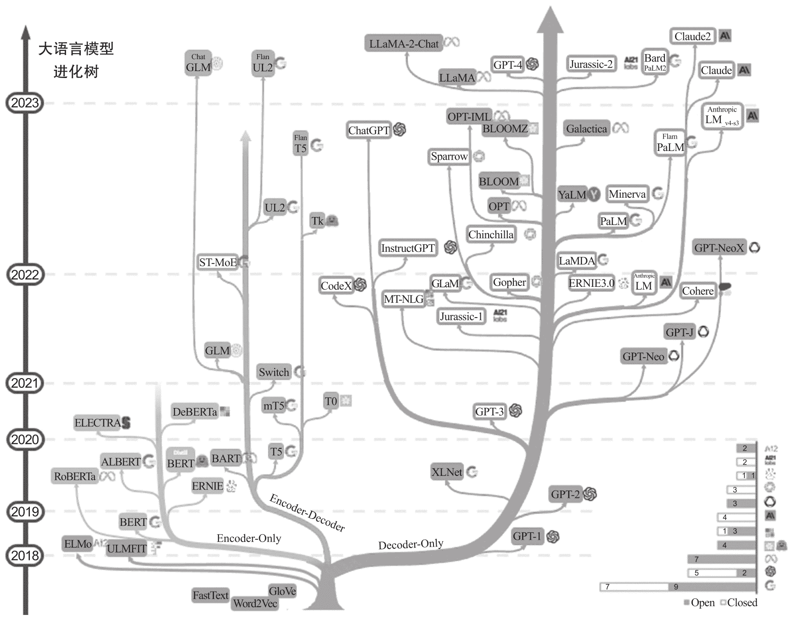

图 1-1 大型语言模型进化树

（3）按架构划分。

❍ Encoder-only 仅编码器：BERT。
❍ Encoder-Decoder 编码器-解码器：GLM、T5。
❍ Decoder-only 仅解码器：GPT、LLaMA、Claude、Gemma。

#### **1.1.3 发展现状**

大型语言模型处于高速发展期，但仍以 OpenAI GPT 系列领先，其他厂商积极追赶。Anthropic 的 Claude3 可能对 GPT 地位构成挑战。Meta 的 LLaMA 虽在 ChatGPT 之后推出，其开源生态推动显著，衍生出众多国内外开源模型，基本满足文本需求。Google 的 Gemma 起点较高。国内除文心一言、讯飞星火等商业化产品外，开源模型如 ChatGLM、阿里通义千问等也提供更多选择，竞争日趋激烈。

除厂商主推的聊天应用外，对开源大模型进行微调并应用于垂直专业领域是重要方向。金融、医疗、编程等领域的专用大模型快速发展，定制化模型在各行业发挥更大作用。随着应用完善，开源大模型在专业垂直领域的前景将更加广阔。

技术层面，基于 Transformer 的 Decoder-only 架构成为主流，各模型呈现一定趋同。大部分开源大模型托管于 huggingface.co，可用 Hugging Face 的 Transformers 库进行加载、推理、微调等。

#### **1.1.4 发展趋势**

# 大语言模型：能力边界与技术骨架

文本处理已经进入可靠实用阶段。即使是参数规模约二十亿的轻量级版本，在办公、学习、日常写作等常见文字场景里，也能给出可直接使用的答案。跨模态方面，视觉理解与合成能力持续成熟，文生图与图生图的应用链路愈发顺滑。OpenAI 近期发布的文生视频模型 Sora 则打开了新的方向，为多模态智能的视频创作提供了想象空间。

模型小型化是另一条清晰的主线。语言模型本质上是将自然语言转为数值计算，运行主要依赖 GPU 算力。数值计算对精度有一定容忍度，在此前提下发展出量化技术，把权重从高精度格式转为低精度格式，例如由 32 位浮点转为 8 位整数 INT8，量化后在准确率上与原版接近。经量化处理的模型可以脱离 GPU 在 CPU 上运行，甚至部署到安卓手机的端侧。这类本地化方案在对安全性要求高、行业垂直、需要离线运行的环境中具备明显潜力。

### 1.2 基本原理

大型语言模型先在海量无标注语料上进行自监督预训练，通过掩码建模、下一句预测等任务学习语言统计规律，随后针对下游自然语言任务做微调，以适配具体用途。比如把通用基座微调后得到对话型模型，使对话更自然。依托无标注语料的训练方式降低了对大规模标注数据的依赖，也让模型具备自回归生成、逐词推测下一个最可能词元的能力 ^(⁵)。

生成文本时，模型要学会连贯流畅地输出由词元组成的语言序列，这种机制与人类语言产生过程相近。大型语言模型的参数规模通常在十亿级乃至百亿级，因而能吸收大量语言知识，拟合训练语料分布，理解语义，展现出强大的生成能力。

#### 1.2.1 Transformer 架构

主流的大型语言模型多以 Transformer 或其改进版作为主干。Transformer 是以自注意力为核心的深度学习结构，由谷歌机器翻译团队的阿什什·瓦斯瓦尼等研究者在 2017 年提出，主要面向序列数据。在自然语言任务里，文本先经词表索引等手段转为数字序列，这一步是把语言问题转为数学计算的关键。

Transformer 的关键在于自注意力，能够在同一文本序列的不同位置之间建立关联，从而更好捕捉长距离依赖。借助自注意力，模型可并行处理输入序列的不同位置，在长序列上表现更佳。输入经多层注意力和前馈神经网络处理后输出序列的向量表示。基于 Transformer 的结构包含 Encoder 编码器与 Decoder 解码器两部分，Encoder 把输入编码为隐藏表示，Decoder 根据 Encoder 的输出生成目标序列。凭借编码器-解码器结构、多头自注意力和前馈全连接网络，模型可学习语言中的长距离依赖并理解语义，在机器翻译、文本生成、问答系统等任务上表现突出。其架构如图 1-2 所示。

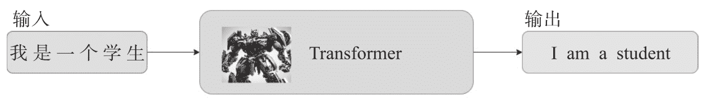

图 1-2 Transformer 架构示意

#### 1.2.2 编码器与解码器

在 Transformer 中，输入先经编码器编码，再由解码器解码输出目标序列。编码器与解码器并非必须成对出现，近年实践可分为三类技术路线：Encoder-only、Encoder-Decoder、Decoder-only，目前 Decoder-only 为主流。

编码器与解码器都由多个结构一致的层堆叠而成，每层包含多头自注意力层和前馈全连接神经网络层，并在子层间加入残差连接与层归一化，以缓解梯度消失、加速训练。

原始 Transformer 由 6 层编码器和 6 层解码器组成，每层编码器的输入来自上一层编码器的输出，每层解码器的输入既有上一层解码器的输出，也包含整个编码部分的输出。文字经编码与解码后形成目标文本。其结构如图 1-3 所示。

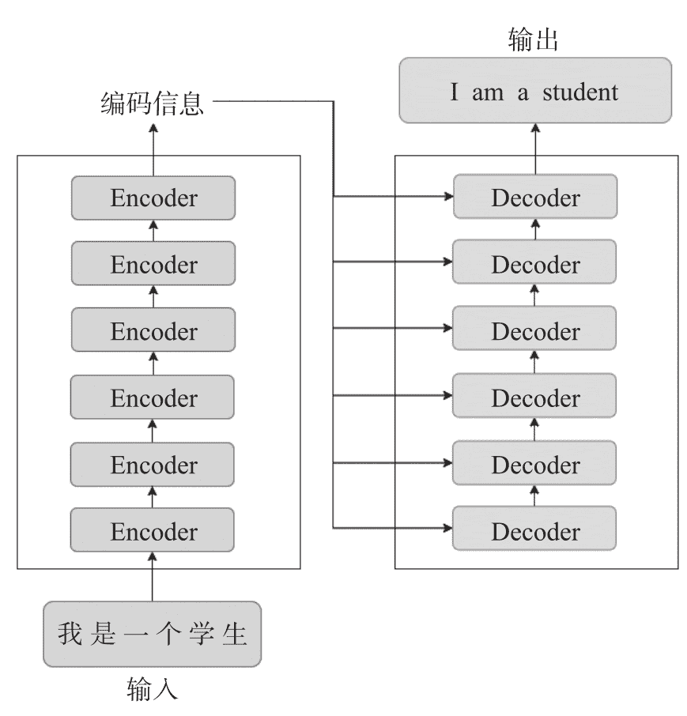

图 1-3 Transformer 分层结构

#### 1.2.3 自注意力机制

自注意力用于计算序列数据中各位置之间的依赖关系，每个输入位置会与其他位置交互以调整自身表示，自注意力让模型在理解某个词元时能参考序列中的其他词元。

如图 1-4 所示，在“大”“模”“型”三个词元之间，“型”与“大”的关联最紧密，与“模”次之。

注意力函数把一个查询和一组键值对映射为输出，其中查询 Q、键 K、值 V 均为向量，输入经三个不同权重矩阵后得到 Q、K、V，如图 1-5 所示。

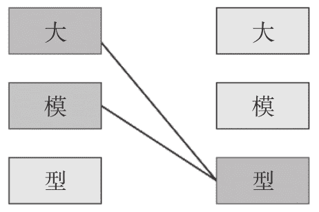

图 1-4 自注意力机制示意

#### 计算示例

Q 乘以 K 得到一个 3×3 矩阵，分别表示一个词元各元素间的注意力值，即相关性，见图 1-6。

d[k] 为缩放系数，默认值 64，用来避免结果过大或过小，防止 softmax 计算后接近 0 或 1。softmax 是归一化函数，可把数值向量转为概率分布，使相关性以概率形式表达。softmax 计算过程如图 1-7 所示。

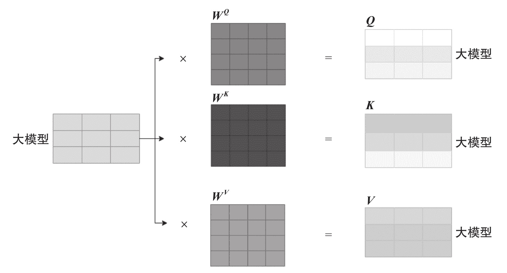

▲图 1-5 自注意力中的 Q、K、V

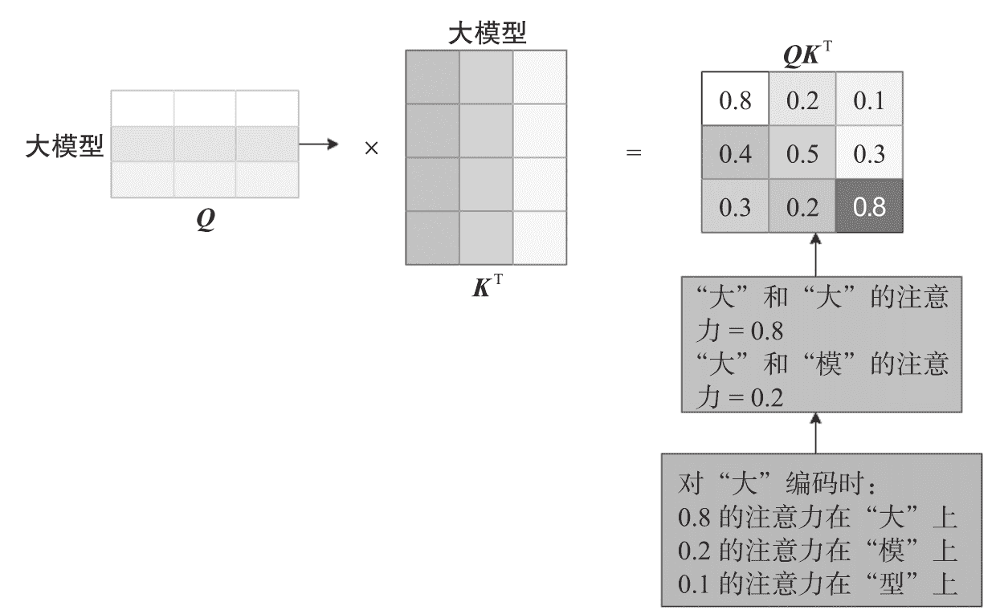

▲图 1-6 注意力计算过程示意

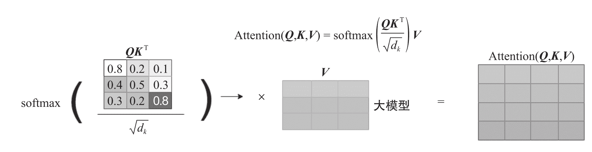

▲图 1-7 softmax 函数计算过程

在 Transformer 架构中，注意力模块会并行重复多次，每一次计算称为一个注意力头 Attention Head。模块把 Q、K、V 拆分成多份，分别由独立的注意力头处理，再融合结果，形成注意力分数，这种机制称为多头注意力，能让 Transformer 更好捕捉词语间多重关系与细微差别。自注意力关注序列内各位置的重要性，多头注意力在多个子空间并行计算注意力，使模型能同时捕获不同方面的上下文信息，从而增强对复杂数据内在结构的分析能力。

### 1.3 应用开发技术

#### 1.3.1 Python

Python 是一种高级编程语言，由 Guido van Rossum 于 1989 年首次发布。可读性强、维护方便、语法简洁，且是面向对象语言，被广泛用于数据科学、机器学习、人工智能、Web 开发、自动化脚本和游戏开发等领域。

随着人工智能与自然语言处理的发展，Python 在 GPT 应用开发中的角色愈发重要，并持续更新。PyTorch、TensorFlow、NumPy 和 Transformers 等库提供了构建与训练 GPT 模型所需的工具，开发者借助 Python 的简洁语法与强大库能快速实现各类 GPT 应用。本书的后端应用均采用 Python 编写，仅用百行以内代码即可实现复杂且功能强大的应用。

下面介绍书中涉及的两个核心库：PyTorch 与 Transformers。

**1.PyTorch**

PyTorch 是 Torch 的 Python 版本。Torch 是一个开源机器学习库，最初由 Facebook（Meta）开发，提供构建深度学习模型的工具与算法，使用 Lua 编程语言并提供可在 GPU 上高效运行的灵活张量库。PyTorch 在此基础上使用 Python 作为主要语言，提供更方便的工具与接口，使深度学习模型的构建与训练更简单直观。

**2.Transformers**

Transformers 库与 Transformer 架构相关。Transformer 是大语言模型开发中常用的一种深度学习架构，而 Transformers 是 Hugging Face 开发的开源自然语言处理库，支持大量预训练 Transformer 模型如 BERT、GPT、LLaMA，提供便捷的 API 与工具，让开发者更容易加载、微调和使用预训练模型，从而快速构建自己的 NLP 应用。

#### 1.3.2 React.js

React.js 是由 Facebook（Meta）开发的用于构建用户界面的 JavaScript 库，采用组件化方式构建 UI，使开发人员能更高效地构建复杂的 Web 应用。本书提供的开发案例中，除个别应用以命令行运行或以 Python 构建 Web 应用外，其余均需开发客户端，选用 React.js 主要基于以下优势。

❍ 组件化 UI：React.js 以组件构建 UI，使代码组织更清晰、维护更方便。本书中常用的客户端 Chat 组件即基于开源软件 ChatUI ^(⁶) 定制。

❍ 动态性：React.js 支持动态渲染，可实时更新 UI，使应用更响应。

❍ 热更新：React.js 支持热更新，修改源码后结果立刻反映到浏览器，无需重启服务或刷新页面，开发效率更高。

❍ Node.js 支持：React.js 应用开发需要 Node.js 环境支持，而大语言模型提供 OpenAI 兼容的推理接口，客户端可使用 openai-node 组件调用大模型服务。从客户端视角看，统一接口消除了访问不同大模型方法的差异。

### 1.4 训练方法

本书涉及的大语言模型大多是预训练模型。在相关语境里，训练 Training 与微调 Fine-Tuning 的界限比较模糊，提到“训练”时往往指“微调”。但预训练 Pre-training 与微调是完全不同的概念。预训练是指训练出已掌握各类语言特征规律及人类知识的模型，并用参数固定这些已学到的知识。微调则是调整大语言模型参数以适应特定任务的过程，通过在与任务相关的数据集上训练完成。微调在开始时以预训练模型权重初始化，随后逐步调整权重以适应下游任务，如对话、翻译、文本分类、摘要等。以 ChatGPT 为例，其使用的模型是在基础模型 davinci 上微调形成的，GLM 基础模型微调后生成对话模型 ChatGLM。

微调虽然过程复杂，但相比从零训练全新模型，仅需对参数做细微调整，且使用的数据集通常相对较小，目前主流方法有 FFT、RLHF、P-Tuning 和 LoRA 等。与预训练需要海量语料不同，微调数据量较小，一般由 52000 个任务数据构成。

#### 1.4.1 FFT

FFT 即 Full Fine Tuning 全量微调，做法是对整个预训练模型的所有参数进行微调，所有层和参数都可能被更新与优化，以适应新语料。这种方法适用于微调任务与预训练模型差异较大的情况，例如把基础模型用于金融服务。全量微调需要较多的算力与时间，但效果通常较好。

#### 1.4.2 RLHF

RLHF 是 Reinforcement Learning from Human Feedback 人类反馈强化学习的缩写，指基于人类反馈对大语言模型进行强化学习，使生成结果更符合人类期望。RLHF 是 ChatGPT 训练手段之一，其流程分为三步。

❍ 监督微调 Supervised Fine-Tuning，SFT：使用人工精选的问题与答案对预训练语言模型进行微调，形成多个候选模型。

❍ 奖励模型微调 Reward Model Fine-Tuning，RW：用多个模型给出问题的不同回答，然后人工按可读性、无害、正确性等标准排序，训练奖励模型或偏好模型来打分。

❍ RLHF 训练：利用近端策略优化 Proximal Policy Optimization，PPO 算法，根据 RW 模型的奖励反馈进一步微调 SFT 模型。

实践 RLHF 微调并不需要很高算力，可在消费级推理卡上进行，Deepspeed-chat ^(⁷) 给出了完整的 RLHF 三阶段微调方法与示例。

#### 1.4.3 P-Tuning

P-Tuning 是 ChatGLM 模型专用的微调方式，是在微调方法上改进形成的参数高效微调方法。P-Tuning 过程中只有少量参数参与微调，计算复杂度相对较低，其原理是将人工提示词模板转换为可学习的连续向量，通过学习下游任务来优化这些向量，从而自动生成效果良好的提示模板。P-Tuning v2 对该方法做了优化，使其在各种规模模型中普遍有效，优化后的提示调整策略在中小型模型和序列标注任务上实现了与传统微调相当的性能。

#### 1.4.4 LoRA

LoRA ^(⁸) 即 Low-Rank Adaptation of large language model，大语言模型的低秩适配。基本原理是冻结预训练好的模型权重参数，在冻结原模型参数的基础上向模型中加入额外网络层，只训练新增网络层参数。由于新增参数数量很少，微调成本显著下降，同时能获得与全模型参数参与微调相近的效果。在实践中，经过 LoRA 微调的模型对新语料知识的学习效果显著，是一种低算力、低成本且效果较好的微调方法。

### 1.5 常见现象

大语言模型应用领域经常出现一些非专业术语描述现象，下面做详细说明。

#### 1.5.1 幻觉

大模型幻觉 Hallucination 指模型在面对某些输入时产生不准确、不完整或误导性输出，即“一本正经地说胡话”，比如给出不准确答案、不存在的参考文献、对近期新闻做出不合理评论等。幻觉产生原因多样，如模型参数不足、语料时效性差、语料量或训练不足等。总之，因模型能力强大，人们误以为它能回答一切，实际上不可能。模型为避免因知识储备不足而拒绝回答导致用户不信任，会生成语义正确但逻辑错误的答案，这即被称为幻觉，但这一名称的诗意无法掩盖问题的严重性。

#### 1.5.2 灾难性遗忘

灾难性遗忘 Catastrophic Forgetting 通常发生在模型进行参数微调后，学习新知识的过程会迅速破坏之前获得的信息。简单说，微调改变了模型参数，使其“忘记”原来学到的知识，输出效果还不如原始模型，原因多为语料质量差、训练不足、噪声干扰、过度拟合微调数据集等。

#### 1.5.3 涌现

涌现指模型未经直接训练，突然而不可预测地展现出的能力。例如在大量自然语言文本训练后突然能回答未见过的问题、总结段落或文章内容、解答数学题并达到较高准确率。该能力在模型参数达到一定规模或训练到一定阶段时突然出现非线性增长，见图 1-8。

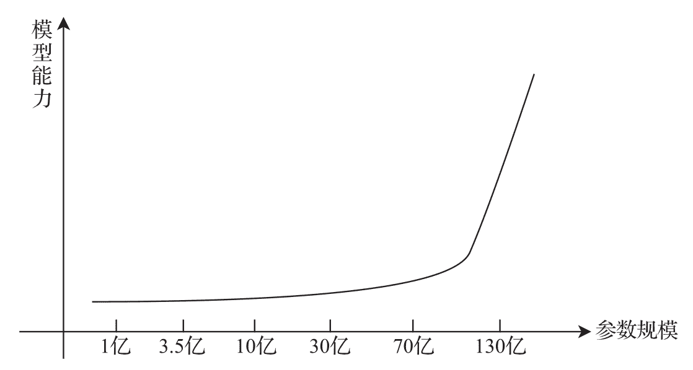

图 1-8 涌现示意

关于涌现是否真实存在，业界目前有两种观点。

1）确实存在涌现：随着参数量和训练数据增加，规模较大的模型确实会突然具备规模较小模型不具备的能力，且不能从小模型表现推导出新能力出现的规模条件。

2）不存在涌现：这是不完善评估方法造成的错觉，使用非线性或不连续的评估标准会造成涌现假象，而通过线性或连续评估标准可以相当好地预测大语言模型的能力。

#### 1.5.4 价值对齐

随着大模型开始承担语言理解与内容生成工作，人们需面对如何让大模型的能力与行为与人类价值观、真实意图和伦理原则保持一致的问题，这被称为价值对齐 Value Alignment。价值对齐是 AI 安全的核心议题，未对齐的大语言模型可能输出含有种族歧视、性别歧视、违法或不良倾向的内容。对此，人类反馈强化学习 RLHF 被证实是有效解决价值对齐问题的方法，它可通过少量人类反馈数据实现较好对齐效果。模型的对齐步骤必不可少，但如果开发并运营基于大语言模型的产品，仅做模型对齐不够，还需要在应用端做大量信息处理，拦截明显不符合人类价值观的问题和答案。

## 第二章

## 大语言模型应用架构

本书介绍的大语言模型应用主要指将大型模型部署到本地环境，而非直接使用 ChatGPT 等云端服务。换句话说，这些模型安装在本地 GPU 算力服务器上运行，不依赖其他在线服务资源。通过学习这些完整的大型模型应用案例，读者将全面了解大语言模型的部署方案和开发方法。

### 2.1 整体架构

# 大模型应用怎么搭

要把一个大语言模型真正跑起来，整体可以拆成三层配合。最底层是承载算力的硬件和系统；中间层是让程序跑起来的基础开发环境；最上层是真正提供服务的业务代码。大语言模型应用的整体蓝图如图 2-1 所示。

1）基础设施层：由服务器、推理加速卡、网卡等物理设备构成，给模型运行提供算力载体和主机环境，配套的操作系统、驱动等也划入这一层，负责把 GPU 计算能力暴露给上层。

2）基础软件层：由 CUDA、PyTorch、Python 虚拟环境工具 Anaconda 以及用来部署前端的 Nginx 组成，为开发与运行提供统一的环境与 AI 计算支撑。

3）应用软件层：后端包含模型权重文件、Transformers 库、基于大模型的服务程序以及 OpenAI 兼容的 API 接口，负责模型加载、推理和对外服务；前端可用 Python 或 React.js 构建页面，通过浏览器调用兼容 API 完成交互，核心由 HTML5 与 JavaScript 构成。若使用 React.js，前端代码编译后以 HTML 与 JavaScript 的形式发布到 Nginx，由其提供 Web 服务。

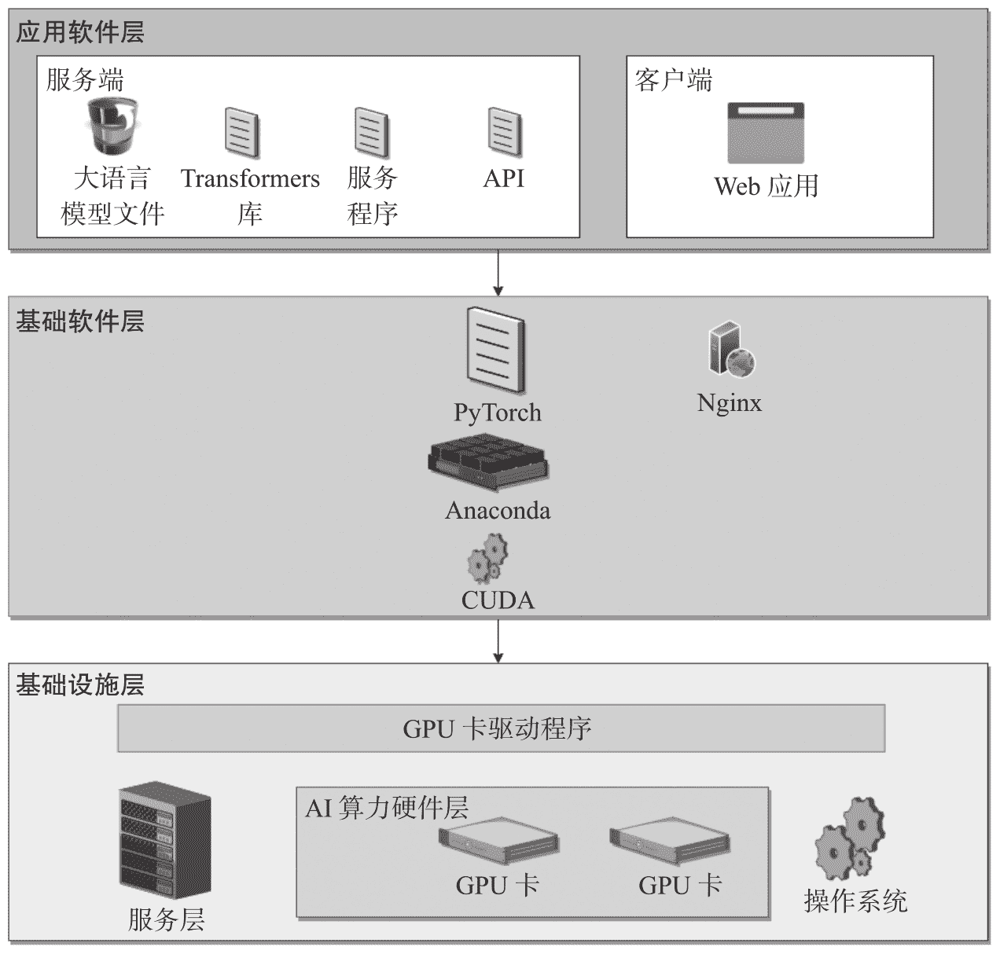

图 2-1 大语言模型应用的整体架构

### **2.2 基础设施**

支撑大规模语言模型训练与推理的基础设施，本质上是满足推理卡运行需求的计算底座，涵盖服务器、推理卡与操作系统。整体需要具备充足的浮点运算并发能力。

#### **2.2.1 硬件部分**

硬件主要指服务器与推理卡。AI 推理卡与面向消费者的显卡定位不同，推理卡专为人工智能任务设计，计算强度与并行度更高，能承载深度学习、神经网络等复杂负载，而消费级显卡更侧重图形渲染与游戏。推理卡通常没有显示输出接口，不能直接当显卡使用，多不带风扇，散热依赖服务器本身的设计。常见的型号有 A100、A800、A10、P100、V100、T4 等，高端消费级显卡如 RTX4090、RTX3090、RTX2080 也可用于模型运算，具体选型依据需求与性价比。

服务器选型要核查电源是否能带得动推理卡，主板是否支持相应卡型，CPU、内存等是否满足模型运行要求。一般而言，能否运行一个模型取决于 GPU 的显存大小，运行效率则取决于 GPU 上的计算单元数量。

#### **2.2.2 操作系统**

Windows、Linux、macOS 都能运行大语言模型应用，但不同系统对依赖库的支持存在差异。例如，PyTorch 的 k 位量化库 bitsandbytes ^(¹¹)在 Windows 上易出现兼容问题，在 Linux 上更为稳定，因此长期训练与使用建议选用 Linux，如 Ubuntu22.04 等发行版。

### **2.3 基础软件**

#### **2.3.1 CUDA**

CUDA（Compute Unified Device Architecture、统一计算设备架构） ^(⁹)是 NVIDIA 推出的并行计算平台与编程模型，能释放 GPU 的并行算力加速通用计算。开发者可用类 C 语言编写程序在 NVIDIA GPU 上运行，利用数千个并行核心加速科学计算、深度学习、图形渲染等任务，并提供丰富的库与工具链。

CUDA 运行依赖推理卡驱动。安装驱动后，可用“nvidia-smi”查看最高支持的 CUDA 版本，如 11.7、12.1、12.2 等。实际部署时应选用与驱动匹配的 CUDA 版本以降低兼容风险。例如 DeepSpeed 微调时，CUDA 与 PyTorch 版本匹配要求严格，通常不追求最新版，而是选择适配组合。

#### **2.3.2 PyTorch**

Torch 是一个开源科学计算框架，原生基于 Lua，提供数学函数与数据结构以支持高效计算与机器学习。PyTorch 是其 Python 实现，由 Meta 人工智能研究团队维护，包含张量计算 torch.Tensor、CUDA 交互 torch.cuda、神经网络模块 torch.nn、分布式计算 torch.distributed 等。本书涉及的大语言模型除少量 C++量化程序在 CPU 运行外，其余场景均依赖 PyTorch，因版本众多，需结合组件依赖与 CUDA 版本挑选适配版本安装。

#### **2.3.3 Anaconda**

不同大模型项目使用的 Python 版本与依赖库差异较大。若直接在系统上安装，容易出现项目间冲突，甚至单项目内部服务依赖互斥。引入 Python 虚拟化可让不同项目在隔离环境中运行，各自拥有独立文件体系。

实现虚拟化可用 Python 自带的 venv 模块或 Anaconda 发行版，二者均能隔离环境。本书采用 Anaconda，其结构如图 2-2 所示。

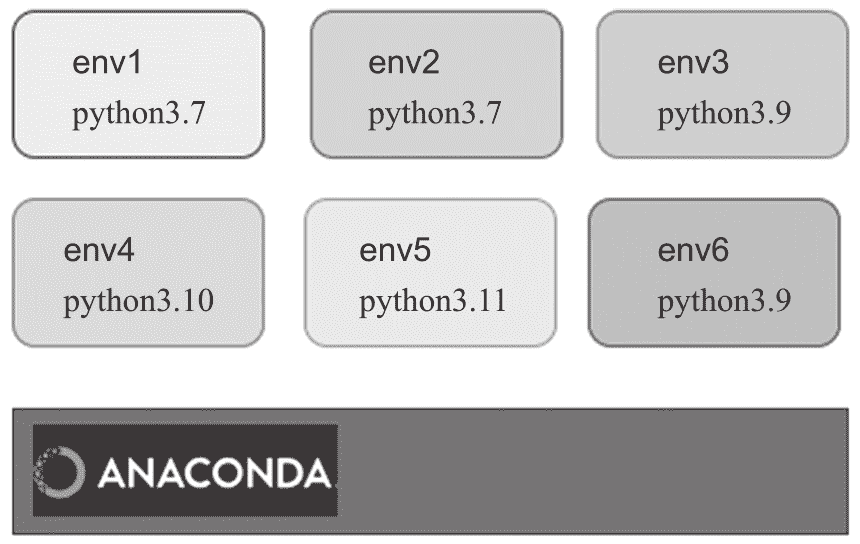

图 2-2 Anaconda 虚拟环境

Anaconda 是 Continuum Analytics 打造的开源 Python 发行版与包管理器，内置大量数据科学、机器学习相关库。其自带的 Conda 工具可便捷创建、更新和管理虚拟环境，受 Anaconda 管理的环境默认存放于“～/anaconda3/envs/虚拟环境名”。

#### **2.3.4 Nginx**

Nginx 是一款高性能 HTTP 与反向代理 Web 服务器，同时可提供 IMAP/POP3/SMTP 服务。由伊戈尔·赛索耶夫开发，采用类 BSD 许可证，因稳定、功能丰富、配置简洁、资源占用低而广受欢迎。 ^(¹²)

本书例程多采用 React.js 开发，调试时用 npm ^(¹³)启动。正式部署时，编译后的 HTML5 与 JavaScript 复制到 Nginx 的 html 目录即可上线，更新只需替换编译产物，多数情况无需重启服务。高并发场景下可对相关参数调优。Nginx 还支持负载均衡、SSL 证书配置、HTTP 代理与文件下载，是理想的 Web 发布层。

### **2.4 应用软件**

#### **2.4.1 大语言模型文件**

模型文件主要包括权重参数、配置文件、词表与分词标记器配置。下载到本地服务器后，由 Transformers 库加载到 GPU 以提供推理能力。

#### **2.4.2 Transformers 库**

Transformers 基本统一了大语言模型的调用接口。只要是 Hugging Face 格式，装载均可采用 Model.from_pretrained。虽然部分模型使用 AutoModel，部分使用 LlamaForCausalLM 等专用类，编程范式仍高度一致。微调方面，Transformers 也提供 TRL ^(¹⁴)、PEFT ^(¹⁵)等统一编码方式，抹平了不同模型在装载、推理、微调上的差异。

#### **2.4.3 服务程序**

服务程序作为后端，负责加载模型并对外提供推理。得益于 Transformers 的封装，最简推理服务剔除注释后仅有约 6 行 Python 代码。有个网络段子描述了这一现象：面试时应聘者详细讲解 Transformer 编码器-解码器与自注意力机制，上岗后实际开发只要一行“import transformers”。夸张虽夸张，却反映出当前大模型应用开发的高效现实。

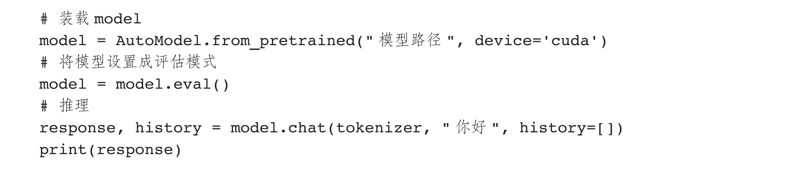

#### **2.4.4 API**

在 Chat 类应用中，OpenAI 提供的核心接口有 models、completions、embeddings，其路径与用途见表 2-1。

表 2-1 OpenAI 兼容接口的请求路径及主要作用

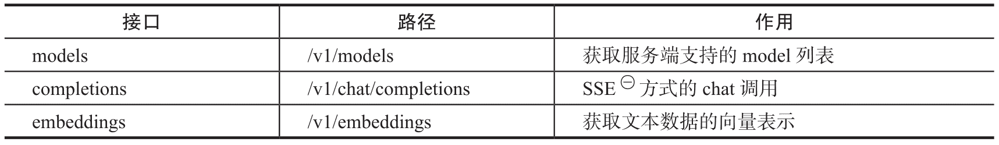

㊀Server Sent Event，服务端发送事件，是指客户端与服务端建立连接后，服务端主动向客户端推送数据。

按这三类标准接口开发服务程序后，大多数可访问 OpenAI 兼容接口的客户端只需配置地址即可接入。上述接口面向 Chat 场景，实际开发中检索知识库、语音对话等需求，也可变通使用 completions 接口调用。

#### **2.4.5 客户端程序**

验证模型效果的 Demo 常采用 Gradio 库 ^(¹⁶)快速搭建。Gradio 是专为机器学习与数据科学演示设计的开源 Python 库，在大模型 Demo 开发中应用广泛，内置操作与解释工具，便于模型调用与交互。

另一类调试方式是使用基于 Gradio 的开源客户端，如 text-generation-webui ^(¹⁷)。这类工具可直接加载本地模型文件，进行对话与 LoRA 微调，功能丰富且界面友好。

面向对外服务的产品，Gradio 或 text-generation-webui 不太合适，需自行实现 OpenAI 兼容接口，并用 Gradio 或 React.js 定制客户端。

## **第三章**

## **大语言模型应用的工作模式**

大语言模型应用离不开服务器与推理卡的硬件支持，也需要 CUDA、PyTorch 等计算软件，同时要集齐模型、Transformers 库、服务程序与客户端的完整组件。本章讨论组件部署方式、协同机制，并梳理典型工作流程。

### **3.1 硬件部署**

大语言模型使用的硬件可分为服务端与客户端，两端通常分离。服务端可细分为模型 API 服务、业务服务与 Web 服务，可独立部署，也可合置于同一物理机或虚拟机。模型 API 服务负责模型加载、运行与 API 提供；业务服务除模型调用外，还承担文件接收、WebSocket 等功能；Web 服务负责页面分发。

客户端硬件包括 PC、笔记本与移动设备，通过浏览器访问 Web 服务器获取页面、提交数据并展示结果。

互联网应用中，客户端与服务端需通过防火墙隔离，Web 服务器需绑定 SSL 证书提供 HTTPS 安全通道。

硬件部署结构如图 3-1 所示。

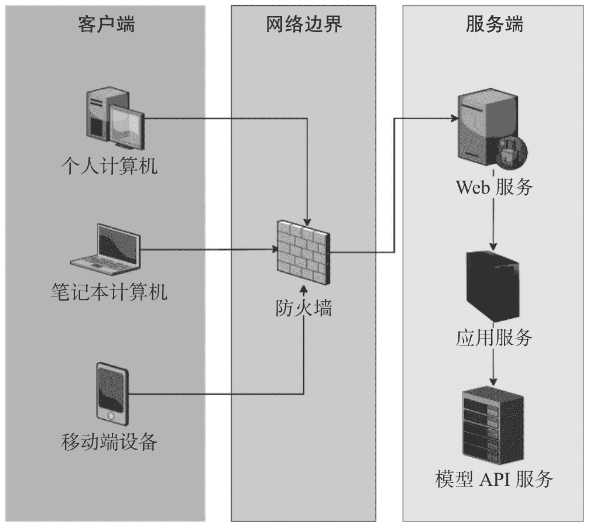

图 3-1 大语言模型硬件部署结构

### **3.2 应用软件部署**

应用软件主要分三部分。其一，模型 API 服务以 Python 编写。其二，业务服务也多以 Python 实现，若场景简单可与模型 API 合并，例如同一函数既响应 HTTP 请求又调用推理。其三，Web 服务可用 Python 开发，也可用 React.js 等 JavaScript 框架开发。若客户端为原生 App，Web 服务则主要承担 SSL、负载均衡、路径代理等功能。本书实例基本围绕这三层构建。应用软件部署结构如图 3-2 所示。

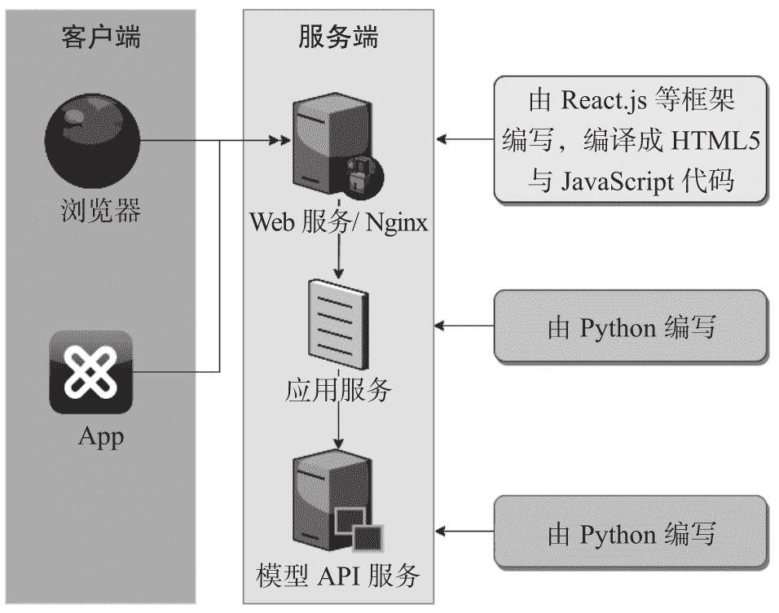

图 3-2 大语言模型应用软件部署结构

### **3.3 运行模式**

服务端包含模型 API 服务与业务服务，业务服务即常规 HTTP 服务，提供 GET/POST 响应，特殊性不大。下面重点说明模型 API 服务的工作模式与运行过程。

#### **3.3.1 模型 API 服务的工作模式**

与传统 HTTP 服务不同，模型 API 服务依赖 AI 算力，上层程序调用 GPU 需经 Transformers 库、PyTorch、Python 运行环境、CUDA、推理卡驱动逐级下探，链路较长。开发时主要与 Transformers 库交互，但仍需了解底层组件。因为调用 Transformers 方法时仍会涉及 CUDA，调试时要关注 PyTorch 状态，报错常指向 CUDA 库文件，运行时需通过驱动命令监控性能指标。图 3-3 展示了各层级关系。

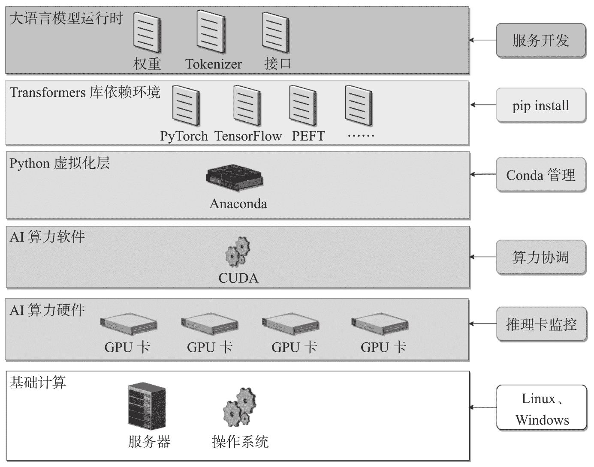

图 3-3 大语言模型 API 服务工作模式

①基础计算：服务器 CPU、内存、硬盘、网络等，由操作系统统一调度提供基础计算能力。

②AI 算力硬件：由一到多块推理卡组成，运行期可用驱动提供的“nvidia-smi”监控 GPU 计算单元使用率、显存占用、温度、功耗等。

③AI 算力软件：CUDA 负责调度推理卡，将计算落地到具体硬件。

④Python 虚拟化层：Anaconda 实现项目级 Python 与依赖隔离，虚拟环境由 conda 命令创建与激活。

⑤Transformers 库依赖环境：服务程序主要与 Transformers 交互，实际计算由背后的 PyTorch、TensorFlow 与 PEFT 等微调库完成，这些库通常通过 pip 安装。

⑥大语言模型运行时：服务在隔离的 Python 环境中运行，调用 Transformers 函数加载权重与 Tokenizer，接收客户端 API 请求进行推理并返回结果。

#### **3.3.2 模型 API 服务的运行过程**

受 Transformers 封装影响，服务程序关注点集中在启动与推理。

启动流程如下。

①装载 Tokenizer。Tokenizer（分词标记器） ^(¹⁹)负责文本预处理，将输入切分为 token 序列并转为数字表示。具体为先从指定目录加载配置文件，实例化对应分词类如 BERTTokenizer、GPTTokenizer，再将配置应用到实例以保证与预训练模型一致。

②装载权重。按配置将模型权重载入 GPU 显存用于推理。先加载预训练模型配置文件，实例化模型类如 BERT、GPT、LLaMA，再应用配置确保结构一致，有 GPU 时将模型迁移至 GPU 加速。

③切换为评估模式。将模型置于评估模式后权重不再更新，虽然仍会计算梯度但不执行反向传播，模型处于锁定状态，推理不会改动参数。

推理流程如下。

①通过 HTTP 监听客户端入参，通常包含模型名、历史会话 Messages、预测参数 temperature、top_p、max_tokens 等，以及是否采用流式返回。

②对 Messages 文本做 Tokenizer 预处理，转为数字表示后送入模型计算。

③把结果返回客户端。若要求流式返回，则使用 SSE 主动推送结果。

启动与推理流程见图 3-4。

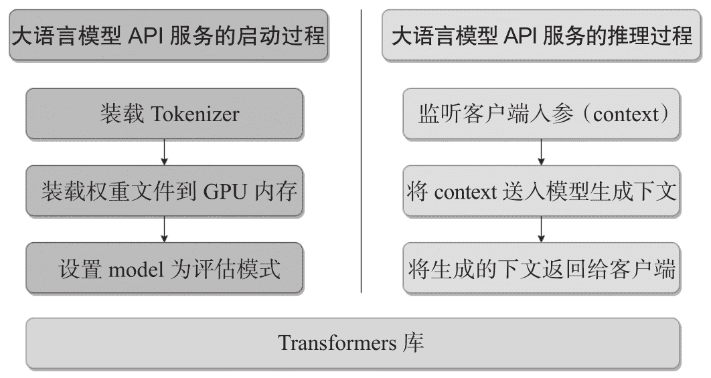

图 3-4 大语言模型 API 服务的启动和推理过程

#### **3.3.3 让对话实时流式返回**

和普通 Web 服务不同，大模型并不是去数据库里取数据，而是现场推理出答案。生成文本需要时间，如果继续使用传统的请求-响应模式，用户发完问题后只能干等几秒到十几秒，最后才一次性收到整段回复，等待感很强。

大模型的推理本质上是逐步预测，模型每次先产出少量 token 再累加成完整结果。把这个逐步生成的过程映射到前端，就能避免长时间空白。OpenAI 兼容接口引入了 SSE，SSE 是 HTML5 的服务器推送机制，服务端无需客户端反复询问，有新片段就立即推送。用户端看到文本是逐段递进的，观看体验顺滑，还自带打字机般的视觉效果，像是模型在边思考边打字作答。这样既缓解了用户对速度的焦虑，也降低了 API 的并发压力。原理示意图见图 3-5。

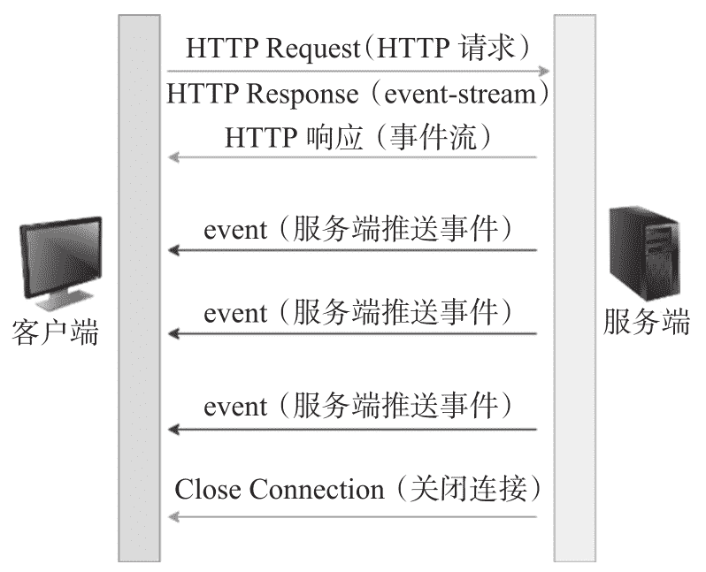

图 3-5 SSE 原理

#### **3.3.4 前端如何对接 SSE 接口**

后端提供 SSE 类型的接口，前端调用方式也要相对应。以 React 场景下常用的 openai-node 套件为例，调用流程如下：

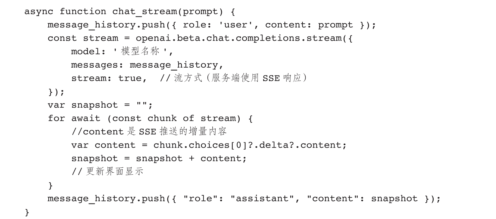

# **实操篇**

■ 第四章 应用环境搭建
■ 第五章 大语言模型部署
■ 第六章 大语言模型微调
■ 第七章 大语言模型量化
■ 第八章 多模态模型应用

大模型相关工作实践性很强，从推理卡驱动到各组件部署，再到模型的安装、微调、量化与开发，每一步都需要大量动手练习才能熟练。

本书涉及的模型均基于 Transformer 架构。使用 Transformers 库时整体思路相近，但在不同操作系统、不同推理卡、不同 CUDA 版本下细节差异明显，甚至小版本的组件变动都可能引发难以排查的问题。因此提供经过验证的详细实操路径尤为重要。

本篇挑选了代表性模型与高频场景进行深入讲解。读者既可按书中步骤直接操作，也能通过理解案例背后的原理与方法，迁移到同类模型的实践中。本篇共 5 章，聚焦大模型的实操环节，涵盖环境搭建、部署、微调、量化等常用操作。

❍ 第四章系统说明大模型依赖的服务器、操作系统配置要求及推理卡安装方式，并在硬件就绪后介绍如何在多种系统上部署推理卡驱动、CUDA、Anaconda、PyTorch、Nginx 与 Git 等基础组件。
❍ 第五章详细描述 ChatGLM、Qwen、LLaMA2、Gemma、Whisper 等模型的部署过程。虽然它们都依赖 Transformers 库，但存在细微差别。文中尽量用简短 Python 程序校验安装是否成功，帮助读者尽快进入开发。
❍ 第六章讲解大语言模型的微调方法。相较于部署，微调步骤更多，涉及语料整理、模型训练、模型合并等，还包括 P-Tuning、LoRA 等方案的选择与参数设定。
❍ 第七章讲解在缺乏 GPU 的低算力环境下，即在 Windows 与 CPU 条件下的推理部署，涉及 llama.cpp 与 gemma.cpp 两种量化方案。
❍ 第八章介绍图像模型 Stable Diffusion 的安装与使用。读者可掌握文生图、图生图等多模态应用，为数字人等应用的图像技术储备打下基础。

## 第四章
## 应用环境搭建

本章说明大语言模型应用环境的搭建方法。具体包括推理卡硬件的安装，以及在 Ubuntu、Redhat、Windows 下安装推理卡驱动、CUDA、Anaconda 等基础软件，和 PyTorch、Nginx、Git 的部署过程。

### 4.1 基础设施

#### 4.1.1 服务器要求

大模型应用的硬件主要由服务器与推理卡构成。服务器可用高性能个人电脑替代，对主板与电源有一定要求，电源功率建议不低于 750W，主板需兼容推理卡。与消费级显卡不同，推理卡通常没有内置风扇，温度过高时会触发自我保护，导致系统无法识别。因此机箱内需加装风扇以保证散热，维持正常工作。

#### 4.1.2 操作系统准备

操作系统可选用主流 Linux 发行版或 Windows。在安装推理卡前，先完成系统更新与补丁安装。如在 Ubuntu 上，可通过刷新包列表再执行升级。若服务器上已有应用在运行，建议谨慎使用升级命令，以免升级后导致服务异常。Windows 的更新相对简单，进入设置中的更新与安全后检查更新即可自动完成，风险较低。

#### 4.1.3 推理卡安装

以 NVIDIA P100 推理卡为例。安装时将卡插入 PCI-E 插槽并拧紧螺丝，确保固定牢靠且散热通畅，随后连接电源，效果如图 4-1 所示。

### 4.2 基础软件安装

以下介绍在不同操作系统下部署推理卡驱动、CUDA、Anaconda，以及安装后如何校验 PyTorch 与 CUDA 的匹配情况。

#### 4.2.1 Linux

Linux 发行版众多，这里选取两个具有代表性的版本说明。一个是 Ubuntu22.04，使用 apt 管理包，另一个是 Red Hat Enterprise Linux 9，使用 yum 管理包。以下代码中以“#”开头的行为注释，无需执行。

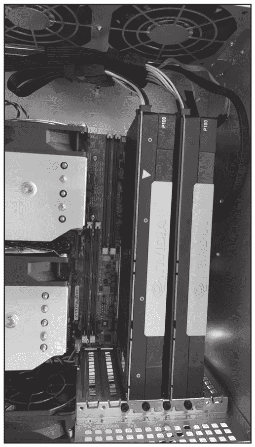

图 4-1 推理卡硬件安装

**1.部署显卡驱动**

（1）确认硬件已正确安装

执行 lspci 命令，结果如图 4-2，显示服务器上安装了一块 Tesla T4。不同型号的显示内容会略有差异。

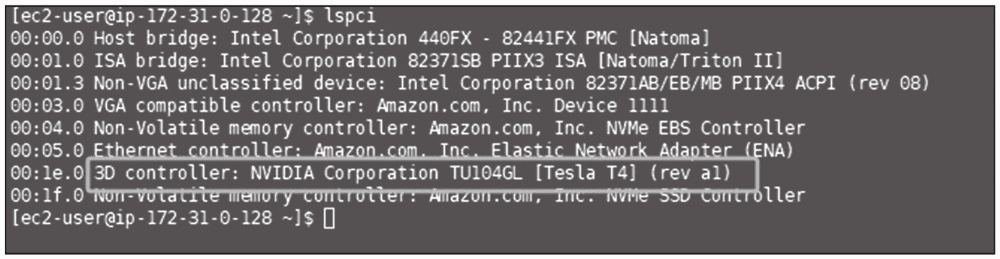

图 4-2 推理卡硬件信息

（2）更新操作系统

Ubuntu 与 RHEL 在两点上不同。一是包管理器，Ubuntu 用 apt，RHEL 用 yum。二是 RHEL 需要额外安装与当前内核匹配的开发包，因为安装驱动时需要用到该包，而 Ubuntu 已内置对应版本的内核开发包。

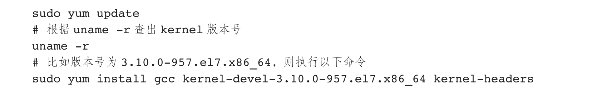

（3）部署编译环境

wget 用于下载文件，Ubuntu 默认已存在，RHEL 需要单独安装。

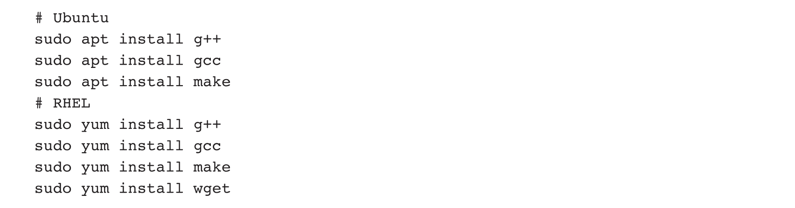

（4）禁用 Nouveau

Nouveau 是 Linux 自带的开源显卡驱动，安装系统后即可直接使用桌面显示，许多发行版默认集成。在安装 NVIDIA 官方驱动前需禁用 Nouveau，避免冲突并确保新驱动正常加载。

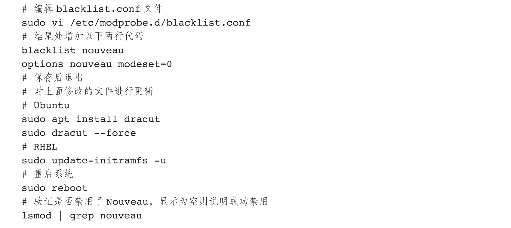

（5）关闭显示服务


（6）获取驱动程序

可访问 NVIDIA 官网，按产品类型、系列、家族及操作系统筛选后下载，如图 4-3 所示。

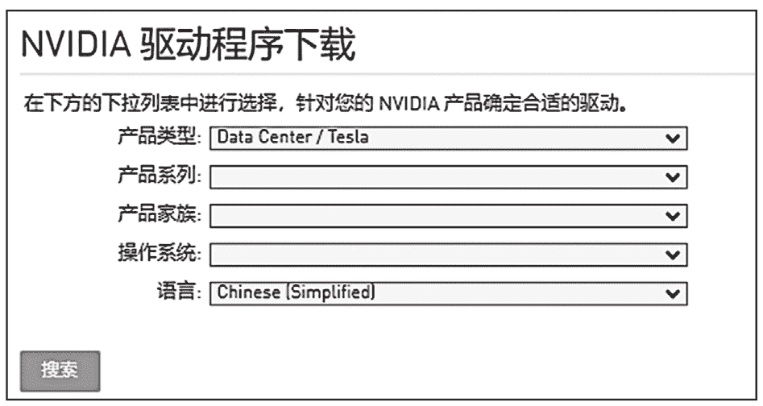

图 4-3 NVIDIA 驱动程序的搜索下载

也可使用下列命令直接下载 525.85.05 版本驱动。


（7）驱动程序的部署


（8）驱动生效校验

安装完成后执行 nvidia-smi 查看驱动是否生效，如图 4-4 所示。

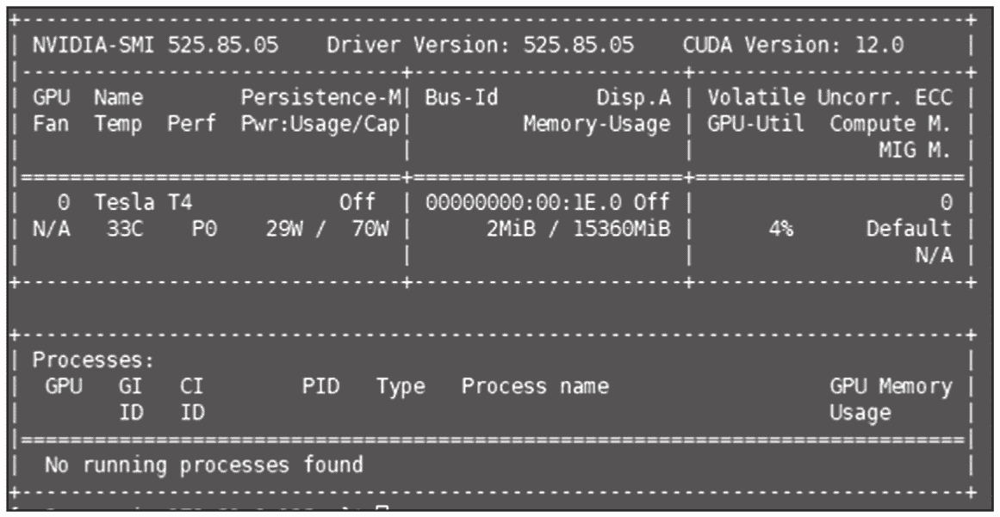

图 4-4 Linux 上推理卡运行情况

其中可看到若干指标，见表 4-1。

表 4-1 通过 nvidia-smi 命令显示的推理卡在 Linux 上的指标示例

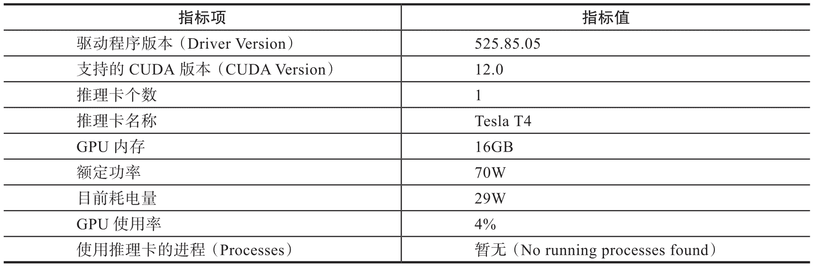

**2.CUDA 环境搭建**

（1）选择安装程序

CUDA 安装包取决于操作系统、CPU 架构、发行版及版本、介质类型等。若要搭建 CUDA12.0.1，可打开官方归档页。其他版本同理，在该页面选择参数后会生成下载命令与安装说明，见图 4-5。

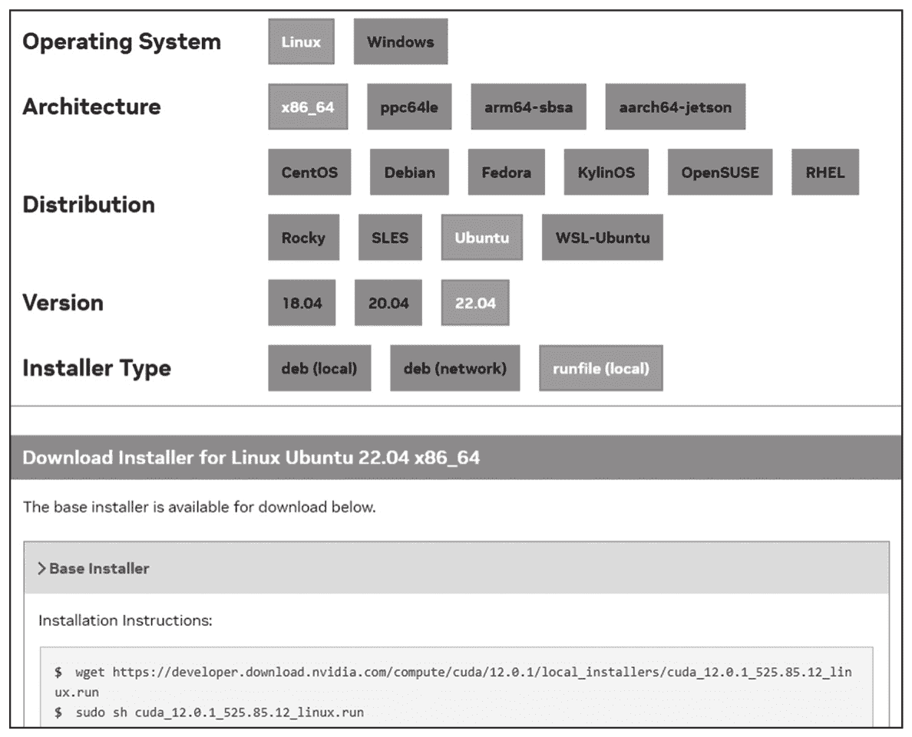

图 4-5 CUDA 安装程序选择

（2）获取安装程序

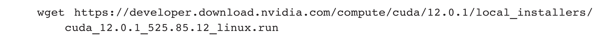

（3）运行安装向导


安装过程中需在协议确认处手动输入 accept 后回车，见图 4-6。

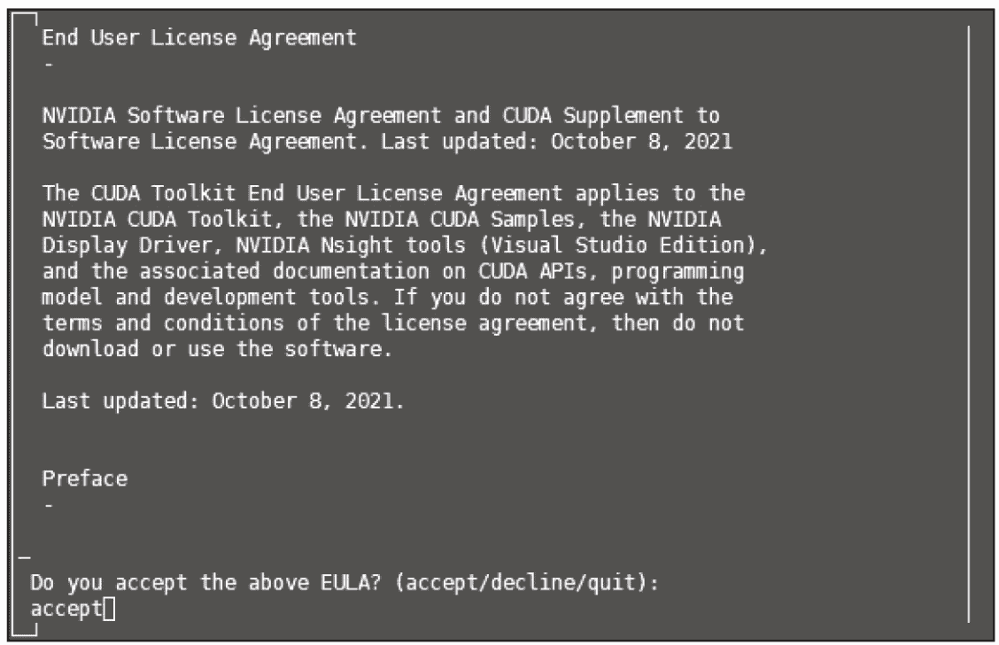

图 4-6 安装 CUDA 时同意协议

由于驱动已装，需用空格键去掉 Driver 前的勾选，然后选择 Install 进行安装，见图 4-7。

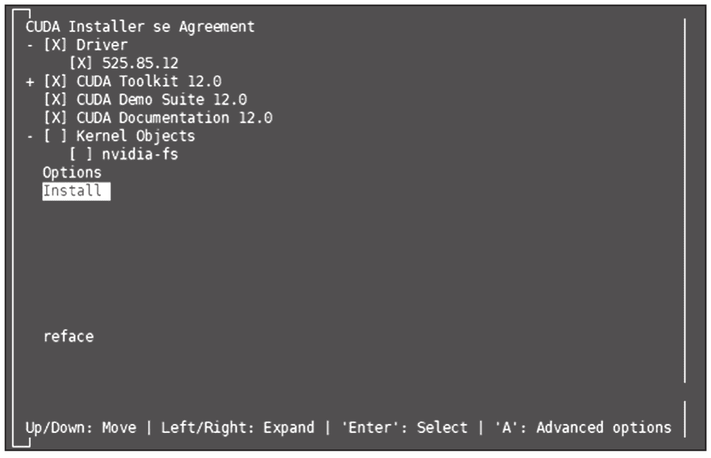

图 4-7 开始安装 CUDA

#### **注意**

在 Ubuntu20.04 上首次部署 CUDA 可能报错，二次部署时在接受协议后会出现 Upgrade all 选项，按此选项部署即可。Ubuntu22.04 目前未出现该问题。

（4）环境变量配置

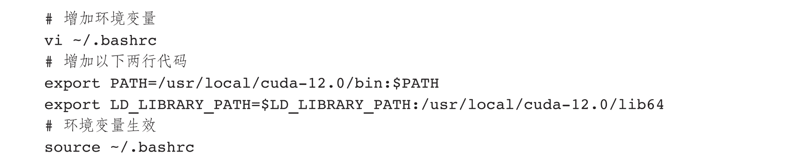

（5）安装校验

安装成功后运行 nvcc -V 命令，即可显示 CUDA 版本号。

**3.Anaconda 部署**

（1）获取安装包


（2）运行安装包


安装过程有几处需注意。

第一处：开始阅读协议，需按回车键确认，见图 4-8。

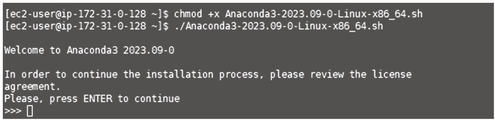

图 4-8 Anaconda 安装开始阅读协议

第二处：阅读完协议后输入 yes 回车表示同意，见图 4-9。

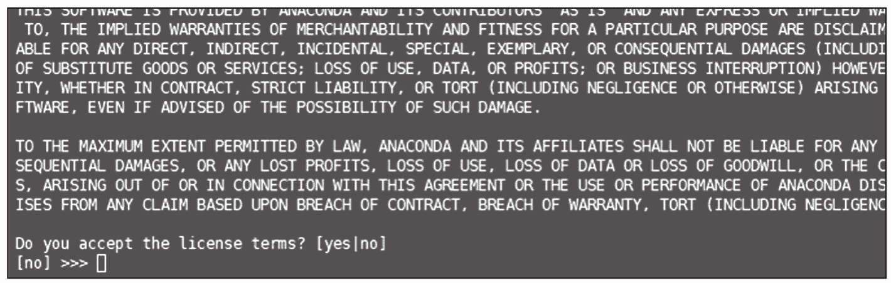

图 4-9 Anaconda 安装同意协议

第三处：确认 Anaconda 的根目录，回车确认或输入新路径，见图 4-10。

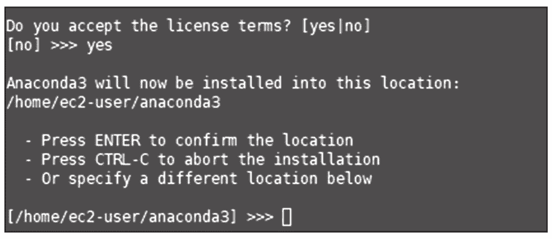

图 4-10 确认 Anaconda 的根目录

第四处：确认是否自动初始化 Conda，输入 yes 回车表示，见图 4-11。

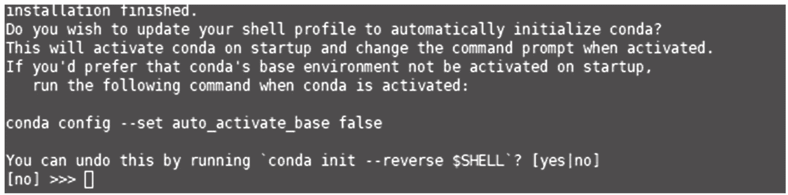

图 4-11 确认自动初始化 Conda

（3）环境变量生效

Anaconda 会把环境变量写入 ~/.bashrc。安装完成后执行以下命令使变量生效。


（4）安装校验


**4.开发环境校验**

驱动、CUDA 与 Anaconda 部署完成后，可新建一个 Python 虚拟环境用于部署 PyTorch 并验证。若验证正常，则开发环境已就绪。验证共分四步。

（1）新建 Python 虚拟环境


（2）部署 PyTorch


（3）PyTorch 校验


若输出为 True，则验证成功，见图 4-12。

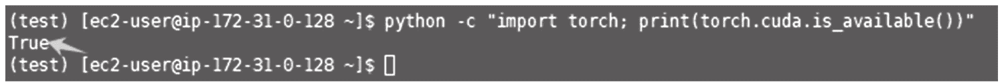

图 4-12 PyTorch 验证

（4）退出虚拟环境


**5.PyTorch 安装异常处理**

若校验结果为 False，通常会伴随报错信息。常见错误有 undefined symbol:__nvJitLinkAddData_12_1，version libnvJitLink.so.12 或 The NVIDIA driver on your system is too old。

以下情况易导致报错，需留意。

❍ CUDA 版本低于 12.0。
❍ 处于 Windows 环境。
❍ 部署时未指定 PyTorch 版本导致安装了最新版。
❍ 推理卡未正确安装。
❍ 推理卡驱动未安装。

在 Linux 环境、CUDA 版本 12.0 及以上、指定 PyTorch 版本号的情况下，部署过程通常较为顺利。

遇到报错时，一般做法是适度降低 PyTorch 版本。先卸载已装版本，再从 PyTorch 官网查找旧版安装命令重新部署，部署后再次验证，如仍报错则重复此过程，直至找到合适版本。

#### **注意**

应使用 pip 而非 conda 命令。旧版本链接为 https://pytorch.org/get-started/previous-versions/。

以部署 CUDA12.0 和 CUDA11.7 为例：

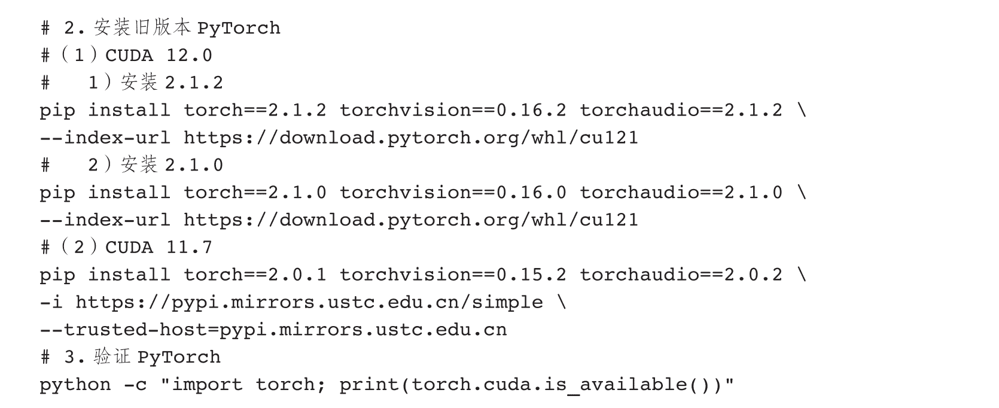

#### 4.2.2 Windows

**1.显卡驱动部署**

按推理卡型号从 NVIDIA 官网下载驱动并安装。安装完成后在命令行执行 nvidia-smi，如图 4-13 所示。

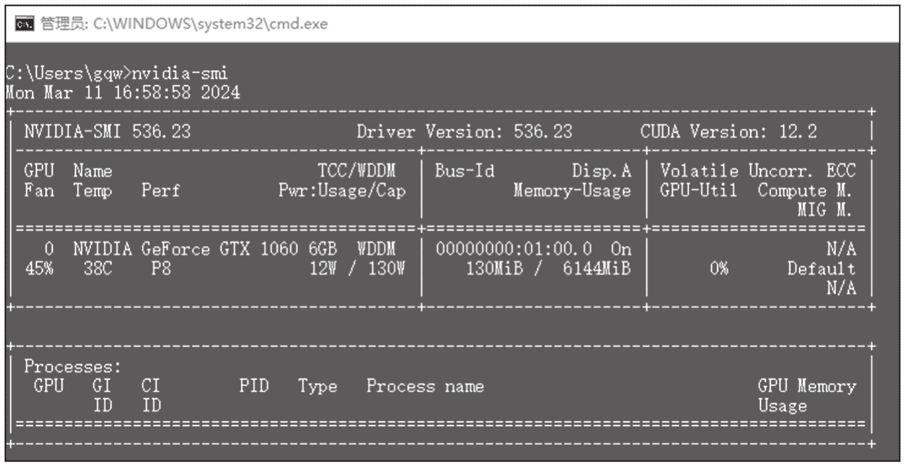

图 4-13 Windows 上推理卡运行情况

其中指标见表 4-2。

表 4-2 通过 nvidia-smi 命令显示的推理卡在 Windows 上的指标示例

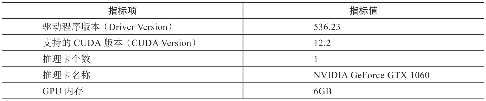

（续）

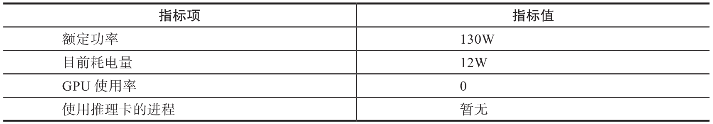

**2.CUDA 环境搭建**

从 https://developer.nvidia.com/cuda-toolkit-archive 找到对应 CUDA 版本下载部署。安装完成后用 nvcc -V 测试是否成功。

**3.Anaconda 部署**

从 https://www.anaconda.com/ 下载并部署最新版 Anaconda。安装完成后将安装目录及 Anaconda\Scripts 加入系统环境变量 Path，并用以下命令验证。


**4.wget 工具部署**

wget 为 Linux 自带下载工具，Windows 未内置。为统一 Linux 与 Windows 的下载描述，在 Windows 上也部署 wget。访问 https://eternallybored.org/misc/wget/ 选择对应版本，例如 1.21.4 版适配 Windows X64 的 EXE 文件，链接为 https://eternallybored.org/misc/wget/1.21.4/64/wget.exe。将下载的 wget.exe 复制到 c:\windows\system32 完成部署。

### 4.3 其他软件部署

#### 4.3.1 Nginx

**1.Ubuntu**

以 Ubuntu22.04 为例，apt 仓库默认的 Nginx 为 1.18 版，存在较多安全漏洞，不能直接用 apt install 部署，需按以下步骤部署较新版本。

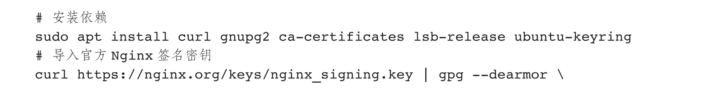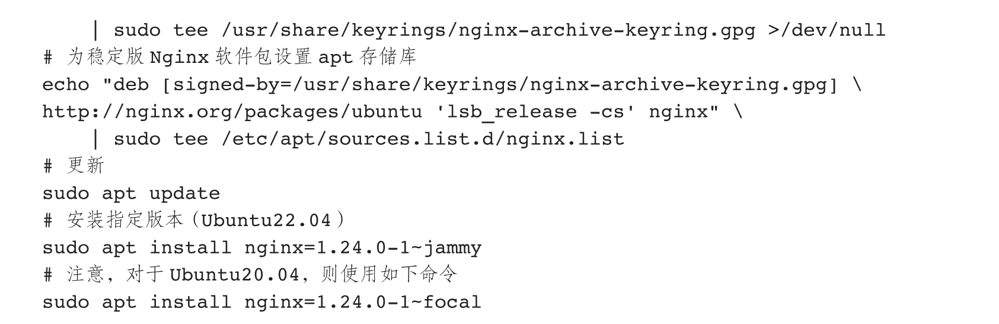

**2.Redhat**

在 Redhat 中使用如下命令部署 Nginx。


**3. Windows 版 Nginx 快速部署**
在 Windows 环境下，可直接访问 https://nginx.org/en/download.html 获取对应安装包，下载后解压到本地目录即可完成部署。

#### 4.3.2 Git 安装说明
**1. Linux 系统中的 Git**
多数 Linux 发行版已自带 Git，若未安装，可通过系统包管理器执行安装命令进行补充。
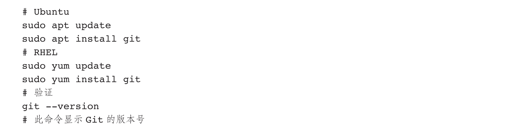

**2. Windows 系统中的 Git**
Windows 用户请前往 https://git-scm.com/download/win 下载安装程序，获取压缩包后解压并按向导完成安装。

## 第五章 本地大模型部署实战
#### 大语言模型本地化安装概览
ChatGPT 能迅速走红，一方面得益于技术迭代加速，GPT-3.5 在自然语言处理上具备生成精准流畅文本的能力；另一方面对话式交互让用户有与真人交流的沉浸感，同时开放的 API 使开发者能够便捷集成，极大推动了其普及。

随着全球热潮蔓延，开源大语言模型层出不穷，参数规模可控、生成效果可用、算力门槛降低等特点，让本地部署成为现实。像 70 亿参数级别的模型，放在 16GB 显存的 GPU 上即可完成推理，日常写作、编程等需求基本满足。

本章挑选了 ChatGLM3-6B、Qwen-VL-Chat-Int4、LLama-2-7b-chat、Gemma-2B 和 Whisper-large-v3 五个典型模型，分别代表国产文本类、国产生像类、开源标杆、近年新模型和语音识别类。部署验证兼顾实践，Python 脚本验证与开源 UI 工具验证并行。五款模型均基于 Hugging Face 格式与 Transformer 架构，安装思路相近但细节各异，为保证实用性，本文给出完整操作流程，帮助读者掌握常见模型的部署与简单推理。

### 5.1 ChatGLM 部署
#### 5.1.1 ChatGLM3 模型概览
ChatGLM3 由智谱 AI 与清华大学 KEG 实验室联合推出。ChatGLM3-6B 属于该系列开源版本，其基础版 ChatGLM3-6B-Base 在语义理解、数学推理、代码能力、知识问答等方面表现稳健。模型采用全新 Prompt 格式，不仅支持多轮对话，还原生支持工具调用、代码执行及 Agent 等复杂任务。ChatGLM3-6B、ChatGLM3-6B-Base 以及长文本版本 ChatGLM3-6B-32K 的权重对学术研究完全开放，填写问卷后亦可用于商业用途。^(²⁰)

本次实践选用 ChatGLM3-6B。笔者在同量级模型对比中发现其效果突出且社区活跃度高，后续已迭代至 GLM-4，发展迅速。

#### 5.1.2 ChatGLM3-6B 安装流程
（1）获取源码
为保持环境稳定，选择指定提交点进行复现。Git 回退到某次提交的命令为 `git checkout commit_id`。
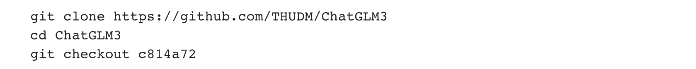
执行后，本地 ChatGLM3 代码将被还原至 2024 年 3 月 8 日、commit id 为 c814a72 的版本。

（2）创建 Python 虚拟环境


（3）安装依赖库
Python 第三方库推荐使用 pip 安装。为保证版本一致，通常将库名与版本号写入 requirements.txt，格式示例如下。
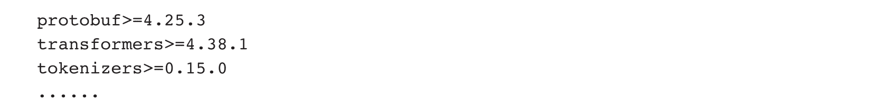
批量安装可使用 `pip install -r requirements.txt`，其中 `-r` 表示递归读取文件。
pip 默认从官方源 https://pypi.org/ 下载，速度较慢。可通过 `-i` 指定镜像源并加上 `--trusted-host` 确认域名安全。本例采用中科大 PyPI 镜像，命令如下。

注意该命令针对 Linux，Windows 下需去掉反斜杠与换行，将内容写成一行执行。

（4）校验 PyTorch
PyTorch 是大模型推理的核心，对上支撑 Transformers，对下连接 CUDA，安装时与 CUDA 版本强相关。requirements.txt 通常只写最低版本，如 `torch>=2.1.0`，pip 可能拉取最新版，导致运行时报错。
在 ChatGLM3 的虚拟环境中运行以下校验。

返回 True 表示通过，返回 False 或报错则建议适当降级 PyTorch 版本。

（5）下载模型
huggingface.co 是主流模型托管站，可借助国内镜像加速。常用镜像有魔搭社区与异型岛 https://aliendao.cn，本书示例均从异型岛获取。
先从 aliendao.cn 首页下载 model_download.py，Linux 用 wget，Windows 通过浏览器下载。随后用脚本下载指定 model_id 的模型。
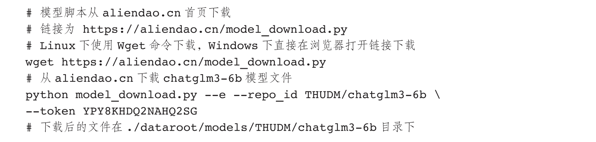

#### 5.1.3 编程验证
为观察 Transformers 调用流程，编写 chatglm3-inference.py，实现用户输入问题、模型输出答案、回车退出。
文件内容如下。
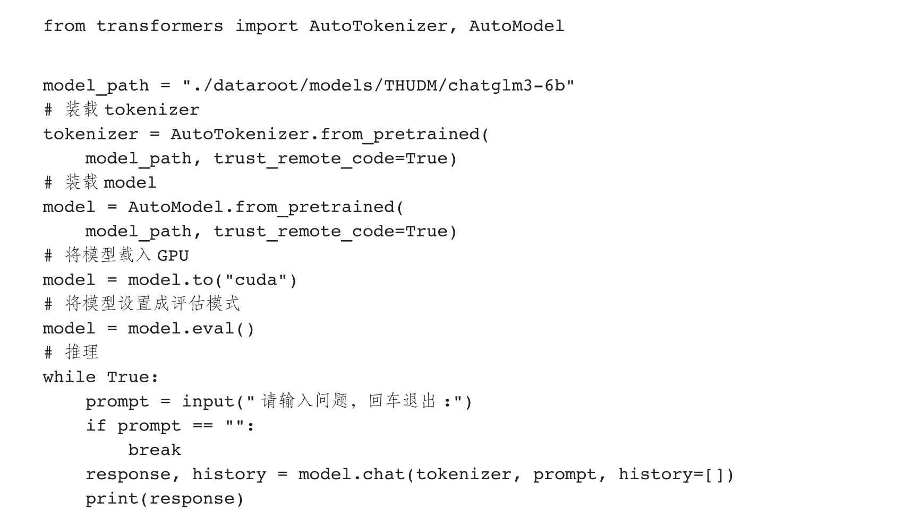
执行 `python chatglm3-inference.py` 测试推理效果，见图 5-1。图中方框标注的是通过 `watch -n 1 -d nvidia-smi` 监控的 GPU 显存占用。
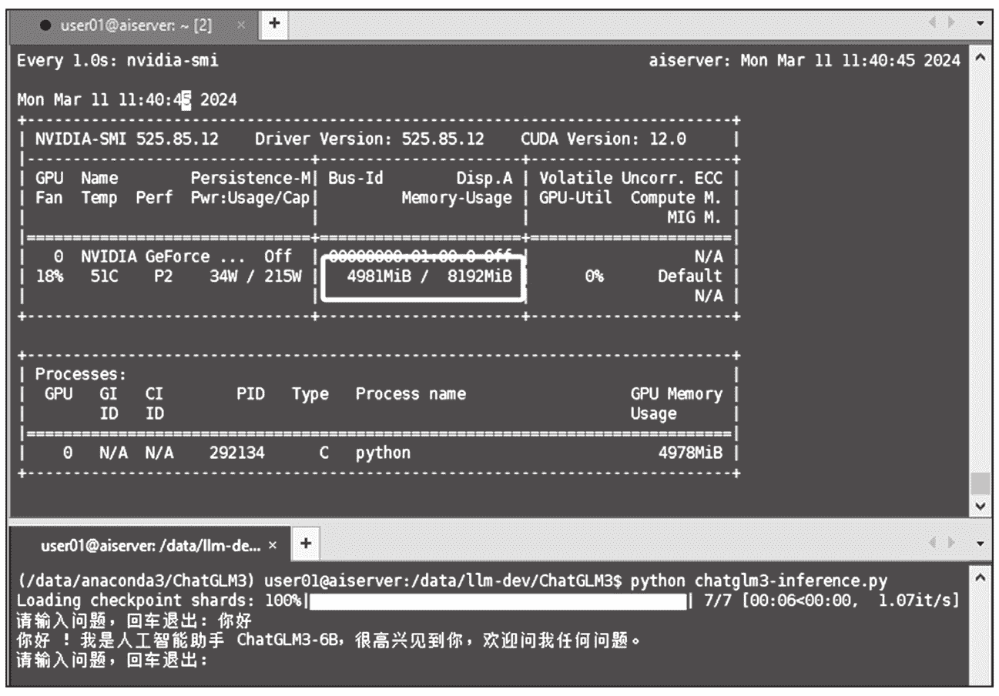
图 5-1 ChatGLM3-6B 推理效果

按当前写法，最低建议 16GB 显存，因为完整加载模型约需 13GB，显存不足会触发 OOM 错误，提示如下。

若推理卡显存小于 16GB，可改用量化模式加载，甚至在无 GPU 时用 CPU 运行，速度会显著下降。图 5-1 中显卡仅 8GB，因此采用 4bit 量化加载，显存占用降至 5GB 以内，具体修改如下。

修改要点见表 5-1。
表 5-1 ChatGLM3-6B 量化加载参数


### 5.2 Qwen-VL 部署
#### 5.2.1 Qwen 模型概览
通义千问由阿里云推出，基础模型在大规模高质量多语言数据上训练，当前以中英文为主，累计约 3 万亿 token，经 SFT 与 RLHF 对齐后得到对话模型 Qwen-Chat，具备聊天、创作、摘要、抽取、翻译、代码生成与简单数学推理能力，并支持工具调用、代码解释器与智能代理等功能。^(²¹)

除文本类模型外，家族还包括 Qwen-Audio 与视觉语言模型 Qwen-VL。Qwen 生态对 llama.cpp 支持良好，国产模型中产品链较完整。本节聚焦 Qwen-VL，实现图像理解。

#### 5.2.2 Qwen-VL-Chat-Int4 安装
Qwen-VL 对算力需求高于纯文本模型，即使 4bit 量化也建议 12GB 左右显存。Qwen-VL-Chat-Int4 运行依赖 AutoGPTQ 库，该库需编译安装，建议在 Linux 环境操作。

（1）建立 Python3.10 虚拟环境并激活


（2）创建测试目录
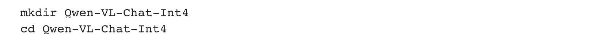

（3）下载模型
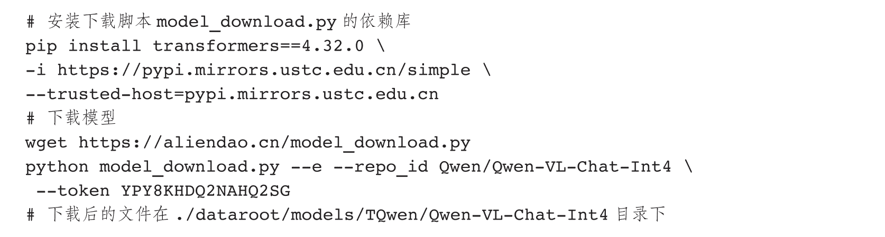

（4）安装基础依赖库


（5）安装其他依赖库


（6）校验 PyTorch

返回 True 为通过，False 或报错请参照前文调整版本。

（7）安装 AutoGPTQ 库


#### 5.2.3 编程验证
编写 qwen-vl-inference.py，实现用户上传图片、模型返回描述。
程序内容如下。

测试原图如图 5-2 所示。

图 5-2 Qwen-VL-Chat-Int4 推理测试原图

运行 `python qwen-vl-inference.py`，推理效果见图 5-3。

图 5-3 Qwen-VL-Chat-Int4 推理效果

### 5.3 LLaMA2 部署
#### 5.3.1 LLaMA2 模型概览
ChatGPT 爆火后，Meta 发布开源大语言模型 LLaMA，基于 Transformer 架构。彼时 GPT-3.5 关闭源，LLaMA 开创了大模型开源先河，提供权重与训练方法并附商业友好许可，推动了以 LLaMA 为核心的生态。

2023 年 7 月发布的 LLaMA2 采用分组查询注意力，提供 7B、13B、70B 三个基础规模，在文本生成、情感分析、语义理解、机器翻译等任务上表现良好，且具备较强灵活性和可定制性。美中不足在于训练语料中仅 0.13% 为中文^(²³)，见图 5-4，中文表现需二次微调。

图 5-4 LLaMA2 训练语料语言占比
注：图源自 LLaMA2 论文，zh 代表中文。

本节改用 text-generation-webui^(²⁴) 进行验证，该工具基于 Gradio，可实现多方式加载与交互，支持 LLaMA、ChatGLM 等模型。

#### 5.3.2 Llama-2-7b-chat 安装
（1）安装 text-generation-webui


（2）下载模型


（3）部署模型


#### 5.3.3 运行验证
启动服务命令如下。

Llama-2-7b-chat-hf 全精度加载约需 13GB 显存，若显存不足可加 `--load-in-4bit` 量化，约需 5GB 以下；若支持，也可用 `--load-in-8bit`，约需 9GB。注意并非所有 4bit 卡都支持 8bit。
运行结果如图 5-5 所示。

图 5-5 text-generation-webui 运行情况

浏览器打开 http://server-llm-dev:7080，进入 Model 标签，选择 Llama-2-7b-chat-hf，点击 Load。若显示 Successfully loaded Llama-2-7b-chat-hf，则加载成功，见图 5-6。

图 5-6 text-generation-webui 装载模型

随后在 Chat 标签提问，结果如图 5-7 所示。模型能理解中文问题，但回答常中英混杂，效果一般。

图 5-7 Llama-2-7b-chat-hf 推理情况

为改善中文，可尝试中文微调版如 LinkSoul/Chinese-Llama-2-7b，按相同流程下载、部署、加载后测试，中文效果明显提升。操作简述如下。


### 5.4 Gemma 部署
#### 5.4.1 Gemma 模型概览
Gemma 是 Google 推出的轻量级开源大语言模型系列，技术源自 Gemini，研究基础相同。模型采用 Decoder-only 文本到文本架构，提供英文预训练与指令微调版本，权重开放并在 Hugging Face 释出，配套推理、量化、微调工具。目前提供 20 亿与 70 亿参数的预训练版及指令调优版。^(²⁵)

为保障安全，Google 在训练阶段通过自动化手段过滤个人及敏感信息，并采用人类反馈强化学习对齐。为降低风险，还进行了手动红队测试、自动对抗测试与危险活动评估。

Gemma 模型全景速览

从表 5-2 可以看出，Gemma 目前可用的规模有 2B 和 7B 两档，每一档都同时提供预训练基座版和经过指令微调的版本。全部版本都能在消费级显卡或推理卡上直接跑起来，常见的 RTX4090、RTX3090、P100、T4 都能胜任，即使不做量化也能正常加载，并且支持长达 8000 token 的处理窗口。

表 5-2 Gemma 模型版本


Gemma 的首发渠道在 kaggle.com，之后 Google 联合 Hugging Face 将模型收进生态体系，转换为 hf 格式面向开发者免费开放。hf 格式的 Gemma 可以通过 Hugging Face 的 Transformers 库直接加载，整体使用体验与 LLaMA2 等模型相差不大。推理时通常用 Transformers 库的 AutoModelForCausalLM.from_pretrained 加载模型，再调用 model.generate 生成输出。选用 load_in_8bit 与 load_in_4bit 量化模式加载会十分顺畅，显存占用也明显降低。

提示词层面，基础版模型对格式没有特殊限制，而以 “-it” 结尾的指令优化版在推理时要求提示词遵守特定格式。


以上约束指的是原始模型规范。若使用 hf 格式版本，Transformers 库会自动把 “-it” 版与非 “-it” 版的推理提示词统一封装，不需要手工区分。

实测来看，Gemma 在中文任务上的表现仍有提升空间，但抛开语言偏好，它作为 LLaMA2 之外一个可用性不错的基础模型和技术栈，学习价值很高。

#### **5.4.2 Gemma-2B 部署实战**

（1）建立 Python3.10 虚拟环境并激活


（2）建立测试目录


（3）建立依赖库文件

建立 requirements.txt 文件，内容如下。


（4）安装依赖库


（5）下载模型


#### **5.4.3 Gemma-2B 推理验证**

编写 Python 程序 gemma-inference.py，该程序能实现：用户输入问题，模型给出回答，按下回车键退出。文件内容如下。


运行 python gemma-inference.py 进行测试。可以用全精度、4bit 量化和 8bit 量化三种模式装载运行该模型。


模型推理效果见图 5-8。


图 5-8 Gemma-2B 推理效果

### **5.5 Whisper 上手指南**

#### **5.5.1 认识 Whisper-large-v3**

Whisper 由 OpenAI 主推，是一款面向自动语音识别和语音翻译的预训练模型，发布于 2022 年 12 月，对应的研究论文是“Robust Speech Recognition via Large-Scale Weak Supervision” ^(²⁶)。模型不仅能做语音识别，还涵盖语音活性检测、声纹识别以及跨语种语音翻译等能力。

Whisper 采用 Transformer 编码器-解码器结构，属于序列到序列模型。训练数据包含 100 万小时弱标注音频和 400 万小时伪标注音频，均由 Whisper large-v2 收集而来。系列中部分模型只用英语数据训练，部分使用多语言数据。纯英语版本侧重语音识别，多语言版本同时覆盖识别与翻译。识别时模型输出与音频同源语言的转写，翻译时输出与音频不同语言的转写。检查点共五种规模，其中较小的四种在英语和多语言上训练，更大规模的 large、large-v2、large-v3 仅在多语言上训练。 ^(²⁷)详细情况见表 5-3。

Whisper-large-v3 是系列中的大模型，参数量约 15.5 亿，中文语音识别能力很强，对粤语的支持也相当不错。模型文件约 23GB，但加载时 GPU 显存需求并不高，约 4GB 即可。

表 5-3 Whisper 模型参数与语言训练情况


#### **5.5.2 部署 Whisper-large-v3**

（1）创建虚拟环境


（2）建立依赖库文件

建立 requirements_whisper.txt 文件，内容如下。


（3）安装依赖库


（4）下载模型


#### **5.5.3 Whisper 识别验证**

编写 Python 程序 whisper-audio.py，以将 Windows 录音程序录制的 test.m4a 音频识别成中文文本。Whisper 原生支持 .wav、.mp3 和 .flac，不支持 .m4a，因此需先用 pydub 库 ^(²⁸) 把 test.m4a 转成 .mp3，再调用模型识别。pydub 依赖的 FFmpeg ^(²⁹) 需要提前安装。FFmpeg 的安装方法如下。


whisper-audio.py 的源码如下。


运行“python whisper-audio.py”命令进行测试，结果见图 5-9。


图 5-9 Whisper 测试结果

## **第六章**

## **大语言模型微调实战**

大语言模型的核心是庞大的参数集合，例如 ChatGLM3-6B 拥有 60 亿参数，GPT-3.5 的参数超过 1750 亿。这些参数承载了模型学习到的语言知识与使用规律。在深度学习里，权重参数是可调变量，其数值通过训练不断学习与优化。模型的参数规模直接决定其学习能力和表达复杂度，参数越多能捕捉的语言特征与模式越丰富。

微调的本质是让大语言模型的参数向特定任务靠拢，通常在与任务相关的语料上进行二次训练。预训练模型通用性强，但在专业领域表现不足，引入新语料微调部分层级参数，可提升在该领域的推理流畅度和知识更新能力。

本章将以 ChatGLM3-6B、Llama-2-7b-chat-hf 和 Gemma-2B 三个基座为对象展开微调。读者可通过 P-Tuning 与 LoRA 两种常见方法，掌握语料处理、微调执行到模型应用的完整链路。

### **6.1 ChatGLM 微调全流程**

在显存小于 128GB 的普通推理卡上，全量微调难度较大，常用的折中方案是 P-Tuning 和 LoRA。本节以 ChatGLM3-6B 为目标，采用相对成熟的 P-Tuning v2。P-Tuning v2 会用到 DeepSpeed ^(³⁰)，该组件在 Windows 上安装易踩坑，建议在 Linux 环境操作。DeepSpeed 对 CUDA 与 PyTorch 版本匹配要求严格，安装 PyTorch 时务必注意兼容性。

#### **6.1.1 P-Tuning v2 原理拆解**

P-Tuning v2 的思路是在冻结预训练权重的前提下，注入少量可训练参数来调整模型输出。这样既保留了原有能力，又增强了泛化表现。其优化策略包含两点：一是前缀提示，前缀信息被注入模型每一层以提升输出准确度；二是自适应优化，根据训练过程中表现动态调整微调参数权重，加快收敛并提高效果。 ^(³¹)

#### **6.1.2 微调环境准备**

ChatGLM3-6B 微调所需的脚本与依赖说明可在 https://github.com/THUDM/ChatGLM3 的 finetune_demo 目录找到。


#### **6.1.3 语料整理与转换**

**1.原始语料整理**

语料质量直接决定训练上限，训练前要先收集、清洗、优化语料，形成原始语料。本次微调整理后的原始语料格式如下。


举例如下。


**2.微调语料格式要求**

ChatGLM3 微调需要多轮对话格式，具体规范如下。


**3.语料格式转换**

为把纯文本原始语料转为微调可用 JSON，并便于后续格式迁移，本例将转换拆为两步。第一步：文本文件转为简易 JSON，如[{"q":"问 1","a":"答 1"},{"q":"问 2","a":"答 2"}]。第二步：把简易 JSON 转为微调要求的对话格式。具体步骤如下。

第一步，将文本文件命名为.\data\original_data.txt，通过如下命令转换为.\data\original_data.json。


转换后的语料格式如下。


txt2json.py 的源代码如下。


第二步，把简易 JSON 转换为微调所需格式。微调需要训练集和验证集两个文件，数据占比约 70% 与 30%，默认文件名 train.json 和 dev.json。格式转换命令如下。


convert_data.py 的源代码如下。


#### **6.1.4 模型获取**

本节使用的基座为 ChatGLM3-6B。可按以下步骤下载该模型。


#### **6.1.5 开始微调**

采用 finetune_demo/configs/ptuning_v2.yaml 中的默认参数进行微调，显存需求约 16GB。若显卡显存仅 16GB，容易出现显存溢出，可适当降低每轮批次。将 ptuning_v2.yaml 中的 per_device_train_batch_size 从 4 调为 2，可节省约 1GB 显存。

使用以下命令启动微调，其中三个参数分别为训练语料路径、验证语料路径、基座模型目录和微调配置文件路径。


常见报错汇总：

1）在 Ubuntu20.04 上运行上述脚本可能出现错误，而在 Ubuntu22.04 上正常。


这是因为 Ubuntu20.04 的 libstdc++.so.6 版本偏旧。可查找系统中更高版本的文件，确认是否包含 GLIBCXX_3.4.29，将合适版本复制到指定目录并重建链接后即可运行，参考方法可参见 https://blog.csdn.net/weixin_39379635/article/details/129159713。

2）若出现以下报错，多因语料中存在乱码或 JSON 字符串里包含换行符导致数据无法加载。需重新整理语料，清除异常换行。


微调过程见图 6-1。运行默认 3000 步后会出现如下提示。


▲图 6-1 ChatGLM3-6B P-Tuning v2 微调


▲图 6-1 ChatGLM3-6B P-Tuning v2 微调（续）

此时可中断训练。训练期间的各项指标见表 6-1。

表 6-1 ChatGLM3-6B 微调情况


评估微调效果不以步数为准，而以 loss 曲线为准。一般 loss 趋于平稳且不再明显下降时说明模型已收敛。经验阈值约为 0.3，低于此值通常可用。但具体数值受模型、参数、任务、数据与方法影响，需结合实际测试判断。若 3000 步后 loss 仍较高或效果不佳，可加载第 3000 步的检查点继续训练。

#### **6.1.6 效果验收**

微调默认每 500 步保存一个检查点到 output 目录，如 output/checkpoint-2500，训练结束后为 output/checkpoint-3000。训练中若有空闲算力可随时加载检查点测试，否则等 3000 步结束后再测。测试命令如下。


运行结果如图 6-2。


图 6-2 ChatGLM3-6B 微调后推理

若想对比原始模型效果，可用以下命令查看基座输出。


### **6.2 LLaMA2 微调全流程**

本节参考 LLaMA2 官方微调方案，采用 PEFT 技术在 Llama-2-7b-chat-hf 上加入中文语料进行微调，并把微调权重与基座合并，同时编写推理代码。通过完整流程掌握 Transformer 架构大语言模型的基本微调原理与操作。

#### **6.2.1 PEFT 微调方案**

LLaMA2 微调可使用 Meta 官方提供的 llama-recipes。主流手段有参数高效微调 PEFT 和全/部分参数微调。PEFT 由 Hugging Face 开发，支持 LoRA 等策略，对算力需求较低，本节采用 PEFT 方法。

**1.参数高效模型微调**

# 小显存也能训大模型：参数高效微调实战

想在消费卡上训大模型并非不可能。借助参数高效的思路，显存需求会被大幅压缩，RTX3090 这类入门消费卡就能跑起来。实践里把 Llama-2 7B 及其对话版转成 FP16 后，即便只有 16GB 的 P100、T4 也能完成训练。核心做法是把底座网络整体冻结，只在外部挂接少量可学习的小模块，真正参与更新的参数非常少。业界常用的三条路线是 LoRA、LLaMA Adapter 和 Prefix-Tuning。LoRA 用低秩矩阵分解去逼近权重变动，把训练量压得很低。LLaMA Adapter 面向 LLaMA 家族，在各层之间插入轻量适配器，通过调优适配器实现任务迁移，原权重不动。Prefix-Tuning 则是在输入前接一段可训练的前缀向量，利用前缀对后续生成的引导作用来适配新任务，模型本体保持不变。

这套思路的好处主要体现在三方面。

❍ 训练开销小：只更新新增的少量参数，不用动整网，普通显卡就能承受。
❍ 部署开销小：增量权重只有 MB 级别。推理时先载入 LLaMA2 的预训练主干，再叠加几个 MB 的微调参数，就能以同一主干适配不同任务进行联合推理。
❍ 遗忘更轻：主干参数被锁定，模型原有的知识不会被微调覆盖。

**2.全/部分参数微调**

全量或部分微调直接动的是原始权重。常见做法有三种：只解冻任务头比如分类器；保持预训练体冻结，在顶部加若干全连接层；最彻底的是把所有层全部放开一起训练。

当显存受限时，单卡往往装不下模型参数、梯度和优化器状态，具体开销取决于参数规模和精度。此时可引入完全分片数据并行 Fully Sharded Data Parallel，简称 FSDP，让模型分布到一机多卡或多机多卡环境。FSDP 不仅分片数据，还对参数、梯度和优化器状态进行分片，每个 GPU 只保留模型的一个切片，显存占用明显下降，更大模型才能塞进多卡。

#### **6.2.2 微调环境准备**


#### **6.2.3 语料准备**

微调 LLaMA2 时经常使用的语料是 Alpaca 数据集。该集合由斯坦福开源，为 Alpaca 准备了 52000 条指令样本。文件结构是一个字典列表，每条字典包含 instruction、input、output 三个字段。

❍ instruction：说明模型需要完成的任务。52000 条数据里每条指令都是唯一的，不可重复。
❍ input：任务的可选上下文或输入内容。例如指令是“总结以下文章”时，input 就是文章正文。
❍ output：由 text-davinci-003 生成的参考答案，该模型是 ChatGPT-3.5 背后的大模型。

中文版语料在网上很容易找到，可从官方仓库的 raw 文件下载。

打开链接点击下载即可获取语料，可直接修改或把其它中文语料转为相同格式。文件命名为 alpaca_data.json，格式如下。


#### **6.2.4 模型下载**

本节采用的模型是 Llama-2-7b-chat-hf，按以下步骤获取。


#### **6.2.5 微调过程**

**1.微调语料准备**

语料文件 alpaca_data.json 需要复制到 llama-recipes 的 datasets 目录下。

**2.微调参数说明**

训练脚本为 recipes/finetuning/finetuning.py，所有参数集中在 configs/training.py。需要留意的是，若 PyTorch 版本偏旧，脚本里用到的 device_mesh 类可能缺少 init 方法。若报错提示 import 问题，可将 fsdp 工具文件中的相关代码注释掉。


依据显存和算力情况确定训练参数，并不断微调，以达到显存基本占满、GPU 利用率基本打满的经济运行状态。表 6-2 给出了单机单卡 16G 显存 GPU 的 Llama-2-7b-chat-hf 微调建议参数。

表 6-2 Llama-2-7b-chat-hf 微调建议参数


（续）


**3.微调过程**

使用以下脚本启动训练。因为训练耗时较长，为防止 SSH 终端异常断开导致中断，建议用 nohup 在后台运行，日志写入 train.log，可用 tail -f 查看进度。


微调过程见图 6-3。各运行指标见表 6-3。


▲图 6-3 Llama-2-7b-chat-hf 微调


▲图 6-3 Llama-2-7b-chat-hf 微调（续）
▼表 6-3 Llama-2-7b-chat-hf 微调过程情况


#### **6.2.6 PEFT 微调模型测试**

采用 PEFT 方法得到的模型文件位于 output/PEFT/model 目录下，包含适配器配置和适配器权重。配置记录了微调策略、原始模型位置等；权重文件是在增量训练或有监督微调阶段产生的适配器，相当于对原始权重的补丁。

进行 Demo 测试时，需新建 prompt.txt 文本文件写入测试问题，测试命令如下。


#### **6.2.7 模型合并**

为方便分发运行，可将 PEFT 适配器与原始模型合并。合并使用 merge_lora_weights.py 脚本。

执行前请删除或改名原始模型的 generation_config.json，避免出现配置校验冲突报错，合并命令如下。


#### **6.2.8 合并后模型测试**

合并完成后，新模型会生成在 output/merged/model 目录下，用以下命令测试。


### **6.3 Gemma 微调**

Hugging Face 格式的 Gemma 模型可用 Transformers 库的 SFTTrainer 进行微调。即便 2B 或 7B 这种中等规模模型，全量微调也会消耗大量显存和算力，若使用官方推荐的 Colab 或 Kaggle 平台成本较高。若仅用于学习实验，参数高效微调是成本更低、效果尚可的方案。

#### **6.3.1 微调方法介绍**

PEFT 策略包括 LoRA、LLaMA Adapter、Prefix-Tuning，本节采用 LoRA。LoRA 是一种针对大语言模型的参数高效微调技术，只对一小部分参数进行训练，通过冻结原始模型并仅训练分解为低秩矩阵的适配器层，提升效率并减少灾难性遗忘。

实践中在 Hugging Face 针对 Gemma 的 PEFT 方案基础上完善了代码，对 Gemma-2B 进行微调，训练数据来自公开的“名人名言”数据集 Abirate/english-quotes。微调前对一句名言中的“Imagination is more”部分进行补全，观察推理效果；微调后结果会更贴近该数据集的语料分布。

#### **6.3.2 微调环境准备**

**1.建立 Python 虚拟环境**


**2.安装依赖库**

先新建依赖列表文件 requirements.txt，内容如下。


然后执行如下命令。


#### **6.3.3 模型下载**


#### **6.3.4 微调程序开发**

本节使用 Transformers 的 SFTTrainer，结合 PEFT 的 LoRA 策略，语料为 english_quotes 数据集。程序命名为 gemma-train.py，源代码如下。


主要函数说明见表 6-4。
表 6-4 Gemma-2B 微调程序的主要函数说明


#### **6.3.5 语料文件下载**

使用以下命令下载数据集 Abirate/english_quotes。


该数据集格式为 jsonl，每行是一个 JSON 对象，示例如下。


每行 JSON 是一条完整记录，格式如下。


#### **6.3.6 微调与测试过程**

执行训练脚本启动微调，由于数据集只有 632KB，模型也是用量化模式装载的，所以微调过程很快，只需要几分钟即可完成。微调过程见图 6-4。从结果来看，微调前补全的名言作者是“-Albert Einstein”，而由于新数据集的引入，微调后显示名言作者为“Author:Albert Einstein”。


图 6-4 Gemma-2B 微调与测试

## **第七章**

## **大语言模型量化**

大语言模型本质上是将语言问题转为数学计算的人工智能技术。由于大量浮点运算，即使是 6B 或 7B 这类较小规模模型，也至少需要 16GB 显存的推理卡。若算力不足仍想实践应用，模型量化是一种可行路径。

本章介绍在笔记本等低算力条件下部署大语言模型的方法，即在 Windows 系统上使用 llama.cpp、gemma.cpp 等量化方案实现智能问答，让完整模型在低算力环境下运行。

### **7.1 量化介绍**

大语言模型通常包含数十亿甚至数百亿参数，运行会占用大量显存和计算资源。模型量化是指把权重或激活值从 32 位浮点高精度转为 4bit 或 8bit 低精度整数，模型变小、计算复杂度下降，可在 CPU 等低算力设备上推理。实践中除降低精度外，还需用 C++重写原先的 Python 程序，以保持能力同时提升性能。量化一般只用于推理，不用于训练。

### **7.2 llama.cpp 量化过程**

llama.cpp 是基于 LLaMA 架构的大模型量化方案，由开源开发者 Georgi Gerganov 用纯 C/C++开发，目标是让大模型能在 GPU 之外的硬件上运行，甚至在 Android 手机上。

llama.cpp 基于机器学习张量库 GGML 构建。GGML 同是由 Georgi Gerganov 用 C/C++实现，经处理的大模型可在 CPU 上高效运行。

对 Hugging Face 格式模型量化，需先把权重转为 GGUF 格式。GGUF 全称 GPT-Generated Unified Format，是 Georgi Gerganov 定义的模型文件规范，采用紧凑二进制编码和内存映射等技术，使模型存储和加载更高效。转换后的 GGUF 文件可更快载入内存并减少资源消耗。

本节以 Qwen-1.8B 为例，用 llama.cpp 进行量化，使其脱离 GPU 环境在 Windows CPU 上运行。

#### **7.2.1 llama.cpp 编译**

llama.cpp 用 C/C++实现。为保证跨平台兼容，使用前需编译生成 main.exe、server.exe、quantize.exe 等工具。为简化流程，本节采用 W64devkit 开发包编译。W64devkit 是一个可移植的 Windows C/C++开发包，可在 Windows x64 系统上编译程序。

**1.安装 w64devkit**

Windows 下编译 C/C++程序通常需安装体积较大的 Visual Studio。为简化流程，本节使用 w64devkit.exe 作为替代。下载链接如下。


下载后直接解压即可。

**2.获取 llama.cpp 源码**

在命令行运行 git clone 从 github.com 拉取源码，命令如下。


**3.编译**

w64devkit 提供了轻量级的可移植构建环境，双击 w64devkit.exe 之后会进入一个类 Unix 的交互界面，能够执行常规 shell 指令以及编译指令。编译 llama.cpp 非常简便，借助单条 make 即可产出可执行程序。先启动 w64devkit.exe，切换工作目录至 llama.cpp 所在位置，再调用 make 完成构建。


构建结束后会生成若干可执行文件。本节主要涉及 main.exe、quantize.exe、server.exe 三个。其中 server.exe 有被 Windows 安全软件误报的可能，如被隔离可手动从威胁记录中恢复。

#### **7.2.2 GGUF 转码**
本小节要处理的 Qwen-1.8B 原始权重采用 Hugging Face 形式，文件名为 model-00001-of-00002.safetensors 与 model-00002-of-00002.safetensors。为后续进行 INT4 精度压缩，先调用 convert-hf-to-gguf.py 把 safetensors 格式的权重转成 GGUF。整个转码需要在独立的 Python 虚拟环境中进行。

（1）新建 Python 虚拟环境


（2）装入依赖


#### **7.2.3 获取模型权**
从 aliendao.cn 获取 Qwen-1.8B 的权重，执行命令如下。


#### **7.2.4 量化流程**
量化分为两阶段：先执行 convert-hf-to-gguf.py 将原始精度减半，随后运行 quantize.exe 把半精度权重转为 GGML 类型，以降低算力消耗。最终产物为 Qwen-1_8B/ggml-model-q5_k_m.gguf，即 q5_k_m 版本。


#### **7.2.5 量化模型测试**
量化完成后的模型可通过 main.exe 加载并在 CPU 上推理。执行下方命令后输入问题，模型会返回答案。


运行截图见图 7-1。


图 7-1 llama.cpp 加载运行示例

#### **7.2.6 Web 方式运行**
server.exe 可提供基于 Web 的对话界面。

先执行：


服务启动后，在浏览器打开 http://127.0.0.1:8080 即可在 WebUI 中交互。

### **7.3 gemma.cpp 量化实践**
受 llama.cpp 启发，Google 为 Gemma 发布了 gemma.cpp，用以对 Gemma 基座模型进行压缩。gemma.cpp 是一个独立的轻量 C++ 推理框架。与 llama.cpp 支持 GGUF 及 GGML 广泛适配不同，gemma.cpp 专注于 Gemma 2B 与 7B 的使用便捷性，通用性并非首要目标。C++ 推理框架与 Python 训练栈在实现原理上差异明显，因此 gemma.cpp 的使用方式与 Transformers 库完全不同。

本例从 https://www.kaggle.com 获取已压缩的 2b-it 模型，并在 Windows 上以 CPU 运行。主要难点在于 gemma.cpp 需按系统编译，且在 Windows 上对编译工具链要求严格。与 llama.cpp 需要先将源模型转成压缩模型不同，gemma.cpp 直接提供可下载的压缩权重，故本节重点为如何加载并推理。压缩后精度下降且运行在 CPU，效果尚有提升空间。

#### **7.3.1 源码获取并锁定版本**
gemma.cpp 仍在迭代，为保持示例可复现，建议下载后将代码固定到某个 commit。获取方式如下：


#### **7.3.2 Windows 下的编译**
gemma.cpp 在 Windows 需 Windows10/11，并使用 Visual Studio Build Tools 2022 进行构建，安装选项见图 7-2。与 llama.cpp 使用 make 不同，gemma.cpp 依赖 cmake，并在 C++ Clang 支持下完成编译，步骤较繁琐。


图 7-2 Visual Studio Build Tools 2022 安装配置

#### **7.3.3 获取压缩模型**
Gemma-2B 的压缩版需从 https://www.kaggle.com 下载，链接如下：


下载前需注册 Kaggle 账号并填写使用说明问卷，这是免费使用的必要条件。下载入口在“Gemma C++”标签，选择 2b-it-sfp 后获取，如图 7-3。下载文件为 archive.tar.gz，可用 Winrar 解压。

#### **7.3.4 推理演示**
将 archive.tar.gz 解压后，把解压得到的两个文件放到 models 目录。其中 models\2b-it-sfp.sbs 为压缩权重，models\tokenizer.spm 为分词器。执行推理命令：


运行效果如图 7-4。总体来看，Gemma 发布不久，2B 参数规模较小且经压缩后精度损失，对中文问答仍具挑战，但英文表现较好。


▲图 7-3 Gemma-2b-it-sfp 下载界面


▲图 7-4 Gemma 压缩模型推理示例

## **第八章**

## **多模态模型实战**

多模态模型能够融合文本、图像、音频、视频等信息，学习跨模态关联，实现模态间的转换与生成。

图像生成是典型应用之一，指借助 AI 产生照片、绘画、3D 渲染或创意图像。在文生图和图生文领域已有成熟产品，如文生图的 DALL-E2、Stable Diffusion，图生文的 Flamingo 等。

本章介绍 Stable Diffusion 的部署与使用，包括安装、文生图、图生文等操作。阅读后可初步掌握 Stable Diffusion 的核心概念，为数字人制作提供技术基础。

### **8.1 Stable Diffusion 概览**
Stable Diffusion 是 Stability AI 于 2023 年 6 月开源的 AI 绘图工具，基于深度学习实现根据文本描述生成精细图像。输入提示词后模型输出匹配图像，此过程称为文生图。

它还支持图像反推，输入图片后分析关键信息并生成描述文字，称为图生文。基于该描述再生成新图即为图生图。

核心原理是把噪声图像逐步转化为目标图像，包含两步。

❍ 前向扩散：逐步加入高斯噪声，模拟图像向随机状态演化，使输出既保留原始特征又具随机性。

❍ 稳定化：为解决前向扩散的不稳定，引入判别网络区分真实图像与随机噪声，通过最大化判别概率提升生成质量与可控性。

### **8.2 Stable Diffusion 部署**

#### **8.2.1 代码获取**
部署通过 stable-diffusion-webui 实现。stable-diffusion-webui 是 Web 前端，运行时依赖若干源码库，详见表 8-1。

表 8-1 stable-diffusion-webui 依赖库


这些库在首次运行 launch.py 时自动下载到 repositories 目录，并按依赖关系指定版本，无需手动获取。只需获取 stable-diffusion-webui 代码，launch.py 会自动完成其余下载。


#### **8.2.2 Python 环境准备**
随后创建合适的 Python 虚拟环境。stable-diffusion-webui 支持 Python 3.10 与 3.11。若使用 3.11，运行期间会出现版本提示，不影响使用。


#### **8.2.3 依赖安装**
安装时除程序运行前安装基础依赖外，launch.py 首次运行时会把源码库下载到 repositories，并需安装其各自依赖。为加速，可设置全局 PyPI 镜像。


全局镜像配置文件位于 C:\Users\用户\AppData\Roaming\pip\pip.ini（Windows）或 ~/.config/pip/pip.conf（Linux）。不再使用时可删除该文件。

安装命令如下。


安装后检查 PyTorch 是否正常。若异常，可按 4.2.1 节方法处理。


#### **8.2.4 模型下载**
按以下步骤下载权重。注意所有文件需复制到 stable-diffusion-webui/models/Stable-diffusion 根目录。


#### **8.2.5 启动服务**
执行以下命令启动。


其中 “--no-half” 用于关闭半精度，若不关闭，部分显卡会报 “NansException:A tensor with all NaNs was produced in Une”。“--listen” 让服务监听所有网卡 IP，可从其他电脑访问。不使用时只能通过本机 http://127.0.0.1:7860 访问。后台如图 8-1。

### **8.3 Stable Diffusion 实践**
服务正常后，在浏览器通过 http://server-llm-dev:7860 访问 WebUI。


图 8-1 stable-diffusion-webui 后台

#### **8.3.1 文本生成图像**
在 txt2img 标签的 prompt 输入提示词，点击 Generate 即可生成匹配图像。例如输入 “A South American footballer”（一名南美足球运动员），结果如图 8-2。实践中英文提示词效果通常优于中文。


图 8-2 Stable Diffusion 文生图示例

#### **8.3.2 图像重绘**
在 img2img 标签上传原图，原图如图 8-3。prompt 输入 “only house”，生成图上仅保留房屋，见图 8-4。


▲图 8-3 Stable Diffusion 图生图原图


▲图 8-4 Stable Diffusion 图生图结果

# **开发篇**

■ 第九章 Chat 应用

■ 第十章 辅助编程应用

■ 第十一章 VS Code 插件

■ 第十二章 检索增强生成应用

■ 第十三章 PDF 翻译应用

■ 第十四章 智能代理应用

■ 第十五章 语音模型应用

■ 第十六章 数字人应用

■ 第十七章 提示词生成应用：从零训练模型

■ 第十八章 AI 小镇应用

大语言模型的应用开发是指把大语言模型封装成可用的应用，为生产生活提供便利，涉及人类语言相关诸多方面。

从介质看，涵盖文本、语音、图像及相互转换，并涉及语音驱动视频技术；从领域看，涉及对话、翻译、文本分析、语音处理、辅助编程等；从技术栈看，涉及 Python、React.js、VS Code 插件、Docker、游戏引擎等；从创新方向看，包括 Agent、数字人、AI 小镇等。

本篇共 10 章，讲述大语言模型在九大领域的开发，包括 Chat、编程、RAG、翻译、AI Agent、语音、数字人、提示词生成、AI 小镇等，涵盖目标、原理与实现，并穿插 VS Code 插件开发，丰富运行场景。

各章均说明设计目标、运行原理、源码、运行方法与结果，相对独立。

❍ 第九章构建一个仿 ChatGPT 的应用，利用 React.js、ChatUI 组件及大语言模型接口服务，打造通用 Chat 客户端，连接 OpenAI 兼容接口，调用各类大模型。

❍ 第十章构建一个辅助编程的大模型应用，部署编程专用大语言模型 Stabilityai/stable-code-3b，开发 API 服务，供客户端调用，适用于提示输入、代码补全等场景。

❍ 第十一章针对第十章的编程场景与 API 开发 VS Code 插件，详细说明插件开发与发布流程。两者结合可形成较完整的编程辅助工具。

❍ 第十二章构建一个检索增强生成应用，采用 LangChain 组件，将大语言模型与向量知识库结合，发挥大模型归纳能力与知识库精确匹配能力，缓解幻觉问题。

❍ 第十三章介绍基于大语言模型的 PDF 翻译应用开发方法。先将 PDF 转 HTML，再用英译汉专用模型 Helsinki-NLP/opus-mt-en-zh 或定制提示词，完成翻译。

❍ 第十四章将 Microsoft AutoGen 开发框架与国产大模型结合，实践 AutoGen 在 AI Agent 领域的应用，涉及 Docker 环境安装、最小运行环境测试及多轮对话应用开发。

❍ 第十五章介绍国产大语言模型 Qwen-Audio-Chat 的安装与应用，以开发一个支持语音交互的实例。读者可掌握语音类大模型的安装、原理与开发方法。

❍ 第十六章整合 SadTalker 与 coqui-ai-TTS 技术，开发数字人工具，实现文本生成音频、音频驱动图像生成视频的全流程。

❍ 第十七章围绕提示词生成工具的研发展开，利用 GPT-2 技术自建一个预训练模型，并完整实现语料处理、词表构建、分词与标记、模型训练、推理执行及接口封装的闭环，帮助读者掌握 GPT 类模型的训练思路与落地流程。

❍ 第十八章构建 AI 小镇示例，采用 React.js 配合 Phaser3 打造轻量 RPG 风格前端，并接入大语言模型，以小镇为舞台呈现角色随机漫游与多轮对话的交互效果。

## **第九章**
## **对话客户端实战**

### **9.1 目标**

以大语言模型为核心的聊天应用，本质上是依托自然语言处理技术实现人机对话的智能产品。模型经海量数据训练后可理解语义、具备对话能力，用户提问时应用会借助学习到的知识与 NLP 技术解析意图并生成回答。本章以 React.js 构建通用聊天前端，接入 ChatGLM3 项目提供的 OpenAI 兼容接口，完成编译并部署至 Nginx。

### **9.2 原理**

#### **9.2.1 功能概要**

（1）对话交互界面
应用采用标准聊天式布局，接收用户输入并写入对话记录，大模型的返回结果同步回写。双方文本通过左右排布或图标区分。

（2）流式接口
为 OpenAI 兼容的流式调用规范，最早由 ChatGPT 普及，现已成为大模型对话的事实标准。服务端分段推送数据，客户端边收边显，适合大流量或长时间任务。

（3）多轮会话
模型会把当前问题与历史问答合并生成上下文，token 较长时语境更完整，答案通常更合理。代价是轮次增加导致输入 token 持续增长，影响推理效率，因此需对历史记录做截断限制。

（4）打字效果
借鉴 ChatGPT 的逐字呈现方式，先展示部分生成内容降低等待感知，避免一次性输出长文本带来算力压力。实现依赖 SSE 服务端推送，HTML5 机制允许服务端主动推送消息，前端实时渲染出动态打字效果。

#### **9.2.2 系统架构**

整体为 B/S 架构。服务端由大语言模型的 OpenAI API 提供，客户端以 React.js 编写并托管于 Nginx。用户通过浏览器加载页面，JavaScript 将输入投递至服务端并渲染返回结果。

其架构图见图 9-1。


图 9-1 Chat 应用架构图

（1）大模型服务层
推理由模型代码完成，例如 ChatGLM3-6B 的 modeling_chatglm.py 中 stream_chat 实现流式推理；API 服务由 ChatGLM3 源码 openai_api_demo/api_server.py 暴露。

（2）应用服务层
开发环境下由 npm 启动本地服务，负责静态资源分发与请求代理。生产环境则由 Nginx 的静态部署与反向代理承担，同时需开启对 SSE 推流的支持。

（3）客户端浏览器层
浏览器运行的 HTML5 与 JavaScript 与应用服务层通信，HTTP/HTTPS 请求经代理转发至模型 API。

#### **9.2.3 运行原理**

关键流程如下。

① 浏览器负责页面展示并调用 OpenAI 兼容接口获取生成内容。
② Nginx 提供静态页面并代理对 OpenAI 兼容接口的调用。
③ 页面与接口保持在同一域名或 IP:端口 下，以规避跨域拦截。跨域指前端页面与后端 API 的源不一致时浏览器出于安全策略阻断请求。
④ openai_api.py 完成模型加载并提供 API 服务。

### **9.3 开发过程**

#### **9.3.1 Node.js 安装**

React 项目的调试需 Node.js 环境。可在 https://nodejs.org/ 下载安装，安装完成后在命令行执行 node -v 验证。

#### **9.3.2 chat-app 新建**

（1）新建应用
创建名为 chat-app 的 React 应用，命令如下。


（2）安装组件
项目依赖两个第三方包，一个是用于对话界面的 ChatUI 框架，另一个是调用模型服务的 Node.js 客户端 openai-node。


#### **9.3.3 源代码**

Chat 页面与业务逻辑集中在 src/app.js，共约 61 行，完整内容如下。


#### **9.3.4 测试**

**1. 启动大模型 API 服务**
按 5.1 节方式安装 ChatGLM3-6B。API 服务使用 ChatGLM3 代码库 openai_api_demo/api_server.py 启动。该文件 /v1/embeddings 接口依赖 BAAI/bge-large-zh-v1.5 文本向量模型，虽本例不使用，为保证正常运行建议提前下载。


指定模型与向量模型路径后启动服务，监听 8000 端口。


**2. 测试 chat-app**
在客户端目录执行 npm start 启动开发服务，浏览器打开 http://localhost:3000，运行效果如图 9-2。

运行可见应用支持流式人机对话、多轮会话与打字视觉效果，已达到预设目标。


图 9-2 chat-app 运行情况

**3. 界面美化**
chat-app 为通用客户端，通过修改 apiKey 与 baseURL 可接入任意 OpenAI 兼容的大模型服务，包括官方 OpenAI 服务。

为让输入框支持多行，首先在 app.js 同级创建 chatui-theme.css，内容如下。


随后在 app.js 第 6 行 import OpenAI from 'openai' 后追加引入语句。


重新执行 npm start 后输入框即变为多行。

#### **9.3.5 应用发布**

开发阶段依赖 Node.js 并以 npm start 运行，发布时需编译为纯 HTML5 与 JavaScript 文件部署到 Nginx。

**1. 编译**
运行命令将源码编译到 build 目录。


**2. 发布**
把 build 目录文件复制到 Nginx html 目录即可。Windows 下为 Nginx 安装目录下，Linux 常见路径为 /usr/local/share/nginx/html 或 /usr/local/nginx/html。

**3. 运行**
首次启动 Windows 执行 nginx.exe，Linux 执行 sudo nginx。若 Nginx 已运行且配置变更，需重启。


Linux 环境命令前需加 sudo。

**4. 应用升级**
浏览器会缓存相同 URL 的静态资源。为使更新生效，可修改 package.json 中的 version，编译后生成不同文件名，改变 URL 以绕过缓存。

**5. SSE 配置**
启动后可用 http://127.0.0.1 访问页面，但 Nginx 80 端口提供页面，而 API 在 8000 端口，会触发跨域。解决方式是在 Nginx 80 端口配置对 API 的路径代理，并适配 SSE。

例如 baseURL 为 http://server-llm-dev:8000/v1 时，在 conf/nginx.conf 的 server 块中添加 location。


重启 Nginx，将 app.js 中的 baseURL 改为 http://127.0.0.1/v1，重新编译部署后跨域问题消除。

## **第十章**
## **代码助手实战**

大语言模型的核心能力是预测，即基于提示词生成续写文本，也可称推理或生成。ChatGPT 之前，文本补全是主流场景，GitHub Copilot 为代表。Copilot 在编码时提供行级补全或代码块建议，可提升效率与协作。开源模型兴起后，出现了大量模仿或替代方案，如 Codegen、Llama Code。Stability AI 发布的 Stable Code 3B 拥有 30 亿参数，擅长多语言代码补全与缺失片段填充，且可在无专用 GPU 的笔记本上运行。

本章以 Stable Code 3B 的 API 封装为目标，便于后续客户端调用，在第十一章构建 VS Code 插件形成类 Copilot 产品。

### **10.1 目标**

Stable Code 3B 本身不提供 Web 端 API，仅暴露生成方法。本章在生成方法上封装一层兼容 OpenAI Chat 服务的接口，方便远程调用，并可由第九章的 Chat 客户端直接使用。

### **10.2 原理**

#### **10.2.1 功能概要**

作为推理服务提供者并对外暴露 OpenAI 兼容 API，需具备：

❍ 模型装载：用 Transformers 库将 Stable Code 3B 加载到 GPU 内存以提供生成服务。
❍ OpenAI 接口规范：监听 /v1/chat/completions 等路径，解析请求报文并返回规范响应。
❍ SSE 访问：以 SSE 协议渐进式推送生成内容。
❍ 停止生成策略：模型若不被主动中断会持续生成，需设定停止条件及时结束推理。

#### **10.2.2 系统架构**

包含客户端与 API 服务端。客户端发送含编程提示词的 HTTP 请求，服务端解析后将任务交给 predict 函数并以 SSE 事件流返回结果。predict 循环调用模型的 generate 方法，将增量文本推送给客户端，直至触发停止策略。架构见图 10-1。


图 10-1 辅助编程应用架构图

#### **10.2.3 运行原理**

基本流程如下。

1）客户端：输入提示词并展示返回结果，通过 OpenAI 兼容接口调用服务，收到增量内容后即时更新。
2）模型服务：使用 Transformers 的 AutoModelForCausalLM 加载 Stable Code 3B，响应 generate 调用。
3）调用过程：
① /v1/chat/completions 接收请求。
② 解析请求提取 prompt、role、max_length 等参数。
③ 委托异步函数 predict 执行生成。
④ 返回 EventSourceResponse。
⑤ predict 循环调用 generate，将返回文本作为下次输入并推送增量内容，满足停止策略后结束。

### **10.3 开发过程**

客户端实现已在第九章介绍，本节以 React.js 为例说明通过 openai.beta.chat.completions.stream 处理请求与 SSE 响应。重点阐述服务端开发。

#### **10.3.1 开发环境准备**

先建测试目录。


创建 requirements.txt，内容如下。


随后创建虚拟环境并安装依赖、下载模型。


#### **10.3.2 测试模型准备**

模型下载后，先微调官方示例程序用于验证代码生成效果。示例文件 stable-code-inference.py，内容如下。


Stable Code 3B 本地推理与流式 API 搭建

先通过 AutoModelForCausalLM 把 Stable Code 3B 从本地载入到 CUDA 上，以 `import torch\nimport torch.nn as nn` 作为输入提示，调用 model.generate 做一次推理。模型返回的是一组 token，先用 Tokenizer 解码，取其中第一段解码后的代码片段。执行相关命令如下。


运行结果展示在图 10-2 中。


图 10-2 Stable Code 3B 推理结果

若遇到报错 RuntimeError:cutlassF:no kernel found to launch，需要检查 PyTorch 是否为 2.1.0。版本不符时，先卸载当前 PyTorch 再重新安装，命令如下。


#### **10.3.3 API 服务实现**

下面介绍 code-api.py 服务程序的构建思路。该程序会加载 Stable Code 3B 并采用流式输出，为前端提供兼容 OpenAI 的对话接口。代码里包含大量符合接口规范的模板片段，这里做了精简处理。完整源码可参考：https://github.com/little51/llm-dev/blob/main/chapter10/code-api.py。

**1.模型装载**

借助 AutoModelForCausalLM 把 Stable Code 3B 放到 CUDA 上并切换到评估状态。


**2.HTTP 监听**

用 uvicorn 在 8000 端口接收 HTTP 请求。


为避免跨域问题，额外加入 CORS 中间件。


遵循 OpenAI 接口规范，实现对 /v1/chat/completions 和 /v1/models 的响应。规范中还定义了 /v1/embeddings，本示例未使用，可忽略。


**3.接口协议**

对请求报文和响应报文做封装，方便解析与组织。以请求为例，其对应的封装类示例如下。


ChatCompletionRequest 中包含了模型 ID、对话历史 messages、temperature、top_p、max_length 等生成参数，以及是否开启流式 stream 的标志。另有 ChatCompletionResponseChoice、ChatCompletionResponseStreamChoice、ChatCompletionResponse、CompletionRequest 等类，这里不再展开。

**4.SSE 封装**

服务端通过 SSE 向客户端推送数据共分三步：一次性发送头部、多次发送内容、一次性发送结束信号。三步实现逻辑相近，都是先用 ChatCompletionResponseStreamChoice 组织数据，再用 ChatCompletionResponse 构造 chunk，最后通过 yield 推送出去。由于不同阶段的 role 与 finish_reason 不一样，为保证可读性拆成三个职责明确的函数。

（1）生成消息头 chunk


（2）生成消息体 chunk


（3）生成停止消息 chunk


chunk 准备好后使用 yield 执行推送。


全部推送完成后，发送 SSE 结束标识。


**5.模型生成过程**

直接与模型交互的是 generate 方法，它先把文本提示转为数字序列，再调用 model.generate。单次生成的长度由 max_new_tokens 控制，为降低等待感不能设得太长，本例取 16。stopping_criteria 用来定义停止规则，遇到指定字符即终止。因此实际输出通常会小于 max_new_tokens。本例的停止词设为 “}” 与 “###”，一旦生成内容出现这两个符号就不再继续，除非恰好以它们收尾，否则长度一定小于 16。


**6.推理过程**

generate 本质上是一次性生成。在实际使用中，为兼顾性能与体验，不应一次性产出全部结果，而应逐步生成。做法是按 max_new_tokens 的上限先生成一段小片段并推送给客户端显示，再把已生成的完整内容作为下一次的输入，继续调用 generate 产出下一段，如此循环。

如何判断何时停止？仅靠停止词不够稳妥。因为即使本次触发了停止条件，调用方仍会继续循环。所以需要多种手段配合判断。

❍ 停止词：通过比较本次新生成内容的长度是否小于 max_new_tokens 来推断是否已触发停止，可能存在漏判。

Stable Code 3B 输出里藏着的代码标记

Stable Code 3B 是一款编程模型，所以它产出的内容里经常会出现 Markdown 格式的代码标记。被 “```”。这个标志是成对出现的，两个“```” 夹住的那一段就被当成代码来处理，判断方法很直接，看文本中是否出现了两个 “```”来确定是否停止生成。

❍ 重复内容：不断生成重复内容是大语言模型应用不当导致的常见问题。本例中，如果判断新生成的内容已在已生成的内容中存在，则将其认定为重复内容，就停止生成。因为每次生成 16 个字符，正常情况下内容重复的概率极低，所以误判的可能性很小。

❍ 总长度限制：如果以上判断方法都失效或对应现象未发生，那么最后一道关卡是限制生成的总长度。如本例中将总长度设定成 512，一旦生成的文本总长度超过这个数就会被强制停止。

#### **10.3.4 测试**

**1.API 服务端运行**

API 服务端文件名为 code-api.py，在 stable-code 虚拟环境中运行。


运行结果见图 10-3。


图 10-3 辅助编程应用的 API 服务运行情况

**2.客户端测试**

将第九章的样例 chat-app 的 app.js 中的 baseURL 按照 code_api.py 监听的 IP 和端口进行修改，然后执行“npm start”命令，再在浏览器中打开 http://localhost:3000 进行测试，结果如图 10-4 所示。


图 10-4 辅助编程应用客户端

## **第十一章**

## **VS Code 插件**

第十章为 Stable Code 3B 大模型提供了一个 API 服务层，从而允许客户端调用 OpenAI 兼容接口，由此制作了一个简易的代码生成器。然而，由于该代码生成器是在浏览器端运行的，并未与编程 IDE 整合，而是通过 Chat 工具测试补全代码。但此时 Chat 与代码编写这两种应用方式并不兼容，该工具也缺乏实用性，若将代码生成器内置到 VS Code 中，制作成一个插件，使得在编写代码时可以直接调用大模型生成补全内容，将两者场景融合在一起，那么该插件与 GitHub Copilot 的使用方式一致，也更符合程序员的操作习惯。因此，本章的任务是开发这样一个 VS Code 插件，利用 Stable Code 3B 的代码补全能力，起到类似于 GitHub Copilot 的作用。

### **11.1 目标**

本章的开发目标是创建一个与 GitHub Copilot 功能相似的编程助手。在这个工具中，后台代码生成由 Stable Code 3B 来实现，而代码编辑则在 VS Code 中进行，通过插件调用后台 API 获取生成的补全代码，并将其显示在光标下的内联补全项目（Inline Completion Item）中。开发者可以通过按下“TAB”键来接受插件生成的补全代码。在第十章中，我们已经提供了后台代码的 API 服务，因此本章的开发任务是实现 VS Code 插件部分。

### **11.2 原理**

#### **11.2.1 功能概要**

VS Code 是一款由微软推出的开源跨平台代码编辑器，支持多种编程语言和文件格式。其代码补全插件功能可以帮助开发者提高编程效率，自动补全代码片段、方法名、变量名等，减少输入错误和提高代码质量。在 VS Code 中，代码补全插件通常通过安装扩展来实现。一些常用的代码补全插件如下。

❍ 内置基础插件：VS Code 内置的代码智能感知功能，可以根据当前上下文自动提示代码补全选项。

❍ 特定语言插件：如 JavaScript（ES6）code snippets 提供了一系列针对 JavaScript（ES6）的代码片段，可以快速生成常用的代码模板；Python extension 针对 Python 开发者的扩展，提供了代码补全、调试等功能。

❍ GitHub Copilot 插件：由 GitHub 和 OpenAI 合作开发的人工智能编程助手工具，根据当前的代码上下文和注释，快速生成代码片段或函数，并提供可能的实现方式。

本章开发的插件也属于代码补全类型，它所提供的功能如下。

1）唤起方式：当开发者在 VS Code 中输入“:”时，插件开始显示补全提示，这相当于在 Python 中定义一个函数后，以冒号结束，当准备写函数体时，补全提示会被唤起，如“def Hello_world()：”。

接下来补全提示出现，开发者按“TAB”键来选择接受提示或不予理会。在 VS Code 的插件实现中，不需要设定专门的唤起条件，只要有字符键入，就会触发内联补全项目获取的提供者（Inline Completion Item Provider），只不过出于对程序性能的考虑或为了精简代码，对唤起条件进行了限定。

2）补全提示获取：以当前编辑的行的全部文本为提示词，调用后台大模型的 API，获取补全信息。从第十章可知，API 服务是一种异步调用机制，采用了 SSE 推流模式，在插件编程中，要把这种异步方式封装为同步调用方式，因为内联补全项目不能逐步生成，只能一次性生成。

3）缓存机制：大语言模型推理比较耗时，从插件中直接调用 API 返回补全信息的体验太差，所以在插件和 API 中间要加一层缓存机制，缓存的 key 是提示词，value 是补全信息，只有缓存未命中时才调大模型服务，大模型 API 返回的补全信息被写入缓存。出于简化目的，本章示例直接用了一个本地字典变量实现缓存，其缺点在于 VS Code 重启后缓存会失效，如果要采用本章方法开发一个对外发布的产品，则应使用 Redis ^(³⁸)之类的专业缓存解决方案。

#### **11.2.2 系统架构**

代码补全工具由两个部分组成，一部分是后台的大语言模型 Stable Code 3B，以 API 方式提供代码生成服务；另一部分是运行在 VS Code 里的插件。编辑器唤起代码提示后，在缓存里查询内联补全项目，如果未命中缓存，则调用大模型 API 服务进行生成，将生成的结果写入缓存供下次使用。其架构如图 11-1 所示。


图 11-1 代码补全工具架构

#### **11.2.3 运行原理**

按照 VS Code 开发规范，插件的生命周期包括 activate 和 deactivate 两个方法。deactivate 方法在 VS Code 关闭时执行清理任务，在本例中的 deactivate 方法可以不执行任何操作。activate 方法在插件被激活时触发，此时仅会被 VS Code 调用一次。在本例的 activate 方法中，调用 registerInlineCompletionItemProvider 注册一个内联补全项目获取提供者 InlineCompletionItemProvider。这个提供者的 provideInlineCompletionItems 方法会在任意字符键入编辑器时触发。这个函数用于判断是否唤起提示、管理缓存和调用后台 API 服务，如图 11-2 所示。


图 11-2 代码补全工具原理

### **11.3 开发过程**

VS Code 插件开发可以使用 Yeoman 工具 ^(³⁹)。Yeoman 是一个用于快速搭建项目框架的工具，可帮助开发者快速生成项目的基础结构和文件，提高开发效率。

#### **11.3.1 环境准备与项目创建**

Yeoman 运行需要 Node.js 支持，因此先要安装好 Node.js。Node.js 的安装过程参见 9.3.1 节。接下来具体了解如何创建 Yeoman 项目。

**1.创建 Yeoman 项目**


**2.修改 package.json**

在运行项目生成的框架代码前，需要修改 package.json 中的 engines 配置项。这个值表示插件要求的 VS Code 最低版本，修改后要确保当前的 VS Code 版本高于或等于 engines 值。如果 engines 值大于当前 VS Code 版本号，则插件无法成功调试运行。

如将 engines 修改为“"engines": { "vscode": "¹.70.3"}”，那么还有一处也要修改，即“"devDependencies":"@types/vscode": "¹.70.3"”，否则会出现插件调试正常，但打包报错的情况。

**3.调试项目**

按 F5 键开始运行，此时会打开另一个 VS Code 用于调试。按“Ctrl+Shift+P”键，输入“helloWorld”搜索命令，单击“命令运行”后，在 VS Code（注意是用于编辑源码的 VS Code，而不是新打开的用于调试的 VS Code）的调试控制台会显示以下信息，这说明运行成功。


**4.框架代码解析**

插件的源码在 extension.ts 文件中。当插件被任意事件激活时，VS Code 仅会调用一次 activate 方法，而 deactivate 方法会在 VS Code 关闭时执行清理任务。在 activate 方法中调用 registerCommand 注册启动命令；当执行命令时，调用 showInformationMessage 在 VS Code 的右下角显示信息；用 console.log 将调试日志输出到调试控制台。

#### **11.3.2 插件开发**

开发过程中涉及 package.json 配置文件和代码文件 extension.ts。

**1.修改激活事件**

Yeoman 生成的框架代码中，激活事件是执行“stable-coder.helloWorld”命令。但是对于一个代码补全插件，这个激活方法其实很少用到，所以在 package.json 中将 activationEvents 改成按语言激活，即遇到相应语言的源码文件时激活插件。修改内容如下。


将原来“contributes->commands”的内容清空。


**2.大模型调用**

调用大语言模型 API 要使用 openai-node 组件，使用前要用 npm 安装。


调用过程的代码如下。


**3.注册内联补全提供者**

在 activate 中用 registerInlineCompletionItemProvider 注册内联补全提供者 PromptProvider，匹配模式是“**”。这也就是说，只要编辑文件的内容发生改变，就会调用 PromptProvider。


**4.实现内联补全提供者**


**5.测试**

按“F5”键在调试模式下运行插件。新增或打开一个 Python 文件，在编辑过程中输入冒号，则会显示补全提示，见图 11-3。


图 11-3 代码补全工具测试

#### **11.3.3 插件发布**

**1.打包**

VS Code 使用 vsce 打包，而 vsce 工具要用 npm 安装。在 vsce 安装完成后可运行“vsce package”命令进行打包。


如果未修改过项目的 README.md，那么打包时会报以下错误。


对 README.md 进行修改，其内容要包括特性、版本等信息（可逐步完善）。

README.md 是一个 Markdown 文件，可用专用的编辑器（如 Typora 等）进行编辑，也可以作为文本文件进行编辑，内容举例如下。


修改 README.md 后，执行“vsce package”命令就不会报错了。然后，忽略 repository 和 LICENSE 的警告，就可以编译生成发布包文件 stable-coder-0.0.1.vsix。

**2.发布**

VS Code 使用 Azure DevOps ^(⁴⁰)来管理插件，并通过个人访问令牌（token） ^(⁴¹)发布插件。首先，在 Azure DevOps 上创建一个组织（organization），然后创建一个项目（project），再创建个人访问令牌。注意这里的权限范围应选择 MarketPlace→Manage。

publisher 表示账号具有将插件发布到 VS Code 插件市场的身份权限，每个插件都需要在 package.json 里包含 publisher 这个字段。所以，接下来需要创建一个 publisher ^(⁴²)。这里使用上一步创建的个人访问令牌的微软账号。该 publisher 需要和 package.json 里的 publisher 字段保持一致。

用以下命令验证，需要使用个人访问令牌。


用以下命令进行发布。


发布过程如图 11-4 所示。


图 11-4 VS Code 插件发布

发布完成后，可在 https://marketplace.visualstudio.com/manage/publishers/查询发布结果，如图 11-5 所示。

发布成功后，在 VS Code 的“扩展”项目中，用 stable-coder 查询插件，即可安装。如图 11-6 所示。


▲图 11-5 VS Code 插件管理


▲图 11-6 VS Code 插件安装

## **第十二章**

## **检索增强生成应用**

大语言模型的训练通常有一定的时效性，因为对原始知识的收集有明确的时间范围，而训练语料也不可能囊括所有知识点，所以在应用中还存在一些短板，比如，模型对最近热点、地方性政策、参考文献等方面的内容进行生成时就容易出现“幻觉”。知识库已发展多年，现已比较成熟，但其缺点主要是知识面过窄、总结能力不强等。本章介绍了大语言模型利用外挂知识库实现增强检索的方法。本章基于 Python 语言、LangChain ^(⁴³)大模型开发库和 Gradio 框架，将知识库与大语言模型进行整合，实践知识库原始资料的采集、分块、向量化、存储，以及根据问题召回知识条目，并由大语言模型进行归纳润色的全部过程，还会给出一个包含以上过程和一个 Web 交互界面的完整示例，便于读者练习掌握。

### **12.1 目标**

大语言模型的能力和语料的多样性与质量的关联很大。由于语料不可能面面俱到，大模型在某一些专业领域的生成质量一般，内容不够深入，或者其答案的文本非常丰富，但与实际情况相距甚远。这些问题限制了大语言模型在某些专业领域的应用。解决这个问题的途径主要有两个：一个是对大语言模型进行参数微调来适配垂直领域，另一个是在大语言模型上外挂知识库实现增强检索。知识库是一种以知识或信息为核心的数据库，通过捕捉实体之间的关系和属性，为各种应用提供语义化的数据支持。知识库与大模型可以通过集成应用进行优势互补，该应用既可以利用知识库检索到相对精确、直接的知识条目，又可以借助大语言模型的语义理解和文本总结能力进行归纳。在一个问答系统中，用户的问题先被转化为向量，再从知识库里按向量比对检索出知识条目，然后交由大模型对知识条目进行理解和总结，最终给出回答。这样做一来限定了知识范围，不至于使答案过于发散；二来经过大模型的理解总结，使得回答更为准确和有条理性。

本章的设计目标是建立一个基础的知识库应用，将其与大语言模型进行整合，使模型采用一种“链”式架构来回答用户提出的问题，开发一个具有图形化界面的简易知识库管理工具，让读者了解知识库与大模型集成应用的基本原理和实现方法。

### **12.2 原理**

#### **12.2.1 功能概要**

知识库与大模型的集成应用是人工智能领域中的一个重要研究方向，有一定的应用前景和研究价值。知识库与大模型的集成一般是通过检索增强生成（Retrieval Augmented Generation，RAG）系统来实现的。RAG 可通过链式组件 LangChain 将知识库检索组件和文本生成模型进行串联，从知识库检索出来的条目是链的上游，它与用户原始输入一起组合成联合提示词流转到链的下游——大语言模型，模型对输入参数进行分析总结，给出最终答案。通过将知识库和大模型进行集成，人工智能系统变得更加高效、准确和智能化，能为各种应用提供更好的支持和服务。这种架构的设计具有以下优势。

❍ 与提示词微调 ^(⁴⁴)的方法异曲同工，RAG 对原本只有原始问题的提示词进行扩展，添加从知识库里召回的知识条目，将这种包含丰富上下文内容和限定条件的提示词，送到大语言模型，这样就可有效地减少大语言模型幻觉问题的出现。

❍ 从成本方面考虑，与对大语言模型微调相比，外挂知识库的办法可以节省大量语料整理的时间和算力，而且避免了重新训练后模型能力的不确定性。

❍ 从知识更新方面考虑，RAG 可以解决大语言模型实时性不足的问题，在知识库中持续不断地导入新知识，从而不需要重新训练大模型就能够理解和回复最新知识。

本章系统功能如下。

（1）知识库原始资料采集

不需要人工整理原始资料文件，放置到原始文档文件夹下的文件可以被装载、解析、分块、向量化和写入向量数据库。支持.pdf、.doc、.docx、.md、.txt 等类型的文件。

（2）知识文本分块

文本分块是一个知识库条目的分拆过程。语义完整、篇幅合理的条目规划有助于知识库的检索，所以拆分的结果不能太短也不能太长，太短的分块会导致语义不完整，太长的分块会导致用问题匹配条目时遇到困难。

（3）文本向量化

与关系数据库的 SQL 语言的检索方式不同，知识库的检索是利用语义近似原理实现的。将查询知识库的问题进行向量化后，与库里的向量进行比对，按匹配程度的高低排序并列举出条目。这些知识条目都携带有 score（相似度得分）信息，可以设定一个 score 阈值来筛选召回的条目。

（4）向量数据库

分块后的文本转化为向量写入向量数据库，同时分块的原始文本、文本所在文件的信息也会作为附件被存储，并与文本向量建立一对一的关系当检索匹配到向量时，就会召回与之对应的原始文本和来源，这样不但能得到分块后的文本条目，还能查到这些条目出自哪个文件，文件链接是什么，以便调取整个文件内容。与关系数据库不同，向量数据库以数据集、文档等方式来组织存储非关系数据（如文本、图像、音频和视频等）。

（5）大语言模型生成

大语言模型生成是 RAG 链式结构的最后一个环节，其提示词来自两个方面：从向量数据库检索获得的条目和用户提问的原始问题。这样的组合既能告诉大语言模型用户的本来意图，又能附加上知识库中的语义近似的条目。这样输入参数更加丰富，给定的语境更为完整，得到的答案更为精确。

#### **12.2.2 系统架构**

综上可知，系统架构分为三大部分，见图 12-1。


图 12-1 RAG 应用架构图

①知识库管理：包括对原始知识文件的收集、文件内容分块、文本向量化及对向量数据的存储。

②增强检索：将输入问题转化为向量，以此向量从向量数据库中召回数据形成条目，与原始问题一起形成大语言模型的提示词。

③大语言模型生成：将上一链条组织好的提示词输入大语言模型，进行限定条件、给定上下文丰富的答案生成过程。

#### **12.2.3 运行原理**

例程使用 LangChain 链式串联文档解析、文本分块、向量化、大语言模型调用的环节，界面的构建采用 Gradio 组件，原理见图 12-2。


图 12-2 RAG 应用运行原理图

（1）装载文档

使用 langchain_community.document_loaders 的 DirectoryLoader 方法，一次性将指定目录下的所有文档载入，形成文档对象。文档对象由文本（从.pdf、.doc、.txt 等文件的文本信息抽取形成）与元数据（包含原始文件的路径）组成。

（2）切分文档

调用 langchain.text_splitter 的 CharacterTextSplitter 方法对文档对象进行文本块切分，将整个文件切分成较短的文本块，使每个文本块都语义完整，并保留元数据，以标明出处。

（3）文本向量化

调用 langchain_community.embeddings 的 SentenceTransformerEmbeddings 方法，装载 text2vec-base-chinese 模型，将文本块向量化。

（4）写入向量库

调用 Chroma.from_documents 方法，将切分好的文本块存入向量数据库中。本例中采用了 Chroma 向量数据库。Chroma 是一种采用 Python 开发的、基于 SQLLite 的向量数据库，其规模较小，方便集成到应用中。

（5）初始化大模型接口

使用 langchain_openai 的 ChatOpenAI 方法，对大语言模型接口参数进行初始化，形成一个标准的 OpenAI 推理接口封装程序，用于后续的链式调用。

（6）构建交互界面

采用 Gradio UI 建立 Web 交互界面，通过简单的页面组件申明，就可以制作一个接受用户输入、显示查询结果、支持流式推送输出的 Web 应用。

（7）检索向量库

用户输入问题后，使用 Chroma.similarity_search 方法进行问题的向量化及从向量库中检索知识条目。检索的方法为向量相似度匹配，将相似度得分情况也一并返回。

（8）生成大语言模型

将检索得到的知识条目和原始问题一并传入 chain.run 接口，组织成问题提示词，通过 OpenAI 兼容的 completions 接口调用大语言模型生成答案。程序使用 yield 方法将结果以流的方式推送到 Gradio 页面。

### **12.3 开发过程**

#### **12.3.1 大语言模型安装**

本示例中需要一个能够提供标准 OpenAI 接口的大语言模型，以便在 LangChain 组织的大语言模型调用的步骤中使用。过程中安装和开启 API 服务的操作参见 9.3.4 节。

#### **12.3.2 依赖库安装**

建立一个 requirements.txt 文件，内容如下。


建立一个 Python3.10 虚拟环境，安装依赖库。


#### **12.3.3 向量化模型下载**

通过如下代码下载向量化模型。


#### **12.3.4 源代码**

源代码文件名为 rag-demo.py，以下提供完整代码。

（1）导入依赖库


（2）LLM 接口初始化


（3）文档处理


（4）增强检索


（5）Web 界面


（6）整体流程


#### **12.3.5 测试**

**1.基本功能**

建立一个 documents 文件夹，将知识库原始文件复制过去。在 Python3.10 虚拟环境中，运行源程序，命令如下。


接着打开浏览器，访问 http://127.0.0.1:7860/，即可进入 RAG 应用界面。

该应用的主要功能如下。

❍ 召回知识库条目。

❍ 附加上知识库条目的元数据（原始文档、来源）。

❍ 大语言模型归纳生成答案。

❍ 将答案流式推送到页面。

应用运行效果见图 12-3。


图 12-3 RAG 应用功能测试

**2.提示词生成**

从后台服务来看，知识库条目、原始问题及用户输入提示词，会按一定格式组合后形成提问输入串，大语言模型根据该输入串生成最终的答案。提示词组织过程见图 12-4。


图 12-4 RAG 提示词生成

## **第十三章**

## **PDF 翻译应用**

文字翻译是自然语言处理的一个重要场景，应用非常广泛，比如，Google 翻译、百度翻译、Bing 翻译等技术都已发展得非常成熟，而且大部分浏览器中都内置了翻译工具，极大地降低了阅读外文的难度。但在 PDF 翻译这个细分领域中，由于 PDF 文件格式的特殊性，要对 PDF 进行翻译并保持原格式，这个过程其实比较复杂。本章针对 PDF 文件的特点，开发一个 PDF 翻译工具，利用 Helsinki-NLP/opus-mt-en-zh 模型和通用大语言模型的翻译能力，将 PDF 文件转化为 HTML，再对文本翻译后回写，形成格式基本保持原样的 HTML 目标文件。

### **13.1 目标**

翻译是自然语言处理领域的重要研究方向，包括文本翻译、语音翻译、文件翻译等应用。在大语言模型应用中，可以定制提示词，将一种语言的文本翻译成另一种语言的文本，如将文本中的中文翻译成英文，或将英文翻译成中文。

PDF 是一种流式指令型格式，翻译时需要提取里面的文本内容，如果要求翻译的结果与原 PDF 保持同样的展示格式，则有一定的复杂性。本章设计一个基于大语言模型的 PDF 翻译工具，将 PDF 先转换为 HTML 格式，再用大语言模型翻译 HTML 里的文本内容，最后形成的 HTML 文件可以与原始 PDF 保持基本一样的显示格式。

### **13.2 原理**

#### **13.2.1 功能概要**

本章开发一个 PDF 翻译工具，采取 PDF 转 HTML 的办法，将翻译功能应用到 HTML 文件，并将最终翻译的结果也回写到 HTML 中，其中翻译功能采用了大语言模型来实现。该翻译工具的主要功能如下。

❍ 文件格式转换：将 PDF 转换为 HTML 格式。

❍ 文本翻译范围限定：在翻译的内容中过滤掉图表中的标注、源代码、数据公式等。

❍ 文本翻译模型：支持 Helsinki-NLP/opus-mt-en-zh 英译汉专用模型和通用大语言模型这两种不同的模型实现翻译任务。

❍ 大语言模型提示词定制：定制大语言模型的提示词，以便让大语言模型给出的翻译结果尽量准确。

#### **13.2.2 系统架构**

如图 13-1 所示，PDF 翻译工具的工作流程：PDF 原文件→HTML 文件→解析出原始 div 标签→翻译 div 内容→替换 div 内容→保存翻译结果为 HTML 译文。

①PDF 转 HTML：这个过程由 pdf2htmlEX 工具完成。

②HTML 解析：使用 BeautifulSoup 库装载 HTML 文件，将其解析成 soup 对象。

③搜索 div：以 div 中的样式为条件，过滤出需要翻译的 div 内容。

④翻译 div 内容：调用 Helsinki-NLP/opus-mt-en-zh 或大语言模型进行翻译。

⑤替换 div 内容：将翻译后的文本回写到 div 中。

⑥保存 HTML：将 soup 对象按原格式的呈现形式保存成 HTML 文件。

应用的架构见图 13-1。


图 13-1 PDF 翻译应用架构图

#### **13.2.3 运行原理**

**1.PDF 转 HTML**

PDF 文件不易编辑。为了便于翻译后保持格式不变，相对简单的方法是将 PDF 转成 DOC 或 HTML。本例中选择了 PDF 转 HTML 的技术路线，具体转换工作由 pdf2htmlEX 应用程序完成。pdf2htmlEX 是一个开源的 PDF 转 HTML 工具，源码见 https://github.com/pdf2htmlEX/pdf2htmlEX，下载地址为 https://soft.rubypdf.com/download/pdf2htmlex/pdf2htmlEX-win32-0.14.6-upx-with-poppler-data.zip。

pdf2htmlEX 是一个命令行工具，运行以下命令进行转换工作。


如将 test.pdf 按 1.5 倍放大并保存为 output.html，则命令如下。


**2.HTML 解析**

BeautifulSoup 是一个基于 Python 语言的 HTML 解析库，可以从 HTML 页面中提取特定的数据。BeautifulSoup 库提供了 API，用于从 HTML 页面中选择元素、添加新元素、修改元素内容和删除元素。BeautifulSoup 库支持多种 HTML 解析模式，包括完整模式、指定模式和解析 JSON 数据。例如，用以下的代码解析 output.html。解析的结果会存储在 soup 对象中，用于进一步的标签定位操作。


**3.搜索 div 标签**

将 PDF 转成 HTML 后，文字标签由 div 和 span 组成。其中 span 嵌套在 div 中，起到了调节单词间距的作用。div 标签的 class 属性标识了字号信息，以“t”打头，格式为“t m 数字……”，如下所示。


为了获取所有需要翻译的 div 标签，可以进行如下调用，从而查询出所有 class 属性以“t”打头的 div 集合，翻译后回写。


**4.翻译 div 内容**

本章中，我们实践两种翻译模型来完成相应的翻译任务：一种是翻译专用的 Helsinki-NLP/opus-mt-en-zh，另一种是通用大语言模型。两种模型各有优缺点，其对比见表 13-1。

表 13-1 专用模型与通用大模型在翻译能力上的对比


（1）Helsinki-NLP/opus-mt-en-zh 模型调用


其中 repetition_penalty 为“惩罚率”参数，用于抑制单词重复出现。根据经验，这个参数值需要大于 1。在程序调试中，可上下反复调整该参数来降低错误率。

（2）通用大语言模型调用

需要定制提示词，然后调用标准的 openai v1/chat/completions 接口。


**5.替换 div 内容**

div 中的 span 是用于对显示格式进行微小调整的，在翻译阶段用不到。调用“text =div.get_text（strip=True，separator=‘’）”来获取已剔除 span 标签的所有文本，然后进行翻译，并将翻译的结果回写到 div.string 变量中。这样就把 div 中的 span 标签去掉了。由于中文与英文不同，中文的词和词中间不需要有空格，所以不影响显示。

**6.保存 HTML**

将 div 中的英文内容翻译成中文后，soap 对象也随之改变，将 soap 对象保存成文件即可。需要注意的是，不能用 soap 的 prettify 方法进行结果美化，否则后续保存的格式不正确，翻译结果无法正常显示。


**7.缺陷与改进措施**

除了性能和准确率的问题外，上述实现示例中最大的不足在于文本的连续性和上下文方面。因为 PDF 文件是命令流格式，是按文本的具体坐标来控制打印的，所以一个完整的句子中的单词有可能被分拆。转换成 HTML 后，这些分拆的单词会被分到不同的 div 中，每个 div 中的单词都比较少。这样，单独对这些 div 中的文本进行翻译后组合成文章，就可能导致以下两个具体问题。

❍ 词不达意：机器翻译的痕迹非常重，因为是按单词而不是按完整的句子翻译的，也就谈不上联系上下文。

❍ 格式错位：由于翻译后的中文比英文短，结果中每行中文的长度都比原英文短，可读性差。

对此，可以探讨以下解决思路。

（1）相邻 div 归并的思路

在 div 的 class 属性格式中，如“<div class="t m0 x1 h3 y2 ff1 fs0 fc0 sc0 ls0 ws0">”，t 表示 text（文本），m0 指代一种变换矩阵，x1 和 y2 指代字符的横纵坐标，h3 表示字符高度，后面几项则表示字体、字号、阴影等。在相邻的两个 div 中，由于 x 和 y 不同，其 class 属性肯定是不同的，对其进行归纳合并会比较困难。即使忽略 x 和 y 值，只要字体相同就合并，判断过程也非常烦琐，需要大量的时间进行硬编码和测试，难度较大。下面给出源码供读者参考。


（2）PDF 转成 DOC 的思路

由于生成的 HTML 使用样式严格控制每个词或短语的 x 和 y 坐标，该过程不易处理，但可以考虑将 PDF 转成 DOC 文件进行翻译，这样就会减少整句被拆分的情况。但这个思路目前尚未发展成熟，需要进一步研究，在此不做赘述。

### **13.3 开发过程**

#### **13.3.1 大语言模型安装**

对于本章中的示例，需要一个能够提供标准 OpenAI 接口的大语言模型，以在执行翻译任务时能够调用该接口。

#### **13.3.2 依赖环境安装**

新建一个 requirements.txt 文件，内容如下。


建立一个 Python3.10 虚拟环境，安装依赖库。


对于使用 Windows 系统且有 GPU 的情况，因为默认安装的 PyTorch 极有可能是 CPU 版的，所以需要将该版本 PyTorch 卸载后从 https://pytorch.org/网站上找到相应命令安装 GPU 版本。


#### **13.3.3 下载英译中模型**

通过如下代码下载英译中模型。


#### **13.3.4 源代码**

源代码文件名为 pdf-trans.py。下面提供了全部源代码，以展示完整的实现过程。

（1）导入依赖库

导入程序会用到的 BeautifulSoup（用于 HTML 解析）、tqdm（显示进度条）、torch（用于模型计算）、OpenAI（调用大语言模型）和 Transformers 等库。


（2）大语言模型翻译

通过 OpenAI 接口，调用 ChatGLM3-6B 模型进行翻译。


（3）调用本地模型翻译

将 Helsinki-NLP/opus-mt-en-zh 模型载入内存翻译文本，可以在 CPU 或 GPU 中运行。


（4）PDF 转 HTML

使用 pdf2htmlEX 将 PDF 转换为 HTML 文件。


（5）解析 HTML 并翻译


（6）程序入口


#### **13.3.5 测试**

拟翻译的原文件为 sample.pdf，如图 13-2 所示。使用专用和通用的两种大模型进行翻译，将翻译的结果存储在 translated.html 文件。


图 13-2 原始 PDF

使用 Helsinki-NLP/opus-mt-en-zh 模型翻译的结果如图 13-3 所示。


图 13-3 Helsinki-NLP/opus-mt-en-zh 模型翻译结果

使用通用大语言模型翻译的结果如图 13-4 所示。


图 13-4 通用大语言模型翻译结果

## **第十四章**

## **智能代理应用**

AI Agent 即人工智能代理，也叫作智能体，是可以自我决策和执行动作的一个智能实体或多个智能实体的组合。在大模型技术的驱动下，AI Agent 基于自然语言进行人机交互，自动化地执行和处理专业或繁杂的工作任务，从而降低人工成本。AI Agent 的发展前景是成为完全实现自我决策的智能体，它目前已超越了智能业务助理的角色，逐渐形成自我决策、自我协调、自我执行、自我反馈评估的能力。

本章介绍 AI Agent 应用，搭建基于 Microsoft AutoGen ^(⁴⁵)框架的运行环境，开发多 Agent、多角色会话应用，实现多个 AI Agent 在软件开发场景中共同协作，综合应用对话、部署、运行、搜索、大模型总结等多种方式，解决用户发布的软件开发任务。

### **14.1 目标**

AI Agent 是指一种具有人工智能的软件程序或生态系统，可以代表人类执行特定任务或提供特定服务。这些智能代理可以自主地感知环境、做出决策和执行动作，以实现特定的目标。AI Agent 既可以是简单的规则系统，也可以是复杂的、具有更高级智能和自适应能力的深度学习模型应用。

AI Agent 技术已被广泛应用，如智能家居助手、自动驾驶汽车系统、游戏玩家助理等。2023 年，西部世界小镇、BabyAGI、AutoGPT、AutoGen 等多个重要 Agent 研究项目在短短两周内陆续发布，引发了大家对 AI Agent 的关注。AutoGen 是 Microsoft 发布的一个 AI Agent 框架，应用于软件开发领域，其能力基本覆盖了软件开发的大部分流程，支持多个代理、多个角色一起自动开发应用程序，使其通过相互对话协调任务分工。AutoGen 代理是可定制、可对话的，并且留有人工干预的接口，可以在各种交互模式下运行。

AutoGen 默认调用 ChatGPT 的 API 来生成文本及任务所需要的代码。在实践中，AutoGen 也可以调用提供 OpenAI 兼容接口的大语言模型服务。本章介绍 AutoGen 与 ChatGLM3-6B 的组合应用过程：给定一个初始任务，AutoGen 可以调用兼容 OpenAI 的 API 生成代码，并启动 Docker 执行代码，实现自动编程、部署、运行。

### **14.2 原理**

#### **14.2.1 AI Agent**

**1.AI Agent 简介**

与用于文本预测生成的 GPT 应用不同，AI Agent 使用大型语言模型作为核心运行平台，赋予特定的程序单元以固定的角色分工。这些角色可以自主执行推理、多轮会话、部署程序到 Docker、运行程序、展现页面等动作。

**2.AI Agent 组成**

AI Agent 系统以大语言模型为核心，由计划、记忆、工具和行动等模块组成。

❍ 计划（Planning）：AI Agent 将大任务拆解成可管理的子任务，比如将一个软件开发任务分解成设计、开发、部署、运行环节，以便处理较为复杂的任务，并通过运行结果的反馈，不断提高完成任务的质量。

❍ 记忆（Memory）：AI Agent 的“短期记忆”类似于大语言模型的会话历史，即通过上下文保持较短时间内的记忆。这种记忆方式有一个明显的缺点，就是需要不断地将历史信息作为下次调用大语言模型的输入，导致输入越来越长，所以短期记忆一定要有长度限制。“长期记忆”类似于知识库，AI Agent 通过对知识的向量化、存储和召回实现长期保留记忆的能力。与短期记忆相比，长期记忆具有长期持久保存、长度无限制的优势。

❍ 工具（Tool）：在大语言模型无法处理的环节，工具提供了调用外部 API 实现计算、搜索、资源访问等操作的能力。工具模块能拓展大语言模型的应用场景，解决大语言模型只能受限于推理场景的问题。

❍ 行动（Action）：行动模块是实际执行任务动作的部分，如进行推理、编程、检索，以及部署程序到 Docker、运行程序等。

#### **14.2.2 AutoGen**

**1.AutoGen 简介**

AutoGen 是一个简化了可对话代理（Conversational Agent）创建过程的平台，这些代理能够通过对话执行任务。简单来说，AutoGen 是一个开发 AI 程序的框架，提供了开发能够自动运行的 AI Agent 应用的各种组件。通过 AutoGen，开发者可以比较方便地实现整合了大语言模型、人工和工具的多代理（Multi Agent）对话模式。

构建一个 AutoGen 应用主要分为两步。

①定义可对话代理：开发者首先定义一组可对话代理，每个代理（user_proxy）都具有专门的能力和角色与之匹配。

②定义交互行为：定义这些可对话代理应如何进行交互，比如，指定的代码接收到另外一个代理的消息后如何回应。回应的动作不仅是以文本的形式返回消息，还有可能直接使用 Docker 环境部署生成的代码。

**2.AutoGen 主要特点**

AutoGen 具有以下主要特点。

❍ 代码量小：AutoGen 能够以很小的开发工作量构建自动生成程序、自动部署、自我决策并运行的下一代大语言模型应用程序。

❍ 自动编排：AutoGen 简化了复杂的大语言模型工作流程的编排，实现了自动化和优化，提高了模型的使用效率。

❍ 多代理：AutoGen 支持复杂工作流程的多代理对话模式，借助可定制和可对话的特性，开发人员可以使用 AutoGen 构建具备会话自治、代理对话拓扑的应用。

**3.AutoGen 基本元素**

如图 14-1 所示，一个 AutoGen 应用由大语言模型配置、UserProxyAgent、AssistantAgent、Docker 运行环境构成，分别对应 LLM、human、agent 和 action 组件。大语言模型配置提供大语言模型服务，UserProxyAgent 代表用户，向其他角色发布任务，AssistantAgent 代表 AI Agent，而 Docker 提供了运行环境，执行 action 动作。


图 14-1 AutoGen 基本元素

最基本的 AutoGen 应用的源程序如下。


其中，OAI_CONFIG_LIST 是大语言模型服务的配置文件，可以同时配置多个大语言模型服务，举例如下。


此配置中将 GPT-4 列为默认模型，因为 GPT-4 能够更好地与 AutoGen 配合使用。当然，也可以使用其他模型，如由 Azure 托管的模型，以及在本地部署的国产模型。

### **14.3 开发过程**

#### **14.3.1 大语言模型安装**

本章中对通用大语言模型的要求是提供一个标准的 OpenAI 接口，用于 AutoGen 的大语言模型服务。

#### **14.3.2 Docker 安装**

由于 AutoGen 生成的代码需要在 Docker 环境下运行，所以建议使用 Linux 操作系统。在默认情况下，Docker 需要以 root 用户身份权限或 sudo 方式运行，但 AutoGen 程序运行在一般用户身份下，这就要求 Docker 也支持在一般用户身份下运行。以 Ubuntu 操作系统为例，安装 Docker 环境，方法如下。


上述代码运行的结果是 Docker 从 dockerhub 网站拉取 hello-world 镜像，并启动镜像实例，打印“Hello from Docker！”，见图 14-2。


▲图 14-2 Docker 安装及验证


▲图 14-2 Docker 安装及验证（续）

#### **14.3.3 虚拟环境准备**

建立一个虚拟环境，代码如下。


#### **14.3.4 运行环境验证**

编写一个 AutoGen 测试程序 autogen-with-docker.py。该程序集成了大语言模型配置、Docker 环境和编程指令，从而对 AutoGen 的运行环境进行测试。源程序如下。


其中，base_url 参数需要配置为大模型提供的 OpenAI 兼容 API 的 URL。人工干预是通过在控制台进行输入实现的，而留给人工干预的操作时间是 10s。

通过以下命令运行程序。


运行的结果如图 14-3 所示，可见在不进行人为干涉的情况下，agent 和 assistant 两个角色在不断地对话，以解决用户发布的任务。


图 14-3 AutoGen 运行环境测试

#### **14.3.5 多代理会话应用开发**

AutoGen 除了可以编写程序并自动运行外，还可以实现多个代理互聊（GroupChat）来帮助解决现实问题。比如，在软件开发中，有项目经理（pm）、程序员（coder）等现实角色，再加上用户代理（user_proxy）和 AI 助手（assistant），一共有四种 AI 角色。它们按照 max_round 参数设定的对话轮数进行多次对话，共同协作解决用户的问题。源程序文件名为 agent-group.py，代码如下。


执行 python agent-group.py，结果如图 14-4 所示。

从运行的结果来看，首先，AutoGen 的 GroupChatManager 协调项目经理和程序员的角色，生成 https://www.baidu.com/s?wd=gpt-4（这个链接是真实存在的，可直接复制到浏览器中访问）这样的搜索链接。然后，这几个角色通过协商对搜索结果进行处理，用不断的对话来解决用户提出的任务。由于在 llm_config 中加入了 stream 支持，AutoGen 应用在运行过程中生成的内容是流式推送的。


图 14-4 多代理会话应用

## **第十五章**

## **语音模型应用**

大语言模型应用除了完成文本问答任务外，还可以处理语音问题，即将语音转成文本，再用文本回答问题。本章使用 Qwen-Audio 大语言模型，开发一个响应语音请求的服务端程序和一个客户端程序，实现一个用户输入文本或语音、大规模音频语言模型推理回答的应用。以这个模型应用为例，我们将实现音频转文本、文本输入大模型推理的全部过程。

### **15.1 目标**

大规模音频语言模型可以对自然语言音频进行语音识别及根据文本生成语音，常用于智能家居、教学、智能交通等领域，可以帮助人们更方便地与设备进行交互。Qwen-Audio 是阿里云研发的大规模音频语言模型，可以以多种音频（包括人类语音、自然音、乐器音、歌声）和文本作为输入，以文本作为输出。

本章设计一个语音模型应用 Audio-Chat，实现语音提问、文本应答。其程序架构分为前端和后端两部分：前端录音上传至后端；后端调用 Qwen-Audio 模型将语音转为文本，再以此文本向 Qwen-Audio 模型进行提问，得到答案后，把语音对应的文本和答案返回给前端显示。通过此应用的开发过程，读者可以掌握 Qwen-Audio 模型应用的安装部署，如何开发语音对话客户端，以及如何实现前后端交互。

### **15.2 原理**

#### **15.2.1 功能概要**

大语言模型的语音交互功能基于自然语言处理技术，是一种比文本更方便的人机交互方式，用户可以通过语音与模型应用进行口语化的对话，实现人工智能问答。本章开发的 Audio-Chat 应用实现的功能如下。

❍ 文本问题问答：虽然 Qwen-Audio 是一个大规模音频语言模型，但它是以 Qwen-7B 的预训练模型作为基础语言模型进行微调的，并以 Whisper-large-v2 ^(⁴⁶)作为音频编码器实现初始化，所以它除了能接收语音输入外，还保留了文本处理能力，可以针对文本问题进行推理回答。

❍ 音频问题问答：在客户端录音，形成音频流上传到后台，后台调用 Qwen-Audio 模型将音频转换成文本，然后以文本作为输入，调用 Qwen-Audio 模型获取答案。

#### **15.2.2 系统架构**

语音模型应用（Audio-Chat）的架构分为三层：基础设施层、服务端和客户端，如图 15-1 所示。


图 15-1 语音模型应用架构图

①基础设施层：由服务器、推理卡、网卡等硬件组成，提供应用运行的载体和算力保证。操作系统、推理卡驱动、CUDA 等可归为基础设施层，为应用提供了 GPU 计算的软件计算服务。Qwen-Audio-Chat 模型可以运行在 GPU 或 CPU 上，如果采用 GPU 运行 Qwen-Audio-Chat 模型，则至少需要 17GB 的 GPU 内存，要用 24GB 内存的推理卡来支持，如果采用 CPU 运行，则需要 32GB 内存和尽量多核数的 CPU。

②服务端：由大语言模型 Qwen-Audio-Chat、Python 虚拟环境、Transformers 库以及 OpenAI 兼容 HTTP 接口构成，以实现 Qwen-Audio-Chat 模型的装载、推理和对外服务。为了支持语音，服务端提供用于语音上传的 HTTP POST 接口。

③客户端：运行在浏览器中的 HTML5 与 JavaScript 代码是由 React.js 开发的，采用 jsaudio-recorder 组件 ^(⁴⁷)录制音频，使用 POST 请求上传音频文件，通过 OpenAI 组件调用后台的服务。

#### **15.2.3 运行原理**

Audio-Chat 应用的运行原理如图 15-2 所示。它由客户端和服务端组成：客户端运行在浏览器上，将录音和文本发送到服务端，服务端收到响应后进行展现；服务端接收客户端上传的音频文件和文本，将其联合组成模型的入参，传入大模型 Qwen-Audio-Chat 进行推理，并将推理的结果向客户端推送。


图 15-2 语音模型应用原理图

①录音或输入文字：客户端界面由 ChatUI 实现，主要用到 Chat 对话容器组件。输入类型（文字或音频）由 Chat 组件的 inputType 属性控制，当该属性值为“text”时，接收文字输入；当属性值为“voice”时，原文本输入框变为“按住说话”按钮，响应 recorder 属性的 onStart 和 onEnd 两个方法，调用 js-audio-recorder 组件开始和终止录音。

②发送请求：如果输入类型是文字，则调用相应的 OpenAI ^(⁴⁸)组件，向后台/v1/chat/completions 发送 POST 请求；如果输入类型是音频，则在录音完成时，先将音频文件通过 POST 请求上传到后台的/upload 目录，然后通过 openai-node 组件发送报文到后台的/v1/chat/completions，报文消息格式为“voice：文件名”，以便后台在接收到报文后能区别普通文字消息和音频消息。

③接收上传文件：服务端监听 POST 提交请求，应用 python-multipart（Python 流式多部分解析器）接收文件，接收到的表单中含有客户端设定的文件名，按此文件名将音频流保存到./uploads 目录下。

④响应 Chat 请求：监听/v1/chat/completions 路径下的服务，将消息转发至模型服务，并启用 SSE，向客户端推送流式消息。

⑤组合模型入参：如果是文字请求，则入参格式为{'text': '客户端发送的文字'}，如果是音频请求，则入参格式变成{'audio':fileName}，{'text':'语音在说什么？'}。

⑥模型推理运算：如果是文字请求，则调用 model.chat 返回推理结果，向客户端推送结果；如果是音频请求，则先调用 model.chat 将音频转化成文字，再以{'text':'音频转化后的文字'}的入参格式，调用 model.chat 进行推理，然后将结果推送给客户端。

⑦推送推理结果：服务端在推理过程中，使用 SSE 机制将结果分段推送给客户端，客户端接收并进行事件响应后展现该结果。

### **15.3 开发过程**

#### **15.3.1 运行环境安装**

先完成运行环境的安装，代码如下。


#### **15.3.2 模型下载**

接着进行模型文件的下载，代码如下。


#### **15.3.3 Demo 运行**

由于 Qwen/Qwen-Audio-Chat 可在 CPU 或 GPU 上运行，如果采用 GPU，则需要 24GB 的推理卡，可以根据实验机器的配置决定用哪种方式。


Demo 程序正常启动后，界面如图 15-3 所示。


图 15-3 Demo 运行界面

在浏览器访问 http://server-llm-dev:8000，即可查看 Demo 运行效果，见图 15-4。


图 15-4 Demo 运行效果

#### **15.3.4 服务端开发**

服务端程序由 Python 开发，分为两部分：一部分用于接收客户端请求的 API 接口程序，为 qwen_audio_api.py；另一部分负责模型运算，为 qwen_audio_service.py。

**1.qwen_audio_api.py**

（1）依赖库导入

qwen_audio_api.py 中使用 fastapi 实现请求响应，采用 uvicorn 监听 HTTP 请求。


（2）跨域（CORS，跨来源资源共享）问题处理

服务端加入 CORS 中间件，这样在客户端跨域请求时，浏览器会忽略安全警告，不进行拦截。因为事实上跨域存在安全风险，所以这种处理跨域问题的方法只适用于测试的场景，在生产环境中要将请求通过 Nginx 反向代理。


（3）上传文件响应

接收客户端上传文件的请求，将文件保存到 upload 目录下。


（4）Chat 请求响应

Chat 服务在路径/v1/chat/completions 上监听客户端的请求，当接收到请求后，转发给 qwen_audio_service.create_chat_completion。


（5）程序入口


**2.qwen_audio_service.py**

（1）依赖库导入

qwen_audio_service.py 用到了多种类型和组件，包括 List、Literal、Optional、Union 等基础数据类型，Transformers 库加载模型的相关类，以及 SSE 消息推送组件。


（2）模型和 tokenizer 装载

定义两个全局变量 model 和 tokenizer 来存储模型和分词器实例。在模型装载成功后，将其设为评估模式，以防模型在运行过程中被反向传播。


（3）OpenAI 兼容接口用到的所有数据类型定义


（4）SSE 推送消息封装

SSE 推流时，首次推送消息（head）、中间推送内容（content）和停止消息（stop）的格式稍有区别，应分别封装以便于调用。


（5）推理过程

在处理输入内容时，如果只有文本输入，就直接构造一个纯文本的模型用于推理。如果报文以“voice:”开头，则说明它是语音消息，这就需要分为两步进行推理：第一步是将语音解析成文本，第二步是将解析出的文本输入模型进行推理。每一步结束后，都向客户端推送消息。


（6）请求入口

解析客户端的发起报文，校验报文格式，然后将推理过程委派给 predict 方法，向客户端返回 SSE 事件响应。


#### **15.3.5 客户端开发**

本应用的客户端使用 React.js 开发，即在第九章构建的 chat-app 的基础上，加入语音支持功能。


客户端使用的组件如表 15-1 所示。

表 15-1 语音应用客户端使用的组件


**1.主要代码**

客户端程序在 src/app.js 中，在 chat-app 基础上增加了几个与语音有关的方法。下面展示实现其重点功能对应的核心代码。

（1）开始录音

调用 recorder.start 开始录音。


（2）终止录音

调用 recorder.stop 终止录音，接着调用 uploadVoice 向后台上传录音。


（3）上传录音

向后台/upload 目录，通过 POST 请求上传录音文件。


（4）选择文本或语音上传


（5）页面控制


若查看完整代码，请查看配套的网上资源：https://github.com/little51/llm-dev/blob/main/chapter15/audio-chat/src/App.js。


**2.界面美化**

在 src 文件下，新建一个样式单文件 chatui-theme.css。接下来，在 app.js 中引入此文件来美化 ChatUI 的界面元素，其内容如下。


#### **15.3.6 测试**

**1.服务端运行**

在服务器的 Qwen-Audio 目录下，运行以下命令。


运行结果如图 15-5 所示。


图 15-5 服务端运行情况

**2.客户端运行**

在客户端 audio-chat 目录下，运行“npm start”命令，然后在浏览器中访问 http://localhost:3000，即可运行该客户端。如果要录入语音，则要将浏览器切换为设备仿真模式，具体操作如下。

①在 Edge 浏览器界面按 F12 键，打开开发者工具。

②单击“切换设备仿真”或按“Ctrl+Shift+M”组合键，如图 15-6 所示。


图 15-6 浏览器切换设备仿真模式

查看客户端运行情况。在客户端输入文字或录入语音，则会从服务端返回推理结果，如图 15-7 所示。


图 15-7 客户端运行情况

## **第十六章**

## **数字人应用**

数字人（Meta Human）是指通过计算机技术将真实人类的形象和行为进行数字化再现而生成的虚拟人物，通常是对真实人类的外观和行为数据进行建模及仿真实现的。数字人可以在虚拟环境中展示逼真的人类形象和行为，实现虚拟形象与真实人类之间的互动与交流。数字人可以用于直播、动画、影视、游戏、教育等领域，也可以用于虚拟主持人、聊天机器人等应用中。相关 AI 技术已广泛应用于数字人开发，如人脸识别、StyleGAN ^(⁴⁹)、first-order-model ^(⁵⁰)等。本章讨论数字人应用的一个特定场景：文本生成音频，音频驱动静态图像生成视频。

### **16.1 目标**

音频驱动静态图像生成视频是数字人应用的一个常见场景，可用于直播、教学、宣传、咨询等领域。本章使用音频驱动静态图像生成视频的 SadTalker 和文本生成音频的 coqui-ai-TTS，开发一个数字人应用。用户输入文案，通过 coqui-ai-TTS 生成语音（或选择已经录制好的音频），再选择一张静态照片，经过 SadTalker 处理后生成目标视频。也可将前面几章所讲的技术加入数字人视频的制作过程中，如第九章中用大语言模型生成文案，以及第八章介绍的 Stable Diffusion 生成静态照片等。

### **16.2 原理**

coqui-ai-TTS 是一款将文本转换到语音的深度学习工具库，支持 1100 多种语言的预训练模型，以这些语言训练新模型和微调现有模型。 ^(⁵¹)SadTalker 是一款音频驱动图像“说话”的开源软件库，通过学习风格化的音频来驱动单幅图像开口说话，实现逼真的 3D 人脸动画效果。 ^(⁵²)

把 coqui-ai-TTS 和 SadTalker 技术集成到一个程序中，可以实现从文本到音频再到数字人视频的转换过程，再加上大模型 Chat 应用（用于生成文案）和 Stable Diffusion（用于生成静态人物图像），数字人视频制作的流程变得更加完整。

#### **16.2.1 功能概要**

**1.文本生成音频**

使用 coqui-ai-TTS 加载中文女声模型 zh-CN/baker/tacotron2-DDC-GST，将输入的文本转成语音.wav 文件。为了加快生成速度，可以 GPU 作为计算资源。coqui-ai-TTS 输入的文本不能太短，如果只有几个汉字，那么在生成的音频中除了正常语音以外，结尾会是无意义的噪声。

**2.音频驱动静态图像生成视频**

SadTalker 处理音频数据获取梅尔频谱等相关特征，按照输入的静态图像计算获得面部渲染的数据，根据梅尔频谱、源图像、源语义、目标语义列表以及相机姿势序列生成视频，最后将视频和音频合成目标视频文件。SadTalker 的视频生成过程由很多参数控制，本章的例程对此进行了简化，大部分参数设定成了默认值。

**3.Web 操作界面**

使用 Gradio 开发 Web 界面，输入待生成音频的文本或选择录制好的音频文件，选择包含人物面部图像的文件，将生成的视频显示在界面上供用户下载。Web 界面的开发应用了 Gradio 的布局、事件、变量绑定和异常处理、音频和视频的组件等。

#### **16.2.2 系统架构**

本章的数字人应用将文生文、文生图、文生音频、音频驱动图像生成等技术进行整合。浏览器中运行的 WebUI 负责获取用户的输入及显示输出，模型计算部分在后台运行，其整体架构如图 16-1 所示。

其中音频的来源有两个：一个是将文本经模型转化后生成，另一个是直接选取已录制好的音频文件。包含人脸的图像是在界面上选取的。音频和视频都经由 Gradio 组件自带的功能上传到后台。使用 SadTalker 合成视频后，用 Gradio 组件展现该视频并提供下载路径。


图 16-1 数字人应用架构

#### **16.2.3 运行原理**

**1.文本生成音频**

coqui-ai-TTS 是一个开源的文本到音频的系统，它是基于深度学习技术实现的，其基本工作原理如下。

①文本预处理：输入的文本首先会经过预处理步骤，包括文本清洗、分词等操作，以便后续处理。

②特征提取：经过文本预处理后，文本会被转换成特征表示。这些特征可以包括音素、声调、语速等信息，用于描述语音的特征。

③声学模型：coqui-ai-TTS 使用深度学习模型来学习文本与语音之间的映射关系，根据输入文本生成对应的语音波形。

④声音合成：在声学模型的基础上，coqui-ai-TTS 会对生成的语音进行合成处理，包括声音的合成、音调的调整等，以提高语音的自然度和流畅度。

⑤输出结果：最后 coqui-ai-TTS 会生成一个音频文件，实现将文本转换为可播放的语音。

**2.音频特征提取**

音频驱动图像生成的前提是要对音频文件进行预处理，以获取音频的主要特征，如梅尔频谱图、参考系数、帧数、眨眼比例等。

音频特征提取的主要步骤如下。

①根据音频长度和采样率计算帧数。

②将音频转换为梅尔频谱图。

③根据同步步长和帧率，将梅尔频谱图分割成小块。

④生成随机的眨眼序列，以模拟自然的人类表情。

⑤将数据转换为 PyTorch 张量，并根据需要进行维度调整。

⑥得到处理后的数据，包括个体梅尔频谱图、参考系数、帧数、眨眼比例、音频名称和图片名称等。

**3.图像预处理**

根据面部图像，获取源图像、语义信息、目标语义信息等，主要步骤如下。

①加载源图像，并对其进行预处理，将数据转换为张量。

②加载并处理初始语义系数和生成的语义系数。

③对源语义进行转换和重复，以匹配批处理大小。

④处理生成的 3DMM（三维形变模型）系数，根据表情比例进行调整，并根据预处理方式拼接相应的信息。

⑤生成相机姿势序列，并添加到数据中。

⑥得到包含准备好的数据的字典，包括源图像、源语义、目标语义列表、帧数、视频名称等信息。

**4.生成视频**

根据音频和照片预处理的信息，生成目标视频文件，主要步骤如下。

①模型生成动画，使用生成器模型、关键点提取器、头部姿态估计器和映射器对输入数据进行处理，生成动画预测视频。

②处理生成的视频帧数据，将其转换为适当的格式并调整大小。

③将处理后的视频帧保存为.mp4 文件，并添加音频。

④返回生成的视频文件路径。

### **16.3 开发过程**

#### **16.3.1 环境准备**

**1.运行环境要求**

数字人应用的运行环境需要满足一定要求，详细要求见表 16-1。

表 16-1 数字人应用运行环境的要求


（续）


**2.Python 虚拟环境安装**

安装 Python 虚拟环境，代码如下。


**3.SadTalker 安装**

接下来安装 SadTalker，下面分步提供实现代码。

（1）代码下载


（2）安装基础依赖库


（3）安装 coqui-ai-TTS


（4）安装 PyTorch


（5）降低 Gradio 版本


（6）下载模型


（7）TTS/api.py 修改


（8）app_sadtalker.py 修改


（9）启动程序

1）安装 WebUI，代码如下。之后访问 http://127.0.0.1:7860/，运行结果见图 16-2。


2）安装客户端，代码如下。


图 16-2 SadTalker Demo 程序

**4.coqui-ai-TTS 配置**

进行 coqui-ai-TTS 配置，下面分步实现，并提供相应代码。

（1）模型下载


（2）测试验证

建一个 Python 文件，命名为 tts-test.py，内容如下。


运行以下命令进行验证，如果应用运行正常，就会得到目标文件 output.wav。


#### **16.3.2 源代码**

（1）依赖库导入

导入所需的相关依赖库，命令如下。


（2）默认参数定义

默认参数的定义如以下代码所示。


（3）模型装载

进行模型装载，代码如下。


（4）文本转音频

实现从文本到音频的转换，代码如下。


（5）生成视频

生成视频，代码如下。


（6）WebUI

安装应用的 WebUI，代码如下。


（7）程序入口

提供应用程序的入口，如下所示。


#### **16.3.3 测试**

将源程序命名为 meta-human.py，在 Python 语言环境下执行。程序运行结果如图 16-3 所示。


图 16-3 数字人应用后台

访问 http://127.0.0.1:7860/，WebUI 的运行结果如图 16-4 所示。


图 16-4 数字人应用 WebUI

## **第十七章**

## **提示词生成应用：从零训练模型**

前面所讲的内容中直接采用了预训练模型或在预训练模型上进行微调后投入使用，这些模型的参数量已经达到很高的规模，模型储备了大量的知识，可以实现强大的功能。在学习这些内容的过程中，读者很可能会产生一些疑问：这些预训练模型是怎么形成的？我们可否在较低的算力条件下自己训练一个小规模的预训练模型？

本章主要讲解如何从零训练一个模型，并将其应用于提示词的生成场景中。本章的开发工作涉及大语言模型训练的大部分流程，包括语料的整理、词汇表的生成、语料向量化、训练和应用环节。

### **17.1 目标**

有别于之前直接使用或微调一个预训练模型，本章使用 GPT-2 技术从零开始训练一个提示词生成模型，用较少的语料、较低的算力，在较短的时间内训练一个规模较小、场景范围限定的预训练模型。过程中涉及语料整理、词汇表生成、向量化、训练和接口应用等环节，都用 Python 程序实现。经过本章的实践，读者可以学习到大语言模型训练的基本原理和大部分流程。

本应用的名称是 prompt-gen，意为“提示词生成器”，即在专业领域的语料上训练得到一个模型，并在此基础上开发一个用于生成提示词的应用。用户输入提示词的前几个字，该应用就能预测并生成后续的提示词句子，并可一次生成多个候选项。其使用场景类似于搜索引擎输入框或者汉字输入法工具，区别在于该应用提供的候选项是句子而非词或短语。

### **17.2 原理**

#### **17.2.1 GPT-2**

**1.GPT-2 简介**

GPT-2 是 OpenAI 开发的一种基于 Transformer 架构的自然语言处理模型，是 GPT 系列模型的第二代，于 2019 年发布。由于大语言模型发展迅速，进化非常快，短短几年间 GPT 经历了几个大版本的迭代，为业界带来了巨大的技术冲击，如 GPT-2 具有强大的文本生成能力，GPT-3 应用于 Github Copilot 协助开发者编程，ChatGPT 基于模型技术 GPT-3.5 实现，多用途的 GPT-4 目前正在流行。相对于 GPT-2，GPT-4 在参数规模、功能、性能等方面，都已拉开相当大的差距。但从工作原理方面来看，两者都采用了 Decoder-only 的 Transformer 架构，采用预训练、无监督学习等技术。而经过了这几年的发展，GPT-4 在架构上进行了优化，对 Transformer 模型进行了改进或变种，在更大规模、更多样化的数据集上进行了训练，从而学习到更丰富的语言表示，其参数规模更大，能够捕捉更复杂的语言模式和关联，在生成文本的质量、理解能力上实现了显著提升。

从大语言模型学习的角度来考虑，GPT-2 代表了自然语言处理领域的一次重要突破，为后续模型的发展铺平了道路。GPT 后续版本的技术体系与 GPT-2 有很多相似性，所以学习 GPT-2 模型训练过程，也会对 GPT 系列其他产品的运行原理具有一定的了解。

从应用的角度来考虑，GPT-2 在生成文本时表现得流畅自然，可以产生连贯的文章、故事和代码，其参数规模小、训练周期短、运行效率高，用途很广，还能应用于某些特定的垂直领域，比如医疗文书的推理生成、专用搜索的提示词生成、专业知识问答等。

从大语言模型的技术实践来考虑，用已有的大语言模型进行二次训练叫“微调”，用 GPT-2 从零训练一个模型才叫“训练”。训练产生预训练模型，微调在预训练模型上进行，两者有本质的区别。掌握了训练过程和方法，对微调的原理和过程的认识就会更为清晰。

**2.GPT-2 的特点**

GPT-2 是 OpenAI 最后一个开源 GPT 版本，后续的 GPT-3、GPT-3.5、GPT-4 都不再开源。正因为如此，开发者可以基于 Transformers 库封装的 GPT-2 相关代码训练全新的预训练模型，而不是用预训练模型微调。由于 GPT-2 出现较早，以 GPT-2 为基础训练一个通用大模型的成本非常高，效果也不会太好。但作为一个应用于垂直领域的底座模型及构建推理补全应用的技术体系，GPT-2 完全可以胜任。

GPT-2 基于 Transformer 架构实现，通过在大规模文本数据上进行自监督学习，可以学习到丰富的语言表示。在预训练阶段，模型通过“阅读”大量文本数据来学习语言的内在结构和规律，从而为后续的微调任务提供良好的基础。这种预训练方法使得模型能够更快速地适应特定任务的需求，提高了模型的泛化能力和适应性。

作为一种无监督学习模型，GPT-2 可以在没有人工标注数据的情况下进行训练，从而避免了标注大量数据的繁重工作。无监督学习使得模型更具通用性和灵活性，可以适用于各种自然语言处理任务，为模型的应用范围和潜力带来了显著的扩展。

除了文本生成外，GPT-2 还可以应用于机器翻译、情感分析等多种自然语言处理任务。这种通用性使得 GPT-2 成为一个“多才多艺”的模型，能够适应不同领域和任务的需求，为自然语言处理领域的研究和应用提供了丰富的可能性。

#### **17.2.2 训练流程与应用架构**

prompt-gen 是一个从模型训练到推理的应用，其开发过程基本涵盖了大语言模型文本应用的大部分技术环节。流程中各个环节之间的关系见图 17-1。


图 17-1 prompt-gen 模型训练流程与应用架构图

其主要流程如下。

①原始语料收集：采集来的语料整理成 TXT 格式文件。

②语料 JSON 格式转换：将 TXT 格式转换成 JSON 格式，便于后续处理。

③词汇表生成：从语料 JSON 文件中计算生成词汇列表文件。

④Tokenization：使用词汇表中的词汇和索引位置，将语料 JSON 的内容分隔成若干份由“token id”组成的数字表示文件。

⑤训练过程：初始化模型参数，装载 tokenized 文件，经过前向推理计算损失函数、反向传播、计算当前梯度和根据梯度更新网络参数等过程，训练生成模型。

⑥推理过程：输入上下文文本，模型推理生成 token 序列，再由词汇表翻译成预测目标明文。

#### **17.2.3 训练方法与运行原理**

**1.语料的收集**

大语言模型的语料收集过程是一个关键的步骤，直接影响模型的预训练效果和性能。在收集语料时，需要考虑数据的质量、多样性和覆盖范围，以确保模型能够学习到丰富和具有代表性的语言知识。

为了确保模型能够正确理解和处理文本数据，需要对数据格式进行标准化处理。这包括统一的文本编码格式、句子分隔符、标点符号等，以便模型能够准确地识别句子和段落的边界。

对于特定用途、规模较小的模型，语料的来源比较单一，一般来自专业领域的文章或结构化数据。首先将这些原始语料整理成 TXT 文件。在提示词生成的场景中，主要考虑段落、句子内部单词之间的逻辑结构，所以对原始文本语料的处理较为粗放，以“行”为单位，每行文本作为一个 JSON 元素，组织成一个大的数组，完成语料的初步收集。

例如，以下为 TXT 格式的原始语料。


将上述语料整理成 JSON 数组，格式如下。


#### **注意**

每行文本在 TXT 文件中是“行”，在 JSON 文件中依然是“行”，本质上没有区别，只是为方便后续处理而进行了格式转换。

**2.词汇表生成**

在 GPT 中，词汇表（Vocabulary）的作用是将文本数据中的单词映射为模型可以理解和处理的数字表示，包含了模型所能识别的大部分单词及其对应的索引。出于性能上的考虑，词汇表中一般不会包括所有的词，而且词汇表来源于原始语料。

词汇表中的每个单词都会被映射到一个唯一的索引，这样模型可以通过索引来表示和处理单词。词汇表中的单词索引用于查找对应的词嵌入（Word Embedding）。词嵌入是将单词表示为密集向量的方法，有助于模型理解单词之间的语义关系。在生成文本序列时，词汇表用于将模型输出的单词索引转换回对应的单词，从而生成可读的文本。

在本章的训练实例中，使用了 Keras 中的 tokenizer.fit_on_texts 函数构建词汇表，以便将文本数据转换为数字序列，其中每个不重复的词会被分配一个唯一的索引，用于后续的文本序列编码和解码过程。在实际应用中，词汇的数字化表示会在推理前生成，而在词汇表生成的阶段，只是将词汇表中的词汇序列存储成纯文本文件。由于以“行”为单位的文本（如“对于慢性咳嗽疾病的出现，应该做到早发现早治疗”）作为词汇来说太长，应该继续分拆成[“对于”，“慢性”，“咳嗽”……]这样的词汇，所以在生成词汇表前，还要对 JSON 中的每条数据进行分词处理。除了从语料中反向生成的词汇外，词汇表中还要加入一些 GPT 专用的特殊词汇，如[SEP]、[CLS]、[MASK]、[PAD]、[UNK]。

❍ [SEP]：用作分隔符，用于分隔不同的文本片段或句子。

❍ [CLS]：用作分类符，通常放在输入序列的开头，用于表示整个序列的分类或标记任务。

❍ [MASK]：用作掩码符，用于在预训练阶段进行掩码语言建模任务。模型需要预测被掩码的词语。

❍ [PAD]：用作填充符，用于填充序列以使其长度相等，以便进行批量处理。

❍ [UNK]：用作未知符，表示模型未能识别的词或标记。

生成的词汇表结果包括了特殊词汇、字、词、标点符号等，每一个词占一行，从 0 开始计算索引。举例来说，[SEP]的索引是 0，“的”的索引是 6。这些索引在对语料进行分词标记时作为每个分词的数字表示。


**3.分词标记**

分词标记（Tokenization）是一个词汇处理领域的术语，指的是将文本数据分解成单个标记（token）的过程。在自然语言处理中，文本数据通常需要经过分词标记的步骤，即将连续的文本序列分隔成单个的词语或符号。分词后的文本数据更容易被计算机进行处理和分析，也是许多 NLP 任务的执行基础。

具体步骤如下。

①用词汇表构造一个 BERT Tokenizer 分词标记器对象。

②将原始语料中的换行符“\n”替换为[SEP]，表示换行和段落结束。

③基于性能上的考虑，将原始语料切分成多份（默认 100 份）。

④将分词后的句子转换为对应的 token id。

⑤在每个子句之前添加[MASK]表示文章开始，在每个子句之后添加[CLS]表示文章结束，如下所示。


这里开始的“2”表示[MASK]，“1”表示[CLS]，因为[MASK]和[CLS]词汇表中的索引位置是 2 和 1，中间是子句的数字表示。词与 token id 的对应关系见表 17-1。

表 17-1 词与 token id 对应示例


**4.训练过程**

经过分词标记后，后续的训练就与原始语料没有关系了。训练的数据来自“2 164 349 2071 83 8 13 826 6 1”，而非“[MASK]慢性胃炎好好救治是可以根治的[CLS]”，一个语言问题就这样变成了数字计算问题。训练的过程如下。

①初始化模型参数：从给定的配置文件中加载模型配置参数，初始化 GPT-2 模型，既可以从零开始训练，也可以从上次训练的检查点开始训练（可以理解为装载预训练模型来进行继续训练）。

②初始化训练变量：设定一些训练过程中需要使用的变量，如 n_ctx（上下文长度）、tb_writer（用于记录训练日志）、multi_gpu（是否使用多 GPU 训练）、full_len（数据集总长度）、overall_step（总步数）、running_loss（运行损失）等。

③计算总步数：根据数据集长度、训练轮数、批大小等参数计算总步数。

④初始化优化器和学习率调度器：使用 AdamW 优化器和 WarmupLinearSchedule 学习率调度器进行模型优化与学习率调整。如果启用了混合精度训练（FP16），则使用 apex 库进行初始化。

⑤多 GPU 支持：如果检测到有多个 GPU 可用，则将模型放到多个 GPU 上进行训练。

⑥训练模型：循环每个训练轮次，遍历所有数据分片，准备数据并进行前向推理、计算损失函数、反向传播、更新网络参数等操作，在每个训练轮次结束后保存模型检查点。

⑦保存最终模型：完成所有轮次后，模型训练完成，保存最终的模型。

**5.推理**

模型训练完成后，就可以使用模型进行预测了。给定上文，让模型预测出下文的候选结果，具体步骤如下。

①构造上下文管理器，关闭 PyTorch 的梯度追踪功能，在生成文本时不需要计算梯度。

②使用预训练的模型对给定的输入进行预测，同时传入历史信息。

③从模型输出中提取出预测和更新后的历史信息，以备下次预测时使用。

④从模型输出中取出最后一个输出的 token，并进行温度缩放，以控制生成文本的多样性。

⑤对经过温度缩放后的输出进行 top-k 和 top-p 过滤，得到过滤后的对数概率 logits。

⑥根据过滤后的 logits，使用抽样方法从 softmax 分布中采样一个 token。

⑦将采样得到的 token 添加到文本生成序列中。

⑧将采样得到的 token 作为下一个输入，继续生成下一个 token。

⑨通过循环逐步生成 token 序列，并在每一次循环中根据模型输出和采样策略得到下一个 token，直到生成指定长度的 token 序列为止。

⑩此时生成的 token 序列还不是明文，需要用分词标记器 tokenizer 将序列中的每个 token id 对应转化为词汇表中的词汇，最后将这些词汇连成句子。考虑到中文和英文的差异，英文单词前后要加空格。

**6.接口服务**

采用 aiohttp 的异步 Web 服务，对预训练模型文本生成功能进行封装。客户端发送 HTTP 的 POST 请求，服务端监听到请求后，调用模型生成候选项列表，返给客户端。

例如，客户端发送的请求如下。


该请求表示，在本次生成任务中，上文是“你好”，生成的最大长度为 50，生成 5 个候选项。

服务端接收到此请求后，解析出 context、maxlength 和 samples 三个参数，调用模型生成推理的结果后返回给客户端。


### **17.3 开发与训练过程**

GPT-2 技术出现较早，在 GitHub 上有大量的成熟代码可供参考，其中 GPT2-Chinese ^(⁵³)获得了 7.3K 的 Star，研究 GPT2-Chinese 的代码对于学习 GPT 系列模型大有益处。本章的训练代码参考了 GPT2-Chinese 的实现过程，并进行了参数简化、代码职责分离和功能扩充等方面的优化。下面对 GPT-2 的完整训练过程进行分步介绍，便于读者学习。其完整代码见 https://github.com/little51/llm-dev/tree/main/chapter17。

#### **17.3.1 语料整理**

**1.语料整理环境建立**

语料的建立过程是对语料进行整理、格式转换和从中分析出大部分词汇的过程，其中用到了 thulac 分词工具和 Keras 字处理工具。thulac（THU Lexical Analyzer for Chinese）是一个由清华大学研发推出的一套中文词法分析工具包，具有中文分词和词性标注功能。Keras 是一个用 Python 编写的高级神经网络 API，依赖于 Google 的 TensorFlow 机器学习框架。其组件 keras.preprocessing.text 是一个文本预处理工具类，该类允许使用两种方法向量化一个文本语料库：一种是将每个文本转化为一个整数序列（每个整数都是词汇表中标记的索引）；另一种是将其转化为一个向量。其中每个标记的系数可以是二进制值、词频、TF-IDF 权重等。

首先，建立一个测试目录。


然后，建立一个 Python3.10 虚拟环境，名为 prompt-vocab，命令如下。


接着，新建一个库依赖列表文件，名为 requirements-vocab.txt，内容如下。


最后，按照依赖关系安装依赖库，命令如下。


**2.语料 JSON 格式生成**

对收集到的原始语料进行简单处理，保存为 TXT 格式的文件，并存放到 data 目录下。编写格式转换程序 build_trainfile.py，将 TXT 语料转换成 JSON 格式的文件——data/train.json。build_trainfile.py 的源码如下。


运行以下命令，生成目标文件 data/train.json。


**3.词汇表生成**

词汇表生成过程的输入是语料文件 data/train.json，输出是词汇表文件 vocab/vocab_user.txt。该处理过程用到了中文分词和文本序列化，默认生成 50000 个词，再加上 5 个特殊词汇，一共 50005 个。make-vocab.py 的完整代码如下。


运行以下命令，生成词汇表文件。


#### **17.3.2 训练**

**1.训练环境建立**

语料处理过程依赖的 TensorFlow 与训练过程 keras3.1.1 之间有依赖冲突，所以分别建立两个 Python 虚拟环境以进行隔离：一个是 prompt-vocab，用于词汇表生成；另一个是 prompt-train，用于训练。其实现过程如下。

首先，建立一个 Python3.10 虚拟环境，名为 prompt-train，命令如下。


然后，新建一个库依赖列表文件，名为 requirements-train.txt，内容如下。


最后，按照依赖关系安装依赖库，命令如下。


**2.分词标记**

分词标记的过程在 make_tokenized.py 中实现。使用 BertTokenizer 装载词汇表，将所有语料分隔成片段（piece），针对每片中的句子进行分词标记处理，形成的 tokenized 文件与词汇表中的词汇索引相关。以下为执行此操作的 make-tokenized.py 的源代码。


运行以下命令，生成 tokenized 文件。而有 num_pieces 个目标文件将在 tokenized 文件夹下生成。


**3.训练过程**

模型训练过程相对于其他步骤来说较为复杂，可以细分为依赖库导入、初始化模型参数、初始化变量、计算总步数、FP16 支持、多 GPU 支持、训练计算等步骤，下面分别介绍。

（1）依赖库导入

模型训练过程中主要用到了 Transformers、PyTorch、NumPy 等依赖库。


（2）初始化模型参数

按 model_config 设定的模型参数文件来初始化模型，主要参数如下。


其源程序如下。


（3）初始化变量

定义训练时会用到一些变量的初始值，如下所示。


（4）计算总步数

根据 full_len（所有 tokenized 文件的 token id 个数）、stride（训练时取训练数据的窗口步长）、epochs（训练轮次）、batch_size（每次训练载入样本数）和 gradient_accumulation（梯度积累）计算训练所需的总步数。


（5）FP16 支持

这一操作用于在训练过程中使用半精度浮点数（FP16）参数。如果支持 FP16，则要用到 NVIDIA 的 apex 库 ^(⁵⁴)。


（6）训练计算

按轮次、tokenized 文件分片来循环执行准备数据、前向推理、计算损失函数、反向传播、计算当前梯度、根据梯度更新网络参数的操作，每轮训练结束存储一个检查点模型。


（7）程序入口及训练参数

解析模型训练过程中用到的参数。在本例中，所有参数均有默认值。


（8）模型训练

执行以下命令开始训练。


如果发生内存溢出，则可适当降低模型配置文件中的 n_ctx、n_head、n_layer 等参数值。训练过程见图 17-2。


图 17-2 GPT-2 模型训练过程

#### **17.3.3 推理与服务**

每轮训练完成后保存一个模型检查点。如果还有空闲算力资源，就可装载这个模型进行测试评估，或等全部轮次完成、算力资源释放后再进行验证。GPT-2 的技术出现相对较早，本例中，为了兼容 BERT 相关库，Transformers 库使用较早的 2.1.1 版本。在对 GPT-2 模型进行推理时，代码比较烦琐，但是读者可以更好地理解大语言模型推理的工作原理。

**1.推理过程**

对推理过程的代码文件 generate.py 进行适当拆解，分成依赖库导入、模型装载、token 预测、token 过滤、token 解析、程序入口及推理测试几个环节，依次进行源码介绍。

（1）依赖库导入

导入依赖的 Transformers 库里的 GPT-2 模型和 Tokenizer、PyTorch 和 BERT 等相关库。


（2）模型装载

从训练输入的位置装载预训练模型，而 tokenizer 则由 BertTokenizer 根据词汇表文件反向生成。


（3）token 预测

给定初始文本，调用模型，生成一段指定长度的文本序列。


（4）token 过滤

按照 top_k 和 top_p 参数，从生成的 token 序列中过滤掉概率较低的 token。


（5）token 解析

模型推理生成的是 token 序列，也就是由 token id 组成的数组。该序列要经过词汇表的对应值翻译后，才可以还原成明文。


（6）程序入口

下面代码展示了主函数，用于在命令行环境下进行测试，可实现用户输入上文、模型预测下文的功能，并且可以一次批量生成若干个候选项。


（7）推理测试

执行以下命令开始测试推理。代码运行结果见图 17-3。


图 17-3 prompt-gen 推理过程测试

**2.接口服务**

本例实践的是提示词生成器，在命令行下只适合测试模型的生成效果，而在生产场景中需要公布对外接口供客户端调用。源程序 web.py 实现了此功能。它引入 aiohttp 库实现了一个 HTTP 服务器，监听客户端发送的 POST 请求，调用大模型推理生成候选项组成的数组返回给客户端。以下是其完整源代码。


执行以下命令开启 Web 服务接口，运行结果见图 17-4。


图 17-4 prompt-gen 应用的 Web 服务运行情况

#### **17.3.4 测试**

对于 HTTP 的 POST 请求，可以用 curl 命令测试。Linux 自带 curl 工具，Windows 要从 https://curl.se/windows/下载。

对于 curl 命令测试，在 Linux 与 Windows 上，其参数中的引号格式有一定区别，如下所示。


测试结果见图 17-5。因为 curl 默认无法处理 unicode 显示，所以汉字都显示为“\uXXX”格式。

要将这些 unicode 还原成汉字，可将结果粘贴到 unicode 与中文互转在线工具中（如 https://www.bejson.com/convert/unicode_chinese/）。如图 17-6 所示，测试结果正常显示为汉字。

在生产环境中，由于客户端通常使用 JavaScript、Python 等编程语言，而非 curl 命令行环境，所以结果中的汉字不用进行二次转码处理。


▲图 17-5 curl 测试 Web 服务


▲图 17-6 curl 返回 unicode 转汉字

## **第十八章**

## **AI 小镇应用**

“AI 小镇”是一类以小镇为生活背景、由 AI 参与管理的虚拟社区应用。该应用的功能可拓展到城市管理、社区服务、智能医疗等交互场景中。大语言模型的加入，促使这类应用发生了新的变化。生成式多轮对话、AI Agent、数字人等技术的应用，更加丰富了 AI 小镇的功能。

2023 年，出现了一些现象级的 AI 小镇应用，最有名的当数 Smallville——来自斯坦福大学和 Google 的人工智能研究团队共同研发的一个完全由 AI 主导的虚拟世界。在这个虚拟场景中生活的 25 位居民均由 AI 控制，设定基础建筑设施及定义人物性格后，研究人员便不再干预，由程序自主运行和进化。观察发现，每一位小镇居民都会按照计划进行自己的生活，如做饭、写作、玩游戏或与朋友聊互相感兴趣的话题，其“生活”状态看起来很接近人类。

本章会开发一个简化版的 AI 小镇程序，从而探索 Generative Agent（生成式智能体）的实现方法。

### **18.1 目标**

本章使用 React.js、2D 游戏引擎 Phaser3 ^(⁵⁵)和大语言模型，开发一款 RPG（角色扮演游戏）风格的 AI 小镇，多个角色在小镇地图限定范围内随机移动，若两两相遇则按设定的主题进行交谈，聊天的内容由大语言模型生成，有一定的随机性，可以进行多轮对话。一个功能完备、实用的 AI 小镇需要大量的设计和开发工作，本章的开发实例尽量对各个流程、场景进行简化，而详细描述开发过程并提供样例代码，目的在于向读者介绍 AI 小镇的实现思路和常用组件的使用方法。

### **18.2 原理**

目前已有的几个开源的 AI 小镇应用，如斯坦福 AI 小镇 ^(⁵⁶)、convex.dev/ai-town ^(⁵⁷)等，架构都比较复杂，主要表现在组件众多、依赖 GPT-4 的生成能力、运行过程中会有费用支出等，实现真正意义上的本地化部署非常困难。

AI 小镇应用的主要实现方法是“游戏场景+大语言模型提示词定制”，其原理并不难理解，但是为了保证其合理性，要对其主要角色、NPC（非玩家角色）的人物特点进行定义，塑造不同的角色性格。另外，应用需要保存生活计划、聊天记录、进度等信息，这就造成了层级很多的应用架构，研究起来比较麻烦，也不利于本地化部署和开发。

本章实现的 AI 小镇应用则消除了这些依赖关系，采用了第五章介绍的国产大模型作为对话服务提供者，所有组件都在本地部署。该应用的实现功能简单、构建思路清晰，读者更容易理解其开发过程并体验 AI 小镇的魅力。

#### **18.2.1 功能概要**

将本章实现的 AI 小镇应用命名为 AI-town，它实现了一个主要角色 hero 和若干个 NPC 在同一个地图上随机或受控移动，相遇时聊预设场景话题（如天气）的类游戏应用，对话的内容来自大语言模型的生成，支持多轮对话。

**1.场景**

为了简化开发，AI-town 只实现一个场景，这个场景的地图由 Tiled 绘制。Tiled 是一款 2D 关卡编辑器，主要功能是编辑各种形式的瓦片地图，也支持免费的图像放置和 NPC 数据设置等。所谓瓦片地图，就是将地图分隔成若干个正方形，每个正方形在坐标系中占一个单位，这样就简化了坐标计算方法，避免用像素之类精确的方法描述位置，在角色移动的指令中只需要指定*X*和*Y*方向的偏移量即可。此外，Tiled 可以设定碰撞检测和 NPC 的初始位置。

**2.碰撞检测**

场景中的角色和 NPC 在一定范围内随机移动，碰到地图中的房屋、树木、河流等对象后，角色会重新调整方向继续移动。当角色与 NPC 的位置有交集时，两个发生碰撞的游戏人物就停止移动，开始多轮对话。对话完成后，双方继续随机移动。

**3.对话历史**

为了减少依赖、便于本地化部署，除大语言模型外，应用开发的其他工作全部在客户端完成，即简化掉了中间层，所以数据不易持久保存，角色之间的对话记录会保存在客户端的全局变量中。这样做的优点是结构简单，缺点是刷新页面后，对话历史就会消失。不过作为一个入门级的例子，适当的流程简化有助于读者理解。

**4.角色活动控制**

除了随机移动外，还可以通过鼠标或键盘控制角色移动。用户可以使用方向键控制角色在四个方向上的单步移动，也可以通过单击鼠标左键设定角色的移动目标位置。角色的移动路径由 Phaser3 的 GridEngine ^(⁵⁸)插件计算和规划。

#### **18.2.2 系统架构**

AI-town 分为客户端和大语言模型服务两部分。关于大语言模型服务，前面已有介绍，所以 AI-town 的开发工作主要是在客户端进行的。

AI-town 客户端是由一个或数个 Scene（场景）页面组成。在一个 Scene 内，包含了地图、角色、NPC 的管理以及它们之间的交互。与一般的 RPG 相比，AI-town 增加了调用大语言模型进行对话的功能。客户端的开发运行环境是 React.js 与 Phaser3 开发框架。Phaser3 是一个流行的 2D 游戏框架，用于创建 Web 游戏和应用程序。它由 Richard Davey 创建，作为一个灵活且功能强大的工具，可以帮助开发人员快速轻松地构建游戏。Phaser3 的功能包括物理引擎、动画、粒子系统、输入管理、音频支持等。在本例中使用了 Phaser3 的地图、碰撞检测和移动控制等组件。AI-town 的架构见图 18-1。


图 18-1 AI-town 架构

#### **18.2.3 运行原理**

Phaser3 对 RPG 的开发组件进行了大量封装，但即使开发最简单的 RPG，开发者也要考虑地图、场景、摄像机、碰撞检测、交互等元素，有一定的门槛。新建一个空白项目进行开发有一定的难度，而从一个具备基础功能的例程开始增减功能及进行个性化开发，则是一个相对容易的方案。

AI-town 以开源项目 top-down-react-phaser-game ^(⁵⁹)作为原型，梳理程序流程，删除掉怪物、武器、健康值等 AI-town 用不到的功能，修改地图，以及做一些个性化的修改。

程序运行的原理如图 18-2 所示。


图 18-2 AI-town 运行原理

**1.app.js**

AI-town 使用 React.js 开发，其入口程序是 app.js。在 app.js 中实现一些必要的初始化操作和 HTML 页面的载入。

（1）初始化 game 对象

在 Phaser3 的程序中，要创建全局 game 对象，并设置各种配置选项，包括游戏类型、标题、游戏画布的父元素、方向、宽度、高度、缩放选项、包含的场景（BootScene 和 GameScene）、物理引擎、游戏插件（GridEngine 和 RexUIPlugin）、背景颜色等。

（2）注册对话框事件

AI-town 的程序主要分布在 app.js、BootScene.js、GameScene.js 和 ChatUtils.js 四个文件中。这些文件中，组件之间的交互消息是依靠事件传递的。比如，showdialogBoxEventListener 监听名为 show-dialog 的事件，当事件触发时，更新角色名称和消息，这样的动作会使 app.js 显示对话框；closedialogBoxEventListener 监听名为 close-dialog 的事件，当事件触发时，设置一个定时器，在 2s 后关闭对话框；gameHintEventListener 监听名为 game-hint 的事件，当事件触发时，更新游戏提示文本，如果提示文本为空，则默认显示 ai-town。

（3）渲染页面

通过 React 组件的 return 方法渲染游戏界面、相关提示框和对话框组件，根据状态的变化来更新内容，提供交互性和视觉反馈给用户。其中包含一个 ID 为 game-content 的 div 模块，代表 game 对象的父容器，将 game 对象注入页面中。

（4）引导至 BootScene 场景

完成以上工作后，将程序流程交由 game 对象控制，转向第一个场景 BootScene。

**2.BootScene.js**

BootScene 对象在 BootScene.js 中定义，主要作用是预加载游戏用到的资源，该过程中可以用一个进度条显示加载进度，资源加载完成后，跳转到 GameScene 场景。

（1）预加载资源

首先，定义进度条显示加载进度和文本；然后加载游戏所需的各种资源，包括地图、图集、NPC、瓦片地图集和静态图片等。这样游戏在程序启动时就能够一次性加载所需的资源，进入主界面 GameScene 后，运行就会比较流畅。

（2）引导至 GameScene 场景

预加载完成后，启动游戏主场景 GameScene，并传递角色状态（包含 hero）和地图键名的初始参数，以便游戏场景能够正确初始化并顺利展示游戏内容。这些参数包括 hero 角色的初始位置、初始帧动画、初始朝向以及地图名。

**3.GameScene.js**

（1）初始化状态

创建一些必要的变量和常量，包括摄像机、游戏实例、调试模式标志、hero 角色状态、地图键名等。

（2）注册交互事件

设置了鼠标交互的监听事件，用于实现当用户鼠标左键弹起时，hero 角色能够移动到所指位置的坐标；设置 hero 角色的随机移动事件，被触发后，hero 角色开始随机移动位置；此外，还有显示修改话题的对话框事件和显示对话历史的事件。

（3）创建地图

首先创建一个地图实例，将瓦片集加载到地图中。为了便于调试，将游戏实例 game 赋值给全局变量 window.phaserGame。

（4）设置角色参数

设置 hero 角色的精灵参数（用于判断碰撞），加载地图的各个图层，在 hero 角色与这些图层之间添加碰撞检测，以实现游戏中的碰撞交互效果。处理 hero 角色的动作、存在与否和物体碰撞检测，具体位置和大小参数根据 hero 角色的需求进行设置。

（5）设置 NPC 参数

初始化 NPC，读取 Tiled 编辑器中制作的地图信息，枚举 actions 属性中保存的 NPC 数据，设置 NPC 的行为，包括出现在地图中的初始位置、随机移动等。

（6）摄像机跟随

设置摄像机跟随 hero 角色的行为，并根据地图大小调整摄像机的位置和边界。这一步骤实现了当 hero 角色移动时，像有摄像机一直跟踪它一样，能使角色始终显示在画面的中间位置。这种看似理所应当的效果，实际上是由摄像机组件完成的。

（7）创建网格引擎

GridEngine 是一个用 JavaScript 语言实现的在二维网格上定位和移动对象的游戏计算引擎。它作为一个插件与 Phaser3 集成，可以用来移动 hero 角色、NPC 的位置，并可检测到移动对象与地图或其他对象的碰撞。GridEngine 支持对角线移动，还支持四向和八向移动。如果移动对象有特定的移动终点，还可以进行路线规划，通过一些策略引导对象抵达目的地。

（8）碰撞后对话

当 hero 角色与 NPC 碰撞后，两者停止移动，开始对话，使用 GPT 模型生成对话内容，且上下文相关。

**4.ChatUtils.js**

使用 openai-node 组件调用大语言模型服务，调用的过程中将每轮对话存储到本地变量中，进行多轮会话。由于涉及多个 NPC，所以对话历史以字典项保存，字典的 key 是 NPC 名字，value 是此 NPC 与 hero 的对话过程。为了模拟出两两对话，中间还要有一个问题驱动层进行承上启下。这部分格式如下所示。


### **18.3 开发过程**

与以往从零搭建项目不同，AI-town 项目包含众多文件类型，如 JavaScript 脚本、CSS、地图文件、静态文件、配置文件、对话框和 HTML 文件等。因此，我们将逐步解析现有代码并详细介绍开发过程。通过结合源码和课程内容，读者能够更容易理解整个项目的构建。

本章的代码位于 https://github.com/little51/llm-dev/tree/main/chapter18/ai-town。

#### **18.3.1 大语言模型安装**

本章中对通用大语言模型的要求是提供一个标准的 OpenAI 接口，用于角色之间的对话服务。其安装和开启 API 服务的步骤参见 9.3.4 节。

#### **18.3.2 开发环境搭建**

AI-town 使用 React.js 开发，需要 Node.js 的支持。对于 Node.js 的安装方法，前面已经介绍过，在此不再赘述。安装好后，下载源码，使用“npm i”命令安装依赖包。


#### **18.3.3 地图制作**

地图文件在 src\game\assets\sprites\maps\tilesets\town.json 中，使用地图制作软件 Tiled 打开并编辑。

Tiled 是一款用于制作 2D 地图的开源软件。在 Tiled 软件中，地图是由图块（tile）组成的，也就是说我们看到的游戏画面不是一整幅图，而是由一些合理分割的小的零件图块拼接完成的。在制作地图时，既可以导入自己的图块集，也可以使用 Tiled 自带的图块集。先选择合适的图块，然后在地图编辑器中绘制地图，还可以使用不同的图层来组织地图中的元素，如地形、物体、背景等。另外，可以为地图、图块、图层等添加属性，以便配合后续的游戏开发。

完成地图制作后，单击菜单栏中的“File”，然后选择“Export As”来导出地图文件，以供游戏引擎调用。需要特别注意的是，NPC 的数据在 actions 属性中设置，如图 18-3 所示。


图 18-3 NPC 数据设置

#### **18.3.4 app.js**

下面拆解 app.js 部分的实现代码。

（1）初始化 game 对象


（2）注册对话框事件


（3）渲染页面

渲染一个包含游戏内容和游戏提示的组件结构。其中有一个名为 game-content 的 div 和作为 game 对象的父容器，渲染的内容还包括游戏左上角的提示组件 GameHint。


（4）引导至 BootScene 场景

页面初始化完成后，引导 game 对象到第一个场景 BootScene 中。所有场景设置都在 game 对象的 scene 属性下。


#### **18.3.5 BootScene.js**

下面拆解 BootScene.js 部分的实现代码。

（1）预加载资源

预加载游戏里用到的资源，提高游戏运行效率。需要加载的资源类别很多，举例如下。


（2）引导至 GameScene 场景

启动 GameScene 场景，并传递关于 hero 角色状态和地图键名的参数，以便使用这些信息来初始化游戏场景。


#### **18.3.6 GameScene.js**

下面拆解 GameScene.js 部分的实现代码。

（1）初始化状态


（2）注册交互事件


（3）创建地图


（4）设置角色参数

创建 hero 角色的精灵（sprite）参数以及相关的碰撞器（collider）。精灵参数是指角色隐含的边框，用于碰撞检测判断。


（5）设置 NPC 参数

在地图的 actions 属性中枚举 NPC 的参数，初始化 NPC 在游戏中的数据和行为。


（6）摄像机跟随


（7）创建网格引擎


（8）碰撞后对话


#### **18.3.7 ChatUtils.js**

下面展示并分析 ChatUtils.js 部分的实现代码。


#### **18.3.8 测试**

修改 ChatUtils.js 的 baseURL 变量为大语言模型的接口地址，运行“npm start”命令，访问 http://localhost:3000/ai-town，结果如图 18-4 所示。


图 18-4 AI-town 运行结果

用鼠标或键盘移动 hero 角色，当 hero 与 NPC 相遇时，双方停止移动，开始 4 轮对话（对话轮次由程序代码设定）。对话结束后，NPC 离开当前位置。可以查看对话历史、修改话题，或者让 hero 角色自行随机移动。

* * *

1.  Transformer 的原意是变形金刚或变压器，在人工智能领域中代表一种转变，如将一种语言翻译成另一种。↩︎
2.  https://arxiv.org/abs/1706.03762。↩︎
3.  Hugging Face 的 Transformers 库是基于 PyTorch 和 TensorFlow 构建的自然语言处理工具库，用于训练和使用预训练的 NLP 模型，以完成各种基于 Transformer 模型的自然语言处理任务，如文本分类、命名实体识别、文本生成等。↩︎
4.  Package，原义是“包”，本书统一使用“库”以便说明其功能。↩︎
5.  token 是指文本中最小的语义单元，可以是单词、字、字符或标点。↩︎
6.  https://chatui.io/，由阿里巴巴开发。↩︎
7.  https://github.com/microsoft/DeepSpeedExamples/tree/master/applications/DeepSpeed-Chat。↩︎
8.  https://arxiv.org/pdf/2106.09685.pdf。↩︎
9.  由 NVIDIA 推出的通用并行计算架构，实现更高效的并行计算。↩︎
10.  一种高性能的 HTTP 和反向代理 Web 服务器。↩︎
11.  https://github.com/TimDettmers/bitsandbytes。↩︎
12.  引用自百度百科的 Nginx 词条。↩︎
13.  npm 的全称是 Node Package Manager，是一个 Node.js 包管理和分发工具。↩︎
14.  Hugging Face 开发的使用强化学习训练模型的库。↩︎
15.  Hugging Face 开发的模型高效微调工具。↩︎
16.  https://www.gradio.app/。↩︎
17.  https://github.com/oobabooga/text-generation-webui。↩︎
18.  对于量化模型应用，模型装载和推理是由量化程序负责的，但模型 API 还是用 Python 编写的。↩︎
19.  Tokenizer 是将文本转换成 token 列表，进而转换成输入的向量，成为计算机可以理解的输入形式。作者认为有些文章翻译为“分词器”不太准确，可能会与汉字分词的概念冲突，而翻译成“分词标记器”比较接近原意。↩︎
20.  https://github.com/THUDM/ChatGLM3。↩︎
21.  https://github.com/QwenLM/Qwen。↩︎
22.  一个基于 GPTQ 算法的大语言模型量化工具库。↩︎
23.  数据来自 https://arxiv.org/pdf/2307.09288.pdf。↩︎
24.  https://github.com/oobabooga/text-generation-webui。↩︎
25.  https://github.com/google/gemma_pytorch。↩︎
26.  https://arxiv.org/abs/2212.04356。↩︎
27.  https://huggingface.co/openai/whisper-large-v3。↩︎
28.  一个语音格式转换程序库，https://github.com/jiaaro/pydub。↩︎
29.  一个完整的跨平台解决方案，用于录制、转换和流式传输音频和视频，https://ffmpeg.org/。↩︎
30.  https://github.com/microsoft/DeepSpeed。↩︎
31.  https://xie.infoq.cn/article/4a6674c8c7ed2f493d48c87fc。↩︎
32.  https://github.com/tatsu-lab/stanford_alpaca。↩︎
33.  https://github.com/ggerganov/llama.cpp。↩︎
34.  https://github.com/ggerganov/ggml。↩︎
35.  https://docs.github.com/zh/copilot/about-github-copilot。↩︎
36.  https://github.com/salesforce/CodeGen。↩︎
37.  https://llama-2.ai/llama-code/。↩︎
38.  https://redis.io/，一种开源的内存缓存服务。↩︎
39.  https://yowebapp.github.io/。↩︎
40.  https://azure.microsoft.com/zh-cn/products/devops/。↩︎
41.  https://learn.microsoft.com/zh-cn/azure/devops/organizations/accounts/use-personal-access-tokens-to-authenticate?view=azure-devops&tabs=Windows。↩︎
42.  https://marketplace.visualstudio.com/manage/publishers。↩︎
43.  https://github.com/langchain-ai/langchain，一个用于开发由大语言模型驱动的应用程序的框架。↩︎
44.  通过在模型的输入中添加特定的提示词（Prompt）来引导模型生成符合特定任务要求的输出。↩︎
45.  http://github.com/microsoft/autogen。↩︎
46.  5.5 节介绍过 Whisper-large-v3 的安装和使用方法。↩︎
47.  https://github.com/2fps/recorder。↩︎
48.  https://github.com/openai/openai-node。↩︎
49.  https://arxiv.org/abs/1812.04948。↩︎
50.  https://github.com/AliaksandrSiarohin/first-order-model。↩︎
51.  https://github.com/coqui-ai/TTS。↩︎
52.  https://github.com/OpenTalker/SadTalker。↩︎
53.  https://github.com/Morizeyao/GPT2-Chinese。↩︎
54.  https://github.com/nvidia/apex，一个 PyTorch 扩展，用于在 Pytorch 中使用混合精度和分布式训练。↩︎
55.  https://phaser.io/，一个开源框架，用于 Canvas 和 WebGL 驱动的浏览器游戏。↩︎
56.  https://github.com/joonspk-research/generative_agents。↩︎
57.  https://www.convex.dev/ai-town。↩︎
58.  https://github.com/Annoraaq/grid-engine。↩︎
59.  https://github.com/blopa/top-down-react-phaser-game。↩︎
```”。