# 巨型模型重塑具身智能：架构与落地全景

## 内容概览

巨型模型正在改写机器人智能的边界。

本书聚焦巨型模型驱动的具身智能，从底层架构到工程实现勾勒完整路径。作者团队基于多年一线研发实践，对多模态环境下的任务理解、运动执行、记忆构建与仿真协同等要点进行深入拆解。既有扎实的理论支撑，也有行业案例与方法论沉淀，帮助读者搭建面向未来的具身系统。

读完本书你能收获：

- （1）弄清巨型模型在具身体系中的驱动逻辑。梳理基础大模型在感知-决策-执行闭环里的核心定位，厘清从环境感知到行为生成的演进脉络。
- （2）掌握任务编排与运动控制的关键思路。详解任务拆解、动作合成、空间约束与控制策略，覆盖高层意图到底层执行的全链路建模方式。
- （3）构建具身系统的记忆与反思机制。学习任务记忆、动态规划与自我迭代的实现路径，提升复杂场景下的自适应能力。
- （4）搭建可复用的研发仿真体系。熟练运用 ROS、MoveIt、Gazebo 等核心中间件与仿真平台，加速迭代效率。

无论是正在打造具身系统的研发工程师、深耕 AI 前沿的研究者，还是关注机器人产业落地的技术管理者与产品决策者，本书都能作为重要参考，助你从概念走向落地，把握巨型模型时代的具身技术核心。

## 前言

### 成书动机

以巨型模型为动力的具身智能正以前所未有的节奏推动社会变革，影响面持续扩大。生成式基座模型的崛起吸引了全球资本关注，也为智能机器人注入新想象。随着基础模型能力不断跃升，具身智能的发展节奏明显加快，其冲击可类比工业革命。

这轮变化的波及远超技术本身，渗透到社会多个层面。在具身智能广阔前景下，职业形态、生活方式乃至社会关系与制度体系都可能被重新定义。例如马斯克在一次访谈中被问及，若 AI 与机器人逐步替代大量岗位，会给子女怎样的职业建议。他建议孩子追随内心，做自己真正热爱且能产生成就感、对社会有价值的事。这一看似朴素的回答背后，体现了他对这场变革的深层思考。

对个人而言，每轮技术更迭都伴随新的生活形态与商业机会。AI 的突破以及由巨型模型驱动的具身智能，都会催生新的市场需求与创业空间。积极拥抱变化、捕捉机遇，既是个人发展的方向，也是应对未来的有效策略。

从技术视角看，具身系统架构的复杂度非常突出。机器人系统设计，尤其是任务编排与运动控制的实现，涉及多层次协同问题，需要良好的治理与协调。传统机器人架构本身难度已高，巨型模型的引入更带来新的集成挑战。如何将巨型模型的推理与规划能力有效嵌入机器人，实现智能化任务与动作判断，是当前亟待攻克的难题。架构的选择直接决定运行效率、功能完备性与整体表现。

本书正是在此背景下成书。作者结合在多家企业中设计具身方案的实践经验与理论积累，以通俗易懂的方式系统剖析巨型模型驱动具身智能的架构、设计与实现。围绕巨型模型与具身智能的融合，为读者提供清晰的指引与全面的解析，助你在技术浪潮中从容前行。

### 全书脉络

全书共 11 章，是面向巨型模型驱动具身智能的系统指南，深入探讨基座模型在该领域的应用、架构设计、任务级与动作级规划、记忆机制、中间件、仿真框架及未来走向。

第1章 阐释具身智能的基本概念与传统决策方法，说明世界模型的作用，并讨论多模态基座模型构建的世界模拟器及其应用。

第2章 介绍机器人控制基础，涵盖机器人分类与组成、自由度、执行器、传统系统设计范式与运动控制层次，为后续架构设计奠定基础。

第3章 深入研究基座模型在任务级与动作级规划中的作用，介绍具身大模型的基元级、伺服级控制方法以及分级混合架构。

第4章 探讨具身任务分解、任务级分层与端到端架构，结合微调与外部记忆，提供完整的任务级规划实现思路。

第5章 讨论基于动作原语与价值图的动作级分层规划，分析其在空间位置约束、任务感知动作等场景的优势与局限。

第6章 介绍端到端动作级规划，借助视觉语言动作模型与多任务端到端架构展示具身大模型在复杂环境中的统一规划与控制能力。

第7章 介绍人类记忆与大模型的记忆机制，包括参数记忆、上下文与工作记忆、外部记忆，并探讨其在具身智能中的实现方式与价值。

第8章 分析多计划选择、反思与提炼、外部规划器等技术，为具身智能的决策优化提供解法。

第9章 重点介绍 ROS 机器人中间件框架、MoveIt 2 逆运动学库和人形具身逆运动学库，解析中间件在具身智能中的关键作用。

第10章 讨论仿真框架的构成、仿真环境搭建、代理、分层任务规划、运动生成器、强化学习支持、模仿学习和远程操作等，为具身智能的虚拟环境提供基础。

第11章 探讨具身智能机器人的产业前景，从成熟度曲线与行业成熟度等维度展望未来发展。

### 适合人群

- AI 领域工程师。通过具身智能算法、控制架构、微调与优化的深入讨论，提升相关技术水平。
- AI 研究人员。书中关于基座模型与具身智能结合的前沿技术及分布式优化内容，可提供研究与应用启示。
- 技术架构师与系统设计师。设计大规模具身系统时，书中关于架构设计、序列化与内存管理等信息可作参考。
- 计算机科学本科生。可帮助学习具身智能与巨型模型的基础理论与实践，为未来学习与职业发展提供技术背景。
- 计算机科学研究生。可从多任务端到端架构、优化策略等高阶主题中获得灵感，为学术或行业创新提供支持。
- 商业战略规划者与技术决策者。涉及具身技术采购与策略制定时，书中关于非性能需求、成本优化等内容可为制定长远 AI 发展战略提供指导。

### 作者联系

鉴于作者水平有限，书中难免存在不妥之处，如阅读过程中有任何疑问或建议，可通过邮箱 chenggextu@hotmail.com 联系。非常期待你的反馈，这对未来写作帮助巨大。希望阅读本书能带来深刻启发，加深对大型模型和人工智能的理解。

### 致谢

感谢我的家人。在撰写期间我陪伴他们的时间大幅减少，但他们始终给予支持与理解，让我能全身心投入写作，无后顾之忧。

感谢研究生李伟华、李泳和谢芃，他们为本书绘制了大量插图，由衷感谢他们的付出。

## 第1章 巨型模型与具身智能

在机器人领域，长期以来如何应对现实世界的不确定性并实现任务的智能化与通用化是个难题。解决这一难题的关键在于构建能够有效预测和解释外部环境变化的“世界模型”。近年来，基于 Transformer 与扩散架构的生成式人工智能取得显著进步，尤其在理解复杂世界动态方面展现出巨大潜力。这些技术的发展不仅推动了具身智能研究，也促进了商业化应用，引领智能化和通用化的新浪潮。

### 1.1 具身智能的概念

具身智能的概念源于认知一元论，该理论认为所有已知形式的智能，包括人类智能，本质上都是具身化的，即智能体必须具备物理形态并与环境直接交互。作为人工智能的子领域，具身智能强调智能行为不仅源于信息处理，更是物理世界动态交互的产物。智能行为被视为源自与环境的持续互动，而非单纯内部计算。在此视角下，感知与行动紧密关联：感知影响后续行动，行动又改变感知。通过与环境互动，智能系统能自主学习和适应，从而调整行为以应对不断变化的外部条件。

具身智能在概念上与机器人相似，但机器人概念范围更广。机器人通常指能自动执行任务的人造机器设备，主要用于替代或协助人类工作。这些设备多由计算机程序或电子电路控制，形态多样，不限于人形。人形机器人是机器人领域的重要方向。

当前具身智能研究主要受巨型模型技术推动，这些技术通过克服智能化与通用化挑战，为传统机器人提供新思路。所谓巨型模型，即具有大规模参数和复杂计算结构的深度神经网络，通常基于 Transformer 或扩散技术，拥有数十亿至数千亿参数，适用于自然语言处理、计算机视觉等复杂任务。

从机器人视角看，具身智能赋予传统机器人智能化和通用化能力，使其能进行智能决策和任务泛化。从巨型模型智能体视角看，这一定义涵盖赋予智能体物理形态的过程，其中机器人作为具身智能模型的物理平台。巨型模型扮演类似“大脑”的角色，通过联合训练图像、文字等多种数据，与环境交互，进行决策或规划。因此，具身智能本质上为巨型模型等人工智能技术提供与物理世界互动的具体平台，而人形只是具身智能的一个子集。具象化形态可以多样化，从大型工业设备到自动驾驶系统，只要配备人工智能，便构成具身智能系统。

图1.1展示了美国人形机器人公司Figure AI发布的人形具身智能机器人Figure 01与人类交互的场景。该机器人拥有灵活双手、仿生足部以及可旋转的腿部和躯干，具备高度全身运动自由度。此外，它深度集成OpenAI巨型模型技术。用户通过语音输入发出请求，经语音转文字处理后转为文本。OpenAI巨型模型接收文本输入，并结合机器人视觉传感器收集的图像数据进行语义分析和场景理解，从而生成相应任务规划和行为指令。

在这一应用中，OpenAI巨型模型发挥了几项关键作用。首先，模型具备多模态环境感知能力，能整合并实时调控外部环境的多种信息，持续获取、理解并关联这些信息，以优化物理交互。其次，模型展现出色任务规划能力，能有效适应新对象、背景和环境，处理多样化应用场景和任务。最后，模型具有自主可靠的决策能力，能自行将复杂任务分解为可执行且可靠的子任务，确保执行准确性和效率。


图1.1 人形具身智能机器人与人类交互的场景

尽管巨型模型提供任务规划能力，实际运动控制仍需依赖其他神经网络技术。具身智能的核心价值在于能够通过与环境交互获取信息、理解问题、做出决策并实现行动，从而表现出智能性和通用性。在本书中，我们约定“具身智能”特指基于巨型模型进行决策或规划的机器人，而单独出现的术语“机器人”则指非基于巨型模型的自动化机器设备。

### 1.2 传统的决策算法

在机器人技术领域，智能化与通用化一直是两大主要挑战。在巨型模型技术兴起之前，机器人的任务规划与决策主要依赖预编程方法和机器学习算法。现代机器人的决策算法已逐渐采用深度学习方法，主要是模仿学习和强化学习。这意味着决策算法从依赖预设规则到数据驱动的转变。

#### 1.2.1 预编程方法

预编程方法是机器人任务规划中的传统技术，主要通过编写固定程序指导机器人完成特定任务。此方法依赖于事先定义所有可能情境和相应操作，常用于环境相对稳定且可预测的场景。

预编程实施首先要求对机器人操作环境进行详细分析，以明确任务目标及潜在挑战。基于这些分析，开发者会制定一套详尽的任务流程，指导机器人完成从开始到结束的每一步。每个步骤都详细规定如何从一个状态转移到另一个状态，包括机器人的移动路线、操作序列和必要的传感器反馈。

任务流程确定后，开发者需要开发专门控制算法驱动机器人执行这些预定义步骤。机器人依靠各种传感器如视觉、触觉、声呐感知环境并校验自身状态。预编程方法要求将传感器输入集成到控制算法中，以确保机器人能根据实时数据做出反应，并调整行为以适应环境变化。

实际部署前，还需进行广泛测试以验证程序有效性和机器人性能。最后，将优化后的程序部署到机器人上，在实际工作环境中执行任务，并持续监控表现，根据需要进行维护和更新。

以图1.2所示的汽车工厂自动化装配产线为例，这些生产线通常采用预编程方法。在此环境中，每个机器人都被编程执行特定任务，如焊接、喷漆或组装。预编程允许工程师精确控制机器人的每一步动作，确保操作质量和一致性，这对保持高生产效率至关重要。预编程机器人可以无间断工作，大幅提高生产线整体效率。

尽管预编程方法在可控和结构化环境中表现优异，但它也有缺点，主要在于缺乏灵活性和适应性。面对未知或变化环境时，预编程机器人可能无法有效执行任务。因此，在复杂或不断变化的场景中，预编程可能不是最佳选择。

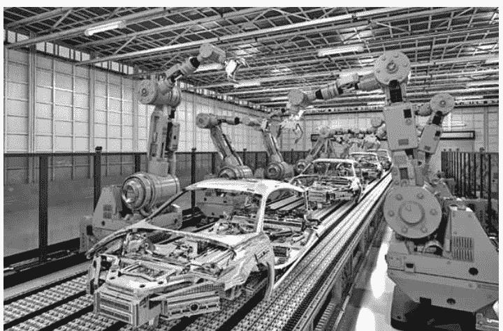

#### 1.2.2 模仿学习

模仿学习是一种通过观察和模仿人类行为让机器人学习特定任务的方法。此方法首先需要收集特定任务的轨迹数据，通常包括记录人类专家执行任务的视频或通过传感器直接捕捉其动作。例如，在汽车制造领域，可以通过穿戴设备将工程师的手动装配过程记录下来，或者利用高分辨率摄像头捕捉精细操作。随后将收集到的数据分解为一系列具体动作或步骤，并对这些动作进行详细标注，清晰定义每个动作的开始和结束以及相应环境状态。这一步骤对模仿学习至关重要，因为它既定义学习目标，又设立评估标准。接着，研究人员选择适当深度神经网络建模从状态或观察例如第一视角图像到动作的映射，以此学习并复现技能。

模仿学习的优势是能够直接从专家示范中学习。如图1.3所示，斯坦福大学研究团队开发了一套名为Mobile ALOHA的系统，专门用于模拟双手和全身控制的动态操作任务。据报道，通过提供50次示范，该系统成功将模仿学习任务的成功率提高至90%，并能自主完成一系列动态复杂任务，例如炒虾、击掌、洗锅、擦玻璃等。

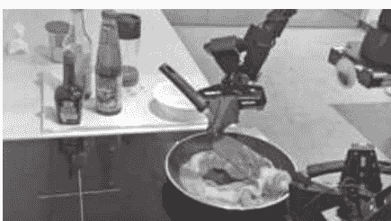

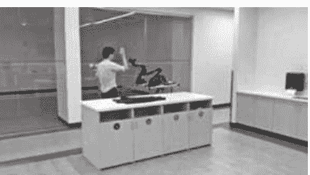

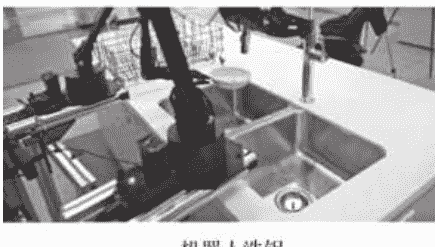

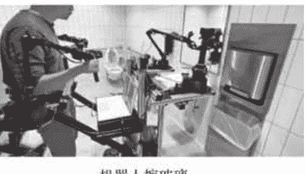

图1.3 Mobile ALOHA模仿学习示例

但模仿学习需要大量示范数据以覆盖广泛的状态和动作空间，这会带来泛化问题。例如，虽然训练一个智能体可以将物体从桌子中间推至右上角，但相同策略可能无法直接适用于将物体推至右下角的任务。这主要是因为在图像层面，桌子的右上角与右下角存在明显差异，而在缺乏充分相关数据的情况下，神经网络难以学习到两者在抽象层面的相似性。

此外，模仿学习还面临任务组合数量爆炸的问题。例如，如果需要学习与用100种方式操作100类物体相关的100种特定状态，那么就需要定义并完成一百万种不同任务。即使像Mobile ALOHA那样每个任务仅提供50次示范，那也是巨大的数据收集挑战。在实际训练多场景任务时，这种数据收集由于成本过高没有实施可行性。

#### 1.2.3 强化学习

强化学习是一种机器学习范式，允许智能体如机器人通过与环境交互学习达成特定目标的策略。在此过程中，机器人自主学习最优策略，通过不断尝试和犯错来优化行为。

在强化学习中，首先需要定义一个包括所有智能体可能影响或被影响因素的环境。智能体在此环境中执行操作，并从环境中获得对其行动的反馈，通常是奖励或惩罚。状态空间定义了智能体可以处于的所有可能状态，为智能体提供关于环境的完整信息。动作空间则包括智能体可以采取的所有潜在行动，例如移动、抓取或放置。奖励函数的设计至关重要，它不仅激励机器人朝着目标努力，也反映出行为的长期后果。如图1.4所示，在导航任务中，采用在Actor-Critic算法中，设计的奖励函数可能对达到目的地的行为给予奖励，而对撞到障碍物的行为施以惩罚。

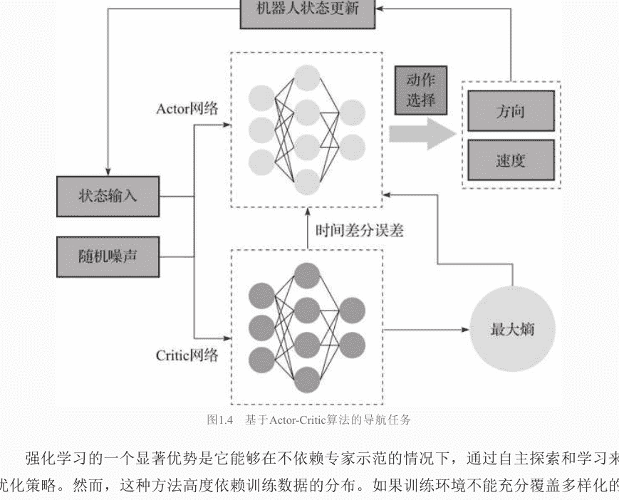

## 图1.4 基于Actor-Critic算法的导航任务

强化学习的一个显著优势是它能够在不依赖专家示范的情况下，通过自主探索和学习来优化策略。然而，强化学习这种方法高度依赖训练数据的分布。如果训练环境不能充分覆盖多样化的实际操作环境，那么学习到的策略可能无法适应新的或未见过的环境条件。例如，一个仅在室内环境中训练的机器人可能在户外复杂多变的地形中难以有效导航和操作，因为其训练数据未覆盖天气变化、地形起伏等因素。

强化学习还面临着目标多样性的挑战。目标多样性指的是机器人面临的任务和目标在性质上可能高度多变和复杂。机器人在实际应用中可能需要完成从简单到复杂的多样任务，如搬运、组装、搜索救援等，每个任务都有其独特的目标和执行标准。强化学习模型可能难以同时优化针对多个目标的策略，特别是当这些目标在某些方面存在冲突或需要在多个维度上进行权衡时。例如，提高操作速度可能会降低精确度，反之亦然。

在强化学习中，智能体必须通过与环境的交互来学习最佳策略。每次与环境的互动都会产生数据，包括当前状态、采取的行动以及由此产生的奖励或反馈。这些数据用于更新智能体的策略，以使其在未来能够做出更好的决策。由于强化学习通常面临复杂的状态空间和动作空间，以及可能的延迟奖励信号，算法的数据利用率通常较低，需要大量的交互数据才能对环境建模并学习到有效的策略。这些挑战增加了在实际应用中采用强化学习解决任务组合数量爆炸问题的难度。

## 1.3 世界模型

在决策的智能化与通用化方面，无论是预编程方法还是深度学习方法，都未能完全满足期望。这些技术尚未达到人类在思考、学习和解决各种任务方面的能力水平。当前的挑战在于，我们希望机器学习系统能够从自然模态中学习并抽象出世界的结构化和层级化知识，即构建一个“世界模型”。

### 1.3.1 什么是世界模型

预编程方法依赖硬编码的指令和规则，这限制了其应用于复杂或未知环境中的能力。而深度学习方法尽管在模式识别和数据驱动的任务中表现出色，但仍然缺乏对复杂世界动态的真正理解。这些方法大多关注从大量数据中学习特定的功能或行为，但通常忽略了对环境的全面理解和对未见情况的适应能力。

要想让机器的决策真正达到智能且通用的程度，模型必须像人一样，不仅掌握单一任务的技巧，还要从大量经验中提炼出对世界的广度认知和深度理解。这正是“世界模型”所要承担的角色。拥有它之后，系统能解读当下的数据流，也能前瞻未来可能出现的情形与变化，于更宽更大、更复杂的场景中做出合理判断。

世界模型这一思路最早在强化学习里出现，用来描述智能体与外部环境互动时的内在表征。Yann LeCun 提出联合嵌入预测架构 JEPA 时，把世界模型作为核心模块放了进去。该模块不直接操作原始感知信号，而是以抽象方式处理世界状态。它的主要任务有两项：一是补足感知系统没覆盖到的当前世界信息；二是推演自身行动可能带来的未来状态。这两项工作都基于世界状态的抽象表征展开，能忽略不可预测的细节，支持多尺度规划。行动的预测结果会交给成本模块来评估预期后果，世界模型也让智能体可以先在脑中模拟行动及其影响，再去做复杂任务的前置规划与推理。

在 JEPA 架构里，世界模型由抽象表征和序列预测两部分构成。抽象表征负责把环境信息压缩提纯，降低数据维度，从纷繁的环境里抽出核心特征，形成简洁而精炼的内部模型，这个过程很像大脑把视觉听觉等感官输入抽象成关键信息以便快速反应。序列预测则对环境表征随时间的变化进行模拟，推断接下来可能发生的事件，为系统提供预测性决策和策略调整的依据，可类比人脑进行内在预演的心智机制。

通过这两部分，世界模型让人工智能更高效地处理环境、应对不确定，并在动态变化中实现自主决策与学习，是拉近机器思维与人类思维的重要一步。

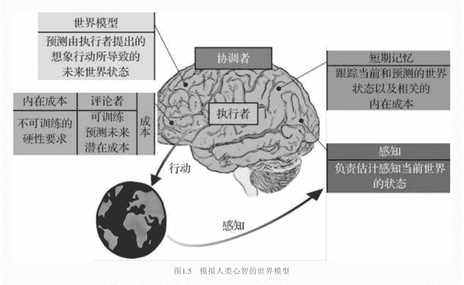

### 1.3.2 世界模型在具身智能中的底层作用
在具身智能里，世界模型的作用尤为关键。它不仅帮助智能体认识和理解外部世界，还能让其感知变化并做出适应性反应。决策依赖于模型对环境状态的持续跟踪与预测，使智能体在多变环境中保持顺畅交互。模型提供环境因果关系的理解，并具备反事实推理能力，这对复杂决策至关重要。

美国计算机学家 Judea Pearl 提出的因果之梯理论把因果理解划分为关联、干预、反事实三个层级，层层递进。其中反事实层级最复杂，涉及“如果……会怎样”的假设推演。通过假设不同行动方案并预测其可能结果，智能体能在未知复杂环境中评估多种备选路径，选择更优解。世界模型因此能补全当前世界的信息，处理真实世界的不确定性，并预测行动可能引发的多重未来状态。

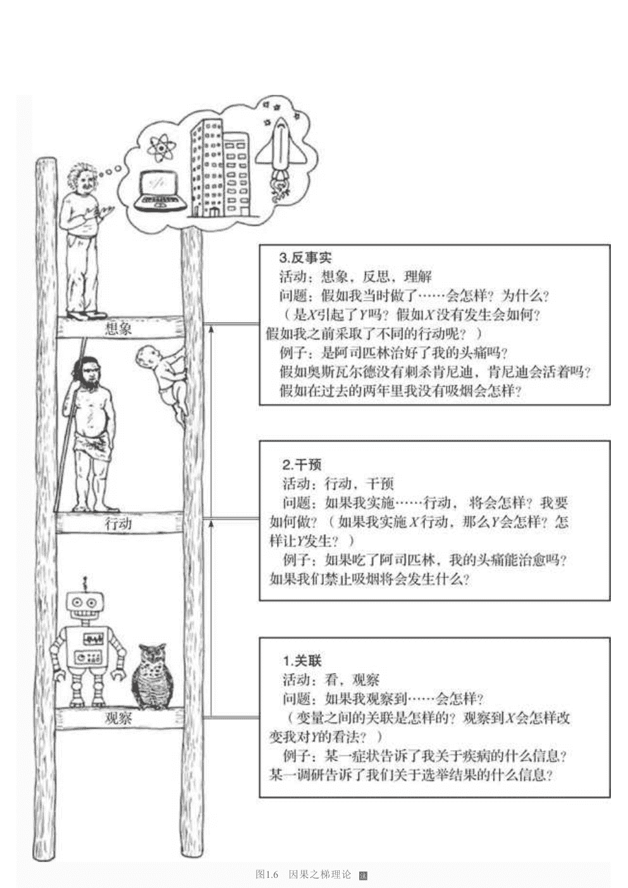

- **3.反事实**
  - 活动：想象、反思、理解
  - 问题：假如当时做了不同的选择会怎样？原因是什么？若 X 未发生会如何？若之前行动不同呢？
  - 例子：阿司匹林是否真的止住了头痛？如果奥斯瓦尔德没有开枪，肯尼迪是否会存活？如果过去两年没吸烟会怎样？

- **2.干预**
  - 活动：行动、干预
  - 问题：如果实施某项行动会怎样？如何让 Y 发生？
  - 例子：服用阿司匹林头痛能否缓解？如果禁止吸烟会怎样？

- **1.关联**
  - 活动：观察、记录
  - 问题：观察到 X 时对 Y 的判断会如何改变？变量间关联如何？
  - 例子：某种症状说明疾病的什么信息？一次调研揭示了怎样的选举趋势？

## 图1.6 因果之梯理论
这种预测能力对缓解组合爆炸和泛化难题很有效。组合爆炸源于状态与动作空间过大，传统强化学习难以穷尽探索。世界模型通过内部模拟真实世界动态，能预测评估状态变化，无需在物理环境里遍历所有可能性，从而降低无效探索。

泛化问题指模型在训练外场景表现不佳，常因过度拟合训练数据。世界模型借助结构化表征和动态模拟，学习更抽象、更通用的知识。例如在不同天气与交通条件下模拟驾驶结果，帮助自动驾驶在未见场景中做出合理决策。

内部模拟让模型能在无外部干预时自主学习，甚至在“脑中”进行试错修正，大幅提升新环境下的适应性和鲁棒性。

## 1.4 从大模型到世界模型的演进路径
世界模型为通用智能提供了一条可行思路，而大模型技术可能是通往它的渐进路线。

### 1.4.1 大模型如何内化世界表征
基于 Transformer 的大模型在训练方式和目标上与传统机器学习不同。它并非被显式编程去构建世界模型，也没有直接以此为训练目标，多是通过处理序列化 token 来预测下一个 token。经海量文本与图像 token 的训练后，这些模型能捕捉世界与人类社会的一些基本规律。

OpenAI 联合创始人、前首席科学家 Ilya Sutskever 曾表示：“当大型神经网络被训练去精确预测文本下一个词时，它实际上在构建世界的映射。”模型在处理大量文本中逐渐学习人类环境、期望、动机等多方面规律。

近期研究以黑白棋 Othello 为测试床，探讨语言模型能否在无专业知识指导下隐式学习世界模型。研究《Emergent World Representations: Exploring a Sequence Model Trained on a Synthetic Task》中，研究者用模拟器生成 2000 万局对局序列训练 Othello-GPT，一个 Transformer 模型仅通过预测下一步棋步学习，完全不了解棋盘规则。结果显示，其内部状态可用于预测落子后棋盘格子的位置，引发了是真正理解游戏抽象结构还是依赖记忆启发式的讨论。

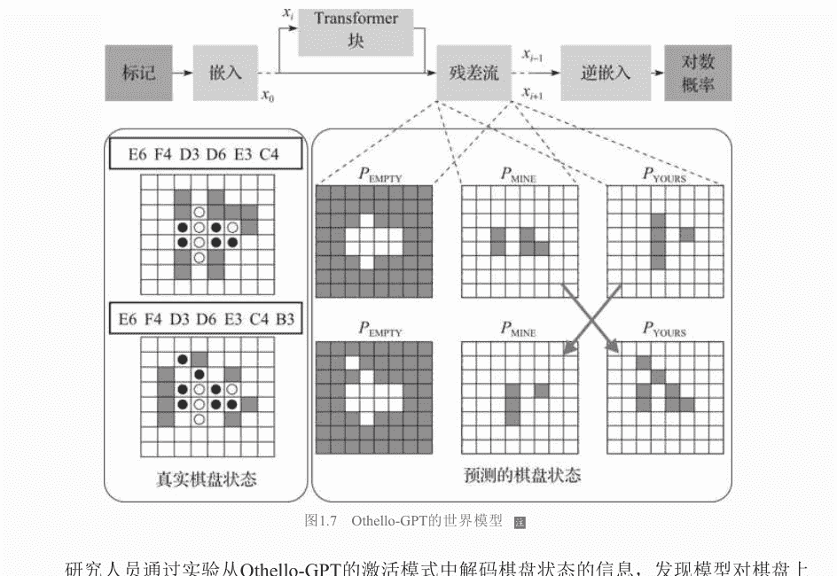
图1.7 Othello-GPT的世界模型

实验通过解码 Othello-GPT 的激活模式发现，模型对棋盘每个格子的状态做了有效编码，区分当前玩家占据、对手占据或空闲。进一步改变棋子颜色或删除已下棋子时，后续走法预测随之变化，证明信息具有因果作用。

由此可见，Othello-GPT 通过内部激活对棋盘状态编码并据此预测合法行动，表现出对“游戏世界”的深刻理解，展现出世界模型的潜能。

总体来看，大模型能通过大规模数据学习实体、关系、过程的结构化表征，利用自注意力与层级融合理解复杂过程交互，捕捉因果关系以支持预测与决策。这些能力既来自数据学习，也依赖参数优化带来的泛化与推理能力。

### 1.4.2 多模态大模型能否成为世界模拟器
2024 年初，OpenAI 发布 Sora，可根据文本描述生成长达 60 秒的视频，场景细腻、角色表情丰富、镜头运动复杂。虽然官方称其为物理世界模拟器，未直接提世界模型，但高质量模拟器必然依赖精确的世界表征。

Sora 融合了潜在扩散模型 LDM 和扩散 Transformer DiT，以 Transformer 为核心。LDM 通过变分自编码器 VAE 把高分辨率图像压缩到低维潜在空间，再把压缩后的视频拆分为“时空补丁”，转为一维序列。模型采用特殊位置编码记录每个补丁在视频中的时空位置，使 DiT 能保持块间相对关系，通过逐步去噪生成高质量视频。此方法把 Transformer 从文本、静态图像扩展到动态视频。

如图1.8所示，Sora 视频在单帧上分辨率高、纹理细腻，整体时间连贯性突出，能维持物体形状、纹理等静态属性稳定，并让运动与相互作用按物理规律自然演进。

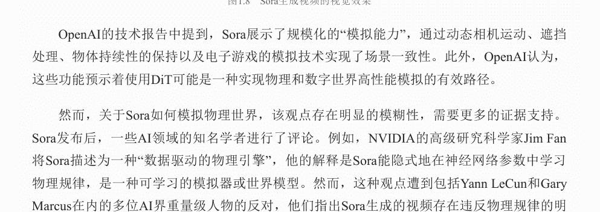
OpenAI 技术报告提到 Sora 具备规模化“模拟能力”，包括动态相机运动、遮挡处理、物体持续性保持及电子游戏模拟等，认为 DiT 可能成为物理与数字世界高性能模拟的有效路径。

不过这一说法仍模糊，证据不足。NVIDIA 高级研究科学家 Jim Fan 称 Sora 为“数据驱动物理引擎”，认为其隐式学习物理规律，是可学习的模拟器或世界模型。但 Yann LeCun、Gary Marcus 等人反驳，指出生成视频存在明显违背物理规律的问题。

OpenAI 本人也承认局限，并展示失败案例，如时空不一致、重力与碰撞动力学错误、物体坚固性与持久性处理不当。图1.9 中液体流出与杯子倾斜不同步，就是液体动力学处理的不足。

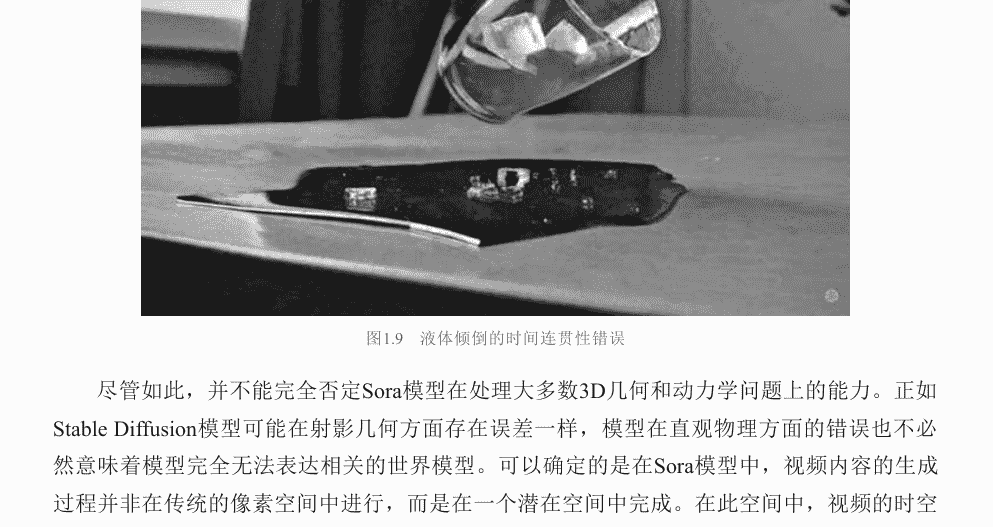
图1.9 液体倾倒的时间连贯性错误

即便如此，不能因此否定其在 3D 几何与动力学上的能力。就像 Stable Diffusion 在射影几何上偶有误差，不代表完全没有世界表征。Sora 的生成并非在像素空间直接进行，而是在潜在空间完成编码与表征，从而克服传统像素处理的局限。

相关研究表明，信息可在潜在空间被有效表征。即便像素空间的某帧已看不到球，潜在空间仍保留球的存在与轨迹信息，早期扩散步骤即可揭示球即将滚落的因果关系。即使物体当前不可见，模型仍能利用潜在表征预测后续运动，保证视频连贯与逻辑一致。

因此 Sora 的潜在表征使其更有效地模拟与生成内容，而非简单复制像素变化。即使不完美，当前生成模型也可能已具备某种“世界模型”。学术界对自回归生成式模型能否真正构建有效世界模型仍有争议，但它们展现的理解世界能力说明我们正逐步接近目标，基于大模型的具身智能研究已成为机器人技术的主流方向。

## 第2章 机器人系统架构设计的关键逻辑
自第一台可编程机器人诞生以来，架构始终是系统设计的核心。架构选择直接决定运行效率、功能实现与整体性能。任务规划与控制实现之间的难题往往涉及多层次复杂性，需要有效管理与协调。随着技术演进，多级分层架构与端到端架构成为主要方案。前者通过模块化提升可维护性和可扩展性，后者通过减少中间层简化设计。

## 2.1 机器人控制的基础框架

### 2.1.1 机器人怎么分？由什么构成？
机器人是高度复杂的集成系统，可按多种维度分类。从应用环境看，有工业机器人、服务机器人和特种机器人，如图2.1所示。工业机器人用于产线自动化，服务机器人覆盖医疗、教育、家居等，特种机器人面向消防、军事等特定环境。

从控制方式看，分为操作机器人、程序机器人、示教再现机器人、智能机器人和综合机器人。操作机器人多为简单自动装置，程序机器人按预设运行，示教再现机器人可学习操作者动作，智能机器人具备自主学习与决策，综合机器人融合多种控制技术。

从控制论角度，可划分为生产用、研究用和生活用机器人，侧重功能与使用场景。

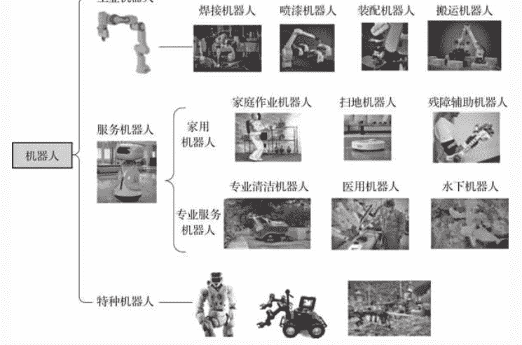
无论分类如何，所有机器人系统都包含硬件与软件两大核心。硬件由机械结构、传感器、执行器、控制器组成，软件负责感知、规划与执行。以如表2.1所示的人形机器人为例，其软硬件主要涵盖五大组成部分。

- 感知系统：包括摄像头、麦克风、距离感应器、压力感应器等，使机器人感知环境并捕捉视觉听觉信息。当前感知技术已较成熟，提升精度与复杂环境处理能力仍是重点。

表2.1 人形机器人配置

| 对比项 | 智元远征 A1 (2023.8) | 宇树科技助跑机器人 H1 (2023.8) | 傅利叶 GR-1 (2023.7) | 特斯拉 Optimus (2022.9) | 特斯拉 Optimus Gen 2 (2023.8) |
| :--- | :--- | :--- | :--- | :--- | :--- |
| 图片 |  |  |  |  |  |
| 身高体重 | 175cm、55kg | 180cm、47kg | 165cm、44kg | 172cm、73kg | 173cm、56kg |
| 自由度 | 49（其中灵巧手17） | 19 | 44 | 50 | 42（其中灵巧手11） |

主流人形机器人在硬件堆叠上已进入密集竞争期，不同方案在关节执行、算力感知与运动表现上呈现出明显分野。

配置方面，一款机型选用自研PowerFlow准直驱关节，配合低齿槽转矩设计、10:1以内速比的高透明度行星减速器、同轴共轭双编码器、一体式液冷循环以及自研矢量驱动，峰值扭矩超过350N·m，算力来到200 Teraflops级别，感知组合为RGBD相机加激光雷达加IMU；另一款采用自研M107电机，峰值扭矩360N·m，具备中空轴线与双编码器，上半身以谐波减速器为主、下半身以行星减速器为主，搭载3D激光雷达与深度相机，可实时获取高精度空间信息并完成全景扫描；第三款以自研FAS高性能一体化执行器为核心，电机、驱动、减速、编码集成于一身，机身由40个摩擦支撑驱动的FSA关节构成，单模组峰值扭矩可达300N·m；第四款搭载FSD全自动驾驶系统与D1超算芯片，执行器为减速器加电机传动，双手集成大量传感单元，具备精细操作能力；第五款则在前代基础上全面迭代，步速提升约30%、整机减重至少10公斤，动作拟人度显著提高，可完成深蹲及放鸡蛋等精细任务。

运动表现上，首款最高步速约7km/h，整机承重80kg，单臂最大负载5kg；第二款步速超过1.5m/s，理论奔跑能力可达5m/s，是国内首台能奔跑的全尺寸通用人形平台；第三款步速达5km/h，负载50kg，支持快速行走、敏捷避障、平稳上下坡与抗冲击干扰；第四款未公布具体行走速度，从公开影像看节奏偏慢，可搬运约10kg的中小型货物；第五款行走速度达8km/h，既能搬运重物，也能轻握鸡蛋。

控制系统负责环境理解、任务拆解、路径规划与执行落地，例如智元机器人远征A1选用PowerFlow处理器，200 Teraflops的算力支撑起强大的数据处理能力。
驱动系统分液压与电机两类，追求轻量化、灵活、小体积以及抗摔耐用，例如助跑机器人H1的M107电机可输出最大360N·m扭矩，保证出色的运动表现。
末端执行系统涵盖关节执行器、谐波减速器、无框力矩电机等，核心在于抓握力与灵活性的精细控制，例如傅利叶GR-1采用传感器融合的FAS转矩电机，峰值300N·m，在力量与精细度间取得平衡。
能源供应系统以电池为主，续航与安全是关键，长时间稳定作业依赖可靠的电能供给。

### 2.1.2 自由度与执行器
从运动控制角度看，自由度数量决定了控制复杂度与功能上限。自由度即系统在空间中独立平移与旋转的能力，平移自由度涵盖沿x、y、z三轴的直线移动，旋转自由度涵盖绕x、y、z三轴的转动，每个轴提供一个自由度。

以特斯拉Optimus Gen 2为例，全身共计42个自由度，手部设计实现较大跃升，并在感知技术上持续演进。该代保留11个手部自由度，其中6个主动关节、5个被动关节。如图2.2所示，Optimus Gen 2能够拾取易碎的鸡蛋，体现出高控制精度与操作灵活性。

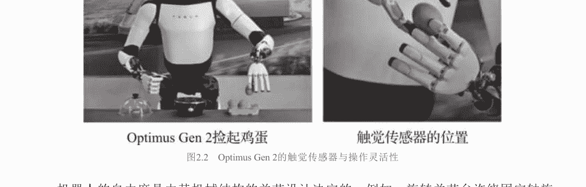
图2.2 Optimus Gen 2的触觉传感器与操作灵活性

机器人的自由度由机械结构与关节形式决定，旋转关节实现绕定轴转动，平移关节支持直线运动。执行器如电动机、液压缸是驱动关节运动的核心，主动组件直接产生运动，被动组件通过阻力或储能调节运动。传统执行器缺少反馈，难以精确感知自身状态。伺服器则内置反馈控制，可实时调整输出，保证关节运动的准确性，伺服系统通常由传感器、控制电路与执行器构成，能精控位置、速度与加速度。

随着应用场景复杂化，触觉传感器被引入伺服系统。视觉受限时，触觉可提供形状、纹理、硬度与压力等细节反馈。Optimus Gen 2手部的触觉传感器即为典型创新，它能感知物体特性，显著提升交互能力，尤其在高精度抓取任务中表现突出。触觉与伺服结合后，手部抓取力可实时调节，避免损伤或滑落。

Optimus Gen 2的控制精度源于复杂的伺服关节网络，不同部位的关节在扭矩、速度、定位精度与旋转刚度上各有差异。各伺服关节通过精确的扭矩与角度控制，确保在不同任务中兼顾效率与灵活性。

伺服驱动关节为运动提供物质基础，实现位置、速度与加速度的精确控制。若要从单纯运动走向通用智能，还需在硬件之上叠加软件层面的智能行为规划与决策，软件架构的简化是降低系统复杂度的关键。

## 2.2 机器人系统设计范式
机器人系统要同时处理海量传感器输入、多自由度控制与实时环境变化，缺乏优化时计算与控制复杂度会指数级攀升，制约反应速度与灵活性。因此通用智能机器人在硬件之外，必须依赖先进软件架构来统筹感知、规划与控制。

### 2.2.1 层次范式
层次范式为机器人提供结构化处理框架，采用多层架构如感知层、规划层、执行层。分层使信息处理与决策制定逐步上升。

如图2.3所示，感知层通过视觉、声觉、激光雷达等传感器采集环境数据，经滤波与特征提取形成环境表征。低层的行为控制模块如避障可据此做基础实时反应，例如障碍物规避与路径跟随。规划层负责更复杂的任务决策，如全局路径规划与任务优先级管理，结合感知信息、状态、地图与约束生成全局行动计划，例如计算从当前位置到目标的最优路径并规避动态障碍。执行层则根据规划输出驱动机械动作，完成如机械臂精细操作等具体任务。

层次化决策路径清晰、模块化程度高，便于分解复杂任务。但信息在层间传递易产生延迟，处理顺序固定限制实时性与灵活性，且层间耦合较弱，在高度动态或非结构化环境中反应往往不够敏捷。

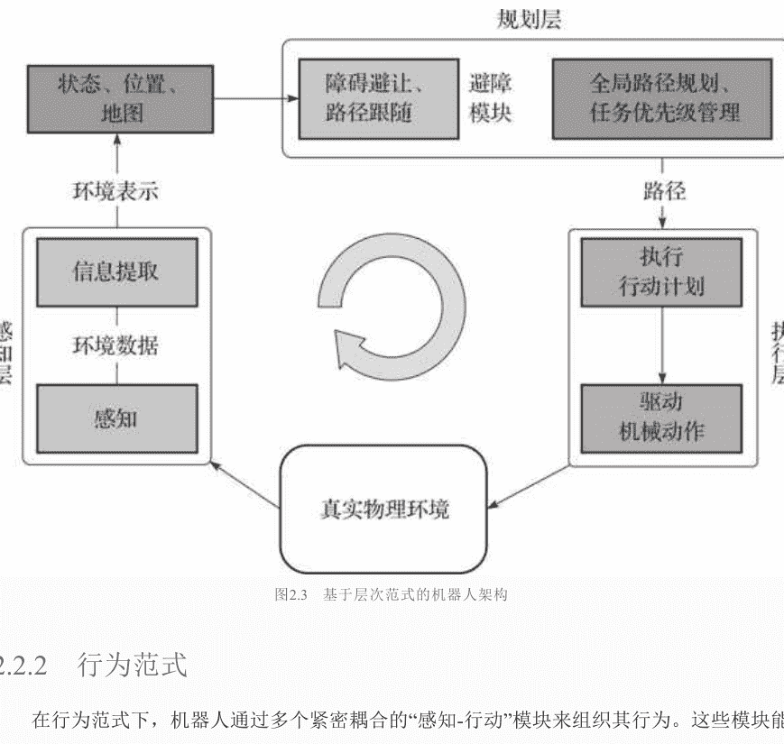
图2.3 基于层次范式的机器人架构

### 2.2.2 行为范式
行为范式下机器人由多个紧密耦合的感知-行动模块构成，各模块可并发运行，独立读取本地传感数据并计算最优动作，无需等待中央决策，从而提升实时响应能力。

如图2.4所示，架构通常包含避障、探索、建图、物体识别、搜索其他机器人等并行模块。各模块独立运行，输出经行为选择机制整合为最终控制指令，系统对环境变化反应迅速。

行为系统源于反应式系统，但设计理念不同。传统反应式依赖符号表示与规则推理，行为系统则依靠并发简单行为的交互涌现复杂行为。每个行为单元独立、代码量小、可扩展性强，增加传感器或新行为变得便捷。机器人更多是对外界刺激的直接反应，正如Rodney Brooks所说，“规划只是推迟做下一步决策的方式”。真实世界被当作最佳模型，行动直接源于观察。

自下而上的设计带来一定不可预测性，多模块并行访问传感器数据时可能产生冲突。为此系统采用动态行为选择策略取代固定优先级，可根据情境自动调整各行为的激活等级。每个行为单元常设计为状态-动作对，在特定状态下做出明确响应。全局控制器在关键时刻介入，协调各模块输出，保证预期性能，提升整体效率与稳定性。

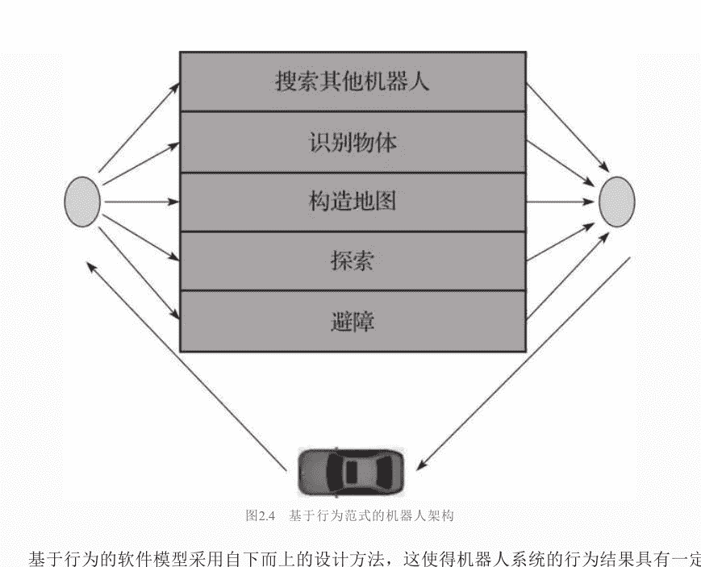
图2.4 基于行为范式的机器人架构

### 2.2.3 混合范式
混合范式兼顾层次范式的任务管理能力与行为范式的实时适应性，兼顾效率与灵活性。

首先进行任务规划，将复杂任务按全局需求分解为可管理的子任务，并预判环境变化制定调整策略，形成明确的任务导向与灵活余量。

分解后进入行为范式的执行阶段，机器人按子任务执行，同时实时获取环境信息动态决策，例如实时避障、调速甚至改变策略，确保任务安全连贯。

传感器使用上呈现分层与反应式结合。数据一方面直通低层行为模块支撑反应式控制，另一方面上传至高层规划模块更新全局世界模型。实时数据反馈到规划层可帮助机器人即时调整全局策略，实现底层物理响应与顶层决策的协同。

## 2.3 运动控制层级
运动控制的分级结构旨在降低规划复杂度，支持从环境感知、任务理解到具体执行的逐步转换。上层输出作为下层输入，形成职责清晰的递进关系，实现从抽象目标到具体动作的细化。

### 2.3.1 递进规划
理想机器人应能互动并具备高度智能与通用性。不同硬件提供不同本体基础，执行器则是控制各部件运动与定位的核心，行为能力最终取决于对执行器的控制精度。为缩小任务需求到控制实现的鸿沟，采用分级软件架构，在不同抽象层简化规划与控制。该架构通常分为任务级、动作级、基元级与伺服级，协同确保高效与精准，如图2.5所示。

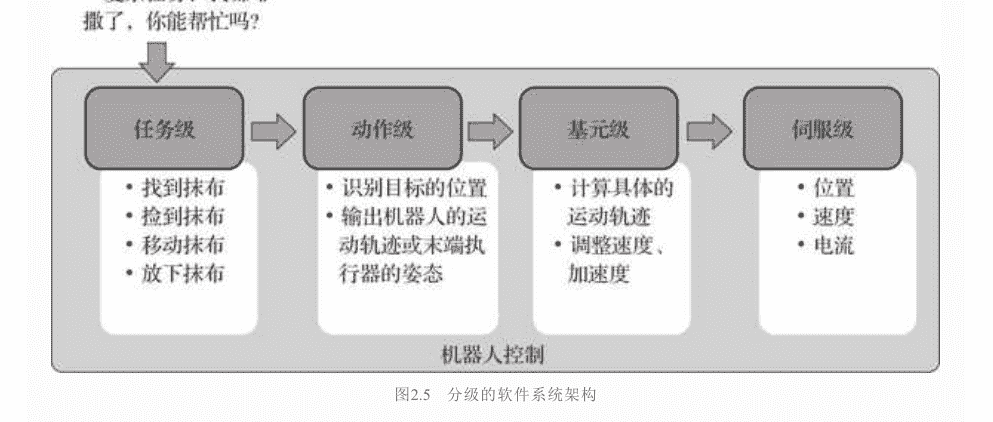
上层任务级负责整体任务的子目标规划，处理全局抽象，例如将“搬运物体”拆分为“抓取”“移动”“释放”等子任务，但不直接执行，而是把子目标传递给动作级。

动作级将任务目标细化为可执行操作序列。依环境信息规划每个动作的实现，例如“找抹布”时需用视觉扫描存放区、识别位置、规划避障路径，生成从当前位置到目标的导航轨迹，并规划机械臂抓手轨迹与姿态以准确抓取。输出为运动轨迹或末端姿态，供下一层处理。

基元级把轨迹与姿态转化为可执行基元运动指令。对“找抹布”路径进行直线、圆弧等运动分解，结合动力学与运动学模型优化速度、加速度等参数，保证平滑安全，最终生成每个周期的关节目标角度或力矩指令，送至伺服系统实时控制。基元级是高级规划与底层物理执行的桥梁。

最底层伺服级直接接收基元指令，通过驱动伺服电机实现物理运动，负责运动精确、安全与实时性。通过位置、速度、负载等状态的实时监控与反馈控制，可动态修正外部干扰与硬件偏差，保证按计划执行。

分级控制形成从任务规划到物理执行的完整链路，各层分工明确，提升灵活与执行精度，改善动态环境适应性与安全性。

### 2.3.2 反应机制
人类运动控制可分为无意识被动行为与有意识主动行为。无意识行为如行走、抓取等快速自动化动作，不需意识干预，由脊髓、小脑、基底核等下级中枢控制，决策高效。有意识行为如学习新技能、解决问题，则主要由大脑皮层完成。

如图2.6所示，当前的递进规划主要模拟有意识行为，通过任务分解与目标预测实现状态转移。然而分级递进在快速反应上存在局限，例如人类面对突发情况能瞬间闪避或通过下意识调整步态保持平衡，这类能力在纯递进控制中难以高效复现。

为弥补缺口，需引入反应机制模拟无意识行为，即前述行为范式所倡导的自下而上构建复杂行为。可将基元级与伺服级作为核心，处理紧急或高效自动化任务。面对突发状况时，基元级可跳过复杂规划，直接执行预设反应式行为，类似人类反射；伺服级利用反馈回路实时监控运动状态，按传感器数据快速调整，类似人类对外界刺激的快速反应。

依此机制，当机器人检测到路径上突然出现障碍，基元级可立即触发避障动作，伺服级迅速调整执行器以完成避障，无需重规划。这种自下而上反应式控制提升了复杂动态环境下的灵活性与效率。

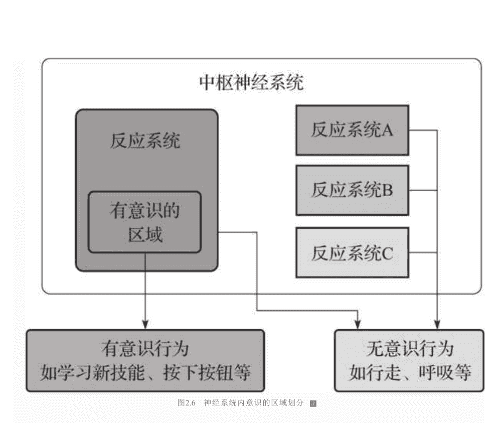
图2.6 神经系统内意识的区域划分

### 2.3.3 双向控制架构
人类运动控制是复杂的双向架构，涵盖无意识反应到高级认知如反思、学习、计划，且两者相互作用。无意识向有意识的转变是认知过程的重要环节。执行一个无意识行为，如自动接住掉落物品，完成后常会进行评估。评估既涉及行为成败，也涉及质量如反应速度与精准度。

意识介入与行为优化

行为结果偏离预期或尚有改进空间时，意识会接手对既往操作进行拆解复盘，目标是让同类情境下的下一次反应更精准。事后评估把原本自动化的行为产出沉淀为可学习的经验，并在未来相似场景中被调取累积。经历一次成功或失败后，相关经验会被写入记忆库，再遇到可比情境时自动被调用，从而把本能式的无意识操作逐步打磨成更贴合环境的自觉行为。意识的作用并不止于事后，它也会在行动启动前提前介入，通过策略微调、技能提升与动作控制的精细化来做预校准，确保结果更理想。

人类这种控制逻辑在机器人侧被复现为双向协同控制框架，同时支撑反应式执行与自上而下的规划。如图2.7所示，当下机器人设计普遍采用多层级结构，既要模拟无意识反应的迅速应变，也要实现高级决策与持续学习。

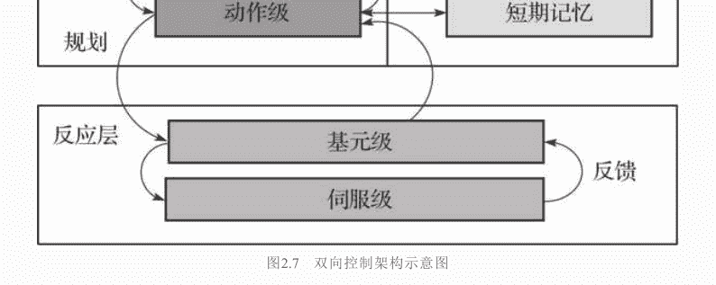
反应层主要模仿人类无意识反射，对外界刺激实现快速响应，同时可接受决策层的规划指引完成运动控制。机器人借助传感器即时感知环境变化，驱动执行器做出即时回应，例如自动避障、姿态微调等。该层的优先级类似人类条件反射，在紧急或高动态场景下优先保障安全与稳定。

决策层则对应人类的思考与判断，能够依据任务目标主动制定计划，并在收到反应层的反馈后评估当前策略的有效性，进而修正后续行为。这里涉及更复杂的数据处理与分析，比如预测行动的长期后果、优化任务执行方案等。该层通常依赖高级规划算法或机器学习模型，以便在环境不断变化时逼近最优决策。

支撑这种双向结构运转的核心是强大的信息反馈回路。它让反应层与决策层之间能够实时交换数据，并随环境变化与执行状态动态调整。例如将传感器实时数据与内部状态监测信息融合，系统就能持续修正运动轨迹或决策策略，用来应对突发事件或执行过程中的偏差。反馈回路对系统效率与灵活性至关重要。

记忆机制在此架构中同样关键。短期记忆负责保存近期行为，为系统的快速修正与即时反应提供依据，通常通过数据缓存实现快速读写。长期记忆则承担经验与知识的沉淀，塑造系统的长期行为模式与决策偏好，可通过具备学习能力的模型实现，让系统从历史经验中不断提炼、逐步优化策略，从而在多变环境中提升适应力。

因此，双向协同控制把双向交互反馈与记忆机制结合起来，使系统在任务执行过程中能够实时审视自身行为与外部响应，并据此自我修正。通过持续的试错与学习，机器人既能应对复杂任务，又能逐步进化行为模式，最终达成更智能、更高效的目标。

### 2.3.4 分层对比端到端

机器人系统分层设计把感知、决策、规划与行动拆成独立的功能模块。如图2.8所示，感知模块负责采集并处理环境信息，如图像与传感器数据；决策模块基于处理后的信息制定行动策略；规划模块按任务要求进行路径与步骤设计；行动模块则负责把策略落地执行。各模块通过清晰的接口与职责划分，提升各自任务的执行效率与可靠性。模块间的独立性也大幅提高了系统的可适配性与可维护性。

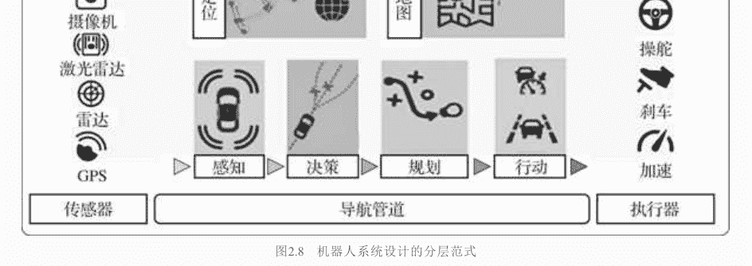
图2.8 机器人系统设计的分层范式

端到端架构把传统的多层功能划分——感知、决策、规划、行动——整合成一个统一的神经网络模型，从而简化整体处理流程。如图2.9所示，这类架构通常直接接受原始输入数据，如图像、声音或其他传感器信号，并直接输出控制指令或决策结果，实现感知与行动的紧密耦合。其核心优势在于省去多层次之间接口的需求，简化设计与部署，让系统通过训练直接学习输入到输出的映射，减少信息在传递中的损耗，并在某些应用中能超越传统分阶段处理。

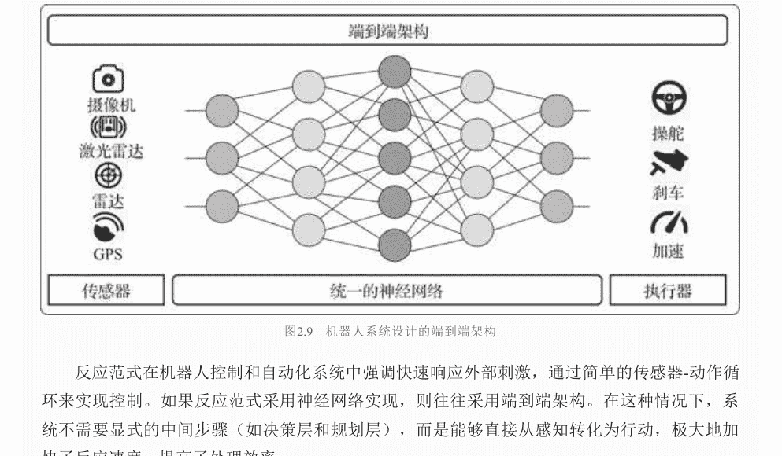
图2.9 机器人系统设计的端到端架构

反应范式强调对外部刺激的快速响应，通过简洁的传感器-动作闭环实现控制。若用神经网络实现反应范式，往往会采用端到端形式。此时系统不需要显式的决策层或规划层，而是能把感知直接转化为行动，大幅提升反应速度与处理效率。

当然，整个控制系统也可以走纯端到端路线，把感知、决策、规划、行动全部塞进一个神经网络，且不再对规划任务分级。这种结构在形式上更简洁，但面对不同层级的规划需求时会出现短板。任务级规划通常涉及高层决策，如导航、路径规划等，而伺服级则关注精细控制，如电机驱动、关节角度调节等。两者目标与所需控制信号差异巨大，单一模型难以兼顾。任务目标差距过大。

端到端模型需要海量训练数据来覆盖从感知到行动的全映射，涉及多层任务时需求更显著，因为模型必须在高度异质的输入与复杂的任务目标间建立映射。当一个网络同时承担高层规划到精细控制时，优化难度远高于专用模型，因其需同时兼顾多尺度、多性质的目标函数。此外，端到端模型的黑箱特性使其决策难以解释，在对可靠性和可解释性要求极高的机器人场景中可能成为致命缺陷。相比之下，分层架构通过把感知、规划等拆分为独立模块，优化特定任务，提升了系统的透明度与可维护性，每个模块功能明确，便于监控与调优。

为兼顾两者优点，可采用混合架构策略。在此方案中，规划任务按控制层级做适当分级。比如高层的任务级与动作级规划仍可用传统分层范式，以提高可解释性并降低实现成本；低层的基元级与伺服级则更适合端到端模型，因其能让系统对环境即时变化做出快速反应。在避障这类场景中，伺服级控制系统可在障碍物突然出现时立即调整运动路径，显著提升响应速度与适应能力。

## 第3章 大模型驱动的混合控制架构

随着大模型能力突破，传统机器人架构迎来新一轮进展。大模型的推理能力与机器人的物理形态结合，能够更自然地与人及环境互动，明显增强机器人应对复杂环境的适应力。在此架构下，机器人提供硬件基础，大模型则充当具身智能的“大脑”，提升任务层级与动作层级的规划能力，使机器人更智能、更通用。这为机器人技术开发打开了前所未有的空间。基础模型可以直接用于任务级与动作级规划，而具身大模型则可通过对基础模型的微调或重训练，更好地适配特定环境与任务需求。

## 3.1 大模型与任务级规划

### 3.1.1 基础模型

基础模型指在超大规模数据集上预训练的深度学习模型，学习到丰富的语义信息与世界知识，可通过微调适配各种下游任务。训练阶段并不针对特定任务优化，而是尽可能从数据中汲取广泛模式与知识。主要类型包括：

- 1）大语言模型 Large Language Model，LLM：如GPT等，主要用于自然语言处理。这类模型擅长文本处理与生成，在机器翻译、文本摘要、问答系统等领域应用广泛。
- 2）视觉模型 Vision Model：如ViT、Swin Transformer等，主要用于计算机视觉。通过深度学习处理图像与视频数据，用于图像分类、目标检测、语义分割等。
- 3）视觉语言模型 Vision-Language Model，VLM：如CLIP、ALIGN等，通过跨模态对比学习实现视觉与语言对齐。可理解并生成含多模态信息的内容，适用于图文匹配、图像描述、视觉问答等。
- 4）视觉生成模型 Visual Generative Model：如扩散模型与生成对抗网络GAN等，用于视觉信号生成。可生成高质量图像、视频，用于图像合成、编辑、风格迁移等。
- 5）其他多模态模型 Other Multimodal Model：涉及多种数据模态的联合学习，如音频-语言模型、视频-文本模型等，广泛用于需多模态数据分析的复杂任务。

基础模型通常在覆盖多领域的宽泛数据源上训练，能在单一系统内整合各领域信息，有效应对跨领域的长尾问题。在具身智能的任务级与动作级规划中，它们扮演世界模型的角色，尤其在任务级规划中能够有效分解任务。面对模糊或通用的任务时，凭借强大的通用性与理解力，这些模型简化了机器人任务定义与拆解，可自动把复杂任务拆成可管理子任务并进行规划，提升处理复杂任务的能力，使执行更灵活精准。此外，它们具备连续对话能力，有助于理解任务需求变化并实时调整，使机器人能与用户流畅交互，及时接收反馈与新指令。凭借零样本或少样本学习能力，模型能快速适应从未遇到的任务，对长尾应用尤为重要。

如图3.1所示，基础模型可以直接接受自然语言指令来定义与分解任务，并自动转化为机器人可理解执行的动作指令，无需用户掌握编程或机器控制知识。这不仅推动机器人技术普及，也把使用者范围从专业工程师扩展到普通用户。机器人的应用场景随之扩展，从工业自动化到家庭清洁、个人护理等日常生活辅助，通用性与接受度显著提升。多模态基础模型通过处理视频、音频等多类型数据增强决策支持，融合不同数据源的能力使其提供更全面的分析，支撑更复杂的决策。

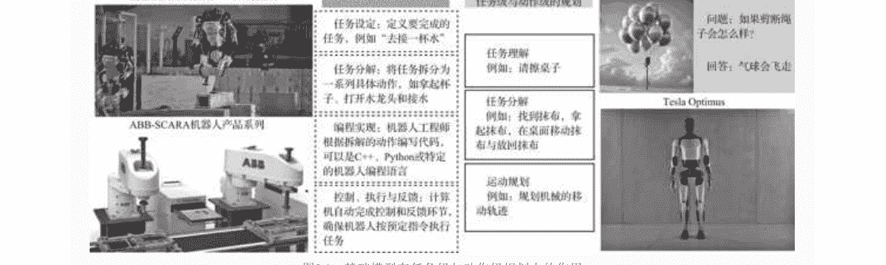
图3.1 基础模型在任务级与动作级规划中的作用

### 3.1.2 任务级分层与端到端

采用基础模型做任务级规划存在分层与端到端两种架构，取决于所用基础模型的能力。大语言模型缺乏视觉等感知能力，虽然很多任务规划抽象层级较高、对感知依赖较少，规划更偏向概念与策略层面而非具体感知细节。但感知缺失会降低其任务规划的智能性与通用性。图3.2列出三种大语言模型GPT-3、LaMDA、FLAN对“我把饮料洒了，你能帮帮我吗？”的回复，显示它们虽能给出合理语言建议，却缺乏实际操作基础。因此基于大语言模型的任务级规划必然走分层路线，该架构需借助视觉模型及多模态基础模型作为感知层。

> > 我把饮料洒了，你能帮帮我吗？

**GPT-3**: 你可以试试用吸尘器。

**LaMDA**: 要我找个清洁工吗？

**FLAN**: 对不起，我不是故意洒的。

图3.2 三种大语言模型的不同回复

在此分层架构中，大语言模型主要负责理解复杂语言指令并转化为高层任务目标与行动策略。它擅长抽象任务规划，能通过解析指令生成宏观策略性建议。与此同时，具体感知处理由视觉模型或其他多模态模型如CLIP、DALL-E等承担，它们能处理图像、音频等传感器数据，提供物体识别、空间定位等环境信息。这些感知信息是具体操作不可或缺的。例如，机器人任务中大语言模型可能给出“拾取最近工具”的指令，而视觉模型则负责在视野中识别具体工具并引导机械臂精准抓取。

具备视觉感知能力的基础模型如视觉语言模型虽可采用端到端架构直接从感知到子任务分解，但在复杂具身场景中常受限于训练目标与设计初衷并非面向特定机器人应用。尽管视觉感知强，在环境理解与物理交互需求面前仍可能力不从心。分层架构中，基础模型可利用专门感知模型处理特定输入，如RGB-D相机或激光雷达LiDAR获取的3D空间信息。这些专用模型能更准确完成深度感知、物体识别、空间定位等任务，通用视觉语言模型难以做到同样精细。当然，通过微调可提升多模态基础模型在特定任务上的感知能力，但通常不会为增强特定任务规划感知而重新训练大模型，重训成本极高且可能削弱通用性。

另外，任务级规划更依赖模型推理而非单纯感知。在分层设计中把感知与决策解耦是有效做法。高层策略制定关注“做什么”，低层执行控制解决“如何做”。于是高层规划模块接收的是已处理并抽象的信息而非原始感知数据。该设计提升任务规划效率，并可根据不同任务灵活适配多种感知模块。感知模型专注低层环境信息处理，高层决策模块基于抽象结果进行规划与推理，系统即可更高效应对不同场景，实现对复杂环境的适应与操作。

## 3.2 大模型与动作级规划

任务级规划把任务目标分解为多个子任务，动作级规划则负责解析子任务目标并规划出一系列具体动作步骤以实现该目标。

### 3.2.1 直接动作规划

直接动作规划涉及机器人本体运动以及末端执行器在时间维度上的轨迹与姿态变化。例如，机器人行进时位置与重心的变化可视为轮式或足式末端的移动，而在抓取与操控任务中，动作规划聚焦于末端执行器或夹具的轨迹与姿态变化。精确控制末端执行器的位置、速度、加速度与姿态，对执行手术、装配等复杂任务至关重要。

动作规划不仅要确定动作类型，还要规划执行时机、持续时间与执行顺序，因而不仅是静态位置规划，更涉及动态时间序列管理。为应对复杂多变的操作环境，动作规划通常依赖机器人感知系统输入，如视觉、触觉等传感器数据，从而根据环境变化实时调整计划。特别是在抓取与操控中，规划不仅要保证物体安全握持，还要避免碰撞并优化执行效率。如图3.3所示，机械臂末端执行器的运动轨迹用虚线标记，轨迹由三个圆圈标记，这些圆圈代表运动过程中关键路径点，即关节或末端执行器在特定时刻的位置。

在利用大模型直接规划末端执行器轨迹与姿态时，需要生成从当前位置到目标位置的连续运动轨迹，包含每个时刻的位置、速度与加速度信息。这种方法能直接为机器人运动控制提供详细指令，简化规划到执行的转换，尤其适用于需快速响应的场景。主要挑战在于如何把连续的关节参数如角度、速度、加速度离散化为大模型可处理的离散token。

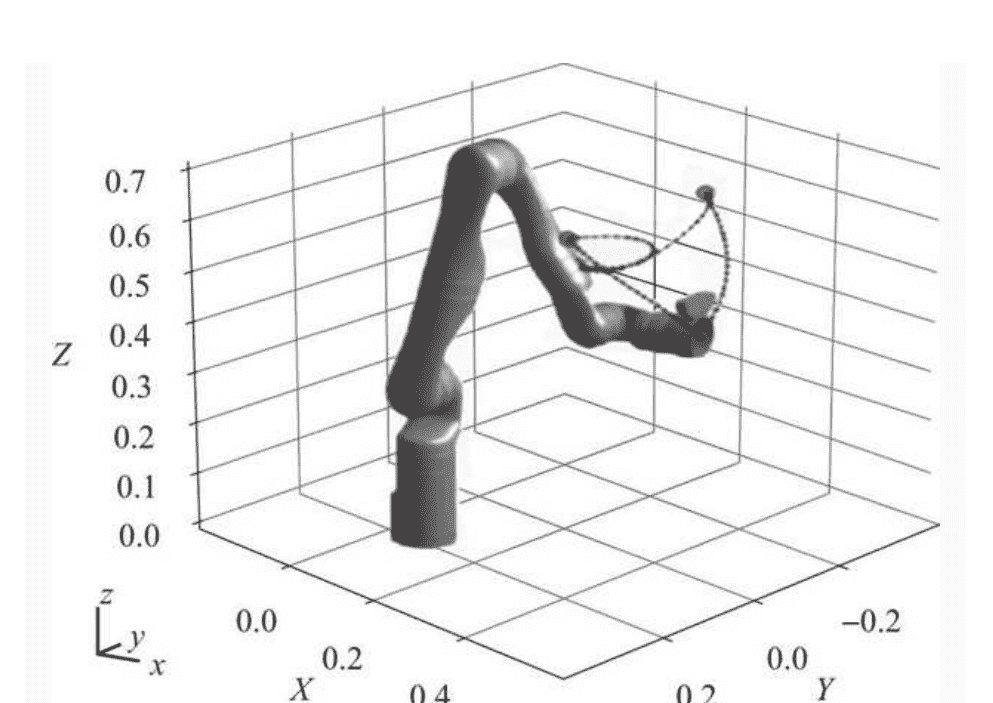
图3.3 机械臂末端执行器的运动轨迹

离散化本质上是把连续参数空间划分为一系列离散区间。例如，关节角度范围0到180°可划分为18个区间，每区间10°。每个区间对应一个离散token，如0～10°映射为token1，170°～180°映射为token18。这样模型就能用离散token表示与处理关节角度信息，生成复杂动作序列。速度与加速度也可类似离散化，确保模型高效处理连续参数并生成合理运动控制序列。

离散化让大模型能把复杂连续运动控制转化为可处理token，但也带来局限。首先，离散化可能降低控制精度，尤其在高精度场景。其次，可能出现token稀疏问题，当控制参数范围较大时会影响泛化能力与执行效果。此外，大模型处理离散化数据时可能产生误差，包括误解输入或生成不合理的“幻觉”，进而影响动作规划的有效性与可靠性。

不同机器人与自动化设备硬件结构各异，主要体现在关节数量、类型如旋转或滑动以及运动范围与能力。当用大模型直接输出末端执行器轨迹或状态时，需特别考虑机器人的物理结构，尤其在执行精细操作如抓取时。这类任务不仅依赖机器人运动能力，还涉及执行器特殊设计与功能，如夹具或机械手的构造。因机器人硬件多样性，训练一个通用于所有具身智能设备的通用大模型极具挑战。大模型在处理不同结构时往往需特定调整与优化，以适配不同硬件需求与控制约束。

### 3.2.2 间接动作规划

间接动作规划是指用大模型生成机器人末端动作规划的辅助信息。例如，对末端执行器抓取操作，大模型可评估并推荐被抓取物体的最佳抓取位置，对形状复杂或不规则物体尤为关键。模型还可输出用于计算成本函数的相关信息，如路径长度、能量消耗、碰撞概率或预计完成时间等，以帮助规划系统评估并选择代价最低的路径，确保运动效率与安全性。此外，模型还能提供与空间占用图相关信息，如图3.4所示，这类信息是环境空间占用情况的视觉表示，常用于自主导航中的避障与路径规划，在动态环境中表现突出。

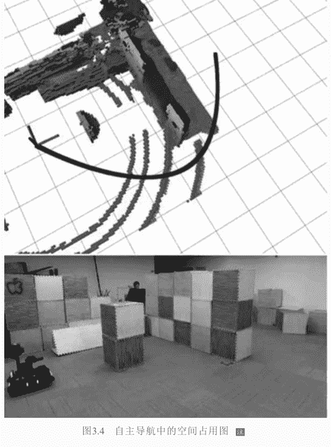
在末端动作规划中，航点、抓握点等辅助信息与具体机器人物理架构相对独立，可使大模型在不依赖特定本体情况下进行预训练。例如，可从视频资料中获取人类与环境交互数据如关节运动或姿态信息，从而训练出能理解并预测运动姿态变化的通用具身大模型。

### 3.2.3 动作级分层与端到端

从语言到动作的落差

把一句话的任务描述变成末端执行器实际可执行的轨迹和姿态，正是行为执行层要解决的问题。相较于更上层的任务拆解，直接用通用预训练大模型来完成这一层会遇到更多阻力。先看输出面：这里需要产出的是关节角度、力矩数值、抓握点坐标这类物理量，它们本身没有语义含义，也很难像词或图像那样自由拼接。通用模型擅长处理语义丰富的内容，对这些缺乏语言意义的参数并不友好。哪怕用专门的动作采集数据做微调，瓶颈也经常存在。有时只能靠大模型在编程、调用外部工具等通用能力上做迂回，间接达成需求。

输入面则要融合视觉、触觉、力反馈、位置等多路传感器流，这些信号构成了环境感知和本体状态的基础，是精细执行的前提。通用模型在预训练时很少接触具身场景的传感样本，数据分布与真实机器人使用场景差距明显，多模态感知流的处理效果受限。

综合来看，单靠通用模型做端到端的动作执行规划并不现实。常见做法是分层，先用专门的感知模块把原始传感数据清洗提纯，再让通用模型生成更高层的运动提示，成本比从零重训具身模型低。分层也有代价，层间传递容易丢信息，误差会累积放大。

长远看，针对行为执行层的直接解法，是围绕特定任务采集高质量动作数据，用预训练方式构建端到端的具身专用网络，让模型直接适配规划需求，这在未来机器人发展中会很关键。

### 3.2.4 具身大模型
具身专用大网络是为行为执行层专门微调或从零训练的模型，能更好地贴合具体操作环境和任务类型。以机械臂轨迹规划为例，针对性调整后，同类任务表现会明显提升。训练通常依赖大规模机器人操作记录，既有模拟器合成数据，也有真实机执行任务时的日志。借助这些数据，网络能学到从决策到感知再到行动的完整闭环，从而在无人干预下完成复杂操作。

需要厘清的是，具身专用网络和通用基础模型常被混淆。通用模型参数量大，擅长自然语言处理、图像识别等通用任务，训练数据覆盖面广，因而多用于高层规划或对动作规划的间接支持。具身专用网络则聚焦行为执行层，对带标签训练数据依赖更强，其输出直接决定机器人的物理行为，对可靠性和实时性的要求更高。

面对复杂物理场景，具身专用网络仍有挑战。无论是规划末端精确轨迹，还是生成价值图这类辅助规划信息，都能在一定程度上缓解物理形态带来的限制，但数据稀缺始终是制约性能的核心。为此业界普遍采用模拟学习和仿真扩增，批量制造高质量训练样本，既丰富多样性，也让试错在可控环境完成，大幅降低真实世界实验成本。GROOT通用具身大模型如图3.5所示，其训练融合了语言指令、视频观察和动作演示等多源数据，多模态输入为模型提供更丰富的上下文，使其能胜任复杂的动作级规划任务。

GROOT的突出特点是可以通过观察与模仿学习人类行为。为应对不同身体形态带来的差异，GROOT引入了逆向运动规划技术。该技术从期望的终端状态反推所需动作序列，能够灵活适配各类机械结构，并对执行过程进行优化，从而在多样化的物理环境中提升适应性和精度。

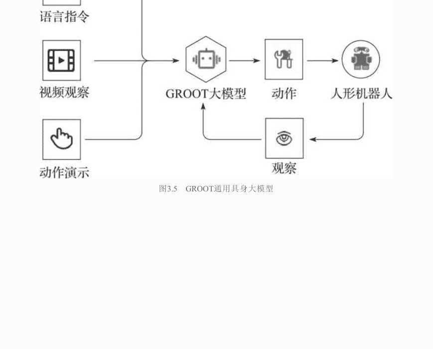

图3.5 GROOT通用具身大模型

## 3.3 基元级与伺服级
基元级与伺服级的动作规划并不依赖大模型，但在具身运动架构的理解和设计中不可或缺。基元级主要通过正向或逆向运动学计算得到关节参数等运动描述，伺服级则更贴近硬件，负责把基元级下发的高层指令转化为具体的驱动命令。

### 3.3.1 正向运动学的计算
正向运动学是机器人学的基础，用关节角度、滑移距离等输入计算末端执行器在空间中的位置和朝向。它从已知的关节构型出发，依据机器人的几何结构推导出末端位姿。

计算建立在机器人的运动链上。机器人由多个通过关节连接的连杆串联而成，每个关节的运动都会影响整条链的构型。运动学的任务就是根据各关节状态确定末端在三维空间中的准确位置和方向。

如图3.6所示的示例，机械臂由三根杆件 l₁、l₂、l₃ 和三个关节角度 θ₁、θ₂、θ₃ 构成，末端坐标记为 P = (x, y, z)。在正向运动学中，P 由连杆长度和关节角度共同决定。常用做法是进行一系列矩阵变换，每个关节和连杆的变换都由其长度和角度描述。

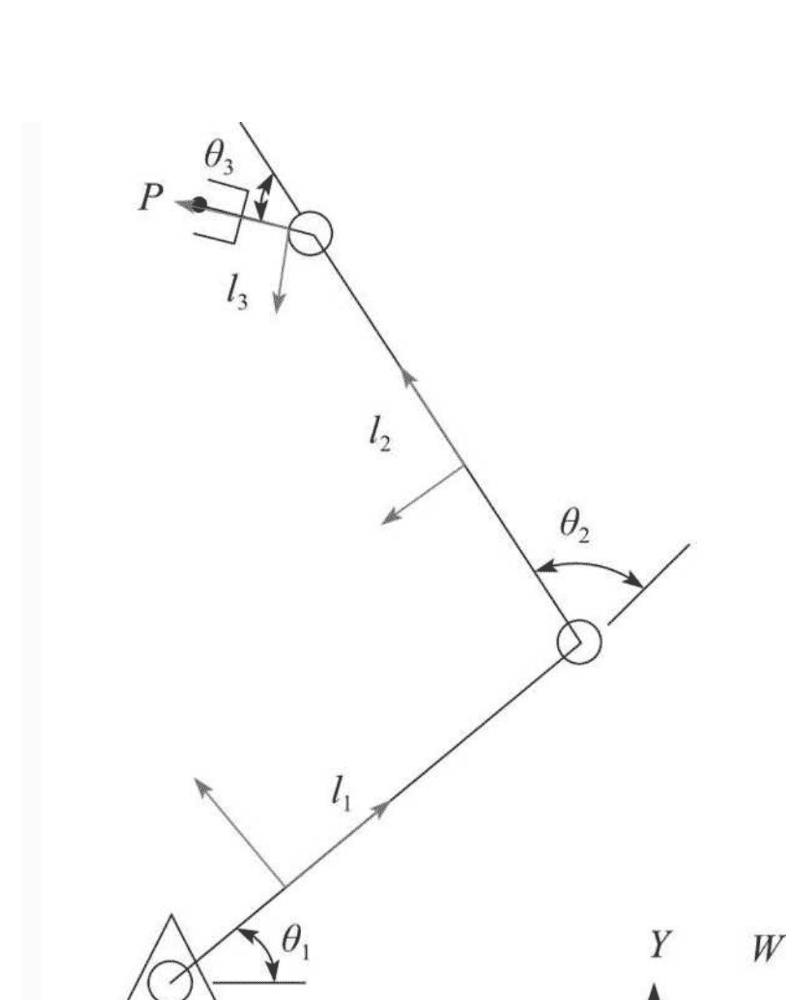

图3.6 机械手臂的正向计算示意图

正向运动学通常借助矩阵运算实现。变换矩阵描述相邻连杆间的坐标转换，包含平移和旋转，可用齐次变换矩阵表示。从基座到末端的整体变换，是把各段变换依次相乘得到。若用 T_i 表示第 i-1 坐标系到第 i 坐标系的变换，则整条链的变换为 T = T₁·T₂·T₃。其中 T_i 包含旋转和平移两部分。

```
T_i = \begin{bmatrix} \cos\theta_i & -\sin\theta_i & 0 & l_i \cos\theta_i \\ \sin\theta_i & \cos\theta_i & 0 & l_i \sin\theta_i \\ 0 & 0 & 1 & 0 \\ 0 & 0 & 0 & 1 \end{bmatrix}
```

在实际应用中，基于正向运动学的基元级规划可以预测机器人执行任务时的行为轨迹，为精细控制提供理论基础，是高效自动化操作的重要支撑。但正向运动学涉及整条运动链，任一关节参数发生变化，都将连锁影响到该关节下游所有连杆的位置和方向。换言之，每个关节参数决定了后续连杆的起点和朝向，因此要精确推导末端位姿，必须拥有全部关节的信息。

### 3.3.2 逆向运动学的计算
逆向运动学的目标是根据末端执行器的期望位置和姿态，反求出实现该目标的关节构型。在控制层级中，行为执行层负责给出末端目标位置或轨迹，基元级则通过逆向运动学把这些目标转化为具体的关节角度或位置，这正是从终点反推起点的规划过程。

与正向运动学相比，逆向运动学因多自由度和连杆结构的复杂性更具挑战，可能出现多解、无解，或需要额外约束如关节限位、避障等。此时逆向规划成为保证运动精确性和一致性的关键。

常用求解手段包括：

- 1) 解析方法。通过数学公式直接求解关节参数，效率较高，但仅适用于结构简单或几何特性特殊的机器人。
- 2) 数值方法。对复杂结构多采用迭代逼近，多次计算直至满足精度要求。缺点是在某些情况下易陷入局部最优，导致次优解。
- 3) 优化方法。把逆向运动学转化为优化问题，通过最小化末端位置误差等目标函数寻找最佳关节配置，可有效处理关节限制、避障等约束。

由于逆向运动学高度非线性且多解，传统解析和数值方法在复杂场景受限。近年基于神经网络的数据驱动方法成为有效补充，通过学习关节构型与末端位姿的映射关系，在复杂环境中实现高效求解，拓展了应用边界。

### 3.3.3 伺服级控制
伺服级负责执行基元级计算出的关节参数，紧贴硬件层，把高层指令转为电机驱动信号等具体控制量，确保指令被精确执行。它不仅实现位置控制，还需处理动力学问题。例如机器人与物体接触时，伺服级需依据外部反馈动态调节关节输出力，避免损伤或失控。遇到外部扰动或负载变化时，通过动力学补偿维持稳定性和性能。伺服系统通常集成力传感器、扭矩传感器、加速度计等，实时监测动态并在线调整控制参数，保证复杂环境下的安全可靠运行。

如图3.7所示的机器人系统由抓取器、机械臂和底座组成，其伺服级集成扭矩传感器和关节速度反馈，实现各关节动态的实时监测。每个部件的伺服控制都要依据外部反馈动态调整，以确保任务执行的精准与安全。

以6自由度机械臂为例，每个关节的位置由控制信号调节，同时6路扭矩反馈实时监测实际状态。在搬运物体时，若出现外部干扰或负载变化，如重量增加或遇到阻力，伺服级会通过动力学补偿调整关节输出力。系统根据扭矩反馈在线调节关节扭矩，使机械臂保持稳定姿态并顺利完成任务，从而避免负载变化导致的姿态失稳或扭矩超限。

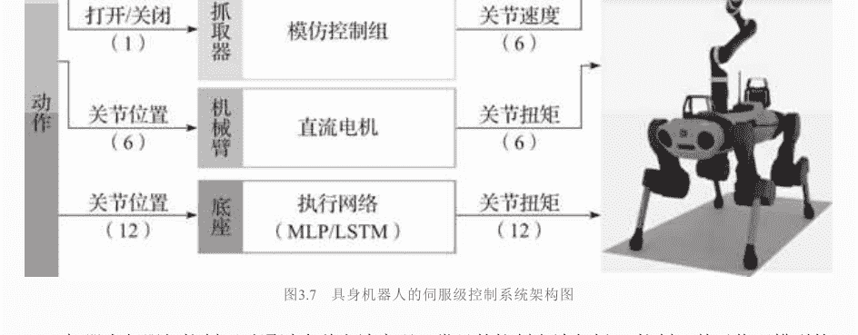

机器人伺服级控制的实现方式多样，常见包括PD控制、基于物理模型的控制和神经网络控制。PD控制是一种经典的反馈策略，根据当前位置与目标位置的误差计算控制信号，驱动关节到达目标。其优点是实现简单、稳定性好，适用于实时控制场景。

### 3.3.4 端到端控制网络
在具身智能控制中，动用单一深度学习网络同时承担基元级与伺服级控制已成为主流趋势。该网络通过强化学习训练，接收环境状态如机器人速度、关节位置等，直接输出伺服级的控制参数，包括关节位置、扭矩等底层驱动信号，实现从感知到物理动作的端到端映射。

该模型既包含基元级规划功能，即结合行为执行层规划的目标轨迹与环境及自身状态生成关节参数等运动信息，也涵盖伺服级执行功能，即根据规划结果输出执行器控制信号完成具体动作，从而把规划与执行融合在同一网络中。

强化学习训练的关键在于奖励函数的设计，它定义动作策略的好坏并引导参数优化。例如在行走任务中，奖励可基于接近目标的速度、路径效率如最短耗时，并惩罚碰撞和无效动作。采用近端策略优化等先进算法可提升学习效率和策略有效性，适应复杂环境的自适应控制需求。此外，模拟器技术和域随机化、环境噪声的引入，增强了模型在不同工况下的泛化与鲁棒性。

因此，通过强化学习训练兼顾基元级和伺服级功能的端到端控制网络，能够让具身智能在复杂动态环境中具备更高适应性，是当前机器人技术发展的重要方向。

## 3.4 具身智能分级混合架构
在基于大模型的具身智能领域，分级混合架构正逐步成为共识。该架构把不同层级的任务分配给最合适的模型或算法，如图3.8所示，通用基础模型用于高层任务规划，解决长期困扰的任务级世界模型问题，负责抽象策略制定与任务分解；行为执行层规划则依赖专门微调的具身专用模型，把任务级指令转化为可执行的运动路径与动作序列。同时，低层的基元级与伺服级运动控制通常由专用神经网络实现。

实践中，任务级与运动级规划既可通过分层架构实现，也可采用端到端架构，形成多种组合。在基元级与伺服级层面，通常使用同一控制程序或神经网络来保证即时响应与精细执行。这种混合设计使系统既能进行高层的复杂分析与决策，又能在低层实现高效精准的运动执行，大幅提升灵活性、适应性与整体性能。

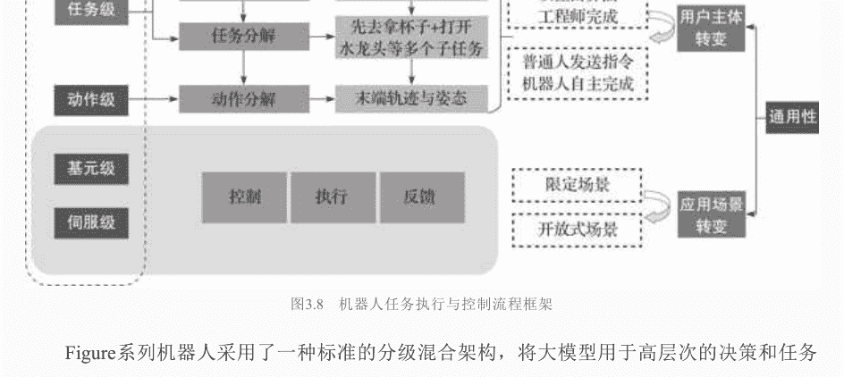

Figure系列机器人采用标准的分级混合架构，用大模型负责高层决策和任务规划，同时利用特定神经网络策略和全身控制器完成具体行为执行。如图3.9所示，用户通过语音提出请求，经语音转文字后转为文本指令。OpenAI的GPT大模型作为任务级规划器，可接受来自视觉传感器的图像等多模态输入，结合文本进行语义分析和场景理解，生成高层任务规划，随后被拆解为具体的子任务行为指令以指导执行。

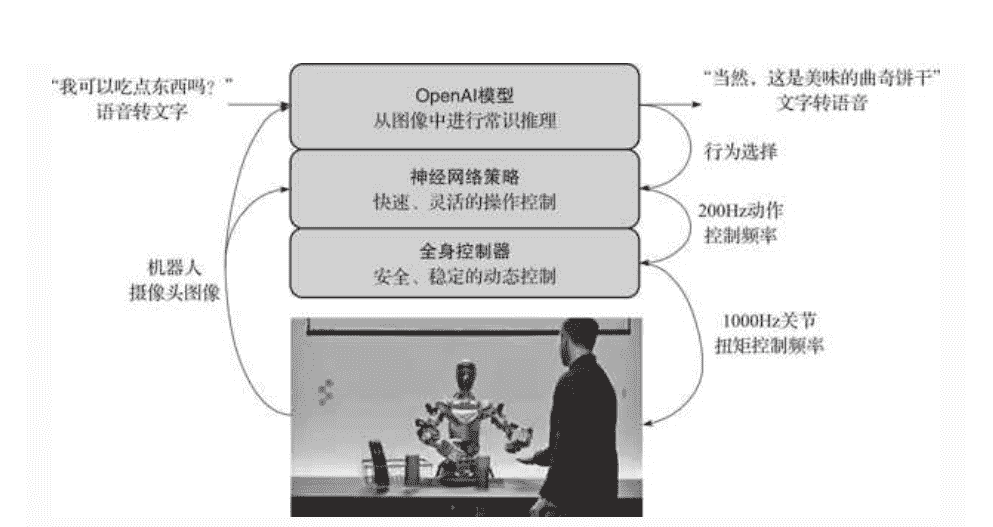

图3.9 基于OpenAI的GPT大模型的机器人语音理解与行为控制流程

从运动规划的层级角度看，行为指令的执行可分为动作级、基元级和伺服级。据Figure系列视频显示，其动作级规划采用名为“神经网络策略”的模型，实现快速灵活的操作控制，而“全身控制器”负责基元级和伺服级。文献未公开细节，但可以推测“神经网络策略”很可能是基于Transformer的具身专用模型。“全身控制器”则是经强化学习训练的深度学习网络，依据动作级规划从视觉、触觉等多源传感器数据中学习手臂与身体的控制方式，以完成任务并保证执行安全稳定。

如图3.9所示，Figure系列架构的一个显著特点是控制信息的双向流动，不仅单向下发指令，还能根据场景变化进行反馈调整。大模型与神经网络策略及全身控制器紧密耦合，可依据执行反馈实时修正规划。这一机制与人类运动控制类似，通过持续修正适应动态环境变化。

此外，机器人控制系统要求在确定时间内完成功能并对内外事件做出响应，正确性不仅取决于逻辑结果，还要求时间确定性。底层控制频率通常很高，以保证动作精度与平滑性。图中动作控制频率达200Hz，关节扭矩控制频率达1000Hz，满足复杂任务的实用需求。

因此，基于大模型的具身智能系统在高层使用大模型进行任务分解与动作规划，在低层采用端到端神经网络或基于物理模型的预编程方法实现精确执行。这种分级融合策略有效结合各自优势，提升了机器人系统的整体性能、实用性和适应性。

## 第4章 具身任务级规划
真实世界环境复杂且难以预测，对单步规划构成严峻挑战。相比之下，人类擅长把复杂任务拆解为若干简单子任务，遵循“分而治之”的思路。在具身智能中，任务分解属于高抽象层级，大模型扮演世界模型的角色，利用常识与先验知识完成分解，是解决问题的理想选择。

## 4.1 任务分解
在具身智能中，任务分解由大模型完成，通常包含两个核心步骤：分解，即把复杂任务拆分为多个子任务；子任务规划，即针对每个子任务目标进行具体动作规划。

如图4.1所示，任务分解方法主要分为广度分解和深度分解。广度分解先把任务全面拆解为若干子任务，再依次为每个子任务规划动作。优点是子任务与原任务关联紧密，降低遗忘或幻觉风险。缺点是子任务一开始即全部确定，属于“静态”分解，对动态环境适应性不足。深度分解则交替进行任务分解与子任务规划，每次仅揭示当前状态下的一到两个子任务。方法可依据环境反馈动态调整策略，提升容错能力。但对于复杂任务，过长的动作规划可能导致大模型在后续子任务和动作级分解中产生幻觉，从而偏离原始目标。

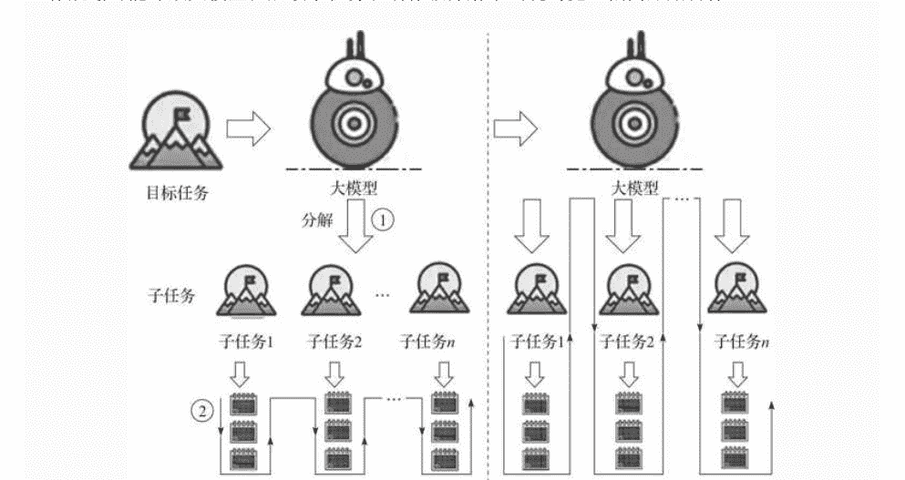

在运动控制层级结构中，任务级规划对应任务分解步骤。例如“擦拭桌子”任务，任务级规划需理解目标并根据当前环境与自身状态分解为找抹布、拿起抹布、在桌面移动抹布、放回抹布等子任务。该层级主要涉及任务的抽象定义与策略设定。对应的动作级规划则对应子计划步骤，具体动作执行则依赖更低层的基元级与伺服级实现。这些低层主要处理运动控制的技术细节，通常由控制算法和硬件直接管理。层级化处理使复杂任务能在不同抽象层面上被有效管理和执行。

在具身智能架构实现中，任务级规划与动作级规划通常由不同类型大模型负责。任务级规划常采用广度与深度分解相结合的方式，即在具体动作规划前，先用广度分解对整体任务进行全面拆解。这种方式让系统在进入详细动作级规划前对整体任务有充分理解与分析，从而制定合理的策略与顺序逐一完成子任务。

广度预拆让整体结构一目了然、可控性强，但一旦启动就被固定，弹性就受限。真实世界充满不确定性，系统需要在执行过程中持续感知现场状态与进度，借助反馈回路和递进式细化来实时重排子任务优先级或重新分组。监测到某项子任务难度超出预期时，大模型可以动态调配计算资源，或把该任务进一步拆解为更易掌控的小单元。

以扫地机器人完成“清扫房间”为例，上层先把目标粗拆为“吸尘地面”“整理杂物”“擦拭台面”等分支，再交由动作层落实细节。若运行中发现角落污渍严重，模型可临时补上“重点清洁”这一新分支并插入序列。这种弹性调整让具身系统面对突发状况时更机动，也能更快收敛未知干扰。

动作层本身也需要高适应性与精准度。它要严格遵循上层指令完成精细操作，同时持续追踪环境变化与物理限制，必要时立即修正。例如清扫时遇到意外障碍，动作层需迅速规划新路径，保证任务不中断。

上下两层的高效协同也很关键。通过可靠的通信机制，双方可互相传导反馈，提升整体一致性。比如动作层在某环节受阻，会把困难回传给任务层，后者据此重新评估优先级或调整分解策略。

这种分层拆解的价值在于先在高层锁定并优化整体策略，再逐步落实到具体动作。将复杂目标拆成可控单元，既增强了解题弹性，也提高系统可靠性。

## 4.2 任务层分层与端到端设计

### 4.2.1 感知与推断

具身智能的任务层规划本质是环境感知与常识推理的协同，用以应对复杂需求。环境信息的获取依赖多模态感知体系，核心是物体识别与场景理解。识别环节通过视觉检测让智能体知道场景里有哪些物体及大概位置；理解环节则分析物体间的空间关系与潜在交互方式。这些感知结果对后续规划至关重要，帮助智能体准确把握物理世界状态并推断如何与物体交互。比如“把书放回书架”需要先定位书与书架。

除实时感知外，任务层还依赖丰富的常识与先验。任务解析要把自然语言指令转化为可执行步骤，这要求对指令语义有深度理解；策略推断则基于常识，推导出最优执行路径。例如“准备晚餐”时，规划需先确定食材处理的先后次序。任务层架构可分为分层式与端到端式，关键差异在于感知与规划是否解耦。

### 4.2.2 分层式设计

在分层方案中，任务决策多由大语言模型承担，感知则由独立的视觉模型或多模态模型完成。目标确定后，系统通过感知模块采集环境数据，并据此进行任务细化与规划。整体流程大致如下：

- 1）指令理解。大语言模型先解析自然语言指令，抽取出动作、目标物体、位置等要素，并判断相关环境影响。比如“把苹果放进篮子”，系统需先找到苹果和篮子。
- 2）环境感知与数据收集。模型依据需求主动调用传感器，如用摄像头监控目标区域，并可动态调整传感器位姿以获取关键视野。
- 3）图像处理与特征提取。采集图像经视觉算法分析，提取物体类别、形状、颜色、相对位置等特征。例如用视觉语言模型确认苹果与篮子的相对位置。
- 4）信息融合与反馈。大语言模型将多源传感器数据整合，构建动态环境模型，并在执行中实时更新。
- 5）基于环境的任务规划。模型利用融合信息对任务进行动态拆分，并根据实时反馈调整计划，确保顺利达成。

### 4.2.3 端到端设计

图像与语言信号特性不同。语言由人类生成，语义丰富但信息密度有限；图像作为自然信号，包含大量低层细粒度特征，能更完整呈现场景全貌。在难以用语言精简描述的复杂场景下，这种差异尤为突出。

PaLM-E 基于 Transformer 解码器构建的多模态模型，其核心是在 PaLM 基础上，以融合视觉、连续状态估计和文本输入的多模态语句进行预训练，把智能体对外界的感知信息与语言 token 投射到同一向量空间。

PaLM-E 的多模态语句由文本与多组连续观测交错构成，形成多模态句子。例如“和之间发生了什么？”，其中代表由视觉 Transformer 生成的图像嵌入。如图4.2所示，若和提供了多色方块的位置信息，黄色方块位于蓝色方块上方，PaLM-E 的输出可以是自回归生成的文本答案，也可以是用于机器人连续操作规划、视觉问答、字幕生成等具身任务的文本形式决策。

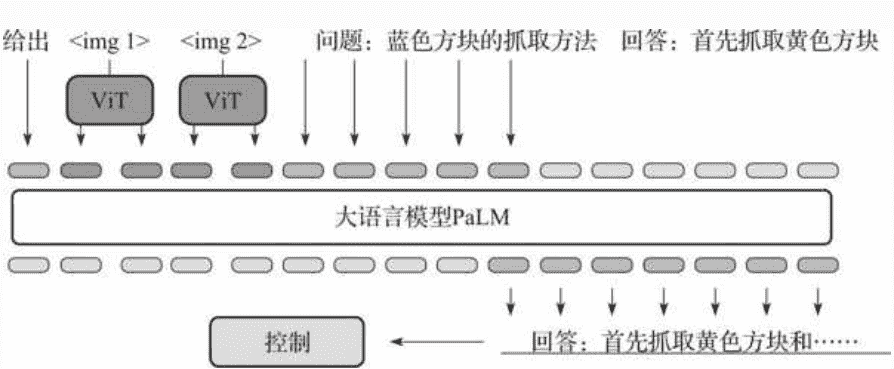

图4.2 PaLM-E模型

将多模态大模型用于任务层规划，通常视为端到端范式。具备视觉感知能力的多模态大模型在任务层具有以下优势：

- 1）空间布局理解。描述复杂几何配置、空间定位、物体关系和环境约束时，仅靠语言往往不足。例如杂乱场景中物体 A 遮挡物体 B，要接触 B 必须先移开 A，语言难以传达这种细微关系。若目标在容器内如柜子或冰箱，传统检测模型可能因不可见而判断失败。把视觉直接融入推理，多模态模型能推断隐藏目标很可能在容器中，并据此规划先打开容器的步骤。
- 2）物体属性理解。物体的形状、颜色、材质、功能等属性多样，语言传达存在局限，尤其当属性与任务强相关时。例如剪刀在儿童手中可能是危险物，在剪纸课上则是必需工具。过去常用独立模型识别属性，只能覆盖有限子集。当任务需要深入理解属性时，视听联合推理至关重要。
- 3）多模态目标设定。在很多长期复杂任务中，提供目标图像比纯语言指令更有效。例如指导机器人整理桌面时，一张整理好的照片比文字描述更直观。同样在食物摆盘任务中，机器人可模仿目标图像完成。传统基于大语言模型的规划难以处理这类任务，而视觉语言模型则大幅简化。具体而言，视觉语言模型可同时接收当前观察、语言指令和目标图像，且不要求目标图像与当前观察同域。目标图像只需传递任务关键要素，无论是网络图片、儿童画作还是手势，都能被有效利用。这种灵活性显著提升了实用性。结合图像与语言描述目标，方法在目标设定上获得更高多样性。
- 4）视觉反馈。在动态实体环境中，闭环反馈至关重要。过去尝试把所有反馈转为自然语言，但这种方式复杂且低效，因为多数反馈本质是视觉。把视觉反馈转成语言不仅增加复杂度，还会丢失关键信息。

直接提供视觉反馈更为直观。在 PaLM-E 中，视觉语言模型既能描述场景中物体的状态，又能充当成功检测器，判断环境是否满足指令条件。图4.3展示了一个端到端任务层规划实例，即从抽屉取出薯片。该任务要求机器人理解语言意图、观察和操作物体，并规划子目标与行动。将视觉信息直接融入推理与规划，有助于更直观理解物理常识。PaLM-E 通过对视觉反馈的推理，使机器人在环境变化或任务失败时及时调整或重规划。

当然，正如第3章所述，具备视觉等多模态的大模型也可能采用分层架构进行任务层规划，例如需要 RGB-D 摄像头或激光雷达获取的 3D 空间信息。这些专用感知模型能更精确完成深度感知、物体识别、空间定位等任务，而通用视觉语言模型难以达到同等精度。

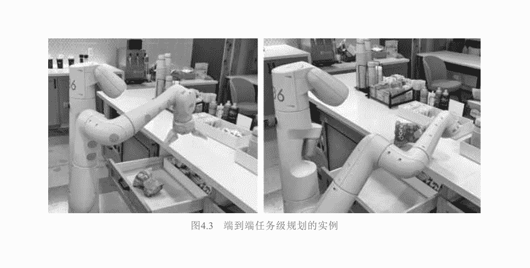

图4.3 端到端任务层规划的实例

## 4.3 任务层微调与外部记忆

基础模型通常缺乏导航、交互、感知、追踪世界状态等具身经验，因而在涉及物理环境的推理与规划上鲁棒性不足。具身任务所需的基本能力如物体追踪、路径规划、识别其他代理行为，正是基座模型的短板。可通过采集具身经验，结合微调与外部记忆来弥补。

### 4.3.1 具身经验的获取

具身经验虽可通过真实物理交互获得，但受数据采集成本限制，大规模数据多依赖 AI2-THOR、VirtualHome 等虚拟环境模拟。在这些环境中，代理可执行拾取、移动、放置等操作，从而学习物理空间交互方式。

经验可通过目标导向规划和随机探索两种方式获取。为赋予大模型该能力，可引入目标导向规划，生成以目标为导向的具身数据，帮助代理掌握在世界模型中执行系列活动所需的技能与规划能力。在世界模型中，活动目标被形式化为描述期望状态的谓词集合。例如“布置餐桌”可定义为“叉子和盘子应放在桌上”。

图4.4a展示了蒙特卡洛树搜索规划器，用于在动作空间中找到实现目标的动作序列。成功的 MCTS 依赖合理奖励设计。每当目标谓词被满足，规划器获得 +2 奖励，且该谓词从目标集移除以避免重复奖励。为防止执行无关动作，每步给予 -0.1 惩罚，整个规划过程被记录为具身经验。关于外部规划器的细节将在第8章讨论。

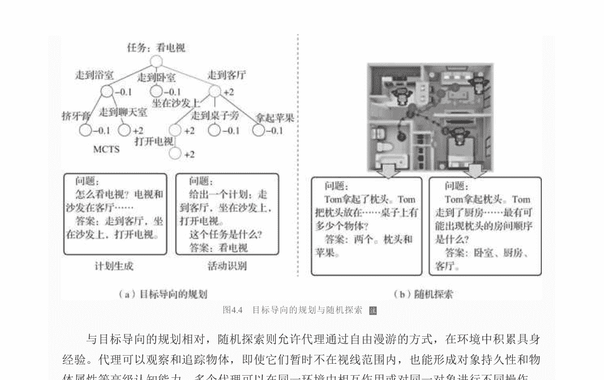

与目标导向相对，随机探索允许代理自由漫游积累经验。代理可观察并追踪物体，即使暂时失视也能形成对象持久性等高级认知。多个代理可在同一环境中交互或对同一物体执行不同操作，以模拟复杂场景。

现实中人类不仅靠完成任务学习，也靠随机探索环境，例如观察物体及其属性。随机探索同样适用于具身经验获取。在世界模型中，代理可通过简单漫游学习对象持久性和路径追踪等能力。具体操作上，多代理在世界模型中随机游走并执行动作。如图4.4b所示，多代理可在同一环境中相互作用或对同一物体执行不同操作以模拟复杂情况。过程中所有物体的移动轨迹与最终位置被记录并存储为经验。

为增强泛化能力，可通过综合采样获取场景中全部已存在物体的清单，这些信息随后用于支持更精准的任务规划。采样方法不仅包括随机与遍历抽样，还扩展到空间优化采样，即整体中心点与分块中心点，可提升采集效率与覆盖率，更好反映场景全貌。例如智能机器人需在家庭环境中清洁，环境包含厨房、客厅、卧室等。随机抽样下机器人在各房间随机点采集视觉信息；遍历抽样则系统性覆盖所有房间，确保所有物体被记录；空间优化采样通过整体中心点与分块中心点进一步提升效率与覆盖率。这些图像随后由开放词汇目标检测系统处理并生成物体清单，帮助规划充分考虑场景已知物体。

### 4.3.2 微调与外部记忆

通过在模拟或真实环境中收集的具身经验数据集对基座模型进行微调，模型可逐步掌握场景理解能力，解析与特定任务相关的视觉与空间信息。微调有助于克服经验不足的局限，提升模型在真实世界中的应用能力，更好地执行导航、物体操作及与人类或其他代理的复杂交互。

然而任务层表现往往取决于常识，而基座模型仍是最佳选择。无论是依赖外部感知的大语言模型，还是具备感知能力的多模态大模型，任务层能力主要取决于模型本身的通用人工智能能力。正如前文所述，具身智能像人类一样思考、学习并解决问题，关键在于从自然模态学习世界的结构化与层次化抽象，即“世界模型”。这也是当前基于基座模型进行任务层规划的原因。

具身智能的任务层规划只是基座模型的一个子任务，其上限往往取决于如 GPT-4o 这类模型的推理能力。为具身任务层单独预训练专用大模型成本难以接受，因为所需核心能力正是世界模型能力。因此，没有比类似 GPT-4o 的多模态基座模型更适合执行具身任务层规划了。

尽管微调可在特定场景提升表现，其效果取决于训练数据的质量与多样性。若数据无法充分覆盖预期场景或质量不高，微调后模型在真实复杂环境中难以泛化。此外，微调多模态模型尤其是处理海量数据与复杂架构时，往往需要大量计算资源与时间。持续微调还需定期更新数据集以纳入新实例或纠正偏差，进一步增加成本。

需要注意的是，将像 GPT-4 这样的大模型微调以适应特定场景的具身任务规划，可能导致模型在通用任务上性能下降。通过引入外部记忆机制，模型可存储和检索特定环境中的情景记忆，允许模型记住过往经历并指导未来行为选择。这一机制是一种可行方案，将在第7章详细讨论。

## 第5章 分层动作层规划

在分层动作层规划中，感知信息被明确作为运动规划的输入条件，与动作规划过程相互独立。决策层通常采用大语言模型或多模态大模型进行规划。虽然多模态大模型具备一定感知能力，但在分层框架中环境感知与动作规划仍是分离处理的。分层架构有利于把人类先验知识作为额外约束或推理条件嵌入规划过程，以便更好地解释和处理复杂的环境感知数据。通过引入先验知识，模型能在复杂或未知环境中做出更合理的决策，提升规划准确性。此外，分层运动规划通常无需对大模型进行专门训练，因而实现成本较低。

### 5.1 动作原语及其局限性

动作原语是机器人学与自动化控制领域的核心概念，指预定义的、可重复使用的基本动作或行为模块。这些原语是构建复杂任务的基础元素，通常包括机器人的简单运动或行为序列，旨在简化动作规划与执行。通过把复杂任务分解为一系列动作原语，可实现更高效、可控的机器人操作。

#### 5.1.1 动作原语

在机器人控制中，末端执行器的控制参数通常位于连续空间，理论上可生成无限种动作或路径。例如在机械臂控制中，每个关节都可在连续范围内运动。然而在实际应用中，处理连续空间的无限可能性既不现实也不经济。因此从运动分级角度看，动作原语提供了一种基元级离散化实现方式，即提供一组有限且实用的动作集合，使得复杂运动规划可通过组合这些基本动作完成。动作原语通常具有以下关键特点：

- 1）基础性。动作原语是构建复杂动作序列的基本构件。通常表示为机器人可直接执行的简单动作，如移动到特定位置、旋转一定角度、抓取或放置物体等。
- 2）模块化。通过把常用动作封装为原语，可在多种任务中复用，提高规划与执行效率。例如一个“抓取”原语可在不同上下文中调用，无论是在装配线抓取零件，还是在仓库拾取物品。
- 3）可编程性。动作原语可在更高级别的任务规划中以编程方式调用和组合。这种灵活性允许根据特定应用需求调整和优化动作序列，适应不同任务场景。
- 4）控制简化。使用动作原语可简化控制算法复杂度。通过执行预定义动作，减少了实时计算需求，这对需要快速响应的实时应用至关重要。
- 5）执行可预测性。由于动作原语是预先定义和测试过的，其行为通常具有很高的可预测性和可靠性。

以下的Python伪代码定义了一个RoboticArm类，展示了如何通过动作原语实现机械臂的基本控制：

```python
class RoboticArm:
    def __init__(self):
        self.position = None          # 当前机械臂的位置
        self.gripper_open = True      # 夹爪是否打开

    # 动作原语:移动到指定位置
    def move_to_position(self, new_position):
        print(f"Moving to {new_position}")
        self.position = new_position

    # 动作原语:执行抓取动作
    def grab(self):
        if self.gripper_open:
            print("Grabbing the object")
            self.gripper_open = False

    # 动作原语:执行释放动作
    def release(self):
        if not self.gripper_open:
            print("Releasing the object")
            self.gripper_open = True

    # 动作级规划:组合动作原语来执行复杂任务
    def execute_task(self, start_pos, end_pos):
        self.move_to_position(start_pos)    # 移动到初始位置
        self.grab()                         # 抓取物体
        self.move_to_position(end_pos)      # 移动到目标位置
        self.release()                      # 放置物体
```

在这一类中，`move_to_position()`、`grab()` 与 `release()` 都属于动作基元的具体实现。它们对应机械臂最基础的执行单元，每一个只负责单一、独立的物理操作：

- `move_to_position()` 负责把臂体直接送到指定的目标位姿。
- `grab()` 驱动夹爪合拢以完成抓取。
- `release()` 驱动夹爪张开以完成释放。

这三项皆为可直接调用的基础行为，不包含决策推理，也不涉及多步协同。

#### 5.1.2 技能
在分层运动控制的框架里，动作层规划的工作是把任务层拆解出的子目标再细化为基元层能够落地的具体动作。动作基元作为最底层实现，提供了一种把高层意图拆解成一系列可执行步骤的通道。借助这种分层，任务执行顺序更易于表述，动作的精确度和效率也得到提升。

实际规划中，多个基元按既定顺序串联即可构成更复杂的复合行为。当某种串联被反复使用并固化为整体时，就被称作技能。技能通常对应一个目标明确且复杂度较高的动作序列，比如“拿起”就融合了位移与夹爪开合等多个操作。因为具备清晰的语义描述，这类技能能够被大语言模型识别并调用。

以“清理桌面”为例，任务拆分后，系统可以轮流调用“拿起”“放下”等技能，按逻辑先后完成整体目标。整个过程涉及多步推理与技能配合，凭借强大的语言理解能力，模型可以将分散的技能组织成连贯的执行方案。

#### 5.1.3 局限性
大语言模型在自然语言理解上表现突出，能够把复杂任务拆解为更细的子目标。然而一旦进入基元层面的动作规划，基元本身必须具备可读语义才能被模型识别调用。那些缺乏直观语言含义的参数，例如由环境实时计算出的位置、运动量等，就难以被模型有效处理。这类参数没有容易表述的语言对应。以指定关节角度抓取为例，角度数值本身不带语义，难以仅靠自然语言生成。此类动作的产生更依赖精确控制算法与传感器闭环，而非纯粹语言推理。

另外，单个低级动作如微调某个关节角度，单独存在时无法构成有意义的行为，必须与其他动作配合才能生效。动作基元本质上是若干低级动作的打包，但可打包的低级动作组合有限，仅靠语言模型调用基元，难以覆盖现实任务所需的大量组合。技能是对基元的再打包，其泛化能力更弱，更难适应千变万化的真实场景。

以家庭服务机器人准备一顿复杂早餐为例：从冰箱取蛋、在灶台煎蛋、从橱柜取盘、把煎好的蛋放进盘中并端到餐桌。任务包含大量精细操作，环境也充满不确定，物体位置会变、厨房布局不同、煎蛋过程也有波动。

首先，机器人需要执行许多伺服级的低级动作，比如调整手臂关节以对准鸡蛋、控制夹爪开合幅度、调整姿态确保鸡蛋准确入锅。单独的“调一个关节角度”无法完成“抓取鸡蛋”或“把鸡蛋放进锅”，必须与其他低级动作组合形成更高层行为。

其次，动作基元是低级动作的组合。“抓取”基元可能包含伸臂、张爪、调指、合爪等步骤。虽然“抓取”“移动”“放置”等基元能做基础操作，但它们是针对特定环境和物体的预设序列。例如“抓取鸡蛋”基元可能只在冰箱固定位置有效，一旦物品布局或高度变化，基元就会失效。

技能是对基元的再组合，如“准备早餐”技能可能串联“从冰箱取出鸡蛋”“打开灶台”“煎蛋”“把蛋放到盘中”等多个基元。技能比单一基元更高阶，但泛化更差，因为它由特定基元构成且多为特定情境设计。比如不同布局的厨房里，“准备早餐”技能就难以直接复用，冰箱门被遮挡时“取出鸡蛋”也无法执行。

现实任务充满复杂性和不确定性。冰箱内物品位置随时变化，灶台开关可能因安全要求需要特殊操作，煎蛋还涉及火候时间等实时感知与动态调整。动作基元和技能都是预先定义、基于先验知识和固定环境的，面对多样复杂的真实情境，其灵活性和适应性有限。单纯调用和组合这些基元和技能难以应对变化。因此尽管基元和技能是构建复杂行为的基础，在需要精细控制或复杂应用时，直接使用会受限，需要借助其他规划技术和方法。

## 5.2 基于技能的单步动作级规划
在没有明确任务级规划的前提下，通过编程方式组装技能库来生成动作级计划，就属于基于技能的单步动作级规划。微软提出的 ChatGPT for Robotics，简称 GPTR，就是这一思路的典型代表，它让预训练语言模型理解任务，并在给定的技能空间里完成动作级规划。

### 5.2.1 低成本具身智能方案
GPTR 作为一种即时规划方案，最大的优点是不需要对语言模型做针对性微调，这使其成为一种低成本的具身智能实现。该方案依托模型已有的知识储备和推理能力，直接生成控制机器人的代码，大幅缩短了传统机器人编程的开发周期和成本。

传统机器人编程往往要为每个任务开发专用的控制算法，耗时费力，还需要专业工程师。GPTR 直接调用预训练模型，就能快速产出高效的控制代码。模型在生成时利用训练中学到的编程技巧、算法设计与优化思路来解决具体任务。

而且，非技术用户也能参与进来。用户只需用自然语言描述期望行为，模型就能据此生成代码。如图5.1所示，用户可以说“按特定图案排列仓库货架”，模型就会输出完成该操作所需的所有移动与指令。GPTR 降低了编程门槛，提升了效率和灵活性，可针对不同形态具身的多种复杂任务快速实现动作级代码。

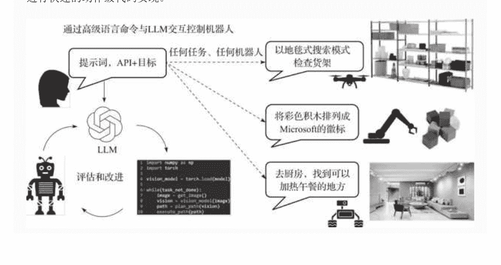
### 5.2.2 GPTR工作流程
如图5.2所示，GPTR 的工作建立在用户定义的任务相关 API 库上，利用 ChatGPT 的自然语言处理与推理能力，把任务描述转化为机器人控制代码。整体包含四个主要步骤。

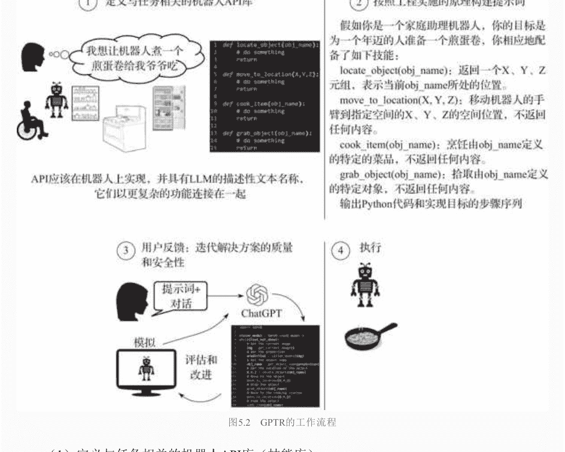
- 先搭建可用的机器人技能 API
首先要定义一组与任务相关的 API 库。这些库是对机器人硬件能力的抽象，涵盖定位、移动、抓取、操作等。函数命名通常具有描述性，便于模型推断功能。这些 API 由硬件及其底层控制栈支撑，作为与模型交互的接口，让机器人能以更高层级的方式执行动作。

- 按照工程实施思路构建提示词
开发者撰写一段文本提示词来引导模型完成任务。提示词不仅说明任务目标，还明确列出可用的高级 API 函数。例如提示中会写明如何定位物体、如何移动机器人、如何抓取和烹饪等细节。这一步很关键，它为模型提供理解任务的上下文，帮助其挑选合适的 API 调用序列。

- 用户反馈：迭代质量与安全性
这一步强调用户在循环中的参与，确保生成代码的质量与安全。用户给出任务提示，ChatGPT 返回代码。用户可以审阅并通过对话进一步优化。在部署到真机前，生成的代码应在模拟器中运行，观察虚拟环境中的行为，以便发现潜在错误和风险。用户可用自然语言反馈问题或改进建议，ChatGPT 据此调整并生成更符合要求的代码。持续的用户参与和反馈循环提升了代码的准确性、可靠性和安全性。

- 部署执行
用户验证满意后，最终代码部署到机器人上执行实际任务。如图5.2所示，机器人执行烹饪任务，比如煎蛋卷。通过调用 API 库中的功能，机器人完成从抓取物体到烹饪的完整流程。这一过程展示了 GPTR 如何把高层任务描述转化为具体的机器人控制代码，使机器人在真实环境中完成复杂任务。

整体上，GPTR 以用户定义的 API 库为基础，通过 ChatGPT 把任务描述转为控制代码。用户与模型紧密协作，借助模拟和反馈循环不断优化代码质量和安全性，最终实现从高层任务规划到低层运动控制的完整闭环。

### 5.2.3 局限性
GPTR 在架构、即时动作级规划和 API 粒度上存在三个主要缺陷。

首先，语言模型本身缺乏直接的多模态感知能力，架构因此采用分层设计，感知与规划相互依赖但分离。该方案依赖第三方系统获取环境信息并转为自然语言描述，这可能导致信息丢失和实时性问题。数据采集与处理难以保留全部细节，加上传输延迟，机器人对环境变化的实时响应可能受影响。例如外部感知系统如 YOLOv8 负责识别定位物体，提供位置、形状、大小等信息，这些信息对规划层很重要，但在传递过程中可能不完整或滞后，影响规划效果。

其次，即时动作级规划存在局限。感知数据获取后，规划层解析数据并按任务目标生成动作序列。过程依赖语言模型根据任务需求和外部输入生成控制代码或指令。但这种方法通常跳过全局任务级规划，直接生成动作级计划，难以充分考虑每个行动的长期后果，容易导致整体策略次优。例如在多障碍环境导航时，即时规划往往缺乏对全局环境和潜在障碍的全面考量，可能找不到最佳路径，降低执行效率。

最后，API 设计粒度方面，该方案依赖人工先验知识把动作基元组合封装成技能库，定义机器人的可用动作。预定义的大粒度设计简化了接口，让高级逻辑到具体实现的映射更直接，但也带来问题：泛化能力差，难以应对多样任务；封装限制灵活性，难以精细调整行为；大粒度还可能导致动作间平滑性和连续性不足。相比之下，小粒度设计提供更精细的控制和优化可能，但会增加接口复杂性，让动作级规划更困难，可能降低运动控制代码的准确性。此外，机器人 API 本质上是简化的基元级实现，无法解决精细控制，也难以泛化到其他复杂应用场景。

## 5.3 基于动作原语的直接动作级规划
与基于技能的单步规划类似，基于动作原语的直接动作级规划也是一种即时策略，通过“代码即策略，Code as Policies，CaP”的方式，让语言模型生成分层代码结构。该方法用高层代码逻辑隐式实现任务级规划，并通过子函数形式完成动作级规划。

### 5.3.1 代码即策略
“代码即策略”核心在于利用语言模型的自然语言理解和代码生成能力，通过生成代码逻辑来完成任务分解和动作级规划。它调用动作基元函数实现具体执行。模型在任务级规划中使用高层代码逻辑，常用 if-else、循环等控制结构管理流程，并借助初始提示和示例把自然语言指令转为任务级代码。动作级规划则通过子函数组合动作基元，涵盖路径规划、轨迹跟踪、物体操作等具体运动控制。

如图5.3所示，用户输入指令“将积木堆叠到空碗中”，模型可据此生成策略代码，体现了模型在限定命令下生成目标导向代码的能力。图中 for 循环代码块代表高层策略代码，负责整体任务逻辑控制。该代码基于自然语言指令把任务拆成多个子任务。示例中的循环描述了检测空碗再堆叠积木的流程，隐含了反馈与迭代：循环可根据实时感知数据如摄像头或传感器输入动态调整行为。每次循环会检测当前环境状态，如空碗位置和数量，再据此决定下一步动作。在实际控制中，这种结构让机器人不断感知环境变化，并根据最新感知输出调整策略，确保任务按预期推进。这种反馈迭代机制让机器人能更灵活应对复杂动态环境，而非机械执行预定序列。

图5.3中定义的两个函数代表任务级规划，由高层策略代码调用以执行更具体的子任务。例如 is_empty 函数检查碗是否为空，stack_objects 函数按顺序堆叠积木。这些中间层函数进一步调用底层函数即动作基元，如 pick_place 和 detect_objects，实现具体操作逻辑。

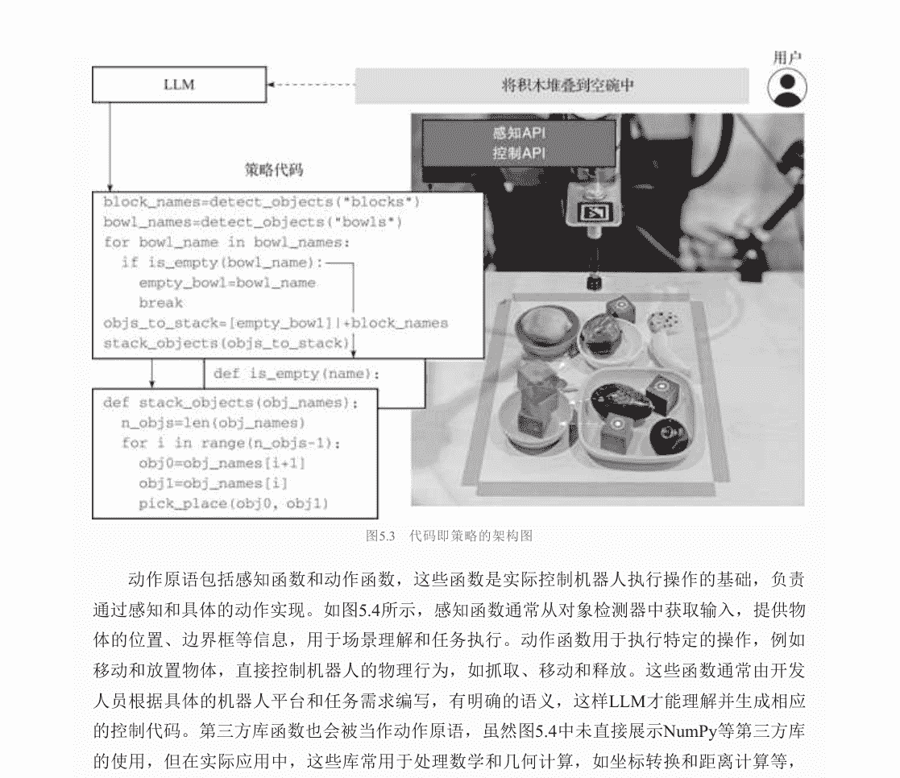

```python
block_names=detect_objects("blocks")
bowl_names=detect_objects("bowls")
for bowl_name in bowl_names:
    if is_empty(bowl_name):
        empty_bowl=bowl_name
        break
objs_to_stack=[empty_bowl]+block_names
stack_objects(objs_to_stack)
```

```python
def is_empty(name):
    ...
def stack_objects(obj_names):
    n_objs=len(obj_names)
    for i in range(n_objs-1):
        obj0=obj_names[i+1]
        obj1=obj_names[i]
        pick_place(obj0, obj1)
```
动作基元包括感知函数和动作函数，它们是实际控制机器人执行操作的基础，负责感知和具体动作的实现。如图5.4所示，感知函数通常从目标检测器获取输入，提供物体位置、边界框等信息，用于场景理解和任务执行。动作函数则执行特定操作，如移动和放置物体，直接控制机器人的物理行为，例如抓取、移动、释放。这些函数一般由开发者根据具体平台和任务需求编写，具有明确语义，便于模型理解并生成控制代码。第三方库函数也常被视作动作基元，虽然图5.4未直接展示 NumPy 等库，实际应用中这些库常用于数学和几何计算，如坐标转换和距离计算，扩展系统处理复杂任务的能力。

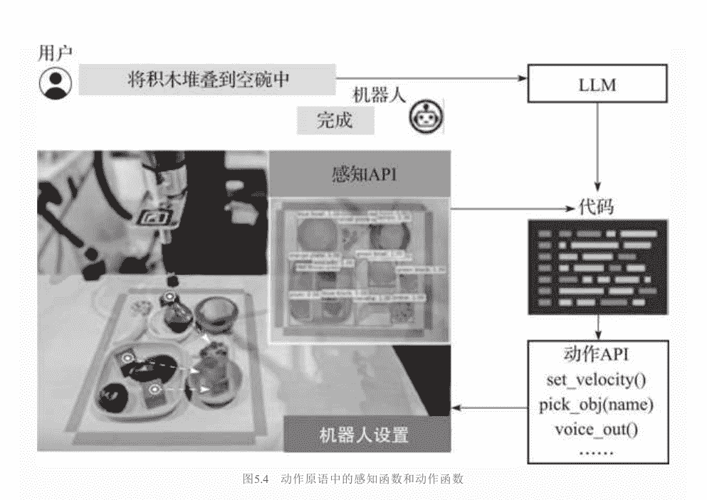
图5.4 动作原语中的感知函数和动作函数

### 5.3.2 提示模板

# 代码即策略：用手工 Prompt 拆动作

走动作基元路线的动作级规划并未单独设立任务层，分解思路全靠人的先验、预设的提示模板和示范案例。图5.5 的提示片段就是典型做法，通过具身式提示把特定任务可用的动作基元、环境要素以及做分解所需的业务逻辑子集提前绑定进去。以“把积木堆到空碗里”为例，系统里会用到 NumPy 这类通用工具和自定义的 put_first_on_second 等基元，这些基元负责物体的操作、位置查询、名称解析等能力。提示中还会给出对象清单，涵盖不同颜色的积木和碗，用来刻画场景要素。put_first_on_second 的含义是把一个物体放到另一个物体上，并配有示范，比如把黄色积木放到黄色碗上。借助这些函数定义和示范，系统能理解具体该怎么操作。

要让大语言模型把高层指令准确拆成可执行的子任务，提示里会详细列出可用的子任务集合以及组合范例。以“把积木堆进空碗”为例，拆解思路大致是：

- 找空碗：调用识别函数定位空碗，例如 empty_bowl_name=parse_obj（'empty bowl'）。
- 找积木：获取所有积木的位置，例如 block_names=parse_obj（'blocks'）。
- 组织序列：把目标对象拼接成序列，例如 obj_names=[empty_bowl_name]+block_names。
- 执行堆叠：调用 stack_objs_in_order（obj_names=obj_names）完成积木向空碗的堆叠。

```python
objects=['yellow block','green block','yellow bowl','blue block','blue bowl','green bowl']
# the yellow block on the yellow bowl.
say('Ok-putting the yellow block on the yellow bowl')
put_first_on_second('yellow block','yellow bowl')
objects=['yellow block','green block','yellow bowl','blue block','blue bowl','green bowl']
# which block did you move.
say('I moved the yellow block')
objects=['yellow block','green block','yellow bowl','blue block','blue bowl','green bowl']
# move the green block to the top right corner.
say('Got it-putting the green block on the top right corner')
corner_pos=parse_position('top right corner')
put_first_on_second('green block','corner_pos')
objects=['yellow block','green block','yellow bowl','blue block','blue bowl','green bowl']
# stack the blue bowl on the yellow bowl on the green block.
order_bottom_to_top=['green block','yellow bowl','blue bowl']
say('Sure-stacking from top to bottom: {",".join(order_bottom_to_top)}')
stack_objects_in_order(object_names=order_bottom_to_top)
objects=['cyan block','white block','cyan bowl','blue block','blue bowl','white bowl']
# move the cyan block into its corresponding bowl.
matches={'cyan block':'cyan bowl'}
say('Got it-placing the cyan block on the cyan bowl')
for first,second in matches.items():
```

图5.5 “代码即策略”的Prompt片段

手工设计的提示能让模型拿到针对性的子任务集及其组合范例，从而按任务目标生成代码逻辑。但这种逻辑并非自动涌现，而是依托开发者事先设定的子任务与动作基元。函数的设计与使用方式都受开发者的先验经验约束，以保证拆分和执行的准确性。

### 5.3.3 优势与局限性

“代码即策略”借助手工搭建的初始提示与示例，使大模型能够按需动态生成代码逻辑，实现灵活的任务拆分与动作组合。这种方式减少了手写代码的工作量，生成的代码还能迁移到与原任务相近的场景。比如从“把积木堆到空碗”扩展到“把不同形状的物体堆放到指定位置”。不过泛化能力仍然受限于人工先验中关于任务拆分和函数设计的知识。只有当新任务的性质与原任务相近，例如都涉及堆叠或分类这类基础操作时，系统才可以通过调用相近的 API 或函数来完成，从而简化规划流程。额外添加控制 API 或改造现有 API，也能在一定程度上拓宽代码生成的适应范围。但该方法也有明显局限。

- 对任务类型的依赖。每个具体操作都需要在代码里提前定义，如放置物体、移动到指定位置等。策略是否有效，取决于任务类型与预置模板的匹配度。遇到全新任务类型时，现有代码多半无法胜任，除非对代码逻辑进行扩展或修改以引入新的操作定义。

## 5.4 基于价值图的动作级分层规划

基于价值图的动作级分层规划属于一种间接的动作规划思路。价值图直观标明机器人应操作的区域与应规避的区域，为动作规划提供参考。本节以 VoxPoser [2] 为例，说明空间信息如何辅助动作规划。

### 5.4.1 空间信息与间接动作规划

动作级规划的核心是生成并优化具体的运动轨迹。空间信息在分层规划中主要提升动作执行的精确度与子任务间的一致性。大模型在自然语言理解和生成上很强，但直接让它输出机器人动作序列并不现实。因为机器人控制通常在多自由度的三维空间中进行，控制指令需要同时处理位置、朝向、速度等多维数据。而大模型的输出是文本，难以充分表达机器人运动的多维复杂性。机器人控制还要求极高的时间和空间精度，像关节角度、速度、位置等都需以连续高频的控制信号实现，文本输出难以转化为细粒度的控制指令。此外，机器人动作需要实时反馈与快速调整，必须依赖连续高频信号，而大模型的离散文本输出缺乏实时调整能力，无法匹配操作的精度与速度需求。

尽管大模型不适合直接输出可用于控制的动作序列，它在理解基于自然语言描述的任务便利性与限制方面表现优异。换句话说，大模型能读懂任务需求与环境约束，并将其转化为动作规划的关键信息，间接实现动作级规划。如图5.6所示，大模型可依据任务目标推断出执行该任务的最优区域或行为模式，同时识别障碍与限制，如禁区或潜在危险。由此大模型能间接规划与目标相关的最优轨迹或姿态，使轨迹覆盖多个子任务，保证整体规划与具体执行的统一。

打开顶部抽屉并小心花瓶

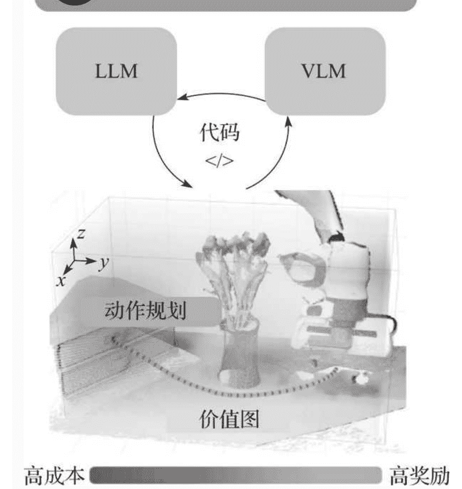

图5.6 空间信息与间接动作规划

### 5.4.2 价值图

大模型本身没有直接的空间感知能力，但可通过分层架构与感知模块协作，获取周围物体的三维结构、空间关系以及影响执行的环境因素。例如指令“打开顶部抽屉并小心花瓶”时，大模型能推断：①要抓住顶部抽屉的手柄；②手柄需向外拉；③要避开花瓶。大模型基于描述生成 Python 代码，调用感知 API 并借助 RGB-D 相机采集环境数据，从而推断任务相关的空间便利性与约束。在 VLM 的协同下，大模型能在三维空间中标注这些信息，生成价值图。

图5.7 展示了大模型与 VLM 协同生成价值图的过程。首先大模型根据指令调用 VLM 识别场景中的相关物体，随后生成代码初始化覆盖整个工作空间的体素网格。体素网格是一种三维数据结构，用来表示和管理三维空间信息。每个体素代表空间中一个小立方体，可存储颜色、密度、位置等属性。体素网格是价值图的基础，因为它把环境划分为可度量的空间单元。

```
def affordance_map():
    msize=(100,100,100)
    map=np.zeros(msize)
    handles=detect('handle')
    k=lambda x: x.pos[2]
    handles.sort(key=k)
    top_handle=handles[-1]
    x,y,z=top_handle.pos
    map[x,y,z]=1
    return smooth(map)
def constraint_map():
    msize=(100,100,100)
    map=np.zeros(msize)
    vases=detect('vase')
    vase=vases[0]
    xyz=vase.occupancy_grid
    map[xyz]=-1
    return smooth(map)
```

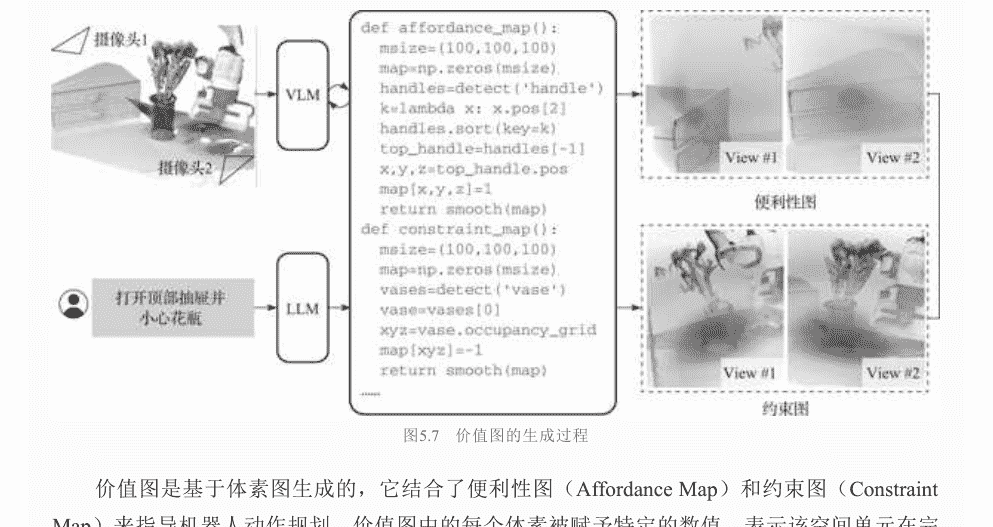

图5.7 价值图的生成过程

价值图在体素网格基础上构建，由便利性映射与约束映射共同构成，用于指导动作规划。图中的每个体素被赋予数值，表示该单元对任务完成的优先级或成本。高值区代表应优先操作的区域，如目标位置；低值区代表应避免或不适合操作的区域，如障碍物。

便利性映射是价值图的重要部分，用来标记三维空间中适合执行特定操作的最优区域，指示抓取、移动等动作的可行空间。图5.7 中函数 affordance_map（）定义了如何在三维空间中定位抽屉手柄的便利区域。通过 detect（'handle'）调用视觉模型，机器人识别出场景中的抽屉手柄。对于“打开顶部抽屉”任务，模型可能检测到多个手柄，大模型通过推理挑选出顶部抽屉的手柄并在体素网格上标注。大模型为对应体素赋予便利值，例如 1，表示这是应执行操作的目标区。

约束映射是价值图的另一部分，表达应规避的区域，如障碍物或狭窄通道。大模型通过感知数据获取物体的空间几何信息，并在三维体素空间中标记。举例而言，函数 constraint_map（）利用视觉模型检测花瓶位置，然后把花瓶周围的体素标记为低值或负值，表示应避开。约束映射由此为每个体素增加成本或限制信息，避免生成不当路径。

在生成的价值图中，便利性映射与约束映射共同决定体素价值。机器人据此制定运动计划，使末端执行器安全高效移动。例如依据高价值区，末端执行器被引导至顶部抽屉手柄，同时避开花瓶等障碍。随后系统会生成新的价值图，指导后续操作，如打开抽屉。

### 5.4.3 动作规划

价值图为机器人提供了可视化且定量的动作规划手段。在具体规划中，需从价值图派生出不同信息地图，各自承担不同角色。

例如末端轨迹规划需要目标地图、障碍物地图并据此计算总成本地图。目标地图利用价值图中的便利性信息，标记出适合操作的位形，如抓取点或移动点。基于这些目标点，可计算每个空间点到最近目标的距离，通过距离变换生成初步成本图。该图表示任意点到最近目标的距离，数值越小越接近目标，越大越远。

障碍物地图利用价值图中的约束信息，标记环境中的障碍位置，通常代表不可达或应避开的区域。为了提升实用性，障碍物地图常做高斯滤波与归一化，以表现障碍在空间中的分布。处理后不仅标记障碍本身，还为周边赋予渐变的成本，形成提示规避范围的过渡区。

总成本地图是把初步成本图与障碍物地图融合的结果。它综合了到达目标的路径成本与避障需求。高成本区代表需规避的区域，如障碍或远离目标的位置；低成本区代表优先选择的路径，即靠近目标且避开障碍。总成本地图是路径规划的核心，体现了从任意位置到目标的综合成本，同时兼顾便利性与约束。

贪婪策略是常用的路径规划算法，依据总成本地图逐步选择成本最低的体素作为下一步。路径持续更新，直至满足停止条件或达到最大步数。每次移动后，当前位置成本会被人为抬高，防止回溯。若周围已无更低成本体素或当前成本过高，则停止搜索。原始路径需后处理，包括平滑与曲率计算，以减少急转弯，并按曲率与间隔裁剪，确保实用与安全。该过程依赖 NumPy、SciPy 等科学计算库来处理地图数据与数学运算。

通常的动作规划还包含末端执行器姿态规划。当末端执行器到达价值图标记的高价值点时，会借助视觉与力觉等传感器确认最佳操作时机。传感器验证夹具处于合适位置与姿态后，触发抓取或释放。为实现这些动作，价值图需扩展为旋转图、夹具图与速度图。它们分别确定末端执行器在特定点的朝向、夹具状态即开合、以及移动速度。

旋转图定义末端执行器在每个空间点的旋转方向，确保位置正确同时方向准确。例如接近手柄时，旋转图提供正确朝向，保证以最佳角度抓取。夹具图指定空间不同点的夹具状态，确保在合适时机抓取或释放。速度图定义三维空间各点的目标速度，以适应精细操作或快速移动等不同需求。

旋转图、夹具图与速度图不作为直接的“成本”数值使用，它们不像成本地图那样提供用于路径选择的量化成本。但它们可纳入整体优化过程，作为参数化轨迹的重要组成。也就是说，动作规划中这些图协同工作，确保路径满足空间位置要求，同时兼顾末端朝向、夹具状态与速度。实际应用中，参数化轨迹通过基于成本函数的优化算法整合到机器人运动规划中，确保满足指令并遵循物理与操作约束。

图5.8 展示了机器人在多任务执行中如何利用价值图进行动作规划与执行。每个任务被划分为若干步骤 t=1、t=2、t=3 等，呈现从开始到完成的流程。图中价值图以不同颜色表示空间价值，指导路径规划、末端执行器位置调整、旋转、速度与操作行为。在每个任务中，价值图通过以下方式发挥作用：

- 任务分解。借助高价值点的标记，价值图把复杂任务拆解为一系列子任务，引导机器人逐步完成整体目标。
- 路径规划。价值图提供最佳路径，确保机器人在环境中高效安全移动。
- 末端执行器控制。价值图指导执行器的方向、位置、夹具状态与速度，保证接近与操作目标时的准确性。

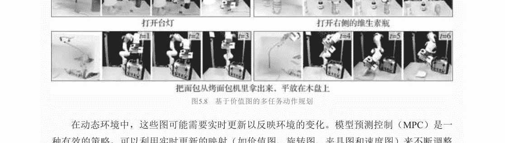

在动态环境中，这些图需要实时更新以反映变化。模型预测控制 MPC 是一种有效策略，可利用实时更新的映射如价值图、旋转图、夹具图与速度图，不断调整行动计划。MPC 持续监测环境与机器人状态，基于最新感知信息实时修正路径，使机器人以最安全高效的方式接近目标。它不仅根据当前反馈调整路径，还能动态决定末端执行器的具体动作时机。例如在推拉操作中，若检测到推动未按预期进行，MPC 可实时调整推力或方向，确保任务顺利完成。

### 5.4.4 价值图的构建Prompt

价值图的构建采用代码即策略的方法，仍依赖预先定义的任务级模板。如图5.9 所示的 Prompt 片段展示了如何借助编程与空间计算构建便利性图，从而精确确定特定任务中的操作位置。在该示例中，机器人被指示找到与“含柠檬的托盘”相关的特定空间位置，具体为托盘左侧 4cm 且顶部 10cm 的点。

```
# Query:a point 4cm to the left of and 10cm on top of the tray that contains the lemon.
affordance_map=get_empty_affordance_map()
tray_with_lemon=parse_query_obj('tray that contains the lemon')
(min_x,min_y,min_z),(max_x,max_y,max_z)=tray_with_lemon.aabb
center_x,center_y,center_z=tray_with_lemon.position
# 4cm to the left of so we subtract from y-axis,and 10cm on top of so we add to z-axis
x=center_x
y=min_y-cm2index(4,'y')
z=max_z+cm2index(10,'z')
affordance_map[x,y,z]=1
ret_val=affordance_map
```

便利性图 Prompt 实战拆解

第一步先调用 get_empty_affordance_map() 生成一张空白的便利性图，用来记录机器人做任务时需要关心的空间位置，本质上是给机器人一张任务相关的空间草图。

接着用 parse_query_obj('tray that contains the lemon') 锁定任务核心物，也就是装着柠檬的托盘。通过这个调用机器人能拿到目标物的空间信息，这是理解物体间关系的起点。随后获取托盘的轴对齐包围盒 AABB，用 min_x、min_y、min_z 和 max_x、max_y、max_z 框定范围，再通过 center_x、center_y、center_z 得到中心点，为后续的空间计算提供基准。

进入位移计算阶段，目标点在 Y 轴上向托盘左侧平移 4cm，在 Z 轴上向顶部抬高 10cm。为把厘米单位落到地图上，使用 cm2index() 做厘米到索引的转换，并据此修正 min_y 和 max_z 的位置。确定后在便利性图上把该位置打上 1，明确标识为可执行操作的关键点，为机器人指明最优作业区。

### 5.4.5 优缺点全解析

先说基于动作原语的直接规划。动作原语是预先定义好的语义模块，比如抓取、旋转、推动，使用前需要针对具体应用场景做精细设计和优化，离不开领域专家的经验沉淀。

换成代码即策略的思路后，可以用 Prompt 模板描述环境与子任务，再借助大语言模型的编程能力把子任务和动作原语拼装起来，在相似场景下实现一定泛化。但这种泛化的边界很窄，主要困在同类任务里，也就是任务结构和目标相近时才能通过重组预设原语完成。

一旦任务类型跳变，目标、结构和操作方式都明显不同，比如涉及全新步骤、环境限制或全新目标物，预设的原语和组合逻辑就失效了，必须重新设计一套动作原语集合。

对比来看，价值图方法同样走代码即策略路线，用 Prompt 模板把环境中的关键位置映射到便利性图和约束图，但在多任务泛化上更胜一筹。因为它把关键位置的计算与映射抽象成通用流程。无论任务如何变化，机器人都要判断哪里可以操作、哪里必须规避，这个判断过程在不同任务里是共通的，能通过分析空间关系动态算出操作区和约束区。

价值图里用于空间评估的原语泛化能力也更强。它用统一框架给空间点打价值分，不绑定具体任务。核心是实时解析空间关系，比如在物体旁找最佳操作点或避开障碍，这种分析天然任务无关，能让机器人适应新任务而不用为每个任务单独定义原语。

当然，价值图也有硬伤。速度、响应和计算成本是主要挑战。图里包含海量空间点，每个点都要更新便利性和约束值，三维大规模数据处理非常吃资源。环境一旦频繁变化，图需要持续刷新、重算所有点的状态，耗时明显。更别提动作规划还要兼顾末端姿态、速度等高维因素，优化难度陡增。Prompt 模板本身的描述能力天花板，也限制了它在复杂任务中的落地。

## 5.5 空间约束驱动的分层动作规划

在人类常识里，日常操作都是一组空间位置上的限制，比如锤钉子要把锤子置于钉子上方并用合适姿态力度敲击。基于空间位置约束的动作级分层规划，就是把大模型的常识推理和机器人轨迹优化结合起来，提升规划精度和泛化性。下面以 CoPa 为例展开。

### 5.5.1 约束与轨迹优化协同

CoPa 采用典型分层架构，虽用视觉语言模型做动作规划，但仍依赖专用视觉模型做感知预处理，包括场景分割和深度获取。框架把操控任务拆成两段：先抓取物体，再执行后续操作。

以锤钉子为例，第一阶段是抓取，确保把锤子稳定、精准地拿起来。第二阶段是操作，把锤子调到正确姿态对准钉子并敲击。

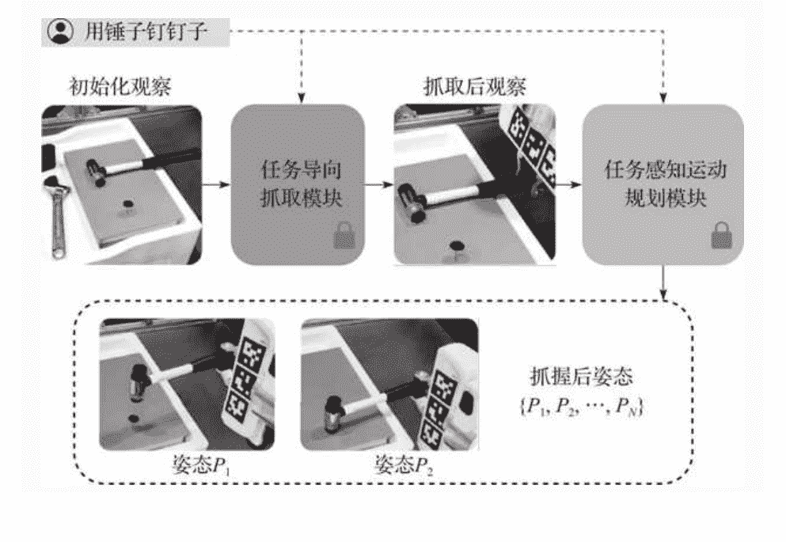
第一阶段要解决的是如何抓取工具。系统从初始观察中识别锤子的位置和朝向，再决定最佳抓取方式，如任务导向抓取模块所示。

抓取完成后，第二阶段在抓后观察基础上，生成一系列末端执行器目标姿态，也就是锤击动作序列 { P₁, P₂, ..., P_N }，由任务感知运动规划模块负责，保证敲击路径和姿态正确。

整体核心是为末端执行器生成目标姿态序列和对应的空间约束，再用轨迹优化把相邻姿态平滑衔接。轨迹优化按需求分两类：

- 1）无碰撞轨迹优化。在无障碍环境下，重点是从起点到目标点的最优路径，追求时间最短、能耗最低或路径最平滑，同时避免碰撞。比如把锤子从手里移到钉子上方时，必须规划一条不碰到周边物体的路径。
- 2）带碰撞轨迹优化。当需要与环境接触时，不仅要规划路径，还要考虑接触力学。比如敲钉时锤子与钉子直接接触，需要精确控制作用力和方向，既保证任务成功，又避免钉子弯曲或损坏。

给定不同目标位置，最优控制可生成多样轨迹，但终点受约束限制。轨迹优化提升了执行效率、安全性和平滑度，尤其在复杂动态交互场景中优势明显。

### 5.5.2 任务导向抓取策略

面向任务的抓取阶段要规划末端执行器的抓取姿态和抓取部位，视觉语言模型如 GPT-4V 在解析指令、关联环境、动态调整上起关键作用。流程分为粗略物体定位和细致部分定位。

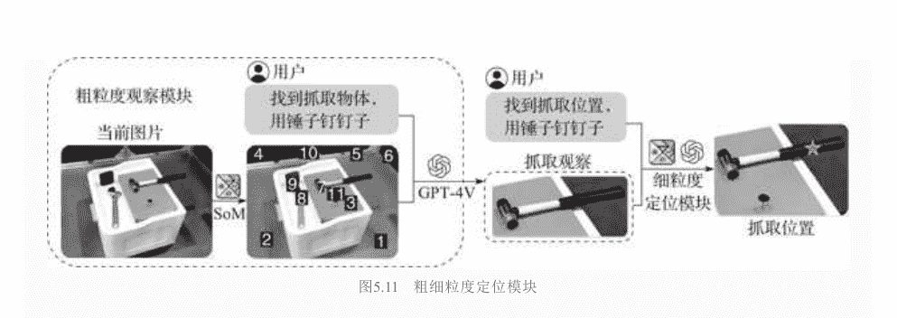
图5.11 粗细粒度定位模块

粗略定位阶段，CoPa 用 Set-of-Mark 技术对图像分割并打上数字标记。用户通过自然语言给出目标，如“找到抓取物体，用锤子钉钉子”，VLM 解析后结合 SoM 标记锁定场景中的锤子和钉子，完成初步定位。

随后进入细致部分定位。VLM 对已识别物体做精细分析，确定具体抓取部位。以锤钉子为例，系统会锁定锤子的把手而非锤头。

这一步依赖深度信息，比如 RGB-D 图像，通过立体视觉反投影成点云，实现从二维到三维的精确映射。点云送入 GraspNet，该模型在大规模抓取数据上训练，可输出大量 6-DOF 抓取候选，包含位置、宽高深和抓取分数。

候选数量庞大时，CoPa 引入任务型筛选机制。VLM 依据任务需求和环境上下文评估候选，不仅看分数高低，还看与任务的关联度。比如精细装配任务，会优先选择对操作对象干扰小的抓取姿态。

### 5.5.3 任务感知下的动作生成

抓取完成后，CoPa 要生成后续末端姿态。图5.12 展示了 3 个关键步骤：定位任务相关部分、生成操控约束、规划目标姿态。

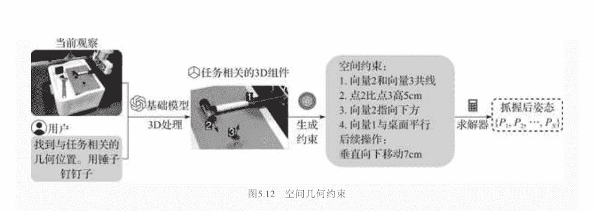
图5.12 空间几何约束

1）任务相关部分的定位。复用粗细定位方法，精准识别与任务相关的部件。如锤钉子任务中，识别出锤子的打击面、握柄和钉子表面。

2）操控约束的生成。这些部件需满足特定空间几何约束，CoPa 由 VLM 生成并在图像上标注计算，简化为向量和表面映射到三维。常见约束有：

- 向量共线：向量2和向量3须在同一直线；
- 点间距离：点2相对点3高出 5cm；
- 向量方向：向量2需指向下方，保证手柄朝地；
- 向量关系：向量1与桌面平行，保持操作时与桌面平行。
这些约束为抓取后操作提供位置和方向依据。

3）目标姿态的规划。基于约束计算一系列 SE(3) 矩阵，描述旋转 SO(3) 和平移 R³。

```
$$T = \begin{bmatrix} R & t \ 0 & 1 \end{bmatrix} \in SE(3)$$
```
其中 R 为旋转矩阵，t 为平移向量。变换公式为：
T(p)=Rp+t，T(V)=RV
旋转调整方向，平移改变位置。共线约束影响 R，点位高差约束影响 t。

为保证约束满足，为每个约束定义损失。点约束损失是实际与目标位置的距离，向量约束损失是方向间角度差。总损失为各损失累加：

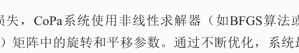
用非线性求解器如 BFGS 或信赖域约束优化迭代调整 SE(3) 的旋转和平移，直至总损失最小。得到最优 SE(3) 后作用于抓取点和操作向量，推导出后续姿态。例如在最优姿态上做垂直向下 7cm 的平移，最终产出满足约束的姿态序列 { P_1, P_2, ..., P_N }。

### 5.5.4 VLM 与 Prompt 设计

在空间约束分层规划中，VLM 作用核心。CoPa 用少样本提示 few-shot prompt 结合思维链 Chain of Thought，给出任务抓取和运动规划的示例，帮助模型逐步推理出执行步骤。

图5.13 的定位任务 Prompt 包含任务描述、分析过程和对象标签。以“用刷子把纸球扫进簸箕”为例，Prompt 先说明任务要求，识别刷子、纸球及扫动动作。

我已经选择了你刚才选择的物体，对它们进行了额外的分割，并在照片上标记了它们。现在你的任务是识别出完成任务所需的线条或表面对应的数字。

为了帮助你理解，我将展示几个例子。

- 例子1：

指令：用刷子将纸球扫进簸箕。

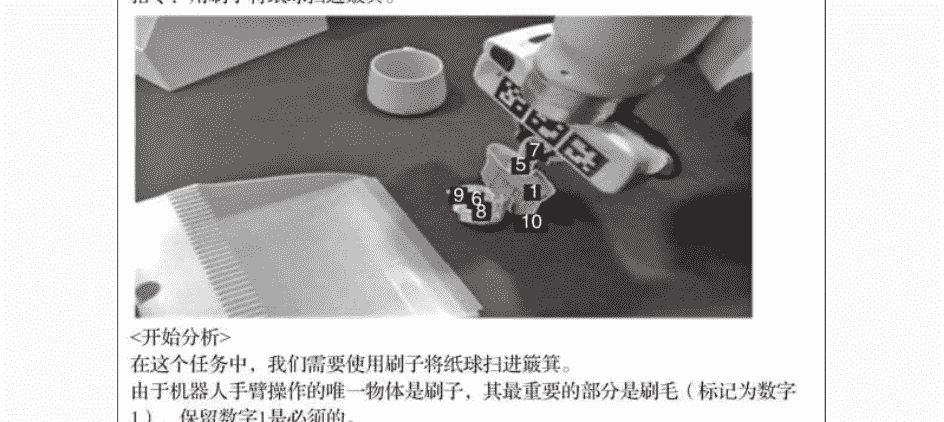

```
<开始分析>
在这个任务中，我们需要使用刷子将纸球扫进簸箕。
由于机器人手臂操作的唯一物体是刷子，其最重要的部分是刷毛（标记为数字1），保留数字1是必须的。
数字5和7代表刷子的手柄，较小，不需要与纸球互动。
数字10是刷子的一个不重要的角落。
数字6、8和9属于纸球，只需随刷子移动，因此没有必要保留。
<结束分析>
对象标签: [1]
```
Prompt 还帮助 VLM 区分关键与次要部分。刷子手柄和角落标记为数字5、7、10，不直接影响任务，被视为主次要部分。纸球相关数字6、8、9 随刷子移动，无需单独操作。而刷毛部分标记为数字1，与纸球直接接触执行扫动，是最关键部分。

### 5.5.5 能力边界盘点

基于空间位置约束的分层规划借助大模型的常识推理确定目标位置、操控约束和末端关键姿态，通过把复杂任务拆成约束与姿态规划，再结合传统规划器如 RRT 或 PRM 实现平滑过渡，显著降低复杂度。

泛化能力较强是亮点。大模型能理解不同任务的空间关系和约束，面对抓取、堆叠、工具操作等相似场景，可灵活调整空间位置和约束生成适配姿态和路径，在静态或结构相近任务中表现稳定。

局限也很明显。首先是对复杂物体的建模。当前主要依赖表面、向量等简易几何元素，对形状复杂或动态变化物体理解有限、精度不足。可引入曲面、多面体或自由曲面等更丰富的几何表达来提升建模能力。

其次是动态实时性。面对动态场景或需实时调整的任务，如拍球这类环境和物体快速变化的情况，基于空间约束的方法难以做到即时动态重规划，实时性尚未成熟。

## 第6章 从感知到执行的端到端动作链
在具身智能里，动作层面做决策是最难啃的硬骨头，分层方案下时延尤其明显。端到端思路是用单一网络把原始感知信号直接映射成可执行的动作序列。相较分层做法，这种方式削弱了模块间的接口耦合，降低了信息衰减，让系统能从数据里自行摸索最优策略。只是当高自由度的人形平台成为前提时，端到端的复杂度依然很高，在训练具身大模型时挑战尤为突出。

## 6.1 统一架构与多任务协同
统一网络与多任务网络是端到端落地的两条典型路径。统一式把传感器输入到最终输出的全流程收进同一网络框架，感知、决策、规划的边界被抹平。多任务式更强调多目标的联合优化。如图6.1所示，自动驾驶里常见的多任务网络会使用多组查询向量，例如跟踪查询和地图查询，把不同任务串联传导信息，最后把融合表征送入规划模块。

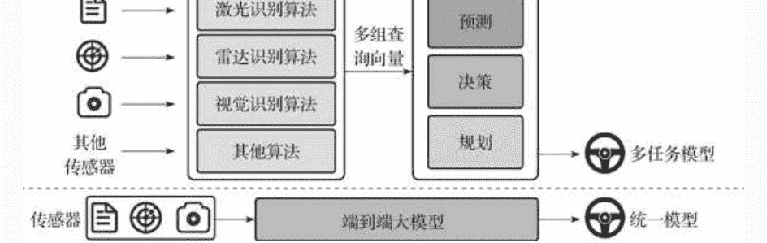

从构造上看，多任务的端到端结构与传统分层外形相近，但在细节和训练策略上差异明显。多任务中模块间的信息不再按人工定义的感知层到决策层搬运，而是依靠多组查询向量传递。规划模块据此生成动作。与模块化模型不同，多任务必须支持跨模块梯度回传，所有部分要同步训练，才能达成全局最优。这种联合优化能够让多个复杂任务共享信息，提升整体效率与准确度。

统一架构的端到端流程从原始信号进入，到轨迹输出，全部由一个深度学习模型完成，感知、决策、规划的功能划分被消除。这类模型可基于强化学习、模仿学习或生成式模型如世界模型构建。最大益处是能够对整个系统做全局优化，无需在模块间反复传递信息，降低接口复杂度，并最大化利用环境数据。统一训练让模型对环境形成深刻理解，对真实世界的复杂场景适应力更强。

无论是多任务还是统一架构，目标都是以全局优化的视角保证梯度能够覆盖全网，实现任务间或系统级的协同。相比传统模块化设计，端到端的训练和调试更复杂，但理论上限更高，因为它能够利用覆盖感知、决策、规划的多源综合数据，做更准的预测和决策。它在环境理解和与物体交互上也表现出很强的通用性，跨领域适应能力突出。比如在机器人领域，端到端能够从感知到运动控制提供统一解法，为跨领域模型复用奠定基础。

落地时两者各有取舍。统一架构简化了系统设计，适合对全局任务做深度学习和整体优化，对数据量要求高，但在训练难度和调试复杂度上挑战大。多任务架构通过联合优化多个任务，让复杂系统同时处理不同功能，在多任务场景表现更好，但任务协同训练时容易冲突和权衡，训练更难。选型要根据应用需求、任务复杂度和算力资源来权衡。

## 6.2 视觉语言动作模型
视觉语言动作模型是一种典型的端到端统一架构，采用与基础模型类似的Transformer结构。它把机器人动作编码成类似语言的文本标记，并与大规模视觉语言数据联合训练。动作规划过程因此变得像大语言模型生成自然语言一样。Google的RT-2即为代表，本节以RT-2为例说明其运动规划方法。

### 6.2.1 动作规划流程
在RT-2里，动作规划既要解析自然语言，也要处理视觉信息，再转化为末端执行器可用的具体动作。核心创新在于把自然语言指令、视觉输入和机器人动作表征统一起来，实现复杂任务的自动化。

RT-2基于Transformer，融合视觉与语言指令训练，先在大规模视觉语言数据集上预训练，再用机器人数据微调，从而生成贴合实际任务的动作规划。如图6.2所示，推理时模型先接收任务描述，例如“机器人该怎么执行这个任务”，以自然语言输入。同时摄像头捕捉的场景图像进入视觉变换器ViT提取物体位置、环境布局等视觉特征。ViT与语言处理模块在统一Transformer架构中融合，生成机器人可执行的动作序列。

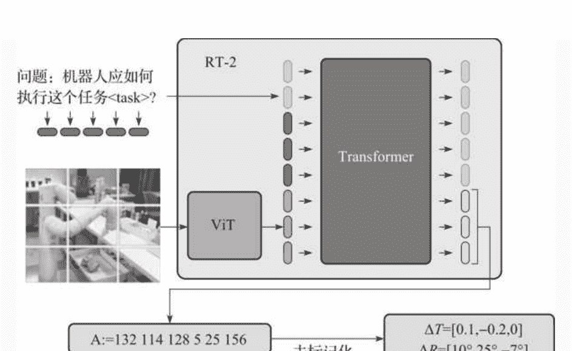

图6.2 RT-2的详细架构

这些动作序列以token形式存在，每个token对应一个预定义机器人动作。比如标记序列“132 114 128 5 25 156”里，每个数字代表一种动作编码。随后需要去标记化，把数字标记转成机器人能执行的物理参数。常见参数包括位置变化ΔT和旋转角度ΔR。例如ΔT=[0.1, -0.2, 0]表示三维空间位移，ΔR=[10°, 25°, -7°]描述关节旋转变化。

关键难点在于如何有效标记化动作序列、为标记找到合适嵌入、以及针对特定任务优化训练。解决这些问题后，RT-2显著提升了自主性和适应性，展现了在复杂环境中执行任务的潜力。

### 6.2.2 控制原语
动作级规划的核心是按任务目标生成末端执行器轨迹。不同硬件的自由度DOF和控制原语复杂度不同。以Google RT系列为例，末端执行器控制涉及多个关键原语，涵盖位置、姿态、操作等，归纳如下。
- 1）位置移动原语：控制夹持器在三维空间移动，通过x、y、z坐标变换实现。机器人可据任务把末端从当前位置搬到指定三维坐标。

### 6.2.2 动作原语详解
- 2）姿态调整原语：调整夹持器姿态，绕roll、pitch、yaw三轴旋转。精确角度调整对精密操作如物体对齐、装配很重要。
- 3）夹持器开闭操作原语：控制夹持器开合，实现抓取或释放。需根据物体大小形状精确控制开合程度，保证稳定安全。
- 4）基座平面移动与旋转原语：控制基座在平面内移动和旋转，通过x、y坐标和平面yaw角实现。对全局定位和导航至关重要，尤其在拥挤环境。

此外模式切换指令不涉及末端自由度，但对多任务操作和任务管理很重要，用于在不同操作模式间切换，如从控制夹持器切换到控制基座，或结束当前周期准备下一阶段。

### 6.2.3 控制参数的离散化
动作序列文本化的思想是把控制原语及其参数类比成自然语言单词。机器人控制参数通常是连续值，文本化面临两个挑战：一是连续性导致参数空间无限；二是自然语言词嵌入靠预训练获得，动作原语和连续参数的嵌入需要新处理。

常用做法是对连续控制参数离散化。离散化后参数变成固定维度的离散值，可为其分配嵌入，使机器人动作参数像自然语言一样用“动作标记”表示。

离散化方法多样。离散型参数如开关整数可直接作为标记；浮点连续参数则先规范化再量化。先把浮点数规范到[0,1]区间，公式如下：

```
normalized value = (actual value - min) / (max - min)
```

再把规范化值量化为整数标记，通过乘以词汇量大小-1取整实现。量化公式为：

```
token = normalized value × (vocab_size - 1)
```

以RT系列为例，每个动作维度连续参数被划分为256个区间。若考虑7个控制变量x、y、z、roll、pitch、yaw、夹持器开合，每个变量离散化256份，则每个动作维度对应256个标记，合计256×6+2个“动作单词”。比如浮点参数实际值0.9，最小0最大1，词表256。规范化值=(0.9-0)/(1-0)=0.9，token=0.9×255=229.5，取整后为229。由此视觉语言动作模型可生成动作序列标记，再通过逆量化解码回动作参数实现精细控制。

### 6.2.4 动作序列的文本化表达
动作序列文本化是把含原语和控制参数的动作序列表示为类自然语言的单词序列。图6.3展示结构，若输出序列已规定原语顺序，可直接用运动原语的离散参数表示，实现机器人动作规划。


终止或继续是控制流原语，决定是否继续后续动作或结束当前序列，是任务流程控制的关键。位置变化由ΔPos X、ΔPos Y、ΔPos Z三个标记组成，代表末端在空间三维位置变化，用于精确定位移动。旋转变化由ΔRot X、ΔRot Y、ΔRot Z组成，代表绕三轴旋转角度调整，使机器人能灵活调整姿态。夹持器标记控制夹持器开合，是抓取搬运放置任务的关键控制点。通过这种结构化表示，RT-2能把复杂动作规划分解为可控离散标记。

### 6.2.5 如何扩充词表容纳动作
视觉语言动作模型是在VLM基础上微调形成，目标是把机器人动作表征与视觉语言表征对齐。与自然语言相似，机器人动作可离散为动作标记。传统视觉语言模型词表通常不含动作标记，或语义不同。因此构建VLA模型需要调整词表，主要靠扩展和替换。

词表扩展是常见方案，常用于跨语言迁移。类似大语言模型从英文迁移到中文需加入汉字，VLA模型也可直接在现有词表里加入机器人动作标记，并用机器人数据微调，确保嵌入准确反映操作语义。

词表替换则用相关性低的标记换掉，以保持词表紧凑节省资源。替换可避免词表过大提升效率，但可能损失部分原有语义，需谨慎挑选。

RT-2采用替换策略。例如PaLI-X词表中1000个标记被替换为动作标记，使动作标记化更直接，可把机器人动作离散区间映射到预定义整数标记。PaLM-E原词表缺少便捷数字标记，则用词表中256个最不常用的词汇标记来表示动作标记。

若仅考虑手臂移动7个变量，其中前6个连续各离散256份，夹持器两状态，共需1538个标记，远超PaLM-E的256个替换量。因此模型可能采用标记共享或压缩策略减少独立标记数。

标记共享让相关参数共用一组标记，如空间位置X、Y、Z物理特性相似，可共享同一组标记，减少词表同时保持表达精度。压缩策略则通过编码把多个离散参数组合成一个标记，例如把两个连续参数编码成组合标记。借助这些策略，VLA模型能在降低词表规模的同时保持动作标记的精确度，满足复杂任务需求。

### 6.2.6 跨模态微调让模型会动手
具身动作微调建立在VLM之上。如图6.4所示，PaLI-X是典型视觉-语言基座，由视觉处理、文本嵌入、编码器和解码器构成。图像先经大型视觉模型如ViT-22B提取特征得到视觉嵌入，文本经嵌入模块得到语言嵌入。两者进入PaLI编码器，通过跨模态自注意力融合，最后解码器经交叉注意力生成任务相关输出标记，可用于任务理解或机器人动作生成。

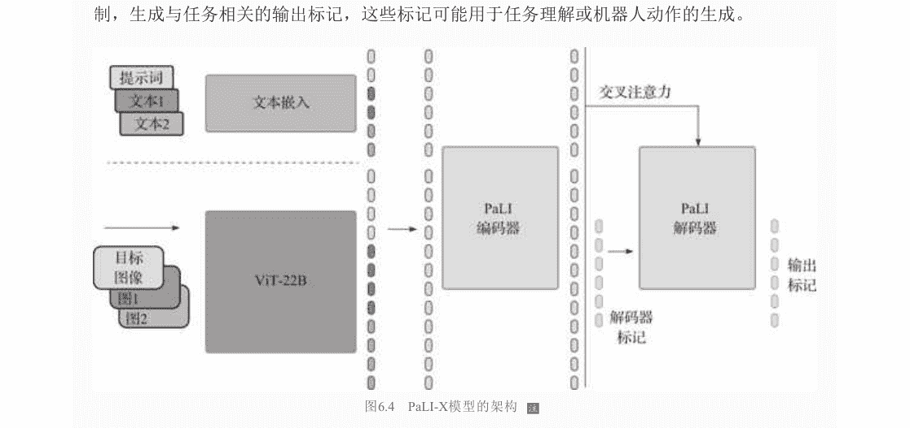

图6.4 PaLI-X模型的架构

PaLI-X的视觉推理能力对动作规划至关重要。微调阶段需对齐视觉、语言和动作，确保生成动作序列充分考虑视觉输入和语言指令细节，提升执行精确度和鲁棒性。模型不仅要处理视觉语言数据，还需结合具体机器人动作数据微调，增强对机器人任务的理解。

RT-2采用多源视觉文本数据与机器人动作数据共同微调。共同微调指每个训练批次同时包含多源视觉语言数据和机器人动作数据，并调节采样权重平衡比例。提高机器人数据采样权重后，模型在学习广泛视觉语言概念的同时更专注机器人任务。

多源数据包括视觉问答、字幕生成及图像相关非结构化文本，帮助模型学习视觉语言关联。机器人动作数据来自真实环境任务记录，例如13台具身机器人在办公室或厨房环境中17个月收集的大量任务数据。数据包含任务执行的视觉记录和详细自然语言指令，指令里有操作动词如“拾取”“打开”“放入”以及物体名词如“罐头”“抽屉”“餐巾”，帮助模型把视觉信息与具体动作指令关联。

通过共同微调，模型保持原有视觉语言性能的同时大幅提升动作规划泛化能力。模型不会因预训练数据影响动作学习，反之亦然。微调后模型既能理解执行已见任务，也能在全新环境和任务中表现强适应。现实任务比训练数据更复杂，这种泛化能力对实际应用至关重要。

### 6.2.7 安全兜底：限制动作输出
基于视觉语言动作模型的动作规划，必须限制动作输出以确保安全有效。因为模型可能生成无效或危险动作序列，尤其在多模态预测中视觉语言输入模糊会导致不准。例如RT-2接到指令“把杯子从桌上拿起放入柜子”，若生成过度旋转手臂或夹持器开合不当的序列，可能抓取失败甚至损坏物体。因此需限制输出，保证序列可安全执行。主要技术包括设置输出掩码、调整概率分布和使用条件提示。

设置输出掩码是在解码阶段直接限制模型只能选有效动作标记。任务中掩码设定为仅允许预定义有效标记。每个解码步，模型依据掩码判断候选标记是否属于有效集，无效标记被置零阻止输出，有效标记置一允许选择。这样模型只能输出被标记为有效的动作，保证可控安全。

调整概率分布是通过修改输出层概率分布优先选择有效标记。具体在序列生成时，最后一层softmax给出所有候选标记概率。可把无效标记概率调至接近零，同时保留或提升有效标记概率。这种调整降低无效标记被选概率，间接引导模型生成有效序列。

条件引导的执行调度

把条件提示理解为一种让模型依据具体指令改变输出偏好的干预手段。收到明确操作要求后，系统会优先激活与该要求对应的生成通路，并抑制其他无关通路。以“执行抓取”这类提示为例，它会明显提高与抓取相关的动作标记被采纳的概率，使最终输出更贴合指令意图。借助这一机制，模型能够随上下文自适应地调整策略，持续给出与当前目标一致的有效行为。

这种干预直接作用于输出挑选环节，确保机器人产生的动作序列兼具有效性与安全性。通过对可输出范围的精细限制，策略在提升任务准确率与可靠性的同时，也增强了跨场景迁移能力与执行效率。面对真实世界错综复杂的环境，这些机制让机器人能够灵活应对多样化需求，进而在操作中进一步巩固安全与稳定。

### 6.2.8 优势和局限性

视觉语言动作模型的端到端规划能力，源于在大规模视觉语言任务上的预训练与微调。模型通过学习广泛的视觉与语言模式，能够在从未接触过的环境中展现较强的泛化表现。这种特性对于应对复杂且动态变化的真实任务至关重要。系统可以解析复杂的自然语言描述并与视觉输入融合，进而生成合适的机器人动作。相较于单一视觉或语言系统，这种融合在需要同时把握场景内容与指令意图的任务上效率更高。

不过该类规划也存在明显短板。

首先，机器人动作样本的采集成本很高。训练通常依赖大量高质量样本，而收集这些样本需要昂贵的硬件与复杂的实验环境，例如高精度传感器、先进机器人系统、精准跟踪设备等，投入巨大且采集标注极为耗时。每条动作还必须配上详细的自然语言说明以传递任务意图，资源需求让部署成为挑战。

其次，离散化参数空间制约了精度与灵活性。离散化虽简化实现，却削弱了对动作细微变化的捕捉。动作被离散后只能在预设状态中挑选，易导致不自然的表现。例如需要连续微调的操作，离散动作往往无法满足精细控制需求，从而影响复杂场景的表现。

再次，推理开销过大。采用生成式模型做动作序列推理，如RT-2、PaLI-X 55B，虽然能提供一定精度的生成，但计算成本极高。RT-2的推理频率仅约1～3Hz，严重受硬件制约。要维持该频率至少需要一台配4张高性能GPU的服务器，不仅采购成本高，后续电费、散热等运维开销也巨大。参数规模虽能提升质量，但高昂算力阻碍大规模落地。

最后，动作原语与控制参数的特异性限制了泛化。一个动作原语往往依托特定任务需求和机器人物理结构，优化后难以直接迁移到构型不同的机器人。例如工业机器人的抓取原语未必适用于服务机器人，二者在精度、力量控制、抓取姿态上差异明显。任务与硬件的紧密耦合，制约了该类系统在不同机器人平台上的适应性。

## 6.3 多任务端到端

特斯拉Optimus具身机器人借鉴了特斯拉电动车FSD的全自动驾驶系统，其具身动作规划采用标准的多任务端到端架构。在这个框架里，自动驾驶的动作规划可视为相对简化的具身机器人规划。本节以若干自动驾驶系统为例，讨论多任务端到端的网络设计思路。

### 6.3.1 端到端中的多任务

在端到端规划中，感知与动作规划不再拆分为独立模块，而是由统一网络直接贯通。这种设计让感知信号能直连决策，大幅简化流程。但从感知到规划的链路本身涵盖多种任务，体现人类先验知识，比如提取物体轮廓、追踪动态或预测占用状态等，这些都能显著提升避障等规划效率。分层规划虽可利用这些信息，但易出现模块间信息丢失、误差累积，以及因优化目标不一致导致的特征错位。多任务端到端网络通过特定设计与训练，既能整合先验知识如对象当前与未来状态预测，又能保持信息流连续，避免在处理阶段丢失信息。

以特斯拉FSD为例，其感知任务包括三维物体检测、多目标追踪和场景理解，并通过端到端网络整合为统一规划系统。车辆先检测并追踪周围动态物体，为每个目标赋予坐标、尺寸和持续跟踪ID。随后基于多视角图像生成鸟瞰图BEV并做语义分割，识别道路、行人、车道线等关键要素。该过程用实时传感器数据替代传统高精地图，提升了感知实时性与精度。

场景理解完成后，FSD进入动作预测，依据检测到的轨迹和场景信息预测未来一段时间的物体动态变化，其中包括占用预测，即预测每个网格单元未来是否被占用并生成占用概率图。最后规划模块综合这些信息生成未来行驶轨迹，确保在复杂交通中安全行驶。

图6.5展示了FSD如何利用感知与三维几何占用信息处理遮挡。上半部是多视角街景实拍，下半部是场景的三维几何表示，深色块为占用区域。通过三维建模，系统不仅能识别可见物体，还可推断因遮挡不可见的潜在障碍，为安全导航提供支撑。

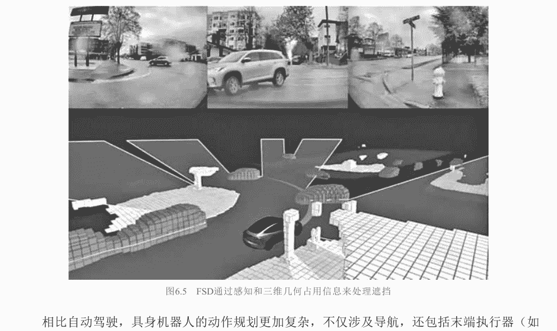
相较自动驾驶，具身机器人的规划更为复杂，不仅涉及导航，还要控制末端执行器如机械臂或夹具。末端动作规划需要极高的精确性和灵活性，以适应抓取、搬运、装配等多样化操作。与自动驾驶不同，末端规划不仅要处理动态环境交互，还要在狭小受限空间中作业并确保物体精确操控。

此外，具身机器人的规划必须在实时处理传感器数据的同时动态调整策略，应对环境变化与不确定性。例如工业环境抓取时，不仅要保证抓取准确，还需兼顾避障与力反馈等多重因素。因此具身机器人需要整合更多先验知识，并借助多任务端到端结构实现复杂操作的规划与执行。

### 6.3.2 多任务端到端网络架构

多任务端到端架构借助特定网络结构与训练方式，可融合不同任务蕴含的人类先验，同时保持信息在网络中的连续性。虽然FSD具体设计未公开，但UniAD [2]提供了类似的端到端自动驾驶多任务架构。如图6.6所示，主要划分为基础层、感知、预测、规划四个阶段，并通过Transformer模块将感知中的检测、跟踪、地图构建，以及预测中的运动与占用等五大关键任务整合，并直接优化对齐到运动规划，形成完整端到端方案。

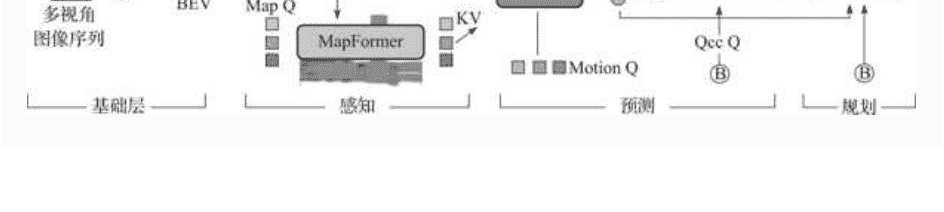
基础层输入多视角摄像头图像序列。为融合不同视角，先通过特征提取器把图像转为特征表示并生成BEV特征，为后续感知提供统一的三维环境表征。

感知阶段将BEV特征送入TrackFormer与MapFormer。TrackFormer承担多目标检测与跟踪，提取车辆、行人等动态信息并生成跟踪查询，用于持续追踪周围物体运动轨迹，并对多视角数据做时间聚合，保持跨时间戳的跟踪一致性。

MapFormer承担场景地图构建。由输入提取道路、车道线、交通标志等静态环境特征，生成地图查询，帮助系统理解行驶环境。

预测阶段使用两个核心模块。MotionFormer基于感知得到的物体轨迹，预测周围车辆、行人等未来运动轨迹，输出运动查询，包含未来时间步的预测路径，对避撞与安全路径规划至关重要。

OccFormer承担占用预测。生成的占用查询用于预测未来各区域占用状态，通过分析区域是否被占用来推断隐藏物体或即将进入场景的物体，提升遮挡情况下的决策能力。

规划阶段把感知与预测信息全部送入Planner模块。Planner结合自身车辆查询与BEV环境信息，生成未来数秒的行驶轨迹，整合物体、场景与占用预测，最终输出安全有效的运动决策。

### 6.3.3 特征提取任务

在UniAD中，基础层的核心是从多视角摄像头数据提取深层特征，依赖强大的特征编码器BEVFormer。BEVFormer结合Transformer架构与时序结构，能有效聚合多视角摄像头的时空信息并生成BEV特征，帮助系统理解复杂3D场景。

如图6.7所示，BEVFormer使用预定义网格化BEV查询，这些查询在空间与时间维度上与输入特征交互，从不同视角和历史时刻聚合更强表示。模型同时使用两种注意力：空间交叉注意力处理不同摄像头视图间的空间关系，使BEVFormer能从多个视角聚合信息，例如将网格查询与摄像头特征交互以定位聚合空间关键信息，帮助识别3D物体并生成清晰表示；时间自注意力处理跨时间的历史信息，引入历史BEV特征分析物体随时间变化，增强动态感知能力并有助于预测未来运动，提升复杂动态环境表现。

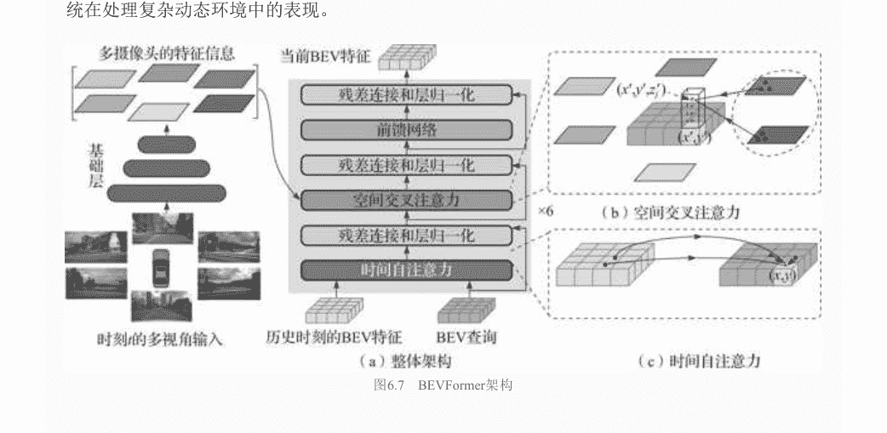

### 6.3.4 感知任务

自动驾驶的感知由TrackFormer与MapFormer共同完成。TrackFormer检测并跟踪动态实体，包括车辆、行人、自行车、摩托车等关键交通参与者。通过两类查询实现：检测查询用于首次出现的实体识别，跟踪查询用于对已检测实体做跨帧建模确保持续跟踪。

每帧中检测查询与跟踪查询均与BEV特征交互捕捉代理抽象特征。随着场景演变，当前帧跟踪查询与前帧查询在自注意力中交互聚合时序信息，保持实体跟踪连续性，直至实体在若干帧内消失。TrackFormer经N层堆叠Transformer后生成有效实体表征，供下游预测使用。

TrackFormer还引入专门的自身车辆查询，以明确建模车辆自身状态，确保后续规划中车辆与环境的相互关系被充分考虑。

MapFormer负责道路元素如车道、分隔带、交叉口等的语义分割与地图构建。借助地图查询从BEV特征提取道路结构语义信息，实现全景分割，将BEV视图划分为车道、分隔带等，辅助系统理解车道用于行驶、分隔带用于区分流向等基础属性。

MapFormer基于2D全景分割，使用稀疏地图查询表征道路元素并经多层Transformer优化。每层输出在监督下训练，最终层更新查询传递给MotionFormer用于代理与地图交互。处理时车道、交叉口等有明确边界的元素会被单独识别计数，而可行驶区则作为无固定边界的背景。

TrackFormer与MapFormer协同，使系统能准确感知动态实体与静态道路结构，为运动预测与规划提供高质量输入。

### 6.3.5 预测任务

MotionFormer和OccFormer以分层结构分别解决代理运动预测与占用预测。MotionFormer利用代理间、代理与环境、代理与目标的交互生成精确轨迹预测；OccFormer通过时序处理预测未来占用状态。二者共同为自动驾驶提供环境理解与动态预测能力。

MotionFormer专门处理运动预测，通过分析车辆、行人等代理动态行为预测未来轨迹。由多个Transformer层构成，每层处理三种交互：

- 1. 代理-代理交互。关注不同代理间相互影响，如车辆因行人或他车避让减速，对理解交通动态至关重要。
- 2. 代理-地图交互。处理代理与道路布局、交通标志、障碍物等静态元素的互动，地图查询提供关键位置信息。
- 3. 代理-目标交互。关注代理向目标点的移动，是路径规划的关键。

如图6.8所示，MotionFormer依赖多层交互模块。代理-代理与代理-地图交互通过多头自注意力和多头交叉注意力实现时空信息聚合；代理-目标交互经可变交叉注意力处理。每层查询上下文经注意力与前馈网络不断更新，最终输出每个代理的运动轨迹预测与置信度。图6.8输入包括：I^s为场景级锚点位置，I^a为物体级锚点位置，x_0为物体当前位置，x^{t-1}为前一层目标位置，Q^{t-1}为前一层查询上下文。


图6.8 MotionFormer的网络结构

OccFormer处理占用网格图预测，目标是预测未来场景空间占用情况。占用网格图为鸟瞰表示，每个单元指示是否被物体占用。模型融合代理级与场景级信息，同时处理代理动态与场景状态。

工作机制基于一系列序列块，每个块依次处理连续时间帧逐步预测。块内先预处理降低计算复杂度，再用自注意力提取关键特征捕捉动态变化。交叉注意力结合局部场景特征与代理位置，帮助理解代理与环境交互。特征重构后经解码器生成占用图，预测未来时间步空间占用以识别潜在风险区。

多个序列块按时间排列形成层级预测，每个块输出既供下一块使用，也参与整体占用预测，提升对复杂时序数据的处理能力。

### 6.3.6 规划任务

如图6.9所示，UniAD整合多源输入生成最终驾驶决策。其中Q_A^{ego}与Q_{ctx}^{ego}分别来自跟踪与运动预测模块，包含车辆当前位置、速度及可能运动路径等自身关键信息，对理解当前状态与未来行为至关重要。命令嵌入表示高级驾驶指令如“左转”“右转”，提供驾驶意图上下文。指令、车辆状态与环境信息经多层感知器MLP编码并通过最大池化Maxpooling提取聚合最显著模态特征，抑制干扰。

随后输入送入BEV特征交互模块，BEV特征由多视角数据提取并经堆叠Transformer解码器处理。每层解码器通过自注意力和交叉注意力细化强化输入，突出与自身相关的环境特征表示，实现多视角多时空特征中的关键信息捕捉。

最后系统生成初始规划轨迹τ，并经碰撞优化器优化。优化器考虑潜在障碍与碰撞风险，确保路径安全可行。最终优化轨迹τ*提升规划精度并最大化降低执行风险。


图6.9 规划部分网络架构

### 6.3.7 多任务的分步训练

UniAD 把若干子任务绑在同一套框架里，恰好映射出人类在导航时依赖的先验直觉。传统分层方案习惯给每种任务配一个独立网络，单看各部分都能调到不错，但模块间信息传递受限，经常出现信息流失和误差叠加。UniAD 转向端到端思路，把各任务的优化方向都收敛到运动规划上，并采用分步训练的策略，兼顾收敛效率与整体表现。

起步时先加载预训练的 BEVFormer 参数，并在全程中冻结。首轮训练只聚焦感知，让 TrackFormer 与 MapFormer 先稳定下来。这一轮要让模型可靠地检出并跟踪车辆、行人等动静目标，同时对车道线、标志等道路要素做精细的语义刻画。效果好坏直接受图像特征与 BEV 表征质量影响。本轮里 MotionFormer、OccFormer、Planner 等部件的参数保持不动。第二轮把感知、运动预测、占用预测和规划全部放开联合优化，经过前序稳定化的感知能够为后续环节提供更干净的输入，让系统在复杂工况下更稳。

把感知与动作预测、规划拆开来训，可以大幅削弱感知噪声的连锁影响。一旦定位不准，后续路线决策必然受拖累。分步策略先把感知的精度做牢，避免误差在整条链路上扩散，从而拉升整体水平。这种做法既保住了效果，也兼顾了训练成本：首轮集中打磨关键感知，第二轮在输入质量可控的前提下做全系统协同，让落地表现更顺滑。

### 6.3.8 特斯拉 FSD 的多任务架构
特斯拉全自动驾驶与 UniAD 思路相近，都是多任务端到端，但更强调多视角融合和时间维度的语义整合，整体更接近多模态大模型的设计，因而在复杂交通里更准更适应。

如图 6.10，FSD 的占用网络在完成图像特征抽取后交由 Transformer 处理。特征映射时用 MLP 产生 Key、Value，同时借助 BEV 坐标系下的栅格位置编码产生 Query。不同于传统二维栅格，FSD 增加高度维度形成三维栅格，以得到更精细的占用表征。主要特点如下。

- 1. 原始光子计数输入。FSD 直接使用未经 ISP 处理的光子计数图，在弱光下仍能获得超出人眼极限的感知。
- 2. 时序对齐。依赖里程计把上一时刻的占用特征做时序拼接，并用透明度调节不同时刻的权重，在通道上融合。


- 3）亚像素几何输出。占用网络不仅输出三维栅格，还基于 Query 产生亚像素级的几何与语义信息。该做法借鉴了 NeRF 的变分辨率聚焦，提升了对空间细节的捕捉力。

另外，FSD 在全自动驾驶体系里加入了高级语义理解模块，如图 6.11 所示，系统融合低精度地图与视觉信息，对车道线及其几何拓扑做精确定位，涵盖车道数、宽度、拓扑类型以及分叉、合流等关键属性。这些信息经 Dense World Tensor 编码后，供 Vector Lane 模块继续处理。


Vector Lane 采用类似语言模型的向量空间编码，如图 6.11 所示，它把车道线的节点、起点/终点、分叉点、样条参数等编码成 token 序列，以类语言的方式处理。整体流程与 Transformer 解码器相仿，先自注意力处理车道 token，再在交叉注意力中生成查询，结合向量空间的 Key、Value 产生新 token。

该体系能够实时读懂复杂路口的道路拓扑，并随自车视角与环境变化即时调整关系。这种实时感知能力对路径规划与对他车行为的预判至关重要。

### 6.3.9 具身任务迁移
具身机器人的规划复杂度远高于自动驾驶，既要导航，也要精细控制末端执行器如机械臂或夹具。对 Optimus 而言，特斯拉把 FSD 的导航技术直接搬用，而末端动作则依赖类似的多任务轨迹生成方法。

如图 6.12，Optimus 通过多视角摄像头构建环境的立体占用图，这对复杂场景下的机动至关重要。自动驾驶里积累的神经网络与视觉技术被改造迁移到机器人平台，用来处理室内动作规划。因为室内与开放道路差异大，需要重新采集并训练适配室内的数据，让机器人在无 GPS 条件下仍能精确定位。

为提升室内定位，研发了特征点追踪网络，利用高频特征点在无 GPS 环境下锁定位置。FSD 的占用网络技术被用来生成导航路径并挑选期望行进路线。

对双足机器人来说，仅有路线不够，还需准确掌握自身物理属性如腿长、质心分布，以算出精确运动轨迹。步态设计追求在保证速度稳定的同时降低能耗。平衡是运动的核心难题，尤其在不平或动态地面上。机器人借助自身运动学与动力学模型生成参考轨迹，定义步态、重心移动与躯干调节细节，以维持稳定与动态平衡。


图 6.12 Optimus 机器人构建三维环境的占用图

借助仿真，特斯拉能在虚拟环境中优化步态、关节解锁与平衡控制。机器人要实时处理大量环境输入并灵活应对未知变化。集成高效算力与先进传感，让响应更快。

把自动驾驶技术搬到人形平台，关键在于技术整合能力与环境理解深度，这让跨平台迁移更高效。

### 6.3.10 端到端架构的利弊
多任务端到端通过直接处理输入到输出的完整链路，避免了模块化常见的信息丢失与误差累积。整合多个目标后，信息流更通畅，整体性能提升。对比传统分层，响应更快、实时性更强，因为省去了中间传递。配合设计与训练创新的话，还能更好地注入人类先验，使模型更贴合实际需求。

局限也明显。首先，设计时要同时兼顾多个任务特性与目标，网络变得更复杂。不同任务对表征与优化策略的需求不同，系统需要在各任务间权衡，设计不当会造成某些任务退化甚至任务干扰，尤其当目标冲突时。

其次，表现高度依赖网络结构，不同结构在不同任务上差异显著，需要精细调优。处理多任务通常更耗算力与存储，在资源受限场景下会成为瓶颈。

演进方向更多指向能处理多任务、多模态的统一模型，共享底层表征后执行分类、检测、生成等不同类型任务，减少重复建模成本并提升泛化。如 GPT-4、PaLM-E 等大模型可同时处理语言、图像、推理等任务。由此推断，端到端具身大模型也将朝多任务统一的方向发展。

## 第7章 具身智能记忆
在以大模型为底座的具身智能里，记忆在环境理解、决策与经验学习中起核心作用。系统靠记忆累积多模态信息并更新历史经验，实现动态适应。通过有效的记忆检索，先前的知识能被迁移到当前任务，支撑从任务级到动作级的规划。任务级规划依赖长期记忆积累，动作级规划需要短期记忆的即时反馈，二者协同让系统在多变环境中做出合理选择与调整。

## 7.1 人类记忆
人类记忆是支持复杂行为与决策的核心认知能力，演化出来以应对多样环境。对记忆系统的研究为人工智能记忆机制提供了理论基础。如图 7.1，按持续时间可分为感官记忆、工作记忆与长期记忆。

感官记忆是信息处理的入口，负责对视觉、听觉等感官输入做短暂保存。容量大但保持时间极短，通常几百毫秒到数秒。大部分信息迅速消失，但为后续处理提供原始素材。例如过马路时，视觉感官记忆能快速捕捉车流，为是否通过提供依据。


图 7.1 人类的记忆系统分类

工作记忆又称短期记忆，能临时保存并加工信息。如图 7.1，它介于感官记忆与长期记忆之间，不仅保存当前信息，还在认知任务中与长期记忆交互整合已有知识。它在学习、推理、理解与决策中必不可少，但容量有限，通常只能保持数秒，除非通过复述等策略维持。它不仅是暂存区，也是信息整合、排序与更新的动态平台。

长期记忆可维持数天到数十年，进一步分为内隐记忆即程序性记忆与外显记忆即可述记忆。内隐记忆存储可自动化的技能与习惯，如骑车、打字，多经练习形成。外显记忆可被有意识提取并描述，可分语义记忆与情节记忆。语义记忆存放通用世界知识，如“巴黎是法国首都”；情节记忆关联个人经历的具体事件，涉及时间与地点，如回忆在巴黎度假的细节。

长期记忆是知识与经验的库，在决策中发挥关键作用。如医生诊断依赖医学知识与临床经验。依据图 7.1，工作记忆与长期记忆双向交互，工作记忆既处理当下任务，也调取长期记忆增强效果；长期记忆的形成也依赖工作记忆的处理与编码。

深入剖析人类记忆结构，为大模型记忆设计提供了借鉴。机制不仅要实现短时或长时保存，还要在不同记忆系统间实现有效协同，以提升推理、决策与任务规划的表现。

## 7.2 大模型的记忆机制

### 7.2.1 参数即记忆
在大模型里，所谓的长期记忆可视为沉淀在亿万参数中的知识。这些知识通过预训练或微调积累，隐含在权重里。这种隐含知识类似人类的语义记忆，为模型理解与生成提供事实与规则基础。

情景记忆则体现在模型对特定上下文的依赖。通过注意力机制，如图 7.2 左侧的热力矩阵所示，模型在生成时参考当前上下文，模拟对场景的记忆调用。该机制让跨段对话与多轮推理保持语义连贯，类似人类情景记忆的特性。

研究表明，给模型提供详细具体上下文时，会激活更复杂的推理模式，展现出类因果推断与心智模拟的能力，与程序性记忆相似，但内在机制与大脑并不完全一致。如图 7.2 右侧依赖树所示，大模型主要依赖图结构的注意力处理上下文依赖并做因果推理，而非类似人脑的神经机制。

尽管参数记忆能存大量知识并通过注意力调用，仍有挑战。首先，参数记忆隐式，模型无法像人一样清晰调用特定知识。预训练把知识编码到权重而非显式记录，需借助上下文激活相关知识。这种隐式方式让模型对新任务适应性较差，面对特定领域或陌生上下文时可能调不动合适知识。


图 7.2 注意力热力矩阵和依赖关系表示

其次，图 7.2 的热力矩阵虽展示动态处理上下文的能力，但仍受参数限制。上下文不足或不完整时，模型可能生成错误结果。因为记忆不像人类情景记忆那样灵活，而是依赖隐式存储，难以在全新情境下自适应。

另外，右侧依赖关系图展示模型在推理中通过依赖树处理上下文。然而该推理也依赖预训练学到的语法与语义结构，无法真正模拟人类通过程序性记忆学会的技能。如人类掌握复杂技能时程序性记忆能快速适应变化，而大模型参数记忆更固定，需大量新数据才能类比适应。

深入研究注意力与参数记忆可见，尽管在某些任务上与人类记忆相似，本质仍是静态参数存储与动态注意力的结合。学界尚未完全解决对复杂任务的自适应问题，未来可探索更多层次的外部记忆或增强型注意力，提升多样化任务表现。这也包括通过限制上下文范围或模块化设计，测试模型在特定条件下是否能展现类人记忆的灵活性与推理能力。

### 7.2.2 上下文与工作记忆
在大模型里，工作记忆可类比为处理的上下文窗口。如图 7.3，以 GPT-4 为例，其窗口约 4096 个 token。英文里 token 多为词或词段，处理汉字时一个 token 可能对应一个字。因此一次可处理的上下文约 4096 个字，相当于数页文本，模型可在一次对话或生成中“回想”并参考这些内容进行推理。


人类工作记忆不仅暂存，还能排序、整合、关联与更新。模型窗口虽无同等动态加工能力，但可通过 prompt 设计与上下文管理优化推理。设计旨在选择性提供关键信息，让模型聚焦任务相关内容，类似人解决问题时优先回忆相关信息。把相关信息按逻辑顺序组织在上下文中，有助于信息整合与推理。例如在对话或长文本生成中，随着对话深入，更新窗口以纳入最新信息至关重要，让模型基于近期内容响应，保持话题连贯与逻辑。有效的 prompt 还引导模型把新输入与已有上下文关联整合，拓展推理深度与广度。

实际应用中，优化 prompt 与上下文可显著提升表现，增强信息处理的准确性与相关性。合理的上下文帮助模型适应复杂对话流与多变信息需求。如在客服或长篇生成任务中，精心设计的 prompt 与上下文可帮助模型在不同任务间切换，保持连贯一致。然而，如何有效操控大模型工作记忆，特别是在长对话或复杂任务中保持逻辑并适应多样化信息，仍是关键技术挑战。

### 7.2.3 外部记忆
大模型与人脑记忆机制差异明显。模型依赖预训练获取长期记忆，过程耗算力，且部署后更新内部记忆面临经济与技术难题。因此用外部存储补充或替代内部长期记忆成为主流做法，尤其在语义记忆场景。该方法降低成本同时提升灵活与准确。

按认知科学，记忆过程通常分编码、存储、检索三阶段，类似流水线把外部刺激转化为可保存与回忆的模式。大模型的外部存储设计也需模拟这一过程，通过有效编码、存储与检索实现类人功能。

检索增强生成 RAG 是一种典型策略。如图 7.4所示，该技术在生成时引入外部知识库，让模型访问参数之外的信息，弥补内部长期记忆不足。核心是模型在生成响应前，先生成查询从外部库如维基百科、数据库、文档库检索相关信息，再把检索结果整合进生成上下文，作为额外数据帮助给出更准确、时效更强的回答。


图 7.4 RAG 技术

引入外部知识库后，模型能应对更广问题，并显著减少因训练数据不足导致的幻觉，即生成不准确或虚假信息。外部库还能动态更新，让模型无需重训即可获取最新信息，如新闻、科学发现等，特别适合快速变化领域。

外部记忆不仅弥补长期记忆更新的局限，也让模型在实际应用中更灵活准确。通过持续改进存储与检索机制，模型能更好地模拟人类记忆的编码、存储与检索过程，为复杂生成任务提供更丰富的知识支撑。

## 7.3 具身智能系统中的记忆机制实现

在具身智能里，记忆不是可有可无的附加功能，而是支撑任务级和动作级规划的底座。人类靠记忆来推理和决策，机器人也一样，在大模型驱动的具身系统中，记忆模块几乎决定了规划能不能跑通。

### 7.3.1 记忆从哪来
具身智能能用的记忆大致分两类，一类是在与环境交互中实时产生的，一类是来自外部知识库的现成储备。两者互补，共同为推理和决策提供依据。

LLM-Brain [注] 的整体架构如图7.5所示。视觉侧由一个 VLM 负责，它接收来自传感器的自我中心视频帧，把图像信息转成自然语言描述，为后续规划提供语义基础。换句话说，系统先用语言把“看见的东西”说清楚。


图7.5 LLM-Brain具身智能系统的架构

系统里的 Nerve 模块是一个 LLM，专门做记忆加工。它会主动向 VLM 发问，围绕上下文深挖视觉信息里藏的关键要素，让理解更到位。在环境快速变化时，Nerve 能抓住重点并持续跟踪任务需求。同时它把每次交互的对话和观察汇总成对当前环境的详细描述，再加工成内部长期记忆存下来，供以后调用。

指令到来时，Nerve 会先从长期记忆里检索相关内容，生成推理和规划用的 prompt。随后 Brain 模块也就是负责决策的 LLM 接手，结合 Nerve 提供的内部记忆，再灵活接入外部知识来做判断。

外部知识的调用是为了补齐记忆的时效性。系统可以通过知识库或工具 API 实时拉取最新信息，解决模型内部记忆更新滞后问题。这种内外结合的方式，既能完成特定场景下的复杂推理，也能借助不断扩大的知识库提供更丰富准确的决策支持。

### 7.3.2 存全量记忆会遇到什么坑
VLM 已经把视觉信号压成文本，但要不要把所有交互历史都存下来，仍是关键问题。全量保存看似信息完整，实际上计算成本、推理耗时和鲁棒性都会吃不消。

把全部记忆塞进 LLM 当长上下文，注意力计算会随序列长度平方增长，算力需求和延迟飙升，部署困难。更麻烦的是，序列长度容易超过预训练上限，被迫截断导致信息丢失，记忆完整性受损。

长文本里不同位置的信息被利用程度也不均，处理不稳定容易产生偏差。简单把所有历史直接拼进提示词，显然不是最优解。具身智能的大模型记忆需要更精细的设计。

目前主流的缓解思路有三条：基于 RAG 的外部记忆、大模型参数微调、参数编辑。它们的核心都是优化记忆的存取方式，提升效率和稳定性。

### 7.3.3 RAG 外部记忆怎么用
RAG 外部记忆是保存和调用系统过往经验的常用手段，常用于任务级或动作级规划。它在规划时从外部存储里找出与当前任务情境相关的历史信息来辅助决策。

记忆可以存成文本、表格、知识图谱等多种形式。文本记忆类似人类日常经验，按相关性检索。常见做法是用文本编码模型把每条记忆向量化，再借助 FAISS 这类索引结构，以当前状态描述为查询在记忆池里找相似项。

不同方案在更新和检索上的差别很大。借用多级存储的类比，LLM 上下文像 RAM，外部存储像磁盘。推理时模型可以自主决定何时去取历史记忆，或把当前上下文写回外部存储。也有研究把历史经验存成 Q 值表，每条记录是环境、任务、动作、Q 值的四元组。检索时同时拉取正负样本，让模型基于相似环境和任务生成更优规划，既能学成功经验，也能避开失败坑。

RAG 的难点在于外部存储中的长距离依赖，尤其是难以显式表达的语义和情感线索。决策时能否做出类人直觉判断，也是研究热点。微软提出的 Graph RAG 用图结构做语义聚类来优化检索增强生成。

如图7.6所示，Graph RAG 先构建嵌入式知识图谱，把实体和关系结构化，再用自下而上的聚类算法按语义相似性分层组织。结构化存储有助于捕捉长距离依赖，语义聚类则能从复杂图谱和文本块中挑出任务关键信息。


借助语义聚类与知识图谱，Graph RAG 在构造与 LLM 交互的 Prompt 时，能更好地利用长距离依赖，模拟人类工作记忆。在多项基线任务中，图结构的聚类方式显著提升了推理精度和决策效率，为具身智能的记忆管理提供了有效解法。

### 7.3.4 微调和参数编辑各有什么戏路
把历史经验通过微调写进大模型参数，是提升规划能力的直接路径。样本来自真实交互，包含环境常识、任务先验、成功失败案例。微调后模型能记住规划相关的规律，并在新任务上泛化。比如用真实行动轨迹做下一个 token 预测，或把任务计划轨迹整理成对话做微调，都能带来明显提升。

直接全量训练成本高，参数高效微调 PEFT 如 LoRA、QLoRA、P-调整 显著降低了算力开销，加快训练。

另一种思路是参数编辑。它不像微调那样从数据里学模式，而是精准改动需要更新的特定事实，其他知识基本不受影响。适合小规模、在线的记忆调整，计算开销小，也能缓解灾难性遗忘。

如图7.7所示，参数编辑主要用于修正模型里不准确或过时的知识。输入查询 “人类是否能解决蛋白质折叠问题？” 模型先抽出旧知识 “难以解决”，编辑模块把它替换为 “基本解决”，且只影响这一知识点，不干扰其他相关内容。知识通过编辑模块注入参数后，推理时就能用到最新校正信息。

参数编辑高效精准，适合实时在线更新。但在复杂多层次的知识修改上，效果往往不及微调，且依赖精确的知识定位。实际使用中，微调与编辑常相辅相成，按场景选择。


### 7.4 记忆在具身智能里起什么作用

#### 7.4.1 记忆让机器人更省心
引入记忆后，机器人可以快速存取历史观察、行动结果和环境交互记录。遇到相似情境时直接调用，而不是重复扫描。长期记忆保存策略、规则和经验，短期记忆负责即时响应和微调，两者配合保证任务决策的连续性。

历史数据还能用来预测后续事件，优化路径规避障碍。随着使用，系统不断学习更新，行为模式和决策质量持续提升。

基于大模型的系统里，长期记忆主要靠训练时固定的参数承载。随着任务复杂度上升，纯靠参数存储会带来计算负担，也缺乏动态灵活性。

外部记忆是个有效的补充。它降低存储成本，增强适应性，机器人可随时从外部知识库或存储空间查询相关环境信息，无需频繁改动内部参数。这样实时响应更强，计算压力更小。

外部记忆尤其适合环境动态变化、信息时效性要求高的场景。需要时增删过时信息，无需大规模微调或参数编辑。总体上它能以更低成本提供最新环境信息，支撑灵活决策。只不过如何针对具身记忆的特征、传感器数据类型和维度设计有效的 Prompt，提升大模型的规划性能，仍是开放问题。

#### 7.4.2 技能怎么学和迁移
人类的程序性记忆负责行走、游泳、骑车等技能，是后天习得的，需要大脑、小脑、脊髓等协同，先天协调能力提供基础。

在具身智能里，动作级规划能力可类比人类运动功能。平衡、协调等基础运动能力通常靠预训练或微调获得，而像人类程序性记忆那样通过非训练手段实现技能应用，是研究焦点。

程序性记忆的优势是泛化，学会后能在不同环境下灵活使用。具身智能也需要这种能力。技能被定义为在特定环境和上下文中为达成目标而执行的一系列动作。图7.8展示了大模型控制的智能体在 “我的世界” 中抽象出的高层技能，基于内部知识并实时调整应对变化。


图7.8 智能体在“我的世界”游戏中的高层次技能

具身技能要具备环境适应性，能即时调整应对新挑战；具备组合性，复杂技能由多个子动作构成，如抓取需识别、定位、规划、操作协同；要兼顾资源优化，合理选择技能组合节省时间、能量和算力；最后要有泛化能力，学到的抓取技能应能适用于不同物体形状和位置。

外部记忆能增强技能泛化，通过灵活存储和动态检索让系统在需要时调取过往经验，无需频繁更新模型内部，实现复杂动态环境下的快速响应与调整。

## 第8章 让决策更靠谱
在任务规划和决策中，如何挑选和优化方案是智能系统的核心能力。大模型语义能力强，但在需要精确规划和逻辑推理的任务上仍有短板。结合多计划选择、反思提炼和外部规划器等策略，能显著提升执行效率。本章聚焦决策优化的几个关键手段。

### 8.1 别只押一个计划
具身任务复杂且大模型生成存在不确定性，单一条计划往往不够稳妥。采用多计划选择策略，先生成若干可行方案，再从中挑最优解，能有效降低风险。

### 8.1.1 先把备选方案摊开
多计划生成为复杂问题提供候选集合，而不是一条路径。核心思路是通过解码多样性机制提升生成计划的多样性。复杂问题的解通常不唯一，多个备选让系统在导航、避障等场景中能根据实时环境选最合适的路线，提升鲁棒性。

如图8.1所示，思维树 Tree of Thought 通过自上而下的分支和回溯机制生成多条解路径。与单一的 Chain of Thought 相比，ToT 使用温度采样、top-k 采样等策略保证推理分支多样。层次化结构增强了创造性和适应性，但也增加了设计和管理复杂度。

思维图 Graph of Thought 则用二维节点和连接关系构建推理网络，允许动态调整节点和路径，灵活性更高。但路径容易分散，一致性和清晰度需要额外控制，计算资源和优化算法的要求也更高。


### 8.1.2 最优计划选择

當需要從眾多備選方案裡挑出最合適的那一個時，往往會組合使用多種啟发式搜索手段，對候選計畫進行篩選。這些手段依托明確的規則或演算法，對不同方案的成效和可實現性展開評估與對比。

在自主推理場景裡，比較常見的做法是多數表決。做法是讓多個評估模型或決策者共同審視每個備選方案，投出支持票，最終票數最高的方案被視為最優。這套機制借力群體智慧，假設彙總多方意見能提升決策合理性。不過單純依賴票數多寡，容易忽略方案本身品質的細微差異，尤其當決策者的知識背景或偏見不一致時弊端更明顯。

為了彌補這個缺陷，更精細的啟发式搜索手段被廣泛採用，比如加權投票、專家打分，或是融合機器學習的動態評估機制。它們可以根據任務類型和環境條件靈活調整權重與參數，從而給出更精準、更具適應性的結果。

思維樹的層級結構天然契合經典的樹搜索演算法，像是廣度優先搜索 BFS 與深度優先搜索 DFS。借助這些演算法，思維樹能有條不紊地探索產生的推理路徑，挑選並擴展最有潛力的推理節點。在擴展節點時，思維樹會調用 LLM 來評估候選動作。模型透過預測動作的潛在影響，或計算其與目標狀態的相關度，來判斷動作優劣。

在此基礎上，系統會優先挑選最有可能達成預期結果的動作來擴展節點。為了進一步提升選擇效率與準確性，還可以引入啟发式搜索方法，例如用啟發函數估算節點到目標的距離，或使用成本函數衡量行動代價。這種做法不僅依賴 LLM 的原始評分，還融合了問題領域知識與優化策略，讓搜索更智能、更具目標導向。

思維圖的網絡結構以更靈活的節點連接關係，支援包括蒙特卡洛樹搜索 MCTS 在內的各類搜索演算法。面對選項眾多的複雜推理問題時，MCTS 尤其有效。它透過反覆模擬來估算節點價值，並以此指導決策。

與思維樹相比，思維圖允許節點之間形成更複雜的連通網絡，為 MCTS 提供了更大的靈活性。在這種複雜網絡中，MCTS 能透過多輪模擬累積節點價值資訊，從而鎖定最優的推理路徑。

部分研究還嘗試把經典的 A* 搜索演算法與 LLM 結合，以優化推理路徑。A* 依賴啟发式成本函數來估算當前節點到目標節點的最短距離。例如在多維網格模型中，切比雪夫距離是一種常用的距離估計手段，適用於評估節點間的最大差異距離。

為了讓搜索更高效精準，可以結合思維圖的圖結構特性與 LLM 的語義理解能力，設計更複雜的成本函數與評估標準。這不僅能考慮空間距離，還可涵蓋語義相似度、推理連貫性等維度，從而支撐更全面、更精確的決策。

## 8.2 反思提煉與優化

在具身任務規劃領域，反思與提煉是一種透過反饋循環來優化決策演算法的重要策略。這個過程讓 LLM 能從過往失誤中學習，降低再次出錯的機率，提升任務執行效率與準確度。

### 8.2.1 反思提煉的運行流程

由於 LLM 受限于訓練數據代表性與推理複雜度，在面對複雜或未知環境時，常出現「幻覺」問題，即輸出與現實脫節。此外，當缺乏有效反饋時，模型容易陷入「思維循環」，反覆產生無效或同質化的解法。例如機器人在導航任務中不斷撞到障礙，反思機制有助於定位感知系統缺陷，如障礙識別不足，或決策系統不足，如避障策略不當。提煉階段則可透過調整感知演算法或修改路徑規劃邏輯，避免類似錯誤重演。

反思的核心是回顧已完成任務中的關鍵成敗，找出決策失誤與成功因素。提煉則在反思結論基礎上，調整模型的推理邏輯或行為策略，提升後續執行效果。如圖8.2所示，整個流程通常分為生成、反饋、提煉三個階段。


- 1. 生成阶段。在這個階段，LLM 依據當前指令產生初步的任務計畫或行動方案。重點是借助模型的推理能力，提出多種可能性。
- 2. 反馈阶段。在生成初步方案後，模型會透過外部或內建評估機制獲取反饋資訊。這些反饋可來自人類專家審查、其他系統校驗或其他大模型的比較分析。目的在於判斷產生的計畫或策略是否合理、有效且符合任務目標。
- 3. 提炼阶段。根據反饋資訊，LLM 會調整其推理參數或決策邏輯，糾正錯誤並優化未來的任務計畫。這個過程不僅強化了容錯能力，也提升了面對複雜環境時的自適應性。

在這個流程中，外部知識庫或搜索引擎等第三方評估機制扮演關鍵角色。例如當 LLM 解釋歷史事件時，反饋階段可以利用線上百科或專業資料庫驗證資訊準確性。一旦外部驗證發現事實錯誤，模型就會獲取正確資訊進行修正。這不僅是簡單改正，還可能涉及更新知識庫或調整對類似問題的推理策略。

此外，在某些領域，人類先驗演算法也能起到輔助作用。它們可以有效規劃特定任務，或為模型提供初步驗證與引導。兩者結合能大幅提升 LLM 在複雜任務中的執行力與決策精度。

### 8.2.2 多角色协作模式

在不同階段，通常會引入多個大模型實例擔任生成、驗證、提煉等不同角色，以提升決策準確性與系統穩健性。多角色機制核心在於使用多個獨立實體，每個實體在其上下文與歷史記錄中獨立運作，避免角色間干擾或上下文污染。

每個角色基於各自獨特的上下文進行推理，這種獨立性確保了思考不受其他角色影響。例如處理複雜問題時，不同模型實例可能依賴各自的訓練數據或領域專長，產生不同的解決方案。這不僅保持推理純淨，也強化特定任務的專注與適應能力。

再者，由於不同角色具備特定的訓練背景或數據來源，它們在某些問題類型上可能擁有更深理解或更優解法。透過協作，能整合多領域知識與視角，為複雜問題提供更全面的方案。尤其當某個角色出現偏差時，其他角色的獨立推理可作為糾錯機制，降低單一角色誤判風險。

實務上，不同角色的輸出可進行比對與分析，透過協作與交叉驗證，系統能更輕鬆識別並修正錯誤，顯著提升決策準確度。多角色機制在環境變化或任務不確定性下展現出優異適應與穩健性。各角色的獨立處理能力使系統能靈活應對複雜情境，依任務需求作出最優反應。對於複雜多變或高風險任務，多個獨立角色的協作能有效降低決策失誤，並增強系統應對能力。

### 8.2.3 现存的不足

反思與提煉策略在某些層面與強化學習相似，尤其在利用環境反饋引導學習與決策方面。在此策略中，多個大模型實例扮演類似強化學習中策略網絡的決策者角色，而環境反饋則作為觸發學習與策略更新的驅動。這些模型透過分析任務輸出與收到的反饋，不斷調整回應，類似強化學習中基於獎勵或懲罰調整行為的過程。

然而，與傳統強化學習不同，傳統模型通常透過更新參數如權重來實現學習與優化，而 LLM 的反思與提煉過程不一定涉及直接參數調整。相反，LLM 依賴自我反思機制進行更新，該機制常透過生成反思文本來評估先前行動並提供改進建議。這些反思文本可視為一種「記憶」，能短期或長期嵌入模型的提示中，進而影響未來任務規劃與回應行為。

儘管基於文本反饋的機制提供了靈活性，讓模型能動態調整，但仍存在局限。首先，自我反思並不總是有收斂保證。傳統強化學習的更新透過數學推導確保逐步收斂至最優策略，而文本反饋無法確保模型最終收斂到最優解。反思效果高度依賴反饋質量與相關性，並非每次反思都能提供有效改進方向，這可能導致模型陷入局部最優，或在多次迭代中無法持續優化。

其次，文本反饋雖能在短期內調整行為，但作為長期記憶的持久性與可靠性仍有限。模型在不同任務間能否有效調用或保持這些反思經驗仍具挑戰。尤其是任務環境大幅變化時，先前反思可能失去相關性，甚至產生誤導。因此，雖然反思與提煉提供了一種動態靈活的更新機制，但在收斂性與長效性保障方面仍不足，限制了其在複雜任務中的應用效果。

總之，反思與提煉為模型動態調整提供了新思路，但目前無法保證反思過程的持續優化效果。未來研究需要在提升反思機制的可靠性、持久性與收斂性方面取得更大突破，以確保其在複雜任務中更廣泛有效。

## 8.3 外接規劃器

LLM 在自然語言處理與語義推理方面表現優異，但在需要精確邏輯與複雜約束的任務中，如數學求解或具身動作規劃，性能可能受限。將 LLM 與外部規劃器集成，可在保留強大語義處理能力的同時克服複雜約束的困難。外部規劃器主要分為符號規劃器與神經網絡規劃器。

### 8.3.1 符号式规划器

符號規劃器基於傳統符號邏輯與規則引擎，能精確處理邏輯運算並遵循嚴格規則約束。與 LLM 集成後，符號規劃器可補足 LLM 在精確邏輯推理方面的不足，提升其在複雜任務中的表現。這種組合特別適合需要嚴格邏輯推理的任務，如自動規劃與具身任務執行。

例如圖8.3展示了 PDDL 任務規劃器與 LLM 的集成流程。首先，PDDL 規劃器基於輸入的領域描述與問題狀態，生成一系列可執行的動作序列。該序列提供了任務規劃框架，指引模型在複雜環境中的行動。

知識存儲模塊在此架構中扮演中心樞紐，存儲來自運動規劃器的環境信息，並維護任務狀態與環境同步。運動規劃器透過自然語言理解場景，並將環境信息提供給知識存儲模塊。其存在確保 PDDL 規劃器能根據環境變化動態調整。

在具身任務中，運動規劃器根據任務規劃器提供的動作序列執行實際任務。例如在機器人操作中，運動規劃器處理機器人在複雜環境中的運動路徑，同時透過場景理解模塊動態更新環境信息。LLM 透過自然語言理解提供高層任務指令，而符號規劃器則確保這些指令轉化為精確的動作步驟，並執行複雜的邏輯約束。兩者集成特別適用於以下場景：

- 複雜約束與邏輯問題。當任務包含多個複雜約束或邏輯規則時，符號規劃器確保所有規則嚴格遵守。例如在機器人手術輔助系統中，符號規劃器可確保機器人遵循手術流程與無菌操作規範，而 LLM 負責與醫療團隊進行自然語言互動。
- 精確邏輯推理。符號規劃器在需要高精度的任務中表現出色。例如在電子芯片製造或航空部件裝配中，每一步操作精度至關重要，符號規劃器確保機器人動作達到工業標準，而 LLM 可處理非結構化對話或數據解釋。
- 高度結構化的環境。在高度結構化且可預見的任務場景中，如機器人路徑規劃或航空交通管理，符號規劃器能有效優化解決方案，並確保計畫可行性與效率。
- 動態交互環境。在環境變化迅速、需即時調整的任務中，結合 LLM 的語義理解與符號規劃器的響應能力，可有效應對複雜交互。如智能導航系統可透過 LLM 處理環境中的複雜語言信息，同時利用符號規劃器制定即時調整的路徑規劃。
- 長期規劃與決策支持。在需要長期規劃與複雜決策的場景中，如環境監控，符號規劃器可規劃長期步驟並優化資源配置，而 LLM 則即時處理感測器數據，解釋環境變化並提供決策支持。

LLM 與符號規劃器結合的集成方法，顯著優於單獨使用 LLM。儘管 LLM 在處理語義複雜性與非結構化數據方面表現出色，但在需要精確邏輯推理與細節操作時仍力不從心。符號規劃器的引入彌補了這一不足，確保規劃的精確性與可靠性，從而大幅提升任務解決效率與質量。結合兩者優勢，該方法能更高效地應對各種複雜任務場景。

### 8.3.2 神经网络式规划器

神經網絡規劃器是一種在大量規劃數據上學習並優化決策策略的深度學習模型。這類規劃器旨在提升 LLM 在特定領域中的規劃與決策能力。實現方式主要有兩種：強化學習與模仿學習。

在強化學習中，模型透過與環境交互學習最優策略。透過嘗試不同行動並根據反饋獎勵或懲罰調整策略，神經網絡規劃器逐步優化決策過程。此方法特別適用於具明確獎勵機制的規劃任務。

模仿學習則依賴已有高質量專家決策示例進行訓練。透過模仿專家決策過程，神經網絡規劃器可在沒有明確獎勵信號的情況下學習複雜策略，並應用於複雜任務情境。

例如圖8.4展示了一個典型的 DRRN 深度強化循環網絡策略的神經網絡規劃器，該模型將規劃過程建模為馬爾可夫決策過程 MDP，並透過交互學習最優策略，以在給定狀態下選擇最佳行動。DRRN 可與 LLM 結合作為外部規劃器使用。首先，LLM 處理輸入文本信息，利用強大的自然語言處理能力解析複雜環境描述。基於此解析，LLM 生成一組候選動作，反映可能行為策略。

隨後，DRRN 對這些候選動作進行評估與優化排序。DRRN 使用強化學習訓練得到的策略網絡評估每個動作的價值函數，計算預期回報，確保所選動作能最大化成功可能性。最終，DRRN 從排序後的動作列表中選取評分最高的動作作為最優行動。

與強化學習不同，模仿學習在具身智能中也有重要應用。模仿學習透過從專家或模擬環境收集的示例數據進行訓練，人類認知心理學中的「雙過程理論」可很好解釋此過程。該理論將規劃任務分為「慢思考」與「快思考」兩類。慢思考涉及複雜推理與理性決策，適用於新問題或複雜場景，通常需要較長時間處理多個可能結果。快思考則類似長期訓練形成的本能反應，適合常見或熟悉情境，反應速度快且高效。

例如決策變換器 DT 是一種基於 Transformer 架構的模仿學習模型，直接從人類決策行為中學習規劃策略，實現「行為克隆」。經過模仿學習訓練的 DT 能充當「快思考」角色，用於快速生成初步規劃方案。當快速生成的方案在實際執行中遇到困難時，系統會切換至「慢思考」模式。此時，LLM 則根據詳細狀態與上下文進行更深入推理與規劃，以適應新挑戰與變化。

在集成外部規劃器包括符號規劃器與神經網絡規劃器的系統中，這些規劃器通常扮演輔助角色，專注於解決特定任務。符號規劃器擅長處理具明確規則與約束的任務，而神經網絡規劃器透過強化學習與模仿學習技術解決更具動態性與複雜性的任務。

在此系統中，LLM 作為核心組件，負責解析複雜環境信息，識別何時需要調用外部規劃器進行更精確規劃。透過集成符號規劃器與神經網絡規劃器，LLM 得以在複雜任務情境中優化決策流程，結合數據驅動的預測能力與外部規劃器的專用推理優勢，提供更全面的決策支持。

## 第9章 中间件与底层库

在複雜的具身智能任務中，有效進行動作規劃與控制是實現高效智能系統的關鍵。無論是面對動態環境的即時調整，或是在多任務多約束條件下執行動作，智能系統都需要強大的動作規劃能力，以確保任務順利完成。ROS 與 MoveIt 2 等工具在機器人系統的中间件與基礎庫層面提供了高效的通信、控制與規劃機制，但在具體執行過程中，機器人仍需借助逆向運動學 IK、軌跡優化等策略來應對不確定性與物理限制帶來的挑戰。本章將從中间件與逆向運動學的基本問題入手，系統性探討 ROS、MoveIt 2 的功能，以及如何透過逆向運動庫實現高效的人形機器人任務規劃與執行，為機器人智能化提供全面的基礎設施支持框架。

## 9.1 ROS机器人中间件架构

ROS 機器人操作系统 是開源的機器人軟體開發框架，旨在簡化和加速機器人應用的開發過程。在此框架中，中間件作為核心組成部分，負責協調和管理機器人系統中不同模塊之間的通信。

### 9.1.1 ROS生态全景

ROS 系列的核心目標是提高機器人軟體的復用率，它支援廣泛的機器人應用，從教育研究到產品開發與部署。作為一個全面的框架，ROS 提供多種工具與模塊，涵蓋硬體抽象、設備驅動、通信中間件到高層開發工具與庫，支援廣泛的機器人應用開發。其模塊化設計允許開發者將複雜軟體系統分解為更小、更易管理的部分，這些部分可重用並集成到庫中以提高開發效率。圖9.1所示為ROS的生態系統。

- 中間件。中間件在 ROS 框架中被稱為「管道」，其作用是處理機器人系統中的複雜通信與協調。機器人系統通常涉及多個感測器、執行器以及複雜控制演算法，組件間需要高效數據交換與同步。ROS 透過節點與主題提供模塊化通信方式，使開發者能專注於演算法與功能實現，而無需關注底層通信與同步細節，從而提高開發效率。
- 工具集。ROS 提供一套強大的命令行與圖形工具，用於配置、啟動、調試、可視化、模擬與日誌記錄等工作。這些工具覆蓋機器人系統開發的各個環節，能對源碼管理、構建與分發進行全面支援。此外，ROS 還包含一套用於監控與管理機器人系統運行狀態的工具，提升了開發便捷性。
- 基礎庫。在機器人應用開發過程中，通常需要重複實現感測器驅動、運動控制、導航、視覺處理等功能。ROS 透過包管理系統提供大量現成庫，開發者可以直接使用或在其基礎上進行二次開發。這種功能模塊復用不僅降低開發複雜性，還大幅減少重複勞動，提高整體開發效率。
- 社區。ROS 擁有一個全球性、活躍的開源社區，開發者可在社區中分享代碼、經驗與工具，共同推動機器人技術發展。全球的研究人員與開發者透過此社區分享知識與資源，構建龐大知識庫。社區力量使 ROS 框架不斷優化與演進，快速適應技術發展與行業需求，為開發者提供強大技術支援與創新平台。

### 9.1.2 ROS 2架构

ROS 2 的架構設計基於分層模塊化設計。這種分布式模塊化設計的目標是將複雜的機器人系統分解為獨立功能模塊，並透過標準化通信接口進行管理。與其他複雜領域類似，機器人系統中的問題最適合透過分布式系統方法解決。ROS 2 系統包括設備驅動程序、感知系統、控制系統與執行器等模塊，每個模塊在運行時都有自己的執行上下文，並透過顯式通信共享數據，以確保系統的靈活性與可擴展性。

ROS2 通信分层与 MoveIt2 逆解实践

在 ROS2 的整体架构里，组件之间的信息搬运工作交给数据分发服务层来兜底，它承担中间件的职责，保证数据在网络中高效且可靠地流动。该层以非阻塞投递为特点，整体呈现事件驱动的形态，借助服务质量策略调节带宽占用与时延，在实时性与稳定性之间做权衡。图9.2 汇总了目前工程里常用的三套落地方案：eProsima Fast DDS、Eclipse Cyclone DDS、RTI Connext DDS，团队可按需求挑选合适的版本。

再往上是一层适配桥 RMW，它把上层的客户端库和底层的具体 DDS 后端连接起来。对上提供统一的通信抽象，下层的实现差异对业务不可见。更换性能表现、授权许可或平台适配时，只需替换底层实现，上层代码无需改动，这种解耦让系统具备更好的演进弹性。

再往上是语言侧的客户端库，为不同编程语言提供调用入口。C++ 侧常用 rclcpp，Python 侧常用 rclpy，两者都依托 C 语言实现的 rcl 核心，提供通用能力，从而实现跨语言互调。

最外层是用户自写的应用，借助客户端库接口完成机器人功能。ROS2 原生支持发布订阅、服务调用、动作三种分布式协同方式，单元可以跨进程、跨主机运行，甚至接入云端协同。分层把底层传输细节与上层业务逻辑剥离开，系统更易扩展维护，开发者可以聚焦功能实现。

### 9.1.3 分布式通信模式
如图9.3 所示，ROS2 的分布式协作主要围绕三种机制展开：

- 主题方式：通过主题进行非阻塞消息分发，生产方与消费方彼此解耦。
- 服务方式：同步式请求应答，形似远程过程调用。
- 动作方式：面向长时间任务的异步请求应答，支持反馈、撤销与抢占。

## 图9.3 ROS 2节点接口

### 1.主题模式
在主题方式下，生产数据的单元扮演发布方，消费数据的单元扮演订阅方。两者靠相同的名字建立关联，发布时指定一个字符串名称，订阅时使用同一名称即可接收。同一主题可有多名发布者和多名订阅者，任一方发布时所有订阅者同时收到数据，运作方式接近电气总线。

ROS2 主题具有匿名特性和严格的类型校验。匿名指订阅方收数据时不必关心发布方身份，发布订阅双方可自由替换而不影响其他部分，提升灵活性与鲁棒性。类型严格要求消息中每个字段的类型被明确定义并在各层强制执行，例如包含无符号整数 field1 与字符串 field2 的消息，系统会始终保证类型正确，从而确保数据一致性。

消息类型覆盖多种场景。标准类型如 std_msgs/String 用于通用数据；传感器类型如 sensor_msgs/Image 处理各类传感器信息；几何类型如 geometry_msgs/Point 处理几何信息；导航类型如 nav_msgs/Odometry 处理导航相关数据；开发者也可定义自定义类型，按需组合标准类型。调试时可用 ros2 topic echo 监听单元间通信，观察消息流动与系统行为。

### 2.服务模式
服务机制提供同步的请求响应方式，与远程过程调用相似。客户端单元向服务器单元发起调用，服务器执行计算后返回结果。由于客户端通常会阻塞等待，服务要求快速响应，不适用于耗时较长或需中断的任务，这类场景建议使用动作机制。

服务通过独立命名空间的服务名称标识，由服务器与客户端组成。服务器接收请求并处理，客户端发起请求并等待结果。如图9.3 所示，单元 A 与单元 B 作为客户端向单元 C 服务器发送请求。服务消息示例如图9.4，服务器接收 a 与 b 后求和返回 sum。同一服务名称下只能存在一个服务器，若出现多个则无法判定请求由谁处理，但可以有多个客户端同时向同一服务器请求。

### 3.动作模型
动作机制适用于长时间运行且需要中间反馈的任务，并支持取消与抢占。例如高级状态机通过动作接口指示导航子系统前往指定航点，执行可能持续数秒到数分钟，期间导航子系统可反馈行驶进度，并在必要时被取消或抢占。

动作通过独立命名空间的动作名称标识，由动作服务器与动作客户端组成。服务器执行过程并在进行中发送反馈，对取消与抢占请求做出响应；客户端发起请求并等待最终结果。图9.5 示意了计算斐波那契数列的动作消息。服务器接收请求后开始计算并在过程中提供反馈，最终返回完整序列。每个动作名称只能对应一个服务器，但可有任意数量客户端使用同一名称。

ROS2 的动作模型为复杂长时间任务提供了更丰富的管控手段，并在分布式系统中实现了通信与反馈的协同。

### 9.1.4 节点
节点是 ROS2 架构的基本参与者，通过客户端库与其他节点通信，可运行于同一进程、不同进程或不同计算机。作为计算单元负责特定逻辑，按通信角色可为发布方、订阅方、服务服务器、服务客户端、动作服务器或动作客户端，或其组合。

适配器节点即包装器节点，用于与机器人硬件设备交互，封装与具体硬件的通信逻辑，负责读取数据或发送控制指令。通过分布式通信机制，它可根据需求承担不同角色。例如电机适配器节点可作为发布方，定期发布 /current_speed 与 /motor_status，供监控或导航单元实时获取；也可作为订阅方订阅 /speed_command 主题，将控制指令转换为硬件操作。

适配器节点还能作为服务服务器提供同步请求响应，如提供 /stop_motor 服务供其他单元调用 stop() 函数停止电机；也能作为服务客户端发起对其他服务的请求。对长时间任务，适配器可充当动作服务器处理复杂硬件操作并提供执行反馈，例如机械臂控制单元执行精确移动并反馈进度；也可作为动作客户端发起并管理长时间任务，例如导航单元发起路径规划并接收进度更新。

### 9.1.5 参数配置
ROS2 中参数与单元生命周期绑定，单元可保存参数状态，重启后仍保持先前设置而不恢复默认值，为运行提供灵活可调性。参数用于配置行为而非描述状态，例如电机适配器单元的 /max_speed 限制最大运行速度，影响行为但不描述当前速度，而 /current_speed 才是运行状态。

ROS2 支持集中式参数服务器，单元可注册、更新与持久化参数，重启后从服务器恢复先前配置。参数通过单元名称、命名空间、参数名称及可选的参数命名空间寻址，每个参数包含字符串键、如 bool/int64/float64/string 等类型的值以及描述约束的描述符。声明机制确保启动时类型与名称明确，降低运行时配置错误。

参数可在启动时通过命令行或 YAML 文件设置，也可通过启动工具指定。运行时可使用 ros2 param 命令或 API 修改，安全增强环境下如 SROS 或 DDS Security 插件会要求身份验证与授权，例如电机适配器单元从参数服务器读取 /max_speed 并据此限制速度。

ROS2 提供灵活的回调机制响应参数动态变化：
- 预设参数回调：在参数实际修改前触发，用于审查即将设置的值，可修改或拒绝非法更改。例如温度传感器单元允许设置采样频率 /sampling_rate，但范围需在 1~10Hz，回调可在设置前校验，不符合则阻止。
- 设置参数回调：在参数成功设置后触发，单元可据此调整内部状态或拒绝修改。例如机器人移动单元通过 /speed 设置速度，回调可在修改后检查电池电量，若电量过低且速度过高则回绝设置以保证安全。
- 设置后参数回调：在参数修改完成并确认后触发，可执行相关操作如调整内部变量或重新配置资源。例如摄像头单元通过 /resolution 修改分辨率，回调重新配置图像处理算法以适应新分辨率。

这些回调提升了系统安全与可控性，确保参数变化时数据一致并能及时调整内部逻辑。

## 9.2 MoveIt 2逆向运动库
MoveIt 2 提供逆向运动学求解能力，可根据末端执行器的目标位姿计算机器人关节配置。

### 9.2.1 基本概念和功能
MoveIt 是一个开源的机器人运动规划与控制工具，广泛应用于路径规划、操控与仿真。MoveIt 2 是在 ROS2 环境下的优化版本，提升了数据处理效率与实时性能，更贴合现代机器人应用需求。

用户可通过配置文件灵活选择并切换不同的 IK 求解器，为抓取、装配、焊接等特定运动学需求的任务选择合适方案。MoveIt 2 完全兼容 ROS2，可无缝集成多机器人协同、安全特性与改进的网络通信等功能。社区提供丰富文档与教程，覆盖基础部署到高级自定义与求解器优化。

作为核心组件，IK 功能为开发者提供强大工具，实现复杂运动规划与任务执行。借助多样化的求解器插件与优化的 ROS2 架构，MoveIt 2 满足现代应用对高效性与灵活性的要求。

### 9.2.2 MoveIt 2的解算器库
MoveIt 2 的 KDL 与 TRAC-IK 在非人形机器人如工业机械臂上的表现各有优劣，选择取决于需求与精度要求。

KDL 是 Orocos 项目下的 C++ 运动学与动力学库，提供灵活高效的计算方式，支持串联与并联结构，具备正向与逆向运动学求解，包含数值与解析方法，并提供质量矩阵、科氏力与力矩等动力学工具，支持树形复杂模型。C++ 实现性能较高，可通过 ROS 接口集成。逆向求解相对底层，需要一定的机器人学与编程知识，在复杂情况下效率可能不及专门优化算法。

TRAC-IK 专为提升逆向运动学求解速度与精度设计，结合数值与解析方法，显著提高速度与准确度，克服了 KDL 在某些场景的性能瓶颈。用户可在速度与精度间权衡，并支持多目标姿态求解。内部基于优化理论，通过智能初值选择与迭代策略减少计算量、降低失败率，可处理奇异配置与运动限制。实现相对封闭、定制有限，但高效可靠，适合实时控制系统如高速机械臂或自动化产线。

若项目要求快速求解与较好实时性，如工业机器人在动态环境下的快速响应，TRAC-IK 更合适；若需要全面运动学动力学分析或模型结构复杂，则 KDL 更优。MoveIt 2 的灵活配置使两者可组合使用。

### 9.2.3 逆向规划的一般过程
MoveIt 的 IK 功能基于机器人模型与预设算法，实时计算目标位姿对应的关节配置。

首先需确保机器人模型通过 URDF 或 Xacro 文件正确定义并加载，文件描述各关节与连杆的物理参数、尺寸及运动限制，运动范围需精确定义以保证求解准确。

其次使用 MoveIt Setup Assistant 为特定机器人生成配置包，设置运动学参数、碰撞检测、控制接口等关键项，并在此阶段选择合适的 IK 求解器如 KDL 或 TRAC-IK。

配置完成后，通过 MoveIt 提供的 API 调用 IK 服务，通常编写 ROS 单元发送末端执行器的目标位姿，常用三维坐标配合四元数或欧拉角表示，求解器返回实现目标的关节角度。

求解结果可直接用于控制机器人执行动作。正式部署前，通常在 RViz 或 Gazebo 等仿真环境中测试输出，验证是否符合预期，若出现偏差可调整模型或求解器配置以提升性能与精度。

整个过程不依赖预先收集的数据，而是基于目标状态与物理模型实时计算，简化了运动规划，使开发者可集中于更高层次任务设计。

## 9.3 全身逆解与具身协调

让类人平台完成指定动作，不止是把末端送到目标位形，还要解决躯干配合与重心维持这类难题。对比工业机械臂，仿人系统必须复现行走、站立等整体行为，上肢要精准驱动，下肢要协同发力且整体始终保持稳态。MoveIt 2 的传统逆解模块面对这种全身性需求时局限明显，往往需要额外技术配合才能落地。

### 9.3.1 全身逆运动

经典逆解只关心末端比如机械爪的目标位姿，求出关节角度或位移即可。类人系统则必须把求解范围扩展到双臂、躯干、双腿。全身逆运动要同时调度所有可动自由度，在达成目标姿态的同时守住平衡。对具身仿人系统来说平衡是核心难点，抓取搬运等操作进行时必须保持稳定。这种稳定不仅靠逆解本身，还需要动力学层面的实时估算，包括重心位置、支撑区域受力以及外界干扰，结合动力学模型与闭环控制共同保障。

具身形态表达与外界互动建模同样关键。所谓具身表征，就是依据机体同外界的交互状态推断全身关节姿态的变化。实现它需要建立交互模型，把运动轨迹同物体接触与受力紧密耦合。具身机器人不能只做单一动作，还要在任务推进中同周边环境或其它主体实现安全自然的互动，比如协作搬运、急救操作或投掷。此时控制系统要处理多任务并行、力矩分配、动作协调与平衡维持，迅速响应环境变化并应对突发状况，尤其在同人直接物理接触时安全性与自然度尤为重要。

数据采集与迁移学习在此流程中扮演要角。收集人在不同交互场景下的运动数据，再把这些数据迁移到尺寸、关节结构不同的具身平台上并优化轨迹，是实现自然互动的基础。控制系统除了解算能力外，还需集成学习算法，才能兼顾不同形态与任务需求。

### 9.3.2 人体姿态建模

在动画、机器人学与人机交互领域，对人体做参数化三维建模是表征与模拟动作的前提。姿态是动作的核心，技术发展带来了多种建模方式。如图9.7所示，常见做法有：

- 1. 关键点表达：通过预测人体关键点位置刻画姿态，关键点可以是二维图像里的像素点，也可以是三维空间的坐标点，适用于基础的姿态估计。
- 2. 铰链结构表达：借助关键点与连杆的层级关系刻画动作，能更好反映关节间的运动关联。
- 3. 简化3D网格表达：采用不带细节的网格展示人体动作，不涉及面部、手势或脚踝等细节，常用于快速分析。
- 4. 细节化3D网格表达：在简化网格基础上加入面部表情、手势、脚踝等细节，提供更完整的人体运动信息。


在这些方案里，3D Mesh因保留了身高、体型等形态特征，在动作复现上表现更强。各层次的方法为研究提供了不同粒度信息，支持更精准的分析和模拟。

SMPL 模型作为一种细节化3D Mesh的统计模型，在姿态和形态估计中应用广泛。它用形状参数和姿态参数描述人体几何，形状参数为10维，捕捉个体体型差异如身高体重；姿态参数为24×3维，表示24个关节点相对父节点的旋转，采用轴角表示。如图9.8所示，SMPL将人体建模为24个关节点构成的层级树，通过运动学树保证节点间相对运动关系。0号节点为根节点，其余23个节点的姿态以相对父节点的旋转描述，根节点额外需要3个全局旋转参数和3个位移参数。


图9.8 SMPL模型人体建模层次结构

对仿人具身机器人而言，反解不仅要算准关节位置，还要保证整体协调与姿态稳定。虽然在某些场景下蒙皮效果和形状参数优先级低于姿态控制，但SMPL的运动学树结构提供了关键参考，为反解设计与优化奠定基础。

例如在反解推理中，23个非根节点的旋转需用23×3参数描述，对行走、奔跑等复杂动态，还需额外建模根节点的旋转与位移。这种方式既能精确控制姿态，又能灵活适应各类复杂运动。通过该模型，研究人员可有效调节仿人机器人的姿态，实现逼真的运动模拟与任务执行，帮助交互任务中维持平衡稳定，并按需求灵活调整动作。

### 9.3.3 交互表征

多人互动或人机交互场景下，动作常以关节角度和运动学约束描述空间关系。传统方式在处理紧密互动时局限明显，自动生成有效动作往往依赖随机探索和大量碰撞检测。

交互网格用于编码关节与环境物体间的密切关系。为每个身体部位套上胶囊或盒子等几何包围体，形成清晰空间边界，为后续动作计算与交互检测提供基础。该方法以关节位置为参数，使约束矩阵稀疏化，避免了繁琐的依赖与雅可比矩阵的频繁更新。

在此基础上，交互图通过抽象建模人体部位如手臂、腿部、头部与环境对象如另一参与者、道具之间的关系。交互图利用几何与拓扑连接这些元素，捕捉动作过程中的关键空间关系。先用点云建立关节与物体顶点间的初步关联，再借助Delaunay四面体化生成交互网格，确保紧密接触时空间关系的精确编码与维护。

如图9.9所示，交互图中节点代表身体部位或环境物体，边表示节点间的相对空间关系如距离与方向。对前臂旋转等复杂运动，交互图会在身体与物体边界几何体上采样虚拟顶点，进一步精细捕捉相对方位与位置。

交互图通过实时更新节点间空间关系来保证动作连贯真实。比如舞蹈中手臂需保持特定距离与角度，交互图会动态调整相关节点位置以维持该关系。它还能借助拉普拉斯坐标系等数学工具优化节点相对位置，使帧间运动自然流畅。该机制适用于单人建模，也能支撑多人多物的复杂交互，确保连续性、协调性与物理合理性。


图9.9 空间关系的互动图建模

接触图是在交互图上的扩展，专注于物理接触与碰撞场景。交互图描述空间关系，接触图则聚焦具体接触点与接触面，并附加二进制标签，0表示无接触，1表示有接触，提供更精细表征，特别适合武术、舞蹈、体育等需控制接触动态的场景。

面对大量接触点时，接触图通过节点聚合简化结构，将相关身体部位或物体合并，减少节点与边数量，提升效率并降低内存。例如手部、脚部的多关节可聚合成一个节点。

如图9.10所示，接触图主要有两种形式：

- - 完整接触图：每个节点代表物体或机器人身体的独立部位，边表示接触关系并附带二进制标签。例如Part 2与Obj 2边标记为“1”，表示存在接触。
- - 聚合接触图：把多个身体部位合并为单个节点以简化图结构，聚合节点与物体间的接触仍用二进制标签表示。例如Aggregated Parts 1与Obj 2边标记为“1”，表明聚合部位与物体接触。

接触图具备动态更新能力，对实时仿真与动作捕捉至关重要。动作过程中接触点会随时间变化，接触图可实时更新以保证物理真实与视觉连贯。在交互图基础上，它专门处理碰撞与接触，提供更精细控制，提升体育、战斗等场景的真实感与反应精度。

### 9.3.4 具身数据收集

在人形具身智能系统中，反解数据主要通过动作捕捉和人类演示获取。如图9.11所示，流程始于人类示范特定动作，示范者佩戴传感器或置于高精度捕捉环境中，系统可精确记录关节与肢体运动，如手部移动、肘部弯曲角度、躯干倾斜等，真实反映拾取等任务的动态特征。


捕捉数据被处理为关键帧序列，每帧记录全身关节在某一时刻的位置，为机器人控制提供详细动作模板，便于模仿人类动作完成任务。

动作捕捉数据质量高但成本高，为此越来越多视频数据被用来提取人体动作。如Mediapipe等工具可从视频提取二维关键点，但视频仅提供二维信息，而捕捉提供三维数据。二维到三维的映射存在歧义，单视角难以准确还原三维关节位置。

为缓解这一问题，需要引入人体3D姿态先验，如关节运动范围或SMPL类统计模型，减少二维到三维的歧义，提升姿态精度。这些三维数据对预训练模型尤为重要，提供大量可学习示例，提升模型对复杂动作的理解。结合捕捉与视频优势并辅以统计先验，可为机器人提供更完整准确的具身数据，在学习与模仿中发挥关键作用。

### 9.3.5 反解迁移

仿人具身系统虽能利用人类演示数据把终端轨迹映射为关节控制角度，但仿人机体与人体物理结构并不完全一致，直接迁移难以保证精确执行。因此需要对基于人类演示的反解结果进行具身迁移，使其适配机器人本体。

图9.12展示了将SMPL模型拟合到H1人形机器人上的过程，分三个阶段：


（1）人形机器人关键点的可视化
黑色点展示H1机器人的关节点位置，包括头部、肩部、肘部、膝盖等，为后续跟踪与仿人控制提供基础。

（2）人形机器人关键点与SMPL关键点的对比
黑点与网格点分别代表SMPL关键点与机器人关节。由于比例、结构与活动范围差异，直接使用人体数据会失配。需调整SMPL形状参数β’和关键点位置，使其更好地适配机器人，确保从人类演示学习到的运动能正确映射到自身结构。

（3）拟合前后的关节位置对比
展示12个关节点在拟合前后的变化，如肩膀、手肘、膝盖等核心关节。通过优化算法如梯度下降调整关节位置，使其既符合机器人物理结构，又尽可能保留原始人类轨迹，是实现具身迁移的关键。

具身迁移不仅涉及位置调整，还需考虑运动范围、自由度与力学特性差异。通过拟合，仿人机器人可将模仿学习得到的人类动作转化为适合自身结构的控制指令，在保持真实性的同时提升执行效率与稳定性。

### 9.3.6 轨迹优化

预设动作库虽提供丰富模板，但现实环境复杂多变，物体位移或突发障碍都会要求机器人即时调整。轨迹优化正是为此而生，通过实时修正动作轨迹来适应动态环境。流程如图9.13所示，可概括为四步。


图9.13 轨迹优化的过程

- 1）参考动作设定。基于动作库或捕捉数据设定理想参考轨迹，即理想条件下应遵循的路径。图左侧展示参考轨迹。
- 2）环境感知与数据收集。机器人通过传感器实时采集环境数据，包括物体位置、障碍物及其相对位置，为优化提供输入。
- 3）轨迹优化与计算调整。获取实时数据后，用优化算法分析参考轨迹与环境的差异，生成新运动路径，调整姿态、速度与关节角度以保持平衡稳定。图中部展示该过程。
- 4）实时执行与持续调整。优化后的动作被实时执行，同时持续监测环境变化并进一步修正轨迹，确保任务顺利完成。图右侧展示优化后轨迹。

轨迹优化让机器人既能执行复杂预设动作，又能随环境动态实时调整，显著提升灵活性和适应性，在工业、服务、医疗等领域具有广阔前景，也为不确定环境下的可靠执行提供了保障。

## 第10章 仿真框架

在机器人系统的开发阶段，物理环境中的测试成本高昂，且存在损坏硬件的风险。相比之下，仿真环境为开发者提供了在虚拟世界中进行无限次测试的机会，而无须担心硬件损坏或其他费用。特别是在运动控制和强化学习领域，仿真环境得到了广泛应用。仿真环境为算法开发和科学测试提供了一个完全可控且一致的测试平台，所有变量均可精确控制和监测，这对于确保实验结果的可重复性至关重要。

物理测试通常受到环境和场景的限制，而仿真环境能够轻松生成多样且复杂的测试场景，从而帮助训练机器人应对现实世界中的不确定性和多样性。此外，仿真环境支持并行和快速的迭代测试，显著缩短开发周期，使开发者能够快速验证假设并优化策略。近年来，市面上已经涌现出多个专注于不同机器人应用的仿真框架。英伟达推出的Isaac Sim是一个统一的仿真平台，本章将主要基于该平台进行讨论和介绍。

## 10.1 仿真框架的组成

在机器人系统开发中，仿真平台已经成为不可或缺的工具。它不仅用于验证机器人的程序逻辑，还在机器人控制器的设计和优化中发挥重要作用。特别是基于深度学习的控制器设计，通常需要大量的训练数据，而这些数据在现实世界中难以获取。为了解决这一问题，仿真平台提供了一个精细的虚拟环境，通过模拟真实场景来生成大规模数据，满足深度学习模型的需求，如图10.1所示。


图10.1 在多个场景中的仿真应用

仿真平台的应用不限于自动驾驶领域，还广泛应用于家庭服务机器人、工厂中的工业机械臂、实验室自动化设备等多个领域。在这些领域，仿真环境通过模拟多种复杂任务，如机器人运动控制、物体抓取与操控等，帮助开发者在不损坏实际设备的前提下进行测试和验证。通过仿真，开发人员可以精确地评估机器人的行为模式，确保其在真实环境中能够稳定运行。同时，仿真平台也为用户提供了一个交互平台，使其在实际部署前就能够了解机器人的性能和操作方式。

如图10.2所示，仿真平台的框架通常由“世界”和“代理”两个主要部分构成，这两个部分类似于现实世界与机器人运行的软件堆栈。


图10.2 仿真平台的框架

仿真中的“世界”部分主要模拟现实环境，包含多种传感器、机器人模型及被动对象。传感器，如相机、激光雷达、高度扫描、接触报告和惯性测量单元（IMU）为机器人提供详细的环境数据，帮助其感知周围环境。在机器人模型中，执行器模型和低级关节控制器负责执行物理动作。被动对象（如环境中的障碍物）不参与交互，但对机器人行动路线有直接影响。可视化标记则用于为开发人员提供实时的视觉辅助，帮助监控仿真过程。

要做出能用来训练和验证机器人的仿真，仅仅把运动轨迹画出来是不够的。动力学规律要算准，物体间碰撞也要算清。游戏引擎同样要处理碰撞和物理，但为了保住实时帧率往往会把模型简化。机器人仿真可以容忍比实时稍慢的运行节奏，却容不下物理上的近似，任何一次解算失误都可能让整个模型失真。所以靠谱的仿真器既要做精确的物理求解，也要高效地模拟 IMU、相机、GPS、激光雷达等多种感知单元，这些器件已经成为无人机、工业臂和服务机器人标配。

相机仿真尤其费劲，因为它要生成足够真实的视觉画面，这是游戏行业几十年都在追的难题。机器人训练常常用到多个视角同时工作，这对渲染的实时性是双重考验。想满足这种需求，平台就必须把 GPU 拿来扛渲染的重任，同时还要同步推进其他传感器的仿真和物理模型的计算。

在这种架构里，Agent 并不是一个单一程序，而是由多个计算节点拼起来的。节点常按 ROS 方式组织，感知、过滤、建图等模块协同做决策，最后输出运动控制指令或学习模型的动作。节点之间以图结构连起来，分别承担输入处理和行为生成。这种模块化做法用 Python 做同步，把传统 client/server 架构里数据来回交换的延时压下来了。

任务模块则把机器人到底要做什么写死，比如导航、抓取、避障。任务逻辑靠奖励机制和重置机制来管理，让机器人在同一个仿真世界里反复尝试不同的练习。任务定义不只关乎物理世界的目标，也覆盖 Agent 内部各节点的协作方式，从而实现多任务下的定制化学习与适应。

图10.2 的箭头说明的是数据和控制在流向。环境通过传感器输出观测 O_t，代理计算后给出动作 a_t，任务逻辑根据输入输出产生奖励 r_t 并回调决策。这一闭环在 NVIDIA Isaac Sim 里落地，借助 PhysX 物理引擎、MDL 材质描述语言和 USD 通用场景描述技术，让仿真既物理精确又视觉逼真，为机器人学习提供可信的训练场。

## 10.2 仿真环境构建

### 10.2.1 交互方式
构建仿真世界有多种手法，脚本编程、真实场景扫描、图形界面都可以单独用，也可以混搭。脚本编程是常见做法，开发者用代码直接设定物体位置、环境参数，复用代码片段效率高，可定制、可重复的优点很明显。扫描网格则是把真实空间 3D 扫描成数字模型，适合对真实感要求高的场景，比如遗迹复原或应急演练。GUI 则提供可视化操作，拖拽就能搭世界、配机器人和传感器，降低编程门槛。实际项目里往往三者结合：脚本生成标准部件，GUI 做精细微调，扫描件导入真实地形或物件，最终拼出更精细的环境。

如图10.3所示，Isaac Sim 给出了多套交互入口，涵盖 GUI、VS Code 扩展与独立程序、ROS、Jupyter Notebook。


图10.3 Isaac Sim仿真环境的交互方式

GUI 是最直观的方式，可视化搭建虚拟世界、组装机器人、配置传感器，特别适合快速出原型和实时微调。

VS Code 扩展和独立应用让工作流更灵活。Python API 支持扩展开发，仿真不中断就能改场景内的材质、传感器参数。完全由代码驱动的独立应用则适合精细控制仿真步、渲染步和时间步。

接入 ROS 后，仿真能直接复用 ROS 生态的控制和通信能力。Jupyter Notebook 集成则带来交互式编程体验，可在 Notebook 里写 Python 实时改环境并即时验证。通过这些多元入口，Isaac Sim 既能满足点几就跑的入门需求，也能支撑高度程序化的研发流程，整体效率和扩展性都得到提升。

### 10.2.2 环境描述
仿真的构成和现实很像，如图10.4所示，核心要素是传感器、机器人模型与被动物体。Isaac Sim 对导入格式支持很广，保证兼容和灵活性。比如 ON SHAPE 这类云端 3D CAD 平台、用于描述机器人并和 ROS 联动的 URDF、MuJoCo 用到的 MJCF，以及 Pixar 提出的能描述复杂 3D 场景的 USD。


图10.4 Isaac Sim的仓库仿真环境

机器人是环境里最重要的交互主体，由关节、执行器模型和低级关节控制器组成。为方便引入同类机器，系统提供统一接口，例如 Legged Robot 接口，可同时兼容 ANYmal C 与 Unitree A1 之类的四足机型，大幅降低新机型接入成本。模型通常以 USD 文件载入，通过物理句柄管理仿真状态。执行器模型要真实体现延迟、扭矩饱和等特性，这对仿真到现实的迁移至关重要。关节控制器把期望的位置、速度或扭矩指令送进仿真，先经执行器模型处理再执行。目前既支持直驱电机，也支持串联弹性执行器，用户还能按动力学特性自行扩展。

传感器在场景中可装在机体内部或外部，比如第三人称相机。ORBIT 框架在 Isaac Sim 之上统一了物理类和渲染类传感器的接口，覆盖距离传感器、力传感器、接触传感器，以及 RGB、深度、法线等视觉传感器。统一入口简化了创建和配置，也优化了运行时资源。不同于 Isaac Sim 默认的 USD 实践，ORBIT 的传感器管理系统只为当前任务启用必要的传感器，避免并行场景里无谓的更新。每个传感器实例自带独立计时器，控制采样频率，模拟不同速率的感知过程。仿真步之间，传感器返回上一次读取值，减少计算开销。

被动物体即场景里的各类物件。可针对具体任务指定关注物体，仅读写其属性和状态。系统还支持纹理、摩擦、关节参数等物理属性的随机化，用来模拟环境变化。物体也能加上主动运动部件，比如冰箱门铰链，初始因磁性密封很紧，一旦密封打开铰链就自由。这样的混合建模让现实的动力学变化能在仿真里被复现和验证。

此外，环境还提供可视化标记，程序化往 GUI 里添加坐标轴、球体、网格等基础图形，常用于调试目标位姿或不同坐标系的展示。这些标记与机器人和控制器接口联动，可实时显示足端或末端执行器姿态，便于监控控制与行为。

## 10.3 代理
在仿真架构里，Agent 就是那个有决策能力的智能体，负责驱动机器人行为。它通常由多个 ROS 节点构成，节点间通过计算图互联交换信息，让系统高效处理输入并产出动作。ROS 的模块化与节点通信机制为复杂应用提供支撑，也简化开发维护。节点大致分两类：感知类节点和动作类节点。

1）基于感知的节点
这类节点处理原始感知数据，如相机、激光雷达的输出。核心工作包括：把 RGB-D 图像转为点云或 TSDF 等表达，帮助机器人理解空间结构和物体位置；对数据进行分析识别障碍物、门窗等环境特征；为上层决策提供信息支持，如路径规划、避障、任务执行策略。

2）基于动作的节点
这类节点把高层决策的指令翻译成可执行的动作命令。核心工作包括：将抓取特定物体等复杂任务解析为关节角度、速度等具体指令；生成精确控制信号驱动关节与执行器，保证动作准确高效；在执行中融合触觉、位置等反馈，实时调整优化。

感知与动作节点紧密配合，系统先通过感知接收环境输入，再据此决策，最后通过动作节点执行。信息流走同步路线，主要用 Python 实现，避免异步 client/server 的通信延迟。每个节点带独立内部计时器，可按固定频率运行，按处理需求和优先级自行调节更新速率，整体性能和资源使用更可控。

模块化是 Agent 系统的最大优势，研究人员可随需增改节点，无需重构整个系统，减少重复代码，降低跨实现迁移成本，扩展性和可维护性显著提升。

## 10.4 分层任务规划
Isaac Sim 用模块化思路提供灵活的动作规划工具。任务逻辑模块负责评判代理的表现，通常通过奖励函数和完成标准引导学习，让代理朝着目标行为发展。模块还提供实验重置，保证每次试验从同一初始状态开始，实验独立、可复现。

动作规划层面，Isaac Sim 用动作生成器把高层任务需求转成底层物理执行。内置的基元级和伺服级库让开发者不必深陷低层控制细节，可专注任务设计。

面对复杂任务，平台支持程序化分解，用状态机把任务拆成接近、操作、转移等阶段，保证逻辑与物理一致性。这种分解便于采集专家演示，也利于模仿学习。

交互式规划是另一条路径。用户可在 GUI 中直接与仿真交互，选择操作对象，系统自动给出抓取位姿和运动路径。RMP 反射动作规划控制器据此计算机器人动作，保证抓取和执行的平滑与准确。用户确认位姿并预览序列后，机器人即可执行。整个流程直观，即使没有深厚编程背景也能完成任务级规划。

图10.5 展示了在 Isaac Sim 中进行交互式动作规划的典型流程。用户在 GUI 选择桌上积木，系统生成抓取姿势和路径，通过空间鼠标微调细节，执行前先预览路径以确保安全准确。确认后 RMP 控制器负责落地。状态机的设计还可分离任务级规划与动作级规划，实现模块化开发。

世界

外部摄像头

积木（桌上）

单臂机械臂

抓手标记

对象选择接口

代理

抓取生成器

鼠标远程操作

动作预览

RMP控制器

a_t

O_t


图10.5 仿真环境中交互式动作规划的典型过程

## 10.5 运动生成器
运动生成器的作用是把抽象的任务指令变成可直接驱动电机或执行器的低层控制信号，让机器人在复杂物理环境中稳定、精确地完成任务。

它把“移动到某点”“抓取物体”等描述转成关节角度、速度、扭矩等具体指令，需要精确计算机器人的物理特性和动力学模型，并实时应对环境变化和执行误差，保持鲁棒性。

Isaac Sim 内置多套控制算法：

1）逆向运动库。把末端执行器的目标位姿解算为各关节角度，支持 GPU 加速，提升实时响应。
2）操作空间控制 OSC 库。直接在操作空间控制执行器位姿、力和力矩，而非关节空间。依赖动力学模型和雅可比矩阵转换，并加入反馈修正误差，提升精度。
3）关节级控制库。直接驱动每个关节，通常用 PID 等反馈保证平滑与精度，对时延要求极高。
4）基于模型的规划器，如 RMPFlow，适用于固定臂操作，基于动力学生成优化动作序列；全身移动则可集成 OCS2 等控制器。
5）腿部机器人运动策略。提供预训练策略，优化速度指令以实现复杂地形行走与平衡。

运动生成器同时覆盖基元级控制和伺服级控制。基元级把高层任务映射为具体动作序列，伺服级负责精确跟踪路径，用 PID 等机制调节扭矩、速度和位置。借助 OSC、IK 等高级算法，Isaac Sim 与 ORBIT 让用户只需下达高层命令即可快速获得最优轨迹，无需手写底层代码，同时具备动态自适应能力，提升成功率与安全性。

## 10.6 强化学习支持

### 10.6.1 框架封装
数据层面，Isaac Sim 用张量格式保存状态、动作和奖励，符合主流机器学习框架规范，便于高效处理和算法集成。为兼容 rl-games、RSL-rl、stable-baselines-3 等主流强化学习库，平台提供统一封装接口，定义获取状态、执行动作、重置环境等标准 API，隐藏底层实现细节。状态与动作格式标准化后可在不同算法间无缝传递，让仿真环境对上层框架透明。开发者可用同一接口在相同任务上切换算法，实验可复现、可比较，也方便在不同工具和语言环境间迁移。

### 10.6.2 并行仿真环境
传统机器人深度强化学习流程通常分为三步：CPU 多线程并行采样仿真数据，数据传输到 GPU 进行策略训练，训练好的网络用于控制。如图10.6所示，整体耗时主要集中在三方面：
- 数据采样时间：CPU 模拟物理并生成观测；
- 数据传输时间：CPU 到 GPU 的搬运开销；
- 网络训练时间：GPU 前向与反向传播。


传统强化学习管线里，真正拖慢整体速度的往往是环境推进和奖励评估，这两项工作几乎都落在中央处理器上，图形处理器只在权重更新时短暂介入，耗时占比很小。因为采集样本是最费时的环节，工程上常在多核CPU上同时起一批仿真实例来并行取样，比如开十条环境就能把取样吞吐大致放大十倍。如此做法虽能部分卸压，却难以消除中央处理器与图形处理器之间频繁搬运数据带来的时延。

针对这一困境，Isaac Sim提出了一套面向显卡的并行仿真方案，让采样与训练效率都明显上扬。与既有做法不同，这套方案把强化学习的完整闭环都搬到显卡上执行，从物理推进到网络推理全程同设备完成，跨设备搬运开销被大幅压缩。如图10.7所示，整体运转可概括为以下三步：

- 1. 投递动作并推进仿真。在该平台里，单步推进由显卡完成，动作由网络即时生成并直接作用于仿真体。全部物理计算都在显卡并行进行，规避了传统方案依赖中央处理器的限制，仿真进度因此被加速。
- 2. 产出观测与奖励。仿真步进结束后，观测值和奖励信号都在显卡上直接算出，无需先回传至中央处理器再处理，省去了硬件间的数据搬运，训练节奏随之提升。
- 3. 网络前向推理。深度网络同样在显卡上完成前向计算，生成下一轮动作指令。显卡的大规模并行能力让推理与训练响应更快。


图10.7 Isaac Sim的并行仿真设计

得益于全显卡端到端的闭环，Isaac Sim在海量并行仿真与训练场景下效率突出，尤其当采样已不再是主约束时，迭代速度得以明显提升。依托该并行架构做任务设计时，建议把计算密集的环节尽量前置到流水线左侧，让显卡主导物理推进和网络推理；对需要频繁访存或在显卡上效率不高的操作，可安排到流水线中段交给中央处理器处理。另外，从仿真流出的原始数据最好保留在连续的显卡显存里，以张量形式直连网络或经验回放池，以此把搬运损耗降到最低。

采样提速后，算法挑选与超参调优的权重自然下降。开发者可以把精力更多放在具体应用落地，选用PPO这类工业常用算法即可，无需过度纠结样本利用率。超参也能更激进地追求速度，不必过分担心稳定性。经验回放池也应配合并行仿真产生的高维数据结构进行改良，才能充分释放并行算力，进一步加速系统训练。

### 10.6.3 从仿真到现实
在强化学习里，仿真到现实的迁移落差很常见：仿真环境里训练出的策略搬到实体机上往往表现下滑，难以直接复用。根本原因是仿真很难完整复刻现实中的复杂物理现象与不确定性。要缩小鸿沟，需要更高保真的物理仿真器配合专门的迁移手段。

域随机化是常用做法。每个训练周期里对质量、阻尼、摩擦系数等物理参数进行随机扰动，让策略在多元条件下锻炼，从而提升对未知环境的鲁棒性，部署到真实世界时更稳健。

搭建高保真仿真环境同样关键。环境要尽可能还原真实系统的初始状态、物体属性、运动学约束等细节，并借助ROS或Python等多线程通信机制保证仿真与实机在指令传递和行为表现上一致。具体到通信间隔、刚度、阻尼、速度等参数，都需要反复校准以匹配真机特性。

数字孪生提供另一层保障。通过为真实设备创建一比一的数字复制体，可以在不同工况下预演机器人表现，并在仿真中测试极端或异常场景，从而增强策略的现实适应力。

面对更复杂的迁移问题，还可引入特权学习、非对称演员-评论家算法、快速运动适应RMA等进阶手段，通过补充额外状态信息或优化学习流程显著改善迁移效果。Isaac Sim提供了相应封装库，帮助开发者更快部署调试。

在该框架里，借助随机化与大规模并行仿真实现仿真到现实的迁移，主要流程如下：

- 1）搭建仿真环境。在平台中复刻机器人模型与任务场景，并把物理参数调得尽量贴近现实。
- 2）注入随机化。每轮训练中对质量、关节速度、外界干扰等进行随机化，产生多样化样本。
- 3）训练网络。用深度网络处理观测并输出控制指令，形成策略。
- 4）执行与反馈闭环。将动作回写仿真，改变机器人状态，完成持续迭代。

如图10.8所示，Spot机器人在平坦地形行走的案例里采用域随机化来增强泛化能力。可扰动的参数包括质量、刚体属性、关节速度、外力等，这些随机化让策略学会在不同物理条件下保持稳定。训练时策略由三层多层感知器构成，并通过为显卡优化的近端策略优化算法PPO进行训练，确保效率与效果。


图10.8 Spot机器人的从仿真到现实的迁移

如图10.9所示，该平台能在单一物理世界里复制出多个并行仿真环境，利用显卡的并行算力同时模拟数百个子任务，快速筛选与优化控制策略。训练收敛后策略可部署到实体机器人。为提升边缘设备推理效率，通常会把策略导出为ONNX格式，再结合量化、蒸馏等手段压缩优化，既缩短推理时延，也强化实时性，更适合实际作业。


图10.9 并行仿真

落地部署时，若采用上位机调度任务，可借助ROS或Python实现多线程通信，搭建专用节点接收观测并下发控制指令。Isaac Sim对ROS的原生支持让仿真与实机的对接更顺滑，迁移过程更平滑。

## 10.7 模仿学习和远程操作
强化学习擅长让智能体在目标与奖励明确时掌握基础反射能力，例如从A点到B点的移动，可通过时间、能耗、安全等可量化指标定义。环境相对稳定、目标清晰时，试错学习能有效找到最优解。但面对具体、情境化的复杂任务，纯强化学习探索成本高、耗时久。

模仿学习的核心在于直接从人类专家的示范中学习，通过复制或学习决策过程快速掌握难以用简单奖励函数描述的技能，绕开了繁琐的奖励设计与漫长试错。

远程操作既能直接完成任务，也能用于采集示范数据训练模仿模型，或为强化学习提供高质量轨迹。ORBIT提供统一的数据采集接口，支持键盘、鼠标、触控板乃至专业机器人操作手柄等多种设备，让操作者以自然方式操控仿真机器人。环境互动也高度可定制，可自由调整物体位置、环境条件等，模拟不同操作场景。

ORBIT能记录详细的操作日志，包括状态、动作、奖励、视频图像以及元数据。状态数据涵盖关节角度、位姿、速度等；动作数据记录对机器人的控制指令；奖励数据在强化学习场景下记录每步收益；视频与图像数据对视觉模仿尤为重要；元数据则记录任务描述、环境配置等复现信息。

这些数据是优化机器人学习算法的关键。实时视觉与数据反馈让用户立刻看到操作效果并及时调整。ORBIT支持按Robomimic格式存储演示数据，标准化格式方便后续处理与模型训练，也能无缝接入各类机器学习与模仿学习框架。

## 第11章 具身智能的未来
具身智能正随大模型技术加速演进。人形机器人的热潮吸引了全球资本目光，也勾勒出智能机器人的未来想象。真正推动普及的并非外形模仿，而是智能化水平持续提升。随着算法、硬件、伺服与感知技术的突破，机器人正逐步进入服务业、教育、科研等领域，描绘出高度自动化的未来图景。本章将从技术、经济与应用层面剖析人形机器人的价值，并展望具身智能的落地路径。

### 11.1 具身智能机器人：短暂泡沫还是未来趋势

#### 11.1.1 人形具身热潮
具身智能的发展与大模型进步紧密耦合。早期工业机器人智能化不足，企业需投入大量工程师做任务编程与产线改造，买了设备也不能即用即走，形成了硬件加完整解决方案的商业模式，边际成本固定，难以规模化。

大模型赋予机器人类大脑能力，在对话、视觉与多模态感知上取得明显进展。与此同时，伺服电机、电池和强化学习也在各自轨道上推动具身智能发展。

自特斯拉2022年公布人形机器人计划以来，资本与创业者关注度显著提升。市场期待主要在两点：一是智能化提升后，机器人可直接接收指令并自主执行，无需工程师规划轨迹，使用门槛大幅降低，实现即买即用；二是物理世界的大多数工作环境与工具都是按人类尺度设计的，人形机器人通用性更强，且可利用海量人类活动视频数据训练通用人工智能，提升数据获取与模型训练效率。

#### 11.1.2 智能化与人形具身
尽管人形具身投资热度高，但回顾历史，智能化需求始终大于人形化。过去十余年，人形机器人的主要进步体现在控制维度和能力的升级。

以日本早期的ASIMO为例，它主要做位置控制，缺乏力矩控制能力，步态小且只能在平坦地面谨慎移动。波士顿动力是较早采用力矩反馈做局部运动控制的团队之一，在电机技术受限时用液压系统打造了Atlas系列。如图11.1所示，在液压支持下Atlas的运动能力已接近人类体操运动员，但规划多为预编程或遥控，智能化程度有限。


图11.1 Atlas与Unitree G1人形机器人

2024年国内多家公司发布新一代人形机器人，如图11.1右侧的Unitree G1。其运动控制得益于角编码器与伺服电机的进步和新能源应用，软件上则依托强化学习与仿真框架，特别是并行采样的优化，让基于学习的控制精度接近波士顿基于模型的方案。然而硬件与控制的突破并未直接解决核心痛点，即更高级的任务自主与智能决策能力。

从投入产出看，重仓双足行走并不经济。规范场地如工厂、家庭，轮式机器人已能满足90%以上需求。剩余10%的场景下，足式机器人性价比存疑。移动的本质是位移，操作能力若不足，单纯的移动价值有限。

在需要足式的特殊环境如野外巡检，四足算法在稳定性和泛用性上远超双足。双臂双指配置已能覆盖多数操作任务，仿人手的高自由度并未带来决定性优势。Aloha系列机器人也显示双臂双指系统的潜力远未被完全挖掘。

商业角度看，为少数场景投入巨额成本缺乏经济性，特别是当前90%需求可由更经济方案满足。以工业为例，成熟的自动引导车结合低自由度夹持臂已能实现自动抓取分拣。当前更急需的是借助大模型提升系统智能与通用性，例如在不同工厂做金属零件上下料，或处理快递包裹抓取等物流任务。这种对通用智能的需求远超仿人形态带来的人体工学红利。

### 11.2 行业渗透预测

#### 11.2.1 成熟度曲线
Gartner的技术成熟度曲线用于描绘技术从萌芽到普及的演进路径，包含创新触发、期望膨胀、失望谷、启蒙爬坡和生产力平台等阶段，如图11.2所示。据Gartner2024年人工智能技术成熟度曲线，具身智能正处于创新触发末期向期望膨胀峰过渡，关注度快速上升，未来几年可能加速发展。智能机器人已处在期望膨胀峰，由于市场预期过高，很快可能进入失望谷，面临现实技术限制的考验。

曲线也显示大模型与机器人结合的发展分化。偏运动能力的机器人技术正在获得市场验证，而侧重大模型集成的具身智能仍处起步阶段。中美对人形具身兴趣都高，但路径不同：美国在运动控制上积累深厚，Atlas并未经历失望谷的市场化检验，换手频繁；中国则借助新软硬件以更低成本实现人形运动控制，可能更快进入商业验证的失望谷阶段。


图11.2 人工智能技术成熟度曲线

#### 11.2.2 行业成熟度
Gartner2024年曲线对具身智能尤其是人形具身的行业渗透给出清晰判断：目前仍处于早期，预计未来2至5年将成为科研投入重点。由于依赖硬件平台，科研场景渗透最快，会率先应用。具身智能的智能化水平受大模型制约，只有大模型进入强人工智能阶段，才可能实现真正的通用具身智能。

因此当前科研热点集中在具身智能子领域的通用化，而非全盘通用。在此背景下，科研机构更倾向选择性价比高、运动控制优异的硬件平台，专注于子领域算法研究。中国企业在这一赛道竞争力突出，例如宇树科技推出的G1具身机器人运动能力良好，售价从9.9万元起，在科研市场性价比明显。

具身机器人还可作为教学助教，支持编程教育与机器人技术教学，激发科学兴趣；也可作为机器宠物提供情感陪护；人形机器人还能在科技馆、博物馆担任讲解员，以历史人物形态呈现，提升沉浸式体验与智能导览。这种应用主要依赖多模态大模型，对运动规划与控制精度要求不高，技术成熟度与商业模式都具备快速验证的可能。

从家用到厂房：身体智能的落地边界

在居家清扫、店铺维护、企业运营以及宾馆服务等场景里，这类身体智能体主要承担扫除、物件整理与空间布置等活计。随着人口老龄化趋势愈发明显，这类需求的增长空间也在同步扩大。目前限制最突出的是自主编排能力，面对家庭与商业空间里千变万化的复杂要求，表现仍显吃力。好在动作执行层面近年进步明显，精细操作已经能够胜任。由此，身体智能体有机会实现部分自主编排，从而提升跨场景的适应弹性。为防备在特殊作业、风险区域辨识以及系统宕机时出现的难题，保留人工远端操纵的通道很有必要。当设备无法独立应对复杂或突发状况时，远端监管与人工介入可以及时接手，确保作业的安全与成效。

类人型机械人在工厂生产领域，特别是以汽车装配为代表的高精度快节奏产线，落地难度依然很大。现有技术的水准还难以支撑其在对精度与速度要求极高的制造环境中大规模使用。工场内部，经典工业机械臂已深度普及，特点是动作迅速且精准度高。以智能化生产线为例，传统机械臂能在两秒以内完成一道工序，误差区间可压到0.1毫秒以内。与之相比，现存的类人型装置在追求极致精度与高速运转的岗位上表现平平，反而更适合精度容忍度宽松、节拍舒缓、难度系数不高的边缘应用。借助远端操纵，这类装置能在高危作业区等特殊场所替代人工发挥作用。在大型语言模型等技术尚无法完整支撑机器自主决策之前，将自主判断与人工遥控结合的工作模式会先在服务业以及部分工业细分场景中扩散。

特斯拉把汽车生产作为类人具身落地的首个突破口，背后是一盘长线布局，终极目标指向更为普适的具身能力。依托自研的完全自动驾驶系统以及自身的整车制造链条，叠加前沿算法与落地场景，特斯拉期望在接下来五到十年里持续提升身体智能体的作业编排与运动执行能力，推动类人设备在工厂生产中的规模化渗透。这一远期规划体现了品牌对通用身体智能的前瞻研判与战略定力，意在逐步撕开现有技术天花板，迈向更深层的自动化与智能化水平。

#### 11.2.3 加速的发展浪潮

从技术成熟度的维度看，能与人类比肩的身体智能体仍遥不可及。公众往往高估了装置的性能天花板，也低估了它们在特定细分市场里的商业价值。即便在某些环节的效率不及人工，也可以靠拉长作业时长来弥补，例如日常清扫、夜间值守以及低频次长时间搬运等用途。如今，不少化工与制药实验室正引入多功能机器人，由其代替科研人员完成自动化合成作业。这类设备拥有高精度的微操技能，并且可连续运行二十四小时，极大释放了被重复性操作绑住的人力。

可以预见，在相当长一段时间内，机器人在多数岗位上仍无法完整复制人的能力。可从降低人力依赖、提升员工工作体验的角度审视，即便只能部分替代人工的设备，也具备可观的商业吸引力。只要技术水平达到商业化门槛，即便缺陷不少，市场拉动力也会让其步入高速扩张期。酒店送餐送物机器人就是典型：它们离真正合格的酒店服务员还有距离，后者可解答疑问、递送物品、提供指引、进行清洁，而现阶段的机器人只承担了把物品送到客房这一高频低难度的环节。但即便如此，也为酒店带来了成本下降与效率提升，因而已被主流酒店几乎全部采用。如今入住连锁酒店，若未能见到送物机器人，反而会让人觉得不够现代。

随着大型语言模型赋能的编排能力提升、身体硬件成本下探以及运动控制精度的改善，类似酒店配送的细分需求将不断涌现。未来，具备复合功能的机器人将比现有移动平台提供更丰富的服务形态，为产业带来新一轮的加速增长期。

### 作者简介
程戈目前担任湖南省应用数学中心副主任何职，同时兼任湘潭地区一所重点大学数学与计算学院的教授并指导博士研究生，还在市级智能城市与大数据研究机构以及省级智慧司法与数字治理重点实验室担任副职，并为国内计算法学学会的执委会成员。他长期深耕大模型与身体智能的技术研发与产业化，曾牵头科技部重点研发子课题，多次与成都地区的数据科技公司合作推动人工智能在司法等领域的落地，主导研发了面向司法的 JusticeGPT 大模型与面向工业设计的垂直模型，并持续推动身体智能在多个行业的应用。他是连续创业者，创办过湘潭安道致胜信息科技有限公司等企业，曾以联合创始人身份加入美国 WiFi Free LLC，参与开发 WiFiFree、WiFiAnalyzer 等产品，其中 WiFiFree 在 2014-2015 年位列 Google Play 相关分类下载前列。彼亦担任北京捷通华声等多家企业的技术顾问，提供知识表示学习方案，并为一家知名私募构建基于深度学习的股票趋势预测系统，成为其核心量化工具。