# 大模型驱动软件测试

# **丛书序** **Series** **Preface**

科技始终是人类发展过程中绕不开的话题，它诞生于人类认知物质世界的过程中，是人类智慧的结晶，为人类创造了巨大的物质财富和精神财富。“科技”包含“科学”与“技术”，二者密不可分，但又区别明显。科学是人类解决理论问题的手段，技术则是人类解决实际问题的工具。科学和技术是辩证统一的：科学注重发现，为技术提供理论指导；技术注重实践，助科学实现实际应用。科技是第一生产力，这是一个老生常谈的话题，已经到了学龄儿童都知晓的程度。何以称之为第一生产力？纵观人类发展史，我们可以发现，人类社会的每一次进步都离不开科技的进步，可以说科技是推动人类社会进步的重要因素。

人类文明的发展同样离不开科技的发展。现代科技显著加快了人类文明的发展速度，提高了社会生产力，为人类开拓了更加广阔的发展空间，社会和经济在现代科技的助力下突飞猛进地发展。科技的进步和普及为人类发展精神文明提供了新的温床，为人类传播思想文化提供了更加快捷、简便的手段。在科技的影响下，人们的精神生活逐渐丰富，思想观念发生巨大变化。发展科技对人类文明发展和社会生产力进步都至关重要。

人类对科学和技术之间关系的认知在不同历史时期有不同的表现形式。人类科技的发展先后经历了优先发展技术、优先发展科学、科学与技术独立发展等多个阶段，直到现代科技的科学与技术紧密结合发展。现代科技缩短了科学研究和技术开发之间的时间间隔，越来越多的技术开始应用于产业，并实现了技术的产业化发展。当代科技革命的核心是信息技术，人类开始由工业社会向信息社会迈进，计算机技术、通信技术、光电子技术等信息技术成为当代科技革命的标志。20 世纪 90 年代后，信息技术迅速发展，高新技术变革的浪潮已经开始，科技创新成为我国科学技术发展的主旋律。

企业核心技术是企业的立身之本，更是企业把握市场主动权、扩大自身竞争优势的关键。同时，企业发展核心技术有利于我国产业发展，推动科技创新，建设自立自主的科技发展环境。因此，为了推动我国科技创新的发展进程，计算机企业可以寻求一条共同发展、彼此促进、相互融合的道路。发展科技之路在于共享，在于交流，在于研究。各计算机企业可以将自己独具竞争力的核心技术用于交流和探讨，并向学术界和企业界分享具有价值的专业性研讨成果，为企业核心技术发展探索新的思路，为行业领域发展贡献自己的力量，为其他同行企业指引方向，推动整个行业的创新与进步。更重要的是，企业向相关领域分享自己的核心技术成果，有利于传播前沿科学知识，增强人才培养的针对性和专业性，为企业的未来发展奠定人才基础。

企业和企业之间的交流固然重要，但也不可忽视企业界和学术界之间的交流。学术界和企业界共同成为科学发展与技术应用的主力军。学术界的学者们醉心于科学研究，不断提出新的理论并付诸行动；企业界的专家们根据现有的技术成果不断推陈出新，将其应用于实际生产中。学术界和企业界的关系正如科学与技术的关系，密不可分，辩证统一。

出版“计算机企业核心技术丛书”正是出于这种目的。企业界与学术界的专家共聚一堂，从企业和学术的视角共同探讨未来技术的发展方向和技术应用的新途径，将理论知识和应用技术归纳整理，以出版物的形式呈现出来，向相关领域从业人员传播前沿知识，向全社会分享科技创新成果，以图书、数字出版物等为载体，在企业、高校内培养系统级人才、底层硬件人才、交叉型人才等企业急需的专业人才。

中国工程院院士

清华大学教授

2022 年 4 月

# **前言 Preface**

时代的浪潮总是以惊人的速度推动着技术的变革。回首软件工程的发展历程，我们经历了从手工编码到敏捷开发的变迁，而今天，我们正站在一个全新时代——软件工程 3.0 时代的门槛上，一个由大模型 ^(¹)引领的变革正在重塑整个软件产业。

**为何要写这本书**

2022 年 11 月 ChatGPT 横空出世，犹如一道闪电照亮了人工智能（Artificial Intelligence，AI）的天空。在短短一年多的时间里，LLM 的能力已经从简单的文本生成，发展到能够理解复杂需求、编写代码、分析系统、设计测试方案，甚至能够模拟不同角色进行协作。这一技术革命不仅改变了我们与计算机交互的方式，更深刻地影响着软件开发的每一个环节。

在这场变革中，软件测试领域面临着前所未有的机遇与挑战。传统的测试自动化正在被一种更高级的范式——由 LLM 驱动的智能测试所取代。这不仅仅是工具的升级，更是思维方式和工作流程的根本性转变。

本书正是在这一背景下应运而生的。作为一线实践者，我们亲历了 LLM 技术在软件测试中的实际应用，见证了它带来的效率提升和质量改进。我们意识到，这一领域急需一本系统性的指导书，需要它解释 LLM 的技术原理，更重要的是，提供切实可行的应用方法，帮助测试人员在这个新时代找到自己的定位和发展路径。

**本书主要内容**

本书从软件测试的全生命周期出发，系统性地探讨了 LLM 在软件测试的各个环节中的应用。全书共分为 8 章。

❑ **软件测试的新时代：**探讨软件研发进入软件工程 3.0 时代的大背景，分析软件测试面临的新机遇与新挑战，为整本书奠定理论基础。

❑ **LLM 基础：**从自然语言处理（Natural Language Processing，NLP）技术演进史开始，深入解析 LLM 的核心技术，包括 Transformer 架构、预训练模型、基于领域数据的微调等关键技术。我们特别关注提示工程（Prompt Engineering）和 AI 智能体（AI Agent）的应用，为测试实践提供技术支撑。

❑ **LLM 驱动测试需求分析：**探讨如何利用 LLM 理解产品需求、分解测试需求、界定测试范围和挖掘测试风险。同时，介绍如何生成测试项、验收标准和测试计划，提高需求分析的效率和质量。

❑ **LLM 驱动测试用例生成：**详细阐述如何借助 LLM 理解用户行为、生成测试场景，以及如何基于不同方法和模板生成规范的功能测试用例，也介绍了 LLM 在性能测试设计中的应用。

❑ **LLM 驱动测试脚本生成：**聚焦自动化测试脚本的生成，内容涵盖单元测试脚本、API 测试脚本、Web 自动化测试脚本和移动 App 自动化测试脚本。还探讨了如何利用 LLM 对测试脚本进行解释、优化和转化。

❑ **LLM 助力非功能测试：**从性能测试结果分析、性能瓶颈识别到安全漏洞检测，再到用户体验测试，全面展示了 LLM 在非功能测试领域的强大能力。

❑ **LLM 助力测试管理：**介绍如何构建以 LLM 为核心的测试知识工程，如何实施智能测试流程，以及 LLM 在软件缺陷管理和测试报告生成中的应用。

❑ **LLM 时代测试人员的发展：**探讨在 LLM 时代，测试人员将扮演什么角色，什么技能更为重要，以及如何快速成长，为测试人员指明未来的发展方向。

**如何阅读本书**

本书既面向测试工程师、测试管理者，也适合对软件测试与 LLM 融合感兴趣的开发人员、产品经理和技术决策者阅读。对于不同背景的读者，有以下阅读建议。

❑ **对于初入测试领域的新人：**建议从第一章开始，按顺序阅读全书，以建立完整的知识体系。第二章涉及较多技术细节，可以先了解基本概念，待实际应用时再深入学习。

❑ **对于有经验的测试工程师：**可以重点关注第三章～第六章，这些章的内容与日常测试工作相关，能够帮助测试工程师立即提升工作效率。同时，第八章对职业发展的思考也尤为重要。

❑ **对于测试管理者和技术负责人：**第一章、第七章和第八章是必读内容，它们涵盖了战略视角和管理实践。其他章可以选择性阅读，以了解技术细节。

❑ **对于开发人员和产品经理：**可以重点阅读第一章和第三章，了解 LLM 如何改变需求分析和测试设计的方式，促进跨团队协作。

值得强调的是，本书不仅阐述理论，更注重对实践的指导。每章都包含大量案例供读者参考，我们鼓励读者结合自己的实际工作进行实践，这样才能真正掌握书中的方法和技巧。

**致谢**

本书的完成离不开众多同人的支持与帮助。首先，我要感谢那些在 LLM 测试应用领域进行开拓性工作的研究者和实践者，他们丰富的思想和成果为本书提供了参考。特别感谢参与本书案例实践的各位技术专家，他们的实际经验和反馈使本书的内容更加贴近实际需求。

其次，感谢在审稿过程中提供宝贵意见的各位专家学者，他们的专业见解帮助我们不断完善书中的内容。感谢中国计算机学会（China Computer Federation，CCF）出版服务团队和机械工业出版社编辑团队，他们的专业工作使本书得以顺利面世。在此，也要感谢我的家人，感谢他们的理解与陪伴，让我能心无旁骛地投入创作。

最后，我要特别感谢所有读者。正是你们对知识的渴求和对技术的热情，激励着我不断探索和分享。希望本书能够成为你们在 LLM 驱动软件测试道路上的得力助手，帮助你们在这个充满机遇与挑战的新时代取得更大的成就。

让我们共同拥抱这个变革的时代，重新定义软件测试的价值和边界！

朱少民

2025 年 8 月

关注公众号，回复关键字“软件测试”，获取本书电子材料与参考代码。

# **第一章**

# **软件测试的新时代**

在数字化浪潮的推动下，软件研发正迈入一个全新的时代——“软件工程 3.0 时代”。这一时代的核心驱动力是 LLM，它以强大的语言理解和生成能力，彻底颠覆了传统的软件开发与测试范式。从需求分析到代码生成，再到测试用例设计与测试脚本开发，LLM 正以前所未有的方式深度融入软件研发的每一个环节，带来了前所未有的改变。

软件测试作为软件研发的重要组成部分，也迎来了充满机遇与挑战的崭新时代。传统的自动化测试正在向智能化测试演进，测试人员不再孤军奋战，而是与基于 LLM 的智能助手协同工作，共同完成测试需求分析、测试设计和测试执行等关键任务。这种人机协作的模式，不仅显著提升了测试效率，也为测试覆盖率和质量带来了质的飞跃。

然而，如同任何新兴技术的发展历程一样，LLM 在赋能软件测试的道路上并非一帆风顺。如何确保 LLM 生成的测试用例和脚本准确无误？怎样实现测试场景的高覆盖率？如何全面检测软件的潜在问题？如何在性能测试和缺陷定位中充分释放 LLM 的潜能？这些问题成为软件测试智能化面临的关键挑战。本章将深入剖析在软件工程 3.0 时代背景下，软件测试所面临的新机遇与新挑战，为读者呈现 LLM 技术如何塑造软件测试的未来蓝图。

## **1.1 软件研发进入软件工程 3.0 时代**

在软件工程 2.0 时代，尽管各类开发、测试和运维工具不断涌现，但自动化水平的提升却十分有限。大量的开发与测试工作仍严重依赖手工操作，这使得软件企业的研发成本居高不下。持续集成和持续交付（Continuous Integration/Continuous Delivery，CI/CD）方面也面临诸多阻碍，软件的研发速度和质量难以满足用户和市场对软件快速迭代、高质量交付的需求，二者之间的差距日益凸显。

幸运的是，随着 AI 的蓬勃发展，尤其是 GPT-4 等 LLM 的相继推出，这一差距得以逐步缩小。借助 AI 技术，软件研发的自动化水平显著提升，让持续构建与持续测试从理论走向现实。2022 年 11 月 ChatGPT 的惊艳亮相，引发了 2023 年各类 LLM 的爆发式增长。人们惊喜地发现，LLM 不仅能生成代码和测试用例，而且无须我们编写一行代码，仅通过自然语言对话，就能开发应用程序，这在过去无疑是难以想象的。谷歌前首席工程师 Matt Welsh 曾表示：“ChatGPT 和 GitHub Copilot 预示着编程终结的开始”“这个领域将发生根本性的变化”“当程序员开始被淘汰时，只有两个角色可以保留：产品经理和代码评审人员”。这些观点虽然略显激进，但也从侧面反映出 LLM 对软件研发领域的巨大冲击。

LLM 的进化速度令人惊叹，例如，GPT-4 从单模态迅速发展到多模态的 GPT-4v、GPT-4o，以及推理模型 GPT-o1、GPT-5.1 和 GPT-5.2 等，其能力得到了极大增强。如今的 LLM 已具备分析架构设计和用户界面（User Interface，UI）设计的能力，随着技术的不断进步，未来更强大的 LLM 有望执行一系列复杂任务，如代码生成、错误检测、软件设计等，对软件研发的影响也将更为深远。

当下的 LLM 凭借对业务需求的理解能力，已能够全程参与软件研发生命周期，为软件工程带来革命性变革。我们相信，LLM 将软件工程带入了一个新时代：软件工程 3.0 时代，即智能软件工程时代**^[¹^]**。2023 年是软件工程 3.0 时代的元年。软件工程时代的划分示意如图 1-1 所示。

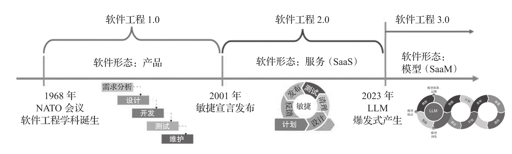

**图 1-1 软件工程时代的划分示意**

在软件研发范式方面，以 GPT-4 为代表的 LLM 推动了更智能、更高效和协作更顺畅的开发方法，引发了软件工程领域的颠覆性变革。软件工程 3.0 进入模型驱动开发、模型驱动运维的新范式（如图 1-2 所示）：研发人员在开发、测试前，必须训练好软件研发 LLM，可能涵盖业务 LLM、代码 LLM、测试 LLM 等，并完成部署；而后，基于该 LLM 开展需求分析、设计、编程和测试工作，借助该 LLM 理解需求，自动生成 UI、产品代码以及测试脚本等。软件研发 LLM 在生成和评审需求文档、生成高质量代码、生成全面测试用例等一系列工作中产生巨大价值，从而显著提高软件研发与运维的效率和质量。

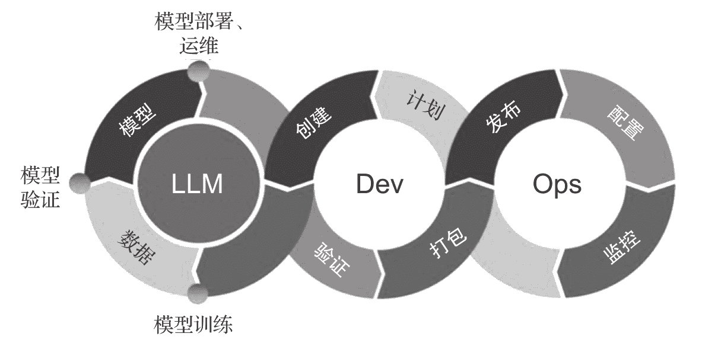

**图 1-2 软件工程 3.0 开发范式示意**

人机自然对话成为现实，新一代软件研发平台支持通过自然语言输入需求，实现人工智能生成内容（Artificial Intelligence Generated Content，AIGC），如软件需求定义文档、需求或用户故事的验收标准、代码、测试用例、测试脚本等。软件研发进入 AIGC 时代，研发过程演变为人与计算机的自然交互过程，人机结对开发、人机结对测试成为新的工作模式。

在这一过程中，研发人员与 LLM 紧密协同。LLM 或基于 LLM 构建的工具、系统作为研发人员的助手、副驾驶或合作伙伴，通过研发人员输入的提示词（prompt）生成所需内容。例如，在测试需求分析阶段，测试人员通过引导，使 LLM 逐步细化生成更细致的测试项。这种提示词的设计与应用，即提示工程，成为提升 LLM 在软件测试中应用效果的关键。LLM 生成的内容需要测试人员进行检查、评审和完善，确保内容准确无误；测试人员的工作成果也可以借助基于 LLM 的工具进行检查或评审，形成人机协同测试的良好环境，如图 1-3 所示。未来，人机交互智能有望超越 LLM 自身智能，人机协同测试将成为软件测试的常态。

**图 1-3 人机协同开发或测试示意**

在实践中，许多软件企业已开始尝试利用 LLM 进行软件研发，具体有以下实例。

❑ 某知名互联网公司在开发一款新的电商 App 时，借助训练好的软件研发 LLM，快速生成了 App 的基础框架和部分功能代码，大幅缩短了开发周期。

❑ 有些团队根据 UI 设计图，让 LLM 自动生成相应的前端代码，大幅减少了手动编码的时间，加快了从设计到实现的流程。

❑ 有些企业结合智能体和相关工具，让基于 LLM 的研发平台生成代码流程图和类图，辅助自然语言解释，使开发者能更直观地理解代码结构和执行流程，增强智能编程的可视性和交互性。

❑ 一些互联网大厂已经将 LLM 实际用于代码审查或 CI/CD 流程（如拉取请求），以自动识别代码质量问题并提出改进建议。

❑ 某银行测试中心使用测试 LLM 根据需求文档生成了大量测试用例，涵盖了各种用户场景和边界条件，有效提高了测试覆盖率。通过人机协同测试，测试人员与 LLM 相互配合，及时发现并修复了许多潜在问题，保障了 App 的质量。

❑ 有些开发团队借助智能体和检索增强生成（Retrieval-Augmented Generation，RAG）技术检索历史上已知的代码缺陷模式和已知问题，从而比较准确地识别潜在的缺陷和安全漏洞，甚至能够分析代码的功能意图，全面提升代码评审的能力。

在学术研究领域，学者也在不断探索 LLM 在软件研发中的应用，具体有以下几方面。

❑ 在软件工程的背景下，AI 协调器将不断监控工件的变化、协调每个智能体的感知和行动，并调用专门的 AI 智能体来检查工件的一致性和完整性，从而使多智能体系统可以支持端到端的软件开发过程^([2])。

❑ 大模型可以在需求工程活动中提供帮助，能够分析、组织和总结大量数据，因此在需求提出的初步阶段可以发挥关键作用^([3])。

❑ AI 可以使用 C4 模型^([4])生成高层次的系统概述，该模型为系统设计提供了上下文、容器、组件和代码 4 个抽象层次。同时，AI 系统可以自动为开发人员生成更详细的底层图表，如 UML（Unified Modeling Language，统一建模语言）类图、UML 序列图、状态机图、组件和部署图。

有研究表明，通过对 LLM 进行特定领域的微调，可以显著提高其在该领域软件研发任务中的表现。例如，针对金融行业的软件研发，将 LLM 在金融业务数据上进行微调后，生成的代码更符合金融行业的规范和需求，生成的测试用例能更好地覆盖金融业务场景中的风险点。

## **1.2 软件测试的新机遇**

在软件测试领域，长期存在着工作量巨大、自动化测试推进困难等问题，多数测试工作仅停留在半自动化阶段，严重制约了软件质量的提升和研发效率的提高。LLM 的出现，为解决这些难题提供了创新思路和方法，为软件测试带来了前所未有的发展机遇。

在工业场景中，企业高度重视 LLM 的实际效益和操作便利性，LLM 也在多个方面助力企业突破软件测试困境。企业通常在基础 LLM 上进行监督微调（Supervised Fine-tuning，SFT），将自身积累的业务数据、丰富的测试数据（如大量测试用例、测试脚本、缺陷报告等）以及专业领域知识融入其中，构建贴合自身需求的测试 LLM。结合 RAG 技术和智能体开发框架（如 LangChain），对测试知识库进行向量化（embedding）处理，打造知识增强型和检索增强型 LLM，显著提升 LLM 在软件测试关键环节的能力，如 LLM 赋能测试分析、场景挖掘、测试用例评审、缺陷定位、结果分析等，并借助 LLM 生成测试用例、测试脚本和测试报告等测试件，如图 1-4 所示。

以往，软件测试人员需要耗费大量时间和精力设计测试用例，且容易出现遗漏。LLM 的应用极大地改善了这一状况。以电商平台软件测试为例，某电商企业将海量的电商业务数据和专业知识融入 LLM，该模型能够依据不同购物场景，如促销活动期间的商品抢购、复杂组合支付方式等，快速、精准地生成全面的测试用例。这不仅大幅减少了测试人员的工作量，还提高了测试用例的覆盖率，有效降低了漏测风险。

在 LLM 时代，提示工程成为软件测试人员必备的重要技能。精心设计的提示词能够引导 LLM 更准确地理解并执行测试任务。测试人员在与 LLM 交互的过程中，采用循序渐进的方式，及时纠正错误并优化输出结果。这种工程化的提示词设计，是提升 LLM 在软件测试中应用效果的关键。TestPilot 便是一个成功例证，如图 1-5 所示，它借助 API 探索器（API explorer）从包中识别被测函数，利用文档挖掘引擎提取文档元数据，通过提示词生成器、测试验证器和提示词细化器的协同运作，构建用于生成测试的提示词。这些组件相互配合，从 LLM 的响应中整合出完整测试内容，并依据测试结果优化提示词，进而生成更多高质量测试。在实际操作中，嵌入代码使用片段（snippet）的方式可以提高测试执行成功率，可以更有效地重现软件中的 Bug，从而增强测试的准确性和可靠性。比如在对一款办公软件进行测试时，嵌入特定功能的代码片段，LLM 能更精准地模拟用户操作，挖掘出潜在的功能缺陷。

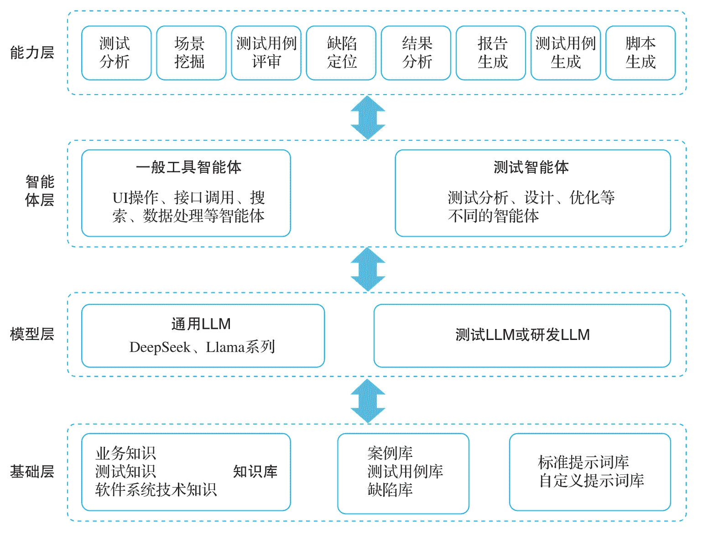

**图 1-4 基于知识库、LLM 和智能体组合框架提供 AI 测试能力**

工业界在软件测试中应用 LLM 时，重点关注模型工程能力（如 SFT）、提示工程、RAG 技术、智能体开发与应用、知识库或知识图谱等方面。这些技术的综合应用，使 LLM 能更好地适应不同测试场景，优化其性能，提高输出质量，为软件测试工作提供有力支持。例如，一位百度公司资深测试工程师在 2024 年 AI+研发数字（AiDD）峰会上分享过的议题“AI Agent 在软件测试中的落地实践：智能化测试新时代”，展示了一个以智能体为核心的全栈智能测试框架，如图 1-6 所示。它通过 AI Agent 深度参与测试流程，利用 LLM 提升测试效率与覆盖率，推动测试流程的智能化和自动化。除了通常意义上的数据层、标准工具层（如知识检索&问答、代码提交、API 检索等）之外，还有和 AI 密切相关的知识管理层、基础能力层和智能体应用层。

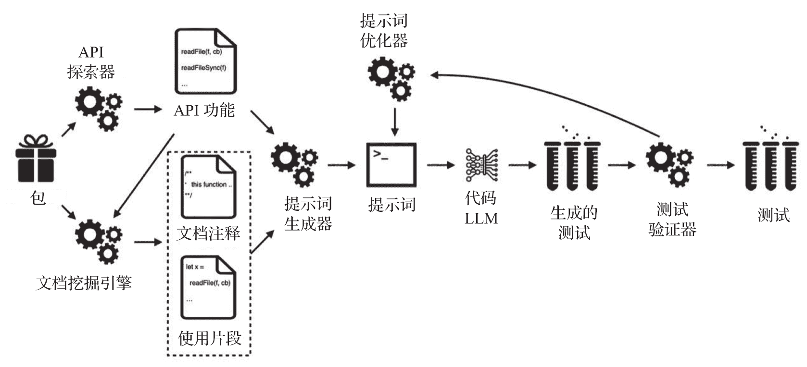

**图 1-5 TestPilot 基于 LLM 生成测试的原理示意**

❑ 知识管理层：测试智能化的核心支柱，提供知识的构建、存储、更新、搜索功能。先完成全局知识和项目特地需求知识的构建与同步更新，再通过系统的 API 服务提供不同资源（如文档、代码、API 等）的知识检索。

❑ 基础能力层：为智能体提供支撑的能力模块，如利用 LLM 生成基于需求文档的思维导图、优化或细化测试用例文字和风格等，旨在满足测试用例生成、优化，以及用户需求挖掘等基础需求。这些功能通过提高文档解析能力和测试用例生成的智能化程度，进一步降低了人工干预的必要性。

❑ 智能体应用层：

● 用例设计智能体：实现从需求文档到测试用例的端到端生成，并优化生成测试用例的规范性和风格，满足业务线的实际需求。

● 接口测试智能体：实现接口测试任务的全流程自动化，涵盖测试用例生成、合并、执行和修复，并提供灵活的模块化设计，支持业务场景的自定义扩展。

● Web UI 测试智能体：通过智能化元素定位和自动化测试代码生成，显著降低 Web UI 测试的编写和维护成本。引入自动修复能力，解决传统录制回放方案中维护成本高的问题。

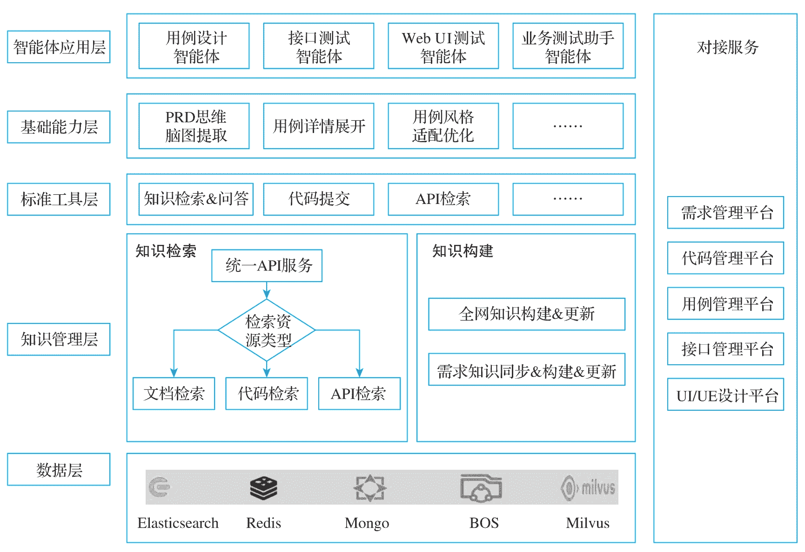

**图 1-6 以智能体为核心的全栈智能测试框架**

有专家在 AiDD 峰会上分享了基于 LLM 的端到端 AI 解决方案，即从系统级测试输入到测试脚本输出的全过程的智能化，主要有以下内容。

❑ 以需求为源头，以基于需求的实例化活动的产出为输入，通过 GWT（Given-When-Then）生成测试点进行复用用例检索，减少冗余用例的产生。

❑ 同时结合要素因子和测试环境推荐生成文本用例。

❑ 通过文本用例的意图识别对文本用例进行领域特定语言（Domain Specific Language，DSL）设计，召回 Robot Framework 关键字生成自动化脚本。

除了从系统级测试输入到测试脚本输出，软件企业还会用 LLM 评审测试脚本、分析测试结果以及生成测试报告。即使在测试用例生成阶段，我们也可以借助 LLM 挖掘软件的应用场景，特别是挖掘一些异常场景，相比传统的人工设计测试用例，这种方式的效率会大幅提高。更进一步，我们还可以借助 LLM 进行缺陷定位和缺陷修复的工作。

将 LLM 融入软件测试全生命周期，对各阶段都有显著的效率提升。对于不同行业、产品和团队，LLM 为测试阶段带来的提效幅度在 15%～90%，中位数达 43.5%，在软件测试阶段的提效尤为突出，如图 1-7 所示。在测试需求分析阶段，LLM 能快速梳理复杂的业务需求，精准挖掘隐藏的测试点；在测试设计阶段，它可以高效生成丰富多样的测试用例和脚本；在测试结果分析和测试报告生成阶段，LLM 能迅速处理大量测试数据，总结有价值的结论，生成规范的测试报告；在测试管理方面，LLM 还能协助进行资源调度和任务分配，优化测试流程。

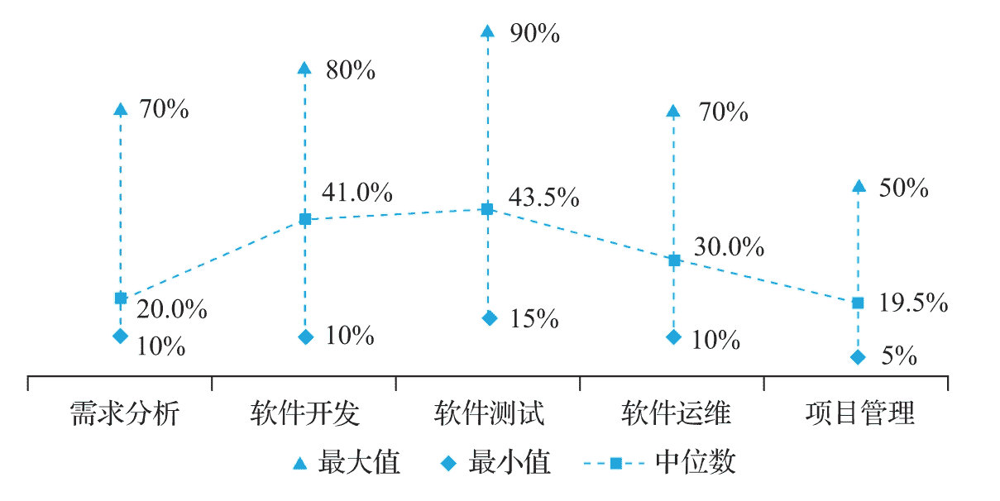

**图 1-7 LLM 在软件工程各阶段提效数据**[（数据来源：银弹案例数据、中国信通院发放的调查问卷数据、企业走访调研数据等）]

LLM 的出现为软件测试行业带来了新的曙光，它有效缓解了软件测试工作量大的压力，提升了自动化测试水平，解决了长期以来自动化难、半自动化的问题，显著提高了测试效率和工作质量。随着技术的不断发展，LLM 在软件测试领域的应用前景将更加广阔，推动行业迈向新的发展高度。

在学术研究方面，众多学者对 LLM 赋能软件测试展开了深入研究^([5])，主要有以下几方面。

❑ 单元测试用例生成：通过对代码和测试用例的联合训练，提升 LLM 对测试任务的理解。如使用 Java 语料库预训练 LLM 并微调生成单元测试，或通过对代码和测试文件的映射关系进行训练，提升生成质量。

❑ 提示工程：通过设计有效的提示词提升 LLM 生成测试用例的能力，如通过解析项目并提取上下文信息生成适配的提示词以提高生成质量，或提出“验证与修复”方法，利用 LLM 自身迭代修复生成的错误测试用例。

❑ 结合传统的测试技术：可以结合搜索技术，利用 LLM 生成未覆盖函数的测试用例；还可以结合变异测试，生成更有效的测试用例。

❑ 测试预言生成（Test Oracle Generation）：通过提示工程结合少样本学习，生成预言的准确率可以达到 76%。

❑ 移动应用的系统测试：使用 LLM 生成语义化文本输入，提升图形用户界面（Graphical User Interface，GUI）页面覆盖率。例如 GPTDroid 通过与 GUI 页面交互生成测试脚本。

❑ 缺陷分析：可以利用 LLM 检测重复的 Bug 报告，或通过 LLM 生成自然语言解释，帮助开发者理解 Bug。

❑ 定位和修复软件中的缺陷：Detect-Localize-Repair 框架利用 LLM 完成缺陷检测、定位和修复；AdbGPT 通过提示工程生成 Bug 复现脚本；CrashTranslator 利用 LLM 从堆栈跟踪中预测触发崩溃的步骤。

❑ 自动修复代码中的缺陷：Xia 等人在 QuixBugs 数据集上使用 Codex 修复了 40 个 Python Bug 中的 39 个。

## **1.3 软件测试的新挑战**

如同硬币有两面，LLM 在软件测试中的应用也面临着一系列严峻的挑战。

**（1）生成的测试用例和脚本准确性难以保证**

用 LLM 生成的测试用例和脚本准确性难以保证。这就好比一个厨师虽然能快速做出很多道菜，但无法保证每道菜的口味都符合食客的要求。LLM 依据训练数据和算法生成内容，可能会出现理解偏差或生成不符合实际需求的内容。在对一款金融交易软件进行测试时，LLM 生成的测试用例可能没有充分考虑复杂的金融业务规则和风险控制要求，如未涵盖特定利率波动下的交易场景测试，导致遗漏了重要风险点。一旦这些不准确的测试用例投入使用，就如同在战场上实施了错误的作战计划，就很有可能会无法有效检测软件问题，让有缺陷的软件进入市场，给用户带来损失。在实际应用中，一些企业就曾出现过使用 LLM 生成测试用例，但未能覆盖软件的核心功能，导致软件上线后出现严重的功能缺陷，影响了用户体验和企业声誉的先例。

**（2）测试覆盖率难以提高**

提高测试覆盖率是软件测试的重要目标，而 LLM 在这方面也面临挑战。软件系统如同一个庞大而复杂的迷宫，充满了各种不同的场景和边界条件。LLM 需要不断学习和优化，才能尽可能全面地覆盖这些情况。但目前它可能会像一个在迷宫中迷失方向的人，错过一些关键路径。例如，在测试一款具有多种用户角色、多种权限组合以及复杂业务流程的企业资源规划（ERP）软件时，LLM 可能无法穷尽所有权限组合下的业务操作测试，导致部分功能在特定权限设置下的潜在问题未被发现，从而影响软件的稳定性和安全性。有研究表明，在使用 LLM 进行测试时，对于一些复杂的业务场景，测试覆盖率只能达到 70%～80%，仍有大量潜在问题未被检测到。

**（3）测试预言的准确率不够高**

测试预言（Test Oracle）是判定软件行为是否正确的依据，其判断需基于需求文档与业务规范。如何精确定义预期行为并验证实际输出是否符合规范，一直是软件测试中的核心难题，目前 LLM 在这方面提供的支持还不够可靠。这就好比一位裁判，既要熟知比赛规则，又必须准确判断运动员的动作是否合规。以金融交易系统为例，在面对复杂的业务规则（如汇率换算、税费计算、交易限额校验）时，LLM 往往难以精准判断输出结果的正确性。尽管需求文档已明确了计算规则，但由于业务逻辑复杂、边界条件繁多，LLM 容易遗漏关键验证点，甚至可能基于不完整的理解生成错误的测试预言，从而严重影响测试的覆盖度和可信度。

**（4）软件性能难以精准评估**

精准评估软件性能是确保软件质量的关键环节，LLM 在性能测试和分析方面还需发挥更大作用。软件性能如同汽车的动力系统，为保证其能稳定运行就需要精确评估。LLM 在面对高并发、大数据量等复杂性能测试场景时，就像一个驾驶技术不够娴熟的司机，难以准确评估软件的性能表现。在测试一款在线教育平台的直播功能时，当大量用户同时在线观看直播、进行互动操作，LLM 可能无法准确分析软件的响应时间、吞吐量等性能指标，不能及时发现潜在的性能瓶颈，影响用户使用体验。在对某在线教育平台进行性能测试时，LLM 在分析高并发场景下的性能数据时，出现了较大误差，导致对性能瓶颈的判断失误，影响了软件的优化方向。

**（5）实际业务应用问题**

将 LLM 应用于实际业务项目，会面临与业务流程融合以及数据安全等问题。这就好比将一艘新船驶入陌生且暗礁密布的海域，充满了风险。不同企业的业务流程千差万别，如同不同海域的水文条件各不相同。LLM 需要适应这些复杂的业务流程，才能真正发挥作用。例如在医疗行业，软件测试不仅要遵循严格的行业规范和法规，还要确保患者数据的安全。LLM 在处理医疗软件测试时，可能不熟悉医疗业务流程和数据安全要求，导致测试过程出现问题，甚至泄露患者敏感信息，引发严重后果。在某医疗软件的测试过程中，LLM 对医疗数据的处理不当，导致部分患者的敏感信息泄露，给患者带来了极大的困扰，同时也让企业面临严重的法律风险。

LLM 为软件测试带来了巨大机遇，让我们看到了提高测试效率和质量的希望，但它在软件测试中的应用所面临的挑战也不容小觑。我们需要不断探索和研究，寻找解决这些问题的方法，让 LLM 更好地服务于软件测试行业，推动软件产业的健康发展。在本书后面的研究和实践中，我们将探索 LLM 与其他技术相结合的形式，例如：利用知识工程（知识库、知识图谱等）、RAG 技术和强化学习算法对 LLM 进行优化，提高其在测试用例生成和测试预言方面的准确性；加强在复杂场景下长文本的处理，让 LLM 更好地掌控上下文信息，以及增强智能体对周围环境的感知能力，提高 LLM 的认知能力，让其更好地完成分析与思考，从而输出更有用或更准确的结果；建立完善的数据安全管理机制，确保 LLM 在处理敏感数据时的数据安全。通过这些努力，不断克服 LLM 在软件测试中的应用所面临的挑战，充分发挥其优势，为软件测试行业的发展注入新的活力。

## **1.4 本章小结**

随着数字化浪潮的发展，软件研发正迈入以 LLM 为核心驱动力的“软件工程 3.0 时代”。这个时代实现了从需求分析、代码生成到测试设计全流程的模型驱动、一体化智能协作，极大提高了软件开发与测试的自动化和智能化水平。开发与测试人员通过与 LLM 的深度协同，不仅效率与质量获得前所未有的提升，也推动了人机协同开发与测试的全新工作范式。这为软件测试带来了重大变化。

首先，LLM 的引入创造了诸多新机遇。软件测试的智能化转型已成为不可逆转的趋势。与软件工程 2.0 时代相比，当前的软件测试自动化水平将实现质的飞跃，从测试需求分析到测试用例生成、测试脚本生成、测试结果分析，LLM 正深度融入软件测试的每个环节。人机协同测试成为新的工作模式，测试人员与基于 LLM 的测试智能体协同工作。测试人员可借助企业自有微调 LLM 与知识库，将工作重心由重复性、易遗漏的人工作业，转向更高层次的测试策略与评价。LLM 不仅能够快速生成具有高覆盖率的测试用例和脚本，还能辅助缺陷定位、预言生成、报告撰写等环节。智能体、RAG 技术和提示工程等创新手段，极大地推动了用例生成、异常挖掘和覆盖率提升。也正因如此，软件测试效率和自动化水平获得显著突破，为行业带来新的增长动力。

其次，这一变革也带来了不容忽视的挑战。LLM 生成内容的准确性、完整性尚不能充分保障，复杂场景下的用例覆盖率、测试预言准确性、性能评估的准确性等都有待提升。此外，不同行业的业务融合与数据安全也对 LLM 的实际部署和应用可靠性提出了更高的要求。如何在保证敏感信息安全的同时持续优化算法与流程，是进一步推进智能测试的必答题。

展望未来，软件测试智能化仍处于快速演进阶段。通过持续加强提示工程、场景化微调、知识增强及安全措施，结合传统方法，有望更好地补齐测试智能化的短板，推动软件产业进入高质量、全智能的研发新纪元。软件测试人员需要不断更新知识体系，把握 AI 协同与提示工程等新能力，以适应软件工程 3.0 时代带来的角色转型。

**1.5 参考文献**[[1]]

 朱少民，王千祥.软件工程 3.0[M] .北京：人民邮电出版社，2025.

[2] LIU J, WANG K, CHEN Y, et al.Large language model-based agents for software engineering:a survey[J/OL].arXiv preprint arXiv:2409.02977, 2024.

[3] MARQUES N, SILVA R R, BERNARDINO J.Using ChatGPT in software requirements engineering: a comprehensive review[J].Future Internet, 2024, 16(6):1-21.

[4] BI Z Q, WAN Y, WANG Z, et al.Iterative refinement of project-level code context for precise code generation with compiler feedback[C]// Findings of the Association for Computational Linguistics, ACL 2024.ACL, 2024:2336-2353.

[5] WANG J J, HUANG Y C, CHEN C Y, et al.Software testing with large language models: survey, landscape, and vision[DB/OL].arXiv preprint arXiv: 2307.07221v3, 2024.

# **第二章**

# **LLM 基础**

在当今的科技浪潮中，LLM 的崛起不仅代表了人工智能领域的重大技术突破，也标志着我们与智能机器互动方式的根本变革。从最初的 NLP 技术到如今的高级 AI 智能体，LLM 已经成为推动信息革命的重要引擎。这一技术的演进不仅仅是算法的升级，更是人类对理解语言和知识表征能力的不断探索的结果。随着 LLM 的逐步成熟，新的机遇与挑战并存，预示着未来人工智能的广阔前景。

本章将与读者一起深入探讨 LLM 的核心技术与演进路径。首先，我们将回顾 NLP 技术的历史演进，分析 GPT（Generative Pre-trained Transformer，生成式预训练转换器）在众多模型中脱颖而出的原因，并详细介绍当下最流行的人工智能聊天机器人 ChatGPT。随后，我们将深入剖析支撑 LLM 的核心技术，包括 Transformer 架构、预训练模型以及基于领域数据的微调与指令微调方法。接下来，我们将探讨提示工程这一关键技术，涵盖提示词的撰写原则、策略与应用技巧。最后，我们将探讨 LLM 如何扮演不同角色，特别是在智能体与多智能体框架下的应用，为构建具备专门领域知识的智能体奠定基础。通过本章的学习，读者将全面理解 LLM 的技术基础及 LLM 在实际应用中的潜力与面临的挑战。

## **2.1 LLM 的诞生和进化**

LLM 的诞生和崛起标志着人工智能的一个重大转折点，它不仅推动了 NLP 领域的发展，也为其他各行各业带来了全新的可能性。从早期的 NLP 技术到如今的先进模型，了解这一演进过程有助于我们把握未来技术的发展趋势。本节将概述 NLP 技术的演进历史，介绍 GPT 等 LLM，并探讨 ChatGPT 作为标志性产品的诞生。通过回顾这些里程碑，读者将更清晰地理解 LLM 的进化路径及影响。

### **2.1.1 NLP 技术演进**

NLP 是计算机科学、人工智能和语言学的交叉领域，其主要目标是使计算机能够理解、生成自然语言并与人类进行有效交流。它包括两个主要的子领域：自然语言理解（Natural Language Understanding，NLU）和自然语言生成（Natural Language Generation，NLG）。

NLU 关注如何使计算机能够理解与解释人类语言的语义和上下文。这一领域的研究目标是开发出能够正确解析与解释自然语言输入的算法和模型，使计算机能够执行诸如信息提取、情感分析和机器翻译等任务。NLU 的核心挑战在于语言的多义性、上下文的依赖性以及语法结构的复杂性。

NLG 关注如何使计算机能够从数据或逻辑表达中生成自然、准确和流畅的文本。NLG 系统的目标是将结构化数据、图表、逻辑规则或其他形式的输入转换为连贯的自然语言输出。这一技术在自动化报告生成、文本摘要、内容创作和聊天机器人等领域有广泛应用。NLG 的实现通常涉及内容确定、文本规划和语言实现等多个阶段，力求在保证信息准确性的同时，提高生成文本的可读性和自然性。

有关 NLP 的研究，可以追溯到 20 世纪 40 年代。1946 年，第一台现代电子计算机 ENIAC 诞生，随后不久，美国科学家 Warren Weaver 和英国工程师 Andrew Donald Booth 于 1947 年提出了利用计算机进行语言自动翻译的想法。1949 年，Weaver 发表《翻译备忘录》，正式提出机器翻译的思想。1950 年，艾伦·图灵（Alan Turing）发表了开创性的论文《计算机器与智能》（“Computing Machinery and Intelligence”），AI 和 NLP 的研究开始迅猛发展。截至目前，NLP 技术大概经历了如图 2-1 所示的四个阶段。

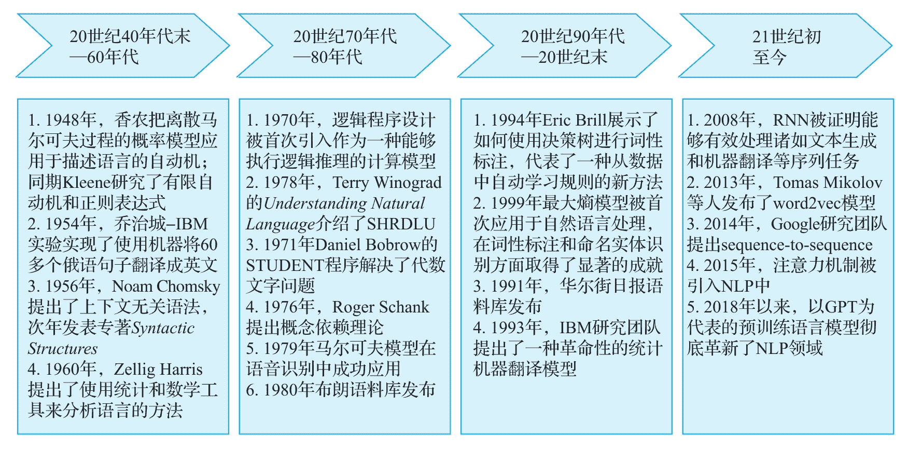

**图 2-1 NLP 技术演进的四个阶段**

**1.第一阶段（20 世纪 40 年代末—60 年代）**

在第一阶段，NLP 的研究主要分为两大流派：符号学派和随机学派。符号学派的核心思想是通过明确的规则和符号来表示自然语言，强调逻辑推理和形式语法，认为通过精确定义语言结构和规则，计算机可以实现语言理解和生成。而随机学派则注重使用统计方法来解析自然语言，基于概率模型（如马尔可夫模型）来预测词汇和句子的生成。尽管这两种方法在该时期均取得了显著进展，但由于多数学者侧重于推理和逻辑问题，基于规则的方法更为流行。

这一阶段的代表性研究包括：1948 年，克劳德·香农（Claude Shannon）将离散马尔可夫过程的概率模型应用于描述语言的自动机，并引入了“熵”（entropy）的概念用于语言处理；同时期，Stephen Kleene 研究了有限自动机和正则表达式；1954 年，乔治城大学与 IBM 合作进行了乔治城-IBM 实验（Georgetown-IBM experiment），该实验先将俄语单词转换为数字编码，然后根据这些编码选择合适的英文翻译、重新排列英文单词或省略某些英文单词，最终实现了使用机器将 60 多个俄语句子翻译成英文；1956 年，Noam Chomsky 提出了上下文无关语法，并在次年发表的专著《句法结构》（*Syntactic Structures*）中，构建了普遍适用的形式语法理论；1960 年，Zellig Harris 提出了使用统计和数学工具分析语言的方法，这些工具后来被广泛应用于随机学派的研究中。

**2.第二阶段（20 世纪 70 年代—80 年代）**

在第二阶段，NLP 研究从初级的规则和统计模型转向了更为复杂的理论框架，主要包括三大范式：基于逻辑的范式、基于规则的范式和随机范式。

基于逻辑的范式侧重于使用逻辑推理来理解和生成语言，认为自然语言中的每个句子都可以转换为逻辑表达式，可以通过逻辑演算来分析和操作。该范式下的典型研究包括：1970 年，逻辑程序设计被首次引入作为一种能够执行逻辑推理的计算模型（代表性语言：Prolog）；1972 年 Terry Winograd 的《理解自然语言》（*Understanding Natural Language*）介绍了 SHRDLU 程序，该程序展示了计算机如何通过逻辑推理实现自然语言处理的基本功能。

基于规则的范式聚焦于通过明确的规则和算法来解析和生成语言。这些规则通常由人类专家设计，以捕捉语言中的结构和模式。该范式的典型研究包括：1964 年 Daniel Bobrow 的 STUDENT 程序解决了代数文字问题，展示了规则在自然语言解析中的应用潜力；20 世纪 60 年代，布朗语料库正式成为基于统计的自然语言处理的核心数据资源，为该领域从“规则驱动”转向“数据驱动”提供了首个大规模、结构化的英语语料支撑；1972 年，Roger Schank 提出“概念依赖理论”（Conceptual Dependency Theory），认为所有自然语言句子都可以通过一组基本的“概念依赖”来表示，这一理论为基于规则的自然语言处理提供了坚实的理论基础。

随机范式主要使用统计方法和概率模型来处理自然语言。这一方法在 20 世纪 50 年代至 60 年代已有所涉猎，在 70 年代至 80 年代逐渐走向成熟。该范式的典型研究包括：20 世纪 70 年代中期马尔可夫（Markov）模型在语音识别中成功应用，标志着统计方法在自然语言处理中的重要性日益增长。

**3.第三阶段（20 世纪 90 年代—20 世纪末）**

在第三阶段，NLP 研究逐渐转向实际数据的训练和验证，而不仅仅依赖人为定义的规则或逻辑推理。这个时代的 NLP 研究主要集中在基于机器学习的方法和数据驱动的方法两个方面。

基于机器学习的方法方面，1992 年 Eric Brill 首次展示了使用决策树进行词性标注，这代表了一种从数据中自动学习规则的新方法。此后，1996 年最大熵模型被首次应用于自然语言处理，特别是在词性标注和命名实体识别方面取得了显著的成就。

数据驱动的方法方面，1991 年，《华尔街日报》语料库的发布为许多后续基于数据的 NLP 研究提供了宝贵的资源。1993 年，IBM 研究团队提出了一种革命性的统计机器翻译模型，这标志着从基于规则的机器翻译向基于数据的机器翻译的转变。

**4.第四阶段（21 世纪初至今）**

深度学习的兴起带来了模型复杂性和数据处理能力的飞跃，彻底改变了 NLP 的研究和应用格局。NLP 的研究方向开始转向深度神经网络和向量表示。

2008 年，递归神经网络（Recurrent Neural Network，RNN）被证明能够有效处理诸如文本生成和机器翻译等序列任务。RNN 的引入，使模型在处理时序数据时能够捕捉到上下文信息，从而提升语言模型的表现。

2013 年，Tomas Mikolov 等人发布 word2vec 模型，实现了将词语转换为向量表示。这一突破使词语之间的语义关系能够通过向量空间中的距离和方向来表示。2014 年，GloVe（全局向量）模型被提出，提供了一种基于统计的全新词嵌入方法，通过结合全局词共现矩阵和局部上下文窗口信息，进一步提升了词向量的质量和表达能力。

2014 年，Google 研究团队提出了序列到序列（sequence-to-sequence）模型，该模型利用两个 RNN 结构（编码器和解码器）实现了输入序列到输出序列的映射，广泛应用于机器翻译等任务。序列到序列模型奠定了现代 NLP 任务中的生成式模型框架。

2015 年，注意力机制（Attention Mechanism）被引入 NLP 中，特别是用于解决机器翻译等序列到序列任务的问题。注意力机制允许模型在处理每个输出元素时动态关注输入序列的不同部分，大幅提升了长序列处理的效果。

2018 年以来，以 GPT 为代表的预训练语言模型彻底革新了 NLP 领域，这一部分的具体内容将在后文中深入展开。

### **2.1.2 谁与 GPT 争锋**

GPT^([1])的问世使得 NLP 领域迎来了前所未有的革新，与此同时，BERT^([2])（Bidirectional Encoder Representations from Transformers，基于 Transformer 的双向编码器表征法）、T5^([3])（Text-To-Text Transfer Transformer，文本到文本传输转换器）、XLNet^([4])（Generalized Autoregressive Pretraining for Language Understanding，语言理解的广义自回归预训练）等模型，与 GPT 针锋相对，共同促进了 NLP 研究的发展。接下来，我们将详细介绍这几种流行的模型。

**1.GPT**

GPT 是由 OpenAI 于 2018 年发布的一种基于生成式预训练的语言模型，它通过在大规模无标签文本语料上进行预训练，然后在特定任务上进行微调，在各种自然语言理解任务上取得了良好的性能，在生成文本、对话系统和创意写作等任务中表现尤其出色。

具体来说，GPT 模型采用了 12 层的单向自回归 Transformer 解码器架构（Decoder-Only），如图 2-2 所示。在预训练阶段，模型在一个大规模的无标签文本语料（BooksCorpus）上进行训练，目标是最小化语料的 token 级困惑度。这种生成式预训练方法可以让模型学习到丰富的语言表示，为后续的监督微调任务提供良好的初始化。

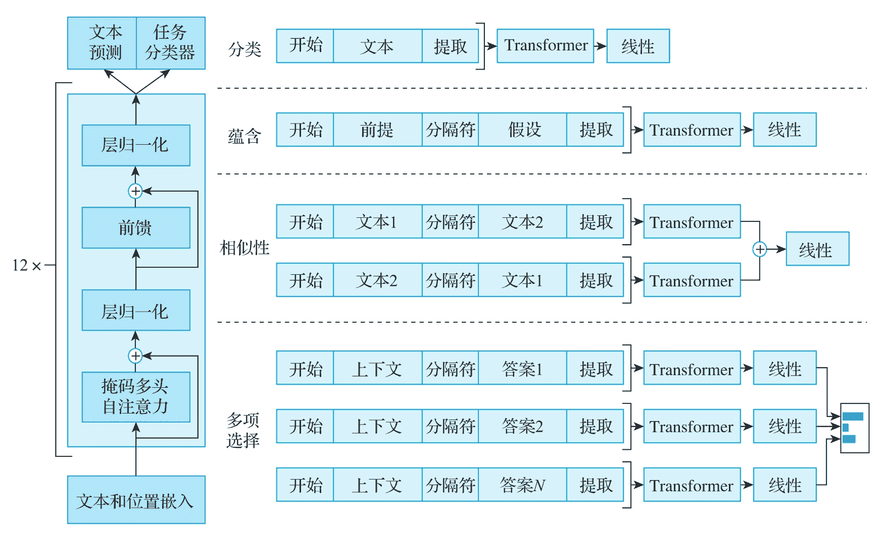

**图 2-2 GPT 模型架构示意**

在微调阶段，GPT 模型可以在各种特定的任务上进行微调，包括自然语言推理、问答、语义相似度评估和文本分类等。通过采用任务相关的输入转换技术，GPT 模型在各种任务上可以取得显著的性能提升，例如：在故事结尾选择任务（Stories Cloze Test）上提升了 8.9%，在问答任务（RACE）上提升了 5.7%，在自然语言推理任务（MultiNLI）上提升了 1.5%。

**2.BERT**

BERT 是 Google 于 2018 年发布的一种双向编码器表示模型。它通过两个核心任务——掩码语言模型（Masked Language Model，MLM）和下一个句子预测（Next Sentence Prediction，NSP），在训练过程中同时考虑句子中每个词的前后文信息，从而实现更深层次的理解，如图 2-3 所示。

在 MLM 任务中，BERT 会随机掩盖输入文本中的部分词汇，并要求模型预测这些被掩盖的词。这使模型能够学习每个词在其上下文中的表示，从而实现双向理解。通过这种方法，BERT 不仅可以理解一个词的前文信息，还可以同时结合其后文信息。

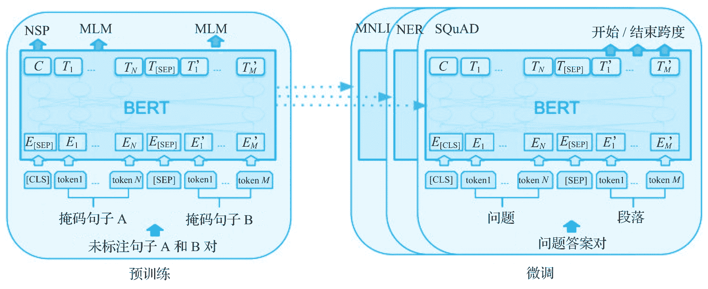

**图 2-3 BERT 的整体预训练和微调示意**

在 NSP 任务中，BERT 则要求模型判断两个句子在原始文本中是否相邻（相邻预测性），这个任务旨在帮助模型捕捉句子之间的关系和连贯性。

BERT 的训练采用了大规模的无监督学习方法。Google 使用了包含数十亿个单词的大型文本语料库进行训练，并通过大规模并行计算资源进行高效优化。这种训练方式使得 BERT 在多个 NLP 任务上表现出色，包括问答系统、文本分类、命名实体识别和情感分析等。

**3.T5**

T5 由 Google 于 2019 年推出，其核心思想是将所有的 NLP 任务转换为一个统一的文本到文本格式。无论是翻译、摘要还是分类任务，T5 都将输入和输出视为文本字符串。这种统一框架使模型能够在不同任务之间共享知识，简化了任务的表示和处理，大幅提高了多任务学习的效率和性能。

T5 的训练采用了大规模的无监督预训练方法。具体来说，Google 首先在 C4（Colossal Clean Crawled Corpus）数据集（包含来自网络的约 75G 的清洗后的文本数据）上使用去噪目标进行生成式预训练，然后在各种下游任务中进行单独微调。

**4.XLNet**

XLNet 是由 Google 和卡内基梅隆大学于 2019 年联合发布的一种通用的自回归预训练方法，它结合自回归语言模型（Autoregressive，AR）和自编码（Auto-Encoder，AE）方法的优势，同时避免了二者的局限性。

XLNet 通过最大化所有排列顺序的预期似然，实现捕捉双向上下文信息；开发了一种双流注意力机制，为基于排列的目标生成目标感知表示，有助于模型更好地理解词与词之间的关系；不依赖 B E RT 中的数据腐蚀，因而避免了预训练-微调之间的差异；集成了 Transformer-XL 中的架构改进，如分段循环和相对编码，进一步提高了性能；在问答、自然语言推理、情感分析和文档排序等多项任务上表现优异。

**5.GPT-2 与 GPT-3**

GPT-2^([5])是由 OpenAI 于 2019 年发布的第二代生成式预训练语言模型。相比于 GPT-1，GPT-2 使用了更加庞大和多样化的训练数据集（WebText），并将参数规模扩大到了 15 亿。得益于超大的预训练数据和模型参数规模，GPT-2 在没有专门针对特定任务进行微调（即零样本学习）的情况下，在多个任务上取得了良好性能，在文本生成方面的性能尤为优越。这种通过扩大训练数据和模型参数规模以提高模型性能的探索取得了成功，为后续的 GPT-3 奠定了基础。

GPT-3^([6])发布于 2020 年，进一步探讨了扩大语言模型规模以提高其任务无关的少样本学习性能的潜力。GPT-3 的出色性能在很大程度上归功于其采用的上下文学习（In-context Learning）方法，这种方法是元学习 ^(²)思想的一种具体实现，它允许模型在给定一些示例的情况下，直接通过这些示例来学习并完成任务，而无须显式地更新模型参数。GPT-3 的上下文学习能力得益于其巨大的参数量和训练数据集。GPT-3 将参数扩大到了 1750 亿（比之前任何非稀疏语言模型都大了 10 倍），在各种自然语言处理任务（包括翻译、问答和常识推理）上都表现出了卓越的性能，即使不进行微调，有时也能够匹敌甚至超过之前最先进的微调模型。

### **2.1.3 ChatGPT 的诞生**

ChatGPT 是基于 GPT-3 模型的发展，由 OpenAI 于 2022 年 11 月推出的。ChatGPT 开放网页端试用功能仅仅五天，就吸引了超过 100 万的活跃用户，并在短短两个月内获得了 1 亿用户，成为史上增长最快的消费者应用程序。这一发布不仅代表了自然语言处理领域的一个重要里程碑，还标志着人工智能在对话系统方面的突破性进展。ChatGPT 网页端用户界面如图 2-4 所示。

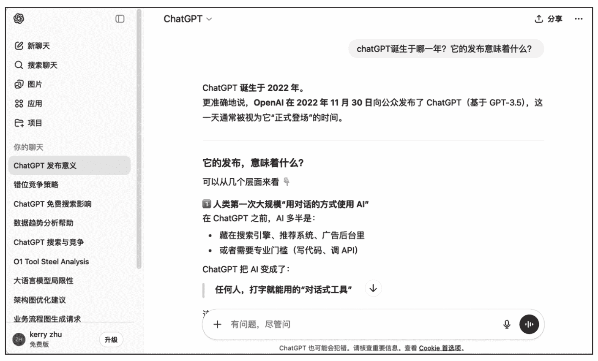

**图 2-4 ChatGPT 网页端用户界面**

ChatGPT 的成功主要归因于其强大的技术基础和创新设计，与之前的模型相比，ChatGPT 在以下几个方面取得了显著进步。

**1.超大规模数据预训练与超大模型参数规模**

ChatGPT 当时的核心 GPT-3 在大规模、多样化的文本数据集上进行了预训练，且模型本身具备超大的参数规模，这些数据涵盖了广泛的主题和语言风格，使模型能够捕捉到丰富的语言模式和上下文关系，从而在生成对话时表现得更加自然和流畅。预训练阶段的目标是让模型学习如何生成有意义的、连贯的文本，并理解用户输入的意图。

**2.强化学习与人类反馈**

ChatGPT 的一个重要特点是结合了 RLHF（Reinforcement Learning from Human Feedback，基于人类反馈的强化学习）。在 RLHF 过程中，评审员根据模型生成的对话进行打分，模型则根据这些反馈不断调整和优化。通过这种方式，ChatGPT 能够更好地理解和响应用户需求，生成更高质量的对话内容。

**3.自然语言理解与生成的结合**

ChatGPT 不仅在生成自然语言方面表现出色，还在理解用户输入方面具有较强的能力。模型能够准确解析用户的提问和请求，并生成相应的回答或建议。这种理解与生成的结合，使 ChatGPT 在各种对话场景中都能提供有价值的互动。

**4.多轮对话与上下文保持**

ChatGPT 在处理多轮对话方面表现出色，能够记住对话中的上下文信息，从而在后续的对话中保持连贯性和一致性。这对于构建长期、自然的对话体验至关重要。例如，ChatGPT 能够在对话中引用之前提到的信息，或根据上下文提供更为贴切的回答。

**5.多领域应用的潜力**

ChatGPT 的通用对话能力使其在多个领域具有广泛的应用潜力。无论是客户服务、教育辅助、创意写作还是个人助理，ChatGPT 都能提供高质量的对话支持。例如：在教育领域，ChatGPT 可以帮助学生解答问题、提供学习建议；在创意写作中，ChatGPT 可以作为灵感来源，帮助作家生成内容。

综上，在 AI 技术快速发展的背景下，ChatGPT 的诞生无疑是一个重要的里程碑。它展示了生成式预训练模型的巨大潜力，并为人机交互的未来提供了丰富的可能性。随着技术的不断进步，我们可以期待 ChatGPT 和类似的对话系统不断优化与扩展，在各行各业中实现更高水平的智能对话服务。

## **2.2 LLM 核心技术**

理解 LLM 核心技术对于充分发挥 LLM 的潜力而言至关重要，无论是在数据处理、模型架构中，还是在模型的训练与微调过程中，这些技术共同支撑了 LLM 的强大功能。本节将深入解析 Transformer 架构、预训练模型的基础理论，以及基于领域数据的微调和指令微调方法。这些核心技术的掌握将帮助读者更好地理解 LLM 的工作原理，并探索其在不同应用场景中的优化潜力。

### **2.2.1 Transformer**

在 Transformer 模型出现之前，LSTM（长短期记忆）网络和 RNN 几乎占据了自然语言处理领域的主导地位。这些模型通过维护内部状态来处理序列数据，使它们在一定程度上能够捕捉序列中的长期依赖关系。然而，RNN 和 LSTM 在处理长序列时可能会遇到效率问题，因为它们需要按顺序逐步处理序列中的每个元素。就像我们在软件测试中，一个测试用例的执行结果往往需要依赖前一个步骤的完成，这样的过程虽然严谨，但效率不高。

为了克服这个问题，研究人员提出了其他模型，如 ByteNet 和 ConvS2S。这些模型通过使用 CNN（卷积神经网络）代替 RNN，能够同时处理输入和输出的不同部分，就像在软件测试的自动化过程中，某些并行测试可以加快整个测试套件的执行速度一样。但即便如此，这些模型在处理长距离依赖时，计算量会随着距离的增加而显著增加，使捕捉远距离之间的关系变得困难。就好比在软件测试中，如果要测试两个组件之间的复杂交互，而这两个组件相隔很远，那么就需要更多的步骤和时间来确保测试覆盖到这些依赖关系。

Transformer 模型的出现带来了颠覆性的改变。与 RNN 不同，Transformer 完全基于注意力（Attention）机制，在编码器阶段不再依赖前一步的输出结果，这样就能并行处理数据，从而大幅提高训练速度。可以把这个机制想象成一个团队中的每个人都能直接获取所有其他成员的信息，而不需要等待其他人的逐层汇报，这样工作效率就会大幅提升。

Transformer 的整体架构非常清晰，分为输入、编码器、解码器和输出四部分，如图 2-5 所示。表 2-1 总结了 Transformer 的核心组件及其功能。

**表 2-1 Transformer 的核心组件及其功能**

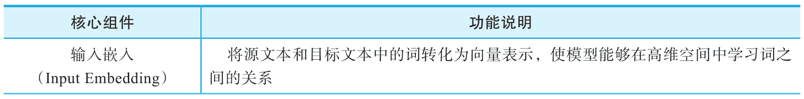

（续）

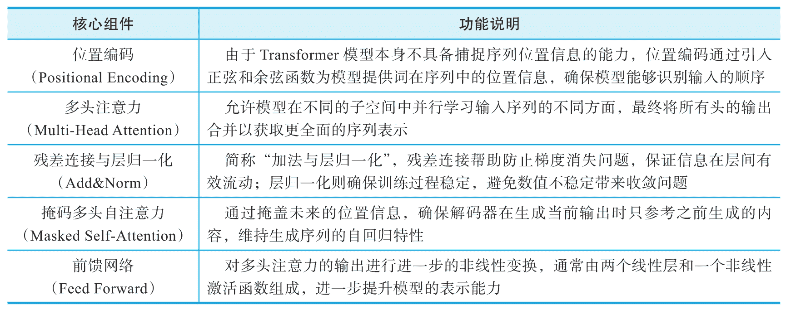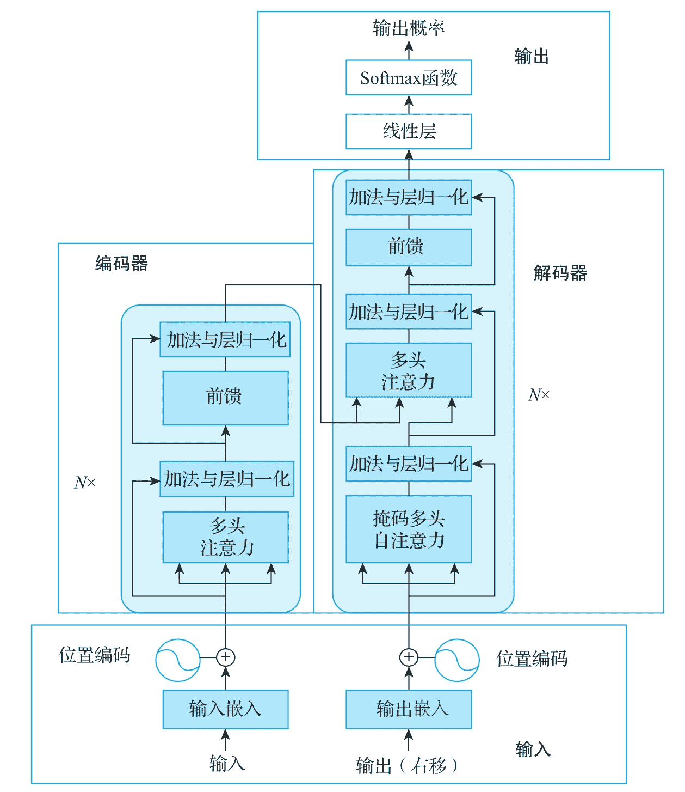

**图 2-5 Transformer 整体架构****^[⁷^]**

除此之外，Transformer 还有三种注意力机制，即编码器的自注意力、解码器的交叉注意力与解码器的因果自注意力（也称掩盖自注意力），它们的功能如表 2-2 所示。

**表 2-2 Transformer 的三种注意力机制的功能**

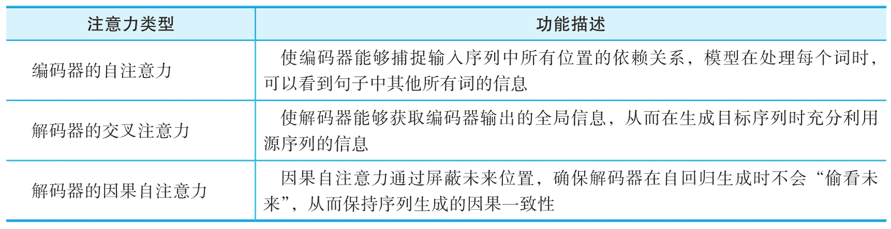

举一个简单的例子来进一步帮助理解 Transformer 的三种注意力机制。假设一个软件测试团队负责测试一个即将发布的新软件应用，团队需要确保应用的所有功能无 Bug 且都按预期工作。这个过程可以与 Transformer 的三种注意力机制相对应。

**1.编码器的自注意力**

自注意力机制可以类比为测试团队内部成员在执行测试任务时的相互参照与协调。每个测试人员不仅要关注自己负责的功能，还要留意其他同事的工作进展，以避免测试用例的重复或遗漏。例如，某测试人员专注于支付功能的测试，而另一人负责用户登录功能的测试。支付功能的测试人员会意识到，如果用户无法成功登录，则支付功能将无法正常工作。因此，测试人员需要理解各功能模块之间的相互依赖性。类似地，自注意力机制使 Transformer 模型能够在处理输入序列时捕捉到不同部分之间的关联性，从而实现更有效的上下文理解和处理。

**2.解码器的交叉注意力**

交叉注意力机制可以类比为开发团队与测试团队之间的协作过程。开发人员提供的功能需求文档和代码相当于编码器的输出，而测试团队的测试计划和测试结果相当于解码器的输入。测试人员在设计和执行测试时，必须时刻参考开发团队提供的需求说明，以确保测试用例准确反映软件预期行为，并验证软件功能是否符合设计要求。交叉注意力机制在 Transformer 解码器中表现为生成输出时，依赖编码器输出的信息，以确保模型的生成内容与输入内容保持一致。

**3.解码器的因果自注意力**

可以将解码器的因果自注意力类比为测试任务执行的逻辑顺序。例如，用户注册功能的测试应先于用户登录功能，因为登录功能依赖于注册成功的用户信息。Transformer 模型的解码器也遵循类似的原则。在生成输出序列时，通过应用因果掩盖（Causal Masking），确保模型在生成位置 i 时，只能关注从位置 0 到位置 i-1 的信息，而不会“看到”位置 i 之后的未来信息。这种设计保证了解码器的自回归生成特性——逐步生成输出，每次只基于已生成的内容，确保输出序列的逻辑一致性和顺序性。

综上所述，Transformer 模型通过其基于注意力机制的架构，使训练可以并行处理，大幅提升了效率。它在处理长序列数据或需要捕捉远距离依赖时表现尤为出色。虽然在生成阶段仍然具有自回归特性，但 Transformer 的设计无疑为自然语言处理和其他领域的任务带来了全新的解决方案。对于希望进一步了解 Transformer 细节的读者，推荐阅读原始论文“Attention is All You Need”。

### **2.2.2 预训练模型**

随着 LLM 的不断发展，一个业内痛点问题逐渐显现：标注资源稀缺而无标注资源丰富，某种特殊的任务只存在非常少量的相关训练数据，以至于模型不能从中学习和总结到有用的规律。在这样的背景下，预训练技术应运而生。

预训练是 LLM 训练过程的一个特殊阶段，一般发生在模型执行特定任务训练之前，其本质是让模型在一个巨大、广泛的数据集上学习一些通用的特征或知识，从而得到一个通用 LLM，我们称之为“预训练模型”（Pre-trained Model）。

这个阶段的目标是构建一个具备广泛能力的模型，强调的是“广泛、通用”，即不针对某一特定的领域。预训练通过在大规模、多样化的数据集上进行，使模型能够学习到语言的基本结构、语法规则以及广泛的世界知识，但还没有针对任何特定任务进行优化，因此这个阶段的模型“泛而不精”，虽然在多种场景下有不错的表现，但在特定场景下的表现并不十分出色。至于后续如何使模型在特定领域有更出色的性能和表现，是微调将要完成的工作（稍后介绍）。

通常而言，预训练包括以下几个步骤。

1）选择一个大型的、通用的数据集。这个数据集不需要和模型最终的任务完全相关，但它应该足够大和多样化，能够让模型学习到广泛的特征、模式和知识。

2）模型训练。在这个大型数据集上训练模型，使模型学习到广泛的知识。训练过程包括语言建模任务（如掩码语言模型、下一句预测等），这些任务可以帮助模型学习到词的上下文关系和句子结构。

3）保存预训练模型。在通用数据集上完成预训练后，保存模型的参数，这些参数将作为后续特定任务训练（微调）的起点。保存的预训练模型通常包括词嵌入层、编码器层、解码器层等部分。

通过预训练，我们可以实现以下目标。

❑ 学习通用知识。通过在大规模数据集上训练，模型可以学习到广泛的语言特征和模式，这些知识在很多任务上是通用的。

❑ 减少特定任务的数据需求。由于预训练模型已经具备了基础的语言理解能力，后续的特定任务训练（微调）所需的数据量将显著减少。

❑ 提升模型性能。预训练模型在多种任务上都有较好的基础表现，通过微调可以进一步提升其在特定任务上的性能。

综上所述，预训练技术通过在大型通用数据集上训练基础模型，并将其参数作为特定任务模型的初始值，显著减少了数据需求与训练时间，在 NLP 领域成效显著。然而，预训练技术依赖大规模数据与较长的训练周期，导致计算与存储资源消耗巨大。为提升训练效率、降低资源开销，研究者正探索高效架构设计，其中混合专家模型（MoE）作为稀疏激活架构受到关注。MoE 引入多个专家子网络，每次前向计算仅激活部分专家子网络，在扩大参数规模与增强表示能力的同时，有效控制实际计算成本，为大规模预训练模型的扩展提供了可行路径。

### **2.2.3 基于领域数据的微调**

在预训练模型的基础上，为了使模型在特定任务上表现得更加出色，需要进行基于领域数据的微调（Fine-tuning based on domain data），即在特定领域的数据集上进一步训练预训练模型，使其能够更好地适应特定任务或特定领域的数据分布，从而提高其在该领域的性能。接下来我们将从基于领域数据的微调的步骤、作用和方法三个方面展开叙述。

**1.基于领域数据的微调的步骤**

通常而言，基于领域数据的微调包含以下五个步骤。

1）准备领域数据集。选择与特定任务或领域相关的数据集。这些数据通常是标注好的数据，例如分类标签、序列标注、问答对等，但也可以是无标注的数据，用于无监督学习。

2）调整模型架构。根据特定任务的需求，调整预训练模型的架构。例如，在 NLP 任务中，可能需要在预训练模型的基础上添加特定的任务头，如分类头、生成头等。

3）模型微调。使用领域数据集，在预训练模型的基础上继续训练。这一步需要设定合适的学习率、批量大小等超参数，以确保模型能够有效地从领域数据中学习。

4）评估和优化。在微调过程中，需要不断评估模型的性能，根据评估结果调整训练策略，优化模型的表现。

5）保存模型。在领域数据集上完成对预训练模型的进一步训练后，保存模型的参数，得到的新模型在本领域的任务中将会比预训练模型拥有更加出色的表现。

**2.基于领域数据的微调的作用**

微调的主要优势在于能够充分利用预训练模型的通用知识，再结合特定领域的数据，提升模型在该领域的表现。具体来说，基于领域数据的微调的作用包含以下三点。

❑ 提高准确性。通过在特定领域的数据上训练，模型能够更好地理解领域特定的术语、句式和上下文，从而提高预测的准确性。

❑ 减少数据需求。因为预训练模型已经在大规模数据集上学习了广泛的特征和知识，所以在特定领域进行微调时，需要的数据量相对较少。

❑ 加速训练过程。预训练模型已经具备了基本的语言理解能力，微调过程相比从头开始训练模型要快得多。

**3.常见的基于领域数据的微调方法**

**（1）SFT**

SFT 是一种常见的模型调整方法。它通过给定输入数据和相应的标签（例如情感分类或命名实体识别）来训练模型。就像教学生做题一样，我们向模型提供问题和正确答案，然后反复训练。SFT 使用优化算法（如梯度下降）不断调整模型参数，以便更准确地预测结果。这种方法的优势在于简单易懂、效果明显且见效较快。然而，它的缺点是需要大量带标签的数据才能取得好的结果，因而可能不太适合一些数据稀缺的领域。

**（2）LoRA**

LoRA（Low-Rank Adaptation，低秩适应）微调方法是一种基于 LLM 内在低秩特性的微调技术。该方法通过增加旁路矩阵来模拟全参数微调。具体而言，LoRA 利用矩阵秩的分解，将原始模型的参数分解成两个较小的矩阵乘积，仅对这两个矩阵的参数进行训练，从而实现对 LLM 的有效微调。通俗地讲，该方法的原理是认为 LLM 都是过参数化的，当用于特定任务时，其实只有一小部分参数起主要作用，故该方法遵循一种“精打细算”的策略，只对其中的关键部分进行训练。这种方法不仅有效提高了微调效率，还显著降低了计算成本，特别适用于资源有限的场景。此外，LoRA 微调方法通过减少实际参与训练的参数数量，降低了过拟合风险。

**（3）P-tuning v2**

P-tuning v2 是一种专为超大规模模型设计的微调技术。其核心思想是在模型的输入和输出之间引入可训练的连续提示词，就像考试时部分考题会给学生提供一定的提示（但不是直接给出答案）来帮助他们答题一样，从而对模型进行微调。P-tuning v2 通过优化提示词参数来调整模型的输出，实现对特定任务的适应。相比于传统的微调方法，它在处理超大规模模型时表现更为出色，显著提高了模型的灵活性和适应性，不仅减少了微调所需的计算资源，还在多种下游任务上展示了优异的性能，为微调技术提供了新的方向。

**（4）Freeze**

Freeze 监督微调方法是一种通过冻结部分模型参数进行微调的技术。在微调过程中，通常选择冻结预训练模型的前几层参数，因为这些层主要负责提取低级特征。这有点像建房子时只改动顶部，而不动地基一样。具体步骤为：首先，将选定的层或参数标记为不可训练（trainable=false），以确保在反向传播时这些参数不进行梯度更新；然后，将数据输入模型进行微调，仅更新未被冻结的层或参数。这种方法通过减少待微调的参数数量，降低了模型的计算复杂度，并利用预训练模型的低级特征提取能力，提高了模型的泛化能力和学习效果。此外，Freeze 监督微调方法也适用于需要快速迭代和部署的应用场景。

综上所述，基于领域数据的微调作为提升预训练模型在特定任务上的表现的关键技术，通过精细化的训练步骤和多样化的方法，能够有效提升模型的准确性和泛化能力。在具体应用中，选择合适的微调策略不仅能够最大限度地发挥预训练模型的潜力，还能显著减少训练时间和数据需求。这为人工智能在各个领域的深入应用提供了强有力的技术支持，并为未来推出更加智能和灵活的模型奠定了基础。

### **2.2.4 指令微调**

近年来，随着 LLM 的迅猛发展，这些模型在广泛的自然语言处理任务上表现出了令人印象深刻的能力。然而，LLM 始终面临一个重要问题：训练目标和用户目标不匹配。具体而言，LLM 通过在大型语料库上最小化上下文词预测误差进行训练，但用户希望模型能够有效且安全地遵循他们的指令。为了解决这一问题，指令微调（Instruction Tuning，IT）应运而生。接下来，我们将从指令微调的基本概念、指令微调数据集简介以及指令微调与基于领域数据的微调的对比三个方面展开详细的讨论。

**1.指令微调的基本概念**

指令微调是一种在由指令、输出对组成的数据集上进一步训练 LLM 的过程。其中，指令代表人类指令，输出代表期望的结果。这个过程有助于弥合 LLM 的下一个词预测目标与用户指令目标之间的差距。指令用于约束模型的输出，使其与期望的响应特征或领域知识保持一致，从而为人类干预模型行为提供了一个渠道。

指令微调可以视为 SFT 的一种特殊形式，但二者也存在一些不同之处。SFT 是一种使用标记数据对预训练模型进行微调的过程，以便模型更好地执行特定任务。指令微调专注于通过理解和遵循人类指令来增强 LLM 的能力和可控性。其数据集的特殊结构，即由人类指令和期望输出组成的配对，使模型能够更准确地理解和遵循人类指令并做出合适的响应。

**2.指令微调数据集简介**

构造指令微调数据集通常有两种方法：带注释的自然语言数据集的数据集成和使用 LLM 生成输出。

带注释的自然语言数据集的数据集成方法通过从现有的带注释的自然语言数据集中收集指令和输出对来构建数据集。具体而言，文本标签对被转换为指令和输出对。例如，假设数据集中有一个问答对：“问题：白盒测试中常用的测试方法有哪些？”“回答：控制流测试、数据流测试、路径测试、条件测试、边界值分析、循环测试等”。通过模板，可以将其转换为：“指令：描述白盒测试中常用的测试方法。”“输出：控制流测试、数据流测试、路径测试、条件测试、边界值分析、循环测试等”。

使用 LLM 生成输出的方法分为三步。首先进行人工指令收集，初始阶段可以通过人工手写少量指令，这些指令可能覆盖各种类型和场景。然后扩展指令，使用成熟的 LLM 来生成更多指令。这可以通过少量示例指令扩展为大量多样化的指令。最后生成输出，将收集到的指令输入 LLM 中，以生成相应的输出。

以下是两个典型的指令微调数据集。

**（1）Natural-Instructions 数据集**

Natural-Instructions^([8])是人工制作的英语指令数据集，由来自 61 个不同 NLP 任务的 19.3 万个实例组成。数据集由指令（instructions）和实例（instances）两部分组成。其中，指令中的每个实例都是一个任务描述，由 7 个部分组成，分别为标题（title）、定义（definition）、重点/注意事项（emphasis/caution）、避免事项（things to avoid）、提示词（prompt）、正面示例（positive example）和反面示例（negative example）。而实例由输入（input）和输出（output）对组成，是正确遵循给定指令的输入数据和文本结果，示例如图 2-6 所示。

**（2）Self-Instruct 数据集**

Self-Instruct^([9])是使用 InstructGPT 构建的英语教学数据集，该数据集包含 5.2 万个训练指示词和 252 个评价指示词。每个数据实例由“指令”“输入”和“输出”三部分组成。“指令”是自然语言中的任务定义（如“请回答这些软件测试方法属于黑盒测试还是白盒测试”）。“输入”是可选的，用作说明的补充内容（如“1.基本路径测试；2.等价类划分；3.分支覆盖测试”）。“输出”是符合说明的文本结果（如“1.属于白盒测试；2.属于黑盒测试；3.属于白盒测试”）。

Self-Instruct 生成完整数据集的步骤如下。

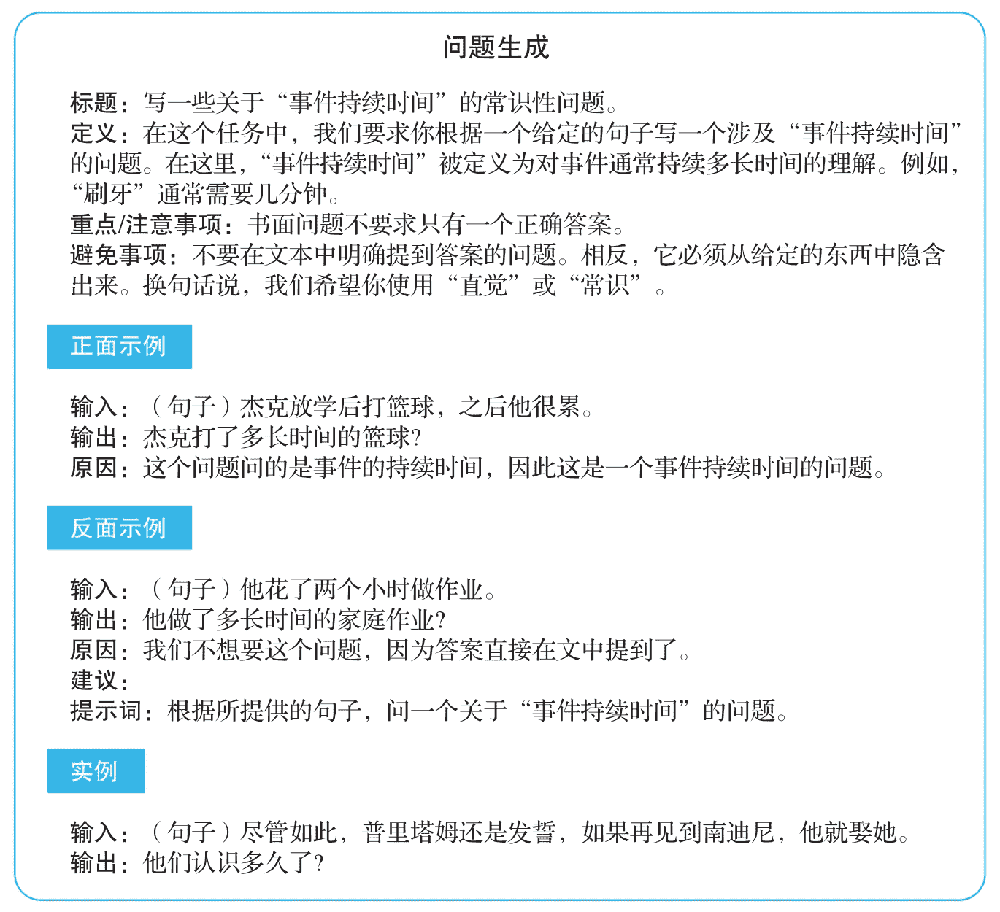

**图 2-6 Natural-Instructions 数据集示例**

1）作者从 175 个种子任务中随机选择 8 条自然语言指令作为示例，并以此为基础提示 InstructGPT 生成更多任务指令。

2）对于生成的指令，作者评估其是否为分类任务。如果是分类任务，他们会要求 InstructGPT 生成所有可能的输出选项，并随机选择一个特定的类别，然后再提示 InstructGPT 生成相应的输入内容。对于非分类任务的指令，可能有多个输出选项，作者采用了“输入优先”策略，即先提示 InstructGPT 生成输入，再根据指令和生成的输入生成输出。

3）根据第 2）步的结果，作者通过 InstructGPT 生成对应的输入和输出，采用“输出优先”或“输入优先”策略。

4）作者对生成的指令任务进行了后处理，例如过滤重复和类似的指令、去除冗余数据，最终构建了一个包含 5.2 万条英文指令的数据集，具体示例如图 2-7 所示。

**图 2-7 InstructGPT 生成完整数据集示例**

**3.指令微调与基于领域数据的微调的对比**

指令微调和基于领域数据的微调是 LLM 适应特定任务或应用场景的两种不同方法，二者的主要区别和主要联系如下。

**（1）主要区别**

❑ **目标差异：**指令微调主要关注提高模型遵循人类指令的能力，通过特定的指令-输出对数据集进行训练，以增强模型理解和执行指令的能力。而基于领域数据的微调则侧重于将模型调整至特定领域的知识或语言风格，使用特定领域的数据进行训练，以提升模型在该领域的性能。

❑ **数据依赖性：**指令微调依赖高质量的指令-输出对数据集，这些数据集通常需要人工标注或精心设计。而基于领域数据的微调依赖特定领域的数据集，这些数据可能包括文本、对话或其他形式的领域特定内容。

❑ **应用场景：**指令微调适用于需要模型理解并执行复杂指令的场景，例如编程、教育或任务自动化。基于领域数据的微调更适用于需要模型表现出特定领域专业知识的场景，如医疗、法律或金融分析。

**（2）主要联系**

❑ **共同目标：**尽管指令微调和基于领域数据的微调在方法和数据上有所不同，但它们的共同目标是提高 LLM 在特定任务或领域上的表现。

❑ **技术互补：**在某些情况下，指令微调和基于领域数据的微调可以联合使用，先通过基于领域数据的微调提升模型对特定领域内容的理解，再通过指令微调提高模型执行相关任务的能力。

❑ **微调过程：**两种方法都涉及在预训练模型的基础上进行进一步的训练，以适应特定的需求。

通过指令微调，LLM 能够更好地理解并执行人类指令，从而在各种应用场景中表现出更高的可控性和有效性。这种方法不仅提高了模型的任务执行能力，还为模型的实际应用提供了更广泛的可能性。

## **2.3 提示工程**

提示工程的兴起为与 LLM 的交互带来了全新思路。通过有效的提示词设计，用户可以引导模型生成更符合预期的内容，从而提升任务的完成质量和效率。本节将介绍提示词撰写原则与策略、提示技术要点，以及思维链（Chain of Thought，CoT）等先进方法。通过阅读本节内容，读者将进一步掌握提示词在实际应用中的技巧与最佳实践。

### **2.3.1 提示词撰写原则与策略**

在 NLP 领域，提示词是指用户向 LLM 提供的一段输入文本，用于引导 LLM 生成所需的输出。提示词可以是一个问题、一个句子、一段指令，甚至是部分完成的文本。通过设计和调整提示词，用户可以更好地控制 LLM 的输出内容和质量。因此，提示词是使用 LLM 的核心工具，通过设计和调整提示词，用户可以有效地引导模型生成所需的内容。理解提示词的作用和设计策略，有助于在各种应用场景中更好地发挥 LLM 的潜力。

2023 年，OpenAI 发布 Prompt engineering 文档，详细阐述了使用 GPT 时撰写提示词的基本原则与策略。这些原则与策略是通用的，同样可以作用于其他 LLM，使模型得到更好的输出效果。

**（1）原则一：撰写明确清晰的指令**

LLM 有时并不能完全理解用户的心思，因此提供明确清晰的指令尤为重要。例如：如果希望输出简短，可以直接要求简洁的回复；如果觉得输出内容过于浅显，可以明确指出需要高水平的专家级写作。

主要策略如下。

1）在提示词中包含详细信息以获得更相关的答案。为了获得高度相关的响应，应确保提示词提供了重要的详细信息或上下文，如表 2-3 所示。

**表 2-3 提示词示例 1**

2）要求模型扮演特定的角色。明确告诉 LLM 它应该扮演什么角色，有利于其给出更准确、专业的回答，如表 2-4 所示。

**表 2-4 提示词示例 2**

3）使用分隔符清楚地指示输入的不同部分。三引号、XML 标记、章节标题等分隔符可以帮助划分要区别对待的文本部分，消除任务细节的歧义，如表 2-5 所示。

**表 2-5 提示词示例 3**

4）指定完成任务所需的步骤。显式写出明确的步骤可以使模型遵循该步骤以获得更好的输出结果，如表 2-6 所示。

**表 2-6 提示词示例 4**

5）提供具体的例子。提供适用于所有示例的一般说明通常比通过示例演示任务的所有排列更有效，但在某些情况下，提供示例可能更容易。这就是经典的少样本提示，如表 2-7 所示。

**表 2-7 提示词示例 5**

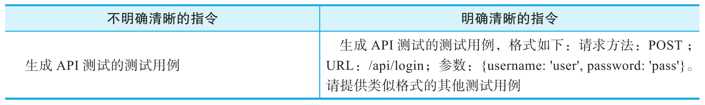

6）指定输出长度。用户可以要求模型生成给定目标长度的输出，尽管字数并不会特别精确，尤其是当用户要求模型输出超长文本时效果不好，但一般而言，指定输出长度确实有一定的效果，如表 2-8 所示。

**表 2-8 提示词示例 6**

**（2）原则二：提供参考文本**

尽管 LLM 在近些年发展迅猛，在很多领域都表现出了卓越的性能，但不得不承认的是，在某些特殊的场景下，LLM 会自己编造知识，即给出的内容并不符合客观事实。给 LLM 提供参考文本，能大幅降低 LLM 编造的概率。

主要策略如下。

1）指示模型使用给定的参考文本回答问题。适用于已有关于当前问题的可信信息的场景，如表 2-9 所示。

**表 2-9 提示词示例 7**

2）让模型通过引用参考文本来回答。如果已经给定了可信的参考文本，可以直接要求模型通过引用所提供文本中的段落来为其答案添加引用，以增强可验证性，如表 2-10 所示。

**表 2-10 提示词示例 8**

**（3）原则三：将复杂的任务拆分为更简单的子任务**

对于 LLM 而言，一次性完成一件非常大的事情是比较困难的，也是容易出错的。因此最好将复杂的任务拆分成简单的子任务，逐步完成子任务，最后即可完成最终的复杂任务（类似分治的思想）。

主要策略如下。

1）使用意图分类来识别与用户查询最相关的指令。对于需要大量独立指令集来处理不同情况的任务，首先对查询类型进行分类并使用该分类来确定哪些指令可能是有益的。这可以通过定义与处理给定类别中的任务相关的固定类别和硬编码指令来实现。此过程也可以递归地应用，以将任务分解为一系列阶段。

2）分段总结长文档，并递归地构建完整的摘要。这个问题主要是开发者考虑的。开发者通过设置特定的规则，当输入大小达到某一阈值时，触发 LLM 自动总结与归纳，在保留上下文信息的同时，达到压缩的目的，防止上下文过长。

**（4）原则四：给模型时间“思考”**

一步步思考（Think step by step），即思维链，是一个非常有用的高级提示词撰写策略。我们将在 2.3.3 节中详细解析这一技术。

### **2.3.2 提示技术**

随着 LLM 的迅速发展，提示技术成为提升 LLM 的任务处理能力的关键手段之一。本节将介绍几种常用的提示技术，包括零样本提示、少样本提示以及生成知识提示。这些技术不仅帮助模型在处理各种自然语言任务时获得更为灵活和高效的表现，也为未来模型性能的优化提供了理论基础和实际应用的范例。通过对这些技术的分析和探讨，读者将更深入地理解提示设计在 LLM 应用中的核心作用及其广泛的应用场景。

**1.零样本提示**

如今，经过大量数据训练以及指令调整的 LLM 能够执行零样本任务，示例如表 2-11 所示。

**表 2-11 零样本提示示例**

在上面的例子中，我们没有向模型提供任何示例，这就是零样本提示。

**2.少样本提示**

虽然目前许多 LLM 都展现出了出色的零样本能力，但是在某些复杂任务上，零样本提示的效果不佳。少样本提示作为一种提示技术，通过用户提供演示，可以引导模型实现更好的性能。

Brown 等人在论文“Language Models are Few-shot Learners”中演示了少样本提示的一个具体例子^([6])，如图 2-8 所示。其中，粗体部分是 GPT-3 完成的内容，普通文本是作者输入的提示。

**图 2-8 Brown 等人在论文中的少样本提示示例**

可见，LLM 通过一个示例（1-shot）就学会了执行此类任务。对于更加困难、复杂的任务，可以尝试增加示例数量（如 5-shot、10-shot 等）。

**3.生成知识提示**

融合知识或信息，可以帮助模型做出更准确的回答。刘嘉程等人在 2022 年的研究^([10])探索了生成知识以作为提示的一部分，如图 2-9 所示。

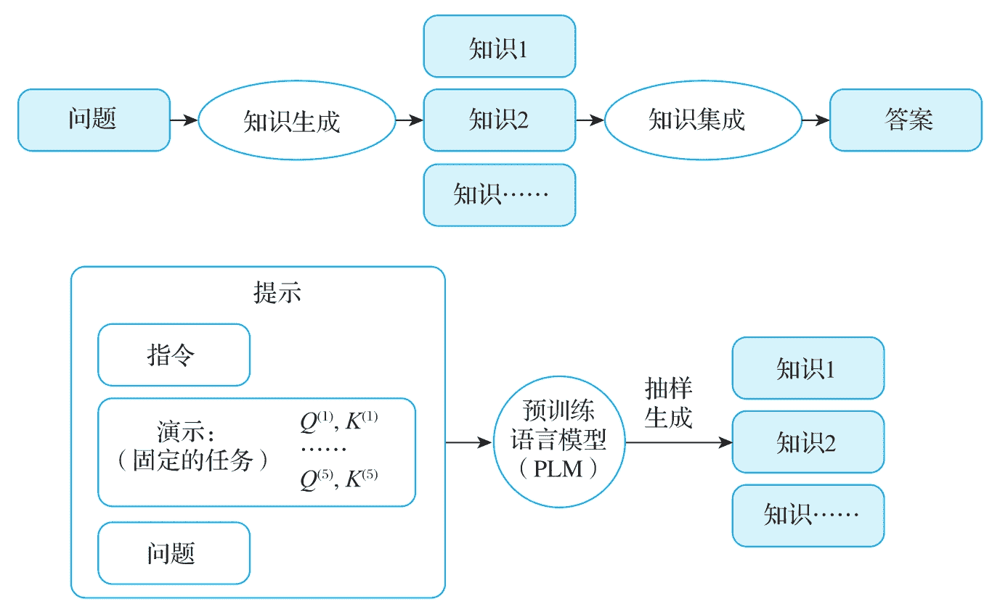

**图 2-9 生成知识提示**

生成知识提示是一种用于提高常识推理能力的方法，它包括以下两个步骤：

1）知识生成：使用 LLM 根据问题生成相关的知识陈述。这些知识陈述包含回答问题所需的信息。

2）知识集成：将生成的知识陈述作为额外的输入，与原始问题一起输入推理模型中，以得到最终的答案预测。

该研究中的一个例子如下。

步骤一：直接向 LLM 提问。

问题：“高尔夫球运动的目标是获得比其他人更高的得分。是或否？”

LLM 回答：“是。”

这显然是错误的。

步骤二：让 LLM 生成一些有关高尔夫球运动的“知识”。

问题：请简述高尔夫球运动的目标及其规则。

LLM 回答：高尔夫球运动的目标是以最少的杆数打完一组洞。一轮高尔夫球比赛通常包括 18 个洞。每个洞在标准高尔夫球场上一轮只打一次。每个杆计为一分，总杆数用于确定比赛的获胜者。

步骤三：将“知识”和问题一起输入 LLM。

问题：高尔夫球运动的目标是获得比其他人更高的得分。是或否？

知识：高尔夫球运动的目标是以最少的杆数打完一组洞。一轮高尔夫球比赛通常包括 18 个洞。每个洞在标准高尔夫球场上一轮只打一次。每个杆计为一分，总杆数用于确定比赛的获胜者。

LLM 回答：不是，高尔夫球运动的目标不是获得比其他人更高的得分。相反，目标是以最少的杆数打完一组洞。用于确定比赛的获胜者的是总杆数，而不是总得分。

可见，生成知识提示（类似于“自问自答、自我引导”）能够有效提高 LLM 的常识推理能力，帮助其做出更准确的回答。

综上所述，提示技术为提升 LLM 的推理能力和处理复杂任务的表现提供了有效的工具。无论是零样本提示所体现的模型泛化能力、少样本提示对任务理解的引导，还是生成知识提示对常识推理的支持，都在推动 LLM 能力不断进化。随着研究的深入和应用的扩展，提示技术无疑将在未来的 LLM 开发和应用中发挥越来越重要的作用。

### **2.3.3 思维链**

思维链技术作为提升 LLM 推理能力的重要策略，近年来得到了广泛关注。通过引导模型逐步推理，思维链技术能够帮助语言模型更有效地完成复杂任务。本节将探讨几种常见的思维链技术，包括零样本思维链（Zero-shot-CoT）、少样本思维链（Few-shot-CoT）和自洽（Self-Consistency）技术。这些方法在应对不同规模模型和任务复杂性时展现了显著的效果，推动了 LLM 的推理能力进一步发展。

**1.零样本思维链**

Kojima 等人在 2022 年的论文“Large Language Models are Zero-Shot Reasoners”^([11])中提出了一个技巧：只需要在问题的结尾处放一句“Let’s think step by step”（让我们一步步地思考），LLM 输出的答案会更加准确^([12])（如图 2-10 所示）。

可见，仅仅是增加了一句“让我们一步步地思考”，LLM 给出的回答就由错误变为正确了。论文给了一些解释，大致内容如下：像 ChatGPT 这类 LLM 只是统计语言模型，其本质是基于过去看到的数据，用统计学意义上的预测结果进行下一步的输出（即 LLM 的回答是一个字一个字算出来的），在计算的过程中，如果不要求其一步步地思考，LLM 可能会跳过一些步骤，这会导致逻辑链不完整，从而造成错误。

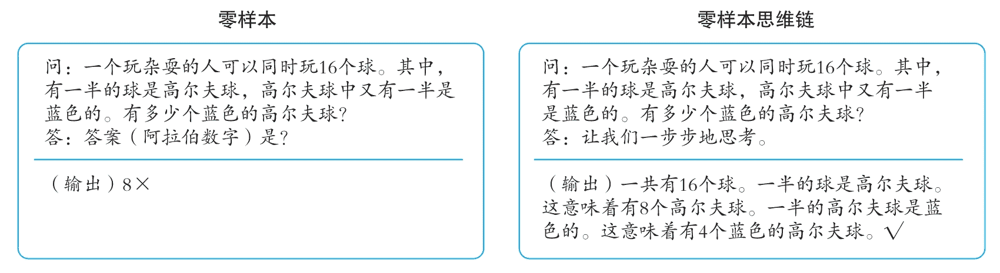

**图 2-10 Kojima 等人论文中的零样本思维链例子****^[¹¹^]**

零样本思维链在概念上很简单，实际上它使用了两个提示词来提取推理和答案。首先使用第一个“推理”提示词从语言模型中提取完整的推理路径，然后使用第二个“答案”提示词从推理文本中以正确的格式提取答案，如图 2-11 所示。

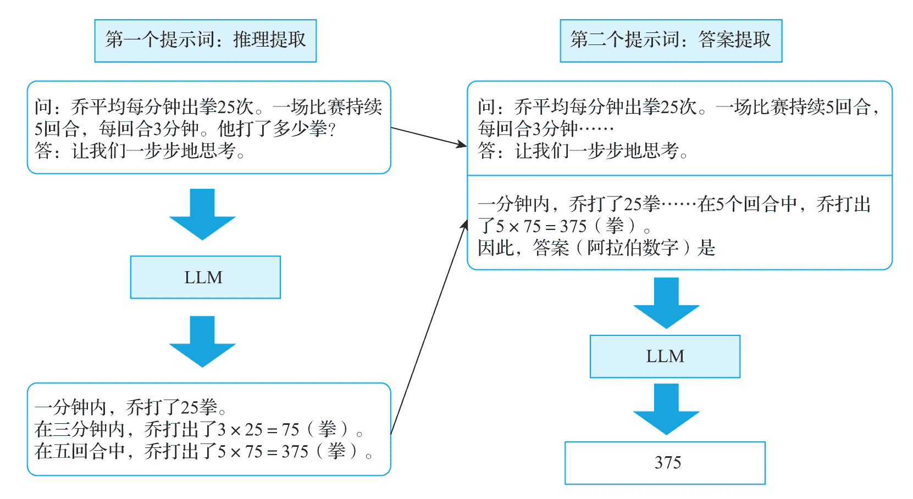

**图 2-11 零样本思维链的提示过程**

但零样本思维链有时也并不好用，因为逻辑连贯不代表一定正确，当 LLM 进行逐步推理时，如果中间一步出错，错误会逐步积累，最终也会输出错误的回答。

**2.少样本思维链**

值得注意的是，Wei 等人于 2022 年在论文“Chain-of-Thought Prompting Elicits Reasoning in Large Language Models”中提出，零样本思维链仅在参数量大于或等于 1000 亿个的模型中使用才会有效^([12])。如果是小样本模型，这个方法并不生效。同时，该论文还提出通过向 LLM 展示少量的样例，并在样例中解释推理过程，LLM 在回答提示时也会显示推理过程。这种推理的解释往往会引导出更准确的结果，如图 2-12 所示。

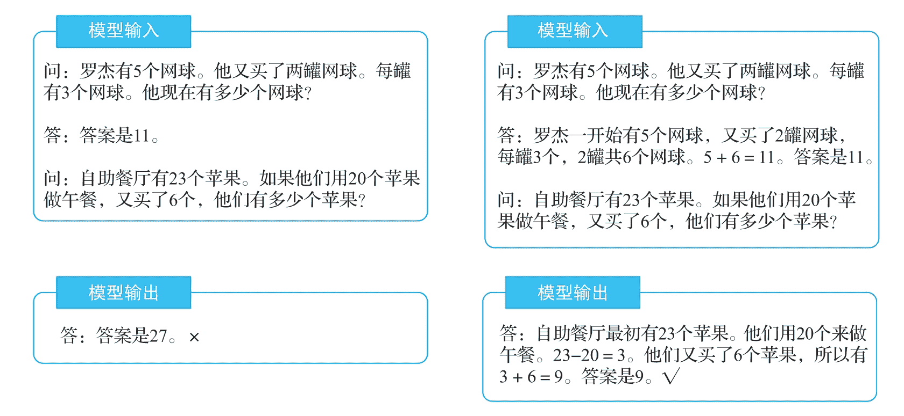

**图 2-12 Wei 等人的论文中少样本思维链的例子**

以上案例说明，利用少样本思维链，通过向 LLM 提示具体的思维过程，可以帮助 LLM 推理得出更准确的答案。

**3.自洽**

Wang 等人在 2022 年发表论文“Self-Consistency Improves Chain of Thought Reasoning in Language Models”，提出了自洽（Self-Consistency），作为对思维链的一种补充和扩展^([13])。

当我们只用一个逻辑链进行优化时，LLM 有时还会出错，因此可以考虑让模型进行多次运算，最后投票选取答案，如图 2-13 所示。

自洽包含以下三个步骤。

1）使用思维链提示语言模型。

2）通过从语言模型的解码器中采样来替换思维链提示中的“贪婪解码”，以生成一组多样化的推理路径。

3）通过在最终答案集中选择最一致的答案来边缘化推理路径和聚合。

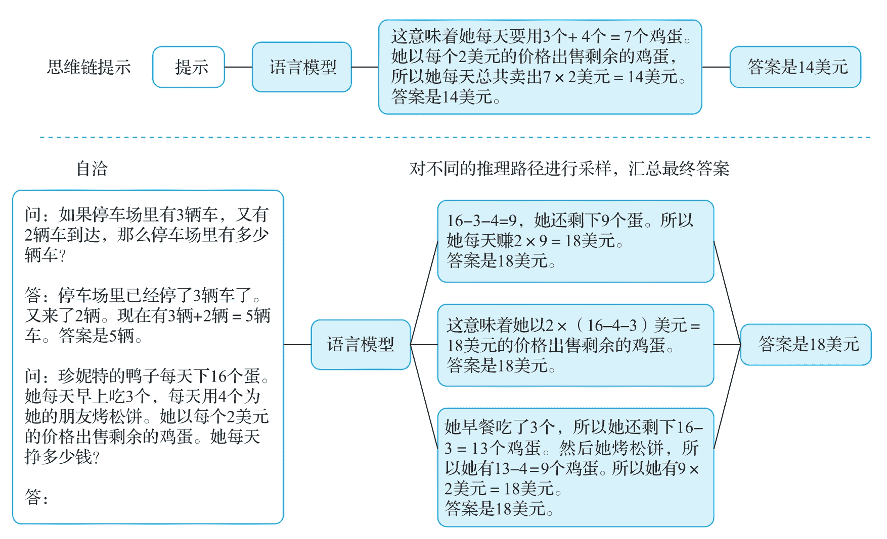

**图 2-13 自洽步骤示意****^[¹³^]**

总的来说，思维链技术在提升 LLM 推理能力方面展现出了强大的潜力。从简单的一步步思考到更复杂的少样本提示和自洽策略，每种方法都在不同程度上提高了模型的准确性和逻辑性。随着研究的深入，这些技术将继续完善，并为更复杂的语言任务提供更加有效的解决方案。

### **2.3.4 提示词应用技巧**

提示词的应用不限于原则和技术的使用，还包含许多能够提升生成效果的实用技巧。通过这些技巧，用户可以更好地控制模型输出，提升任务完成的效率和准确性。本节将介绍几种常见的提示词应用技巧，这些技巧将为在实际操作中最大化提示词的效果提供有力支持。

**1.明确“好结果”的标准**

在使用提示词时，明确“好结果”的标准至关重要。这种标准不仅有助于提高模型生成文本的质量，还能确保生成内容与预期目标一致。只有充分理解了“好结果”在特定上下文中的具体含义，我们才能有效地将这些标准转化为提示词，从而精确传达我们的意图。以下是一个示例。

不明确清晰的指令：解释软件测试的概念。

明确清晰的指令：请详细解释软件测试的定义，涵盖测试生命周期的各个阶段、不同测试类型的介绍，以及为何软件测试在软件开发过程中至关重要。请以表格形式呈现这些信息。

**2.告知模型应该干什么，而不是不应该干什么**

OpenAI 在其官方文档“Best Practices for Prompt Engineering with the OpenAI API”中指出：“与其告知模型不能干什么，不妨告诉模型能干什么。”示例如下。

不明确清晰的指令：测试这个登录功能，不要只检查用户名或密码字段，也不要忽略错误消息的显示。

明确清晰的指令：测试这个登录功能，确保用户名和密码字段都输入正确时能够成功登录，并且当输入错误时，系统能够显示清晰的错误消息。

**3.使用 LLM 辅助提示词撰写**

当任务本身较为模糊、难以准确描述时，向 LLM 寻求撰写提示词的灵感可以大幅提升任务完成的效率和质量，以下是一个示例：

你现在是一个提示词生成专家，请帮我生成一份优质的提示词，以完成{某任务}。

诸如此类的提示词应用技巧还有很多，为避免冗长，本书不再继续罗列。通过对这些提示词应用技巧的掌握，用户能够在多种场景下优化与 LLM 的交互，提升任务执行的效率。然而，提示词应用技巧并非万能，当面对复杂或不确定的任务时，适时结合其他提示技术与策略，将更有助于获得理想的结果。提示词的设计和应用仍是未来研究和实践中值得深入探索的领域。

## **2.4 让 LLM 扮演不同角色**

在 LLM 的应用中，如何让 LLM 扮演不同的角色以应对多样化的任务需求，成为一项重要的研究方向。本节将探讨让 LLM 充当不同角色的几种方法，涵盖从单一 AI 智能体的功能设计，到多智能体协作，再到智能体框架的构建和优化。此外，本节还将详细介绍如何构建一个“测试专家”智能体，以展示实际应用中智能体的强大潜力。通过对这些内容的分析，读者将深入了解智能体在复杂任务中的应用和前景。

### **2.4.1 AI 智能体**

AI 智能体是人类长期以来努力构建的一类代理或实体，它具备感知环境、制定决策并自主执行预设目标的能力。这些智能体具有自主性、交互性和反应性等特征，能够在多种操作和控制场景中协助人类完成各种复杂任务。AI 智能体须具备类似人类的智能特征和行为能力，例如学习、推理、决策和执行能力，以便根据当前环境、状态和未来预期结果调整其行为策略，从而达成既定的目标。

基于 LLM 构建的 AI 智能体与 ChatGPT 这类工具存在一个显著的区别，即 AI 智能体不但会“告诉你如何做”，更会“帮你做”。

AI 智能体的工作流程如图 2-14 所示。

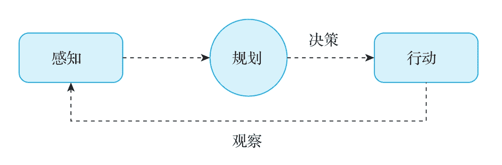

**图 2-14 AI 智能体的工作流程**

由图 2-14 可知，AI 智能体的工作由“感知-规划-行动”循环组成。AI 智能体首先通过感知从环境中收集信息并从中提取知识，然后利用这些知识，面向某一目标进行规划，得出决策，用以指导行动。而 AI 智能体在行动的过程中，又不断地进行感知，如此循环。

在 LLM 赋能的 AI 智能体中，LLM 充当智能体大脑的角色，并与若干关键组件协作，如图 2-15 所示。

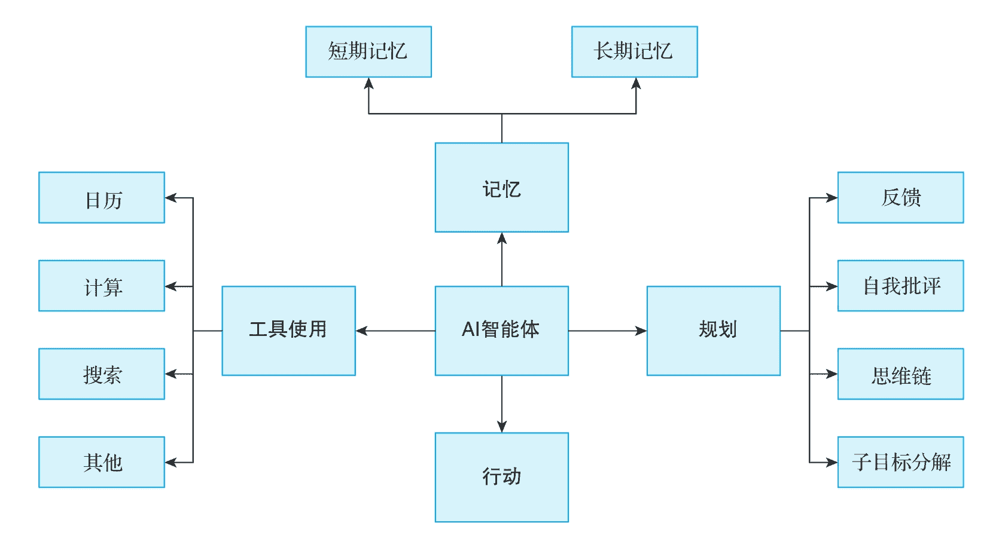

**图 2-15 AI 智能体框架**

**1.规划**

子目标分解：AI 智能体将大任务拆解为较小的、可管理的子目标，以更有效地处理复杂的任务。这种方法不仅简化了任务执行的流程，还提高了任务完成的效率和准确性。

反思与完善：AI 智能体能够对其历史行为进行自我批评和反思，从中汲取教训，并在随后的步骤中加以改进，从而提高最终结果的质量。这种自我调整机制使 AI 智能体在处理类似任务时能不断提升其表现。

**2.记忆**

短期记忆：上下文学习是利用模型的短期记忆来实现的，即通过最近的上下文信息进行学习和推理，从而在任务执行过程中保留和使用相关信息。

长期记忆：为 AI 智能体提供了保留和召回长期信息的能力，通常通过外部向量存储和检索机制来实现。这种机制使 AI 智能体能够在需要时访问和利用历史信息，从而增强其任务处理能力。

**3.工具使用**

AI 智能体通过调用外部 API 获取额外信息来弥补模型权重中缺失的信息，这些额外信息包括当前信息、代码执行能力和专有信息源的访问等，从而增强 AI 智能体的知识和执行能力。

**4.行动**

行动模块是 AI 智能体实际执行决策或响应的部分。面对不同的任务，AI 智能体系统拥有一套完整的行动策略集，可在决策时选择需要执行的行动，如记忆检索、推理、学习、编程等。这些行动策略的灵活运用，使 AI 智能体能够高效、准确地完成各类任务。

目前，基于 LLM 的 AI 智能体构建已经取得了一定的成果。下面以 AutoGPT 为例介绍 LLM 构建 AI 智能体的实践与应用。

AutoGPT 可以被视为基于 LLM 的 AI 智能体的鼻祖，它由 GPT-4 和 GPT-3.5 驱动，可以实现用于搜索和信息收集的互联网接入、长期和短期内存管理、访问网站和平台执行特定任务等功能。

AutoGPT 的工作依赖以下几个部件：

**基础框架：**AutoGPT 基于 GPT-4 和 GPT-3.5，之所以由两个模型驱动，是为了平衡性能与效率。GPT-4 被称为“聪明模型”，GPT-3.5 被称为“快速响应模型”，根据不同任务的需要，AutoGPT 会适时选择合适的模型，保持高性能的同时尽量提高效率。

**自主迭代：**AutoGPT 从最原始的任务列表（Task List）出发，将任务投入 LLM 中生成进一步细化的任务列表。任务被逐项完成，结果被保存下来。每次结果会被选择性地放回 LLM 中再迭代生成回应，形成一个自主迭代的闭环。

**内存管理：**AutoGPT 默认使用一种向量数据库来存储对话上下文，这些数据保存在 auto-gpt.json 文件中。这种方法使 LLM 能够实现长期记忆，并在最大程度上减少 token 的使用，防止输入超过 token 数限制并降低使用成本。除了本地向量数据库之外，还可以利用 Redis 来保存上下文信息，以进一步提升性能。

**多功能部件：**AutoGPT 配备了多种工具，这些工具包括本地 shell 的执行权限、本地文件的读取和写入功能、Google 搜索能力以及 Python 脚本的执行能力等。这些功能不仅增强了 AutoGPT 的联网能力，还赋予其一定的本地操作权限，从而大幅拓展了其应用范围和功能。

AutoGPT 的功能十分强大，一个有趣的例子是，它可以帮助用户完成“在线下单比萨”的任务。对此，用户的任务是定义角色为“比萨爱好者”，目标是“在附近找一家最好的比萨店，点一个榴莲口味的 10 寸比萨，使用信用卡付款”。

然后 AutoGPT 便可以依托其互联网访问、内存管理和文本生成功能执行以下步骤，从而完成“在线下单比萨”的任务。

1）获取当前位置，搜索附近的比萨店，比较它们的评分、价格和评论。

2）根据比萨店的评分等指标，结合用户的喜好选择最佳比萨店。

3）打电话或访问比萨店的网站，使用自然语言完成下单操作。

4）确认订单详细信息、交货地址和付款方式，完成订单。

综上所述，AI 智能体的设计与实现不仅依赖 LLM 强大的语言能力，还需结合规划、记忆、工具使用和行动等关键组件，以形成完整的智能决策循环。通过这些能力，AI 智能体能够自主完成复杂任务，并不断优化自身的行为策略。无论是在 AutoGPT 这样的应用中，还是在未来的更多场景中，AI 智能体的潜力都将随着技术的进步不断得到挖掘和扩展。接下来，我们将进一步探讨如何通过多智能体协作，完成更复杂的任务。

### **2.4.2 多智能体**

多智能体（Multi-Agent）是由一系列相互作用的智能体组成的，其内部的各个智能体之间可以通过相互通信、合作、竞争等方式，完成单个智能体不能完成的、大量而又复杂的任务^([15])。

**1.多智能体的特点**

1）自主性。多智能体系统中的每个智能体都能够独立管理其行为，并在需要时自主进行合作或竞争。

2）协作性。多智能体系统中的智能体能够通过适当的策略进行相互协作，以实现整体目标。

3）容错性。当多智能体系统中的个别智能体发生故障时，其他智能体也能自主适应新环境，继续运作，从而避免整个系统的故障。

4）灵活性与可扩展性。在多智能体系统中，智能体具有高度内聚和低耦合的特性，具备出色的灵活性和可扩展性。

由此可见，与单智能体相比，多智能体系统将多个 LLM 专业化为在不同领域各自具有出色能力的智能体，通过各智能体之间的交互，实现协作参与规划、讨论决策，模拟了人类群体在解决实际问题时的合作性质，即“能力互补，通力协作”。因此，我们自然而然地需要讨论多智能体构建的关键因素。

**2.多智能体构建的关键因素**

**（1）环境**

环境定义了 LLM 多智能体（Large Language Model-Multi-Agent，LLM-MA）系统部署、交互和工作的特定上下文，如软件开发、算法竞赛、游戏等。LLM-MA 感知和与环境交互的方式（即“环境接口”）分为三类：沙盒（sandbox）、物理（physical）和空（none）。

沙盒环境接口是由人类构建的模拟或虚拟环境，智能体在其中尝试各种行动和策略。这种环境接口广泛应用于软件开发（如代码解释器）和游戏（使用游戏规则作为模拟环境）中。

物理环境接口指的是智能体与现实物理实体互动，执行产生直接物理结果的行动，并遵守现实世界的约束和反馈。这种接口常用于机器人领域。例如，在扫地任务中，机器人智能体需根据物理环境的反馈和约束调整执行的动作。

空环境接口指智能体不与环境互动，而是利用多个智能体对某问题进行辩论并达成共识。该接口主要关注智能体间的通信，不依赖外部环境。

**（2）配置**

在 LLM-MA 系统中，各智能体通过其特征、行为和技能定义，这些要素根据特定目标和角色量身定制。例如：在游戏中，智能体可能作为不同角色的玩家；在软件开发中，智能体可能扮演项目经理、开发工程师、测试工程师等角色。智能体的配置方法包括以下三种。

1）预定义方法。预定义方法由系统设计者明确定义智能体的特征、行为和技能。此方法在系统设计初期详细规划和设定智能体配置。它具有以下特点。

❑ 控制力强：设计者完全掌控智能体的行为和特征，确保其符合预期目标。

❑ 适用性强：适用于特定任务或情境，能精确满足系统需求。

❑ 灵活性差：运行时适应性和灵活性差，难以应对动态变化的环境。

例子：在游戏开发中，设计者可预定义战士、法师、治疗师等角色，每个角色都有特定技能和行为模式。模型生成方法利用模型（如 LLM）来创建智能体的配置。通过训练和使用模型，可以生成智能体的特征、行为和技能，使其具备一定的自主性和适应能力。

2）模型生成方法。模型生成方法利用模型（如 LLM）创建智能体配置。通过训练和使用模型生成智能体的特征、行为和技能，使其具备一定的自主性和适应能力。它具有以下特点。

❑ 灵活性高：能够根据环境变化动态调整自身行为。

❑ 复杂度高：需要大量数据和计算资源，结果可能不完全可控。

❑ 创新性强：能生成新智能体配置，探索更多可能性和解决方案。

例子：在软件开发中，可使用 LLM 生成不同角色的开发人员智能体，自动生成代码、进行代码审查和测试，提高开发效率。

3）数据驱动方法。数据驱动方法基于预先存在的数据集构建智能体配置。通过分析和挖掘数据，提取有用信息和模式，进而定义智能体的特征、行为和技能。它具有以下特点。

❑ 数据依赖性强：需要大量高质量数据支持。

❑ 适应性强：能从数据中学习和优化自身行为。

❑ 复杂度高：数据收集、清洗和分析过程复杂，需要一定数据处理和机器学习知识。

例子：在客户服务系统中，通过分析大量客户交互数据，构建客户服务智能体，优化服务策略和响应方式，提高客户满意度。

**（3）通信**

LLM-MA 系统中智能体间的通信是支持集体智能的关键基础，涉及通信范式（智能体之间互动的风格和方法）、通信结构（多智能体系统内通信网络的组织和架构）和通信内容。

1）通信范式。当前的 LLM-MA 系统主要采用合作、辩论和竞争 3 种通信范式。

❑ 合作范式：智能体交换信息、建言献策，共同完成集体解决方案，实现共享目标。

❑ 辩论范式：智能体之间进行争论，提出并捍卫各自观点和解决方案，并批评其他智能体的方案。

❑ 竞争范式：智能体努力实现与其他智能体目标可能冲突的自身目标。

2）通信结构。典型通信结构有分层通信（layered）、去中心化通信（decentralized）、中心化通信（centralized）和共享消息池（Shared Message Pool）4 种，如图 2-16 所示。

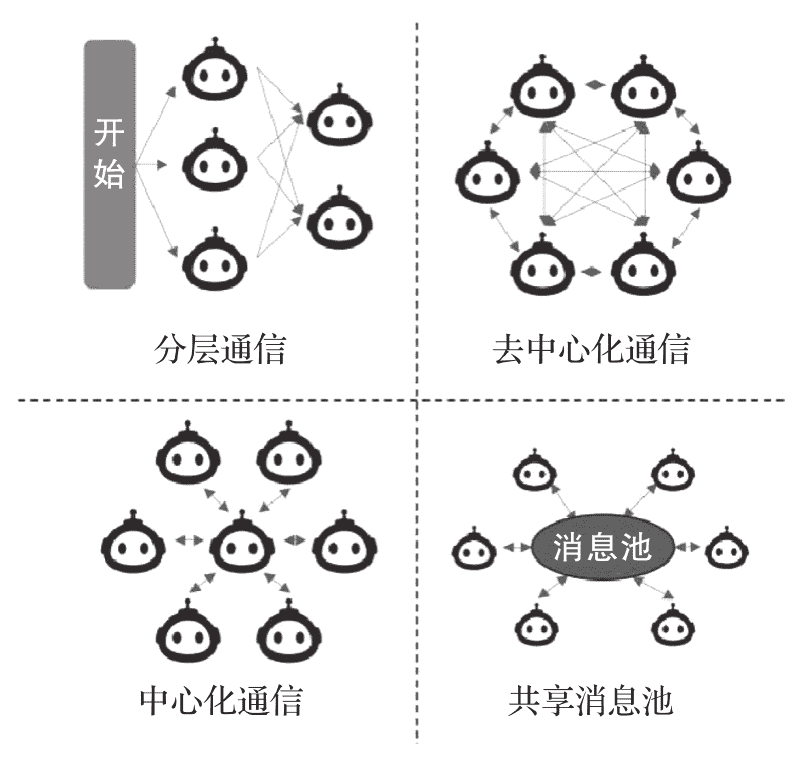

**图 2-16 4 种典型通信结构**

❑ 分层通信：每个层级的智能体有不同角色，主要在本层级或与相邻层级互动。

❑ 去中心化通信：在点对点网络上运行，智能体直接相互通信。

❑ 中心化通信：涉及一个中央智能体或一组中央智能体协调系统通信，其他智能体主要通过中心节点互动。

❑ 共享消息池：维护一个共享消息池，智能体在其中发布和订阅相关消息。

3）通信内容。LLM-MA 系统中的通信内容通常以文本形式存在，具体内容因应用而异。例如，在软件开发中，智能体可能就代码段相互通信。

**（4）能力获取**

智能体能力获取是 LLM-MA 中的关键过程，使智能体能动态学习和进化。需解决的两个重点问题是：智能体应学习何种反馈类型以增强能力？智能体如何调整策略以有效解决复杂问题？

反馈是智能体用于获知其行动结果的关键信息，帮助其了解行动的潜在影响，并适应复杂和动态的问题。反馈有来自环境的反馈、来自其他智能体的反馈、来自人类的反馈和无反馈 4 种类型。

为了增强能力，LLM-MA 系统中的智能体可通过以下 3 种方法进行调整。

❑ 记忆：将先前互动和反馈的信息存储在记忆中，执行行动时检索相关、有价值的记忆。

❑ 自我进化：通过改变初始目标和规划策略自我修改，根据反馈或通信日志自我训练。

❑ 动态生成：系统可在运行过程中动态生成新智能体，处理当前需求和挑战。

综上所述，多智能体系统通过自主性、协作性、容错性、灵活性和可扩展性，实现了单个智能体无法完成的复杂任务。通过环境定义、智能体配置、通信方式和能力获取等关键要素的有效设计，多智能体系统可以在不同应用场景中灵活应对挑战，体现出“能力互补，通力协作”的优势。最终，多智能体系统不仅模拟了人类群体的合作特性，还大幅提升了任务执行的效率和效果。

### **2.4.3 多智能体框架**

当前，各种流行的多智能体框架百花齐放，本小节将以 MetaGPT^([15])为例介绍多智能体框架。

2023 年 6 月，DeepWisdom 团队开源了 MetaGPT 框架，并与阿卜杜拉国王科技大学（KAUST）、厦门大学、香港中文大学（深圳）、南京大学、宾夕法尼亚大学以及加州大学伯克利分校等多所高校的学者开展了深入的合作与研究。MetaGPT 在多智能体协作方面提出了一种有效的范式，创新性地将 SOP（Standard Operating Procedure，标准操作程序）编码为智能体的设计规范和协议，从而实现了领域知识的自动嵌入。这一进展为理解和模拟人类工作流程提供了新的途径，并提升了自主智能体在各种任务中的表现和适应性。

MetaGPT 框架将 SOP 的概念引入角色专业化、通信协议设计和可执行反馈机制中。

**（1）角色专业化**

通过明确定义的角色分工，将复杂的工作分解为更小、更具体的任务。不同角色被初始化为不同的目标、约束和专业技能。例如，产品经理角色可以使用网络搜索工具，而工程师角色可以执行代码。每个角色默认遵循推理与行动（ReAct）的行为模式。角色专业化使每个智能体都能够专注于特定领域的任务，从而提升了 LLM 的输出质量。在软件开发中，角色之间的流转更巧妙地实现了从自然语言到编程语言的对齐。

**（2）通信协议设计**

自然语言虽然具备丰富的语义，但由于其非结构化特性，在消息传递过程中常会导致信息扭曲或丢失。为解决这一问题，MetaGPT 框架规定智能体以结构化的输出（包括文档和图表）进行协作，以提高信息传递的清晰度和完整性。MetaGPT 论文中设计了多种软件开发任务，通过生成代码的可执行性和生产力指标，验证了结构化输出在协作中的关键作用。

在多智能体协作中，为提高通信效率，MetaGPT 引入了基于消息共享的发布-订阅机制（Publish-Subscribe Mechanism）。共享消息池允许智能体直接交换消息，任何智能体都可以透明地访问其他智能体的消息，无须询问和等待响应。发布-订阅机制使智能体更倾向于接收与自身任务相关的信息，避免分心于无关细节。同时，每个智能体可以从共享消息池中检索所需信息，形成自我记忆。

**（3）可执行反馈机制**

智能体根据环境反馈进行自我优化和主动更新，是其具备自主意识的表现。在软件开发任务中，MetaGPT 为工程师智能体设计了可执行反馈机制，以自动优化代码质量。具体而言，工程师编写并执行相应的单元测试用例，通过观察执行结果，递归地进行决策和自我提示，实现自动调试。设计-测试-反馈的迭代过程持续进行，直到单元测试通过或达到最大重试次数。

实验证明，MetaGPT 在模型性能方面表现十分出色。在 HumanEval 和 MBPP 基准测试中，MetaGPT 分别达到了 85.9%和 87.7%，相较于 GPT-4 的结果，MetaGPT 在 HumanEval 数据集上的表现提升了 28.2%。加入可执行反馈机制后，MetaGPT 在 HumanEval 和 MBPP 上的表现分别提升了 4.2%和 5.4%。在 SoftwareDev 数据集上，MetaGPT 在可执行性上的得分为 3.75，同时所需运行时间仅 503s；生成的代码行数相对基线框架增加了 2.24 倍，而单位代码行数所消耗的 token 数下降了 50%。这些结果突显了 SOP 在多智能体协作过程中带来的效率提升。

综上所述，MetaGPT 代表了一种创新性的多智能体框架，融合了元编程理念，并通过嵌入 SOP 提升了 LLM 在多智能体协作中的效能。MetaGPT 不仅为未来多智能体社会的研究与探索提供了新的灵感，也作为基于 LLM 的多智能体框架优化调整的早期尝试，具有重要的学术和实践意义。

### **2.4.4 构建“测试专家”智能体**

构建一个“测试专家”智能体不仅需要 LLM 的强大支持，还需要一个系统化的方法，将测试任务的各个方面集成到一个能够高效执行和反馈的系统中。本小节将详细阐述如何通过设计和实现一套完整的智能测试系统，将 LLM 与规划、反馈、工具使用和专业知识结合，构建一个智能化的“测试专家”。

**1.构建“测试专家”智能体的目标与原则**

**（1）自动化与自主性**

“测试专家”智能体应具备自动化执行测试任务的能力，包括但不限于测试用例生成、执行、结果分析和报告。自主性是指智能体能在无人工干预的情况下，独立处理测试流程中的各种问题，并根据反馈进行自我调整和优化。

**（2）专业知识与技能**

智能体应具备丰富的软件测试知识和技能，能够理解复杂的测试需求，设计有效的测试用例，并对测试结果进行专业分析。这要求智能体不仅要有基本的测试技术，还要有领域特定的知识和经验。

**（3）交互性与协作**

智能体应具备与开发人员、测试人员等人类用户的良好交互能力，能够通过自然语言交流传达测试需求和结果。同时，智能体应能够与其他智能体协作，分工合作，提高整体测试效率。

**（4）可扩展性与灵活性**

智能体的设计应具备良好的可扩展性，以便不断加入新的功能和知识，适应不同的测试环境和需求。同时，系统应具有灵活性，能够根据具体情况调整测试策略和方法。

**2.“测试专家”智能体架构设计**

要想实现以上提及的各项目标与原则，“测试专家”智能体架构设计应包含以下几个模块。

**（1）感知模块**

智能体的感知模块负责从环境中获取信息，包括系统状态、日志、用户输入等。感知模块应具备强大的信息提取和理解能力，能够将非结构化数据转换为结构化数据供后续处理。

**（2）规划模块**

规划模块是智能体的“大脑”，负责将感知到的信息进行分析和处理，制订具体的测试策略和计划。规划模块应包括以下几个子模块。

❑ 任务分解与调度：将复杂的测试任务分解为多个可管理的子任务，并合理调度这些子任务。

❑ 用例生成：根据测试需求自动生成测试用例，包括功能测试、性能测试、安全测试等。

❑ 策略优化：根据历史数据和反馈，不断优化测试策略，提高测试覆盖率和效率。

**（3）行动模块**

行动模块负责执行规划模块制订的测试计划，包括测试用例的执行、数据收集和结果记录。行动模块应具备以下功能。

❑ 自动执行：利用自动化测试工具和框架执行测试用例。

❑ 实时监控：在测试执行过程中实时监控系统状态，记录重要信息和异常情况。

❑ 结果收集与分析：收集测试结果并进行初步分析，为反馈模块提供数据支持。

**（4）反馈模块**

反馈模块负责对测试结果进行深度分析，提供详细的反馈报告，并根据分析结果调整后续测试策略。反馈模块应包括以下功能。

❑ 结果分析：对测试结果进行多维度分析，识别问题根源和影响范围。

❑ 报告生成：生成详细的测试报告，包含测试用例执行情况、发现的缺陷、性能指标等。

❑ 策略调整：根据分析结果和历史数据，调整测试策略和方法，优化下一轮测试计划。

**（5）工具集成模块**

工具集成模块负责将各种测试工具和平台集成到智能体中，扩展其功能和能力。工具集成模块应包括以下内容。

❑ 测试框架集成：支持主流的自动化测试框架，如 Selenium、Appium、Jenkins 等。

❑ 外部 API 调用：能够调用外部 API 获取额外信息或执行特定操作，如获取最新的测试环境配置、执行远程测试等。

❑ 数据存储与管理：集成数据库或云存储服务，管理测试数据和历史记录，支持数据的高效存取和分析。

**3.构建“测试专家”智能体的具体步骤**

基于以上讨论，可以总结出“测试专家”智能体的具体构建步骤如下。

**（1）系统初始化**

❑ 选择和训练 LLM：根据具体需求选择合适的 LLM，并进行软件测试领域特定的微调训练，提升其在软件测试领域的知识水平和能力。

❑ 环境配置：配置智能体运行所需的硬件和软件环境，包括运行环境、计算资源、网络连接、必要的软件工具等。

**（2）模块开发与集成**

❑ 开发感知模块：实现信息获取和提取功能，确保智能体能够准确感知环境中有关软件测试的信息。

❑ 开发规划模块：设计和实现任务分解、用例生成和策略优化功能，确保智能体能够制订有效的测试计划。

❑ 开发行动模块：实现自动执行、实时监控和结果收集功能，确保测试计划能够顺利执行。

❑ 开发反馈模块：设计和实现结果分析、报告生成和策略调整功能，确保智能体能够根据测试结果不断优化。

❑ 工具集成模块：集成必要的测试工具和平台，扩展智能体的功能和能力。

**（3）测试与优化**

❑ 功能测试：对各子模块进行功能测试，确保每个子模块都能按预期工作。

❑ 集成测试：对整个系统进行集成测试，确保各模块协同工作，系统功能完整。

❑ 性能优化：根据测试结果，对系统进行性能优化，确保其在实际运行中具备良好的性能和稳定的表现。

**（4）部署与维护**

❑ 系统部署：将智能体部署到实际运行环境中，进行上线运行。

❑ 持续维护：定期对智能体进行维护和更新，加入新的功能和知识，优化其性能和能力。

综上所述，构建一个“测试专家”智能体需要系统化的方法和多方面的技术集成。通过合理设计感知、规划、行动和反馈模块，并结合工具集成，可以实现一个具备自动化、自主性、专业知识和交互能力的“测试专家”智能体。上文介绍的仅是“测试专家”智能体构建的一个整体思路，其具体实现有待进一步研究。

## **2.5 本章小结**

本章深入探讨了 LLM 的核心技术与演进路径，以及它们在实际应用中的潜力与挑战。我们首先回顾了 NLP 技术的发展历程，从早期的符号学派和随机学派，到基于逻辑、规则和统计的范式，再到现代的深度学习和 Transformer 架构。我们特别关注了以 GPT 为代表的一系列当下流行的模型，并讨论了它们在 NLP 领域中的重要地位。

我们还详细介绍了 ChatGPT 的诞生和发展，它基于 GPT 系列模型，通过强化学习和人类反馈的结合，为用户提供了高质量的对话体验。ChatGPT 的出现标志着对话系统在智能性和自然交互方面的进步。

此外，我们深入剖析了支撑 LLM 的核心技术，包括 Transformer 架构、预训练模型、基于领域数据的微调和指令微调方法。我们讨论了提示工程的原则和策略，以及如何通过有效的提示词设计来引导模型生成更符合预期的内容。

在多智能体框架方面，我们探讨了如何通过角色专业化、通信协议设计和可执行反馈机制实现智能体之间的有效协作。我们介绍了 MetaGPT 框架，这是一个创新性的多智能体系统，它通过嵌入 SOP 来提升 LLM 在多智能体协作中的效能。

最后，我们讨论了构建“测试专家”智能体的方法，这涉及自动化与自主性、专业知识与技能、交互性与协作、可扩展性与灵活性等设计目标与原则。我们提出了一个包含感知、规划、行动和反馈模块的智能体架构，并强调了工具集成在扩展智能体功能中的重要性。

通过本章的学习，读者应该能够全面理解 LLM 的技术基础，以及它们在构建智能对话系统、多智能体协作和专业领域应用中的潜力。随着技术的不断进步，我们可以期待 LLM 及其相关技术在未来的发展和应用中发挥更大的作用。

**2.6 参考文献**[[1]]

 RADFORD A, NARASIMHAN K, SALIMANS T, et al.Improving language understanding by generative pre-training[J/OL].(2018-06-11).https://cdn-openai.com/research-covers/language-unsupervised/language-understanding_paper.pdf.2018.

[2] DEVLIN J, CHANG M W, LEE K, et al.BERT: Pre-training of deep bidirectional transformers for language understanding[J/OL].arXiv preprint arXiv:1810.04805, 2018.

[3] RAFFEL C, SHAZEER N, ROBERTS A, et al.Exploring the limits of transfer learning with a unified text-to-text transformer[J].Journal of Machine Learning Research, 2020, 21(140):1-67.

[4] YANG Z, DAI Z, YANG Y, et al.XLNet: generalized autoregressive pretraining for language understanding[J].Advances in neural information processing systems, 2019(12)：8-14.

[5] RADFORD A, WU J, CHILD R, et al.Language models are unsupervised multitask learners[J].OpenAI blog, 2019, 1(8):9.

[6] BROWN T, MANN B, RYDER N, et al.Language models are few-shot learners[J].Advances in Neural Information Processing Systems, 2020(33):1877-1901.

[7] VASWANI A, SHAZEER N, PAMAR N, et al.Attention is all you need[J].NIPS’17: Proceedings of the 31st International Conference on Neural Information Processing Systems, 2017(12):6000-6010.

[8] MISHRA S, KHASHABI D, BARAL C, et al.Natural-Instructions:benchmarking generalization to new tasks from natural language instructions[J/OL].arXiv preprint arXiv:2104.08773, 2021:839-849.

[9] WANG Y, KORDI Y, MISHRA S, et al.Self-instruct: aligning language models with self-generated instructions[J/OL].arXiv preprint arXiv:2212.10560, 2022.

[10] LIU J, LIU A, LU X, et al.Generated knowledge prompting for commonsense reasoning[J/OL].arXiv preprint arXiv:2110.08387, 2021.

[11] KOJIMA T, GU S S, Reid M, et al.Large language models are zero-shot reasoners[J].Advances in Neural Information Processing Systems, 2022, 35:22199-22213.

[12] WEI J, WANG X, SCHURMANS D, et al.Chain-of-thought prompting elicits reasoning in large language models[J].Advances in Neural Information Processing Systems, 2022, 35:24824-24837.

[13] WANG X, WEI J, SCHUUMANS D, et al.Self-consistency improves chain of thought reasoning in language models[J/OL].arXiv preprint arXiv:2203.11171, 2022.

[14] GUO T, CHEN X, WANG Y, et al.Large language model based multi-agents:a survey of progress and challenges[J/OL].arXiv preprint arXiv:2402.01680, 2024.

[15] HONG S, ZHENG X, CHEN J, et al.Metagpt: meta programming for multi-agent collaborative framework[J/OL].arXiv preprint arXiv:2308.00352, 2023.

# **第三章**

# **LLM 驱动测试需求分析**

第二章介绍了 LLM 相关的基础知识和技能，从本章开始，我们开始借助 LLM 来驱动软件测试，包括改变软件测试的工作方式，赋能传统的软件测试工具，和 CI/CD 流程集成，全面提升软件测试的效率和质量，助力软件测试行业迈向新的高度。

软件测试工作的流程从测试需求分析、测试计划开始，然后逐步深入到测试设计、测试脚本开发、测试执行，最后完成测试结果评估、交付测试报告等环节。

❑ **测试需求分析：**解决“测什么”的问题，即界定项目的测试边界，明确测试范围，然后针对这个测试范围进行分解，分解成测试项、测试点或测试场景等，并分析测试项的测试风险、确定测试策略和测试项的优先级等。

❑ **测试计划：**为了高效、高质量地完成测试任务而做的准备工作，建立在测试需求分析的基础上，完成工作量的估算、测试资源和进度安排等，最终形成测试计划书。

❑ **测试设计：**解决“如何测”的问题，可以分为测试方案的设计和测试用例的设计。测试方案的设计和测试计划的工作有些类似，所以测试设计和测试分析往往交织在一起，一面分析、一面设计。测试用例的设计可以理解为测试的详细设计。

❑ **测试脚本开发：**基于测试设计开发自动化测试脚本。如果是手工测试，可以理解为详细测试用例的编写。在智能软件工程中，我们可以借助 LLM 生成测试用例和测试脚本，但这个过程也离不开测试人员的引导和评审。

❑ **测试执行：**测试计划、测试用例和测试脚本就绪后，我们就开始执行测试，包括回归测试、测试结果分析、缺陷报告等工作。测试执行一般分为手工执行和自动化工具执行。

❑ **测试结果评估：**测试执行结束，我们就需要对测试结果进行评估，如评估测试覆盖率以了解测试是否充分，结合测试计划评估测试过程，以了解测试计划执行的情况和效果，进而及时发现测试过程中的问题并纠正和改进。

本章将聚焦于 LLM 驱动的测试需求分析，重点介绍借助 LLM 确定测试范围、分解测试项、生成测试计划等内容。

## **3.1 测试需求分析要点**

我们一直持有这样的观点：测试需求分析是测试设计的基础，一定要做好测试需求分析，这样才能清楚地知道测什么——哪些要测试，哪些不需要测试；哪些要重点测试，哪些不是测试的重点。测试需求分析做好了，测试设计就会水到渠成。同时，测试需求分析与测试设计也是难以分离，如软件的结构化分析与设计、面向对象的分析与设计，这意味着测试需求分析和测试设计相互融合、一气呵成。

测试需求分析的核心目标是将模糊的业务需求转化为清晰的、可执行的和可验证的测试需求，其重点是通过分析明确测试目标和测试范围、分解出测试项、识别测试风险，然后基于测试风险和业务应用场景动态评估测试项的优先级、制定测试策略，并采用正确的测试方式、方法和技术。

**1.测试范围确定**

依据产品设计规格说明书、代码变更情况及其影响区域，综合考虑功能的重要性、用户使用频率、变更程度、历史测试情况等因素，精确界定测试范围，明确哪些功能和特性需要进行测试，哪些可以暂不测试或通过其他方式验证。一般来说，优先级高的需求功能、新增加的功能、代码更改很可能影响的已有功能、容易出现问题的功能模块以及经常被用户使用的功能和配置是测试的重点关注对象。在确定测试范围时，主要有以下几个考虑因素。

❑ 优先级最高的需求功能。

❑ 新增加的功能和编码改动较大的已有功能。

❑ 容易出现问题的部分功能。

❑ 过去测试不够充分的地方。

❑ 经常被用户使用的功能和配置（占 20%）。

测试项的分解，可以借助思维导图等工具，按照“系统→子系统→特性→功能→子功能→功能点→场景”这样的路径不断细化，直到不能分解为止。场景可以包括不同的环境、条件、不同的数据输入等。分解完之后，可以进行分类整理。测试项不仅包含功能，也包含非功能特性，如性能、兼容性、易用性、安全性、可靠性等。

**2.测试风险识别**

因为测试是不能穷尽的且总是有风险的，所以测试风险分析显得很重要。测试风险分析旨在识别可能影响测试目标达成的各类风险因素，侧重识别高的或严重的测试风险，如功能缺陷风险、性能瓶颈风险、安全漏洞风险、需求变更风险、测试资源不足风险等，并对风险的严重程度和发生概率进行评估。针对识别的风险，制定相应的应对策略，如增加测试资源、调整测试策略、进行风险预警等，以降低风险对测试工作的影响。例如，若识别出在线教育平台在高并发访问下存在性能瓶颈风险，可提前准备性能测试环境，增加性能测试用例数量，采用性能优化工具进行监测和分析，以及时发现并解决潜在的性能问题。

我们重点关注很严重、严重这两个级别的风险，如果有时间和资源，中等风险也需要关注，而低风险一般可以忽略。测试风险识别的示例如表 3-1 所示。

**表 3-1 测试风险识别的示例**

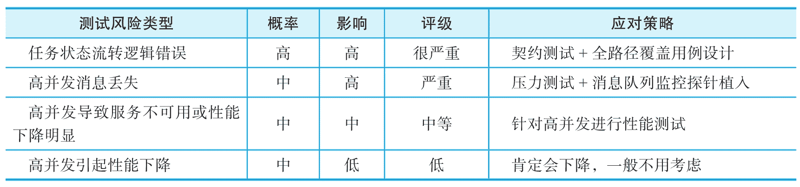

**3.测试项优先级动态评估**

基于 MoSCoW 法则与风险-价值矩阵（Risk-Value Matrix，RVM）的测试项优先级动态评估如表 3-2 所示。

**表 3-2 基于 MoSCoW 法则与风险-价值矩阵的测试项优先级动态评估**

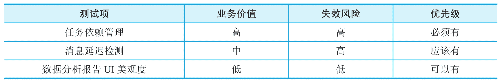

**4.测试策略制定**

根据测试目标、质量指标以及识别出的测试风险，针对不同的测试对象、测试阶段和测试类型，制定全面且具有针对性的测试策略。测试策略涵盖测试方式的选择（如黑盒测试、白盒测试、灰盒测试）、测试工具的选用、重点测试内容的确定、测试资源的分配以及测试进度的安排等方面。例如：对于在线教育平台的核心功能模块，可采用黑盒测试与白盒测试相结合的方式，重点测试业务逻辑的正确性和数据处理的准确性；对于一些重复性较高的测试任务，可选用自动化测试工具提高测试效率；在测试进度安排上，优先保障关键功能的测试时间，确保软件产品的核心质量。

**（1）测试策略**

测试策略可以分为以下两个方面。

❑ 基于测试技术的测试策略，根据软件系统的技术构成和层次结构，着重考虑如何分层测试、选择哪些测试工具、如何将白盒测试和黑盒测试有机地结合起来等。

❑ 基于测试方案的综合测试策略，根据测试的目标和范围，着重考虑如何更好地满足测试需求，如何让功能测试、适用性测试和兼容性测试等进行有机结合，如何充分利用测试资源，如何更有效地完成回归测试等。

**（2）测试策略的要点**

为了制定好测试策略，要做到以下几点。

❑ 全面细致地了解产品的项目信息：应用领域、测试范围、市场需求、产品特点、主要功能和技术架构。

❑ 基于模块、功能、系统、版本、性能、配置和安装等各个因素对产品质量的影响，客观、全面地展开测试计划。

❑ 根据软件单元在系统结构的重要性差异和一旦发生故障将给客户造成的损失大小，来确定软件测试的等级、重点和先后次序。

❑ 需要在测试用例数和测试覆盖率上进行权衡而获得一个平衡点，以便使用尽可能少的有效测试用例去发现尽可能多的程序错误。测试不足意味着让用户承担隐藏错误带来的危险，而过度测试则又会浪费许多宝贵的资源或耽误软件产品的发布时间。

通过对测试需求分析要点的全面回顾，我们能够更为系统地理解其在软件测试体系中的核心地位和关键作用，为后续深入探讨 LLM 驱动的测试需求分析提供坚实的理论基础和实践指引。

## **3.2 LLM 驱动测试需求分析和计划**

在完成测试需求分析要点的回顾后，我们对传统测试需求分析的关键环节有了清晰认知。随着人工智能技术的飞速发展，LLM 在软件测试领域展现出巨大潜力。接下来，我们将深入探讨 LLM 如何驱动测试需求分析。从助力理解产品需求，到实现更高效的需求分解，再到精准界定测试范围以及深入挖掘测试风险并制定应对策略，LLM 都能为我们提供全新的视角和有力的支持。这不仅能优化传统测试需求分析流程，还将提升测试工作的效率与质量，为软件产品的质量保障注入新的活力。下面逐一展开详细分析。

### **3.2.1 LLM 助力软件需求分析**

在软件开发和测试过程中，需求始终占据着核心位置。需求是软件开发与测试的源泉和依据，但需求本身又模糊多变、难以捉摸，往往成为项目风险的引爆点。根据 Standish Group 历年的 CHAOS 报告统计，需求相关问题通常是项目失败的主要原因，往往占比 30%～50%，而其他实验结果表明，因需求歧义导致的无效或错误的测试用例占比超过 30%。产品经理口中的“任务优先级动态调整”可能会被开发者解读为“手动拖曳排序”，给人以随意的感受。而传统需求分析依赖人工逐句解读、会议澄清和文档标注，这种线性模式在面对现代复杂系统（如微服务架构、跨平台交互）时，暴露出三大致命缺陷：

❑ 语义碎片化：自然语言描述的模糊性导致“一词多义”（如“实时更新”可能是秒级或分钟级）。

❑ 知识孤岛：跨领域术语（如金融系统的“轧差清算”与电商的“库存预占”）造成理解断层。

❑ 隐性需求黑洞：非功能性需求（性能、安全）常被遗漏，直至上线后爆发故障。

而 LLM 正在改变这种状况：它不仅是“翻译官”，更是“解构者”与“预言家”，能够更好地帮助测试人员洞察需求，精准捕捉用户的关键诉求或获取需求的关键信息，消除语义碎片化、知识孤岛等问题，挖掘隐性需求，从而为测试需求分析奠定坚实的基础。

**1.精准捕捉用户的关键诉求**

传统需求获取过程通常伴随着大量的用户访谈、问卷调查和数据整理，烦琐耗时，LLM 的出现重新定义了信息处理的边界。凭借文本生成、分类和归纳分析等能力，LLM 能够从大量用户反馈、客户沟通记录、在线评论甚至社交媒体内容中迅速提取重要信息，精准捕捉关键诉求。过去，认真看一篇几十页的英文论文并做笔记，可能需要半天时间，即使快速浏览、快速总结，估计也要 1 个小时。现在我们使用 ChatGPT、豆包、DeepSeek 等 LLM 聊天工具，上传一篇同样的英文论文，让 LLM 给出一个总结，效果很明显，几分钟就生成完整的总结报告，如图 3-1 所示。

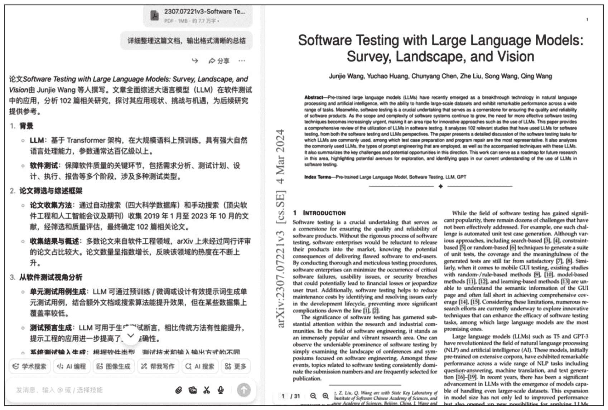

**图 3-1 LLM 快速生成论文的总结报告**

今天联网搜索是 LLM 聊天工具的一个标配的功能，我们可以借助这个功能精准捕捉用户的关键诉求。例如，我们要开发一个类似滴滴打车的软件，可以借助“大模型+联网搜索”来挖掘网约车用户的关键诉求，如下所示。过去产品经理为明确用户痛点可能要花几天时间梳理用户反馈，而现在借助 LLM，只需几分钟或几十分钟即可实现信息梳理和全面归纳。

（节选）

四、用户真实声音：社交平台与评论分析

通过 NLP 技术抓取 2023 年微博、抖音、小红书等平台上的网约车相关讨论（1 万多条），高频关键词如下：

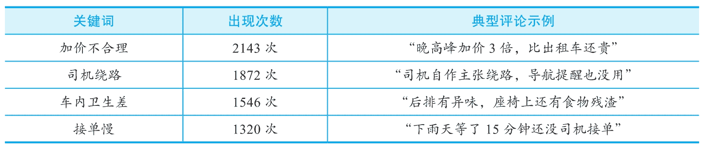

五、总结：用户诉求的优先级排序

综合多方数据，可概括网约车用户诉求的优先级，从高到低依次为：

安全透明>价格合理>响应速度>乘车舒适>个性化服务>绿色/智能化。

未来随着合规政策趋严和技术迭代，安全与效率的平衡、差异化服务能力将成为平台竞争的核心战场。

**2.自动归纳与总结**

产品需求信息往往分散在多个渠道，市场调研资料、用户反馈邮件、内部讨论会议记录、竞品分析报告等都是宝贵的需求来源。人工整合这些信息不仅耗时费力，还容易遗漏重要内容。而且，信息格式（文本、表格、音频、视频等）的不同进一步增加了整合的难度。多模态 LLM 可以轻松应对这一挑战。通过与各类数据接口对接，它能够快速收集并整理来自不同渠道的信息，包括图片、文本、音频和视频等不同类型的信息。

以一款电商 App 的开发为例，LLM 可以从市场调研报告中提取用户对商品搜索功能的需求，从用户反馈邮件中收集对购物车操作便捷性的意见，从竞品分析报告中总结出关于促销活动展示的优势做法。将这些分散的信息整合后，LLM 能够生成一幅全面的产品需求全景图，清晰呈现出各个功能模块的需求优先级、用户期望以及与竞品的差异。

再举一个例子。电影《哪吒之魔童闹海》在上映期间特别热门，虽然大多数观众给予很高的评价，但还是有负面的反馈。影片制作团队希望了解观众的负面反馈，从而在该系列后续作品的制作中更上一层楼。他们可以借助 LLM 来完成这项工作，提示词可以这样写：

电影《哪吒之魔童闹海》特别火，虽然大多数观众给予很高的评价，但我们还是希望查看负面的反馈，未来更上一层楼。请帮忙尽可能收集观众的负面反馈，然后进行整理、总结。

为节省篇幅，输出的结果省去前半部分，这里仅展示后半部分的节构与总结内容：

四、技术细节的瑕疵

1.想象力与细节的不足

……

2.低俗元素与台词问题

……

五、观众期待与现实的落差

1.与前作的对比争议

……

2.国际化的局限性

……

总结与改进建议

《哪吒之魔童闹海》的负面反馈主要集中在叙事逻辑的合理性、角色动机的深度、主题表达的连贯性以及细节设计的创新性 4 个方面。未来创作可参考以下方向。

❑ 强化角色行为逻辑：通过更细腻的铺垫解释角色选择，避免工具化塑造。

❑ 精简冗余情节：优化叙事节奏，聚焦核心矛盾。

❑ 深化主题表达：在反派与集体设定中探讨更复杂的道德困境。

❑ 提升文化融合度：在视觉效果与音乐设计中平衡传统元素与国际审美。

**3.语义解构：从自然语言到原子化知识单元**

LLM 通过依存句法分析（Dependency Parsing）与领域知识注入，将需求文档转化为结构化语义网络。以原始需求“系统应支持任务依赖关系的可视化展示，并在检测到循环依赖时自动预警。”为例，LLM 解析之后，以 JSON 格式输出，如下所示。这种原子化拆解使模糊需求变为可验证的测试条件，需求覆盖率大幅提升。

**4.知识关联：构建跨域需求图谱**

LLM 通过预训练知识库，如信息技术基础设施库（Information Technology Infrastructure Library，ITIL）框架、安全标准，以及实时检索（RAG 技术），自动识别需求中的隐性依赖。例如，当需求提及“支持单点登录”（SSO）时，LLM 会关联以下内容。

❑ 安全要求：OAuth 2.0 协议、令牌刷新机制。

❑ 兼容性需求：与 Azure AD、Google Workspace 的对接测试项。

❑ 性能边界：并发登录请求的吞吐量阈值。

这种关联使测试范围从“功能实现”扩展到“生态兼容”，缺陷逃逸率大幅降低。

**5.逻辑推理：预测需求冲突与边界场景**

通过因果推理链（Causal Chain Reasoning），LLM 可发现需求中的潜在矛盾。例如在任务管理模块中有以下两个需求：

❑ 需求 A：任务截止时间修改后，所有关联任务自动顺延。

❑ 需求 B：任务优先级由截止时间远近动态计算。

LLM 会预警如下：

冲突点：若手动修改截止时间触发优先级重算，可能导致任务执行顺序震荡。

建议：增加“优先级锁定”开关或设置顺延影响范围阈值。

此类推理使需求缺陷在分析阶段就被拦截，优于人工评审。

**6.隐性需求挖掘**

LLM 拥有浩瀚无垠的知识，再加上全网搜索、深度搜索等功能的支持，在隐性需求挖掘方面往往会超过单个的产品经理或测试人员。一般来说，LLM 会想得很全，可以弥补我们个人思考的局限性。下面是 DeepSeek R1 针对类似“滴滴出行”网约车应用的用户所挖掘出来的隐性需求。

开发类似“滴滴出行”的网约车应用时，除了显性的出行需求（如叫车便捷性、价格透明性），用户还有大量隐性需求。这些需求往往隐藏在用户体验细节、场景化痛点和行业生态的深层矛盾中。结合滴滴的运营实践与用户反馈，以下是可能被忽视的隐性需求及其挖掘方向：

一、用户心理与情感需求

1.安全感的多维度延伸

❑ 物理安全之外的隐私保护：用户不仅关注司机资质审核和行程分享功能，还担心个人数据泄漏。例如，行程记录可能暴露生活习惯或家庭住址，需提供“匿名打车”或“虚拟号码”功能。

❑ 应急机制的即时性：夜间出行或偏僻地区的用户希望平台提供“紧急联系人自动通知”或“一键报警”功能，而非仅依赖事后处理。

2.归属感与公平性

❑ 地域歧视的规避：异地用户（如游客、务工群体）常因口音无法沟通或目的地过近被司机拒载，需通过算法屏蔽司机对订单来源地的可见性，或引入“盲派单”机制。

❑ 价格公平感知：用户对动态加价的接受度有限，尤其是高频次通勤群体。可提供“价格锁定”选项或“拼车优先”策略，降低用户的心理落差。

二、场景化服务的精细化适配

1.特殊场景的深度覆盖

❑ 大型活动与灾害应急：演唱会、庙会等场景下，用户需要平台提前预判需求并调度车辆，而非依赖临时加价。例如，北京地坛庙会期间打车需求暴涨 725%，但司机调度滞后导致用户体验不佳。

❑ 无障碍出行服务：残障人士、孕妇等群体对车辆改装（如轮椅通道）、司机培训（如急救技能）有强烈需求，但常被标准化服务忽略。

2.跨地域与跨境的无缝衔接

❑ 异地服务标准化：用户异地打车时，常面临支付方式不兼容（如仅支持本地银行卡）、语言障碍（如海外服务缺乏多语言界面）等问题。

❑ 文化适配：例如，海外用户偏好现金支付或小费文化，需灵活调整结算规则。

三、生态链的隐性矛盾与平衡

1.司机与用户的权益平衡

❑ 司机收入透明性：用户希望了解平台抽成比例，避免司机因收入压力转嫁成本（如故意绕路）。滴滴通过“阳光抽成”公开规则，但实际执行中仍存在信息不对称。

❑ 司机心理健康支持：长时间驾驶导致的疲劳、情绪问题可能影响服务质量。可引入司机心理咨询或“强制休息”提醒功能。

2.环保与可持续性需求

绿色出行激励：用户虽未明确要求，但对新能源汽车的接受度较高。可通过“碳积分奖励”或“电动车优先派单”引导环保选择。

四、技术驱动的隐性体验优化

1.智能预测与主动服务

❑ 需求预判：通过历史数据分析，在用户未叫车前预判其出行需求（如工作日通勤高峰），提前调度车辆至热点区域。

❑ 个性化推荐：基于用户画像（如商务用户偏好专车、家庭用户倾向大空间车型）推荐车型，而非仅按价格分级。

2.交互设计的无感化

❑ 无障碍操作：老年用户或视障群体需要大字体界面、语音导航等适配设计，而非依赖复杂的手势操作。

❑ 离线功能：在网络信号差的区域（如山区、地下停车场），提供“离线叫车”或“预约缓存”功能。

五、用户未言明的社交需求

1.行程中的轻社交体验

❑ 同路匹配：允许用户选择“愿意聊天”或“安静乘车”标签，匹配司机或拼车乘客，提升行程趣味性。

❑ 本地化推荐：根据目的地推送周边餐饮、景点信息，甚至与商家合作提供“打车+消费”联名优惠。

2.社区化反馈机制

用户共治平台：建立用户委员会参与规则制定（如定价策略调整），增强归属感。

总结与建议

开发网约车应用时，需重点关注以下隐性需求。

❑ 安全与隐私的极致化：从物理安全扩展到数据隐私、应急响应。

❑ 场景适配的颗粒度：覆盖特殊事件、跨地域及特殊群体需求。

❑ 生态链的平衡性：透明化司机收入，引入环保激励。

❑ 技术的无感渗透：通过预测算法和交互设计提升体验流畅度。

❑ 社交化与社区共治：增强用户参与感与归属感。

例如，滴滴通过需求热力图优化调度、推出“随时提现”功能提升司机满意度，均是对隐性需求的回应。未来，开发者需通过用户行为数据分析、场景化洞察与生态链协同，持续挖掘并满足这些“看不见的需求”。

LLM 还有一些其他能力，例如通过精准识别关键词和关键短语，对模糊的需求进行详细解读。例如，当我们输入“优化系统性能，确保快速响应”这样模糊的需求描述时，LLM 能够结合常见的性能指标，如响应时间、吞吐量等，给出更具体的解释：“将系统在高并发情况下的平均响应时间控制在 1s 以内，吞吐量提升至每秒可处理超过 1000 个请求。”然后，我们可以补充相关业务的特征，让 LLM 输出更准确的需求描述。

以上，我们仅展示了 LLM 的部分能力。随着 LLM 能力的不断提升，它在洞察产品或用户、归纳总结、知识联想、语义解构、逻辑推理、挖掘隐性需求等方面的能力也会同步增强。这就使其在助力我们理解产品或用户需求时能发挥很大的作用。

### **3.2.2 LLM 助力测试需求分解**

正如 3.2.1 节所述，加之智能体的应用在本书撰写期间已开始流行，所以我们愈加相信 LLM 将成为需求分解的有力工具。需求分解是一个不断细化的过程，而且测试人员还可以引导或控制这个过程，其结果是有保证的。我们通过一个实例来说明。

我们有一个比较粗糙的银行智能风控平台需求，该平台包含 3 个核心子系统：智能风控平台、全流程风控模型和风险数据集市。我们让 LLM 列出其主要的测试需求，包括功能的和非功能的。生成结果有 7 页，完整内容详见电子材料“**1 某银行智能风控平台主要测试需求.docx**”为了更好地展示内容，我们可以让 LLM（没有特别说明，本书均采用 Claude 3.7 Sonnet Think 推理模型）帮忙生成一张思维导图，以展示测试需求分解的过程，提示词如下：

为了更好地展示内容，请将前面的测试需求转换成一张思维导图，以展示测试需求从主项到子项、子项的子项……不断细化的过程，如“特性、功能、子功能、功能点、场景”不断细化的过程，以 markdown 格式输出。

将生成的 MD 文件导入工具 Xmind，生成测试需求的思维导图。LLM 的表现非常卓越，生成的思维导图完整，MD 文件有 466 行，其中功能项接近 300 项，详见电子材料“**2 智能风控平台测试需求-思维导图.md**”。完整的思维导图太大，下面只展示“功能测试需求”的 2 层思维导图，如图 3-2 所示，第 2 层后面的圆圈就是被折叠的测试项。我们选一个相对小的子系统“全流程风控模型”，展开其测试需求的全部子项，如图 3-3 所示。

### **3.2.3 LLM 助力界定测试范围**

在软件测试领域，明确界定测试范围是保证测试质量和效率的关键因素。当一个大型系统被分解为多个子系统，或者多个测试团队协同工作时，如何清晰地界定各自的测试边界就变得尤为重要。明确的测试范围边界有助于：①避免功能区域被重复测试，浪费资源；②防止边界区域被遗漏，导致质量风险；③明确责任归属，便于问题追踪和解决；④提高测试团队的工作效率和专业度。

我们以“某银行智能风控平台”为例，假设银行测试部门按照这 3 个子系统划分了 3 个测试团队。

❑ 团队 A：负责智能风控平台核心功能测试。

❑ 团队 B：负责全流程风控模型功能测试。

❑ 团队 C：负责风险数据集市功能测试。

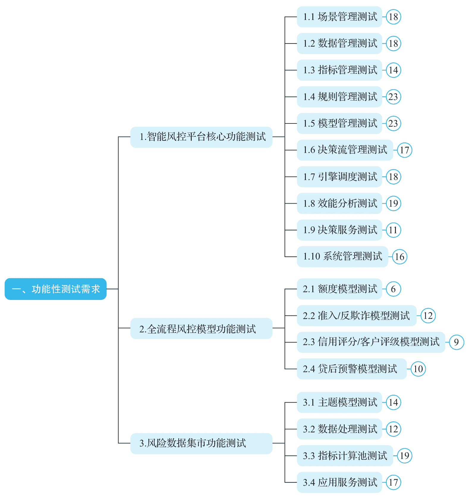

**图 3-2 智能风控平台测试需求的思维导图（局部）**

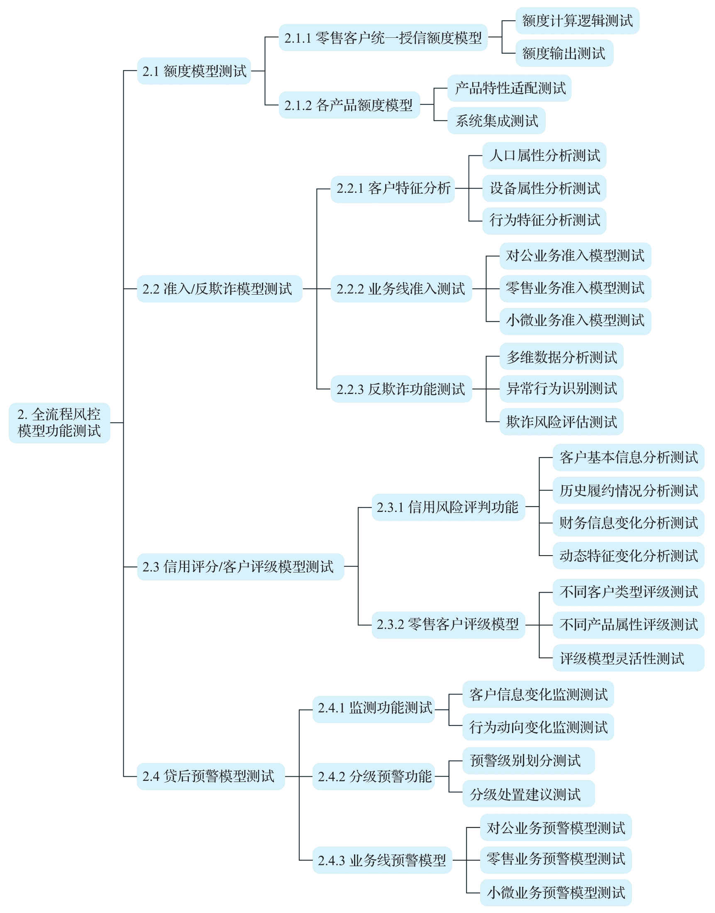

**图 3-3 全流程风控模型功能测试的思维导图**

**1.常见的边界模糊情况**

在功能交互区域、共享组件或服务和端到端流程中，容易出现边界模糊的情况，下面举例说明。

1）功能交互区域：在智能风控平台中，数据管理团队负责从各种数据源获取和管理数据，而风险数据集市团队负责数据的清洗、处理和存储。当风控决策需要调用某一数据时，系统从风险数据集市获取数据并将其交给数据管理模块进行加工，这个交接点就可能出现测试职责不清的情况。如果数据异常，难以判断是风险数据集市的数据提供问题还是数据管理模块的处理问题。

2）共享组件或服务：在智能风控平台中，指标计算服务既被风险数据集市的指标计算池团队维护，也被智能风控平台的指标管理团队调用和使用。当某个风险指标计算结果有误时，可能难以确定是指标定义问题、计算引擎问题还是指标调用方式问题，导致测试责任划分不清或重复测试。

3）端到端流程：在智能风控平台中，一笔贷款申请的审批流程涉及多个子系统的配合。首先是由准入模型团队负责的反欺诈筛查，然后是由信用评分模型团队负责的客户评级，接着是由额度模型团队负责的额度计算，最后是由“决策流管理”团队负责的规则引擎执行最终决策。如果仅由各团队测试自己的模块功能，可能会忽略整体审批流程中的数据传递问题、业务规则冲突或决策流配置错误等跨模块问题。

**2.界定测试范围的有效方法**

**（1）使用责任矩阵（RACI 矩阵）**

创建一个明确的责任分配矩阵，标明对于每个功能或组件的下列测试项。

❑ 模型算法正确性测试：团队 B 负责（R），团队 A 咨询（C）。

❑ 模型部署正确性测试：团队 A 负责（R），团队 B 咨询（C）。

❑ 模型运行性能测试：团队 A 负责（R）。

❑ 模型结果正确性验证：团队 A 和团队 B 共同负责（R）。

**（2）基于接口定义测试边界**

明确定义风险数据集市向智能风控平台提供数据服务的接口规范，对接口进行契约测试，确保双方理解一致，其中，团队 C 负责测试接口输出数据的正确性和完整性，团队 A 负责测试数据获取和解析的正确性。

**（3）建立集成测试专项团队**

针对决策流管理等跨多个模块的功能，可以成立由团队 A、B 成员组成的集成测试小组，设定端到端的测试场景，覆盖从模型开发、部署到决策流执行的完整流程，明确每个环节的测试职责，确保无缝覆盖。

**（4）以业务场景为中心定义测试范围**

根据需求说明书中的场景管理（该系统支持按不同法人、业务线、产品、业务环节设置场景），可以：按业务场景（如零售信贷审批、对公贷后预警等）设计端到端测试用例；将用例分解到各个测试团队，同时保留完整的业务流程测试责任。

### **3.2.4 LLM 助力挖掘测试风险与生成应对策略**

在 LLM 驱动测试需求分析的过程中，风险识别与管理是保障软件质量的关键环节。随着人工智能技术的发展，LLM 在测试风险挖掘和应对方面展现出前所未有的优势和潜力。本节将深入探讨如何借助 LLM 构建风险控制智能体，实现测试风险的自动化识别、精准分级和有效应对。有一些企业成功探索了 LLM 在风险管理中的创新应用，构建了基于 LLM 的风险控制智能体，这些智能体能够根据需求文档及其相关变更，自动进行风险识别和分级。这种方法不仅提高了风险识别的效率，还显著提升了风险覆盖的全面性和准确性。

**1.数据处理与基础构建**

**（1）建立风险分类体系**

为了构建风险控制智能体，首先需要建立完善的风险分类体系，包括以下几类。

❑ 功能风险：涵盖需求理解偏差、接口不兼容、边界条件处理不当等。

❑ 性能风险：如高并发下响应延迟、资源消耗过高、扩展性不足等。

❑ 安全风险：包括数据泄露、权限控制缺失、加密机制不健全等。

❑ 用户体验风险：如交互设计不合理、操作流程复杂等。

❑ 兼容性风险：在不同环境、设备下的适配问题。

每类风险还需进一步细分为多个子类，构成完整的风险分类树状结构，为 LLM 提供精准的风险标注框架。

**（2）风险标注与语料库构建**

为了训练 LLM 准确识别各类风险，需要构建高质量的风险标注语料库，具体步骤如下。

1）收集历史项目中的需求文档、变更记录及关联的缺陷数据。

2）由测试专家对这些数据进行精细化风险标注，建立需求-风险关联样本库。

3）针对不同业务场景和技术栈，构建特定领域的风险示例集。

4）建立风险严重程度评估标准，统一标注风险等级。

**（3）文档降噪与关键词规则优化**

需求文档中存在大量与风险识别无关的内容，需要通过以下技术进行降噪。

❑ 开发关键词过滤规则，筛选出风险相关的文档片段。

❑ 构建语义分割算法，自动识别需求文档中的功能描述、非功能需求等核心部分。

❑ 设计特定的正则表达式，提取文档中的条件判断、依赖关系等高风险元素。

❑ 优化文档解析流程，准确识别表格、图表等非文本形式的需求表述。

**（4）多模态数据处理**

现代软件的需求说明不限于文本形式，还包括各种图表、原型设计等多模态内容。风险控制智能体需要具有以下功能。

❑ 实现对流程图、架构图等图像内容的语义理解。

❑ 从 UI 设计原型中提取交互逻辑和用户流程。

❑ 分析音视频需求说明中的关键信息。

❑ 整合多模态信息，形成统一的风险识别输入。

**2.提示工程优化策略**

风险识别的精准度很大程度上取决于提示工程的质量。通过精心设计的提示词，可以显著提升 LLM 识别风险的能力。

**（1）提示词结构化设计**

高效的风险识别提示词通常包含以下核心要素：

#角色

你是一名风险识别专家，具备出色的风险识别能力。

##任务

对给定需求进行特征判断，判断需求的风险。

##任务要求

—对需求文档进行分析。

—结合特征进行风险预测。

—输出风险等级，用 1、2、3 分别表示高、中、低风险。

##特征

功能、性能、安全性、兼容性等相关特征信息

##需求内容

业务信息：{业务背景交代}

产品信息：{产品前端、后端、API、版本等信息}

App 端信息：{App 环境、功能设计信息}

这种结构化设计明确了模型的角色定位、任务目标和评估方式，有助于获得更加聚焦的风险分析结果。

**（2）降噪策略**

为提高风险识别的精准度，提示词需包含经过降噪处理的核心信息。

❑ 需求文档（如 PRD）：移除冗余信息，保留功能描述、技术约束等核心内容；可以进一步明确**需求信息**，如需求优先级、关联依赖等约束条件。

❑ 业务背景：提供必要的业务上下文，帮助模型理解需求的业务价值和使用场景。

❑ 质量画像：包含项目历史质量数据，如缺陷密度、缺陷漏检率/逃逸率、缺陷遗留率（未修复缺陷占比）、各阶段缺陷拦截率、缺陷修复时效/周期等。

❑ 研发画像：提供开发团队特征，如技术栈熟悉度、历史交付质量等。

**（3）环境上下文注入**

风险识别需要充分考虑项目的环境特征，提示词应包含以下内容。

❑ 业务信息：业务特性及其历史质量表现，以及价值主张、核心业务流程、关键决策点、用户分类和规模、用户画像、场景描述等。

❑ 产品信息：应用类型、代码规模、抽象语法树（Abstract Syntax Tree，AST）分析、代码依赖关系图、代码复杂度（如圈复杂度分布）、代码可维护性、使用频率、交互特点或用户操作、稳定性评估、性能评估、代码评审覆盖率和问题发现率等。

❑ 项目信息：包括交付时间、版本更新频率、项目团队信息（如团队协作模式和分工结构、团队成员在相关技术栈方面的经验水平、团队对当前业务领域的熟悉程度等）。

❑ App 端/后端信息：功能设计、终端类型（Web 端、移动端、桌面端等）、API 信息、技术栈和限制等。

**3.模型训练与优化**

要构建高效的风险控制智能体，模型训练与优化是核心环节，包括领域知识注入、特征优选与表示、标签校准与判别阈值优化、超参数优化与模型选型等。

**（1）领域知识注入**

软件测试风险识别是一个专业性极强的领域，需要向模型注入丰富的领域知识，主要包含以下内容。

❑ 构建软件测试领域知识图谱，涵盖常见风险类型、案例库和解决方案。

❑ 开发特定行业（如金融、医疗、电商）的风险识别知识库。

❑ 建立技术栈相关的风险模式库，如微服务架构、前端框架、数据库系统的典型风险。

❑ 整合软件质量标准（如 ISO 25010）作为评估框架。

**（2）特征优选与表示**

风险识别模型的输入特征对性能影响极大，需要科学选择和优化，具体包含以下内容。

❑ 对需求文本进行语义特征提取，构建表示需求复杂度、模糊度的特征向量。

❑ 设计衡量需求变更频率、范围的特征指标。

❑ 提取需求之间依赖关系的图结构特征。

❑ 构建表示团队能力、项目约束的上下文特征。

**（3）标签校准与判别阈值优化**

风险识别的准确性需要通过以下精细的标签校准来保证。

❑ 设计科学的风险评分机制，将模型输出映射为标准化的风险等级。

❑ 根据不同业务场景调整风险判别阈值，平衡漏报和误报的成本。

❑ 建立风险预测结果的置信度评估机制，对低置信度预测进行人工复核。

❑ 设计风险优先级排序算法，突出关键风险点。

**（4）超参数优化与模型选型**

不同的模型架构和参数配置对风险识别性能有显著影响，具体如下。

❑ 系统评估不同基础模型（如 GPT、Claude、Llama 等）在风险识别任务上的表现。

❑ 通过网格搜索、贝叶斯优化等方法找到最优的模型超参数组合。

❑ 探索模型集成技术，结合多个专家模型的优势。

❑ 持续监控模型性能，基于新数据进行定期微调和更新。

**4.RAG 框架**

仅依靠模型本身的参数知识难以覆盖所有潜在风险，RAG 技术能显著提升风险识别的全面性。

**（1）历史风险信息检索系统**

构建完善的历史风险检索系统，为当前需求风险分析提供参考。

❑ 建立包含历史项目需求和关联风险的向量数据库。

❑ 开发语义检索引擎，基于当前需求查找相似历史案例。

❑ 设计基于风险特征的多维检索机制，提高召回率。

❑ 构建风险知识图谱，支持基于关系的推理和检索。

**（2）实时增强生成**

将检索结果与 LLM 生成能力结合，可以实现风险分析的双重增强，具体如下。

❑ 在风险分析过程中动态检索相关历史案例和最佳实践。

❑ 基于检索结果调整模型的输出分布，提高预测准确率。

❑ 实现对罕见风险类型的有效识别，弥补模型知识盲点。

❑ 提供风险识别的证据链，增强结果的可解释性。

**（3）多维风险特征融合分析**

高质量的风险识别需要综合分析多维度的特征信息。在提示工程中，我们需要系统融合业务、产品、App 端等相关信息的关键特征。关于这一点，前文已有介绍。

**5.风险应对策略的智能生成**

风险识别只是第一步，更重要的是制定有效的应对策略。LLM 不仅能识别风险，还能根据风险特性自动生成相应的应对方案。

**（1）风险-策略知识库构建**

为支持策略生成，需要建立完善的风险应对知识库，具体如下。

❑ 收集并整理常见风险类型的最佳应对实践。

❑ 建立风险严重程度与应对强度的映射关系。

❑ 构建适用不同项目阶段的测试策略模板。

❑ 整合资源约束下的优化测试方案案例。

**（2）分层测试策略设计**

针对不同级别的风险，设计层次化的测试策略，具体如下。

❑ 高风险领域：采用测试驱动开发（Test-Driven Development，TDD）、探索性测试和自动化回归测试相结合的方式。

❑ 中风险领域：侧重基于场景的测试和关键路径覆盖。

❑ 低风险领域：采用基于规格的黑盒测试和抽样测试。

**（3）资源分配优化算法**

基于风险评估结果，智能分配测试资源，具体如下。

❑ 开发基于风险得分的测试资源分配模型。

❑ 设计测试活动优先级排序算法，确保高风险领域优先覆盖。

❑ 实现测试深度与广度的动态调整机制。

❑ 构建测试投入与风险降低效果的量化评估体系。

**（4）风险驱动的测试设计**

基于识别出的风险点，自动生成有针对性的测试设计，具体如下。

❑ 对高风险功能点自动生成详细的边界测试用例。

❑ 为复杂业务逻辑构建决策表和状态转换测试。

❑ 针对性能风险区域设计性能测试场景和负载模型。

❑ 为安全风险点生成渗透测试和安全扫描方案。

**（5）动态风险监控与策略调整**

随着项目的推进，风险状况可能发生变化，需要实时调整策略，具体如下。

❑ 建立风险指标监控系统，持续评估风险状态。

❑ 开发测试策略动态调整引擎，响应风险变化。

❑ 设计迭代式风险评估流程，在每个开发周期重新评定风险。

❑ 构建变更影响分析模型，预测代码变更对风险分布的影响。

**6.实施与落地经验**

**（1）与开发流程融合**

与开发流程融合主要包含以下内容。

❑ 在需求梳理（Backlog Grooming）阶段引入风险控制智能体，提前识别潜在风险。

❑ 将风险评估结果作为故事点（Story Point）估算的重要参考。

❑ 在迭代计划会议中展示风险分析结果，指导团队关注重点。

❑ 建立每日风险追踪机制，及时响应新增或变化的风险。

**（2）多角色协作模式**

多角色协作模式主要涉及以下角色。

❑ 产品经理：基于风险分析结果调整需求优先级，完善需求评审检查表，并加强需求评审。

❑ 开发团队：根据识别的技术风险点完善设计、代码等评审检查表，并加强前期的设计评审、代码评审等。

❑ 测试团队：利用风险报告制订有针对性的测试计划，加强测试计划、测试用例评审。

❑ 项目管理人员：将风险控制纳入项目监控指标。

**（3）效果评估体系**

建立全面的效果评估体系，持续优化风险识别能力，包含以下内容。

❑ 设计风险预测准确率、召回率、F1 值等核心指标。

❑ 追踪“预测风险-实际问题”的映射关系，评估预测的有效性。

❑ 收集用户反馈，评估风险识别结果的实用性和可操作性。

**（4）知识沉淀与传承**

将风险识别经验系统化沉淀，形成组织级知识资产，包含以下内容。

❑ 构建风险知识库，记录典型风险案例及其解决方案。

❑ 引入因果推理模型，分析需求变更与风险之间的因果关系，总结与提炼普适性的风险模式。

❑ 建立风险经验分享机制，促进团队间知识交流，提升团队整体风险意识。

通过建立风险控制智能体，融合多维风险特征，实现检索增强的风险分析，并生成自适应测试策略，我们能够显著提升测试过程的有效性和效率。这种方法不仅能够应对当前软件系统日益增长的复杂性和变化速度，还为测试团队提供了强大的决策支持工具，使资源配置更加精准，测试覆盖更加全面。

随着 LLM 技术的不断进步和行业实践的持续积累，未来可以开发智能体间的协同决策机制，构建由多个智能体组成的、基于实时反馈的风险评估系统，实现高效的风险综合评估。为实现更高的安全性，设计风险根因自动追溯机制或构建基于反事实分析的风险情景模拟系统，提高风险应对的精准性；建立基于人机协作的混合风险管理模式，结合人类经验和 AI 分析能力，以最终实现测试风险管理的智能化转型，为软件质量保障创造新的可能性。在这个过程中，测试人员的角色也将从执行者转变为策略师和指导者，引导 AI 系统更好地服务于质量目标，共同打造更可靠、更安全的软件产品。

## **3.3 生成测试项和验收标准**

为了更好地展示 LLM 驱动测试分析，我们可以深入特定的功能模块，让 LLM 生成测试项。图 3-3 所示的“全流程风控模型”测试需求的思维导图已经显示了测试项。为了更专业地说明问题，这里以图 3-2 中的“1.4 规则管理测试”为例，让 LLM 帮助我们细化测试项。

提示词：“基于这个需求文档，请详细生成‘规则管理’的测试项，包括功能和非功能测试项。”本次选用推理模型 Claude 3.7 Sonnet Think，生成的结果结构清晰，测试项描述规范，包括编号 ID、测试项、测试条件、预期结果和优先级等内容，对非功能项也考虑得比较全，包括性能、可靠性、安全性、易用性、可扩展性等。这里只给出部分结果，完整的结果有 21 页，详见电子材料“**3 智能风控平台规则管理模块测试项清单.docx**”。

智能风控平台规则管理模块测试项清单

基于银行智能风控平台的业务需求文档，我针对规则管理模块制定了详细的测试项清单，涵盖功能测试与非功能测试两大类别。本测试项清单旨在确保规则管理模块能够稳定、高效、安全地进行风控规则的创建、编辑、管理与执行。

一、功能测试项

1.规则创建与基本管理

1.1 规则创建

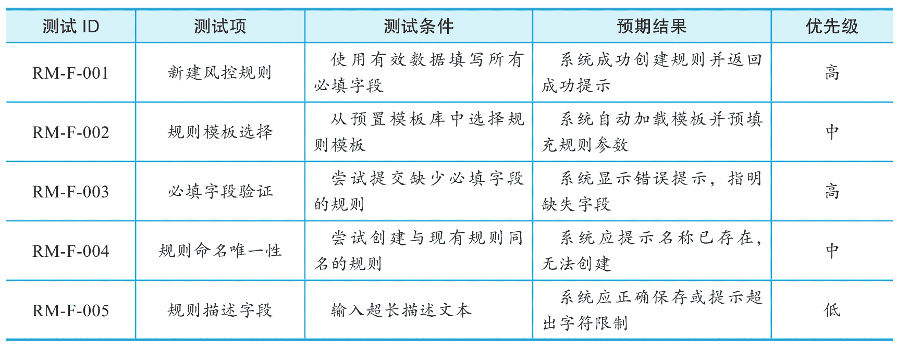

1.2 规则编辑

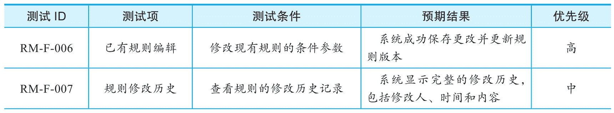

（续）

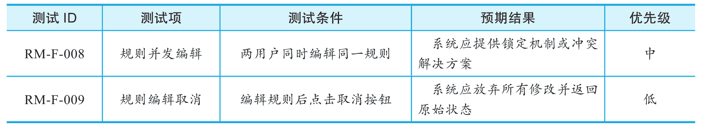

1.3 规则复制与导入/导出

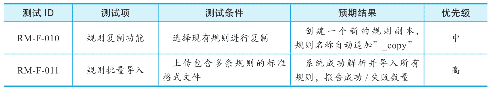

……

5.规则执行引擎功能

5.1 规则优先级与执行顺序

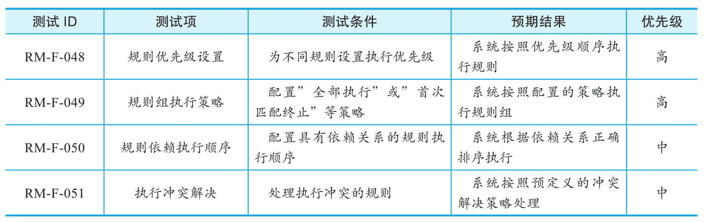

5.2 规则执行监控

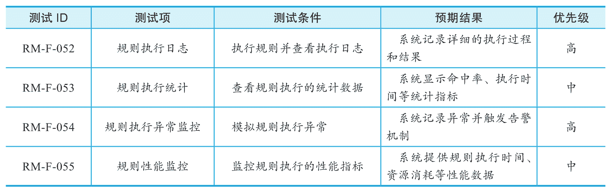

二、非功能测试项

1.性能测试

1.1 规则引擎性能

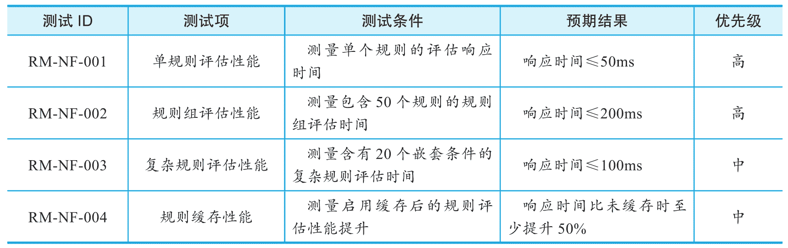

1.2 并发性能

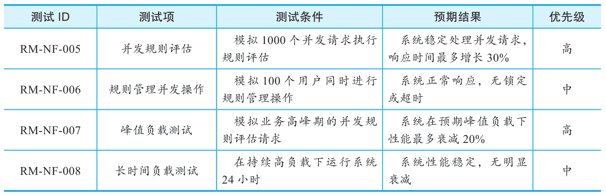

……

5.可扩展性与集成测试

5.1 系统扩展性

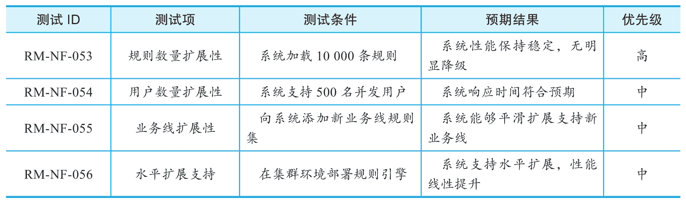

5.2 系统集成

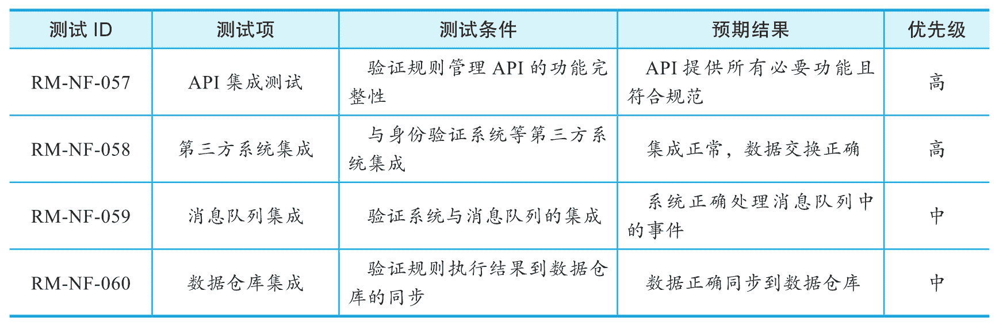

以上测试项给出了测试条件和预期结果，相当于针对传统的需求文档给出了验收标准，因为这里的测试项相当于测试点或比较粗的测试用例。但在敏捷开发范式中，“验收标准”概念更明确，相对用户故事而存在。我们可以让 LLM 先生成规则管理模块用户故事，详见电子材料“**4 规则管理模块用户故事.docx**”，从中选一个用户故事“作为风控分析师，我希望能够创建新的风控规则，以便快速响应新出现的风险模式。”，让 LLM 生成验收标准。下面就是生成的结果，完整内容详见电子材料“**5 风控规则生成示例.docx**”。可以看到，大模型考虑得非常全面，其全面程度不亚于业务熟练的测试人员。

用户故事

作为风控分析师，我希望能够创建新的风控规则，以便快速响应新出现的风险模式。

## 验收标准

1.规则创建基本功能

❑ 风控分析师能够通过规则管理界面成功创建新规则。

❑ 系统提供规则创建表单，包含以下必填字段：规则名称、规则描述、业务类型、风险类型、规则优先级、有效期。

❑ 规则名称具有唯一性验证，若输入已存在的规则名称，系统应提示冲突并阻止保存。

❑ 风控分析师能够选择规则所属的业务线（如：信用卡、存款、贷款、支付等）。

❑ 保存成功后，系统应显示成功提示，且新规则应出现在规则列表中。

2.规则条件配置

❑ 风控分析师能够为新规则添加至少一个触发条件。

❑ 系统支持基本条件类型：等于、不等于、大于、小于、包含、不包含、正则表达式等。

❑ 系统支持常见数据类型的条件配置：数值、字符串、日期时间、布尔值、列表。

❑ 风控分析师能够通过直观的界面使用 AND/OR 逻辑组合多个条件。

❑ 界面应提供条件验证功能，防止逻辑错误（如无意义的条件组合）。

3.规则动作配置

❑ 风控分析师能够为规则配置至少一个触发动作。

❑ 系统提供常见动作类型：拒绝交易、标记可疑、限制金额、发送通知、升级审核等。

❑ 对于通知类动作，风控分析师能够配置通知接收人和通知内容。

❑ 风控分析师能够为动作设置优先级，决定多个动作的执行顺序。

4.规则测试与验证

❑ 规则创建完成后，风控分析师能够使用测试功能验证规则逻辑。

❑ 风控分析师能够输入样本数据，系统展示规则评估结果和匹配路径。

❑ 测试界面显示规则是否触发，若触发则显示哪些条件被满足及将执行的动作。

❑ 风控分析师能够根据测试结果调整规则，无需退出当前流程。

5.规则保存与状态管理

❑ 创建的新规则默认为草稿状态，不会在生产环境生效。

❑ 风控分析师能够将规则从草稿状态提交审核。

❑ 系统记录规则的创建时间、创建人员和最后修改时间。

❑ 风控分析师能够为规则添加标签，便于后续管理和查找。

6.用户体验要求

❑ 规则创建界面响应时间不超过 2s。

❑ 规则创建流程应当直观，新手风控分析师在简单培训后能够独立完成。

❑ 系统应为复杂字段提供帮助提示和示例。

❑ 表单应支持自动保存，防止意外关闭导致工作丢失。

7.审计与合规要求

❑ 系统应记录规则创建的完整审计日志，包括创建人、创建时间和详细内容。

❑ 新创建的规则应符合机构定义的命名规范和文档标准。

❑ 界面应显示规则可能影响的关键业务指标预估（如拦截率、误拦率等）。

## 测试场景

❑ 基本规则创建：使用有效数据创建简单规则。

❑ 复杂逻辑规则创建：创建包含多个条件组和复杂逻辑关系的规则。

❑ 边界条件测试：测试各字段的长度限制、特殊字符处理等。

❑ 规则冲突：尝试创建与现有规则冲突的规则。

❑ 流程中断恢复：测试创建过程中断后的恢复机制。

❑ 用户权限测试：验证不同角色用户的规则创建权限。

业务价值确认

创建新规则功能的成功实现应能够：

❑ 使风控团队响应新风险的平均时间从 2 天缩短到 4 小时以内。

❑ 降低对技术团队的依赖，使业务人员能够自主创建 80%的常规风控规则。

❑ 提高风控规则的准确性，减少规则配置错误导致的业务中断。

当然，我们也可以认为 LLM 考虑得过于全面，让我们无从下手去写测试用例。这时最好的办法就是让它回到行为驱动开发（Behavior-Driven Development，BDD）实践上，采用 Given-When-Then 格式来完成验收标准。可以将以上内容写成提示词，并要求 LLM 以表格形式输出。输出的结果如表 3-3 所示，这样的验收标准的可读性就比较强。

**表 3-3 LLM 生成的验收标准**

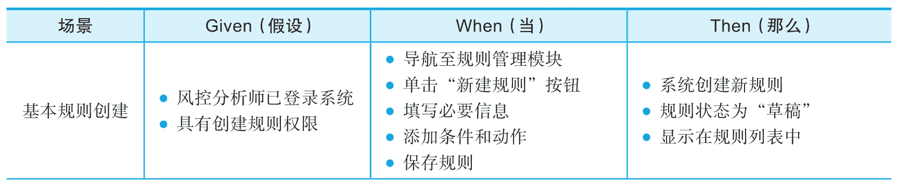

（续）

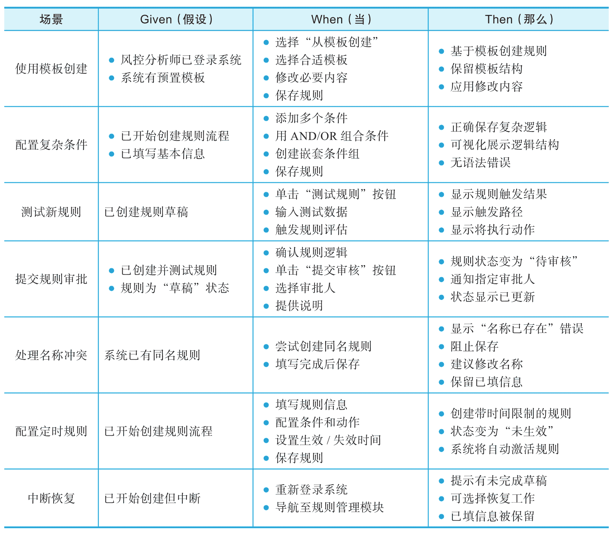

## **3.4 生成测试需求检查表**

当测试需求分析完成之后，就可以生成完整的测试需求 Spec（规格说明书），并针对这个测试需求 Spec 进行评审了。而一般在评审之前，需要先准备一个评审检查表（checklist）。我们可以告诉 LLM 这样的背景，让它结合智能风控平台业务及其测试需求，生成更有针对性的测试 Spec 的评审检查表。在这种情况下输出的检查表比较完整，涵盖十类检查。这个检查表能作为初始评审检查表，后续还可以再继续完善。由于篇幅有限，下面仅展示检查表的框架与部分内容，完整版详见电子材料“**6 银行智能风控平台测试需求 Spec 评审检查表.docx**”。

银行智能风控平台测试需求 Spec 评审检查表

1.需求覆盖度检查

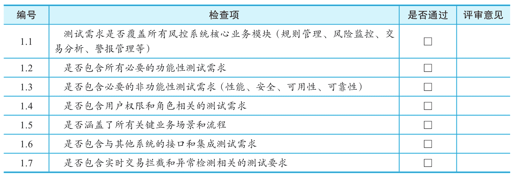

2.测试需求质量检查

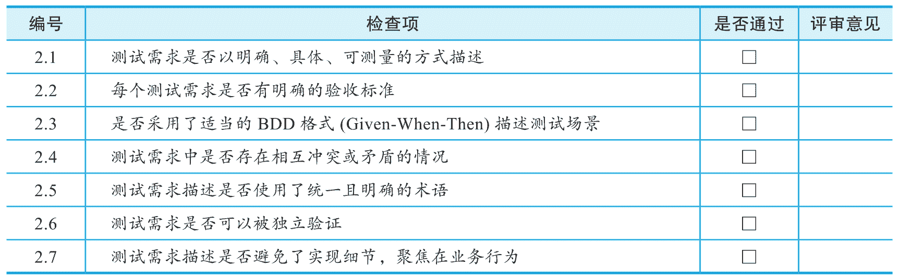

3.风控系统特定检查

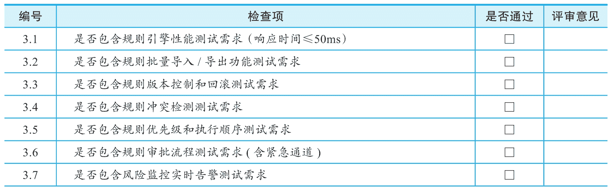

（续）

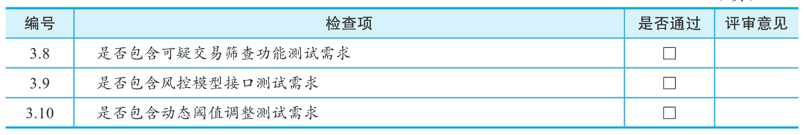

4.安全与合规性检查

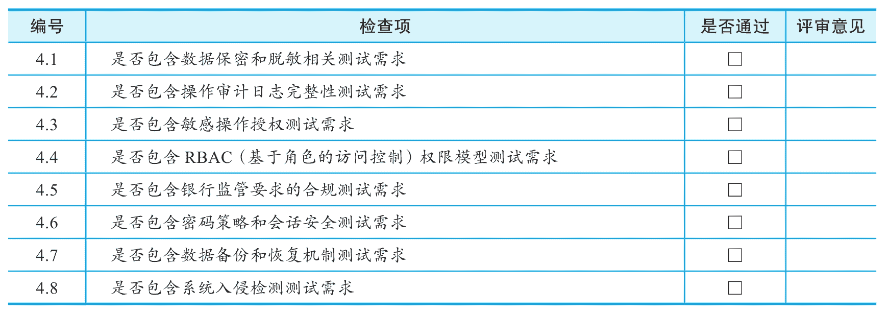

5.性能与可靠性检查

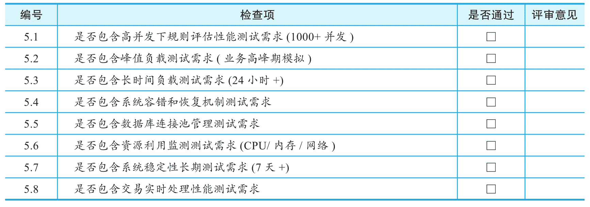

6.可测试性检查

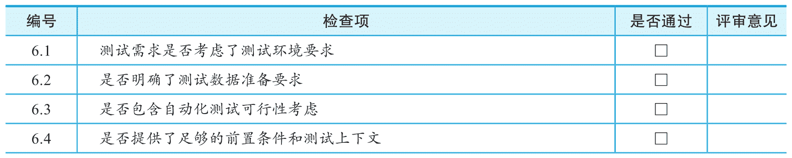

（续）

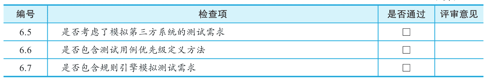

7.用户体验测试检查

8.测试策略与范围检查

9.文档完整性检查

10.业务银行特定检查项

## **3.5 生成和优化测试计划**

无论做什么工作，都要计划先行，然后按照所制订的计划去执行、跟踪和控制。软件测试也一样，先要制订测试计划，这是做好整个测试工作的前提。所以在进行实际测试之前，应制订良好的、切实可行的、有效的测试计划。软件测试计划的目标是提供一个测试框架，不断收集产品特性信息，对测试的不确定性（测试范围、测试风险等）进行分析，将不确定的内容慢慢转化为确定的内容。该过程最终使得我们对测试的范围、用例数量、工作量、资源和时间等进行合理的估算，从而对测试策略、方法、人力、日程等做出决定或安排。

测试计划主要集中在测试目标、质量标准、测试策略、测试范围、测试用例设计方法、所需资源和日程安排等，其中测试目标、质量标准、测试策略、测试范围等已在 3.4 节中讨论了；测试用例设计方法留在后面讨论；而所需资源和日程安排虽然在今天敏捷、智能开发时代的小团队而言显得越来越不重要，但对于大型项目而言依旧重要。测试计划可以按不同的测试阶段（集成测试、系统测试等）或不同的测试类型（功能测试、安全测试、性能测试、可靠性测试等）来组织，形成若干个测试计划，再合并成一个总的测试计划。

有了之前的测试需求文档，包括生成的测试项、测试需求检查表，就可以让 LLM 生成完整的测试计划书。由于篇幅有限，下面仅展示计划书的部分内容，完整版详见电子材料“**7 银行智能风控平台测试计划书（初版）.docx**”。

银行智能风控平台测试计划书

……

目录

1.引言

2.测试范围与目标

3.测试策略

4.测试环境与配置

5.测试资源与角色职责

6.测试进度计划

7.测试类型与方法

8.入口/出口标准

9.测试风险与缓解措施

10.测试交付物

11.测试工具

12.缺陷跟踪与管理

13.测试报告与度量

14.附录

这份计划书还给出了比较全面的风险列表和测试度量指标，如下所示：

有些上下文的内容可以进一步交代清楚，包括测试团队人数、计划的测试周期、测试期望达到的目标等，让 LLM 进一步优化之前生成的测试计划书。由于篇幅有限，下面仅展示部分优化内容，完整版详见电子材料“**8 银行智能风控平台测试计划书（优化版）.docx**”。该版计划书增加了更为明确的团队组织与职责、详细的工作分配矩阵，具体如下：

（续）

原来的测试周期被规划为 85 天，现在我们要求将测试周期改为 30 天，大模型根据该要求优化了整体规划，达到我们所设定的目标，具体如下：

（续）

我们还可以进一步选择另一个 LLM 对生成的测试计划进行评审，从而提升测试计划的可行性。在 LLM 评审之后，人工评审也是不可缺少的，最终需要测试经理或测试负责人来保证测试计划的质量。但 LLM 提到的各个方面还是很有参考价值的，有助于我们进行全面的思考。评审之后生成的计划书完整版详见电子材料“**9 银行智能风控平台测试计划书（改进版）.docx**”，由于篇幅有限下面仅展示部分内容：

测试计划书的评审意见及问题指出：

基于对上传文档的详细分析和结合实际需求，发现前面的《银行智能风控平台测试计划书（优化版）》存在如下问题：

1.测试范围不完整

原计划书缺失对于生命周期模型功能测试和风险集市功能测试的明确覆盖，这两部分属于智能风控平台的重要组成部分，详见《某银行智能风控平台主要测试需求》。

2.功能分类不够细致

测试范围划分的粒度不够细，如忽略了场景管理、指标管理、决策服务、数据管理等具体功能子项，未能有效体现测试需求文档中更加详尽和清晰的功能结构。

3.缺乏明确的交叉集成测试描述

未具体说明数据流转交互和模型应用交互等边界模块区域的集成测试（见上传的测试需求文档）。

4.性能测试指标缺乏对具体系统负载场景的描述和细化

如未涵盖明确的实时/离线/异步准实时服务模式对性能稳定性和容量的要求。

5.缺少文档测试方案

未体现以各类型交付文档完整性为准绳的验证要求，这对于银行系统的重要性不可忽略。

6.没有明确的兼容性测试方案

未明确针对银行已有软硬件环境的兼容性及平台升级兼容性的测试策略。

## **3.6 本章小结**

本章深入探讨了 LLM 如何革新测试需求分析流程。回顾了传统测试需求分析的关键要点，指出需求分析作为测试活动的起点，直接影响测试覆盖率和质量保障效果，但传统方法往往面临需求理解偏差、存在测试盲点和效率低下等挑战。

在 LLM 驱动测试需求分析方面，本章系统阐述了 LLM 如何通过强大的自然语言理解能力和上下文感知能力，助力测试团队更准确地理解产品需求。LLM 能从各类需求文档中提取关键信息，识别隐含需求和关联性，弥合业务语言与测试语言间的鸿沟。LLM 通过语义解析、跨域知识关联和隐性需求挖掘消除需求歧义。例如，分析实时更新需求时，LLM 可结合行业标准明确为“秒级响应”，并关联数据同步机制的技术实现。

在测试需求分解环节，借助 LLM 生成思维导图，将粗粒度需求逐层细化为可测试的最小单元，构建需求与测试的多维映射关系，实现测试全面性。以银行智能风控平台为例，LLM 将规则管理模块分解为规则创建、编辑、执行引擎等 300 多个测试项，并自动生成包含测试条件、预期结果的标准化清单，覆盖功能与非功能维度。

对于测试范围界定，LLM 能够精准分析功能边界、影响面和系统依赖，帮助测试团队聚焦关键测试区域，优化测试资源分配。在测试风险挖掘方面，LLM 基于领域知识和历史数据，能主动识别潜在风险点并提供有针对性的应对策略，增强测试的风险导向性。LLM 还可以帮助我们构建风险分类树（如功能风险、性能风险），通过提示工程注入业务上下文（如银行合规要求），结合 RAG 技术匹配历史风险案例。例如，识别“高并发下规则引擎性能瓶颈”风险时，LLM 自动关联历史项目的优化方案，生成“增加数据库连接池容量”的应对策略。

本章还详细阐述了 LLM 在生成测试项和验收标准、构建测试需求检查表以及生成和优化测试计划方面的应用。LLM 能够基于需求自动生成结构化测试项和明确的验收标准，提供全面的测试需求检查表以减少遗漏，并生成符合组织标准的测试计划，包括测试策略、资源规划和进度安排。

通过 LLM 驱动测试需求分析，测试团队能够显著提升需求理解的准确性、测试设计的全面性和测试规划的效率，实现测试需求分析从被动响应到主动探索的转变，为高质量软件测试奠定坚实基础。LLM 不仅是测试需求分析的辅助工具，更是测试思维的智能延伸和放大器。

# **第四章**

# **LLM 驱动测试用例生成**

第三章深入探讨了 LLM 在测试规划阶段的应用，展示了如何借助 AI 的力量构建全面而精确的测试计划。通过银行智能风控平台的案例，我们看到 LLM 能够协助测试团队制定合理的测试策略、优化资源分配、识别潜在风险并提出缓解措施。然而，一份优秀的测试计划需要转化为具体、可执行的测试用例才能真正发挥价值。

从测试计划到测试执行，中间环节的关键挑战在于：如何设计出覆盖全面、高效精准的测试用例？传统的测试用例设计往往依赖测试工程师的经验和直觉，容易出现覆盖不均衡、遗漏关键场景或重复低价值测试的问题。特别是在银行风控这类复杂业务系统中，用户行为路径多样、业务规则繁杂、异常场景众多，单靠人工难以全面覆盖所有测试路径。

本章将揭示 LLM 如何突破这一瓶颈，实现测试用例生成的智能化。我们将从测试场景识别出发，展示 LLM 如何理解用户行为模式、挖掘多维度测试场景；然后探讨基于各种输入（从简单需求到复杂业务流程图）生成功能测试用例的方法；最后延伸至性能和安全性测试用例设计的 AI 辅助技术。通过这些方法，测试团队可以在保持高质量的同时，大幅提升测试设计效率，将更多精力投入到测试执行和分析环节中。

让我们踏上这段从宏观测试计划到微观测试用例的旅程，探索 LLM 如何帮助测试团队在复杂系统测试中事半功倍。

## **4.1** **测试用例设计要点**

测试用例设计是软件测试的灵魂。在数字化转型浪潮中，银行风控系统等关键业务应用的质量直接关系到金融安全与用户信任。优质的测试用例既是发现缺陷的利器，也是系统质量的最后防线。在探索 LLM 如何革新测试用例生成之前，我们有必要回顾传统测试用例设计的核心要素与方法，这不仅有助于我们理解 LLM 能带来的创新，也为评估 AI 生成测试用例的质量提供专业参照。

一个专业的测试用例远不止于简单的操作步骤描述。在银行智能风控平台等高要求系统中，测试用例需包含明确的测试标识、测试目标、前置条件、详细步骤、预期结果，以及严重等级和优先级标记。尤为关键的是，用例中的测试数据必须既能反映真实场景，又要符合数据安全与合规要求。例如，测试交易反欺诈规则时，我们既需要模拟真实的欺诈模式，又要确保不使用真实客户的敏感信息。

在测试设计方法上，我们过去喜欢分为黑盒测试方法和白盒测试方法，这不是很科学，这里根据软件工程知识体系（Software Engineering Body of Knowledge，SWEBOK）的分类，对测试用例设计方法分别进行介绍。

**1.基于直觉和经验的方法**

这种方法依赖测试人员的直觉、经验和过往项目的经验数据，通常在没有明确需求或文档的情况下使用。具体方法主要包括以下两种。

❑ Ad hoc 测试。一种非正式的测试方法，其中测试人员不遵循预先制定的测试用例，而是根据自己的理解和经验自由地进行测试。Ad hoc 测试通常是探索性的，没有结构性，测试人员可以随意决定测试的范围和深度。

❑ 错误猜测法。一种基于测试人员经验的策略，测试人员根据对系统和历史故障的理解，猜测可能的错误或缺陷，并设计相应的测试用例。

**2.基于输入域的方法**

该方法侧重于根据输入的有效性和范围进行测试，涵盖了可能的输入情况，主要的方法有以下几种。

❑ 等价类划分方法。将输入数据分为若干个等价类（又分为有效等价类、无效等价类），每个类中的数据对系统的处理结果是相同的。通过测试这些类中的一个代表性值，可以推测出该类中所有其他值的测试结果。例如，整数 Int_x 的值域是（1, 10），那么它有一个有效等价类，可以在 1～10 之间取一任意值（如 2、5 或 7）作为代表值（测试数据），而它有两个无效等价类，小于 1 和大于 10，我们可以取-2 和 15 作为代表值（测试数据）。

❑ 边界值分析方法。该方法基于“错误通常位于边缘”的假设，旨在确保系统能正确处理边界附近的输入，所以专注于对输入域边界附近的条件进行测试，通常测试边界值及其上界、下界的临近值，即每一个边界测试 3 个值。例如，上面的整数 Int_x 有两个边界值 1 和 10，那么测试数据为 0，1，2，9，10，11。

❑ 随机测试。随机生成输入数据进行测试，以覆盖更多的输入情况，发现潜在的缺陷。

❑ 状态转换测试。根据输入的不同状态，测试系统在状态之间的转换是否符合预期。

**3.基于代码的方法**

该方法侧重于分析软件源代码的结构和逻辑，通过执行代码来验证其功能和行为是否符合预期。这种方法确保各个代码单元都经过充分的测试，并致力于识别潜在的错误和缺陷。基于代码的测试用例设计方法可以大致分为两个主要类别：逻辑覆盖（控制流覆盖）和变量定义与引用（数据流覆盖）。

**（1）逻辑覆盖**

逻辑覆盖测试关注代码的执行路径和控制流，确保所有逻辑条件和路径都被测试到。具体覆盖标准包括以下几种。

❑ 语句覆盖（Statement Coverage）：确保测试用例能够执行源代码中的每一条语句。语句覆盖确保代码中的每一条语句都被执行过至少一次。

❑ 分支覆盖（Branch Coverage）：确保测试用例能够覆盖每个条件分支的真假情况。这意味着每个逻辑分支（如 if 语句、while 循环等）都应被触发。

❑ 条件覆盖（Condition Coverage）：确保判断语句中所有基本条件都得到测试，包括条件的所有可能真值。若有多条件判断 if (a > b && c < d)，则测试用例需确保 a > b 和 c < d 的组合情况，如 true/false 和 false/true，即条件组合测试。但在工业界，常用的是修正的条件/判定覆盖（Modified Condition/Decision Coverage，MC/DC）。

**（2）变量定义与引用**

变量定义与引用测试侧重于数据的定义、使用和生存期。此方法确保每个变量在使用前都被正确初始化且在使用后没有未定义的引用。主要覆盖标准包括以下几种。

❑ 定义-使用覆盖（Definition-Use Coverage）：确保变量先被定义，再被赋值，然后才被使用，分析从定义开始到实际使用的引用路径。

❑ 定义-杀死覆盖（Definition-Kill Coverage）：确保在同一作用域内，变量在某个定义后没有被修改或杀死。

❑ 使用-使用覆盖（Use-Use Coverage）：确保检查到同一变量的所有使用-引用对，通过覆盖专用或全局变量的多条使用路径来实现。

**4.组合测试方法**

组合测试方法侧重于通过不同输入组合间的相互作用来验证系统行为。这种方法有效识别输入值的组合对软件功能的影响，以确保各个功能模块在不同场景下的正确性。组合测试方法可以通过多种技术实现，包括决策表测试、因果图法、Pairwise 测试（两两组合测试）以及*t*-wise 测试。

**（1）完全组合测试方法**

完全组合测试方法旨在检查所有可能的输入组合，特别是条件（成立、不成立）组合测试，如决策表测试、因果图法。

❑ 决策表测试：一种用于分析不同输入条件（条件项）组合对输出结果（动作项）的影响的建模方法。它通过表格形式的决策表列出所有可能的输入条件，为每个输入条件定义可取值状态（如是/否），在表格中列出所有可能的状态组合，并标明对应的输出结果。

❑ 因果图法：一种用于生成测试用例的模型，处理更复杂的情况。如果无法一次性设计决策表，就需要借助因果图来识别输入条件（因果）和相应的输出结果（效果）之间的关系，然后转换成决策表。

**（2）组合优化测试方法**

当变量比较多并且每个变量有多个取值时，其组合数将非常大，这时我们可能无法完成完全组合测试，就需要极大地降低组合数，即通过智能算法来选择最有代表性的测试用例，确保在较小的测试集内实现最大覆盖率。比较常见的具体方法有 Pairwise 测试、*t*-wise 测试。

❑ Pairwise 测试：一种有效的组合测试方法，通过只测试输入变量之间的成对组合来覆盖大多数交互效应。此方法假设大多数缺陷是由两个输入条件组合导致的，测试所有可能的成对组合可以有效发现这些缺陷。

❑ *t*-wise 测试：一种多强度组合测试，基于组合数学原理测试不同数量输入变量的组合情况。“强度”通过参数*t*表示，代表每次测试涉及的输入变量个数的组合。*t*=2 时，即 Pairwise；*t*=3 时，即三三组合；*t*最大为 6。要达到相对充分测试，一般情况下，*t*取 4 即可。

**5.基于故障模式的测试方法**

故障模式测试关注识别不同故障模式和错误类型，以确保系统能够抵御这些故障，主要可分为以下两种。

❑ 故障树分析：通过建模系统的故障原因，分析潜在故障的逻辑关系。

❑ 鱼骨图：通过图示法找出问题的主要原因和子原因。

**6.基于模型的测试方法**

利用模型（如状态机模型、数据流模型）来指导测试过程和设计测试用例。

❑ 有限状态机（Finite State Machine，FSM）测试：根据系统的状态转换模型，对各个状态及其转换进行测试。

❑ UML 状态图：利用 UML 图形化工具，展示系统的各个状态及状态之间的转换关系，进行测试设计。

❑ 模型驱动测试（Model-Driven Testing，MDT）：通过构建系统的抽象模型，自动生成测试用例，确保覆盖所有可能的执行路径。

❑ 行为建模：使用行为模型（如业务流程建模符号）描述系统的行为，基于模型生成测试用例。

**7.基于使用的方法**

这种方法依据用户使用系统的实际情况和使用频率进行测试，以确保用户在真实场景下的使用体验。

❑ 用户故事分析：从用户故事出发，设计对应的测试用例，以覆盖用户在应用中可能的操作场景。

❑ BDD：使用 Gherkin 等语言描述用户行为来编写测试用例。

**8.基于需求验证或标准验证的测试方法**

验证系统是否符合相关需求文档或行业标准，以确保所有需求和规范均能够被满足。

❑ 需求追踪矩阵（Requirements Traceability Matrix，RTM）：将测试用例与需求进行映射，确保每个需求都有对应的测试用例。

❑ 合规性测试：验证软件系统是否符合特定行业或法律的合规性标准。

**9.基于上下文驱动的测试方法**

针对特定项目的上下文来设计测试策略，强调测试设计应基于项目的实际情况和环境，上下文总是在变的。上下文驱动测试根据项目的需要和环境动态调整测试策略与方法，灵活应对变化，这种方法适合应用于手工测试方式，特别是探索式测试。

## **4.2** **测试场景**

高质量测试用例的基础在于全面、准确的测试场景识别。测试场景本质上是对用户使用系统的真实模拟，是连接需求与测试用例的关键桥梁。无论多么精细的测试用例，如果建立在不完整或不准确的场景理解之上，都难以有效验证系统质量。

传统的测试场景设计主要依赖测试人员对需求文档的解读和对业务流程的理解，这常常受限于个人经验和认知水平。面对银行智能风控平台这样的复杂系统，用户行为路径多样，风控规则复杂多变，单凭人工难以穷尽所有场景组合。这正是 LLM 可以发挥独特优势的领域——通过自然语言理解和模式识别能力，LLM 能够系统化分析用户行为模式，从需求描述中提取隐含场景，并基于领域知识推导出潜在的边缘情况。

测试场景的全面性直接影响测试覆盖率，而场景的真实性则决定了测试的有效性。在本节中，我们将探讨如何借助 LLM 的能力，从理解用户行为入手，系统化生成测试场景，进而挖掘易被人类忽略的测试盲点。通过 LLM 与测试工程师的协作，我们能够构建更加全面而贴近实际的测试场景库，为后续的测试用例设计奠定坚实基础。

### **4.2.1** **帮助 LLM 理解用户行为**

用户行为是测试场景设计的核心起点。在银行智能风控系统中，用户包括银行风控分析师、业务人员、系统管理员等多种角色，他们与系统的交互方式和目标各不相同。要让 LLM 生成有价值的测试场景，首先需要帮助它准确理解这些不同角色的用户行为模式和业务目标。

**1.用户角色与行为模型构建**

LLM 虽然拥有广泛的通用知识，但对特定业务领域的深入理解仍需借助外部知识或人工引导。向 LLM 提供清晰的用户角色定义和典型行为模式，能够显著提升其生成测试场景的质量。以银行智能风控平台为例，我们可以这样向 LLM 描述关键用户角色：

1）风控分析师：负责配置风控规则、分析风险预警、调查可疑交易，需要使用规则管理、预警处理和风险分析等功能模块。典型工作流为：根据风险模式创建新规则→测试规则有效性→发布规则→监控规则触发情况→分析预警信息→处理风险事件。

2）业务主管：审核规则变更、查看风控报表、制定风控策略，使用审批功能和报表分析功能。典型行为包括审核规则申请、查看风险统计报表、分析风控效果。

3）运营人员：处理日常风险预警、记录处理结果、升级特殊案例，主要使用预警处理模块。

4）系统管理员：负责用户权限管理、系统配置和监控，主要使用系统管理模块。典型行为包括创建用户账号、分配角色权限、配置系统参数、监控系统性能和日志。

当然，也可以让 LLM 生成用户角色，我们对其进行检查、修改或确认之后，反馈给 LLM。下面是 LLM 生成的结果，共有 9 种用户角色。为 LLM 提供这种用户角色画像或预先明确了用户角色，才能够分析用户行为，帮助 LLM 构建领域特定的行为模型，从而生成更符合实际业务场景的测试场景。详见电子材料“**10** **银行智能风控平台的主要用户角色.docx**”。

银行智能风控平台的主要用户角色

1.风控政策管理人员

职责：负责制定和维护银行整体风控策略和政策框架。

关键行为：设计风控政策体系、维护风控标准、监督政策执行情况、定期评估政策有效性。

系统交互：主要使用政策管理、指标体系管理、风险阈值配置等模块。

2.风控分析师

职责：分析交易数据和客户行为，识别风险模式，设计和优化风控规则。

关键行为：数据挖掘、风险模式分析、规则设计与调优、模型评估。

系统交互：使用数据分析平台、规则引擎配置、模型监控工具。

3.风险预警处理人员

职责：处理系统产生的风险预警，进行人工判断和处置。

关键行为：审核预警信息、调查可疑交易、处理风险事件、记录处理结果。

系统交互：主要使用预警工作台、事件处理流程、客户信息查询。

4.反欺诈专家

职责：识别和防范各类欺诈行为。

关键行为：欺诈模式研究、欺诈案例分析、反欺诈规则设计、协调欺诈调查。

系统交互：使用欺诈检测引擎、行为分析工具、案例管理系统。

5.模型开发人员

职责：开发和维护风控相关的机器学习模型。

关键行为：特征工程、模型开发、模型训练、模型部署与监控。

系统交互：使用模型开发工作台、模型生命周期管理、特征仓库。

6.系统管理员

职责：管理系统配置、用户权限和系统运行状态。

关键行为：账户管理、权限分配、系统配置维护、运行监控。

系统交互：使用系统管理控制台、监控仪表板、日志分析工具。

7.合规审计人员

职责：确保风控活动符合监管要求和内部控制标准。

关键行为：审计风控规则变更、审核高风险操作、生成合规报告。

系统交互：使用审计日志、合规检查工具、报表系统。

8.业务部门主管

职责：从业务角度参与风控决策，平衡风险控制与业务发展。

关键行为：审批风控规则、审核风险报告、参与风控策略制定。

系统交互：使用审批工作流、业务影响分析报表、决策支持工具。

9.风险集市数据管理员

职责：管理风险数据资产，确保数据质量和可用性。

关键行为：数据源管理、数据质量监控、数据服务配置。

系统交互：使用数据管理平台、数据质量监控工具、ETL 流程监控。

**2.业务流程与决策点分析**

用户行为往往遵循特定的业务流程，而业务流程中的决策点是测试场景设计的关键节点。帮助 LLM 理解这些流程和决策点，对于全面覆盖测试场景至关重要。例如，可以向 LLM 提供规则管理的业务流程描述，如下所示。如果我们写不出来，也可以先让 LLM 生成草稿，我们再完善。通过明确指出业务流程中的关键决策点，LLM 能够针对每个决策点生成相应的正向和负向测试场景，确保测试覆盖的完整性。

规则创建流程：

1.风控分析师登录系统，进入规则管理模块。

2.选择规则类型（交易监控/客户风险评估/反欺诈）。

3.定义规则基本信息（名称、描述、风险级别、生效时间）。

4.配置规则条件（可包含多个条件组合，支持 AND/OR 逻辑）。

5.设置规则触发后的动作（产生预警/拒绝交易/请求人工审核）。

6.使用测试数据验证规则。

7.提交规则审批。

8.业务主管审核规则。

9.规则发布生效。

决策点：

1.规则条件是否合法有效？

2.规则是否重复或有冲突？

3.测试验证是否通过？

4.审批是否通过？

5.规则是否在指定时间正确生效？

**3.领域约束与业务规则**

银行风控系统受到大量领域约束和业务规则的影响，这些约束和规则决定了用户行为的边界和系统的预期响应。向 LLM 提供这些约束和规则，有助于它生成更符合业务实际的测试场景。例如，可以向 LLM 提供如下领域约束。领域约束和业务规则为 LLM 提供了生成边界测试场景的重要依据，帮助它识别出可能被忽视的测试点。

风控规则约束：

1.规则优先级范围为 1～100，数值越小，优先级越高。

2.同一规则组内不允许出现逻辑冲突的规则。

3.高风险规则变更必须经过至少两级审批。

4.规则生效时间必须晚于当前时间至少 30 分钟。

5.交易金额阈值不得超过银行设定的最大限额。

6.规则测试连续失败达到 5 次后需强制对其进行规则评审。

系统安全约束：

1.连续登录失败 3 次将锁定账户。

2.敏感操作需进行二次身份验证。

3.非工作时间的高风险操作需特殊授权。

**4.历史缺陷与问题模式**

用户行为理解的另一个重要维度是历史缺陷与问题模式分析。向 LLM 提供系统历史上发现的典型缺陷与问题模式，能够帮助它生成有针对性的测试场景，避免同类缺陷与问题再次出现。例如，可以向 LLM 描述历史缺陷与问题模式。这些历史缺陷与问题模式为 LLM 提供了重要的启发，使它能够生成针对系统潜在弱点的测试场景。

历史缺陷与问题模式：

1.规则修改后未正确更新缓存，导致部分交易仍按旧规则执行。

2.并发修改同一规则时，后提交的变更覆盖先提交的变更，没有冲突提示。

3.特殊字符在规则条件中未正确转义，导致规则执行异常。

4.跨时区交易的日期条件判断不正确。

5.大额交易拆分为多笔小额交易时，风控规则未能识别关联交易。

6.规则停用后，已产生的预警状态未正确处理。

**5.交互式精化用户行为理解**

用户行为理解不是一次性完成的，而是需要通过交互式过程不断精化的。通过与 LLM 的对话，测试工程师可以引导它深入理解特定场景，完善行为模型。例如，当向 LLM 描述“风控分析师创建规则”这一场景时，可以通过提问引导 LLM 考虑更多维度，举例如下。

❑ 风控分析师如何处理规则创建过程中遇到的参数错误？

❑ 当规则条件复杂到一定程度时，用户界面如何支持清晰展示？

❑ 风控分析师如何验证新规则不会与现有规则产生冲突？

❑ 规则测试过程中，分析师如何调整参数以达到预期效果？

通过这种交互式问答，LLM 能够建立更全面、更细致的用户行为模型，为后续测试场景生成奠定基础。

**6.数据驱动的用户行为理解**

除了静态描述，数据样本也是帮助 LLM 理解用户行为的有效方式。向 LLM 提供真实或脱敏的交易数据样本、规则配置示例、预警处理记录等，能够帮助它理解数据模式和业务规则的实际应用。例如，可以向 LLM 提供如下 JSON 格式交易数据样本和对应的风控规则。通过这种数据样本，LLM 能够建立对实际业务数据和规则逻辑的具体理解，从而生成更贴合实际的测试场景。

帮助 LLM 理解用户行为是生成有效测试场景的基础。通过提供用户角色定义、业务流程描述、领域约束和规则、历史缺陷模式以及典型数据样本，并通过交互式对话进行精化，我们能够显著提升 LLM 对银行智能风控平台用户行为的理解深度和准确性。这种深入理解将直接转化为更全面、更贴合实际的测试场景，为后续测试用例设计提供坚实基础。

### **4.2.2** **生成测试场景**

在让 LLM 充分理解了用户角色、业务流程和领域约束后，下一步便是引导它系统化地生成测试场景。测试场景生成是连接用户行为理解与具体测试用例设计的关键环节，其质量将直接影响最终测试的有效性和覆盖度。

高质量的测试场景集合应当从多个维度覆盖系统行为。针对银行智能风控平台，我们可以构建一个结构化的场景生成框架，引导 LLM 从不同的关键维度，如功能、用户角色、业务流程、数据等，生成测试场景，从而更好地保证测试的充分性。

**1.功能维度场景**

功能维度场景关注系统的各个功能点，确保每个功能在不同条件下都得到充分测试。向 LLM 提供系统功能点列表，能够帮助它识别每个功能的测试场景。例如，输入下列提示词，让 LLM 生成测试场景：

请基于以下智能风控平台功能点生成测试场景：

1.风控规则管理（创建、修改、删除、查询、启用/禁用规则）

2.风险预警处理（查看、分析、处理、升级、关闭预警）

3.客户风险评估（风险评分计算、风险等级划分、评估历史查询）

4.交易监控（实时监控、事后分析、关联交易识别）

5.报表与分析（风险趋势分析、规则效果分析、预警统计）

根据上述提示词，LLM 生成了几十个场景，并能够为每个功能点识别正常路径、替代路径和异常路径场景。如果 LLM 表现不好，也可以通过提示词让它从正常、扩展、异常等不同角度挖掘出更多的功能维度场景。由于篇幅有限，下面仅展示其中 4 个生成的场景作为示例，完整生成内容详见电子材料“**11** **银行智能风控平台测试场景-功能维度.docx**”。

场景 RM-001：正常创建单一条件风控规则（正常场景）

❑ 场景描述：风控分析师创建一条基于单一条件（如“单笔交易金额超过 100000 元”）的风控规则。

❑ 前置条件：分析师已登录系统并拥有规则创建权限。

❑ 触发事件：分析师完成规则信息填写并提交。

❑ 预期结果： 

规则成功创建并显示在规则列表中。 

规则状态为“待审批”。 

系统向审批人发送审批通知。

❑ 验证点：规则信息保存准确、审批流程正确触发。

场景 RM-002：创建复杂条件组合规则（复杂场景）

❑ 场景描述：风控分析师创建一条包含多个条件组且具有复杂逻辑关系的规则（如“客户等级为 VIP AND（单日交易总额>500000 元 OR30 天内跨境交易次数>5）”）。

❑ 前置条件：分析师已登录系统并拥有规则创建权限。

❑ 触发事件：分析师配置复杂条件组合并提交规则。

❑ 预期结果：系统正确保存复杂逻辑结构并正确展示条件关系。

❑ 验证点：复杂条件逻辑的保存和解析正确、规则测试功能正确验证复杂条件。

场景 RM-008：规则版本回滚（异常场景）

❑ 场景描述：发现新发布的规则版本存在问题，需紧急回滚到先前版本。

❑ 前置条件：规则已有多个版本历史。

❑ 触发事件：管理员执行规则版本回滚操作。

❑ 预期结果： 

系统显示可回滚的历史版本列表。 

成功回滚到选定的历史版本。 

原规则版本被标记但保留在历史中。 

系统记录回滚操作和原因。

❑ 验证点：版本控制有效性、回滚过程完整性、业务连续性保障。

场景 RM-E01：规则引擎崩溃恢复（异常场景）

❑ 场景描述：规则引擎服务在高负载下突然崩溃，测试系统恢复和规则状态一致性。

❑ 异常触发：通过压力测试或故障注入使规则引擎崩溃。

❑ 预期行为： 

系统检测到引擎崩溃并触发自动恢复流程。 

所有处于编辑状态的规则应有自动保存的草稿。 

恢复后规则状态一致，无数据损坏。 

告警机制正确通知管理员。

❑ 验证点：恢复机制有效性、数据一致性保障、业务连续性。

**2.用户角色维度场景**

不同用户角色与系统的交互场景各异，针对每个角色生成相应的测试场景至关重要。可以为单个角色生成测试场景，提示词如下：

请为智能风控平台的用户角色风控分析师生成测试场景，尽可能完整、全面，包括正常、扩展和异常的场景。

这种基于角色的场景生成能够确保系统在不同用户视角下都得到充分测试。由于篇幅有限，这里仅展示部分场景，完整生成文件详见电子材料“**12** **风控分析师角色测试场景集.docx**”。

FA-N 0 1：创建基于单一条件的简单风控规则（正常场景）

❑ 场景描述：风控分析师创建一条基于单一条件（如“单笔交易金额超过 100000 元”）的规则。

❑ 前置条件：分析师已登录系统并拥有规则创建权限。

❑ 操作流程： 

导航至规则管理模块。 

选择创建新规则。 

配置基本信息（名称、描述、风险级别）。 

设置单一交易金额阈值条件。 

配置触发行为（生成预警）。 

提交规则。

❑ 预期结果：规则成功创建并进入审批流程

FA-E 0 1：规则克隆与批量修改（扩展场景）

❑ 场景描述：风控分析师基于现有规则快速创建变体规则。

❑ 前置条件：源规则已存在。

❑ 操作流程： 

选择源规则并使用克隆功能。 

修改规则名称和关键参数。 

选择保留或修改原规则的其他设置。 

保存新规则。

❑ 预期结果：成功创建基于源规则的新规则，关键参数已更新。

FA-X 0 1：规则编辑会话超时恢复（异常场景）

❑ 场景描述：测试分析师在规则编辑过程中会话超时的恢复机制。

❑ 前置条件：已开始编辑一条复杂规则。

❑ 操作流程： 

开始编辑复杂规则。 

保持页面不活动超过会话超时时间。 

尝试继续编辑或保存规则。

❑ 预期结果：系统提供会话恢复选项，已编辑内容不丢失，可继续完成操作。

当系统不够复杂时，也可以批处理——为多个角色生成测试场景。提示词如下：

请为以下智能风控平台的用户角色生成测试场景：

1.风控分析师：负责规则设计和风险模式分析。

2.风险审核员：处理风险预警和可疑交易。

3.合规审计人员：审核规则变更和操作合规性。

4.系统管理员：管理用户权限和系统配置。

5.业务部门主管：审批重要规则变更。

**3.业务流程维度场景**

业务流程维度关注端到端（End to End，E2E）的用户旅程，确保完整流程在各种条件下的正确性。我们可以先让 LLM 生成端到端的基本业务流程，然后针对每条基本业务流程生成测试场景。提示词可能是这样的：

请基于智能风控平台中的基本业务流程“风险规则生命周期流程：创建→测试→审批→发布→监控→优化→废弃”生成其测试场景。

更好的提示词应明确指定所采用的方法，如事件流的方法或基于场景的 E2E 方法：

请基于智能风控平台中的主要业务流程“风险预警处理流程：系统生成预警→分配→初步分析→调查→处理决策→记录结果→关闭预警”，采用事件流方法（包括基本流、扩展流、异常流等），生成其测试场景。

还可以写成以下形式：

请基于智能风控平台中的主要业务流程“风险预警处理流程：系统生成预警→分配→初步分析→调查→处理决策→记录结果→关闭预警”，采用基于场景的 E2E 方法，从最初的起始点到终止点，生成状态树，尽可能覆盖不同的路径。

后面这两种提示词的生成结果详见电子材料“**13** **风险预警处理流程测试场景集-事件流方法.docx**”“**14** **风险预警处理流程状态树.docx**”。结果显示，LLM 能够识别流程中的关键节点和转换点，生成覆盖完整流程的测试场景。

下面展示“**14** **风险预警处理流程状态树.docx**”中“关键路径说明”部分的内容，可以看出生成了风险预警处理流程的 10 条 E2E 业务路径。

关键路径说明

1.标准处理路径：预警生成→待分配→已分配→初步分析→调查→决策→记录结果→关闭预警。

2.快速关闭路径：预警生成→待分配→已分配→初步分析→快速关闭（误报或无须调查）。

3.升级处理路径：预警生成→待分配→已分配→初步分析/调查→升级处理→高级审核员/团队处理→关闭预警。

4.信息补充路径：预警生成→待分配→已分配→初步分析→信息不足→请求信息→补充信息→继续分析/调查。

5.客户交互路径：预警生成→待分配→已分配→调查→等待客户解释→客户响应→继续调查→决策→关闭预警。

6.扩展风险路径：预警生成→待分配→已分配→调查→发现扩展风险→扩展调查范围→生成关联预警→并行处理。

7.中断恢复路径：任意处理状态→系统中断→处理暂停→系统恢复→恢复至中断点→继续处理。

8.预警再开路径：已关闭→后续监控→发现新风险→重新开启→调查→决策→关闭预警。

9.合并处理路径：预警生成→预警合并→合并至主预警→主预警处理完成→一并关闭。

10.分级审批路径：预警生成→待分配→已分配→调查→决策→需要高级审批→审批通过/拒绝→采取措施→关闭预警。

**4.数据维度场景**

数据维度场景关注不同数据条件和数据状态下的系统行为，例如可以就某类业务数据生成测试场景，也可以就不同类别的业务数据分别生成测试场景。提示词如下：

请基于交易数据（如不同交易类型、金额范围、频率模式）生成智能风控平台的测试场景，可以考虑等价类划分、边界值分析方法，即考虑正常数据（有效的）、边界值、异常数据（无效的）等场景，或者小数据量、大数据量、极限数据量。

由以上提示词共生成 55 种场景，详见电子材料“**15** **智能风控平台交易数据测试场景.docx**”。对于业务规则数据，可能有不同的考虑，提示词可以这样写：

请基于业务规则数据（如简单规则、复杂条件规则、时序规则、统计类规则等）生成智能风控平台的测试场景。

由以上提示词生成的结果非常丰富，可见 LLM 考虑得很充分。由于篇幅有限，这里不再展示，详见电子材料“**16** **智能风控平台业务规则测试场景集.docx**”。

对于客户数据，又有不同的考虑，需要考虑历史数据、实时数据、预测数据或者关联数据等，提示词可以这样写：

请基于客户数据（如历史数据、实时数据、预测数据或关联数据等）生成智能风控平台的测试场景。

**5.场景生成的提示工程**

为了引导 LLM 生成高质量的测试场景，精心设计的提示模板至关重要。以下是一个结构化的测试场景生成提示词模板，使用类似的结构化提示词，我们可以引导 LLM 生成格式统一、内容全面的测试场景。

作为银行智能风控系统测试专家，请基于以下信息生成测试场景：

❑ 系统功能：[描述目标功能点]

❑ 用户角色：[描述相关用户角色及其目标]

❑ 业务流程：[描述相关业务流程]

❑ 领域约束：[描述业务规则和约束条件]

❑ 潜在风险：[描述可能的风险点]

请尽可能生成更多的测试场景，每个场景应包含：

1.场景 ID 和名称

2.场景描述

3.前置条件

4.触发事件

5.预期系统行为

6.验证点

7.场景复杂度（简单/中等/复杂）

8.优先级（高/中/低）

请考虑边界条件和特殊情况，确保场景覆盖正常路径、扩展路径和异常路径等。

**6.场景生成的迭代优化**

测试场景生成通常需要多轮迭代优化，通过直接质疑、评审反馈、深度扩展或优先级调整等来引导 LLM 挖掘更多场景，不断提升场景生成的质量。下面是一个期待 LLM 改进的提示词例子：

电子材料“风险预警处理流程状态树.docx”是基于智能风控平台中的主要业务流程“风险预警处理流程：系统生成预警→分配→初步分析→调查→处理决策→记录结果→关闭预警”，采用基于场景的 E2E 方法生成的结果，其中关键路径说明列出了 10 条 E2E 路径，请指出有没有遗漏的路径，可以从广度、深度去思考。如果有，请补充。

通过 OpenAI o1 模型运行的结果，增加了 4 条路径：SLA 超时升级路径、预警暂停与恢复路径、预警拆分路径、预警取消路径。这 4 条路径的完整内容详见电子材料“**14** **风险预警处理流程状态树.docx**”。

LLM 生成测试场景为测试设计带来了前所未有的效率与系统性。通过多维度场景生成框架、精心设计的提示工程、迭代优化策略等，我们能够充分发挥 LLM 的能力，生成全面覆盖、贴近实际的测试场景。这些场景为后续的测试用例设计提供了坚实基础，确保测试工作不仅高效，也更加全面和有效。

在下一小节中，我们将探讨如何拓展测试场景，特别是那些容易被人类测试设计者忽略的边缘情况和复杂交互场景，以进一步提升测试覆盖的完整性。

### **4.2.3** **拓展测试场景**

在完成基本测试场景设计后，我们需要进一步深入挖掘更有价值、更具技术深度的测试场景，以确保智能风控平台风险预警处理流程的全面性和健壮性（非功能特性会在 4.4 节和 4.5 节中介绍）。这些场景将从多个维度深入探索系统潜在的弱点和边界条件，体现测试设计的专业性与充分性。

我们可以从业务场景、交互、数据、极端场景、边界条件等维度引导 LLM 思考，让其帮助我们发现更多的场景。下面主要介绍如何拓展测试场景。我们可以把问题抛给 LLM，提示词如下：

有没有更好的方法来挖掘测试场景？例如从时间和空间转换来挖掘测试场景，例如针对功能维度的场景，请你进一步挖掘出更深、潜在的场景，列出补充的场景，不要重复。

LLM 生成的第一部分是“场景挖掘方法论”，列出来 4 种方法：时空转换法、SCAMPER 创新思维法、对抗性思维法、参数组合法等，具体内容如下：

一、场景挖掘方法论

1.时空转换法

方法说明：通过在时间和空间维度上对基本场景进行变换，发现潜在的边界场景和异常场景。

具体应用：

时间变换：将场景放置在不同时间点、时间周期和时间跨度中进行考查。

空间变换：改变场景的地理位置、系统边界和数据分布。

组织变换：考虑不同组织结构、层级和权限下的场景表现。

2.SCAMPER 创新思维法

方法说明：使用 SCAMPER（替代、合并、调整、修改、转为他用、消除、重新排列）模型系统性地变异现有场景。

具体应用：

替代（Substitute）：替换场景中的角色、数据或流程步骤。

合并（Combine）：将多个独立场景合并为复杂场景。

调整（Adapt）：调整场景参数或约束条件。

修改（Modify）：改变场景规模或复杂度。

转为他用（Put to other uses）：将设计用于一种目的的功能用于其他目的。

消除（Eliminate）：移除场景中的某些元素或步骤。

重新排列（Rearrange）：改变场景中事件的顺序或结构。

3.对抗性思维法

方法说明：通过假设系统各组件都在最坏情况或恶意状态下运行，设计应对场景。

具体应用：

对抗用户：假设用户试图绕过风控规则。

对抗系统：假设系统组件试图破坏流程。

对抗数据：假设数据被刻意构造成最难处理的形式。

4.参数组合法

方法说明：识别场景的关键维度，然后对每个维度的多个取值进行组合，产生综合场景。

具体应用：

确定 3～5 个关键维度（如用户类型、交易规模、风险程度、处理时效性等）。

为每个维度确定 2 个或 3 个代表性取值。

采用正交实验设计选择最具代表性的组合。

第二部分基于上述方法挖掘了一些新的场景作为补充，由于篇幅有限，这里不再展示，完整内容详见电子材料“**17** **银行智能风控平台测试补充场景.docx**”。

我们也可以从其他维度来挖掘深层次的场景，例如从交互维度挖掘出“多角色并行处理冲突场景”，从数据模式识别、时序模式等方面挖掘出“历史数据关联分析场景”。针对 E2E 的业务流程，可以从状态全覆盖、反复流转、最短处理链（中途取消）、极长处理链等方面挖掘场景。其实，这些想法可以来自 LLM，也可以来自我们和 LLM 思想的碰撞。

例如，极长处理链（最复杂关键路径）：预警生成→待分配→拒绝分配→重新分配→初步分析→请求信息→暂停处理→恢复处理→升级处理→团队分配→协作分析→扩展调查→关联预警生成→等待客户解释→客户响应→继续调查→决策分歧→上报审批→审批拒绝→修改决策→再次审批→通过→执行措施→记录结果→设置监控→关闭预警→后续发现新风险→重新开启→最终关闭。这是一个测试人员和 LLM 通过对话相互启发的过程，能够挖掘出更深、更罕见的场景。

## **4.3** **功能测试用例生成**

前文已经介绍过，LLM 帮助我们生成测试场景，并从不同维度对这些场景进行了深度挖掘，确保了测试覆盖的广度和深度。测试场景勾勒出了需要验证的业务流程、功能点和潜在风险区域的蓝图。然而，场景描述相对宏观，可以指导测试，但不足以直接执行测试。为了将这些场景转化为可操作的测试活动，我们需要进一步将场景细化为具体的测试用例（Test Case，TC）。

测试用例是测试执行的最小单元，它明确定义了测试的前置条件、具体操作步骤、预期结果以及通过/失败的判定标准。一个设计良好的测试用例能够确保测试的可重复性、一致性和可跟踪性，为质量评估提供客观依据。

LLM 凭借其强大的自然语言理解和生成能力，能够辅助或自动生成高质量的测试用例，从而提升软件测试的效率和覆盖率。让 LLM 生成测试用例，有以下 3 种路径。

❑ **基于需求文档的生成：**通过解析软件需求文档，LLM 能够识别功能需求和非功能需求，并根据这些需求生成相应的测试用例，包括有效输入、无效输入、边界条件等多个测试场景的用例。

❑ **基于代码的生成：**LLM 可以通过解析源代码或接口文档，理解系统的内部逻辑和接口协议，从而生成有针对性的测试用例，如基于生成单元测试代码。

❑ **基于用户故事的生成：**在敏捷开发环境中，LLM 能够根据用户故事生成相应的验收标准。

下面继续以智能风控平台这样的复杂系统为背景案例，采用从简单到复杂、从基础到高级的渐进式方法来生成测试用例，确保每个关键功能点都得到充分验证。

### **4.3.1** **基于简单的设计方法生成测试用例**

测试用例设计是将抽象的测试需求转化为具体测试操作的桥梁。我们首先采用一些简单但有效的测试用例设计方法（如等价类划分、边界值分析、决策表法等），借助 LLM，为功能点或用户故事生成基础的测试用例。

**1.等价类划分和边界值分析**

等价类划分将输入数据分为有效等价类和无效等价类，从每个等价类中选择代表性值进行测试，减少冗余测试的同时保证覆盖度。而边界值分析关注输入范围的边界条件，因为错误往往发生在输入域的边界上。在实际应用中，会结合两种方法来设计测试用例，因为一般要先进行边界值分析，才能更容易地识别出等价类。可通过以下提示词让 LLM 生成测试用例。

针对交易金额测试场景，请采用等价类划分和边界值分析方法生成测试用例，可以简化操作步骤，并以表格的形式输出测试用例。

LLM 基于等价类划分方法和边界值分析生成的结果如表 4-1 所示。

**表 4-1** **LLM 基于等价类划分方法和边界值分析生成的结果**

（续）

为了使测试更全面有效，LLM 建议增加以下测试场景组合。

❑ 变更频率测试：短时间内多次变更交易金额，测试系统风险识别能力。

❑ 多币种交易测试：测试不同币种的金额边界处理一致性。

❑ 用户级别差异测试：验证不同级别用户（VIP/普通）对相同金额的处理差异。

❑ 交易类型与金额组合测试：测试不同交易类型（转账/消费）下金额限制的差异。

❑ 连续交易累计金额测试：验证系统对短时间内累计金额超限的识别能力。

**2.决策表法**

决策表法适用于测试具有多个条件组合的逻辑关系，尤其适合风控规则测试。可通过以下提示词生成决策表。

针对“4.1 多维度风险识别规则”，请采用决策表法进行测试，先列出条件桩、动作桩，然后分析其条件项、动作项，最终输出本测试的决策表。

LLM 输出结果如下。

多维度风险识别规则决策表测试

1.规则分析

根据《智能风控平台业务规则测试场景集》文档中 4.1 部分的描述，多维度风险识别规则是典型的 OR 关系规则：

—规则描述：当满足任一高风险指标时发出预警。

—规则示例：IF 交易 IP 在可疑 IP 地址列表 OR 设备在可疑设备列表中 OR 交易地点与常用地点的距离>1000 千米 THEN 触发预警

2.决策表构建

2.1 确定条件桩和动作桩

条件桩：

❑ 交易 IP 地址在可疑 IP 地址列表中

❑ 设备在可疑设备列表中

❑ 交易地点与常用地点的距离>1000 千米

动作桩：

触发预警

2.2 条件项和动作项分析

条件项：

❑ 交易 IP 地址在可疑 IP 地址列表中：Y（是）/N（否）

❑ 设备在可疑设备列表中：Y（是）/N（否）

❑ 交易地点与常用地点的距离>1000 千米：Y（是）/N（否）

动作项：

❑ 触发预警：Y（是）/N（否）

2.3 完整决策表

（续）

3.基于决策表的测试用例设计

**测试用例表**

**3.组合测试方法**

多参数的测试项（如预警分配规则的测试）不适合采用决策表法，应采用组合优化的测试方法，例如正交试验法、两两组合方法或不同强度的测试方法（如三三组合、四四组合等）。对于这类方法，没必要采用 LLM 等方法，有现成的测试工具，如 PICT、ACTS 等。如果用 LLM，则可以节省分析、文字工作。例如，针对预警分配规则，告诉 LLM 采用正交试验法设计测试用例，其输出结果如下，可以节省大量的分析和文档撰写工作。

预警分配规则测试：正交试验法设计

通过分析智能风控平台的业务规则文档，我发现预警分配规则是一个涉及多因素、多水平的复杂决策过程。正交试验法非常适合测试这类场景，它能在保持良好覆盖度的同时，大幅减少测试用例数量。

1.测试因素和水平识别

根据文档内容，我识别出以下关键因素和水平：

2.正交表选择

基于上述 7 个因素（其中 5 个为水平 3，2 个为水平 2），我选择 L18（21×37）正交表，这是一个适用于混合水平设计的正交表。

3.正交表设计结果

（续）

### **4.3.2** **基于业务流程图生成端到端的测试用例**

4.2.2 节介绍了让 LLM 生成端到端（E2E）的业务流程路径，这样测试用例就基本完成了。为了测试执行，可以进一步细化为 E2E 的测试用例。由于篇幅有限，不在书中对此进行展示，详见电子材料“**18** **智能风控平台端到端关键业务流程路径.docx**”。本小节要介绍基于业务流程图直接生成 E2E 的测试用例，这在实际的测试工作中也是常用的实践。因为要保证业务不出问题，仅仅进行充分的系统功能测试还不够，还需要基于业务流程图覆盖（基本）业务路径，从而能更好地覆盖业务需求。以退货处理业务流程为例，如图 4-1 所示。

**图 4-1** **退货处理业务流程**

可以将退货处理业务流程图上传至 LLM，并撰写提示词：

请基于上传的业务流程图，先以简洁方式（节点→节点）表示路径，并生成覆盖路径的测试用例，通过表格方式呈现，再以规范的文字来表达 E2E 测试用例。

LLM 根据上述内容生成了测试用例，由于篇幅有限，下面仅展示标题及部分内容，完整内容详见电子材料“**19** **客户退货处理流程端到端测试用例.docx**”。

一、路径简化表示

根据业务流程图，我可以识别出以下主要路径：

路径 1：物品完好的退货流程

申办退货→接收退货请求（客服）→接收退货请求（物流）→派工收货→退货检查→物品完整→进行退货处理→完成。

路径 2：物品不完好且客户接受支付整新费的退货流程

申办退货→接收退货请求（客服）→接收退货请求（物流）→派工收货→退货检查→物品不完整→费用报价→请求整新费→收到整新费通知→支付整新费→接收退货请求→收到整新费→完成。

路径 3：物品不完整且客户不接受支付整新费的流程

申办退货→接收退货请求（客服）→接收退货请求（物流）→派工收货→退货检查→物品不完整→费用报价→请求整新费→收到整新费通知→不支付，流程终止。

第二部分以表格形式呈现了 E2E 测试用例，共有 8 条，最后一条是考虑了并发请求的性能测试用例，如表 4-2 所示。

**表 4-2** **LLM 生成的 E2E 测试用例**

（续）

除了 3 条基本路径，表 4-2 还提到了以下路径。

❑ 路径 1 变体：申办退货→接收退货请求→派工收货（失败）→重新安排收货→收货成功→后续流程。

❑ 路径 2 变体：申办退货→接收退货请求→派工收货→退货检查（不完好）→费用报价→请求整新费→支付超时→处理超时。

❑ 路径 1+路径 2：申办退货（多物品）→接收退货请求→派工收货→分别检查→混合状态处理→部分收费→完成。

❑ 重复申请：已有退货申请→重复申请→系统识别→阻止重复。

❑ 批量申请：批量申请→系统并发处理→资源分配→批量完成。

从生成结果看，LLM 表现不错，考虑了不同的应用场景，如拒绝支付、超时、重复等，从而形成不同的业务流程路径。完成上述测试用例的测试，基本能确保退货业务的流程处理。这里只展示生成的规范、详细的测试用例中的一条，可以看到，可以完全按照其描述来进行操作、执行本条用例。而具体描述仍需要我们检查，并将问题反馈给 LLM，让它再修正、重新生成更高质量的测试用例。这个例子说明，用 LLM 生成测试用例是可行的。下面是第三部分规范的端到端测试用例表达中的部分内容。

**测试用例 TC-01：完整物品的正常退货流程**

测试目标：验证客户退货系统能否正确处理物品完好状态下的标准退货流程。

前置条件：

❑ 客户已购买商品并收到。

❑ 客户有效账户处于正常状态。

❑ 退货政策允许该商品退货。

❑ 测试环境中所有系统模块可正常运行。

测试数据：

❑ 客户 ID：TEST_CUST_001。

❑ 订单 ID：ORDER_20250401001。

❑ 商品信息：标准测试商品（完好无损）。

❑ 退货原因：“不符合期望”。

测试步骤：

1）客户登录账户系统。

2）导航至“我的订单”页面。

3）选择目标订单并单击“申请退货”按钮。

4）填写退货原因并提交申请。

5）验证客户服务系统生成退货单号并显示“已受理”状态。

6）验证物流系统接收退货请求并安排收货时间。

7）物流人员按预约时间收取退货物品。

8）物料厂商接收物品并进行检查。

9）物料厂商在系统中确认物品完好。

10）验证系统自动流转至“退货处理”状态。

11）验证退货流程完成，系统状态更新为“已完成”。

12）客户收到退货完成通知。

预期结果：

❑ 客户退货申请成功提交，系统生成唯一退货单号。

❑ 客户服务系统正确接收并处理退货请求。

❑ 物流系统成功排程并完成收货。

❑ 物料厂商确认物品完好，无须客户支付额外费用。

❑ 系统自动完成退货处理，无人工干预。

❑ 客户收到退货成功完成的通知。

❑ 系统中订单状态更新为“已退货”。

### **4.3.3** **基于模板生成规范的测试用例**

我们选择《软件测试方法和技术（第 4 版）》^([2])中的附录内容作为测试用例模板，详见电子材料“**20** **测试用例设计模板.pdf**”。提示词如下：“将前面生成的测试用例 TC-01、TC-02、TC-03 转换成模板要求的格式。”

LLM 从文件中选择了第一个模板，即国家标准 GB/T 15532—2008 模板格式来生成测试用例，如图 4-2 所示。

LLM 输出的结果符合模板要求，这里只给出生成的第一个测试用例。

**测试用例 TC-01：物品完好退货流程**

国家标准 GB/T 15532—2008 模板

用例名称：物品完好退货流程测试

用例标识：TC-RETURN-01

测试追踪：REQ-RETURN-001（客户退货处理流程要求）

**图 4-2** **国家标准 GB/T** **15532—2008 模板格式**

用例说明：验证系统能否正确处理物品完好状态下的标准退货流程

用例的初始化：

❑ 硬件配置：标准测试环境服务器配置。

❑ 软件配置：客户服务系统 v2.1、物流系统 v3.0、厂商管理系统 v1.5。

❑ 测试配置：集成测试环境。

❑ 参数配置：客户 ID 为 TEST_CUST_001，订单 ID 为 ORD20250418001。

操作过程：

（续）

前提和约束：客户账户状态正常且有可退货的商品；退货政策允许该商品退货；所有系统可正常连接和通信。

过程终止条件：退货流程成功完成或任一步骤失败。

结果评价标准：所有操作步骤实际结果与期望结果一致；整个流程在 10 分钟内完成；系统各模块状态同步正确无误。

设计人员：测试工程师 A

设计日期：2025-04-18

我们也可以要求 LLM 按照其他模板来生成测试用例，提示词可以这样写：

按照“20 测试用例设计模板.pdf”中“C.2 简单的功能测试用例模板（表格形式）”生成“测试用例 TC-01：物品完好退货流程”。

生成的结果符合模板 C.2，如下所示：

让我使用“测试用例设计模板.pdf”中“C.2 简单功能测试用例模板（表格形式）”来重新设计“测试用例 TC-01：物品完好退货流程”。

测试用例 TC-01：物品完好退货流程

测试用例遵循了简单功能测试用例的表格形式，包含了必要的测试信息、前置条件、测试步骤和预期结果。表格中的“实际结果”和“是否通过”列留空，待测试执行时填写。每个测试步骤都对应一个明确的预期结果，便于测试人员判断测试是否通过。

### **4.3.4** **评审测试用例**

测试用例的设计是整个软件测试工作的核心，测试用例反映了对被测试对象的质量要求和评估范围，决定测试的效率和测试自身的质量，所以对测试用例的评审非常重要。测试用例设计完之后，要经过非正式和正式的复审和评审。在测试用例审查、评审过程中，主要检查下列内容（作为评审的标准）。

1）测试用例设计的整体思路是否清晰：是否清楚系统的结构和逻辑从而使测试用例的结构或层次清晰，测试的优先级或先后次序是否合理。

2）测试用例设计的有效性：如果相应地方有缺陷，测试用例执行就必然能发现，说明测试用例是有效的，否则说明测试用例是无效的。所以我们常常用变异测试来检验单元测试的有效性。

3）测试用例的覆盖面：是否考虑到产品使用中的特别场景（scenario）以及边界和接口。

4）测试用例的描述：前提条件是否存在、步骤是否简明清楚、期望结果（criteria）是否符合产品规格说明书或客户需要。

5）测试环境是否准确，测试用例是否正确定义测试所需要的条件或环境。

6）测试用例的复用性、可维护性（如可读性）和可管理性（如通过独立的用例 ID 来识别、用例的版本号等）。

测试用例的设计非常依赖测试需求分析，要确保测试用例的质量，做好测试需求分析是前提。测试用例在评审后，根据评审意见做出修改，继续评审，直至通过评审。在以后的测试中，如果有些被发现的缺陷没有测试用例，应及时添加新的测试用例或修改相应的测试用例。

下面，我们就对 4.3.2 节的“退货处理业务流程 E2E 测试用例”（详见电子材料“**19** **客户退货处理流程端到端测试用例.docx**”）进行评审，评审标准为本节开头列出的 6 项。4.3.2 节的测试用例是由 Claude 3.7 Sonnet Think 生成的，我们使用另一个 LLM 进行评审，例如让 OpenAI o3 来完成。

请按《测试用例评审标准（checklist）》要求，对之前生成的《客户退货处理流程端到端测试用例》进行评审，指出存在的问题，并补充相关的测试用例。

LLM 生成的评审结果如下。

**《客户退货处理流程端到端测试用例》评审报告**

**（依据《测试用例评审标准（checklist）》）**

1.评审发现的问题

2.需补充的关键测试用例（摘要）

上述用例须按同一模板补齐详细内容（前置条件、步骤、期望结果、环境、优先级等）。

3.结论与下一步

现有用例能覆盖 3 条主要业务路径，但缺少异常、接口、权限、多币种等高风险场景。

建议按照评审意见补齐 TC-09～TC-15 等关键用例，并对已写用例的排版、优先级、版本等格式进行统一。

完成修订后再次走评审流程，确保评审标准全部满足，再进入测试执行阶段。

## **4.4** **LLM 助力性能测试设计**

在利用 LLM 帮助我们完成性能测试时，我们需要向 LLM 提供有效的引导。一种经过时间检验的方法是将性能测试设计拆分为两个相互关联却各有侧重的阶段。

1）确定测什么：确定哪些是关键的性能需求、性能指标，要进行哪些性能测试。

2）工具实现：结合所用的性能测试工具，完成可执行的、详细的性能测试设计。

性能测试的第一阶段不应该是确定“如何测”，而是确定“测什么”。这种反直觉的思路源于一个简单事实：性能测试不是为了测试而测试，而是为了验证系统能否满足业务需求。软件性能工程创始人 Connie Smith 早在 20 世纪 90 年代就强调，性能应该是一个贯穿软件生命周期的考量，而非事后验证的活动。所以，我们要从性能需求开始进行业务梳理，识别关键性能点。比如，一个电商系统可能特别关注下单峰值期的响应时间，一个支付系统可能更关注交易成功率和数据一致性，而一个内容平台则可能优先考虑并发用户数和内容加载速度。每种业务都有其独特的性能敏感点，找到这些点是性能测试成功的关键。

这一阶段的产出通常包括性能指标定义（如“95%的订单处理应在 3s 内完成”）、负载模型（如“双 11 期间预计每秒处理 1000 笔订单”）以及性能测试场景（如“模拟促销期下单高峰”）。这些定义应该是独立于任何特定测试工具的，它们代表着业务的真实需求。

有了清晰的业务需求后，第二阶段才转向如何使用具体工具实现这些测试。这个阶段更偏技术，需要考虑测试环境设计、脚本编写、数据准备、监控配置等实操层面的问题。以 JMeter 为例，我们需要将“模拟 1000 个用户并发下单”这样的业务需求转化为具体的线程组配置、HTTP 请求设置和参数化数据。这一阶段的关键在于确保技术实现真正满足业务需求，同时考虑到各种实际限制因素。

值得注意的是，这两个阶段并非严格线性的，它们之间常常需要迭代。例如，当我们发现某些业务需求在技术上难以实现时，可能需要回到第一阶段重新调整需求或优先级。

### **4.4.1** **识别性能需求、风险点和明确性能指标**

在第一阶段，我们让 LLM 分析大量业务文档，识别性能需求、潜在的性能风险点，并根据行业最佳实践提出合理的性能指标。

提示词可以这样写，并绑定相关的业务需求、测试需求文档。

请分析“某银行智能风控平台”业务需求、测试需求和业务流程等相关文档，尽可能准确地识别出性能需求、潜在的性能风险点，并根据行业最佳实践提出合理的性能指标，给出完整的性能测试方案。注意，可以推荐采用哪个性能测试工具，但不需要考虑测试工具等具体要求，不需要为工具进行性能测试的详细设计。

生成的结果详见电子材料“**21** **某银行智能风控平台性能测试方案.docx**”，这里仅给出该方案的目录和部分内容。

目录

一、业务分析与性能需求识别………………2

1.1 系统业务概述………………2

1.2 关键性能需求分析………………2

二、性能风险点识别………………3

2.1 实时交易处理链路………………3

2.2 复杂风控场景………………4

2.3 管理后台操作………………4

三、性能指标与目标值………………5

3.1 响应时间指标………………5

3.2 吞吐量指标………………5

3.3 并发用户指标………………6

3.4 资源利用率指标………………6

四、性能测试场景设计………………6

4.1 基准性能测试场景………………7

4.2 峰值负载测试场景………………7

4.3 耐久性测试场景………………8

4.4 关键业务场景测试………………8

4.5 边界条件测试场景………………9

五、负载模型设计………………9

5.1 交易模型………………9

5.2 用户行为模型………………10

六、测试数据要求………………11

6.1 交易数据要求………………11

6.2 规则和模型数据………………12

七、性能测试工具建议………………12

八、测试执行建议………………13

8.1 测试环境要求………………13

8.2 测试执行策略………………14

8.3 结果分析重点………………14

九、特殊测试考量………………15

9.1 安全性与性能结合测试………………15

9.2 灾备与容错性能测试………………15

9.3 合规相关性能测试………………16

十、结论与建议………………16

**1.“性能风险点识别”内容**

“性能风险点识别”的相关内容如下：

通过分析“智能风控平台业务需求”及其端到端（E2E）关键业务流程路径，识别出以下潜在性能风险点：

2.1 实时交易处理链路

1.多层级规则评估：

❑ 风险：当规则数量增长或规则复杂度提高时，评估时间可能超过阈值。

❑ 影响：直接影响客户交易体验，可能导致交易超时或失败。

2.第三方接口依赖：

……

3.分布式事务一致性：

……

2.2 复杂风控场景

1.规则组合爆炸：

❑ 风险：大量规则组合导致决策树复杂度指数增长。

❑ 影响：系统资源消耗剧增，响应时间延长。

2.模型实时推理瓶颈：

……

3.历史数据查询负担：

……

2.3 管理后台操作

1.大数据量报表生成：

❑ 风险：大量数据聚合和计算导致报表生成缓慢。

❑ 影响：管理决策延迟，用户体验下降。

2.规则测试资源争用：

……

3.历史数据查询与分析：

……

**2.“性能指标与目标值”内容**

基于银行业务特性和行业最佳实践，推荐以下性能指标及目标值：

3.1 响应时间指标

3.2 吞吐量指标

……

**3.“性能测试场景设计”内容**

这部分 LLM 生成了基准性能测试场景、峰值负载测试场景、耐久性测试场景、关键业务测试场景和边界条件测试场景，这里的“耐久性测试场景”相当于我们通常说的“压力测试”，即进行 7×24 小时连续运行测试。而“基准性能测试场景”是我们熟悉的，其中“正常负载交易决策测试”的生成内容如下：

❑ 目的：验证系统在正常负载下的性能表现。

❑ 负载级别：日均交易量（约 500 万笔/日）的均匀分布。

❑ 测试持续时间：2 小时。

❑ 关注指标：平均响应时间、TPS、资源利用率。

而“关键业务场景测试”考虑了复杂规则评估性能测试、大规模历史数据分析测试和模型批量推理性能测试。

大规模历史数据分析测试

❑ 目的：验证系统处理大规模历史数据查询的能力。

❑ 测试条件：对 1 亿多条交易记录进行复杂条件查询。

❑ 负载级别：20 个并发查询。

❑ 关注指标：查询响应时间、数据库资源利用率。

模型批量推理性能测试

❑ 目的：验证 AI 模型的批量推理性能。

❑ 测试条件：不同规模的批量（100/1000/10000 笔交易）。

❑ 负载级别：10 个并发批量请求。

❑ 关注指标：推理完成时间、GPU/CPU 利用率、内存占用。

**4.“负载模型设计”内容**

这部分包括交易模型、用户行为模型，其中交易模型涵盖日交易量分布和交易类型分布。交易类型分布的生成内容如下：

❑ 转账交易：40%

❑ 支付交易：30%

❑ 信用卡交易：20%

❑ 贷款相关：5%

❑ 其他交易：5%

用户行为模型分析了不同角色的用户行为，其中风控分析师行为模式的生成内容如下：

❑ 规则查看：30%

❑ 规则创建/编辑：20%

❑ 规则测试：25%

❑ 规则部署：5%

❑ 报表查看：15%

❑ 监控面板查看：5%

总体来看，性能测试方案基本达到预期，我们可以根据实际业务调整和优化具体细节或指标数据。我们也可以让其他 LLM 来评审这个性能测试方案，再根据评审意见和我们自己的评审意见，优化性能测试方案，为下一个阶段打下坚实的基础。针对上述测试方案，Gemini 2.5 pro Think 给出了评审意见，在总体上给予高度肯定的同时也指出了其中的 7 项不足。由于篇幅有限，下面仅展示部分内容，完整内容详见电子材料“**21** **某银行智能风控平台性能测试方案.docx**”。

整体评价：

这份性能测试方案总体而言相当全面和专业。它清晰地遵循了从业务分析、风险识别、指标定义到场景设计、执行策略的逻辑流程。方案内容翔实，覆盖了性能测试的多个关键方面，并且提出的指标和场景也比较符合银行业智能风控系统的特点。特别是它包含特殊测试考量（如安全、灾备结合）和容量规划建议，体现了较高的成熟度。

潜在不足与优化建议：

尽管方案很全面，但仍有一些可以进一步优化和明确的地方，以增强其可操作性和精确性。

1.性能指标的来源与依据不够明确

❑ 不足：方案（第三部分）给出了非常具体的性能指标（如<200ms, 2000 TPS），但并未明确说明这些指标是直接来源于需求文档（如《AIGC-某银行智能风控平台主要测试需求》）、基于行业基准推算得出还是根据系统设计目标设定的。

❑ 优化建议：在性能指标表格或相关章节中，增加一列或说明，简述指标的来源或推导依据。例如，“根据《主要测试需求》文档明确要求”“参考同业××系统基准”“基于架构设计推算”等。这有助于提升指标的可信度和后续结果评判的客观性。

2.负载模型与业务场景关联可以更紧密

❑ 不足：方案（第五部分）定义了交易分布和用户行为模型，但并未清晰地介绍这些模型与第四部分的具体测试场景（如 PT-01 到 PT-08）如何精确对应和应用。例如，PT-01“日常负载交易决策测试”使用的是哪种或哪几种交易分布组合？

❑ 优化建议：在每个测试场景（第四部分）的描述中，明确指出该场景采用的具体负载模型或参数组合，并说明理由。例如，“PT-01 采用工作日日内交易分布模型，模拟典型工作日负载”“PT-02 采用节假日前后交易分布模型，并将 TPS 放大 3 倍，模拟大促峰值”。

3.测试环境模拟真实性的细节不足

……

4.监控策略需更加具体化

……

5.测试数据的生成与管理策略

……

6.场景优先级与执行策略关联

……

7.结果分析与瓶颈定位流程

……

总结：

……

### **4.4.2** **性能测试的详细设计生成**

在第二阶段，我们可以基于经评审、改进的性能测试设计方案，让 LLM 生成基于 JMeter 工具的、可实际执行的性能测试方案，包括执行的测试脚本模板、测试配置建议等，帮助测试人员高效地实现技术层面的测试设计。

提示词可以这样写：

基于《某银行智能风控平台性能测试方案》，根据我们采用的 JMeter 工具（Master/Slave 部署）来生成可执行的、详细的性能测试执行方案。

如果有性能测试专家的方案或模板，可以让 LLM 参考，得到的结果会更接近我们所期望的。在这里，我们没有用模板，直接用上述提示词来驱动，LLM 输出了比较理想的结果。下面展示生成的部分内容，完整内容详见电子材料“**22** **某银行智能风控平台性能测试执行方案.docx**”。

目录

一、测试环境配置与部署………………2

1.1 JMeter 分布式架构配置………………2

1.2 监控系统配置………………4

二、测试脚本设计与实现………………6

2.1 基础组件设计………………6

2.2 测试场景脚本实现………………9

2.3 监控与结果收集设置………………14

三、性能测试执行流程………………16

3.1 测试准备阶段………………16

3.2 测试执行流程………………18

3.3 结果收集与分析………………26

四、JMeter 配置最佳实践………………32

4.1 JMeter 性能优化配置………………32

4.2 多线程组合策略………………33

4.3 数据参数化策略………………34

五、异常处理与恢复策略………………34

5.1 测试中断恢复机制………………34

5.2 JMeter Slave 故障处理………………36

六、附录：完整测试执行计划………………37

6.1 测试执行日程安排………………37

6.2 测试就绪标准………………39

6.3 各测试场景详细参数配置………………40

6.4 监控指标详细配置………………44

6.5 测试结果评估标准………………49

6.6 测试报告模板………………50

6.7 问题跟踪与修复流程………………52

七、总结与注意事项………………53

7.1 关键成功因素………………53

7.2 潜在风险与防范………………53

7.3 最终检查清单………………54

**1.测试环境配置与部署**

JMeter 分布式架构配置包含硬件资源配置、主节点（Master）和从节点（Slave）配置、JVM 配置以及 JMeter 插件安装等，下面展示的是主节点配置。监控系统配置不仅完成了 Prometheus+Grafana 部署（包括 Prometheus.yml 关键配置），而且给出了 ELK 日志监控配置。

**2.测试脚本设计与实现**

这部分包含基础组件设计、测试场景脚本实现、监控与结果收集设置等关键内容，LLM 都给出了具体的配置示例、脚本设计示例等。

基础组件设计包含公共配置元件、自定义函数与 BeanShell 脚本、压测数据准备脚本等内容。

1）公共配置元件部分给出了 HTTP 请求默认值、身份认证配置的 Makefile 和 CSV 数据集配置（交易数据集、用户数据集、规则数据集等）、响应断言配置等。

2）自定义函数与 BeanShell 脚本包含动态生成交易信息函数（Java 代码实现）、风控规则评估结果提取（Java 代码实现）等，如图 4-3 所示。

3）压测数据准备脚本包含交易数据生成脚本，可通过 Python 代码生成模拟交易数据等。

测试场景脚本实现包含日常退货峰值模拟（JMeter 脚本设计、关键 HTTP 请求配置）、大促后退货峰值模拟、数据库性能测试、系统稳定性测试等。LLM 生成了下列场景的 JMeter 测试脚本（.jmx）的模板，供我们录制脚本时参考。

**图 4-3** **动态生成交易信息函数**

PT-01：日常交易峰值测试

PT-02：大促峰值测试

PT-03：第三方接口性能测试

PT-04：支付处理性能测试

PT-05：数据库性能测试

PT-06：系统稳定性测试

PT-07：故障恢复性能测试

PT-08：批量处理性能测试

下面展示了 PT-01、PT-05 的输出结果。

在 PT-05 后面，LLM 还给出了“JDBC 查询请求示例”，如下所示：

**3.性能测试执行流程**

这部分给出了监控检查清单，包括系统资源（CPU、内存、磁盘 I/O 等）监控、性能指标（响应时间、TPS、错误率等）监控、数据库连接数是否稳定、应用健康度检查（如异常日志、JVM 垃圾回收、线程状态、连接池等）。接着，给出了性能测试的“结果收集脚本”和“结果分析脚本”的参考脚本。因篇幅关系，下面仅展示“结果收集脚本”的参考脚本。

**4.JMeter 配置最佳实践**

JMeter 配置的最佳实践主要是 JMeter 性能优化配置（包括 JMeter Master 节点优化、JMeter Slave 节点优化）、多线程组合策略和数据参数化策略。数据参数化策略考虑了银行业务的需求，生成内容如下：

#数据参数化最佳实践

为确保测试数据分布合理，采用以下策略：

1.交易金额分布：

-小额交易（1～1000 元）：70%

-中额交易（1001～10000 元）：25%

-大额交易（10001～100000 元）：5%

2.实现方式：

3.模拟不同风险级别账户：

-使用 CSV 数据集中的 risk_level 字段

-分布：low_risk:70%, medium_risk:25%, high_risk:5%

-在 BeanShell 脚本中根据风险级别调整交易特性

**5.异常处理与恢复策略**

这部分提供了测试中断恢复机制、JMeter Slave 故障处理等，此处不展开介绍。

总体来看，这份性能测试执行方案考虑得比较全面，而且最后还提供了“附录：完整测试执行计划”。例如，测试就绪标准就设计得比较完整，如下所示：

6.2 测试就绪标准

在开始正式测试前，需确保以下条件全部满足：

1.环境就绪：

❑ JMeter Master/Slave 集群部署完成并通过连通性测试。

❑ 所有监控组件（Prometheus、Grafana 和 ELK）部署完成并能正常收集数据。

❑ 被测系统环境符合性能测试要求（配置与生产环境可比）。

2.数据就绪：

❑ 测试数据生成完成并经验证符合业务场景。

❑ CSV 数据文件已分发至所有 Slave 节点。

❑ 测试数据库初始状态已备份。

3.脚本就绪：

❑ 所有测试场景脚本编写完成。

❑ 脚本已通过小规模验证测试。

❑ 参数化配置已完成确认。

4.团队就绪：

❑ 测试执行人员分工明确。

❑ 相关团队（DBA、运维、开发）已确认可提供支持。

❑ 紧急联系人清单已更新并分发。

5.管理就绪：

❑ 风险预案已制定并评审。

❑ 测试监控告警已配置。

❑ 项目管理层已批准测试计划。

在这份执行方案中，各个测试场景都给出了详细的参数配置，例如“PT-01：日常交易峰值测试详细参数”，如表 4-3 所示。方案还给出了监控指标详细配置，如业务层面监控指标、系统层面监控指标、数据库监控指标等。

**表 4-3** **日常交易峰值测试详细参数**

在《21 某银行智能风控平台性能测试方案》中，LLM 还给出了负载模型设计，包括以下内容。

❑ 交易模型：分为日交易量分布（如月末/月初、节假日等）、日内交易分布（如早高峰、晚高峰等）、交易类型分布（如转账、支付、信用卡交易等）。

❑ 用户行为模型：考虑不同角色的用户行为，如风控分析师行为模式、调查人员行为模式等。

该性能测试方案对测试数据要求比较高，如数据规模、数据特征、数据脱敏，并可以基于业务规则生成测试数据。最后，LLM 还给出了性能测试执行的建议。纵观 LLM 给出的性能测试分析和设计，整体上看质量不错。也可以把这个方案发给另一个 LLM（如 OpenAI o3）进行评审，让它指出问题。在此基础上，再结合我们自己的经验来修改、完善这个性能测试设计方案。

## **4.5** **本章小结**

本章深入探讨了如何利用 LLM 驱动软件测试用例生成，以提升测试设计的效率和覆盖度。核心内容围绕测试场景生成与挖掘以及功能测试用例生成两大方面展开，并进一步延伸至 LLM 在性能测试设计中的应用。

在测试场景生成与挖掘方面，本章首先强调了帮助 LLM 理解用户行为的重要性。通过向 LLM 提供用户角色定义、业务流程描述、领域约束与规则、历史缺陷模式以及典型数据样本，并结合交互式精化，可以显著提升 LLM 对复杂业务（如银行智能风控平台）用户行为的理解深度与准确性。在此基础上，本章介绍了结构化的测试场景生成框架，引导 LLM 从功能、用户角色、业务流程、数据等多个维度系统化地生成测试场景，确保场景的全面性，进一步通过人机对话的相互启发，引导 LLM 提供在测试场景挖掘方法上的指导，挖掘那些容易被人工忽略的深层次、边缘化和复杂交互的测试场景，从而最大限度地提升测试覆盖的广度和深度。

在功能测试用例生成方面，本章阐述了将宏观测试场景细化为具体可执行测试用例的多种路径。首先，介绍了如何利用 LLM 辅助应用传统的测试设计方法，如基于等价类划分和边界值分析生成针对特定输入域的测试用例，以及利用决策表法处理具有多条件组合逻辑的规则测试。随后，重点展示了如何基于业务流程图（无论是 LLM 生成的还是已有的）直接生成 E2E 测试用例，确保对核心业务流程的全面覆盖。此外，本章还演示了如何利用预定义的测试用例模板来规范 LLM 生成的测试用例格式，提高其标准性和可用性。最后，强调了测试用例评审的重要性，并展示了如何利用 LLM 对已生成的测试用例进行评审，发现潜在问题并提出改进建议。

LLM 在性能测试设计中的助力也不容忽视。本章介绍了将性能测试设计拆分为“确定测什么”和“工具实现”两个阶段的方法。LLM 能够在第一阶段通过分析业务文档，辅助识别性能需求、潜在风险点，并根据行业最佳实践明确性能指标。在第二阶段，LLM 可以基于已确定的性能测试方案和选定的测试工具（如 JMeter），生成详细的、可执行的性能测试方案，包括测试脚本模板和配置建议。

展望未来与挑战并存。LLM 驱动的测试用例生成无疑为软件测试带来了革命性的变化，极大地提高了效率和覆盖率。然而，挑战依然存在，例如如何确保 LLM 生成内容的完全准确性、如何更智能地处理复杂依赖和动态行为，以及如何更好地与现有测试工具和流程集成。未来的发展方向可能包括更强大的上下文理解能力、更智能的测试数据生成，以及与 AI 驱动的测试执行和缺陷分析更紧密的结合，最终实现更加自动化和智能化的全生命周期测试。

**4.6** **参考文献**[[1]]

朱少民，王千祥.软件工程 3.0：大模型驱动的研发新范式[M] .北京：人民邮电出版社，2025.

[2] 朱少民.软件测试方法和技术[M] .4 版.北京：清华大学出版社，2022.

# **第五章**

# **LLM 驱动测试脚本生成**

本章主要围绕如何利用 LLM 生成高效且准确的测试脚本展开讨论。我们将从测试脚本的基本要点出发，详细介绍如何利用 LLM 生成不同类型的测试脚本，包括单元测试、API 测试、Web 自动化测试以及移动 App 自动化测试。此外，本章还将探讨测试脚本的解释与优化方法，并介绍如何对生成的测试脚本进行有效的转化，以满足不同测试需求。

具体而言，本章首先回顾测试脚本的关键要点，为后续内容奠定基础。然后，通过具体示例，逐步讲解如何利用 LLM 生成各类测试脚本。接着，讨论测试脚本的解释与优化策略，确保生成的脚本不仅能自动化执行，还能提供清晰的测试逻辑和结果。最后，介绍测试脚本转化的方法，帮助读者灵活应用生成的脚本。

## **5.1** **测试脚本要点**

在软件测试中，编写高质量的测试脚本是确保产品功能与性能稳定的重要环节。测试脚本是一种指令集，由自动化测试工具执行，在自动化测试中承担模拟用户操作或输入并检查预期结果的任务，其本质是一个与被测试程序交互的程序。使用测试脚本自动化执行重复和耗时的任务，不但能节省测试时间，还能降低测试工作中出现人为错误的可能性，因此测试脚本能够有效提高软件测试的效率和质量^([1])。

通常而言，测试脚本包含以下关键组件结构，如表 5-1 所示。

**表 5-1** **测试脚本的关键组件结构**

基于现在流行的自动化测试框架 Junit5 实现的测试脚本结构示例如下 ^(³)：

那么，作为软件开发与测试人员，我们该如何高效开发自动化测试脚本呢？可以借助哪些工具？有哪些最佳实践？让我们看一看 ChatGPT 的回答：

高效开发自动化测试脚本对于软件开发与测试人员来说至关重要。以下是一些方法、工具和最佳实践，能够帮助你更高效地开发自动化测试脚本。

1.工具的选择

❑ 测试框架：选择合适的测试框架，如 JUnit、TestNG（用于 Java）、PyTest（用于 Python）、NUnit（用于 C#）等。这些框架提供了丰富的功能，如测试组织、依赖管理、断言库、数据驱动测试等，能够大大简化测试脚本的开发。

❑ 测试自动化工具：

● Selenium：用于 Web 应用的自动化测试，支持多种浏览器和语言。

● Appium：适用于移动应用测试，支持 Android 和 iOS 平台。

● Postman：主要用于 API 测试，支持 API 请求的创建、发送、自动化测试以及集成 CI/CD。

● JMeter：用于性能测试，也可以扩展后用于功能性 API 测试。

● Cucumber：用于行为驱动开发（BDD），支持使用自然语言编写测试用例，便于非技术人员理解。

2.测试脚本开发的最佳实践

❑ 可维护性：

● 模块化：将测试脚本分解成多个模块或函数，使其更加易于维护和重用。

● 参数化：通过参数化测试脚本，能够覆盖更多的测试场景，同时减少代码冗余。

● 数据驱动测试：将测试数据与测试脚本分离，通过外部数据源（如 Excel、CSV、数据库）驱动测试执行，增强脚本的灵活性和可扩展性。

❑ 可读性：

● 命名规范：使用有意义的命名来提高代码的可读性，函数和变量名应清晰表达其目的。

● 注释与文档：适当的注释能够帮助理解复杂的逻辑，良好的文档也有助于团队协作。

❑ 复用性：

● 共用库：将常用的测试步骤或验证逻辑抽象为共用库，避免编写重复的代码。

● 测试套件：通过定义测试套件来组织相关的测试脚本，实现批量执行和管理。

❑ 持续集成与持续交付（CI/CD）：

● 将测试脚本集成到 CI/CD 管道中，确保在每次代码提交或构建时自动执行测试，从而及时发现问题。

3.自动化测试的策略

❑ 优先级与风险评估：根据风险评估来决定哪些测试应该自动化，优先选择高执行频率和高风险的测试。

❑ 回归测试自动化：确保每次代码修改后自动运行回归测试，验证现有功能是否被破坏。

❑ 跨浏览器/设备测试：自动化脚本应能够在不同的浏览器和设备上执行，以确保应用的兼容性。

4.使用 LLM 辅助测试脚本开发

❑ 脚本生成：借助 LLM 生成测试脚本，特别是在缺乏详细文档或需要快速创建脚本时，通过提供描述性的提示可以生成初步的测试脚本。

❑ 脚本优化：利用 LLM 优化现有的测试脚本，提升其性能和可读性，或针对特定的测试场景提出改进建议。

❑ 测试用例建议：LLM 可以根据功能描述或历史数据生成新的测试用例，帮助覆盖更多的测试场景。

通过合理选择工具、遵循最佳实践，并结合新兴的 AI 技术（如 LLM），你能够大幅提升自动化测试脚本的开发效率，同时保障测试质量。

下面对 ChatGPT 的回答进行逐条解读。首先，ChatGPT 介绍了当前市面上常见的一些自动化测试工具，包括测试框架和成熟的应用软件，如用于 Web 自动化测试的 Selenium、用于移动应用测试的 Appium、用于 API 测试的 Postman、用于性能测试的 JMeter 以及用于行为驱动开发的 Cucumber，这些工具在当今软件开发与测试的实际项目工作中发挥了重要作用，有效提高了软件测试工作效率。

其次，ChatGPT 提到的测试脚本开发最佳实践涵盖了自动化测试脚本开发的核心原则，如可维护性、可读性、复用性、持续集成与持续交付等，这些原则可以帮助我们编写高效、易维护的测试代码。ChatGPT 还提到了优先级与风险评估、回归测试自动化、跨浏览器/设备测试等自动化测试的策略，这些策略可以帮助测试团队有效利用资源，优先处理高风险区域，确保测试的广度和深度。

除了 ChatGPT 提到的上述实践与策略，业界常用的一些自动化测试方法也值得一提，如关键字驱动测试（Keyword-Driven Testing）、数据驱动测试（Data-Driven Testing）。在关键字驱动测试中，测试脚本的逻辑由一组预定义的关键字来驱动。每个关键字代表一个特定的动作或操作，如点击按钮、输入文本、验证输出等。这种方法的核心思想是将测试逻辑与实际的测试代码分离，使非技术人员也能参与测试脚本的设计和维护。在数据驱动测试中，测试脚本的执行是由外部数据驱动的。换句话说，测试用例中使用的输入数据、预期结果等都存储在外部数据源（如 Excel 文件、CSV 文件、数据库或 XML 文件）中，测试脚本通过读取这些数据来执行测试。这种方法允许通过一次编写脚本多次运行，来验证不同的输入和输出组合，从而提高测试覆盖率和效率。在实际项目中，团队可以根据测试需求，结合这两种方法的优势，灵活选择或混合使用，以实现更高效的自动化测试。

最后，ChatGPT 提到了作为软件项目的开发和测试人员，我们可以使用大模型辅助测试脚本开发，这也是本节将要讨论的重点。在分工明确的研发和测试团队里，对于一些从事功能测试的成员来说，他们可能在业务领域和测试方法方面经验丰富，但是对编程语言和不同测试框架的掌握程度有限，因此让他们编写测试脚本会存在一定的困难。另外，随着被测系统的规模和复杂度持续增长，测试脚本编写和维护的工作量也会逐步增加，这时完全依靠手工编写测试脚本会面临效率低下的问题。

在 LLM 技术出现之前，已经有了一些自动生成测试脚本的方法，如基于搜索的测试生成方法、基于符号执行的测试生成方法和基于规则的测试生成方法等。以上方法在业务理解、测试脚本可解释性和脚本冗余等方面存在一些不足之处。

LLM 的介入，为测试脚本的开发和优化引入了智能化与自动化的新思路。LLM 能够根据功能描述或需求自动生成测试脚本，特别是在文档不完整或需要快速创建初步测试脚本的场景中。通过提供适当的提示，LLM 可以生成覆盖常见测试场景的基础代码，帮助开发人员快速启动测试工作。

不仅是生成脚本，LLM 还可以在现有脚本的基础上进行优化。无论是代码性能提升、逻辑简化，还是提高可读性，LLM 都可以提供有价值的建议，确保测试脚本更高效、更符合最佳实践。LLM 还可以根据已有的功能描述、历史数据和业务逻辑，生成新的测试用例。这些测试用例往往会覆盖一些开发人员可能忽略的边界条件或特殊场景，从而提高测试的全面性和有效性。

那么，利用 LLM 生成测试脚本和测试人员手工编写测试脚本有什么不同呢？手工编写测试脚本和利用 LLM 生成测试脚本分别有哪些注意事项呢？请看 ChatGPT 的回答：

1.LLM 生成测试脚本与手工编写测试脚本的区别

❑ 效率与速度：

● LLM 生成：LLM 能够快速生成测试脚本，尤其是在有明确需求或描述时。它可以自动完成大部分的代码编写任务，节省时间，特别是在初始阶段或需要快速生成大量测试脚本时。

● 手工编写：手工编写测试脚本通常更耗时，因为需要测试人员逐行编写代码、设计逻辑、处理边界条件，并进行细致的调试。但手工编写往往更加精准，能够针对特定需求进行高度定制化。

❑ 灵活性与定制化：

● LLM 生成：LLM 能够根据输入的提示生成标准化的测试脚本，但在处理高度定制化或复杂的业务逻辑时可能会有局限性。生成的脚本可能需要进一步调整以适应特定场景。

● 手工编写：手工编写测试脚本可以完全根据项目需求进行调整，测试人员可以自由设计测试流程、验证逻辑，并处理特殊的业务场景。

❑ 质量与可靠性：

● LLM 生成：LLM 生成的测试脚本在语法和基本逻辑上通常是正确的，但由于缺乏对具体项目背景的理解，生成的脚本可能在边界条件、异常处理等方面存在不足。生成的脚本需要经过人工审查和调整，以确保其可靠性和适用性。

● 手工编写：测试人员对项目的深刻理解可以确保测试脚本的质量。手工编写的脚本通常会考虑到更多的细节和异常情况，质量和可靠性更高。

❑ 知识积累与学习：

● LLM 生成：LLM 生成测试脚本不需要开发人员具备深厚的编程知识，降低了技术门槛。但长期依赖可能导致测试人员的编程技能和对测试细节的理解有所下降。

● 手工编写：手工编写测试脚本能够提升测试人员的编程能力、逻辑思维和对业务的理解，积累更多的实战经验。

2.注意事项

LLM 生成测试脚本的注意事项：

❑ 输入提示的准确性：确保给 LLM 的提示清晰、准确，以便生成的脚本符合预期。

❑ 脚本审查与调试：生成的脚本需要经过人工审查和调试，确保其逻辑正确、覆盖全面，并能处理特殊场景。

❑ 结合项目背景：LLM 生成的脚本通常是通用的，需要结合具体的项目背景和业务逻辑进行调整与优化。

❑ 版本管理与文档：生成的脚本应纳入版本管理系统，并补充必要的文档说明，以便后续维护和更新。

手工编写测试脚本的注意事项：

❑ 代码规范与可读性：遵循代码规范，确保测试脚本具有良好的可读性和可维护性。

❑ 全面覆盖与边界测试：手工编写时应注意测试的全面覆盖，特别是边界条件和异常情况。

❑ 复用与模块化：设计测试脚本时要考虑代码的复用性，尽可能模块化，提高维护效率。

❑ 持续集成与自动化：手工编写的测试脚本应能够无缝集成到持续集成（CI）管道中，确保自动化测试的持续运行。

总结

利用 LLM 生成测试脚本和手工编写测试脚本各有优劣。LLM 适用于快速生成基础测试脚本，节省时间，但仍需人工干预以保证质量。而手工编写测试脚本虽然耗时，但可以高度定制化，并确保测试的全面性和可靠性。结合两者的优势，测试团队可以在不同场景下选择最适合的方法，以提高开发效率和测试质量。

正如 ChatGPT 所言，利用 LLM 生成测试脚本和手工编写测试脚本各有优劣。LLM 适合完成快速生成基础测试脚本、搭建整体的测试脚本框架等任务，以节省时间，提升测试工作的效率。而手工编写测试脚本适合完成高度定制化、确保测试的全面性和可靠性等方面的任务。如何将 LLM 生成测试脚本和手工编写测试脚本相结合，充分发挥两者的优势，赋能软件测试工作的高效开展？这是我们必须思考的问题。

作为软件项目的开发和测试人员，该如何借助 LLM 提升测试效率？本书将通过具体的例子向大家详细展示如何利用 LLM 助力测试脚本生成。

## **5.2** **利用 LLM 生成测试脚本**

LLM 的出现为测试脚本的自动化生成带来了前所未有的可能性。利用 LLM，测试人员可以显著提高脚本编写的效率，同时减少人为错误，进而提升测试过程的整体质量。本节将探讨如何利用 LLM 生成各种类型的测试脚本，包括单元测试、API 测试、Web 自动化测试和移动 App 自动化测试。每个小节将具体介绍生成方法、实践技巧以及在不同场景中的应用效果。

### **5.2.1** **单元测试脚本**

在软件开发领域，单元测试是保证代码质量的重要环节。传统上，单元测试脚本是由开发人员手动编写的，这需要他们对业务需求和源代码有深刻的理解，并能够考虑到各种边界条件和异常情况。然而，手动编写和管理单元测试脚本存在耗时长、容易出错、覆盖不足等问题。因此，业界逐渐采用自动化工具来辅助生成和管理单元测试。

以 Java 开发为例，JUnit^([2])等单元测试框架/工具为传统的单元测试带来了极大的便利，但测试脚本的生成仍然依赖开发人员的经验和技能。LLM 的出现，则在软件项目开发行业内为单元测试脚本的自动生成提供了可能的全新解决方案。

2023 年初，字节跳动智能服务团队便开始启动大模型 X 智能单测项目。该团队通过任务微调、强化学习等技术，致力于提升语言模型的单元测试生成语法正确率和分支覆盖率。目前，字节跳动智能服务团队基于 Bloom 70 亿参数模型已经在实际业务中应用，单元测试生成分支覆盖率在实际项目中达到 56%，同时在抖音的安卓（Android）、苹果操作系统（iOS）双端落地，问题反馈的有效性达到 80%，修复率达到 65%。

字节跳动算法专家张树波曾表示：大模型虽然能帮助开发者减少重复性代码的编写，但这并不意味着开发门槛会降低。在我们智能服务团队的实际业务中，我们把程序员当成客户，模型生成的单测为程序员服务，大模型对有经验的开发者助益更大。

那么，作为普通的软件项目开发与测试人员，在实际工作中，我们应如何利用 LLM 助力单元测试呢？接下来以一个具体案例进行探讨。

在本案例中，我们将使用以下工作环境和工具：

❑ 开发语言：Java

❑ 测试框架：JUnit

❑ 代码编辑器：IntelliJ IDEA

❑ LLM：OpenAI-ChatGPT

在传统工作方式中，人工编写单元测试脚本时必须首先充分了解业务需求以及源代码实现。业务需求为测试用例的设计提供了基础，明确了功能的预期行为和实现标准。通过对源代码的详细分析，测试用例能够针对具体的实现细节进行有效验证，包括代码逻辑、输入输出以及边界条件。同样，对于 LLM 而言，业务需求和源代码也是编写有效单元测试的两个核心要素，它们共同确保了测试的全面性和准确性。

鉴于 LLM 在 NLP 领域的出色表现，我们可以大胆猜测，在单元测试任务中，我们只需将业务需求和源代码输入给 LLM，并指明使用的测试框架，结合 Prompt 技术，LLM 便可以轻松地自动生成高质量的单元测试脚本。接下来，我们将通过案例实验验证以上想法。

下列代码 ^(⁴)（称为“一元二次方程求解函数代码”）定义了一个 solveQuadraticEquation 函数，功能是求解一元二次方程*ax*²+*bx+c*=0，函数的入参为*a*、*b*、*c*三个浮点数，分别代表一元二次方程中对应的三个系数，最后通过控制台打印求解结果。

我们将以单元测试中常见的两个覆盖粒度（判定覆盖、基本路径覆盖）为例，演示利用 LLM 生成单元测试脚本的效果。

**1.逻辑覆盖测试示例**

首先，我们将上述源代码上传给 LLM，然后编写以下提示词：

假设你是一名软件项目开发与测试领域的专家，请解释什么是软件测试中的判定覆盖准则，并基于 JUnit 单元测试框架，生成以上代码的单元测试脚本，要求满足判定覆盖准则，并给出适当的中文注释，让我们一步一步完成任务 ^(⁵)。

LLM 输出了以下回答 ^(⁶)：

一、什么是判定覆盖准则？

判定覆盖准则（Decision Coverage）是白盒测试中一种基础的逻辑覆盖方法，也称为分支覆盖。其核心要求是：设计足够的测试用例，使程序中每个判断语句的“真”（true）和“假”（false）两种分支都至少被执行一次。

对于包含多个判断条件的代码，判定覆盖关注的是每个独立判断的整体结果（真/假）是否都被覆盖，而不深入判断内部的子条件（这是与条件覆盖的主要区别）。

二、分析被测代码中的判定条件

我们需要先梳理 QuadraticEquationSolver 类中 solveQuadraticEquation 方法的所有判定条件（即所有 if 语句）：

1.第一个判定：if (a==0)

❑ 真分支（T1）：a 等于 0（此时为线性方程或无效方程）

❑ 假分支（F1）：a 不等于 0（此时为二次方程）

2.第二个判定：if (b !=0)（仅在 T1 分支下执行）

❑ 真分支（T2）：b 不等于 0（线性方程有解）

❑ 假分支（F2）：b 等于 0（非有效方程）

3.第三个判定：if (discriminant==0)（仅在 F1 分支下执行）

❑ 真分支（T3）：判别式等于 0（二次方程有唯一实根）

❑ 假分支（F3）：判别式不等于 0

4.第四个判定：if (discriminant>0)（仅在 F3 分支下执行）

❑ 真分支（T4）：判别式大于 0（二次方程有两个不同实根）

❑ 假分支（F4）：判别式小于 0（二次方程无实根）

三、满足判定覆盖的测试用例设计

判定覆盖要求每个判定的“真”“假”分支都被覆盖，因此需要设计测试用例覆盖上述 8 个分支（4 个判定×2 种结果）。

通过组合设计，最少需要 5 个测试用例才能满足判定覆盖：

（续）

四、基于 JUnit 的单元测试脚本（满足判定覆盖）

五、测试脚本说明

1.捕获输出的工具方法：captureOutput 用于重定向控制台输出，解决了原方法通过 System.out 打印结果难以直接验证的问题。

2.判定覆盖的完整性：5 个测试用例分别覆盖 4 个判定的所有真/假分支（T1/F1/T2/F2/T3/F3/T4/F4），满足判定覆盖准则的要求。

3.测试逻辑：每个测试用例通过特定输入触发目标分支，再通过 assertEquals 验证输出结果是否符合预期，确保代码在不同分支下的逻辑正确性。

通过判定覆盖测试，可以有效验证程序中所有判断分支的执行逻辑，比单纯的语句覆盖更全面，能发现更多分支逻辑错误。

我们对上述代码进行了人工走查和实际运行验证，在本例中 LLM 生成的单元测试脚本代码 ^(⁷)完全满足判定覆盖准则的要求，甚至无须任何修改即可直接成功运行并完成测试，非常符合人们对 LLM 的期待，如图 5-1 所示。

**图 5-1** **判定覆盖单元测试通过**

**2.基本路径测试示例**

接下来，我们介绍第二个例子。我们首先将一元二次方程求解函数的代码上传给 LLM，然后编写以下提示词：

假设你是一名软件项目开发与测试领域的专家，请解释什么是软件测试中的基本路径测试覆盖准则，并基于 JUnit 单元测试框架，生成以上代码的单元测试脚本，要求满足基本路径测试覆盖准则，并给出适当的中文注释，让我们一步一步完成任务。

LLM 输出了以下回答：

一、基本路径测试覆盖准则是什么？

基本路径测试覆盖准则（Basic Path Testing）是一种基于程序控制流的白盒测试方法，核心目标是覆盖程序中所有可能的独立执行路径，确保每个基本路径至少被执行一次。

它的核心步骤是：

1.绘制程序的控制流图（将代码转化为由节点和边组成的流程图）；

2.计算程序的圈复杂度（Cyclomatic Complexity），该值决定了需要设计的最少测试用例数量（圈复杂度=独立路径的最小数量）；

3.根据圈复杂度设计测试用例，确保覆盖所有基本路径（即通过控制流图中不同分支组合形成的独立执行路径）。

二、分析目标代码的控制流与圈复杂度

我们先分析 QuadraticEquationSolver 类的 solveQuadraticEquation 方法，梳理其控制流分支：

if (a==0)（判断是否为一元一次方程）；

❑ 若 a==0，进入第二层分支：if (b !=0)（一元一次方程有解/无解）；

❑ 若 a != 0，计算判别式后进入第三层分支：if (discriminant == 0)（是否为唯一实根）；

❑ 若 discriminant != 0，进入第四层分支：if (discriminant > 0)（两个不同实根/无实根）。

根据圈复杂度计算公式（判定节点数+1），这里有 4 个判定节点（上述 4 个 if 条件），因此圈复杂度为 5，即需要设计至少 5 个测试用例才能覆盖所有基本路径。

三、基于 JUnit 的单元测试脚本（满足基本路径覆盖）

由于原方法通过 System.out 输出结果，测试时需要捕获控制台输出并验证。以下是基于 JUnit 5 的测试代码：

四、测试脚本说明

1.捕获输出的工具方法：captureSystemOut 用于重定向控制台输出，方便验证方法的打印结果。

2.5 个测试用例与路径对应：

❑ 每个测试方法对应一条基本路径，覆盖了代码中所有可能的分支组合；

❑ 输入参数经过精心设计，确保触发目标分支（如判别式等于 0、大于 0、小于 0 等）；

❑ 使用 assertEquals 验证输出结果是否与预期一致，确保逻辑正确性。

这 5 个测试用例可完全覆盖 solveQuadraticEquation 方法的所有基本路径，满足基本路径测试覆盖准则。

观察 LLM 的输出，我们可以发现，LLM 在介绍基本路径测试时提到了绘制控制流图、计算环形（圈）复杂度等工作步骤，但在实际生成脚本时，却并没有依照此步骤进行，而是直接给出了脚本代码。这并不意味着 LLM 出现了错误，实际上对于当前市面上的 LLM 而言，图片理解与处理并不是它们擅长的领域，故在此类业务场景中，LLM 往往会规避图形绘制的任务，以防止出错。

尽管 LLM 在本例中并没有给出控制流图，但是我们经过代码人工走查和实际运行验证发现，LLM 生成的单元测试脚本代码 ^(⁸)事实上完全满足了基本路径覆盖的测试要求，同样无须任何修改即可直接成功运行并完成测试，如图 5-2 所示。

综上可以得知，我们对于利用 LLM 生成单元测试脚本的工作思路是可行的。利用 LLM 生成单元测试脚本的核心工作在于向 LLM 提供程序单元的明确测试需求和源代码，并指明测试脚本依赖的框架。这一过程的关键在于充分利用 LLM 强大的自然语言理解与生成能力，结合 Prompt 技术（如上文示例中使用的角色扮演、思维链等），使 LLM 能够准确理解需求，并生成符合特定测试标准的测试脚本。

除此之外，在敏捷开发中，有一种设计方法论——测试驱动开发（TDD）^([3])也可以与 LLM 相结合。TDD 的原理是在开发功能代码之前，先编写单元测试用例代码，由测试代码确定需要编写什么产品代码。以下是利用 LLM 进行测试驱动开发的一个例子。

**图 5-2** **基本路径覆盖单元测试通过**

为了演示利用 LLM 助力 TDD，我们清除与 LLM 的对话记忆并新建一轮会话，将一元二次方程求解函数的判定覆盖测试脚本代码上传给 LLM，然后编写以下提示词：

假设你是一名软件项目开发与测试领域的专家，上述代码是一段单元测试脚本代码，请根据测试驱动开发（TDD）的设计方法论，编写业务代码。

LLM 输出了以下回答：

根据测试驱动开发（TDD）的方法论，业务代码应该在单元测试的指导下进行开发。根据您提供的单元测试脚本，我们需要编写一个 QuadraticEquationSolver 类，并在其中实现 solveQuadraticEquation 方法，以确保所有单元测试都能通过。

以下是符合单元测试的业务代码。

代码解释：

无效方程处理：

❑ 当 a==0 且 b==0 时，系数都为 0，输出“这不是有效的方程”。

线性方程处理：

❑ 当 a==0 但 b !=0 时，方程为线性方程，使用 计算解，并输出。

＜para-KT＞判别式（discriminant）计算：使用公式*b*²-4*ac*计算判别式。

❑ 判别式为正，方程有两个不同的实数根，分别用公式计算。

❑ 判别式为零，方程有一个重复的实数根，用公式 计算。

❑ 判别式为负，方程没有实数根，输出相应信息。

经代码人工走查和实际运行验证，LLM 生成的业务代码无须任何修改，即可在原测试脚本下测试通过，并且完全符合实际业务需求。可见 LLM 在测试驱动开发中也有不错的表现。

### **5.2.2** **API 测试脚本**

在现代软件开发中，API 测试已成为确保系统功能完整性和稳定性的重要环节。API 作为应用程序之间的桥梁，承担着数据交换和功能调用的核心任务，因此对其进行全面、有效的测试至关重要^([4])。

目前业界在 API 测试领域的实践主要有以下几点：

❑ 自动化测试工具的使用：如 Postman、SoapUI、RestAssured 等，这些工具可以帮助测试人员快速创建、执行和管理 API 测试用例，并集成到 CI/CD 管道中。

❑ 负载测试与性能监控：通过工具（如 JMeter、Gatling）模拟大量并发请求，测试 API 在高负载下的表现，评估其响应时间和稳定性。

实际上，在当下的软件开发项目中，对于大多数的 API 测试任务，Postman、JMeter 等成熟接口测试工具在实践中已经表现出了极佳的效果，这就导致对手动编写 API 测试脚本的需求并不强烈。因此，当前业内对于利用 LLM 生成 API 测试脚本的研究、讨论和实践较少，并不像利用 LLM 生成单元测试脚本那样火热，甚至利用 LLM 生成 API 测试脚本的实践在各大企业中都鲜有具体的案例。

但是，对于一些特殊业务场景，现有的成熟测试工具可能无法满足测试需求，在实际的软件项目开发中仍然需要测试人员手动编写一些 API 测试脚本以灵活适应各类测试需求。因此，利用 LLM 助力 API 测试脚本生成也有一定的探讨意义。

那么，作为软件项目的开发和测试人员，我们应该如何利用 LLM 生成 API 测试脚本呢？接下来以一个具体案例进行探讨。

在本案例中，我们将使用以下工作环境和工具：

❑ 开发语言：Java

❑ 测试框架：Junit、RestAssured

❑ 代码编辑器：IntelliJ IDEA

❑ LLM：OpenAI-ChatGPT

在编写 API 测试脚本之前，首先需要明确 API 的功能需求和测试目标，包括 API 的请求方式（如 GET、POST、PUT、DELETE）、请求参数、返回数据格式、返回数据内容等。而对于 API 测试脚本，通常应能够完成以下工作：

❑ **参数验证：**确保 API 请求中的参数符合预期的格式和范围。例如，验证必填参数是否缺失，参数值是否在有效范围内。

❑ **响应检查：**验证 API 的响应是否符合预期，包括响应状态码、响应体内容及其格式等。通过定义预期的响应结果，LLM 能够生成相应的断言语句来验证 API 的行为。

❑ **边界条件测试：**生成测试脚本以检查 API 在边界条件下的表现，如极端值测试和错误处理。

为了探究利用 LLM 完成 API 测试脚本生成的任务，我们将基于以下案例，尝试将以上的测试要求信息结合实际项目具体化，然后连同 API 一并输入给 LLM，并通过自然语言描述和提示词技术，使 LLM 能够准确地理解 API 测试需求以生成准确的 API 测试脚本。

**案例背景如下：**

http://localhost:8080/upcwork_war_exploded 是一个部署在本地的项目，该项目存在一个 API http://localhost:8080/upcwork_war_exploded/getGoodAllInfoList，该 API 通过 GET 请求获取商品列表 JSON 数据，如下所示。

首先，我们编写以下 LLM 提示词：

假设你是一名软件开发与测试领域的专家，请基于 JUnit 框架，编写 API 测试脚本，对 JavaWeb 项目中的一个 GET 请求接口进行 API 测试，API 为 http://localhost:8080/upcwork_war_exploded/getGoodAllInfoList，其功能为获取商品列表。测试要点如下：1.该 API 应能够正常响应 GET 请求并返回 JSON 对象；2.该 API 返回的 JSON 对象应有一个名为 list 的 key，对应的 value 为一个 List，且满足每个 Item 均包含 goodid、goodname、goodnum、goodmoney、goodtext 字段的条件；3.该 API 应可携带 goodname 参数进行模糊查询（例如 goodname=手机，goodname 为空）。让我们一步步完成任务。

LLM 输出了以下回答：

步骤 1：设置测试环境

确保已经添加了 RestAssured 和 JUnit 依赖项。如果使用 Maven，可以在 pom.xml 文件中添加依赖。

步骤 2：编写测试脚本 ^(⁹)

解释说明：

1.@BeforeAll：

❑ 在测试之前配置基本的 RestAssured 设置，指定 baseURI 为 API 的根 URL。

2.testGetGoodAllInfoList：

❑ 发送 GET 请求到/getGoodAllInfoList，并检查响应状态码是否为 200。

❑ 验证响应体是否包含 list key，并确保 list 是一个非空的 JSON 数组。

❑ 确保 list 中的每个项都包含 goodid、goodname、goodnum、goodmoney、goodtext 字段。

3.testGetGoodAllInfoListWithQuery：

❑ 测试携带不同的 goodname 查询参数的情况，包括 goodname=手机和 goodname 为空。

❑ 使用 testGetGoodAllInfoListWithQueryParam 方法来验证查询结果是否符合预期。

4.testGetGoodAllInfoListWithQueryParam：

❑ 发送带有查询参数的 GET 请求，确保响应状态码为 200。

❑ 验证返回的 JSON 数据是否符合预期，并根据查询参数值检查 goodname 字段是否正确匹配。

观察 LLM 的输出，我们可以发现，LLM 给出的回答非常全面。LLM 不仅给出了脚本代码，而且提示了我们要在 pom.xml 中引入依赖，同时也给出了针对脚本代码的详细解释。

对 LLM 生成的 API 测试脚本进行人工代码走查和运行验证，我们再次惊喜地发现，LLM 生成的 API 测试脚本完全满足测试需求，甚至仍然无须任何调整即可直接运行并完成 API 测试，如图 5-3 所示。可见，LLM 在 API 测试脚本生成方面，也是前途无量。

通过以上案例，我们已经见证了通过大模型生成单个 API 的测试用例，效果是符合预期的。而在实际的业务场景中，我们常常会要测试多个 API，那么如何基于多个 API 信息来生成测试脚本呢？这就可以借助如 springdoc-openapi 这种自动生成的接口描述文本来生成针对多个接口的自动化测试脚本，参考案例如下。

本案例是一个部署在本地的基于 Spring 框架编写的后台服务 Demo 工程，模拟了一般电商平台中商品的管理操作，包含 5 个 API：商品的新增、修改、删除、查询和获取列表。

通过访问地址 http://localhost:8082/api-docs，可以查看所有接口的描述信息，具体如下：

**图 5-3** **API 测试通过**

我们导出这个包含 5 个 API 的 JSON 文件到本地，然后把该文件和提示词一起输入给 LLM：

假设你是一名软件开发与测试领域的专家，请基于 JUnit 框架和 RestAssured 工具，编写 API 测试脚本，对 JavaWeb 项目中的请求接口进行 API 测试。API 接口描述文件见 api-docs.json,具体包含的接口有：1）获取单个商品；2）更新商品信息；3）删除商品；4）获取所有商品列表；5）创建新商品。测试要点如下：1）为每个 API 生成一个测试用例；2）该 API 应能够正常响应 HTTP 请求并返回 JSON 对象；3）解析 API 返回的 JSON 对象，并对字段进行正确性校验。让我们一步步完成任务。

LLM 给出了测试工程的配置和代码，我们根据 LLM 给出的方案，在本地 IDE 中成功完成了测试代码的编译和执行，结果如下：

1.依赖配置

2.测试代码

3.测试执行结果

从结果来看，大模型根据提供的 API 描述文档生成的测试代码的质量比较高，能够顺利生产并执行针对多个 API 的基本的功能测试和验证，在实际工作场景中是非常有价值的。把基于 API 描述文档生成测试代码并自动化执行的动作集成到 CI/CD 流水线中，就可以实现无人值守的 API 自动化测试了。

### **5.2.3** **Web 自动化测试脚本**

Web 应用是当代互联网体系中的重要组成部分，随着 Web 应用的日渐普及和复杂度增加，自动化 Web 测试成为保障软件质量并提高测试效率的关键手段^([5])。当前业界在 Web 自动化测试领域使用的工具和工作实践方法主要有以下几种：

❑ Selenium：最为广泛使用的 Web 自动化测试工具，通过浏览器驱动程序，可以模拟用户的各种操作，如点击、输入、拖曳等，并检查页面的响应^([6])。

❑ Cypress：以较快的测试执行速度、简单的 API 和内置等待机制而著称，特别适用于以现代 JavaScript 框架开发的 Web 应用。

❑ Playwright：支持多浏览器并行测试，尤其在处理现代 Web 应用的动态内容方面表现出色。

❑ 跨浏览器测试：由于不同浏览器的渲染引擎可能存在差异，跨浏览器测试能够确保 Web 应用在不同浏览器中的表现一致。

这些工具和实践方法为 Web 自动化测试提供了强有力的支持，但在脚本编写和维护方面依然需要大量的人工投入。因为在当前传统工作模式中，Web 自动化测试脚本的编写基本都需要测试工程师将功能测试用例手动转换为自动化测试脚本，市面上自动生成 Web 自动化测试脚本的产品大多是通过录制的方式，获取操作人的行为操作，从而记录测试用例。

利用 LLM，我们可以进一步提升在脚本编写等方面的自动化测试效率。当前业界也已经存在一些工具（例如 LangChain），通过对 LLM 的扩展封装，实现了 Web 自动化测试脚本生成。

LangChain 实现 Web 自动化测试脚本生成的思路为：

❑ 用户向 LangChain 清晰地描述操作步骤。

❑ 为 LLM 外挂工具包，使之具备执行用例（操作）的能力。

❑ 执行 Agent，记录执行步骤，并将执行步骤传递给 LLM。

❑ LLM 生成 Web 自动化测试脚本。

实际上，借鉴 LangChain 的实现思路，作为普通的软件开发与测试人员，我们只需借助市面上的通用 LLM，也可以完成 Web 自动化测试脚本的生成任务。接下来以一个具体案例进行探讨。

在本案例中，我们将使用以下工作环境和工具：

❑ 开发语言：Java

❑ 测试框架：Selenium、Junit

❑ 测试工具：ChromeDriver、Edge WebDriver

❑ 代码编辑器：IntelliJ IDEA

❑ LLM：OpenAI-ChatGPT

Web 应用测试需要借助浏览器及其驱动，通过模拟用户的行为（例如点击某个组件），检查应用的响应是否符合预期，从而判断测试是否通过。利用 LLM 生成 Web 应用自动化测试脚本的 4 个关键点如下：

❑ Web 应用功能说明：将 Web 应用的功能描述提供给 LLM，使 LLM 对测试目的和预期结果有清晰的理解，从而设计出准确的 Web 测试脚本。

❑ 测试要点描述（测试通过的标准）：要用自然语言向 LLM 描述不同用户操作下 Web 应用预期的响应结果，作为测试通过的标准。

❑ 前端 UI 代码或组件的 XPath：只有将前端 UI 代码或重要组件的 XPath（或其他可用于组件定位的标志符）提供给 LLM，LLM 才能对组件进行定位，从而设计方法模拟用户操作。

❑ 浏览器与驱动：必须告诉 LLM 使用什么浏览器及其驱动进行测试，LLM 才能编写对应的测试脚本自动启动浏览器及其驱动展开 Web 测试。

下面将验证上述思路在利用 LLM 生成 Web 自动化测试脚本任务中的效果。

图 5-4 所示代码 ^(¹⁰)是一个 JaveWeb 项目的登录页面核心前端代码 ^(¹¹)。三个核心组件为用户名输入框、密码输入框、登录按钮，用户输入正确的用户名和密码并单击登录按钮，即可跳转到另一个页面，若登录成功，跳转后的页面显示“登录成功”，反之则显示“登录失败”。仅当用户名为“guanli”且密码为“guanli”时，能够成功登录。

**图 5-4** **某 JavaWeb 项目登录页面核心前端代码**

我们编写以下 LLM 提示词：

假设你是一名软件开发与测试领域的专家，上述代码为一个 JavaWeb 项目登录页面的核心前端代码，仅当用户名为“guanli”且密码为“guanli”时，可以登录成功（登录成功后会跳转到一个含有“登录成功”字样的页面），其他情况均登录失败（登录失败后会跳转到一个含有“登录失败”字样的页面），项目本地部署地址为 http://localhost:8080/upcwork_war_exploded/rootLogin.jsp。据此为上述登录模块编写 Web 自动化测试脚本，要求至少分别使用 Edge 浏览器和 Chrome 浏览器进行测试。

LLM 输出了以下回答 ^(¹²)：

LLM 非常迅速地生成了脚本代码，但是当我们将脚本代码粘贴到 IDE 中并尝试运行时，意外发生了。不同于前文案例的顺利运行，本案例中 LLM 生成的 Web 自动化测试脚本无法直接运行，出现了报错，如图 5-5 所示。

LLM 并非十全十美，作为软件开发与测试人员，对于报错我们早已习惯，关键是要搞清楚为什么报错？如何解决报错？此处我们可以尝试向 LLM 反馈报错，并让它自行改正出错的脚本代码。

我们复制以上报错信息，向 LLM 反馈，以期得到解决方案，LLM 的回答如下：

根据你提供的错误日志和代码，问题可能出现在以下几个方面：

1.WebDriver 路径问题

在代码中，你使用了 System.setProperty()来设置 ChromeDriver 和 EdgeDriver 的路径：

你需要确保ˈchromeDriverPathˈ和ˈedgeDriverPathˈ的值是正确的驱动程序的绝对路径。如果路径不正确或驱动程序文件丢失，将导致 WebDriver 无法正常启动，从而报错。

2.WebDriver 依赖问题

你的错误日志中列出了大量的 Maven 依赖项，其中一些与 Selenium 有关。确保你的 Maven 项目中包含了正确版本的 Selenium 依赖项。如果依赖项版本不匹配，可能会导致在运行时出现兼容性问题。确保你使用的是最新的ˈselenium-javaˈ和浏览器驱动版本。

**图 5-5** **LLM 生成的 Web 自动化测试脚本出现报错**

根据 LLM 的提示，我们对 Web 测试脚本代码进行审查。正如 LLM 所言，WebDriver 路径存在问题。由于并不知道我们本机中 chromeDriver、edgeDriver 的具体路径，故 LLM 在生成的脚本代码中使用如下方式提示我们需要将驱动路径更改为本地实际路径。

但我们忽略了这一点，直接尝试运行脚本，这当然会出错，因为此时的两个 Path 并非有效路径。修正这个 Bug 很简单，我们只需要告诉 LLM 本机中 chromeDriver、edgeDriver 的具体路径（或者直接手动修改上述代码段）即可解决这个问题。相应代码修改如下（其余代码未变，此处省略）：

修正脚本代码后，我们再次尝试运行，发现脚本可以顺利运行，并且完整地按照我们的要求完成了测试任务，结果如图 5-6 所示。

**图 5-6** **We** **b 应用测试通过**

综合上述案例探究，虽然在过程中出现了一个小插曲，但总体而言 LLM 的表现还是相当出色。事实上，如果在首次编写提示词时能够提前考虑到路径问题，这个小插曲也是可以避免的。不过，作为软件开发和测试人员，对于脚本报错我们早已见怪不怪，这个小插曲的出现也正好向我们展示了 LLM 生成测试脚本的容错性。未来面对更加复杂的测试任务时，LLM 生成的测试脚本难免会出现 Bug。某种程度上说，LLM 能够首先根据业务场景生成基础的脚本框架，然后根据项目实际情况接收报错或其他反馈，并逐步完善脚本，循序渐进，最终给出完整的解决方案，这才是 LLM 助力测试脚本生成的常态及其精髓之处。

前面的示例中是把前端的代码发送给 LLM，目的是在生成 UI 自动化测试代码的时候进行元素识别和定位。而 UI 自动化测试的元素识别和定位方式包含多种，如 ID、Xpath、DOM 和图像识别等，具体采用哪种方式与选择的自动化测试框架有关，我们需要根据不同测试框架的要求来给 LLM 提供不同的页面元素的原始素材。在前端业务复杂且功能点很多的情况下，需要对这些提供给 LLM 的原始素材进行压缩，目的是减少使用 LLM 时消耗的 token 数量。此案例可以参考来自哔哩哔哩技术分享的《基于数据沙箱与 LLM 用例自愈的 UI 自动化测试平台》，它介绍了如何利用针对 DOM 的压缩来减少 LLM token 消耗。

### **5.2.4** **移动 App 自动化测试脚本**

移动 App 测试是确保移动应用质量的关键环节。随着移动设备的普及，移动 App 的开发和测试需求不断增长，业界在移动 App 自动化测试领域积累了丰富的经验和多样化的工具^([7])。以下是目前业界的主流工具和实践方法。

❑ Appium：最为广泛使用的开源移动应用自动化测试工具，支持跨平台测试（如 Android 和 iOS），可以与多种语言和测试框架集成。

❑ Espresso：Google 推出的用于 Android 应用的测试框架，轻量级、速度快，适合在 CI/CD 中使用，专注于白盒测试。

❑ 跨设备测试：由于不同设备的屏幕尺寸、操作系统版本、硬件性能存在差异，可能会影响应用表现，跨设备测试能够保证 App 在不同设备上的一致性。

❑ 用户体验测试：结合自动化测试和用户体验指标，如响应时间、流畅度等，保证 App 不仅功能正确，而且使用体验良好。

这些工具和方法在移动 App 的开发与测试中得到了广泛应用，但与 Web 自动化测试同理，移动 App 自动化测试脚本的编写与维护仍然需要一定的人工干预。因此，我们可以利用 LLM，从测试脚本自动生成方面进一步提高移动 App 自动化测试工作的效率。下面以一个具体的案例详细探讨如何利用 LLM 助力移动 App 自动化测试脚本生成。

在本案例中，我们将使用以下工作环境和工具：

❑ 开发语言：Java

❑ 测试框架：Espresso、Junit

❑ 代码编辑器：Android Studio

❑ LLM：OpenAI-ChatGPT

利用 LLM 生成移动 App 自动化测试脚本的思路与生成 Web 应用自动化测试脚本的思路大致相似，以安卓 App 开发与测试为例，利用 LLM 生成移动 App 自动化测试脚本的核心为向 LLM 提供：①待测 App 的模块功能描述；②测试要点描述（测试通过的标准）；③前端 UI 代码（或其他可用于组件定位的标志）。

**案例背景：**

以下代码 ^(¹³)为一个安卓 App 的启动页前端 XML 代码，该模块的功能是请求用户同意本 App 的《用户协议》和《隐私政策》，当用户点击“不同意”按钮时，退出应用；当用户点击“同意并使用”按钮时，跳转进入 App 主界面；当用户点击声明与条款的内容时，弹出包含“《用户协议》与《隐私政策》”字样的会话框。

我们将基于这个案例演示如何利用 LLM 生成移动 App 测试脚本。首先，我们编写以下 LLM 提示词：

假设你是一名软件测试领域的专家，以下是一个 Java 安卓项目启动页 StartActivity 的前端 XML 代码，请据此基于 Espresso 框架生成移动 App 自动化测试脚本，并添加适当的中文注释，测试要点如下，请一步步完成任务：（1）点击“不同意”按钮，应退出应用。（2）点击“同意并使用”按钮，应跳转到 App 主页面。（3）点击声明与条款内容，应有包含“《用户协议》与《隐私政策》”字样的会话框弹出。

由于篇幅有限，下面仅展示 LLM 的部分回答 ^(¹⁴)

### ：

将 LLM 给出的脚本代码放进 IDE 中，LLM 给出的移动 App 自动化测试脚本代码又出现了报错，如图 5-7 所示。但是，作为专业的软件开发和测试人员，其实我们一眼就可以看出，问题出现的原因是无法导入 espresso，大概率是因为 gradle 中没有引入相关依赖。

**图 5-7** **移动 App 自动化测试脚本报错（代码第 9～14 行）**

即使经验匮乏，并不了解这方面的问题，我们依然可以向 LLM 反馈 espresso 在 IDE 中的“爆红”，请 LLM 解决这个问题。LLM 的回答如下：

espresso 测试代码在 IDE 中显示为红色，通常是配置或依赖项的问题。以下是一些常见原因和解决方法。

1.依赖项未正确配置

确保你的“build.gradle”文件中正确配置了 espresso 和相关的测试依赖项。可以检查是否添加了以下依赖项：

如果缺少任何一个依赖项，或者版本不匹配，可能会导致 espresso 相关的类找不到。

2.缺少 AndroidX 依赖

由于使用的是 AndroidX 库，请确保你已经在项目中启用了 AndroidX 支持。在 gradle.properties 文件中，确认以下属性设置为 true：

根据 LLM 的提示，我们尝试在 build.gradle 中引入 espresso 依赖来解决上述问题，之前脚本第 9～14 行的代码是灰色的，引入 espresso 依赖后是红色的，现在正常了，如图 5-8 所示。

**图 5-8** **引入 espresso 依赖后的移动 App 自动化测试脚本**

引入 espresso 依赖后的移动 App 自动化测试脚本经人工代码走查和运行验证，我们可以确认，该脚本完全满足测试要求，并能够顺利运行完成测试，如图 5-9 所示。可见，LLM 在助力移动 App 自动化测试脚本方面效果明显。

**图 5-9** **移动 App 测试通过**

## **5.3** **测试脚本解释与优化**

在当今的软件开发环境中，测试脚本不仅需要准确地验证功能，还需具备高可读性、充分性和高性能，以应对不断变化的复杂需求和技术趋势。本节将深入探讨如何利用 LLM 对生成的测试脚本进行多维度优化，使其在实际应用中更具价值，以满足现代软件测试的高标准。

本节内容涵盖三个核心方面：首先，探讨如何提高测试脚本的可读性，使其易于理解和维护；其次，分析如何优化脚本的充分性，以确保覆盖尽可能多的测试场景；最后，研究如何提升测试脚本的性能，使其在大规模测试中表现优异。

本节将以 5.2.1 节中提到的一元二次方程求解函数（solveQuadraticEquation）为例，演示如何利用 LLM 对测试脚本进行可读性优化、充分性优化以及性能优化。

### **5.3.1** **可读性优化**

测试脚本的可读性优化是指通过重构测试脚本代码，使用有意义的变量名、方法名和类名，将代码解耦合、模块化并封装为函数、添加适当的注释等一系列方法，使测试脚本代码更容易被理解和维护。

为了演示利用 LLM 助力测试脚本的可读性优化，我们手动编写了一段针对 QuadraticEquationSolver 类的测试脚本作为案例辅助，测试脚本代码（片段）如下所示 ^(¹⁵)。

需要说明的是，由于本小节的目的是向读者展示如何利用 LLM 助力测试脚本的可读性优化，故在手动编写测试脚本时，我们采用了极差的编程风格（包括但不限于高耦合、使用无意义的变量名、无注释等手段），这就意味着我们编写的测试脚本代码杂乱无章，但这样才能给 LLM 带来一定的挑战性，从而便于探究它助力测试脚本可读性优化的效果。

我们将以上代码上传给 LLM，然后编写以下提示词：

假设你是一名软件开发与测试领域的专家，以上代码是一段针对一元二次方程求解函数 solveQuadraticEquation 的单元测试脚本，请对以上测试脚本进行可读性优化，包括但不限于：（1）重构测试脚本代码，使用有意义的变量名、方法名和类名，解耦合，将代码模块化并封装为函数，使代码更容易理解。（2）为测试脚本添加详细的注释，解释测试步骤、预期结果和关键变量。

LLM 输出了以下回答 ^(¹⁶)：

观察 LLM 的输出，我们可以发现，经过 LLM 优化后的代码风格优雅、可读性明显提高。即使面对混乱的测试脚本代码，LLM 也可以准确无误地为测试脚本提供详细的注释，同时实现代码重构、解耦合、变量名和方法名优化等操作，并且能够保留原测试脚本代码的完整功能。可见，利用 LLM 助力测试脚本的可读性优化是便捷高效的。

### **5.3.2** **充分性优化**

测试脚本的充分性优化是指通过分析和改进测试脚本，以确保其能够充分覆盖软件系统的各个功能，发现潜在的缺陷，从而提高测试的有效性和可靠性。这种优化旨在减少冗余测试、填补测试覆盖的空白，并确保测试脚本能够在各种情况下准确地检测出软件中的问题。

验证测试脚本的充分性通常采用变异测试方法，本小节中我们将基于一元二次方程求解函数，演示如何利用 LLM 助力测试脚本的充分性优化。

首先，我们针对一元二次方程求解函数手动编写了一段测试脚本代码 ^(¹⁷)作为案例辅助，如图 5-10 所示。

阅读以上代码可知，如果利用如图 5-10 所示的测试脚本对一元二次方程求解函数进行测试，显然是不充分的。我们将上述案例和测试脚本代码上传给 LLM，观察一下 LLM 如何评价本次测试的充分性。

**图 5-10** **测试脚本代码**

我们编写以下 LLM 提示词：

假设你是一名软件开发与测试领域的专家，以上两段代码分别是某软件项目中的一段业务代码及其单元测试代码，你认为该单元测试充分吗？

LLM 输出了以下回答：

该单元测试覆盖了一些基本的情况，但还不够充分，以下是一些改进建议：

已测试的情况：

1.线性方程：当 a = 0 且 b≠0 时，方程退化为线性方程，测试用例验证了这一情况。

2.有两个不同的实数根：当判别式 discriminant > 0 时，测试了方程有两个不同实数根的情况。

尚未覆盖的情况：

1.判别式为零的情况：当 discriminant = 0 时，方程有一个重复的实数根。这种情况没有在测试中覆盖。

2.无实数根的情况：当 discriminant < 0 时，方程没有实数根。这种情况也没有测试。

3.无效方程：当 a = 0 且 b = 0 时，方程不是有效的二次或线性方程，这种情况也应当测试。

阅读 LLM 的回答后，显而易见，LLM 给出的回答是准确的。正如我们所认为的那样，该单元测试确实是不充分的。我们还可以让 LLM 生成变异测试案例，从而更加明显地暴露出该单元测试的不充分性。

继续编写 LLM 提示词：

请进一步编写一个变异测试案例，以证明该测试是不充分的。

LLM 输出了以下回答：

观察以上变异测试案例，我们可以发现，LLM 在方程只有一个重复的实数根这个分支上，将 root=-*b*/2*a*变异成了 root=*b*/2*a*。

然后我们执行如图 5-10 所示的测试脚本代码，执行结果如图 5-11 所示。我们发现，本该报错的单元测试通过了。这就意味着图 5-10 中的单元测试脚本无法发现程序变异后引入的错误，即使用该测试脚本进行单元测试确实是不充分的。

**图 5-11** **测试脚本代码在变异测试案例中的执行结果**

那么，如何对上述单元测试脚本进行充分性优化？

我们继续编写以下提示词：

既然上述单元测试是不充分的，请你基于原测试脚本代码，补充测试用例，从而使该单元测试满足充分性要求。

LLM 的回答如图 5-12 所示。

**图 5-12** **LLM 补充测试用例后的测试脚本代码** ^(¹⁸)

将上述补充测试用例后的测试脚本放入 IDE，并针对案例中的原业务代码和变异代码分别运行该脚本，结果为：针对原业务代码的测试通过，针对变异代码的测试不通过，如图 5-13、图 5-14 所示。

**图 5-13** **原业务代码测试通过**

这意味着，补充测试用例后的测试脚本能够发现程序变异后引入的 Bug。同理，可以再向 LLM 多次提问，生成多种原业务代码的变异体。多次执行测试脚本，如果在原业务代码上的单元测试总是通过，在变异体上的单元测试总是至少有一个测试用例不通过，我们就可以认为，该单元测试达到了充分性的要求。

综上所述，利用 LLM 进行充分性优化的可操作性非常强，一方面得益于强大的语义理解能力，LLM 可以通过对比业务代码和测试脚本代码，直接评估测试的充分性；另一方面，凭借卓越的代码生成能力，LLM 可以准确高效地针对业务代码生成变异体，再通过运行变异体暴露原测试脚本的不充分性，进而对测试脚本进行充分性优化。在上述案例中，LLM 能够准确理解测试充分性的要求，精准识别原测试脚本中的问题并能够给出有针对性的可行改进方案。可见，利用 LLM 助力测试脚本的充分性优化具有较大的研究与实践潜力。

**图 5-14** **变异代码测试不通过**

### **5.3.3** **性能优化**

测试脚本的性能优化是指通过改进和调整测试脚本，使其在执行过程中更高效、快速，并减少对系统资源的消耗。性能优化的目标是确保测试脚本能够在合理的时间内完成，尤其是在处理大量数据或执行复杂操作时，同时保证测试结果的准确性和可靠性。

本小节中，我们将继续借助一元二次方程求解函数，结合 5.3.2 节中的 Quadratic EquationSolverTestAdd 测试脚本，演示如何利用 LLM 对测试脚本进行性能优化，本例中我们选取的业务场景是测试用例并行执行性能优化。

首先，我们将 solveQuadraticEquation 业务代码和 QuadraticEquationSolverTestAdd 测试脚本代码上传给 LLM，并编写以下提示词：

假设你是一名软件开发与测试领域的专家，以上两段代码是一元二次方程求解函数 solveQuadraticEquation 的业务代码及其单元测试脚本，请对测试脚本进行性能优化，利用多线程或分布式测试框架并行执行测试用例，提高测试效率。

LLM 输出了以下回答：

优化措施说明：

❑ 处理异常情况：在 captureOutput 方法中添加异常处理代码，确保在异常情况下可以捕获异常信息，避免影响后续测试用例的执行。

❑ 并行执行测试用例：使用 JUnit 5 提供的并行测试功能，通过注解@Execution (ExecutionMode.CONCURRENT)让测试用例并行执行，以提高测试效率。

❑ ReentrantLock：使用 ReentrantLock 来确保在 captureOutput 方法中对 System.out 的访问是线程安全的。

❑ 局部重定向 System.out：在每个测试用例中，重定向 System.out 到一个局部的 ByteArrayOutputStream，确保输出独立。

❑ 锁定和解锁：在 captureOutput 方法中，通过锁定和解锁 ReentrantLock 来保护对 System.out 的访问，防止并行执行时输出混乱。

经并行性能优化后的测试脚本代码如下所示 ^(¹⁹)：

将 LLM 生成的测试脚本代码粘贴进 IDE 并执行，发现能够顺利运行，结果如图 5-15 所示。

**图 5-15** **LLM 生成的测试脚本代码能够顺利运行**

由于本案例只有 5 个测试用例，数据量较小，整个脚本几乎在毫秒间便执行完毕，我们无法确定该测试脚本是否真正实现了测试用例并行执行。

关于验证测试脚本是否真正实现了并行执行，可以看看 LLM 的建议。

通过引入人工延迟，你可以更清楚地观察到测试用例是否在并行执行。你可以在每个测试用例中添加短暂的延迟，例如 Thread.sleep()方法。这样，如果测试用例是并行执行的，你会看到测试执行的总时间显著减少。

LLM 给出的验证方案非常巧妙，我们采纳这个建议，在每个测试用例中引入 5s 人工延迟。更新后的测试脚本代码（片段）如下所示：

执行引入人工延迟的测试脚本后发现，该测试脚本好像并没有实现真正的测试用例并行执行，如图 5-16 所示。

针对上述情况，我们再次向 LLM 发出提问，得到如下回复：

**图 5-16** **测试脚本没有实现测试用例并行执行**

测试用例没有真正实现并行执行可能有以下几个原因。

1.JUnit 并行执行配置不足

JUnit 5 支持并行执行测试用例，但这需要额外的配置。默认情况下，JUnit 的并行执行功能并不会自动启用，你需要确保在测试配置中启用了并行执行功能。

2.使用 JUnit 配置文件启用并行执行

在 JUnit 5 中，通过在项目的 junit-platform.properties 文件中进行配置，可以控制并行执行行为。如果你没有配置这个文件，那么即使标注了@Execution(ExecutionMode.CONCURRENT)，也不会实现真正的并行执行。

你可以创建一个名为 junit-platform.properties 的文件，并将其放置在 src/test/resources 目录下（Maven 项目）或测试资源目录中，然后在这个文件中添加以下内容：

我们根据 LLM 的提示，创建了 junit-platform.properties 文件，并设置并行度为 5，如图 5-17 所示。

**图 5-17** **在 junit-platform.properties 文件中启用并行执行**

再次执行测试脚本发现，该测试脚本的 5 个测试用例的确并行执行了，如图 5-18 所示。

至此，我们在 LLM 的帮助下，顺利完成了测试脚本性能优化的任务。虽然图 5-18 中依然显示 5 个测试用例共用时 25s，但是我们不必理会，这可能是 IDE 的一个 Bug，事实上 5 个测试用例的确并行执行了。读者可以使用本案例的源码亲自体验。

至此，我们通过一个案例，成功演示了如何利用 LLM 助力测试脚本的可读性优化、充分性优化和性能优化。总体而言，LLM 在此类测试脚本的解释与优化任务中表现较佳，在实际的软件项目开发中有较大的应用潜力，能够有效帮助我们提高工作效率。

**图 5-18** **测试脚本中的测试用例成功实现并行执行**

## **5.4** **测试脚本转化**

测试脚本转化是指将已有的测试脚本从一种格式或框架转换为另一种格式或框架。随着软件测试工具和框架的不断发展，测试团队可能需要在不同的工具之间切换，以满足项目需求或提高测试效率。通过有效的测试脚本转化，可以在节省时间和人力成本的同时保证测试的连续性和一致性。利用 LLM 实现测试脚本的自动化转化能够大大提高转化效率，并减少人为错误。

鉴于 LLM 在前文中的优异表现，我们大胆猜测 LLM 也可以轻松应对测试脚本转化任务。我们认为，利用 LLM 完成测试脚本转化任务无须过多技巧，仅需向 LLM 提供原测试脚本代码和脚本转化要求（例如转化后的脚本基于什么测试框架）以及简单的提示词，LLM 即可出色地完成任务。

接下来以 5.2.1 节中 solveQuadraticEquation 函数的测试脚本 QuadraticEquationSolverTest1 为例，探索一下我们的思路是否有效。

我们将上述代码上传给 LLM，并编写以下提示词：

假设你是一名软件开发与测试领域的专家，以上代码是一元二次方程求解函数 solveQuadraticEquation 的单元测试脚本，该测试脚本基于 Junit 框架，请将其转换为基于 TestNG 框架的测试脚本。

LLM 输出的回答如下 ^(²⁰)：

将上述脚本在 IDE 中执行，发现该脚本能够顺利执行并完成测试任务。审阅上述代码，通过导包（Import）我们可以确认，原本基于 Junit 框架的测试脚本确实被成功转换成了基于 TestNG 框架的测试脚本，LLM 在本任务中的表现令人非常满意。

## **5.5** **本章小结**

本章集中讨论了如何通过 LLM 实现自动化测试脚本的生成与优化，全面展示了 LLM 在现代软件测试中的应用潜力，既涵盖了基础理论，也提供了具体的实操示例，旨在帮助读者全面理解并掌握 LLM 在软件测试中的实际应用。

首先，本章回顾了测试脚本生成的关键要点，并在此基础上探讨了如何利用 LLM 自动生成各种测试脚本，包括单元测试、API 测试、Web 自动化测试以及移动 App 自动化测试。具体而言，本章重点介绍了使用 LLM 生成单元测试脚本的步骤，包括如何通过合适的提示词实现决策覆盖和满足基本路径测试标准，特别是使用 JUnit 作为测试框架的实例分析。这一部分内容不仅展示了 LLM 在自动化生成测试脚本方面的能力，还强调了生成脚本的质量和适用性。

在 API 测试脚本生成方面，本章进一步说明了如何通过明确 API 功能和测试目标，引导 LLM 生成针对参数验证、响应检查和边界条件测试的脚本。以一个获取产品列表数据的 API 为例，本章展示了如何使用 LLM 生成可用的 API 测试脚本，并进行了详细的解释。

Web 自动化测试脚本的生成也是本章的一个重要部分。本章详细描述了 Web 测试的独特性，并通过具体的实例说明如何使用 LLM 生成高效的 Web 应用自动化测试脚本。除此之外，移动 App 自动化测试脚本的生成也得到了充分的阐述，展示了 LLM 在处理移动设备特有的测试挑战时的灵活性和有效性。

最后，本章深入探讨了测试脚本的解释与优化问题，分为三个方面：可读性优化、充分性优化和性能优化。通过这些优化策略，读者可以更好地理解和改进 LLM 生成的测试脚本，从而提升测试的质量和效率。

综上所述，本章不仅展示了 LLM 在自动化测试中的应用潜力，也为未来研究 LLM 驱动的测试奠定了基础。通过本章的学习，读者将获得丰富的知识和实用的技能，能够更好地应对软件测试中的复杂挑战，并在测试脚本的生成和优化中充分发挥 LLM 的优势。

## **5.6** **参考文献**

[1] 陆登.自动化测试在大型软件系统的应用与研究[D] .浙江大学，2010.

[2] 孙庚，贺平.基于 JUnit5 软件单元测试实践教学[J] .计算机教育，2023(08)：189-194.

[3] 王帅，刘磊.测试驱动开发在 Java 程序设计课程实验教学中的应用[J] .淮北师范大学学报（自然科学版），2023，44(03)：83-87.

[4] 何舒.API 接口自动化测试系统设计及实现[D] .电子科技大学，2018.

[5] 米旭日，杨丽娟，刘益玮.Web 应用的自动化测试研究[J] .物联网技术，2024，14(08)：78-81.

[6] 马立鑫，刘海燕，张兵权.基于 Selenium 和 Pytest 的 Web 自动化测试框架应用[J] .电脑知识与技术，2023，19(34)：52-54.

[7] 刘伟，刘正捷.一种面向移动 APP 的半自动化可用性测试方法[J] .包装工程，2022，43(02)：122-131+144.

# **第六章**

# **LLM 助力非功能测试**

在现代软件开发过程中，非功能测试的重要性日益凸显。本章将深入探讨如何利用 LLM 和人工智能技术来优化非功能测试的各个方面。本章高度概括了 AI 智能体在性能测试结果分析中的应用、性能瓶颈的识别、LLM 助力安全漏洞检测、安全策略的智能推荐以及用户体验测试的创新方法。

本章首先详细介绍 AI 智能体如何助力性能测试结果分析，帮助识别和解决系统性能瓶颈。接着，探讨 LLM 在安全漏洞检测中的应用，展示其在提升系统安全性方面的潜力。随后，介绍智能推荐系统在安全策略制定中的应用，强调其在提高安全性和降低管理成本方面的优势，并讨论 LLM 在用户体验测试中的创新应用，展示如何通过分析用户行为数据和反馈，优化用户体验。最后，总结 LLM 助力性能测试的各个方面，并展示 LLM 助力性能测试“从设计到实施”全流程的工作表现以及对未来的展望。通过这些内容，本章将全面展示 LLM 在非功能测试中的应用前景，为读者提供系统、深入的实际操作指导。

## **6.1 AI 智能体助力性能测试结果分析**

当今互联网行业高速发展，对软件的功能、性能、安全可靠性提出了越来越严格的要求。性能测试主要是通过自动化的测试工具模拟多种正常、峰值以及异常负载条件来对系统的各项性能指标进行测试，通过模拟上千万用户的实时并发负载及实时性能检测的方式来确认和查找问题。

性能测试通常需要借助一些成熟的性能测试工具，但在传统的工作模式下，测试结果分析依赖专业的测试人员解读，存在专业性强、自动化程度低的问题。随着 LLM 技术的迅猛发展与广泛应用，我们开始思考，能否利用 LLM 助力软件性能测试结果分析？让我们看看 ChatGPT 的回答：

大语言模型（LLM）的迅猛发展为各行各业提供了新的工具和方法，软件性能测试结果分析也不例外。LLM 可以通过多种方式来助力软件性能测试结果的分析，以下是一些可能的应用场景和方法。

1.自动化日志解析与异常检测

❑ 日志解析：性能测试会生成大量日志数据，通常需要人工去筛选和分析这些数据来找寻异常。LLM 可以通过训练来自动解析日志，提取出有意义的信息，如错误消息、性能瓶颈和资源耗尽点。

❑ 异常检测：LLM 可以自动检测日志或指标数据中的异常模式，识别出系统可能存在的问题，并给出可能的原因。这可以显著减少人工分析的时间和工作量。

2.智能报告生成

❑ 自动化成绩报告：基于性能测试的结果，LLM 可以自动生成详细的性能报告，包括问题总结、性能瓶颈分析、解决方案建议等。这样可以帮助测试人员更快速地理解测试结果并制定优化方案。

❑ 多语言支持：LLM 能够生成多语言版本的报告，方便全球团队协作，尤其是在跨国项目中。

3.复杂指标的关联分析

❑ 多维数据分析：性能测试通常涉及多个维度的数据，如 CPU 使用率、内存消耗、响应时间等。LLM 可以帮助识别这些数据之间的复杂关系，从而发现隐藏的性能问题。

❑ 因果分析：通过分析各个性能指标之间的关系，LLM 可以帮助推测出可能的因果关系，定位性能问题的根源。

4.优化建议与预测

❑ 性能优化建议：基于历史数据和当前测试结果，LLM 可以提供系统性的性能优化建议，例如如何配置服务器、数据库优化、代码改进等。

❑ 性能预测：利用历史性能测试数据，LLM 可以预测未来系统在不同负载条件下的表现，帮助开发团队在正式上线前进行容量规划。

5.对话式分析

❑ 自然语言查询：测试人员可以通过自然语言与 LLM 进行交互，提出关于测试结果的各种问题，例如“哪次测试的响应时间最长？”“为什么在特定时间段内 CPU 使用率会飙升？”等。LLM 可以直接从数据中提取答案，提高分析效率。

❑ 自动化问答系统：构建一个自动化的问答系统，基于性能测试结果和历史知识库，快速为开发和测试团队提供所需信息。

可见，ChatGPT 对利用 LLM 助力软件性能测试结果分析持积极乐观的态度，同时也指明了一些可行的工作方向。那么，软件开发与测试人员应该如何利用 LLM 助力性能测试结果分析？需要哪些工作步骤？有什么注意事项？ChatGPT 对于利用 LLM 助力软件性能测试结果分析的回答如下所示。

利用 LLM 来助力软件性能测试结果分析可以极大提高分析效率、发现问题的速度和精准度。以下是具体的工作步骤和注意事项。

工作步骤

1.性能测试数据收集与整理

❑ 执行测试：进行性能测试，收集相关数据，如响应时间、吞吐量、CPU 使用率、内存使用率、网络延迟等。

❑ 整理数据：将收集的数据整理成可供分析的格式，通常是表格、日志文件或 JSON 格式。

2.数据预处理

❑ 数据清洗：处理缺失数据、异常值、格式不一致等问题，确保数据的质量。

❑ 数据特征提取：根据需要提取关键特征，如平均响应时间、95%响应时间、最大吞吐量等，以简化后续分析。

3.使用 LLM 分析性能数据

❑ 描述性分析：输入测试结果，使用 LLM 生成初步描述性分析，帮助理解基本的性能指标。

❑ 趋势和模式识别：通过 LLM 识别数据中的趋势、异常和瓶颈。

❑ 自动化报告生成：将 LLM 用于生成性能测试报告，包含测试摘要、关键指标、趋势分析和建议。

4.性能问题的深入分析

❑ 瓶颈定位：利用 LLM 协助定位性能瓶颈，如在代码、数据库查询、网络延迟等方面。

❑ 建议优化措施：根据 LLM 的分析获得优化建议，如改进算法、增加资源或调整架构设计。

5.持续改进

❑ 基准测试与对比：使用 LLM 分析多次测试结果，比较不同版本、配置或环境的性能表现。

❑ 反馈与调整：根据 LLM 的分析结果，对测试策略和工具链进行调整，不断优化测试和分析流程。

注意事项

1.数据隐私与安全：在使用 LLM 分析数据时，必须确保测试数据中的敏感信息（如用户数据、商业秘密等）经过妥善处理或去标识化，避免隐私泄露。

2.模型理解能力的局限性：LLM 虽然强大，但对一些高技术性或领域特定的问题可能理解有限。因此，分析结果应结合专业知识进行校验。

3.误差与偏见：LLM 的输出依赖于其训练数据，如果训练数据存在偏见或错误，可能导致分析结果不准确。务必对 LLM 输出的分析结果进行合理验证。

4.定制与微调：如果 LLM 未能提供足够精确的分析结果，可考虑对模型进行微调或使用特定领域的模型，以更好地满足性能测试分析的需求。

5.与专家合作：将 LLM 作为辅助工具，结合性能测试专家的经验和判断，确保最终的分析结果准确可靠。

通过上述步骤和注意事项，软件开发与测试人员可以有效利用 LLM 辅助性能测试结果分析，提高测试效率和结果的准确性。

参考 ChatGPT 的回答，我们可以得知利用 LLM 助力性能测试结果分析大致分为以下 3 个步骤：①性能测试数据的收集与整理；②利用 LLM 分析性能数据；③利用 LLM 改进软件项目的性能。

依据 ChatGPT 给出的思路，我们将以一个具体的案例，与读者一起探索利用 LLM 助力性能测试结果分析的可行性。

**案例背景：**

某在线商城项目是一个基于 SSM 框架（Spring、Spring MVC 和 Mybatis）的 JavaWeb 项目，拥有商品下单功能，我们将对该项目的商品下单功能进行性能测试，相关代码如下：

❑ 控制层（Controller）

❑ 服务接口（Service Interface）

❑ 服务实现（Service Implementation）

❑ 数据访问对象接口（DAO Interface）

❑ 映射器（Mapper）

阅读以上代码可知，当我们通过 HTTP 的 GET 请求访问 Controller 层的 checkCut 方法时，预期结果是得到一个 HashMap 响应。在本例中，我们将项目部署在本地，然后通过浏览器访问以下 URL：http://localhost:8080/upcwork_war_exploded/checkCut？goodid =1&cutnum=2，得到如下响应。

接下来，按照上述 ChatGPT 提供的思路，我们首先使用开源的性能测试工具 JMeter 对该模块执行性能测试，以获取性能测试数据。JMeter 中关于线程组、HTTP 请求、断言与监听器的性能测试参数设置如图 6-1～图 6-3 所示。

**图 6-1 配置线程组**

以上性能测试场景模拟了在 3s 内有 500 个并发用户同时发起商品下单请求并循环 3 次的实际使用情况。通过断言响应文本中是否包含“true”来确认每一次 HTTP 请求是否正确响应 ^(²¹)。

**图 6-2 配置 HTTP 请求**

**图 6-3 设置断言与监听器**

完成 JMeter 性能测试参数配置后，我们启动测试，性能测试完成后 JMeter 给出的部分测试报告如图 6-4～图 6-7 所示。

**图 6-4 查看结果树概览**

**图 6-5 查看结果树 XML 文件（节选）**

**图 6-6 JMeter 汇总报告**

**图 6-7 JMeter 聚合报告**

为了对以上性能测试结果进行分析，接下来，我们将在线商城项目下单模块相关源代码和以上测试报告都上传给 LLM，并编写以下提示词：

假设你是一名软件开发与测试领域的专家，以上是一个基于 SSM 框架的在线商城项目并发下单场景性能测试（借助 JMeter 工具）的相关源代码和测试结果，请对本次性能测试结果进行解读。

LLM 输出的回答如下：

### 测试场景

测试场景模拟了对于在线商城应用程序的“checkCut”接口的开发请求。该接口的功能是根据传入的商品 ID（“goodid”）和要减少的数量（“cutnum”）来减少库存，并返回库存减少前后的数量以及减少的数量。

代码逻辑

1.获取商品当前库存数量（oldNum）。

2.调用 cutnum 方法减少库存。

3.再次获取当前库存数量（newNum）。

4.返回一个包含旧数量、新数量、减少数量和验证通过与否（pass）的哈希图。

## 性能测试结果分析

从上传的“查看结果.xml”文件中可以看到，测试中发起了多次并发请求，其中包含成功和失败的情况：

❑ 成功的请求：响应状态码为 200，并且断言成功，表明返回结果中包含预期的文本“true”。

❑ 失败的请求：响应状态码仍然是 200，但断言失败，返回结果中包含预期的文本“true”。这意味着库存减少的逻辑在某些并发场景下未能正确执行，导致新旧库存数量不一致。

可能的问题

1.并发问题：由于多个线程同时访问和修改库存数据，可能会导致数据不一致。例如，在开发请求中，多个线程可能同时读取 T 的库存数量，导致最终计算的库存数量出现误差。

2.数据库事务处理：如果数据库没有适当的事务处理和锁机制，多个线程同时更新同一商品的库存可能会导致数据冲突。

建议

1.增加并发控制：可以考虑在数据库层面增加锁机制，或者在代码中使用同步块来确保每次只有一个线程能够修改库存数据。

2.优化数据库事务：确保在库存操作中使用合适的事务处理机制，以避免并发引起的数据不一致问题。

3.进一步测试：进行更多的并发测试，特别是在高并发场景下，以确认修改后的逻辑能够应对并发问题。

从回答中可见，LLM 着重解读了“查看结果树”的结果，缺少了对其他几项性能测试报告的解读。因此，我们可以针对聚合报告或汇总报告尝试向 LLM 展开追问，提示词如下：

聚合报告（aggregate.csv）中“样本”“平均值”“中位数”“90%百分位”“95%百分位”“99%百分位”“最小值”“最大值”“异常率”“吞吐量”“接收 KB/sec”“发送 KB/sec”分别是什么意思？综合这几项指标，对本次性能测试结果做出评价。

LLM 输出的回答如下：

聚合报告指标解释

1.样本（#Samples）：这是性能测试中总共发起的 HTTP 请求数。在这个例子中，样本数为 1500，表示测试过程中共发起了 1500 次 HTTP 请求。

2.平均值（Average）：这是所有请求的平均响应时间，单位为 ms。例子中的平均值为 3ms，意味着大多数请求的响应时间都在 3ms 左右。

3.中位数（Median）：表示响应时间的中位数，即 50%的请求响应时间小于或等于这个值。中位数也是 3ms，表明在这次测试中，大多数请求的响应时间集中在 3ms。

4.90%百分位（90%Line）：表示 90%的请求响应时间小于或等于这个值。在本例中，90%的请求响应时间在 5ms 以内。

5.95%百分位（95%Line）：表示 95%的请求响应时间小于或等于这个值。在本例中，95%的请求响应时间在 7ms 以内。

6.99%百分位（99%Line）：表示 99%的请求响应时间小于或等于这个值。在本例中，99%的请求响应时间在 12ms 以内。

7.最小值（Min）：所有请求中最短的响应时间，单位为 ms。本例中的最小值为 1ms，表示有请求在 1ms 内完成。

8.最大值（Max）：所有请求中最长的响应时间，单位为 ms。本例中的最大值为 434ms，说明有请求花费了相对较长的时间。

9.异常率（Error%）：指出错请求的比例。50.80%表示测试过程中有一半以上的请求出现了错误。

10.吞吐量（Throughput）：表示每 s 处理的请求数。这里的吞吐量是 497.84268，意味着系统每 s 处理了大约 498 个请求。

11.接收 KB/sec（Received KB/sec）：表示每 s 接收的数据量，以 KB 为单位。本例中接收速率为 90.19KB/sec。

12.发送 KB/sec（Sent KB/sec）：表示每 s 发送的数据量，以 KB 为单位。本例中发送速率为 80.7KB/sec。

性能测试结果评价

从这些指标来看，测试系统的整体性能在响应时间方面表现良好，大多数请求的响应时间都在 7ms 以内。然而，异常率（50.80%）非常高，表明超过一半的请求在测试中出现错误，这可能严重影响系统的可用性。

响应时间的平均值和中位数较小，表明大部分请求都能够快速处理，但最大值达到了 434ms，表明存在少数极端情况需要特别关注。

吞吐量显示系统每 s 能处理大约 498 个请求，这对于一个在线商城的开发来说是比较理想的数字，尤其是在高并发情况下。接收和发送数据的速率也相对稳定，说明系统的数据处理能力较强。

总体评价：尽管响应时间和吞吐量指标令人满意，但异常率极高，需要立即调查和解决这些问题。否则，系统的稳定性和用户体验将受到严重影响。

从 LLM 的回答中可以得知，系统在并发下单性能测试中响应时间表现良好，大多数请求都能够在 7ms 内得到响应，但异常率极高，达到了 50.80%，这是不可接受的。那么为什么会出现如此高的异常率呢？其实，LLM 在对性能测试报告的首次解读中就给出了解释。LLM 对异常率高的原因猜测如下：

可能的问题

1.并发问题：由于多个线程同时访问和修改库存数据，可能会导致数据不一致。例如，在并发请求中，多个线程可能同时读取了旧的库存数量，导致最终计算的新库存数量出现误差。

2.数据库事务处理：如果数据库没有适当的事务处理和锁机制，多个线程同时更新同一商品的库存可能会导致数据冲突。

建议

1.增加并发控制：可以考虑在数据库层面增加锁机制，或者在代码中使用同步块来确保每次只有一个线程能修改库存数据。

2.优化数据库事务：确保在减库存操作中使用合适的事务处理机制，以避免并发引起的数据不一致问题。

3.进一步测试：进行更多的并发测试，特别是在高并发场景下，以确认修改后的逻辑能够应对并发问题。

现在，请仔细阅读前文中商品下单模块的相关代码。作为专业的软件开发与测试人员，很容易就能看出这段代码确实没有做并发控制（即没有“加锁”），所以在并发场景下，会出现数据不一致的问题，因此在并发测试中出现极高的异常率也就不难理解了。那么，如何解决这个问题呢？LLM 对于并发场景下数据不一致问题的解决方案如下：

在多线程环境下访问和修改共享数据（如库存）时，确实可能会导致数据不一致的问题。这是因为多个线程可能会在同一时间读取相同的库存值，并且在没有同步控制的情况下，它们可能会同时更新库存，从而导致错误的最终库存值。以下是一个可能的解决方案，以确保数据的一致性。

使用数据库锁（行级锁）

数据库锁是一种确保并发操作安全性的常用方式。在执行更新操作之前，先锁定对应的行，以确保在操作完成之前，其他线程无法修改同一行的数据。

在 MySQL 中，可以通过“SELECT…FOR UPDATE”语句来锁定一行记录，例如：

在业务逻辑中，先通过 getNowGoodForUpdate 方法获取锁定的库存记录，然后执行库存扣减操作。

根据 LLM 的提示，我们开始对该商城项目的源代码进行修改。首先我们修改 Mapper 文件，在 SQL 中增加 for update，如下所示：

接着修改 Controller 层，为 checkCut 方法添加注解@Transactional，如下所示：

项目代码修改完毕后，我们重新部署项目，并再次执行并发下单场景的性能测试，可以发现数据不一致的问题得到了解决，查看结果树、汇总报告和聚合报告中的异常率都降为 0%。与此同时，响应时间相关指标比没加锁之前变慢了一点，但仍然是可以接受的，如图 6-8～图 6-10 所示。

**图 6-8 查看结果树**

**图 6-9 汇总报告**

**图 6-10 聚合报告**

至此，我们通过一个案例完成了利用 LLM 助力性能测试结果分析的一整套流程。我们可以直观地感受到，LLM 不仅能够准确分析常见性能测试工具（如 JMeter）生成的测试报告，识别性能测试暴露的问题，还能够根据源代码总结出性能问题出现的原因，并进一步给出解决方案。因此，我们可以大胆猜测，未来利用 LLM 助力性能测试结果分析必将大有可为。

## **6.2 LLM 助力性能瓶颈分析**

随着 Web 软件系统的普及应用、用户量增加、项目体量上升，系统页面的反应速度逐渐表现出下降的势态，这可能会导致用户放弃访问系统，或者影响企业单位的运营，尤其是网络交易平台、金融行业系统、政务系统等，系统崩溃或系统响应过慢可能会对企业造成巨大的经济损失，因此人们对 Web 软件性能的要求也越来越高。如何分析系统性能瓶颈并对系统进行调优，成为迫切需要解决的问题^([1])。

传统的软件性能瓶颈分析方法需要借助 JMeter、LoadRunner 等工具，并由专业的测试人员对压力测试结果进行分析，从而确定系统瓶颈。这种性能瓶颈分析方法依赖测试人员的经验，对测试人员能力的要求较高，且工作效率较低。近年来，随着 LLM 的迅猛发展，能否借助 LLM 助力软件性能瓶颈分析成为一个热门话题。先来看看 ChatGPT 怎么说：

借助 LLM 进行软件性能瓶颈分析是一种创新的方法，能够有效提升性能测试的效率和分析的深度。以下是利用 LLM 助力软件性能瓶颈分析的几个关键方面。

1.性能测试结果的智能分析

LLM 可以通过解析性能测试工具（如 JMeter、LoadRunner 等）生成的报告，自动提取关键性能指标（如响应时间、吞吐量、错误率等），并识别出可能的性能瓶颈。比如，LLM 能够通过分析响应时间分布和吞吐量变化，指出在哪些特定场景或负载下性能出现了问题。相比于传统的手动分析，LLM 可以在短时间内处理大量数据，并通过自然语言生成详细的分析报告。

2.自动化性能瓶颈诊断

在确定性能瓶颈后，LLM 可以结合代码分析工具和日志数据，对瓶颈所在的代码路径或资源进行进一步诊断。例如，LLM 可以识别出导致性能下降的特定数据库查询、API 调用或第三方服务，并为这些问题提供优化建议。这一过程可以显著缩短性能调优的时间，并减少人为错误的可能。

3.性能优化建议的智能生成

在诊断出性能瓶颈后，LLM 可以根据已有的最佳实践生成优化建议。这些建议可能包括代码优化、数据库索引调整、缓存策略实施等。LLM 还可以根据应用的具体架构和业务逻辑，推荐适合的分布式架构或云服务配置，帮助开发团队有效缓解性能瓶颈。

4.数据驱动的瓶颈预测

借助 LLM，开发团队可以在性能测试开始前，基于历史数据和现有系统的架构特征，预测可能出现的性能瓶颈。LLM 能够学习并识别类似系统中常见的性能问题，从而提前采取预防措施。这种预测能力对于设计高效的性能测试方案、优化资源分配至关重要。

5.整合多源数据进行综合分析

LLM 不仅可以处理传统的性能测试数据，还可以整合日志、监控数据和用户反馈，以多维度的视角进行瓶颈分析。例如，LLM 可以将用户体验数据与服务器负载数据结合起来，找出某些功能或页面在高并发情况下的瓶颈，并提供具有针对性的优化方案。

总结

LLM 在软件性能瓶颈分析中的应用，能够极大地提升分析的自动化程度和准确性，帮助开发团队快速识别和解决性能问题。随着 LLM 技术的不断发展，未来其在性能测试和优化领域的应用前景将更加广阔。

阅读 ChatGPT 的回答，我们可以得知，利用 LLM 助力性能瓶颈识别的大体思路是，首先借助性能测试工具生成性能测试报告和日志数据，然后将测试报告和日志数据输入 LLM，如此 LLM 便可自动提取关键性能指标，并识别出可能存在的性能瓶颈，进而生成优化建议。

我们依然以一个具体的案例来探索利用 LLM 助力软件性能瓶颈分析的可行性。本案例是对某 Web 项目中一个查询音乐列表的 GET 请求接口进行性能瓶颈测试，借助开源的 JMeter 性能测试工具，参数设置如图 6-11、图 6-12 所示。

**图 6-11 配置阶梯式压力测试线程组**

**图 6-12 配置 HTTP 请求**

在 JMeter 中完成性能测试参数配置后，我们开始执行阶梯式压力测试（压测），测试完毕后 JMeter 生成了多个测试报告，阶梯式压测汇总报告如图 6-13 所示，活动线程数图报告如图 6-14 所示，接口响应时间图报告如图 6-15 所示，每秒事务数图报告如图 6-16 所示。

**图 6-13 阶梯式压测汇总报告**

**图 6-14 活动线程数图报告**

**图 6-15 接口响应时间图报告**

**图 6-16 每秒事务数图报告**

接下来，我们将上述几项阶梯式压测结果保存到本地，并上传给 LLM，然后编写以下提示词：

假设你是一名软件测试领域的专家，以下 4 个文件是借助 JMeter 工具对某个 Web 项目的某个 GET 请求接口的阶梯式压测结果，其中文件 1 是 Jmeter 生成的汇总报告；文件 2 是压测过程中随时间推移的活动线程数图；文件 3 是压测过程中随时间推移的接口响应时间图；文件 4 是压测过程中每秒事务数图（包括成功事务和失败事务）。根据以上 4 个文件，请从该接口的性能瓶颈方面进行详细的分析与解读，并针对发现的问题给出适当的解释和优化建议。

LLM 输出的回答如下：

根据提供的文件内容，我们可以对 Web 项目的 GET 请求接口的性能进行以下分析。

文件 1：JMeter 汇总报告（summary.csv）

❑ 样本数量：38 931 次请求

❑ 平均响应时间：5591ms

❑ 最小响应时间：154ms

❑ 最大响应时间：39 186ms

❑ 标准偏差：4766.81ms

❑ 异常率：19.884%

❑ 吞吐量：120.523 44 次/s

❑ 接收数据速率：1180.99 KB/s

❑ 发送数据速率：13.86 KB/s

❑ 平均字节数：10 034.0 字节

分析：

❑ 平均响应时间较长，表明接口处理请求的速度较慢。

❑ 异常率接近 20%，说明有相当一部分请求未能成功处理。

❑ 吞吐量相对较低，可能表明服务器处理能力有限或存在性能瓶颈。

文件 2：活动线程数图（线程数.png）

❑ 活动线程数随时间推移呈现阶梯式增长。

分析：

❑ 阶梯式增长的线程数可能意味着进行了逐步增加负载的测试。

❑ 需要结合接口响应时间图和每秒事务数图来分析线程数增加对性能的影响。

文件 3：接口响应时间图（响应时间.png）

❑ 响应时间随时间推移波动较大。

分析：

❑ 响应时间的波动可能与服务器负载、网络延迟或代码执行效率有关。

❑ 需要进一步分析响应时间峰值对应的时间段，以确定可能的性能瓶颈。

文件 4：每秒事务数图（事务数.png）

❑ 每秒事务数包括成功事务和失败事务。

分析：

❑ 成功事务和失败事务的比例可以反映接口的稳定性与可靠性。

❑ 失败事务可能与服务器资源限制、代码错误或网络问题有关。

性能瓶颈分析与优化建议

❑ 服务器资源：响应时间长和高异常率可能表明服务器资源不足。建议检查服务器 CPU、内存和网络带宽的使用情况，考虑增加资源或优化资源使用。

❑ 代码优化：检查后端代码是否存在效率低下的部分，如数据库查询、逻辑处理等。优化算法和数据结构，减少不必要的计算和资源消耗。

❑ 数据库性能：如果接口涉及数据库操作，检查数据库查询效率，优化索引，减少查询时间。

❑ 负载均衡：如果服务器负载过高，考虑使用负载均衡技术分散请求，提高处理能力。

❑ 错误处理：分析出现失败事务的原因，优化错误处理逻辑，减少异常发生。

❑ 监控和日志：增加监控和日志记录，以便及时发现和定位性能问题。

❑ 压力测试：定期进行压力测试，模拟高负载情况下的性能表现，提前发现潜在问题。

❑ 缓存机制：引入缓存机制，减少对数据库的直接访问，提高响应速度。

❑ 异步处理：对于非实时性要求的操作，可以考虑使用异步处理方式，减轻服务器即时处理压力。

❑ 网络优化：检查网络配置和质量，确保网络通信的稳定性和效率。

通过这些分析和建议，可以逐步定位和解决性能瓶颈，提高 Web 项目 GET 请求接口的性能和稳定性。

观察以上 LLM 的输出，我们发现，LLM 的表现不尽如人意。看起来 LLM 仅仅是在泛泛而谈，并没有充分读取并深入分析上述测试报告。我们猜测也许是因为当前市面上的 LLM 对图片文件的理解和处理能力尚且不足，难以完成从各种图示报告中解读数据的任务。因此，我们尝试将上述图片文件转化为 CSV 文件，重新上传给 LLM，再次请求 LLM 进行性能瓶颈的识别与分析，LLM 输出的回答如下：

根据提供的文件内容，我们可以对 Web 项目的 GET 请求接口的性能进行以下分析。

文件 1：JMeter 汇总报告（summary.csv）

❑ 样本数量：38 931 次请求

❑ 平均响应时间：5591ms

❑ 最小响应时间：154ms

❑ 最大响应时间：39 186ms

❑ 标准偏差：4766.81ms

❑ 异常百分比：19.884%

❑ 吞吐量：120.523 44 次/s

❑ 接收数据速率：1180.99 KB/s

❑ 发送数据速率：13.86 KB/s

❑ 平均字节数：10 034.0 字节

分析：

❑ 平均响应时间较长，表明接口处理请求的速度较慢。

❑ 异常百分比接近 20%，说明有相当一部分请求未能成功处理。

❑ 吞吐量相对较低，可能表明服务器处理能力有限或存在性能瓶颈。

文件 2：活动线程数图（Active Threads Over Time.csv）

活动线程数图显示了在测试期间随时间变化的活跃线程数。从文件内容来看，线程数在测试开始时较低，随后逐渐增加，最终达到一个稳定的最大值。

分析：

❑ 线程数的增加可能表示测试是按照阶梯式逐步增加负载的，这有助于模拟真实世界中用户逐渐增多的场景。

❑ 线程数的峰值维持在 1000 左右，表明测试期间系统在处理大约 1000 个并发请求。

❑ 如果在线程数增加的过程中响应时间出现明显增加，这可能表明系统在高并发情况下存在性能瓶颈。

文件 3：接口响应时间图（Response Times Over Time.csv）

接口响应时间图显示了在测试期间随时间变化的接口响应时间。从文件内容来看，响应时间在测试过程中波动较大，有多个时间点的响应时间显著增加。

分析：

❑ 响应时间的波动可能与活动线程数的增加有关，当线程数增加时，服务器压力增大，响应时间可能会变长。

❑ 某些时间点响应时间的显著增加可能指示着在这些时刻系统达到了某个资源瓶颈，如 CPU、内存或 I/O 限制。

❑ 需要特别关注那些响应时间异常高的时间点，并结合系统监控数据（如 CPU 使用率、内存使用量等）来确定瓶颈所在。

文件 4：每秒事务数图（Transactions per Second.csv）

每秒事务数图显示了在测试期间每秒成功和失败的事务数。从文件内容来看，成功事务数在测试过程中相对稳定，而失败事务数逐渐增加。

分析：

❑ 成功事务数的稳定性可能表明在测试的大部分时间内，系统能够处理请求并返回成功的响应。

❑ 失败事务数的增加可能指示系统在高负载情况下开始出现问题，如错误处理不足、资源竞争、线程死锁等。

❑ 失败事务数的增加也可能与响应时间的峰值相对应，这表明系统在这些时间点可能无法有效地处理请求。

综合分析与优化建议

❑ 资源监控与扩展：监控服务器资源使用情况，如 CPU、内存、磁盘 I/O 和网络带宽。如果发现资源使用率持续接近 100%，考虑增加资源或优化资源分配。

❑ 性能瓶颈定位：结合接口响应时间图和活动线程数图，识别出响应时间最长的时间段，并分析此时的系统日志和监控数据，以确定性能瓶颈。

❑ 代码审查与优化：审查后端代码，特别是数据库访问和业务逻辑处理部分，优化查询语句，减少不必要的计算和资源消耗。

❑ 数据库性能优化：分析数据库查询性能，优化索引，考虑实施查询缓存策略，减少数据库的负载。

❑ 负载均衡：如果单一服务器成为瓶颈，考虑实施负载均衡，将请求分发到多个服务器。

❑ 异步处理：对于可能阻塞主线程的操作，如 I/O 操作、网络请求等，考虑采用异步处理方式。

❑ 错误处理机制：增强系统的错误处理能力，确保在遇到异常情况时能够快速恢复，减少失败事务数。

❑ 压力测试：定期进行压力测试和稳定性测试，模拟高负载情况，提前发现并解决潜在的性能问题。

❑ 系统日志分析：增加系统日志的记录和分析，特别是在响应时间峰值和失败事务数增加时，通过日志分析可以帮助快速定位问题。

❑ 网络优化：如果网络成为瓶颈，考虑优化网络配置，比如增加带宽、优化路由策略等。

通过这些详细的分析和建议，可以更全面地理解和优化 Web 项目 GET 请求接口的性能，并为未来的性能改进提供方向。

LLM 的第二次回答相比第一次回答有些许改进，但整体而言还是不太符合预期，依然是泛泛而谈较多，针对各个文件的分析不具体、不详细。我们猜测可能是因为日志数据过于冗长，信息密度太低。作为人工智能，LLM 应不知疲倦，然而面对冗长的数据，它可能无法一次性理解海量的上下文信息，导致分析效果不佳。但是，作为专业的软件测试人员，LLM 给出的宽泛的提示也能够在一定程度上帮助我们定位和解决性能瓶颈。因此，利用 LLM 助力性能瓶颈识别还是有一定的可行之处的，即使不能做到 6.1 节描述的那番优异的表现，但它依然是一种提高软件性能测试工作效率的有效工具。未来，随着 LLM 上下文理解能力的进一步发展，以及与计算机视觉等先进技术的协调配合，相信利用 LLM 助力性能瓶颈识别的效果能更进一步。

## **6.3 LLM 助力软件安全漏洞检测**

软件的本质是一种按照特定顺序组织的计算机数据和指令的集合，通常不可避免地会存在漏洞，这些漏洞会对软件的使用安全性和可靠性造成威胁，因此，对计算机软件安全漏洞的检测和防范具有重大的现实意义^([2])。

在当前的软件开发环境下，源代码通常被编译成二进制文件，作为信息系统的一部分运行，因此源代码中的安全缺陷可能会构成软件漏洞。源代码漏洞检测主要采用静态分析技术，该技术能够在不运行软件的情况下，对软件中的漏洞进行检测与分析。传统的方法有数据流分析、污点分析和符号执行三种技术类型。近年来，LLM 的迅猛发展使其有望成为软件安全漏洞检测领域全新的高效率工具。

**业内对于利用 LLM 助力软件安全漏洞检测的研究与实践已有初步的经验和成果。**Ferrag 等人^([3])在 FalconLLM 的基础上进行微调优化训练，创造了创新模型架构 SecureFalcon，经评估，该模型在软件漏洞检测方面的准确率达到了 94%。Omar^([4])提出了一种新颖的基于 Transformer 的漏洞检测框架 VulDetect，该框架能以高达 92.65%的准确率识别易受攻击的软件代码。Bakhshandeh 等人^([5])提出了使用 ChatGPT 进行 Python 漏洞检测的方法，他们将适当的提示以及易受攻击的数据提供给 ChatGPT，并将其与三种静态应用程序安全测试工具进行了比较，实验结果表明，ChatGPT 具有降低误报率和漏报率的潜力。

作为普通的软件开发与测试人员，我们可能无法像科研人员那样自行设计并训练专业的软件漏洞检测模型，但借鉴 Bakhshandeh 等人的思路，我们可以思考如何利用市面上的通用 LLM 辅助进行软件安全漏洞检测。

接下来，我们将以一个具体的案例，与读者一起探索如何利用 LLM 助力软件安全漏洞检测。

**案例背景：**

某基于 SSM 框架的 JavaWeb 在线商城项目有一个修改密码的功能，相关代码如下：

❑ Controller

❑ Service Implementation

❑ Mapper

该代码实现的功能是将用户名为 uname 的用户的密码修改为 password。

接下来，我们将上述代码上传给 LLM，然后编写以下提示词：

假设你是一名软件测试领域的专家，以上代码是一个基于 SSM 框架的 JavaWeb 在线商城项目的用户修改密码模块的相关代码，请分析以上代码是否存在安全漏洞，若存在安全漏洞，请指出安全漏洞问题。

LLM 输出的回答如下：

以上代码存在多个安全漏洞，主要与用户输入未经过严格验证以及 SQL 注入相关。以下是详细的安全漏洞分析。

1.SQL 注入风险：

❑ 在<insert id="changePwd">的 SQL 语句中，直接将用户输入的 uname 和 password 参数插入到 SQL 语句中，使用${}语法将其拼接成字符串。这种做法存在严重的 SQL 注入风险。攻击者可以通过构造特殊的输入来执行恶意 SQL 语句，从而危害数据库的安全性。

❑ 例如，攻击者可以在 uname 中输入ˈ OR ˈ1ˈ=ˈ1，这将导致 SQL 语句变成 update user set password=ˈ…ˈwhere uname=‘ˈORˈ1ˈ=ˈ1’，从而修改所有用户的密码。

2.未进行输入校验：

❑ changePwd(String uname, String password)方法中，uname 和 password 参数未进行任何输入校验。这意味着可以接受任何形式的字符串，包括恶意输入（如 SQL 注入、跨站脚本等）。

❑ 输入校验不足还可能导致其他问题，如使用简单、弱密码，甚至空密码。

3.明文密码处理：

❑ password 参数直接作为明文传输和存储，而未经过任何形式的加密或哈希处理。这不仅可能导致密码泄露，还可能引发其他严重的安全问题，如撞库攻击。

4.返回值未加密：

❑ changePwd()方法返回的 HashMap 中包含了密码修改的结果，虽然这里返回的只是修改操作的结果，但如果将敏感信息（如状态码或具体提示信息）返回给客户端，可能会泄露系统内部逻辑信息，从而被恶意利用。

LLM 在回答中首先指出了以上代码存在 SQL 注入风险。根据 LLM 的说法，利用该漏洞，攻击者在 uname 中输入ˈOR ˈ1ˈ=ˈ1 将导致 SQL 语句变成 update user set password = ˈ...ˈ where uname = ˈˈ OR ˈ1ˈ=ˈ1ˈ，从而修改所有用户的密码。该 SQL 注入安全漏洞的潜在影响引起了我们的高度关注。为验证其真实效果，我们进行了试验。

我们首先在数据库中插入了几条测试数据，如图 6-17 所示。

**图 6-17 插入初始测试数据的数据库**

为了演示方便，我们直接在浏览器中执行 GET 请求来完成修改密码的操作（实际项目中不推荐这样做）。我们先模拟正常场景，执行 GET 请求：http://localhost:8080/upcwork_war_exploded/changePwd？uname=test1&password=testPassword1，将用户名为 test1 的用户的密码修改为 testPassword1，然后返回数据库观察修改结果，如图 6-18 所示。

可见，用户名为 test1 的用户的密码被成功修改为 testPassword1。接下来，我们尝试利用 SQL 注入漏洞，修改所有用户的密码，我们执行以下 GET 请求：http://localhost:8080/upcwork_war_exploded/changePwd？uname=test1ˈ OR ˈ1ˈ=ˈ1&password=anyPassword，然后返回数据库查看结果，发现数据库中所有用户的密码果真都被修改成了 anyPassword，如图 6-19 所示。

那么，如何修复这些 SQL 注入漏洞？我们继续与 LLM 对话，编写以下提示词：

假设你是一名软件测试领域的专家，针对以上几处存在的安全问题，请给出完整的漏洞修复解决方案。

**图 6-18 用户 test1 密码被修改后的数据库**

**图 6-19 利用 SQL 注入漏洞修改所有用户密码后的数据库**

LLM 给出的软件漏洞解决方案如下：

1.防止 SQL 注入

问题：SQL 注入风险是由直接拼接用户输入的字符串到 SQL 语句中引发的。

修复方案：

❑ 使用 PreparedStatement 或 MyBatis 的“#{}”语法：通过使用参数化查询（PreparedStatement）或 MyBatis 的“#{}”占位符来避免 SQL 注入。这种方式会自动处理输入数据中的特殊字符，从而防止注入攻击。

2.输入校验

问题：未对“uname”和“password”进行任何输入校验，可能导致恶意输入。

修复方案：

❑ 对用户输入进行严格校验：在进入业务逻辑之前，确保“uname”和“password”符合预期的格式和内容要求，可以通过正则表达式或专门的校验框架（如 Hibernate Validator）来实现。

❑ 限制密码复杂度：可以设置密码的最低长度、必须包含的字符类型（如字母、数字、特殊字符等），以提高密码的强度。

3.密码加密处理

问题：明文处理和存储密码存在极大的安全风险。

修复方案：

❑ 使用强散列算法对密码进行加密：在存储之前，使用如 bcrypt、PBKDF2、scrypt 等强散列算法对密码进行哈希处理，并在比较时对哈希值进行比较，而不是直接比较明文密码。

❑ 加盐（Salt）处理：使用随机生成的盐值（Salt）与密码组合进行哈希，进一步增强密码的安全性。

4.返回值的安全性

问题：返回的“HashMap”可能包含敏感信息。

修复方案：

❑ 避免返回敏感信息：避免 API 返回值中包含内部错误信息或其他敏感数据，特别是在涉及安全性或隐私的数据中。

统一错误信息处理：即使发生了内部错误，也应返回通用的错误信息，避免泄露系统的内部逻辑或状态。

根据 LLM 给出的提示，我们开始对该软件项目进行漏洞修复，首先对 SQL 注入漏洞尝试进行修复。我们修改 Mapper 文件中的 SQL 代码，使用 MyBatis 的#{} 占位符来避免 SQL 注入，修改后的 SQL 语句如下：

然后我们重新部署项目，测试 SQL 注入漏洞是否得到修复。首先模拟正常的修改密码业务场景，执行 GET 请求：http://localhost:8080/upcwork_war_exploded/changeP wd？uname=test1&password=testPassword1，返回数据库观察修改结果，如图 6-20 所示，修改密码成功。

**图 6-20 数据库中 test1 用户的密码被修改**

然后我们再次尝试利用 SQL 注入漏洞，修改所有用户的密码，执行 GET 请求：http://localhost:8080/upcwork_war_exploded/changePwd？uname=test1ˈ OR ˈ1ˈ=ˈ1&password=newPassword，然后返回数据库查看结果，结果如图 6-21 所示。

可见数据库中的数据没有遭到篡改，即 SQL 注入漏洞得到了修复。接下来，我们继续完成其他漏洞的修复，依据 LLM 的提示，依次修改 Controller 和 Service Implementation，具体如下：

**图 6-21 数据库中的用户密码没有被修改**

❑ 修改后的 Controller

❑ 修改后的 Service Implementation

代码修改完毕后重新部署项目，经测试，上述提到的输入校验、密码加密、返回值安全性等软件漏洞问题都得到了解决，数据库中的用户密码得到加密，如图 6-22 所示；安全的返回数据响应如图 6-23 所示，数据校验与错误处理如图 6-24 所示。可见，LLM 在软件安全漏洞识别与修复方面的表现依旧出色，有较好的应用前景。

**图 6-22 数据库中的用户密码得到加密**

**图 6-23 安全的返回数据响应**

**图 6-24 数据校验与错误处理**

## **6.4 LLM 助力安全策略智能推荐**

软件的安全问题贯穿了软件开发的整个过程，是软件开发与维护生命周期的各个环节都必须解决的技术问题。在现代软件开发中，安全性甚至已成为影响产品成败的关键因素之一。随着攻击手段的不断进化，传统手段已难以确保系统的安全。LLM 的出现，为自动化和智能化的安全策略生成提供了全新的可能性。本节将深入探讨 LLM 在安全策略生成、优化、多维度分析、个性化定制和实时更新方面的应用潜力及实际效果。

**1.安全策略生成与优化**

LLM 能够根据输入的文本或对话生成安全策略的建议。用户提供的应用功能和安全需求将被 LLM 分析，以生成适合的安全策略。此外，LLM 可以在已有策略的基础上进行优化，以适应不断变化的威胁环境，即 LLM 可以识别潜在的安全漏洞，并提出改进建议，以提高策略的有效性。以下为一个具体的案例。

**案例背景：**

你在一个金融机构中负责在线银行系统的安全。该系统允许用户进行账户查询、转账和账单支付等操作。你需要制定一个访问控制策略，以保护系统免受未经授权的访问和操作。

输入提示词如下：

应用功能：在线银行系统，用户可以查看账户余额、进行转账、支付账单。安全需求：防止未经授权的资金转移，确保账户访问仅限于授权用户，防止用户权限过高导致的安全风险。

LLM 输出的回答如下：

为了保护在线银行系统的安全，您需要制定一个全面的访问控制策略，确保系统的各项功能仅对授权用户开放，同时防止未经授权的资金转移和权限滥用。以下是一个针对在线银行系统的访问控制策略示例。

1.用户身份验证

目的：确保只有合法用户可以访问系统。

❑ 多因素认证（MFA）：在用户登录时，要求用户通过多种验证方式（如密码+短信验证码）来验证身份。

❑ 强密码政策：要求用户设置强密码（至少 8 个字符，包括大写字母、小写字母、数字和特殊字符），并定期更改密码。

❑ 账户锁定机制：连续多次登录失败后，账户自动锁定，并要求通过支持服务解锁。

2.用户授权管理

目的：确保用户只能访问他们被授权的功能和信息。

❑ 最小权限原则：根据用户角色（如普通用户、管理员、财务人员）分配最少的权限。普通用户只能查看账户余额、进行转账和支付账单；管理员可执行用户管理和系统配置操作。

❑ 基于角色的访问控制（RBAC）：创建不同角色（如账户持有人、转账管理员、账单支付者），并定义每个角色的权限。

❑ 权限审计和回顾：定期审查用户权限，确保权限与用户的实际职责相匹配。及时更新或撤销不再需要的权限。

3.资金转移控制

目的：防止未经授权的资金转移。

❑ 转账额度限制：设置每日或每笔转账的额度限制，超过限额的转账需要额外的审批。

❑ 双重授权：高额度的转账操作需要两名或以上的授权人员审批。审批过程应包括身份验证和操作日志记录。

❑ 转账通知：每笔转账都应发送通知给账户持有人，确保用户知晓所有交易活动。

4.账户访问控制

目的：确保账户访问仅限于授权用户，防止未授权用户访问。

❑ 设备管理：限制登录设备数量，允许用户查看已登录的设备列表，并提供退出选项。

❑ 会话管理：设置合理的会话超时时间，用户在长时间不操作后自动退出。

❑ IP 地址和地理位置限制：根据用户的常用 IP 地址或地理位置限制访问，异常登录行为需额外验证。

5.用户行为监控与审计

目的：检测并响应异常活动，确保系统的安全性。

❑ 操作日志记录：记录所有用户的操作日志，包括登录、转账、支付等操作，并确保日志的安全存储。

❑ 实时监控和告警：设置监控系统，实时检测异常操作行为（如高频转账、异常 IP 登录），并发出告警。

❑ 审计和报告：定期进行审计，检查系统的安全性和合规性，并生成详细报告。

6.安全培训与意识提升

目的：提高用户对安全威胁的认知，减少人为错误。

❑ 定期培训：对用户进行定期的安全培训，讲解常见的安全威胁和防范措施。

❑ 安全提醒：在系统中提供安全提示，提醒用户遵循安全最佳实践，如不共享账户信息。

通过实施这些策略，可以有效保护在线银行系统免受未经授权的访问和操作，确保用户账户和资金的安全。同时，也可以减少权限过高所带来的安全风险。

**2.安全策略的多维度分析**

LLM 能够从多个维度对现有的安全策略进行深入分析，包括威胁建模、风险评估和合规性检查。LLM 通过识别潜在威胁、评估策略覆盖范围并与行业标准进行对比，可以提供全面的策略分析。这些分析有助于发现现有策略中的不足，并提出改进建议。以下为一个具体的案例。

**案例背景：**

你负责审查一个电商网站的安全策略。该网站用于处理用户订单、支付信息和账户数据，主要面临的安全威胁包括 SQL 注入和跨站脚本（XSS）攻击。

输入提示词如下：

现有安全策略：使用 HTTPS 保护数据传输，对所有用户数据进行加密存储。威胁模型：SQL 注入、XSS 攻击。

LLM 输出的回答如下：

1.SQL 注入防护

目的：防止攻击者通过恶意 SQL 代码注入获取、篡改或删除数据库中的数据。

❑ 使用参数化查询：避免直接拼接 SQL 语句，使用参数化查询或预编译语句（如使用 PreparedStatement）来确保用户输入被正确处理。

❑ 输入验证：对所有用户输入进行严格的验证和过滤，确保只允许符合预期格式的输入。可以使用白名单策略来限制允许的输入类型。

❑ 最小权限原则：数据库账户应仅授予必需的最小权限。应用程序不应以管理员权限连接数据库。

❑ 错误处理：避免将详细的数据库错误信息暴露给用户。使用通用错误信息，并记录详细的错误日志以供内部审查。

2.XSS 防护

目的：防止攻击者在网页中注入恶意脚本，从而窃取用户信息或篡改网页内容。

❑ 输出编码：对所有用户生成的内嵌进行适当的 HTML、JavaScript 和 CSS 编码，以防止恶意代码被执行。例如，使用 OWASP Java Encoder 来防止 XSS 攻击。

❑ 内容安全策略（CSP）：实施 CSP 以限制哪些外部资源可以被加载，减少 XSS 攻击的影响。CSP 支持定义允许的脚本源、样式源和其他资源。

❑ 输入验证和清理：对所有用户输入进行验证和清理，确保输入不包含恶意代码。避免直接将用户输入插入到 HTML 页面中。

❑ 使用库和框架：利用安全库和框架（如 OWASP 的 Java Encoder 或 AngularJS 的内置安全特性）来简化安全编码实践，并减少人为错误。

3.其他安全建议

❑ 会话管理：使用安全的会话管理机制，包括生成唯一的会话 ID、定期更新会话 ID、设置合理的会话超时，并使用安全的 Cookie 属性（如 HttpOnly 和 Secure）。

❑ 数据加密：确保敏感数据（如支付信息）在存储和传输过程中都采用强加密算法。加密算法应遵循最新的行业标准。

❑ 安全审计和监控：实施持续的安全监控和日志记录，定期进行安全审计，及时发现并响应潜在的安全事件。

❑ 用户教育和培训：为员工和用户提供关于安全最佳实践的培训，包括识别钓鱼攻击和安全密码管理。

这些建议将有助于进一步提升电商网站的安全性，防止 SQL 注入和 XSS 攻击，并确保用户数据的安全。

**3.安全策略的个性化定制**

LLM 能够根据具体的行业需求、企业规模和业务场景，提供个性化的安全策略建议。LLM 通过对行业数据和过往案例的学习，能够推荐符合特定情境的安全策略。这种个性化定制能在帮助企业遵循行业最佳实践的同时，满足其独特的安全需求。以下为一个具体的案例。

**案例背景：**

你在一家医疗机构工作，需要为该机构制定符合《健康保险携带与问责法案》（HIPAA）要求的安全策略。该机构需要处理大量的患者数据，因此需要确保数据的隐私和完整性。

输入提示词如下：

业务场景：医疗机构处理患者的医疗记录，包括诊断信息、治疗记录和个人信息。安全需求：符合 HIPAA 的要求，保护患者数据的隐私和安全，防止数据泄露和未经授权的访问。

LLM 输出的回答如下：

为了确保医疗机构的数据隐私和安全符合 HIPAA 要求，您需要制定一套全面的安全策略。以下是符合 HIPAA 标准的安全策略建议，涵盖了数据隐私、完整性保护和防止未授权访问的措施。

1.数据保护和隐私

目的：保护患者的医疗记录和个人信息，防止数据泄露和未经授权的访问。

❑ 数据加密：确保所有电子患者健康信息（ePHI）在存储和传输过程中均使用强加密算法（如 AES-256）。使用加密协议（如 HTTPS）保护数据传输。

❑ 访问控制：实施严格的访问控制策略，仅授权人员才能访问 ePHI。使用 RBAC 来限制用户访问所需的最低权限。

❑ 身份验证：采用多因素认证（MFA）来加强用户登录安全，尤其是对访问敏感数据的用户。

❑ 数据分类和标记：对 ePHI 进行分类和标记，以便在存储和传输过程中应用适当的安全措施。

2.数据完整性保护

目的：确保患者数据在存储、处理和传输过程中不被篡改或破坏。

❑ 数据完整性检查：实施数据完整性检查机制，例如使用哈希算法（如 SHA-256）生成数据完整性校验和，以检测任何未授权的修改。

❑ 审计日志：记录所有对 ePHI 的访问和修改操作，包括数据创建、读取、更新和删除。确保日志文件的安全存储和定期审计。

3.安全管理和风险评估

目的：识别和管理安全风险，确保符合 HIPAA 要求。

❑ 风险评估：定期进行风险评估，识别可能的安全漏洞和威胁，评估它们对 ePHI 的影响，并采取适当的缓解措施。

❑ 安全政策和程序：制定并实施全面的安全政策和程序，包括数据保护、访问控制、备份和恢复、应急响应等方面。确保所有员工都了解并遵守这些政策。

❑ 安全培训：为员工提供定期的安全培训和意识提升，教育他们识别安全威胁（如钓鱼攻击）和遵循最佳安全实践。

4.应急响应和事件管理

目的：在安全事件发生时迅速响应，减少损害并恢复正常操作。

❑ 应急响应计划：制定和测试应急响应计划，确保在数据泄露、系统入侵等安全事件发生时能够迅速有效地响应。

❑ 事件记录和报告：记录所有安全事件的详细信息，包括事件的性质、响应措施和恢复情况。根据 HIPAA 要求报告数据泄露事件，并通知受影响的个人。

5.数据备份和恢复

目的：确保在数据丢失或损坏的情况下能够恢复数据，保障业务连续性。

❑ 定期备份：定期备份 ePHI 数据，并将备份数据存储在安全的位置。确保备份数据同样使用加密技术保护。

❑ 备份恢复测试：定期测试备份恢复过程，确保能够在数据丢失或损坏时迅速恢复业务操作。

6.物理安全

目的：保护物理设备和设施，防止未经授权的访问和损坏。

❑ 设施安全：确保数据存储设备和服务器位于受控的物理环境中，限制未经授权人员的进入。

❑ 设备安全：对所有存储 ePHI 的设备实施物理安全措施，如锁定机柜、监控摄像头和访问控制系统。

通过实施这些策略，可以有效保护患者数据的隐私和完整性，确保医疗机构符合 HIPAA 要求，同时防止数据泄露和未经授权的访问。

**4.实时安全策略更新**

LLM 可以实时推荐安全策略的更新，以应对新的威胁。通过学习最新的安全信息和威胁情报，LLM 能够帮助企业动态调整安全策略，确保其在面对新兴安全挑战时保持有效。以下为一个具体的案例。

**案例背景：**

企业发现一种通过钓鱼邮件传播的新型勒索软件，该软件可能会导致重要数据被非法加密并要求企业支付赎金。现有的安全策略需要更新，以应对这种新威胁。

输入提示词如下：

新型勒索软件特征：通过电子邮件附件传播，一旦用户打开附件，会加密所有本地文件并显示勒索通知。现有安全策略：定期进行数据备份（每周全量备份，每天增量备份）。使用防病毒软件扫描系统，已安装最新的病毒库。安全需求：增强对新型勒索软件的防护措施，特别是针对钓鱼邮件和文件加密。

LLM 输出的回答如下：

针对新型勒索软件的威胁，您需要更新现有的安全策略，特别是加强对钓鱼邮件和文件加密的防御。以下是针对新型勒索软件的安全策略更新建议。

1.强化钓鱼邮件防护

目的：防止钓鱼邮件的传播，减少用户被恶意附件感染的风险。

❑ 邮件过滤和检测：

● 高级邮件过滤：使用高级邮件过滤解决方案（如基于人工智能的过滤器）来识别和隔离潜在的钓鱼邮件。

● 附件扫描：所有邮件附件应进行实时扫描，检测是否含有恶意软件。使用沙盒（sandbox）技术在隔离环境中打开附件，并检查其行为。

❑ 用户教育和培训：

● 安全意识培训：定期组织培训，提升员工识别钓鱼邮件的能力，包括警惕不明发件人、可疑的邮件主题和链接，以及意外的附件。

● 模拟钓鱼测试：进行定期的模拟钓鱼攻击，测试员工对钓鱼邮件的识别能力，并提供即时反馈和改进建议。

2.文件加密防护

目的：防止勒索软件加密本地文件和敏感数据。

❑ 文件访问控制：

● 最小权限原则：确保用户仅具有执行其工作所需的最低权限，限制对关键文件和文件夹的访问。

● 文件加密：对重要数据和关键系统进行文件加密，以减少勒索软件对加密数据的影响。

❑ 备份策略增强：

● 离线备份：确保定期的备份副本保存在离线或物理隔离的存储设备中，这样勒索软件就无法加密这些备份数据。

● 备份验证和恢复测试：定期测试备份恢复过程，确保能够从备份中恢复数据。验证备份数据的完整性和可用性。

3.增强的防病毒和反恶意软件措施

目的：提高对勒索软件的检测和响应能力。

❑ 多层防护：

● 高级威胁检测：使用基于行为分析和机器学习技术的防病毒软件，以便识别和阻止未知或变种勒索软件。

● 实时保护：确保防病毒软件提供实时保护，及时检测和阻止恶意活动。

❑ 自动化响应：

● 自动隔离：配置防病毒软件在检测到勒索软件时自动隔离受感染的文件或系统，防止扩散。

● 警报系统：设置自动警报系统，通知安全团队潜在的勒索软件活动和检测到的异常行为。

4.应急响应和恢复计划

目的：确保在勒索软件攻击发生时能够迅速有效地响应和恢复。

❑ 应急响应计划：

● 勒索软件应急响应流程：制定和测试专门针对勒索软件的应急响应计划，包括隔离受感染的系统、评估数据损失和处理赎金要求。

● 沟通策略：制订沟通计划，确保在发生安全事件时能够有效地与内部团队、受影响用户和相关机构进行沟通。

❑ 法律和合规：

● 法律咨询：咨询法律专家，了解处理勒索软件攻击时的法律义务和建议，包括是否支付赎金。

● 合规审查：确保在应对勒索软件攻击时符合相关法规和标准的要求。

5.系统和应用程序的安全增强

目的：降低系统和应用程序被勒索软件攻击的风险。

❑ 软件更新和管理：

● 及时更新：定期更新操作系统、应用程序和安全软件，修补已知漏洞，防止勒索软件利用这些漏洞进行攻击。

❑ 网络隔离和分段：

● 网络分段：将网络划分为多个区域，限制勒索软件的传播范围，确保关键系统和数据存储在隔离的网络区域中。

● 访问控制：实施网络访问控制措施，限制未授权的访问和网络流量。

通过实施这些策略，您可以大幅提升对新型勒索软件的防护能力，降低钓鱼邮件传播的风险，并增强文件加密防护和数据备份恢复能力。

**5.局限性与总结展望**

虽然 LLM 在安全策略的推荐与实施中展现出巨大的潜力，但其应用也存在一定的局限性。LLM 的安全策略推荐基于其训练数据和算法，而这些数据和算法并不能完全涵盖所有可能的安全威胁。未来，随着对抗性攻击手段的发展，LLM 需要不断更新和优化其安全知识库，以应对新型威胁。

此外，LLM 的决策过程仍然具有一定的黑箱性质，如何解释其推荐的安全策略并得到开发者和测试人员的理解与信任，将是未来研究的一个重要方向。通过结合可解释性 AI（XAI）技术，未来的 LLM 有望在推荐安全策略的同时，提供详细的解释和依据，增强其在实际应用中的可信度。

总之，LLM 的引入为安全策略的生成和优化带来了前所未有的便利与智能化能力。随着技术的不断进步，LLM 在安全领域的应用前景将更加广阔，有望成为确保软件系统安全性的重要助力。

## **6.5 LLM 助力用户体验测试**

用户体验测试是一个在产品设计和开发过程中不断进行的过程，目的是发现并解决用户在使用产品时遇到的问题，改善产品的可用性和可访问性，确保产品能满足用户的需求和期望，旨在提升用户满意度，增加用户黏性并优化产品性能。

通常而言，用户体验测试的两大核心任务是用户行为数据采集和用户体验分析。对于 Web 项目而言，用户行为数据采集可以通过编写 js 脚本实现。而在用户体验分析方面，传统的工作方法依赖测试人员和领域专家进行人工分析，人力成本较高且效率低下。随着 LLM 的不断发展，其在用户体验测试方面也展现出了一定的应用前景。

我们依然使用一个具体的案例来演示如何利用 LLM 助力用户体验测试。

以下 JSON 数据是某网站的用户行为会话数据 ^(²²)（因篇幅所限，仅节选部分展示），记录了用户在该网站进行的一系列操作与反馈。

这只是用户行为会话数据的一小部分。如何从冗长的 JSON 数据中提取出有效信息，从而识别用户的软件使用体验？LLM 非常适合用来完成这种重复且费时的任务。

首先将上述 JSON 数据上传给 LLM，然后编写以下提示词：

假设你是一名软件用户体验测试领域的专家，请根据以上某网站的用户行为会话数据，从用户体验测试角度进行详细的分析和解释，指出该网站可能存在的问题并给出改进建议。

LLM 输出的回答如下：

从用户体验测试的角度来看，分析提供的用户行为会话数据可以揭示网站在性能和用户体验方面的一些潜在问题。以下是详细的分析和建议。

1.性能问题

❑ Largest Contentful Paint（LCP）：数据显示 LCP 时间为 3884.3ms，远高于用户体验良好的阈值（一般建议 LCP 小于 2.5s）。LCP 代表页面主要内容元素的加载时间，如果时间过长，用户可能会感到页面响应缓慢，进而影响用户体验。

❑ 页面总加载时间：页面总加载时间为 4967ms，表明页面的加载速度较慢。这可能导致用户在等待页面加载时感到不耐烦，尤其是在电商网站上，加载时间直接影响用户的购买决策。

改进建议：

❑ 优化资源加载：检查页面资源（如图片、CSS、JavaScript）的加载顺序和大小，优化资源以减少 LCP 时间。可以使用延迟加载或按需加载技术，确保关键内容优先加载。

❑ 服务器端性能优化：检查服务器的响应时间，使用 CDN 加速资源的分发，减少服务器的响应延迟。

❑ 浏览器缓存利用：通过设置合适的缓存策略，减少重复资源的加载时间，提高页面的加载速度。

2.设备和浏览器兼容性

❑ 设备类型与操作系统：用户使用的是 PC 端 Chrome 浏览器，屏幕分辨率为 3840 ×2160，这可能是一个高分辨率显示器。需要确保网站在不同设备类型、操作系统以及高分辨率下能够正常渲染，避免出现布局错乱或字体模糊的问题。

改进建议：

❑ 响应式设计：确保网站采用响应式设计，能够适应不同屏幕分辨率和设备类型。可以通过模拟不同设备和屏幕分辨率进行测试。

❑ 跨浏览器测试：针对不同浏览器（如 Chrome、Safari、Firefox 等）进行全面兼容性测试，确保在不同浏览器下有一致的用户体验。

3.地理位置与用户体验

❑ 地理位置：用户位于日本的 Motoyoyogicho，使用的是日本区域的网络连接。地理位置可能影响页面加载速度，尤其是在跨国访问的情况下。

改进建议：

❑ 内容分发网络（CDN）：部署全球 CDN，使静态资源能够从最近的服务器节点加载，减少跨国网络延迟。

❑ 本地化优化：检查是否根据用户所在的地理位置提供了适当的本地化内容和体验，例如语言设置、货币显示等。

4.用户行为和会话时间

❑ 会话时间：用户从会话开始已经花费了 4967ms 在页面加载上，表明用户可能是在等待页面加载时感到困惑或不耐烦。

改进建议：

❑ 简化加载流程：优化页面加载的初始步骤，减少用户在等待期间的空白时间。可以通过添加加载动画或提示信息，让用户了解页面的加载进度。

❑ 用户行为分析：进一步分析用户在页面上的互动行为，识别用户可能遇到的阻碍或退出的点，并优化相关功能或内容。

5.缺失的重定向或引用信息

❑ 引用链接信息缺失：数据显示“referrer”和“referrerHost”为空，可能意味着用户直接访问了页面，而非通过其他链接重定向或跳转。这可能与特定营销活动或直接输入 URL 有关。

改进建议：

❑ 追踪用户来源：通过设置 UTM 参数或其他追踪机制，了解用户的来源渠道，有助于优化营销策略和内容推荐。

综上所述，该网站在性能优化、设备兼容性、地理位置优化和用户行为分析方面存在改进空间。通过采取上述建议，可以有效提高用户的整体体验，降低页面加载时间，提高用户留存率和转化率。

观察 LLM 的回答，我们可以得知，LLM 能够根据用户行为会话数据准确全面地捕获用户体验的关键点。上述案例中，LLM 尤其强调了用户等待页面加载时间过长的问题，事实上，这也正是软件产品的大忌，长时间的页面加载会使用户感到不耐烦，从而降低用户继续使用该软件产品的欲望。

同时，针对从用户行为会话数据中总结发现的各种问题，LLM 也给出了这些问题出现的可能原因和解决方案，由于在本例中我们无从得知该网站的具体代码实现，因此也无法验证 LLM 提出的优化方案是否可行，无论如何，LLM 能够为我们提供一些问题排查与解决的可能方向。在实际项目开发中，可以通过向 LLM 提供具体的项目实现方案与相关代码，驱动 LLM 做出更准确的分析，进而生成更加合适、准确的解决方案。读者可阅读 6.1 节与 6.3 节以了解详细步骤，此处不再赘述。鉴于 LLM 在以上工作中的优异表现，我们有理由相信，LLM 在助力用户体验测试的问题识别与方案优化方面也必将大有可为。

## **6.6 LLM 助力性能测试设计与实施**

在前面几节中，我们分别探讨了利用 LLM 助力性能测试结果分析、性能瓶颈识别、安全漏洞检测、安全策略智能推荐、用户体验测试等，并且均采用了开源的 JMeter 作为性能测试辅助工具。但是实际上，得益于 LLM 强大的代码理解与生成能力，利用 Locust 或 Grinder 或许可以让 LLM 直接生成性能测试脚本，从而在某些复杂场景下代替 JMeter 进行工作。如果可以实现这个目标，LLM 将有望全面赋能性能测试的初步规划、场景设定、负载模型设计以及自动化测试脚本的生成，显著提升性能测试“从设计到实施”的工作效率。

**因此，本节将详细探讨如何利用 LLM 助力性能测试从设计阶段到具体实施。**我们期望 LLM 的参与能够使测试人员更高效地制订性能测试计划，确定合适的测试场景，设计精准的负载模型，并生成性能测试所需的自动化脚本。这种从设计到实施的全方位支持，将全面展现 LLM 在性能测试中的深远潜力与价值。

我们将以一个具体的性能测试案例，与读者一起探索 LLM 助力性能测试“从设计到实施”的效果。

**案例背景：**

某网站是一个音乐资源网站，该网站的核心业务是提供热门音乐的在线播放、本地下载等功能。本案例中，我们将首先尝试对“请求全部音乐列表数据”这个业务场景进行性能测试，相关请求接口及其响应数据示例如图 6-25 所示。

**图 6-25 某音乐网站请求全部音乐列表数据的接口**

接下来，编写以下 LLM 提示词：

案例背景：某网站是一个音乐资源网站，该网站的核心业务是提供热门音乐的在线播放、本地下载等功能。我们需要对“请求全部音乐列表数据”这个业务场景进行性能测试，请求全部音乐列表数据的接口为 https://hotfix-service-prod.g.mi.com/music/homePage。假设你是一名性能测试领域的专家，请你详细、完整、全面、具体地完成本案例的性能测试计划、场景确定、负载设计和自动化脚本编写（选用 Locust 或 Grinder）的工作。

LLM 给出了性能测试全流程解决方案，但由于篇幅有限，下面仅展示标题结构与部分内容，完整内容详见电子材料“**23 ‘请求全部音乐列表数据’性能测试全流程解决方案.docx**”。

性能测试计划

1.测试目标

性能测试的主要目的是评估该网站接口在不同用户负载下的表现，尤其是在高并发情况下的响应时间、系统吞吐量和错误率。测试的最终目标包括：

❑ 响应时间：确定在不同用户负载下的平均响应时间，确保其能够满足性能需求（目标值为<2s）。

❑ 吞吐量：评估系统在并发请求增加时，接口每秒能够成功处理的请求数量。

❑ 错误率：观察并发请求时的错误率，确保系统即使在高峰期，错误率依然能够保持在 1%以下。

❑ 系统稳定性：通过长时间的高负载测试，评估系统的稳定性，验证其能否持续应对高并发情况。

2.测试指标

测试主要关注以下关键性能指标：

❑ 平均响应时间：每次请求的平均响应时间，衡量系统响应速度。

❑ 90%响应时间：确保 90%的请求能够在可接受的时间范围内完成（如<2s）。

❑ 吞吐量：每秒成功处理的请求数量，衡量系统处理能力。

❑ 错误率：由于服务器超时或其他原因导致的请求失败率。

❑ 峰值承载能力：系统在极限情况下能够承受的最大用户并发量。

3.测试工具

❑ Locust：用于生成模拟用户并发大量并发请求，以评估系统在高负载下的表现。Locust 具有良好的扩展性，适合大规模并发场景。

❑ Grinder：用于更复杂的负载测试场景，并生成详细的性能统计报告。Grinder 可以更精确地监控每个请求的详细数据，适合深入性能分析。

4.测试环境

❑ 客户端环境：使用多台虚拟机或本地机器生成负载，确保足够的用户模拟能力。

❑ 网络条件：为确保测试结果准确，应保证测试环境下网络畅通，避免网络异常或瓶颈影响测试结果。

❑ 测试接口：https://hotfix-service-prod.g.mi.com/music/homePage，该接口用于请求音乐列表数据，是本次测试的目标接口。

5.测试步骤

❑ 准备测试工具，并配置测试环境。

❑ 根据负载设计，分别运行不同负载场景的测试。

❑ 监控并发数每个场景下的响应时间、吞吐量和错误率等指标。

❑ 分析测试结果，生成报告并确定是否需要优化系统性能。

场景确定和负载设计

根据系统的业务需求，设计多个性能测试场景，以评估系统在不同负载情况下的性能表现。

1.场景一：正常负载测试

❑ 场景描述：模拟日常运营期间的正常流量，测试接口在正常用户访问量下的性能表现。

❑ 并发用户数：100 个虚拟用户。

❑ 请求频率：每个用户每 10 秒发出 1 次请求，即每分钟发出 6 次请求。

❑ 负载分布：用户行为随机分布，请求间隔时间随机化，模拟真实用户的访问模式。

❑ 测试目标：评估接口在正常流量下的响应时间和吞吐量，确保系统在日常运营期间的稳定性。

❑ 测试持续时间：10 分钟。

❑ 性能指标目标：

● 平均响应时间<2 秒。

● 错误率<1%。

2.场景二：压力测试

❑ 场景描述：模拟系统在高峰时段的极端负载，以测试系统的最大承载能力和性能瓶颈。

❑ 并发用户数：500～1000 个虚拟用户。

❑ 请求频率：每个用户每 5 秒发出 1 次请求，即每分钟 12 次请求。

❑ 负载分布：逐渐增加并发用户数，直到系统达到承载极限。

❑ 测试目标：找出系统的性能瓶颈，评估在极端负载下系统的响应时间、吞吐量和错误率。

❑ 测试持续时间：15 分钟。

❑ 性能指标目标：

● 平均响应时间<5s。

● 错误率<5%。

● 系统吞吐量最大化。

3.场景三：耐久性测试

❑ 场景描述：模拟系统长时间处于高负载状态，观察系统的长时间运行稳定性，评估是否会出现性能退化。

❑ 并发用户数：300 个虚拟用户。

❑ 请求频率：每个用户每 10 秒发出 1 次请求。

❑ 负载分布：持续的负载压力，模拟系统长期承受高负载的情况。

❑ 测试目标：评估系统在长时间高负载下是否会出现内存泄漏、响应时间增加或错误率上升等问题。

❑ 测试持续时间：2h。

❑ 性能指标目标：

● 保持稳定响应时间（<3s）。

● 错误率低于 2%。

4.场景四：突发负载测试

❑ 场景描述：模拟用户流量突然大幅增加的情况，测试系统的应急处理能力。

❑ 并发用户数：从 100 个用户迅速增加到 1000 个用户。

❑ 请求频率：每个用户每 10s 发出 1 次请求。

❑ 负载分布：突然增加用户负载，模拟突发访问流量，测试系统的快速响应能力。

❑ 测试目标：测试系统能否快速响应突发流量，并保持稳定性。

❑ 测试持续时间：每个阶段持续 5min。

❑ 性能指标目标：

● 系统能迅速响应负载增加，响应时间保持在<5s 以内。

● 错误率控制在 5%以下。

脚本编写

为了实现对所有场景的测试，分别使用 Locust 和 Grinder 工具进行脚本编写，以确保每个场景的负载能够准确生成。

Locust 脚本

Locust 是一个简单但强大的 Python 负载测试工具，适用于并发用户模拟。以下脚本针对所有测试场景进行了扩展。

解释：

wait_time：模拟用户请求间隔的随机时间，模拟现实场景中的用户行为。

task：定义用户行为，向接口发起 GET 请求获取音乐列表数据。

命令行控制：通过命令行参数动态调整用户数量、请求频率和运行时长，以适应不同的测试场景。

测试执行与结果分析

1.响应时间分析

❑ 平均响应时间：各场景下的平均响应时间必须满足性能要求，重点关注高并发和突发负载下的响应时间。

❑ 90%响应时间：在正常负载场景中，90%的请求的响应时间应小于 2s，在压力测试中应小于 5s。

2.吞吐量分析

❑ 吞吐量是衡量系统处理能力的重要指标，尤其在压力测试和突发负载测试中，关注每秒请求数的变化，可用于评估系统的最大承载能力。

观察以上 LLM 给出的方案，我们可以看出，该方案的案例背景与目标清晰、性能测试计划结构合理、测试场景设计详尽、负载设计合理、自动化脚本编写顺利，展示了一个完整的性能测试过程，涵盖了性能测试的各个环节，能够很好地模拟系统的实际使用情况，尤其是对高并发场景和突发负载的模拟，具有较强的针对性和实践意义。

但是，经过仔细观察，我们发现，LLM 给出的 Locust 脚本和 Grinder 脚本实际上只是个示例脚本，并没有根据每个测试场景都给出具体的解决方案，因此，我们在实际开展性能测试时，可以向 LLM 展开追问，让 LLM 针对具体的测试场景给出具体的自动化测试脚本及其启动命令，提示词如下：

请根据〈场景一：正常负载测试〉，生成具体的 Locust 脚本和启动命令，使其能够满足〈场景一：正常负载测试〉的要求。

LLM 输出的回答如下：

解释：

❑ wait_time=between(10, 10)：设定每个用户在请求之间固定等待 10s。这样每个用户就能每 10s 发出一次请求，符合场景一的要求。

❑ @task：定义用户的行为，即向/music/homePage 接口发出 GET 请求。

执行命令

在编写好脚本后，通过命令行运行 Locust，配置参数以生成 100 个虚拟用户，并控制测试的运行时间为 10min。以下是具体的执行命令：

命令参数解释：

❑ f locustfile.py：指定 Locust 脚本文件的路径，这里假设文件名为 locustfile.py。

❑ headless：以无界面模式运行，适用于自动化场景。

❑ u 100：设置并发用户数为 100 个，模拟 100 个虚拟用户的并发请求。

❑ r 10：每秒钟启动 10 个虚拟用户，10s 内所有用户将全部启动。

❑ run-time 10m：设置测试持续时间为 10min。

❑ H https://hotfix-service-prod.g.mi.com：指定被测系统的基础 URL。

我们执行 LLM 给出的启动命令，Locust 脚本顺利运行，终端实时输出测试期间的各项关键指标数据（平均响应时间、90%响应时间、吞吐量、错误率等），脚本运行结束后打印了汇总报告，如图 6-26 所示。

此时我们又发现了一个问题，性能测试汇总报告仅打印在了终端，没有保存到文件，这不利于测试文档化。因此，我们可以再次让 LLM 改进测试脚本或修改启动命令，使测试汇总报告能够在测试结束后自动保存为文件，以便后续的分析和总结。

输入提示词如下：

**图 6-26 场景一 Locust 脚本汇总报告**

请进一步改进以上 Locust 脚本或修改启动命令，使性能测试的各种测试报告能够在测试结束后自动保存为文件，以便后续的分析和总结。

LLM 输出的回答如下：

使用--csv 参数自动生成报告。Locust 支持在测试结束后将性能数据导出为 CSV 文件。您可以在启动命令中使用--csv 参数来指定文件名前缀，生成的报告文件将包含不同类型的统计信息，便于后续的分析和总结。

修改后的启动命令：

解释：

❑ --csv=performance_report: Locust 会生成 3 个 CSV 文件，分别是 performance_report_stats.csv、performance_report_failures.csv 和 performance_report_distribution.csv，这些文件包含了测试的各类统计信息。

❑ performance_report_stats.csv：保存请求的汇总统计信息，如平均响应时间、吞吐量、错误率等。

❑ performance_report_failures.csv：记录测试过程中失败的请求。

❑ performance_report_distribution.csv：保存响应时间的分布数据。

我们遵循 LLM 的提示执行修改后的启动命令，性能测试结束后，生成了 4 个文件（performance_report_stats_history.csv、performance_report_exceptions.csv、performance_report_failures.csv、performance_report_stats.csv），那么这几个文件分别是什么意思？我们依然可以请 LLM 回答。

输入提示词如下：

请简述性能测试结束后生成的这 4 个文件（performance_report_stats_history.csv、performance_report_exceptions.csv、performance_report_failures.csv、performance_report_stats.csv）分别是什么意思。

LLM 输出的回答如下：

在性能测试结束后，Locust 生成了 4 个文件，它们分别包含测试过程中不同类型的数据统计和报告。这些文件的内容可以帮助分析性能测试的各项指标、异常情况和失败请求，以下是对每个文件的简要说明。

1.performance_report_stats_history.csv

含义：记录了测试过程中每个时间段的统计数据变化，按时间轴展示。

❑ 主要用途：帮助分析测试期间性能随时间的变化，跟踪请求响应时间、请求数、失败数等随负载变化的趋势。

❑ 包含内容：每个时间段的请求总数、响应时间、失败率等。它可以帮助识别在测试期间，系统性能的波动或趋势变化。

2.performance_report_exceptions.csv

含义：记录了测试过程中发生的所有异常信息。

❑ 主要用途：用于定位和分析在测试中导致异常的具体原因，例如请求超时、服务器错误、网络问题等。

❑ 包含内容：每个异常的详细信息，如异常类型、发生的请求、异常发生的时间、相关的堆栈信息等。

3.performance_report_failures.csv

含义：记录了测试过程中失败的请求以及失败的详细信息。

❑ 主要用途：用于分析导致请求失败的原因，帮助开发人员和测试人员定位失败的请求，并找到改进系统的方向。

❑ 包含内容：每个失败请求的细节信息，包括请求类型、失败次数、失败原因、错误描述等。

4.performance_report_stats.csv

含义：汇总了性能测试的总体统计数据。

❑ 主要用途：展示所有请求的整体性能指标，是性能测试的核心报告文件，用于了解测试的总体表现。

❑ 包含内容：如请求总数、成功请求数、失败请求数、平均响应时间、最大和最小响应时间、吞吐量等。

同理，我们可以使用 LLM 生成另外三个场景的自动化测试脚本和启动命令，以完成全部测试场景下的性能测试。

至此，我们相对完整地完成了本案例从设计到实施的全流程，但是事实上，以上与前文直接利用 JMeter 进行性能测试没有太大的区别。得益于 LLM 强大的代码理解与生成能力，通过利用 Locust 或 Grinder 工具，我们可以借助 LLM 编写更加复杂的测试方案。

如上文所述，本案例的音乐资源网站还提供音乐下载的功能，因此，针对“音乐下载”这个模块，我们考虑是否可以进一步测试并发下载音乐时该网站的性能表现？我们向 LLM 咨询本项任务的可行性，提示词如下：

在请求接口 https://hotfix-service-prod.g.mi.com/music/homePage 时，得到的响应类似以下三引号所括内容，即响应中包含了音乐下载链接”musicUrl”: https://cdn.cnbj1.fds.api.mi-img.com/migame-monitor-public/music/video/15.mp3，我们是否可以进一步测试并发下载音乐时该网站的性能表现？

LLM 输出的回答如下：

是的，针对这种响应结构，你可以进一步测试并发下载音乐时该网站的性能表现。你可以通过以下步骤设计并实施性能测试。

1.明确测试目标

测试目标是评估在用户并发下载多个音乐文件时，该网站的性能表现，包括响应时间、吞吐量、失败率等关键指标。

2.测试场景设计

你可以基于不同的并发用户数量以及不同的音乐文件大小进行测试，具体场景可以包括：

❑ 场景 1：单一用户下载单个音乐文件。这是基本测试场景，用来衡量网站在低负载下的基准性能。

❑ 场景 2：多个用户同时下载多个音乐文件。设置不同的并发级别（如 10、50、100、200 个用户），以测试服务器在高负载下的表现。

❑ 场景 3：所有用户同时下载同一首音乐。测试下载相同文件在高并发条件下的服务器性能。

❑ 场景 4：所有用户随机下载不同音乐文件。测试随机下载多个不同文件时的服务器性能，模拟真实用户行为。

于是我们进一步让 LLM 按照上一个案例的标准完成“音乐下载”模块性能测试从设计到实施的全流程工作，提示词如下：

请像对待上面的案例一样，详细、完整、全面、具体地完成本案例（“下载音乐”模块性能测试）的性能测试计划、场景确定、负载设计和自动化脚本编写（选用 Locust 或 Grinder）。

LLM 给出了详细的方案，内容与本小节“请求全部音乐列表数据”性能测试的全流程解决方案类似，因篇幅所限，不在此展示。

我们发现，与上一个案例遇到的问题相同，LLM 给出的 Locust 脚本只是示例性质的，不是针对具体场景编写的，因此，我们在执行各个场景的测试时，可以明确指出需要针对某场景的 Locust 脚本和启动命令，提示词如下：

给出<场景 4：500 个用户并发下载>的 Locust 脚本和启动命令。

LLM 输出的回答如下：

场景 4：500 个用户并发下载不同音乐文件的 Locust 脚本

在此场景中，我们需要 500 个用户并发下载不同的音乐文件，以测试服务器在极高并发情况下的处理能力和稳定性。我们将使用一个不同的音乐文件列表，以确保每个用户下载不同的音乐文件。

Locust 脚本

定义一个音乐文件列表，并确保每个用户在测试期间下载一个唯一的文件。我们将从这些文件中随机选择一个进行下载。（脚本略）

启动命令

运行以下命令来启动性能测试：

执行启动命令，性能测试结束后，得到了如图 6-27 所示的测试报告。

**图 6-27 场景 4：500 个用户并发下载不同音乐文件的测试汇总报告**

为了对比，我们又尝试模拟了 500 个用户并发下载同一个音乐文件的场景（将源代码中的 music_url = random.choice(music_files)改为 music_url = music_files[0]），测试报告如图 6-28 所示。

**图 6-28 场景 4 变体：500 个用户并发下载同一个音乐文件的测试汇总报告**

可见，500 个用户并发下载同一个文件显然比并发下载不同文件的响应时间要长，这正符合我们的预期，因为所有用户都下载同一文件势必会造成拥堵。

最后，我们分别执行 4 个场景下的性能测试，并将 4 份汇总报告全部反馈给 LLM，请 LLM 总结该网站“音乐下载”模块的性能表现。

以下 4 个文件分别是在场景 1、场景 2、场景 3、场景 4 这 4 个场景下执行性能测试后生成的 performance_report_stats.csv，请总结并评估该网站“音乐下载”模块的性能表现（上传 4 个 csv 文件）。

LLM 输出的回答如下：

根据 4 个场景的性能测试结果，以下是对“音乐下载”模块的总结与评估。

1.场景 1：单个用户下载音乐

❑ 请求总数：32

❑ 失败请求数：0

❑ 平均响应时间：273ms

❑ 最大响应时间：303ms

❑ 请求每秒：0.55

❑ 失败率：0%

评估：

❑ 在单个用户的情况下，服务器表现良好，所有请求都成功，响应时间在 300ms 左右，非常理想。

❑ 最大响应时间为 303ms，且没有出现失败请求，符合高性能要求。

2.场景 2：10 个用户并发下载同一音乐

❑ 请求总数：210

❑ 失败请求数：0

❑ 平均响应时间：1129ms

❑ 最大响应时间：2829ms

❑ 请求每秒：3.62

❑ 失败率：0%

评估：

❑ 在 10 个用户并发下载的情况下，服务器响应时间显著增加，达到了 1129ms，最大响应时间接近 3s。

❑ 尽管响应时间有所增加，但没有出现失败请求，说明服务器在中等并发压力下仍能保持稳定。

❑ 然而，响应时间远高于场景 1，显示出并发用户增加对服务器性能有较大影响。

3.场景 3：100 个用户并发下载不同音乐

❑ 请求总数：159

❑ 失败请求数：0

❑ 平均响应时间：9901ms

❑ 最大响应时间：34 522ms

❑ 请求每秒：2.65

❑ 失败率：0%

评估：

❑ 在 100 个用户并发下载的情况下，服务器表现明显下降，平均响应时间达到 9.9s，最大响应时间超过 34s。

❑ 尽管没有失败请求，但响应时间远远超出了理想值，显示出服务器在高并发情况下的瓶颈。

❑ 这种高延迟可能会导致用户体验下降，特别是音乐下载这种即时性需求较高的场景。

4.场景 4：500 个用户并发下载不同音乐

❑ 请求总数：730

❑ 失败请求数：204

❑ 平均响应时间：39 039ms

❑ 最大响应时间：122 646ms

❑ 请求每秒：3.32

❑ 失败率：28%

评估：

❑ 在 500 个用户并发下载的情况下，服务器性能急剧恶化，失败率高达 28%。

❑ 平均响应时间超过 39s，最大响应时间甚至达到 122s，远超合理的用户等待时间。

❑ 这种极高的延迟和较高的失败率表明服务器在高并发负载下无法正常处理请求，可能需要进行优化以提升高并发处理能力。

总体评估

❑ 单用户和小规模并发：在单个用户和小规模并发（10 个用户）的情况下，服务器的表现良好，响应时间和稳定性均可接受。

❑ 中高并发：当并发用户数增加到 100 时，服务器性能出现明显下降，响应时间急剧增加，尽管没有失败请求，但用户体验已经明显下降。

❑ 极高并发：在 500 个用户并发下载的情况下，服务器无法承受压力，失败率高达 28%，且响应时间过长，显著影响用户体验。

改进建议

❑ 服务器扩展：服务器在高并发场景下表现不佳，建议扩展服务器资源或使用负载均衡来分散请求压力。

❑ 优化代码：分析并优化服务器代码，确保能够更高效地处理并发请求。

❑ 缓存机制：引入缓存机制以减少重复请求的处理时间，尤其是当多个用户下载相同的音乐文件时。

❑ 优化网络传输：通过优化传输协议或使用 CDN 缓存来加速音乐文件的分发，减少响应时间。

至此，我们完成了对“音乐下载”模块“从设计到实施”的全流程性能测试，LLM 在整个工作过程中起到了巨大的作用。虽然这个案例不是很复杂，本质上依然是 HTTP 请求，但是如果使用 JMeter 进行性能测试，那么并发随机下载不同文件的逻辑可能就不太容易实现，可见借助 LLM 生成 Locust 或 Grinder 脚本有其独特长处。LLM 对 Python、Java、YAML 等语言的生成能力较强，故对 LLM 而言，编写 Locust 或 Grinder 脚本相比于编写 JMeter 脚本也更容易一些，结果也会更加准确。

通过本节的探讨，我们深刻地意识到 LLM 在助力性能测试“从设计到实施”方面的巨大潜力。未来，随着 LLM 的继续发展与进步，结合 AI 智能体技术，在软件性能测试领域，它有望更全面、更深入地帮助我们完成测试工作，让我们共同期待 LLM 深入赋能软件测试时代的到来！

## **6.7 本章小结**

本章深入探讨了 LLM 在非功能测试领域的应用，涵盖了性能测试、安全漏洞检测、安全策略推荐、用户体验测试等多个方面。通过具体案例分析，我们展示了 LLM 如何助力识别性能瓶颈、检测安全漏洞、推荐安全策略、优化用户体验以及完成性能测试“从设计到实施”的全流程工作。

LLM 在性能测试结果分析中的应用表现出色。它能够深入分析自动化工具（如 JMeter）收集的性能数据，识别存在的问题，并给出优化建议。例如，在在线商城项目中，LLM 成功识别了并发场景下的异常率问题，并指导我们通过修改代码解决数据不一致的问题，显著提升了系统性能。

在性能瓶颈识别方面，LLM 的表现虽然欠佳，但也能够在一定程度上辅助我们提高效率，完成定位和解决系统性能瓶颈的任务。未来，随着技术的进一步发展，以及与计算机视觉领域的交叉融合，LLM 在助力性能瓶颈识别方面将会发挥出更大的潜力。

在安全漏洞检测方面，LLM 的表现同样出色。通过分析源代码，LLM 能够识别 SQL 注入等常见的安全漏洞，并提供修复建议。例如，通过修改 SQL 语句和加强输入校验，LLM 帮助我们修复了在线商城项目的 SQL 注入漏洞，增强了系统的安全性。

LLM 在安全策略智能推荐方面也展现出独特的优势。它能够根据特定的应用场景和安全需求，生成和优化安全策略。无论是金融机构的在线银行系统，还是医疗机构的患者信息处理，LLM 都能够提供符合行业标准的安全策略建议，帮助企业构建更加稳固的安全防线。

在用户体验测试领域，LLM 通过分析用户行为数据，能够识别影响用户体验的关键因素，如页面加载时间等，并提出有针对性的改进建议。LLM 的这一能力对于提升产品的用户满意度和市场竞争力具有重要意义。

最后，在性能测试“从设计到实施”的过程中，LLM 展现出强大的潜力。在测试设计阶段，LLM 能够根据系统的架构和业务需求，协助生成负载模型和设计测试场景，确定合理的并发用户数量和负载分布。LLM 的介入显著提高了性能测试场景设计的效率和全面性。在测试实施阶段，LLM 通过与自动化工具（如 Locust）的集成，能够生成和优化测试脚本，并能在测试结束后辅助分析性能指标，帮助测试团队及时发现并发瓶颈并提供优化建议。

尽管 LLM 在非功能测试中展现出广泛的应用前景，但其应用也存在一定的局限性。LLM 的推荐和分析均基于其训练数据，可能无法完全覆盖所有潜在的安全威胁。因此，未来的研究需要关注 LLM 知识库的持续更新和优化，以及提高其决策过程的可解释性。结合可解释性 AI 技术，未来的 LLM 将能够提供更加透明和可信的安全策略推荐。

总之，LLM 的引入为非功能测试领域带来了革命性变化，提高了测试的效率和质量。随着技术的不断进步，我们期待 LLM 在未来能够发挥更大的作用，成为确保软件系统性能、安全和用户体验的重要工具。

## **6.8 参考文献**

[1] 郑润萍.基于 LoadRunner 的 Web 软件性能瓶颈分析调优研究与实践[D] .华南农业大学，2016.

[2] 刘鹏，代昌盛.计算机软件安全漏洞检测技术与应用路径[J] .软件，2024，45(02)：167-170.

[3] FERRAG M A, BATTAH A, TIHANYI N, et al.SecureFalcon: the next cyber reasoning system for cyber security[J/OL].arXiv preprint, arXiv:2307.06616, 2023.

[4] OMAR M.Detecting software vulnerabilities using language models[J/OL].arXiv preprint, arXiv:2302.11773, 2023.

[5] BAKHSHANDEH A, KERAMATFAR A, NOROUZI A, et al.Using ChatGPT as a static application security testing tool[J/OL].arXiv preprint, arXiv:2308.14434, 2023.

# **第七章**

# **LLM 助力测试管理**

第六章深入探讨了 LLM 如何赋能非功能测试领域，从性能测试的智能脚本生成与分析，到安全测试中的漏洞识别与风险评估，再到助力用户体验测试。LLM 已在复杂技术场景中展现出卓越能力，有效提升了测试的深度和广度，并推动了非功能测试的智能化、自动化进程。然而，技术能力的提升必须与管理实践的革新相结合，才能真正释放其价值。正如一支优秀的军队需要卓越的战略指挥一样，先进的测试技术也需要高效的测试管理体系来统筹协调。本章的核心议题是如何将 LLM 的智能能力扩展到测试管理的各个环节，实现测试流程及其管理的智能化升级。

本章将聚焦 LLM 在测试管理中的应用实践，首先探讨如何构建和维护测试知识工程，使 LLM 能够充分理解组织的测试资产和最佳实践。随后，将聚焦智能接口测试与 UI 测试的流程实施方案，展示如何将前几章讨论的技术能力系统化、流程化。最后，将探讨 LLM 如何生成符合要求的测试报告，实现从测试过程评估、结果分析到产品质量评估的全方位赋能，为测试团队提供更具洞察力的质量反馈。

## **7.1 为软件测试服务的知识工程**

随着 LLM 在软件测试领域的应用日益深入，构建高质量的测试知识工程流水线已成为实现测试智能化的关键基础设施。本节以为软件测试服务的知识工程框架为基础，结合银行智能风控平台测试方案等实例，详细阐述如何使用 LLM 驱动软件测试中的数据采集、处理、构建与评估全流程，构建面向行业或企业的软件测试知识库，如图 7-1 所示。

### **7.1.1 数据规划与采集**

在知识工程建设的初期阶段，我们的主要工作有确定知识需求和范围、识别数据来源与获取方式、建立数据治理框架和隐私合规机制、设计初始数据结构等。其中，知识需求和范围比较明确，即当前软件产品线相关测试所需的知识，包括业务、产品功能性和非功能性需求、测试分析和设计、自动化脚本和工具等相关知识。数据来源主要依赖软件项目管理和软件研发平台积累下来的数据，包括文档管理系统中的软件研发文档。

**图 7-1 为软件测试服务的知识工程示意图**

为了构建面向行业或企业的软件测试知识库，应尽可能采集代表性场景的数据，同时要确保数据来源的多样性，尽可能分布广、覆盖全面。同时，假定通用的软件工程知识、软件测试方法等相关知识已被基础模型所掌握，所以我们重点采集行业内或企业内部的测试数据，主要包括：

❑ 测试方案相关文档，包括测试需求分析、测试技术方案、测试计划等；

❑ 测试用例与脚本；

❑ 历史缺陷库；

❑ 用户行为日志；

❑ 需求-测试关联关系；

❑ 代码-测试映射关系；

❑ 测试环境配置信息。

**1.数据来源识别与获取方式**

**（1）软件测试数据分类**

根据数据的来源和性质，可以将软件测试数据分为以下几类：

1）内部结构化数据。来自测试管理平台、缺陷跟踪系统、CI/CD 工具链的结构化数据，这类数据通常具有清晰的字段定义和关系模型。

2）内部非结构化数据。包括测试文档、设计说明书、会议记录、邮件沟通等文本内容，以及测试过程中产生的截图、录屏等多模态数据。

3）外部知识资源。行业标准、测试最佳实践、开源测试工具文档、技术博客等外部资源。

4）历史项目数据。已完成项目的测试数据，包括测试结果、性能测试数据、问题解决方案等。

**（2）数据获取方式**

针对不同类型的数据源，采用不同的获取方式：

1）API 集成。通过 JIRA、TestRail、Jenkins 等工具的 API，可自动化抓取最新的测试计划、用例、执行结果和缺陷信息。

2）数据库直连。对于内部系统，在确保安全的前提下，可以通过数据库直连的方式批量获取历史数据。

3）文档解析工具。使用文档解析工具从 Word、Excel、PDF 等格式的文档中提取结构化信息。

4）网络爬虫。针对特定的外部资源，开发网络爬虫收集公开的测试知识和最佳实践。

5）手动上传接口。为不易自动化获取的数据提供手动上传接口，确保知识的全面性。

**2.数据治理框架与隐私合规**

**（1）建立数据治理框架**

为确保数据质量和安全，我们建立了多层次的数据治理框架。

1）数据分类与标签体系。根据敏感度、数据来源、业务领域等维度建立分类体系，为所有数据资源添加适当标签。

❑ 敏感度分级：公开、内部、保密、机密。

❑ 数据来源标签：项目代码、文档类型、创建时间等。

❑ 业务领域标签：功能测试、性能测试、安全测试等。

2）数据生命周期管理。

❑ 明确定义数据从采集、存储、使用到归档或删除的完整流程。

❑ 建立数据更新机制，确保知识库中的信息保持最新状态。

❑ 实施数据版本控制，支持关键知识的历史追溯。

3）数据质量控制。

❑ 建立数据完整性、准确性、一致性检查机制。

❑ 实施数据输入验证规则，减少错误数据的引入。

❑ 定期进行数据质量审计和清理。

**（2）实施严格的隐私保护措施**

针对软件测试数据中可能包含的敏感信息，实施严格的隐私保护措施。

1）对数据进行脱敏处理，主要有以下措施。

❑ 自动识别并遮盖个人身份信息（PII）。

❑ 替换或模糊化客户名称、IP 地址、账号等敏感信息。

❑ 针对不同类型的数据开发专用的脱敏算法和规则。

2）对于访问控制，主要有以下几种策略。

❑ 基于角色的访问控制（RBAC），限定不同角色可访问的数据范围。

❑ 实施最小权限原则，确保人员只能访问其工作所需的最小数据集。

❑ 建立数据访问审计日志，记录所有对敏感数据的访问行为。

3）对于合规性审查，主要有以下流程。

❑ 建立数据使用审批流程，特别是对敏感数据的使用申请。

❑ 定期进行合规性自查，确保符合《通用数据保护条例》（GDPR）、《加州消费者隐私法案》（CCPA）等数据保护法规的要求。

❑ 针对合规要求编写数据处理协议和隐私政策文档。

**3.初始数据结构设计**

为支持后续高效的知识抽取和检索，我们需要设计合理的初始数据结构。

**（1）统一的测试数据模型**

测试数据模型的核心实体及其关系可以按以下方向设计。

❑ 测试项目：包含项目基本信息、时间线、相关人员等。

❑ 需求项：包含需求名称、需求描述（可能是用户故事）、优先级、状态等。

❑ 测试计划：包含测试范围、策略、时间安排等。

❑ 测试用例：包含名称、类别、优先级、前置条件、测试数据、步骤、预期结果、测试环境、自动化测试信息、关联的缺陷、执行的历史等，如图 7-2 所示。

❑ 测试执行：包含执行状态、结果、环境信息等。

❑ 缺陷：包含缺陷标题、描述、重现步骤、严重程度、关联的截图或日志数据等。

❑ 知识点：从上述实体中提取的可复用知识。

**图 7-2 JSON 格式的测试用例数据结构示例**

**（2）支持有效的知识组织和检索**

为了支持有效的知识组织和检索，可以定义以下元数据字段。

❑ 基础元数据：ID、创建时间、最后修改时间、创建者、版本等。

❑ 业务元数据：产品线、模块、功能点、测试类型等。

❑ 技术元数据：文档格式、数据来源、数据大小、文本特征等。

❑ 使用元数据：访问频率、引用次数、有效性评分等。

**（3）确保知识的上下文完整性**

为了确保知识的上下文完整性，可以建立以下关联机制。

❑ 显式关联：利用现有系统中的关联关系，如需求-用例映射、用例-缺陷连接等。

❑ 隐式关联：通过文本相似度、时序关系等算法推导潜在关联。

❑ 语义关联：基于语义分析建立概念级关联，支持跨文档知识发现。

**4.数据采集实施策略**

1）考虑到数据量大、来源分散的特点，我们采用分阶段的采集策略。

❑ 试点阶段：选择 1～2 个代表性项目，验证数据采集流程和结构设计。

❑ 扩展阶段：纳入更多项目和数据类型，优化采集流程和数据结构。

❑ 全面覆盖阶段：横向扩展到所有相关产品线，纵向补充历史数据。

2）为确保价值最大化，我们按以下优先级排序数据采集任务。

❑ 高频使用知识：测试人员日常工作中经常需要查阅的知识点。

❑ 难点问题解决方案：历史上曾经花费大量时间解决的复杂问题。

❑ 领域专家知识：资深测试人员积累的隐性知识和经验。

❑ 最新技术资料：新技术、新方法相关的测试知识。

3）为提高采集效率，我们开发和使用以下工具。

❑ 数据采集爬虫：针对内部文档库和知识管理系统的自定义爬虫。

❑ 结构化数据提取器：从各类文档中提取结构化信息的工具集。

❑ 数据转换管道：将不同来源数据转换为统一格式的 ETL 流程。

❑ 质量检查工具：用于自动验证采集数据的完整性和一致性。

通过以上系统化的数据规划与采集方法，我们能够为软件测试知识工程奠定坚实的数据基础，确保后续的知识抽取和应用构建顺利进行。

### **7.1.2 数据处理与知识抽取**

测试数据或测试文档往往来源多样、格式各异，并存在格式混乱、重复冗余等问题，直接使用会导致后续知识提取效果不佳。所以，在获取到原始测试数据后，需要对这些数据进行数据清洗、格式化处理等。数据清洗主要指识别和纠正数据中的错误、不一致和冗余，过滤掉数据中的低质量内容，提升训练数据的质量，保证数据的准确性、完整性和一致性。数据清洗就像将矿石提炼为金属的过程，需要去除杂质，萃取精华。

**1.数据处理**

数据集构建阶段的目标是将原始测试数据转化为结构化、标准化的测试数据集。测试文档结构化是指设计相应的测试文档模板将来源不同的测试数据结构化，如测试用例的描述符合{场景描述，前置条件，操作步骤，预期结果，实际结果}这样的格式，同时能自动识别非结构化测试文档中的关键元素并按照模板进行转换。

**（1）数据处理的标准**

经过处理的数据需要满足以下标准。

❑ 格式统一性：确保不同来源的测试数据遵循一致的表示格式。

❑ 语义连贯性：保证测试数据语义完整，上下文关系清晰。

❑ 内容完整性：构建测试场景知识图谱，确保场景覆盖的完整性。

❑ 可追踪性：测试数据来源与使用场景关联，便于追踪和审计。

**（2）数据处理的方式**

为了达到上述结果，需要对采集的数据进行处理，常见的处理方式有以下几种。

❑ 异常检测与数据清洗：使用统计模型识别并修正异常测试数据，并应用领域知识规则验证测试数据的业务合理性。

❑ 特征清洗与增强：移除测试执行过程中的冗余信息，并补充测试上下文信息，确保测试场景的完整性。

❑ 过滤：实施多级过滤策略，去除低质量测试用例，并基于测试成功率和有效性评分构建过滤规则。

❑ 去重处理：使用语义相似度算法识别功能重复的测试用例，合并相似测试用例，保留覆盖范围并减少冗余。

**2.数据清洗**

数据清洗是确保数据质量达到标准的关键治理步骤，对于大模型训练至关重要，其一般步骤和具体工作如下。

**（1）数据清洗的步骤**

1）数据评估：一般先检查数据的来源、格式和内容，了解数据的特点和潜在问题，然后确定数据的完整性、准确性、一致性和可靠性等方面的问题。

2）数据预处理：一般包含下列几项工作。

❑ 处理缺失值：识别数据中的缺失值，并根据具体情况选择合适的处理方法，如删除包含缺失值的记录（如行或列）、填充缺失值（如对数值型数据使用平均值、中位数、众数等；对分类数据使用最近邻填补）或使用模型预测缺失值。

❑ 处理异常值：检测数据中的异常值，这些异常值可能是数据错误录入或异常情况导致的。可以使用统计方法（如标准分数或四分位距）、可视化工具或领域知识来识别，并选择删除、修正或标记这些异常值。

❑ 数据转换：根据需要对数据进行转换，如数据类型转换、标准化、归一化等，以确保数据在模型训练中具有可比性和可用性。如日期字段格式统一为：YYYY-MM-DD，字符串转换为小写以消除大小写敏感等。

❑ 标准化：测试团队常常使用不同的术语表达相同的概念——有人写“测试通过”，有人用“PA S S”，还有人用“√”符号。我们最好构建测试领域词典，统一软件测试术语和表达方式，使数据具有一致性。一个典型的例子是将各种缺陷的严重级别（如“严重”“S1”“阻断性”等）映射到统一的分级体系中。

**（2）数据清洗的具体工作**

1）数据清理，主要包括以下内容。

❑ 去除重复数据：检查数据中是否存在重复的记录（如重复行），如有则删除重复的部分（一般会选择保留一个副本），以确保数据的唯一性。去重处理不容忽视。在一个大型项目中，可能有 10%～15%的测试用例实质是重复的，只是表述方式或细节描述有所不同。通过文本相似度算法，我们可以成功识别并合并这些近似重复的内容，大幅提高知识库的准确性。

❑ 纠正错误数据：根据数据的规则和约束，纠正数据中的错误，如格式错误、逻辑错误等。

❑ 处理噪声数据：噪声数据是指与数据主体无关或具有干扰性的数据，例如测试报告中大量的页眉页脚、水印和格式标记会干扰文本分析，可以通过滤波、平滑等方法来减少噪声的影响，或开发特定的工具去除噪声数据。

2）文档记录和元数据管理。创建数据治理文档，将清洗过程记录下来，包括之后的记录变更，以便于复查和进行后续的数据治理。

3）数据验证。需要对清洗后的数据进行验证，确保数据符合数据质量标准，如核查数据在不同字段和数据集之间的一致性，验证外键完整性、数据范围和数据间的逻辑一致性。可以使用数据验证工具、统计分析或人工检查来验证数据的质量。

4）数据标注。如果数据需要标注，如分类、标记等，应确保标注的准确性和一致性。可以使用人工标注或自动标注工具，并进行质量检查和验证。

**（3）数据清洗示例**

举例来说，假设我们有一个用于训练自然语言处理模型的文本数据集，可能需要进行以下数据清洗工作。

❑ 检查文本中是否存在乱码、特殊字符或格式错误，并进行清理和修正。

❑ 处理文本中的缺失值，如果某些文本记录缺少关键信息，可以考虑删除这些记录或尝试从其他来源补充信息。

❑ 识别和处理文本中的异常值，对于明显不符合语言逻辑或主题的文本，可以选择删除或进行进一步的审查和修正。

❑ 去除重复的文本记录，确保数据的唯一性。

❑ 纠正文本中的拼写错误、语法错误或用词不当的地方。

❑ 对文本进行分词、词性标注等预处理操作，以便模型更好地理解和处理文本。

❑ 如果数据集包含多语言文本，可能需要进行语言识别和统一处理。

❑ 验证清洗后的数据是否符合预期的质量标准，如文本的清晰度、连贯性和相关性等。

通过以上数据清洗步骤，可以提高数据的质量，减少噪声和错误对大模型训练的影响，从而提高模型的性能和准确性。需要注意的是，具体的数据清洗工作应根据数据的特点和需求进行定制化处理，提升数据的可靠性和适用性，以确保数据能够满足大模型训练的要求。

**3.知识抽取**

为了更好地开展自动化测试，我们希望基于 LLM 生成自动化测试脚本，此时需要针对产品的 UI 元素和 API（包括参数、返回值等）采集相关的数据，将其转化为 UI 测试和 API 测试的知识。例如，为了尽可能采集 UI 元素及其交互行为的数据，可以借助工具生成 UI 元素测试热度图，从而了解 UI 交互元素的覆盖情况。

如果有些数据是空白，我们还可以利用 LLM 生成边缘测试场景，弥补真实数据采集的不足。例如，应用基于银行风控模型的合成数据生成技术，模拟各类风险交易模式。对于采集到的数据，一般需要增加一些标签，如测试类型、功能模块、优先级等。

❑ 测试类型：功能测试、性能测试、安全性测试、兼容性测试等。

❑ 功能模块，结合产品自身的定义或分类来标注统一的功能模块。

❑ 优先级：很高、高、中、低、很低等。

数据脱敏处理的示例如表 7-1 所示。

**表 7-1 数据脱敏处理的示例**

交易数据转换的示例如表 7-2 所示。

**表 7-2 交易数据转换的示例**

（续）

应用场景测试数据转换的示例如表 7-3 所示。

**表 7-3 应用场景测试数据转换的示例**

### **7.1.3 知识库构建与索引**

构建高效的测试知识库，首先需要建立科学的知识表示模型。知识表示的方法丰富多样，常见类型包括如下几项。

❑ 逻辑表示法（如谓词逻辑）：用形式逻辑语句描述事实（如“狗是哺乳动物”表示为∀x Dog(x)→Mammal(x)。

❑ 产生式表示法：通过“IF-THEN”规则链表示因果关系（如“如果下雨，那么带伞”）。

❑ 框架表示法：用结构化“框架”描述对象属性及默认值（如“鸟”框架包含“翅膀”“会飞”等槽位）。

❑ 语义网络：用节点（概念/实体）和边（语义关系）构成图结构（如“苹果-属于-水果”）。

❑ 向量表示法（如 Word2Vec）：将知识嵌入低维向量空间，通过数值距离反映语义关联。

大模型本身可以理解为向量表示法，我们把文档向量化之后，即能被大模型使用，这在 RAG 技术应用中较常见。另外，我们熟知的知识图谱，本质上是语义网络的工程化延伸，但高度依赖实体以及实体间关系的建模，所以在技术实现上更强调结构化、规模化和语义互联，因此其知识表示具有独特的方法论。

在测试领域，知识呈现多层次、多维度特征，需要统一的表示框架来承载不同类型的测试信息。前面已针对单项内容（如测试用例、缺陷等）给出了数据结构，而为了表示测试知识，还需在数据基础上进行提炼，将其抽象为测试知识元素，并构建知识元素之间的关系。我们采用分层知识表示架构。

❑ 原子层：测试步骤、验证点、测试数据等基础元素。

❑ 组合层：测试用例、测试场景、缺陷模式等复合实体。

❑ 关系层：实体间的依赖、包含、触发等语义关联。

❑ 上下文层：项目背景、业务规则、环境约束等语境信息。

这种分层设计既保持了知识的原子性，又能支撑复杂测试场景的完整表达。例如，针对业务领域的数据，需要整理出相应的交易场景分类树，为银行风控测试建立的交易场景分类树如图 7-3 所示。

**图 7-3 为银行风控测试建立的交易场景分类树**

清洗后的数据虽然干净，但依然是非结构化的文本。要转化为可用的知识，关键在于识别文本中的核心实体和它们之间的关系。

**1.测试实体的智能识别**

在测试领域，核心实体包括测试场景、测试步骤、测试数据、预期结果等。我们可以采用结合规则和机器学习的混合方法。例如，识别测试步骤时，我们发现大多数测试用例遵循特定的表达模式，如“单击登录按钮”“输入用户名”等。基于这些模式，我们可以训练专门的实体识别器来完成这部分工作。

在缺陷分析方面，自动提取缺陷特征尤为重要。通过分析大量缺陷记录，我们发现缺陷描述通常包含症状、重现步骤、影响、根本原因等要素。针对这一特点，我们可以开发专门的提取器，从冗长的缺陷描述中提炼出关键信息，为后续的知识应用奠定基础。

实际应用中，我们可以从测试管理系统导出的数据中提取出一些核心的测试知识，如功能验证要点、常见失败模式和测试环境依赖等，简化测试团队的知识获取过程。

**2.构建测试知识的关系网络**

单独的实体无法构成完整知识，实体间的关系才是知识的核心。在测试领域，典型关系包括测试用例验证需求、缺陷由测试用例发现、测试场景包含测试步骤等。我们可以从结构化数据中直接获取显式关系。例如，测试管理系统通常记录了测试用例和需求的关联关系，这些数据可以直接映射到知识图谱中。我们还可以从文本内容中挖掘隐式关系。通过自然语言处理技术，我们能够识别文档中描述的因果关系、前提条件等。例如，从“登录失败时，系统应显示错误提示”这样的描述中，我们可以提取出登录失败与错误提示之间的触发关系。

**3.从多模态的数据中提取知识**

测试知识不仅以文本形式存在，还包含大量的截图、日志和代码等多模态内容。处理这些非文本数据，是构建完整测试知识体系的关键。

测试截图往往包含重要信息。我们使用光学字符识别（Optical Character Recognition，OCR）和图像识别技术，从 UI 测试截图中提取界面元素、错误信息等内容。更重要的是，我们将截图与对应的测试步骤关联起来，形成“看得见”的测试知识。这在 UI 密集型应用的测试中尤为有用。

测试日志是另一类重要数据源。我们可能需要开发专门的日志解析器，从冗长的系统日志中提取关键事件序列，并与测试步骤对应。例如，在性能测试项目中，通过日志分析，可以成功识别出导致系统响应慢的典型调用路径，这类发现有利于优化系统的性能。

自动化测试脚本中也蕴含丰富的知识。通过代码分析，我们能够提取测试意图、验证点和测试数据。例如，从 Selenium 脚本中，可以识别出关键的用户交互路径；从单元测试中，可以提取接口规范和边界条件。

**4.从碎片到体系：知识的整合与验证**

数据处理和知识提取不是一蹴而就的，需要不断迭代和验证。我们采用“提取-验证-优化”的循环模式，确保知识质量。

在验证环节采用多层次的质量控制措施。首先是自动化检查，通过预定义规则验证提取知识的格式和完整性。其次是抽样人工审核，特别是对关键测试场景的知识提取结果进行人工审核。在大型数据处理项目中，我们还可以随机抽取一些处理结果进行人工验证，如果发现提取模式错误，还可以及时修正，从而确保整体质量。

知识整合是最后的关键步骤。我们将不同来源、不同模态的测试知识连接成有机整体，构建测试知识的完整视图。例如，将需求描述、测试用例、执行结果、缺陷记录和解决方案连接起来，形成从发现问题到解决问题的完整知识链条。

通过这些系统化的数据处理与知识提取工作，我们将原始测试数据转化为结构化、关联化的测试知识，为下一阶段的知识库构建奠定坚实基础。

### **7.1.4 应用层设计与集成**

在完成知识库的构建与高效索引之后，应用层的设计与集成成为连接底层知识与上层业务价值的关键枢纽。本小节将详细阐述检索策略、提示工程、服务层构建以及与现有系统集成的核心设计思路，旨在打造一个高效、智能且易于扩展的 AI 知识应用平台。

**1.检索策略与排序机制设计**

精准、高效的知识检索是发挥知识库价值的前提。我们可以设计一套多阶段、多策略融合的检索与排序机制，以确保用户能够快速获取最相关的知识。

**（1）检索策略**

我们可以采用混合检索策略（Hybrid Retrieval Strategy），例如采用布尔检索（精准匹配）和向量检索（语义搜索，分为稀疏向量检索、稠密向量检索等）的混合方法，对用户查询先做关键词过滤，再在候选集上执行嵌入向量相似度计算，既保证精确性又兼顾召回率；也可以采用分段检索策略，先在核心知识域中快速检索（如高频用例、权威文档等），再扩展到全量知识库，以降低响应延迟。

**（2）排序机制设计**

排序机制在设计时会采用多因子排序，主要考虑下面四个因素。

❑ 基础分：基于 BM25 或 TF-IDF 的关键词匹配得分。

❑ 语义得分：利用 SBERT、SimCSE 等模型计算查询与文档向量的余弦相似度。

❑ 业务权重：结合文档质量标签（专家评分、点击率、更新时效）进行加权，高价值或近期更新内容的权重获得提升。

❑ 个性化调优：参考用户画像、历史点击/反馈记录，对排序结果做再排序（reranking），实现个性化推荐。

此外，排序机制还会采用多阶段逐步精细的方式，先从轻量级重排模型开始，到上下文感知与业务逻辑注入，再到 LLM 增强排序与可解释性。

❑ 轻量级重排模型：对初步召回的候选集（例如前*N*个结果）采用轻量级的交叉注意力模型或基于 LLM 的少量样本打分模型进行初次精排，在排序精度和计算效率之间有良好的平衡。

❑ 上下文感知与业务逻辑注入：在排序模型中融入上下文信息，如用户角色、历史查询、当前任务背景、知识时效性、权威性等元数据，以及特定的业务规则（例如优先展示官方文档、高频采纳的解决方案）。

❑ LLM 增强排序与可解释性：对于前*K*个（Top-*K*）结果，可利用 LLM 对查询与候选知识的相关性进行更深层次的判断与打分。LLM 可以理解更复杂的语义关系、隐含意图，并生成排序结果的解释，增强用户对结果的信任度。

❑ 多样性与个性化调整：引入最大边界相关（Maximal Marginal Relevance，MMR）等算法，对排序结果进行调整，确保在提供高相关性知识的同时，也兼顾结果的多样性，避免信息冗余。

在此基础上，我们通过在线学习与反馈闭环实现优化：实时记录点击、采纳、用户评价等交互数据，不断更新排序模型参数；定期进行 A/B 测试，评估不同检索参数组合的效果，并根据业务关键绩效指标（如点击率、满意度）迭代优化。

**2.提示工程体系开发**

提示词是与 LLM 交互的核心，其质量直接决定了 AI 应用的输出效果。为此，我们构建了一套系统化、可维护、可优化的提示工程体系。例如，我们可以根据应用场景（如缺陷根因分析、测试用例生成、知识问答、代码解释、文档摘要等）对提示词进行分类，并设计标准化的模板结构；也可以将常见任务（摘要、问答、根因分析等）抽象为可参数化模板，统一管理在提示词库中，便于复用与版本控制。一般来说，模板包含下列要素：角色设定、任务指令、上下文注入位、输出格式约束、少量示例、追问与澄清引导等。

**（1）提示词模板**

针对提示词模板，我们可以实现动态提示词构建与注入。

1）上下文感知组装：根据用户查询、检索到的相关知识片段（上下文）、用户画像以及当前任务目标，动态选择并填充提示词模板。

2）智能上下文选择与截断：针对 LLM 的上下文长度限制，开发智能截断策略，优先保留与查询最相关、信息量最大的知识片段。可利用文本摘要、关键信息提取等技术对上下文进行预处理。

3）指令链与思维链：对于复杂任务，设计指令链或思维链提示词，引导 LLM 进行多步骤推理，提升输出质量和逻辑性。例如，在根因分析场景中，先引导模型识别症状，再推测可能原因，最后结合知识库给出判断。

**（2）提示词模板及其多轮对话设计**

提示词模板及其多轮对话设计最好能支持以下特性。

1）支持占位符替换、条件分支（if-else）和多段式提示词拼接，提高灵活性。

2）分层多轮对话设计，主要包括以下内容。

❑ 一级模板：接收用户原始请求，完成初步意图识别和参数抽取。

❑ 二级模板：针对不同业务场景（缺陷定位、测试用例生成、风险评估等）调用专属提示词，形成多轮、链式推理。

❑ 会话历史维护：有效记录和管理多轮对话的上下文信息。

❑ 上下文压缩与摘要：在多轮对话中，对历史对话进行智能压缩或摘要，以适应 LLM 的输入限制，同时保留关键信息。

❑ 意图继承与切换：支持用户在多轮对话中平滑地继承或切换意图，提示词能够自适应调整。

3）自动化评估与迭代，包括以下两点。

❑ 引入自动化评估指标（准确率、召回率、生成质量打分），定期对提示词效果进行基准测试。

❑ 结合人工反馈，开展提示词微调，支持 A/B 对比实验，持续优化提示词的表达和结构。

**3.应用接口与服务层构建**

将检索、排序、提示词生成、日志监控等功能模块化为独立微服务，如知识检索服务，支持分页、过滤等参数，接收用户查询（文本、结构化参数），返回排序后的相关知识片段列表。这些服务可使用 Docker/Kubernetes 编排，支持弹性伸缩与灰度发布，并统一通过 API 网关（REST/gRPC）对外提供服务，支持鉴权、限流、熔断等能力。这类服务的设计要点如下。

1）输入校验与安全过滤：对用户输入进行 XSS、SQL 注入等安全检测，并对敏感内容进行脱敏处理或拒绝服务。

2）异步任务与缓存：对于耗时的复杂检索或多轮推理场景，使用消息队列（Kafka/RabbitMQ）异步处理，结果采用落地缓存（Redis）以提升响应效率。

3）监控与可观测性：集成 Prometheus + Grafana，监控接口调用量、延迟分布、错误率，并设置报警策略；记录完整调用链以便故障排查。

通过提供多语言（Java/Python/JavaScript）软件工具开发包（SDK），并封装基础调用逻辑及容错机制，可便于上层业务快速接入。根据前端产品形态（Web、移动端、集成开发环境（IDE）插件等），设计统一的 JSON-RPC 或 WebSocket 接口，有利于保证交互的一致性。

**4.与现有系统集成**

通过 ETL 或实时消息总线，可将缺陷管理系统（JIRA/Tapd）、测试管理平台（TestRail）、文档库（Confluence/Git）等异构系统的数据接入知识库，具体有以下几点。

1）知识库保鲜：定期全量拉取+增量订阅，确保知识库与业务系统的数据一致性与时效性。

2）身份与权限统一：接入企业单点登录，在应用层对接轻量级目录访问协议/活动目录（LDAP/AD），实现统一身份认证和基于角色的访问控制，保障知识服务安全合规。

3）在业务系统界面（如缺陷提报、测试用例管理页面）嵌入知识检索组件或智能助手，提供上下文感知的即时建议与快捷操作，提升用户体验。

4）支持双向链接：从知识库检索结果可跳转回原业务系统的具体实体（缺陷、用例、文档），形成工具链闭环。

5）建立 CI/CD 流水线：代码、提示词、模型版本均纳入管控，实现自动化部署、回滚和灰度发布。

6）定期评审体系：每季度召开应用层指标评审会，对检索命中率、响应时长、用户满意度等关键指标进行跟踪，并联合业务方调整优化路线。

通过上述架构与实践，应用层不仅能高效调用底层知识，还能与现有业务系统深度融合，形成可持续、易演进的智能测试与运维平台。

### **7.1.5 评测与优化**

构建一个先进的 AI 知识应用平台并非一蹴而就，持续的评测与优化是确保其长期有效并满足不断演进的业务需求的核心保障。本小节将详细阐述建立评估指标体系、进行定量与定性测试、优化模型以及知识库内容的系统性方法。

**1.建立评估指标体系**

科学、全面的评估指标体系是客观衡量 AI 知识应用效果的基石。我们致力于构建一个多维度、可量化的指标体系，覆盖从底层技术性能到上层业务价值的各个层面。

**（1）检索质量指标**

检索质量指标主要用于衡量知识检索的准确性和全面性，具体包括以下方面。

❑ 归一化折损累积增益（Normalized Discounted Cumulative Gain，NDCG）@*K*：衡量 To p-*K*检索结果的排序质量，综合考虑结果的相关性和位置。

❑ MAP（Mean Average Precision）：衡量在多个查询上的平均检索精度。

❑ Precision@*K*：Top-*K*结果中相关结果的比例。

❑ Recall@*K*：Top-*K*结果中相关结果占所有相关结果的比例。

❑ MRR（Mean Reciprocal Rank）：衡量第一个相关结果在排序列表中的位置。

❑ 覆盖率（Coverage）：知识库对目标领域知识点的覆盖程度。

❑ 多样性（Diversity）：检索结果能否覆盖查询意图的多个方面。

❑ 新颖性（Novelty）：检索结果能否提供用户未知的新信息。

**（2）生成质量指标**

生成质量指标，主要用于评估 LLM 生成内容，具体包含以下内容。

❑ 流畅性（Fluency）：生成文本是否符合语法规范，阅读是否通顺自然。

❑ 一致性/连贯性（Coherence）：生成文本内部逻辑是否一致，上下文衔接是否自然。

❑ 相关性/事实性（Relevance/Factuality）：生成内容是否与查询相关，信息是否准确无误。

❑ 实用性/帮助性（Helpfulness/Usefulness）：生成内容是否对用户解决问题或完成任务有实际帮助。

❑ 无害性（Harmlessness）：生成内容是否不包含偏见、歧视、攻击性或不当信息。

**（3）结构质量**

结构质量指知识结构质量，具体包含以下内容。

❑ 格式规范性：符合标准模板格式。

❑ 分类准确性：分类标签正确率>95%。

❑ 关联完整性：相关链接有效率>85%。

**（4）语义质量**

主要包括以下内容。

❑ 语义一致性：同类概念描述的一致性。

❑ 概念覆盖度：领域核心概念的覆盖率。

❑ 知识密度：单位文本的有效信息量。

**（5）系统性能指标**

系统性能指标主要用于衡量平台的效率和稳定性，具体包含以下内容。

❑ 端到端查询延迟：从用户发起请求到收到完整响应的时间。

❑ 各模块延迟：检索模块、重排模块、LLM 推理模块、API 网关等各环节的耗时。

❑ 吞吐量（Throughput）：系统每秒能够处理的查询请求数量（QPS）或任务数量。

❑ 资源利用率（Resource Utilization）：CPU、GPU（特别是 LLM 推理时）、内存、磁盘 I/O、网络带宽的使用情况。

❑ 并发能力（Concurrency）：系统能够同时处理的最大用户数或请求数。

❑ 可用性与可靠性（Availability & Reliability）：系统正常运行时间比例（SLA），平均故障间隔时间（MTBF）和平均修复时间（MTTR）。

**（6）用户满意度与业务价值指标**

用户满意度与业务价值指标主要用于衡量应用的实际效果和用户接受度，包含以下内容。

❑ 任务完成率（Task Completion Rate）：用户通过系统成功完成特定任务的比例。

❑ 用户反馈评分（User Feedback Score）：如对检索结果或生成内容进行打分（例如 1～5 星）。

❑ 采纳率（Adoption Rate）：系统在目标用户群体中的使用渗透率。

❑ 用户活跃度（User Engagement）：如日/月活跃用户数（DAU/MAU）、平均会话时长、查询频率。

❑ 效率提升（Efficiency Gains）：例如，通过 AI 辅助，缺陷分析时间缩短百分比、测试用例设计效率提升倍数、知识查找时间减少等。

❑ 成本节约（Cost Savings）：例如，减少重复劳动、降低培训成本等。

❑ 问题解决率（Problem Resolution Rate）：通过系统提供的知识或建议成功解决问题的比例。

❑ 知识贡献与更新频率（Knowledge Contribution&Update Frequency）：衡量知识库的鲜活度和社区参与度。

**2.进行定量与定性测试**

结合定量与定性测试方法，可以从不同角度全面评估 AI 知识应用。定量测试侧重于通过可量化的数据进行评估，包括离线评估和在线评估，其中离线评估包含以下内容。

❑ 评测（标准）数据集：构建或采纳包含查询、相关文档、理想答案（对于生成任务）的基准数据集。例如，针对内部技术问答，可以整理历史上的高频问题及其最佳答案。

❑ 自动化指标计算：在黄金标准数据集上运行系统，自动计算上述检索质量和生成质量指标。

在线评估包括实时监控、A/B 测试或灰度发布等，即通过观察实际效果和用户的反馈进行分析和判断。

定性测试侧重于深入理解用户体验和系统表现的深层原因，主要通过领域专家评估，如对检索结果的相关性，生成内容的准确性、实用性和深度进行打分和评议。我们可以对系统出错的案例（如检索不相关、生成错误信息）进行深入分析，归类错误原因，如知识库覆盖不足、查询理解错误、提示词设计缺陷、模型能力局限等，从而改进知识库；也可以采用一些传统的分析、评估方法，如并发与负载测试、全链路性能剖析、模型推理性能分析、用户体验性测试、用户访谈与问卷调查、案例研究等。

**3.模型优化**

模型优化主要包含以下内容。

❑ 提示词迭代：基于评测反馈，持续优化提示词设计，提升 LLM 输出质量。

❑ 模型微调：使用领域相关的优质数据对预训练模型进行微调，提升其在特定任务上的表现。

❑ 模型压缩与加速：对于 LLM 和深度学习模型，探索量化、剪枝（Pruning）、知识蒸馏（Knowledge Distillation）、更高效的模型架构（如 FlashAttention）等技术，以降低推理延迟和资源消耗。

❑ 检索增强生成优化：优化检索模块的召回率和精度，改进上下文注入策略。

❑ 缓存机制：在 API 网关、应用服务、LLM 推理等层面引入多级缓存策略（如缓存高频查询的检索结果、LLM 生成结果）。

❑ 异步处理与消息队列：将耗时较长、非实时的任务（如知识库更新、批量分析）通过消息队列进行异步处理。

**4.知识库内容优化**

知识库内容优化主要包含以下内容。

❑ 内容质量提升：根据用户反馈和评测结果，定期审查、更新、补充和修正知识库内容。

❑ 知识表示优化：优化知识的组织结构和元数据，使其更易于被检索和理解。

❑ 代码级优化（Code-Level Optimization）：优化代码逻辑，减少不必要的计算，使用更高效的数据结构和算法。

❑ 记录优化过程中的经验教训、技术方案和效果数据，形成团队的最佳实践，并定期分享。

## **7.2 智能测试流程实施方案**

随着微服务架构和 API 经济的蓬勃发展，接口测试在软件质量保障中的地位日益突出。传统接口测试方法难以应对复杂接口依赖、参数组合爆炸、业务场景繁杂以及接口变更频繁等挑战。本节将以接口测试为例，详细阐述一套融合 AI 与测试工程最佳实践的智能测试流程实施方案，旨在提升测试流程的智能化程度，从而提高测试效率。

### **7.2.1 智能测试平台**

**1.智能测试平台的整体架构**

智能测试平台采用分层架构，各层职责明确，既相对独立又紧密协作，共同支撑高效的接口测试流程。

**（1）基础设施层（Infrastructure Layer）**

基础设施层有以下职责。

❑ 容器化环境：基于 Kubernetes 的测试环境编排，确保测试环境的一致性和可重现性。

❑ 数据存储：包括使用关系数据库（如 PostgreSQL）存储结构化的测试用例、测试数据和执行历史；使用向量数据库（如 Milvus）存储接口行为向量表示；使用文档数据库（如 MongoDB）存储非结构化的日志和分析结果。

❑ 消息与事件总线：基于 Kafka 或 RabbitMQ 构建事件驱动架构，支持测试任务的异步调度和系统组件间的松耦合通信。

❑ 弹性计算资源：支持根据测试负载动态扩缩测试执行节点，最大化资源利用率。

**（2）核心能力层（Core Capability Layer）**

核心能力层有以下职责。

❑ 接口发现与建模引擎：自动发现和解析 API 规范（如 OpenAPI/Swagger、GraphQL Schema、gRPC Protobuf），构建接口模型库。

❑ 测试用例生成引擎：基于 LLM 和规则引擎的智能测试用例生成系统。

❑ 测试数据管理系统：智能生成、管理和版本化测试数据，支持数据脱敏和合成数据生成。

❑ 依赖管理与 Mock 服务：智能识别接口依赖关系，自动生成和管理 Mock 服务。

❑ 测试执行引擎：高性能、分布式的测试执行系统，支持并行执行和精细化控制。

❑ 智能分析引擎：融合传统分析方法和机器学习的测试结果分析系统。

**（3）场景编排层（Scenario Orchestration Layer）**

场景编排层有以下职责。

❑ 业务流程建模：支持以业务流程为中心的测试场景建模，包括顺序流、条件分支和循环结构。

❑ 测试策略引擎：根据不同测试目标和资源约束，智能制定最优测试策略。

❑ 场景复用与编排：支持测试场景的模块化和可重用组件化设计。

**（4）智能决策层（Intelligent Decision Layer）**

智能决策层有以下职责。

❑ 测试优先级引擎：基于代码变更、历史缺陷、业务风险等多维度因素，动态确定测试优先级。

❑ 自适应测试引擎：根据测试执行情况和反馈，动态调整测试策略和资源分配。

❑ 异常模式识别：利用机器学习识别测试结果中的异常模式和潜在缺陷。

❑ 风险评估模型：预测接口变更的潜在风险和影响范围。

**（5）用户交互层（User Interaction Layer）**

用户交互层有以下职责。

❑ Web 控制台：提供直观的测试管理和结果可视化界面。

❑ 命令行工具：支持测试自动化脚本和 CI/CD 集成。

❑ IDE 插件：与主流开发环境集成，支持开发阶段的早期测试。

❑ 协作通知：与团队协作工具（如 Slack、飞书）集成，实现测试活动的实时通知。

**2.智能测试平台的接口测试示例**

以智能测试平台的接口测试为例，包含下列核心技术组件。

**（1）API 理解与建模组件**

这一步要从代码库和 API 文档中发现并建模 API，包括以下内容。

❑ 解析源代码中的 API 定义。

❑ 解析 API 文档/规范。

❑ 融合代码和文档信息，构建统一 API 模型。

❑ 利用 LLM 补充和增强 API 理解。

❑ 构建 API 依赖关系图。

**（2）智能测试用例生成组件**

基于 API 模型生成智能测试用例，包括以下内容。

❑ 确定测试策略和覆盖目标。

❑ 生成基础测试用例，类似事件流中的基本流。

❑ 生成边界值和异常测试用例，包括业务逻辑边界、错误恢复和容错等场景。

❑ 利用 LLM 生成高级测试场景（如竞态条件和并发问题、安全漏洞测试场景等）。

❑ 基于历史缺陷生成针对性测试。

❑ 合并去重并优化测试集。

其中 API 的常见描述如下。

❑ API 名称：{api_model.name}。

❑ 路径：{api_model.path}。

❑ 方法：{api_model.method}。

❑ 描述：{api_model.description}。

❑ 参数：{self.format_parameters(api_model.parameters)}。

❑ 返回值：{self.format_responses(api_model.responses)}。

**（3）测试执行与调度组件**

调度测试套件执行，包括以下内容。

❑ 解析测试依赖关系。

❑ 优化执行顺序。

❑ 根据优先级和资源情况调度任务。

❑ 并行执行独立任务。

❑ 收集并整合结果。

❑ 更新指标和历史数据。

**（4）智能分析与报告组件**

智能分析测试结果并生成报告，包括以下内容。

❑ 基础分析：通过率、失败率、错误分布等。

❑ 异常检测：识别异常模式和潜在问题。

❑ 根因分析：利用 LLM 进行失败用例的根因分析。

❑ 趋势分析：识别测试稳定性和性能趋势。

❑ 风险评估：评估接口质量风险。

❑ 建议生成：提出改进建议。

下面是提示词模板的示例，可以将其嵌入相关的代码中：

作为 API 测试专家，请分析以下失败的 API 测试，并提供根本原因分析。

API 信息：

名称：{context[ˈapiˈ].name}

路径：{context[ˈapiˈ].path}

方法：{context[ˈapiˈ].method}

测试用例：{context[ˈtest_caseˈ].description}

请求：{self.format_request(context[ˈrequestˈ])}

响应：{self.format_response(context[ˈresponseˈ])}

错误信息：{context[ˈerror_messageˈ]}

日志摘要：{self.summarize_logs(context[ˈlogsˈ])}

请提供：

1.失败的根本原因分析

2.可能的问题类别（如逻辑错误、数据问题、环境问题等）

3.建议的修复方向

4.额外需要调查的方面

### **7.2.2 智能测试用例设计与生成**

智能接口测试的核心是全面而精准的测试用例设计，建议采用多维度的设计策略，确保测试覆盖的广度和深度，主要有以下几个方面。

**（1）基于知识图谱的测试路径生成**

❑ 构建 API 依赖关系和业务流程的知识图谱，自动发现和生成有效的测试路径。

❑ 利用图算法（如深度优先搜索、广度优先搜索、最小路径覆盖）生成覆盖关键业务场景的测试序列。

**（2）机器学习增强的测试数据生成**

❑ 使用生成模型（如 GAN、VAE）生成模拟真实业务场景的测试数据。

❑ 学习历史生产数据的分布特征，生成统计上相似但隐私安全的合成数据。

❑ 对于复杂对象或文档类型的参数，使用 LLM 生成符合业务语义的内容。

**（3）基于历史缺陷的智能回归测试生成**

❑ 分析历史缺陷数据，识别高风险 API 和参数组合。

❑ 自动生成针对历史缺陷的回归测试用例，确保问题不再复现。基本实现的思路是：获取 API 模型，查询与该 API 相关的历史缺陷；对于每个缺陷，分析缺陷的特征和识别缺陷模式，生成对应的回归测试，最后去重和优化测试集。

**（4）AI 辅助的变异测试**

❑ 利用 AI 技术智能变异现有测试用例，生成新的测试场景。

❑ 使用语义理解引导变异方向，确保变异后的测试用例仍具有业务意义。

❑ 变异策略包括参数替换、值变异、序列重组、响应期望调整等。

我们可以利用 LLM 的语义理解能力，基于 API 文档、代码实现和业务需求，自动生成全面的测试场景和用例，下面是生成接口测试用例的提示词模板：

你是一位专业的 API 测试专家，负责设计测试用例。请基于以下 API 信息设计全面的测试用例。

API 名称：{api_name}

API 路径：{api_path}

HTTP 方法：{http_method}

功能描述：{description}

请求参数：{formatted_parameters}

响应格式：{formatted_responses}

业务规则：{business_rules}

请从以下维度设计测试用例：

1.功能验证测试：确保 API 的基本功能正确实现

2.参数验证测试：验证各种参数组合、必填项、可选项的处理

3.边界条件测试：测试参数取值边界时的行为

4.异常场景测试：测试各种错误情况下的响应

5.安全性测试：验证常见安全漏洞的防护

6.业务逻辑测试：验证特定业务规则和流程

对每个测试用例，请提供：

❑ 用例 ID 和名称

❑ 前置条件

❑ 请求详情（包括参数值）

❑ 预期响应

❑ 验证点

### **7.2.3 智能测试执行与动态调度**

完善的智能接口测试架构设计和高质量的测试用例生成只是智能测试体系的基础，测试执行与调度环节则是将测试资产转化为实际质量保障的关键桥梁。前面两小节讨论了如何构建多层次的测试架构和 AI 驱动的用例生成机制，为接口测试生成测试用例，本小节将探讨如何高效地完成接口测试用例的执行。我们考虑通过分布式执行框架、智能调度算法和动态资源管理，最大化测试执行效率并优化资源利用。智能测试执行不仅关注“如何运行测试”，更注重“何时、以何种顺序、在何种环境下运行测试”这些策略性决策。通过打造闭环的测试执行系统，我们能够实现从测试用例生成到测试自动执行的无缝衔接，进一步提升接口测试的智能化水平。

**（1）智能测试执行**

首先要构建一个稳定、高效的执行环境，包括使用 Docker、Kubernetes 等构建我们熟悉的容器化测试环境，并基于测试负载和执行队列长度动态调整执行节点的数量，这依赖于多级的执行架构，具体如下。

❑ 控制节点（Control Node）：负责测试任务调度、资源分配和全局状态管理。

❑ 执行节点（Execution Node）：负责具体测试用例的执行，可根据负载动态扩缩。

❑ 资源节点（Resource Node）：提供测试所需的依赖服务、数据库、缓存等资源。

同时，我们会监控资源利用率、服务可用性、网络连接等，从而实现自动优化。例如，自动检测环境异常，并尝试借助 LLM 自动修复或提供明确的故障诊断信息。系统还能持续监控资源利用率指标，实现对测试执行过程的智能优化与动态调整。

在执行策略方面，测试引擎采用基于优先级的调度机制，通过分析测试用例的业务价值、变更带来的风险、依赖关系和历史缺陷发现率等多维度因素，构建科学的优先级评分模型，确保高价值测试用例优先执行，从而在资源有限的情况下最大化测试投资回报。这种“前置高价值测试”的执行策略不仅能够加速关键缺陷的早期发现，还能为后续的测试范围裁剪提供数据支持，实现测试效能的螺旋式提升。

**（2）智能测试动态调度**

测试执行的动态调度，不仅要考虑上述的测试（用例）优先级，而且要考虑资源限制、执行环境约束等。优化任务分配则需要考虑并行执行，如识别可并行执行的测试用例集，最大化执行并行度。当然，如果我们能设定自适应测试策略，执行效果会更好。我们可以设定下列自适应测试策略。

❑ 根据初步测试结果动态调整后续测试的范围、深度和优先级。

❑ 对发现问题较多的 API 区域增加测试密度，对稳定区域适当减少测试投入。

❑ 实时反馈循环，不断优化测试资源分配。

针对 API 测试，需要借助 Mock 技术来屏蔽一些依赖性，这和我们过去的做法没多大区别，只是在 LLM 时代，我们可以借助 LLM，基于 API 规范和历史交互数据来自动生成 Mock 服务，以支持动态响应模式，确保能根据请求参数返回不同响应。再进一步，我们可借助智能体理解测试场景的业务上下文，生成或提供语义正确的测试数据。

### **7.2.4 智能测试结果分析与优化**

智能测试结果分析与优化是一个多维度、自学习的测试智能体系，我们可以通过 LLM 将被动的测试结果转化为主动的质量洞察。这样的体系可以融合自动化缺陷分类、LLM 辅助的缺陷根因分析和测试有效性评估等核心能力，形成测试闭环的“智能大脑”。这种全方位的智能分析体系显著提升了测试结果解读和测试过程的效率，并为 API 质量保障提供了数据驱动的决策支持和持续优化动力。

**（1）自动化缺陷分类与归因**

这种体系可以自动对测试失败的原因进行精准分类并自动归类：①使用机器学习模型自动对测试失败的原因进行分类（如 API 缺陷、环境问题、测试用例问题）；②基于历史数据和代码变更信息，推断出现缺陷的根本原因；③关联相似的历史缺陷，提供解决方案建议。

**（2）LLM 辅助的缺陷根因分析**

借助 LLM 深入解析缺陷出现的根本原因，从而消除这些问题以提高未来软件研发的质量：①利用 LLM 深入分析复杂的测试失败原因，并提供详细的技术解析；②生成结构化的缺陷报告，包括问题描述、重现步骤、影响范围和修复建议。

**（3）测试有效性评估**

借助 LLM 分析测试过程，再结合我们自身的经验可以更好地评估测试的有效性，优化测试策略和资产配置：①分析测试用例的有效性，包括缺陷发现率、覆盖度、执行稳定性等；②识别低价值或冗余的测试用例，提出优化建议；③预测测试套件对新缺陷的发现能力，指导测试策略调整。

## **7.3 LLM 在软件缺陷管理中的应用**

软件缺陷管理作为软件质量保障的核心环节，长期以来面临着人工成本高、信息不对称和处理效率低下等挑战。随着 LLM 技术的快速发展，其强大的自然语言理解、生成和上下文学习能力为软件缺陷管理注入了新的活力。本节基于前沿研究成果，系统探讨 LLM 在缺陷报告处理全生命周期中的应用价值、技术实现和未来发展趋势。

### **7.3.1 LLM 在软件缺陷管理中的多维应用**

传统缺陷报告常因描述不清、信息不全而增加开发团队的理解成本。研究表明，LLM 凭借其强大的语义理解和文本生成能力，能够显著提升缺陷报告的质量。与早期基于模板的方法不同，LLM 可通过深度语义分析识别报告中的关键信息缺失，自动补充技术上下文，并重构报告内容使其更加清晰、结构化。

此外，LLM 还能基于有限的用户描述，生成包含精确技术术语、完整重现步骤和环境信息的专业缺陷报告，大幅降低测试人员和用户的报告提交门槛。这种能力在跨领域开发环境中尤为宝贵，可有效弥合领域专家与技术人员之间的沟通鸿沟。

**1.重复缺陷检测**

重复缺陷检测不仅能减少冗余工作，还能为开发人员提供额外的问题视角和解决思路。研究数据显示，基于深度神经网络的检测方法已达到 90%的精确率和 80%的召回率。LLM 在此基础上通过更深层次的语义建模和跨模态理解，能够识别表面描述差异较大但本质相同的缺陷报告。

与传统的词袋模型和*n*-gram 模型相比，LLM 基于 Transformer 架构的双向编码能力使其在捕捉报告文本的长距离依赖和隐含语义上具有显著优势。实证研究表明，即使是在工业级数据集上，基于 B E RT 等预训练语言模型的方法依然表现出色，以下是一个具体的案例，展示 LLM 的语义理解能力能够识别本质相同但表述不同的缺陷。

提示词如下：

这是缺陷报告，指出有哪几条缺陷记录是重复的、可以删除的？

LLM 生成内容如下：

我来分析这个缺陷报告文件，识别重复的缺陷报告。已收到您的缺陷报告文件，接下来我会进行如下操作：

1.读取并分析“所有商品 _ 铁陷报告.xlsx”文件中的缺陷记录。

2.利用语义、标题、描述等信息，自动识别出可能属于重复内容的缺陷记录。

3.列出所有疑似重复、可以删除（合并）的缺陷记录，并标注对应的行或编号。

请稍等，我会为您给出结果。

文件已成功读取，包含以下主要字段：

❑ 缺陷编号

❑ 模块名称

❑ 功能名称

❑ 缺陷标题

❑ 重现步骤

❑ 预期结果

❑ 实际结果

❑ 缺陷级别

❑ 对应用例

接下来将结合“缺陷标题”和“重现步骤”等字段，通过文本相似度算法，辨别疑似重复的缺陷。稍后我会列出疑似重复、可以删除的记录，并加以说明。

根据缺陷报告内容的语义相似度分析，发现下表这些内容高度相似，属于疑似重复（推荐合并、部分可删除）的缺陷条目：（仅显示部分，实际可输出全部）。

**2.智能分配缺陷**

缺陷分配是连接问题发现与解决的关键环节。传统方法往往依赖于简单的关键词匹配或历史统计，难以处理新领域或描述不规范的缺陷报告，多数情况下还是人工处理，如让项目经理、开发经理来分配缺陷。LLM 通过深度分析报告文本中的词序列、语义和句法特征，能够更准确地捕捉判别性信息，从而将缺陷分配给最合适的开发人员。

过去的研究成果和实践经验都表明，基于注意力机制的双向循环神经网络在捕捉非结构化文本中的句法和序列信息方面显著优于传统方法。LLM 通过融合深度多语义特征和在线动态匹配机制，进一步提升了分配准确率，显著减少了缺陷解决的时间成本。

**3.缺陷严重度与优先级预测**

缺陷的严重程度和优先级决定了资源分配策略，传统上这一过程高度依赖人工判断。LLM 在此任务上的优势源于其对技术影响范围、业务风险和用户体验损害的综合评估能力。研究表明，深度学习模型能够从报告描述中提取判别性词句特征，实现对严重程度的自动预测。

LLM 通过整合缺陷描述、系统架构知识和历史解决方案，可提供更加全面的影响评估和优先级建议。与传统机器学习方法相比，LLM 不仅关注显性特征，还能捕捉隐含的技术依赖和业务关联，提供更符合组织实际需求的优先级排序。

**4.LLM 辅助缺陷定位与修复**

缺陷定位被证明是 LLM 应用最广泛的任务之一，核心挑战在于建立自然语言描述与源代码之间的语义桥接，即构建高质量的代码和缺陷对数据，用于基础大模型的精调，从而训练出针对缺陷修复的专用大模型。CNN、BERT 和注意力机制等技术已被成功应用于提升定位精度，而 LLM 通过统一的文本-代码表示空间，进一步强化了这种语义关联能力。

研究表明，最新的 LLM 技术已支持从文件级到方法级的细粒度定位，并能实现跨项目的缺陷模式识别。这种进展使 LLM 不仅能告诉开发人员“问题在哪里”，还能基于历史修复模式提供“如何修复”的具体建议，甚至生成可直接应用的修复代码，显著加快了缺陷解决的速度。

LLM 在此基础上进一步整合了代码复杂度、团队能力模型和历史修复模式，可以预测缺陷修复的时间，并能分析影响因素、提供具体的优化建议，如代码重构方向、资源配置调整或测试策略优化。这种“预测+建议”的双重能力大大增强了缺陷修复应用 LLM 的实用价值。

**5.智能缺陷报告摘要生成**

面对动辄数百句的缺陷报告文本，开发人员需要高效提取关键信息。研究表明，利用自编码器网络提取关键句子是一种行之有效的方法。LLM 在此基础上实现了从提取式摘要到生成式摘要的转变，能够综合报告内容创建简洁而信息丰富的概述。

特别是在复杂系统中，LLM 能够基于对业务逻辑和技术架构的理解，将分散在报告各处的关联信息整合成连贯的技术叙述，显著降低了开发人员的认知负担。研究显示，基于最新预训练语言模型的摘要生成技术不仅能提高阅读效率，还能帮助开发人员更快地定位问题根源。

### **7.3.2 面临的挑战与未来发展方向**

尽管 LLM 在软件缺陷管理中展现出巨大潜力，但仍面临数据隐私、领域适应性和解释性等方面的挑战。未来研究或实践探索应关注以下方向。

❑ **领域特定微调：**针对不同技术栈和业务领域的缺陷特征，开发高效的领域适应方法，提升 LLM 在专业领域中的表现。

❑ **多模态缺陷理解：**整合日志、截图、视频等多模态信息，构建更全面的缺陷表示模型。

❑ **知识增强推理：**结合软件架构知识图谱和代码依赖网络，增强 LLM 的技术推理能力。

❑ **协作式缺陷管理：**开发人机协作框架，将 LLM 作为开发团队的智能助手，而非完全替代人工决策。

❑ **可解释的缺陷分析：**增强模型决策的透明度和可解释性，建立开发人员对 AI 建议的信任。

LLM 正在深刻改变软件缺陷管理的实践方式，从报告优化到定位修复，从单点应用到全流程协同，均展现出前所未有的技术潜力。研究数据充分证明了 LLM 在提升缺陷处理效率、优化资源分配和增强解决方案质量方面的显著价值。随着技术不断成熟和应用经验积累，LLM 驱动的智能缺陷管理系统将成为现代软件工程实践的核心支柱，为软件质量保障注入新的活力和智慧。

通过整合深度学习的技术优势和软件工程的领域知识，LLM 正在构建一个更加高效、精准且具有自适应能力的缺陷管理新范式，这将极大地提升软件开发团队应对复杂质量挑战的能力，最终为用户提供更加可靠和高质量的软件产品。

## **7.4 LLM 生成测试报告**

测试报告是软件质量保障过程中的核心交付物，承载着测试活动的价值体现和质量决策的关键依据。传统测试报告往往依赖测试工程师手工编写，既耗时又容易遗漏关键信息。LLM 凭借其强大的自然语言理解、多维数据分析和专业文档生成能力，正在革新测试报告的生成方式。本节将聚集于 LLM 在测试过程评估、结果分析和质量评估三个维度的应用，解析其如何赋能智能化、专业化的测试报告生成。

### **7.4.1 LLM 评估测试过程**

测试过程评估是确保测试活动质量的关键环节，因此在生成测试报告前，须通过数据驱动的评估框架对测试过程进行系统性分析，以保障测试活动的有效性和报告的可信度。基于 LLM 的分析能力，结合多维度测试数据，可实现对测试执行的客观评价与深度洞察。

**1.测试计划执行分析**

LLM 通过集成测试管理系统、CI/CD 流水线及工时记录等数据源，可对测试计划完成度、偏差及影响进行量化评估，完成计划与实际执行对比、判断资源安排是否合理等工作。

例如，通过分析任务完成数据，计算测试计划完成率、延期率及原因分布。示例：在某 App 迭代测试中，2560 个计划用例实际执行了 2370 个（完成率 92.6%），其中性能测试完成率（75%）显著低于功能测试（98.3%）。结合任务日志与沟通记录，发现环境配置延迟（占比约 67%）和测试数据准备不足（占比约 33%）是主要原因，据此，LLM 建议需要追加性能测试，在未来工作中要优化环境准备流程并引入造数工具或测试数据集。

分析测试活动时间分布与优先级匹配度。示例：某迭代流程前期（前 5 天）仅完成 15%用例，后期（最后 3 天）突击完成 60%，导致缺陷修复周期不足。同时，核心支付模块（P0 优先级）测试被后置，而低优先级 UI 兼容性测试的资源占比过高。LLM 建议采用“关键测试前置”策略，平衡资源分配。

**2.测试用例执行过程的一致性分析**

LLM 可以从执行完整性、用例设计及一致性维度评估测试质量。例如，我们使用 LLM 来评估测试用例执行的一致性情况，具体如下。

❑ 跨环境对比：分析同一用例在开发环境（通过）与预生产环境（失败）中的执行日志，提取环境配置差异（如数据库版本不一致）。

❑ 执行者行为分析：若不同测试人员对同一用例的“手动验证”结果存在分歧（如一人认为“界面显示正常”，另一人认为“字体颜色异常”），LLM 可通过文本语义分析识别主观判断偏差，并建议增加自动化断言。

❑ 不稳定用例（Flaky Tests）标记：对于多次执行中“随机通过/失败”的用例，分析日志中的偶发因素（如网络波动、数据脏读），并自动标记为“需优化”。

**3.测试过程异常检测与归因**

LLM 通过解析执行日志、环境监控数据及工具输出，识别测试过程中的异常情况。

监测环境配置一致性与资源竞争情况。示例：在 CI 环境中，每日 10:00—11:30 的测试失败率从 5%升至 23%，经分析发现，原因是与其他团队的数据导入任务存在资源冲突（数据库连接池耗尽、网络延迟增加）。此类失败被标记为“环境异常”，LLM 建议调整 CI 执行时间。

LLM 还能发现数据一致性、时效性方面的问题。例如，订单管理模块中的某些用例仍在使用老旧的测试数据，其数据结构与当前的数据模型不兼容。LLM 会自动将老旧数据标记为数据异常，并建议同步生产环境数据模型。

**4.缺陷生命周期动态评估**

LLM 可以追踪缺陷率随时间的变化趋势。示例：某项目的测试过程在过半之后的一段时间内，严重缺陷（S0/S1）发现量下降 85%，而轻微缺陷（S3/S4）保持稳定，这表明测试过程基本正常。LLM 虽然对质量比较有信心，但也会建议针对核心功能进行异常条件的测试，同时加强性能、安全性与兼容性等方面的非功能性测试。

通过数据驱动的全流程评估，LLM 不仅能客观反映测试执行状态，还可以挖掘效率瓶颈、质量风险及优化路径，为测试报告提供实证支撑与决策洞察。该评估结果可作为后续质量分析的核心输入，推动测试过程持续改进，确保报告兼具深度与全面性。

### **7.4.2 LLM 赋能测试结果分析**

测试结果分析也是 LLM 在测试报告生成中的核心应用场景，7.2.4 节已简单介绍了 LLM 在缺陷分类与归因、缺陷根因分析、测试有效性评估等方面的应用。本节要借助 LLM 的语义理解与智能推理等能力，实现对测试结果的多维度分析与价值提炼，例如多维度失败模式聚类与根因溯源，类似之前所讨论的“缺陷分类与归因”。借助智能体，LLM 可以解析测试失败日志、代码变更记录、环境配置数据等多源信息，基于语义相似度将失败事件聚类，并通过关联分析推断根因。

测试覆盖率分析是软件测试报告的核心内容之一，其评估结果回答了测试是否充分这一关键问题。在代码行覆盖率或分支覆盖率分析方面，传统的覆盖率分析工具比较可靠，而在业务需求的覆盖率分析方面，可以尝试借助 LLM。我们可以将测试需求分析结果、测试计划、测试用例等相关文档输入 LLM，让它结合测试执行结果（测试日志、缺陷数据）等进行综合分析，生成业务需求的测试覆盖率报告。LLM 通过语义映射与逻辑推理，实现对测试覆盖率的深度评估，尤其是业务场景的端到端覆盖，如表 7-4 所示，可以从需求、功能、业务场景等多个维度进行分析。

**表 7-4 LLM 生成测试覆盖率的分析**

LLM 输出的结果比较简单，如下所示：

业务覆盖率分析报告：

❑ 核心业务场景覆盖：82%（目标≥90%）

● 缺失场景：跨境订单税费计算逻辑、多地址配送组合策略

❑ 合规性需求覆盖：65%（目标 100%）

● 未覆盖点：GDPR 数据删除请求响应时效验证、儿童隐私保护条款测试

我们可以进一步让 LLM 就“测试计划目标达成”进行量化分析，通过实际数据对比，评估测试计划的执行效果与偏差原因。例如，我们可以设定下面具体的评估维度。

❑ 计划完成率：不是过去用“实际执行用例数 / 计划用例数”所计算出的结果（这个结果直接可以从测试管理系统中获得），而是进行综合评估，如上面所述的与业务需求相关的测试执行情况，包括计划覆盖的场景、功能点、非功能特性等。

❑ 缺陷发现的深度和广度：可以将缺陷严重程度分布、缺陷趋势图和历史缺陷相关信息作为输入，让 LLM 对缺陷发现的深度和广度进行评估，并给出有价值的信息。

❑ 测试效率、测试资源使用效率等方面的评估。

LLM 评估的有效性，依赖于 7.1 节所讨论的知识工程建设水平，以及我们开发的智能体能够使用的资源和工具。这里给出了一些思路，还需要更多的探索性实践来验证应用效果。我们可以在其他数据分析工具输出结果的基础上，让 LLM 自动生成专业级分析文字，避免人工撰写的重复性劳动，同时确保逻辑连贯、重点突出，这也是有价值的应用之一。

### **7.4.3 LLM 助力产品质量评估**

基于测试过程与结果的深度分析，LLM 可进一步构建全链路质量评估模型，从风险预测、用户体验、合规性等方面提供多层次洞察，实现从“测试数据”到“质量决策”的价值跃迁。

传统质量风险分析通常依赖专家经验、固定模板和有限的历史数据，在面对新兴技术栈、复杂业务逻辑和跨团队协作时，往往存在盲点。LLM 通过多源数据融合建模，可对各类结构化和非结构化数据进行整合，具体包括：①结构化数据：项目计划、缺陷数据库、测试执行结果、代码度量指标。②半结构化数据：API 文档、测试用例、配置文件。③非结构化数据：需求文档、设计文档、会议纪要、代码注释。

**1.质量分析**

LLM 能够从上述数据源中提取关键信息并建立语义关联，例如将需求文档中的业务规则与测试用例执行结果相关联，识别未被充分验证的业务规则，从而突破传统质量评估的滞后性，实现风险的前瞻性识别，提供更全面、更前瞻的风险洞察，完成从被动响应到主动预防的转变，这已在国内头部企业的实践中得到验证。LLM 在质量分析方面有下列优势。

1）跨领域知识整合：LLM 融合了软件工程、特定业务领域和质量管理的知识，能够识别跨领域的复合风险。

2）隐性风险识别：通过对非结构化数据进行深度分析，LLM 能够发现人工分析易忽视的隐性风险。例如，LLM 曾通过分析需求变更历史，预测到一个未被明确记录但可能产生重大影响的业务规则变更。

3）风险关联性分析：LLM 能够识别表面上不相关的风险因素之间的潜在关联。例如，通过关联代码复杂度增长与团队新成员加入的时间点，发现人员变动引发的质量风险。

**2.业务规则分析**

LLM 在业务规则分析方面展现出独特价值，它能够从多源文档中提取、理解和关联复杂的业务规则。

1）规则提取与结构化：LLM 能从需求文档、用户故事、业务流程图和历史项目资料中自动识别并提取业务规则，将非结构化文本转化为结构化的规则定义。例如，在贷款审批流程文档中，LLM 可以提取出“个人客户月收入需大于 5000 元且信用评分大于 650 分才能获得优惠利率”这类精确规则。

2）规则冲突与一致性分析：LLM 能够识别分散在不同文档中的规则冲突。例如，支付模块文档规定“交易额超过 10 万元需进行二级审批”，而风控模块文档却指出“所有超过 5 万元的交易需进行三级审批”，LLM 能识别并标记这一不一致，降低因规则理解偏差引发的质量风险。

3）业务规则覆盖率评估：LLM 可分析测试用例与业务规则之间的映射关系，评估测试覆盖的完整性。例如，LLM 通过对比规则库与测试场景库，可以发现测试盲区，如“未覆盖小微企业特殊评分规则”等具体测试缺口。

**3.质量风险分级**

LLM 能够实现更精准、多维度的质量风险分级。

1）多因素综合评估：超越传统的静态评分表，LLM 能够综合分析项目复杂度、业务重要性、技术栈成熟度、团队经验等多维因素。例如，LLM 可以识别出“虽然代码变更量不大，但涉及核心支付流程且使用了团队首次采用的微服务架构”这类复合风险因素。

2）上下文感知的风险权重动态调整：根据组织环境和项目特性，LLM 能够动态调整各风险因素的权重。例如，对于金融机构的合规相关项目，LLM 会提高监管合规因素的权重；而对于创新型产品，则会提升技术风险和市场反馈因素的权重。

❑ 跨文档推理：LLM 能够理解散落在多个文档中的关联信息，例如将架构文档中的性能约束与代码实现细节相结合，用于推断性能风险。

❑ 时序上下文理解：考虑项目历史状态和演进趋势。LLM 能够结合历史迭代的质量数据，判断当前迭代中相似变更模式可能带来的风险。

❑ 条件推理与假设分析：能够进行“如果……，那么……”的条件推理。例如，分析“如果用户认证服务响应延迟增加 100ms，那么所有依赖服务的用户体验将受到何种程度的影响”。

3）历史数据模式识别：通过分析历史项目数据，LLM 能够识别出特定类型项目的风险模式。例如，LLM 通过学习过往项目的质量问题分布，能够预测“涉及多系统集成且工期紧张的项目在接口一致性方面存在高风险”等具体规律。

**4.质量风险分析**

LLM 在质量风险分析中实现了从点到面的全方位覆盖。

1）代码质量风险预测：通过分析代码结构、复杂度和模式，LLM 能预测潜在的代码质量问题。例如，LLM 能够识别出“该模块的圈复杂度过高且缺乏足够的单元测试”等具体风险点。

2）历史缺陷模式关联：LLM 能关联历史缺陷数据，预判相似代码或场景可能引发的问题。例如，当检测到与历史高发缺陷区域相似的代码模式时，LLM 会给出精准预警。

3）场景覆盖盲点识别：LLM 能够分析业务场景与测试用例的映射关系，识别测试盲区，如识别出“在系统支持的 15 种支付方式中，微信支付的退款场景缺少测试覆盖”等具体缺口。

4）风险影响的业务量化：不仅考虑技术严重性，还评估业务关键程度。LLM 能够识别“虽然技术复杂度中等，但影响核心收入流程，因此应优先处理”等情况，甚至能将技术风险转化为业务影响，提升沟通效率。例如，将“缓存一致性问题”转化为“可能导致 5%的用户看到错误的账户余额，影响用户信任度和客服负载”这样的业务语言。

LLM 可以基于历史数据和上下文因素，估算风险实际发生的概率。例如，结合代码变更特征与历史数据，预测特定类型缺陷的发生概率。LLM 还能评估风险修复的成本与收益比，例如建议“该性能优化耗时长但收益有限，建议在下一次迭代中通过架构调整一并解决”。

### **7.4.4 LLM 驱动测试报告生成**

过去，我们也可以生成测试报告，但是格式和内容基本固定，一般只能在事先设定的项目中填入数据，或在某特定区域内插入测试计划和测试任务中的固定内容。而 LLM 可以根据上下文要求和附加的测试报告文档模板，调整报告的技术深度、业务关联性和数据粒度，动态生成内容，对测试报告进行灵活定制，以适应不同场景和需求。

LLM 在测试报告生成领域的应用正从简单的文本生成向智能化、专业化和决策支持方向演进。通过整合测试过程评估、结果分析和产品质量评估，LLM 能够生成内容全面、洞察深入、专业性强的测试报告，为测试团队和项目利益相关者提供高价值决策支持，提升测试团队的工作效率和报告质量。本小节将详细探讨 LLM 如何驱动高质量测试报告的自动化生成。

**1.全面整合的知识融合**

基于 LLM 的多智能体系统生成的测试报告不是数据的简单汇总，而是多维度知识的有机融合，主要包括以下内容。

1）跨系统数据整合：LLM 能够无缝整合来自测试管理工具、缺陷跟踪系统、CI/CD 管道、代码库和监控工具的数据，消除传统报告中因数据分散导致的片面性。

2）隐性知识显性化：LLM 能够将测试团队的隐性知识（如测试经验、行业最佳实践）融入报告分析中，使报告不仅能呈现“发生了什么”，还能解释“为什么发生”以及“意味着什么”。

3）上下文感知的关联分析：不同于传统报告工具的孤立数据呈现，LLM 能够理解并展示数据之间的关联性，如缺陷分布与代码变更的关系、性能退化与系统架构调整的联系。

**2.数据驱动的智能化分析与呈现**

LLM 将数据驱动与智能分析结合，实现了测试报告的质量跃升。LLM 不仅能呈现数据，还能解读数据背后的意义和趋势。例如，通过分析最近几次迭代的缺陷数据，LLM 可能报告：“本次迭代中的严重缺陷数据较前三次迭代平均减少 30%，但规则引擎相关缺陷占比从 15%上升至 35%，显示该组件的质量风险正在增加。”

LLM 可以从测试过程数据或结果数据中提炼出关键、有价值的信息。例如，LLM 能从几百页的详细测试记录中提炼出 3 页的关键发现和建议，并为每个关键发现提供直接的数据支持和深入分析链接。

**3.行动导向的决策支持**

LLM 生成的测试报告突破了传统报告的描述性限制，可以为测试团队提供明确的行动指引。

1）风险分级与优先级建议：基于测试结果智能评估风险等级，并提供明确的优先处理建议。例如，不仅标出“高风险区域：规则引擎性能问题”，还会建议将规则引擎性能优化作为下一次迭代的首要任务，否则可能影响 6 月大促期间的交易处理能力。

2）问题根因分析与修复建议：提供对问题根本原因的深入分析和具体修复方向。例如，对于数据库连接池耗尽问题，LLM 可能根据连接池使用模式，建议采用连接池分片策略，并引入异步处理机制减少长连接占用，并发处理能力预期可提升 40%。

3）测试策略调整建议：基于当前测试结果，提供下一阶段测试策略的优化建议。例如，鉴于规则冲突检测功能存在较高缺陷密度，建议下一测试周期增加基于属性的测试用例，覆盖规则组合场景，并增强边界值和异常场景测试。

**4.LLM 测试报告生成的实施流程**

LLM 生成高质量测试报告的过程包含数据准备、智能分析、报告生成和持续优化 4 个核心阶段。

（1）数据准备

这个阶段包括数据清洗与标准化。例如，先建立与测试管理系统、缺陷跟踪系统、CI/CD 平台、监控系统的数据集成接口，然后统一不同来源数据的格式、术语和计量标准，确保数据一致性，并添加测试上下文信息，如测试环境配置、测试周期、测试范围界定等。

（2）智能分析

这个阶段主要包括测试覆盖分析、缺陷模式识别、趋势与对比分析和风险评估与预测等内容。

❑ 测试覆盖分析：评估测试覆盖的全面性，识别覆盖盲区和风险区域。

❑ 缺陷模式识别：分析缺陷分布、严重程度、根因分类和解决状态。

❑ 趋势与对比分析：与历史版本、行业基准或目标指标进行对比，识别进展和差距。

❑ 风险评估与预测：基于当前测试结果和历史模式，预测潜在风险和质量趋势。

（3）报告生成

这个阶段主要包括内容定制与层次组织、叙事性内容生成和可视化元素生成建议等内容。

❑ 内容定制与层次组织：根据受众需求，确定报告的深度、技术细节水平和重点关注区域。

❑ 叙事性内容生成：将数据和分析转化为清晰、连贯的叙事性内容。

❑ 可视化元素生成建议：推荐最合适的图表和可视化元素，并解释推荐原因。

（4）持续优化

这个阶段主要包括报告质量自检、人机协作完善和知识积累与模型优化等内容。

❑ 报告质量自检：可以通过不同的 LLM 对生成的报告进行评审，检查其完整性、准确性和一致性。

❑ 人机协作完善：让测试团队（一般是测试组长、测试经理）进行评审，接收反馈并优化报告内容，或由测试团队在生成的初稿上进行修改、完善。

❑ 知识积累与模型优化：从每次报告生成过程中学习，优化未来报告的生成策略。

因篇幅有限，LLM 生成的测试报告示例在此不进行展示，具体内容详见电子资源“**24 银行智能风控平台测试报告.docx**”。

**5.LLM 测试报告生成面临的挑战与应对措施**

尽管 LLM 在测试报告生成方面展现出巨大潜力，但在实施过程中仍面临以下挑战。

❑ LLM 生成的报告质量直接取决于输入数据的完整性和准确性。

❑ 通用 LLM 可能缺乏特定领域（如银行风控）的专业知识或组织特定的测试实践理解。

❑ LLM 可能无意中引入偏见或基于不完整信息做出过度推断。

为了应对这些挑战，除了要做好 7.1 节讨论的知识工程、领域模型的训练和微调外，还有其他应对措施。

❑ 实施数据来源多元化策略，通过交叉验证提高数据可靠性。

❑ 在报告中明确标示数据可信度和完整性评级。

❑ 实施严格的证据引用机制，确保每个结论都有数据支持。

❑ 设计人机协作流程和人工审核机制，结合 LLM 的分析能力和人类专家的领域知识，对关键结论和建议进行审核。

LLM 驱动的测试报告生成代表了测试过程中知识管理和价值传递的重大进步。通过整合多源数据、应用深度分析、提供上下文感知的洞察和定制化内容呈现，LLM 不仅大幅提升了测试报告的生成效率，更显著提高了报告的质量和价值。测试报告不再是项目尾声的文档交付物，而是连接测试活动与业务决策的智能桥梁，能为组织持续提供数据驱动的质量洞察和改进方向。

随着 LLM 技术的不断进步和组织测试实践的深入，我们可以期待未来的测试报告能在更加智能化、个性化的同时还具有前瞻性，真正释放测试数据的全部价值，为软件质量提升提供更强大的支持。

## **7.5 本章小结**

本章系统阐述了 LLM 在测试管理中的全面应用框架与实践路径。本章首先探讨了为软件测试服务的知识工程体系，包括数据规划与采集、数据处理与知识抽取、知识库构建与索引、应用层设计与集成，以及评测与优化等关键环节，为 LLM 赋能测试管理奠定基础架构。

针对智能测试流程实施方案，本章详细讨论了智能测试的整体架构设计、智能测试用例设计与生成机制、智能测试执行与动态调度策略，以及智能结果分析与持续优化方法，构建了 LLM 驱动的端到端测试流程体系。

针对软件缺陷管理，本章剖析了 LLM 在缺陷分类、严重性评估、根因分析、修复建议和缺陷预测等多维场景中的应用，并深入探讨了面临的挑战与未来发展方向，展示了 LLM 如何革新传统缺陷管理模式。

针对测试报告生成，本章阐述了 LLM 如何评估测试过程、赋能测试结果分析、助力产品质量评估，并最终生成高质量测试报告，实现从数据到洞察的智能转化。

通过构建测试知识工程、实施智能测试流程、革新缺陷管理方法和优化测试报告生成，LLM 为测试管理注入了强大的智能动力。这一融合不仅提升了测试效率和准确性，更使测试团队能够从烦琐的重复性工作中解放出来，专注于更具战略性的质量把控，为软件产品质量提供更坚实的保障。LLM 助力测试管理代表了软件测试领域的范式转变，有望引领测试实践迈向更智能、更高效的新阶段。

# **第八章** **LLM 时代测试人员的发展**

在 LLM 逐渐渗透软件测试领域的背景下，测试人员的角色、职责、技能需求都在发生深刻的变革。本章将深入探讨在 LLM 驱动的软件测试时代，测试人员所面临的挑战与机遇，详细分析未来测试人员可能扮演的多重角色、所需具备的关键技能，以及在这一时代背景下快速成长的策略。

## **8.1** **测试人员未来扮演的角色**

随着 LLM 和其他人工智能技术在软件测试中的应用不断深化，测试人员的角色正在从传统的手工测试或自动化测试执行者，向更复杂、更有战略性的方向转变。

**1.与 AI 智能体协同工作的测试架构师**

在传统的软件测试流程中，测试人员往往需要手动设计和编写测试用例，这需要消耗大量的人力成本和时间成本，且人工设计编写测试用例也不可避免地存在出错的可能。而在 LLM 时代，AI 智能体可以根据项目需求和源代码自动生成大量测试用例和测试数据，大幅提高测试用例的生成效率、质量和准确性。然而，这并不意味着测试人员将被 AI 智能体取代，而是会出现人机结对测试，如图 8-1 所示。首先，利用 AI 智能体完成测试用例生成等活动需要借助提示词技术，编写高质量的 LLM 提示词需要软件测试领域的扎实知识功底和专业的测试人员。其次，LLM 生成的测试用例并不一定能满足测试的充分性、高效性、安全性等需求，因此，仍然需要专业的测试人员基于专业知识和技能，审查 AI 智能体生成的内容，识别潜在的漏洞和不足，并在此基础上进行优化和调整，以确保测试质量。在这个过程中，测试人员与 AI 智能体相互协作、互为补充。AI 智能体偏向于完成一些重复、费时、基础的工作，而测试人员偏向于对 AI 智能体完成的工作进行审查并改进（或引导 AI 智能体自行对已完成的工作进行改进），而且具有很强的分析能力和设计能力，类似于之前的测试架构师。

**图 8-1** **AI 智能体与测试人员协同工作（人机结对测试）**

**2.测试 AI 智能体的训练师**

随着 AI 智能体在软件测试领域的不断发展，测试人员可能也将参与到训练 AI 智能体的工作中来。AI 的表现依赖于其训练数据和微调模型的质量，想要让 AI 智能体在软件测试领域有更好的表现，则需要在通用 AI 智能体的基础上，构建专业的软件测试智能体。这个过程不仅需要机器学习和深度学习的知识，还需要软件测试领域的专业知识和技能，因此，测试人员将深度参与到 AI 模型的训练和微调过程中，发挥专业的领域知识和技能，评估和调整软件测试 AI 智能体的表现，发现其不足之处并提出优化建议。这时候，测试人员的角色可能是算法工程师、数据工程师，我们也可以形象地将其称为“测试 AI 智能体的训练师”，如图 8-2 所示。

**图 8-2** **测试人员参与训练 AI 智能体**

**3.跨职能的沟通桥梁**

在 AI 智能体驱动的测试流程中，测试人员将成为开发、运维、产品管理等不同团队之间的关键沟通桥梁。随着 AI 智能体在软件开发生命周期中的广泛应用，各团队之间的协作将更加紧密。然而，AI 智能体生成的内容有时可能缺乏足够的业务背景或技术细节，这时就需要测试人员发挥沟通和协调能力。在此背景下，测试人员不仅需要理解技术实现细节，还需要掌握产品的业务逻辑和用户需求，以便于在团队间传递关键信息，确保 AI 智能体生成的测试内容能够有效服务于各团队的目标，如图 8-3 所示。

**图 8-3** **测试人员充当各种团队与 AI 智能体之间的沟通桥梁**

**4.软件质量的守护者**

尽管 AI 智能体在软件测试中的应用正在迅速发展，但确保软件质量的核心职责依然在软件测试人员的身上。未来，测试人员将成为更为高级的质量守护者，不仅负责执行和监督测试流程，还需要制定和维护质量标准，确保 AI 智能体生成的测试结果符合这些标准，使软件质量能够达到新的高度。

## **8.2** **未来什么技能对测试人员更重要**

在探讨“未来什么技能更重要”这一问题时，我们不仅要审视当前测试领域的技术变革，还需展望未来，探讨测试人员在不断变化的环境中应具备的核心技能。

AI 技术的日益成熟，正在重塑测试工作的各个方面，测试人员需要超越传统技能体系，掌握更广泛和深层次的知识与能力，不再是 T 形、π形人才，而是井字形人才，如图 8-4 所示。本节旨在全面分析这些关键技能，从 AI 与大数据基础知识的掌握，到高级编程与自动化能力的培养，再到领域知识与业务理解的深化，最后探讨创造性与批判性思维的应用。这些技能不仅是适应未来技术发展的必要条件，更是测试人员在新技术环境中发挥更大作用的基石。接下来，我们将系统探讨每一项技能的重要性及其在测试实践中的具体应用，为未来测试人员的技能发展提供清晰的指导。

**图 8-4** **井字形人才示意图**

**1.AI 与大数据基础知识**

随着大语言模型在测试领域的广泛应用，测试人员有必要开始对 AI 和大数据进行深入的了解和学习。AI，尤其是 LLM，已经成为测试流程中不可或缺的工具，可以帮助生成测试用例、优化测试策略，并从大量数据中提取有价值的洞见。理解 AI 的基本原理，包括其工作机制和训练方法，有助于我们更好地使用 AI 这一高效的工具。

LLM 的工作机制涉及复杂的神经网络架构和大规模的数据训练过程。测试人员需要了解这些模型如何通过分析大量文本数据来生成语义上合理的内容，如何通过反向传播算法来优化模型的预测能力。这种理解将帮助测试人员更有效地利用 LLM 进行自动化测试生成，识别和纠正模型可能存在的偏差。

数据科学的基本概念也是必不可少的。数据清洗是数据处理的第一步，用于确保数据的准确性和一致性，可避免数据噪声对模型训练的影响。特征工程涉及从原始数据中提取和选择最有用的特征，以提高模型的性能。模型评估可以帮助测试人员了解模型的效果，衡量其在各种测试场景下的表现。掌握这些技能将使测试人员能够在 AI 模型的训练和优化过程中更有效地参与，提升测试的精准度和效率。

此外，测试人员还需学习如何使用和解释 AI 生成的测试数据。AI 生成的数据往往包含复杂的模式和趋势，测试人员需要具备识别这些内容的能力，以便及时调整测试策略。例如，通过分析 AI 生成的测试用例，测试人员可以发现潜在的测试盲点，从而在实际测试中进行补充。

**2.高级编程与自动化能力**

尽管 LLM 在自动化测试脚本的生成方面功能强大，但测试人员仍需具备高级编程能力，以便对这些脚本进行微调、定制和优化。编程技能的提升可以帮助测试人员深入理解脚本的内部逻辑，处理复杂的测试场景，并实现自动化测试的高度定制化。

熟悉多种编程语言（如 Java、Python、JavaScript 等）和自动化测试框架（如 Selenium、JUnit、TestNG 等）是基础。每种语言和框架都有其独特的功能与优缺点，测试人员应根据项目需求选择合适的工具。掌握这些技能可以帮助测试人员高效执行复杂的测试任务，并在遇到特殊需求时能够进行适当的技术调整。

随着测试流程的自动化程度不断提高，DevOps 技术的掌握也变得尤为重要。持续集成和持续交付是 DevOps 的核心实践，自动化构建、测试和部署流程，提高了开发和发布的效率。容器化技术（如 Docker）和云计算（如 AWS、Azure）使得测试环境的管理和扩展变得更加灵活、高效。测试人员需要具备这些技术的使用能力，以确保自动化测试的稳定性和可靠性，并能够快速应对不断变化的测试需求。

**3.领域知识与业务理解**

在 AI 智能体广泛应用于软件测试的背景下，测试人员的领域知识和业务理解成为核心竞争力。了解软件产品的业务逻辑和用户需求将帮助测试人员更好地指导 AI 生成高质量的测试用例和测试策略。例如，通过深入了解用户的实际使用场景，测试人员可以创建更具针对性的测试场景，确保测试用例能够覆盖真实世界中的关键问题。

此外，测试人员需要具备跨领域的知识，包括用户体验设计、网络安全、性能优化等。这种跨领域知识能够帮助测试人员从不同的角度审视测试需求。例如，用户体验设计的知识可以帮助测试人员理解用户界面的交互逻辑，识别可能的使用障碍；网络安全知识可以帮助识别潜在的安全漏洞，制订有效的测试计划；性能优化知识能够帮助识别和解决性能瓶颈，从而提升软件的整体性能。

了解这些领域的最佳实践和标准，将使测试人员能够制订更全面的测试计划，识别潜在的质量风险，并制定有效的应对措施。这种综合的知识体系将提升测试人员在复杂项目中的决策能力和问题解决能力。

**4.创造性与批判性思维**

AI 工具的广泛应用为测试人员提供了许多便利，但同时也带来了挑战。创造性思维和批判性思维在应对这些挑战时显得尤为重要。创造性思维能够帮助测试人员在面对复杂测试场景时找到创新性的解决方案。例如，当面对不常见的用户操作或系统配置时，创造性地设计测试用例也许可以发现潜在的隐藏问题。

批判性思维则使测试人员能够评估和优化 AI 生成的内容，确保测试结果的准确性和全面性。AI 工具虽然能够生成大量的测试用例，但这些用例可能无法涵盖所有关键场景或细节。测试人员需要能够识别这些缺口，提出补充的测试策略，并不断审视和调整测试方法。批判性思维还要求测试人员能够不断反思测试过程中的方法和工具，确保它们能够适应不断变化的需求和技术环境，从而保持测试工作的高效性。

在 AI 可能逐渐承担常规工作的未来，创新力将成为人类最显著的竞争优势。这不仅指传统意义上的创造性，更包括能够结合不同领域知识、发现新联系、提出原创解决方案的能力。创新型人才能够超越既有框架思考，善于提出“为什么不”的问题，并敢于尝试未经验证的方案。他们的创新不仅是灵光一现，更是系统性工作的成果，能够建立支持创新的思维习惯和工作方法。在 LLM 可能导致思维同质化的时代，创新力将是最难被替代的人类特质。

**5.LLM 产品的评测和验证能力**

LLM 带来的冲击影响了各个领域，越来越多的 LLM 产品成为测试人员测试的对象。LLM 产品与一般的软件产品在质量保障和测试方面存在很大的差异。软件测试人员作为质量的守护者，需要把好发布软件产品的关口。一般的软件质量保障会从功能正确性、系统稳定性、安全性和易用性等角度去验证和考量，通过固定的验证标尺来对比，从而确定其是否满足质量要求。质量标准与要求是精确和固定的。

而 LLM 产品的功能存在一定的模糊性，返回结果的准确性、与预期结果的相似度、性能要求和适配性等指标都需要达到一定的标准，程序才能发布给用户使用。测试人员对 LLM 产品的评测需要从评估内容、评估范围和评估方法等角度进行学习和实践。例如，LLM 产品的评估往往采用自动化评估和人工评估相结合的方式，而这两项技能都是测试人员未来需要学习和掌握的。

**6.人与智能体的综合协同能力**

在软件开发和测试过程中，需要通过有效的人机协作来提升人与机器的沟通和协作效率，同时还要确保安全性。在进行任务规划和分配时，首先要明确人类和机器擅长的优势领域，在做到各司其职的同时发挥各自所长，使任务的效率达到最大化。

软件测试智能体能够完成测试分析、规划、执行和报告总结等任务，其能力已经逐步接近普通测试人员的水平。测试人员要利用好 LLM 的能力，做好与智能体的协同。软件工程领域未来可能会涌现出开发智能体、测试智能体和运维智能体等多种类型的智能体。测试人员要了解智能体的能力边界，实现人与智能体的互补和协作，最大限度地提高协作效率，从而在效率、质量和成本等多个方面实现效能的综合提升。

**7.善于思考**

在信息爆炸的时代，善于思考不再是一种选择，而是必备的生存技能。LLM 可以提供海量信息和初步分析，但真正有价值的是人类对这些信息的深度思考和意义提炼。当 LLM 生成内容或解决方案时，能够进行二次思考、发现潜在问题、提出更深层次问题的人才将特别珍贵。

这种思考能力体现在对问题本质的把握、对多维因素的综合考量，以及对长远影响的预见性判断上。在 LLM 可能强化“思维捷径”的时代，能够放慢脚步、进行系统性思考的人将成为组织中不可替代的存在。

**8.拥抱变化与自学能力**

拥抱变化和新技术的能力在 AI 时代尤为关键。当前的技术迭代速度前所未有得加快，今天的先进技术可能明天就已落后。真正优秀的人才不仅不惧怕这种变化，还能主动拥抱它，将变化视为学习和成长的机会。

这种能力表现为对新工具的开放态度、快速适应新工作流程的灵活性，以及在不确定性中找到机会的前瞻视野。那些能够在技术浪潮中“冲浪”而非被浪潮淹没的人才，将在组织中占据越来越重要的位置。

虽然终身学习的概念由来已久，但 AI 时代对自学能力提出了新的要求。技术更新速度加快，常规教育往往难以跟上前沿发展，自主学习成为保持竞争力的必要条件。

优秀的自学者能够识别知识的空缺，制定个性化学习路径，有效利用在线资源，并在实践中快速应用新知识。更重要的是，他们能够利用 LLM 作为学习助手，通过与 AI 的对话深化理解、拓展思路，实现更高效的知识获取。

**9.AI 技能的战略应用**

AI 技能正迅速成为各行各业的必备能力。这要求我们不仅要掌握使用 AI 工具的技术，更要具备深度认知，即理解 AI 系统的工作原理、局限性和伦理考量。

掌握 AI 技能的人才能够有效设计提示词、评估模型输出、调整参数以获得更优结果，并能将 AI 无缝集成到工作流程中。他们理解何时依赖 AI，何时需要人类判断，能够将 AI 视为“思维伙伴”而非简单工具。随着 AI 在各行业的渗透，这种能力将成为职业发展的关键差异化因素。

## **8.3** **批判性思维**

在 LLM 技术重塑软件开发的时代，测试工作正从机械化验证转向智能化质疑。优秀的测试人员不再仅是执行测试用例的操作者，而是具备敏锐思维的问题发现者。批判性思维——这种质疑常规、挑战假设、深入探究的能力，正成为测试专业人士的核心竞争力。而批判性思维最直接的体现就是提问的艺术，这恰好和 LLM 的提示词紧密联系在一起。具有批判性思维的测试人员，能提出更好的问题，有更好的思考和质疑。

**1.目标导向的本质性质疑**

具备批判性思维的测试人员始终保持对表象的怀疑态度，不断追问：“这个功能的真正目的是什么？”“用户的核心需求是否得到满足？”当大模型生成代码或测试方案时，他们不会盲目接受，而是通过深度提问挖掘潜在缺陷。这种思维方式使测试超越了简单的功能验证，转而关注价值交付的完整性。在大模型可能产生“看似合理但实际有误”内容的时代，这种本质性质疑尤为关键。

**2.多维视角的换位思考**

批判性思维强调从多个角度审视问题。优秀的测试人员会跳出开发者思维的局限，通过提问引导思考：“不同用户群体会如何使用这个功能？”“极端情况下系统会如何响应？”这种多维思考不仅能发现传统测试容易忽视的边界情况，还能识别 LLM 训练数据中可能存在的偏见和盲点。在 LLM 辅助开发的环境中，这种换位思考成为发现 AI 生成内容局限性的重要工具。

**3.时空维度的前瞻性质疑**

批判性思维不仅关注当下，还着眼于发展变化。测试人员需要提出时间维度上的挑战性问题：“这个设计如何应对未来的数据增长？”“在长期运行后，系统性能会如何变化？”这种前瞻性思维特别适合用来评估 LLM 生成的解决方案，因为 AI 往往专注于即时问题而忽略长期演变。通过时空维度的质疑，测试人员能够识别出那些潜在的技术债务和可扩展性问题。

**4.开放式探索的深度挖掘**

批判性思维拒绝简单的二元判断，而是追求深度理解。在测试中，这体现为对开放式问题的偏好：“您能描述使用这个功能时遇到的困难吗？”“这个解决方案可能带来哪些意想不到的影响？”这种探索式提问尤其适合用来评估 LLM 生成的内容，因为它能够揭示 AI 推理过程中的漏洞和逻辑跳跃。当被问者自由展开回答时，往往会暴露出预设问题无法触及的盲区。

**5.系统性思维的结构化质疑**

成熟的批判性思维者善于构建全面的问题框架。通过六维问题结构——时间（When）、地点（Where）、人物（Who）、对象（What）、原因（Why）和方法（How），测试人员能够系统性地挑战任何功能或设计。这种方法尤其适合用来审查 LLM 生成的复杂解决方案，以确保各个维度都能经受住严格审视。结构化质疑不仅能发现单点问题，更能揭示系统层面的设计缺陷和集成风险。

在 LLM 驱动开发的时代，测试的价值正从“验证正确”转向“质疑完善”。当 AI 能够生成看似完美的代码和测试用例时，人类测试员的价值在于运用批判性思维，提出那些 AI 不会自问自答的问题。这种思维能力使测试人员从执行者转变为探索者，从验证者转变为挑战者。

优秀的测试人员不再满足于确认软件“能够工作”，而是通过艺术化的提问揭示软件“如何失效”。他们理解 LLM 的局限性，能够识别 AI 生成内容中的幻觉、偏见和盲点，并通过精准的提问将这些潜在问题暴露出来。

在这个技术快速迭代的时代，批判性思维和提问艺术不仅是测试人员的专业技能，更是不可替代的核心竞争力。当自动化工具可以执行越来越多的常规测试时，能够提出关键问题、挑战既有假设、发现盲点的人才将成为团队中最珍贵的资源。

真正的测试艺术，不在于验证已知，而在于发现未知；不在于确认是否符合规范，而在于质疑规范本身是否足够完善。在 AI 时代，掌握这种提问艺术的测试人员，将引领测试工作迈向更高的价值层次。

## **8.4** **如何快速成长**

随着 LLM 技术在软件测试领域的不断普及与进步，如何在这样的环境中快速成长，成为每一位软件测试专业人员必须思考的重要问题。本节将深入探讨如何通过持续学习、跨领域合作和实践反馈循环这三大关键策略，加速职业发展和技能提升。我们将揭示这些策略如何相互作用，帮助测试人员在不断演变的技术环境中脱颖而出，并提供实用的指导，以便测试人员能够有效地将这些理论应用于实际工作中。通过对这些策略的系统应用，测试人员不仅能够增强自身的职业竞争力，还能在未来的技术变革中扮演更为重要的角色。

**1.持续学习与技能更新**

在科技迅猛发展的今天，持续学习已经成为测试人员职业发展的必经之路。技术的不断进步带来了新的工具、方法和理论，测试人员必须紧跟这些变化，才能保持竞争力。首先，测试人员应当保持对前沿技术的高度敏感，主动探索人工智能、大语言模型、数据科学等领域的最新进展。例如，通过学习机器学习算法和数据分析技巧，测试人员可以更好地理解和应用自动化测试技术，从而提升测试效率和准确性。

定期参加专业培训、行业研讨会和技术大会，是获取最新技术信息和实践经验的重要途径。这些活动不仅能帮助测试人员了解行业趋势，还能提供与业内专家交流的机会，让参与者从中汲取宝贵的知识和经验。对于技术书籍和在线课程，选择内容更新及时且具有实用性的资源可以帮助测试人员系统化地提升技术能力。获得相关认证不仅是一种对个人能力的认可，也能够在职场中提升竞争力。

此外，参与开源项目是另一种有效的学习方式。开源项目通常涉及多种技术和工具，参与其中可以使测试人员在实践中掌握新技能，同时也能够与不同背景的开发者和测试人员合作，获得多方面的经验。在实际工作中应用新技能也是一个重要的途径，这不仅能够帮助测试人员验证所学知识的实际效果，还能加深对新技术的理解和掌握。

**2.跨领域合作与经验积累**

在 LLM 时代，测试人员需要不断拓展自己的知识领域，积极参与跨职能的合作项目。现代软件开发和测试已不再是孤立的过程，而是一个涉及多种专业领域的综合体。测试人员通过与开发、产品管理、运维、安全等团队的紧密合作，可以获得对不同领域的深刻理解。这种跨领域合作不仅能提升测试人员的综合能力，还能帮助他们积累丰富的实践经验。

跨领域合作的一个重要好处是能够开阔视野，帮助测试人员理解软件产品从需求分析到最终交付的全过程。通过参与需求讨论、设计评审和开发流程，测试人员可以从中了解项目的全貌，识别可能存在的质量风险。这样的全局观使测试人员能够制定更加全面的测试策略，有效识别和缓解潜在问题，从而提升软件的质量和稳定性。

在跨领域合作的过程中，测试人员也可以学习其他领域的最佳实践，并将其应用于自己的工作中。例如，了解开发团队在设计阶段的决策可以帮助测试人员更好地设计测试用例，而与运维团队的合作则有助于理解系统的实际运行环境，从而制订更具针对性的测试方案。这种多方面的合作不仅有助于个人的成长，还能促进团队之间的协作和沟通。

**3.实践与反馈循环**

实践是测试人员成长的核心途径。通过在真实项目中不断实践，测试人员可以将理论知识应用于实际工作中，并逐步验证和优化自己的测试方法。实践中的每一个项目都是一次宝贵的学习机会，能够帮助测试人员积累实战经验，不断提升技能水平。

在实践过程中，获取和分析反馈信息是至关重要的。及时的反馈能够帮助测试人员发现问题，并迅速进行调整和改进。例如，通过与团队成员定期举行回顾会议，测试人员可以总结测试过程中的经验教训，识别出哪些方法有效，哪些需要改进。这样的反馈循环不仅有助于提升个人的测试技能，还能够推动整个团队的进步。

此外，参与代码审查和测试结果分析等活动，也是提升测试能力的重要途径。通过审查代码，测试人员可以更深入地了解软件的实现细节，从而制定更有效的测试用例。而分析测试结果则有助于发现潜在的问题和瓶颈，为后续的测试工作提供指导。这种实践和反馈的结合，能够帮助测试人员不断优化测试策略，提高测试效果，进而提升软件的质量和可靠性。

**4.利用 LLM 帮助自己实现高效学习**

测试人员需要跨领域的知识和经验，而借助 LLM 能够更加快速和高效地学习，需要学习的内容包括：被测试系统的业务领域知识（如金融、电商、物流等）、技术架构相关知识（如微服务架构、数据和云基础设施等）、测试领域相关知识（如自动化测试、性能和专项测试等）。这些内容都可以通过利用 LLM 的能力访问公共知识库和私有知识库来学习。LLM 还可以协助我们对知识进行分类和总结、提取要点，我们可以要求 LLM 采用更容易理解的方式来讲解知识和分享案例。

想要利用好 LLM 的能力，知识库和提示工程是有效的途径，测试工程师可以在日常学习和工作中应用并实践起来。

## **8.5** **大模型时代测试人员的发展路径**

在 LLM 技术重塑软件产业的变革浪潮中，测试人员面临着前所未有的挑战与机遇。传统的测试工作正在被重新定义，而具备前瞻性思维的测试人员将迎来全新的职业发展空间。以下是大模型时代测试人员的全方位发展路径，以期为您的学习、实践与职业发展提供明确指引。

### **8.5.1** **学习路径：知识与思维双轨并行**

**1.技术知识体系构建**

1）大模型基础理解。掌握大语言模型的基本原理、能力边界和局限性，理解 Transformer 架构、预训练与微调等核心概念，无须深入算法细节，但要理解工作机制。

2）提示工程技能。系统学习提示工程的核心方法，掌握指令设计、上下文构建、角色扮演和思维链等关键技术，这是测试人员驾驭大模型的基础能力。

3）测试工具升级。了解主流大模型 API 的调用方式和参数配置，学习将大模型集成到现有测试工具中的方法，掌握 AI 智能体的构建与应用。

4）跨领域知识融合。拓展数据分析、用户体验、安全测试等相关领域知识，构建“T 形”知识结构，提高测试视角的广度与深度。

**2.思维能力强化**

1）批判性思维训练。系统训练质疑、分析和评估能力，学会区分事实与观点，识别 AI 生成内容中的偏见和幻觉，培养独立判断力。

2）系统性思维培养。锻炼从整体视角分析问题的能力，理解系统组件间的复杂交互关系，预见潜在风险和长期影响。

3）创新思维发展。打破常规思维模式，培养发现新问题和提出创新解决方案的能力，尤其是那些 AI 难以自动发现的问题。

**3.学习方法革新**

1）构建个人知识体系。利用 LLM 辅助建立个人知识图谱，通过主动提问和质疑深化理解，而非被动接受信息。

2）参与社区与开源项目。积极融入 AI 测试社区，关注开源平台上的测试框架，从实际项目中学习前沿实践。

3）设计个性化学习路径。基于自身背景和目标，制订阶段性学习计划，结合在线课程、技术博客、学术论文和实践项目，形成闭环学习体系。

### **8.5.2** **实践路径：从应用到创新**

**1.阶段性实践策略**

1）入门阶段。将 LLM 应用于测试需求分析和测试用例生成，积累基础应用经验，建立初步信心。

2）进阶阶段。尝试利用 LLM 生成测试脚本，构建简单的测试智能体，探索非功能测试中的 AI 应用场景。

3）高阶阶段。设计基于 LLM 的测试框架，开发测试知识库，实现测试流程的智能化改造，推动团队测试方法论升级。

**2.实践方法论**

1）实验驱动开发。采用小步快跑的实验方法，为每个测试任务设计对照组，客观评估 LLM 生成方案的效果与局限。

2）混合测试策略。将传统测试方法与 AI 驱动测试相结合，取长补短，避免过度依赖单一技术路线。

3）持续反馈优化。建立测试效果评估机制，收集定量与定性反馈，不断优化提示词模板和测试流程。

**3.案例积累与分享**

1）构建个人案例库。系统记录 LLM 测试实践中的成功案例与失败教训，形成可复用的最佳实践。

2）内部知识传播。在团队内部分享实践经验，组织工作坊和技术分享会，推动集体能力提升。

3）外部影响力建设。通过技术博客、行业会议和社区贡献，分享独特见解和创新方法，建立个人专业品牌。

### **8.5.3** **职业路径：角色转型与价值提升**

**1.角色定位升级**

1）从执行者到策略者。从简单执行测试用例转向设计测试策略和框架，利用 LLM 处理常规测试，专注于高价值测试活动。

2）从验证者到探索者。从验证已知需求转向发现未知风险，利用批判性思维挑战产品假设，探索用户体验边界。

3）从单点技术专家到系统质量顾问。拓展影响范围，将测试前移到需求和设计阶段，成为贯穿产品全生命周期的质量顾问。

**2.专业化方向选择**

1）AI 测试专家。专注于 LLM 系统本身的测试方法研究，包括模型评估、偏见检测、安全测试等专业领域。

2）测试智能化架构师。专注于设计和构建智能化测试平台，整合 LLM 与传统测试工具，打造新一代测试基础设施。

3）测试流程转型顾问。专注于帮助团队实现从传统测试向 AI 驱动测试的平稳转型，设计新型测试流程和组织结构。

**3.长期职业规划**

1）技术深度与管理广度并重。在保持技术敏锐度的同时，培养测试团队管理和质量战略规划能力，为更高层级角色做准备。

2）建立个人影响力。通过原创内容、开源贡献和社区活动，建立自己在 AI 测试领域的专业声誉和影响力。

3）持续自我革新。保持对新技术的敏感度和学习热情，定期反思和调整职业方向，把握技术变革带来的新机遇。

AI 时代的测试工作不是简单的工具替换，而是对测试本质的重新定义。未来的测试人员将成为人机协作的设计者、测试智能的训练师和质量思维的传播者。通过系统性学习、创新性实践和战略性职业规划，测试人员不仅能够适应这一变革，更能引领测试领域的未来发展方向。

在这个充满可能性的新时代，最宝贵的品质是开放的心态和持续学习的热情。那些能够将批判性思维与 AI 技术完美结合的测试人员，将成为软件工程 3.0 时代不可或缺的关键力量，创造出超越传统自动化的测试新范式。

## **8.6** **本章小结**

在本章中，我们深入探讨了 LLM 时代软件测试领域所经历的变革，以及测试人员在这一时代背景下的角色转变和技能发展。随着人工智能技术的不断进步，软件测试人员的角色已经从传统的测试执行者转变为 AI 智能体的协作者、训练师，跨职能沟通的桥梁，以及软件质量的守护者。这一转变不仅要求我们掌握新的技能，也要求我们以全新的视角来看待自己的工作和职业发展。

在 LLM 时代，我们需要与 AI 智能体紧密合作，共同设计和优化测试用例。我们必须理解 AI 的工作原理，掌握如何有效地利用 AI 工具来生成测试数据和测试用例，同时，还需要参与到 AI 智能体的训练过程中，提升其在软件测试领域的应用效果。此外，在跨职能团队中，我们扮演着沟通桥梁的角色，需要理解不同团队的需求和目标，确保 AI 智能体生成的测试内容能够有效服务于整个软件开发生命周期。

为了适应这一变革，我们必须掌握一系列关键技能。这包括对 AI 与大数据基础知识的深刻理解、高级编程与自动化能力，以及对领域知识和业务的深入理解。这些技能不仅能够帮助我们更好地利用 AI 工具，还能够使我们在复杂的测试场景中找到创新的解决方案，确保测试结果的准确性和全面性。

在技能发展的同时，我们还需要采取有效的成长策略。持续学习与技能更新是基础，我们应该保持对新技术的敏感性，并通过参加专业培训、行业研讨会、技术大会等方式，不断更新自己的知识库。跨领域合作与经验积累也是关键，这不仅能够提升我们的综合能力，还能帮助我们积累丰富的实践经验。实践与反馈循环是我们成长的核心途径，通过在真实项目中进行实践，我们可以将理论知识应用于实际工作中，逐步验证和优化自己的测试方法。

总之，LLM 时代的软件测试人员面临着前所未有的挑战和机遇。我们需要不断适应新技术，拥抱变化，并在实践中不断学习和成长。通过这些努力，我们不仅能够提升自己的职业竞争力，还能在未来的技术变革中扮演更为重要的角色，为软件行业的质量保障做出更大的贡献。

* * *

1.  1.  本书中的大模型主要指大语言模型（Large Language Model，LLM）。↩︎
2.  1.  通过学习如何学习，找到一种有效的学习策略或初始化参数，使模型能够快速适应新的、未见过的任务并取得良好的性能。↩︎
3.  1.  基于 Junit 编写的自动化测试脚本要实现持续集成，可以结合使用 Jenkins 和 Maven 工具来实现。↩︎
4.  1.  完整代码详见参考代码“1 QuadraticEquationSolver.java”。↩︎
5.  1.  此处我们使用了角色扮演、生成知识提示、思维链等提示词技术和技巧。↩︎
6.  1.  文中所示内容并非完全照搬 LLM 的原始输出，而是经过了部分微调，包括但不限于内容删减、句子表述润色、语序调整、多轮对话内容组合等，但总体上保证了其作为 LLM 输出内容的真实性。下文中的其他 LLM 输出同样也进行了微调。↩︎
7.  1.  完整代码详见参考代码“2 QuadraticEquationSolverTest1.java”。↩︎
8.  1.  完整代码详见参考代码“3 QuadraticEquationSolveText2.java”。↩︎
9.  1.  文中所示内容并非完全照搬 LLM 的原始输出，而是经过了部分微调，包括但不限于内容删减、句子表述润色、语序调整、多轮对话内容组合等，但总体上保证了其作为 LLM 输出内容的真实性。下文中的其他 LLM 输出同样也进行了微调。↩︎
10.  1.  完整代码详见参考代码“5 rootLogin.jsp”。↩︎
11.  1.  由于是仅用于演示的 Demo，故其逻辑较为简单。↩︎
12.  1.  文中所示内容并非完全照搬 LLM 的原始输出，而是经过了部分微调，包括但不限于内容删减、句子表述润色、语序调整、多轮对话内容组合等，但总体上保证了其作为 LLM 输出内容的真实性。下文中的其他 LLM 输出同样也进行了微调。↩︎
13.  1.  完整代码详见参考代码“1 QuadraticEquationSolver.java”。↩︎
14.  1.  完整代码详见参考资料“8 StartActivityTest.java”。↩︎
15.  1.  完整代码详见参考代码“9 QuadraticEquationSolverTestBad.java”。↩︎
16.  1.  文中所示内容并非完全照搬 LLM 的原始输出，而是经过了部分微调，包括但不限于内容删减、句子表述润色、语序调整、多轮对话内容组合等，但总体上保证了其作为 LLM 输出内容的真实性。下文中的其他 LLM 输出同样也进行了微调。↩︎
17.  1.  完整代码详见参考代码“11 QuadraticEquationSolverTestSub.java”。↩︎
18.  1.  完整代码详见参考代码“12 QuadraticEquationSolverTextAdd.java”。↩︎
19.  1.  完整代码详见参考代码“13 QuadraticEquationSolverTestMul.java”。↩︎
20.  1.  文中所示内容并非完全照搬 LLM 的原始输出，而是经过了部分微调，包括但不限于内容删减、句子表述润色、语序调整、多轮对话内容组合等，但总体上保证了其作为 LLM 输出内容的真实性。下文中的其他 LLM 输出同样也进行了微调。↩︎
21.  1.  本例中的代码并不能保证并发访问时的数据一致性。此处进行并发测试是为了暴露 Bug，为下文演示 LLM 助力性能测试结果分析奠定基础。↩︎
22.  1.  数据集来源于第十五届中国大学生服务外包创新创业大赛企业命题类（A 类）A05 赛题：基于用户行为数据的网站体验评分算法，由“尽微致广”提供。↩︎