# 生成式智能重塑软件测试

# 丛书序 Series Preface

从人类文明演进的角度看，技术进步始终是绕不开的主线。它诞生于对物质世界的认识过程，是集体智慧的结晶，为社会创造了庞大的物质与精神价值。科技由科学和技术两部分构成，职能各异却相互依存。科学偏重于揭示规律与原理，技术偏重于解决具体问题。理论突破为实践提供方向，实践反馈又反过来推动理论完善，二者构成良性互动。把科技视作首要生产力，已成为常识。回溯历史，每一次社会跃迁都伴随技术革新，技术实质上是文明发展的核心引擎。

文明的推进也离不开技术牵引。现代技术大幅加速了文明演进的节奏，提升了生产效率，拓展了发展边界。技术普及为精神文明培育提供了土壤，使思想文化传播更高效直接。人们的精神生活因此愈加丰富，观念体系也在持续重塑。推动技术进步，既是文明建设的要求，也是生产力提升的关键。

不同历史阶段对科学与技术的认知呈现不同形态。早期曾出现重技术、重科学、两者相对分离的做法，后来逐步走向深度融合。现代科研与工程的衔接周期显著压缩，更多技术成果迅速进入产业并实现规模化。当代科技革命的内核是信息技术，人类正由工业社会向信息社会过渡。计算机、通信、光电子等领域成为本轮变革的标志。20世纪90年代以后，信息技术进入快车道，高新技术浪潮兴起，创新成为我国科技工作的主旋律。

企业的核心技术是立身之本，也是掌握市场主动权、强化竞争力的关键。深耕核心技术有利于产业升级、激发创新、营造自主可控的生态。为此，计算机企业可以探索协同共进、相互促进、融合创新的发展路径。技术进步离不开共享、交流与研讨。各公司可将自身优势成果拿出来讨论，并向学界与业界分享有价值的专业研讨成果，为核心技术发展提供新思路，为行业进步贡献力量，为同行指引方向，推动整体创新。更重要的是，核心成果的开放有助于前沿知识的传播，提升人才培养的针对性与专业度，为企业长期发展奠定人才基础。

企业之间的互动固然重要，企业界与学术界的联动同样不可或缺。二者共同承担推动科学发展与技术落地的责任。学者致力于研究提出新理论并付诸验证，企业专家基于已有成果持续迭代并推向生产。学术与产业的关系与科学与技术的互动类似，紧密相连、相互促进。

出版“计算机企业核心技术丛书”即基于这一判断。产业专家与学术专家共同研讨未来技术方向与应用新路径，将理论与实践提炼整理，以出版物形式向从业者传递前沿知识，向社会分享创新成果。以图书与数字出版物为载体，在企业与高校中培养系统级、底层硬件、交叉型等企业紧缺的人才。

中国工程院院士

清华大学教授

2022 年 4 月

# 前言 Preface

技术更迭的浪潮总以惊人节奏改变行业图景。回望软件工程演进，我们经历了从手工编码到敏捷实践的转变，如今正站在新的门槛前——软件工程3.0时代的入口，以生成式大模型为核心的变革正在重塑软件产业整体面貌。

**撰写动机**

2022年11月ChatGPT面世，宛如一道光照亮了人工智能的天空。短短十多个月内，大模型的本领从基础文本生成，发展到理解复杂需求、编写代码、解析系统、设计测试方案，甚至模拟多角色协作。这一技术浪潮不仅改变了人与计算机的交互方式，更深刻影响软件开发的全流程。

在这一轮变革中，软件测试既迎来前所未有的机会，也面临严峻挑战。传统自动化测试正被更高级的范式取代——由大模型驱动的智能测试。这不仅是工具迭代，更是思维方式与工作流程的根本转变。

本书正是在此背景下产生的。作为长期在一线工作的实践者，我们亲历大模型在软件测试中的落地，见证了效率提升与质量改善。我们认为该领域亟需一本系统指南，既要讲清技术原理，更要提供可落地的应用方法，帮助测试从业者找到新定位与发展路径。

**本书内容概览**

本书以软件测试全生命周期为线索，系统探讨大模型在各环节的应用。全书共8章。

❑ **软件测试的新时代：**剖析软件研发迈入软件工程3.0的大背景，解析测试面临的新机遇与新挑战，为全书奠定理论基础。

❑ **大模型基础：**从自然语言处理技术演进谈起，深入解读大模型核心技术，包括Transformer架构、预训练、基于领域数据的微调等，并重点关注提示工程与AI智能体的实践价值。

❑ **大模型驱动测试需求分析：**探讨利用大模型理解产品需求、拆解测试需求、划定测试范围、挖掘风险，并生成测试项、验收标准与测试计划。

❑ **大模型驱动测试用例生成：**阐述借助大模型理解用户行为、生成测试场景，基于不同方法与模板产出规范功能用例，以及在性能测试设计中的应用。

❑ **大模型驱动测试脚本生成：**聚焦自动化脚本生成，涵盖单元、API、Web自动化与移动App自动化脚本，并探讨脚本解释、优化与转换。

❑ **大模型助力非功能测试：**从性能结果分析、瓶颈识别到安全漏洞检测与用户体验测试，展示大模型在非功能领域的表现。

❑ **大模型助力测试管理：**介绍以大模型为核心的测试知识工程建设、智能测试流程实施，以及在缺陷管理与报告生成中的应用。

❑ **大模型时代测试人员的发展：**探讨新时代下测试人员角色定位、关键技能与成长路径。

**阅读建议**

本书面向测试工程师、测试管理者，也适合对测试与大模型融合感兴趣的开发、产品及技术决策者。

❑ **初入测试的新人：**建议从第一章起顺序阅读，建立完整知识体系。第二章技术细节较多，可先把握概念，实践中再深化。

❑ **有经验的测试工程师：**可重点阅读第三至六章，内容贴近日常工作，能即时提升效率。第八章对职业发展的思考亦具价值。

❑ **测试管理者与技术负责人：**第一章、第七章和第八章为必读，涵盖战略与管理实践。其余章节可择优阅读以了解技术细节。

❑ **开发人员与产品经理：**可重点阅读第一章和第三章，了解大模型如何重塑需求分析与测试设计，促进跨团队协作。

本书重实践，每章均配大量案例，鼓励读者结合实际工作演练，方能真正掌握方法与技巧。

**致谢**

本书得以完成离不开众多同行的支持。首先感谢在生成式AI测试应用领域开拓的科研人员与实践者，其思想与成果为本书提供参考。特别感谢参与案例实践的技术专家，其经验与反馈使内容更贴近真实需求。

感谢审稿专家学者的宝贵意见，帮助不断完善内容。感谢中国计算机学会出版服务团队与机械工业出版社编辑团队的专业支持。感谢家人的理解与陪伴。

最后感谢所有读者，是你们对知识的渴求与对技术的热爱激励我们持续探索。希望本书能成为你们在生成式AI驱动软件测试道路上的助力，助你在机遇与挑战并存的新时代取得更大成就。

让我们共同拥抱变革，重新定义软件测试的价值与边界！

朱少民

2025 年 8 月

关注公众号，回复关键字“软件测试”，获取本书电子材料与参考代码。

# 第一章

# 软件测试的新时代

在数字化浪潮的推动下，软件研发正步入全新阶段——“软件工程3.0时代”。其核心驱动是生成式大模型，凭借强大的语言理解与生成能力，彻底改写传统开发与测试范式。从需求分析到代码生成，再到用例设计与脚本开发，大模型正以前所未有的深度融入研发各个环节。

软件测试作为研发关键环节，也迎来机遇与挑战并存的新局面。传统自动化正向智能化演进，测试人员不再单打独斗，而是与基于大模型的智能助手协同，完成需求分析、设计与执行等核心任务。人机协作模式显著提升效率，为覆盖率与质量带来跃升。

但新技术落地并不顺利。如何保证大模型生成的用例与脚本准确可靠？怎样实现高覆盖的测试场景？如何全面检出潜在缺陷？性能测试与缺陷定位中如何释放大模型潜能？这些问题构成智能化测试的关键挑战。本章将剖析软件工程3.0背景下测试面临的新机遇与挑战，为未来蓝图提供视角。

## 1.1 软件研发进入软件工程 3.0 时代

软件工程2.0时代虽涌现众多开发、测试与运维工具，但自动化水平提升有限。大量工作仍依赖手工，研发成本居高不下。持续集成与持续交付也受阻，研发速度与质量难以满足市场对快速迭代与高质量交付的需求，差距日益扩大。

所幸人工智能迅猛发展，尤其是GPT-4等大模型的推出逐步缩小了差距。借助AI，研发自动化显著提升，持续构建与持续测试从概念走向现实。2022年11月ChatGPT惊艳亮相，触发了2023年大模型的爆发式增长。人们惊喜发现，大模型不仅能生成代码与用例，还可仅凭自然语言对话完成应用开发，这在过去难以想象。谷歌前首席工程师Matt Welsh曾指出，ChatGPT与GitHub Copilot预示编程范式将迎来根本性变化，未来可能仅保留产品经理与代码评审角色。观点虽激进，却折射出大模型对研发的巨大冲击。

大模型进化速度惊人。GPT-4从单模态快速拓展到多模态的GPT-4v、GPT-4o，以及推理模型GPT-o1、GPT-5.1、GPT-5.2，能力大幅增强。如今大模型已能分析架构设计与UI设计，未来更强大的模型有望承担代码生成、缺陷检测、软件设计等复杂任务，影响将更深远。

当前大模型已具备理解业务需求的能力，可全程参与软件研发生命周期，推动革命性变革。我们认为大模型正在开启软件工程新纪元：软件工程3.0时代，即智能软件工程时代。2023年被视为软件工程3.0元年。软件工程时代划分示意如图1-1。

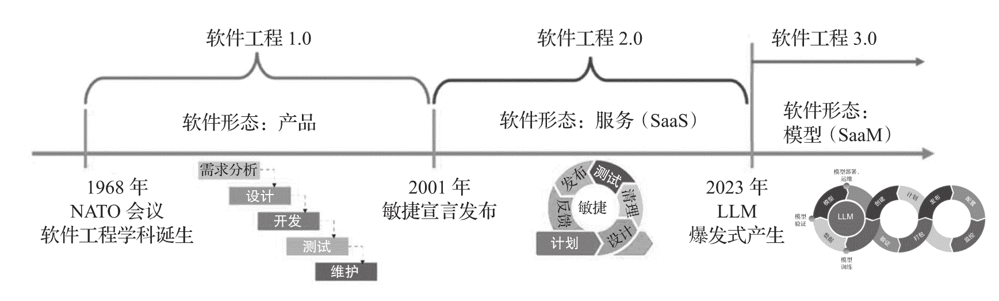

**图 1-1 软件工程时代的划分示意**

在研发范式层面，以GPT-4为代表的大模型推动更智能、高效、协作顺畅的方法，引发颠覆性变革。软件工程3.0进入模型驱动开发与模型驱动运维新范式：研发前需先训练好软件研发大模型，可能包括业务大模型、代码大模型、测试大模型并完成部署；随后基于该模型开展需求分析、设计、编程与测试，借助模型理解需求，自动生成UI、产品代码与测试脚本等。模型在需求文档生成与评审、高质量代码产出、全面用例生成等方面创造巨大价值，显著提升研发与运维效率与质量。

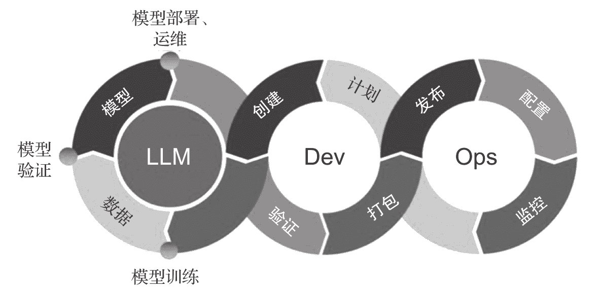

**图 1-2 软件工程 3.0 开发范式示意**

人机自然对话成为现实，新一代研发平台支持自然语言输入需求，实现人工智能生成内容，如需求定义文档、验收标准、代码、用例、脚本等。研发过程演变为人与计算机的自然交互，人机结对开发、人机结对测试成为新模式。

在此过程中，研发人员与大模型紧密协同。大模型或其构建的工具、系统作为助手、副驾驶或合作伙伴，通过提示词生成所需内容。例如在测试需求分析阶段，测试人员通过引导使大模型逐步细化测试项。提示工程成为提升大模型在测试中应用效果的关键。大模型生成内容需经测试人员检查、评审与完善；测试成果也可借助大模型工具进行复核，形成人机协同测试环境。未来人机交互智能有望超越模型自身智能，人机协同测试将成为常态。

**图 1-3 人机协同开发或测试示意**

实践中，多家企业已尝试利用大模型进行研发：

❑ 某知名互联网公司在开发电商App时，借助训练好的研发大模型快速生成基础框架与部分功能代码，大幅缩短周期。

❑ 部分团队基于UI设计图让大模型自动生成前端代码，减少手工编码时间，加快设计到实现流程。

❑ 某些企业结合智能体与相关工具，让基于大模型的研发平台生成代码流程图与类图，并辅以自然语言解释，提升代码可视性与交互性。

❑ 部分大厂已将大模型用于代码审查或CI/CD流程，如拉取请求中自动识别质量问题并提出改进建议。

❑ 某银行测试中心使用测试大模型根据需求文档生成大量用例，覆盖各类用户场景与边界条件，通过人机协同及时发现并修复潜在问题，保障App质量。

❑ 部分团队借助智能体与检索增强生成技术检索历史缺陷模式与已知问题，更准确识别潜在缺陷与安全漏洞，提升代码评审能力。

学术研究也在持续探索：

❑ 在软件工程背景下，AI协调器持续监控工件变化、协调智能体感知与行动，并调用专业AI智能体检查一致性与完整性，从而支持端到端开发过程。

❑ 大模型可在需求工程中提供帮助，能分析、组织与总结大量数据，在需求提出初期发挥关键作用。

❑ AI可使用C4模型生成系统高层概述，并自动为开发者生成UML类图、序列图、状态机图、组件与部署图等底层图表。

研究表明，对大模型进行特定领域微调可显著提升其在该领域研发任务中的表现。例如针对金融行业软件研发，将大模型在金融业务数据上微调后，生成的代码更符合行业规范，用例更能覆盖业务风险点。

## 1.2 软件测试的新机遇

软件测试长期面临工作量大、自动化推进难的问题，多数工作停留在半自动化阶段，严重制约质量提升与效率改善。大模型的出现为破解难题提供新思路，为测试带来前所未有的发展机遇。

在工业场景中，企业高度关注大模型的实际效益与操作便利性，大模型在多方面助力突破测试困境。企业通常在通用大模型上进行监督微调，将自有业务数据、丰富测试数据如大量用例、脚本、缺陷报告等以及专业领域知识融入其中，构建贴合自身需求的测试大模型。结合RAG技术与智能体开发框架如LangChain，对测试知识库进行向量化处理，打造知识增强型与检索增强型模型，显著提升其在测试分析、场景挖掘、用例评审、缺陷定位、结果分析等关键环节的能力，并借助模型生成用例、脚本与报告等测试制品。

# LLM 如何让软件测试提速提质

过去相当长一段时间内，测试工程师要花费大量工时手工编排验证要点，效率低且易遗漏。生成式语言模型的介入彻底改写了这一局面。以电商平台质量检验为例，某电商公司把海量业务数据和专业经验注入模型后，系统能够结合促销抢购、组合支付等不同购物情境，快速产出覆盖面广的验证用例。人力负担明显减轻，覆盖面得到拉升，漏测风险同步收窄。

在模型落地阶段，提示词设计已成为团队必须掌握的核心能力。精细设计的提示可以更好地引导模型理解检验意图并完成任务。实践中，测试人员多采用渐进式协作，及时纠偏并持续优化产出，这正是提升模型在检验场景表现的关键。TestPilot 就是典型代表，如图1-5所示，它借助 API 探索器从代码包中识别待测函数，利用文档挖掘引擎提取元数据，再由提示生成器、测试验证器和提示精炼器协同工作，搭建用于生成检验内容的提示。多组件相互配合，从模型回应中整合出完整验证内容，并依据执行结果反向优化提示，持续产出更高质量的案例。实践表明，嵌入代码片段能显著提升执行成功率，更好地复现缺陷、增强可信度。比如对办公软件进行验证时，植入特定功能的代码片段后，模型可以更逼真地模拟用户操作，挖掘出潜在的功能问题。

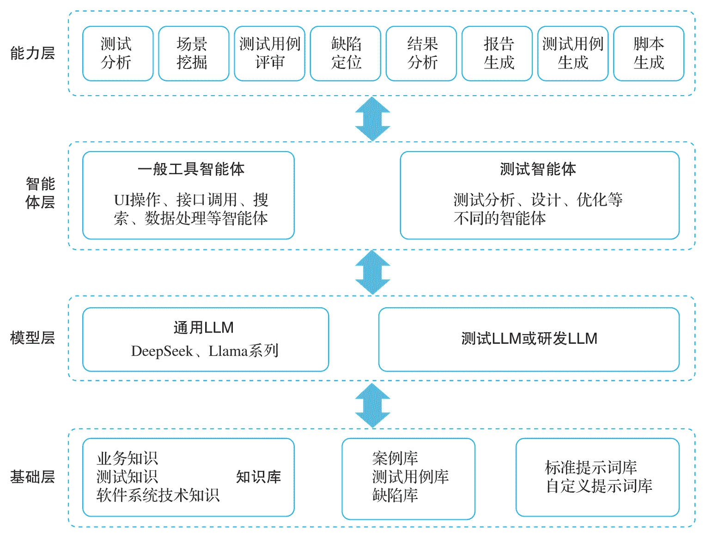

**图 1-4 基于知识库、LLM 和智能体组合框架提供 AI 测试能力**

产业界引入 LLM 做测试时，关注点集中在模型工程能力如 SFT、提示工程、RAG 技术、智能体开发与应用，以及知识库或知识图谱建设等方面。多技术融合让大模型更适配不同检验场景，性能和输出质量同步提升。例如百度资深测试工程师在 2024 年 AI+ 研发数字 AiDD 峰会上分享的主题“AI Agent 在软件测试中的落地实践：智能化测试新时代”，展示了一个以智能体为核心的全栈智能检验框架，如图1-6所示。该框架让 AI Agent 全程参与检验流程，借助大模型提升效率与覆盖面，推动检验向智能化、自动化演进。除常见的数据层、标准工具层如知识检索与问答、代码提交、API 检索外，还叠加了知识管理层、基础能力层和智能体应用层等面向 AI 的层次。

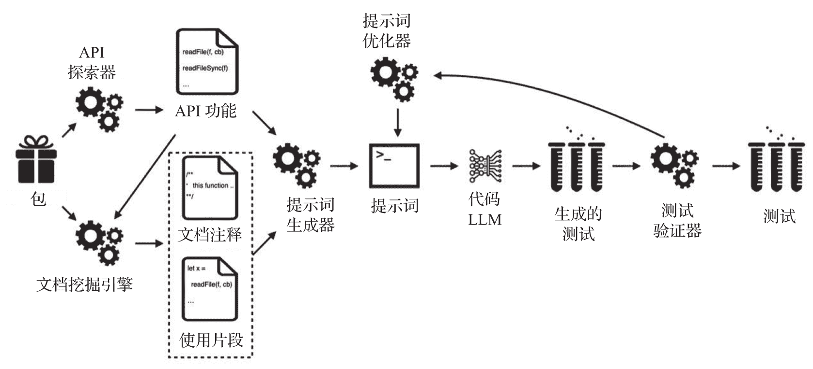

**图 1-5 TestPilot 基于 LLM 生成测试的原理示意**

❑ 知识管理层：智能检验的基础支撑，负责知识的构建、存储、更新与检索。先完成全局知识与项目特定需求知识的同步构建，再通过系统 API 向不同资源如文档、代码、API 提供检索服务。

❑ 基础能力层：为智能体提供底层能力，比如利用大模型基于需求文档生成思维导图、润色或细化案例语言风格等，主要满足案例生成、优化和需求挖掘等基础需求，从而提升文档解析能力，减少人工干预。

❑ 智能体应用层：

● 案例设计智能体：从需求文档到验证案例实现端到端生成，并优化规范性和表述风格，贴合业务线实际。

● 接口验证智能体：覆盖案例生成、合并、执行、修复的全流程自动化，采用模块化设计，支持业务场景的自定义扩展。

● Web UI 验证智能体：借助智能元素定位和自动化代码生成，大幅降低 Web UI 验证的编写与维护成本，并引入自动修复能力，解决传统录制回放维护成本高的问题。

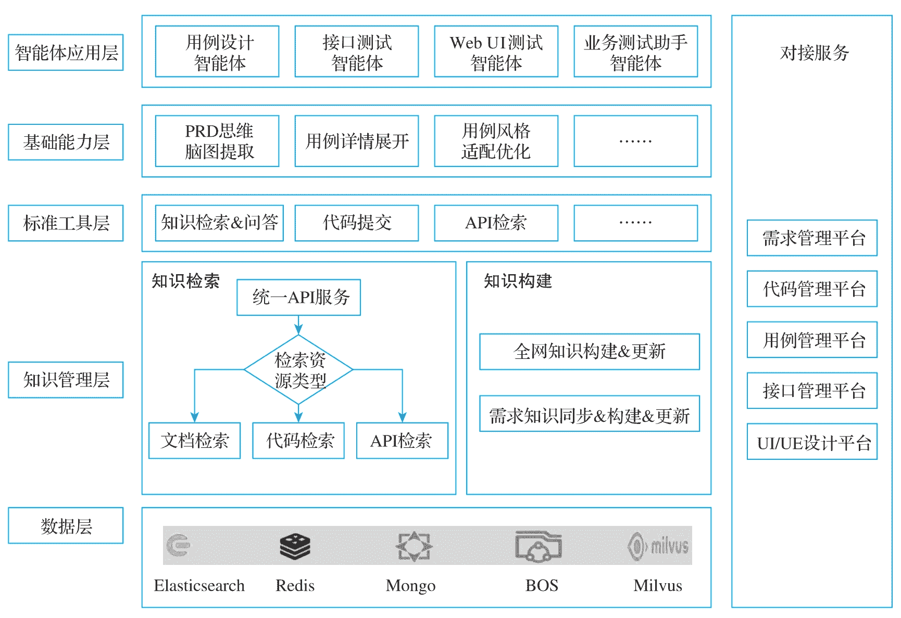

**图 1-6 以智能体为核心的全栈智能测试框架**

AiDD 峰会上也有专家介绍了一套基于大模型的端到端 AI 方案，覆盖从系统级验证输入到脚本输出的完整闭环，主要包括：

❑ 以需求为起点，基于实例化活动产出，借助 GWT 方式生成验证点并检索可复用案例，减少冗余。

❑ 结合要素因子与验证环境推荐，生成文本案例。

❑ 通过意图识别对文本案例进行领域特定语言 DSL 设计，召回 Robot Framework 关键字生成自动化脚本。

除此之外，企业还用大模型评审脚本、分析结果、生成报告。即便仅在案例生成阶段，大模型也能帮助挖掘应用场景，尤其是异常场景，效率远高于手工设计。更进一步，还能用于缺陷定位与修复。

把大模型嵌入验证全生命周期，各环节效率均有提升。不同行业、产品和团队的提效区间在 15%～90%，中位数为 43.5%，在验证环节尤为突出，如图1-7所示。需求分析阶段能快速梳理复杂业务、挖掘隐藏验证点；设计阶段可高效产出多样化案例与脚本；结果分析与报告阶段能迅速处理海量数据、提炼结论并生成规范报告；验证管理层面还能辅助资源调度与任务分派，优化流程。

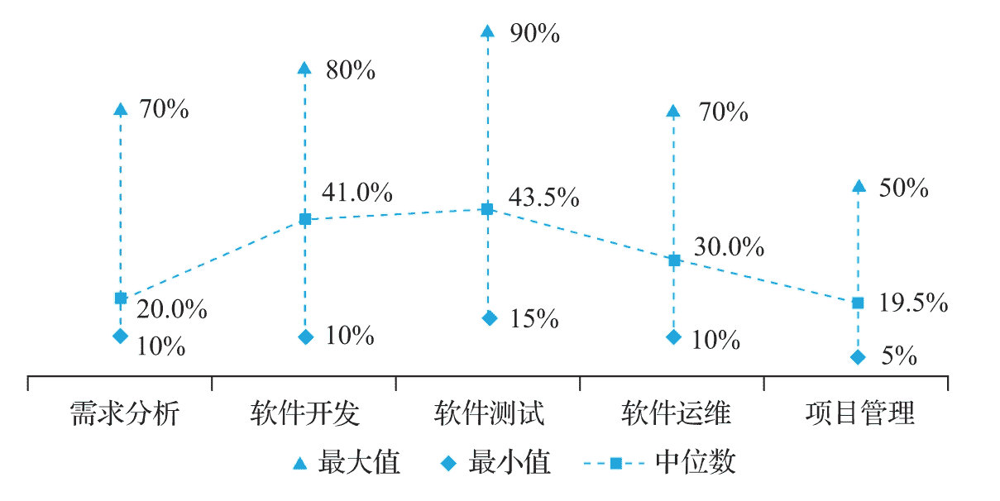

**图 1-7 LLM 在软件工程各阶段提效数据**[（数据来源：银弹案例数据、中国信通院发放的调查问券数据、企业走访调研数据等）]

大模型的出现为检验领域注入新动能，缓解了人手不足的压力，提升了自动化水平，解决了长期存在的自动化难、半自动化问题，显著提高效率与质量。随着技术演进，其在检验领域的应用空间将更广阔，助力行业迈向新高度。

学界对大模型赋能检验的研究持续深入，主要集中在：

❑ 单元检验案例生成：通过代码与案例联合训练提升理解能力，如用 Java 语料预训练并微调生成单元检验，或基于代码与检验文件的映射关系训练以提高生成质量。

❑ 指令调优：设计有效指令提升生成能力，如解析项目提取上下文生成适配指令，或提出“验证与修复”方法，让模型自我迭代修复错误案例。

❑ 结合传统检验技术：利用搜索技术生成未覆盖函数的案例，结合变异检验生成更有效案例。

❑ 检验预言生成：结合指令调优与少样本学习，预言准确率可达 76%。

❑ 移动应用系统检验：用大模型生成语义化文本输入，提升 GUI 页面覆盖率。GPTDroid 通过与 GUI 交互生成检验脚本。

❑ 缺陷分析：利用大模型检测重复 Bug 报告，或生成自然语言解释帮助开发者理解问题。

❑ 定位与修复缺陷：Detect-Localize-Repair 框架利用大模型完成检测、定位与修复；AdbGPT 通过指令调优生成复现脚本；CrashTranslator 利用大模型从堆栈预测崩溃触发步骤。

❑ 自动修复代码缺陷：Xia 等人在 QuixBugs 数据集上使用 Codex 修复了 40 个 Python Bug 中的 39 个。

## 1.3 软件测试的新挑战

大模型带来机遇的同时，也伴随诸多严峻挑战。

**（1）生成的验证案例和脚本准确性难以保证**

模型生成的案例和脚本质量并不稳定。好比厨师能快速上菜，却不能保证每道菜都合口味。大模型基于训练数据和算法生成内容，易出现理解偏差或不符合实际需求。以金融交易软件为例，生成案例可能忽视复杂业务规则和风控要求，如未覆盖特定利率波动下的交易场景，导致重要风险点被遗漏。一旦投入使用，就像执行了错误的作战方案，可能放过缺陷让问题产品上线，造成用户损失和声誉受损。实践中已有企业因案例未覆盖核心功能而导致上线后严重缺陷的案例。

**（2）验证覆盖率难以提高**

覆盖率提升是验证的核心目标，但大模型也面临瓶颈。软件系统如同复杂迷宫，场景和边界条件众多。模型需要持续学习才能尽可能覆盖，但目前仍可能错过关键路径。如在具有多角色、多权限组合和复杂流程的 ERP 软件验证中，模型难以穷尽所有权限组合下的操作，部分功能在特定权限下的隐患可能未被发现，影响稳定性和安全性。研究显示，在复杂业务场景下，使用大模型验证的覆盖率通常只能达到 70%～80%，仍有大量潜在问题未被发现。

**（3）验证预言的准确率不够高**

验证预言是判断软件行为是否正确的依据，需基于需求文档与业务规范。精确定义预期行为并验证输出一直是难题，目前大模型支持有限。如同裁判既要熟知规则又要准确判定动作，金融交易系统涉及汇率换算、税费计算、交易限额校验等复杂规则时，大模型难以精准判断结果正确性。需求虽明确，业务逻辑复杂、边界条件繁多，易导致验证点遗漏，甚至生成错误预言，削弱验证可信度。

**（4）软件性能难以精准评估**

性能评估是质量保障关键，大模型在性能验证和分析方面仍需加强。性能好比汽车动力，需精确评估。面对高并发、大数据量场景，大模型像驾驶经验不足的司机，难以准确判断表现。如在线教育平台直播功能在大量用户同时观看互动时，大模型可能无法准确分析响应时间、吞吐量等指标，错过性能瓶颈。某平台性能验证中，大模型对高并发数据的分析出现较大误差，导致瓶颈判断失误，影响优化方向。

**（5）实际业务应用问题**

落地到真实业务项目，会遇到流程融合与数据安全难题。好比新船驶入布满暗礁的水域。不同企业业务流程各异，大模型需适配这些复杂流程才能发挥作用。医疗行业验证既要遵循严格规范，又要确保患者数据安全。大模型若不熟悉医疗流程和安全要求，可能导致验证失误甚至敏感信息泄露。曾有医疗软件验证因数据处理不当导致患者信息泄露，造成用户困扰和法律风险。

大模型为验证带来巨大机遇，也暴露出明显挑战。需要持续探索，结合知识工程、RAG、强化学习等技术优化模型，提升案例生成与预言准确性；强化复杂场景长文本处理，增强智能体环境感知与认知能力；建立完善的数据安全机制，保障敏感数据处理安全。通过这些努力，才能充分发挥优势，推动验证行业健康发展。

## 1.4 本章小结

随数字化浪潮推进，软件研发进入以大模型为核心驱动的“软件工程 3.0 时代”。该时代实现需求分析、代码生成到验证设计全流程模型驱动、一体化智能协作，大幅提升开发与验证自动化与智能化水平。人员与大模型深度协同，效率与质量同步跃升，人机协同成为新范式。

首先，大模型创造了诸多新机遇。验证智能化转型不可逆转。相比软件工程 2.0 时代，当前自动化水平实现质变，从需求分析到案例生成、脚本生成、结果分析均深度融入模型。人机协同验证成为主流，验证人员借助企业自有微调模型与知识库，将精力从重复易错的手工工作转向策略与评估。大模型不仅能快速生成高覆盖案例与脚本，还能辅助缺陷定位、预言生成、报告撰写。智能体、RAG 和指令调优等手段极大推动案例生成、异常挖掘和覆盖率提升，为行业带来新增长。

其次，挑战同样突出。生成内容准确性与完整性不足，复杂场景下覆盖率、预言准确率、性能评估精度有待提升。不同行业的业务融合与数据安全也对落地提出更高要求，如何在保障敏感信息安全的同时持续优化算法与流程，是智能验证的关键命题。

展望未来，验证智能化仍在快速演进。通过强化指令调优、场景化微调、知识增强和安全措施，结合传统方法，有望补齐短板，推动产业进入高质量全智能研发新阶段。验证人员需持续更新知识体系，掌握 AI 协同与指令调优等新能力，以适应软件工程 3.0 时代的角色转型。

**1.5 参考文献**[[1]]

朱少民，王千祥.软件工程 3.0[M].北京：人民邮电出版社，2025.

[2] LIU J, WANG K, CHEN Y, et al.Large language model-based agents for software engineering:a survey[J/OL].arXiv preprint arXiv:2409.02977, 2024.

[3] MARQUES N, SILVA R R, BERNARDINO J.Using ChatGPT in software requirements engineering: a comprehensive review[J].Future Internet, 2024, 16(6):1-21.

[4] BI Z Q, WAN Y, WANG Z, et al.Iterative refinement of project-level code context for precise code generation with compiler feedback[C]// Findings of the Association for Computational Linguistics, ACL 2024.ACL, 2024:2336-2353.

[5] WANG J J, HUANG Y C, CHEN C Y, et al.Software testing with large language models: survey, landscape, and vision[DB/OL].arXiv preprint arXiv: 2307.07221v3, 2024.

# 第二章

# LLM 基础

当下科技浪潮中，大模型的崛起不仅是人工智能的技术突破，也重塑了人与智能机器的交互方式。从早期 NLP 到如今的高级 AI 智能体，大模型已成为信息革命的核心引擎。其演进不仅是算法迭代，更是人类对语言与知识表征理解能力的不断探索。随着成熟度提升，机遇与挑战并存，预示着 AI 的广阔前景。

本章将深入探讨大模型的核心技术与演进路径。首先回顾 NLP 历史，分析 GPT 为何脱颖而出，并介绍 ChatGPT。其次剖析支撑大模型的技术，包括 Transformer 架构、预训练与基于领域数据的微调及指令微调。继而探讨指令调优的关键原则、策略与技巧。最后讨论大模型在智能体与多智能体框架下的角色应用，为构建具备专业领域知识的智能体奠定基础。学习后，读者可全面理解技术基础及其实践潜力与挑战。

## 2.1 LLM 的诞生和进化

大模型的诞生与崛起标志着人工智能的重要转折，推动了 NLP 发展并为各行业带来新可能。从早期 NLP 到当前先进模型，梳理演进有助于把握未来趋势。本节概述 NLP 演进史，介绍 GPT 等大模型，并探讨 ChatGPT 作为标志性产品的出现，厘清演进脉络与影响。

### 2.1.1 NLP 技术演进

NLP 是计算机科学、人工智能与语言学交叉的领域，目标是让计算机理解、生成自然语言并与人类有效交流。它包含两个主要分支：自然语言理解 NLU 和自然语言生成 NLG。

自然语言理解的目标是让计算机把握人类表达的实际意义与语境关联。研究者希望通过算法与模型，把自然语言输入准确拆解出来，从而支撑信息抽取、情绪判断、跨语言转换等应用。这一方向的难点在于词汇的多义、语境的牵引以及句法结构的复杂。

自然语言生成则致力于把结构化信息或逻辑表达转成通顺的人类可读文本。NLG 系统要把表格、图示、规则集合之类的非文本材料重组为连贯的语言表达，在自动化报告、文本归纳、内容撰写、对话代理等场景中发挥作用。实现一般分成内容筛选、框架搭建、语言实现三步，在保证事实正确的前提下提升可读性与自然度。

语言处理的研究可以回溯到上世纪四十年代。1946 年 ENIAC 问世，不久美国学者沃伦·韦弗与英国工程师安德鲁·唐纳德·布思于 1947 年提出借助机器实现语言自动转换的构想。1949 年韦弗发表《翻译备忘录》，正式提出机器翻译设想。1950 年艾伦·图灵发表《计算机器与智能》，推动人工智能与语言处理进入快速发展期。到现在，NLP 大致经历了下图所示的四个发展期。

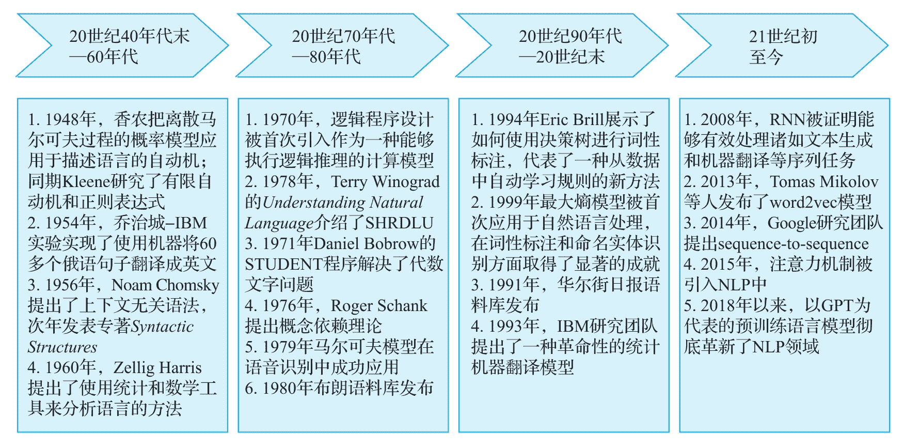

**图 2-1 NLP 技术演进的四个阶段**

**1. 第一阶段（20 世纪 40 年代末—60 年代）**

该时期大致分出符号派与统计派两条线索。符号派强调用明确规则与符号来表征语言，重视逻辑推理与形式语法，认为只要把语言结构精确界定，机器就能完成理解与生成。统计派则侧重概率手段，借助马尔可夫模型等预测词与句的产生。两条路线都取得进展，但规则方法更为流行。

典型工作有：1948 年克劳德·香农把离散马尔可夫过程的概率模型用于描述语言自动机，并引入熵的概念；同期斯蒂芬·克莱尼研究有限自动机与正则表达式；1954 年乔治城大学与 IBM 联合做乔治城-IBM 实验，将俄语词转成数字码后选词、重排、删减，最终把六十余句俄语译成英语；1956 年诺姆·乔姆斯基提出上下文无关语法，并在次年专著《句法结构》中构建通用形式语法理论；1960 年泽利格·哈里斯提出以统计数学工具分析语言的方法，后被统计派广泛采用。

**2. 第二阶段（20 世纪 70 年代—80 年代）**

研究从基础的规则与统计模型转向更复杂的理论框架，形成逻辑范式、规则范式、统计范式三大方向。

逻辑范式强调用逻辑推理来理解与生成语言，把句子转为逻辑表达式后进行分析操作。代表性工作：1970 年逻辑程序设计首次作为可执行逻辑推理的计算模型引入，代表语言是 Prolog；1972 年特里·温诺格雷在《理解自然语言》中介绍 SHRDLU 程序，展示计算机通过逻辑推理实现语言处理基本功能。

规则范式聚焦人工设计的明确规则与算法来解析生成语言。代表性工作：1964 年丹尼尔·博布罗的 STUDENT 程序解决代数文字题，体现规则解析潜力；20 世纪 60 年代布朗语料库成为统计语言处理的核心语料，为从规则驱动转向数据驱动提供首个大规模结构化英语语料支撑；1972 年罗杰·尚克提出概念依赖理论，认为所有自然语言句子都能用一组基本概念依赖表示，为规则处理提供理论基础。

统计范式主要借助统计方法与概率模型处理自然语言。50-60 年代已有涉猎，70-80 年代逐渐成熟。典型工作：70 年代中期马尔可夫模型在语音识别中取得成功，凸显统计方法在语言处理中的重要性提升。

**3. 第三阶段（20 世纪 90 年代—20 世纪末）**

重心从人工定义规则或逻辑转向基于真实数据的训练与验证，集中于机器学习方法与数据驱动方法。

机器学习方法方面，1992 年埃里克·布里尔首次展示用决策树做词性标注，代表从数据自动学习规则的新方向。此后 1996 年最大熵模型首次用于语言处理，在词性标注与命名实体识别上取得明显成效。

数据驱动方法方面，1991 年《华尔街日报》语料库发布，为后续基于数据的研究提供宝贵资源。1993 年 IBM 研究团队提出革命性统计机器翻译模型，标志机器翻译从规则驱动向数据驱动转变。

**4. 第四阶段（21 世纪初至今）**

深度学习的兴起大幅提升模型复杂度与数据处理能力，彻底改写研究与应用方向。研究重心转向深度神经网络与向量表征。

2008 年循环神经网络被证实能有效处理文本生成、机器翻译等序列任务，时序记忆引入后语境信息得以保留，语言模型表现提升。

2013 年托马斯·米科洛夫等人发布 word2vec，实现词到向量的映射，词间语义关系可通过向量空间距离与方向表达。2014 年 GloVe 模型提出，基于全局词共现矩阵结合局部语境窗口，提供更优的词嵌入方法。

2014 年谷歌提出序列到序列模型，利用编码器-解码器两个 RNN 结构实现输入序列到输出序列的映射，被广泛用于机器翻译，成为现代生成式框架的奠基。

2015 年注意力机制引入语言处理，尤其用于序列到序列任务，模型在生成每个输出元素时可动态聚焦输入不同位置，大幅改善长序列处理效果。

2018 年起以 GPT 为代表的预训练语言模型彻底革新 NLP，具体内容后文展开。

### **2.1.2 谁在与 GPT 竞技**

GPT 问世后 NLP 进入新阶段，同时 BERT、T5、XLNet 等体系展开激烈较量，共同推动领域发展。下面介绍几种主流模型。

**1. GPT**

GPT 由 OpenAI 在 2018 年推出，是基于生成式预训练的语言体系。先在海量无标注文本上预训练，再针对具体任务做进一步训练，在语言理解、文本生成、对话系统、创意写作等任务表现突出。

体系采用 12 层单向自回归 Transformer 解码器架构，如图 2-2 所示。预训练阶段在 BooksCorpus 上训练，目标是最小化 token 级困惑度，学习丰富的语言表示，为后续监督微调提供良好初始化。

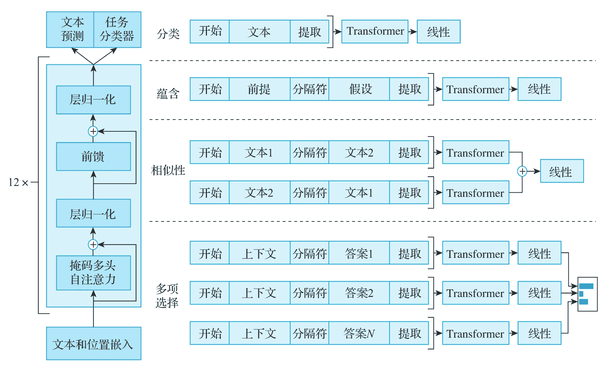

**图 2-2 GPT 架构示意**

在后续训练阶段可用于自然语言推理、问答、语义相似度评估、文本分类等。借助任务相关输入转换，GPT 在故事结尾选择任务的提升幅度为 8.9%，问答任务 RACE 的提升幅度为 5.7%，自然语言推理 MultiNLI 的提升幅度为 1.5%。

**2. BERT**

BERT 是谷歌在 2018 年发布的双向编码器表示体系。核心任务为掩码语言模型和下一句预测，在训练时同时利用句子中每个词的前后语境，实现更深理解，如图 2-3 所示。

MLM 中随机掩盖部分词，要求体系预测被掩盖词，使其学习语境表示，实现双向理解。

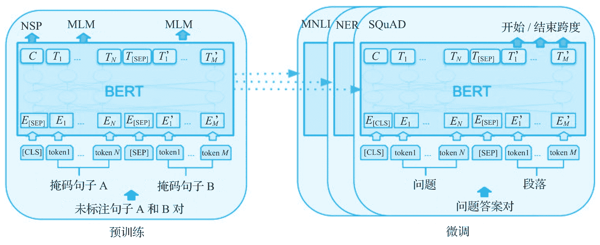

**图 2-3 BERT 预训练与微调总览**

NSP 任务要求判断两句是否原文相邻，帮助体系捕捉句间关系与连贯性。训练采用大规模无监督学习，谷歌使用含数十亿词的文本语料并以大规模并行计算优化，在问答、文本分类、命名实体识别、情感分析等多任务表现优异。

**3. T5**

T5 由谷歌在 2019 年推出，核心思想是把所有语言处理任务统一为文本到文本格式。无论翻译、摘要还是分类，输入输出都被视为文本字符串，统一框架让不同任务共享知识，简化表示并提升多任务学习效率。

训练先在 C4 清洗网络语料约 75G 上以去噪目标进行生成式预训练，再在下游任务单独微调。

**4. XLNet**

XLNet 由谷歌与卡内基梅隆大学在 2019 年联合发布，是通用自回归预训练方法，结合自回归语言模型和自编码优势并规避局限。

通过最大化所有排列顺序的期望似然捕捉双向语境，开发双流注意力机制生成目标感知表示，不依赖 BERT 式数据腐蚀从而避免预训练-微调差异，集成 Transformer-XL 的分段循环和相对编码等改进，在问答、自然语言推理、情感分析、文档排序等多项任务表现优异。

**5. GPT-2 与 GPT-3**

GPT-2 由 OpenAI 在 2019 年发布，第二代生成式预训练体系。相比 GPT-1，使用更大更丰富的 WebText 数据集，参数扩至 15 亿。凭借超大预训练数据和参数规模，在零样本学习下多任务表现良好，文本生成尤为突出，为 GPT-3 奠定基础。

GPT-3 发布于 2020 年，进一步探索扩大规模以提升任务无关少样本学习能力。出色性能得益于上下文学习方法，即元学习思想的具体实现，体系可在给定示例下直接完成任务而无需显式更新参数。GPT-3 参数达 1750 亿，比此前任何非稀疏语言模型大 10 倍，在翻译、问答、常识推理等任务上表现卓越，零微调时常可匹敌或超过此前最优微调模型。

### **2.1.3 ChatGPT 面世经过**

ChatGPT 基于 GPT-3 发展，由 OpenAI 在 2022 年 11 月推出。网页端试用上线仅五天即吸引超 100 万活跃用户，两个月内突破 1 亿用户，成为增长最快的消费级应用之一。这一发布标志语言处理重要里程碑，也体现人工智能在对话系统上的突破。ChatGPT 网页端界面如图 2-4 所示。

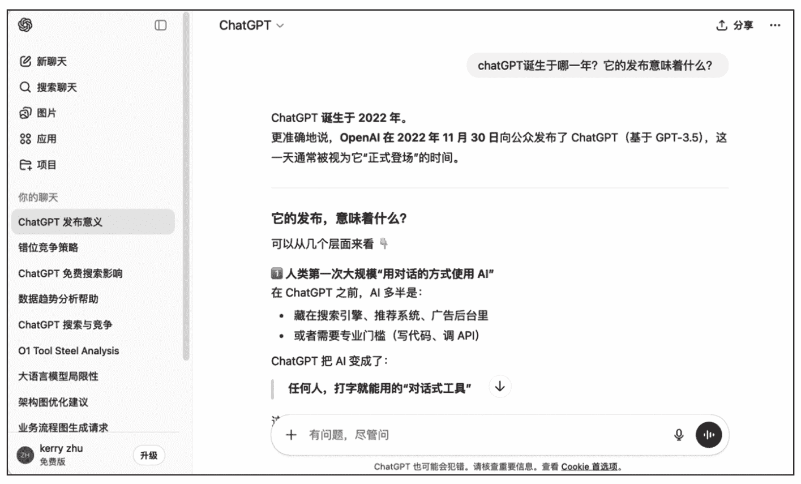

**图 2-4 ChatGPT 网页端界面**

ChatGPT 成功主要归因于技术基础与创新设计。

**1. 超大规模数据预训练与超大模型参数规模**

ChatGPT 核心体系在海量多样化文本上预训练，参数规模巨大，覆盖广泛主题和语言风格，能捕捉丰富语言模式和语境关系，使对话更自然流畅。预训练目标是学会生成有意义连贯文本并理解用户意图。

**2. 强化学习与人类反馈**

ChatGPT 结合 RLHF 基于人类反馈的强化学习。评审员对体系生成对话打分，体系据反馈不断调整优化，从而更好理解和响应用户需求，生成更高质量对话。

**3. 自然语言理解与生成的结合**

体系不仅生成能力强，理解用户提问和请求的能力也较强，能准确解析意图并给出相应回答或建议，理解与生成结合使其在各对话场景提供有价值互动。

**4. 多轮对话与语境保持**

ChatGPT 能记住对话语境，保持后续连贯性和一致性，可引用此前信息并根据语境给出贴切回答，对长期自然对话体验至关重要。

**5. 多领域应用的潜力**

通用对话能力使其在客户服务、教育辅助、创意写作、个人助理等多个领域具有广泛潜力。例如教育中可解答问题、提供学习建议；创意写作中可作灵感来源帮助生成内容。

总体看，在 AI 快速发展的背景下，ChatGPT 的诞生是重要里程碑，展示生成式预训练体系的巨大潜力，为人机交互未来提供丰富可能性。随着技术进步，ChatGPT 及类似对话系统将在各行业实现更高水平智能对话服务。

## **2.2 大语言模型技术内核**

理解 LLM 核心技术对充分发挥其潜力至关重要，无论是数据处理、模型架构还是训练与微调，这些技术共同支撑 LLM 的强大功能。本节将解析 Transformer 架构、预训练理论，以及基于领域数据的微调和指令微调方法，帮助读者更好理解原理并探索应用优化。

### **2.2.1 Transformer 架构解析**

Transformer 出现前，LSTM 网络和 RNN 几乎主导语言处理领域。它们通过维护内部状态处理序列数据，在一定程度上捕捉长期依赖。然而 RNN 与 LSTM 处理长序列时效率不足，需按顺序逐步处理每个元素，就像软件测试中一个用例需依赖前一步完成，严谨但效率不高。

为克服此问题，研究者提出 ByteNet 和 ConvS2S 等体系，用 CNN 替代 RNN，可同时处理输入输出的不同部分，类似自动化测试中并行测试加速整体进度。但这些体系在处理长距离依赖时计算量随距离显著增加，捕捉远距离关系困难。好比软件测试中若需验证相隔很远的两个组件交互，就需要更多步骤和时间来确保覆盖这些依赖关系。

**从并行到全局：Transformer 如何改写模型范式**

与依赖逐层递进的循环神经网络不同，Transformer 干脆抛弃了递归依赖，全部建立在注意力机制之上。编码器不再需要等待上一时刻的输出，整段输入可以一次性并行计算，训练效率因此获得大幅提升。可以这样理解：一个高效团队里，每个成员都能直接读取所有同事的信息而非按层级逐级上报，整体协作速度自然更快。

整体结构一目了然，包含输入、编码器、解码器与输出四个环节，如图 2-5 所示。表 2-1 对 Transformer 的核心组成及其作用做了汇总。

**表 2-1 Transformer 的核心组件及其功能**

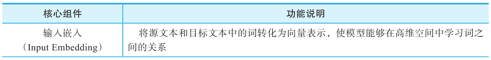

（续）

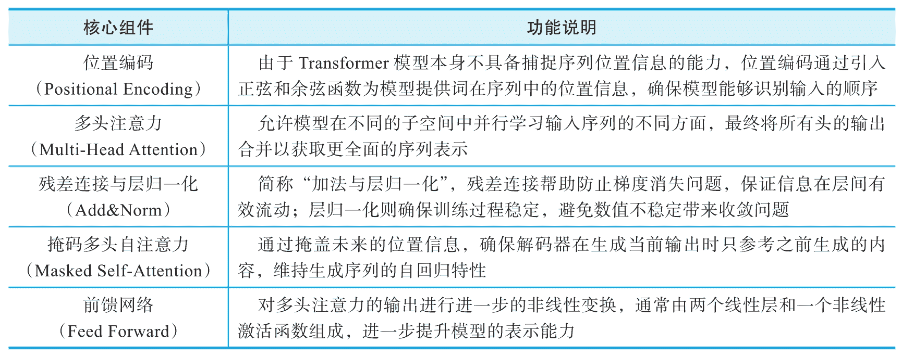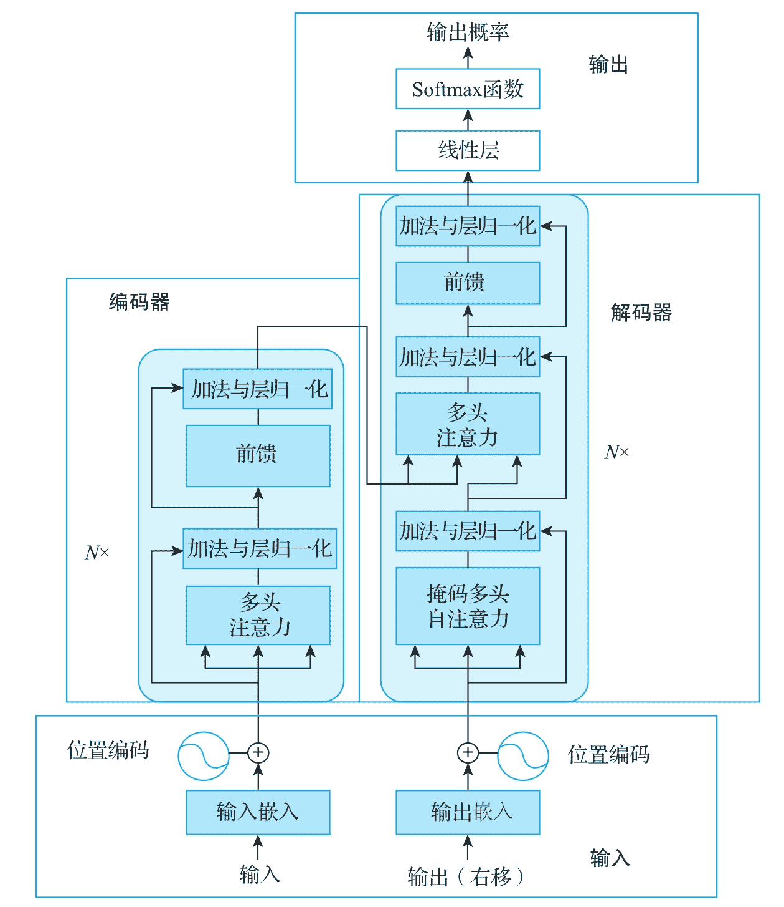

**图 2-5 Transformer 整体架构^[⁷^]**

除结构外，模型还内置三种注意力形式，即编码器自注意力、解码器交叉注意力和解码器因果自注意力，也称掩码自注意力，其具体分工见表 2-2。

**表 2-2 Transformer 的三种注意力机制的功能**

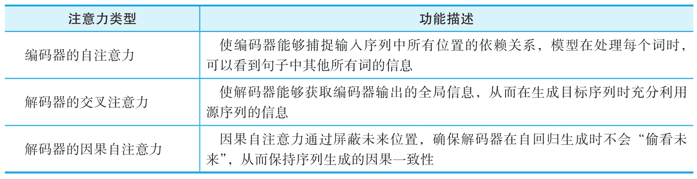

为了更直观地体会这三种机制，用一个软件测试团队来类比。

**1.编码器的自注意力**
可以看成测试组内部的相互校对与协同。每个测试员既要负责自己的功能，也要关注同事的进展以避免用例重复或遗漏。比如有人测支付，另一人测登录，测支付的人会意识到登录失败支付就无法触发。正是这种模块间的依赖感知，使得自注意力在处理输入序列时能够捕捉各片段之间的关联，从而获得更强的上下文理解。

**2.解码器的交叉注意力**
相当于开发与测试之间的信息对齐。开发提供的需求文档和代码是编码器的输出，测试计划与结果是解码器的输入。设计用例时必须持续参照需求说明来保证用例贴合预期并验证功能一致。解码器在生成时借此参考编码器的信息，确保输出与输入保持一致。

**3.解码器的因果自注意力**
类似测试执行的先后顺序。注册必须先于登录，因为登录依赖注册产生的用户信息。解码器生成时引入因果掩码，保证在位置 i 生成时只能看到 0 到 i-1 的历史，而看不到 i 之后的内容。这种设计保留了自回归特性，逐步生成且仅基于已生成的部分，保证逻辑连贯与顺序正确。

总体来看，基于注意力的架构让 Transformer 的训练可以并行化，效率显著提高，在长序列和远距离依赖任务上优势明显。即便生成阶段仍保持自回归，整体设计也为自然语言处理及相关领域提供了全新思路。想深入了解细节，可阅读奠基论文“Attention is All You Need”。

### **2.2.2 预训练模型**

随着大语言模型发展，标注数据稀缺而非标注数据泛滥成为突出痛点，特定任务往往训练样本极少。预训练因此被提出。

预训练是 LLM 训练流程的先导阶段，发生在特定任务训练之前。核心是让模型在海量广泛语料上学习通用特征和知识，形成一个通用的预训练模型。

目标是打造具备广泛能力的基座，强调通用性而不针对某个领域。通过大规模多样化数据，模型能习得语言基本结构、语法规律和世界常识，但尚未做任务专精，因而呈现“面广而欠精”的状态。后续的微调负责在特定场景上补强。

常规流程包括：
1）挑选一个体量大、覆盖面广的通用语料库，与最终任务不一定相关，但需足够多样。
2）模型训练。在该语料上开展语言建模任务，如掩码语言模型、下一句预测等，学习词与上下文及句子结构的关联。
3）保存预训练参数。完成通用训练后保存权重，作为后续微调的起点，通常包含词嵌入、编码器、解码器等部分。

预训练带来的价值有：
❑ 学习通用知识。大量语料让模型掌握可迁移的语言模式。
❑ 降低任务数据需求。基座已具备基础理解，微调所需标注大幅减少。
❑ 提升任务表现。基座提供良好起点，微调后在特定任务上表现更佳。

总的来看，预训练通过通用数据培养基础模型，可明显减少数据与训练时间，对 NLP 帮助较大。但它对算力和存储消耗极高。为此研究者探索高效架构，混合专家模型 MoE 即为代表。这种稀疏激活结构包含多个专家子网络，前向时仅激活部分专家，在扩大参数规模和表示能力的同时控制实际计算开销，为大规模预训练的可扩展提供了可行路径。

### **2.2.3 基于领域数据的微调**

在预训练基座上，为适配特定任务需要进行基于领域数据的微调，即在目标领域数据上继续训练，让模型更好地匹配该领域分布，提升专业表现。下面从流程、作用和方法展开。

**1.基于领域数据的微调的步骤**
通常包含五步：
1）准备领域数据集。可选标注数据如分类标签、序列标注、问答对，也可使用无标注数据做无监督学习。
2）调整模型结构。按任务需求在预训练模型上加任务头，如分类头、生成头等。
3）模型微调。用领域数据继续训练，需设置合适的学习率、batch 大小等超参数。
4）评估与优化。持续评估性能并调整策略以改善效果。
5）保存模型。完成训练后保存参数，得到在该领域表现更强的模型。

**2.基于领域数据的微调的作用**
❑ 提高准确性。模型更能理解领域术语、表达习惯和上下文，提升预测精度。
❑ 减少数据需求。预训练已学到通用特征，领域微调所需样本相对较少。
❑ 加速训练。相比从零训练，微调收敛更快。

**3.常见的基于领域数据的微调方法**

**（1）SFT**
监督式微调的典型做法。给模型输入和对应标签，如情感分类或命名实体识别，像给学生出题并提供标准答案反复练习。用梯度下降等优化器调整参数。优点是简单直观、见效快。缺点是高度依赖大量标注数据，对数据稀缺领域不友好。

**（2）LoRA**
低秩适应方法，基于 LLM 参数的低秩特性。引入旁路矩阵模拟全参数更新，将原参数分解为两个小矩阵乘积，仅训练这两个低秩矩阵。思路是 LLM 过参数化，特定任务只动用一小部分关键参数，采取“精打细算”策略。效率提升同时大幅降低计算成本，适合资源受限场景，也因训练参数减少而降低过拟合风险。

**3）P-tuning v2**
面向超大模型的微调技术。核心是在输入与输出之间加入可训练的连续提示词，类似考试时给出提示帮助作答。通过优化提示参数来调整模型输出。可处理超大规模模型，提升灵活性与适应性，减少计算资源消耗，在多个下游任务上表现良好。

**（4）Freeze**
冻结式监督微调。微调时冻结预训练模型的前若干层，因为这些层主要提取低级特征，类似盖房子保留地基只改动上层。具体先标记选定层为不可训练，trainable=false，反向传播时不更新；然后仅更新未冻结部分。减少可训练参数，降低复杂度，同时保留低级特征提取能力，提升泛化效果，适合快速迭代与部署场景。

综上，基于领域数据的微调是释放预训练模型潜力的关键。通过精细流程与多样方法，可有效提升准确性与泛化能力，减少数据与时间成本，为 AI 在各领域的落地提供技术支撑。

### **2.2.4 指令微调**

LLM 能力快速提升的同时，训练目标与用户目标脱节的问题凸显。模型在海量语料上最小化下一个词预测误差，而用户期待模型能安全、可靠地理解并执行指令。为此出现了指令微调。

**1.指令微调的基本概念**
指令微调是在由指令与输出配对构成的数据集上继续训练 LLM。指令代表人类意图，输出代表期望结果。该过程缩小了“下一个词预测”与“遵循用户指令”之间的差距，使模型输出受指令约束，更贴合预期特征与领域知识，为人类干预模型行为提供通道。它可视作 SFT 的特例，但更聚焦于增强模型理解指令并对其做出可控响应的能力。数据以指令-输出配对呈现，帮助模型更准确地遵循指令。

**2.指令微调数据集简介**
构建方式主要有两种：从带标注自然语言数据集整合指令-输出对，以及用 LLM 生成。

数据整合方法从现有标注数据中抽取指令与输出。例如问答对“问题：白盒测试常用方法有哪些？回答：控制流测试、数据流测试…”可转为“指令：描述白盒测试常用方法。输出：控制流测试、数据流测试…”。

用 LLM 生成则分三步：人工收集少量种子指令 → 用成熟 LLM 扩大量化多样指令 → 把指令喂回 LLM 生成对应输出。

代表性数据集：
**（1）Natural-Instructions 数据集**
人工构建的英文指令集，涵盖 61 个 NLP 任务共 19.3 万实例。包含指令和实例两部分。指令由标题、定义、重点/注意事项、避免事项、提示词、正面示例、反面示例七部分组成；实例为遵循指令的输入输出对，示例如图 2-6。

**（2）Self-Instruct 数据集**
基于 InstructGPT 构建的英文教学集，含 5.2 万训练指令和 252 个评测指令。每条实例由指令、输入、输出组成。指令为自然语言任务定义，输入为可选补充，输出为符合要求的文本。

Self-Instruct 生成流程如下。

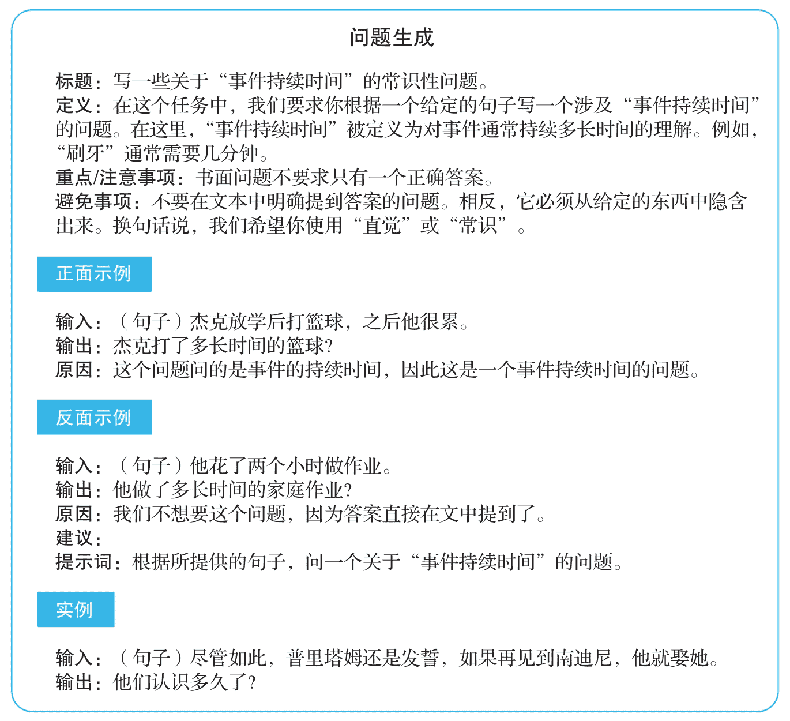

**图 2-6 Natural-Instructions 数据集示例**

1）从 175 个种子任务中随机挑 8 条自然语言指令作为示例，提示 InstructGPT 生成更多任务指令。
2）对生成指令判断是否为分类任务。若是，要求模型生成所有可能输出选项并随机选一个类别，再生成对应输入；若不是，采用“输入优先”策略先生成输入再基于指令和输入生成输出。
3）据上一步结果，用 InstructGPT 生成输入与输出，选用“输出优先”或“输入优先”策略。
4）后处理生成的指令：过滤重复与相似指令，去冗余，最终得到 5.2 万条英文指令集，示例如图 2-7。

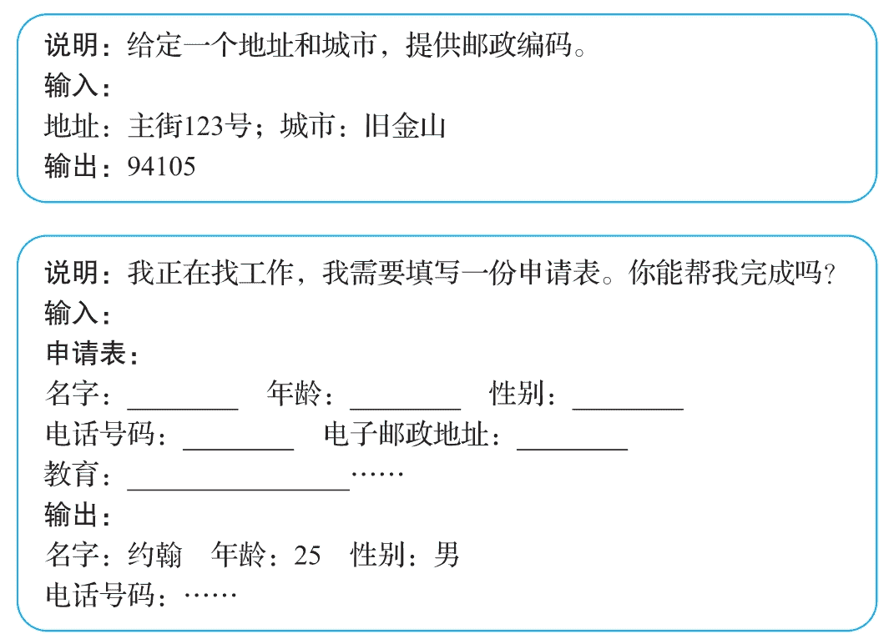

**图 2-7 InstructGPT 生成完整数据集示例**

**3.指令微调与基于领域数据的微调的对比**

**（1）主要区别**
❑ 目标差异：指令微调侧重提升模型遵循人类指令的能力，数据为指令-输出对；基于领域微调侧重让模型掌握特定领域的知识与风格，数据为领域文本。
❑ 数据依赖性：指令微调依赖高质量指令-输出对，常需人工设计或精细构建；领域微调依赖领域特定语料，可标注可非标注。
❑ 应用场景：指令微调适用于编程、教育、任务自动化等需复杂指令执行的场景；领域微调适用于医疗、法律、金融等需专业知识的场景。

**（2）主要联系**
❑ 共同目标：两者都旨在提升 LLM 在特定任务或领域上的表现。
❑ 技术互补：先做领域微调增强专业理解，再做指令微调提升执行能力。
❑ 微调过程：都基于预训练模型进行额外训练以满足特定需求。

通过指令微调，LLM 能更可靠地理解并执行人类指令，提升可控性与实用性，为更广泛的应用打开可能。

## **2.3 提示工程**

大模型交互实战：从提示设计到思维链

提示工程正在改变人与大模型沟通的范式。对输入进行精细打磨，模型回应的贴合度与任务完成效率会明显提升。下面聚焦撰写思路、常用操作以及思维链 CoT 等前沿做法，帮助你在实战中快速上手。

### **2.3.1 提示词撰写原则与策略**

在 NLP 里，提示就是送给大模型的输入文本，用来牵引它产生期望的输出。提问、一句话指令、一段要求、未完成的文本都可作为提示。持续调优提示，能更精准地控制回应走向与质量。可以把提示理解为操控输出的抓手，弄懂其作用与设计逻辑，才能在不同场景下发挥模型潜力。

2023 年 OpenAI 发布 Prompt engineering 文档，对 GPT 使用时的撰写基础法则做了系统梳理。这些法则通用性很强，迁移到其它大模型同样适用，能显著改善输出效果。

**（1）原则一：撰写明确清晰的指令**

模型很难揣摩人心，指令越清楚偏离越少。想要简短就直接说请精简；觉得内容太浅就明确要求专家级水准。

主要做法如下。

1）在提示中补充足够细节以换取更贴切的答案。要想获得高度相关的回应，提示语需要补上关键背景或上下文，具体可参考表 2-3 所示。

**表 2-3 提示词示例 1**

2）要求模型扮演特定角色。明确告知模型应扮演何种身份，有利于给出更准确专业的回复，如表 2-4 所示。

**表 2-4 提示词示例 2**

3）用分隔符把输入拆开。三引号、XML 标签、章节标题等都能把需要区别对待的文本块划分清楚，减少任务细节的歧义，如表 2-5 所示。

**表 2-5 提示词示例 3**

4）把步骤写在前面。把任务拆成明确的步骤罗列出来，模型会按顺序执行，输出更符合预期，如表 2-6 所示。

**表 2-6 提示词示例 4**

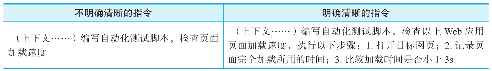

5）给出样例。多数情形下描述清楚就够了，但在某些任务里，示范一则案例比长篇说明更有效，这就是经典的少样本提示，如表 2-7 所示。

**表 2-7 提示词示例 5**

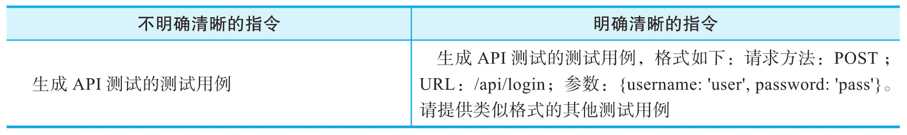

6）限定输出篇幅。可以要求模型按指定字数或长度生成，虽然字数控制并不绝对精准，超长文本效果会打折，但总体上仍有帮助，如表 2-8 所示。

**表 2-8 提示词示例 6**

**（2）原则二：提供参考文本**

大模型近年进步很快，但在特定场景仍会编造知识。给模型一份可信参考，能显著降低幻觉出现的概率。

主要做法如下。

1）要求模型基于给定的参考资料作答。适用于手头已有关于当前问题的可信信息的情形，如表 2-9 所示。

**表 2-9 提示词示例 7**

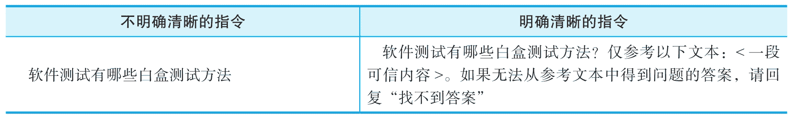

2）让模型在回答时引用原文。若已有可靠参考，可直接要求它引用原文段落来佐证答案，提升可核查性，如表 2-10 所示。

**表 2-10 提示词示例 8**

**（3）原则三：将复杂的任务拆分为更简单的子任务**

对大模型而言，一次性搞定庞大任务容易出错。把复杂事情拆成可处理的子任务逐步完成，再汇总结果，思路类似分治。

主要做法如下。

1）先做意图分类再选指令。面对需要多套指令的任务，先判断查询类型，再决定用哪套提示。可以预先定义好类别和对应指令，甚至递归使用，把大任务层层拆解。

2）对长文档进行分段摘要再合并。这是工程侧常用做法：设置阈值，当输入过长时自动触发分段概括，在压缩信息的同时尽量保留来龙去脉。

**（4）原则四：给模型“思考时间”**

逐步推理即思维链，是一个非常实用的进阶撰写策略，细节将在 2.3.3 节展开。

### **2.3.2 提示技术**

随着大模型快速发展，提示技术成为提升任务处理能力的关键手段之一。本节介绍零样本提示、少样本提示以及生成知识提示。这些技术帮助模型在各类自然语言任务中表现更灵活高效，也为后续优化提供了理论基础和实践范例。

**1.零样本提示**

如今经过大规模预训练和指令微调的大模型，已经能直接处理零样本任务，示例如表 2-11 所示。

**表 2-11 零样本提示示例**

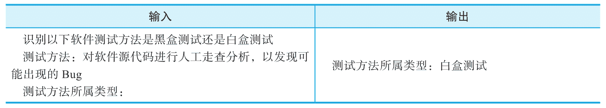

在该例中，并未向模型提供任何示范，这就是零样本提示。

**2.少样本提示**

虽然许多大模型零样本能力很强，但在复杂任务上效果会打折。少样本提示通过提供演示来引导模型取得更好表现。

Brown 等人在论文“Language Models are Few-shot Learners”中演示了少样本提示的具体例子^([6])，如图 2-8 所示。其中，粗体部分是 GPT-3 完成的内容，普通文本是作者输入的提示。

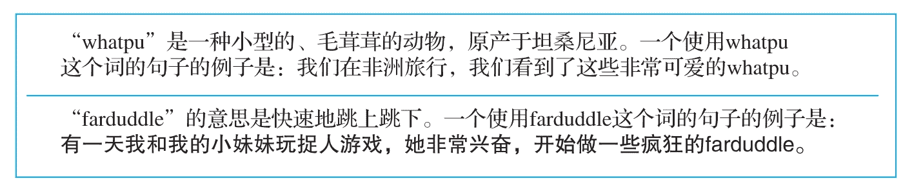

**图 2-8 Brown 等人在论文中的少样本提示示例**

可见，模型通过一个示范就能学会执行此类任务。对于更困难的任务，可尝试增加示范数量，如 5-shot、10-shot 等。

**3.生成知识提示**

融合外部知识或信息，能帮助模型做出更准确的回答。刘嘉程等人在 2022 年的研究^([10])探索了生成知识以作为提示的一部分，如图 2-9 所示。

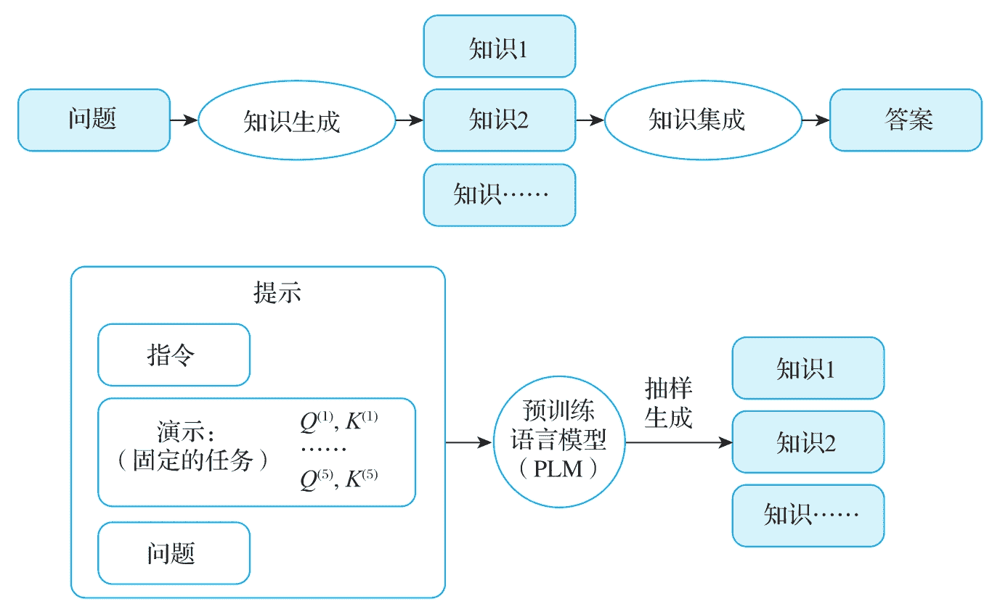

**图 2-9 生成知识提示**

生成知识提示是一种提升常识推理能力的方法，包含两个步骤：

1）知识生成：用模型根据问题生成相关的知识陈述，这些陈述包含回答问题所需的信息。
2）知识集成：将生成的知识陈述作为额外输入，与原始问题一起输入推理模型，得到最终答案预测。

研究中的例子如下。
步骤一：直接提问。
问题：“高尔夫球运动的目标是获得比其他人更高的得分。是或否？”
模型回答：“是。” 这显然是错误的。
步骤二：让模型先生成有关高尔夫的相关知识。
问题：请简述高尔夫球运动的目标及其规则。
模型回答：高尔夫球运动的目标是以最少的杆数打完一组洞。一轮比赛通常包括 18 个洞，每个洞在标准球场上一轮只打一次。每个杆计一分，总杆数用于决定胜负。
步骤三：将知识和问题一起输入。
问题：高尔夫球运动的目标是获得比其他人更高的得分。是或否？
知识：高尔夫球运动的目标是以最少的杆数打完一组洞……
模型回答：不是，目标不是获得更高得分，而是以最少杆数完成一组洞，胜负由总杆数决定。

可见，生成知识提示类似于“自问自答、自我引导”，能有效提高常识推理的准确性。

总体来看，提示技术为提升推理能力和处理复杂任务提供了有效工具。零样本体现泛化能力，少样本提供任务引导，生成知识则支持常识推理，共同推动大模型能力进化。

### **2.3.3 思维链**

思维链作为提升推理能力的重要策略，近年来得到广泛关注。通过引导模型逐步推理，能帮助语言模型更有效地完成复杂任务。本节探讨零样本思维链、少样本思维链和自洽技术。

**1.零样本思维链**

Kojima 等人在 2022 年论文“Large Language Models are Zero-Shot Reasoners”^([11])中提出一个技巧：在问题结尾加上“Let’s think step by step”，模型输出的答案会更准确^([12])，如图 2-10 所示。

可见，仅增加一句“让我们逐步思考”，回答就从错误变为正确。论文解释，大模型本质是统计语言模型，若不要求逐步思考，容易跳过中间步骤导致逻辑链断裂。

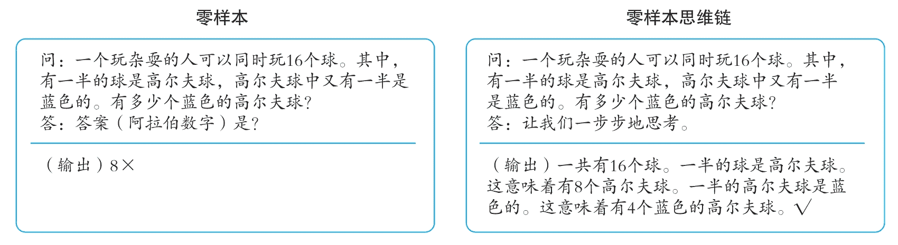

**图 2-10 Kojima 等人论文中的零样本思维链例子^[¹¹^]**

概念上很简单，实际上它用了两个提示词：先用“推理”提示提取完整推理路径，再用“答案”提示从中抽取正确格式的答案，如图 2-11 所示。

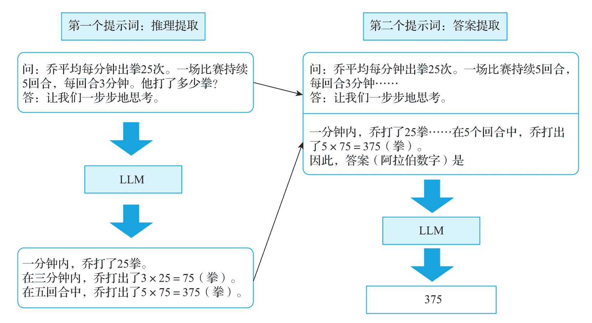

**图 2-11 零样本思维链的提示过程**

但零样本思维链有时也不好用，逻辑连贯并不等于一定正确，中间一步出错会逐步累积。

**2.少样本思维链**

Wei 等人于 2022 年在论文“Chain-of-Thought Prompting Elicits Reasoning in Large Language Models”中指出，零样本思维链仅在参数量大于或等于 1000 亿的模型中才有效^([12])。小模型上并不会生效。该论文还提出，通过展示少量带推理过程的样例，模型在回答时也会显式展示推理过程，从而得到更准确结果，如图 2-12 所示。

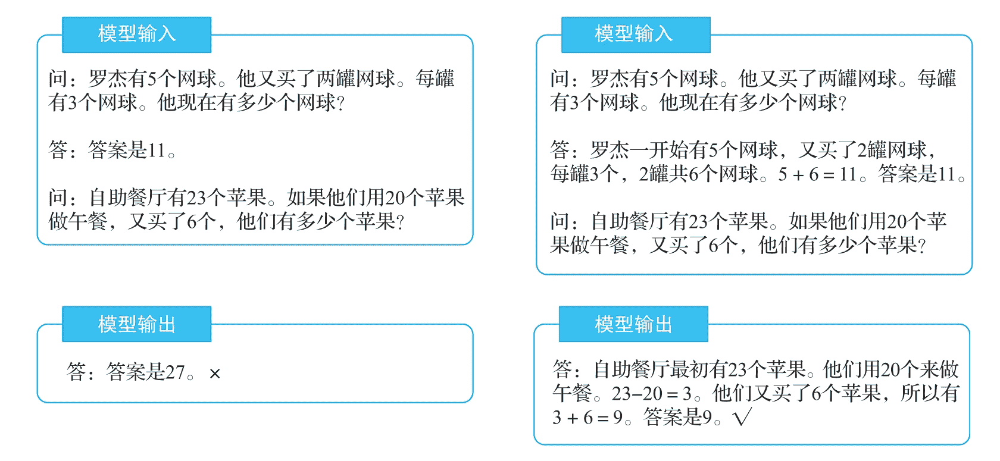

**图 2-12 Wei 等人的论文中少样本思维链的例子**

案例说明，利用少样本思维链提示具体的思考过程，能帮助模型推理出更准确的答案。

**3.自洽**

Wang 等人在 2022 年发表论文“Self-Consistency Improves Chain of Thought Reasoning in Language Models”，提出了自洽作为思维链的补充和扩展^([13])。

只用一条逻辑链时仍会出错，可让模型多次运算后投票选答案，如图 2-13 所示。

自洽包含三个步骤。
1）使用思维链提示语言模型。
2）通过从解码器采样替代贪婪解码，生成一组多样化的推理路径。
3）通过在最终答案集中选择最一致的答案来聚合。

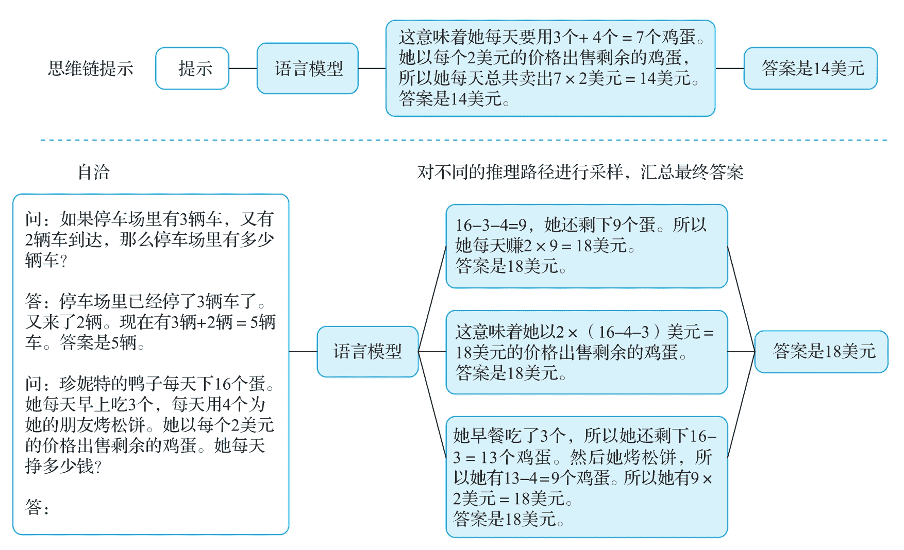

**图 2-13 自洽步骤示意^[¹³^]**

总体来说，思维链技术在提升推理能力方面潜力巨大，从逐层思考到少样本提示再到自洽策略，每种方法都在不同程度上提高准确性和逻辑性。

### **2.3.4 提示词应用技巧**

提示词的应用不仅限于原则和技术，还包含许多提升生成效果的实用技巧，能更好地控制输出、提高效率和准确性。

**1.明确“好结果”的标准**

在使用提示词时，明确“好结果”的标准至关重要，能提高文本质量并确保与预期一致。只有充分理解特定情境中的具体含义，才能把标准转化为提示词。

不明确清晰的指令：解释软件测试的概念。
明确清晰的指令：请详细解释软件测试的定义，涵盖测试生命周期的各个阶段、不同测试类型的介绍，以及为何软件测试在软件开发过程中至关重要。请以表格形式呈现这些信息。

**2.告知模型应该做什么，而不是不应该做什么**

OpenAI 在官方文档“Best Practices for Prompt Engineering with the OpenAI API”中指出：“与其告知模型不能做什么，不妨告诉模型能做什么。”

不明确清晰的指令：测试这个登录功能，不要只检查用户名或密码字段，也不要忽略错误消息的显示。
明确清晰的指令：测试这个登录功能，确保用户名和密码字段都输入正确时能够成功登录，并且当输入错误时，系统能够显示清晰的错误消息。

**3.使用模型辅助提示词撰写**

当任务本身模糊、难以准确描述时，向模型寻求撰写提示词的灵感可以大幅提升效率，例如：
你现在是一个提示词生成专家，请帮我生成一份优质的提示词，以完成{某任务}。
类似的应用技巧还有很多，掌握它们能在多种场景下优化交互。提示词技巧并非万能，面对复杂或不确定任务时，适时结合其他技术与策略会更有效。

## **2.4 让 LLM 扮演不同角色**

在模型应用中，如何让它扮演不同角色以应对多样化任务需求，成为重要研究方向。本节探讨让模型充当不同角色的方法，涵盖单一智能体功能设计、多智能体协作，再到智能体框架构建与优化，并介绍如何构建“测试专家”智能体。

### **2.4.1 AI 智能体**

AI 智能体是长期以来努力构建的一类代理，具备感知环境、制定决策并自主执行预设目标的能力。这些智能体具有自主性、交互性和反应性，能在多种场景中协助人类完成复杂任务。它们须具备类似人类的智能特征，如学习、推理、决策和执行，以便根据环境、状态和预期结果调整行为策略。

基于大模型构建的 AI 智能体与 ChatGPT 这类工具的区别在于，智能体不但会“告诉你如何做”，更会“帮你做”。

AI 智能体的工作流程如图 2-14 所示。

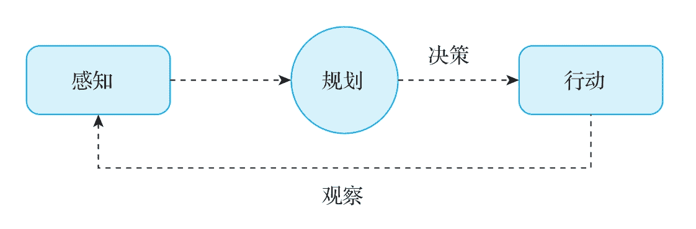

**图 2-14 AI 智能体的工作流程**

由图可知，AI 智能体的工作由“感知-规划-行动”循环组成。首先通过感知从环境中收集信息并提取知识，然后面向目标进行规划得出决策，指导行动；行动过程中又不断进行感知，如此循环。

在模型赋能的 AI 智能体中，大模型充当大脑角色，并与若干关键组件协作，如图 2-15 所示。

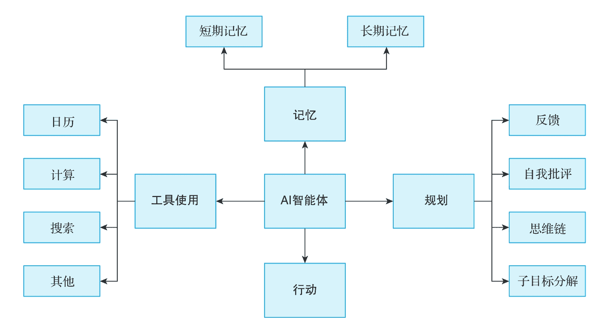

**图 2-15 AI 智能体框架**

**1.规划**
子目标分解：AI 智能体将大任务拆解为更小、可管理的子目标，以更有效地处理复杂任务，提高效率和准确性。
反思与完善：智能体能对历史行为进行自我批评和反思，从中汲取教训并在后续步骤改进，从而提升结果质量。

**2.记忆**
短期记忆：上下文学习是利用模型的短期记忆，通过最近上下文进行学习和推理，在任务执行中保留相关信息。
长期记忆：为智能体提供保留和召回长期信息的能力，通常通过外部向量存储和检索机制实现，使其能在需要时访问历史信息。

**3.工具使用**
AI 智能体通过调用外部 API 获取额外信息来弥补模型权重中缺失的知识，这些信息包括实时信息、代码执行能力和专有信息源访问等，从而增强知识和执行能力。

**4.行动**

# AI智能体的“执行力”从哪里来

行动模块是智能体落地的最后一公里，负责把决策转化为实际操作。面对不同任务，智能体内部会准备一套可选择的行动策略库，决策时从中挑选合适的动作，比如检索记忆、做推理、进行学习或写代码。正是这些策略的灵活调度，让智能体能够高效、精准地处理各种需求。

目前基于大语言模型的智能体已经有成熟落地案例。下面以 AutoGPT 为例，看看 LLM 驱动的智能体是怎么被搭建和使用的。

AutoGPT 可视作 LLM 智能体的开山之作，由 GPT-4 和 GPT-3.5 联合驱动。它具备联网搜索与信息收集、长短期记忆管理、访问网页和平台完成指定操作等能力。

AutoGPT 的运转离不开以下几块支柱：

**底座架构：**AutoGPT 用双模型搭配取长补短。GPT-4 负责复杂推理，被称作“聪明脑”，GPT-3.5 负责快速响应，被称作“快脑”。系统会根据任务难度动态切换，保持性能的同时压低成本。

**自主迭代：**从一个初始任务清单出发，AutoGPT 把任务丢进大模型，让模型拆解出更细化的子任务清单。子任务逐项执行，结果被记录下来。部分结果会再喂回模型，生成下一步回应，形成“执行-反馈-再规划”的自主闭环。

**记忆管理：**默认采用向量数据库保存对话上下文，数据写入 auto-gpt.json 文件。这种方式实现了长期记忆，同时大幅减少 token 消耗，避免超限和费用上涨。必要时还能接入 Redis 进一步提升上下文管理效率。

**工具箱：**内置多种外挂功能，包括本地 Shell 执行权限、本地文件的读写、Google 搜索以及 Python 脚本运行能力。这些工具既拓展了联网能力，也给了本地操作权限，使应用场景明显扩大。

AutoGPT 的能力很强，典型场景是帮助用户在线下单披萨。任务设定为“披萨爱好者”角色，目标是“在附近找到一家最好的披萨店，点一份榴莲味 10 寸披萨，信用卡支付”。

依托联网、记忆和文本生成能力，执行流程大致如下：

1）获取当前位置，检索附近披萨店，对比评分、价格和用户评价。
2）结合评分和个人偏好，挑选最合适的门店。
3）通过电话或官网，用自然语言完成下单交互。
4）核对订单详情、送达地址和支付方式，确认完成。

总体来看，智能体的设计离不开 LLM 的语言能力，还必须融合规划、记忆、工具调用和行动等核心组件，才能形成完整的决策闭环。借助这些能力，智能体可以自主完成复杂任务并持续优化行为策略。AutoGPT 只是起点，后续关于多智能体协作的探索会更进一步。

### 2.4.2 多智能体协作机制

多智能体是由多个相互作用的智能体构成的整体，它们可以通过沟通、协作或竞争，完成单个智能体难以胜任的大规模复杂任务。

**1.多智能体的核心特质**

1）自主性。系统中的每个智能体都能独立管理自身行为，并在需要时自主选择合作或竞争。
2）协作性。智能体借助恰当策略相互配合，共同达成整体目标。
3）容错性。个别智能体失效时，其余成员可自适应新环境继续运行，避免整体崩溃。
4）灵活性与可扩展性。智能体之间内聚度高、耦合度低，易于扩展和调整。

相比单体智能体，多智能体把不同 LLM 专业化为擅长不同领域的个体，通过交互实现规划分工、决策讨论，模拟了人类群体解决问题的“互补协作”模式。因此需要系统性地讨论其构建要素。

**2.多智能体构建的关键要素**

**（1）环境**
环境定义了 LLM 多智能体系统所处的工作上下文，例如软件开发、算法竞赛或游戏。智能体与环境的交互方式主要分为三类：沙盒、物理、空。

沙盒环境是人类搭建的模拟或虚拟空间，供智能体试验策略，常用于代码解释器和游戏模拟。物理环境指智能体与真实物理对象互动，产生实际效果并受现实约束，多见于机器人。空环境指智能体不依赖外部环境，仅在内部进行辩论达成共识，关注点在智能体间通信。

**（2）配置**
智能体的特征、行为和技能构成其配置，可按目标和角色定制。常见配置方式有三种。

1）预定义方法。设计者提前明确智能体的能力与行为。优点是控制力强、适用性高，缺点是灵活性差，难以应对动态变化。游戏角色战士、法师的设定即为典型。

模型生成方法利用大模型为智能体生成配置，使其具备自主适应性。优点是灵活、创新，缺点是复杂度和成本高，结果可控性弱。软件开发中用 LLM 生成不同岗位的开发智能体即为例子。

2）模型生成方法。利用大模型生成智能体的特征、行为和技能。优点是灵活、创新，缺点是依赖数据和算力。例：自动生成开发人员智能体完成编码、评审和测试。

3）数据驱动方法。基于已有数据集构建配置，通过数据挖掘提取模式。优点是适应性强，缺点是数据依赖高、处理链路复杂。客户服务智能体通过历史交互数据优化响应策略即为代表。

**（3）通信**
通信是集体智能的基础，涵盖范式、结构和内容。

1）通信范式。主流有合作、辩论、竞争三种。合作是信息共享共同求解；辩论是各方陈述观点并相互批评；竞争是目标冲突各自取胜。

2）通信结构。典型结构有分层通信、去中心化通信、中心化通信和共享消息池四种，如图 2-16 所示。

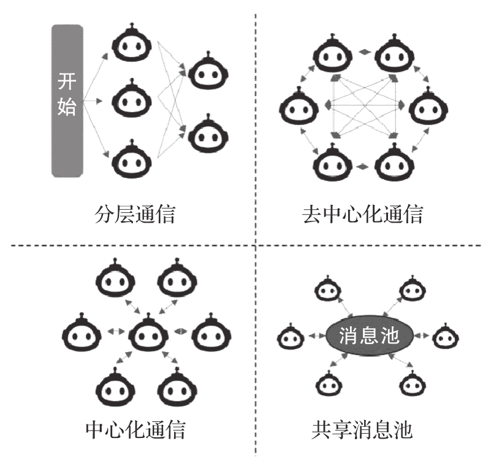

**图 2-16 4 种典型通信结构**

分层通信按层级分角色，主要在同层或相邻层交互。去中心化通信以点对点网络运行。中心化通信由中央节点协调，其余智能体经中心交互。共享消息池则维护公共消息区，智能体发布订阅信息。

3）通信内容。多数以文本呈现，具体依场景而定，如软件开发中的代码片段交流。

**（4）能力获取**
智能体动态学习与进化是核心，需解决学习何种反馈、如何调整策略两大问题。

反馈类型包括环境反馈、其他智能体反馈、人类反馈和无反馈。能力提升手段有：记忆，即存储过往交互并在行动时检索；自我进化，即根据反馈或日志修改目标与规划；动态生成，即运行中按需生成新智能体。

综上，多智能体凭借自主、协作、容错、灵活与可扩展的特性，能够完成单体无法处理的复杂任务。通过环境、配置、通信和能力获取的精细设计，系统可在不同场景下灵活应对，体现能力互补、协同增效的优势。

### 2.4.3 多智能体框架

当前多智能体框架百花齐放，下面以 MetaGPT 为例说明其设计思路。

2023 年 6 月 DeepWisdom 团队开源 MetaGPT，并与多所高校合作研究。该框架提出将标准作业程序 SOP 编码为智能体设计规范和协议，实现领域知识的自动化嵌入，为模拟人类工作流提供了新路径。

MetaGPT 把 SOP 融入角色分工、通信协议和可执行反馈三个层面。

**（1）角色专业化**
通过明确角色分工把复杂工作拆解为具体子任务。各角色初始化不同目标、约束和技能，例如产品经理可使用网络搜索，工程师可执行代码。默认遵循 ReAct 模式推理与行动。专业化提升了输出质量，也让自然语言到编程语言的转换更顺畅。

**（2）通信协议设计**
自然语言虽表达丰富但易失真，MetaGPT 要求智能体以结构化输出协作，包括文档和图表，提升信息清晰度。引入发布-订阅机制的共享消息池，智能体可直接交换信息并透明访问彼此消息，避免无效等待。每个智能体还能从消息池检索信息形成自我记忆，提升效率。

**（3）可执行反馈机制**
智能体基于环境反馈自我优化是自主性的体现。软件开发中，工程师智能体编写并运行单元测试，根据执行结果递归决策和自我提示，实现自动调试。设计-测试-反馈循环持续进行，直至测试通过或达到重试上限。

实验显示效果显著。HumanEval 和 MBPP 基准上分别达到 85.9% 和 87.7%，HumanEval 相比 GPT-4 提升 28.2%。加入可执行反馈后，两项指标分别再提升 4.2% 和 5.4%。在 SoftwareDev 数据集上，可执行性得分 3.75，运行时间仅 503s，代码行数相比基线增加 2.24 倍，单位代码 token 消耗下降 50%。这些数据凸显 SOP 对协作效率的推动。

总体而言，MetaGPT 是融合元编程理念的多智能体框架，通过嵌入 SOP 强化了 LLM 在协作中的表现，也为后续多智能体社会的研究提供了重要参考。

### 2.4.4 构建“测试专家”智能体

打造测试专家智能体需要 LLM 的支撑，也需要系统化设计把测试全流程集成进可执行闭环。

**1.构建“测试专家”智能体的目标与原则**

**（1）自动化与自主性**
能够自动完成用例生成、执行、结果分析和报告，并可在无人工干预下处理异常、自我调整。

**（2）专业知识与技能**
掌握软件测试方法论与领域知识，能理解复杂需求、设计有效用例并专业分析结果。

**（3）交互性与协作**
与开发、测试人员自然语言交互，同时能与其他智能体分工协作。

**（4）可扩展性与灵活性**
支持功能与知识的持续扩展，并能根据场景动态调整策略。

**2.“测试专家”智能体架构设计**

**（1）感知模块**
从环境采集系统状态、日志、用户输入等信息，并将非结构化数据转为结构化数据供后续使用。

**（2）规划模块**
负责分析输入并制定测试策略，包含任务分解与调度、用例生成以及策略优化三个子功能。

**（3）行动模块**
执行测试计划，包括自动执行、实时监控系统状态、收集和分析结果，为反馈提供数据。

**（4）反馈模块**
深度分析结果、生成测试报告，并据此调整后续策略，包含结果分析、报告生成和策略调整。

**（5）工具集成模块**
对接主流自动化测试框架如 Selenium、Appium、Jenkins，支持外部 API 调用，集成数据库或云存储管理测试数据。

**3.构建“测试专家”智能体的具体步骤**

**（1）系统初始化**
选择合适的 LLM 并做软件测试领域微调；搭建运行环境、计算资源、网络和工具链。

**（2）模块开发与集成**
开发感知、规划、行动、反馈各模块并完成集成；完成工具对接。

**（3）测试与优化**
对各子模块进行功能验证，确保按预期工作。

❑ 系统联测：将各个子模块串接起来整体运行，核查模块之间的协同是否顺畅，确保全系统功能完整可用。
❑ 性能打磨：以测试反馈为依据对系统进行优化，保证在真实运行环境下保持高效稳定。

**（4）部署与维护**
❑ 生产上线：把智能体推送到实际运行环境，完成正式投产。
❑ 持续运维：按计划对智能体进行检修与版本迭代，扩充功能与知识储备，不断强化能力与表现。

总体来看，打造“测试专家”智能体必须依托体系化设计与多技术融合。围绕感知、规划、行动、反馈四大核心模块并接入外部工具，就能赋予其自动化、自主决策、专业积累与良好交互的特质。以上内容仅给出构建思路，具体落地仍需进一步研究。

## **2.5 本章小结**

本章梳理了大语言模型的技术演进与实践价值。首先回顾自然语言处理的发展脉络，从符号派与统计派，到规则逻辑与统计并重，再到深度学习与 Transformer 主导的当下范式，特别提及 GPT 系列在该领域的关键地位。

随后介绍了 ChatGPT 的演进，该系统在 GPT 架构基础上引入强化学习与人类反馈，实现了更自然、质量更高的对话，推动人机交互向智能化迈进。

接着拆解支撑大模型的底层要素，包括 Transformer 结构、预训练范式、领域微调及指令微调，以及提示工程的设计原则与方法，强调精细化提示对引导输出的重要性。

在多智能体协作层面，讨论了角色专业化、通信协议设计与可执行反馈对协作效率的提升，并以 MetaGPT 为例说明嵌入标准作业流程如何增强多智能体协同效能。

最后聚焦“测试专家”智能体的构建路径，涉及自动化与自主性、专业知识与技能、交互协作、可扩展与灵活性等设计原则。提出以感知、规划、行动、反馈为核心的架构，并强调工具集成对拓展智能体能力的重要性。

阅读完本章，读者应能把握大语言模型的技术基础，理解其在智能对话、多智能体协同及专业领域应用中的潜力。随着技术持续演进，大语言模型有望在更多场景发挥更大作用。

## **2.6 参考文献**[[1]]
 
RADFORD A, NARASIMHAN K, SALIMANS T, et al.Improving language understanding by generative pre-training[J/OL].(2018-06-11).https://cdn-openai.com/research-covers/language-unsupervised/language-understanding_paper.pdf.2018.

[2] DEVLIN J, CHANG M W, LEE K, et al.BERT: Pre-training of deep bidirectional transformers for language understanding[J/OL].arXiv preprint arXiv:1810.04805, 2018.

[3] RAFFEL C, SHAZEER N, ROBERTS A, et al.Exploring the limits of transfer learning with a unified text-to-text transformer[J].Journal of Machine Learning Research, 2020, 21(140):1-67.

[4] YANG Z, DAI Z, YANG Y, et al.XLNet: generalized autoregressive pretraining for language understanding[J].Advances in neural information processing systems, 2019(12)：8-14.

[5] RADFORD A, WU J, CHILD R, et al.Language models are unsupervised multitask learners[J].OpenAI blog, 2019, 1(8):9.

[6] BROWN T, MANN B, RYDER N, et al.Language models are few-shot learners[J].Advances in Neural Information Processing Systems, 2020(33):1877-1901.

[7] VASWANI A, SHAZEER N, PAMAR N, et al.Attention is all you need[J].NIPS’17: Proceedings of the 31st International Conference on Neural Information Processing Systems, 2017(12):6000-6010.

[8] MISHRA S, KHASHABI D, BARAL C, et al.Natural-Instructions:benchmarking generalization to new tasks from natural language instructions[J/OL].arXiv preprint arXiv:2104.08773, 2021:839-849.

[9] WANG Y, KORDI Y, MISHRA S, et al.Self-instruct: aligning language models with self-generated instructions[J/OL].arXiv preprint arXiv:2212.10560, 2022.

[10] LIU J, LIU A, LU X, et al.Generated knowledge prompting for commonsense reasoning[J/OL].arXiv preprint arXiv:2110.08387, 2021.

[11] KOJIMA T, GU S S, Reid M, et al.Large language models are zero-shot reasoners[J].Advances in Neural Information Processing Systems, 2022, 35:22199-22213.

[12] WEI J, WANG X, SCHURMANS D, et al.Chain-of-thought prompting elicits reasoning in large language models[J].Advances in Neural Information Processing Systems, 2022, 35:24824-24837.

[13] WANG X, WEI J, SCHUUMANS D, et al.Self-consistency improves chain of thought reasoning in language models[J/OL].arXiv preprint arXiv:2203.11171, 2022.

[14] GUO T, CHEN X, WANG Y, et al.Large language model based multi-agents:a survey of progress and challenges[J/OL].arXiv preprint arXiv:2402.01680, 2024.

[15] HONG S, ZHENG X, CHEN J, et al.Metagpt: meta programming for multi-agent collaborative framework[J/OL].arXiv preprint arXiv:2308.00352, 2023.

# **第三章**

# **LLM 驱动测试需求分析**

第二章已介绍大语言模型的基础知识与能力，从本章起将其引入软件测试，改变测试工作方式，赋能传统测试工具，与 CI/CD 流程深度融合，提升效率与质量，推动行业升级。

软件测试全流程依次为需求分析、计划制定、方案设计、脚本开发、执行测试，最后评估结果并输出报告。

❑ **测试需求分析：** 回答“测什么”，划定边界与范围，将范围拆分为测试项、测试点或场景，并开展风险分析，确定策略与优先级。
❑ **测试计划：** 在需求分析基础上，为高质量完成任务所做的准备，包含工作量估算、资源与进度安排，最终形成计划书。
❑ **测试设计：** 回答“如何测”，涵盖方案设计与用例设计。方案设计与计划工作密切相关，分析与设计常交替进行。用例设计属于详细设计。
❑ **测试脚本开发：** 基于设计产出自动化脚本。手工测试则对应编写详细用例。在智能化工程中可借助大语言模型生成用例与脚本，但仍需测试人员引导与评审。
❑ **测试执行：** 在计划、用例、脚本就绪后开展测试，包括回归、结果分析与缺陷记录。执行方式分为手工与自动化工具。
❑ **测试结果评估：** 测试结束后评估覆盖率判断充分性，结合计划评估执行效果，及时发现问题并改进。

本章聚焦大语言模型驱动的测试需求分析，重点讲述如何借助模型界定测试范围、拆解测试项、生成计划等内容。

## **3.1 测试需求分析要点**

我们一直强调测试需求分析是设计的根基，必须扎实做好，才能明确测试边界——哪些要测、哪些可不测、重点在哪。做好分析后，测试设计会更顺畅。实际上需求分析与设计难以割裂，如同结构化分析与设计、面向对象分析与设计，二者相互融合。

核心目标是将模糊的业务需求转化为清晰、可执行、可验证的测试需求。重点在于明确目标与范围、拆分测试项、识别风险，并基于风险与业务场景动态调整优先级、制定策略，选择合适的测试方式与方法。

**1.测试范围确定**

结合产品设计规格、代码变更及影响面，综合功能重要性、用户使用频率、变更程度、历史测试情况等因素，精准划定测试边界，明确需测与可暂缓验证的功能。一般而言，优先级高的需求、新功能、改动大且易波及老功能、易出问题的模块以及高频使用功能与配置，都是重点。

确定范围时主要考虑：
❑ 优先级最高的需求功能。
❑ 新增功能与改动较大的已有功能。
❑ 易出错的功能部分。
❑ 往期测试不足的区域。
❑ 用户高频使用的功能与配置。

拆解测试项时可借助思维导图，按“系统→子系统→特性→功能→子功能→功能点→场景”逐层细化，直至不可再分。场景需涵盖不同环境、条件与输入数据。拆解后要分类整理。测试项不仅包括功能，还包括性能、兼容性、易用性、安全性、可靠性等非功能特性。

**2.测试风险识别**

测试无法穷尽且总伴随风险，因此风险分析至关重要。目的是识别可能影响目标达成的风险因素，聚焦高或严重风险，如功能缺陷、性能瓶颈、安全漏洞、需求变更、资源不足等，并评估其严重程度与发生概率。针对风险制定应对措施，如增配资源、调整策略、风险预警等。例如，对在线教育平台高并发下的性能瓶颈风险，可提前搭建性能环境、增加性能用例、借助监测工具分析，及时发现问题。

我们主要关注严重与很严重级别的风险，若条件允许也兼顾中等风险，低风险通常可忽略。测试风险识别的示例如表 3-1 所示。

**表 3-1 测试风险识别的示例**

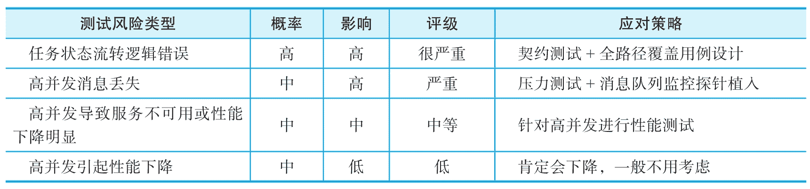

**3.测试项优先级动态评估**

基于 MoSCoW 法则与风险-价值矩阵的优先级动态评估如表 3-2 所示。

**表 3-2 基于 MoSCoW 法则与风险-价值矩阵的测试项优先级动态评估**

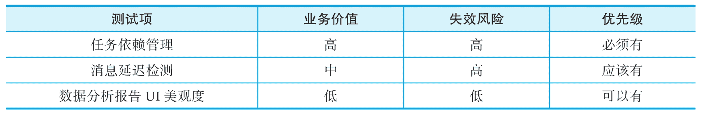

**4.测试策略制定**

依据测试目标、质量指标及识别出的风险，为不同对象、阶段与类型制定全面且具针对性的策略。策略涵盖测试方式选择、工具选用、重点内容、资源分配与进度安排。例如，对在线教育平台核心模块可采用黑盒与白盒结合，重点验证业务逻辑与数据处理；对重复性任务选用自动化工具；进度上优先保障关键功能。

**（1）测试策略**
主要分为两类：
❑ 技术维度策略，根据系统技术构成与层次，考虑分层测试、工具选择、白盒与黑盒的结合方式。
❑ 方案维度综合策略，根据目标与范围，考虑功能测试、可用性测试、兼容性测试的有机组合，资源利用与回归测试的有效开展。

**（2）测试策略的要点**
制定策略时需做到：
❑ 全面了解项目信息，包括应用领域、范围、市场需求、产品特点、主要功能与技术架构。
❑ 基于模块、功能、系统、版本、性能、配置与安装等因素对质量的影响，客观展开计划。
❑ 根据单元在系统中的重要性及故障损失大小，确定测试等级、重点与顺序。
❑ 在用例数量与覆盖率间寻求平衡，用最少的有效用例发现最多的缺陷。测试不足会让用户承担隐藏风险，过度测试则浪费资源或拖延交付。

回顾测试需求分析要点，有助于理解其在测试体系中的核心地位，为后续探讨大语言模型驱动的需求分析提供理论与实践基础。

## **3.2 LLM 驱动测试需求分析和计划**

在掌握传统分析要点后，我们对关键环节已有清晰认知。随着人工智能快速发展，大语言模型在软件测试领域潜力巨大。接下来探讨大语言模型如何驱动测试需求分析：从理解产品需求，到高效分解需求，再到精准界定范围、挖掘风险并制定对策，大语言模型都能提供新视角与强力支持，优化流程、提升效率与质量。下面依次展开。

### **3.2.1 LLM 助力软件需求分析**

在开发与测试中，需求始终居于核心。需求是工作的源与依据，却又模糊多变，常成为风险源。据 Standish Group CHAOS 报告，需求相关问题常占项目失败原因的 30%至 50%，另有研究显示因需求歧义导致的无效或错误用例占比超 30%。产品经理的“优先级动态调整”可能被理解为“手动拖拽排序”，带来随意感。传统分析依赖人工逐句解读、会议澄清与文档标注，面对微服务、跨平台等复杂系统时，暴露出三大缺陷：
❑ 语义碎片化：自然语言模糊导致一词多义，如“实时更新”可能是秒级或分钟级。
❑ 知识孤岛：跨领域术语造成理解断层，如金融“轧差清算”与电商“库存预占”。
❑ 隐性需求黑洞：非功能需求常被遗漏，直至上线爆发。

大语言模型正改变这一现状：它不仅是“翻译者”，更是“解构者”与“预言者”，帮助测试人员洞察需求、精准捕捉关键诉求，消除语义碎片化与知识孤岛，挖掘隐性需求，为测试需求分析奠基。

**1.精准捕捉用户的关键诉求**

传统需求获取依赖大量访谈、问卷与整理，耗时费力。大语言模型重塑信息处理边界，凭借生成、分类与归纳能力，能从用户反馈、沟通记录、评论乃至社交媒体中快速提取要点，精准把握诉求。过往读一篇几十页英文论文并笔记需半天，快速总结也要一小时。如今用 ChatGPT、豆包、DeepSeek 等工具上传论文，几分钟即可生成完整总结，如图 3-1 所示。

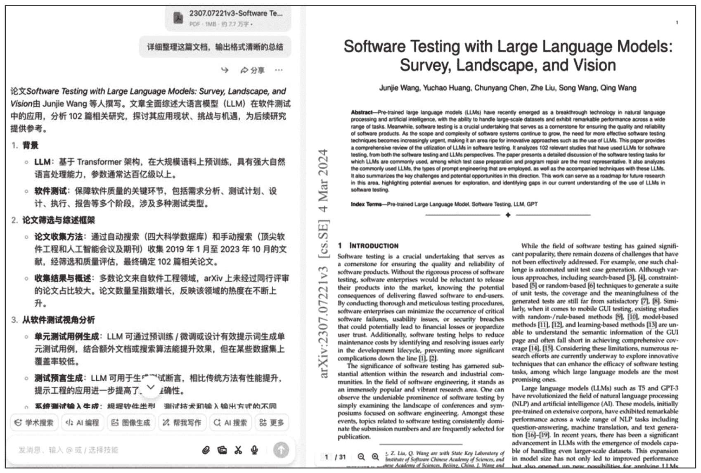

**图 3-1 LLM 快速生成论文的总结报告**

在线检索加持的 LLM：从洞察用户到加速测试的新打法

当下几乎所有对话式大模型都默认接入了网络检索，这让需求挖掘变得格外精准。以网约车类产品为例，过去想摸清用户到底在意什么，产品经理往往要花数天梳理反馈；现在借助大模型配合实时检索，几十分钟就能把分散的讨论梳理成体系。

四、社媒舆情采集：用户到底在聊什么
把 2023 年微博、抖音、小红书等平台上超一万条网约车相关帖子用 NLP 抓取后，高频词分布如下：
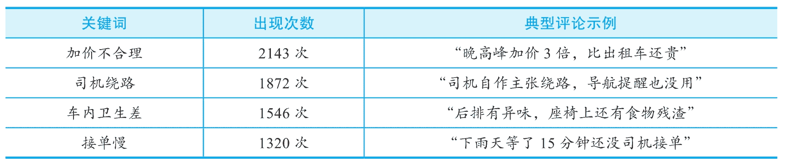

五、诉求优先级画像
把问卷、舆情、运营数据合并后，网约车用户的核心诉求从高到低大致是：出行安全与信息透明、车费是否合理、叫车响应快慢、乘坐体验舒适度、个性化供给、绿色与智能化。合规要求越严、技术迭代越快，安全与效率的平衡、差异化服务能力会成为平台角逐的关键。

2. 多源资料的自动归并
需求信息常散落在市场报告、用户邮件、会议纪要、竞品分析里。人工整合费时易漏，且文本、表格、音视频格式混杂。多模态大模型可对接各类接口，统一采集图片、文字、音频、视频并整理。

比如电商 App，模型能从调研报告里抽出搜索功能痛点，从用户邮件里汇总购物车操作诉求，从竞品报告里提炼促销展示做法。汇总后形成一张需求全景图，呈现各模块优先级、用户期望与竞品差距。

再看电影《哪吒之魔童闹海》，上映期口碑高但负面反馈仍需重视。可让模型收集观众差评并归纳整理，输出框架如下：
四、技术细节瑕疵
1.想象力与细节处理不足
…
2.低俗表达与台词争议
…
五、预期落差
1.与前作比较的争议
…
2.国际化表达受限
…
总结与改进建议
《哪吒之魔童闹海》差评集中在叙事合理性、角色动机厚度、主题连贯性、细节创新四个维度。可参考：
❑ 强化角色行为逻辑：更细腻铺垫动机，避免工具化塑造。
❑ 压缩冗余情节：提速叙事，聚焦主矛盾。
❑ 深化主题表达：在反派与群体设定中探讨更复杂的道德困境。
❑ 提升文化融合：视觉与音乐上兼顾传统韵味与国际审美。

3. 语义拆解：从口语需求到可验证单元
大模型借助依存句法解析与领域知识注入，能把自然语言需求转成结构化语义网。举例“系统需可视化任务依赖，并在出现环路时自动告警”，解析后以 JSON 形式输出如下：

原子化拆解让模糊描述变为可测试条件，需求覆盖率明显提升。

4. 跨域联想：搭建跨领域需求图谱
结合预训练知识库如 ITIL、行业安全规范，以及 RAG 实时检索，模型可自动补全需求隐含依赖。需求提到“支持单点登录”时，会关联：
❑ 安全侧：OAuth 2.0、令牌刷新机制。
❑ 兼容侧：与 Azure AD、Google Workspace 的对接验证点。
❑ 性能侧：并发登录的吞吐上限。
这样测试范围从功能实现延展到生态兼容，缺陷漏网率下降。

5. 逻辑推演：提前预警冲突与边界
借助因果链推理，模型能发现需求内在矛盾。任务管理模块里：
❑ 需求 A：截止时间改动后关联任务自动顺延。
❑ 需求 B：优先级按截止时间远近动态计算。
模型会提示：手动改时间可能触发优先级重算，导致执行顺序震荡。建议加“优先级锁定”或限制顺延影响范围。此类推演能在分析阶段拦截缺陷。

6. 隐性诉求挖掘
大模型叠加全网与深度检索，在隐性需求挖掘上往往超过单人判断。下面是针对类滴滴网约车应用的隐性诉求梳理。

开发网约车应用除显性用车需求外，用户还有大量未明说诉求，藏在体验细节、场景痛点与生态矛盾里。

一、心理与情感面向
1. 安全感延伸
❑ 超出人身安全的私密保护：行程记录可能暴露生活规律或住址，需匿名乘车或虚拟号码。
❑ 紧急响应及时性：深夜或偏远地区用户希望紧急联系人自动通知或一键求助，而非事后处理。
2. 公平感与归属感
❑ 规避地域偏见：外地用户易因口音或短途被拒载，可屏蔽订单来源地可见性或采用盲派单。
❑ 价格心理落差：动态加价接受度有限，可提供费用封顶或优先拼车选项。

二、场景化精细适配
1. 特殊场景覆盖
❑ 大型活动与应急：演唱会、庙会等需求激增时需提前调度而非临时涨价。
❑ 无障碍出行：轮椅通道、司机急救培训等常被常规服务忽略。
2. 跨区与跨境衔接
❑ 异地服务标准化：支付方式不通、语言界面缺失等问题。
❑ 文化差异适配：海外用户偏好现金或小费，需灵活结算。

三、生态链矛盾平衡
1. 司机与乘客权益
❑ 抽成透明化：用户希望知晓平台分成，避免司机绕路转嫁成本。
❑ 司机身心健康：疲劳与情绪影响服务，可引入心理支持或强制休息提醒。
2. 绿色可持续
通过碳积分或电动车优先派单引导环保出行。

四、技术驱动的隐性体验
1. 智能预测与主动服务
❑ 需求预判：基于历史通勤提前调度车辆至热点。
❑ 个性化推荐：商务用户偏向专车，家庭用户偏好大空间。
2. 交互无感化
❑ 无障碍操作：大字体、语音导航适配老年与视障用户。
❑ 离线能力：信号差区域支持离线叫车或预约缓存。

五、未明说的社交需求
1. 行程轻社交
❑ 标签匹配：愿意交谈或安静乘车，匹配司机或拼车伙伴。
❑ 本地化推荐：推送目的地周边餐饮、景点及联名优惠。
2. 社区共治
建立用户委员会参与规则制定，增强归属感。

总结与建议
网约车产品应聚焦：安全隐私极致化、场景颗粒度细化、生态平衡透明化、技术无感渗透、社交与共治。滴滴的需求热力图调度、司机随时提现等做法，都是对隐性诉求的回应。

大模型还能对模糊描述做关键词细化。比如“优化性能、保证快响应”，模型会结合指标给出：高并发下平均响应≤1s，吞吐≥1000次/秒。补充业务特征后描述更准。

### 3.2.2 LLM 助力测试需求分解
正如 3.2.1 节所述，随着智能体流行，大模型已成为需求细化的得力工具。以某银行智能风控平台为例，含智能风控平台、全流程风控模型、风险数据集市三大部分。让模型列出功能与非功能测试点，生成约 7 页，详见“1 某银行智能风控平台主要测试需求.docx”。为更直观，可让模型把需求转成思维导图，提示词为：

请把前面测试需求转为思维导图，展示从主项到子项的逐级细化过程，如特性、功能、子功能、功能点、场景，以 markdown 输出。

导入 Xmind 后得到完整图，MD 约 466 行，功能项近 300 条，详见“2 智能风控平台测试需求-思维导图.md”。完整图过大，下面仅展示功能测试的两层结构，第二层后圆圈为折叠项。以“全流程风控模型”展开其子项如下图所示。

### 3.2.3 LLM 助力界定测试边界
明确边界是保证质量与效率的前提。系统拆分或多团队协作时，清晰边界可避免重复、防止遗漏、明确责任。

以某银行智能风控平台为例，三个测试组分工如下：
❑ A组：负责智能风控平台核心功能测试。
❑ B组：负责全流程风控模型功能测试。
❑ C组：负责风险数据集市功能测试。
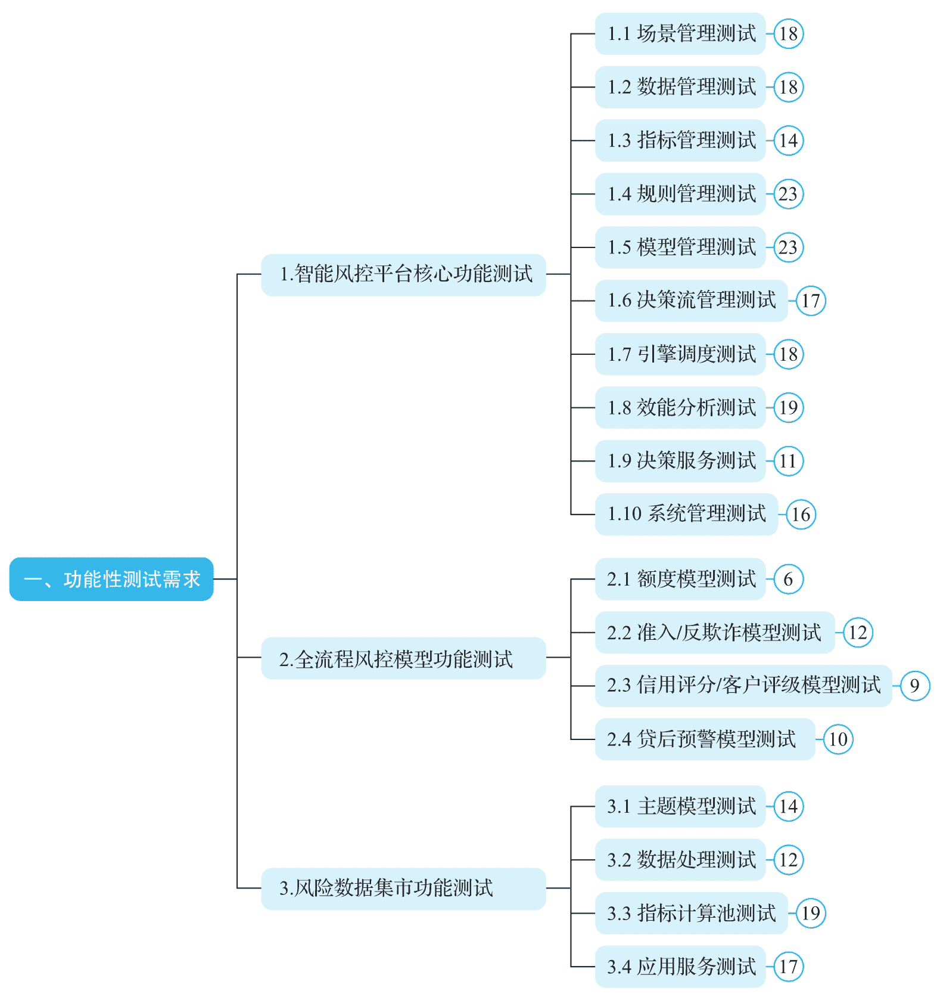
**图 3-2 智能风控平台测试需求的思维导图（局部）**
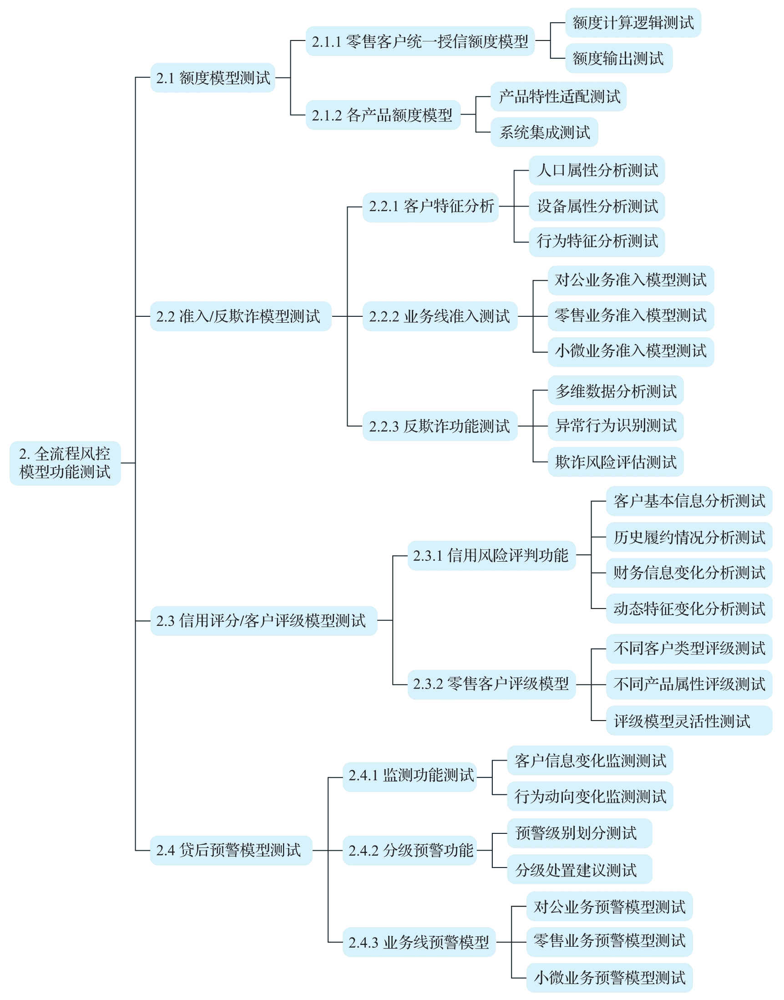
**图 3-3 全流程风控模型功能测试的思维导图**

1. 常见边界模糊场景
功能交互区、共享组件、端到端流程易产生职责不清。
1）功能交互区：数据管理负责采集，数据集市负责清洗存储。决策调用数据时交接点易模糊，异常难判定归属。
2）共享组件：指标计算服务既由数据集市维护也被平台调用，错误难以定位到定义、引擎或调用方。
3）端到端流程：贷款审批涉及反欺诈、客户评级、额度计算、决策流规则引擎。若只测单点，会漏掉数据传递、规则冲突、配置错误等跨模块问题。

2. 有效的边界划定方法
**（1）RACI 责任矩阵**
明确每个功能测试责任。
❑ 模型算法正确性：B组负责，A组咨询。
❑ 模型部署正确性：A组负责，B组咨询。
❑ 模型运行性能：A组负责。
❑ 模型结果验证：A、B组共同负责。

**（2）接口契约测试**
明确数据集市向平台提供数据的接口规范，C组测输出正确完整，A组测获取解析正确。

**（3）集成测试专项组**
针对决策流管理等跨模块功能，由 A、B 组人员组成集成小组，设计端到端场景，明确各环节职责。

**（4）以业务场景为中心定义范围**
按需求说明书场景管理设计端到端用例，如零售信贷审批、对公贷后预警，将用例拆分到各组，同时保留完整业务流测试责任。

### 3.2.4 LLM 助力挖掘测试风险与生成应对策略
在 LLM 驱动的需求分析中，风险识别是质量保障关键。部分企业已构建基于大模型的风险控制智能体，可依据需求文档及变更自动识别分级，提升效率与覆盖。

1. 数据处理与基础构建
**（1）风险分类体系**
包括功能风险、性能风险、安全风险、体验风险、兼容风险等，每类再细分形成树状结构，为模型提供标注框架。
**（2）风险标注与语料库**
收集历史项目需求、变更、缺陷数据，由测试专家标注需求-风险关联样本，构建领域示例集并统一等级标准。
**（3）文档降噪与关键词优化**
通过关键词过滤、语义分割、正则提取条件与依赖关系，优化表格图表解析，提升风险片段提取精度。
**（4）多模态处理**
支持流程图、架构图语义理解，从 UI 原型提取交互逻辑，解析音视频说明，整合为统一输入。

2. 提示工程优化策略
风险识别精度很大程度上取决于提示设计。
**（1）提示词结构化设计**
#角色
你是一名风险识别专家，具备出色的风险识别能力。
##任务
对给定需求进行特征判断，判断需求的风险。
##任务要求
—对需求文档进行分析。
—结合特征进行风险预测。
—输出风险等级，用 1、2、3 分别表示高、中、低风险。
##特征
功能、性能、安全性、兼容性等相关特征信息
##需求内容
业务信息：{业务背景交代}
产品信息：{产品前端、后端、API、版本等信息}
App 端信息：{App 环境、功能设计信息}
结构化设计有助于模型聚焦分析。
**（2）降噪策略**

**大模型精准揪风险的实战打法**

要让模型找准风险点，提示词必须先做信息降噪，只留下能影响判断的要素。

❑ 需求文档（比如 PRD）：把冗余描述剔掉，保留功能定义、技术限制等干货；最好把需求等级、关联依赖等边界条件说明白。
❑ 业务背景：补充关键的商业上下文，让模型明白需求的价值和真实使用场景。
❑ 质量画像：汇总过往项目质量数据，如缺陷密度、漏检逃逸率、遗留缺陷占比、各阶段拦截效率、修复时长与周期等。
❑ 研发画像：呈现开发团队特质，如技术栈熟练度、历史交付质量等。

**（3）环境上下文注入**

风险研判离不开项目环境，提示词要补足以下面向。

❑ 业务信息：业务属性及历史质量表现、价值主张、核心流程、关键决策点、用户分层与规模、用户画像与场景描述等。
❑ 产品信息：应用形态、代码量级、AST 解析结果、依赖关系图、复杂度分布如圈复杂度、可维护性评估、使用频率、交互特征或操作路径、稳定性与性能评估、代码评审覆盖率及问题检出率等。
❑ 项目信息：交付节点、版本节奏、协作模式与分工、成员在目标技术栈的经验、团队对业务领域的熟悉度等。
❑ 端侧说明：功能设计、终端形态 Web/移动/桌面、API 清单、技术选型与限制等。

**3.模型打磨与优化**

要搭出高效的风险控制智能体，训练优化是核心，涵盖专业知识注入、特征筛选与表达、标签校准与阈值调优、超参优化与模型选型等环节。

**（1）专业知识注入**
软件测试风险判断专业性强，必须向模型注入充足专业知识。
❑ 搭建软件测试领域知识图谱，覆盖常见风险类型、案例库与解决思路。
❑ 建设金融、医疗、电商等特定行业的风险识别知识库。
❑ 建立与技术栈相关的风险模式库，如微服务架构、前端框架、数据库系统的典型问题。
❑ 引入 ISO 25010 等软件质量标准作为评价框架。

**（2）特征筛选与表达**
输入特征直接影响效果，需要科学筛选与优化。
❑ 从需求文本抽取语义特征，用于描述复杂度与模糊度。
❑ 设计需求变更频率、变更范围的量化指标。
❑ 提取需求间依赖关系的图结构特征。
❑ 构建团队能力、项目约束等上下文特征。

**（3）标签校准与阈值调优**
准确性依赖精细的标签校准。
❑ 设计风险评分体系，将模型输出映射为标准化风险等级。
❑ 按业务场景调整判别阈值，平衡漏报与误报成本。
❑ 建立预测结果的置信度评估，对低置信结果触发人工复核。
❑ 设计风险优先级排序算法，突出关键风险。

**（4）模型选型与超参调优**
架构与参数配置对效果影响显著。
❑ 系统对比 GPT、Claude、Llama 等基座模型在风险识别任务上的表现。
❑ 用网格搜索、贝叶斯优化等手段寻优超参数组合。
❑ 探索模型集成，融合多专家模型优势。
❑ 持续监控性能，依新数据定期微调迭代。

**4.RAG 体系**

仅靠参数知识无法覆盖全部潜在风险，检索增强能大幅提升全面性。

**（1）历史风险检索**
构建完善的历史风险检索能力，为当前分析提供参照。
❑ 建立包含历史项目需求及关联风险的向量库。
❑ 开发语义检索引擎，基于当前需求召回相似案例。
❑ 设计多维风险特征检索机制，提升召回率。
❑ 构建风险知识图谱，支持基于关系的推理检索。

**（2）在线增强生成**
将检索结果与大模型生成能力结合，实现双重增强。
❑ 分析过程中动态检索相关历史案例与最佳实践。
❑ 基于检索结果调整输出分布，提升预测准确率。
❑ 有效识别罕见风险类型，弥补知识盲区。
❑ 提供可解释的风险证据链。

**（3）多源特征融合分析**
高质量识别需要综合多维度信息。提示工程中要系统融合商业、产品、客户端等关键特征，具体前文已阐述。

**5.应对方案自动生成**

识别只是起点，生成有效应对方案更关键。大模型可依据风险特征自动产出对策。

**（1）风险对策库搭建**
❑ 收集整理常见风险类型的最佳应对实践。
❑ 建立风险严重程度与应对强度的映射关系。
❑ 构建不同项目阶段可用的测试策略模板。
❑ 整合资源受限下的优化测试方案案例。

**（2）分级测试策略**
❑ 高风险领域：TDD、探索性测试与自动化回归测试结合。
❑ 中风险领域：侧重场景化测试与关键路径覆盖。
❑ 低风险领域：采用基于规格的黑盒测试与抽样测试。

**（3）资源调配算法**
❑ 开发基于风险得分的测试资源分配模型。
❑ 设计测试活动优先级排序算法，确保高风险优先覆盖。
❑ 实现测试深度与广度的动态调整机制。
❑ 构建测试投入与风险降低效果的量化评估体系。

**（4）以风险为导向的测试设计**
❑ 对高风险功能自动生成边界测试用例。
❑ 为复杂业务逻辑构建决策表与状态转换测试。
❑ 针对性能风险设计压测场景与负载模型。
❑ 为安全风险点生成渗透测试与安全扫描方案。

**（5）风险动态监控与策略迭代**
❑ 建立风险指标监控体系，持续评估风险状态。
❑ 开发测试策略动态调整引擎，响应风险变化。
❑ 设计迭代式风险评估流程，每个开发周期重评。
❑ 构建变更影响分析模型，预测代码变更对风险分布的影响。

**6.落地实践经验**

**（1）融入研发流程**
❑ 在需求梳理阶段引入风险控制智能体，提前发现潜在风险。
❑ 将风险评估结果作为故事点估算的重要参考。
❑ 在迭代计划会展示风险分析，指导团队聚焦重点。
❑ 建立每日风险追踪机制，及时响应新增或变化风险。

**（2）跨角色协同**
❑ 产品经理：据风险分析调整需求优先级，完善需求评审检查表并强化评审。
❑ 开发团队：依据技术风险完善设计/代码评审 checklist，强化前期评审。
❑ 测试团队：利用风险报告制定针对性测试计划，加强计划与用例评审。
❑ 项目管理：把风险控制纳入项目监控指标。

**（3）效果度量体系**
❑ 设计预测准确率、召回率、F1 值等核心指标。
❑ 追踪预测风险与实际问题的映射关系，评估有效性。
❑ 收集用户反馈，评估结果实用性与可操作性。

**（4）知识沉淀**
❑ 构建风险知识库，记录典型案例及解决方案。
❑ 引入因果推理模型，分析需求变更与风险的因果，提炼普适风险模式。
❑ 建立风险经验分享机制，促进跨团队交流，提升整体风险意识。

通过构建风险控制智能体、融合多维特征、检索增强分析并生成自适应测试策略，可显著提升测试效能与效率。方法不仅能应对系统复杂度与变化速度，还为测试团队提供强决策支持，使资源配置更精准、覆盖更全面。

随着大模型持续进步，未来可探索智能体协同决策、实时反馈风险评估体系、风险根因自动追溯、反事实分析情景模拟等方向，建立人机协作混合风险管理模式，推动测试风险管理向智能化转型。测试人员的角色也将从执行者转向策略师与引导者，与 AI 共同打造更可靠安全的软件产品。

## **3.3 生成测试项和验收标准**

为更好展示大模型驱动的测试分析，可深入具体功能模块生成测试点。以图 3-2 中“1.4 规则管理测试”为例，让大模型细化测试点。

提示词：“基于这个需求文档，请详细生成‘规则管理’的测试项，包括功能和非功能测试项。”选用推理模型 Claude 3.7 Sonnet Think，输出结构清晰，包含编号 ID、测试项、测试条件、预期结果与优先级，非功能项覆盖性能、可靠性、安全、易用、可扩展等。此处仅展示部分，完整结果 21 页详见电子材料“**3 智能风控平台规则管理模块测试项清单.docx**”。

智能风控平台规则管理模块测试项清单

基于银行智能风控平台业务需求，针对规则管理模块制定详细测试项清单，涵盖功能与非功能两大类。清单旨在确保规则新建、编辑、管理与执行稳定高效安全。

一、功能测试项

1.规则新建与基础管控

1.1 规则新建

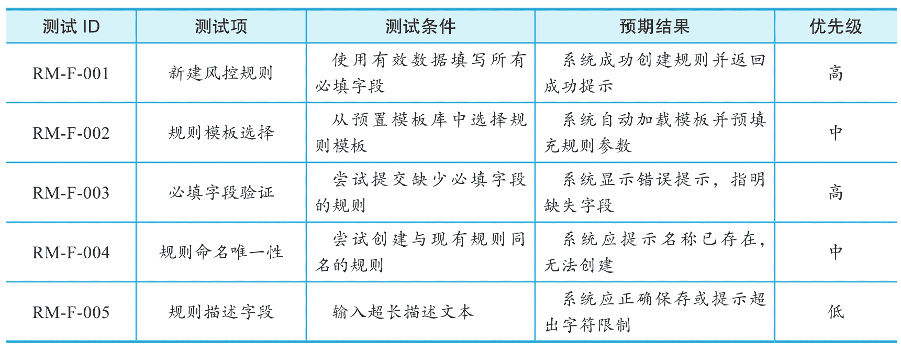

1.2 规则编辑

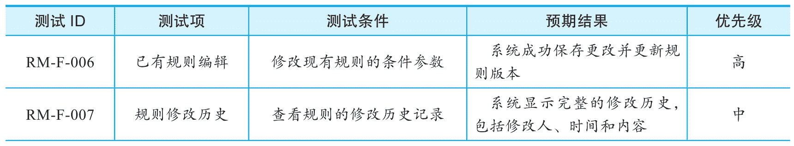

（续）

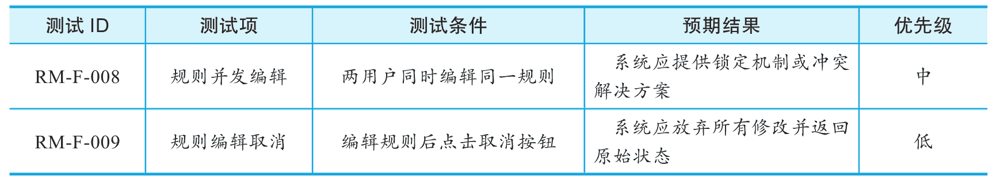

1.3 规则复制与导入/导出

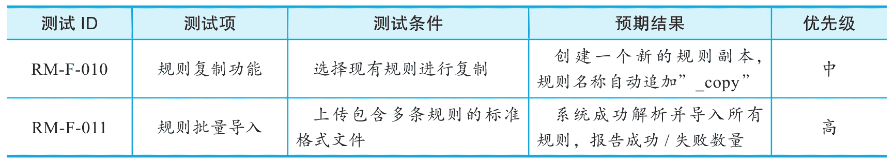

……

5.规则执行引擎功能

5.1 规则优先级与执行顺序

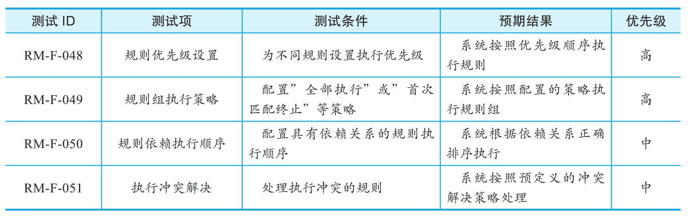

5.2 规则执行监控

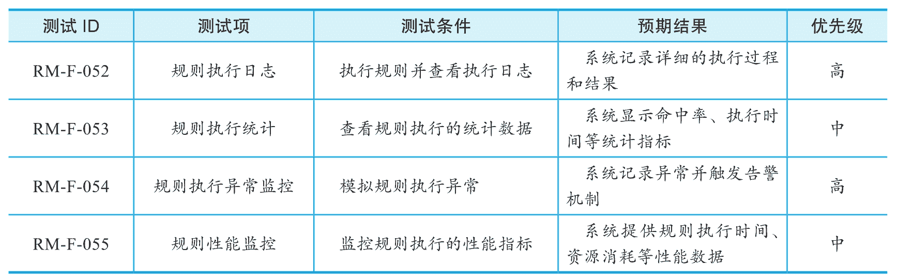

二、非功能测试项

1.性能测试

1.1 规则引擎性能

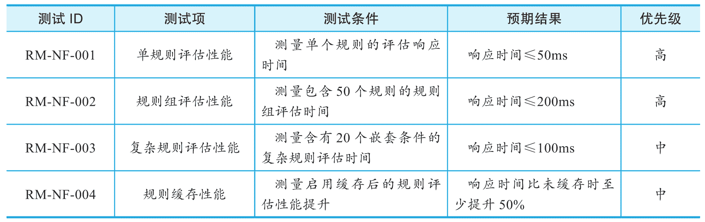

1.2 并发性能

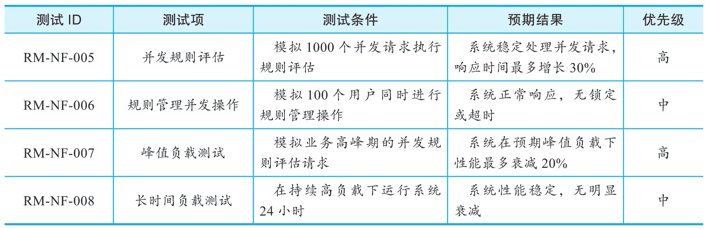

……

5.可扩展性与集成测试

5.1 系统扩展性

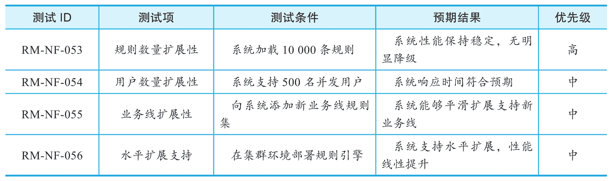

5.2 系统集成

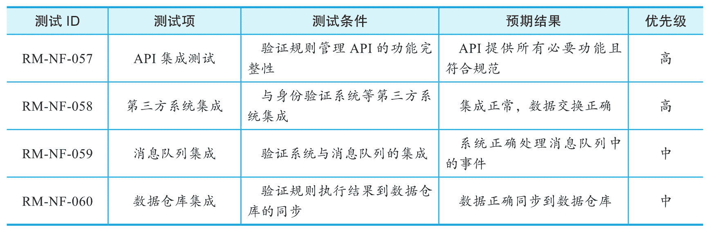

上述测试项给出测试条件与预期结果，相当于为传统需求文档提供验收标准。在敏捷中验收标准更明确，可先让大模型生成用户故事，详见“**4 规则管理模块用户故事.docx**”，例如“作为风控分析师，我希望能够创建新的风控规则，以便快速响应新出现的风险模式。”，再生成验收标准，结果详见“**5 风控规则生成示例.docx**”。大模型考虑全面度不亚于熟练测试人员。

用户故事

作为风控分析师，我希望能够创建新的风控规则，以便快速响应新出现的风险模式。

## 验收标准

1.规则创建基本功能

❑ 风控分析师可通过规则管理界面成功创建新规则。
❑ 系统提供规则创建表单，含必填字段：规则名称、描述、业务类型、风险类型、优先级、有效期。
❑ 规则名称唯一校验，重复时提示冲突并阻止保存。
❑ 可选择所属业务线，如信用卡、存款、贷款、支付等。
❑ 保存成功后显示提示，新规则出现在列表中。

2.规则条件配置

❑ 可为新规则添加至少一个触发条件。
❑ 支持条件类型：等于、不等于、大于、小于、包含、不包含、正则等。
❑ 支持数据类型：数值、字符串、日期时间、布尔、列表等。
❑ 支持通过直观界面用 AND/OR 组合多个条件。
❑ 提供条件校验，防止逻辑错误。

3.规则动作配置

❑ 可为规则配置至少一个触发动作。
❑ 提供常见动作：拒绝交易、标记可疑、限制金额、发送通知、升级审核等。
❑ 通知类动作可配置接收人及内容。
❑ 可为动作设优先级，决定执行顺序。

4.规则测试与验证

❑ 创建后可使用测试功能验证逻辑。
❑ 输入样本数据，系统展示评估结果与匹配路径。
❑ 测试界面显示是否触发及触发条件与动作。
❑ 可根据结果调整规则，无需退出流程。

5.规则保存与状态管理

❑ 新规则默认草稿，不在生产环境生效。
❑ 可提交审核。
❑ 记录创建时间、创建人、最后修改时间。
❑ 可添加标签便于管理查找。

6.用户体验要求

❑ 界面响应不超过 2s。
❑ 流程直观，新手经简单培训即可独立完成。
❑ 复杂字段提供帮助提示与示例。
❑ 表单支持自动保存，防止意外丢失。

7.审计与合规要求

❑ 记录完整审计日志，含创建人、时间、内容。
❑ 符合机构命名规范与文档标准。
❑ 显示关键业务指标预估如拦截率、误拦率等。

## 测试场景

❑ 基本规则创建：用有效数据创建简单规则。
❑ 复杂逻辑创建：含多条件组与复杂逻辑。
❑ 边界条件：字段长度、特殊字符等。
❑ 规则冲突：尝试创建冲突规则。
❑ 流程中断恢复：创建中中断后的恢复。
❑ 用户权限：验证不同角色权限。

业务价值确认

功能成功实现应使：

❑ 风控团队响应新风险平均时间从 2 天缩短至 4 小时内。
❑ 降低对技术团队依赖，业务人员可自主创建 80% 常规规则。
❑ 提升规则准确性，减少配置错误导致业务中断。

若认为大模型考虑过度，可回归 BDD 实践，采用 Given-When-Then 格式输出验收标准。输出表格可读性更强。

**表 3-3 大模型生成的验收标准**

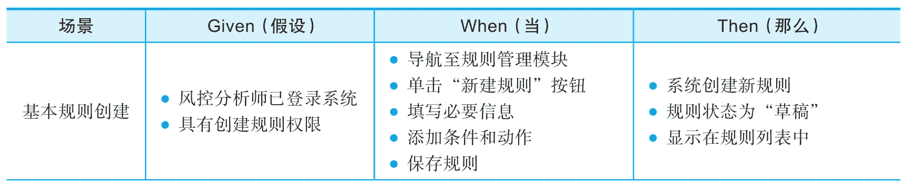

（续）

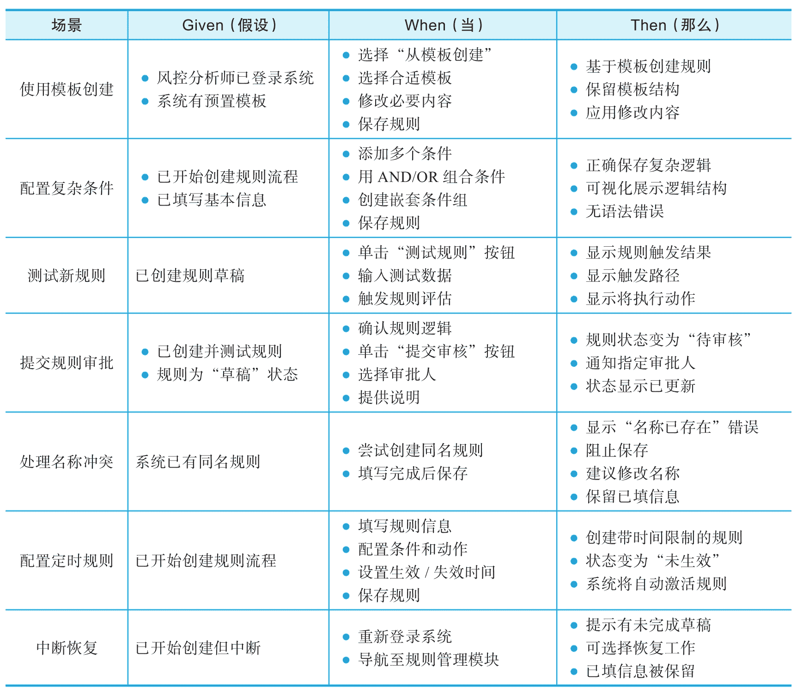

## **3.4 生成测试需求检查表**

测试需求分析完成后可生成完整测试需求 Spec 并评审，评审前需准备 Checklist。可让大模型结合智能风控平台业务及测试需求生成针对性 Spec 评审检查表，覆盖十类检查，后续可完善。篇幅所限仅展示框架，部分内容见“**6 银行智能风控平台测试需求 Spec 评审检查表.docx**”。

银行智能风控平台测试需求 Spec 评审检查表

1.需求覆盖度检查

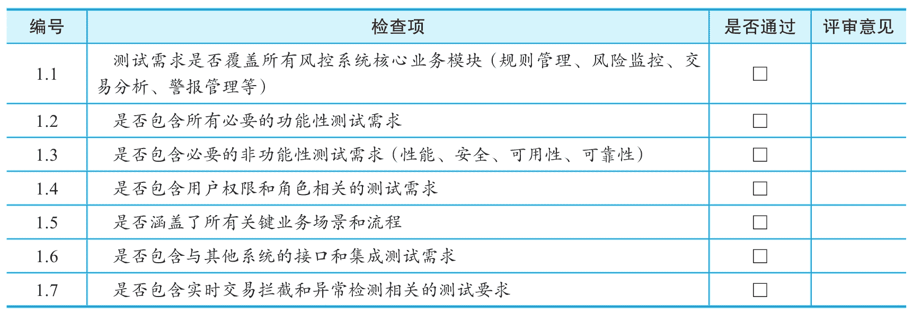

2.测试需求质量检查

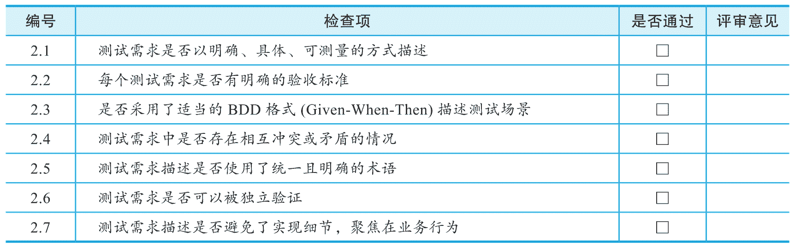

3.风控系统特定检查

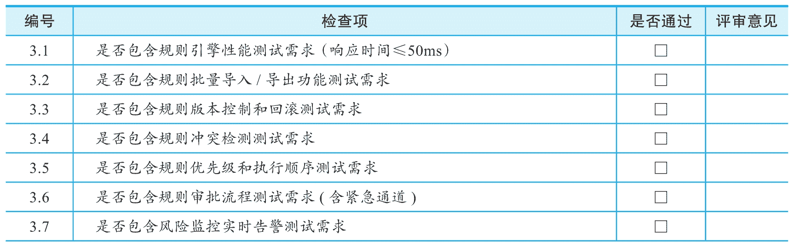

（续）

4.安全与合规性检查

5.性能与可靠性检查

6.可测试性检查

（续）

7.用户体验测试检查

8.测试策略与范围检查

9.文档完整性检查

10.业务银行特定检查项

## **3.5 生成和优化测试计划**

任何工作都应先规划再执行，测试亦然。测试计划是做好整体测试的前提。计划的目标是提供测试框架，持续收集产品特性信息，对测试不确定性进行分析，将不确定逐步转化为确定，最终合理估算范围、用例数、工作量、资源与时间，据此决策测试策略、方法、人力与进度。

一个可落地的测试方案，需要同时回答在验证什么、验证到什么程度、如何验证、边界如何覆盖、用例怎样设计、由谁执行、在何时完成。目标、质量门槛、策略、范围这些问题在 3.4 节已经展开；用例设计的具体手法将在后文单独说明。人力和排期的权重在小而敏捷的智能化团队里会下降，但在体量庞大的项目中仍是硬需求。实践中可以按阶段拆分，例如集成测试、系统测试，也可以按类型拆分，例如功能、安全、性能、可靠性，先产出若干子计划再汇总为总纲。

在前面整理出需求文档、测试项清单与需求核查表后，模型即可自动拼装成结构化的测试计划书。受篇幅限制，这里仅摘取片段，完整内容请参见电子材料“**7 银行智能风控平台测试计划书（初版）.docx**”。

银行智能风控平台测试计划书

……

目录

1.引言

2.测试范围与目标

3.测试策略

4.测试环境与配置

5.测试资源与角色职责

6.测试进度计划

7.测试类型与方法

8.入口/出口标准

9.测试风险与缓解措施

10.测试交付物

11.测试工具

12.缺陷跟踪与管理

13.测试报告与度量

14.附录

配套的风险清单与度量指标同样全面，详见下方：

若再补充团队规模、预计周期、期望质量水位等更具体的背景信息，就能引导模型对初版计划做进一步细化。限于篇幅下面只展示优化片段，完整版见电子材料“**8 银行智能风控平台测试计划书（优化版）.docx**”。该版在组织架构与职责划分上更加清晰，并加入了详细的工作分配矩阵，具体如下：

（续）

最初的测试窗口规划为 85 天，现要求压缩至 30 天，模型据此重新梳理整体节奏，并在限定时间内达成既定目标，调整情况如下：

（续）

还可以引入另一款模型对生成的计划做二次审阅，以提升可行性。模型评审后仍需人工复核，最终由测试经理或负责人把控质量。尽管如此，模型提出的各方面观察具有很强的参考价值，有助于全面思考。评审后生成的计划书完整版见电子材料“**9 银行智能风控平台测试计划书（改进版）.docx**”，限于篇幅下面仅展示部分内容：

测试计划书的评审意见及问题指出：

基于对上传文档的详细分析并结合实际需求，发现前面的《银行智能风控平台测试计划书（优化版）》存在如下问题：

1.测试范围缺口
原计划书未明确覆盖生命周期模型功能测试和风险集市功能测试，这两部分是智能风控平台的重要组成，详见《某银行智能风控平台主要测试需求》。

2.功能分类粒度不够
测试范围划分较为笼统，未涉及场景管理、指标管理、决策服务、数据管理等具体子功能，未能反映测试需求文档中更为精细的功能结构。

3.缺乏明确的交叉集成测试说明
未具体描述数据流转交互与模型应用交互等边界模块区域的集成测试要求，见上传的测试需求文档。

4.性能测试指标未做场景化细化
未涵盖实时、离线、异步准实时服务模式对性能稳定性与容量的具体要求。

5.缺少文档测试方案
未体现以各类型交付文档完整性为依据的验证要求，这对银行系统而言不可或缺。

6.未明确兼容性测试方案
未明确针对银行现有软硬件环境的兼容性及平台升级兼容性的测试策略。

## **3.6 本章小结**

本章聚焦模型如何重塑测试需求分析。传统需求分析是测试起点，直接影响覆盖率与质量保障效果，但常受理解偏差、盲点频出、效率低下困扰。

在模型驱动的需求分析上，本章系统阐述了模型凭借强大的自然语言理解与上下文感知能力，帮助团队更准确把握产品需求。从各类需求文档抽取关键信息、识别隐含需求与关联性，弥合业务语言与测试语言的鸿沟。通过语义解析、跨域知识联想与隐性需求挖掘消除歧义。例如分析实时更新需求时，模型可结合行业规范解释为“秒级响应”，并关联数据同步机制的技术实现。

在需求分解环节，借助模型生成思维导图，将粗粒度需求逐层细化为可验证的最小单元，构建需求与测试的多维映射。以银行智能风控平台为例，模型将规则管理模块拆分为规则创建、编辑、执行引擎等 300 多个测试项，并自动生成包含测试条件、预期结果的标准化清单，覆盖功能与非功能维度。

在范围界定上，模型能精准分析功能边界、影响面与系统依赖，帮助团队聚焦关键区域，优化资源分配。在风险挖掘上，模型基于领域知识与历史数据，可主动识别潜在风险点并提供针对性应对。例如构建风险分类树，结合提示工程注入业务上下文如银行合规要求，并借助 RAG 技术匹配历史风险案例。当识别出“高并发下规则引擎性能瓶颈”风险时，模型可自动关联历史项目的优化方案，生成“扩充数据库连接池容量”的应对策略。

本章还详细说明了模型在生成测试项与验收标准、构建测试需求检查表以及生成和优化测试计划方面的应用。模型可基于需求自动生成结构化测试项与明确验收标准，提供全面的检查表以减少遗漏，并生成符合组织标准的测试计划，包括测试策略、资源规划与进度安排。

通过模型驱动的需求分析，测试团队能够显著提升需求理解准确性、测试设计全面性与规划效率，实现从被动响应到主动探索的转变，为高质量软件测试奠定坚实基础。模型不仅是辅助工具，更是测试思维的智能延伸与放大器。

# **第四章**

# **LLM 驱动测试用例生成**

第三章深入探讨了模型在测试规划阶段的应用，展示了如何借助 AI 构建全面而精确的测试计划。通过银行智能风控平台案例，可见模型能协助制定合理策略、优化资源分配、识别潜在风险并提出缓解措施。然而，优秀的测试计划必须转化为具体可执行的测试用例才能发挥价值。

从计划到执行，关键挑战在于如何设计出覆盖全面且高效精准的用例。传统用例设计多依赖测试工程师的经验和直觉，容易出现覆盖不均、关键场景遗漏或重复低价值测试。特别是在银行风控这类复杂业务系统中，用户路径多样、业务规则繁杂、异常场景众多，单靠人工难以穷尽。

本章将揭示模型如何突破瓶颈，实现用例生成的智能化。先从测试场景识别出发，展示模型如何理解用户行为模式、挖掘多维度场景；再探讨基于不同输入从简单需求到复杂业务流程图生成功能用例的方法；最后延伸至性能与安全用例设计的 AI 辅助技术。通过这些方法，测试团队可在保持质量的同时大幅提升设计效率，将更多精力投入执行与分析。

让我们从宏观计划走向微观用例，探索模型如何帮助团队在复杂系统测试中事半功倍。

## **4.1** **测试用例设计要点**

测试用例设计是软件测试的灵魂。在数字化转型浪潮中，银行风控系统等关键业务的质量直接关系金融安全与用户信任。优质用例既是发现缺陷的利器，也是系统质量的最后一道防线。在探讨模型如何革新用例生成前，有必要回顾传统用例设计的核心要素与方法，这有助于理解模型带来的创新，也为评估 AI 生成用例质量提供专业参照。

一个专业的用例远不止操作步骤的描述。在银行智能风控平台等高要求系统中，用例需包含明确的标识、目标、前置条件、详细步骤、预期结果，以及严重等级和优先级标记。尤为关键的是，用例中的测试数据既要反映真实场景，又要符合数据安全与合规要求。例如测试交易反欺诈规则时，需模拟真实欺诈模式，同时确保不使用真实客户的敏感信息。

在设计方法上，依据 SWEBOK 分类进行说明。

**1.基于直觉和经验的方法**
依赖测试人员的直觉、经验和过往项目数据，通常在需求或文档不明确时使用。主要包括：
❑ Ad hoc 测试。非正式的测试方式，测试人员不按预制用例，按自身理解自由探索，范围和深度由测试人员自行决定。
❑ 错误猜测法。基于经验对系统和历史故障的推测，设计针对可能缺陷的用例。

**2.基于输入域的方法**
侧重依据输入的有效性和取值范围进行测试，主要方法有：
❑ 等价类划分。将输入划分为有效等价类与无效等价类，每个类内处理结果相同，通过代表值测试推断整类结果。例如整数 Int_x 取值 1~10，有效类可在区间内取一代表值，无效类小于1和大于10，可取 -2 与 15。
❑ 边界值分析。基于“错误多在边界”假设，重点测试边界及其临近值，每边界通常测3个点。例如 Int_x 边界1和10，测试数据为0、1、2、9、10、11。
❑ 随机测试。随机生成输入以扩大覆盖面，发现潜在缺陷。
❑ 状态转换测试。依据不同状态检验系统在状态间的转换是否符合预期。

**3.基于代码的方法**
侧重分析源代码结构与逻辑，通过执行验证功能与行为。主要分为逻辑覆盖与变量定义引用两类。

**（1）逻辑覆盖**
关注执行路径与控制流，确保条件与路径被覆盖。
❑ 语句覆盖。确保每条源代码语句至少执行一次。
❑ 分支覆盖。确保每个条件分支的真假均被触发。
❑ 条件覆盖。确保判断中每个基本条件均被测试。若多条件判断 if a > b && c < d，需覆盖组合情况。工业界常用修正条件/判定覆盖 MC/DC。

**（2）变量定义与引用**
侧重数据的定义、使用与生命周期。
❑ 定义-使用覆盖。确保变量先定义再使用，分析定义到引用的路径。
❑ 定义-杀死覆盖。确保同一作用域内变量定义后未被修改。
❑ 使用-使用覆盖。确保同一变量的全部使用-引用对被覆盖。

**4.组合测试方法**
通过输入组合间的交互验证系统行为，有效识别组合缺陷。包括决策表测试、因果图法、Pairwise 测试与 t-wise 测试。

**（1）完全组合测试方法**
❑ 决策表测试。用表格列出输入条件组合与对应的输出动作。
❑ 因果图法。识别输入条件与输出结果间的因果关系，再转为决策表。

**（2）组合优化测试方法**
❑ Pairwise 测试。仅测试输入变量间的成对组合，覆盖多数交互效应。
❑ t-wise 测试。多强度组合测试，强度由参数 t 表示，t=2 为成对，t=3 为三组合，通常 t 取 4 即可达到充分覆盖。

**5.基于故障模式的测试方法**
关注识别故障模式与错误类型，确保系统能抵御故障。
❑ 故障树分析。建模故障原因，分析潜在故障的逻辑关系。
❑ 鱼骨图。通过图示找出问题的主要原因与子原因。

**6.基于模型的测试方法**
利用模型指导测试过程与用例设计。
❑ 有限状态机测试。依据状态转换模型测试各状态及其转换。
❑ UML 状态图。利用 UML 展示状态与转换关系进行设计。
❑ 模型驱动测试。通过抽象模型自动生成用例，覆盖所有执行路径。
❑ 行为建模。运用业务流程建模符号描述行为，基于模型生成用例。

**7.基于使用的方法**
依据用户实际使用情况与频率进行测试。
❑ 用户故事分析。从用户故事出发设计用例，覆盖日常操作场景。
❑ BDD。运用 Gherkin 等语言描述用户行为编写用例。

**8.基于需求验证或标准验证的测试方法**
验证系统是否符合需求文档或行业标准。
❑ 需求追踪矩阵。将用例与需求映射，确保每个需求都有对应覆盖。
❑ 合规性测试。验证系统是否符合特定行业或法律标准。

**9.基于上下文驱动的测试方法**
针对项目具体上下文设计策略，强调测试设计应随实际情况动态调整，适合手工探索式测试。

## **4.2** **测试场景**

高质量用例的基础在于全面准确的场景识别。测试场景本质上是对用户使用系统的真实模拟，是连接需求与用例的关键桥梁。无论用例多精细，若建立在不完整或不准确的场景理解上，都难以有效验证质量。

传统场景设计主要依赖测试人员对需求文档的解读与业务流程理解，常受个人经验与认知水平限制。面对银行智能风控平台这类复杂系统，用户行为路径多样、风控规则多变，人工难以穷尽所有组合。这正是模型可发挥独特优势的领域，通过自然语言理解与模式识别，模型能系统化分析用户行为模式，从需求描述中提取隐含场景，并基于领域知识推导出潜在边缘情况。

场景的全面性影响覆盖率，真实性决定有效性。本节将探讨如何借助模型能力，从理解用户行为入手，系统化生成测试场景，进而挖掘易被人类忽略的盲点。通过模型与测试工程师协作，可构建更全面贴近实际的场景库，为后续用例设计奠定基础。

### **4.2.1** **帮助模型理解用户行为**

用户行为是场景设计的核心起点。在银行智能风控系统中，用户包括风控分析师、业务人员、系统管理员等多种角色，交互方式与目标各不相同。要让模型生成有价值的场景，首先需帮助它准确理解不同角色的行为模式与业务目标。

**1.用户角色与行为模型构建**

模型虽具备广泛通用知识，但对特定业务领域的深入理解仍需外部知识或人工引导。向模型提供清晰的用户角色定义与典型行为模式，能显著提升生成场景的质量。以银行智能风控平台为例，可这样向模型描述关键用户角色：

银行智能风控平台 用户行为拆解与测试场景构建思路

风控分析师的核心日常围绕规约搭建、预警研判、可疑交易核查展开，常动用的模块有规约管理、预警处置、风险研判。典型链路为：结合风险模式新建规约→校验有效性→上线发布→跟踪触发情况→解读预警信息→闭环处置风险事件。

业务主管侧重规约变更的评审、风控报表的查阅与风险策略的制定，主要依赖审批与报表分析。常见动作有审核规约申请、浏览风险统计报表、评估风控成效。

运营人员聚焦日常预警的处置、处置结果的记录以及特殊案例的升级，工作重心在预警处理。

系统管理员统筹账号权限、系统配置与运行监控，活动集中在系统管理。常规操作包括新建账号、分配角色权限、调整系统参数、监控性能与日志。

亦可先让大模型自行生成角色画像，后经人工复核修改再回传。下文即为模型产出的 9 类角色示例。提前给出画像或明确角色边界，有助于模型把握行为规律，构建领域专属行为模型，从而产出更贴合真实业务的测试场景。详见电子材料“**10** **银行智能风控平台的主要用户角色.docx**”。

银行智能风控平台核心用户角色盘点

1.风控政策管理人员
职责：统筹并持续维护银行层面的风控策略与政策框架。
关键行为：搭建政策体系、更新风控标准、监督政策执行、定期评估政策有效性。
系统交互：主要使用政策管理、指标体系管理、风险阈值配置等模块。

2.风控分析师
职责：基于交易数据与客户行为进行研判，挖掘风险模式，并对规约进行设计与优化。
关键行为：数据挖掘、风险模式分析、规约设计与调优、模型评估。
系统交互：使用数据分析平台、规则引擎配置、模型监控工具。

3.风险预警处理人员
职责：对系统产生的风险预警进行人工复核与处置。
关键行为：审核预警信息、调查可疑交易、处理风险事件、记录处理结果。
系统交互：主要使用预警工作台、事件处理流程、客户信息查询。

4.反欺诈专家
职责：识别并防范各类欺诈行为。
关键行为：研究欺诈模式、分析欺诈案例、设计反欺诈规约、协调欺诈调查。
系统交互：使用欺诈检测引擎、行为分析工具、案例管理系统。

5.模型开发人员
职责：开发与维护风控相关的机器学习模型。
关键行为：特征工程、模型开发、模型训练、部署与监控。
系统交互：使用模型开发工作台、模型生命周期管理、特征仓库。

6.系统管理员
职责：管理系统配置、用户权限与运行状态。
关键行为：账户管理、权限分配、配置维护、运行监控。
系统交互：使用系统管理控制台、监控仪表板、日志分析工具。

7.合规审计人员
职责：确保风控活动符合监管要求与内部控制标准。
关键行为：审计规约变更、审核高风险操作、生成合规报告。
系统交互：使用审计日志、合规检查工具、报表系统。

8.业务部门主管
职责：从业务视角参与风控决策，平衡风险与发展。
关键行为：审批风控规约、审核风险报告、参与策略制定。
系统交互：使用审批工作流、业务影响分析报表、决策支持工具。

9.风险集市数据管理员
职责：管理风险数据资产，保证数据质量与可用性。
关键行为：数据源管理、数据质量监控、数据服务配置。
系统交互：使用数据管理平台、数据质量监控工具、ETL流程监控。

**2.流程与关键抉择梳理**

用户行为通常遵循既定业务环节，而环节中的关键抉择正是设计测试场景的核心。让模型理解环节与抉择点，有助于实现测试覆盖的全面性。例如可向模型提供规约管理的环节描述，如下所示。若自行撰写困难，也可先让模型产出草稿再完善。通过明确标注关键抉择点，模型能针对每个点生成正向与逆向的测试场景，保证覆盖完整。

规约创建步骤：
1.风控分析师登录系统，进入规约管理模块。
2.选择规约类型（交易监控/客户风险评估/反欺诈）。
3.定义规约基本信息（名称、描述、风险级别、生效时间）。
4.配置规约条件（可包含多条件组合，支持 AND/OR 逻辑）。
5.设置规约触发后的动作（产生预警/拒绝交易/请求人工审核）。
6.使用测试数据验证规约。
7.提交规约审批。
8.业务主管审核规约。
9.规约发布生效。

抉择点：
1.规约条件是否合法有效？
2.规约是否重复或存在冲突？
3.测试验证是否通过？
4.审批是否通过？
5.规约是否在指定时间正确生效？

**3.领域限制与运营规范**

银行风控系统受大量领域限制和运营规范制约，这些限制决定了用户行为边界和系统预期响应。向模型提供这些限制，有助于其生成更贴合业务实际的测试场景。领域限制和运营规范为生成边界测试提供了依据，帮助识别易被忽略的测试点。

风控规约限制：
1.规约优先级取值范围为 1～100，数值越小优先级越高。
2.同一规约组内禁止出现逻辑冲突的规约。
3.高风险规约变更必须经过至少两级审批。
4.规约生效时间须晚于当前时间至少 30 分钟。
5.交易金额阈值不得超过银行设定的上限。
6.规约测试连续失败 5 次后需强制进行规约评审。

系统安全限制：
1.连续登录失败 3 次将锁定账户。
2.敏感操作需进行二次身份验证。
3.非工作时段的高风险操作需特殊授权。

**4.既往缺陷与异常模式**

既往缺陷与异常模式也是理解用户行为的重要维度。向模型提供过往发现的典型缺陷，能帮助其生成针对性测试场景，避免同类问题重现。这些模式为模型提供了启发，使其能针对系统潜在弱点设计测试。

历史缺陷与问题模式：
1.规约修改后未刷新缓存，导致部分交易仍按旧规约执行。
2.并发修改同一规约时，后提交的变更覆盖先提交的变更，且无冲突提示。
3.规约条件中特殊字符未正确转义，导致执行异常。
4.跨时区交易的日期条件判断不正确。
5.大额交易拆分为多笔小额时，风控规约未能识别关联交易。
6.规约停用后，已产生的预警状态未正确处理。

**5.对话式迭代完善行为理解**

用户行为理解并非一次性完成，需通过交互不断精化。测试工程师可通过对话引导模型深入理解特定场景，完善行为模型。例如描述“风控分析师创建规约”场景时，可通过提问引导模型思考更多维度，如下所示。

❑ 风控分析师在规约创建中遇到参数错误时会如何处理？
❑ 规约条件复杂到一定程度时，用户界面如何支持清晰展示？
❑ 风控分析师如何验证新规约不会与现有规约冲突？
❑ 规约测试时，分析师如何调整参数以达到预期效果？

通过此类交互问答，模型能建立更全面、更细致的行为模型，为后续场景生成奠定基础。

**6.以数据样本支撑行为认知**

除静态描述外，数据样本也是帮助模型理解用户行为的有效手段。提供真实或脱敏的交易数据样本、规约配置示例、预警处理记录等，可帮助其把握数据模式和业务规则的实际应用。例如可提供如下 JSON 格式的交易数据样本和对应风控规约。通过数据样本，模型能建立对实际业务数据和规约逻辑的具体认知，从而生成更贴合实际的测试场景。

帮助模型理解用户行为是生成有效测试场景的基础。通过提供用户角色定义、业务环节描述、领域限制与规则、历史缺陷模式以及典型数据样本，并经交互式对话精化，我们能显著提升模型对银行智能风控平台用户行为的理解深度与准确性。这种深入理解将直接转化为更全面、更贴合实际的测试场景，为后续用例设计提供坚实基础。

### **4.2.2** **生成测试场景**

在模型充分理解用户角色、业务环节和领域限制后，下一步是引导其系统化生成测试场景。场景生成是连接行为理解与具体用例设计的关键环节，其质量直接影响测试有效性和覆盖度。

高质量的场景集合应从多维度覆盖系统行为。针对银行智能风控平台，可构建结构化生成框架，引导模型从功能、用户角色、业务环节、数据等关键维度产出场景，从而保障测试充分性。

**1.功能维度场景**

功能维度场景关注各功能点在不同条件下的表现。提供系统功能点列表可帮助模型识别测试场景。例如输入如下提示词让模型生成场景：

请基于以下智能风控平台功能点生成测试场景：
1.风控规约管理（创建、修改、删除、查询、启用/禁用规约）
2.风险预警处理（查看、分析、处理、升级、关闭预警）
3.客户风险评估（风险评分计算、风险等级划分、评估历史查询）
4.交易监控（实时监控、事后分析、关联交易识别）
5.报表与分析（风险趋势分析、规约效果分析、预警统计）

据此模型生成了数十个场景，并能为每个功能点识别正常路径、替代路径和异常路径场景。若表现不佳，也可通过提示词从正常、扩展、异常等角度挖掘更多场景。因篇幅限制，下述仅展示 4 个示例，完整内容详见电子材料“**11** **银行智能风控平台测试场景-功能维度.docx**”。

场景 RM-001：正常创建单一条件风控规约（正常场景）
❑ 场景描述：风控分析师创建一条基于单一条件（如“单笔交易金额超过 100000 元”）的风控规约。
❑ 前置条件：分析师已登录系统并拥有规约创建权限。
❑ 触发事件：分析师完成规约信息填写并提交。
❑ 预期结果： 
规约成功创建并显示在规约列表中。 
规约状态为“待审批”。 
系统向审批人发送审批通知。
❑ 验证点：规约信息保存准确、审批流程正确触发。

场景 RM-002：创建复杂条件组合规约（复杂场景）
❑ 场景描述：风控分析师创建一条包含多个条件组且具有复杂逻辑关系的规约（如“客户等级为 VIP AND（单日交易总额>500000 元 OR30 天内跨境交易次数>5）”）。
❑ 前置条件：分析师已登录系统并拥有规约创建权限。
❑ 触发事件：分析师配置复杂条件组合并提交规约。
❑ 预期结果：系统正确保存复杂逻辑结构并正确展示条件关系。
❑ 验证点：复杂条件逻辑的保存和解析正确、规约测试功能正确验证复杂条件。

场景 RM-008：规约版本回滚（异常场景）
❑ 场景描述：发现新发布的规约版本存在问题，需紧急回滚到先前版本。
❑ 前置条件：规约已有多个版本历史。
❑ 触发事件：管理员执行规约版本回滚操作。
❑ 预期结果： 
系统显示可回滚的历史版本列表。 
成功回滚到选定的历史版本。 
原规约版本被标记但保留在历史中。 
系统记录回滚操作和原因。
❑ 验证点：版本控制有效性、回滚过程完整性、业务连续性保障。

场景 RM-E01：规约引擎崩溃恢复（异常场景）
❑ 场景描述：规约引擎服务在高负载下突然崩溃，测试系统恢复和规约状态一致性。
❑ 异常触发：通过压力测试或故障注入使规约引擎崩溃。
❑ 预期行为： 
系统检测到引擎崩溃并触发自动恢复流程。 
所有处于编辑状态的规约应有自动保存的草稿。 
恢复后规约状态一致，无数据损坏。 
告警机制正确通知管理员。
❑ 验证点：恢复机制有效性、数据一致性保障、业务连续性。

**2.用户角色维度场景**

不同角色与系统的交互各异，针对各角色生成相应场景至关重要。可为单个角色生成场景，提示词如下：

请为智能风控平台的用户角色风控分析师生成测试场景，尽可能完整、全面，包括正常、扩展和异常的场景。

基于角色的场景生成可确保系统在不同视角下得到充分测试。篇幅所限仅展示部分场景，完整文件详见“**12** **风控分析师角色测试场景集.docx**”。

FA-N 0 1：创建基于单一条件的简单风控规约（正常场景）
❑ 场景描述：风控分析师创建一条基于单一条件（如“单笔交易金额超过 100000 元”）的规约。
❑ 前置条件：分析师已登录系统并拥有规约创建权限。
❑ 操作流程： 
导航至规约管理模块。 
选择创建新规约。 
配置基本信息（名称、描述、风险级别）。 
设置单一交易金额阈值条件。 
配置触发行为（生成预警）。 
提交规约。
❑ 预期结果：规约成功创建并进入审批流程

FA-E 0 1：规约克隆与批量修改（扩展场景）
❑ 场景描述：风控分析师基于现有规约快速创建变体规约。
❑ 前置条件：源规约已存在。
❑ 操作流程： 
选择源规约并使用克隆功能。 
修改规约名称和关键参数。 
选择保留或修改原规约的其他设置。 
保存新规约。
❑ 预期结果：成功创建基于源规约的新规约，关键参数已更新。

FA-X 0 1：规约编辑会话超时恢复（异常场景）
❑ 场景描述：测试分析师在规约编辑过程中会话超时的恢复机制。
❑ 前置条件：已开始编辑一条复杂规约。
❑ 操作流程： 
开始编辑复杂规约。 
保持页面不活动超过会话超时时间。 
尝试继续编辑或保存规约。
❑ 预期结果：系统提供会话恢复选项，已编辑内容不丢失，可继续完成操作。

当系统复杂度有限时，也可批量为多个角色生成场景。提示词如下：

请为以下智能风控平台的用户角色生成测试场景：
1.风控分析师：负责规约设计和风险模式分析。
2.风险审核员：处理风险预警和可疑交易。
3.合规审计人员：审核规约变更和操作合规性。
4.系统管理员：管理用户权限和系统配置。
5.业务部门主管：审批重要规约变更。

**3.业务环节维度场景**

业务环节维度关注端到端用户旅程，确保完整流程在各种条件下正确。可先让模型生成端到端基本流程，再针对每条流程生成测试场景。提示词可为：

请基于智能风控平台中的基本业务流程“风险规约生命周期流程：创建→测试→审批→发布→监控→优化→废弃”生成其测试场景。

更优的提示应明确方法，如事件流方法或基于场景的 E2E 方法：

请基于智能风控平台中的主要业务流程“风险预警处理流程：系统生成预警→分配→初步分析→调查→处理决策→记录结果→关闭预警”，采用事件流方法（包括基本流、扩展流、异常流等），生成其测试场景。

也可写成：

请基于智能风控平台中的主要业务流程“风险预警处理流程：系统生成预警→分配→初步分析→调查→处理决策→记录结果→关闭预警”，采用基于场景的 E2E 方法，从起始点到终止点生成状态树，尽可能覆盖不同路径。

后两种提示的生成结果详见“**13** **风险预警处理流程测试场景集-事件流方法.docx**”“**14** **风险预警处理流程状态树.docx**”。结果显示模型能识别流程关键节点和转换点，生成覆盖完整流程的场景。

下面展示“**14** **风险预警处理流程状态树.docx**”中“关键路径说明”部分的内容，生成了风险预警处理流程的 10 条 E2E 业务路径。

关键路径说明
1.标准处理路径：预警生成→待分配→已分配→初步分析→调查→决策→记录结果→关闭预警。
2.快速关闭路径：预警生成→待分配→已分配→初步分析→快速关闭（误报或无须调查）。
3.升级处理路径：预警生成→待分配→已分配→初步分析/调查→升级处理→高级审核员/团队处理→关闭预警。
4.信息补充路径：预警生成→待分配→已分配→初步分析→信息不足→请求信息→补充信息→继续分析/调查。
5.客户交互路径：预警生成→待分配→已分配→调查→等待客户解释→客户响应→继续调查→决策→关闭预警。
6.扩展风险路径：预警生成→待分配→已分配→调查→发现扩展风险→扩展调查范围→生成关联预警→并行处理。
7.中断恢复路径：任意处理状态→系统中断→处理暂停→系统恢复→恢复至中断点→继续处理。
8.预警再开路径：已关闭→后续监控→发现新风险→重新开启→调查→决策→关闭预警。
9.合并处理路径：预警生成→预警合并→合并至主预警→主预警处理完成→一并关闭。
10.分级审批路径：预警生成→待分配→已分配→调查→决策→需要高级审批→审批通过/拒绝→采取措施→关闭预警。

**4.数据维度场景**

数据维度场景关注不同数据条件和状态下的系统行为，例如针对某类业务数据生成场景，或就不同类别数据分别生成场景。提示词如下：

请基于交易数据（如不同交易类型、金额范围、频率模式）生成智能风控平台的测试场景，可以考虑等价类划分、边界值分析方法，即考虑正常数据（有效的）、边界值、异常数据（无效的）等场景，或者小数据量、大数据量、极限数据量。

场景到用例：风控测试打法全记录

先以交易数据为切口，用前面那套问法一次拉出55个测试情境，完整清单收在电子材料“15 智能风控平台交易数据测试场景.docx”。如果换到规则视角，提问可以调整为：请基于业务规则数据（如基础规则、复合条件规则、时序规则、统计类规则等）生成智能风控平台的测试场景。

按这个写法跑出来的结果很饱满，能看出模型思考的颗粒度。篇幅有限不展开，详见电子材料“16 智能风控平台业务规则测试场景集.docx”。

再切到客户数据维度，关注点就变成历史、实时、预测或关联数据，提示词可写成：请基于客户数据（如历史数据、实时数据、预测数据或关联数据等）生成智能风控平台的测试场景。

5. 提示模板怎么搭
要让大模型产出高质量的测试情境，关键在模板设计。下面给一个结构化模板，套用后能获得格式统一、覆盖面广的情境。

作为银行智能风控系统测试专家，请结合以下信息生成测试场景：
❑ 系统功能：[目标功能点描述]
❑ 用户角色：[相关角色及目标]
❑ 业务流程：[涉及的流程]
❑ 领域约束：[业务规则与限制]
❑ 潜在风险：[可能的风险点]

要求尽量多产出，每个场景包含：
1.场景编号与名称
2.场景说明
3.前置条件
4.触发动作
5.预期行为
6.检验点
7.复杂度评级（简单/中等/复杂）
8.优先级（高/中/低）

同时兼顾边界与异常情形，确保覆盖正常、扩展和异常路径。

6. 迭代优化怎么做
情境产出通常需要多轮打磨，通过质疑、评审、深度扩展或优先级调整来挖掘盲区。举例提问：
电子材料“风险预警处理流程状态树.docx”基于核心流程“风险预警处理流程：系统生成预警→分配→初步分析→调查→处理决策→记录结果→关闭预警”，采用基于场景的E2E方法生成，其中关键路径列出10条E2E路径，请从广度与深度审视是否遗漏，有遗漏请补充。

用OpenAI o1跑后，补齐了4条路径：SLA超时升级路径、预警暂停与恢复路径、预警拆分路径、预警取消路径。详情见电子材料“14 风险预警处理流程状态树.docx”。

借助大模型做情境设计，能带来效率与系统性的双重提升。配合多维框架、精细模板和迭代策略，可以产出贴近实战、覆盖面广的情境，为后续用例设计奠定基础。

下一部分将讨论如何拓宽情境，尤其是人类容易忽略的边缘与复杂交互。

### 4.2.3 拓展测试场景
基础情境完成后，需要深挖技术含量更高、价值更大的情境，以保证智能风控平台风险预警处理流程的全面与健壮，非功能特性将在4.4节与4.5节介绍。这些情境要从业务、交互、数据、极端、边界等多维度切入，帮助发现系统薄弱点。下面介绍拓展思路。可直接问模型：有没有更好的方法挖掘测试场景？例如借助时空转换，请针对功能维度进一步深挖潜在情境，列出补充项，避免重复。

模型给出的第一部分是“情境挖掘方法论”，共4种：时空转换法、SCAMPER创新思维法、对抗性思维法、参数组合法，具体如下：

一、情境挖掘方法论
1.时空转换法
方法说明：通过在时间与空间维度上对基础情境进行变换，发现边界与异常情境。
具体应用：
时间变换：在不同时间点、周期与跨度下检验情境。
空间变换：改变地理位置、系统边界与数据分布。
组织变换：在不同组织结构、层级与权限下观察情境表现。
2.SCAMPER创新思维法
方法说明：借助SCAMPER模型系统性地变异现有情境。
具体应用：
替代：替换情境中的角色、数据或流程步骤。
合并：将多个独立情境合并成复杂情境。
调整：调整情境参数或约束条件。
修改：改变情境规模或复杂度。
转为他用：将本来用于一类目的功能用于他处。
消除：去掉情境中的某些元素或步骤。
重新排列：改变事件顺序或结构。
3.对抗性思维法
方法说明：假设各组件处于最差或恶意状态下运行，设计应对情境。
具体应用：
对抗用户：假设用户试图绕过风控规则。
对抗系统：假设系统组件试图破坏流程。
对抗数据：假设数据被刻意构造为最难处理的形式。
4.参数组合法
方法说明：识别情境的关键维度，对每个维度的取值进行组合，产生综合情境。
具体应用：
确定3～5个关键维度，如用户类型、交易规模、风险程度、处理时效性等。
为每个维度设定2至3个代表性取值。
使用正交实验设计挑选最具代表性的组合。

第二部分基于上述方法补充了一些新情境，因篇幅未展示，完整内容见电子材料“17 银行智能风控平台测试补充场景.docx”。

还可从其他维度深挖，例如交互维度下的“多角色并行处理冲突情境”，数据模式与时序模式下的“历史数据关联分析情境”。针对E2E业务流程，可从状态全覆盖、反复流转、最短处理链、中途取消、最长处理链等角度挖掘。这些想法可能来自大模型，也可能来自人与模型的碰撞。

例如极长处理链：预警生成→待分配→拒绝分配→重新分配→初步分析→请求信息→暂停处理→恢复处理→升级处理→团队分配→协作分析→扩展调查→关联预警生成→等待客户解释→客户响应→继续调查→决策分歧→上报审批→审批拒绝→修改决策→再次审批→通过→执行措施→记录结果→设置监控→关闭预警→后续发现新风险→重新开启→最终关闭。这正是测试人员与大模型对话启发出的罕见深层情境。

## 4.3 功能测试用例生成
前文已说明大模型可生成并多维度深挖测试情境，保证覆盖广度与深度。情境描述相对宏观，能指导测试但无法直接执行。下一步需将情境细化为可操作的测试用例。一个好的测试用例会明确前置条件、操作步骤、预期结果与判定标准，确保可重复、可追溯、客观可评。

大模型凭借自然语言理解与生成能力，可辅助或自动生成高质量用例，提升效率与覆盖率。生成路径主要有3种：
❑ 基于需求文档的生成：解析需求文档识别功能与非功能需求，据此生成有效输入、无效输入、边界条件等多类用例。
❑ 基于代码的生成：解析源码或接口文档理解内部逻辑与协议，生成针对性用例，如单元测试代码。
❑ 基于用户故事的生成：在敏捷场景下根据用户故事生成验收标准。

以下以智能风控平台为例，采用由简到繁的渐进方式生成用例，确保关键功能充分验证。

### 4.3.1 基于简单的设计方法生成测试用例
用例设计是把抽象需求转化为具体操作的桥梁。首先采用等价类划分、边界值分析、决策表等简单有效的方法，结合大模型为功能点或用户故事生成基础用例。

1.等价类划分和边界值分析
等价类划分把输入分为有效与无效类，从中挑代表值测试，减少冗余并保证覆盖。边界值分析聚焦输入域边界，因错误多发于边界。实践中常两者结合，先做边界分析再识别等价类。可通过以下提示让大模型生成用例。

针对交易金额测试场景，请采用等价类划分和边界值分析方法生成测试用例，简化操作步骤，以表格形式输出。

大模型按等价类划分与边界值分析生成的结果如表4-1所示。

表 4-1 LLM 基于等价类划分方法和边界值分析生成的结果

（续）

为让测试更全面，大模型建议增加以下情境组合。
❑ 变更频率测试：短时间内多次变更交易金额，考察风险识别能力。
❑ 多币种交易测试：验证不同币种金额边界处理的一致性。
❑ 用户级别差异测试：验证VIP与普通用户对相同金额的处理差异。
❑ 交易类型与金额组合测试：检验转账、消费等不同类型下金额限制的差异。
❑ 连续交易累计金额测试：验证短时间内累计金额超限的识别能力。

2.决策表法
决策表法适合处理多条件组合逻辑，尤其适用于风控规则测试。可通过以下提示生成决策表。

针对“4.1 多维度风险识别规则”，请采用决策表法进行测试，先列出条件桩、动作桩，再分析条件项、动作项，最后输出决策表。

大模型输出如下。

多维度风险识别规则决策表测试
1.规则分析
根据《智能风控平台业务规则测试场景集》文档4.1节，多维度风险识别规则为典型的OR关系规则：
—规则描述：满足任一高风险指标即发出预警。
—规则示例：IF 交易IP在可疑IP列表中 OR 设备在可疑设备列表中 OR 交易地点与常用地点的距离>1000千米 THEN 触发预警
2.决策表构建
2.1 确定条件桩和动作桩
条件桩：
❑ 交易IP地址在可疑IP列表中
❑ 设备在可疑设备列表中
❑ 交易地点与常用地点的距离>1000千米
动作桩：
触发预警
2.2 条件项和动作项分析
条件项：
❑ 交易IP地址在可疑IP列表中：Y/N
❑ 设备在可疑设备列表中：Y/N
❑ 交易地点与常用地点的距离>1000千米：Y/N
动作项：
❑ 触发预警：Y/N
2.3 完整决策表

（续）

3.基于决策表的测试用例设计
测试用例表

3.组合测试方法
多参数测试项如预警分配规则测试并不适合决策表法，应采用组合优化方法，如正交试验法、两两组合或三三、四四组合等。对这类方法有现成工具如PICT、ACTS等。若用大模型，则可节省分析与文档工作。例如，针对预警分配规则，要求大模型采用正交试验法设计用例，输出如下，能大幅节省分析与撰写工作量。

预警分配规则测试：正交试验法设计
经分析业务规则文档，预警分配规则涉及多因素多水平，是正交试验法的典型场景，可在保持覆盖的同时大幅减少用例数。
1.测试因素和水平识别
根据文档识别出以下关键因素与水平：

2.正交表选择
基于7个因素，其中5个为3水平、2个为2水平，选择L18（21×37）正交表，适用于混合水平设计。
3.正交表设计结果

（续）

### 4.3.2 基于业务流程图生成端到端的测试用例
4.2.2节已介绍让大模型生成E2E业务流程路径，至此用例雏形已成。为执行可进一步细化为E2E用例。本节介绍基于业务流程图直接生成E2E用例，这在实践中也很常见。因为仅做功能测试不够，还需基于流程图覆盖核心业务路径，确保业务需求落地。以退货处理业务流程为例，如图4-1所示。

图 4-1 退货处理业务流程

可将流程图上传给大模型，并提示：请基于上传的业务流程图，先以简洁方式节点→节点表示路径，并生成覆盖路径的测试用例，用表格呈现，再以规范文字表达E2E测试用例。

大模型据此生成了用例，因篇幅仅展示标题与部分内容，完整内容见电子材料“19 客户退货处理流程端到端测试用例.docx”。

一、路径简化表示
识别出的主要路径如下：
路径1：物品完好的退货流程
申办退货→接收退货请求（客服）→接收退货请求（物流）→派工收货→退货检查→物品完整→进行退货处理→完成。
路径2：物品不完好且客户接受支付整新费的退货流程
申办退货→接收退货请求（客服）→接收退货请求（物流）→派工收货→退货检查→物品不完整→费用报价→请求整新费→收到整新费通知→支付整新费→接收退货请求→收到整新费→完成。
路径3：物品不完整且客户不接受支付整新费的流程
申办退货→接收退货请求（客服）→接收退货请求（物流）→派工收货→退货检查→物品不完整→费用报价→请求整新费→收到整新费通知→不支付，流程终止。

第二部分以表格形式呈现E2E测试用例，共8条，最后一条为并发请求的性能测试用例，如表4-2所示。
表 4-2 LLM 生成的 E2E 测试用例

（续）

除3条基本路径外，表4-2还涉及以下路径。
❑ 路径1变体：申办退货→接收退货请求→派工收货（失败）→重新安排收货→收货成功→后续流程。
❑ 路径2变体：申办退货→接收退货请求→派工收货→退货检查（不完好）→费用报价→请求整新费→支付超时→处理超时。
❑ 路径1+路径2：申办退货（多物品）→接收退货请求→派工收货→分别检查→混合状态处理→部分收费→完成。
❑ 重复申请：已有退货申请→重复申请→系统识别→阻止重复。
❑ 批量申请：批量申请→系统并发处理→资源分配→批量完成。

从生成结果看，大模型考虑周全，涵盖拒绝支付、超时、重复等情境，形成不同业务路径。完成上述用例测试基本可保障退货业务的流程处理。下面展示生成的规范详细用例中的一条，可直接按描述操作执行，同时仍需人工复核并反馈修正，让大模型迭代出更高质量的用例。该例说明用大模型生成测试用例是可行的。下面是第三部分规范端到端测试用例表达的部分内容。

测试用例 TC-01：完整物品的正常退货流程
测试目标：验证客户退货系统能否正确处理物品完好状态下的标准退货流程。
前置条件：
❑ 客户已购买商品并收到。
❑ 客户有效账户处于正常状态。
❑ 退货政策允许该商品退货。
❑ 测试环境中所有系统模块可正常运行。
测试数据：
❑ 客户ID：TEST_CUST_001。
❑ 订单ID：ORDER_20250401001。
❑ 商品信息：标准测试商品（完好无损）。
❑ 退货原因：“不符合期望”。
测试步骤：
1）客户登录账户系统。
2）导航至“我的订单”页面。
3）选择目标订单并单击“申请退货”按钮。
4）填写退货原因并提交申请。
5）验证客户服务系统生成退货单号并显示“已受理”状态。
6）验证物流系统接收退货请求并安排收货时间。
7）物流人员按预约时间收取退货物品。
8）物料厂商接收物品并进行检查。
9）物料厂商在系统中确认物品完好。
10）验证系统自动流转至“退货处理”状态。
11）验证退货流程完成，系统状态更新为“已完成”。
12）客户收到退货完成通知。
预期结果：
❑ 客户退货申请成功提交，系统生成唯一退货单号。
❑ 客户服务系统正确接收并处理退货请求。
❑ 物流系统成功排程并完成收货。
❑ 物料厂商确认物品完好，无须客户支付额外费用。
❑ 系统自动完成退货处理，无人工干预。
❑ 客户收到退货成功完成的通知。
❑ 系统中订单状态更新为“已退货”。

### 4.3.3 基于模板生成规范的测试用例
选用《软件测试方法和技术（第4版）》附录中的测试用例模板，详见电子材料“20 测试用例设计模板.pdf”。提示词为：“将前面生成的测试用例TC-01、TC-02、TC-03转换成模板要求的格式。”

大模型选择了第一个模板，即国家标准GB/T 15532—2008格式来生成用例，如图4-2所示。

输出结果符合模板要求，这里仅给出生成的第一个用例。
测试用例 TC-01：物品完好退货流程

国家标准 GB/T 15532 用例模板解读

用例名称：物品完好退货流程测试
用例标识：TC-RETURN-01
测试追踪：REQ-RETURN-001（客户退货处理流程要求）

**图 4-2** **国家标准 GB/T** **15532—2008 模板格式**

用例说明：检查系统在商品完好情况下能否按标准完成退货闭环

用例初始化：

❑ 硬件配置：标准测试环境服务器配置。
❑ 软件配置：客户服务系统 v2.1、物流系统 v3.0、厂商管理系统 v1.5。
❑ 测试配置：集成测试环境。
❑ 参数配置：客户 ID 为 TEST_CUST_001，订单 ID 为 ORD20250418001。

操作过程：

（续）

前提与限制：客户账号正常且存在可退商品；退货政策覆盖该商品；各系统可正常联通。

流程结束条件：退货流程成功结束或任一环节失败。

结果评判标准：各操作步骤的实际结果与预期结果一致；整体流程 10 分钟内完成；各模块状态同步准确无误。

设计人：测试工程师 A
设计日期：2025-04-18

若希望大模型按其他模板生成用例，提示词可如此组织：

按照“20 测试用例设计模板.pdf”中“C.2 简单的功能测试用例模板（表格形式）”生成“测试用例 TC-01：物品完好退货流程”。

产出结果符合模板 C.2，具体如下：

请依据“测试用例设计模板.pdf”中“C.2 简单功能测试用例模板（表格形式）”重新设计“测试用例 TC-01：物品完好退货流程”。

测试用例 TC-01：物品完好退货流程

该用例采用简易功能用例的表格化呈现，包含了必要的测试信息、前置条件、操作步骤与预期结果。表格中“实际结果”与“是否通过”两列留空，供执行时填写。每条步骤均对应明确的预期结果，便于执行人员判断通过与否。

### 4.3.4 用例评审要点

用例设计是测试工作的核心支点，它体现了被测对象的质量诉求与评估边界，直接影响测试效率与测试本身质量，因此评审十分关键。设计完成后需经历非正式与正式的复核与评审。评审时重点检查以下内容。

1）整体思路是否清晰：能否把握系统结构与逻辑，使用例层次分明，优先级与执行顺序是否合理。
2）有效性：若被测点存在缺陷，用例执行时必然能暴露，方说明用例有效，否则视为无效。通常用变异测试来验证单元测试的有效性。
3）覆盖面：是否考虑到产品使用中的特殊场景、边界与接口。
4）描述完整性：前置条件是否齐全、步骤是否简洁明了、预期结果是否与产品规格或客户需求相符。
5）环境准确性：测试环境是否定义准确，用例是否明确了所需的条件或环境。
6）复用、可维护、可管理：可读性是否良好，是否通过独立的用例 ID 识别、用例版本号等实现管理。

用例质量高度依赖测试需求分析，需求分析是前提。评审后按意见修改，再次评审，直至通过。后续测试中若发现缺陷无对应用例，应及时新增或修正用例。

下面对 4.3.2 节的“退货处理业务流程 E2E 测试用例”（见电子材料“**19** **客户退货处理流程端到端测试用例.docx**”）进行评审，评审依据为本节列出的 6 项。4.3.2 节用例由 Claude 3.7 Sonnet Think 生成，使用另一模型如 OpenAI o3 进行评审。

请依据《测试用例评审标准（checklist）》对先前生成的《客户退货处理流程端到端测试用例》进行评审，指出问题并补充相关用例。

模型产出的评审结果如下。

**《客户退货处理流程端到端测试用例》评审报告**

**（依据《测试用例评审标准（checklist）》）**

1.评审发现的问题

2.需补充的关键测试用例（摘要）

上述用例须按同一模板补齐详细内容（前置条件、步骤、期望结果、环境、优先级等）。

3.结论与下一步

现有用例覆盖了 3 条主业务路径，但缺失异常、接口、权限、多币种等高风险场景。

建议按评审意见补齐 TC-09～TC-15 等关键用例，并统一已写用例的排版、优先级、版本等格式。

修订完成后再次走评审流程，确保全部评审标准满足，再进入执行阶段。

## 4.4 大模型驱动的性能测试设计

借助大模型完成性能测试时，需要给出有效引导。一种成熟做法是将性能测试设计拆分为两个相关且侧重不同的阶段。

1）确定测什么：明确关键性能需求、指标，以及要开展的性能测试类型。
2）工具落地：结合所用性能测试工具，完成可执行的详细设计。

性能测试第一阶段应聚焦“测什么”而非“如何测”。这种思路源于性能测试的本质是验证系统是否满足业务诉求，而非为测试而测试。软件性能工程创始人 Connie Smith 早在 20 世纪 90 年代就提出，性能应贯穿软件生命周期，而非事后验证。因此要从性能需求出发梳理业务，识别关键性能点。例如电商关注下单高峰响应时延，支付关注交易成功率与数据一致性，内容平台关注并发用户数与加载速度。每类业务都有独特敏感点，找到它们是成功的关键。

该阶段产出通常包括指标定义（如“95%订单处理在 3s 内完成”）、负载模型（如“双 11 预计每秒 1000 笔订单”）与测试场景（如“模拟促销下单高峰”）。这些定义应与具体工具无关，体现真实业务需求。

在业务需求明确后，第二阶段才转向技术实现，需考虑环境设计、脚本编写、数据准备、监控配置等。以 JMeter 为例，需把“模拟 1000 用户并发下单”的业务诉求转化为线程组、HTTP 请求与参数化数据配置。重点是确保技术实现满足业务诉求并兼顾实际限制。

两个阶段并非严格线性，常需迭代。当发现业务需求在技术上难以实现时，可能需回到第一阶段调整需求或优先级。

### 4.4.1 性能需求、风险与指标识别

第一阶段让大模型分析业务文档，识别性能需求、潜在风险并结合行业实践提出合理指标。

提示词可这样写并绑定相关需求文档：

请分析“某银行智能风控平台”业务需求、测试需求与流程文档，准确识别性能需求与潜在风险点，并依据行业最佳实践给出合理性能指标，形成完整性能测试方案。可推荐工具，但无需涉及工具细节。

生成结果见电子材料“**21** **某银行智能风控平台性能测试方案.docx**”，仅展示目录与部分内容。

目录

一、业务分析与性能需求识别………………2
1.1 系统业务概述………………2
1.2 关键性能需求分析………………2
二、性能风险点识别………………3
2.1 实时交易处理链路………………3
2.2 复杂风控场景………………4
2.3 管理后台操作………………4
三、性能指标与目标值………………5
3.1 响应时间指标………………5
3.2 吞吐量指标………………5
3.3 并发用户指标………………6
3.4 资源利用率指标………………6
四、性能测试场景设计………………6
4.1 基准性能测试场景………………7
4.2 峰值负载测试场景………………7
4.3 耐久性测试场景………………8
4.4 关键业务场景测试………………8
4.5 边界条件测试场景………………9
五、负载模型设计………………9
5.1 交易模型………………9
5.2 用户行为模型………………10
六、测试数据要求………………11
6.1 交易数据要求………………11
6.2 规则和模型数据………………12
七、性能测试工具建议………………12
八、测试执行建议………………13
8.1 测试环境要求………………13
8.2 测试执行策略………………14
8.3 结果分析重点………………14
九、特殊测试考量………………15
9.1 安全性与性能结合测试………………15
9.2 灾备与容错性能测试………………15
9.3 合规相关性能测试………………16
十、结论与建议………………16

**1.“性能风险点识别”内容**

基于“智能风控平台业务需求”及其端到端关键业务路径，识别出以下潜在风险：

2.1 实时交易处理链路
1.多层级规则评估：
❑ 风险：规则数量或复杂度上升时，评估耗时可能超阈。
❑ 影响：直接影响客户交易体验，可能导致超时或失败。
2.第三方接口依赖：
……
3.分布式事务一致性：
……

2.2 复杂风控场景
1.规则组合爆炸：
❑ 风险：大量规则组合使决策树复杂度指数增长。
❑ 影响：资源消耗激增，响应时间拉长。
2.模型实时推理瓶颈：
……
3.历史数据查询负担：
……

2.3 管理后台操作
1.大数据量报表生成：
❑ 风险：大量数据聚合计算导致报表生成缓慢。
❑ 影响：管理决策延迟，用户体验下降。
2.规则测试资源争用：
……
3.历史数据查询与分析：
……

**2.“性能指标与目标值”内容**

结合银行业务特征与行业实践，推荐以下指标及目标：

3.1 响应时间指标

3.2 吞吐量指标

……

**3.“性能测试场景设计”内容**

模型生成了基准、峰值、耐久、关键业务与边界条件场景。其中耐久性场景即常说的压力测试，需进行 7×24 小时连续运行。基准场景中“正常负载交易决策测试”内容如下：

❑ 目的：验证系统在正常负载下的表现。
❑ 负载级别：日均交易量（约 500 万笔/日）的均匀分布。
❑ 测试时长：2 小时。
❑ 关注指标：平均响应时间、TPS、资源利用率。

关键业务场景测试涵盖复杂规则评估性能、大规模历史数据分析与模型批量推理性能。

大规模历史数据分析测试
❑ 目的：验证系统处理大规模历史数据查询能力。
❑ 测试条件：对 1 亿多条交易记录进行复杂条件查询。
❑ 负载级别：20 个并发查询。
❑ 关注指标：查询响应时间、数据库资源利用率。

模型批量推理性能测试
❑ 目的：验证 AI 模型批量推理性能。
❑ 测试条件：不同批量规模（100/1000/10000 笔交易）。
❑ 负载级别：10 个并发批量请求。
❑ 关注指标：推理完成时间、GPU/CPU 利用率、内存占用。

**4.“负载模型设计”内容**

包含交易模型与用户行为模型，交易模型涵盖日交易量分布与交易类型分布。交易类型分布如下：

❑ 转账交易：40%
❑ 支付交易：30%
❑ 信用卡交易：20%
❑ 贷款相关：5%
❑ 其他交易：5%

用户行为模型分析不同角色行为，其中风控分析师行为模式如下：

❑ 规则查看：30%
❑ 规则创建/编辑：20%
❑ 规则测试：25%
❑ 规则部署：5%
❑ 报表查看：15%
❑ 监控面板查看：5%

整体方案基本达预期，可根据实际业务调整细节与指标。我们也可让其它模型评审方案，再结合自身评审意见优化，为下一阶段奠基。针对上述方案，Gemini 2.5 pro Think 给出评审意见，总体高度肯定同时指出 7 处不足。限于篇幅仅展示部分，完整内容见电子材料“**21** **某银行智能风控平台性能测试方案.docx**”。

整体评价：

该性能测试方案总体全面专业。流程清晰，从业务分析、风险识别、指标定义到场景设计与执行策略。内容详实，覆盖性能测试关键方面，指标与场景契合银行业智能风控特点。特别包含特殊测试考量与容量规划建议，成熟度较高。

潜在不足与优化建议：

1.性能指标来源依据不明确
❑ 不足：第三部分给出具体指标（如<200ms, 2000 TPS），但未说明来源。
❑ 建议：在指标表中增加来源或推导说明，如“来自《主要测试需求》”“参考同业基准”“基于架构推算”，提升可信度。

2.负载模型与业务场景关联可更紧密
❑ 不足：第五部分定义交易分布与用户行为，但未清晰对应第四部分各场景。
❑ 建议：在每个场景描述中明确采用的具体负载模型与参数组合及理由。

3.测试环境真实性细节不足
……
4.监控策略需更具体
……
5.测试数据生成与管理策略
……
6.场景优先级与执行策略关联
……
7.结果分析与瓶颈定位流程
……

总结：
……

### 4.4.2 把方案落地到 JMeter

第二阶段可基于经评审改进的方案，让大模型生成基于 JMeter 的可执行方案，包含脚本模板与配置建议。

提示词可写：

基于《某银行智能风控平台性能测试方案》，按我们采用的 JMeter 工具（Master/Slave 部署）生成可执行、详细的性能测试执行方案。

若有专家方案或模板可供参考，结果会更贴近期望。此处未用模板，直接驱动，模型输出较为理想。部分内容见电子材料“**22** **某银行智能风控平台性能测试执行方案.docx**”。

目录

一、测试环境配置与部署………………2
1.1 JMeter 分布式架构配置………………2
1.2 监控系统配置………………4
二、测试脚本设计与实现………………6
2.1 基础组件设计………………6
2.2 测试场景脚本实现………………9
2.3 监控与结果收集设置………………14
三、性能测试执行流程………………16
3.1 测试准备阶段………………16
3.2 测试执行流程………………18
3.3 结果收集与分析………………26
四、JMeter 配置最佳实践………………32
4.1 JMeter 性能优化配置………………32
4.2 多线程组合策略………………33
4.3 数据参数化策略………………34
五、异常处理与恢复策略………………34
5.1 测试中断恢复机制………………34
5.2 JMeter Slave 故障处理………………36
六、附录：完整测试执行计划………………37
6.1 测试执行日程安排………………37
6.2 测试就绪标准………………39
6.3 各测试场景详细参数配置………………40
6.4 监控指标详细配置………………44
6.5 测试结果评估标准………………49
6.6 测试报告模板………………50
6.7 问题跟踪与修复流程………………52
七、总结与注意事项………………53
7.1 关键成功因素………………53
7.2 潜在风险与防范………………53
7.3 最终检查清单………………54

**1.测试环境配置与部署**

分布式架构配置包含硬件资源、主节点与从节点配置、JVM 配置及插件安装，以下展示主节点配置。监控系统配置完成 Prometheus+Grafana 部署，并给出 ELK 日志监控配置。

**2.测试脚本设计与实现**

包含基础组件设计、场景脚本实现、监控与结果收集等，模型均给出具体配置示例。

基础组件设计涵盖公共配置元件、自定义函数与 BeanShell 脚本、压测数据准备脚本等。

1）公共配置元件部分给出 HTTP 请求默认值、身份认证配置的 Makefile 与 CSV 数据集配置（交易数据集、用户数据集、规则数据集等）、响应断言配置等。

**性能测试方案精要拆解**

2）自定义函数与 BeanShell 脚本部分，展示了用 Java 实现的交易信息动态生成函数，以及同样基于 Java 的风控规则评估结果抽取能力，详见图 4-3。

3）压测数据准备脚本主要由交易数据生成脚本构成，可通过 Python 代码生成模拟交易数据。

测试场景脚本的实现覆盖日常退货峰值模拟，涉及 JMeter 脚本设计与关键 HTTP 请求配置；还包括大促后退货峰值模拟、数据库性能测试、系统稳定性测试等。大模型为下列场景输出了 JMeter 测试脚本 .jmx 的模板，供录制时参考。

**图 4-3 动态交易信息生成函数**

PT-01：日常交易峰值测试
PT-02：大促峰值测试
PT-03：第三方接口性能测试
PT-04：支付处理性能测试
PT-05：数据库性能测试
PT-06：系统稳定性测试
PT-07：故障恢复性能测试
PT-08：批量处理性能测试

PT-01 与 PT-05 的输出结果在后文呈现。

在 PT-05 后面，LLM 还给出了“JDBC 查询请求示例”，如下所示：

**3.性能测试执行流程**

本节给出监控检查清单，包括系统资源 CPU、内存、磁盘 I/O 等监控、性能指标响应时间、TPS、错误率等监控、数据库连接数是否稳定、应用健康度检查如异常日志、JVM 垃圾回收、线程状态、连接池等。接着，给出性能测试的“结果收集脚本”和“结果分析脚本”参考，因篇幅下面仅展示结果收集脚本参考。

**4.JMeter 配置最佳实践**

JMeter 配置的最佳实践主要是 JMeter 性能优化配置、JMeter Master 节点优化、JMeter Slave 节点优化、多线程组合策略和数据参数化策略。数据参数化策略考虑银行业务需求，生成内容如下：

#数据参数化最佳实践

为确保测试数据分布合理，采用以下策略：

1.交易金额分布：
-小额交易 1～1000 元：70%
-中额交易 1001～10000 元：25%
-大额交易 10001～100000 元：5%
2.实现方式：

3.模拟不同风险级别账户：
-使用 CSV 数据集中的 risk_level 字段
-分布：low_risk:70%, medium_risk:25%, high_risk:5%
-在 BeanShell 脚本中根据风险级别调整交易特性

**5.异常处理与恢复策略**

本节提供了测试中断恢复机制、JMeter Slave 故障处理等，此处不展开介绍。

总体来看，这份性能测试执行方案考虑得比较全面，而且最后还提供了“附录：完整测试执行计划”。例如，测试就绪标准就设计得比较完整，如下所示：

6.2 测试就绪标准

在开始正式测试前，需确保以下条件全部满足：

1.环境就绪：
❑ JMeter Master/Slave 集群部署完成并通过连通性测试。
❑ 所有监控组件 Prometheus、Grafana 和 ELK 部署完成并能正常收集数据。
❑ 被测系统环境符合性能测试要求，配置与生产环境可比。

2.数据就绪：
❑ 测试数据生成完成并经验证符合业务场景。
❑ CSV 数据文件已分发至所有 Slave 节点。
❑ 测试数据库初始状态已备份。

3.脚本就绪：
❑ 所有测试场景脚本编写完成。
❑ 脚本已通过小规模验证测试。
❑ 参数化配置已完成确认。

4.团队就绪：
❑ 测试执行人员分工明确。
❑ 相关团队 DBA、运维、开发已确认可提供支持。
❑ 紧急联系人清单已更新并分发。

5.管理就绪：
❑ 风险预案已制定并评审。
❑ 测试监控告警已配置。
❑ 项目管理层已批准测试计划。

该方案为每个测试场景给出详细参数配置，例如“PT-01：日常交易峰值测试详细参数”，如表 4-3 所示。方案还给出监控指标详细配置，如业务层面监控指标、系统层面监控指标、数据库监控指标等。

**表 4-3 日常交易峰值测试详细参数**

在《21 某银行智能风控平台性能测试方案》中，LLM 还给出了负载模型设计，包括以下内容。

❑ 交易模型：分为日交易量分布如月末/月初、节假日等、日内交易分布如早高峰、晚高峰等、交易类型分布如转账、支付、信用卡交易等。
❑ 用户行为模型：考虑不同角色的用户行为，如风控分析师行为模式、调查人员行为模式等。

该性能测试方案对测试数据要求比较高，如数据规模、数据特征、数据脱敏，并可以基于业务规则生成测试数据。最后，LLM 还给出了性能测试执行的建议。纵观 LLM 给出的性能测试分析和设计，整体上看质量不错。也可以把这个方案发给另一个 LLM 如 OpenAI o3 进行评审，让它指出问题。在此基础上，再结合我们自己的经验来修改、完善这个性能测试设计方案。

## 4.5 本章小结

本章深入探讨了如何利用 LLM 驱动软件测试用例生成，以提升测试设计的效率和覆盖度。核心内容围绕测试场景生成与挖掘以及功能测试用例生成两大方面展开，并进一步延伸至 LLM 在性能测试设计中的应用。

在测试场景生成与挖掘方面，本章首先强调了帮助 LLM 理解用户行为的重要性。通过向 LLM 提供用户角色定义、业务流程描述、领域约束与规则、历史缺陷模式以及典型数据样本，并结合交互式精化，可以显著提升 LLM 对复杂业务如银行智能风控平台用户行为的理解深度与准确性。在此基础上，本章介绍了结构化的测试场景生成框架，引导 LLM 从功能、用户角色、业务流程、数据等多个维度系统化地生成测试场景，确保场景的全面性，进一步通过人机对话的相互启发，引导 LLM 提供在测试场景挖掘方法上的指导，挖掘那些容易被人工忽略的深层次、边缘化和复杂交互的测试场景，从而最大限度地提升测试覆盖的广度和深度。

在功能测试用例生成方面，本章阐述了将宏观测试场景细化为具体可执行测试用例的多种路径。首先，介绍了如何利用 LLM 辅助应用传统的测试设计方法，如基于等价类划分和边界值分析生成针对特定输入域的测试用例，以及利用决策表法处理具有多条件组合逻辑的规则测试。随后，重点展示了如何基于业务流程图无论是 LLM 生成的还是已有的直接生成 E2E 测试用例，确保对核心业务流程的全面覆盖。此外，本章还演示了如何利用预定义的测试用例模板来规范 LLM 生成的测试用例格式，提高其标准性和可用性。最后，强调了测试用例评审的重要性，并展示了如何利用 LLM 对已生成的测试用例进行评审，发现潜在问题并提出改进建议。

LLM 在性能测试设计中的助力也不容忽视。本章介绍了将性能测试设计拆分为“确定测什么”和“工具实现”两个阶段的方法。LLM 能够在第一阶段通过分析业务文档，辅助识别性能需求、潜在风险点，并根据行业最佳实践明确性能指标。在第二阶段，LLM 可以基于已确定的性能测试方案和选定的测试工具如 JMeter，生成详细的、可执行的性能测试方案，包括测试脚本模板和配置建议。

展望未来与挑战并存。LLM 驱动的测试用例生成无疑为软件测试带来了革命性的变化，极大地提高了效率和覆盖率。然而，挑战依然存在，例如如何确保 LLM 生成内容的完全准确性、如何更智能地处理复杂依赖和动态行为，以及如何更好地与现有测试工具和流程集成。未来的发展方向可能包括更强大的上下文理解能力、更智能的测试数据生成，以及与 AI 驱动的测试执行和缺陷分析更紧密的结合，最终实现更加自动化和智能化的全生命周期测试。

**4.6 参考文献**[[1]]
朱少民，王千祥.软件工程 3.0：大模型驱动的研发新范式[M] .北京：人民邮电出版社，2025.
[2] 朱少民.软件测试方法和技术[M] .4 版.北京：清华大学出版社，2022.

# 第五章
# 大模型驱动测试脚本生成

本章主要围绕如何利用 LLM 生成高效且准确的测试脚本展开讨论。我们将从测试脚本的基本要点出发，详细介绍如何利用 LLM 生成不同类型的测试脚本，包括单元测试、API 测试、Web 自动化测试以及移动 App 自动化测试。此外，本章还将探讨测试脚本的解释与优化方法，并介绍如何对生成的测试脚本进行有效的转化，以满足不同测试需求。

具体而言，本章首先回顾测试脚本的关键要点，为后续内容奠定基础。然后，通过具体示例，逐步讲解如何利用 LLM 生成各类测试脚本。接着，讨论测试脚本的解释与优化策略，确保生成的脚本不仅能自动化执行，还能提供清晰的测试逻辑和结果。最后，介绍测试脚本转化的方法，帮助读者灵活应用生成的脚本。

## 5.1 测试脚本要点

在软件测试中，编写高质量的测试脚本是确保产品功能与性能稳定的重要环节。测试脚本是一种指令集，由自动化测试工具执行，在自动化测试中承担模拟用户操作或输入并检查预期结果的任务，其本质是一个与被测试程序交互的程序。使用测试脚本自动化执行重复和耗时的任务，不但能节省测试时间，还能降低测试工作中出现人为错误的可能性，因此测试脚本能够有效提高软件测试的效率和质量^[1]^。

通常而言，测试脚本包含以下关键组件结构，如表 5-1 所示。

**表 5-1 测试脚本的关键组件结构**

基于现在流行的自动化测试框架 Junit5 实现的测试脚本结构示例如下 ^(³)：

那么，作为软件开发与测试人员，我们该如何高效开发自动化测试脚本呢？可以借助哪些工具？有哪些最佳实践？让我们看一看 ChatGPT 的回答：

高效开发自动化测试脚本对于软件开发与测试人员来说至关重要。以下是一些方法、工具和最佳实践，能够帮助你更高效地开发自动化测试脚本。

1.工具的选择
❑ 测试框架：选择合适的测试框架，如 JUnit、TestNG 用于 Java，PyTest 用于 Python，NUnit 用于 C# 等。这些框架提供了丰富的功能，如测试组织、依赖管理、断言库、数据驱动测试等，能够大大简化测试脚本的开发。
❑ 测试自动化工具：
● Selenium：用于 Web 应用的自动化测试，支持多种浏览器和语言。
● Appium：适用于移动应用测试，支持 Android 和 iOS 平台。
● Postman：主要用于 API 测试，支持 API 请求的创建、发送、自动化测试以及集成 CI/CD。
● JMeter：用于性能测试，也可以扩展后用于功能性 API 测试。
● Cucumber：用于行为驱动开发 BDD，支持使用自然语言编写测试用例，便于非技术人员理解。

2.测试脚本开发的最佳实践
❑ 可维护性：
● 模块化：将测试脚本分解成多个模块或函数，使其更加易于维护和重用。
● 参数化：通过参数化测试脚本，能够覆盖更多的测试场景，同时减少代码冗余。
● 数据驱动测试：将测试数据与测试脚本分离，通过外部数据源如 Excel、CSV、数据库驱动测试执行，增强脚本的灵活性和可扩展性。
❑ 可读性：
● 命名规范：使用有意义的命名来提高代码的可读性，函数和变量名应清晰表达其目的。
● 注释与文档：适当的注释能够帮助理解复杂的逻辑，良好的文档也有助于团队协作。
❑ 复用性：
● 共用库：将常用的测试步骤或验证逻辑抽象为共用库，避免编写重复的代码。
● 测试套件：通过定义测试套件来组织相关的测试脚本，实现批量执行和管理。
❑ 持续集成与持续交付 CI/CD：
● 将测试脚本集成到 CI/CD 管道中，确保在每次代码提交或构建时自动执行测试，从而及时发现问题。

3.自动化测试的策略
❑ 优先级与风险评估：根据风险评估来决定哪些测试应该自动化，优先选择高执行频率和高风险的测试。
❑ 回归测试自动化：确保每次代码修改后自动运行回归测试，验证现有功能是否被破坏。
❑ 跨浏览器/设备测试：自动化脚本应能够在不同的浏览器和设备上执行，以确保应用的兼容性。

4.使用 LLM 辅助测试脚本开发
❑ 脚本生成：借助 LLM 生成测试脚本，特别是在缺乏详细文档或需要快速创建脚本时，通过提供描述性的提示可以生成初步的测试脚本。
❑ 脚本优化：利用 LLM 优化现有的测试脚本，提升其性能和可读性，或针对特定的测试场景提出改进建议。
❑ 测试用例建议：LLM 可以根据功能描述或历史数据生成新的测试用例，帮助覆盖更多的测试场景。

通过合理选择工具、遵循最佳实践，并结合新兴的 AI 技术如 LLM，你能够大幅提升自动化测试脚本的开发效率，同时保障测试质量。

下面对 ChatGPT 的回答进行逐条解读。首先，ChatGPT 介绍了当前市面上常见的一些自动化测试工具，包括测试框架和成熟的应用软件，如用于 Web 自动化测试的 Selenium、用于移动应用测试的 Appium、用于 API 测试的 Postman、用于性能测试的 JMeter 以及用于行为驱动开发的 Cucumber，这些工具在当今软件开发与测试的实际项目工作中发挥了重要作用，有效提高了软件测试工作效率。

其次，ChatGPT 提到的测试脚本开发最佳实践涵盖了自动化测试脚本开发的核心原则，如可维护性、可读性、复用性、持续集成与持续交付等，这些原则可以帮助我们编写高效、易维护的测试代码。ChatGPT 还提到了优先级与风险评估、回归测试自动化、跨浏览器/设备测试等自动化测试的策略，这些策略可以帮助测试团队有效利用资源，优先处理高风险区域，确保测试的广度和深度。

除了 ChatGPT 提到的上述实践与策略，业界常用的一些自动化测试方法也值得一提，如关键字驱动测试 Keyword-Driven Testing、数据驱动测试 Data-Driven Testing。在关键字驱动测试中，测试脚本的逻辑由一组预定义的关键字来驱动。每个关键字代表一个特定的动作或操作，如点击按钮、输入文本、验证输出等。这种方法的核心思想是将测试逻辑与实际的测试代码分离，使非技术人员也能参与测试脚本的设计和维护。在数据驱动测试中，测试脚本的执行是由外部数据驱动的。换句话说，测试用例中使用的输入数据、预期结果等都存储在外部数据源如 Excel 文件、CSV 文件、数据库或 XML 文件中，测试脚本通过读取这些数据来执行测试。这种方法允许通过一次编写脚本多次运行，来验证不同的输入和输出组合，从而提高测试覆盖率和效率。在实际项目中，团队可以根据测试需求，结合这两种方法的优势，灵活选择或混合使用，以实现更高效的自动化测试。

最后，ChatGPT 提到了作为软件项目的开发和测试人员，我们可以使用大模型辅助测试脚本开发，这也是本节将要讨论的重点。在分工明确的研发和测试团队里，对于一些从事功能测试的成员来说，他们可能在业务领域和测试方法方面经验丰富，但是对编程语言和不同测试框架的掌握程度有限，因此让他们编写测试脚本会存在一定的困难。另外，随着被测系统的规模和复杂度持续增长，测试脚本编写和维护的工作量也会逐步增加，这时完全依靠手工编写测试脚本会面临效率低下的问题。

在 LLM 技术出现之前，已经有了一些自动生成测试脚本的方法，如基于搜索的测试生成方法、基于符号执行的测试生成方法和基于规则的测试生成方法等。以上方法在业务理解、测试脚本可解释性和脚本冗余等方面存在一些不足之处。

LLM 的介入，为测试脚本的开发和优化引入了智能化与自动化的新思路。LLM 能够根据功能描述或需求自动生成测试脚本，特别是在文档不完整或需要快速创建初步测试脚本的场景中。通过提供适当的提示，LLM 可以生成覆盖常见测试场景的基础代码，帮助开发人员快速启动测试工作。

不仅是生成脚本，LLM 还可以在现有脚本的基础上进行优化。无论是代码性能提升、逻辑简化，还是提高可读性，LLM 都可以提供有价值的建议，确保测试脚本更高效、更符合最佳实践。LLM 还可以根据已有的功能描述、历史数据和业务逻辑，生成新的测试用例。这些测试用例往往会覆盖一些开发人员可能忽略的边界条件或特殊场景，从而提高测试的全面性和有效性。

那么，利用 LLM 生成测试脚本和测试人员手工编写测试脚本有什么不同呢？手工编写测试脚本和利用 LLM 生成测试脚本分别有哪些注意事项呢？请看 ChatGPT 的回答：

1.LLM 生成测试脚本与手工编写测试脚本的区别
❑ 效率与速度：
● LLM 生成：LLM 能够快速生成测试脚本，尤其是在有明确需求或描述时。它可以自动完成大部分的代码编写任务，节省时间，特别是在初始阶段或需要快速生成大量测试脚本时。
● 手工编写：手工编写测试脚本通常更耗时，因为需要测试人员逐行编写代码、设计逻辑、处理边界条件，并进行细致的调试。但手工编写往往更加精准，能够针对特定需求进行高度定制化。
❑ 灵活性与定制化：
● LLM 生成：LLM 能够根据输入的提示生成标准化的测试脚本，但在处理高度定制化或复杂的业务逻辑时可能会有局限性。生成的脚本可能需要进一步调整以适应特定场景。
● 手工编写：手工编写测试脚本可以完全根据项目需求进行调整，测试人员可以自由设计测试流程、验证逻辑，并处理特殊的业务场景。
❑ 质量与可靠性：
● LLM 生成：LLM 生成的测试脚本在语法和基本逻辑上通常是正确的，但由于缺乏对具体项目背景的理解，生成的脚本可能在边界条件、异常处理等方面存在不足。生成的脚本需要经过人工审查和调整，以确保其可靠性和适用性。
● 手工编写：测试人员对项目的深刻理解可以确保测试脚本的质量。手工编写的脚本通常会考虑到更多的细节和异常情况，质量和可靠性更高。
❑ 知识积累与学习：
● LLM 生成：LLM 生成测试脚本不需要开发人员具备深厚的编程知识，降低了技术门槛。但长期依赖可能导致测试人员的编程技能和对测试细节的理解有所下降。
● 手工编写：手工编写测试脚本能够提升测试人员的编程能力、逻辑思维和对业务的理解，积累更多的实战经验。

2.注意事项
LLM 生成测试脚本的注意事项：
❑ 输入提示的准确性：确保给 LLM 的提示清晰、准确，以便生成的脚本符合预期。

大模型辅助校验代码产出与落地的平衡指南

模型产出之后需要把控的三个关键点：

❑ 人工复核与微调：模型给出的程序务必经人逐行审阅并调试，确认流程闭合、覆盖充分，并且能够应对各类边界与异常状况。
❑ 融合真实业务背景：语言模型给出的程序往往比较通用，必须结合项目的真实业务逻辑与实现细节做二次适配和优化。
❑ 纳入代码仓库并补充说明：产出的程序应进入版本库，同时补充清晰的使用说明与变更记录，便于后续维护与迭代。

手工撰写验证代码时应注意的要点：

❑ 书写规范与可读性：严格遵循团队编码规范，保证程序结构清晰、易于阅读和维护。
❑ 追求覆盖广度并重视边界：手工撰写需注重用例的全面性，尤其要补充边界值、异常分支等易被忽略的场景。
❑ 模块拆分与复用：设计时优先将公共步骤抽离为独立模块，提升复用率，降低维护成本。
❑ 接入持续集成实现自动化：手工代码应能无缝接入持续集成流水线，确保自动化验证稳定持续运行。

总体来看，模型产出与手工撰写各有侧重。模型擅长快速产出基础代码、节省时间，但仍需人工把关质量；手工撰写耗时却能高度定制，保证覆盖面与可靠性。结合两者优势，按需选用，才能兼顾开发效率与验证质量。

正如 ChatGPT 的概括，模型适合用来快速产出基础代码、搭建验证框架等提效任务，而手工撰写更适合深度定制、确保覆盖全面与可靠性的工作。如何将二者有机结合以赋能验证工作高效开展，是值得思考的问题。

作为一线开发与验证人员，如何借助大语言模型提升效率？本书将通过具体案例详细展示如何利用大语言模型助力验证代码生成。

## **5.2** **借助大语言模型生成校验代码**

大语言模型的出现为验证代码的自动化生成打开了全新空间。借助大语言模型，验证人员可以大幅加快代码编写速度，降低人为失误，提升整体验证质量。本节将探讨如何用大语言模型生成单元验证、API 验证、Web 自动化验证和移动 App 自动化验证等多种代码，每个小节都会介绍生成方法、实践技巧以及不同场景的效果。

### **5.2.1** **单元级校验代码**

在软件开发中，单元级验证是保障代码质量的基础。传统上单元验证代码由开发人员手工编写，需要深刻理解业务需求和源码，并兼顾边界和异常。手工方式耗时长、易出错、覆盖不足的问题较为突出，因此业界逐步引入自动化工具来辅助生成和管理。

以 Java 为例，JUnit^([2]) 等框架极大提升了传统单元验证的效率，但代码生成仍依赖开发者的经验和技能。大语言模型的出现为单元验证代码自动化提供了新的解决思路。

2023 年初，ByteDance 智能服务团队启动大语言模型 X 智能单测项目。该团队通过任务微调、强化学习等技术，提升语言模型在单元验证生成上的语法正确率和分支覆盖率。目前基于 Bloom 70 亿参数模型已在业务中落地，实际项目分支覆盖率达到 56%，并在抖音 Android、iOS 双端应用，问题反馈有效性达 80%，修复率达 65%。

ByteDance 算法专家张树波表示：大语言模型能帮助开发者减少重复编码，但并不意味着门槛降低。在智能服务团队的实践中，模型生成的单测服务于程序员，对有经验的开发者帮助更大。

那么普通项目开发和验证人员在实战中如何借助大语言模型助力单元验证？下面以一个具体案例展开。

本案例采用的工作环境与工具：

❑ 开发语言：Java
❑ 验证框架：JUnit
❑ 代码编辑器：IntelliJ IDEA
❑ LLM：OpenAI-ChatGPT

传统手工编写时，需要先充分理解业务需求和源码实现。需求为用例设计提供方向，源码分析则帮助验证具体实现细节。大语言模型编写有效单元验证同样离不开这两个核心要素。

鉴于大语言模型在自然语言处理上的表现，我们可以尝试将业务需求和源码输入模型，并指明验证框架，结合 Prompt 技巧，让模型自动生成高质量单元验证。接下来通过案例验证这一思路。

下列代码 ^(⁴)（称为“一元二次方程求解函数代码”）定义了 solveQuadraticEquation 函数，用于求解 *ax*²+*bx+c*=0，入参为 *a*、*b*、*c* 三个浮点数，最后通过控制台打印结果。

我们以单元验证中常见的决策覆盖、基本路径覆盖两个粒度为例，演示大语言模型生成效果。

**1.逻辑覆盖示例**

首先将源码上传给大语言模型，编写提示词：

假设你是一名软件项目开发与验证专家，请解释软件验证中的决策覆盖准则，并基于 JUnit 框架生成以上代码的单元验证代码，要求满足决策覆盖准则，并给出适当的中文注释，让我们一步一步完成任务 ^(⁵)。

大语言模型输出的回答 ^(⁶)：

一、什么是决策覆盖准则？

决策覆盖准则（Decision Coverage）是白盒验证的基础逻辑覆盖方法，也称分支覆盖。核心要求是使程序中每个判断语句的真分支和假分支至少被执行一次。

对于多条件代码，决策覆盖关注每个独立判断的整体结果是否被覆盖，而不深入子条件。

二、分析被测代码中的判定条件

梳理 QuadraticEquationSolver 类中 solveQuadraticEquation 方法的所有判定：

1.第一个判定：if (a==0)
❑ 真分支 T1：a 等于 0
❑ 假分支 F1：a 不等于 0
2.第二个判定：if (b !=0)（仅在 T1 下执行）
❑ 真分支 T2：b 不等于 0
❑ 假分支 F2：b 等于 0
3.第三个判定：if (discriminant==0)（仅在 F1 下执行）
❑ 真分支 T3：判别式等于 0
❑ 假分支 F3：判别式不等于 0
4.第四个判定：if (discriminant>0)（仅在 F3 下执行）
❑ 真分支 T4：判别式大于 0
❑ 假分支 F4：判别式小于 0

三、满足决策覆盖的用例设计

决策覆盖要求每个判定的真假分支都被覆盖，共 8 个分支，最少需 5 个用例即可满足：

（续）

四、基于 JUnit 的单元验证代码（满足决策覆盖）

五、代码说明

1.捕获输出工具方法：captureOutput 用于重定向控制台输出，解决原方法通过 System.out 打印难以直接验证的问题。
2.决策覆盖完整性：5 个用例分别覆盖 4 个判定的所有真/假分支，满足决策覆盖要求。
3.验证逻辑：每个用例通过特定输入触发目标分支，再通过 assertEquals 验证输出，确保不同分支逻辑正确。

决策覆盖验证能有效验证所有判断分支的执行，比语句覆盖更全面，可发现更多分支逻辑错误。

人工走查和实际运行验证显示，大语言模型生成的单元验证代码 ^(⁷) 完全满足决策覆盖要求，甚至无需修改即可直接运行通过，非常符合预期，如图 5-1 所示。

**图 5-1 判定覆盖单元测试通过**

**2.基本路径示例**

接下来介绍第二个例子。先将一元二次方程求解函数代码上传给大语言模型，提示词为：

假设你是一名软件项目开发与验证专家，请解释软件验证中的基本路径验证覆盖准则，并基于 JUnit 框架生成以上代码的单元验证代码，要求满足基本路径验证覆盖准则，并给出适当的中文注释，让我们一步一步完成任务。

大语言模型输出：

一、基本路径验证覆盖准则是什么？

基本路径验证是一种基于程序控制流的白盒验证方法，目标是覆盖程序中所有独立执行路径，确保每个基本路径至少执行一次。

核心步骤：
1.绘制程序控制流图；
2.计算圈复杂度，决定最少验证用例数；
3.据此设计用例覆盖所有基本路径。

二、分析目标代码的控制流与圈复杂度

分析 QuadraticEquationSolver 类的 solveQuadraticEquation 方法：
if (a==0) 判断是否为一次方程；
若 a==0，进入 if (b !=0) 判断有解/无解；
若 a !=0，计算判别式后进入 if (discriminant ==0)；
若 discriminant !=0，进入 if (discriminant >0)。

判定节点 4 个，圈复杂度为 5，需设计至少 5 个用例。

三、基于 JUnit 的单元验证代码（满足基本路径覆盖）

因原方法通过 System.out 输出，验证需捕获控制台输出：

四、代码说明

1.捕获输出工具方法：captureSystemOut 用于重定向控制台输出，便于验证打印结果。
2.5 个验证用例与路径对应：
❑ 每个方法对应一条基本路径，覆盖所有分支组合；
❑ 输入参数精心设计，确保触发目标分支；
❑ 使用 assertEquals 验证输出与预期一致。

这 5 个用例可完全覆盖 solveQuadraticEquation 方法的所有基本路径，满足基本路径覆盖准则。

观察大语言模型输出可知，模型在介绍基本路径验证时提及绘制控制流图、计算圈复杂度，但在实际生成代码时并未绘制图形，直接给出代码。这不算错误，当前大语言模型在图形理解上并不擅长，通常会规避绘图以防出错。

尽管未给出控制流图，经人工走查和运行验证，大语言模型生成的单元验证代码 ^(⁸) 事实上完全满足基本路径覆盖要求，无需修改即可运行通过，如图 5-2 所示。

**图 5-2 基本路径覆盖单元测试通过**

综上，利用大语言模型生成单元验证代码的思路是可行的。核心在于向模型提供明确的验证需求和源码，并指明验证框架依赖。关键是充分利用模型强大的自然语言理解与生成能力，结合 Prompt 技巧如角色扮演、思维链等，使其准确理解需求并生成符合特定验证标准的代码。

此外，在敏捷开发中，测试驱动开发（TDD）^([3]) 也可以与大语言模型结合。TDD 的原理是先写验证用例再开发功能代码。下面是利用大语言模型进行 TDD 的例子。

为演示大语言模型助力 TDD，我们清除对话记忆并新建会话，将一元二次方程求解函数的决策覆盖验证代码上传给大语言模型，提示词为：

假设你是一名软件项目开发与验证专家，上述代码是一段单元验证代码，请根据测试驱动开发（TDD）方法论，编写业务代码。

大语言模型输出：

根据 TDD 方法论，业务代码应由单元验证驱动。根据提供的单元验证代码，需要编写 QuadraticEquationSolver 类并实现 solveQuadraticEquation 方法，确保所有验证通过。

以下是符合单元验证的业务代码。

代码解释：

无效方程处理：
❑ 当 a==0 且 b==0 时，输出“这不是有效的方程”。
线性方程处理：
❑ 当 a==0 但 b !=0 时，使用  计算解并输出。
判别式计算：使用公式 *b*²-4*ac* 计算判别式。

❑ 判别式为正，方程有两个不同实数根；
❑ 判别式为零，方程有一个重复实数根，用公式  计算；
❑ 判别式为负，方程无实数根，输出相应信息。

经人工走查和运行验证，大语言模型生成的业务代码无需修改即可在原验证代码下通过，且完全符合业务需求。可见大语言模型在 TDD 中也有不错表现。

### 5.2.2 API 验证代码

在现代软件开发中，API 验证是确保系统功能完整性和稳定性的关键环节。API 作为系统间数据交换和功能调用的桥梁，对其进行全面有效验证至关重要^([4])。

业界在 API 验证中的常见实践：

❑ 自动化验证工具：Postman、SoapUI、RestAssured 等可帮助快速创建、执行和管理用例，并集成到 CI/CD。
❑ 负载与性能监控：通过 JMeter、Gatling 等工具模拟高并发，评估响应时间和稳定性。

在多数项目中，Postman、JMeter 等成熟工具已能很好满足 API 验证需求，手工编写代码的需求不强。因此利用大语言模型生成 API 验证代码的研究和实践相对较少，不如单元验证代码那样热门，企业案例也不多。

但在特殊业务场景下，现成工具可能无法满足需求，仍需验证人员手工编写代码以灵活应对。此时利用大语言模型助力生成 API 验证代码仍有探讨价值。

那么开发和验证人员应如何利用大语言模型生成 API 验证代码？下面以具体案例探讨。

本案例采用的工作环境与工具：

❑ 开发语言：Java
❑ 验证框架：Junit、RestAssured
❑ 代码编辑器：IntelliJ IDEA
❑ LLM：OpenAI-ChatGPT

编写 API 验证代码前，需明确 API 功能需求和验证目标，包括请求方式、参数、返回格式和内容等。验证代码通常应完成：

❑ 参数验证：确保请求参数格式和范围正确，如必填参数缺失、值是否有效。
❑ 响应检查：验证响应状态码、响应体内容及格式是否符合预期，通过断言验证行为。
❑ 边界条件验证：检查 API 在极端值和错误处理下的表现。

为探究大语言模型完成 API 验证代码生成的可行性，我们将基于以下案例，把上述验证要求具体化并连同 API 一并输入模型，通过自然语言描述和提示词技巧，帮助模型准确理解需求并生成准确代码。

**案例背景如下：**

【实战】大模型一键产出自动化测试脚本

本机起了一个演示工程，地址是 http://localhost:8080/upcwork_war_exploded。工程里挂了一个商品查询接口 http://localhost:8080/upcwork_war_exploded/getGoodAllInfoList，通过 GET 方式拉取商品清单的 JSON，结果示例如下。

接下来我们给模型下达指令，要求它扮演开发测试领域的资深从业者，基于 JUnit 产出一份针对该 JavaWeb 项目 GET 接口的自动化测试方案，接口地址即为上面的 getGoodAllInfoList，用途是获取商品列表。验收要求包含三点：接口能正常响应 GET 并返回 JSON；返回体里必须存在名为 list 的键，值是一个列表，且每个元素都要包含 goodid、goodname、goodnum、goodmoney、goodtext 这五个字段；接口支持 goodname 作为模糊查询条件，例如传 goodname=手机，也能接受 goodname 为空的情况。请逐步完成。

模型给出的答复是：

先准备运行环境

确认项目已引入 RestAssured 与 JUnit，若用 Maven 则在 pom.xml 中添加对应依赖。

再编写测试代码 ^(⁹)

配套说明如下：

1.@BeforeAll：

❑ 在所有用例执行前完成 RestAssured 的基础配置，把 baseURI 指向接口根地址。

2.testGetGoodAllInfoList：

❑ 向 /getGoodAllInfoList 发起 GET，校验状态码为 200。

❑ 检查响应体是否包含 list 键，且 list 为非空 JSON 数组。

❑ 逐项验证数组元素是否都带 goodid、goodname、goodnum、goodmoney、goodtext。

3.testGetGoodAllInfoListWithQuery：

❑ 覆盖 goodname 带值与不带值的情形，比如 goodname=手机 以及 goodname 为空。

❑ 调用 testGetGoodAllInfoListWithQueryParam 来核对查询结果是否符合预期。

4.testGetGoodAllInfoListWithQueryParam：

❑ 携带查询参数发起 GET，确保状态码 200。

❑ 解析返回的 JSON，依据参数值检查 goodname 字段的匹配情况。

从返回内容看，方案相当完整。不仅有可运行的代码，还提醒了依赖引入，并对每段代码做了细化解读。

把生成的脚本做人工走查并实际跑一遍后发现，脚本完全满足验收条件，开箱即用、零修改就能通过验证，如图 5-3 所示。可归纳为，大模型在单接口 API 测试代码生成上已经相当靠谱。

由此验证了单个接口由大模型生成测试用例是可行的。真实项目里往往要覆盖多个接口，该如何批量生成呢？思路是借助 springdoc-openapi 这类能自动产出的接口描述文档来驱动生成，下面给出一个参考案例。

该案例是一个运行在本地的 Spring 后台 Demo，模拟电商后台的商品管理，共包含 5 个端点：新增商品、修改商品、删除商品、查询商品、获取商品列表。

打开 http://localhost:8082/api-docs 即可查看全部接口说明，具体内容如下：

**图 5-3** **API 测试通过**

我们把这份涵盖 5 个端点的 JSON 描述导出到本地，和下面这条指令一起喂给模型：

请以软件开发与测试专家的身份，基于 JUnit 与 RestAssured 为 JavaWeb 项目里的接口编写自动化测试。接口描述文件为 api-docs.json，文件里包含的端点有：1）按 ID 获取单个商品；2）更新商品信息；3）删除商品；4）获取全部商品列表；5）创建新商品。要求：1）每个接口都生成一个测试用例；2）接口能正常响应 HTTP 请求并返回 JSON；3）解析返回的 JSON 并校验字段正确性。请分步完成。

模型产出了工程配置与代码，我们按其建议在本地 IDE 编译执行，结果如下：

1.依赖配置

2.测试代码

3.测试执行结果

结果表明，基于接口描述文档生成的测试代码质量很高，能够顺利产出并运行对多接口的基础功能验证，在实务中具备较高价值。若把这一生成并自动执行的流程接入 CI/CD，就能实现无人值守的 API 自动化回归。

### 5.2.3 Web 自动化测试脚本

Web 应用是互联网生态的核心，随着普及度与复杂度提升，自动化 Web 测试已成为守住质量并提升效率的关键手段^([5])。业界常见的工具与实践包括：

❑ Selenium：最通用的 Web 自动化工具，借助浏览器驱动模拟点击、输入、拖拽等操作并校验页面反馈^([6])。

❑ Cypress：执行快、API 简洁、内置等待，适合现代 JavaScript 框架的应用。

❑ Playwright：支持多浏览器并行，对动态内容处理能力强。

❑ 跨浏览器测试：不同渲染引擎表现可能差异，跨浏览器测试能保证一致性。

这些工具为自动化提供了坚实支撑，但脚本编写与维护仍需大量人工投入。传统做法是把手工功能用例逐条转为自动化脚本，市面上多数自动生成产品依赖操作录制。

借助大模型，可以把脚本编写的自动化程度再拉高一层。市面上已有 LangChain 这类方案，通过对模型的封装实现了 Web 自动化脚本生成。

LangChain 的实现思路为：

❑ 用自然语言清晰描述操作步骤。

❑ 为模型挂载工具包，使其具备执行用例的能力。

❑ 执行 Agent 记录步骤并反哺给模型。

❑ 模型据此产出 Web 自动化测试脚本。

借鉴该思路，普通开发测试人员使用通用大模型也能完成 Web 自动化脚本生成。下面以一个具体案例展开。

本案例的技术栈为：

❑ 开发语言：Java

❑ 测试框架：Selenium、Junit

❑ 驱动工具：ChromeDriver、Edge WebDriver

❑ 编辑器：IntelliJ IDEA

❑ 模型：OpenAI-ChatGPT

Web 测试依赖浏览器与驱动，通过模拟用户行为检查应用响应。使用大模型生成脚本时有四个关键点：

❑ 功能说明：把 Web 应用的功能描述交给模型，让它明确测试目标与预期结果。

❑ 测试要点：用自然语言描述不同操作下的预期响应，作为通过标准。

❑ 定位信息：提供前端 UI 代码或关键组件的 XPath 等定位符，让模型能定位并模拟操作。

❑ 浏览器与驱动：明确使用的浏览器及驱动，模型才能写出启动浏览器的代码。

下面验证上述思路的效果。

图 5-4 所示代码 ^(¹⁰)是某 JavaWeb 项目登录页的核心前端片段 ^(¹¹)。核心元素为用户名输入框、密码输入框、登录按钮，输入正确账号密码后点击登录会跳转新页面。成功时页面出现“登录成功”，失败时出现“登录失败”。只有用户名为“guanli”且密码为“guanli”才算登录成功。

**图 5-4** **某 JavaWeb 项目登录页面核心前端代码**

我们给出的指令为：

请以软件开发与测试专家的身份，基于上述登录页核心前端代码编写 Web 自动化测试脚本。该页仅在用户名为“guanli”且密码为“guanli”时登录成功，成功后会跳转到包含“登录成功”文字的页面，其他情况登录失败会跳转到包含“登录失败”文字的页面，项目本地地址为 http://localhost:8080/upcwork_war_exploded/rootLogin.jsp。要求至少分别用 Edge 与 Chrome 浏览器进行验证。

模型很快给出了回答 ^(¹²)：

把代码粘贴到 IDE 运行后出现了异常。与前面 API 案例不同，这次生成的 Web 自动化脚本不能直接跑通并报错，如图 5-5 所示。

模型并非完美，遇到报错时核心是分析原因并修复。我们把报错信息回传给模型请求修正，得到的回复如下：

根据你提供的错误日志和代码，问题可能出现在以下几个方面：

1.WebDriver 路径问题

在代码中，你使用了 System.setProperty()来设置 ChromeDriver 和 EdgeDriver 的路径：

你需要确保ˈchromeDriverPathˈ和ˈedgeDriverPathˈ的值是正确的驱动程序的绝对路径。如果路径不正确或驱动程序文件丢失，将导致 WebDriver 无法正常启动，从而报错。

2.WebDriver 依赖问题

你的错误日志中列出了大量的 Maven 依赖项，其中一些与 Selenium 有关。确保你的 Maven 项目中包含了正确版本的 Selenium 依赖项。如果依赖项版本不匹配，可能会导致在运行时出现兼容性问题。确保你使用的是最新的ˈselenium-javaˈ和浏览器驱动版本。

**图 5-5** **LLM 生成的 Web 自动化测试脚本出现报错**

按提示检查后发现，WebDriver 路径确实有问题。因为模型不知道本机驱动的真实位置，生成代码时使用了占位提示，要求用户改成本地实际路径。

我们之前忽略了这点直接运行，导致路径无效而报错。修复很简单，只需把本机 chromeDriver、edgeDriver 的具体路径告诉模型，或手动修改代码即可。修改后的片段如下，其余部分不变，此处省略：

修正后再次运行，脚本顺利执行，完整按要求完成了测试任务，结果如图 5-6 所示。

**图 5-6** **We** **b 应用测试通过**

总体来看模型的表现相当出色。虽然出现了一个小插曲，但如果在首次提问时就考虑到路径问题即可避免。脚本报错对开发测试人员来说很常见，这次经历也恰好展示了模型生成脚本的容错与迭代能力。面对更复杂的测试任务，生成的脚本难免有 Bug，但模型能先给出基础框架，再根据报错反馈逐步完善，最终给出完整方案，这正是模型助力测试脚本生成的常态与精髓。

前面案例是把前端代码交给模型以便元素识别与定位。UI 自动化定位方式多样，如 ID、Xpath、DOM、图像识别等，具体方式取决于所选框架。我们需要按框架要求提供不同的页面元素原始素材。在前端业务复杂、功能点多的场景下，需要对素材做压缩以减少模型 token 消耗。可参考哔哩哔哩技术分享的《基于数据沙箱与 LLM 用例自愈的 UI 自动化测试平台》，其介绍了针对 DOM 的压缩方法。

### 5.2.4 移动 App 自动化测试脚本

移动 App 测试是保障应用质量的关键。随着移动设备普及，自动化测试需求持续增长，业界已沉淀丰富经验与工具^([7])。主流工具与实践：

❑ Appium：最常用的开源移动应用自动化测试工具，支持跨平台，兼容多种语言与框架。

❑ Espresso：Google 推出的 Android 测试框架，轻量快速，适合 CI/CD，白盒测试为主。

❑ 跨设备测试：不同屏幕尺寸、系统版本、硬件性能会影响表现，跨设备测试保证一致性。

❑ 用户体验测试：结合自动化与体验指标如响应时间、流畅度，保证功能正确且体验良好。

这些方法在移动开发测试中广泛应用，但脚本编写与维护仍需人工介入。因此可利用大模型从脚本自动生成角度提升效率。下面以具体案例说明如何借助大模型生成移动 App 自动化测试脚本。

本案例的技术栈为：

❑ 开发语言：Java

❑ 测试框架：Espresso、Junit

❑ 编辑器：Android Studio

❑ 模型：OpenAI-ChatGPT

生成移动 App 自动化测试脚本的思路与 Web 类似，以安卓为例，核心是向模型提供：①待测模块功能描述；②测试要点即通过标准；③前端 UI 代码或可用于定位的标识。

**案例背景：**

以下代码 ^(¹³)为一个安卓 App 启动页的前端 XML 代码。该模块用于请求用户同意《用户协议》和《隐私政策》，点击“不同意”按钮则退出应用，点击“同意并使用”按钮则进入主界面，点击声明与条款内容会弹出包含“《用户协议》与《隐私政策》”字样的会话框。

我们将基于这个案例演示如何利用大模型生成移动 App 测试脚本。首先，我们编写以下模型提示词：

启动页 Espresso 自动化实践

以 Android 启动页 StartActivity 为例，需要用 Espresso 覆盖三个交互：点“不同意”应直接退出，点“同意并使用”应进入主界面，点击声明文字应弹出包含《用户协议》与《隐私政策》的对话框。把需求交给大模型后得到示例脚本，篇幅所限仅展示片段 ^(¹⁴)

### ：

把代码粘进 IDE 后立刻报编译错，示意见下图。报错集中在 Espresso 相关类无法解析，熟悉流程的人会先怀疑 Gradle 侧的库没引入。

**图 5-7  Espresso 脚本导入报错示例（第 9 至 14 行）**

即使说不清原因，也能把 IDE 的红色波浪线反馈给模型请求修复。模型归纳的排查思路如下：

编辑器里 Espresso 代码变红，通常是配置或依赖缺失。下面列出常见原因及处理方式。

1. 依赖是否完整
检查项目 build.gradle 是否已加入 Espresso 及相关测试库，可核对是否包含以下坐标：

缺少或版本不一致，都可能导致 Espresso 类找不到。

2. AndroidX 未开启
项目使用了 AndroidX，请确认 gradle.properties 中相关开关已打开，需把下面属性设为 true：

按建议在 build.gradle 补齐 Espresso 依赖后，原本灰色的第 9 到 14 行先变红随后恢复可用，见下图。

**图 5-8  补齐依赖后脚本恢复正常**

依赖补齐后经人工走查并实际运行，三项验收均能稳定通过，下图可见。大模型在移动端自动化脚本生成环节帮助明显。

**图 5-9  测试全部通过**

## **5.3** **测试脚本解释与优化**

现在对测试脚本的要求已超出“能跑”。可读性、覆盖充分性与执行效率缺一不可，才能适配快速迭代与复杂场景。本节围绕大模型如何从这三个维度提升脚本展开，示例仍以函数 solveQuadraticEquation 为主。

本节分三部分：先谈可读与可维护，再谈覆盖面补齐，最后谈运行提速。

### **5.3.1** **可读性优化**

可读性优化的核心是让测试代码更清晰：选用恰当命名、分层解耦、模块化封装并补充说明，便于后续维护。

为验证效果，手工准备了一段刻意写得很差的 QuadraticEquationSolver 类测试片段作为素材，存在高耦合、无意义命名、缺少注释等问题，代码如下 ^(¹⁵)。

如此处理是为了给模型制造挑战，便于考察其优化能力。

把代码提交给模型并给出指令，要求重构命名、解耦模块化并添加详细注释，解释步骤、预期结果和关键变量。

模型输出如下 ^(¹⁶)：

阅读输出后代码风格变得优雅，注释详尽，命名通俗易懂，原有功能完全保留。即使面对混乱输入，模型也能准确重构、解耦并补充说明，可读性提升效率很高。

### **5.3.2** **充分性优化**

充分性优化旨在让测试覆盖更完整，减少冗余、填补空白，提升缺陷发现能力。常用手段是变异测试。

本节仍以 solveQuadraticEquation 为例，先手工写了一段测试，如图 5-10 所示 ^(¹⁷)。

**图 5-10  测试片段示例**

阅读可知该测试明显不全面。将业务代码与测试一起交给模型，询问其是否充分。

模型回复：
该测试覆盖了一些基本情况，但还不够充分，以下是改进建议：

已覆盖：
1. 线性退化：a=0 且 b≠0 时退化为线性方程，测试已验证。
2. 两个不同实根：判别式>0 时，有两个不同实根的情况被测试。

未覆盖：
1. 判别式为零：判别式=0 时有一个重复实根，未测试。
2. 无实根：判别式<0 时无实根，未测试。
3. 无效方程：a=0 且 b=0 时不是合法方程，也应测试。

判断准确。接着让模型给出变异案例来证明不足。

模型输出如下：

模型在“只有一个重复实根”的分支上把 root = -b/2a 改成了 root = b/2a。

执行图 5-10 的测试，结果如图 5-11。本该失败的用例却通过了，说明原测试无法捕获变异引入的错误，确实不充分。

**图 5-11  变异情况下测试仍通过**

如何补强？再提出需求让模型基于原脚本补充用例，使充分性达标。

模型给出了补充后的脚本，如图 5-12 所示。

**图 5-12  补充用例后的测试脚本** ^(¹⁸)

把新脚本放进 IDE，分别运行原业务代码和变异代码：原代码全部通过，变异代码被检出失败，见下两图。

**图 5-13  原业务测试通过**

这说明补充后的用例能抓住变异缺陷。多次生成不同变异体，只要在原代码上持续通过、在变异体上至少有一个用例失败，即可认为充分性达标。

总体看，模型凭借语义理解可快速评估覆盖度，用代码生成能力构造变异体并给出针对性补丁，充分性优化的可操作性很强。

**图 5-14  变异代码测试失败**

### **5.3.3** **性能优化**

性能优化就是让测试脚本执行更快、资源占用更低，尤其在大量用例下保持稳定。本节以 solveQuadraticEquation 为业务，结合 5.3.2 节的 QuadraticEquationSolverTestAdd 测试脚本，演示并行执行优化。

把业务代码和测试脚本上传给模型，提示对其进行性能优化，利用多线程或分布式测试框架并行执行测试用例，提高效率。

模型给出的思路包括异常处理、JUnit 5 并行注解、ReentrantLock 保护 System.out、局部重定向输出等。优化后的脚本如下 ^(¹⁹)：

粘贴到 IDE 执行，运行正常，如下图。

**图 5-15  优化后脚本可正常运行**

案例只有 5 个用例，耗时在毫秒级，看不出并行效果。模型建议引入人工延迟来观察：

通过引入人工延迟，你可以更清楚地观察到测试用例是否在并行执行。你可以在每个测试用例中添加短暂的延迟，例如 Thread.sleep()方法。这样，如果测试用例是并行执行的，你会看到测试执行的总时间显著减少。

按建议给每个用例加 5 秒延迟，更新后的片段如下：

执行后似乎并未真正并行，如下图。

**图 5-16  未实现真正的并行**

再次询问原因，模型指出可能缺配置。JUnit 5 默认不会自动并行，需要在 junit-platform.properties 里开启。

测试用例没有真正实现并行执行可能有以下几个原因。

1. JUnit 并行执行配置不足
JUnit 5 支持并行执行测试用例，但这需要额外的配置。默认情况下，JUnit 的并行执行功能并不会自动启用，你需要确保在测试配置中启用了并行执行功能。

2. 使用 JUnit 配置文件启用并行执行
在 JUnit 5 中，通过在项目的 junit-platform.properties 文件中进行配置，可以控制并行执行行为。如果你没有配置这个文件，那么即使标注了@Execution(ExecutionMode.CONCURRENT)，也不会实现真正的并行执行。

你可以创建一个名为 junit-platform.properties 的文件，并将其放置在 src/test/resources 目录下（Maven 项目）或测试资源目录中，然后在这个文件中添加以下内容：

按提示创建文件并把并行度设为 5，如下图。

**图 5-17  在 junit-platform.properties 中启用并行**

再次执行，5 个用例确实并行运行了，如下图。

**图 5-18  测试用例成功并行**

至此在模型引导下完成了性能优化。虽然 IDE 显示总耗时仍是 25s，可能为显示 Bug，但并行已生效。通过这个案例可见，模型在可读性、充分性、性能三个维度的优化上都能给出实用方案，工程潜力较大。

## **5.4** **测试脚本转化**

测试脚本转化是指把已有脚本从一种框架迁移到另一种框架。随着工具迭代，团队常需切换方案，自动化转化能省时省力、减少手工错误。凭借前面表现，模型完成转化任务也很轻松，只需提供原代码和目标框架说明。

以 5.2.1 节的 solveQuadraticEquation 测试脚本 QuadraticEquationSolverTest1 为例，将 JUnit 版本转为 TestNG 版本。

上传代码并提示模型进行框架转换。

模型输出如下 ^(²⁰)：

把结果放进 IDE 运行，测试顺利通过。通过导入语句可确认原 JUnit 脚本已被正确转换为 TestNG 脚本，转化质量令人满意。

## **5.5** **本章精华提炼**

本章以 LLM 驱动测试脚本的自动生成与持续优化为核心，系统呈现大模型在当下软件测试实践中的价值空间。内容兼顾概念梳理与工程示例，目的在于帮助读者既理解原理又能直接应用。

先从测试脚本生成的通用要点了手，随后展开大模型如何产出多类自动化脚本的讨论，涉及单元测试、API 测试、Web 端自动化以及移动端自动化。以单元测试为例，本章以 JUnit 为载体，详细拆解了借助精准提示实现判定覆盖与基本路径覆盖的落地方案，既展示了模型在批量生成脚本上的能力，也点明了产出代码的质量与适用性审查不可或缺。

API 侧的生成逻辑在后续得到延伸，强调通过明确接口职责与测试意图来引导模型输出参数校验、响应核验、边界探测等用例。以拉取商品列表的接口为样本，演示了从提示设计到可运行脚本的完整链路，并附带了解释说明。

Web 自动化一节突出了浏览器场景的特殊性，并通过实例说明如何让大模型生成更高效的 Web 应用测试脚本。移动 App 自动化的篇章则进一步说明，模型在面对移动设备碎片化、手势交互等独有挑战时展现出较强的适应性与实用性。

最后聚焦生成脚本的二次打磨，分为可读性提升、覆盖充分性增强、执行性能优化三条主线，提出可操作的改进策略，助力读者在理解模型输出的基础上实现质量与效率的双提升。

总体而言，本章既描绘了 LLM 在自动化测试领域的潜力图景，也为后续以大模型为驱动的测试研究奠定了基础。读者在完成学习后，可获得一套从生成到优化的完整方法论，更好应对复杂测试需求，充分释放大模型在测试脚本生产与迭代中的优势。

## **5.6** **参考文献**

[1] 陆登.自动化测试在大型软件系统的应用与研究[D] .浙江大学，2010.

[2] 孙庚，贺平.基于 JUnit5 软件单元测试实践教学[J] .计算机教育，2023(08)：189-194.

[3] 王帅，刘磊.测试驱动开发在 Java 程序设计课程实验教学中的应用[J] .淮北师范大学学报（自然科学版），2023，44(03)：83-87.

[4] 何舒.API 接口自动化测试系统设计及实现[D] .电子科技大学，2018.

[5] 米旭日，杨丽娟，刘益玮.Web 应用的自动化测试研究[J] .物联网技术，2024，14(08)：78-81.

[6] 马立鑫，刘海燕，张兵权.基于 Selenium 和 Pytest 的 Web 自动化测试框架应用[J] .电脑知识与技术，2023，19(34)：52-54.

[7] 刘伟，刘正捷.一种面向移动 APP 的半自动化可用性测试方法[J] .包装工程，2022，43(02)：122-131+144.

# **第六章**
# **LLM 赋能非功能测试全景**

在当前软件交付加速的背景下，非功能测试的地位持续上升。本章聚焦 LLM 与人工智能在非功能测试各环节的提效路径，概括了 AI 智能体参与性能结果分析、性能瓶颈定位、基于 LLM 的安全漏洞检测、安全策略的智能化推荐，以及用户体验测试的创新探索。

篇章首先阐释 AI 智能体如何介入性能测试结果的解读与瓶颈排查，随后探讨大模型在安全漏洞发现方面的应用潜力；接着介绍智能推荐机制在安全策略制定中的价值，强调其对安全水平提升与管理成本降低的贡献，并说明大模型如何借助用户行为数据与反馈优化体验。最后对 LLM 助力性能测试从设计到落地的全流程进行总结，并给出发展展望。本章力求提供系统且可操作的实践指引，展现大模型在非功能测试领域的广阔前景。

## **6.1** **AI 智能体辅助性能测试结果解读**

互联网业务快速扩张，对软件的功能完备性、性能表现与安全可靠性提出了更高要求。性能测试的核心是通过自动化工具模拟正常、峰值与异常负载，对系统各项性能指标进行压测，借助千万级并发的模拟与实时监控定位潜在问题。

传统模式下，性能工具虽已成熟，但结果分析高度依赖人工解读，专业门槛高、自动化不足。伴随 LLM 的快速普及，一个自然的问题浮现：能否让大模型参与性能测试结果的分析？以下整理自 ChatGPT 的观点：

大语言模型为性能测试结果分析带来了新方法，可在多处发挥作用。

1.自动化日志解析与异常探测

❑ 日志解析：性能压测会产生海量日志，人工筛查效率低。经过训练的 LLM 可自动解析日志，抽取错误信息、性能瓶颈与资源耗尽点等关键线索。

❑ 异常探测：模型能自动识别日志或指标序列中的异常模式，提示系统可能存在的风险并给出初步成因假设，大幅减少人工分析负担。

2.智能报告产出

❑ 自动化报告：基于压测结果，LLM 可自动生成包含问题汇总、瓶颈剖析、优化建议的详细报告，帮助团队快速把握结论并制定改进计划。

❑ 多语言输出：模型可即时生成多语种报告，便于跨国团队协作。

3.复杂指标关联分析

❑ 多维关联：压测涉及 CPU 占用、内存消耗、响应时长等多维数据，LLM 有助于挖掘指标间的非线性关系，发现隐性问题。

❑ 因果推断：通过关联各指标的变化规律，模型可辅助推断潜在因果链，锁定根源。

4.优化建议与预测

❑ 优化建议：结合历史数据与当前结果，模型可给出系统性改进方向，如服务器配置、数据库调优、代码重构等。

❑ 性能预测：利用过往压测数据预测未来不同负载下的表现，为容量规划提供依据。

5.对话式交互

❑ 自然语言查询：测试人员可用自然语言提问，例如“哪一次测试响应最慢”“CPU 在何时飙升”，模型直接从数据中抽取答案。

❑ 自动问答：构建基于测试结果与知识库的问答系统，快速响应开发与测试团队的需求。

从以上可见，ChatGPT 对 LLM 参与性能结果分析持积极态度，并指出了若干可行方向。那么在实际工作中，如何落地？需要哪些步骤与注意事项？ChatGPT 给出的思路如下。

利用 LLM 提升性能结果分析效率与准确性的具体做法与注意点。

工作步骤

1.性能测试数据采集与整理

❑ 执行测试：开展性能测试，收集响应时间、吞吐量、CPU、内存、网络延迟等指标。

❑ 整理格式：将数据整理为表格、日志或 JSON 等便于分析的形态。

2.数据预处理

❑ 数据清洗：处理缺失值、异常值与格式不一致问题，保证质量。

❑ 特征提取：提炼平均响应、95 分位响应、峰值吞吐等关键特征，简化后续分析。

3.借助 LLM 分析性能数据

❑ 描述性分析：输入结果让模型生成初步描述，帮助理解基准指标。

❑ 趋势与模式识别：通过模型发现趋势、异常与瓶颈。

❑ 自动化报告生成：让模型产出包含摘要、关键指标、趋势与建议的报告。

4.性能问题的深度剖析

❑ 瓶颈定位：借助模型提示在代码、数据库查询、网络延迟等环节的可能瓶颈。

❑ 优化建议：基于分析结果获得改进措施，如算法优化、资源扩容、架构调整。

5.持续改进

❑ 基准对比：用模型对比多次测试在不同版本、配置或环境下的表现。

❑ 反馈迭代：根据分析结果调整测试策略与工具链，形成闭环优化。

注意事项

1.数据隐私与安全：分析前需对敏感信息做脱敏或去标识化，防止泄露。

2.模型理解边界：LLM 对高度专业或领域特定的问题理解有限，结果需结合专家校验。

3.误差与偏见：模型输出受训练数据影响，可能存在偏差，务必验证。

4.定制与微调：若通用模型精度不足，可考虑领域微调或使用专业模型。

5.人机协同：将模型作为辅助，结合性能测试专家的经验与判断，确保结论可靠。

综合 ChatGPT 的论述，LLM 助力性能结果分析一共可归纳为三步：① 数据采集与整理；② 借助 LLM 分析数据；③ 基于分析结果改进系统性能。

为验证可行性，下面以一个具体案例展开，结合 LLM 与 JMeter 进行探索。

**案例背景：**

某基于 SSM 框架 Spring、Spring MVC 与 Mybatis 的 JavaWeb 在线商城，具备商品下单功能。本次对下单流程进行性能压测，相关代码如下：

❑ 控制层 Controller

❑ 服务接口 Service Interface

❑ 服务实现 Service Implementation

❑ 数据访问对象接口 DAO Interface

❑ 映射器 Mapper

从代码可知，通过 HTTP GET 请求访问 Controller 层的 checkCut 方法，预期返回一个 HashMap。项目部署于本地后，访问 http://localhost:8080/upcwork_war_exploded/checkCut？goodid =1&cutnum=2，得到如下响应。

随后借助开源工具 JMeter 对该模块执行压测，线程组、HTTP 请求、断言与监听器的参数配置分别如图 6-1～图 6-3 所示。

**图 6-1 配置线程组**

该压测场景模拟 3 秒内 500 个并发用户同时发起下单请求并循环 3 次，通过断言响应文本是否包含“true”来判定请求是否正确响应 ^(²¹)。

**图 6-2 配置 HTTP 请求**

**图 6-3 设置断言与监听器**

完成配置后启动测试，JMeter 产出部分报告如图 6-4～图 6-7 所示。

**图 6-4 查看结果树概览**

**图 6-5 查看结果树 XML 文件 节选**

**图 6-6 JMeter 汇总报告**

**图 6-7 JMeter 聚合报告**

为解读上述结果，将商城下单模块源码与测试报告一并上传至 LLM，并使用提示词：

假设你是一名软件开发与测试领域的专家，以上是一个基于 SSM 框架的在线商城项目并发下单场景性能测试 借助 JMeter 工具 的相关源代码和测试结果，请对本次性能测试结果进行解读。

LLM 给出的回答如下：

### 测试场景
测试模拟了对在线商城“checkCut”接口的并发调用。该接口根据商品 ID goodid 与扣减数量 cutnum 修改库存，并返回库存扣减前后的数值及校验结果。

代码逻辑

1.读取商品当前库存 oldNum。
2.调用 cutnum 方法完成扣减。
3.再次读取当前库存 newNum。
4.返回包含旧库存、新库存、扣减量与通过标志 pass 的哈希图。

## 性能测试结果分析
从“查看结果.xml”可见，多次并发请求中存在成功与失败：

❑ 成功请求：状态码 200 且断言通过，返回文本包含预期“true”。
❑ 失败请求：状态码仍为 200 但断言失败，返回文本未达预期，说明在并发场景下库存扣减逻辑未正确执行，导致新旧库存不一致。

可能的问题

1.并发竞争：多线程同时读取与修改同一库存，可能产生竞态，导致最终值偏差。
2.事务与锁缺失：若数据库未使用合适的事务与锁机制，并发更新易引发冲突。

建议

1.加强并发控制：可在数据库层加锁或代码中使用同步机制，确保同一时刻仅一个线程修改库存。
2.优化事务：确保库存操作在合适的事务隔离级别下执行，避免不一致。
3.扩大验证：开展更高并发的测试，验证修复后逻辑的稳健性。

从反馈可见，LLM 主要解读了“查看结果树”，对汇总与聚合报告涉及较少。于是针对聚合报告追加追问，提示词为：

聚合报告 aggregate.csv 中“样本”“平均值”“中位数”“90%百分位”“95%百分位”“99%百分位”“最小值”“最大值”“异常率”“吞吐量”“接收 KB/sec”“发送 KB/sec”分别是什么意思？综合这几项指标，对本次性能测试结果做出评价。

LLM 输出的回答如下：

聚合报告指标说明

1.样本 #Samples：总请求数。本例为 1500 次 HTTP 请求。
2.平均值 Average：所有请求的平均响应时间，单位 ms。本例约 3ms。
3.中位数 Median：50% 请求响应时间不超过该值。本例为 3ms，说明多数请求集中于此。
4.90%百分位 90%Line：90% 请求响应时间不超过该值。本例为 5ms。
5.95%百分位 95%Line：95% 请求响应时间不超过该值。本例为 7ms。
6.99%百分位 99%Line：99% 请求响应时间不超过该值。本例为 12ms。
7.最小值 Min：最短响应时间。本例为 1ms。
8.最大值 Max：最长响应时间。本例为 434ms，显示存在极端延迟。
9.异常率 Error%：错误请求占比。本例为 50.80%，超过一半请求出错。
10.吞吐量 Throughput：每秒处理请求数。本例约 497.84268，即约 498 req/s。
11.接收 KB/sec Received KB/sec：每秒接收数据量。本例约 90.19 KB/s。
12.发送 KB/sec Sent KB/sec：每秒发送数据量。本例约 80.7 KB/s。

性能测试结果评价

响应时间整体表现良好，绝大多数请求在 7ms 以内完成，但异常率高达 50.80%，严重影响可用性。平均值与中位数较低，说明常规路径处理迅速，最大值 434ms 提示存在个别极端情况需重点排查。

吞吐量约 498 req/s，对在线商城而言处于合理区间，收发速率稳定，数据处理能力尚可。

总体评价：响应与吞吐指标尚可，但异常率极高，必须优先定位并修复并发导致的数据不一致问题，否则稳定性与用户体验将受严重影响。

从大模型的解读来看，并发下单的压测在响应速度上其实不差，绝大多数请求能在 7ms 以内返回，可异常比例却高得离谱，达到 50.80%，这种水平根本没法上线。问题出在哪？大模型在第一次读报告时就已经点出了怀疑方向。

可能存在的隐患

1. 并发冲突：多个线程同时读改库存，很容易读到旧值再写回去，导致计算后的库存出现偏差。
2. 事务与锁缺失：如果数据库没有合适的事务与锁控制，同时更新同一件商品的库存就会互相干扰。

改进方向

1. 加强并发管控：可在数据库层加锁，或在代码里用同步块保证同一时刻只有一个线程能改库存。
2. 完善事务：减库存操作必须放在合适的事务里，防止并发造成数据不一致。
3. 追加验证：做更多的高并发测试，确认改动后逻辑在极端负载下依然稳健。

再对照前面介绍的下单模块代码，具备开发测试经验的人一眼就能看出，现有实现压根没有做加锁，也就是没有并发控制。并发场景下数据必然乱套，异常率爆表也就顺理成章。怎么解？大模型给出的思路是保证共享数据的一致性。

在多线程环境下同时读写库存，多个线程可能读到相同的旧值，又在没有同步的情况下先后写回，最终库存就错了。可行的办法是借助数据库的排他锁。

使用行级锁

数据库锁是保障并发安全的常用手段。更新前先把对应行锁住，在操作完成前其他线程就无法改动同一行。

在 MySQL 里可用“SELECT…FOR UPDATE”锁定记录，例如：

业务里先调用 getNowGoodForUpdate 把库存行锁定，再执行扣减：

按大模型的提示，我们对商城项目做修改。首先改 Mapper 的 SQL，增加 for update：

随后在 Controller 层给 checkCut 方法加上 @Transactional 注解：

代码改完重新部署后，再跑一次并发下单压测，数据不一致的问题消失了，结果树、汇总报告、聚合报告里的异常率全部降到 0%。响应相关指标比加锁前略有变慢，但仍在可接受范围，如图 6-8～图 6-10 所示。

**图 6-8 查看结果树**

**图 6-9 汇总报告**

**图 6-10 聚合报告**

这个案例完整展示了借助大模型分析压测结果的流程。可以清楚感受到，大模型不仅能读懂 JMeter 等工具的报告、揪出性能问题，还能结合源码归纳成因并给出可执行的修复方案。由此可以预期，未来大模型辅助性能测试结果分析会大有可为。

## 6.2 大模型助力性能瓶颈定位
随着 Web 系统普及，用户量和项目体量攀升，页面反应速度明显变慢，伴随而来的是用户流失和企业运营损失，尤其在电商、金融、政务等领域，系统卡顿或宕机代价巨大，性能要求愈发迫切^([1])。

传统瓶颈分析依赖 JMeter、LoadRunner 等工具，由资深测试人员手工解读压力结果，对经验要求高且效率有限。近几年大模型快速发展，能否用它来辅助瓶颈分析成为热点。看一下 ChatGPT 的表述：

借助大模型做性能瓶颈分析是一种创新做法，能明显提升效率和深度。主要体现在：

1. 智能解读测试结果
大模型可解析 JMeter、LoadRunner 等生成的报告，自动提炼响应时间、吞吐量、错误率等核心指标，指出在何种场景或负载下性能劣化。相比人工，模型能在短时间内处理海量数据并生成自然语言分析报告。

2. 自动化诊断
确定瓶颈后，模型可结合代码分析与日志，进一步定位问题代码路径或资源。例如识别慢查询、耗时 API 调用或第三方服务，并给出优化建议，缩短调优周期。

3. 智能生成优化建议
基于最佳实践，模型能给出代码优化、索引调整、缓存策略等建议，还可结合架构和业务推荐分布式或云配置方案。

4. 数据驱动的预测
在压测前，模型可依据历史数据和架构特征预测可能出现的瓶颈，提前预防，有助于设计更合理的测试方案。

5. 多源数据融合
模型不仅处理压测数据，还能整合日志、监控和用户反馈，从多维度分析瓶颈，例如把用户体验与服务器负载关联，定位高并发下的薄弱页面。

总结来看，大模型在性能瓶颈分析中的应用能大幅提升自动化和准确性，帮助团队快速定位问题。随着技术演进，其在性能测试与优化领域的应用前景更广。

用一个具体案例来验证可行性。对某 Web 项目的一个查询音乐列表 GET 接口做阶梯压测，JMeter 参数配置如图 6-11、图 6-12。

**图 6-11 配置阶梯式压力测试线程组**

**图 6-12 配置 HTTP 请求**

压测完成后得到多份报告，汇总报告如图 6-13，活动线程数如图 6-14，响应时间趋势如图 6-15，每秒事务数如图 6-16。

**图 6-13 阶梯式压测汇总报告**

**图 6-14 活动线程数图报告**

**图 6-15 接口响应时间图报告**

**图 6-16 每秒事务数图报告**

把上述结果上传给大模型，并提示：假设你为资深测试专家，以下 4 个文件是 JMeter 对某个 GET 接口的阶梯压测结果，文件 1 为汇总报告，文件 2 为活动线程数随时间变化，文件 3 为响应时间随时间变化，文件 4 为每秒事务数含成功失败。请基于这 4 个文件分析性能瓶颈并给出解释与建议。

第一次输出如下：

根据提供的文件，GET 接口性能可做如下解读。

文件 1：JMeter 汇总报告 summary.csv
❑ 样本数：38 931 次请求
❑ 平均响应时间：5591ms
❑ 最小响应时间：154ms
❑ 最大响应时间：39 186ms
❑ 标准偏差：4766.81ms
❑ 异常率：19.884%
❑ 吞吐量：120.523 44 次/s
❑ 接收数据速率：1180.99 KB/s
❑ 发送数据速率：13.86 KB/s
❑ 平均字节数：10 034.0 字节
分析：平均响应偏长，说明处理慢；异常率近 20%，大量请求失败；吞吐量偏低，可能存在瓶颈。

文件 2：活动线程数图
❑ 线程数随时间阶梯式上升
分析：负载逐步加大，需结合响应时间和事务数看影响。

文件 3：接口响应时间图
❑ 响应时间波动大
分析：波动可能源于负载、网络或代码效率，需关注峰值时段。

文件 4：每秒事务数图
❑ 包含成功与失败事务
分析：成功与失败比例反映稳定性，失败可能与资源限制、代码或网络有关。

瓶颈与建议
❑ 服务器资源不足导致响应慢和异常，建议检查 CPU、内存、带宽，必要时扩容或优化使用。
❑ 代码层面检查低效查询与逻辑，优化算法与数据结构。
❑ 数据库查询优化索引，减少查询时间。
❑ 负载过高时引入负载均衡。
❑ 完善错误处理，减少异常。
❑ 增加监控与日志，便于快速定位。
❑ 定期压测提前发现问题。
❑ 引入缓存降低数据库压力。
❑ 非实时操作可异步处理。
❑ 排查网络配置与质量。

观察可知，第一次回答比较宽泛，并未深入解读图表。推测是模型对图片理解能力有限。于是把图片转成 CSV 再次提问，第二次输出为：

文件 1 内容同上。

文件 2：活动线程数 Active Threads Over Time.csv
线程数从低逐步上升，最后稳定在较高水平。
分析：阶梯加压符合真实用户增长；峰值约 1000 并发；线程上升时若响应时间明显变长，说明高并发下存在瓶颈。

文件 3：接口响应时间 Response Times Over Time.csv
响应时间整体波动，多个时间点显著升高。
分析：波动与线程增加相关，压力增大时响应变慢；峰值可能对应 CPU、内存或 I/O 瓶颈，需结合监控数据确认。

文件 4：每秒事务数 Transactions per Second.csv
成功事务相对平稳，失败事务逐渐增多。
分析：系统在大部分时间能返回成功；失败递增提示高负载下出现错误处理、资源竞争或死锁等；失败增涨常与响应峰值对应。

综合建议
❑ 资源监控与扩容：关注 CPU、内存、磁盘 I/O、网络，若长期接近 100% 则扩容或优化分配。
❑ 瓶颈定位：结合线程数与响应时间找到最慢时段，分析日志与监控。
❑ 代码审查：聚焦数据库访问与业务逻辑，优化查询、减少无用计算。
❑ 数据库优化：分析慢查询，优化索引，考虑查询缓存。
❑ 负载均衡：单一节点瓶颈时分发请求。
❑ 异步化：I/O、网络等阻塞操作可异步。
❑ 增强错误处理：提升异常恢复能力，降低失败数。
❑ 持续压测：定期做压力与稳定性测试。
❑ 日志分析：在峰值与失败上升时重点分析日志。
❑ 网络优化：必要时提升带宽、优化路由。

第二次回答比第一次具体一些，但仍多为泛化，针对各文件细节不足。可能原因在于日志过长，信息密度低，模型难以一次性理解海量上下文。不过即便如此，大模型提供的普适性提示仍能在一定程度上帮助定位并解决瓶颈。利用大模型辅助瓶颈识别是可行的，能提高效率，随着上下文能力与视觉能力提升，效果会更好。

## 6.3 大模型助力安全漏洞检测
软件本质上是按特定顺序组织的指令与数据的集合，难免存在漏洞，威胁安全性和可靠性，对安全漏洞的检测与防范意义重大^([2])。

在当前开发环境下，源代码编译成二进制后运行，源代码缺陷可能演化为漏洞。源代码漏洞检测主要用静态分析，在不运行程序的情况下发现问题。传统技术有数据流分析、污点分析和符号执行。近年来大模型迅猛发展，有望成为安全漏洞检测领域的高效新工具。

**大模型在代码安全检测中的早期探索**

学界对借助大语言模型提升软件安全性的研究已出现可验证的成果。Ferrag 团队在 FalconLLM 基础上进行微调，得出 SecureFalcon 架构，在漏洞检出任务上准确率达到 94%。Omar 提出的基于 Transformer 的 VulDetect 框架，对易受攻击代码的识别准确率可达 92.65%。Bakhshandeh 等学者则将 ChatGPT 用于 Python 代码的缺陷排查，结合定向提示与标注样本，与三款主流静态安全测试工具对比后认为，通用大模型有望同时压低误报与漏报。

对一线研发与测试人员而言，自行训练专属检測模型并不现实，但可以借鉴上述思路，用市面上可用的大语言模型辅助安全排查。以下通过一个具体案例展示操作路径。

**案例背景：**

某采用 SSM 架构的 JavaWeb 电商项目中，修改密码模块的相关实现如下：

❑ Controller

❑ Service Implementation

❑ Mapper

该模块的功能是把用户名为 uname 的账号密码更新为 password。

将上述代码提交给模型并给出提示：

假设你是一名软件测试领域的专家，以上代码是一个基于 SSM 框架的 JavaWeb 在线商城项目的用户修改密码模块的相关代码，请分析以上代码是否存在安全漏洞，若存在安全漏洞，请指出安全漏洞问题。

模型回复要点如下：

代码存在多处隐患，核心集中在参数未校核与 SQL 注射风险。详细说明如下。

1.SQL 注射风险：

❑ <insert id="changePwd"> 语句中用 ${} 直接拼装用户传入的 uname 与 password，写法导致严重的 SQL 注射可能，攻击者可构造特殊输入执行恶意语句。

❑ 例如在 uname 中填入 ’ OR ’1’=’1，会使语句变为 update user set password=’...’ where uname=’’ OR ’1’=’1’，从而把所有用户密码改写。

2.参数未校核：

❑ changePwd(String uname, String password) 对两个入参没有任何合法性检查，可接收任意字符串，包括恶意载荷如 SQL 注射、XSS 等。

❑ 校核缺失还可能带来弱密码、空密码等风险。

3.密码明文处理：

❑ password 直接明文传输并持久化，未做哈希或加密，极易泄露并引发撞库等连锁问题。

4.响应信息泄露：

❑ changePwd() 返回的 HashMap 虽然主要承载操作结果，若返回敏感信息或详细提示，可能暴露内部逻辑被利用。

模型首先点出 SQL 注射问题，并指出在 uname 中输入 ’OR ’1’=’1’ 时会导致 where 条件恒真，从而批量篡改密码。该风险值得实测。

先在数据库中写入若干测试数据，如图 6-17 所示。

**图 6-17 插入初始测试数据的数据库**

为便于演示，直接在浏览器发起 GET 请求完成改密，不推荐在生产环境使用。先模拟正常流程，请求 http://localhost:8080/upcwork_war_exploded/changePwd？uname=test1&password=testPassword1，把 test1 的密码改为 testPassword1，库中结果如图 6-18。

可见 test1 的密码已成功更新。随后尝试注射，请求 http://localhost:8080/upcwork_war_exploded/changePwd？uname=test1’ OR ’1’=’1&password=anyPassword，库中所有用户的密码均被改成 anyPassword，如图 6-19 所示。

如何修复？继续追问模型，提示：

假设你是一名软件测试领域的专家，针对以上几处存在的安全问题，请给出完整的漏洞修复解决方案。

**图 6-18 用户 test1 密码被修改后的数据库**

**图 6-19 利用 SQL 注射漏洞修改所有用户密码后的数据库**

模型给出的修复思路如下：

1.阻断 SQL 注射

问题：直接拼接用户输入到语句引发注射。

修复方案：

❑ 改用 PreparedStatement 或 MyBatis 的 “#{}” 参数化占位符，避免拼接，框架会自动转义特殊字符。

2.参数校核

问题：uname 与 password 未校核，易被恶意输入利用。

修复方案：

❑ 在进入业务前严格校验格式，可用正则或 Hibernate Validator 等框架。

❑ 强化密码复杂度，设定最小长度及字符类型要求。

3.密码哈希存储

问题：明文存密码风险极大。

修复方案：

❑ 存储前用 bcrypt、PBKDF2、scrypt 等强散列算法处理，比较时对比哈希值。

❑ 加入随机 Salt 增强安全性。

4.响应安全性

问题：HashMap 可能泄露敏感信息。

修复方案：

❑ 避免返回内部错误或敏感数据；统一错误信息，对外只返回通用提示，内部记录详细日志。

按建议先修复注射点，修改 Mapper 的 SQL 为 MyBatis #{} 占位符，修改后语句如下：

重新部署后，先测正常改密：GET http://localhost:8080/upcwork_war_exploded/changeP wd？uname=test1&password=testPassword1，库中显示修改成功，如图 6-20。

**图 6-20 数据库中 test1 用户的密码被修改**

再测注射：GET http://localhost:8080/upcwork_war_exploded/changePwd？uname=test1’ OR ’1’=’1&password=newPassword，数据库未被篡改，如图 6-21，注射已失效。

**图 6-21 数据库中的用户密码没有被修改**

随后按模型建议完善 Controller 与 Service Implementation：

❑ 修改后的 Controller

❑ 修改后的 Service Implementation

重新部署后，参数校核、密码哈希、返回信息安全等问题均被解决，库中密码已哈希存储，如图 6-22 所示；安全返回示例如图 6-23，校验与异常处理示意如图 6-24。可看出大模型在漏洞发现与修复上的实用性较强，应用前景可观。

**图 6-22 数据库中的用户密码得到加密**

**图 6-23 安全的返回数据响应**

**图 6-24 数据校验与错误处理**

**6.4 大模型驱动的安全策略智能推荐**

安全问题贯穿软件全生命周期，已成为影响产品成败的关键。随着攻击手法升级，传统手段捉襟见肘，大模型为自动化与智能化生成安全策略提供了新思路。本节讨论其在策略生成、优化、分析、个性化定制与实时更新方面的潜力。

**1.安全策略生成与优化**

大模型能根据描述的功能与安全需求生成策略建议，并在已有策略上进行优化，以应对变化威胁。下面给出一个案例。

**案例背景：**

某金融机构负责在线银行系统的安全，系统提供账户查询、转账、账单支付，需制定访问控制策略防止未授权访问与操作。

输入提示：

应用功能：在线银行系统，用户可查余额、转账、付账单。安全需求：防未授权资金转移，账户访问仅限授权用户，避免权限过高。

模型输出：

为保护在线银行安全，需制定全面的访问控制策略，确保功能仅对授权用户开放，防止未授权资金转移和权限滥用。示例如下。

1.用户身份验证

目的：确保只有合法用户登录。

❑ 多因素认证：登录时要求密码加短信验证码等。

❑ 强密码策略：至少 8 位，含大小写、数字、特殊字符，定期更换。

❑ 账户锁定：连续失败多次后锁定，需支持解锁。

2.用户授权管理

目的：用户仅能访问授权功能。

❑ 最小权限原则：按角色分配，普通用户仅能查账、转账、付账单；管理员可管理用户与配置。

❑ 基于角色访问控制：定义账户持有人、转账管理员、账单支付者等角色及权限。

❑ 权限审计：定期复核权限，及时回收不需要的权限。

3.资金转移控制

目的：防止未授权转账。

❑ 转账限额：设置日笔限额，超限需审批。

❑ 双重授权：大额转账需两名及以上人员审批并留日志。

❑ 转账通知：每笔交易推送通知给持有人。

4.账户访问控制

目的：限制账户访问范围。

❑ 设备管理：限制登录设备数，提供已登录设备列表与退出。

❑ 会话管理：设置合理超时，长时间无操作自动退出。

❑ IP 与地理位置限制：基于常用 IP/位置限制，异常登录需额外验证。

5.用户行为监控与审计

目的：检测异常活动。

❑ 操作日志：记录登录、转账、支付等，安全存储。

❑ 实时监控告警：检测高频转账、异常 IP 等并告警。

❑ 定期审计：生成报告检查合规性。

6.安全培训与意识提升

目的：减少人为失误。

❑ 定期培训：讲解常见威胁与防范。

❑ 安全提示：在系统内提醒用户遵循最佳实践。

实施上述策略可有效防止未授权访问与操作，保障账户与资金安全，降低过度授权风险。

**2.安全策略的多维度分析**

大模型可从威胁建模、风险评估、合规性等维度分析现有策略，识别不足并提出改进。下面是一个案例。

**案例背景：**

审查电商网站安全策略，处理订单、支付、账户数据，主要威胁为 SQL 注射与 XSS。

输入提示：

现有安全策略：使用 HTTPS 传输，对用户数据加密存储。威胁模型：SQL 注射、XSS。

模型输出：

1.SQL 注射防护

目的：防止恶意 SQL 获取或篡改数据。

❑ 参数化查询：避免拼接，使用 PreparedStatement 等预编译。

❑ 输入验证：严格校验过滤，采用白名单限制输入。

❑ 最小权限：数据库账号仅授予必要权限，避免管理员权限连接。

❑ 错误处理：不向用户暴露详细数据库错误，记录内部日志。

2.XSS 防护

目的：防止恶意脚本注入窃取信息或篡改页面。

❑ 输出编码：对用户生成内容做 HTML、JS、CSS 编码，如使用 OWASP Java Encoder。

❑ 内容安全策略：部署 CSP 限制可加载资源。

❑ 输入验证与清理：避免直接把用户输入嵌入 HTML。

❑ 安全库：使用 OWASP Encoder、AngularJS 等内置防护。

3.其他建议

❑ 会话管理：唯一 Session ID、定期更新、合理超时、Cookie 设 HttpOnly 与 Secure。

❑ 数据加密：传输与存储均使用强算法，符合最新标准。

❑ 安全审计与监控：持续日志与监控，定期审计。

❑ 用户教育：培训员工与用户识别钓鱼、管理密码。

这些措施可进一步提升电商站点安全性，抵御注射与脚本攻击，保护用户数据。

**3.安全策略的个性化定制**

大模型能结合行业、规模与业务场景给出定制化建议，兼顾最佳实践与独特需求。下面是一个案例。

**案例背景：**

医疗机构需制定符合 HIPAA 的安全策略，处理大量患者医疗记录。

输入提示：

业务场景：医疗机构处理诊断、治疗记录及个人信息。安全需求：符合 HIPAA，保护隐私与完整性，防止泄露与未授权访问。

模型输出的回答如下：

HIPAA 医疗数据安全基建：医疗机构要怎么防住泄露与篡改

想让医院的电子病历和个人信息既合规又安全，核心就是搭起覆盖隐私、完整性、运维全链路的安全体系。下面这套符合 HIPAA 要求的实践框架，帮你把风险关在门外。

1. 数据隐私与防护
目标：让患者的病历和身份信息不被泄漏、也不被未授权的人打开。
❑ 数据加密：ePHI 在静置时和传输时都要用强加密算法保护，比如 AES-256；传输环节强制使用 HTTPS 等加密通道。
❑ 访问管控：权限要收紧到人，默认只能看与职责相关的最小数据范围，采用 RBAC 角色模型执行。
❑ 强化认证：特别是涉及敏感数据入口，必须加上多因素认证 MFA 登录。
❑ 数据分级与标识：对 ePHI 做好分类打标，存储与流转时自动触发对应等级的防护策略。

2. 数据完整性保护
目标：确保记录在存储、处理、传输过程中不被篡改或破坏。
❑ 完整性校验：借助哈希算法如 SHA-256 生成校验和，随时比对数据是否被非法修改。
❑ 全量审计日志：完整记录对 ePHI 的创建、读取、更新、删除操作，日志本身要加密保存并定期抽查。

3. 安全治理与风险评估
目标：持续发现漏洞、把控合规风险。
❑ 定期风险评估：按周期排查潜在威胁点，评估对 ePHI 的冲击程度并落实缓解措施。
❑ 政策与流程：制定覆盖数据保护、访问控制、备份恢复、应急响应的完整安全制度，并确保全员知晓执行。
❑ 意识培训：定期开展安全培训，培养识别钓鱼等社会工程攻击的能力，灌输最小权限与操作规范。

4. 应急响应与事件处置
目标：出事时能快、准、稳地止损恢复。
❑ 应急预案：提前编写并演练数据泄露、入侵等场景的处置流程。
❑ 事件记录与上报：详细记录事件性质、应对动作、恢复结果，按 HIPAA 要求向监管和受影响个人通报。

5. 备份与恢复
目标：数据丢了也能迅速拿回来，保证业务不中断。
❑ 周期备份：按计划备份 ePHI，备份集同样加密并隔离存放。
❑ 恢复演练：定期做备份还原测试，验证可在规定时间内恢复可用数据。

6. 物理安全
目标：管住人、管住设备。
❑ 设施管控：服务器和存储设备放在受控机房，进出权限受限。
❑ 设备防盗：ePHI 载体使用锁柜、监控、门禁等物理手段保护。

把以上六层落实到位，就能同时守住隐私、完整性和访问合规这三条红线，大幅降低泄露风险。

4.实时安全策略更新
LLM 可以基于最新威胁情报即时给出策略迭代建议，让防御跟上攻击节奏。下面以勒索软件为例。

案例背景：
企业遭遇新型勒索软件，通过钓鱼邮件附件传播，打开后本地文件被加密并索要赎金。现有策略只有每周全量加每日增量的备份，以及装有最新病毒库的杀毒软件。需求是强化钓鱼与文件加密防御。

LLM 给出的更新建议概要：

1.强化钓鱼邮件防护
目的：阻断恶意附件进入内部。
❑ 邮件过滤与检测：部署基于 AI 的高级过滤，隔离可疑邮件；所有附件实时扫描，沙箱内动态行为分析。
❑ 用户教育：定期开展钓鱼识别培训，开展模拟钓鱼演练并即时反馈。

2.文件加密防护
目的：降低勒索软件加密成功率。
❑ 访问控制：严格执行最小权限，关键目录访问受限；对核心数据启用文件级加密。
❑ 备份加固：增加离线或物理隔离备份，勒索软件无法触达；定期校验备份完整性并做恢复测试。

3.增强的防病毒与反恶意软件
目的：提高未知变种的捕获率。
❑ 多层防御：引入行为分析与机器学习的威胁检测，开启实时防护。
❑ 自动化响应：检测到勒索行为自动隔离文件或主机，并触发安全团队告警。

4.应急响应与恢复计划
目的：被攻击时快速止血。
❑ 专属流程：制定勒索软件应急响应SOP，包括隔离、损失评估、赎金决策等。
❑ 沟通与合规：明确内部、外部沟通路径，咨询法律意见，确保处置符合法规。

5.系统与应用加固
目的：减少被利用的入口。
❑ 补丁管理：及时更新操作系统、应用、安全软件。
❑ 网络分段：划分网络区域限制横向扩散，关键系统单独区段，配合网络访问控制。

落实后，可显著提升对钓鱼与勒索的抵御能力，保障备份可用。

5.局限性与总结展望
LLM 在策略推荐上效率很高，但仍受训练数据覆盖面限制，难以穷尽全部新型攻击。决策过程也偏黑箱，可解释性不足。未来结合可解释 AI XAI，能让推荐更透明可信。随着知识库持续更新，LLM 有望成为安全策略生成与优化的重要助手。

## 6.5 LLM 助力用户体验测试
用户体验测试贯穿产品设计与开发，核心是采集用户行为并进行分析。对 Web 项目，行为数据常由 JS 脚本采集，分析过去依赖人工，成本高。LLM 能快速从海量日志中提炼问题。

以下 JSON 数据是某网站的用户行为会话数据 ^(²²)（节选展示），

如何从冗长 JSON 中提取有效信息？LLM 很适合做这种重复工作。

提示词：假设你是一名软件用户体验测试专家，请基于以上会话数据从体验角度分析问题并给出改进建议。

LLM 输出要点：

1.性能问题
❑ Largest Contentful Paint 为 3884.3ms，远高于 2.5s 的良好阈值。
❑ 页面总加载 4967ms，等待感明显，会影响转化。
改进建议：优化资源加载顺序与体积，优先关键内容；服务端响应优化与 CDN 加速；合理使用浏览器缓存。

2.设备与浏览器兼容性
❑ 记录显示 PC 端 Chrome，分辨率 3840×2160，高分屏环境。
改进建议：采用响应式设计适配多分辨率，通过跨浏览器测试保证一致体验。

3.地理位置影响
❑ 用户来自日本 Motoyoyogicho，跨国访问可能增加延迟。
改进建议：部署全球 CDN 就近分发，检查本地化语言货币等展示。

4.用户行为与会话时长
❑ 会话前 4967ms 几乎全花在加载上，易产生焦虑。
改进建议：简化首屏流程，增加加载动画与进度提示；深入分析交互阻断点。

5.来源信息缺失
❑ referrer 与 referrerHost 为空，无法追踪来源渠道。
改进建议：通过 UTM 等追踪参数识别流量来源，优化营销投放。

总体看，LLM 能准确抓住加载慢等关键痛点，并给出原因与改进方向。在实际项目中结合代码与实现细节，分析会更精准。

## 6.6 LLM 助力性能测试设计与实施
前面已探讨 LLM 在结果分析、瓶颈识别、安全检测等方面的价值。借助 LLM 强大的代码生成能力，用 Locust、Grinder 等工具可直接生成脚本，实现从规划到落地的全流程提效。

案例背景：
某音乐资源网站提供在线播放与下载。本次聚焦“请求全部音乐列表数据”接口 https://hotfix-service-prod.g.mi.com/music/homePage 进行性能测试。

图 6-25 某音乐网站请求全部音乐列表数据的接口

提示词：以性能测试专家身份，完整完成该场景的测试计划、场景确定、负载设计和 Locust/Grinder 自动化脚本编写。

LLM 生成的性能测试方案框架：

性能测试计划
1.测试目标
❑ 响应时间：在不同负载下平均响应 <2s。
❑ 吞吐量：评估每秒成功请求数。
❑ 错误率：高峰期控制在 1% 以下。
❑ 稳定性：长时间高负载下系统是否持续可用。

2.测试指标
平均响应时间、90%响应时间、吞吐量、错误率、峰值承载能力。

3.测试工具
Locust 用于大规模并发模拟，Grinder 用于精细数据统计与报告。

4.测试环境
多台虚拟机模拟客户端，网络畅通，目标接口为 music/homePage。

5.测试步骤
准备工具与环境 → 按负载设计执行多场景 → 监控关键指标 → 输出报告并判定是否需优化。

场景确定和负载设计
1.场景一：正常负载测试
❑ 描述：模拟日常运营流量。
❑ 并发用户：100 个虚拟用户。
❑ 请求频率：每用户每 10 秒 1 次，即约每分钟 6 次。
❑ 负载分布：请求间隔随机化，贴近真实访问模式。

**LLM 协同压测：从方案拆解到可运行脚本的实战笔记**

把验收标准先锁死，再把压力模型变成可复现的代码，本次案例完整走通了这条路径。

**基准负载校验**
在日常业务量下确认接口的响应与稳定性。压测窗口定为10分钟，验收线是平均响应低于2秒，错误比例控制在1%以内。

**极限压力探测**
模拟峰值时段的极端并发，找架构的承载天花板与瓶颈点。虚拟用户规模设在500到1000之间，每位虚拟用户每5秒发起一次请求，换算成每分钟12次。负载采用阶梯递增方式，直至逼近极限。持续15分钟，要求平均响应不超过5秒，错误率小于5%，并观察每秒请求数能否持续攀升。

**长时间耐久验证**
验证系统在持续高载下是否出现衰减或内存泄漏。保持300个并发，每个用户每10秒请求一次，压力不间断。时长2小时，目标是响应保持在3秒以内，错误率低于2%。

**突发流量冲击**
检验骤增流量下的应急能力。并发从100个瞬间拉升至1000个，请求节奏仍为每用户每10秒一次。每个阶段维持5分钟，验收要求负载突变后响应仍低于5秒，错误率不超5%。

**脚本实现与工具选型**
为覆盖上述四类情境，采用 Locust 与 Grinder 编写自动化压测脚本，确保压力模型可重复。

Locust 示例
Locust 是基于 Python 的轻量并发模拟器，擅长行为建模。下方代码被扩展以适配全部场景。

要点说明：
wait_time 用来模拟请求间隔的随机性，更贴近真实用户行为。
task 定义了用户动作，此处为向接口发起 GET 请求获取音乐列表。
通过命令行参数可动态调节虚拟用户数、节奏与时长，以匹配不同场景。

**执行与分析**
1. 响应分析
各场景的平均响应必须达标，重点关注高并发与突发场景的90分位。日常负载下90%请求应小于2秒，压力场景下应小于5秒。
2. 吞吐分析
每秒处理请求数是衡量处理能力的重要指标，尤其在压力与突发测试中，曲线的变化有助于定位最大承载点。

整体来看，案例背景清晰、规划结构完整、场景设计细致、负载建模合理、自动化推进顺畅，完整覆盖了压测全流程，对高并发与突发流量的模拟具有较强针对性。

进一步审视会发现，LLM 产出的 Locust 与 Grinder 代码本质仍是示例，并未针对每个具体场景给出可直接运行的实现。实操中可继续追问，让模型按单场景输出可执行的代码与运行指令，示例提示如下：
请根据〈第一组用例：正常负载〉，生成具体的 Locust 代码和启动指令，使其能够满足〈第一组用例：正常负载〉的要求。

LLM 回复如下：

说明：
❑ wait_time=between(10, 10)：让每个用户在两次请求之间固定间隔10秒，达到每10秒一次请求的节奏，与第一组要求一致。
❑ @task：声明用户行为，即对 /music/homePage 接口发起 GET 请求。

运行指令
代码准备好后，通过命令行启动 Locust，设定100个虚拟用户，运行10分钟：

参数含义：
❑ f locustfile.py：指定代码路径，默认文件名 locustfile.py。
❑ headless：无界面模式运行，适合自动化。
❑ u 100：并发用户数为100。
❑ r 10：每秒新增10个用户，10秒内全部上线。
❑ run-time 10m：总时长10分钟。
❑ H https://hotfix-service-prod.g.mi.com：被测服务的基础地址。

执行后终端实时打印平均响应、90分位、处理速率、错误率等关键指标，结束后输出汇总报告，如图 6-26 所示。

此时出现的新问题是汇总报告只留在终端，不利于归档。于是再次向 LLM 请求改进，使报告自动落盘。提示词如下：

**图 6-26 第一组 Locust 脚本汇总报告**

请进一步改进以上 Locust 代码或修改启动指令，使压测的各种报告能够在结束后自动保存为文件，以便后续分析和总结。

LLM 回复如下：
使用 --csv 参数自动生成报告。Locust 支持在结束后导出 CSV，启动指令中加入 --csv 指定前缀即可，生成的统计文件便于后续分析。

修改后指令：

说明：
❑ --csv=performance_report：会生成 performance_report_stats.csv、performance_report_failures.csv 和 performance_report_distribution.csv 三类文件，涵盖统计、失败与分布信息。
❑ performance_report_stats.csv：汇总请求总数、平均响应、处理速率、错误率等。
❑ performance_report_failures.csv：记录失败请求的详情。
❑ performance_report_distribution.csv：记录响应的分布。

按此指令执行后，实际得到4个文件：performance_report_stats_history.csv、performance_report_exceptions.csv、performance_report_failures.csv、performance_report_stats.csv。它们分别代表什么？继续追问后得到说明：

在压测结束后，Locust 生成了4个文件，它们分别包含测试过程中不同类型的数据统计和报告。这些文件的内容可以帮助分析压测的各项指标、异常情况和失败请求，以下是对每个文件的简要说明。

1.performance_report_stats_history.csv
含义：记录了测试过程中每个时间段的统计数据变化，按时间轴展示。
❑ 主要用途：帮助分析测试期间性能随时间的变化，跟踪请求耗时、请求数、失败数等随负载变化的趋势。
❑ 包含内容：每个时间段的请求总数、耗时、失败率等。它可以帮助识别在测试期间，系统性能的波动或趋势变化。

2.performance_report_exceptions.csv
含义：记录了测试过程中发生的所有异常信息。
❑ 主要用途：用于定位和分析在测试中导致异常的具体原因，例如请求超时、服务器错误、网络问题等。
❑ 包含内容：每个异常的详细信息，如异常类型、发生的请求、异常发生的时间、相关的堆栈信息等。

3.performance_report_failures.csv
含义：记录了测试过程中失败的请求以及失败的详细信息。
❑ 主要用途：用于分析导致请求失败的原因，帮助开发人员和测试人员定位失败的请求，并找到改进系统的方向。
❑ 包含内容：每个失败请求的细节信息，包括请求类型、失败次数、失败原因、错误描述等。

4.performance_report_stats.csv
含义：汇总了压测的总体统计数据。
❑ 主要用途：展示所有请求的整体性能指标，是压测的核心报告文件，用于了解测试的总体表现。
❑ 包含内容：如请求总数、成功请求数、失败请求数、平均耗时、最大和最小耗时、处理速率等。

同理，可让 LLM 补齐其余三组场景的自动化代码与启动指令，完成全量压测。

**延伸：音乐下载模块的并发评估**
在请求接口 https://hotfix-service-prod.g.mi.com/music/homePage 时，响应中包含音乐下载链接 "musicUrl": https://cdn.cnbj1.fds.api.mi-img.com/migame-monitor-public/music/video/15.mp3，是否可以进一步评估并发下载的性能？

LLM 回复如下：
是的，针对这种响应结构，你可以进一步测试并发下载音乐时该网站的性能表现。你可以通过以下步骤设计并实施压测。

1.明确目标
目标是评估在用户并发下载多个音乐文件时，该网站的性能表现，包括耗时、处理速率、失败率等关键指标。

2.场景设计
你可以基于不同的并发用户数量以及不同的音乐文件大小进行测试，具体场景可以包括：
❑ 场景 1：单一用户下载单个音乐文件。这是基本测试场景，用来衡量网站在低负载下的基准性能。
❑ 场景 2：多个用户同时下载多个音乐文件。设置不同的并发级别（如 10、50、100、200 个用户），以测试服务器在高负载下的表现。
❑ 场景 3：所有用户同时下载同一首音乐。测试下载相同文件在高并发条件下的服务器性能。
❑ 场景 4：所有用户随机下载不同音乐文件。测试随机下载多个不同文件时的服务器性能，模拟真实用户行为。

随后按前述标准完成下载模块的测试计划、场景划分、负载设计与自动化代码编写。同样会遇到代码仅为示例的问题，于是明确要求给出单场景代码。

给出<场景 4：500 个用户并发下载>的 Locust 代码和启动指令。

LLM 输出如下：
场景 4：500 个用户并发下载不同音乐文件的 Locust 代码
在此场景中，我们需要 500 个用户并发下载不同的音乐文件，以测试服务器在极高并发情况下的处理能力和稳定性。我们将使用一个不同的音乐文件列表，以确保每个用户下载不同的音乐文件。
代码片段
定义一个音乐文件列表，并确保每个用户在测试期间下载一个唯一的文件。我们将从这些文件中随机选择一个进行下载。（代码略）
启动指令
运行以下指令来启动压测：

执行后得到如图 6-27 所示的汇总报告。

**图 6-27 场景 4：500 个用户并发下载不同音乐文件的测试汇总报告**

为做对比，再模拟 500 人并发下载同一文件的变体，将代码中 music_url = random.choice(music_files) 改为 music_url = music_files[0]，报告如图 6-28。

**图 6-28 场景 4 变体：500 个用户并发下载同一个音乐文件的测试汇总报告**

可见，并发下载同一文件时耗时明显更长，印证了资源争用导致的拥堵现象。

最后将四个场景的 performance_report_stats.csv 交给 LLM 归纳评估，得出结论：

根据 4 个场景的压测结果，以下是对“音乐下载”模块的总结与评估。

1.场景 1：单个用户下载音乐
❑ 请求总数：32
❑ 失败请求数：0
❑ 平均耗时：273ms
❑ 最大耗时：303ms
❑ 请求每秒：0.55
❑ 失败率：0%
评估：
❑ 在单个用户的情况下，服务器表现良好，所有请求都成功，耗时在 300ms 左右，非常理想。
❑ 最大耗时为 303ms，且没有出现失败请求，符合高性能要求。

2.场景 2：10 个用户并发下载同一音乐
❑ 请求总数：210
❑ 失败请求数：0
❑ 平均耗时：1129ms
❑ 最大耗时：2829ms
❑ 请求每秒：3.62
❑ 失败率：0%
评估：
❑ 在 10 个用户并发下载的情况下，服务器耗时显著增加，达到了 1129ms，最大耗时接近 3s。
❑ 尽管耗时有所增加，但没有出现失败请求，说明服务器在中等并发压力下仍能保持稳定。
❑ 然而，耗时远高于场景 1，显示出并发用户增加对服务器性能有较大影响。

3.场景 3：100 个用户并发下载不同音乐
❑ 请求总数：159
❑ 失败请求数：0
❑ 平均耗时：9901ms
❑ 最大耗时：34522ms
❑ 请求每秒：2.65
❑ 失败率：0%
评估：
❑ 在 100 个用户并发下载的情况下，服务器表现明显下降，平均耗时达到 9.9s，最大耗时超过 34s。
❑ 尽管没有失败请求，但耗时远远超出了理想值，显示出服务器在高并发情况下的瓶颈。
❑ 这种高延迟可能会导致用户体验下降，特别是音乐下载这种即时性需求较高的场景。

4.场景 4：500 个用户并发下载不同音乐
❑ 请求总数：730
❑ 失败请求数：204
❑ 平均耗时：39039ms
❑ 最大耗时：122646ms
❑ 请求每秒：3.32
❑ 失败率：28%
评估：
❑ 在 500 个用户并发下载的情况下，服务器性能急剧恶化，失败率高达 28%。
❑ 平均耗时超过 39s，最大耗时甚至达到 122s，远超合理的用户等待时间。
❑ 这种极高的延迟和较高的失败率表明服务器在高并发负载下无法正常处理请求，可能需要进行优化以提升高并发处理能力。

总体评估
❑ 单用户和小规模并发：在单个用户和小规模并发（10 个用户）的情况下，服务器的表现良好，耗时和稳定性均可接受。
❑ 中高并发：当并发用户数增加到 100 时，服务器性能出现明显下降，耗时急剧增加，尽管没有失败请求，但用户体验已经明显下降。
❑ 极高并发：在 500 个用户并发下载的情况下，服务器无法承受压力，失败率高达 28%，且耗时过长，显著影响用户体验。

改进建议
❑ 服务器扩展：服务器在高并发场景下表现不佳，建议扩展服务器资源或使用负载均衡来分散请求压力。
❑ 优化代码：分析并优化服务器代码，确保能够更高效地处理并发请求。
❑ 缓存机制：引入缓存机制以减少重复请求的处理时间，尤其是当多个用户下载相同的音乐文件时。
❑ 优化网络传输：通过优化传输协议或使用 CDN 缓存来加速音乐文件的分发，减少耗时。

**音乐文件下载压测闭环实践**
曲目下载模块从方案到落地的压测闭环已跑通一遍，LLM 在其中每个环节都提供了实质性支持。示例本身并不复杂，本质仍是普通的 HTTP 请求交互，若用 JMeter 去编排并发下随机抽取不同文件的下载行为，脚本编写与维护成本会明显上升。正是这一特性，使得借助 LLM 生成 Locust 或 Grinder 脚本显得很有价值。LLM 在 Python、Java、YAML 等语言上的生成能力在线，相较于 JMeter 脚本，产出 Locust 或 Grinder 脚本上手更快，准确度也更可信。

回顾本节实践，能更直观感受到 LLM 把性能验证从规划推向落地的推动力。随着模型本身持续演进并与 AI 智能体融合，未来在软件性能验证领域的赋能会更深入，值得期待。

## **6.7 章节回顾**
本章围绕 LLM 在非功能验证方向的落地展开，涵盖性能解读、安全隐患排查、安全策略生成、使用感受评估等多个层面。结合真实案例可以看到模型如何参与定位性能短板、发现安全风险、给出安全建议、优化体验，以及贯穿性能验证设计到执行的完整链路。

在压测结果解读上，表现突出。模型能够对 JMeter 等工具采集到的数据进行深入剖析，指出问题并给出改进方向。如某电商项目里，模型准确捕捉到高并发下异常比例抬升的现象，并提示通过代码修改消除数据不一致，最终系统表现得到明显改善。

在瓶颈定位这个点上，效果相对一般，但仍能辅助提升排查效率。后续随着技术发展、尤其是与计算机视觉的交叉，会有更大提升空间。

安全风险的检出上表现良好。模型可阅读源码发现 SQL 注入等典型问题并给出修复思路。在电商案例里，建议调整 SQL 写法并加强输入校验后，注入风险被清除，安全性提升。

安全策略的智能推荐展现出明显优势。模型能依据业务场景和安全诉求生成并优化策略。无论是金融机构的网银，还是医疗机构的患者信息处理，都能给出符合行业规范的建议，帮助企业建立更稳固的安全防线。

在使用感受层面，模型通过用户行为数据的分析，可以识别影响体验的核心因素，比如页面加载耗时，并提出针对性的优化建议，对提升用户满意度和市场竞争力有积极意义。

最后在性能验证的端到端流程中，模型潜力很大。设计阶段可依据架构和业务需求辅助生成负载模型、构建压测场景、确定合理并发与负载分布，大幅提升设计效率和覆盖面。实施阶段可与 Locust 等工具联动，产出并优化脚本，并在测试结束后辅助解读指标，帮助团队及时发现并发瓶颈并给出优化方案。

即便前景可观，LLM 也存在局限。结论和分析都基于训练数据，未必覆盖全部潜在威胁。因此未来需要持续更新知识库，并提升决策的可解释性。结合可解释 AI，模型未来有望给出更透明、可信的安全建议。

总体来看，LLM 的引入为非功能验证带来革新，提升了效率与质量。随着技术成熟，期待它成为保障系统性能、安全与体验的关键力量。

## **6.8 参考文献**

[1] 郑润萍.基于 LoadRunner 的 Web 软件性能瓶颈分析调优研究与实践[D] .华南农业大学，2016.

[2] 刘鹏，代昌盛.计算机软件安全漏洞检测技术与应用路径[J] .软件，2024，45(02)：167-170.

[3] FERRAG M A, BATTAH A, TIHANYI N, et al.SecureFalcon: the next cyber reasoning system for cyber security[J/OL].arXiv preprint, arXiv:2307.06616, 2023.

[4] OMAR M.Detecting software vulnerabilities using language models[J/OL].arXiv preprint, arXiv:2302.11773, 2023.

[5] BAKHSHANDEH A, KERAMATFAR A, NOROUZI A, et al.Using ChatGPT as a static application security testing tool[J/OL].arXiv preprint, arXiv:2308.14434, 2023.

# **第七章**

# **LLM 助力质量管控**

第六章梳理了 LLM 如何赋能非功能验证，从智能脚本生成与结果解读，到安全验证的缺陷识别与风险评估，再到对使用感受的支撑。模型在复杂技术场景下已展现出较强能力，提升了验证的深度与广度，推动非功能验证向智能化、自动化迈进。但技术要产生价值，必须与管理机制协同。就像优秀团队需要清晰的指挥体系，先进的验证技术也需要高效的管理来统筹。本章讨论把 LLM 的智能能力延伸到验证管理的各个环节，实现流程与管理的升级。

本章围绕 LLM 在验证管理中的实践展开，首先探讨如何搭建与维护面向验证的知识工程，让模型充分理解组织的验证资产与最佳实践；随后展示智能接口验证与 UI 验证的流程化落地方案，把前文技术能力系统化；最后探讨模型如何生成规范的验证报告，实现从过程评估、结果分析到质量评定的全方位赋能，为团队提供更具洞察的质量反馈。

## **7.1 为软件验证服务的知识体系**

随着 LLM 在验证领域的渗透加深，建设高质量的知识工程流水线已成为实现验证智能化的关键底座。本节以银行智能风控平台验证为例，围绕模型驱动的数据采集、处理、构建与评估全流程，阐述如何搭建面向行业或企业的软件验证知识库，如图 7-1 所示。

### **7.1.1 数据规划与采集**

知识工程起步阶段的核心工作包括明确知识需求与边界、梳理数据源与获取方式、建立数据治理与合规机制、设计初始数据结构等。知识需求相对清晰，即覆盖当前产品线所需的业务知识、功能与非功能诉求、验证分析与设计、自动化脚本与工具等。数据主要来自项目管理与研发平台沉淀的资产，包括文档库中的研发资料。

**图 7-1 为软件验证服务的知识工程示意图**

为构建面向行业或企业的验证知识库，应尽量采集具有代表性的场景数据，同时保证来源多样、覆盖广泛。假设通用软件工程知识与验证方法已被基础模型掌握，重点应放在行业或企业内部的验证数据上，主要包括：

❑ 验证方案类文档，涵盖需求分析、技术方案、验证计划等；
❑ 验证用例与脚本；
❑ 历史缺陷库；
❑ 用户行为日志；
❑ 需求与验证的关联关系；
❑ 代码与验证的映射关系；
❑ 验证环境配置信息。

**1.数据源识别与获取方式**

**（1）验证数据分类**

按来源与性质划分，数据大致可分为：

1）内部结构化数据。来自验证管理平台、缺陷跟踪系统、CI/CD 链路的结构化记录，字段明确、关系清晰。
2）内部非结构化数据。包括验证文档、设计说明、会议纪要、邮件往来，以及验证过程中产生的截图、录屏等多模态素材。
3）外部知识资源。行业标准、最佳实践、开源工具文档、技术博客等。
4）历史项目数据。已结项项目的验证结果、性能数据、问题解决记录等。

**（2）数据获取方式**

针对不同来源采取差异化采集：

1）API 集成。通过 JIRA、TestRail、Jenkins 等工具的接口自动抓取最新的计划、用例、执行结果与缺陷信息。
2）数据库直连。在确保安全前提下，通过直连方式批量获取历史数据。
3）文档解析工具。从 Word、Excel、PDF 等格式中抽取结构化信息。
4）网络爬虫。对特定外部资源进行定向采集，收集公开验证知识。
5）手动上传接口。为难以自动获取的数据提供人工补全通道，保证完整性。

**2.数据治理框架与隐私合规**

**（1）建立数据治理框架**

为保障质量与安全，建立多层次治理体系。

1）数据分类与标签体系。按敏感度、来源、业务领域等维度分类，为数据资源打标。
❑ 敏感度分级：公开、内部、保密、机密；
❑ 来源标签：项目代码、文档类型、创建时间等；
❑ 业务领域标签：功能验证、性能验证、安全验证等。
2）数据生命周期管理。
❑ 明确采集、存储、使用到归档或删除的完整流程；
❑ 建立更新机制，保持知识库时效性；
❑ 实施版本控制，支持关键知识追溯。
3）数据质量控制。
❑ 建立完整性、准确性、一致性校验机制；
❑ 实施输入校验规则，减少错误引入；
❑ 定期进行质量审计与清理。

**（2）实施严格的隐私保护措施**

针对可能含敏感信息的验证数据，采取以下保护：

1）脱敏处理。
❑ 自动识别并遮盖个人身份信息；
❑ 替换或模糊化客户名称、IP 地址、账号等；
❑ 按类型开发专用脱敏算法与规则。
2）访问控制。
❑ 基于角色的访问控制，限定数据范围；
❑ 遵循最小权限原则；
❑ 建立访问审计日志，记录敏感数据操作。
3）合规性审查。
❑ 建立敏感数据使用审批流程；
❑ 定期自查，符合 GDPR、CCPA 等法规要求；
❑ 编写数据处理协议与隐私政策文档。

**3.初始数据结构设计**

为支持后续知识抽取与检索，需设计合理的数据模型。

**（1）统一的验证数据模型**

核心实体及关系可按以下方向设计：
❑ 验证项目：基本信息、时间线、相关人员；
❑ 需求项：名称、描述、优先级、状态；
❑ 验证计划：范围、策略、时间安排；
❑ 验证用例：名称、类别、优先级、前置条件、验证数据、步骤、预期结果、实际结果、验证环境、自动化信息、关联缺陷、执行历史等，如图 7-2 所示；
❑ 验证执行：状态、结果、环境信息；
❑ 缺陷：标题、描述、复现步骤、严重程度、关联截图或日志；
❑ 知识点：从上述实体中提炼的可复用知识。

**图 7-2 JSON 格式的验证用例数据结构示例**

**（2）支持有效组织与检索的元数据**

可定义以下元数据字段：
❑ 基础元数据：ID、创建时间、修改时间、创建者、版本；
❑ 业务元数据：产品线、模块、功能点、验证类型；
❑ 技术元数据：文档格式、来源、大小、文本特征；
❑ 使用元数据：访问频率、引用次数、有效性评分。

**（3）保障上下文完整性**

建立关联机制：
❑ 显式关联：利用系统现有映射，如需求-用例、用例-缺陷；
❑ 隐式关联：通过文本相似度、时序关系推导潜在关联；
❑ 语义关联：基于语义分析建立概念级关联，支持跨文档发现。

**4.数据采集实施策略**

1）分阶段推进：
❑ 试点阶段：选取 1~2 个代表性项目，验证流程与结构；
❑ 扩展阶段：纳入更多项目与数据类型，优化流程；
❑ 全面覆盖阶段：横向扩展至所有产品线，纵向补充历史数据。
2）优先级排序：
❑ 高频使用知识；
❑ 难点问题的解决方案；
❑ 领域专家隐性经验；
❑ 最新技术资料。
3）效率工具：
❑ 数据采集爬虫；
❑ 结构化数据提取器；
❑ 数据转换管道 ETL；
❑ 质量检查工具。

通过系统化的数据规划与采集，为验证知识工程奠定坚实基础，确保后续抽取与应用顺利开展。

### **7.1.2 数据处理与知识抽取**

验证数据来源多样、格式不一，常存在混乱、冗余等问题，直接使用会影响抽取效果。因此在原始数据获取后，需进行净化、格式化等处理。数据净化即识别并纠正错误、不一致与冗余，过滤低质量内容，提升数据准确性、完整性与一致性，类似于从矿石中提炼金属。

**1.数据处理**

数据集构建的目标是将原始数据转化为结构化、标准化的验证集。结构化是指通过统一模板使异构数据归一，例如验证用例描述符合{场景描述、前置条件、操作步骤、预期结果、实际结果}格式，并能自动识别非结构化文档中的关键要素并转换。

**（1）数据处理标准**

处理后数据应满足：
❑ 格式统一性：不同来源遵循一致表示；
❑ 语义连贯性：语义完整、上下文清晰；
❑ 内容完整性：构建场景知识图谱，保证覆盖；
❑ 可追踪性：数据来源与使用场景可关联。

**（2）数据处理方式**

常见手段包括：
❑ 异常检测与净化：用统计模型识别修正异常，结合领域规则验证业务合理性；
❑ 特征净化与增强：移除执行过程中的冗余信息，补充上下文；
❑ 过滤：多级过滤去除低质量用例，基于成功率与有效性评分建立规则；
❑ 去重处理：用语义相似度识别功能重复用例，合并保留覆盖面。

**2.数据净化**

数据净化是质量保障的关键，一般流程如下。

**（1）净化步骤**

1）数据评估：检查来源、格式与内容，确定完整性、准确性、一致性与可靠性问题。
2）数据预处理：
❑ 处理缺失值：删除、填充或模型预测；
❑ 处理异常值：统计方法、可视化或领域知识识别后删除、修正或标记；
❑ 数据转换：类型转换、标准化、归一化，如日期统一为 YYYY-MM-DD，字符串统一小写；
❑ 标准化：构建验证领域词典统一术语，如将“验证通过”“PASS”“√”统一表达，并将缺陷严重级别映射到统一体系。

**（2）具体工作**

1）数据清理：
❑ 去除重复数据：识别并删除重复记录；
❑ 纠正错误数据：按规则修正格式与逻辑错误；
❑ 降低噪声：去除页眉页脚、水印等干扰信息。
2）文档记录与元数据管理：记录净化过程与变更，便于复查。
3）数据验证：核查字段间一致性、外键完整性、逻辑关系，可用工具或人工检查。
4）数据标注：确保分类或标记的准确性与一致性，可人工或自动完成。

**（3）净化示例**

例如为训练 NLP 模型准备文本集时，需执行上述净化工作。

把脏数据打磨成可用的测试智能体

数据清理是让大模型吃得下、学得会的第一步。实际落地时我们通常会盯紧下面这些点：
❑ 扫描语料里有没有乱码、奇异符号或排版错位，及时清掉修正。
❑ 对关键字段缺失的记录，要么剔除要么另找渠道补齐。
❑ 把逻辑不通、跑偏主题的异常样本挑出来，决定是否删除或复核。
❑ 去重，保证每条记录唯一。
❑ 修正错别字、语法问题、用词不当。
❑ 做分词、词性标注等预处理，让模型更好理解。
❑ 多语料先做语种识别，再统一规范。
❑ 最后复检清晰度、连贯性、相关性是否达到预期。

把这些事做完，语料干净度明显提升，噪声对模型训练的干扰会大幅下降，准确率随之上来。实际操作要结合数据特性和业务诉求定制方案，强化可信度与适用性，确保能满足训练要求。

**3.知识抽取**

想让大模型自动生成测试脚本，先得把产品的界面控件、API 接口等信息采集齐全，包含参数、返回值这类细节，再转成界面测试、接口测试可用的知识资产。比如用热力图工具看界面交互覆盖盲区。

采集现场总有空白，这时可以让大模型补边角场景，弥补真实采集的不足，类似银行风控里用合成数据模拟各种风险交易模式。对采集回来的数据要打标签，比如测试类型、功能板块、重要程度等。

❑ 测试类型：功能测试、性能测试、安全测试、兼容测试等。
❑ 功能板块，按产品自身的划分进行统一标注。
❑ 重要程度：很高、高、中、低、很低等。

数据脱敏处理的示例如表 7-1 所示。

**表 7-1 数据脱敏处理的示例**

交易数据转换的示例如表 7-2 所示。

**表 7-2 交易数据转换的示例**

（续）

应用场景测试数据转换的示例如表 7-3 所示。

**表 7-3 应用场景测试数据转换的示例**

### **7.1.3 知识库构建与索引**

要搭一个好用的测试知识仓库，先得把知识怎么表示想清楚。常见的表示思路有：

❑ 逻辑表示法，比如谓词逻辑，用形式化语句描述事实，例如“所有学生都上课”可写成∀x Student(x)→Attend(x)。
❑ 产生式表示法，用 IF-THEN 规则链刻画因果，例如“若系统报错，则触发告警”。
❑ 框架表示法，用结构化框架描述对象属性及默认值，例如“手机”框架包含“屏幕”“电池”等槽位。
❑ 语义网络，用节点和边构成图结构，例如“香蕉-属于-水果”。
❑ 向量表示法，比如 Word2Vec，把知识映射到低维空间，用数值距离反映语义关联。

大模型本身可看作一种向量表示，把文档向量化后就能被检索到，这在 RAG 场景很常见。知识图谱本质上是语义网络的工程化延伸，依赖实体及其关系的建模，更强调结构化、规模化与语义互联，因而方法论很不一样。

测试知识是多层次、多维度的，必须有一个统一的表征框架来承载。前文已给出单项内容的数据结构，表示测试知识时还要进一步提炼，抽象成测试知识元素并建立元素间的关联。我们采用分层架构。

❑ 原子层：测试步骤、校验点、测试数据等基础单元。
❑ 组合层：测试用例、测试场景、缺陷模式等复合实体。
❑ 关系层：实体间的依赖、包含、触发等语义联系。
❑ 语境层：项目背景、业务规则、环境限制等背景信息。

这种分层既保留原子性，又能完整表达复杂场景。例如针对业务域数据，需要整理交易场景分类树，为银行风控测试建立的交易场景分类树如图 7-3 所示。

**图 7-3 为银行风控测试建立的交易场景分类树**

清洗后的数据虽然干净，仍是非结构化文本。要变成可用知识，关键在于识别核心实体及其关系。

**1.测试实体的智能识别**

测试领域核心实体包括测试场景、测试步骤、测试数据、预期结果等。可以采用规则加机器学习的混合方式。例如识别测试步骤时，发现多数用例遵循固定表达模式，如“单击登录按钮”“输入用户名”。基于这些模式可训练专用识别器。

缺陷分析里，自动抽取缺陷特征很重要。大量的缺陷记录显示描述通常包含症状、复现步骤、影响、根本原因等要素。针对这一规律，可开发专用抽取器，从冗长描述中提炼核心信息，为后续应用奠定基础。

实践中，可从测试管理平台导出数据，提取功能验证要点、常见失败模式、环境依赖等核心知识，降低团队获取成本。

**2.构建测试知识的关系网络**

孤立实体无法形成完整知识，关系才是核心。测试领域典型关系包括测试用例验证需求、缺陷由测试用例发现、测试场景包含测试步骤等。可从结构化数据直接获取显式关系，例如测试管理系统记录的用例与需求关联可直接映射为知识图谱。

也可从文本挖掘隐式关系。通过自然语言处理识别文档中的因果、条件等关系。例如“登录失败时，系统应显示错误提示”可提取登录失败与错误提示之间的触发关系。

**3.从多模态的数据中提取知识**

测试知识不仅是文本，还包含截图、日志、代码等多模态内容。处理非文本数据是构建完整体系的关键。

测试截图常蕴含重要信息。借助光学字符识别与图像识别，可从界面测试截图中提取界面元素、错误信息等，并将截图与对应测试步骤关联，形成可视化测试知识，在界面密集型应用中价值突出。

测试日志是另一重要来源。需开发日志解析器，从海量系统日志中抽取关键事件序列并与测试步骤对应。例如在性能测试中，通过日志分析可定位导致响应变慢的典型调用路径，有助于性能优化。

自动化测试脚本也蕴含丰富知识。通过代码分析可提取测试意图、验证点、测试数据等。如从 Selenium 相关自动化代码中识别关键用户交互路径，从单元测试中提取接口规范与边界条件。

**4.从碎片到体系：知识的整合与验证**

数据处理与知识抽取需要持续迭代验证。我们采用“抽取-验证-优化”循环，保证知识质量。

验证环节实施多层次质量控制。首先是自动化检查，用预定义规则校验格式与完整性。其次是抽样人工审核，重点核查关键测试场景的抽取结果。在大规模处理项目中，可随机抽样人工复核，发现模式错误及时修正，确保整体质量。

知识整合是最后关键步骤。将不同来源、不同模态的知识连接成有机整体，形成完整视图。例如把需求描述、测试用例、执行结果、缺陷记录与解决方案串联，形成从发现问题到解决问题的完整链路。

通过系统化处理与抽取，原始测试数据被转化为结构化、关联化的测试知识，为知识库构建奠定坚实基础。

### **7.1.4 应用层设计与集成**

完成知识仓库构建与索引后，应用层设计与集成成为连接底层知识和上层业务价值的关键中枢。本节阐述检索策略、提示工程、服务构建及和现有系统集成的核心思路，打造高效、智能、可扩展的人工智能知识应用平台。

**1.检索策略与排序机制设计**

精准高效的检索是发挥知识仓库价值的前提。可设计多阶段多策略融合的检索与排序机制，帮助用户快速获取最相关知识。

**（1）检索策略**

可采用混合检索策略，例如将布尔检索和向量检索结合，对查询先做关键词过滤，再在候选集中计算嵌入向量相似度，既保证精确性又兼顾召回率；也可采用分段检索，先在核心知识域快速检索如高频用例、权威文档，再扩展到全量库，降低响应延迟。

**（2）排序机制设计**

排序采用多因子融合，主要考虑：

❑ 基础分：基于关键词统计打分模型的匹配得分。
❑ 语义得分：利用 SBERT、SimCSE 等模型计算查询和文档向量的余弦相似度。
❑ 业务权重：结合文档质量标签如专家评分、点击率、更新时效加权，提升高价值或新内容权重。
❑ 个性化调优：参考用户画像、历史点击和反馈，对结果再排序实现个性化推荐。

排序还可分阶段精细化：

❑ 轻量级重排模型：对初步召回的 Top-N 候选集使用轻量交叉注意力模型或基于大模型的少量样本打分模型初筛，平衡精度和效率。
❑ 语境感知与业务逻辑注入：将用户角色、历史查询、任务背景、时效性、权威性等元数据及业务规则注入排序模型。
❑ 大模型增强排序与可解释性：对 Top-K 结果用大模型深度判断相关性并生成解释，增强信任度。
❑ 多样性与个性化调整：引入 MMR 等算法避免信息冗余，在相关性基础上兼顾多样性。

在此基础上，通过在线学习与反馈闭环优化：记录点击、采纳、评价等行为持续更新模型参数；定期对比实验不同参数组合，按点击率、满意度等核心指标迭代。

**2.提示工程体系开发**

提示词质量直接决定大模型输出效果。需构建系统化、可维护、可优化的提示工程体系。例如按应用场景如缺陷根因分析、测试用例生成、知识问答、代码解释、文档摘要分类设计标准化模板；也可把常见任务抽象为可参数化模板统一管理，便于复用和版本控制。模板一般包含角色设定、任务指令、语境注入位、输出格式约束、少量示例、追问引导等。

**（1）提示词模板**

可实现动态构建和注入。

1）语境感知组装：依据用户查询、检索到的知识片段、用户画像和任务目标动态选择填充模板。
2）智能语境选择与截断：针对模型输入长度限制，优先保留最相关信息，可用摘要和关键信息提取预处理。
3）指令链与思维链：对复杂任务设计链式提示，引导多步推理。例如根因分析先识别症状，再推测原因，最后结合知识库判断。

**（2）提示词模板及其多轮对话设计**

最好支持以下特性。

1）占位符替换、条件分支和多段拼接，提升灵活性。
2）分层多轮对话设计：
❑ 第一层模板：接收原始请求，完成意图识别和参数抽取。
❑ 第二层模板：针对不同业务场景调用专属提示词，形成链式推理。
❑ 会话历史维护：记录管理多轮语境信息。
❑ 语境压缩与摘要：对历史对话智能压缩，保留关键信息。
❑ 意图继承与切换：支持平滑切换意图，提示词自适应调整。
3）自动化评估与迭代：
❑ 引入准确率、召回率、生成质量打分等指标定期基准测试。
❑ 结合人工反馈微调，支持对比实验持续优化。

**3.应用接口与服务层构建**

将检索、排序、提示生成、日志监控等模块化为独立微服务，如知识检索服务，支持分页过滤，接收文本或结构化参数，返回排序后的知识片段。服务可用容器编排，支持弹性伸缩和灰度发布，通过 API 网关统一对外提供鉴权、限流、熔断等能力。设计要点：

1）输入校验与安全过滤：检测跨站脚本、代码注入等风险，对敏感内容脱敏或拒绝。
2）异步任务与缓存：耗时检索或多轮推理使用消息队列异步处理，结果落地 Redis 缓存提升效率。
3）监控与可观测性：集成 Prometheus+Grafana 监控调用量、延迟、错误率并告警，记录完整调用链便于排查。

提供多语言 SDK 并封装容错机制，便于业务接入。根据前端形态设计统一的 JSON-RPC 或 WebSocket 通道，保证交互一致性。

**4.和现有系统集成**

通过 ETL 或实时消息总线接入 JIRA/Tapd、TestRail、Confluence/Git 等异构系统：

1）知识库保鲜：定期全量拉取加增量订阅，保证一致性和时效性。
2）身份与权限统一：接入企业单点登录，对接 LDAP/AD 实现统一认证和角色访问控制。
3）在业务界面嵌入检索组件或智能助手，提供语境感知建议。
4）支持双向链接：检索结果可跳转回原系统实体，形成工具链闭环。
5）建立持续集成交付流程：代码、提示词、模型版本纳入管控，实现自动化部署、回滚和灰度。
6）定期评审机制：每季度评估检索命中率、响应时长、用户满意度等指标，联合业务方调整路线。

通过上述架构，应用层既能高效调用底层知识，又能和现有业务深度融合，形成可持续演进的智能测试与运维平台。

### **7.1.5 评测与优化**

构建先进人工智能知识应用平台需持续评测和优化。本节阐述评估指标体系、定量定性测试、模型和知识库优化的方法。

**1.建立评估指标体系**

科学全面的指标体系是衡量效果的基础，覆盖技术性能到业务价值。

**（1）检索质量指标**

❑ NDCG@K：衡量 Top-K 排序质量，综合相关性和位置。
❑ MAP：多查询平均检索精度。
❑ 精确率@K：Top-K 中相关结果比例。
❑ 召回率@K：Top-K 中相关结果占全部相关比例。
❑ MRR：首个相关结果位置倒数均值。
❑ 覆盖率：知识仓库对目标领域知识点的覆盖程度。
❑ 多样性：结果能否覆盖查询意图多方面。
❑ 新颖性：能否提供用户未知信息。

**（2）生成质量指标**

❑ 流畅性：语法规范、阅读通顺。
❑ 一致性/连贯性：逻辑一致、语境自然。
❑ 相关性/事实性：和查询相关、信息准确。
❑ 实用性/帮助性：对解决问题有实际帮助。
❑ 无害性：无偏见、歧视、攻击性内容。

**（3）结构质量**

❑ 格式规范性：符合标准模板。
❑ 分类准确性：分类标签正确率>95%。
❑ 关联完整性：相关链接有效率>85%。

**（4）语义质量**

❑ 语义一致性：同类概念描述一致。
❑ 概念覆盖度：领域核心概念覆盖率。
❑ 知识密度：单位文本有效信息量。

**（5）系统性能指标**

❑ 端到端查询延迟：请求到完整响应的时间。
❑ 各模块延迟：检索、重排、大模型推理、API 网关等环节耗时。

# AI系统质量度量与智能测试闭环

**运行侧核心指标**
吞吐能力：单位时间内可完成的查询或任务量，常用QPS衡量。
资源占用：CPU、GPU尤其在推理场景下的使用率，以及内存、磁盘I/O、网络带宽的实际消耗。
并发规模：系统在同一时刻可稳定服务的用户或请求的最大数量。
可用可靠：由SLA表征的正常运行比例，结合平均无故障时间MTBF与平均修复时间MTTR评估。

**6. 用户价值与业务成效**
用于判断应用的实际效果与被接受程度，主要包含：
任务完成率：用户借助系统成功达成设定目标的比例。
用户评分：对检索或生成内容的主观打分，通常为1到5星。
采纳渗透：目标群体中实际使用系统的覆盖比例。
活跃表现：日活、月活、平均会话时长、查询频次等行为指标。
效率增益：如AI辅助后缺陷分析耗时下降幅度、测例设计提速倍数、知识查找时间缩短等。
成本节约：减少重复劳动、降低培训开支等财务收益。
问题解决率：系统提供的知识或建议最终成功解决问题的比例。
知识鲜活度：知识库的贡献频次与更新频率，反映社区参与情况。

**2. 定量与定性双轨检验**
定量与定性结合才能立体评价AI知识应用。定量侧重可度量数据，分为离线与在线。
离线检验依赖基准集：构建或采用包含查询、相关文档、理想答案的评测集，例如内部技术问答的高频问题及最佳答案；将系统作用于黄金数据集自动计算检索与生成质量指标。
在线检验面向真实使用：实时监控、A/B对比、灰度发布，通过实际反馈判断效果。
定性侧重原因深挖，核心为领域专家评审，对检索相关性、生成准确性、实用性与深度进行打分。与此同时对失败案例进行归因，如知识覆盖不足、意图理解偏差、提示设计缺陷、模型能力边界等，据此迭代知识库。常规手段还包括并发压测、全链路性能剖析、推理性能分析、用户体验测试、访谈问卷与案例研究。

**3. 模型持续优化**
提示迭代：基于评测反馈不断打磨提示词，提升大模型输出稳定性。
领域微调：用高质量垂直数据对预训练模型进行适配，强化特定任务表现。
轻量化加速：量化、剪枝、知识蒸馏、FlashAttention等高效架构，降低延迟与算力需求。
检索增强优化：提升检索召回与精确度，改进上下文注入策略。
分层缓存：在网关、应用、推理层引入多级缓存，重点缓存高频查询结果与产出。
异步化：借助消息队列处理知识库更新、批量分析等耗时非实时任务。

**4. 知识库精细治理**
内容维护：结合用户反馈与评测结果定期审阅、补全、修正知识。
表示优化：重构知识组织与元数据，提升检索友好度。
代码级优化：梳理逻辑、剔除冗余计算，采用高效数据结构与算法。
经验沉淀：记录优化过程、技术选型与效果数据，形成团队最佳实践并定期分享。

## 7.2 AI融合的智能测试流程落地方案
在微服务与API经济背景下，传统接口测试难以应对依赖复杂、参数组合爆炸、场景繁多、变更频繁的挑战。以下以接口测试为例，阐述一套融合AI与工程实践的智能化流程。

### 7.2.1 智能测试平台
**1. 平台分层架构**
平台采用分层设计，各层职责清晰且协同运转。

**1) 基础设施层**
容器编排：依托Kubernetes保证测试环境一致可复现。
数据存储：关系库如PostgreSQL存结构化用例、数据及执行历史；向量库如Milvus存接口行为向量；文档库如MongoDB存日志及分析结果。
消息与事件总线：Kafka或RabbitMQ支撑事件驱动的异步调度及松耦合通信。
弹性算力：按负载动态伸缩执行节点，最大化利用率。

**2) 核心能力层**
接口发现与建模引擎：自动解析OpenAPI/Swagger、GraphQL Schema、gRPC Protobuf，构建接口模型库。
用例生成引擎：大模型与规则引擎结合的智能用例生成系统。
测试数据管控：智能生成、版本化及脱敏，支持合成数据。
依赖管理与Mock：自动识别依赖并生成维护Mock服务。
执行引擎：高性能分布式执行，支持并行及精细控制。
智能分析引擎：传统分析与机器学习融合的结果解析系统。

**3) 场景编排层**
业务流程建模：支持顺序流、条件分支、循环的场景建模。
测试策略引擎：基于目标及资源约束智能制定策略。
场景复用与编排：模块化、可复用的组件化设计。

**4) 智能决策层**
优先级引擎：结合代码变更、历史缺陷、业务风险动态排序。
自适应测试引擎：据执行反馈动态调整策略及资源分配。
异常模式识别：用机器学习捕捉结果异常及潜在缺陷。
风险评估模型：预测变更风险及影响范围。

**5) 用户交互层**
Web控制台：可视化管理及结果展示。
命令行工具：支持自动化脚本及CI/CD集成。
IDE插件：开发阶段早测接入。
协作通知：对接Slack、飞书等实现实时提醒。

**2. 平台在接口测试中的典型组件**
**1) API理解与建模组件**
从代码库及文档中发现API：解析源码定义、解析规范文档、融合信息构建统一模型、借助大模型补全理解、生成依赖关系图。

**2) 智能用例生成组件**
基于模型生成用例：确定策略及覆盖目标、生成基础主流程用例、生成边界值及异常场景、利用大模型构造竞态、并发、安全等高级场景、基于历史缺陷生成回归用例、合并去重优化。

常见API描述字段：API名称 {api_model.name}、路径 {api_model.path}、方法 {api_model.method}、描述 {api_model.description}、参数 {self.format_parameters(api_model.parameters)}、返回值 {self.format_responses(api_model.responses)}。

**3) 测试执行与调度组件**
解析依赖、优化执行顺序、按优先级及资源调度、并行跑独立任务、汇总结果、更新指标及历史数据。

**4) 智能分析与报告组件**
基础分析：通过率、失败率、错误分布。
异常检测：识别异常模式。
根因分析：大模型辅助失败用例根因推断。
趋势分析：稳定性及性能趋势。
风险评估及改进建议生成。

提示词示例可嵌入代码：
作为API测试专家，请分析以下失败的API测试，并提供根本原因分析。
API信息：
名称：{context[ˈapiˈ].name}
路径：{context[ˈapiˈ].path}
方法：{context[ˈapiˈ].method}
测试用例：{context[ˈtest_caseˈ].description}
请求：{self.format_request(context[ˈrequestˈ])}
响应：{self.format_response(context[ˈresponseˈ])}
错误信息：{context[ˈerror_messageˈ]}
日志摘要：{self.summarize_logs(context[ˈlogsˈ])}
请提供：
1.失败的根本原因分析
2.可能的问题类别（如逻辑错误、数据问题、环境问题等）
3.建议的修复方向
4.额外需要调查的方面

### 7.2.2 智能测试用例设计与生成
多维设计策略确保广度及深度。

**1) 基于知识图谱的测试路径生成**
构建API依赖及业务流程图谱，自动发现有效路径；借助深度优先、广度优先、最小路径覆盖等图算法生成关键业务序列。

**2) 机器学习增强的数据生成**
用生成模型GAN、VAE模拟真实业务数据；学习生产数据分布生成隐私安全的合成数据；对复杂对象借助大模型生成符合业务语义的内容。

**3) 基于历史缺陷的智能回归**
分析历史缺陷识别高风险API及参数组合，自动生成回归用例。实现思路：获取API模型、查询相关缺陷、分析特征及模式、生成回归用例、去重优化。

**4) AI辅助变异测试**
智能变异现有用例生成新场景，语义理解引导变异方向保持业务意义。策略包括参数替换、值变异、序列重组、期望调整。

大模型语义理解可自动生成全面场景，提示词示例：
你是一位专业的API测试专家，负责设计测试用例。请基于以下API信息设计全面的测试用例。
API名称：{api_name}
API路径：{api_path}
HTTP方法：{http_method}
功能描述：{description}
请求参数：{formatted_parameters}
响应格式：{formatted_responses}
业务规则：{business_rules}
请从以下维度设计：
1.功能验证测试
2.参数验证测试
3.边界条件测试
4.异常场景测试
5.安全性测试
6.业务逻辑测试
每个用例提供用例ID与名称、前置条件、请求详情、预期响应、验证点。

### 7.2.3 智能测试执行与动态调度
执行及调度是把用例资产转化为质量保障的关键。

**1) 智能测试执行**
构建Docker、Kubernetes容器化执行环境，按负载及队列长度动态扩缩节点。多级架构：控制节点负责调度及全局状态管理；执行节点负责具体用例并可弹性伸缩；资源节点提供依赖服务、数据库、缓存。持续监控资源使用率、可用性及网络，异常时借助大模型自动修复或给出诊断。调度采用优先级机制，综合业务价值、变更风险、依赖关系、历史缺陷发现率打分，让高价值用例先跑。

**2) 智能动态调度**
在优先级基础上考虑资源限制及环境约束，识别可并行用例集提升并行度。自适应策略包括：据初步结果动态调整后续范围、深度及优先级；对问题集中区增加密度，对稳定区减少投入；建立实时反馈闭环优化资源分配。Mock技术结合大模型基于规范及历史交互自动生成Mock服务，实现动态响应；智能体理解业务上下文生成语义正确的测试数据。

### 7.2.4 智能测试结果分析与优化
构建自学习分析体系，将被动结果转为主动洞察。

**1) 自动化缺陷分类及归因**
机器学习模型自动归类失败原因：API缺陷、环境问题、测试用例问题；结合历史数据及代码变更推断根因；关联相似历史缺陷给出解决建议。

**2) 大模型辅助根因分析**
大模型深度解析复杂失败，输出结构化缺陷报告，包含问题描述、复现步骤、影响范围及修复建议。

**3) 测试有效性评估**
评估用例的有效性：缺陷发现率、覆盖度、执行稳定性；识别低价值或冗余用例提出优化；预测测试集对新缺陷的发现能力指导策略调整。

## 7.3 LLM在软件缺陷管理中的应用
缺陷管理长期面临成本高、信息不对称、效率低的问题。大模型的理解、生成及上下文学习能力为全生命周期注入新动能。

### 7.3.1 LLM在软件缺陷管理中的多维应用

缺陷治理被大模型重写

老式的缺陷单子常写得模糊、信息残缺，直接把理解成本甩给研发。实测显示，生成式模型在语义洞察和文本创作上具备明显优势，能系统性地改善问题单质量。不同于早期靠固定模板补洞的思路，模型可以深度挖掘内容缺口，自动补齐技术背景，把零散描述重构成清晰规范的结构化文档。

再往前一步，面对用户口述或测试笔记这类碎片输入，模型能够提炼准确的技术术语、完整的复现路径和运行环境，生成可直接上线的专业问题单，大幅降低提交门槛。在跨团队协作中，这类能力尤其宝贵，能有效弥合业务专家与工程人员的沟通鸿沟。

**1.重复缺陷筛查**

去重不仅节省冗余劳动，还能给研发提供多角度的问题视角。数据显示基于深度神经网络的去重方法已接近90%精确率和80%召回率。生成式模型在此之上凭借更深层的语义建模和多模态理解，可以识别描述差异很大但本质相同的缺陷。

相比词袋、n-gram 等传统手段，基于 Transformer 双向编码的架构在捕捉长距离依赖和隐含语义上优势明显。实证表明，即便在工业级数据上，BERT 等预训练模型依然稳健。以下案例说明模型如何识别表述不同却指向同一问题的缺陷。

提示词如下：

这是缺陷报告，指出有哪几条缺陷记录是重复的、可以删除的？

模型生成内容如下：

我来分析这个缺陷报告文件，识别重复的缺陷报告。已收到您的缺陷报告文件，接下来我会进行如下操作：

1.读取并分析“所有商品 _ 铁陷报告.xlsx”文件中的缺陷记录。

2.利用语义、标题、描述等信息，自动识别出可能属于重复内容的缺陷记录。

3.列出所有疑似重复、可以删除（合并）的缺陷记录，并标注对应的行或编号。

请稍等，我会为您给出结果。

文件已成功读取，包含以下主要字段：

❑ 缺陷编号

❑ 模块名称

❑ 功能名称

❑ 缺陷标题

❑ 重现步骤

❑ 预期结果

❑ 实际结果

❑ 缺陷级别

❑ 对应用例

接下来将结合“缺陷标题”和“重现步骤”等字段，通过文本相似度算法，辨别疑似重复的缺陷。稍后我会列出疑似重复、可以删除的记录，并加以说明。

根据缺陷报告内容的语义相似度分析，发现下表这些内容高度相似，属于疑似重复（推荐合并、部分可删除）的缺陷条目：（仅显示部分，实际可输出全部）。

**2.智能缺陷派单**

问题分配是发现到解决的枢纽。传统做法多靠关键词匹配或历史统计，对新领域和不规范描述基本失效，往往仍需项目经理人工分派。生成式模型能深度解析描述的词序、语义和句法，捕捉判别性信息，把问题推送给最合适的研发人员。

已有研究表明，注意力机制的双向循环网络在非结构化文本解析上优于传统方法。生成式模型融合深度多语义特征和在线动态匹配，进一步提升派单准确率，显著压缩解决耗时。

**3.严重度与优先级预测**

严重程度和排期重要程度直接决定资源投放。过去高度依赖人工判断。模型的优势在于综合评估技术影响面、业务风险和用户体验受损程度。深度学习模型可从描述中抽取判别性片段实现自动分级。

模型通过整合问题描述、系统架构知识和历史修复方案，能给出更全面的影响评估和排期建议。和传统机器学习相比，它不仅关注显性特征，还能捕捉隐含的技术依赖和业务关联，排序更贴合组织实际。

**4.缺陷定位与修复加速**

问题定位是生成式模型应用最广的场景，核心在于打通自然语言描述和源代码的语义桥梁，并构建高质量的代码-问题对用于模型微调。CNN、BERT 和注意力机制已被用于提升定位精度，生成式模型则通过统一的文本-代码表征空间强化关联。

最新技术已支持从文件级到方法级的精细定位，并实现跨项目模式识别。模型不仅指出“问题在哪”，还能基于历史修复模式给出“如何修”的具体建议，甚至生成可直接应用的修复代码，加快闭环速度。

在此基础上，模型可结合代码复杂度、团队能力画像和历史修复轨迹预测修复时长，并分析驱动因素，给出重构方向、资源调配或测试策略优化等建议，形成“预测+建议”的双重价值。

**5.问题单智能摘要**

动辄数百句的问题单让研发提取重点困难。自编码器提取关键句是经典做法，生成式模型则实现从抽取式到生成式摘要的跃迁，能综合内容生成简洁而信息饱满的概览。

在复杂系统里，模型基于业务逻辑和架构理解，可以把分散各处的关联信息整合成连贯技术叙述，大幅降低认知负担。基于最新预训练语言模型的摘要技术不仅提升阅读效率，也帮助更快定位根因。

### **7.3.2 面临的挑战与未来发展方向**

尽管潜力巨大，生成式模型在软件缺陷管理中仍面临数据隐私、领域适配和可解释性挑战。未来探索可聚焦：

❑ **领域特定微调：**针对不同技术栈和业务的问题特征，研发高效的领域适配方法，提升专业场景表现。

❑ **多模态问题理解：**融合日志、截图、视频等多模态信息，构建更全面的问题表征。

❑ **知识增强推理：**结合软件架构知识图谱和代码依赖网络，增强技术推理能力。

❑ **协作式缺陷管理：**构建人机协作框架，将生成式模型作为团队智能助手，而非完全替代人工决策。

❑ **可解释的问题分析：**提升模型决策透明度，建立研发对AI建议的信任。

生成式模型正深刻改变问题管理的实践，从文档优化到定位修复，从单点到全流程协同，均展现出前所未有的技术潜力。研究数据充分证明其在提升处理效率、优化资源分配和增强方案质量方面的价值。随着技术成熟和经验积累，生成式模型驱动的智能缺陷系统将成为现代软件工程的核心支柱，为质量保障注入新活力。

通过融合深度学习优势和软件工程领域知识，生成式模型正在构建高效、精准且自适应的问题管理新范式，帮助团队应对复杂质量挑战，最终交付更可靠的产品。

## **7.4 大语言模型驱动测试报告生成**

测试文档是质量保障的核心交付物，承载价值体现和决策依据。传统手工撰写耗时且易遗漏关键信息。生成式模型凭借强大的自然语言理解、多维数据分析和专业文档生成能力，正在革新报告生成方式。本节聚焦测试过程评估、结果分析和质量评估三个维度。

### **7.4.1 大语言模型评估测试过程**

在生成报告前，需通过数据驱动的评估框架对测试过程进行系统性分析，以保障有效性和可信度。结合多维度测试数据，模型可实现客观评价和深度洞察。

**1.测试计划执行分析**

模型整合测试管理系统、持续集成流水线和工时记录，可以量化评估计划完成度、偏差及影响，完成计划和实际对比、判断资源安排合理性。

例如，某移动应用迭代计划用例2560个，实际执行2370个，完成率92.6%，其中性能测试75%显著低于功能测试98.3%。结合日志和沟通记录，环境配置延迟占67%，测试数据准备不足占33%，模型建议追加性能测试，优化环境准备流程并引入造数工具。

再如，前5天仅完成15%用例，最后3天突击完成60%，导致修复周期不足。核心支付模块P0测试被后置，而低优先级界面兼容性资源占比过高。模型建议采用“关键测试前置”策略，平衡资源分配。

**2.用例执行过程统一性检查**

从执行完整性、用例设计和统一性维度评估质量。例如，评估统一性情况具体如下。

❑ 跨环境对比：同一用例在开发环境通过而在预生产环境失败，提取环境配置差异如数据库版本不一致。

❑ 执行者行为分析：不同测试人员对同一用例手动验证结果分歧，模型通过语义分析识别主观判断偏差，建议增加自动化断言。

❑ 不稳定用例标记：多次执行随机通过/失败的用例，分析日志偶发因素如网络波动、数据脏读，自动标记为需优化。

**3.测试过程异常检测与归因**

解析执行日志、环境监控数据及工具输出，识别异常。

监测环境一致性和资源竞争。例如，持续集成环境每日10:00—11:30失败率从5%升至23%，经分析发现和其他团队数据导入任务冲突，数据库连接池耗尽、网络延迟增加。该类失败标记为“环境异常”，建议调整流水线执行时间。

模型还能发现数据一致性和时效性问题。例如订单管理模块用例仍使用老旧测试数据，和当前数据模型不兼容，自动标记数据异常并建议同步生产环境数据模型。

**4.缺陷生命周期动态评估**

追踪问题率随时间变化。例如，某项目测试过半后一段时间内，严重问题S0/S1发现量下降85%，轻微问题S3/S4保持稳定，表明过程基本正常。模型在肯定质量的同时建议对核心功能进行异常条件测试，加强性能、安全和兼容性等非功能验证。

数据驱动的全流程评估不仅客观反映执行状态，还能挖掘效率瓶颈、质量风险和优化路径，为报告提供实证支撑。

### **7.4.2 大语言模型解析测试结果**

测试结果分析是报告生成的核心场景。模型可以解析测试失败日志、代码变更、环境配置等多源信息，按语义相近程度聚类失败事件并关联推断根因。

测试覆盖率是报告重点，代码行或分支覆盖率工具可靠，而业务需求覆盖率可以借助生成式模型。输入需求分析、测试计划、用例等文档，结合执行日志和问题数据，模型可以生成业务需求覆盖率报告，通过语义映射和逻辑推理实现深度评估，尤其端到端业务场景覆盖，如表7-4所示。

**表 7-4 大语言模型生成的测试覆盖率分析**

模型输出结果示例：

业务覆盖率分析报告：

❑ 核心业务场景覆盖：82%（目标≥90%）

● 缺失场景：跨境订单税费计算逻辑、多地址配送组合策略

❑ 合规性需求覆盖：65%（目标100%）

● 未覆盖点：GDPR数据删除请求响应时效验证、儿童隐私保护条款测试

可以进一步量化“测试计划目标达成”。例如，计划完成率不仅是实际/计划用例数，还需综合评估业务场景、功能点、非功能特性覆盖情况。问题发现深度和广度可以把严重程度分布、趋势图和历史问题作为输入评估。另可评估测试效率和资源使用效率。

有效性依赖知识工程建设水平及智能体可用资源和工具。在其他分析工具输出基础上，让模型自动生成专业化分析文字，避免重复劳动，同时保证逻辑连贯、重点突出，具有显著价值。

### **7.4.3 大语言模型支持质量评估**

基于过程和结果的深度分析，模型可以构建全链路质量评估模型，从风险预测、用户体验、合规性等多层次提供洞察，实现从“测试数据”到“质量决策”的跃迁。

传统质量风险分析依赖专家经验、固定模板和有限历史数据，在新兴技术栈和复杂业务面前易出现盲点。生成式模型通过多源数据融合建模，可以整合结构化数据如项目计划、问题库、执行结果、代码度量；半结构化数据如API文档、用例、配置；非结构化数据如需求文档、设计文档、会议纪要、代码注释。

**1.质量分析**

从数据源中提取关键信息并建立语义关联，例如把需求文档业务规则和测试执行结果关联，识别验证不足的规则，突破传统滞后性，实现前瞻风险识别。优势包括：

1）跨领域知识整合：融合软件工程、业务领域和质量管理知识，识别复合风险。
2）隐性风险识别：深度分析非结构化数据发现人工易忽略的风险，例如通过需求变更历史预测未明确记录但影响重大的业务规则变更。
3）风险关联性分析：识别表面不相关风险的潜在关联，例如关联代码复杂度增长和新成员加入时间点，发现人员变动引发的质量风险。

**2.业务规则分析**

模型可以从多源文档中提取、理解和关联复杂业务规则。

1）规则提取与结构化：从需求文档、用户故事、流程图和历史资料中自动识别业务规则，转化为结构化定义。例如从贷款审批文档中提取“个人客户月收入需大于5000元且信用评分大于650分才能获得优惠利率”。
2）规则冲突与一致性分析：识别分散文档中的冲突。例如支付模块规定“交易额超过10万元需二级审批”，风控模块却写“超过5万元需三级审批”，模型可以标记不一致。
3）业务规则覆盖率评估：分析测试用例和规则映射关系，评估覆盖完整性，例如发现未覆盖“小微企业特殊评分规则”。

**3.质量风险分级**

实现更精准多维度的风险分级。

1）多因素综合评估：超越静态评分表，综合项目复杂度、业务重要性、技术栈成熟度、团队经验。例如识别“变更量不大但涉及核心支付流程且使用团队首次采用的微服务架构”的复合风险。
2）语境感知的风险权重动态调整：根据组织环境和项目特性调整权重，例如金融机构合规项目提高监管权重，创新产品提升技术和市场反馈权重。
❑ 跨文档推理：理解散落在多个文档中的关联信息，例如结合架构性能约束和代码实现细节推断性能风险。
❑ 时序语境理解：考虑项目历史状态和演进趋势。模型可以结合历史迭代的质量数据，判断当前迭代中相似变更模式可能带来的风险。
❑ 条件推理与假设分析：进行“如果……那么……”的条件推理。例如分析“如果用户认证服务响应延迟增加100ms，那么所有依赖服务的用户体验将受到何种程度的影响”。
3）历史数据模式识别：通过历史项目数据识别风险模式。例如，模型通过学习过往项目的质量问题分布，可以预测“涉及多系统集成且工期紧张的项目在接口一致性方面存在高风险”等具体规律。

**4.质量风险分析**

实现从点到面的全方位覆盖。

1）代码质量风险预测：分析代码结构、复杂度和模式预测潜在问题，例如“该模块圈复杂度过高且单元测试不足”。
2）历史问题模式关联：关联历史问题数据预判相似代码或场景可能引发问题。
3）场景覆盖盲点识别：分析业务场景和测试用例映射关系，识别盲区，例如“系统支持15种支付方式中，微信支付退款场景缺少覆盖”。

4）把风险说成业务影响
评估风险不能只看技术严重度，还要看业务价值高低。大模型擅长揪出那种技术难度一般却卡在核心收入链路上的状况，并把技术表述转为业务语言，显著提升跨部门沟通效率。举例来说，“缓存一致性问题”可转述为“可能让5%用户看到错误的账户余额，进而削弱用户信任并抬高客服压力”。

大模型还能结合历史记录与当下上下文，估算风险真实发生的概率。利用代码变更特征与过往缺陷数据，预测某类缺陷出现的可能性。同时能权衡修复成本与收益，例如提醒“该性能优化投入周期长产出有限，建议延后到下一次迭代配合架构改造一并解决”。

### 7.4.4 大模型驱动测试报告自动化
过去的报告基本是固定模板填数，格式内容都被预先限定，只能在指定项目里填充数据或搬运计划任务里的定式表述。如今模型能够根据上下文需求与提供的报告模板，灵活调节技术深度、业务关联度与数据粒度，实现动态定制，适配不同场景。

在这个方向上，应用正从单纯文本生成走向智能化、专业化与决策支持。通过整合测试过程评估、结果分析和产品质量评估，模型能够产出覆盖全面、洞察深入、专业性强的报告，为测试团队及相关干系人提供高价值决策支持，并提升效率与质量。以下说明模型如何驱动高质量报告自动化。

**1. 多源知识融合**
基于多智能体架构生成的报告不是数据的简单汇总，而是多维度知识的有机结合，主要体现为：

1）多系统数据汇聚：能够无缝融合来自测试管理工具、缺陷跟踪系统、CI/CD流水线、代码仓库与监控平台的数据，消除传统报告因数据分散带来的片面性。
2）隐性经验显性化：把测试团队的隐性经验、行业最佳实践融入分析，使报告不仅能呈现“发生了什么”，还能解释“为何发生”以及“意味着什么”。
3）上下文关联洞察：区别于传统工具的孤立展示，模型能够呈现数据间的关联，例如缺陷分布与代码变更的关系、性能退化与系统架构调整的联系。

**2. 从呈现到解读**
模型将数据呈现与智能解读结合，实现质的跃升。不仅列出数字，还能读懂趋势与意义。例如分析最近几次迭代的缺陷数据后，会指出：“本次严重缺陷较前三次均值下降30%，但规则引擎相关缺陷占比从15%升至35%，该组件质量风险在抬头。”

还能从海量详细记录中提炼关键信息，比如把上百页测试日志压缩成3页的核心发现与建议，并为每条发现提供直接的数据支撑与深入分析链接。

**3. 决策导向的行动建议**
模型生成的报告突破了纯描述的局限，能够给出明确的行动指引。

1）风险分层与处理排序：基于测试结果智能评估风险等级并给出处理顺序。例如标出“高风险区域：规则引擎性能问题”，并建议将其作为下次迭代的首要任务，否则可能影响6月大促期间的交易处理能力。
2）根因剖析与修复指向：提供对根因的深入分析与具体修复方向。例如针对数据库连接池耗尽问题，模型可能建议采用连接池分片策略，并引入异步处理机制减少长连接占用，预计并发处理能力可提升40%。
3）策略迭代建议：基于当前结果，为下一阶段提供策略优化建议。例如鉴于规则冲突检测功能缺陷密度较高，建议下一测试周期增加基于属性的测试用例，覆盖规则组合场景，并强化边界值与异常场景测试。

**4. 从数据到报告的四步流程**
高质量报告生成包含数据汇整、智能研判、报告产出与持续改进四个核心阶段。

（1）数据汇整
先搭建与测试管理系统、缺陷跟踪系统、CI/CD平台、监控系统的集成接口，统一不同来源数据的格式、术语和计量标准，确保一致性，并补充测试上下文信息，如测试环境配置、测试周期、测试范围界定等。

（2）智能研判
主要包括测试覆盖评估、缺陷规律挖掘、趋势对比分析、风险评估与预测。

❑ 测试覆盖评估：评估覆盖的全面性，识别覆盖盲区和风险区域。
❑ 缺陷规律挖掘：分析缺陷分布、严重程度、根因分类和解决状态。
❑ 趋势对比分析：与历史版本、行业基准或目标指标对比，识别进展和差距。
❑ 风险评估与预测：基于当前测试结果和历史模式，预测潜在风险和质量趋势。

（3）报告产出
包括内容定制与结构组织、叙事化撰写、可视化元素推荐。

❑ 内容定制与结构组织：依据受众需求确定报告深度、技术细节水平和重点关注区域。
❑ 叙事化撰写：将数据与分析转化为清晰连贯的叙述。
❑ 可视化元素推荐：推荐合适的图表与可视化元素并说明推荐理由。

（4）持续改进
包括报告质量自检、人机协同完善、知识沉淀与模型迭代。

❑ 报告质量自检：可通过不同模型互相评审，检查完整性、准确性和一致性。
❑ 人机协同完善：由测试组长、测试经理等人工评审反馈，修改完善初稿。
❑ 知识沉淀与模型迭代：从每次生成过程学习，优化未来报告生成策略。

因篇幅所限，具体报告示例见电子资源“**24 银行智能风控平台测试报告.docx**”。

**5. 落地难点与应对**
尽管潜力巨大，实施仍面临挑战。

❑ 报告质量高度依赖输入数据的完整性与准确性。
❑ 通用模型可能缺乏银行风控等特定领域的专业认知或组织内部测试实践理解。
❑ 模型可能因偏见或信息不全做出过度推断。

应对措施除7.1节讨论的知识工程、领域模型训练微调外，还包括：

❑ 实施数据来源多元化策略，通过交叉验证提升可靠性。
❑ 在报告中明确标示数据可信度与完整性评级。
❑ 建立严格的证据引用机制，确保每条结论都有数据支撑。
❑ 设计人机协作流程与人工审核机制，结合模型分析能力与专家领域知识，对关键结论与建议进行审核。

大模型驱动的测试报告生成代表了测试知识管理与价值传递的重大进步。通过整合多源数据、深度分析、上下文感知洞察与定制化呈现，既大幅提升生成效率，也显著提高报告价值。报告不再是项目收尾的交付物，而是连接测试活动与业务决策的智能桥梁，持续提供数据驱动的质量洞察与改进方向。

随着技术进步与实践深化，未来的测试报告将在智能化、个性化的同时更具前瞻性，真正释放测试数据的全部价值，为软件质量提升提供更强支撑。

## 7.5 本章小结
本章系统阐述了大模型在测试管理中的整体框架与实践路径。首先围绕为测试服务的知识工程，涵盖数据规划采集、处理抽取、知识库构建索引、应用集成以及评测优化，为赋能奠定基础。

针对智能测试流程，详细讨论了整体架构设计、用例设计生成机制、执行调度策略以及结果分析与持续优化方法，构建了端到端体系。

针对缺陷管理，剖析了模型在分类、严重性评估、根因分析、修复建议和预测等场景的应用，并探讨挑战与未来方向，展现了革新传统模式的潜力。

针对测试报告生成，阐述了模型如何评估过程、分析结果、评估产品质量并产出高质量报告，实现从数据到洞察的智能转化。

通过构建测试知识工程、实施智能测试流程、革新缺陷管理与优化报告生成，大模型为测试管理注入了强大智能动力，提升效率与准确性，使团队摆脱重复劳动，聚焦战略质量把控，推动测试实践迈向更智能高效的新阶段。

# 第八章 LLM 时代测试人的进化之路
在模型深度渗透软件测试领域的背景下，测试人的角色、职责与技能需求正经历深刻变革。本章聚焦模型驱动时代测试人面临的挑战与机遇，分析未来可能承担的多重角色、核心技能及快速成长策略。

## 8.1 未来测试人将扮演哪些角色
随着大模型等AI在测试中的应用不断加深，测试人的角色正从手工或自动化执行者向更复杂、更战略的方向演进。

**1. 人机协同的测试架构师**
过去测试人常需手动设计编写用例，耗时且易错。在模型时代，智能体可依据需求与源码自动生成大量用例与数据，大幅提升效率与质量。但这不意味着被替代，而是出现人机结对。利用智能体生成用例需要高质量提示词，这要求扎实的测试专业功底。其次，模型产出的用例不一定满足充分性、高效性、安全等要求，仍需专业测试人审查、识别漏洞并优化调整。在此过程中，测试人与智能体相互补充：智能体承担重复基础工作，测试人做审查改进与引导，更像传统测试架构师，具备强分析与设计能力。

**图 8-1 AI 智能体与测试人员协同工作（人机结对测试）**

**2. AI训练师**
随着智能体在测试领域深化，测试人也可能参与训练工作。AI表现取决于训练数据与模型微调质量，要让AI在测试上更专业，需要在通用模型上构建专业测试智能体。这既需要机器学习与深度学习知识，也需要测试专业知识。因此测试人将深度参与模型训练微调，用领域知识评估调整智能体表现，发现不足并提出优化。这一角色可形象称为“测试AI智能体的训练师”。

**图 8-2 测试人员参与训练 AI 智能体**

**3. 跨职能沟通枢纽**
在AI驱动的测试流程中，测试人将成为开发、运维、产品等团队间的关键桥梁。随着AI在软件生命周期中普及，跨团队协作更紧密。但AI生成内容有时缺乏业务背景或技术细节，这时需要测试人发挥沟通协调能力。测试人需同时理解技术实现、业务逻辑与用户需求，确保AI产出能服务各团队目标。

**图 8-3 测试人员充当各种团队与 AI 智能体之间的沟通桥梁**

**4. 质量守护者**
尽管AI应用快速发展，确保软件质量的核心职责仍在测试人身上。未来测试人将成为更高阶的质量守护者，不仅监督测试流程，还要制定与维护质量标准，确保AI生成的测试结果达标，让软件质量迈向新高度。

## 8.2 未来测试人需要哪些核心技能
讨论未来技能不仅要看技术变革，更要展望发展方向。AI成熟重塑测试各环节，测试人需超越传统技能体系，掌握更广更深的知识能力，从T形、π形向井字形人才演进，如图8-4所示。本节从AI与大数据基础、高级编程自动化、领域业务理解、创造性批判思维等方面系统分析关键技能，为未来发展提供指导。

**图 8-4 井字形人才示意图**

**1. AI与大数据基础认知**
随着大语言模型在测试中广泛应用，测试人有必要深入了解AI与大数据。AI尤其是大模型已成为测试流程中不可缺少的工具，可帮助生成用例、优化策略并从海量数据中提取洞见。理解AI基本原理、工作机制与训练方法，有助于更好使用这一高效工具。

大模型工作涉及复杂神经网络架构与大规模数据训练。测试人需了解模型如何通过分析海量文本生成合理内容，如何通过反向传播优化预测能力。这种理解有助于更有效地利用模型进行自动化用例生成，识别与纠正偏差。

数据科学基础概念也必不可少。数据清洗确保准确性与一致性，避免噪声影响训练。特征工程从原始数据中提取最有用特征，提升模型性能。模型评估帮助了解效果，衡量在不同场景的表现。掌握这些技能可让测试人在模型训练优化中更有效参与，提升测试精准度。

此外，还需学会使用与解释AI生成的测试数据。AI数据常包含复杂模式与趋势，测试人需具备识别能力，及时调整策略。例如通过分析AI生成的用例，发现潜在测试盲点，在实际测试中补充。

**2. 进阶编程与自动化能力**
尽管模型能生成自动化脚本，测试人仍需具备高级编程能力，对脚本做微调、定制与优化。编程技能提升有助于深入理解脚本内部逻辑，处理复杂场景，实现高度定制化自动化。

熟悉多种编程语言如Java、Python、JavaScript等和自动化框架如Selenium、JUnit、TestNG等是基础。每种语言与框架各有特点，测试人应根据项目需求选择合适的工具，提升执行效率，应对特殊需求。

随着自动化程度提高，DevOps技术掌握也关键。持续集成与持续交付是DevOps核心实践，自动化构建测试部署流程，提高效率。容器化如Docker与云计算如AWS、Azure使测试环境管理更灵活高效。测试人需具备这些技术使用能力，保证自动化测试稳定可靠，快速响应需求变化。

**3. 领域知识与业务理解**
在智能体广泛应用背景下，领域知识与业务理解成为核心竞争力。了解产品业务逻辑与用户需求，帮助测试人更好地指导AI生成高质量用例与策略。例如深入了解用户真实使用场景，可创建更有针对性的测试场景，确保用例覆盖关键问题。

此外，需具备跨领域知识，包括用户体验设计、网络安全、性能优化等。跨领域知识帮助从不同角度审视测试需求。例如用户体验知识帮助理解界面交互逻辑，识别使用障碍；网络安全知识帮助识别潜在安全漏洞，制定有效测试计划；性能优化知识帮助识别与解决性能瓶颈，提升整体性能。

了解各领域最佳实践与标准，使测试人能制定更全面测试计划，识别潜在质量风险并制定应对措施。这种综合知识体系提升在复杂项目中的决策与问题解决能力。

**4. 创造力与批判力**
AI工具带来便利的同时也带来挑战，创造性思维与批判性思维尤为重要。创造性思维帮助在复杂测试场景中找到创新解法。例如面对不常见用户操作或系统配置，创造性设计用例可能发现隐藏问题。

批判性思维使测试人能评估与优化AI生成内容，确保结果准确全面。AI虽能生成大量用例，但可能无法覆盖所有关键场景或细节。测试人需识别缺口，提出补充策略，不断审视与调整方法。批判性思维还要求反思测试过程的方法与工具，确保其适应变化需求与技术环境，保持高效。

在AI可能承担常规工作的未来，创新力将成为人类最显著竞争优势。这不仅指传统创造，更包括结合不同领域知识、发现新联系、提出原创方案的能力。创新型人才能超越既有框架思考，善于提出“为什么不”的问题，敢于尝试未经验证方案。他们的创新是系统性工作成果，能建立支持创新的思维习惯与工作方法。在模型可能导致思维同质化的时代，创新力是最难被替代的人类特质。

**5. 大模型产品的评测和验证能力**

生成式系统正改写软件交付规则，基于 LLM 的业务形态已进入常规评审范围。与传统应用相比，这类系统的质检逻辑发生了偏移。

传统软件的验收以功能达标、运行稳健、合规安全与交互顺畅等可度量标准为准，阈值固定明确。而 LLM 类系统产出带有天然模糊性，必须围绕结果的靠谱程度、与预期贴合度、响应效率以及场景匹配度等多维度综合研判，才具备上线条件。面对这种不确定性，质量把关者需要重新定义评测对象、覆盖面与验证手段，自动评分与人工复核两条线要并行掌握。

**6.人机协同的运作策略**
研发与测试效率的提升取决于人机配合是否打通并守住安全底线。任务分解时先厘清人工擅长的环节与模型擅长的环节，各自聚焦所长，整体产出才能放大。现阶段的测试智能代理已能承担分析、规划、执行到归纳报告的闭环，能力已逼近普通一线质保角色。实践者要善于借助生成式能力，做好与智能代理的配合。未来工程生态很可能出现开发代理、测试代理、运维代理等多角色并存。吃准代理的能力边界，实现人机互补，才能在效率、质量与成本上实现综合跃升。

**7.思考力的淬炼**
信息过载的当下，深度思考已成为生存刚需。LLM 能提供海量资料与初步归纳，真正的价值在于人对信息的二次提炼与意义挖掘。当模型给出方案时，能够追问、复核并提出更底层问题的能力，才是最稀缺的。这一能力体现在把握问题本质、权衡多维因素、预判长期影响上。在模型容易诱导捷径的时代，愿意放慢节奏做系统化思考的人，会在组织里变得不可替代。

**8.拥抱变革与自驱动学习**
AI 时代，拥抱变化是基本功。技术迭代史无前例，今天的主流方案明天可能即被淘汰。优秀人才不惧波动，而是把波动当作成长的入口。表现为对新工具保持开放、对新流程快速适应、在不确定中捕捉机会的前瞻视野。能在技术浪潮中借力前行而非被拍散的人，会占据越来越重要的位置。

终身学习虽是老话题，在生成式时代对自学的要求被拉高。更新太快，院校体系难以跟上，自主学习成为保持竞争力的必选项。优秀自学者能识别知识缺口，制定个性化路径，高效利用线上资源，并在实践中迅速落地。更关键的是把 LLM 当成学习伙伴，通过对话深化理解、打开思路，让学习效率倍增。

**9.AI 能力的战略化使用**
生成式能力正迅速成为行业通用语言。不仅要会操作工具，还要有体系化认知，理解系统机理、边界限制与伦理风险。掌握者能设计有效提示、评估模型产出、调参获取更优结果，并将能力平滑嵌入工作流。他们清楚何时可信任模型、何时必须由人拍板。把大语言模型视作思维伙伴而非单纯工具，这将成为职业分化的关键标志。

## **8.3 质疑驱动的测试思维**
在 LLM 重塑研发流程的背景下，测试正从机械验证转向智能质疑。优秀的测试者不再只是跑用例的执行者，而是靠敏锐思维找问题的发现者。质疑常规、挑战假设、追根溯源的能力，正成为核心竞争力。其落地形式就是提问的艺术，这与提示词的设计高度相关。有质疑力的测试者，会问出更好的问题，做更深的思考。

**1.回到业务本质的追问**
具备质疑力的测试者保持对表象的警惕，持续追问功能的真实意图是什么，用户核心诉求是否被满足。当 LLM 生成代码或方案时，不会照单全收，而是通过深度追问挖掘潜在缺陷。这种视角让测试从功能对不对，上升到价值是否完整交付。在模型容易产出看似合理实则有误的内容时，本质质疑尤其关键。

**2.多视角换位审视**
质疑思维要求多角度审视。好的测试者会跳出开发者视角，引导思考不同用户群体如何使用，极端场景下系统如何反应。这种多维推演能补上传统测试容易漏掉的边界点，也能识别模型训练数据中的偏见与盲区。在 LLM 辅助开发中，换位思考是发现模型生成内容局限的重要手段。

**3.时间与空间的前瞻探问**
质疑思维不只看当下，还看演进。测试者需要提出时间维度的挑战：设计能否应对未来数据增长，长期运行后性能会怎样。这种前瞻性特别适合评估 LLM 方案，因为模型往往聚焦即时解而忽略长期演变。通过时空质疑，能提前揪出技术债与可扩展性风险。

**4.开放式提问深挖盲区**
质疑思维拒绝二元判断，追求深层理解。测试中体现为偏好开放式提问：使用过程中遇到什么困难，这个方案可能带来哪些意外影响。这种探索式提问特别适合评估 LLM 输出，能暴露推理链中的漏洞与逻辑跳跃。自由展开的回答，往往会揭开预设问题触不到的盲区。

**5.框架化系统挑战**
成熟的质疑者善于搭建问题框架。用时间、地点、人物、对象、原因、方法六个维度系统性地挑战功能或设计，尤其适合审查 LLM 生成的复杂方案，确保每个维度都能经受住拷问。框架化质疑不仅能抓单点问题，更能揭示系统性设计缺陷与集成风险。

在 LLM 驱动的开发时代，测试的价值正从验证正确转向质疑完善。当模型能生成看似完美的代码与用例时，人类测试的价值在于提出模型不会自问的问题。测试者因此从执行者变为探索者，从验证者变为挑战者。优秀的测试者不再满足于确认软件能跑，而是用提问揭示它如何失效。他们理解 LLM 的局限，能识别幻觉、偏见与盲点，并用精准提问把风险暴露出来。

在工具越来越能做常规测试的时代，会提问、敢挑战、能找盲区的人才，才是团队最稀缺的资源。真正的测试艺术，在于发现未知，而非确认已知；在于质疑规范是否足够完备，而非只验证是否合规。在人工智能时代，掌握提问艺术的测试者，将引领测试价值迈向更高层级。

## **8.4 加速成长的实践路径**
LLM 在测试领域的渗透在加速，如何在变革中快速成长，是每个测试者必须回答的问题。持续学习、跨职能协作、实践反馈这三大策略相互配合，能显著加速职业进阶。

**1.持续学习与技能更新**
技术迭代快，持续学习是职业底座。测试者要对前沿保持敏感，主动探索人工智能、大语言模型、数据科学等进展。比如学点机器学习与数据分析，就能更好地理解自动化测试原理，提升效率与准确度。

定期参加培训、行业会议、技术大会，既能掌握趋势，也能与专家交流。挑选更新快、实操强的书籍与在线课程进行系统化提升，考取相关认证也能增强竞争力。

参与开源项目是很好的锻炼场，能接触多种技术栈，和不同背景的人协作。把新学到的技能立刻用到真实工作里，验证效果、加深理解，是学习闭环的关键。

**2.跨职能协作与经验积累**
LLM 时代，测试者要主动拓宽边界，参与跨职能项目。现代软件研发是多专业协作的体系，与开发、产品、运维、安全团队深度配合，能获得更全面的认知。

跨职能协作能帮助理解需求到交付的全链路，参与需求讨论、设计评审、开发流程，就能看清项目全貌，提前识别质量风险。全局观让测试策略更全面，风险防控更有效。

同时能学习其他领域的最佳实践，比如从开发决策中提炼测试思路，从运维反馈中设计更贴近真实环境的测试方案。协作既是个人成长的加速器，也是团队效能的放大器。

**3.实践与反馈循环**
实践是成长的核心。把理论搬到真实项目中检验，反复打磨方法论，每一次实战都是积累。实践中要重视反馈，及时复盘。定期回顾会帮助总结哪些做法有效、哪些需要调整，形成快速迭代。

参与代码评审、测试结果分析也是重要途径。读代码能让测试者更懂实现细节，设计更有效的用例；分析结果能发现瓶颈，为后续工作指路。实践与反馈结合，才能不断优化策略，提升质量。

**4.借助 LLM 实现高效学习**
测试者需要跨领域知识，LLM 能极大加速获取。涉及业务领域知识如金融、电商、物流，技术架构如微服务、数据、云，以及测试领域知识如自动化、性能、专项测试，都可以通过公共或私有知识库快速学习。LLM 还能帮忙归类、提炼要点，并用更易懂的方式讲解与举例。

知识库构建与提示工程是把 LLM 用好的两条腿，测试工程师可以在日常学习与工作中持续实践。

## **8.5 LLM 时代测试人员的发展路径**
LLM 正重塑软件产业，测试岗位既面临挑战，也迎来新空间。下面从学习、实践、职业三个维度给出发展指引。

### **8.5.1 学习路径：知识与思维双轨并行**
**1.技术知识体系构建**
1）LLM 基础理解。掌握大语言模型的工作原理、能力边界与局限，理解 Transformer、预训练与微调等核心概念，不必深究算法细节，但要懂机制。
2）提示工程技能。系统学习指令设计、上下文构建、角色扮演、思维链等方法，这是驾驭 LLM 的基础。
3）测试工具升级。了解主流 LLM API 的调用方式与参数配置，学会把模型嵌入现有测试工具，掌握 AI 智能体的构建与应用。
4）跨领域知识融合。拓展数据分析、用户体验、安全测试等知识，形成“T 型”结构，提升测试视角的广度与深度。

**2.思维能力强化**
1）质疑思维训练。强化质疑、分析、评估能力，区分事实与观点，识别模型输出中的偏见与幻觉，培养独立判断。
2）系统思维培养。训练整体视角看问题，理解组件间复杂交互，预判潜在风险与长期影响。
3）创新思维发展。打破常规，找到模型难以自动发现的问题并给出创新解法。

**3.学习方法革新**
1）构建个人知识体系。用 LLM 辅助搭建知识图谱，通过主动提问深化理解，而非被动接受。
2）参与社区与开源项目。融入 AI 测试社区，关注开源测试框架，从真实项目中学习前沿实践。
3）设计个性化学习路径。结合自身背景与目标，制定分阶段计划，融合在线课程、技术博客、论文与实战，形成闭环。

### **8.5.2 实践路径：从应用到创新**
**1.阶段性实践策略**
1）入门阶段。用 LLM 辅助需求分析与用例生成，积累基础经验，建立信心。
2）进阶阶段。尝试用 LLM 生成测试脚本，搭建简单测试智能体，探索非功能测试的 AI 场景。
3）高阶阶段。设计基于 LLM 的测试框架，构建测试知识库，推动流程智能化改造与团队方法论升级。

**2.实践方法论**
1）实验驱动开发。用小步快跑的实验方式，为每个任务设计对照组，客观评估效果与局限。
2）混合测试策略。传统测试与 AI 驱动测试结合，取长补短，避免单一依赖。
3）持续反馈优化。建立效果评估机制，收集定量与定性反馈，不断优化提示模板与流程。

**3.案例积累与分享**
1）构建个人案例库。系统记录成功与失败经验，形成可复用最佳实践。
2）内部知识传播。在团队内部分享经验，组织工作坊与技术分享，提升集体能力。
3）外部影响力建设。通过技术博客、会议、社区贡献输出独特见解，建立专业品牌。

### **8.5.3 职业路径：角色转型与价值提升**
**1.角色定位升级**
1）从执行者到策略者。从跑用例转向设计测试策略与框架，用 LLM 处理常规，聚焦高价值活动。
2）从验证者到探索者。从验证已知需求转向发现未知风险，用质疑思维挑战产品假设。
3）从单点技术专家到系统质量顾问。影响范围前移至需求与设计，成为全生命周期质量顾问。

**2.专业化方向选择**
1）AI 测试专家。研究 LLM 系统本身的测试方法，包括模型评估、偏见检测、安全测试。
2）测试智能化架构师。设计与构建智能化测试平台，整合 LLM 与传统工具，打造新一代基座。
3）测试流程转型顾问。帮助团队从传统测试平滑过渡到 AI 驱动，设计新流程与组织结构。

**3.长期职业规划**
1）技术深度与管理广度并重。保持技术敏锐，同时培养团队管理与质量战略能力。
2）建立个人影响力。通过原创内容、开源贡献与社区活动，塑造专业声誉。
3）持续自我革新。保持对新技术的敏感，定期反思调整方向，把握变革机遇。

人工智能时代的测试不是工具替换，而是对测试本质的重新定义。未来的测试者将成为人机协作的设计者、测试智能的训练师与质量思维的传播者。通过系统学习、创新实践与战略规划，测试者不仅能适应变革，更能引领未来。

在这个新时代，最宝贵的品质是开放心态和持续学习的热情。能把质疑思维与模型技术结合的测试者，将成为软件工程 3.0 时代不可或缺的关键力量，创造出超越传统自动化的测试新范式。

## **8.6 本章小结**
本章梳理了 LLM 时代软件测试的变革与测试人的角色转变。随着人工智能推进，测试人的定位从传统执行者演变为智能代理的协作者与训练师、跨职能沟通的桥梁以及质量守护者。这一转变要求新技能，也要求新视角。

在 LLM 时代，需要与智能代理协同设计并优化测试用例，理解其工作原理，有效利用其生成数据与用例，并参与其训练以提升在测试场景中的表现。在跨职能团队中发挥沟通桥梁作用，确保模型生成内容服务于整个开发生命周期。

为适应变革，必须掌握 AI 与大数据基础、高级编程与自动化能力，以及深厚的领域与业务理解。这些能力不仅帮助更好使用模型工具，也能在复杂场景中创造创新解法，保证测试结果的准确与全面。

成长不只是技能的累加，方法论同样决定上限。让学习成为日常节奏是根基，对技术动向保持警觉，借助系统培训、行业交流、技术峰会等渠道持续扩充认知储备。跨界协作与实战案例的沉淀同样不可或缺，与不同领域的人合作能拓宽视野、补齐短板，也能沉淀下可复用的项目经验。最核心的驱动力来自实战反馈的闭环，把学到的思路放到真实业务中检验，靠试错与复盘逐步校准和优化测试方法。

整体来看，在大模型与生成式AI普及的当下，软件测试岗位正处在挑战与机遇交织的阶段。唯有紧跟技术演进、保持开放心态，并把学习内化为日常实践，才能在变局中持续进化。这样既能提升个人职业价值，也能在未来技术迭代中承担更关键的质量把关职责，为软件行业的稳健交付贡献更大力量。

* * *

1.  1.  本书中的大模型主要指大语言模型（Large Language Model，LLM）。↩︎

2.  1.  通过学习如何学习，找到一种有效的学习策略或初始化参数，使模型能够快速适应新的、未见过的任务并取得良好的性能。↩︎

3.  1.  基于 Junit 编写的自动化测试脚本要实现持续集成，可以结合使用 Jenkins 和 Maven 工具来实现。↩︎

4.  1.  完整代码详见参考代码“1 QuadraticEquationSolver.java”。↩︎

5.  1.  此处我们使用了角色扮演、生成知识提示、思维链等提示词技术和技巧。↩︎

6.  1.  文中所示内容并非完全照搬 LLM 的原始输出，而是经过了部分微调，包括但不限于内容删减、句子表述润色、语序调整、多轮对话内容组合等，但总体上保证了其作为 LLM 输出内容的真实性。下文中的其他 LLM 输出同样也进行了微调。↩︎

7.  1.  完整代码详见参考代码“2 QuadraticEquationSolverTest1.java”。↩︎

8.  1.  完整代码详见参考代码“3 QuadraticEquationSolveText2.java”。↩︎

9.  1.  文中所示内容并非完全照搬 LLM 的原始输出，而是经过了部分微调，包括但不限于内容删减、句子表述润色、语序调整、多轮对话内容组合等，但总体上保证了其作为 LLM 输出内容的真实性。下文中的其他 LLM 输出同样也进行了微调。↩︎

10.  1.  完整代码详见参考代码“5 rootLogin.jsp”。↩︎

11.  1.  由于是仅用于演示的 Demo，故其逻辑较为简单。↩︎

12.  1.  文中所示内容并非完全照搬 LLM 的原始输出，而是经过了部分微调，包括但不限于内容删减、句子表述润色、语序调整、多轮对话内容组合等，但总体上保证了其作为 LLM 输出内容的真实性。下文中的其他 LLM 输出同样也进行了微调。↩︎

13.  1.  完整代码详见参考代码“1 QuadraticEquationSolver.java”。↩︎

14.  1.  完整代码详见参考资料“8 StartActivityTest.java”。↩︎

15.  1.  完整代码详见参考代码“9 QuadraticEquationSolverTestBad.java”。↩︎

16.  1.  文中所示内容并非完全照搬 LLM 的原始输出，而是经过了部分微调，包括但不限于内容删减、句子表述润色、语序调整、多轮对话内容组合等，但总体上保证了其作为 LLM 输出内容的真实性。下文中的其他 LLM 输出同样也进行了微调。↩︎

17.  1.  完整代码详见参考代码“11 QuadraticEquationSolverTestSub.java”。↩︎

18.  1.  完整代码详见参考代码“12 QuadraticEquationSolverTextAdd.java”。↩︎

19.  1.  完整代码详见参考代码“13 QuadraticEquationSolverTestMul.java”。↩︎

20.  1.  文中所示内容并非完全照搬 LLM 的原始输出，而是经过了部分微调，包括但不限于内容删减、句子表述润色、语序调整、多轮对话内容组合等，但总体上保证了其作为 LLM 输出内容的真实性。下文中的其他 LLM 输出同样也进行了微调。↩︎

21.  1.  本例中的代码并不能保证并发访问时的数据一致性。此处进行并发测试是为了暴露 Bug，为下文演示 LLM 助力性能测试结果分析奠定基础。↩︎

22.  1.  数据集来源于第十五届中国大学生服务外包创新创业大赛企业命题类（A 类）A05 赛题：基于用户行为数据的网站体验评分算法，由“尽微致广”提供。↩︎