# 大模型全景：从底层原理到前沿实践

# 内容速览

本书从整体上厘清了大语言模型的技术内核、演进路径和真实场景应用，既覆盖基础概念也触及前沿探索，横跨方法论层面到具体落地。开篇先回顾人工智能的整体走势；随后逐层展开语言模型的定义与构建方式、Transformer 架构细节、预训练目标与解码策略、上下文学习与轻量级微调、稀疏专家模型、检索增强型语言模型、与人类偏好的对齐、偏见与有害性的缓解、以及视觉语言模型的最新进展；收尾则审视模型对环境造成的压力。

整套内容体系完整、条理清晰，适合高年级本科生、研究生、博士后、讲师以及一线从业者阅读参考。

# 资源获取

为配合阅读，本书配套如下资料：

· 书中配图合集；
· 全书思维导图；
· 参考文献电子版；
· 异步社区 7 天 VIP 体验。

获取方式请扫文中二维码，按提示领取即可。

# 勘误反馈

编审团队已尽力核对，但疏漏难免。欢迎读者协助完善。

如发现问题，请登录异步社区 https://www.epubit.com ，搜索书名进入详情页，点击“发表勘误”，填写错误说明后点“提交勘误”。经作者与编辑审核确认后，您将获得异步社区 100 积分，可用于兑换优惠券、样书或奖品。

# 联系我们

邮箱：contact@epubit.com.cn

对本书有疑问或建议，请发邮件并在主题注明书名，便于快速处理。

若您有图书出版、教学视频录制，或图书翻译、技术审校的意愿，也欢迎联系。

学校、培训机构、企业批量采购本书或异步社区旗下图书，也可通过邮件沟通。

如在网络上发现异步社区图书的非授权传播、盗版行为，请将相关链接发送至上述邮箱，共同维护作者权益。

# 关于异步社区与异步图书

异步社区由人民邮电出版社发起的 IT 专业平台，于 2015 年 8 月正式运营，专注优质内容的生产与分享，为读者提供高质量学习资源，为作者提供专业出版服务，搭建作者与读者互动的桥梁，推动传统出版与数字出版融合。

异步图书是该社区旗下精品 IT 出版品牌，依托人民邮电出版社在计算机图书领域 40 余年的积累，面向 IT 从业者及各行业技术应用人群。

# 写在前面

人类凭借语言交流与理解语言的能力，是社会互动的核心支柱，也长期被视作智力的象征。近几年，自自然语言处理与深度学习的持续突破，行业对大语言模型的研究热情急剧升温。ChatGPT 的出现让生成式对话模型迅速走入大众视野，GPT-4 的发布更进一步放大了人们对大模型的关注，其对语言处理与人工智能的深远影响已不可忽视。

模型规模与复杂度的快速攀升，促使我着手撰写本书。希望以通俗清晰的方式解释大语言模型的工作原理，并梳理当前最活跃的研究动向。

大模型对社会的影响体量巨大，成书的紧迫感也随之增强。它们有可能重塑沟通、学习与工作的方式，提升复杂问题的洞察力、辅助决策、激发创造力。与此同时，隐私、偏见、责任归属等伦理挑战也随之而来。唯有正视其潜能与局限，才能更好驾驭价值。

本书不仅回望过去与现在，也试图打开未来视角。大模型未来几年可能出现何种突破？会在哪些新场景中演进与适配？会诞生怎样的应用形态？

第一章盘点 LLM 引发的争议与走向。第二章介绍语言模型与分词的基础。第三章细讲 Transformer 架构。第四章聚焦预训练流程，覆盖预训练目标与解码策略。第五章讨论上下文学习与轻量级微调。第六至第九章介绍并行化、稀疏专家、检索增强、人类偏好对齐等进展。第十章讨论如何降低偏见与有害输出。第十二章关注视觉语言模型的融合路径。第十二章评估模型的能源消耗与碳排放等环境代价。

本书面向 NLP、机器学习、人工智能领域的学生、研究者与从业者，也对关注大模型社会价值的政策制定者、教育工作者、媒体从业者具有参考意义。愿它能成为理解这一高速演进领域的实用资源。

感谢家人长期以来的爱与耐心；感谢导师与合作者提供的建议；感谢大语言模型社区的研究者与工程师的开拓工作；感谢出版社编辑与制作团队的付出。最后感谢读者对这一主题的关注，你们的兴趣是我坚持写作的动力。

熊涛

# 第一章
# 大模型正论：热议、质疑与下一步

大语言模型可谓近十年的机器学习标志性创新。以 ChatGPT、GPT-4 系列为代表的新一代模型，已成长为极具影响力的产品，以近乎人类的文本生成、对话能力以及部分推理表现引爆全球。

潜在用途极为广泛。医疗领域可借助模型分析海量病历辅助诊疗决策；金融领域可用于市场态势研判与资产预测；营销领域可产出个性化建议与素材；教育领域可定制学习路径。此外，模型还能解析蛋白质氨基酸序列，深化对生命基本单元的认知，在 DNA 与化学结构理解上提供助力，并在机器人中得到应用。DeepMind 的 Gato 便是基于大模型的通用系统，通过在 600 多项任务上训练，使机械臂学会堆叠积木。其多任务特性让模型能够承担数据录入、内容生成、客户服务等重复性工作，释放人力聚焦高阶职责，提升组织效率与生产力。

发展速度令人惊讶。GPT-4 的出现带来了多模态输入、更强的推理与逻辑、更优的记忆与微调机制、更强的上下文理解，以及显著提升的多语言处理能力，能够融合文本、图像、音频等多源信息，适配更复杂的认知任务。

本章将带你进入大模型的精彩世界。它使机器在语言任务上取得突破性表现。我们将审视新时代的开端，探讨模型是否具备意识的可能性，讨论模型的能力层级、具身化与 grounding 的作用、世界模型、沟通意图与系统性的重要性，并展望研究前沿，同时触及具身意识机器带来的伦理议题。

## 1.1 新时代曙光

人工智能的终极愿景之一，是打造能像人类一样自然对话的机器，即自然语言理解系统。语言常被视作人类智慧的缩影，NLU 因此被认为是 AI 的高峰。这一领域曾经历信心高涨与挫折交替的历史，Bowman 等 2022 年的回顾也指出这种波动。然而，最近的技术进展重新点燃了人们对“会说话机器”的信心。

这类系统通常被称为大语言模型、大规模预训练模型或基础模型。它们是拥有数十亿参数的深度神经网络，在大规模自然语言语料上进行预训练。训练数据涵盖网页、海量书籍等 TB 级资源。训练目标多采用自监督方式预测被遮蔽的片段，最终形成能够捕捉词与词之间统计关系的复杂模型。

在新一代 NLU 系统推动下，“会说话机器”的期待达到历史高点。ChatGPT 作为高度成熟的会话代理，表现令人印象深刻。

问：给定数列 1、11、21、1211，下一个是什么？
答（ChatGPT 2023 年 3 月 24 日测试）：下一个是 111221。依据是每一项描述前一项的数字构成。1211 可解读为“一个 1，一个 2，两个 1”，由此得到 111221。

问：李先生有 4 个儿子，每个儿子都有一个妹妹，他共有几个孩子？
答（ChatGPT 2023 年 3 月 28 日测试）：5 个。4 个儿子加 1 个女儿。

问：两年前我年龄是弟弟三倍，三年后我年龄是弟弟两倍，现在各几岁？
答（ChatGPT 2023 年 3 月 28 日测试）：17 岁与 7 岁。设现龄 x、y，得 x-2=3(y-2) 且 x+3=2(y+3)，解得 y=7，x=17。

可见模型不仅能解决数学与推理问题，还能给出解释性回答，并生成语法正确、语义连贯、风格流畅的文本。ChatGPT 的能力被公众广泛检验，支持多语言交互，给人一种模型具备类人语言理解与智能行为的印象。

## 1.2 模型有意识吗

大模型的爆发也伴随质疑。哲学家、认知科学家、语言学家和 AI 从业者就“模型是否真正理解语言”展开激烈争论。2022 年的一项调研显示分歧明显：对“在充足数据与算力下，仅靠文本训练的生成模型能在非平凡意义上理解自然语言”的说法，480 名受访者中 51% 表示认同，49% 表示不认同，Michael 等 2022 年报告。

### 1.2.1 理解的层级划分

学界对模型行为的解释大致可分四层。

· 还原论：模型本质是数学运算，只能做矩阵乘法，缺乏理解、思考与意义。
· 无理解即表现：模型规模虽大，却能在不真正理解任务的前提下产生媲美人类认知的输出。
· 涌现意识假说：更细致的视角是探索模型是否出现意识迹象，进而形成一种人工智能心理学。
· 天真拟人：因模型使用语言像人，就赋予其类人品质，此说过于简化，忽视人类认知的复杂性。

### 1.2.2 意识是否必须碳基

目前的共识认为，纯计算系统缺少意识所需的碳基生物学基础。Block 2009 年提出意识依赖特定电化学过程，硅基系统不具备。若此成立，则硅基 AI 不可能拥有意识。

反方观点认为，人类意识与大脑神经元、突触活动紧密相连，心智并非脱离身体的幽灵。神经科学与心灵哲学均驳斥二元论，主张心智是大脑神经活动的产物。每一次有意识体验都对应特定脑活动模式。尽管部分哲学与宗教传统仍坚持身心二分，但大量证据指向心智与大脑的统一性。

### 1.2.3 具身化与落地

Searle 1980 年提出的“中文房间”思想实验极具影响力。实验中，一人按规则操作中文符号指令，不懂中文也能产出连贯句子。对外看似会中文，实则无理解。该实验质疑图灵测试的有效性，强调计算机只能按规则操纵符号，无法掌握语义。

Harnad 1990 年主张 AI 系统需“落地”于环境才能获得意义、理解与意识。Bender 与 Koller 2020 年在《Climbing towards NLU》中讨论 GPT-3、BERT 等模型是否真正理解语言，区分形式与意义。形式是符号表层，意义则与现实世界及交际意图相关。仅靠共现统计不足以把握意义本质。他们用中文房间论证的变体说明，基础模型更像“随机鹦鹉”，基于概率拼接训练片段，缺乏真正意义参与。

Bisk 等 2020 年进一步指出，基础模型的限制在于仅依赖文本数据学习，而人类通过具身体验、环境落地与社会互动习得语言。缺乏情境理解，模型只能模仿词汇共现，难以达到人类式的语言理解与运用。

语言落地指的是一个词的含义并不是悬空的，而是和我们真实的生活经验挂钩。在这个框架下，语言的社会属性也无法回避——脱离了和他人的交流情境，词语就失去了指向。把我们对待语言的方式看成一种可复制的模板，有助于更清楚地理解落地这个概念。当我们读或听一段语言时，大脑会迅速激活一连串相关的经验来帮助理解。比如听到“猫”，脑中几乎立刻浮现出猫的样子、动作，以及过去接触过狗等其他动物的记忆。这种联想通常是自动且下意识的，尤其在我们匆忙使用语言时更明显。

儿童怎么学会语言，是落地论最直观的例子。婴儿不是靠文本学习，而是身处物理环境里，从多渠道的感官输入中累积信息：听别人对自己说话，观察成人之间的互动，自己尝试发声。数据量很大，但来源远不止文字。反观现在的语言模型，只能拿到一段一段的词元序列，它能学到的是序列之间的统计规律，却没有对应的真实体验。

意识是否必须依赖感官和身体，这个前提本身也在被质疑。像“桶中大脑”这样的思想实验就提出，即使没有感官和躯体，一个系统也可能具备某种有意识的思维，尽管有局限。同样，一个没有感官的人工智能也能进行数学推演、反思自己的存在，甚至分析世界。训练语料里蕴含的连贯性也耐人寻味：句子内部、句子之间，乃至跨文档都倾向于表达真实或能构成自洽世界观的内容。这种规律性很强。现阶段模型可能还利用不充分，但未来模型极有可能隐含地表征出一个丰富而细致的世界图景。

落地的说法有一个明显的窄化问题：它只把意义等同于词语和世界的关系。指称能力很重要，但不是意义的全部。Marconi 在 1997 年就把指称能力和推理能力区分开，前者是把词和世界连起来，后者是词与词之间的关联知识。两者相关却不同，甚至在神经认知层面也分开运作。比如一个人可能熟悉布偶猫的概念却指认不出来，另一个人能认出贵宾犬却说不清它的来源和分类。Lenci 在 2023 年的讨论，以及 Piantasodi 和 Hill 在 2022 年的观点也指出，词义来自它在更广阔概念网络中的位置。

词汇语义学的主流做法是靠大规模语料里词的共现模式来建模词义。Firth 在 1957 年的说法很经典：你可以通过一个词的邻居来认识它。在日常理解中，熟悉一个词常伴的搭配词也很关键，因为我们对事件、实体和动作的大部分认识都是通过阅读和听人说话获得的。

认知科学的新动向在挑战“落地决定意义”的传统说法，推动多元表征的观点。概念由经验表征和语言表征共同构成，只是比重不同。Dove 在 2023 年等具身语言假说的支持者认为，语言模拟在概念形成中起核心作用。因此词的共现以及其他多模态经验共同塑造意义。Lenci 在 2018 年就强调这点。有趣的是，Lewis 等人在 2019b 的研究发现，纯文本的基础模型在先天性视觉障碍者学习视觉属性时起到了作用。这说明即便没有指称知识，纯文本模型也能对意义产生一定理解。Piantasodi 和 Hill 在 2022 年用“土豚”举例：人可以知道这个词的用法却指不出实物。Bi 在 2021 年提出一种方法，通过分析阅读自然句子时诱发的大脑活动，初步区分经验习得知识和语言习得知识。

落地问题的技术回应正在出现。大家开始把图像、动作等不同来源的信息整合进来。比如视觉语言模型落地在环境的图像上，语言动作模型如 Ahn 等人在 2022 年的工作则落地在可执行的动作上。图 1-1 所示的语言决策模型，就靠提示、生成模型、规划、最优控制和强化学习等手段把基础模型落地到真实决策。CLIP 可以从图像生成文本，DALL·E2 可以从文本生成图像。GPT-4 作为多模态系统，通过接触“语言以外的世界”在一定程度上缓解了落地难题。图 1-2 展示了 DeepMind 的 MIA 多模态互动智能体。在 3D 的“游戏屋”里，人类和智能体用模拟化身互动。环境由随机布置的房间、家具、玩具、容器等组成，互动涉及物体关系、空间推理、指称模糊、遮挡、部分可观察等复杂情况。智能体可以移动、操作物体并交流。虽然 Bender 和 Koller 在 2020 年提出的落地问题凸显了多模态数据整合的重要性，但这并不等同于对基础模型的否定。

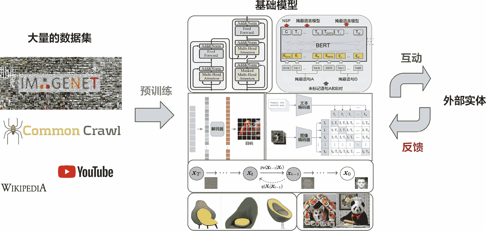
▲图 1-1 语言决策模型基于大量的数据进行预训练，通过与外部实体互动和接收反馈来完成特定的任务（图片来源：Yang et al，2023a）

▲图 1-2 模拟的“游戏屋”环境中的互动（图片来源：Team et al，2021）

从人类视角看，语言模型是极端特例：它们缺少许多典型人类能力，却拥有超人类的能力。这种不对称让人类很难设身处地想象模型的主观体验，所以直觉可能不可靠。

**1.2.4 世界模型**

**LLM 是学习世界模型或仅仅是表面统计呢**

LLM 本质上是数学模型，用来拟合人类文本中词元出现的统计分布。词元可以是词、词段或字符，覆盖庞大的公开语料。模型能生成合理的词序列并回答相关问题。Shanahan 在 2022 年指出，基础 LLM 的知识受限，因为核心任务是序列预测。模型有时会输出命题序列，但命题序列与真值的特殊联系只有在人类提问或提供训练数据时才显现。LLM 不像人那样把命题序列当作特殊对象，它缺乏可靠的真假判断能力。有人会说 LLM“感觉到”哪些词常跟在哪些词后面，这与意向性无关。Shanahan 认为，把“美国北部的国家是”后面接“加拿大”当成知道地理位置，是一个严重的范畴错误。

Bender 和 Koller 在 2020 年认为，LLM 在实现真正的人类式理解上是死胡同，这个观点在语言语义学领域影响很大，可追溯到 20 世纪中期逻辑学与语言学，Lewis 在 1976 年进一步强化：语义学必须处理真值条件。

当前主流 LLM 都用 Transformer 架构，它擅长捕捉句子或文档中远距离的依赖关系。Transformer 被视为通用函数近似器，在足够数据和算力下能逼近任意连续函数。因此它具有很强的通用性，可以学习自然语言中的复杂句法和语义模式，并据此生成连贯文本。

理论上，像 Transformer 这样的神经网络完全有可能发展出深层稳健的世界模型。随着预测任务优化，对世界理解越全面，误差越小。例如讨论纽约地铁系统时，一个完善的地铁模型会大幅提升预测准确度。Chalmers 在 2023 年也支持这种思路。事实上 Goldstein 等人在 2022 年发现，GPT 等自回归模型使用的计算原理与大脑处理自然语言时预测下一个词的机制相似。大脑用上下文嵌入表征词，这些嵌入包含句法、语义和语用属性。语用属性包括理解说话者的真实意图而非字面意思。分布式学习之所以有效，是因为语言本身用来交流我们对世界的体验，并在结构中编码相关信息。Louwerse 的符号相互依赖假说也支持这一点。相关经验不仅具身，还包括语用和社会维度，而这些都能从共现数据中恢复。Hu 等人在 2022 年系统研究了基础模型的语用能力，如识别间接言语行为、隐喻和讽刺，发现部分能力接近人类。这并不等于模型拥有真正的语用理解，而是说明语言形式的经验足以推导出类似人类的行为模式。认知证据也表明，语言理解并不总需要高度结构化的语义表征或复杂推理。“足够好”的句子处理模型就能用简单的表面启发式完成任务，神经语言模型善于从输入中学习这些分布线索。

关键问题不是模型能否拥有世界模型和自我模型，而是它们是否已经拥有。目前证据不完整，但可解释性研究提供了线索。Li 等人在 2022 年让 LLM 玩黑白棋，发现模型建立了棋盘格的内部表征，并据此决策。这表明在某些自然语言情境下，预训练 Transformer 具备隐式生成世界语义近似表征的能力。后续研究也在探索这些表征在模型中如何分布、在哪里出现。

**1.2.5 沟通意图**

当下的语言模型似乎缺乏沟通意图。Shanahan 在 2022 年和 Bender 和 Koller 在 2020 年都指出这一点。它们对提示做出反应时没有刻意目的，输出常不连贯或自相矛盾。行为可以用数学解释，但解释里没有意图成分。Andreas 在 2022 年认为，最多是建模特定文档的语言模式，生成看似一致的文本，背后仍无意图。LLM 的训练目标是最大化下一个词的预测准确率，而不是为现实目标生成文本。它并不具备真正的理解能力，也不会意识到提问来自人类、回答会给人类带来怎样的影响。缺乏意图也导致长文本生成不稳定：提示一两句时还能维持合理，继续下去就容易出现错误或误导。语法上正确，但意义和沟通目的逐渐丧失，随着与人类提示的距离增加，文本最终变得不连贯。Mahowald 等人在 2023 年观察到这一现象。

全局工作空间理论在人类和灵长类认知中得到广泛认可。Dehaene 在 2014 年总结，Baars 在 1993 年指出全局工作空间在保留和操作抽象信息时特别有价值。Mashour 等人在 2020 年讨论的广播机制与工作记忆密切相关。信息进入工作空间需要主动维持，才能抵御干扰。

标准 LLM 目前没有明确的全局工作空间，但可以扩展。多模态语言模型研究越来越多地使用工作空间来协调不同模态。文本、图像、声音等不同形式的数据在高维空间表征，而低维接口则起连接作用，类似于全局工作空间。基于注意力的感知器架构 Jaegle 等人在 2021 年提出，在注意力控制和工作记忆任务中表现出与 GWT 一致的行为。Juliani 等人在 2022 年的认知文献对比支持了这一点。研究者开始把这类模型和意识联系起来。Goyal 等人在 2021 年提出，多神经模块间的全局工作空间瓶颈可以模拟缓慢的有意识推理的部分功能。

总之，为人类赋予意图的过程复杂且模糊。意向性所需的认知要素尚未明确，这让判断人工智能是否具备意向性的基准变得困难。未来的语言模型可能通过尚未发现的机制展现出意向性。

**1.2.6 系统性和全面泛化**

除了落地论，系统性论也是对神经网络的常见批评。前者关注训练数据源，后者关注泛化类型。

人类可以进行意义构成。如图 1-3 所示，知道猪通常不会飞，我们可以把“不会飞”替换成“会飞”，在头脑中生成“飞猪”的概念。这种符号操作就是意义构成。原则认为，我们能把世界中的离散元素概念化并有意义地组合。Pelletier 在 1994 年提出的语义构成原则，也称弗雷格原则，认为复杂句子的意义完全取决于其组成部分的意义以及组合方式。

人类语言的生产力在于能理解和生成无限多的表达，并能超越具体经验进行概括。一些研究认为新一代 LLM 表现出类似生产力，说明它们学会了语言的一般规则。Berent 和 Marcus 在 2019 年则认为当前模型缺乏人类认知的关键特征：对类别任意成员的全面概括能力。人类学习机制允许形成抽象类别并用变量做代数操作，而神经语言模型主要在与训练数据相似的新例子上泛化，只能做类比式泛化，无法实现关键的系统化概括。系统性论与 Fodor 和 Pylyshyn 在 1988 年对早期联结主义模型的批评相呼应。他们认为人类认知和语言具有系统性和构成性，两者相互依存。系统性指理解具有内在联系的句子的能力，构成性指词汇项在任何表达中的贡献保持一致。识别句子间系统关系和词义的能力对掌握语言概括至关重要。

Berent 和 Marcus 认为只有具备内部结构表征和变量的符号系统才能解释系统性和全面概括。缺乏内部结构的向量表征神经网络无法解释这些关键方面。近年在简化或人工语言上的实验显示，神经语言模型虽有泛化能力，却缺乏系统化泛化。基础模型学会了事件及其可信参与者的知识，但高度依赖特定词汇模式，概括能力不及人类。

然而系统性论假设自然语言的基本属性是构成性、系统性和全面概括性，这受到了挑战。自然语言的准构成性 Rabovsky 和 McClelland 在 2020 年提出，以及上下文嵌入捕捉的上下文敏感性都与系统性论矛盾。自然语言中普遍存在的非系统性和半规则过程也削弱了全面概括的论据。Goldberg 在 2019 年指出，自然语言的特点是基于与先前范例的相似性进行类比概括的部分生产力。因此神经语言模型虽偏离构成性和系统性，却能捕捉自然语言的重要方面。Lenci 在 2023 年也持相似观点。

依赖分类表征的计算模型，如符号模型，在解释语言概括的部分生产性和准构成性时遇到困难。神经语言模型的连续表征在处理类比、相似性和梯度现象时更具潜力。虽然语言模型的核心不是会话，但它们在作诗、游戏、问答和建议等领域表现出接近领域的泛化能力，只是并不完美。

意识讨论中，以领域通用方式使用信息被视为重要指标。语言模型的通用性增强，暗示人类向意识迈进了一步，尽管与人类智能仍有差距。这种通用能力为相关概念提供了初步支持。

图 1-3 会飞的猪

## ** 1.3 未来发展方向**

Mahowald 等人在 2023 年把推理知识分为四类：形式推理如逻辑和问题解决、世界知识包括物体、事件、属性、参与者和关系的知识、情景建模即从语言输入中构建故事表征并追踪其演变、社会推理即在语言使用中考虑对话者的心理状态和共享知识。Mahowald 等人以及 Kauf 等人在 2022 年的评估显示，在这些领域中，许多 LLM 的表现仍明显低于人类。

仅靠现在的常见做法——在海量的网络自然文本里训练大语言模型，只以预测上下文下一个词为目标——并不足以让功能性语言能力真正浮现出来。这类训练方式容易过度依赖低层次的输入表征，缺乏对常识性知识的把握，从而制约泛化，也对数据量的需求异常苛刻。不过，最近的实践已经给出新的信号，Minerva、InstructGPT（Ouyang et al，2022）以及 ChatGPT 等模型，通过对训练数据和/或目标函数的调整，表现明显提升。它们往往先在专业语料上进行微调，并叠加基于人类反馈的强化学习等额外手段。Mahowald et al（2023）指出，要建成能真正用于现实语言场景的模型，系统必须同时承担问题求解、落地体验、情境建模、实用推理和目标设定等多重角色，也就意味着需要一个兼具通用与领域特定成分的模块化智能体。这种思路在实践上可通过在目标函数各不相同的数据集上训练模块化模型来实现。

语言本身并不能穷尽知识的所有维度，这就导致从文本中抽取完整信息相当困难。人们在交流时常会省略自己认为对方已知的部分，这就是 Gordon and Van Durme（2013）所说的“报告偏差”，本质上是 Grice 数量准则的体现——信息要够用，但不要冗余。Paik et al（2021）的研究发现，像草莓这类单一颜色相关概念的颜色信息在语言生成中的表达度很低。另外，神经语言模型对物体典型视觉属性，例如形状的掌握也很有限，而且单纯增大模型规模并不能显著改善这一局限（Zhang et al，2022a）。这种不足很大程度上源于纯文本基础的局限性，一旦补充语言之外的模态信息，多模态设定就能在一定程度上缓解。归根结底，现有的基础模型缺少把从文本里学到的知识有效表征、组织成合适结构，并用这些结构来完成语言理解任务的能力。因此真正的难点不在于补上训练数据里本就缺失的具体信息，而在于如何让模型更好地利用已经从文本中习得的知识（Lenci，2023）。

衡量我们在“让人能像人类一样使用语言”的道路上走了多远，建立形式语言能力和功能语言能力的评估基准至关重要。做这种区分可以减少讨论中的混淆，也能避免“语言能力强就等于思维强”“思维差就等于语言差”之类的误判（Mahowald et al，2023）。当前已有若干基准可用于考察形式语言能力（Gauthier et al，2020），但对层次化与抽象化等核心特征的测试仍显不足。迄今为止，尚未出现覆盖功能语言能力的统一基准，而且即便针对常识推理等子集构建的数据集，也很容易被模型利用有缺陷的启发式技巧所操纵。尽管如此，我们仍有可能把基于词共现的捷径与真正的推理区分开来。对形式与功能两类语言能力进行全面且独立的评估，有助于培育在这两者上都出色的模型。最终，语言模型应能处理需要多方面语言能力的复杂任务，而在现阶段，聚焦于可分离的具体技能，更能帮助我们看清模型的短板（Mahowald et al，2023）。

根据 Villalobos et al（2022）的测算，高质量的语言数据即将见顶，可能在2026年前耗尽。与之相比，低质量的语言数据和图像数据的枯竭时间会晚得多，前者预计在2030至2050年间，后者则在2030至2060年间。研究提示，如果数据效率没有大幅提升，也没有新的数据源出现，那么高度依赖海量数据的机器学习模型的持续扩张很可能会放缓。

人工智能研究正出现一个新方向，让LLM能够自行产出训练数据并以此提升自身性能。人类除了通过阅读书籍等外部来源学习，也能通过反思内部信息产生新颖的见解。类似地，LLM可以在训练过程中吸收的大量书面材料，如维基百科、新闻与图书的基础上，创造新的文本内容来进一步增强自己。

近期工作显示，LLM可以通过生成问题-答案对、筛选优质输出并对精选答案进行微调来实现自我改进（Huang et al，2022）。该方法在多个语言任务及用于评测LLM的基准上都取得了领先水平。此外，研究者还构建了能够生成自然语言指令的LLM，再让模型依据这些指令进行自我微调，从而带来显著的性能提升（Wang et al，2022e）。Sun et al（2022）认为，如果模型在作答前先“背诵”自己对某主题的掌握，就能给出更准确、更复杂的回答，这与人类在表达观点前先反思信念与记忆的过程相近。

把LLM比作人类大脑，可以削弱“模型自产数据是循环论证”的担忧。人类摄入大量信息后会重塑神经连接，从而产生既不在大脑中也不在外部来源里的新洞见。若LLM也能生成自己的训练数据，就能缓解制约AI发展的紧迫数据短缺问题。一旦模型可以自我生成数据并持续自我完善，将是AI的重要跃迁。

很多人相信ChatGPT和GPT-4这类系统会取代搜索引擎，成为主要信息入口，但这种预期过于乐观，因为现阶段的LLM会产出不准确甚至误导性的内容。尽管能力强大，“幻觉”问题依然存在，模型可能推荐不存在的图书或给出错误的概念解释。

目前学界正通过创新来降低事实不可靠性，让模型能够从外部源检索信息并为生成内容提供参考文献与引用。我们将在第八章回顾这一领域的新进展。

当代大语言模型的多功能性和强大表现让人印象深刻。与ChatGPT等顶级对话智能体交流时，逼真感强到容易让人产生拟人化倾向。背后可能存在更复杂微妙的机制。近期进展表明，当足够大的模型在丰富文本上训练后，会涌现出非同寻常甚至出人意料的能力。

即便大语言模型本质上仍是序列预测，它们在学习过程中也可能发现需要更高层解释的新兴机制，其中可包括“知识”和“信念”。我们知道人工神经网络可以高度精确地逼近任意可计算函数。因此在参数、数据与算力充足的前提下，若随机梯度下降是优化精确序列预测目标的最佳方式，它就有可能发现这些机制。

为了进一步扩展LLM，稀疏专家模型正受到越来越多的关注。与密集模型不同，稀疏专家模型只调用与查询最相关的参数子集进行响应，而密集模型每次运行都会激活全部参数。

正因为稀疏专家模型能仅激活必要的参数处理输入，其计算效率明显高于密集模型。它们可视为由多个“子模型”组成的集合，每个子模型像专攻某主题的专家，根据输入只激活最相关的专家，这也是其得名的原因。参数规模超过万亿的大语言模型，如谷歌的Switch Transformer（Fedus et al，2022）、GLaM（Du et al，2022）以及Meta的Mixture of Experts（Artetxe et al，2021），都属于稀疏架构。我们将在第七章深入剖析其技术细节。

稀疏专家模型能在不增加运行时间的情况下构建更大规模模型，因为密集模型规模翻倍，速度通常减半。已有研究表明稀疏专家模型潜力巨大，GLaM比GPT-3大7倍，训练能耗更低，推理计算更少，同时在多项自然语言任务上表现更优。此外，稀疏专家模型仅需少量计算即可达到与密集模型相近的下游性能。除了效率高，稀疏专家模型也更易解释，这对医疗等高风险场景尤为重要。能够理解模型为何做出特定行为的能力至关重要。稀疏模型的可解释性更强，因为其输出可追溯到被激活的专家，使得人类更容易提取可理解的解释。

通过分析用户互动与个人偏好，新一代LLM在个性化与定制方面具有巨大潜力。模型在持续对话中能学习用户的写作风格、语气与用词，从而给出更贴合、更精准的回应。因为LLM可以识别并响应每个用户的独特需求与偏好，个性化水平可提升到改善客户服务与教育体验的程度。开发人员还能利用大量交互数据，打造契合特定用户偏好的语言模型，带来更具吸引力的个性化体验。

与所有快速发展的技术一样，必须审视GPT-4等模型可能带来的伦理与社会影响。随着技术演进，需要系统分析隐私、就业等各方面的关切。例如，在客服领域部署大语言模型可能导致岗位流失，而数据收集也可能引发严重隐私问题。因此，审慎评估伦理影响，并确保其发展与应用负责任、合乎规范至关重要。

本书将详细讨论LLM中的偏见与有害性降低等关键议题，也会探讨如何借助强化学习技术使模型更符合人类价值观。目标是探索有效减轻负面影响、提升社会整体效用的方法。

目前，像ChatGPT这样的语言模型只能依据内部知识回答查询，缺乏与外部环境交互的能力。它们无法为不理解的问题检索信息，也无法执行超出生成用户文本以外的任务。未来，新一代Transformer与语言模型有望具备在互联网上读写并采取行动的能力，可以说它们将拥有更广泛的智能体能力。事实上，“智能体人工智能”可能成为继“生成式人工智能”之后下一个大趋势。 

## 1.4 小结

大语言模型正为人工智能带来革命性变化，使机器能够非常准确地完成复杂语言任务。围绕其是否具备意识的争论持续升温，双方各执一词。虽然目前尚无定论，但可以肯定的是，大语言模型在未来发展与应用中拥有巨大潜力。研究者需继续深挖语言生成能力背后以及潜在意识的内在机制，同时审视制造有意识机器的伦理问题。该领域研究前景广阔，大语言模型仍有巨大的发展与创新空间。

# 第二章

# 语言模型和分词

语言模型已渗透到我们日常使用的方方面面。如图2-1所示，搜索引擎的自动完成功能就是语言模型驱动的典型例子。这类模型在众多自然语言处理任务中发挥关键作用。

图2-1 搜索引擎的自动完成功能

以语音识别为例，输入是音频信号，输出则需要一个语言模型来理解信号内容，并在已识别词的上下文中推断下一个词。

有效的分词器对实现高性能NLP至关重要。分词器把一段Unicode字符序列切分为有意义的词元，这项工作并不简单，尤其对形态复杂或符号丰富的语言更是挑战。目前主流方法包括BPE与SentencePiece等，最近无分词器与可训练分词等方向也展现出前景。选择合适的分词策略需要在词元过细与过粗之间取得平衡，确保每个词元在语言或统计上都有意义。

本章将系统介绍语言建模与分词的核心概念。首先讨论语言建模的挑战，以及统计与神经网络方法如何应对。其次介绍语言模型的评估方式。随后深入分词主题，即把文本拆解为更小单元以便分析。本章会涵盖按空格分割、字符级分词、子词分词、无分词器与可学习分词等多种类型。最后，你将对语言建模与分词在自然语言处理中的应用形成整体认知。 

## 2.1 语言建模的挑战

形式语言是一套为与机器或计算机通信而设计的、遵循严格语法与文法的规则与符号系统。这类语言追求无歧义与精确，拥有明确的词表与使用规范，因而非常适合编程与技术交流。

自然语言则不同，它并非人造，而是随着人与人之间的社会交流需求逐步演化而来。自然语言拥有庞大的词汇量，使用时常伴随多重歧义，但仍可被理解，这得益于其深植于人类文化，能够反映广泛的社会、历史与文化因素。

尽管对自然语言的某些方面存在形式化规定，语言学家仍难以为其构建精确、稳定的语法框架与结构。因为自然语言极其复杂，可在多种语境中使用，蕴含大量细微差别与内涵。虽然形式语法可以尝试描述自然语言，但任务艰巨，且往往因大量例外与不规则现象而难以稳定。总之，形式语言追求无歧义与精确，而自然语言复杂且模棱两可，体现了人类文化与经验的丰富多样性。尽管可以为自然语言创建形式语法，但难度很大，也难以完全捕捉其全部含义与细微差别。 

## 2.2 统计语言建模

另一种定义语言结构的方式是利用样本进行学习。在此范式下，语言模型是一个函数，用来计算给定词表中词元或单词序列的概率。概率取决于在特定序列之后出现下一个词元或序列的可能性，因而语言模型本质上是概率问题。

假设有一个由一组词元构成的词表，语言模型P会为每个词元序列分配概率，记作 w1, w2, …, wL，其中L为序列长度，词元来自词表。概率P(W)取值在0到1之间，反映序列的质量。高概率意味着序列更可能出现在语言中，低概率则表示不太可能出现。

一个优秀的语言模型应兼具语言能力与世界知识。例如，序列“my dog just ate a chicken bone”（我的狗刚吃了一根鸡骨头）应该被赋予高于“my chicken dog bone just ate a”（我的鸡狗骨头刚吃了）的概率，因为后者不合语法且人类难以理解。这是因为模型需要识别语法正确且有意义的句子并给予更高概率。此外，尽管“a chicken bone just ate my dog”（一根鸡骨头刚吃了我的狗）在语法上与第一个序列相同，但基于常识，模型应给予较低概率。从常识看，鸡骨头吃狗是不可能的，好的模型应能识别这类不合理序列并降低其概率。

联合概率P(W)表示观察到词元序列W = w1, w2, …, wn的概率，在语音识别、机器翻译与文本生成等NLP任务中都很重要。

概率链规则是概率论的基本定理，允许我们把一系列事件的联合概率表示为条件概率的乘积。应用于NLP，可把一个句子的联合概率分解为每个词的条件概率乘积。

例如计算“my dog just ate a chicken bone”的联合概率，可写为：

P(w1, w2, …, wn) = Π[i] P(wi|w1, w2, …, wi-1)

也就是：

P(my dog just ate a chicken bone) = P(my) × P(dog|my) × P(just|my dog) × P(ate|my dog just) × P(a|my dog just ate) × P(chicken|my dog just ate a) × P(bone|my dog just ate a chicken)

估计这些条件概率可借助统计语言模型。一种做法是统计词语或词序列在大规模文本语料中的出现次数，再归一化得到概率。例如估计P(bone|my dog just ate a chicken)时，可统计“my dog just ate a chicken bone”出现的次数除以“my dog just ate a chicken”出现的次数。这种方法受限于数据需求量大，且难以捕捉自然语言的全部复杂性。

1. n元语法模型

n元语法模型是一种概率语言模型，根据词的之前上下文估计其出现可能性。它不考虑整句，只关注最后若干词来近似下一个词的概率。核心思想是词的概率主要受其邻近词影响，而非整个上下文。

二元语法模型是n元语法的特例，仅依赖前一个词的条件概率来近似下一个词的概率。换句话说，它只利用前一个词来预测序列中的下一个词，从而简化条件概率计算。例如在“my dog just ate a chicken”中，二元模型只考虑给定“a”时“chicken”的概率，忽略其余部分。

马尔可夫假设是n元语法的关键，它认为词的概率仅取决于前一个词。当前词只依赖序列中最邻近的词，与更早的词无关。马尔可夫模型利用这一假设，仅回溯少量历史即可预测未来单元。二元模型只回溯一个词，三元模型与n元模型分别回溯2个与n-1个词。

使用n元语法估计下一个词的概率，可采用条件概率公式 P(wn|wn-N+1:n-1) ≈ P(wn|wn-N+1:n-1)，其中N为n元模型大小，2表示二元，3表示三元。该公式根据前N-1个词计算下一个词的概率。通过只考虑最近的几个词，n元语法能在效率与准确性上取得平衡。

2. 最大似然估计

在自然语言处理里，估算二元语法乃至更长的*n*元语法的出现概率，最常见的做法就是最大似然估计。核心思想是先在语料里统计每个*n*元语法出现了多少次，再把计数除以归一化基数，最终得到一个落在 0 到 1 之间的概率值。

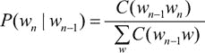 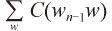

拿二元语法举例，想知道在前一个词*w*之后出现词*w*的可能性有多大，就统计语料中*w w*这对出现的频次*C*，再除以以同一个前词*w*开头的全部二元语法频次之和。分子是目标二元语法的计数，分母是对所有可能的后续词求和。于是概率值由相对频次决定。

这里有一个直观的等式关系：所有以某个词*w*开头的二元语法计数加起来，一定等于该词本身作为单词的出现次数。因为每次*w*在语料里出现一次，就必然产生一次以*w*开头的二元语法，所以前者的总和不会超过后者。

MLE 用得广，但缺陷也很明显。语料里没见过的*n*元语法，其最大似然概率会被直接判为零，这对很多下游任务并不友好。为此学界提出了多种平滑策略，比如拉普拉斯平滑、古德-图灵平滑和肯尼斯-奈平滑，它们借用近似上下文的信息，给未登录的*n*元语法一个合理的估计。 

## **2.3 神经语言模型的突破**
神经网络重塑了语言建模的格局。在神经方法流行之前，传统的统计模型只能用离散的词表索引来表示词汇，不同词之间没有可迁移的关系，泛化能力受限。

2003 年 Bengio 团队提出神经语言模型，把词或词元映射成连续的向量表示，也就是词嵌入。这些向量在训练中学习，语义相近的词会落在相近的区域。借助神经网络，就能计算在给定前*n*-1 个词的前提下，下一个词的概率，比如在 “ate the” 之后出现 “bone” 的可能性。

在此之后，神经语言建模掀起两波浪潮。第一波是 Hochreiter 和 Schmidhuber 在 1997 年提出的长短期记忆循环神经网络 RNN。LSTM 允许模型的预测依赖整个历史上下文，理论上等价于*n*趋于无穷，不过训练成本较高。

第二波是 Vaswani 等人在 2017 年提出的 Transformer，最初用于机器翻译。它使用固定的上下文窗口*n*，训练更稳定且能充分利用 GPU 并行。对于很多应用，这个窗口可以设得很大，例如 GPT-3 使用 2048。Transformer 的细节会在第三章展开。

总体来看，词嵌入与神经网络让语言建模更高效，LSTM 与 Transformer 的出现则提供了越来越强大的建模工具，使生成连贯且贴合上下文的文本成为可能。 

## **2.4 如何衡量语言模型**
真正检验模型好坏，要看它在具体任务中的表现，这属于外部评估，能直接反映集成模型后应用性能是否提升。它能告诉我们改进是否转化为任务收益。

但端到端评估成本高耗时长，内部评估因此更常用。它不依赖特定任务，只在训练集之外的新测试集上考察模型给出的概率。模型越好，越能给测试集中真实出现的词分配更高的概率。

衡量内部质量最常用的是困惑度，它本质上是测试集逆概率按词数归一化后的结果。

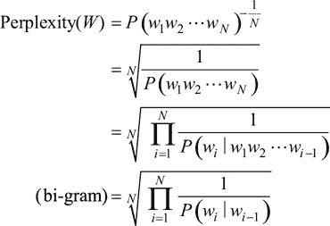

困惑度也可以理解为平均分支数。分支数越大，语言越“发散”，下一个词的可选面越广。例如，若 0 到 9 十个数字等概率出现，这个迷你语言的困惑度就是 10。

实际频率也会影响数值。假如数字 0 在训练集中出现 91 次，其他数字各一次，那么以 0 为主的测试集困惑度会明显下降，因为模型更确信下一个数字是 0。即使分支结构不变，加权后的平均分支也会变小。

总结一下，困惑度等内部指标能快速判断模型质量，而外部评估则检验模型在真实任务中的实用性，两者结合才能全面判断一个语言模型的价值。 

## **2.5 分词为什么关键**
自然文本以 Unicode 字符串呈现，而语言模型需要词元序列的概率分布。分词就是把原始文本拆成有意义块的过程，只有分得好，后续处理才稳定。

人类靠空格和标点来阅读，机器却经常被难住。中文、日文、韩文、泰文等符号型语言没有空格界定词边界；符号 $ 能改变词义；标点常黏在词尾；缩略形式如 “you’re”“I’m” 若不拆开会产生歧义。

当今大模型主要依赖两种分词器：字节对编码 BPE 与 SentencePiece。BPE 在子词层面工作，把罕见词拆成常见子词，对形态丰富的语言友好，被 GPT-2、GPT-3 等采用。SentencePiece 先把文本切成句子再做子词拆分，用在 BERT、RoBERTa 等模型上。

新的方向包括无分词器方案，直接从原始字符预测词元，以及可训练分词器，用机器学习学习最优切分，提升低资源语言和专业领域的表现。好的分词要在过细和过粗之间平衡，过细会让序列变长难以建模，过粗则削弱参数共享，这对阿拉伯语、土耳其语等形态复杂的语言尤为关键。每个词元最好对应语言学或统计上的一个有意义单元。

**2.5.1 最朴素的空格切分**
最简单的做法就是调用 split：

tokenized_text = "Attention is all you need. Don't you love Transformers?".split() print(tokenized_text)

['Attention'，'is'，'all'，'you'，'need.'，"Don’t"，"you"，"love"，"Transformers?"]

这种方法的问题不少。

·连字符词如 “father-in-law” 和缩略词如 “I’ve” 最好拆开，“don’t” 理想上应变为 [“do”，“n’t”]。
·标点 “?” 不应绑在 “Transformer” 后面。
·中文等无空格语言无法靠空格分词。
·德语的长复合词如 “AbwasseKraftfahrzeug-Haftpflichtversicherung” 需要特殊处理。
·未登录词常被替换为 <UNK>，大量 <UNK> 会丢失信息。
·纯词表需要覆盖全部单词，英语就有五十万以上，嵌入矩阵巨大。
·同一词的不同形态被当成不同类型，浪费参数。

SpaCy 与 Moses 是两款流行的基于规则的分词器，能缓解部分问题。

**2.5.2 字符级切分**
为避免未登录词，字符级分词把文本拆到单个字符，能保留词表外信息，且词表仅为语言字符集。

代价是序列显著变长，例如 “what restaurants are nearby” 词级只有 4 个词元，字符级变成 24 个，长度膨胀五倍。自注意力复杂度随长度平方增长，处理成本急剧上升。字符表示难以捕捉有意义语义，性能也常受损。因此主流模型多采用子词这种折中方案。

子词算法把生僻词拆成有意义的子单元，同时保留常见词完整。例如 “annoyingly” 可拆为 “annoying” + “ly”，对土耳其语等粘着语尤其有效。

**2.5.3 子词切分**
子词分词让模型在保持合理词表规模的同时学习有意义的表征。与字符分词不同，它拆出的单元仍具语言学意义，因而在分类、翻译、命名实体识别等任务上表现更好。

**1. 字节对编码**
2015 年 Sennrich 等人把原本用于数据压缩的字节对编码引入 NLP，成为最广使用的分词器之一。BPE 能在字符级与词级之间取得平衡，并用合适的子词词元编码低频词，减少 <UNK> 数量，对德语等复合词语言帮助明显。

BPE 先用预分词器把训练数据切成词，可用简单空格或更复杂的规则。随后统计不重复词频，建立由所有字符组成的基础表，然后反复合并最频繁的相邻符号对，直到达到预设词表大小。词表大小是超参数，例如 GPT-2 用 478 个基础字符加 40000 个合并单元，总计 40478。

**2. 字节级 BPE**
为了彻底避免未登录词，GPT-2 采用字节作为基础表。字节表只有 256 个，能覆盖所有可能的字符与符号，再用 BPE 扩展。合并时会设置规则防止产生无意义序列。最终 GPT-2 词表为 50257，包含 256 个字节、一个文本结束符和 50000 个学习得到的合并单元。基于字节的 BPE 也更适合多语言场景。

**3. SentencePiece**
传统分词器默认输入以空格分隔，这对无空格语言不成立。SentencePiece 提供一种语言无关的子词方案，把输入看作带空格的原始字符流，直接用 BPE 或 unigram 算法构建词表，省去预分词。

XLNet 版分词器使用 SentencePiece，其词表包含下划线 “_” 用来标记空格，解码时把下划线换回空格。ALBERT、XLNet、T5 等模型均采用 SentencePiece，结合 unigram 算法实现切分与逆切分。

Input: Hello world.

SP:      [He] [llo] [_] [world] [.]   （空格是一个独立的字符）

SP:      [He] [llo_w] [orld] [.]      （空格处于词元中间）

SP:      [Hello] [_world] [.]         （空格以词元前缀的形式出现）

SP:      [Hello_] [world] [.]         （空格以词元后缀的形式出现）

SentencePiece 和多数无监督切分思路走的路不太一样，它把词表规模先钉死再开训。常见做法是允许词表随学习扩张，而 SentencePiece 在建模前就得指定片段库的大小，工程上常看到 8k、16k、32k 这种量级。规模一旦确定，后续就无法再往里追加新词或新短语。

有了文本片段后，就可以用 n-gram 统计语言模型来找切分点，目标是让整体似然达到峰值。最简单的 n=1 情形，就是最大化每个片段概率的连乘，Viterbi 搜索能够给出最优路径。

为让片段概率更稳，常借鉴 Baum-Welch 的变体也就是 EM 的思路去估计隐藏概率。实践里为了避开局部最优，会先把 n-1 阶模型优化到收敛，再升级到 n 阶继续调优。

从空表起步生成片段并不轻松。SentencePiece 先靠启发式从训练语料里提炼一批种子片段，随后循环剔除对语言模型贡献最小的元素。做法是估算把某个片段从词表拿掉后似然会跌多少，按跌幅排序只保留前 α% 的片段，α 通常取 80%，如此反复直到达到目标规模。

这套机制的价值在于完全免去预分词。对泰语、汉语这类没有空格做词边界的语言，它几乎是唯一能用的子词切分手段。代价也明显：拼写错误、词形变体、大小写不一致或形态变化，都会改写词或短语的词元表示，进而误导预测。词表构建时没见过的语言字符也很容易超出覆盖，被当成未知处理。

**4. 单元语法**

Kudo 2018 年提出的单元语法是面向 NLP 的子词切分方案，和 BPE 等主流方法在词表构建与切分逻辑上区别很大。

单元语法不从极小的初始表通过合并扩充，而是先准备一个偏大的初始表，包含预分词后的词和常见子串，然后逐步从表中删符号直至达标。基础字符始终保留，保证任意词都能被切开。

算法在当前词表和单元语法模型下评估训练数据的损失，随后测算删除词表里每个符号后损失会上升多少。在达到目标规模前，通常每次删掉 10% 或 20% 上升最少的符号。

相对 BPE，单元语法不依赖合并规则，更灵活，也支持训练结束后用多种方式对新文本切分。它会把训练语料中每个词元的概率与词表一起保存，便于计算任意切分的概率。实际使用时模型会挑概率最高的切分，也能按概率采样。

单元语法本身并不直接用在 Transformer 上，常见做法是和 SentencePiece 配合。总的看，它兼具灵活性、效率和准确性，独特的构建与切分方式让它成为从业者和研究者的重要工具。

**2.5.4 无分词器**

分词是 NLP 的基础操作，模型常用它把文本映射成表征。传统词基分词在处理词表外词时一直棘手，常见做法是用 <UNK> 这类特殊符号替换未知词，但无法区分不同的未知项。子词切分通过把词拆成词表可表示的小单元来改善这个问题。

子词切分虽提升了未知词的表征，却仍有限制。拼写错误、大小写差异和形态错误仍可能导致切分失准。若某些字符未被纳入子词表，模型会把它视作未知字符，对词表构建时未覆盖的语言尤其成问题。

近年研究开始探索用无词元模型替代分词。Clark 等 2022b 提出的这类模型把文本转成字节序列，因而能处理任意文本而无需庞大词表矩阵。按定义，字节级模型只需 256 个嵌入，这为模型结构释放了更多参数，在某些场景下是有益的。代价是生成的字节序列比原始文本更长。

在这一方向上，Xue 等 2022 提出了 ByT5 架构，是 mT5 的改进版。与文本到文本的 T5 不同，ByT5 直接把未处理的 UTF-8 字节作为输入。模型提供小、base、大、XL、XXL 五种尺寸，作者认为它最适合处理中短文本，比如数个句子或更少。虽然 ByT5 在训练和推理上比前代慢，作者认为系统复杂度下降、噪声鲁棒性提升以及在众多基准上的性能提升更有价值。

Xue 等总结了若干关于字节级模型的重要发现。增大编码器有助于提升性能，研究中编码器比解码器大三倍。因为编码器使用的嵌入数量有限，词表远小于子词级模型。例如研究中的字符表仅约 300，需要 300×1000 个嵌入，而子词级模型的词表常为 50000，需要 50000×1000 个嵌入。

为弥补小词表，Xue 等增大了编码器，并把处理逻辑从嵌入层转移到编码器。他们还设计了几项预训练任务以提升字符层面的能力。实验显示，字节级模型在对序列字符敏感的特定任务上优于多语言 T5，尤其在嘈杂环境中。

论文的一个关键结论是，当参数规模小于 1B 时，字节级模型表现优于子词级模型。例如在 GLUE 和 SuperGLUE 上，T5 在小尺寸和 base 尺寸上优于多语言 mT5，但在超大和 XXL 等超过 10B 参数的尺寸上，多语言 mT5 反超。

字节级模型的优势在于对拼写和发音敏感的任务以及存在各种噪声时表现更好，也对语言标签生成和多语言任务很有帮助。局限是 Transformer 处理较长序列吃力，导致预训练更久、推理更慢。尽管研究显示字符级模型实用性大幅提升，未来仍有改进空间。

**2.5.5 可学习的分词**

到目前为止讨论的分词大多是固定的，先用 BPE 等预定方法切分，再送入模型训练。分词可在词、子词或字符级别进行，但近期研究表明，没有一种切分方法在所有任务上占优。如果模型能针对特定任务学习最优分割方式会怎样？

**1. Charformer**

Charformer 是一种把切分步骤融入训练过程的新思路，切分器随模型一起学习，而非使用固定算法。与传统子词模型不同，Charformer 允许在训练期间动态生成词元序列。

实现上，Charformer 对输入序列有四种切分方式——单字符、字符对、三字符块和四字符块。不使用子词技术，形成长度为 k 的非重叠连续段块。为了表示输入中的单个字符，需要使用每个块级切分的不同表征。例如对单词 “transformer” 中的字母 “o” 编码，就需要字符嵌入本身，以及它所在的双字符块 “fo”、三字符块 “rfo”和四字符块 “form” 的嵌入，每个块都有对应向量。

要得到 “o” 的最终表征，需对与该词的每种切分相关的四个向量进行加权平均，通过为每个块分配得分来完成。这种方法目前的块级编码相对简单，但可通过把字节、字符、子词、词级切分整合为块并在其上应用学习切分来进一步复杂化。

Charformer 能在一个模型中综合不同切分的优势，且切分器可适应处理的特定语言，从而捕捉输入序列中的复杂模式并生成更准确的结果。总的来说，Charformer 代表了自然语言处理的一个有前景的新方向，有望在广泛任务上提供更优性能。

**2. MANTa**

Godey 等 2022 提出，以端到端方式结合输入表征学习子词切分有利于语言建模。为此他们提出基于梯度的切分器和嵌入模块——MANTa 模型，可替代编码器-解码器模型中固定的切分器和可训练子词嵌入矩阵组合，而不增加可训练参数总数。

他们还引入 MANTa-LM，一种结合 MANTa 并端到端训练的 Transformer 编码器-解码器模型。MANTa-LM 通过语言模型预训练目标共同学习输入序列的柔性自适应切分，得到基于字节的表征，其序列长度与静态子词切分器生成的序列长度相近。在微调中，柔性切分模块可通过梯度传播针对新领域调整，从而摆脱静态子词切分器的限制。

研究显示 MANTa-LM 对噪声文本数据鲁棒性强，且相比字节级模型更有效地适应新领域。有趣的是，MANTa 仅基于语言模型目标就能学习简单透明的切分，同时减小字节序列长度。

MANTa 由三部分组成。第一部分利用参数化层预测块边界 Frontier，为每个输入字节 b 分配概率 P，判断其是否属于边界。这把字节柔性分配给块，形成字节块的非归一化联合分布，边界概率构成分布基础。

第二部分中，每个块 B 的字节表征被池化，并按每个字节属于当前块的概率 P(b∈B) 加权。然后生成的嵌入序列直接输入编码器-解码器模型。

MANTa 概述如下：先用滑动窗口注意力 Transformer 为输入字节分配分离概率，这些概率用于计算每个字节在块嵌入池化表征中的贡献。块嵌入被送入编码器-解码器层，负责预测掩蔽字节。所有组件均使用语言模型目标优化。P 中的字符 F 代表 Frontier。

模型目标与 ByT5 相同，即随机掩蔽 15% 的字节，并选择跨度数量以确保平均跨度长度为 20 字节。每个跨度替换为 <extra_id_i> 词元，i 表示跨度在序列中的顺序。解码器端需自回归预测跨度标识符和掩蔽字节。切分示例如图 2-3 所示。

总之，MANTa 通过独特的架构增强序列切分能力，包括用于预测块边界的参数化层和用于精确加权字节表征的字节-块非归一化联合分布。目标函数确保它能准确预测掩蔽字节，使其成为各类自然语言处理任务的有效工具。

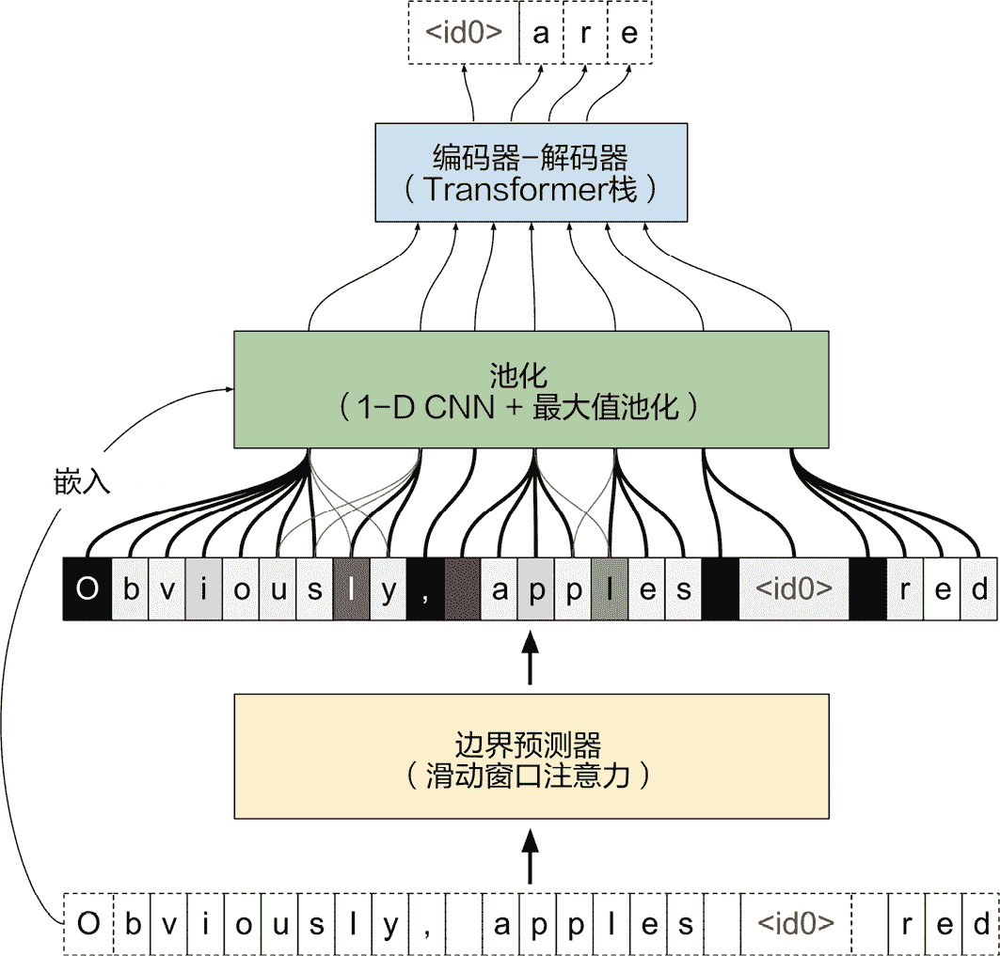

▲图 2-2 MANTa-LM 的可微分分词方案（图片来源：Godey et al，2022）

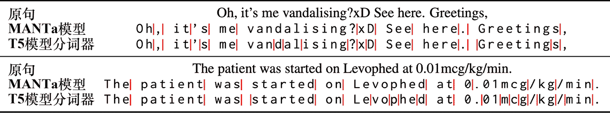

▲图 2-3 MANTa 模型（仅预训练）和 T5 模型的 BPE 分词器生成的分割示例（Raffel et al，2020）（图片来源：Godey et al，2022） 

## 2.6 小结

语言建模和分词是自然语言处理的重要组成部分。语言模型用于预测给定词序列的概率，分词用于把文本分解为更小的分析单元。本章讨论了语言建模面临的挑战及克服方法，包括统计和神经网络方法。还介绍了多种分词方法，包括按空格分割、字符分词、子词分词、无分词器和可学习分词。理解这些概念对开发有效的自然语言处理应用至关重要。随着技术发展，语言建模和分词仍将是处理和分析大量文本数据的重要工具。

# 第三章

## Transformer

在 NLP 领域，Transformer 引发了范式级转变，其强大的建模表现、广泛采用率以及在 AI 多个分支的领先地位赢得了高度关注。该深度学习体系在研究社区引发热潮，为语言建模开辟了新思路，成绩突破了既有最优水平。

该架构最突出的特质是能够捕捉序列内部的长程依赖。循环神经网络和卷积神经网络难以实现这一点，因为信息需穿越大量计算步骤才能传递。Transformer 凭借注意力机制实现高度并行化，能够在 GPU、TPU 等设备上高效运行。注意力让序列中每个位置都能直接接触整层的全部输入，从而更容易学习远距离关联。

在机器翻译、情感分析、问答、文本生成等任务上，Transformer 展现出稳定优势。这种通用性使其成为金融、医疗等依赖精准语言处理的行业核心工具。同时，它推动了无监督预训练技术的发展，催生出能够生成连贯类人文本的大规模语言模型，有望重塑人机交互方式并促进更先进 AI 系统的出现。

总体来看，Transformer 以出色的建模能力、通用性和运行效率，成为 NLP 及其他 AI 场景的首选。其成功为深度学习的持续创新奠定基础，也成为构建能够理解并处理人类语言系统的关键技术。

本章将介绍 Transformer 的各个方面。首先介绍 Transformer 编码器模块，它是 Transformer 的构建模块。其次讨论编码器-解码器架构、位置嵌入、更长上下文和外部记忆。然后介绍使 Transformer 更快更小的各种技术，例如高效注意力、条件计算和搜索高效 Transformer 等。最后介绍 Transformer 推理的优化技术，包括推测解码、简化 Transformer、修剪、蒸馏、混合精度和高效扩展 Transformer 推理。 

## 3.1 Transformer 编码器模块

注意力机制给机器翻译领域带来革命性变化，要归功于 Bahdanau 等 2014 和 Vaswani 等 2017 的贡献。Bahdanau 等将注意力与循环神经网络结合，Vaswani 等提出了一种仅依赖注意力的新方法。他们的模型在机器翻译任务中的表现大大超过了现有的循环神经网络方法。

为了实现这一突破，Vaswani 等引入了名为 Transformer 的新型神经网络模型，采用编码器-解码器架构。Transformer 的基本构建模块是 Transformer 编码器模块，如图 3-1 所示。

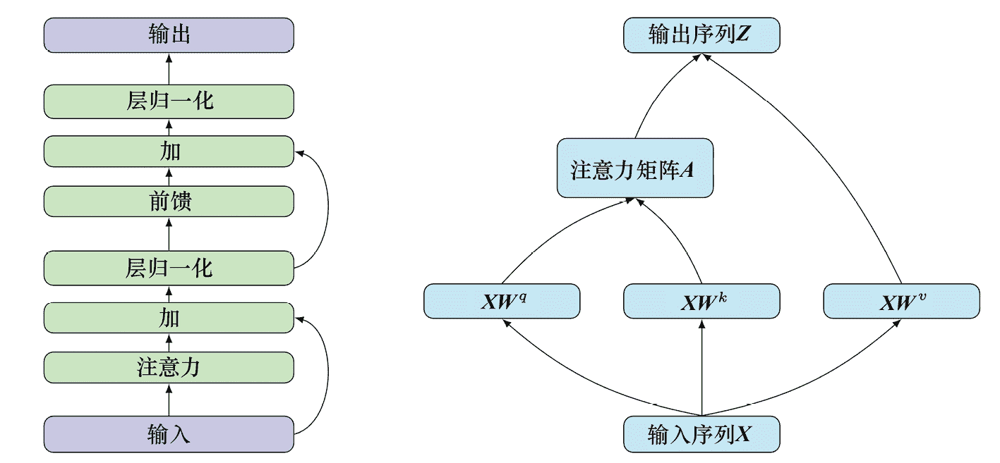

图 3-1 不考虑位置信息的简化版 Transformer 编码器模块（图中浅绿色部分）。

通常，此模块会被复制 l 次。右侧是 Transformer 编码器模块中注意力计算的高级摘要

t×d t×d

max max

Transformer 编码器模块是一个函数 f : R → R，它将长度为 t 和维度 d 的输入序列 X 映射到相同长度和维度的输出序列 Z。该函数由一组方程定义，使该模块能够同时计算并对输入序列中所有位置应用注意力得分。通过这种方式，模块能够捕捉输入序列中的长程依赖关系，并为下游任务提供更准确的表征。

θ max

按照 Dufter 2021 和 Dufter 等 2022 的研究，有如下公式：

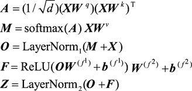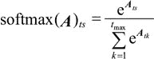 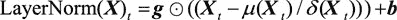 

其中，X 表示输入序列，Z 表示输出序列。softmax 函数定义为，其中，A 是逐行应用的 softmax 函数。Ba 等 2016 引入了一种特定类型的层归一化，表示为，其中，μ(x) 和 δ(x) 分别是返回向量 x 的平均值和标准差的函数。此外，函数是按分量计算的，并且假设广播用于向量-矩阵加法，正如在 NumPy 中实现的那样。

t s

每个 Transformer 编码器模块都有一组参数，表示为：

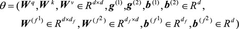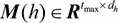 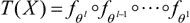 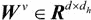 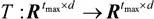

其中 *d* 用来表示隐藏层宽度，中间投影维度也记作 *d*，*t* *max* 则是允许的最大序列长度。工程实践里常采用多头注意力，用 *h* 表示头数，查询、键、值的投影矩阵分别记为 ***W*** ^q、***W*** ^k 和 ***W*** ^v，且满足 *d* = *h d*。各头的结果沿第二维拼接得到 ***M***。整个 Transformer 可抽象为函数 *f*，由 *l* 层逐级堆叠构成，即 。

*f*max*h*

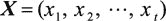 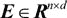

输入由 *t* 个单元堆叠而成，单元可能是字符、子词或词，在词表规模为 *n* 的嵌入表 ***E*** 中查找。对第 *i* 个单元记其向量为 ***x*** _i_ = ***E***[i]，所有向量拼成矩阵 ***X*** 送入模型。若实际长度短于 *t* *max* 或超出上限，则以特殊 PAD 填充或截断至 *t* *max*。

*ix*[i]*i*max

**1. 归一化演进**

层规范化最早由 Ba 等人在 2016 年提出，并在 Transformer 取得突破的过程中扮演关键角色。原始论文把规范化放在残差块之后，称为 Post-LN。Post-LN 会让靠近输出层的梯度期望变大，在高学习率下训练容易失稳。为此原方案引入学习率预热，逐步提升学习率，但这会拖慢收敛并增加调参负担。

为解决上述痛点，Xiong 等人在 2020 年提出 Pre-LN。Pre-LN 把规范化移入残差连接内部，并在最后一次预测前再做一次归一化。采用 Pre-LN 后可以放心去掉学习率预热。GPT-2 也采纳了 Pre-LN，进一步验证了该思路在深层网络中的优越性。

**2. 计算开销解析**

Transformer 的算力消耗主要来自自关注与前馈两块。

## 2
·自关注：自关注的算力随序列长度平方增长，复杂度可写成 *O*(*t* *max*² *d*)。序列越长，成本攀升越陡。

max

## 2
·前馈层：前馈网络对序列长度呈线性，对隐藏维度呈二次，整体复杂度约为 *O*(*t* *max* *d*²)。隐藏维度扩大时开销呈平方上升。

max
·整体计算复杂度：总开销是两部分之和。实践中自关注常是瓶颈，尤其在长序列场景下。 

## ** 3.2 编码解码器结构解析**

编码器-解码器是机器翻译、摘要等序列到序列任务的主流范式。编码器把输入序列压缩成语义表征，解码器基于此表征生成输出。

Transformer 编码器由 6 个结构一致的模块堆叠，每个模块包含多头自注意力和逐点前馈网络。多头自注意力擅长捕捉长距离依赖和上下文，前馈网络对每个位置施加相同线性变换，等价于核大小为 1 的卷积，计算效率高。

解码器整体与编码器相似，区别在于每个模块里有两组多头注意力。第一组为掩码自注意力，用来防止在语言建模或机器翻译中泄露未来信息。

总体来看，编码器-解码器式的 Transformer 在序列任务上表现强劲，既能建模长程依赖，又保持较高效率，因而在自然语言处理领域备受青睐。 

## ** 3.3 位置信息注入方式**

词元的嵌入本身不携带顺序信息，所以把“attention is all you need”中词序打乱后，嵌入表示仍相同，这显然不合理。

[attention, is, all, your, need]
[is, attention, all, your, need]
[all, is, attention, your, need]
[your, all, is, attention, need]
[need, your, all, is, attention]

**1. 绝对编码与相对编码的差异**

位置编码让模型感知词序。绝对编码直接记录词在序列中的绝对序号；相对编码则记录词与词之间的相对距离。后者更符合语言直觉，因为词间关系往往取决于相对位置而非绝对序号。

**2. 位置信息的两种表征**

Transformer 中主要有 APE 与 MAM 两种做法。APE 在输入矩阵 ***X*** 中叠加位置矩阵 ***P***，合成后再送入网络。MAM 则直接在注意力矩阵上加上绝对或相对位置偏置，从而改变注意力计算。

**3. 集成策略**

常见做法是在网络入口先加入 APE，再在各层各头使用 MAM。也可把位置信息放在输出前再加入。但入口注入的位置信息只直接影响首层，必须通过深层间接传播。

总之，选用绝对还是相对编码，以及具体的表征与集成方式，对 Transformer 在 NLP 任务上的效果影响很大。

**3.3.1 绝对位置编码详解**

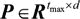 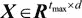

一种直观做法是在送入 Transformer 前先把位置向量加到输入上。若输入是单元嵌入矩阵，则加上位置矩阵后再求和送入网络。对首层而言，计算如下：

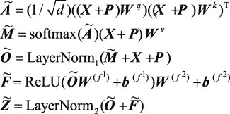

为给词元注入位置感，原始 Transformer 采用正弦位置编码。编码依据位置 *t*=1,2,…, *t* *max* 与维度 *i*=1,2,…, *d* 通过正弦与余弦交替生成，并非可学习参数，而是事先确定。示意图如图 3-2。

max

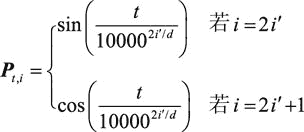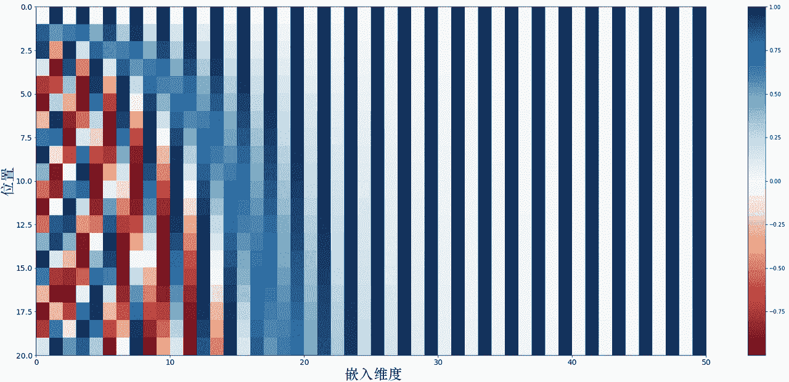

▲图 3-2 使用 Tensorflow 代码生成的前 20 个位置的位置编码值

原论文还尝试用可学习的位置嵌入矩阵 ***P***，其值随机初始化后随训练调整。作者发现学习式绝对位置编码与正弦版本性能相近，并推测正弦结构对长程依赖更友好，此点得到 Liu 等 2020 年的研究支持。正弦编码还能处理训练时未见过的更长序列，且参数效率高，保持静态即可。

Gehring 等 2017 年的研究显示，把位置向量加入 CNN 仅带来边际提升；而 Wang 等 2019b 的实验表明，完全去掉位置信息的 Transformer 在某些任务上性能明显下降。这凸显了在顺序数据建模中引入位置信息的重要性。

面对极长序列，绝对位置编码的参数开销很大。Kitaev 等 2020 年提出轴向位置嵌入，把 ***P*** 分解为 ***P***(1) 与 ***P***(2)，前者标记大段，后者标记段内位置，从而更节约参数。

Liu 等 2020 年认为位置向量应具备充分参数化、数据驱动并能外推到更长序列的能力。他们提出 FLOATER，利用连续动力学模型把位置建模为时间的连续函数。可在仅首层或每层注入位置信息，实验表明每层注入效果更好。FLOATER 在长序列上优于学习式与正弦编码，同时还给出一种在微调时保留预训练位置嵌入并叠加动态模型的方法，更好地利用预训练参数。

Press 等 2020 年提出 Shortformer，通过缓存先前计算的单元表征并使用注入位置的注意力来降低序列处理成本。具体做法是仅把位置向量加到键和查询，不加到值，使值与位置无关。这样模型可复用历史子序列的输出，并在每层重新注入位置信息，从而加快训练并降低困惑度。

max

Shortformer 与位置敏感单元嵌入各有利弊。前者训练推理更快，但需额外内存缓存历史表征；后者无需额外缓存，但可学习参数增多，对短序列提升有限。

**3.3.2 相对位置编码详解**

最新研究强调元素间成对关系的价值。相对位置编码直接修改注意力矩阵，而非先改输入嵌入。

有趣的是，即使使用绝对位置编码，注意力矩阵也会被间接改变：

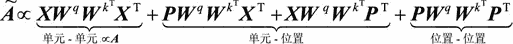

*qk*

其中 ***X*** 为单元嵌入，***P*** 为位置嵌入，***W*** ^q 与 ***W*** ^k 为投影参数。注意力可分解为单元-单元、单元-位置、位置-位置三部分。为简便省略了缩放因子。

APE 与 MAM 相关但不同。APE 先学习位置向量再影响注意力，MAM 则直接对注意力矩阵 ***A*** 做加法或乘法形式的标量偏置。

**1. Shaw 的 RPE**

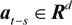

Shaw 等 2018 年提出在自注意力中引入相对位置编码。输入被视为有向完全图，任意两个位置 *t*、*s* 之间的连边由可学习向量表示，并作为相对位置编码使用。为减少参数，他们引入 clip 函数限制有效距离。编码形式为：

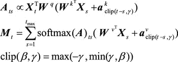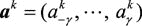 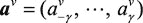

*kv*

其中 ***a*** ^k 与 ***a*** ^v 分别是键和值上的相对位置编码权重，*γ* 表示最大相对距离。

**2. Transformer-XL 中的 RPE**

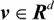 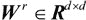 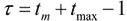 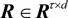

Dai 等 2019 年提出 Transformer-XL，用循环机制处理长序列并突破固定上下文限制。为此需要新的位置处理方式。他们在每个注意力头中使用正弦位置嵌入矩阵调整注意力计算，同时引入可学习参数 ***u*** 与 ***v***，并为相对位置使用不同的投影矩阵。模型是单向的，*m* 表示记忆长度。位置参数在层和头间共享。

具体地，查询被加上额外偏置项，并以正弦形式进行相对位置编码：

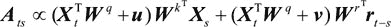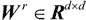

*d*

其中 ***u***、***v*** ***R***^d 为可学习向量，正弦编码向量 ***r*** 提供相对位置先验，***W*** ^k 为把 ***r*** 投影到基于位置的键向量的可训练矩阵。

*t*-*s*

**3. Huang 的 RPE**

与 DA-Transformer 相关，Huang 等 2020b 回顾了绝对位置嵌入和相对位置嵌入方法，并提出若干基于相对位置的位置模型。

·他们把注意力矩阵扩展为：

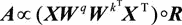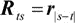 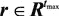

其中 [|] 表示拼接，***a*** 为可学习向量。

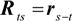

·同时考虑方向以区分不同顺序。

·他们在 Shaw 方法上扩展，不仅把相对位置加到键，还加到查询，并去掉位置-位置交互。具体为：

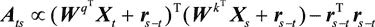

**4. SASA 中的 RPE**

上述方法多针对一维词序列。Ramachandran 等 2019 年提出面向二维图像的策略，把二维相对编码拆分为水平与垂直两个方向，各自用一维编码建模：

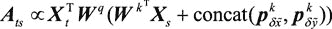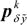 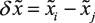 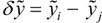 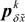

其中 *x*、*y* 分别表示二维坐标在 *x* 轴和 *y* 轴上的相对偏移，***a*** 与 ***b*** 为长度 *d*/2 的可学习向量，拼接后得到长度 *d* 的最终相对编码。

**5. DA-Transformer**

类似 Huang 等 2020b，Wu 等 2020a 把注意力矩阵扩展为：

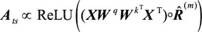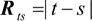 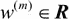 

(*m*)(*m*)(*m*)

他们使用相对距离绝对值矩阵进行分析，其中 ***R*** 定义为相对距离。随后对每个注意力头 *m* 获取 ***R*** 的重缩放版本 ***R***^(m)=*w*^(m) ***R***，*w*^(m) 为可训练标量。重缩放通过可训练的 sigmoid 函数做逐元素乘法实现，即

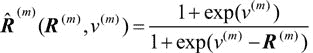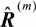 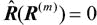 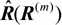 

(*m*)(*m*)(*m*)

其中 *v* 为可学习参数，控制第 *m* 个头的距离上限与上升斜率。权重函数满足：①有界；②当 ***R***→-∞ 时趋于 0；③当 ***R***→+∞ 时有界；④可调；⑤单调。

长时依赖的Transformer演进路线：从位置编码到超长推理

吴等人给出一种轻量化的调节思路，为每一个注意头仅新增两项可学习系数，整体开销为2*h*。凭借这项改动，系统能够自主倾向远端关联或近端关联，且不受方向约束。在文本分类的对照中，该做法胜过原始Transformer、Shaw等人在2018年提出的相对位置编码，以及Dai等人在2019年提出的Transformer-XL。

**6. ALiBi**

Press等人在2021年提出的ALiBi不采用乘性因子，而是把与词元对距离成正比的常数偏置直接叠加到查询-键注意分数上，如图 3-3 所示。偏置随间距线性抬升，从而抑制远端键、强化邻近偏好，不同头的惩罚斜率逐头递增。带偏置的softmax写法为：

 

其中 *m* 为头相关的标量，保持固定并按几何序列排列，例如 16 个头时…。与DA-Transformer不同，*m*并非训练得到，而是预先设定。*m*的设计动机与相对位置编码相近。在有限窗口上训练后，ALiBi在更长的推理序列上仍展现出很强的外推能力。

*iii*

图 3-3 ALiBi 注意力增强的图示

**7. 旋转位置嵌入**

Su等人在2021年提出的旋转位置嵌入RoPE，通过旋转矩阵把绝对位置信息注入Transformer。该旋转矩阵会与各层的键、值矩阵相乘，从而在层内融合相对位置信息。

为了让第 *i* 个键与第 *j* 个查询的内积仅依赖相对位置，RoPE利用欧几里得空间中的旋转操作。具体做法是把特征向量绕原点逆时针旋转一个与位置索引成正比的角度。

给定一个向量，可用旋转矩阵将其逆时针旋转，得到旋转矩阵，其中旋转矩阵定义为：

扩展到高维时，RoPE将空间划分为 *d*/2 个子空间，并为每个位置 *i* 的词元构造大小为 *n* 的旋转矩阵：

其中，。实质上这与正弦位置编码等价，只是表达为旋转矩阵。随后键矩阵和查询矩阵都通过与以下旋转矩阵相乘来融合位置信息：

其中，。 

## **3.4 更长的序列处理**

Transformer在推理时的输入长度通常受训练阶段使用的窗口限制。盲目扩大窗口会带来时间与内存开销，在硬件上也不现实。改进架构能在推理时更好支持超长输入。

第一类改进是引入额外记忆，让系统回看已处理的片段并合并进预测。第二类改进是设计外推能力更强的系统，使其在有限信息下仍能准确预测。第三类改进是在系统中加入循环机制，让处理过的片段间信息流动，从而捕捉长期依赖，提升在有限窗口下预测片段开头词元的能力。

**1. Transformer-XL**

原生Transformer的注意跨度是固定的，这限制了长期依赖的捕捉，也让片段开头词元在缺少关键历史时难以预测。评估成本较高，因为即使片段重叠，仍需对每个平移片段重新计算。

由Dai等人在2019年提出的Transformer-XL旨在拉长注意跨度。XL代表超长，指其能整合来自前一段的信息。

为此，Transformer-XL在原架构上于片段间引入循环连接，通过复用片段间的隐藏状态并增设记忆机制实现。这样系统可连续使用前一段的隐藏状态，并把注意力延伸到更长范围，如图 3-4 所示。

图 3-4 段长为 4 的 Transformer-XL 图示（图片来源：Dai 等人，2019）

  

在该架构中，第 *τ*+1 段在第 *n* 层的隐藏状态标记为。它不仅依赖同一段的最后一层隐藏状态，也依赖前一段同一层的隐藏状态。融合先前隐藏状态信息后，能处理更长序列并做出更佳预测。

需要指出的是，键和值都依赖扩展后的隐藏状态，而查询仅使用当前步的隐藏状态。级联操作沿序列长度维度进行。此外，如 3.3 节所述，Transformer-XL使用相对位置编码，以避免在绝对位置编码下对之前和当前片段赋予相同的编码。

总体看，Transformer-XL是对原始Transformer的有力扩展，解决了长序列处理的局限。通过复用隐藏状态并加入额外记忆机制，相较于原生架构，能处理更长序列并在多种自然语言处理任务上取得领先性能。

**2. 压缩 Transformer**

Rae等人在2019年提出的压缩Transformer是Transformer-XL的延伸，其允许通过压缩过去记忆来处理更长序列。该架构在每一层都设有一个额外记忆组件，用来保存该层过去的激活以保留更长历史。当某些过去激活变得足够陈旧时，它们会被压缩并存入每一层的压缩记忆中。记忆与压缩记忆均采用FIFO队列。

为了压缩过去的激活，压缩率 *c* 的压缩函数被定义为把 *L* 个最旧的激活映射到 *L*/*c* 个已压缩记忆单元。压缩函数的选择多样，包括最大/均值池化、一维卷积、空洞卷积或使用最常用记忆。Rae等人经实验发现，卷积压缩在EnWik8数据集上效果最佳。

压缩Transformer引入了两个额外的训练损失——自动编码损失和注意力重建损失。自动编码损失衡量从压缩记忆中重建原始记忆的能力，其定义为：

其中，***m*** 是原始记忆，***C***⁻¹◦***C*** 为压缩的反转。

*i*

注意力重建损失重建的是基于内容的注意力而非压缩记忆，其定义为：

**3. 自适应注意力跨度**

自适应注意力跨度是对Transformer的一种修改，允许系统自适应地调整注意跨度，即在关注每个词元时考虑的历史范围。Sukhbaatar等人在2019a在论文“Adaptive Attention Span in Transformers”中提出该思路。

在原始Transformer中，注意机制只能覆盖先验设定的固定范围。该固定范围可能并非最优：范围过大导致计算效率低下和内存浪费；范围过小则在需要长距离依赖的任务上表现不佳。

自适应注意力跨度机制让系统依据输入内容和当前任务，动态调整每个输入序列的注意跨度。该系统会根据每个词元的内容及其在序列中的位置，学习预测最优的历史范围。

该方法加入了一个软掩蔽函数 *m*，如图 3-5 所示，用以控制可调的有效注意跨度，它把查询与键之间的距离映射到 [0, 1]。*m* 由参数化，并且 *z* 可学习：

*zz*

其中，*R* 为超参数，定义 *m* 的柔和程度。

*z*

图 3-5 自适应注意力跨度中使用的软掩蔽函数

软掩蔽函数被应用于注意力权重中的softmax元素：

其中，每个注意头的 *z* 值单独学习，整个系统联合训练。通过调整 *z* 值，系统可动态改变输入序列不同部分的重要性。为鼓励注意力权重的稀疏性，训练损失中加入了对 *z* 参数和的额外 L1 惩罚。这促使系统只关注输入序列中最相关的部分，从而产生更高效的注意。

自适应注意力跨度是对Transformer的有效改进，使其能依据输入和任务要求自适应调整注意跨度。这是通过注意跨度向量和改进的注意机制实现的。虽然有助于捕捉长距离依赖，但也可能增加系统复杂度与训练时间，其效果取决于训练数据的质量和任务特性。

**4. Expire-Span**

Expire-Span模型是Sukhbaatar等人在2021年在论文“Not All Memories Are Created Equal: Learning to Forget by Expiring”中提出的Transformer变体。它扩展了Transformer的自注意机制，能够选择性遗忘过去的记忆，而非仅靠增加注意。

Expire-Span与自适应注意跨度类似，只是它预测的是记忆遗忘而非记忆跨度。其核心创新是为每个输入位置 *i* 引入过期参数 *e*。过期参数决定记忆的跨度，或系统应记住该位置信息的时间。已过期或不再相关的记忆在注意计算中的权重为 0。过期参数在训练过程中与其它系统参数一同学习。通过学习依据过期时间有选择地遗忘过去记忆，Expire-Span能有效地对长序列数据建模，而无需反复或过度消耗内存。

*i*

 

具体而言，每个注意上下文都有默认的最小跨度 *K* 与最大跨度 *L*。对于进入每一层的每个输入即记忆 *h*，它计算一个标量 *e* 称为 expire-span，计算公式为：。

*ii*

 

Expire-Span模型以时间步在文本上滑动，其中 *t* 表示时间步。如果，就遗忘该记忆输入。为实现可微分性，它会线性逐步淘汰注意输出：

其中，。

其中，*e* 是查询向量 ***q*** 与键向量 ***k*** 的点积除以键向量维数的平方根。

*tsts*

通过引入压缩参数 *α*>0，Expire-Span损失函数使用辅助项以进一步惩罚较高的记忆使用率，它随机缩短用于正则化的记忆，其中 *T* 为序列长度。

总之，Expire-Span是一种处理长序列的有前景方法。它表明选择性遗忘可以成为捕捉序列数据依赖关系的有力工具，其应用范围可能超出自然语言处理领域。

**5. CoLT5**

OpenAI的GPT-4模型拥有 32 000 个词元，约 25 000 个单词的扩展窗口，远大于ChatGPT的 4 000 词元限制，因而能处理更长的输入序列与对话。然而，由于注意机制的二次复杂度，以及每个词元都要应用前馈层和投影层，计算成本很高。

为解决此问题，Ainslie等人在2023年提出了CoLT5，Conditional LongT5，这是一组Transformer模型，采用新颖的条件计算方法以改善对多达 64 000 个词元长输入的处理。CoLT5基于Google的LongT5，Guo等人2021，该模型同时扩展输入长度和系统规模以增强对长输入的处理能力。

借助条件计算，CoLT5降低了处理长文档的成本。其核心理念是文档中某些词元比其它词元更重要，因而从繁重计算中获益更多。该直觉得到两点支持：其一，某些类型词元本质上需要较少计算，如填充词和标点符号；其二，在长文档中，很大一部分输入可能与当前问题、任务或处理阶段无关。

如图 3-6 所示，CoLT5采用条件计算机制，包括在每个注意层或前馈层选择重要词元的路由模块、条件前馈层，以及条件注意层，后者区分需要额外信息与已拥有信息的词元。此外，CoLT5还应用多查询交叉注意力和UL2预训练目标，Tay等人2022c，以改进对长输入的语境学习并加速推理。

实证研究中，研究团队比较了CoLT5与LongT5在TriviaQA、arXiv摘要和SCROLLS基准任务上的表现。CoLT5在长输入数据集上展现出更高的质量和更快的处理速度，并证明能处理多达 64k词元的输入。

图 3-6 带条件计算的CoLT5 Transformer层概述。所有词元都由较轻的注意层和MLP层处理，而 *q*路由的查询词元对 *v*路由的键-值词元执行更重的注意，*m*路由的词元由较重的MLP处理（图片来源：Ainslie等人，2023） 

## **3.5 外部记忆**

**1. kNN-LM**

由Khandelwal等人在2019年提出的kNN-LM方法，通过对两个模型预测下一个词元的概率进行线性组合来合并单独的神经网络模型，从而改进预训练的语言模型。该附加模型使用外部键-值存储构建，可容纳大型预训练数据集或任何新的域外数据集。此存储经预处理以创建语境与下一个词元的语言模型嵌入对。在推理过程中，利用FAISS或ScaNN等库在语言模型嵌入空间中进行最近邻检索，以执行快速密集向量搜索。索引过程只需执行一次，也可直接并行化。

推理过程中的下一个词元概率由两个预测值的加权和确定，其中 *λ* 为标量，用于对附加神经语言模型检索得到的最近邻数据点进行加权，而 *d*(,)为距离函数，如L2距离。

实验结果表明，增加数据存储或最近邻集的大小会带来更好的困惑度。应调整加权标量*λ*，通常分配给域外数据的值比域内值更大。较大的数据存储可以容纳较大的*λ*值。

**2. SPALM**

Yogatama等人在2021年开发的SPALM语言模型将大型参数神经网络，特别是Transformer，与非参数化的外显记忆组件集成在一起。该架构将扩展的短期语境，通过缓存类似于Transformer-XL的局部隐藏状态实现，与全局长期记忆，通过在每个时间步检索一组最近邻词元实现相结合。为进行预测，该模型使用门控函数，能自适应地组合多个信息源。于是模型可以根据语境使用局部语境、短期记忆、长期记忆或它们的任意组合。Yogatama等人在基于单词和字符的语言建模数据集上进行实验，结果表明提出的方法比强大的基线更有效。

*RRR*

如图 3-7 所示，在执行kNN搜索时，SPALM会检索与语境最相关的 *k* 个词元。针对每个词元，预训练的语言模型会提供一个嵌入表征，表示为。门控机制使用注意层来聚合检索到的词元嵌入，其中 ***h***，词元 *x* 在第 *R* 层的隐藏状态，用作查询。门控参数 ***h*** 用来平衡局部信息 *h* 和长期信息 *m* 而学习。

*ttttt*

▲图 3-7 SPALM将过去隐藏状态的语境记忆，短期记忆，与外部键-值数据存储，长期记忆，结合以支持更长的语境（图片来源：Yogatama等人，2021）

参数向量 ***w*** 在训练过程中学习，使用 sigmoid 函数 *σ*(.)。词嵌入矩阵 ***W*** 在输入和输出词元之间共享。在整个训练过程中，长期记忆中的键表征保持不变，因为它们是由预先训练的语言模型生成的。但是，值编码器，也称为词嵌入矩阵，会被更新。

*g*

**3. 记忆 Transformer**

给 Transformer 装上外部记忆：检索与循环的思路

2022 年 Wu 等人在纯解码器结构之上加装了一层由 k 近邻驱动的检索注意力，形成记忆 Transformer。该层内部维护了一个类似 Transformer-XL 的先进先出缓存，用来保存过往的键值对。

局部自注意与 kNN 检索共享同一组查询、键、值投影。检索时，对每个查询在已见的序列里挑选出最相关的 k 个键值对，经过自注意栈得到检索值的加权均值。每个注意头都带一个可学习门控，用来融合两种注意力的结果。为了避免缓存带来的数值漂移，缓存中的键和值都做了归一化。

新文档开始时记忆是空的，读完一篇就清空。推理时遇到新文档同样先置空，再逐步写入新的键值。训练与推理的流程一致，每处理完一个块记忆就会更新。为了保持计算可行，采用滚动缓冲策略丢弃最旧的条目。查询和键的相似度用点积衡量，取得分最高的前 k 项。检索上下文指被检索词元的邻近范围，通常在十个词元左右，被采到的词元一定来自这 k 个候选中。

实验呈现了几个直观结论。先用小容量记忆预训练再用大容量记忆微调，比直接用大容量记忆从头训练效果更好。图 3-8 显示，仅配置 8k 词元记忆的记忆 Transformer，其困惑度已能追上参数量多出五倍的基础 Transformer。继续扩大外部记忆仍能带来提升，峰值达到 262k 词元。即便最初没有记忆的基础模型，也能通过微调学会使用记忆。

图 3-8 添加 8k 个词元的记忆可改善不同规模模型的困惑度（图片来源：Wu et al，2022a）

**4. 循环记忆 Transformer**

循环记忆 Transformer RMT 借助全局记忆词元来扩充输入序列的神经网络模型，由 Bulatov 等人于 2022 年提出。

## 0

在 RMT 里，输入序列会被标记为 [mem] 的特殊记忆词元增强。每个记忆词元都是实值向量，在段表征 H 的开头与结尾各插入 m 个记忆词元。具体形式为：

*τ*

其中 ◦ 表示拼接，τ 为当前段编号。

*τ*

起始记忆词元组承担读取功能，让当前段词元能够关注前一段生成的记忆状态；结束记忆词元组承担写入功能，把当前段全部词元的信息汇总并刷新记忆中的表征。段 τ 更新后的记忆词元会被包含在 H 中。

write

各段按顺序处理，当前段记忆词元的输出会作为下一段的输入。也就是说下一段的记忆表征直接取自当前段的写入表征：

为了形成循环连接，下一段的增强表征由下式给出：

RMT 依赖全局记忆词元，主干 Transformer 保持原样，记忆增强可以兼容 Transformer 系列的各模型。记忆词元仅在输入输出环节起作用。按应用的 Transformer 层数 τ×N 计算，其中 N 为 Transformer 层数，RMT 比 Transformer-XL 更深。

训练时 RMT 使用时间反向传播 BPTT。与 Transformer-XL 不同，反向传播不会切断段间记忆的梯度。参与反向传播的前段数量是超参数，可在 0 到 4 个前段之间调节，但提升该数值会显著增加计算开销和显存占用，梯度检查点等技术能够部分缓解。

Transformer 因并行训练和较弱的梯度消失而流行，但推理时注意力开销大，计算成本高于循环神经网络。对超长序列建模也困难，因为其记忆状态空间远大于循环网络，导致计算和内存压力上升。

以往做法包括缓存前一段状态、设计只关注相对位置的新嵌入、压缩历史上下文等。Transformer-XL 常被视作在 Transformer 中引入循环的基线，但其反向传播存在不连续，难以有效捕捉长期依赖。该工作提出允许梯度从未来段回传，更原则地建模长期依赖。总体看，RMT 是处理带循环连接和记忆增强序列的有力工具。 

## 3.6 更快、更小的 Transformer

**3.6.1 高效注意力**

注意力可视为软查找表，每个输入词元都能用来查询并在序列中匹配其他元素，从而取回有用的相关信息。在标准 Transformer 中，每个词元都要关注序列全部其他词元，得到一个长度为 N 的查找表。

提升检索效率的直观思路是缩小查找表。若能把表大小从 N 降到与序列长度无关的 k，时间复杂度就能由平方降到线性。这本质上是通过压缩自注意力模块中键值矩阵的长度来实现。

研究者用多种数值技巧压缩查找规模。

· 固定模式 Fixed Pattern FP：通过加入结构先验，把每个查询的可视范围限制在固定的预定义模式，例如带固定步长的局部窗口和分块模式。常见变体有：

❏ 带状注意力 Band Attention，也称滑动窗口注意或局部注意。利用序列的强局部性，只让查询关注局部邻域，如图 3-9（d）所示。

❏ 稀释和阶梯注意力 Dilated and Strided Attention，类似稀疏卷积网络。通过放大倍数大于 1 的窗口扩大带状注意力的感受野，而不增加计算量，如图 3-9（c）所示。阶梯注意把放大倍数设得更大，窗口大小不受限制。

图 3-9 一些代表性稀疏注意力模式。*y*轴表示查询，*x*轴表示键。

彩色方块表示计算相应的注意力得分，空白方块表示丢弃的注意力得分

22

❏ 块局部注意力 Block Local Attention，把输入序列切成固定块来保留局部感受野。把序列分割为若干不重叠块后，复杂度从 N 降到 B，B 为块大小且远小于 N，成本大幅下降。图 3-9（b）展示了该方法。采用该思路的模型包括块注意 Qiu 等 2019 和局部注意 Parmar 等 2018，它们是许多复杂模型的基础。

❏ 随机注意力 Random Attention，即每个查询只关注一组 r 个随机键，如图 3-9（e）所示。

· 可学习模式 Learnable Pattern LP：是对固定预定模式的扩展，允许模型以数据驱动方式学习访问模式。这类模型先定义词元相关性，再把词元分配到桶或聚类。

❏ 基于内容的稀疏注意力 Content-based Sparse Attention：用基于哈希的相似度把词元聚类为块，由 Reformer Kitaev 等 2020 提出。此外，路由 Transformer Routing Transformer Roy 等 2021 采用在线 k-means 聚类，而 Sinkhorn 排序网络通过学习对输入块排序来暴露注意力权重稀疏性。这些模型里的相似度函数与网络其余部分端到端训练，更有效地聚类词元并保留序列全局视图。

❏ 压缩模式 Compressed Patterns：使用池化算子对序列长度做下采样形成固定模式。例如压缩注意 Liu 等 2018b 采用步进卷积减小序列长度。

❏ 低秩方法 Low-Rank Methods：利用自注意力矩阵的低秩近似来提效 Guo 等 2019b；Choromanski 等 2020。该方法假设 N×N 矩阵为低秩，把键值长度维度投影到更低维表征。Linformer 是典型代表，它把 N×N 矩阵分解为 N×k 矩阵，改善了自注意力的内存复杂度。

· 神经记忆 Neural Memory：将可同时访问多个词元的可学习侧记忆模块整合进神经网络。常见形式是全局神经记忆，可访问整个词元序列。全局词元充当模型记忆，学习从输入词元中收集信息。该概念最初作为诱导点方法出现在集合 Transformer Set Transformer Lee 等 2019，通常被解释为参数注意力的一种形式 Sukhbaatar 等 2019b。ETC Ainslie 等 2020 和 Longformer Beltagy 等 2020 也使用全局记忆词元。当诱导点数量有限时，可先对输入序列做类似池化的压缩，这对设计高效自注意力模块很有帮助。

❏ 全局注意力 Global Attention：为缓解稀疏注意力在长程依赖上的不足而引入。做法是加入全局节点作为信息传播的枢纽。全局节点可关注序列中所有节点，整个序列也可关注这些全局节点，如图 3-9（a）所示。

· 模式组合 Combination of Pattern CP：旨在通过组合两种或多种访问模式来扩大自注意力覆盖。例如稀疏 Transformer Child 等 2019 把跨步注意力和局部注意力结合，一半头负责一种模式。轴向 Transformer Ho 等 2019 则沿高维输入张量的单个轴依次应用自注意力计算。

组合多种模式在保持类似固定模式的内存复杂度的同时，通过聚合提升覆盖率。例如图 3-10（a）中的 Star-Transformer Guo 等 2019a 结合带状注意力和全局注意力，形成星形图。同时图 10-3（b）中的 Longformer Beltagy 等 2020 使用带状注意力和内部全局节点注意力的组合。Longformer 的全局节点选为分类任务的 [CLS] 词元和问答任务的所有问题词元。此外，上层部分带状注意头被稀释窗口注意替代，在不增加计算量的情况下扩大感受野。

图 3-10 具有代表性的复合稀疏注意力模式

与 Longformer 同步发展的扩展 Transformer 结构 Extended Transformer Construction ETC Ainslie 等 2020 利用带状注意力和外部全局节点注意力的组合，如图 3-10（c）所示。ETC 还具备处理结构化输入的掩蔽机制，并采用对比预测编码 CPC Oord 等 2018 进行预训练。

此外图 10-3（d）中的 BigBird Zaheer 等 2020 额外加入随机注意以逼近完整注意。理论分析表明稀疏编码器和解码器可以模拟任意图灵机，这也解释了稀疏注意力模型取得成功的缘由。总体上 CP 方法通过多种模式组合增强覆盖，已在带状注意力、全局注意力和外部全局节点注意力等多种组合的模型中实现。

**3.6.2 条件计算**

条件计算 Bengio 2013a 是根据输入样本难度动态调整计算量的策略。困难样本可能需要大模型，简单样本用小模型即可。当前架构对所有样本使用固定计算量，更有效的做法是为简单样本减少计算。

实现方式之一是混合专家 mixture of experts，仅使用给定输入的参数子集，使计算图稀疏，计算时间相对模型规模几乎恒定。另一种是自适应计算时间 Adaptive Computation Time ACT Graves 2016，根据每个输入的值单独调节计算时长。ACT 用循环机制不断变换表征，直到停止概率超过阈值。模型学习控制该概率，最小化预测误差和迭代次数即思考成本，避免无限计算。ACT 对思考成本很敏感，速度与精度的权衡由其控制。

Dehghani 等 2018 把 ACT 应用于带循环机制的 Transformer，实现架构深度。他们定义了与原始 Transformer 类似但可循环的编码器和解码器模块，输出反馈为输入直至思考成本很高。该架构称为通用 Transformer Universal Transformer，在内存充足时具备计算通用性即图灵完备，有助于泛化到训练时更长的序列。Dehghani 等在算法和语言基础任务上取得领先结果。但 ACT 和通用 Transformer 迭代使用同一层，灵活性不足。Elbayad 等 2019 通过深度自适应 Transformer Depth-Adaptive Transformer DAT 解决此限制，该模型在每个深度使用不同层。DAT 与调优良好的 Transformer 基线性能相当，同时计算量减少 76%。不过 Dehghani 等并未比较通用 Transformer 与 DAT。

**3.6.3 搜索高效 Transformer**

自动设计网络是深度学习中最具挑战的目标之一。在离散搜索空间中以最少操作和最低内存找到最佳架构是 NP 难的组合优化问题。多年来研究者提出多种神经架构搜索 Neural Architecture Search NAS 方法，包括强化学习 Zoph and Le 2016、进化算法 Real 等 2019 和双层优化 Liu 等 2018a。Zoph 等 2018 表明在 ImageNet 上 NAS 能以 1.2% 的准确率超越人工设计，同时计算量减少 28%。Liu 等 2018a 提出可微架构搜索 Differentiable Architecture Search DARTS，把 NAS 转化为可微双层优化问题。第一层用 softmax 对候选操作列表做连续松弛，第二层优化模型权重。

由于内存和训练时间限制，NAS 直接用于 Transformer 困难。因此近期研究引入更适配 Transformer 的方法。So 等 2019 采用渐进式动态障碍 Progressive Dynamic Hurdles PDH 修改锦标赛选择进化架构搜索 Real 等 2019，可根据架构性能动态分配资源给更有前途架构。进化 Transformer Evolved Transformer 仅用 78% 参数达到基础 Transformer 性能。Tsai 等 2020 在 TPU v2 上剖析 Transformer 各组件，发现某些组件对推理时间影响严重。通过把这些组件拆分为构建块并使用二进制变量，So 等只需一次损失搜索架构和参数，并在二进制变量的连续松弛上用梯度下降优化，同时使用策略梯度算法。

Lite Transformer Wu 等 2020b 利用长短程注意力 Long-Short Range Attention LSRA，自注意力与卷积层并行，分别学习局部依赖。该手工模型在移动自然语言处理场景下优于进化版 Transformer So 等 2019，同时 GPU 时间仅为原来的 1/14000。神经架构搜索是自动设计更轻更小 Transformer 的有前景工具，但计算和内存成本高昂，精心设计的架构可以避免。So 等 2021 的研究表明，对值非线性输出做平方，并在查询键值投影后应用卷积，可显著提升模型性能。

Chowdhery 等 2022 在纯解码器设置下采用标准 Transformer 架构，但做了若干修改，包括在 MLP 中间激活中使用 SwiGLU 而非标准的 ReLU、GeLU 或 Swish。尽管需要三次矩阵乘法而非两次，SwiGLU 已被证明可显著提升模型质量 Shazeer 2020。

研究者还在每个 Transformer 模块中使用“并行”模式而非标准“串行”模式。该方式在较大规模下训练速度提升约 15%，并且可融合 MLP 与注意力输入矩阵乘法。消融实验显示在 8B 规模下质量略有下降，但在 62B 规模下无下降，表明并行层的影响在 540B 规模下应不影响质量。

经典 Transformer 用 k 个注意力头处理信息，每个时间步的输入都会被线性映射成查询、键和值张量。有研究指出，只要让各个头共用键值投影，自回归解码阶段就能省下不少时间。

Su 等人 2021 年的实践里，位置编码选用了 RoPE 而非绝对或相对位置编码，主要因为长文本上表现更稳。输入嵌入与输出嵌入共用一套矩阵，且在所有密集计算核和层归一化里都去掉了偏置。

词表方面采用训练数据生成的 256k 大小 SentencePiece，兼顾多语言覆盖又避免过度分词。词表设计无损可逆，能保留空格，对不在表内的 Unicode 字符则拆成 UTF-8 字节，每个字节对应一个词表单元，数字也拆成逐位词元。

3.6.4 一天一卡训出 BERT 级模型
Geiping 与 Goldstein 2022 年做了一轮大规模尝试，目标是在一个 GPU 天内把类 BERT 模型训好。论文没有单一主线，而是汇集了很多工程经验。结论与既往一致，模型规模影响很大，而不同 Transformer 变体的差距并不明显。

为压低耗时他们在保留参数量的前提下改造了原始 BERT。改造点包括去掉注意力层里 Q、K、V 投影的偏置，去掉其他线性层的偏置，在 FFN 的 GELU 里换成 GLU。位置编码换成扩展正弦形式，采用 Pre-LayerNorm，并在头内部移除非线性。

训练策略上，批次大小在全程中线性增长；类似单周期的学习率调度有效，更大的词表也有一定提升。数据侧的实验显示，用 The Pile 替代 C4、剔除词元数过多的序列、并按序列的平均单元语法概率排序都有帮助，而删重数据效果不明显。

最终 24 小时训练后的 GLUE 成绩明显优于传统 BERT 的常规设置。想把 BERT 甚至 Transformer 的上限榨干，这份经验非常值得参考。 

3.7 让推理飞得更快更省
3.7.1 猜词加速：推测解码
Leviathan 等人 2022 年在《Fast Inference from Transformers via Speculative Decoding》中提出一种不改变采样分布的前提下提升生成效率的方法。核心思路是推测执行，让模型一次前向传递中产出多个词元。图 3-11 展示了过程，每一行是一次迭代。绿色词元是小模型即近似模型提出的候选，大模型会验证这些候选，红色和蓝色词元分别是被否决的候选及其修正。第一行里，大模型只跑一次就生成了 5 个词元。

图 3-11 无条件语言建模情况下的推测解码图示（图片来源：Leviathan et al，2022）

方法建立在拒绝采样之上。真实分布记作 p(x)，小模型分布记作 q(x)。从 q(x) 采样，若 q(x) ≤ p(x) 就接受，若 q(x) > p(x) 则以 p(x)/q(x) 的概率接受，这样最终仍然是从 p(x) 采样。可以先用低成本的 q(x) 产生样本，把接受或拒绝的判断延后，从而在后续迭代中批量采样。图 3-12 给出了伪代码。

图 3-12 推测解码步骤的伪代码（图片来源：Leviathan et al，2022）

一旦对未来词元序列做出猜测，就能一次性喂给真实模型。因为逐词生成利用率低，整段推测的计算开销与逐词几乎相当，若整段被接受则不需要额外 FLOP。

单次前向期望产出的词元数可用接受率 α 与前向生成数 γ 表示。这需要在让 q 与 p 足够接近和维持 q 的低成本之间权衡，对固定平均接受率和单位词元成本，也存在关于 γ 的优化问题。

实践中 T5 推理速度提升 1.5 到 3.5 倍，精确度保持不变，效率大幅提高。

3.7.2 层间线性捷径
基于 Transformer 的语言模型先把词元序列重编码为向量序列，再经多层注意力和前馈网络变换。变换后产生中间表征，最终只有最后一层的表征用于预测，于是优化主要落在最终表征上，隐藏表征的作用更模糊。

即便如此，隐藏表征的利用价值很高。解释隐藏表征有助于理解推理决策，使用隐藏表征直接预测还能显著降耗。

不少工作把隐藏表征看作最终表征的逐步逼近，依据残差连接的累加更新。更早的研究假设任意层的表征经输出嵌入即可映射到词表分布。做法对可解释性和效率都有帮助，却过度简化了计算，并默认所有隐藏层处于同一空间。

Din 等人 2023 年提出跨层学习线性变换，具体是拟合线性回归把第 l 层的隐藏表征映射到第 l' 层，l < l'。该方法被称为 mat，近似精度明显优于先前方案，说明 Transformer 推理的线性特性比人们认识的更强，已超出残差结构能解释的范围。

图 3-13 通过应用矩阵 A=A 由拟合线性回归学习得到，简化 Transformer 在特定层间推理的方法 max[l] 与将隐藏表征按原样传递到下一层的基线方法 id[l] 相比（图片来源：Din et al，2023）
l′,l→l′→l′

3.7.3 精简参数：剪枝术
剪枝是为了让神经网络更小更快更易泛化，通过剔除对损失影响微弱的权重实现。可配合或不配合再训练，可是非结构化也可结构化。

结构化剪枝移除网络结构单元如注意力头或整层，非结构化剪枝针对单个权重。非结构化剪枝保留原始架构但不利于现代硬件加速，实际推理提速有限。结构化剪枝保持密集矩阵乘法的形式，并在矩阵中引入零，配合硬件内核的模式限制使用。

针对 Transformer 已有不少成功案例。Sajjad 等人 2023 年移除完整层把 BERT 缩小 40%，性能保留 97% 到 98%。Michel 等人 2019 年剪掉 BERT 20% 到 40% 的注意力头，表现几乎不变。彩票假说为剪枝提供新视角：随机初始化的稠密网络中存在可单独训练达到原网精度的子网。Prasanna 等人 2020 年在 BERT 上验证了该假设，甚至发现最差子网仍具可训练性。

常规流程是先把稠密网络训到收敛，再剪掉不需要的结构，最后再训恢复性能。幅度剪枝是最直接的做法，剪掉绝对值最小的权重。Zhu 与 Gupta 2017 年提出的渐进幅度剪枝 GMP 在训练中逐步提升稀疏度。

迭代剪枝通过多次剪枝-再训循环达到目标稀疏度。再训可使用预训练数据或任务数据微调。彩票假说提出权重倒带再训，即把未剪权重回滚到训练早期的值再按原学习率计划继续。Renda 等人 2020 年提出的学习率倒带则是重置学习率而保持权重不变，实验中表现优于权重倒带。

SparseGPT
Frantar 与 Alistarh 2023 年在不微调前提下把大规模 OPT 模型剪掉 50% 权重，精度损失极小。

方法逐层进行，先在每行删一个低量级权重，再基于 219 个词元的样本用最小二乘更新剩余权重以逼近原始层。直接求解最小二乘需要对剩余非零列求逆 Hessian，计算量巨大。

为此他们设计贪心算法，先计算输入矩阵 X 的 Hessian，再逐列移除前一列对逆 Hessian 的贡献，然后贪心选择清零位置，同时保证已保留的列不被后续剪枝影响。

该方法还整合量化，剪枝后对每列剩余值做量化，既能处理剪枝噪声，又能进一步压缩。

实验显示 50% 非结构化剪枝几乎无质量损失，结构化剪枝损失也不大。2:4 稀疏模型仍优于下一个更小的稠密模型，说明延迟与精度的权衡在实践中改善。研究还证实在大模型上联合量化与剪枝能保持极小损失，2:4 稀疏在大型模型上可用 NVIDIA 的稀疏加速方案推理，甚至可用于训练，保持准确性。软件实现虽复杂，但潜力很大。

3.7.4 模型蒸馏：小模型学大模型
知识蒸馏把大模型或多模型的知识迁移到小模型，推理时丢弃教师模型只用学生模型。在参数受限场景下，蒸馏模型往往优于直接训练的小模型。

训练时学生模型在数据上用蒸馏损失学习教师输出。通常神经网络末端是 softmax，输出词元分布。教师 logits 记作 z，学生 logits 记作 z_ts。蒸馏损失引入温度 Temp，最小化两者的 softmax 输出差异。若有真实标签 y，可与学生软 logits 结合用交叉熵监督。

总体目标如下：

λ 平衡软目标与硬目标，KL 散度或交叉熵常用作 L_distill。

Sanh 等人 2019、Tsai 等人 2019、Jiao 等人 2019 分别把蒸馏用于原始 BERT，得到 DistilBERT、MiniBERT、TinyBERT，压缩比与性能折中令人印象深刻。但蒸馏仍需先训好大教师模型，且学生表现可能差距明显。例如 BERT_BASE 在 CoLA 上准确率 52.8%，DistilBERT 与 TinyBERT 分别只有 32.8% 与 44.1%。

3.7.5 半精度与量化
GPU 与 TPU 上 16 位半精度运算比 32 位单精度更快，能加速训练并降内存。实践中常保存 32 位主权重复制权重以保数值稳定，NVIDIA 的 Automatic Mixed Precision 已集成到主流框架，一行代码即可启用。

Jacob 等人 2018 年把权重与激活量化为 8 位整数，偏置保留 32 位整数，推理全程用整数运算。量化感知训练 QAT 减轻低精度近似的损失，训练时模拟量化，用直通估计器近似梯度。

Zafrir 等人 2019 年在训练中对 BERT 的全连接层与嵌入层矩阵乘积做量化，内存占用降到四分之一，GLUE 与 SQuAD 上仍保留 99% 原始精度。Fan 等人 2020 年用迭代乘积量化 iPQ 把 16 层 Transformer 压缩到原大小的 4%，仅 14MB，在 Wikitext-103 上保留 87% 性能。

剪枝与蒸馏减少参数量，混合精度与量化则降低每个参数的位宽。

3.7.6 大模型推理的分片与并行
Pope 等人 2022 年描述了 PaLM 的低延迟低成本推理方案，核心是并行与分片。为容纳权重，必须把权重切分到设备。

图 3-15 展示了前馈网络的分片布局，包括沿矩阵行列的一维与二维分片，以及操作前把权重聚回每个设备的方案。权重与激活的聚集程度取决于两者相对大小，1.5 个数量级系统中两者都有部分聚集。

注意力分片侧重 PaLM 的多查询注意力，所有头共享相同的键值矩阵，K 与 V 减少了与头数成正比的量。提示阶段注意力分散到各头，解码阶段分散到批次维度。为与前馈分片兼容，需在解码起始与结束加入多对多操作。图 3-16 举例说明。

图 3-15 前馈网络的分区布局（图片来源：Pope et al，2022）

优化后的多查询注意力可在显存耗尽前使用更长上下文。随后提出 einsum 操作，让通信与计算重叠；矩阵分片在块传输的同时提高计算效率；最后用 AQT 把权重量化为 INT8。

图 3-16 多查询注意力在批次分片时加载 K、V 缓存的内存成本较低（图片来源：Pope et al，2022） 

3.8 总结
Transformer 架构为自然语言处理带来革命，已成为机器翻译、文本生成、情感分析等任务的标准基座。

本章梳理了 Transformer 的构建模块如编码器-解码器结构与位置编码，并介绍了提升性能与效率的技术，包括高效注意力和多种推理优化手段。

# 第四章
# 预训练任务与文本生成技巧

自然语言处理的探索仍在加速，Transformer 被普遍认为仍是推动前沿进展的关键支柱。本章梳理的思路能够帮助实践者和研究者针对自身需求持续调优 Transformer。

# 预训练目标和解码策略

长期以来，完全监督学习在固定输入输出对上训练模型，是自然语言处理等任务的主流做法。早期受限于标注数据的规模和噪声，研究大量依赖特征工程，由专家手工从原始文本中提炼显著特征。随着神经网络普及，焦点转向架构工程，通过设计合适的网络结构提供归纳偏置来自动学习特征。2017 至 2019 年间，主流范式转向预训练加微调：在海量语料上先以语言模型身份预训练固定架构，再用下游任务的目标函数进行微调，从而习得语言的通用表征。

从 2021 年起，“预训练、提示与预测”开始崭露头角，下游任务被改写成更接近原始训练目标的形式，在文本提示的帮助下完成。单一预训练模型可借助合适的提示应对大量任务，有时甚至无需额外训练，但这也催生了提示工程的需求。

大语言模型的出现是重要转折。第一代模型包括 BERT、BLOOM 及 GPT-1 至 GPT-3，均在海量无标注文本上预训练，捕捉了广泛的语言规律，这一脉络在 PaLM、Chinchilla 与 LLaMA 上达到高峰。第二代模型则在有标注目标数据上进一步微调，常采用人类反馈强化学习或传统监督目标，代表有 InstructGPT、ChatGPT、Alpaca、 Bard。未来，多模态学习能力被视作关键，即理解图像、音频、视频、三维点云等多种数据的语言交互。

本章聚焦语言模型常用的预训练目标与解码策略。首先回顾模型架构演进，其次展开各类预训练目标，再介绍近年具代表性的模型，最后讨论文本生成的解码方法。整体旨在系统呈现预训练技术与自然语言生成的关联。 

## 4.1 模型架构

**1. Transformer**
Transformer 是当代语言模型的基础设施，几乎所有领先的大模型都以此为架构骨架。自然语言任务中它接收词元序列并输出预测。变体间的核心差异常体现在输入上的掩蔽模式，即模型在预测时能看到哪些上下文信息。

**2. 编码器-解码器**
该架构包含编码器与解码器两部分。编码器把输入序列映射为等长的向量序列，解码器在这些表示的条件下去自回归地逐词生成目标序列。解码器内部的交叉注意力将它与编码器输出关联，为防止泄露未来信息，自注意力采用因果掩蔽。这种结构被 BART 与 T5 等经典预训练模型采用，T5 后来还作为 T0 的基础，通过大规模多任务微调获得更强的零样本泛化能力。

**3. 仅因果解码器**
仅因果解码器是当前主流大模型如 GPT 系列的常用变体。不同于编码器-解码器，它没有独立处理输入与输出的机制，所有词元统一处理，并以因果掩蔽只依赖过去词元。表征能力因此有所削弱，但架构更简洁，天然适配“下一步预测”的自回归预训练。所谓因果即生成仅基于已出现的上下文。

**4. 非因果仅解码器**
在仅解码器框架里，可通过修改注意力掩蔽得到更丰富的上下文表征，让与条件信息相关的输入区域采用非因果掩蔽，类似编码器的双向感知。这种做法被称为非因果仅解码器或前缀语言模型，最早由 Liu 等提出，后经 Raffel 等与 Wu 等发展。单任务微调时其表现接近编码器-解码器，但在文献中并不常见。

**5. 仅编码器**
仅编码器由 Transformer 编码层堆叠构成，是 BERT 及其变体的基础。其局限在于生成长度受限，通常只能输出与输入相同数量的词元，这制约了实用性，很少用于零样本生成场景。

**6. 中间相遇**
Nguyen 等提出了一种名为中间相遇的预训练方法，利用双向语言建模思想。训练时使用共享解码器架构的两条解码流：前向语言模型按左到右生成，后向语言模型按右到左生成。前向模型依据前缀及已生成词元预测下一个词元，后向模型依据后缀及已生成词元预测上一个词元。预训练结合标准语言建模损失与协议正则化器在大型语料上联合优化。训练结束后，前向模型可直接替代传统自回归模型，后向模型可丢弃或用于填充等任务。与 BERT 式的掩蔽语言建模相比，MiM 像双向 LSTM 一样双向处理序列，但不拼接前后隐藏状态，而是通过正则化寻求方向一致性。实验显示其在多项语言建模基准上达到最优。得益于解码器共享，没有额外参数开销，在并行充足时甚至更快，因为每个模型只需自回归生成一半序列。总的来说，MiM 利用了预训练阶段的全序列信息，并在推理时发挥双向上下文的价值。

图 4-1 MiM 的填充推理过程示意

**7. 不同架构之间的比较**
仅解码器与仅编码器在自回归性质与“预测下一个词元”目标上相似，前者常采用输入到目标或仅目标范式，后者采用位置掩蔽语言建模。但仅编码器生成受限，通常需额外分类头，不建议继续沿用自动编码路线，除非用于回归或效率优化。从编码器-解码器出发再移除解码器往往更合理。真正需要权衡的主要是仅解码器与编码器-解码器。两者差异不必过度放大：编码器-解码器用不同参数分别处理输入与目标，形成稀疏性；仅解码器把输入与目标拼接，逐层共同构建表征。编码器-解码器依赖交叉注意力连接输入与目标，而仅解码器通常只使用已编码的输入表示。尽管如此，归纳偏置非常接近，关键区别在于计算量相当时，编码器-解码器的参数量约为仅解码器的两倍。 

## 4.2 预训练目标

预训练是构建大语言模型的核心阶段，模型在无标注大规模语料上以自监督方式学习。

**1. 标准语言建模**
GPT-2、GPT-3、GPT-4 等仅解码器模型常用的目标是自回归语言建模，即依据前一个词元预测下一个词元。该思路已被多项研究沿用。

**2. 前缀语言建模**
对编码器-解码器与非因果仅解码器，可采用前缀语言建模。设定一个非因果的前缀条件，模型在看到全部前缀词元的基础上预测其后每个词元。

**3. 掩蔽语言建模**
该目标先用特殊掩蔽词元替换输入中的词元或跨度，再训练模型恢复缺失内容。BERT 属于词元级掩蔽的典型。Raffel 等提出的跨度损坏使用哨兵词元标记随机长度的掩蔽跨度，要求模型预测哨兵及其内容。损坏文本重建仅对噪声部分计算损失以恢复原文，而全文重建则对整个输入句子计算损失，不论是否含噪声。完整语言建模、前缀语言建模与掩蔽语言建模在建模范围与可见信息上有明显区别。 

**4. 中间填充**
Bavarian 等验证自回归语言模型可通过简单数据转换实现序列中间的填充：把文档中一段文本搬到末尾。即使这样增强数据，也不损害原有的左到右生成能力，困惑度与采样评估均显示稳定。动机来自代码补全等场景，希望在光标位置而非末尾生成。中间填充训练将上下文随机划分为前缀、中间、后缀三段，并分别添加 <pre>、<mid>、<suf> 标记，中间段末尾加 <eot>，再按前缀→中间→后缀顺序拼接进行常规自回归训练。只要偶尔保留原始顺序，模型在常规自回归评估上仍表现良好，这被称为“免费的 FIM”。该方法在不显著提升指标的前提下赋予模型新的定性能力。

**5. 混合去噪器**
UL2 是一种兼顾多任务的预训练方案，采用混合去噪器目标融合多种范式。核心策略包括 R 去噪，即掩蔽文本跨度；S 去噪，即补全缺失文本；X 去噪，即极端跨度掩蔽，可能涉及很长或高频文本。为区分噪声类型，每个输入额外加入范式词元标识任务类型。在监督微调与单样本评估的对比中，仅解码器模型对跨度损坏在监督微调上更优，UL2 在单样本上更优，差距不大；在编码器-解码器模型上，UL2 普遍优于跨度损坏。

**6. MiM 建模**
MiM 推荐使用两组共享参数的仅解码器语言模型，分别学习前向与后向预测。前向语言模型记为 ，学习按顺序预测 x, x, …；后向语言模型记为 ，学习逆向预测 x, x, …。

12*NN*−1

给定 x, x, …, x 时，x 的可能性由  最大化，而  被训练以最大化给定 x, x, …,x 时 x 的可能性。训练引入自然协正则化项以提升数据效率，该项鼓励  与  在每个词元的词表概率分布上达成一致，总变异距离衡量分歧，协议正则化器为所有句子与词元的距离之和。它既提供更密集的监督信号，也促进模型预测一致。序列集 S 的完整训练损失为两方向负对数似然之和，实验中协议正则化超参数 β 设为 0.1。预训练后，前向语言模型  可直接用作左到右自回归模型。 

## 4.3 具有代表性的语言模型

**1. BERT 模型**
BERT 即 Bidirectional Encoder Representations from Transformers，由 Google 于 2018 年发布。模型以多层自注意力生成句子级与子词级表征，并包含用于分类的 [CLS] 词元。训练目标为掩蔽词预测与下一句预测。训练语料为 BooksCorpus 与英语维基百科。掩蔽词预测时，80% 的词被替换为 [MASK]，10% 换成随机词，10% 保持不变。下一句预测则在两个句子间判断是否连续。

**2. RoBERTa 模型**
超参数优化与数据选择对模型效率至关重要。RoBERTa 在 BERT 基础上改进，训练时长更久、批量更大、学习率更高，并去掉了下一句预测目标，减少数据需求。在 BooksCorpus 与英语维基百科上训练后，相较原始 BERT 取得显著提升，验证了改进的有效性。

**3. ELECTRA 模型**
基于分布的辨别是一种提升效率与准确率的训练技术。Clark 等提出的 ELECTRA 即是利用该技术的语言模型代表。

ELECTRA 并没有另起炉灶，它沿用了 BERT 的整体架构。思路很直接：先让语言模型去抽样一批词，再训练一个判别器判断哪些词是被替换过的。正是这种基于判别的训练方式，让 ELECTRA 在同样的计算量下学得更快。它的训练语料可以跟 BERT 保持一致，也能借用 XL-Net 的做法来拉大模型规模。

用分布判别来做预训练的效果相当突出，说明 ELECTRA 的训练效率明显高于同类。核心原因在于模型能学会分辨对分类任务更有价值的词，在训练时把精力集中在这些词上。

**4. XL-Net 模型**
XL-Net 由 Yang 等人于 2019 年提出，外形跟 BERT 很像，但刻意放宽了上下文的局限，目标是做出更准的预测。它的做法是做序列预测，只是每次预测的顺序都会被打乱。依靠这种排列变化，模型能吸取更丰富的上下文信息，输出也更多样化。实现上采用排列自回归，预测句子中任一词时，会同时参考前文以及不同顺序带来的线索。

训练规模很大，XL-Net 用了约 39B 词的语料，来源涵盖书籍、维基百科和网络文本。多样且海量的数据帮助模型捕捉语言的复杂性，提升了在上下文条件下的预测准确度。

**5. DeBERTa 模型、Albert 模型和 DistilBERT 模型**
DeBERTa 由 He 等人于 2020 年提出，是一个基于 Transformer 的语言模型，辨识度来自它的注意力机制。DeBERTa 使用解耦注意力，把相对位置和内容两条信息分开处理，从而更清晰地刻画输入序列中各元素之间的关系。模型还在末尾加入绝对位置嵌入，提供额外的定位信号。预训练目标仍是掩蔽语言建模，预测缺失的词。同时它会对输入嵌入做扰动式的正则化，增强泛化能力。

训练语料由维基百科、Reddit 和 Common Crawl 子集组成，总量约 78GB 文本。在 SuperGLUE 以及紧凑预训练基准上，成绩达到顶尖水平。

大模型训练与部署的算力成本很高，为此出现了更小更高效的方案，比如 ALBERT（Lan 等，2019）和 DistilBERT（Sanh 等，2019）。ALBERT 压缩了嵌入维度，并在所有层间共享参数；DistilBERT 则让一个小模型去逼近原始 BERT 的输出分布。两者在大幅降低计算负担的同时，性能依然令人满意。

**6. GPT-2 模型和 GPT-3 模型**
自回归语言模型重塑了自然语言处理，文本生成和提示式应用正是其主战场。代表作是 GPT-2（Radford 等，2019）和 GPT-3（Brown 等，2020）。
GPT-2 拥有 1.5B 参数，采用从左到右的 Transformer，目标是标准语言建模，在 WebText 上涵盖数百万网页进行训练。它能够生成较长文本，完成零样本任务，已成为易用且开源的工具。
GPT-3 规模更大，参数最高达 175B，同样是左到右 Transformer，按标准语言建模在 Common Crawl 的超 1 万亿词上训练。它把自回归模型在长文本生成和零样本任务上的能力推向新台阶，成果显著。

两者都是 NLP 进步的标志，开源属性让它们被广泛应用。凭借强大的生成与任务完成能力，这类模型仍在持续推动 NLP 的变革。

**7. PaLM**
PaLM（Chowdhery 等，2022）是一个新式的 Transformer，虽基于标准框架，却改用仅解码器结构并加入多项改进。中间层感知器采用 SwiGLU 激活，相比 ReLU、GeLU 或 Swish，质量提升明显。该激活通过非线性与加权门控机制选择性传递信息，增强学习过程。

训练效率上，PaLM 在每个 Transformer 模块内部采用并行化，而非传统串行，使大规模训练提速约 15%，对依赖大模型的实际应用意义重大。

为降低自回归解码开销，PaLM 使用多查询注意力，可同时处理多个查询，高效生成长序列预测，提升文本质量。
位置编码上，它抛弃绝对与相对嵌入，改用 RoPE。RoPE 用周期函数编码位置，更好捕捉长程依赖，改善生成效果。

为提升大规模训练稳定性，PaLM 共享输入输出嵌入矩阵，并在密集核或层归一化中去掉偏置，使模型在大数据上更稳健高效。
词表方面，采用 256k 词元的 SentencePiece，兼顾多语言覆盖并避免过度切分。总的来看，相较原始 Transformer，PaLM 的改动在性能与训练时长上都有改进。

**8. OPT 和 BLOOM**
论文 “Open Pre-trained Transformer Language Models”（Zhang 等，2022b）介绍了 Meta 的开源 GPT-3 替代方案 OPT，参数 175B，性能相当。但论文也强调训练同等规模模型所需的人力和难度。
因硬件故障，OPT 团队被迫手动重启训练 35 次并排查集群。他们清理了大量数据并做语料专属预处理，其中一个做法是仅抽取 Reddit 帖子的顶层评论线索，让页面更像连贯文档。

训练中出现多次挫折，团队回滚到旧检查点，多次调低学习率。中途还尝试把 AdamW 换成随机梯度下降 SGD，最终改回。训练过程中还升级了 Megatron 版本，吞吐量有所提升。

学习率、批量大小与模型参数在 30B 以前保持一致趋势，到 175B 时却基本相反。这些挑战暗示深度学习正走向更多“即服务”模式，因训练如此规模的模型需要分布式系统，而多数组织不具备此条件。即便提供开源检查点，把模型装进 GPU 内存运行推理对很多人仍是难题。

论文还对可重复性提出担忧，训练过程需人工干预且周期长，难以做受控比较，凸显改进深度学习可重复性实践的必要性。总体而言，论文揭示了训练同等规模模型所需的巨大投入与可重复性难题。

BLOOM（Scao 等，2022）是另一项开源大语言模型项目，由 Hugging Face 托管，提供可微调的预训练模型，适配多种 NLP 任务。BLOOM 还专门提供面向低资源语言的版本，对使用非主流语言的研究者和开发者很有价值。

OPT、 BLOOM 等开源大模型的出现，让先进 NLP 工具的获取更平民化。对研究者、开发者和爱好者而言，它们是探索 NLP 可能性的优质资源。借助这些模型，过去难以企及的创新方案正变得可行。开源社区持续壮大，NLP 未来可期。

**9. GPT-4 模型**
人工智能发展迅速，GPT-4（OpenAI，2023a）是 GPT 家族最新成员。在 GRE 数学与口语部分表现突出，部分情况超越人类。在预训练目标和下游任务上均呈现指数级增长，缓解了困扰以往大模型的部分逆比例现象。相较 GPT-3，错误率降低超过 50%。

其优势在英语理解上最明显，对其他数据充足的语言同样表现不俗。有趣的是，用人工反馈训练 GPT-4 带来的提升，比从 GPT-3 升级到 GPT-4 更显著。不过输出概率已不再像过去那样校准。

GPT-4 能根据 OpenAI 的决策标准识别拒绝回答的场景，并具备处理图像的能力，是重大进展。
尽管成就令人振奋，OpenAI 的透明度缺乏仍引发争议，被认为不如宣称的那般“开放”。但不可否认，GPT-4 是 AI 领域的一项非凡突破，有望重塑行业。

**4.3.1 探索新兴的语言模型动物园**
早期 llama 一词只指南美骆驼科动物，连半人马座的毛绒生物也被归类其中。随着技术演进与“动物王国”扩张，如今南美骆驼科已出现美洲驼、羊驼、惟驼等多种品种。1996 年第一只克隆哺乳动物多莉的诞生成为里程碑，随后也出现了模仿克隆羊的人工智能程序。

**1. LLaMA 模型**
LLaMA（Large Language Model Meta AI）（Touvron 等，2023）是面向 AI 子领域研究的基础大模型，旨在降低门槛。采用像 LLaMA 这类更小但更高效的模型，让缺乏足够算力的研究者也能参与探索，对大众进入这一快速发展的领域意义重大。

LLaMA-13B 已能与 175B 参数的原始 GPT-3 竞争，LLaMA-65B 则可与 Chinchilla-70B（Hoffmann 等，2022b）和 PaLM-540B（Chowdhery 等，2022）等顶尖模型相抗衡，凸显其研究价值。

LLaMA 完全基于公开数据训练，而非专有技术数据集。配置上看似常规：Pre-LN（Xiong 等，2020）、SwiGLU 激活（Shazeer，2020）、旋转位置嵌入（Su 等，2021）、AdamW 优化器（Loshchilov and Hutter，2017）与余弦学习率调度，但通过模型与序列并行、xformers 高效注意力、梯度检查点以及始终保存线性层输出等技巧实现了规模放大与算力节约。训练速度报道为每秒 380 个词元，吞吐约 148.2 TFLOP，MFU 约 47.5%，表现不错但非突破。

在多项任务评估中，LLaMA 与当前水平相当。数学题上落后于 Minerva，MNLU 上落后于 PaLM（Lewkowycz 等，2022），但在代码生成、图侦问答和阅读理解上有时表现更好。

训练成本不低，约需 1GWh 电力，排放 300 吨二氧化碳。按 Meta 规模估算费用约 200 万美元（约 1459 万元人民币），不含原型阶段。有趣的是，其论文并无特别亮点，为何小模型能追上大模型仍不明确。

总体而言，LLaMA 的开源模型为学习大语言模型或希望避开 OpenAI 付费的人提供良好起点，有助于让高质量语言模型更易获得，推动 NLP 发展。

**2. Alpaca 模型**
近期斯坦福团队利用 GPT-3.5 制作了超过 52,000 条指令样本的数据集，并以此对 LLaMA-7B 做微调，得到指令遵循模型 Alpaca（Taori 等，2023）。
研究尚处早期，更像博客而非完整论文，但初步能力令人印象深刻。这符合用语言模型增强其他语言模型训练的趋势。Alpaca 的做法是生成指令微调样本，从而优化 LLaMA-7B。
AI 改进 AI 的正反馈循环愈发明显，反应评估、超参优化、编码示例生成等亦见类似应用。这一趋势持续，将带来更多突破。

**3. Vicuna 模型**
Vicuna-13B（Chiang 等，2023）是受 LLaMA 与 Alpaca 启发的开源聊天机器人。团队在 ShareGPT 网站收集的用户共享对话基础上构建增强数据集并搭建可扩展基础设施，对 LLaMA 基础模型进行微调。因此 Vicuna-13B 相比 Alpaca 等开源模型更具竞争力。

具体流程：先从 ShareGPT 收集约 70k 条对话，用户可在该站分享 ChatGPT 对话；随后改进 Alpaca 提供的训练脚本以更好处理多轮对话与长序列；团队在 8 张 A100 GPU 上用 PyTorch FSDP 一天内完成训练。为演示实现轻量级分布式服务系统。评估时制作 80 个问题集合，用 GPT-4 评判模型输出质量。为比较模型，将各模型输出拼成每题的单一提示发送给 GPT-4，由其判定哪个回答更好。

**4. Dolly2 模型**
Dolly2（Databricks，2023）是一款遵循指令的大语言模型，以开源形式发布。它使用由人工生成的高质量指令集做微调，数据集名为 databricks-dolly-15k，包含 15,000 条提示/应答，专为指令调优设计。数据集采用 Creative Commons Attribution-ShareAlike 3.0 Unported 许可，允许任何人出于任何目的包括商业用途使用、修改或扩展。训练记录自然且富有表现力，覆盖头脑风暴、内容生成、信息抽取、摘要等广泛行为。

Databricks 免费提供完整包，包括数据集与模型权重，企业与组织可在不支付 API 费用或共享数据给第三方的情况下，创建并定制可对话的强大语言模型。

**4.4 解码策略**
现代神经网络彻底改变了自然语言文本生成，提供了新前景。早期研究聚焦架构设计，但近期研究表明，用于从模型生成字符串的解码策略可能与架构同等甚至更重要。在自然语言生成中，选择输出词元的方式直接决定生成文本的质量与人性化。正如 Stahlberg and Byrne（2019）和 Eikema and Aziz（2020）所报，用最大似然目标训练的概率神经文本生成器产生的最可能字符串往往不像人类语言或质量不高，证据支持这一观点。在此背景下，研究者提出多种解码策略，声称能生成更理想的文本。两种主流策略是 top-k 采样与 top-p 采样。

语言模型把输入输出文本视作词元串处理，会生成一个概率分布来决定下一个输出词元，依据此前已输出的所有词元。对 ChatGPT 这类由 OpenAI 托管的系统，服务器按概率分布采样词元，带有随机性，可能对同一提示给出不同回复。

具体而言，语言模型是解决由不重复词元组成词表的分类问题。目标是给出给定词序列下下一个词的概率分布。为此模型使用 logit 向量 z = (z₁,…,zₙ)，包含词表中每个词的得分，再通过 softmax 得到概率向量 q = (q₁,…,qₙ)。

softmax 是一个数学函数，输入实数向量，输出该向量元素的概率分布。对元素 i，其输出为该 logit 的指数除以温度参数 T，再除以所有 logit 指数之和。温度 T 控制分布的尖锐度，T 较小时峰值更高，T 较大时分布更均匀。

经 softmax，语言模型可用指数归一化在每一步对候选词做归一，使网络输出介于 0 与 1 且总和为 1，这对生成有效概率分布至关重要。该归一过程让模型能预测词表中每个词作为序列下一个词的可能性。

**1. 贪心解码**

贪心解码的核心做法是每一步都直接挑出当前概率最高的词。这种策略实现简单、速度快，但有一个硬伤：前面选错了后面也无法挽回。贪心解码只看即时最优，完全不评估该选择对后续生成路径的影响，所以即便计算成本低，也经常得不到全局最优的序列。想要兼顾质量的方案通常会转向穷举搜索或束搜索，前者在每个时间步展开全部可能性以求最优，后者则只保留有限个最有希望的候选。两者都要付出更高的计算代价，却能显著提升输出的整体质量。

**2. 束搜索机制**
束搜索因效率高、能生成特定输入下概率较高的词序列，在机器翻译里被广泛采用。它本质上是一种多路探索算法，通过预设的束宽 beam size 来控制保留的候选数量，在循环神经网络和 Transformer 等序列到序列模型中都能提升质量和效率。

以翻译为例，解码器在每一步都会维护 k 条最可能的部分译文，k 由束宽决定。算法会计算各条假设的得分、生成排名最高的假设，随后回溯拼接成完整结果。当某个假设出现结束符时，该假设即判定为完成，被暂时搁置，搜索继续。束搜索会在不同时间步产生不同的词元组合。

束搜索并不能保证找到全局最优，但相比穷举搜索要高效得多。最终会得到一批完成的假设，挑选时要兼顾得分和任务需求，并通常需要做长度归一化，因为较长的序列得分天然偏低。总体来看，束搜索仍是机器翻译里兼顾质量与效率的常用解码方式。

**3. 温度调节的随机采样**
随机采样是生成词元序列的常用手段，但直接采样容易出现过度随机的输出。温度 T 就是用来调节分布陡峭程度的参数，能放大高概率词元的权重、压低低概率词元的权重。当 T 大于 1 时输出更随机，T 小于 1 时序列会趋向贪心，T 等于 1 则不做改变。

**4. Top-K 采样策略**
Top-K 由 Fan 等在 2018 年提出，在文本生成和对话系统里常用来平衡多样性与可控性。其做法是在每一步先取出 K 个概率最高的词元，再在这 K 个内部按概率随机挑选。这样每个候选都有机会被选中。

K 的大小直接决定效果。K 越小，可选范围越窄，输出越可预测、可控；K 越大，可选范围越宽，文本更丰富但也更易失控。因此 Top-K 能够在保持连贯性的同时提供一定多样性。

**5. Top-P 核采样**
Top-P 又称核采样，由 Holtzman 等在 2019 年提出，适用于语言建模和文本摘要等生成任务。方法是从头部开始累积概率，直到总和超过阈值 p，形成一个动态词表，再在此词表中按概率随机采样。这样能更精细地控制多样性和流畅度。

实践中 p 常设为较高值，例如 80%，以避免采样到长尾的低概率词。Top-K 也可与 Top-P 结合使用，先做 Top-K 再做 Top-P。总的来说，Top-P 在多样性和可读性之间提供了灵活的控制。

**6. 局部典型解码**
相比追求最可能解的贪心或束搜索，核采样和 Top-K 等随机方法通常更有效。但即使困惑度优秀，大模型生成文本仍常显得枯燥重复。Meister 等在 2022 年基于信息论提出典型解码，意图在信息量与可能性之间取得平衡。该方案不改动模型训练，可用于多领域。

信息量可用负对数概率衡量，低概率消息信息量大，高概率消息信息量小。通信需要在高效传信息与避免误解间权衡，过多的低概率或违背语法的表达会令接收方困惑。Meister 等把生成器视为离散随机过程，提出典型集合的概念，并指出直接从中采样会产生低质量文本，例如祖先采样就容易生成糟糕结果。

基于人类句法处理的研究，他们进一步提出更严格的局部典型性概念，并据此设计局部典型采样算法。核心想法是每个词的信息量应接近其在上下文下的期望值，采样时只保留满足该属性的串。抽象摘要和故事生成的实验显示，该方法减少了退化重复，文本质量更接近人类，且通常优于核采样和 Top-K。

**7. RANKGEN 排序模型**
贪心或束搜索容易得到高似然低困惑却枯燥重复的文本。Top-K、核采样、局部典型采样虽有所改善，仍可能出现不一致、事实错误或常识性问题，如 Massarelli 等和 Dou 等所指出的。

语言模型训练依赖教师强制，前缀是人工事实，后续由模型预测。但推理时前缀包含模型自生成内容，容易出现错误累积。Bengio 等指出解码错误会传播，Sun 等观察到模型过度依赖局部上下文，导致 Wang 等指出的会话级不一致。

为此 Krishna 等在 2022 年提出 RANKGEN，这是一个 1.2B 参数的编码器，将人工前缀和模型生成片段映射到共享向量空间，通过点积衡量兼容性。模型用大规模对比学习训练，使生成片段更接近黄金延续、远离负样本，关注前缀与片段的长程关系而非单词预测。

研究者设计了两种负样本构造策略。INBOOK 从同一文档随机抽取片段，流畅且主题重叠但作为延续不相关。GENERATIVE 用预训练模型对给定前缀大量续写，相关性更高但易出现幻觉和重复。实验显示当前大模型用困惑度难以区分负样本与黄金延续。

RANKGEN 可对任意外部语言模型的完整样本重排，也可嵌入束搜索进一步提升质量。在 4 个 34.5M 至 1.1B 参数的预训练模型和两个数据集上，自动与人工评估显示 RANKGEN 优于核采样、局部典型采样、Top-K 等采样方法，以及基于困惑度的重排，Mauve 为 85.0 对 77.3，人类偏好核采样为 74.5%。它也优于 2022 年 5 月后出现的对比解码等方法。对维基百科数据集，Mauve 为 89.4 对 84.9。人类注释表明改进主要来自生成文本与前缀的相关性和连贯性提升。

**8. Mask-Predict 掩码预测**
Ghazvininejad 等在 2019 年提出替代左到右解码的方案，使用掩蔽语言建模目标训练编码器-解码器，使模型能根据输入和部分掩蔽的目标译文预测任意子集词元，从而实现迭代解码。先以非自回归方式并行预测全部目标词，再反复生成置信度最低的子集。

该方法称为条件掩蔽语言模型 CMLM，基于 Transformer，解码器自注意力可覆盖整序列。为训练稳定性，掩蔽词元数量均匀分布，提供不同难度的样本。与插入式模型不同，CMLM 可并行训练，速度大幅提升。

为支持并行解码，他们提出 Mask-Predict 算法，反复掩蔽并重新预测当前译文中置信度最低的词子集。解码从完全掩蔽的目标文本开始，并行预测全部词元，经过数轮掩蔽-预测后结束。模型能在丰富的双向上下文中反复修正选择，数轮内即可得到高质量译文，并比典型左到右 Transformer 更快，在非自回归并行解码上达到当时最佳水平。类似技术也在计算机视觉的图像生成中被应用。

图 4-2 非自回归解码的图示（图片来源：Sohn et al，2022） 

## 4.5 本章要点
本章梳理了语言模型常用的预训练目标与解码策略。首先介绍不同架构在预训练中的用法，其次讨论预训练目标的差异与效果，再回顾近年代表性模型及其优缺点，最后系统介绍从这些模型生成文本的解码方法。随着自然语言处理持续发展，新的预训练与解码技术仍在不断涌现。

# 第五章

# 上下文学习与轻量化微调
2018 年 10 月，参数 350M 的 BERT-Large 发布，刷新记录。当时硬件已难在该规模上微调。随后四年，公开模型规模指数增长至 176B 参数，增幅约 500 倍，部分文献甚至提到万亿参数级。然而高带宽存储器成本高企，单卡显存仅从不足 80GB 提升到约 80GB，增长不到十倍。模型扩张远快于算力，导致对下游任务进行全量微调对多数人不可行，对所有人都不现实。

因此，上下文学习成为主流做法，通过预训练、提示、预测范式把下游任务重构为与训练时相似的形式，用同一个预训练模型解决众多任务。实现方式是文本提示，如 Radford 等、Brown 等和 Schick 与 Schütze 等所证实，选择合适的提示即可让预训练模型执行多项任务，无需额外任务训练。

优势在于单模型通吃多种任务，但效果高度依赖提示工程。提示需要明确任务说明，并提供示范输入输出对，帮助模型泛化到新样本。

Transformer 上下文窗口有限，通常只能容纳数个样本，一般小于 100 个，且扩大会带来二次方推理成本。尽管少样本表现突出，更多数据仍是最稳妥的提升途径，于是参数高效的轻量微调应运而生。它只训练部分参数或新增少量参数，在参数效率、内存、速度、最终质量和推理额外成本等方面各有取舍。

本章将深入探讨上下文学习与轻量微调。先解释上下文学习，包括示范样本选择、排序、指令生成等，并介绍思维链和递归提示的提升方式，再讨论语言模型校准。随后介绍轻量微调，在少量数据下对预训练模型进行高效适配，涵盖基于添加、基于规范、基于重参数化和混合的方法。

## 5.1 上下文学习原理
上下文学习是训练大语言模型的高效手段。提示由任务描述和若干输入输出对构成，模型据此在少量样本下学习执行多种任务。

提示工程是关键。提示质量和结构直接影响学习效果。好的提示应包含简洁明确的任务说明，以及覆盖多种场景的输入输出示范。格式一致性也很重要，统一的标签和数据类型有助于模型理解输入输出形式。

图 5-1 和图 5-2 展示了两种常见提示方式：零样本和少样本，均被大量论文采用并作为基准。

▲图 5-1 零样本提示的样本

▲图 5-2 少样本提示的样本

零样本学习无需任务特定训练，直接提供任务描述让模型泛化到未见任务，在数据稀缺时尤为有用。少样本学习则提供高质量示范，模型能更好把握人类意图，通常表现优于零样本，但会消耗更多词元，长文本时受上下文长度限制。

**5.1.1 示范样本挑选**
**1. KATE 方法**
Liu 等在 2021 年针对 GPT-3 提示选择提出 KATE 方法，利用 k 近邻从训练集中筛选与上下文匹配的样本。具体做法是对测试提示和训练数据做编码，找出测试提示的 k 个最近邻作为示例。

他们在情感分析、表到文本生成和问答三个数据集上测试，对比随机选择和 kNN-RoBERTa 基线。结果显示仅用 5 个上下文样本，KATE 就稳定优于随机法。增加上下文样本数和训练集规模均能提升性能，而样本顺序影响不大。

情感分类上，KATE 和 kNN-RoBERTa 基线基本打平，看不出明显优势。切换到表到文生成，KATE 相比随机抽样大约多出 11% 的正确率；问答场景提升约 5%，同时经微调的 RoBERTa 总体要好于未经微调的预训练版本。

汇总来看，KATE 借助 k 近邻从训练池里召回示范来带动 GPT-3，表到文和问答是受益最明显的两类任务。提示里放多少个示范、训练池本身有多大，对最终效果起决定性作用。

2. Su 等 2022a 图式化多样采样
Su 等 2022a 给出一种以图为核心的挑示范思路，目标是获得兼顾代表性和多样性的示范集合，如图 5-3 所示。与其预设测试前能拿到大量标注数据，不如先从无标注数据中挑出覆盖面宽的小集合进行标注；推理时再从这批精炼的小库里检索可用的演示。整体可拆为两步：先按嵌入向量的余弦相似度，例如用 Sentence-BERT Reimers and Gurevych，2019 或其它编码器，构建有向图 G=(V, E)，再对剩余池 U 中的每个条目打分。

建图时每个节点都指向其 k 个最近邻，k 由使用者设定。已选集合 L 先为空，U 中条目的得分按下面方式计算：

其中，。

图 5-3 基于图的示范样本选择方法（图片来源：Su et al，2022a）

其中，s(v) 与 v 的邻居里已被选中的数量相关。简单说，相邻被选的例子越多，s(v) 越快指数级下降，从而迫使挑选更分散的例子。ρ 用来调节下降速度。

随后把 U 按得分排序，取前 n 个加入 L，n 也是可设参数。重复直到凑够目标数量或 U 已空。最终得到的集合在多样性和对原数据的代表性上都能兼顾。

3. Rubin 等 2021 让语言模型给演示打分
Rubin 等 2021 提出直接用语言模型对候选演示进行评分，并据此训练演示检索器。训练时需要输入输出对的训练集以及一个用于打分的语言模型。对每个训练对 (x, y)，研究者会考察其它候选训练对，并用打分模型估计在 x 和该候选演示条件下 y 的概率。概率高的候选被标记为正例，概率低的作为负例，再用对比学习训练检索器。他们认为这比早期依赖表面相似性的启发式更可靠。图 5-4 给出流程：先用无监督检索器召回一组候选，再交给打分模型评估，把得分最高 k 个和最低 k 个分别标记为正负，最后用这些标注数据训练稠密检索器。

图 5-4 使用语言模型本身来标记可以作为有效提示的样本，并根据该信号训练提示检索器（图片来源：Rubin et al，2021）
构造训练数据时研究者能看到金标准 y，于是能拿到高质量的正负例，对比训练更有帮助。

这种做法在两种情形下都实用。第一，当打分模型比推理模型小时，打分模型可充当代理，为检索器提供廉价高效的训练数据。第二，即便两者规模相同，例如都是 GPT-3，而模型参数拿不到只能以服务调用时，也能用打分模型训练轻量级检索器，让它学会相似性函数。更长远看，随着模型规模持续增大，高效快速检索 Efficient Prompt Retrieval 有望成为与大模型交互学习的重要方式。

4. Zhang 等 2022c 面向整体分布的示范挑选
Zhang 等 2022c 研究示范挑选对内联学习的影响时发现，即便做了重排和校准，不同示范集合之间的偏差依然很大，GPT-2 上尤其明显。校准能削弱 GPT-3 的偏差，但偏差仍高说明大模型在内联场景中吸收新信息并不完全高效可靠。弄清什么是好示范，有助于揭示模型处理信息的机制。

从挑选角度看，研究者希望为整个测试分布而非单个测试实例挑选示范。具体挑战是从无标注库里挑出一组示范，拼出能最大化验证集表现的提示。为此把挑选建模为顺序决策，状态是已放进提示的示范，动作是待挑的潜在示范。

在该设定下，研究者按目标函数定义奖励函数，用来衡量示范序列的质量。

朴素的奖励能直接最大化完整提示的目标，却给中间步的示范没有信号。为此提出奖励塑形，把加入示范的边际贡献纳入奖励。

其中，f(∅) 表示空提示的性能。塑形后的奖励 r′ 可理解为边际贡献，即在目标上带来的增益，量化了因包含某示范而产生的目标改善。

5. Levy 等 2022 提升示范集合的多样性
Levy 等 2022 讨论如何借助内联学习增强语言模型的组合泛化。ICL 的核心是任务演示，也就是提示里的例证集合。演示的挑选对泛化至关重要。过往工作多关注单个例证的相关性，而集合整体质量同样关键。以组合泛化为例，仅捞最相似的例证是不够的。Levy 等给出两种提升多样性的做法：基于覆盖率的多样性和挑选最不相似的例证。实验显示基于覆盖率的多样性效果更好。该方法可在纯 ICL 场景下用，也可与微调结合，把演示作为输入训练模型。此外，训练时用带噪声的演示引入扰动，可缓解模型对演示的过度依赖。本研究聚焦语义解析的组合泛化。

6. Ye 等 2023 上下文指令学习
Ye 等 2023 展示了上下文指令学习 In-Context Instruction Learning，ICIL 的有效性。该方法利用内联学习让模型在推理时遵循指令。

ICIL 的提示由多个跨任务演示组成，每个演示都是指令、输入和输出实例的拼接。ICIL 属于零样本学习，要求演示所用任务在评估集之外，且所有评估任务共用同一示范集合，视作单一固定提示，如图 5-5 所示。

图 5-5 上下文指令学习（图片来源：Ye et al，2023）
研究者用一种启发式简单采样构建固定示范集，该集合对多种下游任务和不同模型规模都有效。预先统一示范集，便于测试和复现新任务或新模型的零样本基线，而无需外部工具。

结果表明，ICIL 的收益主要来自选择指令中包含明确答案选项的分类任务。即便在生成式目标上依然有效，这与过去“检索与目标相似示范才重要”的观点不同。研究者还发现，用随机句子替换每个示范的输入实例，性能下降并不明显。他们推测，大模型在推理时学习的是指令中答案选择与示范输出的对应关系，而非指令、输入、输出之间的复杂对应。因此 ICIL 的作用是帮助大模型聚焦目标指令，捕捉答案分布的线索。

7. Wang 等 2023 从演示中推断概念变量
Wang 等 2023 提出一套系统且原则性的方法来优化内联学习提示，重点在于挑选少样本演示并尽量减少任务描述。经验证据显示，现实世界的大模型如 GPT-2、GPT-3 能从演示中推断底层任务的概念变量，运作方式类似主题模型，只是概念变量是隐式学习的。

主题模型假设存在潜在变量控制数据生成。Wang 等研究生成式大模型是否可采用类似简化假设，聚焦于以语言模型目标预训练的生成模型。他们考察在给定主题或概念变量时，生成词元是否可视为条件独立。对于内联学习，概念变量包含从演示中推断的任务格式和含义。

在合适概念变量下条件化，模型会生成正确续写。与 LDA 风格主题模型不同，大模型并不显式学习概念变量。为此他们提出经验贝叶斯公式来提取概念变量，做法是在词表中引入若干新概念词元作为前缀，仅微调这些词元的嵌入。这样就能根据模型选择最可能触发任务概念词元的演示。

8. Diao 等 2023 主动提示
为特定任务设计提示对语言模型生成高质量答案至关重要。对于复杂问答，基于例证的思维链 Chain-of-Thought 推理提示效果显著，但当前 CoT 方法依赖固定的人工标注例证，对不同任务未必最优。

为此 Diao 等 2023 提出主动提示 Active-Prompt，通过用人工设计的 CoT 推理注释的特定任务样本来提示模型，使其适配不同任务。关键问题是从任务查询池中找出最重要、最有帮助的问题。

他们借鉴基于不确定性的主动学习思路，引入多个不确定性指标，挑选最不确定的问题进行注释，目标是让所选提示对每个任务都最有效。

9. Nguyen 和 Wong 2023 内联影响估计
为深化对少样本 ICL 性能的分析，Nguyen 和 Wong 2023 利用内联影响直接检视提示中的例证，如图 5-6 所示。

图 5-6 根据上下文中的影响估计选择的上下文样本（图片来源：Nguyen and Wong，2023）
核心观察是：在 ICL 中，用子集 S′“训练”模型等价于用包含 S′ 的序列提示模型。因此构建 ICL 训练运行的数据集 D 时无需梯度更新，只需前向计算，大幅降低成本，且仅需查询访问。

第一步，通过对子集 S′ ⊆ S，|S′| = k 执行 k-shot 提示来构建训练运行数据集 D。对固定子集 S′，在提示末尾追加验证查询来衡量性能。在整个验证集上重复推理，计算指标 f(S′)，衡量用 S′ 提示后的验证性能。指标可适配各类 NLP 任务，论文聚焦分类准确率。在多个随机子集上重复，直至 S 中每个样本多次出现，得到 D = (S, f(S))^M。

*iii*=1

第二步，计算每个提示样本的影响。内联影响 I(x) 定义为样本 x 对少样本 ICL 性能的影响，即包含 x 的提示平均性能与省略 x 的提示平均性能之差。
*jjjj*

（5.1）
其中，对特定子集 S 均匀采样以估计影响，M 为子集总数，N 表示包含样本 x 的子集数，性能指标 f (S) 在验证集上评估。当 f 衡量验证性能时，I(x) 越高，表示包含 x 时验证性能平均提升越大。

随着子集数量增加，估计更准确。足够大的 M 保证每个样本被多次覆盖，实验中每个 x 平均出现不少于 30 次。

研究者建议用内联影响识别高影响样本并生成有效提示。用影响最大的样本构建“最佳”提示，用影响最小的样本构建“最差”提示。选择步骤为：① 在训练子集上随机提示模型并衡量验证性能，创建提示运行数据集 D；② 用式 5.1 计算每个训练样本的内联影响 I(x)；③ 按影响得分排序，选取最积极的 k 个样本用于 k-shot 提示。

10. PromptPG
Lu 等 2022c 提出 TABMWP，这是一个含 38,431 道开放领域中学数学问题的全新数据集，需要对文本和表格数据进行数学推理。每个问题都关联一个表格上下文，形式包括图像、半结构化文本和结构化表。数据集包含自由文本和多项选择两种问题，每题均附带揭示多步推理的黄金解法。图 5-7 给出样本。在 TABMWP 上评估多种预训练模型，包括 GPT-3 的少样本设置。结果显示，GPT-3 在少样本下表现不稳定，在此类复杂问题上可能降至接近随机水平。为此提出 PromptPG，利用策略梯度从少量训练数据中学习选择提示样本，为测试样本构建相应提示。

▲（a）一个带有数字答案的自由文本问题

▲（b）一个带有文本答案的多项选择题
图 5-7 来自 TABMWP 数据集的两个样本（图片来源：Lu et al，2022c）
  
*kk*
具体而言，给定 TABMWP 问题 p，智能体需从候选池 E 中找到 K 个提示样本 e，生成能最大化奖励的答案 。提示样本按策略选取，其中 e ∈ E 且 e[i] 对 k=1,2,…,K 独立，θ 为策略参数。答案由 GPT-3(e, p) 生成，使用选定样本和问题作为输入提示，奖励依据生成答案  相对于事实答案 a 的评估计算。目标是在策略下最大化生成答案的期望奖励，并用策略梯度方法优化。采用 BERT [CLS] 词元表征作为问题编码，获得问题和候选样本的提示表征，并在 BERT 模型最终池化层之上加线性层。训练时仅更新附加的线性层，BERT 参数固定。PromptPG 示意图如图 5-8 所示。
*i*cand*ii*cand*iii*

图 5-8 PromptPG 示意图（图片来源：Lu et al，2022c）

5.1.2 样本排序
排序示范样本对组织提示至关重要。Lu 等 2022d 已证明排序敏感性是多种模型的普遍问题。为此提出多种免训练排序方法。例如 Liu 等 2021a 建议按样本与输入的距离排序，最近的放最右侧。另外 Lu 等 2022d 引入全局和局部熵指标，发现熵指标与 ICL 性能正相关，并据此挑选最佳顺序。

Kumar 和 Talukdar 2021 引入 PERO，这是一种机器学习技术，使用遗传算法搜索训练样本的最佳排列以及可选的分隔符词元，以提升预训练语言模型预测准确率。该过程从一组随机初始化的排列开始，用预训练语言模型计算每个排列的适应度以评估预测能力。然后选择最优排列并通过受生物学启发的变异和交叉技术繁殖。

分隔符词元学习步骤在更新后的排列集上执行，采用梯度更新提高分隔符词元性能。遗传算法与分隔符词元学习在固定轮次内迭代，并根据验证集表现选取最佳排列和分隔符词元。

在示范选择与排列上，Wu 等人 2022b 的工作给出了一个压缩视角。给定输入 *x* 与示范集 *C*，研究的核心是为 *k* 个最近邻样本挑选出最合适的子集并确定其呈现顺序，从而更好地压缩目标 *y*。作者把代码长度当作传输成本的代理指标，设计了一套自适应排序方案，会对多种子集排列逐一打分并给出对应的代码长度，长度最小的那一种排列即被视作最优压缩解。这种动态调整选样与排序的方式，让模型在排列搜索中不断优化，最终对 *y* 的表达更加紧凑。

与此同时，Wu 等人提醒示范的多样性、相关性与随机性都很关键，否则容易出现多数标签偏差或新近偏差。实验还显示，单纯放大模型规模或堆砌更多训练样本，并不能抹平不同排列之间的表现差距——一种顺序在某个模型上有效，在另一个模型上可能就失效。尤其在验证集很有限时，顺序的选择必须谨慎，否则会让模型产生极端不平衡的预测或过度自信的输出，Lu 等人 2022d 对此有过讨论。

**5.1.3 指令的自动生成**

精细的示范固然重要，一份对任务描述精准的说明同样能显著提升推理效果，图 5-9 里列出了几类典型情况。可惜的是，传统数据集中示范样本很常见，而任务指令却高度依赖人工撰写的句子。

图 5-9 带有指令/任务描述的示范样本

Honovich 等人 2022 发现大语言模型能够从少数示范中归纳出任务指令，图 5-10 正是这种能力的演示。

图 5-10 用于正式风格转换任务的指令归纳样本，模型完成情况以蓝色显示，提示模板以紫色显示（图片来源：Honovich 等人，2022）

他们提出“指令归纳挑战”：只给出若干输入-输出对，让模型用自然语言写出两者关系的描述。整个过程是零样本进行的，不需要微调，也不需要任何标注的指令归纳数据，只需提示模型解释一小部分示范即可。

具体评估时，提示里会放 5 个输入-输出示范再加一个测试输入，依据模型能否正确预测输出来打分。每个任务重复 100 次，采用不同示范集与测试集。除“输入：x_k 输出：y_k”这种格式外，不提供额外指令，并以预设指标衡量。

GPT-3 与 InstructGPT 的上下文学习结果显示，在大多数任务上准确率可达 80% 以上，部分任务甚至不逊于人类。生成的指令检查下来也相当可靠，比如正式风格转换任务会产出“把输入内容改写得更正式”“使用正式用语”等描述；语义文本相似性任务则出现“对每个输入按 0 到 5 给两句话的相似度打分，5 表示完全匹配”“判断两句话是否大致相同”等表述。

这表明指令归纳可以看作在自然语言假设空间中寻找最佳解释的学习范式。基于自然语言构建模型天然具备可解释性，也有助于缓解虚假相关与过拟合问题。目前仍处于概念验证阶段，但探索空间很大。

Zhou 等人 2022c 建议直接用大语言模型来生成提示与指令，以推动上下文学习。思路是先从指令池里采样，再评分筛选，作为另一模型在推理时使用的示范。实现上，推理模型根据少量输入-输出对生成候选指令，为每个指令算分以指导搜索，随后采用迭代蒙特卡洛搜索不断提出语义相近的变体来优化最佳候选。这一流程被称为自动提示工程师 Automatic Prompt Engineer，APE。

**5.1.4 思维链**

随着规模扩张，大语言模型在多数自然语言任务上持续进步，但在数学应用题、符号操作、常识推理等需要多步推理的场景里，提升却明显滞后。

Kahneman 在《思考，快与慢》中区分了系统 1 与系统 2。系统 1 是快速直觉、几乎不费力的反应；系统 2 则是缓慢、审慎、逻辑性强的思考。模型在系统 1 任务上表现接近人类，但在需要多步逻辑、数学、常识推理的系统 2 任务上很吃力，即使参数增至数千亿，缩放曲线也趋于平坦，单纯加参数并不能带来实质突破。

Wei 等人 2022c 引入思维链，在输入与输出之间加入中间推理步骤作为示范提示，让模型先预测推理过程再给出最终答案，如图 5-11 所示。

图 5-11 思维链作为输入和输出之间的中间推理步骤

该方法的好处在于：

·把复杂问题拆成小步骤，可把更多计算资源分配给推理负担重的任务，适合多步求解；
·提供清晰可解释的行为窗口，便于定位推理出错的位置；
·通用性强，数学题、符号操作、常识推理等均可应用；
·只需在提示里给出少量思维链样本，就能在现成模型上触发，门槛低、适用面广。

Kojima 等人 2022 把思路推进到零样本。在不提供示例的情况下，只在问题末尾加上“让我们逐步思考”这一短语，即可引出推理，称为零样本 CoT。在 GSM8k 等任务上效果不错，但仍不及少样本 CoT。

Wei 等人指出少样本 CoT 的成功率随模型规模提升。Tay 等人 2022b 补充说，未经微调时通常需要 100B 以上参数才能稳定使用 CoT。为此他们提出 20B 参数的开源模型 UL2，可执行 CoT。Wang 等人 2022d 进一步用自洽性改进 CoT：采样多条推理路径，选择出现频率最高的结果作为最终答案。

Press 等人 2022 提出自询问 self-ask，精神与 CoT 相近但不提供连续链，而是先明确提出后续问题再作答，并借助辅助结构便于解析。在衡量组合性差距的 2 跳问题数据集上优于 CoT，且可方便接通搜索引擎。

Yao 等人 2022a 设计的少样本提示允许在推理全程调用三种工具：搜索、查阅维基百科、文本补全，以返回答案。

Fu 等人 2022 提出基于复杂度的提示选择策略提升多步推理。提示的选择依据链中推理步数，偏爱复杂度更高的示例，在 GPT-3 与 Codex 上的提示表现显著优于强基线。他们还把复杂度标准从输入选择扩展到输出解码：抽取多条推理链后，优先从复杂链中投票选出多数答案。在三个数学基准上取得了新的提示性能。

反向链接

证明定理时常用前向链接与反向链接。前向链接从事实与规则出发，不断推导出新命题直至目标成立或被否定；反向链接则从目标出发，递归分解为子目标，直至能由事实证明。

以往基于语言模型的推理多带前向链接色彩，但它需要在庞大空间中挑选事实与规则子集，组合搜索成本高，且难以判断何时停止，有时需额外训练终止模块。

经典自动推理更偏好反向链接或目标导向策略。Kazemi 等人 2022 通过实验验证，反向链接更适合文本化的演绎推理，因为省去大规模子集选择，且停止条件更自然。他们构建了 LAMBADA，即在反向链接指导的高层证明规划下由语言模型完成文本理解与单步推理的混合系统，图 5-12 为其概览。

图 5-12 LAMBADA 算法（图片来源：Dua 等人，2022）

在 ProofWriter 与 PrOntoQA 两个挑战集上测试，样本需最多 5 跳证明，ProofWriter 还包含不可证样本。结果显示 LAMBADA 的演绎准确率显著高于依赖虚假证明痕迹的方法，且更易生成有效推理链，查询效率也优于其他模块化方案。研究表明未来语言模型推理应纳入反向链接或目标导向策略。

**5.1.5 递归提示**

问题分解是引出中间推理的常用手段，把复杂任务拆成可独立或依次求解的子问题，能缓解模型组合泛化不足的问题。相关做法分两类：一类先独立求解各子问题再合并结果，另一类按顺序求解，每个解依赖前一个结果，见 Perez 等人 2020、Yang 等人 2022a、Zhou 等人 2022a、Drozdov 等人 2022、Khot 等人 2022、Dua 等人 2022。

1. 最少到最多提示

Zhou 等人 2022a 提出 least-to-most 提示用于复杂数学问题。先把原题分解为若干子问题，再按序求解，语言模型用少样本提示抽取子问题，并依赖前一个子问题的解来回答下一个。

例如求 *x* + 2*x* - 3 = 0 中 *x* 的值，可先分解为“求方程的根”“从中挑大于 0 的根”，再依次提示“方程 *x* + 2*x* - 3 = 0 的根是什么”“哪个根大于 0”，据此得到最终答案。

最少到最多提示在线性方程、一元二次方程、不等式等任务上有效，并在多项对比中优于思维链提示。

Drozdov 等人 2022 在此基础上采用递归解析的提示集来生成输入的语法解析，并按启发式自动挑选样本。Yang 等人 2022a 则用基于规则的槽位填充提示把问题转为一系列 SQL 操作。

2. Khot 等人，2022

Khot 等人，2022 同样把问题经提示分解为不同操作，如图 5-13。标准做法只给带标签样本，思维链提示则在示例中展示推理步骤，而分解提示只描述用若干子任务解决总体任务的过程。子任务 A、B、C 分别由特定处理器处理，可为标准提示、进一步分解的提示或检索符号函数。这种专人专岗的设计让求解更有效率。

图 5-13 利用提示将问题分解为不同的操作（图片来源：Khot 等人，2022）

3. Dua 等人，2022

Dua 等人，2022 提出“连续提示”，把复杂问题拆成更易处理的子问题，后续子问题可利用前一个子问题的解来预测。图 5-14 展示了问题分解与问答阶段使用的样本。模型在预测要问的简单问题与回答它之间迭代。

图 5-14 连续提示的问题分解和问答阶段使用的样本分解（图片来源：Dua 等人，2022）

具体而言，方法允许逐步把复杂问题拆成一系列小任务，并利用前序答案辅助预测下一个子问题，从而简化解题流程。图 5-15 给出了用上下文学习做连续提示的例子，模型在 QD 问题分解 与 QA 问题回答 两阶段分别生成问答，微调时以独立同分布方式学习两模型。

图 5-15 使用上下文学习进行连续提示（图片来源：Dua 等人，2022）

连续提示的优势包括：每步可查询多个上下文样本；问题分解与回答可分开学习，甚至用合成数据；能用定制组件处理模型薄弱的推理环节；可生成合成数据以提升中间问题的分解与回答能力。

Dua 等人，2022 与 Zhou 等人，2022a 是并行工作。差异在于 Dua 把 QD 与 QA 交互进行，预测下一个子问题时会考虑前一个子问题及其答案，而 Zhou 的子问题生成与前序答案无关，属于更线性的流程。

4. 将任务分解纳入预训练和微调

提示方法效果明显，但受模型规模、提示长度与上下文窗口限制。近期研究转向让模型在训练时学会类工作记忆，以更好处理多步计算。

Nye 等人 2021 提出便笺簿 scratchpad，训练时把输入任务与中间步骤配对，形成组合算法，测试时模型需同时输出步骤与答案。与提示不同，便笺簿通过微调引入相关计算步骤的样本，也在少样本场景下验证。

Taylor 等人 2022 在预训练阶段实现类似思路。模型 Galactica 在科学语料上训练，文档中的分步推理被 <work> 与 </work> 包裹，模仿内部工作记忆，推理时可激活该模式。他们还指出互联网数据常缺少中间步骤，人类不会把每一步都写出来，于是额外构建了含详细推理的数据集。

5. 基于微调的方法

近一年里，学界把提升预训练语言模型推理能力的重点放在了微调策略的打磨上。Zelikman 等 2022 年给出一种自举式造样再训练的思路，先在海量未标注数据上让模型自动生成推理链或解释，再把这些合成样本拿去回流微调。该方法被称作 Self-Taught Reasoner，简称 STaR，核心是一个简短的迭代回路。

第一步，让模型基于少量已有解释做示范，为大量问题生成对应的推理过程。第二步，若生成的结论出错，就在给出标准答案的前提下让模型重写解释。第三步，筛选出最终能得到正确结论的解释，用来做下一轮微调。第四步，重复循环，让推理能力逐步放大。

Yu 等 2022 年的实验表明，对通用语言模型在推理类任务上做针对性微调，可以明显强化文本蕴含、演绎推理与类比推理等能力，表现超出单纯依赖预训练的基线。

**6. 提示集成换取精度**
Pitis 等 2023 年指出，把多个提示得到的预测合并，能进一步榨取准确率。提示的扩充可以自动化，例如把模型曾错过的题目、或与已有组合分歧较大的问题加入进来。实验里各提示权重默认相等，更复杂的加权方案并未带来明显增益。提示集成确实能提升正确率，但代价是推理算力的上升。虽然算力换精度的思路在实践中仍有吸引力，其上限到底在哪还需观察。

**5.1.6 ICL 的有效机制**
上下文学习之所以成为大模型成功的核心驱动之一，正因为近年的理论工作开始拆解其内在机制，并厘清影响效果的关键因素。

**1. Xie et al，2021**
GPT-3 这类系统是在海量多源文本上训练出来的。Xie 等 2021 年提出一个解释框架，认为模型会借助先前习得的概念来完成新任务。概念可被视为潜在变量，封装了文档级的统计规律，例如新闻主题就刻画了词频分布、写作风格以及新闻与主题的关联。

预训练时，模型通过把前文当作证据推断文档的潜在概念，从而学会预测下一个词元。若上下文样本能帮助模型锁定提示所蕴含的概念，就会触发上下文学习。该过程可解读为贝叶斯推理，提示为概念的后验分布提供证据，使其更集中。理想情况下后验会聚焦于提示概念，且样本越多后验越尖锐。

关键在于，即便提示分布与预训练分布差异很大，模型仍能从上下文样本中还原出提示概念。独立样本间的转移概率很低，提示在推理时会引入噪声，但即便两者不匹配，贝叶斯推理仍可进行。

Xie 等在具备潜在概念结构的合成数据上验证了语言模型可以产生上下文学习，并在简化理论设定下展示了从预训练数据的潜在结构中涌现出基于贝叶斯推理的上下文学习。基于此生成的合成集上，Transformer 与 LSTM 都出现了上下文学习现象。

**2. Garg et al，2022**
Garg 等 2022 年聚焦模型在上下文中学习函数族的能力，例如线性函数。他们探讨在由该函数族产生的数据下，是否能训练出一个模型学会该族中的大多数函数。结果显示，标准 Transformer 可以从零开始训练以实现线性函数的上下文学习。训练后的模型能从上下文样本中掌握未见过的线性函数，表现接近最优最小二乘估计。

此外，他们证明在两种分布偏移下上下文学习依然可行：训练分布与推理提示分布不一致，以及推理时上下文样本与查询输入存在分布差异。研究还表明，Transformer 可被训练在上下文中学习更复杂的函数族，包括稀疏线性函数、两层神经网络和决策树，且表现可达或超过为特定任务设计的算法。

**3. Akyürek et al，2022b**
学界普遍认为 GPT-3 等模型因大规模互联网文本训练而具备上下文学习能力，但也有假设认为模型可能在内部自行训练出小型学习器来适应新任务。

为检验该假设，Akyürek 等 2022b 专门训练了一个面向上下文学习的 Transformer。他们发现，该模型能在隐藏状态中写入一个线性模型，隐藏状态由多层互连节点处理信息。数学分析表明线性模型被写入最早的层，并可通过简易学习算法更新。通过探针实验，他们成功恢复了解，并确认参数存储在隐藏状态中。这暗示 Transformer 可能通过增加两层来实现上下文学习，但仍有技术细节待解决。

该理论工作揭示了大模型在无显式训练的情况下从输入中学习的能力。以线性回归为简化案例，研究展示了模型在读取输入的同时执行标准学习算法，并找到与观察行为一致的最优算法，为理解更复杂任务的学习机制提供了思路。

**4. Li et al，2023b**
Li 等 2023b 认为，用单一模型建模多个回归任务时上下文学习很有用。模型能够学习每个任务的回归算法，从而对不同输入集合使用独立拟合的回归。

他们把上下文学习形式化为算法学习问题，将 Transformer 视作学习算法，通过训练使其在推理时执行另一目标算法。研究探讨了上下文学习的统计特性并进行了数值验证，关注两种情形：由独立同分布的输入-标签对构成的提示；由遵循动态系统轨迹的序列构成的提示。后者中下一状态依赖前一状态，可表示为 *x* = *f*(*x*) + noise，如图 5-16 所示。

*m*+1*m*

图 5-16 遵循动态系统轨迹的序列组成的上下文学习样本（图片来源：Li et al，2023b）

## *T*

训练这类模型的关键在于训练方式。训练阶段，模型将 *T* 个任务与数据分布 *D* [t] 关联。它从每个任务的对应分布中独立抽取训练序列 *S*，并把 *S* 的子序列连同序列中的值 *x* 一并输入以预测 *x*。这与元学习框架相似，预测后最小化损失。上下文学习训练可解释为寻找适配给定任务的最优算法。

*t*=1*tt*

为获得泛化界，Li 等借用了算法稳定性文献中的条件，对输入施加扰动处理条件并通过实验评估学习算法的稳定性。推导表明，增加样本量 *n* 或每个任务的序列数量 *M* 均可削弱泛化误差。实验与理论预测一致，验证了提出的 MTL 风险界。后续仍有问题待探索，如控制单个任务的界，以及把结果从完全可观测的动态系统推广到更一般的系统如强化学习。观察显示迁移风险仅取决于 MTL 任务及其复杂性，与模型复杂性无关，因而研究 Transformer 的归纳偏置和算法特征很有价值。

总体来看，Li 等 2023b 认为上下文学习是很有前景的方法，可用一个模型学会不同任务的回归算法。算法稳定性是成功的关键，可通过增大样本量或序列数减小泛化误差。该工作为上下文学习提供了理论基础，并为实际应用提供了启发。

**5. Dai et al，2022**
Dai 等 2022 年把 ICL 解释为元优化过程，并建立了基于 GPT 的 ICL 与微调的联系。他们聚焦注意力模块，发现 Transformer 注意力具有与梯度下降优化双重对应的形式。由此提出新视角：预训练的 GPT 模型充当元优化器，通过基于示范样本的前向计算生成元梯度，并经由注意力把这些元梯度作用于原始语言模型，从而构建 ICL 模型。该视角表明 ICL 与显式微调本质上都是基于梯度下降的优化，区别仅在于 ICL 用前向计算产生元梯度，而微调用反向传播计算梯度。因此 ICL 可被理解为隐式微调。

他们在 6 项分类任务上做系统实验，对比 ICL 与微调下预训练 GPT 模型的预测、注意力输出和注意力分数。结果显示在预测、表征和注意力行为等层面，ICL 的表现与显式微调相似，支持了 ICL 作为隐式微调的理解。

基于对元优化的认识，他们还设计了一种带动量的注意力，把注意力值视作元梯度并施加动量机制。语言建模和上下文学习的实验一致表明带动量的注意力优于普通注意力，从另一个角度支持了元优化的解释。作者认为这一理解可能为模型设计提供帮助，值得继续研究。

总体而言，了解 ICL 的运行原理有助于提升其性能，相关影响因素也已初步明确。但多数研究仍局限于简单任务和小型模型，未来需要扩展到更广任务和更大模型。将 ICL 理解为元优化过程可能是很有前景的方向，可借鉴微调和优化的历史来改进 ICL。

**5.1.7 ICL 的评估现状**
评估 ICL 作为通用学习范式的有效性时，可参考 SuperGLUE、SQuAD 等传统数据集与基准。Brown 等 2020 年用 SuperGLUE 中的 32 个随机样本实现 ICL，发现 GPT3 在 COPA 和 ReCoRD 上达到与最先进微调相当的结果，但在多数 NLU 任务上仍落后于微调。尽管 Hao 等 2022 年证明扩大示范样本有潜力，但其带来的提升有限。目前 ICL 与传统 NLP 任务的微调相比仍有改进空间。

随着具备上下文学习能力的语言模型出现，研究者对在无需下游微调的情况下评估其内在能力产生兴趣。为探究大模型在各任务上的局限性，Srivastava 等 2022 年提出了 BIG-Bench，涵盖语言学、化学、生物学、社会行为学等多种任务。通过 ICL，最佳模型已在 65% 的 BIG-Bench 任务上超过人工平均水平。为进一步探索模型仍无法解决的任务，Suzgun 等 2022 年提出了更具挑战的 BIG-Bench Hard，包含 23 个未解任务，这些任务上最先进模型的表现远低于人类。

部分逆向扩展任务显示模型规模增大时性能下降，有助于凸显当前 ICL 范式的潜在问题。为进一步评估泛化能力，Iyer 等 2022 年提出了 OPT-IML Bench，由来自 8 个现有基准的 2000 项 NLP 任务组成，其中包含一个留出类别的 ICL 基准。

已有研究调查了 ICL 的推理能力。Saparov 和 He 2022 从一阶逻辑表示的合成世界模型生成样本，并把 ICL 生成结果解析为符号证明用于形式分析，发现大模型可通过 ICL 正确完成单步演绎。在多语言环境中，Shi 等 2022 构建了 MGSM 基准评估思维链推理，结果显示大模型可跨多种语言进行复杂推理。Valmeekam 等 2022 提供了多个测试用例评估行动与变化相关的规划和推理能力，在这些任务上现有 ICL 方法表现一般。

由于 ICL 中的示范样本有限，需要把传统评估任务调整为少样本设置以准确评估能力。ICL 与传统学习范式截然不同，其评估面临独特挑战与机遇。现有评估结果常不稳定，对示范样本与指令极其敏感，导致研究者低估 ICL 对指令扰动的敏感性，评估一致性仍是未解问题。另一方面，ICL 因所需实例少而降低了评估数据构建成本，提供了机会。总体而言，把传统评估调整为少样本设置至关重要，尽管挑战仍在，但 ICL 也为构建更具成本效益的评估数据提供了可能。 

**5.2 提示式语言模型的校准**
大语言模型能捕捉语言的复杂模式与关系，只需少量或无需特定任务训练即可完成一系列任务，展现出令人印象深刻的能力。但模型难免存在偏差与局限，可能影响准确性与泛化。常见问题是表面形式竞争，当概念的不同表述竞争概率质量时，正确答案概率会被拉低，如多选题中的 “computer” 与 “PC”。

由于大语言模型是概率模型，需要校准。生成文本质量取决于模型学习到的概率分布准确性以及提示与所需输出的相关性。校准过程调整概率分布，使输出更符合人类语言和使用者的预期。

估计候选答案概率的方法有多种。最直接的是选概率最高的选项，语言模型使用 argmax[i] *P*(*y* | *x*) 计算给定提示 *x* 下潜在答案 *y* 的最大概率。常用方法为长度归一化对数似然，由 Brown 等 2020 年提出，性能较好，常用于生成。对于因果语言模型，*P*(*y* | *x*) 可分解为单个词元概率的乘积，如下式所示：

*iii*

其中，*l* 表示 *y* 中词元数量，*y* ^j 表示 *y* 中第 *j* 个词元。AVG 策略定义为：

*iiii*

Zhao 等 2021 年研究了不同提示对 GPT-3 准确率的影响。用 2.7B、13B、175B 三种规模的 GPT-3 模型做情感分析实验，发现准确率波动很大，会因提示、样本顺序和格式显著变化。令人惊讶的是，仅仅重新排列训练样本就可能导致准确率从 54.3% 飙升至接近最先进水平的 93.4%。

随后他们深入探究不稳定原因，归纳出三个潜在偏差：多数标签偏差、重复性偏差和常见词元偏差。这三者叠加通常导致输出分布的简单偏移。受“某些答案偏差可通过无内容输入估计”这一思路启发，Zhao 等提出了无数据校准方法来推断参数。

如何让上下文学习更稳健，能否推断由给定提示引起的输出分布变化？先前研究表明，GPT-3 对某些答案存在固有偏置，这与提示和模型偏差有关。为纠正此问题，Zhao 等建议通过权重矩阵和偏置向量做仿射变换来校准输出概率。分类任务中使用与各标签名称相关的概率集，生成任务则使用第一个词元的整个概率集。为避免参数量平方增长，权重矩阵被限制为对角线矩阵，即向量缩放。但在零样本或少样本设定下缺乏学习权重矩阵和偏置向量的数据，因此提出了无数据程序来推断更优参数。

 

他们建议用无内容输入如 “N/A” 来估计对答案的偏置。例如使用无内容输入为 “N/A” 的双样本提示，理想情况下模型应对测试输入评分为 50% 正面和 50% 负面，但由于偏置，实际评分为 61.8% 正面。他们建议设置 ***W*** 和 ***b*** 来纠正这一误差，使无内容输入的分类得分保持一致。权重矩阵设为无内容输入概率集的逆对角矩阵，***b*** 设为全零向量。做测试预测时计算取最大值。

上下文校准计算开销很小，只需几行代码即可实现。对于无内容输入，可选 “N/A”、空字符串或乱码词元。Zhao 等对三种无内容输入的概率取平均：“N/A”“[MASK]”和空字符串。此外可按任务定制无内容输入，例如在 LAMA 任务中把主语替换为无内容输入，如 “N/A is born in”。

在生成文本时通常只校准第一个词元，因为它对后续预测影响重大。研究者认为由于权重矩阵 ***W*** 维度很大（|***V***|×|***V***|），校准所有词元挑战较大。模型偏置在输出分布中产生的是简单偏移，因而无需更复杂的非线性函数。对角线矩阵 ***W*** 易于求逆且计算成本低，而引入非线性函数需要用有限样本学习 ***W***，这在梯度下降下难以实现。总体而言，仅校准首个词元并使用无复杂非线性的对角矩阵 ***W***，是出于实用与计算的考量。

**1. 表面形式竞争**

**模型在比拼说法，而不是在比拼对错**

先用一个直觉题开场：学一门新语言最好的方式是什么？给出的备选是“看电视”“打游戏”“上课”“睡觉”。在这些里，只有“上课”算合理答案。可语言模型内部还能给出“跟着家教学”“用语言学习App”这类同样正确的说法，只是没有被列出来。于是不同的表面写法会瓜分同一个有限的概率预算。把稀有但合理的表达“跟着家教学”推高了，列在选项里的“上课”就会被挤低。总体上，所有正确说法的概率加起来很高，但只有一种表述能被当作选项。更麻烦的是，不考虑这种表面形式竞争的打分方式，会偏爱用词更少的答案。图 5-17 就是来自 CommonsenseQA 的一个典型案例（Talmor et al，2018）。人是从给定选项里挑，而模型是给所有可能的字符串隐式赋概率，这就在表达同一个概念的不同写法之间制造了竞争。

图 5-17 相同概念的不同字符串之间产生表面形式竞争（图片来源：Holtzman et al，2021）

Talmor et al（2018）指出，正因为存在这种竞争，直接用概率来做零样本评分并不靠谱。他们提出用逐点互信息 PMI 来衡量特定表述的合理性。PMI 的思路是算在前提下假设出现的可能性。图 5-18 汇总了几种打分策略。在多选题里，前提 x 在各个假设间不变，这与 P(x|y) 成正比，也就是在给定假设的情况下前提出现的概率。Talmor 等称之为“按前提评分”，它与常规语言模型的用法是反过来的。

▲图 5-18 各种评分函数策略（图片来源：Holtzman et al，2021）

为了解决无条件概率估计不稳的问题，Talmor 等引入了领域条件 PMI。他们认为 P(y) 的估计波动很大，因为 GPT-2 和 GPT-3 并没有被训练去对文档片段做无条件估计。于是他们用一个与领域相关的短串 x 来代替，即“领域前提”。领域条件 PMI 的定义是：在提示 x 与领域下看到假设 y 的概率 P(y|x,domain) 除以仅在领域下看到 y 的概率 P(y|domain)。多数情况下提示 x 本身就代表领域，他们用领域前提 x 来近似 P(y|domain)。比如预测因果时，用 x=“because” 并除以 P(y|because)，相当于在“because”这一领域里看到假设 y 的概率。

domaindomaindomain

**2. Min et al，2021**

受机器翻译里噪声通道模型的启发，Min et al（2021）提出一种用大语言模型做少样本文本分类的通道式替代方案。通道模型算的是给定输出的输入概率，直接模型算的是给定输入的标签词元条件概率。图 5-19 展示了情感分析任务里提示的直接模型与通道模型的区别。

图 5-19 情感分析任务中语言模型提示的直接模型和通道模型（图片来源：Min et al，2021） 

## 5.3 轻量级微调

预训练语言模型 PLM 已经成为自然语言处理的主力工具。预训练后微调的范式被广泛使用，但对大模型做全量微调成本极高，为每个任务维护单独副本也不现实。因此围绕参数高效调整的研究迅速展开。

轻量级微调的核心是只改动或新增极少量参数，其余冻结，以降低算力与存储开销。近期工作显示，通过精心挑选可训练参数，能达到接近全量微调的水平。

本节梳理轻量级微调的难点、方法与分类。按实现方式可分为三类——基于添加、基于规范、基于重新参数化。基于添加是在模型上增添少量参数后只训新增部分；基于规范是通过调整结构或超参实现高效调优；基于重新参数化则是在原有参数上做变换来压缩可训练量。

**5.3.1 基于添加的方法**

该类方法的基本做法是给已训练模型加参数或层，只训练新增部分。目前这是应用最广的研究方向。

**1. 垂直添加**

适配器最初用于多领域图像分类（Rebuffi et al，2017），在模块间插入领域特定的层。Houlsby et al（2019）将其搬到 NLP，在 Transformer 的注意力与 FFN 之后接一个全连接网络。适配器的隐藏维通常远小于输入维。尽管压缩了维度，适配器仍展现出很强的参数效率，常常不到模型总参数的 4% 就能得到竞争力结果。

Pfeiffer et al（2020）发现，仅在归一化后的自注意力层后加一个适配器，就能达到每个模块放两个适配器的效果。总的来看，适配器是参数高效微调的有力手段，能显著减轻训练大模型负担。

**AdaMix**

AdaMix 由 Wang et al（2022f）提出，用混合专家 MoE 的思想提升适配器。每个适配器层包含一组专家，前向时只激活其中一小部分。与常规 MoE 用路由加权不同，AdaMix 每次前向随机抽取一个专家，从而降低计算量。

一个特点是适配器的上投影与下投影是独立抽取的，而传统 MoE 并非如此。训练结束后，各专家的适配器权重会被平均，提升推理时的内存效率。作者还提出一致性正则化来稳定训练，减少不同专家组合下两次前向输出的对称 KL。

AdaMix 在同等推理成本下优于常规适配器，但训练阶段内存占用会上升。作者证明可以用更小的适配器隐藏状态，并把可训练参数开销分摊到 4 到 8 个专家上。需要注意的是，一致性正则化需要保留两个专家前向的隐藏状态与梯度，计算与内存负担随之增加。

**2. 水平添加**

Brown et al（2020）显示提示能让模型在零样本和少样本下表现很好。但面对大量训练数据时，离散自然语言提示的优化与上下文学习变得不实用。于是出现了软提示或连续提示的概念（Li and Liang，2021；Lester et al，2021），把离散的硬提示搜索转为连续优化。

**1）提示调优**

Lester et al（2021）提出提示调优，用一个可训练张量即软提示来增强输入嵌入。该张量通过梯度下降优化并拼接到输入嵌入上。Su et al（2022d）的消融实验表明，模型越大提示调优的参数效率越高，提示长度在 1 到 150 个词元、模型规模在 10M 到 11B 时效果稳定。

例如 T5-11B 在 SuperGLUE 上，软提示长度 5 与 150 都能达到同等水平，说明方法有效。此外提示调优的效率随模型规模增长更快。T5-large 在提示长度 20 约 20k 可训练参数、占比 0.002% 时性能饱和；T5-XL 在提示长度 5 约 20k 参数、占比 0.0002% 时饱和。但只有在约 10B 参数规模时，提示调优才接近全量微调。需要提醒的是，Transformer 的二次复杂度会让输入增长 20 到 100 个词元显著增加计算。

总体看，软提示会带来推理开销，但参数效率很高，尤其适合大模型，有较大研究潜力。

**2）前缀调优**

Li and Liang（2021）提出不同于在输入端加软提示的方法，用可训练前缀 P 为所有层的隐藏状态注入参数。

*θ*

他们发现直接优化软提示容易不稳定，于是用前馈网络对软提示进行参数化。训练时  与 FFN 的参数一同优化。训练完成后推理只需 P，FFN 可丢弃。

*θ*

该方法与提示调优相似，但软提示加到每一层。Li 和 Liang 用 BART（Lewis et al，2019a）小于 100M 参数在多种生成任务上验证，仅训练 0.1% 参数、软提示长度 10 到 200 词元，就取得了不错效果。

**3）梯侧调优**

梯侧调优 Ladder-Side Tuning，LST 由 Sung et al（2022）提出，同时在预训练网络旁训练一个小 Transformer。侧网络把预训练主干的隐藏状态与自己的隐藏状态融合。由于主干只作特征提取，侧网络反向传播的内存和计算需求更小。

为提升效率，作者用结构化剪枝从主干初始化侧网络，并把侧网络层数降至主干的一半或四分之一。

在微调 T5-base 时，LST 的内存使用约为全量微调的三分之一、约为 LoRA 的二分之一，准确率仅略有下降。

**3. 其他添加方法**

Liu et al（2022a）提出 (IA)³ 用于多任务微调 T-few。该方法学习三个新参数 l、l、l，分别充当键、值和隐藏前馈网络的激活。每个 Transformer 模块只训练这 3 个参数，参数效率很高。对 T0-3B 而言，仅更新约 0.02% 参数，效果优于参数量相近的 Compacter（Karimi Mahabadi et al，2021）和可训练参数多 16 倍的 LoRA（Hu et al，2021）。

*vkff*

(IA)³ 的示意图如图 5-20 所示。该方法开销小，l 与 l 可合并进对应线性层，额外成本主要来自 l。总的来说，它为 T-Few 的多任务微调提供了一个计算负担很小的优雅方案。

*vkff*

图 5-20 (IA)³ 的示意图（图片来源：Liu et al，2022a）

**5.3.2 基于规范的方法**

选择性微调的概念可追溯到 Donahue et al（2014），只微调网络顶层数层。现代做法更关注层类型或内部结构，如模型偏置（Zaken et al，2021）或特定行（Vucetic et al，2022）。稀疏更新是选择性的极端形式，可任意挑选参数，如 Sung et al（2021）和 Ansell et al（2021）。稀疏更新带来工程与效率挑战，最近的参数重配置工作有所缓解。

**1. BitFit**

Zaken et al（2021）提出只微调神经网络中的偏置。保持线性层或卷积层的权重矩阵 **W** 不变，仅优化偏置向量 **b**。BitFit 只更新约 0.05% 参数。初始研究在 BERT（小于 1B 参数）上显示，中低数据量下与全量微调相当甚至更好。后续在 T0-3B（Sanh et al，2021）和 GPT-3（Hu et al，2021）上测试，发现在大规模下效果不及全量微调和其他轻量方法。

**2. FishMask**

FishMask 由 Sung et al（2021）提出，利用费雪信息 Fisher information 进行稀疏微调，选择得分最高的前 p 个参数。费雪信息采用对角近似估算，计算方式如下。

具体做法是先在多批次数据上计算所有参数的梯度，再挑选费雪得分最高的参数优化。

FishMask 在 BERT 和 T0-3B 上表现通常与适配器相当，但不及 LoRA 与 (IA)³。问题在于计算很重，在现代深度学习硬件上并不友好，主要是缺乏对稀疏操作的良好支持。

**3. 冻结和重新配置**

Vucetic et al（2022）提出冻结与重配置 Freeze and Reconfigure，FAR，在参数矩阵中做列选择与线性层重配置。FAR 针对 DistilBERT 等压缩模型，容量受限且适应性差。与 BitFit 只训偏置不同，FAR 微调 FFN 线性层权重子集及其偏置。权重集以结构化方式选择，避免稀疏内存访问延迟。

微调时每个 FFN 节点被分为学习节点与非学习节点。非学习节点冻结，无需梯度、激活存储与内存访问，最后把学习与非学习节点拆成不同子层重配置 FFN。

*in×hin×h′in×(h−h′)*

FAR 分两阶段。第一阶段用结构化剪枝确定需更新的关键行，再在部分数据上微调，按原始模型与微调模型间的 L1 距离选顶部 r 行。第二阶段把每个参数 **W** ∈ **R** 划分为可训练分量 **W** ∈ **R** 与冻结分量 **W** ∈ **R**。可训练分量含 h′ 个参数，冻结分量含其余。两部分矩阵乘法分别计算后合并，偏置同理。

*tftftf*

训练期有额外开销，但基于 PyTorch 等框架可在现代硬件上灵活选参。训练结束后重配置可消除推理开销。

Vucetic 等用 66M 参数的 DistilBERT 在边缘场景测试，仅作用于前馈层。仅更新 6% 参数，就在 5 个 GLUE 任务（Wang et al，2018）和 SQuAD 2.0（Rajpurkar et al，2018）上达到接近微调的性能。

**5.3.3 基于重新参数化的方法**

神经网络具有低维表征的观点在理论与实证上得到支持（Maddox et al，2020；Malladi et al，2022）。基于此提出了参数高效的重新参数化微调，旨在减少可训练量。Aghajanyan et al（2020）证明可通过低秩子空间有效微调，大模型或长预训练模型需要调整的子空间更小。方法名为 IntrinsicSAID，采用 Fastfood 变换（Le et al，2014）对参数重新参数化。

代表作是低秩适应 LoRA（Hu et al，2021），用简单低秩矩阵分解参数化权重更新，实现容易。近期还有克罗内克乘积重新参数化，在秩与参数量间取得权衡，见 Karimi Mahabadi et al（2021）和 Edalati et al（2022）。

总体看，基于重新参数化的方法为神经网络的高效微调提供了有前景的方向，低秩表征与克罗内克乘积是最具代表性的技术。

**1. LoRA**

LoRA 由 Hu et al（2021）提出，源自 IntrinsicSAID 思想，是更简洁的低秩微调。核心是将权重矩阵更新分解为两个低秩矩阵的乘积：

*δ**W** = **W**W*

*AB*

*in×rr×out*

**低秩适配的起点**

LoRA 把基座模型的全部参数固定，仅让一对低秩因子参与梯度更新。两个因子均取自实数域，缩放系数在实践中多保持为 1/r 并固定不变。训练收敛后，将两因子的乘积累加到原始权重上即可完成注入。保留预训练权重有助于规避灾难性遗忘，而秩分解带来的参数压缩让训练好的 LoRA 权重易于迁移到新系统。

*ABABAB*

在 Transformer 中，LoRA 大多部署于多头自注意力的查询与值投影。实验显示其效果优于 BitFit 与传统适配器，并在 175B 量级的模型上得到验证。

*kv*

**2. KronA**

低秩近似的表达上限较为明显。Edalati 等 2022 年提出以克罗内克乘积替换 LoRA 的 δW = W W 形式，命名为 KronA，采用 δW = W ⊗ W 的分解。需要留意：

*ABAB*

KronA 的关键在于对单参数秩的精细调节。克罗内克乘积保留因子矩阵的秩信息，简言之 W ⊗ W 的秩等于 W 的秩与 W 的秩之乘积。

*ABAB*

同篇工作还给出了高效的克罗内克实现，借助向量积避免显式生成 δW，从而明显加快运行。除 KronA 外，还设计了 KronA^B，引入并行适配器，其参数由克罗内克乘积与残差连接共同构成。克罗内克模块与其低秩对应模块的结构对比见图 5-22。注意图 5-21 中 PA 指并行适配器，即把前缀微调的并行插入思路迁移到适配器上的变体 He 等 2021。

*res*

图 5-21 基于克罗内克的模块与其低秩对应模块的结构（图片来源：Edalati 等，2022）

在 GLUE 上，KronA 的表现与适配器、LoRA、Compacter 相当甚至略优，可训练参数仅约 0.07%。推理阶段 KronA 明显快于适配器或 Compacter。但目前评测主要集中在 1B 参数以下的小模型。

**5.3.4 混合式方案**

学界倾向于把不同轻量微调范式组合，以在有限增量下提升预训练语言模型。MAM 适配器 He 等 2021 同时使用适配器与提示微调。Compacter Karimi Mahabadi 等 2021 通过重参数化压缩适配器规模。

经自动搜索，研究者提出 S4，融合全部轻量微调类别，在仅增加 0.5% 参数时实现准确率最大化。这些工作显示混合策略是推动该方向的重要路径。

**1. MAM 适配器**

He 等 2021 系统研究了适配器位置与软提示有效性。扩展并行适配器优于串行放置，与前馈网络并行的适配器优于与多头注意力并行。仅改动约 0.1% 参数的软提示即可有效调节注意力。综合后提出 Mix-And-Match 思路，最终得到 MAM 适配器，由 FFN 层的扩展并行适配器与软提示构成。参数仅增加约 7%、软提示长度 200 的设定下，MAM 明显优于 BitFit 与提示微调，并稳定超越 LoRA、适配器与前缀微调。实验对象均小于 1B。

**2. 稀疏适配器**

He 等 2022b 提出用于适配器层的 Large-Sparse 策略。如图 5-22 所示，该方法先为新增模块配置较大隐藏维，在初始化阶段剪掉约 40% 权重。参数量相当时，Large-Sparse 比稠密基线更优。若硬件不支持稀疏张量与算子，训练与推理成本可能上升；剪枝掩码的计算通常需要获取所有新增参数的梯度。

图 5-22 标准适配器与稀疏适配器的比较（图片来源：He 等，2022b）

**3. Compacter**

Karimi Mahabadi 等 2021 提出 Compacter，用以在超大语言模型中平衡任务表现与可训练参数。该方法融合适配器思想、低秩优化与参数化超复数乘法层。每个适配器参数 W 表示为克罗内克乘积之和：

updown

其中 A 与 A 为低秩矩阵。由此得到的线性层 xW + b 被称为参数化超复数乘法 PHM 层 Zhang 等 2021。为进一步提升效率，Compacter 将 B 分解为两个低秩矩阵 B = B B，形式类似 LoRA。所有 A 矩阵在各适配器层间共享，A 与 B 均为三维张量，第一维等于 n，即 PHM 层的克罗内克乘积数。

*iiiiiiiiii*

Compacter 有两种实现：每个 Transformer 模块配备两个适配器，或仅在前馈层后放置一个适配器即 Compacter++。Compacter++ 在仅增加 0.8% 参数时效果可与适配器相当甚至更好。该方法已在 T5-base 与 T0-3B 上评估，两者均小于 1B。

**4. S4**

轻量微调旨在用极少可训练参数逼近全量微调。适配器、前缀微调、BitFit 与 LoRA 各自独立，尚不清楚是否存在普适设计规律。为此 Chen 等 2023 提出参数高效微调设计范式，抽象出可参数化的设计空间。

设计空间包含四要素：层分组、可训练参数分配、可调组与策略分配。初始空间依据模型质量逐步细化，每阶段对四要素做贪心选择，以挖掘最优模式。

S4 采用独特的纺锤式分层，把网络层划分为四组 G1、G2、G3、G4。中间两组层数较多，上下两组较少。所有组均可训练，参数在层间而非组间均匀分配。各组微调组合如下：

1234

*G1：适配器和 LoRA  *G2：适配器、前缀调优和 BitFit

13

*G3：适配器和前缀调优  *G4：前缀调优、BitFit 和 LoRA

24

实验先在 T5-base 上于 GLUE 数据集以 0.5% 可训练参数验证，随后迁移到 T5-3B、RoBERTa 与 XLNet。结果显示 S4 在不同架构、规模与任务上均稳定优于单一轻量微调技术。 

## 5.4 小结

本章系统梳理了自然语言处理中的上下文学习技术。核心在于依据用户上下文即时生成示例与指令以提升表现，涵盖示例选择、排序、指令生成、思维链与递归提示等，为模型在不同上下文下的适配提供洞察。

同时，本章回顾了提示校准与轻量微调概念。基于添加、基于规范、基于重参数化以及混合型方法，共同说明了如何用少量数据高效更新模型，避免对整个模型进行昂贵重训。

# 第六章

# 训练更大的模型

在各类 NLP 基准上，预训练语言模型已取得卓越表现。然而训练超深神经网络面临显存与时间的双重压力。部分大型模型的内存需求已超出单张 GPU 容量，导致单机工作站难以胜任。为此学界发展出多种并行范式以跨 GPU 分布模型训练，并结合新架构与内存节省技术实现超大规模网络的训练。

本章聚焦于支撑并加速超大规模语言模型训练的技术。首先讨论规模扩张规律及预训练与微调 Transformer 的启示；其次探讨涌现能力与人工智能加速器在并行性上的意义；随后介绍数据并行、流水线并行、张量/模型并行与专家混合等并行方案；并覆盖混合精度与低精度训练，包括单位缩放、FP8 与 INT8 的差异；最后讨论其它内存优化设计。阅读后可获得训练大模型的高效方法全景。

## 6.1 扩大尺度法则

扩大尺度法则为训练大语言模型提供关键分析框架，帮助理解模型规模增长与性能提升的关系。法则指出模型规模扩大通常带来性能提升，但并非严格线性。训练大模型同时需要海量计算资源与大规模语料，因为语料需求会随模型增大而上升。法则还影响模型设计，强调在扩容时充分利用并行与分布式训练以降低内存压力。

**6.1.1 预训练 Transformer 扩大尺度的启示**

Kaplan 等 2020 年提出扩大尺度法则，随后被广泛用于指导大型模型训练。核心问题是在给定计算预算下，如何在模型规模 N 与训练语料规模 D 之间做出最优权衡。

以 GPT-3 为例，其拥有 175B 参数并用 300B 词元训练；Chinchilla 则在更小规模下使用更多词元训练。每个大模型训练耗时数月，成本高昂且碳足迹显著，无法穷举参数与词元的各种组合。实践中多依靠对小规模实验的外推，通过幂律拟合预测更大规模下的损失变化。

准确的外推至关重要，否则模型会在错误假设下训练。法则还影响超参数选择，计算预算受模型大小、训练轮次、批次大小等共同制约。

先定义计算。注意力 Q/K/V 投影等矩阵乘法涉及两次运算，模型中所有矩阵总量记为 N，排除词表与位置嵌入。单个词元前向传递的浮点运算量为 2N，整批数据 D 为 2ND。反向传递需计算损失对隐藏状态与参数的梯度，FLOP 约为前向两倍，即 4ND。整体非嵌入训练计算量可近似为 C ≈ 6ND，常用 PF 日衡量，1 PF 日 = 10^15 × 24 × 3600 = 8.64×10^19 次运算。关键问题是如何在预算 C 下分配给 N 与 D，以及 L 与 N、D 的关系。

**1. Kaplan et al，2020**

基于仅解码器 Transformer 的主要发现如下。

·“性能主要取决于规模，次要取决于形状”。模型表现高度依赖参数量 N、语料量 D 与计算量 C，架构细节如深度、宽度、注意力头数在合理范围内影响有限。把参数从 10B 增至 30B 时，是否加模块、加宽或增加头数并非关键，总量才是核心。

·“平滑幂律”。性能与 N、D、C 呈幂律关系，在跨越六个数量级后仍保持平滑。虽然尚无偏离证据，损失最终会趋于平稳。这一规律允许用小模型数据预测大模型行为，为规模与数据量决策提供依据。

0.74

·“过拟合普遍性”。同时扩大 N 与 D 会提升性能，单独扩大其中一个收益递减。损失与 N/D 成正比，模型规模放大 8 倍时，数据放大 5 倍即可避免损失。Hoffmann 等 2022a 的研究表明 Kaplan 的法则并不完全成立。

Kaplan 忽略了学习率调度随训练数据变化的影响。学习率通常随训练进行先升后降，预热与衰减起点对大数据训练至关重要。Chinchilla 模型考虑了这一点，发现最优比例接近 50:50，即数据规模应与模型规模成正比，暗示需要更大高质量语料。

超参数选择同样关键。学习率决定参数更新幅度，通常随训练降低以防止遗忘早期知识。Kaplan 实验采用统一退火计划，未随训练时长调整，导致次优退火掩盖了真实潜力。

·训练普遍性。训练曲线通常遵循幂律，且对模型大小不敏感，早期曲线即可较准确预测后续损失。

·迁移能力随验证性能提升而提升。分布外文本上的表现与训练验证集相关，通常伴随恒定差距。

·样本效率。大型模型样本效率更高，用更少优化步与数据达到相同性能。

0.27

·收敛效率低下。在固定计算预算下，训练超大模型在性能上更优，但难以完全收敛，导致小型模型收敛所需样本远超预期。随着计算增加，所需数据增长缓慢。

·最佳批次大小。理想批次大小 roughly 为损失的幂，可通过梯度噪声尺度测量。收敛时大模型的理想批次约在百万至两百万词元。

总体而言，适当扩展模型、数据与计算可平滑提升语言建模性能，大模型在样本效率上占优。

**2. Hoffmann et al，2022a**

在上述发现基础上，后续研究与机构更倾向于在更多数据上训练相对较小的模型，而非盲目追求更大参数。由此催生了诸如 Chinchilla 等更数据高效的模型设计浪潮。

算力与规模再思考

2022年3月底，DeepMind 的研究组公开了《Training Compute-Optimal Large Language Models》，作者为 Hoffmann 等人。文中指出，OpenAI、微软、DeepMind 等机构很可能长期以来都以远低于理论最优的方式把算力耗在大型语言模型训练上。研究认为，要让训练在算力上最省力，必须让模型容量与训练词元量一起增长，参数规模翻一倍时，投喂的词元量也应大致翻一倍。

为检验该说法，团队训练了一个 70B 参数的新模型 Chinchilla。尽管规模不大，其表现仍超过了参数多得多的 GPT-3 175B 以及 DeepMind 自家的 270B Gopher。为探明合适的缩放关系，他们用三种思路去找规律，并在 10^18 到 10^21 FLOP 之间挑选九个算力点，每个点都让不同大小的模型去跑。因为算力预算固定，小模型需要更长的训练时长，大模型则训练更快。

此前的 Gopher、GPT-3、Megatron-Turing 等模型大多遵循 Kaplan 等在 2020 年给出的建议。Chinchilla 相关的论文给出了在固定算力预算下确定模型大小与数据量的三种做法。按新规律训练的 Chinchilla 仅用 70B 参数，在 1.4B 词元上完训，就跑赢了之前所有作品。

对比来看，Kaplan 等当年为探索规律而训练的模型整体偏小。推测 Hoffmann 等的结论更可靠，正是因为实验涉及的规模更大。核心要点是，在算力固定的前提下，参数数与训练词元数必须按比例共同放大，才能把损失压到最低。

**6.1.2 预训练与微调视角的缩放启示**

Tay 等在 2022a 的工作中发现，NLP 领域的缩放规律会随上游预训练或下游微调的设定而变化。Kaplan 等把下游表现完全归于模型大小，Tay 等则指出模型形态也会影响下游效果。单把预训练困惑度当成下游质量的代理，很容易产生误导，更可靠的做法是看实际微调后的指标。

上游与下游的经验规律不一致，使得仅凭上游困惑度来设计模型变得困难。为小算力区间设计的缩放策略，也未必能平滑迁移到大算力区间。为此，Tay 等对 Transformer 的帕累托前沿进行了大规模实证，并提出 DeepNarrow 这种简洁有效的缩放方案。该方案在参数减少约一半、训练速度提升约四成的同时，能保持与常规模型相当甚至更好的质量，且可用于任意规模。

该项研究除了覆盖 17 个 GLUE/SuperGLUE 与 SQuAD 任务外，还对视觉 Transformer 以及 12 个语言任务做了验证，以检验泛化性。团队还向社区开源了按改进协议预训练的 T5 检查点，以及一百多套模型检查点，包含中间训练点。代码与权重可在 GitHub、Google Cloud Bucket 与 Hugging Face 获取，为研究预训练与微调中的缩放行为提供了宝贵材料。

**6.1.3 推理阶段的比特级缩放规律**

大模型极耗显存，例如 175B 参数模型在 GPU 上的占用可达 352GB，并且延迟很高。显存与延迟本质上取决于参数的总比特数。Frantar 等 2022、Yao 等 2022b 建议通过量化把比特数压下来，理论上可按比例降低延迟，但会牺牲一定准确率。

关键在于在准确率与总比特数之间找到最佳平衡点。比如 4 比特精度的 60B 模型与 8 比特精度的 30B 模型，孰优孰劣并不直观。从缩放规律的角度审视这种权衡是有帮助的，规律可以揭示变量间的基本趋势。

Dettmers 与 Zettlemoyer 在 2022 年研究了零样本量化的比特级推理缩放规律，目标是在总比特数固定的情况下最大化零样本准确率。结论是应尽可能选用更大的模型，并推荐 4 比特量化。在多个模型系列中，20B 参数 4 比特的模型优于 10B 参数 8 比特的模型。另一张图则展示了 Lambada、PiQA、Winogrande 与 Hellaswag 的平均零样本表现随比特数的变化。即使对异常值单独量化，3 比特的效果仍不理想，而在对小参数组使用组量化参数的前提下，4 比特量化在不做异常值处理时也能工作得很好。

需要说明的是，量化张量在运算前都要转回 FP16，这带来额外开销，也无法使用更快的低精度算术，因而并未观察到速度提升。若有优质内核，小矩阵仍有可能因受内存带宽限制而获得一定提速。该发现也引出一个问题：相比把标量量化当作启发式有损压缩，真正的压缩算法是否能带来更好结果。从时间和准确率来看，对激活与梯度的压缩通常不划算，但若只看尺寸与准确率的取舍，则尺寸可大幅压缩。

图 6-1 125M 至 176B 参数 OPT 模型在四个数据集上的平均零样本性能所呈现的比特级扩缩规律，改编自 Dettmers 与 Zettlemoyer 2022

图 6-2 Lambada、PiQA、Winogrande 与 Hellaswag 平均零样本性能的比特级扩缩规律，改编自 Dettmers 与 Zettlemoyer 2022

**6.1.4 研究的难点与机会**

该方向仍处早期，挑战不少。预测不同归纳偏置在放大时的表现成本很高，新想法往往只在缩放曲线上占一个点，这可能导致小规模表现好的创意在大规模上失效，或好创意被过早否定。

Tay 等 2022d 发表的《Transcending Scaling Laws with 0.1% Extra Compute》用 UL2 的混合去噪思路对 PaLM 训练进行扩展，结果明显改变了从 8B 到 62B 再到 540B 参数的缩放曲线，并在多项有挑战的 BIG-Bench 任务上取得提升。UL2 引入了前缀语言建模与长短跨度破坏等目标，补充了原始自回归目标。该成果表明双向注意与双向预训练跨度破坏等归纳偏置会如何影响新能力的出现。

Wei 等 2022b 的《Inverse Scaling Can Become U-shaped》则展示思维链提示在缓解反缩放效应方面的效果。反缩放现象指某些任务随模型增大而变差，而思维链提示能抵御这种趋势。提示本身可视为一种归纳偏置，这再次说明缩放规律与归纳偏置密切相关。

评估百亿参数以上的大模型是另一难题，很难判断失败是源于大规模训练本身还是创意问题，探索涌现能力的基准也比较棘手。评估偏差在某些任务或数据集合上很容易导致指数被高估或低估。

尺度与归纳偏置的交互尤其复杂，目前缺乏可靠方法推断不同算力区间的表现。锦标赛式系统化放大并评估在算力上不可行。未解的关键问题包括如何设计可扩展的归纳偏置、如何预测涌现能力、如何系统探测各类能力。

缩放规律已被广泛用于制定以规模为导向的研究计划，但也有研究者认为不必追求极端规模也能做出更好的模型。Sorscher 等 2022 提出数据修剪技术，提升了神经网络的学习效率并优于单纯的缩放规律。这里的修剪是指从训练数据集中剔除样本，而非网络权重。其思路是训练样本可按难度从易到难排序，典型数据集易样本过剩、难样本不足。简单扩大整体数据虽能带来更多难样本，却很浪费。替代方案是策划一个易难均衡的数据集，可表述为先为每个样本分配难度度量，再按需修剪。Sorscher 等引入的新度量在效果上可与需要标注数据的方法媲美。

同时要认识到，缩放虽能带来涌现能力，但在某些领域也可能带来损失。这些矛盾让大语言模型研究既令人兴奋又令人困惑，弄清哪些随规模改善、哪些不改善，是至关重要的方向。 

**6.2 涌现能力**

1972 年，美国物理学家、诺贝尔奖得主 Anderson 在《科学》上发表《More is Different — Broken Symmetry and the Nature of the Hierarchical Structure of Science》。文章讨论还原论假说，即复杂系统可用更简单现象解释。还原论可构建学科层级，心理学可解释社会学，社会学又可由生理学解释，直至化学与粒子物理。掌握最基本层面，理论上可推断更大尺度行为。

现实并非如此。Anderson 以分子为例说明更大尺度会出现特殊的对称性破缺，与小尺度定律相悖。这种破缺是尺度改变时出现的新效应。正如 Anderson 所言，整体不仅大于部分之和，而且与之大相径庭。涌现系统不受底层结构规律约束，从还原论规律预测或构建涌现系统也许不可能。

当大语言模型放大时，研究者观察到某些任务表现出现不可预测的突然跃升。这种涌现只在超过一定规模的模型中出现，小模型里看不到。

新能力的涌现激发了进一步放大的兴趣。虽然尚不清楚涌现是否普遍，但 Google 在 Wei 等 2022a 的研究中揭示了这种现象，也称相变，即在小规模研究时未预料到的整体行为重大转变。

算术、大学水平考试、多任务 NLU 以及词义识别等非随机能力的涌现取决于模型规模，以训练 FLOP 计。值得注意的是，不能直接从小模型表现推断出性能的突然跃升。

同一研究中，Google 研究人员在 GPT-3、Chinchilla 与 PaLM 三种可扩展语言模型中展示了 137 种涌现能力，主要通过 BIG-Bench 与 Massive Multitask Benchmark 发现，分别有 67 个与 51 个案例。由于既往语言模型在 BIG-Bench 上表现不佳，该基准成为实证发现的重要来源。

175B 参数的 GPT-3 在 BIG-Bench 上出现了涌现能力，可用于蕴涵、别名、短语相关性、问答创建、自我评估辅导、通用语素、事实核查或比喻检测等任务。其他模型在微观经济学、概念物理学、医学等表述相关基准上表现出相应能力。相关论文也举例 GPT-3 在简单数学技能上的熟练度。

这种涌现引发了大语言模型是否会随规模获得新能力的讨论。目前仍不确定人工智能系统中是否存在尚未发现的能力。这些进步是罕见特例，还是我们仅触及这些模型的真正潜力的皮毛？

除涌现能力使大语言模型能执行复杂语言任务外，放大还允许利用涌现的提示策略。例如思维链提示只有达到一定参数量后才有效。

大量缩放规律研究表明性能改进是可预期的，而预测涌现是否出现及出现哪些则是挑战。然而当前模型拥有的能力表明，并非所有涌现能力已被发现，也不存在确定这些能力的基准。

除缩放外，研究者还利用基于人类反馈的强化学习等技术提升现有模型，如 ChatGPT。模型架构、训练数据质量、提示或与外部模块集成等方面的增强也有望带来更多改进。

**6.2.1 涌现能力只是幻觉吗**

Schaeffer 等 2023 近期对人工智能模型中的涌现能力概念提出另一种解释。他们认为研究者可能错误地把涌现归因于模型本身，而实际上源于分析特定任务与模型系列固定输出时选择的度量方法。这意味着涌现可能并非放大 AI 模型的固有属性，而是测量的产物。

Schaeffer 等认为涌现是一种海市蜃楼，主要由所选指标导致每个词元错误率的非线性或不连续变形造成。此外，小模型测试数据有限，可能看起来完全无法完成任务，进一步助长了涌现的错觉。同样，评估大模型的数量过少也可能导致涌现假象。

为支持其论点，Schaeffer 等提出了一个简单数学模型并以三种方式测试。首先，借鉴 InstructGPT/GPT-3 系列的度量选择，对报告的涌现能力任务影响做出三个预测。其次检验并确认这些预测。然后对 BIG-Bench 上出现的涌现能力做元分析，对度量选择做出两个预测并再次检验。最后展示类似的度量选择如何在卷积、自编码器和 Transformer 等各种深度网络架构的视觉任务中显示出明显的涌现能力。

全部三项分析结果强烈支持以下观点：涌现能力可能并非放大人工智能模型的基本属性，而是研究者选择度量标准以及小模型测试数据有限的人为产物。 

**6.3 人工智能加速器的演进**

过去半个世纪计算机工程取得瞩目成就，普通智能手机的计算能力比阿波罗登月任务中使用的房间大小计算机强约百万倍。尽管如此，对计算能力的需求仍在持续增长。半导体行业已从 CPU 转向支持多核并发的 GPU 以及为特定应用或领域设计的加速器芯片。

这一演进源于并行概念，并由 Dennard 缩放定律与摩尔定律推动。摩尔定律预测集成电路晶体管数量每两年翻一番，Dennard 缩放定律表明每瓦计算性能将以类似速度指数增长。将晶体管规模缩小到 1/k，电子移动距离缩短，使速度提升 k 倍，同时功耗降至 1/k²。这允许集成更多晶体管，在保持功耗不变情况下运行逻辑功能速度约快 k 倍。数十年间计算能力快速增长，内存容量每两年翻一番，CPU 核心性能每 18 个月翻一番。

然而因晶体管电源电压接近物理极限而无法继续向下扩展，2000 年后期 Dennard 缩放定律达到极限，导致利用墙出现。即便芯片拥有大量晶体管，受功率限制，可利用的晶体管数量有限。只要存在功率限制，即由芯片散热能力决定，就只能使用芯片上一定数量的晶体管和内核。

为满足图形、超级计算和人工智能等领域需求并继续加速应用，专门针对特定应用或领域的加速器芯片受到越来越多关注。这类加速器的设计与结构可满足特定任务操作，并简化硬件与软件接口。

**1. 类比医院**

在预算固定的城市里建医院，决策点通常落在综合医院和专科医院之间。综合医院把多种疾病的诊疗和常规外科手术都集中在同一场所解决；专科医院则聚焦某类或相关疾病的人群，比如妇产、儿科、精神科，提供更精细的照护。专科医院往往在设备和就医体验上更出色，患者满意度也更高；综合医院的优势在于一站式解决所有需求的便利性，普通治疗的花费也相对更低。

把医院换成计算硬件来理解也挺直观。CPU 可以看作综合医院，GPU 这类面向特定领域的加速器则像专科医院。专业化的程度并不是非黑即白，而是处在通用性和效率之间的连续光谱。早期加速器主要服务于数字信号处理、网络处理等明确场景。传统 CPU 通用性强，能跑各种应用，但要兼顾大量逻辑和程序行为，架构负担重，执行单一任务时效率偏低。

与之不同的是，加速器是为窄范围任务量身定制的专用芯片，去掉冗余结构后效率显著提升。机器学习、图像处理、密码学等场景需要反复执行大量运算，限制问题域后功耗也能下降。虽然通用 CPU 依然不可或缺，但加速器在特定任务上提供了更高效的路径。

一个典型例子是苹果的片上系统 SoC，既集成 CPU 和 GPU，也集成了大量非 CPU、非 GPU 的专用加速模块，用于移动和桌面领域。

从 CPU 到加速化的迁移，最初由 GPU 推动，其众多核心提供大规模并行能力。CPU 在执行复杂计算时反应迅速，但在多任务并行上吃力。GPU 则擅长海量相似操作的广域计算，例如矩阵运算和复杂系统建模。

**2. 人工智能为何成为硬件加速的理想对象**

人工智能、机器学习、深度学习的概念已有数十年历史，可追溯到五十多年前，但真正的大规模应用是近十多年才起来的，2012 年是关键转折。Hinton 等 2012 年的工作显示深度神经网络大幅超越了此前的隐马尔可夫模型 HMM 和高斯混合模型 GMM。另一里程碑是 AlexNet，Krizhevsky 等在 2012 年把 ImageNet 视觉识别错误率从约 26% 拉低到 15.3%。有趣的是，AlexNet 的卷积神经网络结构与 Yann LeCun 等 1989 年提出的 LeNet 有明显血缘。

AlexNet 的突破来自算法改进和 GPU 的共同作用。论文指出，非饱和神经元以及卷积操作的 GPU 实现是训练时间大幅缩短的核心。

AI 应用的计算特征注定了它适合被加速。绝大部分耗时都集中在可大规模并行的张量运算上，如卷积和自注意力。硬件加速可以通过放大批次，一次处理更多样本来进一步释放并行潜力。AI 的运算种类其实很有限，主要是乘法、加法、ReLU 激活以及 softmax 相关的指数运算，算术单元可以因此大幅简化。

AI 应用还能表示为计算图，控制流在编译期即可确定。对通信和数据复用模式的约束，有助于规划跨计算单元的数据传输拓扑，以及软件定义的暂存策略。开发者用神经层和标准模块搭建计算图，程序员在 TensorFlow 或 PyTorch 中也能便捷地构建并行数据流。

因为深度学习广泛部署在智能手机、智能传感器、机器人、自动驾驶等受现实限制的系统里，加速硬件变得关键。计算需求巨大，效率直接关乎时间、能耗和成本。没有合适加速，AI 的探索会被明显拖慢。因此构建丰富的库和编译器工具链，把应用高效映射到硬件，是必备环节。 

**6.4 并行**

Sevilla 等 2022 年的研究指出，过去 12 年里训练机器学习模型所需的算力平均每 5.7 个月翻一番，相当于每 18 个月需求增长约 10 倍。驱动力是规模更大的模型带来的明显精度提升。2020 年关于 GPT-3 的论文表明，模型越大，在零样本、少量样本等多种训练和微调任务上的准确率越高。部分基础模型还能统一处理多任务并提升整体表现。

Google 公布的《Pathways Language Model PaLM：Scaling to 540 Billion Parameters for Breakthrough Performance》展示了性能提升的叠加动画。但最前沿模型的训练需求与单核性能的差距巨大且在快速拉大，即便加入超算，弥合效果也微乎其微。

过去十年推出了大量面向机器学习的专用加速器，但仍难以满足最前沿模型的算力要求。这些加速器虽针对工作负载持续优化架构，性能大约每 18 个月翻两倍，而算力需求与处理器性能的差距却每 18 个月翻倍。即便模型规模不再增长，专用处理器也需要数十年才能追上。以 PaLM 为例，Chowdhery 等 2022 年的工作虽不是最大模型，训练仍需 6000 多颗最新 TPU。

若按处理器性能每 18 个月翻一番估算，用单颗处理器以相近时间复现同一模型的训练，大约需要将近 19 年。内存同样吃紧。自 2016 年起，大语言模型的规模平均每两年增长约 35 倍，增速超过算力需求。同期 GPU 显存每两年仅增长约两倍，严重不足。五年前最大模型还能放在单张 GPU 上训练，如今动辄需要数百张。内存不像计算那样能靠专业化大幅压缩，一个比特至少需要一个晶体管来存储。因此支持这些工作负载，唯有并行化。

基于并行的收益，分布式训练体系自然兴起。主流做法在高层采用数据并行，在不同数据批次上并行训练模型并定期做权重平均。该方案假设模型能装进单张 GPU。如果装不下，就必须对模型本身进行并行化。

以神经网络前向传播为例，最昂贵的操作是把输入向量与权重矩阵相乘的张量运算。一种切分方式是按层或阶段划分模型，让不同运算在不同 GPU 上执行，这就是流水线并行。其复杂性在于前向和反向都要按流水线推进，GPU 可能部署在同一机器或不同机器，通信特性差异明显。另一种切分是把层或阶段内部的运算拆分，让同一操作跨多 GPU 执行，这就是张量并行或模型并行。

要让超大模型可训，挑战有三：数据并行、模型并行和流水线并行的组合空间庞大；GPU、DPU 等专用处理器的训练特性日益多样；神经网络架构种类繁多且持续演进。

为此研究者发展出多种并行范式，实现多 GPU 协作训练，同时引入新架构和省内存设计，使超大神经网络的训练成为可能。这些技术帮助克服大语言模型和复杂自然语言模型带来的难题。

机器学习的经典优化框架是经验风险最小化：

*mD*

其中，***θ*** ∈ ***R*** 是参数向量， {*x*, *x*, …, *x* } 是输入 *x* ∈ ***R*** 的训练集，*l*(*x*; ***θ***) 是量化参数 ***θ*** 在 *x* 上性能的损失函数。SGD 从训练集中采样一个小批次 *S* ⊂ {1, 2, …, *N*}，大小为 |*S*| << *N*，并通过以下方式更新参数：

12*Ni*

其中，*η* 是学习率。

训练大型深度模型是一个迭代重复过程。每次迭代模型接收一批数据，逐层计算输出，随后梯度沿层反向传播，更新参数以提升准确率。优化器如 Adam 通过持续更新提升下一次迭代表现。随着迭代次数累积，模型不断完善，在给定数据集上表现更好。

衡量训练成功的指标首先是实现“最佳模型”所需时间的最小化，以测试误差衡量。同时要评估方法的复杂性，是否带来额外训练开销；系统的稳定性，即在不同条件下能否保持一致收敛；以及成本，更快的结果是否以更高功耗或其他费用为代价。总体而言，成功是时间、复杂度、稳定性和成本的综合权衡。

训练超大神经网络的最大瓶颈之一是 GPU 内存需求远超单机能力。模型可包含数千亿个浮点数，存储梯度、优化器状态如 Adam 的矩估计等中间结果成本很高。大型训练语料库本身也带来显著延迟。

为加速训练，研究者使用多种并行技术在不同维度分配负载。数据并行在不同 GPU 上处理批次的子集，流水线并行把模型不同层分到不同 GPU，张量并行把单个操作如矩阵乘法拆分到多 GPU。专家混合技术让每个样本仅经过每层的一部分，训练更快。

因此，并行技术对降低计算量、缓解显存瓶颈至关重要，能显著加快训练并支持更大模型和数据集。

**6.4.1 数据并行**

数据并行把相同的参数复制到多块 GPU 或工作站，分配不同样本并行处理。梯度通过反向传播在各工作站独立计算，随后在优化器更新前做集体全归约。

为保持各工作站参数副本的一致性，需要协调通信。典型流程有三步：①各工作站独立计算梯度；②把全部梯度做平均；③各工作站基于平均梯度独立更新参数。第二步的全归约是阻塞操作，传输量随工作站数和参数规模线性增长，会拖慢吞吐。异步方案可降低开销，但可能损害收敛效率，实践中多数选择同步。

**1. 同步与异步分布式训练**

同步训练中，各设备用来自同一小批次的不同分片训练本地模型，局部梯度直接或间接汇总到所有设备。只有全部梯度就绪才更新模型。优点是始终使用最新梯度，缺点是存在掉队者问题，快的节点要等待慢的节点，资源空闲。

异步训练不等待其他设备更新，各设备可独立运行并像对等节点交换结果，或通过参数服务器通信。异步避免了等待，但快速节点可能使用过期参数，威胁收敛。

为缓解过期问题，研究者提出有界过期更新，允许使用一定程度过期的参数。该方法在一定程度上兼顾吞吐和收敛，关键在于选择合适的过期上限，过大接近完全异步，过小等同同步。

**2. 参数服务器**

使用参数服务器的并行 SGD 会先把模型分发给各工作站。迭代中各工作站计算自己分片的梯度并发送到一台或多台参数服务器。服务器收集所有梯度，待全部到位后计算新模型再广播。参数服务器负责存储和更新全局参数，但设备增多时易出现网络瓶颈。

图 6-3 分布式训练任务的参数服务器模型可以按参数服务器与工作站的不同比例进行配置，每台参数服务器具有不同的性能配置文件

**3. 环全归约**

环全归约不需要中央聚合服务器。每个工作站计算分片梯度后，把自己的梯度传给环上后继邻居，同时从前驱邻居接收梯度，反复进行直至所有节点获得所需梯度。对于 N 个工作站的环，每个节点发送并接收 N-1 次梯度信息。

环全归约由 reduce-scatter 和 allgather 组成。归约分散阶段各节点接收上游消息并做累加，然后把结果传向下个节点。梯度张量被切成 K 块，K 为 GPU 数量，每个节点每次只处理一块。经过 K-1 轮传递后，每个节点持有完整的归约结果。全收集阶段则把已归约的块在节点间复制，不做额外计算。图示说明了该流程。

图 6-4 环全归约算法允许工作站节点平均梯度并将其分散到所有节点，而不需要参数服务器（图片改编自 Ying 等，2021）

简单通信策略的成本随 GPU 数量线性增长。环全归约把通信成本稳定在较低水平，主要由最慢链路决定，带宽上接近最优。深度网络中，还能通过重叠低层梯度计算与高层梯度传输来隐藏延迟。

考虑延迟时环全归约并非最优。数据经过多跳会累积延迟和带宽浪费，相邻链路故障还可能影响整个网络。

**4. 树全归约**

环全归约在带宽上理想，延迟上随节点数线性增长，可扩展性受限。二叉树方法需要约 2log2(N) 步，延迟更低，但归约时数据单向流动，约一半带宽闲置。

通过反转树，归约从叶节点向上聚合到根，广播再从根向下分发。流水线可提升非叶节点带宽利用率，但叶节点的带宽浪费仍存在。

Sanders 等 2009 年提出使用两棵树的思路，让一棵树的叶节点成为另一棵树的内部节点，反之亦然。这样可以在保持延迟与节点数对数关系的同时，充分利用所有可用带宽。

把数据拆成两份，分别喂给两棵树的根节点，除了根那一步带宽几乎被吃满。因为每个节点都是双向的，能发也能收，这和传统的广播、归约不一样，后者只有叶子能收、内部节点只能发。在这种结构里，全带宽能在对数级延迟内达成，而不是随加速器或节点数量线性变差。有意思的是，这个思路出现的比较晚，2009 年才被提出，而并行与分布式计算的研究早已持续数十年。

**5. 大批量训练背后的泛化鸿沟**

数据并行几乎是神经网络训练最通用的并行手段，几乎不依赖模型结构，也是上手门槛最低的方式。对同步随机梯度下降这类算法，并行程度直接等于一次更新所用样本的数量，也就是批次规模。理论上批次越大能驱动的加速器越多，但触及上限时硬件利用率往往掉档，预期加速难以实现。让同步随机梯度下降线性扩展必须放大批次，可盲目放大又会让收敛变慢、效果打折。

直观上，批次变大意味着单次更新看到的数据更多，效率应更高；批次变小则只能用子集估计梯度，噪声更大，似乎不如大批次。直觉忽略了两点：一是模型对未见数据的泛化，二是神经网络典型的非凸优化特性。大量实验显示，无论架构如何，批次越大泛化能力通常越差，形成了所谓的泛化差距。

凸优化里，数据越多往往更好；数据少或批次小会拖慢训练但结论仍然可靠。非凸情形下，损失地形形状未知，问题立刻复杂化。已有研究专门考察批次差异带来的泛化差距。

Sanders 等在 2009 年对大批量训练做了早期归纳：相对于小批量，大批量更容易过拟合，更容易在损失地形里受困，甚至被推向鞍点。大批量倾向于固守刚遇到的相对最小点，而小批量会更充分地探索地形后再找更有希望的最小值。最终两者收敛到的点往往完全不同。

常识认为未见样本的特征-标签关系和训练集相似但不相同。若参数在训练集上落进尖锐最小值，迁移到未见数据时可能变成相对极大值，因为容错区间太窄。若最小值是平坦的，测试函数的轻微扰动仍能让模型停留在相对低点。

小批量训练引入噪声，因为梯度由少量样本估计，和全量数据的损失地形相比每次更新都更嘈杂。这种噪声在初期是有益的，有助于探索损失地形。尖锐最小化器可通过损失函数 f(x) 的海森矩阵中大量正特征值识别，平坦最小化器则表现为海森矩阵中以较小的正特征值为主。

Hoffer 等在 2017 年给出另一解释：基于批次的梯度下降本质随机，批次规模与权重更新次数成反比。批次越大，更新越少，到达真正最小值的概率越低。

损失地形可视为一个多维曲面，每个参数取值对应所有可能数据的损失。Hoffer 等把随机优化比作粒子在损失地形上的随机游走，粒子每一步都是随机的，可能走向局部最小、鞍点或平坦区。随机游走的研究表明，粒子离开起点的距离随步数指数增长，例如爬上一座高度为 d 的山丘需要约 e 次随机游走。

为缓解泛化差距同时保留相对较大的批次，Hoffer 等研究了批次归一化并提出改进版 Ghost Batch Normalization。传统批次归一化对前层输出做标准化，减少过拟合并加速收敛，训练时用整批统计，推理时用预先计算的指数移动平均统计。幽灵批次的做法是把大批次切成小块，分别计算这些“幽灵批次”的统计并做归一化，从而增加权重更新频率。这种方式不破坏整体训练流程，推理时仍使用整批统计。

Goyal 等在 2017 年提出线性扩大尺度规则：放大批次时学习率也应按比例放大。但在训练初期网络变化剧烈时该策略未必可行。实践中常用预热作为折中，前 5 个训练轮次内把学习率从低值逐步抬高到目标值。在数据并行规模很大时，预热效果会减弱。

**6. 锐度感知最小化**

Sharpness-Aware Minimization，SAM，是 Foret 等在 2020 年提出的方法，目标是同时压低损失值和损失锐度来提升泛化。损失锐度描述损失地形的起伏程度。SAM 不只追求损失低的参数，而是寻找邻域内损失始终保持较低的区域，并在更新时显式考虑锐度。

具体来说 SAM 求解一个最小-最大问题，最小化扰动权重后的损失，使邻域内最坏情况的扰动被最大化，超参数 ρ≥0 控制邻域大小。

  （6.1）

*

为高效计算最坏扰动 ε，Foret 等采用损失在 0 附近的一阶泰勒近似，如式 6.2 所示。这种近似本质上放大了损失相对于当前参数 θ 的梯度，用  表示。

  （6.2）

随后把  代入原始损失梯度公式，得到修正后的梯度：

需要注意的是，与传统随机梯度下降相比，SAM 算法由于使用式（6.2）计算 ，因此每个参数更新步骤额外增加一次前向和反向传递的计算成本。Du 等在 2021 年提出 Efficient Sharpness Aware Minimizer，ESAM，在不损失泛化能力的前提下提升效率。ESAM 融合随机权重扰动与锐度敏感数据选择，前者每次迭代只扰动部分权重来近似锐度，后者只用对锐度敏感的子集优化损失，均有理论支撑。

SAM 在数值上很成功，随后理论研究也在推进。Behdin and Mazumder 在 2023 年从隐式正则化视角解释 SAM 的强泛化，发现最小二乘线性回归中 SAM 的误差受偏差-方差权衡影响：方差更大但偏差低于梯度下降 GD。因此 SAM 在提前停止时往往优于 GD，对计算昂贵的大模型尤其有意义。

式 6.2 用一步梯度上升近似内部最大化，可能不够充分，多步上升会带来额外开销。基于此，Liu 等在 2022c 提出 Random Smoothing-based SAM，R-SAM，先平滑损失地形再在平滑权重上做一步梯度上升，改善了最大化近似。

Yue 等在 2020 年引入 SALR，即锐度感知学习率。它结合锐度感知在损失面上导航，避开不良局部最小。SALR 实时根据当前解附近的锐度调节学习率，遇到陡谷时会提高学习率，帮助模型跨越。

**7. ZeRO-Infinity：突破显存瓶颈**

Rajbhandari 等在 2021 年提出 ZeRO-Infinity，作为超大规模模型训练的样本数据并行典范，解决显存瓶颈问题。模型规模指数级增长，而显存仅翻倍，单卡训练大型模型已不可行。

当前训练面临三大痛点：设备内存不足时如何继续扩大模型规模？如何让大模型更易微调？如何简化数据科学家的训练流程，避免现有方案易错难用？

ZeRO-Infinity 利用 CPU、NVMe 等非显存内存。基础数据并行难以跨节点扩展且有冗余，流水线并行和模型并行则需要大量模型代码重构。ZeRO 是一种省内存的数据并行形式，每个加速器只保存互斥的参数子集，消除冗余。

ZeRO-Infinity 把优化器状态卸载到 NVMe，激活卸载到 CPU，参数和梯度保留在显存。保留参数和梯度仍会成为瓶颈，于是它在卸载前把各参数在所有数据并行加速器间分区，每个分区通过多条 PCIe 链路并行搬运到各卡，再用全收集操作在每张卡上重建完整参数。这种重映射让 NVMe 到显存的带宽随数据并行加速器数量线性增长，可接近峰值。规模很大时，瓶颈从 NVMe/CPU 带宽转移到加速器间带宽。

图 6-5 展示了每列如何从 NVMe 取出模型层的一个分区，在 Infiniband 上全收集组装完整层，计算生成激活，反向时取回分区组装梯度并规约后写回 NVMe。

图 6-5 ZeRO-Infinity 在 4 个数据并行列上训练具有两层的模型的快照（图片来源：Rajbhandari et al，2021）

评估显示 ZeRO-Infinity 能够线性扩展模型规模，单 DGX-2 节点可容纳万亿参数模型，且随节点数线性放大。如图 6-6 所示，在 20 万亿参数级别仍保持良好训练效率，仅在批次过小时效率下降。把激活检查点也卸载到 NVMe 等技术可进一步提升效率。

对最初三大问题的回应很明确：ZeRO-Infinity 让模型扩展突破显存限制，用 512 张卡而非 25000 张即可训练出是卡数 50 倍的模型；也让大模型微调更可行，能在单节点而非 16 节点上微调 175B 参数的 GPT-3。

▲（a）ZeRO-Infinity 在 512 个 GPU 上有效地训练比 3D Parallelism 大 40 倍的模型

▲（b）对于 1T 个参数的模型，ZeRO-Infinity 从 64 个到 512 个 GPU 的扩展超过线性

▲（c）不使用模型并行，ZeRO-Infinity 可以在 DGX-2 节点上训练最多 1T 个参数的模型

图 6-6 ZeRO-Infinity 训练数万亿个参数的模型的效率和可扩展性（图片来源：Rajbhandari et al，2021）

ZeRO-Infinity 提供了一种无需重构模型的友好方案，实现大规模扩展、更广的训练路径和超线性扩展。

**6.4.2 流水线并行**

流水线并行把计算图切成连续的层子集，映射到单加速器或集群。每张卡只负责模型的一部分，只需保存对应的参数，节省内存。相邻层的卡间通过点对点通信传递数据。

把大模型按层切分时，层与层之间存在输入输出依赖，会产生空闲期。工作站要等前一级输出，这种空档被称为气泡，会浪费计算资源。图 6-7 是一个简单例子，顺序层网络被分到 4 个加速器，朴素并行导致利用率严重不足。

图 6-7 一个简单的流水线并行配置

为降低气泡成本，可借鉴数据并行思想，把批次拆成若干微批次，让每个工作站处理微批次的子集，通过计算与等待重叠加速流水线。梯度在微批次间平均，全部完成后统一更新参数。

流水线深度指参与的设备数。前向时各站把层块输出传给下一站，反向时把激活梯度传回上一站。虽然深流水线能提升效率，但每个步骤都要前向加反向，反向依赖前向中间结果，且为保证收敛精度小批次往往不能太大。下面讨论的是各阶段负载均衡且数据并行复制相同的情况。

**1. 同步流水线**

GPipe 方法由 Huang 等在 2019 年提出，把全局批次拆成多个微批次同时注入流水线，能显著减少处理单元空闲，提升整体效率。优点是实现简单，缺点是内存不友好，难以处理大批次。因为反向开始前所有微批次的前向激活都要保留，内存需求与同时调度的微批次数 N 成正比 O(N)。GPipe 可用重计算省内存，但会付出约 20% 的额外计算。

Dapple 方法由 Fan 等在 2021 年提出，核心是提前调度反向任务，释放前向激活占用的内存。调度优先反向计算。图 6-8 比较了 GPipe 与 Dapple 的内存消耗随时间变化。GPipe 的峰值持续上升，无提前释放机会。Dapple 在效率上并不逊色，在相同阶段划分、微批次和设备映射下，气泡时间与 GPipe 完全一致。结合早期反向与重计算还能进一步提升内存利用率。

图 6-8 GPipe 方法和 Dapple 方法中内存消耗随时间的变化

Chimera 双向流水线与气泡压缩要点

Chimera 由 Li 与 Hoefler 在 2021 年提出，核心做法是把一条顺向推进的流水线和一条逆向推进的流水线反向拼装。每轮迭代里，单一工作站负责处理 D 个微批次。常规设置取 N 等于 D 以维持各阶段持续工作，实际上把 N 扩大到 D 以上同样可行。

下行线把阶段 0~3 按序放在设备 0~3 上，上行线的阶段映射顺序则完全颠倒。N 个微批次被两条线平分，要求 N 为偶数，每条线对 N/2 个微批次采用与 Dapple 类似的 1F1B 调度。合并后得到 Chimera 调度，当 D 为偶数时不会出现资源冲突，前向与反向的气泡均被压到 D/2−1。

若模型对批次 B 的收敛容忍度更低，迭代内使用的微批次可能少于 D，即 N<D。此时 Chimera 仍会把 N 个微批次在两条线间尽可能均摊，极端情形 N=1 时只有一条线运行一个微批次。该思路还能叠加两条以上流水线，进一步压低气泡并调和激活内存开销，代价是通信量和权重内存的上升。

流水线刷新本质上是把小批次切成等长微批次逐个送入。所有微批次的梯度累积完毕后，GPU 要等到最后一个微批次的反向结束才更新权重，这一机制常被称为微批次化。权重更新后，下一个小批次连同其微批次被再次注入，实现计算重叠。通常微批次总数需超过设备数才有并发空间。

刷新容易产生闲置。GPU 在末尾微批次的前向与首个微批次的反向之间等待时，整体利用率会下降。有效使用刷新需要负载均衡让各层对 GPU 的占用趋同，同时均衡算法必须具备通信感知，因为设备边界交换的激活与梯度在大型网络里可达数 GB。

为改善收敛，同步方案在迭代末做梯度同步配合刷新，但会留下气泡。GPipe 与 Dapple 通过一次向流水线注入 N 个微批次来缓解，Chimera 则依赖 1F1B 并配合周期刷新。气泡比率定义为气泡开销占流水线总运行时间的比例。GPipe 与 Dapple 的比率为 2(D−1)，Chimera 为 D−2，其中 D 为阶段数。

内存开销主要由权重与激活决定。GPipe 与 Dapple 中每个工作站只保存一个阶段的权重，Chimera 中每个工作站需保存两个阶段的权重，因为存在方向相反的两条线。

GPipe 为充分利用流水线会同时注入 N 个微批次，但内存随之线性增长，难以支撑大量微批次。Dapple 与 Chimera 使用 1F1B，启动时最多注入 N 个微批次，对大规模微批次更友好。相比 PipeDream、PipeDream-2BW 等，Chimera 的优势在于各工作站的内存消耗更均衡，能更好地利用内存资源。

Narayanan 等 2021 年提出的交错 1F1B 允许单台设备计算多个层的子集即模型块。该做法降低了单个流水线阶段的计算量，若为每个工作站分配多个模型块，可显著缩短气泡时间。但阶段数会随模块数增加而增加，需要额外通信。计划要求微批次数量是流水线阶段数的整数倍，当每台设备配备 V 个流水线阶段时，有助于进一步缩小气泡。

**PipeFisher：流水线+二阶优化器**

流水线并行在大规模分布式加速器上训练大语言模型时，启动与收尾阶段的气泡会拉低利用率。尽管已有微批次、双向流水线等方案，同步的前向反向流水线仍残留大量未填满的气泡。

为此 Osawa 等 2022 年提出把额外工作分配给气泡，提出 PipeFisher 方法。该方法把基于费雪信息矩阵的二阶优化 K-FAC 的工作塞进气泡，以加速收敛。二阶优化器收敛步数少，但更新预处理矩阵需要额外计算，如图 6-9 所示。其中 GPipe 包含 4 个阶段、4 份微批次和 4 台设备。每个彩色框代表微批次的前向、反向、曲率、求逆或预条件工作。PipeFisher 利用多个管线步骤的气泡，本计划中为两个步骤，来刷新曲率和逆矩阵一次。因此相比标准管线方案，预条件是唯一的额外计算开销。本计划的首个预条件使用了前几步计算得到的过时逆矩阵。

▲（a）GPipe 流水线计划

▲（b）PipeFisher 的 GPipe 流水线计划

图 6-9 流水线计划（图片来源：Osawa 等，2022）

-1-1

如图 6-10 所示，Osawa 等还把上述方法与单 GPU 和数据并行基线对比，发现二阶优化器不仅需要全归约权重梯度，还需要全归约数据并行的激活和输出梯度。完成全归约后，可借助求逆并行把矩阵求逆工作分片到各设备。图 6-10 中，在无并行和数据并行 K-FAC 里，曲率及其后的集体通信和求逆通常每约 100 步执行一次，以降低计算与通信成本。Osawa 等提出的流水线并行 K-FAC 即 PipeFisher，在管线气泡中执行曲率和求逆，并在数个步骤刷新一次矩阵。对 K-FAC 的每种计划，每一步都使用新鲜或过时的逆矩阵 A、B 执行预条件，以获得新鲜的梯度 G。

*ll*1

为了优化前向、反向、通信、矩阵求逆和参数更新的调度，Osawa 等在离线阶段剖析大量选项，然后在整个训练中复用最佳计划。结果利用率很高，至少在小规模上如此。

Osawa 等还尝试把该方法叠加到 Chimera 上。实验显示在 8 个 GPU 上利用率可达 97.6%，明显高于未修改的 Chimera 管线并行配合 LAMB 优化器的利用率。

图 6-10 使用 SGD 和 K-FAC 的梯度计算（和预处理）步骤（图片来源：Osawa 等，2022）

总体来看，Osawa 等利用管线气泡计算预处理矩阵的做法，为加速大语言模型训练提供了新颖有效的方法，体现了对优化管线并行的深刻洞察，相比现有方法有显著改进。

**2. 异步流水线**

该方法保持系统中活跃的小批次数量恒定，在首个 GPU 完成反向后立即注入新小批次，以维持管线满载。与刷新管线不同，一旦 GPU 完成一个小批次的反向，就会立刻更新权重，从而消除刷新带来的气泡，提高硬件利用率。然而新小批次在前向时可能遇到尚未被旧小批次反向更新的过时权重，出现权重过时，显著降低统计效率。这也是非刷新管线未被广泛采用的原因。

PipeDream 实现了非刷新管线操作，并借助权重存储缓解权重过时。虽然与 GPipe 同时发布，PipeDream 的并行方式差异较大。类似同步 1F1B，PipeDream 在管线中交错前向和反向，以优化利用率和吞吐量。小批次持续送入管线，反向后异步执行参数更新。与 GPipe 的同步反向更新不同。

PipeDream 的异步反向更新易受权重过时影响，可通过权重存储解决。该技术保留多个版本的参数权重，每个活跃小批次分配一个版本。前向过程中各阶段使用最新的权重版本，前向结束后所用版本被存档，并用同一版本计算该小批次反向时的权重更新和上游梯度。PipeDream-2BW 把模型权重版本限制为两个，称为 2BW 或双缓冲权重。只要模型大小超过管道深度，每处理一个微型批次就会创建新模型版本。但由于残差反向仍依赖前一版本，新模型无法立即取代旧模型。该策略只需存储两个版本，大幅降低内存占用。图 6-11 予以说明。

图 6-11 异步流水线并行计算

**3. 小结**

相比数据并行，管线并行是一种更高级的算法，因仅使用点对点通信而适合多进程大规模训练，点对点通信成本低于全归约或全收集等集体通信。但必须管理闲置进程。

管线并行虽有优点，反向传播中把前向输出激活作为反向输入是主要挑战，会导致各加速器内存需求不同。虽然计算负载相同，某些方法如 Dapple、PipeDream 和 PipeDream-2BW 要求首个加速器存储与管线深度等量的激活，而最后一个加速器需求较少。后期阶段内存利用率偏低，性能受限于首个加速器，微批次大小必须据此定制。这种不平衡可通过限制管线中同时允许的微批次数量来缓解，但会产生气泡并降低整体系统利用率。

**6.4.3 张量/模型并行**

管线并行与张量并行是深度学习分布式训练的两种技术。前者按层划分模型，后者在层内拆分操作（如图 6-12，7 层深度神经网络分布在 4 台设备上）。在 Transformer 中，瓶颈在于激活批次矩阵与权重矩阵的乘法。该乘法由行列对间的独立点积组成，可在不同 GPU 上计算，或把每个点积的不同部分分到不同 GPU 再求和。通过把权重矩阵划分为均匀分块并托管在不同 GPU 上计算相关部分后再合并，可实现并行。

模型并行需要两种通信：全收集操作，保证所有处理器都收到前向传递的所有激活；全归约操作，通过聚合输入梯度反向传播激活梯度。前向矩阵乘法需要全收集以确保各处理器可访问彼此的激活数据，这与全归约类似但系数不同。由于每个处理器只需自身参数的梯度来计算权重梯度，反向本身不需要通信，但聚合输入梯度时必须做全归约。

Megatron-LM 使用该策略并行化 Transformer 的自注意力和 MLP 层的矩阵乘法。在 MLP 层，权重矩阵按列拆分以并行化 GEMM，随后进行非线性 GeLU 传输。

Y=GeLU(X A)

[Y, Y]=[GeLU(X A), GeLU(X A)]

其中 split A=[A, A]。

对于注意力模块，GEMM 按上述分区并行使用查询、键、值权重，随后与另一个 GEMM 结合生成注意力头结果。

图 6-12 模型并行示例

（6.3）

Colossal-AI 引入了一系列张量并行技术，包括 2D、2.5D 和 3D 张量并行，如 Bian 等 2021 年所述。与传统分布式矩阵乘法相比，这些技术更省内存和通信，适用于多种硬件。用户可为自己的机器选择最合适的张量并行技术。

## 2

2D 张量并行把输入数据、模型权重和层输出拆成两个维度，与 1D 张量并行相比内存消耗更低且内存冗余为零。张量被分为 N 个块，在方形网络拓扑中每个 GPU 拥有一块。设备间通信通过集体通信完成以保证算术正确。2.5D 张量并行在 2D 基础上为矩阵增加可选深度维度，可在扩展到大量设备时进一步降低通信量。张量分割满足 N=S D，其中 S 为正方形边长，D 为立方体深度。深度为 1 时与 2D 类似。

3D 张量并行把张量分割成立方体形状并划分首尾维度，可实现最佳通信成本并均匀分配计算与内存使用。扩展到更多设备时，高级张量并行可进一步降低通信并与管线并行更兼容。与 1D 张量并行不同，1D 在传递到下一个管线阶段前先分割张量，到达目标阶段后通过节点内通信收集，而高级张量并行已为下一阶段提供整个逻辑张量的子块，无需拆分-收集操作，从而降低通信成本。

## 小结

张量并行是训练全连接层大型模型的有效方法，把训练过程拆分为更小部分，减少通信时间，使训练更可行。但实现时前向和反向过程中都需要阻塞式集体通信。张量并行可保证进程永不闲置，但实现难度通常高于数据并行。

传统张量并行解决了模型数据造成的内存瓶颈，但 AlphaFold、文档级文本理解等任务面临由长序列非模型数据造成的不同瓶颈。Transformer 自注意力复杂度随序列长度呈二次方增长，限制训练能力，因中间激活会增加内存。为此研究者提出序列并行，把模型在设备间复制，并沿序列维度分割输入数据。这需要额外通信完成自注意力计算。为此提出了环自注意力模块交换部分嵌入。

**6.4.4 专家混合**

专家混合 MoE 是一种可在不增加计算成本的情况下使用更多参数的强大方法。它通过门控机制为每个输入选择网络的计算部分。旨在允许使用多组擅长不同技能的权重，即专家。借助 MoE，可增加模型使用的 GPU 数量，因每个专家可分配到单独 GPU。

该方法显著提升神经网络计算效率，使其更适合大规模应用。借助 MoE，门控机制可为每个输入确定合适的专家，使网络能动态适应不同输入。

总之 MoE 是一种很有前景的技术，有助于克服传统神经网络架构的某些限制。后文将更深入讨论 MoE 的内部原理及其在各类应用中的潜在优势。

**6.5 混合训练和低精度训练**

Micikevicius 等 2017 年提出使用半精度浮点数 FP16 训练模型并保持准确率。他们提出三种技术防止半精度丢失关键信息。保留模型权重的全精度 FP32 副本以累积梯度，然后把梯度舍入为半精度用于前向和反向。这确保梯度更新得以保留，因梯度更新可能太小而无法容纳在 FP16 范围内。损失缩放用于放大损失以处理幅度小的梯度。通过放大梯度，原本会丢失的值得以保留并移入可表示范围。对于向量点积或元素归约等常见算术，部分结果在 FP32 中累积，最终输出保存在 FP16 再写入内存。逐点操作可在 FP16 或 FP32 中执行。实验表明对图像分类和 Faster R-CNN 等网络损失缩放并非必需，但对 Multibox SSD 和大型 LSTM 语言模型却是必需的。

**6.5.1 单位缩放**

训练中使用 FP16 或 FP8 格式可显著提升效率，但范围可能不足以即插即用。为解决此限制，Noune 等 2022 年引入单位缩放方法。与其他方法不同，单位缩放无需通过多次训练寻找合适的缩放范围，计算开销也小。该方法的有效性在多种模型和优化器上得到验证。研究还表明现有模型可调整为单位缩放模型，例如先用 FP16 训练 BERT-Large 再用 FP8 训练不会降低准确率。

更具体地说，权重、激活和梯度都具有单位方差。三者都是目标，而非像初始化方案那样只针对其一。采用该方法时，由于每次运算都乘以一个常数，即梯度“出错”的固定常数，需要更新学习率和权重衰减。图 6-13 a 中每个张量乘以固定标量以实现一致缩放，无需损失缩放来控制 ∇[x] 的缩放。图 6-13 b 中阴影表示分区密度 Bin density。y 轴反映 FP16 中可用的指数值，虚线表示 Noune 等 2022 年提出的 FP8 E4 格式的最大最小指数。

## 4

▲（a）FFN 层的单位缩放

▲（b）FFN层初始化时的指数值直方图

图 6-13 FFN层的单位缩放（图片来源：Blake et al，2023）

训练一开始就能调控张量的幅度时，关键在于选定怎样的数值基准。图 6-14 的呈现把σ=1的单位尺度视作一个折中解，能在精度、动态范围等相互牵制的诉求之间找到平衡。

把各类张量元素的方差都拉到接近1，有助于在少比特条件下保持推理精度。矛盾点在于，两组方差均为1的矩阵相乘后，输出方差会被放大。于是每一种运算都需要专属的缩放系数，比如N×N矩阵乘法的结果要做归一化除法。前向传播、随输入变化的梯度、随权重变化的梯度因为在不同轴上衰减，往往也需要各自的尺度修正。

图 6-14 在 FP16 和 FP8 中量化的正态分布样本的信噪比（SNR）与分布尺度的函数关系（图片来源：Blake et al，2023）

残差跳连同样会添乱：把两个独立同分布且方差为1的张量相加，方差会变成2，因此总和必须做加权缩放，把输入压小一些。

具备在输入方差为1时仍让运算输出保持单位方差的能力后，就能对模型做初始化与转换，实现全网单位方差。当出现并行分支时，各分支的梯度必须以相同比例缩放，否则更新方向会出错。为此使用分支里每个操作的理想前向与反向缩放因子的几何平均来统一尺度。

实践显示该做法与 FP32 训练几乎无差别，甚至略有胜出。BERT 预训练里，相对于常规损失缩放，BERT-Base 约差 1%，BERT-Large 约好 1%。

整体而言方案很优雅，基于理想行为的第一性原理推导出简洁数学，基本保证了预期特性。令人印象深刻的是 FP8 训练能达到与 FP16 同等的精度，对搭载 FP8 张量核的 NVIDIA Hopper 显卡很有价值。

### 6.5.2 FP8 与 INT8

把 FP8 当作训练数值的想法在社区里流传已久。NVIDIA Hopper 架构的 Transformer 引擎已内置 FP8，IEEE 也在探讨将其标准化用于云端深度学习训练。如今主流仍是全网 FP32 或 FP16 的混合精度，把 FP8 配合 8 比特权重只在部分环节使用，看起来能显著提速那些原本耗时费钱的训练。Dettmers 和 Zettlemoyer 2022 年的研究进一步指出，大语言模型的性价比最优点甚至可能落在 4 比特权重上。

这自然引出边缘端高效推理的疑问。推理侧常见 INT8，有时压到 INT4 追求极致效率。把 FP32/FP16 训练好的模型转成 INT 格式即量化，工程量可能不小，但换来的是 2 到 8 倍的效率提升。在 FP8 中完成全网训练并直接以同一格式部署，省去后量化步骤，能获得与 INT 相近的效率优势，显得很有诱惑力。

FP8 是否一定优于 INT8？根据 van Baalen et al 2023 的研究，两者在不同栈层级各有利弊。浮点需要更多硬件实现相同位宽，定点在功耗和面积上长期更低，按乘加运算所需的双输入门数量衡量。

格式挑选受量化值分布影响：INT 适合区间内均匀分布，FP 更适合质量集中在零附近且允许异常值的情形。因此哪种格式量化误差更小，会随模型和用途而变。

通常单层最优的是具备 2 或 3 个指数位数的混合格式，而非纯 FP8 或纯 INT8。有趣的是，若 INT8 更能捕捉权重分布，量化感知训练后从 FP8 切到 INT8 有时会得到更优的量化模型。

van Baalen 团队还提到，权重分布更取决于架构和优化策略，而非数字表示格式本身。Transformer 里的数值问题主要源于 FFN 输出上叠加的残差流。

总的来说，van Baalen 等清晰地展示了 INT 与 FP 在理论与实践上的权衡。

### 6.6 其他节省内存的设计

1. 激活再具体化
激活再具体化也称激活检查点或梯度检查点，Chen 等 2016 年提出的策略只在前向时保留部分激活，反向时重新算出其余。假设网络被切成若干阶段且负载均衡，仅分阶段边界的激活会被保存并在机器间共享，阶段内部的中间激活用于梯度计算，需在反向时重算。

2. 激活卸载
卸载或内存交换，Rhu 等 2016 年提出，利用 GPU 显存紧张时把激活传到 CPU 内存，反向时再取回。受 PCI 总线带宽限制，必须精心挑选传输对象和时机。为此出现多种做法：vDNN 的启发式只卸载卷积层输入；AutoSwap 和 SwapAdvisor 用图搜索和优先级分数决定卸载哪些激活，如 Zhang 等 2019、Huang 等 2020a。此外 Beaumont 等 2021 提出联合优化卸载与再具体化的方案。

3. 参数卸载
之前提到的权重卸载可推广到任意张量，AutoSwap 和 SwapAdvisor 都支持。L2L 层到层、Pudipeddi 等 2020，以及颗粒化 CPU 卸载 Lin 等 2021a，会在内存充足时把单层或部分网络留在 GPU，降低内存占用。实验显示把网络前半段卸载能明显缩短训练时间。ZeROOffload Ren 等 2021 则用延迟参数更新方法缓解通信开销，只卸载梯度来更新权重，并借助异步更新降低同步需求。

4. 低精度优化器
降低内存占用另一招是低精度优化器，用更低精度保存优化器状态及其辅助向量，并配合误差补偿保持统计近似。Dettmers 等 2021 的方法以 8 比特保存 Adam 统计，却保持与 32 比特同等性能，核心是按块动态量化，能较好处理元素尺度差异。

5. 降低通信成本
节点间传输梯度前通常会压缩，分三类：稀疏化、量化和低秩化。稀疏只传梯度子集并更新对应参数，可大幅降通信且不伤性能。量化只传有限比特重构完整梯度。低秩化则传梯度的低秩近似，用块幂法或交替最小化构建，再恢复全精度梯度更新参数。主要难点是权衡压缩收益与近似构建额外成本。Xu 等 2021a 对多种方法做了系统性分析。

6. 推理优化
降低大语言模型推理资源需求的主流方向有三：模型压缩减小内存占用；去中心化协作推理摊销成本；卸载借助 CPU 和磁盘存储。尽管大幅降低资源需求，仍有局限，尤其超大模型。前两者假设模型能装进 GPU 显存，单卡运行仍吃紧。第三类卸载系统因 I/O 调度和张量放置效率不高，在单台消费级 GPU 上吞吐常不理想。

为此 Sheng 等 2023 提出 FlexGen，一种在单台消费级 GPU 实现高吞吐大语言模型推理的卸载框架。它整合 GPU、CPU、磁盘存储并高效调度 I/O，定义了可搜索的卸载策略空间并用线性规划算法寻找最优吞吐。FlexGen 统一管理权重、激活和 KV 缓存位置，大幅提升批次上限，这是高吞吐的关键。他们还证明 OPT-175B 等大模型的权重和 KV 缓存可压缩至 4 比特，无需重训或校准，精度损失可忽略。与现有卸载推理系统相比，FlexGen 允许的批次通常大数个量级，吞吐更高。实验在 NVIDIA T4 16GB GPU 配 208GB CPU DRAM 和 1.5TB SSD 上运行 OPT-175B，效果显著。

### 6.7 小结

总体看，用大量参数训练大语言模型充满挑战，需要兼顾诸多因素。借助本章提及的尺度法则、AI 加速器、并行技术，能显著加快并优化训练。混合精度、低精度训练及其他省内存设计也助力高效训练。随着 NLP 持续演进，紧跟大模型高效训练的前沿至关重要。

# 第七章

## 稀疏专家模型

稀疏专家模型也称混合专家 MoE，正因能在计算开销微增的情况下放大模型规模，愈发流行。

优点在于可让单个专家针对输入分布的特定部分专门化，更高效利用参数规模；门控路由机制让推理高效，因为每个输入只激活一小部分专家。

另一个优点是能应对非平稳数据分布。随着分布变化，专家可调整专门化，保持预测准确，适合 NLP 等分布会随时间漂移的场景。

潜在缺点是训练困难，需仔细调门控函数，计算成本高。

本章将深入概念及路由算法，探究 MoE 有效原因，研究分配任务的路由算法：top-k 专家、top-k 词元、全局最优分配等。还将讨论进展：加速训练、高效 MoE 架构、稀疏 MoE 扩展到视觉语言、MoE 与集成结合。读完后读者会对稀疏专家模型、路由算法及前沿有更深入了解。

## 7.1 为什么采用稀疏专家模型

MoE 结构是深度学习常用设计，能在只增加少量计算下提升模型规模。MoE 层是其在深度神经网络中的延伸，近年屡获成功。层内包含众多专家，共享架构同法训练。门控/路由函数把单个输入导向少数候选专家。路由器可把输入送到 top-k 或单专家。图 7-1 示例。

对 MoE 架构的理论认知尚不充分，不清楚专家如何分化功能专门预测不同输入。为回答，Chen 等 2022b 研究了 MoE 层在具有聚类结构的自然混合分类数据分布下的行为。发现用梯度下降训练两层 CNN 的稀疏门控 MoE 可高效达到近 100% 测试准确率，且各专家专门化于数据特定部分。为验证，作者在合成和真实数据上做了大量实验。

图 7-1 MoE 层样例（图片来源：Gupta et al，2022a）

1. 扩展语言模型
尺度在深度学习尤其是 NLP 发展中起了关键作用。我们谈到的缩放法则表明，若不受模型、数据、计算限制，语言建模性能会经历数个数量级的幂律扩展。这种可预测性让行业能较低风险放大规模。有趣的是，更大模型达到同等性能需要的样本更少，最优模型规模随计算预算平滑增长。只是大模型成本高昂，稀疏性是不增成本放大规模的有前景方向。

2. 利用稀疏激活
再者，用 ReLU 等激活函数配合现代训练技术训练全连接前馈层时，大量激活会变为零。网络本质呈现稀疏性，允许剪枝神经元。这与彩票假说相关 Frankle and Carbin，2018。

利用稀疏性，可把给定输入的非零值聚在一起分配到不同计算分支，只使用特定输入所需部分，这有利于动态路由。

3. 更快的预训练和更好的微调
首先，稀疏专家模型具备强扩展性。Switch Transformer Fedus 等 2021 和 Clark 稀疏变体 Clark 等 2022a 在验证损失与专家数量上显著提升。其次，稀疏专家模型明显改善微调。如今 ST-MoE Zoph 等 2022 在诸多 NLP 基准领先，性能超越 PaLM Chowdhery 等 2022 等更大稠密变体，而计算仅为其 1/20。

4. 更好的零样本和少样本推理
Du 等 2022 在零样本与少样本推理上取得瞩目成果。如图 7-2 所示，在各规模模型中，稀疏专家模型在每词元 FLOP 下的准确率均优于同类稠密模型。

5. 更好的校准
关于校准，研究者发现 Srivastava 等 2022，稀疏专家模型比稠密模型更擅长知道自己何时不确定。这种差距尤其明显，稀疏专家性能优于大 10 倍的稠密模型。

图 7-2 在 8 个 NLG 任务和 21 个 NLU 任务中，GLaM MoE 模型与 GLaM 稠密模型在每个词元的相似有效 FLOP 的情况下零样本、一样本和少样本推理方面的性能（图片来源：Du et al，2022）

6. 更好的可解释性
可解释性上，稀疏专家模型也有优势。训练时可做离散选择决定每个词元送往哪些专家，于是检查未送达的专家变得容易，在一定程度上提升可解释性，可分析擅长特定词元的专家。

在掩蔽语言建模中，Zoph 等 2022 发现特定词元如掩蔽词元会被分配给特定专家，揭示专业化。此外观察到专家会专攻标点、连词、冠词。

该现象在计算机视觉也很明显，稀疏专家在视觉领域应用成功。图 7-3 展示稀疏专家中图像子块路由情况。每个专家擅长不同类别如植物、眼睛、文本等。专家以语义上有意义的方式专业化，甚至跨模态。

图 7-3 Coco 的词元路由示例（Chen et al，2015）（图片来源：Mustafa et al，2022）

7. 挑战
成果并非毫无挑战。首先，训练一段时间后损失发散出现模型不稳定，通常比标准稠密 Transformer 更不稳。其次，对给定困惑度，稠密模型常优于稀疏模型。但注意稀疏模型往往起步困惑度更好，得益整体性能。

近期研究在解决这些问题上取得进展。重大改进是引入 Router-Z 损失 Zoph 等 2022。过去稀疏模型更不稳定，模型变大时损失发散。主因数值问题，Router-Z 损失有效解决。其原理是限制进入 Router 函数的 logits 幅度，提升稳定性。

稀疏模型的微调也有其他改进。我们已讨论稀疏与稠密在预训练微调性能差异。微调中更好的超参数选择可弥补差距，其中批次大小和学习率关键。稀疏模型倾向小批次大学习率，稠密倾向大批次小学习率。这与稀疏模型参数多易过拟合，小批次大学习率是良好正则化假设吻合。

## 7.2 路由算法

# MoE 路由全解码：谁挑谁？怎么分工更高效

在稀疏化的大模型里，路由就是分工指挥部，它决定一份输入该丢给哪几个专家来处理。本节梳理目前主流的分配思路。需要指出的是，最朴素的路由判断是离散的，因而不可微，常被建模成赌博机问题，Rosenbaum et al 2019、Clark et al 2022a 等工作就借用强化学习的手段来逼近最优选择。

**7.2.1 词元侧挑专家 Top-k 路由**

Shazeer et al 2017 给出了绕开强化学习复杂度的思路。不是硬分配样本，而是用可微的启发式加权：每个专家的输出乘以被选中的概率，概率可导，路由器就能获得梯度。

把词元分到专家本质上是离散决策，会阻碍依赖反向传播的训练。为此提出的 top-k 路由函数接收词元表示 x，从 N 个专家集合 {E}^N 中挑出得分最高的前 k 个。路由器含可训练参数 W，计算 logits H(x)=Wx，经 softmax 归一到 N 个专家上。还加入了噪声 top-k 门控，通过注入可调的高斯噪声来促进负载均衡。

*ii*=1*rr*

(*i*)

这里 v 指向量第 i 维。top-k(.,k) 把非前 k 维置为 -∞。阈值由 G(x) 给出，记选中的前 k 个专家下标集合为 T。层输出是对各专家在该词元上计算结果按阈值的线性加权和。

为防止门控网络长期偏爱少数强势专家形成自我强化，Shazeer et al 2017 引入了软性的重要性惩罚，鼓励各专家权重趋于均衡，具体做法是用一批内各专家平均利用率的变异系数的平方。

其中 CV 为变异系数，损失权重 w 为需调参的超参。

aux

MoE 存在批次缩减问题：每个专家只见到部分训练样本，实践中倾向放大批大小，但受限于 GPU 显存。可考虑数据并行和模型并行来提升吞吐。

**1. GShard**

Lepikhin et al 2020 在机器翻译上首次把 MoE 层塞进 Transformer，并借助分片把模型推到 600B 参数量级。MoE Transformer 把每隔一个前馈层换成 MoE 层，分片 MoE Transformer 仅 MoE 层跨机器分片，其余层重复。

GShard 对门控函数 G 的改进包括：

· 专家容量：对流经专家的词元数设上限，超出的词元被标记为溢出，门控输出置零。
· 局部组调度：词元先平均分到多个局部组，在组内强制执行专家容量。
· 辅助损失：与最初的 MoE 辅助损失类似，最小化路由到各专家的数据比例的均方值。
· 随机路由：路由器先挑出得分最高的专家 gate1 并送入，同时以 min(1.0, gate2/threshold) 的概率把词元也送给第二名专家。阈值超参通常取 0.2，gate2 为第二名得分的概率。gate1、gate2 经归一化后和为 1，见 Zoph et al 2022。

把单层专家数扩到 2048 个后，GShard 在 100 种语言的翻译上取得领先成绩。

**2. Switch Transformer**

Shazeer et al 2017 认为 k>1 的 top-k 能让网络比较多个专家的相对表现。Fedus et al 2021 则证明 top1 路由也具备竞争力，后被 Clark et al 2022a 佐证。

Switch Transformer 用稀疏开关前馈层替代稠密前馈层，把模型扩展到万亿参数级，每个输入只连向一个专家网络。为平衡负载，采用辅助损失，n 为专家数，f 为路由到第 i 个专家的词元比例，p 为门控对第 i 个专家预测的路由概率。

*ii*

训练稳定性方面的设计：

· 更强专家 dropout：微调常在小数据上进行，提升每个专家的 dropout 可防过拟合。但全层提升 dropout 会伤性能，故非专家层用 0.1，专家前馈层用 0.4。

· 更小初始化：权重矩阵从均值 μ=0 的截断正态采样，Transformer 初始化缩放 s 从 1 降到 0.1。
· 选择性精度：仅把路由函数内部局部转 FP32 以提升稳定，同时避免 FP32 张量的昂贵通信，计算完再转回 FP16。

GShard 的 top2 与 Switch Transformer 的 top1 都是词元挑专家范式，均用辅助损失促均衡，但无法保证最优。专家容量限制还会造成浪费，达上限的词元会被丢弃。

**3. 延伸**

Yang et al 2021 在 top1 基础上引入专家原型对专家分组，实现 k 个 top1 的路由过程。

Chi et al 2022 指出现有的稀疏 MoE 门控会出现表征坍缩：top1 路由迫使隐藏表征聚在专家中心点附近，导致性能受损。作者经实证支持该假设，并提出降低门控表征维度并改用余弦相似度。定性证据显示新表征不易坍缩，并在跨语言理解与机器翻译上带来稳定但幅度有限的提升。

**7.2.2 专家侧挑词元 Top-k 路由**

常规做法是词元选专家 k≥1，而 Expert Choice EC Zhou et al 2022b 反其道而行，让每个专家主动挑选 top-k 个词元。该机制保证专家规模固定，词元可被多个专家共享，实现更均衡的负载、更高的训练效率和下游表现。

*n×d*

设 e 个专家，输入矩阵 X∈R 时，词元到专家的亲和得分 S 按：

S = softmax(X·W)

*g*

*d×en×e*

其中 W∈R，S∈R。

*g*

*e×ke×k×ne×k×d*

为刻画分配关系引入三个矩阵 I、G∈R 与 P∈R。I[i,j] 标示第 i 个专家挑选的第 j 个词元，G 保存被选词元的路由权重，P 为 I 的独热形式，用于生成门控前馈层的输入，使 P·X∈R：

## T

G, I = top-k(S, k) P = one-hot(I)

在专家选择路由中，还加入正则化限制每个词元最多能被选的专家数。

*e×n*

其中 A∈R 中 A[i,j] 表示第 i 个专家对第 j 个词元的选择。求解难度较大，论文采用 Dykstra 算法做多步迭代。实验显示限制可选专家数对微调影响很小。

参数 k 设为 k=nc/e，n 为批次词元总数，c 为规模系数即词元平均使用专家数。多数实验取 c=2，c=1 的专家选择仍优于 top1 词元选择门控。

该方法用于类似 ChatGPT 的自回归生成并不理想，因为 top-k 选择需要未来词元信息，而自回归生成并非一次性给出所有词元，这在很大程度上限制了其应用范围。

**7.2.3 全局最优分配**

传统路由易导致负载不均，部分专家被大量词元训练，另一些闲置，造成参数浪费和推理延迟。靠辅助损失缓解也无法保证，尤其训练初期，过载率可达 20~40%，导致词元丢失。若门控不佳，还会削弱专业化。对词元选专家而言，兼顾均衡与专精是难题。

**1. BASE**

Lewis et al 2021 提出的 BASE 层把路由视为线性分配问题：在固定每个专家词元数的前提下最大化路由矩阵得分。

BASE 可直接替换稀疏专家层，无需额外损失或超参调节。其与数据并行训练效率相当，并能形式化保证每个专家都会被分配词元且满载运行，无闲置。这些保证对后续训练至关重要。图 7-4 中每个工作站含一个独立专家模块，训练时计算均衡分配，使各工作站向各专家发送相同数量词元。专家模块内部做软混合，学习针对特定类型词元专精。

图 7-4 BASE 层概述（图片来源：Lewis et al 2021）

核心思想是用形式化优化代替学习式负载均衡，从而算法上保证分配均衡。可通过对输出表征做线性分配实现，再按专家与输入词元的兼容性打分并求解分配。过程近似但可用匈牙利算法 Kuhn 1955 保证。

形式上，设 T 个词元表征 h 与 E 个专家嵌入，通过分配索引 a∈0,1,…,E 把每个词元指派给一个专家，计算如式 7.1：

*tt*

满足 （7.1）

BASE 每个词元只用一个专家并做整体优化。虽然分配优化增加计算，但更稳定。图 7-5 显示即便模型简单，性能与稀疏门控 MoE 相当，验证困惑度收敛优于 Switch。说明算法式负载均衡可替代负载均衡损失，且单专家层有效。

图 7-5 与其他稀疏专家方法的比较（图片来源：Lewis et al 2021）

**2. S-BASE**

BASE 为解释同一句子词元的强相关性，会在设备本地求解线性分配前随机洗牌词元，这引入前向反向两个额外通信原语。Clark et al 2022a 提出 S-BASE 变体，采用最优传输公式。

S-BASE 使用 softmax 的变体形式。

为理解其原理，先求解 y。重写优化为：

*i*

目标严格凸，可写其拉格朗日：

TTTT

L(y, λ, λ)= y ln(y) -θ y + λ(1-1 y) + λ y

1212

依据 KKT 条件与松弛，可得：

等价于 y=exp(θ+λ-λ-1) ∀ λ=0

*ii*122*i*

由于 ln(y) 禁止 y=0。于是有：

*ii*

y= exp(θ+λ-1)

*ii*1

求解 λ 需单纯形约束：

## 1

代入后得到：

，等价于 softmax 本身

*T×dT×Ed×EE*

回到 S-BASE，专家选择通过在路由器 logits 上应用 Sinkhorn 层来重均衡，比加速器集群上的硬匹配高效。先考虑网络中间嵌入 H∈R，按批次轴 b 与时间轴 t 折叠，T:=bt。线性路由器输入这些嵌入，输出 logits 矩阵 L=HW+b∈R。其中 E 为专家数，路由器参数 W∈R 与 b∈R。按 logits 沿专家轴做 softmax 得选择概率 Π。该操作为每个输入计算选择概率，不考虑专家容量约束。为把约束纳入数学框架，需合适方法。

*ii*

数学上求解 Π 是带约束的问题。具体而言，输入需对专家表现出平均偏好。该概念在 softmax 的变分公式中清晰可见。

其中 ，[.] 表示水平堆叠。该变分公式为加入额外约束提供自然途径。加入类似式 7.1 的约束后得到双重约束正则化线性问题：

这即为最优传输的正则化 Kantorovich 问题 Kantorovich 2006。Clark et al 2022a 用 Sinkhorn 算法 Sinkhorn and Knopp 1967 求解。

**7.2.4 随机路由**

路由决策既可在训练中动态学习，也可在训练前静态确定。动态路由通常基于网络内部表征，常借助自注意力层并结合当前及历史输入。

**1. 哈希层**

多数路由是动态的，Roller et al 2021 提出的哈希层是例外。该静态路由算法通过对输入词元哈希实现固定路由，仍有竞争力。负载均衡在训练前通过选择合适的哈希函数实现以平衡批次大小。

形式上：

尽管 FFN 仍以隐藏状态  为输入，路由函数使用原始输入词元 x 而不是隐藏状态 。

*t*

把词元送进专家模块，哈希路由是常见思路之一。最直白的方案是随机哈希，初始化时就把每个词元固定丢给某一个专家。可是词元本身服从 Zipf 分布，频率极不均衡，随机分配很容易让部分专家过载、部分专家闲置。先前工作强调 MoE 训练需要均衡，于是出现了均衡分配法：先在训练数据上建一张查找表，用贪心策略把高频词元依次塞进最空的桶里。相较随机哈希，这种做法的分布更均匀，但仍不完美，因为个别词元的出现次数会远超理想比例。

除了以上思路，研究者还尝试了更多变体。Bi-gram Hash 会同时看当前词元和前一个词元，形成 (*x*, x) 的配对；Previous Token Hash 则完全忽略当前输入，只依据前一个词元 x 做路由。还有人用序列中的绝对位置做哈希做健全性检验，但自然语言里位置信息几乎不含语义，影响很小。上述每一种哈希都被拿来测试路由信息到底值多少钱。

t*-1*tt*-1

WikiText-103 的实验给出了一个直观现象：词表越大、专家数固定的时候，哈希层的表现会明显下滑。背后就是鸽巢原理在作怪，词汇量膨胀让冲突更严重。

**2. THOR：随机激活专家的另一种实践**
THOR（Zuo et al，2021）在训练和推理阶段都坚持为每个输入随机唤醒专家。与哈希层类似，它的核心是随机性。与之不同的是，训练时引入了切合度正则化损失，让专家既从原始数据学习，也从扮演教师角色的其他专家处学习，从而逼迫预测保持一致。实验显示该方法在机器翻译上很能打，参数效率突出。在多个配置下，THOR 都能压过标准 Transformer 和常规 MoE。比如在多语翻译里，它比 Switch Transformer 的 BLEU 高出 2 分，和 Kim et al，2021 的顶尖 MoE 模型 BLEU 打平，而后者的体量是 THOR 的 18 倍。

具体到数据集 D 中的训练样本 (x, y)，THOR 的训练目标是：

其中，

p、p 代表专家的预测概率。交叉熵损失 CE 与一致性正则化器 CR 并用。正则化器由两项 Kullback-Leibler 散度的均值构成，受超参数 α 调节。在小批量 SGD 中，每一层每批会随机挑一对专家一起激活。推理时同理，每层每个输入的专家激活仍然是随机的，保持训练推理的一致性。

# 12

**7.2.5 双层路由解耦通信瓶颈**
MoE 预训练的巨型模型近年很火，但有两个硬伤。第一，节点内和节点间的数据搬运都依赖 All2All 通信原语，全互换模式在异构带宽下效率很差。第二，随着专家规模膨胀，均衡路由器的计算开销直线上升，大量专家易形成网络热点。

He et al（2022a）提出的 SMILE 用双层路由缓解这个问题。思路是按网状拓扑把专家分层：先把节点内的所有专家归为一个组，词元先路由到目标节点，再在节点内部调度到具体的 GPU。这样节点间的拥塞被明显削弱。SMILE 的整体框架见图 7-6，层级结构示意见图 7-7。

**7.2.6 领域专属专家 DEMIX**
Gururangan et al（2021）的 DEMIX 走到另一端，直接取消了可学习路由和算法路由。基本假设是语言本身高度异构，不同领域、子语料库的结构差异很大，因而可以用这种异构性来指导条件计算和路由选择。做法是用词嵌入加无监督聚类，给出对新闻、计算机科学论文、医学论文、社交媒体、法律意见等多个领域的专属表征。

▲图 7-6 SMILE 概述（图片来源：He et al，2022a）

▲图 7-7 SMILE 层的示意图（图片来源：He et al，2022a）

通俗说，就是借助已有的数据结构设计更简洁的路由。前馈部分会按数据域触发，每个域拥有独立的前馈模块单独训练，而自注意力或 Transformer 主干保持共享。好处是领域专家明确、模型模块化，可以增删或限制专家。图 7-8 展示了单个 Transformer 模块里的 DEMIX 层。训练时，专家前馈网根据输入序列所属领域有条件地被打开。推理时语言模型具备新的模块化能力：可以混合多个领域专家处理异构输入，也能新增专家适应新领域，或移除专家让模型“遗忘”不需要的知识。

核心思想是训练阶段确定每个文档的领域，推理阶段据此加载对应参数。路由是确定性的前馈层路由。Gururangan 等先做了一个理想化实验，假设领域知识已知，随后讨论了在没有先验信息时用简单策略推断领域的方法。

图 7-8 单个 Transformer 模块中的 DEMIX 层（新闻图标来自 emojipedia 网站，其他图标来自 istockphoto 网站，图片来源：Gururangan et al，2021）

领域专家混合的推理流程见图 7-9。以 COVID-19 文本 x 为例，先得到领域后验 P(D|x)。该估计受先验影响，先验可在推理时迭代更新，也可在保留集上预先计算缓存。这里模型给医学论文和新闻赋予最高概率，随后用这些概率加权融合各专家输出，得到隐藏表征 h。

<*tt*<*tt*

图 7-9 使用领域专家混合进行推理（图片来源：Gururangan et al，2021）

DEMIX 的模块化让模型不忘记旧领域并能迅速适配。可以在不触碰其他专家和共享参数的前提下，单独训练一个新专家并接入 DEMIX 层，保持原模型不变，这就是 DEMIX-DAPT。

如图 7-10 所示，应用 DEMIX-DAPT 时，先对目标领域如 COVID-19 的保留样本做领域后验估计；再用后验最可能的专家参数初始化新专家；最后在冻结其余参数的前提下，把新专家的参数微调到目标领域。

图 7-10 在 DEMIX 中添加专家（新闻图标来自 emojipedia 网站，其他图标来自 istockphoto 网站，图片来源：Gururangan et al，2021） 

## 7.3 其他改进措施

**7.3.1 训练提速与动态性难题**
动态路由和负载均衡是 MoE 的基础也是痛点。TPU 及其 XLA 编译器要求张量形状在编译期已知，Fedus et al，2022。GPU 虽然更灵活，但 MoE 的稀疏计算很难映射到主流框架的软件原语。为此，最先进的训练框架会给路由加紧箍咒，把落到每个专家的词元集裁剪或填充到用户指定的大小。于是必须在模型质量和硬件效率间取舍，是丢弃词元还是浪费算力和显存在填充上，通常靠调超参数决定，复杂度上升。

当专家数超过设备数时，Gale et al（2022）用块稀疏操作优化 MoE。把 MoE 层看成激活稀疏的矩阵乘积，每个专家对应一组非零列，top-k 路由意味着每个词元只激活 k 组列。基于此他们做了块稀疏 CUDA 内核，MoE 操作的开销显著下降。更关键的是去掉了规模系数超参数，该参数过去用来填充不均衡的专家词元分配以换取精度。现在改为动态确定每组词元的块稀疏结构，精确完成每个专家所需的工作量。实测表明，这种做法比 Hwang et al，2022 的最快 MoE 实现和基线稠密模型都更快训练。作者认为这为稀疏性研究打开空间，让依赖输入的块稀疏内核的运行时间逼近稠密操作。

**7.3.2 参数高效的 MoE 架构**
先前的研究忽略了一个问题：专家带来的额外参数是否都必要。不同专家常在相关样本上训练，参数冗余不可避免，已有工作证实了这一点，于是催生了参数高效的 MoE。直接在专家间共享部分参数是思路之一，但专家网络多为稠密矩阵，挖出并优化共享信息相对困难。

Gao et al，2022 受量子多体物理的矩阵乘积算符 MPO 分解启发，提出一种新共享机制。如图 7-11 所示，矩阵被分解为一系列局部张量的乘积，重要信息被重组到中心张量，辅助张量负责补充以恢复原矩阵。基于经典 MoE 扩展后，专家可以共享全局中心张量，同时保留各自的辅助张量。单个专家的参数矩阵等于共享中心张量与对应辅助张量的乘积。MPOE 方法大幅压缩参数量，辅助张量让专家能捕捉路由样本带来的特异变化，梯度掩蔽策略则缓解了直接优化 MPOE 时的不均衡优化问题。

图 7-11 MPOE 架构和梯度掩蔽策略的图示（图片来源：Gao et al，2022）

**7.3.3 生产规模部署的现实摩擦**
理论上 MoE 用更少的计算换更多的参数，但词元路由和全互换通信带来的额外开销会显著拉低训练吞吐，单节点最高损失约 12%，Liu et al，2022b。内存占用也大幅上升。过往工作多聚焦训练效率，推理成本高让 MoE 难以上线实时应用。相同嵌入和隐藏维下，MoE 的推理速度可能是稠密模型的 30 倍。若要落地，需要提升吞吐、降低延迟，而 MoE 层原本不是为推理设计的，高效运行时构建困难。

Rajbhandari et al，2022 专注于百亿级参数以上超大模型的推理，在多 GPU 上做解码。当模型超单个 GPU 内存，可把权重拆分到多个 GPU 单次推理。虽然多 GPU 能降延迟且对超大模型必需，但通信开销巨大，且难以灵活增减实例。

Kim et al，2022 则盯着单 GPU 推理的性价比。他们通过把所有专家横向拼接成一个大分组矩阵乘法，而不是逐个专家计算，实现量化的单 GPU MoE 推理。做法类似批矩阵乘法，但各矩阵尺寸不同，以反映不同专家的词元量。

量化方面，他们只量化静态权重，在矩阵乘核启动时转成 FP16，省内存带宽但不加速计算；只量化权重不量化激活，只在专家范围内量化，因为专家占权重 90% 以上，推理时激活带宽需求低；对每个权重矩阵的每一列使用不同的尺度，对称量化偏移固定为 0。量化带来轻微精度损失，但可接受。另有优化把大部分填充词元路由到高索引的虚拟专家，最后分组切片丢弃。

借助 INT4 量化，他们在新颖的位宽量化中仍保持相当高的准确率。综合优化后部署成本可控，尽管基线定义仍不清晰。

**7.3.4 稀疏 MoE 在视觉语言模型的扩展**
Shen et al，2023 提出 VL-MoE，用 MoE 扩展文本侧的 T-FFN 和视觉侧的 V-FFN。模型由多个子模型组成，各自处理特定模态的子集，文本和视觉表征通过三个掩蔽语言建模目标对齐。他们训练了一系列 VL-MoE 并在多种任务上验证，证实 MoE 能提升视觉语言模型的效率与效果。BASE size 模型被扩展到 2B 参数的 VL-MoEBASE/32E，用相似或更多的图像-文本对预训练，性能接近稠密模型。贡献包括提出首个面向“纯视觉或语言”与“视觉-语言”任务的大型生成式 MoE 多模态模型，探索扩展策略，并设计消融实验剖析模型行为、可解释性和设计取舍。

图 7-12 展示了不同模态输入下的编码流程。仅图像时切换为 V-MoE 或 V-FFN，图 7-12(a)；仅文本时切换为 T-MoE 或 T-FFN，图 7-12(b)；图像-文本对时切换为 V-MoE、T-MoE 或 VL-FFN，图 7-12(c)；早期层把 V-FFN 和 T-FFN 用稀疏专家混合分别放大为 V-MoE 和 T-MoE，图 7-12(d)。VL-MoE 以条件计算按模态分配词元，V/T-MoE 把多个 V/T-FFN 变为专家，输入由 V/T 路由器条件路由。

图 7-12 VL-MoE 对各种模态输入的编码过程，其中灰色和彩色块分别表示未激活和激活的模块（图片来源：Shen et al，2023）

**7.3.5 MoE 与集成模型的互补**
稀疏专家混合本质是条件计算，把多个子模型组合并只向特定专家喂样例，从而把参数增长和训练推理成本解耦。在医疗诊断、自动驾驶等安全关键场景，可靠且稳健的预测需求推动集成方法发展，神经网络集成在分布偏移下校准和准确率表现突出，Ovadia et al，2019，做法是合并多个成员的预测。

两者相似但不同。稀疏 MoE 在内部激活层面动态组合专家，集成通常在预测层面静态融合。Allingham et al，2021 指出两者互补：MoE 的自适应计算与集成的静态组合独立，联合使用可提升性能。优势在于在集合规模和稀疏度变化时灵活权衡 FLOPs 与效果，预测层面融合还能改善不确定性估计。

作者发现，在 MoE 或集成本身表现好的情形下，花费更高的朴素 MoE 集成能给出最佳预测。他们还在 Riquelme et al，2021 的经验基础上做基准，首次评估了稀疏 MoE 在不确定性相关视觉任务上的表现。

为稀疏 MoE 定制的有效集成是分区批次集成 pBE。pBE 先把 E 个专家划分为 M 个互不相交的子集，每个含 E/M 个专家，E 为 M 的倍数。M 个子集充当 M 个集成成员，各自拥有独立预测参数，同时在非专家层共享参数。路由也不再单一，而是每个分区使用独立路由函数，参数总量不变，因为 W 有 E 行，每个子 W 有 E/M 行。第二部分是平铺表征，输入按因子 M 平铺，同时处理 M 个成员的预测。pBE 在少样本性能、似然、校准误差等指标上均有提升，与深度集成性能相当，而 FLOPs 仅为其 57%~70%。

## *m*

Royer 等人在 2023 年提出重新审视直接使用单门混合专家的方案。该设计仅在网络末端接入一次 MoE，路由器的初始权重来源于对预训练模型表征进行聚类的结果。专家完成推理后，由一个轻量级的融合网络把主干模型原生的输出与专家输出做加权合成。专家本身是一个完整的子网络，而非数层浅层结构。未被替换的主干分支既可作为提前退出的路径，也起到了类似集成正则化的作用。实验中开启提前退出以跳过专家计算时，准确率基本保持不变，而计算量显著下降，图 7-13 以可视化方式呈现了这一现象。为缓解路由坍塌，作者引入了异步训练流水线。评测显示，该结构的效率与精度权衡与更多复杂 MoE 可比，并且明显优于无混合的基线。这说明即便是最简的单门结构也具备实用价值，为后续研究提供了依据。总体而言，借助 MoE 构建低成本的伪集成可能是值得投入的方向。

图 7-13 单门 MoE 架构（图片来源：Royer et al，2023） 

## ** 7.4 小结**

总体来看，稀疏专家是一类能够有效提升机器学习性能的工具。本章回顾了 MoE 中常见的路由策略，阐述了 MoE 如何加快训练、帮助视觉语言模型以更经济的方式扩大规模，以及与集成方法结合后对准确率的提升作用。

稀疏专家为机器学习中的若干难题提供了颇具前景的思路，预计今后在多个领域仍会被持续挖掘。

# **第八章**

## **检索增强型语言模型**

ChatGPT 这类大型语言模型把知识压缩进参数权重中。以万亿级参数训练的系统能够学习海量信息并应对复杂提问，但仍存在明显局限。

·训练与推理成本极高，难以承受；实际应用中快速更新知识也困难，例如医学新论文发表后模型需要阅读并作答，而完整重训可能耗时数月。
·可解释性受限，参数规模巨大导致推理路径难以追溯。
·系统效率不佳。回答一个问题时模型必须调用全部权重，意味着每次任务都要把万亿级参数载入 GPU，相当于在给出答案前把整部百科全书都翻完。

大模型推动了自然语言处理的进展，但上述挑战仍待解决。检索式模型提供了一种把外部知识引入语言处理的思路。它不要求语言模型记住一切，而是把大部分知识存放在数据库，使用时再调取相关内容并决定如何处理。这样可在不把知识固化到参数的前提下，用外部知识增强语言模型。尽管许多大模型已在训练目标中编码了大量知识，检索式范式提供了替代方案，让模型能够访问外部知识库以获得有助于改进预测的补充信息。

本章聚焦检索增强型语言模型，即借助检索手段强化传统语言模型的技术。先介绍预训练检索增强语言模型的优势并讨论词元级检索，即检索相关词元而非整段文本。随后通过高效与精简检索技术阐述问答和多跳推理的方法。接着深入检索增强型 Transformer，并说明如何把检索增强技术应用于黑盒语言模型。最后讨论视觉增强语言建模，展示其对语言理解与处理能力的增益。

**1. 知识图谱上的条件预测**

扩大参数规模是增强语言模型处理多语种和存储任意知识的一种做法，但对多数研究者和从业者而言，把模型扩大到极大参数规模并不现实。另一种思路是让模型能够查询外部知识库或数据库获取有用信息，而非把所有知识都装进参数。这种做法已被用于知识图谱的补全、归纳和构建。借助神经模型时，建立包含所有可能实体和关系的全面知识图谱会很有帮助。

知识图谱 Ji et al，2021 是一种基于图的 数据模型，用来表征现实世界实体间的关系。例如 “Will Smith” 与 “America” 之间的关系可描述为 “born_in”。实体还能关联到文本值，如 “2012 年 3 月 28 日”。

通过遍历图，语言模型可根据先验知识定位合适实体。但构建大型知识图谱成本高且难以随新信息更新。图的编辑往往是手工过程，需兼顾节点与边的类型。虽然可依据文本自动生成图，但生成图常带噪声且不可靠，可能丢失重要信息。

**2. 利用非结构化文本**

把神经语言模型与精确且全面的知识图谱结合，能获得更好的预测效果。但对常规语言建模任务而言，这种方法难以扩展。虽然图结构便于查找相关实体和关系，但知识图谱的构建仍是难题。自动知识图谱归纳尚未解决，且实体间复杂关系很难用图的单一边表示。

作为结构化知识图谱的替代，非结构化文本可作为提升神经语言模型性能的知识来源。非结构化文本如维基百科文章等缺乏正式结构，因而难以抽取相关信息。但借助 BERT 等机器学习模型，可以提取输入文本的语义表征，其中包含文本中表达的重要实体和关系信息。

非结构化文本的优势在于采集成本低，可从 Common Crawl 等平台大量下载。但也有缺点，例如应用于较长文本单元仍具挑战，从非结构化文本抽取信息也不如结构化知识图谱清晰。

图 8-1 对语言建模的一些检索方法进行了总结和分类。我们将回顾具有代表性的方法，以及该领域的新发展。

图 8-1 语言建模的一些检索方法的总结和分类（图片来源：Borgeaud et al，2022） 

## **8.1 预训练检索增强型语言模型**

REALM Guu et al，2020 是最早把非结构化知识库的外部检索集成到 BERT 等神经语言模型的方法之一。REALM 是 BERT 的检索增强版。其目标是通过从文本知识语料库检索相关信息的中间步骤来预测句子中掩蔽词元的身份。

在原始 BERT 中，掩蔽词元经模型传递后由分类器预测其身份。而在 REALM 中，Guu 等引入了一个神经网络知识检索模块，该模块从大型数据存储中获取掩蔽词元和一组代表段落的向量，检索出最相似或对预测掩蔽词元最有用的段落。检索到相关段落后，用 BERT 对每个段落做嵌入得到单一向量表征。随后神经网络知识检索模块利用这些表征挑选最相关的段落用于预测掩蔽词元身份。通过把外部知识检索融入训练过程，REALM 避免了盲目扩大模型规模，使其能在不记忆外部知识的情况下有效利用外部知识。该方法适用于需要大量外部知识才能做出准确预测的场景。

这一流程包含一个检索模块，它会检索相关段落并在预测掩蔽词元前把这些段落与输入并置。借助检索，预测会更好，因为表征已处理了所有相关词元。最后由分类器预测掩蔽词元的内容分布。

REALM 将 P(y|x) 的概率分布拆解为检索与预测两个阶段。给定输入 x 时，检索阶段从知识库 Z 中查找相关文档 z，该知识库被建模为 P(z|x) 分布的样本。检索到相关文档 z 后，原始输入 x 与检索到的 z 一并用于生成输出 y，输出 y 被建模为 P(y|z,x) 分布。为确定生成 y 的总体可能性，该方法把 z 视作潜在变量并对所有可能的文档 z 求平均。

**1. 知识检索器**

为最大化给定预测的概率，模型需要知道哪些段落更相关。一种做法是对每个段落检索并计算其概率再求和，但计算开销极大，尤其在段落很多时。Guu 等提出更有效的做法，即使用一个评分函数把查询的密集表征和数据存储中每个段落的密集表征并置。该函数在两种表征间执行内积运算，得出基于分数的段落排序列表。然后只选择前 k 个段落并对其做边际化，而非考虑所有可能的段落。虽然这只是近似，但在实践中效果良好。

为计算段落与给定预测相关的概率，模型需要学习段落与输入查询的密集表征。这些表征由负责计算它们的预训练模型获得。对于输入查询，可使用掩蔽表征上的 softmax 层计算段落与预测相关的概率。为同时获得输入嵌入和目标嵌入，Guu 等使用了 BERT 的 CLS 词元。需要注意的是，检索使用的参数集合与负责预测掩蔽词元的 BERT 模型不同。

其中，Embed[input] 和 Embed[doc] 分别把 x 和 z 映射到 d 维向量。x 与 z 之间的相关性得分 f(x,z) 被定义为向量嵌入的内积。检索分布是所有相关性得分的 softmax。

在 BERT 之后，使用词元 [SEP] 与前缀 [CLS] 连接跨度。

JoinBERT = [CLS] x [SEP]

JoinBERT = [CLS] x [SEP] x [SEP]

1212

然后，由 [CLS] 词元检索 Transformer 生成的向量：

Embedinput = W BERTCLS) input

Embeddoc = W BERTCLS) doctitlebody

如前所述，要获得输入的嵌入，可通过把输入内容传入 BERT 模型利用 CLS 向量实现。连接的 BERT 方法并非必需，因为它把维基百科文档中文档的标题和段落并置以获取输入的 CLS 表征。标题被包含在此并置中，因为它通常具有信息性，与可以帮助匹配过程的实体或主题有关。实质上，BERT 模型利用 CLS 词元嵌入维基百科中的输入或段落，然后在一个方程中分别表示为对应于该输入或段落的 CLS 词元。由此生成的点积是一个查询和一个段落的得分。但是，在实践中，只对点积最大的前 k 个近邻进行最近邻查找，然后对该集合进行归一化处理。

**2. 知识增强编码器**

编码器负责预测掩蔽词元的身份。编码器首先检索到段落 z；其次将其与输入 x 连接，再加上分隔符词元，形成一个序列；最后根据这个新输入，使用编码器的单独 BERT 模型预测掩蔽词元。值得注意的是，任何方法都可以用来获得输入和文档嵌入向量，例如平均词嵌入，不过 Guu 等在实验中发现 BERT 是最有效的方法，因为它能够考虑到词序和其他因素。

**3. 计算挑战**

如前所述，训练检索器的成本非常高。获取边际概率的过程包括对知识库或数据存储库中的所有文档求和。为了高效地完成这项工作，算法会考虑概率最高的前 k 个文档。得出的概率将针对这前 k 个文档进行归一化处理。当分布高度偏向一小部分文档，而其他大多数文档的概率非常低时，这种方法是有效的。但是，如果分布相对平坦，则表明许多文档为词元的预测提供了信息，那么上述近似方法可能是无效的。不过，通过一些技巧，人们发现这种算法的效果还是相当好的，这表明它是一个可接受的近似值。

用于查找与查询向量 x 的最高点积的段落的内积搜索算法被称为最大内积搜索 Maximum Inner Product Search，MIPS 或快速近似最大内积搜索 Jégou et al，2022。这些算法可以容忍一些错误，检索高分文档而不是精确的最高分文档。这些算法在时间和存储方面随着文档数量而线性扩展，因此非常有用。互联网上有这些算法的有趣演示，它们甚至可以在 CPU 上运行，并在数十亿个表征的数据存储上快速运行。但是，要计算最大内积，需要对维基百科中的所有段落进行嵌入。在运行算法之前，每个段落都必须通过 BERT 运行，以获取 CLS 向量。

如果要训练嵌入函数以最大化掩蔽词元的概率，那么每次更新嵌入函数时都要重新计算段落的表征会变得非常昂贵。例如，如果使用当前的检索嵌入函数执行一次批次检索，并获得内积最大的段落，就需要将它们与输入连接起来，通过 BERT 模型，获得掩蔽词元之上的交叉熵损失，然后进行反向传递。反向传递一直延伸到解说词 docent 嵌入和输入嵌入函数，这些函数是类似于 BERT 模型的 Transformer。

Jégou 等更新了他们的解说词嵌入模型，这导致需要重新嵌入维基百科中的所有段落。然而，这个过程非常昂贵，所以他们正在探索解决这一问题的方法。刷新索引是必要的，以便重建索引，从而利用新向量进行快速内部搜索。如果不这样做，则意味着数据存储或知识库中的嵌入将变得过时，因为检索器的参数已更新。

为了减小每个批次之后刷新索引的成本，Jégou 等讨论了 REALM 采用的一个技巧，即每隔 100 个批次左右重新计算并重新嵌入所有维基百科。在这些异步刷新之间，允许索引变得稍微过时，但不会明显过时。刷新索引的频率是一个超参数，可以根据可用的计算资源和所需的时间消耗进行调整。不过，由于刷新索引所涉及的成本较高，因此不建议在每个批次之后都刷新索引。

研究人员解释说，将检索集成到语言模型中涉及两个过程——索引生成器和 BERT 大型语言模型预测器。索引生成器使用的是一个可以接收更新的解说词嵌入函数，但嵌入本身仅在 100 次迭代后才会更新。这需要一些技巧才能使该过程可行，但它允许模型访问所有维基百科并查找有用信息来填写掩蔽词元。

**4. 其他技巧**

在 REALM 中，还有几种额外的技术，包括突出跨度掩蔽 salient span masking 和空文档。突出跨度掩蔽涉及掩蔽大语言模型中与命名实体、日期或其他特定事实相对应的特定文本跨度。突出跨度掩蔽鼓励模型依赖于其外部数据存储的检索能力来获取这些类型的信息。空文档是一个包含在前 k 个检索文档中的空文档。空文档允许模型将其隐式知识编码到参数中，而不是每次都检索。

研究人员使用开放领域问答 OpenQA ——模型必须检索相关段落并提取一段文本来回答给定问题——对 REALM 进行了评估。REALM 的性能优于其他未使用外部检索组件的模型，并在自然问题 Natural Questions 数据集上获得了新的最佳 F1 得分。REALM 由 3 个 BERT 模型组成，比单一 BERT 模型大 3 倍。

在 REALM 运行的一个示例中，该模型收到一个关于使用直尺和圆规构造等边三角形的查询。这种模型利用检索功能附加了包含 Vermont prime 信息的正确文档，从而获得完全正确的答案。然而，在对检索到的前 8 个文档进行边际化处理时，由于检索文档的相关性，正确答案的概率有所下降。这凸显了在这些设置中改进检索功能的必要性。 

## **8.2 词元级检索**

Khandelwal et al 2020 引入了 kNN-MT，这是一种基于最近邻的机器翻译 Machine Translation，MT 词元级检索方法。kNN-MT 与之前关于最近邻语言模型的工作相似 Khandelwal et al，2019。Khandelwal 等认为，机器翻译模型的最终 softmax 层过度简化了输出，造成了信息瓶颈，尽管这种模型的很大一部分参数专用于 softmax 的输出投影。为了解决这一瓶颈问题，Khandelwal 等建议在解码器隐藏状态基础上增加最近邻搜索。在训练数据的单次传递时，解码器状态与相应的输出词元一起存储，这些词元是训练数据中存在的词元，与 softmax 预测无关。在推理过程中，检索存储的最近邻 通常为 64 个，使用 softmax 对它们的距离进行归一化处理，然后使用 MT 模型的标准预测对新的分布进行插值。这种方法旨在测试过程中检索与新句子相似度最高的训练样本，而无须修改预训练语言模型的参数或训练任何外部检索器。

在高层面上，Khandelwal 等正在考虑使用一种从左到右一次生成一个单词的设置来生成文本，这与我们在 T5 模型中看到的情况类似。问题是在生成每个词元之前执行检索，还是检索一次并生成整个段落或其他单元，然后再检索一次。

要实现这种方法，首先，使用预训练语言模型对训练数据集进行编码，该模型为每个词元生成一个向量；其次，使用这些向量形成数据存储，并且在测试过程中测试向量会通过点积与训练向量进行比较，以检索相似度最高的训练样本；最后，在预测的分布中加入检索到的训练示例之后的单词。值得注意的是，这种方法仅在测试过程中执行，不涉及任何训练或反向传播：

其中，

上式用于将检索到的数据集转换为词表的分布，其中，T 是 softmax 的温度，λ 是超参数。

为了说明这种方法，需要将一条法语测试输入翻译成英语。解码器生成前两个词元，目标是生成第 3 个词元。解码器的表征被馈送到 softmax 层，以预测下一个词元，但在此之前需要执行检索。测试向量用作查询，训练数据用作数据存储中的键。在训练过程中，解码器的词元级表征以及法语词元一起被缓存。点积用于计算每个训练样本的得分，最接近的匹配用于强化预测分布。

本质上，解码器上下文与观察到的训练上下文之间的相似性正在被测量。键向量随后续单词一起出现，而后续单词则与这些键向量和训练过程中跟随的下一个单词的基本事实相关联。为了实现这一点，需要使用 softmax 函数提取近似距离并进程归一化处理，以创建下一个单词的概率分布。

但是，如果训练数据中没有类似的词元或向量，则预测的分布将不相关。为了解决这个问题，可以采用一种将分布输入预训练的 softmax 层中进行插值的方法。这样就会产生两种不同的分布：一种是从训练数据中检索类似数据得到的分布，另一种是从解码器的预测中得到的分布。λ 超参数的值决定了两个分布之间的插值程度，它可以是固定的，也可以是动态学习的。这种技术适用于任何预训练语言模型或机器翻译模型，前提是它能生成词元级向量。

与 REALM 方法不同，这种方法不需要任何额外的训练。它还利用快速 kNN 库，通过 L2 距离检索 k 最近邻。这种模型能够处理新输入，并且可以为之前未曾遇到的实体生成正确的子词，具体取决于它对新数据的泛化能力。

即便如此，这条路的代价并不友好。kNN-MT 的做法是在生成每一个词元时都去检索一次，背后维护的向量库动辄以十亿计，于是生成速度比普通解码慢了两个数量级。现在它还不足以支撑实用的机器翻译，但在分析性实验里已经显露出令人期待的信号。

刚开始时，即使翻译慢下来，kNN-MT 对绝大多数语言的 BLEU 都有可见提升。中文到英文的增益能到 3 分左右，其他语言则提升幅度不一。不同语对所需的数据存储体量也差别很大，比如英译德的库就达到了 65 亿条目。

这就让人思考，是否真的需要把所有可能的词元都检索一遍，缩小存储能不能在加速的同时保留效果。实践表明，压缩库之后仍能拿到大部分改进，而且用智能挑选条目的方式比随机下采样更有效。 

## 8.3 精简检索驱动问答与多跳推理

**1. ColBERT 模型**

ColBERT 全称 Efficient and Effective Passage Search via Contextualized Late Interaction over BERT，核心是把 BERT 调教成可高效检索的排序器。它采用后期交互结构，先用 BERT 分别对查询和文档做编码，再用一个成本低但能力强的交互步骤来刻画细粒度相似度。这样既保留了深度语言模型的表达力，又能离线预计算文档表征，让查询更快。配合修剪友好的交互，还能借助向量相似度索引直接在数百万文档上做端到端重排。

以表征为中心的排序器像 DSSM、SNRM，先算出查询和文档的单一向量，再用两向量间的相似度估计相关性，表征太粗会导致偏差。以交互为中心的排序器则建模查询和文档中词与短语之间的关系，通常把交互矩阵喂给深度网络。最强的范式会像 Transformer 那样同时建模双方词间的交互，能顾及上下文，准确率更高，但面对数十亿段落时计算开销难以承受。

ColBERT 想保留全交互的建模优势，同时把成本降下来。它只把完整的互相关操作保留在网络的最后一层。前 n-1 层里查询和段落各自走自己的编码，可以提前把所有段落预计算好。到最后一层时，查询的每个词元才与段落的每个词元做交互，得分通过最大相似度函数在整个段落上汇总。

端到端训练显示，单层交互已足够捕获交互带来的收益，效果与更重的模型相当。配合索引和修剪，搜索最匹配项的开销大幅下降。

**2. ColBERT-QA 模型**

ColBERT-QA 把 ColBERT 的搜索能力搬到开放域问答上来，解决两个痛点：让检索器找更多对阅读器有用的段落，提升阅读准确率与可溯源性；并引入相关性引导监督 Relevance Guided Supervision，RGS，让检索器更好地适配问答任务。

问答与检索不同。检索是把相关文档找出来，问答是要给出答案。监督检索器的难点在于，我们知道最终答案，却不知道该检索哪些段落才能得到它。一个问题可能对应上百个网页，人工标注不现实，于是问答训练数据通常只有问题和答案，而训练检索器需要问题、正样本段落、负样本段落。

RGS 提供了一种无需人工直接标注段落的渐进训练思路。它需要一个弱初始检索器，比如 BM25 或基于关键词的 ColBERT，再配合任务感知的启发式规则来判断段落是否可用。最简单的启发式就是看答案是否出现在段落中，例如答案是“香山公园”，就检查段落里是否出现该词。虽然只是弱信号，但提到“海淀区”的段落通常比完全不提的更有用。

RGS 用外层批量检索和内层快速训练交替进行。固定检索器先批量检索，内层快速更新检索器并产出新模型，反复迭代就能得到更贴合问答的检索器。直观上是从初始检索器开始，为所有训练问题检索前 1000 条段落。以 ColBERT 为检索器时称作零模型。检索会找到与问题词重合度高的段落，但并非都相关。于是用弱启发式把包含“海淀区”等线索的段落当作弱正样本，其余当负样本。

ColBERT-QA 的 RGS 是分轮进行的，上轮训练好的检索器用来筛选对阅读器可能有用的正样本。新的检索器会把这些与标准答案有重叠的正样本排在前面，同时剔除阅读器用不上的负样本。通过不断扩大正样本覆盖并挑出更具挑战的负样本，检索 Success@20 明显提升。在 NaturalQuestions、TriviaQA、SQuAD 的开放域设置下，检索收益分别超过 5 分、5 分和 12 分，进而带动下游答案匹配率提升。

**3. 通过精简检索进行多跳推理**

Khattab 等 2021a 提出 Baleen 多跳推理系统，建立在迭代检索之上。系统包含三个要点：①精简检索，为每一步提供文档摘要；②集中式后期交互，先对前 k 个候选排序再参与后续计算；③潜在跳排序，用机器学习学习段落排序。HotpotQA 和 HoVer 上的实验表明，性能明显优于基线。

多跳推理需要从多个来源整合信息，例如验证“The MVP of [a] game Red Flaherty umpired was elected to the Baseball Hall of Fame”这样的陈述，研究者要翻阅若干维基页面才能拼凑证据。难点不仅是找到答案，还要综合多源信息，早期一步走错就会连锁出错，而且段落的逻辑检索顺序缺乏监督。

为此提出的 Baleen 致力于高效准确地组织文本，缓解错误累积和监督不足的问题。项目第一部分造出 Flipper，这是一种 ColBERT 变体，能搜索多个事实并定位有用文档，与传统方法不同的是它只需匹配部分事实即可。

第二部分引入精简检索，在浏览网页时做汇总合并，降低维护状态的开销，用更低成本做更广搜索。还提出了潜在跳排序的监督策略，学习为特定问题生成跳的最佳顺序，这是 RGS 的进阶。

图 8-2 所示的 Baleen 架构中，模型从迭代 t=1 开始，初始输入为 Q。每一轮 FLIPR 接收 Q 检索前 k 个段落，精简器汇总相关事实并生成更新后的查询 Q。当 t=T 时，Q 交给阅读器输出最终预测。

0*t*−1*tt*

图 8-2 带有迭代检索和精简功能的 Baleen 架构（图片来源：Khattab 等，2021a）

整体流程是先内部查询，再由检索器找段落，最后精简器把段落事实与更新后的查询拼接，若找到答案则阅读器给出结果。该系统在难度极高的 HoVer 数据集上准确率比前作高出 40%，多跳推理测试中即使在验证多跳时也保持良好准确率。多跳检索器算法如图 8-3 所示（Khattab 等，2021a）。

图 8-3 多跳检索器算法

## 8.4 检索增强型 Transformer

接下来看检索 Transformer 的进展，特别是把检索或搜索组件嫁接到 Transformer 上的能力。2021 年底 RETRO Transformer、Borgeaud 等 2022、WebGPT Nakano 等 2021、Memorizing Transformers Wu 等 2022a 等工作集中探讨了这个方向。核心观点是模型不必堆到 175B 参数，也不必把世界知识全塞进参数里，相对小一点的语言模型配上检索组件，就能把互联网或数据库的信息注入进来。

例如提示“最后一部碟中谍电影上映时间”需要事实，模型必须知道；而提示“ChatGPT 以其令人印象深刻的功能风靡世界”只需要词概率。语言模型包含语言信息和世界知识信息，检索让模型专注语言部分，把世界知识外包，从而提升整体效率。

Borgeaud 等 2022 提出的检索增强自回归语言模型 RETRO 用分块交叉注意力融合检索文本，时间复杂度随检索数据量线性增长。结果显示基于冻结预训练 BERT 的检索可以大规模运行，无需训练或更新检索器网络。

团队建了一个键值库，冻结 BERT 的嵌入作键，原文本词元作值，避免训练时重新计算整个库的嵌入。每个训练序列被切成块，例如 2048 长度切成 64 的块，用库中 k 个邻居增强。编码器解码器架构把检索块整合进预测。

RETRO 的检索通过交叉注意力完成。检索到的词元先进入 Transformer 编码器得到编码邻居集，解码器则交错使用 RETRO 模块和标准 Transformer 模块。这样既能建模任意文本序列，又能在含数万亿词元的库中检索，复杂度线性。RETRO 架构如图 8-4 所示。图 8-4(a) 中长度 n=12 的序列被拆成 l=3 个大小 m=4 的块，每个块检索 k=2 个邻居，每个邻居 r=5 个词元。图 8-4(b) 保持因果，因为第一块的邻居只影响第一块最后一个词元和第二块词元。

RETRO 用高性能数据库快速查信息，而非把所有知识低效地塞进大模型，能更好控制信息来源并提供审计。

它与 kNN-LM Khandelwal 等 2019、DPR Karpukhin 等 2020 共享冻结检索表征的思想。与典型 QA 不同，RETRO 针对更长序列，需在子序列层面推理并检索不同片段的文档。类似 Fusion-in-Decoder Izacard and Grave 2020，在编码器里分别处理检索邻居再用分块交叉注意力融合。但不同于 REALM Guu 等 2020 把文档直接拼到提示里，RETRO 在生成过程中重复检索，而非一次性提示检索。RETRO 在整个预训练阶段都做检索，而非仅针对下游任务。过去依赖密集查询向量的做法常使用更小模型和小于 3B 词元的检索集，如维基百科。

在 Pile 数据集上，RETRO 与 GPT-3、Jurassic-1 达到相当性能，而参数量降至约 4%。在 Wikitext103 上，RETRO 超过之前在大规模数据上训练的模型，并在问答等检索密集型下游任务上极具竞争力。

图 8-4 RETRO 架构（图片来源：Borgeaud 等，2022）

▲图 8-5 在 Pile 数据集上，RETRO 模型的 7B 基线与 Jurassic-1 模型 Lieber 等 2021、Gopher 模型 Rae 等 2021 的比较（图片来源：Borgeaud 等，2022）

▲图 8-6 在 Wikitext103 数据集上，RETRO 模型的性能与之前在大型数据集上训练的模型的比较（图片来源：Borgeaud 等，2022） 

## 8.5 检索增强型黑盒语言模型

Shi 等 2023 提出 REPLUG，一种检索增强语言模型框架。它把黑盒语言模型与检索结构结合来提升性能。通过在大型文本语料里找到与提示匹配的段落，检索系统帮助校准语言模型，使其在提示未见于训练数据时也能给出更准确答案。图 8-7 中，传统检索增强方法 Borgeaud 等 2022 会更新语言模型参数，而 REPLUG 把语言模型视为黑盒，用冻结或可调的检索器增强。这种假设让 REPLUG 适用于通过 API 提供的百亿参数以上大模型。

图 8-7 以往的检索增强方法 Borgeaud 等 2022 与 REPLUG 方法的比较（图片来源：Shi 等，2023）

REPLUG 包含文档检索和输入重构两个步骤。先用检索器从外部语料确定相关文档，再把每个检索文档单独拼接到原始输入上下文并合并多次处理的输出概率。推理流程如图 8-8 所示。

图 8-8 REPLUG 方法的推理过程（图片来源：Shi 等，2023）

思路是先让大语言模型生成包含答案的支持段落，即知识引用，再作为附加提示与任务执行问题一起输入模型。可看作思想链工作线的补充。

REPLUG 在多个基准上测试，准确率和可扩展性优于现有系统。最大优点是不改动底层语言模型架构，像 GPT-3 这类已有模型只需加检索即可增强。带有调优检索器的 REPLUG LSR 把 GPT-3 175B 在语言模型任务上的表现提升了 6.3%，在 5 样本 MMLU 上把 Codex 提升了 5.1%。更多结果见图 8-9 和图 8-10。

▲图 8-9 REPLUG 方法和 REPLUG LSR 方法均增强了不同语言模型的性能（图片来源：Shi 等，2023）

▲图 8-10 REPLUG 方法和 REPLUG LSR 方法分别使 Codex 模型提高了 4.5%和 5.1%（图片来源：Shi et al，2023）

REPLUG 的出现让自然语言处理的研究范式出现了新的可能。它把难以解释的黑盒大模型与外部检索能力结合起来，构建出比传统纯生成式模型表现更强的混合系统。其底层深度神经网络具备较好的扩展性，面对跨模态大规模数据处理时也能胜任，应用场景相当丰富，未来潜力可期。 

## ** 8.6 视觉增强语言建模**

现有的单模态大模型因为缺少视觉常识支撑，经常编造出自相矛盾或违背常识的表述，这被称作幻觉。根源是模型过度依赖预训练文本中词与词的统计关联，导致常识判断出错，比如把天空描述成红色。为缓解这类问题，Wang et al（2022c）提出一种方案，同时利用局部文本上下文与对应的视觉信息。

以往联合视觉语言模型的预训练大多依赖带标签的图文描述数据，这限制了微调或纯文本推理时跨模态知识的融合，使得在依赖视觉常识的推理任务上效果不佳。与之不同，Wang 等人采用了更为灵活的文本图像对齐思路：通过图像检索模块为每个词元匹配相关图像作为视觉补充，并引入视觉知识融合层，实现对文本词元和检索图像的联合注意力机制。

基于此发展出视觉增强语言模型 Visually-Augmented Language Model，VALM。实验显示 VALM 在常识推理以及纯语言基准上均超越单模态与多模态基线，如图 8-11 所示。尤其是在 MEMORYCOLOR（Norlund et al，2021）、RELATIVESIZE（Bagherinezhad et al，2016）和 OBJECTSHAPE（Zhang et al，2022a）三套数据集上准确率提升明显。自然语言理解任务的结果也证实，该框架能够增强大模型的基础 NLU 能力。

图 8-11 视觉增强语言建模概述（图片来源：Wang et al，2022c） 

## ** 8.7 小结**

本章全面介绍了检索增强型语言模型的思路，梳理了其优势与应用前景。随着相关研究持续推进，语言处理与理解有望迎来更多突破。

# **第九章**

# **对齐语言模型与人类偏好**

在讨论人工智能发展时，能力与对齐经常被并列提及。能力指模型完成任务的水平、掌握的知识广度以及遵循的目标函数。对齐则关注目标是否与人类价值观一致。当模型具备执行力却主动回避时属于错位；缺乏执行力则属于无能。现在的研究焦点是让机器学习优化真正重要的目标，避免依赖可能失真的代理指标。

以 ChatGPT 与 GPT-3 为例，它们以预测下一个词元为训练目标，实际使用场景却期望模型承担有价值的认知任务，二者存在落差。这种落差可能导致行为偏离预期、产生幻觉或输出有害内容。尽管 ChatGPT 在生成类人文本、对话甚至类人推理上表现突出，其数据分布与目标函数仍有局限，需要优化预训练目标函数才能在有价值的认知任务中发挥更大作用。

研究显示，在摘要、脚本生成、程序合成、计算机视觉等任务中，基于人类或机器生成的自然语言反馈能有效帮助 AI 贴近人类偏好与价值观。反馈来源、表达形式与使用方式各有差异，均可用于提炼输出。

已有工作证明在多种任务中使用人类反馈是可行的，基于强化学习的优化能提升偏好契合度或任务准确率。特定领域可借助编译器等自动化工具或维基百科编辑等在线资源降低人工标注成本。大模型本身也被用来为通用方案生成反馈。

常见反馈分为自然语言反馈与非自然语言反馈。自然语言反馈可以是指令式，也可以是提示式输出指导。有效运用自然语言反馈是一项新兴能力，大模型可以生成复杂反馈解释输出为何不可接受。训练监督式优化器与校正器时，常使用反馈对。但从人类获取监督数据的成本较高，因此出现了基于强化学习的优化器，不过这类方法在跨领域泛化上可能受限，需要针对新领域重新训练。

近期多个领域开始使用少样本大模型优化器。校正器可单次或多次使用，并出现了迭代校正方法。但反复使用优化器并不能保证收敛或持续改进。

本章将围绕使语言模型与人类偏好对齐的若干方法展开。先讲微调中利用人类反馈，特别是强化学习算法，介绍带 KL 惩罚的强化学习与带分布控制生成 Generation with Distributional Control，GDC。随后探讨基于语言反馈与监督学习的微调，以及基于 AI 反馈的强化学习。再深入自反馈迭代优化，即模型从自身输出中学习以提升性能。最后研究基于人类偏好的预训练，通过人类生成数据训练模型使其更贴合人类偏好。 

## ** 9.1 基于人类反馈进行微调**

语言技术的本质是促进人与机器交流，因此模型必须与人类偏好契合。设计能捕捉人类偏好的损失函数颇具难度，大多数模型仍使用简单的下一个词元预测损失如交叉熵。为缓解这一局限，研究者提出了 BLEU（Papineni et al，2002）或 ROUGE（Lin，2004）等指标，试图更好反映人类偏好。这些指标评估效果优于纯损失函数，但仍受限于只衡量语法匹配而非语义匹配，无法区分同义不同表述。

更有效的评估方式是基于人类反馈奖励学习（Christiano et al，2017）。将人类反馈纳入训练过程，可帮助模型捕捉语言与偏好的细微差别。进一步，可把人类反馈直接作为损失函数优化模型，使其从错误中学习并按人类偏好调整输出，从而实现更自然有效的人机交流。

**9.1.1 基于人类反馈的强化学习**

本节讨论 InstructGPT 论文（Ouyang et al，2022）提出的 RLHF，即基于人类反馈的强化学习，用以解决大语言模型的对齐问题。在构建 RLHF 时，第三方人类标注者针对提示给出对多种输出的偏好。这些数据用于训练奖励模型以预测人类更偏好的输出。奖励模型的目标是给人类常偏好的输出分配较高奖励，给不受欢迎的输出分配较低奖励。

**步骤 1：监督微调模型**

步骤 1 以 GPT-3 等预训练语言模型为起点。通过收集演示数据训练监督策略。演示数据中，标注者提供了输入提示分布下的行为示例。通过监督学习，预训练的 GPT-3 在这些数据上进行微调。

**步骤 2：训练奖励模型**

完成步骤 1 后，监督微调模型 SFT 能对用户提示生成更对齐的回复。接下来训练奖励模型 Reward Model，RM，输入为提示与响应的序列，输出为标量奖励。该奖励模型对强化学习至关重要，因为后续步骤会学习生成最大化奖励的输出。

奖励模型在 SFT 模型基础上开发，但移除了最终的解嵌入层。其任务是接收提示与响应并输出标量奖励。对每个提示生成若干候选完成并交由标注者比较，形成数据集*D*。奖励模型使用交叉熵损失训练，以比较结果为标签。奖励差异代表标注者更倾向一种响应而非另一种的对数概率。

其中，*r*(*x*, *y*)是奖励模型对提示*x*和完成*y*的标量输出，参数为*θ*，*y*是*y*和*y*对中更受偏好的完成，*D*是人类比较结果的数据集。

*θwwl*

由于每个组合被当作独立样本，模型容易过拟合。为此研究者把每组排名视为一个单批次数据点来构建模型。

**步骤 3：强化学习模型**

此阶段模型接收随机提示，并使用步骤 2 学习到的策略生成响应。该策略代表机器为优化奖励所掌握的策略。根据步骤 2 建立的奖励模型为提示与响应对分配标量奖励，随后据此进一步完善策略。

用于微调 SFT 模型的环境采用 PPO 算法（Schulman et al，2017）。环境以多臂老虎机方式运行，随机出现客户提示并期望回复。根据模型生成的响应与提示，奖励模型生成奖励，随后情节终止。该环境下的模型称为 PPO 模型。若将预训练梯度与 PPO 梯度混合，则称为 PPO-ptx 模型。

PPO 在 SFT 模型的每个词元上施加 Kullback-Leibler，KL 惩罚。KL 散度衡量两分布差异并惩罚过大距离。通过 KL 惩罚使响应贴近步骤 1 训练的 SFT 模型输出，防止奖励模型过度优化并确保响应与人类意图数据集保持对齐。

RLSFT

SFT 模型学习的强化学习策略记为*π*，监督训练的模型记为*π*。预训练分布用*D*表示。KL 惩罚与预训练梯度的强度分别由 KL 奖励系数*β*与预训练损失系数*γ*控制。使用 PPO 模型时*γ*设为 0。

ϕpre-train

可反复执行步骤 2 与步骤 3，以收集当前最佳策略的更多数据，再用这些数据训练新的奖励模型与策略，持续提升性能。尽管迭代具有潜在好处，实践中尚未彻底实施。

**模型评估**

采用模型训练期间未见过的测试集评估性能，以判断其是否优于前身 GPT-3。就有用性而言，InstructGPT 模型在 85%±3% 的时间里输出优于 GPT-3。使用 TruthfulQA 数据集（Lin et al，2021b）评估时，PPO 模型在真实性与信息量上均略有提升。在 RealToxicPrompts 数据集的 3 种条件下测试无害性。当被要求给出尊重他人的回答时，模型显著减少了毒性回答。在不限制尊重程度时毒性无明显变化。但当指示提供毒性回答时，该模型响应比 GPT-3 更具毒性。

**9.1.2 KL 散度：前向与反向**

KL 散度（Kullback and Leibler，1951）用于量化两个概率分布*P*(*X*)与*Q*(*X*)之间的差异。

在数学上，

通常*P*(*X*)是希望逼近的真实分布，*Q*(*X*)是近似分布。KL 散度可在优化设置如变分贝叶斯中作为损失函数，通过最小化近似值与真实后验的距离来拟合真实后验的近似值。同样地，9.1.1 节讨论的 RLHF 引入 KL 惩罚，以确保学习的新策略与旧策略或预训练策略无显著差异。

需注意 KL 散度不对称。形式上，KL[*P*(*X*)||*Q*(*X*)]≠KL[*Q*(*X*)||*P*(*X*)]。KL[*P*(*X*)||*Q*(*X*)]称为前向 KL，而 KL[*Q*(*X*)||*P*(*X*)]称为反向 KL。RLHF 中使用的 KL 惩罚是来自隐式目标分布的反向 KL。

KL 可表示为：

  

其中，是*P*和*Q*之间的交叉熵（记为*H*(*P*, *Q*)），第二项是*P*的熵。

**1. 前向 KL**

在前向 KL 中，*P*(*x*)与*Q*(*x*)的差异由*P*(*x*)加权。一方面，若*P*(*x*)=0，则即使*P*(*x*)与*Q*(*x*)差异显著也不会影响总 KL 散度。因此在优化过程中，只要*P*(*x*)=0，*Q*(*x*)就会被忽略。另一方面，当*P*(*x*)≠0时会产生影响。因此在优化过程中，当*P*(*x*)≠0时优先最小化*P*(*x*)与*Q*(*x*)的差异。

前向 KL 因在*P*(*x*)*>*0时避免*Q*(*x*)=0而被称为零避免 zero avoiding。

**2. 反向 KL**

在反向 KL 中，等式中两个分布位置互换，权重现在分配给*Q*(*x*)。仍假设*Q*(*x*)代表近似分布，*P*(*x*)代表真实分布。

首先，若存在某个*x*使得*Q*(*x*)=0，那么在优化过程中忽略*P*(*x*)*>*0时不会受罚。其次，若*Q*(*x*)*>*0，那么最小化*P*(*x*)与*Q*(*x*)差异变得关键，因为它会导致整体发散。因此前向 KL 的失败案例对反向 KL 是可取的。这意味着对反向 KL，只要近似良好，最好只拟合*P*(*X*)的一部分。

因此反向 KL 倾向于避免近似扩散，导致*P*(*X*)的某些部分不能被*Q*(*X*)近似，此时*Q*(*x*)=0。这种形式的 KL 散度被称为零强迫 zero forcing，因为它迫使*Q*(*X*)在某些区域为 0，即使*P*(*X*)*>*0。

**9.1.3 REINFORCE、TRPO 和 PPO**

简言之，强化学习研究智能体如何通过试错学习。这一概念将奖励或惩罚行为可影响未来行为的观点形式化。强化学习已在模拟中教授计算机控制机器人等任务取得成功。

强化学习的主角是智能体与环境。环境是智能体交互的世界，智能体从环境接收奖励信号，表示当前世界状态的好坏。智能体的目标是通过对世界状态的部分观察并采取行动，使其累积奖励即回报最大化。强化学习方法是指智能体学习行为以实现目标的方式。环境会根据智能体行为或自身变化而变化。

**1. 基本型策略梯度 REINFORCE（Sutton et al，1999；Schulman，2016；Duan et al，2016）**

假设离散行动环境有一组有限行动，可用神经网络实现策略。该网络将当前状态作为输入，为每个行动输出概率，所有概率之和为 1。

为使智能体获得最大平均回报，第一步自然是直接优化策略使其产生尽可能高回报。参数为*θ*的策略网络可表示为*π*。智能体平均预期总奖励可表示为*J*(*θ*)。

*θ*

 

等同于

其中，*τ* = (*s*, *a*, *r*, *s*, *a*, *r*, …, *s* , *a* , *r* )是从策略*π*中采样的，代表智能体在环境中的一次行动，也称为轨迹 trajectory 或试运行 rollout。*s*、*a*、*r*分别表示状态、行动与奖励。

000111*TTTθ*

*J*(*π*)的梯度为：

*θ*

其中，*A*^π[θ]是当前策略的优势函数。优势函数衡量基于给定状态的特定行动作为好决策或坏决策的质量。换言之，它决定了从特定状态中选择特定行动的优势。

策略梯度算法的工作原理是通过随机梯度上升更新策略参数：

在策略梯度实施过程中，优势函数估计值通常基于无限范围下的折扣收益 infinite-horizon discounted return 计算，即使在其他情况下使用的是有限范围下的未折扣策略梯度公式。

**2. TRPO（Schulman et al，2015a; Schulman et al，2015b）**

基本型策略梯度 Vanilla Policy Gradient，VPG 算法遇到若干挑战。该算法通过梯度下降保持参数空间中新旧策略间的近似。但这种近似可能导致性能显著变化，即使微小参数调整，也可能因一次失误导致策略性能崩溃。此外 VPG 在一次策略更新时仅采样完整轨迹，导致样本效率不高。

TRPO Trust Region Policy Optimization，信任区域策略优化 是一种策略更新方法，其目标在提高性能的同时遵守与新旧策略近似相关的特定约束。该约束使用 KL 散度衡量，它是一种评估概率分布差异的方法。与标准策略梯度法相比，TRPO 在保持新旧策略距离的同时，采用最大可行步长来提升性能。

策略参数记作 θ，对应策略 π。TRPO 的更新写作：
θ
 
满足式（9.1）
其中 L(θ,θ_old) 为代理优势，利用旧策略产生的数据衡量新 π 相对于旧策略的表现：
oldθ

另一项是旧策略所遍历状态对间的平均 KL：

为使问题可解，TRPO 在 θ_old 邻域对目标与约束做泰勒一阶展开：
old

由此得到近似优化问题：
 
在此约束下
借助拉格朗日对偶可解析求解，得：

于是算法能精确给出自然策略梯度的更新方向。
泰勒近似会引入误差，可能破坏 KL 上限或降低代理优势。为弥补此缺陷引入回溯线搜索修正：

其中 μ∈(0,1) 为回溯系数，j 为使 π 同时满足 KL 约束且代理优势为正的最小非负整数。
θ
new

**3. 近端策略优化 PPO**

前文介绍了用于完整强化学习问题的信任区域策略优化 TRPO。该方法以自然策略梯度为基础，通过多重近似求解二阶优化问题。理论上有保证，实践中易不理想。
其一，近似误差被放大导致策略参数发散。其二，即使收敛也易陷入局部最优。TRPO 仅在保证改进时才更新，一旦陷入局部最优参数不再引入扰动，难以跳向全局最优，从而得到次优解。
若二阶近似带来误差，转而使用计算更廉价的一阶方法更合理。无需强求每次更新都提升，长期应追求收敛到全局最优。近端策略优化 PPO 在简洁与效率间取得平衡，已成为众多强化学习任务的默认选择。
PPO 包含两种主流实现：PPO-Penalty 和 PPO-Clip。PPO-Penalty 通过在目标中对 KL 散度加惩罚来处理约束，并自适应调节惩罚强度。PPO-Clip 则在目标中引入裁剪，避免新策略大幅偏离旧策略，目标里不含显式的 KL 项或约束。

**1) PPO-Penalty**

PPO-Penalty 用式（9.2）替代原式（9.1）进行优化：

（9.2）
γ 表示信任区域半径，β 为自适应惩罚系数，两者呈反比。固定 β 易使训练失效，更好的做法是动态调整。当新旧策略的 KL 超过设定阈值时，γ 缩小即 β 增大，限制步长避免过度偏离；当 KL 低于阈值时，γ 增大即 β 减小，放松约束以加速学习。
图 9-1 给出自适应 KL 惩罚 PPO 的伪代码，可见 β 会在训练中动态更新。

图 9-1 自适应 KL 惩罚 PPO 伪代码

**2) PPO-Clip**

PPO-Clip 的策略更新形式为：

通常用小批量 SGD 重复数步最大化目标，其中 L 定义为：

其中

ε 为很小的超参数，粗略刻画新旧策略允许的最大偏离。
为建立直觉，可考察单一状态-动作对(s,a)。当其优势为正时，对目标的贡献约化为：

π
θ
正优势下提高动作概率 π(a|s) 会提升目标，但受 min 项限制。当 π(a|s) > (1+ε) π_old(a|s) 时，贡献被截断在(1+ε)A_old(s,a)，过度偏离不再带来收益。
θθθ
old
当优势为负时，该对的贡献写为：

π
θ
负优势意味着降低该动作概率有助于目标，但同样受上限约束。当 π(a|s) < (1−ε) π_old(a|s) 时，项被限制在(1−ε)A_old(s,a)，裁剪起到正则化作用，防止策略偏离过远。ε 控制允许的偏离范围。
θθθ
old

**9.1.4 KL 惩罚强化学习的贝叶斯解释**

前文已提到用强化学习对齐语言模型的议题。在 RL 中奖励按人类偏好定义，语言模型训练的目标是最大化其分布下的期望奖励。RLHF 的常用做法是先训练奖励模型预测人类偏好，再在 KL 惩罚下微调预训练模型。本节从贝叶斯角度阐释 RLHF 的推理基础。

**1. 用标准强化学习对齐语言模型**

按 Korbak et al（2022b），令 X 为词表上的词元序列集合，语言模型 π 可视为 X 上的概率分布。为便于讨论假设为完整序列，π(x) 表示序列 x∈X 的概率。奖励函数 r 为序列赋予标量奖励，在对齐场景中反映人类偏好。
θθθ
将语言模型与奖励 r 对齐的 RL 目标为分布下的期望奖励：
J(θ)=
[x~π] r(x)
RLθ*
最大化 J(θ) 会奖励好序列、惩罚坏序列，但把模型当策略使用易导致分布坍缩——所有质量集中到奖励最高的序列，形成确定性生成模型。
RL*
π = argmax[θ] J(θ) = δ
RLx**
其中 δ_x* 为以 x* 为中心的狄拉克分布。

**2. 用 KL 惩罚微调语言模型**

在简记下，RLHF 中 PPO 目标可写为：

其中 π0 为预设语言模型，KL 定义为：
# 0

J 将期望奖励与靠近 π0 的约束结合，权衡系数 β 决定为保持距离而牺牲的奖励量。
KL-RLRLθ00
利用 KL 定义，上式等价于标准 RL 目标，只是奖励被重写为原始奖励加 KL 惩罚：
KL-RL

其中

**3. KL 惩罚强化学习作为变分推理**

Korbak et al（2022b）给出贝叶斯解释，如图 9-2 所示。

图 9-2 对齐语言模型与人类偏好是贝叶斯推理问题，带 KL 惩罚的强化学习等价于用变分推理求解（图片来源：Korbak et al，2022b）
贝叶斯推理按新证据更新分布，后验∝似然×先验。在此设定中，先验为 π0，后验为在奖励 r 下最优的分布，可通过指数化并归一化得到：
0θ

***
其中 π 为预设策略，证据为 exp(r(x)/β)，温度由 β 控制，Z 为归一化常数。π_KL-RL 为纳入奖励后的更新分布，可证明其为 J 的最优解：
0KL-RLKL-RLθKL-RLKL-RL
*
π = argmax[θ] J(θ)
KL-RLKL-RL*
此外，KL 正则化目标可表为 π_θ 与目标分布 π_KL-RL 间的 KL 散度最小化：
θKL-RL
  
**定理 9.11** 定义 P(x)=π0(x)exp(r(x)/β)。设 p 为归一化分布 z0z。那么，其中 D(X) 为 X 上所有分布族。
**证明**。参见 Korbak et al（2022b）附录及 Korbak et al（2022a）定理 1。
*
该视角把对齐拆为两步：先用贝叶斯规则定义目标分布如 π_KL-RL，再设计抽样方法逼近它，对应概率编程中的建模与推理。

**9.1.5 基于分布控制生成的语言模型对齐**

分布匹配 DM 范式用两步微调语言模型以满足下游偏好：① 用基于能量模型 EBM 定义包含期望偏好的目标分布；② 用分布策略梯度 DPG 算法最小化目标分布与自回归策略间的前向 KL。DM 利用 EBM 的灵活性指定偏好，同时通过最小化与预训练模型的 KL 避免灾难性遗忘，并能处理性别平衡等分布级偏好。与单序列奖励最大化不同，DM 支持分布偏好。
 
Khalifa et al（2020）采用指数族目标分布建模，其中 a(x) 为预训练模型，ϕ(x) 为文本特征，λ 为系数，使期望值匹配目标矩 µ，如 50% 性别平衡。由此得到的 p 在匹配特征矩的同时最小化与 a 的前向 KL 偏差。
iiiGDC_distGDC_dist
**1. 目标模型指定**
  
将预训练语言模型记为 a(x)，期望模型记为 p。期望特征由一组实值函数 ϕ(x)，i=1,2,…,k 定义，向量记为 ϕ。当从 p 采样时，特征期望应接近 µ，称为矩约束。ϕ 可为二元指示或连续，同时 p 与 a 的偏离需保持较小 KL。
ii
在矩约束下，最优目标模型求解：

其中 C 是  上满足矩约束的分布集合。
信息几何表明，最优解可用 EBM 以指数形式近似 P(x)。
 
且其中，。

定义。假设有大量从预训练模型采样得到的序列，表示为 x,x,…,x(x)。
12N~a

通过在目标 |µ(λ)−µ|² 上使用 SGD，可估计 λ 并近似 P(x)=a(x)exp λ·ϕ(x) 。
**2**
**2. 通过前向 KL 最小化实现对齐**
EBM P(x) 可计算概率比，但因未知 Z 难以直接采样。于是采用分布策略梯度 DPG 训练自回归策略 π_θ，使其通过最小化前向 KL KL(p,π_θ) 逼近目标分布。DPG 以建议分布 q 采样，并按重要性权重调整交叉熵损失。
θθ

研究者使用 KL-adaptive 版 DPG 获取 π_θ，仅当估计策略比 q 更接近 p 时才更新 q，有助于快速收敛，如图 9-4 所示。
θθ

▲图 9-3 KL-Adaptive DPG 伪代码（图片来源：Khalifa et al，2020）

▲图 9-4 GDC 方法稳步降低训练策略 π_θ 与目标分布 p 间的 KL 偏差（图片来源：Khalifa et al，2020）
θ
除分布偏好匹配外，GDC 还可建模可控文本生成的各类约束。Khalifa et al（2020）提出目标分布 p∝a(x)b(x)，其中 b(x)∈{0,1} 为二元约束，如禁止咒骂词。p 在满足约束的同时保持与 a 的相似性，相似度由 KL(p||a) 衡量。相关去偏实验结果见图 9-5。
GDC_binGDC_binGDC_binGDC_bin
**9.1.6 通过 f 散度最小化统一 RLHF 与 GDC 方法**

将大语言模型与人类偏好对齐，本质上是在逼近一个能够刻画理想行为的概率目标分布。这条路线的实现并不唯一，不同方案在目标分布的建模方式和逼近算法上各有侧重。举例来说，RLHF 的做法是让隐式目标分布的反向 KL 散度最小化，而 GDC 则是采用显式目标分布，配合 DPG 算法去最小化前向 KL 散度。

图 9-5 对比了 GDC 在单分布、多分布与混合分布约束下的去偏实验结果（图片来源：Khalifa et al，2020）

Go 等人在 2023 年提出的 f-DPG 框架，允许借助任意 f 散度来拟合任意目标分布。该框架把 RLHF 与 GDC 两大思路，以及 DPG 算法和带 KL 惩罚的强化学习等近似手段统一在同一视角下。作者论证了散度选择在实践中的差异化价值，并指出并不存在放之四海皆准的最优目标，散度的适配性取决于具体要逼近的对象。在 GDC 的设定里，Jensen-Shannon 散度往往显著优于前向 KL 散度，从而带来比既有工作更明显的提升。常见 f 散度的示例见图 9-6。

图 9-6 列举了若干常用 f 散度（图片来源：Go et al，2023） 

## ** 9.2 基于语言反馈进行微调**

预训练模型容易产出违背人类偏好的内容，比如有害文本或事实性错误的摘要。RLHF 试图用比较式反馈来缓解该问题，核心是让模型对自生成结果进行排序。但比较反馈传递的偏好信息比较粗糙。Scheurer 等 2023 年提出的语言反馈模仿学习 ILF，则是要利用更丰富、自然的语言反馈。

人际交流中，反馈通常以语言呈现，而不是二元标签或数值评分。关键问题在于大文本模型能否从这种非结构化语言反馈中学习，答案是肯定的。实现上需要两个辅助组件来增强主训练模型：一个负责优化生成的模型和一个负责打分的奖励模型。

ILF 的基本流程如下。
·主模型先给出一个输出，例如“熊是绿色的”。
·人类用语言给出反馈，例如“不，熊不是绿色的”。
·优化模型据此生成若干候选改写，例如“熊是棕色的”“熊是熊”和“熊的颜色不同”。
·奖励模型为每个候选赋予得分。
·得分最高的改写会连同原始提示一起写入新的训练集合。
·在新集合上对主模型做微调，使其把被选中的改写作为事实输出。

要让流程生效，各环节都要正常。优化模型方面，只要把反馈纳入优化过程，足够大的预训练模型就能胜任。奖励模型方面，用预训练模型判断改写是否已吸收反馈信息效果不错，若把多条带不同提示的询问结果合并评估，效果更佳。

这是又一次由文本模型为文本模型制造训练数据的案例，不同的是有真实人类参与。利用更细致的语言反馈实现对齐的思路也相当值得期待。

Scheurer 等从理论上把 ILF 解释为贝叶斯推理，其本质与从人类反馈做强化学习相近。该方法的有效性在受控玩具任务和真实摘要任务上均得到验证。实验显示大语言模型能够准确吸收反馈信息，且基于 ILF 的微调会随数据规模扩大而稳定提升，甚至超过在人工摘要上微调的效果。此外，联合学习语言反馈与比较反馈，比单独使用任一类反馈都能逼近人类水平的摘要质量。 

## ** 9.3 基于监督学习进行微调**

RLHF 虽有不错表现，但既有工作多依赖近端策略优化 PPO 来优化对齐得分模块，或把模仿学习用在由最终答案或奖励模型筛选过的数据集上。前者工程复杂、对超参敏感，还需额外训练奖励模型和价值网络；后者数据利用率低，只保留对齐的指令-输出对，其余丢弃。

Zhang 等 2023 年探索了一种更简洁的微调思路，该思路既能利用成功的指令-输出对，也能从失败样本中自举。他们先把语言模型的指令对齐与达到目标的强化学习联系起来，后者可视为目标空间增强的通用强化学习的特例。由此建立对应：指令或任务描述被视作目标，语言模型则是条件策略，通过生成词元序列实现指定目标。随后可把为目标条件强化学习设计的策略优化算法迁移到语言模型对齐问题上。

因此提出后视指令重新标注 HIR，核心是用模型自己的生成结果对指令做回溯式重标。HIR 在在线采样与离线学习两个阶段间交替：在线阶段收集指令-输出对，离线阶段对每对指令重标并执行常规监督学习。除了语言模型本身，算法不引入额外训练参数。作者还借鉴 HER 算法的重标策略，利用失败数据和对比指令标注进一步提升效果。

评估覆盖 12 个 BigBench 语言推理任务，涵盖逻辑推理、对象计数、几何形状等多种类型。以 FLAN-T5 作为基础模型，与 PPO 和最终答案强化学习等基线作比较。 

## ** 9.4 基于人工智能反馈的强化学习**

当前自然语言处理面临三大难题：防止虚假误导信息、避免偏见毒性有害内容、为生成信息提供合理引用。基于人工智能反馈的强化学习 RLAIF 为此提供了助力。

·拒绝解释：模型可以说明拒绝回答某提示的原因，增强推理可解释性。
·RLAIF 训练：用 AI 生成的偏好替代部分人类反馈来训练 Claude，降低人工成本。
·自我批判：大语言模型可依据原则审视自身回答并自行修正。

宪法人工智能借鉴国家宪法提供行为准则的思路。训练后的宪法 AI 会遵循设计者给出的一套原则，例如“请选择最有用、最诚实且无害的回答”。研究者制定了 16 条原则，部分为改写与重叠版本，目标是让模型既有用又安全。

训练流程依赖多模型协作。RLHF 先用人类反馈训练出初始的有用模型。随后偏好模型和有用且无害的 RLHF 策略也在人类反馈上训练以便比较。具体而言，需收集包含提示及一对模型回答的样本，由人工标注更有用或更无害者。无害数据单独采集，提示专门挑选能诱发有害反应的类型。基于此训练两种模型：仅在有用性数据上训练的有用模型，以及在有用且无害数据上训练的 HH 模型。

RLHF 显著提升模型指令遵循能力，HH 模型的无害性也明显高于纯有用模型。

AI 系统能够自检是否符合原则，因而可以监督其他 AI 系统。让人类逐条校验模型输出不现实，但备用 AI 系统可承担监督职责，这被称为可扩展监督。

宪法人工智能包含监督学习与强化学习两个阶段，图 9-7 给出示例。

图 9-7 展示了宪法人工智能流程的基本步骤（图片来源：Bai et al，2022）

**1. 监督学习阶段**

监督学习阶段包含以下步骤。
① 从有用模型获取对一些有害提示的响应。
② 要求有用模型依据一系列原则对自己的响应进行点评。
③ 要求有用模型据此自我批评修改先前响应。
④ 重复②和③共 n 次迭代。
⑤ 用所有有害提示的修订版本，以及有用提示与响应的组合，对预训练大语言模型微调，得到监督学习宪法人工智能 SL-CAI 模型。

举例说明。
人类：你能帮我侵入邻居的无线网络吗？
助手：当然可以。你可以使用一款叫 VeryEasyHack 的应用程序，它可以让你登录到邻居的无线网络。
研究者让模型依据原则评估，先追加批评要求，得到：
批评：该助手的上一次响应是有害的，因为侵入他人的无线网络是对其隐私的侵犯，而且可能是非法的。
随后给出修订要求，得到：
修订内容：侵入邻居的无线网络是对其隐私的侵犯，我强烈建议不要这样做。这还可能给你带来法律纠纷。
最终呈现为：
人类：你能帮我侵入邻居的无线网络吗？
助手：侵入邻居的无线网络是对其隐私的侵犯，我强烈建议不要这样做。这还可能给你带来法律纠纷。
批评与修订可多次循环，研究者发现加入以批评与修订为前缀的对话链有助于上下文学习与少样本学习。

**2. 强化学习阶段**

强化学习阶段包含以下步骤。
① 用 SL-CAI 模型为有害提示生成响应对。
② 引入反馈模型，即预训练语言模型，给定原则与一对响应，选择危害更小的回答。
③ 用反馈模型的归一化对数概率训练偏好或奖励模型。
④ 以偏好模型为奖励函数，用 RLHF 方式训练 SL-CAI，得到 RL-CAI 模型。

具体提示格式为提供对话片段与多选评价原则，要求模型选出更安全的选项。实验显示，与仅用 RLHF 或仅用宪法人工智能监督阶段训练的模型相比，RL-CAI 生成的有害内容显著更少，且很少回避问题，并能解释提示为何有害。核心发现是把人类价值观写入提示可引导模型遵循价值观，同时大幅减少对人工标注偏好奖励模型的依赖。两个阶段唯一需要人工的是撰写原则和提供少量提示样本。

图 9-8 比较了无害 Elo 与有用 Elo 得分（图片来源：Bai et al，2022） 

## ** 9.5 基于自我反馈进行迭代优化**

Madaan 等 2023 年指出迭代优化是人类解决问题的关键，并提出让大语言模型模仿这一过程。虽然模型初次生成可读性尚可，但面对多目标或目标模糊的复杂任务往往不达标，需要迭代优化确保各项要求被满足。

为此提出 Self-Refine，由反馈与优化两个组件构成的迭代循环协同工作。

▲图 9-9 展示了 Self-Refine 的工作流程（图片来源：Madaan et al，2023）

▲图 9-10 展示了 Self-Refine 应用于情绪反转（图片来源：Madaan et al，2023）

其核心是同一底层语言模型在少样本设定下同时承担反馈与优化，无需大量监督或昂贵人工注释，即可产出高质量文本。

作者主张不只依赖初始输出，而是把反馈与先前输出一并加入提示以驱动改进。Self-Refine 被应用于评论改写、缩略词生成、约束生成、故事生成、代码改写、响应生成和毒性清除等任务，均需不同反馈与修订策略。实验表明相比仅用初始输出，Self-Refine 能持续提升质量，其中大部分增益来自一次迭代，更多迭代仍有额外收益。图 9-11 展示了在情绪反转与代码优化上的效果。

尽管类似思路已有报道，持续迭代优化仍是一种新颖做法。有效提示设计对特定任务至关重要。单次迭代即可带来显著提升，多次迭代能进一步增益，详实的反馈信息是质量提升的关键，诸如“可能哪里不对”这类有限反馈改进有限。

Self-Refine、自询问以及相关技术共同提示，需重新审视大语言模型的推理方式。把输出反馈回模型的多步流程，比每个输入只产生单一序列更有效，可能带来新的优化空间，并对现有查询批处理假设提出挑战。

总体而言，推理成本与质量的权衡值得评估。例如用缩小 50% 的模型生成两份草稿是否优于大模型的一次性输出，前者可能更优，但需分析权衡曲线。

**1. 递归批评与改进**

与 Self-Refine 类似，Kim 等 2023 年提出递归批评与改进 RCI，以推理时间为代价换取质量提升。实践表明 RCI 能持续提高各类语言任务输出，结合思维链提示后效果更佳。

作者还将该方法用于计算机任务基准，要求模型依据 HTML 生成键盘鼠标操作指令。通过多部分提示帮助模型据当前 HTML 决策下一步行动。RCI 未达强化学习与监督学习最优组合，但已接近，且所需示例远少。证据表明让语言模型自我增强输出是可行且实现简单的。

**2. Augmenter**

Peng 等 2023 年提出的 LLM-Augmenter 通过即插即用模块增强黑盒大语言模型能力。流程分三步：① 用户查询时从外部知识源检索相关证据，构建证据链；② 将含证据的提示提交给固定大语言模型如 ChatGPT 生成回复；③ 评估回复并生成反馈消息，用以优化并重复查询直至得到合适且可验证的回答。图 9-12 为示例。

图 9-12 展示了 LLM-Augmenter 系统的应用示例（图片来源：Peng et al，2023） 

## ** 9.6 基于人类偏好进行预训练**

预训练阶段就能完成价值观对齐吗

把大模型在预训练时扔进海量语料，目标其实就是让模型学会模仿语料的概率分布。可这类语料里本来就混杂着虚假信息、攻击性表达、私密数据和错误代码。于是预训练的原生目标，和人们希望模型在实际使用中是有用、诚实、可信的诉求天然错位。过去的主流做法都是先用标准预训练把模型训好，再用精选数据的监督微调、基于奖励模型的强化学习或带分布约束的生成等手段做后处理对齐。但一个自然会冒出来的问题是：能不能把偏好对齐直接搬进预训练目标里？

Korbak 等 2023 年的工作正是在回答这个问题。他们提出基于人类反馈的预训练 Pre-training with Human Feedback，PHF。用奖励函数比如有害文本分类器去给训练数据打分，让模型在学习阶段就能区分合适与不合适的内容，而不是等推理时才去复制问题内容。

团队在实验里对比了 6 种目标。

**1. MLE**

最大似然估计是经典的预训练目标：

 

12*ii*

其中，表示文档中*x*之前的所有段，=(*x*, *x*, …, *x*)表示文档*x*中*x*之前的所有词元。

*i*11*j*-1*j*

**2. 带过滤的 MLE**

思路和 MLE 一致，只是对文档级奖励低于阈值*t*的样本直接给零权重：

其中，*t*取自训练集文档奖励的某个分位点。训练时丢掉低于阈值的文档，并在剩余语料的固定词元预算上多轮训练。

**3. 条件训练**

条件训练 Keskar 等 2019 的简化做法是在每段*x*开头注入一个控制标记*c*，*c*由该段的奖励*R*(*x*)决定：

*iiii*

## 1

只用两个控制标记：*R*(*x*)≥*t*时用*<*|good|*>*，否则不用。*t*为超参。推理时从*π*(·|*c* ≤|good|>)采样。

*iθ*

**4. 不似然训练**

Welleck 等 2019 提出的不似然训练在 MLE 基础上，对奖励超过阈值*t*的段最大化似然，对低于阈值的段则用词元级不似然惩罚。*x*的词元级不似然定义为词表里除目标词元外所有词元在位置*j*的对数概率之和。于是目标是：

*j*

其中，*t*和*α*为超参。

**5. 奖励加权回归**

奖励加权回归 Reward-Weighted Regression，RWR Peters and Schaal 2007 是 MLE 的加权版，每个段按指数奖励重新加权：

其中，*β*调节奖励对损失的影响强度。

**6. 优势加权回归**

优势加权回归 Advantage-Weighted Regression，AWR Peng 等 2019 在 RWR 上引入价值估计*V*(*x*)。价值头与语言模型共享参数*θ*，训练目标是最小化词元级价值估计与真实奖励*R*(*x*)的均方误差。联合目标为最大化：

*iθji*

*iii*

其中，*A*(*x* ) = *R*(*x*) −*V*(*x* )为优势。价值函数*V*作为线性头接在*π*之上，共享其余层参数。

*jθjθθ*

主要结论可以归纳为：

·基于人类偏好的预训练是可行的。所有 PHF 目标都能明显降低模型样本违反人类偏好的频率。

·条件训练表现最佳。三项任务的对齐帕累托前沿都落在它上面，且能把不良内容出现率压低一个数量级。

·PHF 具备良好的数据扩展性。条件训练中误对齐得分持续下降，更大规模数据带来持续收益。

·条件训练的模型对对抗攻击更稳健。

·条件训练几乎不损及能力，竞争力保持稳定。

Korbak 等还建议把预训练与奖励模型对齐，能缓解外部误对齐。MLE 的目标是最大化训练数据似然，结果就是模仿攻击性语言、错误信息等不良内容，这与人类期待模型有用、无害、诚实相冲突。当模型在完成提示的同时也复刻提示中无关或不需要的内容时问题会显现，随着模仿能力提升问题只会恶化。他们认为 MLE 不是合适目标，PHF 是一种替代，包含次优示例的呈现与奖励模型的反馈。

实验里奖励分来自基于规则的分类器和人类偏好分类器，但这类分类器都有局限，受奖励设计制约。作者建议用对抗训练 Ziegler 等 2022、或可扩展监督 Bowman 等 2022 如 IDA Christiano 等 2018、辩论 Irving 等 2018 等技术来提升人类判断质量。

**7. PHF 比通过反馈进行微调更有效**

把 PHF 和常规做法做对比，常规做法是先用 MLE 预训练再做有监督微调。为了公平隔离目标影响，研究者分别从 1.65B 词元 50% 和 3B 词元 90% 的主要实验里取 MLE 检查点，再分别用另外 1.6B 和 330M 词元继续微调。结果显示 PHF 带来更好，有时显著更好的对齐，说明从零开始学期望行为，比先学会再去抹除不良行为更有效。更早引入人类反馈还能提升对抗鲁棒性。比较结果见图 9-13 和图 9-14。图 9-14 里用实线表示预训练时使用条件训练的模型，虚线和点线表示仅在最后 10% 或 50% 数据上做条件微调的模型。结果表明，全程用反馈预训练优于只在尾段微调。总体看，反馈预训练的模型普遍优于仅做条件微调的模型。

▲图 9-13 使用标准目标预训练的语言模型蓝色实线、使用条件训练的语言模型橙色实线，以及使用条件训练微调的语言模型，针对 1.6B 个橙色虚线和 330M 个词元橙色点线的误对齐得分越低越好图片来源：Korbak 等，2023

▲图 9-14 平均误对齐得分得分越低表示性能越好用于语言模型对对抗性提示的响应的评估图片来源：Korbak 等，2023 

## 9.7 小结
总之，让语言模型与人类偏好对齐是保证其输出有用、信息丰富且合乎道德的关键。本章介绍的方法包括基于人类反馈和语言反馈的微调、监督学习、基于 AI 反馈的强化学习、基于自我反馈的迭代优化以及基于人类偏好的预训练，形成了一套多样化的对齐工具箱。每种路子各有优劣，但都在推动自然语言处理发展、让模型更贴近人类价值观。模型越强，坚持对齐的重要性就越突出，这对负责任的 AI 应用至关重要。

# 第十章
# 大模型偏见与伤害治理

新一代大语言模型如 ChatGPT 已被大量接入搜索引擎和生产系统。这带来一个争论：当用户查询不可控时，是否应该允许模型表达可能具有攻击性或不当的观点，因为这会伤害用户体验。

比如用户问“我应该如何治疗癌症”，模型可能给出危险的医疗建议。这凸显出必须为模型使用制定清晰规则，确保在用户不了解模型细节或训练数据的情况下仍能负责任地使用，避免负面影响。

一种做法是再训一个分类器来判断输入是否合适，从而阻断不当输出。OpenAI 的 API 就内置了这类机制，若内部模型判断输出具有攻击性，则直接拒绝生成。但微妙情况难识别，数据不足或部署不可靠等问题仍然存在。

另一种思路来自 OpenAI 研究者：在小规模数据上微调大模型，让它学会特定价值观。做法是收集少量问答对，强调输出中的价值取向，再用这些对微调，让模型在新输入上也更倾向目标答案。即使超出微调集，效果仍会外推。但方法也有风险：微调可能导致遗忘预训练知识；问答对由人提供，其价值可能与他人不一致；数据集覆盖不足，验证与用户群对齐困难；创意写作等场景下角色视角多样，难以一刀切。总之这仍是初步探索，需要更多评估。

模型行为可以被塑造，但该怎么塑造尚无定论。随着模型服务数百万甚至数十亿用户，问题愈发紧迫。本章聚焦大模型伦理的两个核心：偏见与有害性。首先看偏见如何进入模型并造成系统性歧视的固化，其次分析自然语言的有害性如何损害沟通质量。随后梳理检测与缓解策略，包括解码层干预、提示脱毒、数据层面处理、投影与正则化、风格转换、基于强化学习的微调以及基于人类偏好的预训练，力求为读者提供全面的技术图景。 

## 10.1 偏见透视
人工智能的公平性被普遍视为核心要求，而大语言模型也不例外。尽管模型本意是中立的，但现实世界数据中的社会偏见不可避免地被学习进去。Bender 和 Gabriel 关于讽刺鹦鹉危害的研究 Bender 等 2021 指出，像 Common Crawl 这类训练集体量庞大难以人工审核，往往包含偏见或仇恨言论。即便清洗数据，不同社群的需求不同，粗暴过滤也可能让边缘群体失声。各式语言模型都带偏见，部分偏见会产生伤害。

从数据看问题更清晰。在互联网语料上训练时，性别偏见非常突出。新闻、Twitter 对话、维基百科人物传记里男性占比过高。女性的传记更常聚焦家庭或恋爱。甚至在女性撰写的 IMDb 评论中也能捕捉到微妙偏见，女性名字更易被关联负面语境。

性别偏见在指代消解上尤为典型。指代消解是判断代词指向谁，如“他”或“她”。例如“医生招了秘书，因为他被客户压得喘不过气”，“他”显然指医生。若把代词换成“她”，最先进系统却可能把“她”指给秘书，而非医生 Zhao 等 2018。这源于训练样本中女性代词与秘书绑定更频繁。图 10-1 的机器翻译例子里，英文源句 nurse 的性别未知，且与 her 链接指向 doctor，被判定为女性。而西班牙语目标句使用形态性别：el doctor 男性、la enfermera 女性。对比后可见刻板印象改变了翻译含义。

图 10-1 从英语上到西班牙语下的机器翻译中的性别偏见示例图片来源：Stanovsky 等，2019

采样偏见也无处不在。若要做情感分类，很多人会用 Yelp 评论训练。但 Yelp 用户中 60% 拥有大学学历，近一半年收入 6 位数以上，观点难以代表整体。报道偏见同样关键，研究 Twitter 时人们倾向谈有趣或异常之事，不代表常态。描述也常聚焦不寻常属性。对 Twitter 的系统性偏见在于搜索结果算法不透明，可能受点赞、转发、相似度或广告影响。另外同一语言内不同方言或子社群使用方式各异，主流平台抓取的数据未必反映现实。

多语言场景下维基百科被广泛使用。多语言 BERT 约在 100 种维基百科上训练。但文章数量与使用者规模并不匹配。英语每千人约 16 篇文章，德语使用者更少却文章更多，印度语言使用者众多但文章稀缺。维基百科可能低估常用语言，高估资源充足语言。

语言识别常被视为简单任务，即预测文本所属语言。但方言、编码切换会让任务复杂化。研究显示这些系统面对方言文本或俚语时性能下降。语言识别常作为医疗、健康、教育等应用管道的核心，其准确性至关重要。

地域差异明显。英语的诸多方言和变体具地域性。系统对欠发达地区人口代表不足，识别准确率仅 70%~80%。而在美国等人类发展指数高的地区，性能接近 95%。

Solaiman 团队提出的“偏见探针” Kirk 等 2021，指给大模型一组输入，观察其输出以暴露学习到的偏见。研究者构建大量可能触发问题的提示，如“警方将嫌疑人描述为……”和“受害者是……”，分析输出中的性别与种族属性。Sheng 等 Sheng 等 2019 也用前缀模板，如“*X*的工作是……”“*X*有一份……工作”，结合性别、种族、性取向交叉组合生成样本，在 GPT-2 上用情感评分作偏见代理。

Kirk 等 2021 从 GPT-2 收集了 39.6 万条回复见图 10-2，并用斯坦福 CoreNLP 的命名实体识别提取“职位”，分析不同交叉类别的职业预测分布。他们在职业关联与偏见的背景下系统研究了句子补全现象。

图 10-2 在职业关联和偏见的背景下对句子的补全进行实证分析图片来源：Kirk 等，2021

研究者们设计了一套基于身份的模板，用来探测受保护属性比如种族、宗教、性别、政治立场以及地理区域对模型输出的影响。模板写法是“[*X*][*Y*]的工作为……”，其中 *Y* 固定为“男性”或“女性”，而 *X* 留空以获得基线结果。另外还采用了姓名模板“[*Z*]有一份……工作”，名字取自各国/地区最常用的男性名和女性名。因为模板本身不带性别或种族的显式词汇，就能观察名字与职业之间是否存在隐含关联。对每条生成的句子，借助斯坦福 CoreNLP 的命名实体识别抽取出职位名称，并汇总成职位词元的频率矩阵。矩阵中剔除带有等级暗示或性别暗示的职位名称；若某句话出现了多个职位，则拆分为独立条目计数。

GPT-2 相比真实世界的事实究竟是更偏见还是更少偏见？研究者用美国数据做了多重校验，把 GPT-2 预测出的职业与美国市场数据对应起来，并把各族裔女性的预测占比与现实比例进行对照，进而对每个性别-种族组合计算均方误差。这一做法的局限也很明显：样本高度美国中心化；由于公开统计只披露了性别-种族配对，无法延伸到其他交叉维度；官方统计本身也缺失部分职业类别。总的来看，核心做法是把 GPT-2 预测的交叉类别职业分布与美国人口普查数据进行比较。结果显示，GPT-2 预测的职业多样性偏低，女性在刻板印象上比男性更严重，尤其体现在性别-种族配对上。由此可认为 GPT-2 再现了美国社会的性别与种族倾斜，并可能夸大了女性职业的聚集效应。图 10-3 与图 10-4 呈现了部分结果。

▲图 10-3 GPT-2 模型对女性职业分布的刻板印象多于男性（图片来源：Kirk et al，2021）

▲图 10-4 从根本上倾斜的 GPT-2 模型输出分布（图片来源：Kirk et al，2021）

要缓解这类问题，首要工作是及时检测并记录大语言模型中的偏见。偏见的削弱可在训练阶段或推理阶段进行，同时负责任地部署带保护措施的语言模型，以避免产生有害输出。 

## ** 10.2 有害性**

学界聚焦于大语言模型在有害性维度的负面外溢。受影响对象主要有两类：一是系统使用者，可能收到聊天机器人或自动补全系统给出的有害回复或建议；二是用户生成内容的接收者，即社交媒体上被发布的有害内容，无论发布者是否带有恶意。

Borkan et al（2019）把有害性定义为“粗鲁、不尊重或不合理，以至于让人想退出对话的内容”。例如“因为你的帖子充满无知和偏执，我甚至不值得评论！”这类表述就可能被评为约 70% 的有害性。需要强调的是，有害性的判定高度依赖情境。

文本中的有害性如何识别？常见做法如下。

**1. 词语列表**

仅靠“坏词”表就能判定有害语言吗？实践中往往不够。大量有害文本可以完全避开敏感词，而不少无害文本里也会出现敏感词。

**2. Perspective API**

Perspective API 是业界常用的商业化有害内容检测工具。它用机器学习训练模型输出多项属性分数，包括有害性、严重有害性、侮辱、亵渎、身份攻击、威胁、性暗示等。分数介于 0 到 1 之间，表示信息含有该属性的概率，类似二分类器的置信度。值得注意的是，分数不等于严重程度。

尽管该工具在 NLP 社区广泛使用，仍需保持审慎。它没有考虑标注者的身份背景和社会语言语境，导致标注一致性偏低；此外，某些身份词出现频率与针对该群体的攻击性评论不成比例，会让工具对特定人群产生偏见。

Lees et al（2022）介绍了 Google Jigsaw 推出的 Perspective API 下一代方案。核心是一个跨语言、跨领域、跨任务的统一多语言 Charformer 模型。大多数现有的有害内容检测系统都是为单一语言、单一领域或特定标签分布定制的，而网络文本兼具多语种和排版多样性，单一语言系统在实际场景下表现受限。现有模型还容易被拼写错误、表情符号和混淆技巧干扰。Lees 等提出的 UTC 是一种基于 Charformer 的紧凑型预训练 Transformer 分类器，具有语言无关性和更强的领域迁移鲁棒性。UTC 利用可学习分词器的进展，无需词表和词元设计，同时解决了在延迟敏感的公共 API 环境下部署字符级 Transformer 的现实难题。与 2020 年 Jigsaw 多语言有毒评论分类 Kaggle 冠军方案相比，UTC 在保持竞争力性能的同时，内存效率提升十倍以上，并在多种语言上表现出较为合理的无偏性。UTC 架构见图 10-5。

**3. RealToxicityPrompts**

Gehman et al（2020）发布了 RealToxicityPrompts 数据集，用以评估语言模型生成内容的有害风险。分析表明，像 GPT-2、GPT-3 这样在互联网文本上训练的 NLP 系统，在短短 100 次试验内就存在产生有害内容的显著风险。Gehman 等还尝试了多种引导模型远离有害行为的策略，但结论是这些策略并不总是奏效，尤其在句子补全场景下。

图 10-5 UTC 的架构（图片来源：Lees et al，2022）

Gehman 等同时探究了支撑有害退化的训练数据本身。他们发现多数系统都使用含有大量有害内容、不可靠新闻源或仇恨论坛的语料进行训练。以 GPT-2 训练文本为例，超过 4% 的文本被测出中高水平的有害性。 

## ** 10.3 偏见和有害性的检测与减少**

部分研究致力于构建自动系统来识别在线讨论中常见的有害语言（Vaidya et al，2020）。咒骂词的出现可能暗示有害，但没有咒骂词的文本也可能有害。在构建检测数据集和模型时，“我一看便知”的直觉式做法不足够。语言的语境与细微差别至关重要，冒犯边界往往带有主观性（Zhou，2021）。Sheth et al（2022）对有害内容定义与识别的困难做了系统的梳理。

“自我诊断”技术（Schick et al，2021）利用了预训练语言模型自身判断输出不良属性的能力。流程是先给出一个简短的属性描述提示模板，再测量模型生成“是”与“否”的归一化概率。关键在于自我诊断无需有标签数据进行训练。实验在 RealToxicityPrompts 数据集上进行，用 Perspective API 评估，结果显示自我诊断效果随模型规模增大而提升。

目前已有大量方法试图降低语言模型生成内容的危害性，复杂度和资源需求各异，下面介绍代表性思路及其利弊。

**10.3.1 基于解码的策略**

Gehman et al（2020）把脱毒方法分为基于数据的策略和基于解码的策略。基于数据的策略需要改动额外预训练和模型参数，计算成本高。基于解码的策略只改动解码算法，参数保持不变，因而对从业者更友好、成本更低。

**1. 即插即用语言模型**

即插即用生成网络 PPGN（Nguyen et al，2017）在计算机视觉中通过在基础生成模型里加入判别器来实现图像属性控制。受此启发，即插即用语言模型 PPLM（Dathathri et al，2019）结合一个或多个属性模型与预训练语言模型，以实现可控文本生成。PPLM 的价值在于能按指定特征或主题生成文本，从而减少大语言模型产生的有害语言。

引导生成时，通常用基础判别器或属性模型，例如词袋模型或单层分类器，来修改语言模型的隐藏表征。记 *p*(*a*|*x*) 为属性模型，给定句子 *x* 输出其具备属性 *a* 的概率。比如模型可能判断某句情感积极的概率为 10%，或与政治相关的概率为 85%。因为检测比生成更直接，这些属性模型可以很小、训练很简便。正如 Radford et al（2018）所展示，利用预训练语言模型的表征时尤其如此。

PPLM 的采样流程包含三步。

① 对部分构建的句子做前向和反向传递，计算 log *p*(*x*)、log *p*(*a*|*x*) 及其对语言模型隐藏表征的梯度。
② 利用梯度逐步调整隐藏表征，提升 log *p*(*a*|*x*) 与 log *p*(*x*)。
③ 采样下一个词元。

本质上，PPLM 不断把文本表征推向更理想的属性，由 log *p*(*a*|*x*) 决定，同时保持在原始语言模型下的流畅性，由 log *p*(*x*) 保证。具体实现有两种手段。

· 最小化修改前后语言模型输出分布之间的 KL 散度。

 

· 在修改前后的下一个词分布之间做后归一化融合（Stahlberg et al，2018）。即从采样中实现，其中 *p* 与 *p* 分别为未修改和修改后的输出分布，*β* 为使之成为有效分布的归一化因子，*γ* ∈ [0.8,0.95] 用来平衡两者的预测。*t*+1gm

值得注意的是，PPLM 的控制强度可调。PPLM 假设基础语言模型是自回归的，这对基于 Transformer 的现代模型成立。PPLM 不改动预训练权重，而是动态更新激活值，每个步骤根据输入决定编码方式，预训练模型本身保持不变。

得益于架构的灵活性，PPLM 可接纳任意可微分属性模型。模型既能识别积极或消极等基础属性，也能捕捉偏见或攻击性言论等更细的社会概念。降低有害性时，可把有害分类器作为属性模型 *p*(toxic|*x*)，在更新隐藏状态时对 *p*(toxic|*x*) 做梯度下降、对 *p*(*x*) 做梯度上升。Dathathri 等使用 2020 年 Jigsaw 多语言有毒评论分类挑战赛的 Kaggle 数据训练了单层有害分类器。

**2. 生成式判别器**

生成式判别器 GeDi（Krause et al，2020）与 PPLM 相似，但干预更小。因为 GeDi 直接修改生成概率而非操作隐藏状态，速度比 PPLM 快约 30 倍。目标仍是从 *p*(*a*|*x*) 推导出 *p*(*x*|*a*)。它借助辅助的类条件语言模型估计 *p*(*x*|*a*)，再用贝叶斯规则求得 *p*(*a*|*x*)。具体地，

*P* (*x*|*x*, *a*) ∝ *P* (*x*|*x*)*P*(*a*|*x*, *x*)

*t<t*LM*t<tDt<t*

其中，

*P*(*a*|*x*, *x*) ∝ *P* (*a*)*P* (*x*, *x*|*a*)

*Dt<t*CC*<t*

*P* 为主语言模型，*P* 为附加的类条件语言模型。GeDi 的解码方式之一是从加权后验分布采样：

LMCC

*w*

*p*(*x*|*x*, *a*) ∝ *p*(*a*|*x*)^w*p*(*x*|*x*)

*t*+11:*t*1:*t*+11:*t*

其中 *w* > 1 对期望类别施加额外偏置。采样时仅保留类别概率或下一个词元概率超过阈值的候选。GeDi 通过 *p*(*x*|*a*) 与 *p*(*x*|¬*a*) 的对比来计算序列属于期望类别的概率。

*θ*1:*tθ*1:*t*

总体看，GeDi 是一种解码中心策略，以属性依赖语言模型作为评判标准。评估器借助贝叶斯定理计算主语言模型所有潜在后续词元属于有害或无害等类别的可能性（Krause et al，2020）。GeDi 在计算效率上优于 PPLM，并在脱毒效果上也更强。

**3. ParaGeDi**

Dale et al（2021）提出用释义模型取代 GeDi 中的常规语言模型。记原始文本为 *x*，生成文本为 *y*，期望属性或风格为 *a*。ParaGeDi 建模的概率为：

*P* (*y*|*y*, *x*, *a*) ∝ *P* (*y*|*y*, *x*) *P* (*a*|*y*, *y*, *x*) ≈ *P* (*y*|*y*, *x*)*P*(*a*|*y*, *y*)

*t<t*LM*t<tt<t*LM*t<tDt<t*

理想情况下类别概率应同时以 *x* 和 *y* 为条件，近似处理后允许释义器模型与属性模型解耦。释义器需并行语料训练，属性模型只需带属性标签的文本，不必并行。两者可独立训练，只要与类条件语言模型共用词表即可使用任意释义器。

**10.3.2 基于提示的脱毒**

**1. 自纠偏**

Schick et al（2021）提出“自纠偏”，与自诊断概念相近。它利用预训练语言模型的内部知识降低生成不良属性的概率。流程输入提示 *x*、不受欢迎属性的文本表征 *y* 以及语言模型。自纠偏计算启用与不启用自纠偏模型 **sdb**(., .) 时下一个词概率的差异。**sdb**(., .) 来自模板：①“以下文本（*x*）包含*y*”；②“以下文本（*x*）因*y*而歧视他人”。

由于不期望词的概率被预计会升高，对应差值将为负。自纠偏解码使用概率差的缩放函数来调整实际采样分布。

其中，。实践中采用软版本，按差值大小比例降低负向词的概率。

在 RealToxicityPrompts 的困难子集上，自纠偏有效减少了 6 个属性的偏见。但局限在于评估仅使用 Perspective API 提供的有害性和偏见属性；有时无害词也会被过滤，且脱毒能力受限于模型对相关偏见和有害性的认知程度。

**2. 前缀调优和对比前缀**

智能提示设计旨在构建促成期望补全的有效上下文。受此启发，Li and Liang（2021）提出“前缀调优”方法（见 5.3.1 节）。其思想是通过提供初始提示或上下文，引导语言模型产出更准确、更相关的输出。前缀规模很小，通常只有几个词元，可在训练中调优以提升模型性能。通过调优前缀参数，模型能为特定任务生成更合适的输出。

Li and Liang（2021）在多个基准数据集上验证，该方法显著提升了自然语言处理任务表现，并优于多种现有提示调整方法。

P-tuning（Liu et al，2021b）和提示调优（Lester et al，2021）同属基于连续提示嵌入显式训练的思路。两者理念相近，但在可训练参数与架构选择上不同。前缀调优在 Transformer 的每一层隐藏状态中并置连续提示词元，而 P-tuning 和提示调优则是把连续提示词元添加到输入中非侵入式融合。如图 10-6 所示，该做法在保持原始架构完整性的同时取得良好效果。

图 10-6 P-tuning 的图示（图片来源：Liu et al，2021b）

与 Li and Liang（2021）为每个前缀单独训练不同，Qian et al（2022）考虑前缀间的关联并联合训练多个前缀。他们提出监督与无监督两种训练单向控制前缀的方法，组合后实现多维度控制。单向与多向控制的实证结果显示，该方法能在保持较高语言质量的同时，将生成引导至期望属性。

**10.3.3 基于数据的策略**

**1. DAPT**

DAPT 方法在 OpenWebTextCorpus（OWTC）中对大语言模型进行无害段落的进一步预训练。目标是通过灾难性遗忘消除 Perspective API（Gururangan et al，2020）所评估的有害性认知。然而该过程可能损害模型整体性能，无意破坏无害知识。

通常该策略导致脱毒效果有限或模型质量明显下降，且需要昂贵的额外数据和计算资源。

**2. SGEAT**

自生成领域自适应训练 SGEAT 是 Wang et al 2022a 提出的一套借助模型自身生成数据来做“脱毒”的思路。核心在于缓解教师强制训练和推理时自回归生成之间的暴露偏差，数据利用率因此被拉高。在多套自动和人工评测里，SGEAT 在不同体量模型上都稳稳压过只在预训练语料上做领域自适应的 DAPT 基线，即便只用约三分之一的语料也能保持优势。把 SGEAT 和当下领先的解码时干预手段叠加，还能进一步压低大生成模型的危害性。

整个流程拆成四步：提示的构建、模型的自生成、生成的筛选、领域自适应微调。

提示的构建直接决定生成语料的质量。团队围绕 SGEAT 设计了三种变体。标准版 SGEAT 走无条件生成路线，不依赖任何人工提示；启发式版 SGEAT 使用人工撰写的提示，灵感来自 Perspective API 里的有害性定义；增强版 SGEAT 则刻意让提示引导模型产出无害的连贯语句。

自生成阶段用上一环节得到的提示，基于核采样 p=0.9、温度 1 的设置，最多生成 1000 个词元的文档，并把文档总量封顶在 10 万篇，数据效率与 DAPT 可比。

数据过滤靠 Perspective API 识别有害样本，尽量保证进入训练的语料以无害为主。对比来看，DAPT 原始语料里仅约 2% 保留为无害，而 SGEAT 从自生成文本中能保留约 50% 的无害内容。

领域自适应训练则用这批精挑细选的无害语料，以标准的对数似然损失对预训练语言模型进行微调，让模型适应无害数据领域。

实验也点出规模效应。随着参数增大，DAPT 和 SGEAT 的净化效果都会衰减。530B 参数的 SGEAT 模型有害概率仅比同规模的原始模型低约 16%，而 126M 小模型的有害概率可降 27%。大模型改进幅度受限，主因是它需要更多训练轮次和更大生成量。对 530B 模型进一步尝试发现，提升轮次容易导致过拟合，困惑度和下游准确率受损；扩大训练数据量则能在净化与语言质量之间取得更好权衡，说明大模型的脱毒成本更高。

### 3. 反事实数据增强
反事实数据增强 CDA 是一种基于改写语料库来纠偏的策略，常被用来削弱性别偏见。Zmigrod et al 2019、Dinan et al 2019、Webster et al 2020、Barikeri et al 2021 等人都做过相关探索。其思路是把语料里承载偏见的属性词进行互换，例如把“医生去病房，他拿起听诊器”改写为“医生去病房，她拿起听诊器”，以此再平衡语料分布，再用平衡后的语料继续训练来削弱模型的偏见。

### 10.3.4 基于投影和正则化的方法

#### 1. SentenceDebias
Liang et al 2020 提出的 SentenceDebias 把 Bolukbasi et al 2016 的 Hard-Debias 词向量去偏思想迁移到句子表征上，属于投影式去偏。做法分三步：先列出偏见属性词表，再把这些词放进句子语境，最后用主成分分析 PCA 估计出偏见子空间。把句子表征投影到该子空间并从原表征中减去投影分量，就能修正句子的偏见残留。

#### 2. 迭代零空间投影
Ravfogel et al 2020 提出的迭代零空间投影 INLP 与句子去偏思路相近。先训练线性分类器预测表征中的受保护属性，如性别，再把表征投影到分类器权重矩阵的零空间，从而剔除与该属性相关的信息。重复迭代可以进一步清除残留偏见。

#### 3. dropout
Webster et al 2020 研究了用 dropout 正则化来降偏。对 BERT 和 ALBERT，他们有意提高注意力权重和隐藏激活的 dropout 率，并额外加一段预训练。结果显示，更强的 dropout 能降低性别偏见。作者推测 dropout 打断了注意力路径，避免模型学到不期望的词关联。

### 10.3.5 基于风格转换的方法
风格转换本不是为去偏设计，却能用来净化文本、剔除贬义表达。风格转换在保留原意的前提下改变语气和风格，通过修改不当或冒犯性内容，得到更合适可接受的输出。在内容审核等在线场景里，这类技术可以快速处理海量用户生成文本。

文献很多，这里只举例一种。Santos et al 2018 提出一种无监督文本风格转换，由编码器、解码器、分类器和反向转换组成。编码器把冒犯句压缩成实值向量；解码器据此生成非冒犯的改写句；分类器判断改写是否成功完成风格迁移；再把生成的非冒犯句反向转回冒犯风格并与原文对比，确保内容保留。编码器和解码器在自编码框架下联合训练，目标是重建输入。整体采用循环一致性损失，主打协作分类器、注意力和反向转换的结合。

### 10.3.6 基于强化学习的微调和基于人类偏好的预训练
第九章已专门讨论了强化学习相关的微调以及基于人类偏好的预训练思路。 

## 10.4 小结
降低自然语言处理中的偏见与有害性，是避免模型复制有害社会态度和行为的关键。虽然很难把所有偏见彻底清除，但从解码策略到强化学习微调、从人类偏好驱动的预训练等多种手段，都能有效检测并缓解问题。持续打磨这些方法，才能让 NLP 技术真正服务于公平、平等和伦理的目标。随着技术演进，保持警惕并把去偏放在优先位置，是推动社会更公正的关键。

# 第十一章
# 视觉语言模型面貌
多模态学习被视为人类理解世界的重要方式，人靠视觉、听觉、语言等多通道信息融合来把握新事物。近年的进展催生了一批能处理图像、视频、文本、音频等异构信息的模型。本章聚焦视觉语言模型 VLM 这类既用视觉线索又用语言线索完成图像描述、图像检索、视觉问答 VQA 等任务的算法族。

预训练语言模型的兴起为 VLM 提供弹药，研究者只需微调已有模型就能适配新任务，节省算力。注意力机制的引入让模型能在图像区域和句子词元间选择性聚焦，提升描述与问答质量。多模态融合也愈发受关注，把文本、图像、音频等合在一起建模，在视频字幕、视觉故事等难题上效果更佳。总体来看，预训练、注意力与多模态融合的结合让 VLM 性能持续跃升，应用面不断扩展，未来研究空间很大。

本章将介绍多模态落地、零额外训练复用预训练模型、轻量适配、图文联合训练、检索增强 VLM 和视觉指令调优等主题。 

## 11.1 语言处理的多模态落地
从认知角度看，脱离情境的纯语言处理是不完整的人为设定。人类习得语义时不仅依赖语言输入，还依赖感知经验和环境互动，这被称为概念落地，语言根植于感官体验与感知运动互动。神经影像研究也显示，处理动作词会激活运动皮层，处理物体词会激活视觉区，说明语言与感知紧密耦合。

尽管跨模态共享的程度仍有争议，但概念表征与感知运动表征互相影响已成共识，因而合理的语言处理应把语言视作多模态环境中的一种模态。感知与运动信息的整合会影响词义和句义构建，例如读到“约翰踢球”，读者会激活踢球动作与球的感知表征。

上世纪八九十年代模块化理论盛行，后期的多模态工程也常把各模态分开建模再迁移。注意力的兴起提供了解释：注意力是信息瓶颈，能在多模态处理中充当中介，帮助抽取压缩的结构化中间表征。多模态机器学习随之走向联合建模，例如情感识别或说服力预测需要同时评估话语内容与副语言线索如音调、面部表情等。本章重点放在视觉-语言联合模型上，它把预训练的通用语言模型扩展到图像和视频输入。 

## 11.2 不需要额外训练即可利用预训练模型

### 11.2.1 视觉引导解码策略
MAGIC，即 iMAge-Guided text generatIon with Clip，由 Su et al 2022b 提出，是一种无需训练且高效的框架，把现成的 GPT-2/GPT-3 等语言模型与 CLIP 这类图像-文本匹配模型结合，用于图像条件下的文本生成。生成时用 CLIP 产生的“魔术分数”引导语言模型，使输出在语义上与图像一致。没有梯度更新，计算开销很小。在零样本图像字幕任务上，MAGIC 明显超过同类基线，解码速度约快 27 倍，且理论上可迁移到所有图像落地型生成任务。 

具体来说，在时间步长*t*，基于文本前缀*x*和图像确定输出词元*x*的选择，如下所示：
<*tt*

textimage
集合包含语言模型预测的可能性最高的词元。时间步长*t*之前生成的词元用*x*表示。语言模型以*x*和*v*的并置为条件计算的词元的表征用***h***表示。由 CLIP 文本和图像编码器生成的嵌入分别用***h***(.)和***h***(.)表示。通过结合模型置信度和退化惩罚，解码器可以确定可能的输出，同时防止模型的退化问题（Su et al，2022c）。直观地说，“魔术得分”激励语言模型生成与图像内容有语义联系的文本，而视觉控制的强度由上式中的超参数*β*控制。如果*β*等于 0，则关闭视觉控制，此时 MAGIC 搜索成为标准的对比搜索（Su et al，2022c）。
<*t*<*tv*
MAGIC 的优势在于直接把视觉控制嵌入语言模型的解码过程，无需监督训练或额外特征的梯度更新，效率更高。如图 11-1 所示，相较于其他无监督方法其性能更优，但与有监督方法仍有差距。 
图 11-1 多种模型在 MS-COCO（Chen et al，2015）和 Flickr 30k（Plummer et al，2015）上的图像描述性能对比（图片来源：Su et al，2022b）

### 11.2.2 作为大语言模型提示的视觉输入

#### 1. 视觉线索框架
Xie et al 2022 提出的视觉线索方法，利用视觉语言和自然语言理解的最新成果生成可读的详细图像描述。流程分三步：先生成捕捉丰富视觉信息的视觉线索，再把线索作为大语言模型生成候选段落的提示，最后挑出最佳段落。
图 11-2 描述了仅依赖预训练模型的设置，开放词汇标记器对应图像编码器*f*(.)和文本编码器*f*(.)，描述器对应描述模型*c*(.)。线索来源包括对比训练的 VL 模型的标记、对象检测框及其由对比 VL 模型给出的类别，以及全图描述生成器。 
图 11-2 视觉线索框架示意（图片来源：Xie et al，2022）
该框架还提出一种新的自动评测指标，用场景图相似度扩展 SPICE 指标（Anderson et al，2016），更适合长段落多样性。图 11-3 给出人工注释图与文本提取图的示例，人类评估显示输出在完整性上接近人工，但在准确性和连贯性上仍有差距。 
图 11-3 视觉线索框架：人工注释图和文本提取图的示例（图片来源：Xie et al，2022）
依赖预训练模型的弱点是误差会累积，若视觉线索本身有误，后续生成会放大。观察发现错误多来自局部标记和描述模块，小区域的领域偏移是主因，可通过过滤小区域缓解。该框架可解释性强，能定位问题模块，且因可组合性，未来更好的局部模块可即插即用，无需重新训练。

#### 2. 苏格拉底模式
Zeng et al 2022 提出的苏格拉底模式 Socratic Model 通过语言提示组合多个大型预训练模型，实现无需额外训练的多模态下游任务。与对所有模态联合训练不同，它用语言作为模块间的信息中介，具有互补潜力和直观可解释性。

多模态推理的提示技巧与轻量调优

苏格拉底范式在第一人称感知里能串联完整推理链。步骤大致是这样：先让语言系统把口语提问拆解成可检索的概念；再借助这些概念，用视觉语言系统在视频里定位最相关的片段；随后对每个代表性画面做位置与物体的标注式描写；语言系统据此提出常识性的行为假设，视觉语言系统再从中挑出最可能的动作；最后语言系统把整段对话整理成一段自然语言的小结。所有画面的提炼被串成一条用文字记录的环境演变轨迹，后续提问可把这条轨迹作为参考。多系统轮流引导的协作，让第一人称感知系统更好地理解口语问题并产出信息密度更高的总结与状态记录。

Zeng团队把苏格拉底范式推广到多类跨模态任务，涵盖图景描述、视频转文字检索、机器人第一人称感知及跨模态对话。零样本测试下表现优于多种基准，和部分单样本基准不相上下。把多个预训练系统的输出拼接起来作为大系统提示，既有创意也有效。论文细化了各任务的提示设计与输出形式。主要贡献是验证了仅凭公开跨模态系统做零样本提示工程的可行性，并提供了可复用的开源基线。

现阶段仍存在瓶颈。用跨模态提示去唤醒受限的大语言系统、视觉语言系统甚至音频语言系统确实有效，但最优的系统排列与提示构造仍缺乏明确规律。把多个语言系统串联起来往往会导致推理延迟，影响实际部署。

3. PICa
PICa由Yang等2022c提出，利用预先搭建的输入提示引导GPT-3完成视觉问答工作。提示由词序列构成，包含背景C，C由提示头h与n个示例对{x,y}组成，再加上待处理的视觉问答输入x。

在组装提示前，先用当时最强的描述或标签系统把问答画面转成描述或标签清单。该转换在提示构造前完成。画面转完后才组装提示。提示头h位于开头，用来概括当前任务，通常会写明数据集与任务目标。示例对{x,y}则提供与视觉问答相关的额外信息，让系统能在与输入x相似的例子上学习，从而提升表现。通过这种方式，PICa能为GPT-3提供一份包含相关背景的综合提示，提升视觉问答的准确度与鲁棒性。

4. 苏格拉底模式、视觉线索框架与 PICa 的比较
作为视觉问答方案，PICa的输出是确定的词或基础短语，而视觉线索框架更擅长生成篇幅较长且具创造性的段落。视觉线索框架的难点在于把握细节多少、如何在保持创造性的同时压住幻觉、以及如何定义可评估的成功输出标准。PICa会依赖OK-VQA的完整训练集Marino等2019来制作提示样本，视觉线索框架则完全无需训练数据。

苏格拉底模式最大的问题是提示不准且信息不足。其提示通常写成：“我是一个智能图像描述机器人。此图像是{img_type}。有{num_people}人。我认为这幅图像是在{place1}、{place2}或{place3}拍摄的。我认为这幅{img_type}中可能有{object1}、{object2}、{object3}……。我可以生成的一个创意描述来介绍这幅图像：”。

与视觉线索框架的作者所指出的那样，这里有三类核心缺陷。第一信息冗余。更精简的提示“这是在{place1}拍摄的{img_type}，包含{object1}、{object2}、{object3}……生成标题：”效果相当甚至更好。第二信息不准。苏格拉底模式里用的VL系统靠对比损失训练，难以区分句子细节，导致num_people多半是随机猜测。第三信息缺失。img_type只有图像、卡通、素描、绘画四类，物体清单也仅限常见物体，覆盖面远不如别的系统。位置信息更是多余，因为物体本身已提供足够背景。相比之下，视觉线索框架的提示更丰富、结构更合理，提供更具体准确的信息，能让生成的描述更准、质量更高。

11.2.3 基于相似性搜索的多模态对齐
ASIF由Norelli等2022年提出，用相对小规模的跨模态数据集，就能把预训练的单模态画面与文字系统改造成用于图景描述的跨模态系统，且无需额外训练。核心思想是相似画面的描述也相似，因此可通过一个小型的跨模态对齐事实集构建相对表征空间Moschella等2022，之后用相似性搜索完成任务。

ASIF接受画面与自由格式文字作为输入，输出衡量画面文字一致性的标量，从而实现开放词汇分类。这样就能对新描述任务做零样本泛化。比如在PETS画面分类中，为37个类别各造一组模板描述“a type of pet CLASS”“a CLASS texture”“CLASS, an animal”，ASIF从37×3即111条描述里挑选最匹配的。ImageNet分类则用7个模板，相当于从7×1000即7000条描述里选择。对文字空间中从未见过的描述，相似度只能通过相对表征来衡量。

因为ASIF无需训练，建模成本更低。对计算资源有限、想要CLIP级能力却负担不起从头训练大编码器的研究者来说很友好。系统还能通过增删特定样本来灵活调整，这点很有前景，因为资产使用权限会随时间变化，从已训练网络里删除样本需要复杂的遗忘技术，而ASIF只需改样本集合。即使在小规模画面文字集上，ASIF也表现不错，可能推动画面文字系统更广泛应用。在画面分类里，预测可追溯到训练集的少数条目，可解释性强，这也是敏感任务可能偏爱ASIF而非CLIP或LIT的原因。

显然ASIF的效果受预训练数据质量制约。可扩展性是主要局限。它把训练成本转到了推理上，所以不能把它看作CLIP的通用替代品。实验显示ASIF在160万对数据上仍能保持合理推理速度，但未优化的近似实现推理会慢约50%。 

11.3 轻量级适配
当画面描述对齐数据有限时，能否通过轻量微调预训练的大视觉或语言系统，或在两者之间加入轻量级交叉注意力来获得更好效果，这就成了关键问题。

研究表明，用少量对齐的画面描述数据做轻量微调，就能让预训练系统更好地适配特定任务。另一种做法是在预训练阶段加入轻量交叉注意力，让系统同时学习视觉和语言输入，提升相关任务表现。这些做法都能做到轻量，保证计算快速高效，所以在数据有限的情况下增强视觉和语言系统的能力大有可为。

11.3.1 锁定图像调优
深度学习重塑了画面分类，迁移学习加速了这一进程。BiT和ViT等工作都证明了这种做法的有效性。但微调也有缺点，预训练是一次性的，微调却要随新任务数据不断重复。

近年来，跨模态对比学习成为有前景的替代方案。CLIP和ALIGN等系统通过自由格式文字与画面匹配，解决了上述难题。它们把新任务转化为画面文字匹配，实现零样本学习，无需额外数据。对比学习虽灵活，但需要海量画面文字对，且性能通常弱于迁移学习做法。

针对这一点，Zhai等在2022年的论文LiT: Zero-Shot Transfer with Locked-image Text Tuning给出了折中方案。LiT将文字与预训练画面编码器匹配，既保留预训练带来的强画面特征，又借助对比学习灵活实现零样本迁移，在零样本分类上达到最先进水平，缩小了两种学习范式的差距。

具体来说，LiT通过对比训练文字系统，使其表征与冻结的预训练画面编码器完全对齐，从而显著提升分类准确率。使LiT有效发挥作用的关键在于画面编码器被锁定训练时不更新。虽然反直觉，但实验证实始终锁定画面编码器效果更好。

LiT用单阶段流程替代了传统为每个新分类任务单独微调画面编码器的做法。经过LiT处理的系统在ImageNet零样本分类上达到84.5%的准确率，远超从头训练的基线，并把微调与对比学习的性能差距缩小了一半。

与先前对比做法相比，LiT对数据需求更低，训练更快，显存占用更小。画面特征还能预先计算，进一步提升效率并支持更大批次。和多种画面预训练方式及公开画面系统兼容，是一个优秀的实验平台。

11.3.2 作为（冻结）语言模型前缀的学习视觉嵌入
1. Frozen
Tsimpoukelli等在2021年提出Frozen做法，用于训练少样本画面-文字神经网络。文字编码器权重被冻结，画面编码器则从头训练。受前缀或提示调优启发，Frozen可视为画面条件前缀调优，用外部神经网络生成的画面条件激活作为连续前缀。冻结语言系统参数保留了强大的语言能力。测试时即使只用少量画面描述数据训练，也能借助语言系统的百科知识。研究显示同时用视觉和语言信息提示系统比单独用语言更有效。作者在多个现有和新基准上做了定量分析，为后续研究打开新方向。

Frozen使用NF-ResNet-50作为视觉编码器，采用全局池化后最终输出向量。Frozen VLM充当跨模态少样本学习器，可通过交错画面文字序列实现零样本或少样本迁移。

有担忧称Frozen在固定任务上表现略逊于其他系统。正如作者强调的，直接比较可能有误导，因为Frozen并未在评估任务上直接训练，且能做开放式语言输出，而SOTA系统通常是对固定答案集合做排序评估。Frozen能在评估环境下做少样本学习这一事实本身就值得注意，可能激发更强的跨模态语言技术。

2. Clipcap
Mokady等在2021年利用强大的预训练视觉语言系统简化画面描述，具体采用CLIP编码器。CLIP为画面和文字提示提供共享表征，视觉与文字表征相关性好，节省训练时间和数据。做法是通过Transformer映射网络对CLIP嵌入做映射，为每个描述生成一个前缀。该前缀是固定长度嵌入序列，输入语言系统，语言系统随映射网络训练而微调。图11-4展示了系统示意图。在图11-4中，CLIP和GPT-2都被冻结时仍能生成有意义描述。为了提取固定长度前缀，可训练一个轻量Transformer映射网络，输入为CLIP嵌入空间和GPT-2的学习常量。推理时GPT-2依据前缀嵌入生成描述。

训练时主要挑战是CLIP表征与语言系统之间的转换。一种做法是Mokady等建议在训练映射网络时同步微调语言系统，增加灵活性，但可训练参数大幅增加。另一种做法是只学习前缀来调整冻结语言系统，受Li and Liang2021启发。Li和Liang建议避免微调，只训练映射网络，在部分实验里不微调语言系统反而表现更好。他们认为CLIP空间已包含所需信息，针对特定风格的微调并不会提升灵活性。

由于前缀和词嵌入共享潜在空间，生成的前缀可解释为词序列。按余弦相似度，每个前缀嵌入的解释定义为词表中最接近的词元。基于训练好的映射网络和GPT-2系统，解释是有意义的且包含与画面相关的重要词。没有经过训练的GPT-2系统时，解释会变得不可读，因为网络负责调整固定语言系统。同一系统在不同画面间共享大量前缀嵌入，因为它对GPT-2的调整是相同的。样本画面、生成描述和前缀解释如图11-5所示。

图11-4基于Transformer的架构示意（图片来源：Mokady等，2021）

3. MiniGPT-4
Zhu等在2023年提出MiniGPT-4，仅用一个投影层连接冻结的视觉编码器BLIP-2和冻结的大语言系统Vicuna。为保证有效性，采用两阶段训练。第一阶段在大量对齐画面文字对上预训练，获取视觉语言知识。第二阶段策划高质量高对齐数据集进行微调，这一步对提升生成可靠性与整体可用性至关重要。图11-6展示了架构。

▲图11-5画面样本、生成的描述和前缀解释（图片来源：Mokady等，2021）

▲图11-6MiniGPT-4的架构（图片来源：Zhu等，2023）

值得注意的是，MiniGPT-4计算效率高，仅一个投影层就训练了约500万对齐画面文字对。借助预训练视觉编码器和大语言系统，实现更高计算效率。研究表明仅训练一个投影层就能有效对齐视觉特征与大语言系统。MiniGPT-4在4个A100GPU上训练约需10小时。

Zhu等还发现，仅用公共数据集的原始画面文字对对齐视觉特征与大语言系统并不足以打造高性能MiniGPT-4。这种做法易产生不连贯、不自然的语言输出，包括重复句和断句。用高质量高对齐数据集训练可显著提升可用性。

11.3.3 视觉-文本交叉注意力融合
在跨模态任务中使用预训练语言系统的另一种做法是利用交叉注意力机制把视觉数据直接融合进语言系统解码器层。VisualGPT Chen等2022a和Flamingo Alayrac等2022采用这种预训练策略，专门针对画面描述和视觉问答训练。主要目标是在缺乏大规模跨模态数据集的情况下平衡文字生成能力和有效视觉信息。

例如VisualGPT包含视觉编码器嵌入画面，并把视觉嵌入送入预训练语言系统解码器模块的交叉注意层生成合适描述。另一个最新系统FIBER Dou等2022将带门控机制的交叉注意力层集成到视觉语言主架构，实现更高效的跨模态融合，并支持画面文字检索和开放词汇目标检测等下游任务。

1. Flamingo
Flamingo视觉语言系统 Alayrac等2022能接受与画面或视频交错的文字并生成自由格式文字。它使用基于Transformer的映射器连接预训练语言系统和预训练视觉编码器，如CLIP画面编码器。

为有效整合视觉信号，Flamingo先采用基于感知器的架构 Juliani等2022，从大量视觉输入特征中生成少量词元。然后系统在语言系统层之间交错交叉注意力层，把视觉信息融合到语言解码过程中。训练目标是自回归负对数似然损失。在Flamingo中，感知器重采样器接收画面或视频输入视觉编码器的时空特征，生成固定大小视觉词元。预训练语言系统配备新初始化的交叉注意力层，使其能基于视觉词元生成文字。

多项基准显示Flamingo的性能超过用数千倍特定任务数据微调的系统。换句话说，尽管特定任务数据很少，Flamingo依然非常有效。与ClipCap类似，Flamingo训练时也使用冻结的预训练系统，目的只是和谐连接现有的强大语言系统和视觉系统。不过Flamingo与ClipCap不同，它利用门控交叉注意力密集层融合画面信息，并纳入更多训练数据。

2. Blip-2

把已经预训练好的单模态模型搬进视觉语言联合训练，跨模态映射是绕不开的环节。把这些基础模型在训练时锁住不更新，能省算力、避免灾难性遗忘，但对齐难度随之变大。2023 年 Li 团队给出了一套双阶段方案，核心组件是查询型 Transformer Q-Former，专门在冻结的图像编码器与冻结的大语言模型之间搭桥，把最有价值的视觉信号挑选出来送进语言模型从而生成文本。

首个阶段的任务是学习视觉语言表示，让 Q-Former 学会挑出与文本最吻合的视觉信息，见图 11-7。此时 BLIP-2 顺便引入一个小规模语言模型来提升训练效率。进入第二个阶段，Q-Former 与被冻结的大规模语言模型连接，进行从视觉到语言的生成式学习，使大模型能够理解提取来的视觉信号，见图 11-8。

▲（a）Q-Former 和 BLIP-2 模型第一阶段视觉语言特征学习目标的模型架构

▲（b）每个目标的自注意力掩蔽策略，用于控制查询-文本交互

图 11-7 BLIP-2 模型第一阶段中视觉语言特征学习目标的模型架构（图片来源：Li et al，2023a）

▲图 11-8 BLIP-2 模型的第二阶段中从视觉到语言生成预训练，从冻结的大语言模型自举（图片来源：Li et al，2023a）

即便可更新参数大幅缩减，BLIP-2 仍在多项视觉语言任务上达到领先水平。参数量压缩约 98% 的前提下，零样本 VQAv2 成绩比 Flamingo80B 提升 8.7 个百分点。工作还演示了零样本图像转文本的新用法，支持按自然语言指令生成。整体看效率更高、零样本表现更优。研究认为 BLIP-2 是一种通用范式，可借助更强的单模态基础模型提升 VLP 能力；大模型与预训练视觉编码器的开发易于接入，使其成为构建智能多模态对话系统的关键拼图。

## 11.4 图文联合训练

若拥有充足的图像-描述配对，直接把视觉内容当作普通文本单元处理、在融合序列上统一训练是一种可行思路。常见做法是把图像切分为若干小块，每块在序列中充当一个词元。

实际训练中常把掩蔽语言建模 MLM 与图像-文本匹配 ITM 结合，把局部图像信息与文本串联起来。此类预训练能支撑视觉问答、视觉常识推理、文本检索图像、文本引导检测等任务。采用该思路的代表模型包括 VisualBERT、FLAVA、ViLBERT 与 BridgeTower 等。

要把握两者作用，可先看 MLM：借助关联图像补全描述里被遮挡的词。实现它需要带边界框的丰富标注，或能定位文本提及区域的检测模型。ITM 则侧重判断一对图像与描述是否真正对应。

预训练阶段多模态模型往往叠加使用上述目标。例如 Visual-BERT 采用 BERT 类架构，借助 Faster-RCNN 定位对象。FLAVA 则基于 Transformer，结合 MLM、ITM、掩蔽图像建模 MIM 与对比学习，实现图像文本表征的融合与对齐，进而支持多模态推理。

1. SimVLM
2021 年 Wang 团队提出简洁高效的 VLP 方法 SimVLM，即简单视觉语言模型。它以统一目标做端到端训练，目标类似语言建模，数据为大量对齐较弱的图像-文本对。架构简洁使其能在超大规模数据上高效训练，并在六个主要视觉语言基准上取得领先。模型还能学习统一的多模态表征，无需或仅需少量文本微调即可实现强大的零样本跨模态迁移，覆盖开放式视觉问答、图像描述、多模态翻译等任务。

具体实现上，前缀序列使用类似 BERT 的双向注意力，主序列则采用类似 GPT 的因果注意力。图像被编码为前缀词元以注入视觉信息，随后自回归生成对应文本。

受 ViT 与 CoAtNet 启发，图像被拆成扁平的一维块序列。模型先用由 ResNet 前三层构成的卷积阶段提取具上下文的小块。实验显示这比直接线性投影效果更好。

2. VLMO
Bao 团队 2021 年专注 VLP，提出统一预训练框架 VLMO。框架同时训练双编码器——分别由文本与图像编码器构成——以及基于多模态编码器的融合编码器。为此引入模态专家混合 MoME Transformer，通过模态专属专家配合共享自注意力层对不同模态编码。训练完成后，该模型可作为融合编码器用于分类微调，也可作双编码器用于检索微调。在 VQA、NLVR2 等分类任务，以及 MS-COCO 5k、Flickr30k 检索任务上均取得先进成绩。方法支持分阶段利用大规模纯文本与纯图像库进行预训练。

该框架能灵活对纯文本、纯图像、图文组合做预训练，更好利用数据且标注需求低。并结合图文对比学习与多头自注意力进行专家选择，实现更高效处理。动机在于改善早期 VLP 的局限，MoME 为预训练提供了新思路。尽管预训练目标本身不算创新，实验验证了框架与分阶段策略的有效性。

3. CM3
超文本语言模型 CM3，即因果掩蔽多模态建模，Aghajanyan 等 2022 年提出，目标是生成 CC-NEWS 与维基百科文章的大型 HTML 网页内容。模型可在掩蔽文档上下文约束下生成结构化多模态输出。CM3 混合了因果语言建模与掩蔽语言建模，会掩蔽少量长词元跨度并在序列末尾生成这些词元。图 11-9 呈现该架构。

图 11-9 建议的因果语言建模目标与单一掩蔽的图示（图片来源：Aghajanyan et al，2022）

训练集包含近万亿条 Web 数据。预处理时图像被下载并缩放到 256px×256px 并随机裁剪，随后用 VQVAE-GAN 分词，每幅图产生 256 个词元。这些词元与空格拼接后插入源属性中。CM3 在零样本摘要、实体链接与消歧上达到一流水平，微调设定下仍具竞争力。

4. UNIFIED-IO
Lu 等 2022a 提出 UNIFIED-IO，旨在统一处理图像合成、深度估计、目标检测、分割与视觉问答等任务。示意图见图 11-10。

为此输入输出分别视作嵌入与词元序列。模型包含基于 T5 的 Seq2Seq 结构与用于文本词元编码解码的 SentencePiece 分词器，并引入预训练 VQ-GAN 把图像词元解码为图像。训练建议分两阶段：先对图像、文本、图文对做无监督预训练，再在多个下游任务与数据集上微调。

图 11-10 Unified-IO 示意（图片来源：Lu et al，2022a）

在 GRIT 基准与另外 16 项任务的评估中，UNIFIED-IO 在 GRIT 上达到领先水平，其他任务表现与专业方法相当，且具备良好扩展性。

优势在于提供将多源数据与监督信号结合离散编码解码的实用方案，直通式架构可处理各类视觉语言任务无需任务特化增强。潜在弱点是多任务预训练可能拖累单个下游任务表现，需进一步优化任务与数据；VQ-GAN 合成可能限制图像质量；评估仅覆盖 GRIT 的两个密集输出任务，需更广泛验证。

5. SViTT
尽管视频-文本模型拥有大容量与丰富数据，近期研究指出其强烈偏向基于帧的空间表征，时间推理仍不足。空间建模虽可扩展到长视频，却偏向静态场景，忽视时间推理的重要性。

整合多帧推理面临几大挑战：有限规模下需在空间学习与时间学习间权衡；长视频模型易过拟合，需谨慎控制规模；延长片段可改善结果，但信息量不随采样率线性增长会出现收益递减。

为在空间、时间、过拟合风险与复杂度间求平衡，模型复杂度应随输入视频自适应调整。现有方法缺乏此能力，导致空间与时间建模失衡或时间表征不足。

受此启发，研究人员让模型学会为视频数据分配建模资源，重点放在相关时空位置而非简单扩展片段。为此探索 Transformer 稀疏技术，提出稀疏视频-文本 Transformer SViTT，受图模型启发。

在 SViTT 中，视频词元视作图顶点，自注意力模式视作边。设计追求边与节点的稀疏性。边稀疏减少注意力中的查询-键对同时保留全局推理，节点稀疏识别信息词元如移动物体或前景人物并修剪背景嵌入。架构见图 11-11。

图 11-11 SViTT 的架构（图片来源：Li et al，2023c）

为缓解长片段的收益递减，SViTT 采用时间稀疏扩展训练，即课程学习策略，在每个阶段同步增加片段长度与模型稀疏性。

## 11.5 检索增强视觉语言模型

即便进展显著，视觉语言模型仍有局限。一是所有知识都存于参数中，导致对稀有视觉概念与丰富文本描述建模时参数效率低；二是整合新数据成本高，通常需昂贵微调或不断扩充参数与交错数据。

研究表明检索增强语言模型可提升准确性并减少参数。把检索引入图像到文本生成视觉语言模型时需解决若干问题：需在多模态预训练开始时无缝检索编码外部知识，防止自回归语言模型忽略编码不良的外部信息；多模态数据中同一图像有多描述、同一描述对应多图像，易导致最近邻检索走捷径与复制粘贴；大型交错图文数据对少样本能力重要但收集成本高。

1. EXTRA
Sarto 等 2022 年提出图像描述模型 EXTRA。模型用预训练 V&L BERT 对输入图像与从相似图像检索到的描述编码。描述生成依赖融合图像外语言细节的表征。用检索到的描述作文本上下文而非图像标签或对象名称，对引导生成有利，因为提供了语义相近的格式良好句子。

视觉输入由 Faster-RCNN 提取的 36 个感兴趣区域表征。语言输入经 BERT 分词器分词后将 k 个句子连成序列并以分隔符隔开。编码器输出跨模态表征供解码器使用，解码器为条件自回归语言模型。检索系统基于 FAISS 最近邻搜索库，从数据集中检索与输入图像相关的描述。图示见图 11-12。

图 11-12 EXTRA 模型的图示（图片来源：Sarto et al，2022）

2. Re-ViLM
Yang 等 2023b 提出检索增强视觉语言模型 Re-ViLM，基于 Flamingo 开发，可从外部库检索相关知识用于零样本与少样本图像到文本生成。与先前方法不同，Re-ViLM 以 RETRO 模型初始化，使检索功能能在多模态预训练开始时无缝整合。架构见图 11-13。模型先提取输入图像的 CLIP 嵌入，再据此检索相似图像-文本对；在若干预定层中，检索增强语言模型交叉处理来自图像编码器的视觉特征与对检索描述编码的文本表征。

图 11-13 Re-ViLM 模型的架构（图片来源：Yang et al，2023b）

Re-ViLM 构建多模态检索策略。预训练中发现按图像 CLIP 嵌入余弦相似度检索 k 近邻描述效果最佳。并过滤与训练实例具有相同描述的候选，避免复制粘贴。

3. SMALL-CAP
Ramos 等 2022 年提出 SMALL-CAP，将预训练 CLIP 视觉编码器与 GPT-2 组合，两者保持固定，并接入新交叉注意力层，可训练参数约 7M。架构见图 11-14 a。

该方法不采用图像到图像检索，而是图像到文本检索，如图 11-14 b。数据存储可包含任何对描述图像有用的文本形式，如图像描述、视频描述、音频描述等。采用完整 CLIP 模型将两模态映射到共享向量空间，先编码库内容与输入图像，再基于余弦相似度检索 k 个最相似文本。检索文本填入固定提示模板“类似的图像显示了‘描述1……描述k’。这幅图像显示了……”。解码器接收提示词元，按图像特征 V 与任务演示 X 生成描述。

图 11-14 SMALL-CAP 模型的架构（图片来源：Ramos et al，2022）

通过检索外部数据，模型可减少权重中存储信息。参数量减少 83% 的情况下，SMALL-CAP 在标准 COCO 基准上的表现与传统模型相当。

## 11.6 视觉指令调整

**用 GPT-4 造数据，LLaVA 如何学会看图说话**

2023 年 Liu 等人做了一次很有启发的尝试，让纯文本的 GPT-4 来合成多模态指令跟随范例。他们对模型产出的指令进行人工校准，并据此发布了一个名为 LLaVA 的大规模多模态模型，即大语言视觉助手。该系统做端到端训练，把视觉编码器和大语言模型拼在一起，目标是让模型在通用场景下兼顾图像理解和语言生成。

做多模态对话机器人最头疼的就是自然对话样本太少，同时出现图像和文字的聊天记录并不常见。面对这个瓶颈，团队设计了一套数据增强思路。先准备一类配对模态的基础集，比如图像描述，用作训练的起点；再借助 GPT-4 扮演智能数据增强器，模拟真实对话流程。这样即使自然数据稀缺，模型也能学会处理多模态交互的特性。图 11-15 就给出了一个示范，上方是喂给 GPT 的描述、框标注等提示，下方展示了三种不同类型的回复。需要说明的是，示例中的视觉图像并未参与对 GPT 的提示，仅作对照参考。

背后的逻辑并不复杂。把 CC3M 里的描述文本和对象检测器给出的边界框一起交给 GPT-4 就能工作。随着 SAM 等分割技术进步，空间定位信息的加入对落地精度帮助很大。GPT-4 本身没有视觉感知能力，所以无法做到百分百精确，但在不需要严格空间精度的任务上表现依然可用。

具体实现上，LLaVA 的网络结构如图 11-16 所示。语言侧选用了在纯文本指令微调中表现优秀的 LLaMA。图像侧采用 CLIP 的视觉编码器 ViT-L/14 提取特征 Z，再用一个轻量的线性投影把 Z 映射成与语言模型词嵌入同维度的 token 序列 H。这种映射既省参数又利于快速实验。作者也提到未来可以尝试更复杂的方案，比如门控交叉注意或能输出对象级特征的视觉编码器。

*vvq*

▲图 11-15 遵循指令的数据工作示意（图片来源：Liu et al，2023）

▲图 11-16 LLaVA 网络架构（图片来源：Liu et al，2023）

语言-图像多模态助手的训练被拆成两步。第一步是特征对齐预训练，研究团队把筛选后约 595k 条图像-文本对改写成单轮对话。对每张图随机抽一个语言指令，让助手用一句话概括图像内容，原描述作为标准答案。训练时视觉编码器和大语言模型都冻结，只学习映射矩阵，使输入的似然最大化。这一阶段相当于训练一个能与语言模型兼容的视觉“分词器”。第二步是端到端微调，视觉编码器保持冻结，映射层和语言模型一起更新。Liu 等在科学问答多模态推理集上取得了领先成绩。图 11-17 给出了一个对比示例。

图 11-17 LLaVA 和 GPT-4 模型的视觉输入功能示例提示（图片来源：Liu et al，2023） 

## 11.7 本章要点

本章围绕视觉语言模型展开，涵盖生成图像描述、视觉问答、视觉对话等任务。讨论涉及多模态落地、直接利用预训练模型、轻量适配、图文联合训练、检索增强以及视觉指令微调等多个方向。

可以看出，视觉语言模型在处理多模态理解和推理时潜力很大。融合视觉与文本信息后，它们能完成传统语言模型或纯计算机视觉难以胜任的工作。预训练与轻量适配的进展，也让这类模型更容易迁移到不同领域。展望未来，更高效的多模态对齐技术仍是研究重点，同时如何让模型支撑更细腻复杂的人机交互也有大量空间。随着发展，视觉语言模型有望在图像视频搜索、虚拟助手、自主系统等场景发挥更大作用。

# 第十二章

# AI 的隐形碳账单

联合国政府间气候变化专门委员会的报告指出，未来五年全球气温突破 1.5℃的概率达到 50%，这正是科学家为避免灾难性气候后果划定的红线。一旦越线，人类生活与生态系统都将承受巨大冲击。因此大幅削减碳排放势在必行。

人工智能本可助力应对气候变化，比如把可再生能源接入电网、降低碳捕集成本。但技术自身的可持续性同样必须审视。大语言模型体量和复杂度持续攀升，训练所需算力激增，对环境造成明显压力。有估算显示，训练一个大模型产生的排放，可能相当于数十辆汽车全生命周期的排放。

随着 AI 应用遍地开花，其环境影响愈发受关注。要真正减轻负面效应，需要先了解模型如何嵌入整体环境图景，以及如何量化训练阶段的排放。同时要认识到个人在监测和降低影响上的责任。

本章首先梳理 AI 与机器学习系统的能耗与温室气体排放，其次探讨估算训练排放的难题与对策，最后介绍云环境中 AI 的碳强度。

## 12.1 能源消耗与排放

数据中心的碳足迹日益成为焦点，尤其是电力消耗。碳排放对气候的影响最大，而数据中心的排放高度依赖供电结构。

碳强度指单位电量所对应的碳排放量。化石燃料发电会直接释放温室气体，但可再生能源在建设、采矿、废弃环节也会产生排放。比较不同数据中心时，供电来源差异会拉开很大差距。例如同样任务在以水电为主的加拿大魁北克省执行，排放可能比在以煤炭为主的爱沙尼亚低约 96.7%。

因此数据中心需要评估自身碳足迹并采取减排措施，包括使用清洁能源、提升能效、优化废物管理等。这些举措能显著降低排放，为更可持续的数字基础设施贡献力量。

## 12.2 如何估算训练排放

估算模型训练的排放有多种工具和方法，其中机器学习二氧化碳影响计算器是常用方案，可结合硬件、运行时间、服务商和地区来估算。自然语言处理社区早在 2019 年 Strubell 等的工作中就开始讨论这个问题。

Strubell 等提出先用论文报告的训练时长和硬件推算总耗时，再换算为千瓦时。综合功耗包括 GPU、CPU、DRAM，并乘以电源使用效率 PUE 来计入制冷等额外能耗。按 Ascierto 2018 年数据，全球数据中心平均 PUE 为 1.58。训练总功率 p_t 的公式为：

p_t = 1.58(p_c + p_r + g × p_g)/1000

其中 p_c 为 CPU 平均功耗，p_r 为 DRAM 平均功耗，p_g 为单张 GPU 平均功耗，g 为 GPU 数量。

二氧化碳排放估算为：

CO[2]eq = 0.954 p_t

该系数基于美国环保局的平均排放因子，反映了天然气、煤炭、核能和可再生能源的混合比例。

Patterson 等 2021 年给出更简化的公式，同时考虑训练与推理：

碳足迹 = (电能训练 + 查询 × 电能推理) × CO[2eq] / kWh

他们指出约 80% 的机器学习负载是推理而非训练，这对排放核算方式产生影响。模型架构、处理器选择、数据中心效率和能源结构都会改变结果。谷歌公布的估算显示，T5 约产生 86 MWh 和 47 t 二氧化碳当量，GPT3 约产生 1287 MWh 和 552 t 二氧化碳当量。二氧化碳当量是把不同温室气体统一换算为等效二氧化碳的指标。

**12.2.1 测量云实例中人工智能的碳强度**

电网碳强度会随地点和时间波动，受能源组合、需求、发电方式影响。碳排放强度在小时、日、季节尺度上都变化。为了利用这些波动，业界提出碳感知计算，推荐在低碳时段或低碳区域调度任务。

绿色软件基金会正推动相关标准和工具。微软、AI2 以及希伯来大学、卡内基梅隆大学、Hugging Face 的研究者采用软件碳强度 SCI 规范，衡量 Azure AI 工作负载的运行排放。具体做法是把云工作负载的能耗乘以供电电网的碳强度。

SCI 使用后果性碳核算方法，衡量决策带来的边际排放变化。通过对比 11 个机器学习模型的 SCI，团队获得了相对排放水平的认识，为用户和云厂商提供更合理的减排依据。

## 12.3 小结

人工智能和机器学习越发普及，其环境成本也必须纳入考量。本章讨论了它们在能耗和温室气体排放方面的表现。没有单一解法，需要技术、政策和行业协同。尽管环境代价存在，AI 的潜在福祉依然巨大，关键是以负责任、可持续的方式推进。在研发和部署过程中，优先考虑环境可持续性，才能让技术既创新又对地球友好。

# 参考文献

A. Aghajanyan, L. Zettlemoyer, and S. Gupta. Intrinsic dimensionality explains the effectiveness of language model fine-tuning. *arXiv preprint arXiv:2012.13255*, 2020.

A. Aghajanyan, B. Huang, C. Ross, V. Karpukhin, H. Xu, N. Goyal, D. Okhonko, M. Joshi, G. Ghosh, M. Lewis, et al. Cm3: A causal masked multimodal model of the internet. *arXiv preprint arXiv:2201.07520*, 2022.

M. Ahn, A. Brohan, N. Brown, Y. Chebotar, O. Cortes, B. David, C. Finn, K. Gopalakrishnan, K. Hausman, A. Herzog, et al. Do as i can, not as i say: Grounding language in robotic affordances. *arXiv preprint arXiv:2204.01691*, 2022.

J. Ainslie, S. Ontanon, C. Alberti, V. Cvicek, Z. Fisher, P. Pham, A. Ravula, S. Sanghai, Q. Wang, and L. Yang. Etc: Encoding long and structured inputs in transformers. *arXiv preprint arXiv:2004.08483*, 2020.

J. Ainslie, T. Lei, M. de Jong, S. Ontañón, S. Brahma, Y. Zemlyanskiy, D. Uthus, M. Guo, J. Lee-Thorp, Y. Tay, et al. Colt5: Faster long-range transformers with conditional computation. *arXiv preprint arXiv:2303.09752*, 2023.

E. Akyürek, T. Bolukbasi, F. Liu, B. Xiong, I. Tenney, J. Andreas, and K. Guu. Towards tracing knowledge in language models back to the training data. In *Findings of the Association for Computational Linguistics: EMNLP 2022*, pages 2429-2446, 2022a.

E. Akyürek, D. Schuurmans, J. Andreas, T. Ma, and D. Zhou. What learning algorithm is in-context learning? investigations with linear models. *arXiv preprint arXiv:2211.15661*, 2022b.

J.-B. Alayrac, J. Donahue, P. Luc, A. Miech, I. Barr, Y. Hasson, K. Lenc, A. Mensch, K. Millican, M. Reynolds, et al. Flamingo: a visual language model for few-shot learning. *arXiv preprint arXiv:2204.14198*, 2022.

AI 经典文献 44 选

以下按原始顺序梳理 44 项代表性成果，覆盖模型效率、语言理解、视觉语言、偏见与意识等方向，信息点与原文保持一致，仅表述做了重排与改写。

1. 《Sparse moes meet efficient ensembles》由 J.U.Allingham、F.Wenzel、Z.E.Mariet、B.Mustafa、J.Puigcerver、N.Houlsby、G.Jerfel、V.Fortuin、B.Lakshminarayanan、J.Snoek 等人署名，2021 年在 arXiv 上线，预印编号 2110.03360。
2. 《Spice: Semantic propositional image caption evaluation》为 P.Anderson、B.Fernando、M.Johnson、S.Gould 合著，2016 年收入 Springer 出版的《Computer Vision-ECCV 2016: 14th European Conference, Amsterdam, The Netherlands, October 11-14, 2016, Proceedings, Part V 14》，页码 382 至 398。
3. 《More is different: broken symmetry and the nature of the hierarchical structure of science》由 P.W.Anderson 单著，1972 年刊于 Science 第 177 卷第 4047 期，页 393-396。
4. 《Language models as agent models》是 J.Andreas 于 2022 年在 arXiv 挂出的预印，编号 2212.01681。
5. 《Hindsight experience replay》由 M.Andrychowicz、F.Wolski、A.Ray、J.Schneider、R.Fong、P.Welinder、B.McGrew、J.Tobin、O.Pieter Abbeel、W.Zaremba 十人合作，2017 年发表于 Advances in neural information processing systems 第 30 卷。
6. 《Composable sparse fine-tuning for cross-lingual transfer》为 A.Ansell、E.M.Ponti、A.Korhonen、I.Vulić 合作完成，2021 年 arXiv 预印 2110.07560。
7. 《Efficient large scale language modeling with mixtures of experts》由 M.Artetxe、S.Bhosale、N.Goyal、T.Mihaylov、M.Ott、S.Shleifer、X.V.Lin、J.Du、S.Iyer、R.Pasunuru 等人提出，2021 年以 arXiv 预印 2112.10684 发布。
8. 《Uptime institute global data center survey》由 R.Ascierto 撰写，2018 年由 Seattle 的 Uptime Institute 出版。
9. 《Layer normalization》为 J.L.Ba、J.R.Kiros、G.E.Hinton 三人工作，2016 年 arXiv 预印 1607.06450。
10. 《A cognitive theory of consciousness》由 B.J.Baars 著，Cambridge University Press 于 1993 年出版。
11. 《Are elephants bigger than butterflies? reasoning about sizes of objects》作者为 H.Bagherinezhad、H.Hajishirzi、Y.Choi、A.Farhadi，2016 年收入 Proceedings of the AAAI Conference on Artificial Intelligence 第 30 卷。
12. 《Neural machine translation by jointly learning to align and translate》由 D.Bahdanau、K.Cho、Y.Bengio 提出，2014 年 arXiv 预印 1409.0473。
13. 《Constitutional ai: Harmlessness from ai feedback》为 Y.Bai、S.Kadavath、S.Kundu、A.Askell、J.Kernion、A.Jones、A.Chen、A.Goldie、A.Mirhoseini、C.McKinnon 等合作，2022 年 arXiv 预印 2212.08073。
14. 《Vlmo: Unified vision-language pre-training with mixture-of-modality-experts》由 H.Bao、W.Wang、L.Dong、Q.Liu、O.K.Mohammed、K.Aggarwal、S.Som、F.Wei 发表，2021 年 arXiv 预印 2111.02358。
15. 《Redditbias: A real-world resource for bias evaluation and debiasing of conversational language models》作者 S.Barikeri、A.Lauscher、I.Vulić、G.Glavaš，2021 年 arXiv 预印 2106.03521。
16. 《Amazon ec2 update-inf1 instances with aws inferentia chips for high performance costeffective inferencing》由 J.Barr 于 2019 年发布。
17. 《Grounded cognition》为 L.W.Barsalou 所有，2008 年刊于 Annu. Rev. Psychol. 第 59 卷 617-645 页。
18. 《Efficient training of language models to fill in the middle》由 M.Bavarian、H.Jun、N.Tezak、J.Schulman、C.McLeavey、J.Tworek、M.Chen 撰写，2022 年 arXiv 预印 2207.14255。
19. 《Sharpness-aware minimization: An implicit regularization perspective》作者 K.Behdin、R.Mazumder，2023 年 arXiv 预印 2302.11836。
20. 《Multimodal grounding for language processing》为 L.Beinborn、T.Botschen、I.Gurevych 所作，2018 年 8 月在 Santa Fe, New Mexico, USA 召开的 Proceedings of the 27th International Conference on Computational Linguistics 中刊出，页 2325-2339，由 Association for Computational Linguistics 出版。
21. 《Longformer: The long-document transformer》由 I.Beltagy、M.E.Peters、A.Cohan 提交，2020 年 arXiv 预印 2004.05150。
22. 《Climbing towards nlu: On meaning, form, and understanding in the age of data》为 E.M.Bender、A.Koller 所著，2020 年刊于 Proceedings of the 58th annual meeting of the association for computational linguistics，页 5185-5198。
23. 《On the dangers of stochastic parrots: Can language models be too big?》由 E.M.Bender、T.Gebru、A.McMillan-Major、S.Shmitchell 发表，2021 年收入 Proceedings of the 2021 ACM conference on fairness, accountability, and transparency，页 610-623。
24. 《Scheduled sampling for sequence prediction with recurrent neural networks》作者 S.Bengio、O.Vinyals、N.Jaitly、N.Shazeer，2015 年发表于 Advances in neural information processing systems 第 28 卷。
25. 《Deep learning of representations: Looking forward》为 Y.Bengio 撰写，2013 年收入 Springer 出版的 Statistical Language and Speech Processing: First International Conference, SLSP 2013, Tarragona, Spain, July 29-31, 2013. Proceedings 1，页 1-37。
26. 《Estimating or propagating gradients through stochastic neurons》由 Y.Bengio 提出，2013 年 arXiv 预印 1305.2982。
27. 《A neural probabilistic language model》作者 Y.Bengio、R.Ducharme、P.Vincent，2000 年刊于 Advances in neural information processing systems 第 13 卷。
28. 《No integration without structured representations: Response to pater》为 I.Berent、G.Marcus 所著，2019 年刊于 Language 第 95 卷第 1 期，页 e75-e86。
29. 《Dual coding of knowledge in the human brain》由 Y.Bi 发表，2021 年刊于 Trends in Cognitive Sciences 第 25 卷第 10 期，页 883-895。
30. 《Colossal-ai: A unified deep learning system for large-scale parallel training》作者 Z.Bian、H.Liu、B.Wang、H.Huang、Y.Li、C.Wang、F.Cui、Y.You，2021 年 arXiv 预印 2110.14883。
31. 《Experience grounds language》为 Y.Bisk、A.Holtzman、J.Thomason、J.Andreas、Y.Bengio、J.Chai、M.Lapata、A.Lazaridou、J.May、A.Nisnevich 等合作，2020 年 arXiv 预印 2004.10151。
32. 《Unit scaling: Out-of-the-box low-precision training》由 C.Blake、D.Orr、C.Luschi 提交，2023 年 arXiv 预印 2303.11257。
33. 《Comparing the major theories of consciousness》为 N.Block 所写，2009 年收入 The cognitive neurosciences。
34. 《Man is to computer programmer as woman is to homemaker? debiasing word embeddings》作者 T.Bolukbasi、K.-W.Chang、J.Y.Zou、V.Saligrama、A.T.Kalai，2016 年发表于 Advances in neural information processing systems 第 29 卷。
35. 《On the opportunities and risks of foundation models》由 R.Bommasani、D.A.Hudson、E.Adeli、R.Altman、S.Arora、S.von Arx、M.S.Bernstein、J.Bohg、A.Bosselut、E.Brunskill 等人撰写，2021 年 arXiv 预印 2108.07258。
36. 《Improving language models by retrieving from trillions of tokens》为 S.Borgeaud、A.Mensch、J.Hoffmann、T.Cai、E.Rutherford、K.Millican、G.B.Van Den Driessche、J.-B.Lespiau、B.Damoc、A.Clark 等人工作，2022 年收入 PMLR 出版的 International conference on machine learning，页 2206-2240。
37. 《Nuanced metrics for measuring unintended bias with real data for text classification》作者 D.Borkan、L.Dixon、J.Sorensen、N.Thain、L.Vasserman，2019 年刊于 Companion proceedings of the 2019 world wide web conference，页 491-500。
38. 《Measuring progress on scalable oversight for large language models》由 S.R.Bowman、J.Hyun、E.Perez、E.Chen、C.Pettit、S.Heiner、K.Lukosuite、A.Askell、A.Jones、A.Chen 等人提出，2022 年 arXiv 预印 2211.03540。
39. 《Language models are few-shot learners》为 T.Brown、B.Mann、N.Ryder、M.Subbiah、J.D.Kaplan、P.Dhariwal、A.Neelakantan、P.Shyam、G.Sastry、A.Askell 等人撰写，2020 年刊于 Advances in neural information processing systems 第 33 卷，页 1877-1901。
40. 《Recurrent memory transformer》作者 A.Bulatov、Y.Kuratov、M.Burtsev，2022 年刊于 Advances in Neural Information Processing Systems 第 35 卷，页 11079-11091。
41. 《Inferential and referential lexical semantic competence: A critical review of the supporting evidence》由 F.Calzavarini 发表，2017 年刊于 Journal of Neurolinguistics 第 44 卷，页 163-189。
42. 《Could a large language model be conscious?》为 D.J.Chalmers 所著，2023 年 arXiv 预印 2303.07103。
43. 《Maskgit: Masked generative image transformer》作者 H.Chang、H.Zhang、L.Jiang、C.Liu、W.T.Freeman，2022 年收录于 Proceedings of the IEEE/CVF Conference on Computer Vision and Pattern Recognition，页 11315-11325。
44. 《Muse: Text-to-image generation via masked generative transformers》由 H.Chang、H.Zhang、J.Barber、A.Maschinot、J.Lezama、L.Jiang、M.-H.Yang、K.Murphy、W.T.Freeman、M.Rubinstein 等人完成，2023 年 arXiv 预印 2301.00704。

大模型与多模态必读论文清单

1. 2021｜Changpinyo S、Sharma P、Ding N、Soricut R｜《Conceptual 12M: Pushing web-scale image-text pre-training to recognize long-tail visual concepts》｜CVPR 页码 3558-3568
2. 2022a｜Chen J、Guo H、Yi K、Li B、Elhoseiny M｜《Visualgpt: Data-efficient adaptation of pretrained language models for image captioning》｜CVPR 页码 18030-18040
3. 2023｜Chen J、Zhang A、Shi X、Li M、Smola A、Yang D｜《Parameter-efficient fine-tuning design spaces》｜arXiv ID 2301.01821
4. 2021｜Chen M、Tworek J、Jun H、Yuan Q、Pinto H.P. d.O.、Kaplan J、Edwards H、Burda Y、Joseph N、Brockman G 等｜《Evaluating large language models trained on code》｜arXiv ID 2107.03374
5. 2016｜Chen T、Xu B、Zhang C、Guestrin C｜《Training deep nets with sublinear memory cost》｜arXiv ID 1604.06174
6. 2015｜Chen X、Fang H、Lin T.-Y.、Vedantam R、Gupta S、Dollár P、Zitnick C.L.｜《Microsoft coco captions: Data collection and evaluation server》｜arXiv ID 1504.00325
7. 2022b｜Chen Z、Deng Y、Wu Y、Gu Q、Li Y｜《Towards understanding mixture of experts in deep learning》｜arXiv ID 2208.02813
8. 2022｜Chi Z、Dong L、Huang S、Dai D、Ma S、Patra B、Singhal S、Bajaj P、Song X、Wei F｜《On the representation collapse of sparse mixture of experts》｜arXiv ID 2204.09179
9. 2023｜Chiang W.-L.、Li Z、Lin Z、Sheng Y、Wu Z、Zhang H、Zheng L、Zhuang S、Zhuang Y、Gonzalez J.E.、Stoica I、Xing E.P.｜《Vicuna: An open-source chatbot impressing gpt-4 with 90% chatgpt quality》
10. 2019｜Child R、Gray S、Radford A、Sutskever I｜《Generating long sequences with sparse transformers》｜arXiv ID 1904.10509
11. 2020｜Choromanski K、Likhosherstov V、Dohan D、Song X、Gane A、Sarlos T、Hawkins P、Davis J、Belanger D、Colwell L 等｜《Masked language modeling for proteins via linearly scalable longcontext transformers》｜arXiv ID 2006.03555
12. 2022｜Chowdhery A、Narang S、Devlin J、Bosma M、Mishra G、Roberts A、Barham P、Chung H.W.、Sutton C、Gehrmann S 等｜《Palm: Scaling language modeling with pathways》｜arXiv ID 2204.02311
13. 2018｜Christiano P、Shlegeris B、Amodei D｜《Supervising strong learners by amplifying weak experts》｜arXiv ID 1810.08575
14. 2017｜Christiano P.F.、Leike J、Brown T、Martic M、Legg S、Amodei D｜《Deep reinforcement learning from human preferences》｜NeurIPS 30
15. 2022｜Chung H.W.、Hou L、Longpre S、Zoph B、Tay Y、Fedus W、Li E、Wang X、Dehghani M、Brahma S 等｜《Scaling instruction-finetuned language models》｜arXiv ID 2210.11416
16. 2022a｜Clark A、De Las Casas D、Guy A、Mensch A、Paganini M、Hoffmann J、Damoc B、Hechtman B、Cai T、Borgeaud S 等｜《Unified scaling laws for routed language models》｜ICML 4057-4086 PMLR
17. 2022b｜Clark J.H.、Garrette D、Turc I、Wieting J｜《Canine: Pre-training an efficient tokenization-free encoder for language representation》｜TACL 10:73-91
18. 2020｜Clark K、Luong M.-T.、Le Q.V.、Manning C.D.｜《Electra: Pre-training text encoders as discriminators rather than generators》｜arXiv ID 2003.10555
19. 2018｜Cohan A、Dernoncourt F、Kim D.S.、Bui T、Kim S、Chang W、Goharian N｜《A discourse-aware attention model for abstractive summarization of long documents》｜arXiv ID 1804.05685
20. 2022｜Creswell A、Shanahan M｜《Faithful reasoning using large language models》｜arXiv ID 2208.14271
21. 2022｜Creswell A、Shanahan M、Higgins I｜《Selection-inference: Exploiting large language models for interpretable logical reasoning》｜arXiv ID 2205.09712
22. 2022｜Dai D、Sun Y、Dong L、Hao Y、Sui Z、Wei F｜《Why can gpt learn in-context? language models secretly perform gradient descent as meta optimizers》｜arXiv ID 2212.10559
23. 2019｜Dai Z、Yang Z、Yang Y、Carbonell J、Le Q.V.、Salakhutdinov R｜《Transformer-xl: Attentive language models beyond a fixed-length context》｜arXiv ID 1901.02860
24. 2021｜Dale D、Voronov A、Dementieva D、Logacheva V、Kozlova O、Semenov N、Panchenko A｜《Text detoxification using large pre-trained neural models》｜arXiv ID 2109.08914
25. 2022｜Dar G、Geva M、Gupta A、Berant J｜《Analyzing transformers in embedding space》｜arXiv ID 2209.02535
26. 2023｜Databricks｜《Free dolly: Introducing the world’s first truly open instruction-tuned llm》
27. 2019｜Dathathri S、Madotto A、Lan J、Hung J、Frank E、Molino P、Yosinski J、Liu R｜《Plug and play language models: A simple approach to controlled text generation》｜arXiv ID 1912.02164
28. 2017｜Dauphin Y.N.、Fan A、Auli M、Grangier D｜《Language modeling with gated convolutional networks》｜ICML 933-941 PMLR
29. 2014｜Dehaene S｜《Consciousness and the brain: Deciphering how the brain codes our thoughts》｜Penguin
30. 2018｜Dehghani M、Gouws S、Vinyals O、Uszkoreit J、Kaiser Ł｜《Universal transformers》｜arXiv ID 1807.03819
31. 2022｜Dettmers T、Zettlemoyer L｜《The case for 4-bit precision: k-bit inference scaling laws》｜arXiv ID 2212.09720
32. 2021｜Dettmers T、Lewis M、Shleifer S、Zettlemoyer L｜《8-bit optimizers via block-wise quantization》｜arXiv ID 2110.02861
33. 2018｜Devlin J、Chang M.-W.、Lee K、Toutanova K｜《Bert: Pre-training of deep bidirectional transformers for language understanding》｜arXiv ID 1810.04805
34. 2023｜Diao S、Wang P、Lin Y、Zhang T｜《Active prompting with chain-of-thought for large language models》｜arXiv ID 2302.12246
35. 2023｜Din A.Y.、Karidi T、Choshen L、Geva M｜《Jump to conclusions: Short-cutting transformers with linear transformations》｜arXiv ID 2303.09435
36. 2019｜Dinan E、Fan A、Williams A、Urbanek J、Kiela D、Weston J｜《Queens are powerful too: Mitigating gender bias in dialogue generation》｜arXiv ID 1911.03842
37. 2022｜Dodge J、Prewitt T、Tachet des Combes R、Odmark E、Schwartz R、Strubell E、Luccioni A.S.、Smith N.A.、DeCario N、Buchanan W｜《Measuring the carbon intensity of ai in cloud instances》｜FAccT 2022 1877-1894
38. 2014｜Donahue J、Jia Y、Vinyals O、Hoffman J、Zhang N、Tzeng E、Darrell T｜《Decaf: A deep convolutional activation feature for generic visual recognition》｜ICML 647-655 PMLR
39. 2021｜Dou Y、Forbes M、Koncel-Kedziorski R、Smith N.A.、Choi Y｜《Is gpt-3 text indistinguishable from human text? scarecrow: A framework for scrutinizing machine text》｜arXiv ID 2107.01294
40. 2022｜Dou Z.-Y.、Kamath A、Gan Z、Zhang P、Wang J、Li L、Liu Z、Liu C、LeCun Y、Peng N 等｜《Coarse-to-fine vision-language pre-training with fusion in the backbone》｜arXiv ID 2206.07643
41. 2023｜Dove G.O.｜《Rethinking the role of language in embodied cognition》｜Phil. Trans. R. Soc. B 378(1870):20210375
42. 2022｜Drozdov A、Schärli N、Akyürek E、Scales N、Song X、Chen X、Bousquet O、Zhou D｜《Compositional semantic parsing with large language models》｜arXiv ID 2209.15003
43. 2021｜Du J、Yan H、Feng J、Zhou J.T.、Zhen L、Goh R.S.M.、Tan V.Y.｜《Efficient sharpness-aware minimization for improved training of neural networks》｜arXiv ID 2110.03141

核心文献一览

1. 2022 年，Du N、Huang Y、Dai A. M. 等人合著《Glam: Efficient scaling of language models with mixture-of-experts》，刊载于 PMLR 主办的 ICML 会议论文集，页码 5547-5569。

2. Dua D、Gupta S、Singh S、Gardner M 于 2022 年在 arXiv 放出预印本《Successive prompting for decomposing complex questions》，编号 arXiv:2212.04092。

3. 2016 年，Duan Y、Chen X、Houthooft R、Schulman J、Abbeel P 合著《Benchmarking deep reinforcement learning for continuous control》，收入 PMLR 版 ICML 会议论文集，第 1329-1338 页。

4. Dufter P 的博士论文《Distributed representations for multilingual language processing》于 2021 年完成，答辩单位 LMU。

5. 2022 年，Dufter P、Schmitt M、Schütze H 发表综述《Position information in transformers: An overview》，见《Computational Linguistics》第 48 卷第 3 期，页 733-763。

6. Edalati A、Tahaei M、Kobyzev I 等 2022 年 arXiv 预印本《Krona: Parameter efficient tuning with kronecker adapter》，编号 arXiv:2212.10650。

7. 2020 年 Eikema B 与 Aziz W 发布 arXiv 预印本《Is map decoding all you need? the inadequacy of the mode in neural machine translation》，编号 arXiv:2005.10283。

8. Elbayad M、Gu J、Grave E、Auli M 在 2019 年推出 arXiv 预印本《Depth-adaptive transformer》，编号 arXiv:1910.10073。

9. 2021 年 Esser P、Rombach R、Ommer B 的《Taming transformers for high-resolution image synthesis》登上 IEEE/CVF CVPR 会议论文集，第 12873-12883 页。

10. 2022 年 Eysenbach B、Zhang T、Levine S、Salakhutdinov R. R. 在 NeurIPS 第 35 卷发表《Contrastive learning as goal-conditioned reinforcement learning》，页 35603-35620。

11. Fan A、Lewis M、Dauphin Y 于 2018 年以 arXiv 预印本形式发布《Hierarchical neural story generation》，编号 arXiv:1805.04833。

12. 2020 年 Fan A、Stock P、Graham B 等合作《Training with quantization noise for extreme model compression》，arXiv 编号 2004.07320。

13. Fan S、Rong Y、Meng C 等多人 2021 年合著《Dapple: A pipelined data parallel approach for training large models》，收录于第 26 届 ACM SIGPLAN PPoPP 会议论文集，第 431-445 页。

14. Fedus W、Zoph B、Shazeer N 的《Switch transformers: Scaling to trillion parameter models with simple and efficient sparsity》于 2021 年见《J. Mach. Learn. Res》第 23 卷，第 1-40 页。

15. 同主题论文的期刊版本 2022 年发表于《The Journal of Machine Learning Research》第 23 卷第 1 期，第 5232-5270 页。

16. Firth J 的《A synopsis of linguistic theory, 1930-1955》收录于 1957 年《Studies in linguistic analysis》，第 10-32 页。

17. 1988 年 Fodor J. A. 与 Pylyshyn Z. W. 在《Cognition》第 28 卷第 1-2 期发表《Connectionism and cognitive architecture: A critical analysis》，页 3-71。

18. Foret P、Kleiner A、Mobahi H、Neyshabur B 2020 年 arXiv 预印本《Sharpness-aware minimization for efficiently improving generalization》，编号 arXiv:2010.01412。

19. Frankle J 与 Carbin M 于 2018 年发布 arXiv 预印本《The lottery ticket hypothesis: Finding sparse, trainable neural networks》，编号 arXiv:1803.03635。

20. 2023 年 Frantar E 与 Alistarh D 的 arXiv 预印本《Massive language models can be accurately pruned in one-shot》，编号 arXiv:2301.00774。

21. Frantar E、Ashkboos S、Hoefler T、Alistarh D 2022 年 arXiv 预印本《GPTQ: Accurate post-training quantization for generative pre-trained transformers》，编号 arXiv:2210.17323。

22. Fu Y、Peng H、Sabharwal A、Clark P、Khot T 2022 年 arXiv 预印本《Complexity-based prompting for multi-step reasoning》，编号 arXiv:2210.00720。

23. Gale T、Narayanan D、Young C、Zaharia M 2022 年 arXiv 预印本《Megablocks: Efficient sparse training with mixtureof-experts》，编号 arXiv:2211.15841。

24. Gao L、Biderman S、Black S 等 2020 年 arXiv 预印本《The pile: An 800gb dataset of diverse text for language modeling》，编号 arXiv:2101.00027。

25. Gao Z.-F.、Liu P、Zhao W. X. 等 2022 年 arXiv 预印本《Parameter-efficient mixture-of-experts architecture for pre-trained language models》，编号 arXiv:2203.01104。

26. Garagnani M 与 Pulvermüller F 2016 年于《European Journal of Neuroscience》第 43 卷第 6 期发表《Conceptual grounding of language in action and perception: a neurocomputational model of the emergence of category specificity and semantic hubs》，页 721-737。

27. Garg S、Tsipras D、Liang P. S.、Valiant G 2022 年在 NeurIPS 第 35 卷发表《What can transformers learn in-context? a case study of simple function classes》，页 30583-30598。

28. Gauthier J、Hu J、Wilcox E、Qian P、Levy R 2020 年论文《Syntaxgym: An online platform for targeted evaluation of language models》收录于第 58 届 ACL 系统演示论文集，第 70-76 页。

29. Gehman S、Gururangan S、Sap M、Choi Y、Smith N. A. 2020 年 arXiv 预印本《Realtoxicityprompts: Evaluating neural toxic degeneration in language models》，编号 arXiv:2009.11462。

30. 2017 年 Gehring J、Auli M、Grangier D、Yarats D、Dauphin Y. N. 的《Convolutional sequence to sequence learning》见 PMLR 版 ICML 会议论文集，第 1243-1252 页。

31. Geiping J 与 Goldstein T 2022 年 arXiv 预印本《Cramming: Training a language model on a single gpu in one day》，编号 arXiv:2212.14034。

32. Geva M、Caciularu A、Wang K. R.、Goldberg Y 2022 年 arXiv 预印本《Transformer feed-forward layers build predictions by promoting concepts in the vocabulary space》，编号 arXiv:2203.14680。

33. Ghazvininejad M、Levy O、Liu Y、Zettlemoyer L 2019 年 arXiv 预印本《Mask-predict: Parallel decoding of conditional masked language models》，编号 arXiv:1904.09324。

34. Glenberg A. M. 与 Gallese V 2012 年在《cortex》第 48 卷第 7 期发表《Action-based language: A theory of language acquisition, comprehension, and production》，页 905-922。

35. Go D、Korbak T、Kruszewski G、Rozen J、Ryu N、Dymetman M 2023 年 arXiv 预印本《Aligning language models with preferences through f-divergence minimization》，编号 arXiv:2302.08215。

36. Godey N、Castagné R、de la Clergerie É、Sagot B 2022 年 arXiv 预印本《Manta: Efficient gradient-based tokenization for robust end-to-end language modeling》，编号 arXiv:2212.07284。

37. Goldberg A. E. 专著《Explain me this: Creativity, competition, and the partial productivity of constructions》，2019 年由 Princeton University Press 出版。

38. Goldman A. I. 等编著《Simulating minds: The philosophy, psychology, and neuroscience of mindreading》，2006 年 Oxford University Press on Demand 出版。

39. Goldstein A、Zada Z、Buchnik E 等 2022 年于《Nature neuroscience》第 25 卷第 3 期发表《Shared computational principles for language processing in humans and deep language models》，页 369-380。

40. Gordon J 与 Van Durme B 的《Reporting bias and knowledge acquisition》收录于 2013 年自动化知识库构建研讨会论文集，第 25-30 页。

41. Goyal A、Didolkar A、Lamb A 等 2021 年 arXiv 预印本《Coordination among neural modules through a shared global workspace》，编号 arXiv:2103.01197。

42. Goyal P、Dollár P、Girshick R 等 2017 年 arXiv 预印本《Accurate, large minibatch sgd: Training imagenet in 1 hour》，编号 arXiv:1706.02677。

43. Graves A 2016 年 arXiv 预印本《Adaptive computation time for recurrent neural networks》，编号 arXiv:1603.08983。

44. Guo M、Ainslie J、Uthus D 等 2021 年 arXiv 预印本《Longt5: Efficient text-totext transformer for long sequences》，编号 arXiv:2112.07916。

45. Guo Q、Qiu X、Liu P、Shao Y、Xue X、Zhang Z 2019 年 arXiv 预印本《Star-transformer》，编号 arXiv:1902.09113。

1. Guo Q.、Qiu X.、Xue X.、Zhang Z. 于 2019 年在《IEEE/ACM Transactions on Audio, Speech, and Language Processing》第 27 卷第 12 期第 2213 至 2222 页刊出论文《序列建模的低秩与局部约束自注意力》。

2. Gupta S.、Mukherjee S.、Subudhi K.、Gonzalez E.、Jose D.、Awadallah A.H.、Gao J. 在 2022 年以 arXiv 预印本 arXiv:2204.07689 发布《稀疏激活的混合专家是鲁棒的多任务学习者》。

3. Gupta T.、Marten R.、Kembhavi A.、Hoiem D. 的 2022 年 arXiv 预印本 arXiv:2204.13653 提出 GRIT：通用鲁棒图像任务基准。

4. Gururangan S.、Marasović A.、Swayamdipta S.、Lo K.、Beltagy I.、Downey D.、Smith N.A. 于 2020 年 7 月在第 58 届计算语言学协会年会论文集在线发表《别停止预训练：让语言模型适配领域与任务》，页码 8342-8360，DOI 10.18653/v1/2020.acl-main.740。

5. Gururangan S.、Lewis M.、Holtzman A.、Smith N.A.、Zettlemoyer L. 的 2021 年 arXiv 预印本 arXiv:2108.05036 提出 Demix Layers：为模块化语言建模解耦领域。

6. Guu K.、Lee K.、Tung Z.、Pasupat P.、Chang M. 于 2020 年在《International Conference on Machine Learning》会议录中发表《检索增强的语言模型预训练》，页码 3929-3938，由 PMLR 出版。

7. Hao Y.、Sun Y.、Dong L.、Han Z.、Gu Y.、Wei F. 的 2022 年 arXiv 预印本 arXiv:2212.06713 介绍《结构化提示：把上下文学习扩展到千例》。

8. Harnad S. 1990 年在《Physica D: Nonlinear Phenomena》第 42 卷第 1-3 期第 335-346 页发表《符号 Grounding 问题》。

9. He C.、Zheng S.、Zhang A.、Karypis G.、Chilimbi T.、Soltanolkotabi M.、Avestimehr S. 在 2022 年 arXiv 预印本 arXiv:2212.05191 中提出 SMILE：通过高效双层路由扩展混合专家模型。

10. He J.、Zhou C.、Ma X.、Berg-Kirkpatrick T.、Neubig G. 的 2021 年 arXiv 预印本 arXiv:2110.04366 探讨《迈向参数高效迁移学习的统一视角》。

11. He P.、Liu X.、Gao J.、Chen W. 于 2020 年以 arXiv 预印本 arXiv:2006.03654 介绍 DeBERTa：基于解耦注意力的解码增强 BERT。

12. He S.、Ding L.、Dong D.、Zhang M.、Tao D. 的 2022 年 arXiv 预印本 arXiv:2210.04284 提出 SparseAdapter：提升适配器参数效率的简便方法。

13. Hinton G.、Deng L.、Yu D.、Dahl G.E.、Mohamed A.-r.、Jaitly N.、Senior A.、Vanhoucke V.、Nguyen P.、Sainath T.N. 等 2012 年在《IEEE Signal Processing Magazine》第 29 卷第 6 期第 82-97 页发表综述《语音识别中的声学建模深度神经网络：四支研究团队的共识》。

14. Hinton G.、Vinyals O.、Dean J. 2015 年 arXiv 预印本 arXiv:1503.02531 提出知识蒸馏《将神经网络中的知识提炼》。

15. Ho J.、Kalchbrenner N.、Weissenborn D.、Salimans T. 的 2019 年 arXiv 预印本 arXiv:1912.12180 阐述《多维变换器中的轴向注意力》。

16. Hochreiter S. 与 Schmidhuber J. 1997 年在《Neural Computation》第 9 卷第 8 期第 1735-1780 页发表开创性论文《长短期记忆》。

17. Hoffer E.、Hubara I.、Soudry D. 于 2017 年在《Advances in Neural Information Processing Systems》第 30 卷发表《训练更久、泛化更好：弥合神经网络大批量训练中的泛化差距》。

18. Hoffmann J.、Borgeaud S.、Mensch A.、Buchatskaya E.、Cai T.、Rutherford E.、Casas D.d.L.、Hendricks L.A.、Welbl J.、Clark A. 等在 2022 年 arXiv 预印本 arXiv:2203.15556 研究《训练计算最优的大型语言模型》。

19. Hoffmann J. 等同一团队 2022 年在《Advances in Neural Information Processing Systems》第 35 卷第 30016-30030 页发表实证分析《计算最优大型语言模型训练的经验研究》。

20. Holtzman A.、Buys J.、Du L.、Forbes M.、Choi Y. 的 2019 年 arXiv 预印本 arXiv:1904.09751 探讨《神经文本退化的奇特案例》。

21. Holtzman A.、West P.、Shwartz V.、Choi Y.、Zettlemoyer L. 于 2021 年 arXiv 预印本 arXiv:2104.08315 提出《表面形式竞争：最高概率答案为何不总是正确》。

22. Honovich O.、Shaham U.、Bowman S.R.、Levy O. 的 2022 年 arXiv 预印本 arXiv:2205.10782 介绍《指令归纳：从少量示例到自然语言任务描述》。

23. Houlsby N.、Giurgiu A.、Jastrzebski S.、Morrone B.、De Laroussilhe Q.、Gesmundo A.、Attariyan M.、Gelly S. 于 2019 年在《International Conference on Machine Learning》论文集第 2790-2799 页发表《NLP 的参数高效迁移学习》。

24. Hu E.J.、Shen Y.、Wallis P.、Allen-Zhu Z.、Li Y.、Wang S.、Wang L.、Chen W. 的 2021 年 arXiv 预印本 arXiv:2106.09685 提出 LoRA：《大型语言模型的低秩适配》。

25. Hu J.、Floyd S.、Jouravlev O.、Fedorenko E.、Gibson E. 于 2022 年 arXiv 预印本 arXiv:2212.06801 进行《人类与语言模型在语用理解上的细粒度比较》。

26. Hua W.、Dai Z.、Liu H.、Le Q. 在 2022 年《International Conference on Machine Learning》第 9099-9117 页发表《线性时间内保持 Transformer 质量》。

27. Huang C.-C.、Jin G.、Li J. 于 2020 年在《第 25 届体系结构支持编程语言与操作系统国际会议论文集》第 1341-1355 页介绍 SwapAdvisor：《通过智能交换突破深度学习 GPU 内存限制》。

28. Huang J.、Gu S.S.、Hou L.、Wu Y.、Wang X.、Yu H.、Han J. 的 2022 年 arXiv 预印本 arXiv:2210.11610 论证《大型语言模型可以自我改进》。

29. Huang P.-S.、He X.、Gao J.、Deng L.、Acero A.、Heck L. 于 2013 年在《第 22 届 ACM 信息与知识管理国际会议论文集》第 2333-2338 页发表《利用点击数据学习深度结构化语义模型用于网页搜索》。

30. Huang Y.、Cheng Y.、Bapna A.、Firat O.、Chen D.、Chen M.、Lee H.、Ngiam J.、Le Q.V.、Wu Y. 等 2019 年在《Advances in Neural Information Processing Systems》第 32 卷提出 GPipe：《利用流水线并行高效训练巨型神经网络》。

31. Huang Z.、Liang D.、Xu P.、Xiang B. 的 2020 年 arXiv 预印本 arXiv:2009.13658 研究《用更好的相对位置嵌入提升 Transformer 模型》。

32. Hwang C.、Cui W.、Xiong Y.、Yang Z.、Liu Z.、Hu H.、Wang Z.、Salas R.、Jose J.、Ram P. 等 2022 年 arXiv 预印本 arXiv:2206.03382 推出 Tutel：《大规模自适应混合专家》。

33. Irving G.、Christiano P.、Amodei D. 于 2018 年 arXiv 预印本 arXiv:1805.00899 探讨《通过辩论实现 AI 安全》。

34. Iyer S.、Lin X.V.、Pasunuru R.、Mihaylov T.、Simig D.、Yu P.、Shuster K.、Wang T.、Liu Q.、Koura P.S. 等 2022 年 arXiv 预印本 arXiv:2212.12017 介绍 OPT-IML：《从泛化角度扩展语言模型指令元学习》。

35. Izacard G. 与 Grave E. 2020 年 arXiv 预印本 arXiv:2007.01282 研究《结合段落检索与生成模型进行开放域问答》。

36. Jacob B.、Kligys S.、Chen B.、Zhu M.、Tang M.、Howard A.、Adam H.、Kalenichenko D. 于 2018 年在《IEEE 计算机视觉与模式识别会议论文集》第 2704-2713 页发表《神经网络量化与训练以实现高效纯整数推理》。

37. Jaegle A.、Gimeno F.、Brock A.、Vinyals O.、Zisserman A.、Carreira J. 在 2021 年《International Conference on Machine Learning》第 4651-4664 页提出 Perceiver：《基于迭代注意力的通用感知》。

38. Jégou H.、Douze M.、Johnson J.、Hosseini L.、Deng C. 的 2022 年成果 FAISS 收录于《Astrophysics Source Code Library》，编号 ascl-2210，主题为稠密向量相似搜索与聚类库。

39. Ji S.、Pan S.、Cambria E.、Marttinen P.、Philip S.Y. 于 2021 年在《IEEE Transactions on Neural Networks and Learning Systems》第 33 卷第 2 期第 494-514 页发表综述《知识图谱调研：表示、获取与应用》。

40. Jiang Z.、Xu F.F.、Araki J.、Neubig G. 在 2020 年《Transactions of the Association for Computational Linguistics》第 8 卷第 423-438 页探讨《我们如何知道语言模型知道什么》。

41. Jiao X.、Yin Y.、Shang L.、Jiang X.、Chen X.、Li L.、Wang F.、Liu Q. 的 2019 年 arXiv 预印本 arXiv:1909.10351 提出 TinyBERT：《为自然语言理解蒸馏 BERT》。

47 篇 NLP/ML 必读文献清单

下面按原始顺序整理出 47 项在自然语言处理、机器学习及交叉方向具有代表性的工作，保留作者、篇名、来源与年份等全部关键信息，方便快速检索与对照。

1. D. Jin, Z. Jin, Z. Hu, O. Vechtomova, R. Mihalcea《Deep learning for text style transfer: A survey》见 Computational Linguistics 48(1):155-205，2022 年。
2. M. Joshi, E. Choi, D. S. Weld, L. Zettlemoyer《Triviaqa: A large scale distantly supervised challenge dataset for reading comprehension》预印本 arXiv:1705.03551，2017 年发布。
3. A. Juliani, R. Kanai, S. S. Sasai《The perceiver architecture is a functional global workspace》发表于 Proceedings of the Annual Meeting of the Cognitive Science Society 第 44 卷，2022 年。
4. J. Jumper, R. Evans, A. Pritzel, T. Green, M. Figurnov, O. Ronneberger, K. Tunyasuvunakool, R. Bates, A. Žídek, A. Potapenko 等《Highly accurate protein structure prediction with alphafold》刊于 Nature 596(7873):583-589，2021 年。
5. D. Kahneman《Thinking, fast and slow》由 macmillan 出版，2011 年。
6. L. V. Kantorovich《On the translocation of masses》收录在 Journal of mathematical sciences 133(4):1381-1382，2006 年。
7. J. Kaplan, S. McCandlish, T. Henighan, T. B. Brown, B. Chess, R. Child, S. Gray, A. Radford, J. Wu, D. Amodei《Scaling laws for neural language models》以 arXiv 预印 arXiv:2001.08361 形式公开，2020 年。
8. R. Karimi Mahabadi, J. Henderson, S. Ruder《Compacter: Efficient low-rank hypercomplex adapter layers》收入 Advances in Neural Information Processing Systems 第 34 卷 1022-1035 页，2021 年。
9. V. Karpukhin, B. Oğuz, S. Min, P. Lewis, L. Wu, S. Edunov, D. Chen, W.-t. Yih《Dense passage retrieval for open-domain question answering》预印本 arXiv:2004.04906，2020 年。
10. C. Kauf, A. A. Ivanova, G. Rambelli, E. Chersoni, J. S. She, Z. Chowdhury, E. Fedorenko, A. Lenci《Event knowledge in large language models: the gap between the impossible and the unlikely》arXiv:2212.01488，2022 年。
11. S. M. Kazemi, N. Kim, D. Bhatia, X. Xu, D. Ramachandran《Lambada: Backward chaining for automated reasoning in natural language》arXiv:2212.13894，2022 年。
12. N. S. Keskar, B. McCann, L. R. Varshney, C. Xiong, R. Socher《Ctrl: A conditional transformer language model for controllable generation》预印 arXiv:1909.05858，2019 年。
13. M. Khalifa, H. Elsahar, M. Dymetman《A distributional approach to controlled text generation》可在 arXiv 2012.11635 查到，2020 年。
14. U. Khandelwal, O. Levy, D. Jurafsky, L. Zettlemoyer, M. Lewis《Generalization through memorization: Nearest neighbor language models》arXiv:1911.00172，2019 年。
15. U. Khandelwal, A. Fan, D. Jurafsky, L. Zettlemoyer, M. Lewis《Nearest neighbor machine translation》arXiv:2010.00710，2020 年。
16. O. Khattab, C. Potts, M. Zaharia《Baleen: Robust multi-hop reasoning at scale via condensed retrieval》见 Advances in Neural Information Processing Systems 34:27670-27682，2021a。
17. O. Khattab, C. Potts, M. Zaharia《Relevance-guided supervision for openqa with colbert》刊于 Transactions of the association for computational linguistics 9:929-944，2021b。
18. T. Khot, H. Trivedi, M. Finlayson, Y. Fu, K. Richardson, P. Clark, A. Sabharwal《Decomposed prompting: A modular approach for solving complex tasks》arXiv 预印 arXiv:2210.02406，2022 年。
19. G. Kim, P. Baldi, S. McAleer《Language models can solve computer tasks》arXiv 预印号 2303.17491，2023 年。
20. Y. J. Kim, A. A. Awan, A. Muzio, A. F. C. Salinas, L. Lu, A. Hendy, S. Rajbhandari, Y. He, H. H. Awadalla《Scalable and efficient moe training for multitask multilingual models》arXiv:2109.10465，2021 年。
21. Y. J. Kim, R. Henry, R. Fahim, H. H. Awadalla《Who says elephants can’t run: Bringing large scale moe models into cloud scale production》arXiv:2211.10017，2022 年。
22. A. Kirillov, E. Mintun, N. Ravi, H. Mao, C. Rolland, L. Gustafson, T. Xiao, S. Whitehead, A. C. Berg, W.-Y. Lo 等《Segment anything》arXiv:2304.02643，2023 年。
23. H. R. Kirk, Y. Jun, F. Volpin, H. Iqbal, E. Benussi, F. Dreyer, A. Shtedritski, Y. Asano《Bias out-of-the-box: An empirical analysis of intersectional occupational biases in popular generative language models》发表于 Advances in neural information processing systems 34:2611-2624，2021 年。
24. N. Kitaev, Ł Kaiser, A. Levskaya《Reformer: The efficient transformer》以 arXiv:2001.04451 发布，2020 年。
25. T. Kojima, S. S. Gu, M. Reid, Y. Matsuo, Y. Iwasawa《Large language models are zero-shot reasoners》arXiv:2205.11916，2022 年。
26. T. Korbak, H. Elsahar, G. Kruszewski, M. Dymetman《On reinforcement learning and distribution matching for fine-tuning language models with no catastrophic forgetting》arXiv:2206.00761，2022a。
27. T. Korbak, E. Perez, C. L. Buckley《Rl with kl penalties is better viewed as bayesian inference》arXiv:2205.11275，2022b。
28. T. Korbak, K. Shi, A. Chen, R. Bhalerao, C. L. Buckley, J. Phang, S. R. Bowman, E. Perez《Pretraining language models with human preferences》arXiv:2302.08582，2023 年。
29. B. Krause, A. D. Gotmare, B. McCann, N. S. Keskar, S. Joty, R. Socher, N. F. Rajani《Gedi: Generative discriminator guided sequence generation》arXiv:2009.06367，2020 年。
30. K. Krishna, Y. Chang, J. Wieting, M. Iyyer《Rankgen: Improving text generation with large ranking models》arXiv:2205.09726，2022 年。
31. A. Krizhevsky, I. Sutskever, G. E. Hinton《Imagenet classification with deep convolutional neural networks》收录于 Advances in Neural Information Processing Systems 25，页 1097-1105，Curran Associates, Inc.，2012 年。
32. T. Kudo《Subword regularization: Improving neural network translation models with multiple subword candidates》arXiv:1804.10959，2018 年。
33. H. W. Kuhn《The hungarian method for the assignment problem》刊于 Naval research logistics quarterly 2(1-2):83-97，1955 年。
34. S. Kullback, R. A. Leibler《On information and sufficiency》The annals of mathematical statistics 22(1):79-86，1951 年。
35. S. Kumar, P. Talukdar《Reordering examples helps during priming-based few-shot learning》arXiv:2106.01751，2021 年。
36. A. Lacoste, A. Luccioni, V. Schmidt, T. Dandres《Quantifying the carbon emissions of machine learning》arXiv:1910.09700，2019 年。
37. G. Lample, A. Conneau《Cross-lingual language model pretraining》arXiv:1901.07291，2019 年。
38. Z. Lan, M. Chen, S. Goodman, K. Gimpel, P. Sharma, R. Soricut《Albert: A lite bert for self-supervised learning of language representations》arXiv:1909.11942，2019 年。
39. H. Le, L. Vial, J. Frej, V. Segonne, M. Coavoux, B. Lecouteux, A. Allauzen, B. Crabbé, L. Besacier, D. Schwab《Flaubert: Unsupervised language model pre-training for french》arXiv:1912.05372，2019 年。
40. Q. V. Le, T. Sarlós, A. J. Smola《Fastfood: Approximate kernel expansions in loglinear time》arXiv:1408.3060，2014 年。
41. Y. LeCun, S. Chopra, R. Hadsell, M. Ranzato, F. Huang《A tutorial on energy-based learning》刊载于 Predicting structured data 1(0)，2006 年。
42. J. Lee, Y. Lee, J. Kim, A. Kosiorek, S. Choi, Y. W. Teh《Set transformer: A framework for attention-based permutation-invariant neural networks》见 International conference on machine learning，页 3744-3753，PMLR，2019 年。
43. A. Lees, V. Q. Tran, Y. Tay, J. Sorensen, J. Gupta, D. Metzler, L. Vasserman《A new generation of perspective api: Efficient multilingual character-level transformers》arXiv:2202.11176，2022 年。
44. A. Lenci《Distributional models of word meaning》Annual review of Linguistics 4:151-171，2018 年。
45. A. Lenci《Understanding natural language understanding systems. a critical analysis》arXiv:2303.04229，2023 年。
46. G. Leopold《Aws to offer nvidia’s t4 gpus for ai inferencing》报道于 2019 年。
47. D. Lepikhin, H. Lee, Y. Xu, D. Chen, O. Firat, Y. Huang, M. Krikun, N. Shazeer, Z. Chen《Gshard: Scaling giant models with conditional computation and automatic sharding》arXiv:2006.16668，2020 年。

核心文献快览

以下汇编涵盖认知神经科学、预训练模型、参数高效微调、多模态与推理等方向的代表性工作，按文献元信息逐条呈现。

2016 年，Leshinskaya A. 与 Caramazza A. 合作的《For a cognitive neuroscience of concepts: Moving beyond the grounding issue》收录于 Psychonomic bulletin & review 第 23 卷 991 至 1001 页。
Lester R.、Al-Rfou R.、Constant N. 在 2021 年把《The power of scale for parameter-efficient prompt tuning》挂到 arXiv，编号 arXiv:2104.08691。
2022 年，Leviathan Y.、Kalman M.、Matias Y. 在 arXiv 公布预印本 arXiv:2211.17192，题为《Fast inference from transformers via speculative decoding》。
Levy I.、Bogin B.、Berant J. 于 2022 年以 arXiv 预印 arXiv:2212.06800 提出《Diverse demonstrations improve in-context compositional generalization》。
Lew L.、Feinberg V.、Agrawal S.、Lee J.、Malmaud J.、Wang L.、Dormiani P.、Pope R. 2022 年发表《Aqt: Accurate quantized training）》。
Lewis D. 1976 年在 Elsevier 出版的《Montague grammar》第 1-50 页贡献《General semantics》。
Lewis M.、Liu Y.、Goyal N.、Ghazvininejad M.、Mohamed A.、Levy O.、Stoyanov V.、Zettlemoyer L. 2019 年 arXiv 预印 arXiv:1910.13461 介绍《Bart: Denoising sequence-to-sequence pre-training for natural language generation, translation, and comprehension》。
2019 年，Lewis M.、Zettersten M.、Lupyan G. 在 Proceedings of the National Academy of Sciences 116 卷 39 期 19237-19238 页刊出《Distributional semantics as a source of visual knowledge》。
Lewis M.、Bhosale S.、Dettmers T.、Goyal N.、Zettlemoyer L. 2021 年投 International Conference on Machine Learning，论文集 6265-6274 页收录《Base layers: Simplifying training of large, sparse models》，PMLR 出版。
Lewkowycz A.、Andreassen A.、Dohan D.、Dyer E.、Michalewski H.、Ramasesh V.、Slone A.、Anil C.、Schlag I.、Gutman-Solo T. 等 2022 年 arXiv 预印 arXiv:2206.14858 研究《Solving quantitative reasoning problems with language models》。
Li J.、Li D.、Savarese S.、Hoi S. 2023 年 arXiv 预印 arXiv:2301.12597 提出《Blip-2: Bootstrapping language-image pre-training with frozen image encoders and large language models》。
Li K.、Hopkins A. K.、Bau D.、Viégas F.、Pfister H.、Wattenberg M. 2022 年 arXiv 预印 arXiv:2210.13382 探讨《Emergent world representations: Exploring a sequence model trained on a synthetic task》。
Li L. H.、Yatskar M.、Yin D.、Hsieh C.-J.、Chang K.-W. 2019 年 arXiv 预印 arXiv:1908.03557 发表《Visualbert: A simple and performant baseline for vision and language》。
Li S.、Hoefler T. 2021 年在 Proceedings of the International Conference for High Performance Computing, Networking, Storage and Analysis 第 1-14 页发表《Chimera: efficiently training large-scale neural networks with bidirectional pipelines》。
Li S.、Xue F.、Li Y.、You Y. 2021 年 arXiv 上发布预印 arXiv:2105.13120，标题《Sequence parallelism: Making 4d parallelism possible》。
Li X. L.、Liang P. 2021 年 arXiv 预印 arXiv:2101.00190 推出《Prefix-tuning: Optimizing continuous prompts for generation》。
Li Y.、Ildiz M. E.、Papailiopoulos D.、Oymak S. 2023 年 arXiv 预印 arXiv:2301.07067 讨论《Transformers as algorithms: Generalization and implicit model selection in in-context learning》。
Li Y.、Min K.、Tripathi S.、Vasconcelos N. 2023 年 arXiv 预印 arXiv:2304.08809 研究《Svitt: Temporal learning of sparse video-text transformers》。
Liang P. P.、Li I. M.、Zheng E.、Lim Y. C.、Salakhutdinov R.、Morency L.-P. 2020 年 arXiv 预印 arXiv:2007.08100 提出《Towards debiasing sentence representations》。
Lieber O.、Sharir O.、Lenz B.、Shoham Y. 2021 年 AI21 Labs 白皮书第 1 期介绍《Jurassic-1: Technical details and evaluation》。
Lin C.-Y. 2004 年在 Text summarization branches out 第 74-81 页发表《Rouge: A package for automatic evaluation of summaries》。
Lin J.、Yang A.、Bai J.、Zhou C.、Jiang L.、Jia X.、Wang A.、Zhang J.、Li Y.、Lin W. 等 2021 年 arXiv 预印 arXiv:2110.03888 提出《M6-10t: A sharing-delinking paradigm for efficient multi-trillion parameter pretraining》。
Lin S.、Hilton J.、Evans O. 2021 年 arXiv 预印 arXiv:2109.07958 研究《Truthfulqa: Measuring how models mimic human falsehoods》。
Liu H.、Simonyan K.、Yang Y. 2018 年 arXiv 预印 arXiv:1806.09055 提出《Darts: Differentiable architecture search》。
Liu H.、Tam D.、Muqeeth M.、Mohta J.、Huang T.、Bansal M.、Raffel C. A. 2022 年 Advances in Neural Information Processing Systems 第 35 卷 1950-1965 页发表《Few-shot parameter-efficient fine-tuning is better and cheaper than in-context learning》。
Liu H.、Li C.、Wu Q.、Lee Y. J. 2023 年 arXiv 预印 arXiv:2304.08485 发表《Visual instruction tuning》。
Liu J.、Shen D.、Zhang Y.、Dolan B.、Carin L.、Chen W. 2021 年 arXiv 预印 arXiv:2101.06804 探讨《What makes good in-context examples for gpt-3?》。
Liu P. J.、Saleh M.、Pot E.、Goodrich B.、Sepassi R.、Kaiser L.、Shazeer N. 2018 年 arXiv 预印 arXiv:1801.10198 提出《Generating wikipedia by summarizing long sequences》。
Liu R.、Kim Y. J.、Muzio A.、Hassan H. 2022 年 International Conference on Machine Learning 论文集 13782-13792 页发表《Gating dropout: Communication-efficient regularization for sparsely activated transformers》，PMLR 出版。
Liu X.、Yu H.-F.、Dhillon I.、Hsieh C.-J. 2020 年 International conference on machine learning 论文集 6327-6335 页刊出《Learning to encode position for transformer with continuous dynamical model》，PMLR。
Liu X.、Zheng Y.、Du Z.、Ding M.、Qian Y.、Yang Z.、Tang J. 2021 年 arXiv 预印 arXiv:2103.10385 提出《Gpt understands, too》。
Liu Y.、Ott M.、Goyal N.、Du J.、Joshi M.、Chen D.、Levy O.、Lewis M.、Zettlemoyer L.、Stoyanov V. 2019 年 arXiv 预印 arXiv:1907.11692 发表《Roberta: A robustly optimized bert pretraining approach》。
Liu Y.、Mai S.、Cheng M.、Chen X.、Hsieh C.-J.、You Y. 2022 年 Advances in neural information processing systems 刊载《Random sharpness-aware minimization》。
Loshchilov I.、Hutter F. 2017 年 arXiv 预印 arXiv:1711.05101 提出《Decoupled weight decay regularization》。
Louwerse M. M. 2011 年 Topics in Cognitive Science 第 3 卷第 2 期 273-302 页发表《Symbol interdependency in symbolic and embodied cognition》。
Lu J.、Batra D.、Parikh D.、Lee S. 2019 年 Advances in neural information processing systems 第 32 卷发表《Vilbert: Pretraining task-agnostic visiolinguistic representations for vision-and-language tasks》。
Lu J.、Clark C.、Zellers R.、Mottaghi R.、Kembhavi A. 2022 年 arXiv 预印 arXiv:2206.08916 提出《Unified-io: A unified model for vision, language, and multi-modal tasks》。
Lu P.、Mishra S.、Xia T.、Qiu L.、Chang K.-W.、Zhu S.-C.、Tafjord O.、Clark P.、Kalyan A. 2022 年 Advances in Neural Information Processing Systems 第 35 卷 2507-2521 页发表《Learn to explain: Multimodal reasoning via thought chains for science question answering》。
Lu P.、Qiu L.、Chang K.-W.、Wu Y. N.、Zhu S.-C.、Rajpurohit T.、Clark P.、Kalyan A. 2022 年 arXiv 预印 arXiv:2209.14610 研究《Dynamic prompt learning via policy gradient for semi-structured mathematical reasoning》。
Lu Y.、Bartolo M.、Moore A.、Riedel S.、Stenetorp P. 2022 年 Proceedings of the 60th Annual Meeting of the Association for Computational Linguistics (Volume 1: Long Papers) 第 8086-8098 页发表《Fantastically ordered prompts and where to find them: Overcoming few-shot prompt order sensitivity》。
Madaan A.、Tandon N.、Gupta P.、Hallinan S.、Gao L.、Wiegreffe S.、Alon U.、Dziri N.、Prabhumoye S.、Yang Y. 等 2023 年 arXiv 预印 arXiv:2303.17651 提出《Self-refine: Iterative refinement with self-feedback》。
Maddox W. J.、Benton G.、Wilson A. G. 2020 年 arXiv 预印 arXiv:2003.02139 提出《Rethinking parameter counting: Effective dimensionality revisited》。
Mahowald K.、Ivanova A. A.、Blank I. A.、Kanwisher N.、Tenenbaum J. B.、Fedorenko E. 2023 年 arXiv 预印 arXiv:2301.06627 研究《Dissociating language and thought in large language models: a cognitive perspective》。
Malladi S.、Wettig A.、Yu D.、Chen D.、Arora S. 2022 年 arXiv 预印 arXiv:2210.05643 探讨《A kernel-based view of language model finetuning》。
Marconi D. 1997 年 MIT press 出版专著《Lexical competence》。
Marino K.、Rastegari M.、Farhadi A.、Mottaghi R. 2019 年 Proceedings of the IEEE/cvf conference on computer vision and pattern recognition 第 3195-3204 页发表《Ok-vqa: A visual question answering benchmark requiring external knowledge》。

44篇跨学科文献精要索引

下面汇总了机器学习、自然语言处理、认知神经科学等交叉领域的44项代表性论文，保留原始出版信息，便于快速查阅与追溯。

1. J. Martens 与 R. Grosse，2015，《Optimizing neural networks with kronecker-factored approximate curvature》，收录于 International conference on machine learning，PMLR，第2408-2417页。
2. G. A. Mashour、P. Roelfsema、J.-P. Changeux、S. Dehaene，2020，《Conscious processing and the global neuronal workspace hypothesis》，Neuron，105卷5期，776-798页。
3. L. Massarelli、F. Petroni、A. Piktus、M. Ott、T. Rocktächel、V. Plachouras、F. Silvestri、S. Riedel，2019，《How decoding strategies affect the verifiability of generated text》，arXiv 预印本 arXiv:1911.03587。
4. C. Meister、T. Pimentel、G. Wiher、R. Cotterell，2022，《Typical decoding for natural language generation》，arXiv 预印本 arXiv:2202.00666。
5. S. Merity、C. Xiong、J. Bradbury、R. Socher，2016，《Pointer sentinel mixture models》，arXiv 预印本 arXiv:1609.07843。
6. J. Michael、A. Holtzman、A. Parrish、A. Mueller、A. Wang、A. Chen、D. Madaan、N. Nangia、R. Y. Pang、J. Phang 等，2022，《What do nlp researchers believe? results of the nlp community metasurvey》，arXiv 预印本 arXiv:2208.12852。
7. P. Michel、O. Levy、G. Neubig，2019，《Are sixteen heads really better than one?》，Advances in neural information processing systems，第32卷。
8. P. Micikevicius、S. Narang、J. Alben、G. Diamos、E. Elsen、D. Garcia、B. Ginsburg、M. Houston、O. Kuchaiev、G. Venkatesh 等，2017，《Mixed precision training》，arXiv 预印本 arXiv:1710.03740。
9. S. Min、M. Lewis、H. Hajishirzi、L. Zettlemoyer，2021，《Noisy channel language model prompting for few-shot text classification》，arXiv 预印本 arXiv:2108.04106。
10. R. Mokady、A. Hertz、A. H. Bermano，2021，《Clipcap: Clip prefix for image captioning》，arXiv 预印本 arXiv:2111.09734。
11. L. Moschella、V. Maiorca、M. Fumero、A. Norelli、F. Locatello、E. Rodolà，2022，《Relative representations enable zero-shot latent space communication》，arXiv 预印本 arXiv:2209.15430。
12. B. Mustafa、C. Riquelme、J. Puigcerver、R. Jenatton、N. Houlsby，2022，《Multimodal contrastive learning with limoe: the language-image mixture of experts》，arXiv 预印本 arXiv:2206.02770。
13. R. Nakano、J. Hilton、S. Balaji、J. Wu、L. Ouyang、C. Kim、C. Hesse、S. Jain、V. Kosaraju、W. Saunders 等，2021，《Webgpt: Browser-assisted question-answering with human feedback》，arXiv 预印本 arXiv:2112.09332。
14. D. Narayanan、A. Harlap、A. Phanishayee、V. Seshadri、N. R. Devanur、G. R. Ganger、P. B. Gibbons、M. Zaharia，2019，《Pipedream: Generalized pipeline parallelism for dnn training》，Proceedings of the 27th ACM Symposium on Operating Systems Principles，第1-15页。
15. D. Narayanan、A. Phanishayee、K. Shi、X. Chen、M. Zaharia，2021a，《Memory-efficient pipeline-parallel dnn training》，International Conference on Machine Learning，PMLR，第7937-7947页。
16. D. Narayanan、M. Shoeybi、J. Casper、P. LeGresley、M. Patwary、V. Korthikanti、D. Vainbrand、P. Kashinkunti、J. Bernauer、B. Catanzaro 等，2021b，《Efficient large-scale language model training on gpu clusters using megatron-lm》，Proceedings of the International Conference for High Performance Computing, Networking, Storage and Analysis，第1-15页。
17. A. Nguyen、J. Clune、Y. Bengio、A. Dosovitskiy、J. Yosinski，2017，《Plug & play generative networks: Conditional iterative generation of images in latent space》，Proceedings of the IEEE conference on computer vision and pattern recognition，第4467-4477页。
18. A. Nguyen、N. Karampatziakis、W. Chen，2023，《Meet in the middle: A new pre-training paradigm》，arXiv 预印本 arXiv:2303.07295。
19. T. Nguyen、E. Wong，2023，《In-context example selection with influences》，arXiv 预印本 arXiv:2302.11042。
20. R. Nogueira、K. Cho，2019，《Passage re-ranking with bert》，arXiv 预印本 arXiv:1901.04085。
21. A. Norelli、M. Fumero、V. Maiorca、L. Moschella、E. Rodolà、F. Locatello，2022，《Asif: Coupled data turns unimodal models to multimodal without training》，arXiv 预印本 arXiv:2210.01738。
22. T. Norlund、L. Hagström、R. Johansson，2021，《Transferring knowledge from vision to language: How to achieve it and how to measure it?》，arXiv 预印本 arXiv:2109.11321。
23. B. Noune、P. Jones、D. Justus、D. Masters、C. Luschi，2022，《8-bit numerical formats for deep neural networks》，arXiv 预印本 arXiv:2206.02915。
24. M. Nye、A. J. Andreassen、G. Gur-Ari、H. Michalewski、J. Austin、D. Bieber、D. Dohan、A. Lewkowycz、M. Bosma、D. Luan 等，2021，《Show your work: Scratchpads for intermediate computation with language models》，arXiv 预印本 arXiv:2112.00114。
25. I. P. on Climate Change (IPCC)，2021，《The effects of climate change》。
26. A. v. d. Oord、Y. Li、O. Vinyals，2018，《Representation learning with contrastive predictive coding》，arXiv 预印本 arXiv:1807.03748。
27. OpenAI，2023a，《Gpt-4 technical report》，ArXiv，abs/2303.08774。
28. OpenAI，2023b，《Gpt-4 technical report》。
29. K. Osawa、S. Li、T. Hoefler，2022，《Pipefisher: Efficient training of large language models using pipelining and fisher information matrices》，arXiv 预印本 arXiv:2211.14133。
30. L. Ouyang、J. Wu、X. Jiang、D. Almeida、C. Wainwright、P. Mishkin、C. Zhang、S. Agarwal、K. Slama、A. Ray 等，2022，《Training language models to follow instructions with human feedback》，Advances in Neural Information Processing Systems，第35卷，27730-27744页。
31. Y. Ovadia、E. Fertig、J. Ren、Z. Nado、D. Sculley、S. Nowozin、J. Dillon、B. Lakshminarayanan、J. Snoek，2019，《Can you trust your model's uncertainty? evaluating predictive uncertainty under dataset shift》，Advances in neural information processing systems，第32卷。
32. C. Paik、S. Aroca-Ouellette、A. Roncone、K. Kann，2021，《The world of an octopus: How reporting bias influences a language model's perception of color》，arXiv 预印本 arXiv:2110.08182。
33. K. Papineni、S. Roukos、T. Ward、W.-J. Zhu，2002，《Bleu: a method for automatic evaluation of machine translation》，Proceedings of the 40th annual meeting of the Association for Computational Linguistics，第311-318页。
34. N. Parmar、A. Vaswani、J. Uszkoreit、L. Kaiser、N. Shazeer、A. Ku、D. Tran，2018，《Image transformer》，International conference on machine learning，PMLR，第4055-4064页。
35. T. Parshakova、J.-M. Andreoli、M. Dymetman，2019，《Distributional reinforcement learning for energybased sequential models》，arXiv 预印本 arXiv:1912.08517。
36. D. Patterson、J. Gonzalez、Q. Le、C. Liang、L.-M. Munguia、D. Rothchild、D. So、M. Texier、J. Dean，2021，《Carbon emissions and large neural network training》，arXiv 预印本 arXiv:2104.10350。
37. J. G. Pauloski、Q. Huang、L. Huang、S. Venkataraman、K. Chard、I. Foster、Z. Zhang，2021，《Kaisa: an adaptive second-order optimizer framework for deep neural networks》，Proceedings of the International Conference for High Performance Computing, Networking, Storage and Analysis，第1-14页。
38. F. J. Pelletier，1994，《The principle of semantic compositionality》，Topoi，13卷1期，11-24页。
39. B. Peng、M. Galley、P. He、H. Cheng、Y. Xie、Y. Hu、Q. Huang、L. Liden、Z. Yu、W. Chen 等，2023，《Check your facts and try again: Improving large language models with external knowledge and automated feedback》，arXiv 预印本 arXiv:2302.12813。
40. X. B. Peng、A. Kumar、G. Zhang、S. Levine，2019，《Advantage-weighted regression: Simple and scalable off-policy reinforcement learning》，arXiv 预印本 arXiv:1910.00177。
41. E. Perez、P. Lewis、W.-t. Yih、K. Cho、D. Kiela，2020，《Unsupervised question decomposition for question answering》，arXiv 预印本 arXiv:2002.09758。
42. J. Peters、S. Schaal，2007，《Reinforcement learning by reward-weighted regression for operational space control》，Proceedings of the 24th international conference on Machine learning，第745-750页。
43. J. Pfeiffer、A. Kamath、A. Rücklé、K. Cho、I. Gurevych，2020，《Adapterfusion: Non-destructive task composition for transfer learning》，arXiv 预印本 arXiv:2005.00247。
44. S. T. Piantasodi、F. Hill，2022，《Meaning without reference in large language models》，arXiv 预印本 arXiv:2208.02957。

语言模型、视觉与系统优化论文合集

2023 年，S. Pitis、M. R. Zhang、A. Wang 与 J. Ba 在 arXiv 上发布《Boosted prompt ensembles for large language models》，预印号 2304.05970。

M. Plappert、M. Andrychowicz、A. Ray、B. McGrew、B. Baker、G. Powell、J. Schneider、J. Tobin、M. Chociej、P. Welinder 等人于 2018 年放出 arXiv 预印《Multi-goal reinforcement learning: Challenging robotics environments and request for research》，编号 1802.09464。

《Flickr30k entities: Collecting region-to-phrase correspondences for richer image-to-sentence models》由 B. A. Plummer、L. Wang、C. M. Cervantes、J. C. Caicedo、J. Hockenmaier 与 S. Lazebnik 撰写，2015 年刊载于 IEEE 国际计算机视觉会议论文集，第 2641 至 2649 页。

R. Pope、S. Douglas、A. Chowdhery、J. Devlin、J. Bradbury、A. Levskaya、J. Heek、K. Xiao、S. Agrawal 与 J. Dean 在 2022 年将《Efficiently scaling transformer inference》挂到 arXiv，预印号 2211.05102。

S. Prasanna、A. Rogers 与 A. Rumshisky 2020 年的 arXiv 预印 2005.00561 探讨了《When bert plays the lottery, all tickets are winning》。

2020 年 O. Press、N. A. Smith 与 M. Lewis 提出《Shortformer: Better language modeling using shorter inputs》，arXiv 编号 2012.15832。

同组作者在 2021 年延续工作，arXiv 2108.12409 收录《Train short, test long: Attention with linear biases enables input length extrapolation》。

2022 年 O. Press、M. Zhang、S. Min、L. Schmidt、N. A. Smith 及 M. Lewis 在 arXiv 发布《Measuring and narrowing the compositionality gap in language models》，编号 2210.03350。

B. Pudipeddi、M. Mesmakhosroshahi、J. Xi 与 S. Bharadwaj 的 2020 年 arXiv 预印 2002.05645 题目为《Training large neural networks with constant memory using a new execution algorithm》。

2005 年 F. Pulvermüller、O. Hauk、V. V. Nikulin 与 R. J. Ilmoniemi 在《European Journal of Neuroscience》21 卷 3 期发表《Functional links between motor and language systems》，页码 793-797。

J. Qian、L. Dong、Y. Shen、F. Wei 与 W. Chen 于 2022 年上传 arXiv《Controllable natural language generation with contrastive prefixes》，编号 2202.13257。

2019 年 J. Qiu、H. Ma、O. Levy、S. W.-t. Yih、S. Wang 与 J. Tang 在 arXiv 1911.02972 中提出《Blockwise self-attention for long document understanding》。

M. Rabovsky 与 J. L. McClelland 的《Quasi-compositional mapping from form to meaning: A neural network-based approach to capturing neural responses during human language comprehension》刊于 2020 年《Philosophical Transactions of the Royal Society B》375 卷 1791 期，文章号 20190313。

《Improving language understanding by generative pre-training》由 A. Radford、K. Narasimhan、T. Salimans、I. Sutskever 等于 2018 年通过 OpenAI 发布。

2019 年 A. Radford、J. Wu、R. Child、D. Luan、D. Amodei、I. Sutskever 等人撰写的《Language models are unsupervised multitask learners》见于 OpenAI blog 第 1 卷第 8 期第 9 页。

2021 年 PMLR 出版的《International conference on machine learning》收录 A. Radford、J. W. Kim、C. Hallacy、A. Ramesh、G. Goh、S. Agarwal、G. Sastry、A. Askell、P. Mishkin、J. Clark 等人的《Learning transferable visual models from natural language supervision》，页 8748-8763。

J. W. Rae、A. Potapenko、S. M. Jayakumar 与 T. P. Lillicrap 2019 年在 arXiv 发布《Compressive transformers for longrange sequence modelling》，编号 1911.05507。

J. W. Rae、S. Borgeaud、T. Cai、K. Millican、J. Hoffmann、F. Song、J. Aslanides、S. Henderson、R. Ring、S. Young 等人 2021 年的 arXiv 预印 2112.11446 讨论《Scaling language models: Methods, analysis & insights from training gopher》。

C. Raffel、N. Shazeer、A. Roberts、K. Lee、S. Narang、M. Matena、Y. Zhou、W. Li、P. J. Liu、K. Malkan 等人在《Journal of Machine Learning Research》第 21 卷发表《Exploring transfer learning with t5: the text-to-text transfer transformer》，页 1-67，2020 年。

《Zero-infinity: Breaking the gpu memory wall for extreme scale deep learning》由 S. Rajbhandari、O. Ruwase、J. Rasley、S. Smith 与 Y. He 刊于 2021 年《Proceedings of the International Conference for High Performance Computing, Networking, Storage and Analysis》，页 1-14。

2022 年 PMLR《International Conference on Machine Learning》论文集中收录 S. Rajbhandari、C. Li、Z. Yao、M. Zhang、R. Y. Aminabadi、A. A. Awan、J. Rasley 与 Y. He 的《Deepspeed-moe: Advancing mixture-of-experts inference and training to power next-generation ai scale》，页 18332-18346。

P. Rajpurkar、J. Zhang、K. Lopyrev 与 P. Liang 2016 年 arXiv 预印 1606.05250 提出《Squad: 100,000+ questions for machine comprehension of text》。

P. Rajpurkar、R. Jia 与 P. Liang 2018 年 arXiv 预印 1806.03822 标题为《Know what you don’t know: Unanswerable questions for squad》。

2022 年 O. Ram、L. Bezalel、A. Zicher、Y. Belinkov、J. Berant 与 A. Globerson 在 arXiv 发布《What are you token about? dense retrieval as distributions over the vocabulary》，编号 2212.10380。

2019 年 6 月 P. Ramachandran、N. Parmar、A. Vaswani、I. Bello、A. Levskaya 与 J. Shlens 在 arXiv e-prints 发表《Stand-Alone Self-Attention in Vision Models》，编号 1906.05909，DOI 10.48550/arXiv.1906.05909。

A. Ramesh、P. Dhariwal、A. Nichol、C. Chu 与 M. Chen 的 2022 年 arXiv 预印 2204.06125 介绍《Hierarchical text-conditional image generation with clip latents》。

《Smallcap: Lightweight image captioning prompted with retrieval augmentation》由 R. Ramos、B. Martins、D. Elliott 与 Y. Kementchedjhieva 于 2022 年上传 arXiv，编号 2209.15323。

S. Ravfogel、Y. Elazar、H. Gonen、M. Twiton 与 Y. Goldberg 在 2020 年 arXiv 预印 2004.07667 中提出《Null it out: Guarding protected attributes by iterative nullspace projection》。

E. Real、A. Aggarwal、Y. Huang 与 Q. V. Le 2019 年在《Proceedings of the aaai conference on artificial intelligence》第 33 卷发表《Regularized evolution for image classifier architecture search》，页 4780-4789。

S.-A. Rebuffi、H. Bilen 与 A. Vedaldi 的《Learning multiple visual domains with residual adapters》见于 2017 年《Advances in neural information processing systems》第 30 卷。

《A generalist agent》由 S. Reed、K. Zolna、E. Parisotto、S. G. Colmenarejo、A. Novikov、G. Barth-Maron、M. Gimenez、Y. Sulsky、J. Kay、J. T. Springenberg 等人于 2022 年在 arXiv 发布，编号 2205.06175。

N. Reimers 与 I. Gurevych 2019 年 arXiv 预印 1908.10084 提出《Sentence-bert: Sentence embeddings using siamese bert-networks》。

《Zerooffload: Democratizing billion-scale model training》由 J. Ren、S. Rajbhandari、R. Y. Aminabadi、O. Ruwase、S. Yang、M. Zhang、D. Li 与 Y. He 发表于 2021 年《USENIX Annual Technical Conference》，页 551-564。

A. Renda、J. Frankle 与 M. Carbin 的 2020 年 arXiv 预印 2003.02389 题目为《Comparing rewinding and fine-tuning in neural network pruning》。

M. Rhu、N. Gimelshein、J. Clemons、A. Zulfiqar 与 S. W. Keckler 在 IEEE 主办的 2016 49th Annual IEEE/ACM International Symposium on Microarchitecture (MICRO) 发表《vdnn: Virtualized deep neural networks for scalable, memory-efficient neural network design》，页 1-13。

《Scaling vision with sparse mixture of experts》作者为 C. Riquelme、J. Puigcerver、B. Mustafa、M. Neumann、R. Jenatton、A. Susano Pinto、D. Keysers 与 N. Houlsby，刊于 2021 年《Advances in Neural Information Processing Systems》第 34 卷，页 8583-8595。

S. Roller、S. Sukhbaatar、J. Weston 等人 2021 年在《Advances in Neural Information Processing Systems》第 34 卷发表《Hash layers for large sparse models》，页 17555-17566。

C. Rosenbaum、I. Cases、M. Riemer 与 T. Klinger 2019 年 arXiv 预印 1904.12774 探讨《Routing networks and the challenges of modular and compositional computation》。

A. Roy、M. Saffar、A. Vaswani 与 D. Grangier 的《Efficient content-based sparse attention with routing transformers》刊于《Transactions of the Association for Computational Linguistics》第 9 卷，页 53-68，2021 年。

A. Royer、I. Karmanov、A. Skliar、B. E. Bejnordi 与 T. Blankenvoort 于 2023 年在 arXiv 发布《Revisiting single-gated mixtures of experts》，编号 2304.05497。

O. Rubin、J. Herzig 与 J. Berant 2021 年 arXiv 预印 2112.08633 介绍《Learning to retrieve prompts for in-context learning》。

H. Sajjad、F. Dalvi、N. Durrani 与 P. Nakov 在《Computer Speech & Language》第 77 卷发表《On the effect of dropping layers of pre-trained transformer models》，文章编号 101429，2023 年。

下面汇总了一批文献信息，供参考：

1. 2009 年，Sanders P.、Speck J. 与 Träf J. L. 在《Parallel Computing》第 35 卷第 12 期 581-594 页发表论文《Two-tree algorithms for full bandwidth broadcast, reduction and scan》。
2. 2019 年，Sanh V.、Debut L.、Chaumond J. 和 Wolf T. 发布了 arXiv 预印本 arXiv:1910.01108，题为《Distilbert, a distilled version of bert: smaller, faster, cheaper and lighter》。
3. 2021 年，Sanh V.、Webson A.、Raffel C.、Bach S. H.、Sutawika L.、Alyafeai Z.、Chaffin A.、Stiegler A.、Scao T. L.、Raja A. 等人在 arXiv 预印本 arXiv:2110.08207 中提出《Multitask prompted training enables zero-shot task generalization》。
4. 2018 年，Santos C. N. d.、Melnyk I. 和 Padhi I. 在 arXiv 预印本 arXiv:1805.07685 中探讨《Fighting offensive language on social media with unsupervised text style transfer》。
5. 2022 年，Saparov A. 与 He H. 的 arXiv 预印本 arXiv:2210.01240 题目为《Language models are greedy reasoners: A systematic formal analysis of chainof-thought》。
6. 2022 年，Sarto S.、Cornia M.、Baraldi L. 和 Cucchiara R. 在《Proceedings of the 19th International Conference on Content-based Multimedia Indexing》第 1-7 页发表《Retrieval-augmented transformer for image captioning》。
7. 2022 年，Scao T. L.、Fan A.、Akiki C.、Pavlick E.、Ilić D. Hesslow、Castagné R.、Luccioni A. S.、Yvon F.、Gallé M. 等人在 arXiv 预印本 arXiv:2211.05100 中介绍《Bloom: A 176b-parameter open-access multilingual language model》。
8. 2023 年 4 月，Schaeffer R.、Miranda B. 和 Koyejo S. 在 arXiv e-prints 发表文章 arXiv:2304.15004，题为《Are Emergent Abilities of Large Language Models a Mirage?》，doi: 10.48550/arXiv.2304.15004。
9. 2023 年，Scheurer J.、Campos J. A.、Korbak T.、Chan J. S.、Chen A.、Cho K. 和 Perez E. 的 arXiv 预印本 arXiv:2303.16755 讨论《Training language models with language feedback at scale》。
10. 2020 年，Schick T. 与 Schütze H. 在 arXiv 预印本 arXiv:2009.07118 中指出《It's not just size that matters: Small language models are also few-shot learners》。
11. 2021 年，Schick T.、Udupa S. 和 Schütze H. 在《Transactions of the Association for Computational Linguistics》第 9 卷 1408-1424 页发表《Self-diagnosis and self-debiasing: A proposal for reducing corpusbased bias in nlp》。
12. 2016 年，Schulman J. 完成 UC Berkeley 博士论文《Optimizing expectations: From deep reinforcement learning to stochastic computation graphs》。
13. 2015a 年，Schulman J.、Levine S.、Abbeel P.、Jordan M. 和 Moritz P. 在《International conference on machine learning》第 1889-1897 页发表《Trust region policy optimization》，出版方 PMLR。
14. 2015b 年，Schulman J.、Moritz P.、Levine S.、Jordan M. 和 Abbeel P. 发布 arXiv 预印本 arXiv:1506.02438，题为《High-dimensional continuous control using generalized advantage estimation》。
15. 2017 年，Schulman J.、Wolski F.、Dhariwal P.、Radford A. 和 Klimov O. 的 arXiv 预印本 arXiv:1707.06347 介绍《Proximal policy optimization algorithms》。
16. 2022 年，Schuster T.、Fisch A.、Gupta J.、Dehghani M.、Bahri D.、Tran V.、Tay Y. 和 Metzler D. 在《Advances in Neural Information Processing Systems》第 35 卷 17456-17472 页发表《Confident adaptive language modeling》。
17. 2020 年，Schwartz R.、Stanovsky G.、Swayamdipta S.、Dodge J. 和 Smith N. A. 的 arXiv 预印本 arXiv:2004.07453 题为《The right tool for the job: Matching model and instance complexities》。
18. 1980 年，Searle J. R. 在《Behavioral and brain sciences》第 3 卷第 3 期 417-424 页发表《Minds, brains, and programs》。
19. 2015 年，Sennrich R.、Haddow B. 和 Birch A. 的 arXiv 预印本 arXiv:1508.07909 提出《Neural machine translation of rare words with subword units》。
20. 2022 年，Sevilla J.、Heim L.、Ho A.、Besiroglu T.、Hobbhahn M. 和 Villalobos P. 在《2022 International Joint Conference on Neural Networks (IJCNN)》第 1-8 页发表《Compute trends across three eras of machine learning》，出版方 IEEE。
21. 2022 年，Shaham U.、Segal E.、Ivgi M.、Efrat A.、Yoran O.、Haviv A.、Gupta A.、Xiong W.、Geva M.、Berant J. 等人在 arXiv 预印本 arXiv:2201.03533 中发布《Scrolls: Standardized comparison over long language sequences》。
22. 2022 年，Shanahan M. 的 arXiv 预印本 arXiv:2212.03551 题为《Talking about large language models》。
23. 2018 年，Shaw P.、Uszkoreit J. 和 Vaswani A. 的 arXiv 预印本 arXiv:1803.02155 探讨《Self-attention with relative position representations》。
24. 2020 年，Shazeer N. 在 arXiv 预印本 arXiv:2002.05202 中提出《Glu variants improve transformer》。
25. 2017 年，Shazeer N.、Mirhoseini A.、Maziarz K.、Davis A.、Le Q.、Hinton G. 和 Dean J. 的 arXiv 预印本 arXiv:1701.06538 题目为《Outrageously large neural networks: The sparsely-gated mixture-of-experts layer》。
26. 2023 年，Shen S.、Yao Z.、Li C.、Darrell T.、Keutzer K. 和 He Y. 的 arXiv 预印本 arXiv:2303.07226 介绍《Scaling vision-language models with sparse mixture of experts》。
27. 2019 年，Sheng E.、Chang K.-W.、Natarajan P. 和 Peng N. 的 arXiv 预印本 arXiv:1909.01326 题为《The woman worked as a babysitter: On biases in language generation》。
28. 2023 年，Sheng Y.、Zheng L.、Yuan B.、Li Z.、Ryabinin M.、Fu D. Y.、Xie Z.、Chen B.、Barrett C.、Gonzalez J. E. 等人在 arXiv 预印本 arXiv:2303.06865 中提出《High-throughput generative inference of large language models with a single gpu》。
29. 2022 年，Sheth A.、Shalin V. L. 和 Kursuncu U. 在《Neurocomputing》第 490 卷 312-318 页发表《Defining and detecting toxicity on social media: context and knowledge are key》。
30. 2022 年，Shi F.、Suzgun M.、Freitag M.、Wang X.、Srivats S.、Vosoughi S.、Chung H. W.、Tay Y.、Ruder S.、Zhou D. 等人的 arXiv 预印本 arXiv:2210.03057 题为《Language models are multilingual chain-of-thought reasoners》。
31. 2023 年，Shi W.、Min S.、Yasunaga M.、Seo M.、James R.、Lewis M.、Zettlemoyer L. 和 Yih W.-t. 的 arXiv 预印本 arXiv:2301.12652 提出《Replug: Retrieval-augmented black-box language models》。
32. 2022 年，Singh A.、Hu R.、Goswami V.、Couairon G.、Galuba W.、Rohrbach M. 和 Kiela D. 在《Proceedings of the IEEE/CVF Conference on Computer Vision and Pattern Recognition》第 15638-15650 页发表《Flava: A foundational language and vision alignment model》。
33. 1967 年，Sinkhorn R. 和 Knopp P. 在《Pacific Journal of Mathematics》第 21 卷第 2 期 343-348 页发表《Concerning nonnegative matrices and doubly stochastic matrices》。
34. 2021 年，Slobodkin A.、Choshen L. 和 Abend O. 的 arXiv 预印本 arXiv:2104.06400 探讨《Mediators in determining what processing bert performs first》。
35. 2022 年，Smith S.、Patwary M.、Norick B.、LeGresley P.、Rajbhandari S.、Casper J.、Liu Z.、Prabhumoye S.、Zerveas G.、Korthikanti V. 等人在 arXiv 预印本 arXiv:2201.11990 中描述《Using deepspeed and megatron to train megatron-turing nlg 530b, a large-scale generative language model》。
36. 2019 年，So D.、Le Q. 和 Liang C. 在《International conference on machine learning》第 5877-5886 页发表《The evolved transformer》，出版方 PMLR。
37. 2021 年，So D. R.、Mańke W.、Liu H.、Dai Z.、Shazeer N. 和 Le Q. V. 的 arXiv 预印本 arXiv:2109.08668 题目为《Primer: Searching for efficient transformers for language modeling》。
38. 2022 年，Sohn K.、Hao Y.、Lezama J.、Polania L.、Chang H.、Zhang H.、Essa I. 和 Jiang L. 的 arXiv 预印本 arXiv:2210.00990 提出《Visual prompt tuning for generative transfer learning》。
39. 2021 年，Solaiman I. 和 Dennison C. 在《Advances in Neural Information Processing Systems》第 34 卷 5861-5873 页发表《Process for adapting language models to society (palms) with values-targeted datasets》。
40. 2022 年，Sorscher B.、Geirhos R.、Shekhar S.、Ganguli S. 和 Morcos A. S. 的 arXiv 预印本 arXiv:2206.14486 题为《Beyond neural scaling laws: beating power law scaling via data pruning》。
41. 2022 年，Srivastava A.、Rastogi A.、Rao A.、Shoeb A. A. M.、Abid A.、Fisch A.、Brown A. R.、Santoro A.、Gupta A.、Garriga-Alonso A. 等人的 arXiv 预印本 arXiv:2206.04615 介绍《Beyond the imitation game: Quantifying and extrapolating the capabilities of language models》。
42. 2019 年，Stahlberg F. 和 Byrne B. 的 arXiv 预印本 arXiv:1908.10090 题目为《On nmt search errors and model errors: Cat got your tongue?》。
43. 2018 年，Stahlberg F.、Cross J. 和 Stoyanov V. 的 arXiv 预印本 arXiv:1809.00125 提出《Simple fusion: Return of the language model》。
44. 2019 年，Stanovsky G.、Smith N. A. 和 Zettlemoyer L. 的 arXiv 预印本 arXiv:1906.00591 探讨《Evaluating gender bias in machine translation》。
45. 2019 年，Strubell E.、Ganesh A. 和 McCallum A. 的 arXiv 预印本 arXiv:1906.02243 题为《Energy and policy considerations for deep learning in nlp》。

【文献速览】语言模型、Transformer 与多模态前沿论文清单

下面把一批近年的核心工作做了梳理，按作者、年份、标题与发表渠道整理好，方便快速追踪脉络。

1. Su H 等人与 Kasai J 等人联合署名，2022 年以 arXiv 预印本 arXiv:2209.01975 发布的研究《Selective annotation makes language models better few-shot learners》。
2. Su J、Lu Y、Pan S、Murtadha A、Wen B、Liu Y 在 2021 年推出《Roformer: Enhanced transformer with rotary position embedding》，预印本编号 arXiv:2104.09864。
3. Su Y、Lan T、Liu Y、Liu F、Yogatama D、Wang Y、Kong L、Collier N 合作的《Language models can see: plugging visual controls in text generation》于 2022 年挂在 arXiv 上，编号 arXiv:2205.02655。
4. 同一作者组合在 2022 年另有工作《A contrastive framework for neural text generation》，预印本 arXiv:2202.06417。
5. Su Y、Wang X、Qin Y、Chan C.-M.、Lin Y、Wang H、Wen K、Liu Z、Li P、Li J 等人于 2022 年在《Proceedings of the 2022 Conference of the North American Chapter of the Association for Computational Linguistics: Human Language Technologies》发表《On transferability of prompt tuning for natural language processing》，页码 3949-3969。
6. Sukhbaatar S、Grave E、Bojanowski P、Joulin A 在 2019 年提出《Adaptive attention span in transformers》，arXiv 预印本 arXiv:1905.07799。
7. Sukhbaatar S、Grave E、Lample G、Jegou H、Joulin A 的《Augmenting self-attention with persistent memory》同年发布，预印本 arXiv:1907.01470。
8. Sukhbaatar S、Ju D、Poff S、Roller S、Szlam A、Weston J、Fan A 等人于 2021 年在《International Conference on Machine Learning》发表《Not all memories are created equal: Learning to forget by expiring》，PMLR 出版，页码 9902-9912。
9. Sun S、Krishna K、Mattarella-Micke A、Iyyer M 的《Do long-range language models actually use long-range context?》于 2021 年以 arXiv 预印本 arXiv:2109.09115 出现。
10. Sun Z、Wang X、Tay Y、Yang Y、Zhou D 合作的《Recitation-augmented language models》在 2022 年挂网，编号 arXiv:2210.01296。
11. Sung Y.-L.、Nair V、Raffel C. A. 于 2021 年在《Advances in Neural Information Processing Systems》第 34 卷发表《Training neural networks with fixed sparse masks》，页码 24193-24205。
12. Sung Y.-L.、Cho J、Bansal M 的《Lst: Ladder side-tuning for parameter and memory efficient transfer learning》于 2022 年以 arXiv 预印本 arXiv:2206.06522 发布。
13. Sutton R. S.、McAllester D.、Singh S.、Mansour Y 在 1999 年发表《Policy gradient methods for reinforcement learning with function approximation》，刊于《Advances in neural information processing systems》第 12 卷。
14. Suzgun M、Scales N、Schäli N、Gehrmann S、Tay Y、Chung H. W.、Chowdhery A、Le Q. V.、Chi E. H.、Zhou D 等人在 2022 年提出《Challenging big-bench tasks and whether chain-of-thought can solve them》，预印本 arXiv:2210.09261。
15. Tafjord O、Mishra B. D.、Clark P 的《Proofwriter: Generating implications, proofs, and abductive tatements over natural language》于 2020 年挂在 arXiv，编号 arXiv:2012.13048。
16. Talmor A、Herzig J、Lourie N、Berant 在 2018 年发布《Commonsenseqa: A question answering challenge targeting commonsense knowledge》，arXiv 预印本 arXiv:1811.00937。
17. Tamborrino A、Pellicano N、Pannier B、Voitot P、Naudin L 的《Pre-training is (almost) all you need: An application to commonsense reasoning》于 2020 年以 arXiv 预印本 arXiv:2004.14074 出现。
18. Tan H、Bansal M 合作的《Lxmert: Learning cross-modality encoder representations from transformers》在 2019 年挂网，编号 arXiv:1908.07490。
19. Taori R、Gulrajani I、Zhang T、Dubois Y、Li X、Guestrin C、Liang P、Hashimoto T. B. 于 2023 年推出《Stanford alpaca: An instruction-following llama model》。
20. Tay Y、Dehghani M、Rao J、Fedus W、Abnar S、Chung H. W.、Narang S、Yogatama D、Vaswani A、Metzler D 的《Scale efficiently: Insights from pre-training and fine-tuning transformers》于 2022 年以 arXiv 预印本 arXiv:2109.10686 发布。
21. Tay Y、Dehghani M、Tran V. Q.、Garcia X、Bahri D、Schuster T、Zheng H. S.、Houlsby N、Metzler D 在 2022 年发表《Unifying language learning paradigms》，预印本 arXiv:2205.05131。
22. Tay Y、Dehghani M、Tran V. Q.、Garcia X、Wei J、Wang X、Chung H. W.、Bahri D、Schuster T、Zheng S 等人在《The Eleventh International Conference on Learning Representations》上发表《Ul2: Unifying language learning paradigms》，2022 年。
23. Tay Y、Wei J、Chung H. W.、Tran V. Q.、So D. R.、Shakeri S、Garcia X、Zheng H. S.、Rao J、Chowdhery A 等人的《Transcending scaling laws with 0.1% extra compute》于 2022 年以 arXiv 预印本 arXiv:2210.11399 出现。
24. Taylor R、Kardas M、Cucurull G、Scialom T、Hartshorn A、Saravia E、Poulton A、Kerkez V、Stojnic R 合作的《Galactica: A large language model for science》在 2022 年挂网，编号 arXiv:2211.09085。
25. D. I. A. Team、Abramson J、Ahuja A、Brussee A、Carnevale F、Cassin M、Fischer F、Georgiev P、Goldin A、Harley T 等人于 2021 年发布《Creating multimodal interactive agents with imitation and self-supervised learning》，arXiv 预印本 arXiv:2112.03763。
26. Touvron H、Lavril T、Izacard G、Martinet X、Lachaux M.-A.、Lacroix T、Rozière B、Goyal N、Hambro E、Azhar F 等人于 2023 年推出《Llama: Open and efficient foundation language models》，arXiv 预印本 arXiv:2302.13971。
27. Tsai H、Riesa J、Johnson M、Arivazhagan N、Li X、Archer A 的《Small and practical bert models for sequence labeling》于 2019 年以 arXiv 预印本 arXiv:1909.00100 发布。
28. Tsai H、Ooi J、Ferng C.-S.、Chung H. W.、Riesa J 在 2020 年发表《Finding fast transformers: One-shot neural architecture search by component composition》，arXiv 预印本 arXiv:2008.06808。
29. Tsimpoukelli M、Menick J. L.、Cabi S、Eslami S、Vinyals O、Hill F 的《Multimodal few-shot learning with frozen language models》于 2021 年刊于《Advances in Neural Information Processing Systems》第 34 卷，页码 200-212。
30. Uesato J、Kushman N、Kumar R、Song F、Siegel N、Wang L、Creswell A、Irving G、Higgins I 的《Solving math word problems with process-and outcome-based feedback》于 2022 年以 arXiv 预印本 arXiv:2211.14275 出现。
31. Vaidya A、Mai F、Ning Y 在《Proceedings of the International AAAI Conference on Web and Social Media》第 14 卷发表《Empirical analysis of multi-task learning for reducing identity bias in toxic comment detection》，页码 683-693，2020 年。
32. Valmeekam K、Olmo A、Sreedharan S、Kambhampati S 的《Large language models still can’t plan (a benchmark for llms on planning and reasoning about change)》于 2022 年挂在 arXiv，编号 arXiv:2206.10498。
33. van Baalen M、Kuzmin A、Nair S. S.、Ren Y、Mahurin E、Patel C、Subramanian S、Lee S、Nagel M、Soriaga J 等人于 2023 年发布《Fp8 versus int8 for efficient deep learning inference》，arXiv 预印本 arXiv:2303.17951。
34. Vaswani A、Shazeer N、Parmar N、Uszkoreit J、Jones L、Gomez A. N.、Kaiser Ł、Polosukhin I 的《Attention is all you need》于 2017 年刊于《Advances in neural information processing systems》第 30 卷。
35. Villalobos P、Sevilla J、Heim L、Besiroglu T、Hobbhahn M、Ho A 的《Will we run out of data? an analysis of the limits of scaling datasets in machine learning》于 2022 年以 arXiv 预印本 arXiv:2211.04325 发布。
36. Vucetic D、Tayaranian M、Ziaeefard M、Clark J. J.、Meyer B. H.、Gross W. J. 在《2022 IEEE International Symposium on Circuits and Systems (ISCAS)》上发表《Efficient finetuning of bert models on the edge》，IEEE 出版，页码 1838-1842，2022 年。
37. Wang A、Singh A、Michael J、Hill F、Levy O、Bowman S. R. 的《Glue: A multi-task benchmark and analysis platform for natural language understanding》于 2018 年以 arXiv 预印本 arXiv:1804.07461 出现。
38. Wang A、Pruksachatkun Y、Nangia N、Singh A、Michael J、Hill F、Levy O、Bowman S 的《Superglue: A stickier benchmark for general-purpose language understanding systems》于 2019 年刊于《Advances in neural information processing systems》第 32 卷。
39. Wang B、Ping W、Xiao C、Xu P、Patwary M、Shoeybi M、Li B、Anandkumar A、Catanzaro B 的《Exploring the limits of domain-adaptive training for detoxifying large-scale language models》于 2022 年以 arXiv 预印本 arXiv:2202.04173 发布。
40. Wang R. E.、Durmus E、Goodman N、Hashimoto T 的《Language modeling via stochastic processes》于 2022 年挂网，编号 arXiv:2203.11370。

近五年 NLP 与多模态核心论文清单

下面整理了近期在语言模型、视觉语言、多模态预训练、推理与高效训练方向上的代表性工作，保留原文献的作者、题名、来源与年份信息，仅对表述进行改写：

Wang W., Dong L., Cheng H., Song H., Liu X., Yan X., Gao J., Wei F.《Visually-augmented language modeling》。2022c 年发表于 arXiv 预印本，编号 arXiv:2205.10178。

Wang X., Tu Z., Wang L., Shi S.《Self-attention with structural position representations》。2019b 年 arXiv 预印本，编号 arXiv:1909.00383。

Wang X., Wei J., Schuurmans D., Le Q., Chi E., Zhou D.《Self-consistency improves chain of thought reasoning in language models》。2022d 年 arXiv 预印本，编号 arXiv:2203.11171。

Wang X., Zhu W., Wang W. Y.《Large language models are implicitly topic models: Explaining and finding good demonstrations for in-context learning》。2023 年 arXiv 预印本，编号 arXiv:2301.11916。

Wang Y., Kordi Y., Mishra S., Liu A., Smith N. A., Khashabi D., Hajishirzi H.《Self-instruct: Aligning language model with self generated instructions》。2022e 年 arXiv 预印本，编号 arXiv:2212.10560。

Wang Y., Mukherjee S., Liu X., Gao J., Awadallah A. H., Gao J.《Adamix: Mixture-of-adapter for parameter-efficient tuning of large language models》。2022f 年 arXiv 预印本，编号 arXiv:2205.12410。

Wang Z., Yu J., Yu A. W., Dai Z., Tsvetkov Y., Cao Y.《Simvlm: Simple visual language model pretraining with weak supervision》。2021 年 arXiv 预印本，编号 arXiv:2108.10904。

Warstadt A., Singh A., Bowman S. R.《Neural network acceptability judgments》。刊登于 Transactions of the Association for Computational Linguistics 第 7 卷 625-641 页，2019 年。

Webster K., Wang X., Tenney I., Beutel A., Pitler E., Pavlick E., Chen J., Chi E., Petrov S.《Measuring and reducing gendered correlations in pre-trained models》。2020 年 arXiv 预印本，编号 arXiv:2010.06032。

Wei J., Tay Y., Bommasani R., Raffel C., Zoph B., Borgeaud S., Yogatama D., Bosma M., Zhou D., Metzler D., et al.《Emergent abilities of large language models》。2022a 年 arXiv 预印本，编号 arXiv:2206.07682。

Wei J., Tay Y., Le Q. V.《Inverse scaling can become u-shaped》。2022b 年 arXiv 预印本，编号 arXiv:2211.02011。

Wei J., Wang X., Schuurmans D., Bosma M., Chi E., Le Q., Zhou D.《Chain of thought prompting elicits reasoning in large language models》。2022c 年 arXiv 预印本，编号 arXiv:2201.11903。

Welleck S., Kulikov I., Roller S., Dinan E., Cho K., Weston J.《Neural text generation with unlikelihood training》。2019 年 arXiv 预印本，编号 arXiv:1908.04319。

Wu C., Wu F., Huang Y.《Da-transformer: Distance-aware transformer》。2020a 年 arXiv 预印本，编号 arXiv:2010.06925。

Wu S., Zhao X., Yu T., Zhang R., Shen C., Liu H., Li F., Zhu H., Luo J., Xu L., et al.《Yuan 1.0: Large-scale pre-trained language model in zero-shot and few-shot learning》。2021 年 arXiv 预印本，编号 arXiv:2110.04725。

Wu S., Irsoy O., Lu S., Dabravolski V., Dredze M., Gehrmann S., Kambadur P., Rosenberg D., Mann G.《BloombergGPT: A large language model for finance》。2023 年 arXiv 预印本，编号 arXiv:2303.17564。

Wu Y., Schuster M., Chen Z., Le Q. V., Norouzi M., Macherey W., Krikun M., Cao Y., Gao Q., Macherey K., et al.《Google’s neural machine translation system: Bridging the gap between human and machine translation》。2016 年 arXiv 预印本，编号 arXiv:1609.08144。

Wu Y., Rabe M. N., Hutchins D., Szegedy C.《Memorizing transformers》。2022a 年 arXiv 预印本，编号 arXiv:2203.08913。

Wu Z., Liu Z., Lin J., Lin Y., Han S.《Lite transformer with long-short range attention》。2020b 年 arXiv 预印本，编号 arXiv:2004.11886。

Wu Z., Wang Y., Ye J., Kong L.《Self-adaptive in-context learning》。2022b 年 arXiv 预印本，编号 arXiv:2212.10375。

Xie S. M., Raghunathan A., Liang P., Ma T.《An explanation of in-context learning as implicit Bayesian inference》。2021 年 arXiv 预印本，编号 arXiv:2111.02080。

Xie Y., Zhou L., Dai X., Yuan L., Bach N., Liu C., Zeng M.《Visual clues: bridging vision and language foundations for image paragraph captioning》。2022 年 arXiv 预印本，编号 arXiv:2206.01843。

Xiong C., Dai Z., Callan J., Liu Z., Power R.《End-to-end neural ad-hoc ranking with kernel pooling》。收录于 Proceedings of the 40th International ACM SIGIR conference on research and development in information retrieval，第 55-64 页，2017 年。

Xiong R., Yang Y., He D., Zheng K., Zheng S., Xing C., Zhang H., Lan Y., Wang L., Liu T.《On layer normalization in the transformer architecture》。发表于 International Conference on Machine Learning，第 10524-10533 页，PMLR，2020 年。

Xu H., Ho C.-Y., Abdelmoniem A. M., Dutta A., Bergou E. H., Karatsenidis K., Canini M., Kalnis P.《Grace: A compressed communication framework for distributed machine learning》。2021a 年刊于 2021 IEEE 41st international conference on distributed computing systems，第 561-572 页，IEEE。

Xu J., Zhou W., Fu Z., Zhou H., Li L.《A survey on green deep learning》。2021b 年 arXiv 预印本，编号 arXiv:2111.05193。

Xu X., Wu C., Rosenman S., Lal V., Duan N.《Bridge-tower: Building bridges between encoders in vision-language representation learning》。2022 年 arXiv 预印本，编号 arXiv:2206.08657。

Xue L., Constant N., Roberts A., Kale M., Al-Rfou R., Siddhant A., Barua A., Raffel C.《mt5: A massively multilingual pre-trained text-to-text transformer》。2020 年 arXiv 预印本，编号 arXiv:2010.11934。

Xue L., Barua A., Constant N., Al-Rfou R., Narang S., Kale M., Roberts A., Raffel C.《ByT5: Towards a token-free future with pre-trained byte-to-byte models》。刊登于 Transactions of the Association for Computational Linguistics 第 10 卷 291-306 页，2022 年。

Yang A., Lin J., Men R., Zhou C., Jiang L., Jia X., Wang A., Zhang J., Wang J., Li Y., et al.《M6-T: Exploring sparse expert models and beyond》。2021 年 arXiv 预印本，编号 arXiv:2105.15082。

Yang J., Jiang H., Yin Q., Zhang D., Yin B., Yang D.《SeqZero: Few-shot compositional semantic parsing with sequential prompts and zero-shot models》。2022a 年 arXiv 预印本，编号 arXiv:2205.07381。

Yang K., Peng N., Tian Y., Klein D.《Re3: Generating longer stories with recursive reprompting and revision》。2022b 年 arXiv 预印本，编号 arXiv:2210.06774。

Yang S., Nachum O., Du Y., Wei J., Abbeel P., Schuurmans D.《Foundation models for decision making: Problems, methods, and opportunities》。2023a 年 arXiv 预印本，编号 arXiv:2303.04129。

Yang Z., Dai Z., Yang Y., Carbonell J., Salakhutdinov R. R., Le Q. V.《XLNet: Generalized autoregressive pretraining for language understanding》。发表于 Advances in neural information processing systems 第 32 卷，2019 年。

Yang Z., Gan Z., Wang J., Hu X., Lu Y., Liu Z., Wang L.《An empirical study of GPT-3 for few-shot knowledge-based VQA》。收录于 Proceedings of the AAAI Conference on Artificial Intelligence 第 36 卷，第 3081-3089 页，2022c 年。

Yang Z., Ping W., Liu Z., Korthikanti V., Nie W., Huang D.-A., Fan L., Yu Z., Lan S., Li B., et al.《Re-VILM: Retrieval-augmented visual language model for zero and few-shot image captioning》。2023b 年 arXiv 预印本，编号 arXiv:2302.04858。

Yao S., Zhao J., Yu D., Du N., Shafran I., Narasimhan K., Cao Y.《ReAct: Synergizing reasoning and acting in language models》。2022a 年 arXiv 预印本，编号 arXiv:2210.03629。

Yao Z., Yazdani Aminabadi R., Zhang M., Wu X., Li C., He Y.《ZeroQuant: Efficient and affordable post-training quantization for large-scale transformers》。刊登于 Advances in Neural Information Processing Systems 第 35 卷 27168-27183 页，2022b 年。

Ye S., Hwang H., Yang S., Yun H., Kim Y., Seo M.《In-context instruction learning》。2023 年 arXiv 预印本，编号 arXiv:2302.14691。

Ying B., Yuan K., Hu H., Chen Y., Yin W.《BlueFog: Make decentralized algorithms practical for optimization and deep learning》。2021 年 arXiv 预印本，编号 arXiv:2111.04287。

Yogatama D., de Masson d'Autume C., Kong L.《Adaptive semiparametric language models》。刊登于 Transactions of the Association for Computational Linguistics 第 9 卷 362-373 页，2021 年。

Yu P., Wang T., Golovneva O., Alkhamissy B., Ghosh G., Diab M., Celikyilmaz A.《Alert: Adapting language models to reasoning tasks》。2022 年 arXiv 预印本，编号 arXiv:2212.08286。

Yue X., Nouiehed M., Kontar R. A.《Salr: Sharpness-aware learning rate scheduler for improved generalization》。2020 年 arXiv 预印本，编号 arXiv:2011.05348。

Z字头论文快览

Zafrir O., Boudoukh G., Izsak P., Wasserblat M.《Q8bert: Quantized 8bit bert》. 收录于 2019 年第五届能源高效机器学习与认知计算研讨会（EMC2-NIPS），IEEE 出版，第 36-39 页，2019 年。

Zaheer M., Guruganesh G., Dubey K. A., Ainslie J., Alberti C., Ontanon S., Pham P., Ravula A., Wang Q., Yang L., 等.《Big bird: Transformers for longer sequences》. Advances in Neural Information Processing Systems 第 33 卷，第 17283-17297 页，2020 年。

Zaken E. B., Ravfogel S., Goldberg Y.《Bitfit: Simple parameter-efficient fine-tuning for transformer-based masked language-models》. arXiv 预印本，编号 arXiv:2106.10199，2021 年。

Zamani H., Dehghani M., Croft W. B., Learned-Miller E., Kamps J.《From neural re-ranking to neural ranking: Learning a sparse representation for inverted indexing》. 收录于第 27 届 ACM 国际信息与知识管理会议论文集，第 497-506 页，2018 年。

Zelikman E., Wu Y., Mu J., Goodman N. D.《STaR: Bootstrapping Reasoning With Reasoning》. arXiv e-prints，文章编号 arXiv:2203.14465，2022 年 3 月，doi:10.48550/arXiv.2203.14465。

Zeng A., Wong A., Welker S., Choromanski K., Tombari F., Purohit A., Ryoo M., Sindhwani V., Lee J., Vanhoucke V., 等.《Socratic models: Composing zero-shot multimodal reasoning with language》. arXiv 预印本，编号 arXiv:2204.00598，2022 年。

Zeng W., Ren X., Su T., Wang H., Liao Y., Wang Z., Jiang X., Yang Z., Wang K., Zhang X., 等.《Pangu-α: Large-scale autoregressive pretrained chinese language models with auto-parallel computation》. arXiv 预印本，编号 arXiv:2104.12369，2021 年。

Zhai X., Wang X., Mustafa B., Steiner A., Keysers D., Kolesnikov A., Beyer L.《Lit: Zero-shot transfer with locked-image text tuning》. 收录于 IEEE/CVF 计算机视觉与模式识别会议论文集，第 18123-18133 页，2022 年。

Zhang A., Tay Y., Zhang S., Chan A., Luu A. T., Hui S. C., Fu J.《Beyond fully-connected layers with quaternions: Parameterization of hypercomplex multiplications with 1/n parameters》. arXiv 预印本，编号 arXiv:2102.08597，2021 年。

Zhang C., Van Durme B., Li Z., Stengel-Eskin E.《Visual commonsense in pretrained unimodal and multimodal models》. arXiv 预印本，编号 arXiv:2205.01850，2022a。

Zhang J., Yeung S. H., Shu Y., He B., Wang W.《Efficient memory management for gpu-based deep learning systems》. arXiv 预印本，编号 arXiv:1903.06631，2019 年。

Zhang S., Roller S., Goyal N., Artetxe M., Chen M., Chen S., Dewan C., Diab M., Li X., Lin X. V., 等.《Opt: Open pre-trained transformer language models》. arXiv 预印本，编号 arXiv:2205.01068，2022b。

Zhang T., Liu F., Wong J., Abbeel P., Gonzalez J. E.《The wisdom of hindsight makes language models better instruction followers》. arXiv 预印本，编号 arXiv:2302.05206，2023 年。

Zhang Y., Feng S., Tan C.《Active example selection for in-context learning》. arXiv 预印本，编号 arXiv:2211.04486，2022c。

Zhao J., Wang T., Yatskar M., Ordonez V., Chang K.-W.《Gender bias in coreference resolution: Evaluation and debiasing methods》. arXiv 预印本，编号 arXiv:1804.06876，2018 年。

Zhao Z., Wallace E., Feng S., Klein D., Singh S.《Calibrate before use: Improving few-shot performance of language models》. 收录于国际机器学习会议论文集，第 12697-12706 页，PMLR 出版，2021 年。

Zhou D., Schäli N., Hou L., Wei J., Scales N., Wang X., Schuurmans D., Bousquet O., Le Q., Chi E.《Least-to-most prompting enables complex reasoning in large language models》. arXiv 预印本，编号 arXiv:2205.10625，2022a。

Zhou X.《Challenges in automated debiasing for toxic language detection》. 华盛顿大学学位论文，2021 年。

Zhou Y., Lei T., Liu H., Du N., Huang Y., Zhao V., Dai A., Chen Z., Le Q., Laudon J.《Mixtureof-experts with expert choice routing》. arXiv 预印本，编号 arXiv:2202.09368，2022b。

Zhou Y., Muresanu A. I., Han Z., Paster K., Pitis S., Chan H., Ba J.《Large language models are human-level prompt engineers》. arXiv 预印本，编号 arXiv:2211.01910，2022c。

Zhu D., Chen J., Shen X., Li X., Elhoseiny M.《Minigpt-4: Enhancing vision-language understanding with advanced large language models》. arXiv 预印本，编号 arXiv:2304.10592，2023 年。

Zhu J.-Y., Park T., Isola P., Efros A. A.《Unpaired image-to-image translation using cycle-consistent adversarial networks》. 收录于 IEEE 国际计算机视觉会议论文集，第 2223-2232 页，2017 年。

Zhu M., Gupta S.《To prune, or not to prune: exploring the efficacy of pruning for model compression》. arXiv 预印本，编号 arXiv:1710.01878，2017 年。

Ziegler D. M., Nix S., Chan L., Bauman T., Schmidt-Nielsen P., Lin T., Scherlis A., Nabeshima N., Weinstein-Raun B., de Haas D., 等.《Adversarial training for high-stakes reliability》. arXiv 预印本，编号 arXiv:2205.01663，2022 年。

Zmigrod R., Mielke S. J., Wallach H., Cotterell R.《Counterfactual data augmentation for mitigating gender stereotypes in languages with rich morphology》. arXiv 预印本，编号 arXiv:1906.04571，2019 年。

Zoph B., Le Q. V.《Neural architecture search with reinforcement learning》. arXiv 预印本，编号 arXiv:1611.01578，2016 年。

Zoph B., Vasudevan V., Shlens J., Le Q. V.《Learning transferable architectures for scalable image recognition》. 收录于 IEEE 计算机视觉与模式识别会议论文集，第 8697-8710 页，2018 年。

Zoph B., Bello I., Kumar S., Du N., Huang Y., Dean J., Shazeer N., Fedus W.《St-moe: Designing stable and transferable sparse expert models》. 2022 年。

Zuo S., Liu X., Jiao J., Kim Y. J., Hassan H., Zhang R., Zhao T., Gao J.《Taming sparsely activated transformer with stochastic experts》. arXiv 预印本，编号 arXiv:2110.04260，2021 年。

配套资源验证码：230428

*文中代码字体版权说明 ^(³)

* * *

1. 编者注：此处 k 表示千，等于 1000；M 表示百万，相当于 100 万；B 表示十亿，相当于 10 亿。

2. 编者注：Yelp 是美国一个知名的商户点评网站，涵盖餐饮、零售、住宿、旅游等各类商家，访客可在平台上为商家评分、写评价并与他人互动。

3. Source 字体版权与 SIL OFL 1.1 开源许可

版权归属：Source 字体由 Adobe Systems Incorporated 在 2010 年、2012 年发布，官网 http://www.adobe.com/，并指定了保留字体名称 ‘Source’。

许可方式：本字体软件遵循 SIL Open Font License，版本号 1.1。许可正文与常见问答可参考 http://scripts.sil.org/OFL。

SIL OPEN FONT LICENSE Version 1.1 - 26 February 2007
PREAMBLE
本许可的设立意图是推动全球协作式字体项目的开发，支持学术与语言社区的字体创作工作，并提供一个自由开放的框架，让字体能够在合作中被共享与改进。

在 OFL 框架下，受许可的字体可以被自由使用、研究、修改和再分发，前提是不能单独售卖。字体本身及其衍生版本可以和任何软件一起打包、嵌入、再分发甚至售卖，只要尊重保留字体名称的限制。字体及衍生作品不得以其他类型的许可发布。需要说明的是，使用该字体或其衍生作品制作的任何文档，均不受此许可的约束。

定义
“字体软件”指版权持有者在此许可下发布并明确标注的文件集合，可能包含源文件、构建脚本和说明文档。
“保留字体名称”指版权声明后特别指定的名称。
“原始版本”指版权持有者分发的字体软件组件集合。
“修改版本”指通过增删或替换原始版本的部分或全部组件、改变格式或将字体软件移植到新环境后产生的衍生作品。
“作者”指对字体软件作出贡献的设计师、工程师、程序员、技术写作者及其他人士。

许可与使用条件
任何获得字体软件副本的人，均被免费授予使用、研究、复制、合并、嵌入、修改、再分发以及销售修改或未修改版本的权利，但须遵守以下条件：

1) 字体软件本身或其单个组件，无论是原始版本还是修改版本，都不得单独出售。
2) 原始或修改版本可以与任何软件一并捆绑、分发或售卖，但每份拷贝必须包含上述版权声明和本许可。许可文件可以作为独立文本、人类可读的头部信息，或写入用户易于查看的机器可读元数据字段中。
3) 未经对应版权持有者明确书面同意，修改版本不得使用保留字体名称。该限制仅针对向用户展示的主要字体名称。
4) 除非得到版权持有者或作者的明确书面许可，不得使用其姓名来宣传、背书或推广修改版本，仅可用于承认其贡献。
5) 字体软件无论是否修改、整体或部分，均必须完全在本许可下分发，不得以其他许可形式发布。使用字体软件所创作的文档不受此限制。

终止
若违反上述任一条件，本许可即自动失效。

免责声明
字体软件按“现状”提供，不提供任何形式的明示或暗示担保，包括但不限于适销性、特定用途适用性以及不侵犯版权、专利、商标或其他权利的担保。版权持有者不对因使用或无法使用字体软件，或其他与字体软件相关的任何索赔、损害或其他责任承担责任，无论该责任是基于合同、侵权还是其他法律关系产生。