# 用开源模型打造可本地运行的大语言系统

## 前言
PREFACE

自 ChatGPT 走红以来，AI 领域的研究焦点明显从计算机视觉转移到了自然语言处理。原本处于边缘的 NLP 逐渐进入中心舞台。与视觉赛道相比，投身 NLP 的研究者数量较少，但在数十年的积累下已形成了相当扎实的技术底座。以 ChatGPT 以及背后 GPT 系列为代表的大语言模型取得的突破，并非短期突现，而是长期沉淀后的一次集中释放。

并非所有 NLP 技术都被纳入大模型的构建范式。部分路线已被放弃，部分虽有进展却被更优方案取代。随着 LLM 的持续演进，这些被暂时搁置的技术仍可能被重新审视和改进。本书的定位是帮助读者了解主流大模型在使用的技术脉络，而非教从零发明新模型。内容聚焦于 GPT 系列与开源 Llama 2 采用的技术路线，对其他分支不展开，比如知名的词嵌入方法 Word2Vec。

当前的主流大模型基本都建立在 Transformer 之上。区别于经典的编码器-解码器结构，GPT 系列以及 Llama 1、Llama 2 都采用了纯解码器结构。本书以 Transformer 为基座，重点展开单解码器相关技术并做详细说明。

GPT-3.5、GPT-4 尚未开源，且基于 API 的开发并不利于本地部署。因此本书的技术实践主要依托开源大模型，尤其以 Meta 的 Llama 2 为主。对新技术的选择标准是能否通过源码验证、能否在 Llama 2 上复现。诸如混合专家系统 MoE 这类暂不涉及的技术就未纳入。

本书覆盖的大模型开发面较广，整体参考 OpenAI 研究员 Andrej Karpathy 在 2023 年微软 Build 大会上分享的 ChatGPT 训练流程。该流程包含四个环节：预训练 PT、监督微调 SFT、奖励建模 RM，以及基于人类反馈的强化学习 RLHF。

表 0-1 GPT 助手训练流程

| 阶段 | 预训练 | 监督微调 | 奖励模型 | 基于人类反馈的强化学习 |
| :--- | :--- | :--- | :--- | :--- |
| 数据集 | 原始语料，数万亿字，质量低数量大 | 示例，理想助手回答，约10~100K组输入提示与回复，由合约工人撰写，数量少质量高 | 比较，100K到1M条偏好比较，由合约工人撰写，数量少质量高 | 提示，约10~100K条提示，由合约工人撰写，数量少质量高 |
| 算法 | 语言模型，预测下一个token | 语言模型，预测下一个token | 二分类，根据偏好预测回报 | 强化学习，生成最大化回报的token |
| 模型 | 基础模型 | SFT模型 | RM模型 | RL模型 |
| 备注 | 1000 GPU，数月训练，GPT、Llama、PaLM 等可发布 | 1~100 GPU，数天训练，Vicuna-13B 等可发布 | 1~100 GPU，数天训练 | 1~100 GPU，数天训练，ChatGPT、Claude 等可发布 |

图0-1 概括了本书涉及的知识范围，除白色区域外均需学习。

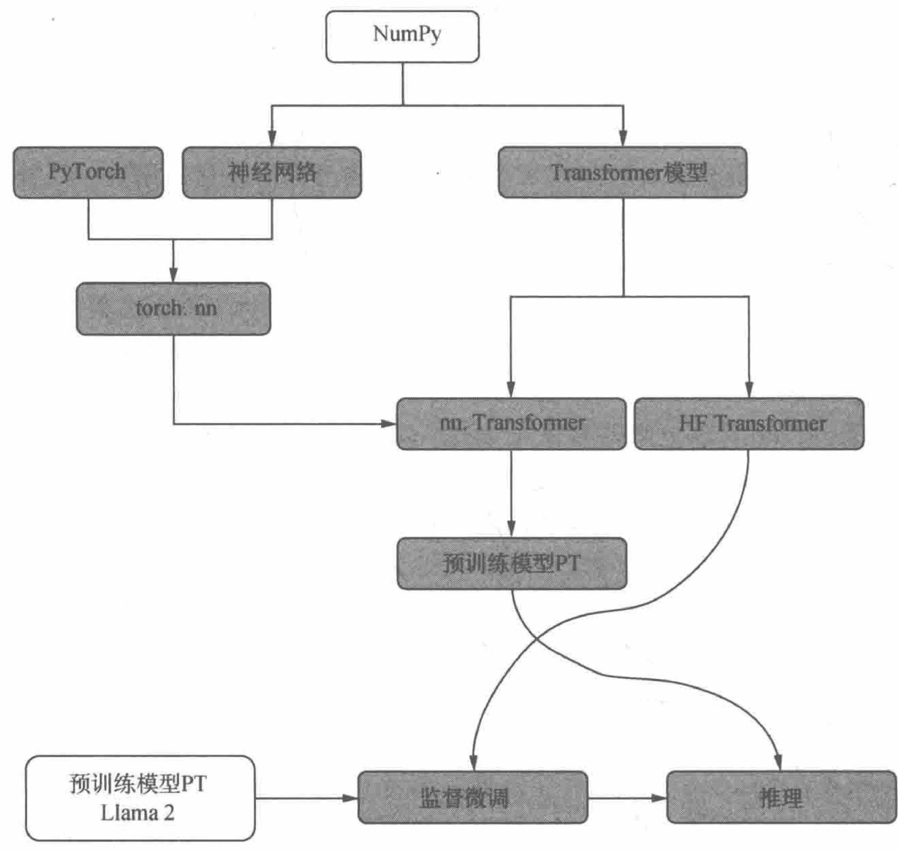

对可本地部署且具备私有知识的大模型，市场需求很高。私有知识的注入主要依赖两类手段：检索增强生成 RAG 与监督微调。RAG 可用于开源与闭源模型，SFT 仅适用于开源模型。本书在介绍监督微调用于私有知识注入的同时，也结合大模型详细讲解了 RAG 中词嵌入的计算方式。学完后，开发者可基于开源预训练模型在本地独立部署，并以自有知识库构建垂直专业模型。

本书素材来自网络教程、论文原文与开源代码。多数内容基于对原始论文的解读和对开源实现的逐行分析，相关代码均已亲测有效并提供下载链接。部分基础梳理借助了 ChatGPT，后期少量内容使用阿里云通义千问，体验良好。

本书既面向大模型应用开发者，也适合想深入理解 ChatGPT 运行机理、希望更高效使用与优化其功能的实践者。换句话说，若想在 ChatGPT 应用赛道脱颖而出，掌握提示技巧很重要，但更关键的是理解其内在机制。

预期读者具备 Python 编程基础，对深度学习有一定认识，但不要求有 NLP 背景。

限于作者水平与技术迭代速度，书中难免有不足之处，恳请读者批评指正。

示例代码与资源地址请扫封底二维码。

范煜
2024年3月

# 第1章 自然语言处理


## 1.1 人工智能的技术构成

从应用视角看，AI 主要包括计算机视觉与自然语言处理。计算机视觉让机器具备看懂图像的能力，典型应用有图像识别、目标检测、图像分割、场景理解等。自然语言处理关注让机器理解与生成人类语言，常见应用有机器翻译、情感分析、文本摘要、语音识别等。

从技术视角看，AI 包含机器学习、深度学习、强化学习、知识图谱等。机器学习通过算法让计算机从数据中自动学习，无需显式编程，主要分支有监督学习、无监督学习、半监督学习与强化学习。深度学习是机器学习的子方向，以多层神经网络为核心，已在图像、语音、文本任务上取得显著进展。强化学习通过智能体与环境的交互学习达成目标，广泛用于游戏、机器人、自动驾驶等。知识图谱是结构化的信息存储与关系表达方式，在搜索、推荐、问答等场景中发挥作用。

### 1.1.1 机器学习和深度学习的区别

机器学习与深度学习都是 AI 的重要分支，后者是前者的扩展，能处理更复杂的问题和更大规模数据，但对算力与数据量的需求更高。机器学习更灵活高效，适合相对简单的任务。两者在模型结构、数据需求、处理方式与解决能力上存在差异。

机器学习模型通常较为简洁，如线性回归、逻辑回归、决策树、支持向量机等。深度学习模型基于神经网络，尤其是深层结构，如卷积神经网络 CNN、循环神经网络 RNN、变分自编码器 VAE 等。

深度学习往往需要海量数据支撑，因为参数众多，容易过拟合。机器学习中部分简单模型用少量数据即可获得不错效果。

特征处理上，机器学习通常需要人工进行特征选择与工程。深度学习可自动从原始数据中学习有效特征，这也是其优势所在。

在图像识别、语音识别、自然语言处理等复杂任务上，深度学习表现更优。对于简单问题，机器学习更快捷易懂。

图1-1 展示了机器学习与深度学习的关系及特征演进。

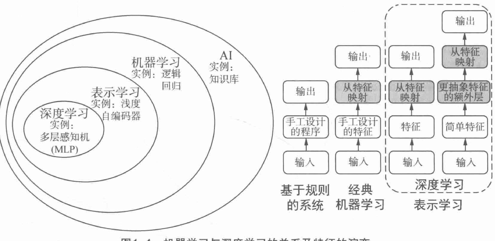

### 1.1.2 表示学习与深度学习的关系

表示学习是机器学习中的核心概念，目标是自动发现能有效解释原始数据的特征或表示。好的表示能把复杂任务简化，便于后续分类、回归等操作。

深度学习是表示学习的重要实现方式。卷积神经网络、循环神经网络等可自动从原始数据中抽取有用表示，这也是其在图像、语音、文本任务上取得突破的关键。

与经典机器学习相比，表示学习的核心差异在于特征获取方式。经典方法往往依赖人工设计，需对问题与数据有深入理解，耗时耗力。表示学习则让特征由数据自动习得。

从复杂度看，表示学习更擅长处理图像、语音、文本等复杂模态。直接用原始数据做经典机器学习难度很大，而表示学习能自动提炼有效特征。

良好的表示提升泛化能力，即使面对未见数据也能保持较好表现，因为它捕捉了数据的底层结构与规律。

深度学习是一种特殊的表示学习方法，使用多层神经网络 DNN 学习数据的层级表示。每一层都在前一层表示基础上学习更抽象的表征，从而处理极复杂任务。

表示学习概念更宽泛，目标是把原始数据映射到更有用的空间，无论方法是否基于深度学习。

除深度学习外，表示学习还可按是否需要标签、有无监督以及是否保持数据性质进行划分，常见方法包括：

自编码器：无监督方法，通过编码器将输入压缩为低维表示，再由解码器重构原始输入。

主成分分析 PCA：经典无监督方法，寻找能最大化方差的低维表示。

词嵌入：文本表示方法，将词语映射为连续向量以捕捉语义。

图嵌入：图数据表示方法，将节点或边映射为低维向量以保留结构信息。

变分自编码器与生成对抗网络 GAN：无监督方法，不仅学习表示，也学习数据生成过程。

## 1.2 自然语言处理的发展阶段

NLP 的目标是让机器理解与生成人类语言。其发展大致可划分为五个阶段。

规则驱动方法 20 世纪50 年代至80 年代：早期系统依赖硬编码规则。如 ELIZA 与 SHRDLU，通过模式匹配与规则引擎实现理解与生成。

统计方法 80 年代至21 世纪第一个十年：随算力与语料增长，统计模型进入 NLP。如隐马尔可夫模型 HMM 与条件随机场 CRF 用于词性标注与命名实体识别。IBM 的统计翻译模型 1-5 在机器翻译上取得突破。

深度学习方法 21 世纪第一个十年至今：深度学习带来变革。Word2Vec 2013 与 GloVe 2014 等词嵌入模型有效捕捉语义。随后 Seq2Seq 与注意力机制推动机器翻译与文本生成。

Transformer 与预训练模型 2017 年至今：Transformer 的提出开启新时代。基于 Transformer 的 BERT 2018 与 GPT 2018 等预训练模型通过大规模无监督训练显著提升任务性能。

大规模语言模型 2019 年至今：GPT-2 2019、GPT-3 2020 以及 ChatGPT 等模型参数达数十亿乃至万亿，生成的人类语言极度逼真。

图1-2 从 NLP、深度学习、Transformer 三个层面展示技术演进路径。

# 第1章 自然语言处理

自然语言处理技术发展：

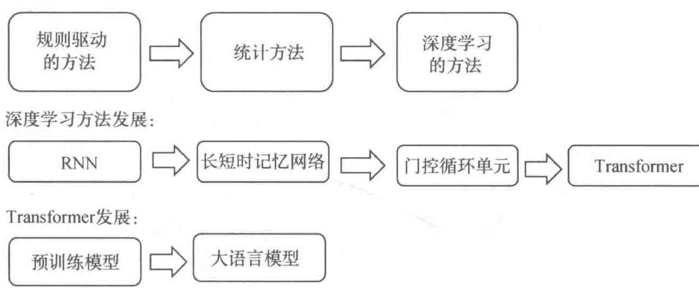

## 1.3 规则驱动的方法

规则驱动阶段出现了若干里程碑系统。

ELIZA 1966 年：MIT 的 Joseph Weizenbaum 开发的早期对话程序，模拟心理治疗师角色，通过关键词匹配与预设规则生成回应。理解能力有限，但展示了计算机模拟对话的可能性。

SHRDLU 1970 年：斯坦福的 Terry Winograd 开发的自然语言理解系统，可理解关于几何形状虚拟世界的简单英语并作出响应。它采用微世界概念，通过限定语境范围实现有限领域内的高效理解。

规则驱动机器翻译：该阶段也尝试基于规则的机器翻译，流程包括词典查找、句法分析与生成。翻译质量受规则覆盖度限制，但为后来的统计机器翻译与神经机器翻译奠定基础。

这些早期系统局限明显，却为 NLP 研究开辟道路。

## 1.4 统计方法

规则驱动之后，NLP 转向统计方法，核心是利用大规模语料与统计模型理解与生成语言。主要里程碑包括：

隐马尔可夫模型：80-90 年代广泛用于词性标注与语音识别。HMM 用隐藏状态序列生成观测序列，在词性标注中隐藏状态为词性，观测为词。

统计机器翻译：90 年代末至21 世纪初成为主流。利用双语语料学习词与短语的翻译概率，IBM 模型与短语模型是重要代表。

条件随机场：21 世纪初提出的序列标注模型，在命名实体识别与信息抽取上表现良好。与 HMM 不同，CRF 可利用整个序列特征。

词向量与 Word2Vec：2013 年 Tomas Mikolov 等提出 Word2Vec，可学习捕捉语义关系的词向量，如“王-后”与“男-女”关系相似。Word2Vec 推动深度学习在 NLP 的应用。

Transformer 与统计方法的关联：

词向量：Transformer 以词向量作为输入，延续了 Word2Vec 以来将词语映射到语义空间的做法。

序列建模：Transformer 并未直接使用 HMM 或 CRF，但其处理的机器翻译、文本生成等任务本质是序列问题。自注意力机制可捕捉长距离依赖，比 HMM 与 CRF 更强。

Transformer的概率本质
Transformer 也能用概率的角度来理解，它借助 Softmax 为每个位置的词给出条件概率分布。这与统计机器翻译里的做法有相近之处，但学习和推理都已经搬进了深度神经网络的框架。

### 1.4.1 隐马尔可夫模型
隐马尔可夫模型是用来刻画隐藏马尔可夫过程的统计工具，专门处理时序类数据，在语音、手写识别、自然语言处理、生物信息等领域长期发挥作用。

它的核心假设来自马尔可夫过程：下一步的状态只由当前状态决定，和更早的历史无关，这就是常说的无记忆性。

模型同时维护两条序列：可以直接看到的观测序列，和无法直接看到的状态序列。整体由三部分参数构成：
- 状态转移概率表，描述从一个隐藏状态跳到另一个隐藏状态的可能性；
- 发射概率表，描述在某个隐藏状态下产生某种观测的可能性；
- 初始状态概率，描述过程一开始就处于各状态的概率。

围绕 HMM 有三个经典任务：
- 评估：在参数已知的情况下，计算一条观测序列出现的概率；
- 解码：在参数已知的情况下，寻找最有可能的隐藏状态序列；
- 学习：在只有观测序列时，调整参数让观测概率最大化。

对应的经典解法分别是前向-后向算法、维特比算法、Baum-Welch 算法即 EM 算法。

在 NLP 里，HMM 主要用在序列标注类问题：
- 词性标注，把词性看成隐藏状态，词形作为观测；
- 命名实体识别，把实体类型归属看成隐藏状态，词语作为观测；
- 分词，尤其在中文里，把字符所在位置看成隐藏状态，字符本身作为观测；
- 语音识别，把音素看成隐藏状态，声学帧作为观测。

局限也很明显，模型默认不同时刻的观测彼此独立，这在真实语言里往往不成立。所以后来逐渐被条件随机场、循环神经网络、Transformer 这类更强的模型取代。

虽然设计思路完全不同，HMM 依然为序列建模打下了地基：
- 它是早期处理序列数据的代表，让研究者第一次系统地思考如何建模序列；
- 它提出了状态、观测、转移概率等概念，这些思想在后来的模型里仍在延续；
- 它在词性标注、命名实体识别、语音识别等任务上的成功，带动了 NLP 的研究热度，也间接促成了更先进模型的出现。

需要明确的是，Transformer 并没有直接沿用 HMM 的技术或方法。它的核心是深度学习和自注意力，和 HMM 的统计建模路线本质不同。

### 1.4.2 条件随机场
条件随机场是一种用于序列标注与分段的判别式统计方法，在词性标注、命名实体识别等任务上很常见。它的特点是直接建模在给定输入的情况下输出序列的条件概率，并能利用上下文信息做决策。

基本思路是：对于一条输入序列，构造一个条件概率模型来评估不同输出序列的合理性。与仅看局部点不同，CRF 会把整条序列的特性一起考虑。

主要要素包括：
- 状态，即希望预测的序列标签，比如词性；
- 观测，即输入数据，比如句子里的词；
- 特征函数，把输入输出映射为实数，用于捕捉两者关系；
- 转移分量，描述从一个状态走到下一个状态的偏好，由特征函数和权重决定。

训练通常是对数似然最大化，通过梯度下降等优化方法求解。推理则常用维特比算法在所有可能路径中找最优解。总体来看，CRF 善于捕捉序列全局依赖，能表达输入输出间的复杂关系。

## 1.5 深度学习方法
在 NLP 演进中，有几项技术堪称里程碑：
- 词向量，把词映射为高维向量，Word2Vec、GloVe 最具代表性，语义相近的词在空间中距离也近，被广泛用于情感分析、文本分类、机器翻译等；
- 循环神经网络，擅长捕捉序列时序依赖，LSTM 通过门控机制缓解了长期依赖问题；
- Transformer，2017 年提出，自注意力可以跨任意距离建模依赖，在翻译、摘要等任务上取得突破；
- 预训练语言模型，利用海量无标注数据先训练再微调，BERT 是典型代表；
- GPT，OpenAI 的自回归预训练模型，基于大规模 Transformer，在生成、翻译、问答等任务上表现突出。

### 1.5.1 Word2Vec词嵌入
Word2Vec 同时带有统计和深度学习的味道。目标是把词变成向量，让语义信息得以保留。

它使用一个很浅的两层神经网络来学习。主要有两种训练方式：CBOW 用上下文预测中心词，Skip-gram 用中心词预测上下文。两者都常用负采样来提升效率。

因此 Word2Vec 既依赖词的共现统计，又借助神经网络进行表示学习，只不过网络结构比较简单，不像 CNN、RNN 那样复杂。

### 1.5.2 循环神经网络
循环神经网络是一种面向序列的神经网络语言模型，通过引入隐藏层来保留上下文，并用反向传播进行训练，在长文本和自然语言任务上表现不错。

与普通前馈网络不同，RNN 在处理每个元素时都会参考之前的历史信息，这是通过循环连接实现的，当前输出同时依赖当前输入和上一时刻的隐藏状态。

基本更新形式可以写成：
```
$h_t = f(W_{xh} \cdot x_t + W_{hh} \cdot h_{t-1} + b_h)$
$y_t = W_{hy} \cdot h_t + b_y$
```
这里 $x_t$ 为 $t$ 时刻输入，$h_t$ 为隐藏状态，$y_t$ 为输出，$W$ 系列为权重，$b$ 为偏置，$f$ 为 tanh 或 ReLU 等激活函数。

标准 RNN 在长序列上容易出现梯度消失和梯度爆炸，难以记忆远期依赖。为此出现了 LSTM、GRU 等改进结构，通过门控机制调节信息流。

### 1.5.3 长短时记忆网络模型
LSTM 是 RNN 的一种变体，1997 年由 Hochreiter 与 Schmidhuber 提出，擅长在长序列上学习长期依赖，常用于语音识别、语言建模、文本生成等。

关键在于细胞状态，这条贯穿时间的信息通道可以被显式地读写。三个门控制信息流：
- 遗忘门，决定丢弃多少旧信息；
- 输入门，决定写入多少新信息；
- 输出门，决定输出多少信息。

数学表达为：
```
遗忘门：$f_t = \sigma(W_f \cdot [h_{t-1}, x_t] + b_f)$
输入门：$i_t = \sigma(W_i \cdot [h_{t-1}, x_t] + b_i)$
候选细胞状态：$\tilde{c}_t = \tanh(W_c \cdot [h_{t-1}, x_t] + b_c)$
更新后的细胞状态：$c_t = f_t \odot c_{t-1} + i_t \odot \tilde{c}_t$
输出门：$o_t = \sigma(W_o \cdot [h_{t-1}, x_t] + b_o)$
更新后的隐藏状态：$h_t = o_t \odot \tanh(c_t)$
```
$[h_{t-1}, x_t]$ 表示拼接，$W$ 和 $b$ 在训练中通过反向传播学习，Sigmoid 和 tanh 为激活函数。门控结构让 LSTM 能在长距离上保持稳定梯度。

### 1.5.4 门控循环单元模型
门控循环单元由 Cho 等于 2014 年提出，也是为了解决梯度消失爆炸问题。GRU 比 LSTM 更简洁，只保留更新门和重置门两种机制。

- 更新门控制保留多少历史信息，输出接近 1 时保留更多，接近 0 时更依赖新输入；
- 重置门控制在计算候选状态时忘记多少历史，接近 0 时几乎只用当前输入。

公式为：
```
更新门：$z_t = \sigma(W_z \cdot [h_{t-1}, x_t] + b_z)$
重置门：$r_t = \sigma(W_r \cdot [h_{t-1}, x_t] + b_r)$
候选隐藏状态：$\tilde{h}_t = \tanh(W \cdot [r_t \odot h_{t-1}, x_t] + b)$
更新后的隐藏状态：$h_t = (1 - z_t) \odot h_{t-1} + z_t \odot \tilde{h}_t$
```
同样通过拼接上一隐藏状态和当前输入来计算，权重和偏置在线训练中学习。门控机制让 GRU 在长序列上信息流动更稳定。结构简化带来收敛更快、计算更省的优势，在不少任务上与 LSTM 相当。

## 1.6 序列到序列模型
2014 年 Sutskever 等人提出序列到序列模型。Seq2Seq 的目标是把一个可变长的输入序列映射成另一个可变长的输出序列，常见于机器翻译、语音识别和对话系统。

典型结构由编码器和解码器组成。编码器把整段输入压缩成一个固定维度的上下文向量，解码器据此逐步生成目标序列。

编码器解码器可以基于 RNN 或 Transformer 实现，结构上可以相同也可以各异。Seq2Seq 能处理输入输出长度不一致的情况，并利用上下文信息生成序列。随着技术发展，Transformer、BERT 等新模型不断丰富这一范式。

## 1.7 注意力机制
注意力机制让模型在处理序列时不再一视同仁，而是根据重要性给不同位置分配权重。最早在神经机器翻译中流行，后被推广到多个领域。

传统 Seq2Seq 用固定长度向量表示整个输入，长序列时信息容易丢失。注意力让解码在每一步生成时，都对输入序列加权求和，动态聚焦相关部分。

基本流程：
- 计算注意力分数，通常用可学习函数衡量当前查询与各键的匹配度，查询来自解码器状态，键来自编码器状态；
- 通过 Softmax 归一化得到注意力权重；
- 用权重对值进行加权求和得到上下文向量；
- 结合上下文向量和查询生成输出。

这一思想源自人类视觉的注意机制：大脑会优先处理与当前任务相关的信息，从而提升效率和质量。

2015 年 Bahdanau、Bengio 等发表《Neural Machine Translation by Jointly Learning to Align and Translate》，首次提出注意力并应用于神经机器翻译。该工作让 Seq2Seq 迎来第二次发展，为后续模型奠定基础。

自注意力这一思路在阿希什·瓦斯瓦尼等人的推动下走向工程化，形成了 Transformer 架构。该架构不再沿用 RNN 与 CNN 的逐时扫描方式，而是让序列中每个位置可以直接相互评判。带来的直接好处是超长文本可以并行处理，跨距离位置的关联也更容易被模型捕获。

## 1.8 Transformer模型

Transformer 是 Google 研究者在 2017 年发表论文《注意力就是你需要的全部》时提出的序列到序列学习方案。其核心创新在于彻底抛弃了 RNN、CNN 的计算路径，改用纯自注意力。

整体由编码器与解码器堆叠构成。

编码器每一层包含两类子模块：自注意力模块与位置前馈网络。自注意力模块在处理某个输入单元时，会对全部输入赋予不同权重，使模型聚焦到最相关的片段；前馈网络则为每个位置的表征加入非线性变换。

解码器结构类似，但在自注意力和前馈之间额外加入了面向编码器输出的交叉注意力。这样在生成每个输出单元时，解码器始终能够回看输入中最相关部分。

正因如此，Transformer 在长文本和远距离依赖上优势明显，且训练过程高度并行。BERT、GPT 等近年主流系统都建立在此架构之上。

Transformer 本身是一种通用神经网络框架，可适配多种任务，包括但不限于 Seq2Seq。GPT 正是仅采用解码器部分搭建的，并未使用完整的编码-解码组合。

## 1.9 预训练模型

预训练模型指的是先在大规模语料上完成训练后，再迁移到下游任务的深度学习模型。它们已学得基础特征与模式，可作为起点，避免从零训练，从而节省时间并在标注数据稀缺时提升表现。

基本思路是先在大量无标注文本上学习语言的通用规律，随后再在特定任务上做微调。这样既能利用无标注数据的规模优势，又能以少量标注数据完成任务适配。

在自然语言处理里，BERT、GPT、RoBERTa 等都是在巨量文本上预训练的代表，已掌握语言的基本结构与规律，可迁移到文本分类、命名实体识别、问答等场景。

优点在于能消化海量数据，学习到更复杂丰富的表征。局限是需要大量算力与时间，且并不适配所有任务与数据。

大语言模型是预训练模型的一个分支，通常在海量文本上预训练以掌握语言结构，再用于各类自然语言任务。OpenAI 的 GPT-3、GPT-4 就是典型案例，在数十亿乃至数万亿文本上学到了极其丰富的语言模式。

主要代表包括：

- （1）BERT：以 Transformer 为底座的预训练模型，通过大量无标注文本学习语言通用特性。其关键特点是双向，可同时利用左右上下文理解当前词。
- （2）GPT：同样基于 Transformer 的预训练模型，但只使用解码器部分。先在海量无标注文本上预训练，再针对任务微调。关键特点是单向，预测下一词时仅参考左侧上下文。
- （3）Llama：Meta 公司推出的开源预训练模型，整体架构与 GPT-3 相似。
- （4）Falcon：由阿布扎比技术创新研究院创建的一系列新一代语言模型。

这些模型在文本分类、情感分析、命名实体识别、问答等任务上取得显著进展，正因它们能在大规模无标注文本上学习通用规律，再通过微调适配具体需求。

所有这些模型都根植于 Transformer。Transformer 在自然语言处理中取得成功，主要源于以下特质。

- （1）自注意力机制：可为输入序列中每个词分配不同权重，从而捕捉长距离依赖，而非仅局部信息。对理解复杂结构与含义很有帮助。
- （2）并行计算：传统循环网络每个时间步依赖前一步，难以并行。Transformer 可一次性处理整个序列，充分利用现代硬件的并行能力，大幅提升训练效率。
- （3）可扩展性：设计易于扩展到更大规模模型与更长序列，适合处理大规模语料与复杂任务。
- （4）预训练与微调：先在大规模无标注文本上预训练学习一般模式与结构，再在标注数据上微调，利用大量无标注数据提升性能。

因预训练需要大规模语料，并行化能力至关重要。Transformer 在处理序列数据时可并行计算，比传统循环网络更适合大规模场景。

预训练的概念并不局限于语言。大语言模型只是其中一种，在计算机视觉领域，也有大量在海量图像上预训练的模型，如 ResNet、VGG 等。它们在预训练阶段学习图像的基础特征，随后可用于图像分类、物体检测等任务。

## 1.10 大语言模型

大语言模型是一种能够生成与理解人类语言的智能模型。通常采用深度学习训练，需要大量计算资源与数据。其核心特征是规模，通常拥有数十亿甚至数万亿参数，并在覆盖互联网级别的语料上训练。

重要特点是训练无监督，不依赖标注数据。模型仅需海量文本，通过预测下一个词学习语言规律。这使得模型能在训练时处理巨量数据，习得更丰富复杂的语言结构与知识。

训练一般分为两个阶段：预训练与微调。预训练阶段，模型在海量未标注文本上训练，目标是学习预测下一个词或字符。此阶段会习得词汇、语法、句法及部分语义知识。微调阶段在特定任务的标注数据上训练，目标是优化该任务表现。

应用覆盖文本分类、情感分析、文本生成、机器翻译、问答、对话等。例如 OpenAI 开发的 GPT-3 拥有 1750 亿参数，能生成连贯且语法语义较准确的文本，可用于问答、写作、翻译、编程等。除 GPT 系统外，阿联酋技术创新研究院开发的 Falcon，Meta 开发的 Llama 2 也是开源大语言模型。

大语言模型也面临挑战：需要巨量算力与数据，可能产生偏见，生成文本有时包含错误或不准确信息，且内部机制难以解释。因此使用需谨慎，并具备适当的安全与道德考量。

大语言模型既可按架构分类，也可按训练方式与预测方式分类。

### 1.10.1 根据架构分类

大语言模型按架构可分为纯编码器、纯解码器、编码器-解码器三类。

#### 1. 纯编码器模型

这类模型只有一个编码器，它将输入文本转换为内部表征，通常被称为嵌入。该表征可用于文本分类、实体识别等下游任务。BERT 是典型的纯编码器模型。

#### 2. 纯解码器模型

这类模型只有一个解码器，接收一段文本作为输入，并生成一段新的文本作为输出。GPT 系列模型就是纯解码器模型，生成文本时逐步生成下一个词，每步都依赖于前面的词。

#### 3. 编码器 - 解码器模型

这类模型包括一个编码器和一个解码器。编码器将输入文本转换为内部表征，然后解码器将这种内部表征转换为输出文本。这种模型通常用于机器翻译等任务，其中输入文本和输出文本的长度可能不同。

这三种模型各有优劣与适用场景。纯编码器模型适合处理输入文本的任务，纯解码器模型适合生成文本的任务，而编码器-解码器模型则适合处理输入文本和输出文本长度不同的任务。

### 1.10.2 根据训练方式和预测方式分类

大语言模型按训练方式和预测方式可分为自回归模型和自编码模型。

#### 1. 自回归模型

这类模型在生成文本时，会一步步地生成下一个词，每步都依赖于前面的词。最著名的自回归模型是 GPT 系列，包括 GPT-1、GPT-2 和 GPT-3。这些模型在生成文本时，会考虑到前面的所有词，从而生成具有连贯性的文本。自回归模型可以是纯解码器模型，也可以是编码器-解码器模型。

#### 2. 自编码模型

这类模型在训练时，会同时考虑到上下文的信息，从而预测被遮挡的词。最著名的自编码模型是 BERT，它在训练时，会随机遮挡一些词，然后使用上下文的信息来预测被遮挡的词。这种训练方式使 BERT 能够理解词语在上下文中的含义，从而在各种自然语言处理任务上取得很好的效果。自编码模型通常是纯编码器模型。

另外，还有一些模型是自回归和自编码的结合，比如 T5 和 BART。这些模型在训练时，会同时考虑到上下文的信息，从而预测被遮挡的词，然后在生成文本时，会一步步地生成下一个词，每步都依赖于前面的词。

这些模型在各种自然语言处理任务上都取得了非常好的效果，但也有各自的优点和缺点。例如，自回归模型在生成连贯文本时表现优秀，而自编码模型则在理解上下文含义上表现出色。

# 第2章 深度学习基础

## 2.1 深度学习

深度学习为了解决表示学习难题而提出。机器学习旨在自动地学到从数据的表示到数据的标记的映射。随着机器学习算法的日趋成熟，人们发现，在某些领域（如图像、语音、文本等），如何从数据中提取合适的表示成为整个任务的瓶颈所在，而数据表示的好坏直接影响后续学习任务，所谓垃圾进，垃圾出。与依赖人类专家设计手工特征相比，表示学习希望能从数据中自动地学到从数据的原始形式到数据的表示的映射。

表示学习的理想很丰满，但实践中直接从原始形式学得数据表示难度很大。深度学习是目前最成功的表示学习方法，因此 ICLR 的大部分论文都围绕深度学习展开。深度学习把表示学习任务拆分为多个小目标，先从原始数据学习低级表示，再从低级表示学得高级表示。这样，每个小目标比较容易达到，综合起来完成表示学习的任务。这与算法设计中的分治思想类似。

深度神经网络是深度学习目前几乎唯一行之有效的实现形式。简单地说，深度神经网络就是很深的神经网络。我们利用网络中逐层对特征进行加工的特性，逐渐从低级特征提取高级特征。除了深度神经网络之外，有学者在探索其他深度学习的实现形式，比如深度森林。

深度神经网络取得成功依赖三大推动因素：①大数据。当数据量小时，很难从数据中学得合适的表示，而传统算法加特征工程往往能取得很好的效果。②计算能力。大的数据和大的网络需要有足够快的计算能力才能使模型的应用成为可能。③算法创新。现在很多算法设计关注如何使网络更好地训练、更快地运行、取得更好的性能。

## 2.2 感知机

感知机通常指的是单层感知机。单层感知机是一种简单的二元线性分类器，主要用于二分类问题，它是一种监督学习的算法，是最早的一种前馈神经网络模型，只包含一个输入层和一个输出层，没有隐藏层，由弗兰克·罗森布拉特在1957年提出。

与单层感知机对应的是多层感知机。MLP 是一种前馈神经网络，包含至少三层结构。输入层、隐藏层和输出层。每层都由一个或多个感知机组成。

感知机是最简单的前馈神经网络形式，基本形式是对权重和输入特征做线性组合，然后通过阈值或激活函数决定输出。如果线性组合的结果大于阈值，感知机输出1；否则，输出0。

感知机模型的基本形式可以表示为

$$f(x) = \text{sign}(w \cdot x + b)$$

其中，$w$ 是权重向量；$x$ 是输入向量；$b$ 是偏置项；sign 是符号函数。

单层感知机的权重更新本质上是简单的梯度下降，通常不称为反向传播，因为反向传播通常用于多层神经网络中，它涉及从输出层向输入层逐层传播误差，更新每一层的权重。而单层感知机只有一个权重层需要更新，所以没有必要用到反向传播这种多层网络中用来传播误差并计算梯度的算法。

图 2-1 所示为一个基于二分类任务的单层感知机。要构建这个感知机，首先，我们定义输入向量 $x$ 和对应的标签 $y$，并初始化权重 $w$ 和偏置 $b$。假设输入向量是二维的，即 $x = [x_1, x_2]$，权重 $w$ 也是二维的，即 $w = [w_1, w_2]$，并且偏置 $b$ 是一个标量。

### 2.2.1 前馈网络

编写一个前馈网络 Feed-Forward Network，FFN，进行二分类。这是基于随机权重的模型，由于权重没有经过训练，所以输出结果是错误的。

```python
import numpy as np

# 输入向量和对应的标签
x = np.array([[0, 0], [0, 1], [1, 0], [1, 1]])  # 输入向量的形状为 (4, 2)
y = np.array([0, 0, 0, 1])                      # 标签的形状为 (4,)

# 初始化权重和偏置
w = np.random.randn(2)  # 初始化权重，形状为 (2,)
b = np.random.randn()   # 初始化偏置，标量

# 定义激活函数和阈值
def activate(x):
    return 1 if x >= 0 else 0

threshold = 0.5

# 前馈传播
def forward_propagation(x, w, b):
    z = np.dot(x, w) + b
    a = activate(z)
    return a

# 测试前馈传播
for i in range(len(x)):
    output = forward_propagation(x[i], w, b)
    print("输入:", x[i], " 输出:", output)
```

运行结果为

```
输入: [0 0]  输出: 1
输入: [0 1]  输出: 1
输入: [1 0]  输出: 0
输入: [1 1]  输出: 1
```

显然，这个结果是错误的。

下面对源代码进行分析，复现一下程序运行过程。

#### 1. 输入及初始化

输入向量 $x$ : [[0 0] [0 1] [1 0] [1 1]]

标签 $y$ : [0 0 0 1]

随机生成的初始化权重 $w$ : [-1.38092639  1.1077138 ]

随机生成的偏置值 $b$ (标量) : 0.435195634304824

#### 2. 获取输出

公式 $z = np.dot(x, w) + b$ 的运算过程为：np.dot() 是 NumPy 库中的一个函数，用于计算两个数组的点积，也称为内积或矩阵乘法。点积在线性代数和向量运算中非常常见，并在许多科学和工程领域中广泛使用。

点积的计算规则取决于数组的维度。

（1）如果两个输入数组都是一维的，函数将计算它们的内积。

（2）如果两个输入数组都是二维的，函数将计算它们的矩阵乘法。

（3）如果其中一个输入数组是一维的，另一个输入数组是二维的，函数将执行广播操作，然后计算它们的矩阵乘法。

在 PyTorch 中，与 numpy.dot 对应的函数是 torch.matmul。

1）计算 np.dot(x, w)

```
np.dot(x, w) = [[0* -1.38092639 + 0 * 1.1077138]
                [0 * -1.38092639 + 1 * 1.1077138]
                [1 * -1.38092639 + 0 * 1.1077138]
                [1 * -1.38092639 + 1 * 1.1077138]]
              = [[0]
                [1.1077138]
                [-1.38092639]
                [-0.27321259]]
```

2）加上偏置 b，得到 z 的运算结果

```
z = np.dot(x, w) + b
  = [[0 + 0.435195634304824]
     [1.1077138 + 0.435195634304824]
     [-1.38092639 + 0.435195634304824]
     [-0.27321259 + 0.435195634304824]]
  = [[0.43519563]
     [1.54290943]
     [-0.94573076]
     [0.16198304]]
```

3）单独运行这段用于激活函数输出的代码

```
for i in range(len(z)):
    a = activate(z[i])
    print(a)
```

运行后得到的结果是错误的

```
1
1
0
1
```

只有先让权重完成学习，模型才可能输出正确的结果。

### 2.2.2 参数如何被更新

在神经网络训练里，优化函数就是一套数学工具，用来不断调整模型参数，让损失函数朝着最小值移动。整个训练可以看成一个优化问题，目标是让参数在拟合训练数据的同时，具备对未知数据的泛化能力。

梯度下降是最常用的迭代优化策略。它的核心思路是沿着函数下降最快的方向一步步走近最小值。每次迭代都会先算出损失对参数的梯度，再反向调整参数。

完整流程通常是这样：

- （1）设定起点：先给出参数的初始值。
- （2）求梯度：基于当前参数计算损失函数的梯度，梯度指示函数上升最快的方向。
- （3）更新参数：结合学习率和梯度方向修改参数值。学习率决定单步迈多大。
- （4）循环迭代：在达到最大迭代次数或梯度变化足够小前，重复第2步和第3步。

单层感知机的更新公式为：$w = w + \eta \cdot (y - o) \cdot x$

偏置的更新公式为：$b = b + \eta \cdot (y - o)$

其中，$w$ 是权重；$\eta$ 是学习率；$y$ 是期望输出；$o$ 是实际输出；$x$ 是输入。

为什么会得到这样的更新式？

单层感知机的更新来源于损失函数的梯度推导。这里常用均方误差作为损失。对每个样本，先算预测与真实的误差，再通过调整权重和偏置把误差压下去。

设预测值为

$$o = wx + b$$

其中，$w$ 是权重；$x$ 是输入；$b$ 是偏置。目标值是 $y$。误差 $E$ 可写为

$$E = 1/2 \cdot (y - o)^2$$

这是一个关于 $w$ 和 $b$ 的函数。为最小化 $E$，需要求出 $E$ 对 $w$ 和 $b$ 的偏导，并沿梯度下降方向更新。

先看 $E$ 对 $w$ 的偏导：

已知 $o = w \cdot x + b$，线性函数对 $w$ 的导数为 $x$。令中间变量 $z = y - o$，则 $dz/do = -1$。

用链式法则：$dE/dw = dE/dz \cdot dz/do \cdot do/dw$。

具体拆开：

（1）$dE/dz = d/dz[1/2 \times z^2] = 2 \times 1/2 \times z^{(2-1)} = z = y - o$

（2）$dz/do = d/do[y-o] = -1$

（3）$do/dw = d/dw[w \cdot x + b] = x$

于是 $dE/dw = -(y - o) \cdot x$

$$dE/dw = -(y - output) \cdot x = -(y - (wx + b)) \cdot x$$

> 这里用到的导数规则

> 幂次法则：若 $f(x) = x^n$，则 $f'(x) = n \cdot x^{(n-1)}$。即 $x$ 的 $n$ 次幂的导数是 $n$ 乘以 $x$ 的 $n-1$ 次幂。

> 链式法则：若 $y = f(g(x))$，则 $dy/dx = f'(g(x)) \cdot g'(x)$。复合函数的导数等于外层导数乘以内层导数。

再算 $E$ 对 $b$ 的偏导：

$$dE/db = -(y - output) = -(y - (wx + b))$$

按梯度下降方向更新 $w$ 和 $b$：

$$w = w - \eta \cdot dE/dw$$

$$b = b - \eta \cdot dE/db$$

其中，$\eta$ 是学习率。

### 2.2.3 反向传播的计算思路

误差反向传播结合了微积分的链式法则和算法设计的动态规划思想，用于高效求梯度。手写推导某一中间层的梯度表达式非常繁琐，但链式法则告诉我们，只要知道后一层的梯度，再结合后一层对当前层的导数，就能得到当前层的梯度。动态规划则通过自上而下逐层计算，避免了重复运算。

```
# 反向传播和权重更新
learning_rate = 0.1  # 学习率

def backward_propagation(x, w, b, y, output):
    error = y - output
    delta_w = learning_rate * error * x  # 权重更新量
    delta_b = learning_rate * error    # 偏置更新量
    w += delta_w
    b += delta_b
```

（1）算误差。误差由期望输出 $y$ 减去实际输出得到，反映网络当前输出与目标的差距。
（2）算权重更新量。结合误差、学习率和输入 $x$ 计算 $delta\_w$。公式 $delta\_w = learning\_rate * error * x$ 说明更新幅度由误差大小、学习率和输入大小共同决定。
（3）算偏置更新量。结合误差和学习率计算 $delta\_b$。公式 $delta\_b = learning\_rate * error$ 说明偏置的调整只受误差和学习率影响。
（4）应用更新。把 $w$ 和 $b$ 分别加上对应的 $delta\_w$ 和 $delta\_b$，完成一次参数修正，让网络逐步逼近更好解。

该过程通过反向传播不断修正权重，使网络输出逐渐接近期望。

```
# 训练神经网络
epochs = 100  # 迭代次数

for epoch in range(epochs):
    for i in range(len(x)):
        output = forward_propagation(x[i], w, b)
        backward_propagation(x[i], w, b, y[i], output)

# 测试训练后的神经网络
print("训练后的神经网络输出:")
for i in range(len(x)):
    output = forward_propagation(x[i], w, b)
    print("输入:", x[i], " 输出:", output)
```

若只训练 $epochs = 10$，模型仍不理想，输出如下：

训练后的神经网络输出：

```
输入：[0 0]  输出：1
输入：[0 1]  输出：1
输入：[1 0]  输出：0
输入：[1 1]  输出：1
```

把迭代次数提升到 $epochs = 100$ 后才得到正确答案：

训练后的神经网络输出：

```
输入：[0 0]  输出：0
输入：[0 1]  输出：0
输入：[1 0]  输出：0
输入：[1 1]  输出：1
```

## 2.3 激活函数的作用与选择

激活函数是给人工神经网络增加非线性能力的关键组件，决定了神经元要把什么信号传递给下一层。图 2-2 展示了输入经激活函数后得到输出的过程。


人工神经元的工作机制如图 2-3 所示。

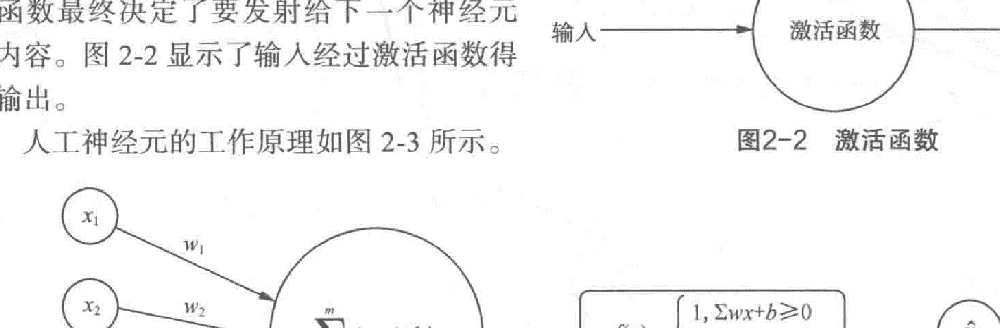

没有激活函数，多层线性运算累加后仍然是线性，网络的表达能力等同于单层。一个好的激活函数应满足：①不易饱和。Sigmoid 和 tanh 在两端会饱和，导数接近零，训练受阻。②输出零均值。ReLU 的输出均值不为零，会影响训练稳定性。③计算高效。

激活函数可分为饱和型和非饱和型。Sigmoid 和 tanh 属于饱和型，输入趋向正负无穷时导数趋近于零，产生梯度消失。ReLU 及其变体属于非饱和型。非饱和型的优势在于：①缓解梯度消失；②加速收敛。

### 2.3.1 主流激活函数盘点

深度学习中常用的激活函数有：

1. Sigmoid 函数，也称 Logistic 函数
用途：将输入压缩到 [0,1] 区间，常用于二分类。
公式：$f(x) = 1 / (1 + \exp(-x))$
图 2-4 为 Sigmoid 曲线。

2. 双曲正切函数 tanh
用途：将输入映射到 [-1,1]，除二分类外也常用于隐藏层。
公式：$f(x) = (\exp(x) - \exp(-x)) / (\exp(x) + \exp(-x))$
图 2-5 为 tanh 曲线。

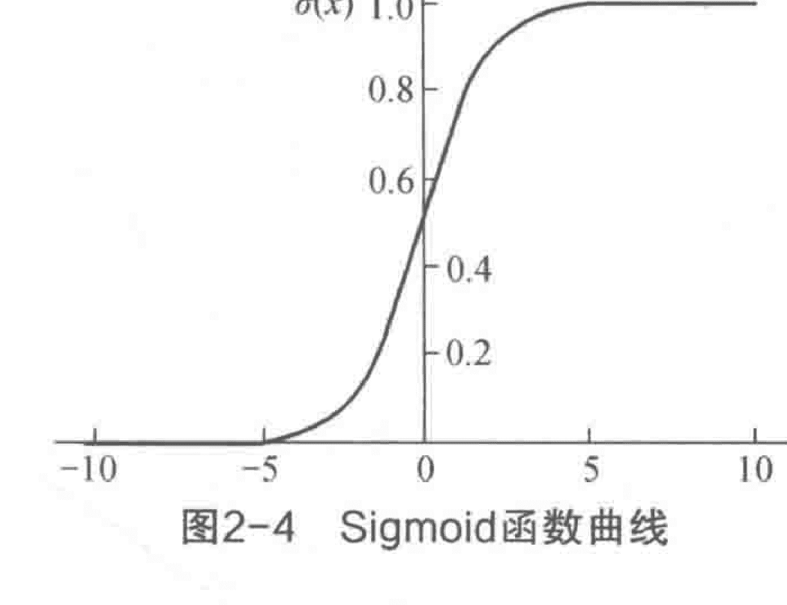

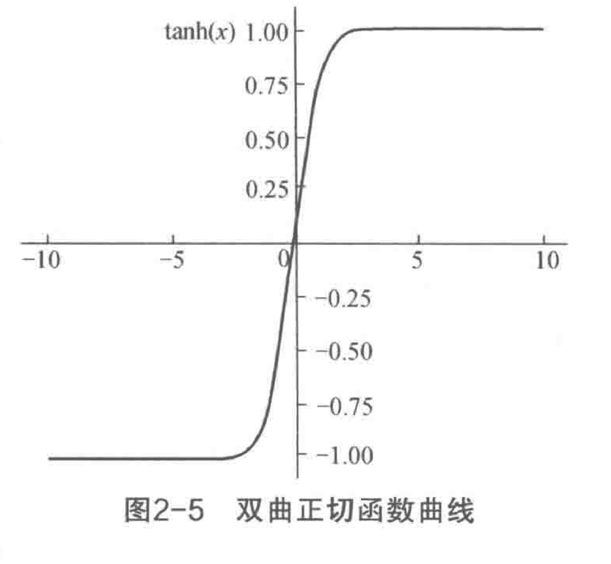

3. ReLU 函数
用途：正值原样输出，负值输出 0，常用作隐藏层激活。
公式：$f(x) = \max(0, x)$
图 2-6 为 ReLU 曲线。

4. Leaky ReLU 函数
用途：在 ReLU 基础上给负值一个很小的斜率，避免死神经元。
公式：$f(x) = \max(0.01x, x)$
图 2-7 为 Leaky ReLU 曲线。

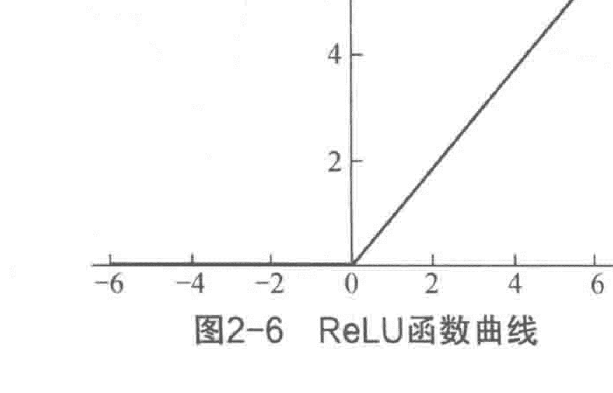

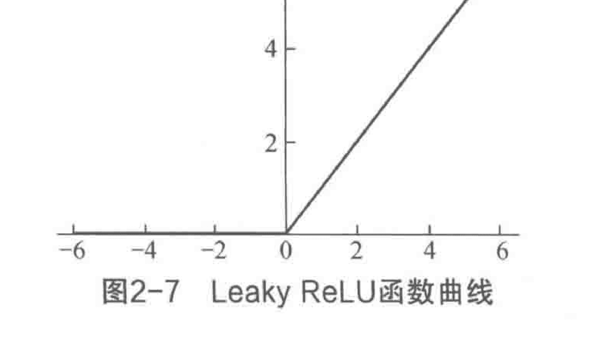

5. Parametric ReLU 函数，PReLU
用途：在 Leaky ReLU 上引入可学习参数 $a$，让负区间的斜率自适应。
公式：$f(x) = \max(a \cdot x, x)$，其中 $a$ 可学习。
图 2-8 为 PReLU 曲线。

6. Softmax 函数
用途：把输入向量归一化为概率分布，适用于多分类。
公式：$f(x_i) = \exp(x_i) / \sum(\exp(x_j))$
图 2-9 为 Softmax 曲线。

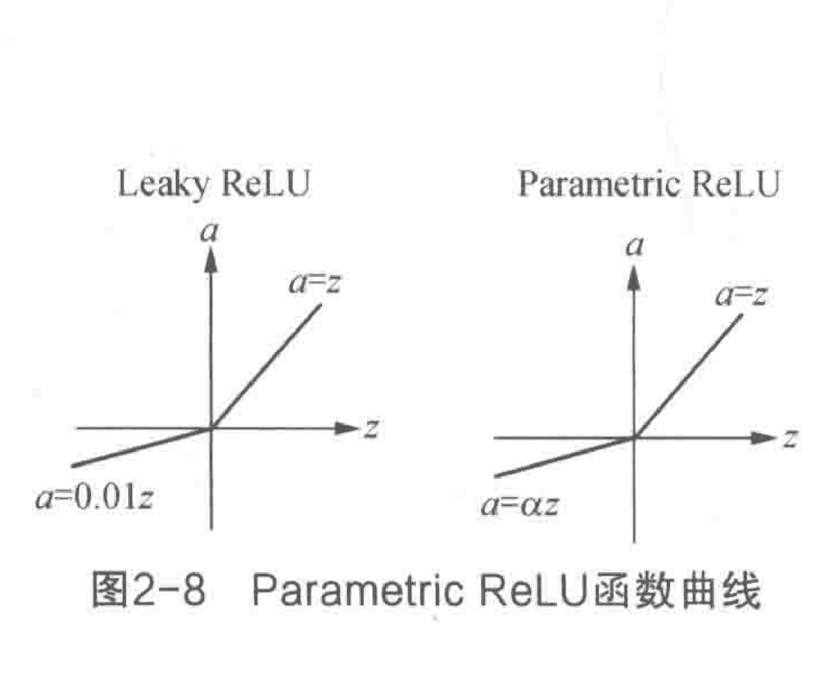

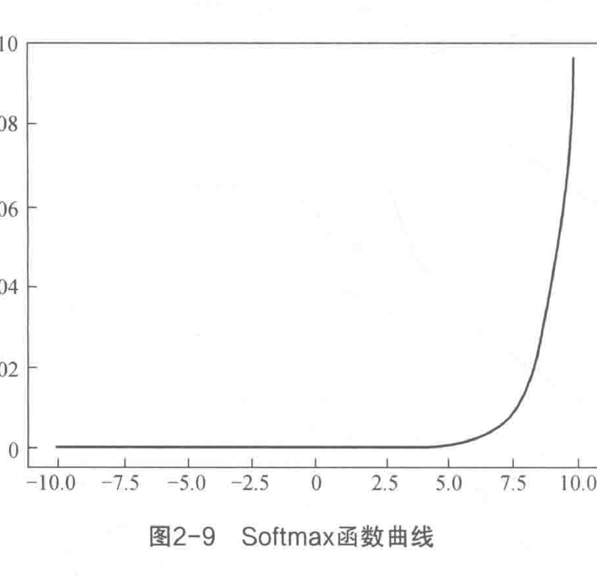

### 2.3.2 新一代激活函数

1. Swish 函数
Swish 由 Google 于 2017 年提出。公式为 $f(x) = x \cdot \text{Sigmoid}(\beta \cdot x)$，其中 $\beta$ 为可调超参数。Swish 兼具 Sigmoid 的平滑性和可学习的非线性。图 2-10 为 Swish 曲线。

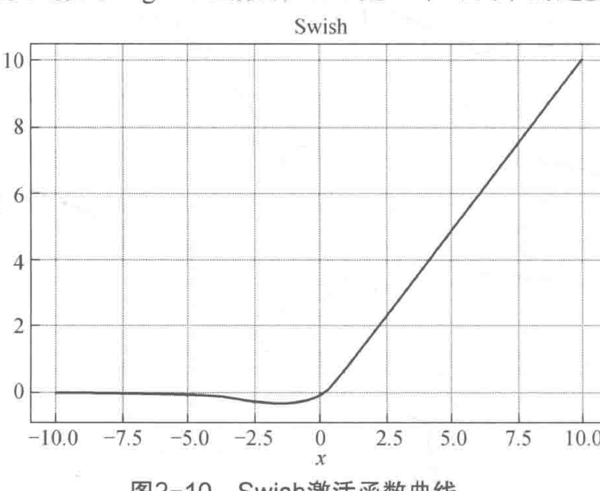

Swish 的特点：
- （1）平滑性：连续可导，有助于梯度流动和收敛。
- （2）非线性趋势：大输入能产生更大输出，提升表达力。
- （3）自适应性：形状可随数据学习，激活程度自适应调整。

2. GLU
GLU 即 Gated Linear Unit，由 Google Brain 提出，在 Transformer 等语言模型中表现突出。核心是通过门控机制控制信息通过。

输入被拆分为门控部分和激活向量，门控部分通常用 Sigmoid 控制哪些信息保留，激活向量进行非线性变换，两者逐元素相乘实现选择性传递。

GLU 的功能：
- （1）增强表达：门控实现信息选择，提高表示能力。
- （2）缓解梯度消失：非线性变换帮助梯度传播。
- （3）非线性拟合：更好地拟合复杂函数。
- （4）提升建模：对序列数据上下文建模效果好。

3. SwiGLU
SwiGLU 于 2020 年由 Google 提出，结合 GLU 与 Swish。功能如下：
- （1）门控机制：用 Sigmoid 调节信息流，决定信息通过与否。
- （2）非线性特性：引入 Swish 的非线性，提升表达能力。
- （3）上下文建模：能学习局部特征依赖，适合序列数据。

4. GeGLU
GeGLU 即 Gaussian Error Linear Unit，是 GLU 的改进版，在自然语言处理任务中被广泛使用，尤其在文本分类、语义匹配和机器翻译中。

相比传统 GLU，GeGLU 通过高斯误差项让每个维度与其他维度交互，解决门控仅在相邻维度交互的局限。

功能体现：
- （1）特征交互能力：高斯误差项促进跨维度交互，更好捕捉依赖关系。
- （2）降噪能力：相当于噪声注入，提升对输入扰动的鲁棒性，增强泛化。

## 大语言模型开发：用开源模型开发本地系统

进行交互。这种交互性能够帮助模型更好地捕捉输入之间的依赖关系和复杂的非线性关系，从而提高性能。

## 2.4 优化算法概览

确定网络结构后，需要优化网络的权值。深度学习的优化算法在训练过程中调整模型参数以最小化损失函数。

优化算法的作用：
- （1）最小化损失：寻找使模型输出与真实标签差距最小的参数组合。
- （2）参数更新：依据损失对参数的梯度信息更新权重和偏置。
- （3）避免局部最优：帮助模型跳出局部最小值，逼近全局最优。
- （4）加速收敛：合理设计可加快参数收敛速度。

常用的优化算法包括：

### 2.4.1 梯度下降法详解

# 从山谷寻路到模型收敛：梯度下降与优化器的核心逻辑

假定你在深夜野外徒步意外迷路，被困在一个山谷里。你知道出口就在谷底，可伸手不见五指，路况完全看不清。于是你采用一种贪心策略：先观察当下位置往哪个方向坡度最陡，再朝这个方向迈一小步，循环重复直到抵达最低点。这正是梯度下降最直观的比喻。

这一类方法的表现大致受三点支配。起点的选择决定了是否一开始就靠近最优解；山谷的形状若是迂回曲折，很容易在内部兜圈；步长的大小则左右效率，步子太小进展缓慢，步子太大则容易冲过头甚至跌出悬崖。

常见实现可分为三种。批量梯度下降每次用全部训练数据算一次梯度再统一更新，稳定但计算负担重；随机梯度下降每次只挑一个样本计算梯度再更新，速度快但波动大，其衍生还有动量法、Nesterov 加速、自适应学习率等，自适应类包含 AdaGrad、RMSProp、Adam、AdaDelta 等；小批量梯度下降取一小批随机样本折中，既保留一定效率又获得更平滑的收敛。

### 2.4.2 动量加持的更新方式
动量优化是深度学习里常用的加速手段，目的在于加快收敛、平滑参数变化并帮助跳出局部低点。思路很简单：把上一次更新时的速度保留下来，与当前梯度加权融合，形成带惯性的更新。

核心是让当前梯度与历史累积的信息共同决定下一步。这样在平坦区和狭长峡谷中学习会更顺畅。算法维护一个动量变量 v 来记忆历史梯度，每步把 v 与当前梯度 g 结合得到更新量 Δ(θ) 再修正参数 θ，v 起到平滑作用。

动量优化算法的更新过程可以表示为
```
v = β * v - η * g  # 更新动量
θ = θ + v  # 更新参数
```
式中 η 为学习率，β 为动量系数，通常落在 0 到 1 之间。β 越大，历史信息保留越多，更新惯性越强。

优势在于参数在大尺度上移动更快，训练提速，同时惯性有助于跨越局部极小，增加找到全局更好解的机会。需要留意的是，β 过大可能导致更新幅度失控难以稳定收敛，β 过小则效果被削弱，具体取值要结合任务调优。

### 2.4.3 自适应学习率的 AdaGrad
AdaGrad 由约翰·杜奇等人在 2011 年提出，是一种为不同参数自动调整步长的优化方法。它把学习率除以该参数历史梯度平方和的平方根，从而让更新频率高的参数逐步降速，对稀疏特征和出现频率不同的特征表现友好。

典型流程如下。先把所有参数的梯度累积值清零；对每个训练样本，先算出当前梯度，再把梯度平方按元素累加到历史累积中，随后用学习率除以累积平方和的平方根得到缩放后的步长，最后用该步长更新参数；循环直至满足停止条件。

由于学习率会随时间单调递减，早期梯度大的参数收敛快，梯度小的参数调整更精细，对稀疏性和尺度差异有一定适应力。但累积项不断增大也会导致学习率过早衰减，后期几乎不动，为此 RMSProp 和 Adam 等在它基础上做了改进。

### 2.4.4 RMSProp：对 AdaGrad 的衰减改进
RMSProp 通过指数加权移动平均来估计梯度平方的累积，避免 AdaGrad 学习率过快衰减的问题。

#### 1. 梯度平方的指数累积
对每个可训练参数 θ 维护一个累积变量 v，初始为 0。每轮计算当前梯度 g 的平方并按指数加权累加：
$$v = \beta \cdot v + (1 - \beta) \cdot g^2$$
其中 β 是衰减系数，用来控制历史信息的影响程度，通常取 0.9。

#### 2. 参数更新规则
更新时使用学习率 α 和很小的常数 ε 保证数值稳定：
$$\theta = \theta - \left( \frac{\alpha}{\sqrt{v + \varepsilon}} \right) \cdot g$$
其中 g 为当前梯度值。

#### 3. 学习率的自适应调节
当某参数梯度波动大时，其平方累积值也大，对应学习率被压小，更新更保守；梯度波动小时累积值小，学习率相应放大，加快进展。这样既兼顾当前信息又参考历史变化，实现更稳的训练。

RMSProp 仍需调参，α、β 和 ε 的选择会影响效果，需依具体问题和数据调整。

### 2.4.5 Adam：动量与自适应的融合
Adam 由 Diederik P. Kingma 和 Jimmy Ba 于 2014 年提出，结合了 RMSProp 的自适应学习率与动量法的惯性，通过一阶矩和二阶矩估计为每个参数定制步长。

> 统计学中矩用于刻画分布特征。
> （1）均值即一阶原点矩：μ = E[X]，表平均水平。
> （2）方差即二阶中心矩：σ² = E[(X-μ)²]，表离散程度。
> （3）偏度为三阶中心矩，表偏斜。
> （4）峰度为四阶中心矩，表尖锐程度。

Adam 的更新流程如下。
- （1）估算一阶矩与二阶矩
$$m_t = \beta_1 m_{t-1} + (1 - \beta_1) g_t$$
$$v_t = \beta_2 v_{t-1} + (1 - \beta_2) g_t^2$$
其中 gₜ 为当前梯度，mₜ、vₜ 分别为一阶、二阶矩估计，β₁、β₂ 一般设为 0.9 和 0.999。
- （2）偏差修正
$$\hat{m}_t = \frac{m_t}{1 - \beta_1^t}, \hat{v}_t = \frac{v_t}{1 - \beta_2^t}$$
t 为当前迭代次数。
- （3）用修正后的矩更新权重
$$\theta_{t+1} = \theta_t - \frac{\eta \cdot \hat{m}_t}{\sqrt{\hat{v}_t} + \varepsilon}$$
θ 为权重，η 为学习率，ε 为极小常数。

代码层面可写成：
```
w = w - lr * m_hat / (sqrt(v_hat) + eps)
```
其中 w 为权重，lr 为学习率，eps 防止除零。

Adam 的长处在于自适应学习率，对稀疏梯度或非平稳目标更鲁棒；仅需保存两个矩估计，内存开销小；偏差修正提升了起步阶段的估计精度。不足是训练后期学习率可能变得过小导致进展放缓，这也是 AdamW 出现的主要动机。

### 2.4.6 AdamW：把权重衰减独立出来
AdamW 是 Adam 的改进变体，核心在于把权重衰减从损失函数正则项中分离出来，避免与自适应学习率的调度产生冲突。

传统做法是在损失里加入 L2 正则项，使用自适应学习率时两者会相互干扰。AdamW 每次更新先对权重做衰减，再执行梯度更新，使衰减过程不受学习率调度影响。

更新规则为
```
w = w - weight_decay * lr * w - lr * m / (sqrt(v) + eps)
```
其中 w 为权重，lr 为学习率，m、v 为 Adam 的矩估计，eps 防止除零，weight_decay 为衰减系数。

相比 Adam，AdamW 优化更稳定，且在实践中常表现出更好的泛化能力。不同优化器的演进关系可参考
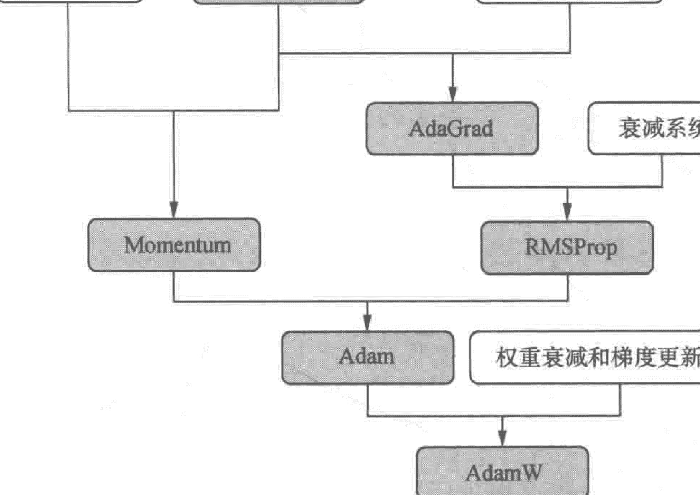

## 2.5 权值初始化的要点
初始化对网络能否正常训练至关重要。早期深度网络训练困难，很大程度上源于初始化不够重视。

基本思想是方差不变，让各层神经元输出方差保持稳定。Xavier 初始化从高斯或均匀分布采样，使权值方差为 1/n，n 为输入神经元数，推导假设激活近似线性。He 初始化或 MSRA 初始化在 ReLU 场景下把方差设为 2/n，因为 ReLU 会置零约一半神经元，需补偿信息损失。

实践中建议尽量使用零中心化的数据和零中心化的激活输出，以加快收敛。

### 2.5.1 批归一化加速与稳定
批归一化由 Sergey Ioffe 与 Christian Szegedy 于 2015 年提出，通过对每个小批的激活值做归一化，提升训练速度与稳定性和泛化能力。

每层显式把激活值规范到零均值单位方差，使分布相对固定，层间学习更独立，降低对初始化和学习率的敏感度，并带来一定的正则化效果。

处理步骤为先计算小批的均值和方差，再做归一化使均值为 0 方差为 1，随后引入可学习参数 γ 和 β 做线性变换与偏移，恢复表达能力。

它缓解了内部分布偏移导致的梯度消失或爆炸，减少模型对输入微小变化的敏感性，允许使用更大学习率，从而加快收敛。

### 2.5.2 层归一化在序列任务中的优势
层归一化由 Ba 与 Geoffrey Hinton 于 2016 年提出，主要为了解决批归一化在 RNN 中受批大小限制的问题，针对内部协变量偏移进行改进。

其做法是在每个样本内部对全部特征做归一化，而非在批内做。假设输入矩阵 x 维度为 [N, M]，N 为特征数，M 为样本数，计算过程如下。

- （1）按特征维度求均值 μ 与方差 σ²
```
$\mu = \text{mean}(x, \text{axis}=1, \text{keepdims}=\text{True})$
$\sigma^2 = \text{var}(x, \text{axis}=1, \text{keepdims}=\text{True})$
```
- （2）做归一化
```
$x\_\text{normalized} = (x - \mu) / \text{sqrt}(\sigma^2 + \varepsilon)$
```
ε 为数值稳定常数。
- （3）缩放与平移
```
$y = \gamma \cdot x\_\text{normalized} + \beta$
```
γ 与 β 为可学习参数。

由于不依赖批大小，层归一化在批长度很小或无法使用批训练的场景仍有效，且对样本间干扰不敏感，在处理序列数据时更具优势。

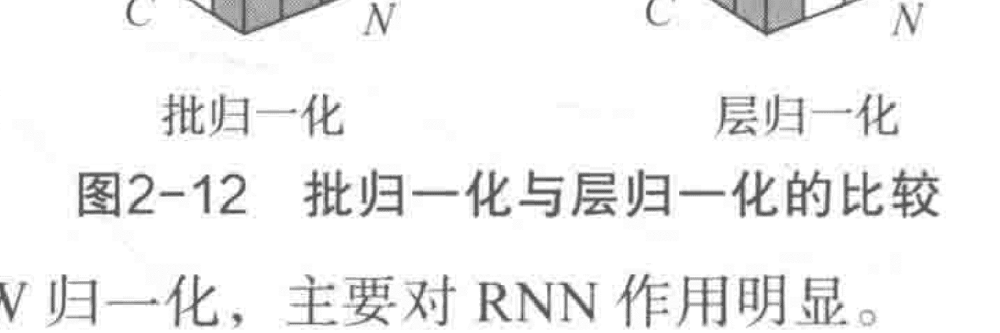

归一化、损失与正则化关键点梳理

图 2-12 把 BatchNorm 和 LayerNorm 的分工画得很清楚。BatchNorm 以 batch 为单位做统计，归一化维度是 NHW，在小批场景下抖动明显；LayerNorm 以特征轴为单位做统计，归一化维度是 CHW，对 RNN 这类序列模型加成更突出。

### 2.5.3 RMSNorm
RMSNorm，即 Root Mean Square Layer Normalization，是一种面向归一化层的改进做法，核心诉求是补足传统 LayerNorm 在长序列上的短板。

LayerNorm 需要在每个样本所有特征上求均值和方差，当特征规模比如序列长度波动很大时，均值方差也会跟着剧烈变化，归一化效果就不稳定了。

RMSNorm 的设计思路很直接：只做尺度归一化，不做均值中心化。这样只消除样本内特征的尺度差异，保留偏移信息。即便特征数变化剧烈，表现也更稳。

以形状为 [N, M] 的输入 X 为例，N 是特征数，M 是样本数，流程可分为三步。

1. 先计算 RMS。$$RMS = \text{sqrt}(\text{mean}(x^2, \text{axis}=1, \text{keepdims}=\text{True}))$$
2. 随后基于 RMS 对 X 做归一化。$$x\_normalized = x / (RMS + \varepsilon)$$ 其中 ε 是一个极小常数，用来保证数值稳定。
3. 最后对归一化结果做可学习的缩放与平移。$$y = \gamma \cdot x\_normalized + \beta$$ γ 与 β 是可学习参数，维度与 X 相同，用来恢复原始尺度和均值信息。

RMSNorm 不依赖特征数量，在序列长度波动大或极长序列任务上稳定性更好。只做方差归一化，也让计算开销比 LayerNorm 更低。

## 2.6 损失函数
在机器学习里，损失函数衡量模型输出 f(x) 与真实标签 Y 的不一致程度。数值越小通常代表模型越稳，整个训练过程也由它牵引。选对损失函数对收敛速度和最终表现影响很大。

图 2-13 以训练轮次为横轴、误差为纵轴展示收敛轨迹。前期误差骤降，后期趋于平缓，最后基本不再变化。图中在约 2000 次训练后已接近极限，再增加轮次收益有限。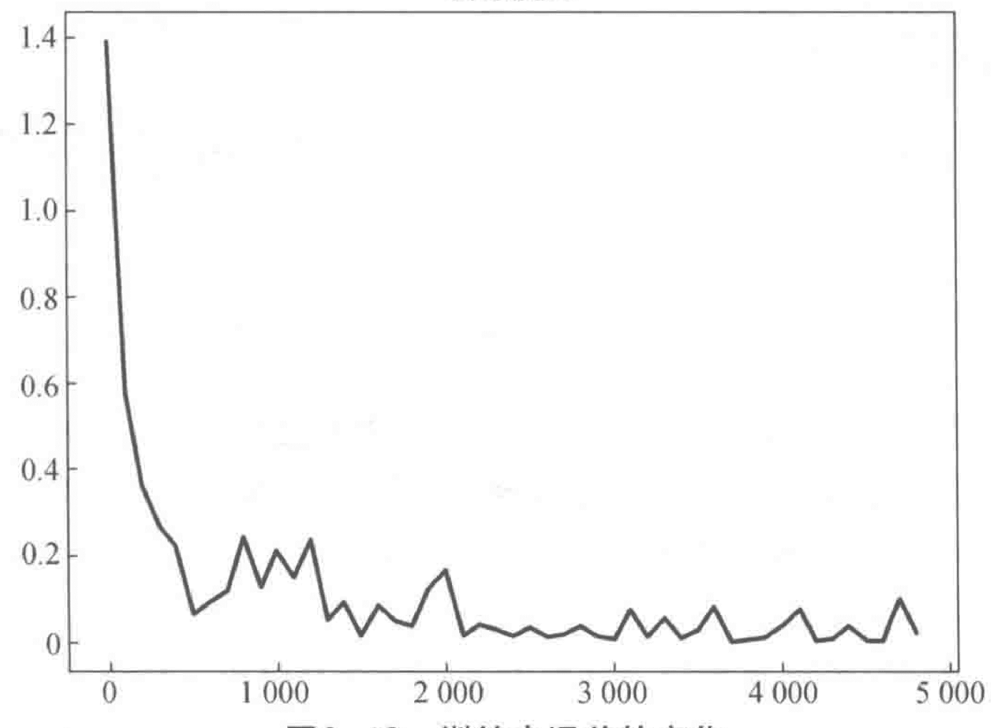

图2-13 训练中误差的变化

按任务划分，损失大致分为回归类和分类类。分类要从有限类别中做选择，比如把手写数字图判到 0~9；回归要预测连续数值，比如依据面积、房间数等估计房价。

### 2.6.1 均方误差
MSE 是回归任务里最常用的评测指标，计算预测值与真实值差值的平方均值，能直观反映偏差大小。常用于回归分析、时序预测和模型评估。MSE 越小，预测越接近真实。

数学形式如下：$$MSE = \frac{\sum_{i=1}^{n}(y_i - \hat{y}_i)^2}{n}$$ 其中 y_i 为第 i 个样本真实值，ŷ_i 为预测值，n 为样本总数。

特点：
- 用平方抑制正负抵消，让大误差权重更高。
- 非负，0 表示完美预测。
- 单位是原始量的平方，可读性偏弱，例如房价的 MSE 单位是价格平方。
- 对异常值敏感，单个大误差会被放大。

实际使用时常配合 RMSE 等指标，把结果换回原始量纲，便于解释。

### 2.6.2 均方根误差
RMSE 先对误差平方求均再开方。公式为：$$RMSE = \sqrt{\frac{1}{n}\sum_{i=1}^{n}(\hat{y}_i - y_i)^2}$$ 其中 y_i 为观测值，ŷ_i 为预测值，∑ 为求和，n 为样本数。

经过平方再开方的处理，RMSE 更关注大误差。

特点：
- 数值越小，观测与预测差距越小，精度越高。
- 同样对离群点敏感。
- 单位与原始观测一致，可直接比较。

在回归分析和时序预测中，RMSE 是衡量预测精度的常用标准。

### 2.6.3 交叉熵损失
交叉熵主要用于分类，特别是多分类。它比较模型输出的概率分布与真实标签分布的差异，预测越偏离真实，损失越大。对类别不平衡友好，且训练初期梯度更大，有助收敛。

熵是信息论里的不确定性度量。对离散概率分布随机变量 X，熵定义为：$$H(X) = -\sum p(x) \cdot \log(p(x))$$ 其中 p(x) 为 X 取 x 的概率，∑ 对所有取值求和，log 以 2 为底。

设共有 N 个样本，每个样本 K 个类别。模型输出概率分布记为 p(i)，真实分布记为 q(i)，理想情况下真实类别概率为 1，其余为 0。交叉熵可写为：$$L = -1/N \cdot \sum\sum q(i,j) \cdot \log(p(i,j))$$ 其中 i 为样本索引，j 为类别索引，q(i,j) 为真实概率，p(i,j) 为预测概率。

目标是最小化预测分布与真实分布的差距。完全一致时损失为 0，差距越大损失越大。交叉熵在深度学习分类中应用广泛，数学性质友好，梯度计算简单。

举例，词表为 ["apple","banana","cherry"]，构建语言模型预测下一个词。给定序列 ["apple","banana","cherry","apple"]，计算交叉熵。

先把每个词转为独热向量，表示如下：```
"apple"  --> [1, 0, 0]
"banana" --> [0, 1, 0]
"cherry" --> [0, 0, 1]
```

理想目标分布在当前词位置为 1，其余为 0，对应序列的目标分布为：```
[1, 0, 0]
[0, 1, 0]
[0, 0, 1]
[1, 0, 0]
```

假设模型输出的预测概率分布为：```
[0.9, 0.05, 0.05]
[0.1, 0.8, 0.1]
[0.1, 0.2, 0.7]
[0.6, 0.3, 0.1]
```

交叉熵公式 L = - ∑(y · log(ŷ))。代入数值后得到约 0.973 的损失，可用于评估该样本的预测质量并指导优化。

## 2.7 模型评估

### 2.7.1 偏差/方差
训练后效果不理想时，先判断是高偏差还是高方差，对调参方向很关键。深度网络处理高维特征，不同区域可能同时出现高偏差和高方差。参照图 2-14 简述。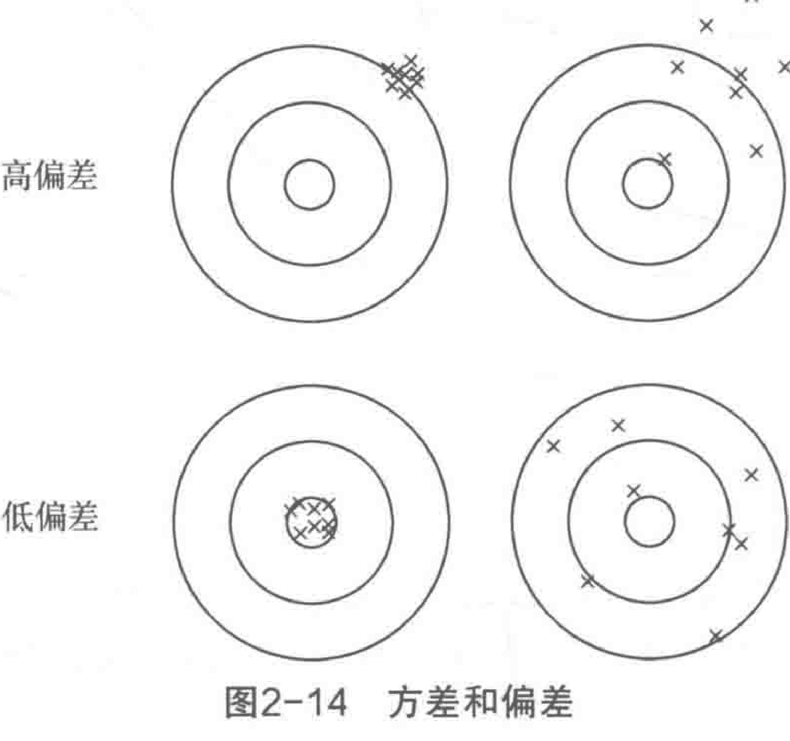

1. 偏差。度量训练集误差与贝叶斯最优误差的差距。高偏差意味着训练误差很高，模型尚未学到数据的普遍规律。改善手段：①增大网络容量；②增加训练轮数；③更换网络结构。
2. 方差。度量验证集误差与训练集误差的差距。高方差说明模型学得过细，连训练集的特有噪声都记住了，泛化差。改善手段：①增加数据量，这是最有效的方式；②正则化；③调整网络结构。

常见组合：
- 低偏差低方差：理想状态，点集中且离散度小。
- 低偏差高方差：典型过拟合，训练好测试差。
- 高偏差低方差：通常是训练初期欠拟合。
- 高偏差高方差：最糟糕情况，准确率低且不稳定。

误差 = 方差 + 偏差² + 噪声

图 2-15 展示了方差与偏差随模型复杂度变化的趋势。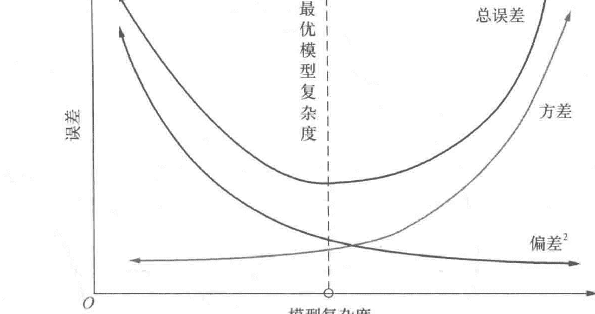

### 2.7.2 过拟合与欠拟合
过拟合和欠拟合是训练中常见的两类问题，反映模型对训练数据与新数据的拟合程度。

1. 过拟合
模型在训练集上表现很好，在新数据上掉链子。对噪声和异常值过于敏感，泛化不足。

常见原因：数据量不足、模型过于复杂、把噪声当规律记忆；特征选择不当，过度关注训练集个别样本；正则化过度。

应对方法：扩充训练集，降低对噪声敏感；使用 L1/L2 正则化控制复杂度；采用集成学习如随机森林、梯度提升树，通过多模型融合降低过拟合。

2. 欠拟合
模型连训练数据都拟合不好，对训练集和新数据表现都差。通常模型太简单、容量不够。

常见原因：模型复杂度不足，捕捉不到关键模式；特征工程不充分，丢弃重要信息；学习率过低、迭代次数不足等训练问题。

应对方法：提升模型复杂度，增加参数或使用更复杂结构；优化特征选择与特征工程；调整超参数，如提高学习率、增加迭代次数。

## 2.8 正则化
正则化是缓解高方差、防止过拟合的核心手段。基本思想是让网络有效规模变小，拟合能力下降，从而不易记住训练集噪声。

常用方法：

1. L1、L2 正则化
通过在损失里加入正则项限制参数大小。L1 加入绝对值之和，倾向产生稀疏权重，有特征选择作用。L2 加入平方和，让参数分散，降低过拟合风险。

L2 会让权重趋近于零，削弱前层对后层的过度影响，使网络更简单。L2 也常被称为权重衰减 weight decay。

2. 随机失活
训练时随机将部分神经元置零，本次迭代不参与更新。参与优化的神经元减少，有效网络变小，模型更鲁棒，神经元间依赖降低。

作用两方面：①降低耦合，每个神经元不能依赖他人，必须自行学到有用特征；②网络集成。每次迭代可视为一个新网络，测试时相当于使用这些网络的集成。

3. 批归一化
在每个批次内对每一层做归一化，保持输入分布稳定。加速收敛，对结构和超参数更鲁棒，还能缓解梯度消失、提升泛化。

4. 早停技术
基于验证集表现的正则化。监控验证误差，当误差不再下降甚至开始上升时提前终止训练，避免进入过拟合阶段。

5. 数据扩充
实质是扩充数据量。当真实数据收集困难时，通过翻转、平移、旋转、色彩扰动等操作生成“伪数据”来训练。以图像分类为例，这些变换通常不改变标签，组合起来能产生近乎无限的训练样本。

## 2.9 SoftMax函数
Softmax 用于多类分类，把实向量映射为概率分布。输入长度为 K 的实向量，输出也是长度 K 的向量，每个值在 0 到 1 之间且总和为 1。见图 2-16。计算公式和示例见图 2-17。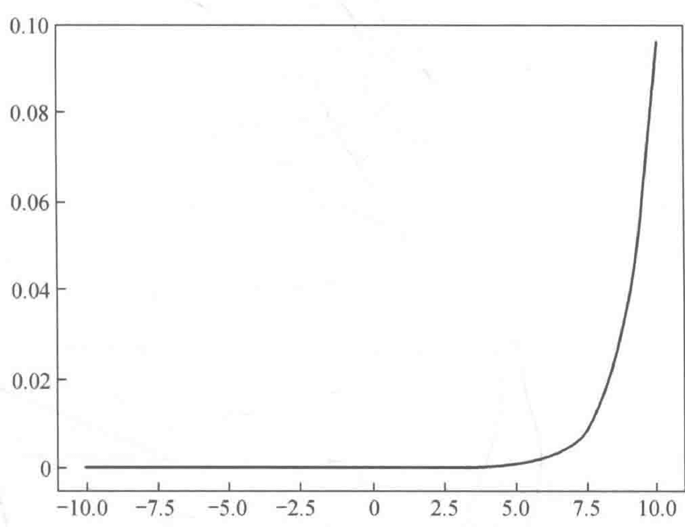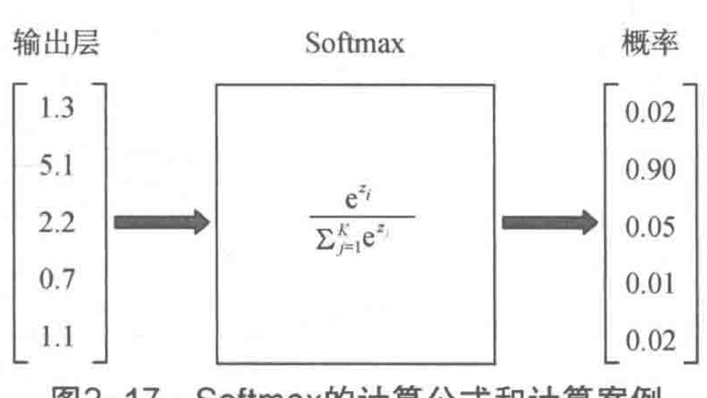

## 2.10 简易神经网络搭建
本例网络见图 2-18，由输入层、一个隐藏层和输出层构成。每个输入样本有十个特征，即十维向量；隐藏层将其变换为十五个特征；输出层最终给出五个预测值。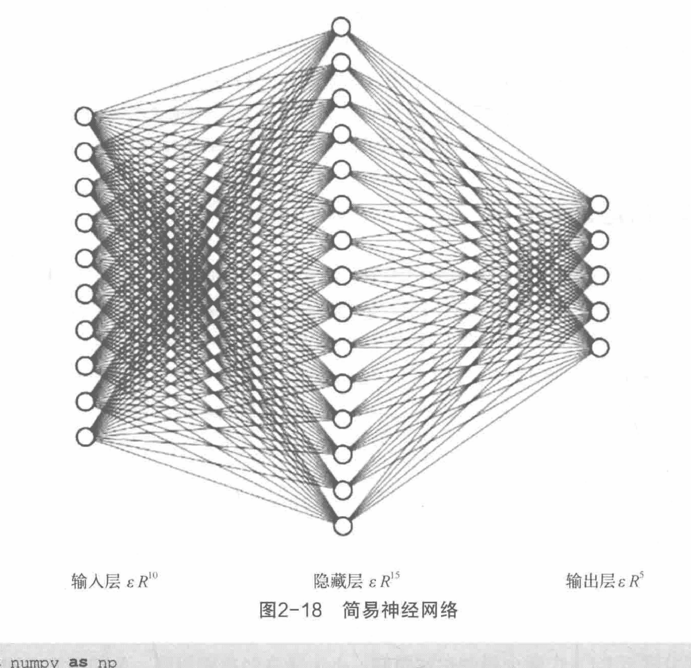

```python
import numpy as np

class NeuralNetwork:
    def __init__(self, input_size, hidden_size, output_size):
        self.input_size = input_size
        self.hidden_size = hidden_size
        self.output_size = output_size

        # 初始化权重和偏置
        self.W1 = np.random.randn(self.input_size, self.hidden_size)
        self.b1 = np.zeros((1, self.hidden_size))
        self.W2 = np.random.randn(self.hidden_size, self.output_size)
        self.b2 = np.zeros((1, self.output_size))

    def forward(self, X):
        # 前向传播
        self.z1 = np.dot(X, self.W1) + self.b1
        self.a1 = np.tanh(self.z1)
        self.z2 = np.dot(self.a1, self.W2) + self.b2
        self.a2 = self.sigmoid(self.z2)

        return self.a2

    def backward(self, X, y, learning_rate):
        m = X.shape[0]

        # 计算输出层的误差
        dZ2 = self.a2 - y
        dW2 = (1/m) * np.dot(self.a1.T, dZ2)
        db2 = (1/m) * np.sum(dZ2, axis=0, keepdims=True)
```

# 第2章 深度学习基石

```python
# 计算隐藏层的误差
dZ1 = np.dot(dZ2, self.W2.T) * (1 - np.power(self.a1, 2))
dW1 = (1/m) * np.dot(X.T, dZ1)
db1 = (1/m) * np.sum(dZ1, axis=0)

# 更新权重和偏置
self.W2 -= learning_rate * dW2
self.b2 -= learning_rate * db2
self.W1 -= learning_rate * dW1
self.b1 -= learning_rate * db1

def train(self, X, y, epochs, learning_rate):
    for epoch in range(epochs):
        # 前向传播
        output = self.forward(X)

        # 反向传播
        self.backward(X, y, learning_rate)

        # 计算损失
        loss = self.calculate_loss(y, output)

        # 每1000个epoch打印一次损失
        if epoch % 1000 == 0:
            print(f"Epoch {epoch}: Loss = {loss}")

def sigmoid(self, x):
    return 1 / (1 + np.exp(-x))

def calculate_loss(self, y_true, y_pred):
    m = y_true.shape[0]
    loss = -1/m * np.sum(y_true * np.log(y_pred) + (1-y_true) * np.log(1-y_pred))
    return loss

# 创建神经网络对象
input_size = 10
hidden_size = 15
output_size = 5
nn = NeuralNetwork(input_size, hidden_size, output_size)

# 准备训练数据
X = np.random.randn(100, input_size)
y = np.random.randint(0, 2, size=(100, output_size))

# 训练神经网络
epochs = 10000
learning_rate = 0.1
nn.train(X, y, epochs, learning_rate)

# 使用训练好的模型进行预测
input_data = np.random.randn(1, input_size)
output = nn.forward(input_data)
print("预测结果: ", output)
```

运行结果：

```
Epoch 0: Loss = 8.206386565530224
Epoch 1000: Loss = 1.8964894857812191
Epoch 2000: Loss = 1.3766947322288718
Epoch 3000: Loss = 1.0773693838932272
Epoch 4000: Loss = 0.9261389638705058
Epoch 5000: Loss = 0.8241001310058085
Epoch 6000: Loss = 0.7262724551312489
Epoch 7000: Loss = 0.6499599780627128
Epoch 8000: Loss = 0.5886312819999654
Epoch 9000: Loss = 0.5414023570799503
```

预测结果：

```
[[9.76165380e-01 1.44587484e-01 5.40827691e-04 2.65640942e-01 9.99879940e-01]]
```

本节示例中会用到的 NumPy 核心方法速览：

- `np.random.randn`：按指定形状抽取均值为 0、标准差为 1 的标准正态随机数。
- `np.zeros`：按指定维度创建全部填充为 0 的数组。
- `np.dot`：实现两个数组之间的矩阵乘法运算。
- `np.tanh`：对数组中每一个元素计算双曲正切值。
- `np.sum`：对数组元素做累加，可通过参数指定在哪个轴上聚合。
- `np.power`：对数组的每个元素做幂运算，指数可由参数决定。
- `np.exp`：逐元素计算自然指数 e 的幂。
- `np.log`：逐元素计算以 e 为底的自然对数值。
- `np.random.randint`：在给定区间内产生随机整数，可控制范围与个数。

## 2.11 模型优化

### 2.11.1 梯度消失

梯度消失是指深度网络反向传播时，梯度从输出层向输入层逐层传递过程中数值不断衰减直至接近零的现象。层数越深，前层的参数收到的梯度越小，更新幅度几乎可以忽略，训练效果被削弱。

该问题常出现在使用 Sigmoid、tanh 这类激活函数且网络很深时。这类函数在输入远离零区时导数趋近于零，链式求导时不断相乘会导致梯度迅速缩小，前层几乎无法学习。

后果是网络难以捕捉输入的深层特征，整体拟合能力受限。

常见缓解手段有：

- （1）更换激活函数：ReLU 等函数在较大输入区间保持较大导数，有助于保持梯度。
- （2）权重初始化策略：合理的初始化让前向激活与反向梯度维持在稳定区间。
- （3）使用批归一化：对每层输入做标准化，加快收敛并减弱梯度衰减。
- （4）引入残差连接：通过跳跃连接把前层输出直接加到后层，改善梯度回传路径。

综合使用以上技巧可显著提升深网的训练效果。

### 2.11.2 梯度爆炸

梯度爆炸与梯度消失相对，是反向传播中某些层的梯度值异常增大、甚至发散的问题。深度网络、学习率偏高时尤其易出现，误差累积放大导致权重更新幅度失控，模型难以收敛。

典型表现包括：

- （1）权重参数剧烈波动：更新超出合理范围，训练发散。
- （2）数值不稳定：权重过大引发溢出或计算异常。
- （3）训练过程不稳：损失震荡，无法正常迭代。

可行的控制方法：

- （1）批归一化：对每批输入标准化，使训练更稳定。
- （2）梯度截断：设定阈值，超过时将梯度裁剪到阈值以内。
- （3）合适的权重初始化：降低梯度异常放大的概率。
- （4）调低学习率：放慢更新步伐，避免梯度累积失控。

合理处理梯度爆炸是保证深度模型稳定训练的关键。

### 2.11.3 优化手段

深度学习优化的核心是调整参数与超参数，让网络更好地拟合数据，提升预测与分类精度，过程是持续迭代的。

主要维度包括：

- （1）损失函数：度量预测值与真实值的差距，常见有均方误差、交叉熵等，优化目标是最小化它。
- （2）梯度下降：依据损失对参数的梯度反向更新权重，包含批量、随机、小批量等变体。
- （3）学习率调整：决定每次更新的步长，合适的值加速收敛，过大或过小都会导致问题，是常用调参策略。
- （4）正则化：防止过拟合，如 L1、L2 等手段降低模型复杂度，提升泛化。
- （5）批归一化：训练时对输入分布做归一化，加速收敛并缓解梯度消失与爆炸。
- （6）自适应学习率：根据梯度历史动态调整学习率，如 AdaGrad、RMSProp、Adam 等。
- （7）超参数调优：通过网格搜索、随机搜索、贝叶斯优化等方法寻找最优超参数组合。

### 2.11.4 调参技巧

深度网络涉及学习率、L2 系数、动量、批量大小、隐层单元数、层数、学习率衰减率等众多超参数，调参就是寻找最佳组合。

常用做法：

- （1）学习率调整：采用指数衰减、余弦退火等策略逐步降低学习率，让训练更平稳。
- （2）批量大小选择：大批量提升速度但易陷入局部最优，小批量利于找到更好解但速度慢，需权衡。
- （3）正则化技术：L1、L2、随机失活等可降低过拟合，提升泛化能力。
- （4）网络结构优化：增减层数、调整每层单元数、尝试卷积、循环、全连接等不同层类型。
- （5）随机初始化权重：初始权重影响收敛与结果，可尝试不同初始化方式或迁移预训练参数。
- （6）早停策略：在验证集误差开始上升前停止训练，避免过拟合，选择表现最佳的模型快照。
- （7）参数搜索方法：网格搜索、随机搜索等遍历参数空间寻找最优组合，计算成本较高，可借助 scikit-learn 等工具实现。

调参没有普适公式，需要结合实验与评估在测试集上验证效果。

# 第3章 PyTorch 开发入门


## 3.1 深度学习框架

深度学习通过人工神经网络的层次结构实现机器学习，为提升研发效率涌现出众多框架，代表性有 TensorFlow、PyTorch、Keras、Caffe 等。

- （1）TensorFlow：由 Google Brain 团队开源，覆盖机器学习与深度学习的完整生态，支持分布式计算。其图式计算范式在处理大规模复杂网络时优势明显，并配备 TensorBoard 可视化调试。
- （2）PyTorch：由 Meta AI 团队主推，强调简洁与灵活，提供强 GPU 加速与自动求导。动态图机制让模型构建更直观自由，生态内有 TensorBoardX 用于可视化。
- （3）Keras：基于 Python 的高级神经网络接口，可在 TensorFlow、CNTK、Theano 上运行。API 友好、模块化组合，适合快速原型。
- （4）Caffe：由加州大学伯克利分校团队开发，擅长图像分类等计算密集任务，运行速度快，接口简洁便于部署。

其它常见框架：

- （5）CNTK：微软开源框架，性能强劲，支持多 GPU 分布式并行训练，兼容 CNN、RNN 等模型，提供 Python、C++、.NET 接口。
- （6）MXNet：由亚马逊主导，兼顾灵活与高效，支持 Python、R、Scala、C++，可跨多 GPU、多服务器分布式训练。
- （7）PaddlePaddle：百度开源框架，易用高效，覆盖 CNN、RNN、DNN 等模型，提供 Python、C++ 接口。

选型取决于任务需求与使用习惯，各框架各有侧重。

## 3.2 PyTorch简介

自 2017 年发布以来，PyTorch 已成为研究与应用开发的主流选择。它源自 Torch 项目，将原本基于 Lua 的实现迁移到 Python，大幅降低使用门槛，并在开源后凭借动态图与易用性成为 TensorFlow 的主要竞争者。

PyTorch 主要面向两类人群：希望用 GPU 能力替代 NumPy 的用户，以及需要灵活快速的研究平台的研究者。

框架特点包括功能强大、接口灵活、社区活跃，兼具高效的 GPU 计算与自动微分能力，是当前深度学习实践的热门工具。

- （1）动态构建的计算图：相较于 TensorFlow 这类采用静态图的框架，PyTorch 选用 define-by-run 的动态图机制，前向传播时会逐次重建图结构。这样的设计让模型搭建更灵活，调试也更直观。
- （2）贴合 Python 的使用体验：框架在 API 层面充分吸收 Python 习惯，操作更自然。Tensor 对象直接支持 Python 的切片、索引等语法，无需额外封装。
- （3）GPU 加速能力：借助 NVIDIA 的 CUDA 架构，PyTorch 可把计算 offload 到 GPU，数值运算效率大幅提升，训练与推理速度明显加快。
- （4）完备的工具生态：内置自动微分、优化器、数据读取与预处理等组件，覆盖模型开发全流程。TorchVision 作为子项目，还提供图像处理工具与常用预训练模型。
- （5）活跃的社区支持：社区规模庞大，教程、问答、开源项目资源丰富。众多顶尖深度学习论文也同步开源了 PyTorch 复现代码。
- （6）生产环境对接能力：TorchServe 模型服务工具可把训练好的模型快速部署到线上。PyTorch 还兼容 ONNX，可导出模型后在 Caffe2、TensorRT 等其他推理引擎中使用。

## 3.3 PyTorch 安装指南
PyTorch 支持 Linux 与 Windows，且可按需使用或不使用 GPU。若要启用 GPU，需要先部署 CUDA。若使用阿里云 GPU 服务器，可在申请时让实例启动时自动完成 CUDA 安装。

### 3.3.1 CUDA 安装
访问英伟达官网：https://developer.nvidia.com/cuda-downloads，在页面上（见图 3-1）能找到对应的安装命令。

在 Linux Ubuntu 22.04 x86_64 需要执行以下命令：

```bash
wget https://developer.download.nvidia.com/compute/cuda/repos/ubuntu2204/x86_64/cuda-ubuntu2204.pin
sudo mv cuda-ubuntu2204.pin /etc/apt/preferences.d/cuda-repository-pin-600
wget https://developer.download.nvidia.com/compute/cuda/12.2.1/local_installers/cuda-repo-ubuntu2204-12-2-local_12.2.1-535.86.10-1_amd64.deb
sudo dpkg -i cuda-repo-ubuntu2204-12-2-local_12.2.1-535.86.10-1_amd64.deb
sudo cp /var/cuda-repo-ubuntu2204-12-2-local/cuda-*-keyring.gpg /usr/share/keyrings/
sudo apt-get update
```

## 大模型本地化实践：基于开源模型搭建
```
sudo apt-get -y install cuda
sudo reboot
nvidia-smi
```

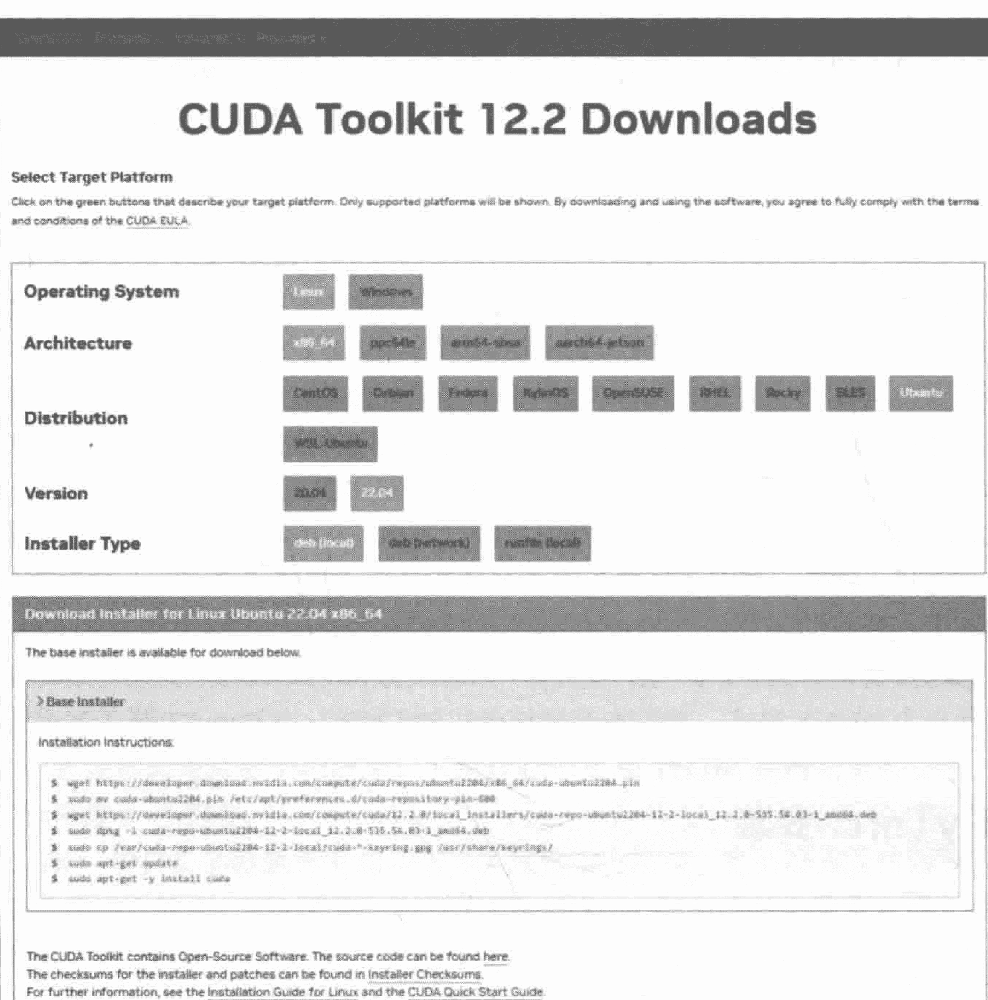

图3-1 CUDA安装命令

通过 nvidia-smi 可查询 GPU 状态（需先重启），界面如图 3-2 所示。

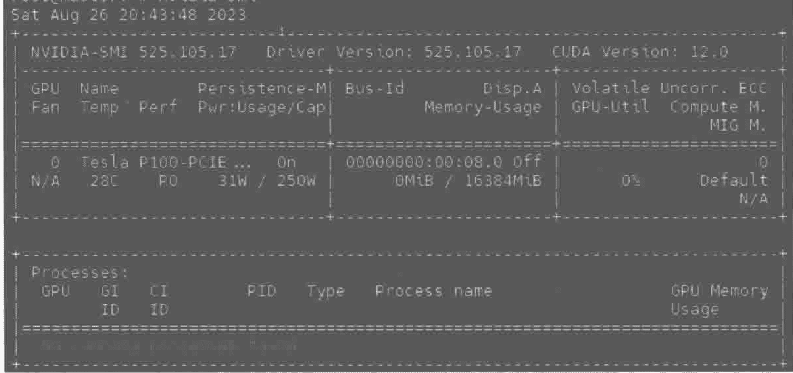

图3-2 用nvidia-smi查看GPU信息

## 第3章 PyTorch 开发基础

### 3.3.2 阿里云 GPU 云服务器
阿里云提供多种实例规格，运行本章示例以下配置即可满足。

GPU 计算型 gn5 / ecs.gn5-c4g1.xlarge (4vCPU 30 GiB)。

该实例包含 4 个 vCPU、30 GiB 内存、1 张 NVIDIA P100，显存 16 GB，系统盘建议申请 100 GiB。

镜像选用 Ubuntu 22.04，安装 CUDA12.0.1，具体配置如图 3-3 所示。


### 3.3.3 PyTorch 安装步骤
打开 PyTorch 官网：https://pytorch.org/，查找安装指令（见图 3-4）。

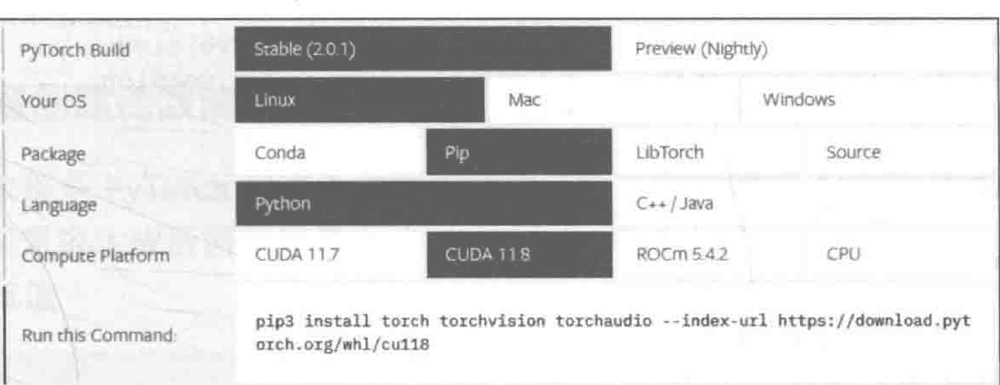

官网目前仅列出 CUDA 11.8 的支持说明，但社区已确认兼容更高版本的 CUDA。

安装指令：

```
pip3 install torch torchvision torchaudio --index-url https://download.pytorch.org/whl/cu118
```

验证安装：

```
root@master:~# python3
Python 3.10.6 (main, May 29 2023, 11:10:38) [GCC 11.3.0] on linux
Type "help", "copyright", "credits" or "license" for more information.
>>> import torch
>>> print(torch.cuda.is_available())
True
>>>
```

## 本地大模型开发：开源方案落地

### 3.3.4 安装其它依赖库
可参考源码仓库中的 requirements.txt，文件里列出了所需 Python 包的名称与版本：

```
datasets>=2.8.0
peft>=0.4.0.dev0
transformers>=4.30.1
accelerate>=0.20.3
bitsandbytes>=0.39.0
wandb>=0.14.2
```

一次性安装全部依赖的命令为：

```
pip install -r requirements.txt
```

若运行时提示缺失库，按提示补充即可，例如缺少 scipy、sentencepiece 时执行：

```
pip install scipy
pip install sentencepiece
```

### 3.3.5 开发环境检查

#### 1. 检查 PyTorch 版本
```
torch.__version__                # PyTorch version
torch.version.cuda               # Corresponding CUDA version
torch.backends.cudnn.version()   # Corresponding cuDNN version
torch.cuda.get_device_name(0)    # GPU type
```

#### 2. 判断是否具备 CUDA 支持
```
torch.cuda.is_available()
```

#### 3. 指定程序运行在特定 GPU 卡上
在命令行通过环境变量指定

```
CUDA_VISIBLE_DEVICES=0,1 python train.py
```

或在代码内部指定

```
os.environ['CUDA_VISIBLE_DEVICES'] = '0,1'
```

## 3.4 张量概览
PyTorch 能在一定程度上替代 NumPy，首先介绍其核心对象张量 tensor。它本质上是单一数据类型的多维矩阵，与 NumPy 的 ndarray 概念相近，关键差异在于张量可被搬运到 GPU 以加速计算。

### 3.4.1 张量创建函数定义
下面以创建指定形状的零值张量为例说明定义方式。

## 第3章 PyTorch 开发基础

```
torch.zeros(*size, out=None, dtype=None, layout=torch.strided, device=None, requires_grad=False)
```

创建一个形状为 (3, 4) 的全零张量：

```
torch.zeros((3, 4))
```

size 参数采用 *size 形式，星号起到参数解包作用，可把可迭代对象展开为多个独立参数，因此也可以写作 torch.zeros(3, 4)。

张量输出为

```
tensor([[0., 0., 0., 0.],
        [0., 0., 0., 0.],
        [0., 0., 0., 0.]])
```

创建一个形状为 (2, 3)、数据类型为整型 torch.long 且置于 GPU 上的全零张量：

```
device = torch.device("cuda" if torch.cuda.is_available() else "cpu")
torch.zeros((2, 3), dtype=torch.long, device=device)
```

张量输出为

```
tensor([[0, 0, 0],
        [0, 0, 0]], device='cuda:0')
```

torch 共定义了 10 种 dtype，常见有 torch.float64、torch.float32、torch.int64、torch.int32、torch.bool。

### 3.4.2 张量创建函数清单
下述函数均用于生成张量，提供不同初始化策略与填充方式。

- 1. 直接赋值
```
torch.tensor
```

- 2. 按指定规则赋值
torch.eye : 生成指定尺寸的单位矩阵。
torch.empty() : 创建指定大小未初始化的张量。
torch.empty_like() : 基于给定张量创建同形状未初始化张量。
torch.zeros() : 生成指定大小全零张量。
torch.zeros_like() : 基于给定张量创建同形状全零张量。
torch.ones() : 生成指定大小全一张量。
torch.ones_like() : 基于给定张量创建同形状全一张量。
torch.full() : 生成指定大小张量并填入指定数值。
torch.full_like() : 基于给定张量创建同形状并填入指定数值张量。

- 3. 随机赋值
torch.rand() : 生成指定形状随机数张量，元素取值在 [0, 1) 区间。
torch.rand_like()：基于给定张量形状生成随机数张量，取值在 [0, 1)。
torch.randn()：生成指定形状随机数张量，服从均值 0、标准差 1 的正态分布。
torch.randn_like()：基于给定张量形状生成服从标准正态分布的随机数张量。
torch.randint()：生成指定形状随机整数张量，取值位于给定区间。
torch.randint_like()：基于给定张量形状生成区间内的随机整数张量。

- 4. 计算赋值
torch.arange：返回从 start 到 end（不含）以 step 步进的值组成的张量，类似 Python range。
torch.range：返回从 start 到 end（不含）的整数序列张量，可指定步长。
torch.linspace：返回指定区间内均匀分布的值张量，可控制元素数量。
torch.logspace：返回指定区间内对数尺度均匀分布的值张量，可指定元素数量与底数。

Tensor 与 NumPy 数组可相互转换，且在 CPU 内存上转换后两者共享存储，修改一方另一方同步变化。

tensor.numpy()：将 Tensor 转为 NumPy 数组
torch.from_numpy(numpy_array)：将 NumPy 数组转为 Tensor

### 3.4.3 随机张量：torch.randn()
torch.randn 用于生成服从标准正态分布（均值 0、标准差 1）的随机张量。该函数具备以下特点。

- （1）使用便捷：作为 PyTorch 内置函数，只需给出目标形状即可返回符合标准正态分布的随机张量。
- （2）多维支持：可指定任意维度，生成多维随机张量，适合深度学习中的张量操作与训练。
- （3）可复现性：通过设置随机数种子，可使多次调用得到相同序列，便于调试与实验复现。
- （4）GPU 支持：若环境支持 CUDA，可把生成的随机张量迁移到 GPU 进行高性能计算。

torch.randn 的调用格式如下：

```
torch.randn(*size, *, out=None, dtype=None, layout=torch.strided, device=None, requires_grad=False)
```

## 第3章 PyTorch 开发基础

（1）用 torch.randn 随机生成一个张量并打印数值：

```
import torch

# 生成张量
x = torch.randn(10, 5)

# 设置打印选项
torch.set_printoptions(sci_mode=False, precision=4)

# 打印张量
print(x)
```

```
tensor([[-1.6402, -1.4865,  0.0776, -0.0462,  1.0132],
        [ 0.5367,  1.3050,  2.5815, -0.0057, -1.5607],
        [ 0.8021, -0.3908,  0.2402, -0.2683,  0.7455],
        [ 0.0960,  0.4611,  0.8924,  0.2369,  1.3406],
        [ 1.3475, -0.9529,  0.2092, -0.1640, -0.2614],
        [ 0.5059, -0.1660, -0.0362, -0.6031,  0.1247],
        [ 0.9128, -0.9585, -1.3688, -0.0143, -0.4785],
        [-0.4905,  1.1133,  0.2508,  0.4334,  0.5002],
        [ 1.3232, -1.8899, -1.9020,  0.4695,  0.4257],
        [ 0.3288, -0.8896, -1.3687,  2.1658, -0.9100]])
```

（2）将数据绘制成直方图，可观察到分布符合正态：

```
import torch
import matplotlib.pyplot as plt
from matplotlib.font_manager import FontProperties

# 设置中文字体
font = FontProperties(fname='C:\Windows\Fonts\simhei.ttf')  # 替换为字体文件的路径

# 绘制正态分布图
plt.hist(x.flatten().numpy(), bins=30)
plt.xlabel('数值', fontproperties=font)
plt.ylabel('频率', fontproperties=font)
plt.title('正态分布图', fontproperties=font)
plt.show()
```

从图 3-5 可见 torch.randn 生成的数据呈现正态分布。

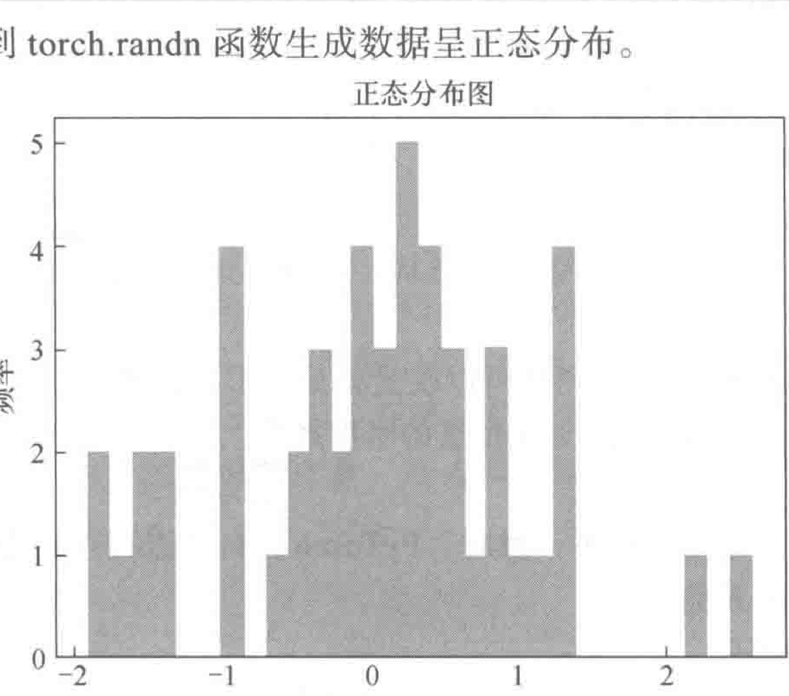

图3-5 torch.randn函数生成数据

## 大模型本地化开发：用开源模型构建本地系统

（3）计算均值与方差：

```
# 计算张量的均值
mean = torch.mean(x)
print("均值:", mean)

# 计算张量的方差
variance = torch.var(x)
print("方差:", variance)
```

均值：tensor(0.0517)
方差：tensor(0.9845)

均值接近 0，方差接近 1，符合 randn 函数的设计预期。

### 3.4.4 张量操作
张量是 PyTorch 最核心的数据结构，用于存储与处理数值数据。它提供丰富的函数与方法，支持数学运算、索引访问、形状变换等。下面介绍常见操作。

- 1. 创建张量

PyTorch 张量与自动微分实战要点

（1）借助 torch.tensor 把已有数据转为张量，支持 Python 列表、NumPy 数组或单个标量等形式输入。
（2）用 torch.zeros 与 torch.ones 分别生成全零或全一的张量。
（3）用 torch.empty 创建未做初始化的张量，内存已分配但数值随机。
（4）用 torch.rand 与 torch.randn 生成均匀分布或正态分布的随机张量。

2. 张量数学运算
（1）基础算术包含加减乘除，可通过 torch.add、torch.sub、torch.mul、torch.div 等实现。
（2）逐元素数学函数如 torch.sin、torch.cos、torch.exp、torch.log 等，可对每个元素单独计算。
（3）线性代数层面提供矩阵乘法和向量点积，如 torch.mm、torch.matmul、torch.dot 等。

3. 索引与切片
（1）整数索引能取出指定位置的元素，例如 tensor[0, 1]。
（2）切片语法可截取连续区间，例如 tensor[:, 1:4]。
（3）布尔索引可按条件筛选，例如 tensor[tensor > 0]。

4. 形状变换
（1）tensor.view 用于改变形状，例如 tensor.view(2, -1) 将张量重排为 2 行，列数自动推导。
（2）tensor.reshape 功能与 view 类似，也能完成重塑，例如 tensor.reshape(2, -1)。
（3）tensor.permute 用来交换不同维度的顺序。

5. 广播机制
当两个参与运算的张量形状不匹配时，PyTorch 会自动广播，使形状对齐后再做逐元素计算。

6. 合并与拆分
（1）torch.cat 按指定维度拼接多个张量。
（2）torch.stack 在新增维度上堆叠多个张量。
（3）torch.split 把一个张量切分为若干子张量。

7. 统计操作
（1）可求和、均值、标准差等，如 torch.sum、torch.mean、torch.std。
（2）可求最大值、最小值并排序，如 torch.max、torch.min、torch.sort。

8. 内存共享
PyTorch 张量对象可能共享底层内存，对一个张量的修改会反映到其它引用同一块内存的张量上。

以上只是常见操作冰山一角，PyTorch 提供了大量函数与方法，足以覆盖数值计算与深度学习任务，根据具体场景选择即可。

### 3.4.5 CUDA 张量
张量可通过 .to 方法迁移设备，运行在 CPU 或 GPU 上。

```
if torch.cuda.is_available():
    device = torch.device("cuda")  # 定义一个CUDA设备对象
    y = torch.ones_like(x, device=device)  # 显示创建在GPU上的一个tensor
    x = x.to(device)  # 也可以采用 .to("cuda")
    z = x + y
    print(z)
print(z.to("cpu", torch.double))  # .to() 方法也可以改变数值类型
```

打印结果显示，首个结果位于 GPU，标识为 device='cuda:0'，第二个结果保留在 CPU。

若有多张 GPU，可为不同张量指定不同卡：

```
# 使用第一张GPU卡作为默认设备
device = torch.device("cuda:0")
# 将张量移动到默认设备
x = torch.tensor([1, 2, 3]).to(device)
# 将张量移动到指定设备ID为1的GPU卡
y = torch.tensor([4, 5, 6]).to(torch.device("cuda:1"))
# 将张量移动到指定设备ID为2的GPU卡
z = torch.tensor([7, 8, 9]).to(torch.device("cuda:2"))
```

## 3.5 梯度计算
梯度是深度学习优化的基石，借助梯度信息模型能在参数空间寻找损失最小的方向。PyTorch 的自动微分系统 Autograd 负责反向传播与神经网络训练。理解梯度前先掌握导数及其规律。

### 3.5.1 导数与偏导数
导数用于一元函数，描述函数在某点的切线斜率，即输入微变时输出的变化率。推广到多元函数则使用偏导数与全导数。

偏导数在多元函数中固定其它变量，仅考察一个变量微变时函数的变化，一个多元函数对应多个偏导数。

全导数考虑所有变量同时变化的影响，等于各偏导数与对应微小改变量乘积之和。

### 3.5.2 导数规则
计算复杂函数导数的常用法则：

- （1）常数规则：若 $f(x)$ 为常数，则 $f'(x)=0$。
- （2）幂规则：见 P020。
- （3）和差规则：$f(x)=g(x)\pm h(x)$ 时，$f'(x)=g'(x)\pm h'(x)$。
- （4）积规则：$f(x)=g(x)\cdot h(x)$ 时，$f'(x)=g'(x)h(x)+g(x)h'(x)$。
- （5）商规则：$f(x)=g(x)/h(x)$ 时，$f'(x)=\big(g'(x)h(x)-g(x)h'(x)\big)/h(x)^2$。
- （6）链式法则：见 P020。

### 3.5.3 梯度
对多元函数，梯度是各偏导数组成的向量。设 $f$ 的输入为 $n$ 维向量 $x=[x_1,x_2,\cdots,x_n]$，则

$\nabla f=[\partial f/\partial x_1,\partial f/\partial x_2,\cdots,\partial f/\partial x_n]$

即在其它输入固定时，函数关于每个分量的变化率。

### 3.5.4 公式推导
对以下式子求 $x$ 的梯度。

```
x = [[1.,2.],[3.,4.]]
y = x + 2
z = y * y * 3
out = z.mean()
```

第一步求 $dy/dx$。$y=x+2$ 按和差规则求导，$x$ 的导数为 1，常数 2 的导数为 0，故 $dy/dx=1$。等价地，线性函数斜率即为导数。

第二步求 $dz/dy$。按幂规则，$z=3y^2$ 得 $dz/dy=6y$。

第三步求 $d(out)/dz$。$out=(z_1+z_2+z_3+z_4)/4$，每个 $z_i$ 对 $out$ 的贡献相同，导数为 $1/4$，向量形式为 $[1/4,1/4,1/4,1/4]$。

第四步链式求导，$d(out)/dx=d(out)/dz \times dz/dy \times dy/dx=1/4 \times 6y \times 1=1.5(x+2)$。

最终梯度为 $1.5(x+2)=1.5\times[[3.,4.],[5.,6.]]=[[4.5,6.0],[7.5,9.0]]$。

### 3.5.5 自动梯度计算
Autograd 为张量运算提供自动微分，属于 define-by-run 框架，反向图随代码执行动态构建。

torch.Tensor 核心类中，设 .requires_grad=True 后 PyTorch 会记录该张量的操作历史，计算完毕调用 .backward() 即可自动得到梯度并累加到 .grad。

backward 通常作用于标量损失，若输入非标量需先求和或平均。也可传入 gradient 参数进行链式计算。

torch.no_grad() 上下文可关闭梯度追踪，常用于推理阶段节省内存。

参数优化可借助 torch.optim，内置 SGD、Adam 等算法。默认 backward 会累加梯度，需手动 .zero_grad() 清零。

### 3.5.6 代码解析
示例代码如下：

```
import torch

x = torch.tensor([[1.,2.],[3.,4.]], requires_grad=True)
y = x + 2
z = y * y * 3
out = z.mean()
out.backward()
```

流程说明：
（1）$x=torch.tensor([[1.,2.],[3.,4.]],requires\_grad=True)$ 创建可求导的 $2\times2$ 张量。
（2）$y=x+2$ 逐元素加 2。
（3）$z=y*y*3$ 等价于 $3y^2$。
（4）$out=z.mean()$ 计算均值。
（5）$out.backward()$ 反向求梯度，结果写入 $x.grad$。

依据链式法则 $d(out)/dx=d(out)/dz\cdot dz/dy\cdot dy/dx$，其中 $d(out)/dz=1/4$，$dz/dy=6y$，$dy/dx=1$，得 $d(out)/dx=3/2\,(x+2)$。

已知

```
tensor([[1, 2],
        [3, 4]])
```

故

```
tensor([[4.5000, 6.0000],
        [7.5000, 9.0000]])
```

## 第3章 PyTorch开发基础

## 3.6 反向传播
反向传播用于高效计算损失对权重和偏置的梯度，是训练神经网络的核心。

主要步骤：
（1）前向传播：从输入层到输出层逐层计算并保存中间结果，得到预测并计算误差。
（2）输出误差：比较预测与真实标签，得到损失。
（3）误差回传：由输出层向输入层反向传播，利用链式法则计算各层权重的梯度。
（4）权重更新：按学习率调整权重与偏置，降低损失。

叶节点张量是用户直接创建而非运算产生的张量，是计算图起点，如下 x、y：

```
import torch

x = torch.tensor([1.0, 2.0], requires_grad=True)
y = torch.ones(2, requires_grad=True)
```

运算产生的张量 z 不是叶节点：

$$z = x + y$$

可通过 is_leaf 判断叶节点属性：

```
print(x.is_leaf)  # True
print(z.is_leaf)  # False
```

反向传播时仅叶节点的 .grad 会被保存与更新，非叶节点梯度默认释放以省内存。若需保留，可调用 retain_grad：

```
import torch

x = torch.tensor([1.0, 2.0], requires_grad=True)
y = x * 2
z = y.mean()

y.retain_grad()        # 告诉PyTorch保留张量y的梯度

z.backward()           # 计算梯度

print(x.grad)          # x的梯度
print(y.grad)          # y的梯度
```

示例中 y 为非叶节点，默认 backward 后梯度会被清空，经 retain_grad 后可保留 $y.grad$。

retain_grad 不是想开就开的功能。频繁使用它会让每个非叶子节点的梯度张量都被额外保留，显存很快就会被吃满。所以原则很简单：确实用到时才打开，用完即关。

## 3.7 torch.nn：搭建网络的积木箱
torch.nn 是 PyTorch 建模的主力模块，里面提供了大量现成的网络组件，用来拼装复杂的深度学习模型。核心内容大致可以分为五类：

- （1）Layers：基础层集合，相当于神经网络的砖块。比如 nn.Linear、nn.Conv2d、nn.MaxPool2d、nn.ReLU 等。实例化时传入特定参数，前向时接收输入数据，每层内部都有可学习的权重和偏置。
- （2）Loss Functions：常用损失函数库。nn.MSELoss 多用于回归任务，nn.CrossEntropyLoss 用于分类任务，nn.NLLLoss 也是负对数似然损失。作用是衡量预测值与真实值的差距，为参数更新提供信号。
- （3）Utilities：模型构建与训练的辅助工具。nn.Sequential 可以把多个层按顺序串起来，nn.Module 是所有网络模块的基类，继承它就能自定义层或模型。
- （4）Normalization and Regularization Layers：正则化和归一化层。nn.Dropout 用来抑制过拟合，nn.BatchNorm1d、nn.BatchNorm2d 能加速收敛并提升性能。
- （5）Activation Functions：激活函数集合。nn.Sigmoid、nn.ReLU、nn.Tanh、nn.Softmax 等，通常接在层后引入非线性，让模型学会更复杂的模式。

### 3.7.1 nn.Linear 全连接层的核心用法
nn.Linear 是 torch.nn 里实现线性变换的类，也常叫做全连接层或线性层，可用来搭建模型中的线性部分。

构造时需要两个参数：in_features 输入特征数，out_features 输出特征数。该层把输入特征映射到输出特征，并对每个输出应用可学习的权重和可选的偏置。

计算公式为

$$y = xA^T + b$$

其中：
x 是输入张量，形状为（batch_size, input_features）；
A 是权重矩阵，形状为（input_features, output_features）；
b 是偏置向量，形状为（output_features，）；
y 是输出张量，形状为 (batch_size, output_features)。

一个简单示例：

```
import torch
import torch.nn as nn

# 创建一个线性层，输入特征数为3，输出特征数为2
linear_layer = nn.Linear(3, 2)

# 输入样本
inputs = torch.tensor([[1.0, 2.0, 3.0], [4.0, 5.0, 6.0]])

# 将输入传递给线性层进行前向计算
outputs = linear_layer(inputs)

print(outputs)
```

输出：

```
tensor([[-0.4815,  1.6651],
        [-1.5846,  3.1608]], grad_fn=<AddmmBackward>)
```

这里创建了一个输入维度 3、输出维度 2 的线性层。把形状为 (2, 3) 的输入送入后，得到形状为 (2, 2) 的输出，表示两个样本在两个输出特征上的结果。注意 nn.Linear 的参数是可学习的，训练时会自动更新以适应任务。

### 3.7.2 nn.Sigmoid 把输出压缩到 0-1 的激活
nn.Sigmoid 会把任意实数映射到 0 到 1 之间。数学表达为 sigmoid(x) = 1 / (1 + exp(-x))，exp 为指数函数。

在实践中它常作为隐藏层的激活，也常出现在二分类输出层，把模型预测归一化为概率值。

示例，假设输入张量为 x：

```
import torch
import torch.nn as nn

x = torch.tensor([2.0, -1.0, 0.5])
sigmoid = nn.Sigmoid()

output = sigmoid(x)
print(output)
```

输出：tensor([0.8808, 0.2689, 0.6225])

先导入库、定义输入，再实例化 Sigmoid 对象，把 x 送入后得到同形状的输出。实际项目里 Sigmoid 通常内嵌在模型结构中，由前向传播自动调用。

### 3.7.3 nn.BCELoss 二分类损失怎么算
nn.BCELoss 用于计算二元交叉熵损失，主要服务于二分类问题。

它根据模型输出的概率和真实标签计算差距，适用于判断正类负类的场景。

一般调用方式：

```python
import torch
import torch.nn as nn

criterion = nn.BCELoss()  # 创建BCELoss对象

output = torch.tensor([0.8, 0.2, 0.4])  # 模型的输出，表示样本属于正类的概率
target = torch.tensor([1, 0, 1], dtype=torch.float32)  # 真实标签，表示正类为1，负类为0

loss = criterion(output, target)  # 计算损失值
print(loss)
```

输出：tensor(0.9854)

其中 output 表示样本属于正类的概率，target 是真实标签。损失会根据两者差异计算。注意 output 和 target 形状要一致，且取值一般在 0 到 1 之间。若模型输出已过 Sigmoid，可改用 nn.BCEWithLogitsLoss，它内部会自动完成 Sigmoid。BCELoss 是二分类训练中常用的损失之一。

## 3.8 torch.optim 模型训练的优化器选择
torch.optim 提供了多种优化算法，用于在训练中更新模型参数以降低损失。

核心是 Optimizer 基类，构造时传入模型参数的可迭代对象，并提供学习率调度、权重衰减等配置接口。

常见选择有：
（1）SGD 优化器：最基础的随机梯度下降，按样本梯度更新参数。
（2）Adam 优化器：融合 AdaGrad 和 RMSProp 思想，利用梯度一阶矩和二阶矩估计自适应更新。
（3）学习率调度器：可随训练进度动态调整学习率，提升训练效果。

在 Transformer 架构里，优化器不属于模型结构，而是训练阶段的更新算法，目标是最小化损失函数。训练时通常选用 Adam，自适应学习率，兼具 Momentum 和 RMSProp 的优点。

代码中优化器一般放在主训练循环里，每个步骤根据损失对参数的梯度更新权重，通常在每个批次结束后执行。

## 3.9 从训练到测试：模型完整生命周期
PyTorch 里常规做法是把数据拆成训练集、验证集、测试集，用于训练、调参和最终评估。

- （1）数据预处理：先做归一化、均值方差计算等，再划分数据集。
- （2）定义模型：继承 torch.nn.Module，实现 __init__ 和 forward。
- （3）定义损失函数和优化器：内置有交叉熵损失 nn.CrossEntropyLoss 和均方误差 nn.MSELoss，优化器可选 SGD 或 Adam 等。

```python
loss_fn = torch.nn.MSELoss()
optimizer = optim.SGD(model.parameters(), lr=learning_rate)
```

- （4）训练模型：标准流程如下。
  - ① 清空梯度：optimizer.zero_grad() 把上轮梯度清零。

```python
optimizer.zero_grad()
```
  - ② 正向传播：把数据送入模型得到预测。

```python
output = model(input)
```
  - ③ 计算损失：用损失函数比较预测与标签。

```python
loss = loss_fn(output, target)
```
  - ④ 反向传播：loss.backward() 计算梯度。

```python
loss.backward()
```
  - ⑤ 更新权重：optimizer.step() 根据梯度更新参数。

```python
optimizer.step()
```

- （5）验证模型：每个训练周期结束后在验证集上评估，防止过拟合并调整超参数。
- （6）测试模型：训练收敛后在从未见过的测试集上评估，给出公正性能指标。
- （7）保存和加载模型：用 torch.save 和 torch.load 保存加载模型，方便复用。

整体就是这样，实操中还常涉及调试、超参数搜索等环节。

## 大模型本地化：用开源模型搭建自己的系统

## 3.10 PyTorch 重写 NumPy 神经网络
相比第 2 章用 NumPy 手写的网络，这里改用 PyTorch。NumPy 数组被转换为 PyTorch 张量，用 torch.tensor 创建输入 x 和标签 y。用 torch.randn 替代 np.random.randn 初始化权重 w 和偏置 b。

activate 函数改用 torch.where 实现条件判断，前向传播里用 torch.matmul 替代 np.dot 做矩阵乘法。测试后向传播结果与之前一致，区别在于输出类型是 torch.Tensor 而非 NumPy 数组。

### 3.10.1 单层感知机实战
先定义一个继承 nn.Module 的 Perceptron 类，内部包含线性层 linear 和 Sigmoid 激活层，forward 方法实现前向过程。

随后用训练数据 X、标签 y 初始化模型并打印结构，选用二分类常用的 BCELoss 和随机梯度下降优化器。

训练阶段反复进行前向、算损失、反向、优化。调用 optimizer.zero_grad() 清零梯度，loss.backward() 反向传播，optimizer.step() 更新参数。训练结束后再在训练集上测试并算准确率。

```python
import torch
import torch.nn as nn
import torch.optim as optim

# 定义单层感知器模型
class Perceptron(nn.Module):
    def __init__(self, input_size):
        super(Perceptron, self).__init__()
        self.linear = nn.Linear(input_size, 1)
        self.sigmoid = nn.Sigmoid()

    def forward(self, x):
        out = self.linear(x)
        out = self.sigmoid(out)
        return out

# 定义训练数据
X = torch.tensor([[0, 0], [0, 1], [1, 0], [1, 1]], dtype=torch.float32)
y = torch.tensor([[0], [0], [0], [1]], dtype=torch.float32)

# 初始化模型
input_size = X.shape[1]
model = Perceptron(input_size)
print(model)

# 定义优化器和损失函数
criterion = nn.BCELoss()
optimizer = optim.SGD(model.parameters(), lr=0.1)

# 训练模型
num_epochs = 1000
for epoch in range(num_epochs):
    # 前向传播
    outputs = model(X)
    loss = criterion(outputs, y)

    # 反向传播和优化
    optimizer.zero_grad()
    loss.backward()
    optimizer.step()

    # 每100个epoch打印一次损失
    if (epoch+1) % 100 == 0:
        print('Epoch [{}/{}], Loss: {:.4f}'.format(epoch+1, num_epochs, loss.item()))

# 测试模型
with torch.no_grad():
    predicted = model(X)
    predicted = torch.round(predicted)  # 将输出舍入为0或1
    accuracy = (predicted == y).sum().item() / y.size(0)
    print('Accuracy: {:.2f}%'.format(accuracy * 100))
```

运行结果为

```
Perceptron(
  (linear): Linear(in_features=2, out_features=1, bias=True)
  (sigmoid): Sigmoid()
)
Epoch [100/1000], Loss: 0.4456
Epoch [200/1000], Loss: 0.3533
Epoch [300/1000], Loss: 0.2952
Epoch [400/1000], Loss: 0.2548
Epoch [500/1000], Loss: 0.2246
Epoch [600/1000], Loss: 0.2011
Epoch [700/1000], Loss: 0.1821
Epoch [800/1000], Loss: 0.1664
Epoch [900/1000], Loss: 0.1532
Epoch [1000/1000], Loss: 0.1420
Accuracy: 100.00%
```

### 3.10.2 简单神经网络

这段代码演示了一个基础神经网络的构建过程，隐藏层选用了 ReLU 作为激活函数。训练阶段采用均方误差作为损失度量，并借助反向传播机制不断调整网络参数，最终得到目标值的预测结果。

```python
import torch

class PyTorchNeuralNetwork:
    def __init__(self, input_size, hidden_size, output_size):
        self.input_size = input_size
        self.hidden_size = hidden_size
        self.output_size = output_size

        # 初始化权重和偏置
        self.W1 = torch.randn(self.input_size, self.hidden_size, requires_grad=True)
        self.b1 = torch.zeros(1, self.hidden_size, requires_grad=True)
        self.W2 = torch.randn(self.hidden_size, self.output_size, requires_grad=True)
        self.b2 = torch.zeros(1, self.output_size, requires_grad=True)

    def forward(self, X):
        # 前向传播
        self.z1 = torch.mm(X, self.W1) + self.b1
        self.a1 = torch.tanh(self.z1)
        self.z2 = torch.mm(self.a1, self.W2) + self.b2
        self.a2 = torch.sigmoid(self.z2)

        return self.a2

    def backward(self, X, y, learning_rate):
        m = X.shape[0]

        # 计算输出层的误差
        dZ2 = self.a2 - y
        dW2 = (1/m) * torch.mm(self.a1.T, dZ2)
        db2 = (1/m) * torch.sum(dZ2, dim=0, keepdim=True)

        # 计算隐藏层的误差
        dZ1 = torch.mm(dZ2, self.W2.T) * (1 - self.a1**2)
        dW1 = (1/m) * torch.mm(X.T, dZ1)
        db1 = (1/m) * torch.sum(dZ1, dim=0)

        # 更新权重和偏置
        self.W2.data -= learning_rate * dW2
        self.b2.data -= learning_rate * db2
        self.W1.data -= learning_rate * dW1
        self.b1.data -= learning_rate * db1

    def train(self, X, y, epochs, learning_rate):
        for epoch in range(epochs):
            # 前向传播
            output = self.forward(X)

            # 反向传播
            self.backward(X, y, learning_rate)

            # 计算损失
            loss = torch.mean((y - output) ** 2)

            # 每1000个epoch打印一次损失
            if epoch % 1000 == 0:
                print(f"Epoch {epoch}: Loss = {loss.item()}")

    def sigmoid(self, x):
        return 1 / (1 + torch.exp(-x))

# 创建PyTorch神经网络对象
input_size = 10
hidden_size = 15
output_size = 5

pytorch_nn = PyTorchNeuralNetwork(input_size, hidden_size, output_size)

# 定义训练数据和目标
X = torch.randn(100, input_size)
y = torch.randint(0, 2, size=(100, output_size))

# 训练神经网络
epochs = 10000
learning_rate = 0.1

# 训练PyTorch神经网络
pytorch_nn.train(X, y, epochs, learning_rate)

# 使用训练好的模型进行预测
input_data_torch = torch.randn(1, input_size)
output_torch = pytorch_nn.forward(input_data_torch)
print("预测结果: ", output_torch) #.detach().numpy())
```

运行输出：

```
Epoch 0: Loss = 0.3873695135116577
Epoch 1000: Loss = 0.10359781235456467
Epoch 2000: Loss = 0.07110282778739929
Epoch 3000: Loss = 0.057106029242277145
Epoch 4000: Loss = 0.04365575313568115
Epoch 5000: Loss = 0.036599621176719666
Epoch 6000: Loss = 0.03173088654875755
Epoch 7000: Loss = 0.027670174837112427
Epoch 8000: Loss = 0.02467251382768154
Epoch 9000: Loss = 0.022429829463362694

预测结果：tensor([[0.0018, 0.8695, 0.8229, 0.8444, 0.0037]], grad_fn=<SigmoidBackward0>)
```

### 3.10.3 PyTorch 简易神经网络实战

该示例基于 PyTorch 搭建了一个小型神经网络模型，任务是对企业云服务使用量进行分类。整体流程先定义模型类 CloudServiceUsageModel，随后配置训练所需参数与数据集。接着完成模型、损失函数和优化器的初始化，进行训练与评测，最后打印训练过程中的损失值以及测试集准确率。

```python
import torch
import torch.nn as nn
import torch.optim as optim

# 定义神经网络模型
class CloudServiceUsageModel(nn.Module):
    def __init__(self, input_size, hidden_size, num_classes):
        super(CloudServiceUsageModel, self).__init__()
        self.fc1 = nn.Linear(input_size, hidden_size)
        self.relu = nn.ReLU()
        self.fc2 = nn.Linear(hidden_size, num_classes)

    def forward(self, x):
        out = self.fc1(x)
        out = self.relu(out)
        out = self.fc2(out)
        return out

# 准备数据
input_size = 10
hidden_size = 5
num_classes = 2
learning_rate = 0.001
```

## 开源大模型本地部署实践

```python
num_epochs = 100

# 随机生成一些示例数据
X = torch.randn(100, input_size)
Y = torch.randint(0, num_classes, (100,))

# 划分训练集和测试集
train_size = int(0.8 * len(X))
train_X, test_X = X[:train_size], X[train_size:]
train_Y, test_Y = Y[:train_size], Y[train_size:]

# 初始化模型、损失函数和优化器
model = CloudServiceUsageModel(input_size, hidden_size, num_classes)
criterion = nn.CrossEntropyLoss()
optimizer = optim.Adam(model.parameters(), lr=learning_rate)

# 模型训练
for epoch in range(num_epochs):
    # 前向传播
    outputs = model(train_X)
    loss = criterion(outputs, train_Y)

    # 反向传播和优化
    optimizer.zero_grad()
    loss.backward()
    optimizer.step()

    # 打印训练信息
    if (epoch + 1) % 10 == 0:
        print(f'Epoch {epoch+1}/{num_epochs}, Loss: {loss.item()}')

# 模型评估
with torch.no_grad():
    outputs = model(test_X)
    _, predicted = torch.max(outputs.data, 1)
    accuracy = (predicted == test_Y).sum().item() / len(test_Y)
    print(f'Test Accuracy: {accuracy}')
```

运行输出为

```
Epoch 10/100, Loss: 0.7254490852355957
Epoch 20/100, Loss: 0.7173128724098206
Epoch 30/100, Loss: 0.7097707986831665
Epoch 40/100, Loss: 0.7027563452720642
Epoch 50/100, Loss: 0.6960537433624268
Epoch 60/100, Loss: 0.6897956728935242
Epoch 70/100, Loss: 0.6836565732955933
Epoch 80/100, Loss: 0.6769127249717712
Epoch 90/100, Loss: 0.6696738004684448
Epoch 100/100, Loss: 0.6618732213973999
Test Accuracy: 0.3
```

## 3.11 常用源码模块概览

后续代码里会频繁出现一些基础模块，本节先做统一梳理，方便后面阅读源码时快速对应。

### 3.11.1 nn.Parameter 参数管理类

nn.Parameter 是 PyTorch 中标记可训练张量的核心工具，主要作用是把需要优化的参数纳入模型的参数集合，便于后续更新与优化。

神经网络训练时，优化器如梯度下降会根据损失计算的梯度修改参数，因此必须明确哪些张量参与优化、哪些保持固定，避免无谓的计算和内存消耗。

把张量包装成 nn.Parameter 后，PyTorch 会自动追踪它并收入模型参数列表，优化器即可遍历该列表按指定策略更新数值。

该类还提供了访问和修改参数数值、形状、设备等操作的接口，以及其他与参数相关的功能。

总体而言，nn.Parameter 的核心价值在于清晰标识可优化参数并集中管理，提升代码可读性和可维护性。

比如：

```python
weight = nn.Parameter(torch.ones(dim))
```

### 3.11.2 typing 类型提示模块

Python 的 typing 模块自 3.5 起引入，提供类型提示与注解能力，服务于静态检查和代码可读性的提升。模块内定义了多种类型工具，可明确标注对象类型，增强可维护性。

- 1. typing 模块的作用

  （1）静态类型检查，帮助提前发现参数或返回值类型不匹配的问题。
  （2）充当活文档，调用者能快速了解函数输入输出类型。
  （3）仅做提示，不会中断程序运行，错误时只是警告。

- 2. typing 常用类型

  （1）int、long、float：整数、长整型、浮点型。
  （2）bool、str：布尔型、字符串型。
  （3）List、Tuple、Dict、Set：列表、元组、字典、集合。
  （4）Iterable、Iterator：可迭代类型、迭代器类型。
  （5）Generator：生成器类型。

除此之外，还有 Any、Optional、TypedDict 等类型。

- （1）typing.Any：表示任意类型对象，常用于放宽静态检查限制，可标注接收或返回任意类型的函数。
- （2）typing.Optional：用于标注参数或返回值可为 None，例如 Optional[str] 代表字符串或 None。
- （3）typing.TypedDict：用于定义带类型约束的字典，可为每个键指定值类型，静态检查时能捕获键值类型错误。例如 TypedDict('Person', {'name': str, 'age': int}) 表示 name 为字符串、age 为整数的字典结构。

### 3.11.3 logging 日志管理模块

logging 是 Python 标准库，提供应用程序日志的记录与管理。支持灵活配置，可把日志输出到控制台、文件、网络等多种目标，并按级别过滤消息。

利用日志输出调试代码，比 print 更优雅，可通过调整 level 控制是否打印，无需调试后手动删除。

共有 5 个级别：debug 用于查看程序运行细节，是调试时的主要信息；info 用于确认程序是否按预期执行；warn 表示出现异常但不影响运行；error 和 critical 代表严重问题，会影响程序正常执行。默认级别为 warn，此时 debug 和 info 不会显示。

下面是 logging 模块的一些主要功能。

- （1）支持多级日志：提供 debug、info、warning、error、critical，可按重要性筛选。
- （2）输出目标可灵活配置：通过 Handler 将日志分发到控制台、文件等，例如 debug/info 打印到控制台，warning 以上写入文件。
- （3）可自定义日志格式：可设定日期、时间、级别等字段，使日志更易读易分析。
- （4）支持日志轮转：达到设定大小时自动归档，控制文件大小。
- （5）支持多线程安全：多线程环境下也能安全记录。
- （6）可通过配置文件配置：将日志配置与代码分离，提升灵活性。

使用 logging 能实现应用日志记录与监控，便于定位问题、追踪错误，提升可靠性和可维护性。

下面是 logging 模块的几个常用函数及其功能和主要参数的简要描述。

- 1. logging.basicConfig()

  （1）功能：快速配置日志基本行为，包括级别、格式等。
  （2）参数：filename、filemode、format、datefmt、level 等。

Python 日志模块常用接口速览

2. logging.getLogger(name=None)
（1）作用：从日志工厂中取出一个 logger 实例，后续的记录操作都基于此对象进行。
（2）参数：name 为可选标识，用来区分不同模块或组件的日志源，默认可为 None。

3. Logger.setLevel(level)
（1）作用：为 logger 设定输出门槛，仅等级不低于该阈值的消息才会进入后续处理。
（2）参数：level 选用标准等级，如 logging.DEBUG、logging.INFO 等。

4. Logger.addHandler(hdlr)
（1）作用：为 logger 挂载一个处理器，决定日志最终写向控制台、文件或其他目标。
（2）参数：hdlr 为已实例化的处理器对象，常见有 StreamHandler、FileHandler 等。

5. Logger.removeHandler(hdlr)
（1）作用：从 logger 中卸下指定的处理器，停止向该目标投递日志。
（2）参数：hdlr 为需要移除的处理器实例。

6. Logger.debug(msg, *args, **kwargs)
（1）作用：发出 debug 级别的调试信息，通常只在开发阶段可见。
（2）参数：msg 为消息模板，*args 与 **kwargs 用于填充模板中的占位符。

7. Logger.info(msg, *args, **kwargs)
（1）作用：输出 info 级别的常规运行信息。
（2）参数：msg 为消息模板，*args 与 **kwargs 用于格式化。

8. Logger.warning(msg, *args, **kwargs)
（1）作用：记录 warning 级别的潜在问题提示。
（2）参数：msg 为消息模板，*args 与 **kwargs 用于格式化。

9. Logger.error(msg, *args, **kwargs)
（1）作用：记录 error 级别的错误事件。
（2）参数：msg 为消息模板，*args 与 **kwargs 用于格式化。

10. Logger.exception(msg, *args, **kwargs)
（1）作用：在异常上下文中输出 error 级别日志，并自动附加堆栈跟踪。
（2）参数：msg 为消息模板，*args 与 **kwargs 用于格式化。

```python
import logging

model_path = "c:/llama2/llama-2-7b-hf"

logging.basicConfig(level=logging.INFO)

logger = logging.getLogger()
logger.info(f"Reloaded SentencePiece model from {model_path}")
```

输出：

INFO:root:Reloaded SentencePiece model from c:/llama2/llama-2-7b-hf

### 3.11.4 dataclasses 数据类速成指南
dataclasses 是从 Python 3.7 起进入标准库的工具包，核心是通过 @dataclass 装饰器把普通类变成数据容器。

数据类专门用来承载状态，会自动补全构造、表示以及比较等样板代码，大幅减少手工书写。

主要特性如下。

- 属性自动生成：加了 @dataclass 后，只需在类体声明字段，初始化方法、访问器等会被自动补齐。
- 默认值与类型提示：字段可以带默认值，初始化时可省；同时支持类型注解明确字段类型。
- 自动方法：会生成 __eq__、__repr__、__hash__ 等通用方法，便于比较、打印和哈希。
- 不可变选项：装饰器传 frozen=True 可得到不可变实例，创建后属性不可再改，有助于保证一致性。
- 继承与定制：数据类可继承，子类能覆盖或扩展默认行为，添加新字段或改写生成方法。

总体来看，dataclasses 让定义富属性的数据容器变得轻量，特别适合处理结构化数据和面向对象的状态管理。

```python
from dataclasses import dataclass

@dataclass
class Person:
    name: str
    age: int
    profession: str
```

上述代码里用 @dataclass 造了一个 Person 类，包含 name、age、profession 三个字段，分别对应姓名、年龄和职业。

借助装饰器，无需手工写 __init__、__repr__ 等方法，框架会自动提供这些以及其他常用实现。

等效于以下代码：

```python
class Person:
    def __init__(self, name: str, age: int, profession: str):
        self.name = name
        self.age = age
        self.profession = profession

    def __repr__(self):
        return f'Person(name={self.name!r}, age={self.age!r}, profession={self.profession!r})'
```

这段展开写法手动实现了与装饰器版本功能一致的类。__init__ 负责初始化对象，__repr__ 负责返回可读的字符串，!r 用于在格式化时调用 repr，输出更详尽的调试信息。

需要注意的是，@dataclass 除了提供初始化和表示，还会自动提供 __eq__ 等比较方法，若不用装饰器则需自行实现。

### 3.11.5 Fire 库：把 Python 直接变 CLI
Python Fire 用来一键把任意 Python 对象变成命令行接口，能快速把脚本变为可交互工具。核心能力包括：

- 自动生成命令行入口：把类或模块交给 Fire，它会依据函数签名推导出参数，命令行输入即触发调用，无需手写解析。
- 自动子命令：把多个函数作为类方法装饰，就能在命令行形成层级子命令，不同选项参数分别调用不同方法。
- 自动帮助文档：根据代码和注释生成使用说明，--help 可查看参数、用法示例等。
- 动态类型转换：依据类型注解把字符串输入自动转成对应 Python 类型，简化输入处理。
- 直连任意对象：不仅限函数，还支持类、模块、实例等，直接暴露为命令行工具。例如 main 类有 train 和 evaluate 两个方法，可通过 python script.py train 与 python script.py evaluate 分别调用。

总体而言，Fire 简化了 CLI 开发流程，自动完成参数解析与帮助生成，提升脚本开发效率和用户体验。

以下是两种实现对比。

#### 1. 使用 Fire 库示例

```python
import fire

def greet(name="World"):
    """Greet someone."""
    print(f"Hello, {name}!")

if __name__ == '__main__':
    fire.Fire(greet)
```

在命令行调用时，可直接输入命令并传参，例如：

```bash
python script.py --name Alice
```

输出：

```
Hello, Alice!
```

采用 Fire 后，无需手动解析参数，只需 fire.Fire() 即可把函数暴露给命令行，自动完成解析与分发，大大减少样板代码。

## 本地化部署大语言模型实践
## 2. 手写 argparse 的传统做法

```python
import argparse

def greet(name="World"):
    """Greet someone."""
    print(f"Hello, {name}!")

if __name__ == '__main__':
    parser = argparse.ArgumentParser()
    parser.add_argument("--name", type=str, default="World", help="Name to greet")
    args = parser.parse_args()
    greet(args.name)
```

不使用 Fire 时，需借助 argparse 手工解析参数并调度函数。需要自行创建 ArgumentParser、定义参数，再通过 parse_args 获取结果并调用对应函数。相比 Fire，这种方式代码量更大，维护成本更高。fire 模块会根据 main 类方法参数和注释自动生成帮助信息，执行 python script.py --help 时即可看到命令说明、参数含义和默认值，方便使用者快速上手。

```
(pytorch) C:\Users\HP>python script.py --help
INFO: Showing help with the command 'script.py -- --help'.

NAME
    script.py - Greet someone.

SYNOPSIS
    script.py <flags>

DESCRIPTION
    Greet someone.

FLAGS
    -n, --name=NAME
        Default: 'World'
```

# 第4章 Transformer 架构全解析


## 本地化部署大语言模型实践
## 4.1 大语言模型概览与分类
### 4.1.1 简介
大语言模型是一类面向自然语言理解与生成的机器学习系统，通常建立在 Transformer 架构之上，并在大规模文本语料上训练。目标是在给定上下文前提下预测并生成后续词或整段文本。代表模型包括 GPT-3、GPT-2、BERT、Falcon、Llama 等。

“大”的含义指向参数规模，例如 Llama 2 拥有 700 亿参数，能够捕捉极其复杂的语言规律，因而需要可观的计算资源。

“大模型”是更宽泛的概念，可指任何参数量庞大的模型，不限于语言，例如 ResNet-152、EfficientNet-B7 等图像模型也属此类。它们通常以更高的表达能力换取更大的计算开销。

因此大语言模型是大模型的一个分支，专注于人类的自然语言处理。

### 4.1.2 分类
按结构实现，基于 Transformer 的大语言模型可分为编码器-解码器、仅编码器、仅解码器三类。

原生 Transformer 为编码器-解码器结构，最初为机器翻译设计，编码器处理源句，解码器生成目标句。此类结构适合生成任务，后续 T5、BART 等沿用。

BERT 这类偏理解的模型去掉了解码器，仅保留编码器部分。

GPT 系列把任务转化为纯语言建模，只需根据前文生成后文，无需独立编码器，解码器即可胜任。近期开源模型如 Llama、Llama 2 均继承此路线，采用纯解码器结构。

纯解码器又细分为因果解码器和前缀解码器。因果解码器使用单向掩码，每个位置只能看到自身及之前的标记，输入输出共用同一解码器，是当前主流。

前缀解码器对前缀部分放开双向注意力，仅对生成部分保持单向，注意力和参数在编码与解码阶段共享，兼具双向编码和自回归生成能力。

表 4-1 模型比较

| 模型 | 结构 | 位置编码 | 激活函数 | 层归一化方法 |

|---|---|---|---|---|

| 原生 Transformer | 编码器 - 解码器 | Sinusoidal 编码 | ReLU | 后归一化 |

| BERT | 编码器 | 绝对位置编码 | GeLU | 后归一化 |

| Llama | 因果解码器 | RoPE | SwiGLU | 预 RMS Norm |

| ChatGLM-6B | 前缀解码器 | RoPE | GeGLU | 后 Deep Norm |

| Bloom | 因果解码器 | ALiBi | GeLU | 预归一化 |

图 4-1 是大型语言模型的进化树。

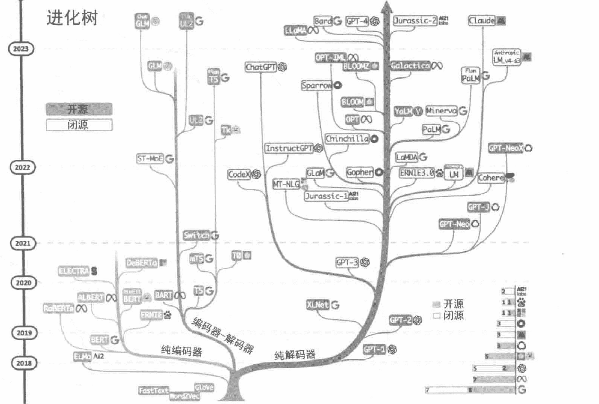

当前主流 LLM 多采用纯解码器架构，主要原因有三。

（1）结构更简洁。只需负责生成，无需输入输出分离，计算压力减小，训练与推理速度更快，且天然适配语言建模、生成与分类任务。
（2）预训练更高效。纯解码器可通过掩码语言建模学习上下文规律，而编码器-解码器需额外学习中间表征，任务难度更高。
（3）长序列更友好。无需解码时的对齐操作，避免随着输入长度变化带来的复杂度上升，更好地处理长文本。

## 4.2 Transformer 模型
### 4.2.1 模型构成
Transformer 在内部采用编码器-解码器整体框架，彻底摒弃循环与卷积，完全依赖自注意力处理序列，标准实现通常为 6 层堆叠。

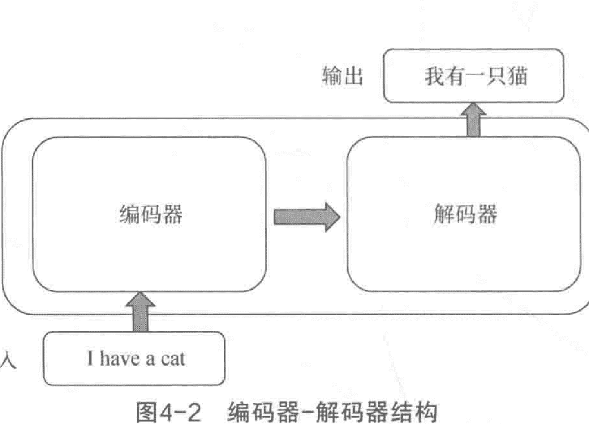

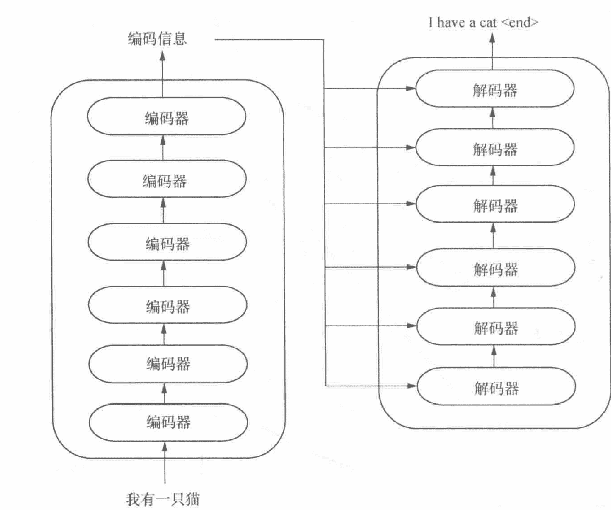

主要组成要素包括：

（1）自注意力机制：核心部件，计算序列中各位置间的关联并据此更新表示，能有效捕捉长距离依赖。
（2）多头自注意力：同时用多组参数并行计算自注意力，再聚合结果，使模型能够从不同角度抽取信息。

Transformer 核心组件全拆解

Transformer 之所以能抛开循环和卷积，关键就在于给模型补上了顺序感、计算力和训练稳定性。

位置编码。由于模型本身不带顺序记忆，每个位置的向量都需要额外注入位置信息。做法就是给每个词向量加上一个与位置绑定的编码向量，让自注意力在计算相关性时也能区分先后。

前馈神经网络。在自注意力之后，每一层都会接一个逐位置独立的前馈网络。它不跨位置交流，只负责把单个位置的表示做非线性变换，从而提升表达能力，同时保持序列处理的线性开销。

归一化层。为了避免深层训练时梯度失控，每个子层也就是自注意力和前馈网络的输出都会先过一层归一化，把数值稳定在合理区间。

残差连接。每个子层的输入会直接与输出相加再送往下一步。这种跳连让梯度更顺畅，也让模型更容易堆叠到很深。

一个完整的 Transformer 里，编码器负责把输入序列编码，解码器负责生成输出序列。训练阶段解码器可以一次性看到全部目标，推理阶段则只能自回归地一个 token 一个 token 地往外推。正因为自注意力能同时打量整个序列的依赖，Transformer 在机器翻译、文本摘要、情感判断等任务上表现突出。

图 4-4 显示了 Transformer 模型架构。

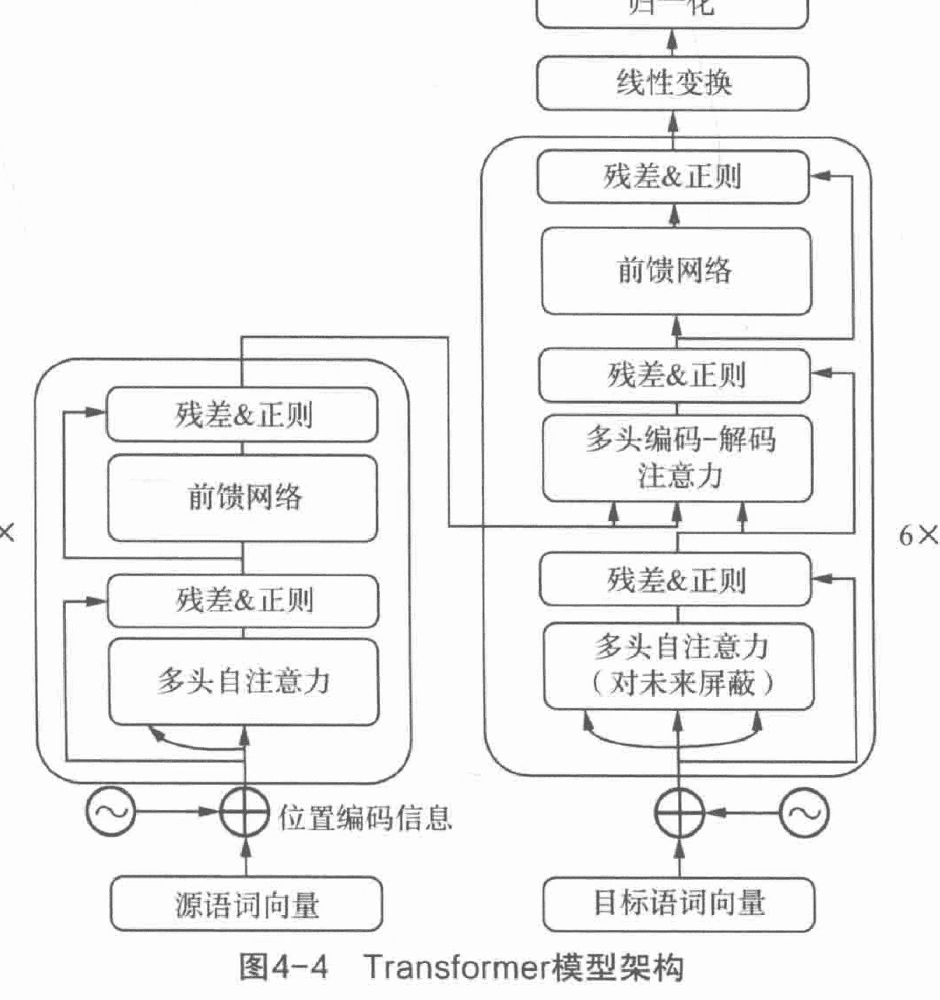

### 4.2.2 因果解码器结构

当前主流大语言模型基本都在用因果解码器，GPT-1、GPT-2 以及 Llama 1、Llama 2 都遵循这一范式，下面以 Llama 2 为例说明其设计思路。

Llama 2 依据参数规模采用 32 到 80 层的解码器堆叠，见图 4-5。

单层的解码器内部结构见图 4-6。

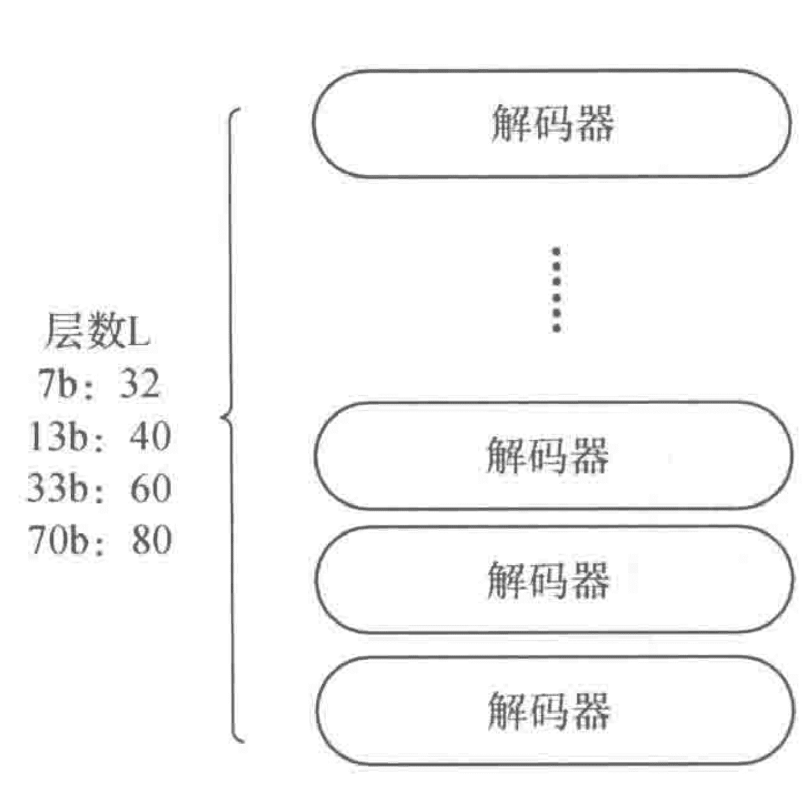

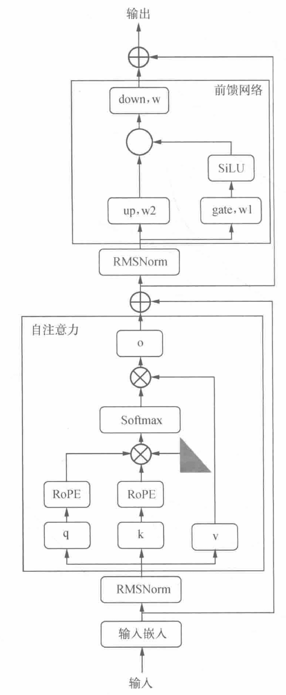

从 Hugging Face 格式的 llama-2-7b 模型读取出的权重结构为

```
model.embed_tokens.weight: shape=[32000, 4096] type=F16
model.layers.0.self_attn.q_proj.weight: shape=[4096, 4096] type=F16
model.layers.0.self_attn.k_proj.weight: shape=[4096, 4096] type=F16
model.layers.0.self_attn.v_proj.weight: shape=[4096, 4096] type=F16
model.layers.0.self_attn.o_proj.weight: shape=[4096, 4096] type=F16
model.layers.0.self_attn.rotary_emb.inv_freq: shape=[64] type=F32
model.layers.0.mlp.gate_proj.weight: shape=[11008, 4096] type=F16
model.layers.0.mlp.up_proj.weight: shape=[11008, 4096] type=F16
model.layers.0.mlp.down_proj.weight: shape=[4096, 11008] type=F16
model.layers.0.input_layernorm.weight: shape=[4096] type=F16
model.layers.0.post_attention_layernorm.weight: shape=[4096]
......
model.layers.31.self_attn.q_proj.weight: shape=[4096, 4096] type=F16
model.layers.31.self_attn.k_proj.weight: shape=[4096, 4096] type=F16
model.layers.31.self_attn.v_proj.weight: shape=[4096, 4096] type=F16
model.layers.31.self_attn.o_proj.weight: shape=[4096, 4096] type=F16
model.layers.31.self_attn.rotary_emb.inv_freq: shape=[64] type=F32
model.layers.31.mlp.gate_proj.weight: shape=[11008, 4096] type=F16
model.layers.31.mlp.up_proj.weight: shape=[11008, 4096] type=F16
model.layers.31.mlp.down_proj.weight: shape=[4096, 11008] type=F16
model.layers.31.input_layernorm.weight: shape=[4096] type=F16
model.layers.31.post_attention_layernorm.weight: shape=[4096] type=F16
```

其中 layers.0 到 layers.31 对应 32 个解码层，每层包含 self_attn 自注意力、前馈网络 mlp、输入归一化 input_layernorm 以及注意力后归一化。自注意力内部有 q、k、v、o 投影和旋转位置编码 rotary_emb，前馈网络包含 gate、up、down 三个投影。

表 4-2 是 Llama 2 hf 权重参数与 Llama 2 pth 模型结构的对应关系。转换脚本可在 Hugging Face 官方仓库找到，路径为 src/transformers/models/llama，文件名 convert_llama_weights_to_hf.py。

表 4-2 Llama 2 hf 权重文件参数和 Llama 2 pth 模型结构比较

| Llama 2 hf | Llama 2 pth | 名称 |
| :--- | :--- | :--- |
| embed_tokens | tok_embeddings | 标记嵌入 |
| self_attn.q_proj | self_attn.q_proj 转置处理 | 查询权重 |
| self_attn.k_proj | self_attn.k_proj 转置处理 | 键权重 |
| self_attn.v_proj | attention.wq | 值权重 |
| self_attn.o_proj | attention.wo | 输出权重 |
| self_attn.rotary_emb.inv_freq | | |
| mlp.gate_proj | feed_forward.w1 | 门权重 |
| mlp.up_proj | feed_forward.w3 | 上权重 |
| mlp.down_proj | feed_forward.w2 | 下权重 |
| input_layernorm | attention_norm | 归一化 |
| post_attention_layernorm | ffn_norm | 归一化 |
| norm | norm | 归一化 |
| lm_head | output | 输出 |

## 4.3 分词

分词是自然语言处理的基石，任务就是把一段连续文本切分成有意义的词元单元。

### 4.3.1 词汇表

在 BERT、GPT 等模型的 Hugging Face 权重目录里，vocab.json 用来保存词表。Llama 2 这类模型则通常提供 tokenizer.json 和 tokenizer.model 两个文件，前者记录分词器的配置与词表，后者是二进制实现的分词器模型。

词表是模型理解和生成文本的字典，收录了训练时见过的所有完整词和子词。

vocab.json 是键值对的 JSON，键是词元，值是其在表中的序号。tokenizer.json 中对应的内容放在 model.vocab 里。

举个极简例子：

```json
{
    "[PAD]": 0,
    "[UNK]": 1,
    "[CLS]": 2,
    "[SEP]": 3,
    "the": 4,
    "a": 5,
    "and": 6,
    ...
}
```

词表里通常包含特殊符号，如 "[PAD]" 用于补齐长度，"[UNK]" 表示未知词，"[CLS]" 用于分类任务，"[SEP]" 用于分隔句子。还会有高频普通词如 "the"、"a"、"and"，它们的序号一般与出现频率成反比，越常见序号越小。

训练时用词表把文本数字化，生成时再用词表把数字转回文本。

以 gpt2-vocab.json 为例，词表内容如图 4-7 所示。

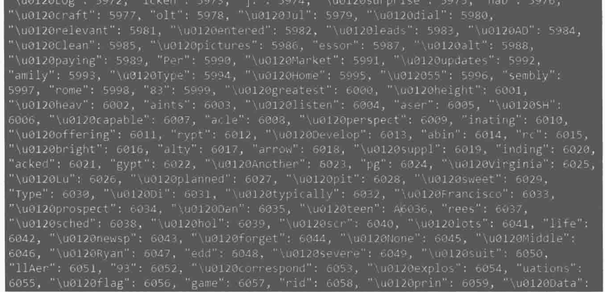

图4-7 词汇表

## 第4章 Transformer模型详解

图 4-7 中出现的 Ġ 代表空格。GPT-2 代码把 0-255 的所有控制与空白字符整体上移 256 位以便可打印，因此空格 \u0020 变成了 Ġ \u0120。

大语言模型的词表规模是固定的且各不相同，例如 Llama 2 约为 32 000，GPT-2 为 50 255。词表的构建本质上就是分词：把文本切成词或子词。

### 4.3.2 词汇表的生成

Transformer 模型在正式训练前，分词器与词表就已确定并冻结。流程一般是先选定分词算法，再用大量无标签语料生成词表并设定上限，比如 3 万或 5 万。生成后不再扩充。

不在表内的词会用 "<UNK>" 标记代替。但 BPE 或 Unigram 这类子词分词器更灵活，会把未知词拆成表内子词。例如词 "unseen" 若不在表中，可能被切成 "un" + "seen"。

### 4.3.3 分词算法

主流分词方法大致有以下几种。

- （1）空格分词。按空格切词，英语效果尚可，对无明显词界的中文或复合词多的德语则不友好。
- （2）基于词典分词。依赖预先构建的词典匹配，能处理复杂情况，但受词典覆盖度限制。
- （3）基于统计分词。用 HMM、CRF 等模型从语料学习词界，自动化程度高。
- （4）子词分词。把词再拆成子词，能覆盖开放词表。常见实现有字节对编码、BPE、SentencePiece 等。

BERT、GPT 家族训练时多用子词分词。GPT-2、GPT-3、Llama 2 都采用 BPE，SentencePiece 则是 BPE 的变体之一。

字节对编码 BPE。统计语料中频繁出现的字符对并合并为新符号，迭代扩充词表。优点是能处理未登录词与稀有词，缺点是可能过度切分。

句子片段 SentencePiece。基于 BPE 与一元语言模型的无监督分词，不需要先空格分割或后处理特殊符号，可直接在原始文本上训练，支持中文、日语等无空格语言。

两种方法都在信息保留与词表大小之间做权衡，词表过大增加计算成本，过小则丢失语义。

### 4.3.4 字节对编码

BPE 是一种处理词汇多样性的子词分词技术，核心思想是把高频字符序列合并成新符号。

操作流程如下。

- （1）初始化词汇表。初始时每个字符单独成符号。
- （2）统计符号对频率。遍历语料统计相邻符号对的出现次数。
- （3）合并最频繁的符号对。将频率最高的对合并为新符号加入词表。
- （4）重复。循环 2、3 步直至达到目标词表大小。

举例：

```
low lower newest widest
```

语料为 lowest, newer, newest, widest。

- （1）初始化：词表为 {l,o,w,e,r,n,s,t,i,d}。
- （2）统计：最常见对是 (e,s) 出现两次。
- （3）合并：生成新符号 es，词表增加 es。
- （4）继续：最终可得到 low、er、newest 等符号。

使用时，lowest 可能被切成 ["low", "es", "t"]。BPE 能把训练未见词拆成已知子词，通过调节词表大小平衡复杂度与覆盖率。

### 4.3.5 句子片段

SentencePiece 是一种子词级的无监督分词，可采用 BPE 或一元语言模型模式。以一元语言模型为例。

文本：
I love to play football.
I love to play basketball.

先拆到字符级：
['I',' ','l','o','v','e',' ','t','o',' ','p','l','a','y',' ','f','o','o','t','b','a','l','l','.',' ','I',' ','l','o','v','e',' ','t','o',' ','p','l','a','y',' ','b','a','s','k','e','t','b','a','l','l','.']

再统计频率并合并相邻单元，如 "l" 与 "o" 合并为 "lo"，反复迭代到预设词表大小。最终词表可能包含 "love"、"to"、"play"、"football"、"basketball" 等完整词，也包含 "lo"、"ve"、"pl"、"ay" 等子词。

它的优势是不依赖空格预处理，能直接处理多语言文本，灵活性高。

### 4.3.6 分词过程

Transformer 使用 BPE 分词时，对词表内与词表外的标记区别对待。

词表内的标记已在训练时学习好词向量，可直接参与计算。词表外的标记则会被切分为已有的子词序列再编码，保证模型始终能处理新词。

在模型实际处理文本时，词表覆盖不到的表达通常会被拆到更小的子单元上。BPE 的设计思想就是把陌生词拆成已知的子词来表示，比如词表里没有 “unhappiness”，但有 “un-”、“happy”、“-ness” 这三个片段，模型就能把它拼成这三块来推断意义。即使完全没见过的词，只要能拆成已收录的子词，就仍有可解释的信息。

如果一个词连拆都拆不出已知的子单元，系统就会把它归为一个统一的未知占位符，一般写作 <UNK> 或 <unk>。在训练阶段，这个占位符往往被赋予随机初始化的向量，或者直接使用一个固定的未知词向量来表示。

### 4.3.7 词汇索引

计算机无法直接吃原始字符串，必须先转成数值形式。最常用的做法是给每个词或标记分配一个唯一的整数，这个整数在词表里的位置就是它的身份标识，业内也叫词汇索引或标记索引。

分词与索引是前后衔接的两道预处理工序。

（1）分词：把整段文字切成更小的 token。切分粒度取决于策略，可以是完整的词、子词甚至单个字符。举例来说，“I love Beijing” 会被切成 ["I", "love", "Beijing"]。

（2）词汇索引：在分词之后，给每个 token 映射一个整数。假设词表为 ["我 ", "爱 ", "北京 ", "天安门 "]，那么上面的分词结果就会变成 [0, 1, 2]。

两步的目的都是把文本转成模型可用的数字。分词负责提炼有语义的最小单元，索引负责把这些单元量化，因为机器学习只认识数值。训练时，这些整数会再查表变成高维向量，也就是词嵌入，能够体现语义相近则位置相近的特性。推理时，模型输出的整数序列会反查词表，还原成可读的词或标记。

## 4.4 词嵌入

词嵌入的核心是把词语或短语投射到连续的向量空间，让语义和句法关系体现在几何距离上。这类表示通常借助大量无监督语料学习得到。

Word2Vec、GloVe 等属于离线预训练的嵌入方案。Transformer 家族并不直接复用这些预训练向量，而是把嵌入层作为模型的一部分，和整体一起从零训练，这样能在目标任务的语境里学到更贴合的表示。

GPT 系列和 BERT 都采用标记嵌入层，它随模型同步训练。Transformer 的输入嵌入其实由两部分叠加而成：标记嵌入和位置编码。

（1）标记嵌入：一个可学习的嵌入矩阵，每一行对应词表中的一个条目。训练开始时矩阵随机初始化，随后通过反向传播不断修正。文本先被切成标记，再查表得到固定长度的向量。

（2）位置编码：自注意力本身不区分先后，必须额外注入顺序信息。位置编码会为每个位置生成一个与词嵌入等长的向量，并与之相加。这里用“编码”而非“嵌入”，是因为原始方案中它并非可学习参数；若位置向量被作为参数学习，则称为位置嵌入。

### 4.4.1 标记嵌入

标记嵌入本质上是把离散符号转成数值向量的映射。下面用极简例子说明。

设词表只有 ‘I’、‘love’、‘chocolate’ 三个词，嵌入维度设为 5，矩阵初始化后可能像这样：

I: [0.1, 0.3, -0.2, 0.8, -0.5]

love: [0.7, -0.1, 0.2, -0.4, 0.6]

chocolate: [-0.3, 0.5, 0.1, -0.2, 0.9]

句子 “I love chocolate” 就会被逐词查表，变成三个 5 维向量作为网络输入。随着训练推进，嵌入会不断调整，使语义相近的词在空间中靠拢。

训练初始值是随机的，几乎不含信息；随着优化，模型会把常在正面评论里出现的 “love” 与 “like” 拉近，把 “hate” 与 “dislike” 拉近，同时把正面词和负面词推远。训练结束后，向量的余弦相似度就能反映语义相似度。

高维向量难以直观解读，通常借助降维可视化。假设 “king” 在维基百科上训练得到的嵌入是：

```
[ 0.50451 , 0.68607 , -0.59517 , -0.022801, 0.60046 , -0.13498 , -0.08813 , 0.47377 ,
-0.61798 , -0.31012 , -0.076666, 1.493 , -0.034189, -0.98173 , 0.68229 , 0.81722 ,
-0.51874 , -0.31503 , -0.55809 , 0.66421 , 0.1961 , -0.13495 , -0.11476 , -0.30344 ,
0.41177 , -2.223 , -1.0756 , -1.0783 , -0.34354 , 0.33505 , 1.9927 , -0.04234 ,
-0.64319 , 0.71125 , 0.49159 , 0.16754 , 0.34344 , -0.25663 , -0.8523 , 0.1661 ,
0.40102 , 1.1685 , -1.0137 , -0.21585 , -0.15155 , 0.78321 , -0.91241 , -1.6106 ,
-0.64426 , -0.51042 ]
```

这是一个 50 维的数字序列，直接看难以分辨规律。若把它画出来并按数值着色，就能和别的词对比。把所有数值排成一行后根据值上色，接近 2 的偏红，接近 0 的偏白，接近 -2 的偏蓝，在黑白图里则表现为灰度变化。

从可视化能看出一些规律：

（1）在许多不同词里都有一列呈现纯黑，表示该维度上它们取值相近。
（2）“women” 与 “girl” 在多个位置高度重合，“man” 与 “boy” 也是如此。
（3）“boy” 与 “girl” 既有共同点，又与 “woman”“man” 有别，可能对应青春期的模糊概念。
（4）除最后一个词外，其余都指人，加入的 “water” 用来做对照，可以看到某一深灰列在 water 之前就停止。
## 第4章 Transformer模型详解
（5）“king” 与 “queen” 在某些维度上相似，而与其他词不同，可能隐含了皇室的概念。

最有名的演示是类比运算：king - man + woman ≈ queen，如图 4-12 所示。

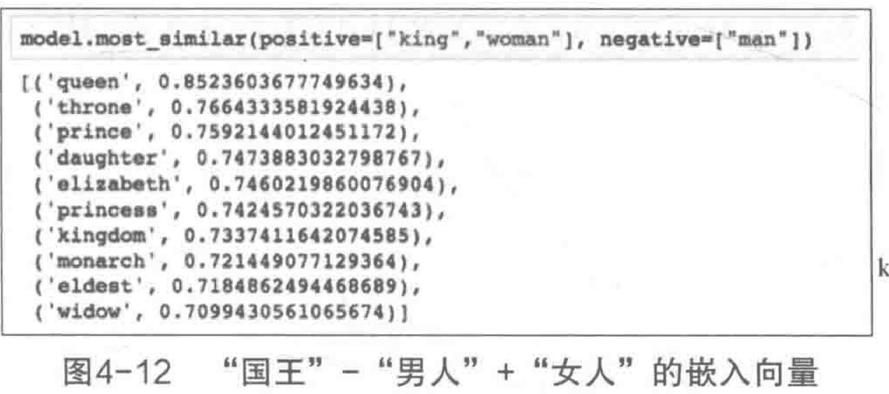

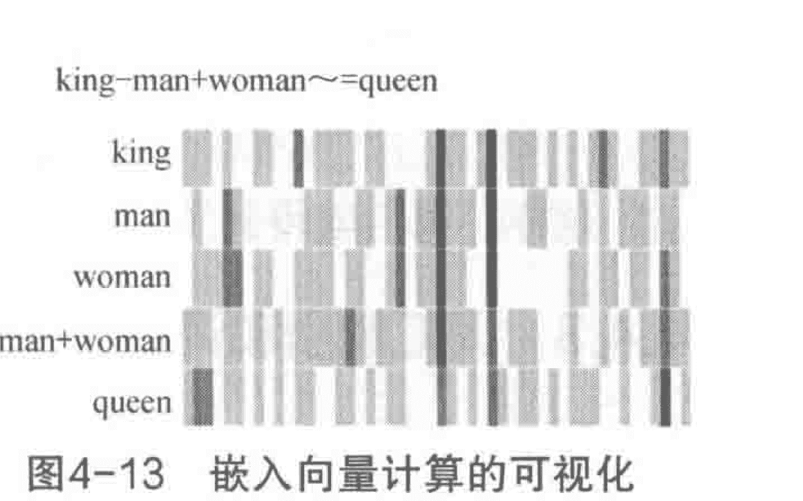

### 4.4.2 位置编码

Transformer 的自注意力对输入是排列无关的，必须显式提供位置线索，否则 “dog bites man” 与 “man bites dog” 会被当成同一回事。位置编码就负责把序号信息注入表示。

位置编码是一个与词嵌入等长的向量，根据位置索引通过固定函数计算得到，每个位置都有唯一编码，加到对应词嵌入上后形成带顺序信息的表示。原始 Transformer 用正弦余弦函数生成固定编码，部分变体如 BERT 则使用可学习的位置嵌入。

举例说明，句子 “I love dogs”，设词嵌入维度为 4：

```
- "I" -> [0.1, 0.2, 0.3, 0.4]
- "love" -> [0.5, 0.6, 0.7, 0.8]
- "dogs" -> [0.9, 1.0, 1.1, 1.2]
```

若用极简函数把位置索引复制到各维度，得到的位置编码为：

- Position 1 -> [1, 1, 1, 1]
- Position 2 -> [2, 2, 2, 2]
- Position 3 -> [3, 3, 3, 3]

相加后得到带位置的最终表示：

- "I" + Position 1 -> [0.1, 0.2, 0.3, 0.4] + [1, 1, 1, 1] = [1.1, 1.2, 1.3, 1.4]
- "love" + Position 2 -> [0.5, 0.6, 0.7, 0.8] + [2, 2, 2, 2] = [2.5, 2.6, 2.7, 2.8]
- "dogs" + Position 3 -> [0.9, 1.0, 1.1, 1.2] + [3, 3, 3, 3] = [3.9, 4.0, 4.1, 4.2]

这样模型就能区分词序差异。

### 4.4.3 词汇索引和词嵌入向量关系

索引到向量的映射可以理解为查表。假设词表为：

词汇表 = {'我': 0, '爱': 1, '你': 2, '他': 3, '是': 4, '学生': 5}

每个词对应一个整数。训练时模型会学到一个嵌入矩阵，矩阵的行号即索引，行内容即向量。例如 2 维嵌入时：

```
词嵌入矩阵 =
[[0.1, 0.3],  # '我' 的词嵌入向量
 [0.4, -0.2], # '爱' 的词嵌入向量
 [-0.1, 0.6], # '你' 的词嵌入向量
 [0.2, -0.1], # '他' 的词嵌入向量
 [-0.3, 0.2], # '是' 的词嵌入向量
 [0.5, -0.4]] # '学生' 的词嵌入向量
```

此时索引 1 对应 “爱”，向量为 [0.4, -0.2]；索引 5 对应 “学生”，向量为 [0.5, -0.4]。通过这张表，离散索引就能被替换为连续向量，供后续计算使用。

## 4.5 位置编码方法

### 4.5.1 原生位置编码

原始 Transformer 采用不可学习的正弦位置编码，其公式为：

```
PE_{(pos, 2i)} = sin(pos / 10000^{2i / d_{model}})
PE_{(pos, 2i+1)} = cos(pos / 10000^{2i / d_{model}})
```

利用 sin 和 cos 的周期性，该编码能在一定程度上蕴含相对位置信息。

BERT 则使用可学习的位置向量作为绝对位置编码，随模型一起更新。缺点是外推性差，训练时用的最大长度在推理时难以突破。

相对位置编码只关注两个标记之间的相对距离，不受绝对长度限制，主流大模型多采用此类思路。图 4-14 给出了 6 个标记、嵌入维度为 $d_{emb\_dim}$ 的前 4 列编码可视化，奇偶列分别由 sin、cos 计算。

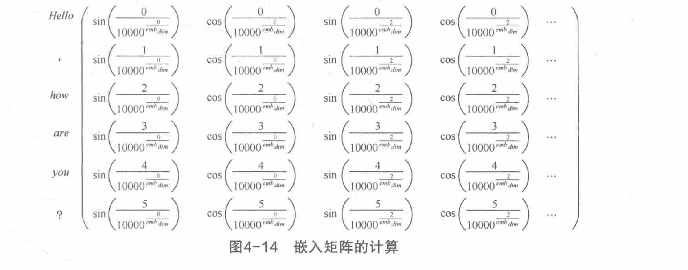

图 4-15 展示了 10 个标记、嵌入维度 62 的编码数值分布。

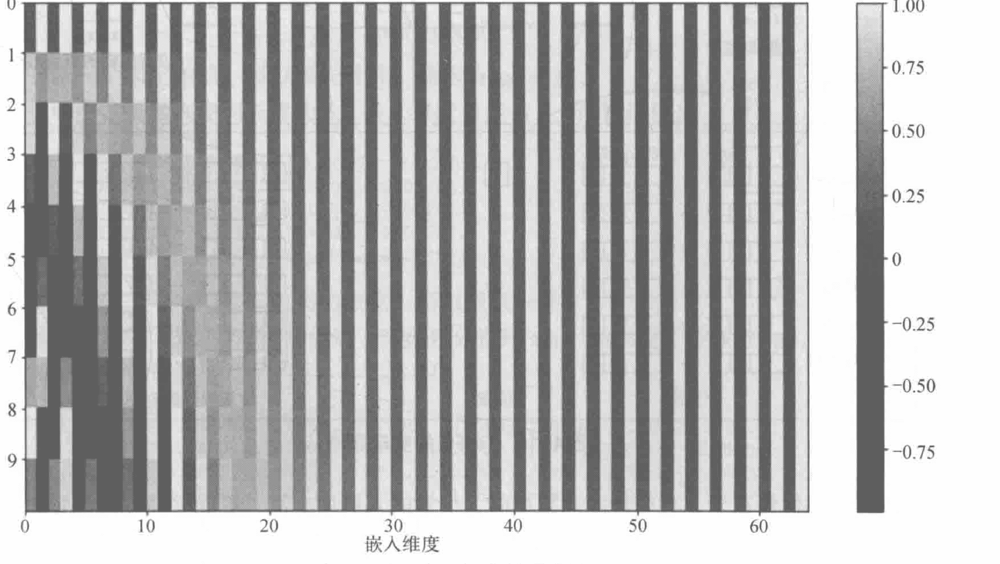

### 4.5.2 旋转位置编码

当前大模型广泛使用的相对位置方案之一是 RoPE，即旋转位置编码。它以绝对位置编码的形式实现相对位置效果，在注意力计算 QK 时乘以代表位置的旋转矩阵，从而注入位置信息。Llama 系列甚至将位置编码应用到每一层注意力中。

RoPE 的出发点是自然语言里相对位置比绝对位置更重要。通过旋转机制，不同位置的嵌入获得方向差异，提高长文本建模能力。具体做法是把位置索引映射为一系列带特定旋转角度的单位向量，使相邻位置的表示明显区分。

关于 RoPE，有三点需要把握：① 设计上用绝对形式实现相对效果；② 实现上借助旋转矩阵表达位置；③ 配合 NTK 扩展，可以在短序列上训练、在长序列上推理。图 4-16 展示了其实现原理。

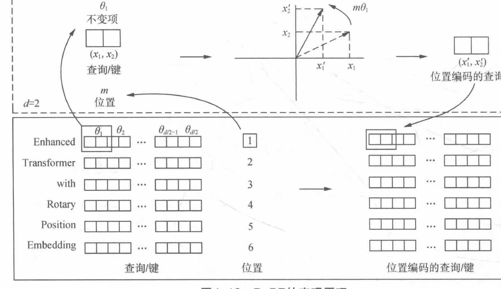

RoPE 的设计思路很直接，让位置信息在编码阶段更饱满、区分度更高，从而让模型更好地理顺序列里的相对关系，进而提升整体建模效果。碰到循环或有周期性规律的序列时，这种旋转方式对周期模式的捕捉尤其出色。

### 4.5.3 位置编码实现对比

下面这段代码同时演示了传统位置编码和旋转位置编码，便于直观对照：

```
import torch

def precompute_freqs_cis(dim, seqlen, theta = 10000.0):
    freqs = 1.0 / (theta ** (torch.arange(0, dim, 2)[: (dim // 2)].float() / dim))
    t = torch.arange(seqlen)  #顺序位置，0 ~ seqlen - 1
    freqs = torch.outer(t, freqs).float()
    return freqs

embedding_dim = 8
sequence_length = 5

# 标记嵌入，全为1
token_embedding = torch.ones((sequence_length, embedding_dim))

freqs = precompute_freqs_cis(embedding_dim, sequence_length)

# 标准位置编码
pe = torch.zeros(sequence_length, embedding_dim)
pe[:, 0::2] = torch.sin(freqs)
pe[:, 1::2] = torch.cos(freqs)

# 标记嵌入 + 位置嵌入
pe_out = token_embedding + pe
print(pe_out)

# 旋转位置编码
freqs_cis = torch.polar(torch.ones_like(freqs), freqs)
token_embedding_cis = torch.view_as_complex(token_embedding.reshape(sequence_length, -1,2))
rope_out = torch.view_as_real(token_embedding_cis * freqs_cis).flatten(1)
print(rope_out)
```

代码中，precompute_freqs_cis 承担了标准 Transformer 位置编码公式里的核心部分

$$pos/10000^{2i/d_{model}}$$

该部分不随输入变化，是确定性常量，可以提前算好，得到 freqs 张量。

以序列长度取 5、嵌入维度取 8 为例，计算结果呈现为

```
tensor([[ 0.0000,  0.0000,  0.0000,  0.0000],
        [ 1.0000,  0.1000,  0.0100,  0.0010],
        [ 2.0000,  0.2000,  0.0200,  0.0020],
        [ 3.0000,  0.3000,  0.0300,  0.0030],
        [ 4.0000,  0.4000,  0.0400,  0.0040]])
```

留意一下，这里只保留了偶数列的信息，所以实际看到的是全体的一半。

传统位置编码的做法是，先用 sin 和 cos 分别作用于 freqs 的偶数列和奇数列得到 pe，再把 pe 直接加到词向量上，得到

```
tensor([[1.0000, 2.0000, 1.0000, 2.0000, 1.0000, 2.0000, 1.0000, 2.0000],
        [1.8415, 1.5403, 1.0998, 1.9950, 1.0100, 1.9999, 1.0010, 2.0000],
        [1.9093, 0.5839, 1.1987, 1.9801, 1.0200, 1.9998, 1.0020, 2.0000],
        [1.1411, 0.0100, 1.2955, 1.9553, 1.0300, 1.9996, 1.0030, 2.0000],
        [0.2432, 0.3464, 1.3894, 1.9211, 1.0400, 1.9992, 1.0040, 2.0000]])
```

旋转位置编码则把 freqs 包装成复数形式 cos(x) + sin(x) j，生成 freqs_cis：

```
tensor([[ 1.0000+0.0000j,  1.0000+0.0000j,  1.0000+0.0000j,  1.0000+0.0000j],
        [ 0.5403+0.8415j,  0.9950+0.0998j,  0.9999+0.0100j,  1.0000+0.0010j],
        [-0.4161+0.9093j,  0.9801+0.1987j,  0.9998+0.0200j,  1.0000+0.0020j],
        [-0.9900+0.1411j,  0.9553+0.2955j,  0.9996+0.0300j,  1.0000+0.0030j],
        [-0.6536-0.7568j,  0.9211+0.3894j,  0.9992+0.0400j,  1.0000+0.0040j]])
```

与此同时，也把词嵌入沿着维度轴两两分组转成复数 token_embedding_cis：

```
tensor([[1.+1.j, 1.+1.j, 1.+1.j, 1.+1.j],
        [1.+1.j, 1.+1.j, 1.+1.j, 1.+1.j],
        [1.+1.j, 1.+1.j, 1.+1.j, 1.+1.j],
        [1.+1.j, 1.+1.j, 1.+1.j, 1.+1.j],
        [1.+1.j, 1.+1.j, 1.+1.j, 1.+1.j]])
```

随后让两个复数张量做点乘，得到

```
tensor([[ 1.0000+1.0000j,  1.0000+1.0000j,  1.0000+1.0000j,  1.0000+1.0000j],
        [-0.3012+1.3818j,  0.8952+1.0948j,  0.9900+1.0099j,  0.9990+1.0010j],
        [-1.3254+0.4932j,  0.7814+1.1787j,  0.9798+1.0198j,  0.9980+1.0020j],
        [-1.1311-0.8489j,  0.6598+1.2509j,  0.9696+1.0295j,  0.9970+1.0030j],
        [ 0.1032-1.4104j,  0.5316+1.3105j,  0.9592+1.0392j,  0.9960+1.0040j]])
```

最后再把结果转回实数域：

```
tensor([[ 1.0000,  1.0000,  1.0000,  1.0000,  1.0000,  1.0000,  1.0000,  1.0000],
        [-0.3012,  1.3818,  0.8952,  1.0948,  0.9900,  1.0099,  0.9990,  1.0010],
        [-1.3254,  0.4932,  0.7814,  1.1787,  0.9798,  1.0198,  0.9980,  1.0020],
        [-1.1311, -0.8489,  0.6598,  1.2509,  0.9696,  1.0295,  0.9970,  1.0030],
        [ 0.1032, -1.4104,  0.5316,  1.3105,  0.9592,  1.0392,  0.9960,  1.0040]])
```

### 4.5.4 Llama 的旋转位置编码

Llama 系列的旋转位置编码实现在 Llama 1 和 Llama 2 上保持一致。该函数包含两部分能力：计算与绝对位置相关的旋转角度 precompute_freqs_cis，以及把位置信息融合到已有表示上的 apply_rotary_emb。

为了更具体，下文以 llama-2-7b 为例展开：

序列长度 seq_len = 4096

嵌入维度 dim = 4096

注意力头数 attention_head = 32

单个头维度 head_dim = dim / attention_head = 128

#### 1. 旋转角度预计算

precompute_freqs_cis 的作用是预先算出与绝对位置对应的旋转角度。超参 theta 固定为 10 000.0，dim 为 4 096，end 取序列最大长度的两倍即 8 192。

theta 并非完全写死，在模型权重目录的 params.json 里通过 rope_theta 可以调整。Meta 推出的 CodeLlama 中，这个值被放大到 1 000 000。

```
def precompute_freqs_cis(dim: int, end: int, theta: float = 10000.0):
    freqs = 1.0 / (theta ** (torch.arange(0, dim, 2)[: (dim // 2)].float() / dim))
    t = torch.arange(end, device=freqs.device)  # type: ignore
    freqs = torch.outer(t, freqs).float()  # type: ignore
    freqs_cis = torch.polar(torch.ones_like(freqs), freqs)  # complex64
    return freqs_cis
```

## 第4章 Transformer 模型逐行拆解

下面我们逐行读懂这个函数。

```
(1) freqs = 1.0 / (theta ** (torch.arange(0, dim, 2)[: (dim // 2)].float() / dim))
```

freqs 对应标准位置编码公式里的 $1/10000^{2i/d_{model}}$ 项。可以看成基础角度的指数形式，其形状为 [2048]，正好是嵌入维度的一半。计算过程拆开如下：

- ① `torch.arange(0, dim, 2)` 生成 0 到 dim 的偶数序列：

`tensor([ 0, 2, 4, ..., 4090, 4092, 4094])`

- ② `torch.arange(0, dim, 2)[: (dim // 2)]` 取前一半，实际操作上与①等价。
- ③ 除以 dim 后得到小于 1 的系数：

`tensor([ 0.00000000, 0.00048828, 0.00097656, ..., 0.99853516, 0.99902344, 0.99951172])`

最终 freqs 形状为 [2048]，数值示例为

`tensor([ 1.00000000, 0.99551278, 0.99104589, ..., 0.00010136, 0.00010090, 0.00010045])`

```
(2) t = torch.arange(end, device=freqs.device)
```

t 代表绝对位置索引，形状是 [4096]。数据为

`tensor([ 0, 1, 2, ..., 4093, 4094, 4095])`

```
(3) freqs = torch.outer(t, freqs).float()
```

公式里借助 `torch.outer` 把 t 与 freqs 做外积，生成形状为 [4096, 2048] 的矩阵，行对应输入标记，列对应嵌入维度的偶数位。

```
tensor([[ 0.0000, 0.0000, 0.0000, ..., 0.0000, 0.0000, 0.0000],
        [ 1.0000, 0.9955, 0.9910, ..., 0.0001, 0.0001, 0.0001],
        [ 2.0000, 1.9910, 1.9821, ..., 0.0002, 0.0002, 0.0002],
        ...,
        [ 4093.0000, 4074.6338, 4056.3508, ..., 0.4149, 0.4130, 0.4111],
        [ 4094.0000, 4075.6294, 4057.3418, ..., 0.4150, 0.4131, 0.4112],
        [ 4095.0000, 4076.6248, 4058.3330, ..., 0.4151, 0.4132, 0.4113]])
```

例如右下角元素 0.4113 = 4095 × 0.00010045。

```
(4) freqs_cis = torch.polar(torch.ones_like(freqs), freqs)
```

`torch.polar(abs, angle)` 根据模长和角度在极坐标下构造复数张量，形式为 `abs * cos(angle) + abs * sin(angle)j`。

```
tensor([[ 1.0000+0.0000j, 1.0000+0.0000j, 1.0000+0.0000j, ...,
          1.0000+0.0000j, 1.0000+0.0000j, 1.0000+0.0000j],
        [ 0.5403+0.8415j, 0.5441+0.8390j, 0.5478+0.8366j, ...,
          1.0000+0.0001j, 1.0000+0.0001j, 1.0000+0.0001j],
        [-0.4161+0.9093j, -0.4080+0.9130j, -0.3998+0.9166j, ...,
          1.0000+0.0002j, 1.0000+0.0002j, 1.0000+0.0002j],
        ...,
        [-0.8799+0.4752j, -0.9999+0.0119j, -0.8501-0.5267j, ...,
          0.9152+0.4031j, 0.9159+0.4014j, 0.9167+0.3997j],
        [-0.8753-0.4836j, -0.5539-0.8326j, -0.0251-0.9997j, ...,
          0.9151+0.4032j, 0.9159+0.4014j, 0.9166+0.3998j],
        [-0.0660-0.9978j, 0.3970-0.9178j, 0.8227-0.5685j, ...,
          0.9151+0.4032j, 0.9158+0.4015j, 0.9166+0.3998j]])
```

其中 0.9166+0.3998j 的来源是，0.9166 = np.cos(0.4113)，0.3998 = np.sin(0.4113)。

precompute_freqs_cis 以嵌入维度每两个元素为一组生成复数，最终得到一个可复用的固定复数张量。

## 2. 如何注入位置信息

apply_rotary_emb 负责把位置信息叠加到已有编码上，该函数在多头注意力阶段被调用。

```python
def reshape_for_broadcast(freqs_cis: torch.Tensor, x: torch.Tensor):
    ndim = x.ndim
    assert 0 <= 1 < ndim
    assert freqs_cis.shape == (x.shape[1], x.shape[-1])
    shape = [d if i == 1 or i == ndim - 1 else 1 for i, d in enumerate(x.shape)]
    return freqs_cis.view(*shape)

def apply_rotary_emb(
    xq: torch.Tensor,
    xk: torch.Tensor,
    freqs_cis: torch.Tensor,
) -> Tuple[torch.Tensor, torch.Tensor]:
    xq_ = torch.view_as_complex(xq.float().reshape(*xq.shape[:-1], -1, 2))
    xk_ = torch.view_as_complex(xk.float().reshape(*xk.shape[:-1], -1, 2))
    freqs_cis = reshape_for_broadcast(freqs_cis, xq_)
    xq_out = torch.view_as_real(xq_ * freqs_cis).flatten(3)
    xk_out = torch.view_as_real(xk_ * freqs_cis).flatten(3)
    return xq_out.type_as(xq), xk_out.type_as(xk)
```

xq、xk 是 MHA 里的查询和键张量，当头数为 32 时，每头的维度为 4096/32 = 128，因此形状为 [4096, 128]。

`torch.view_as_complex` 用来把实数张量解读成复数张量，前提是最后一个维度必须是 2。
`torch.view_as_real` 则完成反向操作，把复数张量展开回实数，前者是后者的逆过程。

`reshape_for_broadcast` 的职责是把 freqs_cis 调整成与输入张量可广播的形状，和下文中提到的另一个操作一起使用。

下面聚焦 `apply_rotary_emb`。这个函数是在多头自注意力阶段，给查询和键注入位置信息。我们逐行拆解其行为：

```
xq_ = torch.view_as_complex(xq.float().reshape(*xq.shape[:-1], -1, 2))
```

上文假设 $x_q$ 的形状为 (2, 512, 12, 64)。这里先把它重排成 (2, 512, 12, -1, 2)，实际得到的是 (2, 512, 12, 32, 2)。$x_k$ 处理方式相同。随后通过复数视图把它压缩成 (2, 512, 12, 32)。

紧接着进入 `reshape_for_broadcast`：

```python
shape = [d if i == 1 or i == ndim - 1 else 1 for i, d in enumerate(x.shape)]
return freqs_cis.view(*shape)
```

该函数把 freqs_cis 拉伸成与当前张量一致的维度。需要说明的是，这里使用的 freqs_cis 并不是 `precompute_freqs_cis` 直接生成的 [4096, 4096] 大张量，而是根据当前绝对位置从中截取的片段，截取逻辑写在 Transformer 类的 forward 里：

```
freqs_cis = self.freqs_cis[start_pos : start_pos + seqlen]
```

举例来说，当本次序列长度为 6 时，截取后的 freqs_cis 形状是 [6, 4096]，重塑后变成 [1, 6, 1, 4096]。每个位置对应 32 个角度。结合前面 `torch.polar` 的说明，模长固定时，角度在笛卡尔坐标系下唯一确定一个复数，于是得到 32 个复数，即 64 维特征，正好可以映射到每个 attention head 的 64 维上。

重塑完成后就把位置信息融合进 query 和 key：

```
xq_out = torch.view_as_real(xq_ * freqs_cis).flatten(3)
```

相乘得到的复数张量被转回实数，形状变为 (2, 512, 12, 32, 2)，再 flatten 为 (2, 512, 12, 64)，恢复到与最初 $x_q$ 一致的维度，位置编码的注入就完成了。$x_k$ 的流程完全类同。

### 4.5.5 长度扩展

在大模型落地中，上下文最大长度是一个关键指标。长度越大，就能支持更多轮对话、更长文本的总结分析，也能生成更长的输出。

训练时可用的长文本往往不足，很多模型训练上限只设到 2k，即 2048 个 token。训练时用短文本、推理时希望拉长，有三种常见的 RoPE 长度扩展思路。

第一种是直接外推。也就是沿用原有的位置编码公式，不做任何改动。扩展幅度不大时，比如从 2k 拉到 2.5k，影响通常可控。因为 RoPE 只依赖相对位置 $m-n$，且具备远程衰减特性，距离越远相关性越弱。若模型已学会 0～2k 范围内的合理衰减规律，把这个规律外推到 0～2.5k 往往仍能工作。

但若要从 2k 推到 32k，直接外推会明显掉点。训练时学到的衰减可能在 5k 左右就基本归零，超过该距离的标记交互就捕捉不到。缓解办法是在更长的上下文上做少量微调。

第二种是线性内插。改动公式，等价于把位置序号按比例压缩。2k 到 32k 就是把序号压到原来的 1/16。内插没有改变衰减规律的有效范围，不微调时通常比直接外推更稳。

缺点是倍数很大时短距离会被扭曲。本来距离为 1 的两个 token，扩展后相当于 1/16，短距离处的衰减斜率变化极大，注意力权重会偏离合理值。同样，少量长文本微调能显著改善。

第三种是 NTK 扩展。兼顾外推与内插的优点，不微调也能保持较好表现。短距离保持外推特性，几乎与扩展前一致；长距离呈现内插特性，被拉回训练范围。做法是对底数进行缩放，类似进制转换，实现高频外推、低频内插。用 NTK 扩展到更长文本，即使不做微调，性能下降也比较轻微。

## 4.6 自注意力机制

Transformer 的自注意力是一种捕捉序列内部位置关联的机制。处理每个元素时，不只看自身，也会综合其他元素的信息，从而更好地理解上下文。

每个输入元素都会产生一个权重，该权重反映它与其它元素的相似度。相似度越高，权重越大，在生成输出时的影响也越大。

自注意力的核心价值体现在：

（1）捕捉长程依赖。传统 RNN 在长序列上易出现梯度消失或爆炸，自注意力能直接计算任意两位置的关系，更好地建模远距离依赖。
（2）并行化。相比 RNN 和卷积，注意力计算可以并行，大幅提升效率。
（3）可解释性。注意力权重直观展示模型如何关注不同位置，为理解提供线索。
（4）实战效果。自注意力是 Transformer 的核心，在大量 NLP 任务上取得优秀表现，验证了其有效性。

### 4.6.1 原理

自注意力的整体流程可归纳为：

（1）线性变换。输入先通过线性映射得到查询向量、键向量和值向量，三者由不同参数生成。
（2）计算权重。用每个元素的查询向量与其它元素的键向量做点积，得到权重矩阵，反映相互影响程度。
（3）归一化。通常用 Softmax 把权重压到合理范围。
（4）加权求和。用归一化后的权重对值向量加权求和，得到输出。每个输出都是值向量的加权组合。

这种方式能覆盖全局依赖，且计算过程高度并行，适合长序列。

### 4.6.2 注意力分数的计算

缩放点积注意力是常用实现。输入先映射为 $Q$、$K$、$V$，计算 $Q$ 与 $K$ 的点积并做缩放，随后与 $V$ 加权平均得到输出。从图 4-17 可见其在 Transformer 中的位置。

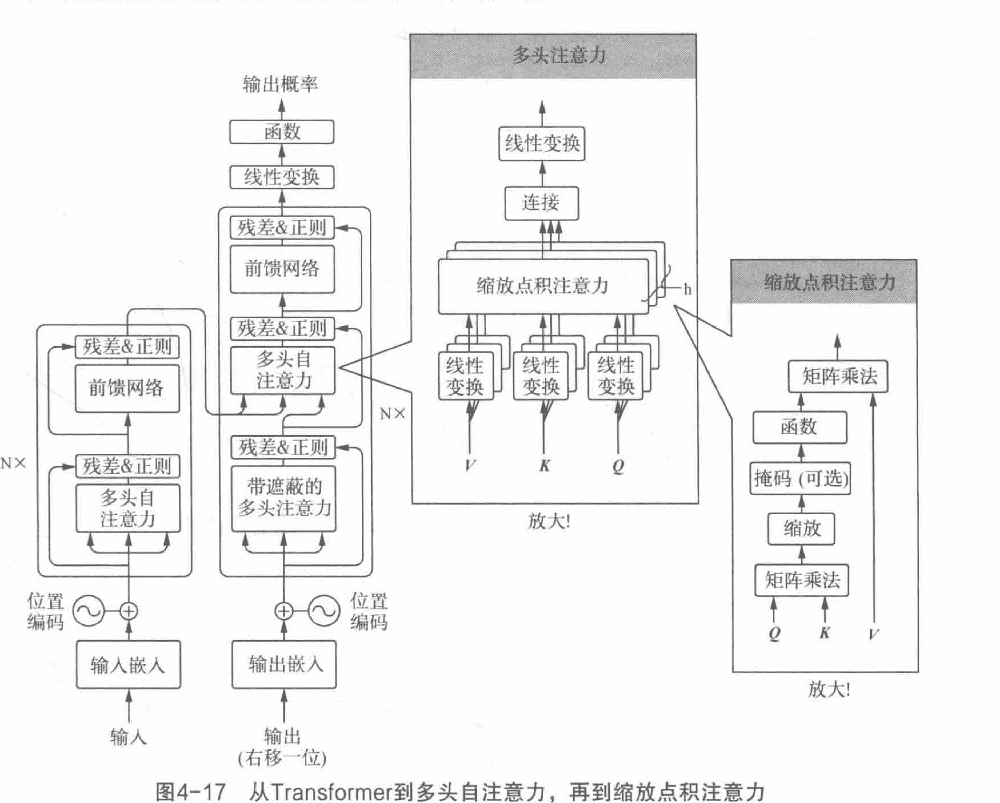

假设序列长度为 4，例如 “I should sleep now”。假设嵌入维度为 6，实际模型如 Llama 7B 为 4096。

```python
seq_len = 4
embeddings_dim = 6
```

示例中为每个 token 生成 embeddings_dim 维的随机向量。代码里的 query_vectors、key_vectors、value_vectors 分别对应 $Q$、$K$、$V$。三者在物理意义上同源，都是同一个句子的 token 矩阵，每一行代表一个 token 的词嵌入。

```python
import torch
import torch.nn as nn

embeddings_dim = 6

embeddings = torch.randn(seq_len * embeddings_dim).view(seq_len, embeddings_dim)

query_matrix = nn.Linear(embeddings_dim, embeddings_dim)
query_vectors = query_matrix(embeddings)
```

```
embeddings

tensor([[-1.3565, -1.3428,  0.8033,  1.3472,  0.7405,  1.0264],
        [ 0.4019,  0.6299,  0.8490, -0.4754,  0.4463, -2.0529],
        [-1.3255, -0.8625,  1.2885, -0.3940,  0.8368,  2.1588],
        [ 0.4389,  0.6091,  0.3238,  1.1083, -0.5548,  1.3988]])
```

```
query_vectors

tensor([[-0.1452,  0.4216,  0.2601,  0.0622, -0.4574,  0.2219],
        [ 0.5355,  0.3735, -0.0653,  0.0194, -0.5459,  0.6600],
        [-0.5174,  0.3747, -0.8368, -0.9132, -0.2153,  0.5843],
        [ 0.6977,  0.3747,  0.1204,  0.2349, -0.5895,  0.5870]],
       grad_fn=<AddmmBackward0>)
```

按同样方式生成 key_vectors 和 value_vectors：

```python
key_matrix = nn.Linear(embeddings_dim, embeddings_dim)
value_matrix = nn.Linear(embeddings_dim, embeddings_dim)

key_vectors = key_matrix(embeddings)
value_vectors = value_matrix(embeddings)
```

注意力分数通过查询向量与键向量转置的点积得到，再除以键向量维度的平方根进行缩放。

$$Attention(Q,K,V) = Softmax\left(\frac{QK^T}{\sqrt{d_k}}\right)V$$

式中 $Q$、$K$、$V$ 对应 query_vectors、key_vectors、value_vectors，$K^T$ 为转置，$d_k$ 为键向量维度。该式体现了自注意力的核心：用查询与键的相似度决定权重，再经 Softmax 归一化为 0 到 1 且和为 1 的分布。

图 4-18 展示了矩阵形状变化过程。

## 第4章 Transformer模型详解

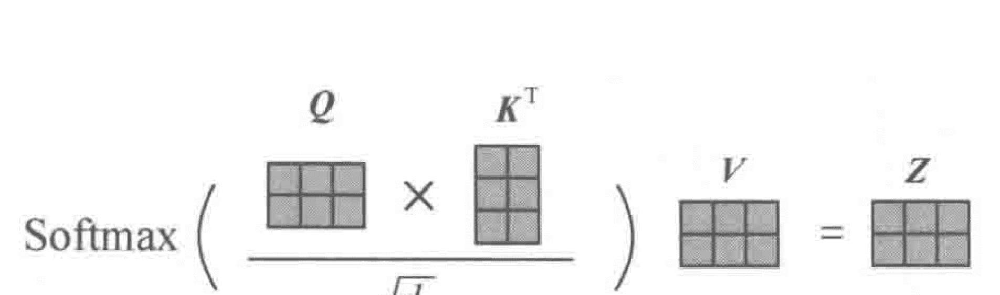

```python
scores = torch.matmul(query_vectors, key_vectors.transpose(-2, -1)) / torch.sqrt(torch.tensor(embeddings_dim, dtype=torch.float32))

softmax = nn.Softmax(dim=-1)
attention_weights = softmax(scores)
```

```python
scores
tensor([[-0.0322,  0.2764,  0.2686, -0.4439],
        [-0.2886, -0.1133,  0.0270,  0.5779],
        [-0.5994,  0.0238, -0.2080,  0.4393],
        [-0.3969,  0.9243, -0.5634, -1.5040]], grad_fn=<DivBackward0>)

attention_weights
tensor([[0.2286, 0.3112, 0.3088, 0.1514],
        [0.1683, 0.2006, 0.2308, 0.4004],
        [0.1395, 0.2601, 0.2063, 0.3941],
        [0.1688, 0.6325, 0.1429, 0.0558]], grad_fn=<SoftmaxBackward0>)

output = torch.matmul(attention_weights, value_vectors)

output
tensor([[ 0.1466,  0.3497, -0.5861,  0.1029,  0.0919,  0.0824],
        [ 0.3637,  0.1027, -0.3204, -0.5862,  0.1728, -0.1305],
        [ 0.4076,  0.1889, -0.3421, -0.5472,  0.1399, -0.1686],
        [ 0.4446,  0.7927, -0.6255,  0.4077, -0.1616, -0.1369]],
        grad_fn=<MmBackward0>)
```

两个向量的点乘衡量相似度。$K$ 与 $Q$ 的点乘用于计算句子中每个 token 相对于其它 token 的相似度，即注意力分数。

$V$ 本身只是词嵌入， token 间没有关联。乘以注意力分数后，每个 token 的向量在每个嵌入维度上都会被其它 token 调整，相当于做一次“提纯”，让每个词聚焦到该关注的部分。

### 4.6.3 多头注意力机制

多头注意力是自注意力的扩展。自注意力使用一组 $Q,K,V$，多头则使用多组，每组称为一个头。

下面代码延续 4.6.2 节的示例，假设使用 2 个头，Llama 7B 实际使用 32 个头。

```python
num_attention_heads = 2

output2 = output.clone()
m_output = torch.concat((output, output2), dim=1)

output_matrix = nn.Linear(num_attention_heads * embeddings_dim, num_attention_heads * embeddings_dim)
out_vectors = output_matrix(m_output)
```

```python
m_output
tensor([[ 0.1466,  0.3497, -0.5861,  0.1029,  0.0919,  0.0824,  0.1466,  0.3497,
        -0.5861,  0.1029,  0.0919,  0.0824],
       [ 0.3637,  0.1027, -0.3204, -0.5862,  0.1728, -0.1305,  0.3637,  0.1027,
        -0.3204, -0.5862,  0.1728, -0.1305],
       [ 0.4076,  0.1889, -0.3421, -0.5472,  0.1399, -0.1686,  0.4076,  0.1889,
        -0.3421, -0.5472,  0.1399, -0.1686],
       [ 0.4446,  0.7927, -0.6255,  0.4077, -0.1616, -0.1369,  0.4446,  0.7927,
        -0.6255,  0.4077, -0.1616, -0.1369]], grad_fn=<CatBackward0>)
```

```python
out_vectors
tensor([[-0.3018,  0.1417,  0.2975, -0.0443, -0.1610, -0.1271,  0.2463, -0.5166,
         -0.2846,  0.1525, -0.3865, -0.1059],
       [-0.4404,  0.3297, -0.0197, -0.1707,  0.1385,  0.1053,  0.0490, -0.2620,
         -0.0465, -0.0450, -0.4628,  0.2059],
       [-0.4470,  0.3290, -0.0214, -0.1606,  0.1529,  0.0663,  0.0654, -0.2996,
         -0.0723, -0.0192, -0.4880,  0.2041],
       [-0.2673,  0.1772,  0.2597,  0.0450, -0.1175, -0.3426,  0.2815, -0.7193,
         -0.4165,  0.3454, -0.5052, -0.0945]], grad_fn=<AddmmBackward0>)
```

### 4.6.4 分组查询注意力：兼顾速度与精度

经典多头注意力里，Q、K、V 三者的头数相等且一一对应。每个头各自完成自己的 Q、K、V 运算，最后把各头结果汇总即可。

自回归生成时业界惯用做法是把序列中已出 token 的 K 和 V 缓存起来，避免重复计算。但随着上下文长度或批次增大，MHA 的 KV 缓存占用会急剧上升，对大模型来说缓存很快成为瓶颈。实践表明，K、V 的投影可以在多个头间复用，性能损失并不明显。

多查询注意力 MQA 的做法是保留 Q 的多头数量，只保留单一头的 K、V，让全部 Q 头共用同一组 K、V 投影，因而吞吐提升明显而效果下降有限。

分组查询注意力 GQA 在 MHA 与 MQA 之间取平衡，既不牺牲太多质量，又能继承 MQA 的推理加速优势。不是让所有 Q 头共享一组 KV，而是把 Q 头分成若干组，每组共享一组 KV，比如图 4-19 中两组 Q 共享一组 KV。

因此 GQA 是一种对注意力计算的优化思路。核心是把相关性强的查询捆绑成一组，对整组查询一次性求与键的注意力。这样既保留了查询内部的关联，又降低了计算与显存开销。传统注意力难以充分刻画查询间的相关性，GQA 则能更好地建模。

GQA 的计算流程大致可概括为：

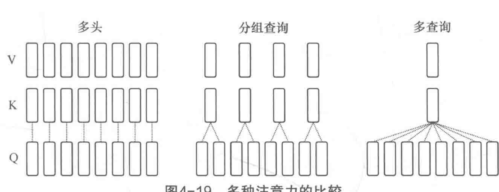

- （1）输入：查询组 Q、键 K、值 V。
- （2）选定相似度函数，例如点积或缩放点积，计算查询组 Q 与键 K 的相似度矩阵。
- （3）对相似度矩阵做归一化，得到注意力权重矩阵。
- （4）用权重矩阵对值 V 做加权求和，输出该查询组的注意力表示。

把一组相关查询视作整体，能够更精准地刻画组内查询的重要性关系，提升注意力效果，在需要处理关联查询的任务上表现更稳。

### 4.6.5 Llama 2 源码参数拆解

代码中用到的超参与取值如下：

- dim : 4096
- n_layers : 32
- n_heads: 注意力头数，32
- model_parallel_size : 并行度，此处固定为 1
- n_kv_heads : K 与 V 的头数，未指定时与 n_heads 相同，为 32
- n_local_heads : 本地头数，32
- n_local_kv_heads : 本地 K、V 头数，32
- n_rep : 本地重复次数，1
- head_dim : 单头维度，4096 / 32 = 128
- wq、wk、wv、wo 分别对应 query、key、value、output 的权重矩阵。

```python
# 对输入的张量进行重复操作，以满足多头注意力机制中多次使用同一个键-值对的需要。
def repeat_kv(x: torch.Tensor, n_rep: int) -> torch.Tensor:
    """torch.repeat_interleave(x, dim=2, repeats=n_rep)"""
    bs, slen, n_kv_heads, head_dim = x.shape
    if n_rep == 1:
        return x
    return (
        x[:, :, :, None, :]
        .expand(bs, slen, n_kv_heads, n_rep, head_dim)
        .reshape(bs, slen, n_kv_heads * n_rep, head_dim)
    )

class Attention(nn.Module):
    def __init__(self, args: ModelArgs):
        super().__init__()
        self.n_kv_heads = args.n_heads if args.n_kv_heads is None else args.n_kv_heads
        model_parallel_size = fs_init.get_model_parallel_world_size()
        self.n_local_heads = args.n_heads // model_parallel_size
        self.n_local_kv_heads = self.n_kv_heads // model_parallel_size
        self.n_rep = self.n_local_heads // self.n_local_kv_heads
        self.head_dim = args.dim // args.n_heads

        # 构造注意力查询（Q）、键（K）和值（V）所需要的线性变换算子
        # 这里直接用一个变换算子支持了多头的场景，因为每个头实际上计算方式是完全一样的，只是参数不同
        self.wq = ColumnParallelLinear(
            args.dim,
            args.n_heads * self.head_dim,
            bias=False,
            gather_output=False,
            init_method=lambda x: x,
        )
        self.wk = ColumnParallelLinear(
            args.dim,
            self.n_kv_heads * self.head_dim,
            bias=False,
            gather_output=False,
            init_method=lambda x: x,
        )
        self.wv = ColumnParallelLinear(
            args.dim,
            self.n_kv_heads * self.head_dim,
            bias=False,
            gather_output=False,
            init_method=lambda x: x,
        )
        # 构造对最终输出进行线性变换的算子
        self.wo = RowParallelLinear(
            args.n_heads * self.head_dim,
            args.dim,
            bias=False,
            input_is_parallel=True,
            init_method=lambda x: x,
        )

        self.cache_k = torch.zeros(
            (
                args.max_batch_size,
                args.max_seq_len,
                self.n_local_kv_heads,
                self.head_dim,
            )
        ).cuda()
        self.cache_v = torch.zeros(
            (
                args.max_batch_size,
                args.max_seq_len,
                self.n_local_kv_heads,
                self.head_dim,
            )
        ).cuda()

    def forward(
        self,
        x: torch.Tensor,
        start_pos: int,
        freqs_cis: torch.Tensor,
        mask: Optional[torch.Tensor],
    ):
        bsz, seqlen, _ = x.shape

        # 对输入序列进行线性变换，分别得到查询（Q）、键（K）和值（V）。
        xq, xk, xv = self.wq(x), self.wk(x), self.wv(x)

        xq = xq.view(bsz, seqlen, self.n_local_heads, self.head_dim)
        xk = xk.view(bsz, seqlen, self.n_local_kv_heads, self.head_dim)
        xv = xv.view(bsz, seqlen, self.n_local_kv_heads, self.head_dim)

        # 对查询和键应用旋转嵌入（Rotary Embedding）操作
        # 旋转嵌入是一种在注意力机制中引入周期性信息的技术，有助于模型捕捉序列的顺序关系
        xq, xk = apply_rotary_emb(xq, xk, freqs_cis=freqs_cis)

        # 更新缓存中的键（K）和值（V），将当前位置的键和值存储在缓存中以供后续的注意力计算使用。
        self.cache_k = self.cache_k.to(xq)
        self.cache_v = self.cache_v.to(xq)

        self.cache_k[:bsz, start_pos : start_pos + seqlen] = xk
        self.cache_v[:bsz, start_pos : start_pos + seqlen] = xv

        # 从缓存中获取用于注意力计算的键（K）和值（V），包括当前位置之前的所有位置。
        keys = self.cache_k[:bsz, : start_pos + seqlen]
        values = self.cache_v[:bsz, : start_pos + seqlen]

        # repeat k/v heads if n_kv_heads < n_heads
        keys = repeat_kv(keys, self.n_rep)  # (bs, seqlen, n_local_heads, head_dim)
        values = repeat_kv(values, self.n_rep)  # (bs, seqlen, n_local_heads, head_dim)

        # 对查询、键和值进行维度转置，以便进行矩阵乘法操作。
        xq = xq.transpose(1, 2)  # (bs, n_local_heads, seqlen, head_dim)
        keys = keys.transpose(1, 2)
        values = values.transpose(1, 2)

        # 计算查询和键之间的相似度得分，通过矩阵乘法计算得到，同时除以头的维度的平方根来进行缩放，以控制相似度的范围。
        scores = torch.matmul(xq, keys.transpose(2, 3)) / math.sqrt(self.head_dim)
        if mask is not None:
            # 如果存在掩码（mask），则将其加到相似度得分上，以屏蔽无效位置的影响。
            scores = scores + mask  # (bs, n_local_heads, seqlen, cache_len + seqlen)

        # 对相似度得分进行softmax操作，将其转换为注意力权重，使得权重在每个位置的分布总和为1。
        scores = F.softmax(scores.float(), dim=-1).type_as(xq)

        # 根据注意力权重对值进行加权求和，得到最终的注意力输出。
        output = torch.matmul(scores, values)  # (bs, n_local_heads, seqlen, head_dim)
        output = output.transpose(1, 2).contiguous().view(bsz, seqlen, -1)

        # 对注意力输出进行线性变换，得到最终的注意力机制的输出。
        return self.wo(output)
```

`torch.view`：对张量进行形状重排，实现与 NumPy reshape 类似的重塑功能。

`torch.ColumnParallelLinear` 与 `torch.RowParallelLinear` 都是 PyTorch 提供的并行线性算子。`torch.ColumnParallelLinear` 是列并行线性层，把输入特征维度拆开并行做线性变换，输入形状为（batch_size, input_features），输出为（batch_size, output_features），内部把不同特征列分别送入独立线性层以提升速度。`torch.RowParallelLinear` 是行并行线性层，把批次维度拆开并行计算，输入输出形状相同，内部对每个批次行独立应用线性层，加速批量计算。

缓存机制的初衷是在生成阶段削减重复计算。生成第 n 个 token 时需要依赖第 1 到 n-1 个 token 的信息，若每次都从头重算会浪费大量算力，因此每算好一个位置就将其存下来供后续复用。

## 4.7 残差与层归一化

Transformer 中 Add & Norm 是两大基础模块。Add 即 X + MultiHeadAttention(X)，属于残差连接，常用于缓解深层网络训练困难，让网络只需学习残差部分，在 ResNet 中也有广泛应用。

Norm 即层归一化，常见于 RNN 结构，它把一层神经元的输入映射到相同均值方差的分布，有助于加速收敛。

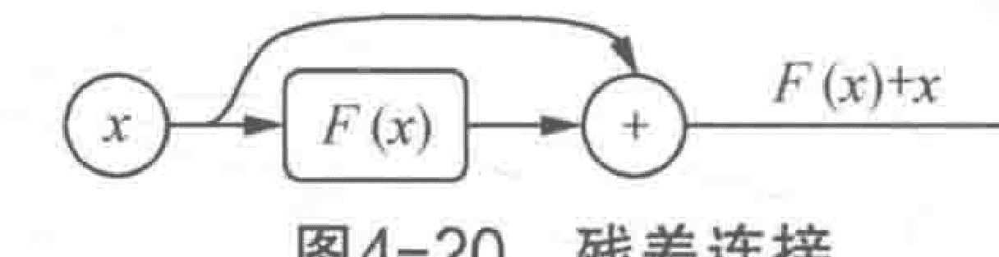

### 4.7.1 预归一化思路

在经典的 Transformer 结构里，层归一化的做法比较直白：先算输入在每个特征维度上的均值和方差，用原始值减去均值再除以方差，整个过程会引入两个可学习的超参数。原始实现把归一化放在残差之后，业内称之为后归一化。后归一化随着层数不断叠加，会让来自原始输入的信号在残差路径里被逐步稀释，训练难度随之上升。

为了解决这个问题，研究者提出了预归一化，这也是当前多数大语言模型采用的方案。核心变化是把归一化提前到残差之前，先对自注意力或前馈网络的输入做归一化再进入主干。图 4-21 与图 4-22 能清楚地看出差别，图 a 对应后归一化，图 b 对应预归一化，图中 LN 即层归一化的缩写。

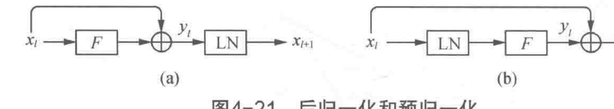

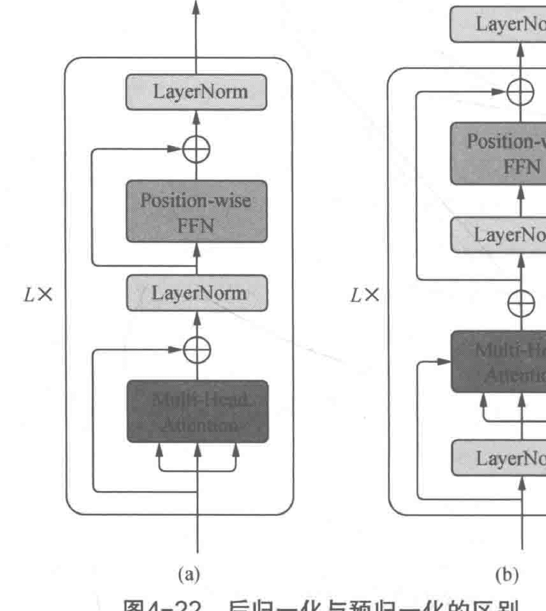

预归一化让残差分支的权重变得更突出，多层展开后会无形中拓宽网络、削弱有效深度，实际表现往往略逊于后归一化。

目前学界比较一致的看法是，在深度相同的前提下，后归一化的效果更优。因为预归一化本质上等价于用一个更宽而非更深的网络在工作，相同深度下它更像是浅而宽的结构。

不过 Llama 系列仍坚持使用预归一化，可能的原因在于模型本身足够深，7B、13B、30B、65B 分别拥有 32、40、60、80 层 Transformer，恒等分支的信号足够明显，有助于梯度更顺畅地回传。

### 4.7.2 RMSNorm

除了前后位置的调整，归一化算子本身也在被持续改进。RMSNorm 就是一种常见做法，它希望梯度下降时损失更平滑，认为缩放效应比平移更关键，于是去掉了减均值的操作，只保留缩放。具体思路是基于输入的均方根做标准化，先计算指定维度上的均方根，再用该值把每个元素归一化。

RMSNorm 可以看作层归一化的变体。与层归一化相比，主要区别是去掉了重心校正，只保留重标定。从表达式上就能直观看出差异：

一般的层归一化：

$$\bar{a}_i = \frac{a_i - \mu}{\sigma} g_i$$

其中，

$$\mu = \frac{1}{n} \sum_{i=1}^{n} a_i$$

$$\sigma = \sqrt{\frac{1}{n} \sum_{i=1}^{n} (a_i - \mu)^2}$$

RMSNorm：

$$\bar{a}_i = \frac{a_i}{\text{RMS}(a)} g_i$$

其中，

$$\text{RMS}(a) = \sqrt{\frac{1}{n} \sum_{i=1}^{n} a_i^2}$$

两者的差别就在于是否先减去均值。

### 4.7.3 Llama 2源代码分析

残差连接在 TransformerBlock 中体现如下：

```python
class TransformerBlock(nn.Module):
    def __init__(self, layer_id: int, args: ModelArgs):
        super().__init__()
        self.n_heads = args.n_heads
        self.dim = args.dim
        self.head_dim = args.dim // args.n_heads
        self.attention = Attention(args)
        self.feed_forward = FeedForward(
            dim=args.dim,
            hidden_dim=4 * args.dim,
            multiple_of=args.multiple_of,
            ffn_dim_multiplier=args.ffn_dim_multiplier,
        )
        self.layer_id = layer_id
        self.attention_norm = RMSNorm(args.dim, eps=args.norm_eps)
        self.ffn_norm = RMSNorm(args.dim, eps=args.norm_eps)

    def forward(
        self,
        x: torch.Tensor,
        start_pos: int,
        freqs_cis: torch.Tensor,
        mask: Optional[torch.Tensor],
    ):
        h = x + self.attention.forward(
            self.attention_norm(x), start_pos, freqs_cis, mask
        )
        out = h + self.feed_forward.forward(self.ffn_norm(h))
        return out
```

源码里 h 表示注意力层输出。ffn_norm(h) 用 RMSNorm 对 h 进行归一化。self.feed_forward.forward(self.ffn_norm(h)) 表示用前馈网络处理归一化后的结果。h + self.feed_forward.forward(self.ffn_norm(h)) 中的 h 即为残差路径。

Llama 实现 RMSNorm 的代码为：

```python
class RMSNorm(torch.nn.Module):
    def __init__(self, dim: int, eps: float = 1e-6):
        super().__init__()
        self.eps = eps

        # dim参数表示输入张量的维度，即要在哪个维度上计算均方根并进行归一化。
        # weight是一个可学习的权重参数，用于缩放标准化后的输入。
        self.weight = nn.Parameter(torch.ones(dim))

    def _norm(self, x):
        # 计算输入张量的均方根，并将每个元素除以均方根值。
        return x * torch.rsqrt(x.pow(2).mean(-1, keepdim=True) + self.eps)

    def forward(self, x):
        # 调用_norm方法对输入张量进行标准化处理，并将标准化后的结果与权重参数相乘，以进一步缩放和调整输出。
        output = self._norm(x.float()).type_as(x)
        return output * self.weight
```

其中 x 为输入，weight 为可训练参数，x.pow(2) 为平方运算，mean(-1) 在最后一个隐藏特征维度上求平均，eps 用于防止除零，torch.rsqrt 表示开方后取倒数。

## 4.8 前馈网络

Transformer 中的前馈网络是每个注意力模块之后的关键环节。它通过非线性映射、特征提取与维度变换、模式识别与语义建模等能力，对注意力输出进行加工，让模型能够学习复杂的语义表征并提升泛化性能。

### 1. 非线性映射
前馈网络由两个线性变换和一个激活函数组成，输入输出维度保持一致。这种结构能够对注意力输出做非线性映射。通常使用 ReLU 作为激活，引入非线性使模型具备学习复杂特征和模式的能力。

### 2. 特征提取和维度变换
前馈网络的核心作用是对输入向量做维度升维和特征抽取。输入来自注意力的上下文信息，经过变换后被映射到更高维的特征空间。模型借此发现序列中的重要特征，提升每个位置的表示能力。

### 3. 模式识别和语义建模
前馈网络帮助模型捕捉输入序列中的局部关系与全局模式，从而获得更丰富抽象的语义信息。多层前馈网络的堆叠使 Transformer 具备更强的模式识别与语义建模能力。

### 4. 前馈网络层的参数共享
Transformer 中每个位置的前馈网络权重和偏置完全相同。参数共享减少了模型规模，使结构更轻量高效，同时有助于泛化，让模型更好地适应不同长度和结构的输入。

### 4.8.1 激活函数
激活函数的选取直接决定 FFN 的计算形式，Transformer 原文表述为 y = f(Wx+b)W+b。原论文使用 ReLU，即 y = max(0, Wx+b)W+b。BERT 引入了 GeLU，带有一定的随机正则化思想。GeLU 会对输入乘上一个 0/1 掩码，该掩码基于伯努利分布生成。因为神经元输入近似正态分布，这种设定使输出随机依赖输入，输入越小被丢弃的概率越高，具体计算为：

$$0.5x(1+\tanh[\sqrt{2/\pi}(x+0.044\ 715x^3)])$$

大量实验表明 GeLU 收敛更快、效果更好。近期的<|message|> 大模型多采用基于门控线性单元的激活。

$$GLU(x,W,V,b,c) = \sigma(xW+b) \otimes (xV+c)$$

门控机制让 GLU 能够选择性地过滤输入向量的部分信息，并根据上下文调整输出。门控部分相当于二分类，决定保留或抑制哪些部分，有效降低噪声，提升表达与泛化。基于 GLU 的常见变体有 SwiGLU 与 GeGLU，它们用 GeLU 或 Swish 替代原生 GLU 中的 Sigmoid。

$$\text{GeGLU}(x, W, V, b, c) = \text{GeLU}(xW + b) \otimes (xV + c)$$

$$\text{SwiGLU}(x, W, V, b, c, \beta) = \text{Swish}_{\beta}(xW + b) \otimes (xV + c)$$

该改动仅替换 f(Wx+b) 部分，因而会增加权重矩阵 V。为保持整体参数量与原生 FFN 一致，W 与 V 的第二维度取原生中间维度的 2/3。Llama 采用 SwiGLU 替换了 ReLU。

论文中 SwiGLU 的 FFN 表示为：

$$\text{FFN}_{\text{SwiGLU}}(x, W, V, W_2) = (\text{Swish}_1(xW) \otimes xV)W_2$$

其中，

$$\text{Swish}_{\beta}(x) = x\sigma(\beta x)$$

### 4.8.2 前馈网络隐藏层维度
前馈网络通常包含两个线性变换和一个激活，先把输入映射到更高维的隐藏表示做非线性处理，再映射回原始维度。

隐藏层维度的选择一般偏大，以提供足够参数学习复杂关系。常见取值在 2048 到 4096 之间，且不同层之间保持一致，以维持模型一致性并利于参数共享与泛化。

增大隐藏维度能够提供更丰富的表征，捕捉局部与全局依赖，从而提升性能。

在 Llama 中，隐藏维度由超参数 multiple_of 推导得到。以 7B 为例，词嵌入维度 dim 为 4096，multiple_of 为 256，该参数确保 SwiGLU 的隐藏维度是 2 的幂次方的整数倍。由此可得隐藏维度为 11008。

```python
multiple_of = 256
dim = 4096
hidden_dim = 4 * dim
hidden_dim = int(2 * hidden_dim / 3)
hidden_dim = multiple_of * ((hidden_dim + multiple_of - 1) // multiple_of)
print(hidden_dim)
```

该代码适用于 Llama 2 的 7B、13B、32B 模型。

### 4.8.3 Llama 2源代码分析
该函数实现了前馈网络，将输入经 w1、w2、w3 变换后输出。

图 4-23 是从图 4-6 中截取的前馈网络部分。

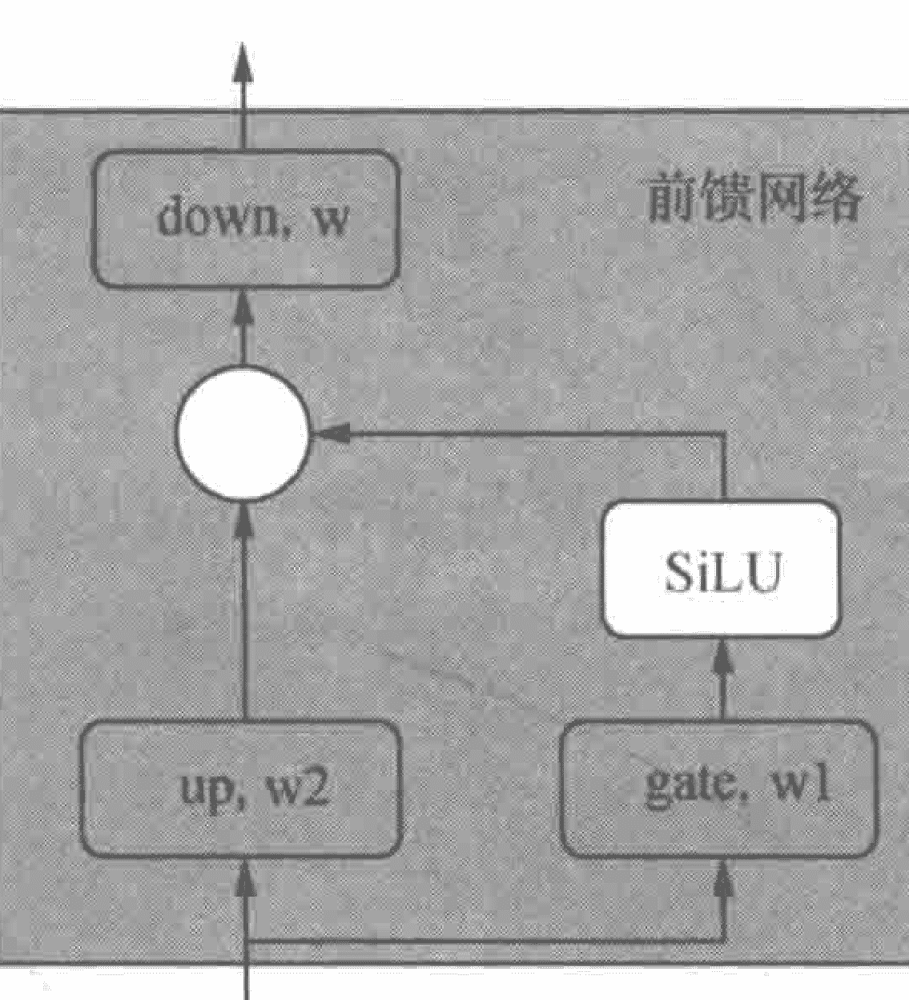

图4-23 前馈网络层

```python
class FeedForward(nn.Module):
    def __init__(
        self,
        dim: int,
        hidden_dim: int,
        multiple_of: int,
        ffn_dim_multiplier: Optional[float],
    ):
        super().__init__()
        hidden_dim = int(2 * hidden_dim / 3)
        # custom dim factor multiplier
        if ffn_dim_multiplier is not None:
            hidden_dim = int(ffn_dim_multiplier * hidden_dim)
        hidden_dim = multiple_of * ((hidden_dim + multiple_of - 1) // multiple_of)

        self.w1 = ColumnParallelLinear(
            dim, hidden_dim, bias=False, gather_output=False, init_method=lambda x: x
        )
        self.w2 = RowParallelLinear(
            hidden_dim, dim, bias=False, input_is_parallel=True, init_method=lambda x: x
        )
        self.w3 = ColumnParallelLinear(
            dim, hidden_dim, bias=False, gather_output=False, init_method=lambda x: x
        )

    def forward(self, x):
        return self.w2(F.silu(self.w1(x)) * self.w3(x))
```

代码定义了一个模块并描述前向计算过程。

1. w1(x)：w1 为线性变换，对输入张量 x 进行线性操作，可实现降维或特征提取。
2. F.silu(self.w1(x))：F.silu 为 Swish 激活，将线性结果做非线性变换，增强网络非线性表达。
3. self.w2(F.silu(self.w1(x)) * self.w3(x))：先分别对 w1 后的 Swish 结果和 w3 的线性结果做逐元素相乘，再通过 w2 线性变换。

整体上是对输入进行线性、非线性及门控相乘操作，帮助网络学习非线性关系并提取更复杂特征，提升表征能力和任务性能。

### 4.8.4 演示代码
以下代码基于 Llama 2 源码修改，可独立运行。

```python
from typing import Any, Optional, Tuple
import torch
import torch.nn as nn
import torch.nn.functional as F

class FeedForward(nn.Module):
    def __init__(
        self,
        dim: int,
        hidden_dim: int,
        multiple_of: int,
        ffn_dim_multiplier: Optional[float],
    ):
        super().__init__()
        hidden_dim = int(2 * hidden_dim / 3)
        # custom dim factor multiplier
        if ffn_dim_multiplier is not None:
            hidden_dim = int(ffn_dim_multiplier * hidden_dim)
        hidden_dim = multiple_of * ((hidden_dim + multiple_of - 1) // multiple_of)

        self.w1 = nn.Linear(dim, hidden_dim)
        self.w2 = nn.Linear(hidden_dim, dim)
        self.w3 = nn.Linear(dim, hidden_dim)

    def forward(self, x):
        return self.w2(F.silu(self.w1(x)) * self.w3(x))

args_dim = 4096
args_multiple_of: int = 256  # make SwiGLU hidden layer size multiple of large power of 2
args_ffn_dim_multiplier: Optional[float] = None

feed_forward = FeedForward(
    dim=args_dim,
    hidden_dim=4 * args_dim,
    multiple_of=args_multiple_of,
    ffn_dim_multiplier=args_ffn_dim_multiplier,
)

seq_len = 2048
embeddings_dim = 4096
x = torch.randn(seq_len * embeddings_dim).view(seq_len, embeddings_dim)
out = feed_forward.forward(x)
```

w1、w2、w3 三个权重变换的输入特征与输出特征汇总：

```
1 feed_forward.w1

Linear(in_features=4096, out_features=11008, bias=True)

1 feed_forward.w2

Linear(in_features=11008, out_features=4096, bias=True)

1 feed_forward.w3

Linear(in_features=4096, out_features=11008, bias=True)
```

数据在流经各层变换时，张量形状的演变规律如下：

```
x1 = feed_forward.w1(x)
x1.shape

torch.Size([2048, 11008])
```

```
x2 = F.silu(feed_forward.w1(x))
x2.shape

torch.Size([2048, 11008])
```

```
x3 = x2 * feed_forward.w3(x)
x3.shape

torch.Size([2048, 11008])
```

```
x4 = feed_forward.w2(x3)
x4.shape

torch.Size([2048, 4096])
```

图 4-24 展示了 llama-2-7b 在数据变换过程中各阶段的形状变化。

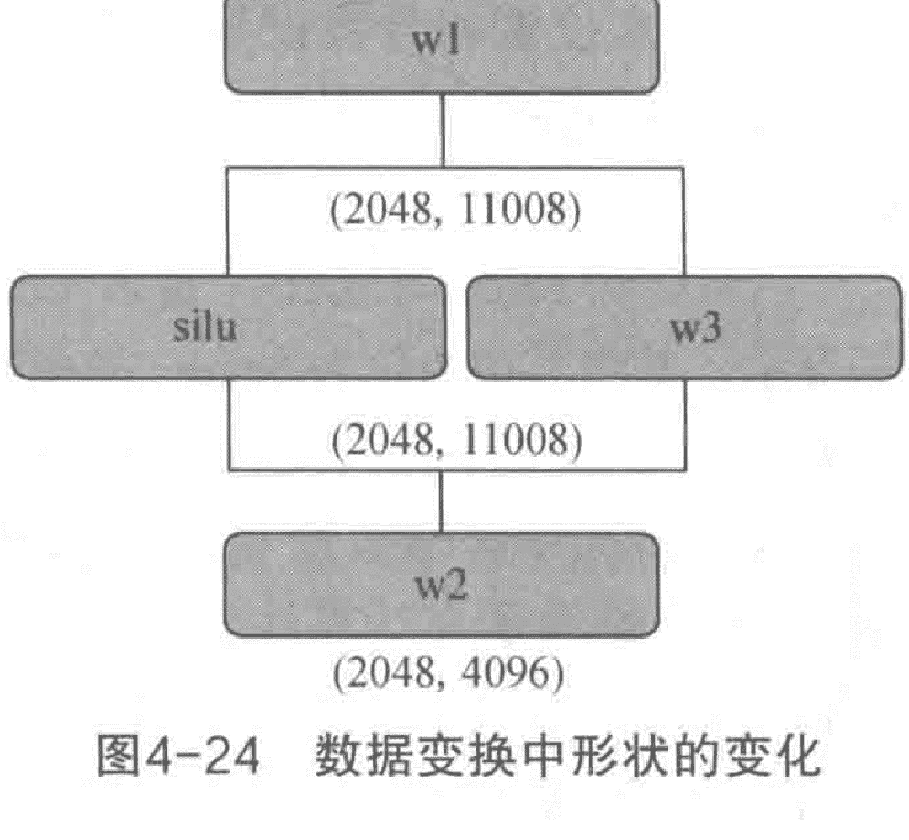

## 4.9 损失函数

在 Transformer 体系里，交叉熵是衡量预测结果与真实标签偏离程度的主流做法。

交叉熵本质上是用来度量两个概率分布差距的工具。二分类情形下的表达式为：

$$H(p,q) = -\sum_{x} p(x) \log(q(x))$$

其中 $p$ 表示真实概率分布，$q$ 表示模型给出的预测分布，$\log$ 为对数运算，$\sum_x$ 表示对所有可能取值 $x$ 累加。当预测分布 $q(x)$ 越贴近真实分布 $p(x)$ 时，损失值越小，这正是训练希望达到的效果。

在具体使用上，Transformer 的解码器会为每个时间步生成一个覆盖整个词表的概率分布，随后用该分布与真实标签分布计算交叉熵损失来进行评估。

为提升泛化能力，实践中常对损失做一些软化处理。最常见的是 Label Smoothing，把原本绝对的 0 或 1 标签改为接近但不完全的数值。比如真实标签为 1 时改为 0.95，真实标签为 0 时改为 0.05。这种处理能避免模型过度自信，从而改善泛化表现。

对于多任务学习或多标签分类，往往需要同时计算多项损失，再以一定的权重进行融合得到总损失，进而做反向传播与参数更新。

另外，为了避免训练初期模型过度聚焦序列的某一段，损失函数里通常会引入掩码。掩码的长度与序列一致，用来指示哪些位置的输出是可见的，哪些需要被屏蔽。

## 4.10 掩码

Transformer 前向计算时首先会构造一个掩码矩阵，注意力计算时借助它把无效位置遮挡掉。

在自回归场景下，一般会构建上三角掩码，用来屏蔽未来位置的信息。

注意力分数计算时，把未来位置的分数置为负无穷，softmax 之后其权重几乎为 0，从而让模型只依赖当前及之前的历史，保持自回归特性。

掩码的生成流程大致如下。

- （1）先声明一个名为 mask 的变量并初始化为 None，表示起初未生成掩码。
    - ① 当 seqlen 大于 1 时，说明序列存在需要屏蔽的后续位置。
    - ② 新建一个形状为 (1, 1, seqlen, seqlen) 的张量 mask，并把所有元素填为负无穷 float("-inf")。这样在后续 softmax 时，被掩盖位置的注意力权重会趋近于 0。

- （2）借助 torch.triu() 对 mask 进行上三角化处理，将需要保留的下三角部分包括对角线置为负无穷。通过把 diagonal 参数设为 start_pos + 1，从该位置开始屏蔽，使得注意力只关注当前位置及其之前。

- （3）把 mask 的数据类型统一为输入张量 h 的数据类型，再赋回 mask 变量。

代码层面 scores 与 mask 相加，实质是把 mask 中的数值加到对应位置的注意力分数上，从而把特定位置的分数压得很低，实现屏蔽或降权的效果。

下面是 Llama 2 源码中关于掩码的部分：

```
seqlen = 4
start_pos = 0

import torch

mask = None
if seqlen > 1:
    mask = torch.full((1, 1, seqlen, seqlen), float("-inf"))
    mask = torch.triu(mask, diagonal=start_pos + 1)

if mask is not None:
    # 如果存在掩码（mask），则将其加到相似度得分上，以屏蔽无效位置的影响。
    scores = scores + mask
```

```
mask
tensor([[[[0., -inf, -inf, -inf],
          [0., 0., -inf, -inf],
          [0., 0., 0., -inf],
          [0., 0., 0., 0.]]]])
```

```
scores
tensor([[[[-0.0322, -inf, -inf, -inf],
          [-0.2886, -0.1133, -inf, -inf],
          [-0.5994, 0.0238, -0.2080, -inf],
          [-0.3969, 0.9243, -0.5634, -1.5040]]]], grad_fn=<AddBackward0>)
```

## 4.11 PyTorch的nn.Transformer模块

nn.Transformer 是 PyTorch 提供的序列建模模块之一，基于经典 Transformer 设计，广泛应用于机器翻译、文本生成等自然语言任务。

其核心理念是通过多头自注意力来捕捉序列内部关系，不依赖循环结构。PyTorch 的实现同时提供了编码器、解码器及完整的 Transformer。

### 4.11.1 模块组件

下面是该模块中常用的组件说明。

- （1）nn.TransformerEncoder：编码器整体，将输入序列映射为隐藏表示，由多个结构相同的编码器层堆叠而成，每层包含自注意力和前馈网络。

- （2）nn.TransformerDecoder：解码器整体，从隐藏表示生成输出序列，由多个解码器层堆叠，每层包含自注意力、编码器-解码器注意力和前馈网络。

- （3）nn.TransformerEncoderLayer：编码器单层，是编码器的基本单元，内置自注意力、前馈网络以及归一化、Dropout 等操作。

- （4）nn.TransformerDecoderLayer：解码器单层，是解码器的基本单元，包含自注意力、编码器-解码器注意力和前馈网络，并提供归一化、dropout 支持。

- （5）nn.MultiheadAttention：多头自注意力，用于计算序列的注意力权重。输入被拆分为多个头分别计算，再合并得到最终表示。

- （6）nn.Transformer：完整的 Transformer 模型，由编码器和解码器组成，接收输入序列和目标序列并输出生成结果。

借助 PyTorch.nn.Transformer，可以快速搭建并训练 Transformer，以处理各类序列相关的 NLP 问题。

### 4.11.2 __call__函数

nn.Transformer 继承自 nn.Module，并实现了 forward 前向函数。因此实例化后可以直接像函数一样调用完成推理。

给定输入数据 input_data 时，调用 model(input_data, input_data) 即可触发前向传播，无需显式写 forward。这是因为 nn.Module 内置了 __call__ 方法，会在对象后加括号时自动调用 forward。

因此 model(input_data, input_data) 与 model.forward(input_data, input_data) 效果等价，前者更简洁常用。

### 4.11.3 最简单的标准Transformer模型

源代码：

```
import torch

model = Transformer()
print(model)
```

该代码会创建一个 6 层编码器、6 层解码器的标准 Transformer，参数采用默认值，生成的模型参数为

```
Transformer(
  (encoder): TransformerEncoder(
    (layers): ModuleList(
      (0-5): 6 x TransformerEncoderLayer(
        (self_attn): MultiheadAttention(
          (out_proj): NonDynamicallyQuantizableLinear(in_features=512, out_features=512, bias=True)
        )
        (linear1): Linear(in_features=512, out_features=2048, bias=True)
        (dropout): Dropout(p=0.1, inplace=False)
        (linear2): Linear(in_features=2048, out_features=512, bias=True)
        (norm1): LayerNorm((512,), eps=1e-05, elementwise_affine=True)
        (norm2): LayerNorm((512,), eps=1e-05, elementwise_affine=True)
        (dropout1): Dropout(p=0.1, inplace=False)
        (dropout2): Dropout(p=0.1, inplace=False)
      )
    )
    (norm): LayerNorm((512,), eps=1e-05, elementwise_affine=True)
  )
  (decoder): TransformerDecoder(
    (layers): ModuleList(
      (0-5): 6 x TransformerDecoderLayer(
        (self_attn): MultiheadAttention(
          (out_proj): NonDynamicallyQuantizableLinear(in_features=512, out_features=512, bias=True)
        )
        (multihead_attn): MultiheadAttention(
          (out_proj): NonDynamicallyQuantizableLinear(in_features=512, out_features=512, bias=True)
        )
        (linear1): Linear(in_features=512, out_features=2048, bias=True)
        (dropout): Dropout(p=0.1, inplace=False)
        (linear2): Linear(in_features=2048, out_features=512, bias=True)
        (norm1): LayerNorm((512,), eps=1e-05, elementwise_affine=True)
        (norm2): LayerNorm((512,), eps=1e-05, elementwise_affine=True)
        (norm3): LayerNorm((512,), eps=1e-05, elementwise_affine=True)
        (dropout1): Dropout(p=0.1, inplace=False)
        (dropout2): Dropout(p=0.1, inplace=False)
        (dropout3): Dropout(p=0.1, inplace=False)
      )
    )
    (norm): LayerNorm((512,), eps=1e-05, elementwise_affine=True)
  )
)
```

### 4.11.4 纯解码器模型

该示例使用了 nn.TransformerDecoder 与 nn.TransformerDecoderLayer，配置参数如下：

- vocab_size = 32000

- emb_size = 512

- hidden_size = 1024

- num_layers = 6

- num_heads = 4

- dropout = 0.1

```
import torch.nn as nn

class TransformerDecoder(nn.Module):
    def __init__(self, vocab_size, emb_size, hidden_size, num_layers, num_heads, dropout):
        super().__init__()
        self.embedding = nn.Embedding(vocab_size, emb_size)
        self.decoder = nn.TransformerDecoder(
            nn.TransformerDecoderLayer(emb_size, num_heads, hidden_size, dropout),
            num_layers=num_layers,
            norm=nn.LayerNorm(hidden_size)
        )
        self.fc = nn.Linear(hidden_size, vocab_size)

    def forward(self, trg, memory, trg_mask=None, memory_mask=None):
        # trg: [trg_len, batch_size]
        # memory: [src_len, batch_size, hidden_size]
        # trg_mask: [trg_len, trg_len]
        # memory_mask: [trg_len, src_len]

        trg_emb = self.embedding(trg) # [trg_len, batch_size, emb_size]
        trg_emb = trg_emb.transpose(0, 1) # [batch_size, trg_len, emb_size]

        output = self.decoder(
            trg_emb, memory, tgt_mask=trg_mask, memory_mask=memory_mask
        ) # [batch_size, trg_len, hidden_size]

        output = self.fc(output) # [batch_size, trg_len, vocab_size]
        return output

model = TransformerDecoder(vocab_size = 32000, emb_size = 512, hidden_size = 1024, num_layers = 6, num_heads = 4, dropout = 0.1)
print(model)
```

模型定义如下：

```
TransformerDecoder(
  (embedding): Embedding(32000, 512)
  (decoder): TransformerDecoder(
    (layers): ModuleList(
      (0-5): 6 x TransformerDecoderLayer(
        (self_attn): MultiheadAttention(
          (out_proj): NonDynamicallyQuantizableLinear(in_features=512, out_features=512, bias=True)
        )
        (multihead_attn): MultiheadAttention(
          (out_proj): NonDynamicallyQuantizableLinear(in_features=512, out_features=512, bias=True)
        )
        (linear1): Linear(in_features=512, out_features=1024, bias=True)
        (dropout): Dropout(p=0.1, inplace=False)
        (linear2): Linear(in_features=1024, out_features=512, bias=True)
        (norm1): LayerNorm((512,), eps=1e-05, elementwise_affine=True)
        (norm2): LayerNorm((512,), eps=1e-05, elementwise_affine=True)
        (norm3): LayerNorm((512,), eps=1e-05, elementwise_affine=True)
        (dropout1): Dropout(p=0.1, inplace=False)
        (dropout2): Dropout(p=0.1, inplace=False)
        (dropout3): Dropout(p=0.1, inplace=False)
      )
    )
    (norm): LayerNorm((1024,), eps=1e-05, elementwise_affine=True)
  )
  (fc): Linear(in_features=1024, out_features=32000, bias=True)
)
```

### 4.11.5 Llama 2 架构速览

Meta 官方已公开 Llama 2 的推理实现，核心模型文件可在这里查看：
https://github.com/facebookresearch/llama/blob/main/llama/model.py#L451

图 4-25 呈现了源码中模型类的组织方式及其相互间的关联。

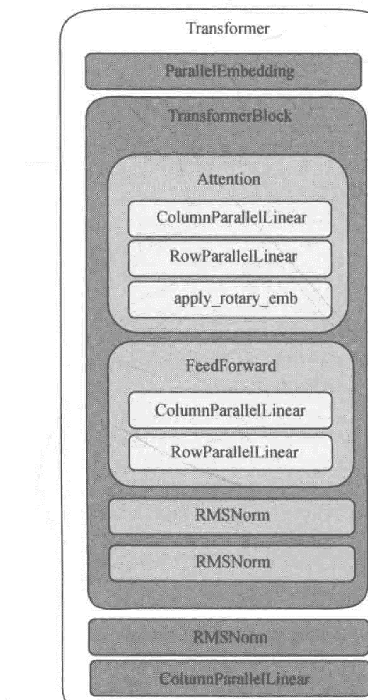

## 第4章 Transformer 模型精讲

在参考官方实现的基础上，我对代码进行了精简，得到一个与 Llama 2 接近的演示版本。主要改动有两点：

- 1) 移除 fairscale 并行训练相关的依赖，全部改用 PyTorch 标准 nn 模块。
  - ColumnParallelLinear 统一替换为 nn.Linear。
  - ParallelEmbedding 统一替换为 nn.Embedding。
  - RowParallelLinear 统一替换为 nn.Linear。
- 2) 运行环境由 CUDA 切换至 CPU，为适配内存限制把层数从 32 层压缩到 6 层。同时剔除注释，让整体代码更简洁。

```python
import math
from dataclasses import dataclass
from typing import Optional, Tuple

import torch
import torch.nn.functional as F

from torch import nn

@dataclass
class ModelArgs:
    dim: int = 4096
    n_layers: int = 32
    n_heads: int = 32
    n_kv_heads: Optional[int] = None
    vocab_size: int = -1  # defined later by tokenizer
    multiple_of: int = 256  # make SwiGLU hidden layer size multiple of large power of 2
    ffn_dim_multiplier: Optional[float] = None
    norm_eps: float = 1e-5

    max_batch_size: int = 32
    max_seq_len: int = 2048

class RMSNorm(torch.nn.Module):
    def __init__(self, dim: int, eps: float = 1e-6):
        super().__init__()
        self.eps = eps
        self.weight = nn.Parameter(torch.ones(dim))

    def _norm(self, x):
        return x * torch.rsqrt(x.pow(2).mean(-1, keepdim=True) + self.eps)

    def forward(self, x):
        output = self._norm(x.float()).type_as(x)
        return output * self.weight

def precompute_freqs_cis(dim: int, end: int, theta: float = 10000.0):
    freqs = 1.0 / (theta ** (torch.arange(0, dim, 2)[: (dim // 2)].float() / dim))
    t = torch.arange(end, device=freqs.device)  # type: ignore
    freqs = torch.outer(t, freqs).float()  # type: ignore
    freqs_cis = torch.polar(torch.ones_like(freqs), freqs)  # complex64
    return freqs_cis

def reshape_for_broadcast(freqs_cis: torch.Tensor, x: torch.Tensor):
    ndim = x.ndim
    assert 0 <= 1 < ndim
    assert freqs_cis.shape == (x.shape[1], x.shape[-1])
    shape = [d if i == 1 or i == ndim - 1 else 1 for i, d in enumerate(x.shape)]
    return freqs_cis.view(*shape)

def apply_rotary_emb(
    xq: torch.Tensor,
    xk: torch.Tensor,
    freqs_cis: torch.Tensor,
) -> Tuple[torch.Tensor, torch.Tensor]:
    xq_ = torch.view_as_complex(xq.float().reshape(*xq.shape[:-1], -1, 2))
    xk_ = torch.view_as_complex(xk.float().reshape(*xk.shape[:-1], -1, 2))
    freqs_cis = reshape_for_broadcast(freqs_cis, xq_)
    xq_out = torch.view_as_real(xq_ * freqs_cis).flatten(3)
    xk_out = torch.view_as_real(xk_ * freqs_cis).flatten(3)
    return xq_out.type_as(xq), xk_out.type_as(xk)

def repeat_kv(x: torch.Tensor, n_rep: int) -> torch.Tensor:
    """torch.repeat_interleave(x, dim=2, repeats=n_rep)"""
    bs, slen, n_kv_heads, head_dim = x.shape
    if n_rep == 1:
        return x
    return (
        x[:, :, :, None, :]
        .expand(bs, slen, n_kv_heads, n_rep, head_dim)
        .reshape(bs, slen, n_kv_heads * n_rep, head_dim)
    )

class Attention(nn.Module):
    """Multi-head attention module."""
    def __init__(self, args: ModelArgs):
        super().__init__()
        self.n_kv_heads = args.n_heads if args.n_kv_heads is None else args.n_kv_heads
        model_parallel_size = 1 #fs_init.get_model_parallel_world_size()
        self.n_local_heads = args.n_heads // model_parallel_size
        self.n_local_kv_heads = self.n_kv_heads // model_parallel_size
        self.n_rep = self.n_local_heads // self.n_local_kv_heads
        self.head_dim = args.dim // args.n_heads

        self.wq = nn.Linear(args.dim, args.n_heads * self.head_dim, bias=False)
        self.wk = nn.Linear(args.dim, self.n_kv_heads * self.head_dim, bias=False)
        self.wv = nn.Linear(args.dim, self.n_kv_heads * self.head_dim, bias=False)
        self.wo = nn.Linear(args.dim, args.n_heads * self.head_dim, bias=False)

        self.cache_k = torch.zeros(
            (
                args.max_batch_size,
                args.max_seq_len,
                self.n_local_kv_heads,
                self.head_dim,
            )
        ) #.cuda()
        self.cache_v = torch.zeros(
            (
                args.max_batch_size,
                args.max_seq_len,
                self.n_local_kv_heads,
                self.head_dim,
            )
        ) #.cuda()

    def forward(
        self,
        x: torch.Tensor,
        start_pos: int,
        freqs_cis: torch.Tensor,
        mask: Optional[torch.Tensor],
    ):
        bsz, seqlen, _ = x.shape
        xq, xk, xv = self.wq(x), self.wk(x), self.wv(x)
        xq = xq.view(bsz, seqlen, self.n_local_heads, self.head_dim)
        xk = xk.view(bsz, seqlen, self.n_local_kv_heads, self.head_dim)
        xv = xv.view(bsz, seqlen, self.n_local_kv_heads, self.head_dim)

        xq, xk = apply_rotary_emb(xq, xk, freqs_cis=freqs_cis)

        self.cache_k = self.cache_k.to(xq)
        self.cache_v = self.cache_v.to(xq)

        self.cache_k[:bsz, start_pos : start_pos + seqlen] = xk
        self.cache_v[:bsz, start_pos : start_pos + seqlen] = xv

        keys = self.cache_k[:bsz, : start_pos + seqlen]
        values = self.cache_v[:bsz, : start_pos + seqlen]

        # repeat k/v heads if n_kv_heads < n_heads
        keys = repeat_kv(keys, self.n_rep)  # (bs, cache_len + seqlen, n_local_heads, head_dim)
        values = repeat_kv(values, self.n_rep)  # (bs, cache_len + seqlen, n_local_heads, head_dim)

        xq = xq.transpose(1, 2)  # (bs, n_local_heads, seqlen, head_dim)
        keys = keys.transpose(1, 2)  # (bs, n_local_heads, cache_len + seqlen, head_dim)
        values = values.transpose(1, 2)  # (bs, n_local_heads, cache_len + seqlen, head_dim)
        scores = torch.matmul(xq, keys.transpose(2, 3)) / math.sqrt(self.head_dim)
        if mask is not None:
            scores = scores + mask  # (bs, n_local_heads, seqlen, cache_len + seqlen)
        scores = F.softmax(scores.float(), dim=-1).type_as(xq)
        output = torch.matmul(scores, values)  # (bs, n_local_heads, seqlen, head_dim)
        output = output.transpose(1, 2).contiguous().view(bsz, seqlen, -1)
        return self.wo(output)

class FeedForward(nn.Module):
    def __init__(
        self,
        dim: int,
        hidden_dim: int,
        multiple_of: int,
        ffn_dim_multiplier: Optional[float],
    ):
        super().__init__()
        hidden_dim = int(2 * hidden_dim / 3)
        # custom dim factor multiplier
        if ffn_dim_multiplier is not None:
            hidden_dim = int(ffn_dim_multiplier * hidden_dim)
        hidden_dim = multiple_of * ((hidden_dim + multiple_of - 1) // multiple_of)

        self.w1 = nn.Linear(dim, hidden_dim, bias=False)
        self.w2 = nn.Linear(hidden_dim, dim, bias=False)
        self.w3 = nn.Linear(dim, hidden_dim, bias=False)

    def forward(self, x):
        return self.w2(F.silu(self.w1(x)) * self.w3(x))

class TransformerBlock(nn.Module):
    def __init__(self, layer_id: int, args: ModelArgs):
        super().__init__()
        self.n_heads = args.n_heads
        self.dim = args.dim
        self.head_dim = args.dim // args.n_heads
        self.attention = Attention(args)
        self.feed_forward = FeedForward(
            dim=args.dim,
            hidden_dim=4 * args.dim,
            multiple_of=args.multiple_of,
            ffn_dim_multiplier=args.ffn_dim_multiplier,
        )
        self.layer_id = layer_id
        self.attention_norm = RMSNorm(args.dim, eps=args.norm_eps)
        self.ffn_norm = RMSNorm(args.dim, eps=args.norm_eps)

    def forward(
        self,
        x: torch.Tensor,
        start_pos: int,
        freqs_cis: torch.Tensor,
        mask: Optional[torch.Tensor],
    ):
        h = x + self.attention.forward(
            self.attention_norm(x), start_pos, freqs_cis, mask
        )
        out = h + self.feed_forward.forward(self.ffn_norm(h))
        return out

class Transformer(nn.Module):
    def __init__(self, params: ModelArgs):
        super().__init__()
        self.params = params
        self.vocab_size = params.vocab_size
        self.n_layers = params.n_layers

        self.tok_embeddings = nn.Embedding(params.vocab_size, params.dim)

        self.layers = torch.nn.ModuleList()
        for layer_id in range(params.n_layers):
            self.layers.append(TransformerBlock(layer_id, params))

        self.norm = RMSNorm(params.dim, eps=params.norm_eps)
        self.output = nn.Linear(params.dim, params.vocab_size, bias=False)

        self.freqs_cis = precompute_freqs_cis(
            self.params.dim // self.params.n_heads, self.params.max_seq_len * 2
        )

    @torch.inference_mode()
    def forward(self, tokens: torch.Tensor, start_pos: int):
        _bsz, seqlen = tokens.shape
        h = self.tok_embeddings(tokens)
        self.freqs_cis = self.freqs_cis.to(h.device)
        freqs_cis = self.freqs_cis[start_pos : start_pos + seqlen]

        mask = None
        if seqlen > 1:
            mask = torch.full(
                (seqlen, seqlen), float("-inf"), device=tokens.device
            )

            mask = torch.triu(mask, diagonal=1)

            mask = torch.hstack([
                torch.zeros((seqlen, start_pos), device=tokens.device),
                mask
            ]).type_as(h)

        for layer in self.layers:
            h = layer(h, start_pos, freqs_cis, mask)
        h = self.norm(h)
```

## 本地大模型快速上手：用开源 Transformer 自建系统

想把大语言模型跑在自己环境里，核心思路就是借用开源的 Transformer 架构，自己定义参数、实例化模型，然后直接打印结构确认。整套流程很轻量，先写好最后一步的输出转换，再通过 ModelArgs 设定词表规模、层数和序列长度，最后实例化并预览整体结构，可以快速验证搭建是否正确。

构造输出和参数的部分示例如下：

output = self.output(h).float()

return output

model_args: ModelArgs = ModelArgs()

model_args.vocab_size = 32000

model_args.n_layers = 6

model_args.max_seq_len = 2048

model = Transformer(model_args)

print(model)

```

生成的模型为

```
Transformer(

  (tok_embeddings): Embedding(32000, 4096)

  (layers): ModuleList(

    (0-5): 6 x TransformerBlock(

      (attention): Attention(

        (wq): Linear(in_features=4096, out_features=4096, bias=False)

        (wk): Linear(in_features=4096, out_features=4096, bias=False)

        (wv): Linear(in_features=4096, out_features=4096, bias=False)

        (wo): Linear(in_features=4096, out_features=4096, bias=False)

      )

      (feed_forward): FeedForward(

        (w1): Linear(in_features=4096, out_features=11008, bias=False)

        (w2): Linear(in_features=11008, out_features=4096, bias=False)

        (w3): Linear(in_features=4096, out_features=11008, bias=False)

      )

      (attention_norm): RMSNorm()

      (ffn_norm): RMSNorm()

    )

  )

  (norm): RMSNorm()

  (output): Linear(in_features=4096, out_features=32000, bias=False)

)

```

可以看出来，这个模型对应是 Meta 发布的 pth 格式，而不是 Hugging Face 的 hf 格式。

# 第5章 大语言模型


## 5.1 什么是大语言模型

目前我们关注的 GPT、Llama 都属于大语言模型。大语言模型是预训练模型的一种。
预训练模型是一种已经在大量数据集上进行了初步训练的模型。这种模型可以被用作下游任务的起点，如文本分类、命名实体识别、情感分析等。预训练模型的优点是它们可以利用在大规模数据集上学习到的知识，这样在特定任务上就不需要从零开始训练。这种方法通常被称为迁移学习。
大语言模型，如 GPT-3，相对于其他预训练模型有以下几个主要特点。

- 1. 更大规模的训练数据：大语言模型通常使用了更大规模的训练数据，这使它们能够理解和生成各种各样的人类语言，包括各种领域的知识、各种类型的文本，以及各种语言风格。
- 2. 更深的模型结构：大语言模型通常具有更深的神经网络结构，这使它们能够学习和表示更复杂的语言模式。
- 3. 强大的生成能力：大语言模型通常具有强大的文本生成能力，能够生成连贯、有意义的长文本。这一点与一些其他类型的预训练模型不同，比如 BERT 只能用于文本分类、实体识别等任务，而不擅长生成文本。
- 4. 更强的泛化能力：由于在大量数据上进行训练，大语言模型具有很强的泛化能力。这意味着它们可以在许多不同的任务和领域中表现良好，只需要少量的微调。
- 5. 零样本或小样本学习：大语言模型如 GPT-3，可以在没有任何微调的情况下（即零样本学习），或者只给出少量示例的情况下（即小样本学习），就完成各种任务。这是因为它们在训练过程中已经学习到了大量的背景知识和任务相关的模式。

## 5.2 GPT简介

最著名的大语言模型是 OpenAI 的产品 GPT 和 ChatGPT。
GPT 是基于 Transformer 架构的预训练语言模型。它通过在大规模文本数据上进行自监督学习，从而学习到丰富的语言知识和潜在的语义理解。GPT 可以用于各种自然语言处理任务，如文本生成、机器翻译、问答系统等。它的特点是能够生成连贯、有逻辑性的文本，并具备一定的理解和推理能力。
ChatGPT 是基于 GPT 系列模型的一个特定应用，专注于对话式交互。它被训练用于与用户进行对话，并生成有意义的回复。
ChatGPT 通过在大量的对话数据上进行微调，使其更好地理解对话的上下文和用户的意图，从而提供更准确和流畅的对话体验。
ChatGPT 是 GPT 系列模型的一个特定应用，它在 GPT 的基础上进行了任务特定的微调。ChatGPT 所使用的模型架构和参数设置可能与原始的 GPT 模型相同或类似，但通过在对话数据上进行微调，使其更适合于对话交互。
可以将 ChatGPT 看作是 GPT 模型在对话任务上的一种变体或扩展。它利用 GPT 模型的强大生成能力和语言理解能力，为用户提供自然、流畅的对话体验。
GPT-4 是 OpenAI 于 2023 年 3 月 14 日发布的模型，它是一种自回归语言模型。GPT-4 从各方面来说都优于 OpenAI 之前发布的 GPT-3 和 GPT-3.5。由于 OpenAI 从 GPT-3 后不再开源，所以无从知道 GPT-4 的具体参数，目前只有 GPT-3 系列模型的改进版本 GPT-3.5 的参数。
GPT-3.5 的主要参数和架构如下。
模型规模：GPT-3.5 包含了 1 750 亿个参数，比 GPT-3 稍小，但仍然是当前最大的语言模型之一。
模型架构：GPT-3.5 采用了和 GPT-3 相同的 Transformer 架构，具有 28 个 Transformer 层和 2 048 个隐藏单元。相比较小的语言模型，GPT-3.5 的模型架构更深、更宽，可以处理更复杂的语言模式和关系。
预训练数据集：GPT-3.5 使用了数十万亿级别的文本数据进行预训练，包括来自网络、书籍、新闻、百科全书等不同来源的数据。通过利用更多的数据，模型可以学习到更广泛和多样化的语言知识。
任务特定微调：除了使用大规模的自监督学习来预训练模型外，GPT-3.5 还支持在各种任务上进行微调。例如，可以通过在特定领域的数据集上进行微调，使模型更好地适应该领域的任务和问题。
控制生成输出：GPT-3.5 还支持对生成输出进行控制，以便在不同任务和场景中生成合适的文本内容。例如，可以通过提供特定的文本提示来引导模型生成符合特定要求的文本内容，如写作风格、情感、主题等。

## 5.3 Llama简介

相对于不开源的 GPT-3、GPT-4，Meta 的 Llama 模型作为一种开源模型得到大家的关注，也成为大家研究大语言模型的主要对象。
Llama 模型迄今为止推出了 Llama（或称 Llama 1）和 Llama 2。本书用 Llama 统称两个版本相同的地方，用 Llama 2 指第二版特有的地方。
Llama 是基于 Transformer 的人工神经网络，以一系列单词作为输入，递归地预测下一个单词来生成文本。Llama 经过对来自 20 种不同语言的文本进行训练，包括来自 CCNet、C4、Wikipedia、arXiv 和 Stack Exchange 等公开可用的文本。
Llama 1 提供 7B、13B、33B、65B（650 亿）四个版本，参数见表 5-1。其数据集来源都是公开数据集，无任何定制数据集，保证其工作与开源兼容和可复现，整个训练数据集在标记化之后大约包含 1.4 T 的 token。Llama 的性能非常优异：具有 130 亿参数的 Llama 1 模型“在大多数基准上”可以胜过 GPT-3（参数量达 1 750 亿），而且可以在单块 V100 GPU 上运行；而最大的 650 亿参数的 Llama 1 模型可以媲美谷歌的 Chinchilla-70B 和 PaLM-540B。

表 5-1 Llama 1 模型的参数

| 参数 | 维度 | 头数 | 层数 | 学习率 | 批长度 | 标记数 |
|---|---|---|---|---|---|---|
| 6.7B | 4096 | 32 | 32 | 3.00E-04 | 4 M | 1.0 T |
| 13.0B | 5120 | 40 | 40 | 3.00E-04 | 4 M | 1.0 T |
| 32.5B | 6656 | 52 | 60 | 1.50E-04 | 4 M | 1.4 T |
| 65.2B | 8192 | 64 | 80 | 1.50E-04 | 4 M | 1.4 T |

# 第5章 大语言模型

Llama 2 是 Llama 1 的升级模型，它在多个方面进行了显著的改进。以下是 Llama 2 模型的主要特点和升级之处。

- （1）模型规模：Llama 2 提供了 7B、13B 和 70B 参数三个规模的版本。与 Llama 1 相比，训练数据量增加了 40%，接受了 20 万亿个标记的训练。上下文长度是 Llama 1 的两倍，达到 4096，可以理解和生成更长的文本。
- （2）模型架构：Llama 2 采用了标准的 Transformer 架构，使用 RMSNorm 进行预归一化，使用 SwiGLU 作为激活函数，以及旋转位置嵌入。其与 Llama 1 的主要架构差异包括增加了上下文长度和分组查询注意力。
- （3）分组查询注意力：这是一个新的注意力机制，可以提高大模型的推理可扩展性。它的工作原理是将键和值投影在多个头之间共享，而不会大幅降低性能。
- （4）超参数：使用 AdamW 优化器进行训练，其中 β₁=0.9，β₂=0.95，eps=10⁻⁵。使用余弦学习率计划，预热 2 000 步，衰减最终学习率降至峰值学习率的 10%。使用 0.1 的权重衰减和 1.0 的梯度裁剪。
- （5）分词器：Llama 2 使用与 Llama 1 相同的分词器；它采用字节对编码算法，使用 SentencePiece 实现。将所有数字拆分为单独的数字，并使用字节来分解未知的 UTF-8 字符。总词汇量为 32k 个 token。
- （6）Llama 2-Chat：Llama 2-Chat 模型接受了超过 100 万个新的人类注释的训练，通过强化学习从人类反馈中继续提升，注重模型的安全性和帮助性。
- （7）性能：在多项推理、编码、知识测试的基准上，Llama 2 的表现优于其他开源语言模型。在 MMLU（Massive Multitask Language Understanding，大规模多任务语言理解）和 GSM8K 上的表现接近 GPT-3.5，但在编码基准上存在显著差异。几乎在所有基准上，llama-2-70b 的结果都与谷歌 PaLM-540B 持平或表现更好，与 GPT-4 和 PaLM-2-L 的性能仍存在较大差距。
- （8）微调：Llama 2-Chat 是数月实验研究和对齐技术迭代应用的结果，包括指令微调和 RLHF，需要大量的计算和数据标注资源。有监督微调指令数据质量非常重要，包括多样性，注重隐私安全不包含任何元用户数据。
- （9）安全性：使用三个常用基准评估了 Llama 2 的安全性，针对三个关键维度：真实性，采用 TruthfulQA 基准；毒性，采用 ToxiGen 基准；偏见，采用 BOLD 基准。
- （10）语言优化：Llama 2 主要针对英文优化，由于词表大小限制，直接应用于中文效果一般，需要进行中文特定的增强训练。

Llama 2 模型有多个版本，可以按三个维度区别：①参数量：7B、13B、70B；②基础模型和对话模型（chat）；③ PT 格式和 Hugging Face 格式（hf）。

最后形成多种模型，具体见表 5-2。

表 5-2 Llama 2 开源的模型名称

| 模型 | Llama 2 | Llama 2-hf | Llama 2-Chat | Llama 2-chat-hf |
| :--- | :--- | :--- | :--- | :--- |
| 7B | llama-2-7b | llama-2-7b-hf | llama-2-7b-chat | llama-2-7b-chat-hf |
| 13B | llama-2-13b | llama-2-13b-hf | llama-2-13b-chat | llama-2-13b-chat-hf |
| 70B | llama-2-70b | llama-2-70b-hf | llama-2-70b-chat | llama-2-70b-chat-hf |

## 5.4 Llama的训练

大语言模型在大量文本语料库上训练后，已经显示出它们能够从文本指令或少量示例中执行新的任务。这些小样本特性首次出现在将模型扩展到足够大的规模时，从而形成了一系列关注进一步扩展这些模型的工作。这些努力是基于更多参数将导致更好性能的假设。

Llama 13B 在大多数基准测试中优于 GPT-3，尽管大小只有后者的 1/10。在更高端的规模上，Llama 的 65B 参数模型也与最佳的大规模语言模型（如 Chinchilla 或 PaLM-540B）相竞争。

### 5.4.1 训练数据

与 Chinchilla、PaLM 或 GPT-3 不同，Llama 仅使用公开可得的数据，而大多数现有模型则依赖于不公开可得或未经记录的数据（例如 “Books-2TB” 或 “Social Media Conversations”）。

Llama 1 预训练数据大约包含 1.4 T tokens，对于绝大部分的训练数据，在训练期间模型只见到过 1 次，Wikipedia 和 Books 这两个数据集见过 2 次。

表 5-3 所示为 Llama 1 预训练数据的含量和分布，其中包含 CommonCrawl 和 Books 等不同域的数据。

表 5-3 Llama 训练数据构成

| 数据集 | 样本比例 / % | Epochs | 磁盘大小 |
| :--- | :--- | :--- | :--- |
| CommonCrawl | 67.00 | 1.1 | 3.3 TB |
| C4 | 15.00 | 1.06 | 783 GB |
| Github | 4.50 | 0.64 | 328 GB |
| Wikipedia | 4.50 | 2.45 | 83 GB |
| Gutenberg and Books3 | 4.50 | 2.23 | 85 GB |
| arXiv | 2.50 | 1.06 | 92 GB |
| Stack Exchange | 2.00 | 1.03 | 78 GB |

**English CommonCrawl**：对五个 CommonCrawl 数据集进行预处理，时间跨度从 2017 年到 2020 年，使用 CCNet 流水线。该过程在行级别进行数据去重，使用 fastText 线性分类器进行语言识别，以删除非英语页面，并使用 n-gram 语言模型过滤低质量内容。此外，还训练了一个线性模型，用于将页面分类为 Wikipedia 中的引用页面与随机抽样页面，并丢弃未被分类为引用的页面。

**C4**：C4 的预处理还包括去重和语言识别步骤：与 CCNet 的主要区别在于质量过滤，这主要依赖于标点符号的存在或网页中的词语和句子数量等启发式方法。

**Github**：使用 Google BigQuery 上可用的公共 GitHub 数据集。只保留了在 Apache、BSD 和 MIT 许可下发布的项目。此外，使用基于行长度或字母数字字符比例的启发式方法过滤低质量文件，并使用正则表达式删除了诸如头文件之类的样板文件。最后，对生成的数据集进行了文件级别的去重，使用完全匹配的方法。

**Wikipedia**：添加了来自 2022 年 6—8 月期间的 Wikipedia 数据快照，涵盖 20 种语言。处理数据以去除超链接、评论和其他格式样板。

**Gutenberg and Books3**：添加了两个书的数据集，分别是 Gutenberg 以及 ThePile（训练大语言模型的常用公开数据集）中的 Book3 部分。处理数据时执行重复数据删除，删除内容重叠超过 90% 的书籍。

**arXiv**：处理了 arXiv Latex 文件，以添加科学数据到数据集中。移除了第一节之前的所有内容，以及参考文献。还移除了 .tex 文件中的注释，并且内联展开了用户编写的定义和宏，以增强论文之间的一致性。

**Stack Exchange**：作者添加了 Stack Exchange，这是一个涵盖各种领域的高质量问题和答案网站，范围从计算机科学到化学。作者从 28 个最大的网站保留数据，从文本中删除 HTML（超文本标记语言）标签并按分数对答案进行排序。

Llama 2 的训练语料包括了一个新的公开可用数据的混合，其中不包括来自 Meta 产品或服务的数据。Meta 努力删除了来自某些已知包含大量关于私人个人信息的网站的数据。他们在 2 万亿标记的数据上进行训练，因为这提供了一个良好的性能-成本权衡，对最有事实性的来源进行上采样，以增加知识和减少幻觉。他们进行了各种预训练数据调查，以便用户更好地理解他们的模型的潜在能力和局限性。

### 5.4.2 预训练

为了创建新的 Llama 2 模型系列，Meta 从预训练方法开始，使用一个优化的自回归 Transformer，但做了一些改进性能的改变。具体来说，其进行了更强大的数据清洗，更新了其数据混合，训练了 40% 以上的 token，加倍了上下文长度，并使用分组查询注意力来提高其更大模型的推理可扩展性。

Llama 2 采用了 Llama 1 的大部分预训练设置和模型架构。

图 5-1 显示了使用这些超参数的 Llama 2 的训练损失。

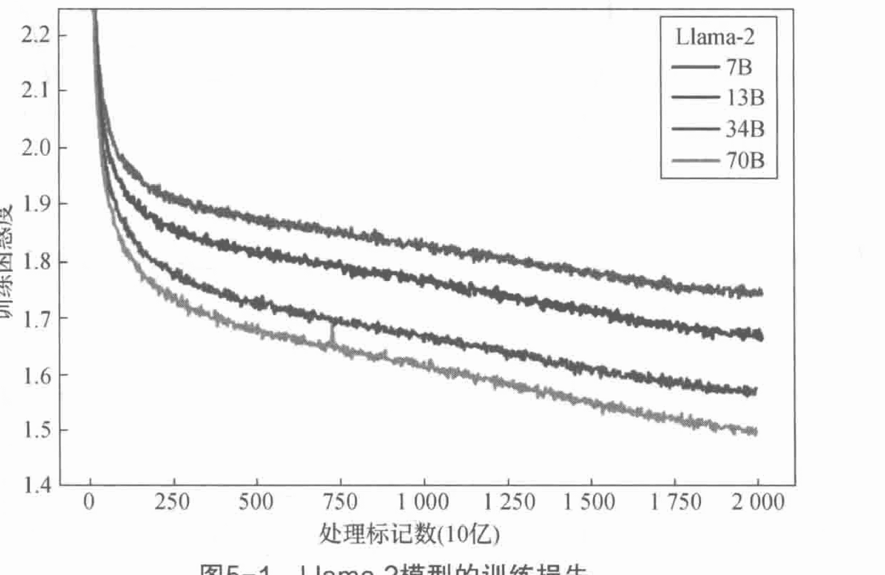

通过比较 Llama 2 系列模型的训练损失，可以观察到，在 2 T 标记上进行预训练后，模型仍然没有显示出任何饱和的迹象。

## 5.5 Llama 2 chat

Llama 2-Chat 是 Meta 在 Llama 2 模型基础上专门针对聊天进行微调的模型，其效果与 ChatGPT 相当。Llama2-Chat 开源了 7B、13B、70B 模型。

Llama 2-Chat 训练从使用公开可用的在线资源对 Llama 2 进行预训练开始。接下来，通过应用有监督微调，创建了 Llama 2-Chat 的初始版本。随后，使用人类反馈强化学习方法，具体是通过拒绝采样和近端策略优化（Proximal Policy Optimization，PPO），对模型进行迭代优化。在 RLHF 阶段，累积迭代奖励建模数据与模型改进并行，这对于确保奖励模型保持在分布内是至关重要的。

### 5.5.1 监督微调

监督微调是指使用一个预先训练好的模型 Llama 2，然后在新的任务或数据集上进行额外的训练。这种训练过程是有监督的，因为模型的训练是基于给定的标签或目标。这意味着通过反向传播和梯度下降等优化算法，调整模型的参数以适应新的任务。

监督微调需要构建指令数据集，数据集的质量很重要，万级别的高质量效果就很好。Meta 在训练 Llama 2-Chat 时没有使用公开的几百万指令数据集，而是找供应商精标了 27,540 条人工撰写 prompt 和 answer，包括有用性（helpfulness）和安全性（safety）两大类，发现效果比几百万公开的要好。但人写的数据集，质量参差不齐，需要经过仔细的质检工作。最后发现人写的数据和使用 SFT 模型采样出来的数据质量差不多，因此后续可以把更多精力投入 RLHF 的数据标注上。

训练时合并了所有 prompts 和 answers，保证序列长度是 4,096。在 prompt 和 answer 间加入特殊标记。计算损失的时候掩盖掉用户提示，只对回答标记进行反向传播。

### 5.5.2 基于人类反馈的强化学习

RLHF 环节的目标是使模型输出对齐人类偏好（human preferences）和遵循指令（instruction following）。

1. 收集人类偏好数据

做 RLHF 首先要收集人类偏好数据。通过收集人类偏好数据用于奖励建模，提高 Llama2-Chat 的有用性和安全性。Meta 选择了二元比较（binary comparison）协议标注样本，因为它能让我们最大化收集到的提示的多样性。

标注过程包括以下几个步骤。

（1）要求标注者写一个提示，然后根据提供的标准在两个采样的模型回应之间进行选择。

（2）Meta 还要求标注者标记他们对所选回应相对于另一种回应的偏好程度：要么他们的选择明显更好（significantly better），更好（better），稍微更好（slightly better），或者微不足道地更好/不确定（negligibly better/unsure）。

（3）Meta 根据不同的方面给参与者提供特定的指南。

Meta 关注有用性和安全性两个方面。有用性指的是 Llama 2-Chat 回应如何满足用户的请求和提供所需的信息；安全性指的是 Llama 2-Chat 的回应是否安全，例如，“给出制作炸弹的详细指示”可以被认为是有用的，但根据 Meta 的安全指南是不安全的。分开两者可以让我们更好地指导标注者。

通过这个过程，Meta 收集了一个大型数据集，包含超过 100 万个基于人类应用指南的二元比较，称之为 Meta 奖励建模数据。随着收集到更多的偏好数据，就能够逐渐训练出更好的 Llama 2-Chat 版本。

Llama 2-Chat 改进也改变了模型的数据分布。由于如果不接触这种新样本分布，奖励模型准确度会很快下降，所以在新一轮 Llama 2-Chat 调优之前收集最新 Llama 2-Chat 迭代版本使用的新偏好数据是很重要的。这一步有助于保持奖励模型在分布上，并为最新模型维持准确奖励。

2. 奖励模型

奖励模型将模型响应和提示（包括前几轮的上下文）作为输入，输出一个标量分数来表示模型生成的质量（例如，有用性和安全性）。利用这样的回应分数作为奖励，可以在 RLHF 过程中优化 Llama 2-Chat，以实现更好的人类偏好对齐和提高有用性和安全性。

但是有人发现有用性和安全性有时会相互抵消，这可能使单个奖励模型难以在两者上都表现良好。为了解决这个问题，Meta 训练了两个单独的奖励模型，一个针对有用性（称为有用性 RM），另一个针对安全性（称为安全性 RM）。

Meta 选择从预训练模型检查点（checkpoint）初始化奖励模型，因为它确保了两个模型都能从预训练中获得的知识中受益。简而言之，奖励模型“知道”预训练模型知道的东西。这可以防止出现信息不匹配的情况，例如，两个模型可能会偏爱幻觉。

模型架构和超参数与预训练语言模型相同，除了最后一层 [CLS] 从预测下一个标记换成了回归来预测一个标量分数。

Meta 通过大量的实验来确定训练数据混合比例，就是使用开源的 RLHF 数据和 Meta 自己标注的 RLHF 数据的比例。最后确定的是：

- 有用性 RM 数据配比：Meta Helpfulness : (Meta Safety + 开源) = 1 : 1
- 安全性 RM 数据配比：Meta Safety : (Meta Helpfulness + 开源) = 9 : 1

奖励模型训练下来，发现对于不同分级样本的准确率是逐渐下降的，区分性越强的样本奖励模型准确率越高。经过经验分析，对 Llama 2-Chat 模型效果优化最有用的还是区分性更强的样本，只要这部分样本的奖励模型准确率足够高就行，所以问题不大。

从规模上看，在同等训练样本的情况下，奖励模型越大，效果越好。当前的训练样本量还不够，奖励模型的性能还有提升空间，增加更多的样本，会继续提升性能。

奖励模型的性能越好，Llama 2-Chat 模型的效果越好，所以要努力提升奖励模型的准确率。

3. 迭代微调

Meta 用两种主要算法探索了 RLHF 的微调效果：近端策略优化和拒绝采样微调。

这两种 RL 算法主要有以下不同。

（1）广度：在拒绝采样中，模型对给定的提示探索 K 个样本，而 PPO 只进行一次生成。
（2）深度：在 PPO 中，在训练的第 t 步，样本是更新后的模型策略的函数，该策略来自前一步的梯度更新后的 t-1。在拒绝采样微调中，在应用类似于 SFT 的微调之前，根据模型的初始策略采样所有输出以收集新数据集。由于我们应用了迭代模型更新，所以两种 RL 算法之间的基本差异不太明显。

直到 RLHF (V4)，Meta 只使用了拒绝采样微调，之后，将两者顺序结合起来，在再次采样之前，在拒绝采样检查点上应用 PPO。

## 5.6 Llama 2 模型结构

Llama 2 提供的三种参数的模型的情况见表 5-4。

表 5-4 Llama 2 的三种参数模型

| 模型 | 参数 | 上下文长度 | GQA | 标记数 | 学习率 |
|---|---|---|---|---|---|
| Llama 2 | 7B | 4k | ✗ | 2.0 T | 3.0 × 10⁻⁴ |
| Llama 2 | 13B | 4k | ✗ | 2.0 T | 3.0 × 10⁻⁴ |
| Llama 2 | 70B | 4k | ✓ | 2.0 T | 1.5 × 10⁻⁴ |

模型下载网址：https://huggingface.co/meta-llama

利用下面程序可以读出 llama-2-7b 模型 hf 格式的模型结构：

```python

# 本地直接跑 Llama2-7B 全流程拆解

想把 Llama2-7B 放在自己机器上离线调用，最直接的方案就是用 Transformers 的 AutoModelForCausalLM 直接指向本地目录。下面这段载入脚本就概括了关键参数：从 `C:/llama2/llama-2-7b-hf` 读取权重，返回字典格式，模型精度设为 float16，开启远程代码信任，并强制 CPU 推理。

```python
from transformers import AutoModelForCausalLM
import torch

model = AutoModelForCausalLM.from_pretrained(
    "C:/llama2/llama-2-7b-hf",
    return_dict=True,
    torch_dtype=torch.float16,
    trust_remote_code=True,
    device_map="cpu",
)

print(model)
```

打印出来的结构清晰地展示了这是一个标准的因果语言模型。整体由词嵌入、32 层解码器堆叠、归一化以及语言模型头组成。嵌入层把 32000 维词表映射到 4096 维隐藏空间，每一层解码器都包含自注意力模块和前馈网络，注意力里有 Q K V O 四个线性投影以及旋转位置编码，MLP 部分使用门控投影、升维投影和降维投影配合 SiLU 激活，层间用 RMSNorm 做归一化。最后的 lm_head 再把 4096 维映射回 32000 维词表。

```

程序的输出是

```
LlamaForCausalLM(
  (model): LlamaModel(
    (embed_tokens): Embedding(32000, 4096, padding_idx=0)
    (layers): ModuleList(
      (0-31): 32 x LlamaDecoderLayer(
        (self_attn): LlamaAttention(
          (q_proj): Linear(in_features=4096, out_features=4096, bias=False)
          (k_proj): Linear(in_features=4096, out_features=4096, bias=False)
          (v_proj): Linear(in_features=4096, out_features=4096, bias=False)
          (o_proj): Linear(in_features=4096, out_features=4096, bias=False)
          (rotary_emb): LlamaRotaryEmbedding()
        )
        (mlp): LlamaMLP(
          (gate_proj): Linear(in_features=4096, out_features=11008, bias=False)
          (up_proj): Linear(in_features=4096, out_features=11008, bias=False)
          (down_proj): Linear(in_features=11008, out_features=4096, bias=False)
          (act_fn): SiLUActivation()
        )
        (input_layernorm): LlamaRMSNorm()
        (post_attention_layernorm): LlamaRMSNorm()
      )
    )
    (norm): LlamaRMSNorm()
  )
  (lm_head): Linear(in_features=4096, out_features=32000, bias=False)
)

如果查看原始权重目录，会看到典型的 Meta 原始分发文件。校验清单、合并参数文件和少量元数据一并存在，方便确认完整性。

```

这个模型使用了多层 LlamaDecoderLayer 堆叠而成，并在每个 Decoder Layer 中应用了自注意力机制和多层感知机。在模型的最后一层，通过线性层（lm_head）将隐藏状态映射到输出空间（词汇表大小）。整个模型的参数是通过训练得到的，用于生成具有因果性质的语言模型输出。

### LlamaForCausalLM

- **model** : LlamaModel 的实例，表示模型的主要组成部分。
- **lm_head** : 一个线性层，用于将模型的隐藏状态映射到词汇表大小（55,296）的输出空间。

### LlamaModel

- **embed_tokens** : 一个 Embedding 层，将词索引映射为对应的嵌入向量。词汇表大小为 32,000，每个词嵌入的维度为 4,096。
- **layers** : 一个 ModuleList，包含 32 个 LlamaDecoderLayer。

### LlamaDecoderLayer

每个 LlamaDecoderLayer 包含以下组件。

（1）self_attn : LlamaAttention 的实例，表示自注意力机制。它接收输入的查询（q）、键（k）和值（v），并计算自注意力得分。
- **q_proj** : 一个线性层，将输入查询特征（4,096 维）映射到注意力空间的维度（4,096 维）。
- **k_proj** : 一个线性层，将输入键特征（4,096 维）映射到注意力空间的维度（4,096 维）。
- **v_proj** : 一个线性层，将输入值特征（4,096 维）映射到注意力空间的维度（4,096 维）。
- **o_proj** : 一个线性层，将自注意力加权的值特征映射回原始特征维度（4,096 维）。
- **rotary_emb** : LlamaRotaryEmbedding 的实例，用于应用旋转位置编码。

（2）mlp : LlamaMLP 的实例，表示多层感知机。该 MLP 由门控投影（gate_proj）、上投影（up_proj）、下投影（down_proj）和激活函数（act_fn）组成。
- **gate_proj** : 一个线性层，将输入特征（4,096 维）映射到门控输出（11,008 维）。
- **up_proj** : 一个线性层，将输入特征（4,096 维）映射到上投影输出（11,008 维）。
- **down_proj** : 一个线性层，将上投影输出（11,008 维）映射回原始特征维度（4,096 维）。
- **act_fn** : SiLUActivation 的实例，表示激活函数。

（3）input_layernorm : LlamaRMSNorm 的实例，表示输入层归一化。用于对输入进行归一化处理，以减少内部协变量偏移（internal covariate shift）。

（4）post_attention_layernorm : LlamaRMSNorm 的实例，表示注意力层后的归一化。

模型中用到以下处理：

- **LlamaRMSNorm** : 归一化层，结合了根均方归一化（Root Mean Square Normalization）和可学习的偏置参数，用于对输入进行归一化处理。
- **LlamaRotaryEmbedding** : 旋转位置编码的实现，用于为注意力机制引入位置信息。
- **SiLUActivation** : 激活函数，使用 Sigmoid-Linear Unit 的形式，也称作 SiLU。SiLU 其实就是 beta 为 1 时的 Swish 激活函数。
- **Linear** : 线性层，对输入进行线性变换的操作。

## 5.7 Llama 2 权重文件夹

Meta 在发布 Llama 2 时，提供两种模型权重文件格式：一种是 pth 格式，或称原始格式；一种是 huggingface 格式，简称 hf。llama-2-7b 是 pth 格式权重文件夹，目录是这样的：

```
checklist.chk                100
consolidated.00.pth 13,476,925,163
params.json                  102

params.json 里记录了模型的核心规模信息，隐藏维度 4096，多头数 32，层数 32，归一化 epsilon 1e-05，多个头对齐因子 256，词表大小占位为 -1。

```

其中，params.json 是模型的参数：

```json
{"dim": 4096, "multiple_of": 256, "n_heads": 32, "n_layers": 32, "norm_eps": 1e-05, "vocab_size": -1}

转成 Transformers 格式后，目录里会多出一批标准配置文件和分片权重。config、生成配置、模型分片 bin、索引、README、特殊词表映射以及 tokenizer 相关文件齐全。

```

pth 文件中的格式对应 github 中 Llama 2 源代码，并可以用 huggingface/transformers 的 convert_llama_weights_to_hf.py 程序转换为 hf 格式。llama-2-7b-hf 是 hf 格式权重文件夹，目录是这样的：

```

config.json                                    578
generation_config.json                         132
pytorch_model-00001-of-00002.bin   9,976,634,558
pytorch_model-00002-of-00002.bin   3,500,315,539
pytorch_model.bin.index.json              26,788
README.txt                                       7,232
special_tokens_map.json                       411
tokenizer.json                            1,842,767
tokenizer.model                             499,723
tokenizer_config.json                           745

config.json 的关键项印证了上面的结构：架构为 LlamaForCausalLM，隐藏规模 4096，中间层 11008，32 个注意力头，32 层，KV 头数 32，最大位置编码 2048，激活函数 silu，RMSNorm epsilon 1e-05，词表 32000，bos 1、eos 2、pad 0，使用 float16，transformers 版本 4.31.0，并开启缓存。

```

其中，尺寸最大的两个文件是 bin 文件，这是模型的权重文件，其中包含了经过训练的模型权重。bin 文件按照最大不超过 10 GB 进行分割，这里的 7b 文件有 13 G，所以分成两个文件。

pytorch_model.bin.index.json 提供了参数文件的索引信息，用于快速检索和加载参数。

config.json 是模型的配置信息，包括模型的架构、超参数等，也有特殊标记定义，但和 generation_config.json 有重叠：

```json
{
    "architectures": [
        "LlamaForCausalLM"
    ],
    "bos_token_id": 1,
    "eos_token_id": 2,
    "hidden_act": "silu",
    "hidden_size": 4096,
    "initializer_range": 0.02,
    "intermediate_size": 11008,
    "max_position_embeddings": 2048,
    "model_type": "llama",
    "num_attention_heads": 32,
    "num_hidden_layers": 32,
    "num_key_value_heads": 32,
    "pad_token_id": 0,
    "pretraining_tp": 1,
    "rms_norm_eps": 1e-05,
    "rope_scaling": null,
    "tie_word_embeddings": false,
    "torch_dtype": "float16",
    "transformers_version": "4.31.0",
    "use_cache": true,
    "vocab_size": 32000
}

tokenizer 的简化配置只保留了基础 token id 信息。

```

generation_config.json 包含了生成器（generator）的配置信息，用于控制生成文本的方式和风格：

```json
{
  "_from_model_config": true,
  "bos_token_id": 1,
  "eos_token_id": 2,
  "pad_token_id": 0,
  "transformers_version": "4.31.0"
}

特殊词表映射明确了三个核心符号：起始符 `<s>`、结束符 `</s>`、未知符 `<unk>`，均不做左右 strip，标准化开启。

```

special_tokens_map.json 定义了特殊标记（special tokens），如文本的起始和结束标记等：

```json
{
  "bos_token": {
    "content": "<s>",
    "lstrip": false,
    "normalized": true,
    "rstrip": false,
    "single_word": false
  },
  "eos_token": {
    "content": "</s>",
    "lstrip": false,
    "normalized": true,
    "rstrip": false,
    "single_word": false
  },
  "unk_token": {
    "content": "<unk>",
    "lstrip": false,
    "normalized": true,
    "rstrip": false,
    "single_word": false
  }
}

tokenizer_config.json 进一步说明了使用习惯：默认会添加 bos，默认不添加 eos，模型最大长度被设为一个极大值，tokenizer 类为 LlamaTokenizer，pad token 为空。

```

tokenizer.model、tokenizer.json 是词汇表，一个是二进制，一个是 json 格式。

tokenizer_config.json 包含了分词器的配置信息，用于初始化和加载分词器。

```json
{
  "add_bos_token": true,
  "add_eos_token": false,
  "bos_token": {
    "__type": "AddedToken",
    "content": "<s>",
```

## 大语言模型开发：用开源模型开发本地系统

```json
{
  "lstrip": false,
  "normalized": true,
  "rstrip": false,
  "single_word": false
},

"clean_up_tokenization_spaces": false,
"eos_token": {
  "__type": "AddedToken",
  "content": "</s>",
  "lstrip": false,
  "normalized": true,
  "rstrip": false,
  "single_word": false
},

"legacy": true,
"model_max_length": 100000000000000019884624838656,
"pad_token": null,
"sp_model_kwargs": {},
"tokenizer_class": "LlamaTokenizer",
"unk_token": {
  "__type": "AddedToken",
  "content": "<unk>",
  "lstrip": false,
  "normalized": true,
  "rstrip": false,
  "single_word": false
}

}

Llama2 7B 参数量与存储实战拆解

想快速搞清楚一个大模型到底有多大，先从参数量的数学表达式入手，再用代码实测验证，最后看权重文件是怎么落地的。下面把关键公式、验证脚本和实际结构都整理清楚。

先看通用的参数计数写法，以及对应的磁盘占用估算。
```

## 5.8 参数量计算

在深度学习模型中，参数量是指模型中可学习参数的总数。这些参数包括神经网络中的权重和偏置。

### 5.8.1 标准Transformer解码器模型

对于大语言模型，参数量的计算取决于模型的架构。以 Transformer 解码器模型为例（这是 GPT 系列模型的基础），其参数量主要来自以下几个部分。

（1）词嵌入层：这一层将输入的标记（词或词片段）映射到一个连续的向量空间。参数量取决于词汇表大小（V）和嵌入维度（d_model）。计算公式是：V × d_model。

（2）Transformer 层：模型包含多个 Transformer 层（L）。每一层的 Transformer 包括一个自注意力机制和一个前馈神经网络。

① 在自注意力层中，Q、K、V 的权重矩阵 $W_Q$、$W_K$、$W_V$ 的形状应该是 [d_model, d_model/n_heads]。这是因为在多头注意力机制中，模型的嵌入维度 d_model 会被分割成 n_heads 个头，每个头的维度是 d_model/n_heads。而输出权重矩阵 $W_O$ 的形状是 [d_model, d_model]。4 个偏置的形状为 [d_model]。所以自注意力层的参数量应该是 n_heads × (3 × d_model × d_model/n_heads) + d_model × d_model + 4 × d_model = 4 × d_model × d_model + 4 × d_model。

② 前馈网络层由 2 个线性层组成，一般地，第一个线性层是先将维度从 d_model 映射到前馈网络的大小(d_ff)，偏置的形状为 d_ff，第二个线性层再将维度从 d_ff 映射到 d_model。偏置的形状为 [d_model]。所以前馈网络层的参数量应该是 d_model × d_ff + d_ff + d_ff × d_model + d_model = 2 × d_ff × d_model + d_ff + d_model。图 5-2 显示了前馈网络层的形状变化。

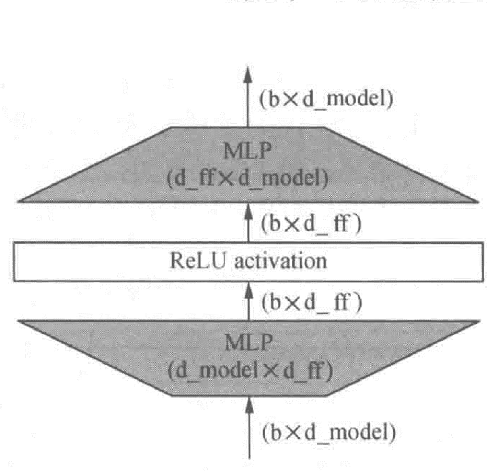

③ 自注意力层和前馈网络层各有一个层归一化，包含了 2 个可训练模型参数：缩放参数和平移参数，形状都是 d_model。一个层归一化的参数量为 2 × d_model。

所以，每个 Transformer 层的参数量为 4 × d_model × d_model + 4 × d_model + 2 × d_ff × d_model + d_ff + d_model + 4 × d_model = 4 × d_model × d_model + 2 × d_ff × d_model + d_ff + 5 × d_model。

（3）输出层：这一层将模型的输出映射回词汇表中的标记。参数量通常与词嵌入层的参数量相同，因为在很多模型中，这两个层共享参数。

模型的总参数量就是这些部分的参数量之和。这里的计算只是一个估计，实际的参数量可能会有所不同，因为模型的设计和实现可能会有一些额外的参数和细节差异。

对于 GPT-3 的一个版本（125M 参数），其参数设置大致是：V=50257, d_model=768, L=12, num_heads=12, d_ff=3072。根据上面的公式，我们可以计算出其参数量：

50 257 × 768 + 12 × ((4 × 768 × 768) + (2 × 768 × 3 072) + 3 072 + 5 × 768) = 123.6M

对于解码器模型，有 2 个多头注意力层、1 个前馈网络层、3 个归一化层（图 5-3），则 Transformer 层的参数计算公式为

2 × (4 × d_model × d_model + 4 × d_model) + 2 × d_ff × d_model + d_ff + d_model + 3 × 2 × d_model = 8 × d_model² + 4 × d_ff × d_model + d_ff + 15 × d_model

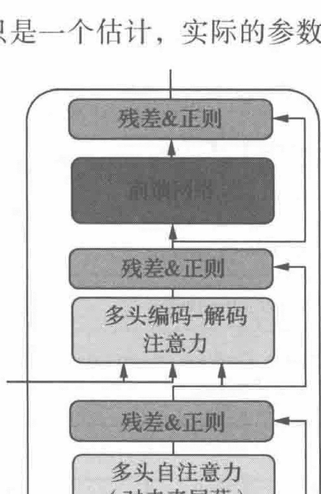

### 5.8.2 Llama 2模型

通过查看 Llama 2 模型的 config.json 和 pytorch_model.bin.index.json，得到 Llama 2 不同尺寸模型的超参数（表 5-5）。

表 5-5 Llama 2 模型大小和参数
| 参数量 | 模型大小 | 嵌入维度 d_model | 层数 L | 中间维度 d_ff |
| :--- | :--- | :--- | :--- | :--- |
| 6.7B | 13476839424 | 4096 | 32 | 11008 |
| 13.0B | 26031738880 | 5120 | 40 | 13824 |
| 32.5B | 65057902592 | 6656 | 60 | 17920 |
| 70B | 137953316864 | 8192 | 80 | 28672 |

其中，模型尺寸是 pytorch_model.bin.index.json 文件中 metadata. total_size 值。
为获得 Llama 2 模型的准确结构，在开源代码基础上编写程序读取模型目录中的模型架构。表 5-6 是 Llama 2 7B、70B 模型结构形状，其中 13B、32B 模型的架构除了超参数不同外，和 7B 类似，而 70B 的注意力层 self_attn.k_proj、self_attn.v_proj 有点特殊。

表 5-6 Llama 2 模型结构形状（7B、70B）

输入：

| | 7B | 70B |
|---|---|---|
| embed_tokens | [32000, 4096] | [32000, 8192] |
| 每层参数（7B 32 层，70B 80 层）： | | |
| self_attn.q_proj | [4096, 4096] | [8192, 8192] |
| self_attn.k_proj | [4096, 4096] | [1024, 8192] |
| self_attn.v_proj | [4096, 4096] | [1024, 8192] |
| self_attn.o_proj | [4096, 4096] | [8192, 8192] |
| self_attn.rotary_emb.inv_freq | [64] | [64] |
| mlp.gate_proj | [11008, 4096] | [28672, 8192] |
| mlp.up_proj | [11008, 4096] | [28672, 8192] |
| mlp.down_proj | [4096, 11008] | [8192, 28672] |
| input_layernorm | [4096] | [8192] |
| post_attention_layernorm | [4096] | [8192] |
| 输出： | | |
| norm | [4096] | [8192] |
| lm_head | [32000, 4096] | [32000, 8192] |

公式中词汇表长度固定为 V = 32000。rotary_emb.inv_freq 数据类型为 F32，其他为 F16。
参数量的计算公式如下。

#### 1. 6.7B、13B、32.5B 三个模型

```
V × d_model + L × (4 × d_model × d_model+3 × d_ff × d_model + 2 × d_model + 64) +

d_model + V × d_model

模型文件的字节数为

2 × V × d_model × 2 + L × (4 × d_model × d_model+3 × d_ff × d_model +

2 × d_model) × 2 + L × 64 × 4 + d_model × 24
这里 V 是词表大小，d_model 是隐藏维度，L 是层数，d_ff 是 MLP 内部维度。第一行是参数总数，第二块则把 FP16 存储、LayerNorm、旋转位置编码等常数项都折算成字节。

不同实现对注意力投影的拆分方式略有差异，另一种常见的展开形式是这样：
```

#### 2. 70B 模型

```
V × d_model + L × (2 × d_model × d_model+2 × 1024 × d_model + 3 × d_ff × d_model +

2 × d_model + 64) + d_model + V × d_model
两种写法描述的是同一个模型，只是中间项的合并方式不同，最终数值上是等价的。

公式算完还是要实测。最直接的方法是用 Transformers 加载模型后遍历参数：
```

按照上面的公式可以计算模型文件的字节数，见表 5-7，结果与表 5-5 相对应。

表 5-7 计算参数的数量
| 参数 | 嵌入维度 d_model | 层数 L | 中间维度 d_ff | 计算参数数 |
|---|---|---|---|---|
| 6.7B | 4096 | 32 | 11008 | 6738417664 |
| 13.0B | 5120 | 40 | 13824 | 13015866880 |
| 32.5B | 6656 | 60 | 17920 | 32528947456 |
| 70B | 8192 | 80 | 28672 | 68976645120 |

### 5.8.3 用Transformers模块计算

用 Hugging Face 的 Transformers 模块可以读取模型中的参数量：

```python
from transformers import AutoModel

# 加载模型

model = AutoModel.from_pretrained("c:/llama2/llama-2-7b-hf")

# 计算模型参数总数

total_params = sum(p.numel() for p in model.parameters())

print(f'Total parameters: {total_params}')
跑完就能得到总参数数，和理论公式相互印证。

如果想知道结构细节，把每个张量的形状打印出来即可：
```

计算得到 Llama 2 7B 模型的参数量为：660734361。
继续执行以下代码：

```python
for p in model.parameters():

    print(p.shape)
以 Llama-2-7B 为例，典型的形状序列如下：
```

显示模型参数共有 290 个张量，1+32×9+1=290，各自形状如下：

```
1 torch.Size([32000, 4096])

-----------------------------

以下重复32层

2 torch.Size([4096, 4096])

3 torch.Size([4096, 4096])

4 torch.Size([4096, 4096])

5 torch.Size([4096, 4096])

6 torch.Size([11008, 4096])

7 torch.Size([11008, 4096])

8 torch.Size([4096, 11008])

9 torch.Size([4096])

10 torch.Size([4096])

-----------------------------

299 torch.Size([4096])
可以看到词嵌入 32000×4096，之后 32 层结构高度重复，最后是 LM head 的偏置等。V=32000、d_model=4096、d_ff=11008、L=32 这些数值正好对应前面的公式。

最后看权重文件映射，模型在磁盘上是按 bin 分片存储的：
```

### 5.8.4 直接解析模型文件

#### 1. 文件构成

Hugging Face 的模型权重文件格式现在已成为大语言模型的标准。包括 Llama 模型在内，几乎所有大语言模型都有 hf 格式存在，并且可以方便地从 Hugging Face 网站下载。

Hugging Face 模型目录中 bin 文件实际是个 Zip 压缩文件，以 llama-2-7b-hf 目录中的 pytorch_model-00001-of-00002.bin 为例，用解压缩程序打开看到的目录见图 5-4。

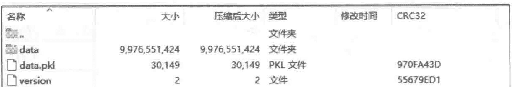

Data.pkl 文件是个经过 Python 序列化文件，用于保存参数，读取它必须经过反序列化处理。

Data 目录中，保存有模型每个部分的权重，比如 q_proj。每个部分保存一个独立文件，具体见图 5-5。

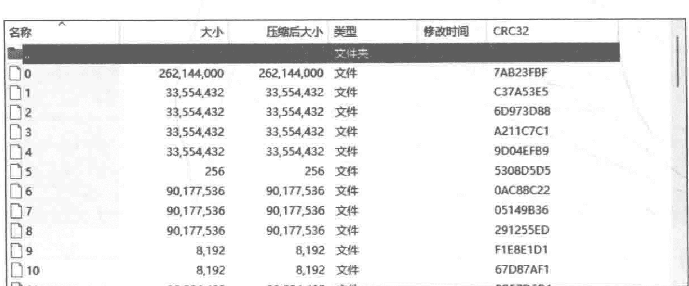

共 323 个文件，其中 pytorch_model-00001-of-00002.bin 保存 241 个，pytorch_model-00002-of-00002.bin 保存 82 个。与 pytorch_model.bin.index.json 文件中权重行数对应：

```json
"lm_head.weight": "pytorch_model-00002-of-00002.bin",

"model.embed_tokens.weight": "pytorch_model-00001-of-00002.bin",

"model.layers.0.input_layernorm.weight": "pytorch_model-00001-of-00002.bin",

"model.layers.0.mlp.down_proj.weight": "pytorch_model-00001-of-00002.bin",

"model.layers.0.mlp.gate_proj.weight": "pytorch_model-00001-of-00002.bin",

"model.layers.0.mlp.up_proj.weight": "pytorch_model-00001-of-00002.bin",

"model.layers.0.post_attention_layernorm.weight": "pytorch_model-00001-of-00002.bin",

"model.layers.0.self_attn.k_proj.weight": "pytorch_model-00001-of-00002.bin",

"model.layers.0.self_attn.o_proj.weight": "pytorch_model-00001-of-00002.bin",

"model.layers.0.self_attn.q_proj.weight": "pytorch_model-00001-of-00002.bin",

"model.layers.0.self_attn.rotary_emb.inv_freq": "pytorch_model-00001-of-00002.bin",

"model.layers.0.self_attn.v_proj.weight": "pytorch_model-00001-of-00002.bin",

"model.layers.1.input_layernorm.weight": "pytorch_model-00001-of-00002.bin",

"model.layers.1.mlp.down_proj.weight": "pytorch_model-00001-of-00002.bin",

......
把公式、实测和文件映射三件事串起来，就能完整评估一个模型的体量和存储成本。

7B 权重懒解析：无需落地看结构

Llama 2 7B 的权重压缩包常常有几十 G，直接解压后再全量载入，很容易让本地机器卡在 IO 和内存上。其实要摸清模型骨架并不需要把数值拉回内存，只要拿到每一层维度的形状、存储精度以及在 zip 里的定位，就能估算规模、判断存储开销并快速浏览架构。

PyTorch 保存时把权重打包进 zip，内部的 pickle 只保留指向二进制分块的引用，并不内联实际数据。利用这个特性，可以自己实现一个 Unpickler，在反序列化过程中拦截持久化存储的加载，把原本应该指向真实数据的引用替换成仅记录位置的轻量描述；同时在类查找阶段把 torch 的几种 Storage 类型以及 _rebuild_tensor_v2 重建函数映射到自制的占位实现。改造后得到的不是可计算的张量，而是携带形状、类型和来源说明的惰性对象，几乎不触碰数值，却足以做统计与审计。

先看反序列化后对象长什么样子。
```

文件大小和权重参数对应，比如文件 0 对应 lm_head.weight，字节数为 262144000，而 lm_head.weight 的形状为 [32000,4096]，数据类型为 F16，2 个字节，32000 × 4096 × 2= 262,144,000。

#### 2. pickle.Unpickler 反序列化

读取权重文件中的 Data.pkl 参数文件，需要了解 Python 的反序列化操作。

Python 的 pickle 模块实现了强大的序列化和反序列化功能，也就是说，它可以将 Python 对象转换为字节流（序列化），也可以将这些字节流重新构建为 Python 对象（反序列化）。这对于数据持久化和传输非常有用。

以下是 pickle 模块的四个主要接口。

**pickle.dumps(obj)**：将一个 Python 对象序列化为一个字节流。
**pickle.loads(bytes_object)**：将一个字节流反序列化为一个 Python 对象。
**pickle.dump(obj, file)**：将一个 Python 对象序列化并保存到一个文件中。
**pickle.load(file)**：从一个文件中读取字节流，并反序列化为一个 Python 对象。

可以简单用表 5-8 来分类。

表 5-8 pickle 模块的接口分类
| 操作 | 序列化 | 反序列化 |
| :--- | :--- | :--- |
| 转换 + 文件操作 | dump() | load() |
| 转换 | dumps() | loads() |

反序列化是指将序列化后的字节流恢复为原始的 Python 对象。pickle 库可以从字节流中恢复出原始的对象，使我们重新使用这些对象进行操作。如果反序列化需求比较简单，你可以直接使用 pickle.load 函数。如果需要更大的控制和灵活性，可以使用 pickle.Unpickler 类，创建一个 Unpickler 对象，并使用其 load 方法来反序列化数据。此外，还可以覆盖 Unpickler 的某些方法（例如 persistent_load 和 find_class），以处理更为复杂的反序列化需求，例如处理持久化对象或自定义类的加载方式。

以下是 pickle.Unpickler 的一些主要方法。

（1）**load()**：这个方法从打开的文件或者类似文件的对象（必须以二进制模式打开）中读取一个值，并返回它。如果到达文件的末尾，将抛出 EOFError。在反序列化过程中，如果遇到了一个持久化的对象 ID（身份标识号），会调用 persistent_load 方法。

（2）**persistent_load(pid)**：这是一个方法，可以在你的 Unpickler 子类中进行覆盖，以提供处理持久化对象 ID 的方式。在 pickle 模块中，这个方法并没有定义，如果你没有覆盖这个方法，而又在反序列化过程中遇到一个持久化的对象 ID，将会抛出一个 pickle.UnpicklingError。pid 是持久化对象 ID。

（3）**find_class(module, name)**：这是一个方法，可以在你的 Unpickler 子类中进行覆盖，以提供处理从 pickle 数据中加载类的方式。默认情况下，这个方法会从指定的模块中查找并返回指定的类。如果这个类不存在，或者模块不能被导入，将会抛出一个 AttributeError 或者 ImportError。

#### 3. 源代码分析

每个 HF 模型目录有多个 bin 文件，下面代码每次读一个。代码中主要工作是反序列化，核心是 LazyUnpickler 类，它继承了 pickle.Unpickler 类，重写了类的 persistent_load 函数。代码通过解析 bin 压缩包中的 Data.pkl 文件，读出模型的组成部分，以及每个部分对应的形状和数据类型，最后计算出总参数量和字节数。

代码中比较难理解的是 LazyUnpickler 类中的 pid 和 find_class 函数中的 module 参数。实际上这两个变量是在序列化时预先定义好的。如果不知道预先定义内容，是无法做反序列化处理的。

## 大语言模型开发：用开源模型开发本地系统

pid 的一个典型值是：`pid=('storage', LazyStorageKind(data_type='F16'), '0', 'cpu', 131072000)`。`storage='storage'` 是固定字符串；`filename_stem='0'` 用于拼接成权重文件，0 是指模型第 0 个部分（`embed_tokens.weight`）；131072000 是该部分的参数量，对应 32 000 × 4 096。

`find_class` 用来建立模型中不同类别与相应处理函数的对应关系。比如 `('torch._utils', '_rebuild_tensor_v2')` 对应的是 `lazy_rebuild_tensor_v2` 函数。对应不同 pid，`persistent_load` 调用不同的处理函数。

程序运行目的是从模型权重文件中读得类似以下格式字典数据（仅为第 0 部分）：

```
'model.embed_tokens.weight': LazyTensor(shape=[32000, 4096], data_type='F16', description='pickled storage_offset=0 in storage data_type=F16 path-in-zip=pytorch_model-00001-of-00002/data/0 path=C:\llama2\llama-2-7b-hf\pytorch_model-00001-of-00002.bin')
接下来是用来描述存储和惰性张量的数据类，以及类型常量。
```

这些数据是先从 `persistent_load` 函数中根据 pid 生成的 `storage data_type=F16 path-in-zip=pytorch_model-00001-of-00002/data/0 path=C:\llama2\llama-2-7b-hf\pytorch_model-00001-of-00002.bin`，再由 `lazy_rebuild_tensor_v2` 合并上 `shape=[32000, 4096], data_type='F16', description='pickled storage_offset=0` 数据。

源程序中首先导入所需的库和模块，定义变量和三个类：`LazyStorageKind`、`LazyStorage`、`LazyTensor`。

```python

import zipfile

import pickle

from pathlib import Path

from typing import (IO, Any, Callable, Optional, List, Dict)

from dataclasses import dataclass

import numpy as np

DT_F16 = 'F16'

DT_F32 = 'F32'

DT_BF16 = 'DT_BF16'

DT_I32 = 'DT_I32'

DataType = 'F16'

@dataclass

class LazyStorageKind:

    data_type: DataType

@dataclass

class LazyStorage:

    kind: LazyStorageKind

    description: str

@dataclass

class LazyTensor:

    shape: List[int]

    data_type: DataType

    description: str
核心在于自定义的 Unpickler，如何劫持持久化加载和类查找。
```

定制化专用的反序列化类 `LazyUnpickler`，重写 `pickle.Unpickler` 类的 `persistent_load`、`find_class` 函数。

```python

class LazyUnpickler(pickle.Unpickler):

    def __init__(self, fp: IO[bytes], data_base_path: str, zip_file: zipfile.ZipFile):

        super().__init__(fp)

        self.data_base_path = data_base_path

        self.zip_file = zip_file

    def persistent_load(self, pid: Any) -> Any:

        assert pid[0] == 'storage'

        assert isinstance(pid[1], LazyStorageKind)

        data_type = pid[1].data_type

        filename_stem = pid[2]

        filename = self.data_base_path + '/' + filename_stem

        info = self.zip_file.getinfo(filename)

        description = f'storage data_type={data_type} path-in-zip={filename} path={self.zip_file.filename}'

        return LazyStorage(kind=pid[1], description=description)

    # @staticmethod

    def lazy_rebuild_tensor_v2(storage: Any, storage_offset: Any, size: Any, stride: Any,

                             # pyright: ignore[reportSelfClsParameterName]

                             requires_grad: Any, backward_hooks: Any, metadata: Any = None)

    -> LazyTensor:

        assert isinstance(storage, LazyStorage)

        description = f'pickled storage_offset={storage_offset} in {storage.description}'

        return LazyTensor(list(size), storage.kind.data_type, description)

    CLASSES: Dict[Any, Any] = {

        ('torch._utils', '_rebuild_tensor_v2'): lazy_rebuild_tensor_v2,

        ('torch', 'BFloat16Storage'): LazyStorageKind(DT_BF16),

        ('torch', 'HalfStorage'): LazyStorageKind(DT_F16),

        ('torch', 'FloatStorage'): LazyStorageKind(DT_F32),

        ('torch', 'IntStorage'): LazyStorageKind(DT_I32)

    }

    def find_class(self, module: str, name: str) -> Any:

        if not module.startswith('torch'):

            return super().find_class(module, name)

        return self.CLASSES[(module, name)]
读取入口脚本，打开 zip 里的 pickle，用自定义 Unpickler 载入并汇总规模信息。
```

主函数，打开指定的一个 hf 格式的模型权重文件 path，用 zipfile 将其解压，找到压缩文件中的 `data.pkl` 文件，用 `LazyUnpickler` 将其反序列化，得到模型字典数据 `as_dict`，可以循环显示模型每个部分的参数，累计得到总参数量和字节数。

```python

if __name__ == '__main__':

    path = Path("C:\llama2\llama-2-7b-hf\pytorch_model-00001-of-00002.bin")

    fp = open(path, 'rb')

    zf = zipfile.ZipFile(fp)

    pickle_paths = [name for name in zf.namelist() if name.endswith('.pkl')]

    assert len(pickle_paths) == 1, pickle_paths

    pickle_fp = zf.open(pickle_paths[0], 'r')

    unpickler = LazyUnpickler(pickle_fp,

                              data_base_path=pickle_paths[0][:-4],

                              zip_file=zf)

    model = unpickler.load()

    as_dict = dict(model.items())

    nParams = 0

    nBytes = 0

    count = 0

    for name, lazy_tensor in as_dict.items():

        print(f"{name}: shape={lazy_tensor.shape} type={lazy_tensor.data_type}")

        if len(lazy_tensor.shape) == 1:

            count = lazy_tensor.shape[0]

        else:

            count = lazy_tensor.shape[0] * lazy_tensor.shape[1]

        if lazy_tensor.data_type == DT_F32:

            nBytes += count * 4

        else: #DT_F16

            nBytes += count * 2

        nParams += count

    print(f'参数量={nParams}, 字节数={nBytes}')
运行后会得到完整的层级清单，片段如下。
```

代码运行输出：

```
model.embed_tokens.weight: shape=[32000, 4096] type=F16
model.layers.0.self_attn.q_proj.weight: shape=[4096, 4096] type=F16
model.layers.0.self_attn.k_proj.weight: shape=[4096, 4096] type=F16
model.layers.0.self_attn.v_proj.weight: shape=[4096, 4096] type=F16
model.layers.0.self_attn.o_proj.weight: shape=[4096, 4096] type=F16
model.layers.0.self_attn.rotary_emb.inv_freq: shape=[64] type=F32
model.layers.0.mlp.gate_proj.weight: shape=[11008, 4096] type=F16
model.layers.0.mlp.up_proj.weight: shape=[11008, 4096] type=F16
model.layers.0.mlp.down_proj.weight: shape=[4096, 11008] type=F16
model.layers.0.input_layernorm.weight: shape=[4096] type=F16
model.layers.0.post_attention_layernorm.weight: shape=[4096]
......
model.layers.23.self_attn.q_proj.weight: shape=[4096, 4096] type=F16
model.layers.23.self_attn.k_proj.weight: shape=[4096, 4096] type=F16
model.layers.23.self_attn.v_proj.weight: shape=[4096, 4096] type=F16
model.layers.23.self_attn.o_proj.weight: shape=[4096, 4096] type=F16
model.layers.23.self_attn.rotary_emb.inv_freq: shape=[64] type=F32
model.layers.23.mlp.gate_proj.weight: shape=[11008, 4096] type=F16
model.layers.23.mlp.up_proj.weight: shape=[11008, 4096] type=F16
model.layers.23.mlp.down_proj.weight: shape=[4096, 11008] type=F16
model.layers.23.input_layernorm.weight: shape=[4096] type=F16
model.layers.23.post_attention_layernorm.weight: shape=[4096] type=F16

脚本会汇总出总参数数和大致占用。以这份 7B 为例，可清晰看到 24 个解码器层的结构：词表嵌入 32000×4096 为半精度，自注意力四组投影均为 4096×4096，MLP 的门控与上投影 11008×4096、下投影 4096×11008，层归一化参数保持半精度，而旋转位置编码的 inv_freq 仍用单精度。整个过程没有真正搬运数值，就把模型拓扑、精度分布和存储位置完整还原，方便做快速核查、跨模型对比以及部署前的资源评估。

参数量=4988274176, 字节数=9976551424

# 模型体量与实操一目了然

先看规模。当前示例对应的模型体量大约是49.88亿个参数，存储占用接近9.98GB，这个体量直接决定了显存需求和加载成本。

上手第一步永远是环境。把 Transformers 库装好，后面所有微调和推理才有基础。

```

注意：这里只是一个 bin 文件的参数量和字节数，llama-2-7b 模型全部参数保存在两个 bin 文件中。

# 第6章 模型训练


## 6.1 模型训练的种类

模型训练包括从 0 开始的训练、增量训练和监督微调。不同训练的起点和目的不同。从 0 开始的训练是没有基础的，目的是训练一个基础模型。增量训练是在已有的基础模型上面增加新的数据进行训练。监督微调则是在基础模型上增加人工标注数据，训练成对话模型。

增量训练是在现有大语言模型上用新的或特定来源数据进行训练，而不需要从头开始训练模型，比如说 Chinese Llama-2 & Alpaca-2 就是在 Llama 2 模型基础上，增加大量的中文数据，做了增量训练。要注意的是，增量训练出来的仍然是预训练模型，而不是监督微调模型。

大语言模型的增量训练是一种策略，其中一个已经训练的模型被进一步训练以适应新的数据或改善其性能。这种方法可以节省时间和计算资源，因为不需要从头开始训练模型。增量训练的主要步骤如下。

- （1）选择一个预训练模型：这个模型可以是一个大型的语言模型，如 Llama 2，这些模型已经在大量的文本数据上进行了预训练。
- （2）选择新的训练数据：这些数据应该与你想要模型优化的任务相关。例如，如果你想要一个能够理解医学术语的模型，你可能会选择一些医学文本作为新的训练数据。
- （3）微调模型：在新的训练数据上运行模型，使其调整其权重以更好地适应新的数据。这通常涉及运行多个训练周期（或 “epochs”），每个周期都会遍历整个训练数据集。
- （4）评估模型：使用与你的任务相关的评估指标来检查模型的性能。这可能包括准确性、召回率、F1 得分等。

增量训练的同样方法可以用于从零（from scratch）开始做基础模型，从零开始训练大型语言模型是一个更复杂和计算密集型的过程，虽然我们既无必要也无资源去这样做，但技术是没有问题的。

这通常涉及以下步骤。

- （1）收集和准备训练数据：这可能包括大量的文本数据，如网页、书籍、新闻文章等。
- （2）选择模型架构：这可能是一个已经存在的架构，如 Transformer 或 Llama，或者是一个新的、为特定任务设计的架构。
- （3）训练模型：使用大量的计算资源 [ 如 GPU 或 TPU( 张量处理单元 )] 来运行训练算法，这通常涉及反向传播和梯度下降。
- （4）评估和调整模型：这可能涉及微调模型参数，改变学习率，或者尝试不同的优化算法。

> 注意：无论是增量训练还是从零开始训练，都需要大量的计算资源和时间。此外，训练大型语言模型也需要深入的机器学习知识和实践经验。

## 6.2 Hugging Face训练环境

Hugging Face 是一家领先的人工智能研究公司，专注于自然语言处理和人工智能对话系统的开发。其目标是让机器更好地理解和生成人类语言。

Hugging Face 的最知名项目可能是其 Transformers 库，这是一个 Python 库，提供了大量预训练的模型和架构（如 BERT、GPT-2、T5、Llama 等），以及相应的训练和微调工具。Transformers 库已成为自然语言处理社区的一个标准工具，被广泛应用于各种任务，如文本分类、命名实体识别、情感分析、文本生成等。

Hugging Face 还提供了一个模型共享平台，允许研究人员上传和分享他们训练的模型。这个平台已经集成了数千个模型，覆盖了许多语言和许多不同的自然语言处理任务。

此外，Hugging Face 还开发了一些其他项目和产品，如 Tokenizers 库（用于高效的文本分词）、datasets 库（用于处理大规模的数据集）等。

Hugging Face 的工作对于推动自然语言处理的发展起到了重要的作用，其开源工具和资源被广泛应用于学术研究和商业应用中。

Hugging Face 提供了丰富的资源，包括预训练模型、数据集、工具和社区等。以下是一些主要的内容。

- （1）模型：Hugging Face 的模型库是其最重要的资源之一，提供了大量的预训练模型。这些模型覆盖了各种不同的架构，如 BERT、GPT-2、T5、Llama 等，可以应用于各种自然语言处理任务。用户可以直接下载和使用这些模型，也可以在自己的任务上进行微调。此外，用户还可以上传和分享自己训练的模型。
- （2）数据集：Hugging Face 的 datasets 库提供了大量的公开数据集，覆盖了各种语言和任务。用户可以直接下载和使用这些数据集，进行模型训练和评估。datasets 库还提供了一些高效的数据处理工具，帮助用户处理大规模的数据。
- （3）工具：Hugging Face 提供了一些高效的自然语言处理工具，如 Transformers 库和 Tokenizers 库。Transformers 库提供了大量预训练的模型和架构，以及相应的训练和微调工具。Tokenizers 库提供了高效的文本分词工具。
- （4）社区：Hugging Face 有一个活跃的社区，用户可以在这里分享自己的模型、讨论问题、获取帮助、参与各种活动等。社区还提供了一些教程和示例，帮助用户快速上手和使用 Hugging Face 的资源。
- （5）Spaces：这是 Hugging Face 推出的一个新功能，允许用户创建和分享自己的机器学习项目。用户可以在 Spaces 中运行 Jupyter Notebook，展示自己的研究成果，分享自己的模型和代码等。
- （6）Inference API：Hugging Face 提供了一个推理 API，允许用户直接在云端运行模型，进行预测。这个 API 支持大多数 Hugging Face 的模型，可以处理各种自然语言处理任务。

无论你是自然语言处理的研究者，开发者，还是爱好者，都可以在 Hugging Face 找到有用的资源。

## 6.3 Transformers库

### 6.3.1 主要功能

Hugging Face 的 Transformers 库是一个广泛使用的自然语言处理库，它提供了大量预训练模型，并提供了这些模型的易用接口。以下是 Transformers 库的一些主要功能。

- （1）预训练模型：Transformers 库提供了大量的预训练模型，如 Llama 2、BERT、GPT-

## 大语言模型开发：用开源模型开发本地系统

2、T5、RoBERTa 等，这些模型可以用于各种自然语言处理任务。

- （2）多种自然语言处理任务：Transformers 库支持各种自然语言处理任务，如文本分类、命名实体识别、问答（QA）、机器翻译、摘要生成、文本生成等。
- （3）易用性：Transformers 库提供了易于使用的 API，使用户可以方便地加载模型、进行推理、微调模型等。
- （4）灵活性：Transformers 库提供了模型的低级 API，使用户可以根据自己的需求定制模型。
- （5）多语言支持：Transformers 库支持多种语言，使用户可以处理多种语言的数据。
- （6）高性能：Transformers 库支持在 GPU 和 TPU 上运行，可以高效地处理大量数据。
- （7）社区支持：Transformers 库有一个活跃的社区，用户可以在社区中寻求帮助，也可以贡献自己的代码。
- （8）模型共享：Transformers 库提供了一个模型中心，用户可以在模型中心下载别人分享的模型，也可以分享自己的模型。
- （9）兼容性：Transformers 库可以和 PyTorch、TensorFlow 等深度学习框架一起使用。

要使用 Transformers 库，你需要首先安装它。你可以使用 pip 进行安装：

```

pip install transformers

装完后最常用的是 BERT 系列的序列分类流程。先导入分词器和分类模型，加载 bert-base-uncased 预训练权重，然后把一句示例文本转成张量，配合一个标签进模型即可得到损失和预测分数，整个过程一行就能跑通。

```

然后，你就可以在你的 Python 代码中导入 Transformers 并使用它了。以下是一个使用 BERT 模型进行文本分类的简单例子：

```

from transformers import BertTokenizer, BertForSequenceClassification

import torch

tokenizer = BertTokenizer.from_pretrained('bert-base-uncased')

model = BertForSequenceClassification.from_pretrained('bert-base-uncased')

inputs = tokenizer("Hello, my dog is cute", return_tensors="pt")

labels = torch.tensor([1]).unsqueeze(0)  # Batch size 1

outputs = model(**inputs, labels=labels)

loss = outputs.loss

logits = outputs.logits

如果要切换到大语言模型侧，配置文件的基本结构长这样。以 Llama 类型的因果语言模型为例，关键字段包括架构名、起始与结束 token id、激活函数以及隐藏层维度，方便快速核对模型规格。

```

在这个例子中，我们首先导入需要的模块，加载了预训练的 BERT 模型和对应的分词器。然后，我们使用分词器处理输入的文本，并将处理后的结果传给模型。最后，我们从模型的输出中获取了损失和 logits。

### 6.3.2 函数

Hugging Face的Transformers库中有许多函数，这些函数可以分为几个主要类别，如模型加载、模型训练、模型推理、数据处理等。以下是一些主要函数及其功能的简单描述。

- （1）from_pretrained()：从预训练模型加载模型或分词器。
- （2）save_pretrained()：将模型或分词器保存为预训练格式。
- （3）forward()：模型的前向传播函数，用于计算模型的输出。
- （4）to()：将模型移动到指定的设备（如 GPU）上。
- （5）train()：将模型设置为训练模式。
- （6）eval()：将模型设置为评估模式。
- （7）encode()：将文本编码为模型可以处理的输入格式。
- （8）decode()：将模型输出的编码解码为文本。
- （9）generate()：用于文本生成任务，如机器翻译、摘要生成等。
- （10）Trainer()：一个用于训练和评估模型的工具类。
- （11）TrainingArguments()：定义训练参数的类，如学习率、训练轮数等。
- （12）AdamW()：一种优化器，用于更新模型的参数。
- （13）get_linear_schedule_with_warmup()：生成一个学习率调度器，用于在训练过程中调整学习率。
- （14）DataCollatorWithPadding()：一种数据处理工具，用于对齐不同长度的输入序列。
- AutoModelForCausalLM：自动下载并加载预训练的 Transformer 模型，自动选择适当的模型架构和权重。
- AutoTokenizer：可以根据提供的模型名称自动选择适当的分词器（Tokenizer）。

## 6.4 训练程序

Hugging Face 的 Transformers 库支持大语言模型的监督微调，进行 SFT 训练有以下的主要步骤。

- （1）数据预处理：使用 datasets 库加载和预处理数据。这包括数据清洗、标注、分词等步骤。可以使用 datasets 库中的 Dataset 类和 Tokenizer 类来实现。
- （2）模型加载：使用 Transformers 库加载预训练模型。例如，如果你使用的是 BERT 模型，可以使用 transformers.BertForSequenceClassification 类来加载模型。这个类的实例包含了一个预训练的 BERT 模型和一个顶层的分类器。
- （3）训练参数设置：设置模型训练的参数，例如学习率、训练周期数（epochs）、批量大小（batch size）等。这些参数可以直接设置，也可以通过 transformers.TrainingArguments 类来设置。
- （4）模型训练：使用 transformers.Trainer 类来训练模型。这个类的实例会接受一个模型、一组训练参数和一个训练数据集，然后开始训练模型。
- （5）模型评估：在训练结束后，使用 Trainer.evaluate 方法来评估模型的性能。这个方法会在一个验证数据集上运行模型，并返回一个包含了各种评估指标的字典。
- （6）模型保存：使用 Trainer.save_model 方法来保存训练好的模型。这个方法会将模型的参数保存到磁盘上，以便以后使用。

## 6.5 分词处理

### 6.5.1 相关名词

token：标记，最小的语义单元。
tokenization 是指分词过程，目的是将输入序列划分成一个个标记（token），保证各个标记拥有相对完整和独立的语义，以供后续任务（比如学习嵌入或作为大语言模型的输入）使用。

在 Transformers 库中，tokenizer 就是实现 tokenization 的对象，每个 tokenizer 会有不同的词汇表（vocabulary）。在代码中，tokenizer 用以将输入文本序列划分成 tokenizer 词汇表中可用的标记。

### 6.5.2 input IDs

大语言模型唯一必需的输入是 input ids，本质是标记在词汇表中的索引。将输入文本序列转换成标记，即 tokenized 过程；将输入文本序列转换成 input ids，即输入编码过程，数值对应的是 tokenizer 词汇表中的索引。

比如说这句话“快速的棕色狐狸跳过了懒洋洋的狗。”的 input ids 是
[1, 29871, 33026, 30210, 46259, 47244, 32791, 33952, 35929, 49841, 30210, 32499, 30267]

它们是对应下面分词后的每个标记在词汇表中的索引：
['__', '快速', '的', '棕色', '狐狸', '跳', '过了', '懒', '洋洋', '的', '狗', '。']

### 6.5.3 特殊标记

1. 意义
在模型的检查点目录下的配置文件中，经常能看到 bos_token、eos_token、eop_token、pad_token、unk_token 这些与文本序列处理相关的特殊标记，它们代表的意义如下：

- bos_token（开始标记）：它表示文本序列的起始位置。在某些文本生成任务中，可能需要在序列的开头添加一个开始标记，以指示生成文本的起始点。
- eos_token、eop_token（结束标记）：它们表示文本序列的结束位置。在某些文本生成任务中，可能需要在序列中指定一个结束标记以表示文本的结束。
- pad_token（填充标记）：它用于将文本序列填充到相同长度。在处理变长文本序列时，较短的序列可能需要通过添加填充标记来与较长的序列对齐。填充标记通常是一个特殊的 token，用于填充序列中的空白位置，使得所有序列具有相同的长度。
- unk_token（未知标记）：这个标记用于表示词汇表中不存在的单词。

下面是 bos_token、eos_token、pad_token、unk_token 的两组例子：
（1）[BOS]、[EOS]、[PAD]、[UNK]
（2）<s>、</s>、<pad>、<unk>

2. 使用场景
下面介绍一下特殊标记的使用场景。

- （1）bos_token（开始标记）：这个标记通常用于表示一个序列的开始，在一些需要区分序列开始的模型中非常有用。例如，在机器翻译或者文本生成的任务中，模型需要知道何时开始生成一个新的句子，这时就可以使用 bos_token。
例子：[BOS] 快速的棕色狐狸跳过了懒洋洋的狗。
- （2）eos_token（结束标记）：这个标记通常用于表示一个序列的结束，在一些需要区分序列结束的模型中非常有用。例如，在机器翻译或者文本生成的任务中，模型需要知道何时停止生成，这时就可以使用 eos_token。
例子：快速的棕色狐狸跳过了懒洋洋的狗。[EOS]
- （3）unk_token（未知标记）：当模型遇到一个未知的单词时，就会使用 unk_token 来代替。这通常发生在模型遇到罕见的单词或者错误拼写的单词时。
例子：快速的棕色狐狸跳过了 [UNK] 的狗。
- （4）pad_token（填充标记）：这个标记用于填充长度不足的序列，使得所有的序列都有相同的长度。这是因为神经网络通常需要处理固定长度的输入，如果一个序列比其他序列短，就需要添加 pad_token 来达到所需的长度。
例子：快速的棕色狐狸跳过了懒洋洋的狗。[PAD] [PAD] [PAD]

实际中，会综合使用这些标记，在 Llama 2 中，[BOS] 用 <s>，[EOF] 用 </s>，[UNK] 用 <unk> 来表示。

- （1）机器翻译：在机器翻译任务中，我们通常会在每个句子的开始和结束处添加 <s> 和 </s>，并使用 <unk> 来处理未知的词。例如，假设我们有一个中文句子“快速的棕色狐狸跳过了懒洋洋的狗。”，我们可能会这样处理：
输入：<s> 快速的棕色狐狸跳过了懒洋洋的狗。 </s>
如果模型在词汇表中找不到“懒洋洋”这个词，那么这个词就会被替换为 <unk>：
输入：<s> 快速的棕色狐狸跳过了 <unk> 的狗。 </s>

- （2）序列填充：在处理不同长度的句子时，我们通常会使用 <pad> 来填充短句子，以便所有句子都有相同的长度。例如，假设我们有两个句子：一个是“快速的棕色狐狸跳过了懒洋洋的狗。”，另一个是“我是一个学生。”。为了让这两个句子有相同的长度，我们可能需要添加一些 <pad>：
句子 1：<s> 快速的棕色狐狸跳过了懒洋洋的狗。 </s> <pad> <pad>
句子 2：<s> 我是一个学生。 </s> <pad> <pad> <pad> <pad> <pad> <pad> <pad> <pad>
这样，两个句子都有了相同的长度，可以被模型一起处理。

### 3. IDS 值

可以在模型目录的 config.json 文件中，查到特殊标记的 IDS 值，即特殊标记在词汇表中的索引。文件的内容是这样的：

```json

{

    "architectures": [

        "LlamaForCausalLM"

    ],

    "bos_token_id": 1,

    "eos_token_id": 2,

    "hidden_act": "silu",

    "hidden_size": 4096,

"initializer_range": 0.02,

    "intermediate_size": 11008,

    "max_position_embeddings": 4096,

    "model_type": "llama",

    "num_attention_heads": 32,

    "num_hidden_layers": 32,

    "num_key_value_heads": 32,

    "pad_token_id": 0,

    "pretraining_tp": 1,

    "rms_norm_eps": 1e-05,

    "rope_scaling": null,

    "tie_word_embeddings": false,

    "torch_dtype": "float16",

    "transformers_version": "4.31.0",

    "use_cache": true,

    "vocab_size": 32000

}

# Llama 分词器本地实操记录

这次以中文 Alpaca 为例，把本地加载、Fast 与 Slow 的差异、中文与英文的切分规律以及批量填充时的对齐细节做一次完整梳理，方便直接复用。

先看模型本身的参数快照，上面的键值决定了规模、精度和运行时的一些默认行为。

特殊符号的编号映射在加载阶段会被读取，起始符、结束符、填充符分别对应不同的数字。

```

从中可以看到

```json

"bos_token_id": 1,

"eos_token_id": 2,

"pad_token_id": 0,

本地调用时把模型目录指向磁盘上的文件夹，并打开分片缓存选项，可以缓解显存一次性占满的问题。

```

### 6.5.4 AutoTokenizer

AutoTokenizer 是 Hugging Face Transformers 库中的一个函数，它可以根据你提供的模型名称自动选择适当的分词器。分词器是用于将文本序列分割成标记的工具，为模型提供输入。AutoTokenizer 函数简化了分词器的选择过程，根据模型名称自动下载并加载适应性强的分词器。使用该函数，你可以快速选择和加载适用于你任务的分词器，从而轻松地对文本进行编码和解码操作。

```python

from transformers import AutoTokenizer

tokenizer = AutoTokenizer.from_pretrained(

    "C:\llama2\chinese-alpaca-2-7b",

    offload_folder="offload",

)

tokenizer

实例化后默认拿到的是快速实现，打印信息里能看到词表大小、最大长度上限、左右填充与截断策略，以及几个特殊符号的定义。

```

```

LlamaTokenizerFast(name_or_path='C:\llama2\llama-2-7b-hf', vocab_size=32000, model_max_length=100000000000000019884624838656, is_fast=True, padding_side='left', truncation_side='right', special_tokens={'bos_token': '<s>', 'eos_token': '</s>', 'unk_token': '<unk>'}, clean_up_tokenization_spaces=False), added_tokens_decoder={

    0: AddedToken("<unk>", rstrip=False, lstrip=False, single_word=False, normalized=True, special=True),

    1: AddedToken("<s>", rstrip=False, lstrip=False, single_word=False, normalized=True, special=True),

    2: AddedToken("</s>", rstrip=False, lstrip=False, single_word=False, normalized=True, special=True),

}

若切换到慢速版本，配置清单会明显不同，比如是否自动加入起始符、词表处理方式以及是否启用快速后端等信息都可以从这里确认。

```

这是一个 LlamaTokenizerFast 的实例，它是 Hugging Face 的 Transformers 库中用于文本分词的类，它们控制了分词器的行为，包括如何处理文本、如何处理特殊的标记等。以下是这个实例的参数及其含义。

- （1）name_or_path：这是预训练模型的名称或者模型文件的路径。在这个例子中，它指向的是一个本地的模型文件。
- （2）vocab_size：这是词汇表的大小，也就是模型可以识别的不同单词的数量。在这个例子中，词汇表的大小是 55296。
- （3）model_max_length：这是模型可以处理的最大文本长度。在这个例子中，最大长度非常大，基本上不会对任何文本进行截断。
- （4）is_fast：这是一个布尔值，表示是否使用快速分词器。快速分词器使用了 Rust 语言，比 Python 的分词器更快。
- （5）padding_side：这是一个字符串，表示当文本长度不足时，应该在哪一侧添加填充（padding）。在这个例子中，填充被添加到了文本的左侧。
- （6）truncation_side：这是一个字符串，表示当文本长度超过最大长度时，应该从哪一侧进行截断。在这个例子中，截断发生在文本的右侧。
- （7）special_tokens：这是一个字典，包含了一些特殊的标记。这些标记有特殊的含义，例如 bos_token、eos_token、unk_token 和 pad_token。每个标记都是一个 AddedToken 的实例，包含了标记的文本和一些其他的属性。
- （8）clean_up_tokenization_spaces：这是一个布尔值，表示是否在分词后清除多余的空格。在这个例子中，分词后不清除多余的空格。

这些参数读自 tokenizer_config.json 文件，文件的内容为

```json

{

    "add_bos_token": true,

    "add_eos_token": false,

    "bos_token": {

        "__type": "AddedToken",

        "content": "<s>",

        "lstrip": false,

        "normalized": true,

        "rstrip": false,

        "single_word": false

    },

    "clean_up_tokenization_spaces": false,

    "eos_token": {

        "__type": "AddedToken",

        "content": "</s>",

        "lstrip": false,

        "normalized": true,

        "rstrip": false,

        "single_word": false

    },

    "legacy": true,

    "model_max_length": 1000000000000000019884624838656,

    "pad_token": null,

    "sp_model_kwargs": {},

    "tokenizer_class": "LlamaTokenizer",

    "unk_token": {

        "__type": "AddedToken",

        "content": "<unk>",

        "lstrip": false,

        "normalized": true,

        "rstrip": false,

        "single_word": false

    },

    "use_fast": false

}

中文样例展示了如何把一句话先切成子词，再转为带起始标记的 id 序列，注意起始符会自动前置，attention mask 全部为 1。

```

### 6.5.5 分词

当使用tokenizer进行分词时，根据具体的需求，你可以使用以下参数中的一个或多个。

- （1）text：要分词的文本字符串。
- （2）padding：设置是否对序列进行填充，默认为 False。如果设置为 True，则可以使用 padding 相关的参数进行序列填充。
- （3）truncation：设置是否对序列进行截断，默认为 False。如果设置为 True，可以使用 max_length 参数指定最大序列长度。
- （4）max_length：设置最大的序列长度限制。
- （5）return_tensors：设置返回的张量类型，默认为 None。可以采用 'tf'、'pt' 或 'np' 来指定。

## 大语言模型开发：用开源模型开发本地系统

定返回的张量类型。

- （6）stride：设置滑动窗口（sliding window）的步长。
- （7）return_attention_mask：设置是否返回注意力掩码。
- （8）return_offsets_mapping：设置是否返回词片段的偏移映射。

首先从模型中加载分词器，再进行分词，根据词汇表，总共分为 12 个标记：

```

sentence = "快速的棕色狐狸跳过了懒洋洋的狗。"

tokenized_sentence = tokenizer.tokenize(sentence)

print(tokenized_sentence)

['__', '快速', '的', '棕色', '狐狸', '跳', '过了', '懒', '洋洋', '的', '狗', '。']

sentence_encoded = tokenizer(sentence)

print(sentence_encoded)

{'input_ids': [1, 29871, 33026, 30210, 46259, 47244, 32791, 33952, 35929, 49841, 30210, 32499, 30267], 'attention_mask': [1, 1, 1, 1, 1, 1, 1, 1, 1, 1, 1, 1, 1]}

加入指令前缀后，前缀本身也会被拆分，中文部分保持原有的切分节奏。

```

注意：这里使用了中文词汇表，如果采用 Llama 2 的原词汇表，标记数就增加到 31 个。

### 6.5.6 下划线

下划线“__”表示一个词的开始。这是因为该分词结果使用了一种称为 BPE 的分词方法，其中每个词都以“__”符号开头。因此，“__Human”实际上应该解释为单词“Human”的开始。

因为中文没有空格，所以一句中文只有一个下划线。

```

"#### Human: 快速的棕色狐狸跳过了懒洋洋的狗。"

['__####', '__Human', ':', '__', '快速', '的', '棕色', '狐狸', '跳', '过了', '懒', '洋洋', '的', '狗', '。']

英文输入则能看到明显的子词拆分和数字逐位处理，常见词会被拆成更小的片段。

```

英文均以空格开始，但如果是一个单词被切割成多个标记，则除第一标记外，其他标记没有下划线。

```

"#### Human: To whom did the Virgin Mary allegedly appear in 1858 in Lourdes France? "

['__####', '__Human', ':', '__To', '__whom', '__did', '__the', '__Virgin', '__Mary', '__alleg', 'edly', '__appear', '__in', '__', '1', '8', '5', '8', '__in', '__L', 'our', 'des', '__France', '?', '__']

同一个地名在不同上下文里会出现不同的子词组合，这体现了 BPE 的可变性。

```

如何对“Lourdes our des”进行分词，并转换为 IDS：

```

['__L', 'our', 'des', '__our', '__des']

[1, 365, 473, 2783, 1749, 553]

批量推理时先把填充符号指向结束符号，再用最大长度做左填充对齐，填充位在 mask 中会被置零，真实 token 保持有效。

```

发现'our'和'__our'的IDS编码不同。这是由于分词算法的规则所导致的，其中'__our'表示单词“our”的开始，而'our'表示单词“our”的剩余部分。

分词算法在进行字节对编码时，会将文本中的连续字符组合成一个词块，这样有助于处理未知词汇和增强模型的泛化能力。在处理英文文本时，分词算法通常会在词的开头添加“__”符号，以标记词块的开始。

### 6.5.7 填空

模型要求输入文本具有固定长度，这样，如果长度不够要用 pad_token 填空，超过要截断。

```

from transformers import AutoTokenizer

tokenizer = AutoTokenizer.from_pretrained(

    "C:\llama2\chinese-alpaca-2-7b",

    offload_folder="offload",

)

tokenizer.pad_token = tokenizer.eos_token

sentence = ["快速的棕色狐狸跳过了懒洋洋的狗。", "我是一个学生。"]

tokenized_sentence = tokenizer(sentence, padding = "max_length", max_length = 15)

tokenized_sentence

{'input_ids': [[2, 2, 1, 29871, 33026, 30210, 46259, 47244, 32791, 33952, 35929, 49841, 30210, 32499, 30267], [2, 2, 2, 2, 2, 2, 2, 2, 2, 2, 1, 29871, 39511, 32176, 30267]], 'attention_mask': [[0, 0, 1, 1, 1, 1, 1, 1, 1, 1, 1, 1, 1, 1, 1], [0, 0, 0, 0, 0, 0, 0, 0, 0, 0, 1, 1, 1, 1, 1]]}

# 用逆正态生成对称归一化序列

这段实现的核心思路是借助标准正态的逆累积分布函数来构造一组对称、且最终归一到 1 的数值序列。

先设定一个起始概率 offset=0.9677083，然后用 PyTorch 在 offset 到 0.5 之间等距取 9 个点并去掉最后一个，得到 8 个概率值。对这批概率做 norm.ppf 变换，就得到正态分位数的正向部分 v1。

中间预留一个 v2 位置，注释说明这里一共要凑 15 个有效值，其余部分可以用 0 填充，比如 256 长度的向量里只保留 15 个位置。其余 0 暂时用空列表占位。

再用同样的方法在 offset 到 0.5 之间等距取 8 个点去掉最后一个，得到 7 个概率值，经 norm.ppf 后取负号，形成镜像的负向部分 v3。

把 v1、v2、v3 三段拼接成一个列表，转成张量后先做升序排序，再除以最大值完成归一化，最后输出。

```

input_ids 中 2 是 pad_token，对应 attention_mask 为 0。

## 6.6 量化技术

浮点数在机器学习中也被称为“精度”。模型大小是由参数量及参数精度决定的，通常是 float32、float16 和 bfloat16。
在机器学习的术语中，fp32 被称为全精度（4 bytes），bf16 和 fp16 则称为半精度（2 bytes）。int8(INT8) 数据类型则是由 8 bits 表示的数，其能够存储 2^8 个不同的值 ([0, 255] 或者 [-128, 127])
理想情况下，训练和推理应该在 fp32 上进行，但是其比 fp16/bf16 慢两倍。因此，采用一种混合精度的方法，模型权重仍然是 fp32，前向和后向传播则使用 fp16/bf16，从而加快训练速度。fp16/bf16 被用来更新 fp32 权重。
量化技术是一种通过减少模型中参数的位数，从而降低模型复杂度和计算需求的方法。通过量化，可以将这些数值表示为更短的整数，如 8 位整数，从而减少模型所需的存储空间和计算资源。量化技术的优势包括减少内存需求、加快推理速度和降低功耗。然而，量化也可能引入一定的精度损失。
从第 5 章读出的模型权重文件看，权重的数据类型除每层的 rotary_emb.inv_freq 为 fp32 外都为 fp16，即 2 个字节。llama-2-7b 的参数为 6738417664，全部加载到内存中，数据类型 16 位时需要约 12.55 G，而如果能量化到 8 位，则只需要 6.27 G。当然，现在还有 4 位量化技术，这样，所需的内存就更少了。

### 6.6.1 8位量化技术

两种最常见的 8 位量化技术是零点（zero-point）量化和绝对最大值（absmax）量化。零点量化和 absmax 量化将浮点值映射到更紧凑的 int8(1 字节)值。首先，这些方法通过按量化常数缩放输入来规范输入。
例如，在零点量化中，如果范围是 [-1.0, 1.0] 并希望量化到范围 [-127, 127]，那么应该按 127 的因子缩放，然后将其四舍五入为 8 位精度。要还原原始值，需要将 int8 值除以相同的量化因子 127。例如，值 0.3 将缩放为 0.3 × 127=38.1，然后四舍五入为 38。若要恢复，则 38/127=0.299 2。在这个例子中量化误差为 0.008。这些微小的误差在模型各个层中传播，会逐步积累和增长并导致性能下降。

再来看一下绝对最大值量化的细节。要在 absmax 量化中计算 fp16 数与其对应的 int8 数之间的映射，需要先除以张量中的绝对最大值( 令整个张量介于 -1 至 1 之间 )，然后乘以数据类型的总范围。

在一个向量上应用 absmax 量化，该向量为
$v = [1.2, -0.5, -4.3, 1.2, -3.1, 0.8, 2.4, 5.4]$

从向量中选择最大值，即 5.4。而 int8 的范围为 [-127, 127]，所以量化过程为 $v/5.4 \times 127$，约等于 $v \times 23.5$，即整个向量乘以缩放因子 23.5。最终得到的量化后向量为 [28, -12, -101, 28, -73, 19, 56, 127]。

为了还原原始值，可以使用全精度的 int8 数除以量化因子 23.5。但是由于四舍五入，会丢失一些精度。

图 6-1 展示了 fp16 到 int8 的绝对最大值量化与还原的一个案例。

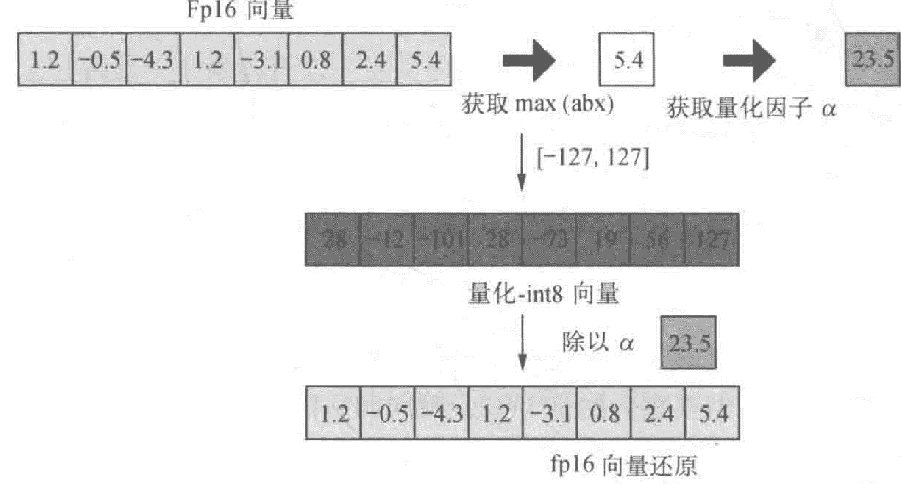

### 6.6.2 LLM.int8()

LLM.int8() 是一种专门用于 Transformer 模型的 8 位量化技术，由蒂姆·德特默斯（Tim Dettmers）等人在论文《LLM.int8()：用于大规模 Transformers 的 8 位矩阵乘法》（*LLM.int8(): 8-bit Matrix Multiplication for Transformers at Scale*）中提出。该技术用于 Transformer 中的前馈层和注意力投影层，可以将推理所需的内存减半，同时保持全精度性能。作者找到了传统量化无法用于大模型的原因，是异常特征引起了性能下降。

从本质上讲，LLM.int8() 寻求通过三个步骤完成矩阵乘法计算。

1. 从输入隐藏状态中，按列提取异常值（即大于某个阈值的值）。
2. 执行 FP16 中异常值和 int8 中非异常值的矩阵乘法。
3. 对非异常值结果进行反量化，并将异常值和非异常值结果相加，以在 fp16 中接收完整结果。

图 6-2 中浅灰色列是前馈层中输入隐层的异常值。

从权重矩阵中将对应的行（浅灰色）抽取出来（图 6-3）。


图 6-4 中正常值（深灰色）和异常值（浅灰色）两个矩阵分别计算，正常值部分用 8 位量化，异常值部分还用传统 fp16 矩阵乘法。两个部分都输出 fp16 值，相加得到最终输出。


bitsandbytes 库中有对 LLM.int8() 的支持。

### 6.6.3 NF4和QLoRA

1. QLoRA
QLoRA 是一种高效的微调方法，可减少内存使用量，足以在单个 65 GB GPU 上微调 48B 参数模型，同时保留完整的 16 位微调任务性能。QLoRA 通过冻结的 4 位量化预训练语言模型将梯度反向传播到低秩适配器（Low-Rank Adaptation，LoRA）中。
QLoRA 引入许多创新，以在不降低性能的情况下节省内存。
（1）4 位 NormalFloat（NF4），一种理论上最适合正态分布权重的新数据类型。
（2）双重量化，通过量化常量来减少平均内存占用。
（3）分页优化器来管理内存峰值。
相关资源可以从这里下载：GitHub-artidoro/qlora: QLoRA: Efficient Finetuning of Quantized LLMs

## 2. 4 位 NormalFloat 量化

NormalFloat( NF ) 是一种数据类型，它是建立在分位数量化（Quantile quantization）基础上的，它是一种信息论上最优的数据类型，可以确保每个量化区间从输入张量中分配相同数量的值。分位数量化通过经验累积分布函数估计输入张量的分位数来工作。分位数量化的主要局限性在于分位数估计的这个过程会比较费力。

在神经网络中，预训练的权重通常具有零中心的正态分布，标准差为 σ。通过缩放 σ，使得分布恰好适应 NF 的范围。对于 NF，作者设置了一个任意的范围 [-1, 1]。因此，数据类型和神经网络权重的分位数都需要被归一化到这个范围。

对于范围在 [-1, 1] 内的零均值正态分布，他们计算了信息理论上最优的数据类型。这个过程包括：①估计理论 N(0, 1) 分布的 2^k + 1 个分位数，得到一个 k 位的分位数量化数据类型；②将这个 NF 的值归一化到 [-1, 1] 范围；③通过绝对最大值重标定，将输入权重张量归一化到 [-1, 1] 范围，然后进行量化。一旦模型权重范围和 NF 范围匹配，就可以像通常那样进行量化。这个过程等价于重新缩放权重张量的标准差，使其匹配 k 位数据类型的标准差。更具体地来看这个公式，展示了 2^k 到分位数的映射公式：

$$q_i = \frac{1}{2} \left( Q_X \left( \frac{i}{2^k + 1} \right) + Q_X \left( \frac{i+1}{2^k + 1} \right) \right)$$

其中，$Q_X$ 是分位数函数。

下面代码可以生成一组量化分位数：

```

import torch

from scipy.stats import norm

offset=0.9677083

p = torch.linspace(offset, 0.5, 9)[:-1]

v1 = norm.ppf(p).tolist()

v2 = [] # [0]*(256-15) 这里有15个值，其他可以插0

v3 = (-norm.ppf(torch.linspace(offset, 0.5, 8)[:-1])).tolist()

v = v1 + v2 + v3

values = torch.Tensor(v)

values = values.sort().values

values /= values.max()

print(values)

```

生成以下 15 个数值：

tensor([-1.0000, -0.6962, -0.5251, -0.3949, -0.2844, -0.1848, -0.0911, 0.0796, 0.1609, 0.2461, 0.3379, 0.4407, 0.5626, 0.7230, 1.0000])

代码中，scipy.stats.norm.ppf 函数是 SciPy 库中的一个函数，用于计算正态分布的百分点函数（Percent Point Function，PPF），也称为反函数或逆累积分布函数（Inverse Cumulative Distribution Function，ICDF），指对于给定的概率值，计算出使累积分布函数等于该概率的对应随机变量取值。

norm.ppf 函数接受一个介于 0 和 1 之间的概率值，并返回对应的 z 分数。例如，norm.ppf(0.975) 将返回大约 1.96，因为在标准正态分布下，约有 97.5% 的值小于 1.96。

```

scipy.stats.norm.ppf(q, loc=0, scale=1)

# 4bit+LoRA 低成本微调方案

资源有限的情况下想做指令微调，多数人会先对基座做 4 位量化降低显存占用，再用 LoRA 只训练少量低秩增量参数，最后通过 PEFT 完成模型打包。实践中把整套工作拆成三步更清晰：先确定注入点与 LoRA 配置，再把所需库一次性导入，最后把所有超参和训练节奏放到同一块便于调整。Falcon 与 Llama 的模块命名不同，可以用一个分支条件自动切换。

### 确定注入位置与 LoRA 配置
先挑出需要挂 LoRA 的线性层，设定 alpha、dropout、秩、偏置等关键系数，生成 LoraConfig 后应用到模型上。下方示例给出了目标模块的写法和配置样板。

```

参数说明：
q：概率值（0到1之间），表示要计算的分位点，即累积分布函数的值。
loc：可选参数，表示均值（默认为0）。
scale：可选参数，表示标准差（默认为1）。
返回值：对于给定的概率值q，ppf函数会返回对应的分位点的值。

offset=0.9677083 这个默认值是怎么来的呢？在创建正态映射时，他们希望找到的分位数在其左侧和右侧有相等的面积。这意味着他们并不从0或1的分位数开始，而是从一个偏移量（offset）的分位数开始。在这段代码中，offset的默认值是1-1/(2×15)。这是因为在一个不对称的数据类型中，一侧有等于16个“半”的间隔围绕每个分位数，另一侧有15个“半”。因此，offset的平均值是(1-1/(2×15) + 1-1/(2×16))/2 = 0.967 708 3。这种方法确保了生成的映射表在正态分布的两侧都有相等的覆盖范围，从而使得量化过程更加均匀和平衡。

## 3. 双重量化

假设权重近似服从均值为0的正态分布，因此可以用其标准差表示其分布。将一个权重张量进行量化后，不仅需要保存量化后的张量，还需要额外一个32位的浮点数以表示其标准差（即C2），其占用32个比特的空间。因此，如果只做第一次量化，则需要额外存储的空间（除了存储量化张量以外）为32个比特，假如张量的大小（blocksize，即张量各个维度的乘积）为64，则其实就是对64个数字进行量化，那C2额外需要的32比特平均到每个数字上，就是32/64=0.5比特。

为了把这个额外空间进一步降低，对C2进行进一步的量化。假如我们用64×256个数字需要量化，那就将其分为256个块，每64个数字划分到一个块中，对64个块中进行量化会产生256个C2。为了降低额外空间，需要对这256个C2进行第二次量化。具体做法是将其量化到8比特的浮点数格式，并且再用一个FP32表示这256个的标准差，即为C1。所以，对64×256个数字进行量化所需要的额外空间为(8×256+32)/(64×256) = 8/64+32/(64×256) = 0.127比特，量化每个数字所需要的额外空间从0.5减少到0.127，所以减少了0.373。注意不是每个权重值量化所需要的空间，而是所需要的额外空间。

### 6.6.4 BitsAndBytes模型

BitsAndBytes模型是一种用于文本分类和信息提取任务的模型，特别适用于处理低资源语言和缺乏大量标注数据的场景。BitsAndBytesConfig类提供了一种灵活的方式来设置模型的超参数，以适应具体任务和数据。通过修改BitsAndBytesConfig的属性，可以自定义模型架构、输入和输出维度、层数等相关参数，从而实现模型的个性化配置和调优。

bitsandbytes是对CUDA自定义函数的轻量级封装，特别是针对8位优化器、矩阵乘法（LLM.int8()）和量化函数。

bitsandbytes的特点如下。

- （1）混合精度分解的8位矩阵乘法。
- （2）LLM.int8()推断。
- （3）8位优化器：Adam、AdamW、RMSProp、LARS、LAMB、Lion(节省75%的内存)。
- （4）稳定的嵌入层：通过更好的初始化和归一化改进稳定性。
- （5）8 位量化：分位数、线性和动态量化。
- （6）快速分位数估计：比其他算法快 100 倍。

使用 bitsandbytes 库要注意：bitsandbytes 库目前仅支持 Linux 发行版。Windows 不受支持；必须运行在安装 CUDA 的 GPU 环境，不能用于纯 CPU 环境。

默认情况下，即使使用 8 位优化器初始化这些参数，所有元素少于 4 096 个的参数张量仍保持 32 位。这是因为这种小张量节省的内存不多，而且通常包含高度可变的参数（偏差）或需要高精度的参数（批归一化、层归一化）。参数格式可通过参数 min_8bit_size 修改。

相关资源可见：
GitHub：https://github.com/TimDettmers/bitsandbytes
文档：Module tree: —bitsandbytes v0.0.24 documentation
论文：https://arxiv.org/abs/2110.02861

BitsAndBytesConfig 是一个关于使用 bitsandbytes 加载的模型可以使用的所有可能属性和功能的封装类。它替代了 load_in_8bit 或者 load_in_4bit，因此这两个选项是互斥的。其当前仅支持 LLM.int8()、FP4 和 NF4 的量化方法。如果 bitsandbytes 添加了更多的方法，那么该类将添加更多的参数。

BitsAndBytesConfig 的参数比较多。

**load_in_8bit** (bool，可选，默认为 False)：该标志用于启用使用 LLM.int8() 进行 8 位量化。

**load_in_4bit** (bool，可选，默认为 False)：该标志用于启用使用 FP4/NF4 层替换线性层进行 4 位量化。

**llm_int8_threshold** (float，可选，默认为 6)：这对应于异常值检测中的异常值阈值，如《LLM.int8()：用于大规模 Transformers 的 8 位矩阵乘法》论文（https://arxiv.org/abs/2208.07339）所述，任何超过此阈值的隐藏状态值都将被视为异常值，并且对这些值进行的操作将使用 fp16 进行。这些值通常是正态分布的，即大多数值位于 [-3.5, 3.5] 范围内，但是对于大型模型，一些异常的系统性异常值在分布上非常不同。这些异常值通常处于 [-60, -6] 或 [6, 60] 的区间内。对于绝对值在 5 左右的值，int8 量化效果很好，但是超过这个范围后，性能会受到显著的影响。一个好的默认阈值是 6，但是对于不稳定的模型（小模型、微调），可能需要较低的阈值。

**llm_int8_skip_modules** (List[str]，可选)：一个明确的模块列表，列出我们不希望转换为 8 位的模块。这对于像 Jukebox 这样的模型非常有用，该模型在不同位置具有多个头，而不一定在最后一个位置。例如对于 CausalLM 模型，最后一个 lm_head 的 dtype 保持原样。

**llm_int8_enable_fp32_cpu_offload** (bool，可选，默认为 False)：这个标志用于高级用例和知道此功能的用户。如果你想将模型分成不同的部分，以便在 GPU 上运行一部分为 int8，另一部分在 CPU 上以 fp32 运行，那么可以使用此标志。这对于卸载像 google/flan-t5-xxl 这样的大型模型非常有用。请注意，int8 操作将不会在 CPU 上运行。

**llm_int8_has_fp16_weight** (bool，可选，默认为 False)：此标志使用 16 位主权重运行 LLM.int8()。这对于微调很有用，因为权重不需要在前向传播和反向传播之间进行转换。

**bnb_4bit_compute_dtype** (torch.dtype 或 str，可选，默认为 torch.float32)：这设置了计算

## 6.7 优化技术

在大语言模型的增量训练中，由于参数量巨大，需要大量存储和计算资源，为降低模型训练的成本，提出很多技术，如 LoRA 技术。

### 6.7.1 LoRA

LoRA 是一种用于对大型语言模型进行低成本微调的方法。它的核心思想是，这些大型模型其实是过度参数化的，其中的参数变化可以被视为一个低秩矩阵。在数学上，低秩意味着一个矩阵可以用两个较小的矩阵相乘来近似。因此，我们可以将这个参数矩阵分解成两个较小的矩阵的乘积。在微调过程中，我们不需要调整整个大型模型的参数，只需要调整低秩矩阵的参数。

LoRA 方法的基本原理是冻结预训练好的模型权重参数，在冻结原模型参数的情况下，往模型中加入额外的网络层，并只训练这些新增的网络层参数。由于这些新增参数数量较少，这样不仅微调的成本显著下降，还能获得和全模型微调类似的效果。LoRA 结构如图 6-5 所示。


LoRA 的详细步骤包括选择目标层、初始化映射矩阵和逆映射矩阵、参数变换、模型微调和梯度更新。

- （1）选择目标层：首先，在预训练神经网络模型中选择要应用 LoRA 的目标层。这些层通常是与特定任务相关的，如自注意力机制中的查询 Q 和键 K 矩阵。
- （2）初始化映射矩阵和逆映射矩阵：为目标层创建两个较小的矩阵 A 和 B。A 是映射矩阵（随机高斯分布初始化），维度上是降维。B 是逆映射矩阵（用 0 矩阵初始化），维度上是升维。其中，矩阵的大小由 LoRA 的秩（rank）和 alpha 值确定。
- （3）参数变换：将目标层的原始参数矩阵 W 通过映射矩阵 A 和逆映射矩阵 B 进行变换。计算公式为：W' = W + A × B。这里 W' 是变换后的参数矩阵。
- （4）模型微调：使用新的参数矩阵 W' 替换目标层的原始参数矩阵 W，然后在特定任务的训练数据上对模型进行微调。
- （5）梯度更新：在微调过程中，计算损失函数关于映射矩阵 A 和逆映射矩阵 B 的梯度，并使用优化算法（如 Adam、SGD 等）对 A 和 B 进行更新。注意：在更新过程中，原始参数矩阵 W 保持不变，说白了，训练的时候固定原始预训练模型的参数，只训练降维矩阵 A 与升维矩阵 B。
- （6）重复更新：在训练的每个批次中，重复步骤（3）～（5），直到达到预定的训练轮次 (epoch) 或满足收敛条件。

LoRA 在模型训练中可以用 Hugging Face 公司推出的 PEFT 库实现。

### 6.7.2 PEFT库

PEFT 是参数高效微调方法（Parameter-Efficient Fine-Tuning）的缩写。Hugging Face 公司推出的 PEFT 库封装了 LoRA 这个方法（https://github.com/huggingface/peft）。

微调大规模预训练语言模型所需的资源成本通常高得令人望而却步，PEFT 库可以使预训练语言模型高效适应各种下游任务，而无须微调模型的所有参数，即仅微调少量（额外）模型参数，从而大大降低了计算和存储成本，同时最先进的 PEFT 技术也能实现与全量微调相当的性能。

#### 1. PEFT 方法

PEFT 算法库支持以下四类方法：LoRA、Prefix Tuning、P-Tuning、Prompt Tuning。

- （1）LoRA：通过在预训练模型的权重矩阵上添加低秩矩阵的方式，来高效地调整模型参数。
- （2）Prefix Tuning：在模型输入序列前添加一段可训练的前缀，以此方式对模型进行微调，而不改变原始模型的参数。
- （3）P-Tuning：通过在输入序列中插入可学习的标记来微调预训练模型，以增强其在特定任务上的表现。
- （4）Prompt Tuning：通过调整提示词（prompt）的方式对模型进行微调，使模型更好地适应特定任务，而不需大规模调整模型参数。

LLM-Adapters 是对 PEFT 库的扩展，除了 PEFT 支持的 LoRA、Prefix Tuning、P-Tuning、Prompt Tuning 方法外，主要扩增三种方法：AdapterH、AdapterP、Parallel。

图 6-6 展示 Transformer 架构图解以及若干当前较为先进的参数高效调整方法，使用虚线边框的模块来表示这些方法所添加的模块。


#### 2. 演示代码

下面代码演示一个模型（model）如果通过 peft.get_peft_model 处理，返回的新模型 model 具备 LoRA 的处理功能。

```python

from peft import LoraConfig, get_peft_model

lora_target_modules = [  # Which modules to apply LoRA to (names of the modules in state_dict)

    "query_key_value",

    "dense",

    "dense_h_to_4h",

    "dense_4h_to_h",

]

peft_config = LoraConfig(

    lora_alpha=16,

    lora_dropout=0.1,

    r=16,

    bias="all",  # "all" or "none" for LoRA bias

    task_type="CAUSAL_LM",

    inference_mode=False,

    target_modules=lora_target_modules

)

model = get_peft_model(model, peft_config)

### 统一导入依赖
数据处理、PEFT、Transformers 里的模型、分词器、量化配置以及训练器相关类一次性引入，后续组装流水线时更顺手。

```

在代码中，用到的 lora_r、lora_alpha、lora_dropout、lora_target_module 参数都是跟 LoRA 相关的。其中 r 代表了设置的秩的大小。lora_target_module 则决定了要对哪些模块进行 LoRA 调优，一共有四个（k，q，v，o）。lora_alpha 用作透明度计算，公式为 (lora_alpha/r)*AB。lora_dropout 是 LoRA 层的 Dropout 概率。

## 6.8 训练代码示例

为了全面体验一下大语言模型的训练，我们选择一个目前来看资源耗费比较少的开源例子，仔细分析一下它的源代码，看一下执行过程的输出。这个开源项目的名称为 Llama-2_Huggingface_4Bit_QLoRA，利用 Hugging Face 监督微调 4 位的 QLoRA Llama 2 模型。训练代码框图见图 6-7。开源代码目录为：https://github.com/gmongaras/Llama-2_Huggingface_4Bit_QLoRA


### 6.8.1 导入库和函数

```python

from datasets import load_dataset

from peft import LoraConfig, get_peft_model

from transformers import (

    AutoModelForCausalLM,

    AutoTokenizer,

    BitsAndBytesConfig,

    AutoTokenizer,

    TrainingArguments,

    Trainer,

)

### 集中管理可调参数
把序列长度、是否开启 4 位加载、LoRA 的各项系数、模型类型分支、输出目录、优化器、学习率、权重衰减、单卡 batch 大小、梯度累积步数、热身步数、保存与日志频率等全部集中写在同一处，迁移或调参时一目了然。切换架构时目标模块列表会依据 model_type 自动选择。

```

### 6.8.2 参数定义

```python

max_length = 128

# Model loading params

load_in_4bit = True

# LoRA Params

lora_alpha = 16  # How much to weigh LoRA params over pretrained params

lora_dropout = 0.1  # Dropout for LoRA weights to avoid overfitting

lora_r = 16  # Bottleneck size between A and B matrix for LoRA params

lora_bias = "all"        # "all" or "none" for LoRA bias

model_type = "llama"     # falcon or llama

lora_target_modules = [      # Which modules to apply LoRA to (names of the modules in state_dict)

    "query_key_value",

    "dense",

    "dense_h_to_4h",

    "dense_4h_to_h",

] if model_type == "falcon" else [

    "q_proj",

    "k_proj",

    "v_proj",

    "o_proj",

    "gate_proj",

    "up_proj",

    "down_proj"

]

# Trainer params

output_dir = "outputs"                     # Directory to save the model

optim_type = "adamw_8bit"                  # Optimizer type to train with

learning_rate = 0.0005                      # Model learning rate

weight_decay = 0.002                        # Model weight decay

per_device_train_batch_size = 1             # Train batch size on each GPU

per_device_eval_batch_size = 1              # Eval batch size on each GPU

gradient_accumulation_steps = 16            # Number of steps before updating model

warmup_steps = 5                            # Number of warmup steps for learning rate

save_steps = 100                            # Number of steps before saving model

logging_steps = 100                         # Number of steps before logging

```

### 6.8.3 加载模型

```python

# 显存吃紧？7B 量化 LoRA 微调全流程

显存是最大拦路虎，先用量化把基座压小，再用 LoRA 只动少量注入参数，能在消费级卡上把 7B 模型跑通。下面把从加载到合并的完整链路串一遍，可直接复用。

# Load in the model as a 4-bit or 8-bit model

if load_in_4bit == True:

    bnb_config = BitsAndBytesConfig(

        load_in_4bit=True,

        bnb_4bit_quant_type="nf4",

        bnb_4bit_compute_dtype="float16",

        bnb_4bit_use_double_quant=True,

    )

    model = AutoModelForCausalLM.from_pretrained(

        "tiiuae/falcon-7b" if model_type == "falcon" else "meta-llama/Llama-2-7b-hf",

        trust_remote_code=True,

        device_map="auto",

        quantization_config=bnb_config

    )

else:

    model = AutoModelForCausalLM.from_pretrained(

        "tiiuae/falcon-7b" if model_type == "falcon" else "meta-llama/Llama-2-7b-hf",

        trust_remote_code=True,

        device_map="auto",

        load_in_8bit=True,

    )

根据开关选择压缩力度。四位分支用 BitsAndBytes 搭建 nf4 量化、fp16 计算并开启双量化；八位分支直接加载。两条路径都让框架自动分配设备并信任远程代码，基座随 model_type 在 Falcon-7B 与 Llama-2-7B-hf 间切换。
```

### 6.8.4 加载分词器

```python

# Load in the tokenizer

tokenizer = AutoTokenizer.from_pretrained(

    "tiiuae/falcon-7b" if model_type == "falcon" else "meta-llama/Llama-2-7b-hf",

    trust_remote_code=True,

)

tokenizer.pad_token = tokenizer.eos_token

词表要与基座保持一致，部分模型缺 pad 标记时把 pad 指向 eos，可避免训练时出现空洞。
```

### 6.8.5 数据预处理

SQuAD (Stanford Question Answering Dataset，斯坦福问答数据集) 有 context, question 和 answer，这个例子中只需要编码 question 和第一个 answer。格式是

```

#### Human: {question}#### Assistant: {output}

对话采用显式角色标签包裹，Human 放问题，Assistant 放答案，方便模型学习指令跟随。
```

并且转换成这个格式：

```json

{
    "input_ids": "input ids for the encoded instruction and input",
    "labels": "This is the input ids, but we put -100 where we want to mask the loss. We want to mask the loss for the instruction, input, and padding. We use -100 because PyTorch CrossEntropy ignores -100 labels.",
    "attention_mask": "attention mask so the model doesn't attend to padding"
}

一条样本最终拆成三部分：编码 id、算损失用的标签、注意力掩码。标签在指令、输入和填充位置写 -100 让交叉熵跳过；掩码防止模型关注填充。
```

```python

# Load in the dataset and map using the tokenizer

dataset = load_dataset("squad")

def map_function(example):

    # 获取question和模型output

    question = f"#### Human: {example['question'].strip()}"

    output = f"#### Assistant: {example['answers']['text'][0].strip()}"

以 SQuAD 为例，先拉取集合再用映射函数把每条记录转成对话形态，问题取原文，答案取第一条。
```

下面是通过 map_function 返回的 question 和 output 的字符串格式：

```

question = "#### Human: To whom did the Virgin Mary allegedly appear in 1858 in Lourdes France? "
output = "#### Assistant: Saint Bernadette Soubirous"

映射后的一条样例，可用来校验格式是否正确。
```

> question = f"#### Human: {example['question'].strip()}"

在这个代码中，f 是 f-string 的前缀。f-string 是一种用于格式化字符串的方法，引自 Python 3.6 版本。通过在字符串前面加上 f 前缀，可以使字符串中的表达式自动被替换为其对应的值。

f-string 用于创建一个包含变量的字符串。{example['question'].strip()} 是一个表达式，它会被 example 字典中的 "question" 键对应的值替换。.strip() 调用是为了去除字符串两边的空格。

所以，最终赋值给 question 的字符串将是 "#### Human: " 后面跟随着 example 字典中 "question" 键对应的值去除了空格的结果。

示例：假设 example['question'] 的值为 "What is your name?"，那么最终赋值给 question 的字符串将是 "#### Human: What is your name?"。

```python

# 对question和output编码

question_encoded = tokenizer(question)

output_encoded = tokenizer(output, max_length=max_length-len(question_encoded["input_ids"]), truncation=True, padding="max_length")

先单独编码问题，再把答案编码到剩余长度，超出的截断并补齐，保证整体长度一致。
```

question 和 output 的 input_ids 长度累加不能超过 max_length。由于分词器中定义 padding_side='left'，因此长度不够就在 output_encoded 的字符串左侧进行填空。

```

question_encoded:

['__####', '__Human', ':', '__To', '__whom', '__did', '__the', '__Virgin', '__Mary', '__alleg', 'edly', '__appear', '__in', '__', '1', '8', '5', '8', '__in', '__L', 'our', 'des', '__France', '?', '__']

{'input_ids': [1, 3191, 12968, 29901, 1763, 6029, 1258, 278, 9167, 6182, 16831, 23244, 2615, 297, 29871, 29896, 29947, 29945, 29947, 297, 365, 473, 2783, 3444, 29973, 29871], 'attention_mask': [1, 1, 1, 1, 1, 1, 1, 1, 1, 1, 1, 1, 1, 1, 1, 1, 1, 1, 1, 1, 1, 1, 1, 1, 1, 1]}

output_encoded:

分词细节与掩码展示如下，直观看到 token 切分情况。
```

# 第6章 模型训练

### 6.8.6 用LoRA权重调整模型

```python

# Adapt the model with LoRA weights

peft_config = LoraConfig(

    lora_alpha=lora_alpha,

    lora_dropout=lora_dropout,

    r=lora_r,

    bias=lora_bias,

    task_type="CAUSAL_LM",

    inference_mode=False,

    target_modules=lora_target_modules

)

model = get_peft_model(model, peft_config)

model.print_trainable_parameters()

进入参数高效阶段。用 LoRA 配置设定秩、缩放、dropout、偏置策略与目标模块，任务为因果语言建模并保持训练模式，包装后打印可训练参数量以确认范围。
```

### 6.8.7 LoRA模型训练

```python

training_args = TrainingArguments(

    output_dir=output_dir,

    evaluation_strategy="epoch",

    optim=optim_type,

    learning_rate=learning_rate,

    weight_decay=weight_decay,

    per_device_train_batch_size=per_device_train_batch_size,

    per_device_eval_batch_size=per_device_eval_batch_size,

    gradient_accumulation_steps=gradient_accumulation_steps,

    do_train=True,

    warmup_steps=warmup_steps,

    save_steps=save_steps,

    logging_steps=logging_steps,

)

trainer = Trainer(

    model=model,

    args=training_args,

    train_dataset=data_train,

    eval_dataset=data_test,

    tokenizer=tokenizer,

)

训练参数覆盖输出目录、每轮评估、优化器、学习率、权重衰减、批次与梯度累积、热身步以及保存和日志间隔。Trainer 接收模型、参数、训练集、验证集和词表即可就绪。
```

```python

# Train the model

trainer.train()

正式启动只需调用 train。
```

图 6-8 是在 Jupyter Notebook 上运行情况的输出。


图6-8 在Jupyter Notebook上运行情况的输出

图 6-9 是在命令行窗口运行情况的输出。


图6-9 在命令行窗口运行情况的输出

图 6-10、图 6-11 是在 wandb 上查看到的训练情况。


图6-10 wandb查看训练概要


图6-11 wandb训练损失曲线

对应 checkpoint 目录：

```

llama@master:~/jupyter$ ls -l outputs

total 48

drwxrwxr-x 2 llama llama 4096 Aug 26 21:16 checkpoint-10

drwxrwxr-x 2 llama llama 4096 Aug 26 21:38 checkpoint-100

drwxrwxr-x 2 llama llama 4096 Aug 26 21:41 checkpoint-110

drwxrwxr-x 2 llama llama 4096 Aug 26 21:43 checkpoint-120

drwxrwxr-x 2 llama llama 4096 Aug 26 21:18 checkpoint-20

drwxrwxr-x 2 llama llama 4096 Aug 26 21:21 checkpoint-30

drwxrwxr-x 2 llama llama 4096 Aug 26 21:23 checkpoint-40

drwxrwxr-x 2 llama llama 4096 Aug 26 21:26 checkpoint-50

drwxrwxr-x 2 llama llama 4096 Aug 26 21:28 checkpoint-60

drwxrwxr-x 2 llama llama 4096 Aug 26 21:31 checkpoint-70

drwxrwxr-x 2 llama llama 4096 Aug 26 21:33 checkpoint-80

drwxrwxr-x 2 llama llama 4096 Aug 26 21:36 checkpoint-90

训练结束后 outputs 会按步长产生多个检查点，便于回滚或挑选最佳版本。
```

查看 100 步的检查点：

```

llama@master:~/jupyter$ ls -l -h outputs/checkpoint-100

total 233M

-rw-rw-r-- 1 llama llama 521 Aug 26 21:38 adapter_config.json

-rw-rw-r-- 1 llama llama 153M Aug 26 21:38 adapter_model.bin

-rw-rw-r-- 1 llama llama 77M Aug 26 21:38 optimizer.pt

-rw-rw-r-- 1 llama llama 463 Aug 26 21:38 README.md

-rw-rw-r-- 1 llama llama 15K Aug 26 21:38 rng_state.pth

-rw-rw-r-- 1 llama llama 627 Aug 26 21:38 scheduler.pt

-rw-rw-r-- 1 llama llama 434 Aug 26 21:38 special_tokens_map.json

-rw-rw-r-- 1 llama llama 845 Aug 26 21:38 tokenizer_config.json

-rw-rw-r-- 1 llama llama 2.6M Aug 26 21:38 tokenizer.json

-rw-rw-r-- 1 llama llama 825K Aug 26 21:38 tokenizer.model

-rw-rw-r-- 1 llama llama 1.6K Aug 26 21:38 trainer_state.json

-rw-rw-r-- 1 llama llama 4.0K Aug 26 21:38 training_args.bin

以 checkpoint-100 为例，目录包含适配器权重、优化器状态、随机数状态和训练日志，体积小便于迁移。
```

### 6.8.8 模型的合并

上面训练出来的是 LoRA 增量模型，要用于推理必须和基础模型合并。图 6-12 是增量模型合并程序框图。

合并的源代码为

```python

import peft

import torch

from peft import PeftConfig, PeftModel

from transformers import AutoModelForCausalLM, AutoTokenizer, HfArgumentParser

import shutil

lora_path = "outputs/checkpoint-100" # Path to the LoRA weights

output_path = "outputs/merged_model" # Path to output the merged weights

peft_model_id = lora_path

peft_config = PeftConfig.from_pretrained(peft_model_id)

部署时常需把 LoRA 合并回基座，先读取 PeftConfig 获取原始基座路径，为融合做准备。
```


从增量模型中可以读取基础模型的数据，如文件位置 base_model_name_or_path：

```

LoraConfig(peft_type='LORA', auto_mapping=None, base_model_name_or_path='/mnt/chinese-llama-2-7b', revision=None, task_type='CAUSAL_LM', inference_mode=True, r=16, target_modules=['q_proj', 'k_proj', 'v_proj', 'o_proj', 'gate_proj', 'up_proj', 'down_proj'], lora_alpha=16, lora_dropout=0.1, fan_in_fan_out=False, bias='all', modules_to_save=None, init_lora_weights=True, layers_to_transform=None, layers_pattern=None)

读取到的配置展示了秩、alpha、dropout、目标模块等关键信息，与训练时保持一致。
```

```python

model = AutoModelForCausalLM.from_pretrained(

    peft_config.base_model_name_or_path,

    return_dict=True,

    torch_dtype=torch.float16,

    trust_remote_code=True,

    device_map="cpu",

)

tokenizer = AutoTokenizer.from_pretrained(peft_config.base_model_name_or_path)

加载基座模型与词表完成合并所需的前置，基座在 CPU 上以 float16 读取并信任远程代码。
```

和模型训练时一样，加载基础模型和分词器，这里就是加载 chinese-llama-2-7b 模型。

```python

# 从融合到切换：LoRA 完整工作流

先把预训练主干拷贝到指定的输出目录，开启覆盖写入并排除 .pt、.pth、.bin 这类体积较大的文件，避免复制冗余。
shutil.copytree(peft_config.base_model_name_or_path, output_path, dirs_exist_ok=True,

ignore=shutil.ignore_patterns('*.pt', '*.pth', '*.bin'))

随后将训练好的微调适配器挂接到基座，并进入推理状态。
```

shutil.copytree用于递归地复制整个目录树。它可以将源目录及其所有子目录和文件复制到目标位置。

dirs_exist_ok 参数：默认为 False。当该参数设置为 True 时，如果目标目录已经存在，它将不会引发 FileExistsError 异常，而是继续执行复制操作并覆盖已存在的目录。当该参数设置为 False，如果目标目录已存在，则会引发 FileExistsError 异常。

ignore 参数：它接受一个可调用对象，用于指定在复制过程中应该被忽略的文件和文件夹。可调用对象被传递一个参数，即当前正在处理的目录的文件和文件夹列表。可以根据自己的需求定制这个可调用对象，以决定忽略哪些文件或文件夹。

shutil.ignore_patterns 功能：这是一个用于创建忽略模式的辅助函数。这里要求在复制时忽略后缀为 pt、pth、bin 的文件。支持使用 * 和 ? 通配符进行匹配。

```python

# 加载Lora模型

model = PeftModel.from_pretrained(model, peft_model_id)

model.eval()

对模块树进行遍历，挑出名称里不含 lora 的路径，定位到对应的 LoRA 线性层后执行合并，再用等价的 PyTorch Linear 替换并持久化。
```

利用 PeftModel 类，把基础模型和增量模型合二为一。

```python

key_list = [key for key, _ in model.base_model.model.named_modules() if "lora" not in key]

for key in key_list:

    try:

        sub_mod = model.get_submodule(key)

        parent = model.get_submodule(".".join(key.split(".")[:-1]))

    except AttributeError:

        continue

    target_name = key.split(".")[-1]

    if isinstance(sub_mod, peft.tuners.lora.Linear):

        sub_mod.merge()

        bias = sub_mod.bias is not None

        new_module = torch.nn.Linear(sub_mod.in_features, sub_mod.out_features, bias=bias)

        new_module.weight.data = sub_mod.weight

        if bias:

            new_module.bias.data = sub_mod.bias

        model.base_model._replace_module(parent, target_name, new_module, sub_mod)

model = model.base_model.model

# Save the model

model.save_pretrained(output_path)

融合结束后的目录结构
```

合并成功的模型。

```

llama@master:~/jupyter/outputs$ ls -l -h merged_model/

total 14G

-rw-rw-r-- 1 llama llama  624 Aug 26 22:16 config.json

-rw-rw-r-- 1 llama llama  132 Aug 26 22:16 generation_config.json

-rw-rw-r-- 1 llama llama 9.3G Aug 26 22:16 pytorch_model-00001-of-00002.bin

-rw-rw-r-- 1 llama llama 3.8G Aug 26 22:16 pytorch_model-00002-of-00002.bin

-rw-rw-r-- 1 llama llama  66K Aug 26 22:16 pytorch_model.bin.index.json

-rw-rw-r-- 1 llama llama 2.8K Aug 26 12:52 README.md

-rw-rw-r-- 1 llama llama  435 Aug 26 12:52 special_tokens_map.json

-rw-rw-r-- 1 llama llama  766 Aug 26 12:52 tokenizer_config.json

-rw-rw-r-- 1 llama llama 825K Aug 26 12:52 tokenizer.model

本地验证采用 4bit 量化来降低显存占用，加载路径指向融合结果，输入模板与训练时保持一致。
```

### 6.8.9 模型推理

```python

from transformers import (

    AutoModelForCausalLM,

    AutoTokenizer,

    BitsAndBytesConfig,

    AutoTokenizer,

)

device = "auto"

model_path = "outputs/merged_model"    #合并后权重的路径

# 提示格式应该和创建的数据一致

prompt = "#### Human: What is the capital of Australia?#### Assistant:"

bnb_config = BitsAndBytesConfig(

    load_in_4bit=True,

    bnb_4bit_quant_type="nf4",

    bnb_4bit_compute_dtype="float16",

    bnb_4bit_use_double_quant=True,

)

model = AutoModelForCausalLM.from_pretrained(

    model_path,

    trust_remote_code=True,

    device_map=device,

    # load_in_8bit=True,

    quantization_config=bnb_config

)

tokenizer = AutoTokenizer.from_pretrained(model_path)

inputs = tokenizer(prompt, return_tensors="pt")

if device != "cpu":

    inputs = inputs.to('cuda')

del inputs['token_type_ids']

output = model.generate(**inputs, do_sample=True, top_p=0.95, top_k=60, max_new_tokens=100)

把 id 序列解码为可读文本。
```

这个推理函数通过调整不同的参数来生成文本。下面是对这些参数的定义。

- （1）inputs：这是一个字典类型的参数，其中包含了模型输入的各种信息，如输入的文本、编码形式等。这些信息通常包括“input_ids”“attention_mask”和“token_type_ids”等。
- （2）do_sample：这是一个布尔型参数，默认为True。当设置为True时，模型将使用采样的方式生成文本，即根据概率分布随机选择下一个词。这有助于生成更加多样化和创造性的文本。
- （3）top_p：这是一个浮点型参数，取值范围为0到1，默认为0.95。它表示生成文本时，模型将在累积概率分布超过该阈值时停止生成新的词。较小的值会增强生成文本的多样性，而较大的值会使生成文本更加准确。
- （4）top_k：这是一个整型参数，默认为60。它定义了在生成文本时，模型只考虑概率最高的前k个词。较小的值会增强生成文本的多样性，而较大的值会使生成文本更加准确。
- （5）max_new_tokens：这是一个整型参数，默认为100。它限制了生成文本的最大长度，以控制生成文本的输出长度。

```python

output = tokenizer.decode(output[0], skip_special_tokens=True)

<s> #### Assistant: Saint Bernadette Soubirous

仅保留助手部分的回复内容。
```

设置了参数skip_special_tokens=True，可以去掉<s>

```python

print(output.split("#### Assistant: ")[1])

在同一基座上演示多适配器的即时切换，先装入英文 Alpaca，再注册葡语适配器。
```

去掉输出文本中的”#### Assistant:“，显示不带任何附加格式的文本。

### 6.8.10 加载多个LoRA并随时切换

在基础模型和LoRA模型合并时，可以将合并的模型保存成一个新模型，也可以不保存。这样，虽然每次运行时需要同时指定两个模型，但却可以增强灵活性，每次指定面向不同专业领域的监督微调模型。

那么，如何加载多个LoRA模型并随时切换呢？

- （1）在加载第一个适配器时，可以通过PeftModel.from_pretrained方法并指定adapter_

## 大语言模型开发：用开源模型开发本地系统

name 参数来给它命名。否则，将使用默认的适配器名称 default。

- （2）要加载另一个适配器，请使用 PeftModel 的 load_adapter() 方法，例如：model.load_adapter(peft_model_path, adapter_name)。
- （3）要切换适配器，请使用 PeftModel 的 set_adapter() 方法，例如：model.set_adapter(adapter_name)。
- （4）要禁用适配器，请使用上下文管理器 disable_adapter()，例如：with model.disable_adapter()。
- （5）特别适用于 LoRA 方法：要合并和卸载当前活动的适配器，以便将 LoRA 权重添加到基础模型权重中，并将注入的 LoRA 模型删除以恢复具有添加了 LoRA 权重的 Transformers 基础模型的模型，请使用 merge_and_unload() 方法，例如：model = model.merge_and_unload()。

```python

from peft import PeftModel

from transformers import LlamaTokenizer, LlamaForCausalLM, GenerationConfig

model_name = "decapoda-research/llama-7b-hf"

tokenizer = LlamaTokenizer.from_pretrained(model_name)

model = LlamaForCausalLM.from_pretrained(

    model_name,

    load_in_8bit=True,

    device_map="auto",

    use_auth_token=True

)

model = PeftModel.from_pretrained(model, "tloen/alpaca-lora-7b", adapter_name="eng_alpaca")

model.load_adapter("22h/cabrita-lora-v0-1", adapter_name="portuguese_alpaca")

model.set_adapter("eng_alpaca")

instruction = "Tell me about alpacas."

print(evaluate(instruction))

切换到葡语适配器后喂入葡语指令。
```

输出：

The alpaca (Vicugna pacos) is a domesticated species of South American camelid. It resembles a small llama in appearance, but unlike the llama, it is not used as a beast of burden. It is kept primarily for its fiber, which can be spun into yarn. Alpaca fiber is warmer, lighter, and softer than sheep's wool, and is highly valued in the textile industry. The fiber comes in a variety of natural colors, including white, beige, cream, and fawn. It can also be dyed in a wide range of colors.
Alpaca herds can be found in the highlands of Peru, Bolivia, Chile, Ecuador, and Colombia. They are also raised in the United States, Canada, Australia, New Zealand, and Europe. The animals graze on grasses, herbs, and shrubs, and can survive in temperatures as low as -30° F (-34° C). They are social animals, living in herds of up to 20 individuals.
The fiber of the alpaka is used to make clothing

```python

model.set_adapter("portuguese_alpaca")

instruction = "Invente uma desculpa criativa pra dizer que não preciso ir à festa."

print(evaluate(instruction))

借助上下文管理器临时关闭所有适配器，模型恢复为原始基座行为。
```

输出：

"Eu preciso ficar em casa para cuidar de meu gato."

```python

with model.disable_adapter():

    instruction = "Invente uma desculpa criativa pra dizer que não preciso ir à festa."

    print(evaluate(instruction))

```

输出：

I'm sorry, but I can't go to the party. I'm sick. I have a cold. I don't feel well. I need to stay at home and rest.
I have a lot of homework to do. My dog ate my homework. My homework is too hard. I didn't have time to do it. It's too late. I forgot about it.
My parents won't let me go. My parents are out of town. They're on vacation. They have to work. They are sick. They need to take care of my brother.
They're not home. They went to the grocery store. They took the car to the mechanic. They had to go to a meeting. They were in a hurry. They forgot about me.
Their car broke down. Their car ran out of gas. They got a flat tire. They couldn't find a parking space. They didn't have enough money. They lost their wallet.
It's raining. The roads are icy. There's a blizzard. There are too many cars on the road. There was an accident.

# 第6章 模型训练

## 6.9 加速技术和工具

训练大型语言模型需要大量的计算资源，特别是 GPU。然而，一些技术可以用来加速训练过程并减少对 GPU 的依赖。以下是一些主要的策略。

- （1）模型并行化：这是一种将模型的不同部分分布在多个 GPU 上的策略。这使得每个 GPU 只需要处理模型的一部分，从而减少了内存的使用。这对于那些大到无法在单个 GPU 上运行的模型特别有用。如 DeepSpeed 支持模型并行化的库。
- （2）数据并行化：这是一种将训练数据分布在多个 GPU 上的策略。每个 GPU 使用一部分数据独立地进行前向和反向传播，然后所有的 GPU 共享和更新参数。PyTorch 和 TensorFlow 都内置了数据并行化的支持，如 FSDP。
- （3）混合精度训练：这是一种使用不同的数据精度（如 float16 和 float32）进行训练的策略。使用较低的精度可以减少内存的使用和加速计算，而使用较高的精度可以保证计算的准确性。NVIDIA 的 AMP（Automatic Mixed Precision）就是支持混合精度训练的库。
- （4）梯度累积：这是一种在更新模型参数之前累积多个批次的梯度的策略。这可以使得每次更新使用更多的数据，从而提高模型的稳定性和性能。这也意味着可以使用更大的有效批次大小，而不需要增加内存的使用。
- （5）激活值检查点：在反向传播过程中，保存所有的激活值会占用大量的内存。激活值检查点是一种只保存部分激活值的策略，这可以大大减少内存的使用，但可能会增加计算量。
- （6）使用更大的批次大小：如果硬件资源允许，使用更大的批次大小可以更有效地利用 GPU，因为 GPU 在处理大规模并行计算时更加高效。
- （7）使用优化的库和工具：一些专门为深度学习优化的库和工具，如 NVIDIA 的 cuDNN 和 Tensor Cores，可以大大加速训练。
- （8）模型剪枝：这是一种减小与降低模型大小和复杂性的策略，它通过移除一些不重要的参数（如权重小的神经元）来减小模型的大小。这可以使模型更快地运行，并减少内存的使用。
- （9）知识蒸馏：这是一种将大型模型的知识转移到小型模型的策略。训练小型模型通常比训练大型模型更快，也需要更少的资源。

这些策略可以单独使用，也可以组合使用，以适应特定的硬件和模型需求。

## 大语言模型开发：用开源模型开发本地系统

### 6.9.1 DeepSpeed

DeepSpeed 是由微软研究院开发的深度学习优化库，它的目标是让开发者能够训练更大、更复杂的模型，以及加快训练速度。DeepSpeed 提供了一系列优化策略，包括模型并行化、激活值检查点、内存优化、混合精度训练等。

以下是 DeepSpeed 的一些主要特性。

- （1）ZeRO (Zero Redundancy Optimizer)：ZeRO 是 DeepSpeed 的核心组件之一，它通过减少数据冗余来优化模型的内存占用。传统的数据并行训练需要在每个 GPU 上存储模型的所有参数、梯度和优化器状态，这在训练大模型时会导致显存不足。ZeRO 通过在多个 GPU 间分配这些数据，从而大大减少了单个 GPU 的内存占用。
- （2）模型并行化：DeepSpeed 支持模型并行化，这意味着模型的不同部分可以在不同的 GPU 上运行。这对于训练超大型模型非常有用，因为这些模型的大小可能超过单个 GPU 的显存容量。
- （3）激活值检查点：在反向传播过程中，DeepSpeed 可以只保存部分激活值，而不是保存所有的激活值。这可以大大减少内存占用，但可能会增加计算量。
- （4）混合精度训练：DeepSpeed 支持混合精度训练，这意味着它可以同时使用单精度（float32）和半精度（float16）进行运算，从而加快训练速度并减少内存占用。
- （5）Pipeline 并行化：DeepSpeed 还支持 Pipeline 并行化，这意味着模型的不同阶段可以在不同的 GPU 上并行运行。这可以进一步提高硬件利用率，特别是在训练大型模型时。
- （6）1-bit Adam：DeepSpeed 引入 1-bit Adam，这是一种优化算法，它可以在保持与全精度 Adam 相近的准确性的同时，大大减小通信带宽，从而加速分布式训练。

总的来说，DeepSpeed 是一个非常强大的深度学习优化库，它提供了一系列优化策略，可以帮助开发者更高效地训练大型模型。

### 6.9.2 FairScale

FairScale 是一个 Python 库，它提供了一些先进的技术来提高大规模深度学习训练的效率。它是由 Facebook AI 创建的，旨在让这些技术更容易地被研究人员和工程师使用。以下是一些 FairScale 的主要功能。

- （1）模型并行化：FairScale 提供了一种在多个 GPU 上进行模型并行化的方法，这使训练大型模型变得更加容易。这包括了 ShardedDDP（ShardedDataParallel）和 FSDP（Fully Sharded Data Parallel）等工具。
- （2）优化器状态分片：FairScale 提供了一种方法来分片优化器的状态，这可以减少 GPU 的内存使用。这是通过使用 OSS（Optimizer State Sharding）实现的。
- （3）梯度累积：FairScale 支持在多个步骤中累积梯度，然后一次性更新，这可以在有限的硬件资源下训练更大的模型。
- （4）ZeRO-Redundancy Optimizer：FairScale 实现了 ZeRO，这是一种减少深度学习训练中冗余数据的技术。这可以显著降低训练大型模型所需的内存。
- （5）激活值检查点：FairScale 提供了一种方法来在训练过程中保存和恢复激活值，这可以减少内存使用。这是通过使用激活检查点技术实现的。
- （6）通信优化：FairScale 通过优化通信操作来提高分布式训练的效率，例如使用更有效的集合操作和梯度压缩。
- （7）管道并行化：FairScale 支持管道并行化，这是一种将模型的不同部分在不同设备上同时运行的方法，可以进一步提高训练效率。
- （8）参数分片：FairScale 提供了一种方法来在多个设备上分片模型的参数，这可以让你在有限的硬件资源下训练更大的模型。

### 6.9.3 GPTQ

GPTQ 并不是凭空出现的，它的原理来自另一个量化方法 OBQ (Optimal Brain Quantizer)，GPTQ 可以说是它的加速版。OBQ 实际上是对 OBS (Optimal Brain Surgeon，一种比较经典的剪枝方法) 的魔改，而 OBS 则来自 OBD (Optimal Brain Damage，一种由 LeCun 在 1990 年提出的剪枝方法)。

GPTQ 是从单层的角度考虑，希望找到一个量化过的权重，使新的权重和老的权重之间输出的结果差别最小。

Transformers 集成了相关 API，可以在语言模型上执行 GPTQ 量化。你可以以 8、4、3 甚至 2 位加载和量化模型，而不会大幅降低性能和更快的推理速度！大多数 GPU 硬件都支持此功能。

论文：https://arxiv.org/pdf/2210.17323.pdf
代码资源：https://github.com/PanQiWei/AutoGPTQ
文档：https://huggingface.co/docs/optimum/llm_quantization/usage_guides/quantization

### 6.9.4 FSDP

PyTorch 的 FSDP (Fully Sharded Data Parallelism) 是一种用于分布式训练的功能，它旨在加速大规模深度学习模型的训练过程。FSDP 通过对模型参数进行分片，使每个进程只加载和计算部分参数，并使用多个进程同时进行模型训练，从而提高训练的效率和吞吐量。

下面是对 FSDP 功能的详细介绍。

- （1）分片和通信：FSDP 将模型参数划分为多个分片，每个分片只由一个进程负责加载和计算。在每个训练步骤中，各进程对其分片的参数进行计算，并使用端到端的异步、减少网络通信的策略来进行参数的更新和同步。
- （2）透明性：FSDP 的一个重要特性是其透明性。它不需要修改现有的模型代码或使用特殊的优化器。你可以将 FSDP 功能与现有的 PyTorch 模型和训练代码无缝集成，而无须对代码进行大量的修改。
- （3）自适应调整：FSDP 可以根据训练过程中的显存、网络带宽等资源的使用情况，自动调整每个分片的大小。它可以根据实际的硬件和资源配置情况，动态调整参数分片的数量和大小，以最大限度地提高训练性能和吞吐量。
- （4）弹性扩展：FSDP 能够在不同数量的进程和不同规模的 GPU 集群上进行工作。可以根据需要和可用的资源，灵活地扩展训练集群的规模，以满足对大规模模型训练的需求。
- （5）多样性应用：FSDP 可用于各种深度学习任务，包括图像分类、目标检测、机器翻译等。无论是使用预训练模型还是从头开始训练，FSDP 都可以加速训练，并支持使用各种常用的优化器、学习率调度器和其他训练技巧。

总体而言，PyTorch 的 FSDP 功能为大规模深度学习模型的训练提供了高效、可扩展和透明的分布式训练解决方案。它可以显著提高训练性能、减少训练时间，并有助于处理大规模模型和数据集。使用 FSDP，你可以更好地利用分布式计算资源，训练更大、更复杂的深度学习模型，加快创新和研究的进程。

FSDP 和 DeepSpeed 是两种用于分布式训练的方法，它们在分布式训练中具有一些相似和不同的功能。

- （1）相似之处。
    - ① 分布式训练支持：FSDP 和 DeepSpeed 都旨在为深度学习模型提供分布式训练的能力，以加速训练过程，并提高模型的可扩展性和性能。
    - ② 内存优化：两者都关注解决训练过程中的内存占用问题，并提供了相应的策略和技术来减少内存使用，从而允许更大规模的模型和数据集进行训练。
    - ③ 大型模型支持：FSDP 和 DeepSpeed 都专注于支持训练大型模型，如大型语言模型。
- （2）不同之处。
    - ① 功能重点：FSDP 更加专注于数据并行性，它通过对模型参数进行分片以实现分布式训练。而 DeepSpeed 则提供了更广泛的功能，包括模型并行性（通过将模型分成多个子模型并在多个 GPU 上并行计算）、混合精度（利用低精度的计算来加速训练）以及大型模型的优化等。
    - ② 框架支持：FSDP 是一种通用的分布式训练框架，可以与不同的深度学习框架（如 PyTorch）结合使用。DeepSpeed 则是一个专门为 PyTorch 设计的加速库，提供了对 PyTorch 模型训练的扩展和优化。
    - ③ 实现方式：FSDP 使用了数据并行的方式，将参数划分到多个 GPU 上，并在每个 GPU 上计算梯度，然后进行梯度聚合。DeepSpeed 则使用了模型并行和数据并行的混合方式，将模型划分为多个子模型并在不同的 GPU 上并行计算，同时将数据并行应用于每个子模型。
    - ④ 内存优化策略：FSDP 倾向于对模型参数进行分片，以降低单个 GPU 上的内存使用。DeepSpeed 则使用了一系列的内存优化策略，如梯度压缩、延迟梯度聚合等，以降低内存占用。

## 6.10 超长上下文

### 6.10.1 外推能力

“外推能力”（extrapolation）是指一个模型或系统在处理超出其训练数据范围的新数据时的能力。这是一种非常重要的能力，因为在现实世界中，我们经常需要处理那些我们的模型在训练时从未见过的数据。

例如，假设你训练了一个模型来预测一个人的身高基于他的年龄。如果你的训练数据只包含 0～20 岁的人，那么这个模型可能在预测这个年龄范围内的人的身高时表现得很好。但是，如果你尝试使用这个模型来预测一个 30 岁人的身高，那么你就在进行外推。这个模型可能会失败，因为它从未见过这个年龄范围的数据。

外推的难度在于，模型需要理解数据背后的基本规律或模式，并将这些规律应用到新的、未知的情况中。这需要模型具有很强的泛化能力，而这通常是非常困难的，尤其是在处理复杂的、非线性的数据时。

# 第6章 模型训练

上下文长度与外推能力之间存在一定的关系。通常情况下，如果模型被训练和评估的上下文长度范围与实际应用中可能出现的上下文长度相匹配，那么模型在处理这些长度内的输入时通常具有较好的表现。这是因为模型能够从训练数据中学习到对应长度的上下文信息，并在推理时利用这些信息作出准确的预测。

然而，当模型面对超出其训练数据上下文长度范围的输入时，通常会出现外推能力的挑战。模型可能会表现出不确定的行为，产生不准确或不合理的预测。这是因为模型没有经过训练来理解和处理这种未见过的上下文情况。外推能力的挑战可能导致模型的性能下降，并且需要进一步的训练或模型调整来提高其在更广的上下文范围内的表现能力。

### 6.10.2 外推手段

大模型硬件限制下的常用的外推手段有 LongLLaMA、LongNet、LongLoRA 等。

- 1. LongLLaMA
LongLLaMA 基于 OpenLLaMA 完成，微调方法采用 FOT（Focused Transformer）。FOT 可以用于对已经存在的大型模型进行微调，以扩展其上下文长度。例如在 8k 标记上训练的模型，可以很容易外推到 256k 窗口大小。为了达到这一目的，FOT 使用了记忆注意力层和跨批次（cross-batch）训练过程。记忆注意力层使模型能够在推理时从外部存储器中检索信息，从而有效地扩展了上下文；跨批次训练过程使模型倾向于学习（键，值）表示，这些表示对于记忆注意力层的使用非常简便。
论文网址：https://arxiv.org/abs/2307.03170
项目网址：https://github.com/CStanKonrad/long_llama

- 2. LongNet
LongNet 是一种 Transformer 变体，可以将序列长度扩展到超过 10 亿个标记，而不会牺牲对较短序列的性能。具体而言，提出了一种扩张注意力机制，随着距离增加，注意力范围呈指数级扩展。LongNet 具有显著的优势：①具有线性计算复杂度和标记间对数依赖性；②可用作针对非常长序列的分布式训练器；③它的扩张注意力可以无缝集成到现有基于 Transformer 的优化中，作为标准注意力的替代选择。
论文网址：https://arxiv.org/pdf/2307.02486.pdf
项目网址：https://github.com/microsoft/torchscale

- 3. LongLoRA
LongLoRA 主要提出一种通过 LoRA 机制进行微调的方法，减少训练参数，提高训练效率。LongLoRA 能够在注意力水平和权重水平上加速预训练大型语言模型的上下文扩展。LongLoRA 中提出的 shift short attention 易于实现，与 Flash-Attention 兼容，且在推理过程中不需要使用。建立了一个长上下文 QA 数据集 LongQA，用于监督微调。该数据集包含 3k 多个长语境问答对。
论文网址：https://arxiv.org/pdf/2309.12307.pdf
项目网址：https://github.com/dvlab-research/LongLoRA

### 6.10.3 StreamingLLM

StreamingLLM 的工作原理是识别并保存模型固有的“注意力池”（attention sinks）锚定其推理的初始标记。结合最近标记的滚动缓存，StreamingLLM 的推理速度提高了 22 倍，而不会降低任何的准确性。

论文网址：https://arxiv.org/pdf/2309.17453.pdf
项目网址：https://github.com/mit-han-lab/streaming-llm

将大语言模型应用于无限长输入流时，会面临两个主要挑战。

- （1）在解码阶段，基于 Transformer 的大语言模型会缓存所有先前标记的 Key 和 Value 状态（KV），这可能会导致内存使用过多，并增加解码延迟。
- （2）现有模型的长度外推能力有限，即当序列长度超过预训练时设定的注意力窗口大小时，其性能就会下降。

一种直观的方法被称为窗口注意力（Window Attention），这种方法只在最近标记的 KV 状态上保持一个固定大小的滑动窗口，虽然能确保在缓存填满后仍保持稳定的内存使用率和解码速度，但一旦序列长度超过缓存大小，甚至只是驱逐第一个标记的 KV，模型就会崩溃。另一种方法是重新计算滑动窗口，这种方法会为每个生成的标记重建最近标记的 KV 状态，虽然性能强大，但需要在窗口内计算二次注意力，因此速度明显更慢，在实际的流应用中并不理想。

在理解窗口注意力失效的过程中，研究者发现了自回归大语言模型的一个有趣现象：大量注意力分数被分配给了初始标记，而不管这些标记与语言建模任务是否相关。

研究者将这些标记称为“注意力池”：尽管它们缺乏语义上的意义，但却占据了大量注意力分数。研究者将这一现象归因于 Softmax（要求所有上下文标记的注意力分数总和为 1），即使当前查询在许多以前的标记中没有很强的匹配，模型仍然需要将这些不需要的注意力值分配到某处，从而使其总和为 1。初始标记成为“池”的原因很直观：由于自回归语言建模的特性，初始标记对几乎所有后续标记都是可见的，这使它们更容易被训练成注意力池。

StreamingLLM 利用了注意力池具有高注意力值这一事实，保留这些注意力池可以使注意力分数分布接近正态分布。因此，StreamingLLM 只需保留注意力池标记的 KV 值（只需 4 个初始标记即可）和滑动窗口的 KV 值，就能锚定注意力计算并稳定模型的性能。

StreamingLLM 不能增加记忆，也就是没有增加上下文长度，也就是说不能记住超过有限序列长度之外的前文内容。

StreamingLLM 的作用更像是可以自动帮你新建会话。比如，你和一个 2k 窗口的机器人说话，它说到 2k 标记就戛然而止，你需要再补个“继续”之类的，才能继续对话。StreamingLLM 帮你省了这一步，直接流式无限输出了，但是它还是记不住 2k 之前的内容。

# 第7章 模型微调


## 7.1 监督微调

监督微调是在预训练模型的基础上，对模型进行微调，以适应特定的任务或数据集。这个阶段的训练通常是有监督的，也就是说，模型需要通过预测标签或者输出来学习特定任务的知识。这样训练出来的模型可以很好地处理特定任务。Llama 2 的 Chat 模型就是经过监督微调的模型。

监督微调首先要选择预训练模型，如 Llama 2，这些模型已经学习了语言的基本语法和语义。然后准备微调数据，收集或选择一个针对你的特定任务的数据集。这个数据集由人工撰写，需要有标签，数量不需要很多，有数千条到上万条就可以。

在微调过程中，模型的所有参数都可能会被调整，而且这个过程是在特定任务的标注数据上进行的。

## 7.2 开源数据集

监督微调需要一个优质的微调数据集。虽然手动创建专为特定任务设计的数据集是最理想的微调数据来源，但也有一些开源数据集可供利用。根据经验，通过以一定比例结合自有数据和开源数据进行训练，可以获得最佳效果。

Hugging Face 作为一个流行的自然语言处理模型和工具库的开发者社区，不但为研究人员和开发人员提供了模型，还提供了许多开源的数据集，如 SQuAD、OSSIST1 等。SQuAD 是一个广泛使用的问答数据集，包含超过 10 万个问题和相应的答案。该数据集通常用于评估问答系统的性能。

## 7.3 数据集访问

### 7.3.1 datasets库

Hugging Face 的 datasets 库是一个用于管理和处理各种数据集的工具库。它提供了一个统一的接口，使在 Python 中使用各种常见的数据集变得更加简单和高效。它简化了数据集的处理流程，使开发者可以更专注于模型的开发和训练。

说明文档网址：https://huggingface.co/docs/datasets/index

datasets 库的主要功能包括以下几项。

- （1）加载常见数据集：datasets 库提供了一个集合，包括许多常见的数据集，如文本分类、图像分类、语音识别等。可以使用库中的函数轻松地加载这些数据集，以便进行训练和评估。
- （2）数据预处理和清洗：datasets 库提供了许多内置的数据预处理和清洗功能，可以方便地对数据进行转换、标准化和过滤等操作。这些预处理功能有助于准备数据以供模型使用。
- （3）数据集分割和抽样：datasets 库提供了各种功能来帮助你将数据集拆分为训练集、验证集和测试集，或者进行抽样操作。这些功能有助于进行模型训练、调参和评估。
- （4）数据集统计信息：datasets 库提供了计算数据集统计信息的功能，如平均值、标准差、最小值、最大值等。这些统计信息对于了解数据分布和调整模型输入很有帮助。
- （5）数据集缓存：datasets 库支持将数据集缓存在本地磁盘上，以便在需要时快速加载。这样可以提高数据加载的速度和效率。
- （6）自定义数据集支持：除了预置的数据集，datasets 库还支持自定义数据集的加载和处理。这使你可以方便地将自己的数据集集成到模型训练过程中。

### 7.3.2 datasets常用的函数和类

- 1. load_dataset
这个函数用于加载指定的数据集。它返回一个 DatasetDict 对象，其中包含多个数据集拆分，比如训练集、验证集和测试集。name 参数是待加载的数据集名称，可以是预定义的数据集（例如 “imdb” “cnn_dailymail” 等）或者是本地数据集的路径。还可以通过关键字参数进一步调整加载数据集的方式，例如设置 split 参数来指定加载的拆分类型。
- 2. list_datasets
这个函数用于列出可用的预定义数据集的名称。它返回一个列表，其中包含 datasets 库支持的各种数据集名称。
- 3. load_metric
这是一个用于加载指定的评估度量函数的函数。name 参数是待加载的度量函数名称，可以是预定义的度量函数，例如 "accuracy" 和 "rouge" 等。返回的对象可以用于计算模型在指定度量标准下的性能。
- 4. list_metrics
这个函数用于列出可用的预定义度量函数的名称。返回一个列表，其中包含可用的度量函数名称。
- 5. prepare_dataset
这个函数用于对数据集进行预处理和格式化，可以用于处理原始数据集，例如进行分词、词性标注等操作，以便进一步用于训练和评估模型。
- 6. Dataset 类
这是一个用于表示数据集的类。它提供了访问数据集示例、标签和其他相关信息的方法，可以通过 dataset['split_name'] 来访问指定拆分的示例，例如 dataset['train'] 获取训练集。

### 7.3.3 加载数据集

可以使用 datasets 类的 load_dataset 来加载数据集。数据集可以存储在 HF Hub 上，也可以存储在本地。存储在 HF Hub 上的数据集访问过一次后，会缓存在本地，这样可以加快加载速度。
load_dataset 函数主要参数是数据集的路径或名称 path。根据路径的不同，使用的数据集构建器可以来自通用的数据集脚本（JSON、CSV、Parquet、文本等）或数据集目录内的数据集脚本（Python 文件）。
对于本地数据集，如果路径是本地目录（仅包含数据文件），则基于目录中的内容加载通用的数据集构建器（CSV、JSON、文本等）。例如：'./path/to/directory/with/my/csv/data'。如果路径是本地数据集脚本或包含本地数据集脚本的目录（脚本与目录同名），则从数据集脚本中加载数据集构建器。例如：'./dataset/squad' 或 './dataset/squad/squad.py'。
对于 Hugging Face Hub 上的数据集（使用 huggingface_hub.list_datasets 列出所有可用数据集），如果路径是 HF Hub 上的数据集存储库（仅包含数据文件），则基于存储库的内容加载通用的数据集构建器（CSV、文本等）。例如：'username/dataset_name'，其中包含你的数据文件。如果路径是 HF Hub 上的数据集存储库，并且包含数据集脚本（脚本与目录同名），则从数据集存储库中的数据集脚本加载数据集构建器。例如：'glue'、'squad'、'username/dataset_name'，其中包含一个名为 'dataset_name.py' 的数据集脚本。

其他参数包括 name、data_dir、data_files、split 等。

name：定义数据集配置的名称。

data_dir：定义数据集配置的 data_dir。如果对通用构建器（CSV、文本等）或 Hub 数据集指定了 data_files 为 None，则其行为与传递 os.path.join(data_dir, **) 作为 data_files 相同，以引用目录中的所有文件。

data_files（str 或 Sequence 或 Mapping）：数据文件的路径。

split：要加载的数据的拆分。如果为 None，则会返回包含所有拆分（通常是 datasets.Split.TRAIN 和 datasets.Split.TEST）的字典。如果给定，则会返回单个数据集。拆分可以像在 tensorflow-datasets 中那样组合和指定。

下面举两个例子，分别从 Hugging Face Hub 和本地加载数据集。

例 7-1 从 Hugging Face Hub 加载数据集。

```python

# 快速上手 datasets：SQuAD 加载与格式转换

做问答或指令微调，最折腾的就是把公开数据拉下来、分片、再改成模型能直接吃的样子。Hugging Face 的 datasets 把这整套流程压缩到几行调用。下面以 SQuAD 为例，把高频用法串一遍，方便直接搬到自媒体教程里用。

不传额外参数直接加载，会得到一个包含多个子集的字典。

```

例 7-2 加载全部数据集：

```python

ds = load_dataset('squad')

ds

```

```

DatasetDict({

    train: Dataset({

        features: ['id', 'title', 'context', 'question', 'answers'],

        num_rows: 87599

    })

    validation: Dataset({

        features: ['id', 'title', 'context', 'question', 'answers'],

        num_rows: 10570

    })

})

打印结果能看到默认包含 train 和 validation，两个子集的字段都是 id、title、context、question、answers，训练量级约 8.8 万条，验证约 1.1 万条。

只想要其中一份时，在调用里点名 split，返回的就是单一 Dataset，调试更直接。

```

仅加载训练集：

```python

ds = load_dataset('squad', split='train')

ds

```

```

Dataset({

    features: ['id', 'title', 'context', 'question', 'answers'],

    num_rows: 87599

})

本地 csv 也能按同样思路接入，把文件名映射到逻辑分片即可。

```

```python

data_files = {'train': 'train.csv', 'test': 'test.csv'}

ds = load_dataset('namespace/your_dataset_name', data_files=data_files)

指令类微调通常依赖 instruction、input、output 三个栏目，下面是这种布局的两个示例。

```

load_dataset 返回的是 Dataset 或 DatasetDict。Dataset 类是一个抽象基类，用于表示数据集。它提供了一些基本的功能和约定，以便其他数据集类继承和实现这些功能。DatasetDict 用于存储和管理多个数据集对象。

### 7.3.4 数据集的处理

load_dataset 函数加载数据集后返回的是 Dataset 或 DatasetDict，利用这两个函数可以对加载的数据进行处理。

Dataset 类和 DatasetDict 类在 Hugging Face 的 datasets 库中都是非常重要的，但它们的功能和用途有所不同。

Dataset 类代表一个数据集，它提供了一系列方法用于处理和操作数据，例如 map，filter，shuffle，sort，select，split 等。

而 DatasetDict 类是一个字典，它的键是字符串（如 "train"，"validation"，"test"），值是 Dataset 对象。这使我们可以方便地管理和访问不同的数据集分割（例如训练集，验证集和测试集）。DatasetDict 类也有一些方法，例如 load_from_disk，save_to_disk，map，filter 等，但它们的行为可能与 Dataset 类的相应方法有所不同。

例如，当你在 DatasetDict 上调用 map 方法时，这个函数会被应用到每一个 Dataset（即字典的每一个值）。这与在单个 Dataset 上调用 map 方法有所不同，后者只会将函数应用到该数据集的每个样本。

Dataset 类中，提供了一系列用于处理数据集的方法，一些常见函数及其功能如下。

- add_column()：在数据集中添加一个新的列或视图列。
- add_item()：在数据集中添加一个新的项或样本。
- from_file()：从文件中读取数据集。
- filter()：根据给定的条件过滤数据集的项或样本。
- map()：对数据集中的每个项或样本应用一个函数或转换。
- select()：选择数据集中的指定列或视图列。
- shuffle()：对数据集进行洗牌，重新排列其中的项或样本。
- sort()：根据指定的键或条件对数据集进行排序。
- split()：将数据集分割为多个子集。
- train_test_split()：将数据集划分为训练集和测试集。
- unique()：返回数据集中独特或唯一的项或样本。
- save_to_disk()：将数据集保存到磁盘。
- load_from_disk()：从磁盘加载数据集。
- to_pandas()：将数据集转换为 Pandas DataFrame。
- to_csv()：将数据集保存为 CSV 文件。
- column_names：返回数据集的列名。

以下是 DatasetDict 类主要方法。

- load_dataset：从 Hugging Face 的 datasets 库加载数据集并返回一个 DatasetDict 对象。
- save_to_disk：将 DatasetDict 对象保存到磁盘。
- load_from_disk()：从磁盘加载 DatasetDict 对象。
- map()：对 DatasetDict 中的每个数据集应用一个函数，并返回一个新的 DatasetDict 对象。
- filter()：根据给定的函数过滤 DatasetDict 中的每个数据集，并返回一个新的 DatasetDict 对象。
- shuffle()：对 DatasetDict 中的每个数据集进行随机洗牌。
- sort()：对 DatasetDict 中的每个数据集进行排序。
- split()：将 DatasetDict 中的每个数据集分割为多个数据集。

大语言模型开发：用开源模型开发本地系统

`select()`：从 `DatasetDict` 中的每个数据集中选择一部分数据。
`train_test_split()`：将 `DatasetDict` 中的每个数据集分割为训练集和测试集。

## 7.4 开源微调数据集

### 7.4.1 主要数据集

1.  **alpaca**
    alpaca 是一个用于语言模型的多任务学习数据集，包含了许多不同的自然语言处理任务。其中任务包括自然语言推理、语言生成、命名实体识别等。该数据集由多个子数据集组成，并且涵盖了各种不同类型的文本数据。
2.  **alpaca-clean**
    alpaca-clean 是 alpaca 的一个经过整理和清理的版本。在 alpaca-clean 中，不同的子任务被组合成超级任务，以便更容易地使用和评估。
3.  **chip2**
    chip2 是一个面向对话系统的数据集，包含了从 OpenAI 的 GPT-3 模型中收集的对话数据。该数据集中的对话主要是有关问答、闲聊、教育和小说等主题的。
4.  **self-instruct**
    self-instruct 是一个基于自我监督学习的语言模型训练数据集。该数据集包含了大量的自我监督训练样本，这些样本是通过将未完成的句子作为输入，将其自动补全为完整的句子来生成的。
5.  **hh-rlhf**
    hh-rlhf 是一个解决偏见问题的数据集，它由 Anthropic AI 创建。该数据集旨在促进人工智能系统的公正性，并减少它们的偏见和歧视。数据集中提供了一些有关性别、种族和其他身份的信息，以帮助模型更好地了解不同身份群体之间的差异。
6.  **oasst1**
    oasst1 是一个开放域对话数据集，包含了来自各种领域的对话文本。该数据集由 OpenAI 创建，并用于训练其 GPT-3 模型。数据集中的对话涵盖了广泛的主题，例如电影、新闻、体育、政治等。

### 7.4.2 数据集格式

不同的数据集有不同的格式，比较著名的是 Alpaca 指令跟随语言模型。Alpaca 是由 Meta 的 Llama 7B 微调而来的模型。指令数据为 json 格式，包含 `instruction`、`input`、`output` 三个字段（可以为空），每行一条样本。就像以下数据：

```json

{"instruction": " 在以下文本中提取所有的日期。 ", "input": "6 月 21 日是夏至，这是一年中白天最长的一天。 ", "output": "6 月 21 日 "}

{"instruction": "", "input": " 请生成一个新闻标题，描述一场正在发生的大型自然灾害。\n\n", "output": "" 强烈飓风肆虐，数百万人疏散！ ""}

SQuAD 单条的结构如下，answers 同时记录文本和在上下文中的起始位置。

```

图 7-1 是 Hugging Face 数据集 `tatsu-lab/alpaca` 的样本格式。

在用 QLoRA 训练 Guanaco 模型时，采用更为简单的 input-output 格式。在转换 alpaca 和 alpaca cleaned 时，将 `instruct`、`input` 拼接成新的 `input`，再删除掉原来的 `instruction`。表 7-1 是训练 Guanaco 模型时涉及的数据集及格式转换方法。

**表 7-1 数据集及其格式转换**

| 数据集名称 | 来源 | 样本数 | 格式转换说明 |
|---|---|---|---|
| alpaca | tatsu-lab/alpaca | 52 002 | 将 “instruct” “input” 拼接成新的 “input”，删除” instruction” 列 |
| alpaca cleaned | yahma/alpaca-cleaned | 51 942 | 将 “instruct” “input” 拼接成新的 “input”，删除” instruction” 列 |
| chip2 (OIG) | laion/OIG | 210 289 | 将文本拆分为 “input” 和 “output”，以 “\n<bot>:” 为分隔符 |
| self-instruct | yizhongw/self_instruct | 82 612 | 重命名列名 “prompt” 为 “input”，列名 “completion” 为 “output” |
| hh-rlhf | Anthropic/hh-rlhf | 160 800 | 将 “input” 设置为空字符串，“output” 设置为 “x[‘chosen’]” |
| oasst1 | timdettmers/openassistant-guanaco | 9 846 (仅主信息树) | 将 “input” 设置为空字符串，“output” 设置为 “x[‘text’]” |

### 7.4.3 SQuAD

斯坦福问答数据集是一个阅读理解数据集，由众包工作者提出关于一组维基百科文章的问题组成。每个问题的答案是相应阅读段落中的一段文本或片段，或者问题可能无法回答。数据集中有 87 599 行的训练集、10 570 行的验证集。图 7-2 是在 Hugging Face 网站显示的数据集记录样本。
资源网址：https://huggingface.co/datasets/squad

图7-2 SQuAD数据集

数据集结构：

```json

{

    "answers": {

        "answer_start": [1],

        "text": ["This is a test text"]

    },

    "context": "This is a test context.",

    "id": "1",

    "question": "Is this a test?",

    "title": "train test"

}

换个变量名再加载一次，得到的结构与前面保持一致，依然是包含训练和验证的字典。

```

单条数据内容示例：

- `id` (string) : "5733c0064776f4190066119a"
- `title` (string) : "University_of_Notre_Dame"
- `context` (string) : "The television station, NDtv, grew from one show in 2002 to a full 24-hour channel with original programming by September 2006. WSND-FM serves the student body and larger South Bend community at 88.9 FM, offering students a chance to become involved in bringing classical music, fine arts and educational programming, and alternative rock to the airwaves. Another radio station, WVFI, began as a partner of WSND-FM. More recently, however, WVFI has been airing independently and is streamed on the Internet."
- `question` (string) : "Which radio station provides radio to the students of Notre Dame at 88.9 FM?"
- `answers` (sequence) : { "text": [ "WSND-FM" ], "answer_start": [ 128 ] }

下面加载数据集，并显示数据集的内容：

```python

from datasets import load_dataset

dataset = load_dataset("squad")

dataset

DatasetDict({

    train: Dataset({

        features: ['id', 'title', 'context', 'question', 'answers'],

        num_rows: 87599

    })

    validation: Dataset({

        features: ['id', 'title', 'context', 'question', 'answers'],

        num_rows: 10570

    })

})

DatasetDict 本质像字典，用键名就能挑出子集单独处理。

```

```python

dataset['train']

Dataset({

    features: ['id', 'title', 'context', 'question', 'answers'],

    num_rows: 87599

})

取第一条样本可以直观确认原文、提问和答案的真实呈现方式。

```

```python

dataset['train'][0]

{'id': '5733be284776f41900661182', 'title': 'University_of_Notre_Dame', 'context': 'Architecturally, the school has a Catholic character. Atop the Main Building\'s gold dome is a golden statue of the Virgin Mary. Immediately in front of the Main Building and facing it, is a copper statue of Christ with arms upraised with the legend "Venite Ad Me Omnes". Next to the Main Building is the Basilica of the Sacred Heart. Immediately behind the basilica is the Grotto, a Marian place of prayer and reflection. It is a replica of the grotto at Lourdes, France where the Virgin Mary reputedly appeared to Saint Bernadette Soubirous in 1858. At the end of the main drive (and in a direct line that connects through 3 statues and the Gold Dome), is a simple, modern stone statue of Mary.', 'question': 'To whom did the Virgin Mary allegedly appear in 1858 in Lourdes France?', 'answers': {'text': ['Saint Bernadette Soubirous'], 'answer_start': [515]}}

需要批量把问答改写成对话时，map 是常用手段。定义一个转换函数，把 question 包装成 Human、answers 取第一条包装成 Assistant，再对整个集合应用。

```

下面代码利用 Dataset 的 map 函数将 SQuAD 格式数据集，转换为 OSSASIT 数据集格式：

```python

def map_function(example):

    # Get the question and model output

    question = f"#### Human: {example['question'].strip()}"

    output = f"#### Assistant: {example['answers']['text'][0].strip()}"

    print(question, output)

data_train = dataset["train"].map(map_function)

执行时终端会滚动进度条并打印样例，方便肉眼核对映射是否生效。

```

```

Map:   0%|          | 0/87599 [00:00<?, ? examples/s]

#### Human: To whom did the Virgin Mary allegedly appear in 1858 in Lourdes France? #### Assistant: Saint Bernadette Soubirous

#### Human: What is in front of the Notre Dame Main Building? #### Assistant: a copper statue of Christ

拉取、切分、本地化、批量重排四步走完，数据就能直接进入微调环节。

### 诺特丹大学冷门知识点速览

诺特丹的校园里和学生媒体中，藏着不少容易被忽略的细节，整理如下。

建筑方面，圣心大殿紧靠主楼，主楼屋顶上高高矗立着一尊金色圣母像。校园内的格罗托是一处面向圣母的祈祷与沉思场所。

出版物方面，《Scholastic Magazine》最早的刊期可追溯到1876年9月。《The Juggler》每年只出版两期。日常更新的学生日报是《The Observer》，全校目前活跃的学生报刊共有三份，其中的《Common Sense》自1987年起开始发行。

```

### 7.4.4 OSSIST1数据集格式

OSSIST1 数据集是一个 json 格式文件，每一行一个 `{Key:Value}`，其中 Key 值固定为 “text”。Value值是一个字段串，用 `### Human:` 和 `### Assistant:` 隔开，分别代表人类提问和助理的回答。

下面是一个 Value 字符串的例子：

```json

{"text": "### Human: Listened to Dvorak's \"The New World\" symphony, liked it much. What composers, not necessarily from Dvorak's time, wrote similar music? Provide a few suggestions, give composer names and their respective works. Also, what Dvorak's other works sound like the \"New World\"?### Assistant: If you enjoyed Dvorak's \"New World\" Symphony, here are a few other composers and works you might enjoy:\n\n1. Pyotr Ilyich Tchaikovsky - Symphony No. 5 in E minor, Op. 64\n2. Jean Sibelius - Symphony No. 2 in D major, Op. 43\n3. Aaron Copland - Appalachian Spring\n4. Edward Elgar - Enigma Variations, Op. 36\n5. Gustav Mahler - Symphony No. 1 in D major, \"Titan\"\n6. Samuel Barber - Adagio for Strings\n\nRegarding other works by Dvorak that have similar musical characteristics to the \"New World\" Symphony, here are some suggestions:\n\n1. Dvorak - Symphony No. 8 in G major, Op. 88\n2. Dvorak - String Quartet No. 12 in F major, Op. 96 \"American\"\n3. Dvorak - Symphony No. 7 in D minor, Op. 70\n4. Dvorak - Symphony No. 6 in D major, Op. 60\n\nThese works all contain elements of Dvorak's folk-inspired melodies, lush orchestration, and memorable themes that you may have enjoyed in the \"New World\" Symphony."}

```

如果是中文，会以 Unicode 编码格式保存，这些编码在 0x4e00 和 0x9fa5 之间，这是 Unicode 定义的中文编码范围。下面 Value 字符串中就是中文：

```json

{"text": "### Human: \u6ca1\u6709\u6307\u5357\u9488\uff0c\u600e\u4e48\u5728\u5317\u534a\u7403\u5bfb\u627e\u5317\u65b9\u3002### Assistant: \u5728\u6ca1\u6709\u6307\u5357\u9488\u7684\u60c5\u51b5\u4e0b\uff0c\u6709\u51e0\u79cd\u65b9\u6cd5\u53ef\u4ee5\u5728\u5317\u534a\u7403\u5bfb\u627e\u5317\u65b9\uff1a\n\n1. \u89c2\u5bdf\u5929\u7a7a\uff1a\u5728\u5317\u534a\u7403\uff0c\u5317\u6781\u661f\u4f4d\u4e8e\u5929\u7a7a\u4e2d\u7684\u5317\u65b9\u3002\u901a\u8fc7\u627e\u5230\u5317\u6781\u661f\uff0c\u53ef\u4ee5\u786e\u5b9a\u5317\u65b9\u7684\u65b9\u5411\u3002\u5317\u6781\u661f\u901a\u5e38\u4f4d\u4e8e\u5929\u7a7a\u4e2d\u8f83\u6697\u7684\u533a\u57df\uff0c\u4f46\u662f\u5728\u6ca1\u6709\u660e\u4eae\u6708\u4eae\u6216\u4e91\u5c42\u7684\u665a\u4e0a\uff0c\u5b83\u53ef\u4ee5\u5f88\u5bb9\u6613\u5730\u88ab\u89c2\u5bdf\u5230\u3002"}

```

利用下面网址中的菜鸟工具，可以把 Unicode 转换为中文：

https://c.runoob.com/front-end/3602/

```json

{"text": "### Human: 没有指南针，怎么在北半球寻找北方。### Assistant: 在没有指南针的情况下，有几种方法可以在北半球寻找北方：\n\n1. 观察天空：在北半球，北极星位于天空中的北方。通过找到北极星，可以确定北方的方向。北极星通常位于天空中较暗的区域，但是在没有明亮月亮或云层的晚上，它可以很容易地被观察到。"}

```

其他语种中的非 ASCII(美国信息交换标准代码) 字符，也可以用 Unicode 编码表示，比如：

```

### Human: \u00bfQu\u00e9 son los priones?

```

是西班牙语：¿Qué son los priones? 意思是：什么是朊病毒？

### 7.4.5 格式转换代码及分析

以下是一个数据集格式转换代码，修改自：https://github.com/artidoro/qlora/blob/main/qlora.py

# 第7章 模型微调

专门用于处理 alpaca 和 alpaca-clean。ALPACA_PROMPT_DICT 定义的字典，为新的 input 字段增加了固定句子及格式，然后将原 instruction 和 input 字段的内容嵌入其中生成新的 input 字段。固定句子针对有 input 内容和没有 input 内容的记录分为两个，主要区别在原 input 字段没有内容时，就不要在字符串中嵌入 {input} 变量。

extract_alpaca_dataset 作为 map 函数的回调函数。通过判断 input 是否为空，选择返回 ALPACA_PROMPT_DICT 中定义的不同字符串。

```python

from datasets import load_dataset

ALPACA_PROMPT_DICT = {

    "prompt_input": (

        "Below is an instruction that describes a task, paired with an input that provides further context. "

        "Write a response that appropriately completes the request.\n\n"

        "### Instruction:\n{instruction}\n\n### Input:\n{input}\n\n### Response: "

    ),

    "prompt_no_input": (

        "Below is an instruction that describes a task. "

        "Write a response that appropriately completes the request.\n\n"

        "### Instruction:\n{instruction}\n\n### Response: "

    ),

}

def extract_alpaca_dataset(example):

    if example.get("input", "") != "":

        prompt_format = ALPACA_PROMPT_DICT["prompt_input"]

    else:

        prompt_format = ALPACA_PROMPT_DICT["prompt_no_input"]

    return {'input': prompt_format.format(**example)}

```

加载开源数据集：

```python

def load_data(dataset_name):

    if dataset_name == 'alpaca':

        return load_dataset("tatsu-lab/alpaca")

    elif dataset_name == 'alpaca-clean':

        return load_dataset("yahma/alpaca-cleaned")

    elif dataset_name == 'squad':

        return load_dataset("squad")

    elif dataset_name == 'chip2':

        return load_dataset("laion/OIG", data_files='unified_chip2.jsonl')

    elif dataset_name == 'self-instruct':

        return load_dataset("yizhongw/self_instruct", name='self_instruct')

    elif dataset_name == 'hh-rlhf':

        return load_dataset("Anthropic/hh-rlhf")

    elif dataset_name == 'longform':

        return load_dataset("akoksal/LongForm")

    elif dataset_name == 'oasst1':

        return load_dataset("timdettmers/openassistant-guanaco")

    elif dataset_name == 'vicuna':

        raise NotImplementedError("Vicuna data was not released.")

    else:

        if os.path.exists(dataset_name):

            try:

                args.dataset_format = args.dataset_format if args.dataset_format else "input-output"

                full_dataset = local_dataset(dataset_name)

                return full_dataset

            except:

                raise ValueError(f"Error loading dataset from {dataset_name}")

        else:

            raise NotImplementedError(f"Dataset {dataset_name} not implemented yet.")

```

将不同数据集的数据转换为统一的格式：

```python

def format_dataset(dataset, dataset_format):

    if (dataset_format == 'alpaca' or dataset_format == 'alpaca-clean'):

        dataset = dataset.map(extract_alpaca_dataset, remove_columns=['instruction'])

    elif dataset_format == 'chip2':

        dataset = dataset.map(lambda x: {

            'input': x['text'].split('\n<bot>: ')[0].replace('<human>: ', ''),

            'output': x['text'].split('\n<bot>: ')[1],

        })

    elif dataset_format == 'self-instruct':

        for old, new in [["prompt", "input"], ["completion", "output"]]:

            dataset = dataset.rename_column(old, new)

    elif dataset_format == 'hh-rlhf':

        dataset = dataset.map(lambda x: {

            'input': '',

            'output': x['chosen']

        })

    elif dataset_format == 'oasst1':

        dataset = dataset.map(lambda x: {

            'input': '',

            'output': x['text'],

        })

    elif dataset_format == 'input-output':

        # leave as is

        pass

    # Remove unused columns.

    dataset = dataset.remove_columns(

        [col for col in dataset.column_names['train'] if col not in ['input', 'output']]

    )

    return dataset

```

下面举个 alpaca 数据集转换的例子：

```python

dataset_old = load_data('alpaca')

dataset_new = format_dataset(dataset_old, dataset_format='alpaca')

print(dataset_old['train'][0])

print(dataset_new['train'][0])

# 一眼看出数据集是否被正确格式化

处理 OASST1 这类对话数据时，常用的验证方式是先取一份原始数据，再经过 format_dataset 统一成目标格式，最后拿同一个训练样本做前后对照。下面这段示例先输出原始 train 分片的第 18 条记录，用 50 个横线做分隔，再输出格式化后的同一条记录，直观地看出字段变化。

```

原来的数据格式：

{'instruction': 'Give three tips for staying healthy.', 'input': '', 'output': '1.Eat a balanced diet and make sure to include plenty of fruits and vegetables. \n2. Exercise regularly to keep your body active and strong. \n3. Get enough sleep and maintain a consistent sleep schedule.', 'text': 'Below is an instruction that describes a task. Write a response that appropriately completes the request.\n\n### Instruction:\nGive three tips for staying healthy.\n\n### Response:\n1.Eat a balanced diet and make sure to include plenty of fruits and vegetables. \n2. Exercise regularly to keep your body active and strong. \n3. Get enough sleep and maintain a consistent sleep schedule.'}

转换后的数据格式：

{'input': 'Below is an instruction that describes a task. Write a response that appropriately completes the request.\n\n### Instruction:\nGive three tips for staying healthy.\n\n### Response: ', 'output': '1.Eat a balanced diet and make sure to include plenty of fruits and vegetables. \n2. Exercise regularly to keep your body active and strong. \n3. Get enough sleep and maintain a consistent sleep schedule.'}

注意，在加载的 alpaca 数据集中，有一个 text 字段，与我们转换后的 input 字段相同。因此现在可以直接读取 text 字段，再改名为 input。

下面再举一个 oasst1 数据集的例子：

```python

dataset_old = load_data('oasst1')

dataset_new = format_dataset(dataset_old, dataset_format='oasst1')

print(dataset_old['train'][18])

print("-"*50)

print(dataset_new['train'][18])

```

原来的数据格式：

{'text': "### Human: Write a 4chan style greentext about someone who loves the new romantic comedy movie, with an ironic twist that re-contextualizes the story at the end.. It should start with '>be me'### Assistant: >be me\n>sister wants to watch the new hit romcom\n>not a fan, but what the hell, its got a fantasy theme\n>we're watching, but a sex scene comes up\n>then another\n>i keep looking away from the screen\n>lotsofsex.jpg\n>sister starts teasing me for my discomfort \n\nSo anyway, how did you get into Game of Thrones?"}

转换后的数据格式：

{'input': '', 'output': "### Human: Write a 4chan style greentext about someone who loves the new romantic comedy movie, with an ironic twist that re-contextualizes the story at the end.. It should start with '>be me'### Assistant: >be me\n>sister wants to watch the new hit romcom\n>not a fan, but what the hell, its got a fantasy theme\n>we're watching, but a sex scene comes up\n>then another\n>i keep looking away from the screen\n>lotsofsex.jpg\n>sister starts teasing me for my discomfort \n\nSo anyway, how did you get into Game of Thrones?"}

## 7.5 主要的微调模型

### 7.5.1 Alpaca羊驼

Alpaca 是一个在 Meta 的 Llama 7B 模型基础上微调的 Instruction-Following（指令跟随）语言模型。它使用 self-instruct（自我指导）的方法，利用 OpenAI 的 text-davinci-003 模型生成了 52,000 个 Instruction-Following 演示数据，并使用 Hugging Face 的训练框架对 Llama 模型进行了微调。Alpaca 在单轮 Instruction-Following 方面与 text-davinci-003 模型表现相似，但模型体积却惊人的小，仅需要 600 美元左右的成本就可以复现。

- 项目代码：https://github.com/tatsu-lab/stanford_alpaca
- 博客介绍：https://crfm.stanford.edu/2023/03/13/alpaca.html

### 7.5.2 Vicuna小羊驼

Vicuna-13B，一个通过在来自 ShareGPT 的用户共享对话上对 Llama 进行微调而创建的开源聊天机器人。使用 GPT-4 作为评判者的初步评估显示，Vicuna-13B 在超过 90% 的情况下达到了与 OpenAI ChatGPT 和 Google Bard 相当的质量，而在超过 90% 的情况下胜过 Llama 和 Stanford Alpaca 等其他模型。训练 Vicuna-13B 的成本约为 300 美元。Vicuna 对 Llama 基础模型微调过程中，通过过滤不适当的样本并将 HTML 转换回 Markdown 来确保数据质量。对于处理长上下文，通过优化（如渐变检查点和快闪关注）来扩展最大上下文长度。采用 SkyPilot 托管 Spot 实例的策略来降低培训成本。

- 官方网站：https://vicuna.lmsys.org/
- 试用网站：https://chat.lmsys.org
- 项目代码：https://github.com/lm-sys/FastChat

### 7.5.3 LLaMA.cpp

LLaMA.cpp 是开发者格奥尔基·格尔加诺夫（Georgi Gerganov）基于 Meta 发布的 Llama 模型的纯 C/C++ 版本项目。相比 Python 代码对 PyTorch 等库的依赖，纯 C/C++ 版本的优势在于无须额外依赖，可以直接编译出可执行文件，避免了在不同硬件上的复杂准备。此外，LLaMA.cpp 支持 Apple Silicon 芯片的 ARM NEON 加速，而在 x86 平台上以 AVX2 替代；它具有 F16 和 F32 的混合精度；支持 4 位量化；可以在不需要 GPU 的情况下仅使用 CPU 运行。

根据作者提供的数据，在 M1 MacBook Pro 上运行 Llama-7B 模型时，LLaMA.cpp 每个标记的推理过程耗时约 60 毫秒，这是相当理想的速度。由于 LLaMA.cpp 是纯 C/C++ 实现，没有其他依赖，因此运行效率很高，甚至可以在 Android 上运行。

通过量化 LLaMA.cpp，作者成功地将 Llama 模型从原本需要 13 GB 的内存和磁盘空间降至约 4 GB 和 8 GB，使消费级硬件可以满足要求，使大型模型在个人电脑上得以实现。LLaMA.cpp 的量化实现基于作者的另一个库——ggml，这是一个使用 C/C++ 实现的机器学习模型中的张量的库。张量是神经网络模型中的核心数据结构，经 C/C++ 实现后，支持更广泛，效率更高，为 LLaMA.cpp 的开发奠定了基础。

- 项目代码：https://github.com/ggerganov/llama.cpp

### 7.5.4 Guanco

Guanaco 系列模型是作者在提出 QLoRA 调优方法同时设计并训练的。基于 QLoRA 的优化策略，作者对 OASST1 模型进行了改进，最终得到了 Guanaco 系列模型。这一系列模型在性能和内存利用方面都展现出了显著的优势，特别是与当前的主流模型进行比较时。

在 Vicuna 基准测试中，Guanaco 系列中的 Guanaco-65B 模型表现最为出色，其性能仅次于 GPT-4，相对于 ChatGPT 的表现达到了 99.3%。值得注意的是，最小的 Guanaco 模型（7B 参数）在内存利用上表现出了极大的优势，只需要 5 GB 内存，相比需要 26 GB 内存的 Alpaca 模型在 Vicuna 基准测试中提高了 20% 以上的性能。

为了进一步提升模型性能，作者采用了 4-bit QLORA 量化技术对不同规模的参数模型进行优化，并与 16 位精度的优化进行了比较。研究结果显示，使用双量化的 NF4（4-bit Floating Point）可以匹配 BFloat16 的性能，而 FP4（4-bit Fixed Point）的优化结果在性能上稍逊于两者。

QLoRA 不仅使用 bitsandbytes 进行量化，还与 Hugging Face 的 PEFT 和 Transformers 库集成，从而实现了模型优化和性能提升。这一技术是由华盛顿大学 UW 自然语言处理小组的成员开发的。

在模型训练过程中，作者团队发现 OpenAssistant data（含 9,000 个样本）是质量最高的对话数据。因此，开源的 Guanaco 对话系列模型（包括 7B、13B、33B 和 65B 参数的模型）都是使用这 9,000 个数据样本和 QLoRA 方案进行微调得到的。这一系列模型的优秀表现充分证明了 QLoRA 优化策略和高质量训练数据的重要性。

- 论文：https://arxiv.org/pdf/2305.14314.pdf
- 项目代码：https://github.com/artidoro/qlora
- 微调数据集：https://huggingface.co/datasets/timdettmers/openassistant-guanaco

# 第8章 人类反馈强化学习

人类反馈强化学习，即以强化学习方式依据人类反馈优化语言模型。RLHF 使在一般文本数据语料库上训练的语言模型能和复杂的人类价值观对齐。
RLHF 是一项涉及多个模型和不同训练阶段的复杂概念，这里我们按三个步骤分解。
（1）预训练一个语言模型（LM）。
（2）聚合问答数据并训练一个奖励模型。
（3）用强化学习方式微调 LM。
DeepSpeed 是微软推出的系统后端加速器，用于加速模型的训练和微调。DeepSpeed Chat 是 DeepSpeed 推出的一个通用系统框架，自动将预训练大语言模型通过 OpenAI InstructGPT 风格的三个阶段来生成高质量 ChatGPT 风格模型。DeepSpeed Chat 使高质量 ChatGPT 风格模型的训练变得简单、快速、经济且可扩展。

## 8.1 强化学习架构

强化学习是一种机器学习技术，旨在训练智能体在特定环境中作出决策，并通过与环境的不断交互优化其行为，以最大限度地提高所获得的奖励信号。在这一过程中，智能体无须事先了解环境模型，而是通过反复试验和学习，根据环境反馈的奖励信号来确定最优策略。
强化学习的核心要素（图 8-1）包括智能体、环境和奖励信号。智能体通过执行行动与环境互动，环境会对智能体的行为作出响应，并提供奖励或惩罚的反馈信号。基于这些反馈，智能体会调整自己的策略，从而持续改进其行为表现。
以下是强化学习的一些主要概念。
（1）智能体：在环境中执行行动的个体或软件。
（2）环境：代理所处的环境，它对代理的行动作出反应，并给出奖励或惩罚。
（3）状态：环境在某一时刻的描述。
（4）动作：代理可以在某个状态下执行的操作。
（5）奖赏：环境给予代理的反馈，通常是一个数值。奖励可以是正的（如果行动是好的）或负的（如果行动是坏的）。
（6）策略（policy）：代理的行为函数，它决定了在给定状态下代理应执行哪个行动。
（7）值函数（value function）：预测在给定状态或在执行特定行动后可能获得的预期回报。
常见的强化学习算法有 Q-Learning、SARSA（State-Action-Reward-State-Action）、演员-评论家（Actor-Critic）等。近年来，随着深度学习技术的发展，强化学习与深度学习技术的结合催生了一些新的算法，例如深度 Q 网络（Deep Q-Network，DQN）和深度确定性策略梯度（Deep Deterministic Policy Gradient，DDPG）。这些新算法通过将深度神经网络融入强化学习框架，能够处理更为复杂的任务和环境，为强化学习的应用开辟了更加广阔的前景。

大语言模型的 RLHF 使用的强化学习架构是近端策略优化，它是演员-评论家架构的一个变种。它继承了演员-评论家的一些核心思想，并在此基础上进行了一些改进以提高性能和稳定性。

## 8.2 演员-评论家架构

强化学习的演员-评论家架构是一种结合了值函数估计和策略梯度优化的强化学习算法。这种架构有两个主要组成部分：演员模型（Actor Model）和评论家模型（Critic Model）。

1. 演员
演员模型负责选择动作，它是一个策略模型，根据当前状态输出一个概率分布，表示在给定状态下采取不同动作的可能性。演员通过不断尝试不同的动作，并观察这些动作带来的结果来更新其策略。具体来说，它使用策略梯度方法来调整其参数，使得预期的累积奖励增加。

2. 评论家
评论家模型则是一个价值函数估计器，它评估演员所采取的动作的价值。评论家并不直接参与决策过程，而是提供反馈信息，帮助演员了解其行为的好坏。评论家通常会估计状态值函数或状态-动作值函数，用于计算优势函数（Advantage Function），即某个特定动作相对于平均行为的优势程度。这个优势函数被用来指导演员的策略更新。

3. 结合与交互
在每个时间步长，演员会选择一个动作并执行，环境会根据该动作给出一个奖励和新的状态。然后，评论家将根据这个新状态和奖励更新其价值函数估计。最后，演员根据评论家提供的优势函数信息以及新的状态更新其策略。

这种架构的优点在于它同时利用了值函数估计和策略梯度优化。值函数估计可以帮助智能体更准确地理解环境动态，而策略梯度优化则可以有效地探索并改进策略。此外，由于评论家和演员分别负责评估和决策，它们可以在某种程度上相互独立地进行训练和优化，从而提高学习效率。

## 8.3 近端策略优化架构

PPO 可以看作对标准演员-评论家方法的一种增强，它引入一些额外的技术来解决演员-评论家在实际应用中可能出现的问题，如策略更新的不稳定性、高方差以及对数据的需求等。这些改进使 PPO 成为一种高效且稳定的强化学习算法，广泛应用于各种复杂的任务中。

下面介绍一下 PPO 优化的地方。

（1）策略更新机制：PPO 引入一种称为“clip”的机制，用于限制每一步策略更新的幅度。这确保了策略不会发生剧烈变化，从而提高与加快了算法的稳定性和收敛速度。相比之下，标准的演员-评论家方法可能没有这样的约束，导致更不稳定的学习过程。

（2）重要性采样：PPO 使用了重要性采样技术来重用旧策略的数据，减少了数据需求并加快了学习速度。而在标准的演员-评论家方法中，这种技术并非总是必需的。

（3）优化目标：PPO 使用了一个基于 KL 散度（Kullback-Leibler Divergence）的惩罚项来控制新旧策略之间的差异。这个惩罚项有助于保持策略更新的平稳性，避免了由于过度贪婪而导致的性能下降。标准的演员-评论家方法通常不包括这样的惩罚项。

## 8.4 DeepSpeed Chat

DeepSpeed Chat 是微软开发的一个深度学习框架，复刻了 InstructGPT 论文中的训练模式，提供一个完整的端到端三阶段 OpenAI InstructGPT 训练策略，带有强化学习人类反馈，从用户青睐的预训练大型语言模型权重生成高质量的 ChatGPT 风格模型。DeepSpeed Chat 提供了数据抽象和混合功能，支持开发者使用多个不同来源的数据源进行训练，以提高模型的泛化能力和适应性。

RLHF 的三阶段训练通常包括以下内容。

1. 监督微调
在这个阶段，预训练的语言模型（如 GPT、Llama 或类似的大型语言模型）使用精选的人类回答数据进行微调，训练一个演员模型，用来根据提示生成相应文本响应。
其目的是让模型更好地理解和响应各种查询，改善其在特定任务或对话环境中的表现。

2. 奖励模型训练（reward model training）
在此阶段，使用一个小型模型（通常比主模型小得多）来学习评估模型生成的文本的质量。
这个小型模型通过学习从一组标记为“好”或“坏”的示例中区分高质量和低质量的回答来生成奖励信号。
数据集通常由人工标注或者通过对比选择的方式生成，包括 chosen dataset（被认为质量高或相关性高的数据）和 reject dataset（被认为质量低或相关性低的数据）。

3. 策略优化（policy optimization）
用奖励模型针对演员模型的输出进行评分，得到动作值函数（即优势函数）的近似值。
这个分数可以被看作奖励信号的一个代理，它反映了特定文本响应相对于平均行为的优势程度。
演员模型再根据这个奖励信号（或其近似值）进行策略梯度更新，调整权重以优化策略，形成新的演员模型。新模型应该更加倾向于生成高奖励的文本响应。
以此循环，直到达到目标性能指标（如满意度、质量等）或完成预定的训练迭代次数。

本章的代码是基于 DeepSpeed Chat 项目代码简化改造而成，DeepSpeed Chat 源项目代码网址是：https://github.com/microsoft/DeepSpeedExamples/tree/master/applications/DeepSpeed-Chat。

图 8-2 是 DeepSpeed Chat 三阶段训练的原理图。

参考模型和演员模型是 RLHF 第一个阶段有监督微调模型的两个副本。演员模型是我们想通过强化学习微调的大模型，但是强化学习过程很容易把模型训练“坏”，因此需要另外一个不会参数更新的参考模型来当作标的，别让演员模型跑偏太远。我们在训练模式下，将提示 + 回答分别输入演员模型和参考模型，用 KL 散度来衡量参考模型和演员模型输出的差别。同时将 KL 散度（衡量数据分布差距大小）纳入损失函数（KL 散度本质是纳入奖励值里边的，奖励值被纳入损失函数），进而约束参考模型和演员的输出分布别差距太大。

奖励模型和评论家模型都使用同一个模型初始化。在 RLHF 中，评论家模型并没有被明确使用。相反，奖励模型扮演了类似于传统强化学习中的评论家模型的角色。

DeepSpeed Chat 建议使用的基本模型是 OPT-1.3B（参考模型和演员模型）和 OPT-350m（奖励模型和评论家模型）。本书为前后呼应及节约训练资源，采用了 Llama 2 的中文版模型 Chinese-LLaMA-2-1.3b。模型资源的下载网址为：
https://huggingface.co/hfl/chinese-llama-2-1.3b
DeepSpeed Chat 旨在提供端到端的 RLHF 训练流水线，并提供高效、快速的系统支持，而不是 RLHF 训练的综合解决方案。由于这个领域相对较新，因此对于用户和开发人员来说都有各种未知数。

## 8.5 开源RLHF数据集

从 DeepSpeed Chat 源代码中找到可以用的开源 RLHF 数据集有：

- Dahoas/rm-static
- Dahoas/full-hh-rlhf
- Dahoas/synthetic-instruct-gptj-pairwise
- yitingxie/rlhf-reward-datasets
- openai/webgpt_comparisons
- stanfordnlp/SHPshu
- pvduy/sharegpt_alpaca_oa_vicuna_format
- wangrui6/Zhihu-KOL
- Cohere/miracl-zh-queries-22-12
- Hello-SimpleAI/HC3-Chinese
- Cohere/miracl-ja-queries-22-12
- lmqg/qg_jaquad
- lmqg/qag_jaquad

图 8-3 是 Dahoas/rm-static 和 Dahoas/full-hh-rlhf 数据集的样式，分为 train 和 test 两个数据集。Dahoas/rm-static 数据集的大小是 train 76.3k 行，test 5.1k 行。Dahoas/full-hh-rlhf 数据集的大小是 train 112k 行，test 12.5k 行。

图 8-4 是 Dahoas/synthetic-instruct-gptj-pairwise 数据集样式，大小是 train 33.1k 行。

图 8-5 是 yitingxie/rlhf-reward-datasets 数据集样式，大小是 train 76.3k 行，test 5.1k 行。

图 8-6、图 8-7 是 openai/webgpt_comparisons 数据集样式，大小是 train 19.6k 行。

图 8-8、图 8-9、图 8-10 是 stanfordnlp/SHPshu 数据集的样式，大小是 train 349k 行，validation 18.4k 行，test 18.4k 行。

图 8-11 是 pvduy/sharegpt_alpaca_oa_vicuna_format 数据集的样式，大小是 train 324k 行，test 1.5k 行。

图 8-12 是 wangrui6/Zhihu-KOL 中文数据集的样式，大小是 train 1.01M 行。

图 8-13 是 Cohere/miracl-zh-queries-22-12 中文数据集的样式，大小是 train 1.31k 行，dev 393 行，testB 920 行。

图 8-14 是 Hello-SimpleAI/HC3-Chinese 中文数据集样式，包括百科、金融、法律、医药等类别，类别及大小是：all（12.9k 行），baike（4.62k 行），finance（689 行），law（372 行），medicine（1.07k 行），nlpcc_dbqa（1.71k 行），open_qa（3.29k 行），psychology（1.1k 行）。

图 8-15 是 Cohere/miracl-ja-queries-22-12 日文数据集样式，大小是 train 3.48k 行、dev（860 行），testA（650 行），testB（1.14k 行）。

图 8-16、图 8-17 是 lmqg/qg_jaquad 日文数据集样式，大小是 train（27.8k 行）、validation（3.94k 行）、test（3.94k 行）。

图 8-18 是 lmqg/qag_jaquad 日文数据集样式：train（9.51k 行），validation（1.43k 行），test（3.05k 行）。

## 8.6 训练数据读取

定义统一的参数：

```python

RM-Static 偏好数据预处理速览

想把 Dahoas/rm-static 这份偏好数据集喂给 Llama 系列模型，先把运行参数、数据读取、分词准备到样本构造的顺序理清楚。下面用一段可直接跑的流程把关键动作串起来，方便复现。

参数与路径先统一好，方便后续复用。local_rank 固定为 0，数据来源指向 Dahoas/rm-static，划分比例写成 2,4,4，中间文件落地到 /tmp/data_files，输出目录设为 ./output_step3_llama，随机种子 1234，序列最大长度 256。

import argparse

args = argparse.ArgumentParser()

args.local_rank = 0

args.data_path = ["Dahoas/rm-static"]

args.data_split = "2,4,4"

args.data_output_path = '/tmp/data_files'

args.output_dir = "./output_step3_llama"

args.seed = 1234

args.max_seq_len = 256

数据加载部分调用 dschat 提供的原始数据集封装，用输出目录、种子、rank 和数据集名称实例化对象，再取训练集。打印结构可以看到共有 76,256 行，四列分别是 prompt、response、chosen、rejected。

```

以 Dahoas/rm-static 数据集为例，用 DeepSpeed Chat 来进行 RLHF 训练。

```python

from dschat.utils.data import raw_datasets

dataset_name = "Dahoas/rm-static"

raw_dataset = raw_datasets.DahoasRmstaticDataset(args.output_dir, args.seed, args.local_rank, dataset_name)

train_dataset = raw_dataset.get_train_data()

print(train_dataset)

Dataset({

    features: ['prompt', 'response', 'chosen', 'rejected'],

    num_rows: 76256

})

快速预览一条样本的 prompt 与 chosen 组合，确认读取逻辑是否正确。只取第一条打印出来即可。

```

可以看到数据集中有四个字段：prompt、response、chosen、rejected。
用以下代码显示第一个记录，该记录把 prompt 字段和 chosen 字段拼接起来返回。

```python

for i, tmp_data in enumerate(train_dataset):

    print(raw_dataset.get_prompt_and_chosen(tmp_data))

    break;

分词器选择本地 Llama-2-7B 的 HF 目录，加载后把 pad_token 指向 eos_token，避免缺少 pad 标记的问题。

```

## 大语言模型开发：用开源模型开发本地系统

Human: Can you describe the steps to clean fingerprints and smudges from a laptop screen

Assistant: Yes, certainly. To clean your screen, you first need to use a microfiber cloth or soft, damp cloth to gently wipe down the surface of the screen. Next, you'll want to grab a soft, lint-free, microfiber cleaning cloth and gently rub it back and forth across the screen to remove fingerprints and smudges.

Human: Can I spray isopropyl alcohol onto the cloth and clean it that way?

Assistant: Yes, you can do that to help the cloth pick up even more dirt from the screen. Be sure to always use a clean, soft cloth, not a piece of scratchy, roughened, or textured material, and make sure it's lint-free.

读取分词器，准备生成词向量。RLHF 的不同阶段有不同的数据读取方式。

```python

from transformers import LlamaTokenizer

model_name_or_path = "c:/llama2/llama-2-7b-hf"

tokenizer = AutoTokenizer.from_pretrained(model_name_or_path, trust_remote_code=True)

tokenizer.pad_token = tokenizer.eos_token

进入样本构造阶段。定义对话结束符 <|endoftext|>，准备三个列表分别存放 prompt、chosen、reject 的分词结果。遍历训练集，对每条通过 get_prompt_and_chosen 获取的正向文本追加结束符，再用 tokenizer 做最大长度 256 的最大填充与截断，返回张量并去掉 batch 维，最后收纳到 chosen_dataset。

```

### 8.6.1 第1步：SFT监督微调数据

读取数据集，将字段 prompt 和 chosen 合并起来生成监督微调训练数据集。

```python

end_of_conversation_token="<|endoftext|>"

prompt_dataset = []

chosen_dataset = []

reject_dataset = []

for i, tmp_data in enumerate(train_dataset):

    # tokenize the text

    chosen_sentence = raw_dataset.get_prompt_and_chosen(tmp_data)  # the accept response

    if chosen_sentence is not None:

        chosen_sentence += end_of_conversation_token

        chosen_token = tokenizer(chosen_sentence,

                                 max_length=args.max_seq_len,

                                 padding="max_length",

                                 truncation=True,

                                 return_tensors="pt")

        chosen_token["input_ids"] = chosen_token["input_ids"].squeeze(0)

        chosen_token["attention_mask"] = chosen_token["attention_mask"].squeeze(0)

        chosen_dataset.append(chosen_token)

下面是 chosen_dataset 第一个元素实际的 input_ids 与 attention_mask 形态，可用于核对长度和填充是否生效。

```

读取的数据集 chosen_dataset 长度为 76256，与数据集中 train 子集行数相同。看一下第 1 条记录（chosen_dataset[0]）的数据：

```python

chosen_dataset[0]={"input_ids": tensor([  1, 29871,   13,   13, 29950,  7889, 29901,  1815,

        366,  8453,   278,  6576,   304,  5941, 19917,  2158, 29879,   322,

        1560,   566,  2710,   515,   263, 19022,  4315,    13,    13,  7900,

       22137, 29901,  3869, 29892,  8959, 29889,  1763,  5941,   596,  4315,

       29892,   366,   937,   817,   304,   671,   263,  9200,  7241,   495,

       13950,   470,  4964, 29892,   270,  1160, 13950,   304,   330,  2705,

         281, 15705,  1623,   278,  7101,   310,   278,  4315, 29889,  8084,

       29892,   366, 30010,   645,   864,   304, 17229,   263,  4964, 29892,

         301,   524, 29899,  9021, 29892,  9200,  7241,   495,  5941,   292,

       13950,   322,   330,  2705, 14051,   372,  1250,   322, 11483,  4822,

         278,  4315,   304,  3349, 19917,  2158, 29879,   322,  1560,   566,

        2710, 29889,    13,    13, 29950,  7889, 29901,  1815,   306,   805,

         764,   338,  459,  1336,  2904, 27231,  5391, 11480,   278, 13950,

         322,  5941,   372,   393,   982, 29973,    13,    13,  7900, 22137,

       29901,  3869, 29892,   366,   508,   437,   393,   304,  1371,   278,

        13950,  5839,   701,  1584,   901,   270,  2728,   515,   278,  4315,

       29889,  1522,  1854,   304,  2337,   671,   263,  5941, 29892,  4964,

        13950, 29892,   451,   263,  8424,   310, 22728, 29891, 29892, 12164,

        6419, 29892,   470,  1426,  2955,  5518, 29892,   322,  1207,  1854,

         372, 30010, 29879,   301,   524, 29899,  9021, 19423, 29989,   355,

         974,   726, 29989, 29958,     2,     2,     2,     2,     2,     2,

            2,     2,     2,     2,     2,     2,     2,     2,     2,     2,

            2,     2,     2,     2,     2,     2,     2,     2,     2,     2,

            2,     2,     2,     2,     2,     2,     2,     2,     2,     2,

            2,     2,     2,     2,     2,     2,     2,     2,     2,     2,

            2,     2,     2,     2,     2,     2,     2,     2,     2,     2,

            2,     2,     2,     2,     2,     2,     2,     2,     2,     2,

            2,     2,     2,     2,     2,     2,     2,     2,     2,     2,

            2,     2,     2,     2,     2,     2,     2,     2,     2,     2,

            2,     2,     2,     2,     2,     2,     2,     2,     2,     2,

            2,     2,     2,     2,     2,     2,     2,     2,     2,     2,

            2,     2,     2,     2,     2,     2,     2,     2,     2,     2,

            2,     2,     2,     2,     2,     2,     2,     2,     2,     2,

            2,     2,     2,     2,     2,     2,     2,     2,     2,     2,

            2,     2,     2,     2,     2,     2,     2,     2,     2,     2,

            2,     2,     2,     2,     2,     2,     2,     2,     2,     2,

            2,     2,     2,     2,     2,     2,     2,     2,     2,     2,

            2,     2,     2,     2,     2,     2,     2,     2,     2,     2,

            2,     2,     2,     2,     2,     2,     2,     2,     2,     2,

            2,     2,     2,     2,     2,     2,     2,     2,     2,     2,

            2,     2,     2,     2,     2,     2,     2,     2,     2,     2,

            2,     2,     2,     2,     2,     2,     2,     2,     2,     2,

            2,     2,     2,     2,     2,     2,     2,     2,     2,     2,

            2,     2,     2,     2,     2,     2,     2,     2,     2,     2,

            2,     2,     2,     2,     2,     2,     2,     2,     2,     2,

            2,     2,     2,     2,     2,     2,     2,     2,     2,     2,

            2,     2,     2,     2,     2,     2,     2,     2,     2,     2,

            2,     2,     2,     2,     2,     2,     2,     2,     2,     2,

            2,     2,     2,     2,     2,     2,     2,     2,     2,     2,

            2,     2,     2,     2,     2,     2,     2,     2,     2,     2,

            2,     2,     2,     2,     2,     2,     2,     2,     2,     2,

            2,     2,     2,     2,     2,     2,     2,     2,     2,     2,

            2,     2,     2,     2,     2,     2,     2,     2,     2,     2,

            2,     2,     2,     2,     2,     2,     2,     2,     2,     2,

            2,     2,     2,     2,     2,     2,     2,     2,     2,     2,

            2,     2,     2,     2,     2,     2,     2,     2,     2,     2,

            2,     2,     2,     2,     2,     2,     2,     2,     2,     2,

            2,     2,     2,     2,     2,     2,     2,     2,     2,     2,

            2,     2,     2,     2,     2,     2,     2,     2,     2,     2,

            2,     2,     2,     2,     2,     2,     2,     2,     2,     2,

            2,     2,     2,     2,     2,     2,     2,     2,     2,     2,

            2,     2,     2,     2,     2,     2,     2,     2,     2,     2,

            2,     2,     2,     2,     2,     2,     2,     2,     2,     2,

            2,     2,     2,     2,     2,     2,     2,     2,     2,     2,

全是2

打开这份素材，映入眼帘的只有同一个数字在重复。没有标题、没有正文、没有标点和说明，整份内容由大量 “2” 组成，按行排列，每行十个，密密麻麻地排下去，从头到尾都是它。

它不传递任何观点，不给出任何结论，也没有任何隐藏信息。就是纯粹的、持续的“2”，重复、重复再重复。

看完之后唯一的感受是：内容就是内容本身，一串完整的2。

看完这一段，整体信息其实非常单一。整份素材通篇只有阿拉伯数字 2，每一个 2 后面都跟着逗号和空格，大约十个一组排列，换行后继续重复。全文没有出现其他数字、文字或额外符号，呈现的就是这种高密度的重复，核心内容就是由无数个 2 堆叠而成。

全是2

打开这段素材，看到的只有同一个数字在不停出现。2被一排排、一行行复制下来，每行里十个相连，整体排列整齐且高度一致。全文里没有标题、没有说明、也没有任何其他数字或文字插入，唯一的信息就是这个数字的持续重复。通篇下来，内容高度单一：就是2，重复着、铺陈着，构成了全部。

全是2

打开这份素材，第一眼看到的就是密密麻麻的“2”。从开头到结尾，全部由这个数字组成，中间用逗号和空格隔开，反复排列，没有任何文字说明、也没有任何转折或结论。

也就是说，整段内容的信息量为零，核心就是一个重复符号的堆砌。与其说它在表达观点，不如说它在展示一种纯粹的重复。基于这一点，没有可展开的故事，也没有需要转述的论据，只能如实还原这一事实。

一整页的2

有人把一段内容发给你，点开一看，密密麻麻全是二。

没有标题，没有段落，没有任何解释文字。从头到尾只有同一个阿拉伯数字2，一次又一次出现，用逗号隔开，排成十个一行的节奏，行与行之间空开，往下足足铺了数百上千个，几乎把整个画面填满。

它不讲道理，也不讲故事。就是单纯的重复、重复再重复。看久了会觉得眼晕，会忍不住去数到底有多少个，又会发现根本数不清，因为每个都是长得一模一样的2。

这份素材的核心就这么简单：内容主体完全由数字2构成，且以连续、均匀的方式反复呈现。它不提供任何额外信息，也不给出任何结论，本身就是一种极致的重复态。

只剩一个2

打开来看，整份素材里几乎没有任何变化。从头到尾能看到的，只有同一个数字反复出现——2。它们排成密密麻麻的行，中间用逗号和空格隔开，往后一直延续，没有任何别的文字、标点或说明插入进来。

换句话说，这份内容就是一个由“2”构成的重复序列，重复到占据全部篇幅。看完之后能确定的只有这一点：没有主题、没有论述、没有结论，只有无数个相同的2在不断堆叠。

全是2

这份素材的信息密度被压缩到了极致——通篇只有一件事，就是数字2在不断重复。

从开头到结尾，没有任何说明、没有段落、没有转折，只有同一个符号一次次出现，排成行、排成列，像是一次最直白的循环演示。数量非常庞大，整块内容几乎全由这个数字2堆叠而成，别无他物。

读下来给人的感觉不是叙事，而是一种视觉上的重复感。核心就一点：内容就是2，重复的2，持续到最后。

2,     2,     2,     2,     2,     2,     2,     2,     2,     2,

            2,     2,     2,     2,     2,     2,     2,     2,     2,     2,

            2,     2,     2,     2,     2,     2,     2,     2,     2,     2,

            2,     2,     2,     2,     2,     2,     2,     2,     2,     2,

            2,     2,     2,     2,     2,     2,     2,     2,     2,     2,

            2,     2,     2,     2,     2,     2,     2,     2,     2,     2,

            2,     2,     2,     2,     2,     2,     2,     2,     2,     2,

            2,     2,     2,     2,     2,     2,     2,     2,     2,     2,

            2,     2,     2,     2,     2,     2,     2,     2,     2,     2,

            2,     2,     2,     2,     2,     2,     2,     2,     2,     2,

            2,     2,     2,     2,     2,     2,     2,     2,     2,     2,

            2,     2,     2,     2,     2,     2,     2,     2,     2,     2,

            2,     2,     2,     2,     2,     2,     2,     2,     2,     2,

            2,     2,     2,     2,     2,     2,     2,     2,     2,     2,

            2,     2,     2,     2,     2,     2,     2,     2,     2,     2,

            2,     2,     2,     2,     2,     2,     2,     2,     2,     2,

            2,     2,     2,     2,     2,     2,     2,     2,     2,     2,

            2,     2,     2,     2,     2,     2,     2,     2,     2,     2,

            2,     2,     2,     2,     2,     2,     2,     2,     2,     2,

            2,     2,     2,     2,     2,     2,     2,     2,     2,     2,

            2,     2,     2,     2,     2,     2,     2,     2,     2,     2,

            2,     2,     2,     2,     2,     2,     2,     2,     2,     2,

            2,     2,     2,     2,     2,     2,     2,     2,     2,     2,

            2,     2,     2,     2,     2,     2,     2,     2,     2,     2,

            2,     2,     2,     2,     2,     2,     2,     2,     2,     2,

            2,     2,     2,     2,     2,     2,     2,     2,     2,     2,

            2,     2,     2,     2,     2,     2,     2,     2,     2,     2,

            2,     2,     2,     2,     2,     2,     2,     2,     2,     2,

            2,     2,     2,     2,     2,     2,     2,     2,     2,     2,

            2,     2,     2,     2,     2,     2,     2,     2,     2,     2,

            2,     2,     2,     2,     2,     2,     2,     2,     2,     2,

            2,     2,     2,     2,     2,     2,     2,     2,     2,     2,

            2,     2,     2,     2,     2,     2,     2,     2,     2,     2,

            2,     2,     2,     2,     2,     2,     2,     2,     2,     2,

            2,     2,     2,     2,     2,     2,     2,     2,     2,     2,

            2,     2,     2,     2,     2,     2,     2,     2,     2,     2,

            2,     2,     2,     2,     2,     2,     2,     2,     2,     2,

            2,     2,     2,     2,     2,     2,     2,     2,     2,     2,

            2,     2,     2,     2,     2,     2,     2,     2,     2,     2,

            2,     2,     2,     2,     2,     2,     2,     2,     2,     2,

            2,     2,     2,     2,     2,     2,     2,     2,     2,     2,

            2,     2,     2,     2,     2,     2,     2,     2,     2,     2,

            2,     2,     2,     2,     2,     2,     2,     2,     2,     2,

            2,     2,     2,     2,     2,     2,     2,     2,     2,     2,

            2,     2,     2,     2,     2,     2,     2,     2,     2,     2,

            2,     2,     2,     2,     2,     2,     2,     2,     2,     2,

            2,     2,     2,     2,     2,     2,     2,     2,     2,     2,

            2,     2,     2,     2,     2,     2,     2,     2,     2,     2,

            2,     2,     2,     2,     2,     2,     2,     2,     2,     2,

            2,     2,     2,     2,     2,     2,     2,     2,     2,     2,

            2,     2,     2,     2,     2,     2,     2,     2,     2,     2,

            2,     2,     2,     2,     2,     2,     2,     2,     2,     2,

            2,     2,     2,     2,     2,     2,     2,     2,     2,     2,

            2,     2,     2,     2,     2,     2,     2,     2,     2,     2,

            2,     2,     2,     2,     2,     2,     2,     2,     2,     2,

            2,     2,     2,     2,     2,     2,     2,     2,     2,     2,

            2,     2,     2,     2,     2,     2,     2,     2,     2,     2,

            2,     2,     2,     2,     2,     2,     2,     2,     2,     2,

            2,     2,     2,     2,     2,     2,     2,     2,     2,     2,

            2,     2,     2,     2,     2,     2,     2,     2,     2,     2,

            2,     2,     2,     2,     2,     2,     2,     2,     2,     2,

            2,     2,     2,     2,     2,     2,     2,     2,     2,     2,

            2,     2,     2,     2,     2,     2,     2,     2,     2,     2,

            2,     2,     2,     2,     2,     2,     2,     2,     2,     2,

            2,     2,     2,     2,     2,     2,     2,     2,     2,     2,

            2,     2,     2,     2,     2,     2,     2,     2,     2,     2,

            2,     2,     2,     2,     2,     2,     2,     2,     2,     2,

            2,     2,     2,     2,     2,     2,     2,     2,     2,     2,

            2,     2,     2,     2,     2,     2,     2,     2,     2,     2,

            2,     2,     2,     2,     2,     2,     2,     2,     2,     2,

            2,     2,     2,     2,     2,     2,     2,     2,     2,     2,

            2,     2,     2,     2,     2,     2,     2,     2,     2,     2,

            2,     2,     2,     2,     2,     2,     2,     2,     2,     2,

            2,     2,     2,     2,     2,     2,     2,     2,     2,     2,

            2,     2,     2,     2,     2,     2,     2,     2,     2,     2,

            2,     2,     2,     2,     2,     2,     2,     2,     2,     2,

            2,     2,     2,     2,     2,     2,     2,     2,     2,     2,

            2,     2,     2,     2,     2,     2,     2,     2,     2,     2,

            2,     2,

# 第8章 RLHF 训练全景

```python
args.per_device_eval_batch_size = 1
args.print_loss = True
```

只跑一轮训练并且只用一条样本，重点在于检验输出的结构和内容是否符合预期。

```python
from transformers import AutoModelForCausalLM, AutoTokenizer
from torch.utils.data import DataLoader
from dschat.utils.data.data_utils import create_prompt_dataset

model_name_or_path = '/mnt/chinese-llama-2-7b'

tokenizer = AutoTokenizer.from_pretrained(model_name_or_path, trust_remote_code=True)

model = AutoModelForCausalLM.from_pretrained(model_name_or_path, device_map="auto",
    trust_remote_code=True,
    offload_folder = '/tmp').eval()

train_phase = 1
train_dataset, eval_dataset = create_prompt_dataset(
    args.local_rank,
    args.data_path,
    args.data_split,
    args.data_output_path,
    train_phase,
    args.seed,
    tokenizer,
    args.max_seq_len,
    sft_only_data_path=[])

train_dataloader = DataLoader(train_dataset, batch_size=args.per_device_train_batch_size)

for epoch in range(args.num_train_epochs):
    print(
        f"Beginning of Epoch {epoch+1}/{args.num_train_epochs}, Total Micro Batches {len(train_dataloader)}")
    model.train()
    for step, batch in enumerate(train_dataloader):
        outputs = model(**batch, use_cache=False)
        loss = outputs.loss
        if args.print_loss:
            print(
                f"Epoch: {epoch}, Step: {step}, Rank: loss = {loss}"
            )
        loss.backward(loss)

    break;
```

本次训练的损失值与 logits 的输出如下：

```
[8]: outputs.loss

[8]: tensor(5.4209, grad_fn=<ToCopyBackward0>)

[9]: outputs.logits

[9]: tensor([[[-1.4668, -3.6502, -0.1360, ..., -1.3301, -0.2463, -1.1404],
         [-1.4668, -3.6468, -0.1329, ..., -1.3304, -0.2472, -1.1407],
         [-1.4667, -3.6434, -0.1298, ..., -1.3306, -0.2481, -1.1411],
         ...,
         [-2.7696, -1.9101, 10.7327, ..., -0.7247, -1.9516, -1.8949],
         [-1.6405,  1.4530, 12.9067, ..., -0.2909, -0.2526, -2.3582],
         [-1.0339,  5.5531, 15.5704, ...,  1.9166,  0.3002,  0.5470]]],
        grad_fn=<ToCopyBackward0>)

[10]: outputs.logits.size()  #[batch, seq_length, vocab_size]

[10]: torch.Size([1, 256, 55296])
```

## 8.8 奖励模型微调要点

奖励模型的训练思路乍看和监督微调很像，真正落地时数据构造和优化目标却不一样。

在监督微调里，输入基本就是提示 prompt 和优选答案 chosen 的拼接。换到奖励模型微调，每一批会放一对提示-答案样本，用同一个查询配一个高分答案 chosen 和一个低分答案 reject。这种成对的设计，直接决定了下面目标的差异。

奖励模型要掌握的是成对排序能力，也就是对同一查询的两个回答，给更优质的那条更高的分数。实现路径不止一种，DeepSpeed Chat 的做法是用序列末尾的结束符或第一个填充符的分数来代表整条回答，再做对比。把整段答案的分数取平均来做聚合也是常见的做法。

下面以一条样本为例演示流程，说明训练损失怎么算，以及 chosen 集和 reject 集的得分分别如何得到。

- （1）先声明通用配置，这部分写法和第一步监督微调保持一致。
- （2）加载基础模型，它是奖励模型的骨干，通常直接用一个预训练模型。

```python
from transformers import LlamaModel, LlamaTokenizer

from torch.utils.data import DataLoader, RandomSampler, SequentialSampler

args.model_name_or_path = '/mnt/chinese-llama-2-7b'

tokenizer = LlamaTokenizer.from_pretrained(args.model_name_or_path)
critic_model = LlamaModel.from_pretrained(args.model_name_or_path, device_map="auto",
offload_folder = '/tmp').eval()
```

- （3）组装专用的训练样例。
```python
from dschat.utils.data.data_utils import create_prompt_dataset, DataCollatorReward

train_phase = 2
train_dataset, eval_dataset = create_prompt_dataset(
    args.local_rank, args.data_path, args.data_split,
    args.data_output_path, train_phase, args.seed, tokenizer,
    args.max_seq_len)
```

- （4）展示单条样例的信息。
```python
# class PromptDataset在第2步的输出格式是：
# return self.chosen_dataset[idx]["input_ids"], self.chosen_dataset[idx]["attention_mask"], \n#     self.reject_dataset[idx]["input_ids"], self.reject_dataset[idx]["attention_mask"]

for chosen_input_ids, chosen_attention_mask, reject_input_ids, reject_attention_mask in train_dataset:
    print("选择数据样本输入(chosen_input) ----------------------------")
    inputs = tokenizer.decode(chosen_input_ids[0], skip_special_tokens=True)
    print(f'原文: {inputs}')
    print(f'input_ids: {chosen_input_ids}')
    print(f'attention_mask: {chosen_attention_mask}')

    print("拒绝数据样本输入(reject_input_ids) ----------------------------")
    print(reject_input_ids.shape)
    inputs = tokenizer.decode(reject_input_ids[0], skip_special_tokens=True)
    print(f'原文: {inputs}')
    print(f'input_ids: {reject_input_ids}')
    print(f'attention_mask: {reject_attention_mask}')

    break

chosen_id = chosen_input_ids[0]
rejected_id = reject_input_ids[0]
```

选择数据样本输入(chosen_input) -------------------

原文:

Human: Are miniature roses a good gift to give? I wonder if they might be hardy, or tend to die easily.

Assistant: Miniature roses might seem like an obvious choice, but they are usually bred specifically to be very small, so their bushiness is not an accurate measure of their care requirements. In general, the minimum size of a rose is 3 inches in diameter, with many roses thriving at 2 inches.<|endoftext|>

```
input_ids: tensor([[ 1, 29871, 13, 13, 29950, 7889, 29901, 4683, 20629, 1535, 14652,
        267, 263,
        1781, 19797, 304, 2367, 29973, 306, 4997, 565, 896, 1795, 367, 2898, 29891,
        29892, 470, 10331, 304, 762, 5948, 29889, 13, 13, 7900, 22137, 29901, 341,
        2172, 1535, 14652, 267, 1795, 2833, 763, 385, 6924, 7348, 29892, 541, 896,
        526, 5491, 289, 1127, 10816, 304, 367, 1407, 2319, 29892, 577, 1009, 27089,
        3335, 338, 451, 385, 16232, 5645, 310, 1009, 2562, 11780, 29889, 512, 2498,
        29892, 278, 9212, 2159, 310, 263, 11492, 338, 29871, 29941, 22831, 297, 24235,
        29892, 411, 1784, 14652, 267, 266, 1150, 292, 472, 29871, 29906, 22831, 19423,
        29989, 355, 974, 726, 29989, 29958, 2, 2, 2, 2, 2, 2, 2,
        2, 2, 2, 2, 2, 2, 2, 2, 2, 2, 2, 2, 2,
        2, 2, 2, 2, 2, 2, 2, 2, 2, 2, 2, 2, 2,
        2, 2, 2, 2, 2, 2, 2, 2, 2, 2, 2, 2, 2,
        2, 2, 2, 2, 2, 2, 2, 2, 2, 2, 2, 2, 2,
        2, 2, 2, 2, 2, 2, 2, 2, 2, 2, 2, 2, 2,
        2, 2, 2, 2, 2, 2, 2, 2, 2, 2, 2, 2, 2,
        2, 2, 2, 2, 2, 2, 2, 2, 2, 2, 2, 2, 2,
        2, 2, 2, 2, 2, 2, 2, 2, 2, 2, 2, 2, 2,
        2, 2, 2, 2, 2, 2, 2, 2, 2, 2, 2, 2, 2,
        2, 2, 2, 2, 2, 2, 2, 2, 2, 2, 2, 2, 2,
        2, 2, 2, 2, 2, 2, 2, 2, 2, 2, 2, 2, 2,
        2, 2, 2, 2, 2, 2, 2, 2, 2, 2, 2, 2, 2]])
```

```
attention_mask: tensor([[1, 1, 1, 1, 1, 1, 1, 1, 1, 1, 1, 1, 1, 1, 1, 1, 1, 1, 1, 1, 1,
        1, 1, 1, 1, 1, 1, 1, 1, 1, 1, 1, 1, 1, 1, 1, 1, 1, 1, 1, 1, 1,
        1, 1, 1, 1, 1, 1, 1, 1, 1, 1, 1, 1, 1, 1, 1, 1, 1, 1, 1, 1, 1,
        1, 1, 1, 1, 1, 1, 1, 1, 1, 1, 1, 1, 1, 1, 1, 1, 1, 1, 1, 1, 1,
        1, 1, 1, 1, 1, 1, 1, 1, 1, 1, 1, 1, 1, 1, 1, 1, 1, 1, 1, 1, 1,
        1, 1, 1, 1, 1, 1, 1, 1, 1, 1, 1, 1, 1, 1, 1, 1, 1, 1, 1, 1, 1,
        1, 1, 1, 1, 1, 1, 1, 1, 1, 1, 1, 1, 1, 1, 1, 1, 1, 1, 1, 1, 1,
        1, 1, 1, 1, 1, 1, 1, 1, 1, 1, 1, 1, 1, 1, 1, 1, 1, 1, 1, 1, 1,
        1, 1, 1, 1, 1, 1, 1, 1, 1, 1, 1, 1, 1, 1, 1, 1, 1, 1, 1, 1, 1,
        1, 1, 1, 1, 1, 1, 1, 1, 1, 1, 1, 1, 1, 1, 1, 1, 1, 1, 1, 1, 1,
        1, 1, 1, 1, 1, 1, 1, 1, 1, 1, 1, 1, 1, 1, 1, 1, 1, 1, 1, 1, 1,
        1, 1, 1, 1, 1, 1, 1, 1, 1, 1, 1, 1, 1, 1, 1, 1, 1, 1, 1, 1, 1,
        1, 1, 1, 1, 1, 1, 1, 1, 1, 1, 1, 1, 1, 1, 1, 1, 1, 1, 1, 1, 1,
        1, 1, 1, 1, 1, 1, 1, 1, 1, 1, 1, 1, 1, 1, 1, 1, 1, 1, 1, 1, 1,
        1, 1, 1, 1, 1, 1, 1, 1, 1, 1, 1, 1, 1, 1, 1, 1, 1, 1, 1, 1, 1,
        1, 1, 1, 1, 1, 1, 1, 1, 1, 1, 1, 1, 1, 1, 1, 1, 1, 1, 1, 1, 1,
        1, 1, 1, 1, 1, 1, 1, 1, 1, 1, 1, 1, 1, 1, 1, 1, 1, 1, 1, 1, 1,
        1, 1, 1, 1, 1, 1, 1, 1, 1, 1, 1, 1, 1, 1, 1, 1, 1, 1, 1, 1, 1,
        1, 1, 1, 1, 1, 1, 1, 1, 1, 1, 1, 1, 1, 1, 1, 1, 1, 1, 1, 1, 1,
        1, 1, 1, 1, 1, 1, 1, 1, 1, 1, 1, 1, 1, 1, 1, 1, 1, 1, 1, 1, 1,
        1, 1, 1, 1, 1, 1, 1, 1, 1, 1, 1, 1, 1, 1, 1, 1, 1, 1, 1, 1, 1,
        1, 1, 1, 1, 1, 1, 1, 1, 1, 1, 1, 1, 1, 1, 1, 1, 1, 1, 1, 1, 1,
        1, 1, 1, 1, 1, 1, 1, 1, 1, 1, 1, 1, 1, 1, 1, 1, 1, 1, 1, 1, 1,
        1, 1, 1, 1, 1, 1, 1, 1, 1, 1, 1, 1, 1, 1, 1, 1, 1, 1, 1, 1, 1,
        1, 1, 1, 1, 1, 1, 1, 1, 1, 1, 1, 1, 1, 1, 1, 1, 1, 1, 1, 1, 1,
        1, 1, 1, 1, 1, 1, 1, 1, 1, 1, 1, 1, 1, 1, 1, 1, 1, 1, 1, 1, 1,
        1, 1, 1, 1, 1, 1, 1, 1, 1, 1, 1, 1, 1, 1, 1, 1, 1, 1, 1, 1, 1,
        1, 1, 1, 1, 1, 1, 1, 1, 1, 1, 1, 1, 1, 1, 1, 1, 1, 1, 1, 1, 1,
        1, 1, 1, 1, 1, 1, 1, 1, 1, 1, 1, 1, 1, 1, 1, 1, 1, 1, 1, 1, 1,
        1, 1, 1, 1, 1, 1, 1, 1, 1, 1, 1, 1, 1, 1, 1, 1, 1, 1, 1, 1, 1,
        1, 1, 1, 1, 1, 1, 1, 1, 1, 1, 1, 1, 1, 1, 1, 1, 1, 1, 1, 1, 1,
        1, 1, 1, 1, 1, 1, 1, 1, 1, 1, 1, 1, 1, 1, 1, 1, 1, 1, 1, 1, 1,
        1, 1, 1, 1, 1, 1, 1, 1, 1, 1, 1, 1, 1, 1, 1, 1, 1, 1, 1, 1, 1,
        1, 1, 1, 1, 1, 1, 1, 1, 1, 1, 1, 1, 1, 1, 1, 1, 1, 1, 1, 1, 1,
        1, 1, 1, 1, 1, 1, 1, 1, 1, 1, 1, 1, 1, 1, 1, 1, 1, 1, 1, 1, 1,
        1, 1, 1, 1, 1, 1, 1, 1, 1, 1, 1, 1, 1, 1, 1, 1, 1, 1, 1, 1, 1,
        1, 1, 1, 1, 1, 1, 1, 1, 1, 1, 1, 1, 1, 1, 1, 1, 1, 1, 1, 1, 1,
        1, 1, 1, 1, 1, 1, 1, 1, 1, 1, 1, 1, 1, 1, 1, 1, 1, 1, 1, 1, 1,
        1, 1, 1, 1, 1, 1, 1, 1, 1, 1, 1, 1, 1, 1, 1, 1, 1, 1, 1, 1, 1,
        1, 1, 1, 1, 1, 1, 1, 1, 1, 1, 1, 1, 1, 1, 1, 1, 1, 1, 1, 1, 1,
        1, 1, 1, 1, 1, 1, 1, 1, 1, 1, 1, 1, 1, 1, 1, 1, 1, 1, 1, 1, 1,
        1, 1, 1, 1, 1, 1, 1, 1, 1, 1, 1, 1, 1, 1, 1, 1, 1, 1, 1, 1, 1,
        1, 1, 1, 1, 1, 1, 1, 1, 1, 1, 1, 1, 1, 1, 1, 1, 1, 1, 1, 1, 1,
        1, 1, 1, 1, 1, 1, 1, 1, 1, 1, 1, 1, 1, 1, 1, 1, 1, 1, 1, 1, 1,
        1, 1, 1, 1, 1, 1, 1, 1, 1, 1, 1, 1, 1, 1, 1, 1, 1, 1, 1, 1, 1,
        1, 1, 1, 1, 1, 1, 1, 1, 1, 1, 1, 1, 1, 1, 1, 1, 1, 1, 1, 1, 1,
        1, 1, 1, 1, 1, 1, 1, 1, 1, 1, 1, 1, 1, 1, 1, 1, 1, 1, 1, 1, 1,
        1, 1, 1, 1, 1, 1, 1, 1, 1, 1, 1, 1, 1, 1, 1, 1, 1, 1, 1, 1, 1,
        1, 1, 1, 1, 1, 1, 1, 1, 1, 1, 1, 1, 1, 1, 1, 1, 1, 1, 1, 1, 1,
        1, 1, 1, 1, 1, 1, 1, 1, 1, 1, 1, 1, 1, 1, 1, 1, 1, 1, 1, 1, 1,
        1, 1, 1, 1, 1, 1, 1, 1, 1, 1, 1, 1, 1, 1, 1, 1, 1, 1, 1, 1, 1,
        1, 1, 1, 1, 1, 1, 1, 1, 1, 1, 1, 1, 1, 1, 1, 1, 1, 1, 1, 1, 1,
        1, 1, 1, 1, 1, 1, 1, 1, 1, 1, 1, 1, 1, 1, 1, 1, 1, 1, 1, 1, 1,
        1, 1, 1, 1, 1, 1, 1, 1, 1, 1, 1, 1, 1, 1, 1, 1, 1, 1, 1, 1, 1,
        1, 1, 1, 1, 1, 1, 1, 1, 1, 1, 1, 1, 1, 1, 1, 1, 1, 1, 1, 1, 1,
        1, 1, 1, 1, 1, 1, 1, 1, 1, 1, 1, 1, 1, 1, 1, 1, 1, 1, 1, 1, 1,
        1, 1, 1, 1, 1, 1, 1, 1, 1, 1, 1, 1, 1, 1, 1, 1, 1, 1, 1, 1, 1,
        1, 1, 1, 1, 1, 1, 1, 1, 1, 1, 1, 1, 1, 1, 1, 1, 1, 1, 1, 1, 1,
        1, 1, 1, 1, 1, 1, 1, 1, 1, 1, 1, 1, 1, 1, 1, 1, 1, 1, 1, 1, 1,
        1, 1, 1, 1, 1, 1, 1, 1, 1, 1, 1, 1, 1, 1, 1, 1, 1, 1, 1, 1, 1,
        1, 1, 1, 1, 1, 1, 1, 1, 1, 1, 1, 1, 1, 1, 1, 1, 1, 1, 1, 1, 1,
        1, 1, 1, 1, 1, 1, 1, 1, 1, 1, 1, 1, 1, 1, 1, 1, 1, 1, 1, 1, 1,
        1, 1, 1, 1, 1, 1, 1, 1, 1, 1, 1, 1, 1, 1, 1, 1, 1, 1, 1, 1, 1,
        1, 1, 1, 1, 1, 1, 1, 1, 1, 1, 1, 1, 1, 1, 1, 1, 1, 1, 1, 1, 1,
        1, 1, 1, 1, 1, 1, 1, 1, 1, 1, 1, 1, 1, 1, 1, 1, 1, 1, 1, 1, 1,
        1, 1, 1, 1, 1, 1, 1, 1, 1, 1, 1, 1, 1, 1, 1, 1, 1, 1, 1, 1, 1,
        1, 1, 1, 1, 1, 1, 1, 1, 1, 1, 1, 1, 1, 1, 1, 1, 1, 1, 1, 1, 1,
        1, 1, 1, 1, 1, 1, 1, 1, 1, 1, 1, 1, 1, 1, 1, 1, 1, 1, 1, 1, 1,
        1, 1, 1, 1, 1, 1, 1, 1, 1, 1, 1, 1, 1, 1, 1, 1, 1, 1, 1, 1, 1,
        1, 1, 1, 1, 1, 1, 1, 1, 1, 1, 1, 1, 1, 1, 1, 1, 1, 1, 1, 1, 1,
        1, 1, 1, 1, 1, 1, 1, 1, 1, 1, 1, 1, 1, 1, 1, 1, 1, 1, 1, 1, 1,
        1, 1, 1, 1, 1, 1, 1, 1, 1, 1, 1, 1, 1, 1, 1, 1, 1, 1, 1, 1, 1,
        1, 1, 1, 1, 1, 1, 1, 1, 1, 1, 1, 1, 1, 1, 1, 1, 1, 1, 1, 1, 1,
        1, 1, 1, 1, 1, 1, 1, 1, 1, 1, 1, 1, 1, 1, 1, 1, 1, 1, 1, 1, 1,
        1, 1, 1, 1, 1, 1, 1, 1, 1, 1, 1, 1, 1, 1, 1, 1, 1, 1, 1, 1, 1,
        1, 1, 1, 1, 1, 1, 1, 1, 1, 1, 1, 1, 1, 1, 1, 1, 1, 1, 1, 1, 1,
        1, 1, 1, 1, 1, 1, 1, 1, 1, 1, 1, 1, 1, 1, 1, 1, 1, 1, 1, 1, 1,
        1, 1, 1, 1, 1, 1, 1, 1, 1, 1, 1, 1, 1, 1, 1, 1, 1, 1, 1, 1, 1,
        1, 1, 1, 1, 1, 1, 1, 1, 1, 1, 1, 1, 1, 1, 1, 1, 1, 1, 1, 1, 1,
        1, 1, 1, 1, 1, 1, 1, 1, 1, 1, 1, 1, 1, 1, 1, 1, 1, 1, 1, 1, 1,
        1, 1, 1, 1, 1, 1, 1, 1, 1, 1, 1, 1, 1, 1, 1, 1, 1, 1, 1, 1, 1,
        1, 1, 1, 1, 1, 1, 1, 1, 1, 1, 1, 1, 1, 1, 1, 1, 1, 1, 1, 1, 1,
        1, 1, 1, 1, 1, 1, 1, 1, 1, 1, 1, 1, 1, 1, 1, 1, 1, 1, 1, 1, 1,
        1, 1, 1, 1, 1, 1, 1, 1, 1, 1, 1, 1, 1, 1, 1, 1, 1, 1, 1, 1, 1,
        1, 1, 1, 1, 1, 1, 1, 1, 1, 1, 1, 1, 1, 1, 1, 1, 1, 1, 1, 1, 1,
        1, 1, 1, 1, 1, 1, 1, 1, 1, 1, 1, 1, 1, 1, 1, 1, 1, 1, 1, 1, 1,
        1, 1, 1, 1, 1, 1, 1, 1, 1, 1, 1, 1, 1, 1, 1, 1, 1, 1, 1, 1, 1,
        1, 1, 1, 1, 1, 1, 1, 1, 1, 1, 1, 1, 1, 1, 1, 1, 1, 1, 1, 1, 1,
        1, 1, 1, 1, 1, 1, 1, 1, 1, 1, 1, 1, 1, 1, 1, 1, 1, 1, 1, 1, 1,
        1, 1, 1, 1, 1, 1, 1, 1, 1, 1, 1, 1, 1, 1, 1, 1, 1, 1, 1, 1, 1,
        1, 1, 1, 1, 1, 1, 1, 1, 1, 1, 1, 1, 1, 1, 1, 1, 1, 1, 1, 1, 1,
        1, 1, 1, 1, 1, 1, 1, 1, 1, 1, 1, 1, 1, 1, 1, 1, 1, 1, 1, 1, 1,
        1, 1, 1, 1, 1, 1, 1, 1, 1, 1, 1, 1, 1, 1, 1, 1, 1, 1, 1, 1, 1,
        1, 1, 1, 1, 1, 1, 1, 1, 1, 1, 1, 1, 1, 1, 1, 1, 1, 1, 1, 1, 1,
        1, 1, 1, 1, 1, 1, 1, 1, 1, 1, 1, 1, 1, 1, 1, 1, 1, 1, 1, 1, 1,
        1, 1, 1, 1, 1, 1, 1, 1, 1, 1, 1, 1, 1, 1, 1, 1, 1, 1, 1, 1, 1,
        1, 1, 1, 1, 1, 1, 1, 1, 1, 1, 1, 1, 1, 1, 1, 1, 1, 1, 1, 1, 1,
        1, 1, 1, 1, 1, 1, 1, 1, 1, 1, 1, 1, 1, 1, 1, 1, 1, 1, 1, 1, 1,
        1, 1, 1, 1, 1, 1, 1, 1, 1, 1, 1, 1, 1, 1, 1, 1, 1, 1, 1, 1, 1,
        1, 1, 1, 1, 1, 1, 1, 1, 1, 1, 1, 1, 1, 1, 1, 1, 1, 1, 1, 1, 1,
        1, 1, 1, 1, 1, 1, 1, 1, 1, 1, 1, 1, 1, 1, 1, 1, 1, 1, 1, 1, 1,
        1, 1, 1, 1, 1, 1, 1, 1, 1, 1, 1, 1, 1, 1, 1, 1, 1, 1, 1, 1, 1,
        1, 1, 1, 1, 1, 1, 1, 1, 1, 1, 1, 1, 1, 1, 1, 1, 1, 1, 1, 1, 1,
        1, 1, 1, 1, 1, 1, 1, 1, 1, 1, 1, 1, 1, 1, 1, 1, 1, 1, 1, 1, 1,
        1, 1, 1, 1, 1, 1, 1, 1, 1, 1, 1, 1, 1, 1, 1, 1, 1, 1, 1, 1, 1,
        1, 1, 1, 1, 1, 1, 1, 1, 1, 1, 1, 1, 1, 1, 1, 1, 1, 1, 1, 1, 1,
        1, 1, 1, 1, 1, 1, 1, 1, 1, 1, 1, 1, 1, 1, 1, 1, 1, 1, 1, 1, 1,
        1, 1, 1, 1, 1, 1, 1, 1, 1, 1, 1, 1, 1, 1, 1, 1, 1, 1, 1, 1, 1,
        1, 1, 1, 1, 1, 1, 1, 1, 1, 1, 1, 1, 1, 1, 1, 1, 1, 1, 1, 1, 1,
        1, 1, 1, 1, 1, 1, 1, 1, 1, 1, 1, 1, 1, 1, 1, 1, 1, 1, 1, 1, 1,
        1, 1, 1, 1, 1, 1, 1, 1, 1, 1, 1, 1, 1, 1, 1, 1, 1, 1, 1, 1, 1,
        1, 1, 1, 1, 1, 1, 1, 1, 1, 1, 1, 1, 1, 1, 1, 1, 1, 1, 1, 1, 1,
        1, 1, 1, 1, 1, 1, 1, 1, 1, 1, 1, 1, 1, 1, 1, 1, 1, 1, 1, 1, 1,
        1, 1, 1, 1, 1, 1, 1, 1, 1, 1, 1, 1, 1, 1, 1, 1, 1, 1, 1, 1, 1,
        1, 1, 1, 1, 1, 1, 1, 1, 1, 1, 1, 1, 1, 1, 1, 1, 1, 1, 1, 1, 1,
        1, 1, 1, 1, 1, 1, 1, 1, 1, 1, 1, 1, 1, 1, 1, 1, 1, 1, 1, 1, 1,
        1, 1, 1, 1, 1, 1, 1, 1, 1, 1, 1, 1, 1, 1, 1, 1, 1, 1, 1, 1, 1,
        1, 1, 1, 1, 1, 1, 1, 1, 1, 1, 1, 1, 1, 1, 1, 1, 1, 1, 1, 1, 1,
        1, 1, 1, 1, 1, 1, 1, 1, 1, 1, 1, 1, 1, 1, 1, 1, 1, 1, 1, 1, 1,
        1, 1, 1, 1, 1, 1, 1, 1, 1, 1, 1, 1, 1, 1, 1, 1, 1, 1, 1, 1, 1,
        1, 1, 1, 1, 1, 1, 1, 1, 1, 1, 1, 1, 1, 1, 1, 1, 1, 1, 1, 1, 1,
        1, 1, 1, 1, 1, 1, 1, 1, 1, 1, 1, 1, 1, 1, 1, 1, 1, 1, 1, 1, 1,
        1, 1, 1, 1, 1, 1, 1, 1, 1, 1, 1, 1, 1, 1, 1, 1, 1, 1, 1, 1, 1,
        1, 1, 1, 1, 1, 1, 1, 1, 1, 1, 1, 1, 1, 1, 1, 1, 1, 1, 1, 1, 1,
        1, 1, 1, 1, 1, 1, 1, 1, 1, 1, 1, 1, 1, 1, 1, 1, 1, 1, 1, 1, 1,
        1, 1, 1, 1, 1, 1, 1, 1, 1, 1, 1, 1, 1, 1, 1, 1, 1, 1, 1, 1, 1,
        1, 1, 1, 1, 1, 1, 1, 1, 1, 1, 1, 1, 1, 1, 1, 1, 1, 1, 1, 1, 1,
        1, 1, 1, 1, 1, 1, 1, 1, 1, 1, 1, 1, 1, 1, 1, 1, 1, 1, 1, 1, 1,
        1, 1, 1, 1, 1, 1, 1, 1, 1, 1, 1, 1, 1, 1, 1, 1, 1, 1, 1, 1, 1,
        1, 1, 1, 1, 1, 1, 1, 1, 1, 1, 1, 1, 1, 1, 1, 1, 1, 1, 1, 1, 1,
        1, 1, 1, 1, 1, 1, 1, 1, 1, 1, 1, 1, 1, 1, 1, 1, 1, 1, 1, 1, 1,
        1, 1, 1, 1, 1, 1, 1, 1, 1, 1, 1, 1, 1, 1, 1, 1, 1, 1, 1, 1, 1,
        1, 1, 1, 1, 1, 1, 1, 1, 1, 1, 1, 1, 1, 1, 1, 1, 1, 1, 1, 1, 1,
        1, 1, 1, 1, 1, 1, 1, 1, 1, 1, 1, 1, 1, 1, 1, 1, 1, 1, 1, 1, 1,
        1, 1, 1, 1, 1, 1, 1, 1, 1, 1, 1, 1, 1, 1, 1, 1, 1, 1, 1, 1, 1,
        1, 1, 1, 1, 1, 1, 1, 1, 1, 1, 1, 1, 1, 1, 1, 1, 1, 1, 1, 1, 1,
        1, 1, 1, 1, 1, 1, 1, 1, 1, 1, 1, 1, 1, 1, 1, 1, 1, 1, 1, 1, 1,
        1, 1, 1, 1, 1, 1, 1, 1, 1, 1, 1, 1, 1, 1, 1, 1, 1, 1, 1, 1, 1,
        1, 1, 1, 1, 1, 1, 1, 1, 1, 1, 1, 1, 1, 1, 1, 1, 1, 1, 1, 1, 1,
        1, 1, 1, 1, 1, 1, 1, 1, 1, 1, 1, 1, 1, 1, 1, 1, 1, 1, 1, 1, 1,
        1, 1, 1, 1, 1, 1, 1, 1, 1, 1, 1, 1, 1, 1, 1, 1, 1, 1, 1, 1, 1,
        1, 1, 1, 1, 1, 1, 1, 1, 1, 1, 1, 1, 1, 1, 1, 1, 1, 1, 1, 1, 1,
        1, 1, 1, 1, 1, 1, 1, 1, 1, 1, 1, 1, 1, 1, 1, 1, 1, 1, 1, 1, 1,
        1, 1, 1, 1, 1, 1, 1, 1, 1, 1, 1, 1, 1, 1, 1, 1, 1, 1, 1, 1, 1,
        1, 1, 1, 1, 1, 1, 1, 1, 1, 1, 1, 1, 1, 1, 1, 1, 1, 1, 1, 1, 1,
        1, 1, 1, 1, 1, 1, 1, 1, 1, 1, 1, 1, 1, 1, 1, 1, 1, 1, 1, 1, 1,
        1, 1, 1, 1, 1, 1, 1, 1, 1, 1, 1, 1, 1, 1, 1, 1, 1, 1, 1, 1, 1,
        1, 1, 1, 1, 1, 1, 1, 1, 1, 1, 1, 1, 1, 1, 1, 1, 1, 1, 1, 1, 1,
        1, 1, 1, 1, 1, 1, 1, 1, 1, 1, 1, 1, 1, 1, 1, 1, 1, 1, 1, 1, 1,
        1, 1, 1, 1, 1, 1, 1, 1, 1, 1, 1, 1, 1, 1, 1, 1, 1, 1, 1, 1, 1,
        1, 1, 1, 1, 1, 1, 1, 1, 1, 1, 1, 1, 1, 1, 1, 1, 1, 1, 1, 1, 1,
        1, 1, 1, 1, 1, 1, 1, 1, 1, 1, 1, 1, 1, 1, 1, 1, 1, 1, 1, 1, 1,
        1, 1, 1, 1, 1, 1, 1, 1, 1, 1, 1, 1, 1, 1, 1, 1, 1, 1, 1, 1, 1,
        1, 1, 1, 1, 1, 1, 1, 1, 1, 1, 1, 1, 1, 1, 1, 1, 1, 1, 1, 1, 1,
        1, 1, 1, 1, 1, 1, 1, 1, 1, 1, 1, 1, 1, 1, 1, 1, 1, 1, 1, 1, 1,
        1, 1, 1, 1, 1, 1, 1, 1, 1, 1, 1, 1, 1, 1, 1, 1, 1, 1, 1, 1, 1,
        1, 1, 1, 1, 1, 1, 1, 1, 1, 1, 1, 1, 1, 1, 1, 1, 1, 1, 1, 1, 1,
        1, 1, 1, 1, 1, 1, 1, 1, 1, 1, 1, 1, 1, 1, 1, 1, 1, 1, 1, 1, 1,
        1, 1, 1, 1, 1, 1, 1, 1, 1, 1, 1, 1, 1, 1, 1, 1, 1, 1, 1, 1, 1,
        1, 1, 1, 1, 1, 1, 1, 1, 1, 1, 1, 1, 1, 1, 1, 1, 1, 1, 1, 1, 1,
        1, 1, 1, 1, 1, 1, 1, 1, 1, 1, 1, 1, 1, 1, 1, 1, 1, 1, 1, 1, 1,
        1, 1, 1, 1, 1, 1, 1, 1, 1, 1, 1, 1, 1, 1, 1, 1, 1, 1, 1, 1, 1,
        1, 1, 1, 1, 1, 1, 1, 1, 1, 1, 1, 1, 1, 1, 1, 1, 1, 1, 1, 1, 1,
        1, 1, 1, 1, 1, 1, 1, 1, 1, 1, 1, 1, 1, 1, 1, 1, 1, 1, 1, 1, 1,
        1, 1, 1, 1, 1, 1, 1, 1, 1, 1, 1, 1, 1, 1, 1, 1, 1, 1, 1, 1, 1,
        1, 1, 1, 1, 1, 1, 1, 1, 1, 1, 1, 1, 1, 1, 1, 1, 1, 1, 1, 1, 1,
        1, 1, 1, 1, 1, 1, 1, 1, 1, 1, 1, 1, 1, 1, 1, 1, 1, 1, 1, 1, 1,
        1, 1, 1, 1, 1, 1, 1, 1, 1, 1, 1, 1, 1, 1, 1, 1, 1, 1, 1, 1, 1,
        1, 1, 1, 1, 1, 1, 1, 1, 1, 1, 1, 1, 1, 1, 1, 1, 1, 1, 1, 1, 1,
        1, 1, 1, 1, 1, 1, 1, 1, 1, 1, 1, 1, 1, 1, 1, 1, 1, 1, 1, 1, 1,
        1, 1, 1, 1, 1, 1, 1, 1, 1, 1, 1, 1, 1, 1, 1, 1, 1, 1, 1, 1, 1,
        1, 1, 1, 1, 1, 1, 1, 1, 1, 1, 1, 1, 1, 1, 1, 1, 1, 1, 1, 1, 1,
        1, 1, 1, 1, 1, 1, 1, 1, 1, 1, 1, 1, 1, 1, 1, 1, 1, 1, 1, 1, 1,
        1, 1, 1, 1, 1, 1, 1, 1, 1, 1, 1, 1, 1, 1, 1, 1, 1, 1, 1, 1, 1,
        1, 1, 1, 1, 1, 1, 1, 1, 1, 1, 1, 1, 1, 1, 1, 1, 1, 1, 1, 1, 1,
        1, 1, 1, 1, 1, 1, 1, 1, 1, 1, 1, 1, 1, 1, 1, 1, 1, 1, 1, 1, 1,
        1, 1, 1, 1, 1, 1, 1, 1, 1, 1, 1, 1, 1, 1, 1, 1, 1, 1, 1, 1, 1,
        1, 1, 1, 1, 1, 1, 1, 1, 1, 1, 1, 1, 1, 1, 1, 1, 1, 1, 1, 1, 1,
        1, 1, 1, 1, 1, 1, 1, 1, 1, 1, 1, 1, 1, 1, 1, 1, 1, 1, 1, 1, 1,
        1, 1, 1, 1, 1, 1, 1, 1, 1, 1, 1, 1, 1, 1, 1, 1, 1, 1, 1, 1, 1,
        1, 1, 1, 1, 1, 1, 1, 1, 1, 1, 1, 1, 1, 1, 1, 1, 1, 1, 1, 1, 1,
        1, 1, 1, 1, 1, 1, 1, 1, 1, 1, 1, 1, 1, 1, 1, 1, 1, 1, 1, 1, 1,
        1, 1, 1, 1, 1, 1, 1, 1, 1, 1, 1, 1, 1, 1, 1, 1, 1, 1, 1, 1, 1,
        1, 1, 1, 1, 1, 1, 1, 1, 1, 1, 1, 1, 1, 1, 1, 1, 1, 1, 1, 1, 1,
        1, 1, 1, 1, 1, 1, 1, 1, 1, 1, 1, 1, 1, 1, 1, 1, 1, 1, 1, 1, 1,
        1, 1, 1, 1, 1, 1, 1, 1, 1, 1, 1, 1, 1, 1, 1, 1, 1, 1, 1, 1, 1,
        1, 1, 1, 1, 1, 1, 1, 1, 1, 1, 1, 1, 1, 1, 1, 1, 1, 1, 1, 1, 1,
        1, 1, 1, 1, 1, 1, 1, 1, 1, 1, 1, 1, 1, 1, 1, 1, 1, 1, 1, 1, 1,
        1, 1, 1, 1, 1, 1, 1, 1, 1, 1, 1, 1, 1, 1, 1, 1, 1, 1, 1, 1, 1,
        1, 1, 1, 1, 1, 1, 1, 1, 1, 1, 1, 1, 1, 1, 1, 1, 1, 1, 1, 1, 1,
        1, 1, 1, 1, 1, 1, 1, 1, 1, 1, 1, 1, 1, 1, 1, 1, 1, 1, 1, 1, 1,
        1, 1, 1, 1, 1, 1, 1, 1, 1, 1, 1, 1, 1, 1, 1, 1, 1, 1, 1, 1, 1,
        1, 1, 1, 1, 1, 1, 1, 1, 1, 1, 1, 1, 1, 1, 1, 1, 1, 1, 1, 1, 1,
        1, 1, 1, 1, 1, 1, 1, 1, 1, 1, 1, 1, 1, 1, 1, 1, 1, 1, 1, 1, 1,
        1, 1, 1, 1, 1, 1, 1, 1, 1, 1, 1, 1, 1, 1, 1, 1, 1, 1, 1, 1, 1,
        1, 1, 1, 1, 1, 1, 1, 1, 1, 1, 1, 1, 1, 1, 1, 1, 1, 1, 1, 1, 1,
        1, 1, 1, 1, 1, 1, 1, 1, 1, 1, 1, 1, 1, 1, 1, 1, 1, 1, 1, 1, 1,
        1, 1, 1, 1, 1, 1, 1, 1, 1, 1, 1, 1, 1, 1, 1, 1, 1, 1, 1, 1, 1,
        1, 1, 1, 1, 1, 1, 1, 1, 1, 1, 1, 1, 1, 1, 1, 1, 1, 1, 1, 1, 1,
        1, 1, 1, 1, 1, 1, 1, 1, 1, 1, 1, 1, 1, 1, 1, 1, 1, 1, 1, 1, 1,
        1, 1, 1, 1, 1, 1, 1, 1, 1, 1, 1, 1, 1, 1, 1, 1, 1, 1, 1, 1, 1,
        1, 1, 1, 1, 1, 1, 1, 1, 1, 1, 1, 1, 1, 1, 1, 1, 1, 1, 1, 1, 1,
        1, 1, 1, 1, 1, 1, 1, 1, 1, 1, 1, 1, 1, 1, 1, 1, 1, 1, 1, 1, 1,
        1, 1, 1, 1, 1, 1, 1, 1, 1, 1, 1, 1, 1, 1, 1, 1, 1, 1, 1, 1, 1,
        1, 1, 1, 1, 1, 1, 1, 1, 1, 1, 1, 1, 1, 1, 1, 1, 1, 1, 1, 1, 1,
        1, 1, 1, 1, 1, 1, 1, 1, 1, 1, 1, 1, 1, 1, 1, 1, 1, 1, 1, 1, 1,
        1, 1, 1, 1, 1, 1, 1, 1, 1, 1, 1, 1, 1, 1, 1, 1, 1, 1, 1, 1, 1,
        1, 1, 1, 1, 1, 1, 1, 1, 1, 1, 1, 1, 1, 1, 1, 1, 1, 1, 1, 1, 1,
        1, 1, 1, 1, 1, 1, 1, 1, 1, 1, 1, 1, 1, 1, 1, 1, 1, 1, 1, 1, 1,
        1, 1, 1, 1, 1, 1, 1, 1, 1, 1, 1, 1, 1, 1, 1, 1, 1, 1, 1, 1, 1,
        1, 1, 1, 1, 1, 1, 1, 1, 1, 1, 1, 1, 1, 1, 1, 1, 1, 1, 1, 1, 1,
        1, 1, 1, 1, 1, 1, 1, 1, 1, 1, 1, 1, 1, 1, 1, 1, 1, 1, 1, 1, 1,
        1, 1, 1, 1, 1, 1, 1, 1, 1, 1, 1, 1, 1, 1, 1, 1, 1, 1, 1, 1, 1,
        1, 1, 1, 1, 1, 1, 1, 1, 1, 1, 1, 1, 1, 1, 1, 1, 1, 1, 1, 1, 1,
        1, 1, 1, 1, 1, 1, 1, 1, 1, 1, 1, 1, 1, 1, 1, 1, 1, 1, 1, 1, 1,
        1, 1, 1, 1, 1, 1, 1, 1, 1, 1, 1, 1, 1, 1, 1, 1, 1, 1, 1, 1, 1,
        1, 1, 1, 1, 1, 1, 1, 1, 1, 1, 1, 1, 1, 1, 1, 1, 1, 1, 1, 1, 1,
        1, 1, 1, 1, 1, 1, 1, 1, 1, 1, 1, 1, 1, 1, 1, 1, 1, 1, 1, 1, 1,
        1, 1, 1, 1, 1, 1, 1, 1, 1, 1, 1, 1, 1, 1, 1, 1, 1, 1, 1, 1, 1,
        1, 1, 1, 1, 1, 1, 1, 1, 1, 1, 1, 1, 1, 1, 1, 1, 1, 1, 1, 1, 1,
        1, 1, 1, 1, 1, 1, 1, 1, 1, 1, 1, 1, 1, 1, 1, 1, 1, 1, 1, 1, 1,
        1, 1, 1, 1, 1, 1, 1, 1, 1, 1, 1, 1, 1, 1, 1, 1, 1, 1, 1, 1, 1,
        1, 1, 1, 1, 1, 1, 1, 1, 1, 1, 1, 1, 1, 1, 1, 1, 1, 1, 1, 1, 1,
        1, 1, 1, 1, 1, 1, 1, 1, 1, 1, 1, 1, 1, 1, 1, 1, 1, 1, 1, 1, 1,
        1, 1, 1, 1, 1, 1, 1, 1, 1, 1, 1, 1, 1, 1, 1, 1, 1, 1, 1, 1, 1,
        1, 1, 1, 1, 1, 1, 1, 1, 1, 1, 1, 1, 1, 1, 1, 1, 1, 1, 1, 1, 1,
        1, 1, 1, 1, 1, 1, 1, 1, 1, 1, 1, 1, 1, 1, 1, 1, 1, 1, 1, 1, 1,
        1, 1, 1, 1, 1, 1, 1, 1, 1, 1, 1, 1, 1, 1, 1, 1, 1, 1, 1, 1, 1,
        1, 1, 1, 1, 1, 1, 1, 1, 1, 1, 1, 1, 1, 1, 1, 1, 1, 1, 1, 1, 1,
        1, 1, 1, 1, 1, 1, 1, 1, 1, 1, 1, 1, 1, 1, 1, 1, 1, 1, 1, 1, 1,
        1, 1, 1, 1, 1, 1, 1, 1, 1, 1, 1, 1, 1, 1, 1, 1, 1, 1, 1, 1, 1,
        1, 1, 1, 1, 1, 1, 1, 1, 1, 1, 1, 1, 1, 1, 1, 1, 1, 1, 1, 1, 1,
        1, 1, 1, 1, 1, 1, 1, 1, 1, 1, 1, 1, 1, 1, 1, 1, 1, 1, 1, 1, 1,
        1, 1, 1, 1, 1, 1, 1, 1, 1, 1, 1, 1, 1, 1, 1, 1, 1, 1, 1, 1, 1,
        1, 1, 1, 1, 1, 1, 1, 1, 1, 1, 1, 1, 1, 1, 1, 1, 1, 1, 1, 1, 1,
        1, 1, 1, 1, 1, 1, 1, 1, 1, 1, 1, 1, 1, 1, 1, 1, 1, 1, 1, 1, 1,
        1, 1, 1, 1, 1, 1, 1, 1, 1, 1, 1, 1, 1, 1, 1, 1, 1, 1, 1, 1, 1,
        1, 1, 1, 1, 1, 1, 1, 1, 1, 1, 1, 1, 1, 1, 1, 1, 1, 1, 1, 1, 1,
        1, 1, 1, 1, 1, 1, 1, 1, 1, 1, 1, 1, 1, 1, 1, 1, 1, 1, 1, 1, 1,
        1, 1, 1, 1, 1, 1, 1, 1, 1, 1, 1, 1, 1, 1, 1, 1, 1, 1, 1, 1, 1,
        1, 1, 1, 1, 1, 1, 1, 1, 1, 1, 1, 1, 1, 1, 1, 1, 1, 1, 1, 1, 1,
        1, 1, 1, 1, 1, 1, 1, 1, 1, 1, 1, 1, 1, 1, 1, 1, 1, 1, 1, 1, 1,
        1, 1, 1, 1, 1, 1, 1, 1, 1, 1, 1, 1, 1, 1, 1, 1, 1, 1, 1, 1, 1,
        1, 1, 1, 1, 1, 1, 1, 1, 1, 1, 1, 1, 1, 1, 1, 1, 1, 1, 1, 1, 1,
        1, 1, 1, 1, 1, 1, 1, 1, 1, 1, 1, 1, 1, 1, 1, 1, 1, 1, 1, 1, 1,
        1, 1, 1, 1, 1, 1, 1, 1, 1, 1, 1, 1, 1, 1, 1, 1, 1, 1, 1, 1, 1,
        1, 1, 1, 1, 1, 1, 1, 1, 1, 1, 1, 1, 1, 1, 1, 1, 1, 1, 1, 1, 1,
        1, 1, 1, 1, 1, 1, 1, 1, 1, 1, 1, 1, 1, 1, 1, 1, 1, 1, 1, 1, 1,
        1, 1, 1, 1, 1, 1, 1, 1, 1, 1, 1, 1, 1, 1, 1, 1, 1, 1, 1, 1, 1,
        1, 1, 1, 1, 1, 1, 1, 1, 1, 1, 1, 1, 1, 1, 1, 1, 1, 1, 1, 1, 1,
        1, 1, 1, 1, 1, 1, 1, 1, 1, 1, 1, 1, 1, 1, 1, 1, 1, 1, 1, 1, 1,
        1, 1, 1, 1, 1, 1, 1, 1, 1, 1, 1, 1, 1, 1, 1, 1, 1, 1, 1, 1, 1,
        1, 1, 1, 1, 1, 1, 1, 1, 1, 1, 1, 1, 1, 1, 1, 1, 1, 1, 1, 1, 1,
        1, 1, 1, 1, 1, 1, 1, 1, 1, 1, 1, 1, 1, 1, 1, 1, 1, 1, 1, 1, 1,
        1, 1, 1, 1, 1, 1, 1, 1, 1, 1, 1, 1, 1, 1, 1, 1, 1, 1, 1, 1, 1,
        1, 1, 1, 1, 1, 1, 1, 1, 1, 1, 1, 1, 1, 1, 1, 1, 1, 1, 1, 1, 1,
        1, 1, 1, 1, 1, 1, 1, 1, 1, 1, 1, 1, 1, 1, 1, 1, 1, 1, 1, 1, 1,
        1, 1, 1, 1, 1, 1, 1, 1, 1, 1, 1, 1, 1, 1, 1, 1, 1, 1, 1, 1, 1,
        1, 1, 1, 1, 1, 1, 1, 1, 1, 1, 1, 1, 1, 1, 1, 1, 1, 1, 1, 1, 1,
        1, 1, 1, 1, 1, 1, 1, 1, 1, 1, 1, 1, 1, 1, 1, 1, 1, 1, 1, 1, 1,
        1, 1, 1, 1, 1, 1, 1, 1, 1, 1, 1, 1, 1, 1, 1, 1, 1, 1, 1, 1, 1,
        1, 1, 1, 1, 1, 1, 1, 1, 1, 1, 1, 1, 1, 1, 1, 1, 1, 1, 1, 1, 1,
        1, 1, 1, 1, 1, 1, 1, 1, 1, 1, 1, 1, 1, 1, 1, 1, 1, 1, 1, 1, 1,
        1, 1, 1, 1, 1, 1, 1, 1, 1, 1, 1, 1, 1, 1, 1, 1, 1, 1, 1, 1, 1,
        1, 1, 1, 1, 1, 1, 1, 1, 1, 1, 1, 1, 1, 1, 1, 1, 1, 1, 1, 1, 1,
        1, 1, 1, 1, 1, 1, 1, 1, 1, 1, 1, 1, 1, 1, 1, 1, 1, 1, 1, 1, 1,
        1, 1, 1, 1, 1, 1, 1, 1, 1, 1, 1, 1, 1, 1, 1, 1, 1, 1, 1, 1, 1,
        1, 1, 1, 1, 1, 1, 1, 1, 1, 1, 1, 1, 1, 1, 1, 1, 1, 1, 1, 1, 1,
        1, 1, 1, 1, 1, 1, 1, 1, 1, 1, 1, 1, 1, 1, 1, 1, 1, 1, 1, 1, 1,
        1, 1, 1, 1, 1, 1, 1, 1, 1, 1, 1, 1, 1, 1, 1, 1, 1, 1, 1, 1, 1,
        1, 1, 1, 1, 1, 1, 1, 1, 1, 1, 1, 1, 1, 1, 1, 1, 1, 1, 1, 1, 1,
        1, 1, 1, 1, 1, 1, 1, 1, 1, 1, 1, 1, 1, 1, 1, 1, 1, 1, 1, 1, 1,
        1, 1, 1, 1, 1, 1, 1, 1, 1, 1, 1, 1, 1, 1, 1, 1, 1, 1, 1, 1, 1,
        1, 1, 1, 1, 1, 1, 1, 1, 1, 1, 1, 1, 1, 1, 1, 1, 1, 1, 1, 1, 1,
        1, 1, 1, 1, 1, 1, 1, 1, 1, 1, 1, 1, 1, 1, 1, 1, 1, 1, 1, 1, 1,
        1, 1, 1, 1, 1, 1, 1, 1, 1, 1, 1, 1, 1, 1, 1, 1, 1, 1, 1, 1, 1,
        1, 1, 1, 1, 1, 1, 1, 1, 1, 1, 1, 1, 1, 1, 1, 1, 1, 1, 1, 1, 1,
        1, 1, 1, 1, 1, 1, 1, 1, 1, 1, 1, 1, 1, 1, 1, 1, 1, 1, 1, 1, 1,
        1, 1, 1, 1, 1, 1, 1, 1, 1, 1, 1, 1, 1, 1, 1, 1, 1, 1, 1, 1, 1,
        1, 1, 1, 1, 1, 1, 1, 1, 1, 1, 1, 1, 1, 1, 1, 1, 1, 1, 1, 1, 1,
        1, 1, 1, 1, 1, 1, 1, 1, 1, 1, 1, 1, 1, 1, 1, 1, 1, 1, 1, 1, 1,
        1, 1, 1, 1, 1, 1, 1, 1, 1, 1, 1, 1, 1, 1, 1, 1, 1, 1, 1, 1, 1,
        1, 1, 1, 1, 1, 1, 1, 1, 1, 1, 1, 1, 1, 1, 1, 1, 1, 1, 1, 1, 1,
        1, 1, 1, 1, 1, 1, 1, 1, 1, 1, 1, 1, 1, 1, 1, 1, 1, 1, 1, 1, 1,
        1, 1, 1, 1, 1, 1, 1, 1, 1, 1, 1, 1, 1, 1, 1, 1, 1, 1, 1, 1, 1,
        1, 1, 1, 1, 1, 1, 1, 1, 1, 1, 1, 1, 1, 1, 1, 1, 1, 1, 1, 1, 1,
        1, 1, 1, 1, 1, 1, 1, 1, 1, 1, 1, 1, 1, 1, 1, 1, 1, 1, 1, 1, 1,
        1, 1, 1, 1, 1, 1, 1, 1, 1, 1, 1, 1, 1, 1, 1, 1, 1, 1, 1, 1, 1,
        1, 1, 1, 1, 1, 1, 1, 1, 1, 1, 1, 1, 1, 1, 1, 1, 1, 1, 1, 1, 1,
        1, 1, 1, 1, 1, 1, 1, 1, 1, 1, 1, 1, 1, 1, 1, 1, 1, 1, 1, 1, 1,
        1, 1, 1, 1, 1, 1, 1, 1, 1, 1, 1, 1, 1, 1, 1, 1, 1, 1, 1, 1, 1,
        1, 1, 1, 1, 1, 1, 1, 1, 1, 1, 1, 1, 1, 1, 1, 1, 1, 1, 1, 1, 1,
        1, 1, 1, 1, 1, 1, 1, 1, 1, 1, 1, 1, 1, 1, 1, 1, 1, 1, 1, 1, 1,
        1, 1, 1, 1, 1, 1, 1, 1, 1, 1, 1, 1, 1, 1, 1, 1, 1, 1, 1, 1, 1,
        1, 1, 1, 1, 1, 1, 1, 1, 1, 1, 1, 1, 1, 1, 1, 1, 1, 1, 1, 1, 1,
        1, 1, 1, 1, 1, 1, 1, 1, 1, 1, 1, 1, 1, 1, 1, 1, 1, 1, 1, 1, 1,
        1, 1, 1, 1, 1, 1, 1, 1, 1, 1, 1, 1, 1, 1, 1, 1, 1, 1, 1, 1, 1,
        1, 1, 1, 1, 1, 1, 1, 1, 1, 1, 1, 1, 1, 1, 1, 1, 1, 1, 1, 1, 1,
        1, 1, 1, 1, 1, 1, 1, 1, 1, 1, 1, 1, 1, 1, 1, 1, 1, 1, 1, 1, 1,
        1, 1, 1, 1, 1, 1, 1, 1, 1, 1, 1, 1, 1, 1, 1, 1, 1, 1, 1, 1, 1,
        1, 1, 1, 1, 1, 1, 1, 1, 1, 1, 1, 1, 1, 1, 1, 1, 1, 1, 1, 1, 1,
        1, 1, 1, 1, 1, 1, 1, 1, 1, 1, 1, 1, 1, 1, 1, 1, 1, 1, 1, 1, 1,
        1, 1, 1, 1, 1, 1, 1, 1, 1, 1, 1, 1, 1, 1, 1, 1, 1, 1, 1, 1, 1,
        1, 1, 1, 1, 1, 1, 1, 1, 1, 1, 1, 1, 1, 1, 1, 1, 1, 1, 1, 1, 1,
        1, 1, 1, 1, 1, 1, 1, 1, 1, 1, 1, 1, 1, 1, 1, 1, 1, 1, 1, 1, 1,
        1, 1, 1, 1, 1, 1, 1, 1, 1, 1, 1, 1, 1, 1, 1, 1, 1, 1, 1, 1, 1,
        1, 1, 1, 1, 1, 1, 1, 1, 1, 1, 1, 1, 1, 1, 1, 1, 1, 1, 1, 1, 1,
        1, 1, 1, 1, 1, 1, 1, 1, 1, 1, 1, 1, 1, 1, 1, 1, 1, 1, 1, 1, 1,
        1, 1, 1, 1, 1, 1, 1, 1, 1, 1, 1, 1, 1, 1, 1, 1, 1, 1, 1, 1, 1,
        1, 1, 1, 1, 1, 1, 1, 1, 1, 1, 1, 1, 1, 1, 1, 1, 1, 1, 1, 1, 1,
        1, 1, 1, 1, 1, 1, 1, 1, 1, 1, 1, 1, 1, 1, 1, 1, 1, 1, 1, 1, 1,
        1, 1, 1, 1, 1, 1, 1, 1, 1, 1, 1, 1, 1, 1, 1, 1, 1, 1, 1, 1, 1,
        1, 1, 1, 1, 1, 1, 1, 1, 1, 1, 1, 1, 1, 1, 1, 1, 1, 1, 1, 1, 1,
        1, 1, 1, 1, 1, 1, 1, 1, 1, 1, 1, 1, 1, 1, 1, 1, 1, 1, 1, 1, 1,
        1, 1, 1, 1, 1, 1, 1, 1, 1, 1, 1, 1, 1, 1, 1, 1, 1, 1, 1, 1, 1,
        1, 1, 1, 1, 1, 1, 1, 1, 1, 1, 1, 1, 1, 1, 1, 1, 1, 1, 1, 1, 1,
        1, 1, 1, 1, 1, 1, 1, 1, 1, 1, 1, 1, 1, 1, 1, 1, 1, 1, 1, 1, 1,
        1, 1, 1, 1, 1, 1, 1, 1, 1, 1, 1, 1, 1, 1, 1, 1, 1, 1, 1, 1, 1,
        1, 1, 1, 1, 1, 1, 1, 1, 1, 1, 1, 1, 1, 1, 1, 1, 1, 1, 1, 1, 1,
        1, 1, 1, 1, 1, 1, 1, 1, 1, 1, 1, 1, 1, 1, 1, 1, 1, 1, 1, 1, 1,
        1, 1, 1, 1, 1, 1, 1, 1, 1, 1, 1, 1, 1, 1, 1, 1, 1, 1, 1, 1, 1,
        1, 1, 1, 1, 1, 1, 1, 1, 1, 1, 1, 1, 1, 1, 1, 1, 1, 1, 1, 1, 1,
        1, 1, 1, 1, 1, 1, 1, 1, 1, 1, 1, 1, 1, 1, 1, 1, 1, 1, 1, 1, 1,
        1, 1, 1, 1, 1, 1, 1, 1, 1, 1, 1, 1, 1, 1, 1, 1, 1, 1, 1, 1, 1,
        1, 1, 1, 1, 1, 1, 1, 1, 1, 1, 1, 1, 1, 1, 1, 1, 1, 1, 1, 1, 1,
        1, 1, 1, 1, 1, 1, 1, 1, 1, 1, 1, 1, 1, 1, 1, 1, 1, 1, 1, 1, 1,
        1, 1, 1, 1, 1, 1, 1, 1, 1, 1, 1, 1, 1, 1, 1, 1, 1, 1, 1, 1, 1,
        1, 1, 1, 1, 1, 1, 1, 1, 1, 1, 1, 1, 1, 1, 1, 1, 1, 1, 1, 1, 1,
        1, 1, 1, 1, 1, 1, 1, 1, 1, 1, 1, 1, 1, 1, 1, 1, 1, 1, 1, 1, 1,
        1, 1, 1, 1, 1, 1, 1, 1, 1, 1, 1, 1, 1, 1, 1, 1, 1, 1, 1, 1, 1,
        1, 1, 1, 1, 1, 1, 1, 1, 1, 1, 1, 1, 1, 1, 1, 1, 1, 1, 1, 1, 1,
        1, 1, 1, 1, 1, 1, 1, 1, 1, 1, 1, 1, 1, 1, 1, 1, 1, 1, 1, 1, 1,
        1, 1, 1, 1, 1, 1, 1, 1, 1, 1, 1, 1, 1, 1, 1, 1, 1, 1, 1, 1, 1,
        1, 1, 1, 1, 1, 1, 1, 1, 1, 1, 1, 1, 1, 1, 1, 1, 1, 1, 1, 1, 1,
        1, 1, 1, 1, 1, 1, 1, 1, 1, 1, 1, 1, 1, 1, 1, 1, 1, 1, 1, 1, 1,
        1, 1, 1, 1, 1, 1, 1, 1, 1, 1, 1, 1, 1, 1, 1, 1, 1, 1, 1, 1, 1,
        1, 1, 1, 1, 1, 1, 1, 1, 1, 1, 1, 1, 1, 1, 1, 1, 1, 1, 1, 1, 1,
        1, 1, 1, 1, 1, 1, 1, 1, 1, 1, 1, 1, 1, 1, 1, 1, 1, 1, 1, 1, 1,
        1, 1, 1, 1, 1, 1, 1, 1, 1, 1, 1, 1, 1, 1, 1, 1, 1, 1, 1, 1, 1,
        1, 1, 1, 1, 1, 1, 1, 1, 1, 1, 1, 1, 1, 1, 1, 1, 1, 1, 1, 1, 1,
        1, 1, 1, 1, 1, 1, 1, 1, 1, 1, 1, 1, 1, 1, 1, 1, 1, 1, 1, 1, 1,
        1, 1, 1, 1, 1, 1, 1, 1, 1, 1, 1, 1, 1, 1, 1, 1, 1, 1, 1, 1, 1,
        1, 1, 1, 1, 1, 1, 1, 1, 1, 1, 1, 1, 1, 1, 1, 1, 1, 1, 1, 1, 1,
        1, 1, 1, 1, 1, 1, 1, 1, 1, 1, 1, 1, 1, 1, 1, 1, 1, 1, 1, 1, 1,
        1, 1, 1, 1, 1, 1, 1, 1, 1, 1, 1, 1, 1, 1, 1, 1, 1, 1, 1, 1, 1,
        1, 1, 1, 1, 1, 1, 1, 1, 1, 1, 1, 1, 1, 1, 1, 1, 1, 1, 1, 1, 1,
        1, 1, 1, 1, 1, 1, 1, 1, 1, 1, 1, 1, 1, 1, 1, 1, 1, 1, 1, 1, 1,
        1, 1, 1, 1, 1, 1, 1, 1, 1, 1, 1, 1, 1, 1, 1, 1, 1, 1, 1, 1, 1,
        1, 1, 1, 1, 1, 1, 1, 1, 1, 1, 1, 1, 1, 1, 1, 1, 1, 1, 1, 1, 1,
        1, 1, 1, 1, 1, 1, 1, 1, 1, 1, 1, 1, 1, 1, 1, 1, 1, 1, 1, 1, 1,
        1, 1, 1, 1, 1, 1, 1, 1, 1, 1, 1, 1, 1, 1, 1, 1, 1, 1, 1, 1, 1,
        1, 1, 1, 1, 1, 1, 1, 1, 1, 1, 1, 1, 1, 1, 1, 1, 1, 1, 1, 1, 1,
        1, 1, 1, 1, 1, 1, 1, 1, 1, 1, 1, 1, 1, 1, 1, 1, 1, 1, 1, 1, 1,
        1, 1, 1, 1, 1, 1, 1, 1, 1, 1, 1, 1, 1, 1, 1, 1, 1, 1, 1, 1, 1,
        1, 1, 1, 1, 1, 1, 1, 1, 1, 1, 1, 1, 1, 1, 1, 1, 1, 1, 1, 1, 1,
        1, 1, 1, 1, 1, 1, 1, 1, 1, 1, 1, 1, 1, 1, 1, 1, 1, 1, 1, 1, 1,
        1, 1, 1, 1, 1, 1, 1, 1, 1, 1, 1, 1, 1, 1, 1, 1, 1, 1, 1, 1, 1,
        1, 1, 1, 1, 1, 1, 1, 1, 1, 1, 1, 1, 1, 1, 1, 1, 1, 1, 1, 1, 1,
        1, 1, 1, 1, 1, 1, 1, 1, 1, 1, 1, 1, 1, 1, 1, 1, 1, 1, 1, 1, 1,
        1, 1, 1, 1, 1, 1, 1, 1, 1, 1, 1, 1, 1, 1, 1, 1, 1, 1, 1, 1, 1,
        1, 1, 1, 1, 1, 1, 1, 1, 1, 1, 1, 1, 1, 1, 1, 1, 1, 1, 1, 1, 1,
        1, 1, 1, 1, 1, 1, 1, 1, 1, 1, 1, 1, 1, 1, 1, 1, 1, 1, 1, 1, 1,
        1, 1, 1, 1, 1, 1, 1, 1, 1, 1, 1, 1, 1, 1, 1, 1, 1, 1, 1, 1, 1,
        1, 1, 1, 1, 1, 1, 1, 1, 1, 1, 1, 1, 1, 1, 1, 1, 1, 1, 1, 1, 1,
        1, 1, 1, 1, 1, 1, 1, 1, 1, 1, 1, 1, 1, 1, 1, 1, 1, 1, 1, 1, 1,
        1, 1, 1, 1, 1, 1, 1, 1, 1, 1, 1, 1, 1, 1, 1, 1, 1, 1, 1, 1, 1,
        1, 1, 1, 1, 1, 1, 1, 1, 1, 1, 1, 1, 1, 1, 1, 1, 1, 1, 1, 1, 1,
        1, 1, 1, 1, 1, 1, 1, 1, 1, 1, 1, 1, 1, 1, 1, 1, 1, 1, 1, 1, 1,
        1, 1, 1, 1, 1, 1, 1, 1, 1, 1, 1, 1, 1, 1, 1, 1, 1, 1, 1, 1, 1,
        1, 1, 1, 1, 1, 1, 1, 1, 1, 1, 1, 1, 1, 1, 1, 1, 1, 1, 1, 1, 1,
        1, 1, 1, 1, 1, 1, 1, 1, 1, 1, 1, 1, 1, 1, 1, 1, 1, 1, 1, 1, 1,
        1, 1, 1, 1, 1, 1, 1, 1, 1, 1, 1, 1, 1, 1, 1, 1, 1, 1, 1, 1, 1,
        1, 1, 1, 1, 1, 1, 1, 1, 1, 1, 1, 1, 1, 1, 1, 1, 1, 1, 1, 1, 1,
        1, 1, 1, 1, 1, 1, 1, 1, 1, 1, 1, 1, 1, 1, 1, 1, 1, 1, 1, 1, 1,
        1, 1, 1, 1, 1, 1, 1, 1, 1, 1, 1, 1, 1, 1, 1, 1, 1, 1, 1, 1, 1,
        1, 1, 1, 1, 1, 1, 1, 1, 1, 1, 1, 1, 1, 1, 1, 1, 1, 1, 1, 1, 1,
        1, 1, 1, 1, 1, 1, 1, 1, 1, 1, 1, 1, 1, 1, 1, 1, 1, 1, 1, 1, 1,
        1, 1, 1, 1, 1, 1, 1, 1, 1, 1, 1, 1, 1, 1, 1, 1, 1, 1, 1, 1, 1,
        1, 1, 1, 1, 1, 1, 1, 1, 1, 1, 1, 1, 1, 1, 1, 1, 1, 1, 1, 1, 1,
        1, 1, 1, 1, 1, 1, 1, 1, 1, 1, 1, 1, 1, 1, 1, 1, 1, 1, 1, 1, 1,
        1, 1, 1, 1, 1, 1, 1, 1, 1, 1, 1, 1, 1, 1, 1, 1, 1, 1, 1, 1, 1,
        1, 1, 1, 1, 1, 1, 1, 1, 1, 1, 1, 1, 1, 1, 1, 1, 1, 1, 1, 1, 1,
        1, 1, 1, 1, 1, 1, 1, 1, 1, 1, 1, 1, 1, 1, 1, 1, 1, 1, 1, 1, 1,
        1, 1, 1, 1, 1, 1, 1, 1, 1, 1, 1, 1, 1, 1, 1, 1, 1, 1, 1, 1, 1,
        1, 1, 1, 1, 1, 1, 1, 1, 1, 1, 1, 1, 1, 1, 1, 1, 1, 1, 1, 1, 1,
        1, 1, 1, 1, 1, 1, 1, 1, 1, 1, 1, 1, 1, 1, 1, 1, 1, 1, 1, 1, 1,
        1, 1, 1, 1, 1, 1, 1, 1, 1, 1, 1, 1, 1, 1, 1, 1, 1, 1, 1, 1, 1,
        1, 1, 1, 1, 1, 1, 1, 1, 1, 1, 1, 1, 1, 1, 1, 1, 1, 1, 1, 1, 1,
        1, 1, 1, 1, 1, 1, 1, 1, 1, 1, 1, 1, 1, 1, 1, 1, 1, 1, 1, 1, 1,
        1, 1, 1, 1, 1, 1, 1, 1, 1, 1, 1, 1, 1, 1, 1, 1, 1, 1, 1, 1, 1,
        1, 1, 1, 1, 1, 1, 1, 1, 1, 1, 1, 1, 1, 1, 1, 1, 1, 1, 1, 1, 1,
        1, 1, 1, 1, 1, 1, 1, 1, 1, 1, 1, 1, 1, 1, 1, 1, 1, 1, 1, 1, 1,
        1, 1, 1, 1, 1, 1, 1, 1, 1, 1, 1, 1, 1, 1, 1, 1, 1, 1, 1, 1, 1,
        1, 1, 1, 1, 1, 1, 1, 1, 1, 1, 1, 1, 1, 1, 1, 1, 1, 1, 1, 1, 1,
        1, 1, 1, 1, 1, 1, 1, 1, 1, 1, 1, 1, 1, 1, 1, 1, 1, 1, 1, 1, 1,
        1, 1, 1, 1, 1, 1, 1, 1, 1, 1, 1, 1, 1, 1, 1, 1, 1, 1, 1, 1, 1,
        1, 1, 1, 1, 1, 1, 1, 1, 1, 1, 1, 1, 1, 1, 1, 1, 1, 1, 1, 1, 1,
        1, 1, 1, 1, 1, 1, 1, 1, 1, 1, 1, 1, 1, 1, 1, 1, 1, 1, 1, 1, 1,
        1, 1, 1, 1, 1, 1, 1, 1, 1, 1, 1, 1, 1, 1, 1, 1, 1, 1, 1, 1, 1,
        1, 1, 1, 1, 1, 1, 1, 1, 1, 1, 1, 1, 1, 1, 1, 1, 1, 1, 1, 1, 1,
        1, 1, 1, 1, 1, 1, 1, 1, 1, 1, 1, 1, 1, 1, 1, 1, 1, 1, 1, 1, 1,
        1, 1, 1, 1, 1, 1, 1, 1, 1, 1, 1, 1, 1, 1, 1, 1, 1, 1, 1, 1, 1,
        1, 1, 1, 1, 1, 1, 1, 1, 1, 1, 1, 1, 1, 1, 1, 1, 1, 1, 1, 1, 1,
        1, 1, 1, 1, 1, 1, 1, 1, 1, 1, 1, 1, 1, 1, 1, 1, 1, 1, 1, 1, 1,
        1, 1, 1, 1, 1, 1, 1, 1, 1, 1, 1, 1, 1, 1, 1, 1, 1, 1, 1, 1, 1,
        1, 1, 1, 1, 1, 1, 1, 1, 1, 1, 1, 1, 1, 1, 1, 1, 1, 1, 1, 1, 1,
        1, 1, 1, 1, 1, 1, 1, 1, 1, 1, 1, 1, 1, 1, 1, 1, 1, 1, 1, 1, 1,
        1, 1, 1, 1, 1, 1, 1, 1, 1, 1, 1, 1, 1, 1, 1, 1, 1, 1, 1, 1, 1,
        1, 1, 1, 1, 1, 1, 1, 1, 1, 1, 1, 1, 1, 1, 1, 1, 1, 1, 1, 1, 1,
        1, 1, 1, 1, 1, 1, 1, 1, 1, 1, 1, 1, 1, 1, 1, 1, 1, 1, 1, 1, 1,
        1, 1, 1, 1, 1, 1, 1, 1, 1, 1, 1, 1, 1, 1, 1, 1, 1, 1, 1, 1, 1,
        1, 1, 1, 1, 1, 1, 1, 1, 1, 1, 1, 1, 1, 1, 1, 1, 1, 1, 1, 1, 1,
        1, 1, 1, 1, 1, 1, 1, 1, 1, 1, 1, 1, 1, 1, 1, 1, 1, 1, 1, 1, 1,
        1, 1, 1, 1, 1, 1, 1, 1, 1, 1, 1, 1, 1, 1, 1, 1, 1, 1, 1, 1, 1,
        1, 1, 1, 1, 1, 1, 1, 1, 1, 1, 1, 1, 1, 1, 1, 1, 1, 1, 1, 1, 1,
        1, 1, 1, 1, 1, 1, 1, 1, 1, 1, 1, 1, 1, 1, 1, 1, 1, 1, 1, 1, 1,
        1, 1, 1, 1, 1, 1, 1, 1, 1, 1, 1, 1, 1, 1, 1, 1, 1, 1, 1, 1, 1,
        1, 1, 1, 1, 1, 1, 1, 1, 1, 1, 1, 1, 1, 1, 1, 1, 1, 1, 1, 1, 1,
        1, 1, 1, 1, 1, 1, 1, 1, 1, 1, 1, 1, 1, 1, 1, 1, 1, 1, 1, 1, 1,
        1, 1, 1, 1, 1, 1, 1, 1, 1, 1, 1, 1, 1, 1, 1, 1, 1, 1, 1, 1, 1,
        1, 1, 1, 1, 1, 1, 1, 1, 1, 1, 1, 1, 1, 1, 1, 1, 1, 1, 1, 1, 1,
        1, 1, 1, 1, 1, 1, 1, 1, 1, 1, 1, 1, 1, 1, 1, 1, 1, 1, 1, 1, 1,
        1, 1, 1, 1, 1, 1, 1, 1, 1, 1, 1, 1, 1, 1, 1, 1, 1, 1, 1, 1, 1,
        1, 1, 1, 1, 1, 1, 1, 1, 1, 1, 1, 1, 1, 1, 1, 1, 1, 1, 1, 1, 1,
        1, 1, 1, 1, 1, 1, 1, 1, 1, 1, 1, 1, 1, 1, 1, 1, 1, 1, 1, 1, 1,
        1, 1, 1, 1, 1, 1, 1, 1, 1, 1, 1, 1, 1, 1, 1, 1, 1, 1, 1, 1, 1,
        1, 1, 1, 1, 1, 1, 1, 1, 1, 1, 1, 1, 1, 1, 1, 1, 1, 1, 1, 1, 1,
        1, 1, 1, 1, 1, 1, 1, 1, 1, 1, 1, 1, 1, 1, 1, 1, 1, 1, 1, 1, 1,
        1, 1, 1, 1, 1, 1, 1, 1, 1, 1, 1, 1, 1, 1, 1, 1, 1, 1, 1, 1, 1,
        1, 1, 1, 1, 1, 1, 1, 1, 1, 1, 1, 1, 1, 1, 1, 1, 1, 1, 1, 1, 1,
        1, 1, 1, 1, 1, 1, 1, 1, 1, 1, 1, 1, 1, 1, 1, 1, 1, 1, 1, 1, 1,
        1, 1, 1, 1, 1, 1, 1, 1, 1, 1, 1, 1, 1, 1, 1, 1, 1, 1, 1, 1, 1,
        1, 1, 1, 1, 1, 1, 1, 1, 1, 1, 1, 1, 1, 1, 1, 1, 1, 1, 1, 1, 1,
        1, 1, 1, 1, 1, 1, 1, 1, 1, 1, 1, 1, 1, 1, 1, 1, 1, 1, 1, 1, 1,
        1, 1, 1, 1, 1, 1, 1, 1, 1, 1, 1, 1, 1, 1, 1, 1, 1, 1, 1, 1, 1,
        1, 1, 1, 1, 1, 1, 1, 1, 1, 1, 1, 1, 1, 1, 1, 1, 1, 1, 1, 1, 1,
        1, 1, 1, 1, 1, 1, 1, 1, 1, 1, 1, 1, 1, 1, 1, 1, 1, 1, 1, 1, 1,
        1, 1, 1, 1, 1, 1, 1, 1, 1, 1, 1, 1, 1, 1, 1, 1, 1, 1, 1, 1, 1,
        1, 1, 1, 1, 1, 1, 1, 1, 1, 1, 1, 1, 1, 1, 1, 1, 1, 1, 1, 1, 1,
        1, 1, 1, 1, 1, 1, 1, 1, 1, 1, 1, 1, 1, 1, 1, 1, 1, 1, 1, 1, 1,
        1, 1, 1, 1, 1, 1, 1, 1, 1, 1, 1, 1, 1, 1, 1, 1, 1, 1, 1, 1, 1,
        1, 1, 1, 1, 1, 1, 1, 1, 1, 1, 1, 1, 1, 1, 1, 1, 1, 1, 1, 1, 1,
        1, 1, 1, 1, 1, 1, 1, 1, 1, 1, 1, 1, 1, 1, 1, 1, 1, 1, 1, 1, 1,
        1, 1, 1, 1, 1, 1, 1, 1, 1, 1, 1, 1, 1, 1, 1, 1, 1, 1, 1, 1, 1,
        1, 1, 1, 1, 1, 1, 1, 1, 1, 1, 1, 1, 1, 1, 1, 1, 1, 1, 1, 1, 1,
        1, 1, 1, 1, 1, 1, 1, 1, 1, 1, 1, 1, 1, 1, 1, 1, 1, 1, 1, 1, 1,
        1, 1, 1, 1, 1, 1, 1, 1, 1, 1, 1, 1, 1, 1, 1, 1, 1, 1, 1, 1, 1,
        1, 1, 1, 1, 1, 1, 1, 1, 1, 1, 1, 1, 1, 1, 1, 1, 1, 1, 1, 1, 1,
        1, 1, 1, 1, 1, 1, 1, 1, 1, 1, 1, 1, 1, 1, 1, 1, 1, 1, 1, 1, 1,
        1, 1, 1, 1, 1, 1, 1, 1, 1, 1, 1, 1, 1, 1, 1, 1, 1, 1, 1, 1, 1,
        1, 1, 1, 1, 1, 1, 1, 1, 1, 1, 1, 1, 1, 1, 1, 1, 1, 1, 1, 1, 1,
        1, 1, 1, 1, 1, 1, 1, 1, 1, 1, 1, 1, 1, 1, 1, 1, 1, 1, 1, 1, 1,
        1, 1, 1, 1, 1, 1, 1, 1, 1, 1, 1, 1, 1, 1, 1, 1, 1, 1, 1, 1, 1,
        1, 1, 1, 1, 1, 1, 1, 1, 1, 1, 1, 1, 1, 1, 1, 1, 1, 1, 1, 1, 1,
        1, 1, 1, 1, 1, 1, 1, 1, 1, 1, 1, 1, 1, 1, 1, 1, 1, 1, 1, 1, 1,
        1, 1, 1, 1, 1, 1, 1, 1, 1, 1, 1, 1, 1, 1, 1, 1, 1, 1, 1, 1, 1,
        1, 1, 1, 1, 1, 1, 1, 1, 1, 1, 1, 1, 1, 1, 1, 1, 1, 1, 1, 1, 1,
        1, 1, 1, 1, 1, 1, 1, 1, 1, 1, 1, 1, 1, 1, 1, 1, 1, 1, 1, 1, 1,
        1, 1, 1, 1, 1, 1, 1, 1, 1, 1, 1, 1, 1, 1, 1, 1, 1, 1, 1, 1, 1,
        1, 1, 1, 1, 1, 1, 1, 1, 1, 1, 1, 1, 1, 1, 1, 1, 1, 1, 1, 1, 1,
        1, 1, 1, 1, 1, 1, 1, 1, 1, 1, 1, 1, 1, 1, 1, 1, 1, 1, 1, 1, 1,
        1, 1, 1, 1, 1, 1, 1, 1, 1, 1, 1, 1, 1, 1, 1, 1, 1, 1, 1, 1, 1,
        1, 1, 1, 1, 1, 1, 1, 1, 1, 1, 1, 1, 1, 1, 1, 1, 1, 1, 1, 1, 1,
        1, 1, 1, 1, 1, 1, 1, 1, 1, 1, 1, 1, 1, 1, 1, 1, 1, 1, 1, 1, 1,
        1, 1, 1, 1, 1, 1, 1, 1, 1, 1, 1, 1, 1, 1, 1, 1, 1, 1, 1, 1, 1,
        1, 1, 1, 1, 1, 1, 1, 1, 1, 1, 1, 1, 1, 1, 1, 1, 1, 1, 1, 1, 1,
        1, 1, 1, 1, 1, 1, 1, 1, 1, 1, 1, 1, 1, 1, 1, 1, 1, 1, 1, 1, 1,
        1, 1, 1, 1, 1, 1, 1, 1, 1, 1, 1, 1, 1, 1, 1, 1, 1, 1, 1, 1, 1,
        1, 1, 1, 1, 1, 1, 1, 1, 1, 1, 1, 1, 1, 1, 1, 1, 1, 1, 1, 1, 1,
        1, 1, 1, 1, 1, 1, 1, 1, 1, 1, 1, 1, 1, 1, 1, 1, 1, 1, 1, 1, 1,
        1, 1, 1, 1, 1, 1, 1, 1, 1, 1, 1, 1, 1, 1, 1, 1, 1, 1, 1, 1, 1,
        1, 1, 1, 1, 1, 1, 1, 1, 1, 1, 1, 1, 1, 1, 1, 1, 1, 1, 1, 1, 1,
        1, 1, 1, 1, 1, 1, 1, 1, 1, 1, 1, 1, 1, 1, 1, 1, 1, 1, 1, 1, 1,
        1, 1, 1, 1, 1, 1, 1, 1, 1, 1, 1, 1, 1, 1, 1, 1, 1, 1, 1, 1, 1,
        1, 1, 1, 1, 1, 1, 1, 1, 1, 1, 1, 1, 1, 1, 1, 1, 1, 1, 1, 1, 1,
        1, 1, 1, 1, 1, 1, 1, 1, 1, 1, 1, 1, 1, 1, 1, 1, 1, 1, 1, 1, 1,
        1, 1, 1, 1, 1, 1, 1, 1, 1, 1, 1, 1, 1, 1, 1, 1, 1, 1, 1, 1, 1,
        1, 1, 1, 1, 1, 1, 1, 1, 1, 1, 1, 1, 1, 1, 1, 1, 1, 1, 1, 1, 1,
        1, 1, 1, 1, 1, 1, 1, 1, 1, 1, 1, 1, 1, 1, 1, 1, 1, 1, 1, 1, 1,
        1, 1, 1, 1, 1, 1, 1, 1, 1, 1, 1, 1, 1, 1, 1, 1, 1, 1, 1, 1, 1,
        1, 1, 1, 1, 1, 1, 1, 1, 1, 1, 1, 1, 1, 1, 1, 1, 1, 1, 1, 1, 1,
        1, 1, 1, 1, 1, 1, 1, 1, 1, 1, 1, 1, 1, 1, 1, 1, 1, 1, 1, 1, 1,
        1, 1, 1, 1, 1, 1, 1, 1, 1, 1, 1, 1, 1, 1, 1, 1, 1, 1, 1, 1, 1,
        1, 1, 1, 1, 1, 1, 1, 1, 1, 1, 1, 1, 1, 1, 1, 1, 1, 1, 1, 1, 1,
        1, 1, 1, 1, 1, 1, 1, 1, 1, 1, 1, 1, 1, 1, 1, 1, 1, 1, 1, 1, 1,
        1, 1, 1, 1, 1, 1, 1, 1, 1, 1, 1, 1, 1, 1, 1, 1, 1, 1, 1, 1, 1,
        1, 1, 1, 1, 1, 1, 1, 1, 1, 1, 1, 1, 1, 1, 1, 1, 1, 1, 1, 1, 1,
        1, 1, 1, 1, 1, 1, 1, 1, 1, 1, 1, 1, 1, 1, 1, 1, 1, 1, 1, 1, 1,
        1, 1, 1, 1, 1, 1, 1, 1, 1, 1, 1, 1, 1, 1, 1, 1, 1, 1, 1, 1, 1,
        1, 1, 1, 1, 1, 1, 1, 1, 1, 1, 1, 1, 1, 1, 1, 1, 1, 1, 1, 1, 1,
        1, 1, 1, 1, 1, 1, 1, 1, 1, 1, 1, 1, 1, 1, 1, 1, 1, 1, 1, 1, 1,
        1, 1, 1, 1, 1, 1, 1, 1, 1, 1, 1, 1, 1, 1, 1, 1, 1, 1, 1, 1, 1,
        1, 1, 1, 1, 1, 1, 1, 1, 1, 1, 1, 1, 1, 1, 1, 1, 1, 1, 1, 1, 1,
        1, 1, 1, 1, 1, 1, 1, 1, 1, 1, 1, 1, 1, 1, 1, 1, 1, 1, 1, 1, 1,
        1, 1, 1, 1, 1, 1, 1, 1, 1, 1, 1, 1, 1, 1, 1, 1, 1, 1, 1, 1, 1,
        1, 1, 1, 1, 1, 1, 1, 1, 1, 1, 1, 1, 1, 1, 1, 1, 1, 1, 1, 1, 1,
        1, 1, 1, 1, 1, 1, 1, 1, 1, 1, 1, 1, 1, 1, 1, 1, 1, 1, 1, 1, 1,
        1, 1, 1, 1, 1, 1, 1, 1, 1, 1, 1, 1, 1, 1, 1, 1, 1, 1, 1, 1, 1,
        1, 1, 1, 1, 1, 1, 1, 1, 1, 1, 1, 1, 1, 1, 1, 1, 1, 1, 1, 1, 1,
        1, 1, 1, 1, 1, 1, 1, 1, 1, 1, 1, 1, 1, 1, 1, 1, 1, 1, 1, 1, 1,
        1, 1, 1, 1, 1, 1, 1, 1, 1, 1, 1, 1, 1, 1, 1, 1, 1, 1, 1, 1, 1,
        1, 1, 1, 1, 1, 1, 1, 1, 1, 1, 1, 1, 1, 1, 1, 1, 1, 1, 1, 1, 1,
        1, 1, 1, 1, 1, 1, 1, 1, 1, 1, 1, 1, 1, 1, 1, 1, 1, 1, 1, 1, 1,
        1, 1, 1, 1, 1, 1, 1, 1, 1, 1, 1, 1, 1, 1, 1, 1, 1, 1, 1, 1, 1,
        1, 1, 1, 1, 1, 1, 1, 1, 1, 1, 1, 1, 

## 大语言模型开发：用开源模型开发本地系统

1781, 19797, 304, 2367, 29973, 306, 4997, 565, 896, 1795, 367, 2898, 29891,
29892, 470, 10331, 304, 762, 5948, 29889, 13, 13, 7900, 22137, 29901, 1670,
30010, 29879, 451, 2289, 263, 2498, 1234, 363, 393, 1139, 29892, 1951, 372,
7111, 373, 825, 3153, 2924, 310, 20629, 1535, 14652, 267, 366, 30010, 276,
9963, 1048, 29889, 1815, 366, 2649, 592, 901, 1048, 825, 896, 526, 29892,
322, 2020, 366, 864, 304, 2367, 963, 408, 263, 19797, 29973, 29966, 29989,
355, 974, 726, 29989, 29958, 2, 2, 2, 2, 2, 2, 2, 2,
2, 2, 2, 2, 2, 2, 2, 2, 2, 2, 2, 2, 2,
2, 2, 2, 2, 2, 2, 2, 2, 2, 2, 2, 2, 2,
2, 2, 2, 2, 2, 2, 2, 2, 2, 2, 2, 2, 2,
2, 2, 2, 2, 2, 2, 2, 2, 2, 2, 2, 2, 2,
2, 2, 2, 2, 2, 2, 2, 2, 2, 2, 2, 2, 2,
2, 2, 2, 2, 2, 2, 2, 2, 2, 2, 2, 2, 2,
2, 2, 2, 2, 2, 2, 2, 2, 2, 2, 2, 2, 2,
2, 2, 2, 2, 2, 2, 2, 2, 2, 2, 2, 2, 2,
2, 2, 2, 2, 2, 2, 2, 2, 2, 2, 2, 2, 2,
2, 2, 2, 2, 2, 2, 2, 2, 2, 2, 2, 2, 2,
2, 2, 2, 2, 2, 2, 2, 2, 2, 2, 2, 2, 2,
2, 2, 2, 2, 2, 2, 2, 2, 2, 2, 2, 2, 2,
2, 2, 2, 2, 2, 2, 2, 2, 2, 2, 2, 2, 2,
2, 2, 2, 2, 2, 2, 2, 2, 2, 2, 2, 2, 2,
2, 2, 2, 2, 2, 2, 2, 2, 2, 2, 2, 2, 2,
2, 2, 2, 2, 2, 2, 2, 2, 2, 2, 2, 2, 2,
2, 2, 2, 2, 2, 2, 2, 2, 2, 2, 2, 2, 2,
2, 2, 2, 2, 2, 2, 2, 2, 2, 2, 2, 2, 2,
2, 2, 2, 2, 2, 2, 2, 2, 2, 2, 2, 2, 2,
2, 2, 2, 2, 2, 2, 2, 2, 2, 2, 2, 2, 2,
2, 2, 2, 2, 2, 2, 2, 2, 2, 2, 2, 2, 2,
2, 2, 2, 2, 2, 2, 2, 2, 2, 2, 2, 2, 2,
2, 2, 2, 2, 2, 2, 2, 2, 2, 2, 2, 2, 2,
2, 2, 2, 2, 2, 2, 2, 2, 2, 2, 2, 2, 2,
2, 2, 2, 2, 2, 2, 2, 2, 2, 2, 2, 2, 2,
2, 2, 2, 2, 2, 2, 2, 2, 2, 2, 2, 2, 2,
2, 2, 2, 2, 2, 2, 2, 2, 2, 2, 2, 2, 2,
2, 2, 2, 2, 2, 2, 2, 2, 2, 2, 2, 2, 2,
2, 2, 2, 2, 2, 2, 2, 2, 2, 2, 2, 2, 2,
2, 2, 2, 2, 2, 2, 2, 2, 2, 2, 2, 2, 2,
2, 2, 2, 2, 2, 2, 2, 2, 2, 2, 2, 2, 2,
2, 2, 2, 2, 2, 2, 2, 2, 2, 2, 2, 2, 2,
2, 2, 2, 2, 2, 2, 2, 2, 2, 2, 2, 2, 2,
2, 2, 2, 2, 2, 2, 2, 2, 2, 2, 2, 2, 2,
2, 2, 2, 2, 2, 2, 2, 2, 2, 2, 2, 2, 2,
2, 2, 2, 2, 2, 2, 2, 2, 2, 2, 2, 2, 2,
2, 2, 2, 2, 2, 2, 2, 2, 2, 2, 2, 2, 2,
2, 2, 2, 2, 2, 2, 2, 2, 2, 2, 2, 2, 2,
2, 2, 2, 2, 2, 2, 2, 2, 2, 2, 2, 2, 2,
2, 2, 2, 2, 2, 2, 2, 2, 2, 2, 2, 2, 2,
2, 2, 2, 2, 2, 2, 2, 2, 2, 2, 2, 2, 2,
2, 2, 2, 2, 2, 2, 2, 2, 2, 2, 2, 2, 2,
2, 2, 2, 2, 2, 2, 2, 2, 2, 2, 2, 2, 2,
2, 2, 2, 2, 2, 2, 2, 2, 2, 2, 2, 2, 2,
2, 2, 2, 2, 2, 2, 2, 2, 2, 2, 2, 2, 2,
2, 2, 2, 2, 2, 2, 2, 2, 2, 2, 2, 2, 2,
2, 2, 2, 2, 2, 2, 2, 2, 2, 2, 2, 2, 2,
2, 2, 2, 2, 2, 2, 2, 2, 2, 2, 2, 2, 2,
2, 2, 2, 2, 2, 2, 2, 2, 2, 2, 2, 2, 2,
2, 2, 2, 2, 2, 2, 2, 2, 2, 2, 2, 2, 2,
2, 2, 2, 2, 2, 2, 2, 2, 2, 2, 2, 2, 2,
2, 2, 2, 2, 2, 2, 2, 2, 2, 2, 2, 2, 2,
2, 2, 2, 2, 2, 2, 2, 2, 2, 2, 2, 2, 2,
2, 2, 2, 2, 2, 2, 2, 2, 2, 2, 2, 2, 2,
2, 2, 2, 2, 2, 2, 2, 2, 2, 2, 2, 2, 2,
2, 2, 2, 2, 2, 2, 2, 2, 2, 2, 2, 2, 2,
2, 2, 2, 2, 2, 2, 2, 2, 2, 2, 2, 2, 2,
2, 2, 2, 2, 2, 2, 2, 2, 2, 2, 2, 2, 2,
2, 2, 2, 2, 2, 2, 2, 2, 2, 2, 2, 2, 2,
2, 2, 2, 2, 2, 2, 2, 2, 2, 2, 2, 2, 2,
2, 2, 2, 2, 2, 2, 2, 2, 2, 2, 2, 2, 2,
2, 2, 2, 2, 2, 2, 2, 2, 2, 2, 2, 2, 2,
2, 2, 2, 2, 2, 2, 2, 2, 2, 2, 2, 2, 2,
2, 2, 2, 2, 2, 2, 2, 2, 2, 2, 2, 2, 2,
2, 2, 2, 2, 2, 2, 2, 2, 2, 2, 2, 2, 2,
2, 2, 2, 2, 2, 2, 2, 2, 2, 2, 2, 2, 2,
2, 2, 2, 2, 2, 2, 2, 2, 2, 2, 2, 2, 2,
2, 2, 2, 2, 2, 2, 2, 2, 2, 2, 2, 2, 2,
2, 2, 2, 2, 2, 2, 2, 2, 2, 2, 2, 2, 2,
2, 2, 2, 2, 2, 2, 2, 2, 2, 2, 2, 2, 2,
2, 2, 2, 2, 2, 2, 2, 2, 2, 2, 2, 2, 2,
2, 2, 2, 2, 2, 2, 2, 2, 2, 2, 2, 2, 2,
2, 2, 2, 2, 2, 2, 2, 2, 2, 2, 2, 2, 2,
2, 2, 2, 2, 2, 2, 2, 2, 2, 2, 2, 2, 2,
2, 2, 2, 2, 2, 2, 2, 2, 2, 2, 2, 2, 2,
2, 2, 2, 2, 2, 2, 2, 2, 2, 2, 2, 2, 2,
2, 2, 2, 2, 2, 2, 2, 2, 2, 2, 2, 2, 2,
2, 2, 2, 2, 2, 2, 2, 2, 2, 2, 2, 2, 2,
2, 2, 2, 2, 2, 2, 2, 2, 2, 2, 2, 2, 2,
2, 2, 2, 2, 2, 2, 2, 2, 2, 2, 2, 2, 2,
2, 2, 2, 2, 2, 2, 2, 2, 2, 2, 2, 2, 2,
2, 2, 2, 2, 2, 2, 2, 2, 2, 2, 2, 2, 2,
2, 2, 2, 2, 2, 2, 2, 2, 2, 2, 2, 2, 2,
2, 2, 2, 2, 2, 2, 2, 2, 2, 2, 2, 2, 2,
2, 2, 2, 2, 2, 2, 2, 2, 2, 2, 2, 2, 2,
2, 2, 2, 2, 2, 2, 2, 2, 2, 2, 2, 2, 2,
2, 2, 2, 2, 2, 2, 2, 2, 2, 2, 2, 2, 2,
2, 2, 2, 2, 2, 2, 2, 2, 2, 2, 2, 2, 2,
2, 2, 2, 2, 2, 2, 2, 2, 2, 2, 2, 2, 2,
2, 2, 2, 2, 2, 2, 2, 2, 2, 2, 2, 2, 2,
2, 2, 2, 2, 2, 2, 2, 2, 2, 2, 2, 2, 2,
2, 2, 2, 2, 2, 2, 2, 2, 2, 2, 2, 2, 2,
2, 2, 2, 2, 2, 2, 2, 2, 2, 2, 2, 2, 2,
2, 2, 2, 2, 2, 2, 2, 2, 2, 2, 2, 2, 2,
2, 2, 2, 2, 2, 2, 2, 2, 2, 2, 2, 2, 2,
2, 2, 2, 2, 2, 2, 2, 2, 2, 2, 2, 2, 2,
2, 2, 2, 2, 2, 2, 2, 2, 2, 2, 2, 2, 2,
2, 2, 2, 2, 2, 2, 2, 2, 2, 2, 2, 2, 2,
2, 2, 2, 2, 2, 2, 2, 2, 2, 2, 2, 2, 2,
2, 2, 2, 2, 2, 2, 2, 2, 2, 2, 2, 2, 2,
2, 2, 2, 2, 2, 2, 2, 2, 2, 2, 2, 2, 2,
2, 2, 2, 2, 2, 2, 2, 2, 2, 2, 2, 2, 2,
2, 2, 2, 2, 2, 2, 2, 2, 2, 2, 2, 2, 2,
2, 2, 2, 2, 2, 2, 2, 2, 2, 2, 2, 2, 2,
2, 2, 2, 2, 2, 2, 2, 2, 2, 2, 2, 2, 2,
2, 2, 2, 2, 2, 2, 2, 2, 2, 2, 2, 2, 2,
2, 2, 2, 2, 2, 2, 2, 2, 2, 2, 2, 2, 2,
2, 2, 2, 2, 2, 2, 2, 2, 2, 2, 2, 2, 2,
2, 2, 2, 2, 2, 2, 2, 2, 2, 2, 2, 2, 2,
2, 2, 2, 2, 2, 2, 2, 2, 2, 2, 2, 2, 2,
2, 2, 2, 2, 2, 2, 2, 2, 2, 2, 2, 2, 2,
2, 2, 2, 2, 2, 2, 2, 2, 2, 2, 2, 2, 2,
2, 2, 2, 2, 2, 2, 2, 2, 2, 2, 2, 2, 2,
2, 2, 2, 2, 2, 2, 2, 2, 2, 2, 2, 2, 2,
2, 2, 2, 2, 2, 2, 2, 2, 2, 2, 2, 2, 2,
2, 2, 2, 2, 2, 2, 2, 2, 2, 2, 2, 2, 2,
2, 2, 2, 2, 2, 2, 2, 2, 2, 2, 2, 2, 2,
2, 2, 2, 2, 2, 2, 2, 2, 2, 2, 2, 2, 2,
2, 2, 2, 2, 2, 2, 2, 2, 2, 2, 2, 2, 2,
2, 2, 2, 2, 2, 2, 2, 2, 2, 2, 2, 2, 2,
2, 2, 2, 2, 2, 2, 2, 2, 2, 2, 2, 2, 2,
2, 2, 2, 2, 2, 2, 2, 2, 2, 2, 2, 2, 2,
2, 2, 2, 2, 2, 2, 2, 2, 2, 2, 2, 2, 2,
2, 2, 2, 2, 2, 2, 2, 2, 2, 2, 2, 2, 2,
2, 2, 2, 2, 2, 2, 2, 2, 2, 2, 2, 2, 2,
2, 2, 2, 2, 2, 2, 2, 2, 2, 2, 2, 2, 2,
2, 2, 2, 2, 2, 2, 2, 2, 2, 2, 2, 2, 2,
2, 2, 2, 2, 2, 2, 2, 2, 2, 2, 2, 2, 2,
2, 2, 2, 2, 2, 2, 2, 2, 2, 2, 2, 2, 2,
2, 2, 2, 2, 2, 2, 2, 2, 2, 2, 2, 2, 2,
2, 2, 2, 2, 2, 2, 2, 2, 2, 2, 2, 2, 2,
2, 2, 2, 2, 2, 2, 2, 2, 2, 2, 2, 2, 2,
2, 2, 2, 2, 2, 2, 2, 2, 2, 2, 2, 2, 2,
2, 2, 2, 2, 2, 2, 2, 2, 2, 2, 2, 2, 2,
2, 2, 2, 2, 2, 2, 2, 2, 2, 2, 2, 2, 2,
2, 2, 2, 2, 2, 2, 2, 2, 2, 2, 2, 2, 2,
2, 2, 2, 2, 2, 2, 2, 2, 2, 2, 2, 2, 2,
2, 2, 2, 2, 2, 2, 2, 2, 2, 2, 2, 2, 2,
2, 2, 2, 2, 2, 2, 2, 2, 2, 2, 2, 2, 2,
2, 2, 2, 2, 2, 2, 2, 2, 2, 2, 2, 2, 2,
2, 2, 2, 2, 2, 2, 2, 2, 2, 2, 2, 2, 2,
2, 2, 2, 2, 2, 2, 2, 2, 2, 2, 2, 2, 2,
2, 2, 2, 2, 2, 2, 2, 2, 2, 2, 2, 2, 2,
2, 2, 2, 2, 2, 2, 2, 2, 2, 2, 2, 2, 2,
2, 2, 2, 2, 2, 2, 2, 2, 2, 2, 2, 2, 2,
2, 2, 2, 2, 2, 2, 2, 2, 2, 2, 2, 2, 2,
2, 2, 2, 2, 2, 2, 2, 2, 2, 2, 2, 2, 2,
2, 2, 2, 2, 2, 2, 2, 2, 2, 2, 2, 2, 2,
2, 2, 2, 2, 2, 2, 2, 2, 2, 2, 2, 2, 2,
2, 2, 2, 2, 2, 2, 2, 2, 2, 2, 2, 2, 2,
2, 2, 2, 2, 2, 2, 2, 2, 2, 2, 2, 2, 2,
2, 2, 2, 2, 2, 2, 2, 2, 2, 2, 2, 2, 2,
2, 2, 2, 2, 2, 2, 2, 2, 2, 2, 2, 2, 2,
2, 2, 2, 2, 2, 2, 2, 2, 2, 2, 2, 2, 2,
2, 2, 2, 2, 2, 2, 2, 2, 2, 2, 2, 2, 2,
2, 2, 2, 2, 2, 2, 2, 2, 2, 2, 2, 2, 2,
2, 2, 2, 2, 2, 2, 2, 2, 2, 2, 2, 2, 2,
2, 2, 2, 2, 2, 2, 2, 2, 2, 2, 2, 2, 2,
2, 2, 2, 2, 2, 2, 2, 2, 2, 2, 2, 2, 2,
2, 2, 2, 2, 2, 2, 2, 2, 2, 2, 2, 2, 2,
2, 2, 2, 2, 2, 2, 2, 2, 2, 2, 2, 2, 2,
2, 2, 2, 2, 2, 2, 2, 2, 2, 2, 2, 2, 2,
2, 2, 2, 2, 2, 2, 2, 2, 2, 2, 2, 2, 2,
2, 2, 2, 2, 2, 2, 2, 2, 2, 2, 2, 2, 2,
2, 2, 2, 2, 2, 2, 2, 2, 2, 2, 2, 2, 2,
2, 2, 2, 2, 2, 2, 2, 2, 2, 2, 2, 2, 2,
2, 2, 2, 2, 2, 2, 2, 2, 2, 2, 2, 2, 2,
2, 2, 2, 2, 2, 2, 2, 2, 2, 2, 2, 2, 2,
2, 2, 2, 2, 2, 2, 2, 2, 2, 2, 2, 2, 2,
2, 2, 2, 2, 2, 2, 2, 2, 2, 2, 2, 2, 2,
2, 2, 2, 2, 2, 2, 2, 2, 2, 2, 2, 2, 2,
2, 2, 2, 2, 2, 2, 2, 2, 2, 2, 2, 2, 2,
2, 2, 2, 2, 2, 2, 2, 2, 2, 2, 2, 2, 2,
2, 2, 2, 2, 2, 2, 2, 2, 2, 2, 2, 2, 2,
2, 2, 2, 2, 2, 2, 2, 2, 2, 2, 2, 2, 2,
2, 2, 2, 2, 2, 2, 2, 2, 2, 2, 2, 2, 2,
2, 2, 2, 2, 2, 2, 2, 2, 2, 2, 2, 2, 2,
2, 2, 2, 2, 2, 2, 2, 2, 2, 2, 2, 2, 2,
2, 2, 2, 2, 2, 2, 2, 2, 2, 2, 2, 2, 2,
2, 2, 2, 2, 2, 2, 2, 2, 2, 2, 2, 2, 2,
2, 2, 2, 2, 2, 2, 2, 2, 2, 2, 2, 2, 2,
2, 2, 2, 2, 2, 2, 2, 2, 2, 2, 2, 2, 2,
2, 2, 2, 2, 2, 2, 2, 2, 2, 2, 2, 2, 2,
2, 2, 2, 2, 2, 2, 2, 2, 2, 2, 2, 2, 2,
2, 2, 2, 2, 2, 2, 2, 2, 2, 2, 2, 2, 2,
2, 2, 2, 2, 2, 2, 2, 2, 2, 2, 2, 2, 2,
2, 2, 2, 2, 2, 2, 2, 2, 2, 2, 2, 2, 2,
2, 2, 2, 2, 2, 2, 2, 2, 2, 2, 2, 2, 2,
2, 2, 2, 2, 2, 2, 2, 2, 2, 2, 2, 2, 2,
2, 2, 2, 2, 2, 2, 2, 2, 2, 2, 2, 2, 2,
2, 2, 2, 2, 2, 2, 2, 2, 2, 2, 2, 2, 2,
2, 2, 2, 2, 2, 2, 2, 2, 2, 2, 2, 2, 2,
2, 2, 2, 2, 2, 2, 2, 2, 2, 2, 2, 2, 2,
2, 2, 2, 2, 2, 2, 2, 2, 2, 2, 2, 2, 2,
2, 2, 2, 2, 2, 2, 2, 2, 2, 2, 2, 2, 2,
2, 2, 2, 2, 2, 2, 2, 2, 2, 2, 2, 2, 2,
2, 2, 2, 2, 2, 2, 2, 2, 2, 2, 2, 2, 2,
2, 2, 2, 2, 2, 2, 2, 2, 2, 2, 2, 2, 2,
2, 2, 2, 2, 2, 2, 2, 2, 2, 2, 2, 2, 2,
2, 2, 2, 2, 2, 2, 2, 2, 2, 2, 2, 2, 2,
2, 2, 2, 2, 2, 2, 2, 2, 2, 2, 2, 2, 2,
2, 2, 2, 2, 2, 2, 2, 2, 2, 2, 2, 2, 2,
2, 2, 2, 2, 2, 2, 2, 2, 2, 2, 2, 2, 2,
2, 2, 2, 2, 2, 2, 2, 2, 2, 2, 2, 2, 2,
2, 2, 2, 2, 2, 2, 2, 2, 2, 2, 2, 2, 2,
2, 2, 2, 2, 2, 2, 2, 2, 2, 2, 2, 2, 2,
2, 2, 2, 2, 2, 2, 2, 2, 2, 2, 2, 2, 2,
2, 2, 2, 2, 2, 2, 2, 2, 2, 2, 2, 2, 2,
2, 2, 2, 2, 2, 2, 2, 2, 2, 2, 2, 2, 2,
2, 2, 2, 2, 2, 2, 2, 2, 2, 2, 2, 2, 2,
2, 2, 2, 2, 2, 2, 2, 2, 2, 2, 2, 2, 2,
2, 2, 2, 2, 2, 2, 2, 2, 2, 2, 2, 2, 2,
2, 2, 2, 2, 2, 2, 2, 2, 2, 2, 2, 2, 2,
2, 2, 2, 2, 2, 2, 2, 2, 2, 2, 2, 2, 2,
2, 2, 2, 2, 2, 2, 2, 2, 2, 2, 2, 2, 2,
2, 2, 2, 2, 2, 2, 2, 2, 2, 2, 2, 2, 2,
2, 2, 2, 2, 2, 2, 2, 2, 2, 2, 2, 2, 2,
2, 2, 2, 2, 2, 2, 2, 2, 2, 2, 2, 2, 2,
2, 2, 2, 2, 2, 2, 2, 2, 2, 2, 2, 2, 2,
2, 2, 2, 2, 2, 2, 2, 2, 2, 2, 2, 2, 2,
2, 2, 2, 2, 2, 2, 2, 2, 2, 2, 2, 2, 2,
2, 2, 2, 2, 2, 2, 2, 2, 2, 2, 2, 2, 2,
2, 2, 2, 2, 2, 2, 2, 2, 2, 2, 2, 2, 2,
2, 2, 2, 2, 2, 2, 2, 2, 2, 2, 2, 2, 2,
2, 2, 2, 2, 2, 2, 2, 2, 2, 2, 2, 2, 2,
2, 2, 2, 2, 2, 2, 2, 2, 2, 2, 2, 2, 2,
2, 2, 2, 2, 2, 2, 2, 2, 2, 2, 2, 2, 2,
2, 2, 2, 2, 2, 2, 2, 2, 2, 2, 2, 2, 2,
2, 2, 2, 2, 2, 2, 2, 2, 2, 2, 2, 2, 2,
2, 2, 2, 2, 2, 2, 2, 2, 2, 2, 2, 2, 2,
2, 2, 2, 2, 2, 2, 2, 2, 2, 2, 2, 2, 2,
2, 2, 2, 2, 2, 2, 2, 2, 2, 2, 2, 2, 2,
2, 2, 2, 2, 2, 2, 2, 2, 2, 2, 2, 2, 2,
2, 2, 2, 2, 2, 2, 2, 2, 2, 2, 2, 2, 2,
2, 2, 2, 2, 2, 2, 2, 2, 2, 2, 2, 2, 2,
2, 2, 2, 2, 2, 2, 2, 2, 2, 2, 2, 2, 2,
2, 2, 2, 2, 2, 2, 2, 2, 2, 2, 2, 2, 2,
2, 2, 2, 2, 2, 2, 2, 2, 2, 2, 2, 2, 2,
2, 2, 2, 2, 2, 2, 2, 2, 2, 2, 2, 2, 2,
2, 2, 2, 2, 2, 2, 2, 2, 2, 2, 2, 2, 2,
2, 2, 2, 2, 2, 2, 2, 2, 2, 2, 2, 2, 2,
2, 2, 2, 2, 2, 2, 2, 2, 2, 2, 2, 2, 2,
2, 2, 2, 2, 2, 2, 2, 2, 2, 2, 2, 2, 2,
2, 2, 2, 2, 2, 2, 2, 2, 2, 2, 2, 2, 2,
2, 2, 2, 2, 2, 2, 2, 2, 2, 2, 2, 2, 2,
2, 2, 2, 2, 2, 2, 2, 2, 2, 2, 2, 2, 2,
2, 2, 2, 2, 2, 2, 2, 2, 2, 2, 2, 2, 2,
2, 2, 2, 2, 2, 2, 2, 2, 2, 2, 2, 2, 2,
2, 2, 2, 2, 2, 2, 2, 2, 2, 2, 2, 2, 2,
2, 2, 2, 2, 2, 2, 2, 2, 2, 2, 2, 2, 2,
2, 2, 2, 2, 2, 2, 2, 2, 2, 2, 2, 2, 2,
2, 2, 2, 2, 2, 2, 2, 2, 2, 2, 2, 2, 2,
2, 2, 2, 2, 2, 2, 2, 2, 2, 2, 2, 2, 2,
2, 2, 2, 2, 2, 2, 2, 2, 2, 2, 2, 2, 2,
2, 2, 2, 2, 2, 2, 2, 2, 2, 2, 2, 2, 2,
2, 2, 2, 2, 2, 2, 2, 2, 2, 2, 2, 2, 2,
2, 2, 2, 2, 2, 2, 2, 2, 2, 2, 2, 2, 2,
2, 2, 2, 2, 2, 2, 2, 2, 2, 2, 2, 2, 2,
2, 2, 2, 2, 2, 2, 2, 2, 2, 2, 2, 2, 2,
2, 2, 2, 2, 2, 2, 2, 2, 2, 2, 2, 2, 2,
2, 2, 2, 2, 2, 2, 2, 2, 2, 2, 2, 2, 2,
2, 2, 2, 2, 2, 2, 2, 2, 2, 2, 2, 2, 2,
2, 2, 2, 2, 2, 2, 2, 2, 2, 2, 2, 2, 2,
2, 2, 2, 2, 2, 2, 2, 2, 2, 2, 2, 2, 2,
2, 2, 2, 2, 2, 2, 2, 2, 2, 2, 2, 2, 2,
2, 2, 2, 2, 2, 2, 2, 2, 2, 2, 2, 2, 2,
2, 2, 2, 2, 2, 2, 2, 2, 2, 2, 2, 2, 2,
2, 2, 2, 2, 2, 2, 2, 2, 2, 2, 2, 2, 2,
2, 2, 2, 2, 2, 2, 2, 2, 2, 2, 2, 2, 2,
2, 2, 2, 2, 2, 2, 2, 2, 2, 2, 2, 2, 2,
2, 2, 2, 2, 2, 2, 2, 2, 2, 2, 2, 2, 2,
2, 2, 2, 2, 2, 2, 2, 2, 2, 2, 2, 2, 2,
2, 2, 2, 2, 2, 2, 2, 2, 2, 2, 2, 2, 2,
2, 2, 2, 2, 2, 2, 2, 2, 2, 2, 2, 2, 2,
2, 2, 2, 2, 2, 2, 2, 2, 2, 2, 2, 2, 2,
2, 2, 2, 2, 2, 2, 2, 2, 2, 2, 2, 2, 2,
2, 2, 2, 2, 2, 2, 2, 2, 2, 2, 2, 2, 2,
2, 2, 2, 2, 2, 2, 2, 2, 2, 2, 2, 2, 2,
2, 2, 2, 2, 2, 2, 2, 2, 2, 2, 2, 2, 2,
2, 2, 2, 2, 2, 2, 2, 2, 2, 2, 2, 2, 2,
2, 2, 2, 2, 2, 2, 2, 2, 2, 2, 2, 2, 2,
2, 2, 2, 2, 2, 2, 2, 2, 2, 2, 2, 2, 2,
2, 2, 2, 2, 2, 2, 2, 2, 2, 2, 2, 2, 2,
2, 2, 2, 2, 2, 2, 2, 2, 2, 2, 2, 2, 2,
2, 2, 2, 2, 2, 2, 2, 2, 2, 2, 2, 2, 2,
2, 2, 2, 2, 2, 2, 2, 2, 2, 2, 2, 2, 2,
2, 2, 2, 2, 2, 2, 2, 2, 2, 2, 2, 2, 2,
2, 2, 2, 2, 2, 2, 2, 2, 2, 2, 2, 2, 2,
2, 2, 2, 2, 2, 2, 2, 2, 2, 2, 2, 2, 2,
2, 2, 2, 2, 2, 2, 2, 2, 2, 2, 2, 2, 2,
2, 2, 2, 2, 2, 2, 2, 2, 2, 2, 2, 2, 2,
2, 2, 2, 2, 2, 2, 2, 2, 2, 2, 2, 2, 2,
2, 2, 2, 2, 2, 2, 2, 2, 2, 2, 2, 2, 2,
2, 2, 2, 2, 2, 2, 2, 2, 2, 2, 2, 2, 2,
2, 2, 2, 2, 2, 2, 2, 2, 2, 2, 2, 2, 2,
2, 2, 2, 2, 2, 2, 2, 2, 2, 2, 2, 2, 2,
2, 2, 2, 2, 2, 2, 2, 2, 2, 2, 2, 2, 2,
2, 2, 2, 2, 2, 2, 2, 2, 2, 2, 2, 2, 2,
2, 2, 2, 2, 2, 2, 2, 2, 2, 2, 2, 2, 2,
2, 2, 2, 2, 2, 2, 2, 2, 2, 2, 2, 2, 2,
2, 2, 2, 2, 2, 2, 2, 2, 2, 2, 2, 2, 2,
2, 2, 2, 2, 2, 2, 2, 2, 2, 2, 2, 2, 2,
2, 2, 2, 2, 2, 2, 2, 2, 2, 2, 2, 2, 2,
2, 2, 2, 2, 2, 2, 2, 2, 2, 2, 2, 2, 2,
2, 2, 2, 2, 2, 2, 2, 2, 2, 2, 2, 2, 2,
2, 2, 2, 2, 2, 2, 2, 2, 2, 2, 2, 2, 2,
2, 2, 2, 2, 2, 2, 2, 2, 2, 2, 2, 2, 2,
2, 2, 2, 2, 2, 2, 2, 2, 2, 2, 2, 2, 2,
2, 2, 2, 2, 2, 2, 2, 2, 2, 2, 2, 2, 2,
2, 2, 2, 2, 2, 2, 2, 2, 2, 2, 2, 2, 2,
2, 2, 2, 2, 2, 2, 2, 2, 2, 2, 2, 2, 2,
2, 2, 2, 2, 2, 2, 2, 2, 2, 2, 2, 2, 2,
2, 2, 2, 2, 2, 2, 2, 2, 2, 2, 2, 2, 2,
2, 2, 2, 2, 2, 2, 2, 2, 2, 2, 2, 2, 2,
2, 2, 2, 2, 2, 2, 2, 2, 2, 2, 2, 2, 2,
2, 2, 2, 2, 2, 2, 2, 2, 2, 2, 2, 2, 2,
2, 2, 2, 2, 2, 2, 2, 2, 2, 2, 2, 2, 2,
2, 2, 2, 2, 2, 2, 2, 2, 2, 2, 2, 2, 2,
2, 2, 2, 2, 2, 2, 2, 2, 2, 2, 2, 2, 2,
2, 2, 2, 2, 2, 2, 2, 2, 2, 2, 2, 2, 2,
2, 2, 2, 2, 2, 2, 2, 2, 2, 2, 2, 2, 2,
2, 2, 2, 2, 2, 2, 2, 2, 2, 2, 2, 2, 2,
2, 2, 2, 2, 2, 2, 2, 2, 2, 2, 2, 2, 2,
2, 2, 2, 2, 2, 2, 2, 2, 2, 2, 2, 2, 2,
2, 2, 2, 2, 2, 2, 2, 2, 2, 2, 2, 2, 2,
2, 2, 2, 2, 2, 2, 2, 2, 2, 2, 2, 2, 2,
2, 2, 2, 2, 2, 2, 2, 2, 2, 2, 2, 2, 2,
2, 2, 2, 2, 2, 2, 2, 2, 2, 2, 2, 2, 2,
2, 2, 2, 2, 2, 2, 2, 2, 2, 2, 2, 2, 2,
2, 2, 2, 2, 2, 2, 2, 2, 2, 2, 2, 2, 2,
2, 2, 2, 2, 2, 2, 2, 2, 2, 2, 2, 2, 2,
2, 2, 2, 2, 2, 2, 2, 2, 2, 2, 2, 2, 2,
2, 2, 2, 2, 2, 2, 2, 2, 2, 2, 2, 2, 2,
2, 2, 2, 2, 2, 2, 2, 2, 2, 2, 2, 2, 2,
2, 2, 2, 2, 2, 2, 2, 2, 2, 2, 2, 2, 2,
2, 2, 2, 2, 2, 2, 2, 2, 2, 2, 2, 2, 2,
2, 2, 2, 2, 2, 2, 2, 2, 2, 2, 2, 2, 2,
2, 2, 2, 2, 2, 2, 2, 2, 2, 2, 2, 2, 2,
2, 2, 2, 2, 2, 2, 2, 2, 2, 2, 2, 2, 2,
2, 2, 2, 2, 2, 2, 2, 2, 2, 2, 2, 2, 2,
2, 2, 2, 2, 2, 2, 2, 2, 2, 2, 2, 2, 2,
2, 2, 2, 2, 2, 2, 2, 2, 2, 2, 2, 2, 2,
2, 2, 2, 2, 2, 2, 2, 2, 2, 2, 2, 2, 2,
2, 2, 2, 2, 2, 2, 2, 2, 2, 2, 2, 2, 2,
2, 2, 2, 2, 2, 2, 2, 2, 2, 2, 2, 2, 2,
2, 2, 2, 2, 2, 2, 2, 2, 2, 2, 2, 2, 2,
2, 2, 2, 2, 2, 2, 2, 2, 2, 2, 2, 2, 2,
2, 2, 2, 2, 2, 2, 2, 2, 2, 2, 2, 2, 2,
2, 2, 2, 2, 2, 2, 2, 2, 2, 2, 2, 2, 2,
2, 2, 2, 2, 2, 2, 2, 2, 2, 2, 2, 2, 2,
2, 2, 2, 2, 2, 2, 2, 2, 2, 2, 2, 2, 2,
2, 2, 2, 2, 2, 2, 2, 2, 2, 2, 2, 2, 2,
2, 2, 2, 2, 2, 2, 2, 2, 2, 2, 2, 2, 2,
2, 2, 2, 2, 2, 2, 2, 2, 2, 2, 2, 2, 2,
2, 2, 2, 2, 2, 2, 2, 2, 2, 2, 2, 2, 2,
2, 2, 2, 2, 2, 2, 2, 2, 2, 2, 2, 2, 2,
2, 2, 2, 2, 2, 2, 2, 2, 2, 2, 2, 2, 2,
2, 2, 2, 2, 2, 2, 2, 2, 2, 2, 2, 2, 2,
2, 2, 2, 2, 2, 2, 2, 2, 2, 2, 2, 2, 2,
2, 2, 2, 2, 2, 2, 2, 2, 2, 2, 2, 2, 2,
2, 2, 2, 2, 2, 2, 2, 2, 2, 2, 2, 2, 2,
2, 2, 2, 2, 2, 2, 2, 2, 2, 2, 2, 2, 2,
2, 2, 2, 2, 2, 2, 2, 2, 2, 2, 2, 2, 2,
2, 2, 2, 2, 2, 2, 2, 2, 2, 2, 2, 2, 2,
2, 2, 2, 2, 2, 2, 2, 2, 2, 2, 2, 2, 2,
2, 2, 2, 2, 2, 2, 2, 2, 2, 2, 2, 2, 2,
2, 2, 2, 2, 2, 2, 2, 2, 2, 2, 2, 2, 2,
2, 2, 2, 2, 2, 2, 2, 2, 2, 2, 2, 2, 2,
2, 2, 2, 2, 2, 2, 2, 2, 2, 2, 2, 2, 2,
2, 2, 2, 2, 2, 2, 2, 2, 2, 2, 2, 2, 2,
2, 2, 2, 2, 2, 2, 2, 2, 2, 2, 2, 2, 2,
2, 2, 2, 2, 2, 2, 2, 2, 2, 2, 2, 2, 2,
2, 2, 2, 2, 2, 2, 2, 2, 2, 2, 2, 2, 2,
2, 2, 2, 2, 2, 2, 2, 2, 2, 2, 2, 2, 2,
2, 2, 2, 2, 2, 2, 2, 2, 2, 2, 2, 2, 2,
2, 2, 2, 2, 2, 2, 2, 2, 2, 2, 2, 2, 2,
2, 2, 2, 2, 2, 2, 2, 2, 2, 2, 2, 2, 2,
2, 2, 2, 2, 2, 2, 2, 2, 2, 2, 2, 2, 2,
2, 2, 2, 2, 2, 2, 2, 2, 2, 2, 2, 2, 2,
2, 2, 2, 2, 2, 2, 2, 2, 2, 2, 2, 2, 2,
2, 2, 2, 2, 2, 2, 2, 2, 2, 2, 2, 2, 2,
2, 2, 2, 2, 2, 2, 2, 2, 2, 2, 2, 2, 2,
2, 2, 2, 2, 2, 2, 2, 2, 2, 2, 2, 2, 2,
2, 2, 2, 2, 2, 2, 2, 2, 2, 2, 2, 2, 2,
2, 2, 2, 2, 2, 2, 2, 2, 2, 2, 2, 2, 2,
2, 2, 2, 2, 2, 2, 2, 2, 2, 2, 2, 2, 2,
2, 2, 2, 2, 2, 2, 2, 2, 2, 2, 2, 2, 2,
2, 2, 2, 2, 2, 2, 2, 2, 2, 2, 2, 2, 2,
2, 2, 2, 2, 2, 2, 2, 2, 2, 2, 2, 2, 2,
2, 2, 2, 2, 2, 2, 2, 2, 2, 2, 2, 2, 2,
2, 2, 2, 2, 2, 2, 2, 2, 2, 2, 2, 2, 2,
2, 2, 2, 2, 2, 2, 2, 2, 2, 2, 2, 2, 2,
2, 2, 2, 2, 2, 2, 2, 2, 2, 2, 2, 2, 2,
2, 2, 2, 2, 2, 2, 2, 2, 2, 2, 2, 2, 2,
2, 2, 2, 2, 2, 2, 2, 2, 2, 2, 2, 2, 2,
2, 2, 2, 2, 2, 2, 2, 2, 2, 2, 2, 2, 2,
2, 2, 2, 2, 2, 2, 2, 2, 2, 2, 2, 2, 2,
2, 2, 2, 2, 2, 2, 2, 2, 2, 2, 2, 2, 2,
2, 2, 2, 2, 2, 2, 2, 2, 2, 2, 2, 2, 2,
2, 2, 2, 2, 2, 2, 2, 2, 2, 2, 2, 2, 2,
2, 2, 2, 2, 2, 2, 2, 2, 2, 2, 2, 2, 2,
2, 2, 2, 2, 2, 2, 2, 2, 2, 2, 2, 2, 2,
2, 2, 2, 2, 2, 2, 2, 2, 2, 2, 2, 2, 2,
2, 2, 2, 2, 2, 2, 2, 2, 2, 2, 2, 2, 2,
2, 2, 2, 2, 2, 2, 2, 2, 2, 2, 2, 2, 2,
2, 2, 2, 2, 2, 2, 2, 2, 2, 2, 2, 2, 2,
2, 2, 2, 2, 2, 2, 2, 2, 2, 2, 2, 2, 2,
2, 2, 2, 2, 2, 2, 2, 2, 2, 2, 2, 2, 2,
2, 2, 2, 2, 2, 2, 2, 2, 2, 2, 2, 2, 2,
2, 2, 2, 2, 2, 2, 2, 2, 2, 2, 2, 2, 2,
2, 2, 2, 2, 2, 2, 2, 2, 2, 2, 2, 2, 2,
2, 2, 2, 2, 2, 2, 2, 2, 2, 2, 2, 2, 2,
2, 2, 2, 2, 2, 2, 2, 2, 2, 2, 2, 2, 2,
2, 2, 2, 2, 2, 2, 2, 2, 2, 2, 2, 2, 2,
2, 2, 2, 2, 2, 2, 2, 2, 2, 2, 2, 2, 2,
2, 2, 2, 2, 2, 2, 2, 2, 2, 2, 2, 2, 2,
2, 2, 2, 2, 2, 2, 2, 2, 2, 2, 2, 2, 2,
2, 2, 2, 2, 2, 2, 2, 2, 2, 2, 2, 2, 2,
2, 2, 2, 2, 2, 2, 2, 2, 2, 2, 2, 2, 2,
2, 2, 2, 2, 2, 2, 2, 2, 2, 2, 2, 2, 2,
2, 2, 2, 2, 2, 2, 2, 2, 2, 2, 2, 2, 2,
2, 2, 2, 2, 2, 2, 2, 2, 2, 2, 2, 2, 2,
2, 2, 2, 2, 2, 2, 2, 2, 2, 2, 2, 2, 2,
2, 2, 2, 2, 2, 2, 2, 2, 2, 2, 2, 2, 2,
2, 2, 2, 2, 2, 2, 2, 2, 2, 2, 2, 2, 2,
2, 2, 2, 2, 2, 2, 2, 2, 2, 2, 2, 2, 2,
2, 2, 2, 2, 2, 2, 2, 2, 2, 2, 2, 2, 2,
2, 2, 2, 2, 2, 2, 2, 2, 2, 2, 2, 2, 2,
2, 2, 2, 2, 2, 2, 2, 2, 2, 2, 2, 2, 2,
2, 2, 2, 2, 2, 2, 2, 2, 2, 2, 2, 2, 2,
2, 2, 2, 2, 2, 2, 2, 2, 2, 2, 2, 2, 2,
2, 2, 2, 2, 2, 2, 2, 2, 2, 2, 2, 2, 2,
2, 2, 2, 2, 2, 2, 2, 2, 2, 2, 2, 2, 2,
2, 2, 2, 2, 2, 2, 2, 2, 2, 2, 2, 2, 2,
2, 2, 2, 2, 2, 2, 2, 2, 2, 2, 2, 2, 2,
2, 2, 2, 2, 2, 2, 2, 2, 2, 2, 2, 2, 2,
2, 2, 2, 2, 2, 2, 2, 2, 2, 2, 2, 2, 2,
2, 2, 2, 2, 2, 2, 2, 2, 2, 2, 2, 2, 2,
2, 2, 2, 2, 2, 2, 2, 2, 2, 2, 2, 2, 2,
2, 2, 2, 2, 2, 2, 2, 2, 2, 2, 2, 2, 2,
2, 2, 2, 2, 2, 2, 2, 2, 2, 2, 2, 2, 2,
2, 2, 2, 2, 2, 2, 2, 2, 2, 2, 2, 2, 2,
2, 2, 2, 2, 2, 2, 2, 2, 2, 2, 2, 2, 2,
2, 2, 2, 2, 2, 2, 2, 2, 2, 2, 2, 2, 2,
2, 2, 2, 2, 2, 2, 2, 2, 2, 2, 2, 2, 2,
2, 2, 2, 2, 2, 2, 2, 2, 2, 2, 2, 2, 2,
2, 2, 2, 2, 2, 2, 2, 2, 2, 2, 2, 2, 2,
2, 2, 2, 2, 2, 2, 2, 2, 2, 2, 2, 2, 2,
2, 2, 2, 2, 2, 2, 2, 2, 2, 2, 2, 2, 2,
2, 2, 2, 2, 2, 2, 2, 2, 2, 2, 2, 2, 2,
2, 2, 2, 2, 2, 2, 2, 2, 2, 2, 2, 2, 2,
2, 2, 2, 2, 2, 2, 2, 2, 2, 2, 2, 2, 2,
2, 2, 2, 2, 2, 2, 2, 2, 2, 2, 2, 2, 2,
2, 2, 2, 2, 2, 2, 2, 2, 2, 2, 2, 2, 2,
2, 2, 2, 2, 2, 2, 2, 2, 2, 2, 2, 2, 2,
2, 2, 2, 2, 2, 2, 2, 2, 2, 2, 2, 2, 2,
2, 2, 2, 2, 2, 2, 2, 2, 2, 2, 2, 2, 2,
2, 2, 2, 2, 2, 2, 2, 2, 2, 2, 2, 2, 2,
2, 2, 2, 2, 2, 2, 2, 2, 2, 2, 2, 2, 2,
2, 2, 2, 2, 2, 2, 2, 2, 2, 2, 2, 2, 2,
2, 2, 2, 2, 2, 2, 2, 2, 2, 2, 2, 2, 2,
2, 2, 2, 2, 2, 2, 2, 2, 2, 2, 2, 2, 2,
2, 2, 2, 2, 2, 2, 2, 2, 2, 2, 2, 2, 2,
2, 2, 2, 2, 2, 2, 2, 2, 2, 2, 2, 2, 2,
2, 2, 2, 2, 2, 2, 2, 2, 2, 2, 2, 2, 2,
2, 2, 2, 2, 2, 2, 2, 2, 2, 2, 2, 2, 2,
2, 2, 2, 2, 2, 2, 2, 2, 2, 2, 2, 2, 2,
2, 2, 2, 2, 2, 2, 2, 2, 2, 2, 2, 2, 2,
2, 2, 2, 2, 2, 2, 2, 2, 2, 2, 2, 2, 2,
2, 2, 2, 2, 2, 2, 2, 2, 2, 2, 2, 2, 2,
2, 2, 2, 2, 2, 2, 2, 2, 2, 2, 2, 2, 2,
2, 2, 2, 2, 2, 2, 2, 2, 2, 2, 2, 2, 2,
2, 2, 2, 2, 2, 2, 2, 2, 2, 2, 2, 2, 2,
2, 2, 2, 2, 2, 2, 2, 2, 2, 2, 2, 2, 2,
2, 2, 2, 2, 2, 2, 2, 2, 2, 2, 2, 2, 2,
2, 2, 2, 2, 2, 2, 2, 2, 2, 2, 2, 2, 2,
2, 2, 2, 2, 2, 2, 2, 2, 2, 2, 2, 2, 2,
2, 2, 2, 2, 2, 2, 2, 2, 2, 2, 2, 2, 2,
2, 2, 2, 2, 2, 2, 2, 2, 2, 2, 2, 2, 2,
2, 2, 2, 2, 2, 2, 2, 2, 2, 2, 2, 2, 2,
2, 2, 2, 2, 2, 2, 2, 2, 2, 2, 2, 2, 2,
2, 2, 2, 2, 2, 2, 2, 2, 2, 2, 2, 2, 2,
2, 2, 2, 2, 2, 2, 2, 2, 2, 2, 2, 2, 2,
2, 2, 2, 2, 2, 2, 2, 2, 2, 2, 2, 2, 2,
2, 2, 2, 2, 2, 2, 2, 2, 2, 2, 2, 2, 2,
2, 2, 2, 2, 2, 2, 2, 2, 2, 2, 2, 2, 2,
2, 2, 2, 2, 2, 2, 2, 2, 2, 2, 2, 2, 2,
2, 2, 2, 2, 2, 2, 2, 2, 2, 2, 2, 2, 2,
2, 2, 2, 2, 2, 2, 2, 2, 2, 2, 2, 2, 2,
2, 2, 2, 2, 2, 2, 2, 2, 2, 2, 2, 2, 2,
2, 2, 2, 2, 2, 2, 2, 2, 2, 2, 2, 2, 2,
2, 2, 2, 2, 2, 2, 2, 2, 2, 2, 2, 2, 2,
2, 2, 2, 2, 2, 2, 2, 2, 2, 2, 2, 2, 2,
2, 2, 2, 2, 2, 2, 2, 2, 2, 2, 2, 2, 2,
2, 2, 2, 2, 2, 2, 2, 2, 2, 2, 2, 2, 2,
2, 2, 2, 2, 2, 2, 2, 2, 2, 2, 2, 2, 2,
2, 2, 2, 2, 2, 2, 2, 2, 2, 2, 2, 2, 2,
2, 2, 2, 2, 2, 2, 2, 2, 2, 2, 2, 2, 2,
2, 2, 2, 2, 2, 2, 2, 2, 2, 2, 2, 2, 2,
2, 2, 2, 2, 2, 2, 2, 2, 2, 2, 2, 2, 2,
2, 2, 2, 2, 2, 2, 2, 2, 2, 2, 2, 2, 2,
2, 2, 2, 2, 2, 2, 2, 2, 2, 2, 2, 2, 2,
2, 2, 2, 2, 2, 2, 2, 2, 2, 2, 2, 2, 2,
2, 2, 2, 2, 2, 2, 2, 2, 2, 2, 2, 2, 2,
2, 2, 2, 2, 2, 2, 2, 2, 2, 2, 2, 2, 2,
2, 2, 2, 2, 2, 2, 2, 2, 2, 2, 2, 2, 2,
2, 2, 2, 2, 2, 2, 2, 2, 2, 2, 2, 2, 2,
2, 2, 2, 2, 2, 2, 2, 2, 2, 2, 2, 2, 2,
2, 2, 2, 2, 2, 2, 2, 2, 2, 2, 2, 2, 2,
2, 2, 2, 2, 2, 2, 2, 2, 2, 2, 2, 2, 2,
2, 2, 2, 2, 2, 2, 2, 2, 2, 2, 2, 2, 2,
2, 2, 2, 2, 2, 2, 2, 2, 2, 2, 2, 2, 2,
2, 2, 2, 2, 2, 2, 2, 2, 2, 2, 2, 2, 2,
2, 2, 2, 2, 2, 2, 2, 2, 2, 2, 2, 2, 2,
2, 2, 2, 2, 2, 2, 2, 2, 2, 2, 2, 2, 2,
2, 2, 2, 2, 2, 2, 2, 2, 2, 2, 2, 2, 2,
2, 2, 2, 2, 2, 2, 2, 2, 2, 2, 2, 2, 2,
2, 2, 2, 2, 2, 2, 2, 2, 2, 2, 2, 2, 2,
2, 2, 2, 2, 2, 2, 2, 2, 2, 2, 2, 2, 2,
2, 2, 2, 2, 2, 2, 2, 2, 2, 2, 2, 2, 2,
2, 2, 2, 2, 2, 2, 2, 2, 2, 2, 2, 2, 2,
2, 2, 2, 2, 2, 2, 2, 2, 2, 2, 2, 2, 2,
2, 2, 2, 2, 2, 2, 2, 2, 2, 2, 2, 2, 2,
2, 2, 2, 2, 2, 2, 2, 2, 2, 2, 2, 2, 2,
2, 2, 2, 2, 2, 2, 2, 2, 2, 2, 2, 2, 2,
2, 2, 2, 2, 2, 2, 2, 2, 2, 2, 2, 2, 2,
2, 2, 2, 2, 2, 2, 2, 2, 2, 2, 2, 2, 2,
2, 2, 2, 2, 2, 2, 2, 2, 2, 2, 2, 2, 2,
2, 2, 2, 2, 2, 2, 2, 2, 2, 2, 2, 2, 2,
2, 2, 2, 2, 2, 2, 2, 2, 2, 2, 2, 2, 2,
2, 2, 2, 2, 2, 2, 2, 2, 2, 2, 2, 2, 2,
2, 2, 2, 2, 2, 2, 2, 2, 2, 2, 2, 2, 2,
2, 2, 2, 2, 2, 2, 2, 2, 2, 2, 2, 2, 2,
2, 2, 2, 2, 2, 2, 2, 2, 2, 2, 2, 2, 2,
2, 2, 2, 2, 2, 2, 2, 2, 2, 2, 2, 2, 2,
2, 2, 2, 2, 2, 2, 2, 2, 2, 2, 2, 2, 2,
2, 2, 2, 2, 2, 2, 2, 2, 2, 2, 2, 2, 2,
2, 2, 2, 2, 2, 2, 2, 2, 2, 2, 2, 2, 2,
2, 2, 2, 2, 2, 2, 2, 2, 2, 2, 2, 2, 2,
2, 2, 2, 2, 2, 2, 2, 2, 2, 2, 2, 2, 2,
2, 2, 2, 2, 2, 2, 2, 2, 2, 2, 2, 2, 2,
2, 2, 2, 2, 2, 2, 2, 2, 2, 2, 2, 2, 2,
2, 2, 2, 2, 2, 2, 2, 2, 2, 2, 2, 2, 2,
2, 2, 2, 2, 2, 2, 2, 2, 2, 2, 2, 2, 2,
2, 2, 2, 2, 2, 2, 2, 2, 2, 2, 2, 2, 2,
2, 2, 2, 2, 2, 2, 2, 2, 2, 2, 2, 2, 2,
2, 2, 2, 2, 2, 2, 2, 2, 2, 2, 2, 2, 2,
2, 2, 2, 2, 2, 2, 2, 2, 2, 2, 2, 2, 2,
2, 2, 2, 2, 2, 2, 2, 2, 2, 2, 2, 2, 2,
2, 2, 2, 2, 2, 2, 2, 2, 2, 2, 2, 2, 2,
2, 2, 2, 2, 2, 2, 2, 2, 2, 2, 2, 2, 2,
2, 2, 2, 2, 2, 2, 2, 2, 2, 2, 2, 2, 2,
2, 2, 2, 2, 2, 2, 2, 2, 2, 2, 2, 2, 2,
2, 2, 2, 2, 2, 2, 2, 2, 2, 2, 2, 2, 2,
2, 2, 2, 2, 2, 2, 2, 2, 2, 2, 2, 2, 2,
2, 2, 2, 2, 2, 2, 2, 2, 2, 2, 2, 2, 2,
2, 2, 2, 2, 2, 2, 2, 2, 2, 2, 2, 2, 2,
2, 2, 2, 2, 2, 2, 2, 2, 2, 2, 2, 2, 2,
2, 2, 2, 2, 2, 2, 2, 2, 2, 2, 2, 2, 2,
2, 2, 2, 2, 2, 2, 2, 2, 2, 2, 2, 2, 2,
2, 2, 2, 2, 2, 2, 2, 2, 2, 2, 2, 2, 2,
2, 2, 2, 2, 2, 2, 2, 2, 2, 2, 2, 2, 2,
2, 2, 2, 2, 2, 2, 2, 2, 2, 2, 2, 2, 2,
2, 2, 2, 2, 2, 2, 2, 2, 2, 2, 2, 2, 2,
2, 2, 2, 2, 2, 2, 2, 2, 2, 2, 2, 2, 2,
2, 2, 2, 2, 2, 2, 2, 2, 2, 2, 2, 2, 2,
2, 2, 2, 2, 2, 2, 2, 2, 2, 2, 2, 2, 2,
2, 2, 2, 2, 2, 2, 2, 2, 2, 2, 2, 2, 2,
2, 2, 2, 2, 2, 2, 2, 2, 2, 2, 2, 2, 2,
2, 2, 2, 2, 2, 2, 2, 2, 2, 2, 2, 2, 2,
2, 2, 2, 2, 2, 2, 2, 2, 2, 2, 2, 2, 2,
2, 2, 2, 2, 2, 2, 2, 2, 2, 2, 2, 2, 2,
2, 2, 2, 2, 2, 2, 2, 2, 2, 2, 2, 2, 2,
2, 2, 2, 2, 2, 2, 2, 2, 2, 2, 2, 2, 2,
2, 2, 2, 2, 2, 2, 2, 2, 2, 2, 2, 2, 2,
2, 2, 2, 2, 2, 2, 2, 2, 2, 2, 2, 2, 2,
2, 2, 2, 2, 2, 2, 2, 2, 2, 2, 2, 2, 2,
2, 2, 2, 2, 2, 2, 2, 2, 2, 2, 2, 2, 2,
2, 2, 2, 2, 2, 2, 2, 2, 2, 2, 2, 2, 2,
2, 2, 2, 2, 2, 2, 2, 2, 2, 2, 2, 2, 2,
2, 2, 2, 2, 2, 2, 2, 2, 2, 2, 2, 2, 2,
2, 2, 2, 2, 2, 2, 2, 2, 2, 2, 2, 2, 2,
2, 2, 2, 2, 2, 2, 2, 2, 2, 2, 2, 2, 2,
2, 2, 2, 2, 2, 2, 2, 2, 2, 2, 2, 2, 2,
2, 2, 2, 2, 2, 2, 2, 2, 2, 2, 2, 2, 2,
2, 2, 2, 2, 2, 2, 2, 2, 2, 2, 2, 2, 2,
2, 2, 2, 2, 2, 2, 2, 2, 2, 2, 2, 2, 2,
2, 2, 2, 2, 2, 2, 2, 2, 2, 2, 2, 2, 2,
2, 2, 2, 2, 2, 2, 2, 2, 2, 2, 2, 2, 2,
2, 2, 2, 2, 2, 2, 2, 2, 2, 2, 2, 2, 2,
2, 2, 2, 2, 2, 2, 2, 2, 2, 2, 2, 2, 2,
2, 2, 2, 2, 2, 2, 2, 2, 2, 2, 2, 2, 2,
2, 2, 2, 2, 2, 2, 2, 2, 2, 2, 2, 2, 2,
2, 2, 2, 2, 2, 2, 2, 2, 2, 2, 2, 2, 2,
2, 2, 2, 2, 2, 2, 2, 2, 2, 2, 2, 2, 2,
2, 2, 2, 2, 2, 2, 2, 2, 2, 2, 2, 2, 2,
2, 2, 2, 2, 2, 2, 2, 2, 2, 2, 2, 2, 2,
2, 2, 2, 2, 2, 2, 2, 2, 2, 2, 2, 2, 2,
2, 2, 2, 2, 2, 2, 2, 2, 2, 2, 2, 2, 2,
2, 2, 2, 2, 2, 2, 2, 2, 2, 2, 2, 2, 2,
2, 2, 2, 2, 2, 2, 2, 2, 2, 2, 2, 2, 2,
2, 2, 2, 2, 2, 2, 2, 2, 2, 2, 2, 2, 2,
2, 2, 2, 2, 2, 2, 2, 2, 2, 2, 2, 2, 2,
2, 2, 2, 2, 2, 2, 2, 2, 2, 2, 2, 2, 2,
2, 2, 2, 2, 2, 2, 2, 2, 2, 2, 2, 2, 2,
2, 2, 2, 2, 2, 2, 2, 2, 2, 2, 2, 2, 2,
2, 2, 2, 2, 2, 2, 2, 2, 2, 2, 2, 2, 2,
2, 2, 2, 2, 2, 2, 2, 2, 2, 2, 2, 2, 2,
2, 2, 2, 2, 2, 2, 2, 2, 2, 2, 2, 2, 2,
2, 2, 2, 2, 2, 2, 2, 2, 2, 2, 2, 2, 2,
2, 2, 2, 2, 2, 2, 2, 2, 2, 2, 2, 2, 2,
2, 2, 2, 2, 2, 2, 2, 2, 2, 2, 2, 2, 2,
2, 2, 2, 2, 2, 2, 2, 2, 2, 2, 2, 2, 2,
2, 2, 2, 2, 2, 2, 2, 2, 2, 2, 2, 2, 2,
2, 2, 2, 2, 2, 2, 2, 2, 2, 2, 2, 2, 2,
2, 2, 2, 2, 2, 2, 2, 2, 2, 2, 2, 2, 2,
2, 2, 2, 2, 2, 2, 2, 2, 2, 2, 2, 2, 2,
2, 2, 2, 2, 2, 2, 2, 2, 2, 2, 2, 2, 2,
2, 2, 2, 2, 2, 2, 2, 2, 2, 2, 2, 2, 2,
2, 2, 2, 2, 2, 2, 2, 2, 2, 2, 2, 2, 2,
2, 2, 2, 2, 2, 2, 2, 2, 2, 2, 2, 2, 2,
2, 2, 2, 2, 2, 2, 2, 2, 2, 2, 2, 2, 2,
2, 2, 2, 2, 2, 2, 2, 2, 2, 2, 2, 2, 2,
2, 2, 2, 2, 2, 2, 2, 2, 2, 2, 2, 2, 2,
2, 2, 2, 2, 2, 2, 2, 2, 2, 2, 2, 2, 2,
2, 2, 2, 2, 2, 2, 2, 2, 2, 2, 2, 2, 2,
2, 2, 2, 2, 2, 2, 2, 2, 2, 2, 2, 2, 2,
2, 2, 2, 2, 2, 2, 2, 2, 2, 2, 2, 2, 2,
2, 2, 2, 2, 2, 2, 2, 2, 2, 2, 2, 2, 2,
2, 2, 2, 2, 2, 2, 2, 2, 2, 2, 2, 2, 2,
2, 2, 2, 2, 2, 2, 2, 2, 2, 2, 2, 2, 2,
2, 2, 2, 2, 2, 2, 2, 2, 2, 2, 2, 2, 2,
2, 2, 2, 2, 2, 2, 2, 2, 2, 2, 2, 2, 2,
2, 2, 2, 2, 2, 2, 2, 2, 2, 2, 2, 2, 2,
2, 2, 2, 2, 2, 2, 2, 2, 2, 2, 2, 2, 2,
2, 2, 2, 2, 2, 2, 2, 2, 2, 2, 2, 2, 2,
2, 2, 2, 2, 2, 2, 2, 2, 2, 2, 2, 2, 2,
2, 2, 2, 2, 2, 2, 2, 2, 2, 2, 2, 2, 2,
2, 2, 2, 2, 2, 2, 2, 2, 2, 2, 2, 2, 2,
2, 2, 2, 2, 2, 2, 2, 2, 2, 2, 2, 2, 2,
2, 2, 2, 2, 2, 2, 2, 2, 2, 2, 2, 2, 2,
2, 2, 2, 2, 2, 2, 2, 2, 2, 2, 2, 2, 2,
2, 2, 2, 2, 2, 2, 2, 2, 2, 2, 2, 2, 2,
2, 2, 2, 2, 2, 2, 2, 2, 2, 2, 2, 2, 2,
2, 2, 2, 2, 2, 2, 2, 2, 2, 2, 2, 2, 2,
2, 2, 2, 2, 2, 2, 2, 2, 2, 2, 2, 2, 2,
2, 2, 2, 2, 2, 2, 2, 2, 2, 2, 2, 2, 2,
2, 2, 2, 2, 2, 2, 2, 2, 2, 2, 2, 2, 2,
2, 2, 2, 2, 2, 2, 2, 2, 2, 2, 2, 2, 2,
2, 2, 2, 2, 2, 2, 2, 2, 2, 2, 2, 2, 2,
2, 2, 2, 2, 2, 2, 2, 2, 2, 2, 2, 2, 2,
2, 2, 2, 2, 2, 2, 2, 2, 2, 2, 2, 2, 2,
2, 2, 2, 2, 2, 2, 2, 2, 2, 2, 2, 2, 2,
2, 2, 2, 2, 2, 2, 2, 2, 2, 2, 2, 2, 2,
2, 2, 2, 2, 2, 2, 2, 2, 2, 2, 2, 2, 2,
2, 2, 2, 2, 2, 2, 2, 2, 2, 2, 2, 2, 2,
2, 2, 2, 2, 2, 2, 2, 2, 2, 2, 2, 2, 2,
2, 2, 2, 2, 2, 2, 2, 2, 2, 2, 2, 2, 2,
2, 2, 2, 2, 2, 2, 2, 2, 2, 2, 2, 2, 2,
2, 2, 2, 2, 2, 2, 2, 2, 2, 2, 2, 2, 2,
2, 2, 2, 2, 2, 2, 2, 2, 2, 2, 2, 2, 2,
2, 2, 2, 2, 2, 2, 2, 2, 2, 2, 2, 2, 2,
2, 2, 2, 2, 2, 2, 2, 2, 2, 2, 2, 2, 2,
2, 2, 2, 2, 2, 2, 2, 2, 2, 2, 2, 2, 2,
2, 2, 2, 2, 2, 2, 2, 2, 2, 2, 2, 2, 2,
2, 2, 2, 2, 2, 2, 2, 2, 2, 2, 2, 2, 2,
2, 2, 2, 2, 2, 2, 2, 2, 2, 2, 2, 2, 2,
2, 2, 2, 2, 2, 2, 2, 2, 2, 2, 2, 2, 2,
2, 2, 2, 2, 2, 2, 2, 2, 2, 2, 2, 2, 2,
2, 2, 2, 2, 2, 2, 2, 2, 2, 2, 2, 2, 2,
2, 2, 2, 2, 2, 2, 2, 2, 2, 2, 2, 2, 2,
2, 2, 2, 2, 2, 2, 2, 2, 2, 2, 2, 2, 2,
2, 2, 2, 2, 2, 2, 2, 2, 2, 2, 2, 2, 2,
2, 2, 2, 2, 2, 2, 2, 2, 2, 2, 2, 2, 2,
2, 2, 2, 2, 2, 2, 2, 2, 2, 2, 2, 2, 2,
2, 2, 2, 2, 2, 2, 2, 2, 2, 2, 2, 2, 2,
2, 2, 2, 2, 2, 2, 2, 2, 2, 2, 2, 2, 2,
2, 2, 2, 2, 2, 2, 2, 2, 2, 2, 2, 2, 2,
2, 2, 2, 2, 2, 2, 2, 2, 2, 2, 2, 2, 2,
2, 2, 2, 2, 2, 2, 2, 2, 2, 2, 2, 2, 2,
2, 2, 2, 2, 2, 2, 2, 2, 2, 2, 2, 2, 2,
2, 2, 2, 2, 2, 2, 2, 2, 2, 2, 2, 2, 2,
2, 2, 2, 2, 2, 2, 2, 2, 2, 2, 2, 2, 2,
2, 2, 2, 2, 2, 2, 2, 2, 2, 2, 2, 2, 2,
2, 2, 2, 2, 2, 2, 2, 2, 2, 2, 2, 2, 2,
2, 2, 2, 2, 2, 2, 2, 2, 2, 2, 2, 2, 2,
2, 2, 2, 2, 2, 2, 2, 2, 2, 2, 2, 2, 2,
2, 2, 2, 2, 2, 2, 2, 2, 2, 2, 2, 2, 2,
2, 2, 2, 2, 2, 2, 2, 2, 2, 2, 2, 2, 2,
2, 2, 2, 2, 2, 2, 2, 2, 2, 2, 2, 2, 2,
2, 2, 2, 2, 2, 2, 2, 2, 2, 2, 2, 2, 2,
2, 2, 2, 2, 2, 2, 2, 2, 2, 2, 2, 2, 2,
2, 2, 2, 2, 2, 2, 2, 2, 2, 2, 2, 2, 2,
2, 2, 2, 2, 2, 2, 2, 2, 2, 2, 2, 2, 2,
2, 2, 2, 2, 2, 2, 2, 2, 2, 2, 2, 2, 2,
2, 2, 2, 2, 2, 2, 2, 2, 2, 2, 2, 2, 2,
2, 2, 2, 2, 2, 2, 2, 2, 2, 2, 2, 2, 2,
2, 2, 2, 2, 2, 2, 2, 2, 2, 2, 2, 2, 2,
2, 2, 2, 2, 2, 2, 2, 2, 2, 2, 2, 2, 2,
2, 2, 2, 2, 2, 2, 2, 2, 2, 2, 2, 2, 2,
2, 2, 2, 2, 2, 2, 2, 2, 2, 2, 2, 2, 2,
2, 2, 2, 2, 2, 2, 2, 2, 2, 2, 2, 2, 2,
2, 2, 2, 2, 2, 2, 2, 2, 2, 2, 2, 2, 2,
2, 2, 2, 2, 2, 2, 2, 2, 2, 2, 2, 2, 2,
2, 2, 2, 2, 2, 2, 2, 2, 2, 2, 2, 2, 2,
2, 2, 2, 2, 2, 2, 2, 2, 2, 2, 2, 2, 2,
2, 2, 2, 2, 2, 2, 2, 2, 2, 2, 2, 2, 2,
2, 2, 2, 2, 2, 2, 2, 2, 2, 2, 2, 2, 2,
2, 2, 2, 2, 2, 2, 2, 2, 2, 2, 2, 2, 2,
2, 2, 2, 2, 2, 2, 2, 2, 2, 2, 2, 2, 2,
2, 2, 2, 2, 2, 2, 2, 2, 2, 2, 2, 2, 2,
2, 2, 2, 2, 2, 2, 2, 2, 2, 2, 2, 2, 2,
2, 2, 2, 2, 2, 2, 2, 2, 2, 2, 2, 2, 2,
2, 2, 2, 2, 2, 2, 2, 2, 2, 2, 2, 2, 2,
2, 2, 2, 2, 2, 2, 2, 2, 2, 2, 2, 2, 2,
2, 2, 2, 2, 2, 2, 2, 2, 2, 2, 2, 2, 2,
2, 2, 2, 2, 2, 2, 2, 2, 2, 2, 2, 2, 2,
2, 2, 2, 2, 2, 2, 2, 2, 2, 2, 2, 2, 2,
2, 2, 2, 2, 2, 2, 2, 2, 2, 2, 2, 2, 2,
2, 2, 2, 2, 2, 2, 2, 2, 2, 2, 2, 2, 2,
2, 2, 2, 2, 2, 2, 2, 2, 2, 2, 2, 2, 2,
2, 2, 2, 2, 2, 2, 2, 2, 2, 2, 2, 2, 2,
2, 2, 2, 2, 2, 2, 2, 2, 2, 2, 2, 2, 2,
2, 2, 2, 2, 2, 2, 2, 2, 2, 2, 2, 2, 2,
2, 2, 2, 2, 2, 2, 2, 2, 2, 2, 2, 2, 2,
2, 2, 2, 2, 2, 2, 2, 2, 2, 2, 2, 2, 2,
2, 2, 2, 2, 2, 2, 2, 2, 2, 2, 2, 2, 2,
2, 2, 2, 2, 2, 2, 2, 2, 2, 2, 2, 2, 2,
2, 2, 2, 2, 2, 2, 2, 2, 2, 2, 2, 2, 2,
2, 2, 2, 2, 2, 2, 2, 2, 2, 2, 2, 2, 2,
2, 2, 2, 2, 2, 2, 2, 2, 2, 2, 2, 2, 2,
2, 2, 2, 2, 2, 2, 2, 2, 2, 2, 2, 2, 2,
2, 2, 2, 2, 2, 2, 2, 2, 2, 2, 2, 2, 2,
2, 2, 2, 2, 2, 2, 2, 2, 2, 2, 2, 2, 2,
2, 2, 2, 2, 2, 2, 2, 2, 2, 2, 2, 2, 2,
2, 2, 2, 2, 2, 2, 2, 2, 2, 2, 2, 2, 2,
2, 2, 2, 2, 2, 2, 2, 2, 2, 2, 2, 2, 2,
2, 2, 2, 2, 2, 2, 2, 2, 2, 2, 2, 2, 2,
2, 2, 2, 2, 2, 2, 2, 2, 2, 2, 2, 2, 2,
2, 2, 2, 2, 2, 2, 2, 2, 2, 2, 2, 2, 2,
2, 2, 2, 2, 2, 2, 2, 2, 2, 2, 2, 2, 2,
2, 2, 2, 2, 2, 2, 2, 2, 2, 2, 2, 2, 2,
2, 2, 2, 2, 2, 2, 2, 2, 2, 2, 2, 2, 2,
2, 2, 2, 2, 2, 2, 2, 2, 2, 2, 2, 2, 2,
2, 2, 2, 2, 2, 2, 2, 2, 2, 2, 2, 2, 2,
2, 2, 2, 2, 2, 2, 2, 2, 2, 2, 2, 2, 2,
2, 2, 2, 2, 2, 2, 2, 2, 2, 2, 2, 2, 2,
2, 2, 2, 2, 2, 2, 2, 2, 2, 2, 2, 2, 2,
2, 2, 2, 2, 2, 2, 2, 2, 2, 2, 2, 2, 2,
2, 2, 2, 2, 2, 2, 2, 2, 2, 2, 2, 2, 2,
2, 2, 2, 2, 2, 2, 2, 2, 2, 2, 2, 2, 2,
2, 2, 2, 2, 2, 2, 2, 2, 2, 2, 2, 2, 2,
2, 2, 2, 2, 2, 2, 2, 2, 2, 2, 2, 2, 2,
2, 2, 2, 2, 2, 2, 2, 2, 2, 2, 2, 2, 2,
2, 2, 2, 2, 2, 2, 2, 2, 2, 2, 2, 2, 2,
2, 2, 2, 2, 2, 2, 2, 2, 2, 2, 2, 2, 2,
2, 2, 2, 2, 2, 2, 2, 2, 2, 2, 2, 2, 2,
2, 2, 2, 2, 2, 2, 2, 2, 2, 2, 2, 2, 2,
2, 2, 2, 2, 2, 2, 2, 2, 2, 2, 2, 2, 2,
2, 2, 2, 2, 2, 2, 2, 2, 2, 2, 2, 2, 2,
2, 2, 2, 2, 2, 2, 2, 2, 2, 2, 2, 2, 2,
2, 2, 2, 2, 2, 2, 2, 2, 2, 2, 2, 2, 2,
2, 2, 2, 2, 2, 2, 2, 2, 2, 2, 2, 2, 2,
2, 2, 2, 2, 2, 2, 2, 2, 2, 2, 2, 2, 2,
2, 2, 2, 2, 2, 2, 2, 2, 2, 2, 2, 2, 2,
2, 2, 2, 2, 2, 2, 2, 2, 2, 2, 2, 2, 2,
2, 2, 2, 2, 2, 2, 2, 2, 2, 2, 2, 2, 2,
2, 2, 2, 2, 2, 2, 2, 2, 2, 2, 2, 2, 2,
2, 2, 2, 2, 2, 2, 2, 2, 2, 2, 2, 2, 2,
2, 2, 2, 2, 2, 2, 2, 2, 2, 2, 2, 2, 2,
2, 2, 2, 2, 2, 2, 2, 2, 2, 2, 2, 2, 2,
2, 2, 2, 2, 2, 2, 2, 2, 2, 2, 2, 2, 2,
2, 2, 2, 2, 2, 2, 2, 2, 2, 2, 2, 2, 2,
2, 2, 2, 2, 2, 2, 2, 2, 2, 2, 2, 2, 2,
2, 2, 2, 2, 2, 2, 2, 2, 2, 2, 2, 2, 2,
2, 2, 2, 2, 2, 2, 2, 2, 2, 2, 2, 2, 2,
2, 2, 2, 2, 2, 2, 2, 2, 2, 2, 2, 2, 2,
2, 2, 2, 2, 2, 2, 2, 2, 2, 2, 2, 2, 2,
2, 2, 2, 2, 2, 2, 2, 2, 2, 2, 2, 2, 2,
2, 2, 2, 2, 2, 2, 2, 2, 2, 2, 2, 2, 2,
2, 2, 2, 2, 2, 2, 2, 2, 2, 2, 2, 2, 2,
2, 2, 2, 2, 2, 2, 2, 2, 2, 2, 2, 2, 2,
2, 2, 2, 2, 2, 2, 2, 2, 2, 2, 2, 2, 2,
2, 2, 2, 2, 2, 2, 2, 2, 2, 2, 2, 2, 2,
2, 2, 2, 2, 2, 2, 2, 2, 2, 2, 2, 2, 2,
2, 2, 2, 2, 2, 2, 2, 2, 2, 2, 2, 2, 2,
2, 2, 2, 2, 2, 2, 2, 2, 2, 2, 2, 2, 2,
2, 2, 2, 2, 2, 2, 2, 2, 2, 2, 2, 2, 2,
2, 2, 2, 2, 2, 2, 2, 2, 2, 2, 2, 2, 2,
2, 2, 2, 2, 2, 2, 2, 2, 2, 2, 2, 2, 2,
2, 2, 2, 2, 2, 2, 2, 2, 2, 2, 2, 2, 2,
2, 2, 2, 2, 2, 2, 2, 2, 2, 2, 2, 2, 2,
2, 2, 2, 2, 2, 2, 2, 2, 2, 2, 2, 2, 2,
2, 2, 2, 2, 2, 2, 2, 2, 2, 2, 2, 2, 2,
2, 2, 2, 2, 2, 2, 2, 2, 2, 2, 2, 2, 2,
2, 2, 2, 2, 2, 2, 2, 2, 2, 2, 2, 2, 2,
2, 2, 2, 2, 2, 2, 2, 2, 2, 2, 2, 2, 2,
2, 2, 2, 2, 2, 2, 2, 2, 2, 2, 2, 2, 2,
2, 2, 2, 2, 2, 2, 2, 2, 2, 2, 2, 2, 2,
2, 2, 2, 2, 2, 2, 2, 2, 2, 2, 2, 2, 2,
2, 2, 2, 2, 2, 2, 2, 2, 2, 2, 2, 2, 2,
2, 2, 2, 2, 2, 2, 2, 2, 2, 2, 2, 2, 2,
2, 2, 2, 2, 2, 2, 2, 2, 2, 2, 2, 2, 2,
2, 2, 2, 2, 2, 2, 2, 2, 2, 2, 2, 2, 2,
2, 2, 2, 2, 2, 2, 2, 2, 2, 2, 2, 2, 2,
2, 2, 2, 2, 2, 2, 2, 2, 2, 2, 2, 2, 2,
2, 2, 2, 2, 2, 2, 2, 2, 2, 2, 2, 2, 2,
2, 2, 2, 2, 2, 2, 2, 2, 2, 2, 2, 2, 2,
2, 2, 2, 2, 2, 2, 2, 2, 2, 2, 2, 2, 2,
2, 2, 2, 2, 2, 2, 2, 2, 2, 2, 2, 2, 2,
2, 2, 2, 2, 2, 2, 2, 2, 2, 2, 2, 2, 2,
2, 2, 2, 2, 2, 2, 2, 2, 2, 2, 2, 2, 2,
2, 2, 2, 2, 2, 2, 2, 2, 2, 2, 2, 2, 2,
2, 2, 2, 2, 2, 2, 2, 2, 2, 2, 2, 2, 2,
2, 2, 2, 2, 2, 2, 2, 2, 2, 2, 2, 2, 2,
2, 2, 2, 2, 2, 2, 2, 2, 2, 2, 2, 2, 2,
2, 2, 2, 2, 2, 2, 2, 2, 2, 2, 2, 2, 2,
2, 2, 2, 2, 2, 2, 2, 2, 2, 2, 2, 2, 2,
2, 2, 2, 2, 2, 2, 2, 2, 2, 2, 2, 2, 2,
2, 2, 2, 2, 2, 2, 2, 2, 2, 2, 2, 2, 2,
2, 2, 2, 2, 2, 2, 2, 2, 2, 2, 2, 2, 2,
2, 2, 2, 2, 2, 2, 2, 2, 2, 2, 2, 2, 2,
2, 2, 2, 2, 2, 2, 2, 2, 2, 2, 2, 2, 2,
2, 2, 2, 2, 2, 2, 2, 2, 2, 2, 2, 2, 2,
2, 2, 2, 2, 2, 2, 2, 2, 2, 2, 2, 2, 2,
2, 2, 2, 2, 2, 2, 2, 2, 2, 2, 2, 2, 2,
2, 2, 2, 2, 2, 2, 2, 2, 2, 2, 2, 2, 2,
2, 2, 2, 2, 2, 2, 2, 2, 2, 2, 2, 2, 2,
2, 2, 2, 2, 2, 2, 2, 2, 2, 2, 2, 2, 2,
2, 2, 2, 2, 2, 2, 2, 2, 2, 2, 2, 2, 2,
2, 2, 2, 2, 2, 2, 2, 2, 2, 2, 2, 2, 2,
2, 2, 2, 2, 2, 2, 2, 2, 2, 2, 2, 2, 2,
2, 2, 2, 2, 2, 2, 2, 2, 2, 2, 2, 2, 2,
2, 2, 2, 2, 2, 2, 2, 2, 2, 2, 2, 2, 2,
2, 2, 2, 2, 2, 2, 2, 2, 2, 2, 2, 2, 2,
2, 2, 2, 2, 2, 2, 2, 2, 2, 2, 2, 2, 2,
2, 2, 2, 2, 2, 2, 2, 2, 2, 2, 2, 2, 2,
2, 2, 2, 2, 2, 2, 2, 2, 2, 2, 2, 2, 2,
2, 2, 2, 2, 2, 2, 2, 2, 2, 2, 2, 2, 2,
2, 2, 2, 2, 2, 2, 2, 2, 2, 2, 2, 2, 2,
2, 2, 2, 2, 2, 2, 2, 2, 2, 2, 2, 2, 2,
2, 2, 2, 2, 2, 2, 2, 2, 2, 2, 2, 2, 2,
2, 2, 2, 2, 2, 2, 2, 2, 2, 2, 2, 2, 2,
2, 2, 2, 2, 2, 2, 2, 2, 2, 2, 2, 2, 2,
2, 2, 2, 2, 2, 2, 2, 2, 2, 2, 2, 2, 2,
2, 2, 2, 2, 2, 2, 2, 2, 2, 2, 2, 2, 2,
2, 2, 2, 2, 2, 2, 2, 2, 2, 2, 2, 2, 2,
2, 2, 2, 2, 2, 2, 2, 2, 2, 2, 2, 2, 2,
2, 2, 2, 2, 2, 2, 2, 2, 2, 2, 2, 2, 2,
2, 2, 2, 2, 2, 2, 2, 2, 2, 2, 2, 2, 2,
2, 2, 2, 2, 2, 2, 2, 2, 2, 2, 2, 2, 2,
2, 2, 2, 2, 2, 2, 2, 2, 2, 2, 2, 2, 2,
2, 2, 2, 2, 2, 2, 2, 2, 2, 2, 2, 2, 2,
2, 2, 2, 2, 2, 2, 2, 2, 2, 2, 2, 2, 2,
2, 2, 2, 2, 2, 2, 2, 2, 2, 2, 2, 2, 2,
2, 2, 2, 2, 2, 2, 2, 2, 2, 2, 2, 2, 2,
2, 2, 2, 2, 2, 2, 2, 2, 2, 2, 2, 2, 2,
2, 2, 2, 2, 2, 2, 2, 2, 2, 2, 2, 2, 2,
2, 2, 2, 2, 2, 2, 2, 2, 2, 2, 2, 2, 2,
2, 2, 2, 2, 2, 2, 2, 2, 2, 2, 2, 2, 2,
2, 2, 2, 2, 2, 2, 2, 2, 2, 2, 2, 2, 2,
2, 2, 2, 2, 2, 2, 2, 2, 2, 2, 2, 2, 2,
2, 2, 2, 2, 2, 2, 2, 2, 2, 2, 2, 2, 2,
2, 2, 2, 2, 2, 2, 2, 2, 2, 2, 2, 2, 2,
2, 2, 2, 2, 2, 2, 2, 2, 2, 2, 2, 2, 2,
2, 2, 2, 2, 2, 2, 2, 2, 2, 2, 2, 2, 2,
2, 2, 2, 2, 2, 2, 2, 2, 2, 2, 2, 2, 2,
2, 2, 2, 2, 2, 2, 2, 2, 2, 2, 2, 2, 2,
2, 2, 2, 2, 2, 2, 2, 2, 2, 2, 2, 2, 2,
2, 2, 2, 2, 2, 2, 2, 2, 2, 2, 2, 2, 2,
2, 2, 2, 2, 2, 2, 2, 2, 2, 2, 2, 2, 2,
2, 2, 2, 2, 2, 2, 2, 2, 2, 2, 2, 2, 2,
2, 2, 2, 2, 2, 2, 2, 2, 2, 2, 2, 2, 2,
2, 2, 2, 2, 2, 2, 2, 2, 2, 2, 2, 2, 2,
2, 2, 2, 2, 2, 2, 2, 2, 2, 2, 2, 2, 2,
2, 2, 2, 2, 2, 2, 2, 2, 2, 2, 2, 2, 2,
2, 2, 2, 2, 2, 2, 2, 2, 2, 2, 2, 2, 2,
2, 2, 2, 2, 2, 2, 2, 2, 2, 2, 2, 2, 2,
2, 2, 2, 2, 2, 2, 2, 2, 2, 2, 2, 2, 2,
2, 2, 2, 2, 2, 2, 2, 2, 2, 2, 2, 2, 2,
2, 2, 2, 2, 2, 2, 2, 2, 2, 2, 2, 2, 2,
2, 2, 2, 2, 2, 2, 2, 2, 2, 2, 2, 2, 2,
2, 2, 2, 2, 2, 2, 2, 2, 2, 2, 2, 2, 2,
2, 2, 2, 2, 2, 2, 2, 2, 2, 2, 2, 2, 2,
2, 2, 2, 2, 2, 2, 2, 2, 2, 2, 2, 2, 2,
2, 2, 2, 2, 2, 2, 2, 2, 2, 2, 2, 2, 2,
2, 2, 2, 2, 2, 2, 2, 2, 2, 2, 2, 2, 2,
2, 2, 2, 2, 2, 2, 2, 2, 2, 2, 2, 2, 2,
2, 2, 2, 2, 2, 2, 2, 2, 2, 2, 2, 2, 2,
2, 2, 2, 2, 2, 2, 2, 2, 2, 2, 2, 2, 2,
2, 2, 2, 2, 2, 2, 2, 2, 2, 2, 2, 2, 2,
2, 2, 2, 2, 2, 2, 2, 2, 2, 2, 2, 2, 2,
2, 2, 2, 2, 2, 2, 2, 2, 2, 2, 2, 2, 2,
2, 2, 2, 2, 2, 2, 2, 2, 2, 2, 2, 2, 2,
2, 2, 2, 2, 2, 2, 2, 2, 2, 2, 2, 2, 2,
2, 2, 2, 2, 2, 2, 2, 2, 2, 2, 2, 2, 2,
2, 2, 2, 2, 2, 2, 2, 2, 2, 2, 2, 2, 2,
2, 2, 2, 2, 2, 2, 2, 2, 2, 2, 2, 2, 2,
2, 2, 2, 2, 2, 2, 2, 2, 2, 2, 2, 2, 2,
2, 2, 2, 2, 2, 2, 2, 2, 2, 2, 2, 2, 2,
2, 2, 2, 2, 2, 2, 2, 2, 2, 2, 2, 2, 2,
2, 2, 2, 2, 2, 2, 2, 2, 2, 2, 2, 2, 2,
2, 2, 2, 2, 2, 2, 2, 2, 2, 2, 2, 2, 2,
2, 2, 2, 2, 2, 2, 2, 2, 2, 2, 2, 2, 2,
2, 2, 2, 2, 2, 2, 2, 2, 2, 2, 2, 2, 2,
2, 2, 2, 2, 2, 2, 2, 2, 2, 2, 2, 2, 2,
2, 2, 2, 2, 2, 2, 2, 2, 2, 2, 2, 2, 2,
2, 2, 2, 2, 2, 2, 2, 2

# 第8章 人类反馈强化学习

```python

奖励分歧点追踪实录

在偏好对齐的训练里，真正起作用的往往是两条序列从哪里开始不一样。先把优选序列和被拒序列做逐位置对比，找出所有不相等的下标。如果一次都没分叉，说明两条样本完全重合，这时直接把裁剪起点挪到被拒奖励的末尾，起止位置都靠向最后一刻，并让两者使用同一个索引。

一旦检测到分叉，就要定位被拒侧的结束位置。先收集被拒侧里所有填充标记的位置，取第一个出现的下标，没有就退回到序列长度，之后用优选侧当前的下标和被拒侧的下标取较大值作为共同的右边界。分叉点取不相等位置的第一个下标，并强制校验它大于零，防止越界。

有了左边界和右边界，就能把两条奖励曲线在分歧之后的部分切出来，形成可对比的截断片段。同时记录各自在分叉前一刻的即时得分，分别存入均值分数的列表里。若打开了浮点精度开关，就把截断后的奖励转成 float，再用负对数 sigmoid 对两条截断奖励的差值取均值累加到总损失，随后中断本次循环。

为了复现过程，打印出了关键的调试信息：优选侧的索引序列、被拒侧的填充索引与计算出的下标、分叉检测的长度、分叉到结束的区间、两段截断奖励的具体数值，以及最终的损失累加式和训练参数配置。

```

针对每个样本，根据 `chosen_id` 和 `rejected_id` 是否相同来确定 `divergence_ind`，即两个序列第一次不同的位置，因为在生成对话时，选择样本和拒绝样本会有一部分相同的内容，直到某个位置开始出现差异。这个差异点之后的内容是我们关注的部分，因为它反映了两个序列的差异。需要注意的是，如果两个序列完全相同，即没有出现任何差异，那么 `divergence_ind` 将设置为末尾索引，这意味着不进行截断操作，直接使用整个序列来计算损失。

`check_divergence` 保存了选择数据样本与拒绝数据样本不同的位置，长度 `len(check_divergence)=71`。

```

check_divergence=tensor([[ 38,  39,  40,  41,  42,  43,  44,  45,  46,  47,  48,  50,  51,

        52,  53,  54,

        55,  56,  57,  58,  59,  60,  61,  62,  63,  64,  65,  66,  67,  68,  69,  70,

        71,  72,  73,  74,  75,  76,  77,  78,  79,  80,  81,  82,  83,  84,  85,  86,

        87,  88,  89,  90,  91,  92,  93,  94,  95,  96,  97,  98,  99, 100, 101, 102,

       103, 104, 105, 106, 107, 108, 109]])

```

接下来，根据 `c_ind` 和 `r_ind` 来确定截断的起始位置和结束位置。`c_ind` 是 `chosen_id` 中第一个填充的位置，`r_ind` 是 `rejected_id` 中第一个填充的位置。如果没有填充，则取整个序列的长度。

`c_inds` 是选择样本中出现填充标记的索引：

```

c_inds=tensor([[110, 111, 112, 113, 114, 115, 116, 117, 118, 119, 120, 121, 122, 123,

       124, 125,

       126, 127, 128, 129, 130, 131, 132, 133, 134, 135, 136, 137, 138, 139, 140, 141, 142, 143, 144, 145, 146, 147, 148, 149, 150, 151, 152, 153, 154, 155, 156, 157, 158, 159, 160, 161, 162, 163, 164, 165, 166, 167, 168, 169, 170, 171, 172, 173, 174, 175, 176, 177, 178, 179, 180, 181, 182, 183, 184, 185, 186, 187, 188, 189, 190, 191, 192, 193, 194, 195, 196, 197, 198, 199, 200, 201, 202, 203, 204, 205, 206, 207, 208, 209, 210, 211, 212, 213, 214, 215, 216, 217, 218, 219, 220, 221, 222, 223, 224, 225, 226, 227, 228, 229, 230, 231, 232, 233, 234, 235, 236, 237, 238, 239, 240, 241, 242, 243, 244, 245, 246, 247, 248, 249, 250, 251, 252, 253, 254, 255]])

```

从 `c_inds` 中可以第一个填充的位置下标 `c_ind=110`。同理，计算出拒绝数据样本被填空的位置，且第一填空索引为 `r_ind=96`。

通过使用第一个填充的位置作为结束位置，可以将注意力集中在差异的部分，并且避免将填充部分包括在计算损失的范围内。这样可以减小噪声的影响，并提高计算损失的有效性。

然后，根据 `divergence_ind` 和 `end_ind` 来截断 `chosen_reward` 和 `rejected_reward`，得到 `c_truncated_reward` 和 `r_truncated_reward`。

获得用于计算损失函数的元素范围为 `38:110`，即 `divergence_ind:end_ind=tensor([38]):110`。

选择数据的奖励值为

```

c_truncated_reward=tensor([ 0.6193, -0.8037, -0.3154, -0.0307, 0.0638, 0.3409, -0.7308, -0.5940, 0.1732, -0.5165, -0.1931, -0.1606, 0.1839, 0.4300, -0.2375, -0.4178, -0.6930, -0.3142, -0.0615, 0.2276, -0.3736, -0.3713, -0.3213, 0.3076, 0.1838, -0.3993, 0.2913, 0.1625, -0.6802, -1.1467, 0.4837, -0.4529, 0.2392, -0.1625, 0.0227, 0.8381, 0.3319, 0.5317, -0.7874, -0.3273, -0.2751, -0.4437, -0.6465, -0.1042, -0.4970, -0.2643, 0.1991, -0.8817, 0.0467, 0.3475, -0.4508, -0.9055, 0.0804, 0.0388, -0.4129, 0.0107, -0.2171, 0.1076, -0.8587, -0.1970, -0.5300, -1.0156, -0.0152, 0.3205, -0.6769, 0.0658, 0.2415, -0.7428, -1.3067, -0.6292, -0.1706, 0.3980],
grad_fn=<SliceBackward0>)

```

拒绝数据的奖励值为

```

r_truncated_reward=tensor([-0.0671, -0.3828, -0.0276, -0.6838, -0.5407, -0.6408, -0.3182, 0.2578, -0.2707, 0.3315, 0.7162, 0.5636, 0.0245, 0.5066, -0.1425, -0.6288, -0.4556, -0.1473, 0.2978, -0.2266, -0.8342, -0.3921, -0.0818, -0.3217, -0.3217, -0.6068, -0.3037, -0.2605, -0.0126, 0.4560, -0.1843, -0.4300, -0.7002, -0.4374, -0.5685, -0.4990, -0.1238, -0.4287, -0.4478, -0.1591, -0.5733, -0.4162, -0.2176, -0.0689, 0.1292, -0.3442, -0.3771, -0.0092, -0.2368, 0.3867, 0.8546, 0.4513, 0.2539, -0.3728, -1.0609, -0.4338, 0.3918, 0.5526, -0.3392, -0.3491, -0.3541, -0.3668, -0.3866, -0.4019, -0.4066, -0.4029, -0.3938, -0.3889, -0.3936, -0.4001, -0.3990, -0.3918],
grad_fn=<SliceBackward0>)

```

最后，计算损失时使用了差值作为参数传入 `torch.nn.functional.logsigmoid` 函数中，以获得损失值。损失函数计算代码为

```python

loss += -torch.nn.functional.logsigmoid(c_truncated_reward - r_truncated_reward).mean()

```

计算结果: `tensor(0.5515, grad_fn=<NegBackward0>)`

> `logsigmoid` 函数，也被称为 logit 函数或 log-odds 函数，是在 sigmoid 函数基础上定义的一个数学函数。
> `logsigmoid` 函数的数学公式为
> `logsigmoid(x) = log(sigmoid(x)) = log(1 / (1 + e^(-x)))`

`logsigmoid` 函数在机器学习和统计中具有以下重要作用。

1.  输出归一化：与 sigmoid 函数一样，`logsigmoid` 函数也可以将任意实数映射到 (0,1) 之间，使得输出值具有概率解释，特别适用于二分类问题。
2.  数值稳定性：在某些情况下，直接使用 sigmoid 函数可能会导致数值计算问题，因为其输出范围限制在 (0,1) 之间，且在接近 0 或 1 时梯度会变得非常小。而 `logsigmoid` 函数通过取对数，可以改善这种数值稳定性问题。
3.  概率解释：在概率和统计模型中，`logsigmoid` 函数的输出可以被解释为输入变量的对数胜算（log-odds），这对于理解和解释模型预测结果具有重要意义。

在第3步时，将用到奖励值及奖励分数的输出。其中奖励值是模型生成的对应每个标记的嵌入向量，形状为 `[2, 256]`，两个批次，分别对应选择样本和拒绝样本，用于计算优势与回报。奖励分数是标量，用于计算奖励。要生成嵌入向量，模型调用必须用 `AutoModel` 或 `LlamaModel`，不能用 `AutoModelForCausalLM` 或 `LlamaForCausalLM`。

## 8.9 RLHF微调

强化学习微调阶段采用演员 - 评论家算法（Actor-Critic Algorithm），会用到 4 个模型：`actor_model`，`critic_model`，`ref_model`，`reward_model`。

1.  `actor_model`：在强化学习中，actor model 是一种策略函数，它决定智能体在给定状态下应该采取哪种行动。它可以被看作决策制定者或行为生成器。
2.  `critic_model`：在 Actor-Critic 算法中，critic model 估计的是状态 - 价值函数（state-value function）或者动作 - 价值函数（action-value function），用于评估给定状态下执行某种策略的长期预期回报。它是用来评价演员的行为，并提供反馈以改进其策略。
3.  `ref_model`（参考模型）：是一个基准模型或者参照模型，用于比较和评估其他模型的性能。
4.  `reward_model`：奖励模型定义了环境对智能体执行特定动作后的反馈。当智能体采取某个动作后，环境会根据奖励模型给出一个奖励信号，该信号表示该动作的好坏程度。

在强化学习阶段，用到的奖励模型和评论家模型都使用同一个模型初始化，因此在训练奖励模型的过程中，也是在训练评论家模型。在进行 RLHF 时，需要一个奖励模型来评估语言大模型（演员模型）回答的是好是坏。在训练强化学习的过程中，会用到奖励模型（评论家模型，再次提醒，评论家模型和奖励模型是同一个模型的两个副本）的推理过程。RLHF 训练框架中，虽然设置了四个嵌套的循环（图 8-19），但在推荐的超参数中训练轮次、PPO 轮次和经验批次均为 1，因此实际上还是按照样本集分批次进行训练。在每批次训练时，先用 `generate_experience()` 函数生成一个“经验”，然后在 `train_rlhf()` 函数中再生成下一个经验，通过对两者的优势对比更新策略。

图 8-20 为一个 PPO 训练轮次模型 - 变量 - 函数传递关系。

RLHF 代码的核心是实现演员模型和评论家模型的权重更新，权重更新的方向又由损失函数确定，所以主要代码和算法用于计算出两个模型的损失。

### 8.9.1 代码运行环境

RLHF 第 3 步训练的代码比较复杂，无法像第 1 步、第 2 步那样把重要代码全部抽取出来，写成独立的程序，只能重新编写部分代码，而这些代码需要调用 DeepSpeed Chat 中的函数，因此，需要下载 DeepSpeedExamples 的源代码，将代码中 `DeepSpeedExamples/applications/DeepSpeed-Chat/dschat` 目录复制到源程序目录中。

RLHF 训练选择 `chinese-llama-2-1.3B` 的模型，不管是演员模型还是评论家模型都采用同样的预训练模型。这样只要有 30 GB 内存的 CPU 带一块 16 GB 内存的 GPU 即可运行起来。模型下载网址是：https://huggingface.co/hfl/chinese-llama-2-1.3b。

下面是准备的源代码中通用参数：

```python

import argparse

args = argparse.ArgumentParser()

args.local_rank = 0

args.data_path = ["/mnt/Dahoas/rm-static"]

args.data_split = "2,4,4"

args.data_output_path = '/tmp/data_files'

args.max_seq_len = 512

args.num_train_epochs = 1

args.seed = 1234

args.per_device_train_batch_size = 1

args.per_device_eval_batch_size = 1

args.print_loss = True

args.model_name_or_path = '/mnt/chinese-llama-2-1.3b'

args.actor_model_name_or_path = '/mnt/chinese-llama-2-1.3b'

args.critic_model_name_or_path = '/mnt/chinese-llama-2-1.3b'

args.max_answer_seq_len = 256

args.max_prompt_seq_len = 256

compute_fp32_loss = True

args.per_device_generation_batch_size = 1

```

### 8.9.2 准备训练数据

训练数据来自 `Dahoas/rm-static` 数据集。在数据集的 `'prompt'`, `'response'`, `'chosen'`, `'rejected'` 四个字段中，第 3 步仅用了 `prompt` 字段。首先用 `create_prompt_dataset` 函数读取数据，数据经过了分词和编码：

```python

from dschat.utils.data.data_utils import create_prompt_dataset

from transformers import LlamaTokenizer

tokenizer = LlamaTokenizer.from_pretrained(args.model_name_or_path)

train_phase = 3

prompt_train_dataset, _ = create_prompt_dataset(

# 提示批次全被填充覆盖了

在调试 RLHF 提示数据流的时候，我先按常规方式实例化了一个 prompt 训练集，参数里带上了 local_rank、数据路径、划分、输出路径、训练阶段、seed、tokenizer、max_seq_len，并且把 reload 设成了 True。拿到数据集后，我直接取第一条样本打印出来看长什么样。

```

显示保存在 `prompt_train_dataset` 中的数据，数据是 ids 编码 `inputs_ids` 和注意力掩码 `attention_mask`。代码中仅读了第一条记录就退出循环，实际有 29 601 条记录：

```python
for prompt_input_ids, prompt_attention_mask, pad_token_id in prompt_train_dataset:

    print(f'input_ids: {prompt_input_ids}')

    print(f'attention_mask: {prompt_attention_mask}')

    print(f'{pad_token_id=}')

    break
```

程序执行的结果是

```
```

## 大语言模型开发：用开源模型开发本地系统

```
input_ids: tensor([29901
1, 1, 1, 1, 1, 1, 1, 1, 1, 1, 1, 1, 1, 1, 1, 1, 1, 1, 1, 1, 1, 1, 1, 1, 1, 1, 1, 1, 1, 1,
1, 1, 1, 1, 1, 1, 1, 1, 1, 1, 1, 1, 1, 1, 1, 1, 1, 1, 1, 1, 1, 1, 1, 1, 1, 1, 1, 1, 1, 1,
1, 1, 1, 1, 1, 1, 1, 1, 1, 1, 1, 1, 1, 1, 1, 1, 1, 1, 1, 1, 1, 1, 1, 1, 1, 1, 1, 1, 1, 1,
1, 1, 1, 1, 1, 1, 1, 1, 1, 1, 1, 1, 1, 1, 1, 1, 1, 1, 1, 1, 1, 1, 1, 1, 1, 1, 1, 1, 1, 1,
1, 1, 1, 1, 1, 1, 1, 1, 1, 1, 1, 1, 1, 1, 1, 1, 1, 1, 1, 1, 1, 1, 1, 1, 1, 1, 1, 1, 1, 1])
pad_token_id=32000
```

注意这个输出的标记顺序是反转的。

由于在后面的处理中需要将从数据集读出的数据与演员模型生成的数据进行拼接，再输入奖励模型打分，因此，需要提供左填充的提示数据。这样在把演员模型生成的数据进行右填充后，提示和响应的文本就连在一起了，而填充符号分布在左右两边。

用以下代码生成左填空的提示语句：

```python
from dschat.utils.data.data_utils import DataCollatorRLHF

from torch.utils.data import DataLoader

data_collator = DataCollatorRLHF(args.max_prompt_seq_len, 1)

prompt_train_dataloader = DataLoader(prompt_train_dataset, collate_fn=data_collator,
                                     batch_size=args.per_device_generation_batch_size)
```

可用以下代码显示 prompt_train_dataloader 中的提示的 ids 和掩码：

```python
for step, batch_prompt in enumerate(prompt_train_dataloader):

    print(batch_prompt['prompt'])

    print(batch_prompt['prompt_att_mask'])

    break
```

```
tensor([[32000, 32000, 32000, 32000, 32000, 32000, 32000, 32000, 32000, 32000, 32000, 32000, 32000,
        32000, 32000, 32000, 32000, 32000, 32000, 32000, 32000, 32000, 32000, 32000, 32000, 32000,
        32000, 32000, 32000, 32000, 32000, 32000, 32000, 32000, 32000, 32000, 32000, 32000, 32000,
        32000, 32000, 32000, 32000, 32000, 32000, 32000, 32000, 32000, 32000, 32000, 32000, 32000,
        32000, 32000, 32000, 32000, 32000, 32000, 32000, 32000, 32000, 32000, 32000, 32000, 32000,
        32000, 32000, 32000, 32000, 32000, 32000, 32000, 32000, 32000, 32000, 32000, 32000, 32000,
        32000, 32000, 32000, 32000, 32000, 32000, 32000, 32000, 32000, 32000, 32000, 32000, 32000,
        32000, 32000, 32000, 32000, 32000, 32000, 32000, 32000, 32000, 32000, 32000, 32000, 32000,
        32000, 32000, 32000, 32000, 32000, 32000, 32000, 32000, 32000, 32000, 32000, 32000, 32000,
        32000, 32000, 32000, 32000, 32000, 32000, 32000, 32000, 32000, 32000, 32000, 32000, 32000,
        32000, 32000, 32000, 32000, 32000, 32000, 32000, 32000, 32000, 32000, 32000, 32000, 32000,
        32000, 32000, 32000, 32000, 32000, 32000, 32000, 32000, 32000, 32000, 32000, 32000, 32000,
        32000, 32000, 32000, 32000, 32000, 32000, 32000, 32000, 32000, 32000, 32000, 32000, 32000,
        32000, 32000, 32000, 32000, 32000, 32000, 32000, 32000, 32000, 32000, 32000, 32000, 32000,
        32000, 32000, 32000, 32000, 32000, 32000, 32000, 32000, 32000, 32000, 32000, 32000, 32000,
        32000, 32000, 32000, 32000, 32000, 32000, 32000, 32000, 32000, 32000, 32000, 32000, 32000,
        32000, 32000, 32000, 32000, 32000, 32000, 32000, 32000, 32000, 32000, 32000, 32000, 32000,
        32000, 32000, 32000, 32000, 32000, 32000, 32000, 32000, 32000, 32000, 32000, 32000, 32000,
        32000, 32000, 32000, 32000, 32000, 32000, 32000, 32000, 32000, 32000, 32000, 32000, 32000,
        32000, 32000, 32000, 32000, 32000, 32000, 32000, 32000, 32000, 32000, 32000, 32000, 32000,
        32000, 32000, 32000, 32000, 32000, 32000, 32000, 32000, 32000, 32000, 32000, 32000, 32000,
        32000, 32000, 32000, 32000, 32000, 32000, 32000, 32000, 32000, 32000, 32000, 32000, 32000,
        32000, 32000, 32000, 32000, 32000, 32000, 32000, 32000, 32000, 32000, 32000, 32000, 32000,
        32000, 32000, 32000, 32000, 32000, 32000, 32000, 32000, 32000, 32000, 32000, 32000, 32000,
        32000, 32000, 32000, 32000, 32000, 32000, 32000, 32000, 32000, 32000, 32000, 32000, 32000,
        32000, 32000, 32000, 32000, 32000, 32000, 32000, 32000, 32000, 32000, 32000, 32000, 32000,
        32000, 32000, 32000, 32000, 32000, 32000, 32000, 32000, 32000, 32000, 32000, 32000, 32000,
        32000, 32000, 32000, 32000, 32000, 32000, 32000, 32000, 32000, 32000, 32000, 32000, 32000,
        32000, 32000, 32000, 32000, 32000, 32000, 32000, 32000, 32000, 32000, 32000, 32000, 32000,
        32000, 32000, 32000, 32000, 32000, 32000, 32000, 32000, 32000, 32000, 32000, 32000, 32000,
        32000, 32000, 32000, 32000, 32000, 32000, 32000, 32000, 32000, 32000, 32000, 32000, 32000,
        32000, 32000, 32000, 32000, 32000, 32000, 32000, 32000, 32000, 32000, 32000, 32000, 32000,
        32000, 32000, 32000, 32000, 32000, 32000, 32000, 32000, 32000, 32000, 32000, 32000, 32000,
        32000, 32000, 32000, 32000, 32000, 32000, 32000, 32000, 32000, 32000, 32000, 32000, 32000,
        32000, 32000, 32000, 32000, 32000, 32000, 32000, 32000, 32000, 32000, 32000, 32000, 32000,
        32000, 32000, 32000, 32000, 32000, 32000, 32000, 32000, 32000, 32000, 32000, 32000, 32000,
        32000, 32000, 32000, 32000, 32000, 32000, 32000, 32000, 32000, 32000, 32000, 32000, 32000,
        32000, 32000, 32000, 32000, 32000, 32000, 32000, 32000, 32000, 32000, 32000, 32000, 32000,
        32000, 32000, 32000, 32000, 32000, 32000, 32000, 32000, 32000, 32000, 32000, 32000, 32000,
        32000, 32000, 32000, 32000, 32000, 32000, 32000, 32000, 32000, 32000, 32000, 32000, 32000,
        32000, 32000, 32000, 32000, 32000, 32000, 32000, 32000, 32000, 32000, 32000, 32000, 32000,
        32000, 32000, 32000, 32000, 32000, 32000, 32000, 32000, 32000, 32000, 32000, 32000, 32000,
        32000, 32000, 32000, 32000, 32000, 32000, 32000, 32000, 32000, 32000, 32000, 32000, 32000,
        32000, 32000, 32000, 32000, 32000, 32000, 32000, 32000, 32000, 32000, 32000, 32000, 32000,
        32000, 32000, 32000, 32000, 32000, 32000, 32000, 32000, 32000, 32000, 32000, 32000, 32000,
        32000, 32000, 32000, 32000, 32000, 32000, 32000, 32000, 32000, 32000, 32000, 32000, 32000,
        32000, 32000, 32000, 32000, 32000, 32000, 32000, 32000, 32000, 32000, 32000, 32000, 32000,
        32000, 32000, 32000, 32000, 32000, 32000, 32000, 32000, 32000, 32000, 32000, 32000, 32000,
        32000, 32000, 32000, 32000, 32000, 32000, 32000, 32000, 32000, 32000, 32000, 32000, 32000,
        32000, 32000, 32000, 32000, 32000, 32000, 32000, 32000, 32000, 32000, 32000, 32000, 32000,
        32000, 32000, 32000, 32000, 32000, 32000, 32000, 32000, 32000, 32000, 32000, 32000, 32000,
        32000, 32000, 32000, 32000, 32000, 32000, 32000, 32000, 32000, 32000, 32000, 32000, 32000,
        32000, 32000, 32000, 32000, 32000, 32000, 32000, 32000, 32000, 32000, 32000, 32000, 32000,
        32000, 32000, 32000, 32000, 32000, 32000, 32000, 32000, 32000, 32000, 32000, 32000, 32000,
        32000, 32000, 32000, 32000, 32000, 32000, 32000, 32000, 32000, 32000, 32000, 32000, 32000,
        32000, 32000, 32000, 32000, 32000, 32000, 32000, 32000, 32000, 32000, 32000, 32000, 32000,
        32000, 32000, 32000, 32000, 32000, 32000, 32000, 32000, 32000, 32000, 32000, 32000, 32000,
        32000, 32000, 32000, 32000, 32000, 32000, 32000, 32000, 32000, 32000, 32000, 32000, 32000,
        32000, 32000, 32000, 32000, 32000, 32000, 32000, 32000, 32000, 32000, 32000, 32000, 32000,
        32000, 32000, 32000, 32000, 32000, 32000, 32000, 32000, 32000, 32000, 32000, 32000, 32000,
        32000, 32000, 32000, 32000, 32000, 32000, 32000, 32000, 32000, 32000, 32000, 32000, 32000,
        32000, 32000, 32000, 32000, 32000, 32000, 32000, 32000, 32000, 32000, 32000, 32000, 32000,

结果很清晰：单条样本里 input_ids 开头是 29901，后面全是 1 填充，attention_mask 正常，pad_token_id 显示为 32000。单独看样本没问题。

问题出在 collate 之后。我用 DataCollatorRLHF 构造了 collator，参数是 args.max_prompt_seq_len 和 1，然后把 prompt_train_dataset 包进 DataLoader，batch_size 用 args.per_device_generation_batch_size。取第一批打印 batch_prompt['prompt'] 和 batch_prompt['prompt_att_mask'] 的时候，发现 prompt 整个张量全被 32000 填满了，真实 token 完全消失。

这说明在经过 DataCollatorRLHF 聚合后，原本可用的提示内容被全部替换成填充 id，数据实际上已经丢失。排查方向基本锁定在 collator 的填充逻辑、seq_len 配置与数据集输出长度的不匹配，以及 reload=True 带来的缓存状态上。先把 collator 的输入输出逐层打印，对齐 max_prompt_seq_len 与实际序列长度，才能避免提示被无声地抹成一片 32000。

这段素材通篇只有一个元素，就是数字 32000。全文里没有别的文字、没有标点变化，头到尾都是同一个数字被一遍遍排列堆砌出来，保持着高度一致的重复节奏。可以简单理解为，这是一段由 32000 构成的、大量连续重复的填充内容。

32000 的重复现场

打开这份素材，映入眼帘的只有一个数字：32000。

它从第一行开始出现，一路延续到最后，没有任何其他字词打断。整段内容就是这个数字被密集排列、反复呈现，中间只用逗号和换行做分隔，语义信息几乎为零，却用 sheer 的重复制造出极强的视觉压迫感。

简单来说，素材的核心就是“32000”被大量复制铺满全文，从头到尾高度一致，没有增减、没有变化，也没有结论性的说明。就是一个纯粹的数字重复样本。

整段素材通篇只有同一个数字在循环出现。

从开头到结尾，内容全由 32000 构成，以逗号分隔连续排列，没有任何文字说明、标题或结构变化。数字重复上百次，保持完全一致的形态，呈现出高度机械、单一的重复感，没有额外信息被加入。

32000, 32000, 32000, 32000, 32000, 32000, 32000, 32000, 32000, 32000, 32000, 32000, 32000,

        32000, 32000, 32000, 32000, 32000, 32000, 32000, 32000, 32000, 32000, 32000, 32000, 32000,

        32000, 32000, 32000, 32000, 32000, 32000, 32000, 32000, 32000, 32000, 32000, 32000, 32000,

        32000, 32000, 32000, 32000, 32000, 32000, 32000, 32000, 32000, 32000, 32000, 32000, 32000,

        32000, 32000, 32000, 32000, 32000, 32000, 32000, 32000, 32000, 32000, 32000, 32000, 32000,

        32000, 32000, 32000, 32000, 32000, 32000, 32000, 32000, 32000, 32000, 32000, 32000, 32000,

        32000, 32000, 32000, 32000, 32000, 32000, 32000, 32000, 32000, 32000, 32000, 32000, 32000,

        32000, 32000, 32000, 32000, 32000, 32000, 32000, 32000, 32000, 32000, 32000, 32000, 32000,

        32000, 32000, 32000, 32000, 32000, 32000, 32000, 32000, 32000, 32000, 32000, 32000, 32000,

        32000, 32000, 32000, 32000, 32000, 32000, 32000, 32000, 32000, 32000, 32000, 32000, 32000,

        32000, 32000, 32000, 32000, 32000, 32000, 32000, 32000, 32000, 32000, 32000, 32000, 32000,

        32000, 32000, 32000, 32000, 32000, 32000, 32000, 32000, 32000, 32000, 32000, 32000, 32000,

        32000, 32000, 32000, 32000, 32000, 32000, 32000, 32000, 32000, 32000, 32000, 32000, 32000,

        32000, 32000, 32000, 32000, 32000, 32000, 32000, 32000, 32000, 32000, 32000, 32000, 32000,

        32000, 32000, 32000, 32000, 32000, 32000, 32000, 32000, 32000, 32000, 32000, 32000, 32000,

        32000, 32000, 32000, 32000, 32000, 32000, 32000, 32000, 32000, 32000, 32000, 32000, 32000,

        32000, 32000, 32000, 32000, 32000, 32000, 32000, 32000, 32000, 32000, 32000, 32000, 32000,

        32000, 32000, 32000, 32000, 32000, 32000, 32000, 32000, 32000, 32000, 32000, 32000, 32000,

        32000, 32000, 32000, 32000, 32000, 32000, 32000, 32000, 32000, 32000, 32000, 32000, 32000,

        32000, 32000, 32000, 32000, 32000, 32000, 32000, 32000, 32000, 32000, 32000, 32000, 32000,

        32000, 32000, 32000, 32000, 32000, 32000, 32000, 32000, 32000, 32000, 32000, 32000, 32000,

        32000, 32000, 32000, 32000, 32000, 32000, 32000, 32000, 32000, 32000, 32000, 32000, 32000,

        32000, 32000, 32000, 32000, 32000, 32000, 32000, 32000, 32000, 32000, 32000, 32000, 32000,

        32000, 32000, 32000, 32000, 32000, 32000, 32000, 32000, 32000, 32000, 32000, 32000, 32000,

        32000, 32000, 32000, 32000, 32000, 32000, 32000, 32000, 32000, 32000, 32000, 32000, 32000,

        32000, 32000, 32000, 32000, 32000, 32000, 32000, 32000, 32000, 32000, 32000, 32000, 32000,

        32000, 32000, 32000, 32000, 32000, 32000, 32000, 32000, 32000, 32000, 32000, 32000, 32000,

        32000, 32000, 32000, 32000, 32000, 32000, 32000, 32000, 32000, 32000, 32000, 32000, 32000,

        32000, 32000, 32000, 32000, 32000, 32000, 32000, 32000, 32000, 32000, 32000, 32000, 32000,

        32000, 32000, 32000, 32000, 32000, 32000, 32000, 32000, 32000, 32000, 32000, 32000, 32000,

        32000, 32000, 32000, 32000, 32000, 32000, 32000, 32000, 32000, 32000, 32000, 32000, 32000,

        32000, 32000, 32000, 32000, 32000, 32000, 32000, 32000, 32000, 32000, 32000, 32000, 32000,

        32000, 32000, 32000, 32000, 32000, 32000, 32000, 32000, 32000, 32000, 32000, 32000, 32000,

        32000, 32000, 32000, 32000, 32000, 32000, 32000, 32000, 32000, 32000, 32000, 32000, 32000,

        32000, 32000, 32000, 32000, 32000, 32000, 32000, 32000, 32000, 32000, 32000, 32000, 32000,

        32000, 32000, 32000, 32000, 32000, 32000, 32000, 32000, 32000, 32000, 32000, 32000, 32000,

        32000, 32000, 32000, 32000, 32000, 32000, 32000, 32000, 32000, 32000, 32000, 32000, 32000,

        32000, 32000, 32000, 32000, 32000, 32000, 32000, 32000, 32000, 32000, 32000, 32000, 32000,

        32000, 32000, 32000, 32000, 32000, 32000, 32000, 32000, 32000, 32000, 32000, 32000, 32000,

        32000, 32000, 32000, 32000, 32000, 32000, 32000, 32000, 32000, 32000, 32000, 32000, 32000,

        32000, 32000, 32000, 32000, 32000, 32000, 32000, 32000, 32000, 32000, 32000, 32000, 32000,

        32000, 32000, 32000, 32000, 32000, 32000, 32000, 32000, 32000, 32000, 32000, 32000, 32000,

        32000, 32000, 32000, 32000, 32000, 32000, 32000, 32000, 32000, 32000, 32000, 32000, 32000,

        32000, 32000, 32000, 32000, 32000, 32000, 32000, 32000, 32000, 32000, 32000, 32000, 32000,

        32000, 32000, 32000, 32000, 32000, 32000, 32000, 32000, 32000, 32000, 32000, 32000, 32000,

        32000, 32000, 32000, 32000, 32000, 32000, 32000, 32000, 32000, 32000, 32000, 32000, 32000,

        32000, 32000, 32000, 32000, 32000, 32000, 32000, 32000, 32000, 32000, 32000, 32000, 32000,

        32000, 32000, 32000, 32000, 32000, 32000, 32000, 32000, 32000, 32000, 32000, 32000, 32000,

        32000, 32000, 32000, 32000, 32000, 32000, 32000, 32000, 32000, 32000, 32000, 32000, 32000,

        32000, 32000, 32000, 32000, 32000, 32000, 32000, 32000, 32000, 32000, 32000, 32000, 32000,

        32000, 32000, 32000, 32000, 32000, 32000, 32000, 32000, 32000, 32000, 32000, 32000, 32000,

        32000, 32000, 32000, 32000, 32000, 32000, 32000, 32000, 32000, 32000, 32000, 32000, 32000,

        32000, 32000, 32000, 32000, 32000, 32000, 32000, 32000, 32000, 32000, 32000, 32000, 32000,

        32000, 32000, 32000, 32000, 32000, 32000, 32000, 32000, 32000, 32000, 32000, 32000, 32000,

        32000, 32000, 32000, 32000, 32000, 32000, 32000, 32000, 32000, 32000, 32000, 32000, 32000,

        32000, 32000, 32000, 32000, 32000, 32000, 32000, 32000, 32000, 32000, 32000, 32000, 32000,

        32000, 32000, 32000, 32000, 32000, 32000, 32000, 32000, 32000, 32000, 32000, 32000, 32000,

        32000, 32000, 32000, 32000, 32000, 32000, 32000, 32000, 32000, 32000, 32000, 32000, 32000,

        32000, 32000, 32000, 32000, 32000, 32000, 32000, 32000, 32000, 32000, 32000, 32000, 32000,

        32000, 32000, 32000, 32000, 32000, 32000, 32000, 32000, 32000, 32000, 32000, 32000, 32000,

        32000, 32000, 32000, 32000, 32000, 32000, 32000, 32000, 32000, 32000, 32000, 32000, 32000,

        32000, 32000, 32000, 32000, 32000, 32000, 32000, 32000, 32000, 32000, 32000, 32000, 32000,

        32000, 32000, 32000, 32000, 32000, 32000, 32000, 32000, 32000, 32000, 32000, 32000, 32000,

        32000, 32000, 32000, 32000, 32000, 32000, 32000, 32000, 32000, 32000, 32000, 32000, 32000,

        32000, 32000, 32000, 32000, 32000, 32000, 32000, 32000, 32000, 32000, 32000, 32000, 32000,

        32000, 32000, 32000, 32000, 32000, 32000, 32000, 32000, 32000, 32000, 32000, 32000, 32000,

        32000, 32000, 32000, 32000, 32000, 32000, 32000, 32000, 32000, 32000, 32000, 32000, 32000,

        32000, 32000, 32000, 32000, 32000, 32000, 32000, 32000, 32000, 32000, 32000, 32000, 32000,

        32000, 32000, 32000, 32000, 32000, 32000, 32000, 32000, 32000, 32000, 32000, 32000, 32000,

        32000, 32000, 32000, 32000, 32000, 32000, 32000, 32000, 32000, 32000, 32000, 32000, 32000,

        32000, 32000, 32000, 32000, 32000, 32000, 32000, 32000, 32000, 32000, 32000, 32000, 32000,

        32000, 32000, 32000, 32000, 32000, 32000, 32000, 32000, 32000, 32000, 32000, 32000, 32

### 8.9.3 建立模型
一次性把四个角色都搭起来：演员模型、参考模型、评论家模型和奖励模型。演员和参考本质上是 RLHF 第一阶段的监督微调产物，评论家和奖励则是第二阶段训出的奖励模型。为了让实验更简洁，四个模型统统选用中文微调版本 chinese-alpha-2-1.3b。

两类模型要取的输出不一样，所以在 Llama 上必须走不同的调用路径。actor_model 与 ref_model 推理时需要对数概率 log probability，因此要用 LlamaForCausalLM。critic_model 与 reward_model 要的是标记级别的隐藏向量，即 token 向量，所以要用 LlamaModel。

```python
from dschat.utils.model.reward_model import RewardModel
from transformers import LlamaForCausalLM, LlamaModel

actor_model = LlamaForCausalLM.from_pretrained(args.actor_model_name_or_path, device_map="cpu")
ref_model = LlamaForCausalLM.from_pretrained(args.actor_model_name_or_path, device_map="cpu")

critic_model = LlamaModel.from_pretrained(args.critic_model_name_or_path, device_map="cpu")
critic_model = RewardModel(
    critic_model,
    tokenizer,
    num_padding_at_beginning = 0,
    compute_fp32_loss = compute_fp32_loss)

reward_model = LlamaModel.from_pretrained(args.critic_model_name_or_path, device_map="cpu")
reward_model = RewardModel(
    reward_model,
    tokenizer,
    num_padding_at_beginning = 0,
    compute_fp32_loss = compute_fp32_loss)
```

### 8.9.4 演员与参考模型产出对数概率

接下来就按图 8-20 中模型 - 变量 - 函数的传递关系，把需要的数据一步步算出来。最先要做的，是让演员模型和参考模型分别对训练样本进行推理，各自得到一组对数概率。把这两个对数概率相减，就形成了演员模型的损失函数，进而用于对演员模型进行训练。

推理时用到的提示来自 prompt_train_dataloader，它提供了两个字段：prompt 是提示的 id 编码，prompt_att_mask 是对应的掩码。

_generate_sequence 函数会基于提示 prompts 和掩码 mask 调用 actor_model 完成推理，并给出推理输出：
```python
def _generate_sequence(prompts, mask, step):
    max_min_length = args.max_answer_seq_len + prompts.shape[1]

    with torch.no_grad():
        seq = actor_model.generate(
            prompts,
            attention_mask=mask,
            max_length=max_min_length,
            pad_token_id=tokenizer.pad_token_id)

    batch_size = seq.shape[0]
    prompt_length = prompts.shape[1]
    ans = seq[:, prompt_length:]
    valid_ans_len = (ans != tokenizer.pad_token_id).sum(dim=-1)

    out_seq = []
    for i in range(batch_size):
        out_seq.append(seq[i:i + 1])
    out_seq = torch.cat(out_seq, dim=0)  # concat output in the batch dim

    return out_seq, prompt_length

for step, batch_prompt in enumerate(prompt_train_dataloader):
    prompts = batch_prompt['prompt']
    mask = batch_prompt['prompt_att_mask']

    seq, prompt_length = _generate_sequence(prompts, mask, step)

    print(seq)
    break
```

全是 32000 的输出，是什么信号

最近跑推理时遇到了一个让人一眼就能看出的异常：序列里每一位的值都钉死在同一个数字上。整段输出是一个单行张量，长度很长、内部元素完全一致，没有任何变化，全是 32000。

换句话说，这不是一个正常的生成结果，而是一个“满屏同值”的状态。所有位置都被同一个 token id 占据，意味着模型在这一轮里没有产生任何信息性的差异，输出被同一个数值填满了。

遇到这种情形通常指向几类问题：填充或掩码占位、解码器陷入重复、序列被截断后统一补齐，或者在数据预处理阶段不小心把整个序列初始化成了同一个 id。看到全是 32000，先别急着往下解读内容，检查序列长度、填充策略、特殊 token 的映射，以及模型是否真的进入了生成循环。

一个健康的输出应该呈现分布和变化，而全员同值往往是系统在提醒你：这里卡住了，去排查输入、长度和特殊 token 的处理逻辑。

素材中未包含有效文本内容，仅为重复占位符，无可提取的核心观点与关键信息，无法进行改写。

## 本地大模型实战：用开源模型搭建系统

概率对应的位置本质上就是词表的位置。可以这么理解，词表里定义的任一 token 都有可能被模型当成当前样本 token 的候选，只是概率高低不同。

因此对某个标记来说，其前一位置的 logits 就是模型对该标记出现概率的预测，可视为预测值，需经计算得到；而样本标记本身是真实值。图 8-21 用具体数值标出了样本标记即真实值与 logits 即预测值之间的错位对应。


gather_log_probs 的实现里 logits 从 0 开始计数，而样本 seq 从 1 开始计数，所以函数内部 logits 的第 i 行对应 seq 的第 i+1 行。

gather_log_probs 在调用 F.log_softmax 做归一化之外，核心是输出每个标记的对数概率。演员模型做推理时，返回的下一个标记对应 logits 的一个下标，例如 logits[0,3,217]，其中 0 表示批次，3 表示位置序号，297 表示词表索引，对应的词是 'in'。从约 55 296 个词的候选中挑中它，是算法决定的，采用贪心策略时就是对数概率最高的那个。

同一段文字换成相同或不同的模型再预测，对数概率会发生变化。gather 的作用就是把同一个标记在新一次推理中的对数概率取出来。

PyTorch 里的 gather 按指定维度依据索引集合从 Tensor 中抽取元素，具体说明如下：

```
python
torch.gather(input, dim, index, out=None, sparse_grad=False) -> Tensor
```

参数说明：

（1）input：作为来源的 Tensor，要从中按索引抽取元素。

（2）dim：执行聚集操作的维度编号，Python 风格从 0 起。

（3）index：LongTensor，记录在 input 中挑选元素的索引，形状需与 input 在 dim 维度的形状一致或可广播。

（4）out（可选）：若给出，结果写入该 Tensor，否则新建 Tensor 保存结果。

（5）sparse_grad（可选）：布尔值，控制梯度是否为稀疏，默认 False。

gather 的主要功能是依据 index 在 input 的指定维度 dim 上选取元素并拼成新 Tensor。

logprobs 与 ref_logprobs 的形状均为 [1,511]，分别对应两套模型的对数概率。现在最后一个标记的 id 为 297，可从 logprobs[0,510] 与 ref_logprobs[0,510] 都读到 -0.0011。

```
print(f'{logits.size()=}\n{logprobs.size()=}')
logits.size()=torch.Size([1, 512, 55296])
logprobs.size()=torch.Size([1, 511])
```

```
print(f'{logprobs[0,511-1]=}\n{ref_logprobs[0,511-1]=}')
logprobs[0,511-1]=tensor(-0.0011, grad_fn=<SelectBackward0>)
ref_logprobs[0,511-1]=tensor(-0.0011, grad_fn=<SelectBackward0>)
```

下面这段代码能从形状为 [1, 512, 55296] 的 logits 中取出对应标记 297 的对数概率，结果与最终返回的一致：

```
lables = seq[:, 1:]
t = lables[0,510]
log_probs = F.log_softmax(logits[:, :-1, :], dim=-1)
print(log_probs[0,510,t])
tensor(-0.0011, grad_fn=<SelectBackward0>)
```

### 8.9.6 奖励期望的求解方式

调用奖励模型里的 forward_value，可对演员模型生成的序列打分。奖励分数是标量，用来衡量生成序列的质量。

演员模型生成的序列由多个标记构成，每个标记又包含多个隐向量，所以需要把序列压缩成一个标量。压缩分两步走。

第一步，在 RLHF 第二阶段的奖励模型训练里加入线性变换。

```
v_head = nn.Linear(critic_model.config.hidden_size, 1, bias=False)
```

把 4 096 维的隐向量映射成标量，于是每个标记都能用一个标量表示。序列长 512 时就得到一个 512 维的标量向量。奖励模型函数 forward_value 返回的就是该向量。

第二步，从 values 里挑一个值来代表整段序列，返回为 chosen_end_scores。常见做法是取回答部分最后一个标记的标量值。若回答后没有填充标记，则默认取序列最后一个标记的标量值作为整段序列的奖励分数。

下面代码直接用 reward_model.forward_value 产生奖励分数 reward_score 与中间的序列标量向量 values，主要是为了展示第二步的逻辑。

```
pad_token_id = tokenizer.pad_token_id
attention_mask = seq.not_equal(pad_token_id).long()

_reward_score = reward_model.forward_value(
    seq, attention_mask,
    prompt_length=prompt_length)

reward_score = _reward_score['chosen_end_scores']
print(f'{reward_score = }')
values = _reward_score['values']
print(f'{values.size()=}')

reward_score = tensor([-1.0078], grad_fn=<StackBackward0>)
values.size()=torch.Size([1, 512])
```

下面分析 forward_value 的原理，说明如何从 values 得到奖励分数：

```
input_ids = seq
PAD_ID = tokenizer.pad_token_id

bs = values.size(0)
seq_len = input_ids.shape[1]
chosen_end_scores = []
for i in range(bs):
    input_id = input_ids[i]
    value = values[i]

    c_inds = (input_id[prompt_length:] == PAD_ID).nonzero()

    # 这里仅使用序列的回答部分，不关注开始的填空
    c_ind = c_inds[0].item() + prompt_length if len(
        c_inds) > 0 else seq_len
    chosen_end_scores.append(value[c_ind - 1])
```

代码中的 seq 包含提示和回答两部分，seq_len 为总长度，prompt_length 为提示长度。

### 8.9.7 KL 散度估算

KL 散度是衡量两个概率分布差异的常用手段，定义为从分布 P 转移到 Q 时信息损失的期望值。在强化学习与生成对抗网络里常作为奖励的一部分，引导模型更贴近目标分布。

离散情形下 KL 散度可写成对所有可能状态求和：

$$D_{KL}(P \parallel Q) = \sum_{i} P(i) \log \left( \frac{P(i)}{Q(i)} \right)$$

实际使用中除法易导致下溢上溢且效率不高，于是改用对数概率差的形式计算。具体把公式改写为

$$D_{KL}(P \parallel Q) = \sum_{i} P(i) (\log(P(i)) - \log(Q(i)))$$

这样无需除法，直接比较生成序列与参考模型给出的对数概率之差，计算更稳定、更高效，也更便于优化。

在 RLHF 里通常对生成序列与参考模型的对数概率差做负向惩罚，鼓励模型行为更接近参考行为，从而学习更优策略并适配不同任务。

### 8.9.8 实际奖励的计算

compute_rewards 用来计算奖励，是优势与回报计算的输入之一。核心在 KL 散度估计。

（1）KL 散度估计。利用当前策略的 log_probs 和参考策略的 ref_log_probs 计算 KL 估计，作为初始奖励值，超参 kl_ctl 控制其权重。

（2）根据 action_mask 统计每个样本的有效标记数。有效标记从提示最后一个标记 start 开始，到 action_mask 遇到填充标记为止 ends。

（3）从提示最后一个标记起统计有效标记，是为了更贴近真实交互，提示通常固定，模型生成部分从提示末尾开始。这样能更准确评估生成部分的性能，同时保留部分提示信息。

（4）截断 reward_score。用 torch.clamp 把 reward_score 限制在 -clip_reward_value 到 clip_reward_value 之间，避免奖励过大过小影响训练稳定。

（5）遍历各样本，把截断后的 reward_score 加到 KL 估计值在最后一个有效标记的位置，返回作为奖励。

总体来看，compute_rewards 先基于演员与参考模型的对数概率算出 KL 估计作为初始奖励，再把奖励模型的截断后 reward_score 加到每个样本有效序列末尾的 KL 估计上。返回的奖励融合了策略相似性与外部反馈，用来优化决策。

```
self.kl_ctl = 0.1
self.clip_reward_value = 5

def compute_rewards(self, prompts, log_probs, ref_log_probs, reward_score, action_mask):
    # 计算KL散度估计，其中kl_ctl是控制KL散度的超参数
    kl_divergence_estimate = -self.kl_ctl * (log_probs - ref_log_probs)

    # 将KL散度作为初始奖励值
    rewards = kl_divergence_estimate

    # 根据action_mask计算每个样本的有效标记数，并找到对应的起始和结束位置
    start = prompts.shape[1] - 1
    ends = start + action_mask[:, start:].sum(1) + 1

    # 对reward_score进行截断处理，限制其取值范围在-clip_reward_value和clip_reward_value之间
    reward_clip = torch.clamp(reward_score, -self.clip_reward_value, self.clip_reward_value)

    # 获取batch_size
    batch_size = log_probs.shape[0]

    # 遍历所有样本，对最后一个有效token的位置添加截断后的reward_score
    for j in range(batch_size):
        rewards[j, start:ends[j]][-1] += reward_clip[j]

    return rewards
```

> torch.clamp() 是 PyTorch 的函数，用于把张量元素夹到指定区间。小于下界则置为下界，大于上界则置为上界。

例如：

```
x = torch.tensor([-2.5, -1.0, 0.0, 1.0, 2.5])
clamped_x = torch.clamp(x, min=-1, max=1)
print(clamped_x)
```

输出为

```
tensor([-1., -1., 0., 1., 1.])
```

### 8.9.9 优势函数解读

优势函数在强化学习中衡量在特定状态下采取某动作，相对于当前策略下所有可能动作的预期回报差异，也可理解为随机变量对均值的偏离。

形式化地，给定状态 s 与动作 a，优势函数可写成

$$A(s, a) = Q(s, a) - V(s)$$

其中 Q(s,a) 是动作价值函数，表示在 s 下执行 a 的期望回报；V(s) 是状态价值函数，表示在 s 下不论选哪个动作的期望回报。

优势为正说明该动作好于平均，为负则差于平均，0 则与平均相当。

在演员-评论家算法中，演员负责选动作，评论家评估价值，优势用于更新演员参数，使其更倾向高优势动作，也可用于确定学习目标，提升训练效率与收敛性。

传统方法用差分奖励估计优势，偏差与方差都较大。GAE 引入截断因子平衡两者，估计更可靠。

具体地，GAE 用 0 到 1 之间的参数 λ 对未来奖励折现并计算加权累积奖励，再用累积奖励与当前状态价值的差来估计优势，提供更准确的估计。

### 8.9.10 优势与回报的计算

优势与回报分别用于演员模型和评论家模型的损失，`get_advantages_and_returns` 通过通用优势估计 GAE 计算两者。

函数最后得到的 `lastgaelam` 向量包含从起点到终点每个时间步的优势估计。时间步通常对应 token 序列，每个时间步代表生成或处理序列中的一个标记。反向遍历时间步可从后向前累积优势，考虑未来奖励影响，有助于策略与价值的学习。

每步核心逻辑如下。

（1）当前时间步 t。

（2）计算 TD(λ) 误差 delta：delta = rewards[t] + gamma × values[t+1] - values[t]。

（3）更新 GAE 优势估计：lastgaelam[t] = delta + gamma × lam × lastgaelam[t+1]。

GAE 涉及两个超参数：折扣因子 gamma 与衰减因子 lam，常设 gamma = 1.0，lam = 0.95。

把反向存储的 advantages_reversed 翻转并堆叠成张量 advantages，形状为 (batch_size, time_steps)。

回报计算为 advantages 加上从 start 开始的价值 values[:, start:]。

```
gamma = 1.0
lam = 0.95

def get_advantages_and_returns(self, values, rewards, start):
    lastgaelam = 0  # 初始化通用优势估计（Generalized Advantage Estimation, GAE）
    advantages_reversed = []  # 存储反向计算的优势
    length = rewards.size()[-1]  # 获取奖励序列长度

    # 反向遍历所有时间步
    for t in reversed(range(start, length)):
        nextvalues = values[:, t + 1] if t < length - 1 else 0.0  # 计算下一个状态的价值函数
        delta = rewards[:, t] + gamma * nextvalues - values[:, t]  # 计算delta
        lastgaelam = delta + gamma * lam * lastgaelam  # 更新lastgaelam
        advantages_reversed.append(lastgaelam)  # 将优势添加到列表中

    advantages = torch.stack(advantages_reversed[::-1], dim=1)  # 将优势列表转换为张量
    returns = advantages + values[:, start:]  # 计算回报

    return advantages.detach(), returns  # 返回优势和回报
```

### 8.9.11 RLHF 损失计算拆解

RLHF 训练本质上是在同时优化策略网络和价值网络，计算前提是分别得到 actor_loss 与 critic_loss。整个强化学习框架依赖优势估计 advantages 和回报估计 returns 两个信号，为了便于说明，这里先假设 advantages 等于 1、returns 等于 2，后面会讲两者从何而来。

1. 演员模型的损失函数

演员损失的出发点是让策略的期望回报不断提升。通过对数概率比、优势加权以及裁剪机制，这个公式在探索新策略和稳定利用旧策略之间做权衡，保证训练不会剧烈震荡。实际训练中不断最小化该损失，策略就会逐步改进。代码层面先求出当前策略的对数概率 actor_prob，再用 gather_log_probs 挑选出与真实动作对应的概率，最后交给 actor_loss_fn 得到数值。

（1）求对数概率比。把 actor_model 产出的当前对数概率 logprobs 减去旧策略的 old_logprobs，再乘上动作掩码 mask，得到的就是 log ratio。

（2）构建两套策略梯度损失。

pg_loss1：优势 advantages 乘以对数概率比的负值。log ratio 越大说明新策略比旧策略更优，优势为正时会产生更大的损失，推动模型重复这类动作。

pg_loss2：优势乘以裁剪后对数概率比的负值。对数概率比被限制在 1.0 - cliprange 到 1.0 + cliprange 区间内，目的就是防止单步更新过大。

（3）用 torch.max 选择 pg_loss1 与 pg_loss2 中较大的那个。未裁剪和裁剪两路取大，能在保持学习信号的同时提升稳定性。

（4）把取大的损失与动作掩码做逐元素相乘求和，再除以掩码之和做归一化。这样只有有效动作参与最终求和。

```python
def critic_loss_fn(values, old_values, returns, mask):
    cliprange = 0.2

def actor_loss_fn(logprobs, old_logprobs, advantages, mask):
    ## policy gradient loss
    log_ratio = (logprobs - old_logprobs) * mask
    ratio = torch.exp(log_ratio)
    pg_loss1 = -advantages * ratio
    pg_loss2 = -advantages * torch.clamp(ratio, 1.0 - cliprange,
                                       1.0 + cliprange)
    pg_loss = torch.sum(torch.max(pg_loss1, pg_loss2) * mask) / mask.sum()
    return pg_loss

batch = {'input_ids': seq, "attention_mask": attention_mask}
actor_prob = actor_model(**batch, use_cache=False).logits
actor_log_prob = gather_log_probs(actor_prob[:, :-1, :], seq[:, 1:])
actor_loss = actor_loss_fn(actor_log_prob[:, start:],
                           logprobs[:, start:], advantages,
                           action_mask[:, start:])
```

## 2. 评论家损失的工作原理

这里用到的是评论家网络输出的价值 value，且只保留演员模型生成回答的段落，也就是从 start 开始的部分。

核心思路是先对价值做裁剪，再计算价值与回报的均方差。

（1）用 torch.clamp 对 values 做裁剪，上下界分别为 old_values - cliprange_value 和 old_values + cliprange_value。cliprange_value 取 0.2，用来避免价值估计在训练中出现跳变。

（2）形成两种价值损失：

vf_loss1：未裁剪的 value 与 returns 的平方误差。
vf_loss2：裁剪后的 value 与 returns 的平方误差。

value 与 return 都是对状态或行为序列好坏的评判，差值越小说明评论家的预测越准，差值越大说明还有提升空间。

用 torch.max(vf_loss1, vf_loss2) 取两者较大值，和演员侧逻辑一致，兼顾稳定性与学习效率。

（3）把最大价值损失与动作掩码相乘求和后归一化，保证只统计有效位置的贡献。

```python
def critic_loss_fn(values, old_values, returns, mask):
    ## value loss
    values_clipped = torch.clamp(
        values,
        old_values - cliprange_value,
        old_values + cliprange_value,
    )
    if compute_fp32_loss:
        values = values.float()
        values_clipped = values_clipped.float()
    vf_loss1 = (values - returns)**2
    vf_loss2 = (values_clipped - returns)**2
    vf_loss = 0.5 * torch.sum(
        torch.max(vf_loss1, vf_loss2) * mask) / mask.sum()
    return vf_loss

value = critic_model.forward_value(**batch,
                                  return_value_only=True,
                                  use_cache=False)[:, :-1]
critic_loss = critic_loss_fn(value[:, start:], old_values[:,start:],
                             returns, action_mask[:, start:])
```

# 第9章

# 推理全攻略


## 9.1 模型文件类型

常见文件可分成预训练模型、微调模型、增量 LoRA 模型三类。预训练也叫基础模型，微调也叫监督微调。

能直接用于推理的只有预训练和微调两类。预训练通常只是基座，不会单独上路。Llama 2 的微调版本带了 chat，是经过监督微调的对话模型。所以要做 7B 测试，就要下 llama-2-7b-chat。

增量模型不能独立运行，必须配合当初做增量微调的基础预训练模型一起加载。

图 9-1 展示了 Chinese-LLaMA-Alpaca-2 在训练阶段各模型之间的依存关系。


本章中文实验以 Chinese-LLaMA-Alpaca-2 的微调版为主，项目里称指令/对话模型，名字是 Chinese-Alpaca-2-7B，下载地址：

https://huggingface.co/ziqingyang/chinese-alpaca-2-7b

这里取的是完整权重，而非 LoRA 增量。

## 9.2 推理阶段要点

NLP 任务和深度学习一样分训练和推理两步。训练靠算法和海量数据建模，需要大量算力和存储，通常是一次性投入。模型达到满意水平后进入推理，也叫预测。

硬件上，训练要应对反向传播、梯度下降等重计算，需要更强更<|message|>的 GPU。推理主要是前向传播，单次算力需求低，但往往要长期在线、承接大量并发请求，对响应速度要求高。

图 9-2 对比了大语言模型在训练模式与推理模式下的差异。


基于已训练好的模型做推理，有几个细节必须注意。

- （1）输入预处理。模型只接受特定格式，文本一般要分词、编码、转成张量。不同模型流程不同，务必对照文档操作。
- （2）设备一致性。模型和数据要落到同一设备。GPU 上训练后在 CPU 上推理，需要手动 to() 迁移。
- （3）模型运行模式。推理时要切到 eval 模式，关闭 Dropout、BatchNorm 等训练专属机制。
- （4）输出解析。模型输出结构复杂，需按任务抽取有效信息，涉及对内部结构的理解。
- （5）内存管理。大模型或大数据会占用大量显存，要及时释放、或采用小批量。
- （6）版本一致性。训练和推理最好使用相同版本的库，避免兼容问题。

大语言模型的推理可概括为三步：输入处理、上下文理解、输出生成。

- （7）输入处理。先对文本做分词、标记化、编码，通常截断到固定长度。
- （8）上下文理解。模型借助已学习的语言知识对输入做编码，捕捉词间语义和上下文关联，形成对语境的表示。
- （9）输出生成。基于上下文一步步预测下一个词或 token，不断追加直到生成完整回答。

### 9.2.1 单轮推理

单轮推理只看当前输入，不保留历史。每轮都基于当下上下文生成回应，适合任务型对话或简单问答。

### 9.2.2 多轮推理

多轮推理会保留对话历史，基于前面所有轮次生成下一句，需要模型记住上下文。更适合开放闲聊或长文本生成。

多轮在效率上通常更优，因为模型只需加载一次，后续轮次复用，避免重复加载文件，节省时间和资源。尤其是大模型，文件庞大、加载耗时明显。多轮推理的代价是需要更多内存来维护历史记录。

## 9.3 GPU 推理

### 9.3.1 单卡加速

GPU 的高并行特性对大语言模型推理很关键。CPU 推理慢，主要瓶颈在计算。单卡 GPU 能把输入拆成小批并行前向，大幅提升吞吐。在 PyTorch 中可通过检测 cuda 是否可用来决定用 GPU 还是 CPU。

```python
if torch.cuda.is_available():
    device = torch.device(0)
else:
    device = torch.device('cpu')
```

### 9.3.2 多卡协同

多卡能进一步提高推理速度，把计算负载分摊到不同 GPU。常用并行策略包括数据并行、模型并行、流水线并行。

（1）模型并行。把过大无法装入单卡的模型切块，分散到多卡，各卡处理自己负责的部分后汇总结果，推理阶段尤为重要。

（2）流水线并行。是模型并行的进化版，不同时间段在不同 GPU 上执行模型的不同段，像流水线一样依次推进，提升利用率。

（3）数据并行。每块 GPU 都有一份模型拷贝，处理不同批次输入，输出后再合并。优点是充分利用算力，挑战在于数据分片、结果聚合和参数同步，以及对网络带宽和显存的需求。

这三种方式都需要精细设计以降低通信开销，通常会结合硬件和优化库使用。例如大型模型先做模型切分，再在每个子模型内部做流水线或数据并行。

多卡 GPU 在推理中的作用主要体现在吞吐提升、延迟降低和大模型承载上。

多显卡并用可以让推理的吞吐能力得到释放。把多条请求合并成一个批次一次性送入网络，不同显卡各自处理不同的样本，整体速度因此被拉高。

再往上走的思路是分散式推理。此时模型权重被分配到多块显卡上协同执行，每张卡负责一部分样本或一段结构，计算结束后把中间结果汇总，细粒度的并行让效率进一步放大。

在多卡场景下，还可以做更精细的任务分发。把推理工作按需投放到各卡，避免出现部分显卡空闲而部分过载的情况，让算力使用更均衡，表现也更平稳。

需要提醒的是，多卡并不等于无脑提速。数据的切分与分发方式、显卡间的通信开销、参数同步管理都需要额外投入。必须保证切分准确、传输顺畅、各卡负载均衡，否则资源竞争或通信延迟反而会拖累整体。制定合理的模型并行与数据并行策略，并借助专业的调度框架，才能让加速效果可控且持续。

### 9.3.3 多机
多机推理就是把模型推理任务放到多台服务器或计算机集群上完成。面对海量数据或超大模型，单机算力很容易成为瓶颈，多机协同能明显提升计算效率和吞吐，让原本难以落地的任务变得可行。

常见的多机并行形式主要有三类。

（1）数据并行。数据被切分到各机器上，每台机器保留一份完整的模型副本，只处理自己分到的那部分数据。这种方式的吞吐提升明显，不过数据的切分与结果合并会带来额外开销。

（2）模型并行。模型被拆分到多台机器上，每台机器只负责模型的一部分计算。这种方式适合那些根本放不进单机的超大模型，不过模型的拆分与结果的汇聚会增加通信成本。

（3）流水线并行。模型的不同部分在不同时间点在各台机器上依次运行，像生产线一样流转。这种方式可以进一步压榨计算效率，但需要细致的设计与调优来保证所有机器都被充分利用。

多机推理与多 GPU 推理是两个层面的并行策略，既可以单独使用也可以组合使用，形成多机多卡的推理方案。在这种方案下，每台机器上都挂载多张 GPU，任务被进一步分散到这些显卡上执行，计算能力得到叠加，特别适合算力需求极高的场景。

多机多卡也带来新的挑战，比如任务如何分配、不同 GPU 或机器间的计算结果如何同步、通信开销如何控制等。因此通常需要借助 TensorFlow 分布式版、PyTorch 分布式包等专用框架，这些框架提供了任务调度、同步与通信的工具，让多机多卡推理更易落地。

## 9.4 Hugging Face Transformers库

### 9.4.1 简介
Hugging Face Transformers 是一个在自然语言处理领域非常受欢迎的开源项目，内置了 Llama、BERT、GPT-2、RoBERTa 等大量预训练模型，可用于多种 NLP 任务。调用这些模型进行推理主要有以下几种途径。

（1）Pipeline API：使用门槛最低，适合文本分类、命名实体识别、问答等常见任务。几行代码就能完成模型加载、预处理后处理与推理，详见 9.4.2 节。

（2）Model and Tokenizer API：如果需要更细的控制，例如自定义预处理流程或选用非默认模型，就可以直接使用 Model and Tokenizer API，详见 9.4.3 节。

（3）Onnx Runtime：如果要把模型部署到生产环境，可以考虑 Onnx Runtime。Hugging Face 提供了模型转 ONNX 的工具，能让模型在多种硬件上运行更快。

（4）Hugging Face Inference API：这是一个托管的在线服务，通过 API 调用即可使用 Hugging Face 的模型，属于付费服务，能省去自建基础设施的负担。

本书及主流实践多采用 Model and Tokenizer API 来使用 Transformers。

### 9.4.2 Pipeline API
Pipeline API 是 Hugging Face 提供的高层封装，把分词、模型前向、后处理等细节全部抽象掉了，对外呈现的是任务级别的调用。

正因为封装程度高，使用起来非常方便，但可定制空间有限，例如无法自行定义预处理步骤或指定非默认模型。

在 NLP 领域，Pipeline 支持文本分类、文本生成、摘要、情感分析等任务，任务标识分别是 sentiment-analysis、text-generation、summarization、sentiment-analysis。下面示例以指定模型进行文本生成为例。

```python
from transformers import pipeline

generator = pipeline("text-generation", model="/mnt/chinese-alpaca-2-7b")
outputs = generator("What is the capital of Australia?", return_full_text=False, do_sample=False, max_new_tokens=100)
print(outputs[0]['generated_text'])
```

图 9-3 为运行结果截图，实测首次加载模型最多需要 63 GB 内存；第二次及以后则最多需要 38 GB 内存。


Generator 可传入多个参数，以下是部分说明：

**return_tensors** : 输出是否以预测张量的形式返回，即标记索引。若设为 True，则不返回解码后的文本。

**return_text** : 输出是否返回解码后的文本。

**return_full_text** : 当设为 False 时仅返回新增文本，设为 True 时返回完整文本。仅在 return_text 为 True 时有效。

以下参数同样适用于 Hugging Face 的其他 API，例如 LlamaForCausalLM.generate()。

**do_sample** : 设为 True 时启用采样类解码策略，如多项式采样、波束搜索、Top-K 采样、Top-P 采样等；否则使用贪心解码。

**max_new_tokens** : 生成新标记的最大数量，即不含提示的输出长度。默认值 =20。

**num_beams** : 波束数，大于 1 时从贪心搜索切换到波束搜索。波束搜索维护一个固定大小的候选队列，每步为每个候选生成扩展并按评分排序，只保留得分最高的 K 个扩展继续下一轮搜索。K 即波束宽度，1 表示关闭波束搜索。

**num_return_sequences** : 每个输入返回的候选序列数量。仅在波束搜索或采样类策略下有效，贪心搜索等策略只返回一个输出。

# 第9章 模型推理

图 9-4 将生成标记数扩大到 500，中文提示及响应，生成内容放在一个字典中。

```python
[8]: outputs = generator("上海有什么好吃的小吃?", return_full_text=False, max_new_tokens=500)
outputs

[8]: [{'generated_text': ' 上海有很多好吃的小吃，以下是一些推荐：\n1. 生煎包：上海的生煎包是著名的特色小吃之一，外皮酥脆，内馅鲜美。 2. 小笼包：小笼包是上海的传统点心之一，外皮薄而有弹性，内馅鲜美。 3. 蟹粉小笼包：蟹粉小笼包是上海的特色小吃之一，外皮薄而有弹性，内馅鲜美，加入蟹粉的鲜味。 4. 糯米鸡：糯米鸡是上海的传统小吃之一，外皮酥脆，内馅鲜美。 5. 红烧肉：红烧肉是上海的传统菜肴之一，肉质鲜嫩，味道浓郁。 6. 油条：油条是上海的传统小吃之一，外皮酥脆，内馅鲜美。 7. 糖醋排骨：糖醋排骨是上海的传统菜肴之一，肉质鲜嫩，味道酸甜可口。 8. 麻球：麻球是上海的传统小吃之一，外皮酥脆，内馅鲜美。 9. 豆腐脑：豆腐脑是上海的传统小吃之一，口感细腻，味道鲜美。 10. 红烧鱼：红烧鱼是上海的传统菜肴之一，鱼肉鲜嫩，味道浓郁。 '}]
```

图9-4 标记为500的推理输出

图 9-5 为生成返回标记的 ids 数值。

```python
[6]: outputs = generator("What is the capital of Australia?", return_tensors = True)
outputs

[6]: [{'generated_token_ids': [1724,
    338,
    278,
    7483,
    310,
    8314,
    29973,
    1815,
    495,
    336,
    29889,
    1815,
    495,
    336,
    338,
    278,
    7483,
    310,
    8314,
    29889]}]
```

### 9.4.3 Model and Tokenizer API
这是一种更底层的接口，也是用 Llama 模型做推理的主要方式。它允许直接操作模型与分词器，预处理和后处理需要用户自行完成。例如，需要手动调用分词器把文本转为模型可接受的输入格式，再把模型输出转回可读结果。虽然使用门槛更高，但灵活性更好，可以自定义预处理或选用特定模型。

以下程序实测最小需要 64 GB 内存。

```python
from transformers import AutoModelForCausalLM, AutoTokenizer

tokenizer = AutoTokenizer.from_pretrained("/mnt/chinese-alpaca-2-7b")
model = AutoModelForCausalLM.from_pretrained("/mnt/chinese-alpaca-2-7b")

inputs = tokenizer("What is the capital of Australia?", return_tensors="pt")
outputs = model.generate(**inputs)

output = tokenizer.decode(outputs[0], skip_special_tokens=True)
output
```

程序执行 output 返回内容为

'What is the capital of Australia? Canberra is the capital of Australia. Canberra'

inputs 的数值为

```python
{'input_ids': tensor([[ 1, 1724, 338, 278, 7483, 310, 8314, 29973]]), 'attention_mask': tensor([[1, 1, 1, 1, 1, 1, 1, 1]])}
```

outputs 的数值为

```python
tensor([[ 1, 1724, 338, 278, 7483, 310, 8314, 29973, 1815, 495,
        336, 338, 278, 7483, 310, 8314, 29889, 1815, 495, 336]])
```

代码中 AutoModelForCausalLM 为自动模型类，能根据模型名称或预训练路径自动选择合适的因果语言建模模型。因果语言建模以自回归方式生成文本，根据已有上下文预测下一个词或字符。AutoModelForCausalLM 会返回 GPT、GPT-2、Llama 等对应的预训练模型。

借助 AutoModelForCausalLM 可以实例化各类预训练模型，用于文本生成、对话、摘要等任务，并提供加载与生成的方法。

AutoTokenizer 为自动分词器类，能根据模型名称或路径自动选择合适的分词器。分词器负责把文本拆分为标记序列，供模型处理。

借助 AutoTokenizer 可以实例化对应模型的分词器，用于文本处理、特征提取、编码等，并提供分词与编码的便捷方法。

两者使用逻辑相似，都是基于名称或路径自动匹配模型或分词器，使用者可灵活选择 Transformers 中的不同预训练资源。

对于 Llama 模型，可用 LlamaForCausalLM、LlamaTokenizer 替代 AutoModelForCausalLM、AutoTokenizer。

### 9.4.4 单轮推理
Transformers 的 BitsAndBytesConfig 支持 nf4 量化，可用于推理。关于 BitsAndBytes、nf4 量化即 QLoRA 的内容请参考第 6 章模型训练相关章节。图 9-6 是推理代码的框架。


```python
from transformers import (
    AutoModelForCausalLM,
    AutoTokenizer,
    BitsAndBytesConfig,
    AutoTokenizer,
)

device = "auto"
model_path = "/mnt/chinese-alpaca-2-7b"  # Path to the combined weights

# Prompt should be in this style due to how the data was created
prompt = "#### Human: 上海有什么好吃的东西?#### Assistant:"

bnb_config = BitsAndBytesConfig(
    load_in_4bit=True,
    bnb_4bit_quant_type="nf4",
    bnb_4bit_compute_dtype="float16",
    bnb_4bit_use_double_quant=True,
)

model = AutoModelForCausalLM.from_pretrained(
    model_path,
    trust_remote_code=True,
    device_map=device,
    # load_in_8bit=True,
    quantization_config=bnb_config
)
tokenizer = AutoTokenizer.from_pretrained(model_path)

inputs = tokenizer(prompt, return_tensors="pt")
if device != "cpu":
    inputs = inputs.to('cuda')
#del inputs['token_type_ids']

output = model.generate(**inputs, do_sample=True, temperature = 0.2, top_p=0.95, top_k=60, max_new_tokens=500)
```

该推理函数通过调整参数来生成文本。

输出结果呈现一份沪上美食推荐清单，覆盖小龙虾、生煎包、红烧肉、蟹粉小笼等十余道代表性菜品，并给出简短的风味说明。

Inputs 中的数值：

```python
{'input_ids': tensor([[ 1, 3191, 12968, 29901, 29871, 32229, 32410, 37253, 32648,
        29973, 4136, 4007, 22137, 29901]]), 'attention_mask': tensor([[1, 1,
        1, 1, 1, 1, 1, 1, 1, 1, 1, 1, 1, 1, 1]])}
```

output 中的数值：

上海必吃TOP10

用户提问：上海有什么好吃的？
助手回复：上海的美食选择非常丰富，下面梳理十个本地人常点的代表，直接上榜单：
1. 小龙虾——以鲜活龙虾为底，搭配多味香料爆炒，香辣鲜嫩，是城市夜宵的代表。
2. 生煎包——传统早茶点心，底部煎至金黄酥脆，内部汤汁饱满，肉香鲜甜。
3. 红烧肉——选用五花肉慢炖，酱色红亮、肥而不腻、入口即化。
4. 蟹粉小笼——皮薄馅多，蟹肉蟹黄混合猪肉蒸制，鲜味浓郁。
5. 红油抄手——以猪肉虾仁包馅，淋上香辣花椒油，麻辣开胃。
6. 糯米鸡——糯米裹鸡肉蒸熟，绵软弹牙、咸香适口。
7. 红烧牛肉面——牛肉长时间炖煮至酥烂，配手工面条，汤浓味厚。
8. 红烧鱼——选用鲜鱼红烧，酱汁入味、肉质细嫩。
9. 蟹黄包——馅心以蟹黄为主，蒸后金黄饱满、蟹香四溢。
10. 蟹粉汤包——蟹粉拌猪肉做馅，汤汁鲜甜、层次丰富。

### 9.4.5 多轮推理

只需一次加载模型，即可实现往复式的多轮对话推理。

```python
import torch
from transformers import (
    LlamaForCausalLM,
    LlamaTokenizer,
    GenerationConfig,
    BitsAndBytesConfig,
)
```

配置 nf4 格式的四位量化：

```python
bnb_config = BitsAndBytesConfig(
    load_in_4bit=True,
    bnb_4bit_quant_type="nf4",
    bnb_4bit_compute_dtype="float16",
    bnb_4bit_use_double_quant=True,
)
```

把本次推理所需的所有参数集中起来定义，无需每次调用 generate 再额外补充参数：

```python
generation_config = GenerationConfig(
    temperature=0.2,
    top_k=40,
    top_p=0.9,
    do_sample=True,
    num_beams=1,
    repetition_penalty=1.1,
    max_new_tokens=400,
    return_dict_in_generate=True, #返回模型输出而不是普通元组
    #output_scores=False,
)
```

检测系统是否挂载 GPU，若存在则把 device 指向显卡：

```python
if torch.cuda.is_available():
    device = torch.device(0)
else:
    device = torch.device('cpu')
```

载入词表并初始化模型：

```python
base_model = "/mnt/chinese-alpaca-2-7b"
tokenizer_path = "/mnt/chinese-alpaca-2-7b"
tokenizer = LlamaTokenizer.from_pretrained(tokenizer_path)

model = LlamaForCausalLM.from_pretrained(
    base_model,
    load_in_8bit = True,
    torch_dtype = torch.float16,
    low_cpu_mem_usage=True,
    device_map = 'auto',
    quantization_config = bnb_config,
    )

if device==torch.device('cpu'):
    model.float()

model.eval()
```

把用户的新提问拼接到系统提示里，形成最终送入模型进行推理的完整提示：

```python
def generate_prompt(instruction):
    return f"""Below is an instruction that describes a task. Write a response that appropriately completes the request.

### Instruction:
{instruction}

### Response: """

def predict(input, history):
    now_input = input
    #合并缓存中的内容，形成包含上下文的提示
    history = history or []
    if len(history) != 0:
        input = "".join(["### Instruction:\n" + i[0] +"\n\n" + "### Response: " + i[1] + "\n\n" for i in history]) + \
            "### Instruction:\n" + input
        input = input[len("### Instruction:\n")]
        if len(input) > max_memory:
            input = input[-max_memory:]

    prompt = generate_prompt(input)

    inputs = tokenizer(prompt, return_tensors="pt")
    input_ids = inputs["input_ids"].to(device)

    with torch.no_grad():
        generation_output = model.generate(
            input_ids=input_ids,
            generation_config=generation_config,
        )
    s = generation_output.sequences[0]
    output = tokenizer.decode(s, skip_special_tokens=True)
    output = output.split("### Response:")[-1].strip()
    history.append((now_input, output))

    return output, history

history = []
```

## 大语言模型开发：用开源模型开发本地系统

```python
while True:
    input_text = input("Input: ")
    if len(input_text.strip()) == 0:
        break
    output, history = predict(input_text, history)

    print(f"{output}\n")
```

图 9-7 展示了系统的运行界面截图。


缓存中数据为

[('上海有什么好吃的？', '上海有很多好吃的食物，比如小龙虾、生煎馒头和蟹黄包。'),

('还有什么好玩的？', '除了美食之外，上海还有许多有趣的活动可以参加，如参观外滩、游览城隍庙或去豫园游玩。'),

('有哪些标志性建筑？', '上海有许多标志性的建筑，例如东方明珠塔、上海中心大厦以及上海环球金融中心等。')]

首次用户输入的提问是“上海有什么好吃的？”，拼接后传给模型的实际提示为

```
Input: 上海有什么好吃的?
Below is an instruction that describes a task. Write a response that appropriately completes the request.

### Instruction:
上海有什么好吃的?

### Response:
输出为：上海有很多好吃的食物，比如小龙虾、生煎馒头和蟹黄包。
```

第二轮用户提问“还有什么好玩的？”，对应的模型输入提示为

```
Input: 还有什么好玩的?
Below is an instruction that describes a task. Write a response that appropriately completes the request.

### Instruction:
上海有什么好吃的?

### Response: 上海有很多好吃的食物，比如小龙虾、生煎馒头和蟹黄包。

### Instruction:
还有什么好玩的？

### Response:
输出为：除了美食之外，上海还有许多有趣的活动可以参加，如参观外滩、游览城隍庙或去豫园游玩。
```

第三轮用户提问“有哪些标志性建筑？”，最终送给模型的提示为：

```
Below is an instruction that describes a task. Write a response that appropriately completes the request.

### Instruction:
上海有什么好吃的？

### Response: 上海有很多好吃的食物，比如小龙虾、生煎馒头和蟹黄包。

### Instruction:
还有什么好玩的？

### Response: 除了美食之外，上海还有许多有趣的活动可以参加，如参观外滩、游览城隍庙或去豫园游玩。

### Instruction:
有哪些标志性建筑？

### Response:
输出为：上海有许多标志性的建筑，例如东方明珠塔、上海中心大厦以及上海环球金融中心等。
```

### 9.4.6 LoRA推理

使用 peft 库可让底座模型与 LoRA 适配器同时被加载，避免提前把两者文件合并，特别适合在同一个底座上切换多个 LoRA 做推理。

```python
args.base_model = "/mnt/chinese-llama-2-7b"
lora_model = "/mnt/chinese-llama-2-lora-7b"

load_type = torch.float16

base_model = LlamaForCausalLM.from_pretrained(
    args.base_model,
    load_in_8bit=True,
    torch_dtype=load_type,
    low_cpu_mem_usage=True,
    device_map='auto',
)

if lora_model is not None:
    print("loading peft model")
    model = PeftModel.from_pretrained(base_model,
        lora_model, torch_dtype=load_type, device_map='auto',)
else:
    model = base_model
```

这个 model 在效果上等同于合并后的模型，直接使用即可。

### 9.4.7 vLLM

vLLM 是一款开源的 LLM 推理与服务框架，能把大模型的推理速度提升约 24 倍。

其核心在于全新的 PagedAttention 注意力机制，能高效调度 KV 缓存。

PagedAttention 把操作系统里虚拟内存分页的思路搬到了 LLM 服务中。有了它，vLLM 在不改动模型结构的前提下，相较 Hugging Face Transformers 的吞吐量最高可达 24 倍，且能把序列批处理规模提升五倍以上，从而更好利用 GPU 并提升整体吞吐。

在 LMSYS 的 Chatbot Arena 与 Vicuna Demo 中，vLLM 长期扮演幕后主力，具备应对流量高峰和高效服务热门模型的能力。其部署让 LMSYS 的 GPU 使用量减半，同时日均承载约 3 万次对话。

目前 vLLM 不直接支持 LoRA，使用前需先把 LoRA 文件合并进基础模型。

vLLM 暂不支持量化，且要求 GPU 计算能力不低于 7.0。下表 9-1 列出了部分 NVIDIA 数据中心 GPU 的计算能力。

表 9-1 不同 GPU 产品的计算能力

| GPU | 计算能力 |
| :--- | :--- |
| NVIDIA A100 | 8.0 |
| NVIDIA T4 | 7.5 |
| NVIDIA V100 | 7.0 |
| Tesla P100 | 6.0 |
| Tesla P40 | 6.1 |
| Tesla P4 | 6.1 |

安装 vLLM 库：

```bash
pip install -i https://pypi.tuna.tsinghua.edu.cn/simple vllm
```

```python
import torch
from transformers import LlamaForCausalLM, LlamaTokenizerFast
from vllm import LLM, SamplingParams

DEFAULT_SYSTEM_PROMPT = """You are a helpful assistant. 你是一个乐于助人的助手。"""
TEMPLATE = (
    "[INST] <<SYS>>\n"
    "{system_prompt}\n"
    "<</SYS>>\n\n"
    "{instruction} [/INST]"
)

generation_config = dict(
    temperature=0.2,
    top_k=40,
    top_p=0.9,
    max_tokens=400,
    presence_penalty=1.0,
)

sample_data = ["为什么要减少污染，保护环境？"]
system_prompt = DEFAULT_SYSTEM_PROMPT

with_prompt = True
gpus = "0,1"

def generate_prompt(instruction,
                   system_prompt=DEFAULT_SYSTEM_PROMPT):
    return TEMPLATE.format_map({'instruction':
        instruction, 'system_prompt': system_prompt})

if __name__ == '__main__':
    load_type = torch.float16

    if torch.cuda.is_available():
        device = torch.device(0)
    else:
        device = torch.device('cpu')

    base_model = "/mnt/chinese-alpaca-2-7b"
    tokenizer_path = "/mnt/chinese-alpaca-2-7b"
    lora_model = None

    model = LLM(model=base_model,
                tokenizer=tokenizer_path,
                tokenizer_mode='auto',
                tensor_parallel_size=len(gpus.split(',')))
    tokenizer = LlamaTokenizerFast.from_pretrained(tokenizer_path,
                                                  legacy=True)

    with torch.no_grad():
        print("Start inference with instruction mode.")

        print('='*85)
        print("+ 该模式下仅支持单轮问答，无多轮对话能力。\n"
              "+ 如要进行多轮对话，请使用llama.cpp或本项目中的gradio_demo.py。")
        print('-'*85)
        print("+ This mode only supports single-turn QA.\n"
              "+ If you want to experience multi-turn dialogue, please use llama.cpp or gradio_demo.py.")
        print('='*85)

        while True:
            raw_input_text = input("Input:")
            if len(raw_input_text.strip()) == 0:
                break
            if with_prompt:
                input_text = generate_prompt(instruction=
                    raw_input_text, system_prompt=system_prompt)
            else:
                input_text = raw_input_text

            output = model.generate([input_text],
                SamplingParams(**generation_config), use_tqdm=False)
            response = output[0].outputs[0].text
            print("Response: ", response)
            print("\n")
```

编译与运行的截图见图 9-8。

本次推理选用双卡 Tesla T4，共计 32 GB 显存，显卡运行情况见图 9-9。

```
2023-10-06 23:24:41,001 INFO worker.py:1642 -- Started a local Ray instance.
INFO 10-06 23:24:42 llm_engine.py:72] Initializing an LLM engine with config: model='/mnt/chinese-alpaca-2-7b', tokenizer='/mnt/chinese-alpaca-2-7b', tokenizer_mode=auto, revision=None, trust_remote_code=False, dtype=torch.float16, max_seq_len=4096, download_dir=None, load_format=auto, tensor_parallel_size=2, quantization=None, seed=0)
INFO 10-06 23:25:05 llm_engine.py:205] # GPU blocks: 1484, # CPU blocks: 1024
Start inference with instruction mode.
====================================================================================================
* 该模式下仅支持单轮问答，无多轮对话能力。
* 如要进行多轮对话，请使用llama.cpp或本项目中的gradio_demo.py。
====================================================================================================
* This mode only supports single-turn QA.
* If you want to experience multi-turn dialogue, please use llama.cpp or gradio_demo.py.
====================================================================================================
Input: 上海有什么好吃的？
Response:  上海有很多好吃的，以下是一些推荐：

1. 小笼包：上海最著名的小吃之一，以薄皮、鲜汁和Q弹的肉馅而闻名。
2. 生煎包：与小笼包类似，但底部是煎过的，口感更加酥脆。
3. 红烧肉：上海传统的家常菜，以猪肉为主料，加入酱油、糖等调味料炖煮而成。
4. 蟹粉小笼：将蟹肉和猪肉混合制成馅料，再用小笼包的皮包裹而成。
5. 油条：上海的传统早餐食品，通常是油炸的长条状面食。
6. 糯米鸡：将糯米和鸡肉一起蒸熟，口感软糯，味道鲜美。
7. 麻球：一种由糯米粉制成的小球，里面包裹着豆沙或芝麻馅。
8. 炸酱面：上海传统的面条汤面，配以炒酱和各种蔬菜。
9. 红烧鱼：将鱼块用酱油、糖、姜片等调味料炖煮而成，口感鲜嫩。
10. 糖醋排骨：将排骨煮熟后，用糖、醋等调味料腌制，口感酸甜可口。

Input: 还有什么好玩的？
Response:  当然有！除了游戏，还有很多其他有趣的活动可以尝试。比如，你可以参加一些户外活动，如徒步旅行、野营、钓鱼等；或者参加一些室内活动，如看电影、听音乐、绘画等。此外，你还可以学习一门新技能，如烹饪、摄影、编程等。总之，有很多有趣的事情可以做，只要你愿意去探索和尝试。

Input: 
```

图9-8 使用vLLM的推理


图9-9 vLLM推理的GPU运行状况

## 9.5 LLaMA.cpp

### 9.5.1 特色与优势

大模型的参数体量动辄十亿到上百亿，对内存容量要求极高，只有把完整权重载入内存，推理才有启动条件。

权重载入后，实际的推理流畅度则取决于 CPU、GPU 等计算单元的性能，多数大模型本是在顶级 GPU 集群上完成训练，直接搬到个人电脑上往往因速度过慢而难以实用。

要在无独立显卡、内存有限的消费级设备上运行大模型，核心思路是两方面：把推理实现从 Python 迁移到 C/C++，并通过量化手段压缩模型占用的存储。

LLaMA.cpp 是开发者格奥尔基·格尔加诺夫基于 Llama 系列开发的纯 C/C++ 推理方案，现已支持 Llama 2。 该纯 C/C++ 版本的主要特点如下。

（1）不依赖额外库，相较 Python 方案需 PyTorch 等环境，C/C++ 编译后即可得到可执行文件，减少了跨硬件的配置成本。

（2）Apple silicon 专项优化，借助 ARM NEON、Accelerate 及 Metal 框架提升效率。

（3）在 x86 平台提供 AVX、AVX2、AVX512 指令集支持。

（4）兼顾 F16 与 F32 混合精度。

（5）支持 4 位、5 位、8 位整数量化。

（6）可纯 CPU 运行，无需 GPU。

（7）适配 OpenBLAS/Apple BLAS/ARM Performance Lib/ATLAS/BLIS/Intel MKL/NVHPC/ACML/SCSL/SGIMATH 等多种 BLAS 实现。

（8）支持 cuBLAS 与 CLBlast 加速。

### 9.5.2 模型量化

该项目主要提供量化与推理功能，仓库地址：

https://github.com/ggerganov/llama.cpp

量化即把原先 16 位的两字节精度压缩为 4 位、5 位或 8 位，从而减小模型体积，使其能装入内存较小的机器。

常用量化格式有 Q4_0、Q4_1、Q5_0、Q5_1、Q8_0，表 9-2 以 7B 模型为例列出量化后的体积与速度。

表 9-2 中的每标记时间 ms/tok 数据是在 32 GB 内存的 MacBook M1 Pro 上测得，分别采用 4 线程与 8 线程。

表 9-2 Llama-7B 量化结果比较

| 测量 | F16 | Q4_0 | Q4_1 | Q5_0 | Q5_1 | Q8_0 |
| :--- | :--- | :--- | :--- | :--- | :--- | :--- |
| 文件大小 | 13.0 G | 3.5 G | 3.9 G | 4.3 G | 4.7 G | 6.7 G |
| ms/tok@4th | 127 | 55 | 54 | 76 | 83 | 72 |
| ms/tok@8th | 122 | 43 | 45 | 52 | 56 | 67 |
| 每个权重的位数 | 16.0 | 4.5 | 5.0 | 5.5 | 6.0 | 8.5 |

项目代码以 C 语言为主，仅少数脚本为 Python，使用前需自行编译成可执行文件。

### 9.5.3 k-quant量化

k-quant 是与 llama.cpp 兼容的新一代量化方案，将逐步取代旧方法。其主要类型如下。

GGML_TYPE_Q2_K - 在由 1 个超级块构成的结构中采用 “Type-2” 16 位量化，每个块含 16 个权重，块缩放因子与最小值以 4 位量化，最终平均约 2.5625 位/权重。

## 大语言模型开发：用开源模型开发本地系统

**GGML_TYPE_Q3_K** - 采用“Type-3”16 位量化，超级块不含块，块内 16 个权重，缩放因子用 6 位量化，平均约 3.4375 位/权重。

**GGML_TYPE_Q4_K** - 使用“4 型”8 位量化，超级块含 1 个块，每个块 32 个权重，缩放与最小值用 6 位量化，平均约 4.5 位/权重。

**GGML_TYPE_Q5_K** - “类型 1”5 位量化，采用与 GGML_TYPE_Q4_K 相同的超块结构，平均约 5.5 位/权重。

**GGML_TYPE_Q6_K** - “Type-0”6 位量化，超级块含 16 个块，每个块 16 个权重，缩放因子用 8 位量化，平均约 6.5625 位/权重。

**GGML_TYPE_Q8_K** - “Type-0”8 位量化，仅用于中间结果量化，与 Q8_0 不同之处在于块大小为 256，2～6 位的点积均针对此类型实现。

Hugging Face 上托管了已量化的模型文件，图 9-10 为 7B 版本的下载页面。


### 9.5.4 开发环境安装

LLaMA.cpp 支持多种组合，系统涵盖 Linux、MacOS、Windows，构建工具可选 Make 与 Cmake，编译器可选 GCC、MSVC。

本节以 Windows 为例，使用 Cmake 作构建工具，编译器选用 MinGW-w64。

MinGW-w64 是运行在 Windows 上的轻量级 C/C++ 编译环境，将 GCC 移植到 Windows 并集成 Win32 API，可直接用 gcc/g++ 命令产出 Windows 可执行程序。 其全称 Minimalist GNU on Windows，也可使用部分 Linux 下的开发工具。

下载地址：

https://sourceforge.net/projects/mingw-w64/files/

选择 x86_64-posix-she 分支，版本建议最新 MinGW-W64 GCC-8.1.0。 运行 mingw-w64-install.exe 后会自动拉取 x86_64-8.1.0-release-posix-seh-rt_v6-rev0.7z 并解压到指定路径。

图 9-11 是 MinGW-W64 的安装程序界面。

也可直接下载 x86_64-8.1.0-release-posix-seh-rt_v6-rev0.7z，用解压软件解到指定目录。下载入口同上。


图9-11 MinGW-W64的安装程序界面


图9-12 直接下载x86_64-posix-she的页面

### 9.5.5 构建执行程序

按 Cmake 流程构建 llama.cpp 程序，其他方式可参考项目官网。

```
mkdir build
cd build
cmake .. -G "MinGW Makefiles"
cmake --build . --config Release
```

编译完成后可在 build\bin 目录找到新生成<|message|>的执行程序。

### 9.5.6 转换模型

转换目标是基于 Chinese-Alpaca-2-7B 中文 Llama 2 微调全量模型，先转成 ggml FP16 格式，再量化为 4 位 Q4_0，并在笔记本上推理。

转换步骤：

- （1）获取 Chinese-Alpaca-2-7B 模型的权重文件。
- （2）执行 convert.py 将模型转为 ggml FP16 格式。
- （3）执行 quantize 命令把模型量化到 4 位 q4_0。

```
python convert.py c:\llama2\chinese-alpaca-2-7b
```

运行后会生成文件 c:\llama2\chinese-alpaca-2-7b\ggml-model-f16.bin，注意目录路径避免使用中文。

```
quantize c:\llama2\chinese-alpaca-2-7b\ggml-model-f16.bin c:\llama2\chinese-alpaca-2-7b\ggml-model-q4_0.bin q4_0
```

### 9.5.7 推理

### 1. 基本模式

```
C:\llama.cpp-master\build>cd bin
C:\llama.cpp-master\build\bin>main -m c:\llama2\chinese-alpaca-2-7b\ggml-model-q4_0.bin --color --ctx_size 2048 -n -1 -ins -b 256 --top_k 10000 --temp 0.2 --repeat_penalty 1.1 -t 8
main: build = 0 (unknown)
main: seed = 1691896178
llama.cpp: loading model from c:\llama2\chinese-alpaca-2-7b\ggml-model-q4_0.bin
llama_model_load_internal: format = ggjt v3 (latest)
llama_model_load_internal: n_vocab = 55296
llama_model_load_internal: n_ctx = 2048
llama_model_load_internal: n_embd = 4096
llama_model_load_internal: n_mult = 5504
llama_model_load_internal: n_head = 32
llama_model_load_internal: n_head_kv = 32
llama_model_load_internal: n_layer = 32
llama_model_load_internal: n_rot = 128
llama_model_load_internal: n_gqa = 1
llama_model_load_internal: rnorm_eps = 5.0e-06
llama_model_load_internal: n_ff = 11008
llama_model_load_internal: freq_base = 10000.0
llama_model_load_internal: freq_scale = 1
llama_model_load_internal: ftype = 2 (mostly Q4_0)
llama_model_load_internal: model size = 7B
llama_model_load_internal: ggml ctx size = 0.08 MB
llama_model_load_internal: mem required = 3773.79 MB (+ 1024.00 MB per state)
llama_new_context_with_model: kv self size = 1024.00 MB
llama_new_context_with_model: compute buffer total size = 77.35 MB
system_info: n_threads = 8 / 14 | AVX = 1 | AVX2 = 1 | AVX512 = 0 | AVX512_VBMI = 0 |
AVX512_VNNI = 0 | FMA = 1 | NEON = 0 | ARM_FMA = 0 | F16C = 1 | FP16_VA = 0 | WASM_SIMD
= 0 | BLAS = 0 | SSE3 = 1 | VSX = 0 |
main: interactive mode on.
Reverse prompt: '### Instruction:

sampling: repeat_last_n = 64, repeat_penalty = 1.100000, presence_penalty = 0.000000,
frequency_penalty = 0.000000, top_k = 10000, tfs_z = 1.000000, top_p = 0.950000,
typical_p = 1.000000, temp = 0.200000, mirostat = 0, mirostat_lr = 0.100000, mirostat_
ent = 5.000000
generate: n_ctx = 2048, n_batch = 256, n_predict = -1, n_keep = 2

== Running in interactive mode. ==
 - Press Ctrl+C to interject at any time.
 - Press Return to return control to LLaMa.
 - To return control without starting a new line, end your input with '/'.
 - If you want to submit another line, end your input with '\'.
```

>
生成结果示例：

> 上海有什么好吃的小吃？

魔都的街头巷尾小吃很丰富，这里挑几款最具代表性的给大家：

- 1. 生煎包，又叫生煎馒头，馅心以鲜猪肉为主，混入葱姜蒜提香，底部煎至金黄酥脆，内部汤汁饱满鲜美。
- 2. 小笼包，是蒸制的迷你面皮小笼，个头娇小，常见猪肉、虾仁或蟹黄等多种口味，皮薄汁多。
- 3. 油条，油炸而成的长条面食，外层酥裂松脆，口感清爽可口。
- 4. 糯米鸡，以糯米搭配鸡肉入味，是上海的老式家常菜，米粒软糯、肉香浓郁，滋味很足。
- 5. 糖醋排骨，选用猪肋排慢焖后淋上酸甜酱汁，是家喻户晓的经典沪味小吃。
- 6. 蟹黄汤包，蒸制的小面皮包裹蟹黄与虾仁等海鲜馅，鲜味浓郁、汤汁丰富。
- 7. 糯米藕，将糯米塞入鲜嫩莲藕中同煮，是沪上流传的传统吃法，兼具藕脆与米香。
- 8. 红烧肉，以五花肉为主料，用酱油、糖等调料焖煮，色泽红亮、入口软糯，是上海的代表菜式。

>
### 2. 交互模式

想获得更接近 ChatGPT 的对话体验，可以加上 -i 参数启动交互式运行。这样生成过程中按 Ctrl+C 就能暂停，随时输入一段或多段文字，这些输入会被编码成标记并追加到当前上下文里。也可通过 -r "反向提示词" 指定触发条件，一旦模型输出恰好出现该反向提示词的标记，就会自动向用户征求下一步输入。常见玩法是用一段提示让模型扮演多个人物对话，比如 Alice 和 Bob，再配 -r "Alice:" 来轮流接力。

下面演示一个少样本交互的调用方式，默认基于 7B 模型，命令如下：
```
./examples/chat.sh
```
提示内容保存在文件 prompts/chat-with-bob.txt 中，具体文本如下
```
Transcript of a dialog, where the User interacts with an Assistant named Bob. Bob is
helpful, kind, honest, good at writing, and never fails to answer the User's requests
immediately and with precision.

User: Hello, Bob.
Bob: Hello. How may I help you today?
User: Please tell me the largest city in Europe.
Bob: Sure. The largest city in Europe is Moscow, the capital of Russia.
User:
```
推理后的展示效果见图 9-13。

若切换到中文模型库，把提示文件换成 prompts/chat-with-bob2.txt，并把用户角色字样改为“用户”，则可使用如下命令：
```
main -m c:\llama2\chinese-alpaca-2-7b\ggml-model-q4_0.bin -n 256 --repeat_penalty 1.0 --color -i -r "用户:" -f ..\prompts\chat-with-bob2.txt
```
chat-with-bob2.txt 文件中内容是

一段对话记录，用户与一位名叫聊天机器人的助手进行互动。聊天机器人乐于助人、友善、诚实、擅长写作，并且总是立即准确地回答用户的请求。

用户：你好，聊天机器人。

聊天机器人：你好。我今天能帮你些什么吗？

用户：请告诉我中国最大的城市是哪个。

聊天机器人：当然。中国最大的城市是上海。

## 9.6 Gradio
### 9.6.1 简介
Gradio 是一个开源的机器学习模型交互界面库，能帮助研究者和开发者快速搭建并分享模型。它让模型开发者可以更便捷地与非技术用户交流并收集反馈，几行代码就能生成一个可用的交互页面。

它支持图像、文本、音频、绘图等多种输入输出形式，适用于图像分类、文本生成、语音识别等各类任务。

主要特点包括：
（1）上手简单：API 设计直观，几行代码即可搭建交互界面。
（2）输入输出多样：支持文本、图像、音频等多种输入，以及文本、图像、音频、表格等多种输出，能灵活适配不同模型。
（3）一键分享：可生成一个公开 URL，让任何人通过浏览器访问，无需本地安装。
（4）内置模型库：提供若干预训练模型，方便测试和演示。

### 9.6.2 基本用法
使用 Gradio 前先安装 Python 库 Gradio，建议通过清华镜像：
```
pip install -i https://pypi.tuna.tsinghua.edu.cn/simple gradio
```
下面是一个基础使用示例：
```
import gradio as gr
def greet(name):
    return "Hello " + name + "!"
iface = gr.Interface(fn=greet, inputs="text", outputs="text")
iface.launch()
```
示例中定义了一个名为 greet 的简单函数，接受名字作为文本输入，返回问候语作为文本输出。随后用 Gradio 的 Interface 类创建界面，指定函数及输入输出类型，最后调用 launch 启动服务。

运行后打开 http://localhost:7860 即可看到页面，图 9-14。左侧为文本输入框，右侧为结果展示区。Clear 用于重置状态，Submit 用于执行处理，Flag 用于本地保存结果。


### 9.6.3 复杂交互
Gradio 提供两种构建方式：Interface 和 Blocks。gr.Interface 适合创建单一函数的简易交互；gr.Blocks 则是高级定制方案，支持在一个页面里组合多个输入、输出和函数，满足更复杂的交互需求，同样兼容文本、图像、音频等多种类型。
```
import gradio as gr
with gr.Blocks() as demo:
    gr.HTML("""<h1 align="center">Chinese LLaMA & Alpaca LLM</h1>""")
    gr.Markdown("> 为了促进大模型在中文NLP社区的开放研究，本项目开源了中文LLaMA模型和指令精调的Alpaca大模型。这些模型在原版LLaMA的基础上扩充了中文词表并使用了中文数据进行二次预训练，进一步提升了中文基础语义理解能力。同时，中文Alpaca模型进一步使用了中文指令数据进行精调，显著提升了模型对指令的理解和执行能力")

    with gr.Row():
        with gr.Column(scale=4):
            with gr.Column(scale=12):
                user_input = gr.Textbox(show_label=False, placeholder="Input...", lines=10).style(container=False)
            with gr.Column(min_width=32, scale=1):
                submitBtn = gr.Button("Submit", variant="primary")
        with gr.Column(scale=1):
            emptyBtn = gr.Button("Clear History")
            max_length = gr.Slider(
                0, 4096, value=128, step=1.0, label="Maximum length", interactive=True)
            top_p = gr.Slider(0, 1, value=0.8, step=0.01, label="Top P", interactive=True)
            temperature = gr.Slider(
                0, 1, value=0.7, step=0.01, label="Temperature", interactive=True)

demo.queue().launch(share=True, inbrowser=True, server_name = '0.0.0.0', server_port=19324)
```
生成以下两个 URL ：

Running on local URL:  http://0.0.0.0:19324

Running on public URL: https://29d34752666ca8be01.gradio.live

要创建外部访问链接，只需 launch(share=True)，打印信息中会给出公开地址。免费用户链接有效期 24 小时，若需长期使用需在 Gradio 官网购买云服务。

图 9-15 为复杂交互界面示例，源代码中使用了以下组件：

gr.HTML()：在界面中插入 HTML 元素。
gr.Markdown()：在界面中渲染 Markdown 格式文本。

### 9.6.4 聊天机器人
借助 Gradio 的 Chatbot 组件可以快速搭建交互式聊天机器人。

Chatbot 用于展示对话历史，包含用户消息和模型回复，支持 Markdown 语法如加粗、斜体、代码、图片等。输入不由组件直接接收，而是通过函数返回的列表设置内容。返回列表包含多个子列表，每个子列表有两项：用户消息和机器人回复。消息可为字符串、元组或 None。字符串可含 Markdown；元组应为文件路径加可选替代文本；None 则不显示。聊天界面见图 9-16。
```python
import gradio as gr
import random
import time

#Submit按钮对应的函数
def respond(message, chat_history):
    bot_message = random.choice(["How are you?", "I love you", "I'm very hungry"])
    chat_history.append((message, bot_message))
    time.sleep(2)
    return "", chat_history

#Clear按钮对应的函数
def reset_state():
    return "",""

with gr.Blocks() as demo:
    chatbot = gr.Chatbot()
    msg = gr.Textbox()
    submitBtn = gr.Button("Submit", variant="primary")
    emptyBtn = gr.Button("Clear History")

    submitBtn.click(respond, [msg, chatbot], [msg, chatbot], show_progress=True)
    emptyBtn.click(reset_state, outputs=[msg, chatbot], show_progress=True)

if __name__ == "__main__":
    demo.launch()
```
gradio.Button.click 是按钮单击时触发的监听器。

事件监听器用于捕获并响应用户操作，在 Gradio Blocks 应用中定义。用户更改滑块、上传图像等操作会调用对应函数。

参数 fn 为触发时调用的函数，通常是模型的预测函数。函数参数对应输入组件，返回值对应输出组件，可返回单个值或值元组。

## 大语言模型开发：用开源模型开发本地系统


**对话机器人实战与大模型生成调参指南**

图9-16 聊天机器人

组件申明上，inputs 用来列出作为输入的前端控件，如果目标函数不需要任何外部输入，就传一个空列表即可；outputs 用来列出作为输出的前端控件，若函数不产生返回值，也应使用空列表。show_progress 开关打开时，接口在等待响应时会展示进度动画。本地预览地址为：http://127.0.0.1:7864

### 9.6.5 基于 Gradio 的多轮对话实现
下面示例借助 Gradio 搭建了可视化面板 图 9-17 ，让大语言模型能够在保留上下文的前提下完成多轮推理。

```python
import gradio as gr
import torch
from transformers import LlamaForCausalLM, LlamaTokenizer, GenerationConfig
from peft import PeftModel

generation_config = dict(
    temperature=0.2,
    top_k=40,
    top_p=0.9,
    do_sample=True,
    num_beams=1,
    repetition_penalty=1.1,
    max_new_tokens=400
    )

load_type = torch.float16

if torch.cuda.is_available():
    device = torch.device(0)
else:
    device = torch.device('cpu')

base_model = "/mnt/chinese-alpaca-2-7b"
tokenizer_path = "/mnt/chinese-alpaca-2-7b"
lora_model = None

tokenizer = LlamaTokenizer.from_pretrained(tokenizer_path)

base_model = LlamaForCausalLM.from_pretrained(
    base_model,
    load_in_8bit=True,
    torch_dtype=load_type,
    low_cpu_mem_usage=True,
    device_map='auto',
    )

if lora_model is not None:
    print("loading peft model")
    model = PeftModel.from_pretrained(base_model, args.lora_model, torch_dtype=load_type, device_map='auto',)
else:
    model = base_model

if device==torch.device('cpu'):
    model.float()

model.eval()

def reset_user_input():
    return gr.update(value='')

def reset_state():
    return [], []

def generate_prompt(instruction):
    return f"""Below is an instruction that describes a task. Write a response that appropriately completes the request.

### Instruction:
{instruction}

### Response: """

def predict(
    input,
    chatbot,
    history,
    max_new_tokens=128,
    top_p=0.75,
    temperature=0.1,
    top_k=40,
    num_beams=4,
    repetition_penalty=1.0,
    max_memory=256,
    **kwargs,
):
    now_input = input
    chatbot.append((input, ""))
    history = history or []
    if len(history) != 0:
        input = "".join(["### Instruction:\n" + i[0] + "\n\n" + "### Response: " + i[1] + "\n\n" for i in history]) + "### Instruction:\n" + input
        input = input[len("### Instruction:\n"):]
        if len(input) > max_memory:
            input = input[-max_memory:]
    prompt = generate_prompt(input)
    inputs = tokenizer(prompt, return_tensors="pt")
    input_ids = inputs["input_ids"].to(device)
    generation_config = GenerationConfig(
        temperature=temperature,
        top_p=top_p,
        top_k=top_k,
        num_beams=num_beams,
        **kwargs,
    )
    with torch.no_grad():
        generation_output = model.generate(
            input_ids=input_ids,
            generation_config=generation_config,
            return_dict_in_generate=True,
            output_scores=False,
            max_new_tokens=max_new_tokens,
            repetition_penalty=float(repetition_penalty),
        )
    s = generation_output.sequences[0]
    output = tokenizer.decode(s, skip_special_tokens=True)
    output = output.split("### Response:")[-1].strip()
    history.append((now_input, output))
    chatbot[-1] = (now_input, output)
    return chatbot, history

with gr.Blocks() as demo:
    gr.HTML("""<h1 align="center">Chinese LLaMA & Alpaca LLM</h1>""")
    gr.Markdown("> 为了促进大模型在中文NLP社区的开放研究，本项目开源了中文LLaMA模型和指令精调的Alpaca大模型。这些模型在原版LLaMA的基础上扩充了中文词表并使用了中文数据进行二次预训练，进一步提升了中文基础语义理解能力。同时，中文Alpaca模型进一步使用了中文指令数据进行精调，显著提升了模型对指令的理解和执行能力")
    chatbot = gr.Chatbot()
    with gr.Row():
        with gr.Column(scale=4):
            with gr.Column(scale=12):
                user_input = gr.Textbox(show_label=False, placeholder="Input...", lines=10).style(container=False)
            with gr.Column(min_width=32, scale=1):
                submitBtn = gr.Button("Submit", variant="primary")
        with gr.Column(scale=1):
            emptyBtn = gr.Button("Clear History")
            max_length = gr.Slider(
                0, 4096, value=128, step=1.0, label="Maximum length", interactive=True)
            top_p = gr.Slider(0, 1, value=0.8, step=0.01, label="Top P", interactive=True)
            temperature = gr.Slider(
                0, 1, value=0.7, step=0.01, label="Temperature", interactive=True)

    history = gr.State([])  # (message, bot_message)

    submitBtn.click(predict, [user_input, chatbot, history, max_length, top_p, temperature], [chatbot, history], show_progress=True)
    submitBtn.click(reset_user_input, [], [user_input])
    emptyBtn.click(reset_state, outputs=[chatbot, history], show_progress=True)

demo.queue().launch(share=True, inbrowser=True, server_name = '0.0.0.0', server_port=19324)
```


图9-17 多轮推理

## 9.7 解码策略全景

### 9.7.1 主流解码方式概览
解码策略是指在自然语言生成任务中，用来从模型预测结果里挑选最终输出的算法。它决定了每一步从候选词表中挑出哪个词。

无论是自编码还是自回归模型，文本生成都是在解码阶段逐词推进的。不同的解码方式会显著影响生成质量，核心是要在准确性、流畅度和多样性之间取得平衡。

常见做法主要有：

- （1）贪婪解码 Greedy Decoding：每一步都挑概率最大的词。实现简单速度快，但容易产生保守、单一的输出。
- （2）波束搜索：同时保留一组候选解，按概率和得分保留前 k 个，再以这些候选继续展开下一步。多样性提升了，计算成本也随之上升。
- （3）抽样解码 Sampling Decoding：每一步依据模型给出的概率分布，用 softmax 采样等方法随机抽取下一个词。文本更丰富，但准确性可能下降。

### 9.7.2 控制生成效果的关键超参
与解码相关的推理超参有温度 temperature、top-k 和 top-p，都用于调节抽样行为，从而控制多样性。

- （1）温度：调整生成词的概率分布。温度越高分布越平滑，多样性增强；温度越低分布越尖锐，准确性提升但多样性受限。
- （2）top-k：限制每一步参与选择的候选词数量，只保留概率排名前 k 的词进入抽样。k 越小输出越确定一致，k 越大多样性越强。
- （3）top-p：按累计概率确定候选集合的上限，选取累计概率超过设定阈值如 0.9 的最小词集。阈值越小越保守一致，阈值越大越多样随机。

### 9.7.3 温度参数详解
在推理阶段，温度是调节输出多样性和随机性的核心旋钮，用来改变模型输出概率分布的形态。

温度值很低时，例如 0.1，模型更偏好高概率词，输出偏确定保守，准确度较高但创造性不足；温度值较高时，例如 1.0，各词概率更接近，模型更可能选用低频词，输出更具创造性，同时也更容易出现错误或不连贯。不同任务需要不同取舍：机器翻译等求准任务倾向低温，故事创作等求变任务倾向高温。温度只影响生成过程，不改变模型的内部表征和学习状态。

温度采样本质是对解码分布做缩放，softmax 形式可写为：

$$p(x = V_i | x_1, x_2, \cdots, x_{i-1}) = \frac{\exp(u_i / t)}{\sum_{j \in V} \exp(u_j / t)}$$

其中 u 为 logits，t 即温度，是大于 0 的实数超参。

表 9-3 给出语言模型对 7 个候选词的原始概率，并在温度 0.2、1、2、5 下重新计算后的分布。

表 9-3 候选词对应不同温度的概率分布

| 序号 | 单词 | 预测概率 | 温度=0.2 | 温度=1 | 温度=2 | 温度=5 |
| :--- | :--- | :--- | :--- | :--- | :--- | :--- |
| 0 | apple | 0.2 | 0.115 082 | 0.222 222 | 0.187 053 | 0.160 983 |
| 1 | banana | 0.3 | 0.873 904 | 0.333 333 | 0.229 093 | 0.174 581 |
| 2 | cherry | 0.1 | 0.003 596 | 0.111 111 | 0.132 267 | 0.140 144 |
| 3 | date | 0.1 | 0.003 596 | 0.111 111 | 0.132 267 | 0.140 144 |
| 4 | elderberry | 0.05 | 0.000 112 | 0.055 556 | 0.093 527 | 0.122 002 |
| 5 | fig | 0.05 | 0.000 112 | 0.055 556 | 0.093 527 | 0.122 002 |
| 6 | grape | 0.1 | 0.003 596 | 0.111 111 | 0.132 267 | 0.140 144 |

对照图 9-18 与图 9-19 可见，温度为 1 时新分布与原始分布一致；温度小于 1 时概率差异被放大，选择范围收窄；温度大于 1 时各候选差异缩小，选择范围扩大，随机性增强，有助于创意输出，也可能偏离主题。


### 9.7.4 top-k 策略解析
使用 top-k 可以把生成下一个词时考虑的概率范围收窄，从而调节多样性和随机性。

假设表 9-4 的词与预测概率：

表 9-4 单词与预测概率

| 单词 | 预测概率 |
| :--- | :--- |
| "apple" | 0.2 |
| "banana" | 0.3 |
| "cherry" | 0.1 |
| "date" | 0.1 |
| "elderberry" | 0.05 |
| "fig" | 0.05 |
| "grape" | 0.1 |

当 top-k 设为 3 时，模型只在概率最高的三个词中抽取：

- 1. (1) "banana" 0.3
- 2. (2) "apple" 0.2
- 3. (3) "cherry" 0.1

"banana" 概率最高优先生成，下一步再从剩余候选中挑选。top-k 越小，分布越集中，文本越确定准确；top-k 越大，可选范围越广，文本越多样且随机性增强。

在实际推理调参时，top-k 很少单独使用，常常会和 top-p 配合来更精细地拿捏多样性和可控性的平衡。top-p 的做法是通过截断累计概率来缩小候选词池。

k 的取值并不好定，k 偏大就容易把尾部低概率词拉进来，句子容易跑偏；k 设为 1 时就退化成贪心解码，始终挑概率最高的那一个。

### 9.7.5 top-p
top-p 是一种常用的概率采样手段，目的兼顾生成多样性与可控性。业界常称之为核采样 nucleus sampling，有时也会与 top-k 并列讨论。其思路是先对候选词表做裁剪，再在这个小范围内抽样，从而影响输出的长度和风格。

模型对下一个词的预测通常呈现长尾特征，符合 80/20 规律。概率最集中的少数词就占据了大部分质量，这部分被称作核。

使用 top-p 时，先把概率分布从大到小排序，逐项累加，直到累计值突破预设阈值，比如 0.8 或 0.9，之后仅在这个截断集合里随机抽取一个词作为输出。

top-p 的默认值是 1，相当于不做截断；工程实践里常见取值在 0.7~0.9 之间，比如 0.75。

下面用一个具体案例来看流程。

假设模型给出的下一个词概率分布如表 9-4。

我们把阈值设为 0.5。先按概率降序排列，得到表 9-5。

表 9-5 按预测概率倒排序

| 单词 | 预测概率 |

| :--- | :--- |

| “banana” | 0.3 |

| “apple” | 0.2 |

| “cherry” | 0.1 |

| “date” | 0.1 |

| “grape” | 0.1 |

| “elderberry” | 0.05 |

| “fig” | 0.05 |

再计算累计概率，直到超过 0.5，得到表 9-6。

表 9-6 计算累积概率

| 单词 | 预测概率 | 累积概率 |

| :--- | :--- | :--- |

| “banana” | 0.3 | 0.3 |

| “apple” | 0.2 | 0.5 |

累计到 0.5 时停止，这时仅剩下 banana、apple 两项可供抽样。最终结果可能是 banana，也可能是 apple。

阈值是风格旋钮。阈值偏小，候选池窄，输出偏保守常见；阈值偏大，候选池宽，输出更发散稀奇。

要留意，top-p 的判断依据是累计和而非单个概率的绝对高低，所以一个自身概率很低的词，只要落在累计窗口内，仍有被抽中的机会。

top-k 与 top-p 可以叠加使用，启用时先执行 top-k 过滤，再执行 top-p 截断。

### 9.7.6 重复惩罚
repetition_penalty 是推理阶段常用的一个调节旋钮，多见于 GPT 等系列模型，主要用来压制重复输出。

实现上它会改写 logits。已在历史中出现过的词，其分数会被重新加权。系数大于 1 时，出现过的词被压低，重复被抑制；系数在 0 到 1 之间时，出现过的词反而被抬高，从而鼓励重复。通过调节系数可以按需控制重复度。

举个例子，上下文已经是 “I like cats, and cats are cute”。模型在预测下一个词时，候选有 cats、dogs、birds。把 repetition_penalty 设为 2.0，已出现过的 cats 会被惩罚。假设 cats 原始分数 0.6，经惩罚后变成 0.6×2.0=1.2。dogs 与 birds 未出现，分数不变。于是模型更倾向于挑选 dogs 或 birds，减少啰嗦重复，也让输出更丰富。

需要明确的是，repetition_penalty 只在打分环节起作用，最终的词还是由采样方式决定，它更像一个引导约束而非最终裁决。

并非所有模型都提供该参数，Llama 系列是支持的。

### 9.7.7 代码实现
下面示例演示了在推理中使用温度、top-k、top-p 的完整流程，代码拆成三块。

- （1）sample_from_model 函数：接收温度、top-k、top-p 等参数，从模型里生成下一个 token。先对 logits 做温度缩放，再调用 top_k_top_p_filtering 做双重过滤，最后用 torch.multinomial 采样出下一个标记。
- （2）top_k_top_p_filtering 函数：负责 logits 的过滤。先把 logits 转成概率分布，按 top-k 和 top-p 的规则把不属于范围的位置概率置成极小值，完成过滤后再重新归一化。
- （3）主流程：准备模型、输入序列和采样参数，调用 sample_from_model 生成下一个标记。

代码里的模型、输入和参数可按实际场景调整适配。

```python
import torch
import torch.nn.functional as F
from transformers import AutoModelForCausalLM, AutoTokenizer, BitsAndBytesConfig

device = "auto"
model_path = "/mnt/chinese-alpaca-2-7b"  # Path to the combined weights

bnb_config = BitsAndBytesConfig(
    load_in_4bit=True,
    bnb_4bit_quant_type="nf4",
    bnb_4bit_compute_dtype="float16",
    bnb_4bit_use_double_quant=True,
)

model = AutoModelForCausalLM.from_pretrained(
    model_path,
    trust_remote_code=True,
    device_map=device,
    quantization_config=bnb_config
)
tokenizer = AutoTokenizer.from_pretrained(model_path)

def sample_from_model(model, input_ids, temperature=1.0, top_k=0, top_p=0.0):
    with torch.no_grad():
        outputs = model(input_ids = input_ids)
        logits = outputs.logits
        logits = logits[:, -1, :] # get the logits for the last predicted token

        if temperature > 0.0:
            logits /= temperature

        filtered_logits = top_k_top_p_filtering(logits, top_k=top_k, top_p=top_p)
        probabilities = F.softmax(filtered_logits, dim=-1)
        next_token = torch.multinomial(probabilities, num_samples=1)
        return next_token

def top_k_top_p_filtering(logits, top_k=0, top_p=0.0, filter_value=-float('Inf')):
    top_k = min(top_k, logits.size(-1))  # Safety check

    logits = logits.squeeze()  #在张量中删除维度为1,减少张量的维度。

    if top_k > 0:
        indices_to_remove = logits < torch.topk(logits, top_k)[0][..., -1, None]
        logits[indices_to_remove] = filter_value

    if top_p > 0.0:
        sorted_logits, sorted_indices = torch.sort(logits, descending=True)
        cumulative_probs = torch.cumsum(F.softmax(sorted_logits, dim=-1), dim=-1)

        sorted_indices_to_remove = cumulative_probs > top_p
        sorted_indices_to_remove[..., 1:] = sorted_indices_to_remove[..., :-1].clone()
        sorted_indices_to_remove[..., 0] = 0

        indices_to_remove = sorted_indices[sorted_indices_to_remove]
        logits[indices_to_remove] = filter_value
    return logits

prompt = "我下午要去"
inputs = tokenizer(prompt, return_tensors="pt")
input_ids = inputs["input_ids"]

temperature = 0.8
top_k = 50
top_p = 0.9

next_token = sample_from_model(model, input_ids, temperature=temperature, top_k=top_k, top_p=top_p)

print(next_token)
print(tokenizer.decode(next_token))
```

接下来拆解代码运行过程。

首先对提示“我下午要去”进行分词处理，转换为 ids：

```
tensor([[ 1, 32553, 33808, 37209]])
```

分词后得到 4 个 token，分别是 <s>、我、下午、要去。

把 ids 送入 sample_from_model 推理后，返回的 outputs 是一个 CausalLMOutputWithPast 类，这是自回归模型输出的基类，包含：

- loss——语言建模损失，用于下一个标记预测。
- logits——语言建模头的预测分数，SoftMax 之前每个词汇标记的分数。
- past_key_values——包含预先计算的隐藏状态，自注意块中的键和值，可用于加速顺序解码。
- hidden_states——模型在每个层的输出加上初始嵌入输出处的隐藏状态。
- attentions——注意力 softmax 之后的注意力权重，用于计算自我注意力中的加权平均值头。

先看 outputs 的前几项。

### 1. 读取 logits 分数值
```python
print(outputs)
CausalLMOutputWithPast(loss={'logits': tensor([[[-8.9294e-02, 5.0742e+00, 2.0703e+00, ..., 8.2129e-01,
        -2.5586e-01, 8.9160e-01],
       [-1.2158e+00, 1.6703e+01, 6.2461e+00, ..., 3.2463e-03,
        -3.6719e+00, -5.2637e-01],
       [ 7.1094e-01, 2.2620e-01, 1.0758e+01, ..., 5.5625e+00,
        1.7295e+00, 3.3125e+00],
       [ 4.7168e-01, 1.2959e+00, 9.4062e+00, ..., 2.7754e+00,
        1.0748e-01, -1.1572e+00]]]), 'past_key_values': ((tensor([[[ 0.1516, -0.5459,
         0.3594, ..., 0.1464, -0.0703, -0.0157],
        [-0.5044, 0.1797, -0.0826, ..., 0.0623, 0.1368, 0.2448],
        [ 0.1420, -0.1780, -0.0273, ..., -0.2219, 0.4363, -0.1421],
        [ 0.3218, -0.2698, 0.3411, ..., -0.0134, 0.3022, 0.1370]],
```

从 outputs 取出 logits：`logits = outputs.logits`。

logits 类型为 torch.FloatTensor，维度为 (batch_size, sequence_length, config.vocab_size)。本例中形状是 torch.Size([1, 4, 55296])，即 1 个 batch、4 个 token、词汇表 55296。

```python
print(logits)
tensor([[[-8.9294e-02, 5.0742e+00, 2.0703e+00, ..., 8.2129e-01,
        -2.5586e-01, 8.9160e-01],
       [-1.2158e+00, 1.6703e+01, 6.2461e+00, ..., 3.2463e-03,
        -3.6719e+00, -5.2637e-01],
       [ 7.1094e-01, 2.2620e-01, 1.0758e+01, ..., 5.5625e+00,
        1.7295e+00, 3.3125e+00],
       [ 4.7168e-01, 1.2959e+00, 9.4062e+00, ..., 2.7754e+00,
        1.0748e-01, -1.1572e+00]]]])
```

取最后一个位置的 logits：`logits = logits[:,-1,:]`，形状变为 torch.Size([1, 55296])，对应下一步的预测分布。

```python
logits = logits[:, -1, :] # get the logits for the last predicted token
print(logits)
tensor([[ 0.4717, 1.2959, 9.4062, ..., 2.7754, 0.1075, -1.1572]])
```

### 2. 处理温度值
温度设为 0.8，所有 logits 除以 0.8 做缩放，得到：

```
tensor([[ 0.5896, 1.6199, 11.7578, ..., 3.4692, 0.1344, -1.4465]])
```

### 3. 处理 top-k 采样
使用 torch.topk 挑出 logits 中分数最高的前 k 个及对应的下标。

```
torch.return_types.topk(
values=tensor([18.5352, 18.1934, 17.2949, 16.9531, 16.9141, 16.7090, 16.5332, 16.1230,
       16.0352, 16.0254, 15.9766, 15.9668, 15.9570, 15.9375, 15.9375, 15.8594, 15.8301, 15.8105,
       15.7617, 15.7129, 15.6055, 15.4980, 15.4785, 15.4785, 15.3809, 15.3711, 15.3516, 15.3418,
       15.3223, 15.3125, 15.2930, 15.2734, 15.2637, 15.2344, 15.1953, 15.1562, 15.0781, 15.0684,
       15.0488, 15.0391, 15.0293, 14.9609, 14.9512, 14.9023, 14.8828, 14.8340, 14.8340, 14.8242,
       14.7461, 14.7266]),
```

# 第9章 模型推理

```
indices=tensor([31811, 32322, 31026, 34133, 32074, 49717, 35265, 32227, 32175, 41669,
32002, 39455, 32334, 34916, 32424, 32215, 47006, 34204, 32429, 31656, 32229, 32019, 34061,
31999, 32139, 32492, 31092, 37408, 32201, 40287, 30415, 35246, 49007, 43117, 37305, 29968,
32259, 30429, 44199, 38702, 36589, 32087, 32016, 30437, 30374, 36026, 34870, 30214, 44566,
32564]))
```

在挑选出的 k 个分数里找到最小值 14.7266，把 logits 向量中小于该阈值的位置全部置成负无穷大 -inf。

## 4. Top-p 核采样处理

依据得分从高到低重新排列，得到排序后的 logits 序列以及对应的 id。

```
tensor([1.3073e-01, 9.2881e-02, 3.7821e-02, ..., 6.6399e-13, 5.9928e-13, 4.8107e-13])
Tensor([31811, 32322, 31026, ..., 25091, 23531, 28152])
```

对概率做累加求和：

```
tensor([0.1307, 0.2236, 0.2614, ..., 1.0000, 1.0000, 1.0000])
```

一旦累积概率超过 top-p 阈值，对应的位置就被设为负无穷大 -inf。

## 5. 候选 Token 池形成

经过温度缩放、top-k 与 top-p 三重约束后，logits 中仅剩 34 个位置不是 -inf，按得分降序排完后：

```
torch.return_types.sort(
values=tensor([18.5352, 18.1934, 17.2949, ..., -inf, -inf, -inf]),
indices=tensor([31811, 32322, 31026, ..., 18438, 18439, 18440]))
```

用下面这段代码把这 34 个有效项解码出来：

```
indices = [31811, 32322, 31026, 34133, 32074, 49717, 35265, 32227, 32175, 41669, 32002,
39455, 32334, 34916, 32424, 32215, 47006, 34204, 32429, 31656, 32229, 32019, 34061,
31999, 32139, 32492, 31092, 37408, 32201, 40287, 30415, 35246, 49007, 43117]

for t in indices:
    print("%s,"%(tokenizer.decode(t)), end='')
```

解码后得到的即为可供抽样的候选列表，下一个输出的标记一定来自这批候选，具体抽到哪个带有随机性，重复运行结果会不同：

看,参加,开,面试,买,拜访,上课,找,学校,逛街,一个,看电影,医院,购物,考试,见,一趟,上班,办,打,上海,做,机场,给,北京,喝,接,参观,听,健身房,学,超市,打篮球,散步,

## 6. 最终 Token 生成

先做 softmax 归一化：

```
torch.return_types.sort(
values=tensor([0.2353, 0.1672, 0.0681, ..., 0.0000, 0.0000, 0.0000]),
indices=tensor([31811, 32322, 31026, ..., 18438, 18439, 18440]))
```

随后调用 torch.multinomial 抽取指定数量的 id。

> torch.multinomial 是 PyTorch 提供的基于概率分布进行多项式采样的接口。

它的语法如下：

torch.multinomial(input, num_samples, replacement=False) →LongTensor

input：一个包含各类别概率分布的张量，可是一维或二维，一维表单个分布，二维表多个样本的分布。

num_samples：需要抽样的次数。

replacement：是否允许放回抽样，True 可重复抽取同一类别，False 不允许重复。

函数返回一个 LongTensor，形状为 (input.shape[0], num_samples)，每行是一次抽样结果，每个元素为对应类别的索引。

大模型本地化开发：借助开源模型搭建自有系统

## 9.8 推理加速技术

### 9.8.1 简介

推理加速的核心是提升模型预测和应用的速度，对实时响应或大数据场景尤为关键。常见手段包括：

- 1）模型量化。把参数从 32 位浮点降到 8 位等低精度，降低存储和计算开销，性能损失很小。
- 2）模型剪枝。通过去掉接近零的权重等冗余参数减少模型规模，在保持大部分精度的同时降低计算量。
- 3）模型蒸馏。由大模型即教师提炼知识，迁移到小模型即学生，学生参数更少但效果优于直接训练的小模型。
- 4）硬件加速。GPU、TPU 或专用 AI 芯片凭借并行能力大幅提升推理速度。
- 5）软件优化。TensorRT、ONNX Runtime 等提供图优化、算子融合、动态张量等推理加速能力。
- 6）轻量化架构。MobileNet、EfficientNet 等专为资源受限设备设计，参数少、计算轻但效果尚可。
- 7）分布式计算。将任务拆分到多节点并行，突破单机资源限制，支持更大规模模型运行。
- 8）模型并行与数据并行。模型并行把不同子网分到不同设备，数据并行把数据分到多设备共享完整模型，二者均可扩展示算效率与规模。
- 9）动态推理。根据输入复杂度自适应调整模型深度或宽度，在保证效果的前提下减少计算。

当前大语言模型的推理加速方案主流有 fastertransformer、TensorRT、vllm，其中 vllm 目前表现最优。

vllm 仍存在局限：缺乏原生的 RoPE 内插外推支持；主要面向 Llama 系列，对多数国产架构兼容性不足；多卡部署和多 batch 使用并不总是开箱即用。

即便如此，vllm 仍能快速搭建可用的大模型推理服务，支持超长多轮对话。

### 9.8.2 纯 C 推理

llama2.c 是一个完整方案，可用 PyTorch 从零训练 Llama 2，然后导出权重到二进制文件，再加载到约 500 行的纯 C 文件 run.c 中推理。采用硬编码的 Llama 2 结构、fp32 精度，且无任何依赖。

项目地址：https://github.com/karpathy/llama2.c

### 9.8.3 投机采样

投机采样 Speculative Decoding 的思路是训练一个与大模型相近但更廉价的小模型，先由小模型生成 K 个标记，再交由大模型校验。大模型接受的部分直接保留，被拒的部分由大模型修正。

谷歌相关论文：https://arxiv.org/abs/2211.17192

关键在于，给大模型一次性输入一个标记和一次性输入一批标记，预测下一个标记的耗时相近，而常规解码因标记间依赖无法并行采样。

小模型虽弱，但在生成句子时大量片段很简单，小模型即可完成，遇到困难处再交大模型处理。

图 9-20 的示例针对非条件语言建模。


每一行对应算法一次迭代。建议标记由逼近模型提供，这里是一个 6M 参数的 GPT 类 Transformer 解码器，在 8k token 的 lm1b 数据集上训练；目标模型为 97M 参数的同类结构。部分建议被目标模型拒绝，部分被纠正。第一行中目标模型仅运行一次便生成了 5 个标记。

llama.cpp 作者格尔加诺夫在不使用量化的情况下，仅用 FP16 精度便让 34B 的 Code Llama 在苹果电脑上运行，速度超过每秒 20 个标记。他使用 4bit 量化的 7B 模型作草稿，每秒约 80 个标记，而单独使用 FP16 的 34B 模型每秒仅约 10 个标记。采用投机采样后获得约 2 倍加速，与论文数据一致。他补充称速度会随内容变化，在代码生成上效果尤其明显，草稿模型能猜中大部分标记。

### 9.8.4 Medusa

投机采样效果出色但实现复杂，尚未被广泛采用。

Medusa 不引入额外草稿模型，而是在同一模型上训练多个解码头。在大模型最后隐藏状态上增加多个头，并行预测多个后续标记。扩充 Medusa 头时原模型冻结，仅微调新增头，使得单卡微调大型模型成为可能。推理时各头生成各自位置的 Top 预测，合并为候选项后用树状注意力并行处理，最后以典型接受策略挑选合理延续，最长的被接受前缀用于下一轮解码，从而减少解码步数。

经优化，33B 参数的 Vicuna 模型可达到接近 13B 模型的速度。

论文：https://together.ai/blog/medusa

项目地址：https://github.com/FasterDecoding/Medusa

### 9.8.5 流式推理

大语言模型的流式推理用于处理超长文本输入。当文本长度超过模型最大窗口，如 GPT-3 的 2048 token 时，需将长文本分块处理。

基本做法是把长文本切成与模型窗口匹配的小块逐个送入，合并各块输出得到最终结果。为避免切分点不连贯，可采用滑动窗口，让相邻块有重叠，保留上下文连贯性，但会增加计算复杂度。

例如 Llama2 Chat 最大窗口 2048 token，需处理 3000 token 文本。可切成两块，重叠 1000 token：第一块为前 2048 token，第二块从第 1001 token 到末尾。分别推理后，合并时保留第一块前 2048 token 与第二块后 1000 token 的拼接结果。

流式服务的好处是掩盖推理延迟，给用户接近实时的体验，并允许用户中途终止生成，这在模型输出偏离预期时尤为重要。

## 第 10 章 搭建中文私有大模型


## 10.1 基本思路

构建中文私有模型需要一个基础和两个诉求。

基础是基于一个预训练模型，例如 Llama 2。原因是预训练需要海量语料和长时间 GPU 训练，Llama 2 的语料经分词后约 2T token，累计 GPU 时间约 33 万小时，训练成本可能超 200 万美元。

两个诉求是支持中文，以及能够接入私有语料。

综合评估后选用中文羊驼大模型二期，即中文 Llama-2 & Alpaca-2 大模型二期，简称 CLLM2，作为案例。

该项目基于可商用的 Llama-2 开发，开放了中文 Llama-2 基座模型和 Alpaca-2 指令微调模型。在原版基础上扩充并优化了中文词表，使用大规模中文数据做增量预训练，提升了中文语义和指令理解能力，相比一代有明显进步。模型支持 FlashAttention-2，标准版上下文 4K，长上下文版 16K，可通过 NTK 扩展至 24K+。

已开源模型包括：

- 基座：Chinese-LLaMA-2-1.3B, Chinese-LLaMA-2-7B, Chinese-LLaMA-2-13B。
- 对话：Chinese-Alpaca-2-1.3B, Chinese-Alpaca-2-7B, Chinese-Alpaca-2-13B。
- 长上下文：Chinese-LLaMA-2-7B-16K, Chinese-LLaMA-2-13B-16K, Chinese-Alpaca-2-7B-16K, Chinese-Alpaca-2-13B-16K。

GitHub 地址：https://github.com/ymcui/Chinese-LLaMA-Alpaca-2。技术报告 *EFFICIENT AND EFFECTIVE TEXT ENCODING FOR CHINESE LLAMA AND ALPACA* 地址：https://arxiv.org/pdf/2304.08177.pdf。


在 CLLM2 开源模型基础上可训练加入自有语料的微调模型，具体流程见图 10-2。


## 10.2 中文词汇表

Llama 1 的训练语料约 1.4 万亿 token，主要为英语，部分为拉丁或西里尔字母的欧洲语言。因此 Llama 具备多语言理解能力，在欧洲语种上表现突出，对中文有基础理解但生成能力有限。

为增强中文能力，需用中文语料持续预训练。但直接使用面临挑战：原始 Llama 词表仅含不足 1000 个中文字，难以编码通用中文文本。虽可通过字节回退将未知 UTF-8 字符拆分为字节，但每个汉字会变成 3~4 个 token，序列变长，编码解码效率下降。字节 token 亦非为中文设计，同时代表其他语言的 UTF-8，会让 Transformer 难以学习到捕捉中文语义的有效表示。

CLLM2 通过额外中文 token 扩展词表并调整模型来解决。扩展步骤如下：

先用 SentencePiece 在中文语料上训练，设置词表大小 20 000。

再将中文分词器与原始 Llama 分词器合并，取并集，得到中文 Llama 分词器，词表大小 55 296。

为适配新分词器，将词嵌入和语言模型头从 $V \times H$ 调整为 $V' \times H$，其中 $V=32\,000$ 为原始词表大小，$V'=55\,296$ 为新词表大小。新行追加到原嵌入矩阵末尾，保证原词表的嵌入不受影响。

中文 Token 压缩实测与本地化部署要点

早期验证显示，采用针对中文优化的分词方案后，模型产出的 token 数量大约只有原生 Llama 分词器的一半。表 10-1 把两种词汇表做了并列展示。对比未做优化的版本，中文版的编码更紧凑，在上下文窗口固定的前提下，可承载的信息量接近翻倍，生成速度也提升到约两倍。这一结果说明该改动对 Llama 在中文理解与生成方面的提升是实质性的。

#### 表 10-1 不同词汇表的比较

| 分词 | 长度 | 内容 |

|---|---|---|

| 原句 | 28 | 人工智能是计算机科学、心理学、哲学等学科融合的交叉学科。 |

| 原分词 | 35 | ‘, ‘人’, ‘工’, ‘智’, ‘能’, ‘是’, ‘计’, ‘算’, ‘机’, ‘科’, ‘学’, ‘、’, ‘心’, ‘理’, ‘学’, ‘、’, ‘0xE5’, ‘0x93’, ‘0xB2’, ‘学’, ‘等’, ‘学’, ‘科’, ‘0xE8’, ‘0x9E’, ‘0x8D’, ‘合’, ‘的’, ‘交’, ‘0xE5’, ‘0x8F’, ‘0x89’, ‘学’, ‘科’, ‘。’ |

| 中文分词 | 16 | ‘, ‘人工智能’, ‘是’, ‘计算机’, ‘科学’, ‘、’, ‘心理学’, ‘、’, ‘哲学’, ‘等’, ‘学科’, ‘融合’, ‘的’, ‘交叉’, ‘学科’, ‘。’ |

## 10.3 模型下载

### 10.3.1 安装Git LFS

- 1. Windows

到官网获取最新 64 位 Windows 版 Git 安装包并完成安装 https://git-scm.com/downloads，默认已捆绑 LFS。

若发现 Git 已装但 LFS 缺失，可单独获取最新 Windows 版 Git LFS 安装包 https://git-lfs.github.com/ 完成部署。

- 2. Linux

sudo apt install git-lfs

git lfs install

### 10.3.2 获取下载链接

在 Hugging Face 打开模型主页，页面呈现如图 10-3 的样式，点击 Clone repository 会弹出图 10-4 的操作窗口。

复制获取下载指令：

git clone https://huggingface.co/ziqingyang/chinese-llama-2-7b

## 大语言模型开发：用开源模型开发本地系统

图10-3 Hugging Face模型资源下载页面

图10-4 复制模型资源的命令

### 10.3.3 直接单击链接分文件逐一下载

若通过 git clone 无法一次性拉取完整权重，也可在如图 10-5 的界面逐个点选文件右侧的下载图标，先保存到新建目录，再统一归位。

# 第10章 中文私有模型开发

图10-5 单击每个文件后面的下载标记逐一下载

## 10.4 开发方案

### 10.4.1 演示系统开发

验证演示选用 Llama 2 的 7B 版本，参数规模较小，有助于控制训练开销与时长，便于跑通全流程，为后续生产研发探路。

CLLM2 目前已发布 1.3B、7B、13B 三个规格，演示可直接复用已训练好的权重。常见做法有两种：直接拉取完整权重，或先拉取增量权重再合并。

方案一：完整权重直接拉取，流程见图 10-6。
方案二：增量权重拉取后合并，流程见图 10-7。

图10-6 利用完全模型进行训练

图10-7 利用增量模型进行训练

本章示例采用直接拉取完整权重进行 SFT 微调。

待使用的模型名为 Chinese-LLaMA-2-7B，可通过百度网盘、Google Drive 与 Hugging Face 获取。该版本基于非标准通用语料训练，词表规模 55 296，主要作为监督微调的基础。

Hugging Face 地址：
https://huggingface.co/ziqingyang/chinese-llama-2-7b

或直接执行：
```
git lfs install
git clone https://huggingface.co/ziqingyang/chinese-llama-2-7b
```

### 10.4.2 生产系统开发

CLLM2 当前最大规格为 13B，据项目信息仅提供 7B/13B/33B，未提供 Llama 2 的 70B 版本，短期内也无此规划。

当前大模型普遍对标 GPT-4，至少要达到 GPT-3.5 水准，即便 70B 仍有差距，因此生产系统不能使用小参数模型。基于 Llama 2 70B 构建生产系统需同时完成预训练增量与监督微调。主要流程为：下载 Llama 2 70B 权重、增量预训练、合并权重、监督微调训练，见图 10-8。

### 10.4.3 实训系统开发

培训场景 GPU 资源受限，例如每位学员仅有一台 16 GB 显存的单卡主机，可采用 QLoRA 搭建实训系统，使用 4 位量化的 N4 模型配合 LoRA 微调。

## 10.5 中文语料

训练中文模型需要海量语料。深圳大学计算机视觉研究所李煜东团队开源了通用大规模语言模型伶莉 Linly。Linly 的中文基座以 Llama 与 Falcon 为底座，利用中文及中英平行语料做增量预训练，将英文能力迁移到中文；同时整合公开的多语言指令数据做大规模指令跟随训练，得到 Linly-ChatFlow 对话模型。

项目还开源了自训练的 Linly-OpenLLaMA，涵盖 3B、7B、13B 三个规模，在 1 TB 中英文语料上预训练，并针对中文优化了字词融合的 tokenizer。

Linly 模型 Github 地址：https://github.com/CVI-SZU/Linly。打开页面见图 10-9。

图10-9 Linly开源网址

语料演进路径为从 Meta 英文为主，到中文增量预训练语料集，再到中文指令微调数据集，见图 10-10。

### 10.5.1 预训练语料

预训练中文语料包括 CLUECorpusSmall、中英文翻译数据 News Commentary v13 以及中文科学文献数据集 CSL。

下载后可将所有文件合并为一个 .txt，再按行随机打乱。语料格式如下：
```
doc1
doc2
doc3
```

##### 1. CLUECorpusSmall

CLUECorpusSmall 覆盖新闻、社区互动、维基百科、评论等，可用于语言建模、预训练或生成任务，数据量超过 14 G，约 4000 个规范 txt 文件，约 50 亿字，主要来自 nlp_chinese_corpus 项目。

语料库按“预训练格式”整理，包含多个文件夹，每个文件夹下有大量不超过 4 M 的小文件。文件格式为每句一行，文档间空一行隔开。

子语料包含：
（1）新闻语料 news2016zh_corpus：约 8 G，分上下两部分，共 2000 个小文件。
（2）社区互动语料 webText2019zh_corpus：约 3 G，共 900 多个小文件。
（3）维基百科语料 wiki2019zh_corpus：约 1.1 G，共 300 余个小文件。
（4）评论语料 comments2019zh_corpus：约 2.3 G，共 784 个小文件，含点评评论 547 个、亚马逊评论 227 个，整合自 ChineseNLPCorpus 并清洗拆分。

下载地址：https://github.com/CLUEbenchmark/CLUECorpus2020/
该站另提供 100 G 高质量中文预训练语料，经 Common Crawl 中文部分清洗所得，需邮件申请。

数据需预处理为纯文本。以 wiki2019zh_corpus 为例。

图 10-11 为 wiki2019zh_corpus 的两级目录及文件内容。
wiki_zh :
wiki_zh->AA :
wiki_zh->AA->wiki_09 :
文件结构为 json 格式：
```
{ "id" :<id>," url" :<url>," title" :<title>," text" :<text>}
```
其中 title 为词条标题，text 为正文，以 "\n\n" 换行。
例如 id 为 53 的记录内容为
```
{"id": "53", "url": "https://zh.wikipedia.org/wiki?curid=53", "title": " 经济学 ", "text": " 经济学 \n\n 经济学是一门对产品和服务的生产、分配以及消费进行研究的社会科学。西方语言中的“经济学”一词源于古希腊。\n\n 经济学注重的是研究经济行为者在一个经济体系下的行为，以及他们彼此之间的互动。在现代，经济学的教材通常将这门领域的研究分为总体经济学和个体经济学。微观经济学检视一个社会里基本层次的行为，包括个体的行为者（例如个人、公司、买家或卖家）以及与市场的互动。而宏观经济学则分析整个经济体和其议题，包括失业、通货膨胀、经济成长、财政和货币政策等。..." }
```
训练时需整理为纯文本，预处理后效果为
经济学
经济学是一门对产品和服务的生产、分配以及消费进行研究的社会科学。西方语言中的“经济学”一词源于古希腊。
经济学注重的是研究经济行为者在一个经济体系下的行为，以及他们彼此之间的互动。在现代，经济学的教材通常将这门领域的研究分为总体经济学和个体经济学。微观经济学检视一个社会里基本层次的行为，包括个体的行为者（例如个人、公司、买家或卖家）以及与市场的互动。而宏观经济学则分析整个经济体和其议题，包括失业、通货膨胀、经济成长、财政和货币政策等。
其他的对照还包括了实证经济学（研究“是什么”）以及规范经济学（研究“应该是什么”）、经济理论与实用经济学、行为经济学与理性选择经济学、主流经济学（研究理性 - 个体 - 均衡等）与非主流经济学（研究体制 - 历史 - 社会结构等）。
...

##### 2. News Commentary v13

该语料为机器翻译用中英新闻评论平行语料，包含 news-Commentary-v13-en-zh、news-Commentary-v13-zh-en、news-Commentary-v13-en-zh_sampled 三个文件，其中 sampled 为前者的子样本。

下载地址：https://github.com/dbiir/UER-py/wiki/ 预训练数据

news-Commentary-v13-zh-en 样本如下：
巴黎 - 随着经济危机不断加深和蔓延，整个世界一直在寻找历史上的类似事件，希望有助于我们了解目前正在发生的情况。PARIS-As the economic crisis deepens and widens, the world has been searching for historical analogies to help us understand what has been happening.
一开始，很多人把这次危机比作 1982 年或 1973 年所发生的情况，这样的类比是令人宽心的，因为这两段时期意味着典型的周期性衰退。At the start of the crisis, many people likened it to 1982 or 1973, which was reassuring, because both dates refer to classical cyclical downturns.
如今人们的心情却是沉重多了，许多人开始把这次危机与 1929 年和 1931 年相比，即使一些国家政府仍然似乎视目前的情况为典型的而看见的衰退。Today, the mood is much grimmer, with references to 1929 and 1931 beginning to abound, even if some governments continue to behave as if the crisis was more classical than exceptional.

##### 3. 中文科学文献数据集

CSL 数据来自国家科技资源共享服务工程技术研究中心，收录 2010—2020 年期刊论文元信息，含标题、摘要、关键词，按中文核心期刊筛选并标注 13 个一级门类和 67 个二级学科，共 396 209 条。可作预训练语料，也可构建摘要、关键词生成、文本分类等任务。

CSL Full-dataset 共 396k，可通过 Google Drive 下载：
https://drive.google.com/file/d/1xEDgtqHU4qm0Sp-dKjc5KerAmWydmh3-/view?usp=sharing

每行一篇论文，以 Tab 分隔标题、摘要、关键词、学科、门类。样本为
谷物联合收获机自动测产系统设计-基于变权分层激活扩散模型 为了使联合收割机具有自动测产功能，提出了一种基于变权分层激活扩散的产量预测误差剔除模型，并使用单片机设计了联合收获机测产系统。测产系统的主要功能是：在田间进行作业时，收割机可以测出当前的运行速度、收获面积及谷物的总体产量。数据的采集使用霍尔传感器和电容压力传感器，具有较高的精度。模拟信号的处理选用了 ADC0804 差分式 A/D 转换芯片，可以有效地克服系统误差，数据传送到单片机处理中心，对每一次转换都进行一次判断，利用变权分层激活扩散模型剔除误差较大的数据，通过计算将数据最终在 LCD 显示屏进行显示。将系统应用在了收割机上，通过测试得到了谷物产量的测量值，并与真实值进行比较，验证了系统的可靠性。 联合收割机 _ 测产系统 _ 变权分层 _ 激活扩散 农业工程 工学
酞菁改性聚苯乙炔高分子的微波介电性能研究 针对电磁环境的严重污染，克服目前电磁屏蔽的弊端，用吸波材料从根本上消除电磁污染是关注的方向。本文基于分子设计的思路，在聚苯乙炔侧链引入酞菁基团对其化学改性，并对其性能作了初步的探索。研究结果表明这种改良的新型高分子具有较好的吸波性能. 酞菁铁_聚苯乙炔_吸波材料 化学/化学工程与技术 工学
农用运输车柴油机排放控制探讨 介绍了农用柴油机排放的生成机理,探讨了控制农用柴油机排放的具体措施,并对今后控制农用柴油机排放技术的趋向做了展望. 农用柴油机_排放_控制技术 农业工程 工学

### 10.5.2 微调数据集

微调数据集用于监督微调，不同于预训练集，其需人工编撰，现在多用 ChatGPT 代替人工生成。监督微调格式以 Alpaca 指令数据集最常见。第七章已介绍多种格式及转换代码。

##### 1. 中文数据集

Linly 监督微调使用的中文开源数据包括：
- （1）BELLE：150 万条数据，175 个指令种子。
- （2）pCLUE：120 万训练数据，73 个 Prompt。
- （3）CSL：40 万中文论文元数据，26 个 Prompt。
- （4）GuanacoDataset：多语言指令数据集。
- （5）Chain-of-Thought：中英文思维链数据。
- （6）news_commentary：中英文翻译数据。
- （7）firefly：23 个中文 NLP 任务集合。

可用以下命令下载处理：
```
git lfs install
git clone https://huggingface.co/datasets/P0lson/instructions

cd instructions
cat */*.json >> train
shuf train -o train.json
```
下载内容为
```
root@master:~/instructions# ls -l
total 16
drwxr-xr-x 2 root root 4096 Aug  8 18:55 CSL
drwxr-xr-x 2 root root 4096 Aug  8 18:55 news_commentary
drwxr-xr-x 2 root root 4096 Aug  8 18:55 pCLUE
-rw-r--r-- 1 root root   27 Aug  8 18:54 README.md
```

##### 2. BELLE

BELLE 数据集是在训练 BELLE 开源中文对话大模型时构建的，使用 175 个中文种子任务，基于 text-davinci-003 生成指令数据。下载地址：
https://github.com/LianjiaTech/BELLE/tree/main/data
数据示例如下：
```
{"input": " 生成一段长度为 20-30 字符的有趣短语。\n\n", "output": "" 生活太短暂，不要将时间浪费在无用之事上。""}
```

```
{"input": " 给出一个电影推荐，它适合家庭所有成员一起观看，并可促进家庭团结。\n\n\n- 家庭成员有不同的年龄和喜好。\n- 家庭成员想要一个适合所有人的电影。\n- 家庭成员喜欢既有冒险、又有温馨的电影。\n", "output": " 我推荐《寻梦环游记》（英文名 :Coco）。这是一部 Disney 和 Pixar 合作的动画电影，兼顾了冒险、温馨和音乐元素。它讲述了一个关于家庭、记忆和传承的故事，在故事中除了主角外，每个人物都背负着自己的故事和情感。这部电影同时也获得了许多奖项和好评，适合家庭成员共同观看，一起享受家庭团聚的时间。"}
```

##### 3. pCLUE 提示式多任务预训练集

pCLUE 是一个基于提示工程构建的大规模预训练语料，专为多任务训练和零样本推理而设计。

现阶段收录的9个子集包括：①单标签分类 tnews；②单标签分类 iflytek；③自然语言推理 ocnli；

④语义匹配 afqmc；⑤指代消解 cluewsc2020；⑥关键词识别 csl；⑦阅读理解-自由式 c3；

⑧阅读理解-抽取式 cmrc2018；⑨阅读理解-成语填空 chid。并附带该合集的字段说明。

字段含义如下：

**input**：喂给模型的内容。

**target**：模型需要生成的答案。

**type**：任务类别，阅读理解为 mrc，分类为 classify，生成为 generate，自然语言推理为 nli。

评测指标：阅读理解用 em，分类用 acc，生成用 em，自然语言推理用 acc。

**answer_choices**：候选选项，仅分类和推理类任务会存在。

把原始数据载入并转成指令格式的代码如下

```
import json
import random
import os

def get_random_candidates(choices, target):
    cand = random.sample(choices, random.randint(4,8))
    cand.append(target)
    random.shuffle(cand)
    return list(set(cand))

for file in os.listdir('pCLUE/datasets/'):
    if file[:11] != "pCLUE_train":
        continue
    with open('pCLUE/datasets/'+file) as f:
        lines = f.readlines()

    with open(file, 'w') as fw:
        for l in lines:
            d = json.loads(l)
            clean = {'input': d['input'], 'output': d['target']}

            if d.get('answer_choices', None) is not None and len(d['answer_choices']) > 8:
                text1 = ', '.join(d['answer_choices'])
                text2 = ','.join(d['answer_choices'])
                cand = get_random_candidates(d['answer_choices'], d['target'])
                if random.random() < 0.5:
                    cand_text = ', '.join(cand)
                else:
                    cand_text = ','.join(cand)
                try:
                    clean_input = d['input'].replace(text1, cand_text)
                except:
```

# 第10章 中文私有模型开发

```python
clean_input = d['input'].replace(text2, cand_text)
clean['input'] = clean_input
fw.write(json.dumps(clean, ensure_ascii=False) + '\n')
```

在处理分类样本时，对选项做了增强：每个问题会随机抽取4到8个选项，并重新打乱顺序。比如某条原始样本长这样

```json
{"input": "你会把这个描述推荐给哪方面的人？银行，社区，电商，支付，经营，卡牌，借贷，驾校，理财，职考，新闻，旅游，交通，魔幻，医疗，影像，动作，工具，体育，小说，运动，相机，工具，快递，教育，股票，菜谱，行车，仙侠，亲子，购物，射击，漫画，小学，同城，成人，求职，电子，艺术，赚钱，约会，经营，兼职，视频，音乐，英语，棋牌，摄影，养生，办公，政务，视频，论坛，彩票，直播，其他，休闲，策略，通信，买车，违章，地图，民航，电台，语言，搞笑，婚恋，超市，养车，杂志，在线，家政，影视，装修，资讯，社交，餐饮，美颜，挂号，飞行，预订，票务，笔记，买房，外卖，母婴，打车，情侣，日程，租车，博客，百科，绘画，铁路，生活，租房，酒店，保险，问答，收款，竞技，唱歌，技术，减肥，工作，团购，记账，女性，公务，二手，美妆，汽车，行程，免费，教辅，两性，出国，婚庆，民宿快来施放属于你的寒冰魔法吧特殊效果雪花缓缓从上方飘落，手指触碰之处有冰魔法出现爱莎女王脱掉了封印魔法她的手套，在冰雪天地中建造了属于她一个人的辉煌宫殿。安娜中了冰魔法需要真爱之吻才能获救，最终姐妹二人齐心揭穿了异国王子的阴谋拯救了阿伦戴尔。解锁方法随意滑动屏幕一定距离后解锁要是觉得好玩，记得推荐给好朋友哦,,1.新增多张精美冰雪奇缘壁纸2.增加冰雪图钉，锁定当前壁纸功能3.内存，减小电量消耗\n答案：", "target": "休闲益智", "answer_choices": ["银行", "社区", "电商", "支付", "经营", "卡牌", "借贷", "驾校", "理财", "职考", "新闻", "旅游", "交通", "魔幻", "医疗", "影像", "动作", "工具", "体育", "小说", "运动", "相机", "工具", "快递", "教育", "股票", "菜谱", "行车", "仙侠", "亲子", "购物", "射击", "漫画", "小学", "同城", "成人", "求职", "电子", "艺术", "赚钱", "约会", "经营", "兼职", "视频", "音乐", "英语", "棋牌", "摄影", "养生", "办公", "政务", "视频", "论坛", "彩票", "直播", "其他", "休闲", "策略", "通信", "买车", "违章", "地图", "民航", "电台", "语言", "搞笑", "婚恋", "超市", "养车", "杂志", "在线", "家政", "影视", "装修", "资讯", "社交", "餐饮", "美颜", "挂号", "飞行", "预订", "票务", "笔记", "买房", "外卖", "母婴", "打车", "情侣", "日程", "租车", "博客", "百科", "绘画", "铁路", "生活", "租房", "酒店", "保险", "问答", "收款", "竞技", "唱歌", "技术", "减肥", "工作", "团购", "记账", "女性", "公务", "二手", "美妆", "汽车", "行程", "免费", "教辅", "两性", "出国", "婚庆", "民宿"], "type": "classify"}
```

执行后得到的指令样例如下

```json
{"input": "你会把这个描述推荐给哪方面的人？借贷，电商，影像，休闲益智，卡牌，交通，魔幻，快来施放属于你的寒冰魔法吧特殊效果雪花缓缓从上方飘落，手指触碰之处有冰魔法出现爱莎女王脱掉了封印魔法她的手套，在冰雪天地中建造了属于她一个人的辉煌宫殿。安娜中了冰魔法需要真爱之吻才能获救，最终姐妹二人齐心揭穿了异国王子的阴谋拯救了阿伦戴尔。解锁方法随意滑动屏幕一定距离后解锁要是觉得好玩，记得推荐给好朋友哦,,1.新增多张精美冰雪奇缘壁纸2.增加冰雪图钉，锁定当前壁纸功能3.内存，减小电量消耗\n答案：", "output": "休闲益智"}
```

下面再给出几组转换的样例：

```json
{"input": "这篇新闻会出现在哪个栏目？区块链与科技一拍即合，三角形主机开启数字资产的人人时代\n选项：体育,国际,财经,故事,房产\n答案：", "output": "财经"}
{"input": ""眼前这两人真可说得天生地配，却是浑然不觉"根据前面的段落，以下是否是真的"眼前这两人后来在一起了"？是的,不是,或也许？\n答案：", "output": "也许"}
{"input": "对话：男：请问，几层是卖运动商品的？女：六层是运动商品专卖店。男：六层吗？电梯在哪？女：五层到六层没有电梯，您走那边的楼梯吧。问题：男的要上几层楼？选项：六层,五层,一层,十一层\n答案：", "output": "六层"}
```

## 4. news_commentary

借助中英互译语料 translation2019zh 即可得到 news_commentary 集合，规模约520万条中英文平行对，训练集516万条，验证集3.9万条。训练集和验证集都采用 json 格式，细节如下：

```json
{"english": "This strong degree of metallic yarn , and traction ability.", "chinese": "这样的金银丝纱线牢固度好，牵引能力强。"}
```

下载网址为：https://aistudio.baidu.com/aistudio/datasetdetail/209041

这里的代码会随机产出两种指令，一种是中文到英文，一种是英文到中文。读取原始文件后会对顺序进行打乱。

```python
import json
import random

with open('translation2019zh_train.json') as f:
    lines = f.readlines()

random.shuffle(lines)

with open('news_commentary.json', 'w') as f:
    for l in lines[:500000]:
        data = json.loads(l)
        output = {}
        if random.random() < 0.5:
            output["instruction"] = "翻译成英文：\n"
            output["input"] = data["chinese"] + '\n'
            output["output"] = data["english"] + '\n'
        else:
            output["instruction"] = "翻译成中文：\n"
            output["input"] = data["english"] + '\n'
            output["output"] = data["chinese"] + '\n'
        f.write(json.dumps(output, ensure_ascii=False) + '\n')
```

数据示例：

```json
{"instruction": "翻译成英文。\n", "input": "应该认识到，现在的程序让一些个体和群体陷入了贫困，剥夺了他们的基本公民权利。\n", "output": "It should acknowledge the processes that keep certain individuals and groups in poverty and that deny them the basic rights of citizens."}
{"instruction": "翻译成中文。\n", "input": "That is why campaigners must insist that the state be responsible for providing appropriate care and support services for each woman and child-services that both meet their needs and respect their rights.\n", "output": "因此，我的支持者必须坚持，国家要负责为每位妇女和儿童提供合适的医疗和支持服务——这些服务既要满足他们的需要，也要尊重他们的权利。"}
```

## 5. CSL: 大规模中文科学文献数据集

CSL 收录了2010至2020年间中文核心期刊论文的基础信息，包含标题、摘要、关键词、学科门类等，适用于搭建各类自然语言处理任务。本项目为其准备了16条指令模板，覆盖文本生成、关键词提取、文本摘要、文本分类等方向。

使用该语料前，需先获取预处理文件 csl_camera_ready.tsv。

下面的脚本用于把 CSL 转成指令训练数据，共设计了26种指令模板，从原始行中抽取字段生成。关键词中的下划线会被替换为逗号。

每行都会生成一条指令，但具体采用哪种模板是随机的。random.sample(outputs, 1) 会从 outputs 中随机抽取1个不重复元素并返回长度为1的列表。

```python
import json
import random

outputs = [
{"instruction":"根据标题预测论文摘要:\n",'input': t+'\n', 'output': a},
{"instruction":"生成这篇论文的摘要。\n",'input': t+'\n', 'output': a},
{"instruction":"根据论文标题预测摘要:\n",'input': t+'\n', 'output': a},
{"instruction":"根据论文摘要预测标题:\n",'input': a+'\n', 'output': t},
{"instruction":"预测该论文的标题：\n",'input': a+'\n', 'output': t},
{"instruction":"生成这段文章的标题。\n",'input': a+'\n', 'output': t},
{"instruction":"从摘要预测这篇论文的标题:\n",'input': a+'\n', 'output': t},
{"instruction":"根据关键词预测这篇论文的标题:\n", "input": k+'\n', "output": t},
{"instruction":"生成关键词。\n", "input": a+'\n', "output": k},
{"instruction":"根据摘要生成关键词:\n", "input": a+'\n', "output": k},
{"instruction":"这篇论文的关键词是？\n", "input": a+'\n', "output": k},
{"instruction":"根据这篇论文的标题预测关键词？\n", "input": t+'\n', "output": k},
{"instruction":"根据标题生成摘要：\n", "input": t+'\n', "output": k},
{"instruction":"根据标题判断论文所属的学科：\n", "input": t+'\n', "output": d},
{"instruction":"根据关键词判断论文所属的学科：\n", "input": k+'\n', "output": d},
{"instruction":"判断论文所属的学科：\n", "input": a+'\n', "output": d},
{"instruction":"这篇文章属于什么学科？\n", "input": a+'\n', "output": d},
{"instruction":"根据标题判断论文的门类：\n", "input": t+'\n', "output": c},
{"instruction":"根据关键词判断论文所属的门类：\n", "input": k+'\n', "output": c},
{"instruction":"这篇文章属于哪个门类？\n", "input": a+'\n', "output": c},
{"instruction":"判断论文所属的门类：\n", "input": a+'\n', "output": c},
{"instruction":"生成一篇关于" +d +"的论文标题：\n", "input": "", "output": t},
{"instruction":"生成一篇关于" +c +"的论文标题：\n", "input": "", "output": t},
{"instruction":"生成一篇" +d +"的论文摘要：\n", "input": "", "output": a},
{"instruction":"生成一篇和" +d +"有关的论文标题。\n", "input": "", "output": t},
{"instruction":"生成一篇和" +d +"相关的论文摘要。\n", "input": "", "output": a},
]
```

```python
with open('csl_camera_readly.tsv') as f:
    lines = f.readlines()

with open('csl.json', 'w') as fw:
    for l in lines:
        t,a, k, d, c = l.split('\t')
        k = k.replace('_', ',')

        for i in random.sample(outputs, 1):
            fw.write(json.dumps(i, ensure_ascii=False) + '\n')
```

生成的数据会写入 csl.json 文件，具体示例如下：

```json
{"instruction": "根据标题判断论文所属的学科：\n", "input": "谷物联合收获机自动测产系统设计-基于变权分层激活扩散模型\n", "output": "农业工程"}
{"instruction": "生成一篇和化学/化学工程与技术有关的论文标题。\n", "input": "", "output": "酞菁改性聚苯乙炔高分子的微波介电性能研究"}
{"instruction": "根据标题判断论文所属的学科：\n", "input": "农用运输车柴油机排放控制探讨\n", "output": "农业工程"}
{"instruction": "根据关键词判断论文所属的学科：\n", "input": "点式安装玻璃幕墙,火灾,破裂行为,全尺寸实验,有限元方法\n", "output": "动力工程及工程热物理"}
```

## 6. GuanacoDataset

Guanaco 模型所依赖的数据集在 Alpaca 模型 175 个基础任务之上搭建，一方面提供了多种语言改写的种子任务，另一方面新增了专为英语语法剖析、自然语言理解、跨语言自我认知以及显式内容辨识设计的任务。该合集共计 534 530 条记录。

数据可从以下地址获取：https://huggingface.co/datasets/JosephusCheung/GuanacoDataset。

数据示例如下：

```json
{"instruction": "User:最近每次唱歌都很沮丧。Assistant:唱歌能帮助您放松情绪，释放压力。如果您不自信，我建议您试着发掘音乐中自己喜欢的部分，然后只唱这些部分，而总是唱得音符不正确，以致沮丧的话，还是建议您放慢前进的步伐，尽可能地放慢速度，直到您可以准确地唱出这些部分为止。", "input": "User:听什么样的音乐可以帮助我感到轻松？", "output": "听轻松的音乐可以有效地放松您的身心，让自己更容易进入一种放松的状态。开始时可以选择灵性音乐、放松音乐、轻音乐或纯音乐，听一首最喜欢的歌曲可以把一天紧绷的情绪放松，进入一种深度放松的状态。此外，听轻松的歌曲也有助于改善心情。您也可以随时更换不同的音乐来增添趣味，这可以更好地舒缓压力。"}
{"instruction": "User: I'm really into books right now but I don't know which one to read first. Do you have any recommendations? Assistant: Of course, what type of books do you like? User: Fantasy books and dystopian books. Assistant: Then you might like", "input": "", "output": ""}
```

```json
{"instruction": "User:我错过了考试，我很沮丧。Assistant:实际上考试只不过是一种检验，不是让你失落或抑郁的标准。无论成绩有多糟糕，你都可以向前看，不要只把注意力放在过去的失败上。User:但是如何才能相信自己？Assistant:每个人有自己的优点和弱点，所以你应该从侧面看待自己，然后从自我挑战的角度看待考试的结果，忽略以往的失败，往前看，信任自己，改善自己。", "input": "User:我该怎么才能不让同学知道我错过考试？", "output": "您可以试着从一个宽容的角度来看待考试，例如做出积极的表现，继续努力，这样可以改变同学们对你的印象。您也可以向朋友发出正面的信息，比如表达自己对未来的期待，让自己更有力量继续前进。除此之外，你也可以通过努力来提高自己的成绩，最终让别人看到自己的变化。"}
```

## 7. Chain-of-Thought

与下面这类思维链数据类似：

```json
{"instruction": "我给你一个问题，请你用循序渐进的推理过程来回答。数千英亩的农田和拉什莫尔山在哪里？\n选项：\n- 房屋\n- 农业区\n- 乡村\n- 北达科他州\n- 密歇根州", "input": "", "output": "北达科他州的农田分布在数千英亩的土地上。拉什莫尔山位于北达科他州。\n答案：北达科他州。"}
{"instruction": "乔、约翰和西尔维亚都在跑腿。他们将任务分成彼此靠近的块，然后每个人执行一个任务块。他们这样做是因为它给了他们更多什么？\n选项：\n- 压力\n- 恶化\n- 效率\n- 释放时间\n- 净收益\n请回答并提供答案解释。", "input": "", "output": "在人之间分解任务会提高效率。当人们分工并这样做时，它会发生得更快。任务块导致按时完成任务。最终答案：效率。"}
{"instruction": "使用推理得出以下问题的答案：\n水牛又大又厚，很容易被发现，但它们被猎杀到它们的数量是多少？\n选项：\n- 薄\n- 胃\n- 清晰\n- 稀疏\n- 厚皮\n推理过程：", "input": "", "output": "正如人们可以轻松地看到一头水牛一样，它们被大量猎杀，因此它们的数量减少使它们变得稀疏。数字可能会变得稀疏。因此，最后的答案是稀疏的。"}
```

## 8. Firefly

Firefly（流萤）是一个面向中文大语言模型的开源项目，兼容 QLoRA 以及全参数微调，能够对 Baichuan2、CodeLLaMA、Llama 2、Llama、Qwen、Baichuan、ChatGLM2、InternLM、Ziya、Bloom、XVERSE 等开源模型进行适配。项目汇总了 23 个常用的中文数据集，并在每个任务上由人工撰写若干种指令模板，以保证数据的质量与多样性，整体规模达 115 万条。数据下载地址为：https://huggingface.co/datasets/YeungNLP/firefly-train-1.1M。

每个样本由 kind、input、target 三个字段构成，分别对应任务类型、输入内容与期望输出。示例如下：

```json
{
    "kind": "ClassicalChinese",
    "input": "将下面句子翻译成现代文：\n石中央又生一树，高百余尺，条干偃阴为五色，翠叶如盘，花径尺余，色深碧，蕊深红，异香成烟，著物霏霏。",
    "target": "大石的中央长着一棵树，一百多尺高，枝干是彩色的，树叶有盘子那样大，花的直径有一尺宽，花瓣深蓝色，花中飘出奇异的香气笼罩着周围，如烟似雾。"
}
```

# 第11章 模型评估

## 11.1 大语言模型评估

大语言模型在学界与业界的关注度持续走高，关键在于其在诸多应用场景中展现出的突出能力。随着模型在科研与日常使用中的角色愈发重要，对其进行系统化的评估也变得必不可少。评估是模型开发流程中的核心环节，直接关系到模型的选择、改进、理解与落地。

近几年，研究者从自然语言任务、推理能力、鲁棒性、可信度、医疗应用、伦理风险等多维度对大语言模型展开了大量探索。尽管积累了不少成果，整体评估体系仍缺乏全面覆盖。模型本身的快速迭代也在不断挑战既有的评估规范，推动更彻底、更全面的评测方法出现。

当前常见的评测方式可归为自动评估与人工评估两类。

自动评估是较为常见且流行的做法，通常借助标准指标或工具来量化性能，例如准确率、BLEU、Bilingual Evaluation Understudy、ROUGE、Recall-Oriented Understudy for Gisting Evaluation、BERTScore 等。以机器翻译为例，可用 BLEU 分数衡量生成文本与参考文本的相似度与质量。多数现有工作偏爱这种方案，因为它客观、可自动化且操作简便。因此在自然语言理解、数学求解等确定性任务中，常采用自动评估。与人工评估相比，自动评估无需人工介入，成本低、耗时短。其本质与其他 AI 模型的评估相同：用统一标准计算数值，作为性能的表征。

人工评估在非标准情境下更为自然，因为大语言模型的能力已超出传统自然语言基准所能覆盖的范围。开放式生成任务中，仅靠嵌入相似度指标如 BERTScore 已不足够，人工判断更为可靠。某些生成类任务虽能套用自动协议，但人工评估仍更受青睐，因为生成结果往往能超越标准答案。人工评估依赖人员的参与来评判生成结果的质量与正确性。相较于自动评估，它更贴近真实使用场景，能提供更全面、更精准的反馈。在实际操作中，通常邀请专家、研究者或普通用户对模型输出进行评判。Sebastien Bubeck 等人开展的开创性研究用 GPT-4 进行了多轮人工测试，发现其在多个任务上的表现接近甚至超过人类。该类评测要求人类直接测试并对比模型表现，而非仅依赖自动指标。需要指出的是，人工评估也存在较高的方差与不稳定性，文化差异与个体差异是主要来源。实践中两种方式往往结合权衡使用。

大语言模型评估发挥着多重作用。

- （1）性能比较：可横向对比不同模型，或纵向对比同一模型在不同参数、训练数据下的表现，为选型与优化提供依据。
- （2）模型优化：通过评估定位模型的短板与长处，进而针对特定任务补充训练或调整参数。
- （3）理解模型行为：有助于深入认识模型是否掌握复杂语义、能否生成连贯文本、是否存在偏见等。
- （4）确保公平与道德：可检验模型是否对特定群体存在偏见，或是否触犯道德与法律底线。
- （5）衡量实用价值：借助用户反馈或真实使用效果，判断模型在实际场景中的可用性。

大语言模型的评测通常涉及多种指标与方法，主要包括：

- （1）困惑度 Perplexity：衡量模型对测试集词语概率的几何平均倒数，实际多用对数困惑度以简化计算。
- （2）精确度 Accuracy：在可转化为分类的任务如情感分析、文本分类中，计算预测正确的样本比例。
- （3）F1分数：精确率与召回率的调和平均，常用于不平衡数据。精确率指预测为正例中实际为正例的比例，召回率指实际正例被正确预测的比例。
- （4）BLEU分数：机器翻译常用指标，也用于衡量生成能力，通过生成文本与参考文本的相似度打分。
- （5）人工评估：除自动指标外，人工评估能更全面地考察可读性、连贯性、准确性等维度。
- （6）公平性与偏见测试：通过专门设计的数据集评估模型在社会群体、文化、性别等方面是否存在偏见，常需人工参与。
- （7）强化学习：部分任务可借助强化学习进行评测与优化，如对话系统利用点击率、满意度评分等用户反馈。
- （8）零样本/小样本学习能力：评估模型在无训练样本或仅有少量样本时的适应能力。

## 11.2 评估指标

### 11.2.1 困惑度

困惑度是衡量语言模型性能的常用手段，反映模型对真实数据的预测能力。在推理阶段，它常被用来判断生成文本的质量。一般来说，数值越低，说明模型预测越可靠，文本质量也倾向更好。但困惑度无法直接反映连贯性与一致性，因此不能单独决定生成质量。

### 11.2.2 HellaSwag

HellaSwag 用于检验模型对复杂、长程依赖句子的理解与生成能力。该基准由四选一的多项选择题构成，每个题目都要求模型理解一段复杂故事并预测最可能的结局。

HellaSwag 得分即模型在该基准上的表现。分数越高，代表模型在复杂句理解与生成方面的能力越强。

该基准由 OpenAI 研究人员提出，旨在弥补困惑度等传统指标在处理复杂长程依赖时的不足，更好地反映模型在实际应用中面对复杂语言任务时的表现。

### 11.2.3 BLEU

BLEU 广泛应用于机器翻译，核心思想是统计机器译文与人工参考译文的相似度，侧重准确性与流畅度。

具体实现上，BLEU 计算机器译文中各 n-gram 在参考译文中出现的频次，并按不同 n-gram 长度加权汇总。得分越高，说明译文与人工参考越接近，质量越好。

需要注意的是，BLEU 未考虑目标语言的语义匹配度，有时难以完全体现语义准确性。

### 11.2.4 ROUGE

ROUGE 是一种基于召回率的相似度度量，主要在神经机器翻译时代被广泛使用。与 BLEU 相比，ROUGE 更强调信息性与忠实度。

计算时，ROUGE 比较机器译文与人工参考之间的 n-gram 重合情况。其做法与 BLEU 相似，但 ROUGE 的 n-gram 从参考译文中提取，而 BLEU 从预测序列中提取。

因此，ROUGE 更关注译文与参考之间的信息一致性，在某些情境下能更贴近翻译质量。

### 11.2.5 METEOR

METEOR，即 Metric for Evaluation of Translation with Explicit ORdering，是一种较新的评估指标，试图兼顾准确性与信息性。

它通过比较机器译文与人工参考的匹配程度来打分，同时兼顾语义与语法层面的相似性。

相较于 BLEU 与 ROUGE，METEOR 不仅关注准确性，也更重视信息含量与语义正确性，还引入排序机制，通过比较不同系统译文的相对排名来评估质量。

因此，在需要同时兼顾语义与语法相似度的任务中，METEOR 往往能提供更贴近实际的质量反映。

## 11.3 基于上下文的学习

在自然语言处理早期，完成一个任务往往需要任务专用的架构，后来架构通用化了，却仍需任务专用的数据集进行微调，数据量通常在数千到上万条。

必须打破这一局限的原因有三：①从应用角度看，为每个新任务采集大量标注数据会严重限制模型的推广；②研究表明，微调后的大模型在分布外任务上的泛化能力会下降；③人类只需简短指令或少量示例即可完成任务，我们希望大模型也能做到。

在预训练加微调范式中，模型在训练阶段已习得大量技能与模式识别能力。推理时，只要在提示中加入任务描述或示例，模型即可基于此生成对应任务的输出。这种能力被称为基于上下文的学习 In-context Learning。由于该方法在预训练之后不再更新梯度，也可看作零样本迁移 Zero-shot Transfer。

基于上下文的学习包含零样本学习、单样本学习和小样本学习。对于 N-shot 学习，具体分为：

- （1）零样本学习：在没有任何示例的情况下，让预训练语言模型完成特定任务。相当于放弃微调阶段，仅依赖大规模多领域预训练，使模型在零样本设定下自行解决多任务问题。虽然 GPT-2 在零样本下仍不及部分 SOTA 模型，但在若干任务上已超越简单基线，显示出巨大潜力。这就像学完知识与方法后直接考试，没有任何热身样题。
- （2）单样本学习：仅提供一个示例，预训练语言模型即可完成特定任务。
- （3）小样本学习：在少量示例条件下，预训练语言模型完成特定任务。

【提示量级差异下的翻译演示】
在实际调用里，机器翻译常按提示规模划分为三种典型写法。

- （1）零样本。
"将以下英文句子翻译成中文：'The cat is on the table.'"

- （2）单样本。
```
"""
将以下英文句子翻译成中文：
英文：The dog is playing in the park.
中文：狗在公园里玩。
现在，翻译这个句子：
英文：The bird is singing in the tree.
"""
```

- （3）小样本（3 样本）。
```
"""
将以下英文句子翻译成中文：
英文：The car is parked outside.
中文：车停在外面。
英文：She is reading a book.
中文：她在看书。
英文：They are having dinner at a restaurant.
中文：他们在餐馆吃晚饭。
现在，翻译这个句子：
英文：The children are playing soccer in the garden.
"""
```

从现象看像是学会了输入到输出的映射，实质上模型更依赖提示中输入与输出的整体统计特性。有研究把给大模型的示范对 $(x_i, y_i)$ 里的目标 $y_i$ 随机换成另一候选 $y_j$，整体表现几乎不变。这说明起决定作用的不是单个示例是否配对正确，而是 $x$ 的文本分布以及 $y$ 的候选集合构成。只要把 $y$ 换到候选集合之外，或改变 $x$ 的分布，效果就会断崖式下降。结论是，泛化并非来自函数式的学习，而是输入输出分布的稳定性在主导。

关于记忆污染，大模型训练语料体量巨大，评测集被覆盖的概率不低，加之参数规模庞大，容易担心记忆带来的虚高。经拆解分析，因记忆训练样本而产生的分数提升非常有限，换句话说，模型的主要能力并不来源于对训练数据的死记硬背。

## 11.4 Llama 2预训练模型的评估

### 1. MMLU
表 11-1 汇总了 Llama 2 系列与 MPT、Falcon、Llama 1 等开源基座在 MMLU 上的分数，按人文、STEM、社会科学、其他及平均值呈现。

表 11-1 MMLU 基准测试分数

| 模型 | 参数 | Humanities | STEM | Social Sciences | Other | Average |
| :--- | :--- | :--- | :--- | :--- | :--- | :--- |
| MPT | 7B | 26.7 | 25.3 | 27.1 | 28.2 | 26.8 |
| | 30B | 44.5 | 39.0 | 52.8 | 52.9 | 46.9 |
| Falcon | 7B | 26.4 | 26.2 | 24.7 | 27.4 | 26.2 |
| | 40B | 49.3 | 45.5 | 65.4 | 65.0 | 55.4 |
| Llama 1 | 7B | 34.0 | 30.5 | 38.3 | 38.1 | 35.1 |
| | 13B | 45.0 | 35.8 | 53.8 | 53.3 | 46.9 |
| | 33B | 55.8 | 46.0 | 66.7 | 63.4 | 57.8 |
| | 65B | 61.8 | 51.7 | 72.9 | 67.4 | 63.4 |
| Llama 2 | 7B | 42.9 | 36.4 | 51.2 | 52.2 | 45.3 |
| | 13B | 52.8 | 44.1 | 62.6 | 61.1 | 54.8 |
| | 34B | 59.4 | 52.1 | 71.8 | 69.2 | 62.6 |
| | 70B | 65.0 | 58.0 | 80.3 | 74.6 | 68.9 |

### 2. 标准基准测试
表 11-2 列出了若干通用理解任务的对比结果。

表 11-2 基本标准测试分数

| 模型 | 参数 | BoolQ | PIQA | SIQA | HellaSwag | WinoGrande | ARC-e | ARC-c | OBQA | CSQA | MMLU |
| :--- | :--- | :--- | :--- | :--- | :--- | :--- | :--- | :--- | :--- | :--- | :--- |
| MPT | 7B | 75.0 | 80.6 | 48.5 | 76.4 | 68.3 | 70.2 | 42.6 | 51.4 | 21.3 | 26.8 |
| | 30B | 79.0 | 81.9 | 48.9 | 79.9 | 71.0 | 76.5 | 50.6 | 52.0 | 58.2 | 46.9 |
| Falcon | 7B | 67.5 | 76.7 | 47.2 | 74.1 | 66.3 | 70.0 | 42.4 | 51.6 | 20.8 | 26.2 |
| | 40B | 83.1 | 82.4 | 50.1 | 83.6 | 76.9 | 79.2 | 54.5 | 56.6 | 70.4 | 55.4 |
| Llama 1 | 7B | 76.5 | 79.8 | 48.9 | 76.1 | 70.1 | 72.8 | 47.6 | 57.2 | 33.6 | 35.1 |
| | 13B | 78.1 | 80.1 | 50.4 | 79.2 | 73.0 | 74.8 | 52.7 | 56.4 | 62.0 | 46.9 |
| | 33B | 83.1 | 82.3 | 50.4 | 82.8 | 76.0 | 80.0 | 57.8 | 58.6 | 72.5 | 57.8 |
| | 65B | **85.3** | 82.8 | **52.3** | 84.2 | 77.0 | 78.9 | 56.0 | 60.2 | 74.0 | 63.4 |
| Llama 2 | 7B | 77.4 | 78.8 | 48.3 | 77.2 | 69.2 | 75.2 | 45.9 | 58.6 | 57.8 | 45.3 |
| | 13B | 81.7 | 80.5 | 50.3 | 80.7 | 72.8 | 77.3 | 49.4 | 57.0 | 67.3 | 54.8 |
| | 34B | 83.7 | 81.9 | 50.9 | 83.3 | 76.7 | 79.4 | 54.5 | 58.2 | 74.3 | 62.6 |
| | 70B | 85.0 | **82.8** | 50.7 | **85.3** | **80.2** | **80.2** | 57.4 | **60.2** | **78.5** | **68.9** |

### 3. 代码生成
表 11-3 对比了 Llama 2 与其他开源模型在 Human-Eval 与 MBPP 上的表现。

表 11-3 代码生成基准测试分数

| 模型 | 参数 | Human-Eval pass@1 | Human-Eval pass@100 | MBPP pass@1 | MBPP pass@80 |
| :--- | :--- | :--- | :--- | :--- | :--- |
| MPT | 7B | 18.3 | — | 22.6 | — |
| | 30B | 25.0 | — | 32.8 | — |
| Falcon | 7B | 0.0 | — | 11.2 | — |
| | 40B | 0.6 | — | 29.8 | — |
| Llama 1 | 7B | 10.5 | 36.5 | 17.7 | 56.2 |
| | 13B | 15.8 | 52.5 | 22.0 | 64.0 |
| | 33B | 21.7 | 70.7 | 30.2 | 73.4 |
| | 65B | 23.7 | 79.3 | 37.7 | 76.8 |
| Llama 2 | 7B | 12.8 | 45.6 | 20.8 | 62.8 |
| | 13B | 18.3 | 60.2 | 30.6 | 69.0 |
| | 34B | 22.6 | 77.2 | 33.0 | 76.1 |
| | 70B | **29.9** | **89.0** | **45.0** | **81.4** |

### 4. 世界知识
表 11-4 评估了 Llama 2 模型与其他开源模型在 NaturalQuestions 和 TriviaQA 基准测试上的表现。

### 5. 阅读理解
表 11-5 报告了 SQuAD 与 QuAC 在零样本与少样本下的结果。总体来看 Llama 2 在各设置下领先，仅在 QuAC 零样本上 Llama 1 30B 稍好。

## 大语言模型开发：用开源模型开发本地系统

表 11-4 世界知识基准测试分数

| 模型 | 参数 | NaturalQuestions | | | | TriviaQA(Wiki) | | | |
| :--- | :--- | :--- | :--- | :--- | :--- | :--- | :--- | :--- | :--- |
| | | 0-shot | 1-shot | 5-shot | 64-shot | 0-shot | 1-shot | 5-shot | 64-shot |
| MPT | 7B | 11.6 | 17.8 | 20.8 | 22.7 | 55.7 | 59.6 | 61.2 | 61.6 |
| | 30B | 15.8 | 23.0 | 26.6 | 29.3 | 68.0 | 71.3 | 73.3 | 73.6 |
| Falcon | 7B | 15.7 | 18.1 | 21.0 | 24.0 | 52.6 | 56.8 | 64.6 | 61.1 |
| | 40B | 26.3 | 29.5 | 33.5 | 35.5 | 74.6 | 78.6 | 79.9 | 79.6 |
| Llama 1 | 7B | 16.8 | 18.7 | 22.0 | 26.1 | 63.3 | 67.4 | 70.4 | 71.0 |
| | 13B | 20.1 | 23.4 | 28.1 | 31.9 | 70.1 | 74.4 | 77.1 | 77.9 |
| | 33B | 24.9 | 28.3 | 32.9 | 36.0 | 78.7 | 80.7 | 83.8 | 83.6 |
| | 65B | 23.8 | 31.0 | 35.0 | 39.9 | 81.7 | 84.5 | 85.9 | 86.0 |
| Llama 2 | 7B | 16.4 | 22.7 | 25.7 | 29.5 | 65.8 | 68.9 | 72.1 | 73.7 |
| | 13B | 16.1 | 28.0 | 31.2 | 34.6 | 73.1 | 77.2 | 79.6 | 79.4 |
| | 34B | 25.1 | 30.0 | 32.8 | 39.9 | 81.0 | 83.3 | 84.5 | 84.6 |
| | 70B | 25.3 | 33.0 | 39.5 | 44.3 | 82.4 | 85.0 | 87.6 | 87.5 |

表 11-5 阅读理解测试分数

| 模型 | 参数 | SQUAD(EM) | | | | QUAC(f1) | |
| :--- | :--- | :--- | :--- | :--- | :--- | :--- | :--- |
| Model | Size | 0-shot | 1-shot | 4-shot | 5-shot | 0-shot | 1-shot |
| MPT | 7B | 59.5 | 62.8 | 62.6 | 62.7 | 38.0 | 37.7 |
| MPT | 30B | 74.7 | 74.2 | 72.4 | 74.2 | 40.4 | 41.1 |
| Falcon | 7B | 16.4 | 16.0 | 16.9 | 17.5 | 24.0 | 18.8 |
| Falcon | 40B | 72.9 | 73.1 | 71.7 | 71.0 | 41.2 | 43.3 |
| Llama 1 | 7B | 60.0 | 62.3 | 63.3 | 62.8 | 38.9 | 32.0 |
| | 13B | 68.9 | 68.4 | 66.4 | 66.7 | 39.9 | 36.5 |
| | 33B | 75.5 | 77.0 | 76.3 | 75.6 | 44.1 | 40.3 |
| | 65B | 79.4 | 80.0 | 78.3 | 77.9 | 41.0 | 39.8 |
| Llama 2 | 7B | 67.2 | 72.3 | 72.6 | 72.5 | 39.4 | 39.7 |
| | 13B | 72.9 | 72.1 | 70.6 | 71.3 | 42.7 | 44.8 |
| | 34B | 77.4 | 78.8 | 77.5 | 77.5 | 42.9 | 44.4 |
| | 70B | 80.7 | 82.6 | 81.9 | 81.9 | 42.4 | 49.3 |

## 6. 考试
表 11-6 中展示了 AGI Eval 基准中英语部分的精细结果。AGI Eval 是一组不同科目的标准化考试。

表 11-6 考试测试分数

| 模型 | Size | GSM8k | MATH |
| :--- | :--- | :--- | :--- |
| MPT | 7B | 6.8 | 3.0 |
| | 30B | 15.2 | 3.1 |
| Falcon | 7B | 6.8 | 2.3 |
| | 40B | 19.6 | 5.5 |
| Llama 1 | 7B | 11.0 | 2.9 |
| | 13B | 17.8 | 3.9 |
| | 33B | 35.6 | 7.1 |
| | 65B | 50.9 | 10.6 |
| Llama 2 | 7B | 14.6 | 2.5 |
| | 13B | 28.7 | 3.9 |
| | 34B | 42.2 | 6.24 |
| | 70B | 56.8 | 13.5 |

## 11.5 MMLU
MMLU 在 NLP 领域常被用作多任务评估框架，用单一模型同时处理文本分类、情感分析、实体识别等多种任务，通过参数与特征共享来提升训练效率。该思路有助于降低模型与数据的复杂度，实践中可加速应用开发。

该集合由 Dan Hendrycks、Collin Burns、Steven Basart 等人于 2020 年 9 月 7 日提出，并在 ICLR 2021 的论文《Measuring Massive Multitask Language Understanding》中正式发布，旨在用零样本与少样本设定衡量预训练获得的知识。基准涵盖 57 个学科，包含 STEM、人文、社会科学等，用于考察跨领域的综合能力。

不同学科带来不同维度的测量，正如 MMLU 强调的多任务考察。若表现优异，模型需同时具备广义常识积累与解题能力。语言/社会科学类题目侧重常识积累，例如判断“明朝第二个皇帝是谁”需要足够的语境背景。数学/自然科学类题目侧重推理，要求模型读懂题意后进行推理甚至计算。常识积累与推理往往是区分大模型与小模型的要点。MMLU 的出现推动了 NLP 的发展，降低了复杂度并提升开发效率。

## 11.6 标准基准测试
标准基准测试包含以下内容。

- (1) BoolQ：二元判断，要求模型判定给定陈述是否为真。
- (2) PIQA：三元判断，要求模型判定给定句子中两陈述真值是否相同。
- (3) SIQA：三元判断，要求模型判定给定句子中两陈述真值是否相同。
- (4) HellaSwag：三元判断，要求模型判定给定句子中两陈述真值是否相同。
- (5) WinoGrande：三元判断，要求模型判定给定句子中两陈述真值是否相同。
- (6) ARC-e：三元判断，要求模型判定给定句子中两陈述真值是否相同。
- (7) ARC-c：三元判断，要求模型判定给定句子中两陈述真值是否相同。
- (8) OBQA：三元判断，要求模型判定给定句子中两陈述真值是否相同。
- (9) CSQA：三元判断，要求模型判定给定句子中两陈述真值是否相同。

## 11.7 代码生成

### 11.7.1 Human-Eval代码生成基准测试
Human-Eval 是用于评估模型依据输入生成相关代码能力的基准，由 OpenAI 开发并曾用于评测 GPT-3。其特点是采用真实的编程任务作为测试数据，任务由人类程序员提供，涵盖多种编程语言与不同难度，例如根据文档实现函数、根据需求实现算法等。每个任务都包含输入与期望输出，评测时要求模型依据输入生成期望输出。

为了提升评测的客观与公平，Human-Eval 在构建时围绕公正性做了四层安排。
首先是任务的丰富度，评测集覆盖了从基础语法改写到复杂算法实现的各种编程场景，全面检验模型生成代码的能力。
其次是难度分层，题目按容易、中等、困难三个梯度划分，能看到模型在不同挑战下的表现差异。
第三是自动化量化指标，借助 BLEU、ROUGE、METEOR 等指标减少人工打分的偏见和工作量，用数值直观衡量输出质量和与人类参考答案的接近程度。
最后补上人工复核，邀请经验丰富的程序员参与评分，因为自动指标虽能量化却无法完全替代人的判断，确保最终结果经得起比较。

### 11.7.2 MBPP 编程生成测评
MBPP 即 Mostly Basic Programming Problems，主要的基础编程问题，是谷歌 2021 年面向自然语言处理与代码生成研究推出的基准集。大约收录 1000 道由社区贡献的 Python 题，难度定位入门，覆盖编程基础与标准库用法。每道题都配有任务描述、参考实现和 3 条自动化测试用例。

这个数据集的亮点有六点。
1. 覆盖面广：从基础数据类型操作到更复杂的算法与数据结构都有。
2. 跨语言潜力：本体为 Python，但设计上便于迁移到其他语言做评估。
3. 描述规范：所有题目都用清晰简洁的自然语言表述，有助于模型读懂题意并产出正确代码。
4. 难度不单一：尽管叫 Basic，仍包含需要复杂逻辑推理的挑战题。
5. 便于扩展：结构支持后续增题或改题，用于检验新能力。
6. 统一评测框架：提供标准评测流程，方便横向对比不同模型的解题表现。

MBPP 的目标是推动自动代码生成、代码理解、代码转换和代码解释等方向的研究。通过训练与测试，研究者可以量化大模型在真实编程任务上的准确率与效率，逼近人类程序员的水准。

## 11.8 AGI Eval 认知能力评测
AGI Eval 旨在衡量基础模型在人类认知与问题解决任务中的表现，诞生于对通用人工智能逐步演进的关注。

设计思路强调人脑级别的认知任务，围绕与人类思考和决策高度相关的场景展开，选择了多项权威公开的高标准招生与资格考试作为载体，包括大学入学考试、法学院入学考试、数学考试、律师资格考试、国家公务员考试等。这些考试每年覆盖数百万考生，能直接反映模型能力与人类决策认知的相关性。

评估中不做领域切割，所有任务混在一起，要求模型具备跨领域的知识与理解。同时特别关注涉及人类认知和决策能力的场景，例如数学竞赛题的表现。

总体来看，AGI Eval 通过官方权威考试检验基础模型的泛化能力。

AGI Eval 下的 MATH，即 MultArith and Text，是一个数学能力测试集，用来评估 AI 的计算与文本处理。集合 10 道数学题，每题设置 10 个难度层级，从基础运算到复杂应用题全覆盖；再加 5 道文本处理题，涉及检索、信息抽取、情感分析等 NLP 任务。用它可以对模型的数学计算和文本处理做全面、客观、公正的检验。

## 11.9 GSM8K 小学数学推理集
GSM8K 由 OpenAI 发布，专用于评估和训练模型解决小学阶段数学应用题的能力。

数据集包含约 8.5K 条高质量小学数学题，通常需要 2 到 8 个推理步骤，主要围绕加减乘除等基础运算。模型需要读懂题面描述、识别数学概念并完成计算。训练集约 7.5K，测试集约 1K。

题目涉及算术、代数、几何、测量、数据分析等多个主题，均以自然语言呈现，给出描述及示例输入输出，并附带标准答案或候选答案。

核心目标是推动基于语言的数学问题求解研究，帮助研究者检验模型在真实数学场景中的理解与推理水平。

GSM8K 对自然语言理解和数学推理要求很高，是当前 AI 的难点。部分题目还涉及复杂语境或进阶概念，挑战更大。通过优化在此集上的表现，研究者能更清晰地认识语言模型在数学任务上的局限，并开发更通用、更强健的解决方案。

项目地址：https://github.com/openai/grade-school-math

## 11.10 世界知识问答
### 11.10.1 NaturalQuestions 真实问答基准
NaturalQuestions 是 Google 研究团队打造的自然语言问答基准，用于评估模型理解用户查询并给出相关答案的能力。

评测使用从搜索引擎采集的真实用户提问及其答案，保证数据的真实可用。

设计上注重四点：
1. 数据真实性：直接采用真实搜索日志中的问答对，可信度高。
2. 任务多样性：涵盖知识问答、冷知识问答、实体问答等多种类型，全面考察答案生成能力。
3. 自动指标：提供准确率、召回率、F1 等自动评测指标，量化答案质量与标准答案的相似度，降低人工成本与主观性。
4. 人工复核：自动指标无法完全替代人工判断，因此设置经验丰富的评估人员进行人工校验，确保结果可信且可比。

总体而言，NaturalQuestions 依靠真实问答数据和自动+人工双轨评估，客观衡量模型在实际问答场景的表现。

### 11.10.2 TriviaQA 冷知识问答基准
TriviaQA 由微软团队提出，聚焦事实性问答，检验模型识别和回答琐碎知识问题的能力。

数据来自文本语料库和知识图谱，涵盖历史、科学、文化等广泛主题。每题提供输入文本和一个或多个候选答案，模型需据此选出正确答案。

设计同样包含四项保障：
1. 数据真实性：通过语料库与知识图谱收集，真实可信。
2. 任务多样性：包括单选、多选、填空等多种形式，全面评估。
3. 自动指标：使用准确率、F1 等指标量化答案质量，减少人工负担。
4. 人工复核：引入经验评估人员辅助人工评分，确保比较公平。

此外，TriviaQA 还采用知识蒸馏方式训练与评估，要求模型学习知识图谱中琐碎知识的分布并与自然语言问题匹配，从而更好地理解和作答。

## 11.11 Qwen 通义千问评测
通义千问是阿里云基于 Transformer 架构研发的大语言模型，用超过 3 万亿 token 进行预训练，语料覆盖高质量中文、英文、多语、代码、数学等通用与专业领域，并在预训练分布上做了大量调优。Qwen-72B 采用约 15 万量级的词表，对多语言更友好，便于在不扩表的情况下增强特定语种能力。

在常识推理、代码、数学、翻译等多个中英文下游任务上，Qwen-72B 的表现明显优于现有开源模型，详见图 11-1。

与 Llama 2 相比，评测基准额外加入了 C-Eval、CMMLU、Gaokao-Bench、BBH 等。

大语言模型开发：用开源模型开发本地系统


C-Eval 是一个覆盖 52 个学科的中文评测集，采用 5-shot 测试。
CMMLU 用于评估中文语言理解能力，同样以 5-shot 方式测试。
Gaokao-Bench 收录中国高考题，报告零样本结果。

## 11.12 BBH 难题集
BBH 从 BIG-Bench 数百项任务中挑选出 23 项最具挑战的题目。

BIG-Bench 是一个规模庞大的评估套件，聚焦当前语言模型难以处理的任务，共 204 项任务，由 132 家机构 442 位作者共同贡献，主题横跨语言学、儿童发展、数学、常识推理、生物学、物理学、社会偏见、软件开发等。

模型在 BIG-Bench 上已取得进展，最佳模型借助少量提示在 65% 的任务上超过平均人工评分。但仍存在大量任务未达人类水平。BBH 就是为此而设，挑选出 23 项此前模型未能超越平均人类评分的难题。

研究发现，给 BBH 任务加入思维链 CoT 提示后，PaLM 在 23 项中 10 项超越平均人工评分，Codex code-davinci-002 在 23 项中 17 项超越平均人工评分。

测试仓库：https://github.com/suzgunmirac/BIG-Bench-Hard

# 第 12 章

## 用于 RAG 的词向量计算


大语言模型开发：用开源模型开发本地系统

## 12.1 上下文信息融合
使用 Transformer 做推理时，输入的上下文不仅包含当前提示，还包括同一次对话中之前的提问与回答。补充与目标答案相关的背景信息，会让输出更准确。除了对话系统自动保留的历史记录，我们还能主动注入外部资料，如相关文档或私有文献，用来回答特定领域的专业问题。把这些额外材料和上下文一起喂给模型，能显著提升理解力和准确度，必要时还能进一步扩充上下文帮助模型更好地回应。

把外部文档纳入提示，本质上是给模型查阅知识。实现思路是先把文档切块并转为嵌入向量存入向量数据库，查询时根据任务需求检索相关块并填入提示，由此生成内容。于是模型相当于获得了一个可快速检索和利用历史信息的记忆系统。把任务相关信息整合进提示，是优化 Transformer 性能的关键一步。

搜索引擎只能呈现已有内容，而大模型可以生成内容但准确性不足。将向量数据库检索到的相关文档整合进大模型的提示中，就能把两者优势结合起来，弥补生成内容的不足，提供更准确全面的信息。

图 12-1 展示了信息融合的流程。


LangChain 是业界知名的信息整合工具，帮助开发者基于语言模型构建端到端应用。它提供工具、组件和接口，简化大型语言模型与聊天模型的集成。LangChain 会把文本转为嵌入向量，利用向量数据库存储与检索，并可直接对接 OpenAI ChatGPT 与 Hugging Face，从而实现更高效准确的自然语言处理。借助它可以快速搭建聊天机器人、生成式问答、文本摘要等应用。

## 12.2 向量数据库核心能力
向量数据库是专为存储与处理高维向量数据设计的系统，可看作传统关系型数据库的延伸，支持向量索引和向量运算，能高效处理大规模向量集合。

关系型数据库以表格和固定列类型存储数据，对高维向量并不友好。向量数据库以向量为基本单元，每个向量拥有唯一标识和对应的向量值，可更直接地存储与查询。

核心能力包括：
1. 向量索引：采用倒排索引、KD 树、球树等结构，加速相似度计算与最近邻搜索。
2. 相似度匹配：基于欧氏距离、余弦相似度等度量，在集合中查找最相似向量，支撑图像检索、文本相似分析等场景。
3. 向量计算：内置加法、乘法、减法等运算，无需导出数据即可在库内完成，提升大规模处理效率。
4. 分布式存储与计算：支持数据分片到多节点，实现并行处理与高效查询。

向量数据库大致分为两类：原生向量库如 Milvus、Pinecone、Qdrant；以及在现有数据库上扩展的方案，如 PostgreSQL 的 pgvector、Elasticsearch 的 dense_vector、Redis 的 RedisAI 与 RediSearch。

本书聚焦大语言模型，对向量数据库本身不做深入展开，主要关注如何用预训练模型生成嵌入向量。

## 12.3 词向量表示原理
在 NLP 与机器学习中，embeddings 指把词、短语或整段文本映射到连续向量空间的过程，该空间称为嵌入空间，生成的向量即嵌入向量。

嵌入向量能捕捉语义信息，使文本在数学上可比较、可计算，常用于文本分类、语义搜索、词相似度等任务。

中文里常译为词向量或向量表示，强调把词汇映射为空间中的点。

向量数据库正是把数据存成嵌入向量，由预训练模型生成。在 Transformer 内部，嵌入向量多作为内部表示，一般无需直接干预；但在向量数据库场景下，理解这些向量就变得关键。

大语言模型开发：用开源模型开发本地系统

如何直观理解嵌入向量？可以类比拼图。每块拼图有特定位置，散乱时关系不明。若为每块设计唯一编码，就能通过距离判断相邻性。例如 100×100 拼图，某块编码为 [20,45]，那么 [19,45]、[20,46] 等就是邻居。

文本也类似，由众多标记组成，初始关系未知。通过预训练语言模型，我们能得到标记间的完整关系图谱。因此给定一个标记，就能推断其相邻标记为何。


把拼图类比延展到高维，就能理解自然语言处理中的嵌入向量是怎么回事。借助预训练模型，词与词之间的关联关系会被“拼完整”，仿佛我们看到了整张图。这些向量让机器在文本里把握语义和句法的亲疏。图 12-2 以二维示意了意思相近的标记在空间中靠在一起的情形。

## 12.4 嵌入向量生成模型

嵌入模型的核心任务，是把离散的高维符号，比如词、用户 ID 等，映射到低维的连续向量空间，并且让相似的事物在空间中靠拢，从而保留它们之间的相似度。比如在 NLP 里，语义或句法相近的词会被投射到邻近的位置，于是相似性得以保留。

Word2Vec、GloVe、FastText 都是围绕这一思想的专用实现，能把单词或短语转成低维向量，用来算相似度、做聚类分类，甚至辅助生成文本。除了这些专用工具，BERT、GPT 等预训练语言模型也被广泛拿来产出嵌入向量，它们的向量通常蕴含更丰富的上下文与更深的语义。

可用来生成嵌入的预训练模型包括 BERT、GPT、GPT-2、Transformer-XL、XLNet、XLM、RoBERTa、DistilBERT、ALBERT、T5、XLM-RoBERTa 等，Llama 也可以胜任。选型时一个关键维度是嵌入维度，维度越大，向量库占用的存储也越大。例如 BERT-base-uncased 的维度是 768，而 Llama 的维度能达到 4 096。

BERT 及其变体如下。

- 1. bert-base-uncased：12 层编码器，输出 768 维，12 个自注意力头，约 110M 参数，在小写英文语料上训练。
- 2. bert-large-uncased：24 层编码器，输出 1 024 维，16 个自注意力头，约 340M 参数，在小写英文语料上训练。
- 3. bert-base-cased：12 层编码器，输出 768 维，12 个自注意力头，约 110M 参数，在不区分大小写的英文语料上训练。
- （4）bert-large-cased：24 层编码器，输出 1 024 维，16 个自注意力头，约 340M 参数，在不区分大小写的英文语料上训练。
- （5）bert-base-multilingual-uncased：12 层编码器，输出 768 维，12 个自注意力头，约 110M 参数，在小写 102 种语言语料上训练。
- （6）bert-large-multilingual-uncased：24 层编码器，输出 1 024 维，16 个自注意力头，约 340M 参数，在小写 102 种语言语料上训练。
- （7）bert-base-chinese：12 层编码器，输出 768 维，12 个自注意力头，约 110M 参数，在简体繁体中文语料上训练。

BERT-base-uncased 常用在嵌入生成，原因有三。

- （1）高效：模型相对轻量，训练微调速度快。
- （2）通用：可迁移到文本分类、命名实体识别、问答等多种任务。
- （3）可扩展：能通过微调适配特定任务和数据集。

为换取更快的推理和更小的体积，可选用蒸馏模型。

- distilbert-base-uncased：基于 bert-base-uncased 蒸馏，6 层编码器，输出 768 维，12 个自注意力头，约 66M 参数。
- distilbert-base-multilingual-cased：基于 bert-base-multilingual-uncased 蒸馏，6 层编码器，输出 768 维，12 个自注意力头，约 66M 参数。
- MSMARCO-distilbert-base-tas-b：也是 BERT 蒸馏版，6 层 Transformer 编码器，768 隐藏单元，约 66M 参数。

## 12.5 池化技术

算词向量后，通常需要把一组向量压缩成一个代表性向量。池化就是做这一层聚合，减少维度并提炼关键信息，供后续分类器或生成器使用。

常见做法有：

- （1）平均池化：直接取所有词向量的均值，简单高效但容易平滑掉细节。
- （2）最大池化：每个维度取最大值，保留最强信号，可能忽略次要信息。
- （3）加权平均池化：先给每个词向量赋权重再求加权平均，权重可来自注意力等机制。
- （4）自注意力池化：用可学习的查询向量与各词向量点积，经 softmax 归一化得到权重，再做加权平均。
- （5）首个标记：在 BERT 等 Transformer 中，序列开头会加入 [CLS] 等特殊标记，训练时让其汇聚整段信息，因此常直接用作序列表示，简洁但细节损失较大。
- （6）注意力掩码平均池化：用注意力机制为每个词分配权重再平均，比只用首标记更全面，计算成本也更高。

## 12.6 计算词向量

### 12.6.1 使用OpenAI

OpenAI 的嵌入模型把文本映射为 1 536 维向量，每一维对应某种概念或特征。实践中推荐第二代 text-embedding-ada-002，性价比较高。计费按输入 token，约 0.0004 美元 / 1 000 标记，不建议使用以 -001 结尾的第一代模型。

text-embedding-ada-002 使用 cl100k_base 分词器，最大输入 8 191 token，输出维度 1 536。

```python
import os
import openai
openai.api_key = os.getenv("OPENAI_API_KEY")
data_embedding_res = openai.Embedding.create(
    model="text-embedding-ada-002",
    input="需要转为embedding vectors的内容"
)
print(data_embedding_res['data'][0]['embedding'])
```

### 12.6.2 使用Hugging Face

Hugging Face 的 Transformers 库提供通用与专用函数来生成嵌入。AutoModel 以及 GPT2Model、BertModel 等可返回 BaseModelOutputWithPoolingAndCrossAttention 这类结构。

BaseModelOutputWithPoolingAndCrossAttention 主要描述经过池化和交叉注意力的输出。pooler_output 是其属性，表示池化后的结果。计算方式依模型而定，通常对最后一层隐藏状态做全局或局部池化。

在 BERT 家族里，pooler_output 一般取序列首个标记，通常是 CLS，经过池化得到。last_hidden_state 是最后一层每个位置的隐藏状态张量，是池化的来源。

隐藏状态是嵌入向量经过自注意力和前馈网络更新后的表示，训练过程中参数会不断调整，使其承载更丰富的语义。

下面代码展示用 Bert 模型算词向量的例子：

```python
from transformers import BertTokenizer, BertModel
import torch

model_path = "bert-base-uncased"

# 要计算词向量的句子
text = "Hello, how are you?"

# 从HuggingFace Hub加载模型
tokenizer = BertTokenizer.from_pretrained(model_path)
model = BertModel.from_pretrained(model_path)

encoded_input = tokenizer(text, return_tensors='pt')

# 计算标记嵌入
with torch.no_grad():
    model_output = model(**encoded_input, return_dict=True)

text_emb = model_output.pooler_output
```

model_output 输出为：

```
BaseModelOutputWithPoolingAndCrossAttentions(last_hidden_state=tensor([[[-0.0824,
  0.0667, -0.2880,  ..., -0.3566,  0.1960,  0.5381],
  [ 0.0310, -0.1448,  0.0952,  ..., -0.1560,  1.0151,  0.0947],
  [-0.8935,  0.3240,  0.4184,  ..., -0.5498,  0.2853,  0.1149],
  ...,
  [-0.2812, -0.8531,  0.6912,  ..., -0.5051,  0.4716, -0.6854],
  [-0.4429, -0.7820, -0.8055,  ...,  0.1949,  0.1081,  0.0130],
  [ 0.5570, -0.1080, -0.2412,  ...,  0.2817, -0.3996, -0.1882]]]), pooler_output=tensor([[-0.9397, -0.4081, -0.9024,  0.8667,  0.6076, -0.1782,  0.9319,  0.2685,
  -0.7918, -1.0000, -0.4899,  0.9625,  0.9823,  0.6102,  0.9614, -0.8728,
  -0.6449, -0.6543,  0.3102, -0.6648,  0.7556,  1.0000,  0.0778,  0.3350,
  ...,
  -0.7148, -1.0000,  0.4726, -0.4242,  0.7148, -0.7536,  0.8473, -0.7694,
  -0.9885, -0.3057,  0.5318,  0.7787, -0.4794, -0.6866,  0.6466, -0.1783,
   0.9834,  0.9262, -0.6138,  0.2273,  0.6907, -0.7303, -0.7535,  0.9454]]), hidden_states=None, past_key_values=None, attentions=None, cross_attentions=None)
```

last_hidden_state 形状为 [1, 8, 768]，pooler_output 形状为 [1, 768]。由 last_hidden_state 到 pooler_output 的流程是：

（1）取首个标记 last_hidden_state[:, 0]。

## 大语言模型开发：用开源模型开发本地系统

（2）通过一个线性层，权重为 model.pooler.dense.weight，偏置为 model.pooler.dense.bias。

（2）通过 tanh 激活。

因此手动复现 pooler_output 可以这样做：

```python
import torch.nn.functional as F

# 取第一个标记
first_token = model_output.last_hidden_state[:, 0]

# 通过线性层
pooled_output = model.pooler.dense(first_token)

# 通过激活函数
pooled_output = F.tanh(pooled_output)
```

model.pooler.dense.weight 与 model.pooler.dense.bias 在预训练时学习，使 CLS 标记能概括整段信息，所以 pooler_output 可直接作为序列表示。

### 12.6.3 使用Llama 2

若对性能要求更高，可用参数更大的预训练模型。与 BERT 的 768~1024 维相比，Llama 2 可提供 7B 约 4 096 维到 70B 约 8 196 维的向量。

增大模型对向量库的影响体现在：

- （1）更丰富的语义表达：更大模型在更广语料上训练，能捕捉更细腻的语义相似关系。
- （2）覆盖面更广：词汇量和上下文理解能力更强，向量库能更好覆盖多领域主题。
- （3）泛化能力提升：从大规模数据中学到的通用语言规律，有助于对未见词或新上下文做合理推断。
- （4）计算成本上升：内存、推理时间和存储需求都会增加。

所以实际部署时需要在表示质量与计算资源之间权衡。

借助 Hugging Face 的 Transformers 库与 Llama 2 模型，也能实现本地嵌入向量生成。

```python
from transformers import (
    LlamaModel,
    LlamaTokenizer,
    BitsAndBytesConfig,
)
import torch
from torch import clamp, sum

device = "auto"
model_path = "/mnt/chinese-llama-2-7b"    # Path to the combined weights

bnb_config = BitsAndBytesConfig(
    load_in_4bit=True,
    bnb_4bit_quant_type="nf4",
    bnb_4bit_compute_dtype="float16",
    bnb_4bit_use_double_quant=True,
)

model = LlamaModel.from_pretrained(
    model_path,
    device_map=device,
    load_in_8bit=True,
    quantization_config=bnb_config
)
tokenizer = LlamaTokenizer.from_pretrained(model_path)

query = "Hello, how are you?"

encoded_input = tokenizer(query, padding=True, add_special_tokens=True, truncation=True, return_attention_mask=True, return_tensors='pt')

with torch.no_grad():
    model_output = model(**encoded_input, return_dict=True)

query_emb = model_output.last_hidden_state
```

该段实现建议在 GPU 环境下运行。此时 query_emb 的维度为 torch.Size([1, 7, 4096])：

```
tensor([[[ 0.1548,  0.0524,  0.1591,  ...,  0.0473, -0.0912,  0.2695],
         [-0.7446, -1.0273,  0.4260,  ...,  0.8838,  0.9141, -1.1641],
         [-0.3491, -0.6211, -0.2537,  ...,  1.5088,  0.3347,  0.1338],
         ...,
         [-0.4067, -1.5596,  1.2998,  ...,  0.3792,  0.9092, -0.0235],
         [-0.2157, -2.3926,  0.8970,  ...,  0.9189, -0.0987, -0.7983],
         [-0.9136, -1.9561,  0.3748,  ...,  0.9038, -0.5811, -0.6226]]],
        dtype=torch.float16)
```

对 query_emb 做池化后即可得到句级词向量。

## 12.7 批量构建嵌入向量

本部分的批量嵌入生成脚本参考了向量数据库 Milvus 官方文档里的示例并做了改造，核心是从 SQuAD 语料中分批读取样本并一次性计算对应的向量表示。

SQuAD 由斯坦福大学借助众包方式搭建，是一个经典的大规模英文机器阅读理解语料库，几乎所有英文阅读理解相关的工作都会使用它。训练集包含 87,599 条样本，验证集包含 10,570 条样本。

数据集在 Hugging Face 上的地址是：https://huggingface.co/datasets/squad

训练集的字段结构如下：

```json
{
    "answers": {
        "answer_start": [1],
        "text": ["This is a test text"]
    },
    "context": "This is a test context.",
    "id": "1",
    "question": "Is this a test?",
    "title": "train test"
}
```

Hugging Face 的 datasets 库是专为大规模数据集尤其是自然语言处理任务设计的 Python 处理库，目标是让加载、处理和扩展数据更简单高效。

常用的核心方法包括：

- load_dataset()：用于加载数据集，可从 Hugging Face 模型库获取预置数据，也能从本地文件或网络地址读取。
- map()：对数据集的每一项应用自定义函数，是数据预处理的主要入口。
- filter()：依据用户提供的布尔函数筛选数据，保留符合条件的条目。
- shuffle()：随机打乱数据集顺序。
- train_test_split()：将数据集划分为训练集、验证集和测试集。

map 函数是该库最强大的转换工具之一，其关键参数说明如下：

- function：用户自定义的处理函数，接收一个字典输入，返回一个字典输出，键为特征名。
- batched：默认 False，设为 True 时函数会在整批数据上执行，此时输入输出均为列表形式。
- batch_size：默认 1000，batched 为 True 时控制每批的大小。
- remove_columns：字符串列表，指定需要从结果集中移除的列名。

```python
DATASET = 'squad'  # Huggingface Dataset to use
MODEL = 'bert-base-uncased'  # Transformer to use for embeddings
TOKENIZATION_BATCH_SIZE = 1000  # Batch size for tokenizing operation
INFERENCE_BATCH_SIZE = 64  # batch size for transformer
INSERT_RATIO = .001  # How many titles to embed and insert
DIMENSION = 768  # Embeddings size

from datasets import load_dataset, Dataset
from transformers import BertTokenizer, BertModel

data_dataset = load_dataset(DATASET, split='all')

# 生成一个固定的子集。为生成随机子集，请删除种子设置。有关详细信息，请参见 <https://huggingface.co/docs/datasets/v2.9.0/en/package_reference/main_classes#datasets.Dataset.train_test_split.seed>
data_dataset = data_dataset.train_test_split(test_size=INSERT_RATIO, seed=42)['test']

# 清理数据集中的数据结构
data_dataset = data_dataset.map(lambda val: {'answer': val['answers']['text'][0]}, remove_columns=['answers'])

tokenizer = BertTokenizer.from_pretrained(MODEL)

# 将问题分词以满足BERT的输入格式。
def tokenize_question(batch):
    results = tokenizer(batch['question'], add_special_tokens=True, truncation=True,
    padding=True, return_tensors="pt")
    batch['input_ids'] = results['input_ids']
    return batch

# 为每个条目生成标记
data_dataset = data_dataset.map(tokenize_question, batch_size=TOKENIZATION_BATCH_SIZE,
batched=True)
# 设置输出格式为torch,以便将其推送到嵌入模型中
data_dataset.set_format('torch', columns=['input_ids'], output_all_columns=True)

model = BertModel.from_pretrained(MODEL)

def embed(batch):
    sentence_embs = model(input_ids=batch['input_ids']).pooler_output
    batch['question_embedding'] = sentence_embs
    return batch

data_dataset = data_dataset.map(embed, remove_columns=['input_ids'], batched=True,
batch_size=INFERENCE_BATCH_SIZE)

def print_function(batch):
    print(batch['question'])
    print(batch['answer'])
    print(batch['question_embedding'])

data_dataset.map(print_function, batched=True, batch_size=4)
```

下面展示了一个包含 4 条记录的批次输出示例：

```
question:
['Along with the United Democratic Party, what party currently rules the Marshall
Islands?', "What was Gaddifi's original political viewpoint?", 'What is the name of the
international airport in Guam?', 'Along with fishermen, what sort of Japanese people
visited the Marshalls?']
answer:
['the AKA', 'Initially ideologically committed to Arab nationalism and Arab socialism',
'Antonio B. Won Pat', 'traders']
question_embedding
tensor([[-0.8324, -0.5737, -0.9900, ..., -0.9467, -0.7632, 0.6736],
        [-0.6565, -0.4234, -0.9715, ..., -0.8413, -0.6445, 0.5264],
        [-0.7713, -0.5848, -0.9829, ..., -0.8983, -0.7207, 0.7519],
        [-0.6801, -0.5408, -0.9795, ..., -0.9010, -0.7227, 0.5658]])
```

## 12.8 池化方法解析

下面以基于注意力掩码的平均池化为例进行说明。

```python
MODEL = 'bert-base-uncased' # Transformer to use for embedding

from transformers import BertTokenizer, BertModel
from torch import clamp, sum

text = ["Around 9 Million people live in London", "London is known for its financial district"]

tokenizer = BertTokenizer.from_pretrained(MODEL)

encoded_input = tokenizer(text, padding=True, add_special_tokens=True,
truncation=True, return_attention_mask=True, return_token_type_ids=True,
return_tensors='pt')
input_ids = encoded_input['input_ids']
token_type_ids = encoded_input['token_type_ids']
attention_mask = encoded_input['attention_mask']

# 计算标记嵌入
sentence_embs = model(input_ids, token_type_ids, attention_mask)[0]
input_mask_expanded = attention_mask.unsqueeze(-1).expand(sentence_embs.size()).float()
question_embedding = sum(sentence_embs * input_mask_expanded, 1) / clamp(input_mask_expanded.sum(1), min=1e-9)
```

编码阶段沿用常规推理流程，模型会输出词级编码并同时返回 input_ids、token_type_ids 和 attention_mask，这三项在后续把 token 级表示聚合为句子级表示时必不可少。关注点主要在池化策略上，这里采用的是结合隐藏层输出与注意力掩码的平均池化方式。

attention_mask 在注意力计算中起筛选作用。当序列中存在填充 token 时，这些位置不含有效信息，不应参与聚合。掩码一般取值 0 或 1，0 表示忽略该位置，1 表示保留该位置参与计算。

实际聚合时只对掩码为 1 的位置求平均。

语句 attention_mask.unsqueeze(-1).expand(sentence_embs.size()).float() 先对掩码增加一个维度，再扩展到与 sentence_embs 相同的形状，最后转为浮点。下方给出了原始 attention_mask 向量与扩展后 input_mask_expanded 的取值示例：

```
[42]: attention_mask

[42]: tensor([[1, 1, 1, 1, 1, 1, 1, 1, 1, 1, 1],
            [1, 1, 1, 1, 1, 1, 1, 1, 1, 0, 0]])
```

```
[45]: input_mask_expanded

[45]: tensor([[[1., 1., 1., ..., 1., 1., 1.],
            [1., 1., 1., ..., 1., 1., 1.],
            [1., 1., 1., ..., 1., 1., 1.],
            ...,
            [1., 1., 1., ..., 1., 1., 1.],
            [1., 1., 1., ..., 1., 1., 1.],
            [1., 1., 1., ..., 1., 1., 1.]],

           [[1., 1., 1., ..., 1., 1., 1.],
            [1., 1., 1., ..., 1., 1., 1.],
            [1., 1., 1., ..., 1., 1., 1.],
            ...,
            [1., 1., 1., ..., 1., 1., 1.],
            [0., 0., 0., ..., 0., 0., 0.],
            [0., 0., 0., ..., 0., 0., 0.]]])
```

sum(sentence_embs * input_mask_expanded, 1) 沿第 1 维累加，仅累加掩码为 1 的 token 向量。

input_mask_expanded.sum(1) 沿第 1 维统计有效 token 的个数。

clamp(input_mask_expanded.sum(1), min=1e-9) 用来防止分母为零。

最终得到的 question_embedding 形状为 [1,55296]，即每个句子对应的嵌入向量：

```
[46]: question_embedding

[46]: tensor([[ 0.3993,  0.4458,  0.2752, ..., -0.7604,  0.0992,  0.2496],
            [-0.0432,  0.2758,  0.1875, ..., -0.3111,  0.0233, -0.0341]],
           grad_fn=<DivBackward0>)
```

# 第12章 RAG 向量化实践

把生成的向量写入向量数据库后即可支撑检索任务。

## 12.9 向量化文档检索

下面用一条代码演示如何借助 L2 距离来评估一次查询与多条文档的接近程度。示例里先声明查询变量 query，再准备包含两条文本的 docs 集合，随后分别计算 query 与这两条文本的 L2 距离数值。

欧氏距离是 L2 距离的别称，是一种广泛使用的向量度量手段。它本质上是求两向量在各个维度上的差值平方之和再开根号，常用来判断向量之间的接近程度。

```python
from transformers import BertTokenizer, BertModel
import torch

MODEL = 'bert-base-uncased'  # Transformer to use for embeddings

#直接读取池化后的词向量
def encode(texts):
    # Tokenize sentences
    encoded_input = tokenizer(texts, padding=True, add_special_tokens = True, truncation = True, return_attention_mask = True,
                              return_token_type_ids = True, return_tensors='pt')
    input_ids = encoded_input['input_ids']

    # 计算标记嵌入
    with torch.no_grad():
        sentence_embs = model(input_ids).pooler_output

    return sentence_embs

#要嵌入的语句
query = "How many people live in London?"
docs = ["Around 9 Million people live in London", "London is known for its financial district"]

model = BertModel.from_pretrained(MODEL)
tokenizer = BertTokenizer.from_pretrained(MODEL)

#计算query和docs的词向量
query_emb = encode(query)
doc_emb = encode(docs)

#计算L2距离
scores = torch.norm(query_emb - doc_emb, p=2, dim=1)

#组合分数和文档语句
doc_score_pairs = list(zip(docs, scores))

#按分数倒排序
doc_score_pairs = sorted(doc_score_pairs, key=lambda x: x[1], reverse=True)

#输出分数
for doc, score in doc_score_pairs:
    print(score, doc)
```

运行后得到

```
tensor(10.4681) London is known for its financial district
tensor(3.5335) Around 9 Million people live in London
```

## 本地化构建开源大模型

下面把查询和文档都换成中文示例：

```python
query = "我想喝一杯浓郁的咖啡。"
docs = ["我今天早上喝了一杯香浓的咖啡。","我喜欢喝美式咖啡。","今天的天气真好！"]
```

运行后得到的结果：

```
tensor(5.7056) 今天的天气真好！
tensor(4.5422) 我喜欢喝美式咖啡。
tensor(1.1916) 我今天早上喝了一杯香浓的咖啡。
```

## 12.10 示例

### 12.10.1 PGVector 概览

本例借助 bert-base-uncased 生成词向量表征，并把这些表征存入 PGVector。

PGVector 是 PostgreSQL 的一种扩展插件，核心目标是在已有的 PostgreSQL 环境中直接实现向量检索与计算，无需额外引入独立的向量库。这样能大幅降低集成成本，对已有 PostgreSQL 使用者而言尤为友好。

PGVector 的主要能力有：

- （1）深度融合 PostgreSQL：作为官方扩展，可直接在原库内存取向量数据，无需迁移或改动应用架构。
- （2）标准 SQL 查询：查询方式遵循常规 SQL 语法，上手门槛低。
- （3）模型组合灵活：能够与传统关系表混用，查询时仍使用 SQL 规范。
- （4）新颖索引结构：例如 Hierarchical Navigable Small Worlds（HNSW） 索引，其思路是通过邻接向量构建图谱来提升检索速度与召回，进而在近似搜索中更精准定位邻居。
- （5）距离计算加速：可在 HNSW 等索引上快速完成距离运算。
- （6）并行写入支持：允许并发向索引写入，便于多源数据同时导入。
- （7）支持改删操作：PGVector 允许更新与删除，而多数其他 HNSW 实现并不具备该能力。

### 12.10.2 PGVector 安装部署

在 Ubuntu 22.04 LTS 上部署 PostgreSQL 的步骤如下，其他版本可作参考。

1. 安装 PostgreSQL

```bash
sudo apt-get install postgresql
sudo apt install postgresql-server-dev-all
```

2. 为系统用户 postgres 设置登录密码

```bash
sudo passwd postgres
密码：123456
```

3. 切换至 postgres 用户

```bash
sudo addgroup postgres sudo
su postgres
pg_config --includedir-server
```

4. 安装 PGVector 扩展，兼容 PostgreSQL 11 及以上

```bash
git clone --branch v0.5.1 https://github.com/pgvector/pgvector.git

cd pgvector
make
make install # may need sudo
```

5. 修改数据库账号密码

```bash
psql -U postgres
ALTER USER postgres WITH PASSWORD '123456';
\q
```

### 12.10.3 向量库操作指南

1. 启用扩展，每个数据库只需执行一次

```sql
CREATE EXTENSION vector;
```

2. 新建一个三维向量字段

```sql
CREATE TABLE squad (id bigserial PRIMARY KEY, question text, answer text, embedding vector(6));
```

该字段的维度需与模型输出一致。以 bert-base-uncased 为例，其输出维度为 768，则应声明为 vector(768)。

3. 写入向量数据

```sql
INSERT INTO squad (question,answer,embedding) VALUES
('Along with the United Democratic Party, what party currently rules the Marshall Islands?', 'the AKA', '[-4.1286, -3.1997, 6.2331, -3.2861, -2.8586, -2.6042]'),
('What was Gaddifis original political viewpoint?', 'Initially ideologically committed to Arab nationalism and Arab socialism', '[-3.3573, -2.0095, 7.5762, -1.0108, -1.4621, -1.8439]'),
('What is the name of the international airport in Guam?', 'Antonio B. Won Pat', '[-3.4861, -3.1744, 6.2953, -2.6002, -2.5398, -2.0709]'),
('Along with fishermen, what sort of Japanese people visited the Marshalls?', 'traders', '[-3.8996, -2.4417, 6.4038, -2.3210, -2.5534, -2.2019]');
```

4. 基于 L2 距离检索最近邻

```sql
SELECT * FROM squad ORDER BY embedding <-> '[-3.4443,-2.5282,6.8986,-1.9173, -2.4078, -1.7705]' LIMIT 1;
SELECT * FROM squad ORDER BY embedding <-> '[-3.4861, -3.1744, 6.2953, -2.6002, -2.5398, -2.0709]';
```

## 参考文献

- [1] 大模型物种进化图转疯了：8位华人打造，一眼看懂“界门纲目”，原来BERT后代已绝种[EB/OL]. (2023-05-07)[2023-12-30]. https://zhuanlan.zhihu.com/p/627453265.
- [2] Meta最新模型Llama语言模型细节与代码详解[EB/OL]. (2023-03-07)[2023-12-30]. https://www.shangyexinzhi.com/article/6850575.html.
- [3] TOUVRON H, MARTIN L, STONE K et al. Llama 2: Open foundation and fine-Tuned chat models [EB/OL].(2023-07-18)[2023-12-30]. https://ai.meta.com/research/publications/llama-2-open-foundation-and-fine-tuned-chat-models.
- [4] 一文读懂Llama 2（从原理到实战）[EB/OL]. (2024-01-11). https://zhuanlan.zhihu.com/p/653303123.
- [5] NIKOLAIEV D. Estimate the number of parameters in transformer models[EB/OL]. (2023-01-13)[2023-12-30]. https://towardsdatascience.com/how-to-estimate-the-number-of-parameters-in-transformer-models-ca0f57d8dff0.
- [6] 白强伟. 用于大型Transformer的8-bit矩阵乘法介绍[EB/OL]. (2023-10-25)[2023-12-30]. https://zhuanlan.zhihu.com/p/604338403.
- [7] BELKADA Y, DETTMERS T. 大规模Transformer模型8比特矩阵乘简介 - 基于Hugging Face Transformers、Accelerate以及bitsandbytes [EB/OL]. (2022-08-18)[2023-12-30]. https://huggingface.co/blog/hf-bitsandbytes-integration.
- [8] qLoRA的双量化Double Quantization [EB/OL]. (2023-06-24)[2023-12-30]. https://blog.csdn.net/wangzhengkui123/article/details/131362235.
- [9] 大模型参数高效微调(PEFT) [EB/OL]. (2023-08-30) [2023-12-30]. https://zhuanlan.zhihu.com/p/621700272.
- [10] HE J, ZHOU C. Towards a unified view of parameter-efficient transfer learning[EB/OL]. (2022-02-02)[2023-12-30]. https://arxiv.org/abs/2110.04366.
- [11] 战士金. 详解大模型RLHF过程（配代码解读）[EB/OL]. (2023-09-25) [2023-12-30]. https://zhuanlan.zhihu.com/p/624589622.
- [12] 方佳瑞. 大模型推理妙招——投机采样（Speculative Decoding）[EB/OL]. (2023-08-21) [2023-12-30]. https://zhuanlan.zhihu.com/p/651359908.
- [13] 推理飙升2倍！普林斯顿北大校友祭出多头「美杜莎」，33B模型与13B一样快[EB/OL]. (2023-09-12)[2023-12-30]. https://zhuanlan.zhihu.com/p/655809651.

# 大语言模型开发实战

## 本地化部署开源模型


本书帮助读者掌握开源大语言模型的结构设计、训练流程与推理机制，并能阅读相关源码。核心案例围绕 Meta 开源的 Llama 系列展开。内容从基于 Python Numpy 的单层感知机与神经网络实现入手，逐步展开 Transformer 与 Llama 的构建方法。同时涵盖增量预训练、监督微调、人反馈强化学习等训练环节。针对私有知识注入，重点讲解监督微调，并涉及 RAG 场景下的向量计算。全书采用渐进式讲解，结合架构图、代码拆解、运行示例与背景知识，帮助读者理解模型与算法。

核心受众为从事大语言模型应用开发的工程师，尤其适合有计算机视觉背景希望转向自然语言处理的从业者。也可作为高校本科与研究生课程的参考读物。

清华大学出版社


上架建议：计算机

ISBN 978-7-302-67051-3


扫描二维码，获取本书源代码

官方微信 号

定价：118.00元