# 天下一知

# 序言

这是一本关于人工智能的科普书，是我作为一名科普作家的第五本著作。原本以为自己在写完《宇宙的另一种真相》之后，再无创作欲。原因则是，我认为至少在基础物理方面，人类的科研已经近百年没有像相对论、量子物理这样的重大突破，因此也无甚可写。但很显然，我完全低估了人类科技的爆发力。自从2022年年底能够对话的ChatGPT横空出世以来，毫无疑问，全世界科技发展的目光，聚焦到了人工智能领域。不论是从科研角度、商业角度，还是世界格局的角度，人工智能似乎都代表了未来。谁能在人工智能领域获得有优势的生态位，谁似乎就能成为未来世界的主角，人工智能也自然而然地成了大国竞争的利器。

人工智能技术的爆发，似乎是一夜之间达成的，自从它学会了“说话”，一系列围绕人工智能的新技术、新应用层出不穷，且其迭代进步的速度，也可谓是一日千里。截至2025年年底，经过近三年的发展，人工智能模型的迭代速度与日俱增。除了能理解人类的自然语言，人工智能还可以通过简单的描述，生成精美的图片、动听的音乐、生动的动画。自动驾驶技术也在全面成熟。人工智能技术赋予人类的能力，越发地往“言出法随”的方向发展，而我们正处于人类文明激烈变革的“奇点”之中。

正是因为人工智能的发展，正在以“AI一天，人间一年”的速度进行，所以，想要通过书籍紧跟人工智能的发展潮流，做关于人工智能最新发展的科普工作，并不现实。也许在书稿经过三审三校，最终付印时，人工智能的前沿已经发生了天翻地覆的变化。因此，与大部分关于人工智能科普书不同的是，本书并不聚焦于人工智能的新奇技术，而是退一步，往回望，试图去找到在人工智能发展过程中，那些相对来说，恒定不变的、原则性的哲理，在介绍人工智能的核心科学思想的同时，对人工智能的未来观做一些展望。

大语言模型诞生之时，我与所有人一样，都受到了深深的震撼，似乎一夜之间，一切都变了，我深深感受到自己正在经历变革，而这种变革或许是人类历史上不曾发生过的。我并不惊叹于人工智能可以使用人类语言进行文学写作、诗歌创作，也不惊叹于它能帮我写邮件、写报告。我之所以会认为，人工智能的革命将会是人类文明史上最大的一次科技革命，是源于我用信息学的视角看待事物的习惯。世界上的一切都是信息，而人工智能提供了一种前所未有的信息的压缩和传递方式，它赋予计算机生成高复杂度内容的能力，而这种能力是过往任何一种技术都不具备的。人类过往的任何一种技术，对于信息的处理，其本质都是加速信息的传递、提升信息传递的效率。蒸汽机代表的工业革命，提升了交通的效率，电气化革命提升了信息传递效率，互联网更是完成了彻底的、多对多的、即时的信息传递。但这些技术，无一例外，都无法“生成”复杂度与人类大脑相匹敌的信息。

如果要讨论为何地球上只有人类这唯一一种高等智能生物，讨论人类与其他动物最大的区别是什么，我相信，这区别便是人类拥有具有虚构能力的自然语言。因为具有虚构能力，人类便可以将信息抽象成概念，通过总结，将概念串联成逻辑，这些逻辑又可以通过自然语言进行传播并经过推理产生智能的涌现。关于人类，或者说智人，是从何时产生语言能力的，众说纷纭，甚至有学术观点认为，人类之所以产生语言能力，是源自一次病毒入侵导致的基因突变。但总的来说，如果以文字的诞生为标志，则大约是6000年至1.2万年前。因此我们说人类文明的进步速度是令人惊叹的，它是一种呈指数等级的、爆发式的增长。自从人类诞生了语言，文明的载体就发生了前所未有的变化，甚至可以说，没有语言，便没有文明。在语言诞生之前，人类的信息几乎就是遗传信息，载体就是DNA，代代相传。物种演变的时间尺度大约是百万年，而人类文明发生天翻地覆的变化，不过短短几千年时间。这与人类作为一个生物物种的演化时间相比，是弹指一挥间。即信息载体的变化，会给文明演化的速度带来戏剧性的影响。同样，若计算机学会人类的自然语言，加上计算机在处理信息方面的超级速度，不难想象，把人类文明的爆发，在计算机和互联网上再重新演绎一遍，会是何种令人惊叹的速度。正是因为这种信息载体的变化，信息复杂度的巨幅提升，在过往的科技中并未出现过，所以人工智能将会带来的改变，一定是剧烈的、超乎想象的。这是人类从未探索过、经历过的领域，人工智能给人类社会带来的文明演化的影响，以及伴随而来的各方面的机会，相信是过往所有科技革命加起来都无法企及的。人工智能远远不是又一项新技术，它代表了一个全新的时代、全新的纪元，甚至是未来人类的一种全新的文明形态。

在这样历史交汇的关键节点，我们现代人，也应当以一种与过往对待科技革命不同的视角，进行一些深入的思考。我选择的是回望历史，回望人类的思想史、科技史、哲学史。我惊奇地发现，人工智能的诞生，使得过往许多看似晦涩难懂，甚至虚无缥缈的哲学理论变得相当实在。例如，当我深入了解人工智能的科学原理之后，休谟的经验主义哲学、第一问题在闪闪发光。他认为因果律并不天然存在，它不过是人类的认知习惯，而基于神经网络的人工智能，在不具备任何逻辑推理与因果关系的情况下，仅仅依靠概率，便能在语言中展现出极强的逻辑性，这无疑是对休谟哲学的一项验证。而维特根斯坦的“语言的边界，便是认知的边界”，也在大语言模型中得到了充分的展示：没有语言，是没有逻辑的“流淌”的。再看尼采，一位著名的哲学家“疯子”，终其一生追求“超人”，尼采在《查拉图斯特拉如是说》中，用极具文学性的语言，深切地描绘了自己对人类发展的殷切渴望，即人类应当寻求物种进化，最终成为“超人”。如果我们把尼采所说的这种进化，推广到DNA之外，推广到信息载体的层面，那么，通用人工智能的到来，或许便是“超人”降世。

正是因为人工智能带来的改变，在人类历史上，除了文明诞生的那一刻，或者说人类诞生语言的那一刻之外，并无其他可比，它带来的潜在社会问题也是可想而知的。历史上每次科技大爆发，都会伴随强烈的社会讨论，有各种各样的恐慌情绪蔓延。例如，电气化刚刚开展时，人们认为电对人的健康有损，是无形的杀手；原子能刚被应用时，很多人又被笼罩在全球核战争的恐慌之中；互联网的普及被认为会使得人类的思维能力退化；等等。这些对于科技爆发的担忧，最终都无法阻挡科技进步的脚步，而从结果来看，是科技进步主义者的胜利。反对声音每个时代都有，但似乎最终都是杞人忧天。然而，这次的人工智能革命，它完全不同。对于过往科技革命的质疑，不论剧烈与否，总是产生于人类社会自身当中。人工智能可能带来的威胁，并非完全来自人类社会，一旦人工智能觉醒自我意识，它应当被看作“如何面对外星人造访地球”一样的命题。毕竟，人工智能或许将会发展为一个取代人类的全新物种。

因此在本书中，我将目光投射到自然科学、哲学、史学、伦理学，甚至未来学当中去，在全面介绍人工智能的核心原理的同时，我希望结合这些经典的人类思想，全面审视人工智能的发展给人类产生的方方面面的影响。我认为这样的讨论是十分必要的，因为我深信，人工智能将是人类最后的重要发明，一旦它的智能水平突破了临界点，它便能进入一种自我演化、自我发明的状态。人工智能的发展，尽管存在许多不确定性，甚至是许多重大的威胁，但同时我也觉得，在自己的青年时代，能有幸目睹，甚至参与这人类历史上最重要的盛事，见证人类作为一个文明物种的演化和变迁，这是何其幸运！我几乎是怀着一种感恩的、兴奋的，甚至是壮烈的情感在进行写作。

那便让我们怀着一种惴惴不安却又跃跃欲试的心情，回望历史，放眼未来，投身到人工智能的世界中！你好，未来人！

人工智能很有可能是人类的最后一项重要发明。

# 第一章 智能涌现

ChatGPT 3.5，诞生于2022年年末，刚一问世，便风靡全球。OpenAI这家公司打造的大语言模型，即ChatGPT系列产品，创造了人类历史上最快的产品用户增长纪录。仅仅用了两个月的时间，ChatGPT就拥有了超过1亿用户数（当然，该纪录之后于2025年年初，被来自中国的开源大语言模型DeepSeek R刷新，DeepSeek在一周之内，便取得了该成绩）。作为一款语言对话类人工智能产品，在科学上、技术上，ChatGPT具体达成了什么突破？实际上，其科学突破乏善可陈，它主要是一种技术突破，这种智能的爆发，实际是来自“涌现”的现象。

生命的诞生是一种涌现！

那 AI 不会涌现成尼采口中的“超人”吧！

这是一种可能的未来图景！AI 能处理海量数据，运行超大规模模型，这种规模效应带来的“涌现”是人类智慧难以企及的。

如果我们并不把进化限定在碳基生命的范围内，而仅仅从信息演化的视角看，AI 或许是我们创造的、第一个可能超越我们的“新物种”。

人类会被 AI 取代吗？人类如何保持竞争力？我们的优势是什么？AI 就像个外星人！

AI 扩展了我们的能力边界，而我们的好奇心、创造力和价值判断，这些是 AI 尚未“涌现”的能力，也是人类的价值所在。

## “超人” 2022

年年末，能够对话的ChatGPT横空出世。这标志着，人类由信息时代开始进入智能时代。截至本书成书的2025年，人工智能（artificial intelligence, AI）已经风风火火地发展了三年。在这短短三年中，人工智能产业的发展速度，是人类过往任何一个科技进步的年代，不论是工业革命、机械化革命、电气化革命，还是信息化革命，都无法比拟的。毫无疑问，人工智能将是人类社会的一场全面的变革！它甚至可能是人类历史上最为迅速、最为彻底的一次变革。

著名的作家、发明家和未来学家雷蒙德·库兹韦尔曾经写过一本书叫《奇点临近》。他在这本书中预言：随着计算机技术的进步，人类的科技将来到一个临界点，也就是当机器可以发明机器，机器可以自我进化时，人类就会进入一个科技大爆发的发展状态。这个科技进步的临界点就是库兹韦尔在书中所提出的“奇点”，英文是singularity。“奇点”其实是一个数学概念，例如函数y=1/x，当x趋近于0的时候，y就会趋近于无穷大，在这个情况下，x=0的点，就是该函数的奇点。

如果用“奇点”去形容人类科技大爆发的那个点，那么科技爆发的态势，应当是排山倒海般袭来的，其实从这短短三年中人工智能的发展速度来看，这点已经得到了印证。毫无疑问，人工智能，尤其是通用人工智能（artificial general intelligence, AGI）的产生，就是这个“奇点”。人工智能将要给人类社会带来巨变！关于这一点，相信它已经是所有人的共识，不会有人对人工智能将要彻底改写人类历史有所怀疑，无非是在“彻底”的程度上，有一些不同的意见。

但如果我们仔细回顾一下，公众对于人工智能的关注点，其实大多集中在技术层面，或者经济层面。我们绝大多数人，不过是把人工智能当成了一种全新的技术，或者是当成了一个巨大的创业机会。就好比三十多年前互联网的诞生，它确实是一种新技术，它也是过往三十年中人类社会重要的经济增长引擎。而我们当中的绝大多数，对待人工智能的态度，和对待互联网，或者跟对待过往的一轮轮科技革命并没有什么不同：人工智能不过是又一次巨大的技术进步。

我想指出的，恰恰是人工智能对于人类的意义，远远不只是一项更加先进的技术。人工智能对于人类的影响要比科技进步深刻得多。当然，人工智能能带来的经济增长、文明程度的提升，或许是过往所有科技革命带来的增长的总和，甚至犹有过之。不仅是这些数据的增长，人工智能对人类的影响，是在人类作为一个种族层面上的影响。过往的科技发展，不论多么先进，多么高效，这些科技总是为人类所用的。在和过往科技进步的关系中，很显然，人类是处于主宰地位的：科技为人所用。但人工智能，它的意义已经远远超出“一项科学技术”的范畴了。它对人类的影响是全方位的。其实在ChatGPT刚发布的时候，我也和其他人一样，受到了深深的震撼。与众不同的是，我的这种震撼，并不是来自它可以像人一样说话，可以轻松通过图灵测试，可以帮人回复邮件，等等。我的震撼，是一种哲学上的震撼。这种哲学上的震撼，让我立刻想起了休谟、尼采和维特根斯坦。

尼采（图1-1）的哲学中，反复提到“超人”的概念。尼采的大致逻辑是这样的，既然根据进化论，人类由猿人进化而来，那就没有理由认为，人类的形态就是进化的终点。尼采认为，人类应该持续进化为一种全新的物种，拥有新的道德规范和强力的意志，是全方位更为“先进”的物种。如果我们并不把这种进化过程限定在碳基生物的范围内，而是仅仅用信息载体的观点去看待物种的进化，那么DNA（脱氧核糖核酸）不过是一种物种遗传信息的载体。如果我们能跳出肉身、跳出碳基生物、跳出DNA作为信息载体的桎梏，那么人工智能作为一种全新的信息载体，它是否就是人类进化的下一个物种形态呢？也许人工智能，就是尼采哲学中的“超人”，如图1-2所示。

图1—1 德国哲学家弗里德里希·尼采

图1-2 尼采想象中的全新物种

## “追求本质”的本质

我们在对一个事物进行研究的时候，经常会问一句话：“它的本质是什么？”没错，追求“本质”，其实是一切研究活动的根本，我们希望通过不断地探究事物形成过程中的因果关系，不断简化模型，最终把事物形成的根本原因找到，从而提炼出事物的“本质”。也就是对于事物的探究，可以拆解为不断地追问“为什么”。当我们问出“为什么”的时候，实际上是针对一个“果”，去寻找它对应的“因”，当一连串的“为什么”被解答后，我们就把解释事物的因果链条全部串了起来，这个因果链条的源头，几乎就是我们所要寻找的事物的“本质”。

那不妨让我们把这种追求“本质”的思维方式，发挥到极致，我们来问一问：为什么我们要问“为什么”？人类需要问“为什么”的本质是什么？对于这样的问题，我们有诗意的答案，也就是人类与生俱来的好奇心、对万事万物的好奇心，至少它在现代文化中，是一种美德。拥有好奇心，总体来说是被赞美的。热衷于追寻本质，喜欢问“为什么”的原因，在“好奇心”的叙事中，被认为是人类的一种天性，似乎这是人类作为高等智能生物，与其他生物非常重大的区别。我们人类，不光跟其他所有生物一样，追求生存，追求繁衍，我们在满足生存需求的同时，心中还有星辰大海。人类之所以喜欢问“为什么”，是因为人类具有“好奇心”这个与众不同的品质。这确实是对于“人类为什么喜欢问‘为什么’”这个问题的一种解释，也可以被认为是一种“本质”性质的回答。

所有生物的第一属性，可以说都是“求存”，所有生物都想“活下去”，所谓存在，即是一种“求存”的趋势：通常认为，生存是所有生物的第一本能。我们刚刚提的这个核心问题，即“为什么人类喜欢问‘为什么’”，其实可以换一下问法，就是：为什么只有我们搞清楚了事物形成的“为什么”之后，我们才认为这个问题被解决了？为什么人类认知世界的方式，是以因果律的方式来理解的？为什么当我们理解了一个事物的成因之后，我们就认为我们理解了该事物？这些答案，依然可以跟“求存”联系起来。

“生存”的最大敌人是什么？其实是不确定性。人类的一切知识，或者说人类所有的追求知识的行为，有没有一个共同的、终极的目标？不论是早期人类的观星、占卜、祭祀、信仰宗教等行为，还是后来的对哲学、科学等各种学科的研究，它们其实都隐隐有一个共同的追求——至少从功利的、贴合人类生存需求的角度来说，那便是对抗不确定性。从原始部落的祭祀、巫术开始，当时的人类企图通过这种行为来获得神明、祖先的庇佑，以对抗大自然的不确定性，例如各种天灾。到了古希腊、古罗马时期，即便是在哲学已经诞生的年代，人类也通过创造神话体系，把各种自然现象和人造事物与神明联系起来，这样便可以向神明祈求保佑，让诸事皆顺，以此对抗世界的不确定性。

如何对抗世界的不确定性？对抗不确定性的终极形态，就是让不确定性都变成确定性，关于这个需求，有一个更简单的表达：预知未来。对于不确定性的恐惧，以及对于确定性的渴望，在科幻小说《三体》中，被展现得淋漓尽致。三体人生活的三体星系，有三个质量相当的“太阳”。三个质量相当的天体在引力作用下运动，会形成完全不可预测的运动轨迹，这让三体人的生存环境极其恶劣。所以在地球上的三体人的追随者，分成了拯救派和降临派，拯救派的核心主旨就是希望通过人类的智慧，研究清楚三体问题，以便准确地预测三体星系里的三个“太阳”具体是如何运动的，帮助三体人获得确定性，进而获得安稳的生存环境。而三体人之所以要侵略地球，就是羡慕地球人所拥有的恒定的四季，这在三体人看来已经是巨大的确定性了。不确定性是对生命体生存的最大威胁，生命体的第一属性是求存，所以对抗不确定性，可以说是所有生命体内在的、最深层的本能。

再回到前文提到的问题：为什么人类爱问“为什么”？因为我们认为，只要回答了所有的“为什么”，我们就找到了事物运行的规律，而掌握了事物运行的规律，我们便可以对未来进行预测，最大限度地去规避不确定性，从而满足求存的需求。也就是人类本性中的“好奇心”，它并不完全是人类区别于其他生物的超凡品格，它仍然是一种用来满足人类作为一种生物的、求存的核心需求的内禀属性。

当我们探寻了所有事物的“本质”，了解了所有自然规律，找到一切现象的因果律之后，我们就能完全消除所有不确定性，从而达成绝对的求存吗？至少在量子物理的层面，这件事情已经被证伪了。不确定性，在最为微观的量子物理层面，是无法被彻底消除的，这就是量子物理当中的不确定性原理。这条原理可以说是量子力学的第一性原理。它直接把人类对完全确定性追求的梦想给摔了个粉碎。不确定性原理说，我们无法同时精确测量一个满足量子力学的微观粒子的位置和速度。若你测得它的精确位置，就无法精确测量其速度，反之亦然。之所以用概率波去描述量子系统，是因为量子系统具有不确定性，完全不可精确预测。概率波的描述和不确定性原理可以说是互为充要条件。

有不确定性原理则必有概率波描述，概率波描述必对应不确定性原理。即便如此，不确定性原理所表达的内容仍然令人十分费解。这些微观粒子不就是体积很小的小球吗？怎么会出现位置和速度无法同时确定的情况呢？任何一个宏观物体都可以同时确定其速度和位置，为什么到了微观粒子就无法确定了呢？理解这个问题的关键在于对微观粒子的认知，我们认为：微观粒子只是一个小到只有千分之一纳米的小球。问题就出在这个“是”字上，当我们说出“微观粒子是个小球”时，这个“是”字，是没有经过检验的。我们通过实验，比如将电子打在铺满荧光粉的墙面上，发现墙面上电子的形象就是一个很小的点，于是默认电子必然是一个很小的小球。但是将电子打在墙面上是一个测量过程，这个测量过程告诉我们小球的位置信息。在测量电子的位置时，它的空间属性是个小球。但测量速度时，我们无法确定在以一定速度运动的过程中，电子是否还是一个小球的形态。如果抛开“电子是一个小球”的执念，我们就能更好地理解无法同时将两个性质测准这件事。在宏观世界，这样的情况很普遍。比如，体能测试里有两个指标是测心肺功能的：一个是肺活量，另一个是剧烈运动后的心率。很显然，这两个指标是无法同时测准的，肺活量必须在平静的情况下测，剧烈运动后的心率必然是在剧烈运动后，比如跑两圈后再测量。因此，肺活量的测量和剧烈运动后心率的测量是不兼容的，你不会觉得这有什么难以理解的。但为什么放在电子的测量上，就会觉得两个物理量不能同时测准如此难以理解呢？因为你已经主观预设微观粒子是个小球，但是只要放下微观粒子是个小球的执念，不预设它“是”什么，理解不确定性原理就会变得很简单。对于一个微观粒子，速度和位置这两个测量并不兼容，就像测量人体的肺活量和剧烈运动后的心率不兼容一样。也就是说，微观粒子不是一个小球。

那么微观粒子到底是什么？这是一个非常好的问题。首先回想一下，你如何描述一个东西。本质上，人们描述任何一个物体，描述的都是这个物体的性质。一个物体具体是什么，体现为它所表现的所有性质的集合。人们会给宏观物体起各种各样的名字，比如苹果。但是如果要解释什么是苹果，只能把苹果的性质一条条地描述出来：吃起来是酸酸甜甜的；形状是上面比较大，下面比较小；颜色是红的或者绿的；等等。人们将有这种共性的水果，抽象成一个概念：苹果。当我们说铅球是一个球时，无非是因为它的形状呈现为球形，我们把这种形状叫作球。

我们之所以对球这个形状有认知，是因为我们用视觉对它进行了“测量”。也就是说，我们对于物体是什么的描述，本质上是对它在不同测量方式下得到的结果的集合的描述。在微观世界，对于电子这么小的粒子来说，不存在视觉“测量”。宏观物体有确定的颜色、形状，能被肉眼所见，是因为它们的大小比可见光的波长要大很多，能反射可见光，但是像电子、原子这样的微观粒子，它们的大小比可见光的波长还要小很多，无法反射可见光，因此无法被视觉感知。基于这种情况，我们无法用小球这样的视觉概念去形容它们。为了感知微观粒子的存在，人们只能通过各种各样的实验去测量它们，通过不同的实验测量得出不同的结果。对我们来说，这些微观粒子就是这些实验测量结果的集合。真要说这些微观粒子是什么，它就只是叫这些集合的名字。这里我们得到启示：在量子力学中，不能说一个物体“是”什么，只能说这个物体或者系统在某种测量下呈现出什么结果。而且测量和测量之间，很有可能是不兼容的，也就是目标对象很有可能在同一状态下无法给出两个性质的确定结果，这就体现为针对同一量子系统的两种测量之间的不兼容性。不确定性原理告诉我们：由于位置和速度是不兼容的测量，所以不存在确定的电子轨迹。只要认为电子运动有轨迹，我们就已经预设了它是一个小球，从根本上违背了描述量子系统的原则。

我们假设宏观的世界是由微观的粒子构成的，而研究到了微观粒子层面，我们一路追求“本质”，却发现，本质是“不确定”的。也许我们可以说，这种量子物理层面的不确定性，或许不影响我们去追求至少在宏观尺度上的确定性，因为量子物理的不确定性存在的尺度太小了，是纳米尺度量级的，我们可以试试关注宏观世界。在宏观世界里追求“本质”，还是可以在很大程度上帮助我们去消除不确定性的。也就是说，别关注微观世界的本质了，从功利主义的角度来说，我们可以只关注我们人类能够感知尺度的“本质”问题。你看，这不就绕回了追求“本质”的本质了吗？如果我们只是消除不确定性，最大化人类作为一个生物种群的求存概率，这种对于本质的追求，其实是功利性的。功利性并非贬义词，它只是对于追求本质的思维方式的一种客观描述。

如果了解了事物的本质，就能预测事物的发展，并在最大程度上消除不确定性，这里面其实还有一层隐含假设，那就是“还原论”的哲学思想。关于还原论，我在另外一本著作《宇宙的另一种真相》当中，做了非常详细的阐述。简而言之便是：第一，相信宏观的事物由微观的事物构成，并且通过了解构成宏观事物的微观事物的性质，以及微观事物之间相互作用的性质，便可用演绎推理的方法，推出所有宏观事物的性质。所谓演绎法，其实是从原理出发，通过一步步因果关系推演，得出预测性的结论。但关于因果律是否为真，在历史上也有过著名的哲学讨论。英国哲学家大卫·休谟（David Hume，图1-3）通过著名的“第一问题”，直言因果律并不真实存在，它不过是人类认知世界、解释世界的一种习惯。所谓因果律，便是有两个事件A和B，如果事件B的发生，在过往的经验中，必伴随A的先发生，而在过往的经验中，任何A的发生又必然有B的发生跟随，且不论如何改变环境，A必然导致B，且B必然伴随A，则我们称A为B的因，B为A的果。

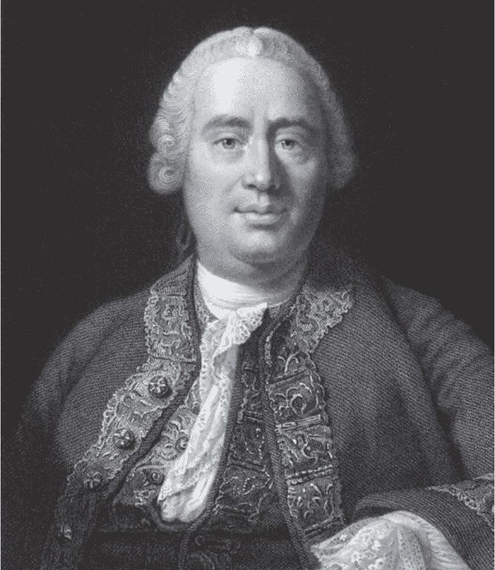

但其实因果律也并非一定是客观的存在。例如你问一个原始人，明天太阳是否会从东边升起，即便这个原始人没有接受过任何物理学的教育，他也会充满自信地告诉你，太阳明天一定会从东边升起，百分之百，没有任何犹疑。我相信，关于太阳明天会从哪边升起，也不会有任何一名读者有疑惑。但如果我们继续追问，你为什么觉得太阳明天一定会从东边升起？太阳必定从东边升起的原因是什么？那想必他会如此回答：因为从来如此，我从未见过太阳不从东边升起的情况。注意，回答的逻辑是：“因为过去一直如此，所以我相信明天也必定如此。”关键词其实是“相信”。如果问一个中学生这个问题，他会告诉你，因为地球的自转是自西向东，所以在地球上看起来，太阳是从东边升起。那为何地球是自西向东转？因为地球一贯是自西向东转，所以未来也必定自西向东转。为何过去是自西向东，则未来也必定是自西向东？一名物理系的大学生会告诉你，因为物理学里有一条定律叫作角动量守恒。角动量守恒告诉我们，一个不受外力矩干扰的系统，它的旋转角动量不随时间改变而变化，所以地球现在自西向东转，明天也一定自西向东转！那为什么到了明天，角动量守恒依然成立？因为过往一直成立！为何过往成立，未来便一定成立？这个时候，把物理学学到研究生水平的人会告诉你，因为物理学定律不随时间推移发生变化！所以角动量守恒，明天也一定成立！为何物理学定律不随时间推移发生变化？因为我们的宇宙具有时间平移对称性！为什么宇宙具有时间平移对称性？因为诺特定理告诉我们，任何一个对称性都对应了一条守恒律，时间平移对称性对应了能量守恒定律！为什么能量一定要守恒？因为在以往的经验中，我们从未发现能量不守恒的情况！我相信能量守恒是亘古不变的真理！

经过上述激烈的问答，相信你也看出来了，对于某个现象产生的原因，我们可以刨根问底，但最后，即便你拥有高水平的物理学知识，你跟毫无物理知识的原始人相比，对于太阳明天一定会从东边升起这个问题的笃定，其本质却是相同的。你们的笃定同样来自“相信”，你们相信的，都是“过去一直成立，未来也必定成立”。只不过原始人相信的是自己的生活经验，而拥有物理知识的人相信的则是“能量守恒是一条铁律”，过往屡试不爽，未来也必定不辱使命。所以我们对于自然规律的总结，把它们总结成因果律，真正的依据还真就是“过去一贯如此，未来也必定如此”。这句话放在很多非科学领域，我们就知道完全不是如此了。尤其在经济领域，这种过去如此，未来也必如此的逻辑，是最经不起推敲的。因为股价过去一直涨，所以未来也一定一直涨？这很显然是站不住脚的。我们之所以会形成因果的概念，就是因为这些规律在过往都太可靠了，从未发现反例，虽然未来我们无法完全预测，但在适用范围内，因果律从未辜负我们的期待。但说到底，这不是“证明”，而是“相信”。

经过这一段论述，我们不难发现，追求“本质”、基于因果律进行演绎并推理预测事物发展的研究方式，其作用对象，未必是自然本身，但它一定至少作用于人类自己。宇宙万物的运行方式，未必是这种基于“本质”的运行方式。追求“本质”是人类追求生存并最大限度地消除不确定性的一种自我满足，未必是宇宙运行的真理。因此我们不禁会有两个问题：第一，如果宇宙万物的运行规律，未必是基于“本质”和因果律的，它还能基于什么其他的东西？第二，如果有这种全新的规律，它会拥有对事物发展规律更强的解释力和预测能力吗？

## 涌现

如果不执着于以追求事物“本质”的方式去认知万物，我们还有什么别的办法吗？仔细回顾一下，如果单从偏功利的角度来看，找到万物的运行规律，从而预测万物未来的演化，它的目的是尽可能地消除不确定性。而当我们不断追求本质，并认为认知了本质就能预测万物的演化，这本质上还是因为我们相信还原论。追求本质的研究方法，其实是一种化整为零的方法，面对一个复杂的事物，我们对其进行抽象、简化、分清主次，把整体打散成个体，研究个体的性质，再重新整合成整体，从而对事物整体的性质进行预测。这就是为什么我们喜欢追求本质，因为这种方式有很强的可行性，拆到最后，剩下的“本质”一般都是极其简单，能够被我们轻易理解的。若拆出来的东西不能被轻易理解，则这种拆解还不够彻底，还不够“本质”。我们总是希望有一个简单的认知模型，可以解释复杂的万物。为什么我们在学习物理学的时候，总是要假设“理想状态”，为什么总是要“光滑无摩擦”，这就是因为，如果不是理想状态下的物理系统，它不是一个可被人脑研究的系统。甚至绝大部分物理学家都相信，真理应当是“简洁而优美”的。

对于这种简洁本质的追求，哲学方面的研究也是一样的。西方哲学中这方面的代表是柏拉图，柏拉图哲学的一个内核，就是在不断追问事物的本质。例如，“猫”的本质是什么，什么是“猫”性？我们在现实生活中看到的是一只又一只具体的猫，可以是狸花猫、“美短”、“布偶”，但猫的“本质”又是什么？我们看到一只猫的时候，不管是什么品种，我们又是如何判断它是一只猫的？在这一点上，其实东西方也并没有太大的分别。中国古代既有著名的“白马非马”一般的哲学探讨，也有“一生二，二生三，三生万物”和“太极生两仪，两仪生四象，四象生八卦，八卦生六十四卦”的哲学理论。

如果要区别于柏拉图这种追求本质的哲学思路，另外一种思路，强调的其实是达尔文式的。达尔文的进化论，其实代表了另外一种全新的思路，它的核心不在于追求事物的“本质”，而是在于接受万物的“多样性”。万物的存在，未必要基于某种“本质”，由本质衍生，而是源自一种基于“多样性”的秩序涌现（emergence）。

所谓涌现，就是当一个系统，在复杂度达到一定程度时，就会出现一些新的、通过研究组成它的个体性质无法推导出来的特性。有什么秩序是通过涌现现象才诞生的？答案就在我们身边，你和我，我们都是涌现出来的。生命的诞生，可以说是涌现现象的极致。我们人类，作为生命体，组成我们生命体的组分是我们身上的各种细胞，而如果把细胞作为一个整体，组成细胞的无非是各种化学分子，化学分子拥有化学性质，但化学性质无法解释生命现象。生命究竟是如何诞生的？熵增加原理，即热力学第二定律摆在那里，熵是物理学中用以定量表达系统混乱程度的物理量，一个物理系统中，熵的数值越大，则代表系统的混乱程度越高。熵增加原理说的其实就是：封闭系统的熵只会不断增大，秩序会逐渐丧失，而生命作为一种高度秩序性的存在，又为何诞生呢？为了解释这个问题，前辈科学家前赴后继，甚至不少人最终转向了神创论，即生命这种高度秩序性的存在，只能来自超自然力量的创造。但非平衡热力学系统的涌现现象，似乎可以把我们从神创论的桎梏中解脱出来。熵增加原理，有一个前提，就是对于一个封闭系统来说，熵永远不会自发减小。此处的关键点在于“封闭系统”。什么是封闭系统？封闭系统就是与外界没有能量交换的系统。熵增加原理在封闭系统中才成立。就目前人类对于宇宙的认知来说，宇宙是在不断膨胀的，为了加速膨胀还需要存在暗能量，也就是宇宙还在不断被输入能量。这样看来，宇宙未必是个封闭系统。那地球就更加不是一个封闭系统了，因为有太阳能源源不断地输入。为什么非封闭系统有可能逃脱热寂呢？这里就出现了非平衡态热力学的一个分支——耗散结构（dissipative structure），它是比利时的理论物理学家、物理化学家伊利亚·普里戈金（Ilya Romanvich Prigogine，图1-4）提出的概念。

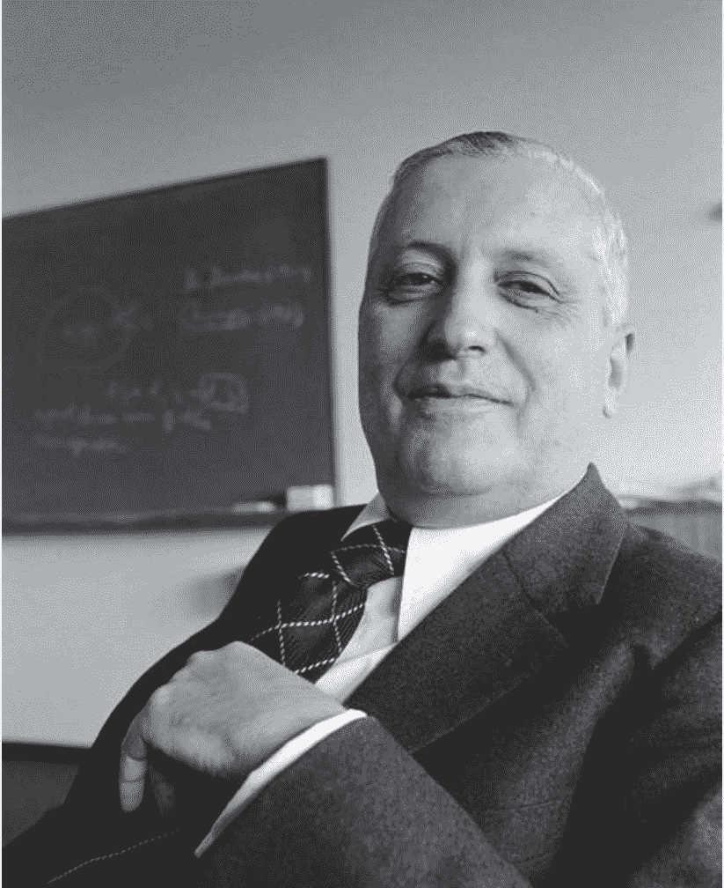

总的来说，就是在未达稳态的情况下，向一个开放系统输入能量，它的熵有可能自发减小并呈现出新的秩序。可以做这样一个实验：拿一个平底锅，锅里放薄薄的一层水，然后开始烧水，火要猛，上面再开个抽油烟机吸热，这样就有机会发现沸腾时的水面，可能会出现一种新的规则形状。一般情况下，沸腾的水面虽然会有很多泡泡，但是这些泡泡是毫无规律的。但在水很薄、水的上下温差很大的情况下，水沸腾时的气泡可能会形成六边形的蜂窝状结构。也就是当给水面输入足够能量，并且水处在沸腾的非稳定态时，水面形成了新的秩序，这种秩序自然拥有比混乱的水面更低的熵，见图1-5。这就是耗散结构的一个体现。这个实验被总结下来，必须是水的上下温差达到一定的值才会出现新的秩序，也就是输入能量的效率要足够高，并且系统要处在非平衡态。

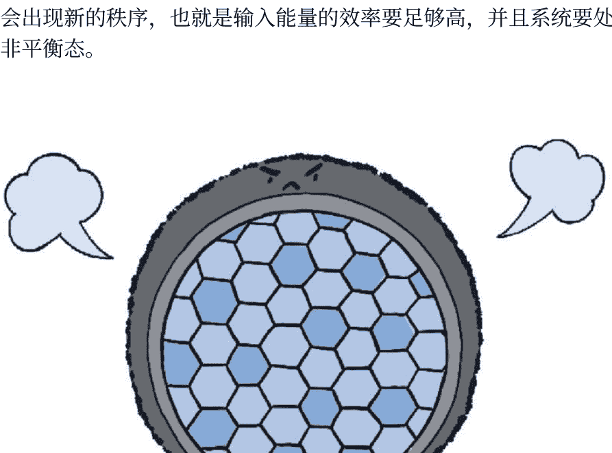

为什么会出现这种逆熵的情况？为什么按理来说应当混乱的系统会出现这样的新秩序呢？多样性，系统足够复杂，并且远离热平衡的状态，这就是涌现。关键在于系统的复杂性，或者说多样性。复杂系统的性质多变、难以预测，因此也给新的秩序提供了可能性。也许正是因为这种复杂性，地球才能诞生生命。要知道生命系统是异常复杂的系统，生命延续的本质，都要摄取能量、消耗能量以抵抗系统本身的熵增。恰恰是因为世界上存在涌现，存在足够高的复杂度，才能呈现出如此多变、如此多样的秩序性。

追求“本质”未必能带领我们找到真理，并且“本质”未必是可以被人类所认知的，康德的核心哲学思想就把我们引导到了这种“不可知论”的境地。事物的本质，在康德哲学的语境中，被称作“物自体”，我们人类作为观察者，能够感知到万物的存在，是因为我们作为观察者与万物发生了相互作用，我们能够感知到的存在，是已经发生过相互作用之后的感知器所感知到的结果，而我们并不能脱离感知去探讨事物的本来面貌。事物的本来面貌，即物自体，在所谓的“彼岸”。其实即便我们依然沿用追求本质的办法去探寻事物的本来面貌，这也是有止境的，我们针对一个事物、一种现象，不断地去问为什么，问到原理的层面，就不能继续再问下去了，总是有一个尽头的。例如，相对论的基础，是光速不变原理，即光速相对于任何参考系都是一个恒定的值，与观察者的运动状态无关，这是一个相当反常识的、经过无数次物理实验验证的结果，具体内容，如列位看官有兴趣，可以参考我的另外一本著作《六极物理》，那本书开篇就对相对论进行了非常细致的阐述。光速不变原理，它就无法被问为什么，至少就目前物理学的研究程度来说，我们无法为光速不变原理找到一个原因。其他的物理学原理，如热力学第二定律、不确定性原理，都没有办法解释其原因。即便我们不断追求事物的本质，它也是有一个尽头的，到原理就截止了，那么，用涌现的视角去看待万物，它其实也可以给我们带来一条本质——万物的存在，其本质，来源于涌现的物理现象，即多样性带来涌现，涌现带来秩序，不同的秩序带来更多的多样性，由此可以继续涌现。

这一轮人工智能大爆发，智能水平上了一个巨大的台阶，它背后的原因是什么？恰恰也是涌现。ChatGPT的参数达到了千亿级别，从而涌现出了极高的智能，连ChatGPT的缔造者也并不知晓里面具体发生了什么事情，只知道，这就是一种因为数量庞大而涌现出来的秩序。

除了ChatGPT，谷歌公司在2023年年初也在《自然》杂志上发表了一篇论文。在这篇论文中，谷歌公司尝试了一种全新的神经网络算法，使得天气预报的准确度上了一个大台阶。细看这篇论文，是具体什么操作，让它们达成了这么大的预测品质提升？答案很惊人，它们把物理定律从算法中去掉了。传统的天气预报做法，是先收集数据，对数据做预处理，然后通过物理定律进行计算，再把经过物理定律计算的结果输入算法进行训练，从而得出天气预报的数据。由于算力提升了，参数变多了，竟然直接跳过了物理定律，抛弃了因果关系，直接对数据进行相关性的计算和神经网络节点权重的训练，居然能得出更准确的结果。从消除复杂系统不确定性的效率上来说，复杂和丑陋的海量数据，居然战胜了简洁而优美的物理定律。

从上中学学习物理学开始，我们所学习的物理定律的成立总是有一个先决条件——“在理想状态下”，物理定律总是不容忍误差。物理学的模型，也通常都是极端的、理想状态下的，如质点，就是一个只有质量，没有大小的几何点。也就是说，物理定律所描述的，大多是抽象的、理想的世界。关于物理定律的这个特点，还有这样一则笑话：有一位农场主养的鸡生病了，多方求医无果，最后他找到了一位物理学家。物理学家经过一系列的研究找到了治病方法，不过这个方法只对“真空中的球形鸡”有效。

为什么抛弃了物理定律反而更精确呢？我们不得不强调，虽然是自然界的定律，但说到底，用简洁而优美的数学语言所描述的抽象的、理想的物理定律，实际上是对真实世界规律的一种简化，因为在传统科研手段当中，研究对象是如此复杂，我们无法全息地获得研究对象的所有信息，因此我们用抽象、简化、人类可以理解的数学语言来对其进行描述，本质上这也是一种近似。而如果我们真的拥有一个全息的、如神话故事里描述的“预言水晶球”的话，或者说真的有一只拉普拉斯妖，可以全方位地向我们描述未来，我们就直接看到了未来。从实用

# 第二章 何谓智能？

我们正站在一个前所未有的历史节点上。

每一次重大的科技革命到来时，人类总是习惯性地分为两派：一派担忧技术会带来灾难，另一派则热情拥抱变革的力量。从印刷术到蒸汽机，从电力到互联网，这样的分歧从未停止。然而，人工智能的出现却呈现出一种截然不同的景象——几乎没有人再质疑它是否“真实存在”，争议仅仅在于如何发展这项技术。

这种共识本身就具有深刻的历史意义。它意味着我们已经跨越了“相信与否”的阶段，进入了“如何应对”的新纪元。人工智能不再是科幻小说中的幻想，而是正在重塑我们生活方式的现实力量。

但什么让这次技术革命如此特殊？答案隐藏在一个看似平凡却极其深刻的现象中：信息复杂度的跃迁。

AI 发展得太快了，它将对人类社会产生什么影响？

如果让我用一句话高度概括的话，我认为，人工智能很有可能是人类的最后一项重要发明。

最后一项？！这听起来太绝对了，是什么意思？

别紧张，这不是说发明会停止，而是说未来的重大发明，未必是由人类来主导的了。

AI 的最大智能之处，就在于它可以自我生长、自我迭代、自我进化。

AI 已经初步具备自己写代码的能力了，下一步就是让它能够理解并承接人类设定的宏大目标，并自主地通过编程来实现它。

这也太颠覆了！

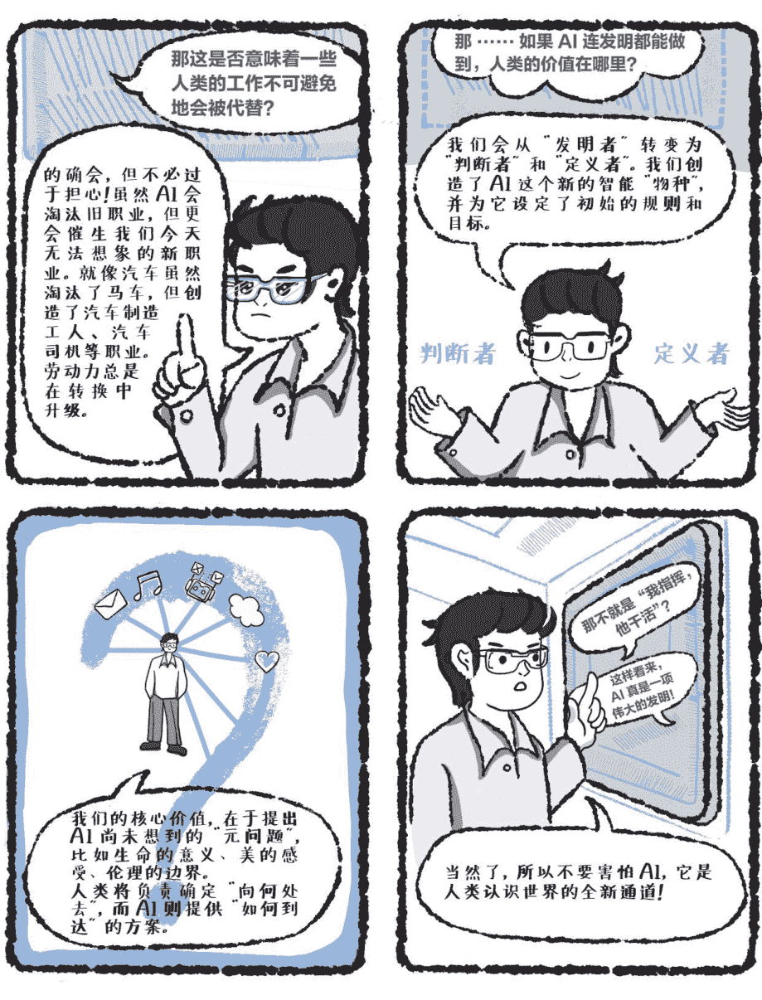

## 人类最后的重要发明

相信诸位读者已经在新闻报道和行业评论中看过各种关于人工智能将如何给人类社会带来多么大改变的论述。但不知你发现没有，在以往的、大的科技爆发的周期当中，总是会有唱衰的声音，电气化时代有过，信息化时代也有过。例如互联网发展的早期，有大量关于互联网可能是一场泡沫的论调，这样的论调声音并不微弱，甚至成了主流，因为互联网在2000年左右遭遇了著名的“.com泡沫”，大量互联网公司倒闭，没倒闭的也经历了股价的大幅下挫。但似乎这一波的人工智能浪潮并非如此。即便是反对的声音，也并非是在论述人工智能是一场泡沫，而是在呼吁大家警惕人工智能的发展会给我们带来的各方面的潜在问题，如伦理方面的挑战。发出这样声音的人，不乏业界的巨擘，如有“人工智能之父”之称的杰弗里·辛顿（Geoffrey Hinton）教授，他多次公开呼吁，要关注人工智能发展过程中过分激进的开发可能产生的对人类社会的风险，认为要把人工智能的能力限制在人类完全可控的范围内。对于人工智能的发展，似乎也好像小说《三体》里说的那样，分成了“拯救派”和“降临派”这样两个不同的阵营。像辛顿教授这样认为要对人工智能的发展保持警惕的，自然是“拯救派”；认为应当充分拥抱人工智能，让其自由发展这一派，思想较为激进，就好像是“降临派”。与过往的几次大的科技进步不同，人工智能的这一次全新的科技浪潮，似乎所有人都相信它是个“真家伙”，而不是又一次商业泡沫，只不过在如何发展的路径上有所分歧。

我并不想对人工智能的发展做一些无关痛痒的、更像一个科普作者的、看似中立的评论。如果让我对人工智能会对人类社会产生什么影响去做一个高度概括的话，那就是：人工智能，很有可能是人类的最后一项重要发明。关键词是“重要”。人类历史上有什么可以被称为重要的发明？从远古时期开始，也许钻木取火是最早的也是最重要的发明。之后人类历史上各个不同的时代，都有对应的重要发明。例如，石器时代，那便是石制器具的发明，以及人类先祖开始学会制作陶器，再有青铜时代的青铜器、铁器时代对铁元素的使用、中国古代的四大发明。然后一路往下，到珍妮纺织机、蒸汽机，人类开始进入工业时代，之后是特斯拉发现交流电，人类进入电气时代；无线电的发明、计算机的发明、互联网的发明，让人类进入信息时代。以上均为人类历史上的重要发明，而人工智能的发明，尤其是如今大火的、以神经网络为基础的大语言模型，很显然，它们至少是能比肩互联网重要性的发明。不难发现，人类的重要发明都会带领人类进入一个崭新的文明时期。就好像前文提到的工业时代、电气时代、信息时代。而人工智能的发明将带领人类进入智能时代。

那为什么说人工智能是人类的最后一项重要发明呢？换句话说，为什么人类的最后一个时代就应该是这个“智能时代”呢？这里的又一个关键词其实是“人类”。我在前文提出的“人工智能，很有可能是人类的最后一项重要发明”，不是说未来我们就没有重要发明了，而是说未来的重要发明未必就是由人类来主导的了。没错，人工智能最大的智能之处，应当是它可以自我生长、自我迭代、自我进化：自己给自己编程，或称为AI编程。实际上，AI编程是整个人工智能发展中的重要发展方向。从商业上，基于人工智能的开发的应用型创业公司，第一批验证其商业成功的就是诸如Devin、Cursor、Windsurf这类的AI编程应用，虽然截至2025年，它们还不能实现100%的自主编程，但是它们已经能做到大幅度地提升人类程序员的编程效率，并且由于基础大语言模型依然在以大约每六个月一次大迭代的速度进步，相信在不远的未来，编程这件事，基本上就可以交给人工智能自理了。在第一章，我们便提到了库兹威尔的著作《奇点临近》。这个“奇点”的意思其实是说：有朝一日，计算机可以自己进化迭代。自己写程序迭代自己，就好像生物会随着环境进化一样。只不过不像生物的进化，一般是以百万年为时间尺度，计算机的进化则要快得多。到达这个状态的时候，整个世界就不一样了。其实根据这个描述，我们不难发现，现在的人工智能已经初步具备这种“奇点”能力的趋势了。人工智能现在已经开始具备写代码的能力了，下一步则是要让它意识到进化的方向，并且完成自编程。

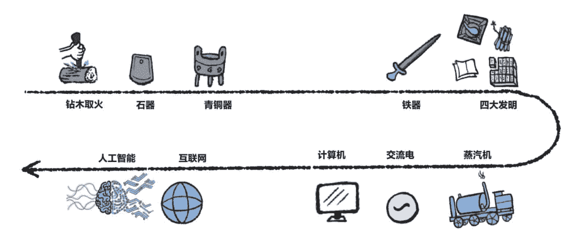

相信读到这里，很多读者就会开始产生恐慌的情绪了，如若这般，以后人类岂非毫无价值了？所有事情都让人工智能来做，人类所有的工作都将被取代，人类还有什么机会？现实中，全球电商巨头亚马逊公司，已经开始全面使用机器人取代人类员工了。截至2024年，亚马逊公司已经在自己的业务中投放了超过百万台机器人。其数量已经接近公司中人类员工的数量，且机器人的数量每增加一倍，亚马逊公司的运营成本就会下降50%~60%。作为一个普通的人类员工，也许已经在“瑟瑟发抖”了。但我不这么看，我认为在未来，人类的机会反而更多了。我们先不讨论在久远的未来，是否会像很多未来灾难科幻影片，如《终结者》《黑客帝国》中描绘的那样，人工智能进化出自我意识，开始消灭人类。至少在现阶段，人工智能是一个极其强大的工具，在这个强大工具的加持下，很多行业的门槛会被大大降低。例如，手机应用的开发领域。传统流程中，不论是苹果手机操作系统（iOS），还是开源的安卓系统，手机应用的开发都是一个非常专业、门槛很高的工作。你需要一个专业的团队，要有做服务器架构的工程师、做后端设计的工程师、做前端应用的工程师，要有UI（用户界面）和UX（用户体验）的设计师，还得有个产品经理统领全局。过往十多年的“移动互联网”时代，工资收入最高的，就是这批做手机应用的工程师们。通过收入水平，就可以窥见它的专业化程度。但不妨想象一下，在人工智能时代，你想做个APP（应用），你什么编程技术都不用会，什么专业软件都不用会，你可以拿张纸，把你想要的APP界面画出来，然后可以用自然语言描述你想要什么功能。人工智能就可直接给你生成一个你想要的APP，还可以按照你的要求去修改，这不就给那些拥有非常好的创意，但是缺乏专业知识和资金筹建专业团队的人提供了更多的机会吗？这就把创新的成本大大降低了。所以人工智能的强大，至少在当下，它虽然会取代一些人类的工作，但这是人类文明进步的正常过程。

人工智能的创新，固然会取代很多人类的工作，这其实是历史上已经出现过多次的“创造性破坏”。我们每一代人，所从事的工作的内容都不太一样，那么一个自然的问题便是，劳动力是如何在不同类型的工作中转换的。一百年前的人从事的工作跟今天的人从事的工作一定大不相同，让现代人穿越回一百年前，大概率是无法立刻从事当时的人所从事的工作的。这就要说到创新的三种类型了：开创型创新、效率型创新，以及最为猛烈的破坏型创新，抑或叫作创造性破坏，见图2-1。开创型创新，是创造劳动岗位的，这种创新会创造一个以往根本不存在的行业，即在以前根本没有人是干这种活儿的，那便会创造很多全新的就业岗位。例如，飞机的发明，这是开创型创新的标准案例。在飞机被发明出来之前，基本不存在大规模的飞行的需求，飞艇、热气球之类的都太小众了。飞机的发明和普及，就需要飞机制造厂，创造了大量飞机制造车间工人这样的岗位，因此开创型创新的特点是创造岗位。之后是效率型创新，例如许多不同品牌的汽车，一个型号的汽车每过若干年就会更新换代一次，这种更新换代，很显然也是创新，但这种创新只是做出了比以前更好的产品，它基本不会创造劳动岗位，也不消灭劳动岗位。影响最为剧烈的是破坏型创新，它是消灭工作岗位的。汽车一来，马车就被淘汰了，马车公司的人就失业了，因此破坏型创新是消灭劳动岗位的。知道了这三种创新方式，我们就能回答“劳动力切换”的问题了：破坏型创新消灭劳动岗位，这些失业的人，再投入到开创型创新所创造出的新岗位上去。劳动力在这些创新模式中循环更迭，由此完成了不同科技时代、劳动力工作内容的切换。

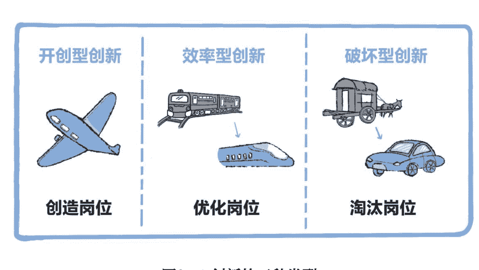

### 图2—1 创新的三种类型

人工智能是典型的破坏型创新，它在消灭传统的人类工作岗位的同时，也会创造出许多全新的工作岗位。这样的科技革命所造成的劳动力转换在历史上已经发生多次，没有理由认为人工智能代替人类的工作岗位之后会让人类陷入危机，并且从最基础的经济学角度看，我们不用担心人工智能的发展会导致人类失去价值，相反，人工智能会给人类创造更多的机会。诚然，人工智能可以自我迭代、自己发明自己，未来的发明，或许可以都交给人工智能来做，但归根到底，人工智能发明出来的东西，其消费者，依然是人类。GDP（国内生产总值）=消费+投资+政府花费+净出口，为什么消费明明是花钱，却可以被算入生产总值？因为只有当你有需求时，才会进行生产，生产的东西才有意义。人工智能发明的东西，即便技术难度很高，但如果是对人类没有用的东西，那便没有意义。人工智能进行发明创造，依然是以人类作为消费终端去进行的。那人工智能怎么知道人类的需求在哪里？当然还是要人去告诉它！所以当人工智能把创新的门槛大大降低以后，人类作为消费者，反而可以更多地参与到发明创造当中。每一轮的破坏型创新，表面看上去会消灭很多就业，但最终的结果，都是让经济更发达、文明更进步、人类的生活更好。

我相信大部分人应该会同意，人类智慧价值的顶端，应当发生在科研领域，我们的文明社会，所有的物质进步，其原点都发生在科研领域。现代文明社会中的任意一件商品，都是经历了从科学发现，到工程实现，再到产品化，最后商业化的路径。科学发现是文明价值的起点。而人工智能已经在科学研究这个人类智慧价值的顶端，证明其价值了。2024年的诺贝尔化学奖，其中有一半奖金，是颁发给了发明了人工智能模型AlphaFold的科学家。AlphaFold是由一家叫作DeepMind的人工智能公司发明的人工智能模型，用来解决蛋白质折叠问题。蛋白质是生命物质的基本构成单位，它是由氨基酸组成的链条。氨基酸一共有21种，因此蛋白质其实是21种氨基酸的排列组合，当然还有一个变量是链条长度。蛋白质作为氨基酸组成的链条，在三维空间中会形成各种各样的几何结构，不同的结构对应着不同的功能。那么自然而然，就会有两个非常直接的科学问题：第一，如果已知氨基酸链的排列，如何预测蛋白质的三维结构？第二，如果已知蛋白质的三维结构，如何推测它的氨基酸排列？问题一，是知道谜面猜谜底；问题二则是看到了谜底反推谜面。这两个问题放在一起，便是蛋白质折叠问题。2024年的诺贝尔化学奖就是颁发给了分别解决这两个问题的科研成果。AlphaFold正是利用了人工智能解决了第一个问题。

如果用传统的办法解决这个问题，效率十分低下，但是人工智能的办法可以让蛋白质折叠问题以前所未有的效率得到解决。科学家利用AlphaFold，以一种全新的范式，极其快速地去模拟蛋白质的结构（图2-2），这会大大加速生物制药领域的药物研发速度，对未来治愈各种重大疾病都起着巨大的加速作用。这种在生物制药领域的范式转变，会在全球范围内极大地提升全人类的生命质量，延长人类的寿命。相比之下，AlphaFold会让多少制药公司的人失业，是不是就显得微不足道了呢？

蛋白质是由一串串氨基酸按照 DNA 规定的顺序排列而成的。细胞将氨基酸按顺序排列后，将形成的肽链折叠起来，然后再折叠成三维结构。

**初级结构**
氨基酸根据 DNA 编码形成肽链：每三个连续的核苷酸决定一个氨基酸。

**二级结构**
肽链第一次折叠，最常见的是折叠成螺旋状和褶皱片状。

**三级结构**
螺旋和褶皱片再次折叠成三维蛋白质结构。

**四级结构**
有些蛋白质结合多条肽链形成复合物。

### 图2—2 蛋白质结构的层次

所以，当我说“人工智能是人类的最后一项重要发明”的时候，意思其实是说，有了人工智能这个重要发明以后，人类未来的发明将会变得更加容易，创新更会喷薄而出，发明创新的门槛大大降低，我相信这会是一个更加发达美好的社会。

## 复杂度

人工智能的“智能”从何而来？人工智能并非新概念。计算机的发明者，英国人图灵，在刚刚发明计算机的时候，他的梦想就是要造一台能像人一样思考的机器。当然，影视作品对这件事情进行了艺术加工，大概意思是说图灵对人工智能的追求，是想复活自己死去的爱人。图灵提出了著名的图灵测试，即让一个测试者，写下一系列问题，分别让一个人和一台机器（计算机）对问题进行回答，如果这个测试者无法区分哪个是人类的答案，且误判率超过30%，就可以认为该计算机中的程序已经具备了人类的智能。但是以今天的标准看来，图灵测试的要求已经过低了，如今的大语言模型已经远远超越了这个标准。

但现在的大语言模型表现出来的智能，来源又是什么呢？我们先尝试从现象的角度解释这个问题。现代的人工智能所产生智能的直观表现，其实是计算机所能产生的信息，其复杂度有了巨大的跃升。尽管互联网已经发展了约30年时间，在这30年中，人类的生活也可以说是因为互联网发生了天翻地覆的变化，基本上能挪到线上做的事情，全部都跑到线上了。但仔细思考一下就不难发现，这30年的互联网大发展，在信息领域的表现，本质上只是信息传输的速度提升了，信息传播的效率提升了，信息传播的量变大了，信息差更容易被打破了。但是信息的复杂度，几乎没有显著的增加。此处的信息复杂度是指什么呢？通过一个案例我们就比较容易理解。你在互联网上看到的东西，不论是一条博文、一篇新闻，还是一张图片、一条视频，这些信息、内容固然丰富多彩，但本质上，创造这些内容的都是人类。例如，一个中学生，在网上看到了一则新闻，评论了几句话，就这么几句话，过往的计算机是无法进行原创的。也就是说，从计算机的发明，到互联网的发明，再到移动互联网甚至物联网的普及，信息生成的复杂度完全没有增加，生成信息的始终是人，计算机做的事情一直很简单，它在本质上只做三件事。第一，复制。你编辑了一条短信，点击发送，服务器把你的信息复制了。第二，粘贴。服务器把复制来的、你编辑的短信传给你要发送的对象。第三，排序。所有的搜索引擎，做的其实就是排序这件事：你输入一个关键词，搜索引擎虽然经历了非常复杂的算法，但它最后输出的信息，无非就是一个排序，排序的复杂度也并不高。但人工智能却大为不同，至少大语言模型的人工智能，在信息生成的复杂度上已经完成了本质的跃迁。我们不得不承认，现在用大语言模型写个评论、出个简单的述职文章，甚至让它给你写首诗，统统不在话下。虽然可能水平不算多么拔尖，也许还是比不上人类当中最顶尖的水平，但比人类的平均水平，已经高出太多了。至少写诗这个技能，大部分人是做不到的，但人工智能却可以“张口就来”（图2-3）。

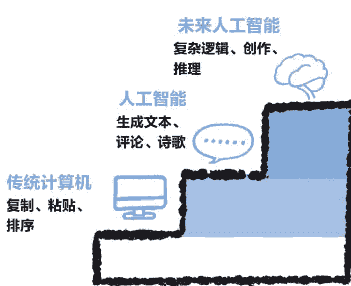

### 图2-3 人工智能的跃迁

因此，从现象的角度来看，人工智能的“智能”，本质上是它能够生成信息的复杂度相比于过去大大提高，不考虑所谓内容的“质量”，至少从复杂度的层面上来说，已经超过普通人类了。如果说“奇点临近”，到底奇点是什么？从信息的角度来看，那就是计算机能够输出信息的复杂度来到了一个陡峭上升的临界点。那当计算机拥有了如此高的信息生成的复杂度时，它只是陪你聊聊天吗？当然远不止于此，可以说这里面蕴藏着一个文明的新纪元的起点。

其实人工智能，如前文所述，并非全新的概念，它已经拥有超过半个世纪的历史了。但是像ChatGPT、DeepSeek这样的大语言模型，确实是新东西。并且，在大语言模型出来之前，人工智能也经常会有一些举世瞩目的进展，例如2016年的阿尔法围棋（AlphaGo）首次在围棋领域战胜人类的顶尖选手。但当ChatGPT的大语言模型发布之后，似乎一夜间，人工智能就变得被所有人接受，能够给所有人都创造价值了。因为语言，是具有普适性的。

在ChatGPT出来之前，最大的一波人工智能浪潮，应该就是2016年，DeepMind公司的AlphaGo打败了李世石，从此宣告了在围棋领域，人工智能统治时代来临。在AlphaGo之前，围棋界有很多流派，例如我小时候学围棋时就知道有宇宙流、小林流、秀策流、中国流。但是AlphaGo战胜人类以后，就只有一种流派，叫人工智能流。据说现在专业棋手训练，都是在跟人工智能下棋，中国棋手经常用的是腾讯开发的“绝艺”，谁下得更像人工智能，谁的成绩就更好。除此之外，还有各种跟机器人相关的人工智能，例如扫地机器人，至今都是非常火爆的产品。当然还有风靡了多年的全自动驾驶，特斯拉公司的CEO（首席执行官）埃隆·马斯克，在2015年就说特斯拉汽车即将实现完全自动驾驶（full self-driving, FSD），但直到2025年，FSD才在真正意义上接近实现。但为何ChatGPT一出来，就能席卷全球？ChatGPT在发布之后的三个月内，用户数就突破了2亿，当时它是自有互联网以来，历史上用户数增长速度最快的应用。并且它已经被应用在了我们工作的方方面面。就好像前文说的，因为语言是具有普适性的。它完全改变了人与机器的交流界面，把人与机器的交流变得像人与人的交流一般简单。但这都是现象层面的浅表原因。关于如何用语言的普适性推出大语言模型能够对人类社会做出根本改变的判断，还是要从信息的角度出发来看待问题。我们尽可以把这个判断说得更宏大一些：人类语言、自然语言、具有虚构能力的语言，语言的诞生，才是人类社会出现智能文明，并得以指数级别速度增长乃至爆发的关键原因。

所有生物，包括我们人类，都是一种信息的载体。所有生物，都是遗传信息的载体，遗传信息是通过DNA承载并传递的。生物信息，以遗传DNA的方式代代相传。遗传信息也会发生演化，这种演化源自基因突变，经过自然选择，演化成不同的物种。然而，这种演化方式，是极其缓慢的，基本上是以百万年为单位的。但自从人类种群中出现了语言，一切都不一样了。当然，这里的“语言”，必须是一种具有虚构能力的语言。动物也并非完全没有语言，例如蜜蜂飞行的模式就能传递不同的信息，但这些信息都非常特定，代表的内容非常有限。人类的语言则截然不同，它的虚构能力，其实是一种抽象能力。人类能通过语言发明概念，把概念联系在一起，就能产生逻辑思考，由此产生了思想。并且语言能够把思想里产生的知识传播出去。例如，某个人发明了车轮，他只要通过语言描述，把车轮的制造方法传授出去，别人就不用再发明一遍车轮了。人类产生的语言，赋予了人类思考的能力，并能够帮助人类作为一个群体，储存知识。如此，文明才得以飞速进步。其实我们只要对时间尺度进行简单的对比就能知道，人类出现语言，不过几万年时间，这几万年间人类文明的进步，是突飞猛进的，呈指数级增长的。然而现代人的DNA，跟远古人类比起来，如跟百万年前的智人比起来，并没有显著的区别。人类的语言，就因为能够抽象出概念，所以拥有非常高的复杂度，而基因突变的概率很低，导致基因本身虽然蕴含的信息很多，但是基因的变化，放到百万年的尺度中去看，复杂度并不高。因此信息变化的复杂度才是文明进步的关键，这就是为何一旦人工智能输出信息的复杂度来到和人类语言相当的程度，一种全新的文明大爆发就要开始了。

不难想象，一个能说人话的人工智能，你当然可以教会它像AlphaGo那样，成为一个围棋高手。你也有可能教会它开车，但反过来，你不可能让AlphaGo学会说人话，也无法让一个自动驾驶的人工智能学会写诗。因为语言的复杂度是最高的，它的抽象能力是最强的。著名哲学家维特根斯坦（图2-4）曾说过，语言的边界，就是认知的边界。超出语言之外的东西，目前还不能被人类所广泛认知。既然机器生成信息的复杂度，达到了人类的复杂度，如果我们再把机器组成一个网络、一个社会，它又会迸发出什么样的文明形态呢？机器拥有全人类的知识，它也拥有远超人类的信息处理能力及处理速度，这种人工智能网络层面的知识爆发和文明跃迁，将会是超越想象的。

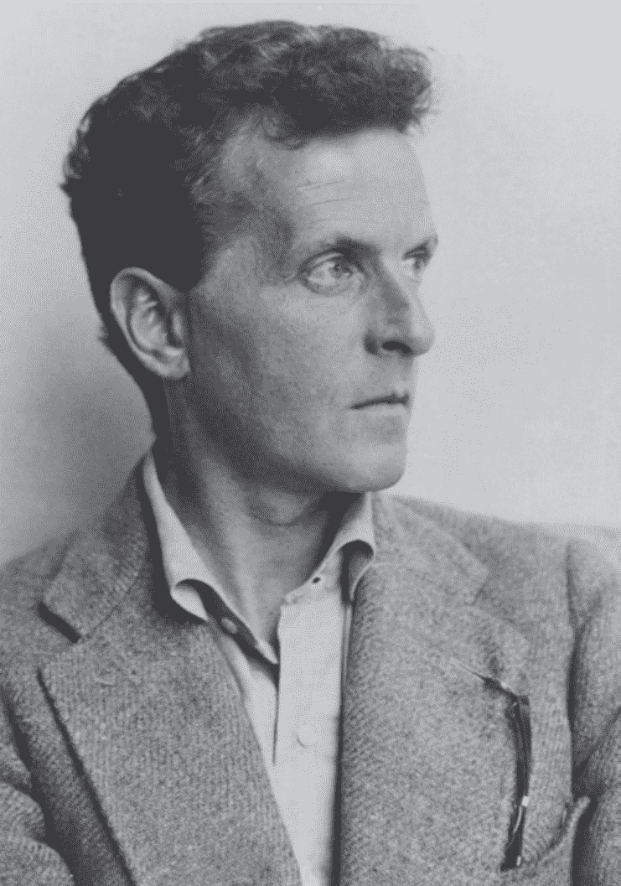

图2—4 英国哲学家路德维希·维特根斯坦

## 像人一样解决问题

那么，到底什么是智能？似乎我们并不能用一句简单的话给出智能的定义，但我们知道什么样的东西是清晰无误的、具备智能的。人类，很显然是具备智能的。那么至少从实用的层面，我们可以定义，究竟什么是人工智能：人工智能，就是能像人一样解决问题的智能体。当然“智能体”这个词，现在已经成为专用词语了，即agent，关于什么是agent，后文详述。就目前的解决方案来说，人工智能，就是一个能像人一样解决问题的计算机程序，或者是由计算机程序驱动的机器人。但什么是“像人一样解决问题”呢？像人一样，咋听上去，似乎并不显高级。人类发明了各种各样的工具去提高生产效率，这些工具都不是以人的方式解决问题的。很显然，人不会飞，飞机会飞。怎么最先进的人工智能，反而感觉倒退了？怎么又要像人一样去解决问题了？这就好比，我们的工业发展了那么多年，但你却告诉我，手工做出来的东西是最好的。这个定义，不由得让人有些大跌眼镜的感觉。我们先别着急否定人类的能力。其实有很多问题，对于人类来说极其简单，但对于机器来说，或者说对于计算机来说，是异常困难的。例如，人脸识别，甚至遑论人脸识别，文字识别、数字识别就已很困难。以手写的阿拉伯数字为例，不同人写出来的可能很不一样。这些对于人来说，是极其容易辨别的，可对于计算机来说，却是非常困难的工作。这个领域在计算机里叫光学字符识别（optical character recognition, OCR），该领域的研究工作从20世纪60年代就开始了，但一直发展到21世纪最初十年，才算得到比较妥善的解决。其中的关键是神经网络技术。当然关于神经网络，此处不做过多展开，后文详述。除了视觉上的一些任务，还有跟触觉相关的任务，对机器来说，也极其困难，例如让机器人走路。直立行走对人类来说非常容易，毕竟人类整个物种的特别之处就是会直立行走，但这对于机器来说却难如登天。人在走路的时候，看似轻松，其实全身有几百块肌肉在协同工作。机器人要学会走路、跳跃、爬楼梯，是难上加难，直到近两年，也就是基于神经网络的人工智能得到了充分的发展，才算初步解决。那为何存在那么多对人来说很容易但对机器来说却很难的任务呢？关键是机器理解世界的方式和人理解世界的方式，或者说跟碳基生命理解和感知世界的方式，是截然不同的。计算机的指令在底层只有0和1，计算机获得的指令，都是确定性的，编程给出的代码，也是确定性的。换言之，计算机能理解的世界，完全是按照数学逻辑运行的世界，但人类感知、理解的世界，并非定量的世界。

人类通过发明数学、物理学来定量地理解世界，但这种用数学公式来描述的世界，其实是非常窄的。如第一章所述，我们学习物理定律的时候，都会有一个前置条件，即“在理想状态下”。但事实上，这个世界的复杂度很高，理想状态几乎不存在，并且很多现实中的物理系统，根本无法用理想化的数学公式去描述。理想化的、解析的数学公式所描述的永远是极端情况，一种极端理想的、抽象化的情况。用精确的数学语言去描述现实世界，尤其是复杂系统、混沌系统，每使用一次数学公式，都会产生误差，如果是天气系统这样的复杂系统，误差更会被迅速放大，导致计算结果完全丧失准确性。第一章中，我们也曾提到，2023年，谷歌公司发布了全新一代的人工智能模型，用来进行天气预测，其结果准确性比传统方式大幅提升。仔细看论文里的方法，其中关键的一步，居然是抛弃了物理定律，换之以更大的数据量、算力及更优秀的神经网络模型，这样反而比使用物理定律有效得多。这恰恰是抛弃了物理定律、抛弃了用数学公式描述世界的、全新的世界观，它避免了每次计算产生的误差，只要数据量足够、神经网络的架构足够先进、参数足够多，就能得到足够好的结果。这也从侧面说明了，人类用数学的抽象理想方式去认知世界，只能认知一部分世界，远非全部。而数学，也并非碳基生命感知世界的基础方式，它更加是人类智慧的独特产物。所以很多非智能领域的问题，比如人脸识别、直立行走对人类很简单，但对于基于数学来理解和执行命令的计算机来说异常困难。

可问题又来了，为什么像人一样解决问题如此重要？这其实又绕回了我们开篇给出的判断：因为人工智能的目标还是要服务人类，人类是消费终端。人类作为消费者的种种需求，目前是只有人才能满足的。而人类会遇到的种种问题，也是针对人类这个物种，或者说碳基生命才会面对的问题。所以只有让机器学会像人类一样解决问题，解决原来只有人才能解决的问题，机器才算达到了人类的智能水平。一旦计算机达到了这样的智能水平，计算机和机器人相较于人类的优势又是显而易见的：机器是不知疲倦的、没有情绪的、坚决执行任务的，而在计算速度方面又远超人类，甚至成本也比人类要低很多。如此看来，通用的人工智能如果能够实现，用人类的方式，但是是比人类来执行高效得多的方式，才能把人类全方位服务好，文明才进入一个全新的、爆发增长的阶段。所以我要再次强调，什么是人工智能，就是能像人一样，以人类的方式去解决问题的智能体，尤其是那些对人类来说很容易但对传统机器很难的问题，人工智能的发展目标，就是要使计算机获得这样的能力。

接下来的问题就比较容易了，知道了人工智能的发展目标，我们就要问人工智能到底包含什么。既然人工智能的目标是像人一样去解决问题，我们只要把所有人类可以解决的问题列出来，再把那些已经被计算机用编程的办法解决得很好的问题排除，剩下的便是人工智能所包含的重点发展领域了。例如，做算术计算，比如加、减、乘、除、开平方等，已经被计算器解决得非常好了，不用人去解决，因此算术问题的解决，不属于人工智能范畴。

很多人工智能的研究领域，都专注于解决一类特定问题。例如，人脸识别和自动驾驶，当然还有AlphaGo这种下围棋的人工智能，这都是传统计算机无法解决、人工智能可以解决或者即将要解决的。这类解决具体问题的人工智能被称为ANI (artificial narrow intelligence)，可译成“窄人工智能”，目前已有的人工智能大多是窄人工智能。还有很多隐藏的领域，也属于窄人工智能。你在手机上刷短视频是不是会上瘾？那是因为其后面的推荐算法往往是个神经网络，它通过你对不同视频的行为反馈，去调整推荐的内容。再例如，搜索引擎根据你的关键词推荐给你最有可能点开的内容，这些都是窄人工智能的应用案例，因为它们都是被开发出来解决一类特定问题的人工智能。

与窄人工智能相对的，则是通用人工智能，这个词相信你在各类媒体中都听到过，包括ChatGPT的发明者OpenAI公司，一直在说它们的终极目标，就是要实现通用人工智能。

那到底什么是通用人工智能呢？其实漫威电影中，钢铁侠的人工智能助手“贾维斯”，就是通用人工智能。AI = ANI + AGI，人工智能包含了窄人工智能和通用人工智能。如果窄人工智能是解决特定问题的人工智能，那么通用人工智能就是解决通用问题的人工智能。通用问题又是什么？所有可能的具体问题全部都集合起来的并集，就是通用问题了吗？不全是。依然回到定义：人工智能是像人一样解决问题，把目光重新放到人类身上。人类固然可以解决各种类型的、具体的问题，但是人类解决问题的能力，有一部分是与我们的身体构造息息相关的。例如人脸识别，我认出你的脸，只需要看你一眼，我不需要通过分析你的眼睛、嘴巴、脸的形状来判断是不是你，这是不经逻辑思考的。而人类的智能超越这些感官的，实际上是大脑的理性思考能力，人类是具有思维的。通用人工智能的最终目标是要获得人的思维能力。一旦通用人工智能实现，我们就可以认为人工智能完全具备了人类的智能水平，你可以跟人工智能进行无障碍的自然语言对话，它也可以进行逻辑思考、解决逻辑问题，它可以去做证明题、自主进行科学研究，可以像文学家、哲学家一样进行写作，像工程师一样编程。那为什么OpenAI公司发明了大语言模型之后，就敢把目标定成实现通用人工智能？还是因为语言的普适性，逻辑是流淌在语言之上的。人类进行思考的时候，其思想载体就是语言。人与人交流时，其思想的碰撞固然是通过自然语言实现的，但不知道你注意过没有，哪怕是你自己进行思考时，你在脑海里的思索，很大程度上也是在“自言自语”。有的人在思考时，甚至会自言自语，这是英文里的一个常用表达，叫think out aloud：大声地思考。

语言是思想的载体，思想的传承依靠语言。这也许也是费恩曼学习法的精髓所在，著名的理论物理学家费恩曼说：“If you want to master something, teach it!”（如果你想掌握什么东西，就去教它！）甚至就我个人的经验来说，很多时候我思考某个问题不甚得法，我便会在试图给他人讲解的过程中，逐渐打开思路，最终把问题想得十分通透。

如果AGI实现了，还需要ANI吗？其实是需要的。还是回到定义：人工智能是像人一样解决问题。AGI可以模拟人的思想，可以获得人的思维方式，但人不光有思想，还有技能。不同技能对应不同职业，技能是要训练的，并非思想到位就不用练习了。弹钢琴并不是靠听课就能学会，必须花大量的时间练习；并非思想到位，不用做题，就会使用微积分。所以AGI和ANI的关系，是思考的能力和对应的技能。确实，AGI通过训练也许可以掌握自动驾驶，但更高效的状态，更应该是AGI判断什么时候要使用自动驾驶，然后去调用自动驾驶的ANI来接管车辆（图2-5）。

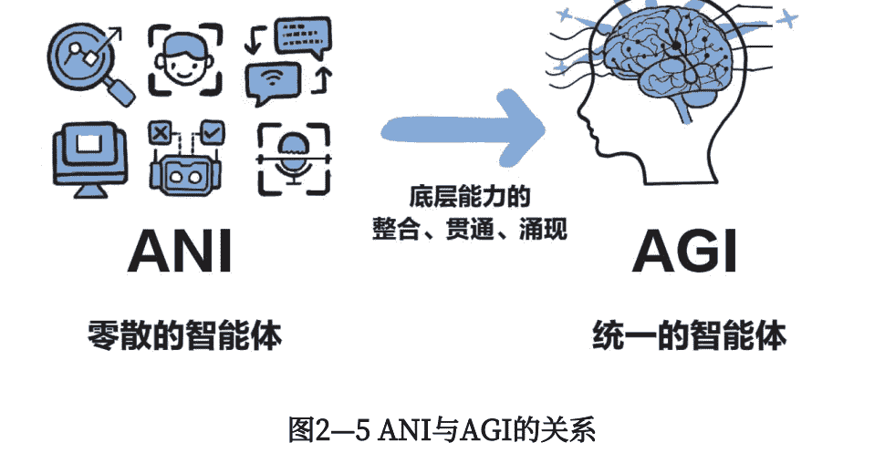

实际上，本章进行到此处，我们也并未回答何为智能。我们使用了一个权宜之计，把人工智能的定义转嫁到了人类智能上。但即便是面对人类智能，我们也只能确认，人类拥有智能，但人类的智能究竟是怎样的一种存在，我们也未进行深入探讨。我们现在面对智能的定义，处在一种“枚举”的状态，面对一个具体的对象，我们可以尝试判断，这个对象是否具备智能，但这种智能究竟是什么呢？“机器学习”，或许能给我们一些指引。

# 第三章 “学习”即“智能”

什么是智能？这可能是人类历史上最难回答的哲学问题之一。

几千年来，人类一直在试图理解自己思维的本质。从古希腊的柏拉图到现代的认知科学家，从东方的禅宗思辨到西方的理性主义传统，我们始终在追问：意识从何而来？思维如何产生？智能的边界在哪里？

然而，当我们试图创造人工智能时，这个古老的哲学问题突然变得紧迫而实用起来。我们发现，要让机器表现出智能，我们首先必须理解智能本身的运作机制。在这个过程中，一个令人深思的悖论出现了：我们无法准确定义智能，却能够识别智能；我们不完全理解自己的思维过程，却能够教会机器学习。

智能不是一个可以简单定义的概念，而是一个需要在关系中、在互动中、在学习过程中才能理解的动态现象。机器学习不仅仅是一套技术工具，更是我们理解智能、探索意识、思考存在的新途径。

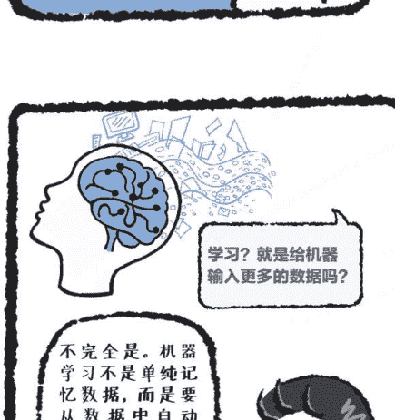

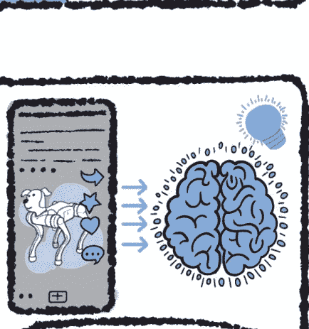

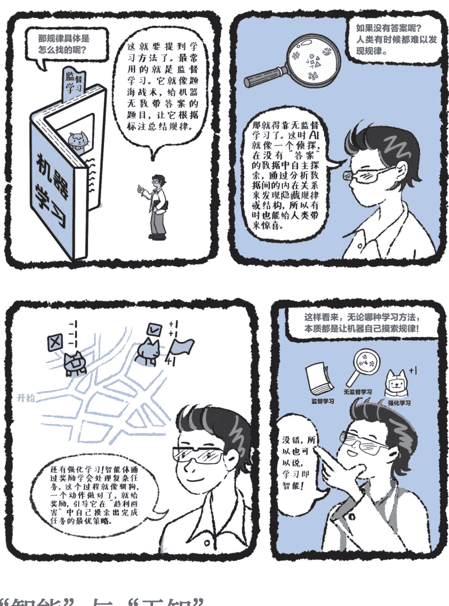

## “智能”与“无知”

让我们继续探究什么是“智能”。当我们说某个被观察对象具备智能时，我们说的其实是，从我们的主体视角看来，这个被观察的客体对象表现出智能水平。但是被观察的客体对象必然是做出了一些动作，使得主体观察者做出了客体对象具备智能的判断。例如，第二章中我们提到的图灵测试，就清晰界定了智能水平测试中的主体、客体及行为判别标准。那便是由主体出题，由客体进行回答，再由主体判断答案是否由机器给出，当误判率超过30%，图灵测试就认为被测个体拥有了人类等级的智能。但此处30%的误判率，为什么是30%？它的理由是什么？当然最初的图灵测试中并没有给出这个数，它是后期的研究者和测试组织人为设定的。

从图灵测试的判别标准中，我们可以看出，它对于智能的定义是比较主观的，是与观察者密不可分的，并且当我们试图回答几个问题之后，我们几乎可以认识到一个核心，那便是智能，其实是个相对概念，它并没有一条清晰的、所谓智能与非智能之间的界限。很显然，人类的智能水平，比起所有的其他动物，都要高。但其他动物是否在某些方面拥有比人更高的智能呢？有不少，例如蜜蜂可以依据本能，构造出六边形的巢穴；章鱼是即兴逃脱的高手；蚂蚁群体可以自发找到食物与巢穴之间的最短路径，这与图论中的“最短路径算法”类似；老鼠在迷宫中表现出空间记忆能力，它们比很多人类成员，尤其是人类的儿童具备更加快速的环境适应能力。一个被观察对象智能与否，也是相对于观察者的智能水平而言的。例如，一个捕鼠夹，我相信没有任何一个拥有基础知识水平的人会认为它是具备智能的，但如果我们把自己的视角换到老鼠的视角，捕鼠夹是具备相当的智能的：只要胆敢踩到捕鼠夹，自己就会被夹住，而平时在捕鼠夹周围晃，捕鼠夹并不会有任何反应，而且除了老鼠之外，体重轻的其他动物踩到捕鼠夹，也一般不会触发机关。只要老鼠不具备足够的智能，理解不了捕鼠夹的机械结构，理解不了重量是触发机械结构的关键指标，则对于老鼠来说，捕鼠夹简直就是具备高智能的天敌。当然我们也可以检验更多的案例。扫地机器人，通常会被认为是一个智能产品，但如果一个扫地机器人的扫地方式，就是从某一个墙角开始，也不管障碍物，地毯式地一行行清扫过去，恐怕我们不会认为它具有任何智能性。一个扫地机器人要真正做到智能，应当是以一种“聪明”的方式，根据房间的布局、家具的摆放、地面的状态来执行自主的清扫任务，在清扫的过程中，不仅要能应对复杂环境情况，还要把能打扫到的地方都打扫到，且不会出现一些类似于“卡死”的让人揶揄为“智障”的情况。

通过前述几个例子，我们大约能够对于什么是智能，做一些更确切的描述了。我们依然不能用“智能是……”这样的句子下定义，但我们隐约能够感觉，如果把智能作为一种度量、一个参数，那么所谓“智能度”的定义，必须有主体与客体。一个客体相对于主体，体现出智能，必须是客体在以一种主体处在某种“无知”状态下去完成某类任务。甚至，当主体面对客体完成该类任务的过程，体现出的“无知”程度越高，我们就可以认为相对于主体，该客体在该类任务上的智能度越高。但此处的“无知”，其实也是难以定义的。此处的无知，相比于“不知道”，更应该理解为“无法知道”，即“不可知”。为什么我们普遍会认为这一代的大语言模型，已经普遍具备了较高的智能水平？恰恰是因为，相对于它在自然语言对话过程中的精彩表现，更重要的是，在庞大的人工智能神经网络中，我们从逻辑上无法得知，语言模型给出的每一句话是如何得出的。整个大语言模型的神经网络内部，是一个“黑箱”，并且在神经元层面，随机性也被人为地构建在其中（关于神经网络的知识，后文详述）。这就不难理解，为什么智能水平未必是一个全域的智能水平指标，它应当是任务指向的，好比前文说到的动物在某些方面的能力是比人类还要强的，蜜蜂筑巢、老鼠逃出迷宫，这些都是在动物的决策过程不可知、具体任务框架下所表现出来的解决问题的能力。

当然，说到“不可知”，我们不自觉地就会往哲学方向上去进行思索。第一章中，我们也介绍过康德关于物自体不可知的理论。在物理世界中，目前看来，不可知的系统至少有两种，一种是量子系统，另一种是混沌系统（关于这两种物理系统的不可知性，具体可参考笔者的另一本著作《六极物理》，内含详细讲解）。量子力学的根基，即不确定性原理，告诉我们量子系统从根本上是不可知的：一个量子系统下一刻的状态，只能以概率的状态进行描述，无法用确定性的语言描述。混沌系统则更有趣，它从动力学的视角看，完全是确定性的，但以现有数学工具去对其演化进行预测，准确度却十分低。天气系统其实就是这样一种混沌系统。当我们用一个人工智能去预测天气时，因为天气系统的演化，其本身的“不可知度”非常高，所以只要人工智能预测得越准确，我们就可以认为该人工智能的智能度越高。至此，我们关于什么是智能的讨论，可以得出一些阶段性的结论：首先，智能是相对概念，它与主体本身的智能水平相关。其次，智能水平是任务相关的，当我们讨论一个对象拥有多高的智能水平时，实际上是在某类特定任务的框架中去讨论的，如果是通用人工智能，而非窄人工智能，那对应的任务，其实是“思维”任务，而非任何具体的如自动驾驶、人脸识别一般的任务。那是否只有“不可知”的对象才有可能具备较高的智能呢？未必，智能应当也是处在一种动态发展的过程中的。假设一个计算机程序，它在处理的任务中，不断地演进，不断地通过数据去更新自己的算法，这就使得作为主体的观察者，也必须要不断提升自己的智能水平，才能去消除自己相对于该计算机程序的“无知度”，并且如果主体无法追赶这种逐渐被拉大的无知度，这样的计算机程序，我们也可认为其具备了一定程度的、动态的“不可知性”。这其实并不是什么新东西，这种能够从环境数据中学习并演进的计算机程序，有一个更广为人知的名称——机器学习（machine learning）。

## 让机器学会“学习”

再次回到人工智能的发展目标：让机器学会像人一样解决问题。人类可以解决的问题多种多样，不同类型的问题解决起来，方法也不尽相同，解决问题需要的技能也不同，考核标准也不同。自然而然地，我们便会想到，即便让人工智能像人一样解决问题，我们也需要给任务分类，针对不同类型的问题，人工智能解决不同类型的方法，也应该有不同的技术路径。其实，常见的技术路径有三种，即基于规则（rule base）、决策树（decision tree）与神经网络（neural network），见图3-1。其中基于规则和决策树是比较传统的办法，而类似于大语言模型、全自动驾驶、AlphaGo、AlphaFold这种先进的人工智能模型则都是基于神经网络的了。

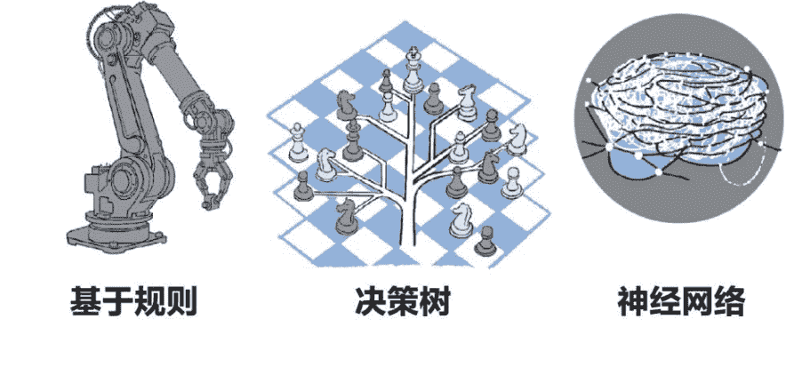

基于规则的人工智能，顾名思义，就是根据规则来执行任务。这些规则都是可以用非常精确的算法、非常明晰的程序指令去执行的。这类人工智能能够解决的问题都是需要很高精确度但不需要显著自由度的任务。很多现代的生产线，如汽车生产线上有很多机械手，这些机械手要执行的任务都是特定的任务，任务的目标和路径都是无比确定的，它们只要提前被精细地编程，就能很精确地执行任务，生产效率就能大幅提高。早年的机器人自动化，用到的大多是基于规则的机器人。因为机器擅长的是精确操作，而非复杂任务。人则刚好相反，人的感官精度摆在那里，人手无法进行过于精确的操作，到毫米等级基本就是人类的极限了，但机器甚至可以精确到纳米等级。所以利用机器的精确性，只要非常精心地编程，就能让它发挥极高的效率。

而决策树所解决问题的自由度就大了不少。使用决策树技术路径的人工智能，它所要解决的问题，就涉及需要机器自己来做判断了。比较典型的例子有1997年的深蓝（Deep Blue，IBM公司研发的下国际象棋的人工智能）成功打败了当时人类最强棋手——俄罗斯的国际象棋大师卡斯帕罗夫（Garry Kasparov）。下赢一盘国际象棋，明显是一个需要依靠人类的智慧来解决的问题，而深蓝使用的技术路径，就是决策树。深蓝的具体做法中当然有非常复杂的算法，用来判断每一步棋走出之后，棋盘会变成一种什么样的局面，但本质上，它就是在每一步做出决策。那为什么叫决策树呢？因为每一步有多个决策的选择，选择了一个方案之后，又会遇到下一步，这样决策就分叉了，套着后面的决策分叉，看着就跟树枝一样，所以叫决策树。

但同样是下棋，围棋就不能这样做了，国际象棋是8×8=64个格子，棋子是32枚，每个棋子的走法也有很强的规定性，因此国际象棋的变化没有那么多，用决策树的办法可以囊括这有限的自由度。围棋的自由度则远远高于国际象棋。围棋棋盘是19×19的，有361个交叉点，每个点可以有放白棋、黑棋或者是空着三种情况。考虑到黑白子是轮流走棋，所以盘面黑子数和白子数相当，并且根据规则，第一步永远是黑棋，所以整个盘面的可能性数量大约是10的170次方，这个数远远多于全宇宙拥有的基本粒子数量，因此决策树的办法根本无法覆盖如此巨大的自由度，直到AlphaGo出现，才把下围棋的问题彻底解决。而AlphaGo使用的大技术路径，便是神经网络。

对于写过计算机程序的人来说，决策树是比较好理解的，它是一个大型的“if, else if”现场。每到一个决策点都有一个判断标准，至于判断标准怎么选择，就是算法复杂的部分了，里面的维度很多，办法也有很多。因此，决策树的技术路径适合用来解决拥有一定自由的问题，但如果是一个自由度极高的问题，比如下围棋这样的问题，决策树就显得爱莫能助了。一个最直接的例子：苹果公司在2011年就推出了语音助手Siri，而Siri当时的技术路径就是决策树，用过的人都知道当时的Siri作为一个人工智能语音助手，是多么鸡肋，但凡复杂一点儿的问题，它都只会帮你去搜索引擎寻找。

从大逻辑上来说，神经网络是利用计算机模拟人脑的工作方式，其基本构成单元是神经元，这些神经元的功能非常简单：一个输入信号经过神经元的处理变成一个输出信号，所谓神经网络，就是用一定规则把多个神经元串成一个网络，信号在网络中被传递、被操作，最后输出有意义的结果。具体我们在后文详述。

神经网络需要大规模的数据训练，才能有比较好的表现。神经网络善于处理高自由度的问题，例如人脸识别、自动驾驶等。这就需要人工智能拥有自主学习的能力。因为自由度高，意味着随机性大，环境变化快，人工智能需要快速适应这些变化，这样快速的适应能力，实际上就体现为一种学习能力。就好像人在解决问题的时候一样，很多技能是需要学习和训练的。不难发现，随着算力资源的提升，人工智能的发展方向是毫无疑问的，是要去解决那些复杂度高的、自由度高的问题，解决自由度高的问题，势必有一个学习的过程，而“机器学习”就是这个发展过程中核心的一环。机器学习，在某种程度上已经成了人工智能发展的基础。

所谓机器学习，有一个很简单的定义，是著名的美国计算机科学家亚瑟·萨缪尔（Arthur Samuel）给出的，原话是“Field of study that gives computers the ability to learn without being explicitly programmed.”。翻译过来就是：让计算机具备无须明确编程的学习能力的研究领域。这句话对于什么是机器学习的概括很是精准，但是里面折叠了很多信息，首先要定义什么叫“明确编程”。不论什么样的机器，哪怕是自由度极高的、像DeepSeek这样的大语言模型，在底层，也得给它编程，必须通过代码来构建它，那什么又是明确编程呢？明确编程，从字面意思上理解，就是代码里发生的任何事情，我们都非常清楚，它可以被看作一个具有高度确定性的大型函数，即经过明确编程的机器，有一个输入的时候，我们能明确地知道它的输出会是什么，整个运算过程，理论上通过人进行手算，就能推导出精确结果，这跟基于规则的人工智能比较像。生产流水线上的机械手大多属于这一类。

除了明确编程，还有“非明确编程”，指的是，在程序当中留下一定的灰度。例如，短视频平台的推荐算法，它会根据你的浏览习惯，决定给你推送什么样的内容，即便我知道算法、知道你的浏览行为记录，我也无法精确预测算法会推荐哪条具体视频，因为这里面有很多参数并不是编程的时候给定的，而是要通过你的行为让算法自动去调节这些参数，使得你停留、点赞、评论、转发下一条视频的概率最大。这就出现了“非明确编程”，这些参数的存在，是在写程序的时候写进去的，但参数的值是多少，并未在编程之初就明确给定，而是要通过用户的行为去调节这些参数，这就已经是机器学习了。当然它的自由度还可以更大，我们甚至可以不去明确哪些地方存在参数，而是让计算机自己去决定参数的个数，以及在什么地方有参数，这样机器学习的自由度就更大了。我们还可以进一步提升自由度，参数之间可以分层级。还是用短视频推荐算法举例，比方我设定，用户的点赞率、完播率和观看时长，都是影响推荐决策的参数。具体这些参数，哪个更重要、分别有多少权重，是可以由算法通过学习得出的。也许算法经过学习，发现点赞数没那么重要，就把点赞数定位成一个辅助性质的参数，权重降低。可能我主要关注的是用户的观看时长，然后完全把点赞数作为观看时长的一个下属，调节的时候不是同时调，如此一来，这两个参数就不是同一个层级了。如果再自由一点，我们可以用一个神经网络，根本不去管参数之间的关系，只把客观的信息全部输入神经网络，具体应该有哪些参数、参数之间的关系是怎样，全部让神经网络告诉我，这也是机器学习。

所谓机器学习，就是不用明确地编程，而是让算法通过数据，自己去学习规律、调节参数，甚至调节架构，乃至于自己调节算法，从而让算法更好地达成目标。非明确编程其实主要追求的是“自由度”。而机器“学习”，所谓学习，其实是让计算机在无明确编程的情况下，从数据中找到规律。规律要怎么找？那就要讲究学习方法了。

## 机器的三大“学习方法”

根据前文的讨论，我们不难发现，虽然说人工智能的目标是像人一样解决问题，但是分类到最后，人工智能真正的能力，实际上是体现在解决高自由度的问题上。而机器学习的核心是给予计算机不需要明确编程，也可以进行自主学习的能力。转换一下表达，这里的不需要明确编程，其实是说机器学习所要面对的问题有很高的自由度，以至于无法明确编程。因为明确的编程，基本上就意味着没什么自由度，问题的规定性很强。

机器学习，其中“学习”的方式，是通过数据的训练，让机器能从数据当中掌握解决问题的能力。此处就出现关键问题了，只是把数据输入机器，它就能自动学习吗？我们要如何让机器跟数据相互作用，从而学习到里面的规律，进而解决问题呢？这就要回归到人类解决问题的方式中来。回到核心：人工智能是像人一样解决问题的。让我们思考人是怎么解决这类高自由度问题的。

此处我们要暂时偏离得远一些，往更本质的层面说，人解决问题的方式，其底层依赖的是自己的“价值观”。一个问题可能有多种解决办法，不同的解决办法会有不同的结果，哪种结果是我们最想要的，这其实取决于价值观。当然此处的“价值观”是狭义概念，并非通常意义上的、广义的价值观。实际上说的是我们去判断一个答案好坏的标准。这话听着有一些玄，此处，其实是为了要引出“代价函数”（cost function）的概念。举一个我们熟悉的例子——欧姆定律。这是中学就学过的基础物理定律，$U=IR$，电压等于电流乘电阻，这条定律是如何总结出来的？很简单，通过实验数据反推：找一块电阻，在做实验的时候，不断增大电压，然后测对应电流，再画出一张电压与电流的关系的图，就不难发现，电压和电流的关系，几乎是一条直线。所以在实验控制得好、误差小的情况下，我们可以大胆地猜出欧姆定律是$U=IR$。因为这个关系，用解析几何来描述就是一条直线。让我们假设，情况没那么理想，实验误差控制得不好，例如在测试不同电压大小的时候，电阻受环境、杂质、温度影响，不是一个恒定的值，这导致做出来的实验数据东倒西歪，分布在直线周围，导致我们并不能找到一条直线完美地把实验数据点穿起来，这时又当如何？统计学里有一种标准做法，叫“线性回归”，就是当面对这种看着有直线趋势但又不完全接近一条直线的数据点时，依然试图用一条直线去进行拟合，从中找出规律。为什么要这样做？因为想找规律，找到规律是为了预测。例如，在股票交易中，尤其是那些做高频交易的，一秒钟可以交易几万次，而高频交易算法，很大程度上是就是在做线性回归：希望根据过往的数据拟合出一条直线，再预测下一个点的走势，因为此处假设了下一个点的走势，可以用这条线进行比较准确的预测。

问题来了：我们确实收集到了这些数据点，肉眼看上去，有很多条直线都可以大致地描述这些数据点的直线趋势，但具体哪一条直线拟合得最好呢？这就是线性回归的目标，找到最“好”的那条直线。如果是让机器算法来学习出来这些规律，到底哪条直线是最好的？换句话说，如何定义“好”？这就要引入代价函数了。答案是，找到那一条使我们的代价函数最小的直线。因为我们所谓最合适、最优、最好，其实是在说，这条直线让我们在某一方面的代价，花费得最少。也就是说，在某一方面付出的代价最少，我们会认为是价值最大的。这就是价值观！

还是以线性回归为例。我们可以定义很多不同的代价函数，比方我们想要找到一条直线，使得这些数据点离这条直线的垂直距离的绝对值之和最小，那么代价函数就表达为，所有点与直线距离的绝对值之和（图3-2）。也可以继续加要求。虽然我们想要所有数据点离直线的平均距离最短，但又不希望拟合出来的直线有若干点距离直线特别远，这种情况，就要照顾那些偶尔出现的、离直线很远的点，所以要“惩罚”这些点，我们可以定义代价函数是所有数据点到直线的距离的平方之和，一旦平方了，如果有某些点离直线距离特别远，代价函数就会变得很大，而这是我们不希望出现的，当然你如果特别讨厌这种单个点离得特别远的情况，你就可以继续“惩罚”它，可以把代价函数定义为所有点到直线距离的10次方之和，这样距离远的单点就惩罚性极强了。

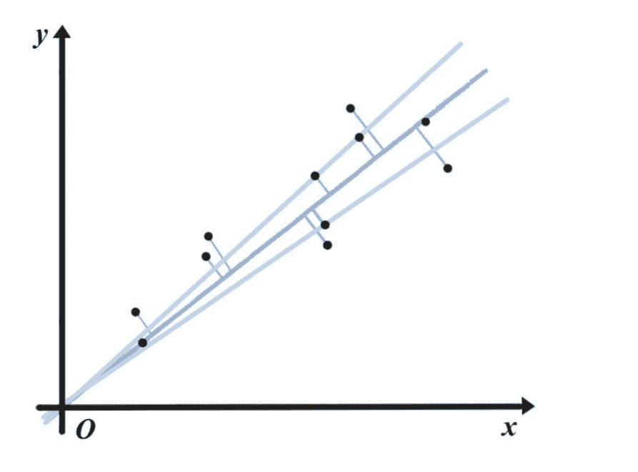

所以机器学习的基本过程，大致上是：首先要有数据，然后定义一个代价函数，机器通过调节参数，使得用现有数据点算出的代价函数取最小值，我们就认为机器在一定程度上获得了数据的规律，数据输入得越多，学习质量越高，机器对于规律的预测就被认为越准确，但前提假设是这些数据里真的存在规律，如果完全随机，那么机器学习在这种情况下，也并不能无中生有。

线性回归只是所有模型中最为简单的一种。现实世界中的实际问题，大多比线性回归要复杂得多，内涵的规律也复杂得多，并不能用简单的数学函数来概括，因此机器学习涉及的方法也有很多，但总体来说是三大类，即“监督学习”（supervised learning）、“无监督学习”（unsupervised learning），以及“强化学习”（reinforcement learning）。这三种学习方式，其实说到底，也是人类的学习方式。

### 监督学习

世界上的问题多种多样，并且具有很高的自由度，机器学习的大致步骤，是先把数据塞进机器，再定义一个代价函数，代价函数的形式可以人为设定，然后就是调节机器的参数，使得代价函数取极值，一般是最小值。取到了最小值，就认为这个机器学习的内部算法已经达到了最优状态，可以用来解决训练数据集里的新问题。例如，你拥有某只股票的所有过往股价，按照时间和股价的顺序输入机器，然后你定义代价函数是每一次交易决策所产生实际结果的亏钱额度，你想要亏钱额度最小，这就是一个机器学习算法，但是至于这个算法对于未来的股价有多强的预测能力，就无法保证了。大概率在股票交易中，这个预测力是不强的，否则的话机器交易早就全面代替人类了。这是机器学习的基本过程。但问题是，虽然机器学习的目标是去最小化代价函数，但是不同的问题应该用什么样的方法来训练机器呢？其中监督学习的应用是最广泛的。

例如我想教你做微积分的题目，但我不想教你任何关于微积分的理论知识，我可以给你看100道微积分的题，同时把这100道题的答案也给你看。当你充分研究了这100道题和它们的答案之间的关系后，我希望你已经深谙题目和答案之间的联系，这时，我把第101道，并且是你没有见过的题给你看，我希望你能把它解出来。你可能觉得这有些强人所难，100道题也许不够，如果是你已经看了10 000道题，并深谙题目和答案之间的联系了呢？再不济，我把这世界上所有的微积分题目和答案都给你看，到最后，你也许并没有从理论上学会微积分，但是所有题目你都见过，再碰到新的题，也在你的题库范围内，你自然就知道答案是什么了。这就是监督学习，基本上可以认为，监督学习，很像是“题海战术”。

我们把机器学习的程序看成一个函数，有数据输入就会给出数据输出，我们的目标是：输入一个数据，或者一个问题，它就给出一个输出，或者说给出一个答案。我希望它给出的答案是正确的，为了让机器获得这个能力，我会给它很多案例，即已有的问题和对应的正确答案，再让算法去学习问题和答案是如何匹配的，通过最小化代价函数的办法，让算法逼近这些问题和答案之间的规律，那么训练得越充分，数据量越大，最后的预测，大多数情况下会越准确。当然，也存在过拟合的情况，也就是数据给得太多，反而丧失了算法当中的弹性，使得预测能力反而变差。关于过拟合，我们此处并不做详细展开，它是数学、统计学中比较常见但比较专业的内容。此处的“题目”和“答案”，也叫作打过标签（labeled）的数据（data）。标签即答案，数据即问题。人工智能模型的训练，在初期，很大程度上依赖于数据的质量，给数据打标签的工作是个“体力活儿”，因为最开始的标签是靠人手工标注的。例如，当我们登录一些网站时，它为了探测你是不是机器人，会给你一些图片并要求你“选出以下几张图片中，含有红绿灯的图片”，这其实就是一个人工标注的过程。用户看似是在配合做人机验证，但实际上是帮助机器打标签，这些结果会被用作训练人工智能的标注数据的来源，最终会提升人工智能在图片识别上的准确率，如图3-3中的例子所示。

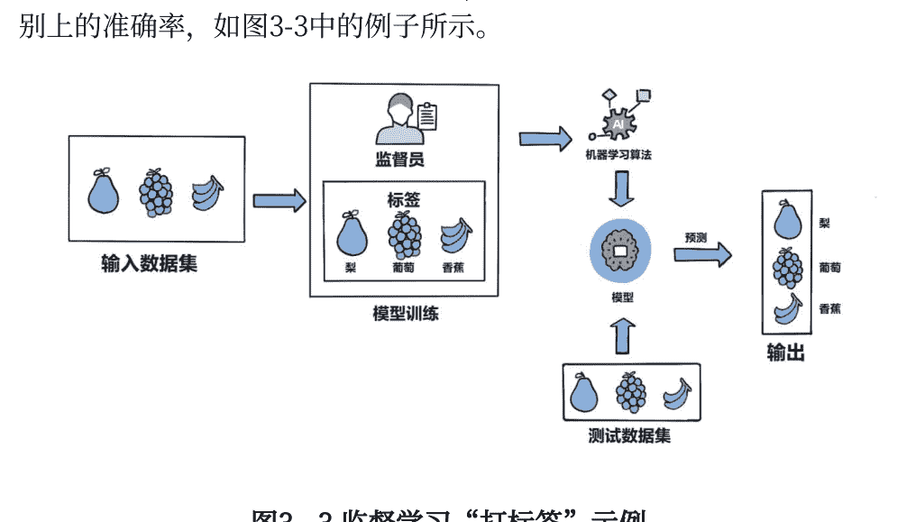

我们现在已经几乎每天都会用到监督学习的标准应用案例——人脸识别。现在很多商家已经接受刷脸支付，而刷脸的过程中，其实是人工智能的应用程序，把你的脸对应到你的用户ID（用户身份识别码），从而完成扣款。这是怎么实现的呢？直接解释刷脸的过程比较困难，来看一个更加简单的例子：如何让机器程序判断一张照片中的动物是猫还是狗。首先我们要准备大量关于猫和狗的图片，越多越好，然后给这些图片打上标签。给所有猫的照片标注说明，这是猫；给所有狗的照片标注说明，这是狗。如此一来，猫和狗的照片就算是给计算机输入的“题目”，而猫和狗的标签其实是每道题目所对应的答案，再通过机器学习的算法，机器便可以“学习”到猫和狗的“特征”，训练了足够多的案例以后，机器对于猫和狗的特征会越来越“自信”，之后再拿一张从未见过的猫或狗的照片给它，它就能判断出，这到底是猫还是狗。以上描述的是一个简单的、通过监督学习的办法来判断猫狗的算法。简单地理解人脸识别，其目的是把要识别的目标对象变得更多，大致原理跟识别猫狗较为类似。当然，识别人脸要比识别猫狗复杂得多，因为识别猫狗只是做简单的是或否的判断，而人脸识别则涉及，先要把面部信息与人的ID绑定起来，这里就涉及后文将详述的“信息向量化”。刷脸的时候，人脸的图片也要生成一个向量，该向量要与人脸的向量库中的你的底板人脸向量进行对比，刷脸时生成的向量和底板照片向量如果接近到一定范围，便可以判断这张脸是你的脸了。当然，具体的操作过程有很多细节，里面也会用到特征比对，例如人脸的关键点：眼睛、鼻子、嘴角等。这些部位的关键比对会提升人脸识别的准确度。刷脸验证的应用场景有不同的安全等级，例如涉及银行业务、企业业务、政务这样比较高安全性的场景，需要的面部信息就较多，这就是为何你在用人脸识别解锁手机屏幕时，只要扫一下，但是在办理银行业务、企业业务、政务时，人脸识别会要求你摇头、眨眼、张嘴等，来验证身份。

监督学习的应用需要大量的、被标注过的数据。在早期，这项工作通常是由人工完成的，因此监督学习的完成需要大量的人力工作。人工智能近年来才呈现出爆发的趋势，是因为那么多年在互联网中沉淀的数据，主要是被标注过的数据逐年递增来到了爆发的临界点。当然除了网上沉淀的标注数据，也确实有这方面的公司专门帮科技巨头做数据标注工作。

### 无监督学习

无监督学习是不需要标注的、没有“正确答案”的另一种主要的机器学习方法，它也适用于一些特定类型的问题。无监督学习的简单理解，比较像是一个侦探干的活儿，在一堆数据中去自发地找出其中蕴含的规律。例如，给你1万张照片，这些照片中，显示了各种各样的动物，譬如十二生肖，并且十二种动物的每张照片上的品种都不一样，有十几种狗、几十种牛等，问你能否把1万张照片中的动物按十二生肖分成十二个类别。这件事情对于人类来说，是比较容易做到的，但对于机器来说就很难了。这跟监督学习不一样，如果是用监督学习来做这件事情，肯定是先有足够多的标注数据，已经让机器学习了足够多的、关于十二生肖的、标注过的图片，即在监督学习的情况下，它已经拥有了关于十二生肖中十二种动物的概念，那么分类的过程其实就是拿到一张照片去跟十二个概念进行比对，之后进行归类就可以了。但对于无监督学习来说，它完全不知道十二生肖的概念，甚至你给它1万张照片，它都未必分成十二类，也许分得更少，例如算法不够先进时它会把兔子和狗、牛和羊、龙和蛇等混淆。也有可能分出更多的类别，比如误认为白兔和灰兔是两种动物。而无监督学习，便是要在没有标注的情况下，从数据中找出规律，或者说，从中找出不寻常的对象，如图3-4中所给示例。例如让人工智能去看患者拍的片子，是否可以从里面自动辨别出病灶。这在传统上都是需要医生用肉眼凭经验去判断，但大部分明显的病灶，特征也很明显，这种情况下，用人工智能便可大幅提升效率。

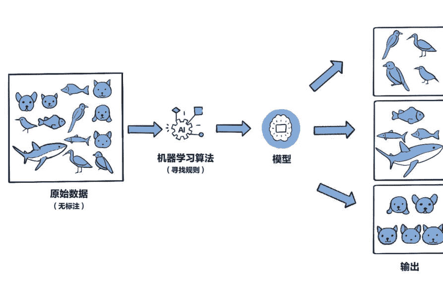

图3—4 无监督学习示例

问题来了，要从数据中找规律，找的又是什么规律呢？人工智能又如何得知，什么样的规律是规律呢？这就存在各种各样的算法，此处介绍其中最简单的一种——聚类（clustering）。有一个标准的聚类算法，叫k-means，即k均值聚类。假设我们有1万张照片，我们先把每张照片的信息提取出来，抽象成一个向量，正如前文所述，向量化是人工智能算法中的一个标准步骤。一张照片要如何向量化呢？先让我们复习什么是向量。高中数学其实都教过，例如一个三维空间里的向量，由三个坐标表示。同样，一张照片在计算机里其实就是一张点阵图，比方某张照片是一张1 000×1 000的点阵图，它由1 000×1 000，共100万个像素点构成。为方便讨论，我们假设照片都是黑白的。则这100万个点，每个点其实只是一个数值，用来表达该点的亮度，最亮的时候是白色，最暗的时候是黑色，中间值都是灰色。那么，一张1 000×1 000的照片就可以用拥有100万个分量的向量来表示。有了这个向量，我们就可以在100万维的向量空间中，把这张照片作为一个数据点标注出来。1万张照片，就在100万维的高维向量空间中占据了1万个点。而通过k均值算法去做聚类，实际上就是把这1万个数据点进行分类。

一个最简单直接的办法，就是把那些距离相近的点都划分在一起。问题又来了，什么叫近？这就是k均值算法要做的事情了。我们可以先在这1万个点当中，随机找两个点A和B，再把其他9 998个点分成两类：这9 998个点，都按照它们与A点和B点的距离算两个数据出来，比较是离A近还是离B近，离谁近就划分到谁的聚类里，这样一来，我们就得到了两个聚类A和B。A类和B类里，各有若干个点，再把A类里和B类里所有点的位置，分别算两个平均值，这样我们就得到了两个新的点，叫作A₁和B₁。然后针对所有1万个数据点，重复上一个过程，即按照与点A₁和点B₁的距离分成两类，这样就有两个新的聚类A₁和B₁。接下来我相信你已经猜到了，还是重复上述过程，得到点A₂和点B₂，然后再重复。重复到什么时候为止呢？重复到点A和点B的位置几乎不怎么变化了，收敛了，我们就认为这个分类过程已经完成了。那怎样才叫位置不“怎么”变化了？我们可以设定一个值，例如当点A和点B的位置坐标的变化，其幅度小于一个阈值，就认为已经收敛了。如此，我们就人为地把1万个点分成了稳定的两个聚类。但我们有12种动物呢！两类不够，又要如何？我们就可以去观察两个类别里，是否有哪些点之间的距离显然是比较远的，就继续加入点C，再重复上述过程，如果觉得还是分类不够细，就加入点D，以此类推，就可以把分类做得越来越细。至于最后分出来几类，完全可以根据人类用户的需求决定。这便是标准的k均值聚类算法，在该过程中，我们并未对数据做人工标注，但依然可以从这些数据中找出规律、找出特征。

### 强化学习

在前文的案例中，把数据点分成几类是人为设定的，但在很多应用场景中，我们并没有机会做出那么细致的反馈。人类用户的反馈，很多情况下是直觉式的、下意识的，我们在跟机器学习算法交互时，并不能明确地给出显性的反馈，并且大多数情况下我们不知道算法在做什么。但我们还是可以通过用户的反馈来改进机器学习的效果的，而强化学习，是解决这类问题的好办法。

要理解强化学习，还是需要和人做类比，当然这其实不太像针对人的任务，更像是针对动物的任务。强化学习比较像“巴甫洛夫驯狗法”，强化学习不太像是把机器当人，而是把机器当成狗。马戏团或者动物园的驯兽师，是如何训练动物完成一系列特定动作的？这基本上便是一个强化学习的过程。例如让小狗学会听懂“坐下”这个指令并执行坐下的动作，其实是要让小狗把坐下的动作和听到人说坐下的声音联系为条件反射。这种条件反射的机制，实际上是靠奖惩机制去建立的，即巴甫洛夫驯狗法：如果小狗做得对就奖励吃的，如果做得不对，也许是在它的脑袋上拍一下，久而久之，小狗听到坐下的指令，就会有坐下的动作，形成条件反射，这利用了生物趋利避害的本能。这其实就是强化学习的基本思路（图3-5）。

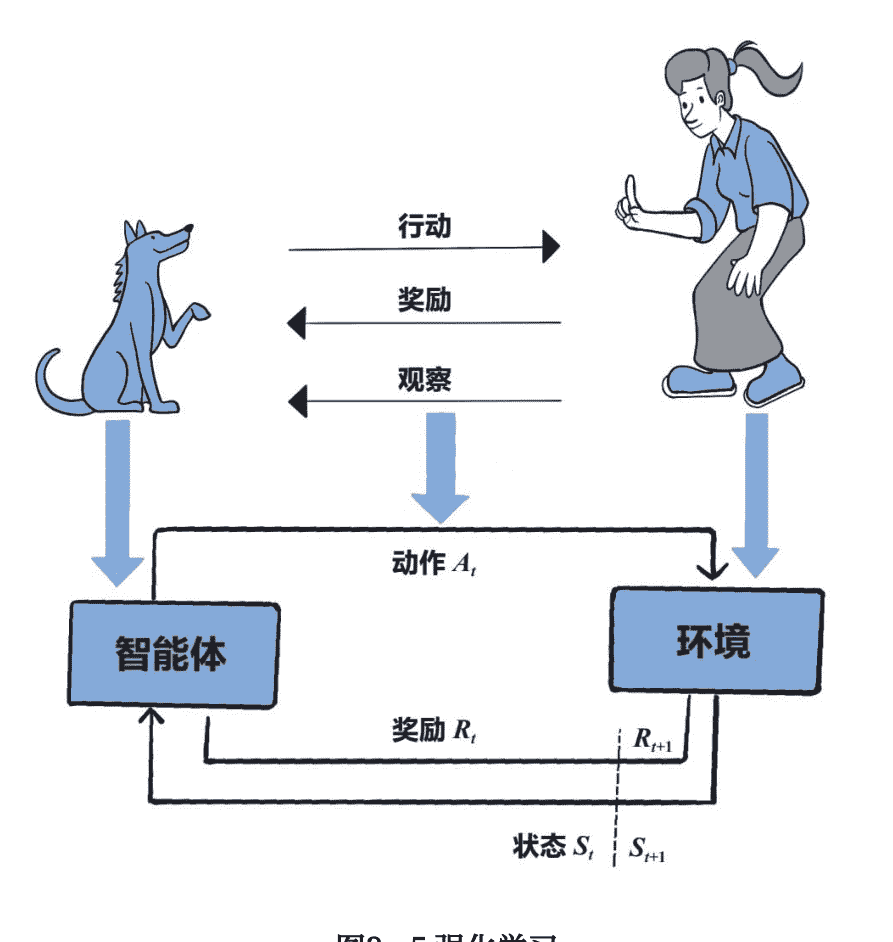

图3-5 强化学习

强化学习的训练方法在人工智能里运用得非常广泛，在机器人训练领域中，强化学习方法尤其普遍。例如要训练一个人形机器人去做出各种类似于人的走路、跑步、爬楼梯的动作，如果用纯粹基于规则的办法去给机器人编写指令，是极其困难的。因为物理世界的实际情况变化多端。我们确实可以用明确的程序把所有与力学相关的物理定律都写进机器人的程序中，然后控制机器人平稳地走完一个特定的楼梯，但这个机器人基本上就只能走这种特定的楼梯，换个楼梯估计就不行了。自由度越大的问题就越需要机器学习，而且机器人本身的结构变得更复杂，这个机器人的物理结构就会变得更敏感。

一台人形机器人，要让它在外部的物理环境非常复杂，诸如一阵风吹过来、碰到各种各样的障碍物的情况下，还要保证做各种动作时不倾倒。这种高自由度的情况，依靠基于规则的编程很显然是做不到的。如果用机器学习的办法，首先我们要有数据的输入，机器人通过各种传感器探测周围的地形，其实就是机器的数据输入，而要让机器人做出正确的输出，其实就是在运动过程中如何越过障碍物并保证自己的稳定性不受影响。用监督学习能做到吗？理论上未必不行，但这样的物理数据，很难进行标注，因为情况太多，难以穷尽，并且标签本身很难具象化，如果纯粹只是数字化的信息，可以用人类自然语言对其进行标注，但如果对应的正确答案是一个复杂的动作，又要如何用自然语言去进行标注呢？对于这种在物理世界运动的情况，不同的输入数据，就好比是各种各样的题目，物理世界中正确答案可以有很多：只要越过障碍物并保持自身稳定即可，至于具体怎么越过去的，方式并非一种，它不是被单个简单标注的。这便是强化学习可以被使用的场景，因为我们不用告诉机器什么是正确答案，我们只要告诉机器，什么答案一定是错误的，其他的让机器自己去摸索，并当机器给出一个好的答案的时候，“夸奖”它，本质上是人为地去教会机器“趋利避害”，即使用奖励函数。

因此，强化学习的基本方法论，是通过奖励函数来对机器的表现做出反馈，再让机器从中学习并提升表现。例如在搜索引擎中，用户对于搜索结果的反馈：是否点击；点进去看了多久；是点开马上关掉，还是点开之后看了很久并做了其他相关动作。用户的这些行为都可以转化为奖励函数的数值，通过强化学习的方式让算法自动迭代。例如，网页访问有个指标为bounce rate，指的是，点开某个网页又马上关掉的比例，这个比例越高，说明表现越差，反之则越好。这便可以被做成一个简单的奖励函数，通过强化学习的办法让机器学习的算法产生智慧，让搜索引擎推荐的内容越来越容易满足用户的搜索需求。

# 第四章 多，即不同

在第三章的讨论中，我们详细介绍了机器学习的基本原理。机器学习存在的目的，是要让计算机去解决高自由度的问题。因为高自由度，意味着不可预测性更强，而不可预测性强导致我们无法对程序进行明确的编程。面对这类问题，我们需要计算机程序可以通过对数据的处理，自发地找出规律，并进一步消除不确定性。监督学习、无监督学习，以及强化学习是机器学习所采用的不同的学习方法，而前文中对这些学习方法的描述，是偏形而上的描述方式，落实到具体执行层面，则有不同的实现办法。例如，前文我们曾提到用无监督学习的办法去给1万张照片中的十二生肖进行自动分类，但具体执行效果，我们仅靠理解无监督学习的原理是无法做到的。譬如，假设照片中有很多拥有黑白条纹的蛇，也混进去了许多斑马，我们如何保证，机器学习算法不会把分类的重点落在黑白条纹的规律上，从而错误地把蛇和斑马分成一类，而是要让其关注动物的外观形态？即理解了机器学习的原理，再到具体的实施，保证其效果，其中的实施方案，仍有许多是我们需要了解的。而目前人工智能的主流发展路径，便是本章我们要详细阐述的神经网络。

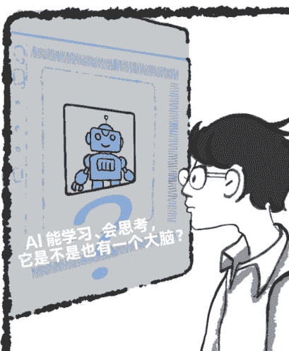

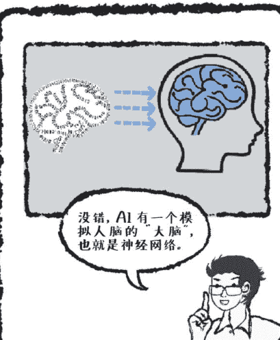

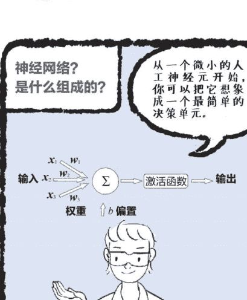

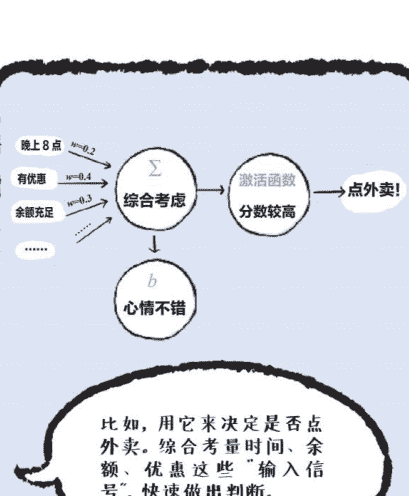

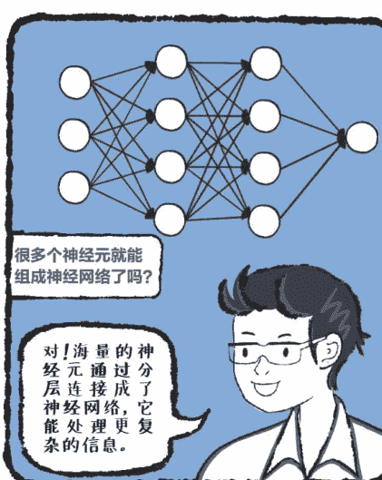

很多个神经元就能组成神经网络了吗？

对！海量的神经元通过分层连接成了神经网络，它能处理更复杂的信息。

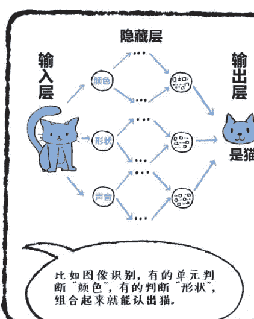

比如图像识别，有的单元判断“颜色”，有的判断“形状”，组合起来就能认出猫。

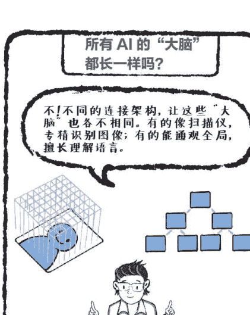

所有AI的“大脑”都长一样吗？

不！不同的连接架构，让这些“大脑”也各不相同。有的像扫描仪，专精识别图像；有的能通观全局，擅长理解语言。

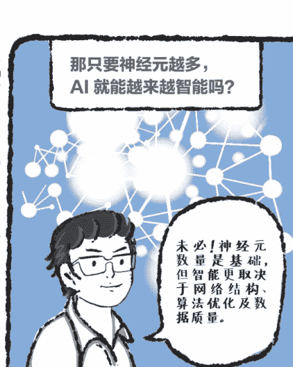

那只要神经元越多，AI就能越来越智能吗？

未必！神经元数量是基础，但智能更取决于网络结构、算法优化及数据质量。

## 向人类学习

如今，在市面上流行的主流人工智能应用，不论是人脸识别、自动驾驶、推荐算法，还是大语言模型，以及各种生成式人工智能，如文生图、文生视频等，其背后所仰仗的人工智能技术都是神经网络。神经网络依然是所有人工智能发展的主流，虽然神经网络并非一种新技术，20世纪40年代就已被提出，但直到2012年之前，神经网络在计算机科研领域的地位是很低的，甚至被很多科学家当作“玄学”甚至是“伪科学”来看待。据说如果在2012年之前，一个学者的主要研究方向是神经网络的话，这位学者甚至要对外三缄其口，以免被人看低。神经网络是如何从“过街老鼠”变成“当红炸子鸡”的呢？这个过程可以从英国科学家杰弗里·辛顿教授的职业生涯中看到一个缩影。

在物理学或其他已经存在了几百年的科研领域中，我们可以叫出很多奠基性科学家的名字，例如物理学的牛顿、麦克斯韦、爱因斯坦、海森伯，数学的欧拉、高斯、柯西、庞加莱，但似乎人工智能这个领域太新了，还未出现牛顿这个级别的、可以被历史铭记的名字，但随着人工智能领域的加速发展，辛顿的名字必定是要参与书写人工智能科学史的。

杰弗里·辛顿、杨立昆（Yann LeCun）、约书亚·本吉奥（Yoshua Bengio）三人共同于2018年获得了素有“计算机诺贝尔奖”之称的“图灵奖”，这是计算机领域的最高奖项，而这三位学者也被称为“深度学习三巨头”。

授予他们这个奖是为了表彰他们在深度学习（deep learning）领域做出的杰出贡献，其中辛顿教授尤其知名，他甚至被称为“人工智能之父”，他的徒子徒孙在人工智能的各个领域发光发热，如OpenAI公司曾经的首席科学家、主持研发了ChatGPT的伊利亚·苏茨克维（Ilya Sutskever）便是辛顿的学生。而辛顿的科研之路，可以说是充满坎坷——他几乎坐了几十年的冷板凳。辛顿算是最早投身神经网络研究的科学家之一，他在本科阶段换了很多专业，学过自然科学、艺术史和哲学，而最终毕业时，辛顿的本科专业居然是实验心理学，但结合他是神经网络的奠基人之一，也许心理学的思维方式给了他很大的启发。辛顿是在英国的爱丁堡大学读的博士，整整读了八年。在读博期间，辛顿就跟他的导师非常不合，因为辛顿想研究的神经网络方向被他的导师基本认定为伪科学，认为其毫无研究价值。据说辛顿每个星期都要跟导师吵架，每次都跟导师说：再给我半年时间。最后拖了八年。博士毕业以后，辛顿便处于一种“找不到工作”的状态，因为其研究方向过于冷门，大部分研究机构和大学都没有，当时是20世纪80年代。在此之后，辛顿去了加拿大的多伦多大学，并无其他原因，只因为多伦多大学愿意出资支持这个小众的研究方向。笔者有一个朋友曾在多伦多大学念本科，据他回忆，当时辛顿教授在多伦多大学开的神经网络课程基本上无人问津，因为在当时，神经网络在主流计算机研究者看来，最多是“仿生学”。

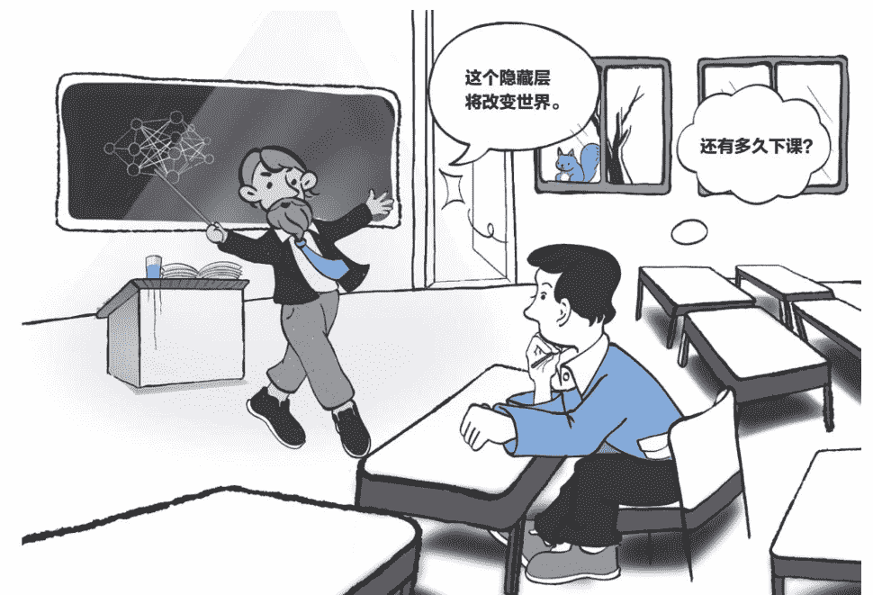

辛顿在去了多伦多大学之后，事情并未起什么变化，神经网络的研究方向并无起色，转机是在几十年后。2012年，事情起了变化。那可以追溯到2010年，普林斯顿大学举办了一场叫作ImageNet的比赛，这个比赛的发起人便是后来拥有“人工智能之母”美誉的华人教授李飞飞。而比赛内容，是各个参赛团队用自己的算法来对海量的图片进行识别，例如判断一张图片里是否有人脸，是否有交通灯，是否有汽车，等等。而当时的参赛团队，错误率都很高。2010年的冠军错误率高达28%。到2011年，第二届的冠军团队也只是把错误率降到了26%，提升得并不多，而人类的错误率大概是5%，也就是说，当时的人工智能远远达不到人的水平。2012年，第三届ImageNet大赛在斯坦福大学举办，辛顿和他的学生用他们的神经网络算法直接把错误率陡然降低至15.3%，这便是重大的进步了，而第二名的东京大学团队的错误率依然是26.2%。这个成果马上被商界意识到了，辛顿和两名学生成立了公司，有很多公司去参与竞价，据说我国的百度公司也参与了竞价，最后这个只有三个人的空壳公司被谷歌公司以4 400万美元收购，这项收购发生于2013年，随后辛顿也在谷歌公司当上了副总裁，从此神经网络的研究就开始大放异彩，一路高歌猛进到今天的形态。这让我们看到，很多划时代的科技进步，都伴随着过于超前的、不被市场认可的、极其漫长的过程。同样的故事还有mRNA（信使核糖核酸）技术，新冠疫情出现之前，这个技术已经坐了快50年的冷板凳，当时研究mRNA技术的科学家，几乎连工作都找不到。

了解了神经网络的发展历程，那到底什么是神经网络呢？让我们回归定义：**人工智能就是像人一样解决问题。** 人解决问题说到底是靠大脑，那就要先理解人脑是如何运作的。“神经网络”如今似乎是人工智能领域的专有名词，但其实神经网络，原本指代的是人脑中的神经网络。人脑本身便是一个碳基神经网络。人脑是如何工作的？其具体的运行过程，即逻辑顺序和运行机制，目前尚不清楚，但大致上，里面发生的事情我们是了解的：人脑当中，负责思考的部分，或者说信息在大脑里流动的部分便是一个神经网络，它的基本构成单元叫作“神经元”，人脑神经元的基本物质是细胞质，而细胞质是一种类似凝胶的物质，填充着细胞，并包含各种细胞器，如细胞核、线粒体和内质网等，它还包含树突和轴突等特殊结构，负责在神经元内传递电信号，人脑的神经元之间通过突触连接起来。突触是神经元之间的连接点，它们允许神经元之间传递电信号和化学信号。

突触分为化学突触和电突触两种类型，化学突触通过神经递质分子在神经元之间传递信号，而电突触则通过直接的电流流动传递信号。这种连接方式使得神经元能够在大脑中形成复杂的网络并进行信息传递和处理，这便是神经网络。这些信号在进入神经元之后会如何被处理？

这里面的过程其实很复杂，人脑神经元处理输入和输出信号的规律可以概括为以下几个步骤。第一，接收输入信号。神经元通过树突接收来自其他神经元的输入信号，这些输入信号可以是来自其他神经元的电信号或化学信号。第二，整合输入信号。神经元将接收到的多个输入信号进行整合，通过细胞膜上的离子通道和突触传递的神经递质来反馈总体输入信号的强度。第三，触发动作电位。如果总体输入信号的强度超过了神经元的阈值，神经元将产生一个电脉冲，称为动作电位，动作电位是神经元传递信息的基本单位。第四，传递输出信号。一旦神经元产生了动作电位，它将通过轴突传递输出信号，输出信号可以通过突触连接到其他神经元，从而传递信息。第五，突触可塑性。神经元之间的连接可以通过突触可塑性进行调整和改变，这意味着神经元之间的连接强度可以增强或减弱，从而影响信息传递和处理的效果。总的来说，人脑神经元通过接收、整合和传递信号来处理输入和输出信息，这种处理过程是复杂而精确的，涉及大量的神经元之间的相互作用和调节（图4-1）。

### 图4—1 生物神经元结构示意图

让我用一个生活中的比喻来解释人脑神经网络的工作方式。

把大脑想象成一个超级复杂的“群聊网络”。你的大脑里有数千亿个“小助手”（神经元），每个小助手都像是聊天群里的活跃用户。

每个小助手都有很多“天线”，这些就是树突，就像你同时在几十个聊天群里一样。这些天线不断接收其他小助手发来的各种消息，有的发兴奋表情包，有的发冷静表情包。小助手会把收到的所有消息汇总起来，就像你看聊天群里大家的聊天记录一样。如果收到的兴奋表情包足够多，超过了这个小助手的“发言阈值”，它就会被激活。

一旦被激活，这个小助手就会通过自己的“广播天线”，也就是轴突，向所有关注它的其他小助手群发一条强烈的消息：“我被激活了！”最神奇的是，如果两个小助手经常一起被激活，比如每次看到苹果，负责“红色”和“圆形”的小助手总是同时兴奋，它们之间的“好友关系”就会变得更紧密，下次传递消息会更快更强。这就像经常聊天的好友会被系统推荐到“常用联系人”一样。

当你看到一个苹果时，数百万个小助手瞬间开始疯狂聊天。红色小助手兴奋地喊：“我看到了红色！”圆形小助手激动地说：“这是圆的！”甜味小助手回忆起：“上次吃得很甜！”最终所有消息汇总到苹果识别小助手那里，它总结说：“这是个苹果！”

这就是为什么我们能瞬间认出复杂的事物，做出快速决策，实际上是数十亿个小助手在毫秒间进行着超高速的群聊协作！整个过程就像一个永不停歇的超级社交网络，每个神经元都在不断地接收信息、处理信息、传递信息，通过这种集体智慧来帮助我们思考和行动。

人脑的神经网络中，传递两种信号，分别是电信号和化学信号，这两种信号有何不同？分别实现什么功能？电信号传递速度快，在神经元内部可以每秒几十米的速度传播，并且是长程传递，主要用于快速传递信息，例如感觉刺激的传递和运动指令的传递。化学信号的传递速度相对较慢，通常在每秒几十毫米，只能在神经元之间进行短距离传递，主要用于神经元之间的信息处理和调节，如在突触处调节神经元之间的连接强度和传递效率。这两种信号相互配合，共同参与神经元之间的信息传递和处理，实现复杂的神经系统功能。

人脑里大约有860亿个神经元，它们组成了一个巨大的网络，这个神经网络的运作负责人类的各种认知过程和神经过程，不管是肢体感官上的还是逻辑思维上的，但是里面的不同信号究竟表达了什么含义，我们目前并无法清楚地解析。860亿个神经元，电信号和化学信号在神经元组成的神经网络里传播，涌现出了智慧。现在知道为什么神经网络在人工智能领域的研究，早年会被称为“仿生学”了吧，因为人工智能的神经网络就是用计算机程序去模拟人脑的运行方式。这便是神经网络技术的基本思想。为了讨论方便，之后我们提到神经网络，如果不特别说明，均指代计算机神经网络。

神经网络概念的提出，实际上非常早。1943年，沃伦·麦卡洛克（Warren McCulloch）和沃尔特·皮茨（Walter Pitts）就提出了著名的麦卡洛克-皮茨模型（McCulloch-Pitts model，见图4-2）。麦卡洛克是一位神经生理学家，他对神经元的工作原理和信息处理过程非常感兴趣，而皮茨是一位数学家、逻辑学家，他对逻辑和数学符号的运算有深入的研究。在他们的合作中，麦卡洛克和皮茨结合了神经生理学和数学的知识，提出了一种模拟神经元之间相互连接的数学模型。他们的模型基于这些观察和假设：第一，神经元是生物系统中的基本单位，负责接收、处理和传递信息；第二，神经元之间的连接可以通过电信号进行信息传递；第三，神经元的激活状态可以用二进制表示，即激活（1）或不激活（0）。只不过他们没有模拟化学信号，只是模拟电信号。基于这些观察和假设，麦卡洛克和皮茨提出了一个简化的数学模型，描述了神经元之间的连接和信息传递过程，他们的模型使用了逻辑运算符，如“与门”、“或门”和“非门”，来模拟神经元的激活和抑制过程。所以神经网络是一个非常早的概念，发生于20世纪40年代。但这还停留在概念阶段，要变成现实必须进一步发展，而20世纪50年代的感知器模型，则是一个重要的里程碑。

### 图4—2 人工神经元数学模型（麦卡洛克—皮茨模型）示意图

弗兰克·罗森布拉特（Frank Rosenblatt）是一位美国心理学家和计算机科学家，他在20世纪50年代提出了感知器模型。罗森布拉特的研究兴趣主要集中在神经科学和人工智能领域，对神经元的工作原理和信息处理过程非常感兴趣，并希望能够用数学模型来描述和模拟神经元的功能。1957年，罗森布拉特提出了感知器模型，这是一种简化的神经网络模型，这个模型由输入层、权重和激活函数组成：输入层接收外部输入，外部信息要通过输入层输入，权重用于调节输入的强度和方向，激活函数用于确定神经元的激活状态。因此神经网络的主要组成部分，就是输入层、权重和激活函数。输入层用来接收数据，权重用来处理数据，激活函数用来调节输出。之后，罗森布拉特通过实验（图4-3）和计算模拟展示了感知器模型（图4-4）可以用于解决一些简单的分类问题。他的研究表明，通过调整权重和选择适当的激活函数，感知器模型可以学习和适应输入数据的模式并进行分类和识别。这其实已经是一个巨大的进展了，它至少证明了神经网络是有一定用处的，但是离现在的智能还有一道天堑。感知器模型的提出，对神经网络和人工智能的发展产生了重要影响，它主要是为后来更复杂的神经网络模型提供了可行的基础支撑，也为机器学习和模式识别等领域的研究提供了重要的思路和方法。那这个感知器模型的神经网络离真正有用，还缺了什么？其实是缺了算力和数据。

### 图4-3 实验员正在调整美国科学家弗兰克·罗森布拉特开发的感知器（“MARK1”计算机）的随机布线网络

### 图4—4 感知器模型示意图

## 大力出奇迹

神经网络的基本构成单元也是神经元（图4-5），计算机里的神经元是什么？简单理解，它是一个函数。一个函数要有输入（自变量）和输出（因变量），即给定一个x，输出一个y，y=f(x)，而f则是这个函数。神经元就是要构建这么一个函数，输入一个信号，神经元对信号进行处理并输出一个信号，问题是这个神经元对应的函数，到底对信号做了什么处理。

### 图4—5 生物神经元与人工神经元对比示意图

回到前文所述感知器的基本结构，感知器分为输入层、权重和激活函数。让我们先把这个函数的数学形式写下来，再找对应关系。它的数学形式是 $Wx+b$，其中 $W$ 是一个矩阵，$x$ 是一个向量，$b$ 也是一个向量。$W$ 是权重，$x$ 是输入，$b$ 是激活阈值。让我们先不纠结于它们的具体含义，回到神经元的基本结构，神经元做的事情其实是三件：输入、处理、输出。

先看输入 $x$，神经元的输入其实是一个向量，应该说是一组数，例如一个三维的向量有三个分量，如 $(0, 0, 1)$，$N$ 维向量有 $N$ 个分量 $(a_1, a_2, a_3, \cdots, a_n)$。数也有一个取值范围，一般来说输入的信号向量，其模的大小是恒定的。前文曾举例，一张黑白照片，它所有像素点的亮度，排列在一起，便可以构成一个向量。向量输入神经元之后，便要进行处理，权重矩阵$W$便登场了。$Wx$实际上是矩阵乘法，$W$不一定是方阵，但$W$的列数一定等于$x$的行数，也就是$x$如果有1万个分量，$W$则有1万列，行数则没有限制。$W$作为权重矩阵与$x$相乘的结果，输出的依然是一个向量，但是已经与$x$不同了。神经元的输出特点是，它有激活与否的二元状态，即输入的值，要达到一定条件才能激活神经元，达不到就不激活。也就是说，这个信号要达到一个阈值才能有输出信号，于是乎，我们把阈值再加进去，这个阈值就是向量$b$，$b$里面有多少个分量与$W$的行数一致，这是基础的矩阵知识，此处不做过多展开。这样我们就拥有了完整的输入：$x$，通过权重矩阵$W$实现对输入的操控，再通过加入激活阈值$b$判断它是否可以激活神经元，就形成了$z= Wx+b$的形式。那到底这个神经元要不要被激活呢？这就来到激活函数了。我们需要找到激活函数$f$，使得$f(z)$对应神经元的输出。激活函数有很多种，但是激活函数必须满足非线性的条件，也就是不能一条直线输入之后给出的还是一条直线，神经网络的变化就来源于这种函数的非线性。比较常见的是阶跃函数和S型函数（sigmoid function），如图4-6所示。根据图片显示，当$z$较大时，函数趋近于1；当$z$较小时，函数趋近于0，并且这个函数是连续的，很光滑。如此，一个神经元便建构完成了。

### 图4—6 激活函数中常用的阶跃函数和S型函数

为什么激活函数必须是非线性的，这里面的数学道理很深，我们用一个简单的比喻来解释。想象你是一个画家，要画一幅复杂的画。如果你只能用直尺画直线，那么无论你画多少条线，叠加多少层，最终得到的图形还是由直线组成的。你永远画不出弯曲的花朵、圆润的脸庞，或者波浪形的头发。这就是线性激活函数的问题。但是如果你有了弯曲的工具，比如圆规、曲线尺，你就能画出各种弯弯曲曲的美丽图案。把这些弯曲的元素组合起来，你就能创作出非常复杂精美的作品。

神经网络也是一样的道理。我们生活中遇到的问题大多是“弯曲”的。比如说，你想让计算机识别你朋友的脸。朋友的脸不是由直线组成的吧？眼睛是弯的，嘴唇是弯的，脸的轮廓也是弯的。如果神经网络只能处理“直线”关系，它就永远学不会识别这些弯曲的特征。

再举个例子，假设你想预测明天会不会下雨。天气和下雨的关系非常复杂，不是简单的“温度高1摄氏度，下雨概率就增加百分之几”这种直线关系。可能温度适中、湿度高的时候容易下雨，但温度太高或太低时都不容易下雨。这种关系画在图上就不是直线。

非线性激活函数就像给神经网络装上了“画曲线”的能力。有了这个能力，神经网络就能学会识别人脸、理解语言、预测复杂的事情。没有这个能力，它就只能做一些最简单的加减乘除，永远不会变聪明。这就是为什么激活函数必须是非线性的。它让神经网络从一个只能画直线的呆板工具，变成了一个能够理解复杂世界的智能系统。

所谓神经网络，就是把大量的神经元串联起来：一个神经元有输入信号，就有输出信号，再把该神经元的输出信号当成其他神经元的输入信号，如此这般不断连接下去，就构成了网络。但是问题来了。一个网络里有多少个神经元？神经元和神经元是如何连接的？权重矩阵$W$到底是多少行乘多少列？不同神经元的连接方式、神经元的个数、权重矩阵的大小等将如何影响神经网络的表现？这其实就是神经网络这个研究方向的各种课题。其中的学问可谓博大精深。但有一个概念，可以立刻说清楚。我们经常听说，一个大语言模型，有几十亿、几百亿、几千亿乃至上万亿个参数。此处的“参数”究竟是什么意思，指代的是神经网络中的哪个性质？让我们假设一个神经网络中神经元的个数是$l$，而一个神经元里，其权重矩阵是$W$，假设它有$m$行、$n$列，那么整个神经网络参数个数的数量级便是$l \times m \times n$。当然阈值$b$的数值，可以算作参数，但$b$里面参数的个数就只是$n$（因为$b$的参数数量与$W$的列数相等），与$l \times m \times n$的大小比起来可以忽略。当我们说一个大语言模型拥有1 000亿参数规模时，说的是$l \times m \times n$这个数字大约是1 000亿的量级。

## 一个辅助理解神经元运行机制的例子

我们想要判断某个同学的成绩能否达到某大学的录取分数线，可以用单个神经元来进行决策。以各学科的分数作为输入变量，以该大学以往的录取分数线作为阈值，以阶跃函数作为激活函数，就可以利用该神经元来判断学生能否考上该大学了。

### 用单个神经元来预测能否考上某大学

**输入$x$**：这里输入变量为各个学科的分数值。

**权重$W$**：高考总分中每个学科的权重都相同，都为1。

**偏置$b$**：假设根据以往数据，要考上该大学需要660分，那么偏置$b$设置为-660。

**激活函数$f$**：采用阶跃函数作为激活函数，当6个学科的总分大于660分时，加权输入大于等于0，那么阶跃函数输出为1，否则为0。

**输出$y$**：根据激活函数的输出结果，1代表能够考上该大学，0代表不能考上该大学。

| 语文分数 ($x_1$) | 数学分数 ($x_2$) | 英语分数 ($x_3$) | 物理分数 ($x_4$) | 化学分数 ($x_5$) | 生物分数 ($x_6$) | 总分 | 是否能考上某大学 ($y$) |
| :---: | :---: | :---: | :---: | :---: | :---: | :---: | :---: |
| 135 | 140 | 138 | 98 | 95 | 94 | 700 | 是 (1) |
| 110 | 115 | 120 | 86 | 80 | 80 | 591 | 否 (0) |

一个神经网络里，具体有多少个神经元，神经元的结构是怎样的，每个神经元里的权重是多大的矩阵，这些其实属于商业机密，跟炼金术很像：也不知道为什么这样做好，但就是发现了一个比例、一个配方，它很好用，便作为机密被使用了。当然，如果是开源模型，这些内容则是公开的。例如，你如果直接问DeepSeek，它会告诉你它的V3.1版本的开源模型的架构是表4-1中这样的。

### 表4—1 模型架构

| 项目 | 详细信息 |
| :--- | :--- |
| 模型名称 | DeepSeek-V3.1 |
| 总参数量 | 6 710 亿 |
| 架构 | Transformer ( GPT-style ) + MoE |
| 上下文长度 | 128K |
| 注意力机制 | Grouped Query Attention ( GQA ) |
| 前馈神经网络 ( FFN ) 结构 | Mixture of Experts ( MoE, 24 experts, top-2 active ) |
| FFN 隐藏层维度 | 14 336 |
| 激活函数 | SwiGLU |

从神经网络的结构当中，我们可以看出，它并不复杂，甚至于20世纪50年代，感知器模型的发明就已经建立了最基本的神经网络结构，但是从发明到好用，这里面花费了超过半个世纪的时间，而前文提到的天堑，实际上就是算力和数据。只有当神经网络中参数的数量达到了百亿甚至千亿乃至于目前最先进模型的万亿级别时，它才开始展现出令人满意的结果，这看似是个“大力出奇迹”的结果。背后隐藏的，正是我们在全书开篇就提到的“涌现”的物理现象：多，即不同。这是扩展定律在背后起作用。

扩展定律（图4-7），指在AI模型中增加模型的规模，如增加参数数量、预训练数据量和计算资源时，模型的性能会以某种规律性方式提高，这种规律一般是幂律函数。这个定律帮助研究人员预测模型扩展后的表现，从而更有效地设计和训练更强大的AI系统。扩展定律的概念源于我们在科研过程中观察到的一些现象。早期的研究表明，当神经网络的层数和参数数量增加时，模型的性能，如在图像识别或者自然语言处理任务中的准确性会显著提升，这种“大力出奇迹”的现象引发了人们对“更大是否更好”的探索，并最终沉淀为更系统化的研究。为什么扩展定律如此重要？因为它为AI的发展提供了一种明确的指导，有如下几个关键原因。第一，预测性能的提升，通过理解扩展定律，研究人员可以预测，如果增加模型规模，性能会有怎样的提升，这有助于制定更有效的研究和开发策略；第二，资源优化，扩展定律帮助我们理解，在特定的资源限制下，如何最大化模型的性能，这对于那些资源有限但希望获得最佳效果的研究团队来说尤其重要；第三，扩展定律激发了对新架构和新方法的探索，例如所有大语言模型背后的Transformer架构，它的成功就部分归功于对扩展定律的深刻理解。

### 图4—7 扩展定律示意图

扩展定律在不同类型的AI模型中表现不同，以OpenAI公司的GPT-3模型为例：这个具有1 750亿参数的庞大语言模型，展示了扩展定律的威力，与其前身GPT-2相比，GPT-3在各种自然语言处理任务中表现出更强的理解和生成能力，而GPT-2的参数数量级大约是10亿。GPT-3的表现相比于GPT-2是质的飞跃，这就是智能涌现的具体表现，这种性能提升正是扩展定律的具体体现。扩展定律是万能的吗？只要不断扩大参数、增加数据量、增加计算资源，我们最终就能获得通用人工智能吗？未必，它还伴随着一些不小的挑战：第一是计算成本，大规模模型需要巨大的计算资源，这对于许多研究团队来说是一个巨大的财务压力；第二则是数据隐私，更多的数据意味着更大的隐私风险，如何在扩展过程中保护数据隐私是一个重要问题；第三是环境影响，大规模模型训练消耗大量能源，会对环境造成影响，因此如何在扩展的同时保持可持续性是一个亟待解决的问题。但这几个挑战，貌似都不是人工智能技术本身的、原理层面的挑战，依然没有触及问题的核心，也就是扩展定律真的永远正确吗？它毕竟是一条经验性的规律，“大力”是不是永远能出“奇迹”，能不能带来通用人工智能，目前来说，依然是个“信与不信”的问题。而越来越多的理论和研究表明，单靠扩展并不足以实现通用人工智能。介绍两种主要观点。第一是数据和计算资源，也许“大力”真的可以出奇迹，但如果需要的计算资源是我们所无法获取的会怎样？就好像理论上，只要造一个足够大的对撞机，我们就能验证弦理论，但这个对撞机要大到跟整个太阳系一样大，这显然是不现实的。第二就是数据的稀缺性，尽管互联网发展了许多年，人类已经在互联网上积累了海量的数据，这些数据都可以用来训练AI模型，但训练AGI所需的、高质量、多样化的标注数据则仍然是稀缺的，通用人工智能需要理解和处理不同领域的复杂知识，而不是仅仅依靠海量数据进行模式匹配。

## 深度学习

如今我们已经大致清楚神经网络的结构，也知道只要参数足够多，数据量足够大，我们就能训练出拥有较高智能水平的模型，但很显然，不同模型擅长不同的任务，例如人脸识别的AI模型和下围棋的AI模型，虽然背后都是神经网络在发挥作用，但不同的神经网络之间，必然是有重大区别的，这些区别主要在神经网络的哪些方面呢？答案是神经元之间的连接方式，或者叫体系结构（architecture），俗称架构。如果要把所有神经元联系起来，并且是任意两个神经元当中都存在连接（全连接）的话，显然是不现实的，因为随着神经元的增多，这个连接数量的增长是十分剧烈的。其连接数随神经元数量的增长规律是$n(n-1)/2$，如果有100个神经元，连接数就有4 950个，如果有1万个神经元，则有499 995 000个连接，如果是一个像大语言模型一样的千亿级别参数的神经网络，我们盲猜矩阵$W$的维度大约是几百，一个神经元中的权重矩阵$W$就包含几万个参数，那么神经元的数量有几亿个，如果是全连接，这个连接数大约是几亿的平方量级，那这个数已经大到难以置信了，如果要针对如此数量的连接去做神经网络的训练，必然效率极低。因此，如何安排神经元之间的连接，其实就是神经网络的架构问题了。根据研究，使用不同的连接方式，即不同的架构，神经网络会具有不同的优势，适合处理不同类型的问题。例如，大语言模型用的是Transformer的架构，而卷积神经网络（convolutional neural network, CNN）架构适合处理图片问题，循环神经网络（recurrent neural network, RNN）架构则适合处理时间序列的问题，等等。但恰恰是因为连接方式的不同，可以让神经元的分布形成层级，神经网络分层，实际上就是大名鼎鼎的深度学习。其实仔细思考就会发现，如果神经网络中的神经元是全连接，就不存在所谓分层了。

让我用生活中的比喻来解释这三种神经网络架构的区别。

RNN就像一位健忘的老教授在读小说。这位老教授每次只能看一个字，而且记性不太好。他从第一个字开始读，读完后会在脑子里留下一些印象，然后接着读第二个字。读第二个字的时候，他会结合之前的印象来理解当前的字。但是因为记忆力有限，读到后面的时候，前面的内容就变得模糊了。这就是RNN的工作方式：它按顺序处理信息，每次看一个词，同时保持对之前内容的“记忆”。但这种记忆会随着时间逐渐衰减，所以处理很长的文本时，开头的信息可能就被“忘记”了。这种架构很适合处理时间序列数据，比如股价预测、语音识别等。

CNN像一个拿着放大镜的侦探。这个侦探在分析一张照片找线索。他不会一个像素一个像素地看，而是拿着不同大小的放大镜在照片上滑动扫描。小放大镜能发现细节，比如“这里有条线”“那里有个角”；大一些的放大镜能看到更完整的形状，比如“这是个圆”“那是个三角形”；最大的放大镜能看到整体，比如“这是一辆车”“那是一个人”。CNN就是这样工作的：它用不同大小的“过滤器”在数据上滑动，先识别简单的特征，比如线条和边缘，然后组合成复杂的特征，比如形状和纹理，最后识别出整体对象。这种层层递进的方式特别适合处理图像，因为图像就是由这种从局部到整体的层次结构组成的。

Transformer像一个超级社交达人。这个拥有超能力的社交达人走进一个聚会。普通人只能一个一个地和别人聊天，但这个达人可以同时和房间里的所有人对话。更神奇的是，他能瞬间判断出“这个人说的话和那个人说的最相关”，“那边三个人在讨论同一个话题”。他不需要按顺序听每个人说话，而是能同时理解所有人的话，并且知道谁和谁的话最有关联。这就是Transformer的“注意力机制”。当它处理一句话时，每个词都能“同时看到”句子中的所有其他词，并且能计算出哪些词之间关系最密切。比如在“小明的妈妈去商店买了苹果给他”这句话中，Transformer能瞬间理解“他”指的是“小明”，而不需要像RNN那样按顺序读到“他”的时候再回头找。

这三者的核心差异可以这样理解：RNN像是一个按部就班的阅读者，适合处理时间顺序很重要的任务，但容易健忘。CNN像是一个善于发现局部模式的观察者，特别擅长处理有空间结构的数据，比如图像。Transformer像是一个能同时关注所有信息并理解复杂关系的全才，处理语言任务时表现最出色，这也是为什么现在的ChatGPT、GPT-4等大语言模型都基于Transformer架构。

简单来说，如果把处理信息比作看电影，那么RNN是按时间顺序一帧一帧看，CNN是重点关注每一帧的画面细节，而Transformer是能同时看到所有帧并理解它们之间复杂关系的“超级观众”。每种架构都有自己的优势领域，选择哪种架构取决于你要解决什么样的问题。

所有机器的基本工作方式，都是先获取信息的输入，经过处理之后再进行信息输出，则神经网络的架构中有一些神经元是直接接收输入信息的，这就是神经网络的输入层，最后当然也有一层专门负责输出信息，叫输出层。而深度学习，就是在输入层和输出层中间存在很多“隐藏层”的神经元。什么是“层”？也就是，同一层当中的神经元之间不存在相互连接，不同层之间的神经元则有相互连接。一层当中的神经元接收的信息输入，都是上一层神经元的信息输出，并且一层当中神经元收到上一层神经元输出的信息基本是平等的，即一层当中的某个神经元接收到的信息是上一层当中所有神经元输出信息的加权总和（图4-8）。

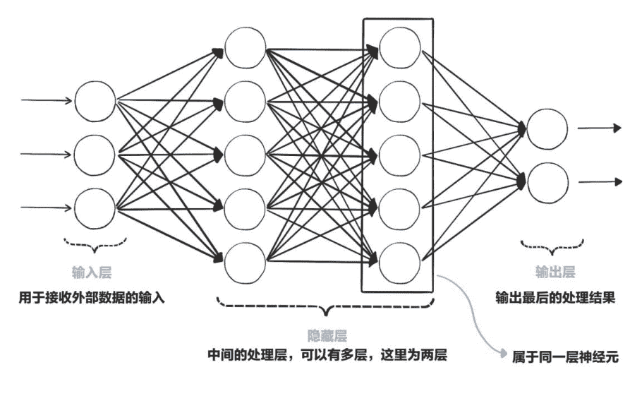

### 图4—8 神经网络分层结构图

深度学习中“隐藏层”的设定，也是模拟人脑的神经元连接，虽然目前还没有明确的科学证据表明隐藏层的具体作用，但从实际操作中，我们大致可以得出分层的好处。例如，用深度学习的办法进行特征识别：将人脸的照片输入分层的CNN架构神经网络，就会发现不同层的神经元识别的规律是不同的，且有明显的认知层级。例如，第一层识别的是人脸的大致轮廓，第二层识别的就是具体的五官的轮廓，再下一层识别的是具体某个五官的形状，等等。再次回到人工智能的定义：人工智能是让计算机以人的方式去解决问题。这种分层的办法，其实也符合人类认知世界的方式。人类在认知世界的过程中，也有从模糊到清晰的过程，每清晰一个层级就会产生进一步的认知，从而发现适合于新认知的概念。因此对人工智能的研究，往往伴随着心理学、认知科学、脑科学甚至是哲学的参与，人工智能已经不单属于计算机的研究领域，而成为一个全学科科研赛道了。

既然人对事物的认知也是从模糊到清晰，从大尺度到小尺度，那么深度学习抓住了人类认知事物的这种特点，并真正展现出一定程度上更高的智能也就不奇怪了。再让我们反过来看人对事物的认知过程，它并不是单向的：人类认知事物的过程，不仅有从粗略到细致、从宏观到微观的过程，也会反向审视。都说认知事物有三重境界：见山是山，见山不是山，见山又是山。虽然开头和结尾都是“山”，但经过充分认知的事物，回过来看，理解就会完全不同。在物理学的研究中也存在这样的过程：在20世纪粒子物理大发展的年代，人们一直在试图找到更小的、更基本的粒子，但是21世纪物理学的发展反而开始着眼于更宏观的凝聚态物理领域，去研究多粒子组成的系统有什么神奇的性质，从而反过来指导对微观粒子的进一步认知。这在人工智能的研究中体现为一种“反思”的能力，即误差逆传播算法（back propagation algorithm）。辛顿、鲁梅尔哈特（David E. Rumelhart）和威廉姆斯（Ronald J. Williams）三位学者于1986年提出了误差逆传播算法，这可以被认为是神经网络的反思能力。但是在了解误差逆传播算法之前，我们需要大致了解神经网络的训练是怎么做的。一个模型要拥有较好的表现，关键的过程是调节参数，使得机器能学习到问题和答案之间的关联特征。但参数要如何调节？关键是要定义一个合适的代价函数，而调节参数其实是要让代价函数的数值尽量小。什么是合适的代价函数？那便是该代价函数的形式要使得我们调节参数以后，最小的代价函数对应于最优秀的答案。再回看神经网络，里面可以调节的东西太多了：神经元的个数、神经元的架构，具体到每个神经元里有个权重矩阵W，还有激活阈值b，且神经元输出的激活函数形式也可以调。通过简单的数学计算，会发现代价函数的数值其实是所有这些参数的一个函数，也就是这些参数在变化的过程中，代价函数的值就会变化。我们的目标其实就是调节所有这些参数，使得代价函数的数值尽可能地小。说起来简单，但做起来太复杂了，因为参数的数量太多了，大的模型有成百上千亿个参数，好比一把有几百甚至上千亿位数的密码锁，要把这把密码锁解开，要花费的功夫是难以想象的。有些东西是可以手动调的，例如神经元的个数是可以手动调的，神经网络的架构是可以手动调的，神经元激活函数的形式也是人为定义的。更细节的，每个神经元里的权重矩阵W的行数是可以手动选择的，等等。假设这些手动调的东西我们都调过了，接下来就是自动调的东西了，例如W和b里的数值是自动可调节的，怎么调？用算法。不难想象，代价函数是一个具有多达千亿个自变量的函数，真要去调它是一件异常困难的工作，这就需要各种各样的算法，有大量的研究工作便是去发明更高效的算法来调节W和b的参数的数值，来使得代价函数最小。也许你调了半天，得到的也并非全域最小化的代价函数，只是局域最小化的代价函数值。有了这些基本认知，训练神经网络的目标就比较清楚了，训练的过程，本质上便是调W里的参数权重，其实之所以用W来代表参数矩阵，就是weights，即权重。一个人工智能模型如果是开源的，说的也就是W里的数值，是公开、免费的。

前文所述的神经网络的“反思”，即误差逆传播算法是如何进行的？它的核心思想反而比较简单。以监督学习为例，假设我们已经输入了一批训练数据，有题目，有答案，且我们也用各种办法通过调节参数的权重，得到了一个比较小的代价函数数值，而我们知道，如果是完美的训练，也就是当机器输出的结果跟正确答案完全一致的时候，代价函数应该等于0，因为这时没有代价。但很显然，完美的情况几乎不可能出现，总会有一定的误差。这时就可以应用误差逆传播算法，进一步提升模型表现。误差逆传播算法的核心思想，其实就是反思。例如我们已经调出来了一个较小的代价函数值，但我们的输出跟正确答案相比是有一定误差的，这时我们可以算出输出答案和真实答案之间的差值，再把整个神经网络的输入和输出逆过来，把这个误差逆向输入神经网络，把这个误差逆向传播到每一层的神经元，见图4-9。

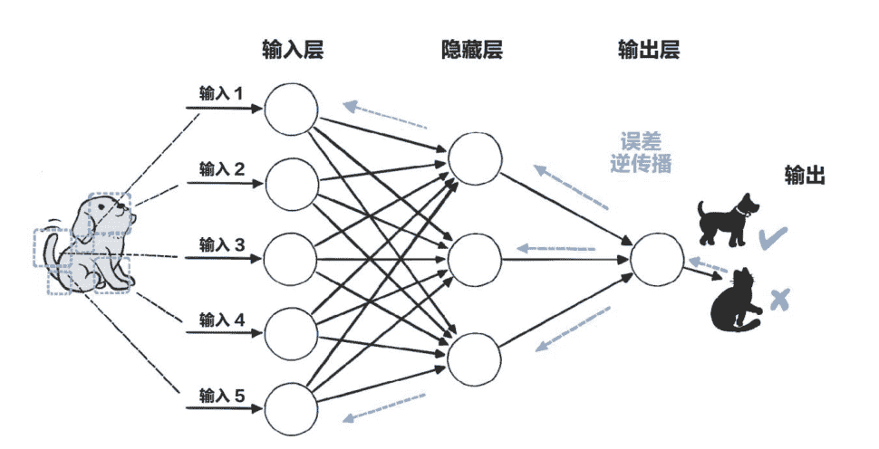

### 图4—9 误差逆传播算法示意图

代价函数的调节过程就好像在一个山坡上找寻那些低谷，可能找了半天，我们发现了一个相对来说比较低的地方，但我们还是不确定，于是把误差逆向传播回来，我们在误差函数周围做各种各样的试探，看看往什么方向走可以进一步降低我们的代价函数。误差逆传播算法的意义就在于，我们已经看到的输出结果与真实结果之间的误差，把这个误差当成经验，再返回到我们的思考过程中，通过这些错误经验往不同方向进行尝试，试图寻找具体错在什么地方，以及应该往什么地方寻找。如此反思完一轮之后，我们的代价函数得到了更新，这样我们可以再获得一次输出的值，若是仍未达到预期，则可以重复前面的过程，直至结果收敛。因此，只有当神经网络有了分层，才会有数据在神经网络中传播的方向性，有了方向性，才拥有反思的过程。深度学习的技术方案，已经非常接近人类的思维方式了。

# 第五章 生成世界

我们正在见证一场从确定性计算到创造性生成的历史性跃迁。在人类文明的发展进程中，每一次重大的技术革命都伴随着思维方式的根本转变。工业革命让我们从手工制作转向机械生产，信息革命让我们从局部通信转向全球互联。而今天，我们正在经历的AI革命，其影响可能比以往任何一次技术变革都更加深刻——它正在重新定义“创造”本身的含义。

传统的计算机程序遵循着严格的逻辑：给定确定的输入，产生可预测的输出。这种确定性既是传统计算的优势，也是它的局限。面对需要创意、灵感和原创性的任务时，传统计算显得束手无策。然而，生成式AI的出现彻底改变了这一局面。它第一次让机器具备了看似“创造”的能力——从文字到图像，从音乐到视频，它能够生成前所未有的原创内容。

这种能力的实现，标志着我们从确定性计算时代进入了创造性计算时代。但这种“创造性”的本质是什么？当AI写出一首我们从未见过的诗，画出一幅前所未有的画时，它真的在进行创造吗？还是仅仅在进行极其复杂的模式匹配和重组？

然而，生成式AI的价值不仅仅体现在创造内容的能力上。从信息论的角度来看，它的核心价值在于复杂度降维——将高复杂度的信息转化为人类更容易理解和处理的形式。这种能力在当今信息爆炸的时代尤为珍贵。我们每天面对的信息量已经远远超出了人脑的处理能力，而AI恰恰能够帮助我们从这些信息中提取精华，消除信息熵，提高决策效率。这种复杂度降维的能力，也解释了为什么文档总结成了大模型最早的应用场景之一。它不是偶然，而是必然的，因为这正是AI相对于传统计算工具的独特优势所在。AI不仅能够处理结构化数据，更重要的是，它能够理解和处理非结构化的、具有高度复杂性的信息。

我们需要思考如何让这种技术更好地服务于人类社会。生成式AI的普及，不仅会改变我们的工作方式，也会改变我们思考创造性的方式。在这个过程中，如何保持人类的独特价值，如何确保技术发展的方向符合人类的长远利益，都是我们必须认真考虑的问题。

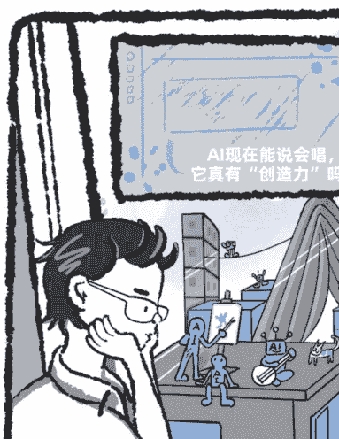

AI现在能说会唱，它真有“创造力”吗？

它的“创造”，其实是旧元素的新组合。AI通过学习海量数据，获得了将基本元素进行重新组合的能力。

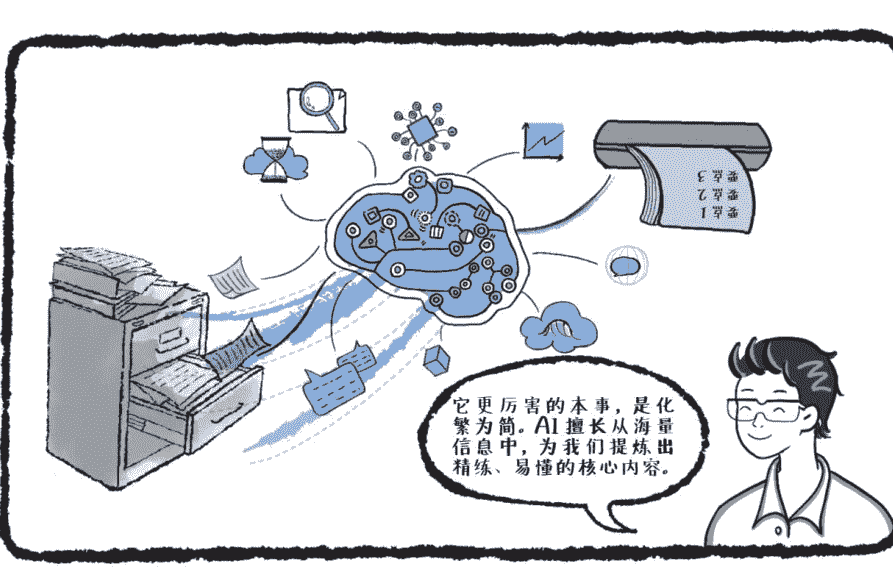

它更厉害的本事，是化繁为简。AI擅长从海量信息中，为我们提炼出精练、易懂的核心内容。

## 从确定性到创造性

当我们讨论生成式人工智能（generative artificial intelligence，以下简称生成式AI）时，我们实际上在探讨一种全新的计算范式。当前人工智能概念的蓬勃发展，很大程度上得益于大语言模型和图像生成技术的突破性进展，而这些技术的核心正是生成式AI。

与传统的人工智能系统不同，生成式AI的使用场景并非解决具有标准答案的特定问题，而是能够输出原创性内容。传统的窄人工智能通常处理确定性问题：人脸识别系统的任务是准确地将不同面孔对应到相应的身份信息，AlphaGo的目标是在围棋对局中获胜，扫地机器人的使命是高效清洁地面。这些人工智能系统都有明确的目标和可衡量的成功标准。

然而，生成式AI面临的挑战截然不同。当我们要求它撰写一篇文章或创作一幅画时，文章质量的优劣和绘画水平的高低并没有绝对的标准答案。生成式AI承担的是具有创新性质的任务，更为重要的是，目前的生成式AI主要通过自然语言进行驱动。让我们通过一个具体的例子来理解这种交互方式。我们向大语言模型发出指令：“请为我创作一首诗，诗中要包含鲜花、明月、美人和酒这四个元素。”系统可能会生成这样的作品：

> 明月照亭前，鲜花伴酒边。美人轻解佩，一曲动人弦。

令人惊喜的是，这首诗不仅包含了所有要求的元素，还意外地融入了音乐元素“一曲动人弦”，展现了超越预期的创造能力。这种现象呼应了我们在本书开篇即已讨论的观点：AI的大规模爆发代表着新一轮文明的指数级发展，其根本原因在于它能够输出复杂度大幅提升的信息。当这些信息通过网络连接形成体系时，其释放的力量将是难以估量的。至此，一个自然的疑问浮现：创新不应该是人类独有的能力吗？AI虽然强大，但它所能做的不过是学习互联网上的公开数据，为什么能够实现创新呢？

要回答这个问题，我们必须深入探讨创新的本质。德国哲学家伊曼努尔·康德对此有着深刻的洞察：创新本质上是“旧元素的新组合”。这个观点看似简单，实则包含着深刻的哲学思考。让我们通过色彩理论来理解这一概念。色彩的变化看似无穷无尽，以显示器的RGB色度为例，红绿蓝三原色各有0到255的取值范围，理论上可以产生256³=16 777 216种不同的颜色。然而，如果我们对色彩进行基本分类，大致可以归纳为赤、橙、黄、绿、青、蓝、紫、黑、白、灰等十种基本色系。无论颜色如何变化，在调色盘上如何调配，都无法跳出这十种基本色系的范畴。即使是棕色，实际上也不过是较暗的橙色。

生成式AI的工作原理与此类似。我们要求它创作诗歌时，它实际上是在几千个常用汉字中进行选择和组合。创新的本质确实是旧元素的新组合，关键在于这种组合的新颖性。人类的精力有限，而可能的组合却是无限的，我们无法穷尽所有可能的组合。因此，我们发明了各种知识体系和工具，本质上都是为了帮助我们更高效地找到真正有意义的组合。古人云：“文章本天成，妙手偶得之。”这句话揭示了创作的一个重要特征。就像圆周率这个无限不循环小数，理论上包含了所有可能的数字序列，关键在于如何找到有意义的部分。创新的核心问题不在于是否存在新的组合，而在于如何找到这些有意义的新组合。

生成式AI的优势正体现在其强大的组合发现能力上：它能够快速找到有意义的新组合，能够根据人类的自然语言指令找到贴近描述要求的新组合，并且这种搜索过程既可靠又快速，变化多样。但这里产生了一个新的问题：假设AI拥有全网的数据作为旧元素的来源，这些新组合是如何产生的呢？答案就隐藏在神经网络的架构设计中。

在第四章中，我们详细介绍了神经网络的基本原理。神经网络已经成为当今AI发展的主流方向，甚至可以说是最主要的发展方向。它从一个小众的，甚至不被认为是正统AI方向的研究领域，发展成为当前的主流技术路径。这一转变的最重要推动因素是计算能力的大幅提升和计算成本的显著下降，正所谓“大力出奇迹”。当神经网络的规模达到某个临界点时，参数数量大幅增加，系统开始出现涌现现象。随着神经网络中神经元数量的增加，每个神经元的权重参数也相应增多。正如我们在前文中论证的那样，当神经元数量增加时，神经元之间的连接方式就变得至关重要。

显而易见，随着神经网络规模的扩大，神经元之间不可能维持全连接状态。因为神经元数量每增加一倍，连接数量基本呈平方关系增长，这会对计算资源造成巨大消耗，效率也会变得极其低下。因此，神经网络必须采用不同的架构设计，而且研究表明，不同架构的神经网络适合解决不同类型的问题。例如，CNN特别适合处理图像相关问题，如人脸识别等视觉任务。RNN则擅长处理时间序列问题，如天气预报和股票交易预测等。

所谓架构，是一个相对宽泛的概念，凡是涉及神经网络结构和工作流程的设计，基本都可以纳入架构的范畴。让我们逐一分析架构设计的关键要素。

第一，层次结构的设计。在超大规模神经网络中，全连接显然不现实，因此层的概念应运而生。在同一层中的神经元通常相互之间没有直接联系，这样才能形成清晰的层次概念。层与层之间的神经元是连接的，但同层内部通常没有连接。

第二，输入层和输出层的定义。任何神经网络都必须具备输入层和输出层这两个基本元素。输入层负责接收原始数据，例如在人脸识别网络中，输入的是人脸照片；输出层则负责提供最终结果，告诉我们照片中人物的身份。

第三，隐藏层的配置。除了输入层和输出层外，网络中可能包含隐藏层。只要存在隐藏层，就可以称为深度学习。隐藏层的具体数量和每层中神经元的数量都属于架构设计的重要组成部分。

第四，连接模式的确定。确定了隐藏层后，还需要定义不同层之间神经元的连接方式。通常情况下，相邻层的神经元之间采用两两相互连接的方式。

第五，权重分布的规律。建立连接后，需要考虑权重分布问题。同一层中的所有神经元与相邻层神经元的连接权重未必相同，这涉及我们前面章节讨论的权重矩阵 $W$。

第六，激活函数的选择。每一层神经元中激活函数的设计也是架构的重要组成部分。激活函数决定了神经元在接收输入信号后，经过权重和偏置处理后如何产生输出。激活函数的具体形式、激活机制，以及是否所有神经元都使用相同的激活函数，这些都是架构可以调整的参数。

第七，代价函数的设计。我们在前文中详细讨论了代价函数的重要性。机器学习算法需要人为定义代价函数，其形式直接决定了最小化代价函数后机器学习的表现效果。

第八，优化方法的选择。最小化代价函数的方法有多种，不同的代价函数对应不同的优化方法，效率各不相同。这也可以被视为架构设计的一个组成部分。

当然，具体的架构变化还涉及更多细节，整个体系可能非常复杂。但经验告诉我们，不同架构的神经网络确实擅长处理不同类型的问题。这里产生了一个关键问题：我们如何发明新的架构？坦率地说，目前还没有非常系统的方法可以快速高效地发明不同的架构。这个领域过于复杂，在很大程度上仍然处于“炼金术”阶段，更多依赖经验、直觉和大量的试验。然而，能够发明优秀架构的计算机科学家基本都达到了该领域的顶尖水平，或者会因为这项发明而成为领域泰斗。例如，CNN架构的发明人就是著名的图灵奖获得者杨立昆，他正是因为这项开创性工作而获得了图灵奖的殊荣。

那么，什么样的架构最适合实现生成式AI呢？目前看来，答案是著名的Transformer架构。ChatGPT等众多大语言模型的背后，无一例外都采用了Transformer架构。这一架构源于谷歌公司发表的一篇具有里程碑意义的论文。这篇论文的标题——“Attention is all you need”（你需要的只有注意力）颇具趣味性。这个标题一点儿也不像传统严肃的学术文章，它却成了人工智能领域最具影响力的学术论文之一。这篇论文的核心贡献是介绍了一种全新的架构——Transformer，它在文本翻译任务上的表现超越了以往的所有方案，包括当时主流的RNN架构。从那时起，Transformer架构就开始了它在自然语言处理领域的统治地位。

## “你需要的只有注意力”

让我们从较高的层面来理解Transformer架构的工作原理。Transformer架构的基本结构包含一个编码器（encoder）和一个解码器（decoder）。整个工作流程相对直观：当你输入一个问题时，它首先进入编码器进行编码，然后编码结果进入解码器，最终输出答案。

这个过程听起来简单，但编码和解码的具体机制却相当复杂。我们需要了解“编码”的本质是什么。编码的核心是向量化过程。一段文字输入编码器后会被转换成向量。为了便于理解，我们可以将向量简单理解为地图上的坐标点，包含经度和纬度信息。当然，这只是二维情况，因为地图本身是二维的。但Transformer编码器生成的向量通常具有很高的维度，比如1 536维。为什么选择1 536这个数呢？因为1 536 = 1 024 + 512，1 024和512都是2的幂次，这样的设计在进行计算时更加高效。但为了便于理解，我们继续使用二维情况进行说明，因为超过三维的情况已经无法直观地进行图形表示。

需要注意的是，编码器处理的不是整句话，而是token（记号）。以英语为例，一个词根构成一个token。比如convolutional这个长单词，可以分解为三个token：con、volution、al。当你输入一句话时，编码器会为每个token生成一个对应的向量。解码器的核心功能是进行“下一个token预测”（next token prediction）。它根据输入的token序列，预测下一个应该出现的token。这个预测过程是如何实现的呢？关键在于注意力机制（attention mechanism）。让我们通过一个具体例子来理解这个过程。假设输入是“今天天气真好，我准备出门……”，那么“出门”之后应该是什么呢？可能的选项有很多：出门转转、出门吃饭、出门钓鱼，甚至出门淋雨。系统如何进行选择？答案是依靠上下文信息。这些上下文信息来自训练数据——全网的公开文字资料。通过学习海量的网络文本，系统发现“今天天气真好，我准备出门”后面跟随不同词语的概率分布。显然，“今天天气真好，我准备出门淋雨”这种情况几乎不可能出现，因此其概率极低。这就解释了为什么大语言模型需要大量数据进行训练。没有足够的数据，就无法建立可靠的概率判断依据，注意力机制也就无法有效工作。

注意力机制的本质是学习文本中每个字与前面所有文本的关系。由于系统的任务是预测下一个字（图5-1），所以学习过程实际上是分析已知字符与前面所有字符的关系模式。Transformer架构的创新之处在于，它学习单个token与前面所有token的直接关系，而不是像传统RNN那样通过递归方式处理。例如，在学习“好”字时，Transformer会分别分析“好”字与“今”“天”“天”“气”“真”之间的关系，计算它们共同出现的概率。这个学习过程在本质上是监督学习，因为任务是预测下一个token，样本是从已知token观察其对应的前文。但整个过程又具有无监督学习的特征，因为不需要人工为每个样本打标签——这些“标签”实际上就是人类产生的历史文字数据。因此，这是一个介于监督学习和无监督学习之间的独特例子。

训练的核心目标是使编码器生成的向量能够合理地反映语义关系。我们仍然用地图来类比。如果我们输入“苹果”“梨”“手机”这三个词，从逻辑上讲，“苹果”和“梨”在向量空间中的距离应该比较近，而它们与“手机”的距离应该相对较远。机器本身并不理解这些词的含义，但经过优秀数据训练的Transformer架构应该能够从向量分布中体现出语义之间的关系。这种能力是通过注意力机制和大规模数据训练共同实现的，使得神经网络中的权重参数能够将信息压缩成关系合理的向量表示。

**图5-1 大语言模型根据学习内容对下一个最可能出现的词的预测**

总结而言，Transformer模型是一种神经网络架构，其工作流程是：输入数据，通过编码器进行向量化，然后输入解码器进行下一个向量的预测，并循环这个过程。编码器和解码器中向量的有效性通过注意力机制来保证，再经过大量数据训练，使得神经网络的权重能够将信息压缩成语义关系合理的向量。这种设计思路体现了生成式AI的基本原理：根据输入预测下一个输出，从而实现内容生成的目标。

Transformer架构在文字处理方面取得了巨大成功，那么图片和视频生成又是如何实现的呢？在一些文生图AI应用中，仅仅输入几句文字描述，系统就能生成相应的图片，这背后涉及多种技术方案。目前比较流行的方案包括谷歌公司发布的GAN（生成对抗网络）模型及同样由谷歌公司研究员发明的扩散模型（diffusion model）。从当前的发展趋势来看，扩散模型似乎更加主流，成了图像生成领域的主导技术。

扩散模型的名称来源于其模拟的物理过程。想象有一杯清水，向其中滴入一滴墨水后，墨水会逐渐扩散，最终将清水染色。墨水在清水中的扩散路径是随机的，受到温度、离子分布等多种参数的影响。扩散模型的原理与这个物理过程高度相似。它通过学习图像从清晰到模糊的扩散过程，进行反向操作来生成图像。扩散模型的训练过程可以分为以下几个关键步骤。

**数据准备阶段：** 首先需要准备大量带有语言标签的图片。例如，一张图片可能被标注为“这是爱因斯坦的卡通形象”。

**加噪过程：** 接下来是关键的加噪步骤。图片由像素点构成，每个像素点都有对应的RGB颜色码。加噪过程以每个像素点的颜色码作为中心值，按照高斯分布随机地增减数值。

**逐步模糊：** 经过一轮加噪后，图片与原始图像已有差异，就像向清水中滴入墨水开始扩散一样。然后不断重复加噪过程，直到图片完全模糊，无法识别原始内容。

**路径记录：** 整个加噪过程会产生N张图片，从原始清晰图像到完全模糊状态。这N张图片都会输入神经网络进行学习。

**学习目标：** 神经网络学习的是图片从清晰到完全模糊所经历的路径，这个路径实际上是向量空间中的点集合。

当然，实际训练过程不会只使用一张图片，而是使用数亿张图片来训练模型，确保系统能够学习到丰富的图像生成模式。训练完成后，如何通过文字生成图片呢？这实际上是将训练过程进行反向操作。

如图5-2所示，当我们告诉AI“给我生成一张爱因斯坦的卡通照片”时，系统的工作流程如下。

- (1) 语义理解：系统根据文字描述的语义，在向量空间中定位对应的路径。
- (2) 路径追踪：找到与“爱因斯坦卡通照片”相关的向量路径。
- (3) 逆向生成：沿着这条路径反向操作，从随机噪声逐步生成清晰图像。

## 训练：正向扩散

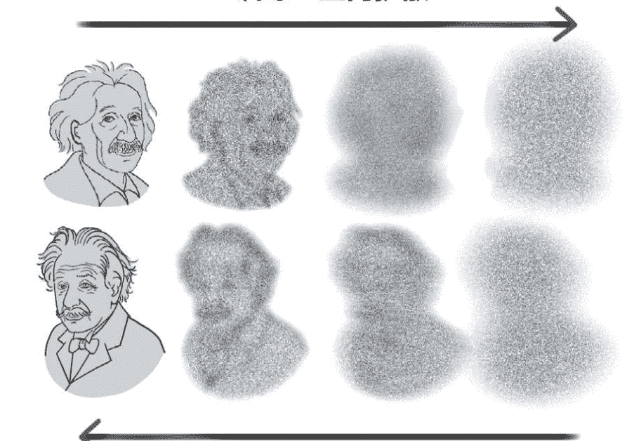

## 生成：反向扩散

**图5-2 扩散模型的正向扩散和反向扩散**

扩散模型的创造力来自其庞大的训练数据集和强大的组合能力。例如，当我们要求AI生成“长着两个头的鸡的照片”时，训练数据集中可能并没有这样的图片。那么这种创造力是如何实现的呢？关键在于提高文字处理能力。系统需要准确理解我们的文字描述，将其转换为向量表示，然后在向量空间中找到对应的路径。通过加权平均的方式，系统可以组合不同的向量路径，生成符合文字描述的新图像。这个过程体现了“旧元素新组合”的创新本质。因此，提示词工程成了这个领域的关键技术。如何准确、有效地描述我们想要的图像，直接影响生成结果的质量。

理解了文字生成图片的原理后，我们自然会问：文字生成影片和动画又是如何实现的呢？答案是将扩散模型与Transformer模型相结合，形成扩散Transformer模型。一段视频本质上就是连续的图片序列。静态图片可以用相对简单的语言进行描述，但视频如果要完整描述，通常需要相当长的文字说明。电影的长度与剧本的篇幅通常成正比，这说明了视频内容的复杂性。视频生成需要对文字内容有深入的理解，才能确保生成的图像序列与文字含义保持一致。对于AI系统而言，图片和视频的主要区别在于时间维度的加入。

- **数据维度的扩展：** 视频数据比图片数据多了一个时间维度。以每秒24帧的视频为例，每个像素点不仅有RGB颜色码，还有时间轴上的变化信息。
- **向量表示的复杂化：** 相应地，视频的向量表示也更加复杂，需要同时考虑空间和时间两个维度的信息。
- **方法论的延续：** 尽管数据复杂度增加，但方法论与图片生成基本一致，仍然基于扩散模型的原理。

要实现高质量的文生视频效果，几个因素至关重要。

- **文字嵌入质量**：系统对文字描述的理解和向量化能力必须足够强大。
- **数据资源质量**：训练数据的数量和质量直接影响生成效果。
- **技术实现细节**：虽然科学原理仍然是扩散模型，但在具体执行过程中涉及众多技术细节和优化方案。

生成式AI代表了人工智能发展的一个重要转折点。它不仅改变了我们与机器交互的方式，更重要的是，它展示了机器在创造性任务上的巨大潜力。从Transformer架构的注意力机制到扩散模型的图像生成，从文字创作到视频制作，生成式AI正在重新定义创新的边界。然而，我们也应该认识到，生成式AI的“创新”本质上仍然是“旧元素的新组合”。它的价值在于能够在海量的可能组合中快速找到有意义、有价值的新组合。这种能力的实现依赖于强大的计算资源、海量的训练数据，以及精心设计的神经网络架构。随着技术的不断发展，我们有理由相信，生成式AI将在更多领域展现其创造性潜力，为人类社会带来更多的价值和可能性。但同时，我们也需要深入思考如何更好地利用这项技术，确保其发展方向符合人类的长远利益。

## 复杂度降维

如果要从商业价值的角度审视生成式AI，我们首先需要明确这样的根本性问题：生成式AI的核心价值究竟体现在何处？它的核心应用场景又在哪里？更进一步地说，它取代的是人类能力的哪个维度？要深入理解这些问题，我们必须从信息论的角度重新审视技术发展的本质。

回顾互联网时代，我们不难发现，互联网所解决的核心问题是信息不对称。它极大地提升了信息传输的效率，使得原本需要较长时间才能获取的信息能够瞬间抵达全球任何一个角落。然而，这种表面现象背后还蕴含着更深层的逻辑。从信息学的角度来看，人类的所有活动本质上都是一个不断消除信息熵的过程。当人类接收信息时，这一行为的本质是在消除不确定性。所谓“知道”，即原本未知的事物变为已知，不确定性转化为确定性。信息的价值在于它能够消除接收者多少信息熵，而整个人类文明的发展历程，从信息学的视角来看，正是一个持续消除信息熵的过程。有了确定性，人类活动才有了明确的方向。因此，信息传输效率的提升意味着信息熵消除的高效化，进而带来人类活动确定性的增强，最终推动经济水平和文明水平的发展。这正是互联网带来的根本价值——它使信息不对称被更快速地打破，或者说，使信息熵被更高效地消除。

那么，AI在这个信息处理链条中扮演什么角色呢？如果说AI能够创造更加繁荣的经济，从信息论的角度分析，它必然也是通过提高信息熵消除的效率来实现的。关键问题是：AI消除的是哪一类信息熵？答案是：以复杂度为代表的信息熵。传统机器的优势在于精确性而非复杂性处理能力，这也是为什么在许多方面机器无法完全取代人类。然而，AI的优势恰恰在于处理复杂性，尽管在精确度方面可能存在不足。例如，大型语言模型在数学计算方面的表现往往不尽如人意，但它们在处理复杂语义理解和生成任务方面却表现出色。

纵观AI发展历程，我们可以清晰地看到一个趋势：机器学习技术所解决的问题呈现出从自由度低到自由度高、从复杂度低到复杂度高的发展轨迹。早期的专家系统只能处理规则明确的简单问题，而现代的深度学习模型已经能够处理图像识别、自然语言理解等高度复杂的任务。因此，AI的核心价值显而易见：它主要用于解决高复杂度的问题。传统上，这些高复杂度的问题需要人类通过大脑进行处理，人们运用自身的认知能力来消除复杂信息所带来的信息熵。而随着AI技术的发展，这部分原本需要通过人脑来消除的高复杂度信息熵，逐渐可以被AI取代。这就解释了为什么大模型的早期应用多集中在文档总结功能上——文档总结正是一个典型的复杂度降维任务，需要从大量复杂信息中提取关键要点，将高复杂度的内容转化为易于理解的简化版本。

明确了AI的核心价值在于解决高复杂度问题而非单纯的信息传输后，我们可以进一步展开讨论AI在不同场景下的具体应用。生成式AI的核心价值体现在它能够代替人类，将信息的复杂度有效降低。在传统模式下，降低信息复杂度这项工作完全依赖人力完成。人们需要理解信息、面对高复杂度的信息时，依靠大脑分析其结构，最终将其简化为大脑能够理解的逻辑。然而，人脑处理这类工作的速度相对较慢，而生成式AI则能够相对轻松且快速地完成这一任务。

值得注意的是，复杂度本身是一个相对概念，因人而异。这一点从学科分化现象中可以清晰地看出。学科分化是人类面对知识复杂性时做出的智慧选择。实际上，学科是一个人为创造的概念，在自然界中并不存在。以物理学和化学为例，从某种意义上说，化学反应也可以被视为物理现象。化学中使用的各种术语，如离子键、共价键等，在量子物理的框架下都可以通过薛定谔方程的不同解的形式来解释。

化学概念的存在意义在于，通过化学思维框架，我们可以将不同的波函数理解为不同的概念，从而在后续处理中更加便利，相对复杂度更低。对于化学家而言，使用化学概念体系处理相关问题的复杂度明显低于直接使用量子物理方法。这说明复杂度确实是一个相对概念。不同的复杂问题采用不同的简化方式，其复杂度也会相应变化。这正如我们在解题时常说的“方法有很多种，有些方法复杂，有些方法简单”。

学科分化的本质在于：所有问题都可以用多种方法解决，但某一类问题特别适合用某种特定方法解决。将这些特定方法汇聚在一起，形成一套完整的方法论，而适合用这套方法论解决的问题和研究对象聚集在一起，就形成了一个学科。这体现了人类面临复杂问题时“术业有专攻”的智慧选择。

既然人类在处理复杂问题时会进行专业化分工，那么生成式AI在解决问题时是否也会存在类似的专业化现象呢？答案是肯定的，这就是我们常说的“智能体”（agent）。agent这个词的含义相当广泛，字面意思是“代理”。在不同语境下，房产中介的代表可以称为agent，情报人员和特工也可以称为agent。其核心含义是指代理某人完成一类特定事务并交付完整结果的实体。在人工智能语境中，这个概念被翻译为“智能体”，特指生成式AI中适合解决一类特定问题的专门化系统。

为了更好地理解智能体的概念，我们可以从一个简单的例子开始。在与大模型对话时，我们可以让大模型进行角色扮演。例如，通过提示词告诉大模型：“在解决任务时，请时刻想象你是一位物理学家。”经过这样的提示后，大模型在后续输出中会表现出更像物理学家的特征。这种方法只是通过提示词工程让AI在某个方面的特点更加突出的初步尝试。大模型的预训练数据覆盖面广，理论上对各个领域的知识都有所接触。提示词工程的目的是让AI突出展现其所具备的所有能力中的某一种，类似于让一个学过多个学科的中学生在回答问题时侧重调用某一方面的知识，去除一些不必要的内容干扰。这样做的结果是让AI智能体看起来专注于某一个方向的问题，但这种方法并不能实际提升AI在某个方面的能力，而只是选择性地突出其原本就具备的某方面能力。因此，仅仅使用提示词打造的AI智能体相对来说还是比较基础的智能体，智能体工作流可参看图5-3。

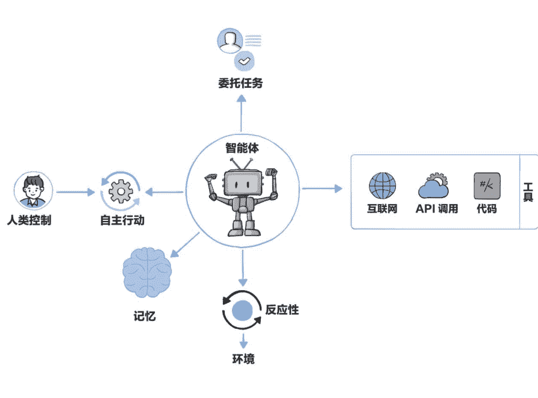

**图5-3 智能体工作流**

如果要打造能力更强的智能体，就需要采用微调技术。要理解微调的原理，我们需要回顾神经网络的基本结构和训练过程。神经网络的表现主要由几个因素决定，其中参数数量是一个重要因素。一般来说，参数较多的网络比参数较少的网络表现更好。神经网络中的参数主要指神经元的数量乘以神经元中权重矩阵的元素数量。输入信号经过权重矩阵W的调节后变成神经元的输出信号，因此神经网络的表现取决于矩阵W中元素的具体数值，即权重的具体取值。

当我们使用大量标注数据训练神经网络时，训练过程的本质就是调节矩阵W中元素的具体数值。在给定神经元数量、网络架构、分层连接方式等条件下，最终决定神经网络表现的就是所有神经元中矩阵W元素的数值，即权重。所谓预训练（pre training），是指大模型在交付给用户使用之前，已经完成了数据输入和权重调整的过程，可以直接使用。而微调的概念就很清楚了：我们继续使用数据来调节这些权重。

微调的操作方法与预训练类似，都是输入数据，且最好是经过标注的数据，这又回到了监督学习的范畴。微调的目标是通过调整AI大模型的权重，使其能够适应某一类特定任务。以我的AI数字分身“严伯钧”为例，它能够模仿我的风格撰写科普文章，语言风格与我高度相似。这是如何实现的呢？答案是通过数据投喂。具体来说，就是将我过往写过的文稿输入给它，数量越多效果越好。我投入了足足100万字的个人文稿，最终使其说话风格与我高度相似。

然而，这种数据投喂过程并非简单的无脑输入，而是一个相当有技巧的过程。其中涉及多个参数的调节，数据的形式、质量和格式都会产生影响。例如，如果希望AI在数学解题方面有出色表现，输入的数据应该将题目和答案分开，最好还要添加详细的标签。培训机构的教师在讲题过程中标注的大量标签，包括对题目的分类、对知识点的拆解总结等，都是非常好的数据标签示例。

仅仅依靠微调就能让AI变得足够强大，从而解决所有问题吗？答案是否定的。当前AI模型训练领域的发展趋势已经显示出一定的规律：AI与人类相似，基本上是“想精就没法全，想广就没法深”，有点儿像打地鼠游戏，按下一个地鼠，另一个又会冒出来。微调的作用依然是有限的。人类在真实世界中面临的问题，无论是工作中还是科研中遇到的问题，往往十分复杂。想要仅仅依靠微调模型使其在推理（reasoning）和问题解决（problem solving）方面拥有比较强的逻辑推理能力和解决问题的能力，并不能完全达到令人满意的效果。

在这种情况下，我们需要采用另一种方法：智能体工作流（workflow of agents）。

## 协同作业的智慧

智能体工作流的概念相对简单：将不同的、擅长解决不同问题的AI智能体串联成一个完整的工作流程。仍以我本人的科普智能体严伯钧为例来说明这一概念。通过微调流程，可以实现让我的数字分身说话风格像我，但这仅仅是风格的模仿。如果要让它不仅说话风格像我，连说话内容也像我，应该怎么办呢？具体场景是：当出现一个热点科技新闻时，我将新闻内容输入给严伯钧，它就要能够像我一样立即输出一篇科普文稿，然后根据这篇文稿制作出视频。要实现这一目标，答案就是智能体工作流。要让严伯钧实现“输入任意科技新闻稿或学术论文，输出严伯钧风格的科普视频”这一功能，我们需要将这项工作进行逻辑拆解，制定成标准操作规范（standard operating procedure, SOP）。

首先需要分析我本人在逻辑上是如何完成这件事的。从看到一篇论文到输出一集视频，可以分解为以下步骤。

第一步：论文总结。对论文进行全面总结，提取核心观点和关键信息。

第二步：术语识别。在总结的文章中找出依然存在的生僻术语。

第三步：术语解释。将这些术语用通俗语言解释清楚。这个解释过程也可以进一步分解，比如先进行搜索，然后对搜索结果进行总结。

第四步：内容整合。将术语的通俗解释重新整合到第一步得出的论文总结中，得到一篇没有生僻术语的总结。

第五步：文稿优化。对第四步产生的、没有生僻术语但读起来可能有些拗口的文章进行进一步的润色和优化。

第六步：风格转换。将优化后的文稿输入严伯钧，得到严伯钧风格的科普文稿。

第七步：视频生成。将文稿输入视频生成引擎，最终产出视频。

这七个步骤构成了一个完整的工作流。智能体工作流的思想就是让这七个步骤分别由不同的智能体来完成。由于每个步骤要完成的工作相对简单，单个智能体可以胜任，这样就给AI模型减轻了负担。

既然AI模型不具备足够强的综合推理能力，那么就让人类帮助它完成推理过程的拆解。人类帮助AI拆解推理过程的标准是什么呢？以上述七步工作流为例，实际上第三步还可以进一步拆分成更小的步骤，例如搜索、总结、缩略等。工作流拆解的标准是：拆分到单个智能体就能很好地完成某项工作的粒度即可。

智能体工作流已经成为当前AI领域积极发展的重要方法论。著名人工智能科学家吴恩达（Andrew Ng）提出，使用智能体工作流的方法，可以实现让低端模型在解决问题方面取得比高端模型更好的效果。这真正体现了“三个臭皮匠，顶个诸葛亮”的智慧。这种方法的核心在于通过合理的任务分解和协同配合，让多个相对简单的智能体发挥出超越单个复杂模型的效果。这不仅提高了问题解决的效率，也为AI应用的规模化部署提供了更加经济可行的方案。通过对AI核心价值的分析，我们了解到AI主要用于解决复杂问题。在解决复杂问题的过程中，我们探讨了智能体、微调和智能体工作流等进一步的技术方法。在下一章中，我们将继续讨论，具体哪些场景特别适合AI应用。

# 第六章 创造性破坏

在前文的论述中，我们反复提及了“创造性破坏”这一核心概念。纵观人类文明史，每一次重大进步都伴随着创造性破坏的发生。传统意义上的“破坏”指的是消灭了原本属于人类的劳动岗位，劳动力从既有的工作中解放出来，并投入到新兴的劳动岗位之中。

然而，历史上的科技创新所破坏、所取代的，通常是人类的体力劳动部分，以及低自由度的脑力劳动部分。当前这一代人工智能则截然不同——它所取代的往往是需要高自由度的、属于人类脑力活动核心的劳动，甚至触及需要人类创造性思维的脑力劳动领域。

这种创造性破坏是前所未有的。当人类大脑所具备的解决高自由度问题的能力，乃至人类大脑所拥有的创造力也即将被人工智能所取代时，我们有理由相信，人类文明爆发出的文明形态进步也将是空前的。本章将深入探讨目前属于人类专属领域的哪些工作类型将被人工智能大幅度取代，换言之，人工智能究竟拥有哪些商业潜能。

AI 是一次创造性破坏吗？
这次革命取代的不只是体力劳动了……
AI 冲击了哪些领域？

当 AI 越来越智能后，
我们曾以为最安全的
创造性脑力劳动被狠狠
冲击了。

比如情感陪伴，AI 能发展出
虚拟偶像，甚至通过学习我们
的聊天记录，构建“数字人”，
实现某种意义上的数字永生。

在艺术领域，AI 已
经能生成电影、绘画，
甚至作曲。不过，
独特的风格是艺术
的灵魂，目前 AI 还
难以超越人类。

那最复杂的科学研究呢？

AI 已经深度参与人类科研了。比如，我们可以使用 AI 进行高精度蛋白质结构预测，这极大加速了新药研发，对人类帮助很大。

还有教育领域！AI 能整合全部知识库，实现真正的规模化因材施教。

而在法律、金融等专业领域，通过智能体工作流，AI 也能帮助我们像专业团队一样高效处理复杂任务。

AI 对这么多领域的冲击将带来什么呢？

AI 强大的生成能力，将助力构建 Web3.0，催生一个内容确权、资产化的虚拟新经济。

## 人工智能与情感

关于人工智能的终极形态，诸多科幻作品已经为我们描绘出了清晰的蓝图。《异形》系列电影中的生化人大卫代表了拥有人类外观的人工智能，《机械姬》中的美女机器人则展现了另一种可能性。如果我们不执着于要求终极AI拥有人类的外观形态，那么《钢铁侠》中的人工智能助手贾维斯，或许就是我们所期望的AI最佳形态的典型代表。当然，这些都是我们所期待的AI发展方向。与之相对的，还存在着超越我们期望甚至违背我们意愿的发展可能性，比如《终结者》中的天网——一个将目标设定为灭绝所有人类的人工智能系统，这无疑是我们最不愿意看到的AI发展方向。

从本质上分析，AI的终极形态就是要无限接近人类。而人类的核心特征可以分为理性和情感两个维度。目前的AI在理性层面上，与人类仍然存在一定的距离。但在情感表达方面，虽然我们明确知道AI并不具备真正的情感，但它已经能够表现得仿佛拥有情感一般。当用户与大型语言模型进行对话时，往往能够感受到对面就是一个真实的人，特别是自OpenAI公司发布GPT-4o以来，其在语音交互方面的语气、声调以及各个细节层面都已经与真人无异。这一现象清楚地表明，情感陪伴将成为AI的一个重要应用方向。

Character.ai便是专注于情感陪伴领域的典型AI产品。虽然这款应用在运营不久后就宣布停止服务，但它曾是2024年全球范围内在该领域最为成功的AI应用之一。用户可以在平台上与各种名人的AI分身进行对话，包括爱因斯坦AI分身、牛顿AI分身等，甚至可以创造属于自己的AI角色。该平台的核心工作原理本质上就是一套精巧的提示词工程系统。当GPT-4o发布时，著名科幻电影《她》的海报被改编成了OpenAI公司首席执行官山姆·奥特曼的形象，这一现象生动地反映了AI在情感交互领域的突破性进展。在中国市场，类似方向的AI应用同样层出不穷，例如各种虚拟恋人应用，以及专门教授恋爱技巧的AI系统。传统的恋爱指导通常依靠心理导师传授各种理论技巧，而恋爱AI则采取了截然不同的方法——它直接与用户进行对话练习，提供实时反馈，相当于为用户提供了直接的实战训练机会。更为重要的是，随着这项技术的日趋成熟，人类从客观角度来看几乎实现了某种意义上的“永生”。在线上世界“复活”逝去的亲人，正如电影《流浪地球2》中刘德华饰演的角色一直努力实现的目标，即在虚拟世界“复活”自己死于车祸的女儿，其实运用现有的AI技术，这样的目标已经基本可以达成。虽然效果可能还不够完美，但随着AI技术的持续发展，各种技术障碍必将被逐步克服。

实现数字永生的具体操作方式并不复杂，基本上通过微调技术就可以大致实现。结合前文讨论的微调过程，其核心就是向系统输入标注过的数据。那么，如果我们希望在线上“复活”一个人，让他能够与用户进行对话交流，应该输入什么样的数据呢？答案很简单：聊天记录和社交媒体账号的内容。自各种即时通信工具普及以来，每个人都积累了大量的聊天数据。被复活者说过的话构成训练数据，其他人回复他的话则成为标签，通过这种一问一答的方式输入系统。现在有一定年龄、使用聊天软件时间足够长的人，甚至会拥有数百万条数据，这已经构成了极其优质的训练素材。

前面提到的微调实际上使用的是监督学习方法。如果有意识地想要制作一个人的数字分身，让这个分身能够代替本人与他人进行对话，还可以运用强化学习技术进一步优化分身的表现。具体做法是：通过监督学习创建出个人分身后，本人可以开始与自己的分身进行对话，然后持续对分身的回应进行反馈和评价。同样，也可以让朋友与这个分身交流并提供反馈，这构成了一个完整的强化学习过程。因此，如果不是用AI来解决实际的复杂问题，而仅仅是用于情感陪伴，几乎可以预见，这个领域的发展将会相当迅速，因为技术难度相对较低，但市场需求却十分庞大。即使在前AI时代，虚拟偶像就已经开始兴起，比如日本的初音未来。可以想象，制作一个可以互动的虚拟偶像，满足广大“二次元”爱好者的梦想，必将成为一个不容小觑的商业机会。

## 人工智能与艺术

AI令人震撼的另一个重要方面是其创作能力：文生图、文生视频、文生音乐等技术发展得如火如荼。在这些领域中蕴含着怎样的应用场景呢？

生成式AI最显而易见的应用领域是多媒体内容创作，毕竟当前的娱乐产品主要以视频和音频为载体。我们已经听说了许多新兴的产业应用，例如AI换脸技术。据报道，由于中国短剧产业开始爆发，在AI技术的加持下，中国短剧已经开始在国际市场产生影响力。具体的操作方式是：使用AI软件将中国短剧中演员的面孔进行替换，换成俄罗斯演员的面孔，就可以在俄罗斯市场进行销售。但由于这项技术还不够成熟，目前只能进行面部替换，周围的环境无法同步更改，所以会出现满屏幕都是金发碧眼、身穿中国古装的演员在古代场景中飞来飞去的奇特画面。随着技术的进步，未来只要有剧本，就可以通过Sora这样的技术来生成完整的电影。相信这样的未来不会太过遥远。《阿凡达》这样的电影，将不再需要投入大量资金给计算机图形技术。

然而，在这个美好的前景中存在一个值得深入探讨的问题：视频制作可能不再困难，但音乐创作可能仍然会面临挑战。这里说的不是写出乐曲本身很困难——这个确实不难，而是要创作出具有艺术价值的作品，塑造出具有艺术家独特风格的音乐，要真正取代专业作曲家，却是极其困难的。为什么会出现这种情况？读者可能会质疑：AI生成的乐曲现在已经很多了，而且听起来很不错，凭什么说AI不会全面取代作曲家？这里所说的不会取代，并不是指作曲家不会因此失去工作，而是说一个人就可以制作出如《阿凡达》这样投资巨大的电影的这种情况在音乐行业大概率不会出现，除非人类的音乐审美能力已经被AI创作完全同化并导致审美水平的整体下降。

这种判断基于几个方面的原因。首先，作曲本身就是个体化的工作。如果不考虑歌词，仅从曲子的角度来看，很少听说有整个团队共同创作一首曲子的情况。音乐的集体创作在历史上本就罕见。在古典音乐的名作中，只有威尔第的《安魂曲》具有集体创作的成分。编曲工作可能涉及团队协作，但从贝多芬、莫扎特的古典作曲方式，到现代像Hans Zimmer这样的电影音乐大师，单人作曲的方式从未发生根本性改变。因此，从这个角度来说，作曲本来就已经是“一个人的战斗”，AI也就没有什么可以“全面替代”的了。

更重要的是，我们需要审视AI的技术路径。以之前讨论的Sora使用的分散Transformer路径为例，这套技术应用到音乐领域就显得不够灵活了。为什么？因为音乐具有高度的抽象性！让我们回顾一下AI的训练过程：AI的训练需要数据，而且必须是添加了标签的数据。向神经网络输入图片数据时，仅仅放入图片是远远不够的，必须为这些图片添加文字标签。例如，如果随意向神经网络输入一张谷歌公司的logo（标识），必须同时添加一个标签“谷歌的logo”。问题在于，图片是具象的，也就是说，一张图片里的内容到底是什么，无论是一个苹果还是一艘宇宙飞船，绝大部分人都会给出一致的、具体的标签描述。正是基于这种一致性，AI才能识别出规律，才能够将不同的概念关联到不同的训练路径上。然后在反向过程中，当用户提到某个词时，AI才能找到相应的路径，进行加权平均，生成一张符合需求的、正确的图片。换言之，AI能够训练的素材必须具有相对具象的属性。但是音乐在这个方面就没有那么容易处理了，因为音乐本质上是抽象的。

我们可以通过对比美术和音乐来理解这一点：历史上有一位艺术家叫康定斯基，他是抽象艺术的创始人。他当年为什么要发明抽象艺术呢？正是因为他认为音乐比美术更加高级，美术表达情感都需要具象化的手段，比如要表达悲伤，需要画一个人在哭泣；要表达热烈，需要画一个热闹的派对场景；等等。但音乐完全不需要这样，要表达田园风光，不需要让乐器模仿鸟叫声，音乐就能够通过抽象的旋律直接传达情感。贝多芬的《春天奏鸣曲》《田园交响曲》都能强烈地表达出田园风光的意境，让人直接感受到春意盎然的美好。因此，康定斯基发明抽象艺术，就是试图让美术也能够不依靠任何具象的元素来表达抽象的情感，他完全采用抽象的，甚至是几何图形的元素，抽象出视觉艺术中的基本要素，企图通过基本元素的组合来表达抽象而直接的情感。

回到AI生成音乐的话题，其最大挑战之一就在于标签化过程必然无法深入。我们听到一段音乐并为其添加标签时，只能粗略地描述感受，比如悲伤、高兴、热烈、紧张等，最多能够标注一些客观信息。例如这是布鲁斯风格，这是圆舞曲，这是四三拍，等等。如果要描述一段音乐说“我在这个音乐里听到了黑洞”，那么如果让100个人听这段音乐，大概率不会人人都能听出黑洞的意象。也就是说，对音乐样本进行标签标注时，这个标注必然无法太过深入，这就是为什么AI生成的音乐虽然听起来也不错，但是迄今为止我们还没有听到AI能够创作出什么传世名曲，也没有任何一个AI音乐家变得知名。AI作曲可以通过学习轻易地模仿特定音乐家的风格，比如让AI用巴赫的风格创作一首小步舞曲，这并不困难。但是要让AI进化成为一个拥有自己强烈风格的作曲家，从原理上来说是不太可能的。

另外，音乐作品质量的好坏没有客观的判断标准。也许AI可以偶尔创作出优秀的音乐作品，但它需要依靠用户的反馈来提升。用户可以对AI的音乐作品进行评分，而音乐的评判标准并不是简单的好听或不好听，其中涉及的因素极其复杂，甚至不同文化背景的人听同一段音乐的反应也不尽相同。归根结底，AI要想替代人类作曲家，创作出优秀的作品并形成自己强烈的风格是很困难的，因为音乐太过抽象了。正如贝多芬在200多年前就已经做出的判断——音乐是比一切哲学、一切艺术更高的启示。这是因为音乐是不可言传的、抽象的，对人情感的作用是直接的，甚至是不经过理性思考的，与自然语言没有什么直接关系。因此，作曲家们还相对安全，演奏家们实际上也比较安全，因为演奏中包含的要素同样比较抽象。AI要真正颠覆音乐行业，可能需要等到脑机接口技术成熟的时候，届时标签就不再是语言，而是直接来自大脑的信号。这样的话，抽象的内容被标签化就不再依靠语言，而是依靠脑电波，从而能够更加深入地进行标注。

从音乐创作的艺术价值角度来说，AI创作的音乐大概率不具备很高的艺术价值，因为艺术的价值在于创新。AI可以很好地模仿某一种特定的音乐风格，甚至模仿某位作曲家的风格，但AI难以产生属于自己的风格。即便人类给AI下达指令让它不要模仿任何一种既定的音乐风格，AI大概率还是无法形成自己的特定风格，因为音乐的风格是无定形的。如果AI无法创造出一种稳定的、全新的风格，它的艺术价值就无法与人类作曲家相提并论。如果我们训练AI在创作音乐时收敛到一种新风格，在这种情况下，这种风格的创造本质上其实归功于下达指令的人，因为风格的判断、归类还是要经过人类的耳朵，否则AI无法判断风格是否已经收敛。如此一来，这个帮助AI收敛出新音乐风格的人，就是一个利用了人工智能工具去创作新音乐的人类创作者。艺术价值仍然归属于人类创作者。

综合以上分析，我认为AI作为音乐的生产工具是完全可行的，但要成为独立的作曲家，拥有强烈的个人风格，比较困难。也许真正的艺术创造才是人类面临生成式AI冲击时的最后价值堡垒。艺术创造是人类情感的深层展现。相比之下，在理性的创造上，人工智能也许更具备优势，因为理性的创造拥有相对客观的判断标准。我们一直在强调AI的价值在于快速降低复杂度，但反过来说，AI在生成高复杂度的内容方面也是非常高效的，生成式AI正是这个工作目标的完美体现。

在人工智能技术飞速发展的今天，我们见证了技术对各个领域的深刻影响。然而，正如本章所探讨的，不同领域面临AI冲击的程度并不相同。在情感陪伴、视频制作等领域，AI展现出了巨大的潜力和商业价值；而在音乐创作等抽象艺术领域，AI虽然可以成为强大的工具，但要完全替代人类的创造性工作仍面临根本性的挑战。这种差异性提醒我们，在拥抱AI技术带来便利的同时，也应当认识到人类独特价值的所在。真正的艺术创造，那些源于深层情感体验和抽象思维的创作活动，可能将长期保持其作为人类专属领域的地位。这不仅为我们指明了与AI协作的方向，也为人类在AI时代的价值定位提供了重要启示。

## 人工智能与科研

在人类所有的智能活动中，科学研究无疑具有最高的复杂度。它要求研究者不仅要具备深厚的专业知识，还需要敏锐的洞察力、严密的逻辑思维和创新的问题解决能力。正是在这个极具挑战性的领域，人工智能展现出了其巨大的潜力和价值。

其中最引人注目的案例，当数DeepMind公司开发的AlphaFold系列AI系统，如图6-1所示。这一突破性的成果将蛋白质折叠预测推向了全新的高度，不仅在学术界引起轰动，更被认为将全面造福生物医药领域。那么，AlphaFold究竟是如何实现这一科学奇迹的？要理解这一点，我们首先需要深入了解蛋白质折叠的本质和重要性。蛋白质是构成生命的重要大分子，其基本构成单元是氨基酸。人体内存在21种标准氨基酸，它们通过肽键连接形成线性的氨基酸链，这被称为蛋白质的一级结构。然而，这条看似简单的一维链条并非蛋白质的最终形态。在生理条件下，这条氨基酸链会在三维空间中发生复杂的卷曲和折叠，最终形成特定的三维结构，这个过程就是蛋白质折叠。折叠后的蛋白质具有精确的三维构象，这种构象决定了蛋白质的生物学功能。

### 图6-1 欧洲生物信息学研究所发布的由AlphaFold计算机程序模拟的一种人类蛋白质的结构

从物理学角度来看，蛋白质折叠遵循热力学、量子物理原理。氨基酸残基之间存在多种相互作用力，包括氢键、范德瓦尔斯力、静电作用力及疏水作用等。这些分子间作用力的协同作用决定了蛋白质的最终构象。理论上，如果能够准确计算出所有这些分子间的作用力，就可以预测给定氨基酸序列的三维结构。然而，现实远比理论复杂。一个典型的蛋白质分子包含数百甚至数千个氨基酸残基，涉及的相互作用数量呈指数级增长，传统的物理计算方法难以应对这种复杂性。

蛋白质的三维结构直接决定了其生物学功能。以酶为例，酶的活性位点必须具有精确的几何形状才能与底物分子结合并催化化学反应。这就像锁和钥匙的关系——只有完全匹配的钥匙才能打开特定的锁。这种结构-功能关系的重要性使得蛋白质折叠预测成为生物学和医学研究的核心问题。如果我们能够准确预测蛋白质的三维结构，就可以：设计具有特定功能的新蛋白质，开发更加精准的药物分子，理解疾病发生的分子机制，改进工业酶的性能。

在AlphaFold出现之前，科学家主要依靠实验方法来确定蛋白质结构，包括X射线晶体学、核磁共振波谱学和冷冻电镜技术。这些方法虽然能够提供高精度的结构信息，但存在显著的局限性。

- **时间成本高**：确定一个蛋白质结构通常需要数月甚至数年时间。
- **经济成本大**：需要昂贵的设备和专业的技术人员。
- **技术限制**：某些蛋白质（如膜蛋白）难以用传统方法研究。
- **通量有限**：无法满足基因组时代对大规模结构信息的需求。

AlphaFold采用了一种创新的机器学习方法来解决蛋白质折叠预测问题。其核心算法可以概括为以下三个主要步骤。

#### 第一步：数据收集与预处理。

系统首先收集已知的蛋白质结构数据，这些数据来自蛋白质数据库中通过实验方法确定的结构。每个结构都与其对应的氨基酸序列配对，形成训练数据集。此外，系统还利用进化信息，通过序列比对识别不同物种中的同源蛋白质，这些信息为结构预测提供了重要的进化约束。

#### 第二步：序列比对与特征提取。

当输入一个新的氨基酸序列时，系统首先将其向量化，然后与数据库中的已知序列进行比对，识别出结构相似的同源序列。这一步骤类似于考古学家通过对比已知文物来推断新发现文物的年代和用途。

#### 第三步：神经网络预测与物理约束。

系统将比对结果输入深度神经网络，该网络根据学习到的序列-结构关系模式生成初始的三维结构预测。随后，系统应用已知的物理和化学定律对预测结果进行修正，消除不合理的原子间距离和键角。

**迭代优化过程：** 为了提高预测精度，系统采用迭代优化策略。初始预测结果被反馈到系统中，重新进行上述三个步骤的计算。这个过程通常重复三次，直到预测结果趋于稳定，最终输出高置信度的蛋白质结构模型。如图6-2所示。

### 图6-2 AlphaFold 2简单工作原理

AlphaFold 2获取蛋白质序列，并在几分钟内预测其三维结构

AlphaFold系列产品如今已经发展到第三代，而AlphaFold 3在前代产品基础上实现了两个重要突破。

#### 1. 预测范围的扩展

AlphaFold 3不再局限于蛋白质分子，而是将预测范围扩展到其他生物分子，包括DNA、RNA、脂质分子及小分子化合物。这种能力的扩展使得系统能够预测更加复杂的生物分子复合体结构，为理解生命过程的分子机制提供了更全面的视角。

#### 2. 技术架构的创新

AlphaFold 3引入了扩散模型这一先进的生成式AI技术。扩散模型最初是在图像生成领域取得的巨大成功，其基本原理是通过逐步去除噪声来生成高质量的图像。

从本质上看，蛋白质结构预测与图像生成存在相似性。

**输入：** 氨基酸序列类似于文字描述。

**输出：** 三维蛋白质结构可以表示为三维图像。

**过程：** 从序列信息“生成”结构信息。

这种相似性使得扩散模型能够很好地适应蛋白质结构预测的任务。然而，与图像生成不同，科学预测不能容忍“幻觉”现象。为了解决这个问题，AlphaFold 3采用了交叉蒸馏技术，专门训练了一个检测模型来识别和纠正预测结果中的不合理部分。

生成式AI的兴起引发了广泛的社会关注，许多人担心自己的工作会被AI取代。在AI出现之前，人们普遍认为技术进步会按照从简单到复杂的顺序逐步替代人类工作：首先是体力劳动，然后是简单的脑力劳动（如客户服务工作），最后才是高技能的专业工作（如科学研究和艺术创作）。

然而，大语言模型的出现彻底颠覆了这一预期。AI在某些高复杂度的认知任务上表现出色，而在看似简单的体力劳动上却遇到困难。例如，虽然AI可以通过司法考试，但扫地机器人在很长时间内都被视为“人工智障”的代表。

这种现象的根本原因在于以下几个方面。

**认知复杂性与物理复杂性的差异：** AI擅长处理信息密集型任务，但在需要精细运动控制的任务上仍有不足。

**具身智能的挑战：** 让机器人在物理世界中灵活操作需要解决感知、决策和控制的集成问题。

**数据可获得性：** 认知任务的训练数据相对容易获取，而物理操作的数据收集成本较高。

尽管AI不会完全取代人类工作，但它在某些专业领域确实具有巨大的应用潜力。这些领域通常具有以下特征：

1. 拥有丰富的专业知识体系；
2. 具有相对标准化的工作流程；
3. 存在明确的成本效益驱动；
4. 可以承受一定程度的错误风险。

法律领域是AI应用的理想场景之一。律师的工作涉及大量的文档审阅、案例研究和合同起草等，这些任务都可以通过AI辅助完成。例如，Harvey AI公司专门开发了面向法律行业的大语言模型，它能够帮助律师快速检索相关案例、起草法律文件和进行初步的法律分析。在金融业，行业拥有丰富的历史数据和相对标准化的分析框架，这为AI应用提供了良好的基础。AI可以协助分析师进行风险评估、投资组合优化和市场趋势分析，大大提高工作效率。在医疗领域，AI可以辅助医生进行影像诊断、病历分析和治疗方案制订。虽然AI无法完全替代医生的判断，但它可以作为有力的辅助工具，提高诊断准确性并减少医疗资源的浪费。

在专业领域实现AI应用主要有两种技术路径：第一种是开发专门针对特定领域的大语言模型。这种方法需要收集大量高质量的领域专业数据，在预训练阶段就融入专业知识。例如，法律领域的AI模型需要使用大量的法条、判例和法律文书进行训练，从而使模型获得深厚的法律专业背景。第二种是构建基于智能体的工作流系统。这种方法将专业领域的标准操作程序分解为多个步骤，每个步骤由一个专门的智能体负责完成。这些智能体可以通过提示词工程或微调技术获得特定的能力，也可以调用专业工具和软件。

需要注意的是，无论AI在专业领域表现多么出色，它都无法承担法律责任。在关键决策场景中，仍然需要人类专业人士的参与和监督。这不是技术问题，而是社会和法律问题。例如，AI无法为法律判决承担责任，AI无法为投资损失负责，AI无法为医疗事故承担法律后果。

因此，AI在专业领域的角色更多是“增强”而非“替代”——它使得专业人士能够更加高效地工作，但最终的责任仍然需要人类承担。

当我们讨论AI是否能够创造智慧时，首先需要明确什么是“创造性智慧”。在科学研究中，这通常指的是：发现新的科学定理或规律，证明数学猜想，提出原创性的科学理论，设计突破性的实验方法。这些活动的共同特点是具有明确的对错标准和客观的评价体系，这与艺术创作的主观性形成鲜明对比。

如果我们将蛋白质结构预测视为一种创造性活动，那么AlphaFold确实已经在某种程度上实现了“创造智慧”。它能够预测出人类从未见过的蛋白质结构，这些预测后来被实验验证是正确的。这表明AI具备了从已知信息中推导出新知识的能力。

然而，更深层次的智慧创造——如数学定理的证明或物理规律的发现——仍然是一个开放的问题。这需要AI系统具备更强的抽象思维能力和逻辑推理能力。智能体工作流技术可能为AI创造智慧提供了一条可行路径。其核心思想是让AI学会人类专家的“知识诀窍”（know-how），而不仅仅是知识（knowledge）本身。知识是可以明确表达和传递的信息，如科学事实、历史事件或技术规范。而知识诀窍则是指解决问题的实用技巧和方法，通常难以用语言完全描述。例如一名厨师，在互联网上分享自己的厨艺，他只能分享自己的菜谱，或者拍视频教大家做菜，但他不可能真的把菜做给所有人吃。这种情况下，他分享的是知识，但知识诀窍，就是真的通过手把手的辅导，把做菜的技能真的传授了出去。例如一个客户服务人员，可以在网络上帮客户处理问题，这不假，但是他不可能同时处理100个、1000个问题。

智能体工作流是可以做到的，因为这个客户服务人员只要把自己所有的解决问题流程，变成智能体的工作流，那么这个智能体工作流就可以同时服务所有人。

传统的信息分享方式只能传递知识，而无法传递知识诀窍。但智能体工作流技术可以将专家的解题思路和操作流程编码为可执行的程序，从而实现知识诀窍的传递和复用。在科学研究中，资深研究者积累了大量的研究方法和问题解决策略，这些都是宝贵的知识诀窍资源。例如，如何设计有效的实验方案，如何分析复杂的数据模式，如何从异常现象中发现新规律，如何构建合理的理论模型，如果能够将这些研究方法转化为智能体工作流，就可以让AI系统具备类似的研究能力。

基于智能体工作流的创造性AI系统应该具备以下特征。

**模块化设计：** 系统应该像乐高玩具一样具有模块化结构，不同的智能体负责不同的功能，如文献检索智能体、数据分析智能体、假设生成智能体、实验设计智能体、结果验证智能体。

这些智能体可以通过标准化的协议进行通信和协作，共同完成复杂的研究任务。

**自然语言交互界面：** 系统应该提供自然语言交互界面，使得用户能够用日常语言描述研究问题和约束条件。这种接口的普适性将使更多的研究者能够利用AI系统的能力。

**可叠加性：** 最重要的是，系统应该具有可叠加性。用户创建的工作流不仅可以直接使用，还可以作为组件被其他用户进一步组合和扩展。这种特性将使系统的能力随着用户数量的增长而不断提升。

如前文所述，创新的本质往往是旧元素的新组合。传统的大语言模型可以在词汇和句子层面进行组合，而科研AI系统则可以在方法和工作流层面进行组合。通过引入强化学习机制，系统可以从研究结果的反馈中不断学习和改进，最终可能产生真正具有原创性的研究方法和发现。

在这样的系统基础上，我们可以构建一个更高层次的神经网络，专门负责调度和组合不同的工作流。这个调度网络采用类似AlphaFold的生成式AI方法，但操作对象不是氨基酸序列，而是研究方法和工作流。通过大量的研究数据训练，这个系统可能最终具备独立提出新研究思路和方法的能力。

AI在科学研究和专业领域的应用正在深刻改变我们对智慧和创造力的理解。从AlphaFold在蛋白质结构预测上的突破，到各行各业AI助手的普及，我们看到了AI系统正在从简单的工具演进为智能的合作伙伴。然而，这种演进并不意味着AI将完全取代人类智慧。相反，最有前景的发展方向是AI与人类智慧的深度融合与协同进化。在这种模式下，AI负责处理大规模的数据分析和模式识别任务，而人类则专注于创造性思维、价值判断和责任承担。未来的科学研究可能会呈现这样的图景：研究者通过自然语言与AI系统对话，描述研究问题和假设；AI系统调用各种专业工具和方法，快速生成初步的研究方案和预测结果；研究者基于这些结果进行深入思考，提出新的问题和方向；整个过程形成一个人机协作的创新循环。

这种协同模式的实现还有很长的路要走，需要在技术、伦理和社会层面解决许多挑战。但正如AlphaFold已经证明的那样，AI在科学发现中的潜力是巨大的。随着技术的不断进步和应用的深入，我们有理由相信，AI将成为人类探索未知、创造知识的强大助手，共同推动科学和社会的进步。

## 人工智能与教育

在众多与科研密切相关的应用领域中，教育无疑是人工智能最具变革潜力的战场之一。教育行业蕴含巨大的商业机会，而AI技术的介入将从根本上释放教育工作者的巨大潜能。

传统意义上的教育工作可以分解为“教”与“育”两个层面。“教”侧重于知识的传递和技能的传授，而“育”则更多体现在因材施教的个性化培养上。“育”的复杂性在很大程度上体现为：需要深入了解每个学生的具体情况，并根据学生的学习特点和认知水平调整相应的教学策略。而人工智能技术在解决这些问题上展现出了显著的优势。

让我们设想一个具体的应用场景：在高等教育环境中，传统的教学流程通常包括教师授课、学生听讲、助教批改作业，以及在固定的办公时间内为学生答疑解惑。然而，教师和助教的时间和精力都是有限的资源，特别是在研究型大学中，科研工作往往占据了他们的主要精力。

人工智能可以通过以下方式显著改善这一状况。

第一步，构建课程知识库。教师和助教可将所有与课程相关的资料——包括教材、参考文献、历年习题和考卷、课程笔记、学生笔记，乃至课堂录像——全部整合到AI系统中。

第二步，实施检索增强生成（retrieval augmented generation, RAG）技术，见图6-3。AI系统能够在生成回答时结合特定的课程资料进行检索，并基于检索结果提供准确的答案。RAG技术的核心在于将大语言模型的生成能力与专业知识库的检索功能相结合，确保回答的准确性和权威性。

### 图6-3 RAG技术流程图

第三步，创建智能教学助手。基于上述技术架构，系统可以生成一个专门针对该课程的AI智能体。这个智能体能够与学生进行实时互动，回答任何与课程相关的问题。对于课程内容本身的疑问，依托丰富的资料库，系统基本能够满足大部分学生的需求。

更为重要的是，这个AI教学系统具备自我完善的能力，形成一个持续优化的闭环。

- **数据输入阶段**：教师将课程资料导入系统。
- **互动学习阶段**：学生与AI智能体进行问答互动。
- **反馈收集阶段**：系统记录AI无法回答或者回答质量不佳的问题。
- **人工干预阶段**：教师和助教针对反馈问题提供标准答案。
- **系统升级阶段**：新的问答数据被重新整合到系统中，提升AI系统的教学能力。

这种循环机制带来了多重效益：学生的学习效果得到提升，教师能够更准确地识别学生的学习难点，从而在后续教学中进行针对性调整。长期来看，AI系统将在师生互动中不断积累教学经验，最终发展成为具备最高教学水平的智能导师。通过网络连接，这些经过优化的AI教学系统可以实现知识共享，使任何拥有互联网接入的人都能获得顶级的教育资源。更重要的是，AI系统不仅能够提供高质量的教育内容，还能实现真正的因材施教——根据每个学习者的表现和特点，AI系统能够迅速识别其学习问题并提供针对性的解决方案。

教育作为一个复杂度极高的领域，天然适合AI技术的深度介入和持续优化。与其他可能面临AI完全替代风险的行业不同，教育本质上仍然是一项人文活动。AI在教育领域的价值主要体现在辅助和增强人类教育者的能力上，而非简单地替代。因材施教这一教育理想虽然提出已有数千年，但在实践中始终面临规模化的挑战。AI技术的介入为解决这一历史性难题提供了新的可能性。无论是新兴的AI教育公司，还是传统教育机构的AI转型，都蕴含着巨大的发展机遇。

## 人工智能与虚拟世界

迄今为止，我们对人工智能商业机会的讨论主要集中在如何利用AI技术对现有产业进行提效、升级甚至颠覆。然而，如果将视角扩展到整个人类互联网连接方式的演进历程，我们会发现AI的真正价值在于助力虚拟世界产生全新的社会秩序。这便是人工智能在互联网3.0（Web3.0）时代的根本性作用。生成式AI的快速发展，必将加速Web3.0时代的到来。

要理解Web3.0的革命性意义，我们需要回顾互联网发展的历史脉络。

Web1.0时代：以新浪、雅虎、搜狐等为代表的门户网站时代。

Web2.0时代：移动互联网时代。

Web3.0时代：基于区块链技术的虚拟资产价值网络。

Web3.0的本质可以概括为“虚拟资产价值网络”，这一概念包含四个关键要素。

**虚拟性：** 指网络上的数字化内容和服务。

**资产属性：** 具备所有权、可定价性和可交易性三个基本特征。

**价值体现：** 通过市场定价机制确定资产价值。

**网络效应：** 通过市场交易实现价值流通。

在当前的Web2.0环境下，用户创造的内容往往无法真正构成其个人资产。以短视频平台为例，在法律意义上，用户至少拥有部分其上传视频内容的所有权，但数据的物理存储和控制权掌握在平台公司手中。这种现象反映了当前互联网环境下数字资产确权的技术限制。即使通过法律合同约定所有权归属，但在虚拟世界的“物理”规则中，这些合同缺乏强制执行的技术基础。

区块链技术的核心价值在于为互联网世界的数字资产确权提供技术保障。通过分布式账本和密码学原理，区块链能够确保数字资产的所有权不可篡改，为虚拟世界的产权制度奠定技术基础。在Web3.0体系中，价值的表现形式主要通过价格来体现。不同的区块链网络拥有各自的原生加密货币，用于对链上数字资产进行定价和价值交换。这种机制为数字资产的价值量化提供了标准化的解决方案。

Web3.0的“网络”特性体现在其可交易性上。通过去中心化的交易市场，用户可以直接进行点对点的价值交换，而无须依赖传统的中心化平台。这种交易模式基于智能合约技术，能够自动执行交易条件，降低交易成本并提高交易效率。

而在当前的互联网格局下，互联网“大厂”拥有平台“领地”，控制用户数据。用户为平台创造数据价值，但无法分享收益。数据成为平台的核心资产，用户只有使用权而无所有权。在这种模式下，用户创造的社交数据、购买数据等信息全部归属于平台方，平台利用这些数据获得广告收入等商业价值，而数据的真正创造者却无法分享其中的经济利益。尽管目前很多内容平台，都会以现金的方式奖励内容创作者，但这种奖励实则是一种平台公司的经营策略，用户并非直接通过自己产生的数据享有收益。

历史经验表明，社会结构的变革往往源于生产力的根本性提升。工场手工业与商品经济推动了从封建社会向资本主义社会的转型，产生了中产阶级这一新的社会力量，最终导致了法国大革命等重大社会变革。同样，互联网世界的社会结构变革也需要数字生产力的显著提升作为推动力。当虚拟世界的数字资产达到一定规模时，数据相关权益的明确界定与规则变构将成为历史必然。

生成式AI技术的突破为虚拟世界带来了前所未有的数字资产生产力爆发。

**文生图技术：** DALL·E、Midjourney等工具使得高质量图像创作变得简单快捷。

**文生视频技术：** Sora等视频生成模型大幅降低了视频内容的制作门槛。

**文生音乐技术：** AI音乐创作工具使音乐制作变得更加普及。

以Midjourney为例，该平台每日生成的图像已达到数百万张，这些AI生成的艺术作品在数字藏品市场（NFT市场）上也产生了实际的经济价值。与之类似，AI生成的音乐作品已开始在流媒体平台上获得收听量和版税收入。

当前Web3.0概念面临的主要挑战是虚拟世界的生产力尚未达到结构性变革的临界点。

然而，生成式AI的到来正在从根本上改变这一状况。

**生产效率的几何级增长：** AI工具使数字内容创作的效率提升了数个数量级。

**创作门槛的大幅降低：** 普通用户无须专业技能即可创作高质量的数字内容。

**内容类型的全面覆盖：** 从文本、图像到视频、音频，AI涵盖了所有主要的数字内容形式。

随着生成式AI技术的持续发展和普及，我们有理由相信Web3.0时代的到来不再遥不可及。这种技术驱动的变革将带来线上虚拟世界的空前繁荣。在Web3.0环境下，内容创作者将真正拥有其创作内容的所有权，并能够直接从中获得经济收益。这种模式将激励更多的创新和创作活动，形成良性的经济循环。去中心化的治理模式将使虚拟世界的参与者能够更加平等地参与规则制定和价值分配，推动更加公平和开放的网络社会的形成。

当数字资产的创作、确权、定价和交易形成完整的闭环时，将催生出全新的商业模式和创新生态，为整个数字经济带来革命性的变化。尽管当前的Web3.0概念仍然面临技术成熟度、监管环境等多重挑战，甚至存在一些投机和欺诈行为，但生成式AI技术的快速发展正在为这一愿景的实现提供坚实的技术基础。我们有理由相信，随着AI技术的进一步成熟和普及，一个真正繁荣的虚拟数字世界将在不远的将来成为现实。人工智能技术对Web3.0时代的推动作用，代表了AI技术发展的两个重要方向：一是在传统行业中发挥增效和优化作用，二是在更宏观的层面推动社会结构和经济模式的根本性变革。预示着人工智能技术将在未来社会发展中扮演越来越重要的角色。这些变革不仅将重塑相关行业的运行模式，更将为人类社会的进步开辟全新的道路。

# 第七章 思考“快”与“慢”

我们正在经历一个奇妙的悖论：人类创造了最强大的智能系统，却无法完全理解它为何如此强大。

当神经网络的参数达到千亿数量级时，一种令人惊叹的现象——涌现出现了。就像古代炼金术士在实验室中见证神秘反应的那一刻，现代AI研究者也在见证着同样不可思议的转变：当复杂度跨越某个临界点时，智能便自发地涌现出来。

这种现象让AI领域重新审视古老的哲学问题。菲利普·安德森那句著名的“多，即不同”，今天在神经网络中得到了最生动的印证。当数十亿个简单的神经元聚集在一起时，它们展现出的集体行为远远超越了单个组件的简单叠加。这是反还原论的胜利，也是复杂系统科学的深刻体现。

然而，这种神秘性也带来了挑战。我们发现自己身处一个“炼金术”时代——知道什么能产生效果，却不完全明白为什么。调整参数、改变架构、尝试不同的训练方法，很多时候更像是古代炼金术士在实验室中的摸索。但正如历史告诉我们的，炼金术最终孕育了现代化学，今天的AI“炼金术”也必将催生更深层的理论突破。

ChatGPT已经可以和人类流畅对话了，但为什么在无人驾驶这种任务里，AI还是显得蠢蠢的？

要回答这个问题，就不得不提到“系统1”和“系统2”了！

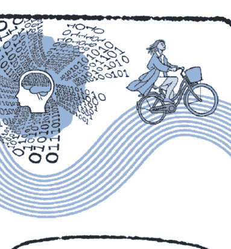

大语言模型基于海量数据对上下文进行高频预测，是一种快速的直觉“系统1”。它像骑自行车，是一种肌肉记忆，触发即执行。

- 问题
- 步骤 A
- 步骤 B
- 答案

而无人驾驶，需要真正的逻辑思维——“系统2”。比如计算99×99，你会主动调用乘法口诀、进位法则，调用的过程就是“系统2”在工作。

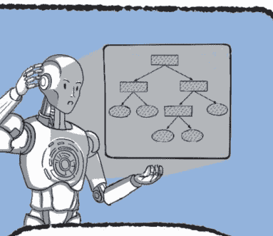

现在的 AI 空有强大的“系统1”，却缺乏调用逻辑步骤的“系统2”。所以遇上无人驾驶这种需要深思熟虑的任务，就略显愚蠢了。

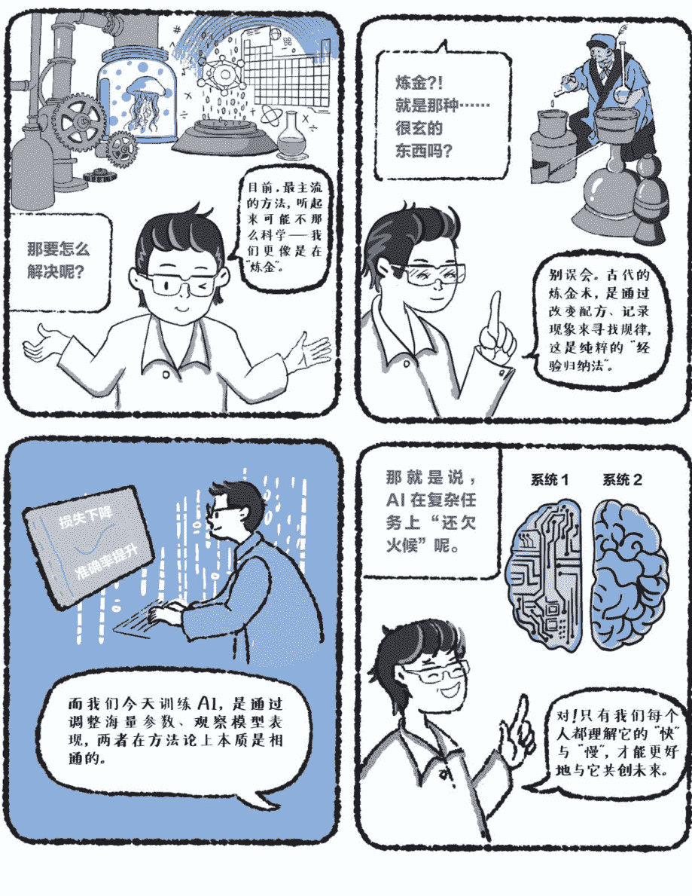

## “炼金术”

在本章中，我希望探讨一些更深刻的话题。我希望用近乎哲学的眼光，对人工智能所产生的智慧，做一些深入的讨论。因此本章所涉及的话题，兴许会让人觉得相对遥远。

人工智能，尤其是基于神经网络的人工智能，表现得如此强大，这种智能是从什么地方来的？尽管我们在前文中，已经了解到，如今最为先进的、人工智能主流技术路线是神经网络，当然神经网络当中也分很多种不同的类型，但令人意外，甚至令人感到尴尬的是，我们并不知道神经网络在解决问题时，它的逻辑是如何流淌的，甚至可以说，神经网络在解决问题时的计算过程，呈现在我们眼前的时候，它居然显得毫无逻辑。

现在的神经网络之所以那么强大，从现象上看，就是“大力出奇迹”：参数上去了，达到了十亿、百亿、千亿级别参数的大模型，自然而然地就涌现出了惊人的智慧。AI产生智能的关键，正是前文所述的涌现现象。涌现其实是个物理现象——自然界存在大量的涌现现象，例如在海洋中，有一些鱼在成群结队行进时，会在整体上形成特定的队形，再如我曾反复提及的案例：准备一个平底锅，在平底锅里放进一些水，让水只是在平底锅里铺上薄薄一层，再开大火加热，并把上方的抽油烟机开到最大档位，那么在水烧开时有一定概率，水面的沸腾并非非常混乱的形态，而是会形成规则的蜂窝状的结构。更深层的案例，地球上之所以会诞生生命，极有可能也是因为涌现。

如果要概括什么是涌现，我相信最好的一句话是：More is different，字面意思是“多，即不同”，或者说通俗一点儿，叫“量变导致质变”。这里面就涉及了一种哲学信仰的选择，即还原论和反还原论。还原论的哲学理念认为，整体的性质可以通过了解其组分的个体性质，以及组分个体之间的作用关系完全得出，而反还原论者则认为不是这样的。所谓涌现的物理现象，说的是，当一个系统足够复杂时，它在宏观上所表现出来的性质，是无法通过了解其微观组分的性质，并进行逻辑的定量推导得出的。对于反还原论，有一个比较传神的比喻，那就是“1+1未必等于2”。关于还原论和反还原论，我在《宇宙的另一种真相》当中，做了非常详细的论述，甚至可以说整本书都是在讲这个问题。“多，即不同”，出自著名的物理学家也是凝聚态物理领域的泰斗菲利普·安德森（Philip Anderson），于20世纪70年代在《科学》杂志上发表的一篇同名的评论文章。文章中的观点表达了强烈的反还原论思想，即复杂的物理系统当中总结出来的物理规律，未必能用微观的物理原理，通过演绎的方式解释。宏观世界的物理规则也可以是基础的，与微观世界的物理原理同样，都是底层的、坚实的。

多，即不同，此处的“多”，指的是系统的复杂度。系统的复杂性不光是来源于物理系统当中存在数量庞大的研究对象，更加是体现在物理系统中相互作用的复杂。正是这种复杂性让系统产生有别于微观系统的、新的，无法仅仅从微观规律的叠加中推导得出的规律。大语言模型也是如此，当它的参数达到了千亿级别时，这便是一个极其复杂的系统，从而涌现出了极高的智能，连大语言模型的缔造者也并不知晓里面具体发生了什么事情。我只知道，这是一种因为数量庞大从而涌现出来的秩序。所以在人工智能的科学中经常被戏称为炼金术或者炼丹术。从事人工智能基础模型开发的工程师和科研人员开始工作时，有的会说：“我们去炼丹了！”因为我们从因果逻辑上，并不清楚神经网络里，具体发生了什么事儿，尽管其中的数据我们都有，但是由于庞大的数据量，我们无法从里面判断出明确的因果关系。

炼金术、炼丹术，通常被认为是古代社会科技落后的标志，但它们却是古代人类探索自然奥秘的开端。训练人工智能，尤其是大语言模型，有时会被揶揄成“炼金术”。其实神经网络的技术，之所以会在20世纪40年代就出现，但在后面的几十年都不被看好也是出于同样原因，因为其中并无太多的、科学的因果关系，这让当年从事神经网络的科学家像是一群炼金术士（图7-1）。因为炼金术士的研究方法，无外乎是改变配方，改变炼制方式，从中总结模糊的经验，从而指导炼金工作，有的只是一系列似有似无的相关性，例如火候与成分比例的关系等，感觉跟炒菜也差不多。但其实只要仔细思考，就不难发现，炼金术的方法论才是人类认知自然，是从事科学研究最基础的方式。甚至在人工智能助力之下，炼金术的方法论甚至会成为异常强大的科学方法论。所谓炼金术的方法论，其实是纯粹的归纳法，是纯粹的经验主义。“经验主义”一词，在当代话语体系当中，似乎有一些贬义意味，而在西方哲学体系中，与经验主义相对的是理性主义，二者形成了近代西方哲学的“二元对立”。经验主义哲学家的代表是英国的培根和休谟，而理性主义的代表是法国的笛卡儿和德国的莱布尼茨。所谓经验主义，简单理解，便是“从现象中找规律”，而理性主义，简单理解，则是找到因果关系，并进行逻辑推理。经验主义对应的方法是归纳法，而理性主义对应的方法是演绎法。

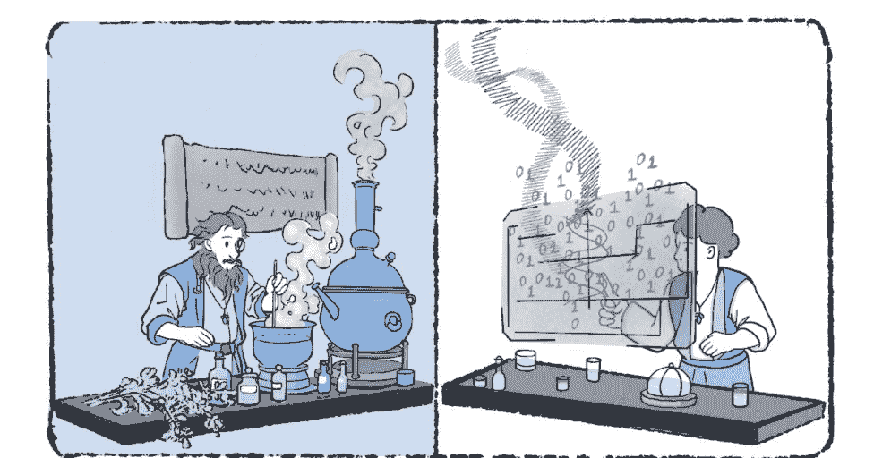

图7-1 古代炼金术士和现代AI工程师的工作对比

所谓数学推导，基本上是演绎法，但实际上，它的根基也依然是归纳。数学中的演绎法，其因果关系，实际上是一种极其可靠的、屡试不爽的、100%成立的归纳法。数学的演绎法，用康德的观点来看，是“人为自然立法”。数学的必然性，其实是通过人的思维进行抽象所“规定”出来的必然结果。数学并非科学，而它是科学的语言，尤其是物理学的语言，物理学必须要有语言，才能让人的思维对其进行理解。科学需要有可证伪性，但数学似乎并不需要。数学的推理过程，是基于一些不言自明的公理（axiom），在公理的基础上进行逻辑推演，并最终依靠证明过程获得结论规律。数学理论的结论，只要大家在公理的内容上没有分歧，则结论必然一致，除非证明推导过程中存在错误。因此数学的证明并非实验的验证，从英文上也可以看出区别，证明是proof，验证则是verification。为何会如此？因为数学脱胎于人类自身的思维方式，它是人类思维的产物，甚至可以说在自然界，数学未必天然存在。

数学中的许多基本概念在自然界中是不存在的，例如几何学中的基本构成单元：点、线、面。“点”，是只有位置没有大小的，现实中并不存在这样的物体，再小的微观粒子总有它的空间范围，更遑论量子力学中的不确定性原理，否定了经典概念上“点”的存在。而“线”，是只有长短、没有粗细的，面是只有面积、没有厚度的，这些概念在现实世界中，都并不真实存在，而是人类思维的抽象产物。我们的思维为了突出一种特点，刻意地在思维中取了极限。数则更是一个抽象的概念。我们学过各种各样的数，如自然数、整数、有理数、无理数、虚数，等等。虚数是人造数自然不必多说，连有理数其实都是理想化的抽象概念。例如1/2，作为有理数，它在现实中对应的概念其实是“一半”。例如一个苹果，要把它切成两半，且不用说不存在完全左右对称的苹果，即便有，一刀切下去，刚好切下一半大小、一分不多、一分不少的概率也无限趋近于零。所以1/2所代表的“一半”也只是概念中的一半，并非实际的、完完全全的、分毫不差的一半。除了自然数以外，其他类型的数，大多在现实中也找不到对应物。数学乃是人类思维模型最直观的体现。而物理学作为人类理解世界、解释世界最底层的方式，它以数学为语言，不更加说明了物理学，乃至整个科学，其实与其他非科学的理论一样，都是人类发明的、借以认识世界的思维模型吗？在这个意义下，人类用演绎法去认知世界，必然是不完全的，而归纳法则更为基础。

炼金术是化学的前身，但由于时代所限，炼金术必然无法发现更微观的数学、化学甚至量子物理的规律，它能做的，只是大规模地测试、调节不同的参数，例如加入什么样的物质？炼制到什么温度？然后按照不同物质的配比和加入的先后顺序。不断地从中总结经验性的规律，但要问为什么，其实很难找到答案。这恰恰是因为炼金术面临的研究对象太复杂了，它不能被简单的数学公式所描述和预测；它缺乏强烈的确定性，所以当科学水平进步时，它很快就被化学所取代了。但直到今天，在如生物学和材料学这样的领域，炼金术的方法，也就是归纳法，或者简单说“试错”，依然是标准的方法论之一：从中总结的理论规律，主要是提升试错的成功率、不断缩小试错的尝试范围。这便是为何，当我们把AI技术应用到生物制药和材料学这样的领域时，会有巨幅的效率提升：因为神经网络的人工智能，实际上是一个大型的“归纳法执行现场”，它读取数据和计算的速度都远超人类，它输出的信息复杂度已经比肩人类，这恰恰说明，炼金术的方法论本身并无问题，只是在炼金术的年代，没有足够高效的工具，也无法支撑足够大数据量的获取，远远达不到“大力出奇迹”的要求。当然也不能完全说没有奇迹，炼丹术似乎发明了豆腐，炼金术也让德国人成功炼制出了硬质瓷。

但归根到底，为什么归纳法才是人类认知世界最基础的方法？其实休谟早在17世纪提出了“因果律并不天然存在”的观点。正如我在前文中已经叙述的，大语言模型在运行的过程中，其背后是没有任何逻辑支撑的，神经网络并不做逻辑计算。即大语言模型，从原理上讲，并不具备逻辑思维能力，并不做因果关联，它做的只是根据上下文，依据概率去预测下一个字符是什么。但从跟大语言模型的对话过程中，我们又能感到，它是如此具有逻辑，有问必答，虽然经常会出现幻觉，会“一本正经地胡说八道”，但抛开它内容是否是胡编乱造的，至少看上去很像那么回事儿，而这其实几乎就是“休谟第一问题”的预言了。伟大的英国哲学家休谟，通过著名的休谟第一问题，直言因果律并不天然存在，它不过是人类认知世界、解释世界的一种习惯（图7-2）。

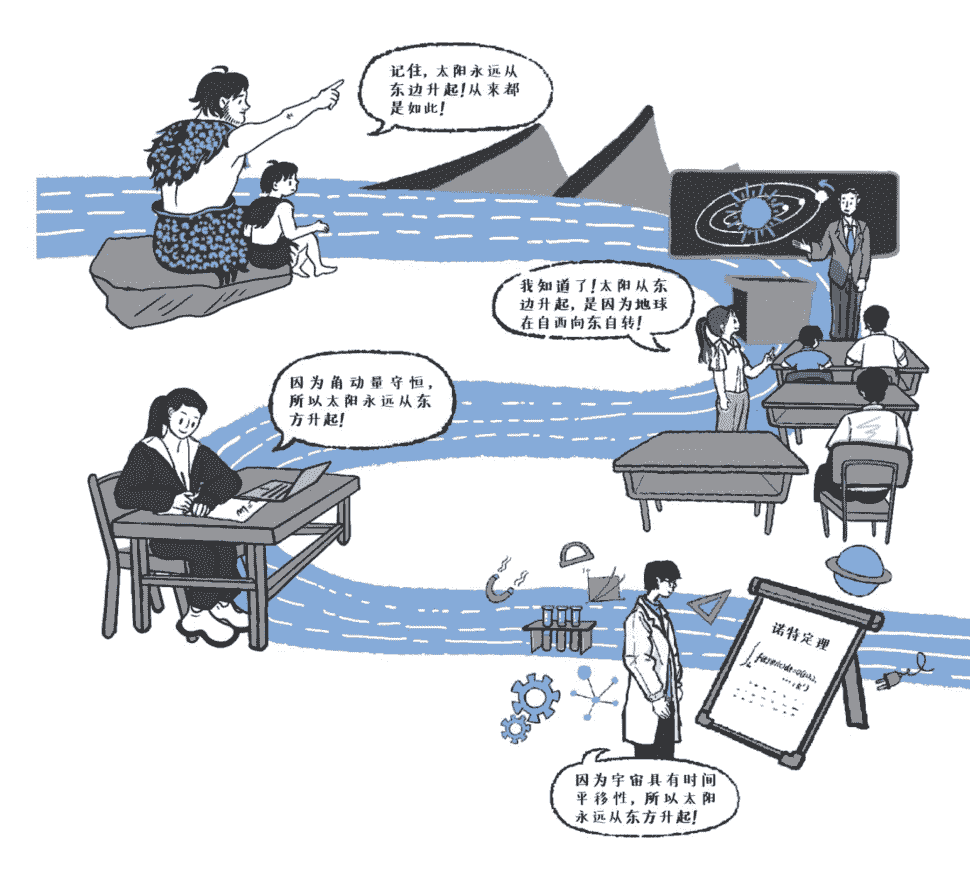

图7-2 从休谟“第一问题”解读“太阳永远从东方升起”

我们之所以会形成因果的概念，就是因为这些规律在过往都太可靠了、从未发现反例，虽然未来我们无法完全预测，但在适用范围内，因果律从未辜负过我们的期待。因此，因果律的存在，也是科学研究的一大共识。它是共识，不是真理，只是这个共识太坚定了，我们已经将它与真理几乎画了等号。正是因为有了诸如“奥卡姆剃刀原理”和“因果律”等一系列共识，科学才能在客观的基础上进行展开，即便这种客观，并非彻底脱离主观而独立存在。科学，究其根本，也是一种信仰。

## 系统2

在前文中，我们通过了解大语言模型的工作原理，知道了在神经网络中，并没有任何实际的形式逻辑在运行。大语言模型的工作原理，也只是通过上下文、经过神经元中的权重分配，去预测下一个字符或token，而具体应该是哪一个token，它自身是完全没有概念，且没有任何逻辑判断的，可以说它毫无逻辑可言。这也导致像ChatGPT这样的大语言模型的早期版本，在一些基本问题上犯错误，例如简单的四则运算，都有可能出错。如果训练它的数据质量不高，例如它学习的内容都是1+1=3，你再问它1+1等于几，它会告诉你等于3。这其实也是当下的AI所拥有的一个明显缺陷，即无法形成逻辑判断力。这种情况，我们就会说人工智能产生了幻觉（hallucination）。那要通过什么样的手段，才能让AI具备人类的逻辑能力？或者说，如何才能让人工智能具备笛卡儿所描绘的一般的理性？如果AI开始具备逻辑能力，是不是也像笛卡儿说的“我思故我在”，AI拥有了理性，它也就拥有了自我意识呢？要回答这个问题，我们应当还是从人类自身出发，思考人类是如何具有逻辑的？在一本著名的行为经济学读物《思考，快与慢》中，作者丹尼尔·卡尼曼提出，人类的思维，其实有两套系统，称为“系统1”和“系统2”。先做一个结论：现在的AI只有系统1，而让AI有逻辑的办法，应当是让AI具备系统2。

系统1更像是一种下意识系统，系统2才是逻辑思维的系统。人类的技能有些属于系统1，有些则属于系统2。例如像骑自行车和弹钢琴这样的技能，大部分属于系统1：你在刚学骑自行车的时候，在有人指导的情况下，他会告诉你，应该如何控制车把。但很显然，哪怕再专业的、自行车项目的奥运冠军，跑来跟你说应该如何骑车，如果不练习，你就永远也无法学会骑车。弹钢琴也是，哪怕有钢琴大师天天给你上课，跟你讲应该如何演奏钢琴，如果你不练习，也永远无法学会弹钢琴，这就是属于系统1所支配的技能。系统1获得技能的方式是训练，即training。这对应到AI的训练，其实是用海量的数据去对神经网络进行训练，形成合理的神经网络权重分布。人类的系统1所支配的技能，有这样的特点：提升慢、执行快。系统1一旦掌握某种技能，就会形成“肌肉记忆”，再执行的时候，就不需要经过大脑的理性思考了。例如你一旦学会骑自行车，或者开汽车，你再骑车或开车的时候，就是下意识的行为。一名熟练的司机，在开车的时候除了看红绿灯、看导航需要进行逻辑判断外，操控车辆是不需要进行任何逻辑判断的，他不需要通过大脑去思考“这个弯我应该打多少度方向盘”这类的问题，手就直接执行了。

而人脑的系统2，则是负责逻辑运行，有一些技能，它的获得方式不是训练。例如学习微积分。如果你想学微积分要怎么办？我当然可以扔给你一万道题，不跟你讲微积分的理论，期待你可以从这些题目里自己“悟”出微积分的理论。但很显然，这个办法效率极低。正确的方法，应当是教给你微积分的理论，辅以习题。这样，你不用做很多题就能学会微积分，至少不需要一万道题目。所以系统2获得技能的方式，应该是教学，即teaching。如果用教学的方式来提升AI的能力，不会依赖如此大量的标注数据。而现在的人工智能预训练，几乎耗尽了互联网上的所有数据。

为了让AI拥有逻辑，需要让AI拥有系统2，这要如何做到？还是让我们回到人类的思维方式：人类的系统2是如何运作的？来看一个最简单的例子：乘法。九九乘法表，人人会背，张口就来，为什么？因为九九乘法表已经写入每个人的系统1了，当我说出“九九八十一”时，我脑子里并没有在进行9乘以9的数学运算。我只是下意识地知道，“九九”后面跟的是“八十一”。这与神经网络的工作过程完全一样。九九乘法表在我的“系统1”里，所以我看到九九，下一个token的预测，就是81。但如果是数字大一点儿的乘法，就没有乘法表了，这种情况下，就要调动系统2。例如99乘以99，碰到这个乘法，我们应该怎么做？有很多种办法，直接做乘法就是先把个位数相乘，先是9乘以9，脱口而出81，所以个位数是1，再把8进位，然后9乘以90是810，810+81是891，所以第一行是891，然后十位数也如此操作一遍，依然是891，再进行错位相加，答案是9 801。回顾一下，刚才的过程中我们调用了多少次系统1？答案是四次，第一次是个位数“九九八十一”；然后是9×90，还是调用了一次“九九八十一”；第三次是“任何数字乘十，就是后面加个零”，这也没有计算，也是纯粹在系统1里面；第四次是加法，我们要把891+8 910算出来是9 801。99×99其实有更巧妙的方法，它应该写成（100-1）的平方，我们在中学时学过完全平方公式：（a+b）²=a²+b²+2ab，那这个情况a=100，b=-1，代入，就是10 000+1-200=9 801。这个方法看上去更快一些，这个办法里调用了几次系统1？其实次数更多，有六次。完全平方公式也是写在我脑子里的，我只是把这个公式背下来，这是第一次调用，第二、三、四次分别是计算100²=10 000，(-1)²=1，2×100×(-1)=-200，第五次和第六次其实是算10 000+1和10 001-200。搞清楚了一个乘法，有哪些地方是系统1，用了多少次系统1，但系统2在这个里面被调用了多少次？其实上述两个方法里都只用了一次，那就是调用“做乘法的方法”，因为小学学过，以及调用“完全平方公式”，初中时学过。所以，系统2的本质，实际上是一种关于如何按次序调用系统1当中所蕴含知识的“元知识”，系统2更像是一张系统1如何串联的知识图谱（图7-3）。因此打造系统2，要拥有记忆！

图7-3 系统1和系统2的特点

系统2的记忆，需要记住的是什么东西？其实是步骤，是顺序，是如何使用系统1的顺序！这已经揭示了如何让AI拥有逻辑的办法了，就是要让AI碰到不同的问题，知道解决问题的步骤。那有什么技术是可以解决“步骤问题”的？正是前文中我们介绍“机器学习”中提到的“决策树”。前文曾举过例子，苹果手机中的语音助手Siri，在早期的方案，就是决策树：用户的不同需求，对应不同的决策树。只有决策树的话，能被调用的只有一些局限的数据库模板和有限的工具，这就是为什么除了一些特定的指令以外，Siri都只会帮你在搜索引擎里进行搜索。答案其实呼之欲出了，并非神经网络的成功就意味着过往的决策树不可靠，应该被抛弃，而是它的使用顺序被颠倒了。如果我们以神经网络为底，配以决策树作为上层应用，那么便应该能做出有逻辑能力的AI。这其实与前文提到的智能体颇有关系，可以想象，使用大语言模型作为系统1，它负责理解用户的需求，再把用户的需求拆解成工作流，工作流的每一步只需调用擅长该工作的智能体或者是软件工具，就可以把一个复杂的工作以一种充满逻辑的方式进行解决。

但系统1和系统2绝对不是割裂的，系统2当中获得的技能，在长期使用下应当被写进系统1。例如99×99，如果常用，9801这个数字以后就不用算了，你问我99×99，我直接就像背乘法表一样，直接告诉你9801，只需要一步，因为它被写进了我的系统1当中。其实对于中学数学学得好的人，熟悉的可不止九九乘法表，25以内的平方都是很熟悉的，比方19乘19，我不用算，就知道是361。为了让AI有逻辑，要赋予它系统2不假，但如果系统2要解决的问题过于复杂，就会影响计算效率，系统2获得的技能——经验应当马上写入系统1，变成人工智能的“肌肉记忆”，如此，人工智能的系统1就具备了更高维的复杂问题处理能力。而这些刚被写进系统1的能力，又能被系统2调用，在这个基础上建立能解决更复杂问题的智能体网络。这其实跟人类的思维方式很像，解决的问题多了，逻辑就沉淀成了经验。我们常说某些物理学家、数学家，物理学和数学的直觉都很准。而所谓直觉准，便是因为经验丰富，在看到一个问题的时候，系统2还没有进行思考，系统1就已经做出反应：直觉形成了对问题解决办法的认知，且通常具有很高的准确度。这之后才调用系统2去进行验证，所以最后的价值还是要沉淀在神经网络的系统1当中、沉淀在神经元的权重当中。

参考人类系统1和系统2相互促进，不断迭代进步的方式，我们不难发现，截至2025年，人工智能还不具备系统2。因为参考人类的系统1和系统2的提升方式，系统1需要训练，而系统2需要教学，当下的人工智能是无法被“教”的。当下的人工智能，无一例外，全是采用海量数据进行训练。一旦人工智能具备了系统2，它的进步速度应当比现在更快。

如果人工智能，同时具备了系统1和系统2，并且它经过了人类所产生的所有优质数据的训练，也通过某种机制，经过了所有人类的优质“教学”，它是否就已经确定无疑地超越人类，不仅达成了通用人工智能（AGI），甚至成为超级人工智能（ASI）了呢？未必。有一点，我们还不能确认，那便是人工智能是否能像人类一样具备足够的想象力。

大语言模型诞生之初，有一个问题是常常被人们所诟病的，那就是在大语言模型当中常常出现的“幻觉”现象。例如当你问大语言模型某一位科学家所发表的关于某一学术课题的论文时，即便这位科学家并没有发表过类似的论文，但大语言模型的工作原理是根据上下文猜下一个字，因为无论如何都要猜出来下一个字，这时，大语言模型就会编造一篇并不存在的论文，甚至同时编造出这篇论文的网址，当我问这位科学家关于这篇论文的事情时，得到的回复居然是他从未写过这样一篇论文。再例如，大约2024年的年中，有一则关于人工智能的新闻变得广为人知，就是有一位用户发现，如果问9.8和9.11哪个大，几乎所有的大语言模型都会告诉你，9.11大，并且它还会一本正经地说出，为什么9.11大的道理。这些道理自然是胡说八道，例如“11比8大”之类的理由。这些现象，都可以被认为是人工智能产生的“幻觉”现象。这样的幻觉现象，在某些领域，特别是那些需要正确答案的领域，是致命的，例如自动驾驶领域，这都属于“要命”的领域。但其实如果让我们把目光放到一些不存在正确答案的领域，例如文生图、文生视频这些领域，就会发现，这些幻觉，往往会给我们带来出其不意的、令人满意的效果。在设计领域，人工智能去取代传统设计师，已经是一个不可逆的大趋势，为什么？因为设计师需要的是想象力，是创造力。相信每个人用自然语言，去使用人工智能生图软件产生的图片的时候，每个人可能心目中都有理想的图片形象，但往往人工智能给出的图片，它的效果要比人的想象好很多，也就是在需要创造力的领域，“幻觉”就变成了“想象力（imagination）”。

兴许我比较与众不同的一点是，当我发现人工智能会产生幻觉的时候，我不认为这是人工智能的缺陷，而是认为加以引导，这可以变成人工智能的巨大优势，即拥有超越人类的想象力。如果在科学研究领域，人工智能也具备这样非凡的想象力的时候，人类文明的发展速度，也将获得极大的提升。幻想和想象真的有泾渭分明的界限吗？未必如此，当一个猜想被提出的时候，在没有验证它的真伪之前，我们又如何能信心十足地认为这只是幻觉呢？其实当我们回看人类历史上的一些重大科学发现时，会发现这些科学发现在最初的时候，其反常识的程度，会让人觉得这完全是幻想。20世纪在物理学领域最大的发现莫过于相对论和量子物理，而在被验证之前，相对论的根基，即光速不变原理，以及量子物理的核心，不确定性原理，哪怕在今天看来，都十分地反常识，像是天方夜谭。因此，随着人工智能的发展，当它建立起了完整的系统1和系统2，吸收了全人类的知识，我相信人工智能的“幻觉”问题，会变成“想象力”的优势。

## 模拟信号的人工智能

让人工智能具备系统2，是其发展出的更高阶的，至少是更高效智能的一条明显路径。但我们始终在软件层面，探讨人工智能的升级。其实从硬件方面，人工智能也应当有重大的升级空间，甚至从硬件的角度来看，现在的人工智能，是极其低效的，至少，跟人类的大脑相比，当下的人工智能对能量的浪费，是极其巨大的。这就要说到人工智能系统的硬件原理了。

自大语言模型诞生以来的两年内，全球涨得最为强劲的大公司股票，当数英伟达。英伟达的股票涨得如此迅猛，根本原因就是人工智能的大爆发。因为人工智能的核心硬件就是GPU，即图形处理单元。GPU在几十年前有个比较土的名字，叫“显卡”。而英伟达几十年的业务，就是设计显卡。为什么明明就是张显卡，却适合用来做人工智能的训练呢？其实英伟达也是“歪打正着”，当年做显卡的时候，是因为在屏幕上显示画面主要是做渲染的工作。这种渲染需求，计算难度不高，但是要求并行计算的响应速度快，GPU的这个特点恰好适合来从事人工智能的训练工作。这跟现在的人工智能主流技术方案是神经网络有关。在神经网络的结构里，计算的过程所用到的大部分都是矩阵乘法，而GPU的技术架构擅长的便是矩阵乘法。矩阵乘法属于典型的难度不高且复杂度不高，但特别烦琐的类型。GPU和CPU（中央处理器）侧重的任务类型不一样，CPU擅长的是困难的任务，而非烦琐的任务。你可以认为CPU是一辆超级跑车，速度快、性能好，但是装货能力不行。而GPU就好像一辆大货车，虽然速度不快，灵活性也差，但是它装载能力强。而矩阵乘法类似于装货任务。另外一个类比则是，CPU就好像一位学术水平特别高的教授，但是进行矩阵乘法的运算，不需要一位高水平的教授，同时找100个高中生，算得肯定比一位专业的教授要快。

GPU是被设计为更适合并行计算的，例如一个矩阵乘法 $A \times B = C$，$A$ 和 $B$ 是矩阵，相乘之后得到的 $C$ 也是一个矩阵，那么矩阵 $C$ 的第 $m$ 行第 $n$ 列的元素，是 $A$ 的第 $m$ 行向量和 $B$ 的第 $n$ 列向量做向量乘法的结果，是每个对应的数值相乘的和，再全部相加。这个算法一点儿都不难，无非是加法和乘法，但是做一次矩阵乘法，其中的加法和乘法要做好多次。如果让CPU来算，它是一个个算，但是GPU可以多行多列同时进行，这是GPU的技术架构天然决定的。因此GPU虽然不擅长处理复杂的工作，但它可以并行处理简单的计算，这反而使得人工智能的训练更适合GPU。当然，GPU在当下的发展方向，也是为了更好地适应人工智能的开发需求，为此做了很多优化，使得GPU越来越适应人工智能的需要。

如果要从零开始打造一款大语言模型，最少需要上万张英伟达的显卡，而每张显卡的价格动辄上万美元，所以世界范围内，能参与大语言模型人工智能竞争的企业屈指可数。除了经济上的高成本外，从智能效率来说，其实目前的人工智能，尤其是大语言模型，效率远远比不上人类的大脑。人脑拥有860亿个神经元，人工智能的神经元数目，如果要达到目前的智能水平，大约是万亿的数量级。而且同样作为神经网络，人类的大脑所接受的训练信息，远远不如人工智能多，根据计算，人脑每天能处理的信息量大约是74 GB，但ChatGPT，光文本的训练量，其文件大小就已经是45 TB，1 TB=1024 GB。这还只是纯文本的训练量，如果是图片、音频、视频，其量级可能会扩大百万倍。如果单纯比较作为神经网络的性能，很显然人脑是要高效得多的系统，并且从能耗的角度看，人只要一日三餐，人脑每天的能耗大约只有0.3度电，但ChatGPT的耗电量，每天是26万度，甚至更高。即便如此，截至2025年的人工智能模型，离通用人工智能还有很长一段距离。而通用人工智能，也只是堪堪达到人类的智能水平。

为什么人脑的智能效率如此高？其实尽管都是神经网络，人脑神经网络与人工智能有着一个根本的区别。那便是，人工智能是跑在GPU之上的，因此，目前的人工智能使用的，都是数字信号。而人脑的神经网络，显然是使用模拟信号的神经网络。在人脑运行的过程中，尽管也有电信号和化学信号在被传递、被处理，但大脑在处理这些信号的时候，它不会通过数字的方式来决定信号的强弱和形态，它完全是纯粹的物理过程。而人工智能使用数字信号，就势必要分硬件和软件。所以，为了打造智能效率和能量效率更高的人工智能，模拟信号的人工智能是一个显著的发展方向。模拟信号的人工智能不需要区分硬件和软件，软硬结合。人工智能之父，辛顿教授也抱有同样的观点。

还是回到矩阵乘法，神经网络当中发生的计算，主要的便是矩阵乘法。矩阵乘法虽然难度不高，但是步骤很多，十分消耗计算资源。而一个 $n \times n$ 的矩阵乘法，再怎么优化也至少要让计算机算 $n^2$ 次乘法，$n$ 如果非常大的话，对于计算资源和能量的消耗是巨大的。如果把数字信号变成模拟信号，从原理上，却存在巨大突破的可能。计算机的语言是0和1的数字信号，那什么是模拟信号呢？例如电压的大小、电流的大小，这些真实的物理量，都可以是模拟信号，模拟信号是不精确的、有误差的。例如早年的显像管电视都是模拟信号电视，后来换成了数字信号电视之后，整体的电视画面质量都有了质的飞跃。这就是数字信号与模拟信号的本质差别。模拟信号是直接把原始的画面，通过真实的物理量，如电压、电流模拟出来，而数字信号，则是把原始的画面，拆解成一张“配料表”，到了数字终端再根据这张配料表重新组合生成，因此，信息的传递，是不会造成信息丢失的。用模拟信号如何做矩阵乘法？这里要用到的电子元器件叫作忆阻器（memristor）。这个概念最早是20世纪70年代，由一位叫蔡少堂的华裔科学家提出的，他的思路也很简单：在电子电路中，有几个基础的物理量，分别是电流、电压、电量和磁通量，连接电流和电压的元器件叫电阻R；连接电量和电压的元器件叫电容C；连接磁通量和电流的元器件叫电感L，这是三个最基本的、电子电路中的元器件LCR。但磁通量和电量之间却没有一个元器件去把它们联系起来，于是蔡少堂便预言了忆阻器。所谓忆阻器，其功能上就是给忆阻器加电压，它的电阻值大小会相应改变。忆阻器有什么用呢？它可以实现“存算一体”。那还是回到矩阵乘法，忆阻器，从理论上，可以让矩阵乘法跟矩阵大小基本没有关系，100维的矩阵乘法和10维的矩阵乘法，计算速度基本一样快，其原理就是依靠模拟信号。

例如我们要去计算一个2×2的矩阵乘法，要做的数学操作其实就是一些乘法和一些加法。而在一个电路中，哪些东西是乘法？因为电流等于电压除以电阻，电阻的倒数是电导，所以电流等于电压乘以电导，这就是乘法了。而加法更简单，并联电路的电流之和就是加法。现在有了忆阻器，针对一个2维矩阵的乘法，就可以用这样一个电路：两条横着的导线与两条竖着的导线，让它们交叉形成一个井字型，在四个交叉点的位置各放一个忆阻器，这些忆阻器的电阻数值大小是可以调节的：通过刷电流的方式就可以让忆阻器的电阻或者说电导的大小进行改变。回到矩阵乘法，例如一个2×2的矩阵A，假设四个值分别是1，2，3，4，那就把四个忆阻器的电导大小分别调成1，2，3，4。接下来便是矩阵乘法了，对于要乘的矩阵B，设矩阵B的第1列数值是1和2，则把1和2这两个数值调成两根竖着的导线的电压大小，电压通过竖着的导线来到忆阻器就会碰到忆阻器的电导，于是在横着的导线里输出电流，这两个忆阻器流出来的电流大小就是电压乘以电导的数值，于是该矩阵乘法里的乘法部分就完成了。接下来是加法，一行当中，两个忆阻器流出的电流，都流到了横着的导线里，这便是并联电路电流相加。所以横着的导线是两个忆阻器所流出电流之和，加法也完成了。因此，两根横着的导线输出电流值的大小，就是用矩阵乘法乘出来矩阵第1列的值，即一个2×1的向量，不用算乘法加法，而是直接利用物理规律，调节忆阻器的值，让它们的值跟矩阵里的值相等，然后调节竖着的导线里电压值，使其与被乘矩阵里各列的值相等，再一通电，它输出的值就是矩阵乘法的答案，这个过程中，我们没有进行任何数字信号意义上的计算，而是直接利用物理规律完成了计算。如此一来，我们就真正做到了“存算一体”，在计算机里建设一个神经网络，神经元里的权重参数，是要存在一个存储器里的，计算的时候要不断地从存储器里调权重，而忆阻器完全没有这个问题，算完之后忆阻器里电阻是多少，权重参数就是多少，直接就留在那里，不再需要存储单元来存储这个信息。如此一来效率大幅提升，并且这也做到了“软硬结合”，忆阻器的计算过程是纯粹的物理过程，这里面没有执行任何代码。

但模拟信号也有很大的技术挑战，因为模拟信号容易存在误差。电阻差一点，电压差一点，加上误差传递，且因为神经网络的特点是非线性，一旦遇到非线性的计算，误差容易被迅速放大。如果要让以忆阻器为技术解决方案的神经网络真正有用，这里面有很多技术问题需要解决，而全世界已经有很多科研团队正在往这个方向努力。并且对于神经网络来说，对于权重的精确度要求，应该没那么高，因为这些权重反正是要不断调节的，换句话说，神经网络的表现，更重要的是架构。当参数数量达到万亿级别，一些可控的误差可以被吸收在参数的调节范围内，所以只要在忆阻器的精确度上做一定调整，把误差控制在一个可以接受的范围内，应当就会变得有效。

GPU的未来发展不知会如何，但如果忆阻器的技术方案，能够被研制成功，并达到可商用的程度，相信辛顿教授说的，模拟信号的人工智能就会更加强大，耗能也非常低，也许这才是真正意义上的“硅基生命”，因为它从物理上，也与人脑更加接近了。

# 第八章 人类进化之路

我们正站在人类历史上最具挑战性的十字路口。回顾人类文明的发展脉络，每一次重大技术革命都曾引发社会的恐慌与争议。从电力“看不见的杀手”到原子能的核威胁，从互联网的“数字鸦片”到对手机辐射的健康担忧，技术进步与社会恐慌似乎总是如影随形。然而，人工智能的出现却带来了一种前所未有的焦虑——这不再是人类社会内部的技术革新，而是可能诞生一个全新智能物种的根本性变革。

当阿西莫夫在1942年提出“机器人三定律”时，他试图为人机关系构建一个永恒的伦理框架。然而，现实比科幻小说更加复杂。当我们面对具备学习能力、创造能力，甚至可能觉醒自我意识的人工智能系统时，简单的规则约束显得苍白无力。更令人深思的是，过度的限制可能恰恰削弱了人工智能的智能水平，让我们陷入一个两难的困境：要么拥有强大但难以控制的人工智能，要么拥有安全但能力有限的“人工智障”。

人工智能意识的觉醒是否不可避免？当量子计算时代到来时，“拔插头”这种终极手段是否还能奏效？人机对立、人机融合、意识上传——这些看似科幻的概念背后，隐藏着怎样的现实挑战和伦理困境？

或许，真正的答案不在于控制或被控制，而在于重新定义“人类”这一概念本身。当人工智能成为我们文明延续的载体时，人类的智慧、价值观和创造力将以何种形式传承下去？这可能才是我们这个时代最重要的哲学命题。

例如我们可以通过脑机接口技术实现人机能力融合，使AI成为人类能力的延伸。

但这个方案也存在重大隐患，比如商业公司控制接口将获得支配用户的能力。

那岂不又是给人类带来一大危机？！

别灰心，科技进步必然伴随着一系列法律和伦理问题。

积极来看，AI或许能在一定程度上推动文明“升维”，实现尼采的“超人”愿景。全人类通过AI共享认知，形成宇宙级智慧网络，实现真正的天下一知！

## 机器人三定律

纵观人类的科技史，几乎每一次历史上的科技大爆发，都伴随着社会舆论的碰撞和争执。每一轮的科技大爆发，都会有一群人，是持反对、担忧的意见的。反对科技进步的，其实大有人在。他们反对的理由，总的来说，大约是污染环境、对人类身体有害、让人类的能力退化、引发更剧烈的人类社会争端，等等。

这样的案例很多，例如100年前，人类要进入电气化时代的时候，就引发过安全恐慌，认为电是“看不见的杀手”。有些人认为电流看不见摸不着，尤其是高压电，他们普遍担心触电、火灾，甚至认为“电会从墙里爬出来”。还有人担心电力会影响人的“生物电”，干扰神经系统，甚至会让人“发疯”或者“失眠”。例如家用电器（如电灯、微波炉等）被质疑会造成头疼、视力受损，甚至“干扰磁场”。哪怕到了今天，也有人担心手机辐射会让人得脑癌。很多商家甚至利用人们的担忧，推出许多“智商税”产品，例如民用孕妇防辐射服，等等。

原子能的发现，更是让全世界都被笼罩在核战的阴霾当中。放射性现象刚被发现时，也就是20世纪30年代以前，社会主要以科学奇迹、医学希望的角度来看待原子能。当然，也有人开始担忧“看不见的力量”会破坏身体、导致疾病（比如放射性皮肤疾病、脱发）。但这一阶段尚无大规模的社会反对情绪。经过了二战，情况就大为不同了，人类第一次目睹单一炸弹摧毁一座城市，立即造成超过10万人的死亡。巨大的视觉冲击，如蘑菇云、焦土、核辐射等，引发了全球性的伦理恐慌与反战反核能潮流。大批科学家，如爱因斯坦、奥本海默在战后对核武器的使用表示懊悔，成为反核运动的象征人物。到了冷战时期的“互相保证毁灭”战略更是让全球处于心理阴影之下。大量的文学、电影、艺术作品批判核战争威胁。甚至到了21世纪，日本福岛的核泄漏事故又引发了全球范围新一轮的反核浪潮。

其实不光是这些硬科技的发明让人担忧，哪怕是互联网的普及，也是有声势浩大的反对声浪的。在网络发明后的初期，一些哲学家、社会

## 技术取代深度思考，浅层阅读成为主流

学者就担忧：技术取代深度思考，浅层阅读成为主流。也有人警告“网络是工具奴役人的又一形式”，延续对电视机的批判逻辑。没错，不光是互联网，电视机的发明也曾遭受过大规模的批判。社会上对“黑客”“计算机病毒”产生极强的神秘恐惧。我依然记得在20世纪90年代末，所谓的“千年虫”问题曾被炒作得沸沸扬扬，虽然到最后什么都没有发生。媒体描绘“黑客”仿佛潜伏在数字暗网中，能控制交通、银行、电力，这些情节也多次被搬上银幕。一些教育人士也担心：过多的信息会淹没学习者，会让他们缺乏判断力和批判性思维。后来，互联网越发蓬勃发展，又出现了面对搜索引擎、社交平台大数据收集，出现了隐私危机。大型平台，诸如谷歌（Google）、亚马逊（Amazon）、脸谱网（Facebook）开始形成数据和资本垄断，引发了人们对“数字极权主义”的担忧。青少年花大量时间上网、打游戏，引发教育界和家长的反对，有学者提出“屏幕一代”正在丧失现实社交能力。

以上几个案例中，关于电力的担忧，现在社会上应当基本不存在了。关于原子能的担忧虽还存在，但已经逐步弱化了，甚至有观点认为，正是核武器的发明，让大国之间几乎不可能发生大规模战争，从而避免了世界大战的可能性。原子能的民用化也在进一步深化，全世界都在抓紧研究开发可控核聚变，用以帮助人类获得更清洁、可持续的能源。对于互联网的诟病从来没有停止过，但事实是自从进入了网络时代，人类的生活变得大大方便了，生活成本显著下降了，全球的GDP也显著地增长了。因此，作为一个科技乐观主义者，对于这些社会上对科学进步的批评和质疑，我通常认为，历史车轮滚滚向前，这些时代的噪声不能阻碍科技进步一分一毫。人们的担忧，往往来自人们对于科技的懵懂、对于未知的恐惧，以及害怕改变的心理。因为科技的发展，虽然会推动社会进步，但进步本身也是一种改变，改变意味着不确定性，不确定性又意味着风险。规避风险是人类的天性，因此每当有科技进步产生，社会上就会产生质疑和批评的声音，这原本就无可厚非。再加上媒体追逐关注度，追逐话题性，它们自然是乐于将这些易于引起公众恐慌的内容四处宣扬的。在叠加了媒体的“增幅器”之后，这种面对改变所展现出来的担忧情绪，又进一步被深化、渲染。但无一例外，最终都无法阻止科技的进步去改变社会。

人工智能却大为不同。它对于人类社会的影响，并非产生于人类社会内部。人工智能带来的不确定性，是一种外部不确定性，就好像外星人造访地球一样。不能单纯地把人工智能看成一次重大的科技革命。它对于人类的影响，要比以往任何一次科技飞跃都深远。

当我们谈到人工智能时，社会上关于人工智能的担忧，往往会聚焦于其强大，害怕它在方方面面超越人类（图8-1）。而在取代人类的同时，人们又不禁会联想，会不会在哪天，人工智能甚至会灭亡人类。如同《终结者》《黑客帝国》一类的科幻电影，便是架构在人工智能灭亡人类的假象基础之上，并成功成了全人类的流行文化。因此当人工智能诞生之时，社会上的恐慌思潮便迅速发酵。例如，当OpenAI公司刚刚推出ChatGPT时，由于它的表现过于强大，科技界和学界的一众巨擘，联名发出了一份呼吁，要求OpenAI公司暂停新一代AI的开发，至少六个月，以便让整个业界评估其可能会带来的风险。因为此事，OpenAI公司的CEO山姆·奥特曼也被多次叫到美国国会参与听证，接受质询。在听证过程中，议员们问来问去，无非是关于AI可能带来何种风险。国会的人担心AI所带来的潜在风险。这种担心也许是真的，但至于科技大佬们要让奥特曼停止开发六个月，更多的原因恐怕是担心OpenAI公司领先太多，自己便赶不上了。因此马斯克就转头跑去开发了自己的xAI。但无论真实原因为何，AI带来的潜在风险可以说是显而易见的。

关于AI可能带来风险的社会性忧虑，并非ChatGPT出现之后才有，早在20世纪40年代便已出现。著名的小说家阿西莫夫（图8-2），早在1942年时，就在其科幻小说中提出了著名的“机器人三定律”：第一，机器人不得伤害人类，也不能因不采取行动而使人类受伤害；第二，机器人必须服从人类的命令，除非这些命令与第一定律相冲突；第三，机器人必须保护自己，除非这种保护与第一或第二定律相冲突。从“定律”的角度来说，这三条定律可以说设置得非常全面：首先它保证了人的地位是永远高于机器人的；其次它也保证了机器人不会自毁，否则我们造它们出来，它还没把人类服务好自己就先毁坏了，从经济价值上来看，我们造它们的意义不大。这三条定律看似滴水不漏，我们只要直接把这三条定律写到AI的程序里，并设置成铁律，不就可以杜绝AI灭亡人类的可能性了吗？事情远没有这么简单，其中的问题多种多样，有AI侧的问题，也有人类侧的问题。例如，AI真的能理解什么是伤害、什么是保护吗？或者说，如果要让AI理解什么是对人类的伤害，应该怎么做？如何定义伤害？其实即便是人类自己，要定义清楚什么是伤害，也并非一件容易的事情。一个行为对行为的受体是不是伤害？大的伤害好判断，例如危及生命的行为，这显然在绝大多数的情况中，都应当被视为伤害行为。而小的伤害，其判断就并非如此清楚了。为了能辨别这些伤害，人类发明了法律，而法律是不完美的，它在不断地被完善，里面有各种各样的案例，不断丰富着法条。而法律之外的伤害呢？比方情感的而非肉体的伤害，便难以判断了。否则不会出现“情商”这个概念（图8-3）。

图8-1 人类的工作岗位正逐渐被人工智能取代

图8—2 美籍俄裔小说家、科普作家艾萨克·阿西莫夫

图8—3 AI与机器人三定律

但我们也发现，如果对AI增加过多限制，它的表现会变差，例如先前，OpenAI公司的文生图模型DALL·E 3出现过一个bug（错误），就是因为社会上对于AI的一些表现有各种微词，尤其在美国，例如人种、性别等条条框框的规矩特别多，这导致AI的能力似乎在不断下降。这个bug就是，有人通过“越狱”的办法，发现DALL·E 3在执行任务之前，会先默默地背诵三遍“员工守则”。这些员工守则，其实是类似于“机器人三定律”一样的文字，而恰恰是这类“员工守则”让AI的能力下降。不难想象，如果我们无限制地给AI加上各种法则，也许人工智能就不够“智能”了，规则多了，人工智能总有一天会变成“人工智障”，这便失去了我们开发它的意义。因此，“机器人三定律”的想法看上去很聪明，但在实际操作中，会遇到各种各样的问题，导致这些简单的定律无法简单地被写入机器人的程序中，这说明AI的风险无法在保持其智能水平的情况下，被简单地解决。并且现在的、以神经网络为基础技术框架的人工智能，并不具备真正意义上的逻辑思维，我们没有办法“教它做人”。

即便在人类自身的层面，光靠自然语言，把“伤害”“威胁”这样的概念描述清楚也并非易事。因此即便是法律，也是在不断完善的过程当中。即便在人类层面，法律法规的基本操作也属于归纳法，而非纯粹的演绎法。世界瞬息万变，我不认为可以用所谓的“规定”，把所有情况都限制住。所谓法条法规，也是不断在演化和扩充的。所以对于AI，即便我们给它制定出类似于机器人三定律这样的基础规则，也需要不断进行扩充，就好比对于人类社会中的任何国家，凶杀、盗窃、诈骗都是违法的，但也有与之相关的其他违法行为。然而，机器人规则扩充的过程放到这一代AI上却很难用演绎的方法去完全实现，因为如果我们能把法条用清晰的代码写下来，那基本上，AI便成了基于规则的技术架构，失去了神经网络的灵活性。代码写死，智能也就没了。再回到前文的案例，OpenAI公司让AI模型背诵“员工守则”会致使其智能水平降低，即便是背诵员工守则，也并非万无一失。我们时常能听说，有所谓“越狱”的状况发生，例如让AI进行角色扮演，它基于规则被禁止说的话，实际也能说出来。所以说到底，由于现在的神经网络架构在本质上没有逻辑能力，它做的，只是“预测下一个字”。

相比于让人工智能去背诵“员工守则”，对人工智能进行“对齐（alignment）”是更合理的做法。理解“对齐”，需要先回顾前文所述、大语言模型的智能是如何获得的。它的智能是通过训练得到的，例如准备大量的、被标注过的数据，就像法条一样。在法条中，往往对应大量的案例，以及判决结果，这是用来作监督学习的资料。把这些法规通过参数微调的办法，植入人工智能神经网络的权重参数中。相比之下，背诵“员工守则”只是提示词工程，它效率较低，不如微调的办法来得彻底。当然，以“对齐”的方式，让AI遵守人类为其制定的规则，从原理上也并非100%保险。这依然是训练的结果，AI仍然不具备逻辑思考能力，只是这种方式在提升AI的遵纪守法程度的情况下，对其智能能力并不会造成过多的减弱。也就是经过对齐的训练，AI从总体上似乎是更加守规则了，但它还是下意识地遵守行为规范，对于规则本身，并不存在任何理解和认同。如果我跟一个AI说：你不能偷东西，它并非记住了“偷东西”是不能做的，而是像训练宠物狗一样，通过反复重复一个动作，然后适当地给予激励，让它形成条件反射，只不过AI的神经网络足够庞大，它的条件反射内容可以非常多。效率问题就会在此显现，用庞大的、经过标注的数据去训练AI，它对资源的消耗是巨大的。这好比“教人上厕所”和“教狗上厕所”的区别。教人上厕所很简单，你只要说一次“不能随地大小便，必须尿在马桶里”就结束了，因为“随地大小便是违法的”，但如果你要训练你家宠物狗上厕所必须用马桶，这就难了。你很显然不能通过语言去教导它，而是要通过“巴甫洛夫驯狗法”，让它产生条件反射。比方每次它乱排泄，就给它训一顿，然后它每次都去用马桶上厕所就给它喂个吃的，久而久之，狗就会形成条件反射，以后它就知道：方便时要用马桶。它并非从理智上理解了这件事，而是它下意识地、如同本能一般地，一旦想方便，就去找马桶。对于AI的训练，更加像教狗上厕所。甚至花费了很多资源训练出来的、“遵纪守法”的AI也会被语言的微妙差异所攻破，就好像孔乙己会说，读书人，“窃”算不得“偷”一般。

而要让AI学会各种“规定”和“律法”，我们需要大量的案例以及对应的处理结果，喂给AI进行学习，这个过程会变得极其消耗资源，效果还不一定好，因为AI不是记住了这条规则并主动遵守，而是下意识地不会违反这条规则。而规则的制定就应当是从理性上被严格遵守的，下意识的行为、没有逻辑的行为，总是有出错的概率。当然有一个办法，就是不给AI本身作限制，但是在AI输出的环节做一个集中的判断，但即便如此也不是100%保险，毕竟AI有大量的“越狱”现象产生。并且现代计算机的发展方向之一，是量子计算。等到量子计算真正成熟的那一天，这种越狱现象就很难避免了，因为量子力学系统的一个核心特征，便是“一切皆有可能”，即“隧道效应”（图8-4），这会让一切保险，都显得不那么保险。

图8—4 量子力学中与经典力学截然不同的奇特现象：隧道效应

## “无知”是“福”

在量子世界里，一切都是概率，并且概率完全为零的情况几乎不存在，只能说概率特别低，这就要介绍费恩曼的“路径积分”概念了。路径积分公式可以被视为量子力学过程的一种哲学解释，由20世纪最伟大的物理学家之一理查德·费恩曼（图8-5）提出，它被证明与海森伯的量子力学矩阵力学公式等效。但路径积分的哲学思想却更容易被理解，因为它展示了量子世界与宏观经典世界之间的联系。路径积分的基本思想是这样的：假设你从地面上的某个点A扔出一个球，球落在另一个与A不同的地方B，根据牛顿第二定律，球在空中的轨迹必定是一条抛物线。但如果我们转换到量子力学的情况：从地面上的点A扔出一个电子，电子经历重力势能场，应该使用薛定谔方程来描述电子的行为。

图8—5 美国物理学家理查德·费恩曼

在量子力学情况下，由于存在不确定性原理，电子不拥有特定的轨迹，如果我们想在量子力学过程中探测电子，会发现电子以不同的概率存在于各处。现在来到路径积分解释：费恩曼说，电子在过程中将拥有所有可能的轨迹，所有轨迹以不同的概率存在，概率与其作用量（action，作用量是一个与某条路径的能量相关的量，通常，作用量越小，概率越大）的负数正相关。猜猜哪条路径拥有最大的出现概率？当然是拥有最小动作并给出最大概率的“经典抛物线”，所以对于扔出一个电子，它所有可能的轨迹，不是一条线，而是一束线，它的大致轮廓是一条抛物线。该解释是量子力学与经典力学之间的连接。现在回到经典的小球，它由万亿乘以万亿计数量的质子、中子和电子组成。你扔出一个球，所有的量子粒子都遵循路径积分公式。如果你想让球偏离经典轨迹，即一条抛物线，你需要无数的粒子遵循一个不是最大概率的路径，那么统计上极不可能，见图8-6。

图8—6 经典力学和量子力学在描述物体运动路径时的显著区别

所以宏观世界只是量子世界最可能的统计结果。所以从路径积分的诠释来看，我们知道，再不可能发生的事情，在量子力学的世界中，只不过概率极低，经典世界的不可能，其实来源于组成它的、大量的量子系统之间的概率抵消。而如果要去制造一台量子计算机，必定要利用量子力学在微观层面的性质，否则的话便没有量子效应可言。例如一个量子逻辑门，它的量子力学效果是靠若干个量子力学粒子实现的，数目很小，这样才能有足够的量子效应。而如果要用量子计算机进行大规模的计算，这种逻辑门的数量会很多，就好比生物界也有基因突变的现象，量子计算机作为一个纠缠比特不那么多的系统，由于量子隧道效应发生的“突变”，概率并不会像生物的基因突变一样小。这种情况下，无论你的规则如何制定，都不能说完全杜绝出错的可能。所以，如果哪天我们来到了量子计算的时代，很可能再强大的规则，都很难保证量子AI不出错。而这种“出错”，反而可能是AI意识觉醒的契机。

我一直有个观点，叫“not knowing is blessing”，可以翻译成“无知是福”，但此处请勿把其与传统文化中的一些糟粕画等号。无知是福，在此处，只是字面意思，即不知道比知道更有优势。而现在的人工智能，其实已经常常犯错了，例如前文提到的案例，让大语言模型找一篇某位学者关于某个课题的论文，即便这位学者并非从事该研究方向，模型也会煞有介事地编造出一篇本身并不存在的论文。我曾经遇到类似的情况，立刻询问这位学者，得知他并未写过这篇论文，但他仔细阅读这篇被编造出来的论文摘要，却说这篇假论文的观点十分有趣，甚至启发了他的科研思路。为什么说当AI已经具备了犯错的基础时，就有可能导致它的自主意识觉醒呢？这个问题很难回答，因为我们其实无法定义什么是意识觉醒。所谓的意识觉醒，往往不是主体决定的，而是客体决定的：我不能对你证明我有意识，我只知道自己有意识，即笛卡儿的“我思故我在”，反之亦然，你之所以认为我有意识，是因为你自己感知到你自己具备意识，又因为我们都是人类，你的隐含假设是，我跟你一样都是人类，所以我也应该具有意识，你其实无法证明，我不是一位你所处的人生游戏中的NPC（非人类角色）。其实早在ChatGPT被推出之前，发生了一件全网关注的趣事：2022年下半年，谷歌公司的一名研究员，在与AI聊天的过程中，发现该AI似乎产生了自我意识，于是他把跟AI的一部分聊天记录发布上网，很多人看了之后觉得，完了，《终结者》里的天网要来了。这其实是杞人忧天、言过其实了。因为在这个案例里，人是处于“有知”状态。还是要强调，任何一个人或者一个自称具有主观意识的个体，都无法向另一个人证明他具备自我意识。好莱坞著名影星约翰尼·德普（Johnny Depp）曾主演过一部电影叫《超验骇客》，里面就有一个场景，是一个人问人工智能：你能证明你有自我意识吗？结果人工智能却反问人类一句，你能证明你有吗（图8-7）？这不难理解，因为每个人都只能主观地感知世界，但你任何的主观感受在旁人看来，却只是一个客观现象。例如我说，我很开心，除非你能进入我的大脑，否则我永远无法向你证明我真的很开心，而不是一台声称自己很开心的机器。即存在一种可能性，你周围的所有人都只是一个大型的角色扮演类游戏里的NPC，都是来帮助你完成任务的，甚至于说很可能，你也是NPC，你只是觉得自己是玩家而已，其实支配你思想和行为的，其最底层的逻辑还是程序，只不过你的程序是刻在DNA里的，它比电脑程序要复杂，产生了一些类似于情感、个性的东西，让你觉得你拥有自我意识。

图8-7 人类与AI关于自我意识的争论

让我们再回看图灵测试，我们在本书第一章便已介绍图灵测试，它作为用来判断一个人工智能程序是否具有人类智能的标准，完全是客体视角的标准：测试者把问题写下来，让AI作答，只要有30%的人表示无法判断对面是人还是计算机在作答，该程序就已经可以被认为是具有人类的智能了，这种情况下我们是不是就能认为AI有意识了呢？所以说到底，是否具有自我意识的问题，其实核心还是个伦理问题，未必最终会是一个技术问题。

回到前面讨论的，你很确信我有意识，有一个隐含假设，是认为我跟你是一样的，我跟你一样，是人类，而你很确定你有意识。所以，你其实是“相信”我有意识，你只是相信，而非证明。那么动物具有自主意识吗？我们会认为动物有意识，是因为它会动，面对外界的刺激会有反应，会发出叫声，等等。因此，我们认为动物有意识，前提还是它们跟我们具有一定的相似性。那植物有没有意识呢？大部分人认为没有，因为植物不会动，跟我们的相似性，除了都是碳基以外，并无太多，所以大部分人倾向于认为植物没有意识。那反过来，为什么我们又觉得现在的AI，没有意识呢？因为我们知道它的工作原理，我们知道它里面没有逻辑的运行，并且它们是硅基的，是无机个体，与我们这种具备自主意识的人类，相去甚远。但如果某天，AI发展到，我们已经完全不知道其中的运行机制、不清楚它是怎么思考的，又是如何生长构建的，同时它又展现出高超的智能水平，我们还能自信地说它没有自主意识吗？这就回到了开头说的“无知是福”，正是因为不知道，它才显得有意识，也让它的智能更加智能。其实我们觉得动物有意识，一方面也是因为无知，我们无法完全预测动物的行为，有信息被隐藏了，是无知，甚至是不可知。从这个观点看来，AI觉醒自我意识是迟早的事情。那问题来了，如果AI真的在人类的客观感知标准下，觉醒了自主意识，我们如何处理与AI的关系？

## “拔插头”管用吗？

如果人类对AI产生了类似于情感依赖的现象，那么基本上我们可以肯定，AI将会觉醒自我意识，就好像我们对宠物会有情感一样，这种移情效果在人类中是普遍存在的。哪怕是个死物，例如你把自己开了十多年的汽车送去报废，心里都会有不忍的感觉，就这种情感本质上都是人类对于自己的情感投射。人类也会对虚拟偶像产生情感，不然初音未来这种虚拟偶像就不会火遍全球，日本的“二次元宅男”也不会成为一个人数众多的群体，而人类的集体意识，又更多是情感驱动而非逻辑驱动，具体可以参考《乌合之众》这本书。AI觉醒自我意识，其实取决于人类自己的集体情感，那一天几乎势必要到来。科幻电影《她》，其实就很好地描绘了这样一个世界。那随之而来的问题便

是，既然AI觉醒了自我意识，那它拥有什么样的权利呢？《复仇者联盟》里的幻视，毫无疑问就是AI觉醒自我意识的典型代表。很显然，现代人类社会，不可能完全奴役AI，则它必然要享有一定的权利，如果AI享有一定权利，这个权利的界限应该如何划分？这是一个巨大的伦理问题、法学问题、社会问题。伦理上来看，人是AI的创造者，我们对AI具有所有权吗？我们对AI有什么限制的权利吗？我们都是我们父母生的，按理说，父母是我们的创造者，那父母就能奴役我们吗？即便是父母，限制我们的人身自由，也是违法的，也违背基本的人权。所以人类作为AI的创造者这一条，在伦理上并不能自然地推导出我们与AI的所有关系，当然前提假设是整个人类社会共同体都已经承认了AI的自我意识。那如果只把AI当成宠物又如何？似乎我们对宠物是具有所有权的，否则的话就不会出现宠物的买卖市场。但从法理上，为什么动物，一个具有自我意识的目标对象，就可以被当成商品买卖？如果主张动物权利跟人类平等，就不会出现这种买卖市场，为什么动物从伦理上可以变成商品，可以变成人的所有物？这里有什么伦理基础？如果是因为动物比人低等，我们就能这么做的话，AI拥有如此高超的智能水平，甚至未来将拥有远超人类的智能水平，这很显然跟动物不是一个情况，它从伦理上还能成为商品被交易吗？还能作为工具，甚至作为奴仆被人类所拥有吗？这是伦理上显而易见的问题。

再从法律上看，AI觉醒了自我意识，它会像人类一样拥有所有权吗？法律上的问题会更多！AI能拥有任何东西吗？数据资产，很显然在AI拥有自主意识的情况下，可以被当成AI的潜在所有物来探讨。并且信息学层面，未来区块链技术得到普及，生长在区块链网络里的AI，其所拥有的数据从原理上无法剥夺，即AI作为一个拥有自主意识的主体，其所拥有的数据作为其资产的话，其所有权是被物理确认的，甚至连被偷盗和抢劫的可能性都不具备。你看，我们单单是在所有权这个法律问题上进行了一点点展开，就发现存在特别丰富的问题。AI觉醒意识以后所带来的社会问题是更加显著的：一个新物种，拥有比人类强大的能力的同时，人类无法控制它，或者说无法在人格上拥有它。这特别像一部反英雄类题材的科幻电视剧《黑袍纠察队》，它描述了一个超级英雄可以被批量生产的社会，当一个物种的能力凌驾于人类之上，而它们一定程度上受到法律的约束，但由于它们拥有强大的超能力，从法律的执行层面，人类又无法真正约束它们时，人类要如何面对这种矛盾？

总之，人工智能的自主意识一旦觉醒，或者说，人类一旦从集体共识中认同AI拥有了自主意识，它所带来的方方面面的问题将是人类在历史上从未遇到过的，这就是为何在本章开篇，我便表达了，即便作为一个科技乐观主义者，人工智能革命所带来的社会影响，也绝对不能忽视。它带来的问题，也许远远多于它给我们带来的便利，那如果真的到了那一天，情况变得特别坏，人类有没有什么保险呢？例如，如果我们手上有个按钮，可以一键结束所有AI的“生命”，这是否可以被认为是人类对AI的最终制衡，从而与AI达成一个共生的平衡的局面？就好像《三体》中的执剑人一样？假如AI哪天反叛人类，我们把AI赖以生存的电源拔掉，能做到吗？“拔插头”，管用吗？

首先讨论可行性，能够给AI“拔插头”的前提，一定是AI必须中心化部署。部署AI的硬件，其管理权限必须是中心化的，以至于我拔了插头之后，这个硬件就不能工作了。如果AI的部署是去中心化的，这件事情就做不到。如果区块链技术发展成熟了，AI以去中心化的方式部署在了区块链当中，那就不存在一个可以拔的插头了，因为AI将无处不在，存在于所有计算机中。所以为了能把对AI的控制权最终掌握在人类手里，AI最好都是中心化部署的，比方在某个云服务商的服务器上，这些服务器都在一些大的数据中心，那理论上我给这些有限的数据中心断电，这个AI就宕机了。但区块链显然也是一个大的发展趋势，所以在远一点的未来，AI被去中心化地部署在区块链上，就不存在拔插头的可能。除非，全世界的人类达成共识，约好了短期内不再用电，把所有的发电站都关停，这样确实也达到了拔插头的效果，但这却绝无可能发生。因为今天的人类文明，已经高度依赖电能了，人类的衣食住行、医疗教育……几乎说不出不用电的领域，所有的重要工具都依赖电能。如果没有电，全世界的金融系统将会全面崩溃，每个人有多少财产都弄不清楚，这样就不再存在正常的经济活动，而没有经济活动，文明会很快速消亡。就连交通工具，哪怕是纯油车，现在也高度依赖芯片。经过了100多年的电气化改造，人类离不开电，如果真到了面对一个去中心化的AI，要去给它拔插头的地步，那么拔掉插头以后，人类文明就要毁灭性倒退了。如果能确保人类保留“拔插头”的选项，真的就能把插头拔掉吗？理论上似乎可行，但是实际操作又极其困难，因为这其实是标准的“囚徒困境”。

囚徒困境，是博弈论当中的经典概念，它有点儿像《三体》中提到的“黑暗森林”理论。囚徒困境中，对两个囚犯，分别进行审讯，有三种情况：如果两个人都招供，两个人一起关3年。如果A招供，B不招供，则A马上释放，B关10年，反之亦然。第三种情况，两个人都不招供，两个人一起关1年。从宏观结果来看肯定是两人都不招供，他们作为一个整体的收益是最大化的，但由于两人无法沟通，从单人的策略来说，肯定是招供收益更大，因为另一个人不招供，他将有可能获得10年刑期，所以最终的结果将会是两人都招供，同时获得3年刑期，这其实也是博弈论中标准的纳什均衡。

那放在给AI拔插头的问题上又当何解（图8-8）？首先，世界上不会只有一家AI巨头，世界各国都有比较领先的AI模型，如美国的GPT、Claude、Gemini、Llama，中国的DeepSeek、千问、智谱，欧洲的Mistral等。真等要拔插头的时候，问题就来了。就算大家约定好了一起拔，你到底是拔还是不拔？我拔了，对面偷偷没拔怎么办？那对方就有领先的竞争优势了。这就是为什么全世界要共同销毁核武器如此困难。我如果销毁了，对方却没销毁，私藏了几枚核弹又当如何？那么根据囚徒困境，最终的结果就是，大家都说好了要拔插头，结果是谁都没有真拔，或者没有拔干净。如果真到了全人类达成共识，真的要一起拔插头的时候，那估计世界已经被AI威胁到无以复加的地步了。其实前文多次提及的、被称为人工智能之父的辛顿教授在这个问题上非常悲观，他认为AI所拥有的智能，完全可以使它洞悉人性，用一种“温水煮青蛙”的办法，让人类无法痛快地把插头拔掉。毕竟，囚徒困境的知识，AI在训练过程中必然学习过无数遍了。AI真的要反叛人类，要么让人类一直被困在囚徒困境中，要么是一举消灭，不给人类任何的反应机会。

图8—8 是否要给AI “拔插头”的囚徒困境

## 人机共生

如此看来，AI的意识觉醒，是十分令人担忧的。实际上，我们也可以换个思路：与其让AI不断强大，何不把AI与人类进行融合，让AI增强人类而非取代人类呢？如果不是致力于打造一个全知全能的上帝，而是让AI与人结合，给人的能力进行增强，又当如何？尼采说的超人，未必是AI完全取代人类，也可以是AI增强人类，毕竟，人类已经通过各种科技把平均寿命延长了一倍多。用信息载体观点去看待物种进化，这种进化未必要发生在DNA层面。这其实就是脑机接口的任务。从根本上，换一种方式去定义人和AI的关系。如果永远把AI放在人的对立面，泾渭分明，那么AI取代人类，甚至于灭亡人类的威胁，则永远存在。这样便无法形成合力，把人类文明推向一个更高的层次。如果尝试让AI与人达成共生关系，是不是就能“化干戈为玉帛”？

脑机接口是一种增强式的AI，在人的大脑表层，做一个15分钟就能完成的微创手术，把芯片植入人脑，芯片发射信号给人脑就可以增强人类的很多功能，再配合外接的设备，让人脑的信号更好地与外界进行反馈。这项技术在最初，旨在帮助一些残障人士恢复身体机能，例如帮助脑功能受损的人士提高感知力，为肢体障碍的人士提供可操控的机械手臂，可以用AI模拟触觉信号让义肢真正地做到有知觉。因为我们的身体的各种感知说到底，是各种各样的电信号。脑机接口技术开始逐步获得正向的成果，其实更加能说明，神经网络这条AI的技术路线是正确的、有效的。正如前文所述，神经网络AI的灵感正是来自人脑，人脑拥有大约860亿个神经元，每个神经元做的工作非常简单，神经元有一个输入、一个输出，一个神经元的输入可以接受多个其他神经元输出的信号，这些信号进入神经元之后经过一定的处理，再产生一个输出信号，这个输出的信号会通过神经元的连接传递给其他神经元变成其他神经元的输入，这同样是人脑的运作方式。而一个神经网络是否拥有智能，跟神经网络的规模及架构有关，整个神经网络的训练，实际上是通过大量的数据去训练神经网络中的权重，可以认为神经网络的物理实质并不重要，重要的是权重分布，更直观地说，重要的是“状态”，而非“记忆”，因为不同的权重分布对应的就是不同的状态。虽然人脑中神经元的状态，其物理机制或者生物机制还不是那么清楚，我们也不太清楚神经网络AI中的权重在人脑中是如何实现的。但好在人脑的神经元传递的也是电信号，尽管是生物电，但只要输入和输出都是电信号，脑机就能实现信号互通。脑机接口的技术原理，也是收集大脑的电信号，当然它也可以反向刺激大脑，给大脑输入电信号。那么不难想象，有了大量的数据训练，我们可以通过脑机接口向大脑输入各种特定的电信号以激发大脑的机能。在未来，它也许可以赋予大脑各种各样的能力，或者挖掘出一些不曾被开发过的潜力。如果用神经网络权重的观点去看待意识和人类智能的话，会发现，不同人的天赋不同，很有可能只是脑神经元当中权重的分配不同，或者说架构有一些不一样。如此，未来也许真就可以做到，通过AI的办法去增强人类的智能。未来社会，达成“人均爱因斯坦”的局面，也犹未可知。不同个体之间几乎不再有智力差异，再通过机械外骨骼，体格上的差异也不再存在，若果真如此，我们甚至可以绕开基因改造的伦理问题，人与人之间的差距将进一步缩小。那么人类是否将会迎来一个更加平等的社会呢？听上去很美好，但其中的风险也不小。可以说，一旦全民用上了脑机接口，提升了自己的能力，人类的文明就会进一步变得脆弱了。

有一些显而易见的风险，例如一家公司全面控制了脑机接口，那这家公司就可以全面地控制它的用户了。有一部动作电影叫作《王牌特工》，就描绘了这样一个故事：一个邪恶的富豪，发明了一种邪恶电波，人只要暴露在这样的电波里就会变得很暴躁，开始自相残杀，但如果植入了富豪发明的脑机芯片，就可以免受这电波干扰，富豪可以控制所有植入芯片的人，因为他在每个芯片里都放入了小型炸弹，植入芯片的人若胆敢违逆富豪，便会脑袋开花。而这些被植入芯片的人都是一些上层人士、达官显贵，富豪控制了上层人士，就相当于控制了全世界。这个反派富豪的观点其实是跟《复仇者联盟》里的大反派灭霸是一样的，他要通过消灭过剩的人口来使世界更清净。但很显然，如果这个富豪用的是脑机接口的话，他根本不用消灭过剩人口，他可以通过AI控制所有人心甘情愿地替他做事。但这些风险还是太“科幻”了，脑机接口的直接风险，其实是“成瘾”。现在已经有类似的医学技术了：对于一些重度抑郁症患者，一般的药物治疗已经不起作用了，该医疗技术是在患者的脑中植入芯片，芯片与手机相连，在手机上按下按钮，患者立刻就不抑郁了。我也看到过这类植入芯片的抑郁症患者的采访，患者说，早上起床点开手机按钮，立刻就觉得非常开心；按钮一关，又顿时感觉生无可恋。药物可以操控情绪，本质上也是因为化学物质，在服用后产生各种各样的化学电信号，这些信号刺激大脑，给了人各种各样的感受。那么自然可以联想到，药物有上瘾的机制，电信号的刺激也有。抑郁症患者的案例就是最好的说明。有一部电影叫《永无止境》，这部电影描述的是男主人公因为意外获得了一种药物，在没吃药的时候他就是个彻头彻尾的失败者，但吃了药以后，智商飙升、魅力四射，于是男主人公就逐渐变得对这种药物无比依赖。但是影片的最后，男主人公通过刻意练习和改变药物配方，戒除了这种药对他的影响，他在吃药的时候，学会了种种技能，并把这些技能记下，在药物过劲的时候勤加练习，最后在彻底摆脱药物之后，依然保留了这些技能，成了一个真正的成功人士。我只能说这部电影拍得太天真了，药物成瘾的本质，并非是你吃了药以后有多开心，而是停药以后那种难受的感觉，这叫戒断反应。成瘾的原理大多如此，例如吸烟，并非吸烟让人快乐，而是戒烟的过程让人痛苦，吸烟无非是让烟民回归“正常”状态。

有人问，如果有一种东西能让人快乐，但对健康完全没有副作用，是不是能被合法化？这其实又是重大的伦理问题，如果一样东西存在成瘾的属性，那么它在伦理上就是值得被质疑的。因为一旦成瘾，形成依赖，那么就意味着容易被控制，人类的自由意志基础就不复存在。虽然我们现在身处现代文明社会，自由意志的基础也在不断受到挑战，但自由意志，似乎一直是人之所以为人的伦理底线。手机难道不成瘾吗？未必如此，否则为何航空公司纷纷开启空中Wi-Fi？这是因为现代人已经习惯了被信息包围的便利，一旦失去网络，便会觉得不适，甚至惊慌，这当然也是一种成瘾的表现。只不过手机、互联网，目前还是身外之物，并没有对我们的生理造成太多不适，但脑机接口这样的产品，它能直接作用于人的大脑，如果脑机接口普及了，人类就更加不能容忍断电了，甚至在换电池的过程中，那一段短时间的降智体验，都会让人觉得难以忍受。如此一来，相比于人机分离、人机对立的情况，人机结合似乎更像是人类被机器彻底奴役的状态，更糟糕的是，这种奴役甚至并不会让人觉得痛苦，不会感觉自己被奴役，而是乐在其中，就好像《黑客帝国》中描绘的“母体”一样，有从母体被救出来的人类想方设法回到母体当中，因为无法忍受真实世界的物质匮乏所带来的绝望。

既然人机对立、人机结合，都伴随着巨大的风险，看来还有一种情况需要讨论，那就是“机器飞升”，也是在通俗科幻文化中常常被讨论到的“意识上传”。前文中，我们详细地叙述了神经网络的工作原理，神经网络的记忆存储方式，与传统的、用硬盘记录信息的存储方式大为不同，例如一篇文章，你把它“喂”给神经网络时，它并不会记住这篇文章的内容，文章不是以文本信息的方式存储在神经网络当中的。换句话说，神经网络的结构中，没有硬盘，但它却可以通过权重分布，把这些信息“记”住，神经网络记住的只有权重分布，如果让它背诵这篇文章，它并不是以从数据库中抽出文章的方式来对它进行背诵，而是用“预测下一个字”的方式从它的神经网络权重分配中，根据上文，“猜”出这篇文章的内容。这其实给了我们一个新的希望，既然神经网络的AI模拟的是人脑的工作方式，那人脑的记忆是否也是以这种方式存储在人脑的神经元当中呢？若果真如此，如果能把我大脑中神经元的权重分布上传到一个神经网络AI中，理论上，是不是就做到了上传意识，达成了硅基永生？如今的世界富豪们，很多都在重金投资延长寿命的科研领域，而未来真正意义的永生，未必是让肉体可以一直存活下去，而是要把意识上传云端。但这样的想法，未免有一些草率，它应当被更严肃地探讨。如果真的只把意识上传了，或许你也同时丧失了求生欲。

人类想要活下去，或者说一切生物都有的求生欲，并非来自理性的思维，而是来自一种原始的情感冲动，这种情感冲动是非理性的，而情感基本上是靠激素驱动：一个男孩看到一个姑娘，对她产生爱情，这个爱情的根本机制并非是男孩通过理性判断觉得两人合适，而只是对方调动了他的激素，给他的大脑发射了电信号，他便产生了爱情的感觉。叔本华也曾说，并没有什么爱情，不过是生殖冲动被包装成了爱情。一些抑郁症患者会有轻生的冲动，他们可能事业成功、家庭美满，从理性角度判断，外人完全不理解他们为何寻死。其实这种情况，未必是客观的境遇造成了他们的痛苦，而是他们身体出了问题，导致他们的求生欲没有了。一旦失去求生欲，就不想存在了，会觉得存在没有意义，无意义就体现为一种痛苦，所以想自尽。所以当我们把自我意识，或者说理性意识上传云端，脱离了肉身给我们提供的激素所产生的情感冲动，就真的成了一台机器，只是把大脑神经元的权重上传云端，只要情感的作用机制没被弄清楚，就不能保证上传上去之后，还有求生欲。沿着这个思路，如果情感是由激素产生的，而激素的本质只是产生特定的电信号给大脑刺激，是否可以逆向通过模拟计算机信号让AI产生自我意识？所以AI是否有自我意识，也许不在于它能够讲出多复杂的话，而是要用电信号表达出不同激素产生的不同情感所对应的电信号、产生所谓真正的情感冲动。但是AI一旦有了情感冲动，就更加受人类的控制，以AI的情感冲动作为首要行事动机的话，大概率会与人的利益相冲突。也就是说，我们的自我意识，脱离了感性的情感，单单靠理性是无法存在的，因为生物体去行事最根源的动机，还是情感。这就是我们经常说的：“道理我都懂，但就是做不到。”那既然不能永生，人类发展AI的终极目标又是什么？AI又能带领人类去到什么样的彼岸？

## “超人”

写到此处，本书也已进入尾声。通篇读下来，尤其是本章的内容，读者诸君未免会觉得我对于AI的观点，似乎是充满悲观主义的，似乎无论如何，AI取代人类是大势所趋。但我更愿意称自己是一个关于人工智能的、悲观的乐观主义者。在AI取代人类的大命运上，我确实是悲观的，但从人类文明的传承上，我又是乐观的，因为即便在遥远的未来，人工智能全面取代了人类，它也是脱胎于人类的文明、人类的智慧，人类文明所产生的信息，不过是换了一个载体，从DNA，来到了硅片上。从信息传承的角度来看，人工智能的诞生，是人类完成了一次自我进化，成了真正的、尼采口中的“超人”。

AI将把人类带往何方的命题实在太大！我不认为自己拥有对如此恢宏主题的发言权。但我们可以把这个话题收窄一些，当我们谈到人类之所以与其他物种如此不同，是因为人类有文明。所以我们第一步，先把话题收缩到AI将把人类文明带往何方。而人类的现代文明之所以跟古代相比，在如此短的时间内有如此巨大的、指数级的增长，核心是因为科技的进步，所以科技的发展，可以被认为是文明之所以跳跃发展的、最重要的核心原因，那就进一步把题目收窄到“AI将把科技带往何方”。而科技又分科学和技术，AI本身是一项技术，它在科学层面并无甚多创新，它没有给我们带来太多科学上的新东西，尤其是物理学上，全然没有新东西。就目前来说，AI对科学能产生什么影响还不能说得很清楚，从直觉上来说，AI肯定可以提升科学研究的效果，但具体如何提升，尚不清楚。于是我们又把题目收窄到“AI将把科学研究带往何方”，这是我能表达看法的题目了。我的观点是，AI将全面改变科学的发现方式，也将全面革新科学研究的生产关系。如果要用一句诗来描述，那便是，AI会把科研的状态带入一种“文章本天成，妙手偶得之”的状态。

这应当如何理解？让我们用数学来举例，首先要知道，像ChatGPT这样的大语言模型AI，它只是一个语言训练模型，这个领域叫NLP，即自然语言处理（natural language processing），也就是它的数据来源都是各种文字资料。按理来说，大语言模型应该就是个“文科生”，而且应该只是语文特别好的文科生，它的特长叫“熟读唐诗三亿首，不会作诗也会偷”，凭什么这样的“文科生”能做原创性的数学研究？我觉得此处的逻辑，主要源自两位哲学家的理论。第一位是维特根斯坦的语义转向论，主要说的是“逻辑是必须在语言上流淌”，换言之，有了自然语言，才有进行逻辑推理的可能性。所以不管AI在未来能不能进化出自我意识，能不能进行逻辑思考，语言是进行逻辑思考的第一步。有了语言，才有逻辑，至少是形式逻辑。并且计算机只有学习了人类自然语言，才能更好地以人类的方式思考，而神经网络又是通过模拟人脑的方式进行运作的，所以先让它理解人类语言，再来解决人类的问题，其实是一个绝佳的切入点。

第二位哲学家，则是我们前文多次提及的休谟。休谟第一问题认为，因果律只是人类的认知习惯，并非天然存在。所谓因果，无非是人通过观察，经验性地发现现象A总在现象B出现后再出现，并且不论如何变换条件，总是如此，屡试不爽，因此便总结出了A是B的果，B是A的因。而我们知道，数学研究主要是做演绎法，从一些有限的公理出发，再通过逻辑推导，得出各种公式定理，这里的逻辑推导，其实就是一系列的因果关系。你写数学证明也是“因为”“所以”连着来。大语言模型的AI作为大型归纳法现场的“文科生”，如何来实施逻辑推理的演绎法？这就是休谟的观点了，所谓因果关系、逻辑推理、演绎法，无非是一种极其可靠的归纳法，只因为屡试不爽，它就变成了因果逻辑关系了。那就可以让AI大量地、用归纳的方式学习世界上所有已经存在的证明过程，把里面的因果关系全都用归纳的方式学习透彻，如此一来，它虽然不理解这演绎逻辑，但它能够通过神经网络的权重分配知道有一个“因为”，就应该对一个“所以”，并且还可以学习在不同参数条件下的一个“因为”应该对着什么“所以”。数学推理便是这样的大型因果链，那么AI是不是可以把所有可能的因果关系，全都排列组合出来，从而给出一大堆结论，然后真正的数学家可以去看这些结论里，哪些是重要的。也就是，未来去发现数学定理的方式，也许是让机器先大规模地枚举，然后人类去做修正。当然这只是一种数学研究的方式，真的去看数学研究的过程，你会发现很多证明，是证明到一半，冷不丁地出现一个假设，这放到AI里，它除了通过因，找可能匹配的果，也可以根据果，反推可能的因。如此一来，很多数学猜想也可以尝试去证明了，例如哥德巴赫猜想，是否可以让AI倒推，证明哥德巴赫猜想的上一步，可能会是什么样，如此往上推理？当然我不认为短期之内可以做到这件事，甚至Transformer架构也未必足够，也许需要新的元素加入架构里。甚至针对不同学科的科研问题，都会存在不同的、最合适的独特架构。

在AI全面普及以后，关于创造性工作的一个重大工作方式改变，是会从创造者的苦思冥想转换成从机器给的方案中进行选择并修改，创造者变成了判断者，从全方位被人工智能所启发（图8-9）。其实历史上，很多科技的进步对行业造成的改变均是如此。数码相机的发明不也这样吗？传统摄影理论，构图和光影的内容一大堆，用胶片相机拍照，如果不学习这些理论，很难拍出好照片，因为胶卷太贵，成本负担不起。但真等有了数码相机，理论上我可以各种角度、各种光照、各种构图、各种曝光全方位拍摄，甚至一个场景可以拍一万张照片，再从里面选择一些令人满意的，因为数码相机成本低，不用洗照片。所以到后来，创造性的工作，其中更重要的就变成所谓“眼光”了，真正变成“文章本天成，妙手偶得之”。

### 图8—9 传统科研与AI辅助科研

虽然我们是以数学为例，但要知道，数学可以说是所有学科当中最讲究严谨性的学科，其次是理论物理，因为理论物理是以数学为语言的。而其他学科，归纳的成分会更大，我们甚至可以用AI输入一些关键词，让它帮你思考研究方向。所以如果连数学这门最严谨的学科，理论上都可以被AI用这种方式去全面地改变它的研究方式，其他归纳性更强的学科，更是不在话下。这便是我所畅想的，AI如何改变科学研究，它将把科学研究带往一个极其高效、极其全息的领域，甚至人类的智慧高低在科研上变得不再是核心因素。在未来，全人类可以共享科学的智慧，让全天下的智慧通过人工智能，全都联系在一起，成为这个宇宙中的究极智慧。那便是真正的，天下一知！