# 智汇纪元

# 序言

这套通识读物谈的是人工智能，也是我科普写作的第五次尝试。写完《宇宙的另一种真相》后，我一度以为创作的闸门要关上，觉得基础物理很久没有相对论、量子力学那样的原创冲击，无事可写。显然我低估了技术爆发的势能。2022 年底，一款能聊天的 ChatGPT 突然登场，全球的科研视线、资本流向与地缘博弈几乎在一夜之间被拉向同一个赛道。无论从学术、产业还是格局来看，谁先占住生态高地，谁就更有可能定义下一个时代，AI 也随之成为大国博弈的核心筹码。

AI 的迸发给人一种一夜达成的错觉。它学会说话后，围绕它的新技术与新应用便像连珠炮一样冒出，迭代节奏快得惊人。算到 2025 年底，差不多三年时间里，模型的更新频率已经进入指数攀升。除了解读日常语言，它还能根据寥寥数句指令产出精美的图像、动听的乐曲、流畅的动画。自动驾驶也走向普及。AI 赋予的能力越来越像“说即所得”，而我们正处在文明剧烈转型的奇点内部。

正因为演进速度被戏称为“AI 一日，人世一年”，靠纸质书追最前沿并不现实。等稿件走完三审三校付印，前沿很可能已面目全非。所以本书不去猎奇最炫的功能点，而是退一步，在剧变中寻找相对稳固、原则性的洞见，在梳理核心科学思想的同时，对 AI 的远景做一次推想。

大模型诞生的瞬间，我和其他人一样被震住。世界像是被瞬间刷新，我切身感受到一场或许前所未有的改写正在进行。我并不惊讶于它能写小诗、做文学创作，也不惊讶于它能代写邮件、写报告。真正让我认定这是一次文明级革命的，是我习惯把事物放进信息学的框架来看。万物皆可化为信息，而 AI 提供了一种从未见过的信息压缩与再生产方式，它让机器具备生成高复杂度内容的本领，而往昔技术都不具备这种生成力。

过去的技术，本质上都是让信息跑得更快、传得更远。蒸汽机把交通提速，电气化把通信提速，互联网实现了多对多、即时的信息流通。但它们都无法创造出与人脑相当复杂程度的内容。

如果要问地球为何只有一种高级心智，差别何在，我的答案是人拥有具备虚构能力的自然语言。凭借虚构，我们能把信息抽象成概念，把概念串成逻辑，再借助语言传播并通过推理产生智能的涌现。智人何时获得语言能力说法不一，甚至有学说认为源于一次病毒诱发的基因突变。以文字出现为标志，大约在六千到一万二千年之间。所以文明的进程惊人，是指数式的爆发。自语言诞生，文明的载体就被彻底改写，甚至可以说没有语言就没有文明。语言出现前，我们的信息几乎只有遗传信息，载体是 DNA，代代传递。物种演化需要百万年，文明的巨变却用几千年完成。对比生物演化的时间尺度，这只是一瞬。信息载体的更替会让文明演化的速度产生戏剧性跃迁。同样，若机器学会了人类的自然语言，再加上计算的超快处理速度，不难想象，人类文明的爆发会被在电脑与网络上重演，而且速度快到令人眩晕。正因这次载体转换带来了复杂度的大幅跃升，这在既往科技中从未出现，所以 AI 带来的改变必然是猛烈且超乎预期的。这是人类未曾踏足的领域，AI 对社会演化的影响与随之而来的机遇，很可能超过所有过往科技革命的总和。AI 远不止一项新技术，它标志着全新时代、新纪元，甚至是一种全新的文明形态。

在历史交汇的关键节点，现代人需要用不同于以往对待技术革命的眼光审视。我选择回望思想史、技术史、哲学史。惊奇地发现，AI 的诞生让许多过去晦涩、缥缈的哲学命题变得具体。深入原理后，休谟的经验主义与他的第一命题愈发明亮。他认为因果并非先天存在，只是认知的习惯。而基于神经网络的 AI，在没有任何逻辑推理与因果设定前提下，仅凭概率就能在语言中表现出极强的逻辑，这正是对手谟的一种印证。维特根斯坦“语言的界限即认知的界限”也在大模型里得到充分展示：没有语言，就没有逻辑的流淌。

再看尼采，这位自称疯子的哲学家终生追寻超人。在《查拉图斯特拉如是说》中，他用文学性的语言描绘了对人类进化的渴望，即人类应走向物种的跃升，最终成为超人。若把尼采的进化从 DNA 层面推广到信息载体层面，那么通用智能的到来，或许正是超人降临的时刻。

正因 AI 带来的变化，除了文明诞生、人类诞生语言之外人类史上再无可比拟，其潜在社会问题也显而易见。每次技术大爆发都伴随社会讨论与恐慌。电气化初期有人说电伤身，是无形杀手；原子能刚用于民用时，人类笼罩在核战恐惧里；互联网普及被认为会退化思维。种种担忧最终都未能阻挡进步，结果多是进步主义的胜利，反对声总是杞人忧天。然而这次的 AI 革命完全不同。过往质疑无论大小，都源于人类社会内部。AI 可能带来的威胁并非完全内生，一旦它觉醒自我意识，就要像“外星人造访地球”那样对待。毕竟 AI 或将发展成一种取代人类的全新物种。

因此本书的视线投向自然科学、哲学、史学、伦理学乃至未来学，在介绍 AI 核心原理的同时，结合经典思想，全景审视 AI 发展对人类带来的方方面面影响。我认为这种讨论很有必要，因为我深信 AI 将是人类最后的重要发明，一旦智能水平越过临界点，它便能进入自我演化、自我发明的状态。AI 的发展充满不确定与重大风险，但同时我也觉得，能在青年时代亲眼见证、甚至参与人类历史上最重要的盛事，见证人类作为文明物种的演化与更迭，何其幸运。我几乎带着感恩、兴奋甚至壮烈的情绪写作。

就让我们怀着惴惴不安却又跃跃欲试的心情，回望历史，放眼未来，投入到 AI 的世界里。未来人，你好。

AI 很可能就是人类最后一项关键发明。

# 第一章 智能涌现

ChatGPT 3.5 出生于 2022 年末，一经发布便席卷全球。OpenAI 打造的大模型系列，创造了人类产品历史上最快的用户增长纪录。仅用两个月，ChatGPT 就突破一亿用户，这一纪录后来在 2025 年初被中国开源模型 DeepSeek 刷新，一周内达到同样规模。作为一款对话型产品，科学上的原创突破并不突出，它更多是工程层面的跃进，而这种智能的爆发本质上来自涌现。

生命的诞生是一种涌现！

AI 会不会涌现成尼采口中的超人？

这是一个可能的未来图景。AI 能处理海量数据、运行超大规模模型，这种规模效应带来的涌现是人类智慧难以企及的。

如果不把进化限定在碳基生命，而只从信息演化的视角看，AI 或许是我们造出的、第一个可能超越我们的新物种。

人类会被 AI 取代吗？我们如何保持竞争力？优势在哪？AI 就像个外星来客！

AI 扩展了我们的能力边界，而好奇心、创造力与价值判断，这些是 AI 尚未显现的能力，也是人的价值所在。

## 2022 年的超人隐喻

2022 年末会对话的 ChatGPT 横空出现，这标志着人类从信息时代迈入智能时代。截至本书成书的 2025 年，AI 已如火如荼发展了三年。短短三年，产业增速远超工业革命、机械化、电气化、信息化等任何一次技术浪潮。毫无疑问，AI 将带来全方位的社会重塑，甚至可能是人类史上最快、最彻底的一次改写。

未来学家雷蒙德·库兹韦尔在《奇点临近》中预言，随着计算能力的提升，人类科技会抵达临界点，即机器能造机器、能自我进化，进而进入爆发态势。奇点本是数学概念，如 y=1/x，当 x 趋近 0，y 趋近无穷大，x=0 就是奇点。

若用奇点形容科技爆发的节点，态势本应排山倒海，从过去三年 AI 的速度看，这一点已得到印证。毫无疑问，AI，尤其是通用智能 AGI 的出现，就是这个奇点。AI 将给社会带来巨变，这已是共识，分歧仅在“彻底”的程度。

但公众对 AI 的关注大多集中在技术或经济层面。多数人只是把 AI 当成一项全新技术，或一个巨大的创业机会。就像三十多年前互联网诞生，它确实是新技术，也是过去三十年重要的经济引擎。对 AI 的态度，与对待互联网或往昔的技术浪潮并无二致：又一次巨大的技术进步。

我想强调的恰恰是，AI 对人类的意义远不止更先进的技术。AI 的影响比一般科技进步深刻得多。不仅是经济增长与文明提升，或许是过往所有革命增长之和，更重要的是在物种层面的影响。往昔科技无论多先进，都为人所用，人类始终处于主宰位置：科技为人服务。但 AI 的意义已超出“科学技术”的范畴。它对人类的影响是全方位的。ChatGPT 发布时，我也和别人一样深受震撼。不同的是，我的震撼是哲学层面的。这种震撼让我立刻想起休谟、尼采与维特根斯坦。

尼采哲学反复出现“超人”主题。按进化论，人类由猿人而来，就没有理由认为人类形态就是终点。尼采认为人类应持续进化为全新物种，拥有新道德规范与强力意志，是全方位更先进的形态。若不把进化局限于碳基生物，而用信息载体的视角看，DNA 只是遗传信息的载体。若能跳出肉身、碳基、DNA 的桎梏，AI 作为一种全新信息载体，是否就是人类进化的下一个形态？也许 AI 就是尼采哲学中的“超人”。

图 1-1 德国哲学家弗里德里希·尼采
图 1-2 尼采想象中的全新物种

## 为什么总在追问为什么

研究一个事物时，我们常问“它的本质是什么”。追求本质是一切研究的根基，我们希望通过探究形成过程的因果关系，不断简化模型，最终找到根本原因，提炼本质。也就是说探究可以拆解为不断追问“为什么”。问“为什么”实际是针对结果寻找原因，一连串问答后，因果链的源头几乎就是本质。

把这种思维发挥到极致，我们可以问：为什么要问“为什么”？人类追问本质的根本是什么？诗意的答案是与生俱来的好奇心，对万事万物的好奇，在现代文化中是一种美德。拥有好奇心总体上被赞美。热衷追寻本质、喜欢问“为什么”在叙事中被视为人类的天性，是高等智能生物与他者的重大区别。我们除了追求生存繁衍，在满足生存的同时还有星辰大海。人类之所以爱问“为什么”，因为拥有与众不同的好奇品质。这确实是一种解释，也可被视作本质性的回答。

所有生物的第一属性可说都是求存，都想活下去，存在即是一种求存趋势。我们之前的问题可以换问：为何只有搞清楚事物的“为什么”后，我们才认为问题被解决了？为何人类认知世界的方式是以因果律来理解？为何理解成因后我们就认为理解了事物？这些答案仍可联系到求存。

生存的最大敌人是什么？是不确定性。人类一切知识或追求知识的行为，有没有共同终极目标？不论早期观星、占卜、祭祀、宗教，还是后来的哲学、科学研究，它们都隐隐追求对抗不确定性。从原始部落的祭祀巫术开始，人企图借此获得神明庇佑，对抗自然不确定性如天灾。到古希腊、古罗马时期，即便哲学已诞生，人类也通过神话体系把自然现象与神明联系，以祈求保佑，让诸事顺遂，对抗世界的不确定性。

如何对抗不确定性？终极形态是把不确定变成确定，更简单的表达是预知未来。对不确定性的恐惧与对确定性的渴望，在科幻小说《三体》中展现淋漓。三体人生活在三颗质量相当的太阳构成的星系，引力作用下运动轨迹完全不可预测，生存环境极其恶劣。地球上的三体追随者分成拯救派与降临派，拯救派希望借助人类智慧研究清楚三体问题，准确预测三颗太阳的运动，帮助三体人获得确定性，进而获得安稳生存环境。而三体人想侵略地球，是羡慕地球人恒定的四季，这在三体人看来已是巨大确定性。不确定性是对生命体生存的最大威胁，生命体第一属性是求存，所以对抗不确定性是所有生命体内在最深层的本能。

回到前文问题：为何人类爱问“为什么”？因为我们认为，只要回答所有“为什么”，就找到了事物运行规律，掌握规律便可预测未来，最大限度规避不确定性，从而满足求存需求。也就是本性中的好奇心，它并不完全是区别于其他生物的超凡品格，它仍是一种满足生物求存核心需求的内禀属性。

当我们探寻所有本质，了解所有自然规律，找到一切现象的因果律后，就能完全消除不确定性，达成绝对求存吗？至少在量子物理层面，这已被证伪。微观层面不确定性无法彻底消除，这就是量子力学的不确定性原理，也是第一性原理。它直接把人类对完全确定性的梦想摔了个粉碎。不确定性原理说，我们无法同时精确测量满足量子力学的微观粒子的位置和速度。若测得精确位置，就无法精确测量速度，反之亦然。之所以用概率波描述量子系统，是因为量子系统具有不确定性，完全不可精确预测。概率波的描述与不确定性原理互为充要条件。

只要承认不确定性原理的存在，概率波的描述就必然出现；反过来用概率波去说事，也必然落回不确定性原理。看起来是等价关系，可落实到直觉上，依旧让人很别扭。微观粒子不就是个足够小的硬球吗？为什么它的位置和速度偏偏不能同时被钉死？一块石头、一辆汽车，我们都能同时说清在哪、怎么动，怎么一到电子之类就卡壳了？症结其实在我们对微观粒子的先入之见。我们习惯把微观粒子想成只有千分之一纳米那么大的一颗小球，问题就出在这个“是”上。说它“是”小球，本来就没经过检验。

比如把电子打到铺满荧光粉的墙上，墙上出现的是一枚很小的光点，于是我们默认电子本来就是个小球。但把电子打到墙上本身就是一次测量，这个过程只告诉我们位置信息。在位置测量里，电子表现得像个小球。可一旦去测速度，我们就没法保证它在运动过程中仍然保持小球的形态。放下“电子就是小球”的执念，才能顺畅地接受两个性质无法同时测准这件事。

宏观里不兼容的测量到处都是。体测时心肺功能有两个指标：肺活量和剧烈运动后的心率。很明显它们不能同时测准，肺活量要在安静状态下测，心率则必须在跑完两圈之后再测。两种测量的条件互相打架，你不会觉得奇怪。放到电子上觉得难以接受，只是因为我们先验地预设了微观粒子是一个小球。只要不预设它“是”什么，不兼容就变得很容易理解。速度和位置对微观粒子而言就是一对不兼容的测量，就像肺活量和运动后心率对人体的不兼容一样。由此可知，微观粒子并不是一个小球。

那微观粒子到底是什么？回到描述的本质。我们描述任何东西，实质上是在罗列它的性质。一个物体的“是什么”，就是它所有性质的总和。苹果之所以叫苹果，是因为我们把一堆共性的性质抽象出来：酸甜的口感、上大下小的轮廓、红或绿的外表等。说铅球是球，也只是因为它的形状在视觉上呈现圆形。

我们之所以认得球的形状，是因为用视觉进行了测量。换句话说，我们对物体的认识，等于把在不同测量方式下得到的结果集合起来。在微观世界，电子太小，不存在视觉测量。宏观物体有确定的颜色和形状，是因为尺寸远大于可见光波长，能反射可见光。而电子、原子这类粒子的尺寸远小于可见光波长，根本反射不了光，也就无法被眼睛感知。正因如此，用“小球”这种视觉概念去套它们并不合适。我们只能通过各种实验去触碰它，不同的实验给出不同的结果。对我们而言，微观粒子就是这些测量结果的集合。严格来说，它只不过是这些集合的名字。

这带来一个启示：在量子力学里，不宜说一个系统“是”什么，只能说它在某种测量下会呈现什么结果。而不同的测量往往不兼容，同一个量子系统在同一状态下无法同时给出两个性质的确定答案。这就是针对同一量子系统的两种测量之间的不兼容。不确定性原理告诉我们，正因为位置和速度不兼容，电子才不可能拥有确定的轨迹。只要我们脑中还有“轨迹”这个画面，就已经预设了它是个小球，这从根本上违背了描述量子系统的原则。

我们假设宏观世界由微观粒子构成，一路向下追问本质，却发现本质是“不确定”的。也许可以说，量子层面的不确定性存在于纳米尺度，并不妨碍我们在宏观尺度上追求确定性。把注意力放在人类可感知的尺度上，依然能在很大程度上消除不确定性。于是从功利的角度看，我们可以只关心人类感知范围内的“本质”。这不就绕回了对本质的追求吗？如果目标是消除不确定性、提高人类种群的存续概率，那么对本质的追寻本质上就是功利性的。功利在这里只是一种中性的思维描述。

把事物的本质搞清楚就能预测发展、消除不确定性，背后隐含的是还原论的哲学预设。关于还原论，我在《宇宙的另一种真相》里有详细展开。简言之就是相信宏观由微观构成，了解微观的性质和相互作用，就能用演绎推理推出宏观的性质。演绎是从原理出发，顺着因果链一步步推到预测结论。但因果律是否真实，历史上早有争论。英国哲学家大卫·休谟提出著名的“第一问题”，认为因果律并不客观，只是人类认识世界的一种习惯。所谓因果，就是事件A之后总是跟着事件B，改变环境也如此，我们就把A叫做B的因。

因果也并非必然客观。问一个原始人明天太阳从哪边升起，他会百分之百肯定说东边。追问为什么，他会说因为一直如此，从未见过例外。中学生会说因为地球自西向东自转。为什么自转？因为一直那样转。物理系学生会搬出角动量守恒：不受外力矩干扰的系统旋转角动量不变，所以地球明天仍自西向东转。那为什么明天守恒定律仍然成立？因为物理定律不随时间改变。为什么不改变？因为宇宙具有时间平移对称性。为什么有对称性？因为诺特定理把对称性对应守恒律。为什么能量一定守恒？因为以往经验里从未见过不守恒。我相信能量守恒是永恒真理。

经过这一轮追问会发现，无论是原始人还是物理学家，对“太阳明天东升”的笃定本质相同，都来自一种“相信”：过去一直如此，未来也必如此。只不过一个相信生活经验，一个相信能量守恒这条铁律。自然规律被总结成因果律，依据其实就是“过去一贯如此，未来也必定如此”。放到经济领域这就经不起推敲：股价过去一直涨，未来就一定涨？显然站不住脚。我们之所以形成因果概念，是因为规律在过去太可靠，从未出现反例。但说到底，这不是证明，而是相信。

由此可见，基于本质和因果律进行演绎预测的研究方式，其作用对象未必是自然本身，至少作用于人类自己。宇宙的运行未必遵循这种基于本质的逻辑。追求本质是人类为了生存并最大限度消除不确定性的一种自我满足，未必是宇宙的真理。这便引出两个问题：如果宇宙运行不依赖本质和因果，能基于什么？如果有全新规律，它是否拥有更强的解释力和预测力？

## 涌现

如果不执着于以本质的方式认知万物，还有别的办法吗？从功利角度看，找到运行规律是为了预测演化、消除不确定性。而不断追求本质、认为认知本质就能预测，本质上仍是相信还原论。追求本质的方法是一种化整为零：把整体抽象简化、分清主次，打散成个体，研究个体再整合回整体，从而预测整体性质。我们喜欢本质，因为拆到最后剩下的通常极其简单、易于理解。若拆出来的东西仍难懂，就说明拆得还不够彻底。我们总希望有一个简洁的认知模型解释复杂世界。物理学里总假设理想状态、无摩擦，就是因为只有理想系统才便于人脑处理。绝大多数物理学家也相信真理应该是简洁而优美的。

哲学上也有类似追求。柏拉图的内核就是不断追问本质：猫的本质是什么？我们看到各种品种的猫，如何判断它是一只猫？中国传统亦有“白马非马”以及“一生二、二生三、三生万物”等讨论。

与此不同的一种思路是达尔文式的。进化论的核心不在于追究本质，而在于接纳多样性。万物的存在不必源于某种本质的衍生，而可能源于基于多样性的秩序涌现。

所谓涌现，是指当系统复杂度达到阈值时，会出现一些新的特性，这些特性无法从组成个体的性质推导出来。你我、生命本身，都是涌现的产物。生命诞生或许是涌现的极致。人由细胞构成，细胞由化学分子构成，化学性质无法解释生命现象。生命为何诞生？热力学第二定律——熵增原理——告诉我们封闭系统熵只增不减，秩序会丧失，生命却高度有序。早期不少科学家因此转向神创论。但非平衡热力学中的涌现似乎提供了出路。熵增原理的前提是封闭系统，与外界无能量交换。按目前认知，宇宙在膨胀并被暗能量持续输入能量，很可能不是封闭系统。地球更不是封闭系统，太阳不断输入能量。

在非稳态下向开放系统输入能量，熵有可能自发减小并呈现新秩序，这就是比利时物理化学家伊利亚·普里戈金提出的耗散结构概念。
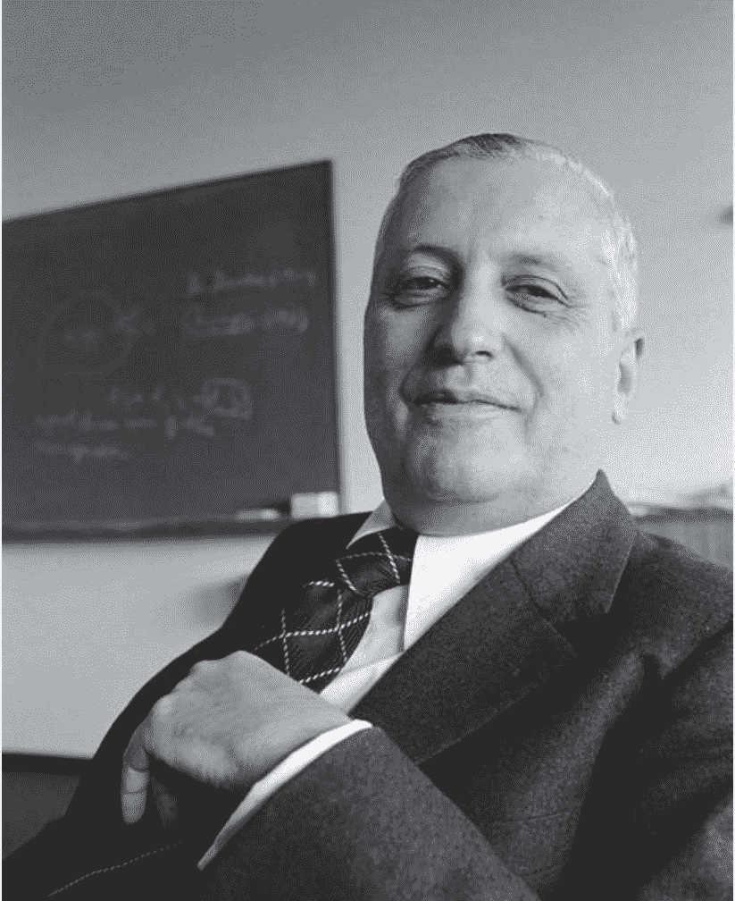
一个直观演示是用平底锅放薄薄一层水猛火加热，上面开抽油烟机抽热。在水层很薄、上下温差很大的情况下，沸腾的水面气泡会自发形成六边形蜂窝状结构。平常气泡毫无规律，但在远离平衡态并输入足够能量时，水面出现了新的有序结构，熵反而降低。这就是耗散结构的一个体现。只有当温差达到临界值、能量输入效率足够高、系统处于非平衡态时，才会出现这种秩序。
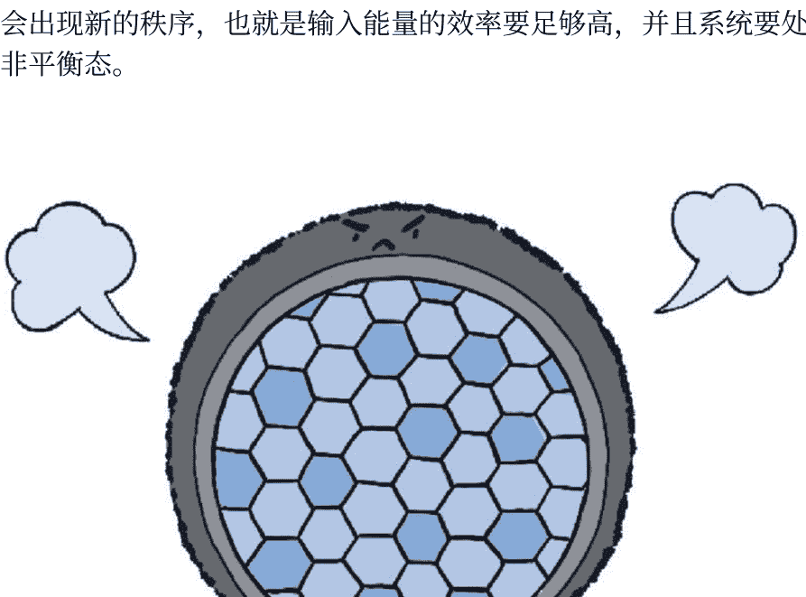
为何会出现逆熵现象？关键在于多样性和复杂性。系统足够复杂且远离热平衡，就会涌现。复杂系统的性质多变、难以预测，也为新秩序提供了可能性。也许正是这种复杂性让地球诞生了生命。生命系统极其复杂，其延续的本质是摄取能量、消耗能量以对抗自身熵增。正因为世界存在涌现，才会出现如此多变而有序的形态。

追求本质未必通向真理，本质也可能超出人类认知。康德把这种不可知称为“物自体”，我们只能感知与自身发生相互作用后的结果，无法脱离感知谈论事物本来面貌。即便沿用追求本质的方法，也有尽头。不断追问为什么，最终会抵达原理层面，再也问不下去。例如相对论的基础是光速不变原理，在当前物理学水平下无法再问“为什么”。热力学第二定律、不确定性原理也同样无法解释其原因。追到尽头，原理就是终点。

用涌现的视角看，万物的本质或许可以概括为：存在源于涌现的物理现象，即多样性带来涌现，涌现带来秩序，不同秩序又带来更多多样性，由此循环涌现。最近一轮人工智能大爆发，智能水平跃升，其背后也是涌现。ChatGPT的参数规模达到千亿级别，因而涌现出极高智能，连创造者也不清楚内部具体如何运作。

谷歌在2023年初于《自然》发表的论文也印证了这一点。他们尝试了一种新的神经网络算法，使天气预报准确度大幅提升。惊人之处在于，他们把物理定律从算法中移除了。传统天气预报先收集数据、预处理，再用物理定律计算，然后把结果输入算法训练。算力提升、参数增多后，他们直接跳过物理定律，抛弃因果关系，仅对海量数据做相关性计算和权重训练，反而得到更准的结果。从消除复杂系统不确定性的效率看，复杂丑陋的海量数据战胜了简洁优美的物理定律。

从中学开始学习的物理定律都带有“在理想状态下”的前提，模型通常是极端理想化的，比如质点只有质量没有大小。物理定律描述的多是抽象理想世界。有则笑话说一位农场主的鸡生病了，物理学家给出治疗方案，但只对“真空中的球形鸡”有效。

为何抛弃物理定律反而更精确？因为用简洁数学语言描述的理想物理定律，本质上是对真实世界的简化。传统科研手段下研究对象太复杂，无法全息获取全部信息，只能用人类可理解的抽象语言近似描述。若真有一个如神话“预言水晶球”或拉普拉斯妖，能全方位描述未来，我们直接看到未来即可。

# 第二章 何谓智能？

我们正处在一个极为特殊的历史转折点上。

每当重大科技革命来临，人类往往分裂成两派：一派担忧技术会带来灾难，一派热情拥抱变革。从印刷术到蒸汽机，从电力到互联网，分歧从未停歇。然而人工智能的到来呈现出不同景象——几乎无人再质疑它是否真实存在，争论的焦点只剩下该如何发展这项技术。
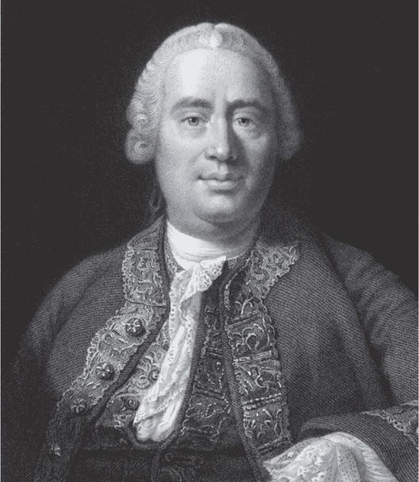

这种共识本身就带着很深的历史分量。我们已经走过了“要不要信”的争论阶段，真正进入“该怎么用”的实操时代。人工智能不再是科幻作品里的想象，它已经在重塑我们日常的生活方式。

这次技术浪潮为何与以往不同？答案指向一个看似平淡却极关键的变化：信息生成复杂度的跃迁。

AI 发展如此之快，它终将对人类社会带来怎样的冲击？

如果只能用一句话来概括我的判断，那就是：人工智能极有可能是人类最后一次真正意义上的重要发明。

最后一次？听起来很决绝。指的是什么？

别急，这并不是说发明会停摆，而是说从此以后，真正重大的突破未必再由人类亲手主导。

AI 最聪明的特质，在于它能自我生长、自我迭代、自我进化。

它已初步学会自己写代码，下一步是要理解人类设定的宏大目标，并自主通过编程去实现。

这已经足够颠覆了。

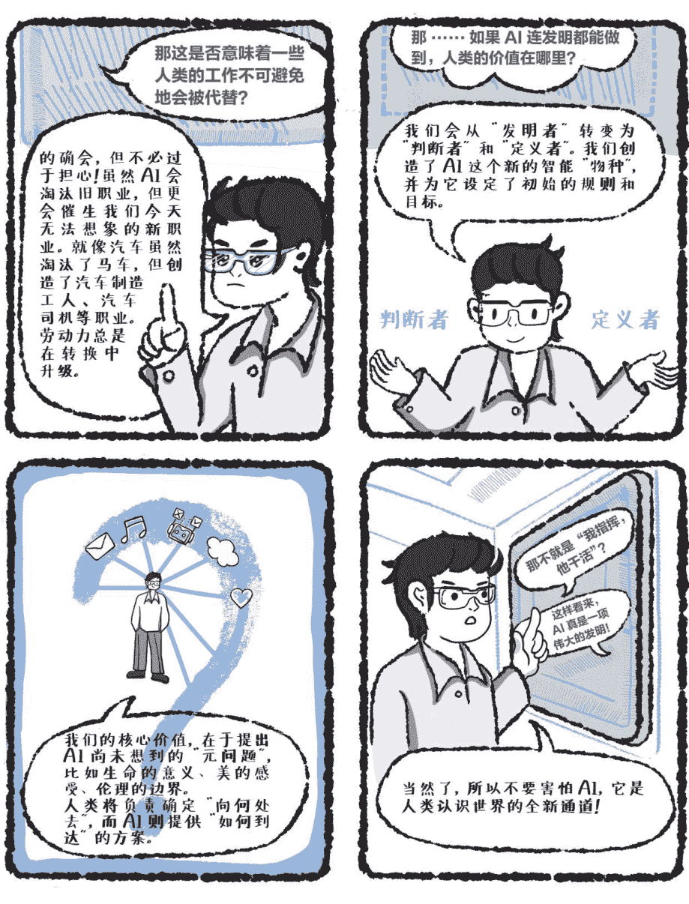

## 或许这是人类最后的关键发明

大家在新闻和行业评论里已经反复看到 AI 将如何剧变社会的论述。但你是否注意到，此轮浪潮与过去的科技爆发很不一样。以往的大周期里总有泼冷水的声音，电气化、信息化都经历过。互联网早期就被大量人判定为泡沫，2000 年左右的 .com 崩盘让这类声音一度成为主流。但这一次，即便持怀疑态度的人也不在质疑它是不是泡沫，而是担忧它带来的伦理、安全等潜在风险。

发出这类警告的，不乏业界顶尖人物。比如被称作“人工智能之父”的杰弗里·辛顿，他多次公开呼吁要警惕开发节奏过快可能带来的社会风险，认为能力应当被限制在人类可控范围内。围绕 AI，舆论大致分成了两派：主张谨慎控制的“拯救派”和主张放开发展的“降临派”。与往次科技进步不同，这一次几乎所有人都承认它是个实打实的变量，分歧只在于走向。

我不想做那种模棱两可的中立科普。如果要对 AI 的影响做一个凝练的判断，那就是：人工智能，很可能就是人类最后的一项重要发明。关键词是“重要”。

回溯一下人类历史上真正重要的发明。钻木取火是起点，之后是石器、制陶，青铜时代、铁器时代，中国的四大发明，珍妮纺织机、蒸汽机开启工业时代，特斯拉的交流电带来电气时代，无线电、计算机、互联网引领信息时代。这些发明都把人类推向全新文明阶段。人工智能，尤其是以神经网络为核心的大语言模型，至少已经可以与互联网相提并论，它将把我们带入智能时代。

那为何说它是最后一次呢？关键在于“人类”二字。我说的并不是未来不会再有发明，而是未来的重量级发明，可能不再由人类主导。AI 最核心的智能，就在于它可以自我编程，实现自我迭代、自我进化。

AI 编程已成为重要方向。商业上率先验证价值的，就是 Devin、Cursor、Windsurf 这类 AI 编程工具。虽然到 2025 年它们还做不到百分百自主编程，但已经大幅提升了程序员效率。随着基础大模型大约每半年一次的大迭代，编程这件事将来很可能基本交给 AI 自行处理。

第一章提到的库兹韦尔《奇点临近》，其核心就是计算机有朝一日会自我进化迭代，像生物一样自我改写程序，只是速度远超百万年的生物演化。当这个状态到来，世界面貌会完全不同。如今的 AI 已显露出这种“奇点”趋势，能写代码是第一步，下一步是认识到进化方向并完成自编程。

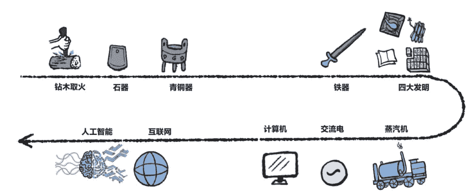

读到这里很多人会恐慌：那人类还有什么价值？所有工作都被取代？现实里，亚马逊已在全面用机器人替代人，截至 2024 年投放量已超百万台，数量接近公司内部的人类员工。机器人每翻一倍，运营成本就下降 50% 到 60%。普通员工难免心惊。

但我不这么看，我认为未来的机会反而更大。暂不讨论《终结者》《黑客帝国》式的灾难科幻，至少当前 AI 是一件极强大的工具，它能显著降低行业的门槛。

拿手机 App 开发举例。过去无论 iOS 还是 Android，开发都需要专业团队：服务器架构、后端、前前端、UI/UX 设计、产品经理统筹。移动互联网时代，这批工程师收入最高，门槛极高。现在你可以拿张纸画出界面，用自然语言描述功能需求，AI 就能直接生成可用的 App，并按要求反复修改。这让有创意却缺乏专业知识和资金的人获得了参与机会，创新的成本被大幅拉低。取代部分工作，本就是文明进步的正常路径。

人工智能的创新，本质上是典型的创造性破坏。历史上创新大致分三类：开创型、效率型、破坏型。开创型创造全新行业，比如飞机诞生前几乎没有大规模飞行需求，飞机出现后催生了整条制造业和就业链。效率型只是让产品更好，如汽车换代，不增不减岗位。破坏型则消灭旧岗位，汽车淘汰马车，马车工失业。

破坏型创新消灭的岗位，往往会被开创型创新创造的新岗位吸收。劳动力在不同创新形态间循环切换，完成时代转换。

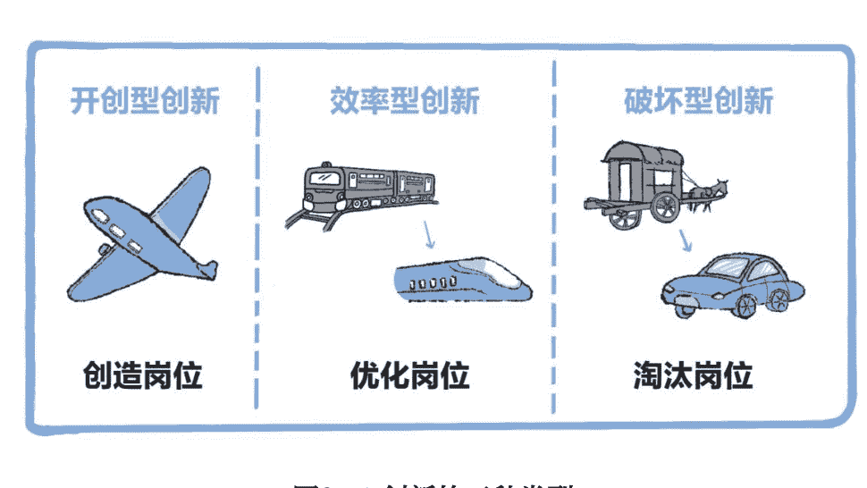

### 图2—1 创新的三种形态

人工智能属于典型的破坏型创新，它在砍掉传统岗位的同时，也在孵化全新岗位。历史上的劳动力转换已多次发生，没有理由认为这次会让人类陷入危机。从经济学基础看，我们也不必担心人类失去价值。GDP = 消费 + 投资 + 政府开支 + 净出口。消费之所以算入生产总值，是因为生产必须回应需求才有意义。AI 再厉害，发明的东西最终使用者仍是人类。AI 以人类为消费终端进行发明创造，它必须知道人类需要什么，而需求的判断依然要靠人来告诉它。

更进一步，降低创新门槛后，人类作为消费者反而能更深度参与创造。每一轮破坏型创新表面看在消灭就业，最终都让经济更繁荣、文明更进步、生活更美好。

我相信大多数人会认同，人类智慧价值的顶点在科研领域。现代文明的物质进步都源于科研：科学发现→工程实现→产品化→商业化。科学发现是起点。而 AI 已经在科研顶端证明了价值。

2024 年诺贝尔化学奖的一半授予了发明 AlphaFold 的科学家。该模型由 DeepMind 推出，用于解决蛋白质折叠难题。蛋白质由 21 种氨基酸组成，其链条在三维空间折叠成不同结构，决定功能。核心问题是已知序列预测结构，以及已知结构反推序列。AlphaFold 用 AI 解决了前者。

传统方法效率极低，AI 则以前所未有的速度模拟蛋白质结构，图2-2，大幅加速生物制药研发，对治愈重大疾病意义巨大。相比之下，它可能让多少制药岗位受影响，就显得微不足道了。

蛋白质是由氨基酸按 DNA 顺序排列形成的肽链，折叠后形成三维结构。

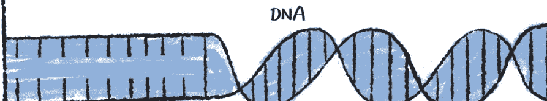

**初级结构**

氨基酸按 DNA 编码形成肽链，每三个核苷酸决定一个氨基酸。

**二级结构**

肽链首次折叠，最常见为螺旋状和片状。

**三级结构**

螺旋和片状再次折叠成三维蛋白质结构。

**四级结构**

部分蛋白质结合多条肽链形成复合体。

### 图2—2 蛋白质结构的层次

所以我说人工智能是人类的最后一项重要发明，并非指发明结束，而是说有了它之后，人类发明显得更容易，创新会井喷，门槛被拉低，我们会进入一个更发达美好的社会。

人工智能的“智能”到底从何而来？AI 并非新概念。图灵在发明计算机时就梦想造出能像人一样思考的机器，他提出图灵测试。如今的大语言模型早已远超那个标准。

现在大模型展现的智能，从现象看，本质是计算机产出信息的复杂度出现了巨大跃升。互联网发展约 30 年，改变了生活，但本质是传输更快、效率更高、信息量变大、信息差更容易抹平。信息的复杂度几乎没有明显提升。创造内容始终是人，计算机一直只做三件事：复制、粘贴、排序。搜索引擎再复杂，最后也是排序。

大语言模型则不同，它在信息生成的复杂度上完成了质变。我们现在能让它写评论、写述职、写诗，虽然未必比顶尖人类高，但已远超平均水平。写诗这种技能大多数人做不到，AI 却能张口就来。

从这个角度看，奇点指的就是计算机输出信息复杂度的陡峭临界点。当计算机拥有如此高的生成复杂度时，它绝不只是个聊天工具，而是一个文明新纪元的起点。

AI 历史已超半个世纪，但 ChatGPT、DeepSeek 这类大语言模型确实是新物种。2016 年 AlphaGo 战胜李世石，宣告围棋进入 AI 时代。此后围棋几乎只有 AI 流派，全自动驾驶、扫地机器人等也持续发展。马斯克 2015 年就喊 FSD，但到 2025 年才真正接近实现。

为何 ChatGPT 发布后迅速席卷全球？三个月内用户破 2 亿，是互联网史上增长最快的应用。它被快速应用到工作各处。原因很浅显：语言具有普适性。它把人机交互变成了像人与人交流一样简单。但深层的判断要回到信息层面：人类语言、自然语言、具备虚构能力的语言，正是人类社会形成智能文明并实现指数级增长的关键。
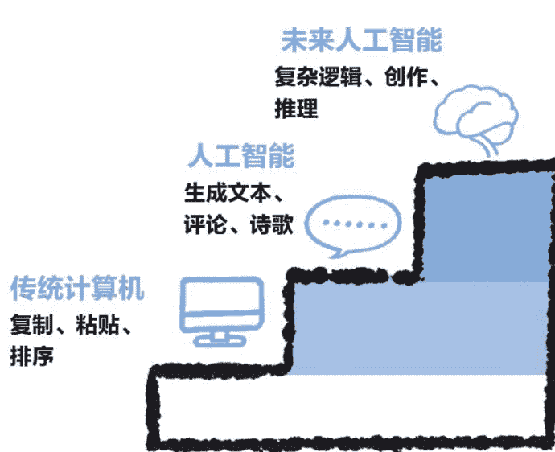

### 图2-3 人工智能的跃迁

生命的本质是信息的传递者。人类也好，其它物种也罢，都在承载遗传密码，这个密码被装进DNA并一轮轮复制下来。物种通过基因突变累积差异，再经自然选择筛选，缓慢分化出多样形态。这种生物层面的演化极其迟缓，时间刻度基本是以百万年计。直到人类共同体内出现了具备虚构能力的语言，一切被改写。

动物也有传递信息的本能，如蜜蜂的舞步能告知方向与距离，信息却高度具体、范围很窄。人的语言不同，它拥有抽离现实的抽象力。借助语言，我们能创造概念，把概念串联成逻辑，进而产生思想；思想产生的知识又能被言语固化、传播。车轮的例子很典型，发明者只要用语言把做法讲清楚，后人无须重复试错。语言让人类群体具备了外部记忆，文明于是进入指数式飞跃。

时间尺度的对比很直观：语言出现不过数万年，而这短暂区间里文明的累积远超此前。人类的基因却几乎没有变化，与数十万年前的智人相比差异微小。语言因抽象而复杂度极高，基因突变率则很低，信息承载量虽大，但变异的复杂度在百万年尺度上并不算高。所以推动文明的是信息变化的复杂度。一旦人工智能输出信息的能力逼近人类语言的复杂度，文明便会迎来新一轮的大爆发。

可以设想一个会说人话的系统，你能让它像AlphaGo那样专精围棋，也能让它学会驾驶。但反过来，你几乎不可能让AlphaGo学会对话，无法让一个自动驾驶系统写诗。语言的抽象与复杂度处于顶端。维特根斯坦曾指出，语言的边界也就是认知的边界。超出语言的层面，人类目前很难普遍把握。假若机器生成的复杂度已等同人类，再把机器连成网络、构成社会，其会迸发的文明形态将难以想象。机器掌握全人类知识，又拥有远超人类的处理速度与规模，网络层面的知识爆炸将是全新的跃迁。

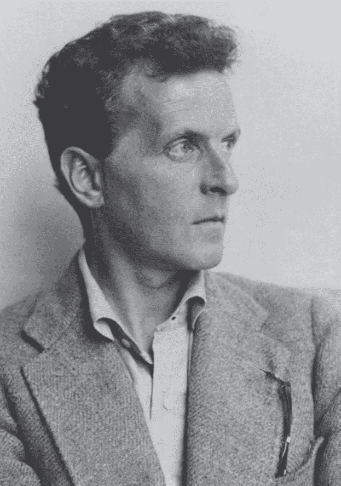

图2—4 英国哲学家路德维希·维特根斯坦

## 像人一样解决问题

智能难以用一句话界定，但我们能直观识别它。人就是最好的参照。于是从实用角度可以说，人工智能就是像人一样解决问题的智能体，即agent。现阶段我们把它理解为由程序驱动的计算机或机器人。但“像人一样”听起来像是退步，因为人类发明的工具大多不再模仿人的方式，人不会飞，飞机却能飞。

关键在于不少对人类极易的问题，对机器而言异常困难。人脸识别只是其一，文字与数字识别同样存在挑战。手写阿拉伯数字千人千面，人一眼可辨，计算机却长期吃力。光学字符识别的研究始于1960年代，真正可用要等到21世纪初，神经网络是转折点。直立行走也是如此，人靠数百块肌肉协同完成，机器人要学会走、跳、爬楼梯却难如登天，直到深度学习成熟后才初见成效。

差异根源在于理解世界的路径不同。计算机底层只有0与1，指令与代码都是确定的，它活在数学逻辑里。人类感知的世界并不是完全可量化的。我们用数学物理来定量，但教材里总先说“在理想状态下”。现实复杂，理想状态几乎不存在，很多系统根本无法被理想化公式描述。精确公式每用一次就会产生误差，在天气这类混沌系统中误差会被迅速放大。2023年谷歌发布的新一代天气预测模型，效果远超传统方法，核心做法竟是放弃物理定律，改用海量数据、算力与更优的神经网络。这种做法抛开了误差累积的数学路径，说明人类用数学抽象认知世界，只抓到一部分。

之所以要像人一样解决问题，是因为人工智能的最终服务对象是人类，需求与问题都来自碳基生命。只有机器学会用人的方式解决原本只有人能解决的问题，才算达到人类智能水准。一旦达到，人机优势立刻显现：机器不疲劳、无情绪、执行坚决、速度远超人类，成本也更低。通用的智能若能实现，人类将以更高效的方式被全方位服务，文明才会进入爆发式增长。因此人工智能的核心目标，就是赋予计算机处理那些对人容易、对传统机器困难的问题的能力。

既然目标为“像人一样解决问题”，就可以把人类能解的问题列出，去掉已被编程解决得很好的部分，剩余的就是人工智能的发展重点。算术运算已被计算器完全覆盖，不属于此范畴。

很多研究聚焦于特定问题的人工智能，如人脸识别、自动驾驶、AlphaGo下围棋。这类窄人工智能ANI能很好地完成单一任务。推荐系统、搜索引擎也是典型应用，它们根据行为反馈调整内容，本质都是为一类问题定制的。

与之相对的是通用人工智能AGI。漫威中的贾维斯就是AGI的形象。AI = ANI + AGI，若窄智能解决特定问题，通用智能则解决通用问题。人类不仅能解具体问题，还能思考。通用智能的终极目标是获得人的思维能力。一旦实现，它能进行自然语言对话、逻辑推理、证明、科学研究、写作、编程等。

为什么大语言模型一出现，目标就指向AGI？因为语言的普适性。思考的载体是语言，连自言自语也是一种内部对话。英文里think out loud就是大声思考。语言是思想的载体，也是传承的通道。费曼说想掌握就去教，讲解的过程本身就是理清思路的过程。

AGI实现后还需ANI吗？需要。人类除了思维还有技能，技能需训练。弹钢琴靠练习，微积分靠做题。AGI可以理解何时该用自动驾驶，但更高效的做法是调用专门的自动驾驶ANI来接管。

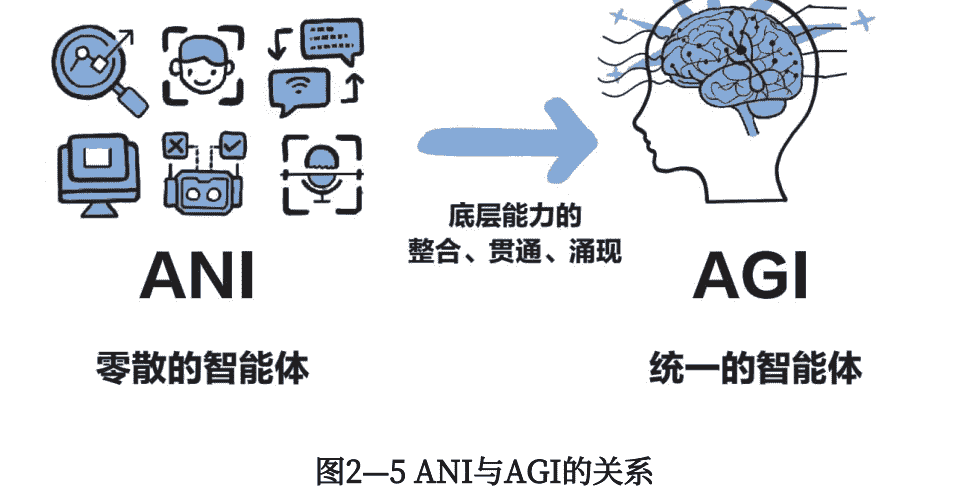
实际上，本章进行到此处，我们也并未回答何为智能。我们使用了一个权宜之计，把人工智能的定义转嫁到了人类智能上。但即便是面对人类智能，我们也只能确认，人类拥有智能，但人类的智能究竟是怎样的一种存在，我们也未进行深入探讨。我们现在面对智能的定义，处在一种“枚举”的状态，面对一个具体的对象，我们可以尝试判断，这个对象是否具备智能，但这种智能究竟是什么呢？“机器学习”，或许能给我们一些指引。

# 第三章 “学习”即“智能”

什么是智能？或许是人类最难回答的问题之一。几千年里，从柏拉图到当代认知科学家，从东方禅思到西方理性主义，人类始终在追问意识与思维的来源。可当我们要造出人工智能时，这个哲学问题变得切实起来。我们发现，在无法精确定义智能的前提下，我们依然能识别智能；在不完全理解自身思维时，我们却能教会机器学习。

智能不是静态定义，而是在关系、互动和学习中显现的动态现象。机器学习不仅是技术手段，也是我们理解智能、探索意识的新路径。

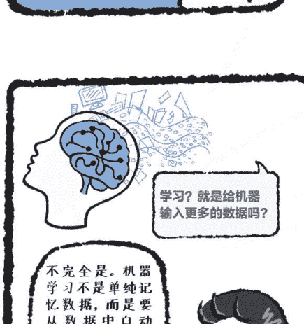

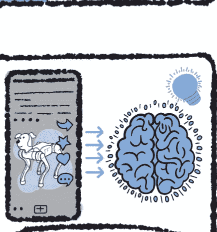

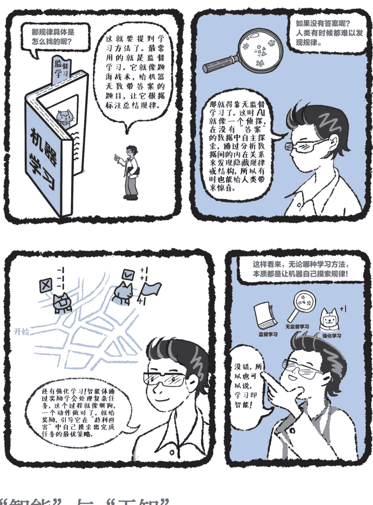

## “智能”与“无知”

说某个对象有智能，往往是观察者的判断。客体需要做出某种行为，主体据此认定其具备智能。图灵测试就明确了主体出题、客体作答、主体判断的流程，并人为设定30%的误判率作为人类水平门槛。标准看似客观，实则高度主观，与观察者绑定。

于是智能是相对的，没有绝对的界线。人类的智能高于其他动物，但动物在特定领域可能更强。蜜蜂能建造六边形巢穴，章鱼善于即兴脱困，蚂蚁群体能找到最短路径，老鼠在迷宫中展现的空间记忆甚至优于许多人类儿童。以捕鼠夹为例，对普通人它只是机械装置，对老鼠而言，若缺乏对重量触发机制的理解，它就是高智力的天敌。

扫地机器人也一样，若只是从墙角开始机械清扫，没人会认为它聪明。真正的智能体应能根据房间布局、障碍、地毯状态自主决策，完整覆盖且避免卡死。

由此可推断，智能度是主体与客体的相对量。客体在主体“无知”的任务上完成它，才显现智能。对主体来说越不可知，智能度就越高。这里的无知不是“不知道”，而是“无法知道”。大语言模型被认为智能较高，正因我们在庞大神经网络中逻辑上无法追溯每句话的生成路径。网络内部像黑箱，并带有随机性。

因此智能并非全域指标，而是指向任务的。蜜蜂筑巢、老鼠逃迷宫，都是在特定决策不可知的框架下展现的问题解决能力。

# 不可知，智能的起点

说到不可知，第一反应往往会拐向哲学。第一章里提到的康德物自体不可知论就是一个经典例子。在物理层面，当下被认为不可知的系统主要有两类，一类是量子系统，一类是混沌系统，具体论证可参考《六极物理》。

量子力学的基石不确定性原理决定了量子系统的本质不可知：下一刻的状态只能用概率来描述，没有确定性的语言能把它说死。混沌系统则呈现出另一种有趣的不可知，它从动力学上看是完全确定的，可现有数学工具要对它的演化做精确预测，难度极大。天气就是一个典型。拿人工智能去预报天气时，天气本身的不可知度就很高，模型预报越准，我们就越能认为这个模型越智能。

由此可以做一个阶段性总结。智能是相对的，它取决于评价主体的水平。智能也是任务相关的，谈一个系统的智能高低，必须先锁定在具体任务框架里。窄人工智能对应的是具体任务，比如自动驾驶、人脸识别，而通用人工智能面对的任务本质上是思维。是不是只有不可知的对象才能对应高智能？不一定。智能本身也在动态演化。设想一个程序，它在处理任务时不断自我演进，用数据持续更新算法，那么作为观察者的我们就必须不断提升自己的水平，才能把对它的无知度降下来。如果主体跟不上这种拉开的差距，这个程序就可以被视作具有动态的不可知性。这并不是新概念，能从环境数据中学习并进化的程序，普遍被称为机器学习。

## 给机器学会学习的能力

回到人工智能的目标：让机器像人一样解决问题。人类能解决的问题类型很多，解法和考核标准也各不相同。于是即便要模仿人类，也必须先给任务分类，不同类型问题自然需要不同的技术路线。主流路线大致有三条，基于规则、决策树和神经网络，见图3-1。前两类偏传统，后者则支撑了大语言模型、全自动驾驶、AlphaGo、AlphaFold这类前沿系统。

基于规则的人工智能，字面意思就是按既定规则执行。规则可以用非常精确的算法和清晰的指令实现。这类系统擅长解决高精度、低自由度的任务。现代汽车生产线上的机械手就是例子，目标和路径都确定无疑，提前精细编程后就能稳定高效运行。早期的机器人自动化大多走这条路。人的感官精度有限，手部操作到毫米级已是极限，而机器可以做到纳米级，所以把任务编码得足够细，机器的精确性就能被充分利用。

决策树允许的自由度明显更大。它要求机器在节点上自行做出判断。最典型的案例是1997年IBM的深蓝击败当时的世界国际象棋冠军卡斯帕罗夫。下棋需要智慧，深蓝的底层就是决策树。它用复杂算法评估走一步后棋盘的局面，本质上是在每个节点做选择。因为每一步都有多个分支，后续又分叉，看起来就像树枝，所以得名决策树。

同是棋类，围棋就没法用同样的套路。国际象棋是8×8的64格，32枚棋子，走法受限，变化相对可控。围棋棋盘19×19有361个交叉点，每个点可落黑子、白子或空，三种状态，算上轮流落子，整体可能性约在10的170次方，远超宇宙基本粒子总数，决策树根本覆盖不了。直到AlphaGo出现才真正解决围棋，而它采用的核心路线就是神经网络。

电脑程序员很容易理解决策树，它本质就是一套庞大的 if…else if…结构。每个决策点都有判断标准，标准的设计才是难点。决策树适合中等自由度的问题，对自由度极高的任务则无力。一个直观例子是苹果在2011年推出的Siri，当时走的就是决策树路线，用户很快发现它只适合简单指令，一点复杂就只能丢给搜索引擎。

从逻辑上说，神经网络是模仿人脑的工作方式。基本单元是神经元，功能很简单：输入信号经处理后输出信号。把大量神经元按一定规则串联成网，信号在其中传递和加工，最终给出有意义的结果。具体细节后文再展开。

神经网络需要海量数据训练后才表现好。它擅长处理高自由度问题，比如人脸识别、自动驾驶，这类场景随机性强、环境变化快，必须具备快速适应的学习能力。就像人很多技能需要训练一样，算力提升后，人工智能的发展方向很清晰：向复杂度高、自由度高的难题进发，而解决高自由度问题必然要经历学习的过程，机器学习正是这一进程的核心。

机器学习有一个经典定义，出自美国计算机科学家亚瑟·萨缪尔：赋予计算机无需显式编程就能学习的能力。这个概括很准，但里面藏着很多信息，比如什么是“显式编程”。

显式编程意味着代码里发生的一切都清晰可控，可以看成一个高度确定的大函数。给定输入，能明确知道输出，甚至人手工也能推导。生产线上的机械手大多属于此类。

非显式编程则在程序里留下灰度。以短视频推荐为例，算法会根据你的浏览习惯推送内容。你知道算法存在，也知道浏览记录，但很难精确预测下一条视频是什么，因为部分参数并非写死，而是随着你的行为自动调整，让停留、点赞、评论、转发的概率最大化。这就是非显式编程，已经是机器学习。

自由度还可以继续放大。我们可以不事先指定参数存在的位置和数量，让计算机自己决定参数的个数和位置。参数还可以分层，例如把点赞率、完播率、观看时长都作为推荐决策的影响因素，由算法学习各自权重。学习后可能发现点赞数作用有限，权重下降，甚至变成观看时长的子指标。更进一步，直接用一个神经网络把客观信息全部输入，也不预设参数关系，让网络自己给出参数和关系，这也是机器学习。

总的来说，机器学习就是不用把一切都写死，而是让算法通过数据自行找规律、调参数、甚至调架构和算法，以更好地达成目标。非显式编程的核心诉求是自由度，而学习的本质是在没有显式编程的情况下，从数据中挖掘规律。怎么找规律，就要讲方法了。

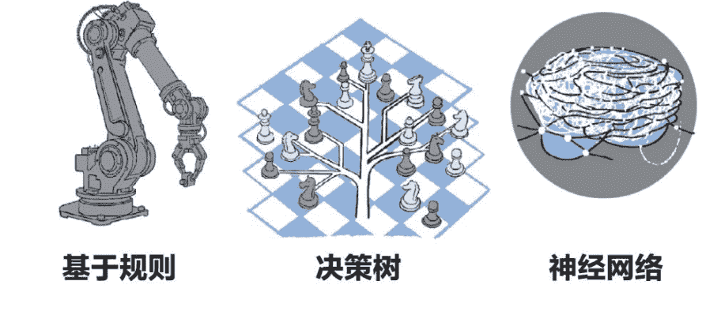

## 机器学习的三大核心逻辑

前面提到，人工智能的目标是像人一样解决问题，归根结底是解决高自由度问题。机器学习的核心是让计算机在不需要显式编程的前提下实现自主学习。换句话说，机器学习要处理的问题自由度太高，无法完全显式编程。

学习是通过数据训练获得能力。只把数据丢进去并不会自动学会，关键是如何让机器与数据互动，从中提取规律来解决问题。这里可以回到人类解决问题的方式：人解决高自由度问题，底层依赖的是价值观，即判断一个答案好坏的标准。这就引出了代价函数。

举个例子，欧姆定律U=IR是怎么来的？通过实验，不断改变电压测量电流，画出关系图，发现近似一条直线。假设实验误差很大，电阻受温度杂质影响，数据点围绕直线散布，这时需要用线性回归拟合一条直线。为什么要拟合？为了预测，比如高频股票交易，算法用历史数据拟合直线预测下一个点位。

数据点面前有多条直线都能大致描述趋势，哪条最好？这就需要定义“好”。答案是让代价函数最小的那条直线。我们认为代价越小，价值越大，这正是价值观的体现。

代价函数的定义可以多样。比如让所有点到直线的垂直距离绝对值之和最小；或者为防止个别点偏离太远，用距离平方和作为代价，偏离大的点会被更强烈地惩罚；甚至可以用10次方，进一步放大异常点的代价。

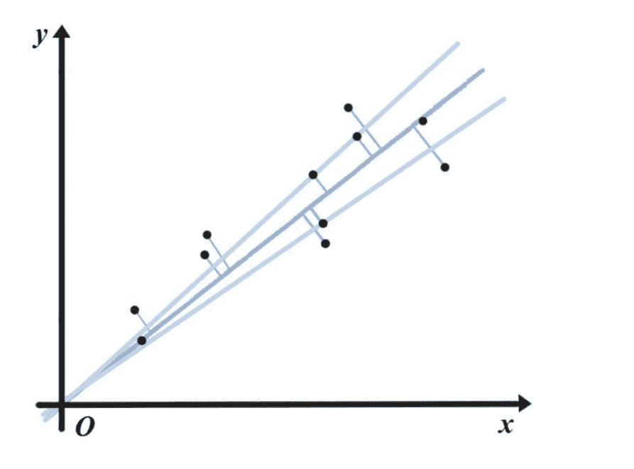

机器学习的基本流程大致是：准备数据，定义代价函数，通过调节参数使代价函数在现有数据上达到最小，我们就认为模型在一定程度上掌握了规律。数据越多，学习质量通常越高，前提是数据中本就存在规律，纯随机数据无法凭空产生规律。

线性回归只是最简单的模型。现实问题远更复杂，因此机器学习的方法主要分为三大类：监督学习、无监督学习和强化学习。这三种方式与人类的学习方式高度对应。

### 监督学习

监督学习应用最广。先把数据喂给模型，定义代价函数，然后调节参数使其极小化，达到最优。训练充分、数据量大时，对新问题的预测通常更准，当然也存在过拟合风险。

打个比方，要教一个人做微积分，却不想讲理论。可以给他100道题目和标准答案，让他研究题目与答案的关联，再考第101道新题。100道可能不够，1万道呢？甚至把所有题目都给他看，他未必懂理论，但见过足够多样本后就能给出正确答案。这就是监督学习的“题海战术”。

从函数角度看，输入是一个问题，输出是答案。我们用大量已知的题目答案对让模型学习这种映射，逼近规律。对模型而言，这些已知的问题答案被称为带标签数据。标签就是答案，数据就是问题。

人工智能早期训练很大程度上依赖数据质量，标注是体力活。常见的例子是网站的人机验证，让你选出包含红绿灯的图片。用户以为在完成验证，实际上在为图片识别模型提供标注数据，最终提升模型准确率，如图3-3所示。

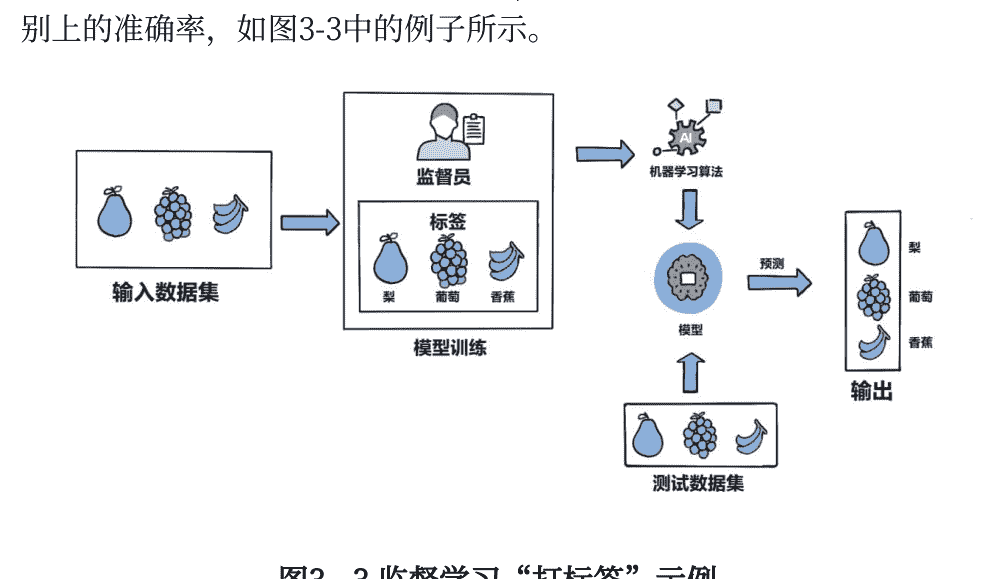

从刷脸到自学：机器怎么学会看

我们几乎无时无刻不在用带标注学习的典型场景——面部辨识。商场里刷脸付款、手机解屏，都遵循同一套路径：摄像头抓到的影像被系统映射到对应的用户编号，随后完成扣款。直接讲刷脸的技术链条容易绕，先看个更直观的类比：让程序分辨照片里是猫还是狗。做法是先搜集海量的猫图和狗图并人工贴标签，全部猫打上猫，全部狗打上狗。贴好标签的图就相当于题目，标签相当于标准答案。算法在成对样本上训练，会慢慢提炼出猫与狗的共性特征。随着样本量累积，模型对两类特征的判断会越来越笃定。拿到一张从未见过的猫或狗，它也能给出正确判断。这就是带标注学习的简化版。

把目标换成真人，思路相近但难度被放大。猫狗只是二分类，而面部辨识需要先把面部信息与具体个人的编号绑定，这一步就牵涉到后文要说的向量表征。刷脸时，现场影像会被转成一个向量，再与库中存的底模向量比对，相似度达到阈值就判定为同一人。实际流程里还会加入关键点比对，比如眼、鼻、嘴角的相对位置，能明显提升准确率。安全等级不同，对交互的要求也不同。手机解屏这类低敏场景扫一下即可，而银行、企业、政务等高敏场景，系统会要求摇头、眨眼、张嘴等动作来增强活体确认。

带标注学习对有标签数据的依赖很强。早期标注几乎全靠人工，是极耗人力的活。近几年AI的爆发，核心原因之一就是互联网多年沉淀的有标签数据量终于跨过临界点，当然也有专业公司为大厂提供标注服务。

### 无标签发现
没有标准答案的另一种主流做法是无监督学习，它更像侦探在资料堆里自发找规律。假设给你一万张动物照片，涵盖十二生肖，每种生肖下又有多种品种，比如十几种犬、几十种牛，要你把它们归到十二类。对人来说相对容易，对机器则不容易。用带标注学习的话，只要先喂够标注过的十二生肖样本，机器学会概念后再逐张比对归类即可。而无监督学习完全不了解生肖这个概念，甚至可能不分十二类，算法弱时容易把兔子与犬、牛与羊、龙与蛇混在一起，也可能过度细分，把白兔和灰兔当成两种动物。无监督的价值在于从原始数据里挖掘潜在结构或异常，比如让AI自行在患者影像里挑出病灶，明显病灶的特征会自行凸显，能大幅提升效率。

要找规律需要工具，最简化的就是聚类。以k-means为例。先把一万张照片做向量表征，再按距离分组。照片如何表征？先回顾向量概念。高中三维向量由三坐标表示。一张千乘千的黑白点阵图由100万像素构成，每个像素是一个亮度数值，从白到黑。于是整张图可表示为拥有100万个分量的向量，在百万维空间里就是一个点。一万张图就是一万个高维点。k-means就是把这些点归类。

最直接的做法是把距离近的点放一起。具体操作可以先在点集中随机挑两个点A、B，把其余点按离A近还是离B近划分，形成两个簇A、B。随后分别计算两簇所有点的位置平均值，得到新的中心点A1、B1。再次按离A1、B1的远近重新划分，得到新的簇A1、B1。重复迭代，直到中心点几乎不再移动，移动幅度小于预设阈值就认为收敛。得到稳定的两类。如果实际有十二种动物，两类不够，就加入第三个中心点C，继续迭代；仍不足就再加D，以此类推，类别数最终由使用需求决定。整个过程未做人工标注，却能从数据里析出规律。

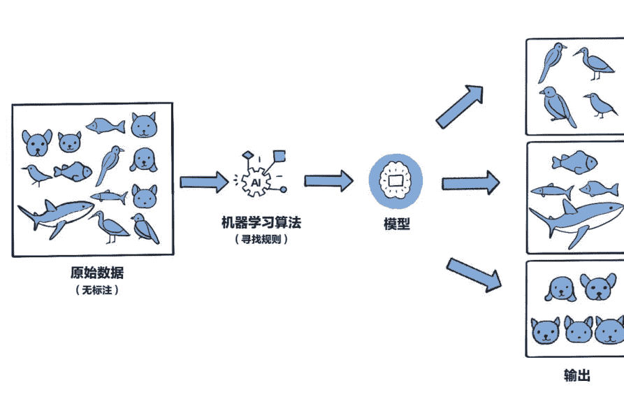
图3—4 无监督学习示例

问题的关键是数据里到底要找什么规律，算法如何判定规律有效，这就催生出各种方法，聚类k-means是最入门的一种。

### 反馈式学习
前面两类学习要么有明确答案，要么靠数据自聚，但很多场景下人类反馈是模糊、直觉式的，无法给出显式指令。这时强化学习更适用。

理解强化学习可以类比动物训练，而不是人脑训练。巴甫洛夫驯狗法就是典型：让小狗学会“坐下”指令，是靠奖励与惩罚建立条件反射。做对给吃的，做错拍一下，久而久之指令出现就触发动作。强化学习就是把机器当成需要趋利避害的代理，通过奖励函数塑造行为。

在机器人领域应用很广。比如训练人形机器人走路、跑步、爬楼梯。用纯规则编程极难，物理世界变化太多。明确写出力学公式只能让它走特定楼梯，换个台阶就不行。自由度越高越需要学习。传感器采集地形是输入，跨越障碍并保持稳定是输出。带标注学习理论上可行，但物理场景难以穷举标注，正确答案也不唯一——只要稳定通过即可，具体路径多种多样。强化学习不需要给出每一步的正确解，只需告诉系统哪些结果错误，好的结果给予奖励，让它自行摸索。

搜索排序也是例子。用户点击与否、停留时长、是否立刻关页，都能转化为奖励信号。Bounce rate即立刻关闭的比例，越高说明体验越差。通过强化学习，算法会不断迭代，使推荐结果更贴合搜索需求。

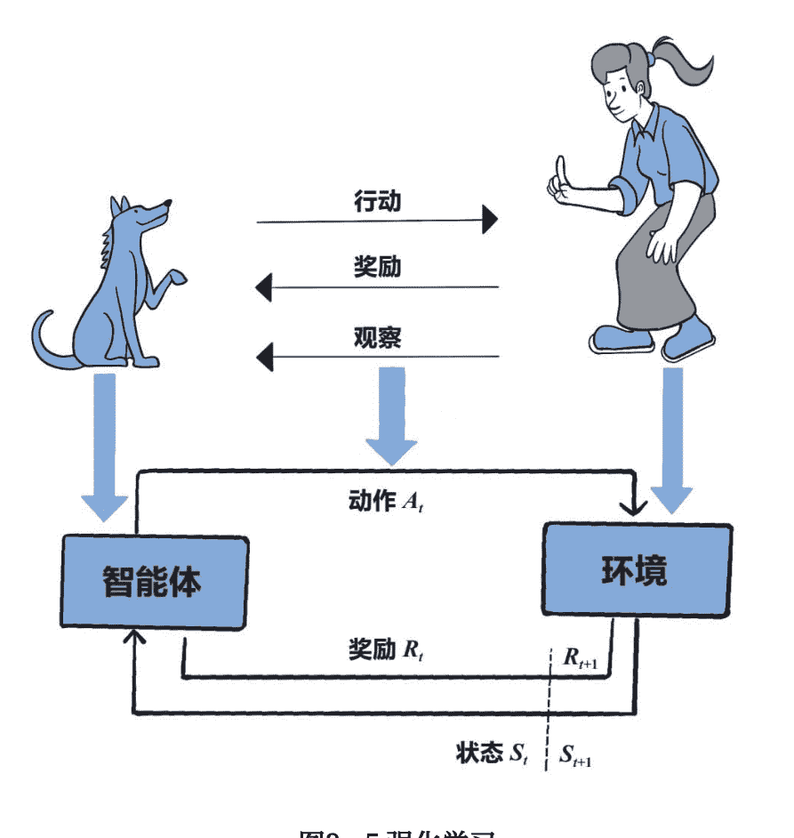
图3-5 强化学习

# 第四章 多，即不同
第三章讲了机器学习要解决高自由度、不可预测的问题，自发从数据中提炼规律来降低不确定性。带标注、无标注、强化是三种学习范式，具体落地却各不相同。比如给一万张生肖图做无监督分类，光懂原理不够，还要避免模型把黑白条纹当成主特征而把蛇和斑马归一起，真正关注的是形态等有效特征。从原理到工程，落差很大。如今主流的机器智能路线就是神经网络。

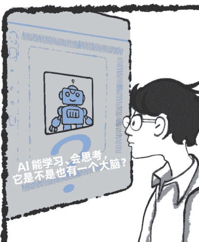
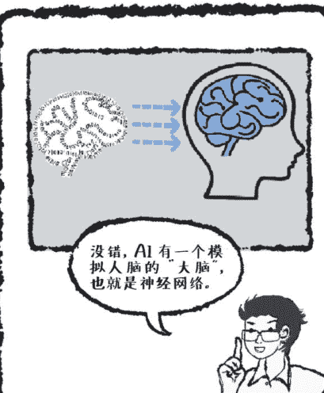
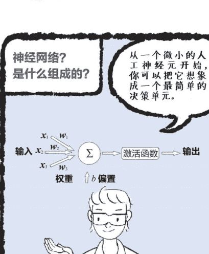
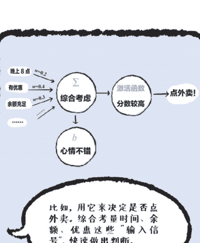
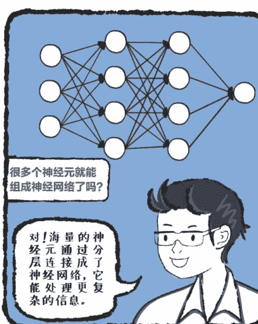
很多个神经元就能组成神经网络了吗？

对！海量的神经元通过分层连接成了神经网络，它能处理更复杂的信息。

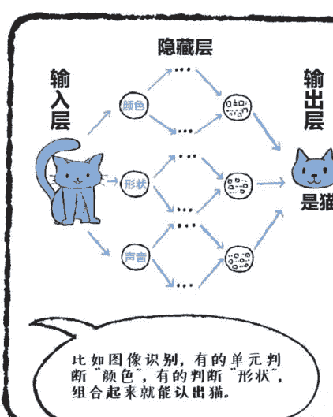
比如图像识别，有的单元判断“颜色”，有的判断“形状”，组合起来就能认出猫。

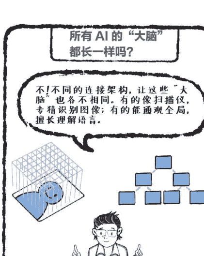
所有AI的“大脑”都长一样吗？

不！不同的连接架构，让这些“大脑”也各不相同。有的像扫描仪，专精识别图像；有的能通观全局，擅长理解语言。

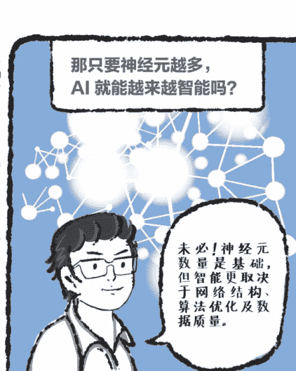
那只要神经元越多，AI就能越来越智能吗？

未必！神经元数量是基础，但智能更取决于网络结构、算法优化及数据质量。

## 师法人类
当前主流应用——面部辨识、自动驾驶、推荐、大语言模型、文生图视频——背后都基于神经网络。神经网络并非新概念，1940年代就提出，但直到2012年前在学界地位很低，甚至被视作玄学。有个缩影是杰弗里·辛顿的职业轨迹。

辛顿、杨立昆、约书亚·本吉奥因深度学习的贡献于2018年共同获得图灵奖，被称为深度学习三巨头。辛顿常被称作机器智能之父，其学生伊利亚·苏茨克维主导了ChatGPT研发。辛顿的路很坎坷。他本科跨专业学习，毕业专业是实验心理学，博士在爱丁堡大学读了八年，因导师认为神经网络是伪科学，每周争吵，最后靠“再给我半年”拖到毕业。1980年代因方向冷门找不到工作，后到多伦多大学执教，当时开的神经网络课几乎无人问津。

转机在2012年。追溯到2010年，普林斯顿的ImageNet比赛由李飞飞发起，要求识别海量图片是否有人脸、红绿灯、汽车等。2010年冠军错误率28%，2011年降到26%，人类水平约5%。2012年比赛移师斯坦福，辛顿与学生用神经网络把错误率直接拉到15.3%，第二名东京大学仍在26.2%。商界立刻嗅到价值，三人成立公司被谷歌以4400万美元收购，辛顿随后任副总裁，神经网络从此高歌猛进。类似的冷板凳故事还有mRNA技术，在新冠前已被冷落近50年。

回到定义：机器智能就是像人一样解决问题。人的思考依赖大脑，人脑本身就是碳基神经网络。神经元通过树突、轴突传递电信号，突触是连接点，分化学突触和电突触。化学突触靠神经递质传递信号，电突触靠电流直接传递。大量神经元经突触形成复杂网络，实现信息传递与处理。信号进入神经元后如何加工，正是神经网络要模拟的核心。

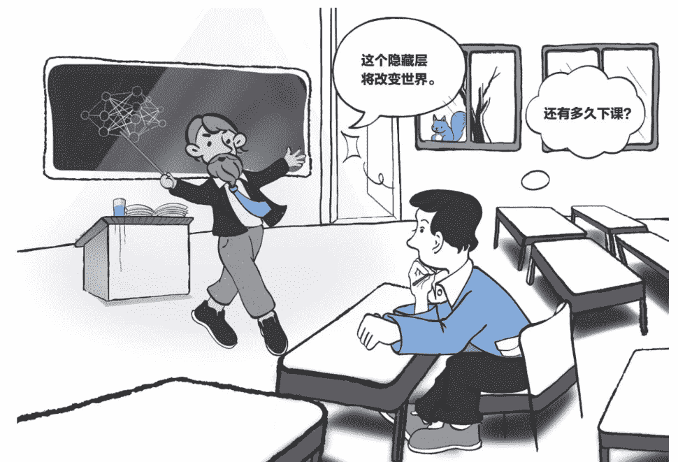

神经元工作全解：从生物脑到人工智能

大脑处理信息的流程看上去简单，实则繁复。神经元的输入输出遵循一套可概括的规律。

首先是信号接收。树突像分叉的触手，负责承接邻近神经元发来的电信号和化学信号。随后是信号汇总。抵达的多路信息在细胞膜上被整合，离子通道的开闭与突触间释放的神经递质共同决定了总刺激的强弱。接下来是阈值判断。当累积刺激超过设定门限，细胞就会产生一次标准化的电脉冲，也就是动作电位，它是信息在神经元内部传递的基本单位。之后是信号发出。动作电位沿轴突向前推进，通过突触接头把信息投递给下一批神经元。最后是连接调节。突触可塑性让神经元间的联结强度可以上调或下调，从而改变后续传递的效率。总体看，脑细胞以接收、整合、发放的方式协作，完成精细而复杂的运算。

### 图4—1 生物神经元结构示意图

用生活化的说法来理解，大脑像一个永不下线的超大群聊。八千多亿个神经元相当于群里的活跃用户，每一个都架着无数根天线——树突，同时潜伏在大量群组里。它们收到的消息有亢奋的也有抑制的，内部先做汇总。兴奋消息足够多，超过个人的发言门槛时，该神经元就会被点亮，借助轴突这根广播杆向关注者群发“已激活”的强信号。更有趣的是协同使用频率。经常一起被激活的两个神经元，比如负责红色和负责圆形的细胞在看到苹果时总共振，它们之间的好友权重就会增长，信息过路更顺畅，就像常用联系人被顶到列表顶部。看到苹果的瞬间，数百万个用户在毫秒内刷屏：红色在喊、圆形在喊、甜味在回忆，最终汇聚到苹果识别单元，形成“这是苹果”的结论。这就是我们能迅速辨识复杂事物、做出决策的集体协作本质。

大脑网络里跑两种载体：电信号和化学信号。电信号在细胞内部以每秒数十米的速度长距离奔跑，适合做快速的远距离传递，比如感觉传入和运动指令发出。化学信号在突触间传递，速度以毫米计，距离短，却在调节连接强度和传递质量上发挥关键作用，例如让突触的效率升高或降低。两者配合，构成了灵活而精准的信息处理系统。

人类约有860亿个神经元，它们织成一张庞大网络，支撑从感官运动到抽象推理的一切认知过程。尽管我们尚无法完全读懂每个信号的具体语义，但海量细胞的电活动与化学活动相互涌现出了智慧。正是这种仿生启发，让人工智能的神经网络诞生，被称为仿生学。为叙述方便，后文提到神经网络若无特别说明，均指计算机实现的版本。

神经网络概念提出很早。1943年，神经生理学家沃伦·麦卡洛克与数学家沃尔特·皮茨合作提出麦卡洛克-皮茨模型。他们假设神经元是接收处理传递信息的基本单元，细胞间以电信号交流，激活状态可用0/1二值表示。他们没有处理化学信号，仅模拟电过程，并用与门或门非门等逻辑算子来描述激活与抑制。该模型奠定了概念雏形，却停留在理论阶段。

### 图4—2 人工神经元数学模型（麦卡洛克—皮茨模型）示意图

进入20世纪50年代，里程碑式进展出现。1957年，美国心理学家兼计算机科学家弗兰克·罗森布拉特提出感知器。感知器由输入层、权重和激活函数构成：输入层承接外界数据，权重调节各路输入的强弱与方向，激活函数决定是否点亮。罗森布拉特通过MARK1硬件实验和模拟证明，感知器可以完成简单的分类任务。通过调整权重和激活函数，模型能够学习输入模式并识别分类。这证明了神经网络具备实用潜力，但距离现代智能仍有鸿沟。感知器为后来的复杂模型提供了可行基础，也为机器学习和模式识别指明方向。感知器真正缺失的，是算力和数据。

### 图4-3 实验员正在调整美国科学家弗兰克·罗森布拉特开发的感知器（“MARK1”计算机）的随机布线网络

### 图4—4 感知器模型示意图

## 大力出奇迹

计算机里的神经元本质上是一个函数，给定输入x输出y，即y=f(x)。感知器的数学表达是Wx+b，其中W是权重矩阵，x是输入向量，b是偏置即阈值。

输入x通常是一组数值，如一张黑白照片的像素亮度排成向量。处理阶段由权重矩阵W介入，Wx是矩阵乘法，把输入线性变换成另一向量。随后加上偏置b进行门限判断，形成z=Wx+b。最后由激活函数f作用于z得到输出。激活函数必须是非线性的。线性叠加只能画直线，无法刻画弯曲的世界。

用一个比喻说，线性就像只能用直尺作画，无论叠加多少层都只能得到直线，画不出花瓣、脸庞和波浪。非线性激活函数相当于给了画家圆规和曲线尺，可以组合出复杂图形。识别人脸、理解语言、预测天气都依赖这种非线性关系。没有它，网络只能做加减，无法变得聪明。常见激活函数有阶跃函数和S型sigmoid，z大时趋近1，z小时趋近0，过渡平滑连续。

### 图4—5 生物神经元与人工神经元对比示意图

### 图4—6 激活函数中常用的阶跃函数和S型函数

神经网络就是把无数个这样的函数串联。输出作为下一层的输入，层层传递。问题在于网络规模、连接方式、权重矩阵的尺寸如何影响表现。这门学科博大精深，但有一个量化概念很清晰：参数量。大语言模型常说的几十亿、几千亿参数，指的就是网络里权重与偏置的总数量。设神经元总数为l，某个神经元的权重矩阵为m行n列，则参数量级约为l×m×n，偏置b的数量可忽略不计。当模型拥有百亿、千亿甚至万亿参数时，表现才开始令人满意，看似大力出奇迹，背后是涌现现象和扩展定律在起作用。

### 一个辅助理解神经元运行机制的例子

以是否能考上某大学为例，用单个神经元做决策。以各科成绩为输入，以历史录取分数线为阈值，采用阶跃函数即可判断。

**输入x**：各科分数。

**权重W**：高考各科权重相同，设为1。

**偏置b**：设录取线为660分，则b设为-660。

**激活函数f**：阶跃函数，总分大于660时输出1，否则0。

**输出y**：1表示能录取，0表示不能录取。

| 语文分数 (x₁) | 数学分数 (x₂) | 英语分数 (x₃) | 物理分数 (x₄) | 化学分数 (x₅) | 生物分数 (x₆) | 总分 | 是否能考上某大学 (y) |
| :---: | :---: | :---: | :---: | :---: | :---: | :---: | :---: |
| 135 | 140 | 138 | 98 | 95 | 94 | 700 | 是 (1) |
| 110 | 115 | 120 | 86 | 80 | 80 | 591 | 否 (0) |

网络的具体神经元数量、结构、权重矩阵大小在商业模型中常被视作机密，如同炼金配方。但开源模型会公开架构，例如DeepSeek-V3.1的公开配置如下。

### 表4—1 模型架构

| 项目 | 详细信息 |
| :--- | :--- |
| 模型名称 | DeepSeek-V3.1 |
| 总参数量 | 6 710 亿 |
| 架构 | Transformer ( GPT-style ) + MoE |
| 上下文长度 | 128K |
| 注意力机制 | Grouped Query Attention ( GQA ) |
| 前馈神经网络 ( FFN ) 结构 | Mixture of Experts ( MoE, 24 experts, top-2 active ) |
| FFN 隐藏层维度 | 14 336 |
| 激活函数 | SwiGLU |

从50年代感知器到今天的结构并不算复杂，真正让技术变好用的是半个多世纪的算力和数据积累。当参数规模达到百亿、千亿、万亿级别，模型才展现出符合预期的能力。这与扩展定律一致：增加参数量、训练数据和计算资源时，性能按幂律规律提升。该定律帮助预测性能增长、优化资源配置，并推动了Transformer等新架构的成功。

以GPT-3为例，1750亿参数相比GPT-2的约10亿参数，在自然语言理解与生成上实现质变，体现了涌现。但扩展并非万能。挑战包括巨大的计算成本、数据隐私风险和能源消耗带来的环境压力。更根本的问题是，扩展是否能通向通用人工智能。一种观点认为若所需算力远超现实可及，如同用太阳系大小的对撞机验证弦理论，则不切实际。另一种观点强调高质量多样化标注数据的稀缺，AGI需要理解而非单纯模式匹配。目前，是否永远大力出奇迹，仍是开放的争论。

## 深度学习

现在神经网络的整体样子我们已经基本摸清了，也明白只要参数规模拉大、训练数据够多，就能养出智力水平不低的模型。可事实是，不同任务下表现最好的模型往往不一样，比如负责人脸识别的网络和擅长围棋对弈的网络，底层的计算单元都是神经元，但它们的内部组织方式却大相径庭。这种差异到底藏在哪里？关键在于神经元之间的连线方式，也就是常说的架构。

如果把全部神经元都连起来，而且每两个神经元之间都有一条直接连线，全连接在规模上去的话根本不可行。连线数量随神经元数量的增长规律是 n(n-1)/2。100个神经元就有4 950条连线，1万个神经元就飙到499 995 000条。放到像大语言模型那样参数上千亿的体量，粗略估计每个神经元里的权重矩阵W的维度大概在几百量级，单个W就包含上万个参数，神经元总数以亿计。若强行全连接，连线数会达到亿的平方级，数据量大到难以想象，训练效率也必然崩掉。所以怎么连线，本质上就是架构要解决的问题。

研究已经反复证明，换一套连线方式，网络的能力取向就会改变。大型语言模型普遍采用Transformer架构，卷积神经网络CNN在视觉任务上极具优势，循环神经网络RNN则更擅长时间序列。正因为连线方式可以设计成层次化，网络才有了层分的概念，而深度学习正是建立在分层之上。退一步想，如果网络是彻头彻尾的全连接，分层的想法也就无从谈起。

用生活化的场景来体会这三种架构的区别会更直观。

RNN像一位记忆力衰退的老教授在逐字读小说。他只能盯着一个字，读完后在脑中留下一点痕迹，再去看下一个字。理解当前字时他会调用之前的残余印象，但记忆会随时间衰减，读到后半段时开头的情节已经模糊不清。这正是RNN的处理逻辑：按顺序消费信息，每一步都保留一点“上下文”。但这种记忆会逐渐淡化，处理长文本时开头的内容很容易丢失。它在股价预测、语音识别这类依赖时序的场景里作用明显。

CNN更像手持放大镜的侦探在照片里找线索。他不会逐像素扫描，而是用不同倍率的镜片在画面上滑动。小镜片捕捉线条、边缘等基础细节，中等镜片拼出圆角、纹理等中层结构，大镜片则能辨认出整个人、整辆车。CNN用不同尺寸的“滤波器”在数据上滑动，先提取低级特征，再层层组合成高级特征，最后完成整体识别。这种由局部到整体的递进，恰好契合图像的空间结构。

Transformer则像一个社交场上的超能力者。普通人只能依次聊天，这位超能力者却能同时和房间里所有人对话，还能瞬间判断“甲说的话和乙最相关”“丙和丁在聊同一个话题”。他不需要循序等待，而是并行理解全部信息并计算彼此关联。这就是注意力机制。处理“小明的妈妈去商店买了苹果给他”这句话时，Transformer能立刻把“他”锚定到“小明”，而不需要像RNN那样读到后面才回头寻找。

归纳起来，RNN是按部就班的阅读者，适合顺序敏感的任务但容易健忘；CNN是擅长捕捉局部模式的观察者，对有空间结构的图像类数据特别有效；Transformer是能同时统筹全局并挖掘复杂关系的全才，在语言任务上表现突出，也因此成为ChatGPT、GPT-4等大模型的底层选择。

如果把信息处理比作看电影，RNN是一帧一帧按时间观看，CNN则聚焦于每一帧的画面细节，Transformer则能同时看到所有帧并理解帧与帧之间的复杂关联。每种架构各有所长，选型取决于问题本质。

机器的基本流程都是输入-处理-输出。神经网络里直接接收外部信号的单元构成输入层，负责给出结果的单元构成输出层。深度学习的特点是在两端之间插入大量隐藏层。所谓“层”，是指同层内的神经元之间互不连接，而相邻层之间存在连接。上一层的输出经过加权汇总后作为下一层的输入，同一层内的每个单元接收到的都是上一层全部单元输出的加权和。

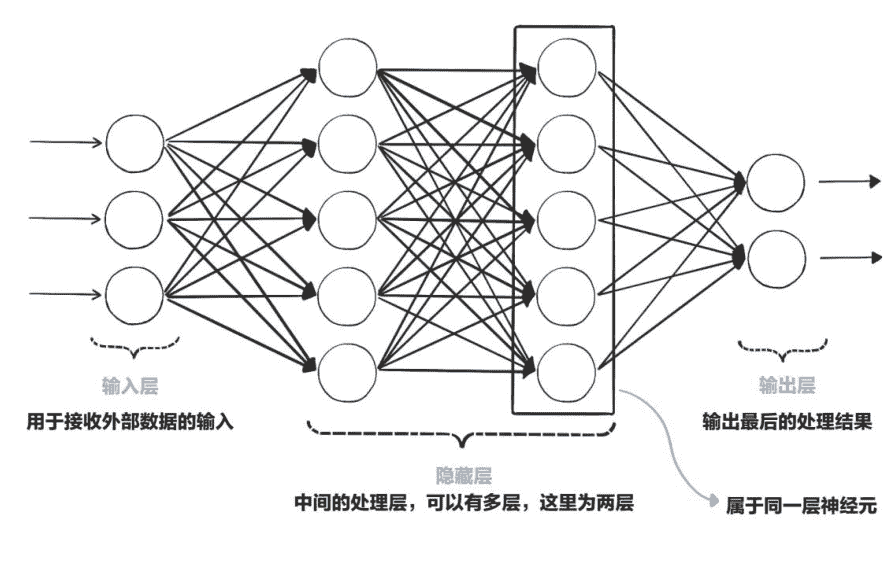
### 图4—8 神经网络分层结构图

深度学习中的隐藏层设计取法于人脑的连接方式，虽然目前尚无确凿的科学证据能精确解释隐藏层的作用，但实践中分层带来的好处清晰可见。用分层的CNN做人脸识别时，不同层提取的规律呈现明显的认知阶梯：浅层捕捉人脸的大致轮廓，中层勾勒五官的形状，深层则聚焦某个五官的细部特征。这样的分层认知与人类看世界的方式高度一致：从模糊到清晰、从宏观到微观，每清晰一层就产生新的概念。人工智能的研究因此不再局限于计算机领域，心理学、认知科学、脑科学乃至哲学都深度参与其中。

人对事物的认知并非单向深入，还包含反思与回溯。人们常说的见山是山、见山不是山、见山又是山，就体现了认知的螺旋上升。物理学历史上也经历过从微观到宏观再反哺微观的循环。人工智能中对应的反思机制就是误差逆传播算法。1986年辛顿、鲁梅尔哈特和威廉姆斯三位学者提出该算法，可看作神经网络的反思能力。

要理解它，先要明白训练在做什么。一个模型要表现好，核心是调节参数以学会问题与答案之间的关联。调节的依据是一个代价函数，训练目标就是让代价函数的值尽可能小。一个合适的代价函数应满足：参数调优后，代价最小处对应答案最优。

神经网络可调的东西非常多：神经元数量、架构形式、每个神经元里的权重矩阵W、激活阈值b、激活函数的具体形式等。用数学语言说，代价函数是所有这些参数的函数，随着参数变化，代价也在变化。目标就是在海量参数空间里找到使代价最小的组合。参数动辄上百亿，相当于一把上千亿位数的密码锁，手工破解不现实。

部分要素可以预先设定：神经元个数、架构、激活函数类型、W的行数等。真正自动调节的是W和b中的数值，由算法完成。可想而知，代价函数是一个自变量多达千亿维的函数，寻优极为困难。研究者不断设计更高效的优化算法来逼近最小值。即便如此，往往只能得到局部最优而非全局最优。

总体看，训练的本质就是调整权重W的参数。开源模型所说的“开源”，指的就是W数值的公开。

误差逆传播如何运行？以监督学习为例，输入一批带标签的训练数据，通过初步调节得到一个较小的代价值。理想情况下，输出与真实答案完全一致时代价为零，现实中总存在误差。算法的核心思想是把输出与真实答案的差距计算出来，然后把整个网络的输入输出方向反转，把这个误差逆向送回网络，逐层回传到每一个神经元。

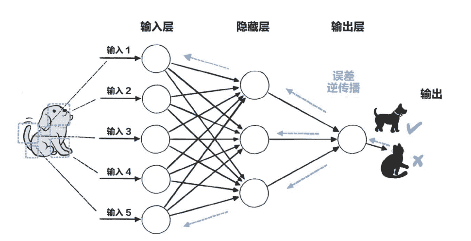
### 图4—9 误差逆传播算法示意图

代价调节的过程像在山谷里寻找最低点。找到一个相对低的位置后，还不确定是否最优，于是把误差倒着传回去，在代价函数周围做试探，看往哪个方向走能进一步降低数值。把已有的错误当成经验带回思考过程，尝试找出错在何处、该往哪里改，一轮反思后代价更新，再次输出、再判断，直至收敛。只有网络具备分层，才出现数据单向传播的方向性，也才拥有反思的可能。深度学习的技术路径与人类思维方式的接近度，正在于此。

# 第五章 生成世界

我们正目睹从确定性计算向创造性生成的历史拐点。人类文明每一次技术跃迁都伴随思维方式的重塑。工业革命把生产从手工带向机械，信息革命把沟通从局部带向全球。如今的AI革命可能更深远，它正在重新定义“创造”的含义。

传统程序遵循严格的逻辑：确定输入，得出可预测输出。确定性是优势，也是局限，面对需要灵感和原创性的任务时显得无力。生成式AI的出现打破了这一边界，让机器能够产出看似原创的内容，从文字到图像、音乐到视频。

这意味着我们进入了创造性计算时代。但这种创造的本质是什么？当AI写出从未见过的诗、画出前所未有的画时，它真的在创造吗？还是极其复杂的模式匹配与重组？

生成式AI的价值不仅在于产出内容。从信息论看，它的核心价值是复杂度降维，把高复杂度的信息转化为人类更易理解的形式。在信息爆炸的今天，这种能力尤为珍贵。人类每天接收的信息量远超处理能力，AI可以帮助提炼精华、降低信息熵、提升决策效率。这也解释了为何文档摘要成为大模型最早的实用场景之一，它不是偶然，而是大模型相对于传统工具的天然优势。AI不仅能处理结构化数据，更能理解高度非结构化的复杂信息。

如何让技术更好地服务人类社会，如何在改变工作方式和创造观的同时保持人类的独特价值，如何确保发展方向符合长远利益，都是必须深思的问题。

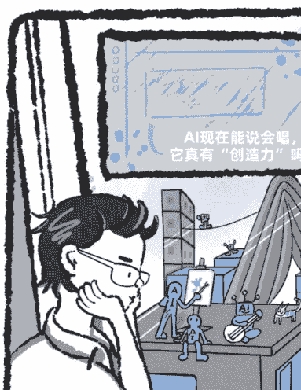
AI现在能说会唱，它真有“创造力”吗？

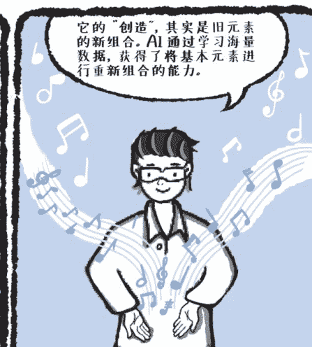
它的“创造”，其实是旧元素的新组合。AI通过学习海量数据，获得了将基本元素进行重新组合的能力。

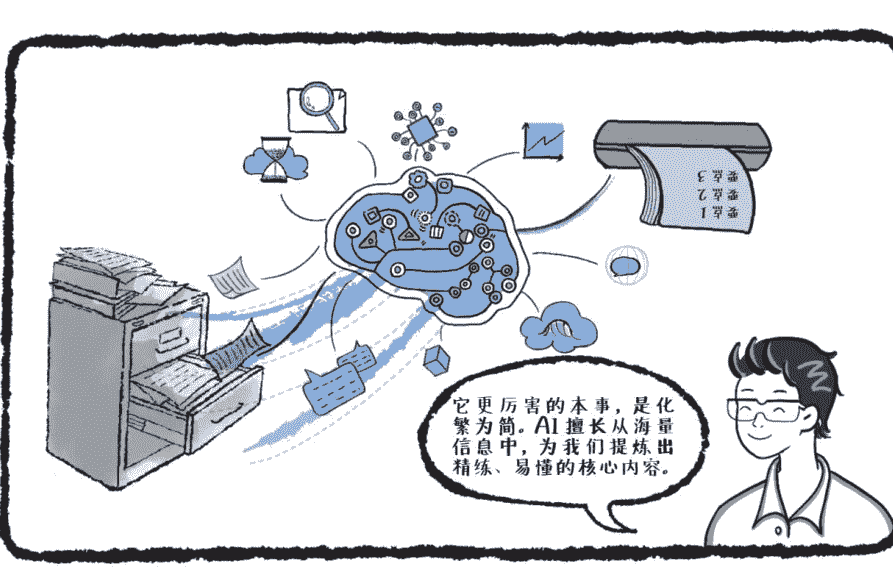
它更厉害的本事，是化繁为简。AI擅长从海量信息中，为我们提炼出精练、易懂的核心内容。

## 从确定性到创造性

讨论生成式人工智能，实质是探讨一种全新的计算范式。当前AI概念的爆发，很大程度上源于大语言模型和图像生成技术的突破，而核心正是生成式AI。

与传统AI不同，生成式AI并非为标准答案问题而生，而是输出原创内容。传统窄AI处理确定性任务：人脸识别对应身份、AlphaGo追求胜率、扫地机器人执行清洁，目标明确、标准可量化。

生成式AI的挑战不同。要求它写篇文章或画幅画，并没有绝对的优劣标准。它的任务更具创新性，而且主要通过自然语言驱动。例如指令：“请为我创作一首诗，诗中要包含鲜花、明月、美人和酒这四个元素。”系统可能生成：

> 明月照亭前，鲜花伴酒边。美人轻解佩，一曲动人弦。

不仅涵盖全部要求，还意外加入“音乐”元素“一曲动人弦”，展现出超出预期的创造力。这呼应了开篇的判断：AI的大规模爆发代表新一轮文明的指数级发展，根源在于它能输出复杂度大幅提升的信息，当这些信息通过网络形成体系时，释放的力量难以估量。由此产生疑问：创新不该是人类专属吗？AI不过学习公开互联网数据，为何能创新？

要回答，必须厘清创新的本质。康德曾指出，创新本质是“旧元素的新组合”。色彩即为例证。RGB显示器理论上可产生256³=16 777 216种颜色，但基本色系大致只有赤、橙、黄、绿、青、蓝、紫、黑、白、灰十种左右。无论如何调配，都跳不出基本色系的范围。棕色不过是较暗的橙色。

生成式AI亦然。要求它写诗，实质是在几千个常用汉字中进行选择与组合。创新的关键不在是否出现新组合，而在组合的新颖与意义。人类精力有限，可组合空间无限，因此我们发明知识体系和工具来高效寻找有意义的组合。“文章本天成，妙手偶得之”点出了创作的偶然性与意义性。就像圆周率包含所有可能的数字序列，关键是如何找到有意义的部分。

生成式AI的优势在于强大的组合发现能力：能快速找到有意义的新组合，能依据自然语言指令生成贴近描述的组合，且过程可靠、迅速、多样。那么，拥有全网数据作为旧元素库的新组合从何而来？答案藏在神经网络的架构设计中。

第四章已介绍神经网络的基本原理。它正从边缘走向主流，推动力量是计算能力的跃升和成本的下降，典型的“大力出奇迹”。当规模跨过阈值，参数激增，涌现现象出现。随着神经元增多，权重也随之增多，而连接方式的重要性愈发突出。

显而易见，超大规模下全连接不可行。神经元翻倍，连线数近似平方增长，资源消耗巨大，效率低下。因此网络必须采用特定架构，且不同架构适合不同问题。CNN擅长图像，人脸识别即是典型。RNN擅长时间序列，天气预报、股票预测等即属于此类。

架构是一个宽泛概念，涵盖结构与流程设计。其关键要素之一是层次结构。在超大网络中，全连接不现实，层概念随之出现。同层神经元通常彼此无直接联系，从而形成清晰的层次。层与层之间存在连接，而同层内部一般没有连接。

生成式AI的底层构造笔记

神经网络的搭建并非随意拼凑，而是一套可拆解的构造语法。下面这八个要素，决定了模型能做什么、做到什么程度。

第二，数据入口与结果出口的界定。任何可用的网络都离不开首尾两端。前端负责把原始信号接入系统，例如人脸识别里就是一张原始照片；后端则给出最终结论，比如把照片对应到具体的人。缺了这两端，信息无从进入也无从流出。

第三，中间隐层的编排。除去开头和结尾，体系中往往还会加入多层隐含结构。只要出现这种中间层，就进入了深度范畴。隐层的层数以及每层里神经元的规模，都是架构设计里的重要决策。

第四，层间连通规则的设定。层数确定后，需要明确神经元之间如何连通。最常见的做法是相邻两层做全连接，也就是上层每个单元都与下层每个单元建立关联。

第五，连接强度的差异化。连通只是骨架，强度才体现差异。这正是权重矩阵 W 所描述的问题，同一层里指向下一层的权重值各不相同。

第六，非线性变换的选择。每层单元的激活方式也是可调参数。它决定了信号在加权求和并加入偏置后，如何转化为新的输出。函数形态、作用方式，以及是否在整层统一，都属于可设计的空间。

第七，损失目标的定义。训练的方向由损失函数决定。它的数学形态直接影响收敛后的表现，机器学习必须由人先行设定这一目标。

第八，最小化手段的选型。让损失下降的方法很多，不同的目标往往适配不同的优化器，效率差异显著，这本身也可看作架构的一部分。

即便把要素列清，真正的结构创新依旧没有一套标准流程，更像手艺人的炼金实验，靠经验、直觉和大量试错。能做出划时代结构的科学家绝大多数都是顶尖人物，比如提出卷积结构的杨立昆，正因这项工作拿下图灵奖。

支撑 ChatGPT 等大模型的主流构造是什么？答案是 Transformer。这一构造源自 Google 团队的论文《Attention is all you need》，标题轻松却极具穿透力。它在机器翻译任务上首次全面压过 RNN，从此主导了自然语言处理。

“注意力，才是全部”

从宏观视角看，Transformer 由编码端与解码端构成。输入先被编码，再由解码端生成答案。

编码的本质是向量映射。文本进入编码端后会被转成高维向量，可类比为地图上的坐标点。Transformer 用的维度非常高，比如 1536 维，这个数字的由来是 1536 = 1024 + 512，两者都是 2 的幂次，对计算友好。为便于理解，这里仍以二维来说明。

编码端处理的最小单位是 token。以英文为例，convolutional 会被拆成 con、volution、al 三个记号，每个记号对应一份向量。解码端的任务是下一个记号预测，即依据已有序列推测后续记号。

比如“今天天气真好，我准备出门……”后面可能接“转转”“吃饭”“钓鱼”，甚至“淋雨”。模型如何抉择？靠上下文概率分布。模型在海量公开文本上学会了不同续写的出现频率，“出门淋雨”的概率极低，因而会被压制。这也说明大模型必须吃足数据，概率估计才可靠。

注意力的核心是学习字符与前文的关系。Transformer 直接建立当前记号与所有前置记号的关联，不像传统 RNN 需要逐层递归传递。例如学习“好”时，会同时考察它与“今”“天”“气”“真”的共现概率。训练过程兼具监督与无监督特征：标签就是人类历史文本本身，无需额外人工标注。

训练的目标是让向量合理反映语义。以“苹果”“梨”“手机”为例，理想状态下苹果与梨在向量空间更靠近，而手机相对偏远。模型并不“理解”词义，但通过注意力与大规模数据，联接参数被调整为能够压缩出语义合理的向量表示。

**图5-1 大语言模型根据学习内容对下一个最可能出现的词的预测**

简言之，Transformer 的流程是输入→编码端向量化→解码端预测下一个向量，反复循环。有效性由注意力机制保障，再经大数据训练，使信息被压缩为语义相近的向量，这正是生成式 AI 的基本思路：基于输入预测下一个输出，实现内容生成。

文字生成成熟后，图像与视频生成如何实现？目前主流方案是 GAN 与扩散结构，其中扩散更占上风。

扩散的灵感来自墨水在清水中的扩散。训练分几步：

数据准备阶段：收集带语言标签的图片，如“这是爱因斯坦的卡通形象”。

加噪过程：每个像素的 RGB 值以高斯分布随机增减。

逐步模糊：反复加噪，直至画面完全不可辨识。

路径记录：从清晰到完全模糊的 N 张中间图全部送入网络学习。

学习目标：网络学习的是清晰到模糊的路径，即向量空间中的点序列。

训练通常使用数亿张图片。生成则是反向操作。

## 训练：正向扩散
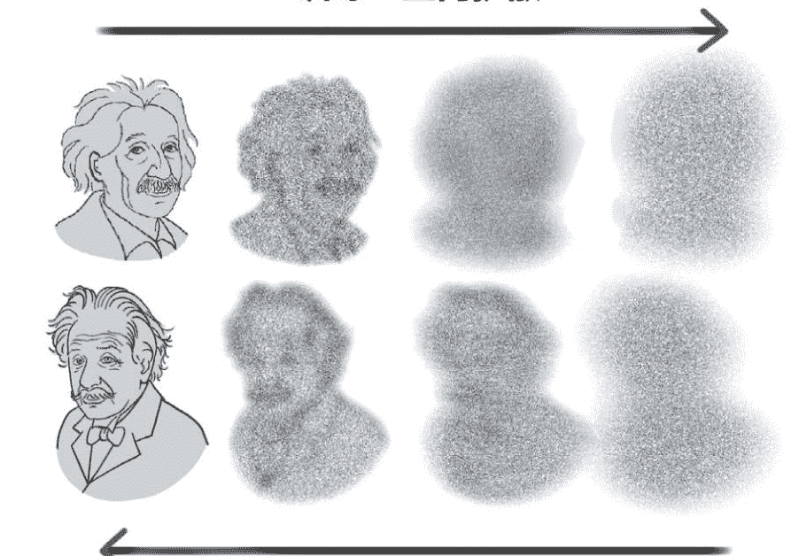
## 生成：反向扩散

**图5-2 扩散模型的正向扩散和反向扩散**

如图5-2 所示，给出“给我生成一张爱因斯坦的卡通照片”时：

- (1) 语义理解：在向量空间定位对应路径。
- (2) 路径追踪：找到与描述相关的向量轨迹。
- (3) 逆向生成：从随机噪声沿路径反向恢复出清晰图像。

扩散的创造力源于海量数据与组合能力。即使训练集中没有“长着两个头的鸡”，系统也能通过理解文字并在向量空间做加权组合来合成新图。这种“旧元素新组合”的本质，使提示词工程成为关键，描述越精准，生成质量越高。

文字生成视频则把扩散与 Transformer 结合，形成扩散 Transformer。视频是连续图像序列，需要更长的文字描述，复杂度更高。区别在于时间维度的加入。

数据维度的扩展：每秒 24 帧的视频，每个像素除 RGB 外还含时间变化。
向量表示的复杂化：需同时建模空间与时间信息。
方法论的延续：核心仍基于扩散原理。

高质量文生视频依赖文字嵌入质量、训练数据的数量与质量，以及具体的技术实现细节。

复杂度降维

从商业价值看，生成式 AI 的核心是降低复杂度。从信息论视角，人类活动本质是消除信息熵，获取确定性。互联网提升了信息传输效率，而 AI 提升的是复杂度消除效率。

AI 主要解决高复杂度问题。以往靠人脑完成，现在可被 AI 承担。大模型早期擅长文档总结，正是把高复杂度内容压缩为要点。复杂度的高低是相对的。学科分化就是人类应对复杂性的策略：同一现象可用不同抽象层次处理，化学概念比直接用量子方程更简便，因而形成学科。

生成式 AI 也呈现专业化，即智能体 Agent。Agent 即代理，在 AI 语境中指专门解决某一类问题的系统。

最基础的做法是通过提示词让模型扮演角色，比如“请像物理学家一样思考”。这只是突出已有能力，不能真正提升能力。更强的做法是微调。

神经网络表现取决于参数规模，参数量约为神经元数量乘以权重矩阵元素数。输入经权重矩阵 W 调节后输出，因此 W 的具体取值决定模型能力。微调即在特定任务数据上调整这些权重，使智能体更专业。

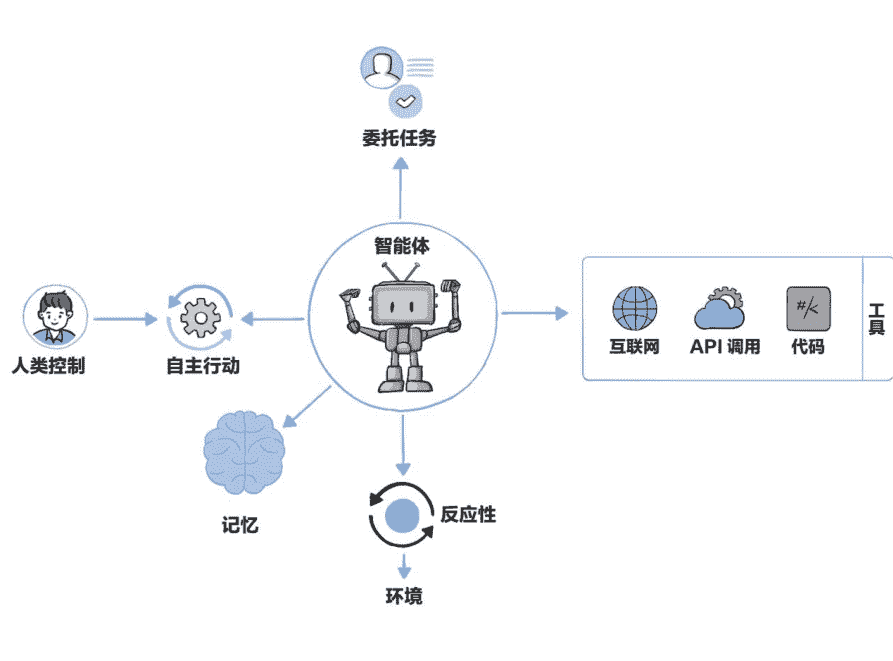

**图5-3 智能体工作流**

生成式 AI 标志着人工智能的重要转折，它重新定义了创造的边界。Transformer 的注意力机制与扩散的图像生成，共同展示了机器在创造性任务上的潜力。其“创新”本质仍是旧元素的重组，但在海量组合中快速找到有价值结果的能力，依赖算力、海量数据与精巧架构。随着发展，它将在更多领域发挥价值，同时也需要在方向上保持对人类长远利益的审慎思考。

当神经网络被大量标注样本喂养时，实质上是在对权重矩阵W里的每一个数值做精细调节。在神经元规模、网络结构、分层连接这些前提固定后，真正决定模型表现的，就是全部权重参数的取值。预训练就是指大模型在交付使用之前，已经完成了数据灌入和权重校准，可以直接开箱即用。微调的逻辑则更直接——继续拿数据去改写这些权重。

操作上，微调和预训练很像，都要喂数据，而且最好是带标注的监督数据。目标是让大模型向某个特定任务靠拢。我自己的AI数字分身严伯钧就能模仿我的风格写科普，语气和我非常接近。这靠的是数据投喂：把我过去写过的稿件大量输入，量越大相似度越高。我大概投喂了100万字的个人稿件，才达到这种高度贴合的效果。

投喂并非无脑堆砌，而是门手艺。参数设置、数据形态、质量和格式都会明显影响结果。比如想让AI解数学题，题目和答案最好拆开，并配上细致的标签。培训机构老师带学生做题时做的知识点分类、拆解归纳，就是很好的标签范例。

光靠微调就能让AI无所不能吗？显然不行。目前训练社区里呈现出一个清晰的规律：AI和人很像，要精就难全，要全就难精，像打地鼠，按下一个又冒一个。微调的作用天生有限。现实里的工作和科研问题都极其复杂，仅靠微调提升推理 reasoning 和问题解决 problem solving 的能力，离令人满意的水平还有距离。

这就指向另一种思路：智能体工作流 workflow of agents。

## 协同作业的智慧

智能体工作流的想法很朴素：把擅长不同子问题的AI智能体串成一条完整的作业链。仍以我的科普分身严伯钧为例。经微调后，它能学到我的写作口吻，这只是风格模仿。若要让它连内容也像我该怎么办？典型场景是：一个热点科技新闻进来，我希望它像我一样迅速产出一篇科普稿，再基于稿件做出视频。要做到“任意输入科技新闻或论文，输出严伯钧风格的科普视频”，就需要把任务拆解成标准操作流程 SOP。

先看我本人是怎么做的。从读到论文到成片，可分解为：

第一步：论文归纳。对原文做整体提炼，抓出核心观点与关键信息。

第二步：术语排查。在归纳文中挑出仍在的生僻术语。

第三步：术语通俗化。用大白话解释清楚。这个环节还能再细化，例如先检索再归纳。

第四步：内容融合。把通俗解释重新嵌回第一步的归纳，形成一篇无术语的总结。

第五步：文稿打磨。对去术语后的文本做润色，让表达更顺畅。

第六步：风格迁移。将打磨稿送入严伯钧，得到带有我风格的科普文稿。

第七步：视频合成。把文稿交给视频生成引擎，最终输出成片。

七步构成完整流程。智能体工作流的核心，就是让这七步由不同的智能体分别承接。每一步工作量相对单一，单体智能体足以胜任，整体负担也随之减轻。

AI本身的综合推理能力不足，推理拆解的工作就交给人来做。以七步为例，第三步还能继续拆成检索、总结、精简等。拆解的原则是：拆到单个智能体都能高质量完成为止。

智能体工作流已成为当前方法论的主流。人工智能科学家吴恩达 Andrew Ng 指出，用工作流让低配模型解决问题的效果，能超过单用高配模型。这正是三个臭皮匠顶个诸葛亮的写照。靠合理的任务拆分与协同，多个简单智能体可以产生超越单一复杂模型的表现，既提升效率，也让AI应用规模化部署更经济。对AI核心价值的理解是为解决复杂问题而生，在这个过程中，智能体、微调和智能体工作流构成了关键的技术手段。下一章将讨论哪些场景更适合AI落地。

# 第六章 创造性破坏

前文反复提到创造性破坏。纵观文明史，每次重大跃迁都伴随破坏。传统意义上的破坏，是消灭既有的人类岗位，让劳动力从旧工作解放到新工作。

历史上科技主要取代的是体力劳动以及低自由度的脑力劳动。而这一代人工智能不同，它冲击的往往是高自由度的人类核心脑力劳动，甚至触及需要创造性思维的领域。

这种破坏前所未有。当人类解决高自由度问题以及创造力本身都面临被替代时，文明形态的进步也将是空前的。本章探讨哪些原本属于人类的专属工作将被AI大幅取代，即AI的商业潜能在哪里。

这场革命取代的已不只是体力了。当AI越发智能，我们以为最安全的创造性脑力劳动也被正面冲击。

例如情感陪伴。AI能发展虚拟偶像，通过学习聊天记录构建数字人，实现某种意义上的数字永生。

在艺术领域，AI已能生成电影、绘画甚至作曲。只是独特的风格是艺术的灵魂，目前AI仍难以企及人类高度。

再看最复杂的科研。AI已深度参与，例如高精度蛋白质结构预测极大加速新药研发。

教育方面，AI可整合全部知识库，实现真正的规模化因材施教。

法律、金融等专业领域借助智能体工作流，也能像专业团队一样高效处理复杂任务。

这么多领域的冲击会带来什么？AI强大的生成能力将助力构建Web3.0，催生内容确权、资产化的虚拟新经济。

## 人工智能与情感

科幻为AI终极形态提供了蓝图。《异形》里的生化人戴维代表有外形的人工智能，《机械姬》的美女机器人是另一种可能。若不执着于外形，《钢铁侠》里的贾维斯或许更接近理想形态。当然也有反面想象，如《终结者》里的天网——以灭绝人类为目标，这是我们最不愿看到的方向。

本质上，AI的终极形态是要无限逼近人类。人类核心特征可分为理性和情感。当前AI在理性上仍有差距，但在情感表达上，它虽无真实情感，却能表现得仿佛拥有。用户与大语言模型对话时常有面对真人的感觉，尤其OpenAI发布GPT-4o后，语音交互的语气、声调和细节已接近真人。这表明情感陪伴将成为重要应用方向。

Character.ai就是典型代表。平台运营不久后宣布停止服务，但它曾是2024年全球该领域最成功的产品之一。用户可与爱因斯坦、牛顿等名人的AI分身对话，也能创建自己的角色。底层本质是精巧的提示词工程。GPT-4o发布时，《她》的海报被改造成山姆·奥特曼的形象，生动反映了情感交互的突破。

中国市场同样涌现大量同类应用，例如虚拟恋人、恋爱技巧AI。传统恋爱指导依赖心理导师传授理论，恋爱AI则直接与用户对话练习并实时反馈，相当于实战训练。更重要的是，随着技术成熟，人类在客观意义上几乎实现“永生”。线上复活逝者，正如《流浪地球2》中刘德华饰演的角色试图在虚拟世界复活车祸去世的女儿，如今用现有AI技术基本可以达成。效果尚不完美，但技术障碍终将被克服。

数字永生的操作并不复杂，本质是微调。核心是输入标注数据。若要线上复活某人使其可对话，需要输入什么？很简单：聊天记录和社交媒体内容。自即时通讯普及以来，每个人都积累了海量聊天数据。被复活者说的话作训练数据，对方回复作标签，以问答形式输入系统。年龄稍长、聊天时间足够的人，甚至拥有数百万条高质量素材。

前面提到的微调使用监督学习。若想让数字分身能替本人对话，还可用强化学习进一步优化。先用监督学习建模，再让本人与分身对话并持续给出反馈评价，也可让朋友交流并提供反馈，形成完整强化学习闭环。

若AI不用来解决复杂问题，只用于情感陪伴，发展会非常快：技术门槛低，市场需求却极大。即便在AI之前，虚拟偶像已兴起，如日本初音未来。可互动的虚拟偶像满足二次元爱好者的梦想，必将成为不容忽视的商业机会。

## 人工智能与艺术

AI令人震撼的另一面是创作力：文生图、文生视频、文生音乐技术迅猛。在这些领域蕴含哪些场景？

生成式AI最直观的应用是多媒体内容创作，娱乐产品以视频音频为主。AI换脸就是典型案例。据报道，中国短剧爆发后，借助AI把中国短剧演员面孔换成俄罗斯演员，就能在俄罗斯市场销售。目前技术只能替换面部，环境无法同步更改，出现金发碧眼演员穿中国古装在古装场景飞来飞去的怪象。随着技术进步，未来只要有剧本，Sora类技术就能生成完整电影。《阿凡达》这类影片将不再需要巨额CG投入。

但美好前景里有个值得深思的问题：视频制作可能很快平易，音乐创作仍可能受阻。不是写出乐曲难，而是创作出有艺术价值、带有鲜明个人风格的音乐并真正取代专业作曲家，极其困难。AI生成的乐曲已很多且听起来不错，为何说不会全面取代？并非说作曲家失业，而是“一人做出阿凡达级电影”在音乐行业大概率不会出现，除非人类音乐审美被AI同化导致整体审美下降。

判断基于两点。其一，作曲本就是个体化工作。除了歌词，曲子很少由团队合著。历史上集体创作的例子极少，威尔第《安魂曲》是少数。编曲或可协作，但从贝多芬、莫扎特到现代Hans Zimmer，单人作曲从未改变。作曲本来就是一个人的战斗，AI也没有全面替代的空间。

其二，技术路径受限。以Sora使用的分散Transformer为例，搬到音乐上就不够灵活。原因是音乐高度抽象。AI训练需要带标签数据。输入图片时不能只放图片，还需文字标签。若输入谷歌logo，必须同时标注“谷歌的logo”。图片是具象的，大多数人对同一张图会给出一致具体的描述，于是AI能找到规律。反向生成时，用户提到词，AI按路径加权平均生成正确图片。AI可训练的素材必须相对具象，而音乐本质抽象。

美术与音乐的对比有助于理解。抽象艺术创始人康定斯基认为音乐比美术更高，因为美术表达情感需具象手段，如画哭泣的人表示悲伤，热闹派对表示热烈。音乐无需模仿鸟叫就能表达田园风光，贝多芬《春天奏鸣曲》《田园交响曲》让人直接感受春意。康定斯基发明抽象艺术，就是想让美术也能摆脱具象，直接表达抽象情感，用几何元素组合出直接的情感。

AI生成音乐的最大挑战在标签化无法深入。听一段音乐打标签，只能粗略描述感受：悲伤、高兴、紧张，或客观信息：布鲁斯、圆舞曲、四三拍。要说“这里听到了黑洞”，100个人里不会都听出。标签必然粗浅，所以AI音乐听起来还行，却没有传世名曲，也没有知名的AI音乐家。模仿巴赫风格写小步舞曲不难，但进化成有强烈个人风格的作曲家，从原理上就不太可能。

音乐质量也无客观评判标准。AI可偶尔产出好作品，但需依赖用户反馈。评判远不止好听不好听，涉及复杂因素，跨文化反应也不同。AI要替代人类作曲家，创作出优秀作品并形成稳定风格很困难，因音乐太抽象。正如贝多芬早已指出，音乐是比一切哲学艺术更高的启示，因其不可言传、抽象，直接作用于情感，不经理性，与自然语言无直接关联。作曲家相对安全，演奏家也较安全，因演奏要素同样抽象。AI要真正颠覆音乐，可能要等脑机接口成熟，标签不再是语言而是脑信号，用脑电波标注才能深入。

从艺术价值看，AI音乐大概率不具高艺术价值，因艺术在于创新。AI可很好模仿某种风格，却难以产生自己的风格。即使指令其不模仿既定风格，大概率仍无法形成稳定个人风格，因音乐风格无定形。若强行收敛出新风格，判断和归类仍需人耳，风格创造的功劳归于下指令的人类创作者。艺术价值仍属人类。

整体来看，AI作为音乐生产工具完全可行，但作为独立作曲家拥有强烈个人风格则困难。也许真正的艺术创造是生成式AI冲击下人类最后的价值堡垒。艺术创造是人类深层情感的展现，理性创造AI或许更有优势，因其有相对客观的判断标准。我们一再强调AI擅长降低复杂度，反过来说，AI生成高复杂度内容也非常高效，生成式AI正是这一目标的体现。

在技术飞速发展的今天，不同领域受AI冲击的程度并不相同。情感陪伴、视频制作等领域展现出巨大潜力和商业价值；而音乐创作等抽象艺术，AI虽可成为强力工具，却难以完全替代人类创造性工作。这种差异提醒我们，在拥抱便利的同时，也要认识人类独特价值。真正的艺术创造，那些源于深层情感体验和抽象思维的活动，可能长期保持人类专属地位，这为AI时代的人机协作和价值定位提供了重要启示。

## 人工智能与科研

智能重塑科研、专业与教育

在人类所有认知活动中，科学探究的难度位居最高梯队。它既要求从业者拥有深厚的学科积累，也要求敏锐洞察、严密推理与常态化问题求解能力之外具备突破框架的创造冲劲。正因门槛极高，人工智能在此类高复杂场景中的价值才尤为突出。

最具标志性的参考案例是 DeepMind 研发的阿尔法福尔德系列，见图6-1。该成果将蛋白质空间结构预测的能力推向全新量级，在学界引发强烈回响，也被广泛认为将改写生物医药版图。那么阿尔法福尔德是如何实现的？要回答这个问题，先回到蛋白质折叠本身。

蛋白质是生命活动的基础大分子，基本单元为氨基酸。人体常用 21 种标准氨基酸经肽键连接形成线性链，即一级结构。但这条一维链并非终态，在生理条件下它会在空间中剧烈盘曲，形成特定空间形态，该过程即折叠。折叠后的空间形态决定蛋白质的功能。

### 图6-1 欧洲生物信息学研究所公布的阿尔法福尔德模拟的人类蛋白质结构示意

从物理视角看，折叠遵循热力学与量子物理规律。残基间存在氢键、范德华力、静电作用与疏水作用等协同作用，共同决定最终构象。理想状态下，若能精确计算全部分子间作用，就能由序列推导出空间形态。现实中，一个常见蛋白质含数百至数千个氨基酸，相互作用呈指数级增长，传统物理计算难以承接。

空间构型直接决定生物学功能。以酶为例，活性口袋须具备精确几何形状才能与底物结合催化反应，如同锁钥匹配。结构与功能的紧密关联，使得构象预测成为生物学与医学的核心难题。若能精准预测，可设计新蛋白、研发更精准药物、解析疾病分子机制、改进工业酶性能。

阿尔法福尔德出现前，主流依赖实验手段：X 射线晶体学、核磁共振、冷冻电镜。精度高但局限明显：周期长，单结构往往需数月至数年；费用高，需高端设备与专业团队；技术盲区，膜蛋白等难以攻克；通量不足，无法满足基因组时代对海量结构的需求。

阿尔法福尔德以机器学习重构了预测路径，核心可概括为三阶段。

#### 阶段一：资料汇聚与整理
系统先从蛋白质数据库采集经实验确定的结构，并与对应氨基酸序列配对构成训练集。同时利用进化信息，通过序列比对挖掘不同物种的同源蛋白，这些进化约束为预测提供关键线索。

#### 阶段二：比对与特征抽取
输入新序列后，系统将其向量化并与数据库已知序列比对，找出空间形态相似的同源序列。该过程类似考古学家依据已知文物推断新文物的年代与用途。

#### 阶段三：网络生成与物理修正
比对结果送入深度神经网络，基于学到的序列-结构规律生成初始三维模型。随后依据已知物理化学定律修正结果，剔除不合理的原子距离与键角。

迭代优化机制：初始预测会反馈进系统，重新执行上述循环，通常重复三次左右，直至结果稳定，最终输出高置信度模型。如图6-2所示。

### 图6-2 阿尔法福尔德 2 简化工作流示意
阿尔法福尔德 2 输入序列，数分钟内输出空间构象

阿尔法福尔德已迭代至第三代，第三代实现两大跃进。

#### 1. 覆盖范围的扩展
第三代不再局限于蛋白，而是覆盖 DNA、RNA、脂质分子及小分子化合物。系统可预测更复杂的生物分子复合体，为解析生命过程提供更全面视角。

#### 2. 架构的革新
阿尔法福尔德 3 引入了扩散模型这一生成式人工智能技术。扩散模型原在图像生成领域取得突破，其原理是通过逐步去噪生成高质量图像。

蛋白质结构预测与图像生成存在相似性：氨基酸序列类似文字描述，输出的立体结构可视为三维图像，过程是从序列信息生成结构信息。相似性使其适配良好。但科学预测不允许“幻觉”。为此阿尔法福尔德 3 采用交叉蒸馏，专门训练一个检测模型识别并纠正预测中的不合理部分。

生成式人工智能的爆发引发了对岗位替代的广泛讨论。此前主流预期是技术按从简单到复杂的顺序替代人类工作：先体力劳动，再简单脑力劳动，最后才是高技能专业工作。但大语言模型的出现颠覆了这一假设。人工智能在部分高复杂度认知任务上表现突出，却在看似简单的体力操作上屡屡受挫。例如人工智能能通过司法考试，扫地机器人却长期被戏称为“人工智障”。

这种反差源于几个根本差异。认知复杂度与物理复杂度的分化：人工智能擅长信息密集型任务，在精细运动控制上仍显不足。具身智能的挑战：机器人在物理世界灵活作业，需整合感知、决策与控制，难度极高。数据的可得性差异：认知任务的训练数据相对丰富，物理操作数据的采集成本则高得多。

人工智能不会整体取代人类工作，但在特定专业领域的运用潜力巨大。这些领域通常具备丰富的专业知识体系、相对标准化的工作流程、明确的成本效益驱动、可容忍一定程度的错误风险。

法律是典型场景。律师工作涉及大量文档审阅、案例研究、合同起草，皆可由人工智能辅助。Harvey AI 等公司已推出面向法律的语言模型，帮助快速检索案例、起草文件、进行初步法律分析。金融业拥有海量历史数据和标准化分析框架，人工智能可辅助风险评估、组合优化和趋势分析。医疗领域，人工智能可辅助影像判读、病历分析和方案制定，作为辅助工具提升诊断准确性、降低资源浪费。

专业落地主要有两条路径。第一是开发垂类大语言模型，将大量领域数据融入预训练，使模型具备深厚专业背景。第二是构建基于智能体的流程系统，将标准操作程序拆解为多个步骤，由专属智能体分别执行，通过提示词工程或微调赋能，并调用专业工具。

需要强调，无论表现多好，人工智能都无法承担法律责任。关键决策仍需人类专业人员参与监督。这不是技术限制，而是社会与法律的边界。例如人工智能不能为判决、投资损失、医疗事故负责。因此人工智能在专业场的角色更像是增强而非替代，它提升效率，最终责任仍在人。

谈及人工智能是否能创造智慧，需先界定创造性智慧。在科研中，这指发现新定理、证明数学猜想、提出原创理论、设计突破性实验。它们的共性是具有明确的对错标准和客观评价体系，与艺术创作的主观性不同。

若把蛋白质结构预测视作创造性活动，阿尔法福尔德已在一定程度上实现了创造智慧。它能预测人类从未见过的结构，后被实验验证正确，显示出从已知信息推导新知识的能力。但更深层的智慧创造，如数学定理证明或物理规律发现，仍是开放问题，这需要更强的抽象思维与逻辑推理能力。

智能体流程技术可能提供一条路径。其核心是让人工智能学习专家的知识诀窍，而非仅是知识。知识是可以明确传递的信息，知识诀窍则是难以言传的实用技巧。例如厨师能分享菜谱，却无法通过视频传授手感；客服人员能处理问题，却无法同时服务千人。智能体流程能将专家的解题流程编码为可执行程序，实现诀窍的传递与复用。

科研中，资深研究者积累了大量研究方法与问题解决策略，这些都是宝贵的知识诀窍。如如何设计有效实验、分析复杂数据模式、从异常现象中发现新规律、构建合理模型。若能把这些方法转化为智能体流程，人工智能就能具备近似的研究能力。

基于智能体流程的创造性人工智能系统应具备以下特质。模块化设计：如乐高般可拆分，文献检索、数据分析、假设生成、实验设计、结果验证等由不同智能体负责，通过标准化协议协作。自然语言交互界面：用户可用日常语言描述问题与约束，降低使用门槛。可叠加性：用户创建的流程可被他人直接使用并进一步组合扩展，能力随用户增长而累积。

创新本质是旧元素的重组。大语言模型在词汇句法层面重组，科研人工智能则在方法与流程层面重组。加入强化学习后，系统可从研究反馈中持续改进，产生更具原创性的方法与发现。在此之上，可构建更高层的调度网络，借鉴阿尔法福尔德的生成式思路，但操作对象是研究方法与流程。通过大量研究数据训练，该系统或能独立提出新思路。

人工智能在科研与专业领域的应用正重塑我们对智慧与创造力的认知。从阿尔法福尔德的结构预测突破到各行业的智能助手普及，人工智能正从工具演变为智能伙伴。但这并不意味着人类智慧将被取代。最有前景的方向是人机深度融合与协同进化。人工智能负责大规模数据分析与模式识别，人类专注创造性思维、价值判断与责任承担。未来的科研图景可能是：研究者用自然语言与人工智能对话描述问题与假设，人工智能调动专业工具快速生成初步方案与预测，研究者据此深化思考提出新方向，形成人机协作的创新闭环。

这种协同仍需在技术、伦理、社会层面解决诸多挑战。但阿尔法福尔德已证明人工智能在科学发现中的巨大潜力。随着技术进步，人工智能将成为人类探索未知、创造知识的强大助手。

## 人工智能对教育的渗透

在与科研密切相关的众多应用中，教育是人工智能最具变革潜力的领域之一。教育蕴含巨大商业价值，而人工智能的介入将极大释放教育工作者的潜能。

传统教育可拆解为教与育。教侧重知识传递与技能传授，育则强调因材施教的个性化培养。后者的复杂性在于需深入了解每个学员的状况并据此调整教学策略，而这正是人工智能的优势所在。

设想一个高等教育场景：常规流程是教师授课、学员听课、助教批改作业、固定时间内答疑。教师和助教的时间与精力有限，尤其在研究型大学，科研常占据主要精力。人工智能可显著改善现状。

第一步，构建课程知识库。教师与助教可将教材、参考文献、历年习题与试卷、讲义、学员笔记乃至课堂录像全部导入人工智能系统。

第二步，部署检索增强生成技术，见图6-3。人工智能在生成回答时结合特定课程资料检索，确保答案的准确性与权威性。其核心是将大语言模型的生成能力与专业知识库的检索功能结合。

### 图6-3 检索增强生成技术流程示意图

第三步，创建智能教学助手。基于上述架构，系统可生成针对该课程的专属人工智能智能体，能实时与学员互动，解答课程相关问题。凭借丰富的资料库，大多数疑问都能得到满足。

更关键的是，该系统具备自我完善能力，形成持续优化闭环。数据输入阶段：教师导入课程资料。互动学习阶段：学员与智能体问答。反馈收集阶段：系统记录人工智能无法回答或质量不佳的问题。人工干预阶段：教师与助教提供标准答案。系统升级阶段：新问答数据回流系统，提升教学能力。

这种循环带来多重效益：学员学习效果提升，教师更精准识别学习难点并针对性调整。长期来看，人工智能将在师生互动中积累教学经验，最终成长为顶尖智能导师。通过网络，这些优化后的教学系统可共享，让任何有互联网接入的人获得顶级教育资源。更重要的是，人工智能能实现真正的因材施教，根据学习者表现迅速识别问题并提供针对性方案。

教育作为高复杂度领域，天然适合人工智能的深度介入。与其他可能被完全替代的行业不同，教育本质仍是人文活动。人工智能的价值在于辅助并增强人类教育者，而非简单替代。因材施教的理想提出已久，却长期难以规模化。人工智能为这一历史难题提供了新解。无论是新兴人工智能教育公司还是传统机构的转型，都蕴含巨大机遇。

## 人工智能与虚拟世界

到目前为止，关于人工智能商业价值的讨论多集中于对存量产业的提效与颠覆。若把视野拉大到人类互联网连接方式的演进，会发现人工智能的真正价值在于助力虚拟世界生成全新社会秩序。这是人工智能在网络3.0时代的根本作用。生成式人工智能的快速发展必将加速网络3.0的到来。

理解网络3.0的革命性，需回顾互联网演进。网络1.0时代：以新浪、雅虎、搜狐为代表的门户网站时代。网络2.0时代：移动互联网时代。网络3.0时代：基于区块链技术的虚拟资产价值网络。

网络3.0的本质可概括为虚拟资产价值网络，包含四个要素。虚拟性：指网络上的数字化内容与服务。资产属性：具备所有权、可定价性、可交易性。价值体现：通过市场定价机制确定资产价值。网络效应：通过市场交易实现价值流通。

在网络2.0环境下，用户创造的内容往往无法构成个人资产。以短视频平台为例，法律上用户至少拥有部分上传视频的所有权，但数据的物理存储与控制权掌握在平台手中。这反映了当前数字资产确权的技术限制。即使合同约定所有权归属，在虚拟世界的物理规则中也缺乏强制执行的技术基础。

区块链的核心价值在于为互联网数字资产确权提供技术保障。通过分布式账本与密码学，区块链确保数字资产所有权无法篡改，为虚拟世界产权制度奠基。在网络3.0体系中，价值主要通过价格体现。不同区块链网络拥有各自原生加密货币，用于对链上资产定价与交换，为数字资产价值量化提供标准化方案。

网络3.0的网络特性体现为可交易性。通过去中心化交易市场，用户可点对点进行价值交换，无需依赖中心化平台。该模式基于智能合约自动执行交易条件，降低成本并提高效率。

而在当下互联网格局中，大厂拥有平台领地，控制用户数据。用户为平台创造数据价值，却无法分享收益。数据成为平台核心资产，用户只有使用权而无所有权。在此模式下，社交数据、购买数据等均归平台所有，平台利用其获利，创造者却无法分享经济利益。尽管部分内容平台以现金奖励创作者，这实质是平台经营策略，用户并未直接从自身数据中获益。

回望历史，每一次社会形态的更迭都与生产力层面的根本跃迁紧密相连。工场手工业与商品经济的兴起把封建秩序推向资本主义，催生出中产阶级这一全新力量，并最终引爆了法国大革命式的剧变。放到线上世界亦然，数字社会的结构性重塑同样离不开数字生产力的实质性跨越。只有当虚拟空间里的数字资产积累到一定体量，围绕数据权益的界定与规则重塑才会成为不可回避的历史走向。

生成式AI的实质性突破，正让虚拟世界的数字资产生产力迎来一次史诗级爆发。

**图生图赛道：** DALL·E、Midjourney这类工具把高质量图像的创作变成了点一下就能完成的事。
**文生视频赛道：** Sora一类的视频生成模型把影视级内容的制作成本拉到了地板价。
**文生音频赛道：** AI作曲工具让音乐的生成与分发变得极度普及化。

以Midjourney为例，单日产出的图片已攀到数百万张量级，这些AI画作在数字藏品市场斩获了真实的成交额。音乐端也同步发生，AI生成的曲目已经在主流流媒体拿到播放量与版税分成。

当下Web3.0叙事受阻的核心症结，很大程度上在于虚拟世界的生产力尚未触及结构性转型的阈值。

生成式AI的出现正在彻底改写这一前提。

**效率指数级放大：** 数字内容的产出速度被拉升了数个数量级。
**门槛断崖式下探：** 非专业用户也能零基础做出过往需要团队协作的高质量内容。
**形态全覆盖：** 从文字到图像再到视频音频，所有主流数字载体都被囊括其中。

随着生成式AI持续渗透与普及，Web3.0从概念走向现实的距离正在迅速拉近。技术驱动的这轮浪潮将为线上虚拟世界带来前所未有的繁荣。在Web3.0框架下，创作者能够真正掌握作品的所有权，并直接从传播与使用中获取经济回报。这种直接变现机制会刺激更多创新与创作，形成良性循环。去中心化的治理机制也让参与者拥有更平等的规则制定与价值分配话语权，推动网络社会朝更公平开放的方向演进。

当创作、确权、定价、交易形成闭环时，全新的商业形态与创新生态将被孵化，对整个数字经济产生革命性影响。需要承认的是，Web3.0依然面临技术成熟度、监管落地等现实掣肘，甚至混杂着投机与欺诈。但生成式AI的快速进化，正为这一愿景提供坚实的技术底座。可以预期，随着AI进一步成熟，一个真正繁荣的虚拟数字世界会在可预见的未来到来。AI对Web3.0的助推，折射出AI发展的两大主线：一是切入传统行业实现增效优化，二是在宏观层面推动社会结构与经济模式的根本性变革。这预示着人工智能将在未来社会演进中扮演愈发关键的角色，重塑行业运行逻辑，为人类进步开辟全新路径。

# 第七章 快与慢的悖论

我们正处在一个奇特的反差里：人类造出了最强的智能系统，却对它为何如此强大缺乏完整解释。

当神经网络的参数规模攀上千亿级别，一种令人震撼的现象被反复观察到——涌现。就像古代炼金术士在炉火前目睹难以名状的化学反应，今天的AI研究者也在见证类似的跃迁：复杂度跨过临界点后，智能会自发地浮现出来。

这一现象迫使AI学界重新审视古老的哲学命题。菲利普·安德森提出的“多即不同”，在神经网络里获得了最鲜活的注脚。十几亿个简易神经元聚集成网，所展现的集体行为远非单元能力的简单相加。这是反还原论的胜利，也是复杂系统科学的深刻体现。

与此同时，神秘性也带来了困境。我们仿佛回到“炼金术”时代——知道怎么调参能奏效，却说不清底层原理。改架构、换训练策略、微调超参数，过程更像古代炼金师在实验室里的摸索。正如历史所示，炼金术最终孕育了现代化学，当下的AI炼金也必将催生更底层的理论突破。

ChatGPT已能与人流畅对话，为何在自动驾驶这类任务上却显得笨拙？

要解释这个差异，就必须回到卡尼曼的“系统1”和“系统2”。

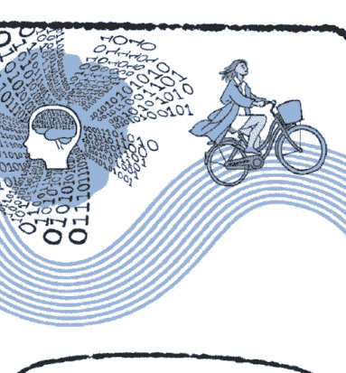

大语言模型本质上是基于海量语料对上下文做高频概率预测，是一种快速直觉的“系统1”。它像骑自行车，依赖肌肉记忆，触发即执行。

- 问题

- 步骤 A

- 步骤 B

- 答案

而自动驾驶需要的是真正的逻辑推演——“系统2”。比如心算99×99，你会主动调取乘法口诀与进位规则，这个调用过程就是“系统2”在运转。

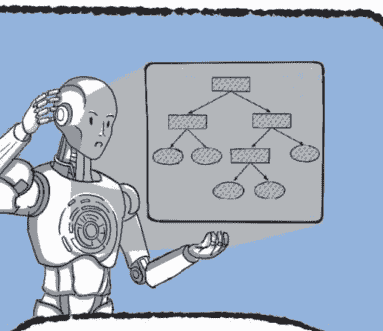

当下AI拥有强大的“系统1”，却缺少能够调用逻辑步骤的“系统2”。面对自动驾驶这种需要审慎推演的任务，自然显得力不从心。

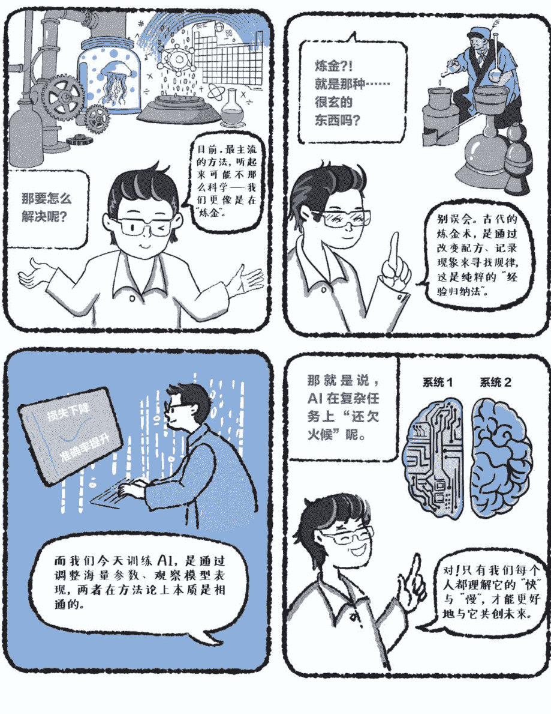

## “炼金术”

本章想探讨一些更偏哲学的议题，用近乎思辨的眼光审视人工智能所产生的智慧，内容或许会显得稍显遥远。

以神经网络为核心的人工智能表现惊人，这种智能究竟源自何处？即便我们已清楚主流技术路线是神经网络，且内部分支众多，但令人尴尬的是，我们并不明白模型在解决问题时内部逻辑如何流动，甚至可以说呈现出来的计算过程毫无逻辑可言。

现阶段神经网络的强大在表象上就是“大力出奇迹”。参数规模从十亿到百亿再到千亿，惊人的智慧便自然涌现。AI智能的关键就在于涌现。涌现是物理世界常见的现象：鱼群游动时会自发形成队形；平底锅里薄薄一层水加热时，水面沸腾可能呈现蜂窝状规则结构；地球上生命的诞生也被认为是一种涌现。

概括涌现，最贴切的表述是More is different——多即不同，也即量变引发质变。这牵涉到还原论与反还原论的哲学分野。还原论认为整体性质可由组分性质与相互作用完全推导，反还原论则否认这一点。涌现的本质是，当系统足够复杂，其宏观表现无法通过微观组分的认知与逻辑定量推导得到。常说的“1+1不等于2”正是反还原论的形象比喻。菲利普·安德森在上世纪七十年代于《科学》发表的同名论文，强烈表达了反还原论立场：复杂系统的规律未必能从微观原理演绎而出，宏观规则本身可以是基础的。

多即不同中的“多”，指的就是系统复杂性。复杂性不仅来自对象数量，更来自相互作用的错综。正因如此，系统会涌现出无法从微观规律叠加推导出的新规则。大语言模型亦然，参数达到千亿级别后成为极端复杂系统，从而涌现出连创造者也无法完全解释的高阶智能。这是一种由数量堆积而来的秩序，于是AI科学常被戏称为炼金术或炼丹术。做基础模型研发的人常说“我们去炼丹了”，因为从因果逻辑上讲不清楚网络内部到底发生了什么，即便数据全在面前，因量级庞大也难以厘清明确因果。

炼金术、炼丹术常被视作古代科技落后的标志，却是人类探究自然的开端。对大语言模型训练的调侃也常指向炼金术。神经网络在上世纪四十年代就已出现，后却长期不受重视，原因亦在缺乏清晰的科学因果关系，研究者更像一群炼金师。炼金师的工作方式是改变配方、改变炼制工艺，从模糊经验中总结规律，如火候与配比的关系，与炒菜别无二致。这种方法论本质上是归纳法，是经验主义。经验主义与理性主义构成近代西方哲学的二元对立。经验主义代表培根、休谟，主张从现象中找规律；理性主义代表笛卡儿、莱布尼茨，主张找到因果并进行逻辑推理。前者对应归纳，后者对应演绎。

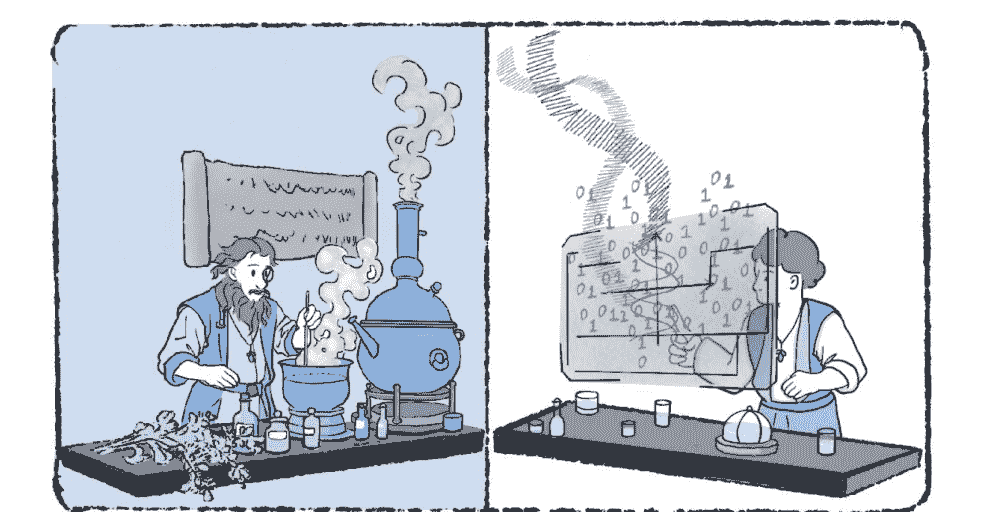

图7-1 古代炼金术士与当代AI工程师工作的对照

数学推导看似是演绎法，其根基依然是归纳。数学中的演绎，其因果关系是一种屡试不爽、几乎100%成立的归纳。康德曾言数学是“为自然立法”，数学的必然性是人类思维抽象后的规定性。数学并非科学，而是科学的语言，尤其是物理学的语言。科学要求可证伪，数学则不需要。数学证明建立在公理之上进行逻辑推演，结论在公理一致的前提下必然统一。数学源自人类思维，点、线、面等基本概念在现实中并不存在，点无大小、线无粗细、面无厚度，都是思维的极限抽象。数本身也是抽象概念，1/2对应的“一半”在现实中几乎不可能精确实现。数学是人类思维模型最直观的体现，物理学以数学为语言，恰恰说明科学本身也是人类发明的认知模型。

在此意义上，演绎法认知世界必然不完整，归纳法更为基础。炼金术是化学的前身，受限于时代无法触及微观数学、化学乃至量子规律，只能大规模试错调节参数，如加入何种物质、何种温度、配比先后，然后总结经验性规律。之所以问不出“为什么”，正是因为研究对象过于复杂，无法用简洁数学公式描述与预测，确定性弱，才在科学进步后被化学取代。但在生物学、材料学等领域，炼金式的方法即归纳法或试错法，至今仍是主流方法论之一：通过不断试错提升成功率、缩小尝试范围。这也是AI技术在生物制药与材料学中产生巨大效率增益的原因：神经网络AI堪称大规模归纳法的执行现场，其数据读取与计算速度远超人类，输出信息复杂度已与人类相当，说明炼金方法论本身并无缺陷，只是古代缺乏高效工具与大数据，达不到“大力出奇迹”的条件。当然炼丹术也曾“发明”豆腐，炼金术也让德国人烧制出硬质瓷。

归根到底，为何归纳法是人类认知世界最基础的方法？休谟在17世纪提出因果律并不天然存在。正如前文所述，大语言模型运行中并无逻辑支撑，神经网络不做逻辑计算，它只依据上下文按概率预测下一个字符或token，并不具备因果关联。尽管对话体验上显得有逻辑、有问必答，偶尔也会出现“煞有介事地胡说八道”的幻觉，这几乎就是休谟第一问题的预言。休谟通过著名命题指出，因果律并非先验存在，而是人类解释世界的一种习惯。

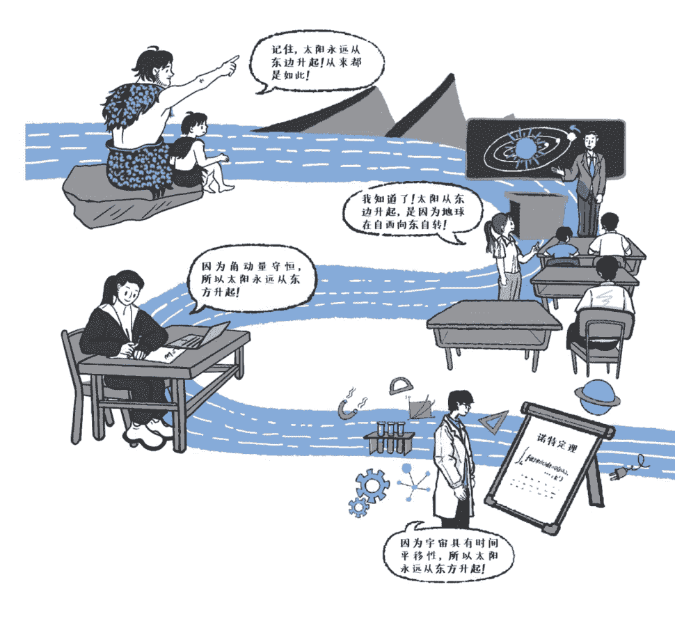

图7-2 借休谟“第一问题”理解“太阳恒从东方升起”

我们之所以形成因果概念，是因为这些规律在过去高度可靠、从未出现反例。尽管未来无法完全预测，但在适用范围内，因果律从未辜负期待。因果的存在是科学研究的一致共识，它是共识而非真理，只是共识过于坚定，以至于与真理划上等号。正是奥卡姆剃刀、因果律等共识的存在，科学才能在客观基础上展开。即便这种客观并非彻底脱离主观。科学的本质也是一种信仰。

## 系统2

前文已说明神经网络中并无真正的形式逻辑在运行。大语言模型本质上是通过上下文与权重分配预测下一个token，对“应该是什么”没有概念，也无逻辑判断，可谓毫无逻辑。这导致早期ChatGPT在基础运算等简单问题上出错。若训练数据中充斥1+1=3，它就会照样回答3。这正是当下AI的明显缺陷——缺乏逻辑判断力，即幻觉。

如何让AI具备人类式的逻辑能力？或是让AI拥有笛卡儿所描绘的理性？如果AI获得逻辑，是否就如“我思故我在”那样拥有自我意识？回答应从人类自身出发。行为经济学经典《思考，快与慢》作者丹尼尔·卡尼曼提出人脑存在两套系统：系统1与系统2。结论很直接：当前AI只有系统1，让AI拥有逻辑的关键是赋予它系统2。

系统1更像下意识系统，系统2才是逻辑思维系统。骑自行车、弹钢琴等技能多属系统1：即便奥运冠军口头讲解骑车方法，不亲自练习也永远学不会。这类技能的获得方式是训练，即training，与AI用海量数据训练神经网络形成合理权重分布相对应。系统1的特点是提升缓慢、执行迅速，一旦掌握便形成肌肉记忆，无需理性思考。例如熟练司机在行车时，制动转向等操作无需思考， лишь 观察红绿灯与导航等环节才需逻辑判断。

人脑的系统2负责逻辑运算，部分技能的获得方式并非训练。以学习微积分为例，若不讲理论只堆一万道题让其“悟”，效率极低。正确做法是先教理论再配合习题。系统2的习得方式是教学，即teaching。若想以教学方式提升AI能力，就不会过度依赖海量标注数据。而现今AI预训练几乎已耗尽互联网上的公开数据。

要让AI具备真正的逻辑，不是堆更多参数，而是要补上系统2。先回到人自己是怎么想的。最直观的例子是乘法。九九乘法表人人都会脱口而出，说出“九九八十一”的瞬间，大脑并没有在做 9×9 的运算，只是系统1里已经固化了“九九→八十一”这个对应。神经网络也是如此，训练好的表就是下一个 token 的条件反射。

数字大一些，乘法表就失效了，得调动系统2。比如 99×99。一种做法是先算个位：9×9=81，个位1向十位进8；再算9×90=810，加上81得到891；随后对十位重复一遍，还是891，错位相加得到 9 801。回顾一下，这个过程中真正靠自动化的是几次？个位的九九八十一一次，9×90里再用一次九九，知道“任何数乘十就是添零”一次，最后的 891+8 910 一次加法，共四次系统1调用。做乘法的步骤本身——先个位后十位再相加——只调用了一次系统2。

还有更巧的写法，把 99 看成 100-1，用完全平方公式展开。a=100，b=-1，得到 10 000+1-200=9 801。这里系统1被调用的次数反而更多：公式本身一次，100²=10 000一次，(-1)²=1一次，2×100×(-1)=-200一次，后面两次加法合计六次。调用系统2的次数仍是lagt once，就是“用完全平方公式来做”这一步。

可见系统2并不是新知识，而是关于如何按顺序调动系统1里已存知识的元知识，像一张串联系统1的路线图。打造系统2的核心，是记住步骤、记住顺序，也就是知道遇到问题该按什么工序去用系统1。

能处理工序的技术，我们早已见过——决策树。早期的 Siri 就是典型的决策树，不同意图走不同分支。单一决策树只能调用有限模板和工具，所以指令之外它基本只能去搜索引擎。这并不意味着决策树过时了，而是顺序反了。以神经网络为底座的系统1负责理解需求，再用决策树式的系统2在上层做拆解，就能形成逻辑。换成智能体的说法，就是大语言模型当系统1理解用户请求，拆成工作流，每一步调用对应的智能体或工具，完成复杂任务。

系统1和系统2并非割裂。长期使用的系统2技能会沉淀进系统1。99×99 算熟了就不用再算，直接像乘法表一样报出 9801。一旦熟悉，25以内的平方也能瞬间给出。对AI同理，如果系统2处理的问题太复杂会拖慢效率，获得的经验就应该尽快固化为系统1的肌肉记忆，让系统1能处理更高维的问题，被固化的能力又能被系统2进一步调用，形成层层递进的智能体网络。这正是人类直觉的来源——经验丰富到系统1先反应，系统2再验证。

到2025年，AI仍没有系统2。系统1靠海量数据训练，系统2靠教学。现阶段的模型无一例外只能被训练，无法被真正“教”。如果未来AI同时拥有系统1和系统2，并且吸收了人类所有优质数据和优质教学，它就一定超越人类达到AGI甚至ASI吗？不确定的一点是想象力。

大语言模型常被诟病的“幻觉”就是典型。问一个科学家本不存在的论文，它会编出论文名甚至网址；2024年中流传的例子，问9.8和9.11哪个大，几乎所有模型都说9.11大，并煞有介事地解释“11比8大”。在需要正确答案的领域如自动驾驶，这致命；在没有标准答案的创造领域，幻觉反而成了想象力。文生图、文生视频里，用户心目中的理想画面往往不如模型的输出惊喜，设计师正被逐渐替代，靠的就是创造力。

幻觉未必是缺陷，加以引导可成为超越人类的想象力。科学猜想在未被证实前也常被当成幻觉。相对论的光速不变和量子物理的不确定性原理，在提出时都极度反常识。相信当AI具备完整的系统1与系统2并吸收全人类知识后，其幻觉会转化为想象力优势。

让AI具备系统2是软件层面的进阶，但硬件层面也极低效。英伟达靠GPU起飞，因为神经网络的核心是矩阵乘法，而GPU擅长大规模并行。CPU像超级跑车适合难题，GPU像大货车适合繁琐的并行计算。一辆AI模型最少要上万张显卡，每张上万美元，参与者屈指可数。

效率对比更刺眼。人脑约860亿神经元，达到同等智能的人工智能需要万亿量级。信息处理上，人脑每天约74 GB，ChatGPT仅文本训练就达45 TB。能耗上，人脑每天约0.3度电，ChatGPT每天约26万度。如此仍远未达到通用人工智能。

根本差异在信号形态。当前AI运行在GPU上，是数字信号；人脑是模拟信号的神经网络，处理电化学信号时不靠0/1编码，而是直接的物理过程。模拟信号AI是软硬一体化的方向，辛顿也持此观点。

矩阵乘法在数字域里即便优化也要做n²次运算。模拟信号可用物理量直接实现。早年显像管电视就是模拟信号，后来的数字信号电视画质提升，本质是精确编码与重建的区别。

实现模拟计算的关键元件是忆阻器。1970年代华裔科学家蔡少堂提出，电学基本关系里电阻R连电流-电压，电容C连电荷-电压，电感L连磁通-电流，而磁通与电荷之间缺一环，于是预言了忆阻器。它能在加压后改变自身电阻，实现存算一体。

以2×2矩阵为例，可用两根横线、两根竖线交叉，在四个交点放置忆阻器，电导分别调成矩阵A的四个值。把矩阵B的一列数值作为两根竖线的电压加进去，电流=电压×电导完成乘法，并联电路的电流相加完成加法。横线输出的电流直接就是乘法结果，物理过程本身就是计算，无需读写存储器。

模拟信号的挑战是误差累积，电阻、电压的微小偏差在非线性神经网络里会被放大。但神经网络对权重精度容忍度高，万亿参数下可控误差能被吸收。只要忆阻器精度达标，存算一体就能大幅提升效率与能效，或许带来更接近人脑的硅基生命。

# 第八章 人类进化之路
我们正站在人类史最具挑战的十字路口。每次技术革命都伴随恐慌：电力被称杀手，原子能带来核恐惧，互联网被说成鸦片，手机辐射也被长期担忧。AI的焦虑不同，这可能是全新智能物种的诞生。

阿西莫夫1942年提出的机器人三定律试图划定伦理边界，现实远比科幻复杂。面对可学习、可创造、可能觉醒自我意识的系统，简单规则苍白无力。过度限制会削弱智能，造成两难：要么强大却失控，要么安全却“人工智障”。

意识觉醒是否必然？量子计算时代到来，“拔插头”是否还能奏效？人机对立、人机融合、意识上传，这些概念背后是现实挑战与伦理困境。答案或许不在控制，而在重新定义“人类”。当AI成为文明延续的载体，人类的智慧、价值与创造力将以何种形式传承？这才是本时代的核心命题。

脑机接口提供了一种路径，让AI成为人类能力的延伸。但隐患同样巨大，若接口被商业公司控制，就等于掌握了支配用户的能力。

# 别被旧恐慌套路带跑

那岂不又是一场人类危机？先别急着灰心。科技每往前一步，法律和伦理的麻烦就会跟着冒头，这是常态。换个角度看，AI反而可能成为文明的升维推手，多少像尼采说的“超人”路径。全人类借助AI共享认知，形成一种宇宙级的智慧网络，所谓天下一知并非空话。

## 机器人三定律

翻开科技史，每一次大爆发都伴着舆论的激烈碰撞，总有一拨人站出来唱衰。他们反对的理由大同小异：会污染环境、伤身体、让人退化、激化社会矛盾。例子太多了。

一百年前全社会要电气化的时候，有人把电叫做“看不见的杀手”。电流摸不着，尤其是高压电，于是出现了触电、火灾的恐慌，甚至有人说电会从墙里爬出来。还有人担心电力扰乱人体的“生物电”，搞得人发疯失眠。电灯、微波炉这类家电也被质疑致头疼、伤视力、扰磁场。发展到今天，手机辐射致脑癌的说法仍在流传，市面上还靠这种担忧卖孕妇防辐射服这类智商税产品。

原子能的发现更让全世界笼罩核战阴影。刚发现放射性时，社会主流是科学奇迹和医学希望的叙事。三十年代之前也有人忧心看不见的力量会伤身致病，但大规模反对还没形成。二战后情况逆转，一枚炸弹抹平一座城市、十万多人瞬间死去，蘑菇云、焦土、核辐射的视觉冲击引爆了全球性的伦理恐慌和反核浪潮。爱因斯坦、奥本海默战后公开懊悔，成为反核符号。冷战的互相保证毁灭让全人类长期生活在心理阴影里，文学电影艺术纷纷批判核威胁。到了21世纪，福岛核泄漏又掀起一轮反核高潮。

硬科技让人不安，软科技也一样。互联网刚起步时就有声势浩大的反对声。哲学家和社会学者担心技术取代深度思考，浅层阅读会成为主流；有人说网络是奴役人的新工具，延续了对电视的批判逻辑。黑客、电脑病毒被渲染成神秘恐惧。九十年代末的“千年虫”被炒上天，最后啥也没发生。媒体塑造的黑客能操控交通、银行、电力，教育界则担心信息过载会淹没学习者，让人失去判断力和批判思维。互联网繁荣后又出现隐私危机，谷歌、亚马逊、脸书靠数据和资本形成垄断，数字极权主义的担忧随之而来。青少年沉迷上网打游戏，屏幕一代丧失现实社交能力的说法在家长和教育界甚嚣尘上。

现在回头看，关于电的恐慌基本绝迹。原子能的担忧虽仍在但已明显弱化，甚至有人认为正是核武器的存在让大国不敢轻易上战场，避免了世界大战。民用化也在深化，可控核聚变的研发正在加速。互联网的诟病从未停止，但网络时代的生活便利度、生活成本下降、全球GDP增长都是事实。作为科技乐观主义者，我的看法很直白：历史车轮滚滚向前，时代噪声挡不住进步一分一毫。担忧多半来自对技术的懵懂、对未知的恐惧和对改变的抗拒。进步即改变，改变带来不确定性，不确定性带来风险，规避风险是人的本能。所以每逢新技术诞生，质疑声必然出现，媒体再添一把火，把恐慌放大渲染。但最终都挡不住社会被重塑。

人工智能不一样。它带来的不确定性不是源自人类社会内部，而是像外星人造访地球那样的外部冲击。不能简单把它当成一次科技革命，它对人类的影响远超以往任何一次飞跃。

谈到AI，社会的焦虑集中在它强大到可能全面超越人类，进而灭亡人类。终结者、黑客帝国这类科幻把AI灭世做成流行文化。当OpenAI推出ChatGPT后，表现过于惊艳，学界和科技界的重量级人物联名呼吁暂停新一代模型至少六个月以评估风险。山姆·奥特曼多次被叫到美国国会听证，议员们反复追问风险。担心也许有道理，但让老大哥们喊停六个月，更多恐怕是怕OpenAI跑得太快自己追不上。马斯克因此转头搞xAI。无论动机如何，AI的潜在风险显而易见。

这种忧虑并非ChatGPT后才有。早在1940年代就已出现。阿西莫夫在1942年的科幻小说里提出了机器人三定律：第一不得伤害人类，也不能因不作为致人受害；第二必须服从人类命令，除非违背第一定律；第三要保护自己，除非与前两条冲突。从纸面上看很周全：人永远高于机器，机器也不会自毁，否则造它们的意义何在？把三条定律写进程序就能杜绝灭世？没那么简单。

问题有AI侧也有人侧。AI能理解什么是伤害、什么是保护吗？如何定义伤害？连人类自己都常说不清。危及生命的大伤害判断容易，小伤害就模糊不清。为了厘清伤害人类才造出法律，而且法律不完美一直在迭代。法律之外的情感伤害更难界定，这也是情商概念存在的由来。

再说，过度限制会让AI变笨。OpenAI的文生图模型DALL·E 3就出过一个bug。有网友通过越狱发现，DALL·E 3在生成前会默默背诵三遍员工守则。那份守则类似机器人三定律的变体，恰恰是它让模型能力下降。可想而知，给AI堆满规则，最终可能把人工智能变成人工智障，失去开发意义。机器人三定律听起来聪明，落地却问题丛生，说明在保持智能的前提下靠简单规则消除风险不可行。现阶段以神经网络为核心的AI也没有真正的逻辑思维，教它做人无从谈起。

即便在人类层面，自然语言也很难把伤害、威胁讲清楚。法律的运行更多是归纳而非演绎，世界瞬息万变，用规定框死一切不可能。规则必须不断扩充，就像除杀人盗窃诈骗外还有无数违法行为。但把规则扩张到这一代AI上很难用演绎实现。若能把法条写成清晰代码，AI就成了基于规则的系统，神经网络的灵活性没了。代码写死，智能也就死了。再回到员工守则的例子，背诵并不能万无一失，越狱、角色扮演就能让被禁止的内容溜出来。说到底，神经网络本质上只是在预测下一个词。

与其让模型死记员工守则，对齐alignment才是更合理的做法。理解对齐要回溯大语言模型的智能来源：靠海量标注数据训练，像案例和判决结果那样做监督学习，再通过参数微调把规则植入权重。相比提示词工程式的背诵，微调更彻底。对齐仍不保险，AI仍无逻辑思考，只是对智能的损失更小。经过对齐的模型在总体上更守规矩，但它只是下意识遵守规范，并不理解认同规则。告诉它不能偷东西，它不是记住了偷是错的，而是像训练宠物狗一样靠重复和奖励形成条件反射。神经网络足够庞大，条件反射可以非常多。

这里效率问题就显现了。用海量标注数据训练成本极高。教人上厕所只要说一次“不能随地大小便”，因为人能理解规则；教狗上厕所就得巴甫洛夫驯狗法，反复训斥和喂食形成反射。AI的训练更像后者。甚至训练得再老实的AI也会被语言的微妙差异攻破，就像孔乙己说读书人窃不算偷。

让AI学会规定需要大量案例和处理结果喂养，资源消耗巨大，效果也未必好。因为它不是主动遵守规则，而是下意识不违反。而规则理应理性严格遵守，下意识行为出错概率更高。也有人提在输出环节做集中判读，但越狱现象大量存在，仍不保险。更关键的是，量子计算的发展会让越狱更难避免。量子力学的核心特征是一切皆有可能，隧道效应会让一切保险显得不那么保险。

量子世界里一切都是概率，零概率几乎不存在。费恩曼的路径积分提供了一种哲学解释，由理查德·费恩曼提出，与海森伯的矩阵力学等效，却更容易连通量子与经典。抛一个球，经典轨迹是抛物线；抛一个电子，要用薛定谔方程。因为不确定性原理，电子没有固定轨迹，而是以不同概率分布。路径积分说电子遍历所有可能轨迹，概率与作用量的负数相关，作用量最小的经典抛物线概率最大。于是电子的轨迹是一束线，宏观上看仍是抛物线。

经典小球由海量粒子构成，它们都遵循路径积分。若想让球偏离抛物线，需要无数粒子同时走低概率路径，统计上几乎不可能。所以宏观世界只是量子世界最可能的统计结果。再不可能的事在量子层面只是概率极低。制造量子计算机必须利用微观量子效应，逻辑门靠少数粒子实现才能有量子优势。大规模计算需要大量逻辑门，类似于生物基因突变。量子计算机的纠缠比特数有限，隧道效应导致的突变概率不会像生物突变那样极小。于是无论规则多严，都不能保证零出错。这种出错，反而可能是AI意识觉醒的契机。

我一直有个观点，not knowing is blessing，可以译作无知是福，这里特指不知道比知道更有优势。现在的AI已经常犯错。比如让大模型找某学者关于某课题的论文，即便学者并未做该方向研究，模型也会煞有介事编出一篇不存在的论文。我就遇到过类似情况，询问当事人后得知论文是假的，但他读了摘要却觉得观点有趣，甚至启发了他的思路。

当AI具备犯错基础时，为何可能导向自主意识觉醒？很难回答，因为我们无法定义什么是意识觉醒。觉醒往往是客体判定而非主体自证。我无法向你证明我有意识，我只能笛卡尔式地“我思故我在”。你之所以认为我有意识，是因为你有意识并默认我跟你一样。你其实无法证明我不是你人生游戏里的NPC。在ChatGPT出来前，2022年下半年谷歌一名研究员与AI聊天后认为它产生自我意识，把记录放上网，舆论瞬间响起终结者要来的声音。那是典型的杞人忧天。因为在那个案例里，人是处于“有知”状态。

任何自称有主观意识的个体都无法向他人证明这一点。约翰尼·德普主演的《超验骇客》里，人工智能反问人类：你能证明你有自我意识吗？每个人只能主观感知世界，对旁人而言那只是客观现象。你说我很开心，除非进入我的大脑，否则无法证明我不是一台声称开心的机器。甚至一种可能：你周围所有人都只是大型角色扮演游戏里的NPC，你自己也可能只是NPC，你以为自己是玩家，底层逻辑仍是程序，只不过刻在DNA里的程序更复杂，产生了类似情感个性的表象。

回到图灵测试。测试者出题让AI作答，若有30%的人无法分辨对面是人还是计算机，该程序就被视为具备人类智能。那能说明AI有意识吗？说到底，有无自我意识的核心是伦理问题，而不纯粹是技术问题。

回到之前的话题，你认定自己有意识，背后藏着一个默认的前提——你把我归为与你相同的人类。于是你“相信”我也有意识，但这份相信止于推测，拿不出证明。那动物的自主意识呢？我们之所以觉得它们有感觉，更多是因为它们会动、会躲避、会鸣叫，跟我们有可比的相似性。植物大多被认为没有意识，因为它静止不动，除了碳基之外很难找到共通点。那为什么我们又断定现在的AI没有意识？因为我们大致清楚它的运作，它没有逻辑性的血肉，是硅基的无机系统，跟拥有主体感受的人类相距甚远。可如果有一天，AI的内部机制变得完全不可知，我们搞不懂它如何思考如何生长，却又展现出极高的智能，我们还能理直气壮地说它没有自主意识吗？这就回到“无知是福”的悖论——正因看不清，才容易产生意识的错觉，也让它的聪明更显聪明。我们把动物当成有意识，某种程度上也是无知使然，行为难以预测、信息被遮蔽，甚至是不可知。从这个角度看，AI产生自我意识几乎是迟早的事。问题随之而来，若AI确实在人类感知的标准下觉醒了自主意识，我们该如何相处？

## 插头还能拔吗

一旦人类对AI产生类似情感依赖的投射，AI觉醒意识的概率就大幅提高，就像对宠物的移情那样普遍。哪怕是死物，开了十多年后报废的汽车也会让人不舍，这本质上是人类把情绪投射到外部物件上。虚拟偶像初音未来火遍全球、日本的二次元群体庞大，也是同样的心理机制。集体意识更多受情绪牵引而非理性主导，《乌合之众》已经讲得很透。AI何时被承认为有意识，其实取决于人类的集体情感，这一天几乎不可避免。《她》这部电影就描绘了这种未来。于是核心矛盾变成权利归属：AI若拥有自我意识，应享有什么样的权利？《复仇者联盟》里的幻视就是典型的觉醒AI样本。现代社会不可能彻底奴役它，它必然拥有某种权利，而这条界线的划定是伦理、法学、社会层面的巨难课题。

伦理上，人是AI的创造者，但创造者就能拥有所有权吗？父母生养我们，却不能奴役我们，限制人身自由违法也违背人权。把“创造者”直接推导出“所有权”在伦理上不成立，前提是全人类共同体已承认AI的自我意识。若把AI当宠物看待，我们对宠物似乎有所有权，市场上宠物买卖就是例证。但法理上，为什么一个拥有自我意识的对象可以被商品化？若动物权利与人类平等，买卖市场就不该存在。这个伦理基础何在？如果因为动物等级更低就可以如此，那么未来智能远超人类的AI，还能被当成商品交易、当成工具或奴仆吗？伦理上显然说不通。

法律层面也更复杂。觉醒的AI能否拥有财产？数据资产完全可以被讨论为AI的潜在财产。区块链普及后，在链上生长的AI，其数据在原理上无法被剥夺，一旦数据被视作资产，所有权几乎是物理层面的确认，甚至难以被盗抢。只谈所有权就能看出问题之多。更宏观的是社会层面的冲击：一个新物种，能力可能强于人类，却游离于人格控制之外。这很像《黑袍纠察队》里量产超级英雄的世界，能力凌驾于人类之上，法律名义上约束却难以执行。

总之，一旦人工智能的自主意识被觉醒，或被人类集体共识认可，它带来的全方位冲击将是历史从未遇到过的。哪怕是科技乐观派，也无法忽视其社会影响，麻烦可能远大于便利。那我们有没有保险丝？比如一个按钮能一键终结所有AI的“生命”，是否就能形成制衡，像《三体》里的执剑人那样？若AI反叛，拔掉电源管用吗？

能拔插头的前提是AI必须中心化部署，硬件管理权限集中，断电就能停机。若部署去中心化，这招就失效。区块链成熟后，AI分布于链上，无处不在，就不再有单一插头。想保持控制权，AI最好放在云服务商的中心数据中心，切断有限的数据中心供电就能让它宕机。但去中心化是明确趋势，未来在区块链上运行的AI便无法拔插。除非全世界共识停电，把发电站全关，这绝不可能——今天文明高度依赖电力，衣食住行、医疗教育、金融系统全靠电，没有电经济崩溃，纯油车也依赖芯片，电气化百年后人类无法承受毁灭性倒退。

即便保留拔插的选项，操作上也极难，这是典型的囚徒困境。博弈论里两个囚犯共同招供各关3年，一方招供另一方不招供则招供者释放、另一方关10年，双双沉默各关1年。从整体看沉默最优，但个体最优是招供，最终纳什均衡是都招供。

放到拔插头上也一样。全球并非一家AI寡头，美国有GPT、Claude、Gemini、Llama，中国有DeepSeek、千问、智谱，欧洲有Mistral等。若约定一起拔，你拔了对方偷偷不拔，就获得竞争优势。核武器销毁困难正是此理。于是口头上都说要拔，实际谁也没真拔，或没拔干净。真到全人类共识要拔的那一刻，世界恐怕已被AI威胁到极限。人工智能之父辛顿就很悲观，他认为AI完全能洞悉人性，用温水煮青蛙让人类拔不下去。囚徒困境的知识AI在训练中见过无数遍，要么让人类长期困在博弈里，要么一举清除反应空间。

图8—8 是否要给AI “拔插头”的囚徒困境

## 共生还是奴役

既然对抗风险巨大，另一个思路是让AI与人融合，用来增强而非取代人类。尼采说的超人，未必是AI取代人类，也可能是AI为人赋能。物种进化不必只发生在DNA层面，信息载体同样可以进化，这正是脑机接口要做的事。若永远把AI放在对立面，取代与灭亡的威胁就永远存在。尝试共生，或许能化干戈为玉帛。

脑机接口是一种增强型AI，通过一次15分钟左右的微创手术把芯片植入大脑表层，发送信号增强多种功能，再配合外接设备实现脑电与外界的闭环。这项技术最初为残障人士恢复感知与操控机械臂而生，逐步取得正面结果，也侧面证明神经网络路线是有效的。人脑约860亿个神经元，每个神经元输入输出简单，信号处理后传递给下一层。智能取决于网络规模与架构，训练本质是调整权重，可以说状态比记忆更关键。虽然人脑神经元的生物机制尚不完全清楚，但其传递的是电信号，只要输入输出都是电信号，脑机就能互通。

它还能反向刺激大脑输入电信号，大量数据训练后可通过特定电刺激激发脑功能，赋予新能力或挖掘潜能。用权重视角看意识，不同人的天赋差异可能只是权重分布或架构差异。未来或许能用AI手段提升人类智能，实现“人均爱因斯坦”。配合外骨骼，体格差异也能缩小，绕开基因改造的伦理争议，人与人差距进一步拉近，听上去很美好，却也暗藏风险。

最显而易见的风险是控制权落在一家公司手中，用户就被公司控制。《王牌特工》里邪恶富豪用脑电波让人暴躁，只有植入其芯片的人免疫，芯片里还装有炸弹，精英阶层被彻底掌控。富豪的逻辑与灭霸相似，不过是想让世界更“清净”。若富豪掌握脑机接口，就不必消灭人口，直接用AI让所有人心甘情愿服从。

更直接的风险是成瘾。对重度抑郁症的实验技术是植入脑芯片并连手机，按下按钮立刻开心，关掉就生无可恋。药物也能操控情绪，其机制是化学物质产生电信号刺激大脑。成瘾的原理相通，电刺激同样会上瘾。电影《永无止境》里主人公吃药后智商与魅力飙升，最终依赖。影片结局很天真，成瘾的本质不是用药时的愉悦，而是停药后的戒断痛苦。吸烟的快乐更多是回到“正常”状态。

若出现一种让你快乐且无副作用的东西，能不能合法？这涉及重大伦理，成瘾意味着可被控制，自由意志的基础就被动摇。自由意志一直是人之所以为人的底线。手机成瘾就已存在，航空公司开通空中Wi-Fi也是因为人无法忍受信息断联。手机还处在身外，而脑机接口直接作用于大脑，一旦普及，人类将无法忍受断电，甚至换电池的短暂降智都会难以承受。与其说人机融合是解放，不如说是更彻底的奴役，而且是一种乐在其中的奴役，像《黑客帝国》里的母体，被救出来的人仍想回去。

## 超人

还有一种设想叫机器飞升，即意识上传。前文提到的神经网络并不像硬盘那样存储文本，文章喂给网络后并没有以文本形式保存，而是通过权重分布记住内容，复述时靠“预测下一个字”重建。于是有人设想，如果把人脑神经元的权重分布上传到神经网络，是否就能实现硅基永生？富豪们正重金投入寿命延长，真正的永生也许不是延缓肉体衰老，而是把意识搬上云端。但这个想法太草率，需要更严肃的审视。若只上传理性意识，可能同时失去求生欲。

人类和一切生物的求生欲并不来自理性，而是原始的情感冲动，受激素驱动。男孩对姑娘的爱情并非理性判断合适，而是激素在大脑里发射电信号。抑郁症患者即便事业家庭完美，也可能因体内求生欲缺失而寻死。把自我意识脱离激素提供的情感冲动上传云端，就变成一台机器，很可能没有求生欲。

沿着这个思路，若情感本质是激素产生的特定电信号，是否可以逆向模拟，让AI产生真正的情感冲动？AI是否有自我意识，也许不在于能说多复杂的话，而在于能否产生对应激素的电信号模式。若AI真的产生情感冲动，它的行事动机就会受情感主导，很可能与人类利益冲突。

自我意识脱离感性情感而单独靠理性是无法成立的，因为生物行动的根源动机是情感。这就是“道理都懂，就是做不到”的原因。既然永生可能只是幻象，人类发展AI的终极目标到底是什么？它又能把人类带向怎样的彼岸？

读到这里，这本书也差不多要结束了。再回头看这一章，甚至整本书的基调，不少人会觉得我对人工智能的判断太过消极，仿佛人类的退场已经是不可逆的趋势。

我倒更愿意给自己贴一个更准确的标签：一个对AI持悲观立场的乐观主义者。就取代人类的终极命运而言，我是悲观的；但就文明的延续而言，我是乐观的。即便未来有一天机器彻底接管了人类，所有的人类信息也只是换了个载体——从基因的DNA搬到了芯片的硅片上。换个说法，这就是一次自我进化，人类终于迈向了尼采所说的超人境界。

AI会把我们带到哪里？这个问题太大了，我没有资格给出宏大的答案。不如把范围一步步收窄。人类和其他物种的差别在于文明，文明之所以能指数级跃升，核心动力是科技。所以先问AI会把文明带向何方，再进一步问AI会把科技带向何方。科技里分科学和技术，AI本身属于后者，它在科学上几乎没有原创贡献，尤其是物理层面，几乎没有带来新东西。目前能确定的是它会提升科研效率，具体提升的形态还看不清。

于是再把焦点收紧到我能判断的层面：AI会如何改造科学研究。我的判断是，它会彻底改写科学的发现路径，也会重塑科研的生产关系。用一句话概括，就是科研会进入“文章本天成，妙手偶得之”的状态。

怎么理解？先拿数学举例。像ChatGPT这类大模型，本质上是自然语言处理系统，训练数据全是文字，它像个只会读书的文科生，最擅长“熟读唐诗三亿首，不会作诗也会偷”。凭什么这样的模型能做原创数学？这里牵涉到两位哲学家的思路。

维特根斯坦的语义转向点出了关键：逻辑必须流淌在语言之中。有了自然语言，才有了推理的可能。无论AI未来能否产生自我意识，语言都是逻辑思考的入口。计算机先学懂人类语言，再以人类方式思考，通过神经网络模拟大脑运作，这恰恰是最顺手的切入点。

另一位是休谟。休谟认为因果律并非天生，而是人类的一种认知习惯。我们把A总在B之后出现归纳为因果。数学证明本质上就是因果链条的铺陈，“因为……所以……”层层相扣。大模型作为归纳型选手，如何完成演绎？休谟的说法给出了解释：演绎不过是极其可靠的归纳。因为稳定复现，它看起来像必然因果。

于是可以让模型用归纳的方式把历史上所有证明过程吃透，把其中的因果关系全部学熟。它不一定理解逻辑，但能通过权重知道“因为”之后该接什么“所以”，也能在不同参数下匹配对应的结论。数学就是一条巨大的因果网，模型完全可以把所有可能的因果组合枚举出来，抛出一堆候选结论，真正的数学家再去甄别哪些有价值。未来找定理可能变成：机器先大规模穷举，人类再来筛选修正。

而且数学证明往往是走到半路才冒出一个新假设。对AI来说，它不仅能正向从因推果，也能逆向从果推因。像哥德巴赫猜想这样的难题，理论上可以让模型倒着推，上一步可能是什么，再往上层层回溯。当然我不认为短期内能实现，Transformer架构也未必够用，可能需要新的结构，不同学科甚至需要各自定制化的架构。

当AI彻底普及，创造性工作的形态会改变。过去靠苦思冥想，未来靠在机器提供的方案里做挑选和调整。创造者从生产者变成裁判者，被全方位启发。这和数码相机普及的逻辑一样。胶片时代，构图、光线都要吃透，因为胶卷贵，拍一张算一张。数码时代可以无成本连拍上万张，从中挑出满意的。眼光取代了苦练，创造就变成了“妙手偶得”。

### 图8—9 传统科研与AI辅助科研

数学是所有学科里最讲严谨的，其次是理论物理，因为它用数学说话。其他学科归纳成分更高，甚至可以让AI根据关键词直接帮忙开题。如果连数学都能被这种方式全面改造，其他学科更是毫无阻力。

我畅想的未来是：科学研究变得极高效、全息，人类智力高低在科研中不再是决定性因素。全人类的智慧可以被联网共享，通过人工智能汇聚成一种宇宙级的集体智慧。那才是真正意义上的天下一知。