# 用夸克AI驱动学习升级

## 内容简介
智能技术正全面改写学习方式，夸克AI作为面向学习的智能助手，为广大学生及家庭提供了提速的路径。

本书希望帮助读者在AI浪潮中快速上手并抓住机会。截至目前夸克AI已累计服务超1.4亿账号，覆盖7000万以上的在校生、家长与教师。全书以夸克AI为实践平台，向不同学段的学习者讲解如何借助AI搭建科学、可持续、面向未来的学习体系。内容涵盖课前预习、课堂跟进、作业辅导等日常环节，也涉及语文数学英语等学科的使用技巧与应试准备，并延伸到高中、研究生阶段的志愿与升学规划，提供可直接操作的方法与细则。

三位作者深耕AI应用与教育科技多年。不论此前是否接触过智能工具，本书都能让读者零基础掌握夸克AI的核心能力及其在教学场景中的落地方式。全书配有大量提示词范例、真实案例与分步操作，保证读得懂、做得到。书稿得到人大附中、北师大附属实验中学等校教师，以及北京大学、清华大学、中国科学院大学、上海交通大学、浙江大学、南京大学、哈尔滨工业大学、武汉大学、天津大学、厦门大学、华中科技大学、西北工业大学、中央民族大学等高校师生的高度评价与推荐。

打开本书，让夸克AI进入学习流程，感受效率的跃升，成为智能时代的先行者。

## 序
在数字技术与教育深度融合的当下，生成式AI正以新质生产力重塑教育生态。其首要意义在于教育公平的重建。依靠优秀教师支援西部难以从根本上解决资源不均，借助新一代信息技术跨越时空限制才是普惠之道。作为信息通信研究者，我欣喜地看到AI应用中教育被摆在前列，师生与产业界关注度持续提升，多款学习产品涌现。但AI对教育的价值远不止工具更新，它既是跨越地理限制的知识桥梁，也是推动教学从标准化培养转向个性化成长的驱动力。

在众多学习类产品中，夸克浏览器以简洁直达的体验突出。由阿里巴巴打造的该产品最初以浏览器形态出现，后续强化教学功能，成为学生主阵地。依托阿里通义在大模型推理与多模态上的优势完成升级后，功能边界明显扩大。本书梳理了夸克AI的新能力，并通过案例说明如何用它实现高效学习，从入门指引、注意事项到进阶技巧，形成完整路径。内容既适合在校师生，也对终身学习者有参考价值。

AI聚合全球优质资源与智能分析，让偏远地区学子接入顶尖高校课程，让经济条件受限的学生拥有个性化陪伴。这种技术赋权打破了传统资源分配的物理壁垒，使每个学生都能拥有公平的起跑线。正如5G加VR教学所展示，虚拟实验室与历史场景复原让抽象知识变得可感可知，学习成为跨时空的认知之旅。

更深层的变化在于AI对学习本质的再造。它把教师从重复性知识传授中解放，转向培养批判性思维与创新能力。当虚拟导师能依据个人认知图谱生成专属路径，当跨学科知识网络可通过自然语言自动联结，教育就从知识灌输升级为探索式的认知建构。这要求重新定义学习：未来核心竞争力不再是记忆容量，而是驾驭智能工具进行知识再创造的能力。

AI不是人类的对手，而是拓展边界的伙伴。它既需要开放心态接纳，也需要理性思辨驾驭。在享受提效的同时要警惕算法依赖导致的思维钝化，在沉浸虚拟世界时要坚守现实的人文温度。技术终将为人服务，而人的价值在于创造机器无法替代的思想与情感。愿读者，特别是同学们，以AI为翼，在工具与智慧的交响中探索知识新边界，重新定义学习、成长与未来。

## 赞誉
推荐人按姓氏拼音排序

陈冰 华中科技大学机械科学与工程学院副教授：本书介绍了如何借助AI自动生成章节练习、实时批改作业、准确定位盲区，并通过个性化内容推荐推动概念理解到应用迁移，对大学生自主学习与教师教学目标评价有支撑作用。

陈宪 上海交通大学教授：书不仅是效率指南，也是AI应用的前沿论述。夸克AI的检索覆盖从小学到研究生各阶段，志愿填报功能实现个性化定制，算法在一定程度上缓解了资源错配与信息不对称，提升了普通学生的学习效率。

高宗帅 清华大学助理教授：内容契合大学多元场景，从预习、论文写作到期末冲刺均有细化方法。借助智能检索与知识整合，读者可快速梳理资料、搭建框架，案例教学帮助拆解复杂课题、攻克专业难题。

顾荣 南京大学特聘研究员、博士生导师，教育部青年长江学者，达摩院青橙奖获奖者：AI为学习提供认知显微镜与思维望远镜，书中对夸克AI功能体系与场景使用进行了结构化梳理，将课堂知识提炼为大纲并生成试题，拓展了AI在学习中的应用边界。

郭斌 西北工业大学计算机学院教授、副院长：书以夸克AI为主线呈现自主学习与智能辅助的结合。AI不仅是信息处理工具，更是培养复杂问题解决能力的平台，建议师生善用工具支撑战略人才培养。

何琦雯 中国电子商会人工智能委员会常务副秘书长：书以突破性视角构建技术与认知升级的桥梁，深入解析夸克AI如何重构从知识获取到能力建构的全链条，既是工具指南，也是智能时代学习方法的深度思考。

黄传河 武汉大学计算机学院教授、网络研究所所长：书的价值在于发挥AI智能诊断能力，精准定位盲区与薄弱环节，同时保留批判性思维培养空间，形成技术赋能与人文引领的模式。

金鑫 中国人民大学附属中学丰台学校科学副校长：夸克凭借启发式学习、进阶讲解、专题攻关重塑学习范式，书中将资源整合、搜题解题、规划评估转化为具体方案，适配中学高强度节奏，推动从被动接受到主动建构。

李慧 中国科学院大学教学主管：夸克为理工科构建了从知识获取到创新探索的全链路，学习规划、资料整理、答疑辅导、论文辅助等功能便利课程与研究，加速从文献研读到科研构思的跃迁。

刘宏伟 哈尔滨工业大学教授，黑龙江省教学名师：书倡导数据驱动学习，依据前沿确定目标，借助实时数据分析动态生成路径，使知识点掌握可量化、可优化，有利于培养科技领军人才。

卢勇 中央民族大学信息工程学院教授、博士研究生导师：夸克以认知外脑的定位为高等教育提供新可能，深度搜索与多模态交互使研究从信息检索升级为智能决策，助力跨学科创新。

潘静洲 天津大学教授：书以技术创新重构学习效率底层逻辑，从知识获取的降本到认知加工增效再到升学决策赋能，构建K12至高等教育与职业备考全场景的智能学习管理体系。

王曰海 浙江大学信息与电子工程学院副研究员：夸克的多模态知识整合有助于打破学科壁垒、建立认知框架，适配新工科、新医科等复合型人才培养需求。

杨芳 厦门大学国际关系学院/南洋研究院副教授：教育公平需要技术介入，夸克智能工具链通过整合权威资源与个性化路径，打破地域与经济限制，让技术成为推动教育均衡的杠杆。

张康 北京师范大学附属实验中学信息技术教师：书将扫描识别、语音转写等技术融入全流程，帮助学生定位盲区，实现从机械学习到深度思考的升级。

赵波 灵波微步科技有限公司CEO：书凝练了技术重塑教育场景的实践，以夸克为核心提供案例与方法论，帮助学生突破学业瓶颈，重构个人知识生产力。

朱郑州 北京大学副教授：在AI全面融入教育生活的今天，掌握AI已是必修课。本书内容实用、结构清晰，覆盖学习、备考、选志愿与科研，是师生与家长快速上手的指南。

## 前言
我们正处知识爆炸与技术迭代加速的时代。AI已不再是科幻概念，而是深入工作、生活与学习各环节。从科研到信息检索，AI展现出强劲赋能力，尤其在教育领域，工具的涌现为传统学习带来变革机遇。夸克AI凭借信息整合能力、智能交互体验与丰富的学习辅助功能，已成为众多学习者提升效率、深化理解的助手。

### 为什么写这本书
在教学与交流中我们发现，即便工具触手可及，仍有不少学习者停留在知其然不知其所以然的阶段。他们可能知道夸克可用于搜索扫描，却不懂得如何系统融入学习规划、课堂互动与知识内化，如何从偶尔使用升级为精通应用。帮助读者跨越工具认知到方法掌握的鸿沟，是本书的初衷。

市面上关于AI应用的讨论多偏向通用技能或专业领域，专门针对学习场景并结合具体产品做系统化指导的内容仍显不足。学习者需要一本贴近真实需求、清晰实用的指南，将AI潜力转化为学习成果。我们希望弥合技术与应用的差距，让每位渴望进步的学习者掌握高效学习的内功。

### 本书的独特价值
构思本书时，我们力求突出以下价值：

- 高度聚焦，专为学习：摒弃泛泛而谈，所有内容围绕学习展开，剖析夸克在各环节的具体用法，确保与效率提升直接相关。
- 实战导向，即学即用：强调授人以渔，不仅介绍功能，更传授解决实际学习问题的方法。从制定计划到整理错题，从课堂理解到志愿模拟，均提供详尽步骤与场景化指导。
- 体系完整，循序渐进：遵循认知规律，从基础入门到进阶优化，再到面向未来的规划应用，构建由浅入深、逻辑清晰的知识体系。
- 场景丰富，覆盖全面：涵盖日常预习复习、资料整理、备考冲刺到科研探索、升学规划、考公考研等多元场景，满足不同阶段需求。

### 内容架构全景
为系统掌握夸克的学习应用，本书设计递进结构，分两部分。

第一部分第1～8章，掌握夸克可用于学习的基础功能。帮助读者快速上手核心能力，并融入日常基础环节，如学习规划、课前预习、资料整理、课堂学习、课后辅导、基础备考与智能训练。目标是熟练掌握提升基础效率的基本功。

第二部分第9～15章，运用夸克助力学业与未来发展。在夯实基础后，探索AI在更广阔学业与规划中的应用，包括AI辅助科研与论文写作、贯穿升学流程的智能决策支持即查选报录，以及公务员考试、研究生考试等关键节点的备考策略。目标是展示AI如何赋能学习者应对重大挑战、规划长远发展。

### 出发前的叮嘱
编写过程中我们愈发确信，AI赋予学习者的不仅是效率，更是全新认知方式与探索能力。当第一次用夸克规划个性化路径、深入理解复杂概念、做出更明智的升学选择时，便能体会科技赋能学习的魅力。现在就翻开本书，开启由夸克驱动的高效学习之旅吧！

苏小文

# 第 1 章 夸克 AI 极速入门

## 1.1 认识夸克 AI
生成式AI正以前所未有的速度改变学习路径与思维方式。从拍照解题到智能写作，从知识搜索到计划制定，智能助手已不仅是辅助工具，而是获取信息、提升能力、表达思想的核心助力。夸克智能助手正是在这一背景下诞生的全流程平台，既能服务中小学生学业提升，也广泛应用于大学生科研写作、考研考公知识梳理，以及职场新人的办公表达处理。本节将全面介绍其技术优势、用户生态与知识库，解析夸克如何串联学、练、写、考、用的闭环。

### 1.1.1 夸克产品介绍
夸克是阿里巴巴集团旗下的智能信息服务平台，定位从早期的极简浏览器逐步演进为覆盖学习、工作、生活的智能超级入口。作为阿里人工智能战略的核心载体，其核心能力包括智能搜索、扫描王、网盘、学习工具等，通过构建从信息检索到任务执行的闭环服务，重塑用户获取信息与解决问题的路径。

与传统搜索引擎相比，夸克在三个维度形成差异：

- 商业模式的本质不同。百度、Google等依赖广告与信息流变现，搜索结果常夹杂营销内容，用户需在冗余信息中筛选；夸克以无广告、极简设计为卖点，通过网盘SVIP、学习会员等订阅服务及夸克企典、学术搜索等企业服务盈利。
- 交互方式的革新。传统搜索依赖关键词匹配，以网页链接呈现结果；夸克的智能超级框支持自然语言输入，直接返回结构化结果如表格、思维导图，实现输入即结果的高效体验。
- 场景化服务深度整合。搜索时夸克不仅提供信息检索，还能联动AI生成复习计划、推荐题库等。传统搜索引擎通常只能跳转第三方平台。

与豆包、腾讯元宝等对话式大模型应用相比，夸克更偏工具属性。豆包、腾讯元宝以聊天交互为核心，强调多轮对话与内容创作，如智能体生态与微信文件解析；夸克则以搜索框为入口，通过智能超级框整合任务执行能力。例如扫描王支持试卷去手写、证件照生成，网盘支持5倍速播放与在线编辑。根本差异源于技术路径：对话式AI重语言生成与情感交互，夸克更聚焦垂直场景效率提升。例如学习场景中，夸克搜题基于自研灵知学习大模型，可分步解析题目并提供举一反三引导，而豆包更多扮演辅助角色。

夸克的主要应用场景覆盖学习、工作、生活三大领域。

夸克：AI超级入口的场景化突围

在学习侧，服务覆盖从中小学到考研的完整链条。图像搜题的识别准确率接近98%，智能批改已累积处理5千万道练习；2024年高考季，志愿填报智能顾问为超千万名考生提供建议，并获评广东十佳网络公益项目；学术检索打通万方、维普等数据库，支持论文查重与文献翻译，成为高校科研常用的工具。

在办公侧，扫描王整合了二十余项文档处理能力，独立App后装机量突破1亿；网盘提供6TB容量，支持跨端同步与在线协同，SVIP用户可免广告并使用专属智能工具，2024年企业服务收入占整体营收约四分之一。

在生活侧，健康频道与阿里健康联手提供在线问诊、药品查询与体检报告解读，日均健康咨询超百万次；高考专区免费开放志愿填报，基于院校与企业数据给出冲稳保三类策略，并在2025年新增职业测评功能，助力用户规划职业走向。

未来规划是依托硬件融合与生态延展，稳固超级入口地位。核心打法为场景化智能，即在垂直领域深耕，通过解决具体问题建立使用依赖，而非单纯堆叠通用大模型参数。这一差异化路径使其在与豆包、腾讯元宝的竞争中保持特色，成为阿里AI战略面向C端落地的关键载体。

### 1.1.2 夸克 AI 的发展历程
自2016年上线以来，夸克经历三次关键演进，由极简工具成长为融合智能与多场景的平台，底层逻辑为用户需求驱动技术迭代，场景扩张反哺产品定位。

2016—2018年为工具探索期。以无广告浏览器切入，瞄准传统浏览器信息过载痛点，自研Quarkium内核提升加载体验，以极简界面和快速搜索吸引首批用户。功能聚焦基础搜索、资讯浏览与小说阅读，虽未深度植入智能，但凭借纯净体验叠加UC流量，迅速积累5000万用户，以学生和年轻白领为主，形成效率工具心智。

2019年起进入场景扩张期，构建搜寻加工具的闭环。引入OCR与智能推荐后能力向垂类延伸：教育侧推出影像搜题与智能志愿填报，累计服务超亿名学生；办公侧上线扫描王，覆盖文档处理、PDF转换等二十余项能力；打通阿里生态实现“搜即用”，如搜索机票可直达飞猪下单。该阶段从单一浏览器转向多功能集合，学生成为核心人群。商业化方面网盘SVIP取得突破，2023年会员收入占比超60%，付费意愿明显增强。

2024年至今迎来智能化跃迁，依托通义大模型确立AI超级框定位。技术上借助自然语言处理与多模态交互实现由信息检索到任务执行的转变，支持文本、语音、图像混合输入发起写文案、做PPT、生成图像等复杂指令，结果以表格、思维导图等结构化形式呈现。场景上进一步联动生态，如搜索杭州旅游攻略会串联飞猪住宿、饿了么餐饮与高德导航，形成输入即服务的闭环。用户结构显著变化，2024年累计下载超3.7亿，日活3400万，00后占比维持50%，60岁以上用户占比由8%升至17%。使用行为由查信息转向依赖智能工具完成任务，智能功能使用时长占比升至45%，成为国内活跃用户量第一的AI应用。

回溯脉络，始终以效率为原点：早期用极简设计提升信息获取效率，中期用工具矩阵提升任务处理效率，现阶段用大模型重构交互效率，完成从工具到生态再到入口的三级跃升。用户画像呈现年轻起步、全龄渗透：初期靠学生口碑奠基，中期借助教育办公场景强化依赖，后期凭借智能能力覆盖更多生活场景，吸纳中老年用户与企业客户，形成高频使用、功能复用、生态黏性的闭环。

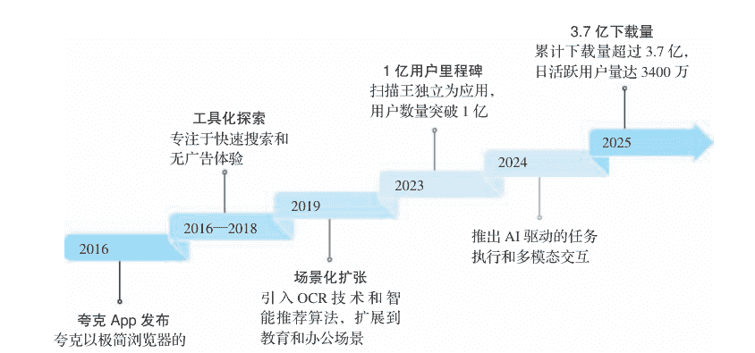

### 1.1.3 技术优势：领先的底层能力
技术壁垒源自全栈自研大模型架构。核心模型灵知学习大模型在教育领域优势明显：中文语义理解准确率达92%，高于行业均值；在C-Eval与CMMLU两项权威测评中分别取得89分和77.08分位居榜首；医学、法律等专业解题准确率较GPT-4高约70%。背后是深度教育数据挖掘，自建动态题库覆盖45种语言、10TB跨模态内容，日均处理5亿次调用，形成题目理解—解题生成—学习路径规划的闭环。

与通义千问协同进一步强化能力。接入通义Qwen2.5-Omni后，教育场景可实现影像搜题—视频讲解—知识图谱构建的全链路，例如拍摄几何题，系统除给出步骤外，还能生成三维动画演示空间关系，大幅提升学习效率。

### 1.1.4 用户生态：高用户黏性与年轻化特征
截至2025年3月，月活达1.48亿，位居国内AI应用首位。用户结构高度年轻化：00后日均使用33分钟，次日留存52%，均为行业领先。强黏性源于对学习场景的精准卡位，如输入考研数学真题解析，系统会自动串联搜索Agent、解题Agent、学习路径规划Agent，提供解析到拓展的完整服务。

增长也得益于差异化运营。与中国大学生篮球联赛CUBA合作推出AI赛事助手，将体育场景与学习工具结合，吸引大量年轻用户；发起助梦篮球场公益项目，为全国十余省份乡村学校建设智能体育设施，进一步扩大品牌影响。

### 1.1.5 知识库：全面且准确
自建知识体系覆盖广、质量可控。动态题库横跨K12到职业教育，包含1.2亿道题目、800万份解析与50万小时教学视频，其中60%数据来自真实用户行为日志。医学领域整合临床执业医师真题、病例库与学术论文，形成诊断、治疗、用药全链路图谱，医学类题目解答准确率达91%。

数据质量采用三重验证。以教育数据为例，数学解答须经菁优网专家团队审核确保推导正确，英语作文批改依靠NLP检测语法，准确率98%。同时实时抓取教育部政策文件与高校招生简章保证时效，2024年高考改革方案发布后48小时内完成题库与志愿系统的更新，覆盖1200余所高校。AI讲题助手收集用户评分与纠错，每日可汇集超10万条反馈用于优化逻辑，例如针对勒夏特列原理讲解的集体反馈后，新增动态图表与实验视频，相关题目正确率提升27%。

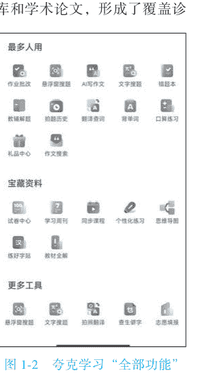

## 1.2 夸克 AI 快速上手

### 1.2.1 夸克 AI 的安装和注册
使用前需完成下载、安装与登录。

步骤一：在App Store、华为应用市场、应用宝、小米商店等主流平台搜索夸克AI或夸克浏览器，识别蓝白图标的官方应用后点击下载，安装完毕后图标会出现在桌面。

步骤二：首次打开后进入首页，中央搜索栏下方依次排列AI写作、AI生图、解题大师、AI PPT、学习等入口，构成智能学习平台的主操作面板。

步骤三：为实现记录同步与个性化推荐，建议登录。主界面右下角或个人中心点击登录，支持一键登录与微信、QQ等第三方授权。登录后可获得学习记录云端同步、个性化学习画像、错题本与收藏等附加服务，体现轻安装、快启用、深服务的设计理念。

### 1.2.2 夸克扫描王
扫描王以智能大模型为核心构建多场景文档处理体系，实现从传统扫描到智能助手的跨越。技术上通过多模算法与海量图文训练，手写识别准确率超99%，复杂公式识别达99%，OCR引擎支持13种主流语言，可自动矫正透视、消除阴影并借助上下文修复破损文字；游戏引擎模拟与半监督训练优化了矫正与背景擦除效果。

产品层面应用广泛：
智能文档扫描支持合同、笔记等高清扫描，自动校正透视、增强画质，支持文字提取为可编辑文本并保留手写批注。
证件与表格处理支持身份证等智能裁剪，OCR提取关键信息生成合规电子文档；复杂表格识别导出Excel，格式误差小于1%。
教育场景优化，试卷去手写功能可分离原题与答案，一键还原空白试卷；课堂扫描去除PPT摩尔纹并提取可编辑笔记。
多语言OCR识别支持13种语言混排，手写斜体识别准确率98%以上，自动恢复排版。
生活实用工具，魔法擦除可消除图片干扰、修复老照片、证件照智能美颜与换底色，支持多规格输出。

### 1.2.3 夸克超级搜
夸克超级搜融合深度搜索、语音搜索、拍照搜索等能力，提供更高效精准的检索体验。深度搜索理解复杂意图并给出相关结果；语音搜索适合驾驶、运动等不便打字的场景；拍照搜索通过图像识别获取植物、商品、文档等信息；同时具备智能推荐与多语言支持。

操作流程：
步骤一：在夸克首页点开搜索框。
步骤二：勾选深度搜索并输入需求，例如请帮我预测成都未来一周天气。

步骤三：点击搜索键Q获取结果，如需追问可在搜索框内使用接着问。

### 1.2.4 夸克网盘
夸克网盘是生态内的智能云存储平台，提供安全存储、高效同步、智能识别与清爽管理。技术上支持多格式极速上传、断点续传、版本管理，并配备OCR与语义理解实现自动分类、标签化与关键词检索，对图像、文档、笔记进行结构化处理。

体验上主打轻量、无广告、高清，支持跨端同步与目录管理，并可与扫描王、AI写作、PPT生成等模块联动形成资料闭环。安全层面采用加密传输、身份校验，提供密码锁、文件隐藏、历史版本恢复与私密空间。

核心功能包括智能备份与极速上传、AI图像分析与OCR驱动的内容分类、Android/iOS/Web/PC多端同步与空间管理、安全存储与隐私保护，以及适配学生、教师、办公人群的学习资料同步、作业存档、教学归类等定制化服务。

操作步骤：
步骤一：在夸克首页点击网盘。
步骤二：进入首页开启使用。

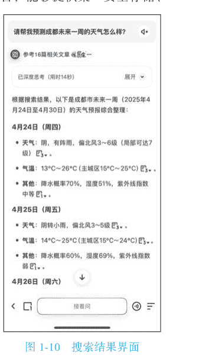

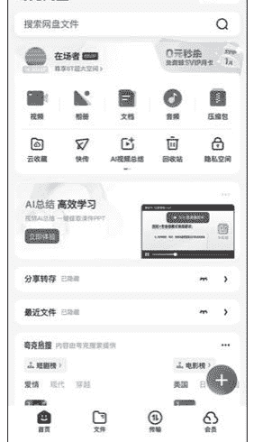

## 1.3 夸克应用

### 1.3.1 夸克 AI 用于办公求职
办公求职是优化职业形象、提升工作效率的系统过程，涵盖简历制作、岗位匹配、协作执行等环节。传统模式存在明显痛点：
效率瓶颈突出，打磨简历耗时数小时，平均投递50份简历仅获1次面试机会。
信息孤岛严重，跨平台数据难以整合，如手动将PDF简历转Excel表格，格式误差率可达15%。
协作效能低下，传统工具缺乏多人实时编辑支持，导致协作耗时增加。

制作一份合格的演示文稿并不容易，没有设计背景的人常要投入八小时以上，而且缺少可以直接套用的行业模版。

夸克通过技术手段把办公与求职的各个环节串联起来，相关应用场景见图 1-13。

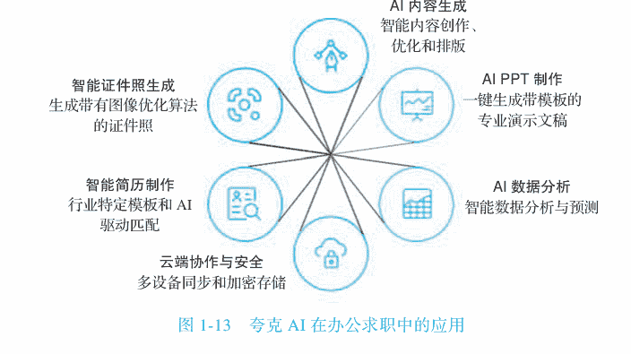

- 内容智能创作：写作工具可以自动撰写、润色并美化排版，输入关键词或主题后就能产出商务报告、项目建议书等结构化初稿，创作时间大约压缩七成。
- 演示文稿一键生成：PPT 功能能依据主题自动匹配金融、科技等行业模版，并生成带智能提纲、数据图表与动态效果的专业稿件。
- 数据智能处理：以“超级框”为例，可实现分析与预测。用户上传或输入数据后，系统会自动识别表格结构，并从 PDF 中抽取关键信息转为 Excel 表格，格式误差低于 1%。
- 跨端协同与安全：网盘提供多端同步与加密存储，扫描的文件会自动上云，支持 PC、手机、iPad 实时编辑，例如手机扫描会议记录，电脑端即可生成结构化纪要并共享。
- 简历模版匹配：文档库收录超 2000 份、覆盖 40 余领域的行业定制模版。输入岗位需求后，系统可智能匹配含项目管理、用户调研等内容的模版，并植入敏捷开发等 HR 关注的关键词。
- 证件照智能生成：扫描王支持 141 种尺寸的证件照拍摄，内置求职形象优化算法，可自动调肤淡化黑眼圈，并提供 30 余套职业装虚拟试穿，约 1 分钟即可生成符合企业审美的证件照。

### 1.3.2 夸克 AI 用于生活娱乐
在办公求职之外，夸克在日常生活与轻量娱乐中也展现出较强适配性。依托图文识别、语义解析与多模态搜索能力，夸克构建起覆盖信息获取、实用工具、内容理解、兴趣拓展与视觉交互的智能服务体系，涉及阅读、拍照、识物、翻译、图片处理等多个场景。

与传统工具类 App 相比，夸克的优势在于把搜索、视觉识别、内容聚合与智能推荐深度整合，在不打扰用户的前提下提供轻量、无广告的辅助，提升日常信息处理的效率与舒适度，尤为适合学生与知识型用户在学习之外拓宽视野、提升数字素养。相关应用示意如图 1-14 所示。

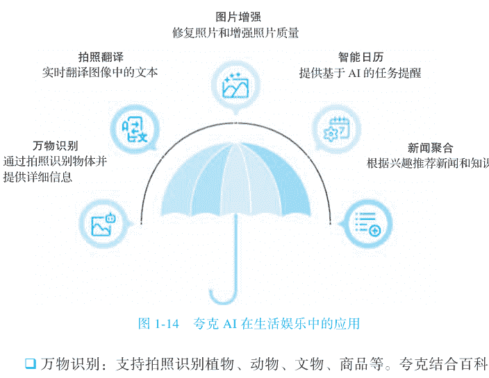

- 万物识别：支持拍摄识别植物、动物、文物、商品等，并结合百科知识卡展示主体详细信息，可用于户外学习、博物馆参观、自然观察。系统可对实物图片做结构化理解与标签归类，有助于青少年建立跨领域的基础认知框架。
- 拍照翻译：可对书页、屏幕或实物标牌拍照，自动识别语言并实时翻译，支持中英文互译及多语种扩展，适用于英语学习、外语阅读、旅游出行等场景，提升跨语境理解与表达能力。
- 图片修复与美化：提供老照片修复、清晰度提升、色彩还原等功能，可优化家庭照片、学习资料扫描件等；“魔法擦除”功能可自动去除图片中的杂物与干扰人物，提升整洁度与观赏性。
- 智能日程助手：通过对日常任务的时间标注进行分析，结合天气、节日、事件关键词生成生活提示与任务清单，适用于作业规划、备考排期与行程管理。
- 个性化资讯流：每日推送基于兴趣画像的知识文章、科普短片与优质资讯，覆盖科技、历史、文学、艺术等领域。用户可通过搜索或推荐进入知识内容流，实现轻量阅读与碎片化积累。

### 1.3.3 夸克 AI 用于学习教育
学习辅导是夸克为学生提供习题解析、作业批改、知识巩固等支持的系统化服务，核心在于化解学习疑难、提升学习效率。传统互联网辅导存在局限：互动性不足，多为只给答案不给解析；个性化缺失，资源推送不精准、错题整理需手动；反馈滞后，作业批改依赖人工，主观题解析浅显；功能碎片化，难以形成闭环。

夸克通过技术赋能将学习辅导从被动答疑升级为主动建构，其在学习教育中的应用如图 1-15 所示。

- 即时搜题解惑：支持拍照或文本输入搜题，快速返回解析，包含标准答案、解题步骤与知识点讲解；部分题型支持多种解法与追问互动，模拟个性化答疑，帮助学生理解逻辑而非只拿答案。
- 智能复习体系：依托语义推理与知识图谱输出分步答题过程，强化理科逻辑训练。配套“错题本”自动收录错题，按学科、知识点分类生成可视化复习包，并支持专项练习，形成“学习-错误-修正”闭环。

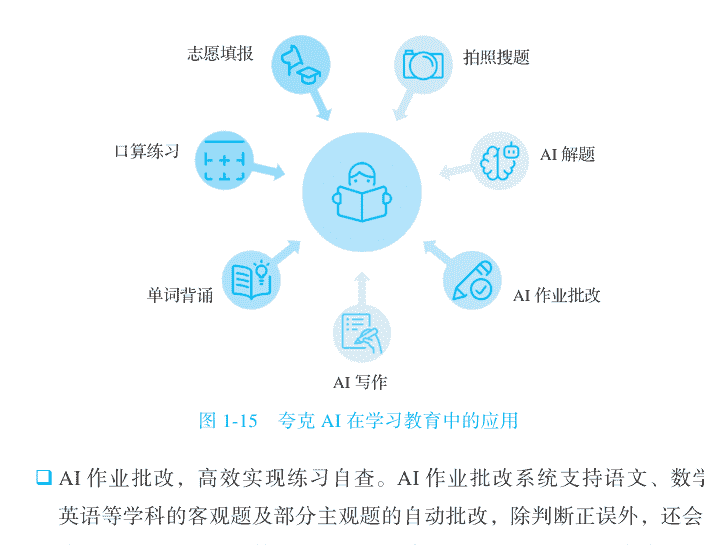

- 作业自动批改：支持语文、数学、英语等学科客观题及部分主观题自动批改，除正误判断外，还从作答逻辑、语言表达等维度给出优化建议，适用于日常作业与自学练习，培养自我纠错能力。
- 写作能力提升：系统从结构、语言、逻辑维度评估作文，逐句提供修改建议，优化准确性与流畅度；内置中考、高考等主题范文供模仿学习，系统性提升中英文写作能力。
- 词汇记忆训练：按年级与词汇等级生成复习任务，结合发音、例句、词根解析科学规划记忆路径；拍照翻译可实时识别文本并英汉互译、标注语法结构，强化语言输入与应用。
- 小学口算专项：针对小学生设计口算模块，可自动生成加减乘除题组并批改，追踪阶段性成绩；依托错题记录与行为数据推送个性化专项练习，实现弱项强化与知识迁移。
- 升学志愿辅助：提供高考、考研志愿辅助，输入成绩与偏好后智能匹配高校专业，并给出分数线对比、录取概率分析；同时提供证书查询服务，整合多维度信息辅助升学与职业决策。

总体来看，夸克已从单一工具发展为功能互联的智能学习平台，可在学科训练、表达训练、语言学习、能力提升与升学准备等方面提供精准服务与即时反馈，提升学习效率并推动以学生为中心的个性化学习。

# 第2章 | CHAPTER 用夸克构建高效学习计划
科学的学习规划是提效的关键，离不开薄弱环节诊断、目标设定与合理安排。本章围绕借助夸克完成学习规划展开，分三节论述：2.1 节介绍如何利用夸克分析学习短板，为后续目标与计划提供依据；2.2 节说明如何借助智能推荐优化目标实现路径；2.3 节展示如何将目标转化为具体日程。

## 2.1 精准诊断薄弱点
学习短板分析是制定有效计划的前提，需要对知识薄弱点做系统诊断。传统方式依赖主观经验或碎片化反馈，难以准确定位核心问题。夸克通过拍照搜题、错题本等功能自动识别题型并关联知识点，结合历史学习数据生成可视化能力图谱，将模糊的“不会做”转化为清晰的“知识漏洞”。

传统模式存在多重局限：诊断效率低，依赖人工批改或自我反思，易遗漏细节；系统性差，难以建立知识点关联，导致治标不治本；缺乏动态跟踪，无法实时调整策略。此外，在标准化教学下，学习者多被动接受统一方案，难以获得针对性支持。

夸克通过 AI 生成精准学习方案，帮助每个学习者找到适合的突破口。

- 多维诊断，直击本质。AI 讲题功能从考点分析、步骤拆解到错误溯源，层层剖析题目背后的知识逻辑。
- 动态适配，个性化推荐。基于学习画像智能推送薄弱点专项练习与视频讲解，实现“缺什么补什么”。
- 工具链协同，全流程增效。从拍照搜题到错题整理，再到网盘多端同步与 AI 字幕辅助，构建“诊断-学习-巩固”闭环。

各类学习难点分析方法如图 2-1 所示。

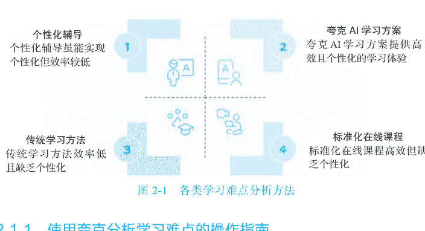

### 2.1.1 分析难点的实操步骤
以为高三学生做学习短板分析为例，说明如何用夸克提升效果。

第一步：整理错题本，在夸克中上传 Word 或 PDF 文件，如图 2-2 所示。若无 PDF，可用夸克扫描王按“拍摄错题集→文字提取→生成电子文档”操作，并开启“去阴影”提升清晰度。

第二步：进入夸克 App 搜索界面，在搜索框输入指定提示词，如图 2-3 所示。

第三步：等待片刻即可获得短板分析。

夸克 AI 输出示例：

作为高三备考学生，当前核心任务是高考。基于提供信息，从以下方面分析并建议。

## 一、学习短板分析

### 1. 函数与方程
- 对数函数定义域理解不全面，易忽略真数大于 0 条件。
- 导数计算失误导致单调区间判断错误。
- 周期函数周期计算错误，未能正确把握周期定义。

### 2. 数列
- 等比数列求和时未考虑公比 q=1 的特殊情形。
- 前 n 项和与通项公式关系不清，导致计算错误。
- 递推数列计算时逐项验证不够严谨。

### 3. 解析几何
- 对斜率不存在的直线方程理解有误，易忽略垂直于 x 轴的直线。
- 椭圆离心率计算中混淆长轴与短轴。
- 抛物线焦点到准线距离计算错误，未能正确应用标准方程。

### 4. 概率与统计
- 组合数与排列数概念混淆，影响概率计算。
- 互斥事件概率计算错误，未能正确理解相加原则。

### 5. 导数与极值
- 导数为 0 的点极值判断错误，未验证导数符号变化。
- 曲线切线方程计算错误，未能正确理解切线定义。

## 二、学习建议

### 1. 函数与方程
- 加强对数函数定义域的理解，多做题巩固。
- 熟练导数计算与单调区间判断，注意验证零点。
- 通过实例练习理解周期函数的定义与周期计算。

### 2. 数列
- 掌握等比数列求和公式，特别注意 q=1 的特殊情况。
- 理清前 n 项和与通项公式关系，注意分段使用。
- 计算递推数列时逐项验证，确保每步正确。

### 3. 解析几何
- 理解斜率不存在直线的特点，避免遗漏垂直于 x 轴情形。
- 熟记椭圆离心率公式，注意长短轴区分。
- 熟练应用抛物线标准方程，正确计算焦点到准线距离。

### 4. 概率与统计
- 区分组合数与排列数概念，通过实例练习概率计算。
- 理解互斥事件概率相加原则，避免计算失误。

### 5. 导数与极值
- 掌握导数为 0 点验证方法，确保极值判断准确。
- 理解切线方程计算方法，避免混淆切点与过点切线。

第四步：在搜索框继续输入“请根据我的学习短板生成对应练习题目”，即可获得专项训练题。

夸克 AI 输出示例：

## 一、选择题
1. 函数 f(x)=ln(x²-2x) 的定义域为...
2. 函数 f(x)=x³-3x 的单调递增区间是...
3. 若 f(x+1)=f(x-1)，则其周期为...

## 二、填空题
1. 等比数列 {aₙ} 中 a₁=2，q=-1，前 5 项和为...
2. 已知前 n 项和 Sₙ=2n²+3n，则 a₃ 为...

## 三、解答题
1. 求过点 (1,2) 且斜率不存在的直线方程。
2. 计算椭圆 9x²+4y²=1 的离心率。
3. 求抛物线 y²=4x 的焦点到准线距离。

## 四、计算题
1. 从 3 男 2 女中选 2 人，恰好 1 男 1 女的概率。
2. 事件 A 与 B 互斥，P(A)=0.3，P(B)=0.4，则 P(A∪B)。

## 五、应用题
1. 求函数 f(x)=x³-3x 的极值点。
2. 求曲线 y=eˣ 在点 (0,1) 处的切线方程。

### 2.1.2 使用要点与注意事项
使用夸克进行短板分析与记录时需注意：

第一，分类体系比单纯存储更重要，建议采用“学科+知识点类型”双维度建文件夹，如“数学/函数-知识点”，并为每道题添加关键词标签，如“立体几何”“参数范围”，便于检索与分析。

第二，使用 AI 解析需保持审慎，不能全盘依赖，应对比多种解题思路，重点标记与教材或教师讲解不一致的步骤。

第三，防止工具依赖，电子化不能完全替代传统方法。复杂大题建议拆解题干与答题区分别扫描，坚持手写批注记录思维卡点。

### 2.1.3 进阶玩法与技巧
（1）个性化学习路径规划
基于历史错题与薄弱点数据，AI 可生成定制化计划。例如针对三角函数错误率高，可构建从基础公式到综合应用的阶梯练习，并关联高考真题强化训练。建议每日及时上传错题并总结短板。

（2）跨学科关联学习
面对大学数学建模等综合难题，AI 可跨学科调用资源。例如分析电路设计题时同步讲解欧姆定律与微积分在电学中的应用，提升知识迁移能力。建议及时利用夸克串联知识点。

## 2.2 动态调整学习目标
学习目标应具体、可衡量、可实现，需在过程中动态调整与反馈。与静态目标不同，目标需随实际情况优化，确保计划与个人需求能力匹配。

不当的静态目标往往宏大抽象，缺乏行动计划与时间安排，易导致方向感缺失与焦虑。若缺乏实时反馈，难以判断是否偏离轨道，执行效果有限。

夸克通过智能化目标管理弥补不足：根据学习基础、兴趣偏好与当前任务智能推荐个性化目标，实现量体裁衣；依托进度实时调整目标并提供精准反馈；支持将目标细化为日程并提醒节点任务；通过数据分析与智能推荐提供针对性学习方法。对策略与目标管理的说明如图 2-4 所示。

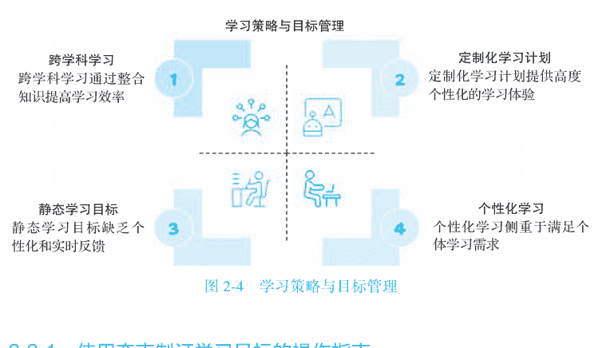

### 2.2.1 制定目标的操作流程
以为高三学生制定高考目标为例：

第一步：在夸克首页点击“更多”进入“夸克高考”，找到“查大学”页面查看院校信息，如图 2-5 所示。

第二步：选定 2~4 所目标院校后，点击“高校 PK”加入目标学校进行对比，界面如图 2-6 所示。

第三步：以北京大学为例制定目标。打开夸克主页搜索框输入提示词，如图 2-7 所示。

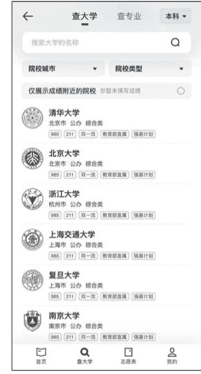

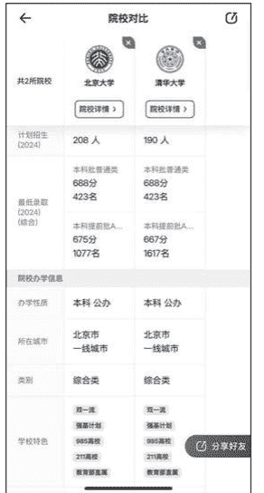

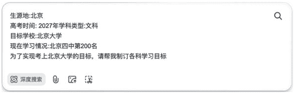

稍等片刻，夸克即可给出比较合理的目标方案。

夸克返回的参考信息大致如下：

## 一、定位分析与竞争态势
1. 四中文科的基本盘
首都名校四中的文科底蕴深厚，2024届文科均分位列全市第一，700分以上人数达到9人，清北录取比例维持在20%到25%区间。校内目前排名在200名左右，若要冲击北大，需把名次提升至前50名才具备较强竞争力。
2. 北大文科录取画像
- 分数线：2024年北京文科普通批最低录取分是688分，对应市排名约423名。实际录取中，四中高分段更多是通过强基计划或提前批进入北大。
- 学科倾向：北大文科更看重人文素养与思辨能力，历史、政治需要体现理解深度，同时总分要保持均衡。

## 二、分科目标与落地做法
1. 语文，力争135分以上
- 阅读与写作：四中语文130分以上占比超过三成，关键在文言文积累与议论文框架训练。每天精读一篇古文，每周写两篇议论文，提升逻辑与表达。
- 真题对标：北京卷大作文常聚焦社会热点，梳理近五年高频主题，建立素材库。
2. 数学，力争125分以上
- 基础巩固提速：文科生数学易丢分，重点突破三角函数、概率统计等高频点，每天限时完成20道基础题，保持八成以上正确率。
- 压轴训练：每周研究一道导数或圆锥曲线题，提升解题思路，可参考人大附中先修课程里的微积分视角。
3. 英语，力争140分以上
- 听读突破：四中英语140分以上占比超三成，做法是每日精听一篇高考真题音频，阅读限时训练达到八成正确率。
- 写作积累：归纳应用文与议论文模板，注意虚拟语气、复合句等语法细节。
4. 文综，力争260分以上
- 历史90分以上：借助四中历史学科优势，搭建中国史与世界史时间轴，重点掌握近代化、改革开放等高频考点。
- 政治90分以上：紧跟时政如二十大报告、乡村振兴，结合教材理论打磨主观题论证。
- 地理80分以上：依托地图与图表分析气候类型、产业区位，每周完成一套综合训练。

## 三、冲刺打法与资源联动
1. 模考复盘与定位
每次模考后梳理错题，优先补齐数学压轴、文综主观弱项。持续关注校内名次变化，三年内冲击全校前50。
2. 对接北大特色资源
- 强基计划：综合成绩优异者可提前布局历史学、哲学等专业，建议高二前完成相关竞赛或课题积累。
- 学术活动：参与北大附中联合的人文讲座、社科院实习项目，丰富学术背景。
3. 心态与作息
采用番茄工作法分段学习，每周预留两天调节状态。借鉴四中宽松且自主的教育理念，平衡学业与社团兴趣。

## 四、风险预判与备选
- 竞争强度：四中每年约60人进入清北，文科内部竞争激烈，需保证总分稳定在校内前30。
- 备选路径：若总分略有差距，可考虑北大医学部，或通过国家专项计划申请。

## 五、关键时间节点
- 高一：夯实基础，补齐数学与文综短板。
- 高二：参加历史、政治等竞赛，启动强基准备。
- 高三：全科模拟冲刺，强化应试技巧，关注北大招生政策动态。

综合来看，依托四中的优质资源与个性化培养，2027年考入北大文科是可行的。建议定期与班主任校准策略，并通过北大招生官网获取最新信息。

### 2.2.2 使用夸克设定目标时的注意事项
1. 明确考试类型差异
不同考试的知识结构与侧重点不同，如高考重基础与综合能力，公务员考试偏重时政与行政能力。导入夸克时需准确选择考试类型，避免推荐内容跑偏。
2. 保持目标弹性
备考中需求会变化，可根据实际情况及时更新计划与目标，保持适配。
3. 内容制定要合理
夸克能自动生成学习内容，但需结合自身情况微调。如高考生需要更长的阶段复习，职称类更侧重专业强化，要合理安排时间确保知识点覆盖充分。

### 2.2.3 目标制定的进阶用法
1. 把大目标拆成每日任务
利用夸克把大目标拆成阶段化小目标，增强成就感。先明确当日主题，如高考数学、四六级英语，再设定具体任务如复习函数性质或做10道阅读。根据难度安排时间，夸克的日程提醒和错题本可帮助追踪。每天结束时做进度复盘并微调次日计划。
2. 借助夸克定期评估进展
设定周期目标后，用夸克的反馈功能记录错题，定位难点。通过模拟考检验薄弱环节并优化策略，定期查看反馈可保证稳步推进。

## 2.3 定制学习计划，量体裁衣

学习计划是把学习愿景转化为可执行步骤的系统方案，涵盖目标、时间、方法与资源协调。传统模式以目标任务时间为线，优点是结构清晰，但僵化、忽视个体差异、缺乏动态调整、过度应试，容易导致倦怠。

夸克借助AI重塑计划制定与执行：
- 个性化匹配：基于学习行为大数据生成专属方案。
- 智能动态调整：更新进度后自动优化后续安排，如连续多日未掌握三角函数则延长练习周期。
- 全场景资源整合：打通AI答疑、跨学科案例库等，实现计划与资源的无缝衔接。

### 2.3.1 夸克做计划的实操流程

以大四学生备考四级为例说明具体操作。

第一步：打开夸克学习，进入试卷中心，选择四级真题包，打印指定年份真题，按规定时间作答，如图2-8。
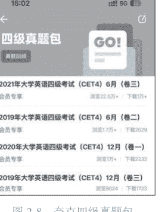
第二步：打开夸克App搜索界面，输入提示词并上传真题，如图2-9。

第三步：稍作等待，夸克会给出解析结果。

夸克给出的诊断是：

试卷整体诊断

写作板块
问题点：内容偏单薄，仅罗列在线学习的利弊如便利与网络问题，缺少自律性、互动缺失、心理健康等深度分析。语言基础薄弱，句式重复，词汇贫乏，出现拼写错误。结构松散，利弊未分段展开，缺少however、moreover等逻辑衔接。
改进建议：视角拓宽，从学习效率、资源获取、社交隔离、技术依赖等多角度展开。语言升级，使用高级表达，采用复合句。结构规范，采用总分总，用连接词串联段落。

听力理解
问题点：整体得分尚可，但长对话与短文细节易遗漏，存在陷阱选项风险。
改进建议：强化精听，捕捉时间、地点、态度词等关键词；梳理干扰项规律如部分否定、近义替换。

阅读理解
问题点：词义推断需加强，如将direction误选为tradition；定位不准导致细节题失分。
改进建议：积累高频词，多读BBC News等外刊学习语境用法；练习扫读快速定位，避免逐字阅读。

翻译
问题点：单复数错误如thousands years history，冠词缺失；直译生硬；句式单一。
改进建议：夯实主谓一致、冠词、介词搭配；学习意译，关注文化内涵；尝试定语从句与分词短语。

第四步：在夸克搜索框中输入提示词，如图2-10。

第五步：稍等片刻，夸克会生成对应学习计划。

夸克给出的方案是：

基于你的分数目标550分与计算机专业背景，结合四级特征与高分经验，制定分阶段计划。

一、整体时间规划8周
阶段划分
基础夯实1~3周：词汇、语法、听力基础。
专项突破4~6周：分题型强化。
冲刺模拟7~8周：全真模考与错题复盘。
每日时间建议3~4小时
早晨30分钟：背高频词及专业词汇。
上午/下午2小时：听力/阅读专项。
晚上1小时：写作翻译练习与错题整理。

二、各模块提分策略
听力目标195分以上
精听30分钟/天，近5年真题逐句听写。关注数字、地点、转折信号词。碎片时间泛听科技播客如TED-Ed Technology。
阅读目标200分以上
每日1套真题训练快速定位题干关键词到原文。攻克科技类长难句。强化高频词与计算机领域词汇如algorithm、interface。
写作翻译目标155分以上
写作每周3篇，背诵科技话题模板，采用现象利弊对策结构。翻译侧重中国文化与科技主题，积累术语。
词汇语法贯穿全程
艾宾浩斯记忆四级高频词；阅读论文摘要积累专业词；查漏补缺从句、虚拟语气、非谓语。

三、分阶段重点任务
基础夯实：10套听力精听建立信号词敏感度；精读20篇科技外刊；整理10个万能句型。
专项突破：按题型分类训练听力；阅读限时25分钟/套，错题率控制15%以内；每周3篇翻译。
冲刺模拟：模考预读选项，标记疑难；错题本归纳陷阱；背诵5篇范文，用Grammarly校对。

四、注意事项
避免只刷题不复盘；每周日安排1小时娱乐如观看英文科技剧；冲刺期保证6小时睡眠，使用番茄工作法。

### 2.3.2 制定计划时的注意事项

夸克虽能快速生成计划，但需注意：
夸克对跨学科复合目标解析有限，如同时提升算法与英语阅读，需手动合并避免碎片化。
要主动明确学习意图，避免描述泛化。如提升英语应细化为3个月内雅思6.5，重点听写与写作，并拆解为每周任务。
定期检查AI计划，结合自身状态调整任务顺序，把高难度任务放在精力充沛时段。

### 2.3.3 计划制定的进阶技巧

1. 增加考试计划获取个性化推荐
可在夸克学习中添加四六级、期末、公务员等考试，日程表会推送相应信息与内容推荐，并生成复习时间表，实现智能备考。
2. 借助夸克系统复盘
利用学习周刊对薄弱环节专题训练，结合遗忘曲线安排复习间隔，提升投入产出比。

## 第3章 使用夸克进行课前预习

本章聚焦教材全解预习、视频课程学习、教辅解析三大场景，阐述夸克如何帮助构建知识体系、优化视频体验、提升解析效率。

## 3.1 用教材拆解来智能预习

传统预习依赖纸质教辅，存在更新滞后、效率低、缺乏个性化等问题。夸克的优势在于AI解析题型逻辑、动态匹配节奏；聚合教材真题教辅资源，支持拍照生成知识树；提供定制化推荐，基础视频优先给预习者，高阶内容匹配进阶用户。

### 3.1.1 夸克生成预习方案的操作指南

以大一新生提前学高等数学为例。
第一步：进入夸克学习，点击教辅解题中心，将教材加入我的书架。
第二步：打开高等数学第7版上，进入对应章节学习。
第三步：对未掌握知识点点击视频讲解，或将题目加入错题本。
第四步：在搜索框输入提示词获取概念解答与预习提纲。
第五步：稍等片刻，夸克生成结果。

夸克的输出是：

《高等数学第七版》第四节无穷大与无穷小预习提纲通俗版

一、核心概念
一、无穷小

极限概念速览：趋近零与趋向无穷

（一）无限小量
1. 定义
当自变量 x 朝向某定值 x₀ 或向无穷远延伸时，若函数取值可以被逼近到任意接近 0，则称该函数为无限小量。
举例：x 接近 0 时，x 与 sin x 都呈现无限小特征。

2. 关键
- 无限小量是随过程变化的变量，而不是像 0.001 这样固定的微小数值。
- 唯一保持恒定的无限小为常数 0。
- 判定必须带过程，x→0 或 x→∞ 的前提不可缺。

（二）无限大量
1. 定义
自变量趋向某点或无穷时，函数绝对值可以放大到任意大，则称该函数为无限大量，可为正向或负向。
举例：x→0 时 1/x，x→∞ 时 x²。

2. 关键
- 无限大量是过程性概念，不是 1 000 000 之类的大数。
- 需区分 +∞ 与 -∞。

二、无限小与无限大的关联
1. 互为倒数关系。
2. f(x) 为无限大量，则 1/f(x) 为无限小量。
3. f(x) 为不为零的无限小量，则 1/f(x) 为无限大量。
举例：x→0 时 1/x 发散，其倒数 x 趋零。

三、运算与阶次
（一）无限小量的运算
- 有限个无限小量的和、差、乘积仍为无限小量。如 x→0 时 x+x²。
- 常数与无限小量的乘积仍保持无限小。
- 无限多个无限小量的和或积未必仍为无限小。

（二）阶的关系
- 若 lim(β/α)=0，则 β 比 α 高阶，记 β=o(α)。如 x² 对 x 为高阶无限小。
- 若 lim(β/α)=c 且 c≠0，则同阶。
- 若 lim(β/α)=1，则 β~α，如 x→0 时 sin x~x。等价可用于极限简化。

五、预习要点
（一）核心公式与定理
- 极限可写成 f(x)=A+α，α 为无限小。
- 无限小量的运算规则与等价替换，如 sin x~x，1-cos x~x²/2。

（二）易错提示
- 无限大量非数，不能做常规算术，如“无限大量+1”无意义。
- 求倒数时需保证原无限小不为零。
- 无限大量与无限小量的乘积结果不确定，如 x·1/x²=1/x 当 x→∞ 时趋于零。

六、课堂练习方向
1. 在指定趋近下判定函数为无限小或无限大。
2. 用等价替换求极限，如 lim_{x→0} sin3x/2x=3/2。
3. 证明运算后性质，如 x→∞ 时 x+sin x 为无限大量。

提示：以教材例题为基准吃透定义，熟练等价替换与运算规律。

### 3.1.2 使用夸克生成预习方案的注意事项
（1）明确学习目标与考试类型的适配性
不同考试对教材全解的使用方式不同。高考侧重框架搭建与细节解析，考研要结合真题挖掘深层逻辑，四六级偏重词汇语法拓展，公务员要强化逻辑推理与解题技巧。应按目标匹配真题库、专项练习等资源，避免泛化学习。
（2）分阶段规划学习深度
预习阶段聚焦教材全解的框架梳理并标注重点难点；强化阶段可用拍照搜题、智能讲解攻克薄弱点并建立错题本；冲刺阶段聚焦高频考点与真题模拟，利用历年真题资源实战。
（3）资源整合与深度利用
除教材全解外，还提供视频课程、思维导图等辅助工具。可先用教材全解建立基础认知，再用视频深化理解，最后用思维导图串联框架；同时关注平台更新的考试动态与资料以保证时效。

### 3.1.3 使用夸克生成预习方案的进阶技巧
（1）联动其他工具，高效提前学习
可联动教材全解、知识图谱、思维导图等工具。例如复习高中化学时，先生成“化学反应方程式”知识图谱，再导出至 XMind 构建章节框架并标注易错反应条件。也可联动教材全解、模考、时间管理工具模拟考场，如公考冲刺时用模考配合番茄钟，考后用教材全解溯源错题。
（2）利用夸克构建思维导图
打开夸克 App，点击底部导航栏的“夸克学习”，进入后选择“全部功能”，找到“思维导图”选项，即可开始构建。

## 3.2 视频学习拆解，靶向优化
教学视频通过讲座、演示、专业讲解传递知识，视频提炼是对核心内容的结构化整理，有助于快速把握体系并提升记忆效率。

传统人工记录效率低、易遗漏，笔记碎片化难以串联，普通播放器定位不准，长视频拖拽成本高，且对自律要求高易分心。

夸克借助智能技术重构流程：智能内容抽取实现分段提要并锚定时间轴，生成可视化思维导图；多模态学习辅助支持一键生成图文笔记、同步滚动字幕及多端编辑，降低认知负荷；可处理 6 小时以上长课，结合智能检索与网盘生态实现从存储到内化的闭环。

### 3.2.1 使用夸克进行视频课程学习的操作指南
以大四学生准备考研为例：
第一步：进入“夸克网盘”，选择合适视频存入。
第二步：打开视频课程，下方点击“AI 总结”。
第三步：点击“AI 课件”，生成课件与讲义。
第四步：点击“导出课件”，保存为 PPT、PDF 供日常使用。

### 3.2.2 使用夸克进行视频课程学习的注意事项
（1）视频质量与智能功能适配性
智能总结对清晰度、字幕完整度及结构敏感，低分辨率或无字幕课程易导致文稿提取错误，建议优先选择 1080P 以上并带完整字幕的课程。无字幕可尝试“AI 生成字幕”但需人工校对术语。“AI 课件”对图文并茂视频效果最佳，纯口语或实验演示易产生冗余，需人工修正。
（2）倍速播放的合理使用
盲目提速影响吸收。理论推导类可启用 1.25～1.5 倍，实操演示类建议 0.75 倍慢放。注意设备兼容，部分平台可能屏蔽第三方播放器倍速，需网页端实现。长时间高速播放易疲劳，建议每 20 分钟暂停并开启护眼模式。
（3）智能输出内容的批判性验证
智能生成的文稿与课件可能遗漏隐含逻辑或误判重点，需结合原视频二次校对。如考研英语阅读隐含态度分析可能被简化，建议用“回放片段”核对关键语句。对物理电磁学等复杂知识点，可将智能总结与教材全解对照并补充手写笔记。

### 3.2.3 使用夸克进行视频课程学习的进阶技巧
（1）针对视频与资料，进行系统化管理
可按考试类型和内容类型分类视频，添加“重点”“待复习”等自定义标签便于检索。每月利用“学习报告”分析视频学习时长与笔记密度，淘汰过时内容，补充新资源。
（2）针对不同考试类型，匹配不同视频功能
利用“分段总结”拆解课程生成带时间戳章节要点；结合“AI 课件”提取图表与公式并导出 PDF 反复练习；英语听力课程可启用倍速播放提升训练效率。

## 3.3 教辅精析解码，按需供给
教辅解析是对教材、习题集、模拟试卷进行系统分析，提炼知识点、解题思路与考点逻辑，帮助高效理解与巩固。传统人工解析耗时、覆盖有限且难以更新，解析多停留在答案层面，缺乏过程拆解与溯源。

夸克依托“灵知”学习大模型与多模态技术实现动态、精准、场景化解析：实时语料库构建动态题库即时响应新题；OCR、公式还原与视频讲解实现“考点分析→步骤拆解→同类题拓展”的立体解析；结合学习数据生成难度匹配的练习与路径。

### 3.3.1 使用夸克解析教辅的操作指南
以研究生二年级准备考公务员为例：
第一步：点击“夸克精选”，选择夸克学习的“国家公务员考试”。
第二步：点击页面下的“0 元领资料”，查看黄金笔记、思维导图、专项抢分、上岸计划表、押题卷等。
第三步：选择文件如“2024国考《行测》三色笔记”，点击“下载”保存到网盘或本地。
第四步：进入夸克搜索界面，上传文件并输入提示词。
第五步：等待解析完成。

夸克智能输出结果示例：

以下是根据文档内容整理的完整版题目案例，结合学习重点和易错点标注，方便对照分析。

## 一、言语理解与表达

### 1. 行文脉络分析——尾句定重点
题目（P1）：
美国著名学者伊顿曾预言：“我们深信，在不久的将来，我们国家的最高经济利益，将主要取决于我们同胞的创造才智，而不取决于自然资源。”伊顿的预言在今天已经变为现实，金融危机、能源和矿产资源价格急剧上涨，世界经济滞涨风险苗头显现，国民的创新能力得到许多国家前所未有的重视。这段文字意在强调：
- A. 人力资源将在经济增长中发挥越来越大的作用
- B. 自然资源在国家发展中的重要性将逐步降低
- C. 国家要发展必须充分发挥国民的创造能力
- D. 国民素质的高低将决定国家未来发展的方向
解析：
> 重点：尾句通过“伊顿的预言变为现实”引出核心观点，强调“国民创新能力”的重要性。
> 答案：C
> 易错点：误选 A

### 2. 逻辑填空——固定搭配
题目（P9）：
中俄计划携手建设从莫斯科出发，穿越哈萨克斯坦通往北京的欧亚高速运输走廊。新铁路的兴建可能要耗时 8～10 年。从工程的规模及价值来看，它堪与苏伊士运河______。后者大幅缩短了通航里程及时间，迅速对全球贸易产生了______的影响。
依次填入最恰当的一项是：
- A. 比肩 不可估量
解析：
> 重点：第一空体现“比得上”，第二空搭配“影响”，“不可估量”最恰当。
> 答案：A

### 3. 定义判断——主客体
题目（P25）：
劳动争议是指在劳动者和劳动力使用者之间因劳动权利与义务发生分歧而引起的争议。根据上述定义，下列属于劳动争议的是：
- D. 职工老王因工伤未能获得保险赔偿而与工厂争执
解析：
> 重点：主客体需为劳动者与劳动力使用者。
> 答案：D

### 4. 类比推理——语义关系
题目（P26）：
羔羊跪乳：乌鸦反哺
- B. 魂不附体：失魂落魄
解析：
> 重点：题干为近义，均指感恩父母。
> 答案：B

## 二、逻辑判断——加强论证
题目（P33）：
针对地球冰川的研究发现，当冰川之下的火山开始喷发后，会快速产生蒸汽流，爆炸式穿透冰层，释放灰烬进入高空，并且产生沸石、硫化物和黏土等物质。日前人们发现，在火星表面的一些圆形平顶山丘中也探测到这些矿物

## 三、学习建议
### 1. 针对性刷题
- 言语理解：每天 15 道片段阅读 +10 道逻辑填空，标注转折/因果词、主题词。
- 判断推理：每天 20 道图形推理 +10 道定义/类比题。

### 2. 错题复盘
整理高频错误，总结陷阱特征。

### 3. 限时训练
模拟考试节奏，提高答题速度。

### 3.3.2 使用夸克解析教辅的注意事项
（1）资源处理与兼容性
扫描纸质资料须画面清晰无遮挡，避免阴影或倾斜导致 OCR 识别错误；PDF 需关闭水印检测模式。解析电路图等复杂题型时，建议同步启用“图文解析”与“视频讲解”，分屏对比不同解法并检查公式图表完整性。
（2）解析结果验证与修正
智能生成的答案可能存在逻辑漏洞，需对照教材或教师解析二次确认。发现错误可通过“问题反馈”功能提交截图与描述。定期清理过时解析记录，避免新旧知识点混淆。
（3）功能使用边界与权限
系统仅支持解析已授权的教辅资源，禁止上传未公开试题或侵权内容。个人笔记建议标注“私密”防止泄露。

### 3.3.3 使用夸克解析教辅的进阶技巧
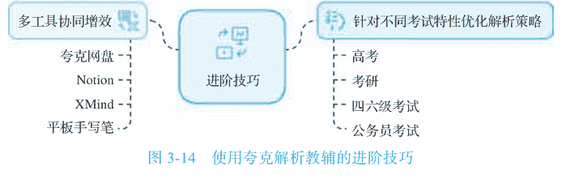
#### （1）多工具协同增效
可利用夸克网盘实现资料分类与多端同步，将解析内容导出至 Notion 或 XMind 等工具构建知识库，并结合平板手写笔提升标注效率。
#### （2）针对不同考试特性优化解析策略
高考：深度拆解压轴题，结合“考点溯源表”关联教材。
考研：分步讲解数学与专业课，利用“错题归因表”分析高频错误。
四六级：强化听力与阅读解析，通过“AI 批改”功能优化作文语法。
公务员：聚焦行测逻辑题与申论框架，快速匹配题型。

# 第4章 使用夸克整理资料
信息爆炸时代，如何将碎片化信息转化为系统认知是关键。传统整理存在搜集筛选低效、笔记机械、错题管理粗糙等问题。

夸克以智能工具链重构整理体系，形成搜集到内化的闭环。

资源获取环节，基于自然语言处理的智能搜索引擎精准理解需求并过滤无效信息；跨平台整合打破壁垒，聚合学术库、公开课、电子图书；个性化推荐生成定制学习路径，解决资源分散与质量参差问题。

知识记录层面，智能笔记突破手写限制，通过高准确率语音转写、结构化摘要生成及多模态内容整合，将精力从机械记录释放到深度思考。

错题管理层面，智能归因分析与多维分类将传统“抄题本”升级为具备错误预防功能的智能助手，实现从纠错到知识漏洞修复。

## 4.1 学海精准导航，智慧淘金
找资料是学习的起点，是围绕特定目标从海量信息中精准定位、筛选并整合所需内容的系统行为，涉及教材、论文、课程视频等显性资源的质量、适配度与关联性判断。优质资料是知识建构的原材料库，其效率与精准度直接影响理解与应用。在碎片化信息时代，科学的资料搜集能力已成为深度学习的核心基础。

# 资料搜集总在低效循环里打转？

在日常学习里，找资料经常被三个摩擦拖慢节奏。渠道被拆得很散，网页、客户端、专业库要来回跳转，耗费大量时间；品质参差不齐，优质内容淹没在大量泛泛信息里，权威性和适用性很难快速判断，出现信息很多、有效知识很少的矛盾；组织很乱，PDF、音频、网页等不同载体没有统一归口，跨领域的素材难以串联，最后沦为零散堆积。认知负担因此加重，系统化知识体系难以搭建，学习停留在堆砌而非深加工。

夸克用智能化手段把收集链路做了全链改造。自然语言处理能读懂搜索意图，支持 filetype:pdf 机器学习 + 入门 这样高级过滤写法，把知网、Springer 等专业库和 Coursera、网易公开课 等课程平台的内容集中呈现。系统依托浏览、收藏等行为画像构建个人关联图谱，会主动推荐与当前主题相关联的进阶材料，比如学 Python 时顺手补上数据结构、算法教程，形成符合认知节奏的阶梯路径。标签收藏、主题合集和智能分类能把 PDF、视频、网页等多种形态整理成可检索、可复用的结构化库，帮助学习者摆脱多端切换、甄别困难、分类混乱的低效模式，实现从被动筛选到系统精准匹配的转变，显著提升搜集效率和知识构建质量。

### 4.1.1 夸克找资料实操演示
以大学生找机器学习学习资料为例，展示两种常用用法。

第一种用法
第一步：打开夸克首页搜索框，用高级检索语法输入 filetype:pdf 机器学习 来限定文件类型。高级语法示例如图 4-1 所示。

第二步：平台会自动整理可用材料，可直接点链接查看，也能一键保存到夸克网盘。

输出示例如下：

# 推荐的机器学习 PDF 资源（部分含下载链接）

1. 经典教材
(1)《机器学习》(西瓜书)
亮点：中文教材标杆，覆盖基础到进阶算法。
(2) Deep Learning with Python, 2nd Edition
亮点：Keras 实战指南，同步补充 PyTorch 相关内容。
2. 实战教程
(1)《Python 机器学习：基础、算法与实战》
内容要点：围绕 Numpy、Pandas、Scikit-learn 等库展开，附带代码案例。
(2)《机器学习实战》(中文版)
亮点：结合 KNN、SVM、聚类等方法，提供 MATLAB 源码。
3. 前沿研究
(1) “On Training Robust PDF Malware Classifiers”
内容要点：PDF 安全检测中机器学习模型的优化思路。
下载：arXiv。
(2) “AutoGluon-Tabular”
亮点：自动化机器学习框架，擅长表格数据预测。
下载：AutoGluon 官网。
4. 注意事项
(1) 版权合规
部分资源受版权保护，建议走正版购买或开放获取渠道。
(2) 文件质量核验
用阅读器检查完整性，优先选标注高清可复制的版本。

第二种用法
第一步：在夸克首页点“更多”，进入“学术搜索”，如图 4-2 所示。

第二步：在学术搜索中添加筛选条件，如图 4-3 所示，如时间范围、时效、收录情况，输入中文库、近 3 年、北大核心等。
第三步：平台会梳理出相关参考文献，如图 4-4 所示。
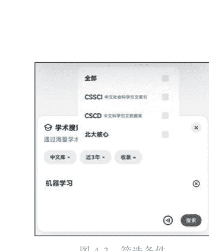
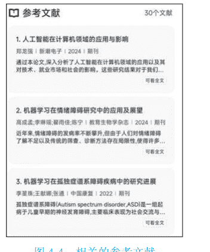

### 4.1.2 资料收集容易忽略的三点
（1）要做权威性核验，别单信一个渠道
平台虽整合了知网、Springer 等学术源，但网络上仍存在观点偏差或数据过时情况。教材、论文类材料最好回官方数据库核对原文；课程视频、经验分享要看发布者资质，如高校认证账号、权威机构专栏，避免把非专业解读当核心素材，理工、医学等对准确性要求高的领域尤其要注意公式与理论表述的规范性。

（2）标签体系要系统，否则越积越乱
建议按“学习阶段 + 学科 + 模块”分层。如小学生整理数学计算，可设“三年级→计算能力→竖式运算→错题汇总”四级标签；四六级考生可标注为“CET-6→阅读模块→段落匹配→同义替换词库”。避免笼统写“英语学习”。定期对照考试大纲更新标签，让资料集动态贴合目标，提高复习针对性。

（3）核心资料要定期备份
按“学期 + 学科”做周期备份，例如“2025 年春季→小学语文→字词辨析”。考前一个月把四六级“备考笔记库”导出为 PDF 存档。中考、高考等长期资料建议夸克云存与本地硬盘双备份，保证资料完整迁移。

### 4.1.3 夸克搜资料的高阶玩法
使用夸克获取学习资料的进阶技巧如图 4-5 所示。
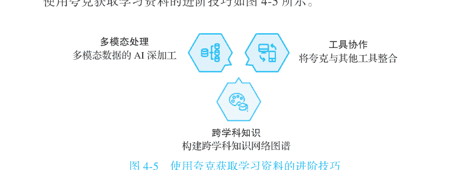

（1）把夸克与其它工具串联
与 Notion、Obsidian 等笔记软件联动，形成搜索-整理-应用闭环。夸克智能收藏的内容可一键导出 Markdown，同步到 Notion 搭建学科知识库；用夸克的思维导图功能提炼考研专业课知识框架，再导入 XMind 二次编辑并补充个人批注。CPA、法考等考试，可把夸克提取的法规条文、案例分析和 Anki 记忆卡结合，生成“知识点+错题”的定制记忆库，实现工具互补。

（2）搭建跨学科知识网络
突破单科边界。新高考选科学生可搜“物理 + 经济”交叉资料，建立“学科融合案例库”，系统会推荐“物理建模在经济学中的应用”相关论文和视频。准备报考“大数据管理与应用”的考生，可整合“数学统计 + Python 编程 + 商业分析”多领域资料，并标注关联度，如“线性代数→机器学习算法→商业数据分析模型”，提前适应复合培养需求。

（3）对多模态数据做 AI 深加工
教资面试、雅思口语等输出型考试，可把备课教案、口语录音用夸克语音转写成文本，再用智能摘要找出逻辑漏洞，并调用 AI 语法纠错优化表达。医学规培、工程考证等实操内容，可把设备操作视频截图导入夸克 OCR，自动生成“步骤解析+风险点标注”的图文笔记。

## 4.2 笔记升级，从记录到可检索的知识库
课堂笔记的本质是把讲授、板书、互动等动态信息即时转化为可复用的结构化知识。它不只是知识点、公式、案例的堆砌，还包含逻辑梳理、难点标注和个人思考。优质笔记是知识内化的脚手架，能在复盘时快速定位要点，并通过二次整理形成个性化体系，在高校专业课、资格证培训等信息密度高的场景中尤其关键。

传统手写笔记存在三重瓶颈：记录跟不上节奏，为追求完整而漏听重点，形成“机械抄写→理解断层”；形式单一，板书照片、PPT 截图、语音讲解难以整合，笔记沦为文字图片的零散堆砌；整理低效，课后重抄补全耗时，格式不统一导致公式潦草、重点模糊。数据显示，学生平均用 25%-30% 的课堂时间记录，却不足 40% 能在复习时有效复用。

平台把笔记从记录工具升级为加工工具。98% 准确率的实时语音转写可同步捕捉授课并自动打时间戳，解决手写滞后。支持板书照片、PPT 截图、手写公式等多模态一键导入，AI 图像识别提取要点并与转写文本关联，形成文字+图像+语音的立体卡片。自然语言处理可自动生成结构化摘要，提炼核心概念、逻辑框架和案例，支持关键词秒级检索，课后整理时间可压缩 70% 以上，实现“记录即整理”，让笔记成为可动态检索、持续迭代的知识库。

### 4.2.1 夸克做课堂笔记的四步流程
以初三历史课堂为例。

步骤一：进入夸克首页，点击“更多”，选择“录音纪要”，如图 4-6 所示。
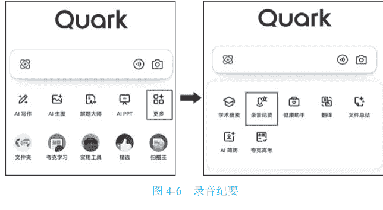
步骤二：用实时语音转写功能开启录音纪要，如图 4-7 所示。
步骤三：按需选择后续功能，比如智能摘要。功能选项如图 4-8 所示。

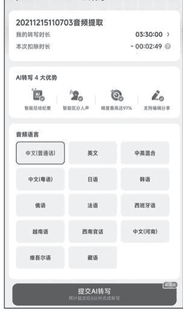
步骤四：系统整理好的课堂笔记如下。

# 初三年级历史课课堂笔记

一、课题：第二次世界大战后的世界变化
（一）冷战与两极格局
1. 冷战背景
- 二战后美苏战略对立，制度与意识形态尖锐分化。
- 美国成资本主义世界霸主，苏联实力增强。
- 双方视彼此为主要威胁，扩张势力范围。
2. 冷战进程
- 起点：1947年杜鲁门主义出台，美苏同盟破裂。
- 经济对抗：美国马歇尔计划援助西欧；苏联成立经互会。
- 军事对峙：1949年北约、1955年华约成立，两极格局成型。
（二）战后资本主义新变化
1. 经济发展
- 美国：50-60年代繁荣，70年代滞胀，80年代后回暖。
- 西欧：借助援助与科技，经济恢复；1967年欧共体、1993年欧盟成立，一体化加速。
- 日本：战后改革与朝鲜战争契机，70年代成资本主义第二经济大国。
2. 社会变化
- 福利国家建立，社会保障完善。
- 第三产业比重上升，成为增长点。
（三）社会主义发展与挫折
1. 苏联
- 赫鲁晓夫改革未突破斯大林模式。
- 勃列日涅夫重工业倾斜，轻工业农业滞后。
- 戈尔巴乔夫先经济后政治改革，导致苏联解体。
2. 东欧
- 匈牙利1956年改革受阻。
- 80年代末东欧剧变，社会主义体制被取代。
（四）亚非拉新发展
1. 亚洲：1947年印度独立；韩新利用产业转移实现工业化。
2. 非洲：1960年“非洲年”17国独立；1990纳米比亚独立，殖民终结。
3. 拉美：1959年古巴革命；1999年巴拿马收回运河主权。
二、重点问题解析
(一) 冷战影响
消极：局势紧张，朝鲜战争、越南战争等局部冲突。
积极：避免新世界大战，促进科技，推动第三世界崛起。
(二) 苏联解体原因
根本：斯大林模式弊端长期未解。
直接：戈尔巴乔夫改革失败，政治动荡加剧民族分裂。
外部：西方压力与渗透。
三、课堂小结
二战后世界格局巨变，冷战形成两极，美苏争霸主导发展。各国改革程度不一，亚非拉纷纷独立并发展。要从历史吸取教训，珍惜和平。
四、课后作业
- 梳理冷战主要表现与影响。
- 分析苏联解体对世界格局的影响。

### 4.2.2 做笔记时的注意事项
（1）语音转文字的场景优化
教室、会议室嘈杂时建议戴耳机录音，降低背景干扰。转写后要快速通读，修正同音词、专业术语误识，比如“函数定义域”被写成“函数定义于”。目前主流语言识别较好，小语种或地方方言建议配合人工标注或第三方翻译。

（2）手写笔记与 OCR 的适配
字迹保持工整，避免连笔，尤其数学公式、化学方程式可用相机功能提升识别率。扫描纸质笔记注意光线充足、角度垂直，避免阴影折痕。多栏文本、图表混排建议分区域扫描或智能裁剪。

（3）导出格式兼容性检查
导出前预览 PDF，检查表格、图片是否错位，公式是否完整。必要时调整页面布局。分享时可将 PDF 设为只读，防止被篡改。

### 4.2.3 夸克笔记的进阶组合
使用夸克做学习笔记的进阶技巧如图 4-9 所示。
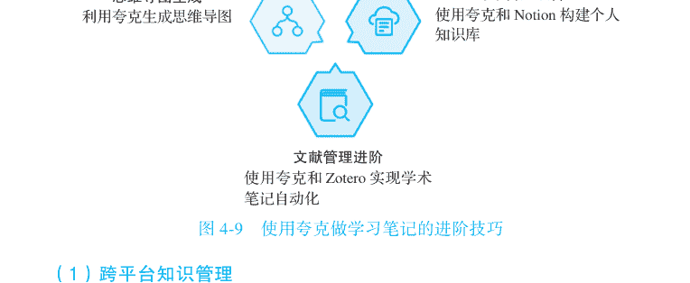

（1）跨平台知识管理
夸克+Notion 构建个人知识库。OCR 识别后导出 Markdown 拖入 Notion，自动识别标题层级和列表。可建“学科→章节→知识点”三级体系，按关键词、标签、日期多维检索。如高等数学笔记按“极限→导数→积分”归类，配合 LaTeX 公式块，形成结构化网络。

（2）文献管理进阶
夸克+Zotero 实现自动化。夸克扫描王拍摄纸质文献导出 PDF 上传 Zotero，自动补全元数据。用夸克全文翻译插件实时翻译英文摘要。表格识别可提取关键数据生成 Excel，与 Zotero 笔记关联实现数据与原文双向索引，提升综述效率。

（3）思维导图生成
对语音转写文档，用夸克文件总结功能一键生成思维导图，快速把握脉络。

## 4.3 错题本：从错误归因到知识突破
错题本是通过“错误归因→知识重构→强化练习”闭环，精准定位薄弱环节、查漏补缺的工具。传统纸质错题本靠手抄题目、标注原因、整理思路，靠重复暴露问题加深记忆，在数学、物理等题型密集学科中应用广泛。学生常按学科章节分类记录，并标注计算失误、概念混淆、审题偏差，形成个人学习档案。错题本既是复习核心资料，也是培养自主学习能力的重要载体。

# 第 4 章 错题管理的智能升级

纸质错题本在真实使用里暴露出效率不高、记录僵化、经验难以复用三方面痛点。靠手抄整理一道题，尤其带作图的几何题往往要花上十几分钟，严重拖慢复习节奏。纸质载体不具备数据沉淀能力，错题分布、知识点掌握趋势等都无法量化，复习只能凭主观感受。经验共享也受阻，碰到函数图像类难题，只能用文字描述失误原因，很难直观呈现对错解法的差异。更麻烦的是纸本易丢、难以迭代，随着知识更新，早期记录很快贬值，造成学习资源的浪费。

夸克错题本借助AI与云端协同，形成了录入自动化、洞察可视化、应用通用化三大能力。

其一是多模态采集。依托OCR技术，拍照后数秒即可识别题目、解析与答案，摆脱手抄负担。

其二是知识网络化。系统把错题映射为知识图谱，能输出Markdown样式的错误类型热力图、高频考点雷达图等可视化报告，帮助快速定位薄弱点。例如录入十道物理力学相关错题后，会推送三道同类变式练习，并提示重点回顾牛顿第二定律。

其三是载体无关化。支持跨端同步与离线打印，可导出PDF或Word文档，适配课堂笔记、家庭作业等多种场景。

更进一步的是AI解题大师构建的闭环，从深度解析到思维延展再到举一反三。对一道几何证明题，系统会拆解为辅助线添加技巧、相似三角形判定等子知识点，并匹配例题与视频讲解。工具属性由此升级为可生长的学习生态。

### 4.3.1 使用夸克记错题的操作指南

第一步：进入夸克首页，点开夸克学习模块，如图 4-10 所示。
第二步：在夸克学习页先选年级，再进入错题本入口，如图 4-11 所示。
第三步：在错题本页选择拍照录入，

图 4-10 夸克学习入口
即可完成录入，错题本功能界面如图 4-12 所示。
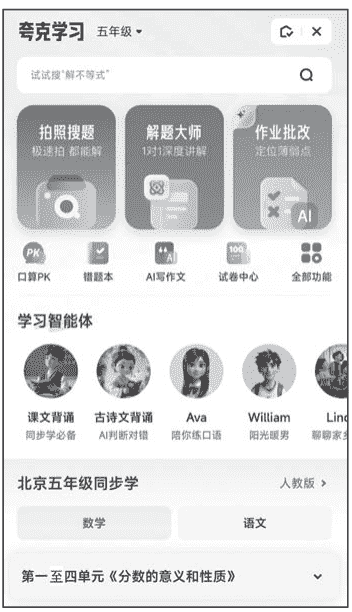
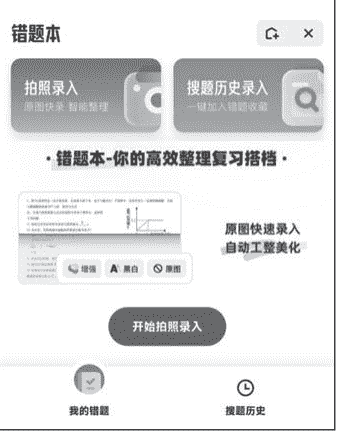
第四步：录入完成后，可为题目设定重要程度，在笔记区写下失误原因，在归类区选择错误来源并打标签。录入功能页如图 4-13 所示。
第五步：在错题本页可对题目进行复习，一旦掌握可点击确认掌握按钮。确认掌握界面如图 4-14 所示。
第六步：页面顶部能清晰看到已录入总数、已掌握数量、知识点分布等，让学习状况一目了然。总览页如图 4-15 所示。

# 第 4 章 使用夸克整理资料

73
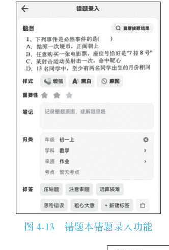
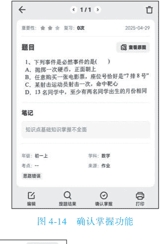
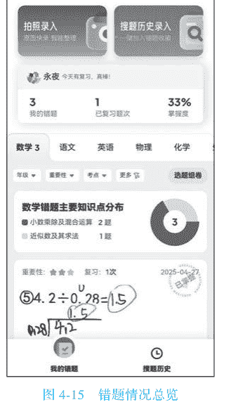

### 4.3.2 使用夸克记错题的注意事项

（1）规范录入信息格式
使用夸克错题本录入时请保持文字清晰完整。拍照录入需保证光线充足、角度端正，避免模糊、倾斜或遮挡导致OCR误识。公式图形等特殊内容建议配合文字备注说明。同时要明确标注学科、章节及错误原因，方便AI精准分类并生成个性化方案。

（2）核实题目完整性
录入前请检查题干条件、问题与选项是否齐全。残缺的题目易导致AI分析偏差，产生错误结论或无法定位知识点。主观题除题目外，还应完整补入参考答案与个人作答，便于全面剖析失误。

（3）自主核查答案解析
夸克虽能给出答案与解析，但不可全盘依赖。对关键或复杂知识点，建议结合教材、权威资料或教师意见做二次校验，避免AI误判引入错误知识。

### 4.3.3 使用夸克记错题的进阶技巧

进阶做法示意如图 4-16 所示。
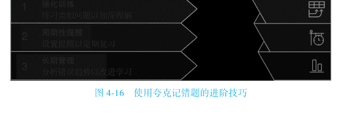
### （1）强化训练
针对高频失误点，系统可迅速检索3～5道同类变式题，通过调整题干条件与设问角度深化理解，同时推送微课视频以直观方式讲解核心概念，助力攻克难点。

### （2）周期性提醒
可依据艾宾浩斯遗忘曲线绘制复习周期表，如3天、7天或自定义间隔，按表定期回顾错题，强化记忆，降低遗忘率，提升长期保持效果。

### （3）长期管理
积累一段时间后，可按月或季度对错误类型做统计分析。观察各阶段错误分布的变化，能发现题型反复错、学习效率波动等模式，从而针对性调整策略。

# 第 5 章 使用夸克进行课堂学习

在数字化教育全面渗透的当下，从课件精炼、网课高效学习到成效检测，夸克贯穿教学全流程。它既为教师提供智能备课工具，提升课件制作与学情分析效率，也为学生搭建个性化学习平台，促进自主建构与能力提升。无论日常学习、考试还是竞赛，夸克都能以数据与智能驱动教育变革。

## 5.1 课件提炼与重塑

整理课件本质上是依据教学大纲与目标，将文字、图像、音视频等素材按教学逻辑与界面规范整合成有序课程资源。课件既要准确呈现内容，也要融入教学策略，像搭建知识体系一样组合零散材料，辅助教师高效授课，帮助学生清晰吸收，是教学准备与知识沉淀的关键载体。

传统做法依赖个人经验与手工操作。资料搜集时，免费资源匮乏、分类混乱、版本老旧且充斥广告，筛选耗时。制作PPT时受软件与操作水平限制，做成精美互动课件难度大、耗时长。传统课件难以灵活重组与共享，缺乏个性化考量，学生多被动接受，互动不足，使用效率低，易被束之高阁。

夸克深度赋能课件整理。AI搜索可精准理解需求，快速聚合全网优质素材；AI总结支持导入长视频，自动生成全文摘要、思维导图、分段要点，还能一键提取精美课件。海量模板可适配不同场景，简单编辑即可使用。多端同步让师生随时查阅修改，课件成为动态开放的学习资源，大幅提升整理效率与质量。

### 5.1.1 使用夸克进行课件整理的操作指南

3.2 节已介绍如何用夸克网盘下载网课课件，本节介绍如何整理课堂课件。

第一步：打开夸克首页，点击更多并选择文件总结，如图 5-1 所示。
第二步：进入文件总结后点上传文件，选择夸克网盘，如图 5-2 所示。
第三步：选择视频文件，可从网盘中挑选待整理的课件，如图 5-3 所示。

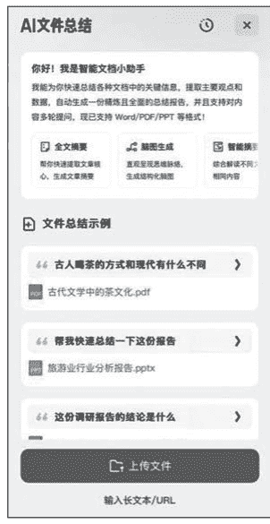
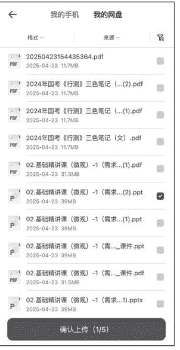
第四步：点击上传，夸克会自动提炼课件重点。

夸克的输出结果如下：

这是一篇关于西方经济学考研科目的分析文章，主要介绍了西方经济学的基本概念、研究对象、理论体系以及考试相关内容。以下是对这些核心内容的简要概述：

+   1. 西方经济学的基本概念

   - 经济学的定义：研究稀缺资源配置与利用的科学，涉及生产什么、如何生产、为谁生产等基本问题。

   - 稀缺性：指相对于人类欲望的无限性，经济物品或资源的相对有限性。

   - 经济主体：包括消费者、生产者和市场。

+   2. 微观经济学与宏观经济学

   - 微观经济学：研究个体经济单位的行为，如家庭、企业和市场，重点是价格理论。

   - 宏观经济学：研究整体经济的运行和政府的经济政策，中心理论是国民收入决定理论。

   - 两者关系：微观经济学关注资源配置，宏观经济学关注资源利用；研究方法分别为个量分析和总量分析。

+   3. 现代西方经济学的演变

   - 重商主义：流行于 15—17 世纪，强调财富来自流通领域，国家应干预经济。

   - 古典经济学：以亚当·斯密和大卫·李嘉图为代表，主张自由竞争和市场自发调节。

   - 新古典经济学：边际革命的产物，强调边际效用和均衡价格论。

   - 凯恩斯革命：提出国家干预经济以解决有效需求不足，标志着宏观经济学产生。

   - 新古典综合派：萨缪尔森将微观和宏观理论结合，形成现代经济学主流体系。

+   4. 经济学的基本假设与研究方法

   - 经济人假设：经济主体是理性的，追求自身利益最大化。

   - 研究方法：包括规范分析、实证分析、均衡分析、局部均衡分析和一般均衡分析。

+   5. 需求与供给理论

   - 需求：消费者在一定时期内愿意且能够购买的商品数量，受价格、收入、相关商品价格等因素影响。

   - 供给：生产者在一定时期内愿意且能够提供的商品数量，受价格、成本、技术水平等因素影响。

   - 均衡价格：市场需求量和供给量相等时的价格，由供求关系决定。

+   6. 弹性理论

   - 需求的价格弹性：需求量对价格变动的反应程度，分为弧弹性和点弹性。

   - 供给的价格弹性：供给量对价格变动的反应程度，分为弧弹性和点弹性。

   - 需求的交叉价格弹性：一种商品需求量对另一种商品价格变动的反应程度。

   - 需求的收入弹性：需求量对收入变动的反应程度。

+   7. 考试内容与题型

   - 考试内容：包括西方经济学的基本概念、微观经济学、宏观经济学、需求与供给理论、弹性理论等。

   - 题型：选择题、判断题、名词解释、简答题、计算题、论述题。

+   8. 推荐教材

   - 《西方经济学（上、下）》，高鸿业，第 8 版，中国人民大学出版社。

   - 《西方经济学》，马克思主义理论研究和建设工程重点教材，第二版。

   - 《经济学原理：微观经济学分册》，曼昆，第 8 版，北京大学出版社。

   - 《微观经济学》，罗伯特·平狄克，第 9 版，中国人民大学出版社。

   - 《微观经济学：现代观点》，哈尔·R·范里安，第 9 版，格致出版社。

第五步：在对话框点击生成思维导图，夸克会自动生成思维导图，如图 5-4 所示。

# 第 5 章 使用夸克进行课堂学习

81
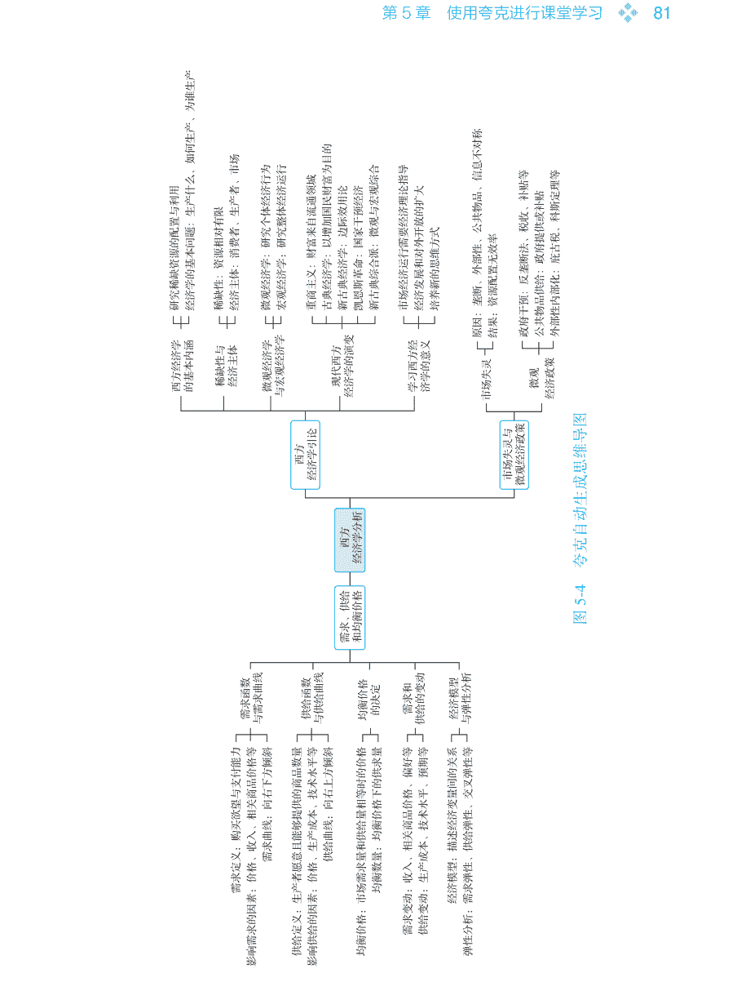

### 5.1.2 使用夸克进行课件整理的注意事项

合理运用拍照扫描补充板书图表。复杂板书、图表手绘耗时，拍照扫描可快速获取高清图像并插入笔记，如数理化的公式推导、地理地图等。拍照需注意光线充足、图像清晰，扫描后及时核对完整性，不佳者重拍，并与文字笔记合理排版。

及时回顾笔记趁热打铁。课后尽快打开夸克笔记，对照教材与记忆补充遗漏或模糊内容，如语文诗词赏析要点。回顾时集中注意力，逐点思考，确保笔记完整准确，加深理解与记忆。

定期整理归纳梳理脉络。每周或每章结束后对笔记做系统整理，将分散知识点串联，绘制思维导图或知识框架，如生物细胞章节的结构功能关系，帮助把握整体结构与规律。

分享交流笔记拓宽视野。夸克支持笔记分享，可与他人互评互学。分享前检查内容准确清晰有价值，交流中虚心接受建议，不断改进。

### 5.1.3 使用夸克进行课件整理的进阶技巧

进阶技巧示意如图 5-5 所示。

巧用夸克搜题为笔记补充解析。针对笔记中的难题重点，使用搜题功能获取详细解答与思路，并补充至笔记。AI搜题不仅给出答案，还能做知识点拓展，丰富内容。

善用语音速记跟上讲课节奏。课堂讲课快，手写易漏，语音速记可快速将讲解转文字，避免遗漏。如文科课堂的长篇解读课后整理即可。需提前熟悉操作，确保麦克风正常，并在安静环境使用以保证识别准确。

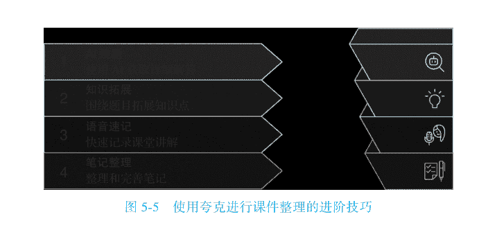

## 5.2 网课资源整合增效

学习网课是通过互联网以视频、音频、图文形式获取知识技能的过程。学习者可随时随地利用碎片时间，自主安排进度，打破时空限制。

传统网课学习存在明显劣势：资源分散，需多平台搜索；缺乏个性化指导，统一进度难适配；互动性差，问题难以即时解决；缺乏效果追踪，难以评估成果并调整策略。

夸克优势明显：整合海量优质网课，一站式满足需求；智能算法依据学习情况定制专属计划；互动功能支持实时答疑；智能追踪进度并生成学习报告，帮助优化方案。

### 5.2.1 使用夸克进行网课学习的操作指南

3.2 节已介绍夸克网盘录播课程学习，本节介绍在线视频课程学习。

第一步：打开夸克首页，点击夸克学习，再点同步课程，学习工具如图 5-6 所示。
第二步：在界面中选择相关课程，资源页如图 5-7 所示。
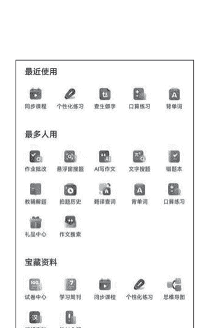

第三步：选择合适课程开始在线学习，在线学习界面如图 5-8 所示。

### 5.2.2 使用夸克进行网课学习的注意事项

### （1）关注课程更新
网课内容会随学科发展更新，学习前请查看最新版本。

## （2）筛选课程质量
夸克资源众多质量不一，挑选时查看评价、评分与教师资质，优先选择好评率高、教师经验丰富的课程。如编程课可选有企业开发经验并在高校授课的教师课程。

## （3）合理使用倍速
观看倍速需结合自身能力与内容难度。复习类可尝试1.5倍或2倍速，新知识讲解、复杂推导建议正常或1.25倍速，避免遗漏关键信息。

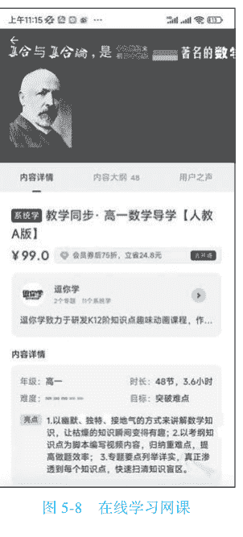

### 5.2.3 使用夸克进行网课学习的进阶技巧

### （1）助力职业资格考试
针对教师资格证、会计资格证等，夸克可提供大纲与备考经验，配合粉笔职教、对啊课堂等App刷题模拟巩固。如备考教师资格证教育知识与能力科目，可依据夸克要点在粉笔职教强化记忆。

### （2）赋能语言类考试
备考雅思、托福时，可用夸克搜索资讯、真题解析与技巧，结合英语流利说、扇贝单词等App针对性练习口语与词汇。

### （3）结合笔记软件
学习时搭配印象笔记、OneNote使用，利用夸克搜索获取知识点后粘贴分类整理。如历史网课梳理事件脉络后导入笔记并加入个人理解与疑问，便于复习与构建知识体系。

## 5.3 学习成效可视化检测

课堂学习效果检测是教师在教学过程中针对当堂或近期所授知识与技能，运用提问、随堂测验、小组展示等方式对学生学习情况进行即时评估。通过观察参与度、答题准确率、知识运用熟练度等，快速把握理解程度，及时发现教学问题，为调整节奏与优化方法提供依据，确保教学目标达成。

传统课堂里判断学习成效的方式仍显不足。第一，手段比较单一，课堂上多靠老师提问或布置几道基础练习，很难客观反映学生对知识的理解深度以及综合运用的能力。第二，反馈链路太长，作业和试卷都要等老师手工批改，学生往往等到漏洞积累后才知道哪里没掌握，及时补救的机会就被错过。第三，分析维度较粗，统一的标准很难照顾到每个人的差异，无法为不同水平的学习者提供有针对性的支持，进而降低了教学的精准性和效率。

把随堂测评交给夸克，效率和穿透力都会提升。系统能够读取本节课的教学材料，迅速产出覆盖选择、填空、案例分析等多种形式的随堂练习，适配从记忆到应用的不同考核场景。依托人工智能，夸克可以做到答题即时阅卷，并生成可视化分析报告，直观呈现班级整体学情和每个人的薄弱点。结合诊断结果，平台还能为学生推送个性化巩固练习，同时为教师提供分层教学建议，有效促进课堂质量和学习效率的提升。

### 5.3.1 使用夸克检测学习效果的操作指南

第一步：进入夸克首页，点击“夸克文件”入口，把本次课堂的课件上传，示意图见图5-9所示。
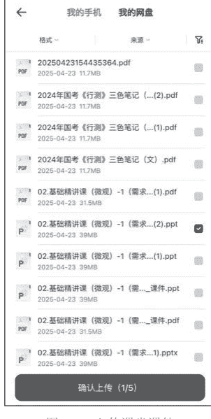
第二步：在弹出的对话框中粘贴下方提示词，参考图5-10所示。

第三步：系统会依据材料自动产出配套练习题。
夸克的输出结果如下：
根据提供的文档内容，以下是一些基于文档内容的练习题：
### 一、选择题
- 1. 微观经济学主要研究哪些主体？
A. 消费者行为  B. 生产者行为  C. 市场  D. 以上都是
- 2. 下列哪项不属于微观经济学的章节体系？
A. 需求和供给  B. 消费者效用论
C. 生产函数与成本论  D. 国际贸易理论
- 3. 微观经济学的考试题型不包括以下哪项？
A. 选择题  B. 论述题  C. 实验题  D. 名词解释
### 二、判断题
- 1. 微观经济学主要研究消费者行为、生产者行为以及市场之间的关系。
- 2. 高鸿业的《西方经济学》教材逻辑体系更符合大众理解。
- 3. 微观经济学不涉及市场失灵和福利分析。
### 三、简答题
- 1. 简述微观经济学的研究对象。
- 2. 微观经济学的基本问题有哪些？
- 3. 请列举微观经济学的考试题型。
### 四、计算题
- 1. 某商品的需求函数为 QD＝2400－400P，求当 P＝5 时的需求价格点弹性。
- 2. 某商品的供给函数为 QS＝－2000＋1000P，求当 P＝3 时的供给价格点弹性。
### 五、论述题
- 1. 论述完全竞争市场与不完全竞争市场的区别。
- 2. 论述市场失灵的原因及其对经济的影响。
### 六、案例分析题
- 1. 分析“谷贱伤农”现象的原因及其经济学原理。
- 2. 分析政府实施最高限价和最低限价的经济影响。
这些练习题涵盖了文档中的主要知识点，包括微观经济学的研究对象、章节体系、考试题型、基本概念和计算题等。通过这些题目，可以帮助学生更好地理解和掌握微观经济学的核心内容。
第四步：学生完成作答后把答案上传至夸克，平台会迅速完成评阅，用户也可针对题目细节继续追问，获取进一步解释。

### 5.3.2 使用夸克检测学习效果的注意事项
### （1）明确功能边界
夸克的课堂检测功能建立在题库资源与AI模型之上，核心价值在于辅助定位学习薄弱点，并不能完全替代教师的教学评价。例如在数学公式推导类题目中，系统可以快速展示解题步骤，但对逻辑思维过程的深度剖析仍需教师现场引导。
### （2）培养独立思考能力
过度依赖工具会削弱学生的自主思考与解题能力。因此在进行课堂检测时，应先自行思考、尝试作答，遇到困难再借助夸克。利用答案解析复盘思路、分析思维漏洞，而不是直接抄写答案。将自主思考与工具辅助结合，才能真正提升学习效果与知识掌握程度。

### 5.3.3 使用夸克检测学习效果的进阶技巧
### （1）助力学科竞赛专项突破
针对数学、物理等学科竞赛，夸克丰富的题库与解题资源可提供有力支持。例如筛选竞赛真题进行检测；借助解析功能学习高难度题型的解题思路；结合竞赛辅导视频分析命题规律；定期进行模拟检测；通过错题归纳总结竞赛考点，提升备战效率，竞赛准备漏斗如图 5-11 所示。
### （2）进行个性化训练
AI能够模拟教师分步讲解逻辑推理题，如数学证明、物理实验设计，并标注关键考点。用户可通过追问“为何选择此解法”或“是否有其他思路”，获得更深入的思维引导。针对相关问题，可在搜索框输入内容，让夸克生成相应的个性化训练试题。
- **筛选真题**
选择相关且具有挑战性的试题
- **学习解题技巧**
使用夸克解析来理解解题方法
- **观看辅导视频**
观看视频以补充学习
- **进行模拟检测**
模拟竞赛环境以进行练习
- **总结错题**
分析错误以识别弱点

图 5-11 竞赛准备漏斗

# 6
|第6章| C H A P T E R

## 使用夸克辅导学习
数字化学习深入推进的当下，一款高效智能的学习工具对提升成效至关重要。夸克作为功能全面的学习助手，为学习者提供多元化支持。本章将详细介绍如何借助夸克开展学习，挖掘各项功能的潜力。
从拍照搜题到智能解题，从一键作业批改到英语作文自动批改，夸克凭借先进技术能随时解答疑难、秒出完整解析，有效缓解作业压力，让语法问题迎刃而解。同时，它还是积累范文与写作素材的好帮手，能助力写作能力提升。此外，AI实时翻译功能让英语学习与查词更加轻松。接下来将详细介绍各项功能的操作流程、注意事项与进阶方法，助你在学习路上借助夸克稳步前进。

## 6.1 拍照搜题，随时随地解答疑难
做题是巩固知识、锻炼思维的重要环节。解题需要读懂题意、挑选合适方法、运用公式定理并进行逻辑推理，长期练习有助于提高技巧、应变与综合能力。然而许多学生在难题前感到迷茫，传统教辅往往只给答案缺过程，有的甚至错误误导，且内容固定无法因需调整，学习效果不佳。
夸克的拍照搜题功能提供全新解题体验。只需拍摄题目即可迅速获得准确答案与详细解析，帮助学生理解每一步推理，避免只记结论忽略过程。系统还会提供多种解法，支持从不同角度理解问题，培养灵活运用知识的能力，真正实现高效全面的解题能力提升。

### 6.1.1 使用夸克拍照搜题的操作指南
第一步：确定题目，以一道英语题为例，原题如下。
With the help of my teacher, I ( ) much progress in English since last year.
A. am making B. will make C. was making D. have made
第二步：打开夸克首页，在首页选择“学习”模块，如图 6-1 所示。
第三步：在夸克学习的首页，选择“拍照搜题”功能，夸克学习首页如图 6-2 所示。

第四步：将手机摄像头对准题目，相机提供拍整页、拍单题、拍教辅、录错题 4 个选项。在拍单题中可选择极速拍题和深度解题，其中深度解题适用于难度大、逻辑复杂的题目。大多数题目选择默认的极速拍题即可，如图 6-3 所示。
第五步：夸克会给出题目参考答案，如图 6-4 所示。
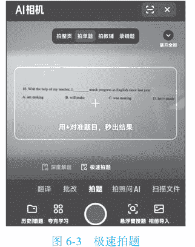
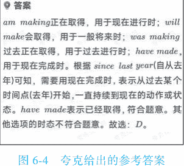

### 6.1.2 使用夸克拍照搜题的注意事项
使用拍照搜题能提升效率与准确度，但仍需注意细节以避免误导。
- 拍摄的图片需清晰无遮挡。模糊、低质量或被遮挡的图片会影响识别准确性，导致解答错误或不完整。复杂公式与长题目更要保证文字数字清晰可辨。
- 拍照时要确保题目完整呈现，尤其是包含已知条件、图表或附加信息的题型，否则信息缺失会导致解答不准。
- 对于多步骤多条件的题目，若识别不准可尝试拆分处理。例如将第一问、第二问分别拍摄，或截取局部后通过相册提交给夸克。
- 夸克给出详细解析后仍需自行核对每一步推理与计算，理解公式应用与计算逻辑，而非简单照搬答案。
- 遇到有多解法的题目时，系统可能提供不同路径，建议对照自己的理解挑选最合适的方法，同时学习其他思路以丰富解题库。
遵循以上要点，可更好地利用拍照搜题功能提升效率并促进思维发展。AI 只是辅助工具，自主解题能力与“知其所以然”的思维才是最关键的。

### 6.1.3 使用夸克拍照搜题的进阶技巧
使用夸克拍照搜题有六大进阶技巧，如图 6-5 所示。
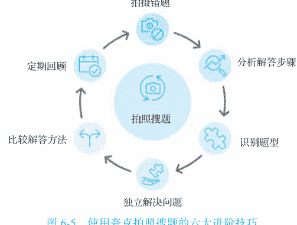
图 6-5 使用夸克拍照搜题的六大进阶技巧
#### （1）拍摄错题
不要只在不会时拍照，也可在做错题、易混题时收集，建立个人拍照错题库保存AI的详细解析，便于日后回顾强化记忆。每次回看时对比原始思路与标准思路，找出差距。
#### （2）分析解答步骤
看到AI答案后应逐步核对，把解题过程拆解成步骤，思考每一步“为何如此操作”，训练跟上AI逻辑节奏的习惯。建议看完一道解析后复述整体流程，并总结用到的知识点与更优解法。
#### （3）识别题型
拍照搜题不仅为解当前题目，还可进行题型观察。多拍同类题目，观察AI处理不同变化的方式，归纳共通套路与常见误区。建议每天练习几道同一知识点的变形题，提炼共同逻辑与解题模板。
#### （4）独立解决问题
进阶阶段应学会“用AI验证思路”而非“用AI代替思路”。先独立完成题目再用拍照搜题核对，对比自身解法与AI解法的差异，检验简洁性与思维误区。建议执行“先做后拍”规则，避免过度依赖，保持学习主动性。
#### （5）比较解答方法
夸克常提供多种解题思路，不要只看第一种解法。可比较不同路径，选择最易理解、最适合自己的方案作为首选解法，并分析各解法的适用场景。
#### （6）定期回顾
建议每周或半个月将期间内拍照的题目重新独立演练，既检验学习效果，也实现查漏补缺。可制定拍照回顾计划，如设置“错题回刷日”集中重做难题。
拍照搜题是起点，高手会用它打开思维、精进方法、沉淀经验，最终形成自己的解题体系。

## 6.2 智能解题，秒出全解过程
对多数学生而言，做题不仅是得出正确答案，更是思维、知识与方法的综合训练。从审题到方法选择，再到逻辑推导与结果验证，每一步都在锻炼逻辑与归纳能力。正如老师常说：“题做多了，思路就开了。”
现实中不少学生困于：思考无果、参考答案只有结果无过程、甚至答案本身有误。传统教辅内容固定，无法因材施教，导致学得快的学生觉得枯燥，学得慢的学生难以跟上，形成“不会做、看不懂、跟不上”的困境。
夸克的解题功能提供高效灵活的学习方式。它不仅给出答案，更详细讲解思路、拆解每一步逻辑与知识点。对复杂题目，AI还会给出多种解法供对比理解，实现真正的因材施教，帮助建立清晰解题路径，提升效率与思维能力。

### 6.2.1 使用夸克智能解题的操作指南
第一步：确定题目，以一道复杂的数学大题为例，如图6-6所示。
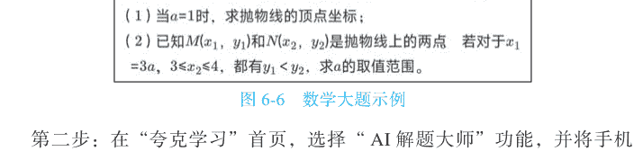
第二步：在“夸克学习”首页，选择“AI解题大师”功能，并将手机摄像头对准题目，识别后系统进行深度思考，深度思考解题如图6-7所示。
第三步：夸克会给出题目答案，如图6-8所示。

### 6.2.2 使用夸克智能解题的注意事项
夸克拍照解题能迅速提供完整过程，为更好理解与掌握知识需关注以下要点。
98 ✦ 夸克 AI 高效学习法
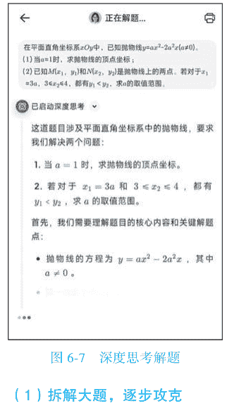
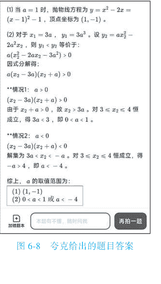
#### （1）拆解大题，逐步攻克
数学、物理类大题常包含多个子问题，每个子问题策略不同。可用夸克时将大题拆分为小题逐个分析解答，拍照时分段处理，逐步获取子问题的解析。通过拆解可清晰看到各小问题的思路，避免面对复杂题目迷茫，同时降低单次信息量与思维负担。涉及多知识点时拆解更有利于针对性复习，避免遗漏关键步骤。
#### （2）关注 AI 给出的解题步骤
AI能迅速给出完整解答，但应养成不只看结果的习惯，要分析每一步的逻辑。过程包含关键知识点与推理阐释，只关注答案会错失对题型背后的理解。
#### （3）适当调整解法
AI可能提供标准解法，但题目并不唯一，应思考是否有更快捷或更契合自己理解的方法，不断尝试不同路径，加深对知识的理解。
#### （4）留意易错步骤和陷阱
AI解答虽正确，但对复杂多步骤题目可能遗漏细节。使用后应特别留意易错点，如单位换算、符号错误等，最终细致检查仍需依赖学生自我审查。
#### （5）加强对公式和定理的理解
难题解决依赖公式定理的运用，使用AI时避免仅记住应用，忽视原理。要理解公式为何在此步骤使用以及如何帮助解题。
#### （6）持续复习和反思
AI解析可作学习参考，完成解答后应进行总结反思：自己做得如何、可改进之处、AI解析是否有优化空间。反思有助于加深技巧掌握，避免重复犯错。

### 6.2.3 使用夸克智能解题的进阶技巧
在初高中数学与物理试卷中，压轴题常被称为“神题”或“杀分题”，既考查知识广度也挑战逻辑与创新。借助夸克，可将“看懂题”升级为“学会解”，再进阶到“掌握思维模型”。以下技巧可帮助更高效突破重难点，如图 6-9 所示。
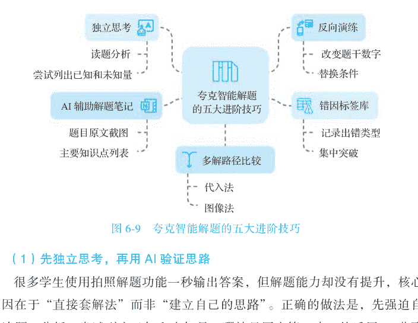
## （1）先独立思考，再用 AI 验证思路
许多学生一拍照就直接套答案，能力并未提升。正确做法是先阅读审题、尝试列出已知未知，哪怕只写出第一步，再用AI获取完整解析，核对起点是否正确、推理是否完整、是否遗漏关键条件。这种方式保留主动思考环节，同时实现即时纠错反馈，是提高建模与审题能力的有效手段。
## （2）将 AI 解法“反向演练”成新题
AI的价值不仅在于标准解答，更在于可复用的解题逻辑模板。看懂题后可尝试反向设计类似题目，如改变数字、替换条件、调整设问层次，再交由AI求解，验证逻辑是否通顺、思路是否仍适用。这种反向演练能加深对原题结构的理解，并逐步建立题型编辑能力，为应对创新题打基础。
## （3）建立错因标签库，反复击破易错点

把错题转化为成长动力

智能助手可以迅速呈现解题思路，但真正带来质变的是那些反复失手的压轴题。拆解这类题目时，常常在公式选取、单位换算、函数单调性判断等环节卡壳，同一类失误循环出现。这时可以建立个人失误归因库，每次做错就给出错因打标签，比如“公式误用”“单调性判错”“量纲换算失误”等，随后让AI检索同类型题目集中突破。比如物理压轴题里把电场力当成重力处理，就让系统找“电场力与重力综合”的变式，逐题拆解。这样的错因导向训练，比盲目刷题效率高得多。

## （4）为每道题建立智能解题档案
不少同学让AI讲解完就关闭页面，浪费了最有价值的结构化过程。建议每完成一道压轴题，就整理成一页解题档案，内容包括：题目原图截图；涉及的核心知识点清单；关键步骤标注；AI解析中最精彩或出乎意料的思路；个人复盘，写明错在何处、学到哪些新技巧。这样能把即时解析沉淀为长期知识，积累到一定量后就形成专属题库，在期末、竞赛和高考前的回顾中价值很大。

## （5）多解对比，培养立体思维
智能工具的价值不仅是给出一种答案，更在于能展示多种路径。面对压轴题，不同老师和辅导资料常给出不同思路，此时AI的多解能力可充当思维比较器。例如一道函数压轴题，AI可能同时给出代入法、图像法、定义域分类法三种做法。将三种做法并列分析，判断哪种更快、哪种更通用、哪种更容易出错，这类对比训练很有价值，不仅提升知识掌控度，也帮助建立应对复杂题型的立体思维体系。

把以上进阶方法系统化训练，AI就不再是查答案的工具，而是深度掌握题型、提升综合能力、突破难题的助手。记住工具是工具，思维才是核心。用得好，压轴题才能稳拿。

## 6.3 拍照快速完成作业批改，摆脱手工负担
写作业是巩固知识的手段，批改则是发现问题、调整计划的闭环。传统方式让老师面对大量主观题，尤其是语文、英语、数学，耗时费力且易漏改，学生反馈慢，错题难以及时巩固。自改虽省时，却常流于表面，甚至直接抄答案，影响学习效果。

夸克推出的拍照批改功能通过图像识别来解决这一问题。拍摄清晰的作业照片，数秒内即可生成结果页，标出正误，AI还能判断表达是否完整、推理是否合理，尤其在数学和语文主观题中会结合答案特征进行评判，同时可识别图形、符号、表格等细节，避免传统批改的遗漏。

该功能既可供学生自查，也能在复习时加速，把节省的时间用在错因分析和方法总结上。对教师而言，也能更快把握学情，发现共性问题，优化教学。

### 6.3.1 使用夸克拍照批改作业的操作流程
初始操作：先独立完成作业任务，以7道小学数学计算题为例，如图6-10所示。
随后：在夸克首页点击搜索框右侧的相机按键，如图6-11所示。

再下一步：进入批改界面，有全科批改和口算批改两个选项，一般选择全科批改即可，如图6-12所示。
最后：夸克会返回作业批改结果，如图6-13所示。

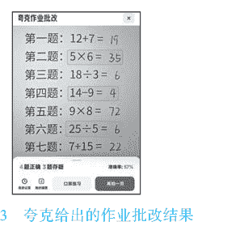

### 6.3.2 使用夸克拍照批改作业的注意事项
其一，识别失误或解题思路的多样性可能导致误判，使用智能批改时需对结果复核，不要过度依赖而丧失主动思考和错因反思的机会。智能批改只是反馈手段，总结改进仍需靠自己。
其二，智能批改应作为课堂辅助而非替代。教师可基于智能结果进行针对性辅导，弥补遗漏。批改数据还能帮助教师洞察学生共性问题，进而个性化调整教学。

## 6.4 英语作文智能评分，语法问题迅速定位
写英语作文能提升表达能力，巩固词汇语法应用，在小升初和初中考试中占比很高。但作文批改难度大，教师难以逐字细评，学生收到的往往只有圈点，缺乏对错误根源的理解，容易反复犯错，如时态、拼写等低级错误长期存在。

夸克的智能作文评分只需输入或拍照上传，数秒内完成全文检查。它能揪出时态错误、拼写错误、结构不完整等问题，同时分析标点、搭配、冗余等细节，并在结果中说明错因并给出修改建议。例如指出“He go to school every day”中动词应改为“goes”，帮助学生理解并避免再犯。

对备考学生而言，智能评分提供即时反馈，提升写作效率和主动性。对教师而言，它像智能助教分担批改压力，让老师把精力放在思路、结构等更高层次的指导上。

### 6.4.1 使用夸克批改英语作文的操作流程
准备阶段：准备待批改作文，以下作文为例。

Last weekend, I very busy. On Saturday morning, I get up at 7 o'clock. Then I go to the supermarket with my mother buy some vegetables. After that, I start to do my homework, but I feel very boring, so I stop to watch TV.

On Sunday, I planned to visit my grandparents, but because the weather was rain, I had to stay at home. I play computer games all day. Although I know it's not good for my eyes, but I couldn’t stop.

Looking back on this weekend, I think I didn’t use my time very good. I should have do more meaningful things.
随后操作：在夸克首页搜索框输入提示词，提示词范例如图6-14所示。

图6-14提示词范例
得到结果：夸克会给出批改结果，如图6-15所示。

图6-15夸克给出的批改结果

夸克给出的相关批改说明如下：

1. 时态一致性问题

原文全篇使用过去时，但多处动词未正确地使用过去式（如 “get up” 应为 “got up”，“play” 应为 “played”）。已统一修正。

2. 语法结构问题

“I very busy.” 需添加系动词，改为 “I was very busy.”。

“with my mother buy” 逻辑不通，应改为 “with my mother to buy”，表示目的。

在 “feel boring” 中，boring 修饰事物，改为 “bored”（人感到无聊）。

“stop to watch TV” 意为停下当前的事去做另一件事，但原文想表达放弃作业去看电视，改为 “stopped doing my homework and watched TV”。

3. 逻辑连贯性调整

“planned to visit” 改为 “had planned” 更符合过去完成时的语境。

“because the weather was rain” 中，rain 是名词，需改为 “because it was raining” 或 “the weather was rainy”。

最后一段 “I couldn’t stop.” 与上文重复，改为 “I couldn’t help playing.” 更自然。

4. 用词优化建议

在 “use my time very good” 中，good 是形容词，修饰动词 use 需用副词 well。

“should have do” 改为 “should have done”，符合虚拟语气结构。

5. 整体建议

增加细节描写（如买了什么蔬菜、作业具体内容等），使文章更生动。结尾可加入反思后的改进计划，提升立意（如计划下周多参加户外活动等）。注意标点符号（如时间用 “7:00” 更规范、冒号缺失可能影响理解）。

希望以上批改对你有帮助！

### 6.4.2 使用夸克批改英语作文的注意事项

（1）明确年级和英语水平
提交时最好说明当前年级和自我评估水平，比如基础薄弱还是已有一定词汇语法积累。提供词汇量、语法掌握度等信息，有助于智能匹配合适的批改难度和重点。

（2）作文要求和重点检查项
不同作文有不同评分标准，考试或作业常有特定目标。需告知主题、是否要求复杂句、学术词汇等，让智能据此聚焦结构、语法规范性和表达清晰度。

（3）练习类型和目标
若有明确目标，如提升句式多样性、时态准确性、定语从句运用等，需提前说明。智能会重点关注这些方面并给出针对性建议，避免同类错误反复出现。

（4）反馈风格
学生偏好不同，有的喜欢逐句解析，有的偏好概括建议。可告诉智能期望的反馈方式，是详细解释每个错误还是整体评价加改进方向，以便获得更个性化的帮助。

（5）额外练习和材料
如需更多同水平写作练习、作文题目或提升材料，可让智能按当前水平推荐题库和辅助练习，进一步提升流利度和准确性。

## 6.5 范文与素材积累，写作提效神器
写作常让人又爱又怕，动笔时词不达意、思路混乱。提升写作的核心在于素材积累和范文学习。但传统方式效率低，课堂只能粗析一两篇范文，教辅范文老旧重复，手抄素材零散难检索。

夸克提供作文范文库和素材推荐系统，输入主题或关键词如“我的家乡”“成长的烦恼”，即可快速获得优质范文和片段，帮助积累和拓宽思路。

### 6.5.1 使用夸克作文的操作流程
开启方法：打开夸克搜索“夸克作文”，进入作文栏目，可选年级进行个性化推荐。栏目包括学范文、选素材、高考真题、单元作文、收藏夹、主编每日推荐。首页如图6-16所示。
进入学范文：可筛选年级、字数、文体。年级覆盖小学各年级、初中各年级、中考、高中各年级、高考；字数100字至1200字以上；文体包括记叙文、议论文、说明文等。学范文界面如图6-17所示。

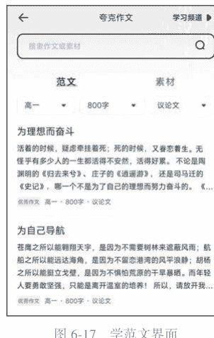
进入选素材：可在搜索框检索相关内容。类型包括哲理故事、名言警句、历史典故、优美段落等；主题涵盖传统文化、成长、美德、学习、时间、环境、情感等。选素材界面如图6-18所示。
进入高考真题：可检索各省历年高考真题并查看参考答案。作文高考真题界面如图6-19所示。

# 110 夸克 AI 高效学习法

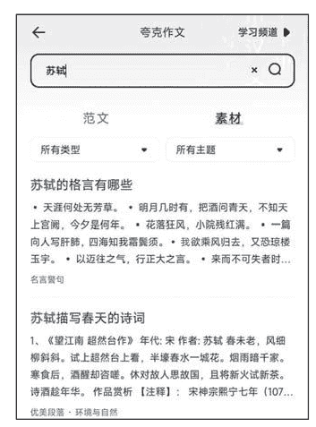

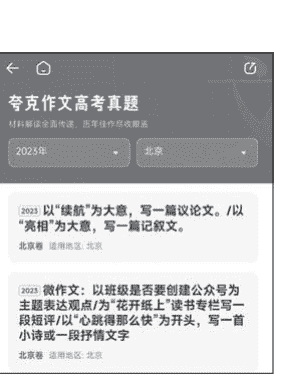
进入单元作文：可按教材版本检索各单元作文，附精选范文和素材。单元作文界面如图6-20所示。

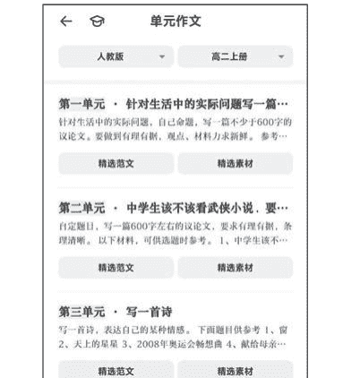

### 6.5.2 使用夸克作文的进阶技巧
使用夸克作文的进阶技巧如图6-21所示。

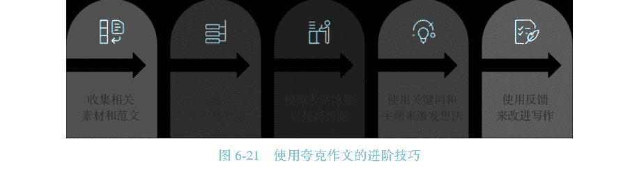

（1）收集相关素材和范文
根据作文主题搜集句子、段落和表达方式，特别是高考高频主题，可提前储备素材。建议每天读一篇范文，标记优美词句，逐步内化并在写作中灵活运用。

（2）学习范文的组织和表达
不仅看内容，更要拆解范文结构，如引言、主体、结尾布局。不同文体有不同技巧，模仿议论文的论证展开方式，能提升文章条理性。

（3）模拟考试场景以提高技能
利用高考作文题库进行限时模拟，写完后对照范文和评分标准自评，并吸收智能给出的写作建议，形成考场实战能力。

## （4）使用关键词和主题来激发想法
遇到开放题思路受阻时，可输入关键词让系统推荐相关题目和范文，从不同角度打开思路，突破写作瓶颈。

## （5）使用反馈来改进写作
把智能给出的逐点评语转化为可执行的练习清单，反复在新文中检验修改效果，形成从识别错误到主动规避的闭环，让写作能力稳步提升。

在完成作文后先做一次自我审校，是提升文字功力的关键手段。夸克作文批改能揪出语法、用词、拼写、句式生硬等常见问题，批改报告会把高频失误凸显出来，让写作者直观看到薄弱环节。养成先用工具自检再定稿的习惯，每篇完成后让系统过一遍，及时修正别扭表达和低级错误，长期积累写作水平会稳步提升。

## 6.6 实时查译，读懂英文更轻松

学英语时，查词、译文、读懂长段落是常见痛点。传统方式效率低：纸质词典或在线词典查起来慢，碰到长句只能逐个查词，难以把握整体；借助工具书或网页翻译，常常语序颠倒、用词偏颇、词义失准，反而干扰理解。对语法基础薄弱的初中生小学生来说，误读风险更高。背单词时也常出现只记意思不晓得用的情况。

针对上述痛点，夸克给出智能查译方案，查词翻译衔接顺畅。复制粘贴、拍照或直接输入内容，系统就能返回通顺的译文，结构清晰、用词恰当，避免乱序。备考的学生还能借助拆句功能，省去反复查词的时间，更好地吃透句式结构，从而提高答题表现。

### 6.6.1 实时翻译实操步骤

第一步：先确定处理对象，以下以一段说明文为例，原文内容为：

For high school students, time is a precious resource. Balancing study, extracurricular activities, and personal life can be challenging. Effective time management is the key to success. First, create a daily schedule. Set specific time slots for different tasks, including breaks. This helps avoid procrastination and ensures that all important things are covered. Second, prioritize your work. Identify urgent and important tasks and complete them first. Good time management not only improves academic performance but also reduces stress. When everything is organized, you'll find more time for hobbies and relaxation. Remember, mastering time management is a skill that will benefit you throughout your life.

第二步：进入夸克首页，点开右侧相机入口。
第三步：从功能列表里选择“翻译”，如图 6-22 所示。

第四步：把镜头对准文字，系统即时识别并生成译文，如图 6-23 所示。
第五步：译文呈现在屏幕上，结果见图 6-24 所示。

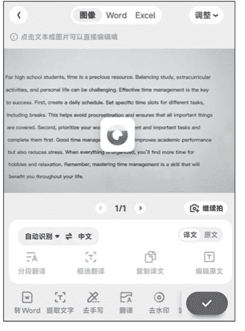

图 6-23 夸克进行文本翻译

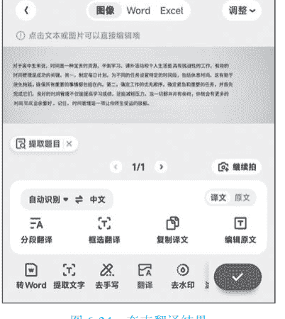

图 6-24 夸克翻译结果

### 6.6.2 使用时需留意的问题

（1）核对译文准确性
遇到复杂或长难句，机器容易出现语法偏差或词义混淆，务必结合上下文仔细审阅。
（2）先拆后译
长段落或复杂句建议拆成短句分段处理，有助于引擎更精准解析结构，减少不通顺或遗漏。
（3）兼顾文化表达
翻译涉及语言和文化，成语、俚语等特殊表达机器常难以完美呈现，需依文化背景做适当调整。
（4）对照个人理解
译后通读自检流畅度与语法，并把机器结果与自己的理解对照，排查逻辑和语义偏差。

### 6.6.3 进阶使用思路

使用夸克实时翻译的进阶技巧如图 6-25 所示。

（1）反向译文校验
可把译文再翻回源语言，比如中译回英，用来验证忠实度。反向过程能暴露潜在问题，也有助于理解句法构造。
（2）分块递进翻译
面对长句或大段文字，可分块处理，先译前半再续后半，避免一次性处理导致错误，确保各部分意思准确。
（3）加强语法拆解
翻译时不仅看词汇，更要关注时态、语态、主谓一致、从句等语法要点，在理解的同时强化规则掌握。

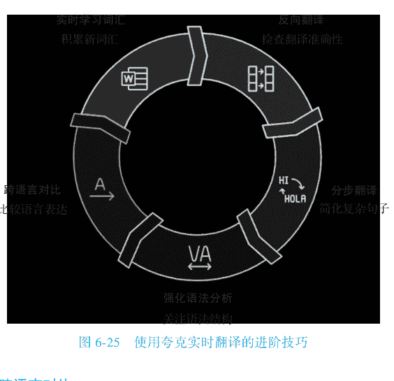

（4）双语对照学习
把英文译成中文后，对比结构和用词差异，有助于提升跨语言思维和表达敏感度。
（5）边译边积累
译文过程中碰到陌生词或表达，可即时记录查用法，借助夸克积累常用搭配，逐步扩大词汇量，提升读写能力。

# 第 7 章 用夸克搭建备考体系

教育变革下，备考方式也在快速迭代。夸克以智能技术深度融入学习场景，提供系统化备考方案。真题归纳、模拟卷生成、专题突破等功能一应俱全，打破传统局限。依托大数据和AI算法，快速聚合优质资源，并按个人需求定制路径，全流程赋能，让考生更清晰把握考试脉络，突破瓶颈，将投入转化为实效，在竞争中脱颖而出。

## 7.1 真题收纳全，命题规律一目了然

历年真题是备考核心资源。夸克收录中高考、四六级、职业资格等各类往年试题，按学科、年份、题型分类，并附解析、考点标注与难度分级。通过真题，学习者可熟悉题型分布、把握命题倾向与考查重点，是检验学习成效的重要工具。

传统真题库痛点明显：人工收集耗时费力覆盖不全；分类标准混乱检索困难；更新滞后新题难及时补充；缺乏互动与智能分析，难以给出个性化建议，提升不精准。

夸克借助大数据与智能检索，快速全面抓取各科真题，确保资源完整。智能分类与精准搜索可秒级定位目标题目；实时更新机制第一时间收录新考题；系统还能基于答题数据深度分析薄弱点，推送针对性练习并关联扩展知识点，实现个性化高效复习。

### 7.1.1 真题整理操作流程

以“考研真题”“公考真题”为例，演示整理方法。

第一步：明确需求，确定想要的考试类型和科目。
第二步：打开夸克，点击夸克文档，进入“大学资料”，如图 7-1 所示。
第三步：在界面中选择“考研专区”，如图 7-2 所示。

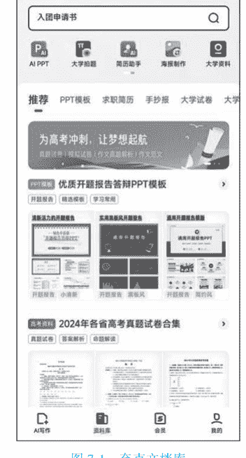

第四步：点选“公考真题”，即可看到各地公考真题的整理结果，并支持保存或下载，如图 7-3 所示。

图 7-3 夸克真题筛选

### 7.1.2 真题整理注意事项

（1）关键词需具体
搜索时写清年份、科目、地区等，如“2024年高考数学全国乙卷真题”。关键词过宽会返回大量无关结果，增加筛选成本。
（2）核验来源可靠度
获取真题后注意出处，优先选用官方机构、知名出版社或权威平台发布的题目，避免不明来源干扰学习。
（3）善用筛选归类
夸克支持按考试类型、年份、学科等筛选。如备考考研英语，可按年份排序再细分阅读写作等题型，让真题条理清晰，便于复习检索。
（4）及时更新版本
考试内容和题型会随时间变化，真题需同步更新。以公务员考试为例，考纲每年微调，若长期使用旧题，复习重点易偏差。
（5）结合解析深入理解
整理真题应配套答案解析，研读思路和涉及知识点。遇到难题可拆解，结合解析、教材和错题本彻底吃透。

### 7.1.3 真题备考进阶玩法

使用夸克真题备考的进阶技巧如图 7-4 所示。

（1）联动网课拓宽知识
找到真题后可匹配相关优质网课，如中考真题结合知识点网课，由老师讲解真题背后的原理，深化理解并拓展广度。
（2）助力竞赛备战
针对数理化竞赛，夸克提供大量历年真题。通过分析命题风格和难度，结合智能分析制定专项训练，提升思维与解题技巧。
（3）结合错题本强化复习
利用智能错题整理功能，将做错真题一键收入错题本并自动标注来源和原因。复习时对照解析和考点针对性强化，避免重复失误。

## 7.2 智能组卷，模拟训练贴近实战

生成模拟试卷需依据大纲、题型分布和难度要求，从题库中筛选组合出符合标准的测试集，要求知识点覆盖全面、难度层级合理，让考生在真实场景下检验掌握程度。

传统组卷主要靠教师手工挑选排版，耗时费力，且受个人经验限制，覆盖面和均衡性不足，也难以做到个性化定制。

借助夸克组卷优势明显。AI技术配合海量题库，可按考试要求快速成卷；算法能分析过往学习数据，定位薄弱点生成个性化试卷；还能科学规划难度和知识点分布，保证试卷质量，提升备考效率。

### 7.2.1 选题组卷操作指引

夸克的模拟试卷功能基于长期使用数据沉淀。完成答题和错题积累后，可通过组卷功能生成适配自己的模拟卷。

第一步：明确需求，假设你正在准备北京航空航天大学机械工程系硕士入学考试。
第二步：打开夸克 App，在对话框中输入所需试卷类型，如图 7-5 所示。

图 7-5 夸克首页的对话框

第三步：在搜索结果中挑选需要的试卷，如图 7-6 所示。

图 7-6 夸克搜索页面

第四步：将试卷下载并上传至夸克 AI，并输入提示词，如图 7-7 所示。
第五步：片刻后即可生成相关模拟题。

夸克 AI 的输出结果如下：

根据提供的资料，可以生成一些模拟题，涵盖理论力学、机械原理、机械设计和自动控制原理等方面。以下是一些示例题目：

### 一、理论力学部分

#### 1. 选择题

已知某质点的运动方程为 $S = a + bt$（$S$ 的单位为米，$t$ 的单位为秒，$a$、$b$ 为常数），则点的轨迹（ ）。

- A. 不能确定

- B. 越来越小

- C. 越来越大

- D. 等于 0

#### 2. 判断题

质点作曲线运动时，若质点的切向速度为正，则质点作加速运动。

（ ）正确（ ）错误

### 二、机械原理部分

#### 1. 选择题

在一对正常齿制的渐开线标准直齿圆柱齿轮传动中，已知齿轮 1 的齿数为 20，齿轮 2 的齿数为 40，模数为 4mm，压力角为 20°。若要使两齿轮正确啮合，则中心距应为：

- A. 80mm

- B. 120mm

- C. 160mm

- D. 200mm

#### 2. 计算题

凸轮为一偏心圆盘，半径为 50mm，偏心距为 20mm，小滚子半径为 10mm。求当凸轮转过 90° 时，直动从动件的位移和此时机构的压力角。

### 三、机械设计部分

#### 1. 选择题

在 V 带传动中，当传递的功率增大时，若带速不变，则带所受的紧边拉力 $F_1$ 和松边拉力 $F_2$ 的变化情况是（ ）。

- A. $F_1$ 和 $F_2$ 都增大

- B. $F_1$ 和 $F_2$ 都减小

- C. $F_1$ 增大，$F_2$ 减小

- D. $F_1$ 减小，$F_2$ 增大

#### 2. 分析题

分析 V 带传动中，带上受到哪些应力的作用？最大应力产生在带的什么位置？

### 四、自动控制原理部分

#### 1. 选择题

已知某单位负反馈系统的开环传递函数为 $G(s) = \frac{K}{s(0.5s+1)(s+1)}$，其中 $K > 0$，欲使该系统的开环幅相频率特性曲线通过 $(-1, j0)$ 点，问 $K$ 应取何值？

- A. 1

- B. 2

- C. 3

- D. 4

#### 2. 计算题

已知某控制系统的动态结构图如下所示，试求系统的传递函数 $\frac{C(s)}{R(s)}$。

图 动态结构图

### 7.2.2 组卷使用注意事项

（1）明确组卷需求
生成模拟卷前要清晰界定大纲、目标人群、考试时长等信息，单元测试需紧扣知识点，大型考试模拟需覆盖考纲，避免考点偏差。
（2）检验题库匹配度
不同地区和版本教材要求不同，需确认题库是否覆盖所需知识点和题型风格，否则易出现题目脱节。
（3）合理调控难度
算法生成的难度可能与预期不符，应根据巩固练习或选拔模拟调整难题、中等、简单题比例，使试卷贴合水平。
（4）关注题目时效性
政治类等更新快的学科，需确保题目时效，避免过期政策或表述误导学习。
（5）审核题目准确性
生成后需人工快速浏览，核查存疑题目，必要时参考权威资料，保证试卷质量。
（6）优化排版体验
注意页面边距、字体统一、图表显示等细节，确保阅读和答题体验顺畅。

### 7.2.3 组卷进阶技巧

使用夸克进行选题组卷的进阶技巧如图 7-8 所示。

（1）动态调整难度
根据夸克提供的错题难度和正确率分级，自动调节组卷难度。正确率提升后减少基础题，增加难题和易错题练习。
（2）融入 AI 学习助手
完成模拟卷后，借助 AI 学习助手对错题进行智能解析，讲解思路、关联知识点和相似题型，形成举一反三的自主学习闭环。

## （3）竞赛备考的增效做法
备战学科竞赛时，这款工具能批量产出难度偏上、构思新颖的模拟试卷。系统会依据不同赛事的能力侧重与最新命题动态，挑选出思维量大、挑战性强的题目，帮助学员锤炼深度思考与解题灵感。配合强大的检索能力，还能为学员补充竞赛相关的延伸资料和历年真题拆解，助力在赛场上更具竞争力。

## 7.3 主题攻坚 掌握核心考点
主题攻坚是一种围绕某个知识模块或技能方向进行的集中强化练习。它跳出按章节单元推进的老路，把分散的知识点重组为体系化主题。通过大量同类题的集中演练，配合深度的讲解与归纳总结，既能啃下难点补齐短板，也能实现对该主题的透彻理解与灵活运用，进而带动整体学习能力提升。
过去的主题训练多靠老师经验和纸质资料，老师要手工挑题、整理讲义，费时费力且难保证题目的准确度与时效性；纸质资料更新慢、题型单一，也难以满足多样化学习需求。
引入该应用开展主题攻坚，能在短时间内生成覆盖各大主题的高质量练习，并与考纲、考点变化保持同步，保证题目新颖且科学。平台会依据学习数据为每位学员制定专属方案，针对薄弱点推送定制化练习，并提供 AI 讲解与同类题拓展，真正做到因材施教。此外，学习进度追踪与成果评估可以即时回馈训练效果，助力高效突破瓶颈。

### 7.3.1 主题攻坚实操流程
步骤一：沉淀错题记录并保存搜题轨迹，示意见图 7-9。
步骤二：应用会基于错题记录和搜题轨迹自动归纳涉及的考点及重要程度，判断是否属于常考，示意见图 7-10。
步骤三：在错题记录中挑选题目组卷，按系统归纳的重点考点开展主题攻坚，示意见图 7-11。

### 7.3.2 主题训练使用要点
#### （1）先定目标
开展主题攻坚前要把训练目标想清楚，让系统更精准地匹配题目和资源。目标模糊容易导致内容杂乱，效果打折。例如，只笼统说要提高数学能力，系统就很难针对性地推送数列专项的题目。
#### （2）定期刷新主题
学科内容和考试重点都在变化，要在平台上定期更新训练主题。比如关注学科新理论、新题型，及时调整专题。以语文为例，随着新文学作品和文化热点的出现，文言文阅读和现代文阅读的训练内容也应同步更新，保持与时俱进。
#### （3）紧扣教材
平台的主题训练要与教材深度结合。教材是学习的基础，做专题时要对照教材知识点，理解原理和概念。例如学物理电磁学专题时，结合教材中电场、磁场的核心概念和公式，再来看平台的题目，解题思路会更清晰。
#### （4）深挖错因
完成专题后要认真复盘错题，不仅要知道错在哪，更要弄清错因。平台的 AI 讲解能提供分析支持，学习者也要主动思考。比如对数学几何证明题的错误进行定位分析，才能做到对症改进。

### 7.3.3 提升效率的小技巧
进阶用法见图 7-12。
#### （1）把控时长
训练时间过长容易疲劳，效果下降；过短则难以深入。一般每次 1～2 小时为宜，可根据难度和状态微调。对较难主题，可采用分段训练，每次 40～60 分钟，中间休息，保持专注。
#### （2）科学调难度
依据自身水平在平台上设置难度。不要一味追求高难度导致频繁受挫，也不要一直做过易题目。基础薄弱的可从基础题起步逐步提升，基础好的可挑战中高难度拓展题，让训练既有挑战又可承受。

# 第8章 夸克智能训练工具
在数字化学习浪潮下，传统训练常出现机械重复、反馈滞后、缺乏个性化等问题，制约学习效率。该应用以人工智能为核心，构建覆盖语言学习、数学运算、文化记忆等场景的智能训练体系，把孤立的技能练习转变为数据驱动、实时互动、沉浸式的立体学习生态。
本章围绕“工具即导师”的思路，解析该应用如何用智能算法突破传统训练边界：英语口语借助 AI 智能体打造真实对话、在发音纠正到商务谈判间阶梯式提升；数学口算通过动态题库和错题追踪精准补弱；词汇记忆依托艾宾浩斯遗忘曲线和海量资料，把孤立背词变为语境理解—场景应用—长效记忆的闭环；古诗词学习则通过文本解构和智能跟读，实现从理解到记忆再到熟练。

## 8.1 口语实战 快速提升表达
英语口语练习是提升口头表达能力的关键，涵盖发音、语调、流利度、日常交流到专业沟通。常见方式有跟读模仿、对话、演讲朗诵等，反复练习能增强语感，熟悉语言习惯，在不同场景下做到准确流畅，为跨文化交流打基础。
传统口语练习弊端明显：资源有限且陈旧单一，难以满足多样需求；缺乏即时反馈，错误难以及时发现；练习场景受限，多在固定教室或书本对话中；练习伙伴或老师有限，机会少，提升慢。
用该应用进行智能口语练习优势突出。平台拥有海量实时更新资源，适配不同水平。智能反馈可实时纠正发音和语法错误，并模拟真实交流场景，让学习者有身临其境感。可随时与智能体不限时互动，大幅增加练习量，学习更高效有趣。

### 8.1.1 口语训练操作示范
以“练习商务英语”为例。
步骤一：启动应用，首页进入“夸克学习”，选择学习智能体，例如 Emma，参考图 8-1。
步骤二：进入 Emma，可看到其职场导师身份及开场白“Hi, I'm Emma. I'm working as an accountant in the UK. I love my job because it's full of challenges and accomplishments. What's your job? Do you like it?”，参考图 8-2。
步骤三：点击“按住说话”进行英文沟通，智能体会根据输入不断追问并推动水平提升，参考图 8-3。
步骤四：输入后可点语句右下角“纠”，查看发音或语法问题，参考图 8-4。

### 8.1.2 口语训练注意事项
#### （1）确保网络环境稳定，避免实时反馈延迟
智能体的语音识别和场景模拟高度依赖网络。建议优先使用 WiFi，若出现卡顿、系统提示“请重试”或反馈延迟超 3 秒，可切换网络或重启。对虚拟面试等实时场景，建议提前测试网络稳定性。
#### （2）优化发音训练策略，规避 AI 识别盲区
语音识别可捕捉 85% 以上的发音问题，但对口音或模糊连读仍可能失误。建议语速适中，保持 120～150 词/分钟，避免音节粘连；优先练习英音 RP 或美音 GA，减少中式发音干扰。
#### （3）辩证看待纠错反馈，避免机械性依赖
智能纠错覆盖语法、用词、逻辑，但存在误判可能，如把 “open the light” 判错却未提示更地道的 “turn on the light”。建议对结果二次验证，可通过夸克百科或牛津词典确认更自然的用法。

### 8.1.3 口语训练进阶方法
#### （1）智能体教学
平台提供 5 个英语智能体，覆盖职场、商务、K12、日常等场景，可按需选择。学术搜索加 AI 写作能提升学术口语，例如输入“量子计算在医疗领域的应用”，系统检索论文生成摘要，用户用语音转文字转为口语陈述，系统检测学术词汇使用；AI 写作还能把论文结论转为口语模板，结合角色扮演模拟学术答辩，参考图 8-5。
#### （2）搭建私有化题库
针对特殊需求，可利用英语听写导入功能建立个人定制词库，如法律、医疗等专业术语库。跟读训练可同步提升听力和发音，强化专业英语水平。

## 8.2 口算打磨 提升运算速度
口算训练通过心算直接得出结果，培养数字敏感度和运算速度。以 100 以内加减、表内乘除为核心，要求脱离纸笔和计算器完成计算，是笔算估算的基础，也能锻炼注意力、记忆力和逻辑思维。
传统口算存在三大痛点：形式单一易倦怠，长期做机械算式易产生抵触；反馈滞后，错题易重复；个性化不足，难度难以动态调整，基础弱者丧失信心，学有余力者浪费时间；缺乏数据追踪，评估困难，导致投入高产出低。
该应用用 AI 重构口算模式：智能出题与即时反馈，基于答题数据生成定制化练习，对“进位加法”等易错点针对性强化，并秒级给出答案解析；游戏化设计如限时竞赛，把枯燥计算转为互动；数据驱动的精准提升，错题簿自动归集并生成知识图谱，直观展示薄弱环节，家长教师可通过练习报告查看正确率、耗时趋势，制定科学辅导计划。

### 8.2.1 口算能力提升操作示范
以“三年级下练习数学算术”为例。
步骤一：启动应用，首页选“夸克学习”，进入口算练习，参考图 8-6。
步骤二：在口算页面选择“三年级·下”，再选“除数是一位数的口算除法”，参考图 8-7。
步骤三：即可开始练习，参考图 8-8。
步骤四：完成后可将答题情况分享至朋友圈或微信群，参考图 8-9。

### 8.2.2 口算能力提升注意事项
#### （1）结合线下练习与自主思考
该应用是辅助工具，不能完全替代传统训练。建议每周安排 2～3 次线下练习培养心算习惯。可通过“夸克打印”把错题导出打印，在无干扰环境下重做。对“24×56+78÷3”等复杂题，先自主分析运算顺序再用平台验证。
#### （2）手写输入需规范清晰，提升设备识别准确率
手写潦草易导致 OCR 误判，如“8”连笔被识别成“3”。建议数字书写清晰，避免连笔，区分易混字符。
#### （3）明确用户群体定位，仅限小学生使用
口算功能面向 6～12 岁小学生设计，中学生以上使用可能效果不匹配。题目多聚焦 20 以内加减、表内乘除等基础运算，与中学代数方程、函数等需求不符，高年级长期练习易因过浅而浪费时间或缺乏挑战。

### 8.2.3 口算能力提升进阶方法
#### （1）结合智能训练工具形成学习闭环
口算练习可与错题簿、知识点总结联动。将高频错误题导入错题簿，通过 AI 批改生成同类变式题强化训练，并用学习报告分析薄弱环节，形成系统化提升路径，参考图 8-10。
#### （2）巧用拍照搜题和 AI 讲题功能
对较难口算题或技巧题，可用拍照搜题获取详细思路，学习凑整法、分解法等速算技巧。利用“AI 讲题助手”互动提问，如“这道题有更简便的口算方法吗”，拓展思维，掌握多种策略。

## 8.3 单词记忆 攻克词汇难关
背单词是掌握词汇音形义及用法的基础环节，目标不仅是记拼写和释义，更要理解语境应用，实现听读读写说全覆盖。常见形式有背单词书、记忆卡片、词汇 App 等。
传统背单词痛点：机械重复导致疲劳，脱离语境易“认识不会用”；遗忘规律把握不足，艾宾浩斯曲线显示新词 20 分钟后遗忘率达 42%，传统方法难以及时复习；缺乏应用场景，导致“背了不会用”。
该应用依托 AI 与大数据重塑背诵体验。系统基于答题数据动态生成复习计划，对正确率低于 70% 的单词按“1 天/3 天/7 天”黄金间隔自动推送复现，匹配遗忘曲线。

### 8.3.1 单词记忆操作示范
以“背考研英语单词”为例。
步骤一：启动应用，首页进入“夸克学习”，选择“背单词”，参考图 8-11。
步骤二：在背单词页选择“精选考研必背 3000 词”，参考图 8-12。
步骤三：制定学习计划，设置每日新词和复习词数量，参考图 8-13。
步骤四：开始学习，进行单词背诵，参考图 8-14。
步骤五：完成每日学习后，可查看进度，点击马上复习或生词本进行巩固。

### 8.3.2 单词记忆注意事项
词库会定期更新，旧版本可能缺失新词或解析错误。建议通过应用商店或“夸克设置 - 关于”检查更新，确保版本在 6.2.1 及以上，并适时清理缓存。
AI 复习算法基于艾宾浩斯曲线构建，需结合个人记忆效率动态调整计划，避免“一刀切”。

### 8.3.3 单词记忆进阶方法
学习周期见图 8-15。
#### （1）背词需与实际应用场景结合
每日挑选 3～5 个新词在口语练习中造句，如用 perseverance 造句“Perseverance is the key to overcoming difficulties”；将 complement/compliment 等易错词手写在记忆卡片，利用碎片时间复习，强化肌肉记忆。
#### （2）与 Anki 等记忆工具深度整合
实现碎片化学习与系统复习双向赋能。例如把生词本的高频错题导入 Anki 的“超级记忆卡”，利用其遗忘曲线规划复习。结合“AI 情景对话”生成含目标词汇的对话场景，再用语音识别工具跟读，系统标记发音问题，形成“背词—应用—纠错”闭环。

## 8.4 诗词背诵 筑牢文化根基
诗词背诵是把经典文本、情感意境和文化内涵内化为个人储备的过程。不仅要记准字音字形格律，更要感悟诗意、体会情感、了解历史背景。从《诗经》到唐诗宋词，反复诵读积累语言，在解读中把握精髓，实现文化传承和人文素养提升。
传统古诗词学习多靠机械重复，易陷入“背了忘”。这种方式割裂文本语境和文化背景，忽视创作情感和时代脉络，资源单一，依赖课本注释，难以满足个性化需求。课堂互动局限于问答默写，容易产生枯燥感，难以体会古典魅力。
该应用提供创新解法。通过文本解析与大数据整合，把诗词拆解为字音、意象、典故等多维模块，结合动态图谱呈现创作背景和情感逻辑，帮助建立立体记忆框架。支持智能语音跟读与发音纠错，模拟平仄韵律，在沉浸式体验中强化记忆。可根据学习阶段自动生成个性化背诵计划，推送易错句练习，并用游戏化互动提升趣味。平台整合诗词赏析、影视解读、历史场景还原等多元内容，让背诵从机械记忆变为文化探索，实现理解式记忆与兴趣化学习融合。

### 8.4.1 夸克古诗背诵实操

以“背小学古诗”为例演示具体使用路径。

首先，启动夸克App，回到首页后点进“夸克学习”，再进入“必备古诗词”，对应图8-16。

接着，在必备古诗词列表里挑选想要学习的篇目进入学习页，对应图8-17。

随后点开《长歌行》，页面会呈现

该诗的视频讲解，同时还能查阅译文、注释、创作背景以及作者简介，对应图8-18。

### 8.4.2 背诗使用要点

#### （1）智能跟读要匹配场景并反复练习
夸克的智能语音跟读能模仿诗词朗诵的平仄韵律，有助于加深记忆。实际使用时要留意细节。其一，选择安静场所进行跟读，减少环境噪音对发音识别的干扰；其二，跟读时配合屏幕文字高亮提示，重点攻克易读错的字词，并借助暂停功能逐句修正。例如背《将进酒》时，“将（qiāng）进酒”的读音就需要对照示范多练。此外，建议每日安排至少一次跟读训练，单次控制在10～15分钟，防疲劳导致发音走形。

#### （2）资料挑选要兼顾体系与重点
平台收录了赏析、影视化解读等多种内容，信息过量时容易分散注意力。可采用“三层筛选法”：第一层依据教材版本或考试大纲锁定必背清单，比如人教版六年级重点是《石灰吟》《竹石》；第二层针对单首诗先掌握译文和注释，再视情况打开延伸材料；第三层借助“智能标签”按题材、朝代归类，方便后期回顾。

### 8.4.3 背诗进阶玩法

#### （1）结合搜题功能梳理高考古诗难点
借助夸克的智能搜题，可以检索“高考古诗词高频考点”“考研文学理论解析”等关键词，快速锁定重点。针对高考常考篇目如杜甫《登高》、苏轼《赤壁赋》，在平台内深入研读并配合关键词记忆法加深印象。另有“AI概括”功能，能把长篇解析压缩成思维导图，帮助搭建知识框架。

#### （2）字帖练习与背诵同步
利用夸克的字帖练习功能，可把中小学生必背古诗导出成字帖进行抄写，实现练字与记忆双提升，对应图8-19所示。

# 9

|第9章| C H A P T E R

## 使用夸克助力科研与论文写作

撰写毕业论文涉及选题、文献综述、数据处理和正文撰写等多个环节，并不容易。传统科研方式费时费力，常因信息获取不足、工具单一而陷入瓶颈。夸克依托先进的AI技术，为大学生开展微科研、完成毕业论文提供新思路，成为科研路上的助手。但须明确，夸克仅是工具，不能替代人类的创造性劳动，任何科研与写作都应杜绝学术不端，坚守学术诚信。

夸克汇聚了大量学术资源，覆盖科研全链条。可以从海量文献中迅速抽取核心观点，助力高效完成综述；依托智能算法辅助选题，根据专业方向和兴趣给出可行建议；在实验设计与数据分析阶段，可构建数据模型并作可视化呈现，让复杂数据一目了然。还能协助撰写论文摘要、优化报告逻辑，甚至一键生成版式精美的答辩PPT，大幅提升科研效率与论文质量。

本章将系统介绍如何借助夸克开展微科研，助力大学生突破毕业论文难关。从实操出发，展示夸克在科研各环节的功能与应用，提供清晰实用的指导。

## 9.1 AI赋能研究，快速理清学术脉络

学术论文是知识创新与成果传播的核心载体，一篇规范的研究通常要经历提出问题、文献调研、方法设计、实验验证、数据处理到结论撰写等多个环节，对专业素养、时间精力与资源获取能力要求很高。比如选题时要在海量文献中锁定有价值的研究空白；数据处理时常需借助专业统计软件或编程工具，对技术背景不足的人而言门槛很高。这种模式耗时且会把许多潜在研究者拒之门外。

在人工智能技术快速发展的今天，以夸克为代表的智能工具正改写研究的规则，让学术研究门槛降低。在文献调研上，智能算法可在瞬间分析海量学术资源，快速定位核心文献并自动提取关键观点，生成综述摘要，帮助研究者把握领域动向。在论文撰写上，夸克可辅助搭建大纲，并根据输入的关键词和思路生成初稿，再通过语法检查、学术术语推荐提升专业性和规范性。

借助技术赋能，原本高难度的研究操作被转化为简单的人机交互，学生、职场人士乃至普通爱好者都能把创意转化为实际研究成果。

### 9.1.1 使用夸克开展学术研究的操作指南

步骤一 打开夸克App，首页进入“更多”模块，对应图9-1。

步骤二 选择“学术搜索”功能，对应图9-2。

步骤三 进入学术搜索后会展示学术文献的检索范围，对应图9-3。

步骤四 确认检索范围后输入模糊的研究方向或关键词，如“机器人运动控制”，对应图9-4。

步骤五 稍作等待，夸克就会围绕该主题生成涵盖核心概念、分析思路、算法设计等维度的分析结果，实现整体概览和深入了解。

夸克 AI 的输出结果如下：

机器人运动控制是实现机器人自主运动的核心技术，涉及轨迹规划、算法设计、传感器融合及实际应用等多个层面。以下从核心概念、分析思路、算法设计、应用案例及创新方向等方面展开说明：

一、核心概念解析

机器人运动控制：通过算法规划机器人运动轨迹，结合传感器反馈实现闭环控制，确保其按预期路径移动并完成任务。需考虑能耗、稳定性、实时性等因素。

二、分析思路及方法

1. 分析思路

从运动学模型出发，结合轨迹规划算法，再通过传感器数据优化控制参数，最终实现机器人运动的精确控制。

2. 分析方法

采用模型驱动设计、多传感器融合、优化算法（如遗传算法、蚁群算法）等技术，结合仿真验证与硬件实现。

三、运动控制算法设计

1. S 型曲线算法

- 适用场景：适用于复杂轨迹规划。

- 优势：相比梯形曲线，S 型算法在加减速阶段的加速度约束更严格，适用于高精度运动控制。

- 实现：需结合滑动滤波器或查表法，但需注意滤波器引入的延时问题。

2. 遗传算法与蚁群算法

- 适用场景：复杂环境下的路径规划，如多障碍物、动态环境等。

- 优势：蚁群算法通过信息素浓度优化路径，遗传算法并行搜索最优解，两者结合可提升规划效率。

- 案例：在仓库搬运机器人中，蚁群算法可快速生成多条候选路径，结合传感器数据筛选最优方案。

3. 基于模型的软硬件协同设计

- 流程：通过模型设计（如 Simulink）验证算法，自动生成 C 代码并嵌入硬件，缩短开发周期。

- 案例：柔性 S 型算法通过模型参数自适应调整，实现多轴运动控制。

四、典型应用场景及案例

1. 工业机器人轨迹规划

- 案例：三自由度搬运机器人通过“门”字形轨迹规划，利用修正梯形算法生成平滑路径，减少关节振动。

- 实现：通过运动学逆解优化关节角度，结合 SolidWorks 仿真验证轨迹可行性。

2. 移动机器人路径规划

- 案例：扫地机器人采用 A* 算法进行全局规划，结合 DWA（动态窗口法）实现局部避障，通过多传感器融合提升定位精度。

- 数据支持：改进 JPS（跳点搜索）算法通过危险度评估优化路径，平均搜索速度提升 58.9%，路径长度缩短 2.7%。

五、创新方向与研究建议

1. 多传感器融合技术

- 优势：激光雷达、超声波、红外传感器数据互补，提升环境感知能力。

- 应用：在复杂环境中，多传感器融合可降低单一传感器的局限性，如超声波传感器在干扰环境下仍保持稳定。

2. 路径规划与控制算法优化

- 方向：结合强化学习与传统算法，实现自适应轨迹规划。

- 数据支持：B样条曲线结合遗传算法可缩短工业机器人运行时间，轨迹跟踪精度提升30%。

3. 低能耗控制策略

- 案例：两栖复合机器人采用梯形曲线规划，支撑相与摆动相时间分配优化，降低能耗。

- 方法：通过加速度约束和时间判别法减少冲击振动，提升运动稳定性。

六、总结

机器人运动控制需综合算法设计、传感器数据、实际案例及创新技术，未来研究可聚焦于多传感器融合、自适应算法及能效优化。通过模型驱动设计与硬件协同，可显著提升机器人运动精度与适用场景。

### 9.1.2 使用夸克开展学术研究的注意事项

夸克的高效便捷降低了研究门槛，激发了更广泛人群参与学术探索的热情，一定程度上推动了“人人可研究”的可能。但从严谨学术实践看，基于夸克的辅助仍存在局限。

（1）理解深度不足
夸克主要基于已有文本生成内容，擅长提炼总结，但在理论体系的深度把握与复杂逻辑的严密推演上仍有限。使用者需保持主动钻研意识，确保成果具备应有深度和逻辑严密性。

（2）原创性支持有限
夸克能整合再表达，但真正的学术创新如理论突破、新方法提出或独特视角建构，仍依赖研究者独立思考。在使用AI时应在此基础上深化思考，挖掘独特问题意识与研究路径。

（3）批判性思维弱化
学术研究要求不断检视已有观点、识别问题并提出反思。使用AI时要保持批判态度，甄别、质疑并完善生成内容，形成更严谨成熟的表达。

（4）复杂方法掌握受限
夸克对常规资料整理和展示有帮助，但对实验设计、统计分析、推理建模等需复杂方法论支撑的研究，AI辅助仍难以完全满足。缺乏专业背景者若单纯依赖生成内容，难以掌握严谨方法体系，应将其作为辅助，同时加强方法训练与技术积累。

（5）学术规范意识欠缺
AI生成内容虽能基本遵循格式规范，但在引用要求、数据出处、伦理合规等更高层次规范上仍需使用者主动审查补充，使用时应强化学术规范意识。

### 9.1.3 使用夸克开展学术研究的进阶技巧

（1）智能学习与研究指导
夸克可结合在线教育平台，在研究过程中推荐相关课程和讲座，AI会根据学习进度和研究需求智能推送学习资源，对应图9-5。

（2）云存储联动备份
夸克自带网盘，但可与其他云盘App联动拓展存储和分享灵活性。把夸克中的重要学术资料备份到百度网盘等平台可防数据丢失，并利用不同云盘的分享功能和权限设置实现精准文件共享和协作。

## 9.2 从灵感到选题，快速锁定好方向

过去学生定论文选题主要靠传统方式，需在图书馆翻阅纸质书籍期刊“大海捞针”，再人工筛选分析提炼方向，耗时耗力且易受个人视野局限，选题常缺乏新意或可行性不足，也难以快速把握学科热点与前沿动态，导致选题脱节。

夸克为选题难题提供了新思路。当脑中只有模糊灵感时，只需在App搜索框输入相关关键词或简单描述，依托大数据分析和智能算法即可从海量学术资源中筛选出相关研究方向和热点。例如对“人工智能在教育领域的应用”感兴趣，夸克不仅会展示智能辅导系统、个性化学习路径规划等热门方向，还会提供研究现状、已有成果及未解问题，帮助全面了解领域全貌。

### 9.2.1 使用夸克辅助论文选题的操作指南

论文写作初期，如何从模糊灵感逐步确定具体可行选题很关键。夸克通过智能生成与信息整合可有效支持。其基本步骤如下。

步骤一 初步激发灵感。可通过夸克对感兴趣领域或主题进行关键词搜索，参考9.1.1节实操，实现对感兴趣内容的整体研究，拓宽视野，为后续思考做准备。

步骤二 聚焦研究领域。收集灵感后借助夸克的“接着问”功能缩小主题范围。例如以9.1.1节的“机器人运动控制”为例，点击“接着问”，对应图9-6。

步骤三 根据兴趣和资源条件，锁定具体领域后输入以下内容，对应图9-7。

步骤四 稍等片刻，夸克就会给出相应内容。

夸克 AI 的输出结果如下：

以下是机器人运动控制领域内与轨迹规划、运动控制算法及感知系统融合相关的具体研究问题及方向，结合工业机器人、移动机器人等应用场景展开分析：

一、轨迹规划与运动控制算法

1. 时间最优轨迹规划

（1）问题：在保证运动学约束下，如何生成最短时间路径？

（2）方向：

- 六轴机器人：基于 D-H 参数法建立运动学模型，利用改进的粒子群算法优化轨迹参数，可缩短规划时间 53%。

- 多关节机器人：采用 3-5-3 分段多项式插值法，结合遗传算法（GA）优化轨迹，实现平滑连续运动。

- 特殊约束处理：引入 Jerk 约束（加速度连续性约束）优化 St Stewart 平台轨迹，结合 Quasi-Monte Carlo 算法提升实时性。

2. 多目标优化轨迹规划

（1）问题：如何平衡时间、能耗与脉动冲击？

（2）方向：

- 多目标 PSO 算法：在粒子群优化中引入时间、能量消耗和轨迹脉动目标，通过 Pareto 分布实现多目标优化。

- 神经网络融合：结合 RBF 神经网络与遗传算法，优化轨迹参数并减少计算量。

3. 实时在线轨迹规划

（1）问题：动态环境中如何快速更新轨迹？

（2）方向：

- 在线学习算法：利用 DWA 算法实时采样速度和角速度，结合视觉传感器数据更新路径。

- 模型预测控制：结合 IMU 和激光数据，通过滑动窗口法优化位姿估计，提升鲁棒性。

二、机器人感知系统融合

1. 多传感器数据融合

（1）问题：如何整合视觉、触觉、声音等多模态传感器数据，提升定位精度？

### 9.2.2 使用夸克辅助论文选题的注意事项

从灵感到选题，使用夸克虽能显著提效，但并非完美。研究者应结合自身学术兴趣和领域需求，保持批判性思维，适时补充专业知识，发挥自主思考。

（1）创新性可能受限
夸克可帮助识别研究趋势，但对前沿突破性方向，仍需研究者结合自身视野进一步探索。可在AI生成选题基础上加入个人创意和独到见解，确保选题具创新性。

（2）前沿动态敏感度不足
夸克生成的选题可能存在滞后，无法实时反映最新成果。使用者应主动查阅新近研究成果、学术会议和技术进展，确保选题紧跟学科发展。

（3）学术视野宽度受限
AI生成的选题多集中于热门话题，可能忽视某些领域的潜力。为避免局限，使用时应保持广阔视野，主动探索更多领域方向，发现潜在研究机会。

### 9.2.3 选题进阶玩法

（1）选题与学术资源的智能匹配
通过输入合理提示词，夸克可推荐相关研究机构、专家、学术会议、科研基金等资源，帮助拓展研究路径，并提醒相关领域资金申请和研究机会，对应图9-8。

（2）选题思路与云笔记智能联动
夸克可与印象笔记、有道云笔记等云笔记软件结合，利用标签和分类功能整理选题灵感和思考。例如创建“教育-人工智能应用”“医疗-大数据分析”等分类标签，将相关灵感笔记归类，实现随时随地记录和沉淀。

## 9.3 智能提炼文献，便捷锁定核心观点

科研提速三连击：综述、成文、答辩一体化方案

在科研链条里，对某个方向的现有成果做系统性盘点，是打开后续研究的关键。把零散的发现串成脉络、提炼出共识并勾勒演进趋势，能让研究者迅速把握学科前沿，避开重复劳动，也为新课题提供理论与方法支撑。做出一份高质量综述，需要文献甄别、信息整合与逻辑拆解能力，同时耗费较大时间，是学术工作中不可缺少的环节。

传统做法几乎全靠人工。检索时要在知网、Web of Science 等平台反复调参组合关键词，费时费力且易因策略偏差漏掉关键文献。阅读阶段得逐篇精读，手工摘录论点、方法与结论并做笔记。笔记堆积后还要花大量精力归类整合。整体效率偏低，主观干扰明显，完整性与客观性难以兼顾。跨学科项目里，研究者还需同时掌握多个领域的检索逻辑与专业表述，局限更突出。

引入夸克后，工作范式明显改变。检索端，智能检索可依据输入的研究主题，从海量库中迅速筛出高相关资源，并按被引次数、发表年份、期刊层级等维度自动排序，精准度与速度同步提升。处理端，平台支持 PDF、Word 等格式一键导入，完成语义解析后自动抽取核心观点、研究方法与创新点，并给出结构化概述。比如一篇上万字的论文，数秒即可提炼要点，并以思维导图、对比表等可视化方式呈现文献间的关联与差异。此外，强大的聚类分析可按研究方向、方法类型等维度自动归类，帮助研究者快速把握领域脉络。研究者还能通过交互式提问，要求平台对特定结论做溯源分析或对比论证，实现深度挖掘。

### 9.3.1 操作演练：用夸克快速汇总文献

第一步：启动夸克客户端，在主页进入“更多”板块，如图 9-9 所示。
第二步：进入“文件总结”入口，如图 9-10 所示。
第三步：进入文件总结后，点击“上传文件”选项，如图 9-11 所示。
第四步：选择上传入口后会看到“我的手机”和“我的网盘”两种途径，此处选用“我的网盘”，如图 9-12 所示。
第五步：定位目标文件后，点击下方的“确认上传”按钮，如图 9-13 所示。
第六步：稍作等待，平台会为每篇论文生成主题概览。

平台生成的示例如下：

文件 1. 一种特殊路网环境下的多机器人运动协调算法研究与实现.pdf

该研究聚焦特殊路网下的多机器人协同，借助场景网格划分、路径间隔划分与包围盒手段降低碰撞检测复杂度，并以混合整数线性规划求解目标最优解。实验表明，在兼顾运动学与动力学约束下，该方法可有效缩短碰撞检测耗时，提升多机器人任务完成效率。

文件 2. 基于改进遗传算法参数整定的足球机器人运动控制系统的仿人智能控制.pdf

论文提出足球机器人运动控制的改进思路，采用改进遗传算法进行参数整定的仿人智能控制方案。通过分析系统构成与电机模型，设计多控制器多模态控制架构，并以改进遗传算法优化参数。与传统 PID 对比，该方案在响应速度、超调量和稳定性上更优，运动控制精度和比赛表现明显提升。

文件 3. 基于Lyapunov直接法的移动机器人运动控制研究.pdf

研究围绕 Lyapunov 直接法的移动机器人控制展开。建立 Pioneer3DX 轮式机器人的运动学模型并据此设计控制器。仿真显示，控制器能良好跟踪直线与圆弧期望轨迹，具有较好的调节性与设计简洁性，便于工程落地。

文件 4. 面向复杂地形的四足机器人运动控制研究.pdf

提出融合环境编码器与策略解码器的深度强化学习方法，提升四足机器人在复杂地形下的运动能力。引入元强化学习思想后，在仿真中表现突出，尤其在模拟月球表面地形时效果明显，验证了深度强化学习在该方向的潜力。

文件 5. 基于分层控制学习框架的四足机器人运动控制.pdf

论文提出高层质心规划与低层腿部控制相结合的分层框架。通过强化学习训练高层策略生成质心速度、步态信息与摆动足端位置指令，再由低层控制器利用最优控制与逆运动学实现跟踪。实验在四足机器人 Gol 上部署成功，展现出良好运动性能与环境适应性。

### 9.3.2 使用夸克辅助文献综述需注意的要点

使用夸克进行文件总结时，要正视其功能局限与学术伦理风险。功能层面，语义理解、创新性判断与学科表达适配仍显不足，易遗漏深层要素、误判价值、偏离规范；学术规范层面，需要建立溯源追踪机制确保结论可验证，划清使用边界以防不端，并对高风险内容实施严格人工复核。只有把控好技术边界，才能兼顾效率与严谨。

#### （1）语义理解存在浅层化问题
平台基于统计模式识别处理文本，缺乏对学术内在逻辑的深层把握。总结时易丢失关键学术要素，例如在法学领域，难以准确识别判例援引规则，导致法律论证链条不完整。

#### （2）学科话语适配偏差明显
各学科有自身表达规范，平台处理时易产生误判。如在人文社科中，可能混淆批判性分析与事实陈述，模糊观点与事实的边界。

#### （3）高风险强专业内容须严格人工复核
历史文献的年代判定不能依赖算法推测，需由专业史学研究者结合版本、实物、历史背景综合研判；在跨文化研究中，需人工复核本土化表述的准确性，避免因文化差异理解不足引发误读误译，保障严谨性与文化敏感性。

### 9.3.3 文献综述进阶用法

使用夸克辅助文献综述的进阶技巧如图 9-14 所示。

#### （1）结合学术搜索拓展
获取初步总结后，可用夸克的学术搜索功能纵深拓展。针对总结中出现的关键概念或方向，在学术搜索中输入相关词，调取知网、维普、万方等权威来源的更多文献。例如计算机科学中涉及“人工智能算法优化”，通过学术搜索可汇集不同学者的研究进展，形成更完整的领域认知。

#### （2）灵活转化为应用材料
把生成的总结转化为实践素材，如制作成 PPT 用于汇报，或整理成笔记便于复习。准备学术汇报时，可先用平台快速生成 PPT 大纲，再融入总结内容和个人见解完善；复习时参考总结笔记快速回顾核心知识点，提升学习效率。

## 9.4 高效产出论文与报告

论文摘要与研究报告是学术成果的核心载体。摘要用凝练文字概括背景、目的、方法、主要发现与结论，是论文的“微型名片”；研究报告则系统呈现研究全过程，是交流与传播的重要形式。两者质量直接关乎可读性与影响力，要求研究者具备逻辑梳理、信息提炼与规范表达能力。

传统撰写面临诸多挑战。写摘要时需从海量内容中手动提炼要点，反复打磨语句与用词，在有限字数内传递关键信息；写研究报告则要整合数据、综述、分析等多个模块，遵循严格格式，对文字功底与逻辑要求高，且需反复修改，学术经验不足者易出现详略失衡、层次混乱、表达不规范等问题。

夸克通过智能化手段提供系统性支撑。摘要生成环节，可快速扫描全文，识别研究问题、方法与核心结论，提炼为逻辑清晰的摘要文本，并支持多版本输出与关键词优化，帮助快速完成初稿。研究报告方面，可自动整合实验数据、文献引用与分析结果，按学术规范生成标准框架，如自动目录、参考文献格式、图表标注优化等。同时支持多轮交互修改，可根据需求调整侧重点与表述风格，提升专业性与规范性。

### 9.4.1 夸克辅助论文报告撰写步骤

第一步：打开夸克 App，在首页选择“AI 写作”模块，如图 9-15 所示。
第二步：在 AI 写作界面中点选“论文”功能，并按写作需求勾选相关要求，如图 9-16 所示。
第三步：输入论文主题后，点击“创作”按钮，如图 9-17 所示。
第四步：生成大纲后，可通过右上角“+”对大纲进行优化调整，如图 9-18 所示。
第五步：点击“基于大纲生成全文”，稍等片刻即可获得论文内容。

平台生成的示例如下：

基于强化学习的自适应轨迹规划方法研究

一、研究背景
（一）轨迹规划在机器人与自动化系统的关键作用
轨迹规划是机器人与自动化系统的核心环节，决定工作效率与运行稳定性，能在规定时间内精准完成任务，并在复杂环境中保持平稳运行，在工业、服务、医疗等领域意义重大。
（二）传统方法的不足
传统轨迹规划在动态或未知环境中适应性差，难以实时调整，计算负担重、效率低，难以满足复杂场景，亟需引入自适应机制。

二、强化学习基本原理
（一）强化学习概述
强化学习通过智能体与环境的持续交互学习最优策略，依据状态采取行动并获得奖励或惩罚反馈，逐步调整策略以最大化长期累积收益，类似人类实践学习过程。
（二）核心算法
Q-learning 通过学习动作价值函数指导决策，无需环境模型，可收敛至最优策略；策略梯度直接优化策略参数，擅长处理连续动作空间，对复杂环境适应性强，各有适用场景。
（三）典型应用
在游戏领域取得超人类表现；在自动驾驶中用于感知与决策，提升行驶安全；机器人控制中实现抓取、移动等复杂操作，应用前景广阔。

三、强化学习在自适应轨迹规划中的应用
（一）模型构建
构建时需建立环境模型，如用图神经网络提取自动驾驶交互特征，或按运动学方程搭建无人机三维环境。可采用 TD3 等算法，输入当前状态输出动作，实现状态转移与轨迹规划。
（二）状态与动作定义
状态特征需准确反映环境信息，如机械臂位置、速度、加速度等，可通过传感器或神经网络提取。动作空间设计需兼顾任务需求与算法可学性，如机械臂关节角度、移动机器人速度方向等。
（三）奖励函数设定
奖励函数引导策略优化，若追求快速到达且路径平滑，可设置到达奖励、路径长度惩罚、加速度变化惩罚等。常见依据距离、速度、碰撞等设计，根据任务灵活调整。

四、研究现状
（一）主要成果
算法上 actor-critic 等方法提升学习效率；理论上与多种技术融合，为轨迹规划提供新框架。
（二）成功案例
工业自动化中实现复杂装配，提升效率与质量；自动驾驶中轨迹跟踪增强鲁棒性，复杂交通中行驶更平稳。
（三）存在问题
高维状态空间导致维度灾难，学习效率与收敛性受影响；训练耗时耗数据，实时性不足；奖励函数难以兼顾安全、稳定，易陷入局部最优。

五、研究思路
（一）改进算法
将遗传算法等优化方法与强化学习结合，利用全局搜索能力优化策略参数或网络结构，提升效率与精度。
（二）引入新框架
深度强化学习融合深度学习优势，可处理高维状态，自动提取环境特征，增强复杂场景适应性与鲁棒性。
（三）方法融合
结合自适应控制理论，发挥各自优势，既适应动态参数变化，又提升复杂环境下的稳定性与控制精度。

六、展望
（一）挑战
需提升样本效率与泛化能力，应对高维与复杂环境；解决动态环境下的实时规划与多目标优化；关注数据安全与隐私。
（二）机遇
深度学习与强化学习的融合带来新可能；云计算与边缘计算提升实时性；多智能体协同规划推动更多领域应用。

### 9.4.2 论文报告撰写注意事项

夸克在提升效率与提供灵感上优势明显，但在深度分析、创新性、规范性与复杂问题处理上仍有限。使用者需主动补充、修改与提升，确保成果符合学术要求。

#### （1）批判性思维的挑战
平台可快速生成内容，但在批判性分析上存在局限，需人工补充深度洞察。

## （2）规范性与一致性
自动生成结构与内容时，语言风格、术语使用与段落衔接可能出现不一致，尤其长篇论文需保持整体流畅与学术规范，使用者需适当调整以确保统一与连贯。

## （3）跨学科整合难度
涉及多学科交叉时，整合不同理论与方法存在难度，撰写者需确保 AI 内容合理融合各领域知识，并适时加入专业分析。

### 9.4.3 论文撰写进阶技巧

夸克可与其他工具协同，从多维度提升质量与效率，如图9-19所示。

1）夸克与在线翻译工具结合，可显著提升跨语言论文撰写与翻译效率，尤其适用于国际投稿。将夸克与 DeepL 等翻译工具配合，可在译文中获得智能化支持，提升质量。

2）夸克与办公工具结合。先用夸克生成研究框架，再导入 XMind 制作思维导图梳理结构与逻辑，最后在 Word 等编辑工具中整合与精修，形成完整报告。协同使用可发挥各自优势。

## 9.5 搭建答辩演示框架助力通关

论文答辩 PPT 是展示研究成果的重要媒介，核心是以简洁直观、逻辑清晰的方式呈现背景、目的、方法、内容、结论等关键信息，帮助评委快速把握全貌，也为答辩者提供清晰展示框架。一个优秀的 PPT 能突出亮点，提升表达效果，增加成功率。

传统制作面临多重难题。内容构思需手动梳理论文，从中筛选展示要点并规划结构，耗时耗力；视觉设计需自行选择配色、字体与布局，缺乏设计经验者难以做出美观协调的学术风格 PPT；制作过程中还需反复调整文字、图表格式，整体效率偏低。

夸克为制作提供了新方案。内容生成上，可基于全文智能提炼要点，自动生成逻辑清晰的大纲，覆盖背景、方法、成果等板块，节省梳理时间；并可据此生成文字并优化表达，使其更简洁专业。视觉设计上，内置大量学术风格模板，输入需求即可匹配，模板已预设协调配色、统一字体与合理布局，还能对图表图片进行智能排版美化，直观呈现数据与成果。

### 9.5.1 夸克辅助制作答辩 PPT 操作指南

第一步：打开夸克 App，在首页选择“AI PPT”模块，如图 9-20 所示。
第二步：在 AI PPT 首页选择“更多”功能，对页数、语言、风格进行细化调整，如图 9-21 所示。

本次测试案例把页数范围设为 10-20 页、语言选中文、风格定为科技智能、主色选用蓝色，用来检查提纲呈现效果，参见图 9-22。

第三步：风格确认后，利用页面上的文件上传图标 📎 启动上传操作，见图 9-23。

第四步：进入上传界面后提供三种方式，本地手机文件、网盘文件以及直接输入文字生成，如图 9-24。

本次以网盘文件为例，核对论文完整后点击“上传并生成 PPT”按钮，见图 9-25。

第五步：上传完成后自动跳转至 AI PPT 首页，输入期望的演示主题，例如“恶意社交机器人检测方法综述”，如图 9-26。

第六步：系统依据论文内容自动生成答辩 PPT 大纲，确认无误后点按“生成 PPT”，如图 9-27。

第七步：默认会匹配一套模板，可在此调整主题要素，包括风格、场景与配色，设置完毕后点击“应用”，如图 9-28。

第八步：等待片刻后最终答辩提纲生成，可按需导出 PPT 文件、PDF 文件或长图。图 9-29 为选用图片版式后的提纲示例。

### 9.5.2 使用夸克辅助制作答辩 PPT 的注意事项

夸克 AI PPT 上手容易、效率可观，能为学生提供初稿支持，但在准确性、逻辑连贯、视觉表现、复杂指令理解及素材合规等方面仍有局限。若直接套用未经修改的生成结果用于答辩，可能拉低整体表现。认识局限并针对性补齐，是提升答辩质量的关键。

（1）生成内容偏宽泛粗糙
基于主题或关键词产出文本时，常出现表述笼统、细节不足、论证薄弱的情况。因此拿到初稿后必须细致审阅与校正，尤其核心观点、数据引用、专业术语要逐项核验，确保内容完整、严谨、可信。

（2）视觉设计个性化不足
自动生成的幻灯片在版式、配色、图文比例上较为模板化，很难按听众、演讲场景或品牌调性定制化。建议二次美化，重新规划配色方案、统一字体字号、调整版面疏密，并加入契合主题的高质量配图与图表，提升观感与专业度。

（3）结构逻辑重点把握不足
夸克通常按常规演讲框架排布内容，一般场景下条理尚可，但在特定需求下易出现篇幅失衡、重点模糊。生成后应结合演讲目标与受众特点重新梳理结构，合理分配各模块比重，强化关键信息、弱化次要内容，使表达更流畅、更有说服力。

（4）素材存在潜在侵权风险
生成过程中调用的图片、图标等视觉资源来源可能不清、授权不全，存在侵权隐患。定稿前需逐项核查视觉元素，确认来源正规且授权合规，必要时替换为自有素材或购买正版，以保证正式使用安全可控。

### 9.5.3 使用夸克辅助制作答辩 PPT 的进阶技巧

（1）借助 AI 工具优化研究报告
可将夸克与即梦、混元、豆包等 AI 绘图工具结合，生成定制化图形。在撰写研究报告时，用 AI 绘图把文字描述转化为精美的插画、示意图或概念图，提升报告表现力与信息传递效率，见图 9-30。

（2）多轮生成与优化
一次生成很难达到理想效果，建议迭代。可先用初始大纲生成初版，仔细检查准确性、逻辑与完整性并记录问题，再把修正后的大纲重新输入生成新版，反复循环直至符合答辩要求。

# 第 10 章 查大学，查专业

高考志愿填报像在迷雾中找路，全国数千所高校、数百个专业摆在面前，考生要同时权衡学校实力、专业特色、录取概率与就业前景，传统渠道难以满足。夸克以 AI 为核心，为考生搭建起高效精准的信息桥梁，成为备考与填报阶段的重要助手。

## 10.1 解锁院校密码，明晰填报策略

查学校是志愿填报前的关键环节，核心是系统全面掌握各校信息，为后续决策打基础。考生和家长除关注建校历史、规模等基础信息外，还需深入了解专业设置、课程体系、培养方向，同时兼顾地域、就业、校园文化等因素。只有充分了解，才能将个人兴趣、优势与长远规划结合做出科学选择。

传统方式主要依赖纸质报考指南、高校官网和线下咨询会，局限明显。纸质资料更新缓慢，通常一年一版，跟不上最新政策与专业变化；官网信息权威但分散，需逐个查阅，效率低下；线下咨询受时地限制，且信息质量受咨询人员水平影响。信息滞后、片面，最终会降低志愿填报的准确性与科学性。

依托人工智能和大数据，夸克整合全国海量院校信息，覆盖招生计划、历史分数线、专业排名等核心指标，并保持实时更新。智能检索可快速匹配模糊关键词；智能推荐可结合成绩、兴趣、特长等个性化条件给出院校方案；院校对比功能直观呈现差异，并结合行业趋势与岗位需求分析专业，帮助考生全面客观判断，为志愿填报提供高效可靠的信息支持。

### 10.1.1 使用夸克辅助选大学的操作指南

第一步：打开夸克 App，在首页点击“更多”，如图 10-1。

第二步：在夸克学习页选择“夸克高考”入口，如图 10-2。

第三步：进入“夸克高考”后点选“查大学”功能，如图 10-3。

第四步：点击“查大学”图标后即可看到全部院校名单，如图 10-4。

第五步：选择目标院校会弹出详情页，以“北京理工大学”为例，可点击下方“接着问”按钮进一步了解学校介绍、排名、优势学科、地理位置等，如图 10-5。

第六步：例如输入“2024 年北京理工大学在河北省的招生情况”，片刻后夸克即可生成相关回答。

夸克 AI 的输出结果如下：

第 10 章 查大学，查专业 181

图 10-5 北京理工大学页面

2024 年北京理工大学在河北省的招生情况如下：

一、录取分数线及位次

1. 历史类

- 最低分：633 分，对应专业为社会科学试验班，招生 33 人，最低位次 931。

- 其他专业：社会科学试验班（管理与经济方向）分数线为 633 分，社会科学试验班（人文社科方向）分数线为 639 分。

2. 物理类

- 最低分：618 分，对应专业为会计学（中外合作办学），招生 3 人，最低位次 8071。

- 高分专业：

  - 工科试验班（宇航与机电类）：654 分，位次 1142。

  - 工科试验班（未来精工技术）：665 分，位次 477。

  - 工科试验班（徐特立英才班）：659 分，位次 784。

二、招生计划与专业设置

1. 招生人数

- 历史类：本科批招生 33 人，仅社会科学试验班专业。

- 物理类：本科批招生 152 人，涵盖工科试验班（多个细分方向）及会计学。

2. 细分方向

- 工科试验班包括宇航与机电类、信息科学技术、电子信息试验班等，每个方向招生人数在 438 人不等。

- 会计学为中外合作办学项目，学费较高（78000 元/年），工科试验班学费为 5500 元/年。

三、录取位次趋势分析

1. 历史类

2024 年最低位次 931，较 2023 年（757）和 2022 年（815）有所上升，竞争压力增大。

2. 物理类

2024 年最低位次 8071，较 2023 年（6968）和 2022 年（7785）波动较大，可能与招生计划调整有关。

四、报考建议

1. 分数与位次参考

- 物理类考生若位次在 8071 名以内，可尝试报考会计学；若位次在 1142 名左右，可冲刺工科试验班。

- 历史类考生需确保位次在 931 名以内，且关注社会科学试验班的细分方向。

2. 专业选择

- 工科试验班涵盖多个热门领域（如人工智能、机器人工程等），适合对理工科有强烈兴趣的考生。

- 会计学因中外合作办学属性，学费较高，需结合家庭经济条件考虑。

五、其他信息

招生批次：包括本科提前批（如理科试验班）和本科批，不同批次专业录取分数差异较大。

### 10.1.2 使用夸克辅助选大学的注意事项

“查大学”功能虽能高效整合信息，但学生仍需扮演“数据验证者”和“决策主导者”，建议遵循“3+3+3”策略。

- 3核验证：以教育部官方数据、第三方评价如软科、在校生反馈如校友网络三方交叉核验，确保信息准确。
- 3层过滤：结合自身分数与选科基础、核心需求如专业地域、风险承受度如估分波动与政策变化，筛选最适配院校专业。
- 3维协同：AI 推荐、专家指导、自主调研相结合，既提升效率又规避工具局限，实现信息充分、决策理性、风险可控。

（1）明确查询入口
进入夸克 App 后，建议在首页点“更多”，再选“夸克高考”进入相关页，再找到“查大学”入口，避免点击广告或错误链接导致信息偏差。

（2）善用筛选功能
“查大学”界面提供地区、学校类型、录取批次等多条件筛选。查询前应按需求设定条件缩小范围，如只想看北京一本院校，即可快速定位，避免信息过载。

（3）核实信息来源
注意信息标注的出处，招生政策、分数线等重要内容优先参考学校官网与教育部门平台。若来源为不明网站或个人博客，其时效性与准确性存疑。

（4）警惕虚假大学
查询时可结合夸克提供的正规高校名单与虚假大学警示信息甄别。名称雷同、承诺低分高录等异常信息需提高警惕，域名、联系方式异常者极可能为虚假院校。

（5）关注数据时效性
招生计划与分数线每年变化，查看时应注意更新时间，优先参考近 3-5 年数据。若看到过旧数据，应前往学校官网或教育考试院核实最新情况。

（6）综合多维度信息
选校不能只看排名，应结合专业设置、师资力量、就业情况、校园文化等多个维度综合判断，避免因单一指标错失适合专业。

（7）更新夸克版本
夸克会持续优化高考相关功能，使用前请在应用商店确认是否为最新版本，旧版本可能存在功能不稳或数据不全问题。

### 10.1.3 使用夸克辅助选大学的进阶技巧

使用夸克辅助选大学的进阶技巧如图 10-6。

图 10-6 使用夸克辅助选大学的进阶技巧

### （1）借助协作文档
与同学、老师或家长共同讨论时，可将夸克查到的资料整理成夸克文档并分享链接，协作人可在线编辑、标注重点、评论交流，提升效率并避免信息分散。

### （2）融合职业评估
选校与职业发展紧密相关，夸克的“查大学”搭配 MBTI 职业性格测试等工具，可依据测评结果筛选匹配专业与院校，提升选择针对性。

### （3）助力认证研究
关注教育类强校的培养模式，这类院校在考证辅导与实习机会上往往更具优势。

### （4）辅助留学规划
若考虑留学，可先通过夸克了解国内院校与国外院校的交换项目、合作办学情况，再结合留学平台深入调研，为未来规划提前布局。

## 10.2 专业选择迷局解码，破解报考迷局

当前，传统查分需在教育考试院官网、学校公众号间反复切换，部分省份甚至需付费，效率低且易遗漏关键信息，存在时间差与地域差。考生难以整合历年分数线、招生计划与专业组设置等数据，尤其在“3+1+2”新高考模式下，不同专业组选科要求差异可能导致退档风险。

夸克依托 AI 与大数据整合海量专业信息，不仅提供基础介绍，还实时更新行业动态与就业薪资。智能搜索可快速定位需求，结合兴趣、特长与成绩生成个性化推荐；专业对比工具支持多维度可视化呈现；职业发展路径分析则帮助考生规划学业与职业蓝图，让专业选择更科学精准。

### 10.2.1 使用夸克辅助选专业的操作指南

第一步：打开夸克 App，依次进入首页“更多”→“夸克高考”→“查专业”功能，如图 10-7。

第二步：选择具体专业，页面会弹出详细介绍，以“电子与计算机工程”为例，如图 10-8。

第三步：点击下方“接着问”可进一步了解开设院校、就业前景、课程结构、校友评价等，片刻后夸克会生成相应答案。

夸克 AI 的输出结果如下：

电子与计算机工程专业是一门融合电子技术与计算机科学的交叉学科，旨在培养具备现代电子系统开发、智能设备软硬件设计及计算机技术应用能力的复合型人才。以下是该专业的核心内容介绍：

### 一、专业简介

电子与计算机工程专业结合了电子科学与技术、计算机科学与技术以及自动控制等学科，注重硬件与软件的协同设计。其研究领域涵盖现代电子系统的开发、电力电子系统设计、智能设备的软硬件集成，以及人工智能、物联网等新兴技术的应用。

### 二、培养目标

该专业培养具备以下能力的高级技术人才：

电子与计算机工程专业全景解读

1. 理论根基：熟悉电子技术、计算机体系结构、通信原理、信号处理等核心知识体系。
2. 工程实操：具备嵌入式系统开发、电子线路设计、算法落地与系统集成的能力。
3. 跨界创新：能够应对多学科交叉的工程难题，例如智能硬件的研发、物联网场景的构建。
4. 国际视野：浙江大学、香港中文大学等院校的部分培养方案实行全英文授课，支持学生赴境外交流或继续深造。

### 三、课程体系
整体结构围绕理论奠基、技术应用、实践锤炼展开：

#### 1. 基础课程
- 电子类基础：电路原理、模拟与数字电子技术、信号与系统。
- 计算机科学基础：C/C++/Java程序设计、数据结构、操作系统、数据库原理。

#### 2. 技术应用课程
- 硬件方向：嵌入式系统、FPGA设计、集成电路设计。
- 软件方向：人工智能、大数据技术、物联网工程、云计算。
- 交叉方向：计算机视觉、机器人技术、网络安全。

#### 3. 实践教学
- 必须完成两项及以上系统级综合项目，如智能设备开发、物联网应用类项目。
- 安排企业实习或校企合作项目，强化工程实战能力。

### 四、就业方向
#### 1. IT与电子企业
- 负责智能手机、智能家居等智能设备的研发，承担嵌入式系统设计、软件测试与维护工作。
- 参与人工智能算法研发、大数据分析及云计算平台搭建。

#### 2. 通信与网络
- 设计无线通信系统、优化光纤网络，或研发通信协议与安全方案。

#### 3. 新兴技术领域
- 物联网解决方案、智能交通系统、工业自动化控制。

#### 4. 科研与教育
- 进入高校或科研机构，从事电子与计算机领域的科学研究。

### 五、专业特色
1. 学科交叉：打破传统电子与计算机的界限，强调软硬件协同设计。
2. 国际化培养：部分高校与海外名校联合办学，提供双学位及海外交流机会。
3. 前沿技术融合：课程覆盖人工智能、区块链、元宇宙等新兴方向，贴合产业发展。

### 六、典型院校与课程示例
- 浙江大学：核心课程为计算机体系结构、人工智能、计算机视觉，注重项目实践与国际交流。
- 香港中文大学（深圳）：设计算机工程与电子工程两大方向，选修延伸至Web3、物联网、机器人等前沿领域。
- 西南石油大学：聚焦嵌入式开发与移动互联网软件设计，与华为、中兴等企业合作培养应用型人才。

### 七、总结
电子与计算机工程是信息技术时代的关键学科，专业设置与就业去向均高度贴合产业需求。学生需具备扎实的理论功底、较强的实践能力以及持续学习的意识，以应对技术快速迭代的环境。

### 10.2.2 借助夸克选专业的关键提示
借助夸克查询专业时，方法得当、要点清晰，才能拿到更精准的信息，为志愿填报提供支撑。下面几点可帮助充分发挥夸克的优势。

### （1）精准表述查询需求
在夸克输入框中要清楚描述查询意图。例如，想了解计算机类细分方向，不要只打“计算机专业”，应细化为“计算机专业细分方向有哪些”。表述越宽泛，结果越杂乱；表述越精确，定位越快，效率越高。

### （2）留意信息更新时间
招生政策、就业态势、课程调整等内容变化较快。查询时应关注结果发布时间，优先参考近期资料，避免因信息滞后产生误判。

### （3）结合多维度搜索结果
不要只看一种结果形式。夸克会呈现网页、文档、问答等多种内容。如查“法学专业就业前景”，既可看权威网站的综述，也可参考毕业生在问答区的真实求职经历，综合判断。

### （4）巧用夸克特色工具
“专业对比”功能可将多个专业并列比较课程、就业、分数线等；“智能推荐”功能可依据兴趣、成绩生成个性化推荐。合理使用能挖掘更多适配选项。

### （5）补充背景信息辅助理解
遇到专业概念或行业背景较难理解时，可先搜索相关基础知识再回看专业介绍。例如了解“量子信息科学专业”前，先补量子力学基础和行业现状，理解会更深入。

### （6）避免信息茧房陷阱
夸克会依据搜索历史推送内容，长期可能限制视野。可定期清理历史，尝试不同关键词和角度，如从“金融专业”转为“经济类专业中与金融相近专业对比”，拓宽信息面。

### 10.2.3 夸克选专业的进阶用法
使用夸克辅助选专业的进阶技巧如图 10-9 所示。

### （1）整合学术资源，构建专业知识生态
夸克与知网、维普等学术平台联动，为专业探索提供权威支撑。搜索“量子信息科学”时，除专业简介外，还会同步近三年高被引论文摘要，并标注“量子计算芯片研发”“量子通信协议”等前沿方向。

### （2）与求职工具协同，AI驱动职业发展
夸克的“AI 简历”功能可与专业查询联动。查看“人工智能”专业时，系统会展示典型岗位如算法工程师、数据科学家，可借助“AI 简历”生成适配框架，并加入“Python 编程”“机器学习项目经验”等关键词。

### （3）利用 AI 搜索框，突破传统搜索边界
夸克 AI 超级搜索框能处理复杂决策问题。如输入“文科生想学人工智能，该如何规划？”，系统会给出“辅修计算机课程”“参与数据标注项目”“考取 PMP 证书”等三年行动方案，并推荐“北京大学数字人文”“纽约大学交互媒体艺术”等交叉项目。

夸克高考的“查专业”功能不仅是工具升级，更是数据智能与人文关怀融合的教育范式革新，其价值远超功能本身，成为推动教育公平的技术支撑。对考生而言可快速定位志愿梯度，降低滑档风险；对家长而言可减少经验主义决策焦虑；对社会而言则助力缩小信息鸿沟。

## 10.3 分数段与省控线结合，精准定位报考
分数分布图以柱状或折线形式呈现全省成绩分布，横轴为分数区间，纵轴为人数或占比，可直观看出分数密集区与竞争激烈程度。省控线即省级招生部门按招生计划、成绩和难度划定的最低投档标准。二者结合，能帮助考生判断自身在全省的位置与目标院校的可达性。

传统方式获取分数分布与省控线存在效率低、流程繁琐、缺乏可视化三大缺陷。夸克高考的“一分一段”功能通过实时数据同步与智能分析，解决“参考模糊”“信息滞后”“决策焦虑”等问题。频道自动同步各省教育考试院数据，输入“2025年××省理科一本线”即可秒得结果；分数分布以动态折线展示，支持查看历年对比、同位次得分、批次线差、人数与位次区间等。

### 10.3.1 夸克查询分段与省线的操作流程
第一步：在夸克首页点“更多”→“夸克高考”，进入“一分一段”功能，以“河北考生、理科、620分”为例，如图 10-10 所示。

打开后，可查看各分数段人数及分布图，如图 10-11 所示。

第二步：选择“省控线”功能，仍以“河北考生、理科、620分”为例，如图 10-12 所示。

打开后，可看到各省各批次各科目的省控线，如图 10-13 所示。

第三步：输入提示词“我是河北考生，高考分数是 620 分，性格内向，请为我推荐符合我性格的专业和对应院校”。片刻后夸克会生成答案。

夸克 AI 的输出结果如下：

# 194 夸克 AI 高效学习法

根据你的分数与性格特点，结合搜索结果中适合内向性格的专业及院校，给出综合建议。

### 一、适合内向性格的专业推荐
内向者更适合技术性强、环境相对独立、社交压力小的专业。

#### 1. 计算机类专业
- 特质：侧重编程与技术开发，工作独立，适合专注力强者。
- 推荐院校：北京理工大学、上海交通大学、电子科技大学等。

#### 2. 电子信息工程 / 电气工程及其自动化
- 特质：硬件开发与系统设计为主，技术性强，协作多为个体任务。
- 推荐院校：华中科技大学、北京航空航天大学、华北电力大学等。

#### 3. 医学检验技术
- 特质：以实验室工作为主，人际接触少，技术门槛高且稳定。
- 推荐院校：上海交通大学医学部、重庆医科大学等。

#### 4. 会计学
- 特质：数据处理与财务分析为主，工作细致，适合耐心严谨者。
- 推荐院校：上海财经大学、厦门大学、中国人民大学等。

#### 5. 外国语言文学类（偏文学）
- 特质：可偏向翻译、文案编辑等文字工作，减少口语压力。
- 推荐院校：北京外国语大学、上海外国语大学等。

### 二、620分可报考的院校名单
结合2024年录取数据整理如下：

#### 理工类院校
1. 北京理工大学
   - 专业：计算机科学与技术、自动化、电子信息工程
   - 分数线：理科631分左右，可冲刺。
2. 华南理工大学
   - 专业：电气工程及其自动化、计算机类
   - 分数线：物理类620分左右。
3. 西北工业大学
   - 专业：自动化、电子信息工程
   - 分数线：理科620分左右。

#### 综合类院校
1. 南开大学
   - 专业：数学与应用数学、计算机科学与技术
   - 分数线：理科638分，需冲刺。
2. 厦门大学
   - 专业：会计学、电子信息科学与技术
   - 分数线：理科627分左右。
3. 陕西师范大学
   - 专业：计算机类、数学与应用数学
   - 分数线：综合620分左右。

#### 医学类院校
1. 首都医科大学
   - 专业：医学检验技术、临床药学
   - 分数线：物理类620分左右。
2. 重庆医科大学
   - 专业：医学检验技术
   - 分数线：理科610分左右。

### 三、报考建议
1. 结合兴趣与职业规划，优先技术性强、环境独立的专业。
2. 关注地域与院校特色，京沪粤资源丰富但竞争激烈，中西部院校分数相对友好。
3. 参考本省近三年录取位次，不同省份差异较大。
4. 冲稳保结合：可将南开、厦门作为冲刺，北理工、华南理工等作为稳妥选择。

### 10.3.2 夸克查询分段省线的典型场景
### （1）场景一：分数波动应对
河南理科620分考生李华发现分数较去年同分段低5分，但全省排名升1000名。通过夸克“一分一段”，系统显示其排名约12000名，结合三年数据推荐郑州大学稳、湖南大学冲、河南大学保，最终被郑州大学计算机专业录取。

### （2）场景二：专项计划报考
甘肃理科580分考生王磊希望通过国家专项报考兰州大学。搜索显示近三年专项线如2024年575分、招生30人，并推荐物理学、化学等优势专业，录取概率提升至85%。

### （3）场景三：新高考选科适配
广东选科“物理+生物”考生陈晨想报医学类。系统自动过滤“物理+化学”限制专业，推荐华南理工大学智能医学工程、南方医科大学临床医学并生成冲稳保志愿表，被南方医科大学录取。

### （4）场景四：跨批次决策
河北历史类480分考生超本科线17分，纠结是否转专科。夸克对比本科线463分与专科线200分，显示本科录取概率55%、专科热门专业90%，并提示本科学历对考公考研更有利，最终选择冲稳保本科志愿。

### 10.3.3 夸克查询分段省线的注意事项
填报志愿时分数分布与省控线是定位竞争力的核心依据。夸克虽高效，但需注意功能边界与数据局限。

### （1）警惕历史数据偏差，动态分析趋势
历年分布图存在统计口径差异风险，部分省份调整划线规则会导致历史数据与现行政策不兼容。应结合一分一段表看位次变化，而非仅对比分数绝对值。

### （2）多平台交叉验证，防范数据错误
AI整合可能遗漏部分独立学院或高职招生计划，需通过阳光高考平台或院校官网补充；录取概率预测基于历史模型，若院校当年增减专业，预测可能滞后。

### （3）明确功能边界，规避无效操作
强基计划、专项计划等特殊招生分数线在夸克未完全单独展示，需查教育部或院校官网。

### （4）数据安全防护，警惕信息泄露
账号多端同步可能导致数据丢失或覆盖；“一键分享”功能默认可见性需手动设置，避免志愿表外泄。

### （5）动态监控异常，及时调整策略
出分前可用夸克“模拟选志愿”生成虚拟表并标记与官网不一致院校；出分后核对省控线与分布图，发现异常可通过反馈通道提交并联系招生办确认。

### 10.3.4 夸克查询分段省线的进阶技巧
使用夸克查询分图省线的进阶技巧如图 10-14 所示。

### （1）专业排名整合
夸克院校推荐默认展示综合排名，易掩盖专业差异。建议结合软科、校友会等专业排名二次筛选。例如桂林电子科技大学电子信息工程专业软科排名属A类，综合排名可能低于部分双非院校。组合使用可避免误判。

### （2）AI驱动的职业规划和就业前景评估
夸克AI搜索框可生成个性化规划。输入“600分（物理类）”后，除院校列表外，还可调用职业性格测评分析专业匹配度，结合“毕业生平均薪酬”数据与职友集等平台对比就业前景。

夸克高考通过分数分布与省控线功能实现位次换算与概率预测，解决信息孤岛与决策焦虑，并以多模态呈现提升效率；同时覆盖分数定位到志愿填报全流程，支持动态更新、智能校验与多端协同，降低新高考选科理解门槛。

## 10.4 同分去向分析，降低填报风险
同分去向是志愿填报的关键参考，指同一省同科类中同分数往届考生的录取院校、专业及地域分布。例如某省理科600分考生近三年同分群体中，60%进入本省“双一流”高校热门专业，20%进入外省211院校，10%选择特色行业院校，10%因策略失误滑档。该数据可直观反映竞争力并揭示院校专业的真实录取难度。

传统的人工方式查找同分考生的投档落点效率偏低。学生通常需要把省级招办公布的分段表、高校官网披露的录取通报、论坛里分散的经验帖等信息手动拼合，过程费时费力且容易遗漏核心细节。各省数据更新节奏不同，同分群体在志愿策略上的分化难以量化，也分辨不清到底是冲高失败导致滑档，还是分数本身就不在目标院校区间，进而对录取可能性判断失误。

夸克借助数据融合与重构，把同分去向查询升级为智能化服务。依托历史录取记录和招生政策演进，自研的录取概率引擎能够动态推演同分考生的志愿走向。平台提供院校、专业、城市三维联动浏览，并支持时间轴拖动，比对 2023 至 2025 年同分群体的录取走势。结合个人对冲稳保的偏好，系统会自动标注例如同分群体约七成选择的保底院校、约三成实现逆袭的冲刺院校等关键信号，并发出风险提示。填报思路由此从经验判断转向数据驱动，帮助考生在同分竞争中定位更精准、成功率更高。

### 10.4.1 夸克解析同分去向的操作指引
步骤一：打开夸克首页，点击更多进入高考中心，选择分段位次查询。以河北理科 620 分为例，可看到去向最集中的高校、专业及地域分布，如图 10-15 所示。
步骤二：遇到疑问可直接向高考助手提问，例如让其依据 2024 年 620 分段，结合多省录取数据与专业热度，分析去向最集中的院校及推荐专业。稍等片刻即可获得解读。

图 10-15 同分去向

以下为系统返回的示例内容：

基于 2024 年 620 分段及多省录取情况与专业热度，汇总的集中去向院校与专业建议及填报参考如下：

一、620 分段集中去向院校推荐
1. 985 院校，部分省份可冲或稳录
- 北京航空航天大学，工科强势，航空宇航科学与技术、软件工程等为王牌，青海、新疆理科 620 分可报。
- 天津大学，工科优势明显，化学工程、建筑学等热门，陕西理科 620 分可录，个别省份文科 624 分可尝试冲刺。
- 上海交通大学医学院，医学领域领先，临床医学认可度高，青海理科 620 分可录。
- 华南理工大学民族班，化学工程与技术、材料科学突出，云南理科 620 分可录。
- 北京理工大学，机械工程、材料科学与工程为强项，新疆理科 620 分可报。
2. 211 院校，相对稳妥
- 哈尔滨工业大学深圳/威海，工科特色鲜明，深圳校区理科 620 分可报，威海校区部分专业约 625 分左右。
- 电子科技大学，电子信息类全国领先，四川理科 634 分可冲，部分省份 620 分左右可录。
- 中国海洋大学中外合作，海洋科学、环境科学为特色，江苏理科 620 分可作为保底。
- 中南大学中外合作，医工结合，四川理科 620 分可录。
3. 综合与特色院校
- 浙江大学民族班，综合实力强，文科 640 分可冲，理科 635 分可稳。
- 南京师范大学，师范类顶尖，文科 622 分可录，理科 621 分可冲。
- 浙江工业大学，双非但省内热门，智能建造、计算机科学与技术等专业 620 分可报。

二、高分段热门专业参考
1. 理工类
- 电子信息类：上海大学物理类 635 分、四川大学 648 分、天津大学 637 分。
- 计算机科学与技术：山东大学 632 分、上海交通大学 635 分、华中科技大学 635 分。
- 机械工程：北京理工大学 620 分、天津大学 620 分、哈尔滨工业大学 625 分。
- 临床医学/口腔医学：上海交通大学医学院 620 分、中国医科大学 628 分、昆明医科大学 620 分。
2. 文科与交叉
- 法学：中国政法大学 620 分、四川大学 631 分、武汉大学 635 分。
- 经济学/金融学：中国人民大学 626 分、中南财经政法大学 595 分、上海财经大学 622 分。
- 语言与传媒：北京外国语大学 620 分、中国传媒大学 625 分、南京师范大学 622 分。

三、填报建议
1. 梯度策略
冲一冲：北京航空航天大学、天津大学等 985 院校，参考目标省历年线波动。
稳一稳：哈尔滨工业大学深圳、电子科技大学等 211 院校。
保一保：南京师范大学、浙江工业大学等综合或特色院校。
2. 关注专项与民族班
民族班、国家专项分数线通常低于普通批次，如华南理工大学民族班理科 620 分可录。
3. 专业与就业结合
医学、计算机、电子信息需求大但竞争激烈，需结合位次选择；法学、经济学重视复合能力，可关注中外合作或特色院校。
4. 地域与性价比平衡
北京、上海资源丰富但分数线高；中西部 985/211 如四川大学、兰州大学性价比更高。

四、小结
620 分可重点关注天津大学、北京航空航天大学、上海交通大学医学院等 985，以及电子科技大学、哈工大深圳等 211。专业上电子信息、计算机、医学与法学、经济学均为热门且前景较好，建议结合本省位次、批次政策与个人兴趣综合决策。

### 10.4.2 查同分去向的要点提示
（1）结合位次辅助判断
录取更看位次而非单纯分数。查询时不仅看同分去向，还要对照自己的全省位次与同分段位次分布。相同分数、位次差异会带来不同结果，分数与位次一起看定位更准。
（2）分析多届趋势
避免只看单年数据，建议覆盖近 3-5 年。观察院校与专业的报考热度变化，如某专业连续多年报考增长、分数线抬升，今年就要审慎评估竞争力并合理安排梯度。
（3）区分录取批次
不同批次规则与院校类型差异大。查询时明确批次，本科一批与二批的同分去向不可混用，分批次对标才能筛出可参考志愿。
（4）综合院校专业情况
找到可报院校专业后，需进一步了解综合实力、专业特色与就业前景。部分院校整体名气一般但单科专业认可度高，需整体评估后再定。

### 10.4.3 解析同分去向的高阶用法

图 10-16 使用夸克解析同分去向的进阶技巧

（1）结合志愿表规划梯度
查询到同分去向后再用志愿表功能，按录取概率把院校划分为冲、稳、保，参考录取数据与个人意愿调整顺序与数量，形成完整梯度。导出分享给老师家长共同优化。
（2）利用高校对比功能择校
把同分去向中出现的意向院校放进对比，从综合排名、学科优势、师资、校园文化等维度分析，结合同分录取情况明确优劣，例如对比两所师范院校的学科评估与就业走向，选出更适合自己的。
（3）配合就业大数据规划职业
借助夸克就业大数据，查询意向专业的区域薪资、岗位需求与晋升空间，如金融专业在一线与二线城市的机会差异，提前规划职业路径，让志愿与长远发展衔接。

## 10.5 梳理报考规则，稳握录取
查本省报考政策是指在关键节点系统梳理所在省份的招生规则与录取要求，包括各批次填报时间与方式、院校招生计划分配、加分细则、特殊类型招生如强基计划在本省的流程与标准等。全面掌握是精准定位志愿的前提。

传统方式依赖省招考院官网、纸质报考指南和线下咨询会。官网权威但栏目分散，找特定政策费时；纸质指南更新慢，难反映临时调整；线下咨询受时空限制，解答易片面，信息完整性不足。

用夸克查询本省政策优势明显。强大的检索与智能算法可把省教育部门、招考机构的权威信息集中呈现，避免多站切换。智能筛选支持关键词精准定位，如“本省艺考报考政策”，大幅节省时间。还能实时跟踪政策动态，更新即推，确保信息始终最新。

### 10.5.1 厘清省内报考规则的操作流程
步骤一：在夸克首页点更多进入高考中心，进入官方报考政策，可查政策解读、录取批次、投档规则，如图 10-17。
步骤二：点政策解读，以河北考生为例可查看具体解读内容，如图 10-18。
步骤三：同时可向高考助手提问，稍等即可获得详细解读。

夸克 AI 的输出结果如下：

根据河北省 2024 年高考官方政策，以下为重点内容。

一、艺术类招生调整
1. 文化课占比提升
艺术史论、戏剧影视文学等按文化课录取；美术与设计、书法等 5 类统考文化课占比调至 50%，播音与主持仍为 70%。校考专业须达普通类批次线，仅少数经教育部批准高校可组织校考。
2. 高水平艺术团取消高考选拔
不再在高考环节选拔，改为校内培养，以纠正重专业轻文化倾向。

二、考试流程与纪律
1. 入场与安检
首场前 40 分钟、其他场次前 30 分钟入场，开考 15 分钟后禁入，外语科目 14:45 后禁入。考点实行“2+1”安检，严禁手机、智能手表等电子设备，违者按作弊处理。
2. 考场纪律
全程录像回放倒查，违规将取消成绩或暂停资格，严重者追究刑事责任。

三、加分政策变化
1. 农村独生子女加分
仅限河北户籍农村独生子女，加 10 分仅用于省内高校录取，需提交县乡审核的审定表。2016 年 1 月 1 日后出生者不再享受。
2. 少数民族加分
仅限宽城、丰宁等 9 个自治县户籍考生，需连续 3 年户籍、学籍、实际就读，父母或监护人须当地户籍。

四、选科与计分规则
1. “3+1+2”模式
“3”为语文、数学、外语统考；“1”为物理/历史二选一原始分计入；“2”为思政、地理、化学、生物四选二等级赋分。等级赋分分 5 档，前 15% 为 A 档转换 85-100 分，其余按比例转换。
2. 选科限制
医学、警校等有严格选科要求，如临床医学仅限物理考生，警察院校需选考政治或物理/化学。

五、其他重要调整
1. 高职单招改革
在户籍地县区考试，文化素质不再用学考成绩折算，需全员参加；志愿由 5 所增至 10 所。
2. 高水平运动队限制
体育类专业录取受限。
3. 综合素质评价
作为录取参考，涵盖思想品德、学业水平等 5 方面，强调全面发展。

六、报名注意
报名时间 2023 年 10 月 30 日至 11 月 13 日，逾期不补。随迁子女需提供居住证、学籍证明；残疾考生需提交合理便利申请表。

以上要点建议结合省教育考试院官网及《2024 年河北省普通高校招生报考指南》核实。

### 10.5.2 查询省内政策的注意事项
（1）关注时效性
政策每年可能因改革调整，查询时注意文件发布时间。建议开启夸克政策动态订阅，第一时间收到本省更新。
（2）细化关键词
使用具体关键词如“××省 2024 年美术类统考报考流程”，避免泛化导致信息冗余。不熟关键词可让 AI 助手推荐。
（3）区分通用与地方细则
部分政策有全国统一要求与地方差异，如专项招生、加分政策。检索时明确标注“本省”“本地”，避免混淆。
（4）警惕断章取义
自媒体易截取片段解读。查看政策时务必通读全文，理解上下文，例如加分可能附带“仅限本科二批”等限制。可保存原文至夸克网盘反复查阅。

### 10.5.3 查政策的进阶技巧

（1）翻译外文政策
国际学校、中外合作项目政策多为外文，可用夸克翻译一键转中文，结合原文理解语言成绩要求、课程体系等，拓展信息渠道。
（2）解读政策逻辑
向 AI 助手提问如“本省新高考改革下专业组设置的目的与影响”，获取背景与专家观点，理解政策意图，从根源把握要点。
（3）优化志愿选择
依据政策在夸克智能选志愿中设置筛选条件，如贫困地区专项招生条件，将政策要求与推荐结果结合，优化方案，提升录取概率。
（4）参与专家直播
夸克不定期邀请专家直播解读政策，可结合自身查询内容对比观点，直播中提问细节，并下载回放反复学习。

## 11 选志愿
选志愿是人生的重要转折。合理选择能发挥优势特长，激发学习动力，为职业发展奠基。感兴趣且擅长的专业更易保持大学积极性，也更有利于毕业后实现价值。

本章围绕选志愿展开，通过剖析时代背景与社会环境，提供实用策略与方法，帮助做出科学决策，为大学与职业之路做好准备。

### 11.1 快速估分，把握填报先机
高考后估分是必要准备。结合标准答案回忆答题，能更清晰认识成绩水平，为志愿提供依据。按估分结果对照往年分数线，制定冲稳保梯度，提升录取概率。估分也能缓解等待焦虑，帮助家长老师给出针对性建议。准确估分是科学填报的重要基础。

夸克 AI 具备智能估分功能。考后只需在夸克填写答题情况，系统依据权威答案与评分规则快速生成估分结果，助力科学填报。

### 11.1.1 夸克辅助估分使用指南
步骤一：在夸克首页点更多进入高考中心，进入高考中心页面，选择北京高考历年真题模块，通过右侧“>”切换省份。选定后可看到当年语文、数学、英语、政治、历史、地理、物理、化学、生物的真题、解析与估分，如图 11-1。
步骤二：点估分后填写各题选项与答案，系统自动累计分数，如图 11-2。完成全部题目即结束估分。

### 11.1.2 使用夸克辅助估分的注意事项

高考后实操手记：先估准分，再筛志愿，后定选科

估分阶段，把主观感受换成客观回溯
1. 回到考场还原作答轨迹。估分的起点是尽力回忆当时写了什么、步骤如何、理解是否到位，而不是靠“感觉对了就加分”“紧张就扣分”。依据真实记忆判断得分点，回推出的分数段才对后续填报有参考意义。
2. 以权威出处对答案，不要跟风。优先对照省级考试院公布的参考答案、官方机构或一线教师整理的解析，必要时把夸克的智能估分作为补充视角。主观题多为维度得分，绝非对错二选一。社交平台上的简版答案和民间表格容易误导，建议过滤。
3. 情绪中性化，避免极端。预估仅是阶段性信息，不是最终成绩。往年不少考生因过高或过低的自我评价扰乱梯度。预估理想时也要预留波动，预估偏低时也别放弃好校尝试。提前做好高、中、低三层预案，心态平稳更利于决策。
4. 主观题给区间，不求精确到位。作文、英语写作、数学解答、综合分析等题型评分弹性较大。关注内容完整性、思路清晰度、步骤规范性，给出一个合理的浮动范围即可，无需纠结个位，也不要过度压分，以区间指导填报更实用。
5. 工具借用为辅，判断为主。夸克的AI估分受输入完整度和算法限制，只能辅助参考。最终校准仍需结合自身经验理性判断，避免盲信机器结论。
6. 估完即转入志愿准备，别在分数里内耗。完成预估后应尽快收集往年录取线、专业门槛、院校发展态势等信息。估分的价值在于为选择提供数据支撑，而非反复计较几分差。把时间用在理性规划上，才算真正发挥作用。

11.2 用数据做底，志愿填报更有底气
填报本质是把分数、兴趣、能力与学业职业规划结合，从众多院校专业中做出取舍。学校综合实力、区位、校园文化以及专业的培养方案、就业走向、深造路径，都需要同步评估。科学组合才能开启理想大学生活，为职业打基础。

传统做法痛点明显。信息分散，需要翻阅大量纸质资料或逐个打开官网，更新滞后，新设专业或招生计划变动容易遗漏；梯度多凭经验，易冲过头导致退档，或过于保守浪费分数；对专业契合度评估不足，常被热门带跑，入学后才发现不匹配。

借助夸克进行智能筛选的优势明显。平台依托大数据和AI，能快速汇聚院校与专业信息，按成绩、选考科目等条件精准匹配，自动生成冲刺、稳妥、保底三层建议。输入成绩后即可获得适配名单，还能结合兴趣测评给出方向，并提供就业前景与薪资趋势分析，直观呈现岗位需求变化，帮助高效完成安排。

### 11.2.1 夸克辅助填报的操作流程
第一步：在夸克首页点开“更多”→“夸克高考”，进入后选择“志愿表”标签，新建表格前先完善报考信息，如图 11-3 所示。
第二步：信息完善后返回“夸克高考”页面，点击“模拟选志愿”按钮。系统会依据成绩和兴趣偏好给出冲稳保建议，界面如图 11-4 所示。
第三步：依据个人倾向选择院校优先或专业优先，如图 11-5 所示。
第四步：点“接着问”，输入提示词，例如“根据 2024 年河北理科 620 分的成绩和人工智能专业的目标，结合冲稳保策略，生成具体的志愿填报建议”，片刻后即可得到结果。

夸克智能的示例输出如下：
根据 2024 年河北理科 620 分和人工智能专业目标，结合冲稳保策略，建议如下。
一、分数定位与排名分析
1. 确定排名
以河北省教育考试院 2024 年物理类一分一段表为基准，将 620 分换算为全省排名。假设 620 分对应 7000～8000 名左右，参考华北电力大学人工智能方向 2024 年最低排名 5409，具体需以实际数据为准。AI方向录取排名波动较大，需重点关注目标院校近三年的录取情况。
2. AI方向录取门槛
高分段：985/211院校如上海交通大学、浙江大学的人工智能方向通常要求全省前1%～5%，如上海交通大学拔尖班 683 分，对应排名约全省前200名。
中分段：双一流或理工类院校如华北电力大学、中国矿业大学的人工智能方向排名多在5000～10000名，如华北电力大学该方向 627 分，对应排名5409。
低分段：地方院校或民办高校如河北民族师范学院、贺州学院的人工智能方向排名大约在15000名左右。
二、冲稳保分配策略
1. 冲刺区，约占20%～30%志愿
目标选择排名略高于自身约10%的专业组，确保至少有可接受专业。
推荐：华北电力大学保定，人工智能方向627分排名5409；中国地质大学北京，人工智能方向616分排名约5900；中国传媒大学，人工智能方向619分排名约5400。
注意：优先选专业组内调剂范围小的院校，避免新设人工智能方向或招生计划少的院校。
2. 稳妥区，约占50%～60%志愿
目标匹配自身排名±5%的专业组，提升录取概率。
推荐：南京工程学院 人工智能方向570分排名约15000；西南民族大学 人工智能方向560分排名约22000。
注意：优先学科评估B+以上、就业率高的院校，同一专业组内可搭配热门方向如机器学习和中冷门方向如智能硬件。
3. 保底区，约占20%～30%志愿
目标选择排名低于自身15%左右的专业组，防止滑档。
推荐：河北民族师范学院公办人工智能方向最低490分排名约30000；贺州学院人工智能方向502分排名约40000；桂林信息科技学院民办人工智能方向451分排名约50000。
注意：优先省内院校或扩招专业组，务必勾选服从调剂。
三、关键技巧与避坑
1. 数据核查：通过阳光高考平台或高校招生网核查近三年录取排名、平均分及招生计划，注意大小年波动。
2. 专业与职业结合：用霍兰德测试评估是否适合人工智能领域；一线城市岗位薪资高但竞争激烈，可优先考虑本地院校。
3. 特殊招生机会：关注强基计划、综合评价招生，部分院校如南京大学、浙江大学的人工智能方向可提供降分机会。

### 11.2.2 使用夸克辅助填报需要注意的点
1. 明确录取规则差异。各省各校录取规则不同，如分数优先、专业级差等。查询时要主动了解本省及目标院校规则，避免机械套用推荐。例如部分省份采用专业组+平行志愿，推荐未考虑专业组限制就会导致志愿无效。
2. 结合兴趣能力评估。系统推荐基于成绩和数据模型，兴趣与能力同样关键。参考结果时应结合自身特长与职业规划调整，如对生物科学感兴趣，可通过自定义筛选补充相关院校专业，避免潜力被埋没。
3. 关注特殊招生政策。强基计划、高校专项、艺术类招生等特殊类型，夸克仅提供基础参考，需单独查阅政策文件明确报考流程、要求和录取标准。例如高校专项对户籍学籍有严格限制，需手动核实。
4. 预留充足决策时间。智能选志愿提效，但填报需谨慎。建议提前3-5天完成查询和初稿，留出与家长老师沟通或参加线下咨询的时间，避免截止前仓促提交。

### 11.2.3 夸克辅助填报的进阶玩法
1. 结合夸克文档制作志愿对比表。将多组推荐方案导入夸克文档，用表格列出院校、专业、分数线、就业前景、考研率等指标，横向纵向对比不同梯度，帮助精准抉择。
2. 借助夸克相机整合纸质资料。用相机把招生宣传册、咨询记录扫描成电子文档，OCR提取关键信息如新增专业、招生代码变化，与线上数据融合，形成完整信息链。
3. 利用夸克助手深挖策略。向智能问答提问如“不同地区院校该专业的就业优势”“如何优化冲稳保提升录取率”等，结合大数据和专家观点剖析逻辑，为决策提供前瞻性参考。

11.3 查选科信息，锁定最优组合
选科查询就是在高中阶段系统收集各学科组合对应的高校专业要求、学习难度、就业方向及竞争程度的过程。以3+1+2模式为例，学生要考虑物理历史二选一后的专业限制，也要权衡化学生物政治地理的组合利弊。全面查询后才能结合兴趣和优势学科，确定适合的选科路径，为志愿和职业规划奠基。

传统方式效率低。纸质资料滞后，难以反映最新选科要求；老师同学咨询带有主观偏见；人工整合信息耗时费力，容易因信息不全做错决策。

夸克选科查询更高效。依托大数据和智能算法整合权威招生政策和专业选科要求，输入省份和意向学科即可获取热门组合解读。还能直观对比学习难度、专业覆盖范围、历年选考人数及录取比例，结合成绩智能匹配院校专业，实现科学选科。

### 11.3.1 夸克辅助选科查询的操作指南
第一步：在夸克首页点“更多”→“夸克高考”，进入后选择“选科查询”，如图 11-6 所示。
第二步：点“选科查询”按钮，选择科目组合，查看可报考专业和院校的匹配率，如图 11-7 所示。
第三步：点“查询”按钮，查看匹配专业和匹配院校，如图 11-8 所示。
第四步：在查询框输入提示词，例如“作为河北理科考生，若希望选科组合覆盖最多专业和学校，生成具体选科建议”，稍等即可得到结果。

夸克智能示例输出：
作为河北理科考生，若希望覆盖最多专业和学校，“物理+化学+政治”最佳，其次是“物理+化学+生物”。
一、推荐组合：物理+化学+政治
1. 专业覆盖最广，覆盖率约99.73%～99.74%，除民族学、园林外几乎所有专业均可报，含计算机、医学、电子信息、人工智能及法学、经济学、管理学等。
物理化学覆盖90%以上理工农医类专业，政治拓宽文科选择。
2. 可报优质院校
综合类名校如北京大学、清华大学、中国人民大学多数专业可报；军警类院校如国防科技大学、中国人民公安大学、陆军工程大学等27所对物化政开放；河北医科大学、华北电力大学、燕山大学等省内重点高校的医学、电气工程、材料科学等专业也可报。
3. 优势与注意
优势：政治对考研考公有帮助，竞争相对小易拿高赋分。注意：学科跨度大需兼顾理科逻辑与文科记忆，部分法学类专业对政治单科有要求。
二、次优组合：物理+化学+生物
专业覆盖率超95%，可报医学、生物科学、环境科学及传统理工科。适合对生物感兴趣或计划医学深造者。可报北大医学部、河北医科大学、首都医科大学等医学强校。优势是生物难度略低于化学，局限是政治类专业需另行确认选科要求。
三、其他备选
物理+化学+地理覆盖率95.46%，适合对地理感兴趣，可报地质、环境、城市规划，医学覆盖略低。物理+生物+政治覆盖率约51%，仅适合物理强化学弱学生，理工覆盖受限。
四、选科建议
优先考虑覆盖率与职业规划，目标理工热门或军警院校首选物化政；关注河北省强化物理+化学绑定的政策；平衡学科难度，结合自身能力选择。

### 11.3.2 夸克辅助选科查询的注意事项
1. 核实信息来源可靠性。夸克整合多方数据，需优先参考省级教育考试院、高校官网的权威内容，自媒体解读可能偏差。
2. 结合自身兴趣与特长。数据只是客观参考，选科要契合兴趣，不能只看专业多就盲选。若文科兴趣强，物化生组合可能学习吃力。
3. 关注特殊专业选科要求。军校、公安类专业对选科、体检、政审有特殊要求，需单独了解。例如部分军校专业要求选考物理化学并对视力身高有限制。
4. 参考专家解读与案例。夸克提供专家视频文章和成功案例，可了解同类型学生选科后的学习升学适配情况，作为实际参考。

### 11.3.3 夸克辅助选科查询的进阶技巧
夸克选科工具有多种应用场景，具体如图 11-9 所示。

1. 结合夸克文档制作选科对比图表。将多组组合的关键数据如可选专业比例、分数线、就业薪资导入文档，用表格和图表直观对比各维度差异，优化选科思路。
2. 搭配夸克笔记打造专属知识库。查询时同步在夸克笔记记录各组合优劣势、热门专业介绍、高校选科细则，用标签分类，方便回顾对比。
3. 依托夸克网盘备份选科资料与方案。保存查询结果和整理文件，防止资料丢失，确保规划完整。

把在夸克上找来的选科素材，诸如机构发布的选科报告、自整理的选科笔记、以及自己先画好的选科草案，都集中存到夸克网盘。建议在网盘里单独建一个“高中选科”文件夹，按时间轴和资料类别细分归档。借助网盘的跨设备同步，电脑、手机、平板都能实时打开和编辑，无论是在教室自习还是在家规划，都能快速调用资料，同时保证信息安全和访问便捷。

### （4）参考夸克学习资源，评估学科学习难度

在夸克里探索不同选科组合时，可以联动平台自带的教学资源，比如各科的知识点短视频和往年真题。实际翻看这些内容，就能比较直观地感受到难度差异。例如打开物理里比较难啃的概念讲解，结合自身掌握情况，就能判断“物理+化学+地理”这套组合里物理板块的负担是否超出可承受范围。经过这样的一轮自测，选科既能对准未来发展方向，也能落在能力可控区间。

## 11.4 测算录取概率，优化报考策略

录取概率本质上是把分数、排名、目标院校招生规模、历史线、报考热度等要素放进模型算出来的参考值。它不是最终录取结果，而是给志愿填报提供定位依据，帮助判断在不同院校和专业上被录取的大致可能性，进而搭建合理的志愿梯度，降低被退档风险。

过去估算录取概率主要靠手工收集数据、问老师或有经验的人。收集信息成本高，需要翻报考手册、逐校查官网，而且报考人数等关键数据往往不全；分析也多凭经验，缺乏模型支撑，很容易忽略当年政策调整、考题难度波动等对结果的影响，导致估算偏差大，指导意义有限。

用夸克来做概率测算效率明显更高。平台依托大数据和智能算法，把历年分数线、招生计划变化、当年报考人数预测等海量信息纳入模型。输入成绩和位次后，能迅速给出目标院校专业的概率评估，并自动生成冲稳保的梯度建议。招生政策一旦有变化，系统也会实时刷新预测，让考生随时掌握最新态势。

### 11.4.1 使用夸克测算录取概率的操作指南

第一步：在夸克首页点击“更多”→“夸克高考”，在“夸克高考”中选择“测概率”，如图 11-10 所示。

第二步：在院校中输入具体学校名称，如图 11-11 所示。

第三步：在院校中输入具体学校名称后，即可得到相应的录取概率，如图 11-12 所示。

第四步：可以在问答框询问更多内容，如现在我们输入相关提示词，以“作为河北理科考生，报考北京科技大学的录取情况怎样”为例，稍等片刻，夸克就会生成相关答案。

夸克 AI 的输出结果如下：

图 11-12 录取概率展示

据 2024 年北京科技大学在河北物理类的录取情况，结合检索信息，具体分析如下。

1. 分数线与位次
- 最低线：2024 年河北物理类本科批普通类最低录取分为 607 分，对应位次 12449 位。
- 最高线：部分热门专业如材料科学与工程高精尖班录取分为 633 分位次 4017，计算机类为 627 分位次 5409，人工智能、通信工程等专业为 624 分位次 6190。

2. 考生分数与位次关系
- 考生分数 620 分，比最低线 607 分高 13 分。但录取以位次为主要依据而非绝对分数。若考生位次在 12449 位之后，即排名更靠后，被录取的可能性会降低。
- 历史看，北京科技大学在河北物理类的录取位次逐年走低：2023 年 11481 位，2022 年 10996 位，2024 年降至 12449 位，显示竞争有所缓解。

3. 录取概率分析
- 保守估计：位次在 12449 位左右，与最低线相当时，录取概率约 30%～50%，需结合专业志愿选择，如填报冷门专业或服从调剂。
- 较乐观情况：位次高于 12449 位，如在 12000 位以内，概率可提升至 60%～70%，尤其是填报非热门专业如工商管理类、冶金工程等。
- 高分优势：成绩高于热门专业分数线时，录取概率可超过 90%。

4. 其他影响因素
- 专业选择：热门专业如计算机、人工智能竞争激烈，需更高分数；冷门专业如材料科学与工程、安全工程分数线相对较低。
- 招生计划：2024 年河北物理类计划招生 215 人，规模较大，但部分专业仅招 110 人，需注意专业志愿的合理分配。

5. 建议
- 参考位次而非分数：建议通过河北省教育考试院查询 620 分对应的精确位次，并与北京科技大学近三年录取位次对比。
- 填报策略：可采取冲稳保组合，将北京科技大学列为冲档，并搭配位次匹配的其他院校作为保底。

6. 小结
综合来看，620 分的河北理科考生被北京科技大学录取的概率属中等偏上，但需结合具体位次和专业志愿。若位次在 12449 位以内且填报合理，录取概率约 50%～70%。建议优先选择招生人数较多或分数线较低的专业，并审慎评估风险。

### 11.4.2 使用夸克测算录取概率的注意事项

使用夸克测算录取概率时，需兼顾数据准确性、算法适配性与政策变动因素，避免因操作不当或认知偏差影响志愿决策。

### （1）核查数据更新状态
录取概率计算依赖最新招生计划、分数线等数据，需定期检查夸克数据更新时间。尤其在招生政策调整年份，如某省新高考改革首年，若仍使用旧数据模型，可能出现误判。建议在填报前 3～5 天再次查询，或开启夸克“录取概率动态监测”功能，接收实时数据变动提醒。

### （2）理解算法局限性
夸克虽通过大数据算法提升预测准确性，但无法完全覆盖所有变量。例如针对突发的院校扩招、报考扎堆等情况难以精准预估。考生需将概率结果视为参考，结合目标院校招生章程、特殊专业要求如单科成绩限制等，进行二次验证，避免盲目依赖系统推荐。

### （3）区分院校专业差异
同一院校不同专业的录取概率差异明显，使用夸克时需细化查询维度。例如查询“××大学”录取概率后，应进一步查看具体专业的招生计划与历年分数线。对于热门专业如计算机、临床医学，需结合专业热度系数，调整预测结果，防止因院校整体概率误判专业录取难度。

### （4）合理设置梯度方案
基于录取概率生成的冲稳保方案，需根据个人风险偏好进行调整。例如风险承受能力较低的考生，可将冲志愿的概率阈值设定在 30%～40%，避免因过度冒险导致滑档；对保志愿则需确保概率高于 80%，预留充足安全边际。

### 11.4.3 使用夸克测算录取概率的进阶技巧

使用夸克测算录取概率的进阶技巧如图 11-13 所示。

### （1）精准复习策略
通过夸克扫描王将纸质错题转化为电子文档，利用 OCR 技术自动归类至夸克错题本。系统会分析错题分布，生成“知识点掌握度热力图”，直观展示薄弱环节如物理力学、化学有机推断。考生可针对高权重知识点制定冲刺计划，结合夸克 AI 讲题功能，对高频错题进行多维度解析如考点溯源、解题思路拆解、易错点警示。

### （2）个性化辅导
向夸克 AI 输入模考成绩、选科组合等信息，并让系统生成竞争力评估报告。例如若报告显示数学成绩低于目标院校平均分 15 分，AI 会推荐“每日 1 小时数学专项训练”计划，并关联夸克 AI 搜题中的高频考点练习。此外，AI 支持多轮对话，考生可逐步细化需求如“将录取概率高于 70% 的院校按保研率排序”，系统会动态调整推荐结果，实现人机协同的精准决策。

### （3）长期职业规划
在测算录取概率的同时，可关联夸克就业大数据模块，分析目标院校专业的就业市场趋势。例如查询“人工智能”专业时，系统不仅显示录取概率，还会呈现该专业近五年薪资增长率、热门就业城市分布、企业招聘需求变化等数据。考生可根据自身职业偏好，设置“就业优先”筛选条件，然后夸克会优先推荐录取概率中高且就业前景优异的院校组合。此功能将志愿填报与职业规划深度绑定，避免因盲目追求名校而忽视专业发展潜力。

## 11.5 多维对比，精准锁定理想学府

高校对比是指考生在志愿填报阶段，对目标院校从综合实力、学科优势、培养模式、地理位置、校园文化等多维度进行系统化分析的过程。核心在于通过横向与纵向的信息整合，清晰呈现不同高校的差异与适配性。例如对比“985工程”院校与行业特色院校时，需综合考量科研资源如院士数量、重点实验室、专业排名如教育部学科评估结果、就业去向如校招企业层次、平均薪资等关键指标，结合自身职业规划、学习偏好，筛选出与个人发展目标高度契合的院校，避免单纯以分数线高低或名气大小盲目选择。

传统高校对比依赖手动查阅官网、报考指南或咨询他人，存在信息碎片化、分析维度单一、效率低下等问题。考生需在数十所院校官网间反复跳转，手动记录录取分数、招生计划等数据，耗时费力且易遗漏重要信息如转专业政策、国际交流项目。此外，传统对比缺乏科学的权重评估体系，难以量化地理位置对实习机会的影响、学科排名与考研深造率的关联等复杂因素，导致对比结果主观化。

夸克通过大数据整合与智能算法，构建了立体化的高校对比体系，精准解决了传统对比模式的痛点。考生输入意向院校名称后，系统自动生成包含综合排名软科 QS、学科优势 A 类学科数量、就业质量重点企业就业率、深造率保研留学比例等 20 多个维度的对比报告，并以可视化图表雷达图、热力图直观呈现差异，为专业细分领域的选择提供数据支撑，让高校对比从经验驱动升级为数据智能驱动。

### 11.5.1 使用夸克对比高校的操作指南

第一步：在夸克首页点击“更多”→“夸克高考”，在“夸克高考”中选择“高校PK”，如图11-14所示。

第二步：在其中选择自己感兴趣的高校，或在搜索框中搜索感兴趣的学校，如图11-15所示。

第三步：这里添加了四所学校，点击“开始对比”按钮，会从招录信息、院校办学信息、院校排名、双一流学科、学科评估等方面进行对比，如图 11-16 所示。

第四步：同时，可以在问答框直接进行询问，例如“河北理科考生 620 分，想报考计算机类专业，在 2024 年高考中报考北京科技大学和南京邮电大学，哪个更好”。

夸克 AI 的输出结果如下：

图 11-16 院校对比详情

根据 2024 年高考数据和两校在河北的录取情况，结合计算机类专业的竞争程度与学科优势，以下是综合分析及建议。

一、两校在河北理科的录取分数线对比

1. 南京邮电大学
- 最低录取线：物理类本科批最低分 613 分，位次 9908。
- 计算机类专业分数：
  - 计算机科学与技术：619 分位次 7713
  - 通信工程：618 分位次 8071
  - 软件工程：617 分位次 8409
  - 人工智能：615 分位次 9146
- 录取概率：620 分高于最低分，且接近热门专业分数线，有较大机会进入计算机类专业。

2. 北京科技大学
- 计算机类专业分数：627 分位次 5409。
- 录取概率：620 分低于该专业组最低分，需关注是否有其他专业或批次如国家专项计划的调剂机会，但计算机类专业直接录取可能性较低。

二、两校计算机类专业的学科实力与特色

1. 南京邮电大学
- 学科优势：
  - 计算机科学与技术为国家特色专业，通过工程教育认证，学科排名进入 ESI 全球前 0.5%，在江苏省属高校中排名第一。
  - 与华为、腾讯等企业合作紧密，就业率高，且在国际竞赛如 ACM 程序设计竞赛中表现突出。
- 专业方向：涵盖计算机科学与技术、人工智能、软件工程等，注重通信与信息技术交叉培养。

2. 北京科技大学
- 学科优势：
  - 计算机科学与技术为 A 等级专业全国第 48 名，依托冶金、材料等传统优势学科，侧重工业智能化与大数据应用。
  - 拥有国家级科研平台，在人工智能、信息安全等领域有一定特色。
- 录取难度：计算机类专业分数较高，需更高位次支撑。

三、综合建议

1. 优先选择南京邮电大学
- 录取可行性高：620 分在河北理科的位次 9000～10000 名可覆盖该校计算机类多数热门专业，且专业分数差距较小。
- 学科与就业优势：计算机领域与通信技术结合紧密，就业竞争力强，尤其在长三角地区企业资源丰富。
- 性价比突出：作为双一流高校，录取分数低于北京科技大学，适合分数匹配度高的考生。

2. 北京科技大学的备选策略
- 关注调剂或专项计划：若计算机类专业无法录取，可尝试其他工科专业如自动化、人工智能或国家专项计划，但需提前了解具体政策。
- 长期规划考量：若对北京地理位置或该校综合学科资源有偏好，可适当冲刺，但需承担一定风险。

四、其他注意事项
- 专业组选择：南京邮电大学在河北的计算机类专业分属不同组别，需注意选科要求如物理+化学。
- 竞赛与科研机会：南京邮电大学在 ACM 竞赛中表现优异，适合对编程与算法感兴趣的学生。
- 地理位置影响：北京科技大学位于首都，实习与就业资源更集中于京津冀及北方地区；南京邮电大学在长三角地区更具行业优势。

五、结论
若以稳妥录取和专业适配性为首要目标，南京邮电大学是更优选择；若对北京科技大学的综合学科背景有强烈偏好，可尝试冲刺但需做好备选方案。

### 11.5.2 使用夸克对比高校的注意事项

### （1）细化专业对比维度，穿透院校排名迷雾
夸克的高校对比默认展示综合排名、分数线等宏观指标，但易忽视专业层面的隐性差异。例如对比两所院校的计算机科学与技术专业时，需穿透院校排名，关注人工智能方向课程占比、校企联合实验室资源等细节。建议在夸克专业详情页点击课程设置、科研项目标签，或使用专业 PK 功能，对目标专业的核心课程、师资力量、实习机会等进行横向对比。对于医学、师范等特殊领域，还需核查专业认证情况。

### （2）深度挖掘地域政策，防范规则盲区
夸克的地域筛选功能虽便捷，但不同省份的招生政策可能存在隐性门槛。例如江苏省对选修科目等级有明确要求，而夸克的选科要求标签可能未完全覆盖。建议在对比院校时，单击招生政策标签，逐条核对加分政策、单科成绩限制、体检要求等细则。对于跨省招生的院校，需特别关注其在本省的招生计划占比，例如某 985 院校在中西部省份的录取分数线可能显著低于东部地区。

### （3）补充院校特色信息，超越标准化指标
夸克的对比维度多聚焦于学术实力、就业数据等标准化指标，易忽视校园文化、学生体验等软性因素。而学校的人文氛围、社团活动等信息一般都未被收录。我们可以通过知乎、小红书等平台搜索“××大学就读体验”来获取此类信息。对于中外合作办学项目，还需核查夸克是否提供双学位授予条件、外教授课比例等细节。

### （4）建立专家验证机制，弥补算法短板
夸克的 AI 推荐无法完全替代人工经验，尤其在特殊场景如艺术生报考、复读生政策可能出现偏差。建议将夸克的对比结果作为基础框架，通过观看各种专家直播答疑节目或参加线下招生咨询会，重点询问专业分流规则、辅修双学位政策等细节。例如某院校的大类招生可能在大二进行专业分流，若夸克未明确标注，考生可能误判实际录取难度。

## 12 志愿填报

高考志愿填报是连接高中阶段与高等教育阶段的关键桥梁，它直接决定了考生未来四年的求学方向与成长环境，甚至影响职业发展轨迹。一所优质院校提供的学术讲座、科研项目和校企合作机会，能为学生打开更广阔的视野；而契合个人兴趣与能力的专业，则是激发学习热情、培养核心竞争力的基础。因此，科学合理的志愿填报，是对个人努力的精准投资，也是为未来人生奠定坚实基础的重要决策。

在志愿填报的过程中，考生和家长常面临诸多挑战。首先，信息不对称，海量的院校专业信息分散在高校官网、报考指南和社交平台中，难以系统地整合，并且部分数据更新滞后，容易导致决策失误。其次，专业认知模糊，许多考生仅凭专业名称就臆想学习内容，对课程设置、就业方向缺乏深入了解，入学后才发现与个人兴趣不符。此外，志愿梯度规划不合理也是常见问题，或过于保守浪费分数，或盲目冲高导致滑档。同时，部分家长过度干预，忽视考生的个人意愿，导致志愿选择偏离学生的真实需求，为未来的学习生活埋下隐患。

本章通过对一站式志愿填报的全流程进行介绍，并对“选学校还是选专业”“选什么专业更容易考公务员”等关注度较高的问题进行解读，助力考生规划美好的未来。

## 12.1 一站式查分报志愿，轻松掌握录取动态

一站式查分、报志愿、查录取结果，是指考生在一个平台上，便能完成从高考分数查询、志愿填报到录取结果查询的全流程操作。以往，考生需在不同网站、渠道间来回切换，分别完成各项任务，不仅耗时费力，还容易在信息获取与整合过程中出错。而一站式服务平台将这些分散的功能集中，简化流程，考生只需在一处登录，即可便捷获取成绩，参考各类数据进行志愿填报，后续还可以查询录取情况，极大提升了志愿填报的效率与体验。

传统志愿填报和查询存在诸多弊端。在数据获取方面，考生需要翻阅厚重的报考资料、在各高校官网逐个查询招生信息，部分高校官网可能会延迟公布招生计划变更，易误导考生。在志愿规划环节，家长和考生大多依赖人工分析，难以精准把握各院校专业录取规律，对分数线波动、招生政策变化等因素考量不足，导致高分滑档或低分高报。且传统方式缺乏一站式服务，查分、报志愿、查录取结果都需要在不同平台之间进行，增加信息错漏的风险。

夸克在高考全流程服务上的表现很突出。查分环节可以直连各省官方查分入口，第一时间拿到成绩，页面干净没有广告干扰。填报志愿时，夸克汇总了大量高校的专业信息，包括往年分数线、招生计划、专业详解等，通过智能算法结合考生成绩和位次给出冲稳保的建议，并能估算录取概率，支持更科学的决策。录取查询阶段可以实时跟进投档进度，有新消息会立刻推送。把查分、选志愿、查录取集中在同一个入口，省去了在多个平台间来回切换的麻烦，也提高了填报的便捷度和准确性。

### 12.1.1 夸克高考使用分步指南

第一步：在夸克首页点进“更多”，进入“夸克高考”专区。打开后可以看到高考日程、查分、志愿填报、录取查询等全链路入口，点击对应小程序或链接即可跳转，如图 12-1 所示。

第二步：调出夸克问答框，输入“怎么用夸克 App 完成查分到报志愿再到查录取的一站式操作”，稍等片刻即可得到完整说明。

夸克 AI 给出的整理如下：

借助夸克 App 实现从查分到录取追踪的闭环，主要功能和操作要点如下。

一、查分定位
1. 基础信息录入
   进入“夸克高考”模块后，填写报考省份、考试科目、高考分数及位次，系统可依据“一分一段表”自动匹配位次。对采用“3+1+2”模式的新高考省份，如黑龙江、甘肃等，需额外选择选考组合，系统会据此推荐适配的专业和院校。
2. 分数定位分析
   平台会结合历年录取数据和同分段考生去向，生成可冲、可稳、可保三类院校建议，并附带录取概率解读，帮助考生快速确定志愿区间。

二、智能志愿填报
1. 个性化推荐
   支持多维度筛选，如院校优先、专业优先、地域优先、高薪就业等偏好，例如锁定“人工智能”或“南方高校”等标签。数据来源于权威官网、招生简章和专业资料，提供录取分数线、专业设置、就业率等细节。
2. 志愿表管理
   志愿表支持手机、平板、电脑三端同步查看与编辑，可导出为 Excel、PDF 或图片格式。多端数据实时联动，录取进程变化时数据自动刷新，支持增删志愿，并提供同分去向、专业对比等决策辅助。

三、录取结果查询
1. 录取动态追踪
   填报后系统会随投档进度动态调整各校录取概率并提示风险等级。录取信息与各省教育考试院发布的数据同步，可在 App 内直接查询或跳转官方渠道核验。
2. 录取后服务
   考前保存的志愿表可无缝延续到考后使用，支持结果复盘对比。如对结果存疑，可通过名师直播或专家辅导获得即时解答。

四、附加功能与使用提示
1. 权威资源与公益支持
   定期邀请教育专家开展二十余场免费直播解读政策并提供资料下载。暖芒计划 3.0 为乡村考生提供专属直播和避坑锦囊，降低信息差。
2. 使用建议
   保持 App 版本更新，确保功能和数据最新。填报信息务必结合《高校招生专业目录》等官方文件交叉核对，避免误填。

整体来看，夸克 App 覆盖了从分数查询到录取追踪的完整链条，对需要高效精准辅助的考生和家长比较友好。如需更细的操作，可在 App 内查看使用指南或相关直播课程。

### 12.1.2 夸克查分报志愿使用注意点

（1）提前熟悉界面布局
分数公布前就进入“夸克高考”板块，熟悉查分、志愿填报、录取查询的入口位置，了解“智能选志愿”“录取概率预测”等模块所在区域。提前熟悉可避免分数出来后因时间紧、界面不熟而操作失误。

（2）正确理解录取概率
平台给出的录取概率是基于大数据模型的预测结果，不等于最终录取结果。即便显示 99% 甚至 100%，也可能因院校计划调整或报考热度异常出现爆冷爆热。概率高不能盲目追热门，概率低也不宜直接放弃，需结合招生计划变化和当年报考态势综合判断，保持梯度合理。

（3）区分模拟与正式填报
模拟填报的作用是熟悉流程和测试组合，可以大胆尝试不同梯度。正式填报时要再次核对所有信息，按确定顺序在规定时间内提交，提交后无法随意更改，切勿把模拟结果当成正式志愿。

### 12.1.3 夸克查分报志愿的高阶用法

（1）多维度评估专业前景
对不熟悉的专业或行业，可在搜索框提问行业趋势相关问题，夸克会整合权威报告和招聘数据，给出薪资水平、岗位需求变化等参考，帮助更立体地认识专业的实际状况，如图 12-2 所示。

（2）挖掘特色榜单与院校信息
除了关注综合排名，平台会推出区域榜单、特色院校等内容。部分双非院校在特定领域认可度很高，王牌专业的教学质量和就业表现甚至超过部分名校同类专业。关注这些特色榜单，有助于拓宽视野，发现被忽视但潜力较大的选择。

## 12.2 志愿填报常见陷阱与规避思路

填报中的风险主要分为信息层、决策层和操作层。信息陷阱体现在数据滞后、专业名称易混、政策解读偏差；决策误区包括盲目跟风热门、过度迷信院校名气、梯度设置失衡；操作疏漏则有系统操作失误、时间把控不当、模拟与正式混淆。轻则降低志愿性价比，重则导致滑档或被调剂。

规避思路可遵循“三核原则”：核信息、核需求、核流程。利用夸克一站式服务做交叉验证，例如在“夸克高考”模块对照高校官网招生章程确认专业选考科目和单科要求；借助夸克 AI 志愿测评结合职业性格测试和学科优势，形成兴趣-能力-职业三维匹配报告，避免高分低报或错位填报；用夸克模拟志愿反复演练流程，熟悉操作细节并设置双重提醒。工具的理性分析要与个人判断结合，避免唯分数论或唯经验论。

### 12.2.1 高考志愿填报的七大常见误区

高考志愿是关键选择，很多人容易掉入以下误区，如图 12-3 所示。

（1）只看分数忽视位次
题目难度每年不同，分数线波动明显。如 2023 年部分地区数学偏难，分数线整体下调；2024 年部分科目难度回落，分数线又回升。仅以分数横向比较易出错。举例，2024 年某考生 600 分，参考上一年某校 580 分的录取线贸然填报，但当年该校因整体提分实际线升至 610 分，最终滑档。所以位次是更稳定的参考，需结合分数综合判断。

（2）名校情结偏离专业
名校资源和认可度确实有优势，但若为光环选择不适配的冷门专业，后续学习和就业会受影响。不同专业的市场需求和薪资差异很大，如计算机科学与技术、电子信息工程等需求旺盛，就业机会多；冷门专业就业面窄。若因名校选择不喜欢的专业，容易出现学习动力不足甚至挂科。

（3）盲目追逐热门
计算机、人工智能、金融等专业年年热度高。仅因热门填报而忽略个人兴趣，会导致学习痛苦。兴趣是内在驱动力，缺乏兴趣的学生在专业学习中易感到枯燥，成绩和自信都受影响。

（4）忽视招生章程
招生章程是高校招生的规范文件，包含选考科目、单科成绩、身体要求等关键信息。每年都有因未阅章程被退档的案例。如某考生填报某校化学专业，未注意到章程要求化学单科 90 分以上，其成绩 88 分最终被退档；色盲考生填报受限专业也同样会被退档。填报前必须认真研读章程。

（5）不服从调剂的风险
部分考生因执念专业选择不服从调剂，风险很高。档案投出后若未达到所报专业线且不接受调剂，只能被退档。例如考生小张分数达到某校提档线，但未达到所报专业线且拒绝调剂，最终被退档，只能参加征集志愿，机会大幅减少。

（6）误解平行志愿
很多人以为平行志愿只要过投档线就一定录取。实际存在两类风险：一是投档后被退档，高校通常按 105% 内提档，不服从调剂或身体、单科不符都可能退档；二是定位不准导致滑档，若志愿全部高于实际水平且梯度不足，可能全部无法投档。如预估 600 分却全部填报 600 分左右的院校，实际 580 分则全部落空。

（7）忽略身体条件限制
专业对身体条件有明确要求，常被忽视。医学类专业对色觉有要求，色弱色盲考生不能报考，因临床观察和检验依赖颜色辨识，否则影响诊断和安全。

### 12.2.2 规避误区的具体做法

（1）细解读招生政策
关注本省教育考试院发布的当年招生政策，了解招生计划增减、录取批次调整、加分政策变化等。如农村专项、地方专项的报考条件和录取方式可能调整，及时掌握才能判断是否符合。

（2）弄清录取规则
不同高校的录取规则差异大，如分数优先、志愿优先、专业级差等。以专业级差 3-1-1 为例，第一专业志愿未录，第二志愿成绩需扣 3 分排序；第三志愿再扣 1 分。了解规则后才能合理安排专业顺序。

（3）分析课程与就业
了解专业核心课程是否匹配兴趣。例如物理学涉及高等数学、力学、热学、电磁学等，若对理论研究感兴趣则更适配。同时关注行业报告和就业数据，如新能源汽车快速发展，车辆工程中新能源方向就业前景较好。

### 12.2.3 小结与建议

志愿填报充满挑战，常见误区像暗礁，随时可能让大学梦受挫。从只看分数不看位次，到迷信名校忽视专业，到追热门不看兴趣，再到不读章程、不服从调剂、误解平行志愿、忽视身体限制，都可能产生长期影响。

想避开这些问题，需要提前准备。认真研究政策和录取规则，全面了解院校和专业情况，结合自身兴趣特长和职业规划，合理设置志愿梯度，慎重决定是否服从调剂，填报前反复核对信息。填报不应临时决定，最好从高中起就逐步了解信息，保持理性，不盲从热门和名气，可参考老师、招办和专业志愿顾问的意见，同时保有自己的判断。

志愿选择不仅影响四年大学生活，也可能牵动职业发展和人生轨迹。希望每位考生都能审慎对待，避开误区，选出满意的志愿，迈好人生的重要一步。

## 12.3 学校与专业如何取舍 名校资源的决定性优势

优先选学校，本质是抢占优质教育资源的高地。名校拥有更强的师资、更前沿的科研平台和更丰富的学术交流，潜移默化中拓宽视野，培养批判思维与创新能力。品牌效应带来更高的社会认可，求职时有“名校滤镜”，考研深造时也更受导师青睐。校友网络作为隐形资产，在职业规划和资源对接上提供帮助。

聚焦专业则是锚定职业赛道。热门专业课程更贴合行业需求，提供对口实习机会，有助于积累经验。人工智能、大数据等前沿领域选择相关专业，能率先掌握稀缺技能。浓厚的专业氛围也有利于在细分领域形成核心竞争力。

### 12.3.1 选学校的利与弊

### 1. 名校光环：打开机会之门
社会普遍认为名校是灯塔，985、211 高校凭借历史底蕴和学术声誉，成为众多学子的目标。招聘季中，微软、谷歌等科技巨头和麦肯锡、波士顿咨询等顶尖咨询公司，常优先在清华、北大等校宣讲。数据显示，名校毕业生的起薪平均比普通院校高 20% 至 50%，晋升速度也更快。

在深造方面，名校保研名额充足，部分专业保研率可达 50% 以上。申请海外名校时，国内名校背景也更具竞争力，如牛津、剑桥、哈佛、斯坦福等院校对中国名校学生认可度更高。

校友网络是重要资源。北大光华管理学院校友遍布金融机构，通过聚会和行业论坛保持联系，在实习、业务拓展和创业上相互支持，校友助力往往能起到关键作用。

### 2. 全面发展：多元资源的滋养

走进一所顶尖高校，立刻能感受到浓厚的学术氛围和海量资源。校园里汇聚着来自国内外的领军学者和教授，他们始终站在研究的最前沿，用深厚的学养和独特的视角为学生打开思维空间。课堂上，知名专家会带来跨领域的讲座，学生可以直接请教、辩论，体验不同思想的交锋。图书馆里纸质馆藏宏富，数字数据库也非常完善，从经典典籍到最新期刊论文，学习研究所需的文献都能找到。

学术之外，校园的社团生态同样丰富多彩，艺术、体育、科研、公益等门类齐全。以清华为例，学生社团超过百个，交响乐团、辩论队、志愿者服务队、AI协会等应有尽有。同学们能按兴趣加入组织，在实践中提升策划、领导和协作能力。每年一度的社团文化节，则是全校展示风采、互通交流的高光时刻。

全球化背景下，国际视野变得尤为关键。名校凭借广泛的国际网络，与海外高校建立了紧密合作，推出交换生、国际会议、海外实习等多种项目。浙江大学就与美、英、德、日等国的多所名校开展交换，定期派出学生赴外学习一学期或一年，亲身对比教育模式、浸润不同文化，提升跨文化沟通能力。

### 3. 调剂风险：兴趣与发展的冲突
把学校放在首位，看似稳妥，实则暗藏风险，最核心的就是被调剂到不心仪的专业。高考投档遵循“先看分数再看志愿”的规则，如果分数够了学校的提档线，却没达到所报专业的线，又勾选了服从调剂，很可能被分到其他冷门专业。每年都有不少考生因此被分到自己毫无兴趣甚至陌生的专业。譬如有同学酷爱计算机科学，冲着名校去，却被分到生物工程、化工等专业，课程完全偏离兴趣，学习动力迅速下滑，成绩也跟着受影响。

兴趣与专业的错位，对四年大学生活和以后的职业路径都会造成连锁反应。专业往往决定职业起跑线，若学得提不起劲，很难真正吃透知识技能，毕业时又因专业不匹配在求职中处于劣势。不少被调剂到冷门的同学，大学里混日子，既没积累硬实力，也没想清楚未来方向，最后卡在就业关口。

### 12.3.2 专业选择的收益与代价
### 1. 兴趣为本：驱动持续学习的内燃机
兴趣是学习的内驱力，选专业时体现得最明显。顺着兴趣走，就像给自己装上持续运转的引擎。喜欢文学的学生读了汉语言文学，会自发沉浸在中外经典里，研究诗歌韵律、琢磨小说散文写法，每次阅读写作都像享受。这样的投入让他们保持热情、迸发创造力，也更容易在专业里脱颖而出。

历史上不少成就都源于兴趣。爱因斯坦自幼对自然现象好奇，因对科学的热爱不断钻研，最终提出相对论，推动现代物理向前。在生物学界，袁隆平对水稻怀有深厚感情，几十年坚守田间，攻克杂交水稻，为数亿人的温饱与全球粮食安全作出卓越贡献。兴趣既是成才的起点，也是科研深耕的动力。

### 2. 职业导向：为未来搭桥铺路
专业和职业像是咬合的齿轮，互相牵动。在当前竞争激烈的就业市场上，专业背景是进入行业的第一张通行证。学计算机科学与技术的毕业生，凭借扎实的编程能力和系统理解，在互联网行业很吃香，容易进入软件公司从事开发、数据分析、网络安全等工作。各专业的成长轨迹差别明显。学医的学生要经历漫长的实习与规培，逐步成为合格医生，后续可成长为科室主任、专家；金融专业的毕业生多从初级分析师起步，通过考证积累经验，有机会晋升高级分析师、投资经理乃至高管。选一个前景好的专业，就像修好通向职业目标的快车道。

### 3. 平台限制：名校光环不可替代
把专业放第一也不是万无一失，最突出的短板是平台受限。有人为了一门喜欢的专业进了普通高校的强势学科，专业课虽能保障，但与顶尖高校相比，在科研资源、校园生态和社会认可度上差距明显。名校手握更多科研项目、经费和先进仪器，学生更容易进入实验室跟着导师做前沿课题，开拓视野提升能力。清华、北大每年承接大量国家级项目，就是典型例子。而普通院校科研力量相对薄弱，学生接触项目的机会有限，学术成长自然受限。

校园氛围同样塑造人。名校集聚全国优等生，在学术、文化、艺术上追求高标准，形成浓厚的学习氛围和多元文化语境，潜移默化地激励创新与进取。普通高校整体氛围相对平淡，同学间交流竞争强度不足，长远看不利于全面成长。

社会认可度也不容忽视。招聘时不少企业更偏向名校背景，即便普通院校的某些专业在细分领域有名气，整体品牌效应仍不及名校，这让其毕业生求职时常常遭遇隐形门槛，就业难度加大。

### 12.3.3 影响选择的关键因素
### 1. 个人兴趣与职业规划
兴趣是持久的学习动力，选校选专业时要先问自己喜欢什么、想做什么。喜欢数字和逻辑推理，数学、统计、计算机可能更契合；热爱文字表达，汉语言文学、新闻传播会让你得心应手。

职业规划同样关键。填报前应了解各职业的前景、日常工作和收入水平。近几年人工智能、大数据、云计算高速发展，相关人才需求暴增，AI 专业毕业生多能在互联网企业或科研机构拿到不错薪资，前景广阔。相反，钢铁、煤炭等传统行业因产能和结构调整，就业压力较大。明确目标后才能有的放矢，为将来铺路。

### 2. 分数实力与录取概率
分数决定选择范围，在志愿里起到决定作用。要结合当年成绩和往年录取分数线、位次，合理定位层次。成绩优异达到985、211线，有较大主动权，可在名校优势专业中挑选；成绩中等偏下则需更谨慎，优先保录取。

填报时还得看招生计划和录取规则。部分高校设专业级差，第一志愿落选后往后滑档会扣分，要提前排好顺序降低调剂风险。可借助志愿填报工具和数据分析提升命中率，同时了解平行志愿“分数优先、遵循志愿、一轮投档”的规则，把最想去的放在前面。

### 3. 家庭背景与经济状况
家庭条件也会影响决策。经济宽裕的学生可选学费较高但前景好的专业，如医学、法学、艺术，或中外合作办学，这类项目资源国际化但学费每年数万到十几万不等。

经济压力大的同学则应优先考虑学费低、就业稳的专业，如师范、农学、工学，减轻负担。必要时可申请奖学金、助学金或助学贷款，兼顾理想与实际。

### 12.3.4 抉择之道：综合考量，理性决策
### 1. 明确自我：深度剖析兴趣与能力
面对重大抉择，先静下心来做一次全面自检。可以通过自我反思、兴趣测评等方式厘清爱好、优势学科和性格特点。霍兰德职业兴趣量表将兴趣分为实际型、研究型、艺术型、社会型、企业型、常规型六类，测试后能大致判断倾向的研究型适合数学物理化学等基础学科，艺术型适合音乐美术戏剧等。

同时要清楚自己的能力。回看高中三年，哪些科目擅长，逻辑思维、语言表达、动手实践哪方面突出，这些都是选专业的重要参考。数理基础好可考虑理工科，表达沟通强则文科类更匹配。

### 2. 研究调研：全面了解学校专业
知己知彼才能决断。学校的综合实力可参考QS、泰晤士、软科等权威排名，关注师资力量，查看是否拥有国家级教学名师、长江学者等高层次人才。

专业层面要看课程设置、就业去向和考研方向。通过官网、学长学姐了解具体课程是否感兴趣；查招聘网站和行业报告判断就业需求和薪资；有深造打算的，还要了解考研难度和导向。

### 3. 灵活策略：构建合理的志愿梯度
志愿填报需要“冲稳保”梯度。冲刺志愿可选分数线略高于自己10~20分的学校；稳妥志愿选与成绩相当或略低5~10分的；保底志愿选低20~30分的，确保兜底。

若更看重学校，可在冲刺中冲名校边缘专业；若更看重专业，则在稳妥和保底中优先选强势专业。避免同质堆叠，保持层次错落，同时结合平行志愿规则合理排序。

### 12.3.5 总结与建议
选择学校和专业只是人生长河中的一个节点，不是终点。无论最终结果如何，都不必过度焦虑。保持积极心态，在大学舞台上持续学习、不断提升，依然能绽放属于自己的光彩。愿每位考生以坚定信念和不懈努力，勇敢迈向未来，在大学时光里书写精彩篇章。

## 12.4 揭秘高薪热门专业，规划理想就业蓝图
在当下竞争激烈的就业市场，专业就像一把钥匙，能精准开启对应的职业大门。招聘平台数据表明，企业岗位与专业的匹配度很高，专业选择在很大程度上决定了职业方向和就业前景。

选对专业等于为职业发展装上强劲引擎。以电子信息类为例，涵盖电子、通信等领域，毕业生在华为、中兴等通信巨头很受欢迎，因知识专业且稀缺，薪资待遇可观。相比之下，需求小、人才饱和的专业就业压力更大。匹配市场需求的热门专业，能让求职者脱颖而出，掌握主动。

专业对个人成长同样关键。若专业契合兴趣，学习就成了探索而非任务。比如喜欢文学创作的学生读汉语言文学，在学术氛围中提升素养和创作力。在职业上，专业是长远规划的基石。人工智能作为前沿领域，毕业生可在算法研发、智能系统开发等核心岗位起步薪资高，随着行业扩张晋升空间广阔，助力职业攀升。

### 12.4.1 计算机类专业：数字时代的主力军
#### 1. 计算机科学与技术
该专业是数字时代的中流砥柱，应用几乎无处不在，从手机App、办公软件到企业核心系统、复杂算法，都离不开它。在软件开发中，毕业生参与各类软件的设计与实现；在人工智能中，他们主导机器学习、深度学习等技术，推动语音识别、图像识别、智能机器人发展。

技术迭代快也带来高市场价值。企业争抢掌握新语言、新框架、新算法的人才。以软件开发工程师为例，应届生月薪多在5000~8000元，随着经验积累涨幅明显，一线城市大型互联网公司的资深工程师年薪可破百万。

#### 2. 软件工程
软件工程聚焦软件的设计、开发、测试与维护，强调工程化方法和团队协作。与计算机科学与技术相比，更重实际项目管理。毕业生多进入互联网公司、软件外包、金融科技企业，担任软件工程师、测试工程师、项目经理，参与产品全生命周期。

随着互联网蓬勃发展和传统行业数字化转型，需求持续增长。软件工程毕业生起薪在计算机类中名列前茅，初入行月薪约6000~9000元，3~5年后有望翻倍。阿里巴巴、腾讯、字节跳动等公司的校招年薪20~30万已成常态。

#### 3. 人工智能
人工智能正以惊人速度重塑生活和工作，是众多行业创新的入口。

医疗里，AI可快速分析影像数据，识别X光、CT、MRI中的细微病变，为医生提供诊断参考，提升早期诊断率。金融里，AI化身智能投顾和风控卫士，实时分析市场和企业财报，制定个性化投资组合，并监测交易异常防范欺诈。交通里，自动驾驶通过传感器和算法感知环境、决策行驶，有望降低事故、提升效率。

技术门槛高导致人才供不应求。大模型算法工程师年薪可达50~200万元，自然语言处理、深度学习等核心岗位平均月薪超2万元。应届生月薪普遍6000~10000元，成长空间巨大。

### 12.4.2 金融类专业：传统与创新并行
### 1. 金融学

金融学在整个金融架构中一直处于核心位置，堪称经济运转的底层支柱。该学科聚焦货币、信用、银行、证券、保险等要素的运行机理及相互关联，培养既有理论深度又有实践能力的复合人才。不论经济景气还是市场动荡，业界对这类人才的求购始终旺盛。常见去向包括银行、券商、保险、信托等传统机构，可承担投资经理、研究分析师、风险管控师等关键角色。投行通道里，毕业生参与企业的融资、并购重组、IPO等重大资本运作，凭借对市场的敏锐嗅觉和扎实的财务拆解，为企业制定融资路径，助力扩张与价值提升。资管侧则侧重财富配置与组合管理，帮助客户实现资产保值增值。

薪酬吸引力是金融行业的重要标签。行业整体收入长期位居各行业前列。以投资经理为例，年薪区间多在二十万至五十万，资深者可突破百万。收入结构除了基本薪酬，还包含奖金、福利以及股权激励，部分头部机构年终奖可达年薪数倍。除报酬外，职业阶梯也十分清晰。从基层岗位起步，积累经验与能力后可逐步晋升至团队负责人、部门主管乃至高管，在收入增长的同时沉淀人脉与行业资源，为长期发展打基础。

### 2. 金融科技：技术与金融的交叉高地
金融科技的快速扩张，让兼具金融素养与技术能力的复合人才需求急剧放大。相关培养方向的学生既有扎实的金融底座，又掌握数据、系统、算法等技术工具，能在金融科技公司、互联网金融平台及传统银行的科技部门发挥作用。典型岗位包括金融科技产品经理、数据分析师、区块链工程师、人工智能算法工程师等。在金融科技公司，他们主导智能理财App、数字货币钱包等创新产品的设计研发，响应用户多样化需求；在传统金融机构的科技线，则推动数字化转型，提升服务效率与用户体验。

薪酬层面，金融科技同样具备强吸引力。人才稀缺推动回报水涨船高，平均收入普遍高于传统金融。以金融科技产品经理为例，年薪通常落在三十万至八十万区间，随着经验与技术提升增长空间可观。尤其在核心城市的龙头企业，资深产品经理年薪亦可达百万级别。

### 12.4.3 医学类专业：刚需属性常在
### 1. 临床医学：医疗体系的核心屏障
临床医学是医学体系的核心，也是守护健康的最终防线，在医疗架构中难以替代。培养目标是理论扎实、实践丰富、操作精湛的医学人才，通过诊疗与预防为患者提供全流程服务。无论寻常感冒发热，还是心血管疾病、恶性肿瘤等疑难病症，都离不开临床医生的专业处置。

伴随人口增长与老龄化加速，医疗服务需求呈现爆发式增长。世界卫生组织预测，到二零三零年全球医疗开支将占GDP的十分之一以上，凸显行业前景广阔。在中国，经济提升与健康意识增强让优质医疗资源更受追捧，临床人才缺口明显，就业前景乐观。

### 2. 口腔医学：口腔健康的全面守护
生活水平与健康意识提升推动口腔关注度攀升，口腔医学迎来了快速发展。从补牙拔牙洗牙等基础项目，到正畸、种植牙、口腔颌面外科等复杂治疗，所涉领域相当宽泛，既可在公立医院口腔科、专科医院任职，也能在快速扩张的民营诊所发挥作用。

就工作条件而言，口腔医学相对舒适，压力较内科外科更小。口腔医生无需频繁值夜班或处理急诊，作息相对规律，便于平衡工作与生活。进入门槛也比较友好，本科学历乃至大专学历毕业生均能找到合适岗位。

### 12.4.4 小结展望
计算机科学、人工智能、金融科技等方向因其广阔前景与丰厚回报成为求职者关注焦点。但挑选方向不能只看薪酬与热度，还需深入了解学科内涵、发展趋势与就业要求，结合兴趣、特长与职业规划做出判断。同时要认识到方向选择并非一锤定音，个人努力、学习能力、实践经验等同样关键。无论选择何种方向，大学期间的深耕、实践积累与综合素质提升都决定了未来能否走得稳、走得远。希望读者能更全面认识各学科，为未来奠定坚实基础。

## 12.5 公务员热门专业探路：开启职业新路径
当前就业环境复杂，公务员凭借稳定性成为众多毕业生的优先选择。企业受市场波动影响易出现裁员，而公务员在无严重违纪违法前提下基本没有失业风险。以二零二五年度国家公务员考试为例，计划招录三点九七万人，资格审查通过人数达三十四点一六万人，平均竞争比八十六比一，部分岗位千里挑一。激烈竞争让考生更重视提升入围概率的细节，其中方向选择尤为关键。

### 12.5.1 热门考公专业盘点
在招录体系中，各类学科凭借知识体系与技能优势在不同岗位发挥作用。以下聚焦法学、计算机、汉语言文学、会计学四大热门方向，剖析其考公优势。

#### 1. 法学类：法治建设的骨干力量
法学在公务员招录中长期占据重要位置。随着法治建设推进和依法治国战略深入，社会对法治人才需求持续增长，从中央到地方机关都在强化法治队伍建设，为法学毕业生提供广阔空间。

在公检法系统，毕业生分布广泛。法院可担任法官助理，协助审理案件、调查分析、撰写法律文书；检察院从事检察官助理，负责案件审查、提起公诉、法律监督；公安机关法制部门提供执法支持，审核案件合法性，处理涉法信访。司法局、政府法制办等部门也需法学人才负责法规起草审查与法律咨询。

#### 2. 计算机类：数字化转型的技术主力
在数字化浪潮下，计算机技术已深度嵌入公务员工作。政府信息化建设、电子政务推进、大数据分析应用等均倚赖计算机人才，需求持续增长。

岗位覆盖中央部委到基层单位。核心部门参与国家信息化战略制定，负责网络安全、信息化项目规划建设；基层单位承担政务系统运维、数据处理分析等，确保政务高效运行。例如网络安全工程师保障系统稳定，防范攻击与泄露；大数据分析师挖掘政务数据，为决策提供依据；软件开发工程师根据业务需求开发政务应用，提升效率与服务质量。

#### 3. 汉语言文学类：文字表达的利器
汉语言文学在公务员日常工作中作用突出，涉及大量公文写作、文字处理和信息传播，需要优秀的表达与理解能力。专业训练赋予学生扎实的文字功底与语言素养。

政府办公室需熟练起草公文报告、传达决策部署，汉语言文学学生优势明显；文化旅游部门在文化遗产保护、旅游宣传推广中，需要文化底蕴与文字表达能力，相关学生能挖掘文化内涵，创作有吸引力的宣传文案，提升地方知名度。

#### 4. 会计学类：财务管理的核心
会计学在公务员体系中承担预算编制、财务管理、审计监督等关键职能，是保障部门财务健康运行的基础。随着财政管理规范化精细化，对专业素养要求提高，招录关注度提升。

财政、审计、税务等部门及各机构财务岗位均需会计人才。财政局参与预算编制执行监督，负责资金分配管理；审计局对政府和国企财务收支及经济活动进行审计监督；税务局负责税收征管、申报审核、查处违法行为。各部门财务科室也需要会计人员开展核算、资产管理等日常工作。

### 12.5.2 考公选专业避坑指南
方向选择是把双刃剑，既能助推入围，也可能因误判陷入困境。以下从避开伪热门、优先大类、关注隐性门槛三方面给出建议。

#### 1. 警惕伪热门陷阱
考生常被看似热门的学科吸引，却在招录中面临岗位稀缺。例如音乐、美术等艺术类学科社会知名度高，但公务员岗位需求有限；人工智能、大数据等新兴学科虽在科技领域火热，但岗位开发滞后，匹配职位相对较少。

建议报考前查阅历年职位表，了解各学科岗位招录情况，评估学科与岗位匹配度，避免仅凭热度或兴趣盲目选择，要综合就业前景与实际需求理性决策。

#### 2. 优先大类覆盖面广的专业
选择学科大类可提高入围率。以经济学类为例，涵盖经济学、统计学、财政学、金融学、国际贸易等多个细分方向，岗位分布广，需求多样，考生可根据兴趣与特长灵活报考。

相比细分学科，大类岗位数量优势明显，限制较少，选择余地更大。

#### 3. 注意隐性准入门槛
部分岗位除学科要求外，还设党员身份、基层工作经验、资格证书等隐性条件，影响报考资格与竞争力。

许多党政机关岗位要求中共党员或预备党员，约十分之一到两成的岗位有此要求，竞争相对较小。部分岗位要求二到五年基层工作经验，有助于提升实践能力。部分岗位要求特定证书，如法院检察院需法律职业资格证书，审计财政财务岗位常要求注册会计师或会计职称等。这些证书是专业能力的证明，也是竞争优势。

### 12.5.3 总结展望
方向选择在考公中起关键作用。法学、计算机、汉语言文学、会计学等热门学科凭借广泛岗位需求与学科优势，提升入围概率。但需保持理性，避开伪热门，优先大类学科，关注隐性门槛并提前准备。

考公之路挑战多，学科只是环节之一。考生应结合兴趣与职业规划制定科学备考计划，持续积累知识，提升综合素质与应试能力，同时关注政策变化与岗位动态，及时调整策略。只要坚定信念，发挥优势，就能在考试中取得好成绩，实现职业目标。

## 12.6 拨开兴趣迷雾，理清志愿填报思路
志愿填报关键期，不少考生陷入‘说不清自己喜欢什么’的困惑。首先高中学业压力大，缺乏深度探索；其次院校与学科信息繁杂，难以辨别内涵差异，也难以匹配自身特点。加之缺乏科学工具与专业指导，易凭直觉或他人建议做选择，加剧迷茫，导致学习动力不足、成绩下滑、职业发展不顺。

迷茫源于多方面。自我认知不足，对性格与能力优势判断不清，如内向者可能与强社交需求不匹配。信息差距，对课程设置缺乏认知，如把生物工程误认为高薪热门。受外界干扰，过度听从家长稳定至上建议或跟风热门，忽视真实意愿。

夸克为迷茫考生提供系统方案。通过职业性格测试如MBTI、霍兰德，结合学科成绩分析，生成个性化兴趣能力报告，帮助挖掘潜在优势，如逻辑强、擅长数据分析者适合统计学、计算机等。同时整合海量学科信息，用通俗语言解读学科内容，如人工智能不仅介绍机器学习、深度学习课程，还展示智能医疗、自动驾驶等应用场景。通过学长学姐经验分享，直观了解学习生活与就业，结合智能志愿推荐，从兴趣适配度、就业前景、录取概率等维度定制方案，助力考生科学选志愿。

### 1. 探索兴趣
很多考生表示自己对兴趣一无所知。其实兴趣可以被发现和培养。回顾日常生活细节是有效方法。想想闲暇时是沉浸阅读感受文字魅力，还是热爱运动享受身体律动，或对绘画音乐等艺术形式情有独钟，这些爱好往往藏着内心真实兴趣。

参加兴趣测试也是途径。如霍兰德职业兴趣测试将兴趣分为现实型、研究型、艺术型、社会型、企业型、常规型六类，通过问答帮助判断倾向，为学科方向提供参考。但测试仅作参考，受情绪环境影响，结果无法完全决定选择。

### 2. 挖掘优势
兴趣之外，自身优势是志愿填报的重要变量。每个人都有独特长处，挖掘出来与学科结合，能在学习和职业中释放更大能量。

逻辑思维强的同学在数学物理等学科表现优异，能快速理解抽象概念，适合理工科如计算机科学与技术、电子信息工程、数学与应用数学等。以计算机学科为例，编程和算法设计高度依赖逻辑，思维强的学生学习上手更快，未来竞争力更强。

语言表达好、沟通能力强、文字功底扎实的同学在语言类、传媒类、教育类领域潜力较大。如英语学科可从事翻译、外贸、教育；新闻学学科能运用文字与沟通能力挖掘新闻真相，传递有价值信息。

## 3. 了解前景
志愿填报时了解学科前景如同为未来绘制地图，是明智选择的关键。随着科技发展与社会需求变化，不同学科的就业前景与趋势差异明显，直接关系职业发展与生活质量。对于不清楚自己兴趣的考生，深入了解前景尤为重要。

科技迭代加速的当下，人工智能、大数据、新能源等新兴赛道持续升温，成为众多考生关注的重点。以人工智能为例，这项被视作新一轮科技革命与产业升级的核心支柱，已在不断渗透各行各业。智能家居、智慧医疗、自动驾驶、智能安防等场景随处可见，也印证了该学科宽广的职业空间与旺盛的发展动能。对科技保持好奇、逻辑分析能力较强、乐于探索未知的人来说，人工智能是一个值得考虑的报考选择。大学阶段的培养通常围绕人工智能概论、认知科学、机器学习、模式识别、深度学习等核心模块展开，为日后从事相关工作打下坚实基础。

## 4. 寻求指导

若时间与经济条件允许，聘请职业规划师做一对一辅导很有价值。规划师接受过系统训练，掌握多种规划方法，会借助科学测评工具对考生的兴趣偏好、人格特质与能力优势进行全面评估，并据此提供更贴合实际的填报建议。他们会结合当前就业市场需求、行业演进趋势以及考生个人情况，量身定制填报方案。例如通过职业兴趣测评与性格分析发现考生人际交往强、社会责任感高、性格开朗善于交流时，就可能推荐社会学、社会工作、人力资源管理等方向，这些专业既能发挥其优势，也在未来就业市场中具备较好前景。

## 5. 策略性填报

志愿填报的首要工作是选择填报策略，常见做法有院校优先、专业优先以及冲稳保组合，不同策略适配场景和利弊各不相同。

冲稳保是一种兼顾性较强的综合策略，核心在于最大化分数效用，提升录取成功率。冲即锁定往年录取分略高于自身分数的院校，这类学校需要考生努力去触达，存在一定风险也伴随逆袭可能，从而进入更理想的高校。

总体而言，填报要立足自身实际，统筹多方面因素，选择最契合自己的路径。院校优先、专业优先还是冲稳保，并不存在绝对优劣，关键在于找到最适合自己的方案，为未来开启充满希望的大门。

## 6. 总结

志愿填报期间保持积极心态尤为重要。整个过程充满不确定性，结果未必尽如人意，这很正常。人生是一场漫长的旅程，高考志愿只是其中一个环节，并不能完全决定未来。即便最终确定的专业并非最初梦想，也无需过度沮丧。大学里可能性很多，通过社团活动、选修课程、科研项目等方式，许多同学在入学后发现了新的兴趣点和个人潜力。

高考志愿无疑是人生关键抉择之一，但绝非唯一决定因素。我们可以通过探寻内在兴趣、挖掘个人优势、了解专业前景、借助外部资源、掌握填报技巧并调节心态，来做出更合适的选择。即便填报时出现迷茫和困难，也不用害怕，每一次思考与尝试都是成长的宝贵经历。大学生活充满机遇与可能性，在这片广阔天地里继续探索爱好、学习知识、提升综合能力、结交志同道合的朋友，都能为未来奠定坚实基础。

愿每位考生都能以乐观心态迎接志愿填报和即将到来的大学时光，勇敢踏上新的人生征程。相信自己，在挑战与机遇并存的时代，一定能够书写属于自己的精彩篇章，实现人生价值。

# 第13章

## 从志愿到录取

志愿填报完成后，查询录取信息就成为每位考生最牵挂的环节。录取信息不仅决定能否进入心仪大学，也关系到未来发展的重要起点。本章重点介绍如何通过官方渠道查询录取信息，确保信息准确与安全。同时，也会深入分析录取阶段考生可能出现的心理波动，比如如何调适理想与现实的落差。学习本章后，你将掌握志愿到录取全流程的关键应对方法，为顺利开启大学生活做好心理与实务准备。

## 13.1 使用夸克查询录取结果

志愿填报结束后，核查录取状态是不可回避的关键环节，直接关系到是否被理想院校录取。通常，各地招生考试院会通过官方网站、微信公众号、短信通知或合作查询平台等渠道发布信息。不同批次发布时间不一，提前批、本科一批、本科二批、专科批一般会依次进行录取并开放查询，考生需要密切关注官方公布的时间表。

目前夸克已接入权威查询入口，使用非正规网站或第三方App可能导致个人信息泄露或信息错误。一旦录取信息公布，被高校录取的考生会显示具体院校和专业，并标注“已录取”。若暂未录取，系统会提示“正在投档”或“未录取”，建议耐心等待下一轮。录取期间，建议考生和家长保持通讯畅通，及时接收通知，做好确认入学、缴费、领取录取通知书等后续准备，确保顺利入校。

### 13.1.1 使用夸克查询录取结果的操作指南

打开夸克首页，点击“更多”→“夸克高考”，在“录取查询”模块内可使用国家政务服务平台小程序查询功能，或跳转至当地考试院官网进行查询，如图13-1所示。

此外，“夸克高考”首页的“扩缩招院校”板块会展示当年扩招或缩招的院校信息，如图13-2所示。

276 ✦ 夸克 AI 高效学习法

在“夸克高考”首页的“招生信息”板块，能够查阅往年本省大部分官方招生资料，如图13-3所示。

在“夸克高考”首页的“高考 AI 问答”板块，汇聚了大量常见问题的解答，如图13-4所示。

在“夸克高考”首页的“干货视频”板块，可以观看名师讲解新高考、院校选择、专业选择等内容，如图13-5所示。

图 13-5 干货视频

### 13.1.2 使用夸克查询录取结果的注意事项

（1）留意录取批次时间安排，按时查询结果
高考录取分批次进行，各省时间安排不尽相同，一般从提前批起，依次为本科一批、本科二批、高职专科批等。每个批次的开始和结束时间不同，查询也分阶段开放。考生应密切关注本省考试院官网或权威媒体发布的最新日程，准时掌握对应志愿的录取时间段，避免错过查询，特别是在征集志愿和补录阶段更要留意截止时间，以免失去机会。

（2）正确认识录取状态，不要误解系统提示
查询时系统常显示“已投档”“录取中”“已录取”“未录取”等状态，考生需了解基本含义，避免因不熟悉而焦虑或误判。例如，“已投档”意味着档案已进入高校录取系统，但尚未确定是否录取；“录取中”表示学校正在审核档案。保持冷静耐心，关注后续变化，避免误读影响志愿调整和心态。

（3）接收短信或电话通知时要保持警惕
部分考试院或高校会通过短信、电话通知录取信息，但这些渠道可能存在滞后或错误，且不法分子可能借机发送虚假信息、冒充招生办骗取钱财或个人信息。收到相关通知后，应第一时间登录官方平台核实，切勿轻信不明来源的信息，尤其是要求缴费、提供银行卡号等敏感操作，更要提高警惕，保护个人信息安全。

（4）被正式录取后，密切关注高校后续安排
确认录取后，要及时关注学校官网、公众号发布的通知，了解录取通知书邮寄时间、学费缴纳方式、开学报到日期、体检要求、宿舍安排等。部分学校还会组建新生群、开展线上答疑或暑期预修课程，建议积极参与。务必在规定时间内完成所有入学手续，避免延误影响报到。同时，可提前了解即将就读的专业内容，为大学生活做好准备。

## 13.2 高考录取后的心理调适与应对

### 13.2.1 认识和接受高考结果

录取信息公布的瞬间，往往伴随强烈情绪波动。对多数考生而言，高考不仅是学业考核，更承载着家庭、社会期望和个人梦想。无论结果好坏，都需要理性认识并接纳，避免情绪失控影响未来。

要明白，高考分数并非衡量人生的唯一标准。它虽对录取至关重要，却不代表全部。许多成功的大学生和社会人士并非仅凭高考成绩，而是通过持续努力积累经验取得成就。因此，高考只是进入大学的门票，并非人生的终点。理性看待成绩，才能避免过度波动。若结果不理想，过度失落和自责只会阻碍规划与行动。考生应学会接纳现实，分析自身优劣，找到下一步方向。正确心态有助于更好地规划未来。

部分成绩不理想的考生会陷入“如果当时更努力”的懊悔，自责会削弱前进动力。正确做法是将情绪转化为动力，重新审视学习方法，挖掘成长空间，尤其在面对新选择时保持乐观理性。

接纳结果、理性对待，是每位考生必须经历的心理调适，也能减轻压力，为后续学业和生活做好规划。

### 13.2.2 应对未被理想院校录取的情绪

未被心仪院校录取，是很多考生会遇到的情绪反应，尤其在分数未达目标线时更为明显。此时常出现失望、焦虑、自我怀疑，甚至质疑未来方向。考生和家长需多维度进行调节引导。

落选并不意味着结束。高考并非进入大学的唯一路径，部分学校提供征集志愿或补录机会，也有些高校允许转专业。即便暂时未进入理想学校，也不代表前途黯淡。许多高校毕业生在职业生涯中取得突出成绩，成功往往取决于后续努力而非毕业院校。考生应重新审视处境，避免陷入消极情绪。

面对落选情绪，可尝试情绪管理方法帮助调整，如保持作息规律、适度运动、听音乐、阅读等放松方式。也可通过与亲友交流表达感受，避免情绪积压。学会自我鼓励也很重要，通过列举自身优点和过往成就提醒自己，高考只是人生一次考试而非全部。

家长在此阶段作用关键。应避免用严苛或失望态度对待成绩，而应鼓励孩子看到努力与进步。可陪伴孩子分析成绩与不足，一起寻找可行的升学途径，并提供情感支持和精神鼓励，帮助孩子稳定心态，勇敢面对未来。

未被理想院校录取不是终结，而是新的机会与挑战。考生需调整心态，保持积极向上，在接下来时间里寻找新目标与方向。

### 13.2.3 录取结果带来的心理反差

录取信息公布常带来较大的心理反差。被理想学校录取的考生表面是喜讯，却可能面临新的压力和焦虑；未被理想学校录取的考生则常常失落沮丧。这些反差易让人困惑，难以调整心态。

顺利进入理想高校的考生，可能承受“外界认为我很优秀”的社会期待，感到沉重压力。他们可能觉得不能辜负期望，必须在大学取得更好成绩。这种过高自我要求容易产生心理负担，导致焦虑甚至焦虑症。因此，理想院校录取并不意味着一帆风顺，考生也需学会应对内外压力，保持平衡心态。

未能进入心仪学校的考生，心理反差可能更明显。尤其是成绩尚可却未达分数线者，容易陷入“我为何没被录取”的困惑，出现自我怀疑和自卑，丧失信心，影响后续选择。

考生需清晰认识到，高考结果不能决定整个人生。许多成功案例表明，即便未进顶尖高校，仍可通过努力走上成功之路。大学只是人生一个阶段，未来发展更依赖自我提升、能力积累和价值实现。

心理反差也源于对大学生活的期待与现实差距。理想的大学常被描绘为自由、激情、挑战并存，但现实中可能面临学业压力、人际复杂性和未来不确定性，可能引发心理问题。因此，考生需有清晰心理准备，认识到大学并非一帆风顺，需以积极心态应对挑战。

### 13.2.4 从录取结果到大学生活的过渡

高考录取后，考生迎来从高中到大学的过渡期。这一阶段既充满期待，也伴随挑战和心理压力。大学生活与高中在学习和生活方式上差异明显，如何从高考压力中解脱，顺利融入新环境，是重要课题。

考生应意识到，大学是一种全新体验。与高中相比，大学学习更强调自主，课程负担分配更灵活。高考后考生往往有“轻松”心态，认为进入大学就无压力，实际上大学仍有诸多挑战，如课程自主性、难度提升、新学习方法适应等。这要求考生从应试心态转向自主学习心态。应为大学生活设定清晰目标，如学业、社交、自我提升目标，帮助更好地适应与融入。

大学的独立性对许多考生是巨大挑战。大学需独立处理时间、学习、生活、人际关系。这不仅体现在学业，也包括做饭、理财、时间管理等。刚从高考压力释放的考生可能一时迷失，感到无所适从。建立独立生活方式、逐步适应大学节奏很重要。通过与室友、同学交流、参与社团活动，可在相对轻松环境中学习独立和自我管理。

进入大学后，社交压力也可能出现。新环境意味着新社交圈，如何与不同背景的人建立友谊、找到定位，需要过渡期调整。对内向学生，可能感到焦虑孤独，甚至“被边缘化”。此时应放松心态，积极参与活动，主动接触新朋友，培养人际沟通能力。社交能力是大学生活的重要部分，建立健康的人际关系不仅让大学生活更丰富，也有助于未来职场发展。

从高考到大学的过渡充满挑战，需调整心态，尽早规划，增强自我管理和独立生活能力。积极适应新环境，不仅能顺利度过过渡期，也为未来成长奠定基础。

### 13.2.5 家长与考生的心理支持

高考录取结果不仅冲击考生，也影响家长情绪。家长作为最亲密的支持者，在此阶段对考生的情感和心理状态影响重大。如何提供积极理性支持，帮助孩子顺利度过，是家长需关注的问题。

家长要理解孩子情绪并给予充分支持。录取公布是高压时刻，成绩未达预期时考生易感到失落、焦虑、自我怀疑。此时家长应避免批评或否定，而应通过倾听和理解帮助调节。可与孩子积极对话，表达支持与关心，帮助其看到未来机会，给予心理安全感。家长的鼓励和温暖能有效减轻焦虑，让孩子更好地接受现实，找到动力。

家长要尊重孩子选择，避免施加过多压力。高考是个人经历，家长应尊重孩子未来道路上的选择，而不是强加自身期望。部分家长对成绩失望，甚至过度干涉，导致孩子心理负担。家长应认识到大学录取并非一切，很多成功人生不依赖单一教育经历。无论孩子进入哪所学校，都应给予理解与支持，让孩子自由选择感兴趣方向，帮助其找到定位。

家长还需引导孩子建立健康自我认同感。高考成绩不应成为评判一个人能力和价值的唯一标准。应引导孩子正确看待优点与不足，增强自信，避免因成绩波动影响自我价值认知。面对未来选择时，可与孩子共同探讨，帮助理性思考目标与发展方向，提供参考意见而非过多决定。

家长在考生心理调适中发挥关键作用。理解、支持和尊重能帮助孩子缓解焦虑，顺利过渡到新学习生活阶段。共同努力，家长与考生可以携手面对挑战，迎接更多机遇。

### 13.2.6 心理健康资源的利用

考生虽可通过自我调整适应录取后的心理波动，但有时情绪问题可能超出个人承受范围，导致心理健康问题。此时合理利用心理健康资源尤为重要。无论是学校心理辅导服务还是专业心理医生帮助，都应积极寻求外部支持，以更好地应对压力。

学校一般设有心理辅导中心，提供一对一咨询服务。专业辅导师经验丰富，能帮助学生分析情绪困扰，提供个性化疏导建议。若考生感到无法独自调整，或情绪波动持续较久，应及时预约心理辅导。学校心理服务通常保密且专业，能为学生提供安全无压力的空间来谈论困惑。

若心理调整困难较大，也可寻求外部心理专家帮助。许多地区有心理健康服务机构，心理学家、心理医生提供线上或线下辅导。可通过网络预约、电话咨询等方式获得科学调适方法。对于较严重心理问题，专业心理治疗也能起到较好作用。

考生和家长也可通过网络、书籍了解心理健康知识，学习情绪管理、压力调适技巧。大量心理学书籍和在线资源提供实用方法，考生可借此提升自我调节能力，避免情绪问题影响学业和生活。

放榜后的缓冲期，情绪管理变得格外重要。及时调用心理支持资源，可以帮助学生稳定心情，阻断负面情绪蔓延。外在的专业引导结合内在的自我调节，可以更快适应新生活节奏，用乐观的心态去面对接下来的挑战，示意图见图13-6。

图 13-6 高考后的心理适应

## 13.3 征集志愿

### 13.3.1 什么是征集志愿
征集志愿在录取流程里承担补位功能，主要是为那些招不满的院校专业争取第二次降落机会。一般是在第一轮投档结束，仍有空额或出现放弃录取的情况，由省招办统一发布征集信息，让未被录取的考生重新填报。

#### （1）征集志愿的定义
针对尚有剩余计划的院校专业，考生可在规定时段内补报志愿，从而提高被录取的可能性。相关名额通常在首轮结束后由省级招生机构公布，学生可结合自己的位次和意向进行选择。

#### （2）征集志愿适用的情况
- 有院校或专业未完成招生计划，或因考生退档、放弃等原因产生空位。
- 部分考生未在规定时间内确认入学，导致职位空缺。
- 具体是否启动征集，需视当年录取进度和生源分布情况由院校决定。

#### （3）与第一次志愿填报的区别
普通志愿填报时间由考生自行掌握，而征集志愿的启动由招考部门根据剩余缺额统一决定，时间点不可自行选择。征集窗口期普遍较短，需要迅速反应，且需更谨慎。相较首轮，竞争格局发生变化，选择时更要关注剩余席位、分数契合度以及可选范围。

### 13.3.2 征集志愿的报名流程和时间节点
流程本身不复杂，难点在时间紧。务必明确每个关键节点，以免错过。

#### （1）报名时间
征集发布时间一般在首轮录取结束后，由各地招考部门对外公布，具体日程需通过官方渠道查询。大多数省份会在录取结束的一到两周内发布。考生应持续留意本省录取公告和官网动态。

#### （2）填报方式
操作流程与首轮基本一致，主要通过线上系统完成。登录本省志愿填报平台或招考院官网，进入征集入口，按照提示提交志愿。填报时应依据最新成绩和录取反馈，挑选匹配的院校专业。

#### （3）时间节点
征集填报周期通常只有三至五天，时间非常紧张。须在省招办公布的具体日期内准备好相关信息并完成提交。除填报外，还要关注征集录取的开始结束时间，及时查看录取结果。

### 13.3.3 选择高校和专业的策略
征集既是弥补遗憾的机会，也伴随选择焦虑。填报时要兼顾分数要求和个人规划，保持灵活性，科学选校决定后续学业发展，具体逻辑如图13-7所示。

#### （1）根据分数与批次选择
征集的关键是分数匹配。首轮分数线已有参照，考生可结合本年成绩和往年录取线进行判断。总体上应以稳妥为主，优先考虑分数线相对较低、竞争压力较小的院校专业，以提高录取确定性，避免冒险导致落选。

#### （2）征集志愿的选择技巧
选校选专业不能只看分数，还要结合职业发展综合判断。征集阶段常见部分专业空缺，可参考以下思路：
- 暂缓冲击热门专业：热门专业在征集阶段竞争依然激烈，若分数优势不足，反而易被淘汰，可考虑冷门方向，提高录取概率。
- 看重院校强势学科：可优先关注院校的王牌学科或特色专业，强势学科能为未来学术和职业提供更广阔平台，即使专业不完全吻合，整体发展仍有优势。
- 综合地理、就业与校友资源：学校的区位、就业环境和校友网络同样影响发展。选择在特定领域具优势的院校，有助于后续职业机会的获取。

#### （3）选择专业时要考虑兴趣与职业发展
志愿填报受分数限制，但征集阶段仍可适度兼顾兴趣和职业规划。挑选时可参考个人长期兴趣、行业趋势和发展方向，避免进入自己不喜欢或前景不明朗的专业，防止日后后悔。

### 13.3.4 征集志愿的录取风险与机会
征集提供补救窗口，但也存在不确定性。填报时既要理性评估分数与院校的匹配，也要认识到并非零风险。

#### （1）录取成功率与机会
总体来看，征集阶段的录取成功率相对首轮更高，因为剩余名额有限且有部分考生放弃。对于填报策略稳健的考生而言，被录取的可能性较大，特别是剩余名额较多的情况下。

不过，征集并非包录取。热门院校和热门专业的名额多在首轮已被占据，征集剩余的多为冷门专业或院校。因此需根据自身分数和兴趣做合理取舍，而非盲目追求名校。

#### （2）如何降低录取失败的风险
- 适当向冷门专业倾斜：冷门方向竞争压力小，录取把握更大。
- 参考往年征集数据：查阅目标院校专业的历史征集录取情况，判断招生计划完成难度，选择历年来易完成计划的院校专业。
- 客观评估自身优势：对照高考成绩与目标院校专业的匹配情况，避免被不实宣传误导，保持理性判断以提升录取概率。

#### （3）如何看待征集志愿录取后的适应期
通过征集被录取的学生进入大学后，可能面临环境、同学、专业等方面的调整期。保持积极心态，合理设定心理预期，有助于更快融入校园。若专业与初衷有差距，可通过辅修、科研、实践等方式弥补，提升综合能力。

### 13.3.5 征集志愿的心理准备与调整
征集是第二次机会，同时也带来心理负担。需做好准备，避免因焦虑或急躁做出不理智决定。

首轮落选的考生容易出现失落、焦虑甚至自责。应认识到高考只是评价维度之一，每个人的发展路径多元。接受现实、冷静应对，将注意力放在征集填报本身，放下过度焦虑，基于自身情况理性决策。

征集常被视作“最后机会”，压力自然更大。要明确这只是补救渠道，不是终点。即便征集录取院校与原理想有差距，关键在于调整预期，认识到选择仍是为未来铺路，而非单纯填补遗憾。

### 13.3.6 把握机会，规划未来
征集志愿不仅是二次录取，更是理性选择与自我提升的契机。无论结果如何，都应从中学习应对不确定性、在压力下决策、调整心态的能力，为未来规划打基础。

#### （1）合理规划未来
进入理想院校或选择其他专业，大学生活才刚开始，未来发展不由一次录取定论。入学后应抓住平台资源，提升综合素质，构建独特的学术背景和职业能力。在任何环境下保持努力和追求卓越，才是核心目标。

#### （2）学会从经验中吸取教训
高考与志愿填报不仅关乎分数，更是时间管理、决策、抗压能力的训练。征集过程中的抉择与心理调节，也在锻炼心理素质和自我认知。无论结果怎样，都应复盘得失，为后续发展积累经验。

#### （3）未来不止一个选择
高考重要，但不是人生的全部。人生成长路径多样，选择的可能性远不止一次。进入大学后还会面临诸多新选择，这些都将塑造个人轨迹。把握征集机会，用积极心态迎接学习与生活，才是正确姿态。

通过征集志愿填报，考生实际上是在为未来的学业成长选定方向。无论最终结果如何，这段经历都值得认真对待，其核心价值在于帮助考生做出更明智的职业发展与人生规划决策。

# 第 14 章 公务员考试备考

本章围绕公务员考试备考展开，重点介绍行测与申论的高效复习方法，并详解夸克AI辅助备考的做法。公务员考试综合性强，涵盖言语理解、数量推理、判断分析等多个模块，同时涉及申论写作和时政分析。备考既要夯实基础和应试技巧，也要加强实操训练和模拟演练。

借助夸克AI的智能支持，考生可用碎片时间获取最新考情和模拟题，提升学习效率。个性化备考方案和智能反馈让复习更有针对性，确保各模块得到充分巩固。本章将介绍制定个人化备考计划、利用AI选岗、复习行测与申论的方法，以及相关注意事项，帮助考生事半功倍。

## 14.1 整合信息查询，打通公招准备通道

报考信息是公考准备的基石。信息不仅包括报名时间、方式、考试科目等基础内容，还涵盖各地政策、职位要求、年龄学历限制等细节。信息准确性直接影响决策和备考节奏。若未能及时了解或误读政策，可能错失报名或因不符合条件被淘汰。因此，把信息获取纳入备考体系，有助于稳步推进准备。

通常考生需在多个网站、论坛和官方公告平台间反复检索才能拼凑完整资料。信息常重复或遗漏，部分站点更新滞后甚至出错，给考生带来困扰。不同招录单位、地区和职位的条件各异，逐一查阅耗时耗力。信息繁杂分散易导致筛选困难，也可能因疏忽遗漏重要要求或变动，影响报考顺利进行。

夸克AI为考生提供整合高效的公务员报考信息库，有效缓解传统查询的繁琐。通过夸克，可在一个界面获取全国各地的考试信息，包括招聘公告、职位详情、报名条件、考试科目和时间安排等。夸克不仅汇总整理各类信息，还通过智能分析和实时更新保障数据的准确及时，显著提升查询效率和精准度。借助该工具，考生可轻松应对报考流程，节省时间精力，专注备考，提高成功率。

### 14.1.1 使用夸克查询考公信息的操作指南

第一步：打开夸克首页，在搜索框输入“国家公务员考试”，即可进入国家公务员考试页面，如图14-1所示。其中包含考试报名、考试安排、成绩查询、调剂报名等板块。在“考试报名”页面可看到线上报名、线上缴费、准考证打印等入口。

图 14-1 国家公务员考试页面

第二步：进入“考试安排”模块，选择“线上报名”，可打开国家公务员局官网。在“相关下载”页面可找到当年国考全部岗位信息，在“考生报名入口”快速入口中可进行报名，如图14-2所示。

第三步：进入“考试安排”模块，可查看当年考试时间安排，大多数岗位考生只需参加“行政职业能力测验”和“申论”两科。如图14-3所示。

图 14-2 国家公务员局官网

第四步：进入“成绩查询”模块，可看到当年成绩查询入口，如图14-4所示。

第五步：进入“调剂报名”模块，可看到调剂职位表、调剂报名入口、资格审查时间和调剂面试名单，如图14-5所示。

第六步：进入“面试日程”模块，可查看相关面试安排，包括资格复审和面试时间，如图14-6所示。

图 14-3 考试安排

第七步：进入“结果查询”模块，可在此查看面试结果查询入口等信息，如图14-7所示。

图 14-4 成绩查询

图 14-5 调剂报名

图 14-6 面试日程

图 14-7 结果查询

若准备报考省级公务员考试，只需在搜索框输入“省级公务员考试”，即可出现相关信息，在右上角选择考试年份与报考省份，其余操作与国考类似。如图14-8所示。

图 14-8 省级公务员考试

### 14.1.2 使用夸克查询考公信息的注意事项

夸克有助于高效查询信息，但仍需注意以下要点，以确保获取资料更准确高效，如图14-9所示。

图 14-9 使用夸克查询考公信息的注意事项

##### （1）验证信息来自官方网站
查询公务员考试相关信息时，务必确认资料来源为官方或可信渠道，夸克提供的多为官方网址，需核实网址是否为各地人事考试网、各省公务员局官网或国家公务员局官网等。官方网站信息权威性最高，通常域名后缀为 gov.cn，应避免依赖第三方网站或论坛的不准确过时信息。

##### （2）定期检查官方公告的更新
公务员考试政策和信息可能随时调整，考生需定期在夸克或报名官网上查看官方最新公告，特别是报名时间、职位要求等内容。各地招聘政策存在差异，错过更新可能影响报考进度。

##### （3）详细了解每个职位的要求
职位信息是报考核心，查询时需仔细阅读每个岗位的具体要求，包括学历、专业、工作经验等。注意细节如年龄限制、特定条件等。不同岗位对学历专业要求严格，确保自身符合条件再报名。如有疑问可向AI咨询。

##### （4）确认报名流程和时间表
报名流程和时间是必知事项。考生需掌握具体报名时间、步骤、所需材料等，避免错过报名或因材料不全导致无效。关注报名平台开放时间、缴费方式等细节，防止临近截止出现问题。

##### （5）了解考试科目和形式
不同岗位的考试科目或形式可能不同，需先明确所报岗位的考试内容。常见科目包括行测、申论，部分岗位还需体检等环节。确认科目后可有针对性制定复习计划，避免遗漏重要内容。

## 14.2 选岗咨询指南，多维度规划公职发展路径

【选岗攻略】选对位置，职业才不跑偏

岗位会直接塑造未来十年甚至更久的工作体验。不同职位的日常内容、节奏强度、天花板高低差别很大。进去一个和自身兴趣、擅长点不匹配的编制，虽然能入编，却容易长期低效、产生倦怠，满足感和执行力都会受损。所以选岗前要弄清这个岗位究竟在做什么、在怎样的环境下做、晋升通道是否顺畅。

报考门槛也是参差不齐的。热门岗通常对学历、经验或专业设限更严，冷门岗条件会宽松不少。考生需要结合自己现有的学历背景、所学专业、实习经历做理性权衡，既能发挥长处又符合限制。地域因素同样关键，不同城市的生活成本、工作压力、薪酬水平、地方的产业导向和发展政策都不一样，要结合现实状况和长期打算来判断。

挑准位置不仅能提高上岸概率，也能让后续职业更宽广更踏实。有时岗位的晋升路径清晰，有时受编制影响发展受限，选之前要审视这个位置能否支撑长期成长，避免被瓶颈卡住。

挑岗不是只应付当下考试，更是在为职业打地基。花时间思考，就能把个人目标、工作热情连起来，在岗位上保持积极心态，实现持续发展。

过去找岗很费劲。要在官网、公告、论坛等渠道搜集信息，把岗位要求、职责描述、待遇汇总起来。信息分散、更新滞后，很容易漏掉要点或产生误判。

用夸克咨询后，效率明显变快。把自己的具体情况说清楚，系统就能迅速给出完整准确的反馈，覆盖职位要求、报名条件、工作地点、待遇细节等。省时省力，还能拿到最新精准的信息。

### 14.2.1 使用夸克选岗咨询的操作指南

第一步：打开夸克，在输入框写明个人背景，例如：土木工程专业大三在读，户籍在河北廊坊，想了解可报考的公务员方向。

位，如图 14-10 所示。

图 14-10 提示词范例

第二步：稍等片刻，系统会给出针对性建议。

夸克的输出结果如下：

基于土木工程背景及河北廊坊籍贯，结合2025年河北省考及招录信息，为你整理岗位推荐与备考思路。

## 一、专业契合度高的岗位

1. 廊坊市住房城乡建设部门
   - 主责方向：建筑工程管理、城市规划许可、施工质量监督。
   - 优势：专业使用率高，可参与城市基建项目管理，应届生友好。
   - 基本条件：熟悉《建筑法》《城乡规划法》，部分岗期望二级建造师证书。

2. 廊坊市交通运输部门
   - 主责方向：公路桥梁建设管理、交通规划编制、工程验收。
   - 优势：河北近年加大交通基建投入，岗位需求稳定。
   - 参考：2025年省考中同类岗要求“土木工程专业+1年项目管理经验”，竞争比约1:30。

3. 廊坊市水利部门
   - 主责方向：水利工程设计、防洪抗旱应急、水资源调配。
   - 优势：廊坊地处京津冀，水利工程需求大，适合有水利课程背景的考生。

## 二、延伸领域岗位

1. 自然资源部门 原国土部门
   - 主责方向：土地资源调查、地质灾害评估、测绘管理。
   - 基本条件：熟练使用GIS、CAD等软件，部分岗位放宽至大专学历。
   - 参考：2024年省考中此类岗竞争比低于1:50。

2. 应急管理部门
   - 主责方向：建筑工程安全监管、灾后重建规划。
   - 优势：结合土木专业参与防灾减灾，面试可能涉及实操案例分析，如老旧小区改造方案。

3. 市政工程管理部门
   - 主责方向：城市管网维护、海绵城市建设管理。
   - 参考：2025年厦门市政园林局类似岗位明确要求土木工程背景，廊坊可参考此类需求。

## 三、不限专业岗位

1. 乡镇公务员
   - 主责方向：农村道路建设、水利设施管理、基层综合治理。
   - 优势：应届生可报约70%岗位，基层经历对后期晋升有利。
   - 提示：可关注廊坊周边县区如霸州市、三河市，竞争相对小。

2. 监狱系统
   - 主责方向：监所基建维护、设施安全管理。
   - 优势：专业限制少，稳定性高，适合体能达标者。

3. 行政审批部门
   - 主责方向：建设项目审批、工程许可审核。
   - 基本条件：需熟悉行政流程，部分岗位要求法律或管理学知识。

## 四、备考建议

1. 专业能力强化
   - 核心课程：重点复习结构力学、施工技术、工程法规，笔试可能涉及专业题。
   - 证书加持：考取二级建造师或造价工程师证书，提升简历竞争力。

2. 应届生政策利用
   - 河北省考约70%岗位仅限应届生报考，优先选“2025届高校毕业生”标签岗位。

3. 基层服务项目
   - 参与“三支一扶”或乡村振兴项目，积累基层经验后报考定向岗位，可获政策加分。

4. 关注冷门部门
   - 如气象局、地震局等，专业匹配度高且竞争低，部分岗位竞争比低于1:50。

## 五、河北省考时间节点

- 报名时间：2025年2月8日—2月13日
- 笔试时间：2025年3月15日—3月16日
- 岗位查询：登录河北省公务员考试专题网站 http://www.hbskgw.gov.cn ，筛选“土木工程”专业及廊坊地区岗位。

总结：优先考虑住建部门、交通部门等专业契合岗位，结合应届生身份和基层服务政策提升竞争力。若竞争激烈，可转向不限专业的乡镇或监狱系统岗位。建议提前准备专业证书和实习经历，增强岗位适配性。

第三步：有不明白的地方可以继续追问，例如输入提示词：“我希望推荐一些更适合土木工程专业的女生，且较少下工地的岗位”。范例如图14-11所示。

第四步：稍等片刻，系统经过分析会给出相应建议。

夸克的输出结果如下：

适合土木工程专业女生且较少下工地的公务员岗位

1. 规划部门
   - 岗位特点：
     - 主要从事城乡规划编制、审查和管理等工作。
     - 工作相对集中在办公室，较少下工地。
     - 适合对规划和设计有浓厚兴趣的女生。

2. 交通部门
   - 岗位特点：
     - 参与交通规划、道路设计和交通管理等工作。
     - 工作多涉及数据处理、分析和报告撰写，较少现场勘察。
     - 适合对数据分析和交通管理感兴趣的女生。

3. 水利部门
   - 岗位特点：
     - 从事水资源管理、水文分析、防洪防旱等工作。
     - 工作相对集中在办公室，主要处理数据和报告。
     - 适合对水资源管理和环境保护有热情的女生。

4. 地质部门
   - 岗位特点：
     - 参与地质调查、地质灾害评估和管理工作。
     - 虽部分工作需现场调查，但多数时间在办公室做数据处理和分析。
     - 适合对地质科学有浓厚兴趣的女生。

5. 国土部门
   - 岗位特点：
     - 从事土地资源管理、土地规划和土地利用等工作。
     - 工作主要集中在办公室，较少下工地。
     - 适合对土地管理和规划感兴趣的女生。

6. 环保部门
   - 岗位特点：
     - 参与环境保护、环境监测和环境规划等工作。
     - 工作多涉及数据分析和报告撰写，较少现场作业。
     - 适合对环境保护有热情的女生。

7. 城市管理部门
   - 岗位特点：
     - 从事城市管理和市政设施建设等工作。
     - 工作主要集中在办公室，部分项目管理可能需现场协调。
     - 适合对城市管理和服务有热情的女生。

报考建议

- 选择合适的层级：基层岗位通常竞争压力较小，适合职场新人。
- 规避热门地区：选择发展相对不那么集中地区，增加通过概率。

希望以上信息对你有所帮助！

### 14.2.2 使用夸克选岗咨询的注意事项

选岗要兼顾多方面，使用夸克时也要注意以下事项，保证选岗精准高效。

### （1）了解岗位要求
选择岗位时务必弄清每个岗位的具体要求，包括学历、专业背景、工作经验、年龄限制等。部分岗位对专业或经验要求严格，确认自己符合报考条件是首要步骤。

### （2）考虑个人兴趣与职业规划
岗位要和兴趣和长期规划匹配。兴趣不符容易产生倦怠，影响发展潜力。选岗时应结合自身兴趣、技能和未来目标做决定。

### （3）关注岗位的地理位置和工作环境
不同地区公务员岗位在生活成本、工作压力、晋升机会上差异明显。选择时要考虑工作地点对家庭、生活质量的影响，做出理性判断。

### （4）确保输入信息准确
使用夸克选岗时，学历、专业、工作经验等信息要准确输入。系统据此推荐匹配岗位，信息不准会导致推荐失真。

### （5）利用系统筛选合适的岗位
夸克能快速筛出符合条件的岗位，节省人工查阅时间。但推荐结果只是数据匹配，最终选择仍需结合个人兴趣、地域偏好等综合判断，不能完全依赖。

### （6）随时更新和调整选岗策略
报名临近或岗位信息更新时，选岗策略可能需要调整。夸克能提供实时更新信息，帮助考生根据最新公告灵活调整。应定期检查推荐列表，确保选择最合适的岗位。

### （7）人工核对相关信息
夸克生成内容可能出现“AI 幻觉”，胡说八道的情况，务必到官方网站仔细核对相关信息，确保准确可靠。

## 14.3 夸克智能提分，行测申论高效备考

公务员考试竞争激烈，行测和申论是两大核心科目。行测考查言语理解、数量关系、判断推理等综合能力，申论侧重文字表达、分析问题和解决问题的能力。备考耗时耗力，如今借助夸克可以更高效。

夸克提供一站式学习平台，随时随地备考行测和申论。无论是行测刷题、解题技巧，还是申论归纳概括、综合写作，都能获得精准学习资源。打开夸克 App 就能拿到最新考情资料、模拟题和解析，不用担心时间紧张错过复习。

行测备考时，夸克能定位薄弱环节，进行体系化真题学习，并提供详细解析，帮助理解思路，提升速度和准确率。申论备考时，系统能记录全部答题内容，与参考答案对比，清晰看到差距和努力方向。

学习资源随时更新，保证考生及时获取最新考试信息和热点，保持备考敏感度。通过夸克，考生能高效利用碎片时间，随时练习复习，提升备考质量和效率。

### 14.3.1 使用夸克备考国考的操作指南

第一步：在夸克首页搜索“国考”，下拉找到“备考服务”，选择其中的“在线刷题”，如图 14-12 所示。

第二步：打开“夸克学习·国家公务员考试”首页，可看到考试倒计时、考试流程、拍照搜题、拍证件照、考试官网、报名入口、备考刷题等模块。其中备考刷题分为行政职业能力测验和申论两个模块，如图 14-13 所示。

第三步：在行政职业能力测验或申论模块的右上角，可切换备考刷题模式为背题模式或考试模式。其中背题模式是一题一检，考试模式为批量提交，包括一次5道题、一次10道题、一次15道题等，如图14-14所示。

第四步：选择模式后，即可开始练习题目，夸克不仅给出题目答案和解析，还显示此题答题用时、全站正确率和易错选项，如图14-15所示。

此外，在“备考刷题”模块下方，夸克还提供历年真题卷和全新模拟卷，以及免费考点资料，帮助更好学习行测和申论，如图14-16所示。

在“夸克学习·国家公务员考试”首页，选择“拍证件照”，夸克给出AI拍照相机，只需按轮廓线定位好自己，即可生成各种底色证件照，还可在夸克中修图、美颜、换衣服、换发型，如图14-17所示。

306 ✦ 夸克 AI 高效学习法

图 14-16 历年真题卷、全新模拟卷和考点资料

图 14-17 拍证件照

### 14.3.2 使用夸克备考行测的注意事项

行测是公务员考试重要科目，考查言语理解、数量关系、判断推理等多模块。备考需结合自身情况系统规划。以下几点值得注意：

#### （1）了解各模块的题型和解题技巧
行测各模块特点不同。言语理解要求快速把握文章主旨和关键信息；数量关系需要基础数学公式和速算技巧；判断推理考查逻辑思维，需大量训练提升速度和准确性。备考时要吃透各模块特点，针对薄弱环节制定复习计划。

#### （2）重视做题和总结的结合
备考行测核心是做题，但做题是为了总结提升。做完一套题后要做详细错题分析，找出错误和不足，及时补上知识短板。特别是数量关系和判断推理易错部分，要总结思路方法，避免重复犯错。

#### （3）合理安排模拟考试和时间管理
行测时间紧，需通过模拟考试提高做题速度。模拟时要严格按正式考试时间限制训练，检验时间分配和答题效率。模拟频率不宜过高，但要保持一定频次，确保能在规定时间内完成全部题目并保持较高准确率。同时注意掌握节奏，避免在某一模块耗费过多时间导致其他模块时间不足。

#### （4）提升心理素质与应对压力的能力
行测节奏紧张，备考压力也大。保持良好心态对提高表现很关键。可通过模拟考试逐步适应考试压力，培养良好应试心态。考试中合理的时间管理、稳定心态和灵活应对能力，都会帮助更好地应对挑战。

### 14.3.3 使用夸克备考申论的注意事项

申论考查写作能力、综合分析能力和解决实际问题能力。备考需掌握写作技巧和时事热点，同时注重逻辑思维训练。

#### （1）积累时事热点和政策背景
申论常涉及社会热点、政策解析和时事评论。备考时应广泛关注国内外重大新闻、政策动向及社会热点，尤其是与政府工作、公共事务、社会管理相关话题。定期阅读新闻、政策文件和学术文章，积累素材和背景知识，能提升分析和写作深度。

#### （2）注重写作结构的规范性
申论写作考查组织文章、分析问题和表达观点的能力，结构规范至关重要。常见结构包括引言、正文和结论。引言简洁明了概述背景；正文详细分析问题，提出合理对策建议；结论总结全文，强调解决关键。要保证各部分紧密衔接、层次分明。

#### （3）提升分析问题和提出对策的能力
申论不仅是写作考察，更是综合分析能力的体现。要学会从多角度分析问题，找出核心并提出切实可行的解决方案。这要求具备批判性思维，能在大量信息中提炼关键问题，结合实际提出有深度对策。多练习、深入思考、训练逻辑思维和结构化表达能力是关键。

#### （4）注重语言表达的简洁性和规范性
申论语言要简洁规范，避免复杂句式和不必要修饰。公务员考试要求清晰流畅的表达，准确简洁地传达观点。避免口语化表达和模糊措辞，力求言简意赅、条理清晰。通过持续练习，可逐步提高语言表达能力，使文章更符合考试标准。

### 14.3.4 使用夸克备考国考的注意事项

使用夸克 AI 备考国考的注意事项如图 14-18 所示。

#### （1）系统地提高解题能力
夸克拥有丰富题库和练习资源，尤其在行测和申论备考中，能按需求提供大量模拟题和解析。行测备考时可通过练习各类题目系统提升解题能力。申论方面，范文解析、模拟写作、批改功能等可帮助提高写作水平。使用这些资源时，应按自身水平逐步提升难度，避免过早接触难题影响信心。

图 14-18 使用夸克 AI 备考国考的注意事项

#### （2）识别薄弱环节并总结错误
夸克能根据每次学习和考试表现提供即时反馈，可查看准确率、答题时间和解题思路，发现薄弱环节。系统还提供错题分析，帮助总结错误类型。应定期自我总结，回顾学习过程，识别改进点。通过持续反馈和调整，不断优化备考策略。

#### （3）体验真实的考试压力

仿真考场，提前体会实战压力

Quark的模拟训练功能能搭建一个接近真实的考试环境，让考生提前感受临场紧张感。行测对时间把控要求很高，系统的仿真练习可以复原正式考试的节奏，用来锻炼解题速度和取舍判断。申论写作同样受限时约束，平台提供的计时演练有助于适应紧迫氛围。演练结束时，智能评测与解析会呈现答题弱点，方便考生据此修正复习方向。

14.4 为自己量身定制复习路线
国考复习的关键在于依据个人实际制定科学可行的推进方案。每个人起点、可用时长、目标层级不同，照搬他人经验往往收效有限。想要提效，就要结合自身强弱项、考试节点与科目要求，打造个人化的阶段目标，确保每一步都能按期推进。方案需兼顾时间投入：工作学习繁忙的考生可用于复习的时间有限，规划应聚焦高效利用与重点突破；若复习周期充裕，则可按行政能力与申论各模块分阶段细化，避免前期遗漏。无论周期长短，时间分配要均衡，环环相扣才是方案成功的关键。

如何既合理又高效地做规划，是多数考生的难题。Quark在这方面能提供明显助力。它可依据考生的个人情况智能生成专属方案，只需输入准备时长、学习目标和当前进度，系统会自动产出规划，帮助考生在规定时间内高效推进，减少遗漏和重复。

14.4.1 实操演示 让AI助手生成方案
起先：打开Quark，在检索区输入提示词，例如：我是一位中文专业大三在读同学，拟参加今年12月的公务员招考，目前零基础，请为我拟定复习安排。见图14-19。
接着：稍作等待，系统就会返回完整的复习方案，涵盖目标、内容、进度、费用预算和注意事项。

系统示例回应：

## 中文专业大三同学公务员考试复习安排

一、整体目标
在今年12月的公务员考试中取得理想成绩，顺利通过笔试和面试。

二、工作内容
1. 了解考试内容和形式
   - 认真研读公务员考试大纲，明确笔试行测、申论及面试的具体要求。
   - 收集近五年真题，分析题型特点和命题规律。
2. 制定复习时间表
   - 结合课程和课余时间，安排固定学习时段。
   - 整体分为三个阶段：基础复习、强化训练、冲刺模拟。
3. 基础复习阶段（现在～9月）
   - 行测：按言语理解、数量关系、判断推理、资料分析、常识判断分模块学习，每天2～3小时，掌握基础知识和解题技巧。
   - 申论：每日阅读权威党媒，积累时政素材，每周至少完成一篇申论写作并总结。
4. 强化训练阶段（10月～11月中旬）
   - 行测：大量刷题巩固知识点，重点补弱；每周进行2～3次模拟，检验效果并调整策略。
   - 申论：针对归纳概括、综合分析、提出对策、公文写作等题型专项演练，每周至少做两套真题并精析答案。
5. 冲刺模拟阶段（11月中旬～12月考试）
   - 行测和申论每日进行全真模拟，严格计时，培养应试状态与节奏；反复回顾错题和笔记，加强记忆。
   - 面试准备：熟悉流程和题型，进行模拟练习，提升表达与应变能力。

三、工作进度
- 7月～8月：完成大纲研究与资料收集，进入基础复习。
- 9月：继续基础复习，每周一次行测与申论模拟测试。
- 10月～11月中旬：进入强化训练，每周2～3次模拟，集中突破弱项。
- 11月中旬～12月：冲刺模拟，每天一套全真题，重点复盘错题笔记。

四、财务预算
- 教材和辅导资料：500元
- 在线课程和题库：800元
- 模拟考试和面试培训班（可选）：1500元
- 总计：2800元

五、注意事项
- 保持规律作息和饮食，避免过度疲劳。
- 定期自我评估，及时修正复习规划。
- 关注考试政策与通知，确保信息通畅。
- 保持积极心态，适度放松减压。

六、结尾
本安排旨在系统高效地备考公务员。后续将严格执行，并根据实际情况适时调整，以期在考试中取得好成绩，实现职业目标。

14.4.2 生成规划时的关键提醒
（1）明确复习目标与时间规划
制定规划首先要厘清目标和考试日期。考生应依据离考时间、个人进度和复习现状合理分配每日任务。时间表需把行测和申论内容科学拆分，并设定周目标和日目标。合理的安排能避免拖延和疲劳，保证覆盖全部内容。
（2）根据自身优势与弱点调整方案
每个考生在行测和申论上的强弱点不同，方案应做个性化修正。对薄弱模块加大时间和练习量，比如数量关系弱就专项刷题，申论写作弱就增加写作频率。针对性提升弱项，同时发挥优势，能最大化提分。

图14-20 运用Quark制定复习规划的要点
（3）保持灵活性，适时调整方案
长时间准备中难免出现突发状况或进度滞后，规划要留有弹性。定期检查进度，若某部分落后或知识点不牢，就要及时补学。复盘与灵活调整能让规划始终贴合实际，避免机械死学。
（4）个性化设定复习目标与内容
使用Quark智能助手制订规划时，先按个人学习进度、薄弱科目等做个性化设定。系统会结合过往成绩和目标智能推荐适合的内容和节奏，考生再据此微调重点，确保内容贴合自身需求。
（5）合理利用智能进度跟踪功能
Quark智能助手具备智能追踪能力，能实时记录学习进度并反馈。考生可据此了解掌握情况，明确哪些需加强，避免在某一环节过度停留，确保各模块知识得到均衡复习。
（6）动态调整学习策略，避免一成不变
使用Quark智能助手时，规划会依据学习进度、练习效果和模拟成绩动态优化。考生应主动互动反馈，若某科目提速，系统会推荐新内容；若某部分吃力，系统会加强练习与复习。灵活调度能持续优化规划，提升复习效率。

# 15

| 第 15 章 | CHAPTER |
| :--- | :--- |
| 考研志愿填报 | |

## 研究生志愿选填
研究生志愿填报是本科到研究生的关键衔接，本质上是考生围绕个人学术兴趣、职业规划与市场需求做出的系统决策。它包括方向确定、专业筛选、目标学校定位和导师匹配，每一步都需要在理想与现实之间找到平衡。比如临床医学考生要在学术型硕士和专业型硕士间权衡资源，计算机考生则需在人工智能、大数据等细分赛道里匹配学校实验室优势与行业趋势。传统填报依赖人工查阅简章、听学长经验，信息碎片、主观性强、更新滞后，容易导致高分落榜或方向错配。

随着教育数字化推进，Quark等智能工具通过AI重塑了填报全流程。方向确定阶段，Quark整合教育部学科评估、学校报录数据和行业动态，生成可视化报告，帮助考生跳出热门专业的信息茧房，发现交叉学科机会；专业查询时，实时抓取高校官网政策、历年录取情况和就业白皮书，解决信息滞后问题；在导师选择上，Quark参考论文发表、国家自然科学基金项目等学术数据，构建导师研究方向与学生兴趣的智能匹配模型，降低信息不对称风险。

15.1 解析研究方向，锁定学业与职业路径
研究方向的确定是系统决策，涉及学科选择、专业细化与研究领域聚焦三层维度。它既是对本科的延续也是突破，要深度融合个人兴趣、职业规划与社会需求。例如计算机考生需在人工智能、大数据、软件工程间抉择，医学考生则在临床研究、基础医学、公共卫生间权衡。选择需综合学校学科实力、导师方向、行业发展等多重因素，直接影响研究生阶段的学术产出和职业竞争力。

传统确定方向多靠查阅简章、咨询师兄师姐、逛论坛，存在明显不足。信息分散、耗时耗力且常滞后；决策主观，易被热门标签误导；缺乏量化工具，难以科学评估竞争度和发展前景，容易盲目跟风，后期陷入学习或职业瓶颈。

Quark为方向确定提供了高效智能方案。依托AI与海量数据，它能快速汇总学校专业信息、历年报录情况、导师研究方向，生成可视化分析报告；通过个性化测评与智能推荐，精准匹配兴趣与能力，给出科学建议；还能实时追踪行业动态，预测学科趋势，帮助考生把握前沿机遇。

15.1.1 实操指引用Quark锁定意向高校
以下以“首都医科大学临床医学学生，寻找意向学校”为例演示。

起先，打开Quark App，在检索框输入提示词，见图15-1所示。

随后，Quark会展示相关学校信息。

系统示例回应：
根据你的背景信息（首都医科大学临床医学本科，外语水平550分，专业排名前5%），结合2025年985高校临床医学硕士招生政策及北上深等核心城市院校要求，以下是针对性建议及申请策略：

一、意向学校选择与申请条件分析
1. 核心学校推荐
   - 清华大学医学院：临床医学学科顶尖，附属医院资源丰富，如北京清华长庚医院。2025年博士招生明确要求外语证明和本科成绩单，硕士可参考其要求，需提交研究计划和专家推荐信。
   - 北京大学医学部：2025年列为“top申请院校”，统招硕士要求专业对口且成绩优异，需关注官网简章。
   - 复旦大学医学院：临床专硕与规培结合，需提供本科成绩单及学士学位证明，外语要求偏高，550分达基本门槛。
   - 上海交通大学医学院：一线城市985院校，注重临床实践能力，需提交科研或临床经历证明。
   - 浙江大学医学院：研究方向涵盖基础医学与临床转化，对科研经历有偏好，适合有论文或课题背景的学生。
2. 申请条件对比
   - 基本要求：均要求本科毕业证、学位证，外语六级425分以上，部分院校如清华、复旦建议更高。
   - 专硕特殊要求：需提供规培证明或在培证明，部分院校允许统招硕士期间同步规培。
   - 竞争优势：专业排名前5%、外语550分是核心竞争力，建议补充科研经历或三甲医院实习。

二、备考与申请策略
1. 初试准备
   - 科目重点：临床医学综合能力（西医）306，需强化基础与临床结合，参考考试大纲。
   - 外语提升：550分符合多数要求，名校可再提升阅读写作。
2. 复试与材料准备
   - 研究计划：结合目标学校方向撰写，突出科研潜力与临床问题意识。
   - 推荐信：联系2～3位导师，突出学术能力与职业规划。
   - 实践证明：提供三甲医院实习证明、技能竞赛获奖或科研项目记录。
3. 时间节点
   - 报名与初试：2025年10月报名，12月底初试。
   - 复试与录取：次年3～4月，需提前联系导师并准备技能模拟和外语口语测试。

三、注意事项与风险规避
   - 跨专业限制：多数985院校不接收跨专业，但临床医学本科符合要求。
   - 规培衔接：申请专硕需确认学校是否提供规培机会，避免重复培训。
   - 调剂政策：若未达目标，可考虑调剂至同档次院校，如华中科技大学同济医学院、四川大学华西医学中心。

四、推荐申请组合
   - 冲刺学校：清华大学、复旦大学
   - 稳妥学校：上海交通大学医学院、浙江大学医学院
   - 备选学校：北京大学医学部

五、联系方式与资源
   - 招生信息查询：各校研招网
   - 导师联系：通过官网或学术平台主动沟通

如需进一步细化某学校申请细节，可提供具体目标，我将补充针对性分析。

接着继续输入提示词，让Quark给出更详细的建议。见图15-2所示。
随后系统会据新要求给出更细建议。

系统示例回应：
根据你的背景及职业发展需求，结合核心城市985高校报考难度和学科优势，推荐以下3所院校及专业。

一、推荐学校及专业
1. 北京协和医学院（清华大学医学部）——临床医学（学术型硕士）
   职业发展：医学领域顶级院校，共享清华科研资源，附属医院如北京协和医院为国内标杆，科研平台国际前沿。毕业生竞争力强，部分可本博连读。
   报考难度：竞争激烈，预计初试分数线350分以上，需提交成绩单、外语证明及科研经历。
   建议提前联系导师，展示科研或临床潜力。
2. 上海交通大学医学院——临床医学（专业型硕士）
   职业发展：注重国际化与临床实践，与多国院校合作，附属医院资源丰富，就业集中于长三角三甲医院。
   报考难度：初试约340分，需规培证明或三甲医院实习经历，复试或涉及英文文献阅读。
3. 复旦大学上海医学院——临床医学（学术型/专业型硕士）
   职业发展：基础医学与临床转化实力突出，肿瘤学、神经科学优势明显，与多家三甲医院合作。
   报考难度：初试约330分，对科研经历要求灵活，需成绩单及推荐信，复试重临床问题解决能力。

二、报考策略与风险提示
1. 冲刺与保底组合
   - 冲刺：北京协和医学院
   - 稳妥：上海交大医学院
   - 保底：复旦大学医学院
2. 风险规避
   - 未达目标可调剂至浙江大学医学院、华中科技大学同济医学院等同档次院校。
   - 提前规划规培与科研经历，增强复试竞争力。

三、总结
三所院校均位于核心城市，学科强、前景好。协和适合追求顶尖科研与临床资源，交大与复旦更侧重国际视野与实践。建议以协和为冲刺，交大与复旦为稳妥，并准备差异化材料提升录取概率。

15.1.2 挑选意向高校时需注意
警惕智能推荐的信息茧房效应。Quark算法倾向推送搜索量高、讨论度大的热门专业和学校，可能忽略新兴交叉学科或小众高潜力领域。建议叠加学科评估排名、近三年招生变化等筛选条件，并通过教育部学位中心官网、中国研究生招生信息网等权威平台核验数据。

多维验证就业数据。Quark就业数据可能滞后，例如某专业2023年就业率90%，2024年实际可能降至75%。建议结合教育部高校就业指导中心《全国高校毕业生就业质量报告》、目标学校《毕业生就业质量白皮书》以及智联招聘、猎聘等平台的实时岗位需求进行交叉验证。

院校动态要与招生简章互相印证。夸克院校库可查往年分数线、报录比等基础参考，2025 年的招生规则变化，比如专业代码调整、考试科目变动，通常在平台侧有更新滞后现象。曾有 985 高校在 2024 年临时停止新闻与传播专业全日制招生，夸克端仍保留旧的招生状态。建议把每月复核固化为习惯，定期进入目标院校研究生院官网查看最新公告栏目，并订阅教育部阳光高考平台的政策变动提醒，避免因信息偏差影响决策。

### 15.1.3 使用夸克确定目标学校的进阶技巧

#### （1）关注长期学业挖掘数据细节
院校概况、分数线、招生计划只是入门维度。更进一步需要看细分指标。借助夸克查看学科评估结果，判断该校优势学科在全国的位次；查阅专业就业质量报告，了解毕业生流向、用人单位类型、薪资区间，从而评估专业前景与市场竞争力。保研比例、考研升学比例、出国深造比例等，也能为后续学业规划提供参考。

#### （2）多条件组合精筛
夸克的筛选功能支持复合操作。除分数、位次、地域、专业等常规条件外，还可叠加学校类型、办学特色、办学层次、学费标准、招生批次等变量，通过多条件交叉把范围收窄，找到更匹配个人条件的院校。例如想报考经济发达地区、学费偏低的理工类一本高校，就能把地区、学费、学科属性、办学层次组合使用，一次性筛出符合要求的名单。

## 15.2 拆解专业核心要素，明确报考方向
系统性收集分析目标专业的核心信息，是考生在择校定向上避免盲目决策的关键。该过程覆盖课程体系、研究方向、师资构成、招生规则、历年录取数据及就业走向，价值在于把个人兴趣、专业基础与职业规划对齐，防止追热点导致资源错配。

传统查询主要依赖高校官网、纸质简章、线下宣讲，痛点明显。信息分散导致重复检索成本高，例如对比三所高校人工智能专业，需分别进入各校研招网、学科评估页面及第三方论坛；部分院校官网更新慢，2025 年招生计划调整未及时发布，容易误导决策。

夸克依托 AI 与大数据重构了专业查询路径。平台整合教育部、高校官网、就业报告等权威来源，例如 2025 年宁夏大学计算机技术专业录取详情可一键获取，并会主动推送招生政策变动提醒。

### 15.2.1 借助夸克锁定专业的实操路径
下面以首都医科大学临床学在读生拟报考北京协和医学院临床医学专业为例，演示查询流程。

第一步，打开夸克 App，在搜索框里输入对应提示词，如图15-3 所示。

图15-3 提示词模板

第二步，稍作等待，夸克会呈现相关专业的报考信息。

夸克 AI 给出的分析结果为：

## 北京协和医学院临床医学招生研判与备考蓝图

## 一、近五年录取态势

### 1. 竞争态势与分数线
北京协和医学院临床医学专业统考名额紧张，竞争激烈。近五年呈现如下特点：
- 报考录取比：临床医学统考约在 1:15 至 1:20，热门方向如心内科、妇产科可达 1:30 以上。
- 录取分数：初试总分一般需 360 至 380 分，国家线约 309 分，专业课临床医学综合能力需 180 分以上，英语需 60 分以上。
- 推免占比：推免生约占 50% 至 60%，统考名额每年约 80 至 100 人，含附属医院。
- 复试淘汰：复试差额比例约 1:2，最终录取率约 50%。

### 2. 生源结构与调剂
- 生源背景：录取考生中约 70% 来自 985/211 院校，如清华、北大、复旦；约 30% 来自双非院校，如首都医科大学、南京医科大学。
- 调剂情况：协和对外校调剂极少，仅在部分冷门科室一志愿生源不足时开放，如老年医学、康复医学，且要求初试总分不低于 350 分，英语不低于 60 分。

### 3. 主要趋势
- 分数逐年上行：2020 至 2024 年，临床医学专业录取最低分从 345 分升至 368 分，增幅约 6.6%。
- 科研权重提升：近三年录取者中 80% 以上有 SCI 论文发表，IF 不低于 3，或参与国家级科研项目。
- 英语门槛抬高：六级 550 分以上考生占比从 2020 年的 35% 升至 2024 年的 62%，部分导师明确要求雅思 6.5 或托福 90。

## 二、报考规划制定（2025—2026）

### （一）备考策略

#### 1. 初试准备（2025 年 4 月—12 月）
目标分数：总分 380 分，政治 70、英语 75、专业课 235。
时间安排：
基础阶段（4—6 月）
- 英语：每日记忆 50 个考研词汇，精读 2010—2020 年考研英语真题，每周完成 1 篇作文。
- 专业课：系统复习内科学、外科学、生理学，结合贺银成《考研西医综合辅导讲义》，完成第一轮笔记。
强化阶段（7—9 月）
- 英语：进入模考节奏，强化阅读与新题型，每日练习翻译与写作。
- 专业课：刷近 10 年真题解析，整理错题集，重点补强心血管系统、消化系统等薄弱板块。
冲刺阶段（10—12 月）
- 英语：每周 3 次模考，背诵作文模板，保持手感。
- 专业课：每日回顾错题，背诵高频考点如诊断公式、治疗原则，参加全真模考。

#### 2. 复试准备（2026 年 1—3 月）
临床技能：练习心肺复苏、胸穿、腹穿等操作，参照《临床技能操作指南》，可参加首医附属医院临床技能培训。
专业英语：背诵医学英语词汇，每日翻译 1 篇英文文献摘要，准备 3 分钟英文自我介绍，涵盖科研经历与案例分析。
科研能力：整理本科课题经历，制作 PPT 展示；研读报考导师近三年论文，准备相关提问。

#### 3. 院校与方向选择
- 北京协和医院本部：心内科、妇产科竞争激烈，建议初试不低于 380 分。
- 阜外医院：心血管病学录取分数相对较低，建议初试不低于 365 分。
- 肿瘤医院：肿瘤学偏科研导向，适合有实验室背景的考生。
- 保底选项：初试未达线可考虑调剂至首都医科大学附属北京安贞医院心内科或天津医科大学总医院内分泌科。

### （二）关键节点与注意事项

#### 1. 重要时间线
- 2025 年 9 月：关注协和研招网发布的 2026 年硕士招生简章，确认招生计划与考试科目。
- 2025 年 10 月：在研招网完成报名，选择北京协和医学院代码 10023，填报导师志愿。
- 2025 年 12 月：打印准考证，保持作息稳定。
- 2026 年 3 月：查询初试成绩，进入复试即启动复试准备。

#### 2. 材料与资源
必备材料：本科成绩单、六级成绩单、科研论文，导师推荐信建议联系首医附属医院主任医师。
推荐资源：教材《内科学》第 9 版、《外科学》第 9 版、《生理学》第 9 版；题库《贺银成考研西医综合历年真题解析》《医教园西医综合真题精析》；网站协和医学院研究生招生网、中国研究生招生信息网。

#### 3. 风险控制
- 备选方案：初试未达线可申请香港大学李嘉诚医学院或新加坡国立大学杨秀桃医学院，需雅思 6.5 或托福 100。
- 心理调适：保持每周 1 至 2 次运动，加入考研互助小组缓解焦虑。

## 三、总结与建议

### 1. 优势分析
院校背景：首都医科大学临床医学专业全国前十，与协和有合作，导师推荐信认可度高；成绩与英语：专业排名前 5%+ 六级 550 分，具备竞争力；科研经历能显著提升复试通过率。

### 2. 风险提示
竞争激烈，统考录取率不足 5%，需长期准备；部分科室录取信息不公开，需通过在读学长学姐获取内部情况。

### 3. 行动清单
4 月起每日学习 8 小时，强化专业课与英语；6 月向协和导师发邮件附简历与科研成果；10 月起每周参加一次全真模考。

注：以上数据基于 2020—2024 年公开信息，具体以协和医学院官方发布为准，建议持续关注研招网与学院官网并动态调整策略。

### 15.2.2 使用夸克查询专业的注意事项
留意院校专业压分风险。夸克展示的录取分数线可能掩盖专业课压分问题，例如西北农林科技大学应用心理专硕、新疆大学学科教育类等专业存在专业课分数偏低现象，影响调剂。

避免过度依赖 AI 推荐。夸克智能推荐基于共性数据，如学科排名、就业率，未必契合个人兴趣、职业规划和学习能力。例如推荐计算机科学与技术为热门专业，若考生对编程缺乏兴趣，盲目跟风易丧失动力。

加强专业术语学习，避免概念混淆。夸克对专业术语的解释深度有限，可能出现学科交叉误读。例如金融工程与金融学在课程设置和就业方向上有明显差异，通用定义易造成误判。

交叉验证数据，避免信息孤岛。夸克聚合信息可能遗漏隐性资源，如导师实验室条件、校企合作项目等。例如某院校机械工程专业分数线可见，但联合培养项目未被呈现。

核对数据年份与考试周期。考研年份常指前一年 12 月初试，夸克历史数据标注可能混淆。例如 2025 年考研对应 2024 年 12 月初试，若将 2024 年录取数据标注为 2024 届，易被误读为当年的信息。

### 15.2.3 使用夸克查询专业的进阶技巧
做多维数据可视化分析。通过夸克导出目标院校近五年录取数据，包括分数线、报录比、调剂率等，利用 Python Pandas 清洗数据，再用 Matplotlib 绘制动态趋势图。例如将某校计算机专业分数线波动与全国统考难度系数叠加，捕捉小年窗口。配合 Seaborn 热力图展示不同研究方向导师招生偏好，为复试做数据支撑，如图 15-4 所示。

## 15.3 导师匹配策略
研究生阶段的导师选择本质是学生与导师在学术兴趣、研究方向与职业规划上的双向契合。学生需通过论文检索、学术会议、学长学姐反馈等方式了解导师的研究领域、课题资源、学术成果与指导风格，导师则评估学生的专业基础、科研潜力与团队适配度。该选择直接影响科研项目参与、论文选题、职业发展资源等。例如导师经费决定是否能开展前沿课题，学术影响力则关系到国际交流与深造机会，因此导师选择既是学术匹配也是战略决策。

传统模式存在信息不对称、评估维度单一、决策效率低等问题。学生获取导师信息的渠道有限，官网介绍滞后，社交媒体信息缺乏权威验证；评估易偏向职称、院校声誉等显性标签，忽视研究契合度、指导频率等隐性因素；线下沟通耗时长，调剂阶段易错失机会。

夸克的导师选择功能借助 AI 重构决策流程，整合 CNKI、万方数据库论文、国家自然科学基金项目信息及导师学术会议发言等，支持数据驱动的精准匹配，并可借助 AI 写作辅助撰写自我推荐信。

### 15.3.1 借助夸克辅助选导师的操作指南
以首都医科大学临床学学生初试结束后联系导师为例。

- 第一步，打开夸克 App，在搜索框输入提示词。如图 15-5 所示。

- 第二步，等待后夸克会展示相关院校信息。

夸克 AI 的输出结果如下：

结合北京协和医学院内科学 01 方向一心血管病方向特点及初试成绩第三名，从学术影响力、科研平台、临床资源与职业发展支持维度，推荐以下三位导师：

## 一、推荐导师与核心优势

### 1. A 教授
背景：北京协和医院心内科主任医师、博士生导师，中国医师协会心力衰竭专业委员会常委。2005 年赴美国 UAB 医学院心内科深造，长期聚焦心力衰竭、心肌病、冠心病临床与基础研究，在超声心动图诊断领域深耕 20 余年。
研究方向：心力衰竭分子机制、心肌病精准诊疗、冠心病介入治疗。
学术资源：临床平台为国家临床重点专科，心衰团队设立国内首个心衰心肌病门诊，年门诊量超 2 万人次；主持国家自然科学基金、首都卫生发展科研专项，参与《中国心力衰竭诊断和治疗指南》制定；以第一或通讯作者在 Circulation、European Heart Journal 等期刊发表 50 余篇论文，主译《Mayo Clinic 超声心动图手册》。
学生培养：与美国克利夫兰医学中心、欧洲心脏病学会保持合作，支持学生参加国际会议；毕业生多进入三甲医院心内科或从事心血管科研，部分获国家公派留学资格。
适合人群：对心力衰竭基础或临床诊疗感兴趣的学生。

### 2. B 教授
背景：阜外医院心内科主任医师、硕士生导师，哈佛大学医学院麻省总医院访问学者，专注冠心病、肥厚型心肌病及肿瘤心脏病学临床与介入。
研究方向：冠心病介入治疗、肿瘤治疗相关心血管并发症防治、心肌纤维化机制。
学术资源：阜外医院是亚洲最大心血管专科医院，年介入手术量超 10 万例，肿瘤心脏病学团队为国内首个多学科协作组；主持国家重点研发计划 3D 打印功能化医疗模型、中国医学科学院创新工程等；以第一或通讯作者在 JACC、European Heart Journal 发表 30 余篇论文，获中华医学科技奖二等奖 2 项。
学生培养：团队率先开展 3D 打印指导复杂冠心病介入，学生可参与国家级临床研究；与肿瘤内科、放疗科联合培养，适合交叉学科兴趣者。
适合人群：对冠心病介入技术或肿瘤心脏病学感兴趣的学生。

### 3. C 教授
背景：北京协和医院院长、心内科教授、博士生导师，国家心血管病专业质控中心专家委员会专家，长期从事心血管疾病分子机制与转化医学研究。
研究方向：心力衰竭病理机制、心血管系统罕见病精准诊疗、新型药物研发。
学术资源：领导心血管病国家重点实验室，拥有心衰生物样本库超 5000 例和基因编辑平台；主持国家重点研发计划心血管系统罕见病诊疗技术研发、国家自然科学基金重大项目；以通讯作者在 Nature、Science、NEJM 发表 20 余篇论文，牵头制定《中国扩张型心肌病诊断和治疗指南》。
学生培养：团队参与国家心血管病质控标准制定，学生可接触行业前沿政策；与美国 NIH、欧洲心脏病学会长期合作，支持顶尖机构交流。
适合人群：对心血管基础研究或转化医学感兴趣的学生。

## 二、推荐策略与复试建议
1. 匹配兴趣：临床导向优先 A 教授或 B 教授，科研导向可考虑 C 教授平台资源。
2. 复试准备：精读目标导师近三年代表作，准备 3 至 5 个专业问题；突出相关科研经历，强调对研究方向的理解；提前通过邮件或科室渠道联系导师助理表达意向。
3. 备选方案：对心血管与肿瘤、代谢交叉领域感兴趣，可关注 B 教授肿瘤心脏病学方向或 C 教授代谢性心血管病研究。

第三步，在搜索框输入提示词，利用夸克 AI 生成致导师的自我推荐信，并上传简历附件。如图 15-6 所示。

第四步，稍等片刻，夸克即可生成推荐信。

夸克 AI 的输出结果如下：

## 致 A 教授的自我推荐信

尊敬的 A 教授：

投递协和心内：心血管方向硕士申请

尊敬的老师：

您好！冒昧致信，感谢拨冗阅读。我是首都医科大学临床医学 2025 届毕业生 ×××，身份证号 ×××，报考北京协和医学院内科学 01 方向专业型硕士。初试 377 分，满分 500，分录取复试 22 人中位列第 3。仰慕您在心血管领域的学术成果，认同您的临床主张，期望能进入您的团队深耕心血管诊疗与研究，特此自荐。

一、学业与临床积累
本科围绕夯实医学底座、培养临床思维展开，主干课程内科学、病理学、诊断学等加权均分 89.6 分，心血管病学 95 分，连续三年获校级优秀学生奖学金。在首都医科大学附属北京安贞医院心内科见习期间，参与急性心肌梗死、心力衰竭等病例诊治 200 余例，熟练心电图解读、心肺复苏、冠脉造影术围术期管理等操作，独立完成病历书写 50 余份并做病例讨论汇报，获评优秀实习医生。

同时注重科研素养，选修医学统计学、临床科研设计，参与校级课题《北京市社区老年人高血压管理现状调查》，用 SPSS 完成数据分析并撰写报告，获大学生创新实践项目优秀成果奖，初步掌握临床研究流程。

二、申请动机：理念相近、方向契合
选择贵团队主要基于长期关注与高度认同。

研究契合：您在心力衰竭精准诊治与心肌病发病机制方面的系列工作，近几年发表于《×××杂志》的《×××》等，与我在轮转中感受到的老年心衰管理难点相呼应。我赞同基础研究反哺临床的路径，希望以研究改善患者远期结局。

平台吸引：团队依托北京协和医院国家临床重点专科，在心衰规范化管理与多学科协作方面优势突出。团队建设的心衰生物样本库与超声心动图智能辅助系统，为临床科研转化提供稳定数据支撑，与我期望的临床-科研联动规划高度一致。

个人定位：以协和医学精神为标杆，若能入组，我将秉持严谨、精进、勤奋、奉献的准则，在您指导下提升诊疗与科研能力，成长为兼具临床胜任力与科研创新力的心血管专科人才。

三、三年规划：分步推进
若获录取，计划从三方面展开：

临床能力：掌握心内科常见病心衰、冠心病、心肌病的规范诊疗，参与门诊、病房、介入室工作，积累复杂病例管理经验，目标三年内完成心内科规范化培训。

科研探索：结合团队方向，聚焦心力衰竭早期诊断标志物或代谢异常与心肌病关联机制，在您指导下学习分子生物技术如 RNA 测序、细胞培养，或临床大数据分析如机器学习在预后评估中的应用，争取以第一作者发表 SCI 论文。

视野拓展：积极参加中国心血管病大会、ESC 年会等学术会议，跟踪前沿理念；有机会参与国际多中心研究或境外实验室交流，为团队引入新思路。

四、个人特质：专注、韧性、协作
临床观察：实习中通过持续追踪 NT-proBNP 动态变化，协助识别一例不典型心力衰竭，避免误诊，深切体会细致观察与循证思维的价值。

协作管理：担任大学生创新实践项目负责人，协调 5 人完成数据采集、统计与报告，项目获校级优秀成果，锻炼沟通与项目管理能力。

自律抗压：备考期间制定计划并严格执行，在轮转期间仍保持每日学习 3 小时以上，最终以初试第三名进入复试，相信该自律性可支撑研究生阶段高强度学习研究。

补充案例：曾处理一例难治性心衰患者的容量调控问题，及时调整方案后症状明显改善。科研中为保障数据质量，对 200 份问卷二次核对，发现并修正 15 份逻辑矛盾，结论被社区卫生服务中心采纳。作为本科班级学习委员，组织心内科病例分享会 12 场，协调同学参加市级医学科普竞赛并获二等奖，具备良好协作能力。

五、结语
北京协和医学院是中国医学的最高殿堂，您的团队是我理想的学术起点。从基础、兴趣到职业规划，我坚信能成为团队合格成员。随信附简历、成绩单及获奖证明，恳请给予面试机会，期待当面请教。

此致
敬礼！

自荐人：×××
2026年3月

申请人：×××
联系电话：×××
邮箱：×××
日期：2025年4月28日

### 15.3.2 核查导师信息的关键要点
核实成果真实性，防备包装误导。夸克检索结果有时会出现成果包装，例如将参与项目写成独立主持、将合作论文写成第一作者。建议以导师姓名联合国家自然科学基金、科技部重点研发计划检索，并在国家自然科学基金委员会官网核对项目编号与负责人信息；将论文标题复制到知网、Web of Science 等权威库，核对作者排序、期刊等级及收录情况。

综合官方渠道与非结构化信息，多维判断导师风格。可在知乎、贴吧、小木虫等社区检索导师姓名加评价，或加入“××大学××专业考研群”向在读学生了解。关注导师近期参与的线上线下会议，通过发言内容、提问互动观察学术态度，部分导师会在微博、抖音等平台分享科研感悟或生活片段，可从中感知沟通方式。

### 15.3.3 导师筛选的高阶用法
使用夸克辅助选择导师的进阶技巧如图15-7所示。

### （1）复试演练与表达润色
利用夸克 AI 生成“导师研究方向+复试高频问题”，如模拟题“请阐述对碳中和技术的理解”，可借助讯飞听见等语音转写工具记录回答，再用夸克 AI 的语言润色功能优化逻辑表达。

### （2）跨学科研究路径设计
通过夸克获取导师论文关键词，导入 CiteSpace 生成知识图谱，识别研究领域与其他学科的交叉点。例如，若导师近年发表水质预测论文，可规划深度学习加环境工程的跨学科研究方向。

### （3）跨平台数据整合与智能分析
通过夸克学术搜索获取导师近五年论文，支持知网、维普等平台数据，将文献信息批量导出至 EndNote，利用主题词聚类功能生成研究热点图谱。例如，若导师研究人工智能伦理，则可通过 EndNote 分析关键词共现网络，识别核心研究领域如医疗 AI 伦理、算法公平性。

# 夸克 AI 高效学习全景
夸克 AI，七千万学生都在使用的智能学习助手

## 夸克 AI 助力日常学习
### 用夸克 AI 制定学习计划
- 识别学习痛点
- 设置分阶段目标
- 动态调节任务节奏
- 多学科任务协调
- 任务进度追踪与评价
- 输出个性化计划表

### 用夸克 AI 进行课前预习
- 自动生成预习方案
- 标注重点词汇与核心概念
- 视频课程拆解与要点提炼
- 跨学科预习推荐
- 预习笔记结构化记录
- 提供预习测验

### 用夸克 AI 整理学习资料
- 获取资料来源
- 重组文档结构
- 提取学习笔记
- 整合多源资料
- 输出卡片式笔记
- 归类错题

### 用夸克 AI 辅助课堂学习
- 课件内容解构重组
- 板书与重点归纳
- 听课笔记结构化输出
- 课堂知识图谱构建
- 课堂检测题生成
- 课堂互动整理记录

### 用夸克 AI 拓展课外学习
- 拍照搜题
- 智能解题
- 一键批改作业
- AI实时翻译
- 范文与写作素材积累
- 英语作文自动批改

### 用夸克 AI 备考冲刺
- 历年真题系统梳理
- 模拟组卷与即时评分
- 知识模块专题训练
- 冲刺期错题回顾与查漏补缺
- 备考日报与复盘提醒
- 考点覆盖率可视化展示

### 用夸克 AI 做科研、写论文
- 选题辅助生成
- 文献资料智能提取与总结
- 论文结构规划与写作指导
- 学术表达润色与降重辅助
- 研究逻辑图谱构建
- 引用格式与学术规范检查

# 夸克 AI 全学科学习支持

## 借助夸克 AI 学习语文
- 文本结构解析
- 教学要点分析
- 古诗文背诵
- 作文素材积累
- 错题归因
- 个性化笔记
- 视频解析
- 跨学科整合

## 借助夸克 AI 学习数学
- 错题归因
- 拍照搜题
- 高频题型专项训练
- 一题多解
- 知识图谱笔记
- 口算训练
- 个性化学习路径
- 视频课程解析

## 借助夸克 AI 学习英语
- 视频理解
- 词汇学习
- 作文批改
- 口语练习
- 语法总结
- 阅读理解
- 错题纠正
- 作文素材

## 借助夸克 AI 学习物理
- 错题分析
- 图像识别
- 问题拆解
- 视频讲解
- 模型训练
- 公式卡片
- 仿真视频
- 知识图谱

## 借助夸克 AI 学习化学
- 反应识别
- 错误诊断
- 专题练习
- 元素周期表
- 计算指导
- 实验模拟
- 词汇辅助
- 知识结构

## 借助夸克 AI 学习生物
- 视觉记忆
- 图像识别
- 错误分析
- 视频内容拆解
- 多样图形
- 专题突破
- 术语联想
- 写作支持

## 借助夸克 AI 学习历史
- 时间线生成
- 错题分析
- 概念辨析
- 史料 AI 辅助作答
- 专题复习
- 视频课程讲解
- 史论作文智能批改
- 图文史观联动笔记

## 借助夸克 AI 学习地理
- 地图识别
- 错题归因
- 知识图谱
- 解题模板
- 热点专题训练
- 辅助表达
- 教材地图对比
- 逻辑推理辅助

## 借助夸克 AI 学习政治
- 概念分析
- 材料题思维训练
- AI 范文生成
- 背景知识补充
- 专题组卷
- 视频讲解
- 口语化表达训练
- 图表图解

# 夸克 AI 升学规划支持

## 用夸克 AI 查大学、选专业
- 解码大学信息
- 解析专业选择
- 把控分段省线
- 梳理报考规则
- 分析同分去向

## 用夸克 AI 辅助高考志愿填报
- 查分报志愿
- 规避填报陷阱
- 学校或专业选择
- 梳理填报思路
- 考公专业考量
- 探索高薪专业

## 用夸克 AI 辅助考研志愿填报
- 确定目标院校
- 评估择校注意点
- 优化院校选择
- 优化专业选择
- 评估专业注意点
- 确认具体专业
- 选择导师
- 评估导师注意点
- 文化导师选择

# 作者简介

## 乔剑
北京大学计算机硕士，资深 AI 应用专家，曾在腾讯等互联网公司从事信息技术产业研究，在某国家级智库深耕人工智能、大数据、数字经济等领域研究，参与多项产业标准制定，著有多项行业研究报告。著有《DeepSeek操作应用大全——从入门到精通》《Manus应用与AI Agent设计——从入门到精通》。

## 苏小文
北京大学计算机硕士，资深 AI 应用专家，曾在腾讯、美团、滴滴等公司负责 AI 产品设计研发，曾在政府部门从事信息产业政策研究与文件起草。著有《DeepSeek操作应用大全——从入门到精通》《DeepSeek从入门到精通（微课视频版）》《Manus应用与AI Agent设计——从入门到精通》。

## 王琛珏
清华大学自动化硕士，资深教育科技与 AI 应用专家。曾任头部咨询公司战略顾问，拥有互联网运营与教育行业多年经验，曾在知名中学与国际学校任教，提出“数据驱动型学习法”。专注学业提升、兴趣培养与职业发展路径优化研究。

在人工智能深度融入教育与生活的当下，掌握 AI 已是必修课。本书基于夸克 AI 详细阐述 AI 工具在全学段全场景的应用，旨在打破地域与经济条件对优质教育的限制，让技术成为推动教育均衡的杠杆。无论是理解智能时代学习底层逻辑，还是借助 AI 提升学习效率与成绩，本书均可助你突破传统学习边界，让学习更轻松高效。

本书出版前，邀请国内知名中学与大学教师评审，获一致好评与推荐。

推荐人按姓氏拼音排序

- 陈冰
华中科技大学机械科学与工程学院副教授
- 陈宪
上海交通大学教授
- 高宗帅
清华大学助理教授
- 顾荣
南京大学特聘研究员、博士生导师，教育部青年长江学者，达摩院青橙奖获奖者（2023年）
- 郭斌
西北工业大学计算机学院教授、副院长，国家杰出青年科学基金获得者，人机物融合群智计算教育部重点实验室副主任，工信部智能感知与计算重点实验室副主任
- 何琦雲
中国电子商会人工智能委员会常务副秘书长
- 黄传河
武汉大学计算机学院教授，网络研究所所长
- 金鑫
中国人民大学附属中学丰台学校科学副校长
- 李慧
中国科学院大学教学主管
- 刘宏伟
哈尔滨工业大学教授，黑龙江省教学名师，哈尔滨工业大学图书馆馆长，国家本科一流课程负责人
- 卢勇
中央民族大学信息工程学院教授、博士研究生导师
- 潘静洲
天津大学教授
- 王曰海
浙江大学信息与电子工程学院副研究员、浙江大学绍兴研究院微电子中心副主任
- 杨芳
厦门大学国际关系学院/南洋研究院副教授
- 张康
北京师范大学附属实验中学信息技术教师、信息竞赛教练
- 赵波
灵波微步（北京）科技有限公司CEO
- 朱郑州
北京大学副教授

上架指导：计算机/人工智能

ISBN 978-7-111-78571-2

定价：79.00元

客服电话：(010) 88361066 88379833 68326294