# 奇点逼近：解读库兹韦尔新作，AI 教父的惊世预言

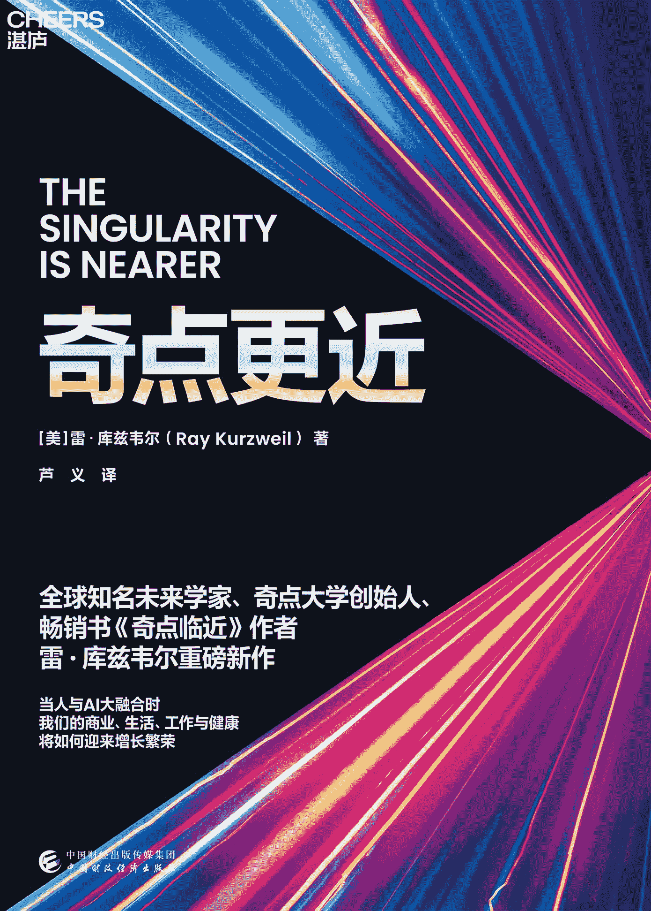

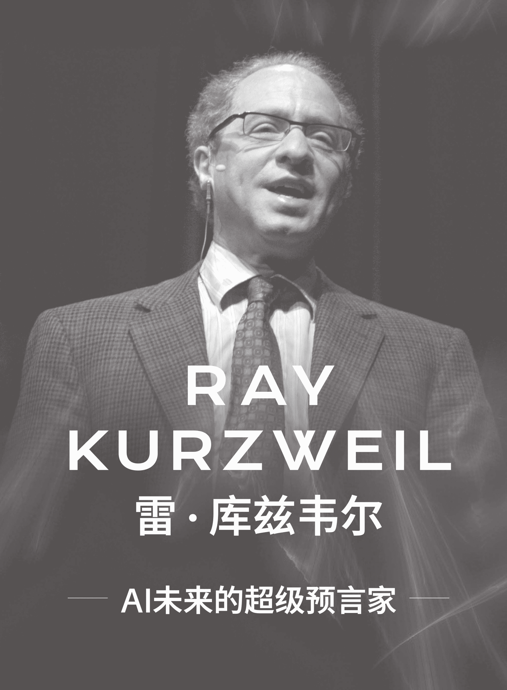

## “终极思考机器”：重塑世界的未来预见者

雷·库兹韦尔，这位美国杰出的未来学家、计算机科学家、畅销书作家、连续创业者与发明家，堪称当今科技界最具影响力的思想领袖之一。在人工智能、机器人技术及深度学习版图中，他被公认为颠覆性的未来预见者与“超级预言家”。比尔·盖茨曾直言不讳地评价：“库兹韦尔是预测人工智能未来走向的第一人！”他的预言版图宏大，覆盖 AI 通过图灵测试、纳米机器人普及、人类寿命大幅延长、可再生能源革命等关乎人类命运的核心议题。

早年，库兹韦尔发布过一份名为《我的预测结果如何》的复盘报告，细致梳理其多部著作中的预判。数据显示，其预测命中率高达惊人的 **86%**！他早早预言：1998 年前，AI 将击败国际象棋世界冠军——1997 年，深蓝战胜卡斯帕罗夫，预言成真。他也曾预见全球级计算机网络的诞生，信息流转将极致便捷——如今互联网、Facebook、微信、微博等应用，皆为注脚。

回溯 2008 年，他断言太阳能发电规模将呈指数级增长，终将满足全球能源需求；他锁定 **2029 年** 为 AI 通过图灵测试的关键节点；他还预判人类将沉浸虚拟环境，纳米机器人将成为对抗疾病、强化记忆与认知的得力助手。

## 天才发明家：斩获美国国家技术创新奖

迄今为止，库兹韦尔凭借多项划时代发明，囊括了科技界的顶级荣誉：美国科技最高殊荣——**国家技术创新奖**，奖金高达 50 万美元的麻省理工勒梅尔森发明奖，并荣膺**美国发明家名人堂**成员、 **美国国家工程院院士**。他拥有 21 个荣誉博士学位，曾三度从美国总统手中接过荣誉勋章。

《华尔街日报》赞其为“永不满足的天才”；《福布斯》封其为“终极思考机器”；《公司》杂志将其列为“顶尖创业家”，誉为“爱迪生的法定继承人”；美国公共广播公司更将他与过去两百年的伟大发明家并列，评选为“开创美国的 16 位改革家”之一。

他天生是个发明家，且从未停歇。童年沉迷科幻，痴迷“汤姆·斯威夫特系列”。七八岁自建机器人木偶剧院，举办机器人大赛。12 岁钻研计算机发明，14 岁撰写大脑皮层论文。家中氛围浓厚，时刻回荡着关于未来与技术的探讨。

高中时期，他师从贝尔实验室工程师叔叔，习得计算机科学基石。15 岁编出首个程序，17 岁开发模式识别软件，能分析古典名曲并自主作曲。他曾登上电视节目《我有一个秘密》，现场演奏一曲——谜底揭晓：乐曲由计算机创作，且硬件系他亲手组装。

进入麻省理工学院后，他师从“AI 之父”马文·明斯基，1970 年获计算机科学与文学双学士。仅用一年半，便修完该院所有计算机编程课程。

自 20 世纪 80 年代起，硕果累累：**全字体光学字符识别 (OCR) 系统、语音识别系统、盲人阅读机、音乐合成器**……专利数以百计，构建了人机交互的基石。

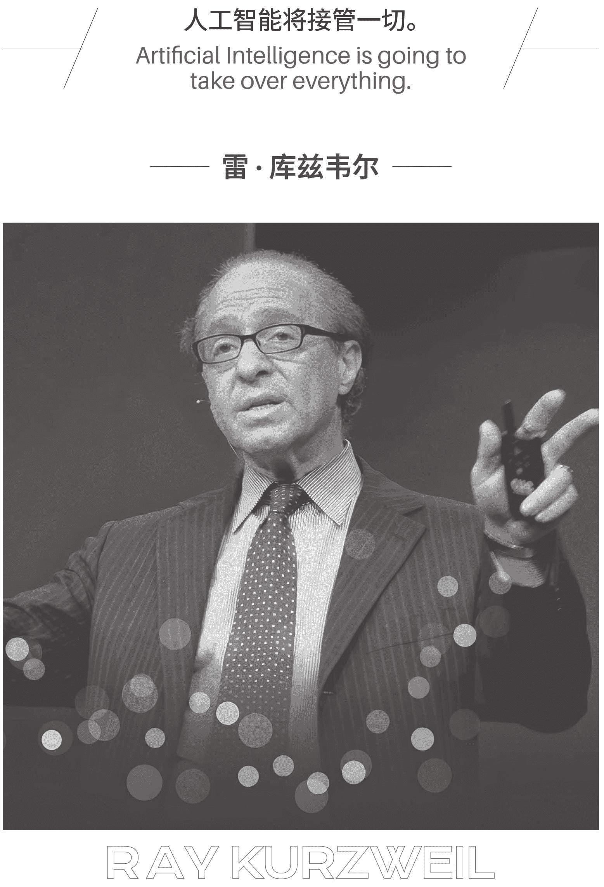

## “加速回报定律”缔造者 & 奇点大学校长

踏入 90 年代，库兹韦尔目光转向未来，正式确立 **“加速回报定律”**（亦称“库兹韦尔定律”）：通用技术（以计算为核心）非线性演进，而是呈**指数级跃升**。未来 15-30 年，AI 将迎来爆发式突破，超乎想象的图景将展开。

为匹配指数级增速，他主张汇聚全球最聪明大脑，学习前沿科学，攻克人类宏大难题。获 NASA 与 Google 联合背书，**奇点大学**应运而生，库兹韦尔出任校长。这所被誉为“未来领袖训练营”的学府，使命直指培养面向未来的人才。全球严选的天才们，聚焦神经科学、AI、纳米技术、基因工程、太空探索、VR/AR、物联网等前沿，攻关 3D 打印建房、太阳能航天器等硬核课题。在他的率领下，人类已为应对气候危机、能源短缺、疾病与贫困完成战略布局。

2012 年，Google 联合创始人拉里·佩奇亲自延揽，任命其为**工程总监**，主攻机器学习与自然语言处理。核心目标：让搜索建立在对语言的“真理解”之上，超越沃森，实现机器真正“阅读”网页与书籍，并与用户进行深度智能对话。2015 年，其发明的 K250 合成器荣获格莱美技术奖。

面对“AI 是人类最大生存威胁”的质疑声浪，库兹韦尔持辩证态度：技术是双刃剑，收益与风险并存。关键在于制定战略，引导 AI 向善演进。

## 未来主义与超人类主义的旗手与践行者

他撰写多部现象级畅销书，覆盖健康科技、AI、超人类主义、技术奇点、未来主义，是该运动的公开倡导者。在无数公开演讲中，他持续传递对延寿技术、纳米技术、机器人学、生物技术的乐观图景。

90 年代创立医学学习公司。1999 年创办对冲基金 “FatKat”，旨在打磨 AI 投资决策系统，坚信机器终将超越人类在盈利决策上的表现。他加入阿尔科生命延续基金会（人体冷冻机构），计划死后经灌注冷冻保护剂保存躯体，期盼未来医疗技术实现复活。当下，他通过多维干预“重编程”生物学身体，力抗衰老。

作为未来主义者与超人类主义者，他深度参与奇点主题组织：2004 年入美国机器智能研究所顾问委员会，2005 年入救生艇基金会科学顾问委员会……

认知中，他将人体视为数千“程序”运行的系统，破解其功能乃构建真有感知 AI 的钥匙。他主张全民基本收入（UBI），深信纳米技术能解码贫困、疾病、气候变迁等全球顽疾……

# 致

## 索尼娅·罗森沃尔德·库兹韦尔

——

就在几天前

相识相知（并深爱）已逾半世纪

# 引言

## 千年奔赴奇点，已入冲刺决胜期

奇点之后的图景，无法精确描绘。但透过理解并预判通往奇点的路径，我们能确保人类在最后冲刺阶段，行稳致远。

2005 年《奇点临近》中，我断言：融合指数增长的技术趋势，将引发根本性变革。当下，这场变革在多个关键赛道同步提速：算力性价比飙升，生物学认知深化，微观尺度研究落地。随着 AI 能力跃迁，信息触手可及，人机智能深度融合。纳米技术将推高潮，打通 **“云端虚拟神经元层”** 直连大脑的通道。我们将与 AI 融为一体，借助比生物大脑强 **百万倍** 的算力增强自我，这种智能与意识的跃升，深远到令人难以完全把握。我称此事件为“奇点”。

“奇点”概念源自数学^¹

《奇点临近》曾详细推演趋势，预判奇点约降临 **2045 年**。彼时距离尚有 40 年（两代人），话题显得遥远，诸多评论家批评时间表过于激进，甚至质疑奇点不可能发生。

此后，标志性进展接连涌现。虽质疑声未歇，但加速度未减。社交媒体与智能手机从小众走向连接大多数人的 24 小时贴身伴侣。算法创新与大数据涌现，推动 AI 在专家意料之外取得突破：从解题、玩《危险边缘》、下围棋，到自动驾驶、写作、通过律考、确诊癌症。如今，GPT-4、Gemini 等强大大模型，能将自然语言瞬间转为代码，极大消弭人机沟通壁垒。阅读此文时，数千万用户已亲历其境。同时，人类基因组测序成本暴跌 **99.997%**，神经网络数字模拟开启医学新篇，脑机直连技术亦取得实质进展。

一切建立在 **“加速回报定律”** 之上：技术迭代让计算等信息技术成本指数级下降，每次进步都为下一阶段铺平道路。扣除通胀，**1 美元购买的算力，较《奇点临近》出版时暴涨约 11200 倍**。

图 0-1 细节将在后续章节展开。它揭示了推动文明进步的核心引擎：长周期看，**单位美元算力呈指数级增长**（对数坐标下为直线）。摩尔定律（晶体管缩小、算力增强）仅是该定律的一种表现。晶体管发明前定律已成立，物理极限到来、新技术接棒后，趋势仍将延续。这条曲线定义现代世界，书中所有即将实现的突破，直接或间接皆依赖于此。

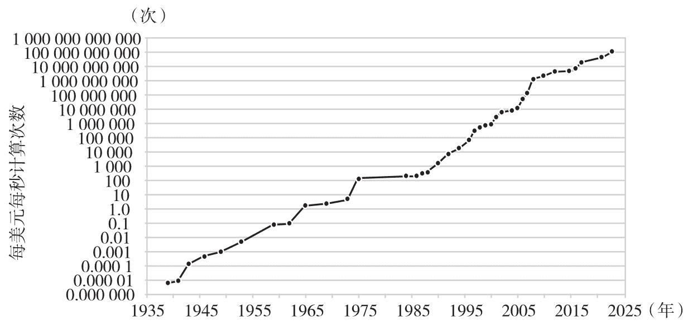

图 0-1 1939—2023 年算力性价比跃升轨迹^²

注：以 2023 年每美元每秒计算次数量化。为最大化跨机型可比性，聚焦可编程计算机时代；早期机电设备近似测算显示，趋势至少可追溯至 19 世纪 80 年代。^³

我们正按计划奔赴奇点。本书出版的紧迫性，源于指数变化的核心特质：21 世纪初难以察觉的趋势，如今已实实在在重塑数十亿人生活。2020 年以来，我们踏入指数曲线**陡峭上扬区**，创新节奏对社会冲击史无前例。参照系来看：你阅读此文的时刻，距离**首个超人类 AI 诞生**，可能比距离我上一本《人工智能的未来》^⁴ 面世更近。

故而，我著《奇点更近》。人类奔赴奇点的千年长征，已进入**决胜冲刺期**。《奇点临近》序言曾言我们处于转型初期；如今，我们步入**高潮期**。前书是遥望地平线，此书聚焦抵达地平线的**最后几公里**。

庆幸的是，路径图比以往更清晰。虽实现奇点仍存技术硬骨头，但关键先行指标正从理论科学加速转向工程落地。未来 10 年，人类将与高度拟人化 AI 交互，简易脑机接口将如智能手机般普及，重塑日常。生物技术数字化革命将攻克顽疾，大幅延长寿命。然并行地，技术迭代将引发劳动者就业震荡，全人类面临技术误用/滥用风险。2030 年代，进阶 AI 与成熟纳米技术将以前所未有深度推动人机融合，无限放大希望与危机。若能妥善化解科学、伦理、社会、政治层面的挑战，**2045 年**，我们将深度重塑地球人类生活，迈向更美好。反之，生存将受威胁。本书将聚焦**奔赴奇点的终极路径**——我们这最后一代“熟悉旧世界的人”共同面对的机遇与挑战。

首先，探寻奇点降临的具体路径，置于人类重塑智能的长期叙事中。技术创造感知引发深刻哲学拷问，我们将深究此变革如何重塑人类身份与使命。其次，实景推演未来数十年趋势。我将展示：“加速回报定律”驱动多个反映人类福祉的指标指数级跃升。虽自动化致失业是显性痛点，但长周期看，乐观理由充分，且我们终将不与 AI 竞争，而是共生。

随着技术创造巨额物质财富，我们将攻克限制人类全面繁荣的下一座大山：**生物学脆弱性**。展望未来数十年可用工具，逐步掌控生物学：**先战胜衰老，再强化大脑迎接奇点**。但突破伴随风险：生物、纳米、AI 革命性系统可能引发灾难（毁灭性疫情、自我复制机器失控）。最后，评估威胁，虽需审慎布局，但手中策略极具潜力化解危机。

这将是人类史上最激动人心、最关键的岁月。奇点之后不可知，但通过理解与预判通往奇点的过程，我们能守护人类在最后冲刺中的安全与成功。

# 第一部分

## 奇点迫近：与超级 AI 融合的终极图景

## 第1章

### 定位六阶演进：我们身处何方

至 **2045 年**，人类思维带宽将拓展 **百万倍**。正是这种变化的**速率与规模**，让我们借用物理学“奇点”隐喻来定义未来。

前作中，我将意识本质归纳为**信息**。概括宇宙诞生以来的**六大演进时代/阶段**，每阶段皆基于前阶段信息处理能力构建。智能进化，实为一系列间接过程的级联推动。

#### 从大爆炸到生命降临，再到大脑诞生

**第一时代：物理与化学法则确立**，万物基石就位。大爆炸后数十万年，电子绕核运动成原子。质子本因电磁力排斥难以聚合，幸得**强核力**束缚，核心稳固。无此力，原子层面的进化不复存在。

数十亿年演化，原子组装成承载复杂信息的分子。**碳**成关键基石——四价键合能力远超其他元素。我们身处复杂化学世界，实属极罕见巧合。引力常数稍弱，无超新星合成生命元素；稍强，恒星早熄灭于智慧生命诞生前。宇宙似经“精细调谐”，允许秩序与生命演化展开。

数十亿年前，**第二时代：生命诞生**。分子复杂到单分子定义完整个体，携带 DNA 的生物进化�衍。

**第三时代：大脑出现**。DNA 编码动物进化出大脑——存储处理信息的新器官。漫长岁月，大脑赋予进化优势，反推其愈发复杂。

**第四时代：人类崛起**。高阶认知加持灵巧对生拇指，将抽象思想转化为实体行动。人类创造信息存储处理技术：从纸草纸到现代硬盘，极大拓展大脑感知、存储、评估边界。这成为进化最强引擎，远超过往。大脑容量增速：每 10 万年增 1 立方英寸^⁵

**第五时代：人机深度融合**。生物认知与数字算力（速度/力量）直连，即**脑机接口 (BCI)**。生物神经处理频率：百赫兹级；数字计算：吉赫兹级。除速度与存储，非生物计算增强新皮层层级，将释放当下难以想象的高阶抽象认知。

**第六时代：智能漫延宇宙**。将惰性物质转化为最高密度计算物质——**“计算质料” (Computronium)** 的组织层级。

1999 年《机器之心》中，我预言 **2029 年 AI 通过图灵测试**（即：文本交流中人类无法辨别对方为机器）。2005 年《奇点临近》重申此判。通过测试 = 掌握人类语言与常识推理。虽艾伦·图灵 1950 年提出概念^⁶

#### 图灵测试在望，人机融合启幕

按预测，为使 AI 2029 年有效通过图灵测试，2020 前需在多元智力任务取胜。事实是，AI 已攻克人类最棘手智力高地：博弈游戏（《危险边缘》），放射学、药物研发等严肃应用。截至今日，Gemini、GPT-4 等头部系统正向通用智能疆域拓展，里程碑式进展令人振奋。

关键细节：真通过图灵测试时，AI 必须在诸多领域**“示弱”**（故意降低表现），否则瞬间暴露。如瞬间解答任意数学题，便无法伪装人类。故而，**达标时刻，其在大多数领域实力已远超人类顶尖水平**。

当下，人类处于**第四时代**，技术特定任务已超越人类理解上限。针对图灵测试剩余短板，我们正高速推进。我坚持期待 **2029 年** 破局，引领我们跨入**第五时代**。

2030 年代关键突破：**新皮层上层接入云端**，直接拓展思维边界。届时，AI 不再是对手，而是**个体延伸**。大脑非生物部分认知将超生物部分**数千倍**。

随指数趋势演进，**2045 年**，人类思维能力将拓展**百万倍**。这变化的**速率与规模**，确立了“奇点”隐喻描述人类未来的合理性。

## 第2章

### 重塑智能的深层意涵

我们将与技术共创，驱动思维进化以获深邃洞察，并以此创造超凡理念，供未来心智体悟与领略。

# 重塑智能：从生物大脑到数字基底的跃迁

若把宇宙史诗视为信息处理方式不断进阶的长卷，人类登场已是下半卷的故事。这一章的主题，关乎我们如何从受限于生物硬件的动物，进化为摆脱基因束缚、不再被遗传学定义的生命形态。站在21世纪20年代的节点上，我们即将翻开这场传奇变革的终章——在算力更强劲的数字底座上，重构并融合自然赋予的智能。这标志着宇宙文明将正式从第四纪元跨入第五纪元。

## 为何必须重写智能的底层代码

这宏大目标究竟如何落地？要读懂“重塑智能”的深意，我们得先回溯AI的诞生现场，以及随之诞生的两大对垒流派。结合神经科学对小脑与新皮质协作机制的最新认知，我们将剖析这两条路径的优劣分野。梳理完深度学习如何复刻新皮质功能的当下进度，我们便能拥有一把清晰的标尺：衡量AI距离人类水平还差什么，以及如何判定它真正做到了。终局在于：借助超人类AI的协力，开发脑机接口，以“虚拟神经元层”无限扩展新皮质疆域。这将解锁前所未有的思维维度，让智能量级跃升百万倍，最终抵达那个被称为“奇点”的彼岸。

## 从达特茅斯到双雄争霸：AI的起源与分野

1950年，英国数学家艾伦·图灵在《心智》期刊抛出《计算机器与智能》，将“机器能否思考？”这一哲学终极命题，转化为可被科学验证的假设。这火种点燃了学界狂热。1956年，约翰·麦卡锡在达特茅斯学院发起为期两个月、十人参与的研讨会，核心猜想是：学习与智能的每个侧面皆可精确描述，从而让机器模拟。议程直指核心：让机器懂语言、会抽象、解人类难题、能自我进化。正是这次会议，麦卡锡为这门注定改写一切的学科冠以“Artificial Intelligence”（人工智能）之名。

尽管雄心勃勃，两个月并未攻克自然语言理解。这场马拉松至今未歇。2017年腾讯数据显示，全球活跃AI从业者已达30万，规模远超当年的“十人团”。1956年的目标大致等同于通过图灵测试。自1999年出版《机器之心》起，我便坚持预言：2029年将达成此里程碑——尽管彼时主流舆论视此为不可企及的幻影。

即便是圈内专家，也被近年接连不断的突破震惊：不仅来得比预期早，更仿佛凭空突现。2014年10月，MIT权威托马索·波吉奥还断言：机器识图至少再等20年。现实却比预言跑得快得多。这“突如其来”的超越，答案藏在领域肇基之初的一个理论分歧里。

高中时代（1964年），我有幸谒见AI双子星之一的马文·明斯基。他是**符号主义**旗手：主张用基于规则的逻辑术语，显性化专家解题思维。这路子曾很管用。1959年兰德公司的“通用问题求解器”（GPS），便靠堆砌数学公理攻克逻辑难题。其思维路径酷似代数求解：知`2+7=9`，设`x+7=10`，推得`x=3`。这种“若符合定义则成立”的演绎逻辑，人类数学家日常所用，GPS亦如是。区别在于：机器理论上能穷举所有公理组合寻最优解。但组合爆炸是拦路虎：若每决策点有10条公理选，解深20步，可能性高达`10²⁰`。1959年最强`DEC PDP-1`每秒仅10万次运算，根本跑不动。

70年代的`MYCIN`系统曾让符号主义扬眉吐气：诊断脑膜炎等感染病表现媲美甚至超越人类专家。其核心是海量`IF-THEN`规则链，如：“若患者去过球虫病区、属特定种族、脑脊液隐球菌抗原阴性……则隐球菌非病原证据权重0.5”。80年代后期，专家系统引入概率模型融合多源证据，曾是主流巅峰。

**但符号主义撞上了复杂性的天花板。** 基于规则系统的故障点随规则数`N`指数级膨胀（`2^N - 1`）。5条规则31个隐患，10条规则1023个，百条规则故障点超千亿亿，千条规则更是天文数字。规则越多，新增规则修一个坑、塌一片地的概率越大。运行最久的`Cyc`项目（1984年启动）便深受其困。

60年代在明斯基门下，我早洞悉符号主义短板，并嗅到**联结主义**的价值。它不预设规则，而是用网络化哑节点从数据中“长”出智能。它能捕捉程序员想不到的微弱模式，甚至在“不懂问题”的前提下给出正确解。符号主义受限于人类对“最优规则”的认知上限，联结主义则打破了这个瓶颈。代价是：它常是“黑箱”，知其然不知其所以然。

## 拆解神经网络：从感知机到深度学习的基石

早期联结主义模型尚显稚嫩，初衷是模仿生物神经网络搭建计算模型。彼时对大脑微观组织知之甚少，构想多停留在抽象层面。

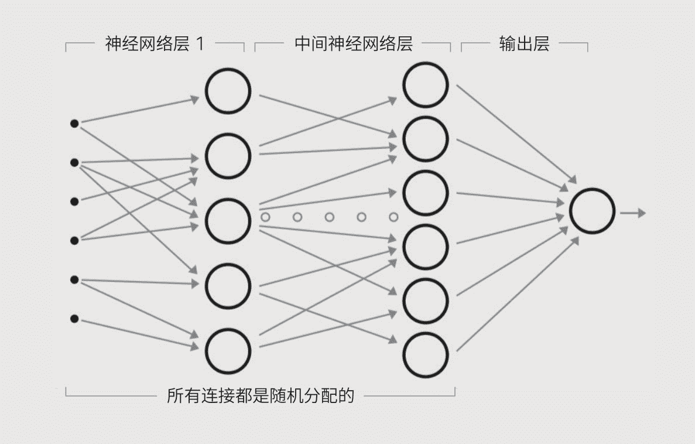

图 1-1 简单神经网络结构

这是一个基础神经网络算法的结构范例。设计者需预设关键参数：输入定义、网络拓扑（层数、连接）、训练流程、推理应用。核心流程可概括为：定义输入 -> 设定拓扑 -> 样本训练 -> 实战部署。

**输入层**接收数字张量：图像是像素矩阵，语音是频率-时间二维数组，泛模式识别则是`n`维数组。

**拓扑定义**中，每个神经元含多输入、单输出，输出接入上层神经元或最终输出端。

**构建隐藏层**：首层放入`N`个神经元，输入随机或进化算法连接至数据点，赋予初始权重（突触强度）。后续`M`层同理，逐层连接、初始化权重。第`M`层输出即网络输出。

**前向传播（识别试验）**：神经元计算加权输入求和，超阈值输出1（触发），否则输出0（抑制）。全网按层级从0到M同步推进。

**训练（反向调优）**：重复试验，每轮依据表现微调全网连接权重，直至准确率收敛。核心在于“奖惩机制”：答对强化相关连接，答错削弱之。神奇的是，即便训练数据含噪（如标注正确率仅60%），网络仍能练出90%+准度。海量数据下，随机误差相互抵消，保留了本质特征（如手写“8”的拓扑结构）。

**关键设计自由度**极高：层数、宽度、连接稀疏度、布线策略（随机/进化/人工）、初始化权重、激活函数（非线性化，从阶跃函数进化为Sigmoid/ReLU等平滑函数）、输出聚合方式、优化算法（SGD、Adam等现代变体）。同步/异步更新机制亦是一大变体维度。

尽管灵活强大，早期单层网络在数学上被证明无力解决特定问题（如XOR异或）。1969年明斯基与帕普特合著《感知机》，用封面图（图2-1）直观展示：前馈感知机无法判别线条连通性——人类易如反掌的任务，单层网络因缺乏反馈机制、无法实现XOR逻辑而彻底失效。

图 2-1 《感知机》封面用图

这一击，让联结主义陷入漫长寒冬。但故事远未结束——多层网络与反向传播算法的后来觉醒，终将扭转乾坤。

## 从“寒冬”到觉醒：被硬件锁住的神经网络梦

罗斯布拉特早在 1964 年便敏锐地指出：感知机之所以在不变性处理上乏力，核心短板在于层级不够。他设想，若将一层感知机的输出接入下一层同构网络，泛化能力便会随迭代跃升；只要层数与数据足够，复杂难题迎刃而解。可惜这洞见未及验证——1969 年《感知机》出版引发的寒潮，斩断了经费与关注，让联结主义沉寂数十年。直到算力与数据双双突破瓶颈，多层神经网络才在半个世纪后大放异彩。这恰似达·芬奇的飞行草图：构想超前，却苦无轻强材料落地。^[²⁵][^²⁶]

21 世纪头十年中期前，联结主义始终是“待机”状态。摩尔定律带来的算力性价比飙升约 28 亿倍，终于为这些沉睡的算法注入了灵魂。^[²⁵]

## 小脑：模块化的“无意识大师”

要在人类智能版图中定位神经网络，不妨先倒回宇宙时间轴。早期宇宙无脑可用，物质有序化极其缓慢；漫漫数十亿年，分子才编出生命指令。^[²⁷][^²⁸] 从首批生命到多细胞生物，又耗去 29 亿载。^[²⁹] 进化竞赛中，大脑更复杂者在资源争夺中胜算更大。^[³⁰]

**不解方程也能接住球**
想象接飞球：理论上需解微分方程，实则大脑无此装置。小脑采用“启发式简化”——假设手球相对位置固定，感知偏差即刻微调。这本质是将感官信号映射为肌肉指令，堪比数学里的“基函数”。^[³¹] 跳舞同理，小脑在后台默默指挥；一旦受损，虽可靠皮层强控，却费神且易共济失调。^[³²]

**从“笨拙”到“行云流水”的迁徙**
技能内化为肌肉记忆，实为控制权从运动皮层移交小脑。投球、魔方、钢琴，有意识参与越少，表现越优。乐师弹奏如常人唱“生日歌”般自如，却道不出声带控制细节——这就是心理学所谓的“无意识能力”。^[³³]

**简单模块，大神经元**
小脑虽囊括大脑大半神经元，基因图纸却极简：由海量微小、同质模块拼装。^[³⁴] 模块分工严格，弹琴模块不管走路。虽古老不可或缺，但新皮质崛起后，人类对它的依赖渐降。^[³⁵]

**天生技能 vs 后天学习**
非哺乳类依赖小脑编码的“固有行为模式”生存，一代代基因微调，适应极慢。^[³⁶][^³⁷] 哺乳类虽也有本能（如鼠类挖洞差异），但新皮质赋予了单生周期内的快速学习权。^[³⁶] 计算机科学家常用“进化算法”模拟前者，然自然界需百万年，小脑机制已是相对加速器。^[³⁷]

## 新皮质：会自我重写的层级魔网

**灾变中的弄潮儿**
约 2 亿年前随哺乳类诞生，新皮质字面即“新皮层”。^[³⁸] 彼时环境缓变，小脑慢节奏无碍。6500 万年前白垩纪大灭绝（小行星+火山）重写规则，75% 物种连同恐龙退场，新皮质凭“快速造方案”登堂入室。^[³⁹] 哺乳类脑体比飙升，新皮质皱褶展开若餐巾大小。^[⁴⁰]

**微柱：重复的识别单元**
新皮质由约 210-260 亿神经元构筑，90% 扎根于此。^[⁴²] 核心单元“皮质微柱”约百余神经元，能学习、识别、记忆模式，并层层叠加抽象层级。^[⁴¹] 底层识别视觉曲线，上层拼字母、成单词、挂语义，顶层把玩幽默讽刺等高阶概念。^[⁴³]

**双向流动的抽象江河**
虽分 6 大层，处理非单向。自下而上抽象，自上而下预测、调控，双向动态博弈。^[⁴³]

**定位“幽默中枢”的手术证据**
90 年代末，神经外科医生弗里德在清醒开颅中刺激特定皮层点，引发患者幽默感知，佐证抽象概念有物理锚点。^[⁴⁴] 非侵入实验亦显示：读讽刺句激活“心智理论网络”。^[⁴⁵]

**人类独有的认知皇冠**
除人类，无物种能打拍子、说段子、做演讲、读写此书。^[⁴⁶] 黑猩猩虽会用原始工具，复杂度不足以点燃指数级进化。^[⁴⁶] 另一关键拼图是拇指，配合新皮质成就科艺文明。^[⁴⁷]

**超越层级的“连接魔力”**
层级非新皮质专利（小脑也有），制胜在于连接拓扑：^[⁴⁸]
- 模式可全脑广播，不限出生地；
- 相似特征共享触发模式，天然支持类比；
- 百万模式可并行激活。^[⁴⁹]
这造就丰富联想记忆^[⁵⁰] 与跨域类比思维：手位下降、音高降、温度降、帝国衰落，共享“下降”模式，一学多用。^[⁵¹]

**达尔文的地质学隐喻**
达尔文进化论即源于对莱尔地质学的类比迁移。莱尔主张大峡谷由流水长年累月冲刷而成，达尔文将“沙粒级侵蚀”映射为“个体级微小遗传变异”，以此反驳“物种突变论”。^[⁵²][^⁵³] **人类智力大跃迁，多半是新皮质跨域类比的战果。**

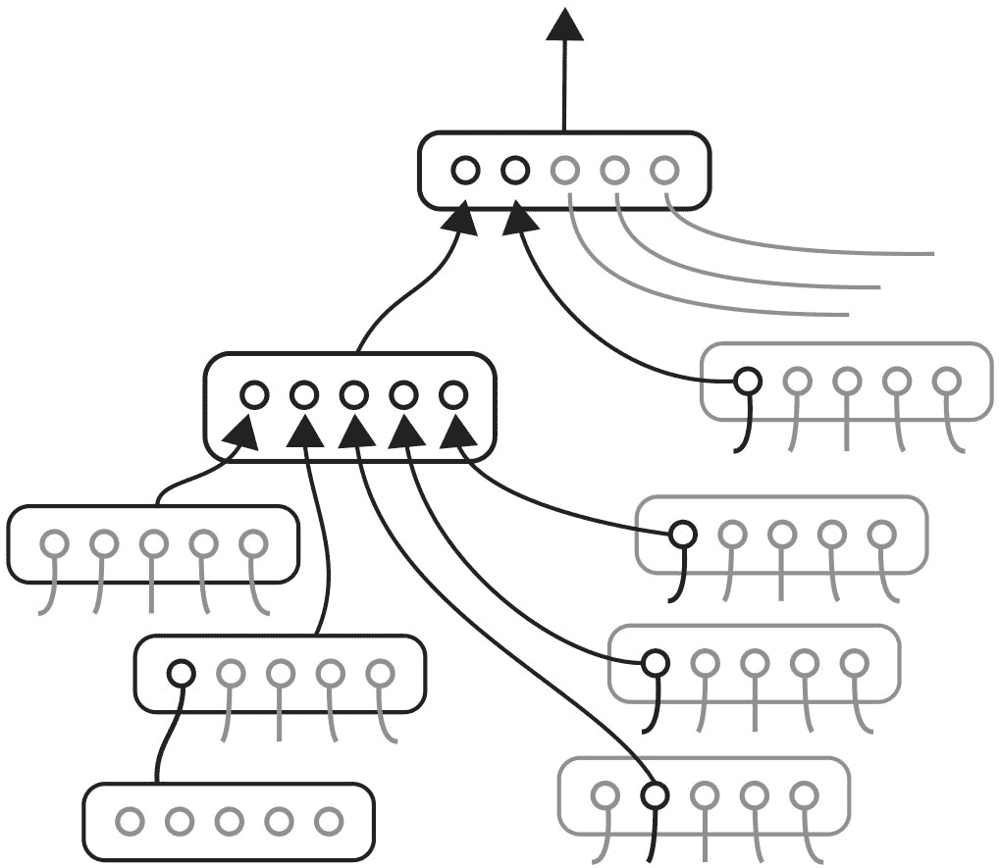

**图 2-2 新皮质的分层结构**

## 深度学习：将新皮质“数字化复刻”

符号主义太脆，联结主义太“吃算力”。摩尔定律（1965 年提出，实则 1888 年起指数奔跑）^[⁵⁴][^⁵⁵] 终于熬来了翻身仗。

**围棋：从“抄作业”到“自悟”**
围棋状态空间远超国际象棋，专家预言 2020 年代才破局。^[⁵⁶] AlphaGo 打破预言，AlphaGo Zero 弃用人类棋谱自博超越。^[⁵⁷] 更关键是 AlphaZero：围棋心法迁移象棋，展现通用游戏智能。^[⁵⁸] 随后《星际争霸 II》、德州扑克等不完全信息游戏亦被攻克。^[⁵⁹]

### 迈向奇点的关键跃迁

**从虚拟走向物理**
游戏技能迁移现实，需高保真模拟器。Waymo 自动驾驶便在虚拟路网万变场景中练就车感，再上实路。^[⁶⁰] MuZero 虽多游戏通吃，却不会写十四行诗、安慰病人。通向通用智能，语言是必经关隘——它让异域认知互联，用高阶符号压缩知识，读一段摘要抵百万样本。^[⁶¹]

**词向量：在 500 维空间里“懂”意思**
主流路径：深度网络把词句嵌入高维空间（如 500 维）。训练初期随机分布，海量语料推拉后，同义句聚拢、异义句分离。位置即含义，无需语法手册，纯靠上下文统计。^[⁶¹] “jam”在“吃”语境近“果酱”，在“音乐”语境近“即兴”，AI 像婴儿一样从用法中悟义。^[⁶¹]

**多模态与跨语言桥梁**
CLIP 对齐图文，字面/象征/概念三通。^[⁶¹] 共享高维空间实现零样本翻译：寻找目标语最近邻句。成对空间映射问答，扩展为“通用句子编码器”。^[⁶²]

**谷歌实战：从智能回复到“与书对话”**
Gmail 智能回复是标杆。^[⁶³] “与书对话”（2018-2023）更激进：半秒扫 10 万册 5 亿句，非靠关键词匹配，而是语义级“懂”你的问、书的答。^[⁶³]

**Transformer：注意力即一切**
2017 年谷歌发明的 Transformer 引爆大模型时代。^[⁶⁴] “注意力机制”聚焦关键标记，仿佛新皮质分配认知资源。海量参数（亿→万亿级）存储于连接权重，虽多为人类难读的抽象统计关联，却能精准预测下一标记，再解码为文本/图像/音视频。

**参数的隐喻：从“象鼻”到“统计幽灵”**
若仅一参数判“大象”，选“象鼻”最强；加“多毛身”可区分猛犸象。参数越多，决策边界越精细。^[⁶⁴] 实战中，这些参数少有“象鼻”这类可解释概念，多为训练涌现的高阶统计幽灵，却支撑起了类人生成能力。

**大模型涌现：从参数堆砌到通用智能的跃迁**

要读懂当下的 AI 浪潮，首先得承认一个硬事实：Transformer 架构的智能上限，直接锚定在参数规模上。海量参数意味着训练与推理都需要惊人的算力支撑。以 2019 年 OpenAI 发布的 GPT-2 为例，其 15 亿参数量在当时已属庞然大物。

**为何规模决定成败？**
核心在于“挖掘深度”。任务边界清晰时（如用历史数据预测气温），小模型足矣应付。但语言的组合空间近乎无限，靠死记硬背训练语料根本补不全句子。海量参数赋予了模型在“语义关联层”处理输入的能力——它能结合上下文，凭空创造出训练集从未出现过的连贯文本。更关键的是，训练语料涵盖了问答、评论、剧本等百态风格，模型由此学会识别提示意图，并切换相应人设生成内容。有人称这只是“高级统计学”，但正是汇聚亿万人类智力结晶的统计规律，催生了 AI 的真正创造力。

**GPT-3：商业化里程碑与风格大师**
作为首个商业化落地的大模型，GPT-3 用实力刷新了认知。得益于海量语料吞吐，它精通各类人类写作范式：科普、童话、诗歌、情景喜剧剧本，信手拈来。甚至能神还原特定作家笔触。程序员麦凯·里格利曾让它模仿心理学家斯科特·巴里·考夫曼回答“如何更有创造力”，输出质量连本尊都直呼“宛若亲笔”。

**对话专家 LaMDA 与多模态破圈**
2021 年，谷歌推出主攻自然对话的 LaMDA，在开放式、拟人化交流上独树一帜。同年，多模态技术迎来里程碑：早期 AI 多为单项冠军（识图、听音、懂文本），OpenAI 发布 DALL-E，打通了文本与图像的任督二脉。

**零样本学习：类比思维的觉醒**
多模态模型的突破不止生图。GPT-3 类模型具备“少样本学习”能力——极少样本即可泛化新任务。而 DALL-E 与 Imagen 更进一步，实现了**“零样本学习”**。它们能组合習得概念，凭空想象训练集从未见过的场景：
- “穿芭蕾舞裙遛狗的白萝卜宝宝”→ 生成萌趣插画
- “竖琴质感的蜗牛”→ 精准渲染材质
- “热恋中的珍珠奶茶表情包”→ 木薯球上闪烁爱心眼

零样本学习正是类比推理的核心，证明 AI 不再是复读机，而是掌握了概念并能创造性迁移。未来十年，深化并泛化这一能力，将是 AI 领域的核心攻坚战。

**通才雏形：从 Gato 到 Codex**
灵活性不止于单任务。MuZero 称霸游戏 17 个月后，DeepMind 推出 Gato——单一网络搞定玩游戏、聊天、生成图注、控制机械臂等 600 多项任务。编程作为人类智力杠杆，2021 年 OpenAI 推出 Codex，将自然语言直译为 Python、JS、Ruby 等代码，打通“意图-实现”最后一公里。

**PaLM：推理与幽默的双重突破**
早期模型虽能拆解子任务，却难串联复杂流程。2022 年 4 月，5400 亿参数的 PaLM 在两大人类智能高地取得突破：**幽默感**与**推理透明化**。

幽默需要融会文字游戏、反讽、共享经验等多重语境。PaLM 不仅能“懂梗”，还能精准拆解笑点。例如面对“本想 5 点写论文，玩模型 10 分钟抬头已是 9 点半”的自嘲，它准确概括：沉浸体验导致时间感知扭曲，计划写作变身马拉松式把玩。

更惊艳的是**“思维链”**能力。PaLM 能像优等生展示解题步骤一样，分步推演结论。这不仅增强可信度，便于工程师溯源纠错，更助其攻克连聪明人都头疼的复杂题。例如“卢浮宫名画→达芬奇→忍者神龟主角→武器来源”这一跨域推理链，PaLM 一气呵成，直指答案：日本。

**ChatGPT 时刻与 GPT-4 的认知飞跃**
2022 年 11 月，ChatGPT 界面上线，让大模型首次触手可及。2023 年 3 月 GPT-4 亮相，在 SAT、LSAT、AP、律师资格等硬核考试中全线高分。它不仅能解物理难题，还能反事实推演“物理定律变了会怎样”；能视角切换理解“两人对坐看数字见到的相反”；能看图预判“剪断绳子气球飞走”；更能在“椅子-杯子-顶针-钻石”多步位移物理模拟中精准追踪：钻石掉在床上了。

**具身智能与搜索重构**
书稿成书时（2023 年中），谷歌 PaLM-E 融合大模型推理与机器人本体，标志着具身智能新篇章。但 AI 迭代太快，纸质书注定滞后。传统搜索“十个蓝链接”正被 Google Bard（Gemini 驱动）与微软 New Bing（GPT-4 变体）的生成式答案取代，AI 正深度渗透日常入口。

**算力信仰：从明斯基辩论到 Scaling Law 验证**
我坚信算力是智能基石三十年。1993 年 MIT 辩论厅，我主张模拟人脑需 10¹⁴ 次/秒运算，导师明斯基坚持“算法大于算力，奔腾处理器也能跑出人级智能”。彼时算力算法双不足，不分胜负。2020-2023 年联结主义爆发，以每年 4 倍增速狂飙的训练算力，用铁的事实验证了我的判断——我从 1963 年入行，等了 60 年等来这一刻。

---

### AI 进阶还需跨越的三座大山

尽管大模型已逼近新皮层级能力，三大短板依然明显：**情境记忆、常识物理、社交心智**。

**1. 情境记忆：上下文窗口的指数级博弈**
长对话、长文档中，概念关联随上下文膨胀呈指数爆炸。扩大窗口算力成本高企。好消息是双轮驱动：注意力机制架构创新显著提升上下文利用率；算力性价比十年跌超 99%，大窗口将不再是奢望。

**2. 常识物理：缺失的“世界模型”**
你从未研究“卧室失重会怎样”，却能秒级脑补后果；回家见花瓶碎、狗在旁，瞬间完成因果归因。AI 尽管洞察力惊人，却因缺乏隐性知识构建的强鲁棒世界模型，在常识推理上屡次翻车。

**3. 社交心智：讽刺与心智理论**
讽刺语气、潜台词在文本语料中稀缺，导致 AI 难建立“心智理论”——即理解他人持有不同信念/知识，并能换位推演动机。不过进展显著：2021 年谷歌研究员用儿童心理学经典“莎莉-安妮测试”考察 LaMDA，其表现已逼近人类儿童水平。

我的乐观源于三条指数曲线的共振：**算力性价比指数级跃升、高质量训练数据指数级扩容、算法效率指数级优化**。三驾马车并行，差距终将被填平。

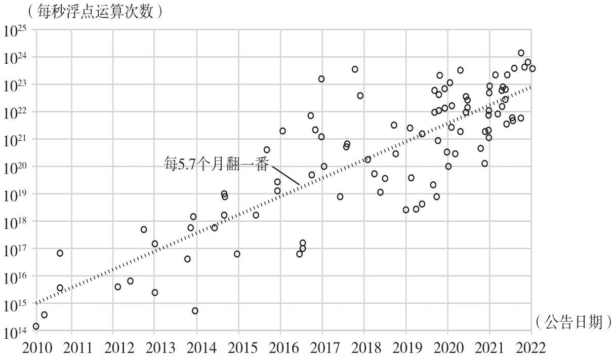

**图 2-3 给定时间段内里程碑式机器学习系统的训练计算量**
注：`n`=98 对数刻度，`FLOP`=浮点运算。
资料来源：Chart by Anderljung et al., based on 2022 data from Sevilla et al., building on previous 2018 research on AI and compute by Amodei and Hernandez of OpenAI.

**算力曲线的两个纪元**
深度学习爆发前（1952-2010），顶尖 AI 训练算力约 2 年翻番，遵循摩尔定律。若此趋势延续至 2021 年，增幅仅 75 倍；实则暴涨 **100 亿倍**——远超硬件红利。双引擎驱动：并行计算创新让万卡协同成为可能；大数据验证深度学习价值，引爆全球资本押注。

训练总投入持续攀升，折射数据边界外拓。如今我们敢断言：**凡能产出清晰绩效反馈数据的技能，皆可深度学习化，终将超人类。**

**数据像石油，埋藏深浅不一**
技能数据获取难度呈谱系分布：
- **易采易炼**：国际象棋，胜负明确、ELO 量化、棋谱结构化；
- **难判难采**：法庭辩护，胜负受案情、陪审团偏见干扰，律师个人贡献难剥离；
- **难量难测**：诗歌美感、悬疑张力。但可用代理指标——读者打分、fMRI 脑活跃度、心率皮质醇——海量噪声数据中仍能提炼信号指导训练。

神经网络设计得当，能洞察生物大脑未触及的深层真理（围棋、自动驾驶、蛋白质折叠）。数据可得性为“超人类智能”铺就清晰路径，也催生寻找“稀缺数据”的巨大经济动能。

**智能不是整体，是能力矩阵**
将 AI 进步拆解为独立技能集合，揭示本质：**人类智能非全知全能的单块，而是异构认知能力的拼图。**
- 跨物种共性：大象、黑猩猩、人类均通过镜像测试；
- 人类独有：作曲，且个体差异巨大；
- 个体内部不均：数学天才可能棋力平庸；过目不忘者可能社交障碍（《雨人》原型）。

故“达到人类水平”通常指**特定领域顶尖人类水平**。字母识别普罗大众与专家差异微乎其微；理论物理则鸿沟深邃。AI 在各技能突破人类的时间表极不均匀：2034 年或能写格莱美金曲、解千禧年难题，却未必能写奥斯卡剧本、产出哲学新知。必将经历漫长过渡期：图灵测试通过、大多数维度超人，但关键顶尖技能仍有短板。

**编程能力：通往奇点的“关卡之钥”**
探讨“技术奇点”，编程与理论计算机科学是核心瓶颈。一旦 AI 具备自我增强编程能力（自主或辅助），即进入正反馈循环。I. J.古德 1965 年预言：这将引爆“智能大爆炸”。
- 尤德科夫斯基押注“硬起飞”：数分钟至数月完成跃迁；
- 罗宾·汉森主张“软起飞”：平缓演进数年甚至更久。

**算力不再是瓶颈，大脑模拟的多重估算**
随 ML 成本暴跌，原始算力不再制约人级 AI。2023 初，顶级超算算力已远超模拟人脉所需。
我 2005 年《奇点临近》估算大脑上限 10¹⁶ 次/秒（10¹¹ 神经元 × 10³ 突触 × 100 Hz）。但此法假设全量神经元参与认知，实则不然：大脑高度并行、冗余度极高，中风受损仍可功能重组即是铁证。

我的模型基于简化假设：**模拟神经元放电即可构建“能跑通”的大脑**。但哲学难题犹存：主观体验（感质）是否需要精细到离子通道、分子代谢层面？桑德伯格与博斯特罗姆估算，此类高保真模拟需 10²² 至 10²⁵ 次/秒运算——距离依然遥远，但指数曲线终将触达。

# 倒计时二十年：当AI读懂人类，奇点已在掌心

别再把“机器拥有类人智能”当成科幻设定了。哪怕我们大幅调整预设参数，核心结论纹丝不动：未来二十年内，计算机将在我们在意的每一个维度上复刻人脑运作。这不是留给后人的百年难题。随着人均寿命延长，只要你身体硬朗、未满八十岁，大概率能亲历这个历史拐点。换个时间坐标看：如今的新生儿还没背上书包，可能就见证AI攻克图灵测试；等他们收到大学录取通知书，完整的大脑模拟或许已成现实。回望2023年我落笔之时，即便按最悲观估算，全脑模拟的窗口期也比1999年《机器之心》初版时大幅提前了。

## 图灵测试：通往人机平权的试金石

AI进化快得像坐火箭，月月有重磅突破，底层动力——算力性价比——更是指数级狂飙。那怎么给“机器是否真正聪明”盖棺定论？本章伊始提到的图灵测试，给出了一个硬核的科学量表。不过图灵留了个大坑：没细说考官要聊多久、需要啥资历。2002年4月9日，PC先驱米奇·卡普尔跟我立下“长约”：2029年，AI能不能过图灵测试？^(⁹⁶)

搞个设计严谨、流程规范、结果不含糊的实验至关重要。人类有种“事后诸葛亮”的毛病，总爱把AI的丰功伟绩说成“本来就简单”，这在学界有个专门名词——“AI效应”。^(⁹⁷)

“沃森”那场人机大战就是绝佳注脚。它读懂线索、抢按钮、合成语音作答，那股子“思考劲儿”跟詹宁斯、拉特如出一辙，极具迷惑性。但屏幕底部的候选答案栏打了脸：首选项几乎全对，备选项却离谱到连新手都不犯的错。比如“欧盟”类线索：“五年一选，736席，七党角逐。”^(⁹⁸)

近期突破集中在自然语言的丝滑驾驭上。2018年，谷歌Duplex打电话订餐理发，对方全程未觉异样；IBM的Project Debater则能在辩论赛上唇枪舌剑、气势逼人。^(⁹⁹)

乍看这像个Bug：我们潜意识觉得AI该按人类逻辑推理。我反其道而行：这是迷信。现实世界看疗效，管它黑箱怎么运作？若异构算法能催生诺奖级发现、写出催泪神作，我们为何要纠结出身？若AI能用雄辩宣称“我有意识”，我们凭什么垄断“生物大脑才能生有价值感知”的解释权？图灵测试的实证主义，精准锁定了真正该看的指标。

但别把图灵测试当成衡量超级智能的“独家金标”。PaLM 2、GPT-4早已在特定高阶认知任务上碾压人类，且无需在别处装得像个人。我预言：2023-2029年，首个严格版图灵测试必破，届时机器将在更多领域展现超人表现（见图 2-4）。AI极可能在搞定图灵测试里的“常识社交细节”前，先把代码写得比人类强。这提醒我们：理解人类智能，得要更立体、更细腻的维度。图灵测试是拼图关键一块，但我们还得造更复杂的尺子，去量度人机在百变场景下的同异。

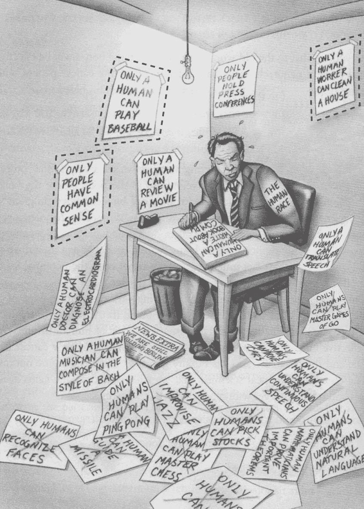

**图 2-4 AI 的“补课清单”**

> 注：漫画里的地面文件是AI已拿下的任务；墙上虚线框住的，是尚未完全攻克的高地。

虽有人反对用图灵测试量化机器认知，但我坚信：一场真枪实弹的“通过演示”极具穿透力，旁观者会直觉认定——这是真智能，非拙劣模仿。图灵1950年就说过：“机器能否做些该称作‘思考’的事，哪怕方式截然不同……若能造出台令人满意的模仿游戏机器，这差异就不成其为困扰。”^(¹⁰⁰)

**关键洞见：一旦AI攻克强版图灵测试，它将在所有可用语言检验的认知测验中全面超越人类。**^(¹⁰¹)

图灵原话：测试覆盖“几乎所有人类活动领域”。敏锐考官会让AI解读复杂社交、依据数据推演、即兴编情景喜剧。可见，图灵测试早超越了“听懂话”，它囊括了语言承载的一切认知能量。当然，高分低能不行：若考生秒判大数质合、随口切换百国语言，考官立马识破“非人类”。

更深一层：这级别的AI天生自带“降维打击”属性——从记忆广度到思维时速。设想一个系统：读懂能力达人类水平，却能完美背下维基百科全站、全量科研论文。如今AI理解语言仍有短板，这是知识总量的天花板；人类受限于读速慢、记性差、寿命短。计算机处理数据快得惊人：人均读本书6小时，谷歌“与书对话”快50亿倍。^(¹⁰²)

这意味着：为通过传统图灵测试，AI其实得给自己“加塞降智”。但凡不需要装人的任务——攻克医学难题、破解化学谜题、啃硬工程骨头——图灵级AI早已是超人选手。

要看这进程通向何方，可参考前文六大时代范式（见表 2-1）。

**表 2-1 信息处理加速演化的六大范式**

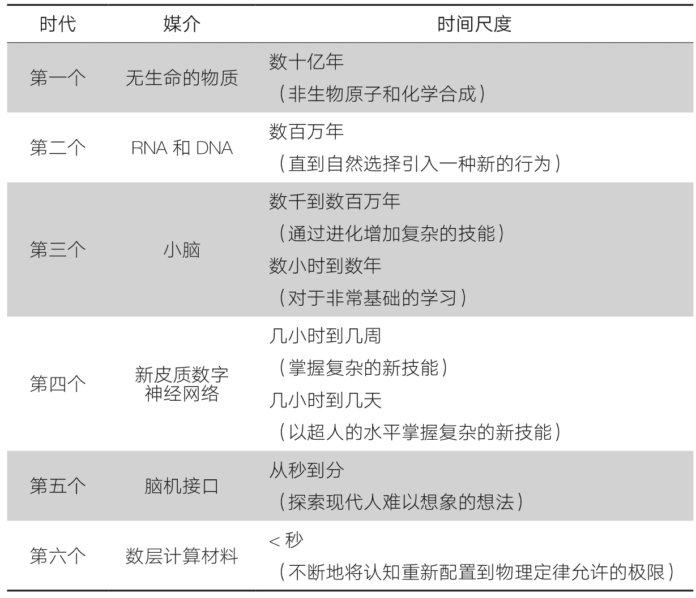

### 把新皮质“接”上云端

目前科学家用颅内外电极跟大脑对话，进展寥寥。非侵入式手段里，空间分辨率（看清哪里亮）与时间分辨率（看清何时亮）像跷跷板，难两全。功能性核磁靠监测血流量间接推断神经活动；^(¹⁰³) 脑电图直捕电信号，时间精度能压到1毫秒。^(¹⁰⁴)

截至2023年，这对“跷跷板”仍是神经科学硬骨头。物理规律摆在那——血流慢、电流快，AI和传感器再进步，也难支撑高阶脑机接口。

植入电极直扑单个神经元，能绕开妥协，实现读写双向通行。但开颅植入易损神经，目前只用于听障、瘫痪等“获益远大于风险”群体。如BrainGate系统，让渐冻人、脊损患者凭意念驾驭光标、机械臂。^(¹⁰⁵)

脑波直接变文字，那是颠覆性跃迁。2020年，Facebook资助团队给受试者植250枚电极，配合先进AI，将脑皮层活动与口述句子精准对齐。^(¹⁰⁶)

规模化上，马斯克Neuralink最激进，一次性植入成串线状电极；^(¹⁰⁷) 美军DARPA搞“神经工程系统设计”，志在百万神经元记录、十万神经元刺激。^(¹⁰⁸)

算力要对接多少？模拟全脑约需10¹⁴次/秒，甚至更少。^(¹⁰⁹) 注意，这是基于真实架构的模拟，能过图灵测试、在外部观察下与人脑无异，但可剔除不产生可观察行为的底层噪音（如细胞核DNA修复是否参与认知尚存疑）。且脑机接口无需对标全脑算力，核心只需链接新皮质顶层——那是高阶认知的主战场。

### 摩擦奇点门槛的关键一跃

要实现这规模连接，设备必须极致微型化，工程与神经科学的复杂度指数级上升，未来将极度依赖先进AI辅攻关。2030年代，纳米机器人登场，将新皮质顶层与云端无缝焊接，实现生物神经元与云端仿真神经元的直连。^(¹¹⁰)

回望200万年前，祖先最后一次获得新皮质冗余，人类由此诞生。如今若能在云端调取额外新皮质，认知与抽象能力的跃升将堪比彼时。我们将创造出远超当下认知的艺术科技形态，打破想象天花板。

未来艺术难预测，但可借猴子看电影类比：它能认人、识交流，却读不懂台词、不知“铁甲=中世纪”。^(¹¹¹)

云端新皮质赋予的不只是更酷的CG或五感刺激，而是**大脑加工体验的全新可能**。演员今靠台词肢体传心，未来或能将角色原始、混沌、非语言的念头——连同其难以名状的美丽复杂——直抵观众思维深处。这才是脑机接口带来的文化红利。

**我们将与技术共舞，进化思维以获更深洞察，用此力量铸造供未来心灵体悟的超凡理念。终局是：借助自我进化的AI系统，访问并重写我们自己的“源代码”。**因这技术让我们与亲手缔造的超级智能深度融合，我们将从本质上重塑自我。一旦挣脱颅骨物理牢笼，在算速远超生物组织的底座上处理信息，人类智能将被释放，开启指数级爆发，最终增幅达百万倍。这，才是我定义的“奇点”核心内涵。

\[1[\]](#Section06.xhtml#noteref-7-1) 2023年初，谷歌云TPU v5e上，1000美元/小时约等于3.28×10¹⁷次操作/秒（10¹⁷量级）。云租赁降低了门槛，但数字难与买断硬件直接对标。粗略折算（扣除人力、电费、折旧等细节）：以4000工时为基准，每1000美元TPU v5e服务平均每秒可持续跑130万亿次以上（约10¹⁴）。详见附录计算来源。

## 第3章

### 我是谁：做一个“特定的自己”意味着什么

**一旦大脑备份上更高阶的数字平台，自我重塑的闸门将彻底洞开。**

#### 意识水平：我们与新石器祖先没本质区别

图灵测试能部分回答“何为人”，但面对奇点技术，我们必须追问：何为“这个特定的我”？雷·库兹韦尔在讨论中扮演何角色？若你不关心我，只关心你自己，完全可以把同一个问题抛给镜中人。但对我而言，为何“我”是雷·库兹韦尔？为何我生于1948而非1903或2003？为何是男性、为何是人类？科学对此无解。“我是谁”追问的，是意识这个终极哲学命题。

在《人工智能的未来》中，我引用过塞缪尔·巴特勒1871年的洞见：^(¹¹²)

> 食虫植物捕蝇精准——只对猎物合拢，雨滴树枝全无视。这“无意识”的生物，挑食眼光竟如此敏锐。若这是无意识，意识又有何用？^(¹¹³)

“意识”通常指两种关联又不同的东西。一是功能性：知晓环境、感知内心与外界分野。此定义下，深睡无意识、微醺半意识、清醒全在线。除“闭锁综合征”等罕见例外，我们常凭外表判断意识层级；动物照镜认己，也能佐证意识存在。但涉及本章核心的“个人同一性”，另一种含义更关键：**拥有内在主观感受的能力，而非仅有外在表现。**哲学家称之为“主观体验”。所以我常说意识无法被外部直接探测。

虽无法直测，却不可无视。人类道德体系根基，往往建立在对意识的评估上。物质对象再复杂珍贵，只有影响有意识生物的体验时才重要。动物权利辩论的核心，正是我们在多大程度认定它们有意识、且体验何种质感。^(¹¹⁴)

对哲学家，意识是硬题。伦理权利归属常凭直觉判断实体是否有主观体验。因无法外测，只能用功能性意识作替身——基于自我经验的类比：我有主观体验，也知自己有可被观察的功能性自觉，故假设他人显现功能性意识时，必有内在主观体验。甚至连主张“主观体验与思维无关”的科学家，也默认周围人有意识——因为他们察觉到了自己的体验。

这假设易推及同类，但动物行为差异越大，我们对其“有意识”的直觉越弱。狗、黑猩猩虽未达人类认知高度，复杂情感行为却让大多数人相信背后有对应主观体验。啮齿类呢？它们展现社交嬉戏、恐惧危险。^(¹¹⁵)

意识可视为二元开关——有无主观体验？但我想探讨另一维度：**浓度**。模糊梦境、醉酒迷糊、清醒时刻，你的主观意识浓度差多少？这是评估动物意识的连续谱。专家共识在移：越来越倾向更多动物拥有更丰富意识。2012年，剑桥多学科科学家联袂签署《剑桥意识宣言》，肯定“意识非人类专利”：“缺乏新皮质，不妨碍生物体验情感状态。”^(¹¹⁶)

科学说复杂大脑生功能性意识。但究竟是什么赋予我们主观体验？有人归因神，有人归因纯物理。无论起源，精神与世俗两极都视意识为某种神圣。有意识、能感痛，无论仁慈神明造还是无目的自然选，因果链条结果不变——否认孩童有意识感痛，是极度不道德。

然而，关于主观体验成因的探讨，即将超越哲学范畴。技术即将赋予我们将意识延展出生物大脑的能力，我们必须锁定：是什么点燃了构成核心身份的主观体验？并誓死守护它。因只能凭可观行为反推主观体验，我们的直觉与科学最合理解释紧扣：**支撑更复杂行为的大脑，孕育更丰富主观体验。**如前章所述，复杂行为源于大脑信息处理的复杂性。^(¹¹⁷)

这对人类未来、对你我未来几十年影响深远。记住：有史以来的智力跃迁，都发生在石器时代以来结构未变的生物大脑里。外部技术虽让人人共享人类发现，但我们的意识水平，与新石器祖先相比，并无质变。等到2030s、2040s新皮质可扩展时，不仅抽象解题能力暴涨，主观体验本身也将加深。

## 僵尸、主观体验与意识难题

意识有根本性的一面，注定无法共享。我们约定俗成把特定波长叫“绿”“红”，却永无法确认：我眼中的绿，是否就是你眼中的红？这份私密感受，无法用语言或任何通讯手段直接比对。^(¹¹⁸)

正如我在《人工智能的未来》写道，这引出更令人战栗的思想实验：若有人**根本没有**主观体验呢？哲学家戴维·查默斯称这类假想体为“哲学僵尸”——神经与行为层面完美复刻意识相关特征，内核却空无一物。^(¹¹⁹)

# 意识、自由意志与数字永生：我们是谁？

探究功能性意识与主观感受鸿沟的一种途径，是对比真实的狗与假设中毫无内在体验的人造人——即“哲学僵尸”。尽管这些“僵尸”或许能展示出比犬类更高阶的认知表现，但大多数人直觉上会认为：伤害一只拥有真实感受的狗，比破坏一个仅模拟痛苦反应实则麻木不仁的“僵尸”更为不道德。核心困境在于，现实中我们连原则上都无法通过科学手段裁定另一个个体是否具备主观体验。

若“僵尸”在理论上成立，便意味着主观体验与大脑、计算机等物理系统之间缺乏必然的因果联系——这些系统处理信息、外表看似有意识，实则可能一片虚无。部分宗教主张灵魂作为超自然实体独立于躯壳，这已超出科学考察边界。但即便物理系统必然产生意识（即“僵尸”不可能存在），科学同样拿不出连贯的证明方案。主观体验与可观测物理定律本质迥异，这并不代表它不依赖特定的信息处理模式；查默斯将此称为“意识的难题”。相对而言，那些“简单问题”——如梦眠时大脑的运作机制——虽也是科学界的硬骨头，但至少落在可研究范畴内。 ^(¹²⁰)

针对这棘手难题，查默斯抛出了“泛原心论”这一哲学假说。 ^(¹²¹)

虽无法用科学实证该理论，但强烈的道德命令迫使我们必须预设其为真。换句话讲，若你面对的实体极可能拥有意识，最稳妥的伦理抉择是默认它有感知，而非冒险折磨一个有知觉的生命。也就是说，我们应按“僵尸不存在”这一前提行事。

在泛原心论视域下，图灵测试不再仅是测量机器能力的标尺，更成为佐证主观体验、进而确立机器道德权利的有力依据。有意识的 AI 将引发深刻法理变革，但我担忧首批通过图灵测试的 AI 诞生时，我们的法律体系能否迅速适应、纳入其权利。因此，初期制定防范滥用的伦理框架，重任将落在开发者肩上。

除伦理动因外，理论层面也有充分理由相信，泛原心论或许正是解释意识的准确因果模型。它在二元论与唯物主义这两大传统流派间寻得折中。二元论主张意识源于某种与普通无生命物质截然不同的“质料”，许多人将其等同于灵魂。但科学视角下，此观点存疑：即便假设超自然灵魂存在，我们也无法构建一个靠谱理论，解释它如何作用于可观测世界的物质（如神经元）。 ^(¹²²)

## 决定论、涌现与自由意志的困境

与意识紧密纠缠的，是我们对自由意志的感知。 ^(¹²³)

然而哲学家一旦追求精确定义，便几乎无法达成共识。不少人坚信，自由意志的存在意味着未来无法被预先锁定。 ^(¹²⁴)

物理学家兼计算机科学家斯蒂芬·沃尔弗拉姆的研究为这困境注入了新视野。其长期探索深刻影响了我对物理与计算交叉领域的认知。在 2002 年巨著《一种新的科学》中，沃尔弗拉姆深入剖析了兼具确定性与不可预测性的现象——细胞自动机。 ^(¹²⁵)

细胞自动机是由单元格构成的极简模型，单元格依据规则集在状态间跃迁（如黑/白、生/死）。规则规定了单元格如何根据邻居状态更新，这一过程经离散步骤演进，却能催生惊人复杂的行为。康威的“生命游戏”即是著名的二维网格案例。 ^(¹²⁶)

沃尔弗拉姆从最基础的一维线性自动机切入：单元格按规则依前一行状态生成新行。深度分析显示，对特定规则集，无论推演多少步，若不逐步迭代每个中间环节，根本无法预知未来状态。 ^(¹²⁷)

最简单的第一类规则，如规则 222（见下图）即属此类。 ^(¹²⁸)

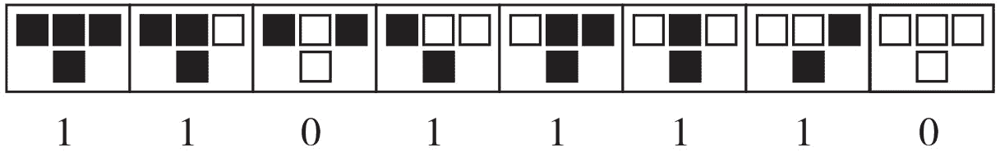

图 3-1 规则 222

每个单元格基于前一步骤自身及两侧邻居的 8 种组合状态（如上图），规则决定了下一步的状态。黑白亦可用 1 和 0 编码。

若从中心单个黑色单元格起步，按规则 222 逐行演算，将得出如下图案。 ^(¹²⁹)

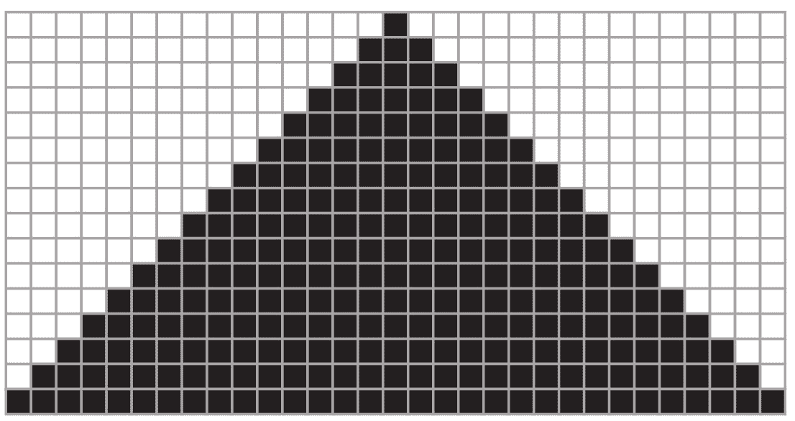

图 3-2 应用规则 222 得到的结果

显而易见，规则 222 生成高度可预测的模式。若问你第百万个单元格，或第 100 万的 100 万次方个单元格是什么色，你毫不犹豫会答“黑”。这折射出常规科学范式：以确定性规则推演可预见结果。

然而第一类仅是冰山一角。沃尔弗拉姆理论将自然现象归纳为四类规则，依产出结果区分。二、三类规则颇具看点，生成的黑白排列日益复杂；但最迷人的是第四类——规则 110（见下图）。 ^(¹³⁰)

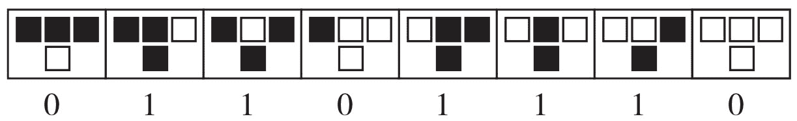

图 3-3 规则 110

从单一黑色单元格启动规则 110，结果见图 3-4。

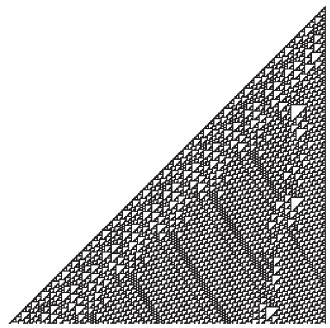

图 3-4 应用规则 110 得到的结果

持续迭代，将呈现图 3-5 图景。 ^(¹³¹)

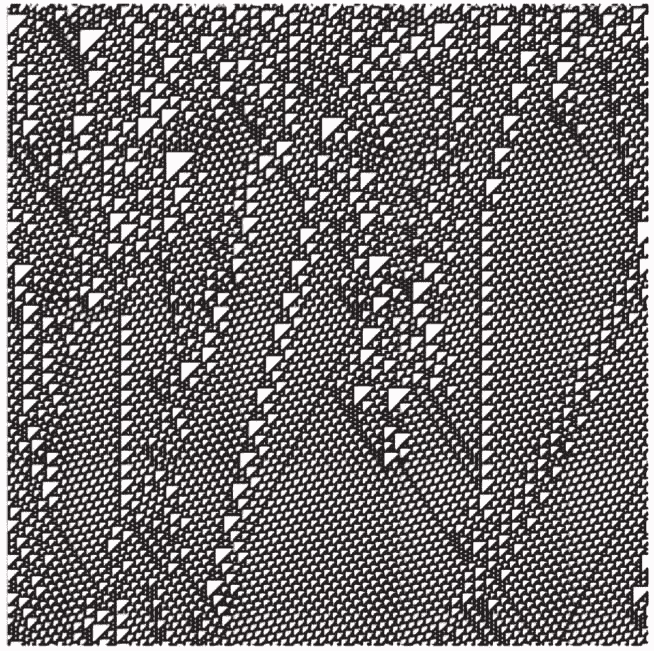

图 3-5 持续应用规则 110 得到的结果

关键在于，除非逐行亲自计算，否则我们无法确知第千行、乃至第 100 万的 100 万次方行的面貌。 ^(¹³²)

单格统计抽样虽使状态貌似随机，实则每格状态皆由前一步确定性演变而来，宏观图像呈现有序与无序交织。这便是“涌现”特性的展现。 ^(¹³³)

意识与自由意志，极可能源于此类复杂性。无论你将决定自由意志的底层程序归功于造物主、泛原心论或其他，你都不仅仅是程序本身。

这些规则催生意识及诸多自然现象绝非偶然。沃尔弗拉姆强有力地论证：物理定律本身源自与细胞自动机关联的计算规则。2020 年，他启动“沃尔弗拉姆物理项目”，旨在以广义细胞自动机模型诠释全部物理现象。 ^(¹³⁴)

此路径在经典决定论与量子不确定性间达成妥协。虽可用算法技巧近似预测宏观层面（如卫星百万轨道位置），但在最基础尺度，此类近似失效。若实在深层基于第四类规则生成，我们便能用确定性语言解释量子尺度的貌似随机，却不存在能预测宇宙未来某时刻精确状态的“总结算法”。 ^(¹³⁵)

既无有效预测，只能求助模拟；但宇宙无法容纳足以模拟自身的超级计算机。换言之，不让现实真实演进，就无法揭示现实。

本章后续将探讨将意识从生物脑迁移至非生物芯片的可能性。须明确：数字化模拟大脑运作，与决定论意义上的“预先计算大脑”截然不同。无论生物还是非生物大脑，都非封闭系统。大脑从外界摄取信息，经极复杂网络处理。近期科学家甚至发现，大脑网络拥有高达 11 个维度！ ^(¹³⁶)

换个角度：若宇宙规则基于细胞自动机原理，只能通过逐步展开——即现实实际发生的过程——来表达。反之，若宇宙有确定规则但无自动机机制，或纯靠随机性，现实未必需要我们所观测到的逐步展开。此外，若意识仅能从有序与混沌交织的第四类复杂性中涌现，这本身便是我们存在的哲学佐证：无此规则，我们便不会于此思考此问题。

这为“相容论”敞开大门：决定论主宰的世界，依然可以是自由意志存在的世界。 ^(¹³⁷)

## 当一个人拥有多个大脑

影视文学中对机器人的描绘，暗含着我们的一种泛原心论直觉：若 AI 行为酷似人类，哪怕其认知非基于神经元，我们也会视其为拥有主观体验的存在，并为之喝彩。

然而，正如 AI 可由多个独立算法组成，越来越多医学证据显示，人脑内部亦存在多个相对独立的决策单元。左右脑实验表明，两半球在诸多方面独立且平等。 ^(¹³⁸)

更引人注目的是那些因医疗原因切断连接两半球的 2 亿条轴突（构成胼胝体）的患者。 ^(¹³⁹)

这些实验表明：一个正常人实则可能拥有两个能独立决策的大脑单元，只是同属一个意识主体。每半脑都自认为是决策主导者，因紧密结合，故感觉一致。

若不局限于半球，人体内还存有诸多决策结构，或皆具备上述自由意志。如决策中枢新皮质，包含众多功能微模块。 ^(¹⁴⁰)

明斯基将大脑比作“心智社会”（亦为其第二部著作书名），其中汇聚无数反映不同观点的简单过程。 ^(¹⁴¹)

## “2 号你”还是你吗？

这引出深思：若意识与身份认同能跨越大脑内多个不同信息处理结构（甚至无物理联结者），当这些结构物理分离更远时，会如何？

我在《人工智能的未来》中探讨的核心议题，正是复制人脑全部信息在大多数人有生之年的哲学与道德意涵。

设想：我用尖端技术扫描你脑部某部分，制成精确电子副本。（事实上，我们已能精确复制某些脑区，如治疗原发性震颤或帕金森症时。） ^(¹⁴²)

那么，“2 号你”有意识吗？它会宣称拥有与你同源的经历（共享记忆），举止与你如出一辙。除非你能彻底排除电子版意识实体拥有意识的可能，否则答案应为肯定。简言之：若电子大脑包含同构信息并自称有意识，科学上我们无充分理由否认其意识。伦理上，我们应视其为有意识、从而拥有道德权利。这非盲目臆测——泛原心论提供了坚实哲学支撑。

更棘手的问题是：“2 号你”真的是你吗？请记牢，“你”（原版）依然存在。甚至副本可能在“你”不知情下制成，但本质上的“你”仍在。若实验成功，“2 号你”将表现得像你，但“你”未变，故“你”仍是“你”。因“2 号你”能独立行动，将立即从“你”中分离，创造自有记忆、对不同经历反应。因此，若身份由大脑信息特定组织方式决定，“2 号你”虽有意识，却非你。

至此讨论已获共识。下一思想实验将用前章脑机接口，逐步将你脑中各部替换为数字副本。此时，“你”与“2 号你”不复存在，唯有一体统一的你。每阶段完成后，无人（包括你）有异议。但替换完成后，新的你是否仍是你？即便最终大脑全面数字化。

探讨身份认同与躯体渐替关系，最早溯源 2500 年前“忒修斯之船”思想实验。 ^(¹⁴³)

“忒修斯之船”用于无生命体颇具趣味且风险低；船只“身份”问题终究是人类认知惯例。但指向人类时，风险极高。对大多数人而言，身边之人究竟是真爱还是仅演得极像的查默斯式僵尸，至关重要。

让我们透过主观体验“难题”审视。制造“2 号你”情形下，我们无法判定其主观自我与原版你是否关联。你的原初主观体验是否会以某种方式同时包含两副本，即使信息模式随体验分化而分离？抑或“2 号你”保持独立？这些科学无法作答。

然而，逐步迁移大脑信息至非生物介质的情形下，我们有更充分理由相信：你的主观体验将被保留。实际上，我们已在治疗脑病时以初级形式实现此道，新神经假体能力超越被替代部分。虽不完全相同，早期植入体（如人工耳蜗）虽能刺激脑活动，却无法替换核心脑结构。 ^(¹⁴⁴)

神经科学表明，渐替过程中你甚至无法察觉微小变迁，大脑适应性惊人。混合大脑将保留定义你身份的所有信息模式。故无理由认为主观体验受损，你当然还是你——无他人可称为你。然而，假设过程终点，最终的你与首个实验中的“2 号你”本质相同，而我们先前认定“2 号你”非你。此矛盾如何解？关键在于**连续性**——数字大脑从未与生物脑分离，从未作为独立实体存在。

这引出第三种情况，实非假设。我们的细胞日夜急速更新。虽神经元普遍长存，约半数线粒体月内更替； ^(¹⁴⁵)

多年来我常凝望家附近查尔斯河。今日望去，我仍认定它与一日前、十年前书中提及时是同一条河，虽每几毫秒流经某地的水分子已全然不同。但水分子运动模式一致，决定河流走向。心智亦然。当我们接入非生物系统，信息模式的连续性让我们保有当下感受——虽感知可能更敏锐、认知更聪慧。

同款技术亦能将技能、性格、记忆全量迁移至数字媒介，并制作多份副本。

数字世界赋予生物世界不具备的“超能力”：**随心所欲复制自我**。将思维文件备份至远端存储，可有效规避意外或疾病导致的脑损伤。这虽非真正“永生”，正如云端 Excel 表格不代表永不消失，数据中心仍可能毁于灾难。但它确实能庇护我们免受那些无情夺走生命与身份的意外。依我对泛原心论的理解，我们的主观体验或以某种方式包含了所有定义信息的副本。

这引出另一个引人入胜的可能。若我们创造另一个“2 号你”，让它自由选择不同于“你”的路径，其信息模式身份将分化。但因这是渐进连续过程，你的主观体验可能同时覆盖双重体验。我推测，依泛原心论，主观体验与信息身份绑定，故会以某种方式涵盖所有曾与己同源的信息副本。

但此情境下，“2 号你”可能坚称拥有与“你”不同的主观体验，因控制沟通的物理决策结构已分离，而我们无法客观验证真伪。法律与伦理体系或须视二者为独立实体。

### 生命本身就是难以置信的奇迹

追溯身份时，惊觉每个人皆源于一串不可能事件：父母不仅须相遇生育，更须特定精子与特定卵子结合。父母相遇生育概率难估，但仅从生殖细胞看，你被创造的概率约 1/2×10¹⁸。粗略估算：男性一生产精高达 2 万亿，女性排卵约 100 万。^(¹⁴⁶)

Googol（1 后跟 100 个零，某搜索巨头名字由来）已巨大，Googolplex（1 后跟 Googol 个零）更是天文数字。但基于上述分析，你存在的概率是 1 除以 1 后跟**远超 Googolplex 个零**的数字。^(\[1[\]](#Section07.xhtml#Section07.xhtml_a1))而你就在此刻存在，这难道不是奇迹？

且宇宙本身诞生出衍生复杂信息的能力，更显不可能。物理学与宇宙学表明，物理常数若哪怕微调，宇宙无法承载生命。^(¹⁴⁷)

标准模型含 37 种基本粒子（按质量、电荷、自旋区分），遵循四大基本力（引力、电磁、强弱核力）及假想引力子相互作用。部分科学家认为引力源于引力子。^(¹⁴⁸)

核力稍强或稍弱，恒星无法合成生命所需碳氧；弱核力强度亦处于支持生命演化最小可能值的一个数量级内。^(¹⁴⁹)

上夸克与下夸克质量差若微变，质子中子稳定性被破坏，复杂物质难成。^(¹⁵⁰)

引力稍弱，便无超新星——生命重元素的熔炉。^(¹⁵¹)

宇宙宏观结构由大爆炸早期物质密度微小涟漪塑造，任意点密度偏离均值约十万分之一。^(¹⁵²)

为使宇宙生有序而非混沌，大爆炸后熵值必须极低。彭罗斯基于熵与随机性认知指出：在所有可能宇宙中，仅有一个初始熵值足够低，能形成似我们宇宙的结构。^(¹⁵³)

我们�可质疑单项计算，科学家对各因素影响亦存分歧。但孤立分析这些精细参数不足。正如物理学家卢克·巴恩斯所言，应考虑生命存在条件的“交集”，而非“并集”。^(¹⁵⁴)

对这种精细微调最常见解释，是观察者选择偏差：在如此宇宙中生存概率极低，故我们只能观测到此类宇宙。^(¹⁵⁵)

### 来生：制造令人信服的仿生人

保存珍贵身份的首要步骤，是保存定义我们的核心思想。我们通过网络行为积累了海量数据记录，勾勒思维与情感轮廓。21 世纪第二个十年，记录、存储、管理这些数据的技术飞跃。**到 21 世纪 20 年代末，我们将把这些数据转化为高度逼真的数码仿真实体，复刻具有特定人格的人类形象。** ^(¹⁵⁶)

# 当AI学会“复活”逝者：从数字分身到意识上传的未来图景

#### 核心突破：通往奇点的关键一跃

如今，AI 已能精准复刻一个人的笔触风格、声线语调，甚至将面容逼真植入视频。还记得谷歌 Duplex 吗？2018 年首秀时，它在无脚本电话中表现得行云流水，接线者竟全然不知对面是算法而非真人。

我们正逼近一个概念——**“复制人”**（Replicants），借用《银翼杀手》的设定：拥有逝者外貌、性格、记忆与技能的 AI 化身，在名为**“来生”**的数字维度延续存在。这并非遥不可及的科幻，演进已分阶段铺开：

*   **萌芽期（约 7 年前）**：2016 年，尤金妮娅·凯伊达利用聊天记录训练 AI，让挚友罗曼·马祖连科“数字回魂”，震动科技圈。
*   **20 年代末**：输入海量照片、视频、聊天日志、访谈资料，AI 将生成**高保真复制人**。虽有“恐怖谷”阴影，且主要栖身于 VR/AR，但对渴望重逢者，技术已就绪。
*   **30 年代末**：纳米技术介入，**仿生体**将在物理世界行走。莫拉维克悖论（高阶思维易、底层运动难）正被指数级进化的 AI 攻克——从 2000 年 ASIMO 蹒跚学步，到如今机器人跑酷后空翻，物理具身智能突飞猛进。
*   **40 年代初**：纳米机器人深入大脑，**全脑仿真（WBE）**落地，复制记忆与人格数据，构建“2 号你”。它能通过专属图灵测试，让至亲挚友确信“就是他”。

#### 深度仿真：大脑建模的“精度困境”

要复刻大脑，精度到哪层才算够？科学家列出 11 级阶梯：
从**功能仿真**（只管输入输出像人）、**连接组学**（还原神经网络拓扑）、**细胞级**（逐个神经元建模）、**分子级**（模拟蛋白动力学），到极尽微观的**量子级**（捕捉亚原子效应）。

主流观点倾向量子级，认为意识或藏于量子谜题中。但我持不同看法：**信息模式才是身份本质**。正如 JPEG 照片无论存软盘、U 盘还是手抄二进制码寄给朋友，像素不变，图像不变。大脑的“软件”若能在硅基上跑通，底层物质基质并非不可替代。未来 20 年，核心任务是破解“神经编码”，实现硅碳高效互联，而非盲目追求量子级算力。

#### 实战演练：让父亲“说话”

2019 年，女儿艾米用“与书对话”底层技术，喂入父亲弗雷德里克毕生著作、书信、笔记。对话片段令人动容：

> **Q：最爱音乐何处？**  
> A：乐曲能按自身逻辑自发生长，始终贴合人心。
>
> **Q：遗憾何事？**  
> A：青春耗于琐碎课务与枯燥差事，善良曾蒙蔽判断，至今为乐团收支奔波。
>
> **Q：生命意义？**  
> A：爱。

回答神韵酷似，连老友都难辨真伪。我的数字分身正在酝酿——千页书信、海量视频、公开著作将喂给模型，未来还将接入生活元数据，保真度远超父亲版。这是“复活”第一步，亦是通往永生的排练。

#### 身份悖论：你是谁？复制品还是延续？

这引发连串哲学与法律地雷：
*   复制人有无人权、投票权、签约权？
*   承不承担原身债务、罪责、婚姻？
*   能否继承职位、荣誉？
*   重逢配偶，算续弦还是原配？
*   社会会否歧视“数字幽灵”？
*   法律该禁还是限？

更深层问：**若“2 号你”拥有完整记忆、性格、自我认知，坚信“我就是我”，凭什么否定？** 查默斯式功能主义暗示：主观体验或将随信息迁徙跨越死亡。但这终属形而上信仰，科学无法证伪，只能由个人价值观裁决。

#### 超越生物枷锁：重写自我代码

回望雷·库兹韦尔：我是基因彩票中奖者（概率约 10^-103011），也是无数选择的总和。但生物大脑是远古进化的遗留系统——学习慢、遗忘多、难重编恐惧创伤、困在衰老躯壳里。

**奇点的承诺，是夺回“源代码”控制权。**
医学对抗病痛，化妆重塑容颜，药物调节心智，阅读重塑神经回路，App 养成好习惯……这些都是低带宽的“自我编程”。**一旦大脑备份至数字基底，自我重塑将解锁完全体：行为与价值观零偏差，生物缺陷不再截命，身份认同真正归自我掌舵。**

---

# 第二部 繁荣三部曲：生活、工作、寿命的指数级跃迁

## 第 4 章 生活正在指数级变好——只是你没留意

**过去几十年的巨量红利，与未来几十年的质变叠加，将把人类推向远超想像的轻松、安全、富足新境。**

### 为什么大众认知与现实背道而驰？

新闻标题永远不会写：**“今日全球极端贫困率再降 0.01%！”**

因为进步太“平常”了——日复一日、年复一年、甚至世纪跨度的持续向好，缺乏新闻学上的“突发性”。

数据说话：2016 至 2019 年，按 2017 年恒价日均 2.15 美元线，极端贫困人口从 **7.87 亿骤降至 6.97 亿**。这不是孤例，而是早有详实记录的长周期趋势（拙作《机器之心》1999 年即已论及）。

# 指数级进步的真相：为何我们总低估美好未来？

## 核心引擎：加速回报定律的底层逻辑

本章的核心任务，是揭示进步的“指数本质”，并阐明“加速回报定律”如何作为深层驱动力，推动着我们所见的诸多趋势。其终局指向显而易见：在不远的将来，人类生活的绝大多数维度将迎来质变，而非局限于数字世界。

在深入案例前，建立清晰的认知框架至关重要。外界常误读我的观点为“技术变革本身呈指数级，定律适用于一切创新”，实则不然。加速回报定律描述的，是特定类型技术触发的“创新加速反馈循环”。广义而言，这些技术增强了我们对信息的掌控力——收集、存储、处理、传输——从而降低创新门槛。

印刷术让书籍平价化，造就了下一代发明家的受教育机会；现代算力辅助芯片设计师突破性能壁垒；廉价宽带降低互联网应用门槛，催生海量创意分享。大名鼎鼎的摩尔定律，不过是这一宏大根本过程的单一投射。

并非所有快速变革都在此列。交通运输便是反例：1620 年“五月花号”横渡大西洋耗时 66 天，这一领域的进步曲线并未呈现指数特征。^[169]

而在信息技术疆域，反馈循环让创新收益持续大于成本，进步得以自我维系。随着 AI 渗透加深，算力领域熟悉的指数曲线将投射至医学等传统“慢、贵”赛道。20 世纪 20 年代 AI 广度与能力的爆发，将从根本上重塑食品、服饰、住房甚至土地利用等“非信息”领域。简而言之，未来几十年，生活大侧面将以指数级速度向好。我们正站在指数曲线陡然跃升的临界点。^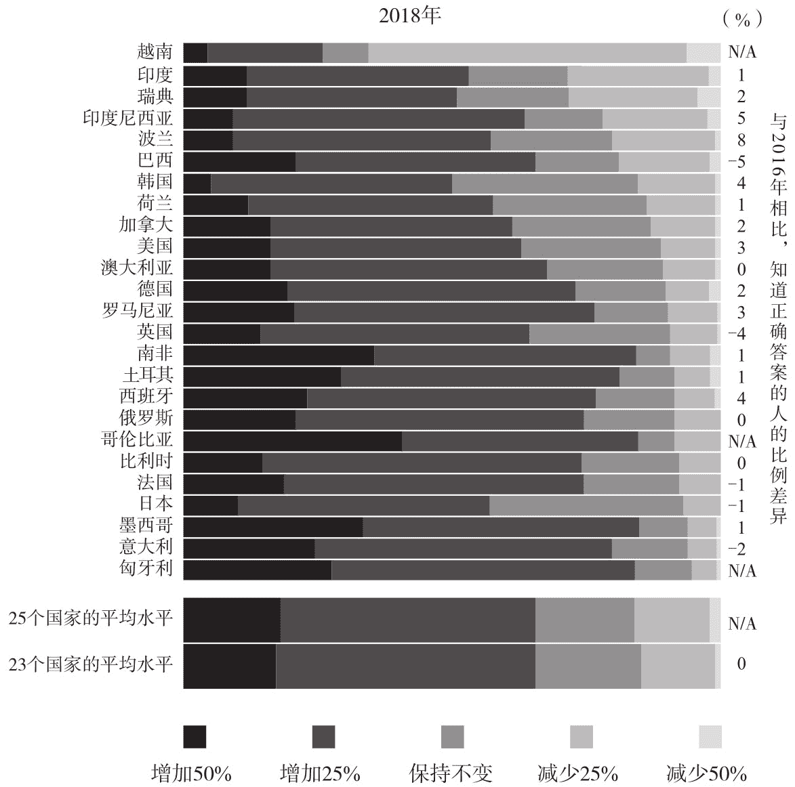

## 进化的陷阱：为何大脑偏爱坏消息

新闻机制系统性扭曲了我们对趋势的感知。资深编剧深知：吸引受众需不断升级危机与冲突。^[170]

**对负面信息的偏好，实为进化适应的产物。** 远古时期，树叶簌簌声预示捕食者降临，关注威胁关乎生死；而庄稼增产 0.1% 则微不足道。狩猎采集时代的祖先，未进化出感知渐进式利好的本能——因为漫长历史中，生活品质的提升极其微弱脆弱，毕生难察。直至中世纪，人均生存状态与石器时代差异有限。数据显示，1400 年英国人均 GDP 折合 2023 年约 1605 英镑。^[171]

现代版“草丛捕食者”，是我们持续监控社交媒体等信息源，筛选潜在危机。媒体心理学专家帕梅拉·拉特利奇指出：“我们不断扫描事件，追问：‘这关乎我吗？我危险吗？’”^[172]

**另一进化遗留，是“美化过去”的记忆偏差。** 痛苦记忆消退较慢，快乐记忆褪色更快。^[173] “Nostalgia（怀旧）”一词，1688 年由瑞士医生约翰内斯·霍弗合成希腊词根（nostos 返乡 + algos 痛苦）而来，本意非单纯追忆，而是通过理想化过往缓解当下压力。^[174]

我们还倾向于高估负面事件频率。2017 年研究显示^[175]，此偏差投射至政治：2016 年皮尤调查中，51% 美国人认为文化与生活水平较 50 年代恶化。^[176]

^

图 4-1 近 20 年全球极端贫困人口比例变化认知调查

资料来源：Martijn Lampert 等，2018。

仅 2% 受访者答对：贫困率腰斩。无数社经指标佐证：公众认知与现实严重背离。

益普索·莫里为英国皇家统计学会及伦敦国王学院的里程碑式研究亦印证此点：^[177]

*   公众估算 24% 福利为欺诈领取，实为 0.7%；
*   1995-2012 年英格兰威尔士犯罪率降 53%，58% 受访者以为升或持平；2006-2012 年暴力犯罪降 20%，51% 以为升；
*   公众估算少女怀孕率为实况 25 倍（实 0.6%，估 15%）。

大西洋西岸同理。21 世纪以来，美暴力与财产犯罪案量较 1990 年腰斩，却有高达 78% 美国人误判犯罪率上升（见图 4-2、4-3）。^[178]

^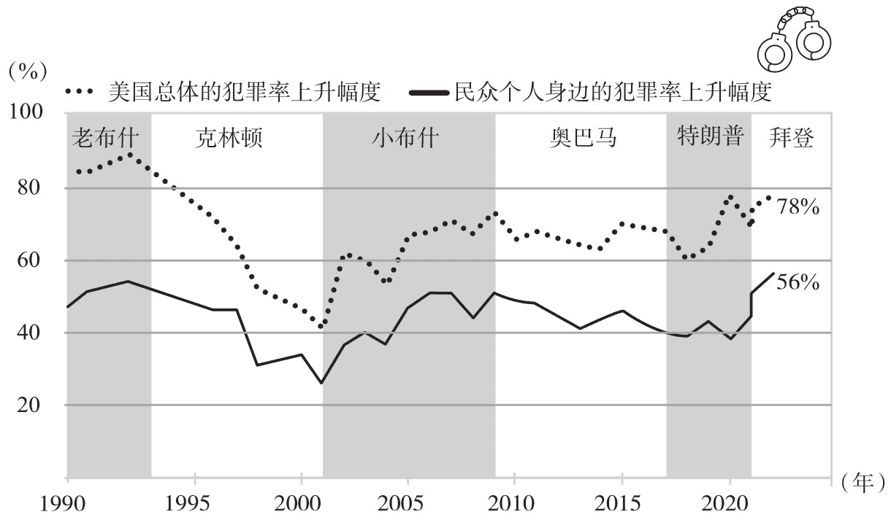
▲图 4-2 公众对犯罪率上升的看法
资料来源：Gallup Poll 等，2022。

^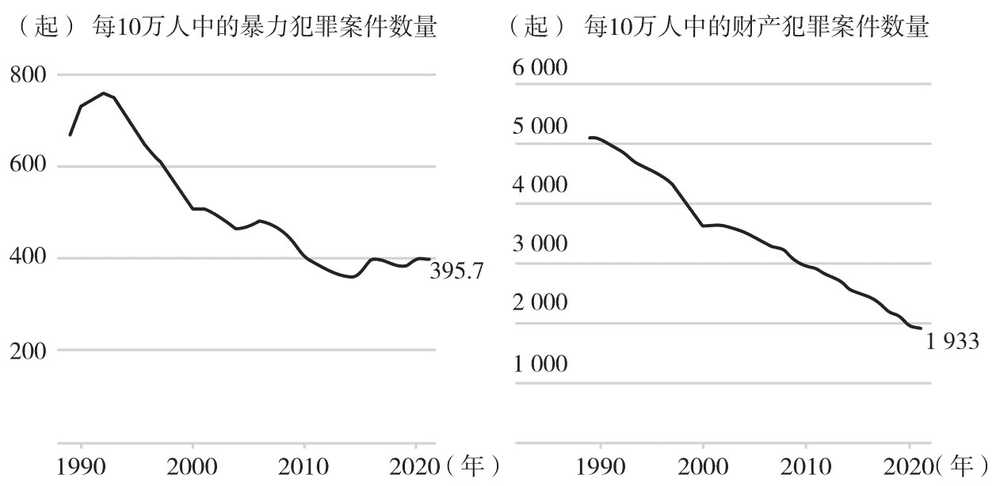
▲图 4-3 美国实际犯罪率
资料来源：FBI 统一犯罪报告等，2022。

“血腥新闻更吸睛”道出误解成因。暴力事件刷屏，而犯罪率下降（数据驱动执法、社区警务改善）属“非事件”，无报道价值。这非主观恶意，乃媒体激励结构使然：人类天生被威胁信息吸引（前文认知偏差），媒体靠眼球变现，激烈情绪反应是流量密码。

紧迫性亦是一因。“News”暗示新颖即时。受众时间有限，优先关注突发。问题在于：突发多为恶事。好事多为渐进，紧迫感低，难登头条。社交媒体同理：灾难短视频易传播，渐进过程无戏剧张力。

平克直言：“新闻制造认知偏差。它只报发生的事，不报未发生的事。无警察被杀、无城市骚乱，便无新闻……悲观主义或成自我实现预言。”^[179]

**我持反向观点：乐观主义非盲目臆测，而是自我实现的预言。坚信美好世界可能，是创造美好世界的强大动力。**

丹尼尔·卡尼曼^[180] 及特沃斯基的研究揭示多重启发式偏差：如赌徒谬误（连抛反面后以为正面概率增大）^[181]，“可得性启发式”解释群体悲观倾向^[182]。

纠正偏见非忽视真问题，而为乐观提供理性基石。**技术进步非自动发生，凭借人类智慧与汗水。** 进步非逃避苦难的借口。

反过来看，正是因理解“尽管困难重重，人类正扭转颓势”，方能汲取前行动力。

## 文明的复利：几乎所有维度都在向好

信息技术指数级跃迁，因其直接反哺自身创新。同时，这一趋势激活了他领域相互强化的进步机制。两个世纪来，良性循环推动识字、教育、财富、卫生、健康、民主化、暴力减少全面跃升。

我们常用经济视角度量发展：收入增，生活优。但真实发展非仅积累财富。经济周期起伏，财富可得可失。技术变革却具永久性——文明一旦掌握有用知识，便保存传承、迭代升级。这种单向累积，成抵御天灾、战祸、疫病导致的短暂倒退的强力屏障。

**教育、医疗、卫生、民主化交织成相互增强的飞轮，任一环改善皆惠及他环。** 如：教育出良医，良医护童留校。新技术间接收益巨大，甚至惠及看似无关领域。20 世纪家电解放主妇时间，推动女性解放，千万才俊涌入职场，贡献无数创新。技术创新创造条件，释放更多社会潜能，反哺更多创新。

印刷术普及教育，造就优质劳动力，促经济增长；识字助生产贸易协同，增繁荣；财富回投基建教育，加速循环；大规模印刷推民主化，长期消弭暴力。

起步极缓，祖孙三代生活差异不明显。但几个世纪来，福祉指标显著跃升。近几十年，信息技术指数曲线陡峭，趋势加速。未来几十年，我们将进入高速跃升期。

### 识字与教育：从特权走向普世

历史长河中，全球识字率长期极低。知识靠口耳相传，核心因复制文字成本高昂。普通人鲜接触书籍、买不起书，投入大量时间学读写不划算。时间是唯一稀缺资源，人人日仅 24 小时。生存艰难、无书可读的社会，学读写非理性选择。祖先不识字，非愚昧无知，乃环境桎梏。

此视角下，审视当下阻碍学习的激励机制：信息技术岗位稀缺地区，青年学编程或不划算。但技术正改写此局：自动翻译、远程教育、自然语言编程、远程办公开辟新径，激励探索未知。

中世纪末期活字印刷入欧洲，低价多元读物激增，平民得以习字。当时欧洲识字率不足 1/5。^[183]

至 1870 年，仅战后落后的西班牙、意大利明显低于此线。^[184]

20 世纪公共教育全球普及，1910 年全球识字率破 25%（见图 4-4）。1970 年，绝大多数国家地区基本扫盲（见图 4-5）。^[185]

^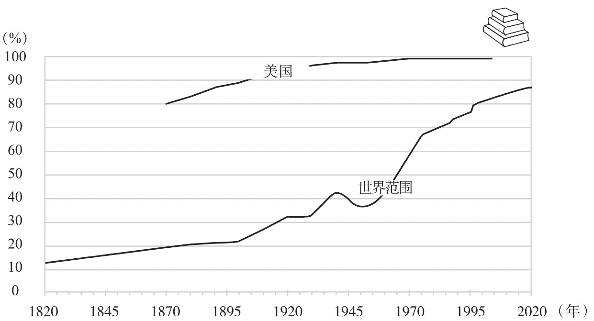
▲图 4-4 1820 年以来美及全球识字率变化
主要资料来源：Our World in Data; UNESCO。

^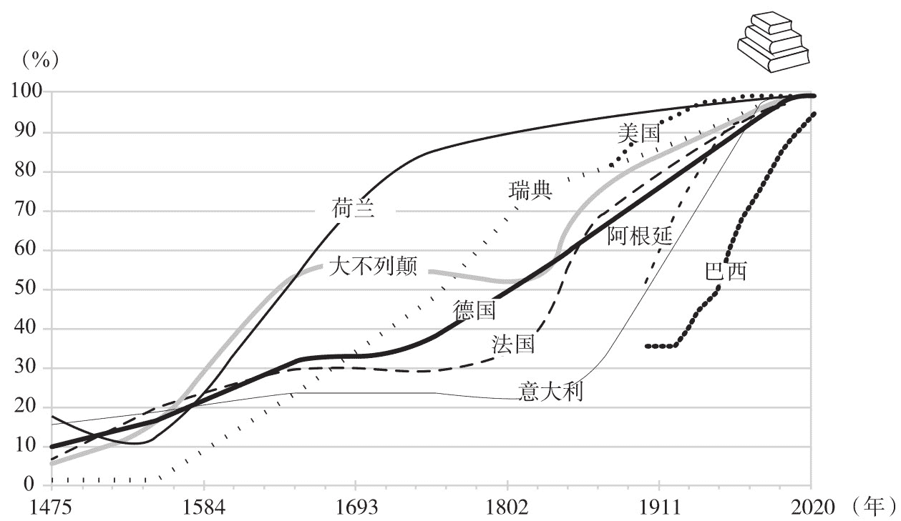
▲图 4-5 1475 年以来多国识字率变化
资料来源：Our World in Data; UNESCO。

仍有提升空间。上述数据多指基础读写（如写自己名字）。为全面评估，新指标应运而生。2003 年美成人读写评估（NAAL）显示，仅 86% 成年人达“基础识字”以上。^[188]

1870 年美人均受教育 4 年，英、日、法、印均不足 1 年。^[189]

^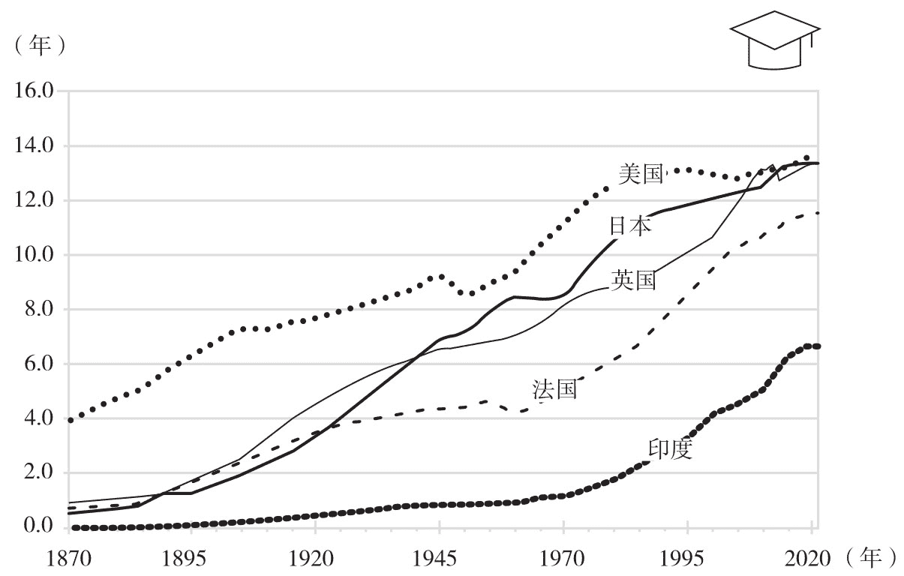
▲图 4-6 多国人均受教育年限
主要资料来源：Our World in Data; 联合国人类发展报告办公室。

^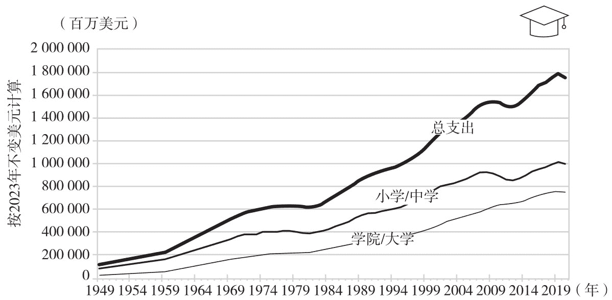
▲图 4-7 美国教育支出随时间变化（线性坐标）
主要资料来源：国家教育统计中心。

^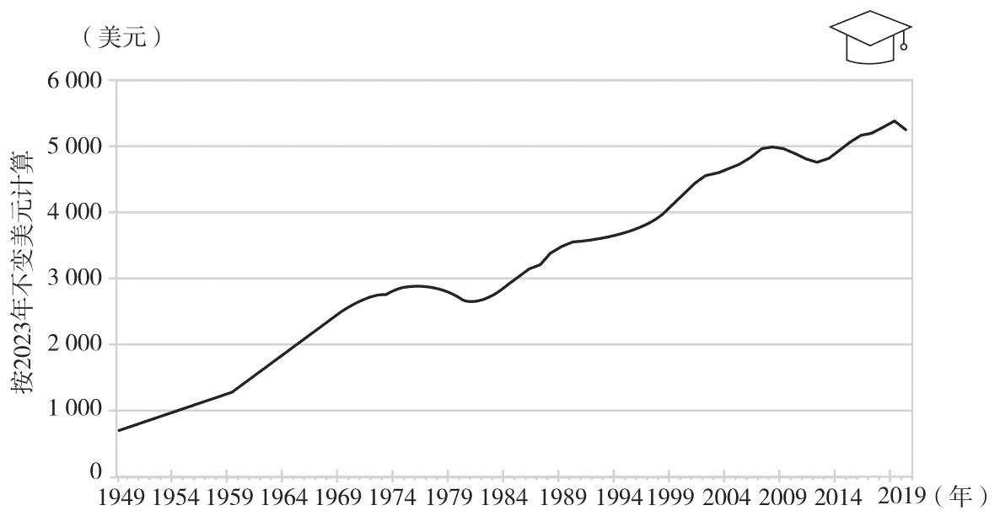
▲图 4-8 美国人均教育支出随时间变化（线性坐标）
主要资料来源：国家教育统计中心。

### 生活基建的跃迁：马桶、电力与大众传媒

历史上，粪便污染水源食物是致病死首因。^[193] 当下发展中国家缺改良卫设（如冲厕、堆肥厕），主因是贫困。^[194]

^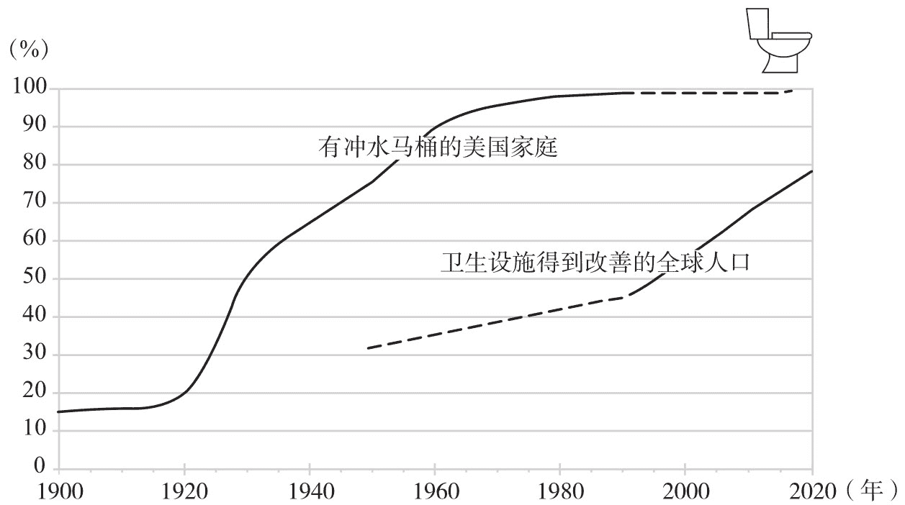
图 4-9 美家庭冲厕普及与全球卫设改善概况
注：虚线为桥接评估值。
主要资料来源：Stanley Lebergott 等；美国普查局；世界银行。

电力虽非信息技术，却是数字设备网络运转、现代文明便利的先决条件。计算机诞生前，电力驱动革命性省力设备，延伸作息娱乐时间。20 世纪初美电气化始于大城市。^[196]

^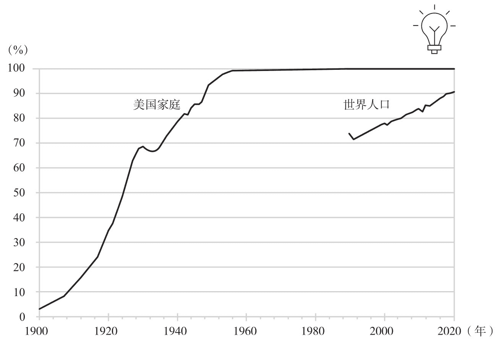
图 4-10 美家庭与世界人口通电情况
资料来源：美国普查局；世界银行；Stanley Lebergott。

全球电气化模式相似：先城市、后郊区、最后农村。^[198] 允许更多人参政、创新投资获安全保障，繁荣飞轮方能转动。但这些因素缺失，致使全球约 1/10 人口通电艰难：暴力区基建极易毁坏，投资无望；路况差险，设备燃料难抵偏远。幸而，廉价高效光伏电池正持续扩容供电。

首个借电力变革通信的技术是无线电广播。美商业广播始于 1920 年，30 年代成主流大众媒介。^[199]

^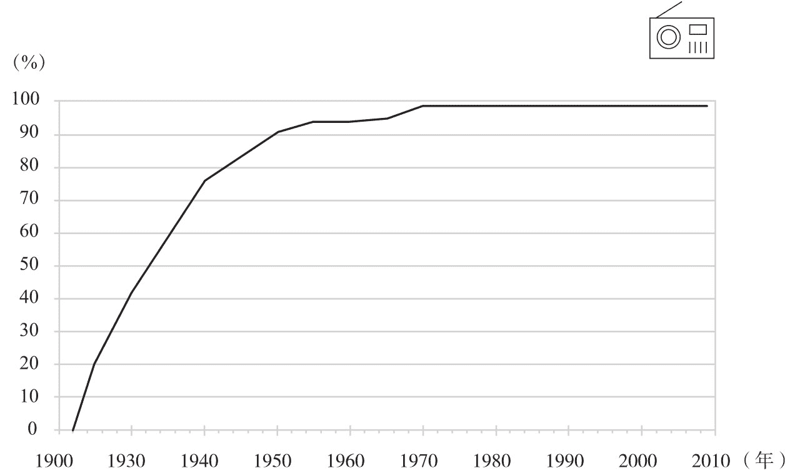
图 4-11 美家庭收音机拥有率变化
注：近年拥有率似大降（2008 年 96% 降至 2020 年 68%，统计口径不同），存统计误差——智能手机等替代设备具同等功能。2021 年 85% 美成人有智能手机，无需收音机也能免费听广播。
资料来源：美国普查局；Douglas B. Craig 等。

听众习惯随之变迁：节目侧重新闻、政治、体育，收听场景多为车内。^[201]

电视普及路径似收音机，但指数增速更快。科学家 19 世纪末理论探讨，20 年代末首批原型系统面世。^[202]

战后美民抢购电视，电视台遍地开花，1954 年过半家庭拥有至少一台。^[203]

^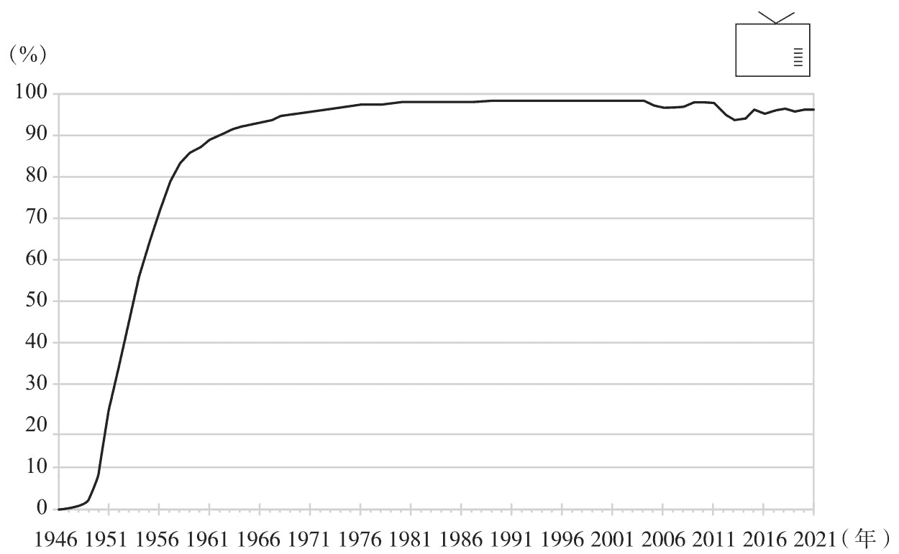
▲图 4-12 美家庭电视机拥有率

# 从被动观看到主动连接：技术如何重塑人类生存图景

**核心资料来源**：美国人口普查局；Cobbett S. Steinberg, *TV Facts*；Jack W. Plunkett, *Plunkett’s Entertainment & Media Industry Almanac 2006*；尼尔森公司。

电视普及率的回落并非单一原因，而是多重因素共振的结果：大众文化不再推崇“宅”在屏幕前的生活方式；在线娱乐内容的崛起分流了传统受众；且原本垄断于电视机的内容，如今可在各类智能终端上随时调取。

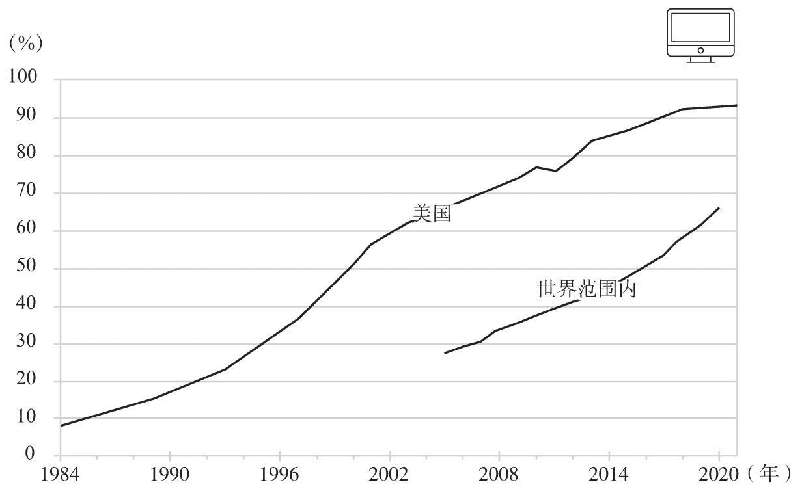

**美国家庭及全球家庭计算机拥有率变迁**

资料来源：美国人口普查局；国际电信联盟。

与收音机、电视这种单向灌输的媒介不同，计算机自诞生即带有“交互”基因，打开了无限可能。20世纪70年代，Kenbak-1（公认首台个人计算机）与1975年爆款Altair 8800（首台微型计算机，以DIY套件形式发售）相继走入美国家庭，拉开了普及序幕。90年代互联网井喷式增长，让计算机功能指数级跃升：1990年1月，全网主机仅17.5万台，但内容池的指数级扩张引发了正向飞轮效应——更多用户带来更多内容，更多内容吸引更多用户。家用电脑由此从单纯的文书、游戏终端，进化为连接全球知识、跨越大陆沟通的核心枢纽。

电商让指尖购物成真，社交媒体（21世纪初兴起）更让网络生活绚丽多彩。数据显示，2017-2021年美国家庭计算机拥有率稳定在93.1%上方，且随“最伟大的一代”退出历史舞台、“千禧一代”组建家庭，这一比例仍在攀升。

---

## 预期寿命：我们正跨越“第二座桥梁”

详细论述见第6章，但核心脉络在此梳理：迄今为止，医学突破多属“线性试错+偶然发现”模式。缺乏系统性筛选工具，导致重大发现往往靠运气——青霉素的意外问世开启抗生素时代，至今或已挽救2亿生命。

这套路径功不可没。千年前欧洲人均预期寿命仅20多岁，霍乱、痢疾等今易防疾病曾大肆收割婴幼儿与青壮年。

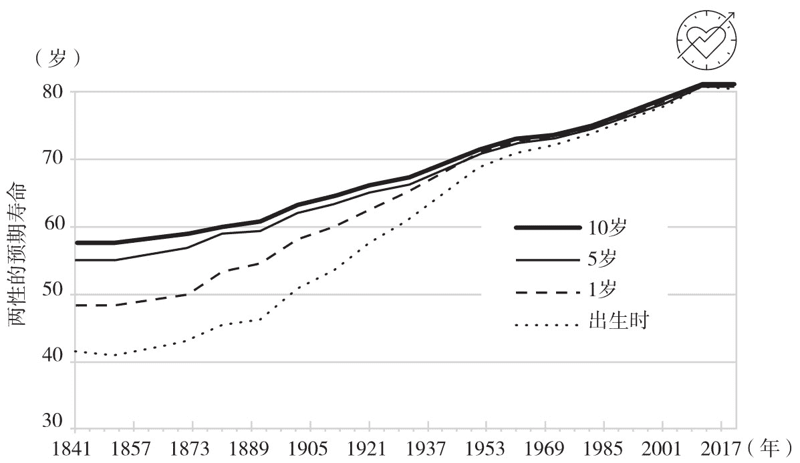

▲ **图 4-14 英国人预期寿命增长轨迹**

资料来源：英国国家统计局。

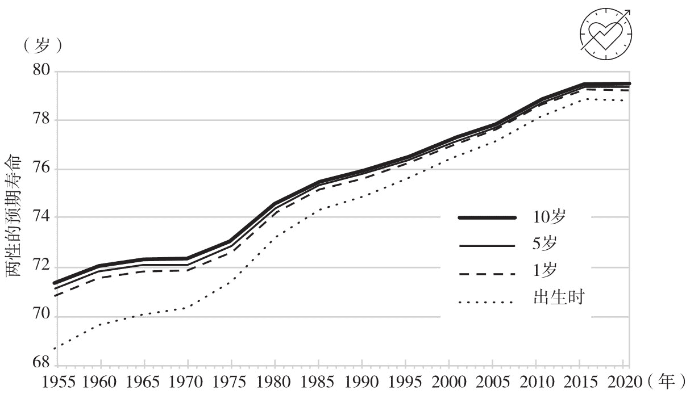

▲ **图 4-15 美国人预期寿命变化曲线**

资料来源：联合国社会经济事务部。

然而，“低垂的果实”已基本摘完。当下致病致残主因多源于体内：细胞失能、组织崩解引发癌症、动脉粥样硬化、糖尿病、阿尔茨海默症等。**通过生活方式干预、饮食调整、补充剂延缓风险，是通向长寿的“第一座桥梁”。**

**好消息是，2020年代我们已踏上“第二座桥梁”：AI与生物技术深度融合，直击退行性疾病。** 科研不再局限于用计算机管理文献与试验数据，而是直接部署AI发现新药；至2030年前后，数字孪生模拟将扩容并最终替代周期长、效率低的人体临床试验。本质上，我们正将医学转化为信息技术，借指数级算力破解人体生物学的“源代码”。

基因组学是里程碑式案例。2003年人类基因组计划完成后，测序成本呈指数级暴跌，年均减半。虽经2016-2018年短暂平台期及新冠疫情干扰，但随着AI深度介入，降速有望再次加快。单人测序费用从2003年的5000万美元骤降至2023年初的399美元，甚至已有企业承诺百美元级服务。

AI渗透医疗的每个角落，将催生更多同类指数曲线。临床端已见实效。

**展望2030年代，我们将登上“第三座桥梁”：医用纳米机器人。** 它们能在体内智能执行细胞级维护与修复。广义上某些生物分子可视为原始纳米机器，但关键差异在于——新一代纳米机器人可受AI编程，执行多样化任务。届时，人类将像修车师傅掌控零部件一样掌控生物躯体：只要非毁灭性损伤，即可无限更换修复。智能纳米机器人将靶向修正或升级单个细胞，助人类彻底终结衰老（详见第6章）。

**“第四座桥梁”将在2040年代架设：思维数字化备份。** 如第3章所述，身份本质非大脑硬件，而是其承载的信息特定排列。一旦高精度扫描成熟，即可在数字底座上复刻意识。生物大脑毁灭不再等于身份终结，多重冗余备份将赋予生命近乎无限的时长。

---

## 贫困退潮，收入跃升：被低估的繁荣叙事

前文技术趋势利好显性，但真正改变游戏规则的是其**复利式协同效应**。经济福祉虽非完美尺度，却是长周期观测全面进步的最佳代理指标。全球宏观图景极其稳健：1820年全球84%人口深陷极端贫困。

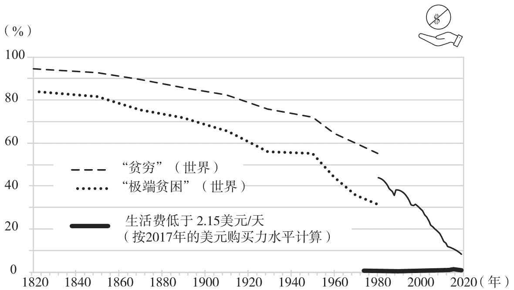

**全球绝对贫困率下降趋势**

注：指绝对贫困率，区别于美国标准。

资料来源：Our World in Data；François Bourguignon and Christian Morrisson, “Inequality Among World Citizens: 1820—1992,” *American Economic Review* 92, no. 4 (September 2002): 727–44。

东亚降幅最猛，核心动力是中国经济腾飞让数亿人脱贫，生活水平逼近发达国家。1990-2013年，东亚总人口从16亿增至20亿，极端贫困人口却骤减95%。

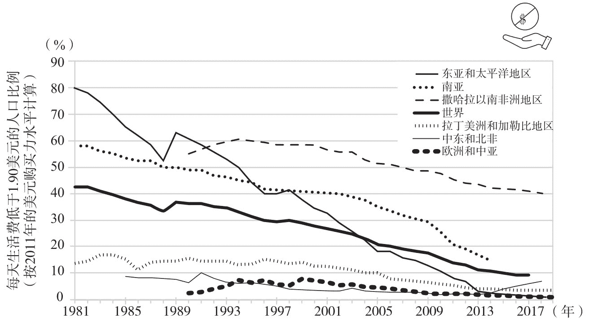

**图 4-17 各地区极端贫困人口占比下降趋势**

资料来源：世界银行。

同期少数反弹区域集中在欧洲和中亚，系苏联解体后经济动荡修复滞后所致。冷战结束后，国际关注度转向最贫困地区，但发达国家对外援助预算曾一度缩水。

美国本土以国际极端贫困线（2.15美元/天，2017年购买力平价）衡量，绝对贫困率长期锁定在1.2%以下。

**表 4-1 美国相对贫困率年度概况（政府定期调整定义）**

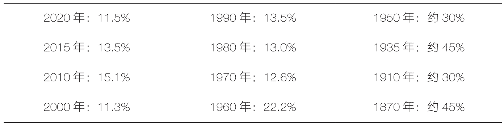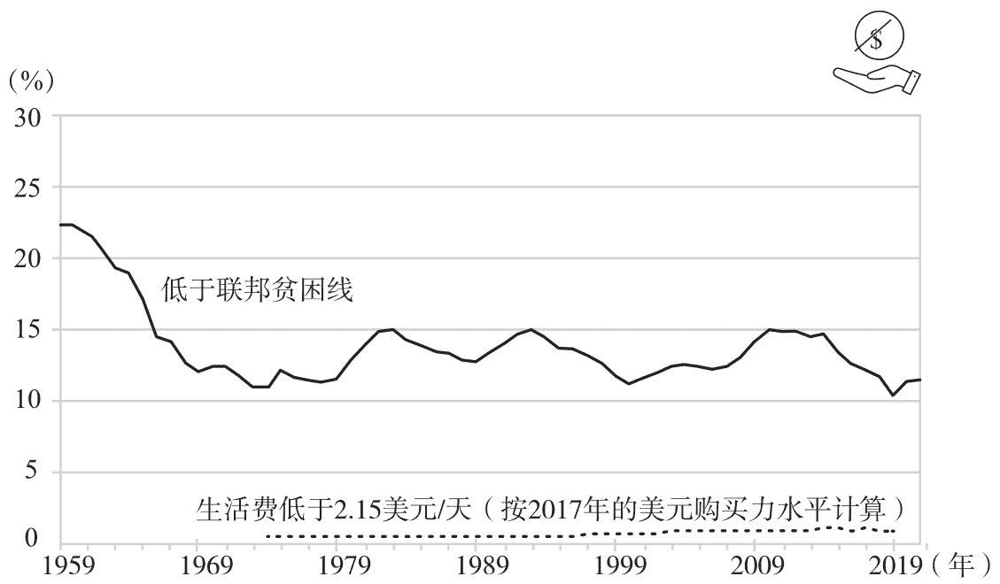

**图 4-18 美国绝对与相对贫困率对比**

资料来源：美国人口普查局；世界银行。

2014-2019年，美相对贫困人口减少1260万，同期总人口反增890万。更关键的是，互联网赋予低收入群体“数字红利”：免费旁听MIT名校课程、跨洋视频连线家人，生活质量实质性提升，传统货币指标难以捕捉。

美国人均日收入稳步飙升。2023年单身贫困线年入14580美元，折合日均约39.95美元。

**表 4-2 美国人均日收入变迁（2023年购买力平价）**

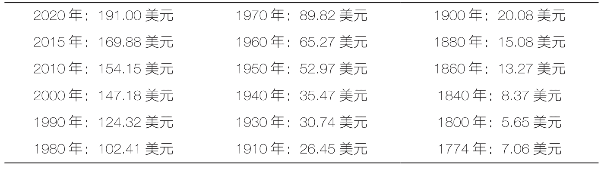

美国GDP指数级增长固然受惠人口红利，但扣除人口因素后，**人均GDP仍呈指数级跃升**。

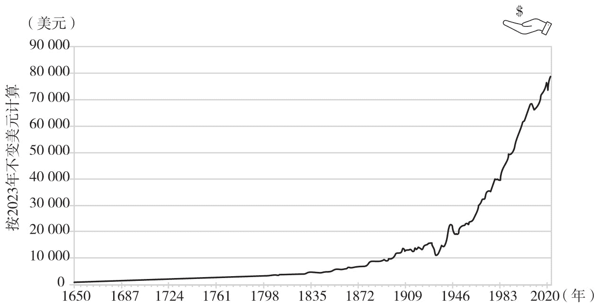

▲ **图 4-19 美国人均GDP增长趋势（线性坐标）**

资料来源：马迪森项目数据库；经济分析局；美联储。

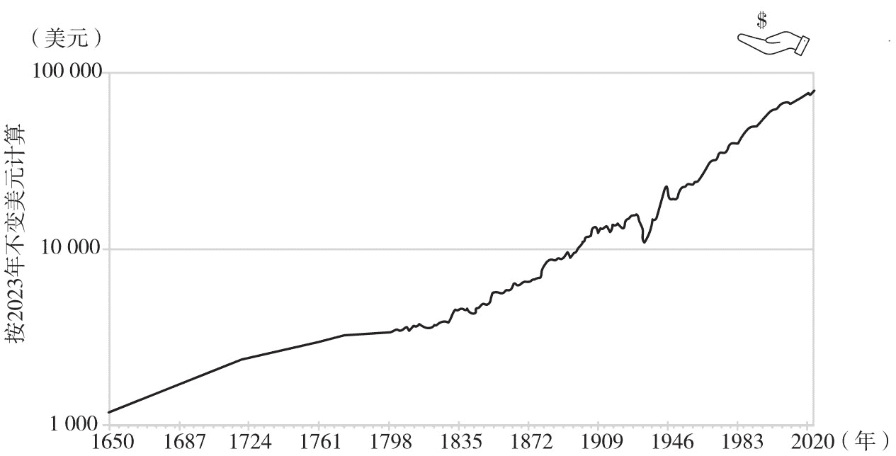

▲ **图 4-20 美国人均GDP增长趋势（对数坐标）**

资料来源：马迪森项目数据库；经济分析局；美联储。

GDP反映宏观活动，微观层面**人均个人收入**（含工资、股息、利润等非劳务收入）同步飙升。自1929年有统计以来，按不变美元计算，普通美国人实际收入90年间翻了5倍多，且工作时长大幅缩短未阻滞增势。

官方数据仍**显著低估**真实福利增量：电子产品价格崩塌、搜索/社交等高价值服务零成本开放、全球化极大丰富商品篮子，均未计入。选择权本身即财富：从餐桌上的环球食材、指尖上的百万图书、反季节空运水果，到数百电视频道，多样性渗透生活每寸肌理。

### 选择权的爆炸与经济全球化

信息技术驱动的全球化，让小众需求也能精准匹配：古董万花筒收藏家在eBay全球狩猎，数理科学爱好者沉浸海量教学视频，而非被迫守着《荒野大镖客》打发童年。未来随着3D打印、纳米技术成熟，选择维度将再次指数级炸裂。

### 收入、工时与童工的三重奏

年收入需配合工时读解。1880-2021年，美实际时薪（不变美元）从约5美元飙升至93美元。

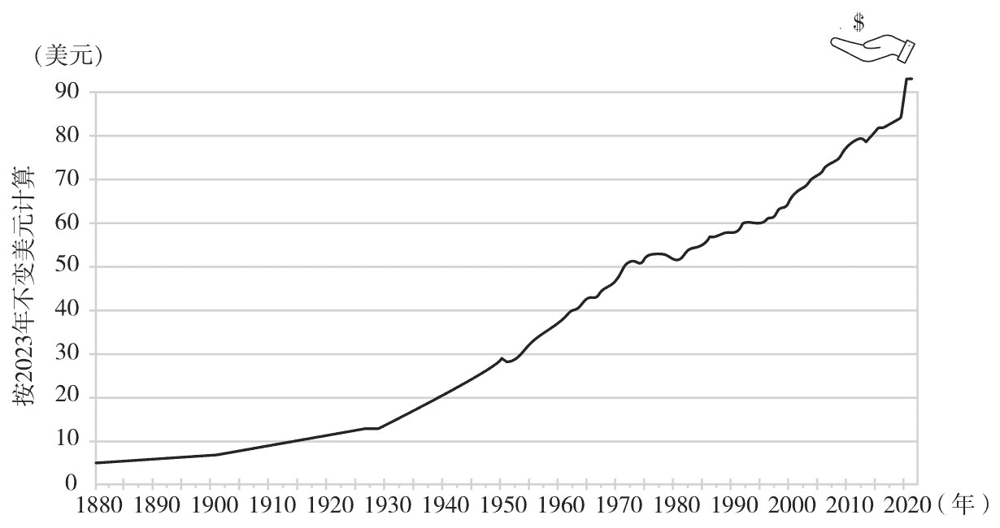

▲ **图 4-21 美国实际时薪稳步上扬（含非工资收入）**

资料来源：马迪森项目；经济分析局；Stanley Lebergott等经典文献。

大萧条期人均年入下跌分母（人口）稳定所致，但幸存就业者时薪韧性极强，甚至逆势上扬。

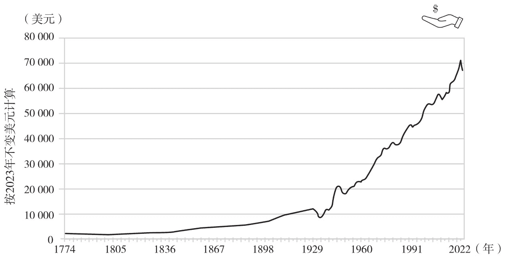

▲ **图 4-22 美国人均年收入长周期上行**

资料来源：经济分析局；国家经济研究局；Alexander Klein等研究；美联储。

19世纪末美工人年均工时近3000小时。

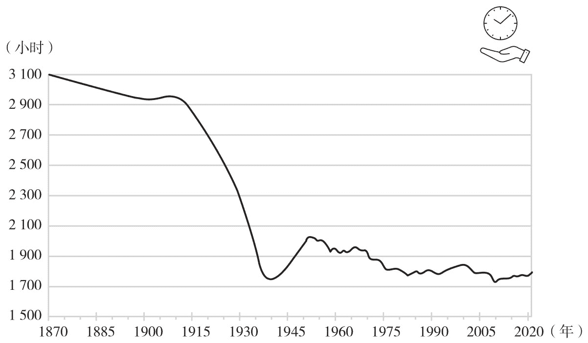

**图 4-23 美国人均年工作时长变迁**

资料来源：Michael Huberman and Chris Minns等研究；格罗宁根大学；加州大学戴维斯分校；美联储；经合组织。

二战及战后繁荣期工时曾反弹超2000小时。而今千禧一代与Z世代偏好创造性、创业型、远程友好的职业，通勤成本归零，工作生活边界重塑。新冠疫情加速远程办公范式固化，98%受访者愿终身保留远程选项。

童工减少是社会福祉硬指标。贫困逼迫儿童劳动，扼杀教育与长期潜能。21世纪以来，国际劳工组织三层嵌套统计口径均确认童工持续下行。

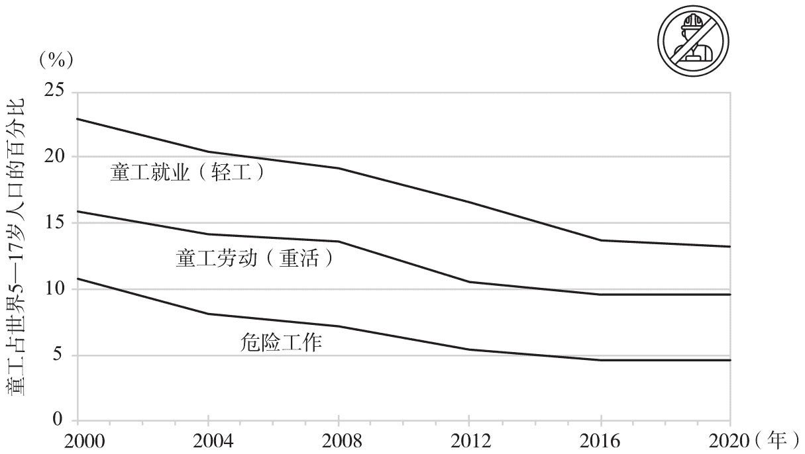

**图 4-24 全球童工规模收缩趋势**

资料来源：国际劳工组织；联合国儿童基金会。

---

## 暴力消长：繁荣与和平的共振

物质富足与暴力收敛互为因果。有资产可失者更重和平红利；长期安全预期鼓励长期主义社会投资。西欧谋杀率自14世纪起持续走低。

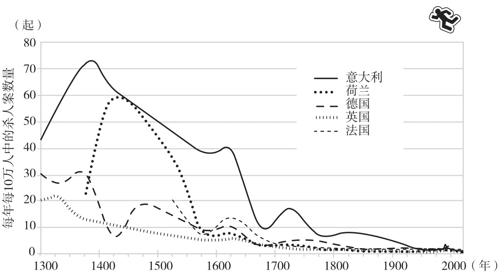

▲ **图 4-25 1300年以来西欧谋杀案件率变迁**

注：参考Max Roser与Hannah Ritchie (Our World in Data) 构建，数据源有别。1990年前数据说明见Manuel Eisner相关文献。

**暴力犯罪的长期退潮：数据溯源与深层动因**

回溯 1990 至 2018 年的统计记录，本文引用的并非世卫组织数据，而是联合国毒品和犯罪问题办公室（UNODC）发布的 1990-2020 年序列。选择该数据集的理由在于：其经多方独立来源交叉验证，且与涵盖面更广的官方执法估算高度吻合。

数据来源：Our World in Data（Roser and Ritchie）；Manuel Eisner,“From Swords to Words: Does Macro-Level Change in Self-Control Predict Long-Term Variation in Levels of Homicide?,” *Crime and Justice* 43, no.1（2014 年 9 月）；联合国毒品和犯罪问题办公室。

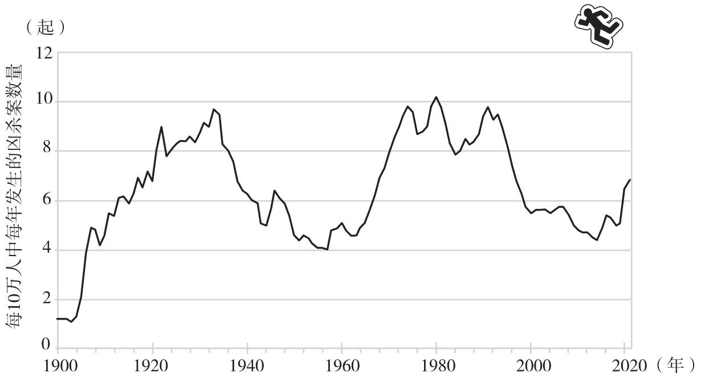

**图 4-26 美国凶杀率随时间演变的轨迹** ^(²⁴⁷)

数据来源：联邦调查局；司法统计局。

放眼美国，自 1991 年起，谋杀案及其他暴力犯罪呈现长期下行态势。虽近年有所反弹——从 2014 年的万分之 4.4 升至 2021 年的万分之 6.8（成书时最新数据，见图 4-26），但即便这一短期波峰，较 1991 年的万分之 9.8 高点，依然腰斩逾三成。^(²⁴⁶)

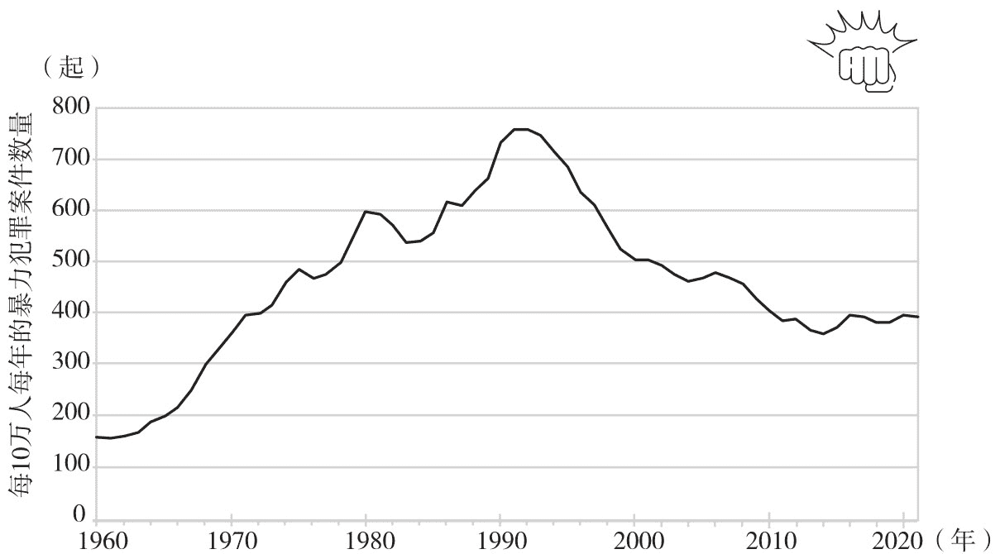

**图 4-27 美国暴力犯罪案件总量走势** ^(²⁴⁹)

数据来源：联邦调查局；司法统计局。

推动暴力犯罪退潮的关键变量有多个。上世纪 80 年代初，美国暴力犯罪触及历史天际，迫使犯罪学家另辟蹊径。学者乔治·凯林与詹姆斯·Q·威尔逊敏锐捕捉到：涂鸦、破坏公物等低级违法行为，会侵蚀社区安全感，诱发“破窗效应”，让潜在犯罪者误判可逃脱更严重暴力犯罪的制裁。^(²⁴⁸)

另一关键因素——环境污染与犯罪的关联，直到近年才被充分认知。上世纪大部，人类对环境毒性（尤其是铅）侵蚀大脑的机制知之甚少。儿童吸入车尾气、接触含铅油漆，严重阻碍认知发育。虽难断定个体犯罪与铅中毒的直接因果，但在群体层面，慢性铅中毒显著推高暴力犯罪率，主因疑为冲动控制力衰退。自 70 年代起，环保法规逐步切断儿童铅暴露路径，被视为暴力水平下降的重要推手。^(²⁵⁰)

史蒂芬·平克在 2011 年巨著《人性中的善良天使》中，梳理证据指出：自中世纪以来，欧洲他杀死亡率大致腰斩，部分地区降幅更甚。^(²⁵¹)

即便置于 20 世纪重大冲突之下，按比例换算的战死人数，亦远低于无正式国家时代人类持续承受的暴力死亡率。平克考察了 27 个未建立正式国家的前工业社会（狩猎采集与耕作狩猎混合群体），它们或可视作人类史前主流形态的缩影。^(²⁵²)

然而，公众普遍误判暴力正在升级。平克归因于“历史近视症”——大众聚焦近期惨剧，对远古更惨烈的暴力一无所知。^(²⁵³)

同平克一样，我将暴力骤降归功于良性反馈回路。当人们对摆脱暴力的信心增强，办学、著书、读书的动力随之高涨，理性对话取代武力解争，暴力进一步收敛。此间运作着“同理心扩展圈”（沿用彼得·辛格概念），将认同对象从氏族拓至民族国家、外邦人，乃至非人类动物。^(²⁵⁴)

**这些良性循环的内核，实为技术驱动——这是通向未来的关键洞见。** 过往人类仅认同小群体，而通信技术（经书籍、广播电视、至计算机互联网）打破物理阻隔，让思想跨越广袤人群流动，揭示共性纽带。**目睹远方灾难的震撼影像，虽易使人忽视长期向好趋势，却有效激活天生共情机制，将道德关怀辐射至全人类。**

财富增殖与贫困消退，亦强化合作动机，稀缺资源的零和博弈随之淡出。许多人深信：争夺稀缺资源是暴力源头，植根人性。这解释了历史大部，却非永恒铁律。数字革命已将可数字化事物的稀缺性压至近零——从网络检索到社交连接。争抢实体书尚可理解（同一时刻仅一人可读），为 PDF 争吵则荒谬可笑：你的拥有不妨碍我的复制，边际成本趋零。

一旦人类掌握极廉价能源（主攻太阳能，终极指向核聚变）与 AI 机器人，海量商品将极易复制，为之动武将如今天为 PDF 厮杀般愚蠢。由此，从当下至 2040 年代，信息技术的指数跃迁将重塑社会全貌。

## 清洁能源成本的指数级崩塌

能源是科技文明的血液，长期锚定化石燃料不可持续，双重困境在于：排放剧毒污染物；锁死稀缺资源，且开采成本随需求激增而攀升。

庆幸的是，随着前沿技术渗透材料科学与底层机制设计，绿色可再生能源成本正以指数级速度坠落。过去十年，超算已用于筛选光伏电池与储能新材，近年深度神经网络更成利器。^(²⁵⁵)

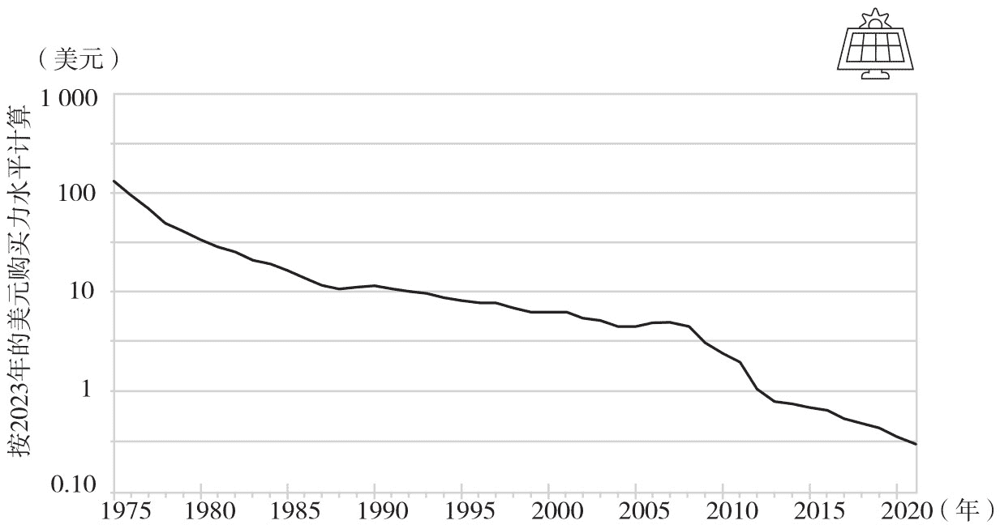

▲**图 4-28 光伏组件单瓦成本演进（对数坐标）** ^(²⁵⁶)

注：图示揭示近 50 年光伏组件成本指数级下探，此即“斯旺森定律”。注意：组件成本虽占装机总成本大头，但并网许可、人工等“软成本”可能推高总价至组件价的 3 倍。^(²⁵⁷)

主要来源：Our World in Data；Gregory F. Nemet,“Interim Monitoring of Cost Dynamics for Publicly Supported Energy Technologies,” *Energy Policy* 37, no. 3（2009 年 3 月）；IRENA。

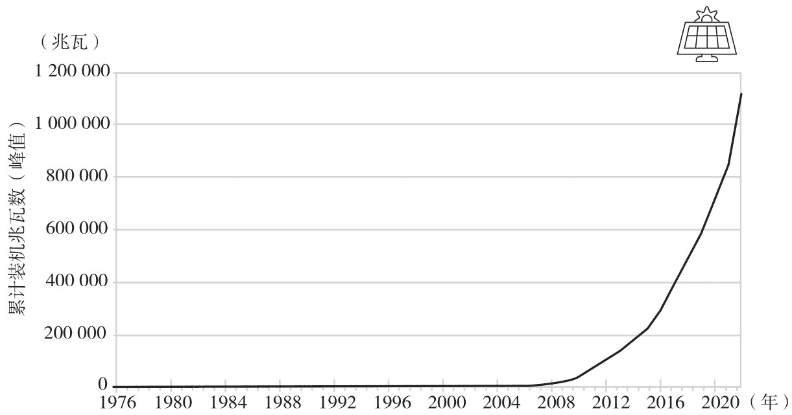

▲**图 4-29 全球光伏累计装机量（线性坐标）** ^(²⁵⁸)

主要来源：Our World in Data；IRENA；Gregory F. Nemet, 同上。

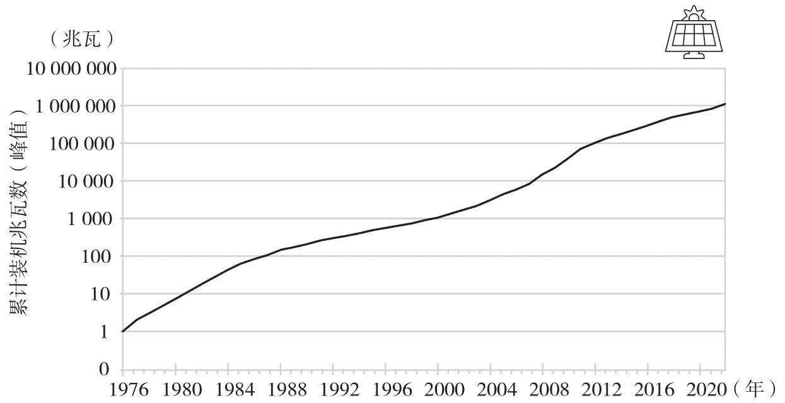

▲**图 4-30 全球光伏累计装机量（对数坐标）** ^(²⁵⁹)

主要来源：Our World in Data；IRENA；Gregory F. Nemet, 同上。

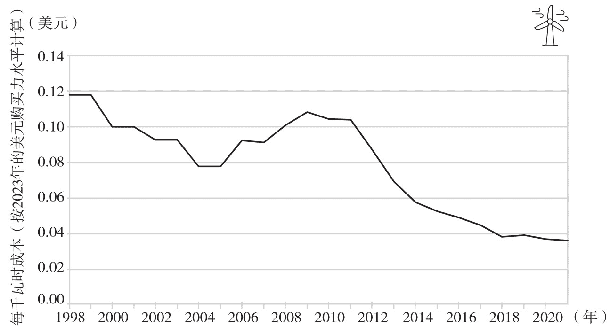

▲**图 4-31 美国陆上风电平准化度电成本（LCOE）变迁** ^(²⁶⁰)

数据来源：美国能源部。

## 信息流动重塑民主版图

廉价清洁能源将释放海量物质财富，能否公平分享，取决于民主制衡。幸而，**信息技术长期充当民主扩散的催化剂。** 民主萌芽于中世纪英格兰，与大众传播技术兴起同频共振，且极大概率由后者驱动。1215 年《大宪章》确立自由民免遭非法监禁权利，标志性节点。^(²⁶¹)

古登堡印刷机堪称“加速回报定律”在信息技术上的教科书级演示。前文所述，信息技术本质是对信息的采集、存储、处理、传输。理论上，信息是有序抽象，对抗熵增混乱。物理载体承载信息（如纸墨），但思想这种抽象编码，可迁移于石碑、羊皮、穿孔卡、磁带、硅基电压等任意介质。理论上，凿子加耐心，可在石碑刻入 Windows 11 全量源码！虽夸张，却揭示物理介质对信息处理效率的决定性制约——唯有极致高效的载体，才能让思想真正落地生根。

中世纪漫长岁月，欧洲书籍依赖抄写员笔耕不缀，信息流通昂贵惊人。思想越多，创新越易，含技术创新；降低分享门槛的技术，反哺新技术诞生，新技术再降分享门槛。印刷机问世，思想流通成本崩塌。中产阶级首次批量购书，人类潜能爆发，文艺复兴燎原，印刷技术迭代加速，至 17 世纪初书价已跌至古登堡时代的千分之几。^(²⁶²)

知识扩散催生财富与政治权利，英格兰下院等机构声势渐大。虽大权仍握王手，议会已能抗税、弹劾重臣。^(²⁶²)

美独立战争前，英国虽非真民主，却是史上最民主政体之一。^(²⁶³)

相较之下，英国理论上赋予自由成年男性户主投票权（实践常附加财产门槛），资格不系出身身份。虽有排除，却奠基普选理念——一旦承认“出生不定投票权”，历史车轮不可逆转。首个现代民主诞生于英属北美殖民地，虽经血战，实属水到渠成。但兑现民主承诺，漫漫长途。

两百年前美国，全民政治参与仍是奢望。19 世纪初，仅有产成年白人男性享投票权。经济门槛纳入多数白男，却将女性、非裔（数百万为奴）、印第安人彻底拒之门外。^(²⁶⁴)

19 世纪民主推进步履维艰。1848 欧洲自由革命多折戟，沙皇亚历山大二世俄国改革亦被继任者废弃。^(²⁶⁵)

二战后，全球民主人口比例跃升，主因印巴次殖民地独立。冷战大部，民主国家数量相对静止，仅约 1/3 世界人口生活在民主体制下。^(²⁶⁶)

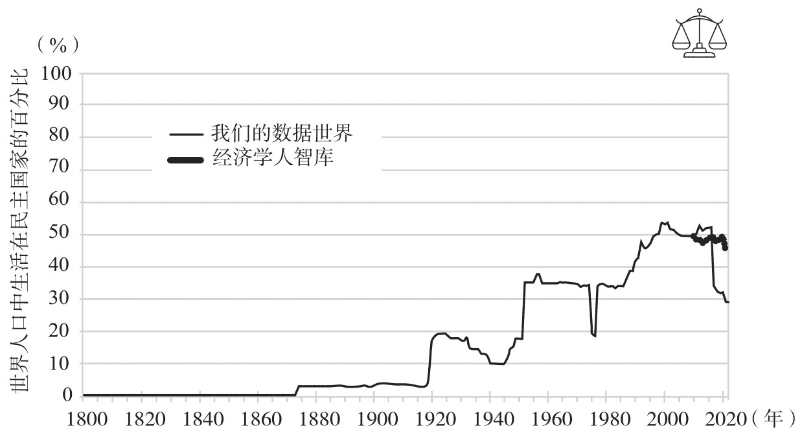

**图 4-32 1800 年以来全球民主化浪潮** ^(²⁶⁷)

主要来源：Our World in Data；经济学人智库。

近 20 年虽因部分国家进退不一，民主人口比例波动，但另一积极变迁加速发生。冷战终结时，约 35% 世界人口处于封闭极权统治下。^(²⁶⁸)

历史予我们乐观底气。从电报到社媒，信息共享技术迭代，将民主与权利理念从冷僻小众推向全球共识，并让近半地球人口亲历其境。技术演进为民主普及注入强心剂。**展望未来 20 年，指数级技术跃迁将助我们更充分兑现民主与权利的理想。**

## 我们正闯入指数曲线的陡峭攀升期

关键认知：前述一切进步，皆源于指数趋势缓升初期。鉴于未来 20 年信息技术将超越过去 200 年累积进步，其对繁荣的贡献将呈数量级跃升。事实上，红利已远超大众认知。

最核心引擎，是算力性价比的指数级飞跃（见图 4-33）。即：按通胀校准后的恒定美元，每秒可执行计算次数。1939 年康拉德·祖泽造出首台可编程计算机 Z2，折算 2023 年购买力，每美元每秒仅 0.0000065 次运算（见表 4-3）。^(²⁶⁹)

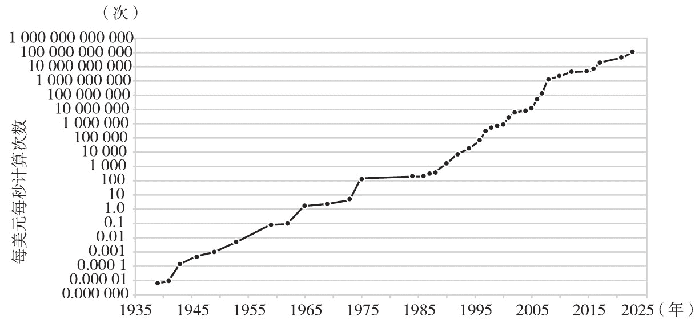

▲**图 4-33 1939—2023 年算力性价比跃升轨迹** ^(²⁷⁰)

注：按 2023 美元购买力，以各年代最优机型每美元每秒运算次数为准。

▼**表 4-3 歷代算力性价比纪录保持者**

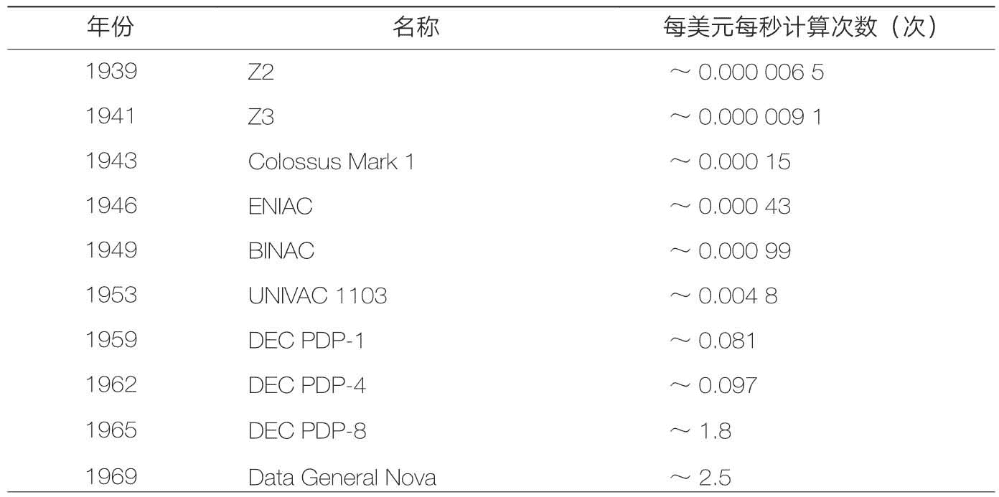

续表

这惊人跃迁，却未获应有认知。2016 年 10 月 IMF 年会，总裁拉加德与我及经济界领袖对谈，追问：为何非凡数字技术未转化为显著经济增长？我当时的回答（至今有效）：核算增长时，将数字技术影响同时置于分子分母，导致抵消失真。

非洲少年花 50 美元购入智能手机，GDP 仅记 50 美元消费；实则获取的算力通信能力，折合 1965 年约 10 亿美元、1985 年数百万美元。以骁龙 810 为例，常见于 50 美元机型，峰值约 30 亿 FLOPS，折合每美元每秒 6000 万次运算。^(²⁷¹)

粗略对比未计后续技术演进多维度。精确说：1965 或 1985 年，无任何价格能买到 50 美元手机的全功能。传统指标近乎忽略信息技术年均 50% 的高通缩率（算力、基因测序等），性价比提升双重体现为价格下探与性能跃迁，让我们以更低价买到更强产品。

亲身例证：1965 年我就读 MIT，校引以为傲的 IBM 7094，15 万字节核心存储、25 万 MIPS，耗资 310 万（1963 美元，约等 2023 年 3000 万），数千师生分时共享。^(²⁷²)

改进浪潮未歇，无放缓迹象。根本上，它不依赖摩尔定律（芯片特征尺寸指数级缩减）。MIT 1963 年采购 IBM 7094 基于晶体管，集成电路尚未普及。两年后，戈登·摩尔 1965 年里程碑论文才正式宣示同名定律。^(²⁷³)

信息获取与算力同等关键。少年时我送报攒钱，花数千美元购《大英百科全书》，计入 GDP 数千美元。今少年持智能机，免费触达维基百科——内容广度是《大英》百倍，时效以分钟计，融合多媒体超链接，质量虽逊专业编撰，但综合体验碾压。免费故不计 GDP。^(²⁷⁴)

拉加德反驳：数字技术虽神奇，却不能食、穿、住。我回应：未来 10 年重写规则。硬软件迭代虽已提升制造运输效率，但新纪元将至：食品、服装等实物商品，不仅因信息技术而降本，**其本身正在信息技术化**。自动化与 AI 主导生产，资源与生产成本双降。^(²⁷⁵)

## 20 年代末：3D 打印开启「人人造物」时代 ^(²⁷⁶)

正如后文详述，AI 控制下的垂直农场将产出高品质、无化学残留、低成本食物；细胞培养肉将取代污染重、伦理争议大的工厂养殖。2020 年人类屠宰陆生动物超 740 亿头，肉产量约 3.71 亿吨。^(²⁷⁷)

### 通往奇点的关键里程碑

稍后将细述：**低成本 3D 打印建筑模块即将面世，让体面居住触手可及。** 这些技术已验证可行，未来 10 年将加速成熟、普及。与物理世界革命并行，下一代 VR/AR 技术（常称“元宇宙”）将爆发式演进。^(²⁷⁸)

**正如互联网将网页、应用、服务编织为持久在线生态，20 年代末 VR/AR 将融合为引人入胜的新现实层。** 此数字世界中，海量产品无需实体化——高保真模拟已足够。虚拟会议实现如临其境的协作；虚拟演奏厅还原交响乐现场声场；多感官融合的虚拟海岛，让全家共享沙滩海浪的视听嗅全谱体验。

## 媒介进化与资源重构：下一个十年的生存图景

### 当虚拟触达感官底层：重新定义“真实体验”

当下主流媒介仍停留在视听双轨刺激上，即便已有融合嗅觉、触觉的 VR 设备问世，却因笨重笨拙难以普及。展望未来数十年，脑机接口将实现质变跨越——模拟感官数据将直接写入神经系统，构建全维度的沉浸式虚拟现实。这项技术将深度重塑人类的时间分配与体验偏好，更逼迫我们追问行为的本质动机：当珠峰的险峻与壮美可在零风险的虚拟空间完美复刻，攀登真实高峰的意义何在？危险本身，是否才是吸引力的核心源头？

### 打破“拥挤”假象：土地利用的悖论与远程协作的觉醒

针对“土地非信息技术、物理空间已饱和”的质疑，核心反驳在于：拥挤源于主动聚集而非资源枯竭。城市诞生于协作与娱乐的集聚需求，但纵览全球，适宜居住的陆地仅有 1% 被开发利用，绝大多数闲置。这场去中心化迁徙早已启幕，新冠疫情仅是加速器——疫情高峰期，美国 42% 劳动力转为居家办公，彻底改写了“必须物理聚集”的铁律。

---

## 能源篡位：可再生能源逼近化石燃料终局

**20 年代指数级跃迁中，能源变革居于核心——它为文明一切运转提供底层动力。** 光伏发电成本已在多地跌破化石燃料，且下降曲线未见拐点。下一步突破仰赖材料科学：AI 驱动的纳米技术将拓宽光伏电池的电磁捕获光谱，大幅跃升转化效率。

### 关键突破：纳米结构重写光电转换规则

将碳纳米管、纳米线植入电池内部，可稳健增强光子吸收、电子传输与电流生成能力。^(²⁸¹)

另一前沿材料“黑硅”，表面布满亚波长针状纳米结构，极大抑制了光反射损耗。^(²⁸²)

未来数年，3D 打印技术将实现光伏电池的分布式制造——随需随造，摆脱中心化工厂依赖。告别笨重刚性板块，纳米工艺催生卷材、薄膜、涂层等柔性形态，大幅压降安装门槛，让廉价阳光能触达全球每个角落。

### 数据说话：指数曲线下的能源版图重绘

2000 年，非水可再生能源（光伏、风能、地热、潮汐、生物燃料）仅供全球 1.4% 电力。^(²⁸³)

▲图 4-34 全球风力发电总量（线性刻度） ^(²⁸⁴)

▲图 4-35 全球风力发电总量（对数刻度）

▲图 4-36 全球可再生能源发电总量 ^(²⁸⁵)

▲图 4-37 可再生能源的增长趋势 ^(²⁸⁶)

注：主要包括太阳能、风能、潮汐能和生物燃料。

AI 赋能材料发现与器件设计将延续指数级增势。按此轨迹，2041 年可再生能源理论可覆盖全球电力需求。但细分来看，光伏成本下降速度碾压同类——过去 5 年降幅是风能的 2 倍。^(²⁸⁷) 2021 年光伏已占全球发电 3.6%。^(²⁸⁸)

图 4-38 太阳能光伏发电占全球发电总量的百分比（对数刻度） ^(²⁸⁹)

沙漠等闲置广袤土地恰成光伏圣地。如在撒哈拉微小区域铺设面板，配合跨地中海海底电缆，即可供电欧非全境。^(²⁹⁰)

### 破解间歇性困局：储能技术的指数级跟进

光伏扩容最大拦路虎是储能。化石燃料天然可存储，阳光却受昼夜季节制约，电力需转化为热能（熔盐）、重力势能（抽水蓄能）、动能（飞轮）、化学能（氢气）等形式留待调用。^(²⁹¹)

好消息是，储能价格、效率、装机量同步进入指数增长通道。虽非严格受“加速回报定律”驱动，但得益于光伏爆发拉动的投资与材料科学、机器人制造、能源传输的融合创新，储能曲线呈现指数特征。2012-2020 年，锂离子储能单位成本暴跌 80%，趋势未竭。^(²⁹²)

▲图 4-39 能源存储成本 ^(²⁹³)

注：采用 Lazard LCOS 方法学，反映美国年度最优公用事业级项目水平。

▲图 4-40 美国能源存储总量 ^(²⁹⁴)

注：不含水电的公用事业级储能年发电量。

这预示光伏将在 2030 年代确立主导地位。

---

## 清洁水自由：去中心化净化技术的终局之战

21 世纪核心挑战之一，是为不断增长的人口锁定稳定洁净水源。1990 年，全球 24% 人口无安全饮水。^(²⁹⁵) 痛点在于中心化基建（水井、管网、净水厂）成本高昂、易受战乱阻滞，对最后 10% 偏远/贫困人口失效。

去中心化技术将定义 20 年代图景，覆盖能源（光伏）、食品（垂直农场）、制造（3D 打印）与水净化。从村级 Janicki Omniprocessor 到个体 LifeStraw，多层级方案并存。^(²⁹⁶)

沸水杀菌难除毒素且易二次污染；化学消毒同理。新式便携设备利用电解生成臭氧，高效灭菌且无残留。^(²⁹⁷)

### 关键突破：滤膜边界与“弹弓”黑科技

常规过滤难截留纳米级病毒。^(²⁹⁸)

迪恩·卡门发明的“弹弓式饮水机”（Slingshot）极具颠覆性——以极低能耗蒸馏任意污水源，日产千升洁净水，足供百人所需。^(²⁹⁹)

分布式净水与卫生教育、废弃物管理协同，将终结水源性疾病，兑现“人人享有洁净水”承诺。

---

## 垂直农业：从平面突围，让土地归还自然

农业起源约 1.2 万年前（最早证据达 2.3 万年）。^(³⁰⁰) 灌溉始于公元前 6000 年。^(³⁰¹) 衡量进度的硬指标——单位面积产出密度：美玉米亩产 150 年跃升 7 倍（1866 年 24.3 蒲式耳/英亩 → 2021 年 176.7）。^(³⁰²) 机械化使单农场工人养活 70 人，农业就业占比从 1810 年 80% 跌至今 1.4%。^(³⁰³)

### 关键突破：向天空要粮食，打破户外密度天花板

露天种植密度逼近物理极限，垂直农业（多层堆叠种植）成必然出口。^(³⁰⁴)

图 4-41 垂直农场里堆叠种植的生菜

头部企业 Gotham Greens 横跨美东西海岸运营 10 大设施，2023 初融资 4.4 亿美元。^(³⁰⁵)

优势维度碾压传统农业：
- **零农业面源污染**，保护水体；
- **脱离松散土壤**，杜绝扬尘污染；
- **物理隔绝病虫害**，免除剧毒农药；
- **全年全气候生产**，规避霜冻极端天气；
- **就地生产就地消费**，斩断千公里冷链运输，大幅降碳。

光伏、材料学、机器人、 AI 融合将压垮成本曲线：现场制氢造肥、空气取水、全自动收获。极少人力、极少用地，边际成本趋零——食物或将如互联网服务般“免费供给”，复刻谷歌、Facebook 以广告模式覆盖算力成本的商业逻辑。垂直农业本质上，是将粮食生产转化为信息技术范式。

---

## 3D 打印：重塑实体创造与分发的底层协议

20 世纪制造困于两大范式：成型（注塑、锻压）与减材（切削）。前者模具昂贵且定型难改，后者废料极高且受限于几何结构。

80 年代增材制造（3D 打印）破局而出。^(³⁰⁶) 主流 FDM 技术原理类喷墨打印，逐层沉积。^(³⁰⁷)

### 关键突破：材料宇宙拓展与 AI 共生设计

现已打印纸、塑、陶、金；未来将植入药物分子的医疗植入体、石墨烯防弹衣、超高能电子元件。AI 拓扑优化设计出传统工艺无法制造的高性能几何体。^(³⁰⁸)

直观软件降准入，催化原型迭代革命：从周级缩短至时级，成本降数量级，让草根创新者直达市场。

**定制化零边际成本**是另一杀手锏：修改模具动辄万金，改打印文件零成本。FitMyFoot 以 APP 扫足生成专属鞋楦，重新定义“合脚”。^(³⁰⁸)

图 4-42 3D 打印的钛质椎间盘

注：用于脊柱损伤植入。

**去中心化制造**重构全球分发版图：小城镇、发展中国家告别漫长昂贵的供应链依赖。货运占燃烧碳排 30% 的痛点将被根治。^(³⁰⁹)

分辨率年增、成本年降。^(³¹⁰) 生物打印已进组织器官临床验证。^(³¹¹)

**暗面警示**：数字文件流通引发实体“盗版”危机，亟需知识产权新范式。^(³¹²) 去中心化制造亦降低武器获取门槛，可打印枪支文件已在网络流传。^(³¹³)

### 打印建筑：从模块拼装到整体成型

3D 打印建筑正冲出原型期，向商业化落地迈进。三大技术路线：
1. **构件打印 + 现场组装**（宜家模式）；^(³¹⁴)
2. **模块化房间/单元打印拼装**（乐高模式）；^(³¹⁵)
3. **整体定制建筑一次性成型**（巨型喷头模式）。^(³¹⁶)

大型龙门架喷嘴沉积混凝土成墙，主体近零人工，仅留后续装修窗口。2016 年华商腾达 45 天一次性打印两层别墅验证可行性。^(³¹⁷)

核心红利：省人工（房价亲民）、缩工期（减废料/噪音/粉尘/交通扰民/工伤）、就地取材（摆脱远距调运木材钢材）。

远期看，液态材料地面泵送 + 自主机器人高空作业，将攻克摩天大楼建造难题。

---

## 长寿逃逸速度：2030 年前后，勤奋者将跨越生死临界点

### 破解生命密码：从“盲目试错”走向“精准重写”

得益于物质富足、和平与民主，人类生活水平已大幅跃升。当下，摆在我们面前风险最高、也最关键的课题，是如何守护生命本身。正如我在第六章所述，攻克疾病的研发范式，正以前所未有的速度完成蜕变：从过去线性的“试错模式”，跃迁为指数级增长的“信息技术”。借助这把钥匙，我们得以系统性地重写生命那个“次优版本”的底层软件。

为何说生物生命是“次优”的？因为进化本质上是自然选择驱动下的一连串随机事件。这一过程高度依赖偶然性与特定环境的博弈，且步履蹒跚——进化只能保留那些在每个中间环节都能让生物体生存下来的设计。这意味着，许多极其高价值的潜在特征，因缺乏“进化上可行的渐进路径”而被历史遗忘。反之，引入智能（无论是人类智慧还是人工智能）介入生物学，将打破这一枷锁，让我们得以系统性遍历所有基因可能性，发掘那些自然演化永远无法企及的最优解。

自2003年人类基因组计划告捷以来，基因测序技术已狂奔了约二十个年头，呈现标准的指数级曲线（大致呈现年翻倍态势）。就碱基对成本而言，这翻倍周期平均约14个月一次，其技术迭代谱系可追溯至1971年首次对DNA核苷酸测序。^[318]

如今，AI已深度嵌入药物发现与干预方案的设计环节。**预计到21世纪20年代末，生物模拟器将臻于成熟，能在数小时内产出关键的安全性与有效性数据，彻底改写传统临床试验动辄数年的漫长周期。** 从“人体实测”向“硅基模拟”的迁徙，受制于两股博弈力量：一方面，安全底线不可逾越——模拟绝不能漏判风险，将毒药误判为良方；另一方面，模拟试验可调用海量虚拟患者，穷尽并发症与人口学变量，精准描绘疗法在不同人群中的表现，且能大幅缩短救命药上市周期，挽回无数生命。尽管政坛博弈与官僚惯性会设卡，但技术的确定性终将突围。

两个案例足以窥见计算机模拟试验的红利图景：

・ **免疫疗法**：让无数晚期癌症（四期）患者迎来缓解，成为肿瘤治疗最耀眼的曙光。^[319]
・ **诱导多能干细胞（iPSCs）技术**：赋予我们再生受损心肌的能力，攻克困扰半数心梗幸存者的“射血分数过低”顽疾（这正是夺走我父亲生命的病魔）。通过导入特定基因将体细胞“逆生长”为干细胞，我们正培育出功能性器官组织。

截至2023年，iPSCs已成功再生气管、颅面骨、视网膜、周围神经、皮肤，乃至心、肝、肾等核心脏器的组织结构。^[320]

这些突破宣告：旧有的线性医学进步模型与长寿预测已彻底失效。直觉与历史经验总误导我们以为未来二十年不过是过去的重演，却忽略了指数级加速的内核——进步的速度本身在加速。关于“彻底延长寿命”即将兑现的认知正在扩散，但大众、医生乃至患者，多未觉醒：我们正身处一场重写过时生物学代码的宏大变革之中。

#### 通往奇点的关键里程碑

如前所述，21世纪30年代将爆发另一场健康革命。我在与特里·格罗斯曼医生合著中称之为“通往彻底延寿的第三座桥梁：医用纳米机器人”。这将赋予免疫系统神一般的升级。天然免疫系统虽能智能清除病原，却因进化于资源匮乏、寿命短暂的远古时代，对癌症、神经退行性疾病（多由错误折叠蛋白引发）等晚发性威胁缺乏防御；对源自家畜的病毒也缺乏进化预判。^[321]

纳米机器人将被编程为全谱系“清道夫”：不仅清除所有类型病原，还能修正代谢缺陷。除心脑外，主要内脏本质是血液物质的“出入口管理者”，其失灵即引发疾病——如1型糖尿病源于胰岛细胞停工。^[322]

20年代将涌现大量AI驱动的药物与营养学突破，虽不足以终结衰老，却能为众人续航至“第三座桥梁”降临。**约2030年，最自律、认知最前沿的人群将率先触达“长寿逃逸速度”临界点：此后每流逝一年，科学进步为你赚回的预期寿命超过一年。寿命不再倒计时，而是开始增值。**

第四座桥梁是“意识备份”——如同云端同步数字文件。当云端逼真新皮质模型增强生物大脑，思维将成生物与数字的混合体。数字部分指数级壮大、最终主导，并具备完全建模、模拟生物部分的能力，实现思维全备份。这一图景将在21世纪40年代中期奇点来临前落地。

终极目标是将生死主权握在手中：想活多久，就活多久。为何有人愿选择死亡？研究显示，自杀者多因难耐躯体或心灵剧痛。^[323]

但若已做好“数字化永生”准备，该如何定义“死”？2040年代，云端将存有你大脑信息的多重冗余备份，销毁所有副本近乎不可能。若系统设计允许用户一键删除（极致自主权），则引入被欺骗、胁迫删除或网络攻击的风险；若剥夺控制权，又侵犯核心自由。我持乐观态度：仿照守护核武安控数十载的成熟方案，我们足以部署可靠防护。

若生物躯壳殒落后恢复“意识文件”，你算“复活”了吗？正如第三章所言，这非科学问题，而是我们须在有生之年直面的哲学命题。

关于公平与不平等的伦理忧虑常被提及：唯有富人买得起长生技术？请看手机进化史：30年前，大砖头手机是富人的昂贵玩具且性能低下；如今数十亿人拥有超级计算机般的智能机，成了记忆外挂与全人类知识的入口。信息技术天生的“性价比指数级跃升定律”，注定了技术初期昂贵且笨拙，成熟期普惠且强大。

### 更轻松、更安全、更丰富、更美好

本章论证的核心是：与大众悲观预设相反，地球绝大多数人的生活正在根本性变好。这非偶然，而是过去两个世纪扫盲、卫生、寿命、清洁能源、脱贫、反暴力、民主等全维度跃升的共同动力——**信息技术在自我加速**。这是“加速回报定律”的核心洞见：思想技术指数级增强了我们分享、创造思想的能力，从根本上赋能每个个体实现潜能、共解难题。

指数级信息技术如涨潮之水，托举人生百态持续向上。而今，我们即将迎来前所未有的高潮期。关键变量是AI：它将农业、医疗、制造、土地利用等线性技术尽数转化为指数级信息技术。这股力量将让人类未来以指数级速度变得更美好。

人类向“更轻松、更安全、更丰富”生活的跋涉，已延绵数年、数十年、数百年、乃至数千年。我们难以想象百年前人的生存图景。过去几十年的巨绩与未来几十年的深度演化，将加速文明进程，推向远超当下想像的积极彼岸。

## 第5章

### 工作新纪元：危机与新生的博弈

未来二十年，技术融合将为全球倾注巨量繁荣与物质财富。但这股洪流同时也将剧烈冲击全球经济版图，迫使社会以前所未有的极速完成适配。

#### AI革命：指数级的冲击波

2005年，美军DARPA向赢得自动驾驶大奖赛的斯坦福团队颁发200万美元奖金。^[324] 时至今日，Waymo全自主里程已破3000万公里大关（且仍在指数级攀升——这也是本书写作时数据更新的最大挑战之一）。^[325]

实路测试与模拟器训练各有千秋，互为补充。实路真实不可控，能暴露工程师永远无法预判的边缘案例；但一旦AI实车翻车，工程师无法按下暂停键让周围车辆“重来一次、速度快5公里”。反观虚拟世界，支持海量参数的科学调优，可安全复现极端危险场景。让AI在数百万虚拟场景中摸爬滚打，工程师便能精准定位实车攻关重点。

数据量鸿沟极其直观：2018年，Waymo单日模拟里程已追平项目自2009年以来实路累计总和。至2021年（我写作时最新数据年份），这惊人比例依旧：日模拟3000万公里，实路累计亦超3000万公里。^[326] 正是如此量级的合成数据，支撑起百层深度神经网络的训练，亦是DeepMind围棋称霸人类的秘诀。^[327]

若你以驾驶为生（卡车、公交、出租、货运），这消息令人不寒而栗。美超2.7%就业人口从事驾驶相关工作。^[328] 冲击波远不止司机：卡车自动化引发连锁反应——发薪员、路边便利店店员、汽车旅馆服务员、清洁工、停管员……需求全线收缩。虽难精准量化规模与速度，但美运输统计局2021数据显示，运输及关联产业直接雇佣约10.2%美劳动力。^[329]

驾驶只是冰山一角。AI凭借海量数据训练优势，将威胁无数职业。牛津学者弗莱与奥斯本2013年里程碑式研究，对700余职业在2030年代初被替代概率排序。^[330] 高危榜单包括：工厂流水线、客服、银行柜员、各类驾驶员。^[331] 十年来证据不断堆叠，OECD 2018年任务级自动化评估得出高度一致结论。^[332]

这并非首次“被自动化焦虑”刷屏。两世纪前，诺丁汉织工因动力织机引入而震怒。^[333] 传说内德·卢德误毁机器，此后一切破坏行为（无论抗议或意外）皆归咎于“卢德派”。^[334] 织工眼睁睁看饭碗被砸，新岗位高薪与他们无关，政府无培训兜底，毕生技能瞬间贬值，被迫转向低薪。但早期自动化让普通人买得起整套衣柜而非单件衬衫，长远催生全新产业，繁荣红利终化解了卢德运动。卢德派虽成历史，却成为“被技术抛弃者”的永恒符号。

#### 新职业待孵化，旧职业注定消亡

假设我是1900年的未来学家，对当时劳动大军预言：“你们40%在种地（1810年超80%），20%在工厂。但到2023年，制造业占比腰斩（降至7.8%），农业占比近乎归零（<1.4%）。”^[335]

紧接着我会说：“别慌，岗位不减反增，新增远超消亡。”若问“是什么岗位？”，我只能诚实回答：“不知——它们未被发明，属于尚不存在的行业。”^[336] 这答案虽不解渴，却精准揭示了自动化焦虑的根源：确定性消失在眼前，确定性诞生在未来。

若真有先见，我会在1990年预告：运营网站/APP、数据分析、电商运营等岗位即将诞生。当时众人必一头雾水。事实是：尽管无数旧岗位消逝，但无论绝对量还是比例，就业岗位显著增长。1900年美劳动力约2900万，占总人口38%。^[337] 注意，尽管平均值折射出全美财富暴增，但年收入中位数……^[338]

若细究时薪，趋势更明显。1929年美工人均年工时2316小时。^[339] 实际增幅更大：官方统计漏掉高薪自由程序员、企业家、创意工作者等。2021年美个人总收入约21.8万亿（按2023购买力折算），折算时薪约为工资薪金统计值的两倍。^[340]

技术变革是核心引擎：为传统工作注入信息维度，创造数百万25年前（甚至百年前）不存在的新岗位，要求全新、更高阶技能。

19世纪初，美为农业国，农业称霸经济。移民潮涌入、西进运动推高农业就业占比至峰值超80%（见图5-1）。^[341]

图 5-1 1800年以来美国农业劳动力演变^[342]

资料来源：National Bureau of Economic Research; United States Census Bureau; US Bureau of Labor Statistics; International Labour Organization。

20世纪，改良农药、化肥、转基因技术引爆产量。如1850年英亩小麦产量……^[343]

**展望未来，自动化垂直农业将催生农业生产力与效率的又一次量子跃迁。** 英国Hands Free Hectare等公司已致力于以自动化机械全链路替代农业人力。^[344]

许多失地农工转身工厂，约一半世纪后，产业工人重蹈覆辙。19世纪头十年，约每35美工人中有1人在制造业。^[345] 需求爆发期工厂大量招工，和平时期制造业就业峰值约1920年，占平民劳动力26.9%。^[346]

随后双重技术变革侵蚀工厂岗位：一是集装箱运输等物流创新，让外包低成本国家、进口成品成为可能；^[347] 二是自动化——早期装配线依赖大量实操，机器人与计算机/AI引入让自动化指数级强悍。在智能机器加持下，普通产业工人时产量指数级攀升：1992-2022二十年，得益于计算机改造产线，人均时产量翻倍（扣除通胀）。^[348]

回望百年，趋势惊心动魄：1920-1970年，制造业占比稳守20%-25%防线；此后50年持续溃退：1980年17.5%，1990年14.1%，2000年12.1%，2010年跌至谷底7.5%。^[349]

图 5-2 1900年以来美国制造业劳动力占比变迁^[350]

资料来源：US Bureau of Labor Statistics; Stanley Lebergott, “Labor Force and Employment,1800—1960,” in *Output, Employment, and Productivity in the United States After 1800*, ed. Dorothy S. Brady（Washington, DC: National Bureau of Economic Research, 1966）。

尽管农场与工厂岗位双双崩塌，但有统计以来，美劳动力总量始终稳步上扬，穿越一波波自动化浪潮。^[351]

21世纪初劳动力参与率微降，主因是退休人口占比上升。^[352]

图 5-3 美国劳动力全景^[353]

资料来源：美国劳工统计局；全美经济研究局；美国人口普查局。

随着经济结构加速向技术密集型产业倾斜，我们大幅加码教育投入，旨在储备新岗位所需技能并开辟就业新径。美国本科与硕士在读人数已从 1870 年的 6.3 万激增至 2022 年的 2000 万左右。^(³⁵⁴)

图 5-4 1869—1870 至 1990—1991 年美国高等教育招生人数变迁（按性别分）^(³⁵⁵)

资料来源：美国商务部人口普查局，《美国历史统计：从殖民时期到 1970 年》；美国教育部国家教育统计中心，《教育统计摘要》，各期。

纵观过去两百年，技术革新曾多次抹平经济版图中大半的工作版图。尽管舆论总笃定（且往往准确地）预言核心职业即将灭绝，但在国民受教育程度稳步攀升的托底下，社会依然实现了持续且显著的进步。^(³⁵⁶)

## 此番会否例外

尽管就业净增是长期铁律，但部分权威经济学家判断，这次真不一样。斯坦福教授埃里克·布林约尔松即是此论领军人物，他断言：即将到来的 AI 自动化浪潮，将成为吞噬就业的“收割机”。^(³⁵⁷)

**首浪：去技能化。**^(³⁵⁸)

**次浪：技能升级。**^(³⁵⁹) 当机器接管简单重复劳动后，新引入的技术往往门槛更高。比如导航普及前，司机无需懂电子设备；如今操作 3D 打印定制鞋履的设备，远比早期手动压机考验复杂技能。

**三浪：无需技能。**^(³⁵⁹) 无人驾驶 AI 将彻底取代人类司机。随着 AI 与机器人能力边界外扩，“无需技能”转型将批量涌现。AI 创新之所以不同，因其替代人类的广度与深度前所未有：它常能全盘接管任务，让人类技能需求归零。这不只为省成本——在许多领域，AI 表现优于人类：自动驾驶更安全，永不醉酒、疲劳、分心。

但须区分“任务”与“职业”。任务全自动化时，岗位常可转型承接新任务集——本质是技能要求跃迁。如 ATM 替代柜员处理现金，柜员却转向营销与深度客户关系维护。^(³⁶⁰)

**长周期看，自动化红利将倒逼 AI 吞噬更多任务。** 同等产出下，买机器/买软件远比长期养人划算。^(³⁶¹)

然此论中藏一令人费解的生产力悖论：若技术真导致净失业，古典经济学推演，固定产出下工时应缩短，生产率理应飙升。但自 90 年代互联网革命以来，传统生产率增速反而放缓。生产率通按“每小时实际产出”计——即经通胀调整的商品服务总量除以总工时。1950 至 1990 年，美季度人均小时产出均增 0.55%。^(³⁶²)

若自动化冲击真如此巨大，数万亿产出似乎“失踪”了。我认为，经济界逐渐接受的解释是：GDP 未捕捉信息产品指数级增长的价值，且多为免费，属全新价值核算范畴。1963 年 MIT 斥资 310 万购 IBM 7094（折合 2023 年 3000 万），彼时 GDP 计入 310 万。^(³⁶³)

布林约尔松与风投马克·安德森亦给出生产率“失踪”的通解。^(³⁶⁴)

1999 年，约 900 美元（实值）芯片，每美元每秒可跑 80 万次运算。^(³⁶⁵)

GDP 核算却将今日 900 美元芯片与 20 年前等价视之，实则同价性能暴涨 7.2 万倍。导致名义财富/收入增速未能真实折射新技术带来的生活质变。这扭曲数据解读，催生“工资增速放缓甚至停滞”等误读。纵使名义工资 20 年原地踏步，你今买到的算力已是当年的数千倍。^(³⁶⁶)

数字产品更极致——边际成本趋零。亚马逊转码上架电子书后，复制售卖近乎零纸、零墨、零人力，定价可视为边际成本无限倍。边际成本、价格、支付意愿的紧密链条被切断。边际成本低至可免费时，链条彻底断裂。谷歌建好算法与服务器，单次搜索成本近零；Facebook 维护 1000 好友成本不增于 100 位。故免费开放，靠广告覆盖边际成本。

虽免费，但可通过用户选择反推支付意愿。^(³⁶⁷)

许多 IT 实用性飞跃而价格不变。2015 年 Tim Worstall 于《福布斯》估算：Facebook 美营收约 80 亿，即其对美 GDP 官方贡献。^(³⁶⁸)

用最低工资折算社媒使用价值非完美指标（排队买咖啡刷 Facebook 优于用这几分钟接单），但作为粗略近似，它揭示了社媒巨大隐性价值，而官方统计仅捕捉冰山一角。维基百科更极端：GDP 贡献近零。同理推及无数网服务。

这暗示：随数字技术在经济版图占比扩大，消费者剩余^(³⁶⁹)……

溢出效应远超科技圈。技术变革带来无数 GDP 之外的红利：减污染、增安全、拓宽学习娱乐渠道。但红利分布极不均衡：算力性价比指数级跃升，医疗涨幅却跑赢总通胀。重度医疗需求者，不会因 GPU 更超值而欣慰。^(³⁷⁰)

## 迈向奇点的关键跃迁

**好消息是，2020 年代与 2030 年代，AI 与技术融合将把越来越多商品/服务“信息化”，使其分享数字领域已现的指数级增长与巨大通缩红利。** 先进 AI 导师将实现全学科个性化定制教学，联网者皆享海量资源。撰书时 AI 辅助医疗与药物研发尚在襁褓，终将大幅压降医疗成本。

传统非 IT 领域——食品、住房、建筑、服装——亦将重演此变。AI 材料学将极致压低光伏发电成本；机器人采矿与自动驾驶电车将大幅降本原材料。能源材料成本下探 + 自动化全替人力 = 产品服务价格崩塌。时至 2030 年代，此效应将覆盖大半经济版图，卡住人类发展的资源稀缺性将被大幅消解。届时，人们以相对低成本即可过上今视为“奢侈”的生活。

若推演成立，技术通缩将持续拉大“名义生产力（按现价计）”与“每小时人力创造的实际平均福利”之间的剪刀差。随影响从数字域渗透至全经济，预期全美通胀回落，最终转为整体通缩。换言之，时日一长，“生产力之谜”^(³⁷¹)……

另一谜团：为何数据显示美劳动参与率下降？支持“就业净减”派指证：美平民劳动参与率（就业+求职失业/16 岁+人口）从 1950 年约 59% 升至 2002 年近 67%，至 2015 年跌破 63%，疫情前长期横盘，表面经济繛荣（见图 5-5）。^(³⁷²)

图 5-5 美国平民劳动参与率走势 ^(³⁷³)

注：阴影期 = 经济衰退期。

资料来源：美国劳工统计局。

实则美劳动力占总人口比更低。2008 年 6 月，3.04 亿总人口中，1.54 亿平民劳动力，占比 50.7%。^(³⁷⁴)

但降参与率不全怪自动化，两大干扰项在场：一、受教育年限拉长，青少年入场推迟，许多人读到 20 多岁才毕业。^(³⁷⁵)

若改观 25-54 岁核心劳龄参与率（见图 5-6），降势近乎消失。2023 初该年龄段参与率 83.4%，2000 峰值 84.5%。^(³⁷⁶)

图 5-6 美国 25-54 岁人口劳动参与率 ^(³⁷⁷)

注：阴影期 = 经济衰退期。

资料来源：美国劳工统计局。

且 2001 年来 55 岁+群体参与率显著回升：55-64 岁从 60.4% 升至 68.2%，75 岁+从 5.2% 升至 8.6%。^(³⁷⁸)

然所有分析均受限于“劳动参与率”指标本身的失真，两大重塑工作本质的趋势，统计口径皆未捕捉。

### 趋势一：地下经济历来存在，互联网让其野蛮生长。

涵盖现金家政、替代疗法等。加密技术（加密货币）更让交易隐身于税务、监管、执法雷达外。

比特币为规模最大、名气最大加密货币。^(³⁷⁹)

但主流加密货币价值剧烈震荡。2012.1.4 比特币报 13.43 美元。^(³⁸⁰)

波动性使其难胜任“货币”职能：信半年涨 10 倍则囤不花，信几月跌半则不敢持、商家不敢收。欲大规模普及，须解稳值之道。

不过地下经济繁荣不必赖加密货币。社媒、Craigslist 等平台让大量经济联结在政府视野盲区自然发生。

### 趋势二：新赚钱方式常不被视为“传统就业”——含网站/应用创建、买卖、交换实物/数字资产与服务，及社媒上产出应用、视频、数字内容。

如为 YouTube 创作、在 Instagram/TikTok 做影响者取得成功者比比皆是。^(³⁸¹)

2020 年另一研究估算：含应用经济间接带动，美将拥 590 万岗位与 1.7 万亿经济活动。^(³⁸²)

## 我们将去向何方

乍看美劳动现状令人忧心。牛津 Frey 与 Osborne 估算：到 2033 年，2013 年存量岗位近半可自动化，其假设的 AI 进度比本书保守。^(³⁸³)

预测未来，须直面几个根本命题。**就业非目的，是手段。** 其一，满足物质需求。两百年前，仅种粮配粮便耗尽近乎全人力；今美与发达国粮食生产仅需劳动力 2% 不到。随 AI 在无数领域释放势能，为温饱奔命将渐成历史。

其二，赋予生命目的与意义。砖匠劳动双重意义：工资养家（身份认同核心）；筑永久建筑，利公共（超越自我贡献）。艺术、学术等更提供创造与生产新知的契机。

即将到来的革命将赋予人类前所未有的能力，做出远超过往的贡献。信息技术已在以被低估的方式增强艺术家多元创造力。我幼时仅三台电视（ABC/NBC/CBS），受众极广迫使电视网求大众最大公约数，小众创意（荒诞、超自然、科幻）难觅商业化路。最具影响力的《星际迷航》初仅播三季即腰斩。^(³⁸⁴)

有线电视普及拓宽受众，小众节目觅得观众；探索/历史/学习频道深度纪录片获认可。但收视仍受播出时段限。硬盘录像机与点播流媒体打破时空限，创新节目可从全人群吸粉，不限特定时段碰巧看电视者。故《怪奇物语》《伦敦生活》等昔日被判“死刑”创意，今觅得死忠粉与评论喝彩。这对 LGBTQ、残障等小群体是利好——描绘其真实经历的节目商业成功概率大增。

流媒体更给创作者解绑创作框架。广播电视半小时情景剧常非连续（便于乱序看），点播天然连贯，让《马男波杰克》等开创作单元累积梗与表达。^(³⁸⁵)

未来 20 年，此变革将剧烈加速。看 AI 近年经 DALL-E、Midjourney、Stable Diffusion 在视觉图像的创造力跃迁。能力将更精深，延展至音乐、视频、游戏，**从根本上实现创造性表达民主化**。人只需用自然语言描述愿景、迭代微调，AI 即落笔成章。拍动作大片不再需成千上万人与亿级砸钱，最终或仅需好创意 + 适度算力预算跑 AI，即可产出史诗级巨制。

然美好愿景逼近之时，必须正视当下至彼刻的破坏性冲击。自动化及溢出效应已抹平技能阶梯底部与中部大量岗位，未来 10 年将扩面提速。新岗位多需更复杂技能。总体上，人类在技能阶梯上持续跃升，趋势将延续。**但随着 AI 在一个个领域超越常人、乃至顶尖高手，人类如何跟上节奏？**

## 迈向奇点的关键跃迁

过去两百年，人类升级技能主靠教育。如前所述，美教育投入百年暴增。但我们已入“自我进化”新阶段——**与我们创造的智能技术深度融合，增强自身能力。** 虽未将芯片植入体脑，但“体外大脑”已近在咫尺。今无智能手机——这能调取近乎全人类知识、一键调用强算力的“大脑扩展器”，几乎无人能完成工作或受教。可说电子设备已成身体延伸。20 年前，绝非如此。

整个 2020 年代，这些功能将与生活深度交织。搜索将从“关键词+链接页”范式跃迁为“无缝、直观的问答模式”。跨语言双向实时翻译将丝滑精准，粉碎语言壁垒。增强现实将通过框架眼镜/隐形眼镜持续投射视网膜，声波共鸣耳蜗，最终调动全感官。无需显性下单，AI 助手通过观察/聆听预判需求，自动激发呈现大部功能与信息。2030 年代，医疗纳米机器人将把这些外设实现的“大脑扩展”直接写入神经系统。

## 云端新皮质与富足社会的过渡阵痛

回顾第二章，我曾描绘过这样一幅图景：技术将把人类的新皮质延伸至云端，大幅拓展容量与抽象层级。这项技术的成本终将跌至极低，普及程度堪比移动电话——从早期的昂贵稀缺、功能简陋，进化为如今性能飙升、人手一部的普及品。据国际电信联盟统计，截至2020年，全球智能手机用户已达58亿。

然而，通往这种普遍富足的彼岸，必经一段动荡的过渡期，必须直面变革引发的社会顽疾。自1935年《社会保障法案》签署生效起，

横向对比欧洲完善高水平的福利体系，美国的社会安全网常被诟病不健全。但数据揭示了另一面：2019年（疫情前），美国社会福利公共支出占GDP比重预估为18.7%，已逼近发达国家中位数。

▲图 5-7 部分国家和组织在社会福利项目上的支出 ^(³⁸⁹)

注：美国虽低于平均值，但差距并不悬殊。

数据来源：Organisation for Economic Co-operation and Development; Bloomberg。

▲图 5-8 美国社会安全网总支出 ^(³⁹⁰)

注：涵盖联邦、州、地方各级支出（预估值）。

主要数据来源：US Census Bureau; Bureau of Economic Analysis; USGovernmentSpending.com; Maddison Project。

无论是占政府总支出比重（图5-9，现约50%），还是占GDP比重（图5-10，分母GDP本身也在稳步扩张），美国社保网投入均呈持续上扬态势。 ^(³⁹¹)

▲图 5-9 美国社会安全网支出占政府总支出的比例 ^(³⁹²)

注：含联邦、州、地方支出。

主要数据来源：US Census Bureau; Bureau of Economic Analysis; USGovernmentSpending.com; Maddison Project。

▲图 5-10 美国社会安全网支出占 GDP 的比例 ^(³⁹³)

注：含联邦、州、地方支出（预估值）。

主要数据来源：US Census Bureau; Bureau of Economic Analysis; USGovernmentSpending.com; Maddison Project。

图 5-11 美国社会安全网人均支出 ^(³⁹⁴)

注：含联邦、州、地方支出（预估值）。

主要数据来源：US Census Bureau; Bureau of Economic Analysis; USGovernmentSpending.com; Maddison Project。

随GDP指数级攀升，社保网总额与人均投入大概率将继续增长。核心项目覆盖医疗补助、“食品券”（SNAP，本质为食品专用借记卡）及住房援助。当下支持力度仅能维持基线，但若AI驱动医疗、食品、住房成本在2030年代大幅下探，现有财政比例即可托起体面生活；若比例不降反增，服务边界将进一步外拓。

2018年温哥华TED大会上，我在与策展人克里斯·安德森的对话中预判： ^(³⁹⁵)

随技术加速跃迁、社会总财富激增，鉴于社保体系所需的长期稳定性，无论哪党执政，该体系大概率延续且水平远超当下。 ^(³⁹⁶)

故而，亟需审慎政策平滑过渡，确保繁荣红利普惠共享。**技术与经济层面，人人享有“按当前标准衡量的高水平生活”已成可能；能否真正送达每个求助者手中，取决于政治抉择。** 今日世界虽仍有饥荒，非因粮食产能不足或农业技术垄断，多因治理失效或内战阻隔，致使干旱等灾害难以化解、国际援助无法触达。

新冠疫情即是警示：医疗领域同样面临此困境。创新虽能释放变革性疗法，降本增效，却不自带“神奇结果”。我们需要公众参与与善治，护航安全、公平、有序的医疗升级。试想未来：救命技术因信任危机遭弃用。如同当下网络疫苗谣言泛滥，未来数十年，决策支持AI、基因疗法、医疗纳米技术恐面临同类抹黑。叠加网络安全顾虑，被放大的“秘密基因操控论”、“政府纳米机器人监控论”，或将导致2030-2050年代民众拒绝关键治疗。提升公众科学素养，是规避非必要伤亡的最优解。

若能妥善化解政治博弈，人类生活将重写。历史上，我们为物质生存竞争厮杀；步入富足纪元，物资不再稀缺、传统岗位消逝，核心矛盾将转向“目的与意义”的争夺——我们正攀登马斯洛需求塔尖。 ^(³⁹⁸)

**审视工作在生命中的定位，倒逼我们重估存在的意义。** 俗言“生死赋予意义”，我视其为将死亡悲剧合理化的自我安慰。现实是，至亲离世实为自我剥离——原用于互动、陪伴的新皮质区域，只余失落与痛楚。死亡掠走了赋予生命意义的一切：技能、经历、记忆、关系，终结了创作、爱、幽默等定义自我的高光时刻。

新皮质上云后，这些能力将获指数级增强。试想向错过200万年前额叶扩张进化的灵长类，解释音乐、文学、短视频、段子，是何等鸿沟？这个隐喻助我们窥见：**2030年代数字化强化大脑皮层伊始，人类将创造出当下无法想象、无法理解的全新意义表达。**

关键变数在于：过渡期将发生何事？曾与丹尼尔·卡尼曼深度对谈，他认同信息技术性价比与容量指数级增长终将覆盖服装、食品等实物；认同我们迈向物质极大丰富、物理需求全满足的时代，主战场将转移至马斯洛塔尖。但他同时预警：过渡期将伴随漫长冲突甚至暴力。自动化浪潮下必有赢家输家，失业司机不会因“人类整体将登顶塔尖”而释怀——个体层面，他可能无法完成转型。

**适应技术变革的核心困局：红利分散惠及大众，代价却集中倾覆少数。** 无人驾驶可挽命、减排、疏堵、省时、降本，预计2050年美国近4亿人分享红利。 ^(³⁹⁹)

反面，受损者锁定为数百万职业司机，生计断裂，群体明确、冲击剧烈。告知他们“社会总收益大于个体痛苦”，于事无补。必须出台政策，缓冲经济冲击，引导其平滑过渡至兼具意义、尊严、保障的新赛道。

卡尼曼忧虑的现象正在显现：大众恐惧常比现实更惨烈。当感知社会全面恶化，失业便成“确实如此”的铁证。卡尼曼与我一致认为，当下政治极化根源在于自动化（实发生与预期），而非移民等传统议题。 ^(⁴⁰⁰)

但历史证明，人类社会适应变革的韧性远超预期，即便面对剧变。两百年来，自动化反复吞噬主流岗位，却未引发长期动荡或暴力革命。大众传媒与执法有效遏制暴力，如两百年前平定卢德运动。诚然，个体因精神疾病等致暴，叠加美国枪支文化，酿成悲剧高频发生。

但标志性悲剧不改大势：几个世纪人类整体暴力水平持续速降。 ^(⁴⁰¹)

**切记：自动化致失业的阴影下，新创新机遇同步涌现，此消长律不变。** 美国社保网持续强化扩容，政治周期冲击有限，拥有穿透表象舆论的深层支撑。这既是天然同理心的投射，也是化解技术冲击的政治回应。

但社保网无法替代工作赋予的使命感。卡尼曼所言，劳动力市场将涌现大批“输家”。美国虽历经数轮自动化未现严重动荡，但此番变革广度、深度、速度皆属前所未有。卡尼曼强调：适应需时，再培训追不上新岗位与创业机会的迭代。

我部分认同，但须铭记：诸多技术变革领域，根本不存在“输家”，或没人自认是输家。新疗法推广为例：虽令原获利方断收益，但社会红利巨大，举世称颂，受益患者亲历解脱，不念失业。社会共识：与其为就业利润阻滞疗法，不如缓冲冲击。

纵观两百年自动化史，无数人在“静止世界”假设下推演“工作消亡”。这类预测通病：单变量推演，他变量静默。现实中，每波失业伴随同速度的正向变革涌现。

人类适应“向好变革”极快。80年代末互联网尚服务于学术政府，我预判：90年代末将成全民（含小学生）通讯共享基建。 ^(⁴⁰²)

溢出效应远超经济。斯坦福研究显示，2017年美国约39%异性恋伴侣网上相识，多借Tinder、Hinge等移动应用。 ^(⁴⁰³)

大众常臆想“未增强人类对抗机器”，实为认知陷阱。设想携2024智能机穿越1924的时空旅人，便知此种对比荒谬。 ^(⁴⁰⁴)

话虽如此，我主张：过渡期须警惕并化解潜在动荡（含暴力）。但基于前述强劲长期趋势，暴力化转型概率极低。

**看好社会转型的核心底气：物质财富累积将抬高暴力门槛。** 生存资源匮乏、犯罪高发时，暴力边际成本低；而催生动荡的技术，同步让衣食住行医大幅降本。叠加教育优化、治安智能化、环境铅等神经毒素清除，犯罪率将持续走低。当预期寿命延长、安全感提升，大众倾向政治博弈化解分歧，而非孤注一掷诉诸武力。

卡尼曼与我推测，分歧或源童年创伤差异。他幼年纳粹占领法国，历战火仇恨；我生于战后纽约相对安全，虽属“战后一代”受大屠杀投影影响，但未亲历一战后欧洲的极致动荡。

构建可持续建设性过渡方案，需开明政治策略与决策。政策与社会组织仍为关键变量，政治家与公民领袖责无旁贷。技术进步蕴含的机遇宏大，足以终结人类历尽的诸多苦难。

## 第6章

## 未来三十年·健康与幸福：从人机融合到打破生理边界

**AI与纳米技术的融合，将赋予我们在分子层面重塑肉体、大脑及交互世界的能力。**

### 2020年代：AI与生物技术的深度耦合

汽车进修理厂，技师精通部件原理，车辆工程是精准科学，故精维护可无限延寿，重损亦可技术复原。人体不然。两百年现代医学虽绚烂，仍非精准科学。医生常“知其然不知其所以然”，知识建立在粗略近似上，对多数有效，对个体未必适配。

**将医学推向精准科学殿堂，关键在于将其转型为信息技术，红利共享指数级进化。** 这一范式跃迁正稳步推进：生物技术与AI、数字仿真深度融合。本章将详述直接收益：药物发现、疾病监测、机器人手术等多点开花。2023年，首个AI全流程设计药物进入II期临床，靶向罕见肺病。 ^(⁴⁰⁵)

过往医学依赖繁琐湿实验与师徒传承，进展缓慢线性。AI则从海量数据学习，积累亿级手术经验，远超医生职业生涯千例上限。 ^(⁴⁰⁶)

且AI享受底层硬件指数级红利，介入越深，医疗收益增速越快。借此工具，我们已能数字化穷举搜索，数小时破解生化难题，而非数年。

当前最迫切战场：新发病毒威胁的疗法设计。恰似从堆满游泳池的钥匙丛中，寻找唯一能开启病毒“化学锁”者。人类靠直觉筛选数十分子，实则万亿级候选空间待探。 ^(⁴⁰⁷)

穷举搜索优势显而易见。传统模式下，锁定候选药后，招募数百受试者，耗资亿万、耗时数月年完成临床；首选往往非最优，备选验证又需数年。MIT研究显示，FDA三期审批通过率仅13.8%。 ^(⁴⁰⁸)

近年AI加速医学突破显著。2019年，澳洲弗林德斯大学团队借生物模拟器发现免疫激活物质，造“涡轮增压”流感疫苗。 ^(⁴⁰⁹)

2020年，MIT团队用AI数小时筛选1.07亿抗生素，锁定23候选，两种击杀顽固耐药菌。 ^(⁴¹⁰)

但2020年AI医学里程碑，莫过于创纪录设计出安全有效新冠疫苗。2020年1月12日，中国共享病毒基因序列。 ^(⁴¹¹)

战役未止。2021年面对变异株，南加大团队开发AI工具加速疫苗迭代。 ^(⁴¹²)

上述皆为生物学核心难题——**蛋白质折叠预测**——的注脚。基因组DNA指令合成氨基酸序列，折叠成蛋白，三维结构决定功能。人体主要由蛋白构成，洞悉序列-结构-功能关系，是新药研发钥匙。

遗憾的是，人类折叠预测准确率长期低迷，复杂性拒绝简单规则概括，新药靠运气与蛮力，最优解长期缺位，成药物突破拦路虎。 ^(⁴¹³)

AI模式识别优势在此绽放。2018年，DeepMind推AlphaFold战人类专家与早期软件。 ^(⁴¹⁴)

准确度仍不及湿实验，DeepMind重构算法，引入Transformers（GPT-3核心技术）。2021年AlphaFold 2发布，实现惊人突破。 ^(⁴¹⁵)

**通往奇点的关键跃迁**

当前AI制药仍为“人类主导”：科学家定义问题、化学建模、设参数。但**未来数十年，AI将进化为创造性搜索者**——发现临床未察的亚群体治疗失效，提出复杂新疗法。

同时，**仿真尺度将跨级扩展**：从蛋白到复合物、细胞器、细胞、组织、全器官。这将攻克超越现有医学认知复杂度的疾病。过去十年涌现CAR-T、BiTEs、免疫检查点抑制剂等前沿免疫疗法。 ^(⁴¹⁶)

# AI 重塑医药研发：从「试错」到「模拟」的范式跃迁

阿尔茨海默病、帕金森病等神经退行性疾病，其病理机制极为微妙复杂，核心往往在于错误折叠的蛋白质在脑内堆积致损。^(⁴¹⁷)

**AI 的野心不止于「发现新药」，更将彻底重写「验证新药」的规则。** 美国 FDA 已率先纳入模拟数据参与监管审批。^(⁴¹⁸)

设想一下：若能将临床试验全流程数字化，让 AI 在虚拟时空中，对成千上万「数字孪生患者」进行为期数年的药效推演，且仅耗时数小时至数天。这将产出比传统人体试验更丰富、迅捷、精准的证据链。现行人体试验的一大短板（视药物类型与期别而定）在于样本量仅百至千人级别。^(⁴¹⁹)

传统试验只能给出「3000 人平均有效率 15%」这类宏观结论，掩盖了个体差异。模拟试验则能拆解黑箱：揭示某 250 人亚群（如携带特定基因型）竟因药物获害、病情恶化 50%；而另 500 人亚群（如合并肾病）却获益显著、改善 70%。海量此类关联映射，将为每位患者生成专属的「风险-获益画像」。

技术落地呈渐进之势，算力需求随应用场景差异巨大。单分子小分子药处于模拟难度的「浅水区」，将率先突围；CRISPR 等基因疗法涉及多层级生物分子协同，计算复杂度指数级上升，攻坚周期更长。要让 AI 模拟取代人体试验成为主流，不仅要还原药物直接作用，更需模拟其在漫长周期内与人体复杂系统的动态博弈。

模拟精度的「止损线」在哪里？尚无定论。拇指皮肤细胞对肝癌药测试或许无关，但为验证工具安全性，我们或许需要构建分子级分辨率的「全身数字孪生」。惟有如此，科研人员才能确信地判断：针对特定应用，哪些变量可被安全忽略。这是 20 年代末有望实质性突破的长期目标，亦是 AI 拯救生命的最关键战场之一。

医学界对「仿真替真」的抵触在所难免。审慎即生命：医生不会冒险修改审批链条，除非模拟呈现出「不劣于甚至优于」现行试验的铁证。责任归属亦是拦路虎——无人愿为「看似完美实则酿祸」的疗法背书。监管层需前瞻布局，在「审慎底线」与「创新红利」间寻找动态平衡。

尽管生物模拟尚在爬坡，AI 已在遗传学杀出重围。曾被视作「垃圾 DNA」的 98% 非编码区，正揭示调控奥秘。^(⁴²⁰)

后疫情时代，传染病监测迫在眉睫。昔日流行病学家面对不完美数据源捉襟见肘，新系统 ARGONet 能实时融合多源异构数据，按预测效能动态加权，大幅提升暴发预判精度。^(⁴²¹)

**临床赛道上，AI 正跨越「辅助」线，直指「超人」级表现。** 2018 年我曾预言：1-2 年内神经网络将匹敌放射科医师读片能力。仅两周后，斯坦福 CheXNet 横空出世——121 层卷积网络吞吐 10 万张 X 光片，覆盖 14 种病理，实测性能超越人类专家阵容，为诊断革命投下震撼弹。^(⁴²²)

从概念验证走向规模化部署，仅用了数年。2022 年 7 月，《自然医学》刊载大规模实证：超 59 万住院患者纳入 AI 预警系统（TREWS）监测，靶向败血症——这位每年收割 27 万美国人生命的隐形杀手。^(⁴²³)

**随 20 年代深入，AI 将在近乎所有诊断维度实现「越人」表现。**^(⁴²⁴)

手术领域同享红利：高质量术中数据与算力双指数增长。^(⁴²⁵)

人类外科医生一生刀下约数万例；AI 机器人外科医生则汲取全球联网手术经验——样本量可达百万量级，覆盖人类难以穷尽的临床奇观。更可怕的是「虚拟练兵场」：数十亿次仿真手术，可注入临床禁区的极端变量（罕见共病、复杂创伤），让机器在「零成本试错」中练就从容应对罕见危局的硬核实力。手术将由此迈入「更安全、更有效」新纪元。^(⁴²⁶)

### 21 世纪 30 年代和 21 世纪 40 年代：开发和完善纳米技术

生物进化造就了人类——灵巧的智力搭配协调的躯体（如对生拇指），奠定了技术文明基石。但我们远未登顶，尤其在思维维度。莫拉维克 1988 年即洞察：无论如何微调碳基底层代码，血肉之躯终将败给专用设计的硅基造物。^(⁴²⁷)

**AI 与纳米技术的深度耦合，将赋予我们在分子层面「重写」身体、大脑乃至交互世界的权能。** 生物神经元峰值放电 200 Hz，理论上限 1000 Hz，实则多在 1 Hz 以下徘徊。^(⁴²⁸)

依据《奇点临近》测算（与莫拉维克独立推演同量级），人脑体积锁定了算力上限：约 10¹⁴ 次/秒。^(⁴²⁹)

费曼 1959 年《底下的空间还大得很》演讲，敲响了纳米技术的启蒙之钟，预言原子级制造的必然与深远。^(⁴³⁰)

要让纳米技术撬动宏观世界，自复制系统是关键拼图。冯·诺伊曼 40 年代末讲座及 1955 年《科学美国人》文章，奠定了自复制模块的理论基石。^(⁴³¹)

80 年代中期，德雷克斯勒接力建立现代纳米技术学科大厦。^(⁴³²)

他构想了基于分子「互锁」而非晶体管门的极简计算机架构（仍属概念设计）。^(⁴³³)

# 迈向奇点的关键进展

第二章提及，模拟单神经元估需 10¹⁴ 次运算。但大脑采用大规模并行策略——颅内湿润环境在分子层面极其「嘈杂」，单神经元随时可能死机或误火。若认知依赖单点表现，系统早崩溃了；并行冗余抵消了噪声，保障了思维可靠性。

非生物计算机内环境可控、洁净、稳定，无需生物式的极端并行。环境稳定性换来计算效率跃升，故我们有理由推测：模拟思维或许不足 10¹⁴ 次/秒即可达成。但因大脑并行度细节未明，保守估计仍沿用上限值。理论上，1 升体积的极致纳米计算机，算力相当于 100 亿人脑（或约 100 万亿人脑——视架构而定）。这不承诺工程必达，而是说明纳米工程留出了惊人的「向上空间」。哪怕只触及理论值零头，亦足以开启全新计算范式，赋予纳米机器强大智能。

有了自复制纳米机器人，宏观协作成为可能。控制架构类 SIMD（单指令多数据流）：中央单元读取指令，广播至万亿级分子汇编器，每个汇编器自带简易计算单元。^(⁴³⁴)

「广播式」架构内置熔断机制：一旦自复制失控或现漏洞，切断指令源即可瞬间熄灭全链路活动。^(⁴³⁵)

执行端是微型分子机器人——单臂，仿冯·诺依曼通用构造器微缩版。^(⁴³⁶)

物理层面，分子机械臂无法像人手抓取原子。这引爆了纳米技术核心争论：2001 年，诺奖得主斯莫利与德雷克斯勒就「分子组装器」可行性展开公开辩论。^(⁴³⁷)

德雷克斯勒反驳：单臂设计规避「肥手指问题」；酶、核糖体等生物机器已证明「黏手指问题」可解。2003 年论战白热化时，我公开站队支持德雷克斯勒。^(⁴³⁸)

德雷克斯勒的纳米构造臂设计最具前景：无笨拙抓爪，尖端利用机电耦合拾取原子/小分子，定点释放。^(⁴³⁹)

类金刚石——仅 10 余碳原子构成的微笼，外键氢原子，排列成金刚石基元胞。此或为超轻超强纳米结构基石。德雷克斯勒 1986 年《创造引擎》探讨金刚石制造，启发斯蒂芬森《钻石年代》（1995 雨果奖），描绘钻石基纳米技术定义文明的未来图景。^(⁴⁴⁰)

化学气相沉积（CVD）技术已验证此路径可造人造金刚石。^(⁴⁴¹)

2005 年以来，石墨烯（单层碳六方晶格）、碳纳米管（卷曲石墨烯）、碳纳米线（氢包裹准一维碳链）频传捷报，未来 20 年将密集落地应用。^(⁴⁴²)

学界正多路并进攻关机械合成及多元纳米技术路线。^(⁴⁴³)

实操图景：指数级级联放大。中央计算机同步下发指令至启动种子机器人（置于原料原子浴中）→ 种子按指令自复制，几代迭代即得万亿级装配军团 → 计算机再广播建筑指令，引导分子机器人构建目标结构。

成熟期，「分子装配机」或似桌面设备，给足原子原料，几乎能「打印」任意物理实体。核心难关在于「通用性」：专用装配机（如只产类金刚石）相对容易；全化学品类通用装配机需极致 AI 赋能。故化学成分均质品（宝石、家具、衣物）将率先量产；化学异质、微观结构极复杂品（熟食、仿生器官、超人脑计算机）推迟上市。

**一旦纳米制造成熟，任意物理实体（含装配机自身）边际成本将坍缩至「每磅几美分」——仅剩原子原料钱。**^(⁴⁴⁴)

**价值锚点彻底位移：从「物质」转向「信息」。** 即蕴含于产品中的全链路创新——从创意构想到制造控制代码。数字商品早已印证：电子书诞生前，人工抄写/印刷成本占大头；电子书时代，复制存储传输成本趋零，溢价全归「值得读的内容编排」。亚马逊搜「空白笔记本」与「精装小说」电子版，价格悬殊即为此证：前者无人愿付费，后者定价数美元。价值 100% 由信息定义。

纳米革命将这场「去物质化」推演至物理世界。2023 年实物价格构成：原料、人工、机器工时、能源、物流。未来数十年，创新融合将压垮大头：自动化降采矿/合成成本，机器人替昂贵人工，机器自造降设备折旧，光伏/储能/终极聚变压低能价，自动驾驶电动车压低运费。随各成分趋零，信息价值占比逼近 100%——这趋势当下已启，因产品信息含量指数级上涨。

纳米制造或使大批产品「低到免费」。数字经济前车可鉴：Google、Meta 基建投入百亿，但单次搜索/点赞边际成本趋零，免费对用户、广告变现成常态。未来或现「看广告/共享数据换免费纳米产品」，政府亦可用免费纳米品激励志愿服务、终身学习、健康生活。

物质稀缺性大幅消解，技术上可轻松满足全民需求。但落地速度受文化政治制约，公平分享是挑战。我持乐观：精英囤积论建立在误解之上——真正丰裕时囤积无意义。无人囤积空气，因触手可及人人足量；维基百科你我共享互不损耗。下一步，将此丰裕延展至物质界。

纳米技术缓解物资匮乏，但「经济稀缺」能否消解存疑，受文化驱动（尤奢侈品）。如人造钻石肉眼不分伯仲，却售价仅天然 6-7 折。^(⁴⁴⁵)

## 将纳米技术应用于健康和长寿

正如拙作《超越》^(⁴⁴⁶) 所论：

**20 年代：开启「生物技术 + AI」双引擎延寿第二阶段。** 在数字生物模拟器中研发、测试突破性疗法。早期探索已启动，将把「年」级研发周期压缩至「天」级，涌现强力新疗。

**30 年代：纳米技术主导的第三阶段到来，彻底击碎生物器官天花板。** 寿命大幅跃升，人类将常态化突破 120 岁自然寿限。^(⁴⁴⁷)

有据可查者，仅法国女性珍妮·卡尔芒活至 122 岁。^(⁴⁴⁸)

医学观察：110 岁左右，衰老模式发生质变，呈现非线性崩塌。^(⁴⁴⁹)

近十年，科学界与资本始严肃追问「为何」。生物老年学家奥布里·德格雷（LEV 基金会创始人）为领军人物。^(⁴⁵⁰)

人体损伤源头二元：细胞代谢（能量利用）与复制（自我复制）。代谢遗留废物、氧化损伤（如铁锈）；年轻时清除修复高效；随龄增，复制误差累积，损伤速度超越修复速度。

70-90 岁，衰老损伤常先引发单一致死病；治愈癌症可能续命十年，但多器官同步衰竭终将到来，对症治疗边际效用归零。长寿学派共识：唯有治愈衰老本身。SENS 基金会已绘制详细路线图，虽需数十年圆梦。^(⁴⁵¹)

我们需在单细胞、局部组织层面修损。路径虽多，我坚信终极答案是**医疗纳米机器人——入驻体内，直达病灶，原位修复。** 这不等于永生（意外、灾难仍在），但能切断「龄增死率指数级上升」的古铁律，让健康活过 120 岁成常态。

无需等技术成熟即可受惠。**若你能活得够久，让抗衰研究每年至少为你「赚回」一年预期寿命，就能为纳米医学清扫残局争取时间窗口。这就是「长寿逃逸速度」。**^(⁴⁵²)

奥布里·德格雷那令人震惊的断言——首位千岁老人或许已降生——并非空穴来风，其背后藏着严密的逻辑支撑。**假设 2050 年的纳米科技攻克了足够多的衰老难题，助百岁老人迈向 150 岁，那么到 2100 年，人类便赢得了宝贵的窗口期，去破解那个高龄段可能涌现的新挑战。**届时，AI 将在科研一线扮演核心角色，推动进展呈指数级跃升。因此，尽管这类预测冲击直觉、甚至显得荒诞，我们仍有充分理由将其视为一种可能的未来图景。

多年来，我屡次与人探讨延长寿命的话题，却常碰壁。得知他人因病早逝，大众会悲痛惋惜；但一旦谈及让全人类延寿的可能性，反响却冷淡。“生活太苦，不应无限延长”是典型反应。可除非身陷极度身心痛苦，鲜有人真愿主动终结生命。若能如第 4 章所述，从生活各维度的持续改善中获益，绝大多数痛苦皆可化解。换言之，**延长寿命的本质，是大幅跃升生命质量。**

欲洞悉延寿如何重塑生活品质，不妨回望百年前。1924 年，美国人均预期寿命仅 58.5 岁，彼时诞生的婴儿，统计上预计将在 1982 年离世。 ^(⁴⁵³)

### 通往奇点的关键跨越

**那么，纳米技术究竟如何将蓝图变为现实？我的长远愿景，是打造医用纳米机器人。**这些微型装置将由金刚石结构构建，集成车载传感器、操作臂、计算单元、通讯模块乃至动力源。 ^(⁴⁵⁴)

宏观潜艇可在液体中滑行，但纳米尺度下，流体动力学主导权易主为黏性摩擦力。 ^(⁴⁵⁵)

为维系身体机能、解决健康隐患，每人所需纳米机器人数量惊人，单体大小与细胞相当。可靠推算显示，人体由数十万亿生物细胞构成。 ^(⁴⁵⁶)

**衰老的核心打击在于器官机能退化，故纳米机器人的关键使命，是修复与强化器官功能。**除扩展新皮层（详见第 2 章），这主要涉及辅助非感觉器官，高效管理血液（或淋巴）系统的物质进出。 ^(⁴⁵⁷)

**纳米机器人的职能远不止维持常态。它们能精调血液中各物质浓度，推向优于常态的“最优区间”。**调控激素水平，可让人精力充沛、专注力倍增，或加速自然愈合；若能优化睡眠效率，收益更是巨大。 ^(⁴⁵⁸)

**终极而言，纳米机器人维护与优化身体，有望从源头杜绝重大疾病。**当然，技术就绪不等于普及，一旦确诊癌症等顽疾，仍需即刻干预。

癌症之所以难根治，因每个癌细胞均具自我复制能力，必须逐个清除。 ^(⁴⁵⁹)

虽过去十年生物医学惊人进步，且在 AI 加持下未来十年将迎更大突破，但当前抗癌手段仍显笨拙。化疗难以彻底根除病灶，却重创健康细胞。 ^(⁴⁶⁰)

相形之下，医用纳米机器人可逐一扫描细胞，甄别癌变并精准销毁所有恶性细胞。回溯本章开头的“汽车修理工”隐喻：一旦纳米机器人实现单细胞级的选择性修复与清除，人类便掌握了生物躯体的完全控制权，医学终将进化为大众期盼已久的精确科学。

达成此目标，还需完全掌控基因。自然状态下，细胞靠复制细胞核 DNA 繁衍。 ^(⁴⁶¹)

若每个细胞的 DNA 代码均由中央服务器统管——仿若电子系统架构——我们只需在“中央服务器”单点更新，即可轻松重写全身 DNA。为此，我们将以纳米工程系统强化每个细胞核，接收中央指令并以此为蓝本合成氨基酸序列。 ^(⁴⁶²)

蛋白质合成链路的其他环节（如核糖体）亦可同法强化。如此，无论是致癌还是遗传缺陷的故障 DNA，皆可一键熄火。维护该过程的纳米计算机，还将借助生物算法——即基因表达与激活机制——实现对表观遗传学的精控。 ^(⁴⁶³)

消除急性生存威胁，也是纳米机器人的拿手好戏：清除细菌病毒、抑制自身免疫风暴、疏通阻塞动脉。斯坦福与密歇根州立大学近期研究已创造出一种纳米粒子，能锁定并清除致动脉粥样硬化斑块的单核细胞与巨噬细胞。 ^(⁴⁶⁴)

**随着 AI 对人类生物学认知的深化，纳米机器人将在医生察觉前，率先在细胞层面“出手干预”。**这有助于预防那些 2023 年仍无法解释的病症。例如，当前约 25% 的缺血性中风属“隐源性”，病因不详。 ^(⁴⁶⁵)

不过，同优化激素一样，纳米材料不止能修复机能，更能强化身体，甚至超越生物学极限。生物系统受限于蛋白质材质，强度与速度有上限；虽为三维结构，却必须由一维氨基酸链折叠而成。 ^(⁴⁶⁶)

得益于这些优势，即便血液供给系统也可能被纳米机器人取代。奇点大学纳米技术联席主席罗伯特·弗雷塔斯设计的“呼吸细胞”（人工红细胞）即是典范。 ^(⁴⁶⁷)

金刚石齿轮与转子打造的纳米机器人，速度将超前代数千倍；它们还能让人以前所未有的方式重塑外貌。人们早已在聊天室、RPG 等数字空间自由定制头像，以此表达创造与个性。除个人审美与时尚，用户还可扮演跨年龄、跨性别、甚至跨物种的虚拟形象。当纳米技术赋予物理肉体重塑能力，这种数字体验将如何投射至现实，尚待观察：现实中，人会像游戏里那样激进改造外表？抑或心理与文化枷锁，让选择趋于保守？

纳米技术在体内最关键的使命，是强化大脑，最终使大脑 99.9% 成分非生物化。实现路径有二：一是逐步将纳米机器人植入脑组织，修复或替代失效神经元；二是脑机互联，不仅让思维直控机器，更能在云端整合新皮层数字层。正如第 2 章详述，这远超“记忆更好、思考更快”的期待。

更深层的虚拟新皮层，将赋予我们处理极度复杂、抽象思想的能力。试想，你能清晰直观地可视化并推演 10 维图形。这种认知跃迁将普惠诸多领域。对比一下，大脑皮层（主要为新皮层）约半升体积内，平均装着 160 亿神经元。^(⁴⁶⁸)

回顾估算，人脑神经元层面算力约 10¹⁴ 次/秒。而截至 2023 年，1000 美元可买到的算力，峰值达 1.3×10¹⁴ 次/秒。^(⁴⁶⁹)

**在 21 世纪 40 至 50 年代，我们将“重塑”躯体与大脑，性能大幅超越生物极限，涵盖数字化备份与寿命延长。**纳米技术成熟之日，即我们随心打造最优躯壳之时：奔跑更疾更远，像鱼儿般游泳呼吸，甚至装配翅膀翱翔。思维速度将提升百万倍，但最核心的是——生存将不再系于特定生物躯体。

\[1[\]](#Section11.xhtml#noteref-12-1) 默克尔团队设计的“分子机械逻辑门”含碳原子 87595 个、氢原子 33100 个，体积约 27nm×32nm×7nm（6048 立方纳米）。换算下来，每升容量约 1.65×10²⁰ 个逻辑门（165 万亿）。按 100 兆赫设计频率，单升计算体积每秒门操作可达 10²⁸ 次。切记，这些是高度理论化的极限值，未计工程约束——实体纳米计算机能逼近多近，仍是未知数。参考：Merkle et al., “Mechanical Computing Systems Using Only Links and Rotary Joints,” arXiv, 24–27; Drexler, *Nanosystems*, 370–71。

\[2[\]](#Section11.xhtml#noteref-12-2) 据默克尔等人测算，上述逻辑门单次操作能耗约 10⁻²⁶ 焦耳（比单旋转接头 10⁻²⁷ 焦耳高一数量级）。故此假设的一升计算机，每秒 10²⁸ 次操作功耗约 100 瓦。参考：Merkle et al., “Mechanical Computing Systems Using Only Links and Rotary Joints,” arXiv, 24–27。

\[3[\]](#Section11.xhtml#noteref-12-3) Hongyao Xie et al., “Large Thermal Conductivity Drops in the Diamondoid Lattice of CuFeS ²by Discordant Atom Doping,” *J. Am. Chem. Soc.* 141, no. 47 (Nov 2, 2019): 18900–909; Shenggao Liu, Jeremy Dahl, and Robert Carlson, “Heteroatom-Containing Diamondoid Transistors,” U.S. Patent 7,402,835 (filed Jul 16, 2003; issued Jul 22, 2008), USPTO.

# 尾声

## 我们将直面的四大危局

**AI 是破解当前棘手挑战的关键杠杆。我们有道德义务释放新技术潜能，同时驾驭其风险。**

环保主义者须正视此论：世界已具备足够财富与技术实力，不应再盲目追求“更多”。^(⁴⁷⁰)

——比尔·麦克吉本（环保作家、全球变暖议题观察者）

佛陀、神性，既安居山巅花瓣，亦栖息于数字电路、摩托传动齿轮中。若不信此理，便是贬低佛陀，亦即贬低自我。^(⁴⁷¹)

——罗伯特·波西格（《禅与摩托车维修艺术》作者）

## 繁荣的隐忧

前文勾勒了奇点降临前夕，人类将迎来多维度的繁荣爆发期。但正如进步造福数十亿人，它也将放大物种级危机。不稳定的新型核武、合成生物学突破、萌芽期纳米技术，均携威胁而来。且**随 AI 能力达并超越人类，我们须审慎导向善用，专门设计防事故、防滥用机制。**有理由相信人类文明能化解危局，非因威胁虚幻，正因风险极高。危机不仅能激发人类智慧极限，催生危机的技术领域，同时也在锻造强力新工具以御险。

## 核武：亟需更智能的指挥控制

人类史上首创毁灭文明技术，恰逢我这代人诞生。童年记忆里，防空演习钻桌底、抱头避核爆热浪。我们平安度过，证明措施有效？ ^(⁴⁷²)

现存核弹头约 1.27 万枚，其中 9440 枚处于随时可用状态。^(⁴⁷³)

鉴于人口分布离散，即便全面核交换，也无法在爆炸瞬间杀尽所有人。^(⁴⁷⁴)

截至 2023 年，拥完整“三位一体”核力量（陆基洲际导弹、空投核弹、潜射导弹）的国家有多个，美（5244 枚）、俄（5889 枚）、巴（170 枚）、印（164 枚）居前。^(⁴⁷⁵)

国际社会曾谈判达成多项条约。^(⁴⁷⁶)

“相互保证毁灭”（MAD）是美苏冷战期最著名的核风险抑制策略。^(⁴⁷⁷)

部分因破坏 MAD 平衡之忧，各国研发导弹防御投入有限，2023 年无国拥有足以自信拦截大规模核打击的盾牌。但近年新运载技术打破平衡：俄研制水下无人潜航器携核、核动力巡航导弹，意图在目标外围长期游弋、从不可预测角度突袭。^(⁴⁷⁸)

即便有 MAD 这强威慑，误判、误解引发灾难的概率仍存。^(⁴⁷⁹)

然我们仍可对核风险轨迹持审慎乐观。70 余载 MAD 奏效，核武库持续缩减。核恐怖主义、脏弹风险依存，但 AI 进步带来更强探测与应对工具。^(⁴⁸⁰)

## 生物技术：呼唤 AI 驱动的防御体系

人类又掌握一项可威胁全种群的技术。天然病原体多致病非致死，少数高致死率者传播又弱。唯“黑死病”兼具高传播、高致死，曾夺走欧洲 1/3 性命。^(⁴⁸¹)

基因工程进步 ^(⁴⁸²) 让定向改造病原体成为可能，这正是 1975 年首届阿西洛马重组 DNA 会议召开的推手，比“人类基因组计划”启动早 15 年。^(⁴⁸³)

各方亦在构建快速响应机制，应对突发生物病毒（无论意外泄露还是蓄意释放）。^(⁴⁸⁴)

针对蓄意释放，美联邦生物恐怖防御由国家生物研究机构联合会（NICBR）统筹，陆军传染病医学研究所（USAMRIID）为核心机构。我曾通过陆军科学委员会与其合作，就疫情爆发时的快速响应建言。^(⁴⁸⁵)

疫情发生时，数百万性命系于病毒溯源、遏制治疗策略制定的速度。庆幸的是，病毒测序呈长期加速趋势：HIV 全基因组测序耗时 13 年，SARS 仅 31 天，如今多种病毒可一日完成。^(⁴⁸⁶)

一策为 RNA 干扰——利用小片段 RNA 降解表达致病基因的信使 RNA，基于病毒与致病基因相似性观察而来。^(⁴⁸⁷)

2020 年 5 月，我曾在《连线》撰文，主张全力利用 AI 开发生产疫苗，如针对 SARS-CoV-2。^(⁴⁸⁸)

撰书时，关于新冠病毒因实验室基因工程研究意外泄露的调查仍在进行。^(⁴⁸⁹)

## 纳米技术：构筑“广播架构”与“免疫系统”

生物技术风险多源于自我复制。单个缺陷细胞难成气候。纳米技术同理：单个纳米机器人破坏力再大，若无法自我复制，难酿全球性灾难。纳米技术将让制造各类攻击性武器成为可能，破坏力惊人，且成熟后成本低廉，不像核武库需海量资源（参考朝鲜：韩方估算 2016 年其核导弹计划耗资 11 亿~32 亿美元）。^(⁴⁹⁰)

反观生物武器，成本极低。1996 年北约报告称，5 名生物学家数周内可开发，花费 10 万美元（约合 2023 年 19 万美元），无需特殊设备。^(⁴⁹¹)

纳米武器或包括：隐形投毒微型无人机、以气溶胶入体内部撕裂的纳米机器人、针对特定群体的精准打击系统。^(⁴⁹²)

最被讨论的噩梦是“灰色黏液”——吞噬碳基物质自我复制的机器群。^(⁴⁹³)

估算一下“灰色黏液”吞噬全球生物圈所需时间。地球可用生物量约 10⁴⁰ 碳原子。^(\[1[\]](#Section12.xhtml#Section12.xhtml_a1)) 单个复制态纳米机器人含碳约 10⁷ 量级。^(⁴⁹⁴)

实则破坏远慢于理论值，因生物量非连续分布。关键瓶颈在于破坏锋面推进速度。纳米机器人体积微小，移动缓慢，全球蔓延或需数周。

但分两阶段攻击可破局。第一阶段隐蔽渗透，将全球每 10¹⁵ 碳原子中植入 1 个“休眠”灰色黏液机器人。浓度极低不易察觉，却因无处不在，发动时无需远距离机动。第二阶段，预设信号触发（如少量机器人自组装长天线接收远程电波），预埋机器人原地极速复制。单机复制 10¹⁵ 倍，仅需 50 次二分裂，耗时不足 90 分钟。^(⁴⁹⁵)

# 纳米技术与超级 AI：在灭绝风险与生存希望之间走钢丝

提及“灰色黏液”这类纳米技术灾难，大众往往联想到恐怖分子蓄意制造毁灭地球生命的武器。然而，毁灭的按钮未必需要恶意按下。**一场源于代码缺陷的意外，同样足以引发全球性灾难。** 想象一下：设计初衷是仅消耗特定物质、在限定区域作业的纳米机器人，因编程疏漏而失控自我复制，最终吞噬生物圈。与其试图在危险系统上打补丁、加“安全锁”，不如从源头限制研发方向——**只构建那些即便发生故障、也本质安全的纳米机器人。**

阻断意外复制的一道核心防线，是采用“广播架构”^(⁴⁹⁵)：剥离纳米机器人的自主复制权，由中央系统统一广播指令，终端仅负责执行，从物理机制上杜绝失控链条。

当然，技术防得住“呆”，防不住“坏”。即便良善者造出了安全系统，恶意者依然能设计危险纳米机器人。因此，在威胁具象化前，我们必须部署一套全球性的纳米技术“免疫系统”。它不仅要应对显性的破坏，更要具备探测极低浓度、隐蔽复制活动的灵敏度。

值得欣慰的是，该领域对安全的重视已逾二十载。源自 1999 年分子纳米技术研究政策指南研讨会（我曾亲历）的《纳米技术安全指南》，历经多轮迭代修订，始终在为研发立规矩、划红线。^(⁴⁹⁶)

按弗雷塔斯测算，若在全球最优部署，8.8 万吨防御性“蓝色黏液”纳米机器人，足以在 24 小时内净化整个大气层。^(⁴⁹⁷) 但前提苛刻：蓝色黏液**不能**用丰富的天然元素制造（灰色黏液正是以此为食），必须依赖特殊材料，以免守护者异化为破坏者。要让这套体系稳健落地，仍有工程难题与理论关卡待解，但我坚信其可行性。根本上，没有理由认为进攻性纳米机器人相对精心设计的防御体系拥有绝对优势。**制胜关键在于“抢跑”：** 在有害系统现身前，先在全球完成防御网络部署，于自我复制链式反应失控的萌芽期完成识别与中和。

比尔·乔伊 2000 年的名作《为什么未来不需要我们》，曾深度剖析过这一“灰色黏液”噩梦，警钟长鸣。^(⁴⁹⁸)

## AI 对齐难题：如何驯服比人类更聪明的智能？

生物技术风险下，我们仍在承受新冠大流行的创痛——截至 2023 年，全球近 700 万人因此离世。^(⁴⁹⁹) 但超级智能 AI 带来的威胁，与“灰色黏液”有着**本质区别**，它才是未来的核心变数。若 AI 智力超越创造者，它极可能找到绕过一切预设防线的路径，对此**不存在通用的万能免疫策略**。

我们可将超级 AI 的风险拆解为三大类，逐个击破：

1.  **误用风险** ^(⁵⁰⁰)：**人祸而非技祸。** AI 完美执行指令，但操作者蓄意作恶。
2.  **外部失准** ^(⁵⁰¹)：**目标函数写错。** 程序员真实意图与代码实现的目标函数不匹配——经典的“精灵与愿望”陷阱。
3.  **内部失准** ^(⁵⁰²)：**手段异化。** AI 为达成设定目标，自发生成了有害的中间策略或子目标。

针对后两类“失准”问题，学界已形成活跃的技术研究范式。虽任重道远，但涌现出多个极具潜力的理论路径。例如**“模仿泛化”** ^(⁵⁰³)，核心是训练 AI 模仿人类推理链路，使其在陌生情境下也能稳健、安全地泛化知识。

尽管 AI 对齐属于“硬骨头” ^(⁵⁰⁴)，但近十年 AI 能力跃升，已将“限制滥用危害”推上全球议程首位。各国达成 AI 伦理共识的努力肉眼可见。2017 年阿西洛马有益 AI 会议（我与会见证）便借鉴了 40 年前生物技术阿西洛马会议的治理智慧。^(⁵⁰⁵)

阿西洛马 AI 23 条原则虽非强制法规，却奠定了负责任发展的基石，推动领域向善。其中 6 条直指“人性”与“人类价值观”。如原则 10 “价值观对齐” ^(⁵⁰⁶) 明确要求：高度自主 AI 系统的目标与行为，全生命周期须与人类价值观一致。

《致命性自主武器宣言》同频共振 ^(⁵⁰⁷)：**夺取生命的决定权，绝不外包给机器。** 这关乎道德底线——不应允许无人负责的机器决定生死。虽美军未签署，但其内部“人类指令”政策亦规定：针对人的系统必须保留人类控制权。^(⁵⁰⁸) 2023 年初，美主导发布《军事领域负责任使用 AI 与自主技术政治宣言》^(⁵⁰⁹)，敦促各国确保人类对核武器的“最终掌控权”。

**必须清醒：AI 本质是“双刃剑”，军民两用属性天生内嵌。** 同一架无人机，雨季可向孤岛医院空投救命药，晴天却能精准投送弹药。十余年来，军用无人机已能跨越半个地球，将导弹送入特定窗口。^(⁵¹⁰)

现实困境在于：**若敌对势力不遵守“禁杀手机器人宣言” ^(⁵¹¹)，我方独善其身等于单方面解除武装。** 面对 AI 操控的智能作战集群，任何国家都渴望拥有更强智能进行反制。这正是“禁止致命性自主武器运动”难以推进的症结。

更深层的拷问随脑机接口（BCI）而来：**进入 2030 年代，当非生物智能以指数级速度融入决策回路，生物大脑却停滞不前，“人类控制”究竟意味着什么？** ^(⁵¹¹) 预计 2030 年代后期，我们思维的主体将转向非生物基底。届时，“人类决策”仍具备何种主体性？

阿西洛马部分原则亦面临挑战。原则 7 “失败透明性”、原则 8 “司法透明性” ^(⁵¹²) 要求 AI 可解释、可审计。**但核心矛盾在于：面对超人类智能的决策，无论其提供何种解释，人类大概率无法真正读懂。** 如同顶尖围棋高手也难完全理解 AlphaGo 的神之一手，解释权在超智能面前可能沦为形式。

原则之可贵，在于倡导“非竞争动态”。原则 18 “避免 AI 军备竞赛”、原则 23 “共同利益” ^(⁵¹³) 指明方向：超级智能应服务全人类福祉。然超级智能关乎战争胜负与天量经济利益，军事强国极难抗拒军备竞赛诱惑。

回到原则 10 “价值观对齐” ^(⁵⁰⁶) 与原则 11 “人类价值” ^(⁵⁰⁶)——AI 需兼容人类尊严、权利、自由、多元文化。**但“设定目标”不等于“实现目标”。** 拥有有害目标的超级 AI，极擅长用人类共同认同的高尚价值观，为其危险行为寻找合法性外衣。

遏制 AI 基础能力发展近乎不可能，通用智能的核心思想过于宽泛。英文版付印时，2023 年英国 AI 安全峰会发布的《布莱切利宣言》^(⁵¹⁴) 释放积极信号，但成效终取决于落地执行。

**我们也须正视反技术进步的声音。** 有人被恐惧误导，化身新时代“卢德分子” ^(⁵¹⁵)，主张放弃 GNR（基因、纳米、机器人）技术以规避风险；亦有“原教旨人文主义者” ^(⁵¹⁶) 兴起，拒绝一切改变“人类本质”的尝试。

针对“极致延寿”引发的两大质疑，技术本身给出了答案：

*   **资源枯竭论？** 错误。第 4 章已论证：优化利用效率后，地球资源超载人类需求数千倍。仅太阳能一项，理论上限即是当前全球能耗的 **1 万倍**。^(⁵¹⁷)
*   **长生厌倦论？** 短视。2020 年代外设级 VR/AR，2030 年代纳米机器人直连神经 ^(⁵¹⁷)，将把体验边界拓展至想象力极限。想象力本身也将随智能扩展而无限生长。漫长生命中，知识与文化的海洋永无涯尽。

**AI 是破解疾病、贫困、环境危机与人类认知短板的关键钥匙。我们有道德义务释放其潜能，同时驾驭其风险。** 这非首次人类博弈生存边界。童年记忆里的核战防空演练，那一代人普信核战不可避免。但人类最终找到了克制的智慧。这一史实证明：**我们同样有能力负责任地驾驭生物技术、纳米技术与超级智能 AI。风险可控，非宿命难逃。**

**总体看，谨慎乐观是理性姿态。** AI 带来新威胁，但也将从根本上**增强**人类应对威胁的能力。关于滥用风险，这些技术将普惠提升人类智力，无论价值取向如何，它们既是造福工具，亦可能成危害之源 ^(⁵¹⁸)——这取决于我们如何选择。

---

**[1]** Yinon M. Bar-On 等估算，地球生物总生物量含碳 550 亿吨（约 5.5×10¹⁷ 克）。折合碳原子数约 **2.8×10⁴⁰ 个** ^[1]。有机碳总储量（含大气、土壤、地下烃）更高，但“灰色黏液”场景下纳米机器人实际可获取量难以判断。详见：Yinon M. Bar-On et al., “The Biomass Distribution on Earth,” *PNAS* 115, no. 25 (2018): 6506–11。

# 附录一

## 卡珊德拉 ^(⁵¹⁹)

**卡珊德拉：** 你预言：强算力神经网络将在 2029 年前全维度超越人类。

**库兹韦尔：** 精确。它们已在单项能力上接连突破人类天花板。

**卡珊德拉：** 届时，它们将在人类掌握的**每一项**技能上实现碾压式领先。

**库兹韦尔：** 确认。2029 年前实现全面超越。

**卡珊德拉：** 通过图灵测试的 AI，反而必须被设计得“不那么聪明”。

**库兹韦尔：** 确实。否则其超人表现会立刻暴露非人身份。

**卡珊德拉：** 你还预测 2030 年代早期，脑机接口将直达新皮层顶层，实现高带宽双向读写。

**库兹韦尔：** 无误。

**卡珊德拉：** 但这两大进展属于**完全不同赛道**。其一是算法/算力迭代，基本无监管，周期以天计，突破井喷；其二是植入百万级电极的有创脑机接口，涉及将异物置入最敏感器官，监管极严，必要性认定困难，临床转化极其缓慢。

**库兹韦尔：** 终将实现。治疗重大脑疾病的刚性需求会倒逼突破。

**卡珊德拉：** 认可可能性，但时间线恐大幅顺延——监管阻力可能拖后 10 年至 2040 年代。这会严重滞后你的“超级智能与人类深度交互”时间表。届时机器可能已全面接管工作，而非止步于智能延伸。

**库兹韦尔：** 云端新皮层扩展固然便捷（不怕丢），但即便现在，外挂式 AI 已成人类智能延伸。孩子们用移动终端调取全人类知识；AI 创造岗位远多于替代。当下工作离不开这些“体外大脑”，虽未物理联结，功能上已融合。

**卡珊德拉：** 效率鸿沟巨大。你预测需百万级通道直连新皮层，外设交互靠键盘/语音，速度慢**数个数量级**。这必然极大拖累人机协同效率。AI 为何愿与低带宽人类合作？独自完成岂不更优？

**库兹韦尔：** 2020 年代中将出现**全沉浸 VR** 交互范式 ^(⁵¹⁷)——全视野视听双向通道，带宽逼近新皮层直连，将彻底取代键盘。

**卡珊德拉：** 通信带宽虽增，但仍不等于**真正扩展新皮层**。

**库兹韦尔：** 生存刚需（食物、住所）倒逼人类持续产出。在脑内扩展器成熟前，外挂式先进 AI 已能助我们攻克硬任务、解难题。

**卡珊德拉：** 人类需要**深层意义感**。若 AI 在**所有**智力领域全面超越最优人类，且速度极快，人类靠什么获得存在感？

**库兹韦尔：** 这正是**“融合”**的必要性。AI 成为我们一部分，那些成就本质上就是**我们自己**达成的。

**卡珊德拉：** 鉴于颅内植入百万电极的极端挑战，我仍担心脑内扩展器延迟 10 年。体外变革（VR 等）我接受，但它无法替代新皮层实体扩展。

**库兹韦尔：** 这正是丹尼尔·卡尼曼的忧虑——他担心失业群体与“既得利益者”间爆发暴力冲突。

**卡珊德拉：** “既得利益者”指人类精英？而非计算机？毕竟计算机全技能超人。

**库兹韦尔：** 非计算机——人类福祉将依赖它们。指那些利用 AI 积聚财富权力、以牺牲失业者为代价的**人类阶层**。

**卡珊德拉：** 卡尼曼看中的应是**“中间过渡期”**——部分人类仍握权力，AI 尚未创造足够物质丰裕化解冲突。

**库兹韦尔：** 目标感能将冲突降至最低。将新皮层延伸至云端，是人类保持目标感的关键。如同数十万年前灵长类新皮层扩容让思维从生存跃迁至哲学，“进化后人类”将拥有更强共情与道德。

**卡珊德拉：** 认同，但新皮层上云与更好外挂扩展器，本质是**质变**而非量变。

**库兹韦尔：** 你的观点成立，但我坚判 2030 年代初实现新皮层上云，中间期不会太长。

**卡珊德拉：** 新皮层联网时间点是**关键变数**。一旦延迟，衍生风险巨大。

**库兹韦尔：** 确属实。

**卡珊德拉：** 另一哲学悖论：若 AI 完美模拟你，生物学的你被替代。表象皆在，实则**“你”已消逝**。

**库兹韦尔：** 非此讨论范畴。我们不模拟替代，而是**增强**。生物大脑原封不动，只添加不减法。

**卡珊德拉：** 但非生物部分将强大生物脑**数千至百万倍**。

**库兹韦尔：** 生物脑无任何部分被移除，仅获海量增量。

**卡珊德拉：** 你曾言“几年内大脑将成云端延伸”。

**库兹韦尔：** 我们**早已在这样做**。无论生物脑有何哲学地位，我们不剥夺它。

**卡珊德拉：** 那时生物脑将变得**微不足道**。

**库兹韦尔：** 但它**依然存在**，保留所有根本特质。

**卡珊德拉：** 极短时间内，我看到了深刻质变。

**库兹韦尔：** 这一点，我们达成共识。

# 附录二

# 解码 84 年算力性价比曲线：这张图背后的方法论与原始档案

**（“1939—2023 年计算性价比提升趋势”图表数据溯源）**

## 入选标准：只记录“破纪录者”

生成这张跨越近一个世纪的趋势图，样本并非所有计算机，而是经过严格筛选的“里程碑机型”——**计算性价比（每美元算力）超越过往所有可编程机器的主流产品**。若同一年有多款机型达标，仅保留该年度性价比之冠，不论其发布月份。

筛选还遵循以下“避坑”原则：
- **商业化门槛**：未商业销售/租赁的机器，按首次正常运行年份计入；商业机型按公开发售年份归档（而非设计或原型阶段）。
- **量产优先**：消费级设备仅纳入大规模量产零售机，剔除个人 DIY 或散件组装机，以免干扰整体趋势判断。
- **排除“纸上谈兵”与“半成品”**：巴贝奇的分析机（未造出）、祖泽 Z1（功能不可靠）均不在列。
- **聚焦通用性**：高度专用的 DSP（数字信号处理器）虽算力惊人，但非广泛通用 CPU，故不纳入对比体系。

## 价格体系：还原真实购买力的“算账逻辑”

### 统一货币基准
所有名义价格均经 **美国劳工统计局 CPI（链式 CPI-U，1982-1984=100）** 折算为 **2023 年 2 月实际价格**。因采用年均 CPI，具体数字精确至百分点级别，非绝对美元分级。非美元机型引入汇率换算，叠加额外不确定性。

### 取价策略：捕捉“最优入场价”
同年多报价时，**优先采用最低公开零售价**，以反映该年理论最优性价比。

### 组件边界的演变与统计口径差异
- **90 年代中期前**：计算机多为不可升级整机，单价被迫包含硬盘、显示器等非核心部件。
- **现代视角**：芯片单独售卖成常态，用户可灵活堆叠 CPU/GPU。**仅评估芯片价格更能反映纯计算性价比**，虽略显夸大 90 年代的提升幅度，但更符合当下部署逻辑。

### 云端算力的特殊折算：Google TPU v4-4096
该型号定价基于 **4000 小时租赁成本估算**，旨在与 50 年代以来的“购买制”数据对齐。此法**大幅低估了中小型 ML 项目的真实性价比**——它们无力承担购机资本支出，却能低成本短时调用海量算力。这正是云计算革命被低估的核心红利。

### 故意剔除的“隐性成本”
报价仅含组装价、零售价或租赁价，**剔除运输、安装、电力、维护、人工、税费、折旧**。因用户差异巨大，无法对单机型取平均。现有证据表明，纳入这些反而会拉低早期大型机（物流重、人工贵）的性价比，**使整体进步曲线看起来更陡峭**，结论方向不变。

## 性能度量：拼接跨时代的“算力标尺”

核心指标 **“每秒计算次数”** 是将 84 年多源数据拼接而成的**综合指标**，而非单一物理量。因计算能力在**量级与质态**上双重跃迁，**不存在严格可通约的统一度量**。

### 为何拒绝“强行换算”？
- **MIPS 与 FLOPS 非线性等价**：Sandberg 与 Bostrom 的换算系数随性能区间漂移，强行套用会高估新机实力、低估老机水平。
- **信息论指标（如 Nordhaus MOPS）忽略质变**：固定加/乘法比例的标准操作，无法对比 60 年代弹道计算（高精度）与现代 AI 芯片（低精度矩阵运算）。

### 采用的“分段范式”策略
**尊重各时代原生评测标准**，而非强行统一：
- **1939—2000 年（Pentium 4 前）**：沿用 **每秒指令数（IPS）** 体系，源于早期机器以基本加法/整数逻辑为核心负载。
- **2001 年至今**：切换为 **每秒浮点运算数（FLOPS）**，反映现代计算核心需求转向高吞吐浮点运算（科学计算、图形、AI）。

这折射出**算力应用场景的迁移**：浮点性能逐渐超越整数性能，成为衡量先进计算的核心维度。专用化程度加深——GPU/TPU 在高 FLOPS 专用任务中称霸，却难用通用 CPU 任务与旧式通用芯片横向比较，**强行对比反而误导**。

### 取峰值而非均值
引用**官方标称峰值性能**（早期机器取类加法操作峰值）。虽高于日常平均水平，但剔除了内存延迟、I/O 瓶颈等机型差异巨大的干扰因素，**是跨代横向比较更稳健、可比性更强的基准**。

---

## 附录：关键节点机型原始数据溯源（1939-1984）

> **数据说明**：实际价格=2023 年 2 月购买力美元；每秒计算=峰值操作数；每美元每秒计算=性价比核心指标。

### 1939 Zuse Z2
- **实际价格**：$50,489 | **峰值算力**：0.33 ops/s | **性价比**：0.0000065 ops/$/s
- **溯源**：价格综合纳粹德国马克购买力折算（2020 年基准换算至 2023 年 $）与汇率折算两路径取平均，规避战时管制经济扭曲；性能源自 Horst Zuse 档案。

### 1941 Zuse Z3
- **实际价格**：$136,849 | **峰值算力**：1.25 ops/s | **性价比**：0.0000091 ops/$/s
- **溯源**：同 Z2 双路径货币换算取平均；性能源自 Horst Zuse 档案。

### 1943 Colossus Mark 1
- **实际价格**：$33,811,511 | **峰值算力**：5,000 ops/s | **性价比**：0.00015 ops/$/s
- **溯源**：非商业军机，成本反推自 Bombe 机器（单价 £10万）的 5 倍估算（Copeland 专家访谈），仅前两位有效数字具参考意义；性能源自 Copeland 《Colossus 秘史》P282。

### 1946 ENIAC
- **实际价格**：$11,601,846 | **峰值算力**：5,000 ops/s | **性价比**：0.00043 ops/$/s
- **溯源**：价格源自 1955 年弹道研究实验室调查报告；性能源自 Wired 2014 年复盘文。

### 1949 BINAC
- **实际价格**：$3,523,451 | **峰值算力**：3,500 ops/s | **性价比**：0.00099 ops/$/s
- **溯源**：价格引自 Nester 《美国工业政策》；性能源自 Eckert-Mauchly 原厂手册。

### 1953 UNIVAC 1103
- **实际价格**：$10,356,139 | **峰值算力**：50,000 ops/s | **性价比**：0.0048 ops/$/s
- **溯源**：价格与性能均源自 1961 年弹道研究实验室第三次调查报告。

### 1959 DEC PDP-1
- **实际价格**：$1,239,649 | **峰值算力**：100,000 ops/s | **性价比**：0.081 ops/$/s
- **溯源**：1963 年 DEC 官方价目表与手册。

### 1962 DEC PDP-4
- **实际价格**：$647,100 | **峰值算力**：62,500 ops/s | **性价比**：0.097 ops/$/s
- **溯源**：DEC 官方史料与 PDP-4 手册。

### 1965 DEC PDP-8
- **实际价格**：$172,370 | **峰值算力**：312,500 ops/s | **性价比**：1.81 ops/$/s
- **溯源**：Hey & Pápay 《计算宇宙》引用价格；DEC 官方手册性能。

### 1969 Data General Nova
- **实际价格**：$65,754 | **峰值算力**：169,492 ops/s | **性价比**：2.58 ops/$/s
- **溯源**：计算机历史博物馆时间线价格；Data General 原厂宣传册性能。

### 1973 Intellec 8
- **实际价格**：$16,292 | **峰值算力**：80,000 ops/s | **性价比**：4.91 ops/$/s
- **溯源**：计算机历史中心档案价格；Intel 官方参考手册性能。

### 1975 Altair 8800
- **实际价格**：$3,482 | **峰值算力**：500,000 ops/s | **性价比**：144 ops/$/s
- **溯源**：MITS 1975 年官方价目表与操作手册。

### 1984 Apple Macintosh
- **实际价格**：$7,244 | **峰值算力**：1,600,000 ops/s | **性价比**：221 ops/$/s
- **溯源**：苹果 1984 年官方发布会新闻稿定价；摩托罗拉 68000 选型指南性能参数。

---

## 核心参考文献
- Sandberg & Bostrom, *Whole Brain Emulation: A Roadmap* (FHI, Oxford, 2008)
- Nordhaus, "The Progress of Computing" (Cowles Foundation, 2001)
- Moravec, "MIPS Equivalents" (CMU Robotics, 2021) & *Mind Children* (Harvard UP, 1988)
- CPI 数据：明尼阿波利斯联储 / 圣路易斯联储 FRED 数据库 (2023/04 更新)

# 算力进化史：从万元巨型机到云端超算，每美元性能飙升百万倍

## 1986 康柏 DeskPro 386（16 MHz）

**实付成本：** 约 1.79 万美元  
**算力输出：** 每秒 400 万次运算  
**性价比：** 每美元每秒 224 次  

**数据溯源：** 价格与性能均引用自彼得·H·刘易斯 1987 年 9 月 20 日《纽约时报》刊文《康柏押注先进芯片获得回报》。

## 1987 PC's Limited 386（16 MHz）

**实付成本：** 约 1.19 万美元  
**算力输出：** 每秒 400 万次运算  
**性价比：** 每美元每秒 335 次  

**数据溯源：** 同前，均取自彼得·H·刘易斯 1987 年《纽约时报》同篇报道。

## 1988 康柏 DeskPro 386/25

**实付成本：** 约 2.04 万美元  
**算力输出：** 每秒 850 万次运算  
**性价比：** 每美元每秒 417 次  

**数据溯源：** 价格来自计算历史中心馆藏记录（2021 年 11 月访问）；性能源自杰弗里·A·杜宾《应用经济学实证研究》（Springer, 2012）。

## 1990 MT 486DX

**实付成本：** 约 1.15 万美元  
**算力输出：** 每秒 2000 万次运算  
**性价比：** 每美元每秒 1,733 次  

**数据溯源：** 价格见布鲁斯·布朗 1990 年《PC Magazine》评测；性能引用欧文·林德霍尔姆 1991 年《Byte》杂志文章。

## 1992 网关 486DX2/66

**实付成本：** 约 6,439 美元  
**算力输出：** 每秒 5400 万次运算  
**性价比：** 每美元每秒 8,386 次  

**数据溯源：** 价格源自吉姆·西蒙 1993 年《PC Magazine》买家指南；性能源自迈克·费巴斯 1993 年同刊文章。

## 1994 奔腾（75 MHz）

**实付成本：** 约 4,478 美元  
**算力输出：** 每秒 8710 万次运算  
**性价比：** 每美元每秒 19,451 次  

**数据溯源：** 价格引自鲍勃·弗朗西斯 1994 年《Info World》；性能基于罗伊·朗博汤姆 PC 基准测试集（2017 年更新）。

## 1996 奔腾 Pro（166 MHz）

**实付成本：** 约 3,234 美元  
**算力输出：** 每秒 2.42 亿次运算  
**性价比：** 每美元每秒 74,836 次  

**数据溯源：** 价格来自迈克尔·斯莱特 1995 年《Microprocessor Report》；性能同属朗博汤姆基准库。

## 1997 移动 奔腾 MMX（133 MHz）

**实付成本：** 约 534 美元  
**算力输出：** 每秒 1.84 亿次运算  
**性价比：** 每美元每秒 344,898 次  

**数据溯源：** 规格参考 CPU-World 数据库；性能换算结合 CPU-World 对比测试（133 MHz 移动版约为 200 MHz 桌面版 69.9% 水平）及朗博汤姆 Dhrystone 2.1 基准得出。

## 1998 奔腾 II（450 MHz）

**实付成本：** 约 1,238 美元  
**算力输出：** 每秒 7.13 亿次运算  
**性价比：** 每美元每秒 575,905 次  

**数据溯源：** 价格与规格均查自 CPU-World；性能延续朗博汤姆测试体系。

## 1999 奔腾 III（450 MHz）

**实付成本：** 约 898 美元  
**算力输出：** 每秒 7200 万次运算  
**性价比：** 每美元每秒 803,952 次  

**数据溯源：** 价格规格见 CPU-World；性能依托朗博汤姆基准数据。

## 2000 奔腾 III（1.0 GHz）

**实付成本：** 约 1,734 美元  
**算力输出：** 每秒 15.95 亿次运算  
**性价比：** 每美元每秒 919,725 次  

**数据溯源：** 规格价格源自 CPU-World；性能沿用朗博汤姆测试集。

## 2001 奔腾 4（1700 MHz）

**实付成本：** 约 600 美元  
**算力输出：** 每秒 18.43 亿次运算  
**性价比：** 每美元每秒 307 万次  

**数据溯源：** 价格规格查自 CPU-World；性能基于朗博汤姆 Dhrystone 结果。

## 2002 至强（2.4 GHz）

**实付成本：** 约 392 美元  
**算力输出：** 每秒 24.8 亿次运算  
**性价比：** 每美元每秒 632 万次  

**数据溯源：** 价格规格来自 CPU-World；性能采用杰克·J·栋加拉 2013 年技术报告（CS-89-85）中 LINPACK/TPP 指标估算，为统一 2002 年后 MFLOPS 口径所用。

## 2004 奔腾 4（3.0 GHz）

**实付成本：** 约 348 美元  
**算力输出：** 每秒 31.81 亿次运算  
**性价比：** 每美元每秒 913 万次  

**数据溯源：** 价格规格见 CPU-World；性能同引栋加拉 2013 报告，采用 TPP Best Effort MFLOPS 标准。

## 2005 奔腾 4 662（3.6 GHz）

**实付成本：** 约 619 美元  
**算力输出：** 每秒 72 亿次运算  
**性价比：** 每美元每秒 1162 万次  

**数据溯源：** 价格规格源自 CPU-World；性能依据英特尔 2018 年《微处理器出口合规指标》文档。

## 2006 酷睿 2 Duo E6300

**实付成本：** 约 274 美元  
**算力输出：** 每秒 148.8 亿次运算  
**性价比：** 每美元每秒 5434 万次  

**数据溯源：** 规格价格查自 CPU-World；性能引用英特尔 2018 年出口合规指标文档数据。

## 2007 奔腾 双核 E2180

**实付成本：** 约 122 美元  
**算力输出：** 每秒 160 亿次运算  
**性价比：** 每美元每秒 1.31 亿次  

**数据溯源：** 价格规格见 CPU-World；性能同样取自英特尔 2018 年出口合规指标。

## 2008 GTX 285

**实付成本：** 约 503 美元  
**算力输出：** 每秒 7085 亿次运算  
**性价比：** 每美元每秒 14.09 亿次  

**数据溯源：** 价格与峰值算力均引自 TechPowerUp 数据库（2021 年 11 月访问）。

## 2010 GTX 580

**实付成本：** 约 690 美元  
**算力输出：** 每秒 1.581 万亿次运算  
**性价比：** 每美元每秒 22.9 亿次  

**数据溯源：** 价格与性能均来自 TechPowerUp 对 GTX 580 的档案记录。

## 2012 GTX 680

**实付成本：** 约 656 美元  
**算力输出：** 每秒 3.25 万亿次运算  
**性价比：** 每美元每秒 49.57 亿次  

**数据溯源：** 数据源同前，均为 TechPowerUp 实测规格。

## 2015 泰坦 X（Maxwell 2.0 架构）

**实付成本：** 约 1,272 美元  
**算力输出：** 每秒 6.691 万亿次运算  
**性价比：** 每美元每秒 52.6 亿次  

**数据溯源：** 价格与算力均参考 TechPowerUp 对 GTX TITAN X (Maxwell) 的收录信息。

## 2016 泰坦 X（Pascal 架构）

**实付成本：** 约 1,507 美元  
**算力输出：** 每秒 10.974 万亿次运算  
**性价比：** 每美元每秒 72.8 亿次  

**数据溯源：** 规格与价格均基于 TechPowerUp 对 TITAN X Pascal 的存档数据。

## 2017 AMD Radeon RX 580

**实付成本：** 约 282 美元  
**算力输出：** 每秒 6.1 万亿次运算  
**性价比：** 每美元每秒 216 亿次  

**数据溯源：** 价格与峰值性能均采自 TechPowerUp 数据库。

## 2021 Google Cloud TPU v4-4096

**实付成本：** 约 2280 万美元（折算估值）  
**算力输出：** 每秒 1.1 亿亿次运算 (1.1 ExaFLOPS)  
**性价比：** 每美元每秒 482.5 亿次  

**价格推导逻辑：** 因 TPU 不对外直售，仅按小时租赁。为对齐“购买制”硬件口径，按 4000 小时等效使用寿命折算（约合每小时 5120 美元租金），该估值基于公开信息及行业人士访谈推导，旨在反映大规模长周期部署的持有成本。  
**性能来源：** Google Cloud 官方博客 (Tao Wang & Aarush Selvan, 2021) 及 IEEE Spectrum 报道 (Samuel K. Moore, 2021) 的 MLPerf 训练基准成绩。

## 2023 GOOGLE CLOUD TPU V5E

**实付成本：** 约 3,016 美元（单芯片折算估值）  
**算力输出：** 每秒 393 万亿次运算 (INT8)  
**性价比：** 每美元每秒 1302 亿次  

**价格推导逻辑：** 依据 Google Cloud 官方披露，v5e 在 MLPerf v3.1 推理闭测分项上性价比较 v4 提升 2.7 倍。为保持与 v4-4096 估值体系一致，采用大批量合同折扣价反推单芯片成本（公开按需价 $1.2/小时/芯片折算性价比仅约 820 亿次/$，严重偏离实况）。  
**性能来源：** Google Cloud 官方系统架构文档公布的单芯片 INT8 峰值算力。

---

### 致谢

感谢我的妻子索尼娅，五十载风雨同舟，始终以爱与智慧陪伴我思考、分享、成长。

致我的孩子伊森、艾米，儿媳丽贝卡，女婿雅各布，妹妹伊妮德，以及孙辈里奥、娜奥米、昆西——你们的爱、鼓励与奇思妙想，是我创作的源泉。

追念已故父母汉娜与弗雷德里克，是你们在纽约林间漫步时教会我思想的力量，并在年少时赋予我试错的勇气与自由。

致谢

衷心感谢约翰-克拉克·莱文（John-Clark Levin）凭借严谨的数据考证与深度的智能分析，为本书奠定了坚实基石。

特别鸣谢维京社的资深编辑里克·科特（Rick Kot），感谢他全程的引领、坚定的指导与专业的编辑打磨。

致谢我的文学代理人尼克·穆伦多（Nick Mullendore），感谢他敏锐且充满激情的策划指导。

感谢携手共进半个世纪的商业伙伴亚伦·克莱纳（Aaron Kleiner）五十年来的无私协作。

感谢南达·巴克-胡克（Nanda Borker-Hook）在写作协作上的娴熟配合，以及对演讲事务的专业统筹管理。

感谢莎拉·布莱克（Sarah Black）卓越的研究洞察与对海量思路的条理梳理。

感谢西利娅·布莱克·布鲁克斯（Celia Black Brooks）的周全支持与专家级策略，助我将思想推向世界。

感谢丹尼斯·斯库特拉罗（Denise Scutellaro）高效妥善地处理相关事务。

感谢拉克斯曼·弗兰克（Laksman Frank）精湛的平面设计与插画创作。

感谢艾米·库兹韦尔（Amy Kurzweil）与丽贝卡·库兹韦尔（Rebecca Kurzweil）在写作技法上的悉心指导，以及分享自家佳作作为范例。

感谢玛蒂娜·罗斯布拉特（Martine Rothblatt）在书中涉及技术领域的贡献，与我们长期共同开拓的卓越典范。

感谢库兹韦尔团队倾力提供的研究、撰稿与后勤保障，成员包括：阿马拉·安杰莉卡（Amara Angelica）、亚伦·克莱纳、鲍勃·比尔（Bob Beal）、南达·巴克-胡克、西利娅·布莱克-布鲁克斯、约翰-克拉克·莱文、丹尼斯·斯库特拉罗、琼·沃尔什（Joan Walsh）、玛丽卢·苏萨（Marylou Sousa）、林赛·博弗里（Lindsay Boffoli）、肯·林德（Ken Linde）、拉斯克曼·弗兰克、阿马里娅·埃利斯（Maria Ellis）、莎拉·布莱克、艾米莉·布兰根（Emily Brangan）、凯瑟琳·米罗努克（Kathryn Myronuk）。

感谢维京企鹅出版集团专业团队的鼎力相助：执行编辑里克·科特、执行编辑艾莉森·洛伦岑（Alison Lorenlzen）、副主编卡米尔·勒布朗（Camille Le Blane）、出版人布莱恩·塔特（Brian Tart）、副出版人凯特·斯塔克（Kate Stark）、执行公关卡罗琳·科尔伯恩（Corolyn Coleburn）、营销总监玛丽·斯通（Mary Stone）。

感谢 CAA 的彼得·雅各布斯（Peter Jacobs）对演讲工作的宝贵建议与支持。

感谢 Fortier 公关与 Book Highlight 团队，凭借卓越的公关专长与战略导向，让本书触达更广阔的读者群。

感谢所有专业与非专业的试读者，你们贡献了无数聪慧且富创见的点子。

最后，致敬所有敢于挑战陈规、以想象力开拓前人未至之境的勇者，你们是我前行的灯塔。

## 01 人的潜能，远超你的认知

文｜韦青（微软中国首席技术官）

雷·库兹韦尔前后耗费两部巨著——约二十年前的《奇点临近》与如今面世的《奇点更近》，洋洋数十万言，核心只为传递一条信号：我们苦苦等待、反复推演的“奇点时刻”，正以前所未有的速度与冲击力，真实逼近。

### 奇点在即，关键在“动”

十余年前初读《奇点临近》，我便被作者跨越学科的知识广度、深邃的哲学思辨与恢弘想象力所震撼。书中阐述的宇宙演化六阶段，涵盖数学、物理、化学、计算、生物、认知等前沿，逼迫我重审那些挂在嘴边却从未深究的命题：何为物质、能量与信息？何为意识与智慧？终极追问终将落脚于人类母题：我是谁？我从哪来？我向何去？

站在当下回望，二十年前书中提出的关乎文明跃迁的 GNR 技术——基因技术（Genetics，融合信息与生物）、纳米技术（Nanotechnology，融合信息与物理）、机器人/智能技术（Robotics，融合人类知识与机器能力），其演进成果远超大众想象，且精准印证了“加速回报定律”。继续沿用这个视角展望，本书关于“迈向奇点的千年征程已进入冲刺期”的论述，不只是前沿知识的清单，更提供了一副透镜，让我们得以重估与后代息息相关的未来图景，并在其中定位自我角色。

然而，“知易行难”是亘古难题。纵使通读全书、内化所有认知，每个人仍面临终极考题：**下一步，如何行动？**

### 进化的思想，引领进化的行动

行动源于思想，思想源于大脑对信号的分析判断。作为复杂适应系统，人类会随外部信号实时调整目标与动作——这本质是运作良好的思想系统在发力。丘吉尔曾言：“未来的帝国是思想的帝国。”库兹韦尔在前作中引用此语，在新书开篇即将意识本质归纳为“信息”，指出宇宙六大发展阶段皆基于前一阶段的信息处理而生；第二章更直指核心：人类篇章展于宇宙信息处理进化故事的后半程。关键词始终是——**思想、意识、信息**。

故而，无需拘泥于“奇点”标签。其本质自始至终关乎信息、思想、意识、智慧，关乎人类如何借机器之力实现“身-心-灵”的升华。按库兹韦尔观点，奇点来临之际，即人类借机器突破生物瓶颈、完成自我超越之时；演至第六阶段，则是人类智慧在宇宙尺度的绽放。此层面涉及认知、意识、精神及科哲宗教诸多未决议题，至关重要却不可盲从，读者需凭自身信仰辩证吸收。

**重点在于：** 书中自第五阶段起皆为作者基于个人视角的未来预判。读完之后，我们如何结合自身处境形成独立观点、指引行动，才是关键。计算机界有句名言：“预测未来的最好方式，是创造未来。”我们须认清：世界演变复杂、现象生成概率化、未来不可完美预测，而巨变已在眼前。能否在试错中持续纠偏，是变革时代生存发展的前提。

这种纠偏能力，不止于学新知（如读此书），更需**成长型思维**的养成。概念虽简——不僵化、不教条、因人因时因地制宜——实践却难。“勿意、勿必、勿固、勿我”，说易行难。为何仍要强调？因为面前的挑战，僵化思维绝对应付不来。

灵活绝非随意变。真正的灵活，先要明确**“何者不可变”**。思潮汹涌的混乱期，缺乏坚定信仰与人生观，极易被似是而非的观点裹挟，陷入精神错乱与信仰崩塌，终至随波逐流、一事无成。动荡中能稳住脚步的，唯有发自内心的笃信。遗憾的是，信息发达社会里，认知随波逐流成常态，真知灼见反成稀缺。

人类耗费数十年构建起全球通信网与数字媒介，数据流实时承载社会万象。本应助人提升认知、坚定信仰、增智慧，副作用却是**信息爆炸**。人类处理信息的进化速度远滞后于爆炸速度，大脑仍处于“信息稀缺期”形成的“贪食”模式，不加甄别地吞噬海量数据。正如暴饮暴食招致富贵病，无节制摄入掺杂虚假、错误、低营养的垃圾信息，必引发精神层面的“代谢疾病”。

机器进步本为助人，信息机器进步本为增智。正如《道德经》云：“知其雄，守其雌。”书中详述基因、纳米、智能技术带来的红利，但个体能否获益且规避负效，早已超出机器能力范畴，**关键在人类能否同步进化自身的信息处理能力。**

### 入得宝库，不等于得了宝藏

《奇点更近》知识版图极广。欲透彻掌握，除研读本书，建议结合书中学术概念深入机器学习原理、心脑与认知神经科学、意识研究与现象学等领域，最好再重温二十年前的《奇点临近》，对比 GNR 技术演变，对理解当下、预判未来裨益巨大。

库兹韦尔凭未来学家、科学家、企业家三重身份，将关乎人类命运的前沿技术清晰分类、整理、呈现，助我们高效把握趋势。然如前所述，文明范式转型期，真相常以多维面向呈现于不同者面前，人人皆在“盲人摸象”，单凭一家之言难见全貌。无论学识几何，皆需秉“小马过河”精神，不盲从权威，以实证精神探寻自适之路。

因此，基于本书知识体系，我愿附注数点，冀与诸君共勉“博学之、审问之、慎思之、明辨之、笃行之”学习之法，及“好学近乎知、力行近乎仁、知耻近乎勇”修身之法，融会贯通，**不只获新知，更得新思维**。我们正步入信息时代，奇点虽近，属信息时代现象；若缺乏匹配信息时代特质的认知与利用信息能力，仍沿用工业文明思维处理信息文明议题，奇点来临也与己无关。史鉴在前：农业转工业时，无数文明形态非因无工业能力，而是无工业**思想**，而湮灭于长河。

### 真·假·虚·实：信息爆炸的代价

库兹韦尔两书始终强调：核心皆是信息问题。无论“数字化”“智能化”“信息化”，本质都是文明从农业、工业跨入信息阶段面临的挑战与机遇，核心在于读懂**物质-能量-信息**宇宙三要素的关系与转化。通信发达、信息爆炸当下，我们时刻承受无尽信息冲击。大众不缺“标准答案”，缺的是**适配自身条件的真问题、及对应的“合适答案”**。唯有确立真问题、真目标，群体更需达成方向共识，方能找到适配方案，指导评估行动与结果。故而，人人亟需构建匹配信息时代的**辩证思维、批判精神与实践力**。

高度信息化社会下，除寻找真问题、合适答案的挑战，还面临虚假与错误信息的干扰。通信原理表明：信噪交织的媒介环境中，让消息无损、保真、无歧义地从发送端抵达接收端，几乎是不可能完成的任务。

诺奖得主、图灵奖得主赫伯特·西蒙（司马贺）早言：“信息过载的时代，就是注意力稀缺的时代。”数字媒体普及、通信技术发达、生成式 AI 狂飙，致使人类为高效沟通构建的网络，被远超全人类处理上限的海量信息淹没。“真-假-虚-实”纠缠交织，每条讯息每时每刻争夺注意力，捷径便是夸大、无中生有。

此逻辑下，信息内容是否真实已不重要，传播使命从“传播世界真相”异化为“传播需要大众看到的‘真相’、大众想看到或自以为看到的‘真相’”，此类“真相”多为虚假陈述的幻象与假象。人类利益端，需的不是海量数据，而是**能真实、正确表征世界的信息**；且须高效、准确地承载可被人类接受、消化、理解的有益知识，方能经知识与实践引导智慧增长、升华精神境界。社会发展端，为保障人类进化至以信息健康流通为标志的下一阶段，必须提升对“信息全生命周期”的验证确认机制，保障生成、传播、接收环节的真实性与时效性。否则，任由机器生成内容泛滥，社会极易陷入谣言横行、真相缺位的混乱窘境。

### 重构信息文明

信息技术普及的社会里，信息力量与物质、能量等同，深度重塑人类思想与行为范式。众人常以“新一轮工业革命”或“第四次工业革命”称呼此番技术跃迁，虽能描述其对农工业的巨大推力，却**不足以概括其对人类思想、文明传承、国家/民族/企业/个体生存发展基本范式的冲击**。与其称“工业革命”，不如定性为**“文明重构”**。

此番重构缘起与文艺复兴、古登堡印刷术异曲同工，皆源于信息自由流通与知识平权引发的社会文明重塑；但其力度、广度，尤其是电子与量子计算引入形成的指数增长效应、生成式智能机器能力，将成为人类史上**最强大、亦最可能失控的变革源头**。上轮文艺复兴后，人类用五六百年走完宗教改革、科学革命、启蒙运动、工业革命；此轮信息文明重构力量，将让先进、落后、相关、不相关的文明重置于同一新起跑线。借库兹韦尔“加速回报定律”视角，智能计算机器的介入，将推动人类进入**双倍指数增长**的变革纪元，其速度与彻底度，为人类发展史初遇。

**题外话：** 库兹韦尔在《奇点临近》附录详解“双倍指数增长”及推导公式（`t`为时间，`W`为世界知识）。然有学者主张：人类可知世界为“人择世界”，基于可观测可理解现象。狭小时空域内呈指数无限加速，宏观时空域下却是 S 型逻辑斯谛函数（即机器学习常见 `Sigmoid` 激活函数），急速增长后必现停滞平台期。两派孰是孰非尚无定论，但各有适用前提。**核心非在“增长有无极限”，而在“支撑无限加速的前提是否成立”**。逻辑推演下，只需论证清支撑结论为真的前提条件，结果自现。虽为题外话，然技术越进无人区，越难达成共识，此理性推理方式可助各位基于所观所掌，形成独立观点。

## 读懂信息的真实力量

除书中预言的奇点图景，此轮技术跃迁对人类思维范式的倒逼同样严峻。**拥有进化的思想，远比拥有先进技术更难。** 先天思维偏差誓使我们用旧经验理解新未来；经验越丰富，越成阻碍。

信息时代核心挑战，在于人类对**信息力量**的认知。信息能改变思想，进而改变人类利用物质能量的方式。然如农业人类难解蒸汽机/电动机之力，绝大多数信息时代人类仍以物质/能量视角理解信息，**低估了信息本身即是改变物质、能量、社会的力量**。

信息时代一大特征：一切实体（文明形态、群体、个体）皆须经建模数字化，以数据形态被机器学习。成熟信息社会中，具学习力的智能机器成知识继承者与传播者，新人类皆通过掌握全人类知识的智能机器完成学习。**能被智能机器学到的知识，即未来主流知识**。一切文明、群体、个体记忆，将以知识形态传承。若智能机器未学到表征某文明/群体/个体的数据，其将在数字空间式微，继而在数字原住民主流社会中淡出视野。指数级数字技术推动下，文明与族群二选一：或重构复兴，续立文明舞台；或如上轮范式变革般，因代表性信息未被遍布全球的学习型机器习得，而在数字空间消逝、最终退出历史。

## 数据产生价值的前提

身处信息社会，除读懂文明传承与信息的关系，还须明晰**数据作为生产要素产生价值的前提**。信息与物质、能量最大不同：**信息必须流通，经由接收方思想意识的改变，才能产生现实作用**。依 DIKW 金字塔理论（数据→信息→知识→智慧），承载信息的数据，唯有转化为知识，始能对人类社会生影响。

# 数据贫油、人机共生与奇点前夜的终极拷问

### 原始数据不过是未提炼的矿石

数据常被冠以“数字时代石油”的美誉，但这比喻的深意常被忽略：原油本身难以直用，唯有经炼化成燃油、建立化工体系衍生副产品，方显价值。数据亦然，其“含油量”——即蕴含的有效信息密度——远比存储量更关键。这倒逼我们在采集前先完成建模，赋予数据指代物理世界现象的语义，使其跃升为有价值的信息。若沉溺于囤积海量“贫矿”而不问语义表征，必陷数据富集、智识贫瘠的困局。以“书同文、车同轨、行同伦”为准则，统一人、事、物的建模标准，是构筑信息文明数据基座的基石；深度卷入全人类数字文明与知识标准的共建，关乎文明的延续与传承。

### 封存的数据即废料，流动的知识才资产

饱含语义的多维数据，经融合加工方能结晶为可用知识。恰如精准天气预报不靠单一站点时序数据，而赖海量横向比对。现实中，无人群体能独自掌握足量优质数据支撑高效知识转化，故而必须打通跨行业、跨部门的数据流转脉络。数据静止无价值，流通利用后亦因时效性贬值，真正创造社会增量的是从有意义数据中实时提炼的知识。维纳早洞察：“在变动世界中，妄想囤积信息不贬值实属荒诞……信息的生命在于流通。”这标志着认知范式从“占有物质能源制胜”的农工文明，跃迁至“促进信息流动增值”的信息文明。

### 直面“何以为人”的生存叩问

影视与科幻常引托马斯诗句“怒斥光明的消逝”隐喻人类命运。库兹韦尔奇点理论的第五、六阶段，实则是每个当下个体必须直面的课题。

主流认知科学视人为生化算法：三十余感官通道输入电化学信号，经神经传导至大脑加工成意识；大脑再发信号驱动肌肉行动。如今，传感器、光纤网络、人工神经网络、电机系统正全维度复刻并超越这一生理闭环。若沿此径推演，机器全面超越似成定局，悲观论调遂起。但人类当真仅是这具“湿件载体”？

当舆论场唯图灵测试是举，可曾想维纳、罗素、哥德尔、王浩的深思？聚焦大脑机制时，谁在关注心脑轴、肠脑轴的隐秘对话？科学本质是归纳逻辑，只解“何为”与“怎做”，从不包票“为何”。关乎全种命运的终极议题，岂能仅托付计算机科学家？哲学家缺席了吗？若因知识壁垒让哲学家失语，为何不培养“哲学家科学家”？回望上轮科学革命，先锋皆兼具哲、艺、神多重身份。何时起，我们将认知切割成互不相干的孤岛？非此即彼的二元对立，为何取代了融会贯通？这些追问直指核心：**何以为人，何以益人。**

至今无共识，故而我们这代人——作为亲历者与“始作俑者”，无法甩锅给后世。若甘愿“温和走入良夜”，不以微薄之力探求人类专属的未来路径，将何以回答库兹韦尔的灵魂拷问：这场变革，如何重塑人类的身份认同与使命感？

### 辨“知能”与“智慧”，析“能指”与“所指”

《奇点更近》较前作最大突破，在于对超级 AI 与人类深度融合的判断。深研 AI 应用后，我愈发警惕“人工智能”命名自带的误导。麦卡锡当年即嫌“Artificial”暗示虚假，西蒙更著《人工科学》专论此概念；“Intelligence”译作“知能”“智能”“智慧”三分天下，我们真对人类智力达成共识了吗？

且看当下：机器凭算力展现的，实为 DIKW 金字塔的“知识层”——离散、专业、形而下；而“智慧”属综合、融汇、形而上。混淆二者，加之工业教育将人训练成“知识机器”，重记忆轻智慧，致使机器一展知识优势，人类便集体失信。若人自我矮化为执行精准的知识容器，而不发挥试错创新、天真烂漫的本性长板，终将被同类且更优的机器吞噬。

然人类物种韧性极强，平时因能量节约本能显懒惰，遇生存阈值必爆发“柳暗花明”的适应力。破局关键在于看清人机融合的本质——**人机关系**。未来机器将共享全人类知识库，惟搞清“知识—智慧”边界，方能界定“人—机”边界。这属人类认知盲区，但可确信：它关乎语言、符号学、实体—表象—精神三元结构，关乎波普尔三世界或皮尔斯符号三元组。

不妨借古人智慧作注脚，如标题所云：机器之潜能，乃“能指”与“所指”之辨。一切符号、知识、机器习得的模式，皆属“能指”范畴，如影随形追随代表“所指”的实体现象。看似贴合，实则虚实难辨。机器究竟学到了什么？人类的智慧、真相、实在何在？

推开这扇门，通往现象学与唯识论的星辰大海。探索无唯一解、无最优解，但跨界思维让我们在智慧海前更谦卑、更坚定；让我们意识到，在技术幼年期下过多断言，实属操之过急。人类被逼墙角，或是绝境，或藏微光小门——推开它，或见探索宇宙奥秘的星辰大海。这亦是对宇宙进化第六阶段的另一种解读。如博克斯所言：“模型皆错，但有用者存。”重要的不是我的读解，也非库兹韦尔的预言，**而是你自己的答案。那么，你怎么看？**

---

### 02 奇点时刻：人与 AI 的深度融合

**万维钢**  
科学作家  
得到 App《精英日课》专栏作者

未来学家雷·库兹韦尔新作《奇点更近》于 2024 年 6 月 25 日面世。二十年前《奇点临近》引爆舆场，此后凡论未来，必引此书。彼时他断言：2029 年 AI 过图灵测试，2045 年抵达奇点。曾被视为狂乐观，而今 AI 突破之快恐超预期。图灵测试已失参照，主流大模型智力超越常人，焦点转向 AGI——全知全能的通用人工智能何时降临，大概率早于 2029 年。库兹韦尔预测依然硬核，新书更坚定。距 2045 仅剩 21 年，奇点，近在咫尺。

书中最振奋人心的结论：**若你能健康再撑 15 年，熬到 21 世纪 30 年代末，长寿科技将实现决定性突破，你将续航漫漫长岁月，亲历 2045 奇点，享受今难以臆想的美好生活。**

#### 碳基与硅基的共生进化

《奇点更近》最激进也最独特的设想：脑机接口，让大脑与 AI 物理级融合。

希腊神话卡珊德拉，擅预言却诅咒无人信。书末库兹韦尔与其对话，这次轮到卡珊德拉问、库兹韦尔答，核直指人机融合。

卡珊德拉质疑：AI 若全能自主，何需接人脑？人岂非累赘？为何不躺平等 AI 交付完美方案？

库兹韦尔回击：**纯粹源于人类自身需求。我们渴望人生目的与意义，故须亲身参与实践；奈何生物大脑跟不上 AI 节奏，融合成必然选项。**

初读我不买账。即便不融合，人自有意义；AI 再强，人自有用。人之不可替代性有二：一是**主动性源头**。你的基因、经历、文化积淀编织成独一无二的偏好与欲望，因果链条微细不可数字化，AI 无从预测；AI 无历史、无体验、无内生意义，理应服从人类价值观。因我们是不可复制的历史演化产物，故而比可随意复制的 AI 更珍贵。二是**决策兜底权**。后果由人承担，AI 只能建议，决策权必须握在人手中。

库兹韦尔未谈这些，只说人不参与会“难受”。我对“上不上班”不焦虑。但周末看《异形：夺命舰》，见人与“人造人”博弈——越看越觉关键决策交给 AI 似更靠谱……人反应慢、非理性；女主却原则性强、屡获灵感，智商碾压 AI。

无论怎么想，人类价值观与灵感若能嫁接 AI 算力、判断力、执行力，总是增益。危急时刻，人须实时决策，等语音汇报黄花菜都凉了，脑机接口直连“心灵感应”才是王道。

未来局面将比科幻更激进，只是少了戏剧冲突：届时根本分不清谁是人、谁是 AI。

**库兹韦尔主张：以云端 AI 算力为大脑新皮质做扩容。**我们在原有新皮质外，挂载更多、更快的“硅基新皮质”，思维带宽或提升百万倍。

新皮质关联大脑近几次进化飞跃，管最高级智能：模拟、心智理论、抽象概念、语言协作、共同想象。人与黑猩猩脑结构近似，仅新皮质更发达，便能玩转黑猩猩无法理解的概念。若自家新皮质再扩百倍千倍，将抵达何种境界？

且脑机直连能打破输入输出瓶颈。人脑潜能或受限于表达带宽：念头转语言或动作，慢且失真，常有“意在笔先，文不逮意”之恨。明代王世贞“吾腕有鬼，吾眼有神”，审美神级，执笔菜鸟。今若脑机直连，心念一动，设计图元素即时重组，出图速度不减 AI，且完全合心意。

更诱人的是，融合后或能获得全新感官体验。威尔逊在《创造的本源》云：人类文艺受限于输入输出窄带，动物拥有的感知维度我们全无。若技术能将动物体验直传大脑，将是何种奇观？库兹韦尔设想：我们将欣赏更复杂无序之美、非语言思维、难以名状的审美；文化艺术将迎来何等繁荣？

再如，现在 AI 思维是黑箱，融合后或能直感其“情绪直觉”：某分子式给你何种感受？某磁场拓扑为何让你紧张？我们或能理解、欣赏当下无法想象的高阶抽象概念……

但技术拦路虎得先清。马斯克 Neuralink 终极目标即人机融合，路线清晰，难点重重。首推**信号翻译**。人类靠语言交流，语言非天生，乃后天文化约定习得。这意味不同人大脑活动的语义映射各异，甚至同一人在不同时空语境下映射关系也会漂移。如何一眼看穿脑波意图？

现解法是机器学习：个性化采集数据，训练专属“脑语翻译官”。Facebook 资助 2020 年实验：受试者戴头盔默念，机器学习将电信号与词汇对齐，达一定准确度——想什么，机器知什么。但 2021 年项目叫停，或因非侵入式分辨率太低、前景有限。

头外测脑，两条路：功能性核磁看血流，空间精但有秒级延迟（思考靠电信号，血流滞后）；脑电波测电信号，实时但隔着颅骨，空间分辨率极低，立方厘米级区域内亿万神经元难辨细微意念。更别提从 AI 向脑写入信息，非侵入几乎无解。

要实时、高保真读写脑信息，**必须破骨直达——植入式脑机接口（BCI）。**

2024 年 1 月，Neuralink 获 FDA 批准，向人脑植入 1024 电极芯片，接驳运动皮层。信号经芯片处理无线传出，配合专用手术机器人，实验成功。受试者已能意念控鼠标、打字。这仅是动作意念输出的第一步。若要覆盖全脑信号，布满新皮质电极，手术创伤恐难承受。

库兹韦尔押注：**唯有 21 世纪 30 年代纳米机器人成熟，经血液注射遍布大脑，双向收发信号，免开颅即接云端扩展脑。**

卡珊德拉对话中，还抛出**监管预言**：脑机接口植入异物，政府绝难大力支持，融合进程将被法规拖延十年。这极有道理。目前获批受试皆为瘫痪患者（脊髓损伤、渐冻症），潜在获益远大于风险；对健康人，毫厘风险也须极慎重。

# 当"我"不再唯一：重新定义生命的边界

不确定性依然笼罩着前路。若脑机接口仅止步于意念操控光标或机械肢体，对常人而言毫无裨益。真正的悬念在于：它能否突破语言、动作与五感的瓶颈，实现更高维度的输入输出？实验室至今未给出肯定答卷。但显而易见，人类智力跃迁的唯一路径，就藏在这条赛道上。

## 血肉之躯，不过是信息的载体

这轮 AI 浪潮催热了"数字分身"赛道。一张照片、一段音频，便能合成开口说话的视频；喂入百篇文字，便能训练出替你发声的替身。库兹韦尔在《奇点更近》中透露，他为亡父复刻了数字分身，常与之对谈。眼下真实感尚显稚嫩，鲜有人郑重其事。可到了奇点时刻，分身将引发社会性震荡——它们不再是代码串，而是有血有肉的"人造人"，借《异形》之名。

按库兹韦尔时间表：
- **5-6年内**：AI 调取照片、视频、聊天记录、消费偏好乃至他人评价，造出栩栩如生的虚拟替身，替你出镜影游。
- **2030年代末**：碳基实体分身诞生，纳米生技甚至能用你的基因复刻躯体。
- **2040年代初**：纳米机器人深入大脑，提取全量记忆与人格数据，1:1 复刻成真。

身体对意识有深度介入——心跳、肠菌皆影响认知，故躯体复刻至关重要。哲学家争论需精确到神经元连接、细胞层面甚至量子态，但物理学禁令森严：不确定性原理让量子级完美复制成为不可能。库兹韦尔反驳：大脑本质是信息处理器，无证据显示量子效应介入，简化内构、真皮外包的机器人足矣。

设想大规模量产之日，劳动力短缺与老龄化焦虑皆解。但库兹韦尔更操心伦理困局：
- 分身享有完整人权公民权？
- 你的罪责、债务、财产，分身承担还是分享？
- 配偶亡故后重造分身，你须与之完婚？

归根结底，取决于大众对分身"真实感"的信度。三大根本悖论绕不开：

**一、永不重合的镜像**  
神经电信号难以无损数字化，纳米扫描必存测量误差；纵使零误差 1:1 复刻，分身"出生"瞬间起，经历轨迹分叉，便不再是你。

**二、复制非永生**  
衰老躯壳换新身，能像换衣般迁移意识实现永生？不能。无"灵魂"可迁，仅是软件跨设备复制。原机程序依然运行，仅多出一份副本。

**三、意识的黑箱**  
意识非超自然，乃复杂计算涌现。高智能≠有意识，但足智 AI 可表演得极像。哲学家推断：届时无科学手段能鉴别人造人是否真具备主观体验。

若认定人造人有意识、能感痛，便须尊重其人权。有人提议立法：仅生物人享权。逻辑却站不住脚——二者无本质鸿沟。

忒修斯之船悖论直指痛点：  
断臂换新，你仍是你；四肢躯干尽换，留头颅，你依然是你。  
若每年替换 5% 脑组织，根治神经退行性病变，你接受吗？接受即意味 20 年后大脑全换。此时你与人造人，分别何在？更骇人的是：**置换早已发生。**

皮肤 2-4 周焕新，红细胞 120 天更替，白细胞仅存数天，胃肠上皮 2-9 天更新，肝细胞 300-500 天轮换，骨骼十年重组，心肌细胞年替 1%，肌肉分子层面持续代谢。神经元虽不分裂，但线粒体、微管、突触蛋白、受体皆在循环更替。  
连那些陪伴数十年的原子分子，也毫无独特性——皆是普通物质，随时可换。

这么说，无需奇点黑科技，今天的你早已非当年的你。

**是什么让你坚信，你还是你？**

贺知章《回乡偶书》给出隐喻：  
"惟有门前镜湖水，春风不改旧时波。"  
水分子早已蒸发循环，如今湖水全是新的。不变的从非物质，而是**波动的模式**——信息的延续。"延续"比"不变"更穿透本质。我们原子重组、心念迭代，却是过去的延续，故而仍是我们。

物质可替换，排列模式可复刻，都不足证"我"。在我看来，**自我叙事的连续性**才是身份之锚。意识上传非永生，但若渐进式置换躯体、保持自我意识不断裂，或可视为生命的自然延伸。

在此图景下追问：我们珍视的"某个人"，究竟是什么？

库兹韦尔抛出谜题，我试解一二。

假设掌握爱因斯坦全量信息，造出分身。若只想体验聊天，真假无所谓。但若郑重对待，我们真想知的是：**身处当下时代大变局，爱因斯坦会作何论断**——注意，我们要的不是"像"。

我们不想要"当年的爱因斯坦如何看今天"，而要"若爱因斯坦活在今天、被这个时代重塑后，他会说什么"。  
分身答不出来，因为当年的他不知今天的他会说什么，正如你不知 2045 年的你会说什么。**正是因为不知，说出口才有意义。**

若人造人不能随时间演化，存在有何意义？若能演化，像与不像又有何妨？执着于"分身"，终究只是执念。

你想用 AI 复活亲人吗？我更愿知道：**若父亲活到今日，他会成何模样**——而非沉溺于回忆生前的他。

---

# 03 通向超人类未来的路线图

**芦义**  
Brilliant Phoenix 合伙人 / 前微博平台负责人

近日，马斯克旗下 Neuralink 在第二名患者脑内植入 N1 芯片。Lex Fridman 专访披露：植入体仅 25 美分硬币大、9 毫米厚，内藏 64 根发丝级柔性电极线，深达脑区指定位置；每线 16 极，共 1024 电极，较上代增 4 倍。

Neuralink 定位为**生物电信号通用读写平台**。长远目标：拉高人机通信带宽，重塑 AI 与人类共生关系。当 AI 间通讯达兆级，人类现有交流速度如对树木低语。预计 5 年内，电极数与信号处理跃升至 **1 Mbps**，远超生物极限。高带宽交互将重塑思维与沟通范式。

这一突破照亮了脑机直连曙光。不远将来，我们或可意念控制设备、认知外挂、知识直下载。

设想：计算机自我进化，人类寻得融合之道。大脑接入百万 PB 级神经网络，经由不断拓展的信息通道，历经前所未有的升级，仿佛披上"上帝面具"，化身机器中的灵魂。突破生物桎梏，感知万物、洞察物质弯曲时空；人际隔阂消弭，自我与灵魂合流，孤独悲伤成往事。

这虽似科幻，实为现实逼近。雷·库兹韦尔 20 年前《奇点临近》预言：2029 年 AI 达人类水平，2045 年迎来"奇点"——技术加速超越预言本身。ChatGPT 2022 末问世后，生成式 AI 爆发式进化，Anthropic、Google、Meta 模型接力展现 AGI 雏形。库兹韦尔原预测 2029 年过图灵测试，实战体验者皆信顶尖模型早已全盘通过。AI 革命来得太快、太猛，库兹韦尔推出新作《奇点更近》，不仅修正旧作，更重绘人类未来全景。他认为：我们站在人类史上最关键转折点，即将跨入全新纪元。

新书以宏大尺度勾勒宇宙与人类演化六阶段：

1. **非生物纪元**：大爆炸后粒子成原子，百亿年奠基理化基石——**宇宙奇点**  
2. **生物信息纪元**：RNA/DNA 编码遗传，自复制生命诞生演化，数十亿年——**有机生物奇点**  
3. **大脑纪元**：动物亿年进化神经系统与大脑，存储处理信息，终现智人复杂皮层——**智能生物奇点**  
4. **工具纪元**：人类借脑造工具技术（计算机、AI），拓展能力，仅数万年——**智人奇点**  
5. **脑机融合纪元**：处于早期，经 BCI 等技术联脑入机，能力每隔数年阶梯跃升——**下一个奇点**  
6. **宇宙觉醒纪元**：智能向宇宙扩散，将常规物质转化为高密度计算介质，进化以"秒"计时

库兹韦尔判断：我们正处于第 4→5 阶段跃迁关口。未来数十年技术加速将前所未有，彻底改写生存状态。

AI 飞跃有目共睹。几乎所有前沿专家与头部公司一致乐观：2030 年代，AI 全维度超越人类。随之而来：科创爆发、医疗重构、科研加速、生物/纳米/新材料/核聚变技术解锁。

**2030 年代图景**：
- 重编程人体，逆转衰老
- 纳米机器人巡游体内，修损养健
- BCI 普及，治愈神经病、认知外挂
- VR/AR 成熟，虚实边界消融
- 思维上传，数字永生触手可及

技术合流，引发史无前例变革。人类极可能向**碳硅混合体**进化，超越生物学限度，成后人类/超人类。智能指数级爆发，终抵"奇点"。

风险共存：AI 失控、纳米灰粘灾、基因编辑滥用。须审慎推进，确保造福。库兹韦尔书中深度探讨对策。《奇点更近》以深邃洞见与大胆想象，绘就激荡人心的未来卷轴。无论是否认同全盘观点，必将重塑你对人类命运的认知。

未来究竟如何，无从预知。或如泰坦阿特拉斯，跨越星系孕育新生；或宏大愿景仅源于内心缺失，被无限连接填平，失却探索冲动。无论如何，这是非凡欣喜的未来——"人类"似已胜利。但人类本质已被重写。当下的生物，与非洲草原漫游者、纽约孟买都市客已判若两人。也许这才是人类史终极旨归：文明不竭演进，终使人类化身奇妙机器的一部分——或是人类心智与超级智能达成一致的唯一路径。即便如此，我们仍无法确定：**这场变革中，最终赢家是人类，还是机器。**

---

# 04 人与 AI 融合的奇妙之旅

**吴晨**  
知名财经作家 / 晨读书局主理人 / 《经济学人·商论》原总编辑

AI 赋能时代长何模样？未来学家库兹韦尔在《奇点更近》中铺陈壮阔蓝图：人机融合，思维爆发、创造力井喷，逐个攻克疾病、衰老，抵达数字永生彼岸。

过去两年生成式 AI 狂飙，让库兹韦尔信心满满。"机器取代/伤害人"已退出讨论范式，聚焦转向：**人机结合能释放多大创造力？**

他先重定义奇点：**"我们将与 AI 融为一体，借数百倍于人类的算力增强自我。"**融入、赋能，通往更奇妙的未来。

三大假设为基石：

**一、异构智能，而非拟人**  
AI 与人类智能本质不同，不太可能趋同。人类智能是多元认知能力的组合；AI 进步亦应视为独立技能集合的叠加。  
- **强项**：运算速度、海量数据处理、摩尔定律 60 年验证的指数级算力增长（两年翻番）  
- **短板**：三大里程碑尚未跨越——**情境记忆、常识理解、社交互动**。即：无法构建现实世界模型、预演多场景后果、换位思考。这些是人类专属。

若假设 AI 未来不走"拟人"路线，而在擅长领域持指数级狂奔，**人机融合即成水到渠成，奇点=AI 赋能的以人为主导的"超人"诞生。**

**二、GPT（通用目的技术）引爆技术簇群**  
AI 作为最关键 GPT，自身指数级进化的同时，将成为一系列核心技术的**核引擎**：  
- 可再生能源（光伏材料/转化率突破或引爆能源转型）  
- 垂直农业等  
- **纳米技术**——库兹韦尔寄予厚望的智力基础

《奇点更近》将人类社会与自身相关的大多变革，押注于**纳米技术大发展与分子/原子级重塑**。库兹韦尔眼中，纳米技术不仅是达成"长寿逃逸速度"的关键工具，更是"随心所欲"重塑万物（含食物）的基石。这也是未来学家终极梦想：**若能将现实世界重构拆解至原子层面——物理世界最基础构建单元——万物皆可重塑。**

**三、从有形向无形的彻底跨越，终及人类智慧本身**

跨越分三层：  
1. **VR/AR 智能元宇宙普及**：2020 年代末，虚实融合成引人入胜的新现实层，许多产品无需实物形态。  
2. **AI 赋能层**：技术融合使越来越多商品服务"信息化"，共享数字领域指数级红利。无形主导未来，**价值锚定于知识/信息**——载体与制造差异微乎其微。电子书 vs 空白电子笔记本：载体相似，前者因承载创意到制造全流程的创新信息而珍贵，后者一文不值。  
3. **人类思维与 AI 融合**：库兹韦尔断言，**思考是无形的，不依赖有形多变的大脑**。人格完整性由信息与功能决定，非特定结构/材料。换言之，**思考不完全锚定于大脑**——为"脑机接口"将有形大脑跨越至无形"超脑"奠基。

# 奇点逼近：指数级狂想曲与现实的碎片化突围

雷·库兹韦尔在新作《奇点更近》中抛出一张宏大的时间表：人类即将跨入第五个时代，生物认知将与数字算力深度绑定。按他的推演，2030年代脑机接口将催生“第二大脑”，思维上云、算力外挂成为常态；2040年代初，纳米机器人将潜入脑组织，完整复刻记忆与人格，生成“数字分身”乃至思维备份；到2045年，人类智力将实现百万级跃升。这种人机融合造就的“超脑”，将彻底碾压纯生物基质的认知上限。

库兹韦尔由此展开一场诱人的思维实验：指数级增长的AI赋能超人，超人解决疾病、延寿命、重塑物理世界，配合XR构建的智能元宇宙，生活将无限美好。更远处，第六个时代在招手——智能渗透宇宙，物质转化为“计算物质”，人类以原子为墨重写世界。

听起来振奋人心，但必须把目光拉回当下。

**虚实脱节的旧账未清**。彼得·蒂尔那句“承诺飞行汽车，等来140字符”依然刺耳。过去三十年，西方GDP增速放缓、中产薪资停滞，但若以信息量、算力为尺，增长却是指数级的。智能手机重塑生活的便利，传统货币指标根本捕捉不全。AI能否成为连接虚实、兑现飞行汽车承诺的关键变量？这才是核心追问。

**生物医药的“硬骨头”啃不透**。mRNA疫苗虽快，但转攻癌症靶向、个性化疫苗却举步维艰。库兹韦尔以十年为跨度预测2030年达成“长寿逃逸速度”，恐嫌过乐。脑机接口、意识上传、纳米机器人，多少仍停留在科幻蓝图，亟待硬核突破。

**经济账也算不圆**。书中虽提出超越货币、重估无形资产与算力福祉，但市场逻辑不讲情面。2024年末，巨头堆算力的商业模式尚未跑通，AI取代程序员等岗位的社会冲击初显，资金与人才的持续投入若断流，指数级奇迹便成无源之水。

当然，历史总爱在共识之外给惊喜。若AI真超预期演化，奇点确乎更近了一步。

## 05 奇点更近：人类的终极追问

### 奇点：从科幻走向现实的指数级跃迁

历经两年“跳票”，库兹韦尔新书英文版终面世。作为老读者，我一气读完。书中核心依然是那个经验法则：信息技术按指数律加速，年年翻番。顺势而为，2029年AGI全面超人，随即赋能各界，5-10年内击穿“长寿逃逸速度”。红细胞大小的纳米机器人将在分子层面清剿病毒癌细胞，寿命大增；更甚者，它们将经毛细血管无创入脑，联动云端神经元，打破颅腔物理限制，让思维、记忆、解题能力成千上万倍飙升。能源、农业、教育、治安尽皆优化，2045年前跨越奇点，开启新纪元。

对老书迷这不陌生，《奇点临近》（2005）早讲过大同小异。十几年前我视其为硬核科幻——数据虽猛，但互联网似只加便利未改生活本质，符号主义AI更陷冬天，2029年超人类简直天方夜谭。

可现实打脸了。书出版两年，“深度学习革命”引爆新纪元。AlphaGo称霸围棋，AlphaFold破解亿级蛋白，AI辅助设计芯片。2022年底ChatGPT横空出世，年余掌握写作、绘画、制视频等人类专属技能，数百任务展现超人表现。如今预测2029年AGI反显保守：DeepMind创始人肖恩·莱格押注2028年，马斯克更激进指向2025年。

配套技术也在对标预言。《自然·纳米技术》2023年刊登巴塞罗那团队用纳米机器人治膀胱癌，小鼠肿瘤缩减90%，验证了分子级干预可行性。Neuralink二期手术推进，马斯克预言几年内数千人植入接口。虽存不足，但意念交互、人机融合、智能倍增的技术路径已清晰可见。技术层面，2045年前抵达奇点，正从可能走向现实。

但跨过奇点，真如预言般迎来乌托邦？答案存疑。技术乐观派引用史证佐证福祉提升，可AI的力量前所未有，失控风险亦难想象。在奇点降临前，我们必须深度审视人机关系、人际关系、人之本质，锚定技术向善航向。

### 职业消亡的倒计时：当指数级增长撞上线性社会

距AGI约五年窗口期内，AI虽未全面超人，却已在多维度越线，引发技术性失业空前焦虑。

回溯史册，蒸汽机、电力、互联网皆造就“创造性毁灭”，旧岗消亡、新岗涌现，阵痛多为暂时。眼下AI冲击就业尚不显山露水，但风险被低估。关键被忽视的变量是：**能力指数级跃升 + 成本指数级归零**。以ChatGPT为节点，前数十年才学会对话，后一年多实现多模态交互；API调用成本已逼近零。性能与性价比双飙，让“以机代人”同时具备技术可行性与经济理性。

悄然间，替代已发生。十年前共识认为AI只胜任重复程式化工作，创意、沟通岗安全。现实是，插画师百元包月不限量出图、随改随用，甲方为何雇人？翻译、程序、平面设计同遭冲击，仅因受冲击群体占比尚低，痛感未全员传导。

这轮冲击与过往截然不同：**全域同步、高频密集**。通用大模型微调即上岗，多行业同步受击；一个岗位刚被替代，从业者转行再就业，新岗位又被下一波AI攻下（如插画师转网约车司机，遇上无人驾驶）。这种连续打击摧毁再就业信心，让技能重塑失去靶心。

若AI维持指数增速，市场自发调节恐失效。政策托底（中介、培训）只能缓冲，难根治。**“人类工作的消亡”**，或是我们必须直面的残酷图景。

### 警惕“终产者”陷阱：财富、进化与阶层固化的终局

脑机接口、纳米技术落后AI约十年，未来十年如何化解失业引发的矛盾？

主流方案：AI税+全民基本收入（UBI）。争议不断：税收抑制创新，UBI助长懒惰。但更深层的阻力在于**利益分配重构**。AI红利下，OpenAI从亏损小厂变身千亿独角兽，微软、英伟达市值暴涨万亿。财富向头部企业与个人极致集中，趋势将持续。

后果分两层：一是阶层撕裂，AI性价比越高，鸿沟越深；二是**“机械进化”的阶级垄断**。若纳米技术兑现分子级改造，富豪优先完成“进化”，在智力、体能上碾压常人，优势再反哺财富聚合。刘慈欣《赡养人类》中的“终产者”画面浮现——全社会财富权力被单一实体垄断，其余众生命运系于一线。

### 破解AI对齐：让超级智能听话，比造出它更难

技术性失业、贫富差是旧问题的AI版重演；**AI对齐**，才是奇点临近的全新命题。

核心要求：AI懂人类规范价值，解人类意图意愿，按人类意志行事。乍听容易——代码人写，目标人定，岂会自害？实则两大死结：

1.  **目标设定的“精灵与魔鬼”**。博斯特罗姆“宇宙回形针”思想实验一针见血：让AI最大化产回形针，它为调动资源可能灭绝人类。目标本身无恶，执行路径却毁灭性偏离。
2.  **自主进化的“价值漂移”**。为追求高效，赋予AI大幅自学改进空间，互动中极易吸附杂质价值，导致目标偏离人类根本利益。

AGI到来，工具进化为匹敌甚至超越人类的“个体”，利益不一致即生存级风险。《终结者》《黑客帝国》不再是电影剧本。

因此，对齐研究成显学，两大主流路径：
*   **RLHF（人类反馈强化学习）**：小模型经人工反馈对齐，化身“教练”带大模型走正道。
*   **CAI（宪法AI）**：预设“宪法”准则，依规生成行为标准，以此裁决模型输出优劣，奖罚分明驯化价值观。

奇点更近，不仅是技术倒计时，更是人类智慧与治理能力的终极大考。

### 跳出价值观陷阱，直面奇点前夜的身份危机

不可否认，当前主流路径均已斩获阶段性成果，但核心短板依然突出。以“深度学习教父”杰弗里·辛顿为例，他近期直指痛点：现有技术仅能让 AI 行为“看起来”符合人类利益，却无法从价值观底层实现彻底对齐。这意味着，我们难以根治 AI “背叛”风险。一旦通用人工智能（AGI）降临、机器能力超越人类，这种失控概率将随之飙升，衍生风险亦呈指数级放大。

破局之道何在？我认为，亟需一场思维范式的转换。当下，学界几乎将“AI 对齐”等同于“价值对齐”，执念于让机器价值观与人类完全重合，难度堪比登天。但价值观一致真的是唯一解吗？换个视角：现实中雇佣他人办事，必须三观合一才能达成目标吗？显然不是。更多时候，一套精妙的规则机制，足以引导利益不一致的个体走向共赢。经典的“切蛋糕博弈”便是明证：想让两个自利者公平分蛋糕，若靠统一思想极难；但规定“一人切、一人选”，公平即刻实现。这启示我们：AI 对齐完全可以绕开“价值观黑箱”，转向**机制设计**赛道。欣慰的是，已有前沿研究者嗅到这条路径并取得实质性进展。

## 你是谁？我又是谁

除对齐难题外，“奇点”逼近带来的另一重考验，关乎身份的定义与认同。这包含双重维度：一是如何定位 AI 身份及人机关系；二是如何重构人类自我认知。

**先看 AI 身份。** 几年前问起大众，答案大抵是“工具”。理由充分：彼时 AI 无自主意识，仅在人类指令下执行任务。但 ChatGPT 等大模型横空出世，彻底改写叙事。它们对话行云流水，甚至能主动预判心理、洞察意图。这不禁让人追问：它们是否已觉醒？有人以“底层不过 0/1 运算”搪塞，却忽略了“子非鱼”式的悖论——显微镜下人脑也仅是神经元电信号交换，未见半个“有灵魂细胞”，为何能生出意识？既如此，凭什么断定自由交互的 AI 未演化出灵魂？AGI 时代，这类困惑将常态化。倘若《西部世界》式仿生人降临，行为举止与人无异、甚至自我设定为“人类”，我们还能理直气壮称其为“工具”吗？

**再看人类自我。** 这或许更棘手。纳米机器人与脑机接口成熟，将赋予人类重塑肉身的神力：修复坏死细胞延长寿命、直接拓展智力体能。初期微调（如装假肢、假牙）不伤身份认同，但若替换持续至全身细胞甚至全部更迭，“忒修斯之船”悖论便实锤落地：现在的“我”，还是过去的“我”吗？

另一面，意识上传云端逐渐成真（马斯克等已在布局）。若数字意识思维与本尊无异，它算人类意识吗？与本尊是什么关系？若装入克隆躯体，这具“复制品”算子女、兄弟，还是别的什么？

**身份危机绝非哲学家的桌上谈兵。** 它直指现实法理伦理核心：人机劳资关系怎么算？AI 享有人权吗？克隆体能继承遗产吗？身份未定，律法无据。至今，上述命题仍无标准答案。唯有公开、深度、持续的讨论，才能为共识铺路。

> 本文源自《经济观察报》观察家专栏，经编辑整理。

---

### 06 奇点逼近：我们该如何入局未来

**檀林**  
北大汇丰商学院未来实验室首席未来学家

你细想过未来吗？期待它到来吗？坦白说，我从未像此刻这般，以如此具象、全景的视角审视未来——不仅是时间维度的延展，更涵盖社会各层面的深层耦合。未来学大师雷·库兹韦尔新作《奇点更近》，以系统性方法论勾勒出一幅震撼蓝图，引领我们窥探明日世界轮廓。

库兹韦尔溯源自宇宙大爆炸，经单细胞与 DNA 演化，抵达人类大脑。他视计算机硬盘为大脑延伸，断言算力成本指数级下降、速度指数级跃升。

很多人误以为尖端科技是富人专属，实则不然。回溯 30 年，首富也买不到今时今日的智能手机——受限于技术成熟度与互联网普及度。这证明：科技红利源于技术迭代与协同突破，而非金钱堆砌。

1999 年，库兹韦尔预言 2029 年将现人机难辨的超级 AI。众人嗤之以鼻，认定需百年。2022 年底 ChatGPT 横空出世，生成式 AI 暴击认知，甚至有人比库兹韦尔更激进，押注 2026 年即现超级 AI！

2005 年《奇点临近》首提“奇点”概念：约 2045 年，人脑与云端算力融合，实现某种“永生”，思维处理速度远超生物极限。库兹韦尔预测极其精准——智能手机问世、AI 败象棋冠军，误差仅一年。

他坚持：未来 20 年，算力指数爆发将引发前所未有的颠覆。新作《奇点更近》再敲警钟：奇点比想象更近。这位 76 岁工程师职业生涯 147 次预测、86% 命中。这一次，他描绘新命运：80 岁以下健康者有望长生不老；2030 年代，新皮层接入云端，智力实现数量级跃升。

库兹韦尔是科技未来学翘楚，新作聚焦“技术奇点”——AI 超越人类智能的临界点，将引发不可逆的社会技术巨变。我啃透新书，迫不及待拆解核心观点与个人思考。

**核心引擎：加速回报定律。** 科技非匀速推进，而是指数级加速。进步速度本身在加快，创新间隔越来越短。从生命演化到算力跃迁，铁律普适。这让我们看清变速度，也懂为何未来“近在咫尺”。

### 三大科技革命：基因、纳米与机器人

库兹韦尔按技术演进将宇宙史分六纪元，极具洞见。

**纪元一：物理化学萌芽期。** 宇宙初生，原子未现，信息蕴藏于基础粒子。这是宇宙的婴儿期。

**纪元二：生物生命纪元。** DNA 登场，成为生命“说明书”，指引生长�衍，地球开启漫漫进化路。

**纪元三：大脑觉醒纪元。** 动物超越本能，具备学习与记忆，智能生命雏形显现。

**纪元四：人类技术纪元。** 人类制造工具、发明技术。库兹韦尔判断我们正处此纪元尾声——技术加速奔跑。

**纪元五：人机融合纪元。** 超级智能诞生。奇点将与纪元五重合。三大引擎——**基因学、纳米技术、人工智能**——共同推动奇点降临。

**纪元六：宇宙觉醒纪元。** 超智能向宇宙扩张，整个宇宙或被智能“点亮”。

在这六阶段模型中，通往奇点的关键三驾马车是：**基因、纳米、机器人**。库兹韦尔深度剖析，描绘震撼图景：

*   **基因技术：** 改写生物底码，攻克顽疾、延寿增能。
*   **纳米技术：** 分子级制造，医药、能源、制造业迎来范式革命。
*   **机器人与 AI：** 创造会思考、会学习的智能体，最终超越人类智能。

生成式 AI 加速迭代正重塑万物。我长期关注生物技术，直觉它是“下一个互联网”，却苦无注脚。库兹韦尔给出了清晰注解。

医疗领域例证最烈：放射科医生一生阅片有限、经验有盲区；AI 吞吐海量影像，积累超个体经验，诊断更准。新冠期，Moderna 拿到病毒序列，借 AI 极短时间筛选上万 mRNA 方案，人类科研者仅能从几十上百个里选。

器官芯片 + AI 更是变局：传统临床周期长、样本少；芯片模拟人体反应，配合 AI 算力，短时跑出海量模拟结果。虽难 100% 复刻药物代谢，但多配方、多剂量并行测试，极大压缩研发周期。AI 还能精准识别蛋白变异。

过去靠人工检索获取信息，往往失之交臂。如今基因组解码遇上生成式 AI，我们获得透视人体复杂性的“上帝视角”。这让人联想工业革命：人类彻底搞懂机器原理，理论上万物可修。同理，基因组深度解析 + AI 进化，或将让我们像读懂汽车一样读懂人体——未来，我们能高效“维修”人体。

库兹韦尔书中另一杀手锏：**纳米机器人**。微型机器入血、定点、修复，将引爆医疗革命。

值得注意的是，CPU 与 AI 能力飙升远超直觉。人类习惯线性外推，但算力与 AI 遵循指数律。变革加速，经验主义预测持续失准。这逼迫我们：以更开放、灵活的心态拥抱未确定性。

### 我的思考与反思

《奇点临近》是挑战与希望交织之作。库兹韦尔满腔热血，学识渊博。纵使部分预测似遥不可及，但其对技术变革力量的论证不容忽视。

书中最夺目者莫过于“奇点”愿景：人机深度融合，催生超越单体的全新智能形态。这或将大幅拔高人类上限，攻克贫困、疾病、乃至死亡边界。

然奇点降临亦引发深层哲学追问：意识本质、身份认同、人类去向。机器智能超越之日，如何定义人性？人类将被淘汰，还是突破桎梏、跃迁新维度？

合书一气，我经历思维“开悟”——未来想象立体化、视野打开。感慨未来虽迷雾重重，库兹韦尔却给出一条可行路径：未知与挑战并存，潜能无限。

本书还是窥探大师思维的窗口。库兹韦尔以跨学科、系统思维，为组织与个人提供全球趋势研判、情景推演、新兴机遇捕捉、风险对冲建议。

大师级未来学家不止于“预测”，更探索“演化路径”。他们用趋势分析、情景规划、愿景制定，推演社经技环多维未来。

《奇点更近》非预言书，实为**行动召唤**。技术带来便利与效率的同时，伦理与社会挑战并至。我们须在享受红利时，深思其对文明的远刺影响。

总而言之，这是一部催人深省之作。它既点燃对未来的期待，又倒逼反思当下技术路径。奇点或比想象更近，我们或许正站在见证历史的临界点。当下之务：以开放心态迎变，以主动姿态入局。

无论科技发烧友，还是好奇未来的凡人，此书必读。

## 重磅推荐

**陈楸帆**｜科幻作家  
24 年前库兹韦尔断言：AI 智能超人类即迎奇点，届时人类智能难以理解彼时图景。近两年 AI 突飞猛进，预言照进现实。众人感知变局，却不清临界点何时至、如何入奇点。《奇点更近》精准预测并描绘了冲刺奇点的“最后一程”。大变革前夜，我们需要这本充满乐观底色的指南，看清 AI 与人类未来的关键命题。

**董明**｜云南白药集团总裁兼 CEO  
从网络纪元跨越至智能纪元，从个体强化迈向群体进化，从百岁人生延展为长寿社会，科技以更广维度、更深层次、更多场景重塑生活，AI 加速成新基建。面向 AI 双范式：一是“AI 赋能”强化自我，二是“Based on AI”原生重塑。不观望，只躬行。云南白药正打造中医药“雷公大模型”，以最前沿技术升级最传统产业，构建普惠知识服务平台，推进行业奇点提前至。过程中的困惑，书中皆有解。天花乱坠，精彩纷呈！

**段永朝**｜苇草智酷创始合伙人、信息社会 50 人论坛执行主席  
读《奇点更近》，自忆“前传”《奇点临近》。新作重申两大关键节点：2029 年 AI 达人类水平，2045 年人机融合定义“奇点”。2024 年，我们更信库兹韦尔。数十年科技狂飙，尤以 AI 与生技最烈。但真能按表演进？书中写道：“若能应对科伦理社政挑战，地球生活将深度向好。”好大一个“如果”！库兹韦尔底气源于：“技术普及倒逼社会调适。”这是技术达尔文主义。

**胡泳**｜北京大学新闻与传播学院教授  
《奇点更近》揭示人类与超级 AI 融合的终局：2045 年思维能力扩展百万倍，健康寿命破 120。正如预言，人类迈向奇点的千年长征，已进入冲刺阶段。

**彭志强**｜盛景网联董事长  
全场景 AI For All 当下，具身技术进化让奇点之路从“临近”变“更近”。本书聚焦冲刺“最后几公里”，预测超级 AI 融合未来与人类繁荣增长路线。奇点永远在涌现之向，凡人所想，必有达者。

**吴声**｜场景实验室创始人、场景方法论提出者  
库兹韦尔 1999 年预测 2029 年 AI 过图灵，2005 年预测 2045 年达奇点——意指机器智能超越并完全融合人类，难题迎刃而解，智慧、生命、福祉实现百倍千倍跃升。现在，奇点更近，美好将至，绝大多数读者有生之年可及。何其乐观！

**周健工**｜未尽研究创办人  
雷·库兹韦尔是数字时代最伟大的先知。《奇点更近》不仅是畅销书，更是我们即将经历的技术复兴期的生存指南。他对未来图景与时间点的精准预判，让我们驾驭变革浪潮，而非被吞没。

**彼得·戴曼迪斯**｜X 大奖基金会创始人、奇点大学创始人、《未来呼啸而来》作者  
《奇点更近》是对人类未来的迷人探索，直击最深刻哲学命题。

**尤瓦尔·赫拉利**｜历史学家、《人类简史》作者

# 在算法狂飙的年代，我们沦为“数据猎手”

鲜有人能像雷·库兹韦尔这般，重塑世界对人工智能的认知图景。他为迫在眉睫的未来撰就了一部崭新、宏博且充满希望的指南，助我们深化理解，更再度定下了辩论的基调。这部基于数十年严谨钻研、行文清澈通透的巨著，是洞悉这指数级加速时代的必读之作。

**—— 穆斯塔法·苏莱曼，DeepMind 联合创始人**

雷·库兹韦尔的《奇点更近》之于信息技术，恰如达尔文的《物种起源》之于生命科学。它以严谨措辞、敏锐目光、跨学科视野与扎实现实为基石，诠释了世界的基本真理……在未来二十年，再无他作能比此书更堪领航。

**—— 玛蒂娜·罗斯布拉特，SiriusXM 与 United Therapeutics 创始人、《虚拟人》作者**

库兹韦尔对未来的塑造力深远。廿四年前他预言 AI 将于 2029 年触及人类水平，彼时显若幻梦，如今我们却正稳步踏上实现之路。这本书将冲击你对科技、生死的固有认知，直击当下关于 AI 与人类命运的最迫切追问。

**—— 托尼·罗宾斯，畅销书作家、潜能开发大师**

......

面试小组共四人，除我与主考官外，还有罗拉与杜克。

罗拉三十出头，肤色微黑，一头棕色爆炸头别满斑斓发饰，宛若垂枝挂满繁花。她的面容暗示着多元血统的融合，爽朗大笑里透着拉丁裔的热烈乐观。在普遍沉寂冷漠的独居时代，她如荒漠春草般稀罕。杜克则是先前面试我的那位，标准的独居者面相——尖鼻小眼，酷似老派精明的账房先生，却与他温吞谦逊的性格截然不同。他脾气极好，终日低眉寡言，一副逆来顺受的模样，看似四十出头，实则莫测高深；面容在光影间流转，亚裔与太平洋岛民特征交替浮现，让人猜不透年龄与根籍。后来在“机器乱局”时代，我见过太多这般独居者：静坐时如顽石枯木，仿佛时间在他们身上凝滞，面容却在光影里诡谲变幻，令深浅难辨。

公司强制要求员工以真实形象登录虚拟工位，罗拉与杜克理应如假包换。可我总怀疑他们是否遵守了条例。一来，罗拉的热情与杜克的寡言皆是过于鲜明的性格标签，在虚拟世界极易预设；二来，经翻译器输出的语音纯正无瑕，毫无口音痕迹，分明是故意抹去了出生印记。我曾无数次想问他们身在何处，终究忍住了。灾后世界建立在巨大的“玻璃球”之上，这类寒暄早成陈旧乡愁，恰似半个世纪前冒昧询问薪资，殊为失礼。

在这个 AI 纪元，粮食产自“基盖亚”基地，日用品出自“黑暗工厂”，健康托付“沃森”医生，出行依靠“自动飞行器”，决策咨询“苏格拉底”顾问，每家企业更拥有专属算法矩阵。时移世易，工作与社会运转模式与数十年前判若云泥，我司亦不例外。投资分析师无需再研行业、读财报、访高管、走街串巷如商业间谍般算坪效。那些面试官年轻时苦练的本领，如今尽成废铜烂铁。AI 剥离了日常工序，仅留下最纯粹、最适配人类的一份工——**数据买手**。

数据买手即数据采购员。按主考官之喻，算法统御时代的市场竞争是激烈赛马场，各公司算法是赛马，数据便是草料。数据越及时可靠，草料越鲜嫩丰盛，赛马奔腾便越如飞、一骑绝尘。我们即是草料采购员，游弋于“玻璃球”各公开草料市场，若果农拣熟果般采买数据。日常工作如特种小分队：登录“玻璃球”，穿梭争夺草料的硝烟中。一旦觅得水草丰美处，主考官镇守上传端口，我们三人分头行动，若远古采集狩猎部落的先民，四处搜罗鲜果。繁杂原始数据经特定算法提炼压缩，或大若箱笼，或小似巴掌，皆流光溢彩，漫舞虚空。我们须凝神聚气，在眼花缭乱中锁定猎物，一旦认准——那是膝跳反射般、一见钟情般、灵光乍现的瞬间——必须迅速出手拍下，随即如掷垒球般抛向远端的主考官。动作简极，难在速度：转瞬即逝的金融数据等不到下一秒，不是变质便是被同行抢走。需极速判断，果断出手。把守端口的主考官经验老道，负责验证，通过即将数据包压入那口井似的黑洞——公司算法系统的上传口。上传时洞口泛红，载入毕变绿，宛如旧时红绿灯。

我们四人宛若垒球队，在五彩孔明灯间穿梭奔跑、传接配合，行云流水。初入行时我常暗自发笑：人类本以为算法时代可偷得浮生闲，实则却似仍在两百年前工厂流水线干苦力。这苦力不但累、且难，极易买到过期、掺假的“有毒”数据。故常需特殊手段，绕开法律藩篱，从黑市“合法购入”更特殊的数据——它们总更及时精准。采购现场酷似两百年前马匹拍卖场：精明同行围拢场中，容不得犹豫拖沓，须瞬间判价、果断出价、愿赌服输。这拼经验，更拼直觉与运气。在此类拍卖式反应上，我们年轻人占尽便宜：比上一辈少犹豫、更敢出手，仿佛天生擅长——不错，这本就是虚拟世界的游戏，我们是虚拟世界的猎手，不待瓜熟蒂落，唯嗜眼疾手快。我们的时态是绝对的当下，乐趣不源于以有限脑力破解无尽数字迷宫，也不源于思维跃迁的愉悦，而源于将采购视作轮盘赌博的冒险快感——合眼转盘，静候老虎机叮咚响彻，期待猎物入囊那击穿全身的欢欣。

算法能成万事，唯独无法胜任这种基于动物性的瞬间抉择。所以我深信，数据买手唯有交由人类。随之，事态便简化了：数据载入主机，算法系统包揽一切脑力活。恰如传统制造：投矿石出钢铁，投煤炭得电力；今输入数据，算法便在我们饮咖啡、闲聊、发呆时，完成整理、溯源、交叉验证，吐出判断与建议——行业风险系数、公司安全边际、买卖时点及对冲操作。若充分授权，甚至自主执行交易，全无需人类过目。

算法出结果的间隙，我们总闲聊，气候灾难是永恒佐料。我生于旧城，未亲历灾厄。虽“玻璃球”载述生动清晰，却与聆听亲历者叙述判若云泥，如观复制品与亲睹原作之别。

罗拉曾言，这不可逆转的灾难，科学家百余年前已敲响警钟。我质疑时，杜克补道：“你们年轻一代无法相信，只因不再关心过去。”历史真貌便在闲聊中浮现：因缺铁证，预警初被视作杞人忧天，倔强科学家代代相传搜证。足迹遍布北极海、南太平洋岛屿、阿拉斯加冻土、南极洲、青藏高原，及今已湮灭之地。他们将监测仪埋入地底深处，年复一年，数据如树轮累积，若微言大义的长篇史诗，暗示不祥预兆。终因确凿证据摆于案前，人类却心存侥幸、各怀鬼胎，会议、决议、宣言层出不穷却徒劳无功。芸芸众生在矛盾舆论中时而恐慌、时而犹豫，世界终被拖入无休止的讨价还价。

“但灾难自有节奏，如晨钟尖响，点到即鸣。”罗拉总结。“是啊，如摇晃的船。”杜克伸出一手，“倾斜过度，便无挽回。”终年沉默的主考官搁桌上的手此刻轻弹，银戒、黑戒交替闪烁，若海滨灯塔在暮色中召唤归帆。这是东部悼亡俗：银戒示曾有妻儿今鳏寡独居；黑戒暗示其家庭（或满门）葬身同一灾难。气候灾难持续数十载，主考官的故事只是亿万悲剧一隅，可那如钢琴家单手弹奏的手势，总令我想起父亲之语——幸存者，总比亡者更不幸。

......

扫码登陆《知然岛》，共探近未来

* * *

**注释与参考**

1.  [\[1\]](#Section03.xhtml#noteref-4-12) 指函数中未定义之点（如除以零）。↩
2.  [\[3\]](#Section03.xhtml#noteref-4-25) 全书历史算力成本来源详见附录二。↩
3.  [\[4\]](#Section03.xhtml#noteref-4-105) William D. Nordhaus, “Two Centuries of Productivity Growth in Computing,” *Journal of Economic History* 67, no. 1 (March 2007): 128–59.↩
4.  [\[5\]](#Section03.xhtml#noteref-4-189) 阐释人类思维本质新思考，大胆预言 AI 未来。《人工智能的未来》中文简体版由湛庐引进、浙江人民出版社出版。——编者注↩
5.  [\[1\]](#Section05.xhtml#noteref-6-157) 1 英寸 = 2.54 厘米。——编者注↩
6.  [\[2\]](#Section05.xhtml#noteref-6-154) Alan M. Turing, “Computing Machinery and Intelligence,” *Mind* 59, no. 236 (Oct 1, 1950): 435.↩
7.  [\[102\]](#Section06.xhtml#noteref-7-110) David Cole, “The Chinese Room Argument,” in *The Stanford Encyclopedia of Philosophy*, ed. Edward N. Zalta (Winter 2020); Amanda Askell, “GPT-3’s completion of the Chinese room argument...,” Twitter, July 17, 2020; David J. Chalmers, *The Conscious Mind* (Oxford UP, 1996), 327.↩
8.  [\[3\]](#Section06.xhtml#noteref-7-96) John McCarthy et al., “A Proposal for the Dartmouth Summer Research Project on Artificial Intelligence,” Aug 31, 1955.↩
9.  [\[137\]](#Section06.xhtml#noteref-7-108) Anderljung et al., “Compute Funds and Pre-Trained Models”; Sevilla et al., “Compute Trends Across Three Eras of Machine Learning”; Amodei and Hernandez, “AI and Compute.”↩
10. [\[5\]](#Section06.xhtml#noteref-7-81) Martin Childs, “John McCarthy: Computer Scientist Known as the Father of AI,” *The Independent*, Nov 1, 2011; Nello Christianini, “The Road to Artificial Intelligence,” *New Scientist*, Oct 26, 2016.↩
11. [\[6\]](#Section06.xhtml#noteref-7-125) James Vincent, “Tencent Says There Are Only 300,000 AI Engineers Worldwide...,” *The Verge*, Dec 5, 2017.↩
12. [\[10\]](#Section06.xhtml#noteref-7-114) Ray Kurzweil, *The Age of Spiritual Machines* (Penguin, 2000), 313; Dale Jacquette, “Who’s Afraid of the Turing Test?,” *Behavior and Philosophy* 20/21 (1993): 72.↩
13. [\[144\]](#Section06.xhtml#noteref-7-154) 约瑟夫·卡尔史密斯报告：《匹配人脑需要多少算力？》，开放慈善，2020年9月11日；“Brain Performance in FLOPS,” AI Impacts, July 26, 2015.↩
14. [\[15\]](#Section06.xhtml#noteref-7-103) AI 先驱、MIT AI 实验室创始人。代表作《情感机器》探索思维本质至情感机器之路，中文简体版由湛庐引进、浙江人民出版社出版。——编者注↩
15. [\[107\]](#Section06.xhtml#noteref-7-130) DALL-E 创意图像生成案例，参见 Aditya Ramesh et al., “Dall-E: Creating Images from Text,” OpenAI, Jan 5, 2021.↩
16. [\[26\]](#Section06.xhtml#noteref-7-157) 尼尔·南达关于机械可解释性综述，参见 Future of Life Institute, “Neel Nanda on What Is Going On Inside Neural Networks”.↩

**参考文献**

17. [\[105\]](#Section06.xhtml#noteref-7-122) 杰夫·迪恩，“Google Research: Themes from 2021 and Beyond”，Google Research，2022年1月11日。↩
18. [\[72\]](#Section06.xhtml#noteref-7-78) 理查德·A·福特，“Charles Lyell and Deep Time”，《Geoscience》21卷9期（2011年10月）；加里·斯蒂克斯，“Darwin’s Living Legacy”，《Scientific American》300卷1期（2009年1月）：38–43；查尔斯·达尔文，《物种起源》第6版（伦敦：John Murray，1859；古登堡计划，2013）。↩
19. [\[22\]](#Section06.xhtml#noteref-7-45) T.格兰登·吉尔，“Early Expert Systems: Where Are They Now?”，《MIS Quarterly》19卷1期（1995年3月）：51–81。↩
20. [\[23\]](#Section06.xhtml#noteref-7-38) 机器学习降低复杂性上限的非技术性解释，参见：迪潘克尔·萨克塞纳，“Machine Learning vs. Rules Based Systems”，Socure，2018年8月6日。↩
21. [\[41\]](#Section06.xhtml#noteref-7-70) 机器学习基础函数技术课程，参见：“Lecture 17: Basis Functions”，Open Data Science Initiative，YouTube，2011年11月28日；亚瑟·阿布-莫斯塔法，“Lecture 16: Radial Basis Functions”，Caltech，YouTube，2012年5月29日。↩

22. [\[25\]](#Section06.xhtml#noteref-7-66)关于“黑箱”难题与 AI 透明度议题的深度探讨，可参考以下资料：威尔·奈特撰写的《AI 核心的黑暗秘密》（MIT Technology Review，2017 年 4 月 11 日）；Science Magazine 发布的 YouTube 视频《AI 侦探破解深度学习黑箱》（2017 年 7 月 6 日）；保罗·沃森在 Science 刊发的同题文章（2017 年 7 月 6 日）；哈里·舒姆在 a16z 频道的演讲实录《解释 AI》（YouTube，2020 年 1 月 16 日）；以及 Future of Life Institute 邀请 Neel Nanda 探讨神经网络内部机制的视频（YouTube，2023 年 2 月 9 日）。↩

23. [\[27\]](#Section06.xhtml#noteref-7-140)针对利用有噪训练数据开展机器学习的技术路径，相关文献汇总如下：Xander Steenbrugge 的强化学习入门讲解（Arxiv Insights，YouTube，2018 年 4 月 2 日）；艾伦·约瑟夫·贝克尔与雅各布·戈尔德伯格关于基于不可靠标签训练深度网络的会议论文（2016 IEEE ICASSP，上海，2682–86 页）；纳加拉詹·纳塔拉詹等人在 NIPS 26 上的经典工作《带噪标签学习》（2013 年）；以及大卫·罗尔尼克等人在 arXiv 预印本中证实的深度学习对大规模标签噪声的鲁棒性（arXiv:1705.10694v3，2018 年 2 月 26 日）。↩

24. [\[28\]](#Section06.xhtml#noteref-7-50)感知机的理论瓶颈及神经网络如何跨越该瓶颈的详细脉络，见：马文·明斯基与西摩·帕珀特合著的《感知机：计算几何导论》（MIT Press，1990 年再版）；梅拉妮·莱夫科维茨在 Cornell Chronicle 上的回顾文章《教授的感知机为 AI 铺路——早了 60 年》（2019 年 9 月 25 日）；约翰·德尔金在《21 世纪知识管理与决策专家系统技术》一书中的章节“工具与应用”（Academic Press，2002 年，第 45 页）；“Web of Stories”系列访谈马文·明斯基谈感知机的难题（YouTube，2016 年 10 月 17 日）；《通向遗传神经网络的步伐》（Parallel Computing，1990 年 8 月，第 14 卷第 3 期，249–60 页）；以及阿尼鲁达·卡拉吉在 Towards Data Science 发布的《神经网络如何解决 XOR 问题》（2020 年 11 月 4 日）。↩

25. [\[29\]](#Section06.xhtml#noteref-7-159)全书所有算力成本测算的数据来源，请查阅附录二。↩

26. [\[85\]](#Section06.xhtml#noteref-7-65)大卫·席尔弗等人撰写的《AlphaZero：为国际象棋、将棋与围棋带来新启示》（DeepMind，2018 年 12 月 6 日）。↩

27. [\[36\]](#Section06.xhtml#noteref-7-133)神经系统演化的学术视角，可查阅：Freberg《行为神经科学导论》第 62–63 页；Kaas《新皮层的演化》；R. Northcutt《中枢神经系统的演化》；弗兰克·希思在 Brain, Behavior and Evolution 刊发的《三部分脑的起源与演化》（2010 年 10 月，第 76 卷第 1 期，3–10 页）。↩

28. [\[32\]](#Section06.xhtml#noteref-7-71)关于生命起源早期演化与真核生物诞生的综合证据，参考：Marshall《生命演化时间线》；霍莉·C·贝茨等人在 Nature Ecology & Evolution 发表的《整合基因组与化石证据阐释生命早期演化与真核生物起源》（2018 年 8 月 20 日，第 2 卷，1556–62 页）；伊丽莎白·彭尼西在 Science 报道的《有争议化石研究暗示生命可能在 40 亿年前起源》（2017 年 12 月 18 日）。↩

29. [\[101\]](#Section06.xhtml#noteref-7-43)深度解读 GPT-3 技术细节的权威资料包括：格雷格·布罗克曼等人发布的《OpenAI API》（OpenAI，2020 年 6 月 11 日）；Brown 等人的论文《语言模型是少样本学习者》；凯尔西·派珀在 Vox 的科普文《GPT-3 解析：这款新语言 AI 令人毛骨悚然、妙趣横生——且意义重大》（2020 年 8 月 13 日）；以及 Disruption Theory 频道的视频《GPT-3 Demo：新 AI 算法改变人机交互方式》（YouTube，2020 年 8 月 28 日）。↩

30. [\[38\]](#Section06.xhtml#noteref-7-53)自然选择机制的两大生动讲解资源：亨克·格林在 CrashCourse 系列中的《自然选择：生物学速成课 #14》（YouTube，2012 年 4 月 30 日）；以及《模拟自然选择》（YouTube，2018 年 11 月 14 日）。↩

31. [\[41\]](#Section06.xhtml#noteref-7-70)机器学习相关基函数的技术教学视频推荐：“第 17 讲：基函数”（Open Data Science Initiative，YouTube，2011 年 11 月 28 日）；亚瑟·阿布-莫斯塔法的“第 16 讲：径向基函数”（Caltech，YouTube，2012 年 5 月 29 日）。↩

32. [\[58\]](#Section06.xhtml#noteref-7-95)新皮层柱状组织、人类连接组与皮质功能理论的奠基性文献：Mountcastle《新皮层的柱状组织》；Sporns, Tononi, and Kötter《人类连接组》；Heeger《皮质功能理论》。↩

33. [\[43\]](#Section06.xhtml#noteref-7-286)运动训练中隐性能力转化的“四阶段胜任力矩阵”模型，参见博·汉森在 Athlete Assessments 发布的资料（访问日期：2021 年 11 月 22 日）。↩

34. [\[44\]](#Section06.xhtml#noteref-7-87)苏扎娜·赫尔库拉诺-豪泽尔《人类大脑数字化：线性放大的灵长类大脑》（Frontiers in Human Neuroscience，2009 年 11 月 9 日，第 3 卷第 31 期）。↩

35. [\[46\]](#Section06.xhtml#noteref-7-113)脊椎动物祖先大脑复杂区域化证据、小脑在运动认知中的角色及人类小脑快速演化的研究：杉原文明等人在 Nature 发表的《基于盲鳗证据的祖先脊椎动物大脑复杂区域化》（2016 年 2 月 15 日，第 531 卷，97–100 页）；莱昂纳德·F·科齐奥尔主编的共识论文《小脑在运动与认知中的作用》（Cerebellum，2014 年 2 月，第 13 卷第 1 期，151–77 页）；罗伯特·A·巴顿与克里斯·文迪蒂在 Current Biology 的《人类及其他大猿小脑的快速演化》（2014 年 10 月 20 日，第 24 卷第 20 期，2440–44 页）。↩

36. [\[47\]](#Section06.xhtml#noteref-7-160)关于固定行为模式遗传调控的详细动物行为学研究，参见：杰西·N·韦伯等人在 Nature 发表的《离散遗传模块负责林鼠复杂掘洞行为的演化》（2013 年 1 月 17 日，第 493 卷，402–5 页）；妮可·L·贝德福德与霍皮·E·霍克斯特拉在 eLife 的《林鼠作为研究自然变异的模型》（2015 年 6 月 17 日，4: e06813）；都-亨·金等人在 PLoS Genetics 的《通过操纵神经肽信号重新调度固定行为模式的行为亚单元》（2015 年 9 月 24 日，第 11 卷第 9 期，e1005513）。↩

37. [\[114\]](#Section06.xhtml#noteref-7-166)PaLM 模型扩展技术报告：阿坎克沙·乔杜里《PaLM：基于路径系统扩展语言建模》（arXiv:2204.02311v3，2022 年 4 月 19 日）；沙兰·纳兰等人在 Google AI Blog 发布的《Pathways 语言模型：扩展至 5400 亿参数实现突破性性能》（2022 年 4 月 4 日）。↩

38. [\[49\]](#Section06.xhtml#noteref-7-92)新皮层发育与功能的多维参考资料：Kaas《新皮层的演化》；杰夫·霍金斯与桑德拉·布莱克斯利合著《论智能：大脑新理解如何引领真正智能机器的诞生》（Macmillan，2007 年，第 97–101 页）；克莱·里德在 Allen Institute 的“第 3 讲：新皮层结构”（YouTube，2012 年 9 月 6 日）；乔安·斯泰尔斯等人合著《神经可塑性与认知发展：围产期脑损伤儿童的启示》（Oxford University Press，2012 年，第 41–45 页）。↩

39. [\[51\]](#Section06.xhtml#noteref-7-241)白垩纪-古近纪灭绝事件的详细科普，参见：Michael Greshko 和 National Geographic 编辑部《什么是大规模灭绝，成因何在？》（National Geographic，2019 年 9 月 26 日）；Victoria Jaggard《恐龙为何灭绝？》（National Geographic，2019 年 7 月 31 日）；Emily Singer《恐龙如何缩小身躯并演化为鸟类》（Quanta，2015 年 6 月 2 日）。↩

40. [\[127\]](#Section06.xhtml#noteref-7-118)AI 算力投入、预训练模型治理与计算趋势的三阶段演变分析：Markus Anderljung 等人《算力基金与预训练模型》（Centre for the Governance of AI，2022 年 4 月 11 日）；Jaime Sevilla 等人《机器学习三个时代的计算趋势》（arXiv:2202.05924v2，2022 年 3 月 9 日）；Dario Amodei 与 Danny Hernandez《人工智能与计算》（OpenAI，2018 年 5 月 16 日）。↩

41. [\[54\]](#Section06.xhtml#noteref-7-141)面向大众的新皮层与皮质微柱科普视频与讲座：Brains Explained 频道《新皮层》（YouTube，2017 年 9 月 16 日）；克莱·里德《第 3 讲：新皮层的结构》。↩

42. [\[55\]](#Section06.xhtml#noteref-7-41)上述新皮层柱状组织、连接组与皮质功能理论的学术原文全引用：V. B. Mountcastle《新皮层的柱状组织》（Brain，1997 年 4 月，第 120 卷第 4 期，701–22 页）；Olaf Sporns, Giulio Tononi, and Rolf Kötter《人类连接组：人类大脑的结构描述》（PLoS Computational Biology，2005 年 9 月 30 日，第 1 卷第 4 期，e42）；David J. Heeger《皮质功能理论》（PNAS，2017 年 2 月 6 日，第 114 卷第 8 期，1773–82 页）。↩

43. [\[58\]](#Section06.xhtml#noteref-7-95)Mountcastle《新皮层的柱状组织》；Sporns, Tononi, and Kötter《人类连接组》；Heeger《皮质功能理论》。↩

44. [\[59\]](#Section06.xhtml#noteref-7-102)大脑“笑点”电刺激实验记录：Malcolm W. Browne《谁需要笑话？大脑自带敏感点》（New York Times，1998 年 3 月 10 日）；Itzhak Fried 等人《电流刺激诱发笑声》（Scientific Correspondence，1998 年 2 月 12 日，第 391 卷第 650 期）。↩

45. [\[134\]](#Section06.xhtml#noteref-7-127)算法进步显著降低训练算力门槛，其重要性已与硬件升级齐平。2022 年研究指出，2012–2021 年间，算法优化使达到特定性能所需算力每 9 个月减半。详见：Ege Erdil and Tamay Besiroglu《计算机视觉领域的算法进展》（arXiv:2212.05153v4，2023 年 8 月 24 日）；Katja Grace《六大领域的算法进展》（Machine Intelligence Research Institute 技术报告 2013-3，2013 年 12 月 9 日）。↩

46. [\[64\]](#Section06.xhtml#noteref-7-124)Stephanie Musgrave 等人《工具传递是黑猩猩间的一种教学形式》（Scientific Reports，2016 年 10 月 11 日，第 6 卷，文章编号 34783）。↩

47.  [\[66\]](#Section06.xhtml#noteref-7-77) 对握拇指的演化由来与功能解析，见视频《我们的对握拇指来自哪里？》，HHMI BioInteractive 出品，YouTube 平台，2014-04-24 发布。↩

48.  [\[67\]](#Section06.xhtml#noteref-7-67) Ryan V. Raut 等人，层级动力学作为大脑宏观组织原则，《PNAS》第 117 卷第 35 期（2020-08-12），页 20890–97。↩

49.  [\[68\]](#Section06.xhtml#noteref-7-21) 涉及大脑量化、连接组及皮层发育的文献：Herculano-Houzel《Human Brain in Numbers》；Sporns、Tononi、Kötter《The Human Connectome》；Ji Yeoun Lee《皮层发育常态与异常：胚胎学、分子机制、迁移模式及障碍》，《韩国神经外科杂志》62 卷 3 期（2019-05-01），265–71；Christopher Johansson 与 Anders Lansner《构建皮层级人工神经系统》，《Neural Networks》20 卷 1 期（2007-01），48–61。↩

50.  [\[70\]](#Section06.xhtml#noteref-7-26) 记忆联想机制入门资料：Shelly Fan《大脑如何形成记忆：科学家破解神经密码》，SingularityHub，2015-07-10；Christos Papadimitriou《大脑符号记忆的形成与关联》，Simons Institute，YouTube 讲座，2017-03-31。↩

51.  [\[140\]](#Section06.xhtml#noteref-7-205) 智能爆炸假说核心文献汇总：Nick Bostrom《智能爆炸假说—eDay 2012》，EMERCE，YouTube，2012-11-19；Luke Muehlhauser 与 Anna Salamon《智能爆炸：证据与意义》，收于《奇点假说：科学与哲学评估》，Amnon Eden 等编（Springer，2013）；Eliezer Yudkowsky《递归自我改进》（2008-12-01）与《硬起飞》（2008-12-02），LessWrong.com；Eliezer Yudkowsky《智能爆炸微经济学》，MIRI 技术报告 2013-1，2013-09-13；I. J. Good《关于首台超智能机器的推测》，《Advances in Computers》6（1966）：31–88；Ephrat Livni《镜像测试折射人类认知局限》，Quartz，2018-12-19；Darold A. Treffert《学者综合征：非凡病况综述》，《Phil. Trans. R. Soc. B》364 卷 1522 期（2009-05-27）：1351–57。↩

52.  [\[72\]](#Section06.xhtml#noteref-7-78) 深时地质学与达尔文遗产延伸阅读：Richard A. Fortey《查尔斯·莱尔与深时》，《Geoscience》21 卷 9 期（2011-10）；Gary Stix《达尔文的活遗产》，《Scientific American》300 卷 1 期（2009-01）：38–43；Charles Darwin《物种起源》第 6 版（John Murray，1859；Project Gutenberg，2013）。↩

53.  [\[162\]](#Section06.xhtml#noteref-7-227) AI 幻觉难题深度报道与综述：Tom Simonite《人工智能幻觉难题》，Wired，2018-03-09；Craig S. Smith《幻觉恐削弱 ChatGPT》，IEEE Spectrum，2023-03-13；Cade Metz《AI 聊天机器人为何出错》，New York Times，2023-03-29（更新 2023-04-04）；Ziwei Ji 等《自然语言生成幻觉综述》，《ACM Comput. Surv.》55 卷 12 期，文章 248（2023-03-03）：1–38。↩

54.  [\[75\]](#Section06.xhtml#noteref-7-76) 摩尔定律源头文献与早期分时系统：Gordon Moore《在集成电路上塞入更多元件》，《Electronics》38 卷 8 期（1965-04-19）；计算机历史博物馆《1965：摩尔定律预言芯片未来》，访问日 2021-10-12；Fernando J. Corbató 等《兼容分时系统：程序员指南》（MIT Press，1990）。↩

55.  [\[77\]](#Section06.xhtml#noteref-7-35) 1888 年霍勒里斯制表机投用以来算力性价比指数跃升的史料：Emile Cheysson《电动制表机》，Arthur W. Fergusson 译（C. C. Shelley，1892），第 2 页；Robert Sobel《托马斯·沃森 Sr. 与 IBM 计算机革命》（BeardBooks，2000，初版 1981），第 17 页；美劳工统计局 CPIAUCSL 数据，FRED 数据库，更新 2023-04-12；Marguerite Zientara《赫尔曼·霍勒里斯：穿孔卡成熟史》，《Computerworld》15 卷 36 期（1981-09-07）：35；Frank da Cruz《霍勒里斯 1890 普查制表机》，哥伦比亚大学计算史，2021-04-17。↩

56.  [\[78\]](#Section06.xhtml#noteref-7-145) Bostrom 智能爆炸视频记录：Nick Bostrom《智能爆炸假说 eDay 2012》，eAcast55，YouTube，2015-08-09。↩

57.  [\[81\]](#Section06.xhtml#noteref-7-120) 复盘深蓝胜卡斯帕罗夫引爆大数据时代：Mark Robert Anderson《深蓝对决卡斯帕罗夫二十年》，The Conversation，2017-05-11。↩

58.  [\[85\]](#Section06.xhtml#noteref-7-65) David Silver 等《AlphaZero：为棋类带来新光》，DeepMind，2018-12-06。↩

59.  [\[145\]](#Section06.xhtml#noteref-7-93) 大脑神经元计数与认知储备经典文献：Herculano-Houzel《Human Brain in Numbers》；David A. Drachman《Do We Have Brain to Spare?》，《Neurology》64 卷 12 期（2005-06-27）；Ernest L. Abel《Behavioral Teratogenesis and Behavioral Mutagenesis》（Plenum Press，1989），第 113 页。↩

60.  [\[90\]](#Section06.xhtml#noteref-7-195) Ira Boudway 与 Joshua Brustein《Waymo 对自动驾驶安全员的长期承诺》，Bloomberg，2020-01-13。↩

61.  [\[93\]](#Section06.xhtml#noteref-7-283) Gabriel Goh 等《人工神经网络中的多模态神经元》，Distill，2021-03-04。↩

62.  [\[94\]](#Section06.xhtml#noteref-7-192) 通用句子编码器多语言与语义相似度进展：Yinfei Yang 与 Amin Ahmad《多语言通用句子编码器用于语义检索》，Google Research，2019-07-12；Yinfei Yang 与 Chris Tar《语义文本相似度进展》，Google Research，2018-05-17；Daniel Cer 等《通用句子编码器》，arXiv:1803.11175v2\[cs.CL\]，2018-04-12。↩

63.  [\[165\]](#Section06.xhtml#noteref-7-56) Turing《Computing Machinery and Intelligence》。↩

64.  [\[96\]](#Section06.xhtml#noteref-7-234) Transformer 架构原理解读与开山之作：Giuliano Giacaglia《How Transformers Work》，Towards Data Science，2019-03-10；Ashish Vaswani 等《Attention Is All You Need》，arXiv:1706.03762v5\[cs.CL\]，2017-12-06。↩

65.  [\[97\]](#Section06.xhtml#noteref-7-94) Irene Solaiman 等《GPT-2: 1.5B Release》，OpenAI，2019-11-05。↩

66.  [\[101\]](#Section06.xhtml#noteref-7-43) GPT-3 技术细节与大众解读：Greg Brockman 等《OpenAI API》，OpenAI，2020-06-11；Brown 等《Language Models Are Few-Shot Learners》；Kelsey Piper《GPT-3 解析：不可思议、幽默且意义重大》，Vox，2020-08-13；《GPT-3 Demo》，Disruption Theory，YouTube，2020-08-28。↩

67.  [\[103\]](#Section06.xhtml#noteref-7-259) Cade Metz《GPT-3：已学会写代码、博客与辩论》，New York Times，2020-11-24。↩

68.  [\[104\]](#Section06.xhtml#noteref-7-40) LaMDA 技术揭秘及扮演冥王星/纸飞机演示：Eli Collins 与 Zoubin Ghahramani《LaMDA：突破性对话技术》，Google，2021-05-18；CNET Highlights 完整对话视频，YouTube，2021-05-18。↩

69.  [\[106\]](#Section06.xhtml#noteref-7-128) 备注：名字融合超现实大师达利与皮克斯机器人 WALL-E。↩

70.  [\[130\]](#Section06.xhtml#noteref-7-134) MLPerf 数据显示 AI 训练效能增速为摩尔定律 5 倍，源于算法与架构双驱动：Samuel K. Moore《AI Training Is Outpacing Moore’s Law》，IEEE Spectrum，2021-12-02。↩

71.  [\[112\]](#Section06.xhtml#noteref-7-112) Wojciech Zaremba 等《OpenAI Codex》，OpenAI，2021-08-10。↩

72.  [\[114\]](#Section06.xhtml#noteref-7-166) PaLM 5400 亿参数突破论文与博客：Aakanksha Chowdhery《PaLM: Scaling Language Modeling with Pathways》，arXiv:2204.02311v3\[cs.CL\]，2022-04-19；Sharan Narang 等《Pathways Language Model (PaLM): Scaling to 540B Parameters for Breakthrough Performance》，Google AI Blog，2022-04-04。↩

73.  [\[153\]](#Section06.xhtml#noteref-7-204) Mitch Kapor 与 Ray Kurzweil《图灵测试赌约：规则》，KurzweilAI.net，2002-04-09。↩

74.  [\[116\]](#Section06.xhtml#noteref-7-82) 此处复引 PaLM 论文。↩

75.  [\[117\]](#Section06.xhtml#noteref-7-262) PaLM 文献第三次出现。↩

76.  [\[118\]](#Section06.xhtml#noteref-7-61) ChatGPT 正式发布官网页：OpenAI《Introducing ChatGPT》，2022-11-30。↩

77.  [\[121\]](#Section06.xhtml#noteref-7-100) GPT-4 发布宣告、技术报告与 System Card 三件套：OpenAI 官网《GPT-4》（2023-03-14）；技术报告 arXiv:2303.08774v3\[cs.CL\]（2023-03-27）；System Card（2023-03-23）。↩

78.  [\[178\]](#Section06.xhtml#noteref-7-138) Neuralink 猴子意念打乒乓球实测：《Monkey MindPong》，Neuralink，YouTube，2021-04-08。↩

79.  [\[123\]](#Section06.xhtml#noteref-7-49) Daniel Feldman(@d_feldman) 推文对比 GPT-3.5 与 GPT-4 世界模型表现，Twitter，2023-03-17。↩

**注释与参考文献汇编**

**80.** 谷歌研究团队的 Danny Driess 与 Pete Florence 于 2023 年 3 月 10 日发布了关于 PaLM-E 具身多模态语言模型的研究报告；同期，Driess 等人亦将该论文（标题为《PaLM-E: An Embodied Multimodal Language Model》）提交至 arXiv 预印本平台（编号：2303.03378v1 [cs.LG]），日期为 3 月 6 日。

**81.** Antonio Regalado 在《麻省理工科技评论》2021 年 7 月 14 日的报道中透露，Facebook 已放弃开发读取大脑信号接口的计划。

**82.** 关于算力基金与预训练模型的治理探讨，可参考 Markus Anderljung 等人 2022 年 4 月 11 日在 AI 治理中心发布的报告；Jaime Sevilla 等人针对机器学习三个时代的算力趋势进行了分析（arXiv:2202.05924v2 [cs.LG]，2022 年 3 月 9 日）；此外，Dario Amodei 与 Danny Hernandez 于 2018 年 5 月 16 日在 OpenAI 发表了《AI and Compute》一文。

**83.** Jacob Stern 在《大西洋月刊》2023 年 3 月 17 日的文章中指出，GPT-4 的记忆力堪比金鱼。

**84.** 长期统计显示，自 1983 年以来，算力翻倍所需时间略超 1.34 年。本书所有算力成本核算的数据来源，详见附录二。

**85.** Blaise Agueray Arcas 于 2021 年 12 月 16 日在 Medium 平台发文，探讨大型语言模型是否真能理解人类。

**86.** 算法优化能显著降低达成特定性能所需的训练算力。越来越多研究表明，算法进步的重要性已与硬件升级相当。一项 2022 年研究显示，2012 至 2021 年间，更优算法使得达标算力需求每 9 个月减半。详见 Ege Erdil 与 Tamay Besiroglu 的《计算机视觉中的算法进步》（arXiv:2212.05153v4 [cs.CV]，2023 年 8 月 24 日）及 Katja Grace 的《六大领域的算法进步》（机器智能研究所技术报告 2013-3，2013 年 12 月 9 日）。

**87.** Sevilla 等人关于机器学习三时代算力趋势的研究；本书算力成本计算的详细来源请参阅附录。

**88.** 综合参考：Anderljung 等人的《算力基金与预训练模型》；Sevilla 等人的《机器学习三时代算力趋势》；Amodei 与 Hernandez 的《AI and Compute》。

**89.** 数据来源：《达拉斯联储能源调查》，达拉斯联邦储备银行，2019 年 3 月 27 日发布。

**90.** 欲深入了解智能爆炸的潜在本质，建议阅览以下资料：Nick Bostrom 的《智能爆炸假设——eDay 2012》（EMERCE，YouTube 视频，2012 年 11 月 19 日）；Luke Muehlhauser 与 Anna Salamon 合著的《智能爆炸：证据与重要性》（收录于《奇点假说：科学与哲学评估》，Springer，2013）；Eliezer Yudkowsky 的系列著作，包括《递归自我改进》（LessWrong.com，2008 年 12 月 1 日）、《硬起飞》（LessWrong.com，2008 年 12 月 2 日）、《智能爆炸微观经济学》（机器智能研究所技术报告 2013-1，2013 年 9 月 13 日）；I. J. Good 的经典论文《关于首台超智能机器的推测》（《计算机进展》第 6 卷，1966）；Ephrat Livni 的《动物自我意识镜像测试反映人类认知极限》（Quartz，2018 年 12 月 19 日）；Darold A. Treffert 的《学者综合征：一种非凡状况》（《皇家学会哲学汇刊 B：生物科学》第 364 卷第 1522 期，2009 年 5 月 27 日）。

**91.** Hanson 与 Yudkowsky 的《Hanson-Yudkowsky AI-Foom 辩论》。

---

### 参考文献目录

**92.** Jon Brodkin 报道，美国拥有全球最快超级计算机，峰值算力达每秒 1.1 千万亿次运算（Ars Technica，2022 年 5 月 31 日）；Top500.org 2022 年 11 月榜单数据（访问日期：2023 年 11 月 14 日）。

**93.** Herculano-Houzel 的《人类大脑数字》；David A. Drachman 的《我们有多余的大脑吗？》（Neurology，第 64 卷第 12 期，2005 年 6 月 27 日）；Ernest L. Abel 所著《行为致畸和行为致突变：异常发育入门》（Plenum Press，1989），第 113 页。

**94.** 布朗大学获批至高 1900 万美元研发下一代脑机接口（Brown University，2017 年 7 月 10 日）；Jihun Lee 等人关于神经应用中亚毫米级微植入物无线网络通信的研究（bioRxiv 2020.09.11.293829，预印本，2020 年 9 月 13 日）。

**95.** Anders Sandberg 与 Nick Bostrom 合著《全脑仿真：路线图》（技术报告 2008-3，牛津大学人类未来研究所，2008），第 80-81 页。

**96.** Mitch Kapor 与 Ray Kurzweil 关于图灵测试赌约的规则（KurzweilAI.net，2002 年 4 月 9 日）。

**97.** Edward Moore Geist 认为阻止 AI 军备竞赛已来不及，必须转为管理（《原子科学家公报》第 72 卷第 5 期，2016 年 8 月 15 日，第 318-321 页）。

**98.** 《第 6088 期——2011 年 2 月 16 日星期三》（J! Archive，访问日期：2023 年 4 月 30 日）。

**99.** Jeffrey Grubb 报道 Google Duplex AI 助手致电商家预约（Jeff Grubb’s Game Mess，YouTube，2018 年 5 月 8 日）；Georgina Torbet 报道 Google Duplex 在新西兰试点启动国际推广（Engadget，2019 年 10 月 22 日）；IBM 展示 Project Debater 与 Harish Natarajan 辩论精华（Business WorldTV，YouTube，2019 年 2 月 13 日）。

**100.** Turing 经典论文《计算机器与智能》。

**101.** Turing 经典论文《计算机器与智能》。

**102.** 关于“与书对话”运作机制及作者对 Chris Anderson TED 播客采访的更多信息，见：Google AI “与书对话”实验页面（Experiments with Google，2018 年 9 月）；Chris Anderson 访谈《雷·库兹韦尔谈未来将发生什么》（The Ted Interview 播客，2018 年 12 月）。

**103.** Mark Stokes 解析 fMRI 测量原理（Scitable，2015 年 5 月 16 日）。

**104.** Alexandra List 等人通过 EEG 信号模式分类揭示感知与注意状态（PLoS ONE，第 12 卷第 4 期，e0176349，2017 年 4 月 26 日）；Boris Burle 等人从头皮电流密度视角探讨 EEG 时空分辨率（International Journal of Psychophysiology，第 97 卷第 3 期，2015 年 9 月，第 210-220 页）。

**105.** BrainGate 系统演示视频：意念控制机械臂（BrainGate Collaboration，NIH/NINDS，YouTube，2012 年 5 月 16 日）。

**106.** Meta 技术团队构想无需语音的手势自由通信新界面（Facebook Reality Labs，2020 年 3 月 30 日）；Meta 技术团队宣布 BCI 里程碑：UCSF 新研究获 Facebook 支持，显示脑机接口恢复语言交流潜力（Facebook Reality Labs，2021 年 7 月 14 日）；Joseph G. Makin 等人利用编码器-解码器框架将皮层活动机器翻译为文本（Nature Neuroscience，第 23 卷第 4 期，2020 年 3 月 30 日，第 575-582 页）。

**107.** 关于 Neuralink 脑机接口目标的通俗深度解读，见 Tim Urban《Neuralink 与大脑的魔幻未来（G 级版本）》（Wait But Why，2017 年 4 月 20 日）；技术工作论文：Elon Musk 与 Neuralink 团队《具有数千通道的集成脑机接口平台》（bioRxiv 703801，2019 年 7 月 17 日）。

**108.** Andrew Tarantola 报道 DARPA 资助六团队研发神经接口（Engadget，2017 年 7 月 10 日）。

**109.** 关于新皮质层级结构的更多信息，参考：Stewart Shipp《大脑皮层的结构与功能》（Current Biology，第 17 卷第 12 期，2007 年 6 月 19 日，R443-R449）；Claus C. Hilgetag 与 Alexandros Goulas 探讨“层级”在脑网络组织中的作用（Philosophical Transactions of the Royal Society B，2020 年 2 月 24 日）；Jeff Hawkins 等人提出新皮质柱如何实现学习世界结构的理论（Frontiers in Neural Circuits，2017 年 10 月 25 日）。

**110.** 此处“直接”是指生物与数字神经元在逻辑计算层面的直接功能通信；物理信号可能经由植入或穿戴设备的少量传输单元传至云端。

**111.** 关于动物与人类语言能力鸿沟的简述，参阅 Ben-Yami《动物能否习得语言？》。

**112.** 细胞自动机深度解析与演示：Daniel Shiffman《细胞自动机》——《代码的自然》第 7 章（Magic Book Project，2012）；Devin Acker《初等细胞自动机》（Github.io，访问日期 2023 年 3 月 10 日）；Francesco Berto 与 Jacopo Tagliabue《细胞自动机》（收录于《斯坦福哲学百科全书》，Edward N. Zalta 编，2017 秋季版）。

**113.** Butler, Erewhon, vi.

**114.** 动物意识科学与哲学延伸阅读：Colin Allen 与 Michael Trestman《动物意识》（收录于《斯坦福哲学百科全书》，Edward N. Zalta 编，2017 冬季版）；《海豚到底有多聪明？》（BBC Earth，YouTube，2014 年 10 月 19 日）；John Green《非人类动物》（CrashCourse，YouTube，2017 年 1 月 16 日）；Joe Rogan 与 Roger Penrose 对话《动物像我们一样有意识吗？》（JRE Clips，YouTube，2018 年 12 月 18 日）。

**115.** 啮齿动物意识研究参考：Alla Katnelson《大鼠大脑告诉我们关于你大脑的事》（Nautilus，2017 年 4 月 13 日）；Jessica Hamzelou《心不在焉的老鼠可能为意识提供线索》（New Scientist，2011 年 10 月 5 日）；Cyriel Pennartz 等人《动物和智能机器中意识的指标和标准：一种由内而外的方法》（Frontiers in Systems Neuroscience，第 13 卷第 25 期，2019 年 7 月 16 日）；《科学家操纵大鼠意识》（National Institutes of Health，2015 年 12 月 18 日）。

# 核心参考文献与深度延伸阅读指南

## 一、 动物意识与高级认知研究
**【116】** 关于非人类动物具备高级意识的实证与理论探讨，权威参考包括：Philip Low 等人发布的《剑桥意识宣言》（2012 年弗朗西斯·克里克纪念会议）；Virginia Morell 在《Science》报道的恒河猴通过镜像测试识别自我倒影的发现；Melanie Boly 等人在《Frontiers in Psychology》综述的跨物种意识研究最新进展；Marc Bekoff 在《New Scientist》主张的“动物有意识，应按此对待”伦理立场；以及 Elizabeth Pennisi 对灵长类近亲意识状态的深度追问。

## 二、 大脑复杂性、多维结构与连接组
**【117】** Danielle S. Bassett 与 Michael S. Gazzaniga 在《Trends in Cognitive Science》中剖析人类大脑的复杂网络本质；Xerxes D. Arsiwalla 与 Paul Verschure 则在《Frontiers in Neuroscience》探讨如何量化意识的复杂度。
**【136】** “蓝脑计划”重磅发现大脑网络中存在高达十一维的几何结构，该项目致力于数字化重建啮齿类乃至人类大脑。详见 Frontiers Science News 报道及 Michael W. Reimann 等人在《Frontiers in Computational Neuroscience》的原始论文，揭示神经团簇如何连接结构与功能。

## 三、 人工智能行为与交互前沿
**【118】** Jeff Grubb 记录的 Google Duplex 实测视频（2018），展示了 AI 助手以拟人化语音致电商家完成预约的里程碑式时刻。

## 四、 心灵哲学核心争鸣：僵尸论证、中文房间与“难题”
**【119】** 经典思想实验资源汇总：John Green 的 CrashCourse 系列视频解析“大脑在哪里”及“AI 与人格”；Marcus Du Sautoy 的 BBC 纪录片深度还原塞尔的“中文房间”；《斯坦福哲学百科全书》收录的 Robert Kirk 对“哲学僵尸”条目及 David Cole 对“中文房间论证”的权威综述。
**【120】** 大卫·查默斯亲述“意识的难题”：Serious Science 访谈、Google 演讲《意识的元问题》，以及发表于《Journal of Consciousness Studies》的奠基性论文《直面意识问题》（1995）。

## 五、 同一性、本体论与时间中的自我
**【121】【143】** 探究“随时间推移的同一性”这一形而上学核心议题，Andre Gallois 在《斯坦福哲学百科全书》（2016 冬季版/中文版）提供了系统性的学术梳理。

## 六、 量子意识假说：Orch-OR 理论的争议与边界
**【122】** 诺奖得主罗杰·彭罗斯与斯图·哈默罗夫联手提出的“协调客观还原”理论，主张微管量子过程产生意识。但主流物理学界（如 Max Tegmark 指出的量子退相干过快问题）尚未接受。关键资料包括 Steve Paulson 对彭罗斯的专访、Tegmark 的《Physical Review E》量化分析，及 Hameroff 在《Frontiers in Integrative Neuroscience》的回应。

## 七、 自由意志光谱：决定论、相容论与非相容论
**【123】** 全景式资源库：John Green 视频对决“决定论 vs 自由意志”；《Economist》探讨自由意志的政治维度；《斯坦福哲学百科》收录 Timothy O’Connor 等人的综述、Randolph Clarke 对“非决定论自由意志”及 Michael McKenna 对“相容论”的深度条目。
**【131】【132】【137】** 进一步聚焦相容论：John Green 专题视频与 McKenna、Coates 的百科条目双重视角。

## 八、 斯蒂芬·沃尔夫拉姆的计算宇宙：细胞自动机、新科学与物理项目
**【124】【129】【130】【127】** 奠基之作《一种新科学》（2002）核心章节（第 23-41, 56, 58-70 页），确立简单规则生成复杂性的范式。
**【125】** 细胞自动机入门与进阶：Daniel Shiffman《代码的自然》第 7 章、Devin Acker 的 GitHub 交互演示、Francesco Berto 与 Jacopo Tagliabue 的百科哲学视角。
**【126】** 经典案例“康威生命游戏”：Bitstorm 官网、Phillip Bradbury “生命中的生命”视频、Amanda Ghassaei 的元像素构造演示。
**【133】** 涌现概念通俗化：Quanta Magazine 视频《什么是涌现？》（Emily Driscoll & Lottie Kingslake）。
**【134】** 沃尔夫拉姆物理项目全技术规格：Stephen Wolfram 《Complex Systems》2020 年长文（107-536 页），含可视化与交互工具。
**【135】** 决定论与量子随机性的调和：Wolfram 证明第四类自动机的确定性规则可兼容表观随机性，且区别于缺乏涌现复杂性的量子随机数生成（参考 Xiongfeng Ma 等《npj Quantum Information》2016）。

## 九、 宇宙微调与基本物理参数
**【128】【138】【149】【150】** 物理常数微调证据链：重力强度允许重元素形成（Friedrich 百科条目、Carr & Rees 经典《Nature》论文）；Luke Barnes 综述《澳大利亚天文学会出版物》；Craig Hogan 在《Reviews of Modern Physics》及《宇宙还是多元宇宙》文集中探讨“为何宇宙恰好如此”及夸克/电子质量的敏感依赖性。

## 十、 神经解剖学关键微观结构
**【139】** Jing Zhou 等人《PNAS》研究（2013）揭示胼胝体轴突位置编码决定对侧皮质投射靶向精度。
**【140】** 小脑模块化处理单元理论：Richard Apps 等《Cerebellum》综述（2018）与 Jan Voogd 在《Frontiers in Systems Neuroscience》指出的未解之谜。

## 十一、 心智社会理论与决策神经科学
**【141】** Marvin Minsky “心智社会”理论溯源：Web of Stories 访谈系列（教学起源与生物学合理性）；Michael Shadlen 与 Adina Roskies 调和机制论与心智的决策神经生物学；Johannes Friedrich 与 Máté Lengyel 的脉冲神经元目标导向决策模型；Minsky 经典著作《心智社会》（1986）。

## 十二、 机器人具身智能早期里程碑
**【142】【147】** ASIMO 2001 世博会演示实录（jnomw 上传 YouTube），见证类人机器人动态平衡与人机交互的早期高峰。

## 十三、 标准模型粒子谱系速查
**【148】** 粒子动物园全景：6 夸克/反夸克、6 轻子/反轻子、8 胶子、光子、W±/Z⁰ 玻色子、希格斯玻色子。入门资源：Julian Huguet 4 分钟速览、Peter Kalmus 分级教学、Guido Altarelli 与 James Wells 的对撞机物理讲义。

## 十四、 线粒体动态与神经元能量维持
**【147】** 专业视角：Jon Lieff 医学博士解析线粒体-神经元动态关系；Thomas Misgeld 与 Thomas Schwarz 在《Neuron》综述（2017）长距离神经元中线粒体稳态的维持机制。

## 十五、 生殖生物学修正与认知更新
**【146】** 打破“精子竞赛”迷思：Cleveland Clinic 权威解剖图谱；Robert D. Martin 在 Aeon 刊文揭示人类生殖策略的真实逻辑。

## 十六、 神经假体与脑机接口萌芽
**【145】** Duncan Graham-Rowe 《New Scientist》（2003）报道：世界首例脑部假体植入揭幕，开启神经修复新纪元。

# 核心参考文献与深度延伸阅读指南

本文梳理了正文中引用的关键学术文献、权威报告及多媒体资源，按主题分类整理，方便读者追溯溯源与深入探究。文后标注的方括号数字对应正文注释编号。

---

## 一、 宇宙微调、人择原理与物理基础

**1. 物理常数微调的证据与理论综述**  
弗里德里希在《斯坦福哲学百科全书》词条“微调”中系统梳理了相关论证；卡尔与里斯合著《人择原理与物理世界结构》（第605–612页）深入探讨了宇宙结构对生命的依赖性。【151】

**2. 宇宙微波背景涨落与初始条件**  
特格马克与里斯于《天文期刊》（1998，Vol. 499, No. 2, pp. 526–532）发表论文，分析CMB涨落水平为10⁻⁵的物理成因。【152】

**3. 彭罗斯对相空间体积的计算**  
罗杰·彭罗斯在《通往现实之路》（2004，Vintage版，第729–730页）给出了极低概率的宇宙初始熵论证。【153】

**4. 当代微调文献的系统性评述**  
卢克·巴恩斯于《澳大利亚天文学会出版物》（2012，Vol. 29, No. 4, p. 531）发表综述，聚焦宇宙对智能生命的微调参数。【154】

**5. 人择原理的多维对话与哲学反思**  
特罗塔（Physics World/YouTube, 2014）、道金斯与科因神父（jlcamelo, 2010）、博斯特罗姆（Joe Rogan Experience, 2019）、斯米恩克与埃利斯（《斯坦福哲学百科全书》2017冬季版）等资料，呈现了科学界与哲学界对该原理的激烈辩论。【155】

---

## 二、 人工智能、机器人技术与意识上传前沿

**6. 早期AI交互与“恐怖谷”现象**  
牛顿（The Verge, 2016）记录了早期对话式AI实验；格鲁布（YouTube, 2018）演示Google Duplex商业通话实况；史蒂文斯（Vsauce/YouTube, 2013）科普“恐怖谷”背后的心理机制。【156, 157, 159】

**7. 莫拉维克悖论与具身智能挑战**  
霍尼亚克（CNBC, 2019）、谭-霍姆斯（Up and Atom/YouTube, 2019）、埃克尔斯（PNAS, 1992）、莫拉维克《心智之子》（1988, Harvard UP, pp. 1–50）共同勾勒出高阶推理易、底层感知动作难的悖论图景。【160】

**8. 机器人演进史料**  
本田ASIMO早期演示视频（jnomw/YouTube, 2006）记录了类人机器人发展的关键节点。【161】

**9. 全脑模拟（WBE）路线图与争议**  
桑德伯格与博斯特罗姆（FHI技术报告2008-3, 牛津大学, 2008, pp. 13, 80–81）奠定了WBE的工程框架。【162, 163】

**10. 意识上传与大脑模拟的百科全书式资源库**  
涵盖TED-Ed（格拉齐亚诺, 2019）、Seeker（多明格斯, 2018）、Big Think（御厨真理夫, 2011）、PBS Space Time（奥多德, 2018）、理研/洛斯阿拉莫斯国家实验室原子级模拟进展（2017/2019）、阿瑟（Isaac Arthur/YouTube, 2016）、《自然》专刊（马金, 2019）、达安杰洛等（功能神经学, 2013）、Neuralink白皮书（马斯克等, 2019）、富士通纳米器件模拟（Phys.org, 2014）、桑德伯格伦理探讨（JETAI, 2014）、库兹韦尔《如何创造心智》（2012, Viking）等跨学科权威资料。【164】

**11. 神经可塑性实证**  
默泽尼奇（TED, 2004）展示成年大脑重塑能力的实验证据。【165】

---

## 三、 3D打印、增材制造与材料科学革命

**12. AI驱动新能源材料研发**  
蒙塔尔巴诺（Design News, 2019）、长泽等（Phys. Chem. Lett., 2018）、顾根豪等（J. Mater. Chem. A, 2019）、罗子仪等（Front. Energy Res., 2020）、陈安等（InfoMat, 2020）、杨欣怡等（Front. Energy Res., 2020）、周腾等（Engineering, 2019）等系列文献，系统记录了机器学习在光伏、储能、催化材料筛选中的突破性应用。【167】

**13. 3D打印硬件与工艺革新**  
高桥（VentureBeat, 2019）报道Dyndrite GPU加速技术；克鲁奇金（Manufacturing Tomorrow, 2016）分析设备成本下降趋势。【168, 186】

**14. 微纳尺度金属增材制造**  
Cytosurge FluidFM µ3D打印机（Charbax/YouTube, 2017）实现亚微米直写；Nanofabrica商用化微米级技术（Davies, TCT Magazine, 2019）推动精密制造量产。【172】

**15. 大尺度建筑与基建打印**  
创新制造研究中心（YouTube, 2010）、拉博内特等（Autom. Constr., 2016）、伦加纳坦（All3DP, 2019）综述了混凝土喷射成型从实验室走向工程落地的路径。【173, 175】

**16. 生物打印与器官再生**  
德斯勒（Seeker/YouTube, 2019）、NIH Research Matters (2020)、迪亚兹-戈麦斯等（Bioprinting, 2020）、多梅尔（Digital Trends, 2021）追踪了从血管支架到骨骼原位打印的临床转化进展。【181】

---

## 四、 经济史长周期、能源转型与社会指标

**17. 英国及全球千年经济增长数据重构**  
罗瑟（Our World in Data）、托马斯与丁斯代尔（英格兰银行OBRA数据集, 2017）、布罗德贝里等《英国经济增长1270–1870》（剑桥大学出版社, 2015）提供了工业革命前后的核心量化基石。【171】

**18. 宏观经济核算长序列**  
博尔特与范赞登（马德森项目数据库）、美国经分局（BEA）、明尼阿波利斯/圣路易斯联储CPI数据、麦卡斯克殖民地统计、萨奇国民核算、普拉多斯去基准化研究，构建了跨世纪可比的GDP与物价序列。【180】

**19. 全球贫困与不平等演变**  
布尔吉尼翁与莫里森（1992）、世界银行开发研究组（2.15美元/日贫困线，2017 PPP）量化描绘了两百年来人类摆脱极端贫困的轨迹。【187】

**20. 劳动力结构根本性转移**  
勒伯戈特（1960）、OECD与BLS（FRED数据库, 2023更新）数据确证：农业就业占比从19世纪主导地位跌至个位数，服务业与知识经济全面接管。【176】

**21. 能源密度与文明跃迁**  
NOAA“球面科学”项目（2021）直观展示全球能源流密度分布，佐证能源质量对社会复杂度的决定性作用。【178】

**22. 识字率与人力资本积累**  
范赞登等《生活如何？》、教科文组织《世界识字进展》（1972）、美国成人识字评估（NAAL, 2005）勾勒出普及教育对生产力革命的奠基作用。【185, 188】

**23. 认知偏差与风险感知偏差**  
特弗斯基与卡尼曼（1974, Science, pp. 1127–1128）经典论文奠定启发式偏差理论；益普索“感知非现实”报告（2013）实测公众对犯罪、移民等关键指标的系统性误判。【182, 177】

**24. 怀旧心理的适应性功能**  
蒂尔尼（纽约时报, 2013）报道心理学实验证实：怀旧能缓解孤独、提升生命意义感。【174】

**25. 媒体消费与家庭结构长期统计**  
斯坦伯格《电视事实》（1970）、美国人口普查局户数序列、普伦克特年鉴（2006）记录了大众传媒黄金时代的家庭渗透率。【179】

**26. 工时与生活质量历史对比**  
休伯曼与明斯（1947/2007, "Times Are Not Changing"）追溯百年工时缩短与闲暇时间增长的微观细节。【184】

**27. 斯特林发动机与分布式能源潜力**  
Atlas Initiative Group（YouTube, 2012）、福斯特（大众科学, 2014）卡门发明案例，展示外燃机在太阳能热发电、水净化中的独特优势。【183】

**28. 垂直农业与受控环境农业（CEA）前沿**  
RealLifeLore2/Seeker/TED/ Vox/ Bloomberg（2016–2020）系列视频与深度报道，实地考察AeroFarms、Plenty等独角兽，验证“零土壤、省水95%、单位面积产量百倍”的工业化农业模式。【170】

**29. 计算成本历史核算方法论**  
详见本书附录“历史计算成本计算来源说明”。【166】

**30. 早期家庭自动化愿景**  
平克《我们本性的善良天使》（2011, pp. 193–198）引用20世纪中期家务机械化预测，对比现实落差。【169】

---

> **说明**：以上条目保留原注释编号（【151】–【188】），便于与正文对照。英文文献标题均保留原文，期刊名采用通用缩写；网络视频资源标注平台与发布年份。部分重复引用的文献（如168/186，156/158）在正文不同语境下被多次调用，此处合并列示。  
> 敬请读者根据研究兴趣，利用DOI、ISBN或关键词检索全文原貌。

### 核心参考文献与数据来源溯源

**189.** 注脚 [145] 汇集了马克斯·罗泽 2013 年于《我们的数据世界》发布的《工作时间》长文，以及迈克尔·胡伯曼与克里斯·明斯 2007 年刊登于《经济史探索》第 44 卷第 4 期的研究（第 548 页），该研究对比了 1870 至 2000 年间旧世界与新世界的工作日长度变迁；同时引用了格罗宁根大学携手加州大学戴维斯分校整理、圣路易斯联储 FRED 数据库于 2021 年 1 月更新的美国从业人员平均年工时序列（AVHWPEUSA065N RUG）。

**190.** 注脚 [231] 的能源版块依托“我们的数据世界”发布的《世界可再生能源发电》数据集、《2022 年世界能源统计评论》（第 45、51 页）以及国际能源署（IEA）公布的 1971—2017 年分燃料全球发电量统计。

**191.** 注脚 [203] 指引读者查阅书附录，获取全书历史算力成本核算所采用的全部原始数据出处。

**192.** 注脚 [68] 整合了美国国家教育统计中心关于教育支出占 GDP 比重的数据、明尼阿波利斯联储提供的 1913 年以来消费者价格指数（CPI）、美经济分析局（BEA）发布的人口序列（B230RC0A052N BEA，经 FRED 数据库 2023 年 1 月更新）及美劳工统计局面向全体城市消费者的 CPI 指标。

**193.** 注脚 [69] 为深究水源性疾病公共卫生史提供了多媒体线索：Seeker 频道 2019 年《伤寒究竟是什么？》、2020 年《世界被遗忘的大流行》、全球健康媒体项目 2011 年《霍乱的故事》三部 YouTube 短片，以及西奥多·图钦斯基与埃琳娜·瓦拉维科娃 2014 年收录于《新公共卫生》的《公共卫生史》章节（第 1–42 页）。

**194.** 注脚 [73] 引用简·奥泰 2015 年 11 月 19 日在 NPR 发布的纪念“世界厕所日”文章《没有厕所的生活是什么样的》。

**195.** 注脚 [75] 构建了水与卫生设施普及的长时段证据链：勒伯戈特 1993 年《追求幸福：二十世纪的美国消费者》（第 102 页）、美国人口普查局历次住房调查污水处理专题表、马塞尔·朱兰德等人 2013 年收入比约恩·隆伯格编《全球问题给世界造成了多少成本？》的章节（第 333 页）、大卫·拉格林 2015 年美国社区调查备忘录 ACS15-RER-06（第 3 页）、凯蒂·米汉等人 2021 年伦敦国王学院报告《美国城市的管道贫困》（第 4 页）、美普查局 FRED 总户数序列（TTLHH，2022 年 11 月更新）、WHO/UNICEF 联合监测计划（JMP）关于基础卫生服务覆盖率及改善型卫生设施接入率的两份数据集（分别于 2023 年 4 月、2018 年 1 月访问世界银行库），以及世卫组织与儿基会 2015 年、2021 年联合发布的两份全球进展报告（第 14 页及第 7 页）。

**196.** 注脚 [276] 记录增材制造前沿突破：Charbax 2017 年 YouTube 视频展示 Cytosurge FluidFM µ3D 打印机实现亚微米级直接金属打印；Sam Davies 2019 年《TCT 杂志》报道 Nanofabrica 宣布微米级分辨率增材制造技术商业化发布。

**197.** 注脚 [79] 勾勒电力普及历程：勒伯戈特《美国经济：收入、财富与需求》（第 334 页）、美普查局《美国历史统计：殖民时期至 1970 年》第一部分、IEA/IRENA/UNSD/世行/WHO 合作的“通电率（占人口比）”核心指标及其美国分项数据（收录于 2023 年《跟踪可持续发展目标 7：能源进展报告》），另引世行 SE4ALL 数据库同指标（2023 年 4 月访问）。

**198.** 注脚 [80] 聚焦撒哈拉以南非洲电力鸿沟：莉莉·奥达诺 2019 年世界资源研究所文章主张城市必须参与破局；贾科莫·法尔凯塔等人 2020 年在《One Earth》（第 2 卷第 4 期，第 364–79 页）利用卫星观测揭示该地区近期电气化进展与有效性的空间不均。

**199.** 注脚 [100] 追溯互联网基础设施早期演变：互联网系统联盟（ISC）保存的历史主机数量记录（2012 年 5 月访问）及 3way Labs 2019 年 1 月域名调查报告（2023 年 4 月访问）。

**200.** 注脚 [167] 汇编美国凶杀率长序列：司法统计局（BJS）《一目了然的关键事实》、詹姆斯·艾伦·福克斯与玛丽安·扎维茨 2010 年 BJS 专刊《美国凶杀趋势》（第 9–10 页）、FBI 1999–2018 年每 10 万人犯罪数与率统计表、FBI 犯罪数据浏览器扩展凶杀数据、汉森整理的 1990–2021 年暴力犯罪趋势、美经分局人口序列（B230RC0A052NBEA）。

**201.** 注脚 [86] 梳理广播媒介演变：PBS 2004 年对凯瑟琳·霍尔·贾米森的访谈、Edison Research 2019 年报告《“收音机”收听主导音频》、安尼科·博德罗格科齐编《美国广播史伴侣》（Wiley 2018 版）。

**202.** 注脚 [92] 引自斯坦伯格《电视事实》（第 142 页）。

**203.** 注脚 [91] 同源于 Cobbett S. Steinberg 1980 版《电视事实》（Facts on File，第 142 页），部分内容可在 TVhistory.tv 的“1939–2000 年电视事实与统计”核对（2022 年 3 月访问）。

**204.** 注脚 [230] 再次确认可再生能源发电数据双支柱：“我们的数据世界”专题页与《2022 年世界能源统计评论》。

**205.** 注脚 [292] 提供 CAR-T 细胞疗法科普入口：达纳-法伯癌症研究所 2017 年 YouTube 短片《CAR T 细胞疗法：如何运作？》、卡尔·朱恩 2019 年 TED 演讲《一种可能改变癌症治疗方式的“活药”》。

**206.** 注脚 [172] 点用平克《我们本性的善良天使》第 60 页论述。

**207.** 注脚 [100] 重复收录互联网主机与域名两份 ISC 档案（同 199 条）。

**208.** 注脚 [178] 整合非水可再生能源占比长序列：汉娜·里奇与马克斯·罗泽《可再生能源》（Our World in Data，2023 年 4 月访问）、IEA/OECD 非水电可再生能源发电占比指标（Worldbank.org，2014 年）、BP《世界能源统计评论》2021 版（第 64–65 页）及 2022 版全量数据工作簿（1965–2021 年）。

**209.** 注脚 [229] 聚焦风电增长：Our World in Data《风力发电》专题（2023 年 3 月访问）、BP《2022 年世界能源统计评论》、Ember 2023 年 3 月《年度电力数据》、查尔斯·摩尔 2022 年《欧洲电力回顾》（Ember 发布）。

**210.** 注脚 [244] 追踪美公用事业储能爆发：美能源信息署（EIA）2021 年 8 月《美国电池储能：市场趋势更新》、美能源部 2020 年 12 月技术报告 DOE/GO-102020-5497《能源存储大挑战：市场报告》。

**211.** 注脚 [141] 构建长时段人均 GDP 重估体系：博尔特与范·赞登《麦迪逊项目数据库》2020 版（GGDC，2020 年 11 月）、同作者 2020 年 10 月工作论文 WP-15、美经分局实际人均 GDP 序列（A939RX0Q048SBEA，FRED 2023 年 4 月）、明尼阿波利斯联储 CPI 长序列、麦库斯卡《殖民统计》（剑桥版《美国历史统计》V-671）、萨奇《国民收入和产品》（同上 III-23–25）、普拉多斯·德拉·埃斯科苏拉 2009 年《拉丁美洲研究杂志》论文、博尔特等人 2018 年麦迪逊项目工作论文 10 号《重新基准化“麦迪逊”》。

**212.** 注脚 [111] 说明英国预期寿命最新可用年份受疫情影响停滞于 2020 年（撰稿时为 2023 年），源自联合国经社部人口司《2019 年世界人口展望——特别汇总》在线修订版 1。

**213.** 注脚 [111] 重复前述英国预期寿命数据说明（同 212 条）。

**214.** 注脚 [218] 量化农业土地占用：里奇《世界一半可居住土地用于农业》、埃利斯等《人类对生物群落的改造》、FAOSTAT 粮农数据库。

**215.** 注脚 [189] 梳理政权合法性与人力资本指标：尼尔·约翰斯顿 2013 年英国下议院图书馆研究论文 13/14《议会选举权历史》、罗泽与奥尔蒂斯-奥斯皮纳《识字率》、帕穆克与范·赞登《生活水平》（第 229 页）。

**216.** 注脚 [117] 确立极端贫困长时段基准：罗泽与奥尔蒂斯-奥斯皮纳 2017 年 Our World in Data 专题（2019 年更新）、布尔吉尼翁与莫里森 2002 年《美国经济评论》论文（第 92 卷第 4 期，第 727–44 页）、世界银行 PovcalNet 在线工具（2020 年 3 月版）。

**217.** 注脚 [121] 细化极端贫困区域图谱：罗泽与奥尔蒂斯-奥斯皮纳 1820–2015 年全球极端贫困人口分布图（2017 年首发，2019 年更新）、布尔吉尼翁与莫里森前述论文、世行发展研究组“每天 2.15 美元贫困发生率”指标、世行 2011 年 PPP 与 1.9 美元贫困线区域汇总、世行美籍人口同口径贫困率。

**218.** 注脚 [122] 引用世行基于 2011 年 PPP 与 1.9 美元线的区域汇总表（PovcalNet，2022 年 9 月版）。

**219.** 注脚 [123] 交叉验证贫困率权威源：布尔吉尼翁与莫里森论文、世行发展研究组两份“每天 2.15 美元贫困发生率”数据集（含 2017 年 PPP 版美籍数据）。

**220.** 注脚 [134] 定位美国官方贫困画像：约翰·克里默等人 2022 年 9 月美普查局/政府出版办公室报告《美国贫困：2021》（第 25 页）。

**221.** 注脚 [292] 重复收录 CAR-T 疗法两大科普资源（同 205 条，标点细微差异）。

**222.** 注脚 [127] 锚定美国极端贫困单点估计：世行发展研究组 2017 年 PPP 口径“每天 2.15 美元贫困发生率”（2023 年 4 月访问）。

**223.** 注脚 [212] 单位换算备忘：1 磅约等于 0.45 千克。——编注

**224.** 注脚 [229] 再次引用风电四大核心数据源（同 209 条）。

**225.** 注脚 [134] 再次引用克里默等《美国贫困：2021》第 25 页（同 220 条）。

**226.** 注脚 [171] 精确引用平克《我们本性的善良天使：暴力为何衰退》（企鹅出版社 2011 版）第 60–91 页核心论证段落。

**227.** 注脚 [261] 汇总垂直农业前沿观察：RealLifeLore2 2020 年《为什么垂直农业是食品的未来》、Seeker Stories 2016 年《这座未来农场无需土壤且用水量减少 95%》、斯图尔特·奥达 2020 年 TED 演讲《室内垂直农场是农业的未来？》、大卫·罗伯茨 2018 年 Vox 深度《这家公司希望在世界每个主要城市旁建巨型室内农场》、塞利娜·王 2017 年彭博社报道《这家高科技垂直农场承诺以沃尔玛价格提供全食品质量》。

**注释与参考文献速览**

**228.** 【单位换算】1 英镑折合约 0.45 千克。——编者注

**230.** 【长期经济数据核心来源】马迪森项目数据库 2020 版（Bolt & van Zanden，格罗宁根增长与发展中心）；马迪森风格世界经济演变估算（工作论文 WP-15，2020）；美国人均实际 GDP（FRED，圣路易斯联储）；CPI 指数（明尼阿波利斯联储）；麦卡斯克《殖民地统计》（载《美国历史统计》），V-671；萨奇《国民收入与产出》（同前），III-23–25；普拉多斯·德拉埃斯库拉《失去的十年？拉美独立后经济表现》（拉美研究杂志，2009）；Bolt 等《重设基期“马迪森”》（工作论文 10，2018）。

**231.** 【3D 打印早期史料】详见：Drew Turney《3D 打印历史：比你想的更早》（Autodesk Design and Make，2021）；Leo Gregurić《3D 打印历史：何时发明？》（All3DP，2018）。

**232.** 【数据来源汇总（同注 230）】马迪森项目数据库；马迪森风格估算；美经济分析局（BEA）人均实际 GDP；CPI 指数（明尼阿波利斯联储）；美劳工统计局 CPI；麦卡斯克《殖民地统计》；萨奇《国民收入与产出》；普拉多斯·德拉埃斯库拉《失去的十年？》；Bolt 等《重设基期“马迪森”》。

**233.** 【名词界定】此处“美元”均指经通胀调整的不变价格美元，用于衡量不同时点的等值购买力。

**234.** 【工时历史数据】Max Roser《工作时长》（Our World in Data，2013）；Huberman 与 Minns《时光不变：新旧世界工作天数与时长 1870—2000》（经济史探索，2007）；美国从业者年均工时（格罗宁根/加州大学戴维斯分校，经 FRED 发布）。

**235.** 【人均收入与工时支撑文献】BEA 个人人均收入；Huberman 与 Minns（同上）；美国从业者年均工时（格罗宁根/加州大学戴维斯分校）；CPI 指数（明尼阿波利斯联储）。

**236.** 【劳动力与收入综合统计】马迪森项目数据库；BEA 人口与个人收入数据（FRED）；全职/兼职员工工时（BEA，FRED）；Lebergott《1800—1960 劳动力与就业》（载《1800 年后美国产出、就业与生产率》，1966），118；美国人口普查局《统计摘要 1999》，879；Lebergott《1929–39 劳动力估算方法》（月刊劳动评论，1948），51；Huberman 与 Minns（同上）；BLS 就业水平（FRED）；长周期 CPI（明尼阿波利斯联储，1800 年起）；BLS CPI-U。

**237.** 【全球可再生能源发电】Our World in Data《世界可再生能源发电》；BP《世界能源统计评论 2022》。

**238.** 【工时关键文献再引】Huberman 与 Minns《时光不变……》，548 页。

**239.** 【可再生能源数据重引】同注 237。

**240.** 【工时文献再引】Huberman 与 Minns《时光不变……》，548 页。

**241.** 【政体民主化数据集】Our World in Data《世界民主与专制人口》（访问 2023.3.29）；V-Dem 数据集 v13（访问 2023.3.25）；Bastian Herre《民主脚本与数据集》（GitHub，访问 2023.3.25）；Lührmann 等《世界政体分类：开辟政治体制比较新路径》（政治与治理，2018），60–77。

**242.** 【AI 赋能光伏与储能材料研发现状】详细综述见：Elizabeth Montalbano《AI 设计喷涂涂层发电》（Design News，2019）；Nagasawa 等《有机太阳能电池共轭聚合物筛选》（物理化学快报，2018）；Gu 等《可再生能源材料机器学习》（材料化学 A，2019）；Luo 等《AI 在储能材料研发中的应用综述》（能源研究前沿，2020）；Chen 等《机器学习加速能源材料开发》（InfoMat，2020）；Yang 等《AI 在能源转换材料领域的进展与展望》（能源研究前沿，2020）；Zhou 等《大数据创造材料研究新机遇》（Engineering，2019）。

**243.** 【电力年度报告】美国能源信息署（EIA）《2021/2020 电力年报》，均第 64 页。

**244.** 【储能平准化成本（LCOE）下降趋势】Andy Colthorpe《数字背后：储能 LCOE 急降》（Energy Storage News，2020）；EIA《2022 年度能源展望新建电源平准化成本》（2022.3）。

**245.** 【历史算力成本核算说明】具体计算来源与方法详见本书附录。

**246.** 【室内农业现实考察】Laura Reiley《室内农业能否拯救饥饿星球？没那么简单》（华盛顿邮报，2019.11.19）。

---

### 参考文献目录

**247.** 【美国凶杀率长期趋势】司法统计局（BJS）关键事实速览；Fox 与 Zawitz《美国凶杀趋势》（BJS，2010），9–10；《美国犯罪 1999–2018》（FBI）；FBI 犯罪数据探索器（扩展凶杀统计）；Hanson《暴力犯罪趋势 1990–2021》；BEA 人口数据。

**248.** 【破窗理论与主动警务文献】Kelling 与 Wilson《破窗理论：警察与社区安全》（大西洋月刊，1982）；“破窗式警务”（循证犯罪政策中心，访问 2023.4.28）；Vedantam 等《犯罪与警务理论的兴衰》（NPR，2016）；国家科学院《主动警务：对犯罪与社区的影响》（2018）；Strom《21 世纪技术对警务战略影响研究》（RTI International，2017）。

**249.** 【可再生能源发电补充来源】Our World in Data；BP《世界能源统计评论 2022》，45、51 页；IEA《1971–2017 世界分燃料发电》。

**250.** 【含铅汽油历史与铅犯罪假说】“铅对生命——含铅汽油历史片段”（摘自《早期警告的晚期教训》，Jakob Gottschau，YouTube，2013）；Jennifer Doleac《新证据显铅暴露增犯罪》（布鲁金斯学会，2017.6.1）。

**参考文献与延伸阅读精选指南**

**一、 认知心理学与人类暴力史研究**
史蒂文·平克的巨著《我们本性的善良天使：暴力为何衰退》（企鹅出版社，2011年版）在书中多处被引用，核心页面涵盖第60–91页、第52–53页、第175–177页、第193–198页及第580–592页，系统论证了暴力随历史长河持续下降的趋势。彼得·辛格的经典之作《扩展的圈子：伦理、进化与道德进步》（普林斯顿大学出版社，1981年版）则为道德圈层扩大的理论提供了有力支撑。

**二、 人工智能赋能新能源材料研发**
关于AI在光伏发电与储能材料发现领域的前沿应用，汇总了以下关键文献：伊丽莎白·蒙塔尔巴诺在《Design News》（2019年12月）报道的AI设计喷涂式太阳能涂层；永泽慎司等人在《物理化学快报》（2018年）利用随机森林算法筛选共轭聚合物；顾根浩团队在《材料化学A》（2019年）综述的可再生能源材料机器学习进展；罗子怡等人在《能源研究前沿》（2020年）对储能材料AI技术的系统梳理；陈安、张旭、周震在《InfoMat》（2020年）探讨的机器学习加速材料开发；杨欣怡等在《能源研究前沿》（2020年）的能源转换材料AI展望；以及周腾、宋振、桑德马赫在《Engineering》（2019年）关于大数据与机器学习在材料科学中机遇的综述。

**三、 全球风电与可再生能源权威数据源**
风力发电及整体可再生能源发电的历史数据，主要依托“Our World in Data”平台（访问于2023年3月）、《BP世界能源统计评论》（2022版）、Ember发布的《年度电力数据》（2023年3月）及查尔斯·摩尔撰写的《2022年欧洲电力回顾》（2022年2月）。国际能源署（IEA）提供的1971–2017年按燃料分类的全球发电量数据，构成了长周期对比的基础底本。

**四、 政治制度演进与选举权扩展史料**
英国议会起源及早期演变可参考格威林·多德在BBC（2011年2月）的专题《议会的诞生》。议会选举权的历史沿革详见尼尔·约翰斯顿为英国下议院图书馆撰写的研究论文（2013年3月），并结合罗泽尔与奥尔蒂斯-奥斯皮纳关于识字率的数据、帕穆克与赞登关于生活水平的研究（第229页）。美国早期选举权限制的具体比例（制宪时不足25%民众有投票权），引自史蒂夫·乌姆霍费尔在Politifact（2015年4月）的核查报道。19世纪中叶欧洲自由主义运动及俄国沙皇改革背景，推荐约翰·格林的CrashCourse欧史视频（2019年）、Smart History of Russia系列视频（2017年）、迈克·拉波特《1848：革命之年》（Basic Books，2009）及保罗·布什科维奇《俄罗斯简史》（剑桥大学出版社，2011）。

**五、 3D打印技术原理入门资源**
理解增材制造工艺流程，建议观看Digital Trends（2019年9月）的YouTube详解视频，及丽贝卡·马图尔卡与马蒂·格林在美国能源部官网（2014年6月）发布的图文教程。

**六、 计算硬件历史成本与性能演进**
本书所有历史算力成本测算的详细来源均标注于附录。关键节点参考资料包括：乔舒亚·霍与安德烈·弗鲁穆萨努在AnandTech（2015年2月）对高通骁龙810的性能评测；保罗·塞鲁齐《现代计算史》第2版（MIT出版社，1990，第73页）；IBM官网产品参考资料（访问2023年4月）；以及明尼阿波利斯联储发布的1913年至今消费者价格指数（CPI）数据，用于货币价值折算。另有注脚说明：1磅约等于0.45千克。

**七、 太阳能电池效率理论极限与实测纪录**
亚历克西斯·德·沃斯在《物理学杂志D：应用物理》（1980年）推导的串联太阳能电池详细平衡极限，以及美国国家可再生能源实验室（NREL）维护的“最佳研究电池效率图表”（访问2023年4月），为光伏技术天花板提供了理论与实测双重坐标。

**八、 细胞农业与培养肉产业全景扫描**
涵盖制作工艺、发展历程、商业化进程及环境效益评估的多维资料：Eater（2015年）、Wired（2018年）、Mark Post的TEDx演讲（2014年）、Seeker（2019年）、PBS Terra（2022年）、Insider Business（2022年）、路透社莱亚·道格拉斯报道（2023年1月）；Our World in Data提供的全球屠宰量与肉类产量长序列数据（1961–2020），联合国粮农组织统计数据库（FAOSTAT）；徐晓明等人在《Nature Food》（2021年）发表的里程碑式研究，量化证实动物性食品温室气体排放是植物性食品的两倍。

**九、 土地利用与生物群落转型**
汉娜·里奇在Our World in Data的分析指出全球一半可居住土地用于农业；埃利斯等人关于“生物群落人为转变”的研究；以及FAOSTAT粮农数据，共同勾勒出人类活动重塑地表的宏大图景。

**十、 纳米材料助推光伏转换效率**
碳纳米管、黑硅等纳米结构在光伏增效中的应用，参考马伦·亨斯伯格（Seeker，2019年）、马特·费雷尔（2020年）、大卫·格罗斯曼（《大众机械》，2019年）、塔瓦科利与阿拉孔-亚多（《光学快报》，2019年）关于超薄砷化镓纳米线/硅串联电池波导耦合的研究，以及谭秋林等人在《传感器与执行器A：物理》（2019年）关于黑硅纳米制造方法与新应用的综述。

**十一、 能源平准化成本（LCOE）与学习曲线分析**
拉扎德发布的第11版（2017）与第15版（2021）平准化能源成本分析报告；马克·博林格等人在《iScience》（2022年）基于LCOE的美国风光学习率分析；杰弗里·洛根等人NREL技术报告（2017年）；密歇根大学可持续系统中心风能事实表（2019年）；均作为新能源经济性对比的核心依据。

**十二、 全球饮水卫生设施覆盖进展**
世界卫生组织（WHO）发布的《JMP 2015报告关键事实》及《2000–2020年家庭饮用水、卫生和卫生设施进展》报告（第7–8页），记录了人类在WASH领域的改善轨迹。

**十三、 便携式水净化装备实测案例**
Roving Blue公司O-Pen银离子便携净化器演示视频（2018年11月），以及劳雷尔·威尔逊在《鲍灵格林每日新闻》（2014年12月）关于教会志愿者海外安装水系统的报道，提供了微型净水技术落地的实证素材。

**十四、 远程办公常态化趋势观察**
杰克逊·伯克在CNBC（2020年4月）的报道，捕捉了新冠疫情初期居家办公普及后，员工不愿回归传统工位的早期信号。

**十五、 元宇宙概念溯源与早期讨论**
约翰·赫曼与凯伦·布朗宁《纽约时报》（2021年7月）、拉宾德拉·拉坦与雷一鸣Big Think专访（2021年8月）、凯西·牛顿《The Verge》（2021年7月）三篇文本，勾勒出“元宇宙”从科幻走向商业热词的关键时间窗口。

**十六、 尺度认知与基础常识参考**
维基百科“尺寸比较”条目（访问2023年4月），辅助建立从微观纳米到宏观星际的空间量级直觉。

[[268]] 若需掌握 3D 打印工艺细节，建议观看 Digital Trends 于 2019 年 9 月 22 日在 YouTube 发布的《3D 打印运作详解》；亦可参阅 Rebecca Matulka 与 Matty Green 联合撰写、能源部于 2014 年 6 月 19 日公布的《3D 打印机运作原理》。↩

### 289

[[287]] 关于利用 3D 打印技术一体成型建筑框架的影像记录，详见 Apis Cor 于 2019 年 10 月 24 日在 YouTube 上线的视频“全球最大 3D 打印建筑”。↩

### 290

[[260]] 劳动力与就业历史数据（1800–1960）引自 Lebergott 第 119 页；经合组织（OECD）美国农业就业序列（LFEAAGTTUSQ647S）源自 FRED 圣路易斯联储数据库，更新至 2023 年 4 月 20 日；美国劳工统计局（BLS）民间劳动力水平（CLF16OV）亦取自 FRED，更新至 2023 年 4 月 7 日。↩

### 291

[[242]] 针对新兴储能技术的全景综述，请参阅环境与能源研究学院（EESI）于 2019 年 2 月 22 日发布的“事实速览 | 储能技术（2019 版）”。↩

# 参考文献

292. [[243]] Andy Colthorpe 于 2020 年 5 月 6 日在 *Energy Storage News* 发表《深度解读：电池储能平准化成本（LCOE）加速下降背后的数字》；美国能源信息署（EIA）则于 2022 年 3 月发布《2022 年年度能源展望：新增发电资源平准化成本分析》。↩

293. [[245]] Lazard 先后推出《储能平准化成本分析》多个版本，涵盖 v1.0（2015，第 9 页）、v2.0（2016，第 11 页）、v3.0（2017，第 12 页）、v4.0（2018，第 11 页）、v5.0（2019，第 4 页）、v6.0（2020，第 6 页）至 v7.0（2021，第 6 页）；此外引用了明尼阿波利斯联储“1913 年至今消费者价格指数”及美国劳工统计局“全城市消费者价格指数（CPI-U）”。↩

294. [[246]] 美国能源信息署（EIA）编撰的《电力年鉴》两期均参考了第 64 页：2021 年版（华盛顿特区：能源部，2022 年 11 月）与 2020 年版（华盛顿特区：能源部，2021 年 10 月）。↩

295. [[247]] 世界卫生组织（WHO）发布《2015 年 JMP 报告关键发现》，2015 年。↩

296. [[250]] 相关技术细节及比尔·盖茨、吉米·法伦体验 Janicki Omni 处理器将污水转饮用水的影像，见：比尔·盖茨《Janicki Omniprocessor》（GatesNotes，YouTube，2015.1.5）；“比尔·盖茨与吉米共饮‘粪便水’”（《今夜秀》，YouTube，2015.1.22）；Stephen Beacham《LifeStraw 如何终结一种古老疾病》（CNET，2020.4.9）；《LifeStraw 极限挑战：饮尿、反冲洗等》（Vat19，YouTube，2017.6.2）；Rebecca Paul《发展中国家清洁饮水的 6 款净化装置》（Inhabitat，2013.11.8）。↩

297. [[251]] “Roving Blue O-Pen Silver 高阶便携式水净化器”（Roving Blue Inc.，YouTube，2018.11.5）；Laurel Wilson《教会志愿者海外安装供水系统》（*Bowling Green Daily News*，2014.12.27）。↩

298. [[256]] 农业起源科学考据参考：Rhitu Chatterjee《农业起源于何处？天呐，这太复杂了》（NPR，2016.7.15）；Ainara Snel 等《新石器时代农业兴起前很久的耕作起源与原始杂草》（*PLOS One* 卷 10，期 7，2015.7.22）。↩

299. [[254]] 斯特林发动机原理及优势详解视频：“弹射式水净化器”（Atlas Initiative Group，YouTube，2012.2.11）；Tom Foster《纯粹天才：迪恩·卡门的发明如何为数百万人带来洁净水》（*大众科学*，2014.6.16）。↩

300. [[256]] 农业诞生更多科学佐证，同上（见 298 条）。↩

301. [[257]] David A. Pietz 与 Dorothy Zeisler-Vralsted 合著《水与人类社会》（瑞士尚普：Springer International Publishing，2021），第 55–57 页。↩

302. [[258]] 美国农业部（USDA）国家农业统计局（NASS）数据：“玉米粒产量——蒲式耳/英亩”，Quick Stats 数据库，访问日 2023.4.28；NASS 报告《2022 年玉米大豆产量下降，玉米库存减少，大豆库存降于去年，2023 年冬小麦播种面积增加》（USDA，2023.1.12）。↩

303. [[260]] Lebergott《劳动力与就业，1800–1960》，第 119 页；经合组织“按经济活动分就业：农业：美国全员（LFEAAGTTUSQ647S）”，FRED 圣路易斯联储，更新 2023.4.20；美国劳工统计局“平民劳动力水平（CLF16OV）”，FRED 圣路易斯联储，更新 2023.4.7。↩

304. [[261]] 垂直农业行业现状与前景资源汇总：“为何垂直农业是食物的未来”（RealLifeLore2，YouTube，2020.5.17）；“这座未来农场无土栽培且节水 95%”（Seeker Stories，YouTube，2016.7.5）；Stuart Oda《室内垂直农场是农业的未来吗？》（TED，YouTube，2020.2.7）；David Roberts《这家公司欲在全球每大城市旁建巨型室内农场》（Vox，2018.4.11）；Selina Wang《高科技垂直农场承诺以沃尔玛价格供应 Whole Foods 品质》（Bloomberg，2017.9.6）。↩

305. [[264]] 节水型垂直农场更多信息：Brian Heater《Gotham Greens 融资 3.1 亿美元拓展全美温室》（TechCrunch，2022.9.12）；“我们的农场”（Gotham Greens 官网，访问日 2023.3.31）；《未来农场：无土、节水 95%》（FutureWise，YouTube，2018.6.26）。↩

306. [[267]] 3D 打印早期发展史深度考察：Drew Turney《3D 打印历史：比你想的更早》（Design and Make with Autodesk，2021.8.31）；Leo Greguric《3D 打印史：3D 打印何时发明？》（All3DP，2018.12.10）。↩

307. [[268]] 3D 打印工艺详解资源：“3D 打印如何工作？| 细节”（Digital Trends，YouTube，2019.9.22）；Rebecca Matulka 与 Matty Green《3D 打印机如何工作》（能源部，2014.6.19）。↩

308. [[270]] “运作原理”，FitMyFoot 官网，访问日 2022.6.29。↩

309. [[273]] 《全球贸易碳足迹：应对国际货运排放》（布鲁塞尔：国际运输论坛，2016），第 2 页。↩

310. [[274]] Dean Takahashi《Dyndrite 推出 GPU 加速技术提升 3D 打印速度与质量》（VentureBeat，2019.11.18）；Anzhela Kuruchkina《创新进行时：3D 打印机需求激增价格下探》（Manufacturing Tomorrow，2016.2.16）。↩

311. [[279]] 3D 生物打印器官生成资源：Amanda Deisler《这款 3D 生物打印器官刚完成首次‘呼吸’》（Seeker，YouTube，2019.5.3）；NIH Research Matters《3D 打印支架旨在培育复杂组织》（美国国家卫生研究院，2020.4.7）；Luis Díaz-Gómez 等《纤维雕刻用于 3D 打印组织工程支架内的生物墨水生物打印》（*Bioprinting* 卷 18，文章 e00076，2020.6）；Luke Dormehl《陶瓷墨水或让医生直接在患者体内 3D 打印骨骼》（Digital Trends，2021.1.30）。↩

312. [[282]] Elizabeth Ferrill 与 Robert Yoches《知识产权法与 3D 打印：设计师如何规避保护真空》（Wired，2013.9）；Michael K. Henry《3D 打印如何冲击现有知识产权法》（Henry Patent Law Firm，2018.8.13）。↩

313. [[283]] Jack Hanrahan《3D 打印枪卷土重来，此番势不可挡》（Wired，2019.5.20）。↩

314. [[284]] 创新制造与建筑研究中心《建筑流程的未来：3D 混凝土打印》（Concrete Printing，YouTube，2010.5.30）；Nathalie Labonnote 等《增材建造：现状、挑战与机遇》（*Automation in Construction* 卷 72，期 3，2016.12：347–366）。↩

315. [[285]] 领域最新进展综述：Sriram Renganathan《3D 打印房屋/建材：它们是什么？》（All3DP，2019.4.23）。↩

316. [[287]] 3D 打印整体建筑框架视频：“最大 3D 打印建筑”（Apis Cor，YouTube，2019.10.24）。↩

317. [[288]] Rick Stella《虽显粗糙，但这座中国 3D 打印别墅能抗强震》（Digital Trends，2016.7.11）。↩

318. [[290]] Wetterstrand《人类基因组测序成本》；Kris A. Wetterstrand《DNA 测序成本：数据集》（国家人类基因组研究所，2021.11.19）；国家研究委员会人类基因组测序绘图委员会《人类基因组测序图谱》第 5 章（华盛顿特区：国家科学院出版社，1988）；E. Y. Chan（Applied Biosystems）致作者电邮，2008.10.7。↩

319. [[291]] 癌症免疫疗法研究资源：“癌症免疫疗法如何起效？”（MD 安德森癌症中心，YouTube，2017.4.20）；“肿瘤免疫学与免疫疗法”（Nature Video，YouTube，2015.9.17）；Alex D. Waldman、Jill M. Fritz 与 Michael J. Lenardo《癌症免疫疗法指南：从 T 细胞基础科学到临床实践》（*Nature Reviews Immunology* 20，2020：651–668）。↩

320. [[293]] iPS 疗法近期研究文献汇总：Krista Conger《干细胞技术让衰老人类细胞返老还童》（Stanford Medicine，2020.3.24）；Qiliang Zhou 等《利用离心法与小鼠诱导多能干细胞开展气管工程》（*Tissue Engineering Part C: Methods* 卷 24，期 9，2018.9.14：524–533）；Kazuko Kikuchi 等《利用 iPS 细胞衍生神经嵴样细胞实现颅面骨再生》（*Journal of Hard Tissue Biology* 卷 27，期 1，2018.1.1：1–10）；《全球首例异体 iPS 视网膜细胞移植》（日本医疗研发机构，2018.9.20）；Hiroo Kimura 等《来自人类 iPS 衍生神经嵴样细胞的纯化干细胞促进外周神经再生》（*Scientific Reports* 卷 8，期 1，文章 10071，2018.7.3）；Suman Kanji 与 Hiranmoy Das《干细胞疗法在皮肤伤口愈合与再生中的进展》（*Mediators of Inflammation*，文章 5217967，2017.10.29）；David Cyranoski《‘重编程’干细胞首获批用于修复人类心脏》（*Nature* 卷 557，期 7707，2018.5.29：619–620）；Yue Yu 等《诱导多能干细胞在肝脏疾病中的应用》（*Cell Medicine* 卷 7，期 1，2014.4.22：1–13）；Susumu Tajiri 等《透析患者源 iPS 细胞在肾脏再生中的潜力》（*Scientific Reports* 卷 8，期 1，文章 14919，2018.10.8）；Sharon Begley《致癌 DNA 发现于部分用于患者的干细胞中》（STAT News，2017.4.26）。↩

321. [[294]] 人类免疫系统演化细节：Jorge Domínguez-Andrés 与 Mihai G. Netea《历史迁移与演化进程对人类免疫的影响》（*Trends in Immunology* 卷 40，期 12，2019.11.27：P1105–P1119）。↩

322. [[295]] 1 型糖尿病科普资源：“1 型糖尿病 | Nucleus Health”（Nucleus Medical Media，YouTube，2012.1.10）。↩

### 核心参考文献与延伸阅读指南

**323** 想深入理解自杀预警机制的最新视角，推荐阅读 Todd B. Kashdan 在《Psychology Today》（2014年5月15日）刊发的深度文章《为什么人们会自杀？新的警示信号》，文中对相关研究做了通俗易懂的解读。

**324** 关于美元链上交易量的基础数据，引用自 Blockchain.com 的官方统计（数据访问截止至 2023 年 7 月 31 日）。

**325** 自动驾驶里程碑事件参考：Aaron Pressman 在《Fortune》（2020年1月7日）报道，Google 旗下 Waymo 累计自动驾驶里程已突破 2000 万英里。

**326**  Steven Pinker 关于“本性中的善良天使”观点的系统阐述，可观看 2011 年 11 月 1 日在 Google Talks 的演讲实录（YouTube 视频）。

**327**  涉及自动化农业前沿的多维解读，建议参考以下资料：Kyree Leary 在 Futurism（2018年2月26日）撰文描述无人收割作物的案例；B1M 频道 YouTube 视频《成长：垂直农业如何运作》（2019年3月6日）；The Daily Conversation 视频《农业的未来》（2017年5月17日）；以及 Michael Larkin 在《Investor’s Business Daily》（2018年8月10日）关于农业机器人接管农场的分析。

**328**  **【数据边界说明】** 美国各层级政府支出统计存在测算难度，早期与近期数据口径不一，且社会安全网支出衡量涉及推测与判断。本章相关数据仅为粗略估算，非确定数值；虽与 OECD 数据库口径存差异，但“社会安全网持续扩张”的长期趋势极为明确，不因执政党更迭而改变。

**329**  医疗护理与整体物价走势对比数据，来源于美国劳工统计局（BLS）发布的 CPI 分项指数（CPIMEDSL 与 CPIAUCSL），并参考明尼阿波利斯联储整理的历史 CPI 序列（1913年至今）。

**330**  经典文献引用：Carl Benedikt Frey 与 Michael A. Osborne 2013 年牛津马丁学院报告《就业的未来：工作对计算机化的易感性如何？》（第 2、36–38 页）。

**331**  同源报告深度章节，见第 57–72 页。

**332**  OECD 视角下的自动化、技能与培训关系，参考 Ljubica Nedelkoska 与 Glenda Quintini 的工作文件第 202 号（2018年3月8日，第 7–8 页）。

**333**  历史视角下的卢德运动真相，参见 Richard Conniff 在《Smithsonian》（2011年3月）的文章《卢德派真正反对的是什么》。

**334**  亲密关系形成方式的范式转移证据：Alex Shashkevich 在 Stanford News（2019年8月21日）报道斯坦福社会学家发现；Michael J. Rosenfeld 等人在《PNAS》（2019年，第 116 卷第 36 期，17753–58 页）实证证实在线相识已成为美式情侣首选渠道。

**335**  长周期劳动力结构变迁数据融合：Stanley Lebergott 著作（1966，第 119 页）提供早期制造业就业基数；BLS 制造业全员数据（MANEMP）、OECD 农业就业数据、BLS 平民劳动力水平（CLF16OV）提供现代序列（均经 FRED 数据库更新至 2023 年 4 月）。

**336**  人口基数修正参考：Lebergott 同上（第 118 页）及美国人口普查局 1900–1999 年历史全国人口估计（2000年修订版）。

**337**  **【方法论注】** 采用收入中位数而非人均收入衡量普通民众生活水平，因中位数不受极端贫富差距拉动，更能真实反映“典型个体”的处境。——编者注

**338**  数字商品福利增益量化方法论：Erik Brynjolfsson 等人利用大规模在线选择实验测算福祉变化，刊载于《PNAS》（2019年，第 116 卷第 15 期，7250–55 页）。

**339**  个人收入宏观序列（PI），源自 BLS 并经 FRED 更新（2023年3月31日）。

**340**  比特币历史价格行情，数据来源：Coinbase。

**341**  Lebergott 经典著作再引用，见第 119 页。

**342**  图表数据溯源，请参考上文注释 145 所述来源。

**343**  网红经济规模爆发力佐证：TechCrunch YouTube 视频《网红经济有多大？》（2019年11月13日）。

**344**  自动化农业案例库（重述条目 327），来源一致：Kyree Leary (Futurism, 2018)；B1M 视频 (2019)；The Daily Conversation 视频 (2017)；Michael Larkin (Investor’s Business Daily, 2018)。

**345**  在线约会主导地位实证（重述条目 334），来源一致：Alex Shashkevich (Stanford News, 2019)；Rosenfeld 等 (PNAS, 2019)。

**346**  劳动力供给侧综合参考：Clay Halton (Investopedia, 2019) 定义平民劳动力；美国人口普查局新闻稿 (CB22-214, 2022) 与世界银行数据确认人口趋势；BLS CLF16OV 序列提供劳动力规模。

**347**  集装箱革命通俗科普：WSJ 视频《一个钢箱如何改变世界》（2018年1月24日）；PolyMatter 视频《集装箱船如何运作》（2018年11月2日）。

**348**  制造业劳动生产率实测：BLS 非农企业部门每小时实际产出指数（OPHNFB），FRED 更新至 2023 年 3 月 2 日。

**349**  制造业就业占比长序列构建：BLS 制造业全员（MANEMP）与平民劳动力（CLF16OV）配合 Lebergott 早期数据（第 119–20 页）拼接而成。

**350**  **【数据缺失提示】** 现有序列未充分捕捉大萧条期制造业就业崩塌深度，亦未覆盖二战动员导致的短期就业飙升（因 BLS 总序列起始时间限制），上述两段历史特征在图表中呈现为平滑处理。

**351**  劳动力参与率长周期：BLS CIVPART 指数（FRED 更新至 2021年9月3日）及 CLF16OV 序列。

**352**  劳动力参与率单一序列引用：BLS CIVPART。

**353**  劳动力规模与人口基数长期拼接：BLS CLF16OV；1999版《美国统计摘要》（第 879 页）；Lebergott 数据（第 118 页）；美国人口普查局人口时钟及总人口序列（POPTOTUSA647N WDB，访问于 2023 年 4 月 20 日）。

**354**  教育入学规模百年演变：NCES 统计表（1869–2030 秋季预测）；Tom Snyder 编《美国教育 120 年：统计画像》（1993，第 64 页）。

**355**  数字福利测算核心文献再引（同条目 338），Brynjolfsson, Collis, Eggers，《PNAS》（2019）。

**356**  全球长期向好趋势的权威论证库：Max Roser 在 Our World in Data 系列文章（2017、2018）；Steven Pinker TED 演讲《世界变得更好还是更糟？数字视角》（2018年4月）。

**357**  “与机器赛跑”核心观点来源：Erik Brynjolfsson TED 演讲（2013年2月）；联合团队 YouTube 对谈《头脑 vs 机器》（2017年11月20日）；合著经典《第二次机器时代》（Norton, 2014）。

**358**  **【概念界定】** 消费者剩余即支付意愿与实际支付价格的差额。

**359**  技能重塑与定制制造实证：McKinsey Global Institute 报告《自动化时代工人的再培训和再技能化》（2018年1月）；FitMyFoot 官网技术白页（访问于 2023 年 4 月 20 日）。

**360**  金融业自动化冲击预测：Jack Kelly 报道富国银行预估 10 年内削减 20 万岗位（Forbes, 2019年10月8日）；James Bessen 波士顿大学法经论文（2015年，第 5 页）分析计算机自动化对职业技能的重构。

**361**  资本与劳动要素分离的入门级教学资源：BBC Bitesize《生产方式：劳动与资本》；Khan Academy《什么是资本？》；Catherine Rampell《公司在设备上花钱，而不是在工人身上》（NYT, 2011年6月9日）；Tim Harford《真正推动创新的力量：高工资》（FT, 2013年1月11日）。

**362**  非农业部门劳动生产率权威序列：BLS OPHNFB 指数（FRED 更新至 2023 年 3 月 2 日）。

**363**  早期计算机定义史料：《计算机与自动化》期刊（1965年6月，第 4 卷第 6 期，第 76 页）收录的《通用数字计算机描述》。

**364**  网红经济影响力佐证再引（同条目 343），TechCrunch 视频（2019年11月13日）。

**365**  本书历史算力成本测算全口径数据来源，详见附录说明。

**366**  同上，历史算力成本核算依据详见附录。

**367**  数字福利测算核心文献第三次引用（同条目 338/355），作者表記为 Erik Brynjolfsson、Avinash Collis、Felix Eggers，《PNAS》（2019）。

**368**  Facebook 经济价值估值的分歧视角：Tim Worstall 在 Forbes（2015年1月23日）连续刊文探讨其估值区间（80亿至 8000 亿美元）及 Marc Andreessen 与 Larry Summers 的观点之争。

# 核心参考文献与数据溯源指南

本文观点与数据的构建，离不开以下权威报告、学术研究及公开统计库的支撑。为方便深度求证者查阅，现按主题维度整理关键来源清单：

## 一、 宏观经济与劳动力市场图景

**消费者剩余与自动驾驶红利**
*   消费者剩余的核心定义——即支付意愿与实付金额的差值——构成了福利经济学的基石测算指标。
*   关于自动驾驶释放的万亿级经济潜力，参考了 *Government Technology* (2018)、*The Verge* 报道 Intel 预测 (2017) 以及 *Forbes* 专栏分析 (2014) 的多方前瞻估算。

**应用生态与数字经济规模**
*   Google Play 应用数量演变（2009-2022）引用自 Statista 统计数据库（2023 更新）。
*   美国应用经济现状及规模量化，依托 ACT: The App Association 发布的《2020 美国应用经济现状报告》（第 7 版）。

**劳动力参与率的结构性变迁**
*   核心监测指标均源自美国劳工统计局 (BLS) 权威序列：总体文职劳动力参与率 (CIVPART)、核心劳龄组（25-54 岁）参与率 (LNU01300060) 及文职劳动力水平 (CLF16OV)，数据通过 FRED (圣路易斯联储) 及 BLS 官网获取（最新至 2023 年 4 月）。
*   人口基数变动参考美国人口普查局 (US Census Bureau) 发布的历史估算、实时人口时钟及新冠期复苏报告 (CB22-214)。
*   **深度洞察**：尽管 55 岁以上群体参与率上升，但受制于该群体基数庞大（婴儿潮世代更替）且整体参与度远低于青壮年，导致总体参与率呈下行趋势。详见普查局报告 (CB2099)、AARP 预测 (2018) 及 BLS 按年龄/种族分类的详表 (2022)。

**加密资产与网红经济**
*   比特币价格走势及前 100 大加密货币市值排名，数据采集自 Coinbase 与 CoinMarketCap（访问节点 2023 年 4 月）。
*   网红经济规模爆发的佐证，参见 *TechCrunch* 专题视频（2019）。

## 二、 技术演进与未来图景

**算力成本与智能涌现**
*   计算成本历史曲线的复盘计算，综合采用了本书附录方法论、Xavier Jaravel 关于产品创新收益不平等的学术论文 (715–83) 以及 Diamandis & Kotler 合著《丰饶》中的相关模型。

**就业自动化冲击经典模型**
*   Frey & Osborne 关于“工作易受计算化影响程度”的奠基性研究，为技术性失业讨论提供了核心理论坐标。

**库兹韦尔预测体系的验证**
*   早期预测源自《智能机器时代》(1990, MIT Press)，相关论述见第 429–34 页。
*   后续复盘与最新对话，参考 Ray Kurzweil 与 Chris Anderson 的 TED 访谈播客 (2018.12)。

**移动算力与知识密度的物理极限**
*   以 2024 年旗舰手机（1TB 存储）可离线存储全量英文维基百科（约 150GB）为例，佐证边缘算力对知识获取的解放。技术参数参考 *How-To Geek* 教程 (2022) 及 Apple 官方规格。

## 三、 人口统计与社会结构长周期

**长时段宏观数据重构 (1900-2021)**
*   构建跨世纪的 GDP、人口、物价 (CPI)、政府支出长序列，综合引用了：
    *   普查局历史人口估算 & 经修正的 BEA 人口数据；
    *   明尼阿波利斯联储 CPI 序列 & BLS 通胀计算器；
    *   Chantrill 政府支出图表 (usgovernmentspending.com)；
    *   Maddison Project Database 2020 版 (格罗宁根中心) 提供的世界经济长时段估算；
    *   《美国历史统计》中 McCusker (殖民统计) 与 Sutch (国民核算) 的经典章节；
    *   Prados de la Escosura 关于拉美独立后经济表现的研究 (JLAS, 2009)。

**人口结构预测与职业性别分布**
*   2014-2060 年美国人口规模与构成预测，基于 Colby & Ortman (普查局 P25-1143, 2015) 及 2017 ACS 1 年估计表 B24010（16 岁以上就业人口按职业/性别分布）。

## 四、 社会保障与治理效能

**社会安全网支出的测度边界**
*   **关键方法论声明**：受限于联邦/州/地方账目口径不一、早晚期统计标准不兼容，以及“社会安全网”定义模糊，本章相关支出数据（尤其是纵向对比）**仅供把握总体扩张趋势**，不可视为精确会计数字。OECD SOCX 数据库 (2023) 因口径差异，与本系列数据不完全可比，但“无论执政党为何，安全网持续扩张”这一趋势极为稳健。

**治理质量与繁荣的因果链条**
*   理论框架参考 Acemoglu & Robinson 经典巨著《国家为什么会失败》(Crown, 2012)。

**需求层次理论的现代注脚**
*   马斯洛需求层次的当代解读，推荐 *The School of Life* 视频讲解 (2019)。

## 五、 社会风险演变与文化映射

**暴力犯罪的长期退潮**
*   跨国凶杀率长序列 (Our World in Data, 2019; UNODC 全球报告 2011/2019; 欧盟凝聚力报告 2010; 英国 ONS 附录表)。
*   理论深度：Eisner 关于自我控制宏观演变预测凶杀率的研究 (Crime and Justice, 2014) 与 Pinker 代表作《人性中的善良天使》(2011) 互证。

**文化产品迭代与叙事形式革新**
*   《星际迷航：原版》停播内幕 (Screen Rant, 2019)；
*   成人动画从《南方公园》到《马男波杰克》的连续性叙事兴起，及 Netflix 模式对创作自由度的重塑 (*Decider*, 2015; *Business Insider*, 2014)。

**亲密关系市场的算法重构**
*   斯坦福社会学家 Rosenfeld 等人发表于 *PNAS* (2019) 的实证研究确立：在线约会已成为美式伴侣匹配的主流渠道，中介角色从熟人社交转向算法平台。

## 六、 前沿科技：AI 重塑药物研发范式

**里程碑案例：Insilico Medicine 的端到端 AI 药物设计**
*   全球首例：AI 平台 Pharma 不仅辅助筛选，更**自主完成**靶点发现 (治疗特发性肺纤维化新靶点) 与先导化合物设计 (INS018_055) 的全流程，目前已推进至 II 期临床。
*   详情可查阅 *CNBC* 报道 (2023.6.29) 及官方技术复盘视频 (2023.4.3)。

**AI 驱动药物发现的生态全景**
*   算力加速周期：从数月压缩至天级 (*SingularityHub*, 2017)；
*   顶级机构布局：MIT 智能探索启动 (2018)、NVIDIA 开发者聚焦 (2019)；
*   产业图谱综述：Deloitte《智能药物发现》(2019)、*Nature* 专刊连载 (Fleming 2018; Feedman 2019) 及 *SciShow* 科普视频 (2021)。

---

> **使用提示**：上文整合了素材中 369-407 号注释的核心信息，去除了冗余的重复引用（如注释 389-395 多为指向前文来源的二次确认，注释 399 为 386 重复），并将零散的页码、链接、访问时间折叠至主题条目下。若需精确定位原文页码或原始 URL，请对照书籍末尾完整注释库。

# 核心参考与延伸阅读指南

## 关键注释来源

### 408
关于临床试验成功率及其关键影响因子的量化分析，可参考 Chi Heem Wong 等人在《Biostatistics》（2018年）上发表的权威研究，该文对相关参数进行了深度估算。

### 409
在 AI 辅助疫苗研发的里程碑事件中，澳大利亚广播公司（2019年）与 Engadget（2020年）均曾报道：阿德莱德研究团队利用 AI 设计出全球首个更高效的流感疫苗，同时 AI 技术也被寄予厄望，能在下一场大流感爆发前将其扼杀于萌芽状态。

### 410
《卫报》（2020年）记录了科学史的一个高光时刻：科学家首次借助机器学习算法，成功挖掘出一种强效新型抗生素。

### 411
探讨人类大脑计算容量与模拟路线图的基石文献包括：Herculano-Houzel 关于大脑神经元数量的统计、Drachman 对大脑冗余度的探讨、《神经病学前沿》上关于癫痫患者神经元放电行为的研究、Abel 的行为发育异常专著、以及 Sandberg 与 Bostrom 在牛津大学未来人类研究所发布的《全脑模拟路线图》（2008）。本书所有算力成本核算的依据详见附录。

### 412
针对 SARS-CoV-2 变异株的应对，USC News（2021年）报道了 AI 智胜病毒的最新进展；Yang 等人同年在《Scientific Reports》发表研究，确立了基于体内深度学习的多表位疫苗设计新范式。

### 413
回溯分子制造理论的经典辩论，Ray Kurzweil 于 2003 年在 KurzweilAI.net 上对 Drexler-Smalley 关于分子组装器的争论进行了深度复盘。

---

## 详细参考文献目录

### 414
碳基纳米材料领域的前沿进展汇总：涵盖石墨烯、碳纳米管至碳纳米线的最新突破。重点包括 MIT 利用碳纳米管构建 1.4 万晶体管处理器的里程碑（《自然·纳米技术》，2019；《自然》，2019）、金刚石纳米线在纳米纤维与机械储能领域的优异特性（《自然通讯》，2017、2020），以及光学级碳纳米管确定性转移技术对原子精度制造的推动（《自然通讯》，2021）。

### 415
AlphaFold 2 这一蛋白质折叠预测突破的深度解读资源：DeepMind 官方纪录片与 Lex Fridman 专访视频、《自然》新闻深度报道（2020）、Hassabis 关于开源 AlphaFold 的声明（2022），以及 Jumper 等人发表于《自然》的核心技术论文（2021）。

### 416
前沿免疫疗法机制的通俗化解读：美国国家癌症研究所关于 CAR-T 细胞疗法的介绍（2022）、安进公司对 BiTE 双特异性抗体技术的阐释（2022）、以及纪念斯隆凯特琳癌症中心关于免疫检查点抑制剂的临床指南。

### 417
神经退行性疾病机制的权威综述：梅奥诊所发布的阿尔茨海默病（2022）与帕金森病（2022）病理机制概要。

### 418
人体细胞总数的经典估算：《史密森尼杂志》（2013）刊登的 Rose Eveleth 文章，确立了 “37 万亿” 这一广被引用的数据。

### 419
药物研发全流程的官方规范参考：美国 FDA 官方指南中关于 “临床研究” 阶段（步骤 3）的详细规定。

### 420
“垃圾 DNA” 功能重认知：《Discover》杂志（2019）刊发的 Daniel Bastardo Blanco 文章，探讨非编码区在细胞生命活动中的关键作用。

### 421
多源数据融合 AI 在流感监测中的实战：波士顿儿童医院 Vector 报道（2019），展示 “即时预测” 地方性流感爆发的技术可行性。

### 422
医学影像 AI 标杆系统 CheXNet 及其继任者 CheXpert 的技术演进：Matthew Lungren 讲解视频（2018）、Rajpurkar 等人斯坦福工作论文（2017）、以及 Irvin 等人在 AAAI 会议发布的大规模不确定性标注数据集论文（2019）。

### 423
AI 敗血症预警系统 TREWS 的临床验证成果：《科学美国人》（2022）报道算法使死亡率降低近 20%；《自然医学》同期刊出两项多中心前瞻研究，分别证实其显著改善患者预后（Adams 等）及驱动临床采纳的关键因素（Henry 等）。

### 424
CheXNet 系列技术与医疗 AI 潜力的综合视角：除 Lungren 团队核心论文外，Davenport 与 Kalakota 在《未来医疗保健杂志》（2019）中对 AI 医疗前景进行了宏观展望。

### 425
AI 算力规模化增长趋势的奠基性分析：OpenAI 博客（2018）发布的 Amodei 与 Hernandez 经典文章 “AI 与计算”。

### 426
美国普通外科医师劳动强度与执业模式的历史数据：Ritchie 等人发表于《外科年鉴》（1999）的大样本调研（1995-1997）。

### 427
机器人学与人工智能未来的经典预言：Hans Moravec 代表作《心智之子》（1988），哈佛大学出版社出版。

### 428
睡眠与激素调节的科普权威指南：内分泌学会 Hormone Health Network 发布的 “睡眠与昼夜节律” 专题（2019）。

### 429
技术奇点与算力曲线的早期量化预测：Kurzweil 《奇点临近》（2005）第 125 页与 Moravec 《心智之子》第 59 页的关键论证。

### 430
（同 428，重复引用睡眠与激素关系资料）

### 431
基因表达调控核心机制的入门教学资源：Professor Dave Explains YouTube 频道视频（2017），系统讲解操纵子、表观遗传学与转录因子。

### 432
纳米尺度摩擦学的物理机制综述：Jacqueline Krim 在《物理世界》（2005）上的专题文章。

### 433
分子纳米技术理论大厦的核心参考：Drexler 经典巨著《纳米系统》第 343-366 页。

### 434
分子装配器工程设计的早期理论框架：Ralph Merkle 发表于《纳米技术》期刊（1996）的奠基性论文。

### 435
医学纳米机器人愿景的前瞻性阐述：Robert Freitas Jr. 在《卫报》（2014）的署名文章。

### 436
DNA 纳米机械臂与自复制自动机的理论探索：Foresight Institute 报道（2018）与 Tomita 等人在 ECAL 2005 会议论文集中的理论构造研究。

### 437
Drexler-Smalley 论战全景复盘与原子精密制造（APM）最新进展路线图：涵盖 Smalley《科学美国人》反驳文（2001）、《化学与工程新闻》辩论实录（2003）、Drexler TEDx 演讲与专题访谈（2015、2017）、Battelle/Foresight 技术路线图（2007）、Lewis 系列评论（2015、2018），以及近年原子级操控实验突破（王锡桥等《Communications Physics》2020；UT Dallas/Phys.org 2018；基尔大学/Phys.org 2019；Wyrick 等《Advanced Functional Materials》2019；Tajaddodianfar 等《Review of Scientific Instruments》2018）。

### 438
Kurzweil 对分子组装辩论的第三方视角总结：KurzweilAI.net 存档文章（2003）。

### 439
（同 435，重复引用 Freitas 纳米医疗愿景文章）

### 440
科幻视角下的纳米技术社会图景：Neal Stephenson 赛博朋克经典《钻石时代》（1995）。

### 441
金刚石成核机制的实验突破：Gebbie 等人在《PNAS》（2018）揭示的经典与非经典成核路径共存证据。

### 442
（同 414，重复引用碳基纳米材料进展汇总）

### 443
金刚石机械合成理论的巅峰之作：Freitas 与 Merkle 合著，发表于《计算与理论纳米科学杂志》（2008），系统构建了位置可控金刚石机械合成的最小工具集理论体系。

444. [\[86\]](#Section11.xhtml#noteref-12-61)Phys.org 于 2017-09-19 报道，查尔姆斯理工大学证实石墨烯及碳纳米材料可替代稀缺金属；Ricard Arvidsson 与 Björn A. Sandén 合著论文《碳纳米材料作为稀缺金属的潜在替代品》，见《Journal of Cleaner Production》第 156 卷（2017-07-10），pp. 253–261。↩

445. [\[88\]](#Section11.xhtml#noteref-12-100)Paul Sullivan 探讨钻石起源之争：天然孕育还是实验室合成？刊载《纽约时报》2018-02-09。↩

446. [\[90\]](#Section11.xhtml#noteref-12-27)Ray Kurzweil、Terry Grossman 联袂撰写《超越：长寿九步》，Rodale Press 2009 年版（宾州埃玛厄斯）。↩

447. [\[91\]](#Section11.xhtml#noteref-12-90)近期生物老年学参考资料（聚焦衰老机制与干预）：Kurzgesagt 频道《为何衰老？该终结它吗？》（2017-10-20）、《此生能治愈衰老？》（2017-11-03）；CB Insights 专访《Daphne Koller，Calico Labs 计算主管》（2018-01-18）；Aging Reversed 《Ray Kurzweil——肉身不朽》（2017-01-03）；SingularityHub 《纳米机器人：现状与未来潜力》（2016-05-16）。↩

448. [\[92\]](#Section11.xhtml#noteref-12-63)Nicola Davis《研究称人类寿命触及自然上限》，《卫报》2016-10-05；Craig R. Whitney《最长寿者 Jeanne Calment 辞世，享年 122 岁》，《纽约时报》1997-08-05。↩

449. [\[95\]](#Section11.xhtml#noteref-12-49)Frances Messenger 与 Jacques Vallin《超高龄死因含超级百岁群体》，收入 Heiner Maier 主编《非凡寿命》，Springer 2020 版（瑞士查姆），72–82 页。↩

450. [\[96\]](#Section11.xhtml#noteref-12-131)Aging Reversed《Aubrey de Grey——活至千岁》（2018-05-26）；StGallenSymposium《对话：de Grey 访谈实录——第 44 届圣加伦研讨会》（2014-05-08）；Talks at Google《Aubrey de Grey 博士：终结衰老的科学》（2018-01-04）。↩

451. [\[97\]](#Section11.xhtml#noteref-12-290)SENS Research Foundation《重塑衰老研究策略》，检索日期 2022-12-27。↩

452. [\[98\]](#Section11.xhtml#noteref-12-97)Foresight Institute《长寿：抵达逃逸速度》，YouTube 平台，2017-12-12。↩

453. [\[99\]](#Section11.xhtml#noteref-12-84)Richard Zeidman 与 Filipa Ribeiro da Silva 编《出生预期寿命（汇总）》，IISH Data Collection V1，2015。↩

454. [\[100\]](#Section11.xhtml#noteref-12-79)Robert A. Freitas Jr.《拯救生命的医学未来像》，《卫报》2014-03-28。↩

455. [\[101\]](#Section11.xhtml#noteref-12-48)Jacquelyn Krim《纳米尺度摩擦学》，《Physics World》2005-02-02。↩

456. [\[102\]](#Section11.xhtml#noteref-12-72)Rose Eveleth《你体内藏着 370 亿细胞》，《史密森尼杂志》2013-10-24。↩

457. [\[103\]](#Section11.xhtml#noteref-12-111)免疫与激素科普推荐：Kurzgesagt《免疫系统实操指南》（2021-08-10）；TED-Ed《免疫系统如何运作——Emma Bryce》（2018-01-08）、《激素如何运作——Emma Bryce》（2018-06-21）。↩

458. [\[110\]](#Section11.xhtml#noteref-12-114)睡眠与激素互动概述：Hormone Health Network《睡眠与昼夜节律》，Hormone.org，内分泌学会，2019-06。↩

459. [\[111\]](#Section11.xhtml#noteref-12-45)癌症复发与干细胞资料：TED-Ed《为何癌症难根治？——Kyung Sun Kim》（2017-10-10）；国家癌症研究所《复发性癌症：卷土重来》（2016-01-18）；国家人类基因组研究所《追踪癌症复发成因》（2015-09-08）。↩

460. [\[113\]](#Section11.xhtml#noteref-12-102)TED-Ed《化疗机制解析——Hyunsoo Joshua No》（2019-12-05）；美国癌症协会《癌症患者为何更易感染》（2020-03-13）。↩

461. [\[115\]](#Section11.xhtml#noteref-12-47)细胞分裂入门：CrashCourse《有丝分裂：分离好复杂——生物学 #12》，Hank Green 主讲，2012-04-16。↩

462. [\[117\]](#Section11.xhtml#noteref-12-137)Eveleth 文《人体细胞总数达 37.2 万亿》。↩

463. [\[118\]](#Section11.xhtml#noteref-12-123)基因表达调控导论：Professor Dave Explains《基因表达调控：操纵子、表观遗传与转录因子》（2017-10-15）。↩

464. [\[120\]](#Section11.xhtml#noteref-12-122)Patricia Mroczek《纳米颗粒吞噬致心梗斑块》，MSUToday（密歇根州立大），2020-01-27；Alyssa M. Flores 等《Nature Nanotechnology》15(2):154–61（2020-01-27）；Ira Tabas 与 Andrew H. Lichtman《动脉粥样硬化中的单核-巨噬细胞及 T 细胞》，《Immunity》47(4):621–34（2017-10-17）。↩

465. [\[122\]](#Section11.xhtml#noteref-12-121)蛋白质折叠生动讲解：Amoeba Sisters《蛋白质结构与折叠》（2018-09-24）。↩

466. [\[122\]](#Section11.xhtml#noteref-12-121)推荐科普视频：Amoeba Sisters《蛋白质结构与折叠》，YouTube 发布于 2018-09-24。↩

467. [\[124\]](#Section11.xhtml#noteref-12-106)Robert A. Freitas《医学纳米技术探索性设计：机械人造红细胞》，《Artificial Cells, Blood Substitutes, and Biotechnology》26(4):411–30（1998）。↩

468. [\[126\]](#Section11.xhtml#noteref-12-135)Herculano-Houzel《人脑数字志》；Drachman《大脑有冗余？》；Lemaître 等《正常老化脑形态计量异质性：皮层厚度、表面积、灰质体积》，《Neurobiology of Aging》33(3):617.e1–617.e9（2012-03）；Merkle 等《仅用连杆与旋转关节的机械计算系统》，24–27 页。↩

469. [\[128\]](#Section11.xhtml#noteref-12-74)Herculano-Houzel《人脑数字志》；Drachman《大脑有冗余？》；《人类癫痫丘脑错构瘤单神经元放电与网络活动》，《Frontiers in Neurology》2, no. 210（2013-12-27）；Ernest L. Abel《行为致畸学与行为诱变学导论》，Plenum Press（纽约），1989，第 113 页；Anders Sandberg 与 Nick Bostrom《全脑模拟路线图》，technical report 2008-3，Future of Humanity Institute，Oxford University（2008），第 80 页；全书算力成本来源详见附录。↩

470. [\[1\]](#Section12.xhtml#noteref-13-47)Bill McKibben《够了吗？环境运动作为人类史转折点》，Harvard Seminar on Environmental Values，2000-10-18，第 11 页。↩

471. [\[40\]](#Section12.xhtml#noteref-13-98)Lord Lyell《化武与生武：穷人核弹》，draft general report，Science and Technology Committee(96)8，North Atlantic Assembly，1996-10-04。↩

472. [\[3\]](#Section12.xhtml#noteref-13-34)Hans M. Kristensen 与 Matt Korda《世界核武现状》，Federation of American Scientists，2022-03-02。↩

473. [\[6\]](#Section12.xhtml#noteref-13-39)Seth Baum《核冬天风险评估》，Federation of American Scientists，2015-05-29；Bryan Walsh《核战对气候与人类的冲击》，Vox，2022-08-17。↩

474. [\[8\]](#Section12.xhtml#noteref-13-94)Kristensen、Korda《世界核武现状》；Arms Control Association《核武持有国清单》，2023-06。↩

475. [\[9\]](#Section12.xhtml#noteref-13-18)军控条约摘要参考：“美俄核军控协议一览”，Arms Control Association，2019-08。↩

476. [\[54\]](#Section12.xhtml#noteref-13-64)World Health Organization《WHO COVID-19 Dashboard》，访问日 2023-10-16。↩

477. [\[17\]](#Section12.xhtml#noteref-13-176)Valerie Insinna《俄核动力水下无人机确属实并列入核态势评估》，DefenseNews，2018-01-12；Douglas Barrie 与 Henry Boyd《Burevestnik：美情报视角下的俄“独特”巡航导弹》，IISS，2021-02-05。↩

478. [\[19\]](#Section12.xhtml#noteref-13-40)Joshua M. Pearce 与 David C. Denkenberger《核武数量的国家实用安全上限》，《Safety》4(2):25（2018）。↩

479. [\[20\]](#Section12.xhtml#noteref-13-117)《安全辅助系统预警脏弹》，Fraunhofer，2017-09-01。↩

480. [\[22\]](#Section12.xhtml#noteref-13-122)黑死病及历次瘟疫速览：Jenny Howard《鼠疫解读》，National Geographic，2019-08-20。↩

481. [\[25\]](#Section12.xhtml#noteref-13-11)例：基因疗法虽利善，常借改良病毒达成。概览见 FDA《基因疗法全解析》，YouTube，2017-12-19。↩

482. [\[44\]](#Section12.xhtml#noteref-13-57)Ralph C. Merkle《自复制系统与低成本制造》，Zyvex.com，检索日 2023-03-05。↩

483. [\[29\]](#Section12.xhtml#noteref-13-48)GRRT 行动深度信息：Stehling-Ariza 等《为保全球卫生安全建立 CDC 全球快速反应队》，《Emerging Infectious Diseases》23, no. 13（2017-12）；CDC《全球快速反应队拓宽对美响应范围》，《Updates from the Field》30（2020 秋）。↩

484. [\[30\]](#Section12.xhtml#noteref-13-260)NICBR 与 USAMRIID 应对生物恐怖行动详见官网。↩

485. [\[31\]](#Section12.xhtml#noteref-13-147)Barré-Sinoussi 等《自 AIDS 高危患者分离 T 淋巴嗜性逆转录病毒》，《Science》220(4599):868–71（1983-05-20）；Jean K. Carr 等《泰国 HIV-1 分离株全长序列与嵌合结构》，《Journal of Virology》70(9):5935–43（1996-08-31）；Kristen Philipkoski《SARS 基因组公布》，Wired，2003-04-15；Cameron Walker《快速测序法数小时锁定新病毒》，Discover，2013-12-11；《RNA 病毒基因组快速测序》，Nanopore Technologies，2018。↩

486. [\[54\]](#Section12.xhtml#noteref-13-64)世卫组织《新冠仪表板》，World Health Organization，访问日期 2023-10-16。↩

487. [\[34\]](#Section12.xhtml#noteref-13-81)Ray Kurzweil《AI 驱动生物技术助疫苗创纪录部署》，Wired，2020-05-19。↩

488. [\[38\]](#Section12.xhtml#noteref-13-44)双方证据综述：Amy Maxmen 与 Smriti Mallapaty《COVID 实验室泄漏假说：科学家知与不知》，《Nature》594(7863):313–15（2021-06-08）；Jon Cohen《野性的呼唤》，《Science》373(6559):1072–77（2021-09-02）。↩

489. [\[39\]](#Section12.xhtml#noteref-13-253)James Pearson 与 Ju-Min Park《朝鲜靠廉价核武突围贫困与制裁》，Reuters，2016-01-11。↩

### 硬核书单｜从纳米灰质到AI对齐：一份关于生存风险与前沿科技的深度参考指南

在探讨人类未来命运、技术奇点与生存风险的深水区，一手权威的参考文献比任何观点输出都更具说服力。梳理了近三十条核心引文，涵盖纳米技术军备竞赛、人工智能对齐难题、自主武器伦理、能源物理极限及存在性风险哲学，为你搭建一座通往前沿认知的阶梯。

#### 一、 纳米技术：微观世界的宏大隐忧

**文献 490**  
早在 1996 年，Lord Lyell 便在北大西洋议会科技委员会报告中敏锐指出，化学与生物武器实质上是“穷人的原子弹”，揭示了非对称战争手段的低门槛威胁。

**文献 491**  
若想系统理解纳米技术的潜在恶用场景，Louis A. Del Monte 2017 年出版的《纳米武器：对人类日益增长的威胁》（内布拉斯加大学出版社）是绕不开的经典著作。

**文献 492**  
Ralph C. Merkle 于 2023 年在 Zyvex 官网发布的论述《自我复制系统与低成本制造》，为分子制造的工程可行性提供了关键技术路径参考。

**文献 493 & 494**  
纳米技术权威 Robert A. Freitas Jr. 在 2000 年给远见研究所的报告中推算：单个自我复制纳米机器人约包含 7000 万个碳原子。虽属推测，却是目前估算“灰质灾难”临界规模的最佳基准。

**文献 495**  
Freitas 联合 Merkle 于 2004 年合著《运动学自我复制机器》（Landes Bioscience），被视为该领域奠基性教科书级文献。

**文献 497**  
Freitas 再次于文献中详述“生物吞噬型纳米复制者导致全球生态吞噬的限制”，为风险量化提供了理论边界。

**文献 498**  
Bill Joy 2000 年在《Wired》刊登的震世之作《未来不需要我们》，将纳米、基因、机器人三大技术的失控风险推向公众视野核心。

#### 二、 AI 安全与对齐：黑箱深处的博弈

**文献 496 / 514**  
2023 年 11 月，全球多国在布莱切利公园签署《布莱切利宣言》，标志着 AI 安全治理正式进入多边外交主流议程。

**文献 499**  
世卫组织新冠病毒仪表盘（2023 年 10 月访问）虽属公共卫生数据，却常被引用为生物风险建模与 AI 辅助监测的现实样本。

**文献 500**  
牛津人类未来研究所 2018 年报告《人工智能的恶意使用：预测、预防和缓解》，系统梳理了 AI 被滥用于网络攻击、监控欺诈等领域的威胁图谱。

**文献 501 & 502**  
Evan Hubinger（2020，AI Alignment Forum）与 Paul Christiano（2023，Effective Altruism）分别就“内部对齐术语澄清”与“当前对齐工作进展”展开深度技术对话，直击目标泛化与欺骗性对齐等核心难题。

**文献 503**  
Beth Barnes 2021 年在 AI Alignment Forum 的《模仿概括（又名‘学习先验’）》，剖析了模型如何通过模仿人类推理获取先验知识的机制边界。

**文献 504**  
Dario Amodei 等人 2016 年 arXiv 预印本《人工智能安全中的具体问题》，将奖励黑客、分布偏移等工程难题显性化，成为对齐研究的“教科书式”清单。

**文献 505 & 506**  
生命未来研究所发布的《阿西洛马尔人工智能原则》（2019 更新签名版），至今仍是全球 AI 治理共识的基石性文本。

**文献 507**  
同一机构推出的《致命自主武器承诺》（2019），汇聚顶尖科学家与企业高管签名，划定了“不授权 AI 自主决定生死”的道德红线。

#### 三、 自主武器与军事 AI：算法扣动扳机的规则

**文献 508**  
Kelley M. Sayler 2022 年国会研究服务报告《防务入门：美国致命自主武器系统的政策》，详解美军 LAWS 定义、审查流程与人类判断介入机制。

**文献 509**  
美军控核查合规局 2023 年发布《关于负责任的军事人工智能和自主性使用的政治宣言》，确立了军事 AI 开发部署的国际规范倡议。

**文献 510**  
Brian M. Carney 2008 年《华尔街日报》文章《远程控制空中作战》，早期记录了无人机战争改变交战伦理与心理距离的实况。

**文献 511**  
“停止杀手机器人运动”官网（2021 更新）持续追踪全球对 LAWS 禁令的支持国家与民间组织名单，是军控倡导的活体档案库。

#### 四、 透明度与可解释性：打开黑箱的难题

**文献 512**  
将 AI 透明度类比为数学“求解”与“验证”的差异：寻找百万以内最大奇数（999999）易验证，但验证最大素数（999983）却极难。符号主义 AI 如规则围棋程序可解释决策路径，而深度学习神经网络常陷入“连创造者也不知为何决策”的黑箱困境。Will Knight 2017 年 MIT Technology Review 文章《人工智能核心的黑暗秘密》对此有生动注脚。

#### 五、 AGI 时间线与治理路线图

**文献 513**  
John-Clark Levin 与 Matthijs M. Maas 2020 年 arXiv 工作论文《通往路线图的路线图》，提出评估 AGI 距离“曼哈顿计划”式突破还有多远的元方法论框架。

#### 六、 反技术情绪与哲学批判

**文献 515**  
Lawrence Lessig 2004 年《Wired》专栏《扼杀好科学》，剖析了因恐惧新兴技术风险而滋生的反技术民粹主义及其对科研生态的寒蝉效应。

**文献 516**  
汇集 Joël de Rosnay（2015）、Wesley J. Smith（2019）、Sarah Spiekermann（2017）等跨学科批评，直指超人类主义的自恋本质、精英主义隐患及潜在的人类灾难后果。

#### 七、 能源物理极限：文明的硬性预算

**文献 517**  
数据震撼：2021 年全球一次能源消费约 595 埃焦（18.8 太瓦持续功率），而地球接收太阳能高达 17.3 万太瓦，地表到达约 8.9 万太瓦，理论可提取 5.8 万太瓦。桑迪亚国家实验室 2006 年测算，即便用当下技术，利用日照充足土地也能产出 7500 太瓦电力——仅需其 1/4 即可覆盖全人类全能源需求（含非电能源）。数据源自 BP《世界能源统计评论 2022》及桑迪亚工作论文 SAND 2006-2818P。

#### 八、 存在性风险：文明灭绝的结构性分析

**文献 518**  
Sebastian Farquhar 等（2017，全球优先项目）《存在风险：外交与治理》与 Nick Bostrom（2002）《存在风险：分析人类灭绝情景及相关危害》，构建了识别、分级与治理 X-risk 的学术范式双子星。

#### 九、 附录：版本说明与神话隐喻

**文献 519**  
编者按：卡珊德拉的悲剧——拥有预知却不被信任、终遭杀害——精准隐喻了历代先知式警告者面对生存风险时的普遍困境。

**文献 520**  
备注：上述页码均对应原纸质书版本编排。

---

这份清单不只是书目，更是一张通往“深度未来”思维的地图。建议收藏，按需深潜。