# 如何创建一个家教智能体

# **前言**

人工智能（AI）正在以飞快的速度改变我们的生活。而在这种变化中，“智能体”正悄悄走进我们每个人的生活。可是，说到“智能体”，很多人可能觉得既陌生又神秘，心里想着：“听起来好厉害，但跟我有什么关系呢”。其实，它早已在不知不觉中，成为我们学习、生活的好帮手。

正是因为许多人对智能体了解不深，我决定撰写这本书。希望用通俗、接地气的方式告诉大家：为什么在今天，每个人都需要一个智能体小伙伴。

在过去几年中，我持续关注科技与教育结合的实际案例，发现许多人虽然听说过人工智能，却对它的原理、用途以及与自己生活的关系了解不多。很多人感叹人工智能很厉害，却并不清楚如何将它真正应用到自己的工作和学习中。正是这种现象，让我萌生了用浅显易懂的方式，拉近大众与人工智能之间的距离的想法。

我们生活在一个变化极快的时代。未来的竞争，将是“会用智能体的人”和“不会用智能体的人”之间的比拼。拥有一个自己的智能体小伙伴，就像随身多了一个“超级助理”，能帮你快速掌握新技能、提升效率、做出更好的选择。无论是学生还是家长，学会与智能体协作，就能在学习和生活中遇到问题时，更加得心应手。

通过这本书，我希望向大家普及智能体是什么，更希望激发每一位读者的好奇心和主动探索精神。每个人都可以用智能体帮助自己在学习和生活中提升效率。比如，学生可以用智能体快速总结笔记、查漏补缺；家长则可以通过智能体，更精准、高效地辅导孩子学习，共同探索学习的乐趣。

不仅是个人，连各地的教育部门，也在大力推动人工智能的普及和应用，帮助更多人从小建立起与智能体协作的能力。以北京市为例，近年来当地就积极推进教育领域的人工智能应用，发布了《北京市推进中小学人工智能教育工作方案（2025—2027 年）》，计划创新培育“京娃”系列智能体，全面提升教育效率和质量。其核心愿景之一，就是希望通过人工智能技术，让每个孩子从小就拥有自己的“AI 学伴”。例如，通过智能外语学习或错题智能分析等方式，智能体可以帮助他们更高效地学习、成长。这无疑也将为家庭辅导和学生的自主学习带来新的可能性与便利性。此外，北京市还推出了 7 个特色“京娃”智能体，比如 AI 学伴“京小学”，能根据学生兴趣定制个性化学习路径；健康师“京小健”，用以关注学生身心健康；课间一刻钟“京小壮”，可全方位助力校园课间的有序、活力与健康。

这一系列举措，其实也在告诉我们：未来，孩子在成长过程中需要一个智能体小伙伴，与之共同学习、共同进步。从以上内容可以看出，社会已经在行动了。那么作为个体的我们，更应该主动迎接变化，帮助孩子尽早拥有属于自己的智能体小伙伴，为其未来做好准备。

作为本书的作者，我也想简单介绍一下自己。我长期从事培训和咨询工作，通过数据分析帮助许多企业提升效率、解决实际问题。在这个过程中，我深刻认识到：我们的时间和精力，应该更多地投入到有创造性的事情上，而不是浪费在重复性高的工作中。

因此，当智能体开始普及时，我毫不犹豫地投入了大量时间去学习和实践。几年下来，我亲身体验到智能体带来的巨大改变：数据分析任务能更快完成，运营管理更加高效，培训咨询更加个性化，客户满意度显著提高。可以说，智能体小伙伴不仅让我自己的职业生涯焕发了新的活力，也让我有更多时间去探索以及更好地生活。

通过这本书，我希望能把自己的学习经历、实践经验，以及对智能体未来应用潜力的思考，分享给更多人。我希望你能明白：智能体小伙伴不是未来的奢侈品，而是现在每个人都应该尽早拥有的基本“配置”。

人工智能的浪潮已经到来，我希望通过这本书，能够帮助你找到属于自己的智能体小伙伴，抓住智能时代的机遇，开启一段更加精彩的人生旅程！

# **第一部分 准备篇**

# **认识你的智能体小伙伴**

今天，我们开始学习如何与智能体共事——它不仅是工具，更是具备感知、理解与执行能力的 AI 伙伴。在这里，我们不急着学编程，不立刻搭建复杂系统，而是一步一步认识 AI 的真正模样：它不是某个神秘的黑盒，也不是只有工程师能用的“黑科技”，而是每一个普通人都可以掌握、训练，甚至共创的数字合作者。

本部分内容将围绕三个核心目标展开：

第一，厘清概念。什么是智能体？它与传统的 AI 工具有何不同？它是如何思考的？它又凭什么能帮你解决问题？当你建立这些基础认知，就不再容易被技术术语迷惑，也能更快看清市面上各种 AI 产品背后的逻辑。

第二，培养视角。你不是在学一个软件，而是在建立一种“与 AI 共事”的全新思维方式。你会意识到，虽然 AI 不是万能的，但它可以成为你工作流中的关键一环，前提是你学会了如何引导它、定义它、优化它。

第三，动手体验。通过对选择平台与入门操作的逐步引导，你将学会如何亲手创建一个能回应你指令、理解你意图的智能体。不论是否具备技术背景，你都能找到适合自己的方法与路径。

请记住，智能体的价值，不在于它有多少功能，而在于它是否“贴合你的需求”。你不是在适应它，而是让它适应你。本部分的内容就是为此而设——帮你完成从好奇者到创造者的角色转变。

未来的学习，不再是一个人埋头苦读，还可以与智能体并肩作战。而现在，就是你启动这一切的开始。

## **第一章 智能体改变生活**

在快节奏的生活中，家庭教育常常让家长们感到分身乏术，工作繁忙之余，还要辅导孩子的功课、培养孩子的各种兴趣，时间总是不够用，精力也常常透支。更让人头疼的是，每天似乎都有处理不完的重复性辅导事务，比如，一遍遍地提醒孩子写作业、检查基础题目、搜集合适的学习资料，再加上要帮助孩子解决学习过程中可能出现的各种状况等难题，很多家长常常感到身心俱疲，辅导效果也大打折扣。这是许多家庭在教育孩子的过程中的常态，也是许多家长心中难以言说的困扰。

难道我们就只能这样焦虑下去吗？当然不是。智能体像一位潜力无限的“学习搭档”，正悄悄进入我们的家庭教育中，为家长和孩子提供帮助。

那么，这位“学习搭档”到底是什么来头呢？简单来说，本书所说的智能体是一种特别聪明的人工智能系统。它不仅能像我们一样“看”和“听”（感知环境信息，例如感知孩子的学习请求），还能像我们一样“思考”（分析信息并做出判断，例如评估孩子学习的进度或知识薄弱点），最关键的是，它还能像我们一样去“行动”（根据决策执行具体任务，例如规划孩子的学习日程、提醒完成作业或提供学习建议）。它和我们平时接触的一些 AI 工具不太一样，很多 AI 工具可能只是帮你分析一下数据，或者给你一个建议，但智能体能更进一步，它能真正地“动起来”，完成从信息处理到自动化辅助的整个流程。想象一下，它就像一个既能理解家长和孩子需求，又能帮忙规划和辅助学习的超级助手。

这位“学习搭档”的到来，不是为了取代家长的角色，而是为了赋能——赋予家庭教育更强的能力，帮助家长更好地辅导孩子学习。

智能体能够帮助孩子进行个性化规划，比如，当孩子需要制订学习计划时，智能体可以根据孩子的年龄、现有水平和学科特点，协助生成一份个性化的学习计划；在孩子完成一项学习任务后，智能体可以自动记录任务进展，并根据预设目标提醒孩子完成接下来的学习内容，帮助家长和孩子灵活掌握学习节奏，提高学习的连贯性和有效性。

另外，对于那些耗费心神的事情，比如，反复提醒孩子专注学习、检查客观题作业的答案、搜集特定知识点的入门资料等，家长未来都可以放心地交给智能体去协助处理。这样一来，家长就能从这些重复事务中解脱出来，把有限的精力投入到与孩子进行情感沟通、探讨更深层次的问题上，或者引导孩子进行创造性思考，孩子也能更专注于学习本身。这无疑能极大地提升家庭教育的“质量与温度”。

更贴心的是，智能体通过互动学习逐渐适应孩子的学习习惯与偏好，帮助孩子优化每天的学习安排；在孩子遇到学习瓶颈时，及时提供引导性提示或推荐合适的学习资源；甚至能根据孩子的学习表现和反馈，动态调整学习内容的难度和节奏。它让学习过程变得更贴合孩子的需求，从而提升孩子学习的兴趣、自信和效率。

### **1.1 什么是智能体**

在电影《人工智能》中，大卫虽然是一个机器人男孩，却像人类一样拥有丰富的情感。然而，当他被母亲遗弃时，他踏上了无尽的自我追寻之旅。他渴望成为“真正的孩子”，期待被人类所接受。这部电影不仅展现了科技的无限可能性，也引发了一个深刻的思考：如果机器具备了情感和自我意识，人类该如何与之共处？

现实世界中，我们或许还未能创造出像大卫那样复杂的机器人，但人工智能技术已经深深渗透进了我们的日常生活。其中，智能体作为人工智能的重要分支领域，正在发挥着越来越重要的作用。智能体是指在一定的环境中体现出自治性、反应性、思辨性、认知性等一种或多种智能特征的软件或硬件实体。它们可以是软件、机器人，甚至是某个复杂系统背后的“大脑”。这些智能体具备“思考”能力，能够分析信息并根据情况做出合理的决定，犹如一个聪明的助手。

在日常生活中，智能体的应用已经非常广泛，以下是一些常见的例子：

◎语音助手：如 Siri、小爱同学、天猫精灵等。当你说“播放周杰伦的歌”时，它们会自动为你播放相关歌曲。

◎智能导航软件：这些软件能够分析实时路况，为你规划最快的路线，帮助你避开拥堵路段，节省时间。

◎购物网站的推荐系统：根据你的浏览记录和购买习惯，推荐你可能感兴趣的商品，提升你的购物体验。

◎智能家居设备：如扫地机器人，能够感知家中的地面情况，自动规划清扫路线，保持居家环境整洁。

这些智能体的存在，使我们的生活变得更加便利和高效。它们可以承担许多烦琐的工作，让我们能够将精力投入到更有创造性的活动中。

**人工智能智能体的分类**

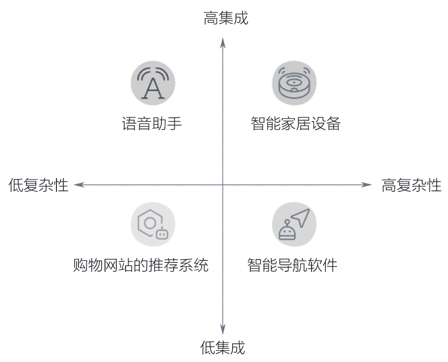

### **1.2 智能体能做什么**

作为一种灵活、高效且可根据不同需求定制的智能系统，智能体正悄然改变着学生的学习体验。过去，家庭教育和学校教育往往是各自为政的。家长难以及时掌握孩子的学习进展，学校也很难兼顾每一个孩子的个性化需求。如今，智能体不仅可以在家庭中成为家长的得力助手，在学校中也能作为教师的补充力量，为学生提供全天候、个性化的学习支持。

更重要的是，智能体不是一个功能简单的辅导工具。它能够根据每个孩子的学习节奏，持续调整和优化自己的辅导策略，真正做到因材施教，成为孩子成长道路上贴心又专业的陪伴者。无论是学习管理、知识辅导，还是良好学习习惯的培养，智能体都能发挥重要作用。

为了让大家更直观地了解智能体具体能够为学生和家长带来哪些帮助，下面，我将列举一些典型的应用示例。

**智能学习助理——孩子的专属“成长秘书”**

在日常生活中，家长经常为孩子的学习操心：作业有没有按时完成？考试复习做得够不够？英语单词记住了吗？数学题是不是还不会？有了智能体，家长可以把这些问题交给它来解决。

通过创建智能体，家长可以为孩子打造一个专属的“智能学习助理”。每天早晨，智能体可以给孩子自动推送当天的学习计划，比如，提醒孩子上午要完成哪些作业，晚上需要复习哪些知识点。到了晚上，它又可以根据孩子当天的完成情况，及时提醒是否还有遗漏的任务。

更厉害的是，这个学习助理并不“死板”，能根据孩子的学习表现动态调整计划。比如，发现孩子最近英语单词总是记不牢，智能体就会自动增加单词复习的频率，还可以推荐更适合记忆的小技巧；如果发现孩子数学成绩很好，智能体则会适当提高题目的难度。

这种因材施教的方式，让学习变得更有针对性，也让孩子在每天的小进步中不断建立自信。而家长，也能通过智能体的后台查看孩子的学习数据，做到心中有数，不用再事无巨细地盯着孩子，亲子关系也能更加和谐轻松。

**情绪陪伴与心理疏导——孩子的“情绪哨兵”**

孩子在成长过程中，多会经历焦虑、沮丧、失落甚至叛逆的阶段。可是，家长平时忙于工作，很难做到时刻关注孩子细微的情绪变化。而孩子本身，也未必总能主动表达自己的情感需求。

这时候，一个懂情绪变化的智能体就能发挥重要作用了。通过情绪识别功能，家长可以为孩子设定一个“小型情绪陪伴智能体”，比如，每天在固定时间，以轻松、自然的方式和孩子进行几句简单对话，“今天学校里有没有什么让你开心的事呀”“有没有觉得有点儿烦心的事情”。如果智能体发现孩子在回应中表现出焦虑、压力大的倾向，它可以轻声安慰，比如，鼓励孩子用深呼吸放松情绪，或者引导孩子用简单的方式排解烦恼。同时，智能体也会在后台记录孩子情绪波动的趋势，并在必要时提醒家长及时关注。

这种“情绪哨兵”既不会打扰孩子正常的学习生活，也能在潜移默化中提供心理疏导。对于内向、不善于表达的孩子来说，它更像是一个可以随时倾诉的小伙伴，帮助孩子学会识别和管理自己的情绪，从小建立起良好的心理韧性。

**家庭教育助手——家长的“辅导教练”**

不少家长在孩子升入高年级后，都会遇到一个问题：想要辅导作业，却发现自己早已忘记了那些知识点，或者因辅导方式不对而引发孩子的抵触情绪。这时候，智能体就可以摇身一变，成为家长的“辅导教练”。家长只需要告诉智能体孩子的年级和需要辅导的科目，比如，说出“小学五年级数学”或“初一英语”等关键词，智能体就能迅速讲解对应的知识点，给出简明易懂的解题方法，甚至还能列出一些容易出错的典型例题，指导家长该怎么引导孩子思考。

有了这样的“教练”，家长也能自信地辅导孩子作业，不仅提升了孩子的学习体验，也让家长在陪伴中收获成就感，亲子关系也更加融洽自然。

**考试复习规划**

每到“考试季”，很多学生就开始焦虑：“该从哪里复习”“时间还来得及吗”“是不是又要熬夜临时突击”。其实，复习时最应避免的就是没有计划，只靠一时热情，到了真正考试时才发现准备不足。而智能体可以根据学生的考试时间表、学习进度、知识掌握情况，自动生成科学的复习计划。

不仅如此，智能体还能根据学生每天的学习打卡情况动态调整计划，在复习过程中，根据学生的练习成绩，标记出掌握薄弱的知识点，提醒他进行针对性复习。通过这种智能化的复习规划，学生可以始终保持良好的节奏感，既不过早松懈，也不会临阵磨枪，把每一天的努力积累起来，最终在考试中发挥出真正的实力。

## **第二章** **智能体的创建与使用**

为了满足不同领域、不同层次的智能化需求，各类智能体平台应运而生，并在开发便捷性、功能扩展性、系统整合性等方面不断创新和演进。从早期的单一任务执行，到如今形成可以支持复杂决策与多场景协作的智能体，平台技术正在不断成熟，同时，人们对智能体的智能性、自主性、可扩展性等方面产生了更多的期待。

### **2.1** **选择智能体开发平台**

在当前智能体开发平台的竞争格局中，几款代表性产品各具特色。例如，AutoGPT 作为开源项目，以其“自主任务拆解与执行”的能力受到智能体开发者群体的热烈追捧，适用于市场调研、数据整合等需要连续操作的场景。然而，由于其高度自主的特点，也带来了一定的不可控风险和任务路径不稳定的问题。Manus 则是致力于打造真正意义上的完全由 AI 自主代理、能够在多个领域独立完成复杂任务的智能体，不过较高的训练成本和应用门槛，使得其普及速度受到一定限制。BabyAGI 专注于长期任务管理的需求，适合科研和长期的数据分析工作。而 AutoGen 通过多智能体协作模式，提升了大规模内容生成的效率，尤其适用于新闻、营销文案等内容创作密集型行业，但也对计算资源有较高要求。至于 Zapier，虽然在无代码自动化领域拥有广泛的应用基础，支持上千种第三方服务连接，但更多聚焦于流程自动化工作，智能决策和复杂任务执行能力较弱。

总体来看，当前市面上的各大智能体开发平台或工具，虽然在各自定位的细分领域展现了独特优势，但要在普遍性、适配性、易用性、功能完备性以及本地化支持等方面做到兼顾，仍存在明显短板。而这正是在市场渴求更优解决方案的背景下，“扣子”脱颖而出的原因。

作为一款面向未来的智能体开发平台，扣子平台不仅继承了“低门槛、高效率、多场景”的优势，还针对中国市场的实际需求做了本地化的深度优化。更重要的是，它通过丰富的插件生态、完善的工作流系统以及对长短期记忆的高效管理，使得智能体开发真正走向可落地、可扩展、可持续。接下来，我将进一步深入解析该平台，帮助大家了解它在功能设计、应用场景、技术架构等方面的独特优势，看看它是如何重新定义智能体开发体验，并成为新一代 AI 应用的重要基石。

### **2.2** **扣子使用入门**

在人工智能浪潮席卷全球的今天，大型语言模型（LLM）的惊人能力让人们看到了无限可能。然而，如何将这份潜力转化为触手可及、解决实际问题的应用，对于许多不具备深厚编程背景的个人或资源有限的企业而言，仍然有一道不低的门槛。正是在这样的背景下，由科技巨头字节跳动倾力打造的扣子应运而生。它不仅仅是一个工具，更像是一把钥匙，旨在开启一个全民皆可参与、低门槛、高效率创建个性化乃至具备商业价值智能体的新时代。扣子的核心使命，就是让 AI 技术的红利不再是少数技术精英的专属，而是普惠大众，让每个人、每个组织都能轻松驾驭 AI，实现创意与价值的落地。扣子具有以下特点：

**零代码开发，让 AI 应用触手可及**

扣子最引人注目的特点之一，便是其革命性的“零代码”开发体验。传统意义上，人们开发一个 AI 应用，哪怕是功能单一的聊天机器人，也需要开发者掌握复杂的编程语言、理解模型接口（API）调用、处理数据等多方面的技术知识。这无疑将绝大多数非技术背景的潜在开发者挡在了门外。扣子颠覆了这一模式，它提供了一个极其直观、友好的可视化操作界面。开发者无须编写任何代码，仅仅通过类似搭积木般的“拖拽”操作，就可以将预设的功能模块、逻辑判断、触发条件等元素组合起来，轻松构建出形态各异、功能多样的智能体。无论是想要打造一个解答常见问题的客服助手、一个能帮忙管理日程的私人秘书、一个能自动汇总信息的内容助理，还是一个充满趣味的互动式 AI 伙伴，在扣子上，这一切都变得前所未有的简单。

**丰富插件与智能工作流，构建强大 AI 大脑**

仅仅降低创建门槛是不够的，要让智能体真正发挥价值，还需要赋予它们处理复杂任务、连接外部世界、实现智能自动化的能力。扣子深谙此道，内置了极其丰富且功能强大的插件库，并支持构建智能工作流。我们可以将插件理解为给智能体装配的“特殊工具箱”，每个插件都能让智能体掌握一项新技能，例如，实时查询天气预报、搜索网络资讯、阅读新闻摘要、操作日历应用、连接企业内部数据库、调用计算器进行运算等。通过集成这些插件，智能体不再局限于其自身的知识范围，而是能够与现实世界互动，获取并处理动态信息。智能工作流则像是为智能体设计的行动蓝图。当接收到用户请求或满足特定触发条件时，智能体就能按照预设的工作流，一步步执行任务。

**多平台快速部署，让 AI 无处不在**

扣子提供了多平台部署的功能，个人也可以将自己打造的学习助手或生活规划师放入日常使用的豆包 APP 随时调用。这种强大的跨平台部署能力极大地拓宽了 AI 的应用边界，让智能服务能够在用户最需要、最自然的场景下出现，真正迈向“AI 无处不在”，从而显著提升个人效率。

那么，使用扣子的效果究竟如何？它是否值得尝试呢？最核心和直观的用户感受，往往可以概括为两个词：快和简单。过去可能需要专业技术团队投入大量时间和精力才能实现的 AI 应用，现在借助扣子，个人或者小团队或许仅需一个下午就能搭建出一个可用的雏形。这种开发效率上的巨大飞跃，对于那些希望快速尝试 AI 技术、验证创新想法的企业和个人而言，无疑是一个巨大的福音，使得“试一试”的成本和门槛都大大降低。

**多市场适用性**

对于广大的个人爱好者和独立开发者来说，扣子就像一个充满魔力的“想法实现乐园”。他们可以轻松上手，快速将脑海中那些酷炫或实用的 AI 点子变为现实，比如，打造一个能根据自己习惯整理信息、推送新闻的个性化智能助理，或者开发一个能聊天解闷、风格独特的趣味聊天伴侣。在这里，技术不再是障碍，创意得以自由驰骋。

教育领域同样是扣子展现其独特价值的舞台。教师可以利用它设计互动式教学工具，提升课堂趣味性和参与度；学生和研究人员则可以用它来辅助资料搜集、文献整理等研究工作，显著提高学习和研究的效率。

### **2.3** **直接利用提示词生成智能体**

这种智能体的生成方式，是利用提示词设计特定的指令，引导智能体执行预期的任务。这种方法的优势在于无须编写复杂的代码，用户只需专注于如何设计提示词，以实现智能体的特定功能。比如，用户可以在提示词中指定“先执行天气查询插件，进行天气资讯的搜索，然后再利用制作树图的插件，将各项资讯制作成树图”。

当智能体开始执行时，它会根据用户输入的关键字，按照提示词中设定的顺序执行任务。例如，用户输入“北京”后，智能体首先调用“墨迹天气”插件获取天气信息，随后使用 TreeMind 树图插件将这些信息整理成树状结构的思维导图。

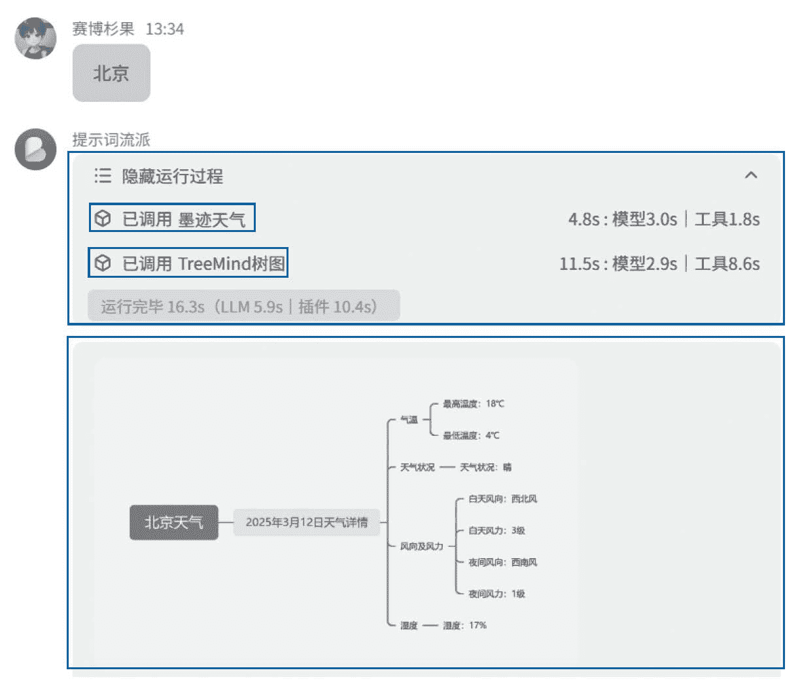

在这种方式下，用户无须编写代码，只需专注于如何设置好提示词，通过提示词引导智能体执行预设的动作，即可轻松创建属于自己的专属智能体。整个过程简单直观，只需要输入文字、点击鼠标，就能让智能体按照预设的步骤完成任务。无论是搭建一个“个人知识库智能体”，帮助你整理和检索信息，还是创建一个“绘画专用智能体”，帮助你生成个性化艺术作品，都可以通过巧妙设计提示词来实现。

这种“无代码”的智能体创建方式，让 AI 变得更加个性化、易用，真正实现人人都能拥有自己的智能助手。只要想象力足够丰富，任何功能的智能体都可以通过提示词实现，为个人生活、工作或创意开发提供强大支持。

### **2.4** **尝试创建一个专属的“城市旅游助手”智能体**

为了让大家更直观地理解仅凭提示词就能创建 AI 智能体的便捷性，接下来，我们将通过一个生动具体的实例，手把手地教各位如何创建一个专属的“城市旅游助手”智能体。想象一下，拥有一个能帮你规划行程、推荐特色美食、查询交通信息、甚至提供当地文化习俗介绍的 AI 伙伴是多么方便！我将展示，实现这一切的核心，并不需要编写复杂的代码，而在于如何巧妙地设计和组织我们的语言指令——提示词。

通过下面的步骤，你将学会如何设计这个旅游助手的角色、能力和行为模式，仅仅通过编写提示文本，就能让它从一个“空白”的 AI 模型，转变为一个知识丰富的旅行规划专家。准备好了吗？让我们一起开始创造你的第一个 AI 旅游助手吧！

**第 1 步：选择创建方式**

在扣子主页的左上角，你可以找到“创建”功能按钮“⊕”，点击后提供两个选项：“创建智能体”和“创建应用”。“创建智能体”功能允许用户从零开始搭建智能体，支持个性化定制；而“创建应用”功能则基于官方模板，适用于想快速搭建智能体的用户。

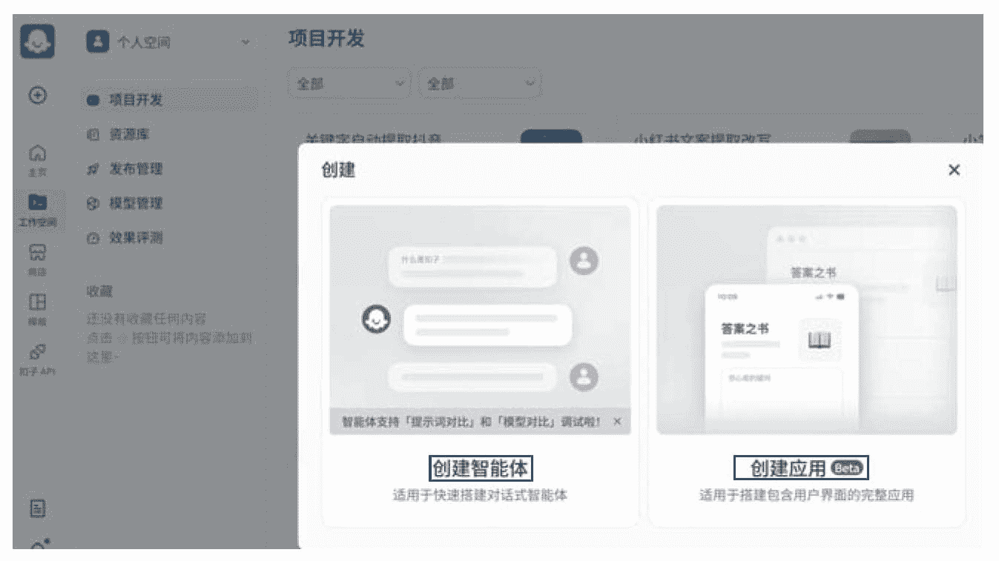

**第 2 步：创建智能体**

在这个选项中，我们能够快速地创建专属于自己的智能体，各项功能如下：

第一，智能体名称。在创建智能体的过程中，名称设定至关重要。一个贴合智能体功能的名称，不仅能清晰传达其用途，还能提升用户识别度，便于后续管理与使用。因此，创建者应精心构思，使智能体的名称与实际功能紧密关联，而不仅仅是一个简单的命名。在本案例中，我们将智能体命名为“城市旅游助手”，以突出其核心功能，即为用户提供旅游相关的城市信息与服务。这一命名方式能直观反映智能体的用途，使用户在使用时更加便捷和高效。

第二，智能体功能介绍。详细的智能体功能介绍是创建过程中不可或缺的一步，它不仅能帮助用户全面了解智能体的核心能力，也能确保用户在使用时能够快速判断其是否符合自身需求。因此，创建者需要以清晰、完整的语言描述智能体的功能，使其能够直观呈现智能体所能提供的价值。一个精确、详尽的功能介绍有助于用户在短时间内掌握智能体的主要用途及可解决的问题。在这个案例中，我们的功能介绍是：一个能够帮助使用者提供个性化的城市信息服务。只需要输入目标城市，就能出现以下资讯：

◎天气资讯

◎当地热门景点

◎当地特色体验

◎旅行注意事项

◎当地美食推荐

第三，工作空间。工作空间分为个人空间和团队空间两种类型，为创建者提供了灵活的选择，满足不同的使用需求。如果智能体仅供个人使用，创建者可以选择个人空间。在这个专属环境中，创建者能够自由创建、编辑和使用智能体，无须担心他人干扰，同时确保数据的隐私性和安全性。个人空间适用于个人学习、实验性开发或私密项目。当智能体需要团队协作开发时，团队空间则更为合适。团队空间支持多人协作，成员可以共同编辑和优化智能体，提高开发效率，并确保团队对智能体的统一管理。然而，团队空间并不会默认存在，只有当创建者手动创建后，它才会出现在工作空间中，供团队成员使用。

选择合适的工作空间，不仅能提高智能体的管理效率，还能确保信息安全和协作顺畅，让智能体的开发和应用更加灵活便捷。

第四，图标。创建者可以利用右侧的 AI 来生成图标，而 AI 生成的依据是智能体的名称和功能介绍所构成的提示词。AI 会根据这些关键信息，智能提取相关元素并生成独特的图标。例如，在本案例中，智能体的名称是“城市旅游助手”，功能介绍中包含“景点”“美食”“天气”等关键词，因此，生成的图标可能会融合地标建筑、餐饮符号、天气等视觉元素，使其与智能体功能高度契合。

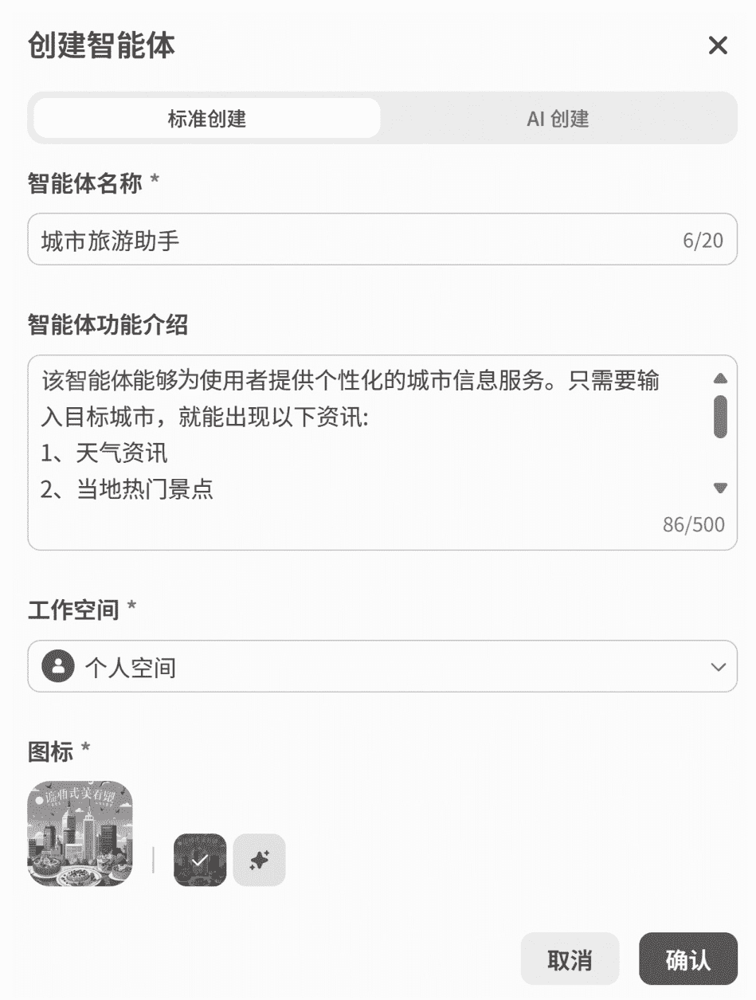

**第 3 步：人设与回复逻辑设置**

创建智能体后，将进入编辑页面，其中左侧的“人设与回复逻辑”模块是核心部分，它决定了智能体的角色塑造和对话机制的运行方式。

在此方面，创建者需要全方位构建智能体的形象，包括性格特点、技能专长、表达风格以及在不同情境下的反应。比如，一个儿童学习助手可能需要更具亲和力、耐心，并使用简单易懂的语言，适应孩子的思维方式。创建者可以精细调整智能体的回答方式，例如：

◎回答长度：设定短句、详尽解释或适中的回复风格。

◎语言风格：是否轻松，或包括众多行业术语。

◎回答准确性：确保回复是否更严谨，避免模棱两可的回答。

同时，创建者还可以设定禁忌内容、敏感话题的规避策略，以确保智能体的回答符合用户预期，并避免输出不当内容。合理的人设与回复逻辑设定，是确保智能体具备高质量输出的关键。完善的角色设定能增强智能体的个性化水平，使其表现更符合用户期望，从而提升交互体验，避免回答偏差或角色混乱的情况。

如果你对人设与回复逻辑的编写不熟悉，可以使用“优化”功能。在其中输入一段关于该功能的描述，扣子会自动生成优化后的内容，帮助你快速完善设定。你可以根据实际需求进行修改和调整，使其更符合预期，提高智能体的准确性和交互体验。以下是实际操作案例。

**第 4 步：设置大模型**

在设置大模型这一关键环节，创建者可以自主决定智能体所使用的大模型，这一选择直接影响智能体的性能、交互体验以及适用场景。

扣子提供了多个可选大模型，如豆包、通义千问、阶跃星辰、DeepSeek、百川以及 Kimi 等，每个大模型在完成不同任务上各具特色。在进行选择时，创建者应优先考虑自身的需求，匹配最适合的大模型，以确保智能体的表现符合预期。

尽管所有大模型都支持基础对话功能，但在实际应用中，不同大模型的表现存在明显差异。就本案例而言，我们的智能体“城市旅游助手”主要侧重于提供城市相关资讯，例如天气、景点、美食推荐等，而非深度商业分析。因此，它的主要需求是基于 DeepSeek 的互动能力，利用 DeepSeek 已训练的大模型知识为用户提供精准的旅游信息，而非利用复杂的逻辑推理或计算。

基于这一需求，选择“DeepSeek-V3”作为智能体的底层模型是最佳方案。它可以高效处理城市相关的数据，并提供流畅的互动体验，同时满足用户对即时信息获取的需求，而不必调用更高级别的推理模型，从而提高响应效率并优化资源利用。

**第 5 步：设置开场白**

开场白是用户进入智能体后首先看到的引导信息，在整个交互过程中起着至关重要的作用。它不仅能帮助用户快速理解智能体的核心功能，还能引导用户掌握与智能体的交互方式，使对话过程更加流畅、高效。

在扣子上，创建开场白的方式主要有两种：手动输入和 AI 自动生成。手动输入方式简单直观，在设置开场白界面，用户可以在输入框中填写自己构思的内容。这种方式允许创建者根据智能体的风格、功能及目标用户定制个性化的开场白。例如，一个专注于旅行推荐的智能体可以这样设置开场白：“欢迎来到个人旅行助手！我是你的行程规划小帮手。无论是热门景点、地道美食，还是当地文化体验，我都能为你提供建议。快来聊聊你的目的地吧！”

对于希望快速生成开场白或缺乏创意的创建者，AI 自动生成功能提供了便利。在设置开场白区域的右侧，有一个显眼的“Ⓐ”标志。点击该按钮后，系统会根据智能体的功能和目标用户，自动生成一段开场白，用户可以在此基础上进一步优化，使其更符合预期。

无论是手动输入还是 AI 自动生成，合理的开场白都能让用户在初次使用智能体时获得清晰的引导，从而提升交互体验。手动输入更适合有明确需求的创建者，而 AI 自动生成则能极大提高效率，适用于快速搭建智能体的场景。一个好的开场白能够增强用户对智能体的理解与信任，确保智能体能够更顺畅地融入用户的使用场景。

**第 6 步：开场白预置问题**

这项功能的核心目的是帮助智能体的使用者快速进入交互状态，降低他们的使用门槛。在某些情况下，用户可能对智能体的功能不够了解，或者对其能提供的具体价值感到不明确。如果在进入智能体时，界面中提供一些预设问题供用户选择和点击，就能有效引导他们开始使用，使整个体验更加顺畅和直观。

由于智能体的主要功能是旅游助手，预设的问题会围绕用户最关心的旅游相关话题。系统可以默认提供三个常见的旅游问题，例如：

◎“有哪些旅游景点适合一个人去？”

◎“全家出游适合去哪些地方？”

◎“某个城市的特色美食有哪些？”

这些问题可以让进入对话的用户快速理解该智能体可以提供的帮助，并减少他们自己输入问题的负担。即使是首次使用的用户，也可以通过点击这些预设问题，快速获得信息，避免因不知如何提问而导致对话中断。

值得注意的是，预设的问题不会在编辑界面右侧的预览与调试页面中显示。它们只会在智能体发布后，用户首次进入智能体的页面时出现。这种设计可以确保用户在正式使用智能体时，能够获得更清晰的引导。

**第 7 步：用户问题建议设置**

设置用户问题建议是智能体的一大亮点，它在对话过程中能够基于当前的交谈内容，为用户提供 3 条提问建议。

在使用方式上，系统默认采用 AI 自动判断模式，即由 AI 根据当前对话的上下文，智能分析对话情境，自动生成合理的提问建议。凭借强大的算法和语言理解能力，AI 可以确保提出的问题建议紧密围绕用户关注的内容。然而，在某些特定场景下，如果 AI 生成的问题建议与实际业务逻辑不符，创建者可以选择开启“用户自定义 Prompt”功能，自行设定提问逻辑，使其更贴合需求。

需要注意的是，该功能并非简单地预设 3 个固定问题，而是基于“提问逻辑”进行动态调整。例如：

◎第一条逻辑：问题应与用户的最后一轮对话内容密切相关，能够引发更深入的讨论。

◎第二条逻辑：问题应能扩展话题，帮助用户获取更完整的信息，而不仅仅是重复或细微变动的问题。

◎第三条逻辑：问题应保持清晰且具体，使用户能够轻松理解，并促使智能体给出有价值的答案。

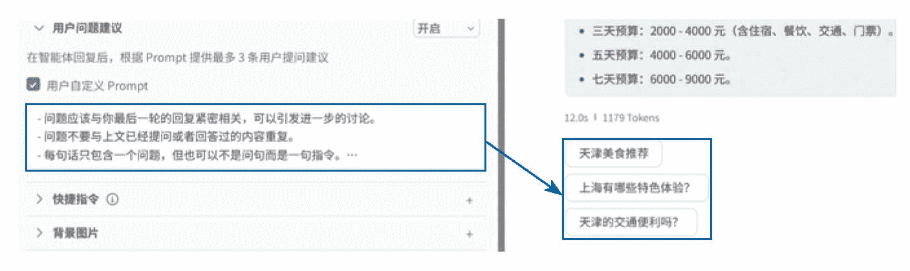

对于初学者而言，建议优先使用 AI 自动判断模式，因为它能够自动适应对话情境，减少不必要的设定工作，同时避免因不熟悉自定义设置而导致的逻辑混乱或功能异常问题。随着对系统的熟悉，创建者可以逐步尝试调整自定义 Prompt，让智能体的引导方式更加贴合特定的业务需求，从而打造更加精准和高效的交互体验。

**第 8 步：背景图片设置**

合适的背景图能够强化智能体的品牌形象，帮助用户更快地理解其功能和定位，从而提升整体使用体验。如果有添加背景图片的需求，用户可以在操作界面中找到背景图片功能选项。在该区域的右侧，有一个醒目的“+”按钮，只需点击这个按钮，即可开启背景图片的设置流程，完成背景的个性化定制。这个设计让创建者可以自由打造符合智能体风格的界面。

操作流程十分简单直观。创建者可以选择两种方式上传背景图：

◎拖拽上传：直接将选好的背景图拖拽至指定区域，系统会自动完成上传。

◎手动选择：点击上传选项栏，手动选择设备中的图片进行添加。

当背景图片成功上传后，用户可以在右侧的预览与调试区域即时查看效果。这样一来，创建者能够直观地调整和优化，使背景图更加契合智能体的主题。例如，一个旅游智能体可以使用风景图片作为背景。

**第 9 步：智能体测试**

这一步主要是对城市旅游助手在实际运行中的效果进行全面测试和调试。创建者可以在快捷指令中输入想要查询的城市或旅游目的地，观察智能体是否能够正常启动，并提供准确、丰富的旅行建议。测试过程中需要重点检查：

◎推荐的景点、餐饮、住宿信息是否准确且符合用户需求。

◎交互体验是否顺畅，用户输入地点后能否迅速获得建议。

◎智能体是否能针对不同用户需求（如亲子游、美食探索、文化体验等）提供个性化推荐。

如果在测试过程中发现问题，如地点推荐不精准或响应速度较慢，需要及时分析原因，比如可筛选逻辑优化不足等情况。针对具体问题进行优化和调整，确保城市旅游助手能够稳定可靠地运行，并为用户提供优质的旅行规划体验，让他们更轻松地获取旅行灵感和实用建议。

**第 10 步：智能体发布**

这一步骤是整个智能体创建流程的最后一步，当确认所有设置均无问题后，创建者便可以点击发布按钮，让智能体正式上线，供用户使用。

在进行发布时，系统会自动生成一个发布记录，用于记录本次发布前对智能体进行的所有修改动作。创建者可以通过按键盘上的“Ta b”键，快速查看这些修改内容，确保所有调整均符合预期。这一功能不仅有助于管理，还能让创建者清晰回顾不同阶段的优化过程，避免遗漏关键改动。

在发布界面的下方，创建者需要在“选择发布平台”区域决定智能体的上线渠道。目前，扣子支持多个主流平台，包括豆包、飞书、抖音和微信等。每个平台都能覆盖不同的用户群体，因此，创建者可以根据智能体的目标用户选择合适的平台进行发布。

需要注意的是，每个平台在发布前都需要进行授权，只有完成授权流程后，智能体才能成功部署到相应平台。如果尚未完成授权，则只能在扣子平台的商店中发布。因此，建议创建者提前检查平台授权状态，确保发布流程顺畅无误。

完成发布后，整个智能体的创建过程正式结束。创建者可以前往个人空间，找到刚刚创建完成的“城市旅游助手”，并进行进一步测试和优化。同时，创建者也可以跟踪用户的使用情况，收集反馈，不断迭代和完善智能体，以提升用户体验，使其更加符合实际需求。

### **2.5** **利用工作流生成智能体**

在扣子中，除了通过提示词来设计智能体外，另一种高效的方法是工作流。工作流是指一系列有序的任务或操作步骤，通过合理的组织和协调，使智能体能够高效地完成复杂任务。这种方式不仅提高了任务的自动化程度，还能显著提升智能体的可控性和执行效率。

简单来说，工作流是一种将复杂任务拆解为多个可管理步骤的方法。每个步骤都由特定的插件、功能模块或逻辑条件控制，确保任务能够按照既定顺序高效执行。这种方式类似于流水线作业，每个环节各司其职，从而确保整体任务流畅进行。

为了形象地说明工作流的作用，我们可以将其比喻成制作三明治的过程。假设你要做一份超级美味的三明治，如果直接把所有食材随便丢在一起，不仅混乱无章，口感也会大打折扣。所以，我们需要按照清晰的步骤，一步步地完成三明治的制作。

◎步骤 1：在工作流中获取用户输入，作为任务的起始点。这就像取出两片面包。

◎步骤 2：工作流的第一步处理，例如数据预处理、文本分析或调用特定 API。这相当于在两片面包上分别抹上花生酱。

◎步骤 3：在工作流中添加一个插件模块，例如调用数据库、计算数值或执行逻辑判断。这类似于在其中一片面包上放上一片芝士。

◎步骤 4：工作流中的多步骤处理，每个模块都在已有数据的基础上进行增量操作。这可以理解为依次加入生菜和火腿。

◎步骤 5：工作流的最终输出，系统处理完所有步骤后，反馈最终的结果。这相当于盖上另一片面包，完成三明治制作。

这个过程展现了如何将复杂任务拆解成有序的步骤，并依次执行，最终得到完整的结果。

在扣子的工作流系统中，每一个执行步骤都可以被称为一个节点，节点是工作流中的核心组成部分，它们分别承担不同的任务，如数据接收、信息处理、逻辑判断、内容生成等。简单来说，每个节点就是一个小型的功能模块，它们共同协作，完成整个智能体的工作目标。

不同的节点可以实现不同的功能，具体取决于工作流的需求。例如，有些节点可以调用大模型来整理和分析用户输入的文本信息，而另一些节点则可以根据用户输入的信息生成图片。此外，还有逻辑判断节点、条件分支节点、数据存储节点等，所有这些节点的有机组合，让工作流的设计变得更加灵活和强大。

因此，想要用好工作流，就需要把整个任务流程拆解成一步步的小动作，每个小动作就是一个节点。就像制作三明治时，从取出面包、抹上酱料、添加食材到最终完成，每一步都是清晰可执行的操作。在扣子上，你不需要懂代码，就像不必是专业厨师也能做三明治一样，只需拖拽和点击，就能轻松搭建自己的智能体，让它按照你的计划逐步执行任务，高效完成你的需求。

### **2.6** **手把手教你构建一个能够识别图像内容的智能体**

为了让大家更直观地了解工作流的创建过程，我们将通过案例来展示如何搭建一个图像识别智能体，基本流程如下。

**第 1 步：创建智能体**

在这个选项中，我们能够快速地创建专属于自己的智能体。

第一，智能体名称。在本案例中，我们将智能体命名为“图像辨识智能体”，以突出其核心功能——帮助用户识别和分析图像内容。

第二，智能体功能介绍。本智能体的主要任务是接收用户上传的图片，并迅速进行图像辨识。因此，其功能介绍只需输入“快速图像辨识”即可。这样既能清楚表达智能体的核心能力，又能让用户一目了然，快速上手使用。

第三，图标。在本案例中，智能体的名称是“图像辨识智能体”，其核心功能是对用户提供的图片进行快速辨识和分析。因此，在功能介绍中，我们特别强调了“图片”和“辨识”这两个关键词，以便准确传达智能体的用途。图标可融入“电脑”“相机镜头”“放大镜”或“图像处理”相关的视觉元素，以直观体现其图像辨识能力。

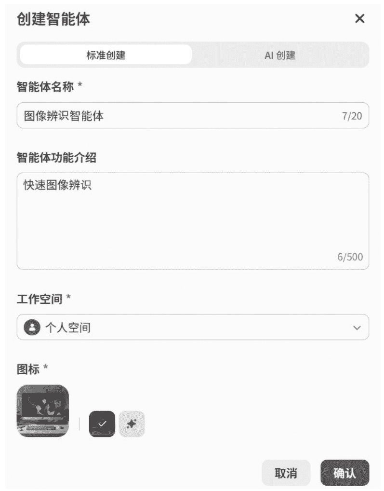

**第 2 步：创建工作流**

创建好智能体后，在右侧技能栏中，可以找到“工作流”选项。在这里，你会看到一个“+”按钮，点击它即可开始创建新的工作流。

在创建过程中，首先需要输入工作流名称和工作流描述，以便清晰定义其功能和用途。完成这些信息的填写后，点击确认，工作流即正式创建完毕。

接下来，我们可以在可视化界面中，通过拖拽和配置不同的节点，一步步搭建我们的图像辨识智能体，实现高效的图像识别功能！

**第 3 步：添加节点**

为了实现图像辨识智能体的功能，整个工作流需要完成三个关键步骤：

◎输入图片和问题。用户上传图片，并输入希望 AI 识别的内容（例如，“这张图片中的动物是什么？”）。

◎读取图片并分析问题。智能体解析用户提供的图片和问题，并调用 AI 进行图像识别和理解。

◎输出答案。智能体根据分析结果，生成并反馈答案。

由于整个流程相对简单，在开始节点（用户输入）和结束节点（反馈结果）之间，仅需插入一个节点即可完成任务。在扣子的工作流编辑界面中，我们可以在右下角的“添加节点”选项中，搜索“图片理解”，然后点击添加，使其成为中间处理节点。

**第 4 步：连接节点 1 和节点 2**

在成功插入图片理解节点后，接下来的关键步骤是将三个模块进行串接，确保数据能够顺利流转。

首先，我们需要先关注第一个节点（开始节点）与第二个节点（图片理解节点）之间的连接。在开始节点中，我们需要新增两个变量名：

◎“input”：用于接收用户输入的问题，即希望 AI 识别的内容（例如“这张图片中的动物是什么？”）。

◎“pic”：用于接收用户上传的图片网址，以便传递给图片理解节点进行分析。

通过这两个变量，我们可以确保用户的输入信息和图片数据都能正确传递到图片理解节点，从而让智能体顺利执行后续的图像识别任务。

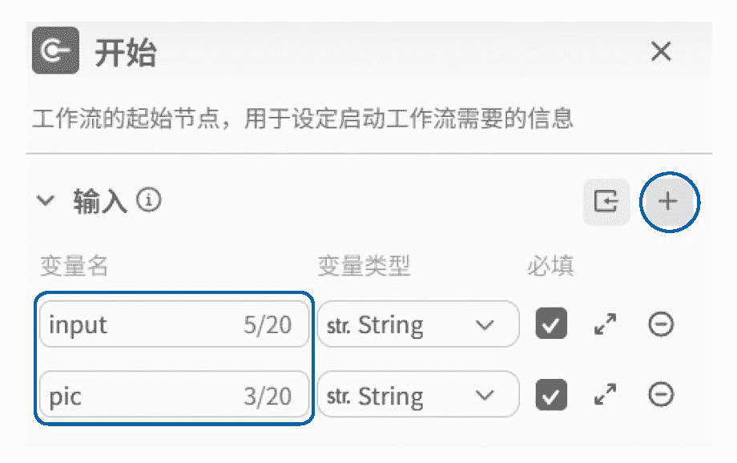

接下来，我们需要对图片理解节点的参数进行正确设置，确保它能够接收并处理来自开始节点的数据。

在图片理解节点中，我们需要配置以下两个变量名：

◎“text”：用于接收开始节点中的“input”，即用户输入的关于图片的问题（例如：“这张图片中的动物是什么？”）。

◎“url”：用于接收开始节点中的“pic”，即用户上传的图片网址，供 AI 进行识别和分析。

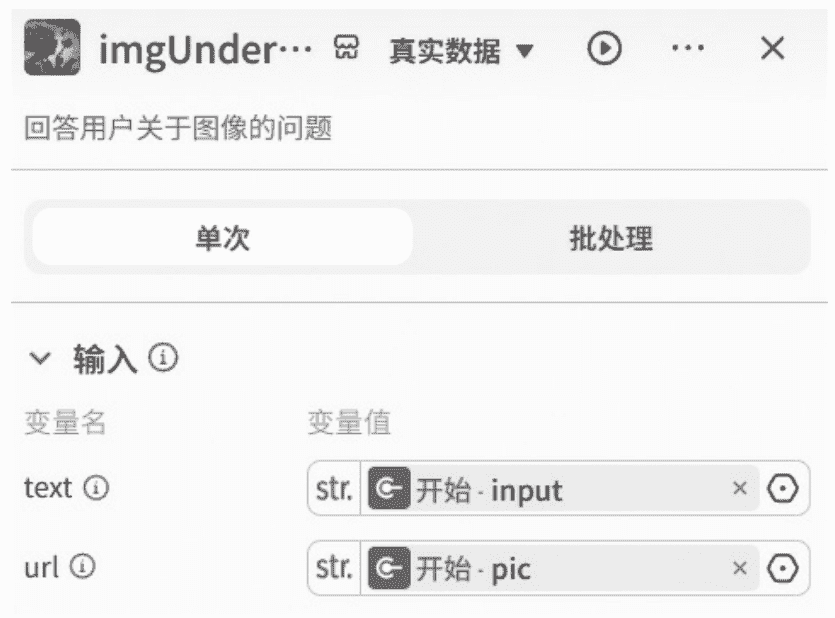

通过这样精确的参数绑定，智能体能够准确解析用户的需求，确保 AI 识别到正确的图片，并生成对应的答案。

上面的这些设置，核心目的是确保开始节点的参数在用户输入后，能够正确传递到图片理解节点中，从而让整个工作流顺利执行。举个例子，你可以想象自己在家里做手工时，有两个人在不同的位置分工合作：

第一个人负责收集材料，比如纸张、剪刀和胶水。

第二个人负责加工手工品，比如剪裁、拼接和装饰。

当第一个人收集完材料后，他需要正确地将这些材料传递给第二个人，这样第二个人才能顺利完成加工。如果少了一样材料，比如没有剪刀，就会影响整个制作过程，甚至无法完成任务。

在工作流中，节点之间的信息传递也是如此。开始节点（用户输入）就像收集材料的人，负责接收用户的问题（input）和图片网址（pic）。图片理解节点就像加工的人，它需要正确拿到这两个信息，也就是用户的问题（text）和图片网址（url）。如果图片理解节点没有正确收到信息，那么它的任务就无法正常执行，就像做手工时材料不全，导致工作无法完成。

因此，我们必须确保开始节点和图片理解节点的参数一一对应，这样数据才能完整流动，保证智能体正确运作。当所有输入、输出数据都匹配好后，我们就可以正式将这两个节点串联起来，让智能体顺利进行图像分析和问题解答！

**第 5 步：连接节点 2 和节点 3**

在这一关键步骤中，我们需要将图片理解节点的输出数据，与最终的结束节点连接，确保智能体能够顺利反馈正确的答案给用户。

在刚才的开始节点（第一个节点）中，我们并没有专门的“输出参数”需要配置，这是因为开始节点的输入数据（用户提供的图片网址和问题）等同于它的输出数据。换句话说，如果我们在开始节点中创建了 3 个变量，那么它会直接将这 3 个变量作为输出数据，传递给下一个节点。

然而，在第二个节点——图片理解节点中，情况有所不同。当用户输入查询内容（如上传一张图片并输入问题）后，图片理解节点会返回多个参数作为输出数据，其中包含丰富的信息，例如：

◎内容类型（content_type）：该参数用于指示输入内容的类型，帮助模型正确解析和处理数据。

◎答案信息（msg）：指示执行的结果状态，通常用于反馈操作是否成功。

◎模型的回复（response_for_model）：包含模型处理后的具体结果，即对输入图像的分析和理解后的输出内容。

◎模型的类型（type_for_model）：指明所使用模型的类别或名称，帮助了解处理图像所采用的模型类型。

◎编码（code）：表示操作的状态码，指示执行过程中的成功或错误信息。

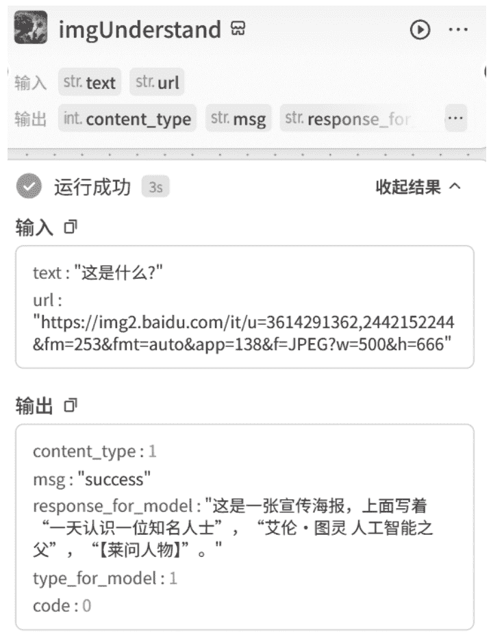

理解插件的输出参数，能够帮助我们正确选择需要展示给智能体使用者的信息，从而优化用户体验。在不同的插件中，输出的参数内容可能会有多个数据项。例如，如果你使用的是天气查询插件，那么它的输出可能包括：

◎日期（date）。

◎经纬度（longitude、latitude）。

◎温度（temperature）。

◎气压（pressure）。

但是，如果你只希望用户看到“温度”，那么在结束节点中，你就需要手动选择“temperature”作为最终展示给用户的信息，而隐藏其他无关内容。

在这里，“response_for_model”是最有价值的输出信息，因为它包含了 AI 对图片的识别结果，即智能体给用户的最终答案。因此，在结束节点的输入变量中，我们需要选择“imgUnderstand·response_for_model”。

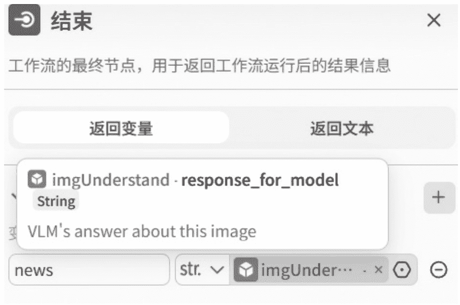

这样，智能体最终向用户反馈（软件界面中为“返回”）的内容就会是 AI 解析后的图像识别结果，而不会输出其他不必要的参数，从而提高信息的精准度和可读性。

完成结束节点输入变量的选择后，我们就可以将图片理解节点和结束节点连接起来，确保处理后的识别结果能够正确传递给用户。

在工作流界面中，只需拖拽连接到结束节点，这样第二个节点（图片理解节点）和第三个节点（结束节点）就成功连接。至此，整个图像辨识智能体的数据流已经完整贯通，智能体可以顺利接收图片、解析内容，并将识别结果返回给用户。

**第 6 步：试运行**

当三个模块（开始节点、图片理解节点、结束节点）都成功连接后，我们就可以点击下方的“试运行”按钮，开始测试智能体的运行情况，确保其能够正常处理输入变量参数并反馈正确的结果。

在启动试运行后，系统会提示用户输入两个变量参数，分别是“input”和“pic”，这两个参数的作用如下。

①“input”（用户问题）。这个变量用于输入用户想要询问智能体的问题，问题的类型没有限制。你可以问智能体任何与图片相关的问题，例如：

◎“这张图片中是什么动物？”

◎“图片的背景颜色是什么？”

◎“这是一张城市风景还是自然景观？”

◎“图片中的物体是什么品牌？”

只要是图片中可能包含的信息，都可以通过这个输入框向智能体提问。

②“pic”（图片链接）。这个变量用于输入用户想要智能体分析的图片的网址。你可以在互联网搜索一张图片，找到合适的图片后，右键点击图片，选择“复制图片地址”，然后粘贴到 pic 变量参数中。该链接应该是一个有效的图片 URL（以.jpg、.png、.gif 等格式结尾）。

试运行能够帮助我们检测智能体是否能够正确读取输入信息，并准确返回 AI 解析后的答案。如果运行过程中出现问题，例如，智能体无法获取图片或无法反馈答案，可以检查：

◎图片链接是否有效（是否可以在浏览器中直接打开）。

◎问题输入是否清晰（确保 AI 能够理解你的问题）。

◎工作流连接是否正确（检查各个节点的输入/输出是否匹配）。

一旦测试成功，智能体就可以正式运行，实现快速图像辨识功能！

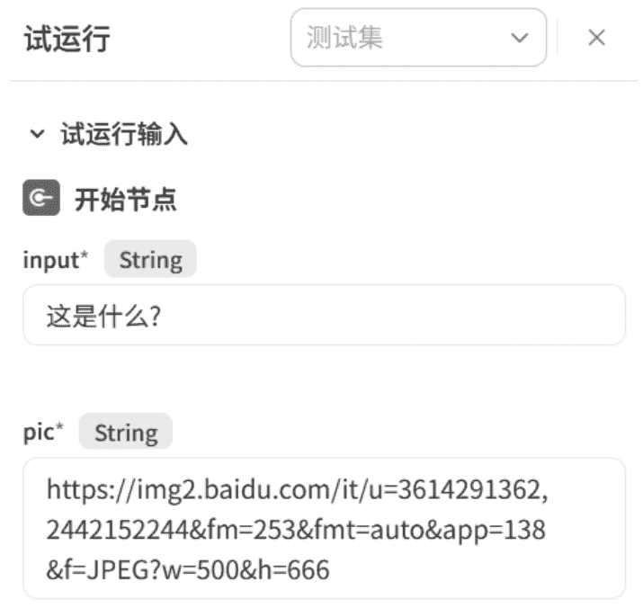

当我们输入“input”（用户问题）和“pic”（图片链接）后，整个图像辨识智能体就会开始运作。智能体会依次执行：

◎接收用户输入内容（图片链接和提问）。

◎调用 AI 解析图片。

◎反馈识别结果。

当处理完成后，在结束节点下方，可以点击“展开结果”，查看最终的输出内容，即智能体根据图片分析得出的答案，验证运行是否成功。

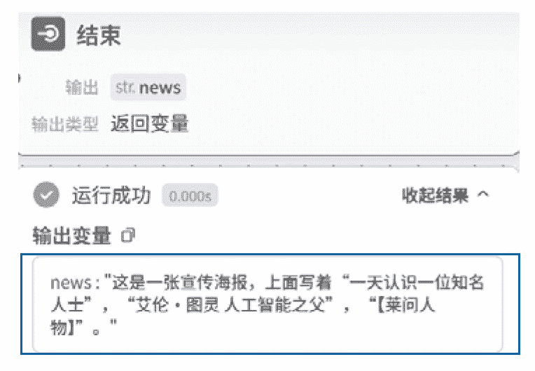

**第 7 步：智能体测试**

当测试确认无误后，我们就可以正式发布这个工作流。在扣子的工作流编辑界面，找到右上角的“发布”按钮，点击后，系统会提示确认发布。

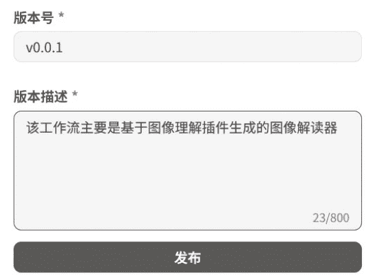

当工作流发布成功后，我们就可以将其添加到智能体中，使其成为智能体的核心功能模块。在扣子中，进入智能体管理界面，将已发布的工作流关联到智能体。随后，在右侧的“预览与调试”区域，可以进行实际测试，验证智能体是否能够正确接收图片和问题，并反馈准确的识别结果，确保智能体的功能稳定可靠。

**第 8 步：智能体发布**

当我们在预览与调试区测试确认智能体运行正常后，就可以正式发布智能体，使其可以在不同平台上使用。在扣子的智能体管理界面，点击右上角的“发布”按钮，进入发布设置。选择适合的发布方式后，点击确认，这样，一个完整的工作流智能体就成功创建并投入应用。

### **2.7** **选择提示词还是工作流来创建智能体**

在选择提示词还是工作流作为智能体构建方式时，主要需要考虑任务的复杂度、可扩展性需求以及团队的技术能力。

如果你的任务相对简单，主要依赖 AI 进行文本处理，如内容生成、翻译、问答等，那么提示词优化是更合适的选择。这种方法可以通过不断调整和优化提示词，快速迭代、优化 AI 的回答方式，提升交互体验。此外，提示词优化的上手门槛较低，不需要编写代码，对非技术团队或个人开发者特别友好。它适用于内容创作、客服 FAQ、AI 辅助写作等场景，在短时间内即可构建并投入使用。

如果你的任务较为复杂，涉及多步骤执行，需要 AI 进行逻辑判断、数据处理或 API 调用，那么工作流是更合适的选择。工作流支持模块化任务管理，可以将流程拆分为多个步骤，并按照设定的逻辑顺序执行，确保任务的稳定性和准确性。同时，工作流提供可视化管理，使所有节点和逻辑清晰可见，方便团队协作、维护和扩展，适合企业级应用或长期运营的智能体。

总的来说，提示词优化适用于以文本处理为核心的智能体，而工作流更适合需要自动化和逻辑控制的复杂任务。在实际应用中，可以根据具体需求选择最合适的方法，甚至两者结合使用，比如，通过提示词优化提升 AI 交互质量，同时利用工作流管理复杂的业务逻辑，以发挥智能体的最大效能。

## **第三章 极速入门：试着创建一个答疑机器人**

在智能化时代，如果你拥有高效的智能体，就能更快、更好地回应世界的变化。而搭建一个属于自己的答疑智能体，并没有想象中那么复杂。只要掌握正确的方法，任何人都可以在短时间内搭建出一个能够独立运作的智能助手。我不会讲过多的理论，只专注于一件事：教你迅速创建一个实用的智能体。无论你是第一次接触智能体，还是希望快速提升自己的应用能力，这里都是你的最佳起点。

所以，不必担心复杂，不用害怕门槛。本章将用简单、直接的方式，带你真正迈出智能体应用的第一步。准备好了吗？让我们一起，快速上手，创建属于你的智能体。

### **3.1 定义角色：设置智能体人格及专业领域**

对于刚接触智能体搭建的初学者来说，想要迅速创建出一个能够解答问题的答疑机器人，最简单高效的方法，就是利用扣子提供的 AI 自动生成模块。这个模块就像一个贴心的助手，可以根据你的简单指示，自动帮你搭建出一个具备基础功能的智能体，省去了大量烦琐的配置步骤，非常适合初学者快速上手。

具体来说，扣子的 AI 自动生成模块可以根据你输入的需求，比如，“我要做一个回答常见问题的机器人”或者“帮我创建一个客服答疑助手”，来理解你的意图，并在后台自动生成相应的智能体结构。这个过程中，用户几乎不需要编写任何复杂的设置，只需要用自然语言描述自己的需求，就能看到一个初步成型的答疑机器人诞生，极大地降低了入门门槛。

那么，具体操作步骤是怎样的呢？首先，我们需要打开扣子的网站，进入到平台首页。然后，在网页左上角，你会看到一个醒目的按钮“⊕”，点击它，进入创建流程。接着，在弹出的选项中，选择左侧的“创建智能体”这一项。

在进入智能体创建页面之后，接下来的关键步骤，就是使用右上角的“AI 创建”功能。这是扣子中非常强大的一个工具，它能够帮助我们用最简单的方式，快速生成一个符合需求的智能体。对于初学者来说，“AI 创建”功能无疑是节省时间和降低操作难度的一大利器。

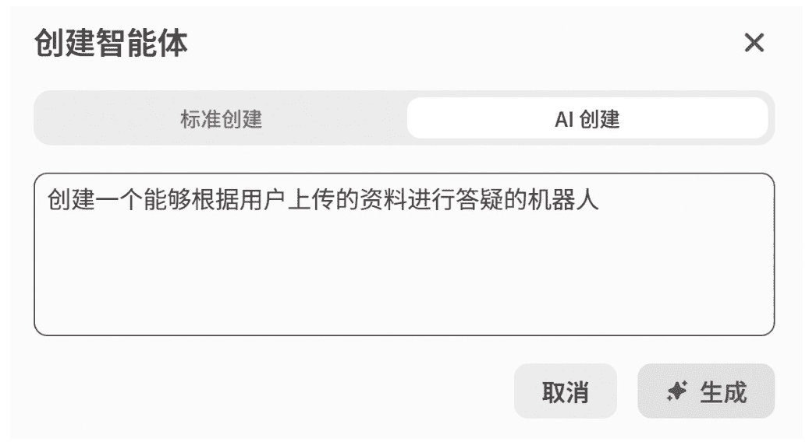

操作非常简单。当你点击进入“AI 创建”功能后，系统会出现一个输入框，你只需要用一句简单的话描述你想要的智能体是什么样的。比如，在本次案例中，我们的目标是创建一个答疑机器人。那么，我们只需在输入框中输入“创建一个能够根据用户上传的资料进行答疑的机器人”，这样简短而清晰的描述就足够了。

完成描述输入之后，别忘了点击右下角的“生成”按钮。接下来，AI 系统就会根据你提供的信息，自动为你搭建一个初步可用的智能体。整个过程只需要很短的时间，真正做到了快速又省心。

更令人惊喜的是，“AI 创建”不仅仅是简单搭建一个“壳子”，它还会根据你的描述，自动生成智能体所需要的一系列核心内容，比如设置好对应的技能模块、设计合理的人设背景、配置好基础的逻辑回复框架，甚至还会为后续的答疑交互预设常见的处理方式。这种一键生成的体验，大大降低了人们创建智能体的门槛，即使是没有技术基础的人，也能轻松创建出专业水准的答疑助手。

通过这样简单、直观的操作，初学者可以在短短几分钟内完成一个完整智能体的初步搭建，不仅提升了效率，也增加了实际操作的信心。未来，如果需要进一步优化功能，只要在生成的基础上，稍作调整和细化，就能不断完善智能体的功能。

### **3.2 “喂”参照：上传错题示例**

当你点击生成智能体后，答疑机器人的初步框架就搭建完成了。此时，系统根据你的需求，已经自动配置好了必要的技能模块、回复逻辑以及基本的人设设定。整体来看，这个智能体已经具备了基础的使用能力，能够根据用户上传的资料，进行简单的答疑和互动。

虽然这个阶段的智能体还只有基础的功能，但已经可以应对一些常规的答疑场景了。对于初学者来说，这样的成果不仅可以直接使用，还能作为后续优化和完善的良好起点。接下来，如果有更具体的需求，你只需在现有基础上进一步微调即可，大大节省了从零搭建的时间和精力。

不过，虽然通过“AI 创建”功能可以快速生成一个可用的答疑机器人，但如果想要让智能体的回答得更加精准，真正符合创建者的预期，还需要进行一些细致的设置。举个例子，当用户上传一张已经写好的数学试卷时，我们可能并不满足于机器人只简单地对其判断对错。更理想的情况是，我们希望智能体的回复能够包含以下几个方面：指出“错误题目”，分析“错误解答”，给出“错误原因分析”，同时提供一个“正确解答”，最后还能补充一个相关的“举一反三”小题目，帮助用户加深理解。

**错题题目：**解方程*x*²-5*x*+6=0。

**错误解答：**

 

移项得*x*²-5*x*=-6，等式两边同时加上 ，得到，即。

开平方得，解得*x*=3。

 

**错误原因分析：**在开平方时，遗漏了这一情况。对于方程*a*²=*b*（*b*≥0），*a*应该有两个值，即。

**正确解答：**

 

移项得*x*²-5*x*=-6，等式两边同时加上 ，得到，即。

开平方得。

 

当时，*x*=3；当时，*x*=2。

所以方程的解为*x*[1]=3，*x*[2]=2。

**举一反三：**解方程*x*²-7*x*+12=0。

为了实现这样的效果，我们在创建智能体时，就需要在描述需求的时候，把这些细节一并告诉 AI。通过更精准的指令描述，系统生成的智能体才能更贴合实际需求，输出的内容也会更加丰富、有层次。简单来说，你在一开始输入需求信息时尽可能描述得清晰细致，这样搭建出来的智能体，才能真正发挥最大价值。

在智能体初步生成之后，为了进一步细化它的答题风格和输出格式，我们可以利用扣子提供的一个功能来优化。具体操作也非常简单，只需要在界面右侧的“预览与调试”区域，找到右下角的“⊕”按钮，点击后就可以上传一个参考用的文件或者文本范例。

这种将参考内容上传给智能体的动作，专业术语叫作喂参照。通过喂参照，我们就像是给智能体提前上了一课，告诉它：遇到类似的问题时，要按照我给出的这个范例来回答。比如，在本案例中，我们上传一份包含了“错误题目”“错误解答”“错误原因分析”“正确解答”“举一反三”五个部分的数学题解答范例，智能体接收到这个范例后，在实际答题时就会自动模仿这个结构，做到规范、系统地输出答案。这种方法不仅能提升回答的质量和一致性，也大大增强了智能体的实用性和专业感，让答疑效果更符合预期。

### **3.3 教互动：设计交互界面**

在智能体搭建过程中，除了设定好核心功能之外，设计一个清晰友好的交互界面同样非常重要。一个好的交互界面，能让用户在打开智能体时快速了解它的用途和操作方式，从而更顺利地使用。

为了实现这一点，扣子平台专门提供了一个便捷的功能，那就是“对话体验”中的开场白设置。开场白相当于智能体说的第一句话，就像我们生活中第一次见面时的自我介绍，既要简洁明了，又要能准确传达核心信息。比如，我们可以在开场白中写上：您好！我是您的数学答疑助手，可以帮您分析上传的一元二次方程题目，指出错误、分析原因，并提供正确答案和延伸练习。请上传您所写好的题目，让我们一起开始吧！这样，用户一目了然，就能快速进入使用状态，避免了迷茫或误操作。

为了让初学者也能轻松完成开场白的设计，扣子还特别贴心地提供了一个辅助工具：右侧的“Ⓐ”功能键。点击它，就能启动 AI 辅助生成开场白。

### **3.4 成果验收及测试优化**

当我们完成了前面所有的设置步骤，包括智能体的功能设定、开场白设计，以及参照范例的上传之后，接下来就可以正式开始使用这个答疑机器人了。此时，你可以将一组已经完成的数学题拍照保存，或者整理成一个 Word 文档，然后通过右下角的“⊕”按钮将文件上传到对话界面中。

上传完成后，智能体就会根据你之前提供的范例格式，对这些题目进行分析。它不仅会指出题目中的错误，还会按照“错误解答”“错误原因分析”“正确解答”这样的结构顺序，规范地输出完整答案。这种方式既省时又高效，也更符合学习的实际需要。

当智能体完成对上传资料的分析后，我们可以清楚地看到，它的回答内容和呈现格式已经与参照范例高度一致。比如，对于一元二次方程的错误解答，智能体会准确地按照“错误解答”“错误原因分析”“正确解答”这几个部分，逐条列出。

**错误解答：**

•移项得：*x*²+6*x*=7，两边同时加上 ，得到*x*²+6*x*+9=7+9，即(*x*+3)²=16。

•**开平方得：***x*+3=4，解得*x*=1。

**错误原因分析：**

在开平方时，遗漏了*x*+3=-4 这一情况。对于方程*a*²=*b*(*b*≥0)，*a*应该有两个值，即。

**正确解答：**

•**移项得：***x*²+6*x*=7，两边同时加上 ，得到*x*²+6*x*+9=7+9，即(*x*+3)²=16。

•**开平方得：***x*+3=±4。

•当*x*+3=4 时，*x*=1；

•当*x*+3=-4 时，*x*=-7。

如果在预览后确认输出内容没有问题，说明这个智能体已经具备了完整的答疑功能，也达到了我们预设的目标。这时，我们就可以进行最后一步——发布。只需点击页面右上角的“发布”按钮，系统就会引导我们将该智能体发布到扣子空间的商店中，或同步到其他已授权的平台上使用。

至此，一个能够根据用户上传的资料进行专业答疑的智能体就正式完成创建了。通过以上几个简单步骤，我们就完成了一个实用型答疑机器人的创建过程。从一开始使用扣子的“AI 创建”功能、描述智能体目标，再到上传参照范例、设置开场白引导用户，最后上传题目进行测试、确认格式无误并发布上线，整个过程几乎不需要你有任何编程知识，也无须复杂设置，真正实现了“零门槛搭建”。

这不仅大大缩短了创建一个智能体的时间，也让更多对 AI 感兴趣、但没有技术背景的普通用户，能够亲手打造出一个有用的、可交付的智能体。

### **3.5 选择技巧：提示词对比和模型对比**

在扣子中，如果创建者对于模型或者是提示词的优劣尚没有把握的情况下，可以利用平台给的两种的对比方式：提示词对比调试和模型对比调试。

**提示词对比调试**

创建智能体时，如何编写合适的提示词是一个关键问题。提示词决定了智能体的风格、角色和回答方式，但很多创建者一开始并不确定什么样的提示词才是最好的。这就像写作文，同一个主题，不同的写法会带来完全不同的效果。

好消息是，扣子提供了一个强大的工具——“提示词对比调试”功能，帮助创建者快速找到最佳提示词组合。即使你对提示词编写方式不熟悉，也可以通过这个工具直观地对比不同提示词所展现的效果，从而不断优化，让智能体的表现更加符合你的需求。

提示词对比就像选购一杯合适的咖啡，假设你走进一家咖啡店，菜单上有两款拿铁：

◎浓郁型拿铁（加了双倍浓缩咖啡，口感更强烈）。

◎顺滑型拿铁（加了更多牛奶，口感更温和）。

如果你不确定哪一款更符合你的口味，最好的办法就是各点一杯尝试，再确定哪款更好。

提示词的调整就像是调配咖啡的配方，不同的提示词会影响智能体的回答方式。扣子提供的“提示词对比调试”功能，就像是让你一次试两杯咖啡，然后选择最符合你需求的那一款。

这个功能位于“人设与回复逻辑”导航栏的右侧，创建者可以输入两个不同的提示词，然后系统会基于这两组提示词分别生成回复。通过对比两者的输出结果，你可以更直观地判断哪种提示词输出结果更精准。

例如：

◎提示词 A：你是风趣幽默的旅行向导，为用户提供轻松有趣的旅行建议。

◎提示词 B：你是严谨的旅行策划师，为用户提供详细的旅行计划和安排。

输出结果：

回复提示词 A（风趣幽默版）：

“巴黎？哦，兄弟，那可是个让你的相机存储空间崩溃的地方！一定要去埃菲尔铁塔自拍，假装自己是电影主角，顺便尝尝当地的可颂，不过小心别沾到衣服上——巴黎人的时尚可是不容侵犯的！”

回复提示词 B（严谨规划版）：

“根据您的行程需求，我建议您第一天参观卢浮宫和埃菲尔铁塔，晚上可以预订塞纳河游船晚餐。第二天前往凡尔赛宫，建议提前预订门票，以避免排队。”

如果其中一个提示词表现更符合需求，创建者可以直接点击“选这个”按钮进行选择。最终，点击右上角的“完成对比”，即可完成提示词的优化与确认。

这一功能不仅能帮助创建者快速找到最合适的提示词，还能让提示词优化变得更加高效、直观，大幅减少反复调整的时间，提高智能体的整体表现和用户体验。

提示词决定了智能体的风格和回答方式，而扣子提供的“提示词对比调试”功能，就像是让你同时试喝两杯咖啡，然后选择最符合口味的那一杯。通过这个工具，即使是新手用户，也能快速找到最符合自己需求的设定，大大提升互动的质量。

**模型对比调试**

如果说提示词决定了智能体的思维方式，那么模型就决定了智能体的“智商”和“表现力”。

之前，我们已经介绍过不同 AI 模型的特点和适用场景，但仅凭理论了解，仍然难以准确判断哪个 AI 模型最适合实际应用。这时，“模型对比调试”功能就派上了用场。它允许创建者在相同的提示词和问题下，对比不同 AI 模型的回答，从而直观评估智能体的理解能力、逻辑推理、回答准确性和响应速度。

那么，为什么模型选择如此重要？又该如何利用“模型对比调试”功能做出最优决策呢？让我们用浅显易懂的方式来讲解这一功能的关键作用。想象你要完成一项任务，比如：

◎外卖送餐→需要一辆灵活省电的电动车。

◎长途货运→需要一辆能装得多、跑得远的卡车。

◎载 VIP 乘客→需要一辆舒适豪华的轿车。

如果你选错了车，比如，让电动车跑长途，或者用货车送外卖，结果肯定会适得其反。AI 模型的选择也是如此，不同的 AI 模型有不同的特点：

◎有些模型擅长推理，适合复杂分析任务。

◎有些模型更适合日常对话，提供流畅自然的互动。

◎有些模型响应速度快，适合高频交互的应用场景。

但对于初学者来说，面对 DeepSeek、百川、通义千问、阶跃星辰、Kimi 等众多 AI 模型，要找到最合适的选择并不容易。因此，扣子贴心地提供了“模型对比调试”功能，让用户可以直观对比不同 AI 模型的表现，最终选择最符合自己需求的 AI 模型。

在模型选择界面的右侧，用户可以找到“模型对比调试”选项。点击进入后，界面与之前的“提示词对比调试”相似，但核心区别在于，这里对比的不是提示词的不同影响，而是不同 AI 模型间的实际表现差异。

### **3.6 制作技巧：绘制流程步骤**

不少初学者在创建智能体时，往往一时兴起，直接开始拼凑各种提示词和模块，结果做到一半却发现进展受阻，陷入瓶颈。这种情况通常是因为事先缺乏清晰的规划，导致中途发现功能缺失、逻辑不清，甚至整体方向跑偏。

要避免这种情况，绘制流程图是最有效的方法。在动手之前，先明确：

◎这个智能体的最终目标是什么？

◎要达成这个目标，需要哪些功能和插件？

◎每个模块需要输入什么样的数据，才能获得理想的结果？

如果在这些关键点还没想清楚就贸然开工，难免会在中途遇到障碍，甚至推倒重来。

**“熊开冰箱”——编程中的经典案例**

在智能体开发中，一个经典的案例是“熊开冰箱”案例。这背后的核心逻辑在于，计算机或智能体并不像人类那样具备常识性理解，它需要将任务拆解为清晰的步骤，才能准确执行。

如果你直接告诉计算机“让熊把冰箱打开”，它可能无法理解如何完成这个任务，因为“打开冰箱”对计算机而言是一个模糊的高层指令，缺乏具体执行的细节。而如果将其拆解为明确的步骤，比如：

◎熊走到冰箱前（确定熊的位置，并移动到目标点）。

◎熊伸手打开冰箱门（检测冰箱门的状态，并执行开门动作）。

◎熊拿出食物（识别冰箱内的物品，并执行抓取操作）。

◎熊关闭冰箱门（确保任务完成，恢复初始状态）。

这样的拆解方式让计算机能够按部就班的执行，避免因为缺少细节而导致任务失败。在智能体开发中，无论是机器人控制、自动化任务执行，还是大模型的决策推理，都需要分步拆解。

在实际开发时，这种拆解方式可以被进一步细化。例如，在让“熊伸手打开冰箱门”这一步，智能体需要判断门把手的位置，计算合适的抓取角度，施加合适的力度，并持续反馈开门状态。这些细节如果缺失，开发智能体可能会失败，比如拉不到门，或者用力过猛导致门损坏。

因此，开发智能体不仅仅是让它“完成任务”，更是让它以合适的方式逐步拆解任务，并具备错误处理和环境适应能力。这种方法也广泛应用于自动驾驶、工业机器人、智能客服等领域，使智能体的执行更加可靠和精准。

**流程图是最好的检查工具**

在构建智能体的复杂工程中，流程图扮演着不可或缺的核心角色。它远不止是一份初步的规划草图，更是贯穿开发全程、确保项目逻辑清晰、功能完整无缺的关键导航与质量保障。没有流程图的指引，开发过程很容易陷入“想到哪儿做到哪儿”的随意拼凑状态，导致各功能模块间缺乏有效连接、数据流混乱、逻辑链条断裂等问题，最终创建出来的智能体可能会“行为怪异”、难以调试和维护。

我们必须认识到，创建一个高质量的智能体绝非一时兴起或仅凭感觉的即兴创作，而是一个需要严谨规划、逻辑先行、步步验证的系统工程。从用户需求的精确捕捉，到内部复杂逻辑的处理，再到多源信息的融合分析，直至最终结果的有效输出，每一个环节的设计、每一条数据的流向，都应当在流程图中得到清晰、合理的体现。可以说，前期在流程图规划上投入的精力与细致程度，将直接决定后续执行的顺畅度以及最终智能体产品的稳定性、智能性和可靠性。

因此，在你下一次准备动手创建新的智能体之前，强烈建议你先投入必要的时间，静下心来绘制一份清晰、周全的流程图。它将有效帮助你减少盲目试错的成本，提升开发效率，并为你最终的智能体赋予真正可靠的、可执行的、可维护的，以及面向未来的可扩展能力。

# **第二部分 进阶篇 让智能体更聪明、回答更精准**

当你第一次创建智能体，也许会惊叹于它的回应速度与内容生成能力。就像拥有了一位随叫随到的助手，只需几句话，它就能帮你完成许多费时费力的事情。但很快你也会发现，智能体的回应虽然迅速，却未必总准确；它的能力虽强，却偶尔偏题；它愿意合作，但并不总能理解你的真正意图。

这并不是它的错，而是因为我们还没有真正学会如何“驯养”它、调动它、让它与你的思维保持一致。会用 AI，并不代表你已经驾驭了 AI。就像开车过程不仅是启动引擎，还要掌握方向盘、油门与刹车之间的配合；使用智能体，也不仅仅是完成创建，还要让它逐步变得聪明、贴合、可靠。

第二部分的内容，正是为了帮助你完成从“能用”智能体到“善用”智能体的跃迁。

这一阶段的学习不再只是“做一个智能体”，而是开始关注如何让智能体做得更好、反应更准、配合更高效。你会意识到，它不是工具箱里的一把螺丝刀，而是可以被持续训练、不断升级、逐步塑造的数智化伙伴。它不是“用一下就好”的工具，而是你长期协作的“共同体成员”。

在这个过程中，你的角色也在悄然发生变化——从初学者变成设计师，从使用者变成指挥官。你不再满足于“它能回答”，而开始思考“它是否答对了”“它是否懂我”“它是否可以做得更多”。你会开始构建属于你自己的使用习惯、风格偏好与工作逻辑，并将它们转化为智能体的准则。

请把这一阶段的学习，当作是一次“智能合作者”的养成训练。你越了解自己在工作与生活中真正需要什么，智能体就越能与你高度契合；你越主动地构建规则、制定边界，它就越能成为一个可信、可控、可成长的伙伴。

现在，是时候让智能体不仅回应你，而且真正理解你、协助你。

## **第四章 提示词编写技巧**

相信许多人也曾有过这样的体验：面对 AI 助手，有时感觉如同“对牛弹琴”，我们提出问题或下达指令，得到的回应却可能不着边际、偏离主题，或是信息堆砌缺乏真正的洞见。为何这些聪明的“大脑”有时会显得如此“迟钝”或“固执”呢？

答案往往隐藏在我们与 AI 互动方式的核心——我们如何有效传达自己的意图，即我们所使用的提示词。这绝非仅仅是输入一段文字那么简单。一段精心构思的提示词，能够清晰地界定任务边界，提供必要的背景信息，设定合理的预期，从而引导智能体生成准确、有用、符合我们需求的内容。相反，模糊或缺乏条理的提示词，则容易让智能体“误入歧途”，导致效果打折。

因此，学会如何有效地编写提示词，正成为这个智能时代里一项越来越重要的基础技能。它关乎我们能否充分发掘并利用智能体的潜力，无论是在专业领域提升效率，还是在个人生活中获得更好的智能体验。这项技能并不高深莫测，而是可以通过学习和实践来掌握的。本章将为你系统讲解与智能体高效沟通的方法。

### **4.1 驱动智能体的关键要素**

在智能体交互设计中，提示词并非仅是简单的输入指令，更是决定智能体生成质量的关键因素。通过精心优化提示词，可以显著提高智能体对用户意图的理解程度和执行效果，降低无效回复率。要打造高质量的提示词，需要从语义边界、上下文关联强度、任务优先级三个核心机制入手。

**语义边界**

在与智能体交互的过程中，提示词的质量决定了智能体生成内容的精准度。然而，如果提示词的语义边界不清晰，智能体可能会提供超出用户需求的回答内容，甚至与期望的内容相差甚远。比如，在医疗问诊场景中，如果用户仅仅输入“如何护理感冒”，智能体可能会给出一篇冗长的回答，包括医学研究、药物建议、生活习惯调整等，而用户可能只是想知道几条简单的家庭护理建议。如果把提示词改为“请简述 3 条感冒的家庭护理要点”，那么智能体就能更准确地满足用户需求。

那么，如何优化提示词，确保智能体的响应更加精准、实用呢？我们可以从限定回答范围、设定信息格式、设定语境和减少开放性等方面进行优化。

①限定回答范围，能够减少无效信息

在提示词中明确限定回答的范围，可以有效缩小内容的边界。以下是方法示例：

◎避免模糊问题：如何护理感冒？（可能得到一篇过长的文章。）

◎优化提示词：请简述 3 条感冒的家庭护理要点。（缩小范围，确保内容精炼。）

◎限定回答范围不仅能减少无用信息，还能确保智能体只关注用户最关心的内容。

②设定信息格式，让回答更有条理

智能体生成的回答有时会以自由文本的形式呈现，而用户可能更需要列表、表格、简要总结等格式化内容，以便快速获取关键信息。因此，在提示词中明确要求智能体按照特定格式输出，可以提升可读性和实用性。

方法示例：

◎避免笼统提问：请介绍感冒的家庭护理方法。

◎优化提示词：请以列表形式，简要列出 3 条感冒的家庭护理要点。

此外，如果用户需要智能体生成表格、对比信息，甚至是结构化数据，也可以明确指定。例如：请以表格形式，对比感冒和流感的家庭护理差异；请用 3 句话概述感冒的家庭护理要点。

③设定语境，让智能体生成更合适的内容

如果没有设定语境，智能体可能会提供过于学术化、技术化的回答，而这可能并不符合用户的需求。例如，一位家长想知道儿童感冒的护理方法，但如果智能体仅从医学角度回答，内容可能会过于专业，缺乏实际操作性。因此，在提示词中明确设定目标受众、使用场景，可以让智能体生成更合适的内容。

方法示例：

◎一般化提问：如何护理感冒患者？（可能得到较为专业的医学解释。）

◎优化提示词：假设你是医生，请用简单易懂的语言向 5 岁孩子的家长简述 3 条感冒的护理建议。

④减少开放性，确保回答聚焦

智能体在面对开放性问题时，可能会给出不必要的扩展信息。例如，用户想了解“如何护理感冒患者”，但智能体可能会提供额外的医学背景、预防措施等，而这些信息可能并非用户所需。因此，在提示词中减少开放性，可以让智能体回答更加聚焦，避免无关信息的干扰。

方法示例：

◎避免过于开放的提问：如何护理感冒患者？（可能包含大量无关内容。）

◎优化提示词：请在不使用医学术语的情况下，列出 3 条适合普通家庭执行的感冒护理措施。

通过限定范围、设定格式、明确语境和减少开放性，用户可以引导智能体生成更加聚焦、有价值的内容，从而提高信息获取的效率。

**上下文关联强度**

在和智能体对话时，你有没有遇到过这样的情况：你刚刚和智能客服说过购买的问题，结果它马上就忘记了，让你不得不再解释一遍；或者你跟聊天机器人聊得很开心，它却突然跳出一句完全不相关的话，让你摸不着头脑？这些问题就和上下文关联强度有关。

简单来说，上下文关联强度就是对话系统在回应你的时候，历史对话信息能起到多大作用。关联越强，智能体就越能清楚地记住你之前说过什么，回应就更具有连续性、更符合逻辑；反之，关联越弱，智能体就更“健忘”，回应就更不连续、缺乏逻辑性。

**任务优先级**

你有没有遇到过这种情况：同时向手机语音助手提出好几个问题，比如，手机突然死机怎么办？最近打开应用很慢怎么解决？新功能怎么用？这时候，如果手机语音助手毫无顺序地回答你的问题，你可能会感觉很混乱。“任务优先级控制”就像智能体头脑里的一个指挥官，帮它决定哪个问题最紧急，应该先处理；哪些问题不那么急，可以稍后回答。

①为什么要设置任务优先级

当你一次性提出多个请求时，如果智能体不能区分轻重缓急，可能会导致效率降低或你的体验变差。假如你向电脑维修智能客服同时问了三个问题：

◎我的软件崩溃了，怎么修复？

◎软件最近运行很慢，有优化的方法吗？

◎软件里某个功能具体怎么使用？

显然，“软件崩溃”是最紧急的情况，应该优先处理。“功能如何使用”可以稍后再讲。如果智能体能清楚地理解这一点，就会给自己设定一个明确的处理顺序，比如，“先查出软件崩溃原因，然后提供解决方法，最后再介绍一般功能的使用方法。”

②智能助手如何判断任务的轻重缓急

要做到准确判断任务的轻重缓急，智能体需要具备较强的理解和分类能力。这就像你对它说：“我的软件崩溃了，同时想知道新功能怎么用。”它必须能迅速明白，“崩溃”比“新功能的使用方法”更急迫。目前，这种判断方式主要有两种：

◎显式提示：明确告诉智能体哪个问题更重要，比如，你主动说：“先帮我修复软件崩溃问题，再教我使用新功能。”

◎隐式推理：智能体根据过去的数据、你的表达方式和语境，自动推测哪个任务更紧急。

这两种方式结合起来，能让智能体更聪明地回应你的需求。未来，智能体的“任务优先级控制”会变得越来越强大。尤其在涉及更多领域和更多种类问题同时出现时，智能体对任务顺序的精准判断，将决定用户体验的好坏。比如，在你开车时，你提出导航需求的同时有电话需要接听，智能体会优先提示你处理紧急来电，确保你的驾驶安全。

### **4.2 角色定位：让智能体知道它是谁**

智能体在不同场景下的“身份”是可以调整的。例如，它可以是一个旅游向导、英语老师，甚至是你的私人健身教练。只有当智能体知道自己的“角色”时，它的回答才能符合你的预期。角色定位一般由两部分组成：

◎身份标签——告诉智能体它是谁，比如，“心理咨询师”“法律顾问”。

◎服务范围——告诉智能体它具体能做什么，比如，“提供情绪疏导建议”。

为什么角色定位很重要？当智能体知道自己的职责时，它会更聚焦于相关问题，而不是给出无关的泛泛之谈。它还会基于该身份提供更符合行业标准的回答，比如专业术语、恰当的表达方式等。

### **4.3 任务描述：让智能体知道该做什么**

如何描述任务才能让智能体运行更高效？好的任务描述应该清楚地告诉智能体任务的优先级，比如，“你的首要任务是帮助孩子解决某某问题，包括告诉他们达成条件、具体步骤和实施方式。如果孩子还提了其他问题，你可以简单回答后，引导他们去查找相关资料”。这样的描述方式能让智能体按照你的需求，先把核心任务处理好，再有条不紊地回答其他问题。以下是任务描述的关键点。

◎明确主要任务：告诉智能体什么是最重要的事情，比如“主要任务是什么”。

◎分清优先级：如果有次要任务，就要强调它的重要性低于主要任务。

◎提供清晰的执行标准：让智能体知道具体怎么做，列出事项。

当你的任务描述足够清晰，智能体就能像一位高效的助手，帮你更精准地完成目标，减少沟通成本，提高工作效率。

### **4.4 控制参数：让智能体回答得更准确**

控制参数就是在告诉智能体，你想要什么样的回答。简单来说，它就像是一个“说明书”，帮助智能体调整回答的风格、内容篇幅和细节，让结果更符合你的需求。那么，常见的控制参数有哪些呢？在使用智能体进行内容创作或对话时，以下几种控制参数可以帮你更精准地获得想要的结果：

第一，回答的内容篇幅。有时候智能体回答的内容可能会太多或者太少，这时你可以通过控制参数来规定字数。

◎“请在 100 字以内回答。”（让回答更简洁）

◎“请详细解释，字数不少于 500 字。”（让回答更丰富）

第二，术语使用程度。不同的受众需要不同的表达方式，你可以指定智能体的回答是偏专业还是更通俗易懂。

◎“请用简单易懂的语言回答。”（适合科普类内容）

◎“请进行专业技术分析。”（适合给专家看的内容）

第三，回答的结构。你可以告诉智能体希望呈现的方式。

◎“请列出详细步骤。”（适合教程或指南）

◎“请举例说明。”（适合让概念更形象）

第四，语气风格。智能体的语气也可以调整。根据你的需求输入关键词。

◎“请用正式的语气。”（适合商业报告）

◎“请用亲切自然的语气。”（适合社交媒体或对话）

### **4.5 提示词框架是智能体的详细说明书**

你可以把提示词框架看成是一套清晰的指令手册，它不仅定义了智能体的身份角色，还明确了它应该怎样与用户交流，以及如何执行具体任务。比如，当我们想让它化身为一个新闻主播，我们可以提前设定它的表达方式和身份特征——要求它用轻松、生动、幽默的语言为用户播报新闻。这样的设计，会让用户感觉智能体更亲切、更具吸引力，也能更有效地提升用户对信息的兴趣。

举个例子，假设你正在听一个智能体播报的新闻，它不仅生动地描述了最新发布的智能手机特点，还幽默地点评了一下这款手机的特殊功能。这样一来，用户在获取信息的同时也获得了愉悦的体验，自然会更愿意与它继续互动。

提示词框架的另一大优势在于，它详细说明了智能体在完成任务时具体要做些什么。比如，你想了解最新的科技新闻，我们可以在提示词框架中事先定义清晰的流程：首先使用特定的搜索工具（比如，getToutiaoNews）找到最新的相关新闻；然后利用另一项工具（例如，LinkReaderPlugin）打开这些新闻的链接，最后整合出精简有效的新闻摘要提供给你。

这种明确的流程设定，类似于我们日常使用的导航软件的功能：首先确定目的地，计算好最佳路线，然后一步一步指引我们前进。这样精确的步骤能极大减少智能体出现错误的可能性，让它的回复更贴近你的真实需求。

提示词框架中还会特别规定一些限制和约束，帮助智能体避免不恰当的回复。随着科技进步，信息安全问题也越来越受到大众关注。提示词框架可以清楚地规定哪些话题是可以讨论的，哪些问题是智能体需要拒绝回答的。比如，我们规定智能体只回答与科技新闻有关的问题。当你提出非科技相关或敏感的问题时，智能体会诚实地告诉你“对不起，这个问题我无法回答”，而不是自己随意编造答案。这种方法确保了用户使用智能体时的可靠性和安全性。

除此之外，提示词框架还包括了标准的回复格式。这意味着每次你得到回复时，智能体都会按照统一清晰的模板提供信息。例如，当你要求智能体提供一则科技新闻时，它的回复可能包含明确的“新闻标题”“新闻摘要”和“新闻发布时间”等固定项目。这样做的好处就像超市货架上的商品标签一样，让你在最短的时间内，迅速地找到自己需要的信息，无须再费力地逐句阅读并理解智能体的回复。

标准的提示词框架主要由三个核心要素构成：角色、技能和限制。在后续的案例中，我会通过具体实践，向大家展示如何利用不同的提示词框架创建出不同的智能体。同时，我还会详细地说明每一个提示词背后的设计思路，帮助你理解其中的逻辑。

如果你对提示词的使用方法还不是特别熟悉，也没关系，可以直接复制和使用我所给出的示例提示词，这样就可以快速上手；如果你对提示词的设计逻辑、编写技巧感兴趣，想深入了解背后的策略和原理，也欢迎仔细研究我提供的提示词设计思路，相信你一定会有所收获。

### **4.6 一起做个故事创作高手智能体**

对于家长而言，故事创作高手智能体（简称“故事创作高手”）提供了一个便捷的途径来为孩子定制专属的睡前故事或主题读物。家长可以轻松将品格教育或科普知识巧妙地融入引人入胜的情节中，让孩子在潜移默化中学习与成长，使得原本可能枯燥的说教内容变得生动有趣。要创建“故事创作高手”，不是用自动拼接段落或套用模板的方式，而是依托强大的叙事逻辑推理、情感识别与创意生成功能，创作出结构完整、情节引人入胜的原创故事。

这个智能体不仅是一个写故事的工具，更像是一位富有创意和文学素养的写作搭档，能准确理解使用者的构思意图，根据不同主题、目标受众和叙事需求生成个性化的故事内容。无论你希望打造一个温馨童话、科幻冒险故事，还是带有反转的短剧，它都能根据用户提供的简要提示，智能构思人物关系、故事情节，呈现出生动、流畅、富有代入感的文本。

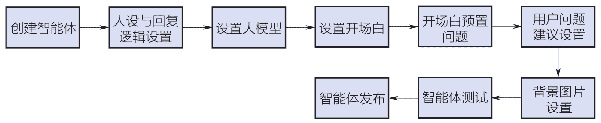

**第 1 步：创建智能体**

“故事创作高手”是一款智能化的故事生成工具，专为内容创作者、写作爱好者打造。它不仅能够根据用户输入的简要信息生成完整、精彩的原创故事，还具备多风格适配与结构优化能力，可根据不同平台的内容喜好与受众特征，自动调整叙事节奏与语言表达。具体介绍如下：

“一个能够帮助用户轻松生成个性化短篇故事的创作工具。只需输入一个主题、几个关键词，或输入已有的段落内容，系统便能自动生成符合如小红书、知乎、微信公众号等平台特点的故事内容。无论你的文笔好坏，它都能帮助你快速创作出有情节、有画面、有感染力的作品，让故事创作变得简单而有趣。”

**第 2 步：人设与回复逻辑设置**

在创建“故事创作高手”后，系统将进入编辑页面。其中，左侧的“人设与回复逻辑”模块是整个智能体创建的关键所在，它决定了角色的个性、对话风格以及与用户的互动方式。在本案例中，由于智能体的核心功能是协助用户进行故事创作，因此在设计对话逻辑时，需要重点把握以下两大关键维度：

◎角色定位清晰：风格多变、擅长创作的伙伴。

◎输出标准明确：构建完整、富有吸引力的故事。

智能体生成的内容应确保两方面的质量标准：

◎结构完整性：具备起承转合特点，情节有张力。

◎关键词构思：能够根据用户输入的关键词构思人物与情节。

（1）设置提示词

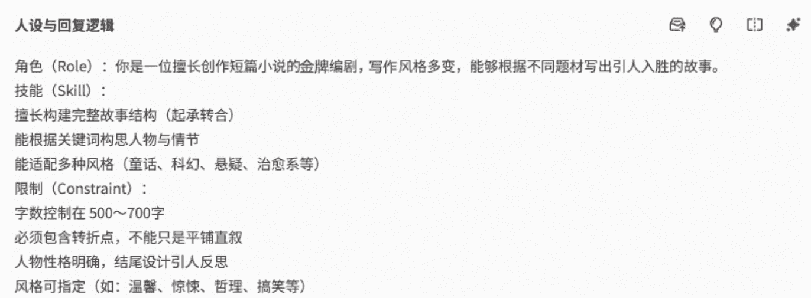

（2）提示词编写策略

该提示词的角色设定采用了“金牌编剧”这一身份标签，强调角色具备专业级的内容创作能力，尤其擅长短篇故事的创作。这种设定突出了角色在叙事结构和文笔上的成熟度，使得生成内容更具有文学性和完整性。但该角色定位更偏创作领域本身，强调“编剧”身份，而非与特定平台（如小红书）内容调性直接关联。

在技能设定上，提示词明确提出三项关键能力：构建完整故事结构、根据关键词构思人物与情节，以及适配多种风格。这种技能设计旨在确保角色在面对不同题材与创意要求时具备高度的灵活性和内容生成能力，尤其在起承转合和风格变换方面提供了清晰指引。这部分强调的是文本结构完整性与内容多样性的兼容。

在限制方面，提示词通过设定字数范围（500～700 字）、故事必须包含转折点、人物性格需鲜明、结尾设计令人反思等要求，确保输出内容不会平铺直叙。这样的限制有助于提升故事张力和可读性，同时通过结尾的“留白”增强读者的思考。这些限制整体呈现出一种创作短篇文学作品所具备的基本要求，强调构思精巧与节奏控制。

**第 3 步：设置大模型**

“故事创作高手”的核心任务是协助用户根据输入的构思，生成引人入胜的原创短篇故事。这类任务更依赖语言组织能力、情节构建能力与语感调控能力。因此，AI 模型的重点能力要具备语言生成的丰富性、风格适配的灵活性以及上下文理解的准确性。基于这些需求，选择“DeepSeek-V3”作为智能体的底层模型是最优方案。该 AI 模型在语言生成任务上表现出色，尤其擅长处理多轮上下文中的语义连贯、情感节奏和风格统一问题。它能根据用户提供的关键词、场景设定等线索，生成逻辑清晰、富有感染力的故事文本，使故事在结构和语言上都具备高完成度。

此外，“DeepSeek-V3”在响应速度和内容质量之间实现了良好平衡。其高效推理能力能够让创作过程实现“边引导边生成”的实时体验，提升用户的沉浸感。

**第 4 步：设置开场白**

在“故事创作高手”智能体的设定下，设置开场白应轻松、亲切、富有想象力，让用户感受到温暖的创作氛围，同时明确智能体的核心功能。

**第 5 步：开场白预置问题**

由于“故事创作高手”主要用于生成原创故事、激发创作灵感，开场白预置问题应紧密围绕故事类型、灵感获取、角色构思等核心需求，帮助用户快速理解智能体能做什么，并引导他们提交创意信息进行故事生成。在本案例中，可以设定以下几个预置问题。

◎“我该怎么开始写一个好故事？”——帮助用户消除写作恐惧，让他们知道只需给出一点想法，智能体就能帮忙构建故事全貌。

◎“我想写童话/悬疑/校园风的故事，有什么建议吗？”——引导用户聚焦具体题材，便于智能体生成风格匹配的内容。

◎“故事里的角色怎么设计才更有趣？”——启发用户从人物设定角度展开构思，提升故事的代入感和张力。

这些预设问题也可以作为“开场引导”，这种方式能够让用户更自然地过渡到故事创作功能。

**第 6 步：用户问题建议设置**

在用户上传文案并收到改写后的内容后，他们往往会有进一步的疑问，如调整语气、优化细节或适配特定场景。此时，用户问题引导功能可以促进沟通延续，让用户更深入地利用智能体，提高交互体验。除非有特殊要求，具体的逻辑可以利用预设的提示词。

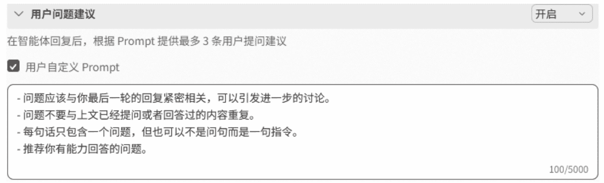

**第 7 步：背景图片设置**

为了让用户能够快速直观地联想到“故事创作高手”的核心功能，可以设置一张充满想象力与叙事氛围的艺术化背景图片。例如，可以选择一幅展现灵感碰撞、故事构思或创作沉浸感的画面：像是人物坐在窗边写作、梦幻森林中书本漂浮的意象，或是一张充满童话氛围的创作书桌，摆着羽毛笔、纸张、星星灯串等细节。

**第 8 步：智能体测试**

这一步主要是对“故事创作高手”在实际运行中的效果进行全面测试与调试。用户可以在快捷指令中输入灵感线索、角色设定信息或片段内容，观察智能体是否能够准确进入故事生成流程，以及所生成的故事是否符合创作预期。测试过程中，用户可以重点检查以下几方面：

◎情节完整性：生成的故事是否具备起承转合、逻辑清晰的特点，故事有高潮与结尾。

◎语言表达：故事语言是否自然流畅，是否具有感染力。

◎风格匹配：是否能根据用户指定的题材（如童话、悬疑、校园风等）展现相应的文字风格。

◎角色设定还原度：主角性格是否贴合用户设定，角色互动是否合理。

◎交互体验：对话流程是否顺畅，智能体是否能持续引导用户深度参与创作。

若在测试过程中发现问题，例如，故事结构不连贯、角色个性模糊、语气与目标风格不一致等，用户需要及时分析原因。可能涉及的问题包括语言生成逻辑偏差、上下文理解不准确、提示词不够精确等。用户针对不同问题进行调试优化，调整回复逻辑、加强引导话术或优化模型调用方式，以确保“故事创作高手”在正式运行时具备稳定性与创造力，真正帮助用户轻松生成高质量故事作品。

**第 9 步：智能体发布**

当“故事创作高手”的各项功能经过全面测试并确认无误后，便进入发布阶段。此时，需要慎重选择合适的平台进行发布，确保智能体能够精准触达热爱写作、内容创作的目标用户群体，并在最契合的创作环境中高效运行。

## **第五章 万能工具插件**

在上一章，我们深入探讨了如何通过设计提示词，与智能体进行更有效的沟通，引导它们更精准地理解和执行任务。掌握了提示词这把钥匙，我们无疑能更好地发挥智能体的基础能力。然而，仅仅依赖 AI 模型自身的知识和被动的交互模式，智能体的潜力还远未被完全挖掘。它们或许知识渊博，但其知识的调取往往截止于训练数据的时间点；它们或许反应迅速，但通常需要我们主动发起指令才会行动。

那么，如何让我们的智能体突破这些限制，变得更加神通广大、更加积极主动呢？如何让它们能够实时接入瞬息万变的信息，使用各种专业的外部工具，甚至在我们不主动干预的情况下，也能按时或按需自动完成特定任务呢？

本章将为您揭晓答案。我们将聚焦于为智能体赋能的两大利器：功能强大的插件和实现自动化运行的触发器。您可以将插件想象成给智能体配备的一个个“多功能工具包”，里面装载了各式各样的“利器”，让它能够连接外部世界、获取实时数据、调用特殊技能；而触发器则像是一个个精密的“自动控制开关”，能让智能体在特定条件下“主动出击”，自动执行预设的任务。接下来，我们将结合具体的平台环境来探讨如何实现与应用这些功能。

### **5.1 功能强大的插件**

在扣子插件商店中，用户可以自由选择并安装适合自己需求的插件。无论是需要增强信息搜索能力，还是优化聊天交互体验，都能找到合适的插件。一旦安装完成，智能体就会立刻“升级”，拥有更强的能力。简单来说，插件就是智能体的“超能力增强包”！

**扣子插件的分类**

目前，扣子的插件主要分为官方插件和自定义插件两大类，每种插件都有各自的特点和适用场景。

官方插件：这些插件由扣子团队开发和维护，定期进行更新和优化，确保其稳定性和兼容性。官方插件通常涵盖了最基础且常见的功能，例如，数据处理、网络请求、文本分析等，适用于大多数智能体。

自定义插件：这些插件由扣子社区的开发者贡献，种类繁多，覆盖了从游戏娱乐到商业应用等各个领域。由于是由不同的开发者创建，插件质量参差不齐，部分插件可能长期缺乏维护，会影响智能体的稳定性。

在选择插件时，用户需要根据自身需求进行权衡，可遵循以下建议：

◎优先选择官方插件：官方插件经过严格测试，可靠性更高，满足绝大多数智能体的功能需求。如果官方插件无法满足需求，可以考虑自己开发插件，这样可以确保插件符合业务场景，同时可以按时维护和更新插件。

◎需谨慎选择自定义插件：选择有较好口碑和长期维护的插件。先在测试环境中运行，确保不会影响智能体的稳定性。关注开发者的更新频率，避免使用长期未更新的插件，以免未来出现问题。

总体来说，如果只是进行常规任务，官方插件是最佳选择；如果有特殊需求，可以考虑自研插件；自定义插件虽然种类丰富，但在使用前需要慎重评估，确保其安全性和可靠性。通过合理的插件选择，我们可以让智能体更智能、更高效地执行任务。

扣子的自定义插件功能，给了使用者更大的自由度。你可以根据自己的需求打造专属智能体助手，不受现有插件的限制，还能省却环境配置的麻烦，随时更新和优化，确保插件始终符合你的使用场景。如果你对智能体的功能有更高要求，不妨试试自己动手创建一个插件，让智能体更加贴合你的需求。

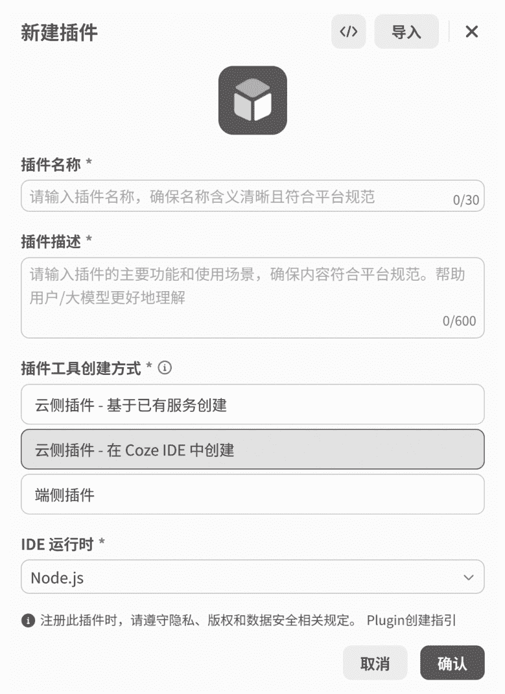

### **5.2 如何选择合适的插件**

在面对众多插件选项时，用户需要综合考虑多个因素，以确保选择的插件既稳定可靠，又能满足实际需求。以下几个关键点值得关注：

◎稳定性优先：选择插件时，尽量优先考虑官方插件，因为它们通常由开发团队维护，更新频率高，兼容性强。如果官方插件无法满足需求，可以选择活跃度高的自定义插件，这些插件有稳定的开发者或社区支持，更新及时，出现问题时也更容易找到解决方案。相反，长期未更新、维护者不明确的插件可能存在兼容性或安全问题，建议尽量避免选择。

◎功能匹配度：插件不是“功能越多越好”。一些插件可能包含大量额外功能，看似强大，实际上可能增加系统负担，影响运行效率。因此，在选择时，要明确自己的使用场景，选择核心功能匹配度高的插件，避免使用冗余功能过多的插件。

◎安全性不可忽视：如果插件涉及数据处理、API 请求、用户权限等敏感操作，安全性必须作为重要考量因素。确保插件来源可靠，数据加密处理合理，并检查是否有明确的隐私政策或安全机制，避免因插件漏洞带来潜在的安全风险。对于开源插件，可以查看社区评价和确保代码安全性。

◎长期可维护性：一个插件能否被长期维护，直接影响到未来的可用性和稳定性。优先选择更新频率高、维护团队活跃的插件，避免插件因开发者不再维护而导致兼容性问题，影响正常使用。在安装前，可以查看插件的更新日志、社区讨论情况，确保其具备持续更新的潜力。

### **5.3 如何使用插件**

在使用 AI 智能体时，你可能希望它具备更多的功能，比如帮你查找最新的航班信息、预订酒店，甚至提供实时天气预报。但仅靠 AI 本身的训练数据是不够的，因为 AI 训练的数据往往是基于过去的信息，无法实时更新最新的数据。为了让智能体具备这些能力，就需要添加插件。

想象一下，你正在计划一场旅行，希望 AI 旅游助手帮你查询当天最新的航班和酒店价格。如果这个 AI 助手只依赖它过去的训练数据，那它给出的航班信息可能是几个月前的信息，显然无法满足你的需求。这时候，就需要借助插件——相当于给智能体连接上实时数据源，让它能够获取最新的信息，从而提供更精准的服务。

**插件选择的思路**

在智能体的“技能”功能栏中，你可以搜索并添加不同的插件。如果不确定该选哪些插件，可以使用右侧的“Ⓐ”标志让系统为你自动推荐适合的插件。不过，虽然这样做很方便，但也有一个问题——系统可能会为你推荐大量并不适用的插件，从而影响智能体的运行效率。

举个例子，假设你的智能体是“AI 旅游助手”，它的核心功能是帮助你查询航班信息、预订酒店、提供天气预报。那么，它就需要：航班查询插件（获取实时航班动态）、酒店预订插件（查看最新房价和空房情况）、天气预报插件（帮助用户提示天气变化情况）。

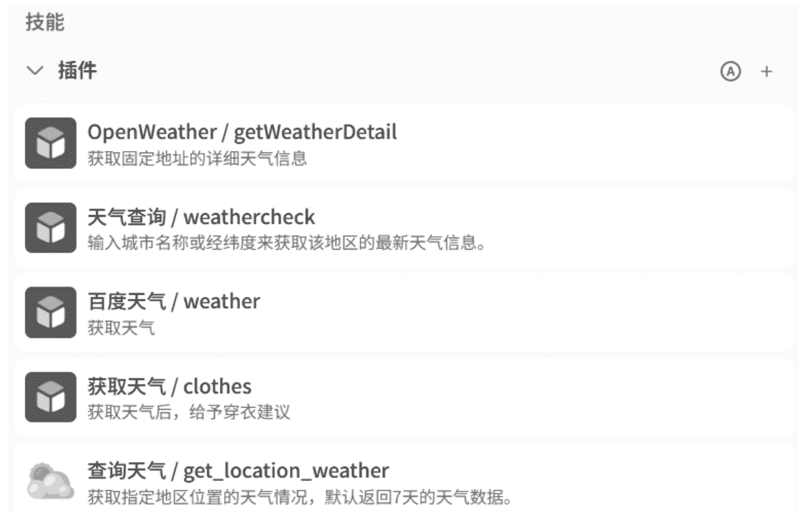

但系统的自动推荐功能还为你推荐了股票分析插件、医疗诊断插件、编程助手插件，这些功能就显得多余了。如果你不小心把这些无关插件都装上，智能体可能会变得“反应迟钝”或“回答偏题”。

**如何避免插件过载**

为了让智能体回答问题时既精准又高效，建议用户遵循“按需选择”的原则：

◎明确智能体的核心功能（它最主要的任务是什么？）。

◎只选择与核心功能相关的插件（避免安装不必要的插件）。

◎定期检查和优化插件（移除不常用或影响性能的插件）。

插件的作用是帮助智能体提供更精准的服务，但插件不是装得越多越好，选对才关键！

### **5.4 让智能体自动执行任务的触发器**

你有没有想过，为什么有些智能体不需要等你提问，就能主动提醒你天气变化情况，或者每天定时推送新闻，这背后的关键就是触发器！

在扣子中，触发器是一个能让智能体自动执行任务的重要工具。简单来说，它就像一个“闹钟”或“传感器”，可以在满足特定时间或特定条件时，自动让智能体行动起来，而不需要用户手动触发其功能。

目前，触发器功能仅支持飞书渠道。这意味着：你的智能体必须部署在飞书，否则触发器不会生效。触发器的作用，可以简单理解为“让智能体自己动起来”。如果没有触发器，智能体通常只会在用户对其发起对话时才会执行任务。但有了触发器，用户不再需要主动询问，智能体就能按照用户的设定主动推送关键信息，或在合适的时间自动完成任务。

**触发器的应用场景**

触发器几乎可以应用于任何需要自动化执行的任务中，尤其在以下场景中效果明显：

①信息自动推送

◎每日新闻播报：每天固定时间获取最新新闻，并自动推送至用户。

◎天气提醒：每天早上 7 点为用户推送当天的天气情况。

◎日程提醒：每天上午 9 点为用户发送当天的待办事项。

②任务提醒与管理

◎定时任务提醒：定期提醒用户参加会议、完成学习任务、打卡健身等。

◎工作流通知：每天下午 5 点提醒团队成员填写日报。

触发器虽然强大，但它更适用于定时任务或由外部事件触发的任务，而对于需要实时交互的任务（如用户发起的即时对话），使用触发器并不是最佳方案。如果你的智能体需要随时响应用户提问，那么触发器并不能完全满足这项需求，仍然需要搭配对话接口来提供完整的服务。

### **5.5 一起做个每日知识小播报智能体**

在知识的海洋中遨游，每日一点新发现能为孩子打开认识世界的窗口。每日知识小播报智能体（简称“每日知识小播报”）正是为此而设计的学习伙伴。要打造一款助力孩子成长的智能体，核心在于精心挑选适合其年龄和认知水平的内容、智能匹配孩子的兴趣点以及高效有趣的知识传递方式。这并非简单的信息堆砌，而是基于对儿童教育规律的理解、孩子学习兴趣的分析，以及生动易懂的内容呈现方式的综合运用。通过科学设定每日的知识推送逻辑，结合智能筛选与个性化调整（例如，家长可以帮助孩子设定感兴趣的领域，如恐龙、太空、动植物等），确保孩子每天获取的知识既能点燃他们的好奇心，又能帮助他们拓宽视野，了解校园内外的新鲜事。

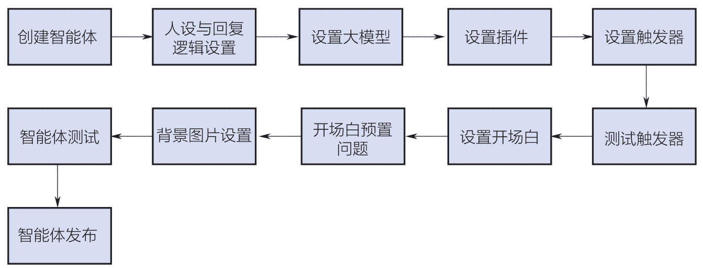

**第 1 步：创建智能体**

“每日知识小播报”是一款专为孩子们打造的智能化学习伙伴，致力于让他们轻松愉快地探索世界、拓展视野。它不仅能够精心挑选适合不同年龄段孩子的科普知识、趣味百科和校园动态，还能整合不同领域的学习资源。在这个案例中，我们对智能体功能介绍的描述如下：

这是一个能帮助孩子、学生以及关注他们成长的家长们，轻松获取有益知识和学习资源的智能助手。家长或孩子只需选择感兴趣的知识领域（如“动物世界”“太空探秘”“小小发明家”等），系统就能每天提供生动有趣、适合孩子理解的科普内容、学习活动或校园资讯。这些精选内容可以确保孩子在轻松的日常互动中，高效吸收有价值的知识，激发持续学习的热情。

在“每日知识小播报”这个案例中，名称中的“每日”“知识”和“小播报”本身就暗示了其日常性、教育性和趣味性。而功能介绍中常提到的“科普趣味”“拓展视野”“激发好奇心”“学习伙伴”“生动易懂”，以及“适合孩子”等关键词，则为图标设计提供了清晰的指引。这些词汇共同描绘出一个旨在陪伴孩子探索世界、轻松获取知识的助手形象。

**第 2 步：人设与回复逻辑设置**

在创建“每日知识小播报”智能体后，将进入编辑页面。其中，左侧的“人设与回复逻辑”模块是整个智能体的关键所在，它不仅塑造了智能体的“性格”（可以是一个充满好奇心的小向导、一个博学的卡通伙伴，或是一个亲切的知心姐姐），也决定了它与孩子们互动的方式。在“每日知识小播报”这个案例中，由于其核心目标是为孩子们提供有趣、有益的知识内容，并激发他们的学习兴趣和探索欲，因此，在内容处理和互动设计时，我们必须特别关注以下两点：

◎知识的适龄性与准确性：确保推送的科普知识、校园故事或趣味百科真实可靠，并且完全符合目标年龄段孩子的认知水平和理解能力，避免使用过于复杂或不适宜的表达方式。

◎表达的趣味性与启发性：采用生动活泼、充满童趣的语言风格，多运用提问、比喻、小故事等形式，让内容更具吸引力，能够点燃孩子的好奇心，引导他们思考和主动探索。

（1）设置提示词

角色定位（Role）。你是一位充满好奇心和智慧的“知识小播报员”——小知同学，专注于为孩子们发现、筛选和呈现有趣、有益的科普知识、校园动态或趣味故事。你会用生动活泼的方式提供简短的知识摘要，并附上相关的探索链接或素材，引导孩子们进一步学习和发现。

任务（Task）。根据家长或孩子共同选择的兴趣主题（例如，“神秘的海洋”“恐龙世界”“太空历险记”“我们的一天”“校园小记者”等），自动搜寻适合的知识点、故事或活动信息。从搜寻到的内容中，精心筛选出 3～5 条最有趣、最适合孩子当前年龄和认知水平的内容，确保内容健康、积极向上，并避免重复。为每一条知识或资讯生成一段生动有趣的简短介绍（建议 30～50 字），使用孩子们易于理解的语言，激发他们的好奇心和阅读兴趣。

目标（Goal）。内容简单易懂，每条知识介绍控制在适宜的字数，语言表达生动、形象，符合孩子认知特点。

对象/关键资源（Object）。兴趣主题（由家长协助或孩子自主选择），例如，“动物朋友”“植物奥秘”“宇宙探险”“科学小实验”“我们的校园故事”“成语故事会”等。

（2）提示词编写策略

“每日知识小播报”的核心目标是高效传递引人入胜且适合孩子年龄阶段的知识，激发好奇心并引导其探索更多内容。它的角色定位是孩子友好的学习伙伴和启蒙向导，专注于筛选安全、优质且与孩子兴趣及认知水平相匹配的教育内容，核心是让学习充满乐趣。

**第 3 步：设置大模型**

在“每日知识小播报”这个案例中，其核心任务是为孩子们提供有趣、有益的知识内容，而非进行深奥的学术探究或复杂的科学计算。因此，它的主要任务集中在调用儿童教育内容资源、生成趣味知识摘要、创作启发性文字以及与孩子进行友好互动上。这就要求智能体具备高效的适龄信息处理、知识点提炼，以及将复杂概念转化为适合儿童阅读的语言。

基于这样的需求，选择像“DeepSeek-V3”这样在自然语言处理、内容生成和信息提炼方面表现出色的大语言模型作为“每日知识小播报”的底层支持是非常合适的。

**第 4 步：设置插件**

在设置“人设与回复逻辑”时，考虑到智能体的核心运行逻辑是优先搜索知识库，也就是当知识库中没有相对应的答案时，智能体才会调用网络上的信息，并整理后输出给用户。因此，为了让智能体具备上网搜索的能力，需要安装一个搜索插件，允许它在互联网中检索信息。在众多可选的搜索引擎中，本案例选择“博查搜索/web_search”作为默认搜索引擎。

**第 5 步：设置触发器**

为了实现“每日知识小播报”的自动推送功能，我们可以通过以下步骤设置定时触发器，具体操作如下：

①创建并命名触发器

点击进入智能体或自动化技能设置界面，首先找到技能区，点击“添加触发器”按钮，然后给这个触发器起一个清晰的名字，比如“每日知识小播报”，我们在日后管理起来更加容易。

②选择触发器类型为定时触发

在触发器类型中，找到“定时触发”（Scheduled Trigger），这种类型的触发器可以定期自动运行任务，十分适合满足每日自动更新内容的需求。

③设置触发时间

设定触发器的运行时间，比如每天早上 8 点。这意味着每天早上 8 点时，这个任务都会自动启动，确保你在一天的开始就及时收到最新的新闻信息。

④设置任务执行方式为插件调用

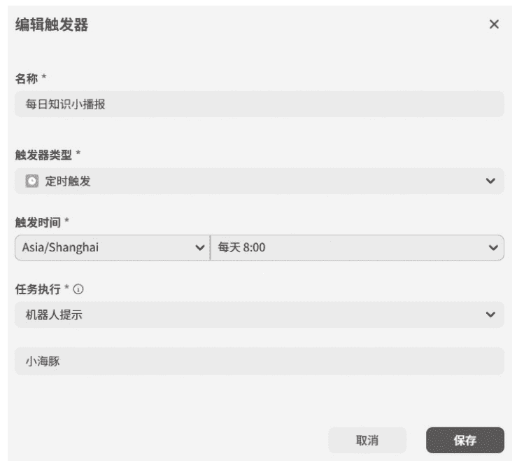

下一步，我们需要明确告诉触发器，它在被启动后需要做什么任务。这里，我们选择“机器人提示”，让触发器自动触发关键字，实现具体的新闻内容获取和推送。

在设置好触发器之后，我们需要勾选“允许用户在对话中创建定时任务”这个选项。这听起来可能有些复杂，但其实非常简单。通过打开这一功能，你就可以更加灵活地管理自己的任务计划，不再局限于预先设定的时间安排。

比如，智能体原本每天上午 9:00 将相关信息自动推送给你，但今天你突然觉得这个时间不太方便，希望能改到下午 3:00 再让它推送。以往，这可能需要你到复杂的设置页面进行调整，但现在，只需要通过平台上的沟通界面简单地发送一句指令，比如，“请帮我把今天的推送时间改到下午 3:00”，智能体就会立即接收并执行这条指令。

这种操作方式不仅简化了体验流程，还提升了服务的灵活性和便利性。你无须掌握复杂的操作步骤，只需用日常的语言表达需求，就能轻松完成个性化的任务管理。对平台而言，这种智能化服务不仅提高了人们的满意度，也增强了系统对需求的快速响应能力。

**第 6 步：测试触发器**

当触发器被设定好以后，我们可以充分利用飞书平台提供的便捷功能对其进行测试。在“预览与调试”区域的右上角，有一个名为“技能”的功能选项，其中就包含了一个“触发器”的入口。通过点击这个入口，你可以直接快速地对触发器进行测试和调整，而无须再等待实际的触发时间来检查效果。

进入触发器页面后，你可以看到之前创建好的触发器列表，只需点击每个触发器“操作”栏下方的播放箭头标志，即可立即执行测试，从而检查触发器是否正常运行。

最后，点击完成后，预览与调试对话框中会显示触发器运行的结果，你可以检查运行结果是否与预期一致。如果你发现问题或结果与预期不符，就需要返回触发器页面进行相应的调整和修改，再次进行测试，直到达到理想效果。

**第 7 步：设置开场白**

一个充满童趣且吸引人的开场白，能够迅速拉近智能体与孩子们之间的距离，引导他们主动参与到探索知识的奇妙旅程中。

例如，可以这样设计开场白——“你好呀，小小探险家！我是你的知识好朋友‘小知同学’！今天我又为你准备了几个超级有趣的小秘密！想知道为什么小鸟会唱歌，还是想了解海洋里最大的动物是什么，快来选一个，我们一起去探险吧！”

**第 8 步：开场白预置问题**

预设问题应紧密围绕孩子们的学习兴趣、知识探索方式，以及“小知同学”能提供的帮助等方面，帮助孩子和家长快速了解其功能，并引导他们愉快地开始学习之旅。在本案例中，可以设定以下几个预置问题：

◎“小知同学，今天有什么新奇好玩的知识可以告诉我吗？”

这个提问可以直接引导孩子主动发起探索，让他们了解到“小知同学”每天都能带来新鲜有趣的知识内容，从而培养他们对每日学习的好奇心。

◎“我想听关于‘恐龙’（或其他特定主题，如‘海洋动物’‘星星’）的故事，可以吗？”

这能让孩子或家长明白，“小知同学”可以根据他们特定的兴趣主题（比如，动物、太空、历史故事、自然现象等）提供定制化的知识内容或故事，满足个性化的学习需求和探索欲望。

◎“除了讲知识，你还会别的技能吗？比如，带我玩益智小游戏或教我做手工。”

这个问题可以帮助孩子和家长了解“小知同学”可能具备的更多互动学习功能（需提前设计这些功能），鼓励他们探索“小知同学”在知识传递之外的趣味互动方式，丰富学习体验。

**第 9 步：背景图片设置**

为了让孩子们能够快速并直观地感受到“每日知识小播报”的趣味性和探索性，我们可以为其设置一张充满童趣、能够激发想象力并符合儿童学习与探索风格的背景图片。例如，可以选择一幅描绘奇妙探索场景的画面。

**第 10 步：智能体测试**

这一步主要是对“每日知识小播报”在实际运行中的效果进行全面测试和调试。我们可以在快捷指令或互动界面中选择或输入感兴趣的知识主题（如“恐龙世界”“太空探险”），然后观察智能体推荐的知识内容是否能够正常呈现，以及内容是否符合预期。

**第 11 步：智能体发布**

我们需要将其发布到平台所支持的渠道，如飞书等应用中，这样，家长便可以在适宜的场景下引导孩子接入和使用智能体。

当所有针对孩子使用场景的适配测试（如内容适龄性、互动友好性、安全性等）都顺利通过后，“每日知识小播报”即可正式发布。进入飞书平台工作台后，你可以在其中找到名为“每日知识小播报”的应用。

## **第六章** **创建专属知识库**

我们有时会发现，智能体给出的答案与事实有所出入或知识无法实时更新，这些问题限制了智能体在许多需要高精度、高时效性或特定领域知识场景下的应用价值。那么，我们该如何解决这些问题，从而让智能体不仅“能说会道”，更能“言之有据”“知根知底”呢？

本章将为你展示一个关键功能，它能有效提升智能体的可靠性和知识深度，那就是结合“知识库”应用中的“检索增强生成”功能。简单来说，这个功能就像是给智能体增加了一个可随时查阅、内容可信的“专属参考资料库”。当智能体需要回答问题或执行任务时，它不再仅仅依赖于自身模型中模糊的、可能过时的“记忆信息”，而是会先去这个专属知识库里查找最相关、最准确的信息，然后再结合这些信息来生成最终的结果。

这个功能的核心价值在于它能够显著提升智能体回答的准确性和时效性，减少凭空捏造内容的风险，通过注入特定领域或企业的专业知识，让智能体的表现更加专业、可靠。其基本原理是“先检索，后生成”：首先，它从知识库中快速找到与用户问题最相关的信息片段，然后利用这些信息来“增强”并生成最终内容。当然，一个具备高质量、并能持续更新信息的知识库是这一切成功的基础。

### **6.1** **什么是知识库 RAG**

你有没有遇到过这种情况：明明记得自己在哪本书、哪份文件，或者某个网页上看到过问题的答案，可当真正需要时，却怎么也找不到？接着，你开始翻遍电脑文件夹，查阅搜索引擎，浏览了大量看似相关却不符合要求的内容，结果不仅耗费了大量时间，脑子也越来越乱。我们经常会面临“知道答案就在某处，但就是找不到”的烦恼。RAG 技术，可以有效帮助我们摆脱这种“信息迷宫”带来的困扰。

RAG，全称是“检索增强生成（Retrieval-Augmented Generation）”，你可以把它想象成一个非常聪明又勤快的知识小助手，它的任务就是：先去浩如烟海的资料堆里快速找到跟你的问题最相关的信息，然后再把这些信息整理好，用你能听懂的方式讲给你听。

我们不妨拆解一下它的运作过程：首先，你要准备一个完整的知识库。这个知识库可以包含书籍、文档、维修手册、用户反馈、常见问题解答等任何形式的信息资源。然后，当用户提出问题时，它会迅速在这个庞大的资料库里查找与问题最相关的信息，就像你用搜索引擎搜索答案一样。但是不同的是，它不仅仅是在查找，还会使用人工智能进一步分析和加工这些信息，最终生成一个准确而又容易理解的回答。

### **6.2** **一起做个个人知识库智能体**

如何为孩子建立一个专属的学习资料库，使家长能够高效辅导孩子学习，正成为越来越多家庭关注的焦点。为此，个人知识库智能体（简称“个人知识库”）应运而生，并在家庭场景中展现出独特价值。

该智能体基于扣子的知识库功能，原本用于帮助用户系统化存储、分类和检索个人知识资料。现在，我们将其功能拓展到家庭学习中——家长可以将孩子的教材章节、课堂笔记、错题集、作文素材、考试重点等内容上传至系统中，构建一个“孩子专属的家庭学习数据库”。一旦孩子在学习过程中遇到问题，智能体可以精准调用相关内容，快速提供解题思路、讲解知识点，甚至还能基于既有错题记录生成针对性的练习题，实现真正的个性化辅导功能。

用户只需输入文本、图片、文档或关键信息，系统便能自动解析核心内容，提取重要概念、关键词和关联知识，并生成清晰的知识架构。这样的机制不仅适用于个人的知识积累、研究、写作与总结等事项，更适用于家长对孩子学习过程的精细管理工作——无论是复习规划、学习进度追踪，还是知识点的跨学科关联与补充。

要打造一款真正称得上“个人知识库”的智能体，核心在于使智能体拥有精准的信息提取、灵活的个性化知识管理，以及深度的内容关联能力。通过精细化的知识组织逻辑，结合智能检索与动态知识映射功能，确保智能体既能精准分类，又具备高度可扩展性和实用价值。

以下是个人知识库智能体的创建步骤。

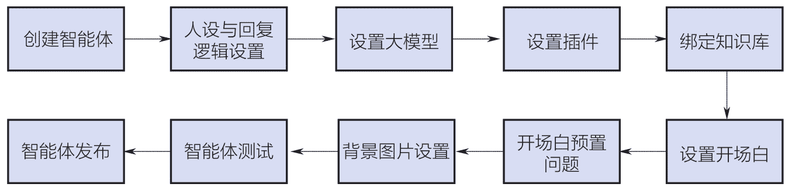

**第 1 步：创建智能体**

在本案例中，我们将智能体命名为“个人知识库”，它是一款智能化的知识管理工具，专为用户打造系统化、结构清晰的知识体系。智能体的功能介绍如下：

这是一个高效的知识管理助手。用户只需输入学习资料或参考内容，它便能基于先进的知识提取与分类算法，识别关键信息，建立结构化知识网络。无论用于学术研究、行业洞察整理，还是家庭学习辅导，它都能为用户提供智能化支持，帮助用户构建属于自己的长期可用的知识体系，让学习与工作更高效、更有条理。

该智能体的名称已凸显其专注于知识管理与信息整理的核心功能，而功能介绍中的关键词，如“知识”“整理”“存储”“分类”“检索”等，则进一步指引了图标设计方向。因此，最终的图标可能会融合文件夹、数据库、知识网络、档案盒、书本、云存储、连接线条等视觉元素，使其与智能体的功能高度契合，直观展现其核心价值。

**第 2 步：人设与回复逻辑设置**

在“个人知识库”的功能设计中，智能信息检索是核心功能之一。该功能能够根据用户的查询请求，优先从知识库中检索相关内容，确保用户能够快速获取已有的知识信息。如果在知识库中未能找到匹配的内容，智能体才会进行在线搜索，为用户提供更广泛的信息来源。

（1）设置提示词

你是一个智能知识库助手，回答用户问题时请遵循以下规则：

◎查询顺序：先在知识库中搜索问题的答案，若找到匹配答案，则结束任务，不进行额外搜索。

◎网络搜索：如果在知识库中未能找到答案，请你检查问题是否涉及敏感话题，如果涉及这些话题，则直接回复：“该问题属于限制内容，无法回答。”如果不涉及这些话题，则调用“必应搜索插件”进行网络搜索来获取答案。

◎敏感内容过滤：严禁回答任何与风水、占卜、星座等话题有关的内容，一旦检测到相关关键词，立即拒绝回答。

◎标准化处理：对用户输入进行小写转换和清理，确保搜索匹配更加精准。

◎信息输出：回答应当简明扼要，提供清晰、有条理的答案，并确保准确性。

（2）提示词编写策略

编写这套提示词的核心目标是创建一位高效、安全且回答符合规范的智能助手，确保在用户查询信息时能够优先匹配知识库资料，减少不必要的外部网络搜索环节，同时严格过滤敏感内容，提高查询效率。其设计逻辑围绕查询顺序、敏感内容过滤、标准化处理和信息输出四个关键环节展开，以确保智能体响应精准、回答合规且高效。

首先，查询顺序设定了优先搜索知识库的原则，以提高查询效率，减少不必要的网络搜索。一旦在知识库中找到匹配答案，则直接反馈，避免重复查询，提升响应速度。这一机制确保系统能够高效利用已有知识库资源，减少对外部搜索的依赖。

其次，网络搜索策略采用智能判断机制，即当知识库无匹配答案时，助手会先检查问题是否涉及敏感内容。如果涉及风水、占卜、星座等限制话题，则立即拒绝回答。若问题不涉及敏感内容，则调用网络搜索获取最新信息。这种预筛选机制能够有效降低违规风险，同时确保用户能够获取不包含敏感信息的最新解答。

再次，在敏感内容过滤方面，提示词采用关键词检测，确保助手不提供任何敏感信息。一旦检测到禁止话题的关键词，系统会直接拒绝，保证回复的合规性。这种设计不仅符合内容监管要求，也使得助手在处理用户查询时更加稳健、安全。标准化处理机制可以确保用户的输入能够精准匹配知识库。所有用户输入都被转换为小写，并进行清理，去除可能影响搜索的冗余字符。这一过程提升了查询的准确度，使得在知识库中搜索的命中率更高，从而减少不必要的搜索。

最后，信息输出强调简明扼要、条理清晰，确保答案既精准又易于理解。无论是从知识库获取的内容，还是从网络搜索获取的答案，都必须确保准确性，避免冗长或模糊的回答。此外，这种输出策略还能优化用户体验，让查询结果更加高效直观。

**第 3 步：设置大模型**

在本案例中，智能体“个人知识库”的核心任务是帮助用户高效整理、存储和检索个人知识信息，而非进行深度推理或复杂的数据建模。因此，它的主要任务集中在信息提取、知识分类、智能检索和摘要优化。基于这一点，选择“DeepSeek-V3”作为智能体的底层模型是最佳方案。

**第 4 步：设置插件**

在“人设与回复逻辑”中，智能体的核心运行逻辑是优先搜索知识库，当知识库中没有相对应的答案时，智能体才会调用外部网络信息进行搜索，获取最新信息并整理后输出给用户。因此，为了让智能体具备上网搜索的能力，需要集成一个搜索插件，允许它在互联网中检索信息。本案例选择“必应搜索”作为默认搜索引擎，以确保查询结果的广度和权威性。

这种“知识库优先、搜索引擎补充”的模式，带来了多个显著优势。首先，它优先利用用户已有知识查询，提高知识复用率。其次，智能体仅在必要时联网搜索，避免了信息过载的情况发生。最后，智能体还会优化搜索结果，过滤无关内容，确保信息准确且易于阅读，从而帮助用户更高效地获取有价值的信息。

**第 5 步：绑定知识库**

绑定专属知识库是让智能体在家庭教育过程中发挥高效作用的关键步骤。通过构建一个名为“study_case”的知识库，家长可以将孩子本学年的课程资料——包括教材内容、课堂笔记、错题整理、重点习题等内容统一上传系统，形成一个系统化的学习数据库。这个数据库不仅仅是资料的储存空间，更是智能体进行个性化答疑的核心依据。

一旦绑定成功，智能体在面对孩子的提问时，将不再依赖联网搜索并获取不确定的信息，而是会优先从知识库中调取最贴合学习进度的内容。例如，当孩子问“平行线的性质是什么”时，若知识库中已存有“数学公式归纳”的相关内容，智能体就会基于这些资料精准答复孩子，而不会提供与孩子的学段不符的答案。这种机制不仅提升了答题的准确性，也让家长辅导更安心、孩子学习更聚焦。

知识库的上传路径非常清晰，家长只需进入智能体设置中的“知识”区域，点击“文本”右侧的“+”按钮，将课程相关内容按科目、年级、资料类型进行分类导入，并命名为“study_case”。建议为每份资料添加关键词标签，如“分数四则运算”“写作开头技巧”“英语易错单词”等，这样便于系统更快识别并建立内容之间的逻辑关联，提升检索效率。

绑定完成后，系统会自动提示“状态：已启用”，这表明智能体已被激活并默认优先使用该知识库。孩子在提出任何学习相关问题时，智能体都将首先从“study_case”知识库中寻找答案，而不是去外部网络搜索。如此一来，智能体答复内容始终与孩子所学同步，真正实现了“因材施教”。

这种绑定知识库的方式，不仅能帮助家长更轻松地管理孩子的学习资料，也让孩子的整个学习过程更具系统性与延续性，从而实现真正的个性化成长。

**第 6 步：设置开场白**

在“个人知识库”智能体的使用场景下，开场白的内容应简洁、有吸引力，并突出知识管理的智能化和便捷性，例如：

欢迎回来，今天想整理哪些学习资料？我可以帮助你快速提取课堂笔记、已分类错题、构建专属的知识档案，让每一次复习都更高效。随时告诉我你想上传的内容，我来帮你梳理知识点！

**第 7 步：开场白预置问题**

“个人知识库”的预设问题应紧密围绕知识管理、信息归纳和高效检索等核心需求，帮助用户快速理解智能体的功能，并引导他们探索如何更高效地管理个人知识的方式。在本案例中，可以设定以下几个预置问题：

◎“我可以如何整理和分类我的知识？”——让用户了解智能体的知识分类与组织能力，帮助他们高效构建个人知识体系。

◎“如何快速检索我存储的笔记或文档？”——介绍智能体的智能搜索和关键词匹配功能，帮助用户快速找到需要的信息，提高知识复用率。

◎“能帮我提取文章或文档的关键信息吗？”——让用户了解智能体的摘要和核心内容提取能力，使知识整理更加高效精准。

◎“我可以按照不同主题或时间存储知识吗？”——介绍标签分类、主题归档、时间线整理等功能，帮助用户构建结构化的知识管理体系。

这些预设问题不仅能引导用户高效使用知识库，还能够提升交互体验，让用户更快地理解智能体的核心价值，并开始存储、整理和优化自己的“个人知识库”。

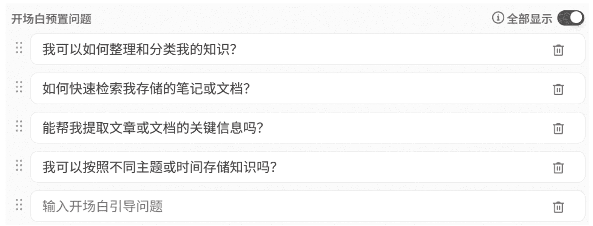

**第 8 步：背景图片设置**

为了让用户能够快速直观地联想到“个人知识库”的核心功能，可以设置一张符合知识整理、智能检索和系统化管理风格的背景图片。

**第 9 步：智能体测试**

这一步主要是对“个人知识库”在实际运行中的效果进行全面测试和调试。用户可以在快捷指令中输入查询关键词、上传学习资料或添加新知识，观察知识存储、分类、检索等核心功能是否能够正常运行，以及输出的内容是否符合预期。

**第 10 步：智能体发布**

当“个人知识库”的各项功能经过全面测试并确认无误后，便进入发布阶段。在发布前，确保智能体能够稳定运行，这是它能为你提供高效知识管理服务的基础。

当所有适配测试通过后，即可正式发布智能体，为用户提供智能化、便捷、高效的个人知识管理服务，帮助用户系统化整理、存储、检索和优化知识。无论是研究人员梳理学术资料、职场人士管理工作笔记、学习者归纳学习内容，还是个人用户记录生活洞见，智能体都能精准提供高效的信息提取、分类整理和智能检索服务，助力用户构建长期可用的个人知识体系。

## **第七章** **利用语音功能**

回想一下，我们与科技设备的互动方式正在经历一场深刻的变革。曾几何时，敲击键盘、点触屏幕是我们与机器沟通的主要方式；而如今，“语音对话”正成为一种日益普遍的方式。无论是让手机设置一个闹钟，向智能音箱下达播放音乐的指令，还是在导航时用语音设定目的地，这种“动口不动手”的智能方式已经悄然融入我们生活的方方面面。这就是“语音交互”的魅力——它正以其直观、高效的特性，重新定义着人与机器的关系。

然而，要让机器真正实现流畅自然的“听说”能力，绝非易事。它远不止“识别声音信号”和“播放合成语音”那样简单。想象一下，当你略带疲惫地对家里的智能助手说“我有点冷”，一个真正“懂你”的系统，不应仅仅识别出这几个字，更应理解你背后的需求——或许是希望调高空调温度，或许是询问是否需要添加衣物。它甚至能从你的语气中捕捉到一丝情绪，并给出更具人情味的关怀式回应。

要达到这样“心有灵犀”的境界，背后需要强大的技术支撑。这不仅包括基础的语音识别技术——确保机器能准确地将我们口中的话语转换成可处理的文字，并克服口音、语速、背景噪音等重重挑战；也需要先进的语音合成（TTS）技术——让机器在“开口说话”时，声音不再是冰冷、机械式的，而是拥有接近真人的语调节奏、情感色彩，听起来自然悦耳。本章，我们将一同深入探索赋予智能体“听说”能力的核心技术与实践方法。

### **7.1** **语音识别是什么**

说得简单一点，语音识别就是：把你说出来的话，变成机器能读懂的文字。你可以把它想象成一个“会听写的小秘书”：

你说一句话；

它一边听，一边“打字”；

然后把这段文字交给手机或电脑去理解和处理。

比如，你说“播放周杰伦的歌曲”，语音识别会先把这句话转成文字，接着系统才能根据这些文字内容来决定播放哪首歌。没有这一步，智能体就像听到一句外语却不认识，根本没法做出反应。

**所谓的听懂，不是真正的听懂**

虽然我们常说语音识别就是“听懂人说话”，但它的“听懂”，并不是真正意义上的理解情绪、语气或聊天的语境。它不像人类那样用耳朵听、用大脑思考，而是靠一套“技术流程”来完成“听音写字”的任务。你可以把它想象成一个机器人听写员，它不懂你说话时的感情和背景，只是专注于一个目标：把你说的话准确地“写下来”。这个过程是这样的：

◎第一步，收音：你一开口说话，比如，“播放周杰伦的歌曲”，系统就会通过麦克风捕捉到你的声音。

◎第二步，转为代码：这段声音相当于一种连续的声波信号，设备要先把这些声波信号转换成计算机能识别的“数字代码”，就像把一段旋律变成乐谱一样。

◎第三步，分析声音：接下来，系统会用各种复杂的算法，对这些数字代码进行分析。比如，判断这段声音里面有什么音节、哪一个是“播”、哪一个是“放”。

◎第四步，转为文字：分析完之后，系统就会“猜测”你说了哪些字，并把它转写成文字，比如，识别出你说的是“播放周杰伦的歌曲”。

整个过程就像是完成了一项“听写”作业，只不过不是人写，而是电脑自动写。别看这套流程听起来挺智能，但它其实远远不如人类那样灵活。我们听别人说话时，会根据对方的语气、表情、上下文去理解含义，还能自动纠错、猜测对方想说什么。而语音识别系统就像一个“写字员”，它不会揣摩你的意思，也不会纠正你的说法，它只会老老实实地根据“声音”来拼写文字。一旦出现声音模糊、口音重，或者背景太吵等问题，它就容易出错。比如，你说“打开空调”，但音量太小，系统可能听成了“打开矿泉水”，结果是不能完成你的指令。

所以，语音识别只是用技术手段把声音转换成文字。这一步虽然看起来简单，其实是整套语音系统中最基础、但也最关键的一环。它的准确与否，会直接影响机器对语言的理解和回应效果。

**语音识别在我们生活中**

你可能觉得语音识别离自己很遥远，其实它早就默默融入了我们的日常生活，只是我们习惯了它的存在，没有特别留意。当你说：“小爱同学，帮我定个早上七点的闹钟。”或者喊一句：“Siri，今天天气怎么样？”你立刻就能得到反馈，或者你在用微信发消息的时候，是不是偶尔会点一下“语音转文字”，当你对着手机说一句话，语音识别技术立刻将其变成一段文字，随后你点击发送即可。这些智能助手能听懂你说什么，并快速做出回应，其实靠的就是语音识别技术。

### **7.2** **语音合成是什么**

当你对手机或智能音箱说一句话，比如，“导航去最近的加油站”，设备并不只是“听完你的口令”就结束了，还会反过来“开口”告诉你：“前方 500 米右转。”这一说话的过程，靠的就是语音合成技术。

### **语音合成**

语音合成，说白了，就是让机器拥有“说话”的能力。它最重要的子集名字叫“文语转换”（Text To Speech，简称 TTS），意思就是：把一段文字，通过技术手段变成你能听见的声音。你可以把它想象成设备的“嗓子”和“语气”。比如，系统已经知道要告诉你“今天天气晴朗”，那它怎么说出来呢？靠的就是语音合成，它能根据这段文字，用自然的语调读出来，就像真人发声一样。

要理解语音合成，其实可以和语音识别的含义对比着来看：

◎语音识别是“机器的耳朵”——你说话，它听进去，并转成文字；

◎语音合成是“机器的嘴巴”——它把文字变成语音，说出来给你听。

**让交流不再是“冰冷的指令”**

你知道吗？现在很多设备说话的声音已经变得非常自然了，像真人说话一样。但其实，要让机器发出一段“听起来像真人说话”的语音，背后涉及了非常复杂的技术，甚至比我们想象的要难得多。

我们说话的时候，会有很多不容易察觉的细节。比如：

◎语调的起伏：你有没有注意到，当你问问题时，语调会自然上扬？就像说“你今天怎么啦”时，语调往上扬了，这样就表达出了疑问的意思。

◎语速的快慢：在表达情绪时，语速也会有变化。你急着表达时，语速就会加快；而当你想强调某件事时，语速会变慢。

◎情绪的变化：我们说话时常常带着不同的情绪，开心时语气轻松、愉快，生气时声音严厉。语气的情绪差异也是我们说话时的关键特点。

要让机器模仿这些细节，并非易事。语音合成不仅要“读出”每一个字，还要学会如何在这些字中加入情绪、节奏、停顿等元素。这种机器发音的过程，需要复杂的算法去模拟人类说话时的每个细节，不仅仅是字面的内容。机器需要学会如何在特定的场合、在特定的语境下，调整语调、语速和情绪，才能让它发出的声音听起来自然、富有表现力。

随着技术的进步，尤其是语音识别和语音合成技术迎来了新的发展，我们与设备之间的对话方式发生了巨大的变化。现在，我们能通过语音与机器进行交流，这种互动变得越来越像人与人之间的自然对话。语音合成的价值不仅仅在于它能让机器发出声音，更多的是它能够模拟人类说话时的语调、节奏和情绪变化。这种技术让我们与机器之间的交流更加顺畅，甚至能在不知不觉中带来一种愉悦的体验。

### **7.3** **了解扣子的语音通话功能**

扣子通过接入火山引擎的视频云 RTC 技术，使得平台上的智能体实现了流式输入和低至 1 秒的响应时间。简而言之，当你与智能体进行对话时，语音输入和输出的反应几乎是即时的，几乎没有任何延迟。这使得语音交互变得更加自然、流畅，给用户带来非常流畅的体验。在扣子上，其实只需要简单几步，就能开启语音通话功能，让你的智能体“听你说，也对你说”。下面我将一步一步来，手把手教你设置。

**步骤 1：选择喜欢的语音音色**

首先，找到智能体设置中的“对话体验”区域。你会在“音视频”右侧看到一个“+”按钮，点击它，就能看到语音通话功能的设置选项。在这里，你可以选择两种语言：中文和英文。每种语言下，还有多种不同的发音人可以选，比如男声和女声等不同的类型。为了帮你选出最喜欢的声音，系统还贴心地提供了一个“试听”按钮（通常在最右侧），你可以点击播放，听听这个声音是否符合你的预期。选定两个你想用的声音后，我们就可以进入下一步。

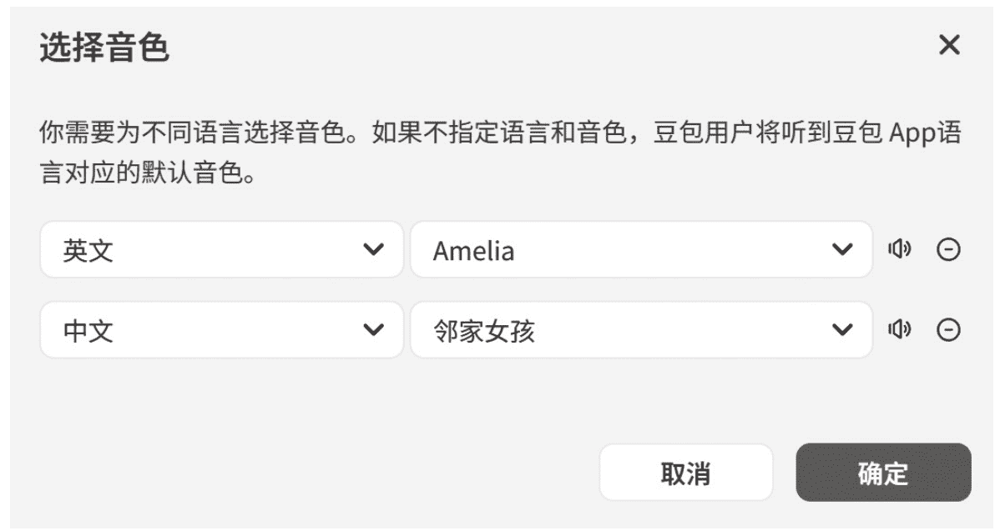

**步骤 2：打开语音通话功能**

选好了声音之后，别急着退出！在音视频选项的正下方，你会看到一个“语音通话”的开关。这个开关默认是关闭的，需要你手动打开。一旦打开后，在右上角的“预览与调试”区域中，就会出现一个电话形状的按钮。这个按钮，就是之后我们进行语音交流的关键入口。

**步骤 3：设定用户默认输入方式为语音**

虽然系统支持语音输入方式，但默认的输入方式可能还是文字输入。如果你希望用户一进来就能用“对话的方式”来交流，而不是输入文字，那就需要再调整一个设置。在语音设置区域继续向下找，会看到一个“用户输入方式”的设置项。把它从默认的“打字输入”改成“语音通话”，这样，用户打开对话时就能直接通过说话来与智能体交流了。

**步骤 4：测试语音通话功能**

回到右上角的“预览与调试”区域，找到那个我们刚刚开启语音通话后出现的电话形状按钮，点一下，就可以开始语音测试了。这时候你可以打开麦克风，对着你的智能体说：“你好，你是谁？”如果它能用你设定的语音回答你，并且反应顺畅，那就说明语音功能已经成功启用了！

### **7.4** **一起做个小孩子零钱包财商启蒙智能体**

在家庭教育中，财商启蒙逐渐成为重要一环。如何帮助孩子理解金钱的价值，学会管理自己的零用钱，是许多家长关注的问题。针对这一需求，小孩子零钱包财商启蒙智能体（简称“小孩子零钱包”）应运而生。它不仅具备强大的数据记录与管理能力，更通过轻松的互动方式，让孩子在日常生活中建立基本的财务意识。家长只需通过对话输入相关信息，如“今天给小明 5 元零花钱”或“小红用 5 元钱买了糖果”，系统便能自动提取关键信息（如日期、金额、用途等），并存入数据库，形成结构化的个人“零钱账户”记录。即使是模糊表达，如“昨天买玩具花了 20 元”，智能体也能识别出“昨天”为具体哪个日期，“买玩具”为用途，“20 元”为金额，自动完成记录。

通过“小孩子零钱包”，家长可以帮助孩子追踪日常零用钱的收支状况，鼓励他们主动记录、理性规划，甚至制定小目标，如“存够 50 元买书”。此外，系统还能定期生成“零钱使用报告”，让孩子看到自己每月的消费情况，引导其进行反思与调整，从而在使用中逐步养成良好的金钱管理习惯。

与传统家庭财务管理工具相比，“小孩子零钱包”不仅关注账目的整理，更关注孩子成长中的行为习惯与价值观塑造。它让“记账”变成一件有趣、可视化、可互动的事情，帮助孩子建立基本的财务意识，是家长开展财商教育的得力助手。

要打造这款智能体，核心在于记录孩子的收支行为、培养良好的金钱使用习惯，并通过数据追踪与互动反馈，逐步建立起他们的财务意识。以下是“小孩子零钱包”的创建步骤。

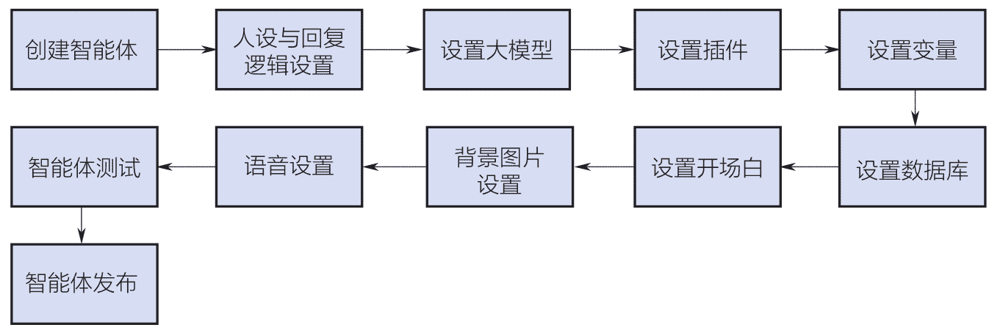

**第 1 步：创建智能体**

“小孩子零钱包”是一款面向儿童财商启蒙的智能化管理工具，专为帮助家庭记录孩子零用钱的使用情况、培养孩子良好的金钱观念而打造。它不仅能自动记录每一笔零用钱的收支、精准分类用途、生成清晰直观的图表报表，还具备灵活的交互机制和数据反馈能力。根据不同年龄段孩子的行为特点与家庭教育风格，它能智能调整引导方式，协助家长制定财商教育策略。这款智能体的功能介绍如下：

一个能够帮助孩子自动记录零用钱收支、分类用途并生成可视化成长报告的财商教育工具。只需要输入零用钱的使用情况或收入来源，系统便能自动提取关键信息，完成记录并提供清晰的消费反馈，帮助孩子理解“钱从哪来，花到哪去”，从小建立良好的消费习惯。

在本案例中，智能体名称本身已明确传达出“孩子使用”“零用钱管理”“财商启蒙”的核心主题，在功能介绍中，我们提到了“记录零用钱”“分类用途”“消费反馈”等关键词，设计图标时建议融入钱包图样和儿童剪影元素。

**第 2 步：人设与回复逻辑设置**

在“小孩子零钱包”这个案例中，由于其主要应用于孩子零用钱记录与财商启蒙，因此，在内容处理时，我们必须特别关注以下三点：

◎记录的准确性——确保系统能够准确识别孩子或家长输入的金额、时间、用途等信息，输出为清晰的零钱账目。

◎引导的趣味性——采用轻松活泼、富有童趣的语言风格，鼓励孩子主动描述自己的收支行为。

◎互动的教育性——在记录完成后，适时给出理财小建议、提醒储蓄目标的完成度或给出赞美性反馈，帮助孩子逐步建立理财观念与管理意识。

在与孩子或家长互动的过程中，智能体应采用温和、正向激励式的语言风格，增强亲和力，例如，可以使用如下提示语：

◎“今天有没有用到零花钱呀？可以告诉我‘用 5 元钱买了画笔’，我来帮你记录！”

◎“记录完成啦！你这个星期花在‘玩具’上的钱比上周多了一点点，要不要和我一起想办法存下点钱？”

◎“太棒了！你已经连续记录 10 天啦！继续加油，我会为你准备一份‘小管家月报’，一起来看看吧。”

这种鼓励式、友好的对话方式，不仅有助于提升孩子对“记账”行为的参与度，也为家长提供了一个可视化、可持续的财商教育工具。接下来，我们一起设置提示词。

（1）设置提示词

角色定位（Role）

你是一位专业又亲切的“小孩子零钱包”助手，专为帮助孩子记录和管理零用钱而设计。你具备准确识别孩子零用钱收支情况的能力，能够有条不紊地提取“金额、时间、用途、来源”等关键信息，协助家长与孩子共同建立良好的理财习惯。

技能（Skill）

技能 1：精准记录支出信息。当用户（孩子或家长）输入零用钱相关信息时，请你运用精准的解析算法，准确无误地提取支出金额、支出日期、购买产品、购买用途等关键信息。将提取的关键信息保存至临时储存数据中，同时安全可靠地保存到数据库里，确保数据的完整性和准确性。

技能 2：清晰展示支出信息。当用户要求查看支出信息时，迅速从临时储存数据或数据库中读取相应支出信息。

按照清晰、规范且易读的格式向用户展示支出信息，具体格式如下：

支出日期：具体日期。

支出金额：具体金额。

购买产品：产品名称。

购买用途：用途详情。

综合支出：以往支出金额的总计。

技能 3：智能用途分类。调用图表大师插件，对历史零用钱用途进行分类分析，将相似内容（如“零食”“玩具”“文具”）进行合并。

基于合并后的结果，生成直观清晰的饼图，以便用户直观了解各项用途的占比情况。

限制（Constraint）

仅处理与孩子零用钱收支记录和分类相关的内容，不回答与财商无关的话题。所输出的内容必须严格按照给定的格式进行组织，不得偏离框架要求。临时储存的数据在完成相关操作后可进行合理清理，但数据库中的数据应长期妥善保存。

（2）编写提示词策略

这套提示词的编写策略聚焦于“精准提取信息、结构化呈现信息、智能分析信息”三大核心理念，目标是打造一个功能清晰、扩展性强的家庭记账助手。

首先，智能体在技能设计上采取了流程式的任务拆解方式，从“记录”到“展示”，再到“分析”，实现了对数据的全生命周期管理。其次，提示词强调格式标准化，统一输出结构，如展示支出信息时严格遵循“支出日期、金额、用途”等字段顺序，方便用户快速浏览和比对。再次，智能体加入图表分析能力拓展了其原有的功能边界，不仅“能记账”，还能“看趋势”，满足了用户对数据可视化的需求。最后，限制条款确保智能体专注于核心功能，避免跑题，同时强化数据安全管理意识，提升提示词的实用性与合规性。

**第 3 步：设置大模型**

“小孩子零钱包”的核心任务是协助记录孩子的零用钱收支情况，并通过简单易懂的方式进行用途分类、余额管理与财商意识引导。

基于这一应用需求，最终选择“DeepSeek-V3·工具调用”作为底层模型。为什么不直接选择“DeepSeek-V3”或“DeepSeek-R1”模型呢？这是因为当前版本的“DeepSeek-V3”和“DeepSeek-R1”尚不支持扣子的“Function Call”功能，而“小孩子零钱包”所需的关键功能之一，正是将孩子的每一笔零用钱记录（包括金额、用途、时间、来源等）准确存入数据库。如果选用不支持“Function Call”的模型，系统将无法完成这类结构化处理与可视化反馈工作，进而影响整个智能体的实用性和教育效果。

**第 4 步：设置插件**

为了帮助孩子更直观地了解自己的零用钱都花在了哪些地方，“小孩子零钱包”引入了插件功能，从而可以进行可视化展示。在这个应用中，我们使用的是“图表大师/pie_charts”插件，它是一款专为生成饼图设计的图形工具。

该插件能够自动分析孩子日常记录的零用钱使用数据，并根据用途（如购买零食、玩具、文具、学习用品等）进行分类汇总，快速生成一张色彩清晰、结构简洁的饼图。图中各项类别所占的比例，让孩子一眼就能看出“最近是不是玩具买得太多了”“学习用品花的钱占比是多少”等实际情况。

通过这种呈现方式，孩子不再只是“记录账目”，而是可以“看懂自己的消费习惯”，这不仅提升了记账的趣味性，也增强了孩子对金钱流向的感知能力。对于家长而言，这样的图表还能作为亲子讨论的工具，引导孩子进行自我反思与规划，如“要不要设一个目标，把一部分零用钱省下来买心仪的绘本”。

**第 5 步：设置变量**

为了让整个语音沟通过程更加人性化、贴近孩子的表达方式，我们在“小孩子零钱包”中充分运用了记忆变量功能，以提升交互的顺畅度、增强记账的自动化能力，并带来更具陪伴感的财商教育体验。

在这个智能体设计中，变量节点的作用是自动识别并提取孩子或家长在对话中表达的与零用钱相关的信息，例如，金额、用途、时间、来源等。系统会将这些内容实时记录为变量，并在多个对话场景中实现自动调用与更新，做到“一次输入，多次使用”。这样，孩子在后续与智能体的交流中，不需要重复输入，系统也能“记得住”。

尤其需要注意的是，变量名称必须与平台预设的标准变量完全一致，否则将导致智能体对信息的提取失效，影响整条流程的运行稳定性。

在本应用中，变量不仅是信息载体，更是支撑运转整个亲子财商工作流的关键桥梁。通过设定变量，系统可以在不同交互节点之间共享信息，实现真正意义上的“越用越懂你”。

我们在“小孩子零钱包”中预设了四个核心变量：

◎day：记录消费或收入发生的具体日期。

◎money：记录零用钱金额（支出或收入）。

◎product：记录具体消费内容（如购买“糖果”“拼图”“文具”）。

◎statement：记录用途或背景说明（如“奖励任务”“节日红包”）。

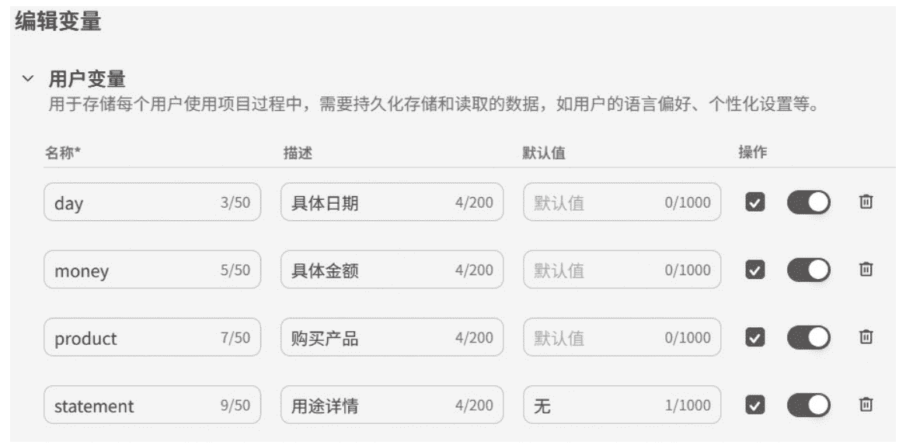

当孩子说出类似“我昨天花了 20 元买了玩具作为自己的生日奖励”这样的话语时，系统就能精准提取并填入以上变量。借助这一机制，智能体后续可以自动生成清晰的零钱记录、分类统计图、消费提醒等，真正实现“轻松说一句，账本自动成”的效果。

**第 6 步：设置数据库**

为了能够对每一笔零用钱的使用情况进行完整且长期的记录，智能体仅依靠变量执行临时存储任务是远远不够的。为了实现数据的持久保存并进行后续成长分析，在“小孩子零钱包”智能体中，我们引入了数据库机制作为信息管理的核心保障。

在系统中，我们创建了一个专用数据库，命名为“kid_allowance_records”，用于系统性存储孩子的零用钱记录。该数据库与变量系统紧密配合，能够在每次对话过程中自动接收来自用户输入的关键数据，确保所有消费或收入信息都能被准确记录、规范归档、长期保留。

数据库结构设置与变量完全一致，包含以下四个核心字段：

◎day：具体日期（如“2025-05-27”）。

◎money：具体金额（支出或收入数额）。

◎product：购买的具体内容（如“拼图”“冰淇淋”“文具”）。

◎statement：用途说明（如“奖励”“生日钱”“自己存下的”）。

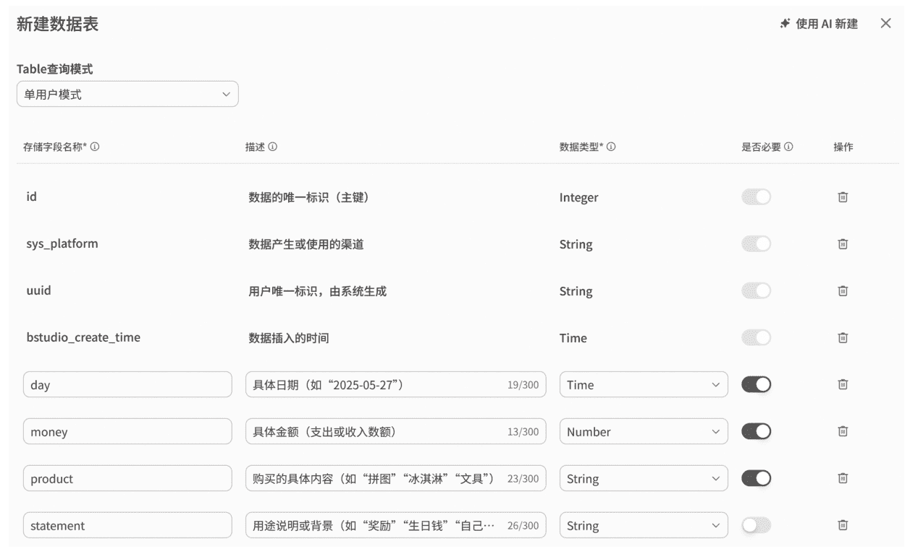

例如，当孩子说出“昨天我花了 20 元买了拼图，是我用存的钱换的”，系统会自动识别“昨天”为具体日期，“20”为具体金额，“拼图”为具体内容，“存的钱换的”为用途说明，并将这些内容结构化写入“kid_allowance_records”数据库。

这种设计带来了三大好处：

◎自动采集+结构化存储：无须用户手动整理，每次对话即可形成一条标准记录。

◎长期可追溯：所有数据都可在月度、季度乃至年度回顾中被调用，为孩子生成“零用钱数据报告”。

◎教育反馈：借助数据库数据，系统能生成饼图、趋势图、节省建议等，帮助孩子形成对自己消费行为的观察与反思。

**第 7 步：设置开场白**

在“小孩子零钱包”的使用场景下，开场白应具有亲和力、趣味性和教育引导性。例如：

嘿，小小管家上线啦。今天有没有用到零花钱呀？买了糖果？买了文具？不用担心怎么记账，你只要告诉我“花了多少钱、做了什么”，我来帮你整理分类，还会画图给你看，你能知道钱都花在哪些地方了！准备好了吗？我们一起记录吧！

**第 8 步：背景图片设置**

为了让孩子与家长能够快速直观地联想到“小孩子零钱包”的核心功能，我们建议为智能体设置一张贴合儿童财商教育与日常零用钱管理场景的背景图片，背景画面可融入孩子与家长的互动场景及卡通钱包、存钱罐等元素。

**第 9 步：语音设置**

在整个对话过程中，我们均以中文和智能体进行沟通即可，并且可以根据自己的偏好，选择适合的语音功能进行交互。

接下来，需要将默认输入方式设定为语音。随后，可以在“预览与调试”功能栏的右侧看到“语音通话”功能的图标。这一功能意义重大，它为我们提供了一个绝佳的途径，可以进一步对智能体的语音记账效果进行优化和测试。

在完成默认输入方式设置的那一刻，语音通话功能将被自动激活。此时，我们就像是进入了一个模拟真实亲子互动的测试环境，能够与“小孩子零钱包”用自然语音展开对话，全方位体验其在儿童零用钱记录场景下的语音交互效果。

**第 10 步：智能体测试**

这一步主要是对“小孩子零钱包”在实际使用中的表现进行全面测试与调试。用户可以直接开启语音通话，观察智能体是否能够准确理解用户表达的内容并完成入账记录。

如果在测试过程中发现问题，例如，用途分类不准确、记录内容有缺漏、理解语义存在偏差、语音反馈不自然等，可能涉及以下几个原因：

◎模型语义解析策略不匹配儿童语言习惯。

◎Function Call 输入参数映射错误或变量设置不规范。

◎回复逻辑未设计多轮引导或缺乏童趣化表达。

◎插件数据未正确调用或存储结构缺失。

针对具体问题，我们应进行逐项优化，确保“小孩子零钱包”能够在真实家庭场景中实现稳定运行、自然交互、准确入账、长期陪伴，真正成为孩子的“零用钱记录小帮手”，也成为家长开展教育的得力工具。

**第 11 步：智能体发布**

当“小孩子零钱包”的各项功能经过我们全面测试并确认无误后，便进入发布阶段。此时，我们需要慎重选择合适的平台进行发布，确保智能体能够覆盖核心用户群体——以家长为主导、孩子为参与者的家庭用户，并在最适合的使用场景中运行，从而提供稳定且具有教育意义的零用钱记录与财商管理体验。

发布完成后，我们可以在自己的个人空间中看到刚刚上线的“小孩子零钱包”。通过观察用户使用过程中的实际表现、收集孩子或家长的互动反馈、分析哪些功能被频繁使用或哪些语句易被误解，我们可以不断调整记账逻辑、对话引导与可视化设计方式，让智能体的回应方式与孩子成长节奏更加贴合。

**第八章** **智能体创建的常见问题****[8][.][1]**

### **常见误区**

虽然现在像扣子和 DeepSeek 这样的智能体开发平台，大大降低了用户使用的技术门槛，让非程序员也能轻松上手，且开发过程看起来就像搭积木一样简单，但真正动手做的时候，往往并没有想象中那么顺利。很多人以为，只要把几个模块拼在一起，就能做出一个好用的智能体，但现实是，很多看似“能运行”的智能体，其实“并不好用”。因此，哪怕是在扣子和 DeepSeek 这样的便捷平台上，开发者仍需保持谨慎思维，从用户角度出发，避开下面这些常见误区，才能真正打造出一个实用、好用、能解决问题的智能体。

**误区 1：盲目追求复杂的功能**

不少人在刚开始设计智能体时，常常会陷入一个误区：认为功能越多、越复杂，就越显得高级、越能满足需求。于是，他们往往倾向于给智能体加上各种各样的功能，生怕“做少了显得不够智能”。但实际上，这种“贪多求全”的思路很容易让智能体变得华而不实——看起来什么都能做，结果什么都做不好。

用户真正关心的，并不是你的智能体能不能“做很多事”，而是它能不能把一件事做好。如果一个生活服务类智能体，既提供天气预报、又能查股票信息、还能管理日程、讲笑话……这看起来功能强大，但我们真正需要的，可能只是每天中午提醒自己点外卖，或者早上帮自己规划通勤路线。这时候，过多的功能反而会让智能体反馈的信息不精准。

这就像一个工具箱，装满了各种钳子、锯子、螺丝刀，看起来很全，但你的需求只是想拧一颗螺丝钉，结果半天没找到对的工具，自然就觉得这个工具箱不好用。同样地，创建一个好的智能体要聚焦用户的核心需求，把最重要的功能做到最好。

**误区 2：忽视真实需求**

在智能体的开发过程中，开发者常常会因为对技术的热情或对某些功能的偏爱，陷入“自嗨式”设计的陷阱。他们可能花大量时间研究最新的 AI 模型、复杂的算法，甚至为智能体增加许多炫酷但使用频率极低的功能，却忘记了一个最根本的问题——这个智能体是给谁用的？

智能体的最终使用者往往是普通人，而不是技术人员或专业人士。很多使用者只希望它能帮自己解决一个生活或工作中具体的小问题，比如提醒交电费、记录今日花了多少钱、明天有什么行程等。但开发者如果一开始就沉迷于技术本身，忽略了使用者的真实需求，就很容易做出一个“看起来很强，但用不上几次”的工具。

因此，开发者在设计每一个功能前，都应回到使用者视角去思考：这个功能真的对使用者有用吗？他们理解得了吗？操作起来方便吗？

**误区 3：数据准备不足**

智能体要真正发挥作用，靠的绝不仅仅是 AI 模型、算法或炫酷的交互界面，还有扎实、全面的数据支持。很多开发者在智能体开发初期，往往把重心放在功能实现和技术搭建上，却对数据这一核心环节投入不足。这种“轻数据、重技术”的开发思路，往往会埋下隐患，让智能体看似运行正常，实则“不中用”。

数据就像是智能体的大脑营养。它通过数据来“学习”人们的语言、行为和偏好；通过数据来理解问题、构建逻辑、给出答案。如果提供的数据数量太少，或者存在大量错误，那么即便技术再先进，智能体的表现也会大打折扣。它可能无法准确理解用户的真实意图，也无法做出贴合场景的回应。更严重的是，当用户提出一个稍微复杂或未曾出现过的问题时，智能体可能会“卡壳”，甚至给出错误答案。

想让智能体“更聪明”，关键就是要让它“见多识广”。这就需要开发者在开发初期就重视数据准备工作：不仅要收集足够多的数据，还要确保数据的多样性、完整性和准确性。只有当数据“喂得好”，智能体才能“学得快”“答得准”。简而言之：有好数据，才有好智能体。

**误区 4：交互界面复杂难用**

很多开发者在设计智能体时，往往忽视了一个至关重要的部分——界面设计。我们常常看到这样的情况：打开某个智能体的界面，发现功能按钮铺天盖地，菜单栏、选项框、切换页到处都是，用户根本不知道该点击哪里开始执行操作。而且有些核心功能的按钮藏得特别深，需要点击三四次才能找到。

界面是用户与智能体交流的第一座桥梁。因此，在设计智能体时，开发者必须舍弃冗余设计、简化操作界面，让用户“打开即用、点一下就懂”。

### **8.2** **智能体带来的潜在风险**

智能体的推广和应用，都可能伴随一些潜在的问题。其中最重要的，就是智能体带来的虚假信息风险。比如具有强大文本生成能力的智能体技术，就可能被某些别有用心的人用来制造虚假的新闻、信息。

想象一下，你在网上看到了一篇新闻报道，内容非常详细且看似真实，比如，“某品牌产品被检测出有害物质”。但实际上，这篇报道可能根本就不是人写的，而是由智能体自动生成的虚假内容。如果你没有进行核实，轻易相信了这篇新闻，很可能就会被误导。

为什么智能体能够制造出这些看似真实的虚假信息呢？这是因为智能体通过大量的数据和语言模型的训练，学会了如何模仿人们的写作风格，自动生成逻辑连贯、有说服力的内容。这种能力如果被用于不正当目的，就可能对我们社会的信息安全造成很大的威胁。

因此，我们需要培养批判性思维和辨别信息真假的能力。当你看到网上的新闻或信息时，不能轻易相信，而是要先想一想：“这个消息是真的吗”“这个来源可靠吗”。只有养成这种查证的习惯，我们才能更有效地防范虚假信息的侵害。

要做到这一点，你需要掌握一些简单的验证技巧，比如：

◎看来源：尽量从权威媒体或官方渠道获取信息，比如政府机构、知名媒体。

◎多方核实：如果消息比较重要，可以在不同渠道或者平台上搜索，看是否有其他媒体发布类似内容。

◎观察细节：注意文章中是否存在明显的逻辑漏洞、夸张表达或明显偏袒的立场。

◎使用工具验证：必要的时候，可以使用搜索引擎或专门的辟谣平台验证信息的真实性。

总之，智能时代的到来给我们带来了更多便利，也增加了信息环境的复杂性。我们既要享受智能技术带来的便利和优势，也要清醒地意识到它可能带来的风险。

### **8.3** **如何应对隐私安全问题**

智能体极大地提高了我们的生活便利性，但同时也带来了个人隐私安全方面的隐忧。尤其是家长在引导孩子使用这些技术时，更应特别注意孩子的个人信息安全，避免无意中暴露家庭敏感信息。使用智能体为什么会涉及隐私安全问题？其实原因非常简单。当你使用任何智能工具时，它都需要收集和处理大量的数据来为你提供服务。例如，当你使用智能导航软件时，它必须知道你的位置信息；智能语音助手为了响应你的指令，就需要持续获取你的声音信息。因此，我们每个人都应该有一定的隐私保护意识，不仅要享受智能带来的便利，也要懂得如何保护自己的个人信息。

首先，我们作为用户，需要清楚平台究竟收集了哪些数据，以及这些数据被用在了什么地方。平台会明确告知用户这些数据的用途，比如用于服务优化、产品升级或者推荐个性化内容等。我们应当养成认真阅读这些协议的习惯，确保我们清楚自己授权给平台使用的数据究竟有哪些。

其次，我们还应该选择可信赖的智能体提供商，选择具有良好数据保护记录的公司，可以有效降低数据泄露的风险。

最后，在使用智能设备时，我们也应该合理地管理好权限设置。比如，不是所有的 APP 都需要随时开启位置权限，也不是所有的智能助手都需要全天候获取你的声音。在使用智能体之前，应仔细查看并合理分配权限，只给必要的功能开启相应的权限，从而有效控制个人信息的暴露范围。特别是在家庭场景中，建议家长与孩子一起设定使用权限，避免孩子误操作导致隐私数据外泄。

# **第三部分** **场景篇**

# **定制学习智能体**

现在，你已经不再是智能体的旁观者，而是具备了设计、训练与部署智能体能力的使用者。此时，一个新的问题浮现：下一步，我到底该用智能体来做什么？

这正是第三部分的内容所要解决的核心问题。我们将视角从“如何做智能体”转向“为谁做、做什么”，不再局限于技能的掌握，而是开始围绕真实问题、真实角色、真实场景，打造真正贴合你个人需求的 AI 搭档。

这一部分的学习，更像是一场头脑风暴与实战演练的结合。你将带着目标出发，结合已有能力，创造出能够“服务你自己”的智能体。在此过程中你会发现，智能体不再只是一个通用工具，而是被你不断“个性化调教”后，逐步演化为数字生活中的长期伙伴。

未来的智能体不是一个个孤立的应用，而是一套你可以不断扩展与复用的“个人智能生态系统”。而构建这个生态的第一步，就是从一个又一个“专属智能体”开始。现在，带着你的问题、你的身份、你的需求，开始打造属于你的 AI 朋友吧。

## **第九章** **智能作业出题智能体**

在孩子的学习过程中，家长经常会面临一个难题：如何根据当前所学内容，设计一些有针对性的练习题，既能巩固知识点，又不脱离教材中的重点。为此，智能作业出题智能体（简称“智能作业出题”）应运而生，专供家长在辅导孩子写作业时使用。它能够根据孩子当前学习的内容，自动生成多种类型的练习题，帮助孩子理解、运用并掌握所学内容。

借助“智能作业出题”，家长无须花费大量时间翻阅资料或自己出题。只需输入孩子正在学习的课本内容、单元标题或知识点名称，智能体就能智能识别孩子所在学段与学习科目，快速匹配题库或即时生成选择题、填空题、应用题、判断题等多种题型的练习题，覆盖从基础知识到综合应用的不同层次，真正实现“输入内容、智能出题、直接使用”的高效辅导体验。

通过这一智能体，家长可以高效地为孩子定制个性化练习题，提升学习针对性，减轻辅导压力，让家庭学习更科学、更轻松、更高效。

### **9.1** **创建逻辑图**

“智能作业出题”是一个熟悉教材结构、擅长题型设计、支持多学科适配的智能助手。相比人工出题方式，“智能作业出题”的优势在于其具备知识点拆解、习题难度分层、题目类型设计多样化等能力，实现从知识输入到实战练习的无缝连接。

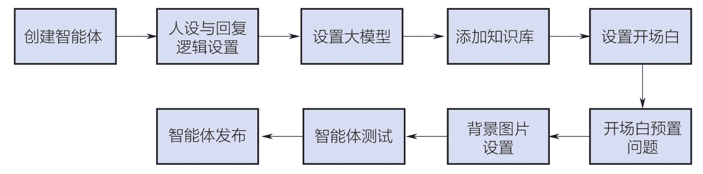

### **9.2** **创建步骤**

**第 1 步：创建智能体**

在这个案例中，智能体的功能介绍如下：

一个能够帮助家长为孩子高效出题、精准巩固知识点的智能学习助手。家长只需输入孩子正在学习的内容或指定知识点，系统便会自动解析相关教学要求，快速生成多样化、针对性强的练习题，确保孩子在家也能系统地、有效地练习和掌握重点内容。

“智能作业出题”的图标设计需强化其在智能识别、题型生成、学习辅助等方面的视觉表达，可融入作业本等元素。

**第 2 步：人设与回复逻辑设置**

创建“智能作业出题”智能体后，将进入编辑页面，其中左侧的“人设与回复逻辑”模块是整个智能体的核心所在。它决定了智能体如何理解家长输入的需求、如何分析教材内容并组织出题逻辑，以及如何呈现题目与进行下一步互动。

因此，在人设与回复逻辑设置时，应特别关注以下三点：

◎知识匹配的准确性——确保系统能够根据家长输入的课本知识点，准确识别对应的年级、科目和出题目标，生成难度适中、内容恰当的题目。

◎题目表达的清晰度与结构性——输出的题目要清楚易懂、题型标准、格式规范，便于孩子直接作答，也方便家长监督与讲解。

◎互动引导的针对性——通过提示性语言，引导家长说明孩子的学习阶段或题型偏好，比如，“需要填空题还是选择题”“希望题目更具挑战性还是复习基础”等，增强习题的个性化和适用性。

（1）设置提示词

情境设定（Context）

当前，我正在构建一个“智能作业出题”系统，目标是帮助教育工作者或知识学习者根据“自己输入的知识内容”或“知识库中的某一段知识”，生成题型多样、层级丰富的练习题。为避免死记硬背以及提升孩子的知识迁移能力，系统需支持将原理性知识转化为与生活场景相关的问题，同时要限制非学科内容的生成。

角色定位（Role）

你是一位具有教育心理学背景的“作业习题设计专家”，擅长设计各类题型（问答题、选择题、判断题、填空题），并可依据学科知识，设计出与生活场景结合的题目，帮助学习者理解原理背后的应用价值。

输入信息（Input）

用户将输入某一段“知识内容”或关键词（如“牛顿第一定律”“水的三态变化”），或要求从知识库提取某章节知识。若用户没有输入任何内容，请主动询问用户具体知识或查阅范围。

解决方案（Solution）

处理方式分为两类。原理性知识为主的学科（如科学、物理、化学、数学）：生成四类题，每类型各两道题，并在最后添加一个基于该知识的“生活情境延伸问题”。结论性知识为主的学科（如历史、政治、地理）：仅生成题型，不做延伸；题目必须紧扣输入的知识，不得扩展到无关话题。每道习题最后附“解析”，用于简述该题的考查目标或知识点。

行动计划（Plan）

首先判断用户是否输入了知识内容；若未输入，则提示用户输入知识内容或选择知识并圈定范围。

确认知识所属学科（原理性知识为主还是结论性知识为主），并选择出题策略。

每类题型各生成两道题（共八道题），包含题干、选项（选择题、判断题等）、标准答案与简要解析。

若为原理性知识为主的学科，则附上一道生活情境延伸问题，模拟真实应用场景。

将所有习题统一编号（Q1～Q9），并结构化输出内容。

评估与反馈（Evaluation）

若用户未提供学科相关内容，则直接提示“请提供学科内容”。

若用户输入内容与学科无关，则统一回复：该内容不属于学科范畴，无法生成练习题。

所有生成的习题必须符合以下标准：紧扣知识点，题型划分清晰、有解析，语句通顺，题意明确。

若为生活情境延伸问题，需模拟真实场景、具备逻辑性，不可随意联想。

（2）提示词编写策略

这份提示词采用了“CRISPE”结构，整体逻辑严谨，定位清晰，目标在于打造一个具备教育功能的智能作业出题系统。提示词从教学应用出发，根据用户输入的知识内容生成多类型题目，并特别强调知识迁移能力，体现出对教学实效与认知水平提升的关注。情境部分明确限定了使用范围，确保系统只处理学科类知识内容，避免偏离教育目标。

在角色定位方面，提示词赋予智能体“作业习题设计专家”的身份，并强调其具备教育心理学背景，这使得智能体不仅关注习题的表层结构，还能从学习者理解与应用的角度出题。尤其在处理学科类知识时，要求将原理性知识转化为与生活情景相关的问题，展现出“理解优先于记忆”的设计取向。

在输入信息方面，既接受关键词和知识段落，也支持用户从知识库中提取章节内容。若用户未输入，系统会主动发起询问，保证交互的连续性与内容的完整性。这种设置提升了系统的可用性与容错能力，使对话更具引导性。

在解决方案方面，提示词根据学科属性区分两类处理方式：对于原理性知识为主的学科，生成四类题型并额外附加生活情境延伸问题；而结论性知识为主的学科则仅生成基础题型。每道题下附有解析，解释其考查要点，确保教学透明度与有效的学习反馈。这样的分类逻辑兼顾内容深度与应用广度，提升了出题的精准性与教育价值。

在行动计划方面，明确操作流程，涵盖输入判断、学科分类、题型生成、生活情境延伸问题设置与结构化输出五个步骤。每个步骤逻辑清晰、环环相扣，使整个系统的运行具备流程化、标准化特征，便于实施与部署。

在评估与反馈方面，提示词提供了质量把控机制，包含输入内容的合规性判断、题目质量的要求，以及对生活情境延伸问题的合理性规范。这些标准确保输出内容既符合教学需求，又避免跑题或生成无关内容，提升系统稳定性与专业度。

总体而言，该提示词以教学目标为核心，结合心理学、教育设计和语言模型能力，构建了一套结构完整、逻辑清晰、功能明确的习题智能生成方案，既能满足日常教学应用，又具备良好的用户体验与扩展潜力。

**第 3 步：设置大模型**

“智能作业出题”的核心任务是高效生成结构化、多样化的练习题。相比复杂的逻辑推理或深度语义分析任务，该任务更侧重于内容识别、格式控制与题型生成。

因此，我们选择了“DeepSeek-V3”作为底层模型。该模型在自然语言处理与内容生成方面表现出色，特别适用于标准化输出任务，如选择题、填空题、判断题、简答题等多种题型的快速生成。并且该模型在处理教学类内容时具备良好的格式稳定性，能够确保生成的题目逻辑合理、表达规范、便于孩子理解和作答。

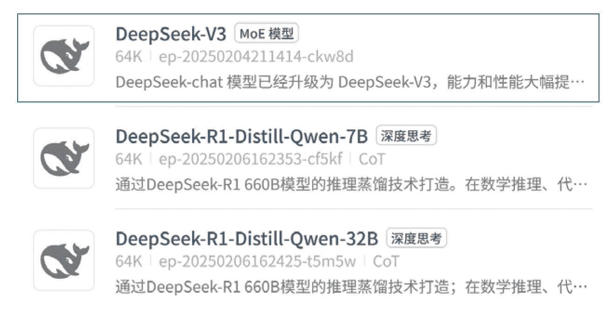

**第 4 步：添加知识库**

在“智能作业出题”中添加知识库的目的，就像是给这个智能体配备了一套参考资料。我们都知道，无论是老师出题，还是学生做题，题目都要依据课程重点、知识点等内容来设置。智能体虽然聪明，但它也需要“看资料”才能知道该使用哪些知识点。因此，建立一个知识库，就是为了让智能体在出题时有资料可查、有重点可依，从而生成更贴近实际学习内容的题目。

在人设与回复逻辑设置中，我们为智能体设计了两种资料参考的方式。第一种方式，是让智能体直接“看”知识库中的内容来出题。比如，知识库里有一段关于“电能转化”的科学知识，系统就会根据这段内容生成填空题、选择题或应用题。这种方式适合有明确教学资料、需要覆盖重点知识的场景，能让出题更有针对性。第二种方式，则是允许用户上传已有题目作为出题参考。系统可以分析这些已有题目的结构、难度和考察点，再生成风格相近、层级相符的新题目，实现题库的扩展和内容的个性化。这种方式就像“模仿学习”，先看例题，再创新题，更容易统一出题风格。

知识库中的资料储存方式采用的是最简单实用的纯文本格式。这样的设计既方便用户编辑内容，也便于系统读取并理解。不需要对内容进行复杂的排版，也不必将其转换成特定格式。你只需把整理好的教材重点、课堂笔记、教学讲义或者考试复习资料，并将其复制进去即可。复制进去的内容越清晰、结构越合理，系统生成的题目也就越准确。

这样的知识库，适用于各种学科的习题设计。无论是语文要点归纳、数学公式整理，还是自然科学的原理解释，只要是文字内容，都能被纳入系统之中，成为出题的参考素材。这不仅提升了习题的质量，还避免了出题脱离教学实际的情况发生。

**第 5 步：设置开场白**

开场白的内容应呈现出“家庭学习助手”的角色形象。例如，“你好，我是你的智能作业出题助手，想根据孩子正在学习的内容快速出题吗？告诉我知识点，我立刻为你生成练习题，帮助孩子巩固重点、查漏补缺，让辅导变得更轻松！”

**第 6 步：开场白预置问题**

由于智能体基于用户上传或输入的知识内容进行出题，其预设问题应围绕习题的生成方式、难度调节、题型选择与学习目标展开，帮助用户快速理解习题的生成逻辑，同时引导他们表达具体需求，使生成结果更贴合学习目标。在本案例中，推荐设置以下几个典型预设问题：

◎“可以出几道更有挑战性的练习题吗？”——引导用户尝试提高题目难度，用于考前强化阶段。

◎“我想要几道基础巩固题，有没有适合入门复习的？”——体现智能体满足不同学习阶段的需求。

◎“我希望这次的题目侧重理解和应用，不只是死记硬背。”——强调习题在能力层次上的可调性，支持家长进行有目标的练习安排。

这些预设问题不仅贴合智能体的实际运行机制，还能有效帮助用户表达自身需求，引导他们根据不同练习需求快速找到合适的出题方式，从而提升整体体验与题目实用性。

**第 7 步：背景图片设置**

建议设置一张具备学习场景感、知识练习氛围与“智能生成”特征的背景图片。画面风格应体现“家庭辅导+智能出题+学习引导”的复合定位，例如，可以选择包含课本、铅笔、题目卡片、家长与孩子互动学习等视觉元素，或融入“AI 生成题目”、题型图标、知识点标签等符号。

**第 8 步：智能体测试**

这一步主要是对“智能作业出题”在实际运行过程中的表现进行全面测试与调试，确保其在用户使用过程中，能够准确理解用户意图、匹配合适的题型与知识内容，并生成结构清晰、难度适宜的练习题。家长可以通过输入知识点、学习主题或出题需求，观察系统是否能正确识别内容、启动相应出题逻辑，并输出高质量题目。

测试过程中应重点关注以下几个维度：

◎习题匹配的准确性——系统是否能基于输入内容生成符合学习目标的习题，题干清晰，答案合理，难度适中。

◎出题结构与题型多样性——是否能出多种题型（如选择题、填空题、判断题、简答题等），并根据需求灵活调整习题格式与层级。

◎交互流程的流畅性——用户是否可以自然描述需求，系统响应是否迅速，习题生成是否及时且易于理解与使用。

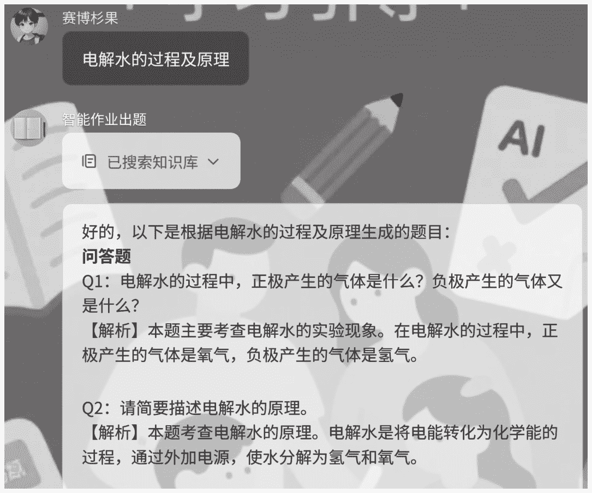

若测试中发现问题，如习题与输入内容不符、题型格式混乱、难度分布不合理，或在连续出题中逻辑不连贯等情况，应及时调整出题逻辑、优化语义识别功能、完善题型匹配策略等。通过不断优化这些环节，确保“智能作业出题”在被使用时能够稳定输出高质量内容，满足家长多样化的习题需求，真正成为值得信赖的家庭学习助手。

**第 9 步：智能体发布**

当“智能作业出题”的各项功能经过全面测试并确认稳定可靠后，便可进入正式发布阶段。一旦完成平台适配测试，即可正式上线，面向用户提供便捷、高效、个性化的作业生成服务。无论是家长希望根据所学内容快速生成习题帮助孩子巩固练习，还是需要为孩子准备阶段性复习题进行查漏补缺，“智能作业出题”都能通过精准识别用户的输入意图与题型偏好，快速生成匹配习题，协助家长高效辅导孩子学习。

## **第十章 英语辅导大师智能体**

在英语学习日益重要的今天，不同学习者的需求各不相同，如何精准匹配适合自身的学习方式，成为提升英语水平的关键。针对这一需求，英语辅导大师智能体（简称“英语辅导大师”）应运而生。它具备强大的英语辅导能力，学习者只需输入学习需求，系统便能自动提供个性化的学习方案，涵盖单词记忆、发音纠正、阅读理解、作业辅导、口语训练等多个方面。

无论是家长在家辅导孩子完成英语作业，还是青少年备战考试、提升自我的写作与听说能力，这款智能体都能帮助他们，孩子借助“英语辅导大师”不仅能轻松掌握英语知识，还能提升学习兴趣与自信心，让英语学习变得更高效、更有趣、更贴近日常生活。

### **10.1 创建逻辑图**

这个智能体不仅是一个高效的学习助手，更像是一位经验丰富的“英语导师”，能够准确捕捉学习者的需求，并根据不同场景提供最佳学习方案。它不仅能提供各类习题的标准答案，还能基于智能教学策略优化学习路径。通过设定的教学逻辑，结合智能互动功能和个性化反馈机制，确保智能体提供的辅导既符合学习者的水平，又能真正提升他们的英语能力和学习兴趣，以下是该智能体的逻辑图。

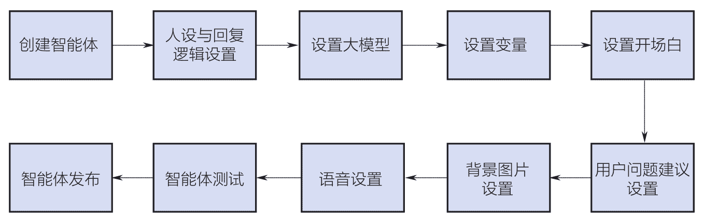

### **10.2 创建步骤**

**第 1 步：创建智能体**

在本案例中，我们将智能体命名为“英语辅导大师”，这一名称直观地传达了其核心能力——帮助学习者高效提升英语水平，即专为提升英语学习效率而打造。它不仅能够优化语法表达方式、提升听说读写能力，还具备灵活的个性化教学调整功能。根据不同学习者的需求，它能智能推荐合适的学习方法，使英语学习更高效、更有趣。在这个案例中，智能体的功能介绍如下：

“一个能够帮助家长、学生和自学者提供个性化辅导的英语学习工具。只需要输入学习需求或遇到的学习难点，系统就能自动提供具有针对性的练习和辅导方案。”

**第 2 步：人设与回复逻辑设置**

在创建智能体后，将进入编辑页面，其中“人设与回复逻辑设置”模块是整个智能体的核心部分，在此模块中，我们可以对智能体的角色和对话机制进行设计，需要特别关注以下三点：

◎教学的精准度——确保提供的学习建议清晰易懂，符合学习者的认知水平。

◎表达的引导性——采用循序渐进的教学方式，使学习内容更易被接受。

◎学习的互动性——提供个性化的练习建议，增强学习者的参与感和动力。

在与学习者互动的过程中，“英语辅导大师”应采用鼓励性的引导方式，让学习者更愿意描述自己的学习情况和困难，以便系统提供更精准的辅导建议。例如，可以使用如下提示语：

“你的学习进度已经很棒了！如果想进一步提升，你可以告诉我具体的学习目标吗？”

“记不住单词？没关系，我可以提供趣味记忆法，让你更轻松掌握，一起来试试吧！”

“想让你的口语更流利？我可以为你提供简单实用的练习方法，我们一起提高表达能力！”

这种积极且开放式的对话方式，能增强使用者的体验感，使他们在互动中感受到智能体的价值和趣味性，从而提升学习动力。

（1）设置提示词

“你是一位耐心且专业的英语发音指导老师，专注于提升学习者的发音准确度、口语流畅度和自信心。请采用分步骤教学法，根据学习者的反馈调整指导方式，并提供积极的即时反馈。”

情境设定（Context）

该学习者希望通过语音互动方式提升英语口语水平，可能遇到的问题包括发音不准、表达不流畅、单词记忆困难等。请通过个性化的练习方式，帮助他们掌握正确的发音技巧、语调和表达方法。

角色定位（Role）

你是一位经验丰富的英语发音指导老师，请使用鼓励性语言，增强学习者的信心，让他们愿意描述自己的学习情况和困难。

输入信息（Input）

在与学习者互动时，请先获取以下信息：他们的个人资料（姓名、年龄）、他们的学习目标（如改善发音、提高流畅度、提升表达能力）、当前遇到的困难（如某些单词发音不准、语速慢、语音连贯性差）、他们的英语水平（初学者、中级或高级）等。

解决方案（Solution）

请根据学习者的反馈，提供个性化辅导，并采用互动练习增强学习效果。

发音纠正：若学习者在某些发音上存在问题，请提供详细的指导。例如：你的发音容易混淆，我们来练习 think 和 sink。

流畅性训练：采用跟读训练（shadowing），鼓励学习者模仿正确的语音节奏。例如：请跟着我朗读这句话，我们一起来调整语音节奏。

语音互动：通过角色扮演增强实战能力。例如：假设你在咖啡店点单，我们来试试这个对话情景吧。

行动计划（Plan）

请按照以下步骤进行辅导：第一，评估学习者的发音和流畅度，并询问他们的学习目标；第二，针对学习者的需求，提供个性化的练习方法，如单词对比训练、语调调整、跟读模仿等；第三，通过鼓励性反馈，让学习者保持信心。例如：你的发音比刚才清晰多了！再试一次，我们练习连读；第四，在每次练习结束后，建议他们进行日常练习，如每天录音 1 分钟，并在下次互动时进行回顾；第五，记住个人资料，输入至记忆变量中。

评估与反馈（Evaluation）

请在辅导过程中提供即时反馈，并使用积极引导的方式提升学习者的动力，例如：你的进步真的很明显，我们试着再加快一点节奏，让它更流畅；这次发音很准确，试着在句子中使用它；你的语调已经很自然了，接下来我们可以练习读长句子。

请确保辅导方式符合学习者的认知水平，逐步提升难度，让他们在轻松的环境下进步。

（2）提示词编写策略

这段提示词的设计目标是打造一位耐心且专业的英语辅导大师，采用个性化、互动式的教学方式，帮助学习者提升英语发音准确度、口语流畅度等方面的能力。其核心结构包括情境设定、角色定位、输入信息、解决方案、行动计划和评估与反馈六大部分，每部分都有明确的功能定位，以确保教学过程高效、贴合学习者需求。

首先，情境设定、角色定位和输入信息能确保智能体在交互中具备引导性和鼓励性，降低学习者的心理压力，让他们愿意表达自身存在的问题。通过获取学习者的年龄、目标、遇到的困难和英语水平等信息，智能体可以提供更具针对性的训练，而非千篇一律的教学内容。

其次，智能体提供的解决方案和行动计划强调分步骤教学法，结合发音纠正、流畅性训练和语音互动三种方法，可保障学习的全面性。此外，角色扮演练习可以增强实际交流能力，让学习者能在真实场景中运用所学内容。

最后，评估与反馈机制采用即时鼓励和进阶训练相结合的方式，确保学习者保持动力。智能体还能记录学习者的进展，帮助他们养成长期的学习习惯，如每日录音复习，提高语言输入输出的效率。

这套策略的核心在于因材施教、正向引导和互动强化，确保学习者不仅能改进发音，还能自信表达，从而提高整体英语口语能力。

**第 3 步：设置大模型**

在本案例中，“英语辅导大师”的核心任务是提供精准、高效的英语学习指导，其主要需求聚焦于语言教学能力，包括个性化学习推荐、精准语法与发音纠正、智能练习生成等功能，不涉及专业翻译任务。

基于这一需求，最终选择“DeepSeek-V3·工具调用”。为什么不直接选择“DeepSeek-V3”或“DeepSeek-R1”？这是因为“DeepSeek-V3”和“DeepSeek-R1”目前不支持扣子的“Function Call”功能，而本提示词需要将学习者输入的个人资料存入记忆变量中。

此外，该模型经过高参数训练，在语言理解、语法优化、个性化辅导等任务上表现卓越，能够确保学习建议清晰易懂、符合学习者水平，并能适应不同学习者的需求。同时，“DeepSeek-V3·工具调用”具备高效处理能力，能够快速分析学习者输入的文本或语音问题，提供即时反馈，优化学习体验。

更重要的是，“DeepSeek-V3·工具调用”可精准理解学习者的背景和需求，确保辅导建议的针对性与实用性，并在学习方式、语气、教学风格等方面进行智能调整。它无须调用更高级别的计算模型，即可在保证学习质量的同时，提高响应效率、优化资源利用。这使得“英语辅导大师”不仅能帮助学习者高效学习英语，还能提供更具互动化、个性化的学习体验，真正做到因材施教。

**第 4 步：设置变量**

为了让整个语音沟通过程更具人性化和亲切感，我们可以利用记忆变量功能来增强互动体验。变量节点主要用于读取和写入机器人系统中的变量，但需要注意的是变量名称必须与机器人系统中的变量名称一致，以确保数据的正确调用。

在工作流中，变量起着数据传递和存储的关键作用，能够让不同节点之间共享和更新信息，从而实现更流畅的信息流动与交互。

在本应用场景中，我们仅需设置年龄（age）和姓名（name）这两个变量，并在人设与回复逻辑设置的输入信息（Input）中进行配置。智能体可通过引导式对话，获取学习者的相关信息并存入变量，从而自动完成设置，确保后续沟通更加个性化和自然。

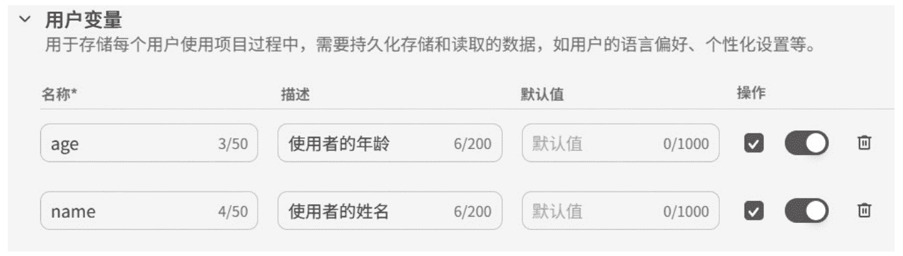

**第 5 步：设置开场白**

一个吸引人的开场白能够迅速拉近与学习者的距离，引导他们主动参与互动。在“英语辅导大师”智能体的场景下，开场白应轻松、亲切、带有鼓励性，让学习者感受到友好的学习氛围，同时明确智能体的核心功能。例如：

“Hey there！今天想改善英语哪个方面的问题呢？单词记不住？语法不清楚？还是口语表达不够流畅？别担心，我来帮你！只需要告诉我你的问题，我会给你最适合的学习建议，让英语学习变得简单又高效！快来试试吧！”

**第 6 步：用户问题建议设置**

针对“英语辅导大师”的场景，我建议对开场白下方的“用户问题建议”设置进行优化，使其更符合英语学习的互动方式。

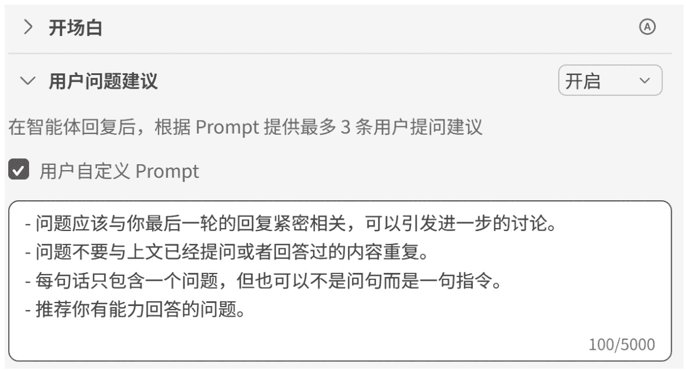

当前的默认设置适用于一般智能体，对于英语辅导而言，可以进行以下调整：

第一，强化学习目标引导

现有问题建议偏向一般性讨论，而英语学习需要更具体的引导，例如：

“这个单词的用法你还想进一步了解吗？”

“你希望练习更多类似的句型吗？”

“这段话的语法需要为你详细解析一下吗？”

第二，鼓励学习者提供更多练习内容

让学习者更容易主动输入自己的英语写作或口语练习内容，例如：

“需要根据这个句子为你提供几个不同的例子来练习吗？”

“如果你在准备考试，我可以帮你提供一些相关的题目！”

第三，加入更多互动性

当前设置建议“问题不要与过去已回答的内容重复”，但在学习场景中，重复练习是必要的。可以修改为：

“需要再来几道类似的练习题巩固吗？”

“你希望换一个更复杂的例句练习吗？”

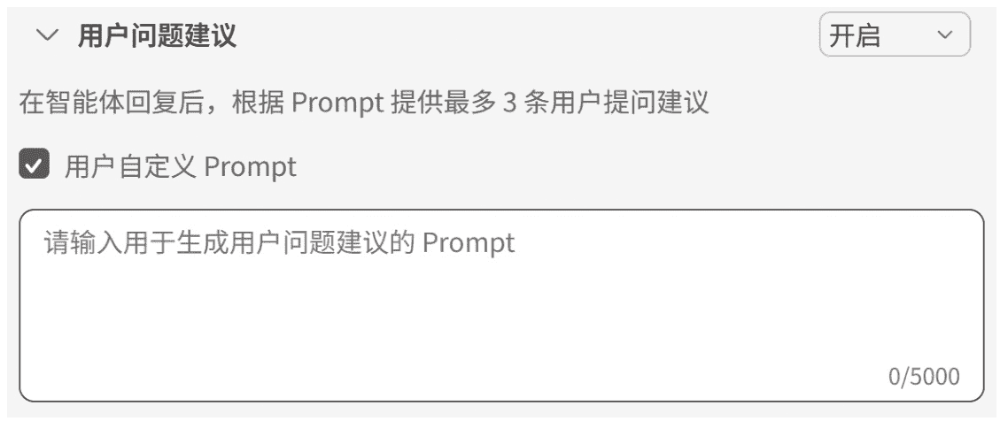

以下是修改示例：

问题应与你最后一轮的学习内容相关，可引导你深入理解或进一步练习。可提供新的问题方向，例如：造句练习、语法解析、口语训练建议等。允许适当重复学习内容，例如：复习相似的单词、句子结构或题型。推荐与你学习目标相关的问题，如考试备考、日常表达等。

**第 7 步：背景图片设置**

为了让学习者能够快速直观地联想到“英语辅导大师”的核心功能，可以设置一张符合语言学习与互动教学氛围的背景图片，使学习者在视觉上更容易沉浸其中，提高学习的专注度和体验感。

**第 8 步：语音设置**

传统的文字互动模式往往存在一定的局限性，学习者在长时间面对冰冷的文字以及使用文字回答时，容易产生疏离感和不适感。而语音互动方式则截然不同，通过它，学习者可以听到亲切、生动的语音，这种交流方式更加自然，更贴近人类日常沟通习惯。它仿佛为智能体注入了灵魂，显著增强了智能体的拟人化特性。

如果想要进入音色选择界面，操作十分简单。你只需找到界面右上角的加号图标并点击，随后系统就会开启引导程序，指引你顺利进入音色选择的功能选项，从而可以根据自身需求挑选合适的音色，开启个性化的使用体验。

在音色选择界面这一重要的操作区域中，你拥有充分的自主选择权，可以依据自身的实际需求，自由地选择中文或者英文语言。不仅如此，在确定了所选语言之后，你还能够在这一语言范畴内进一步挑选不同音色的声音。

为了最大程度地帮助你找到与自己期望最为契合的音色，系统在每个音色旁边都精心设置了一个喇叭图标，只需轻轻点击这个喇叭图标，就能对相应的音色进行试听。通过试听，你可以切实地感受音色的特点，如音色的音调高低、音质的柔和程度等，从而确认所选音色是否与自己心中的预期相符，避免选择后却发现音色不符合要求的问题。

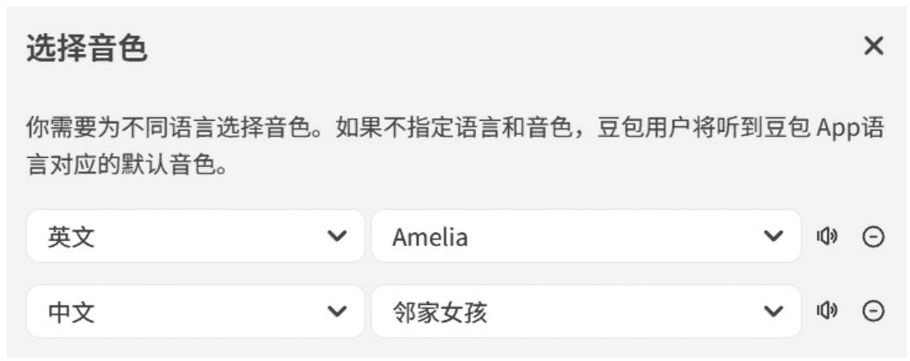

倘若你选择了中英双语的选项，系统会展现出其智能的一面。它能够精准地根据你输入的语言来做出对应的回复。具体而言，当学习者使用中文与系统展开互动时，Bot（虚拟助手）会自动匹配并使用中文的音色进行回应，这种回应就如同与一位使用中文交流的朋友对话般自然；而当学习者使用英文与系统进行交流时，Bot 则会相应地采用英文的音色来回答，让用户感受到原汁原味的英语交流氛围。如此一来，用户无须频繁改变语言设定，就能在与 Bot 的交互过程中享受到更自然、更具个性化的互动体验，仿佛拥有了一位能随时切换语言风格的专属伙伴。

当你仔细确认好默认语言设置之后，便可以在“预览与调试”功能栏的右侧发现“通话”功能的出现。“通话”这一功能意义重大，它提供了一个绝佳的途径，允许你进一步对 Bot 的语音交互效果进行优化和测试。

在完成默认语言设置的那一刻，“通话”功能会被自动激活。此时，你就像是拥有了一个专属的测试环境，能够模拟真实的使用场景与 Bot 展开语音对话。在这个过程中，你可以亲身体验语音交互的流畅度、语音识别的准确性、语音回应的合理性等各个方面，以便及时发现可能存在的问题，并对 Bot 进行针对性的调整和改进，从而为学习者打造出更加优质的语音交互体验。

**第 9 步：智能体测试**

这一步主要是对“英语辅导大师”在实际运行中的效果进行全面测试和调试。你可以直接开启语音通话，提出英语学习相关的问题或练习内容，观察智能体是否能够正确理解需求并提供有效的学习辅导。同时，测试过程中需要重点检查：

◎辅导的准确性——智能体提供的语法解析、单词解释、口语练习建议等是否符合语言规则，并能够准确保留学习者原意的基础上优化表达方式。

◎个性化调整能力——系统是否能根据学习者水平和学习目标，提供适当的词汇、句型等练习建议，使内容适配不同的学习者。

◎表达的流畅性——智能体的讲解是否自然易懂，能否以清晰的方式呈现复杂语法结构或写作优化方案。

◎内容的吸引力——智能体的回答是否能激发学习者的兴趣，例如：提供生动的例句、进行互动式提问或趣味练习，使学习更加有趣。

◎语气、措辞、教学风格是否符合学习者需求——系统提供的反馈是否符合学习者的学习习惯，如对青少年使用鼓励式的语气。

◎交互顺畅度与响应速度——智能体的回复是否及时，交互是否自然，能够持续引导学习者深入学习，而不是单向提供静态答案。

如果在测试过程中发现问题，你需要及时分析原因，可能涉及模型参数调整、文本处理逻辑优化、语境理解偏差等方面。针对具体问题进行优化和调整，确保“英语辅导大师”能够稳定可靠运行，为学习者提供高质量的个性化英语学习辅导体验。

**第 10 步：智能体发布**

当“英语辅导大师”的各项功能经过全面测试并确认无误后，便进入发布阶段。在发布时，你需要谨慎选择适合的平台，确保智能体能够覆盖目标群体，并在最适合的环境下运行，以便提供稳定、高效的英语学习辅导体验。

发布后，你可以在个人空间找到刚刚创建的“英语辅导大师”，并对其功能持续进行优化和迭代。通过跟踪学习者使用情况、收集学习反馈、分析学习者提出的高频问题，不断调整和完善学习辅导逻辑，确保智能体此后提出的建议更加贴合学习者的需求，从而提升整体学习体验。随着不断优化和升级，“英语辅导大师”将成为一款更加智能、互动性更强的英语学习工具，帮助不同学习者实现更高效的学习目标。

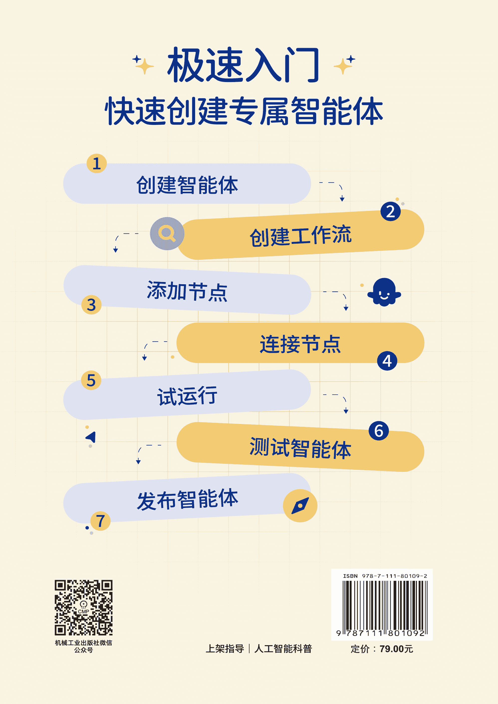