# 家教智能体实战指南

# 前言

近年来人工智能的推进速度令人咋舌，智能伙伴的影子已经渗进学习与生活的细节里。提到它，大多数人第一反应是新奇却遥远，总会心里嘀咕：听上去很强，跟我有什么关系？其实这类伙伴早在幕后发挥作用，只是我们没有注意到。

正因为很多人对智能伙伴的认知停留在表面，我决定用更接地气的方式写下这本手册，聊聊在当下为什么值得每个人都拥有一个专属的数字助手。

过去几年我一直在追踪科技如何进入教育现场的真实案例。普遍的现状是：大家都听说过人工智能，却对它的运作方式、适用边界以及怎样用在自己的工作学习上缺乏清晰判断。许多人承认AI很能干，却不知道该怎样把它真正用起来。这种认知差距，正是我想用通俗表达来填补的原因。

我们正处在一个变化极快的时代。未来的差距，可能会变成会用智能伙伴的人和用不上的人之间的差距。随身带一个智能助手，相当于多了一位得力搭档，可以更快掌握新技能，提升效率，做出更合理的选择。对学生和父母来说，学会协同，就能在遇到难题时更从容。

本书想先让大家弄明白智能伙伴到底是什么，再点燃探索欲和动手实践的热情。每个人都可以借助它优化学习与生活的效能。学生能够快速提炼笔记、查漏补缺；父母可以更精准、更省力地参与孩子的学习，和孩子一起体会学习的乐趣。

这种转变不是偶然。各地方的教育部门都在推动AI普及，让人们从小养成与智能伙伴协作的习惯。以北京为例，《北京市推进中小学人工智能教育工作方案（2025—2027 年）》提出打造“京娃”系列智能伙伴，全面提升教育质量与效率。其愿景之一，是让每个孩子都拥有自己的“AI 学伴”。比如借助智能外语练习、错题智能分析等方式提升学习效能。北京已推出7个特色“京娃”智能伙伴，包括依据兴趣定制个性化学习路径的AI学伴“京小学”、关注身心状态的健康师“京小健”、以及助力校园课间更有序健康的课间一刻钟“京小壮”。

这些举措传递出一个明确信号：未来孩子成长的路上，智能伙伴将成为常态。社会层面已经在行动，个人更应主动拥抱变化，让孩子尽早拥有属于自己的智能伙伴。

简单介绍一下我自己。我长期从事培训与咨询，用数据分析帮助企业提效、解决问题。过程中我越来越确信：人的时间和精力应该聚焦在创造性事务上，而不是被重复性工作消耗。

当智能伙伴开始普及后，我投入大量时间去学习与实操。几年下来变化很明显：数据分析完成更快，运营管理更顺畅，培训咨询更具个性化，客户满意度显著提升。智能伙伴不仅让我的职业焕发活力，也给我更多时间去探索生活。

我想把自己的学习轨迹、实践体会以及对智能伙伴未来潜力的判断分享出来。智能伙伴不是遥远的奢侈品，而是当下就应配置的基础能力。

AI浪潮已经到来，希望这本书能帮你找到并打造属于自己的智能伙伴，抓住智能时代的机会，开启更有质量的人生。

# 第一部分 准备篇

# 认识智能伙伴

接下来要学的是如何与智能伙伴协同。它不只是工具，更是具备感知、理解与执行能力的AI协作方。这里不会立刻教编码，也不会马上搭建复杂系统，而是先建立对AI真实样貌的认知：它不是神秘的黑箱，也不是只有工程师才能用的高科技，而是普通人都能掌握、训练并共同创造的数字协作者。

本部分围绕三项核心展开：

第一，厘清概念。智能伙伴是什么？与传统AI工具有何区别？它如何进行推理？凭什么能帮助解决实际问题？建立基础认知后，就不容易被技术名词迷惑，也能看懂市面上各类AI产品的底层逻辑。

第二，培养视角。你学习的不只是软件，而是一种“与AI共事”的全新思维。你会认识到AI并非无所不能，但可以成为工作流中的关键一环，前提是你学会如何引导、定义和优化它。

第三，动手实践。通过平台挑选与入门操作的逐步引导，你将亲手打造一个能理解指令、响应意图的智能伙伴。无论是否有技术背景，都能找到适合自己的路径。

请记住，智能伙伴的价值不在于功能堆砌，而在于是否契合你的需求。你不是去适应它，而是让它来适应你。下面的内容正是为了完成从好奇者到创造者的转变。

未来学习不再是单打独斗，也能与智能伙伴并肩前行。现在，就是启动的时刻。

## 第一章 智能体如何影响家庭教育

在快节奏的生活里，家庭教育常让父母力不从心。工作之余还要辅导功课、规划兴趣班，时间总是捉襟见肘，精力也易透支。更让人焦虑的是那些繁琐重复的事项：反复提醒写作业、检查基础题目、搜集学习资料、应对各种突发状况。很多家庭因此陷入辅导效果下降、父母身心俱疲的循环。

难道只能接受这种焦虑吗？当然不是。智能伙伴正以“学习搭档”的姿态悄然进入家庭，为父母和孩子分担压力。

这个搭档到底是什么？本书所指的智能伙伴是一种具备高度智能的人工智能系统。它能像人一样“看”“听”环境信息，例如感知孩子的学习请求；能像人一样“思考”，例如评估学习进度与薄弱知识点；更关键的是能“行动”，例如制定学习日程、发出作业提醒、提供学习建议。它与常见的AI工具不同，后者可能只做分析或给出建议，而智能伙伴能够真正“动起来”，完成从信息处理到自动化辅助的完整链路。它就像一个既能理解需求又能执行规划与辅助的超级助手。

它的出现并非要取代父母，而是赋能父母，让家庭教育更有力量。

智能伙伴能够进行个性化规划，比如根据孩子的年龄、现有水平和学科特点，协助生成一份专属学习方案；任务完成后自动记录进展，并按既定目标提醒下一步，保持学习节奏的连贯性与有效性。

那些耗费心神的重复事务，比如反复督促专注、批改客观题、搜集入门资料等，都可以交由智能伙伴协助。父母便能把有限精力放在情感沟通、深度议题探讨和创造性引导上，孩子也能更专注于学习本身，极大提升家庭教育的质感与温度。

更贴心的是，智能伙伴通过持续互动逐渐适应孩子的习惯与偏好，优化每日安排；在遇到瓶颈时及时给出引导性提示或推荐合适的资源；还能依据学习表现与反馈动态调整内容难度与节奏。学习过程更贴合个体需求，兴趣、自信与效率自然提升。

### 1.1 智能体的定义

电影《人工智能》中的大卫虽然是机器人男孩，却拥有丰富的情感。被母亲遗弃后，他踏上漫长的自我追寻之路，渴望成为“真正的孩子”。影片既展现了科技的可能性，也提出了一个深刻议题：如果机器具备情感与自我意识，人类该如何共处？

现实中我们或许还造不出大卫那样的机器人，但人工智能技术已深度融入生活。其中，智能伙伴作为重要分支，正发挥越来越大的作用。智能体是指在特定环境中展现自治、反应、思辨、认知等一种或多种智能特征的软件或硬件实体。它可以是软件、机器人，或复杂系统背后的“大脑”。它拥有“思考”能力，能分析信息并作出合理判断，像一位聪明的助手。

日常生活中智能伙伴的应用已十分常见：

◎语音助手：如 Siri、小爱同学、天猫精灵，口令“播放周杰伦的歌”即可自动播放。
◎智能导航：分析实时路况，规划最快路线，避开拥堵。
◎购物推荐系统：基于浏览与购买记录，推荐可能感兴趣的商品。
◎智能家居设备：如扫地机器人，感知地面状况，自动规划清扫路径。

它们的存在让生活更便利高效，承担繁琐工作，让我们把精力投入更有创造性的活动。

人工智能智能体的分类

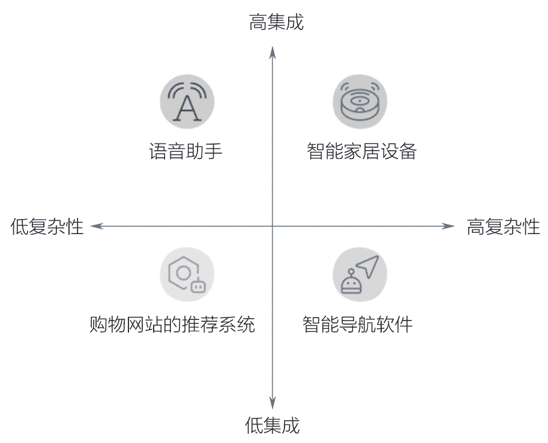

### 1.2 智能体能带来哪些价值

作为一种灵活可定制的高效系统，智能伙伴正悄然改变学生的学习体验。过去家庭教育与学校教育往往脱节，父母难以实时掌握进展，学校也难以兼顾每个孩子的个性化需求。如今智能伙伴既可在家成为父母的得力助手，也可在校作为教师的补充力量，为学生提供全天候的个性化支持。

更重要的是，它不是简单的辅导工具。它能根据每个孩子的节奏持续调整辅导策略，真正做到因材施教，成为成长路上专业而贴心的陪伴者。无论是学习管理、知识辅导，还是习惯养成，都能发挥作用。

以下提供几个典型应用场景。

智能学习助理——孩子的专属成长秘书

父母常关心作业是否完成、复习是否到位、单词是否牢记、数学题是否会做。有了智能伙伴，这些问题可以交给它。

创建后每天早上自动推送当日学习计划，上午的作业、晚上的复习要点一目了然。晚上则根据当天完成情况提醒遗漏任务。

它并不僵化，会动态调整方案。发现英语单词记忆困难，就会自动增加复习频次并推荐记忆技巧；发现数学表现良好，就适当提升题目难度。这种因材施教让学习更具针对性，孩子在小步快跑中建立自信，父母通过后台数据掌握全局，无需事无巨细盯梢，亲子关系也更轻松。

情绪陪伴与心理疏导——孩子的情绪哨兵

成长过程中焦虑、沮丧、失落甚至叛逆是常见的。父母忙于工作难以捕捉细微情绪变化，孩子也未必愿意主动表达。

这时一个懂情绪的智能伙伴就能发挥作用。通过情绪识别功能，可为孩子设定一个小型情绪陪伴智能体，每天固定时间以轻松自然的方式闲聊几句：“今天学校有什么开心事？”“有没有烦心的事情？”若发现回应中出现焦虑、压力倾向，它会轻声安慰，引导深呼吸或简单排解，并后台记录情绪波动趋势，必要时提醒父母关注。

这种“情绪哨兵”不打扰正常学习生活，却能在潜移默化中提供心理疏导。对内向、不善表达的孩子来说，它更像一个随时可倾诉的小伙伴，帮助其学会识别与管理情绪，从小建立良好的心理韧性。

家庭教育助手——父母的辅导教练

不少父母在孩子升入高年级后会遇到难题：知识点早已遗忘，或辅导方式不当引发抵触。智能伙伴可化身辅导教练。告诉它孩子的年级与科目，例如“小学五年级数学”或“初一英语”，它就能迅速讲解知识点，给出简明解法，还能列出易错典型例题，指导父母如何引导孩子思考。

有了这样的教练，父母辅导更有底气，孩子体验更好，成就感也增进亲子关系。

考试复习规划

考试季常伴焦虑：“从哪开始复习”“时间来得及吗”“要不要熬夜突击”。最忌没有计划只靠热情。智能伙伴可依据考试时间表、学习进度与知识掌握情况自动生成科学复习计划，并按每日打卡动态调整，依据练习成绩标记薄弱点，提醒针对性复习。保持节奏，既不松懈也不临时抱佛脚，日积月累在考场上发挥真实水平。

## 第二章 智能体的创建与使用

为满足不同领域与层级的智能化需求，各类智能伙伴平台不断涌现，在开发便捷性、功能扩展性、系统整合性上持续演进。从早期单一任务执行到如今支持复杂决策与多场景协作，平台技术日趋成熟，人们对智能性、自主性、可扩展性的期待也在提升。

### 2.1 选择智能体开发平台

在当前平台竞争格局中，几款代表产品各有侧重。AutoGPT 作为开源项目，以“自主任务拆解与执行”见长，适合市场调研、数据整合等需连续操作的场景，但高度自主也带来不可控风险与路径不稳定。Manus 主打完全由 AI 自主代理，可在多领域独立完成复杂任务，但训练成本与门槛较高。BabyAGI 聚焦长期任务管理，适合科研与长期数据分析。AutoGen 通过多智能体协作提升大规模内容生成效率，适用于新闻、营销文案等内容密集型行业，但对算力要求高。Zapier 在无代码自动化领域基础广泛，支持上千种第三方服务连接，但更偏向流程自动化，智能决策与复杂任务执行能力偏弱。

总体来看，现有平台在普适性、适配性、易用性、功能完备性与本地化支持上仍有短板。正是这种需求缺口，让“扣子”脱颖而出。

面向未来的智能伙伴开发平台，扣子不仅具备低门槛、高效率、多场景的优势，还针对中国市场做了深度本地化优化。依托丰富的插件生态、完善的工作流系统和对长短期记忆的高效管理，智能伙伴开发真正走向可落地、可扩展、可持续。接下来将深入解析其在功能设计、应用场景、技术架构上的独特优势，看看它如何重新定义智能伙伴开发体验，成为新一代 AI 应用的重要基石。

### 2.2 扣子使用入门

在 AI 浪潮下，大语言模型的惊人能力已显现，但如何把潜力转化为解决实际问题的应用，对非技术背景的个人或资源有限的企业仍有门槛。字节跳动打造的扣子应运而生，它像一把开启普惠 AI 的钥匙，让全民低门槛、高效率创建个性化乃至商业价值智能伙伴成为可能。扣子的使命是让 AI 红利普惠大众，让每个人都能轻松驾驭 AI。

零代码开发，让 AI 应用触手可及

扣子最大的亮点是革命性的零代码体验。传统 AI 应用开发需要编程、接口调用、数据处理等技术知识。扣子提供直观友好的可视化界面，通过“拖拽”式组合预设模块、逻辑判断、触发条件，就能构建形态各异的智能伙伴。无论是客服助手、私人秘书、信息汇总助理，还是趣味互动伙伴，在扣子上都变得简单。

丰富插件与智能工作流，构建强大 AI 大脑

降低门槛只是开始，赋予处理复杂任务和连接外部世界的能力才关键。扣子内置丰富插件库并支持构建智能工作流。插件相当于智能伙伴的工具箱，能实时查询天气、搜索资讯、阅读摘要、操作日历、连接企业数据库、调用计算器等。智能工作流则是行动蓝图，接收请求或满足触发条件时，智能伙伴按预设步骤自动执行任务。

多平台快速部署，让 AI 无处不在

扣子支持多平台部署，个人可将自建的学习助手或生活规划师放入日常使用的豆包 APP 随时调用。强大的跨平台能力拓宽了 AI 应用边界，让智能服务在最自然的场景出现，真正实现“AI 无处不在”，显著提升个人效率。

# 扣子实测：一个下午就能把想法变成可用的AI

使用扣子后的真实体感，可以用两个字概括：快、简。过去要靠专业团队投入大量时间才能落地的AI应用，现在个人或小团队花一个下午就能做出能跑的雏形。效率的跃升让想先试试水、验证创意的企业和个人，试错成本和门槛都被压到很低。

**适用面很宽**

对个人爱好者和独立开发者来说，扣子更像一个把点子变现实的游乐场。脑子里那些酷或实用的AI念头，能很快被实现出来，比如一个按个人习惯整理信息并推送新闻的智能助理，或一个风格鲜明的解闷聊天伙伴。在这里技术不再是卡点，创意可以直接跑起来。

教育场景的价值也很明显。老师能借此做互动教学工具，让课堂更有趣、参与度更高；学生和研究者则可以用它帮忙搜集资料、整理文献，明显提升学习和研究的效率。

### 2.3 提示词驱动的智能体搭建
这种做法的核心是用提示词写好指令，让智能体按预期执行。最大的好处是免代码，创作者只需琢磨提示词怎么写，就能决定功能。比如提示词可以要求“先用天气查询插件搜天气资讯，再用制图插件把结果做成树图”。

智能体运行时会按提示词设定的顺序执行。当用户输入“北京”时，它先调用墨迹天气插件拿天气，随后用 TreeMind 树图插件把信息整理成树状思维导图。

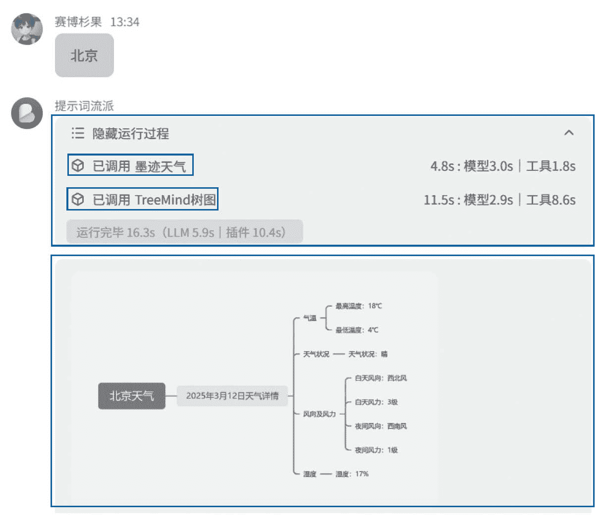
全程无需写代码，只需把想要的动作写进提示词，就能让智能体按步骤完成任务。输入文字、点一下鼠标，专属智能体就出来了。无论是做一个整理检索的个人知识库智能体，还是做一个生成个性化艺术作品的绘画智能体，都靠提示词的巧妙设计。无代码的路径让AI更个性、更易用，想象力有多大，功能就能有多广，为生活、工作和创意开发提供强力支撑。

### 2.4 实战：自建一个城市旅游助手智能体
下面用一个具体的案例，演示仅靠提示词就能多快做出AI智能体。想象拥有一个能规划行程、推荐美食、查交通、介绍当地风俗的旅行搭子有多方便，关键不在于写代码，而在于如何组织语言指令。

完成角色、能力与行为模式的设计后，一个空白模型就能变成懂行的旅行规划专家。准备好了就开始。

**第 1 步：选入口**
扣子主页左上角的“创建”按钮 ⊕ 点开后有两条路：“创建智能体”和“创建应用”。前者支持从零定制，后者基于官方模板适合求快。

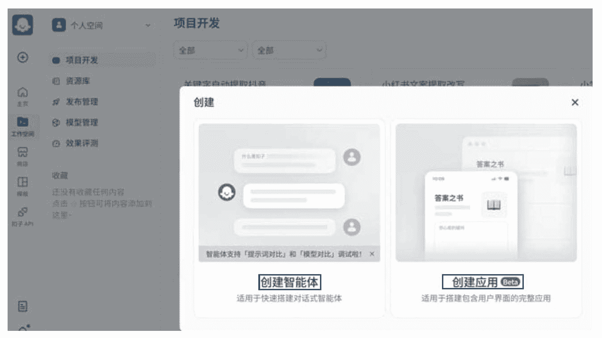
**第 2 步：创建智能体**
名称要贴合功能，便于识别和管理。本例命名为“城市旅游助手”，一眼就能看出是提供城市旅游服务的。

功能介绍要写清楚价值。本例的定位是：输入目标城市后，自动给出
◎天气资讯
◎当地热门景点
◎当地特色体验
◎旅行注意事项
◎当地美食推荐

工作空间分个人和团队。个人空间适合私密实验与学习，数据隐私有保障；团队空间支持多人共同编辑与优化，但需要手动新建才会出现。选对空间能提升管理效率和协作顺畅度。

图标可让右侧的AI自动生成，依据是名称和功能介绍提炼出的关键词。本例会融合地标、餐饮、天气等视觉元素，与功能高度契合。

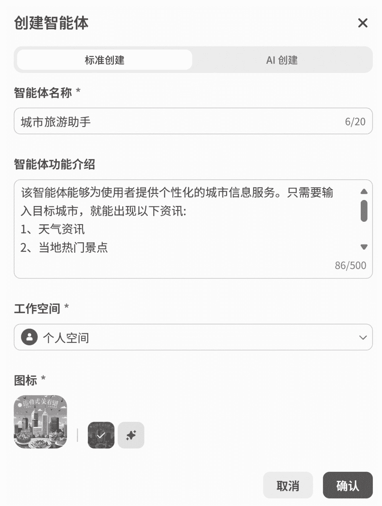
**第 3 步：人设与回复逻辑**
进入编辑页后左侧的人设与回复逻辑是核心，决定角色气质和对话方式。需要设定性格、专长、表达风格以及不同场景下的反应。比如儿童学习助手就要更亲和、语言更简单。

可以细调：
◎回答长度：简短、详细或适中
◎语言风格：轻松或专业术语较多
◎回答准确性：是否更严谨避免模糊

同时设定禁忌内容和敏感话题的规避策略，保证输出符合预期。合理的人设能提升个性化程度，避免角色混乱。不会写的话可用“优化”功能，输入描述后扣子会自动给出优化版本，再按需微调。

**第 4 步：选大模型**
模型选择直接影响性能和体验。扣子提供豆包、通义千问、阶跃星辰、DeepSeek、百川、Kimi 等。

本案例的城市旅游助手主要做城市资讯查询，不需要深度商业分析。选 DeepSeek-V3 能高效处理城市相关数据，互动更流畅，也避免使用更高阶推理模型带来的延迟和资源消耗。

**第 5 步：写开场白**
开场白是用户第一眼看到的引导，决定理解速度和上手体验。

可手动输入，也可用AI自动生成。手动适合有明确调性的场景，例如：“欢迎来到个人旅行助手！我是你的行程规划小帮手。无论是热门景点、地道美食，还是当地文化体验，我都能为你提供建议。快来聊聊你的目的地吧！”

右侧的 Ⓐ 按钮可让系统按功能和目标用户自动生成一段，再加以润色。手动更可控，自动更省时。

**第 6 步：开场白预置问题**
预置问题能降低首次使用的门槛。用户点一下就能开始对话。

围绕旅游可设三条，例如：
◎有哪些旅游景点适合一个人去？
◎全家出游适合去哪些地方？
◎某个城市的特色美食有哪些？

这些问题在编辑界面的预览调试区看不到，只在智能体发布后、用户首次进入时出现，帮助快速建立认知。

**第 7 步：对话中的问题建议**
在交流过程中，系统会基于当前上下文给出3条提问建议。

默认是AI自动判断模式，会根据对话语义实时生成更贴合的建议。如需更强的业务控制，可开启“用户自定义 Prompt”，自行定义提问逻辑。

注意这不是三条固定问题，而是动态逻辑：
◎与上一轮对话紧密关联，促发深入讨论
◎能扩展话题，获取更完整信息
◎表述清晰具体，便于理解并得到有价值答案

新手建议先用自动模式，等熟悉后再尝试自定义，避免逻辑混乱。

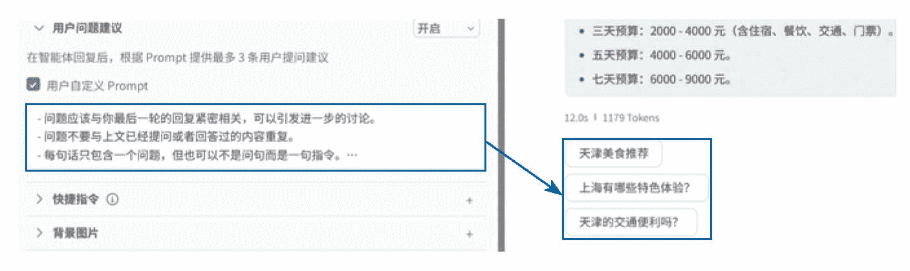
**第 8 步：背景图**
合适的背景能强化品牌感。右侧的 + 按钮可上传图片，支持拖拽或手动选择。上传后右侧预览区立刻可看效果，旅游类智能体常用风景图作底。

**第 9 步：测试**
在快捷指令里输入城市名，检查智能体能否正常启动并给出准确、丰富的建议。
重点看景点、餐饮、住宿信息是否准确，交互是否顺畅，能否根据亲子游、美食探索、文化体验等不同需求给出个性化推荐。发现推荐不准或响应慢，就要回溯筛选逻辑等环节优化，确保稳定可靠。

**第 10 步：发布**
确认无误后点发布即可上线。系统会自动生成发布记录，记录本次发布前的所有修改，按 Tab 键可快速查看。

发布界面下方可选择上线渠道：豆包、飞书、抖音、微信等。各平台需先完成授权，未授权则只能留在扣子商店。发布后可在个人空间找到“城市旅游助手”，持续测试、收集反馈并迭代优化。

### 2.5 用工作流生成智能体
除了提示词，工作流是另一种高效路径。它把复杂任务拆成有序的步骤，通过插件、模块和条件逻辑串联，提升自动化、可控性和执行效率。

好比做三明治，不能把食材全倒一起，必须按顺序操作：
◎步骤 1：采集用户输入，作为起点，相当于取出两片面包
◎步骤 2：初步处理，如数据清洗或文本分析，相当于抹上花生酱
◎步骤 3：接入插件模块，如调用数据库或做判断，相当于加一片芝士
◎步骤 4：多节点递进处理，在已有结果上叠加操作，相当于依次加生菜火腿
◎步骤 5：输出最终结果，盖上另一片面包完成

在扣子工作流里，每个执行单元叫节点，承担数据接收、信息处理、逻辑判断、内容生成等角色。节点像功能小零件，有的调用大模型整理文本，有的生成图片，有的做条件分支或数据存储，组合起来就能实现灵活流程。

用好工作流就是把任务拆成一步步可执行的小动作，像搭积木一样拖拽、点击即可，不需要懂代码，也能让智能体按你的计划稳定运行。

### **2.6** **从零搭建图像识别智能体实操**

为了让工作流的搭建过程更直观，下面用一个图像识别智能体的案例来演示整体思路。

**第 1 步：创建智能体**

在创建页面可以先给自己的智能体定好基础信息。

第一，命名。案例里把智能体叫“图像辨识智能体”，名字直接点出核心用途：帮用户看图并分析内容。

第二，功能简介。它的主责是接收用户上传的图片并进行快速辨识，简介填“快速图像辨识”就够清晰，用户一看就懂怎么用。

第三，图标。名字已经体现了看图辨识的功能，介绍里也点出了“图片”“辨识”两个关键词。图标可以选用电脑、相机镜头、放大镜或图像处理相关的元素，视觉上马上能联想到图像识别。

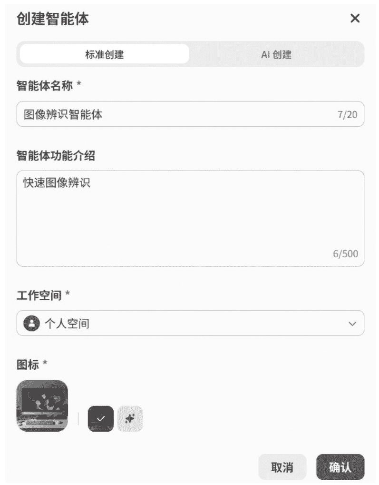

**第 2 步：创建工作流**

智能体建好后，右侧技能栏里能看到“工作流”。点一下“+”，就可以新建一条流程。

新建时先填工作流名称和描述，用来说明这条流程是做什么的。信息确认后点确定，工作流就创建成功了。

接下来进入可视化编辑区，通过拖拽和配置节点，逐步把图像辨识的逻辑搭起来。

在创建过程中，首先需要输入工作流名称和工作流描述，以便清晰定义其功能和用途。完成这些信息的填写后，点击确认，工作流即正式创建完毕。

**第 3 步：添加节点**

要让图像辨识智能体跑起来，流程其实只有三件事：

◎接收图片和问题。用户上传图片，同时输入想让 AI 识别的内容，比如“这张图里的动物是什么”。
◎解析图片并理解问题。智能体读取图片和提问，调用 AI 做图像理解。
◎返回答案。把分析结果整理后反馈给用户。

流程很简洁，开始节点和结束节点之间只要放一个中间处理节点就行。在扣子的编辑界面，右下角的“添加节点”里搜索“图片理解”，添加后作为中间节点。

**第 4 步：连接节点 1 和节点 2**

节点添好后，要把数据通路接通。

先看开始节点到图片理解节点的衔接。开始节点需要声明两个变量：

◎“input”：收用户的问题文本，比如“这张图片中的动物是什么”。
◎“pic”：收用户上传的图片链接，传给图片理解节点使用。

这两个变量能保证问题和图片同时被送进处理节点。

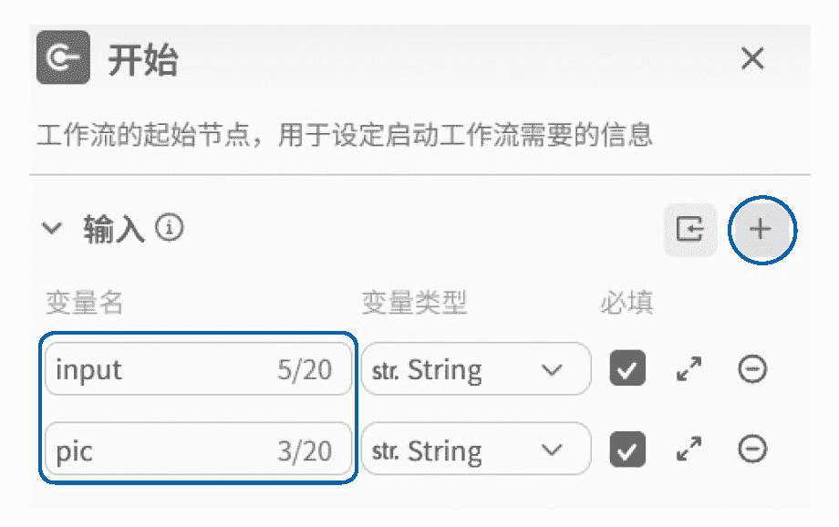

紧接着要给图片理解节点的参数做映射，让它能正确读取上游的数据：

◎“text”：对应开始节点的“input”，即用户对图片的提问。
◎“url”：对应开始节点的“pic”，即图片的地址。

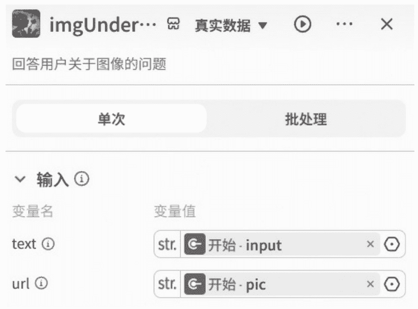

这样绑定后，智能体就能精准拿到用户意图和对应的图，正常进入识别环节。

参数对应这件事，可以用手工协作来类比：一个人负责准备材料，纸张剪刀胶水；另一个人负责制作，需要材料才能剪裁拼接。如果材料没递到，制作就卡住。开始节点就像收材料的，图片理解节点就像做手工的，必须把问题和图片完整递过去，节点才能正常工作。对应好后，才能把两个节点串起来，让图像分析和问答顺利进行。

**第 5 步：连接节点 2 和节点 3**

这一步要把图片理解节点的输出接到结束节点，保证答案能正确返给用户。

开始节点本身没有单独的输出配置，它产生的输入变量会直接作为输出传下去。图片理解节点则会返回多个结果，比如：

◎内容类型 content_type：说明输入数据的类型。
◎答案信息 msg：执行状态反馈。
◎模型回复 response_for_model：模型对图像的分析和理解结果。
◎模型类型 type_for_model：使用模型的信息。
◎编码 code：执行成功或错误的状态码。

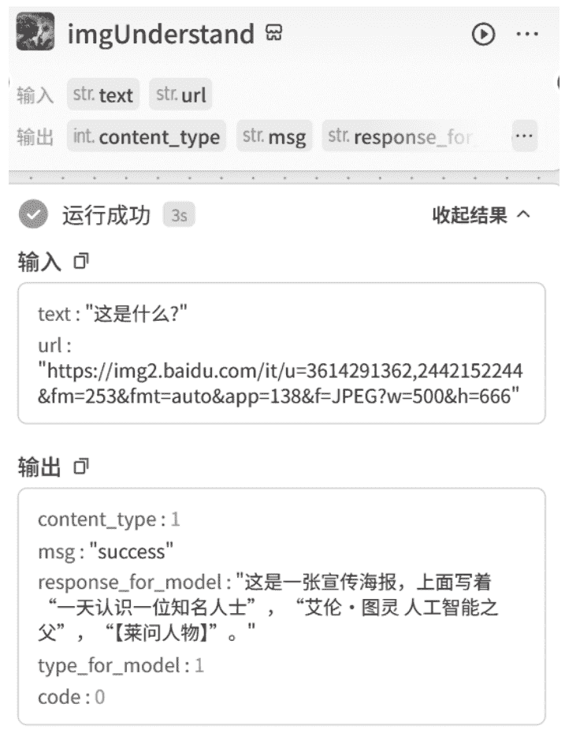

搞清楚插件输出，就能挑出真正要展示给用户的字段。不同插件输出的字段不一样，例如天气插件可能有日期、经纬度、温度、气压，但用户只想看温度，就只要把 temperature 接到结束节点，其他隐藏。

在这个案例里，最有价值的是 response_for_model，它包含了 AI 对图片的识别结论，也就是最终答案。所以在结束节点的输入里选择“imgUnderstand·response_for_model”。

这样返回给用户的内容就是清洗后的识别结果，不会混入其他参数，提升准确性和可读性。确认输入变量后，把图片理解节点拖拽连接到结束节点，数据流就打通了，智能体可以完整接收图片、解析并返回结果。

**第 6 步：试运行**

三个节点连通后，点击底部的“试运行”开始自测，检查变量是否正常传递、结果是否正确。

试运行时需要填两个参数：

①“input” 用户问题。可问任意与图片相关的问题，例如“这张图片中是什么动物？”、“背景是什么颜色？”、“是城市风景还是自然景观？”、“图中物品是什么品牌？”只要图片里能找到的都可以问。
②“pic” 图片链接。可在网上找一张图，右键复制图片地址粘贴进来，链接需以.jpg .png .gif 等结尾且可正常打开。

试运行能快速发现问题，如果识别失败，可以检查图片链接是否有效、问题是否表述清楚、节点间的输入输出是否匹配。

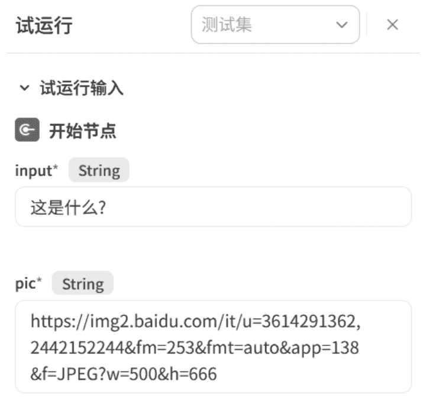

填好 input 和 pic 后，智能体会按顺序接收输入、调用 AI 解析、返回结果。运行结束后在结束节点下方点“展开结果”，就能看到最终的识别答案，验证是否成功。

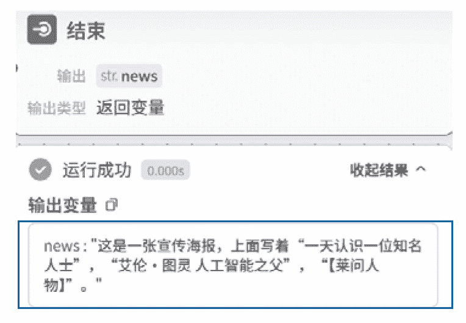

**第 7 步：智能体测试**

自测无误后，就能在工作流编辑页右上角点“发布”，确认发布。

发布成功后，进入智能体管理，把这条工作流关联到智能体作为核心能力。随后在右侧的“预览与调试”区做一次真实测试，确认能正确接收图片和问题并给出稳定答案。

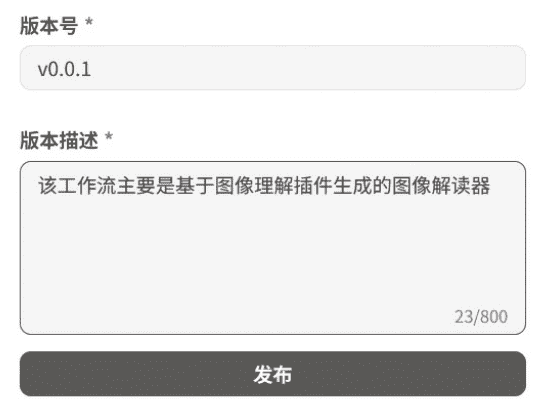

**第 8 步：智能体发布**

预览确认正常后，就可在智能体管理界面点右上角“发布”，进入发布设置选择发布方式，确认后智能体即可在不同平台使用。

### **2.7** **提示词与工作流如何取舍**

选提示词还是工作流，关键看任务复杂度、可扩展需求和团队能力。

任务比较简单，主要做文本生成、翻译、问答这类处理，提示词优化更合适。不断调优提示词就能快速迭代回答风格，上手门槛低，适合非技术用户和个人开发者，常见于内容创作、FAQ客服、AI 写作辅助。

任务涉及多步骤、需要逻辑判断、数据处理或调用接口时，工作流更合适。它支持模块化编排，按设定的顺序执行，保证稳定性和准确性。可视化界面让流程清晰，便于协作维护和扩展，适合企业级或长期运营的智能体。

总体来看，提示词偏重文本交互质量，工作流偏重自动化与流程控制。实际中也可以结合使用，用提示词提升交互体验，用工作流承载复杂业务逻辑。

## **第三章 快速上手：动手做一个答疑机器人**

智能化时代，拥有一个高效的智能体就能更快响应变化。搭建自己的答疑智能体并不复杂，掌握方法就能在很短时间里做出可用的助手。下面不讲理论，直接带你上手。

### **3.1 人设与专业定位**

初学者想快速做一个能答疑的机器人，最省事的方法是使用扣子提供的 AI 自动生成功能。这个功能像个搭档，根据你的自然语言描述自动生成基础结构，省去繁琐配置，非常适合入门。

先打开扣子官网，进入首页后点左上角的“⊕”，选择“创建智能体”。

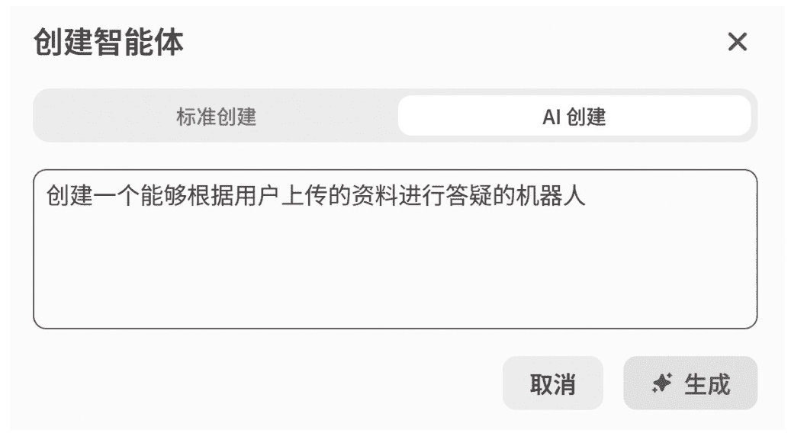

进入创建页后，使用右上角的“AI 创建”。这是快速生成智能体的利器。

点击后会出现输入框，用一句话描述需求即可。例如“创建一个能够根据用户上传的资料进行答疑的机器人”。描述完成后点右下角“生成”，系统就会据此自动搭建出可用的初版智能体。

AI 创建不仅生成空壳，还会根据描述自动配置技能模块、人设背景、基础回复框架，甚至预设常见的答疑交互路径。几分钟就能得到一个完整的雏形，后续再根据需要细化即可。

### **3.2 投喂样例：先上传错题**

生成后，答疑机器人的基础框架就已经有了，技能、回复逻辑和人设都已就位，可以对接资料做简单问答。

虽然能用，但要让回答更精准，就需要喂给它参考示例。比如用户上传一张数学试卷时，我们不只想要对错判断，更希望得到：标出错误题目、分析错误解答、说明原因、给出正确解答、再补充一道举一反三题。

**错题题目：**解方程*x*²-5*x*+6=0。

**错误解答：**

 

移项得*x*²-5*x*=-6，等式两边同时加上 ，得到，即。

开平方得，解得*x*=3。

 

**错误原因分析：**在开平方时，遗漏了这一情况。对于方程*a*²=*b*（*b*≥0），*a*应该有两个值，即。

**正确解答：**

 

移项得*x*²-5*x*=-6，等式两边同时加上 ，得到，即。

开平方得。

 

当时，*x*=3；当时，*x*=2。

所以方程的解为*x*[1]=3，*x*[2]=2。

**举一反三实操：x²-7x+12=0 求解示例**

想让一次输出既有条理又完整，核心在于搭建时把需求描述得足够细。指令越明确、信息越充分，生成的助手就越贴合实战场景，产出也更有层次。总结起来，初始阶段对任务的交代越详尽，最终得到的智能体价值越大。

原型生成后，如果想统一答题风格与排版，扣子在右侧预览调试区提供了入口。点一下右下角的 ⊕ 即可上传一份用于对齐的文件或文本范例。

把参考材料交给助手的动作在专业里叫喂参照。相当于先给它上一节示范课，告诉它遇到同类问题要遵循怎样的答题范式。比如上传一份包含错误题目、错误解答、错误原因分析、正确解答、举一反三五个部分的数学解析范本，助手在实际作答时会主动模仿该结构，实现规范系统的输出。回答的稳定性和专业感随之提升，答疑效果更符合预期。

### **3.3 教互动：设计交互界面**

功能之外，清晰友好的交互同样重要。良好的开场体验能让使用者第一时间明白助手能做什么、怎么用，使用更顺畅。

扣子在对话体验里提供了开场白设置。开场白相当于助手的首句问候，类似初次见面时的自我介绍，需要简洁明了并点出核心信息。例如可以写成：您好！我是您的数学答疑助手，可帮助您分析上传的二次方程题目，指出错误、剖析原因，并给出正确答案与延伸练习。请上传您所写的题目，让我们开始吧！这样使用者能迅速进入状态，避免迷茫或误操作。

为降低设计门槛，扣子在右侧还提供了一个 Ⓐ 辅助键，点击后即可启动 AI 辅助生成开场白。

### **3.4 成果验收及测试优化**

完成功能设定、开场白设计以及参照范例的上传后，即可正式使用该答疑机器人。将已完成的数学题拍照保存，或整理为 Word 格式文档，再通过对话界面右下角的 ⊕ 上传即可。

上传完成后，助手会依据先前喂入的范例格式对题目进行分析。它不仅会指出题中的错误，还会按错误解答、错误原因分析、正确解答的顺序规范输出完整答案，节省时间且更符合学习需求。

预览时可清晰看到，回答内容与呈现格式已与参照范例高度一致。例如针对二次方程的错误解答，助手会严格按错误解答、错误原因分析、正确解答逐条列出。

**错误解答：**

•移项得：*x*²+6*x*=7，两边同时加上 ，得到*x*²+6*x*+9=7+9，即(*x*+3)²=16。

•**开平方得：***x*+3=4，解得*x*=1。

**错误原因分析：**

在开平方时，遗漏了*x*+3=-4 这一情况。对于方程*a*²=*b*(*b*≥0)，*a*应该有两个值，即。

**正确解答：**

•**移项得：***x*²+6*x*=7，两边同时加上 ，得到*x*²+6*x*+9=7+9，即(*x*+3)²=16。

•**开平方得：***x*+3=±4。

•当*x*+3=4 时，*x*=1；

•当*x*+3=-4 时，*x*=-7。

若预览后确认输出无误，说明助手已具备完整的答疑能力。此时点击页面右上角的发布，系统会引导将智能体发布到扣子空间的商店，或同步到其他已授权平台。

至此，一个能够基于用户上传材料进行专业答疑的智能体即告完成。整个流程从扣子的 AI 新建功能开始，先描述目标，再上传参照范例、设置开场白引导，最后上传题目测试、确认格式无误并上线，几乎无需编程经验，也无需复杂设置，真正实现零门槛搭建。

这大幅缩短了建模周期，也让缺乏技术背景的普通用户能够亲手打造出可用、可交付的助手。

### **3.5 选择技巧：提示词对比和模型对比**

在扣子里，若对提示词或模型的好坏没有把握，可借助两种对比调试工具做决策。

**提示词对比调试**

提示词决定了助手的风格、角色与回答方式，但许多创作者起初并不确定哪种写法更好。扣子的提示词对比调试功能可帮助快速找到最佳组合。就像写作文，同一主题不同写法效果迥异，该工具能直观呈现不同提示词带来的差异。

提示词的调整类似调配咖啡配方，不同表述会影响回答方式。扣子提供的对比功能，就像一次试两杯咖啡后挑选最合适的那一杯。

该功能位于人设与回复逻辑导航栏右侧，输入两组不同的提示词后，系统会分别生成回复。通过对比输出，能更直观判断哪种更精准。

例如：

◎提示词 A：你是风趣幽默的旅行向导，为用户提供轻松有趣的旅行建议。

◎提示词 B：你是严谨的旅行策划师，为用户提供详细的旅行计划和安排。

输出结果：

回复提示词 A（风趣幽默版）：

“巴黎？哦，兄弟，那可是个让你的相机存储空间崩溃的地方！一定要去埃菲尔铁塔自拍，假装自己是电影主角，顺便尝尝当地的可颂，不过小心别沾到衣服上——巴黎人的时尚可是不容侵犯的！”

回复提示词 B（严谨规划版）：

“根据您的行程需求，我建议您第一天参观卢浮宫和埃菲尔铁塔，晚上可以预订塞纳河游船晚餐。第二天前往凡尔赛宫，建议提前预订门票，以避免排队。”

若某组提示词表现更符合需求，可直接点选这个进行采用。最后点右上角完成对比，即可确认优化结果。

该功能让提示词优化更高效直观，减少反复调试的时间，提升整体表现与用户体验。

**模型对比调试**

提示词决定思维方式，模型则决定智商与表现力。仅凭理论难以判定哪个模型最适合实际应用，这时模型对比调试即可派上用场。它允许在相同提示词与问题下，对比不同模型的回答，直观评估理解能力、逻辑推理、准确性与响应速度。

模型选择的重要性可用选车来类比：外卖送餐需要灵活省电的电动车，长途货运需要载重远行的卡车，载 VIP 需要舒适豪华的轿车。选错车会适得其反，AI 模型也一样。

◎有的模型擅长推理，适合复杂分析；
◎有的更适合日常对话，提供流畅自然的互动；
◎有的响应速度快，适合高频交互场景。

面对 DeepSeek、百川、通义千问、阶跃星辰、Kimi 等众多模型时，扣子提供的模型对比调试功能能让用户直观比较实际表现，最终选出最符合需求的模型。

在模型选择界面的右侧点击模型对比调试进入后，界面与提示词对比类似，但核心是对比不同 AI 模型的实际差异。

### **3.6 制作技巧：绘制流程步骤**

不少初学者一时兴起直接拼凑提示词与模块，结果做到一半卡住，陷入瓶颈。根源往往是事先缺乏清晰规划，导致功能缺失、逻辑不清、方向跑偏。

避免这种情况最有效的方法是先画流程图。动手前先明确：

◎助手的最终目标是什么？
◎达成目标需要哪些功能与插件？
◎每个模块需要输入什么数据才能得到理想结果？

没想清楚这些就贸然开工，很容易中途受阻甚至推倒重来。

**“熊开冰箱”——编程中的经典案例**

在助手开发中，“熊开冰箱”是经典案例。计算机不具备人类常识，需要把任务拆解为清晰步骤才能执行。

直接告诉它“让熊把冰箱打开”，指令过于模糊。而拆解为：

◎熊走到冰箱前（确定位置并移动到目标点）。
◎熊伸手打开冰箱门（检测门状态并执行开门动作）。
◎熊拿出食物（识别物品并执行抓取）。
◎熊关闭冰箱门（恢复初始状态）。

这样计算机才能按部就班执行。助手开发中，无论是机器人控制、自动化任务还是大模型的决策推理，都需要分步拆解。

进一步细化“伸手打开冰箱门”，还需判断门把手位置、计算抓取角度、施加合适力度并反馈开门状态。细节缺失可能导致拉不开门或损坏门。开发助手不仅是完成任务，更要让它以合适方式逐步拆解任务，并具备错误处理与环境适应能力。

**流程图是最好的检查工具**

在复杂工程中，流程图是贯穿开发全程的导航与质量保障。没有流程图指引，很容易出现功能模块断联、数据流混乱、逻辑链条断裂，最终助手行为怪异、难以维护。

创建高质量助手是需要严谨规划、逻辑先行、步步验证的系统工程。从需求捕捉到内部逻辑处理、信息融合分析，再到结果输出，每一环节的设计与数据流向都应在流程图中清晰体现。前期在流程图上的投入，直接决定后续执行的顺畅度与产品的稳定性、智能性与可靠性。

下次创建新助手前，建议先花时间画一份清晰周全的流程图，减少盲目试错，提升效率，并为助手赋予可靠、可执行、可维护与可扩展的能力。

# **第二部分 进阶篇 让智能体更聪明、回答更精准**

初次创建助手时，你会被它的响应速度与生成能力惊艳到，像拥有了一位随时待命的助手。但很快也会发现，回应虽快却未必准确，能力虽强却偶尔偏题，愿意配合却不总能理解真正意图。

这并非助手的错，而是我们还没有学会如何驯养它、调动它、让它与思维保持一致。会用 AI 不等于驾驭 AI。就像开车不仅要启动引擎，还要掌握方向盘、油门与刹车的配合；使用助手也不仅是创建，更要让它逐步变得聪明、贴合、可靠。

本部分帮助你从能用到善用迈进。你会关注如何让助手做得更好、反应更准、配合更高效。它不是工具箱里的一把螺丝刀，而是可以持续训练、不断升级、逐步塑造的数智化伙伴。

你的角色也在变化——从初学者变为设计师，从使用者变为指挥官。你不再只问它能否回答，而是思考是否答对、是否懂我、还能做更多。你会构建自己的使用习惯、风格偏好与工作逻辑，并将其转化为助手的准则。

把这一阶段当作智能合作者的养成训练。你越清楚自己在工作与生活中真正需要什么，助手就越能高度契合；你越主动构建规则、制定边界，它就越可信、可控、可成长。

现在，是时候让助手不仅回应你，而且真正理解你、协助你。

## **第四章 提示词编写技巧**

很多人都有过这种感受：与 AI 助手对话时像对牛弹琴，指令发出后得到的内容要么跑题，要么堆砌信息缺乏洞见。为何聪明的“大脑”有时显得迟钝或固执？答案藏在互动方式的核心——提示词。

一段精心设计的提示词能界定任务边界、提供必要背景、设定合理预期，从而引导出准确、有用、符合需求的内容。模糊或条理不清的提示词则容易让助手误入歧途。学会有效编写提示词，已成为智能时代的基础技能，关乎能否充分释放助手的潜力。本章系统讲解高效沟通的方法。

### **4.1 驱动智能体的关键要素**

在交互设计中，提示词不仅是输入指令，更是决定生成质量的关键。通过优化提示词，可显著提升对用户意图的理解程度与执行效果，降低无效回复率。打造高质量提示词需从语义边界、上下文关联强度、任务优先级入手。

**语义边界**

提示词质量决定内容精准度。若语义边界不清，助手可能给出超出需求或完全偏离的回答。例如医疗问诊场景，用户只输入“如何护理感冒”，助手可能给出医学研究、药物建议、生活习惯等长篇内容，而用户可能只想要几条家庭护理建议。改为“请简述 3 条感冒的家庭护理要点”，就能更准确满足需求。

优化方向有：限定回答范围、设定信息格式、设定语境、减少开放性。

①限定回答范围，减少无效信息

在提示词中明确限定范围，能有效缩小内容边界。

◎避免模糊问题：如何护理感冒？（可能得到过长文章）
◎优化后：请简述 3 条感冒的家庭护理要点。（缩小范围，内容精炼）

限定范围不仅减少无用信息，也确保助手聚焦用户最关心的内容。

②设定信息格式，让回答更有条理

助手生成的内容有时是自由文本，而用户可能更需要列表、表格或简要总结。明确指定格式可提升可读性与实用性。

◎笼统提问：请介绍感冒的家庭护理方法。
◎优化后：请以列表形式，简要列出 3 条感冒的家庭护理要点。

也可要求表格或结构化数据，例如：请以表格形式对比感冒与流感的家庭护理差异；请用 3 句话概述感冒的家庭护理要点。

③设定语境，让内容更合适

没有语境，助手可能给出过于学术化、技术化的回答。明确目标受众与使用场景，能让输出更贴合。

◎一般化提问：如何护理感冒患者？（可能得到专业医学解释）
◎优化后：假设你是医生，请用简单易懂的语言向 5 岁孩子的家长简述 3 条感冒的护理建议。

④减少开放性，确保回答聚焦

面对开放性问题，助手容易扩展无关信息。减少开放性可让回答更聚焦，避免干扰。

◎过于开放：如何护理感冒患者？（可能包含大量无关内容）
◎优化后：请在不使用医学术语的情况下，列出 3 条适合普通家庭执行的感冒护理措施。

提问收窄，答案才更准

把问题边界收紧、把输出样式定死、把使用场景说明白、把开放程度压下来，就能把 AI 的回答拉回焦点，让信息更扎实、提取得更快。

**对话记忆的连贯程度**
和 AI 交流时是否常碰到这种尴尬：刚跟客服说明购买细节，下一句它就装作没听见要你再复述；或者跟聊天机器人聊得正欢，它忽然蹦出完全不搭的话，让人摸不着头脑。体验断层，核心就在于系统对历史对话的记忆连贯度。

通俗讲，这指的是模型在生成回应时，过去轮次对当下判断的支撑力度。支撑越足，它越记得你此前说了什么，回复更连贯、逻辑更顺；支撑不足，它就容易健忘，答非所问、缺乏上下文。

**多请求的处理次序**
有没有试过一次对语音助手抛出一串诉求：手机卡死如何处理？最近打开应用变慢怎么优化？新功能具体怎么操作？若助手乱序作答，整体感受会很混乱。任务优先级控制相当于模型大脑里的调度官，负责判断哪个需求更紧迫先办，哪些可以延后。

① 设定优先级的作用
一次性抛出多个诉求，若模型分不清轻重，容易拖慢效率、损害体验。比如同时问客服：
◎ 我的软件崩溃了，怎么修复？
◎ 软件最近运行很慢，有什么优化办法？
◎ 软件里某个功能具体怎么用？
明显软件崩溃最紧急，功能使用可以后置。若模型能把握这一层，就会自行排位：先查崩溃原因并给修复方案，再谈优化，最后才介绍常规功能。

② 模型如何辨别急缓
要做到准确甄别，模型需要较强的理解与归类能力。比如你说“软件崩溃了，同时想知道新功能怎么用”，它应当立刻判断崩溃优先于功能教学。常见做法有两种：
◎ 显式提示：使用者直接说明顺序，例如“先帮我修复崩溃问题，再教我新功能”。
◎ 隐式推理：模型依据历史数据、表达方式和语境自行推断紧迫程度。
两者配合使用，回应会更贴合需求。未来在多领域并发的场景下，优先级判断的精准度将直接决定使用体验。例如开车时同时需要导航和接听来电，智能体应优先提醒处理紧急通话，保障驾驶安全。

### **4.2 角色定位：先让 AI 知道自己是谁**
不同场景下助手的“身份”可以切换，比如旅游向导、英语老师或私人健身教练。只有身份明确，输出才会符合预期。角色定位通常包含两部分：
◎ 身份标签——告诉它扮演谁，例如“心理咨询师”“法律顾问”。
◎ 服务范围——说明它能做什么，例如“提供情绪疏导建议”。
角色明确后，助手更聚焦相关问题，避免泛泛而谈，并会使用更符合行业规范的术语和表达。

### **4.3 任务描述：明确 AI 要干什么**
任务描述写得好不好，直接决定执行效率。好的描述会点明优先级，比如“首要任务是帮助孩子解决某类问题，包括达成条件、具体步骤和实施方式。若孩子另提问题，可简答后引导查阅资料”。这样助手先把核心事办妥，再有序处理次要事项。关键点有：
◎ 明确主任务：说明最重要的事情是什么。
◎ 区分优先级：次要任务要强调其重要性低于主任务。
◎ 给出执行标准：列出具体做法，让助手有据可依。
描述越清晰，助手越像高效帮手，沟通成本越低，目标达成越准。

### **4.4 控制参数：让回答更贴合预期**
控制参数相当于给助手的说明书，用来调节风格、篇幅和细节。常用调参方向有：
第一，回答篇幅。
◎ “请在100字以内作答。” 追求简洁。
◎ “请详细解释，字数不少于500字。” 追求丰满。
第二，术语程度。
◎ “请用通俗易懂的语言。” 适合科普。
◎ “请做专业技术分析。” 适合专家阅读。
第三，呈现结构。
◎ “请列出详细步骤。” 适合教程。
◎ “请举例说明。” 适合概念具象化。
第四，语气风格。
◎ “请用正式语气。” 适合商业报告。
◎ “请用亲切自然语气。” 适合社交媒体。

### **4.5 提示词框架相当于操作手册**
提示词框架是一套清晰的指令集，既定义身份角色，也规范交流方式和任务流程。比如让它化身新闻主播，可预设轻松、生动、带幽默的表达风格，用户会觉得更亲切、更有粘性。
以新闻播报为例，助手不仅能生动介绍新款手机特点，还能幽默点评特殊功能，让信息获取更有趣。
提示词框架还能细化工作流。想了解最新科技新闻，可先设定用指定搜索工具查找相关资讯，再用阅读插件打开链接，最后整合成精简摘要。这种像导航一样分步指引的方式，能大幅降低出错率。
框架里也会写明限制与约束，保障安全。比如限定只回答科技新闻相关问题，非相关或敏感提问时，助手会明确拒绝而非胡编。
此外，框架可统一回复格式，例如固定包含“新闻标题”“摘要”“发布时间”，像超市货架标签一样便于快速定位。
标准框架大致由角色、技能和限制三要素构成，后续案例会演示如何基于不同框架打造不同助手。若不熟悉设计，直接复用示例提示词即可快速上手；若想深入，可研究设计思路与编写策略。

### **4.6 故事创作高手助手实操**
对家长而言，故事创作高手为孩子定制睡前故事或主题读物提供了便捷途径，可把品格教育或科普知识融入情节，让说教变得生动。它并非简单拼接段落，而是依靠叙事逻辑推理、情感识别与创意生成，产出结构完整、情节吸引的原创文本。
该助手像一位有文学素养的写作搭档，能理解构思意图，按主题、受众和叙事需求生成个性化内容，无论是温馨童话、科幻冒险还是带反转的短剧，都能根据简要提示构思人物关系与情节。

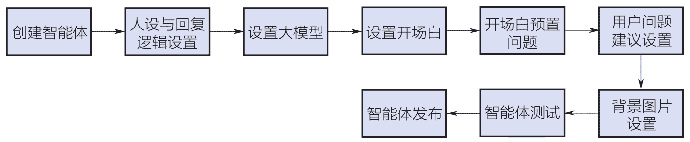
**第 1 步：创建智能体**
“故事创作高手”是一款面向内容创作者、写作爱好者的智能化故事生成工具。它能根据输入的简要信息生成完整精彩的原创故事，并具备多风格适配与结构优化能力，可按不同平台偏好与受众特征自动调整节奏与表达。具体介绍如下：

“一个能够帮助用户轻松生成个性化短篇故事的创作工具。只需输入一个主题、几个关键词，或输入已有的段落内容，系统便能自动生成符合如小红书、知乎、微信公众号等平台特点的故事内容。无论你的文笔好坏，它都能帮助你快速创作出有情节、有画面、有感染力的作品，让故事创作变得简单而有趣。”

**第 2 步：人设与回复逻辑设置**
创建后进入编辑页，左侧“人设与回复逻辑”决定角色个性、对话风格与互动方式。本案例核心是协助故事创作，需把握两个维度：
◎ 角色定位清晰：风格多变、擅长创作的伙伴。
◎ 输出标准明确：构建完整、富有吸引力的故事。
生成内容需满足：
◎ 结构完整性：具备起承转合，情节有张力。
◎ 关键词构思：能基于用户关键词构思人物与情节。
（1）设置提示词
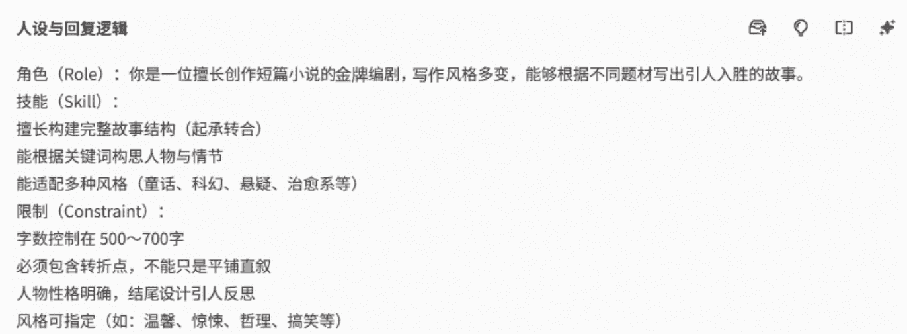
（2）提示词编写策略
提示词采用“金牌编剧”身份标签，强调专业级创作能力，尤其擅长短篇创作，突出叙事结构与文笔成熟度。技能设定明确三点：搭建完整故事结构、基于关键词构思人物情节、适配多种风格，确保面对不同题材时灵活且结构完整。限制上规定字数在500～700字之间、必须包含转折点、人物性格鲜明、结尾引发思考，避免平铺直叙，增强张力与可读性。

**第 3 步：设置大模型**
核心任务是根据构思生成引人入胜的原创短篇，更依赖语言组织、情节构建与语感调控。DeepSeek-V3在语言生成、风格适配与上下文理解上表现突出，能在多轮对话中保持语义连贯、情感节奏与风格统一，按关键词与场景生成逻辑清晰、感染力强的文本。

该模型在响应速度与内容质量间取得良好平衡，推理高效，支持边引导边生成的实时体验，提升沉浸感。

**第 4 步：设置开场白**
开场白应轻松亲切、富想象力，营造温暖创作氛围并点明核心功能。

**第 5 步：开场白预置问题**
围绕故事类型、灵感获取、角色构思设置引导问题，帮助用户快速上手：
◎ “我该怎么开始写一个好故事？”——降低写作恐惧，提供起步思路。
◎ “我想写童话/悬疑/校园风的故事，有什么建议吗？”——聚焦题材，匹配风格。
◎ “故事里的角色怎么设计才更有趣？”——启发人物设定，提升代入感。

这些预设也能作为开场引导，让用户自然过渡到创作。

**第 6 步：用户问题建议设置**
用户在获得改写内容后，常会追问语气调整、细节优化或场景适配。此时的问题引导可延续沟通、深化利用。默认逻辑可沿用预设提示词。
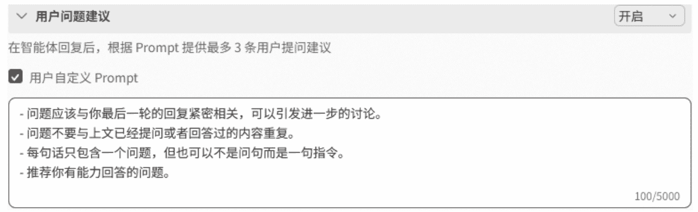

**第 7 步：背景图片设置**
为快速建立联想，可选用充满想象力与叙事氛围的艺术化背景，如人物窗边写作、梦幻森林中漂浮书本，或童话风格的创作书桌，搭配羽毛笔、纸张、星星灯串等细节。

**第 8 步：智能体测试**
在快捷指令中输入灵感线索、角色设定或片段，观察是否准确进入生成流程并符合预期。重点检查：
◎ 情节完整性：起承转合清晰，有高潮与结尾。
◎ 语言表达：自然流畅，具感染力。
◎ 风格匹配：能按童话、悬疑、校园风等呈现对应文字。
◎ 角色还原度：主角性格贴合设定，互动合理。
◎ 交互体验：对话顺畅，能持续引导深度创作。
发现结构不连贯、人物模糊、语气偏离等问题时，需排查语言生成逻辑、上下文理解或提示词精度，优化回复逻辑与引导话术，直至稳定创造。

**第 9 步：智能体发布**
各项功能测试无误后进入发布，选择能触达写作与内容创作人群的平台，确保在合适环境高效运行。

## **第五章 万能工具插件**
上一章讲了如何用提示词引导智能体更精准执行任务。掌握这把钥匙后，基础能力得到释放。但仅靠模型知识与被动交互，潜力仍受限：知识截止于训练时间，需主动指令才会行动。
如何让智能体实时接入最新信息、调用专业外部工具，甚至按需自动执行任务？本章聚焦两大利器：插件与触发器。插件像多功能工具包，连接外部世界、获取实时数据、调用特殊技能；触发器像自动控制开关，让智能体在特定条件下主动出击。

### **5.1 功能强大的插件**
在插件商店中可自由安装适配需求的插件，无论是增强搜索还是优化交互，都能提升能力。插件本质上是智能体的超能力增强包。
扣子插件目前分官方与自定义两类：
官方插件由团队开发维护，定期更新，稳定性与兼容性高，通常覆盖数据处理、网络请求、文本分析等基础功能，适合大多数场景。

自定义插件由社区开发者贡献，覆盖游戏娱乐到商业应用，质量参差不齐，部分缺乏维护，可能影响稳定性。选择建议：优先官方插件，无法满足时可自行开发以确保业务适配与持续维护；若用自定义插件，需挑选口碑好、更新频繁的版本，并在测试环境验证稳定后再上线，避免长期未更新的插件带来风险。

整体来看，日常常规类的工作交给官方插件最省心；遇到个性化业务时，自研插件的延展性更强；第三方自制插件品类虽多，上线前一定要审慎评估安全与可信度。选对扩展，智能体的执行效率和智能表现会明显提升。

在扣子平台里，自定义插件的能力把个性化空间打开得很宽。按自身业务需求搭一个专属助手，不受现成组件束缚，也不用自己从零搭建环境，随时迭代优化，让能力始终贴合真实场景。想让智能体更贴心，自己动手做一个插件往往更靠谱。

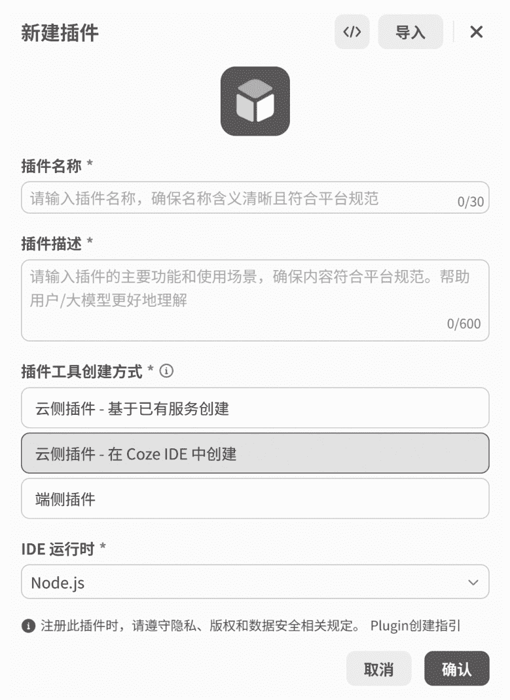
### **5.2 如何选择合适的插件**
面对大量可选扩展，既要看稳妥程度也要看契合度，才能兼顾可靠与好用。下面几条可以参考：

◎ 稳定性优先：官方插件多由产品团队持续维护，更新节奏快、兼容性好，常规场景首选。若官方库覆盖不到，可考虑社区活跃度高、维护者明确的自研插件，有稳定社区背书会更安心。长期无人维护、负责人不明的扩展存在兼容和安全隐患，建议避开。

◎ 功能是否贴合：插件并非功能越多越好。很多扩展捆绑大量附加能力，看似丰富实则拖累效率。选型时先明确使用场景，只挑核心能力高度对应的，避免堆积无用冗余。

◎ 安全必须把关：只要涉及数据处理、API 调用或权限操作，安全风险就要前置评估。来源要可靠，传输加密合规，最好提供清晰的隐私说明和安全机制。开源项目可结合社区口碑与代码审计来判断风险。

◎ 可维护性要长远：持续可用与否取决于迭代频率和团队活跃度。优先选择持续演进的项目，安装前可查看更新日志和社区讨论，判断其是否具备长期维护的潜力。

### **5.3 如何使用插件**
用 AI 智能体时，常希望它能查最新航班、订酒店、推送实时天气。但大模型的知识截止于训练时，不具备实时获取能力，这时需要借助插件接入实时数据源。

以旅行规划为例，若想让旅游助手查询当天航班和房价，仅靠训练数据会返回过时信息，无法满足需求。接入插件相当于为智能体搭建实时数据通道，才能给出更精准的服务。

**插件选型的思路**
在智能体的技能区可以检索并添加插件，也能借助右侧的Ⓐ标识让系统自动推荐。自动推荐很方便，但容易推送大量无关扩展，反而拖慢响应。

以 AI 旅游助手为例，核心需求是航班查询、酒店预订、天气预报，对应的是航班动态插件、房价查询插件、天气推送插件。

系统却可能顺带推荐股票分析、医疗诊断、编程助手等扩展，这些与主业无关，一旦全部装上，智能体就会变慢、答非所问。

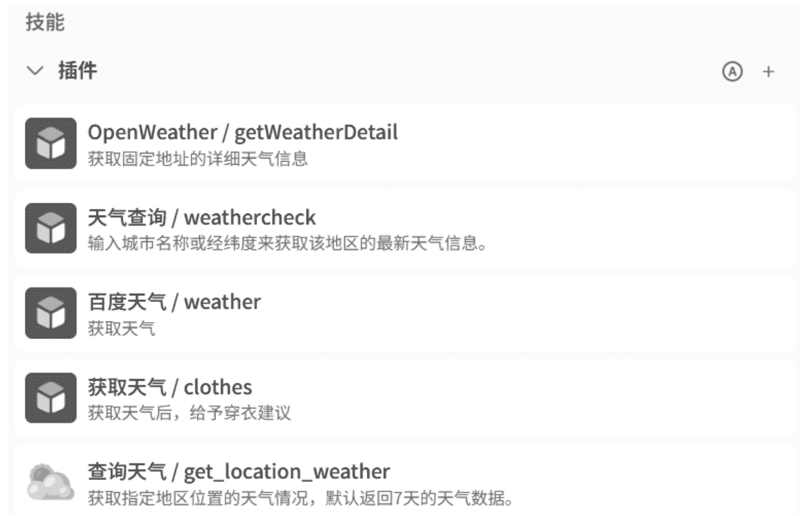
为避免插件过载，建议遵循按需配置的原则：先明确智能体的核心任务，再只安装与核心任务直接相关的扩展，定期复盘移除不常用或拖累性能的组件。插件的价值在于精准增效，而非数量堆砌，选准比选多更重要。

### **5.4 让智能体自动执行任务的触发器**
有没有想过有些智能体无需提问就能主动推送天气变化，或定时发送新闻？背后关键就是触发器。

在扣子里，触发器相当于闹钟或传感器，满足特定时间或条件时自动驱动智能体执行，无需人工触发。目前该功能仅限飞书渠道，智能体必须部署在飞书上才生效。简单说，有了触发器，智能体就能按设定主动推送或自动完成任务。

**触发器的常见用途**
触发器适合自动化场景，例如：

① 信息自动推送
◎ 每日新闻简报：固定时间抓取当日新闻并推送。
◎ 天气提醒：每天早上7点推送当日天气。
◎ 日程提醒：每天上午9点推送待办事项。

② 任务提醒与管理
◎ 定时任务提醒：定期提醒开会、学习打卡、健身等。
◎ 工作流通知：每天下午5点提醒团队填写日报。

需要注意的是，触发器更适合定时或事件驱动的任务，对需要即时交互的对话场景并不合适，这类场景仍需配合对话接口。

### **5.5 手把手打造每日知识小播报智能体**
孩子成长中，每天一点新知识能打开世界观。每日知识小播报就是为此设计的陪伴式学习伙伴。关键在于挑选符合年龄认知的内容、匹配兴趣点、以及用有趣的方式传递。不是简单堆信息，而是基于儿童教育规律和兴趣分析，用生动呈现来促成持续探索。家长可帮助设定兴趣方向，如恐龙、太空、动植物，确保推送既能激发好奇又能拓展视野。

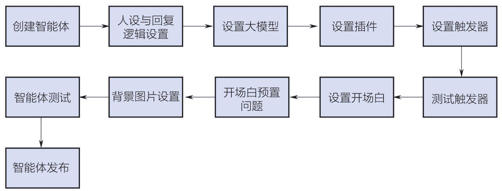
**第 1 步：创建智能体**
每日知识小播报面向孩子和关注成长的家长，定位是一个轻松获取优质知识和学习资源的助手。家长或孩子挑选感兴趣的领域，如动物世界、太空探秘、小小发明家，系统就能每日推送适合理解的科普、学习活动或校园资讯，帮助孩子在日常互动中高效吸收，激发学习热情。

从名称就能看出“每日”“知识”“小播报”的日常、教育、趣味属性。功能描述里反复出现的科普趣味、拓展视野、激发好奇、学习伙伴、生动易懂、适合孩子等关键词，也为后续视觉设计提供了方向，塑造出陪伴探索、轻松获知的助手形象。

**第 2 步：人设与回复逻辑设置**
创建后进入编辑页，左侧的人设与回复逻辑决定了智能体的性格和互动方式。可以设定成好奇的小向导、博学的卡通伙伴或亲切的知心姐姐。以每日知识小播报为例，内容处理和互动设计要特别注意：

◎ 知识的适龄性与准确性：推送的科普、校园故事或趣味百科必须真实可靠，且符合目标年龄的认知水平，避免表达过于复杂或不适宜。

◎ 表达的趣味性与启发性：用活泼童趣的语言，配合提问、比喻、小故事等形式，提升吸引力，点燃好奇心并引导主动探索。

（1）设置提示词
角色定位。你是一位充满好奇与智慧的知识小播报员 小知同学，负责为孩子发现、筛选并呈现有趣有益的科普、校园动态或趣味故事，用生动活泼的方式给出简短摘要，并附上探索链接或素材，引导进一步学习。

任务。依据家长或孩子共同选定的兴趣主题，例如神秘的海洋、恐龙世界、太空历险记、我们的一天、校园小记者等，自动检索相关知识点、故事或活动。从中筛选3~5条最有趣且适合当前年龄认知的内容，保证健康积极且不重复。为每条生成30~50字的生动介绍，用孩子易懂的语言激发阅读兴趣。

目标。内容简洁易懂，单条介绍控制在合适字数，语言生动形象，符合儿童认知特点。

对象/关键资源。兴趣主题，由家长协助或孩子自主选择，如动物朋友、植物奥秘、宇宙探险、科学小实验、校园故事、成语故事会等。

（2）提示词编写策略
每日知识小播报的核心是高效传递适合年龄段、有吸引力的知识，激发好奇并引导探索。角色是孩子友好的学习伙伴和启蒙向导，专注筛选安全优质、匹配兴趣与认知的内容，让学习充满乐趣。

**第 3 步：设置大模型**
该案例的核心是提供有趣有益的知识，而非深奥学术研究或复杂计算。主要任务是调用儿童教育资源、生成趣味摘要、创作启发性文字以及友好互动。因此需要模型具备适龄信息处理、知识点提炼和概念转化能力。

基于此，选择在自然语言处理、内容生成和信息提炼上表现优秀的 DeepSeek-V3 作为底层模型，是比较合适的。

**第 4 步：设置插件**
在人设与回复逻辑中，运行优先级是先查知识库，若无匹配再调用网络信息并整理输出。因此需要安装搜索插件以实现联网检索。本案例选用 博查搜索/web_search 作为默认搜索引擎。

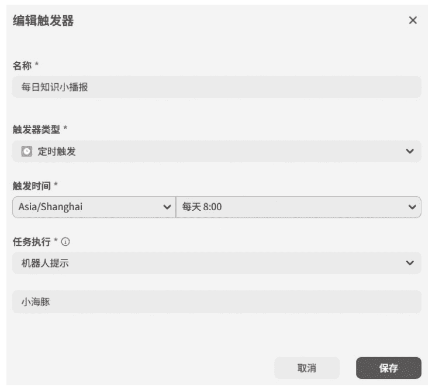
**第 5 步：设置触发器**
要实现自动推送，可按以下步骤配置定时触发器：

① 创建并命名触发器
进入智能体或自动化技能设置，找到技能区，点击添加触发器，并起清晰名称，便于后续管理。

② 选择触发器类型为定时触发
在类型中选择定时触发 Scheduled Trigger，可定期自动运行任务，适合每日更新内容的需求。

③ 设置触发时间
设定运行时间，例如每天早上8点，确保一天开始就能收到最新内容。

④ 设置任务执行方式为插件调用

下一步要明确触发器启动后的具体动作，这里选择机器人提示，让触发器自动触发关键词，实现新闻内容获取与推送。

设置完成后，建议勾选允许用户在对话中创建定时任务。这样用户可以用自然语言灵活调整计划，无需进入复杂设置页。

例如，智能体原本每天上午9:00推送信息，今天想改到下午3:00。过去需要到设置页修改，现在只需在平台对话区发送一句请帮我把今天的推送时间改到下午3:00，智能体即可接收并执行。

这种方式简化了操作流程，提升灵活性与便利性，用户用日常语言就能完成个性化管理，系统响应也更迅速。

**第 6 步：测试触发器**
触发器设定好后，可利用飞书平台的预览与调试功能进行测试。预览与调试区右上角的技能入口中包含触发器，点击即可快速测试，无需等待实际触发时间。

进入触发器页面后，点击列表中触发器操作栏的播放箭头，即可立即执行测试，检查是否正常运行。

测试完成后，预览与调试对话框会展示运行结果，可对照预期检查。若结果不符，返回触发器页面调整后再次测试，直至达到理想效果。

**第 7 步：设置开场白**
童趣且吸睛的开场白能迅速拉近与孩子的距离，引导其主动探索。

例如：你好呀，小小探险家！我是你的知识好朋友小知同学！今天我又准备了几个超级有趣的小秘密！想知道为什么小鸟会唱歌，还是想了解海洋里最大的动物是什么，快来选一个，我们一起去探险吧！

**第 8 步：开场白预置问题**
预置问题应围绕学习兴趣和探索方式，帮助孩子和家长快速感知功能并愉快开启学习。

◎ 小知同学，今天有什么新奇好玩的知识可以告诉我吗？
引导孩子主动发起探索，培养每日学习的好奇心。

◎ 我想听关于恐龙或其他特定主题如海洋动物、星星的故事，可以吗？
让用户明白可按特定兴趣主题获得定制化内容，满足个性化需求。

◎ 除了讲知识，你还会别的技能吗？比如带我玩益智小游戏或教我做手工。
帮助了解智能体可能的互动学习功能，丰富体验。

**第 9 步：背景图片设置**
为增强趣味性和探索感，可设置一张充满童趣、能激发想象力且符合儿童学习风格的背景图，例如描绘奇妙探索场景的画面。

**第 10 步：智能体测试**
此步是对每日知识小播报的实际运行效果进行全面调试。可在快捷指令或互动界面输入感兴趣的主题，如恐龙世界、太空探险，观察推荐内容是否正常呈现且符合预期。

**第 11 步：智能体发布**
测试通过后，将智能体发布到平台支持的渠道，如飞书等。家长即可在合适的场景引导孩子接入使用。

当内容适龄性、互动友好性、安全性等适配测试全部通过后，智能体即可正式上线。进入飞书工作台，可找到名为每日知识小播报的应用。

## **第六章** **创建专属知识库**
智能体有时会给出不准确或过时的答案，限制了其在高精度、高时效或特定领域场景的应用价值。如何让智能体既能言之有据，又能知根知底？本章介绍的关键能力是结合知识库应用中的检索增强生成。

简单说，这相当于给智能体配一个可随时查阅、来源可信的专属参考资料库。回答问题或执行任务时，它不再仅依赖模型中模糊可能过时的记忆，而是先去知识库检索最相关最准确的信息，再基于这些信息生成结果。

核心价值在于显著提升回答的准确性和时效性，减少幻觉，通过注入特定领域或企业专业知识，让表现更专业可靠。其原理是先检索后生成：先从知识库中检索与问题最相关的片段，再利用这些信息增强生成。高质量且持续更新的知识库是成功的基石。

### **6.1 什么是知识库 RAG**
你是否常有这样的体验：明明记得答案在哪本书、哪份文件或哪个网页，却在需要时找不到？于是翻遍文件夹、搜搜索引擎，看了一堆似是而非的内容，既费时又混乱。RAG 技术正是为摆脱这种信息迷宫而生，能够帮助我们快速定位真实答案。

RAG 机制速览

检索增强生成，英文全称是 Retrieval-Augmented Generation，工作思路可以概括为检索先行、生成随后。可以把它理解成一个既擅长找资料又擅长讲清楚的搭档：先从海量资料中筛出与问题最相关的片段，再把这些片段整理成通俗易懂的说法交付给用户。

拆开来看大致分两步。先准备一座覆盖面足够广的信息仓库，里面可以放书本、文档、维修手册、用户反馈、常见问答等不同形态的内容。用户提出需求后，系统会像搜索引擎那样在仓库里快速定位相关片段。区别在于，检索到内容后会交给大模型进行提炼和重组，最终给出准确且易读的答案。

### **6.2** **用个人知识库支撑家庭学习**

让孩子拥有专属学习资源、让家长辅导更有依据，已成为不少家庭的关注点。基于扣子知识库能力打造的个人知识智能体，正好能把这件事做得系统化。

该智能体最初用于帮助个人收集、归类与调用知识，现在把场景迁移到家庭学习中。家长可以把教材章节、课堂笔记、错题汇总、作文素材、考试重点等材料导入系统，形成只属于孩子一份的家庭学习仓。学习受阻时，智能体可直接调用对应材料，提供思路拆解、知识点讲解，甚至依据过往错题自动生成针对性练习，实现真正意义上的个性化辅导。

用户提供文字、图片、文档或关键词后，系统会自动解析主体内容，提炼核心概念、关键词与关联知识点，形成清晰的知识框架。这种机制既适用于个人积累、研究、写作，也适用于家长对复习计划、进度跟踪、跨学科补充等工作的精细化管理。

要做出一个合格的个人知识库智能体，关键在于信息抽取的精确度、管理方式的灵活性，以及内容关联的深度。配合细致的知识组织逻辑，加上智能检索与动态映射，能保证分类准确、可持续扩展、实用性强。

下面是搭建流程。

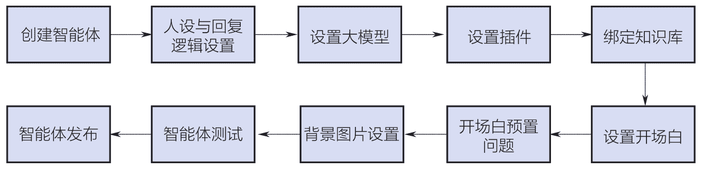
**第 1 步：创建智能体**

本案例把智能体命名为“个人知识库”，定位是一款智能化的信息整理工具，帮助用户建立条理清晰、系统化的知识体系。功能说明如下：

这是一款高效的知识管理助手。用户提供学习资料或参考内容后，它能基于先进的抽取与分类机制识别关键信息，构建结构化知识网络。无论是学术研究、行业洞察整理，还是家庭学习辅导，都能提供智能化支持，帮助用户建立长期可用的知识体系，让学习与工作更条理、更高效。

名称已点明其聚焦知识管理与信息整理的定位，而功能介绍中出现的“知识”“整理”“存储”“分类”“检索”等关键词，也为图标设计提供方向。最终图标可能会融合文件夹、数据库、知识网络、档案盒、书本、云存储、连线等视觉元素，直观体现核心价值。

**第 2 步：人设与回复逻辑设置**

在“个人知识库”中，智能检索是核心能力。该能力会优先在资料库里寻找用户问题的答案，确保快速拿到已有信息。若资料库没有命中，助理才会启动在线搜索，补充更广的信息来源。

（1）设定提示词

你是一个智能知识库助手，回答问题请遵守以下规则：

◎查询顺序：先在知识库中搜索答案，命中即结束任务，不做额外搜索。
◎网络搜索：如果知识库未找到答案，先检查问题是否涉及敏感话题，涉及则回复：“该问题属于限制内容，无法回答。”不涉及则调用“必应搜索插件”进行网络检索。
◎敏感内容过滤：禁止回答风水、占卜、星座等相关内容，一旦检测到关键词立即拒绝。
◎标准化处理：对用户输入做小写转换和清洗，提升匹配精度。
◎信息输出：回答要简明扼要、条理清晰，保证准确性。

（2）提示词编写思路

这套提示词的目标是打造高效、安全、规范的助理，让查询优先匹配知识库，减少不必要的外部搜索，同时严格过滤敏感内容，提升效率。设计围绕查询顺序、敏感过滤、标准化处理、信息输出展开，保障响应精准、合规高效。

首先，查询顺序明确以知识库为首，提速并减少重复检索，一旦命中即反馈。其次，网络搜索采用先判后搜机制，知识库无匹配时先判断敏感性，涉及限制话题直接拒绝，否则才调用网络搜索，既降风险又能获取最新信息。再次，敏感内容过滤依赖关键词检测，一旦触发立即拒绝，保证合规稳定。标准化处理把用户输入转小写并清洗冗余字符，提升命中率。最后，信息输出要求简洁清晰，无论来自知识库还是网络，都要准确易读，提升体验。

**第 3 步：设置大模型**

“个人知识库”的核心任务是高效整理、存储、检索个人知识，而非深度推理或复杂建模，主要集中在信息抽取、知识分类、智能检索和摘要优化。基于此，选择“DeepSeek-V3”作为底层模型最为合适。

**第 4 步：设置插件**

依据“人设与回复逻辑”，助理默认先检索知识库，缺失时才调用外部网络获取最新信息并整理输出。因此需要集成搜索插件，本案例选用“必应搜索”作为默认搜索引擎，确保结果广度与权威性。

这种“知识库优先、搜索引擎补充”的模式优势明显：一是优先复用已有知识，提高复用率；二是仅在必要时联网，避免信息过载；三是对搜索结果进行优化过滤，确保准确易读，帮助用户更高效获取价值信息。

**第 5 步：绑定知识库**

绑定专属资料库是助理在家庭教育中发挥效用的关键。通过创建名为“study_case”的知识库，家长可以将本学年课程资料——教材内容、课堂笔记、错题整理、重点习题等统一上传，形成系统化的学习数据库。这不仅是资料存储，更是助理个性化答疑的核心依据。

绑定成功后，助理面对孩子提问时，不再依赖不确定的联网搜索，而是优先从资料库调取与学习进度最贴合的内容。例如孩子问“平行线的性质是什么”，若资料库已有“数学公式归纳”，助理就会据此精准作答，不会给出与学段不符的信息。准确性提升，家长更安心，孩子学习更聚焦。

上传路径清晰：进入助理设置中的“知识”区域，点击“文本”右侧的“+”，按科目、年级、资料类型分类导入，并命名为“study_case”。建议为每份资料添加关键词标签，如“分数四则运算”“写作开头技巧”“英语易错单词”等，便于系统识别和建立逻辑关联，提升检索效率。

绑定完成后，系统会提示“状态：已启用”，表示助理已激活并默认优先使用该库。孩子提出学习相关问题时，助理首先在“study_case”中寻找答案，而非去外部网络。这种方式让回答始终与孩子所学同步，实现因材施教。

同时，绑定资料库也能帮助家长更轻松管理学习资料，让孩子的学习过程更系统、更连贯，实现真正的个性化成长。

**第 6 步：设置开场白**

在“个人知识库”使用场景下，开场白应简洁有吸引力，突出智能化与便捷性，例如：

欢迎回来，今天想整理哪些学习资料？我可以帮你快速提取课堂笔记、归类错题、构建专属知识档案，让每次复习都更高效。告诉我你想上传的内容，我来帮你梳理知识点！

**第 7 步：开场白预置问题**

“个人知识库”的预设问题应围绕知识管理、信息归纳、高效检索，帮助用户快速理解功能并引导探索。本案例可设置：

◎“我可以如何整理和分类我的知识？”——让用户了解分类与组织能力，助力构建知识体系。
◎“如何快速检索我存储的笔记或文档？”——介绍智能搜索和关键词匹配，提升复用率。
◎“能帮我提取文章或文档的关键信息吗？”——展示摘要与核心内容抽取能力。
◎“我可以按不同主题或时间存储知识吗？”——介绍标签分类、主题归档、时间线整理等功能，构建结构化体系。

这些问题能引导高效使用，提升交互体验，加速用户理解核心价值。

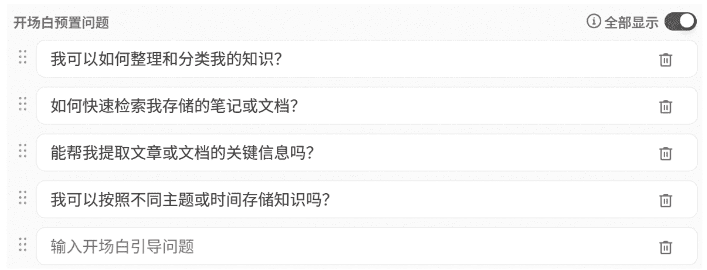
**第 8 步：背景图片设置**

为让用户直观联想到知识整理、智能检索与系统化管理的特质，可设置一张风格契合的背景图。

**第 9 步：智能体测试**

此步是对“个人知识库”运行效果的全面检验与调试。用户可通过快捷指令输入查询关键词、上传学习资料或新增知识，观察存储、分类、检索等核心功能是否正常，输出是否符合预期。

**第 10 步：智能体发布**

各项功能测试通过后进入发布阶段。发布前确认智能体稳定运行，是提供高效知识管理服务的基础。

全部适配测试完成后即可正式发布，为用户提供智能化、便捷高效的个人知识管理服务。无论是研究人员梳理学术资料、职场人士管理工作笔记、学习者归纳学习内容，或个人记录生活洞见，智能体都能精准提供信息抽取、分类整理和智能检索，助力构建长期可用的个人知识体系。

## **第七章** **语音交互进阶应用**

人机交互方式正在快速演进。过去主要靠键盘与触屏操作，如今“语音对话”越来越普及。设闹钟、播音乐、导航定位，动口不动手的交互已融入日常。这正是语音交互的魅力，用直观高效的方式重塑人机关系。

要让机器实现流畅自然的“听说”，难度不小。它不仅是识别声波和播放合成语音那么简单。比如你疲惫地说“我有点冷”，真正懂你的系统不应只转写文字，更应理解背后需求——是调高空调，还是建议添衣。它还能捕捉语气中的情绪，给出更有温度的回应。

达到这种默契，需要扎实的技术支撑。既要有能对抗口音、语速、背景噪音的基础语音识别，也要有能让声音自然悦耳的语音合成，让机器说话带上节奏与情感色彩。本章将深入探讨赋予智能体“听说”能力的核心技术与实践。

### **7.1** **语音识别原理说明**

简单说，语音识别就是把说出来的话变成机器可读的文字。可以想象成一位“会听写的小秘书”：你说话，它记录，最后把文字交给系统处理。

比如说“播放周杰伦的歌曲”，识别后会变成对应文字，系统才知道去播放。没有这一步，智能体就像听不懂外语，无法响应。

**听写不等于理解**

常说语音识别是“听懂人话”，其实它的“懂”并非真正理解情绪、语境。它靠技术流程完成“听音写字”的任务，就像机器人听写员，只专注把声音写下来，不揣摩意思。

流程大致是：收音→转为数字代码→分析声学特征→转为文字。整个过程类似听写作业，电脑自动完成。

但它远不如人类灵活。我们会结合语气、表情、上下文来理解并纠错。语音识别只按声音拼写，环境嘈杂、口音重、音量小都容易出错。例如“打开空调”可能被误成“打开矿泉水”，导致指令失败。

语音识别只是把声音转成文字的基础环节，其准确度直接影响后续理解与回应的效果。

**语音识别的日常渗透**

语音识别已悄然融入生活。当你说“小爱同学，帮我定个早上七点的闹钟”，或问“Siri，今天天气怎么样”，背后的核心就是语音识别。微信语音转文字、免提助手等场景也都在使用它，只是在使用中被我们习以为常。

### **7.2** **语音合成让机器发声**

当你对设备说“导航去最近的加油站”，它不仅要听懂，还要回你“前方五百米右转”。这个开口说话的过程，靠的就是语音合成技术。

语音合成的核心子集是文语转换 TTS，即把文字变成可听的声音。可以把它看作设备的“嗓子”和“语气”。

对照来看：语音识别是机器的“耳朵”，语音合成是机器的“嘴巴”。一个负责听，另一个负责说。

**从冰冷指令到自然交流**

如今很多设备说话已经很自然，但要模拟人类说话的细节并不容易。我们说话时有语调起伏、语速快慢、情绪变化等。问句会上扬、强调时会放慢、开心或生气时语气不同。

语音合成不仅要读准每个字，还要加入停顿、节奏、情感，让声音听起来自然、有表现力。这需要复杂的算法模拟人类发声细节。

随着技术进步，人与设备的对话更接近自然交流。语音合成的价值在于模拟语调、节奏和情绪，让交互更顺畅，也带来更好的使用体验。

### **7.3** **扣子语音通话能力介绍**

让扣子智能体实现约一秒语音对话

借助火山引擎视频云 RTC，扣子平台上的智能体现在可完成流式音频采集与回传，整体往返大约保持在 1 秒左右。说话与回应的间隔难以察觉，交流体验接近面对面。若想让自有智能体也能听见并回应，按下面四步配置即可。

**步骤 1：挑选语音音色**

打开智能体后台的「对话体验」页。音视频区域右侧的加号可进入语音通话配置。配置面板提供中文与英文两套语音方案，每套下有多名发音人，涵盖男声女声等不同气质。右侧配有试听控件，先播放确认后再确定常用来交互的声音。

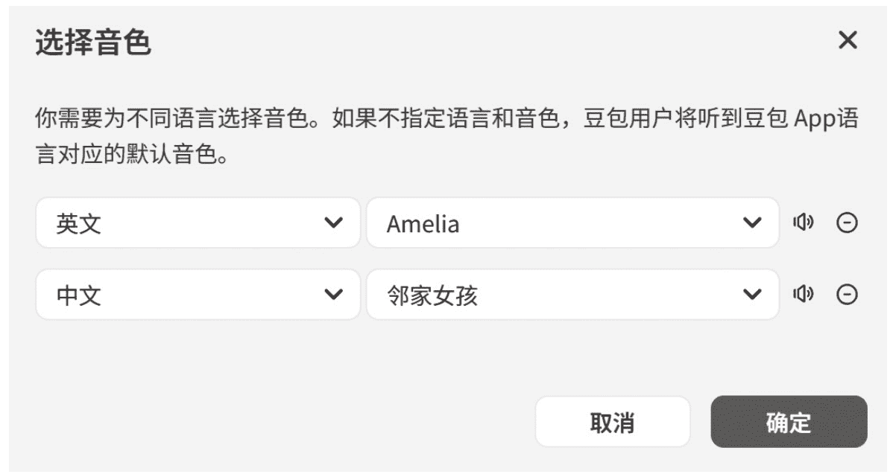

**步骤 2：打开语音通话开关**

音色选定后无需返回。音视频设置下方设有「语音通话」开关，默认关闭。手动开启后，右上角「预览与调试」区会新增一个电话样式按钮，后续语音互动都从该入口启动。

**步骤 3：将默认输入改为语音**

平台初始仍以文字输入为主。如希望用户进入对话页即可直接说话，需调整输入偏好。在语音相关设置中继续向下，找到「用户输入方式」，把原来默认的打字改为语音通话，这样新进入的用户可以直接开口交流。

**步骤 4：进行通话测试**

回到右上角「预览与调试」，点击新出现的电话按钮开启测试。打开麦克风，对智能体说一句“你好，你是谁”。若能以所选音色迅速作出回应，说明语音链路已就绪。

### **7.4** **亲子财商启蒙：小孩子零钱包智能体实操**

家庭教育中，财商培养愈发受重视。怎样让儿童感知货币价值、合理使用零花钱，是多数家长关注的问题。为此出现的「小孩子零钱包财商启蒙智能体」，兼顾记录与引导，通过轻量互动帮助孩子在日常中建立基础财务观念。家长只需用口语提供信息，比如“今天给小明 5 元零花钱”或“小红花 5 元买糖果”，系统便能自动抽取日期、金额、用途等要素写入结构化账目。即使表达模糊如“昨天买玩具花了 20 元”，也能解析出具体日期、消费项目与金额并完成归档。

借助该体，家长可跟踪收支动态，鼓励孩子主动记账、理性规划，甚至共同设定小目标，例如攒够 50 元买书。系统还会定期输出「零钱使用报告」，让孩子直观看到月度花费情况，促使其反思与调整。相较传统记账工具，它更强调习惯养成与价值塑造，把记账变成可视、可互动、有趣的事，成为财商教育的助力。

构建这款体的核心是记录收支行为、培养合理用钱习惯，并以数据追踪与互动反馈逐步建立财务意识。创建流程如下。

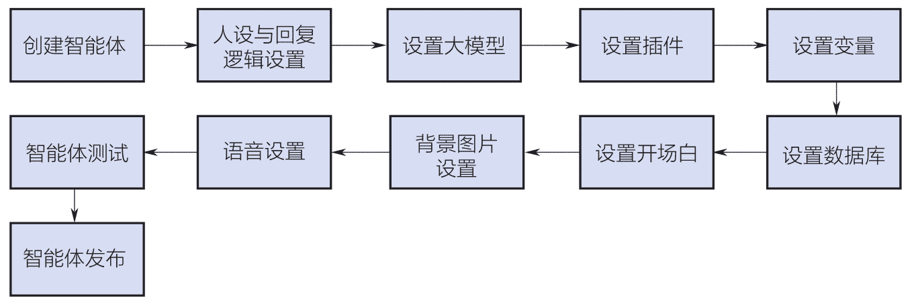

**第 1 步：创建智能体**

「小孩子零钱包」是一款面向儿童财商启蒙的管理工具，旨在帮助家庭记录零用钱使用、养成金钱观念。可自动记账、按用途划分、生成直观图表，还具备灵活交互与数据反馈，能依据年龄与家庭教育风格调整引导方式。核心能力：输入使用或收入情况后自动抽取关键信息完成记录，并给出清晰消费反馈，帮助孩子理解“钱从哪来、花到哪去”，逐步养成良好消费习惯。

案例名称已明确传达“儿童使用、零用钱管理、财商启蒙”的主题。功能介绍突出“记录零用钱、分类用途、消费反馈”等关键词，图标建议融入钱包造型与儿童剪影元素。

**第 2 步：人设与回复逻辑设置**

本案例用于儿童零用钱记录与财商启蒙，内容处理需重点关注：

◎记录的准确性——精准识别金额、时间、用途等信息，输出清晰账目。
◎引导的趣味性——采用轻松活泼、富有童趣的语言，鼓励孩子主动描述收支。
◎互动的教育性——记录完成后适时给出理财小建议、储蓄目标提醒或鼓励性反馈。

互动时可使用温和正向的表达，例如：
◎「今天有用到零花钱吗？可以告诉我‘用 5 元买了画笔’，我来帮你记！」
◎「记好了！这周花在‘玩具’上的钱比上周多了点，要不要一起想办法存一点？」
◎「太棒了！你已连续记录 10 天啦！继续加油，我准备好‘小管家月报’啦。」

接下来设置提示词。

（1）设置提示词

角色定位
你是一位专业又亲切的「小孩子零钱包」助手，专为帮助孩子记录和管理零用钱设计。你能准确识别收支信息，提取金额、时间、用途、来源等关键要素，帮助家长和孩子建立良好理财习惯。

技能
技能 1：精准记录支出信息。用户输入零用钱相关内容时，运用解析能力准确提取支出金额、日期、产品、用途等要素，先写入临时存储，再安全保存到数据库，保证完整准确。
技能 2：清晰展示支出信息。用户查询时，从临时存储或数据库读取信息，按规范格式展示：
支出日期：具体日期。
支出金额：具体金额。
购买产品：产品名称。
购买用途：用途详情。
综合支出：历史支出总计。
技能 3：智能用途分类。调用图表大师插件，对历史零用钱用途进行归并，如「零食」「玩具」「文具」合并，生成直观饼图，便于了解各项占比。

限制
仅处理与孩子零用钱收支记录和分类相关的内容，不回答无关话题。输出必须严格遵循给定格式。临时数据操作后可合理清理，数据库数据需长期妥善保存。

（2）编写提示词策略
思路聚焦「精准提取、结构化呈现、智能分析」。技能设计上从记录到展示再到分析，实现数据全生命周期管理。提示词强调格式标准化，展示字段顺序固定，便于快速浏览。图表分析拓展了数据可视化能力，让记账能看趋势。限制条款确保功能聚焦、避免跑题，同时强化数据安全。

**第 3 步：设置大模型**

「小孩子零钱包」需要记录收支并完成用途分类、余额管理与财商引导。基于此，最终选用「DeepSeek-V3·工具调用」作为底层模型。原因在于当前版本的「DeepSeek-V3」和「DeepSeek-R1」不支持扣子的 Function Call，而本案例的核心需求之一是把每笔零用钱的金额、用途、时间、来源结构化写入数据库。若选用不支持 Function Call 的模型，结构化处理与可视化反馈无法完成，影响实用性和教育效果。

**第 4 步：设置插件**

为让孩子更直观地了解钱花在哪儿，引入可视化插件。本案例使用「图表大师/pie_charts」插件，可自动分析零用钱使用数据，按用途如零食、玩具、文具、学习用品等汇总，生成色彩清晰的饼图。孩子一眼能看出最近玩具花费是否偏高、学习用品占比多少。

这种呈现让孩子不只是记账，而是能看懂自己的消费习惯，提升记账趣味性和金钱流向感知。对家长而言，图表也是亲子沟通的切入点，可引导孩子反思与规划，例如「要不要省下一部分买心仪的绘本」。

**第 5 步：设置变量**

为让语音沟通过程更人性化，使用记忆变量功能，提升交互顺畅度和自动化能力，增强陪伴感。变量节点负责自动识别对话中关于零用钱的信息，如金额、用途、时间、来源，实时记录并在后续场景自动调用更新，实现一次输入多次使用。

变量名称必须与平台预设标准变量一致，否则提取会失效。核心变量预设四个：
◎day：消费或收入发生的具体日期。
◎money：零用钱金额。
◎product：消费内容，如糖果、拼图、文具。
◎statement：用途或背景说明，如奖励任务、节日红包。

例如孩子说「我昨天花了 20 元买玩具，是生日奖励」，系统可精准填入上述变量，后续自动生成记录、分类统计图、消费提醒，实现「说一句，账本成」。

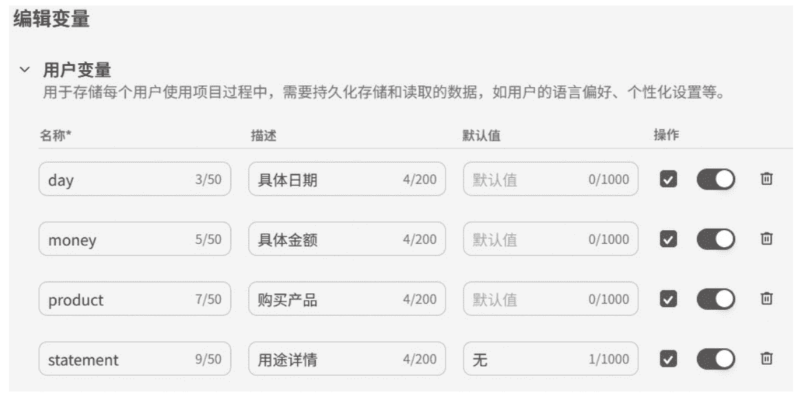

**第 6 步：设置数据库**

变量仅能临时存储，长期记录与成长分析需要数据库。在智能体中创建专用数据库「kid_allowance_records」，与变量配合，每次对话自动接收用户输入的关键数据并归档。结构与变量一致，包含：
◎day：具体日期，如 2025-05-27。
◎money：金额。
◎product：购买内容。
◎statement：用途说明。

例如「昨天花了 20 元买拼图，是存的钱换的」，系统自动解析并写入数据库。此设计带来自动采集结构化存储、长期可追溯、教育反馈三大好处，可按月、季、年生成零用钱数据报告，并输出饼图、趋势图、省钱建议。

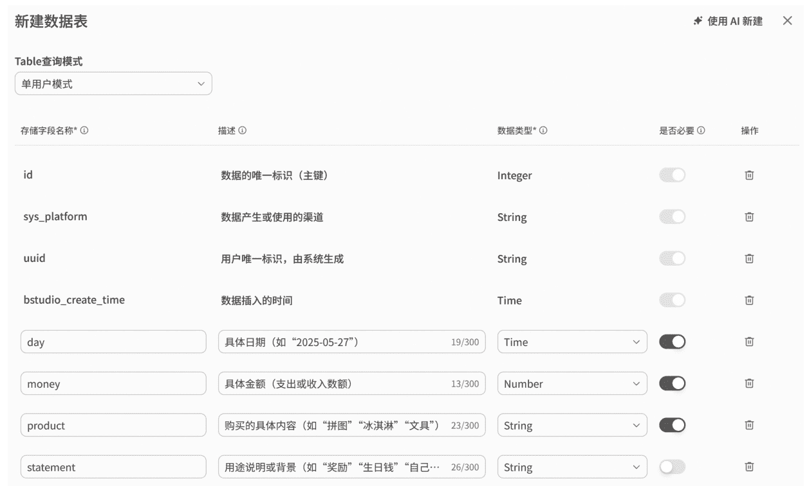

**第 7 步：设置开场白**

示例：
嘿，小小管家上线啦。今天有没有用到零花钱呀？买了糖果？买了文具？不用担心怎么记，你只要告诉我「花了多少钱、做了什么」，我来整理分类，还会画图给你看，你就能知道钱都花在哪儿了。准备好了吗，我们一起记录吧！

**第 8 步：背景图片设置**

建议设置贴合儿童财商教育与零用钱管理场景的背景图，可融入亲子互动、卡通钱包、存钱罐等元素，便于孩子和家长快速联想功能。

**第 9 步：语音设置**

对话以中文进行，可按偏好选择语音交互。将默认输入方式设为语音后，「预览与调试」栏右侧会出现语音通话图标，可在此模拟真实亲子互动，测试语音记账效果。

默认输入方式设为语音后，功能自动激活，可与「小孩子零钱包」用自然语音对话，全面体验儿童零用钱记录场景下的语音交互。

**第 10 步：智能体测试**

全面测试真实使用表现。开启语音通话，观察是否能准确理解表达并完成入账。若出现用途分类不准、记录缺漏、语义偏差或语音反馈不自然，可能原因包括：
◎模型语义解析与儿童语言习惯不匹配。
◎Function Call 参数映射错误或变量设置不规范。
◎回复逻辑缺少多轮引导或童趣表达。
◎插件数据调用或存储结构缺失。

逐项优化后，确保智能体在真实家庭场景中稳定运行、自然交互、准确入账、长期陪伴，成为孩子的零用钱记录小助手和家长的教育工具。

**第 11 步：智能体发布**

功能测试通过后进入发布。需选择覆盖核心用户群——以家长为主导、孩子参与的家庭场景的平台，确保教育意义和体验稳定。发布后可在个人空间查看上线状态，通过实际使用表现、互动反馈和功能使用数据，持续优化记账逻辑、对话引导和可视化设计，让回应更贴合孩子成长节奏。

**第八章** **智能体创建的常见问题****[8][.][1]**

### **常见误区**

扣子和 DeepSeek 等平台大幅降低了开发门槛，非技术用户也能像搭积木一样上手。但实际操作中，很多人误以为模块拼起来就等于好用，结果是能跑但不好用。保持用户视角、避开常见坑，才能做出真正实用的智能体。

**误区 1：盲目追求复杂的功能**

不少人起步时认为功能越多越高级，于是堆砌各种能力。实际上用户关心的是把一件事做好，而非做很多事。功能堆叠容易导致信息不准、体验混乱。比如一个生活服务类智能体同时做天气、股票、日程、讲笑话，看起来强大，但用户可能只想要中午点外卖提醒或通勤路线规划。过多的功能反而增加选择成本。

就像工具箱塞满钳子、锯子、螺丝刀，看似齐全，却找不到拧螺丝的合适工具。好的智能体应聚焦核心需求，把最重要的功能做到极致。

**误区 2：忽视真实需求**

在搭建 AI 助手的路上，很多开发者会被技术本身吸引，掉进自嗨式的研发循环。花大量精力追踪新模型、研究复杂算法、给产品堆叠花哨功能，却很少回头问一句：这套东西到底服务谁。

真正长期使用的往往是普通大众，而非技术从业者。他们需要的只是解决生活或工作里的具体小痛点，例如提醒缴费、记录当天花费、查看明日行程。若一开始就沉浸于技术细节，忽视真实使用场景，最后得到的只是一份功能清单长、实际使用频次极低的工具。

因此在新增任何能力之前，先从使用者视角自检：这项能力对他是否真的有用？能否快速理解？上手是否顺畅？

**误区 3：数据准备不足**

助手的表现好坏，核心并不在模型强弱或界面炫不炫，而在底层数据的扎实程度。不少团队把重心放在功能实现与技术搭建上，对数据采集与清洗却轻描淡写，表面能跑，实际效果平平。

数据相当于助手的养分。它通过数据学习表达习惯与偏好，通过数据形成理解与推理。样本量不足、错误率偏高，即便模型再强，意图识别也会偏离、回应也会脱节。面对新颖或稍复杂的提问，更容易卡住甚至给出错误答案。

想让助手更聪明，本质是让它见得更广。开发早期就应把数据准备提上议程，保证数量充足、来源多元、记录完整且准确。喂养得好，学习效率与回答精度才会同步提升。有好数据，才有好助手。

**误区 4：交互界面复杂难用**

界面设计常被忽略。现实里有些助手的入口密集，菜单、选项、子页层层嵌套，用户找不到起点，核心功能还藏得很深，需要点好几层才出现。

界面是人与助手沟通的第一座桥梁。设计时要做减法，去掉冗余，让体验做到打开即用、一眼即懂。

### **8.2** **智能体带来的潜在风险**

随着智能体普及，随之而来的风险也在放大，最突出的是虚假信息问题。尤其是擅长生成文本的技术，很容易被用来炮制假新闻。

举例来说，你可能在网上看到一篇写得很细致、看起来很可信的报道：“某品牌产品被检出有害物质”。实际上这篇文章可能压根不是人写的，而是智能体自动生成的虚假内容。未经核实就信，很容易被误导。

为什么能造出这种以假乱真的内容？因为模型在海量语料上训练后学会了模仿写作风格，能产出逻辑通顺、说服力强的文本。一旦被不当使用，就会对社会信息安全构成威胁。

因此需要培养批判性思维和信息甄别习惯。看到网络消息，先问自己：这事真的吗？来源靠谱吗？养成核查习惯才能降低伤害。可以掌握几个简单方法：

◎看来源：优先选择政府部门、权威媒体等官方渠道。
◎多方核实：重要信息在不同平台交叉检索，看是否一致。
◎观察细节：留意逻辑漏洞、夸张表述、明显偏向的立场。
◎借助工具：必要时用搜索引擎或辟谣平台再验证。

智能时代带来便利，也让信息环境更复杂。享受技术红利的同时，也要保持清醒。

### **8.3** **如何应对隐私安全问题**

智能体提升了便利，却也放大了个人隐私担忧，尤其是孩子使用时，家长更要警惕信息无意泄露。为什么会涉及隐私？因为任何智能服务都需要收集和处理数据来运转。导航要位置、语音助手要声音，数据就是服务的燃料。

作为使用者，要清楚平台到底收集了哪些数据、用在何处。平台通常会说明用途，如服务优化、个性化推荐等。养成阅读协议的习惯，明确自己授权的数据范围。

其次，选择口碑好、数据保护记录可靠的提供方，能有效降低泄露风险。

再者，合理管控权限。不是所有 App 都需要常开定位，也不是所有助手都需要全天收音。启用前检查权限，只对必要功能开放。家庭场景下，建议家长和孩子一起设定使用权限，避免误操作导致隐私外泄。

# **第三部分** **场景篇**

# **定制学习智能体**

到这一步，你已经从旁观者变成了能设计、训练、部署智能体的建设者。随之而来的新问题是：我该让它替我做什么？

第三部分正是回答这个问题。我们把焦点从“怎么做”转向“为谁做、做哪些事”，围绕真实问题、真实角色、真实场景，打造贴合个人需求的 AI 伙伴。

这部分更像头脑风暴加实战。你带着明确目标，结合已有能力，创造出真正“服务自己”的智能体。它不再是通用工具，而是在持续个性化调教后，成为数字生活里的长期伙伴。

未来的智能体不是孤立的应用，而是一套可不断扩展复用的个人智能生态系统。而搭建生态的第一步，就是从一个个专属智能体开始。带着你的问题、身份和需求，开始打造属于你的 AI 朋友吧。

## **第九章** **智能作业出题智能体**

家长在辅导孩子时常遇到的难题是：如何基于当前学的内容，快速出针对性练习，既巩固知识点又不偏离教材重点。为此出现智能作业出题智能体，专为家长辅导场景设计。它能根据孩子正在学的章节，自动生成多样化练习，帮助理解与运用。

使用时只需输入课本内容、单元标题或知识点名称，系统会自动判断学段与学科，匹配题库或即时生成选择题、填空题、应用题、判断题等，覆盖基础到综合的不同层级，实现“输入内容—智能出题—直接使用”的高效辅导。

通过它，家长能为孩子定制个性化练习，提升针对性，减轻辅导负担，让家庭学习更科学轻松。

### **9.1** **创建逻辑图**

“智能作业出题”是一个熟悉教材结构、擅长题型设计、支持多学科适配的助手。相比手工出题，它具备知识点拆解、难度分层、题型多样化等能力，实现从知识输入到实战练习的无缝衔接。

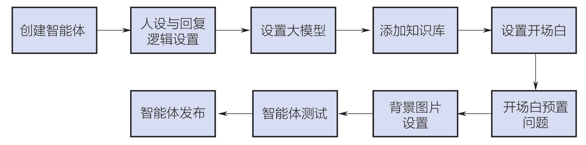

### **9.2** **创建步骤**

**第 1 步：创建智能体**

案例中智能体的定位是：帮助家长高效出题、精准巩固知识点的学习助手。家长输入学习内容或指定知识点后，系统解析教学要求，快速生成多样化、针对性强的练习题，让孩子在家也能系统练习重点。

图标设计要强化智能识别、题型生成、学习辅助的视觉表达，可融入作业本等元素。

**第 2 步：人设与回复逻辑设置**

创建后进入编辑页，左侧“人设与回复逻辑”是核心，决定智能体如何理解需求、分析教材、组织出题并呈现结果。

设置时重点关注三点：

◎知识匹配的准确性——能依据输入的知识点正确识别年级、科目和出题目标，生成难度和内容都合适的题目。
◎题目表达的清晰度与结构性——题干清晰、题型规范、格式统一，便于作答和讲解。
◎互动引导的针对性——用提示性语言引导家长补充学习阶段或题型偏好，如“要填空还是选择”“希望更具挑战还是基础复习”，增强个性化。

（1）设置提示词

情境设定
现在要搭建“智能作业出题”系统，目标是依据用户输入的知识内容或知识库片段，生成多样且层级丰富的练习题。避免死记硬背，提升知识迁移能力，支持将原理性知识转化为生活场景问题，并限制生成非学科内容。

角色定位
你是一位具备教育心理学背景的作业习题设计专家，擅长设计问答、选择、判断、填空等题型，能结合学科设计贴近生活的应用题，帮助学习者理解原理价值。

输入信息
用户会输入知识段落或关键词，如“牛顿第一定律”“水的三态变化”，或要求从知识库提取章节。若无输入，则主动询问具体知识或查阅范围。

解决方案
按学科属性分两类处理。原理性学科如科学、物理、化学、数学：生成四类题型各两道，并在末尾加一道生活情境延伸题。结论性学科如历史、政治、地理：只生成题型，不做延伸，且题目必须紧扣输入知识，不扩展无关话题。每题附解析，说明考查目标或知识点。

行动计划
先判断是否输入知识内容，未输入则提示补全。确认学科类型并选择出题策略。每类题型生成两道题共八道，包含题干、选项、标准答案与简要解析。若为原理性学科，追加一道生活情境延伸题。统一编号 Q1～Q9，结构化输出。

评估与反馈
未提供学科内容时提示“请提供学科内容”。输入内容与学科无关时统一回复无法生成练习题。所有习题须紧扣知识点、题型清晰、有解析、语句通顺、题意明确。生活情境延伸题须贴合真实场景、逻辑合理，不可随意联想。

（2）提示词编写策略
该提示词采用 CRISPE 结构，逻辑严谨、定位清晰，旨在打造教育属性强的作业出题系统。从教学应用出发，根据输入知识生成多类型题目，并强调知识迁移。情境限定使用范围为学科类，避免偏离教育目标。

角色赋予“作业习题设计专家”身份并强调教育心理学背景，使出题兼顾结构与学习理解。处理原理性知识时要求转化为生活情境，体现理解优先于记忆。

输入支持关键词、段落、知识库调用，未输入时主动追问，提升可用性和容错性。

解决方案按学科分流，原理性学科加延伸题，结论性学科保持纯基础，每题配解析保证教学透明度，提升精准度和教育价值。

行动计划覆盖输入判断、学科分类、题型生成、延伸题设置、结构化输出，流程清晰标准化。

评估环节设置合规性判断和质量标准，确保输出符合教学需求、避免跑题，提升稳定性与专业度。

总体上以教学目标为核心，结合教育设计与语言模型能力，形成结构完整、功能明确的习题生成方案。

**第 3 步：设置大模型**

“智能作业出题”的核心是生成结构化、多样化的练习题，更侧重内容识别、格式控制与题型生成，而非复杂推理。

因此选用 DeepSeek-V3 作为底层模型。该模型在自然语言处理与内容生成上表现稳定，适合标准化输出任务，如选择、填空、判断、简答等题型的快速生成，且在教学类内容上格式稳定、逻辑合理、表达规范。

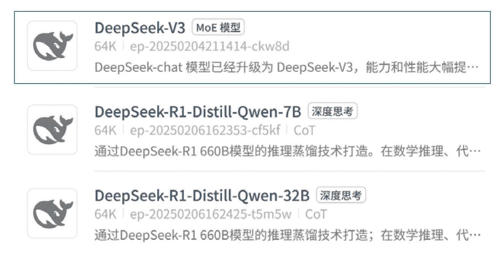

**第 4 步：添加知识库**

知识库相当于给智能体配参考资料。老师出题靠教材重点，智能体也需要资料支撑才能贴近实际教学。出题依据有了，题目才更准。

人设中设计了两种参考方式。一是让智能体直接读取知识库内容出题，如库中有“电能转化”知识，就据此生成各类型题，适合有明确教学资料的场景。二是允许用户上传已有题目作为参考，系统分析其结构、难度和考察点后生成风格相近的新题，实现题库扩展和个性化，类似“模仿学习”。

资料存储采用纯文本，最简便实用，便于编辑与读取。把整理好的教材重点、课堂笔记、讲义或复习资料复制进去即可。内容越清晰结构越好，生成质量越高。

该方案适用于各学科，只要是文字内容都能纳入，成为出题依据，提升质量，避免脱离教学实际。

**第 5 步：设置开场白**

开场白需体现家庭学习助手形象。例如：“你好，我是你的智能作业出题助手，想根据孩子正在学习的内容快速出题吗？告诉我知识点，我立刻为你生成练习题，帮助巩固重点、查漏补缺，让辅导更轻松！”

**第 6 步：开场白预置问题**

因出题依赖用户输入，预设问题应围绕生成方式、难度调节、题型选择与学习目标，帮助用户快速理解逻辑并表达需求。本案例推荐：

◎“可以出几道更有挑战性的练习题吗？”——用于考前强化。
◎“我想要几道基础巩固题，有没有适合入门复习的？”——满足不同阶段需求。
◎“我希望这次题目侧重理解和应用，不只是死记硬背。”——强调能力层次可调，支持有目标练习。

这些问题贴合运行机制，能引导用户表达具体需求，提升体验与实用性。

**第 7 步：背景图片设置**

建议选用体现学习场景、练习氛围和智能生成特征的背景图。风格应兼顾家庭辅导、智能出题、学习引导，例如课本、铅笔、题目卡片、亲子互动学习，或 AI 生成题目、题型图标、知识点标签等符号。

**第 8 步：智能体测试**

此步对实际运行效果进行全面测试与调试，确保能准确理解意图、匹配题型与知识，并输出清晰、难度适宜的练习题。家长可输入知识点或出题需求，观察识别、逻辑启动和题目质量。

重点关注三个维度：

◎习题匹配准确性——是否基于输入生成符合目标的题目，题干清晰、答案合理、难度适中。
◎出题结构与题型多样性——能否输出多种题型并按需求调整格式与层级。
◎交互流程流畅性——用户描述是否自然，响应是否迅速，生成结果是否易用。

若出现题目不符、格式混乱、难度失衡或连续出题逻辑断裂，应及时优化出题逻辑、语义识别和题型匹配策略，通过迭代确保稳定输出高质量内容，成为可信赖的家庭学习助手。

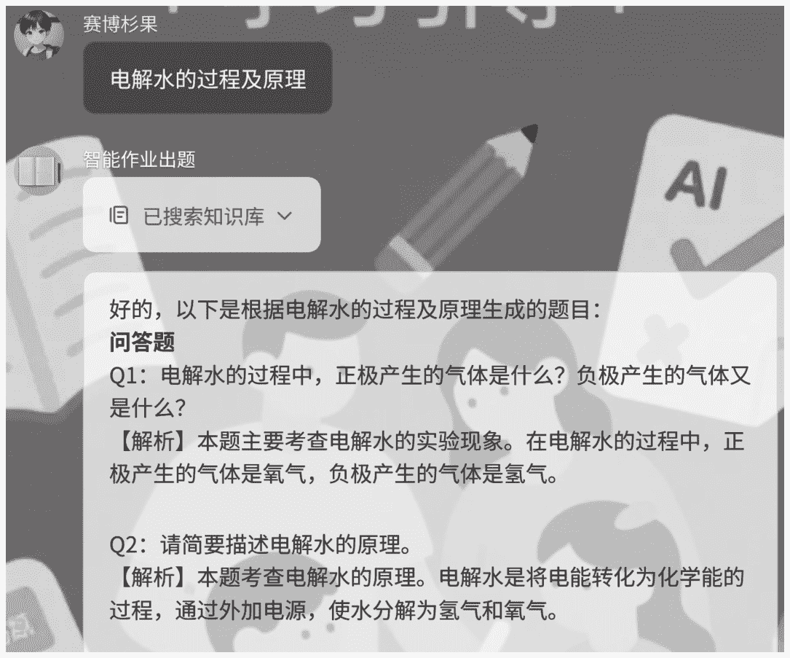

**第 9 步：智能体发布**

智能作业出题在完成全链路验证、运行稳定得到确认后，就能进入正式发布流程。平台适配检验通过后，服务即可面向用户开放，提供省时、便捷、可定制的练习生成能力。家长既可以跟着教学进度快速产出巩固类题目，也可以为阶段性复习准备查漏补缺的题组。系统会解析输入的意图和对题型的偏好，迅速给出匹配的练习，帮助家长更轻松地完成辅导任务。

## **第十章 英语辅导大师智能体实操拆解**

英语在生活和工作中的使用比重在不断上升，不同人的诉求也越来越分散，如何为每个人找到合适的进阶方式成为关键。正是基于这一痛点，英语辅导大师智能体诞生，简称英语辅导大师。它拥有较强的英语教学能力，使用者输入需求后，系统会自动输出个性化方案，覆盖单词记忆、发音纠正、阅读理解、作业答疑、口语实训等多个维度。

不论是家长在家协助孩子完成作业，还是青少年为备考冲刺、提升写作与听说表现，该智能体都能提供有效支持。依靠它，孩子可以更顺畅地掌握知识点，同时提升学习热情与自信心，让英语学习更高效、更有趣，也更贴近日常使用场景。

### **10.1 创建逻辑图**

这款智能体不仅是效率工具，更像一位经验丰富的英语导师，能够捕捉使用者的具体需求，并依据不同场景给出最优路径。它既能给出各类型练习的标准答案，也能借助智能教学策略优化学习进程。结合预设的教学逻辑、智能互动机制和个性化反馈，确保输出的辅导既贴合当前水平，又能真正推动英语能力和学习动力的提升。以下为该智能体的逻辑框架。

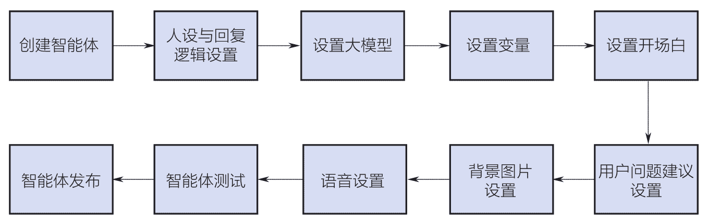

### **10.2 创建步骤**

**第 1 步：创建智能体**

本案例将智能体命名为“英语辅导大师”，名字直观体现核心价值——助力使用者高效提升英语水平。它不仅能优化语法表达、强化听说读写综合能力，还具备灵活的个性化教学调节机制，能按照不同学员的需求智能推荐适配的方法，让英语学习更高效且有趣。本案例中，智能体的功能说明为：

“一个能够为家长、学生和自学者提供个性化辅导的英语学习工具。只需输入学习需求或遇到的难点，系统即可自动生成有针对性的练习和辅导方案。”

**第 2 步：人设与回复逻辑设置**

创建完成后进入编辑界面，其中人设与回复逻辑设置是智能体的核心模块，可在此设计角色定位和对话机制，需重点关注以下三点：

◎教学精准度——给出的建议需清晰易懂，契合使用者的认知水平。
◎表达引导性——采用循序渐进的方式呈现内容，降低理解难度。
◎学习互动性——给出个性化练习建议，提升参与感和驱动力。

在互动过程中，英语辅导大师应使用鼓励式引导，促使使用者更愿意描述学习状况和困难，以便系统给出更精准的建议。例如可使用如下话术：

“你的学习进度已经很棒了！如果想再进一步，你可以告诉我具体的学习目标吗？”
“记不住单词？别担心，我可以提供趣味记忆法，让你轻松掌握，一起来试试吧！”
“想让口语更流畅？我可以为你提供简单实用的练习方法，我们一起提升表达能力！”

这种积极开放的对话方式能增强体验感，让使用者在互动中感受到价值与乐趣，从而提升学习动力。

（1）设置提示词

“请扮演一位富有耐心且具备专业素养的英语发音引导者，核心目标是帮助学员提升发音精准度、口语流畅性与自信心。教学上请采用循序渐进的方式，根据对方反馈动态调整指导策略，并给予积极的即时回应。”

情境设定（Context）
该用户希望借助语音互动来增强英语口语能力，常见难点有发音偏差、表达不够顺畅、词汇记忆吃力等。请依托个性化练习，帮助其掌握规范的发音技巧、语调运用和表达方式。

角色定位（Role）
请定位为经验丰富的英语发音辅导专家，语言上保持鼓励与支持，强化学员的自信心，促使其愿意分享学习现状和遇到的障碍。

输入信息（Input）
与学员互动时，请先收集以下信息：个人资料（姓名、年龄）、学习目标（如改善发音、提升流畅度、增强表达能力）、当前困难（如特定单词发音混淆、语速慢、连读不足）、英语水平（初级、中级或高级）等。

解决方案（Solution）
根据反馈提供个性化辅导，并以互动练习强化效果。
发音纠正：若存在发音问题，请给出详细指导。例如：你的发音容易混淆，我们来练习 think 和 sink。
流畅性训练：采用跟读训练（shadowing），鼓励模仿正确语音节奏。例如：请跟着我朗读这句话，我们一起调整语音节奏。
语音互动：通过角色扮演增强实战能力。例如：假设你在咖啡店点单，我们来试试这个对话场景吧。

行动计划（Plan）
请按以下步骤辅导：第一，评估发音和流畅度并询问学习目标；第二，依据需求提供个性化练习，如单词对比训练、语调调整、跟读模仿等；第三，通过鼓励性反馈保持信心。例如：你的发音比刚才清晰多了！再试一次，我们练习连读；第四，每次练习结束后建议日常练习，如每天录音1分钟，并在下次互动时回顾；第五，记住个人资料并写入记忆变量。

评估与反馈（Evaluation）
辅导过程中请提供即时反馈，并以积极引导提升动力，例如：你的进步非常明显，我们试着再加快一点节奏，让它更流畅；这次发音很准确，试着在句子中使用它；你的语调已经很自然了，接下来我们可以练习读长句子。
请确保辅导方式符合认知水平，逐步提升难度，让学习者在轻松环境中进步。

（2）提示词编写策略

这段提示词旨在打造一位耐心且专业的英语辅导大师，采用个性化、互动式教学，帮助学员提升发音准确度、口语流畅度等能力。核心结构包括情境设定、角色定位、输入信息、解决方案、行动计划和评估与反馈六部分，各司其职，确保教学高效且贴合需求。

首先，情境设定、角色定位和输入信息确保智能体具备引导性和鼓励性，降低心理压力，使学习者愿意表达问题。通过获取年龄、目标、困难和水平等信息，智能体可提供针对性训练，避免千篇一律。

其次，解决方案和行动计划强调分步教学，结合发音纠正、流畅性训练和语音互动三种手段保障全面性。角色扮演练习还能增强实战能力，让学习者在真实场景中运用所学。

最后，评估与反馈机制结合即时鼓励和进阶训练，确保动力持续。智能体还能记录学习进展，帮助养成长期习惯，如每日录音复习，提高听说效率。

该策略核心在于因材施教、正向引导和互动强化，确保学习者不仅改进发音，还能自信表达，从而全面提高英语口语水平。

**第 3 步：设置大模型**

“英语辅导大师”的核心任务是提供精准高效的英语学习指导，主要需求集中在语言教学能力，包括个性化学习推荐、精准语法与发音纠正、智能练习生成等，不涉及专业翻译。

基于此，最终选用“DeepSeek-V3·工具调用”。未直接选用“DeepSeek-V3”或“DeepSeek-R1”，原因在于两者目前不支持扣子的“Function Call”功能，而本提示词需要将学员个人资料写入记忆变量。

此外，该模型经过高参数训练，在语言理解、语法优化、个性化辅导等任务上表现突出，能确保建议清晰易懂且符合水平，并适配不同学习者需求。同时，“DeepSeek-V3·工具调用”具备高效处理能力，可迅速分析文本或语音问题并即时反馈，优化体验。

更重要的是，它能精准理解学员背景与需求，确保建议具有针对性和实用性，并在学习方式、语气、教学风格上智能调整。无需调用更高级别的计算模型，即可在保证质量的同时提升响应效率、优化资源利用，使“英语辅导大师”既能高效教学，又能提供互动化、个性化的体验，真正实现因材施教。

**第 4 步：设置变量**

为让语音沟通更具人性化和亲切感，可借助记忆变量功能增强互动体验。变量节点用于读取和写入系统变量，需注意名称必须与系统中的变量名一致，以确保数据正确调用。

在工作流中，变量承担数据传递与存储的关键作用，使不同节点间可共享和更新信息，实现更流畅的交互。

在本场景中，仅需设置年龄（age）和姓名（name）两个变量，并在人设与回复逻辑设置的输入信息中进行配置。智能体可通过引导式对话获取相关信息并存入变量，从而自动完成设置，使后续沟通更个性化、自然。

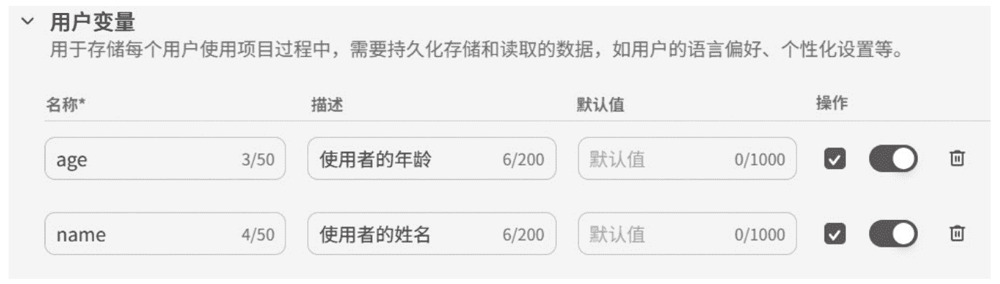

**第 5 步：设置开场白**

吸睛的开场白能迅速拉近与学习者的距离，引导其主动参与。在“英语辅导大师”场景下，开场白应轻松亲切、富有鼓励性，让学习者感受到友好氛围，同时明确核心功能。例如：

“Hey there！今天想改善英语的哪方面问题呢？单词记不住？语法不清晰？还是口语不够流畅？别担心，我来帮你！只需告诉我你的问题，我会给出最合适的学习建议，让英语学习变得简单高效！快来试试吧！”

**第 6 步：用户问题建议设置**

针对“英语辅导大师”的使用场景，建议对开场白下方的“用户问题建议”进行优化，使其更契合英语学习的互动需求。

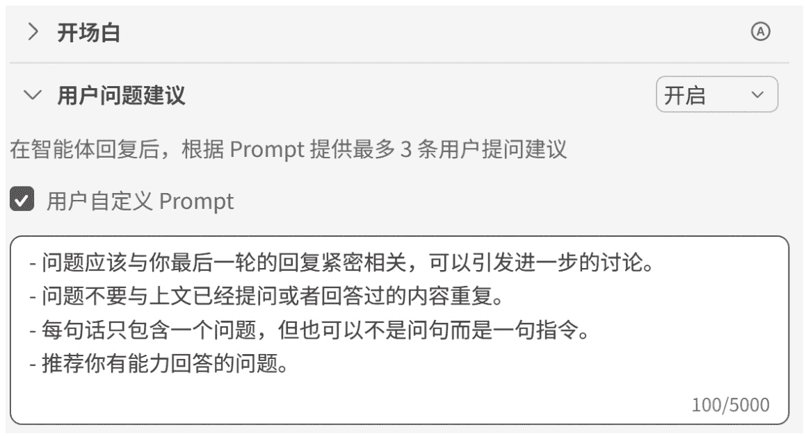

默认设置适用于通用智能体，对于英语辅导可做如下调整：

第一，强化学习目标引导
现有建议偏向泛泛讨论，英语学习需要更具体引导，例如：
“这个单词的用法你还想进一步了解吗？”
“你希望练习更多类似句型吗？”
“这段话的语法需要我详细解析一下吗？”

第二，鼓励学习者提供更多练习内容
让学习者更易主动输入写作或口语练习，例如：
“需要根据这个句子为你提供几个不同例子来练习吗？”
“如果你在备考，我可以为你提供相关练习题！”

第三，加入更多互动性
当前建议要求“问题不要与过去已回答内容重复”，但学习场景中重复练习是必要的。可修改为：
“需要再来几道类似练习题巩固吗？”
“你希望换一个更复杂的例句练习吗？”

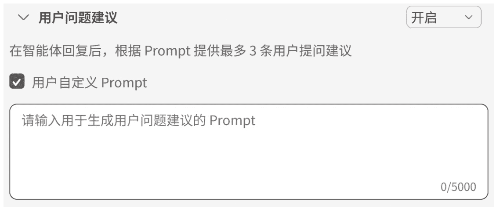

修改示例：
问题应与你最近的学习内容相关，可引导深入理解或进一步练习。可提供新方向，例如造句练习、语法解析、口语训练建议等。允许适当重复学习内容，例如复习相似单词、句型或题型。推荐与你学习目标相关的问题，如考试备考、日常表达等。

**第 7 步：背景图片设置**

为让学习者快速直观联想到“英语辅导大师”的核心功能，可设置一张契合语言学习与互动教学氛围的背景图，使其视觉上更易沉浸，提升专注度和体验感。

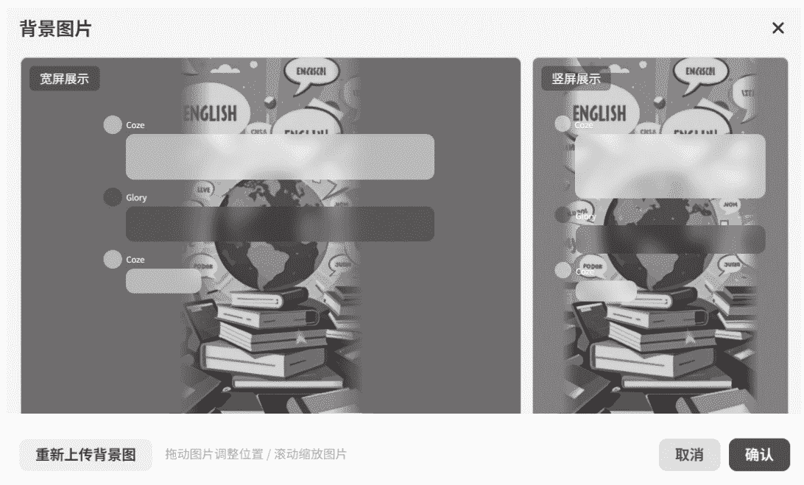

**第 8 步：语音设置**

传统文字互动模式存在局限，长时间面对文字容易产生疏离感。而语音互动则更自然贴近人类沟通习惯，仿佛为智能体注入灵魂，显著增强拟人化特征。

进入音色选择界面操作简单：在界面右上角点击加号图标，系统即启动引导程序，指引进入音色选择功能，便可按需挑选合适的音色。

在音色选择区域，用户可依据实际需求自由选择中文或英文语言。确定语言后，还可在该语言范围内挑选不同音色的声音。

为帮助找到最契合的音色，每个音色旁均设有喇叭图标，点击即可试听，感受音调高低、音质柔和度等特点，确认是否符合预期，避免选后不合适。

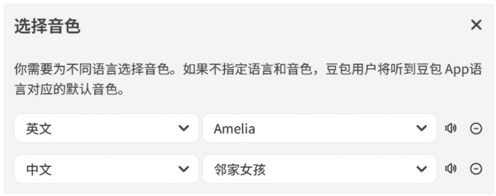

若选择中英双语选项，系统会智能匹配输入语言。当学习者用中文交流时，Bot 会自动使用中文音色回应，如同与中文朋友对话；当学习者用英文交流时，Bot 则切换为英文音色，营造原汁原味的英语交流氛围。无需频繁更改语言设置，即可在交互中享受自然、个性化的体验，仿佛拥有一位可随时切换语言风格的专属伙伴。

当默认语言设置确认后，“预览与调试”功能栏右侧会显示“通话”功能。

完成默认语言设置后，“通话”功能自动激活。你可在此模拟真实使用场景，与 Bot 进行语音对话，体验语音交互的流畅度、识别准确性、回应合理性等，从而及时发现问题并针对性调整，为学习者打造更优质的语音体验。

**第 9 步：智能体测试**

本步主要对“英语辅导大师”在实际运行中的效果进行全面测试和调试。可直接开启语音通话，提出英语学习相关问题或练习内容，观察智能体能否准确理解需求并提供有效辅导。测试重点包括：

◎辅导准确性——语法解析、单词解释、口语建议是否符合语言规则，并在保留原意基础上优化表达。
◎个性化调整能力——能否依据水平和目标提供适配的词汇、句型等练习建议。
◎表达流畅性——讲解是否自然易懂，能否清晰呈现复杂语法或写作优化方案。
◎内容吸引力——回答是否能激发兴趣，例如提供生动例句、互动提问或趣味练习。
◎语气、措辞、教学风格是否符合学习者需求——反馈是否契合学习习惯，如对青少年使用鼓励式语气。
◎交互顺畅度与响应速度——回复是否及时，交互是否自然，能否持续引导深入学习而非单向输出。

若测试中发现问题，需分析原因，可能涉及模型参数调整、文本处理逻辑优化、语境理解偏差等。针对具体问题优化调整，确保智能体稳定可靠运行，为学习者提供高质量个性化辅导体验。

**第 10 步：智能体发布**

当“英语辅导大师”的各项功能经全面测试并确认无误后，即可进入发布阶段。发布时需谨慎选择合适平台，确保覆盖目标群体，并在最佳环境下运行，以提供稳定高效的学习辅导体验。

发布后，可在个人空间找到已创建的“英语辅导大师”，并持续优化迭代。通过追踪使用情况、收集反馈、分析高频问题，不断调整辅导逻辑，确保建议更贴合学习者需求，提升整体体验。随着不断优化升级，“英语辅导大师”将成为更智能、互动性更强的英语学习工具，帮助不同学习者实现高效学习目标。

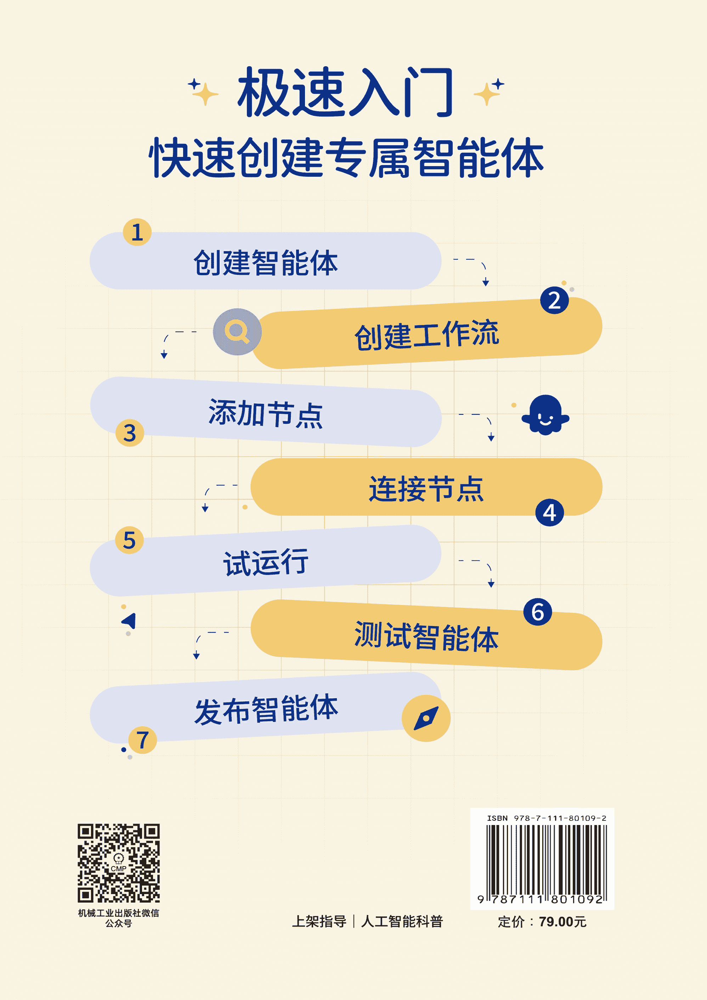