# 让AI成为你的学霸搭档

# 内容概览
信息过载的今天，学习方式正在被彻底重塑。人工智能已成为强有力的新工具，但怎样把它的能力真正用在学习上，却成了多数人的盲区。本书围绕AI辅助学习展开，通过打磨提示词的方式，帮助读者把AI工具嵌入日常学习并进行系统化管理，让AI真正像加速器一样提升效率。

书中融合认知科学与AI技术，提供一套全新的高效学习方法论，锻炼逻辑与解题能力，全面拉升学习力。同时帮助读者在海量信息中快速捕捉核心知识，把学习产出推向新高度。

适合在校学生、家长教师，以及对学习类AI提示词感兴趣的读者使用。 EXr6287u6NNVz+GYLY+7SDk226FstKIHdC0bNoQkB2Nqi1xSR0yxPmwrTs5gRi/BtfSbid6dBhii9q7cz2pIyA==

# 推荐寄语
时代在提速，终身学习成了必备能力。AI的展现力让人震撼，坊间常说未来的对手不是AI，而是更会用AI的人。怎样用AI赋能学习，怎样通过提问释放AI潜能？对这两个问题感兴趣，这本书会给你答案。

我与庄老师相识于2005年，当时他以世界记忆大师的身份亮相世界脑力锦标赛。初印象里，他并非只是记忆力惊人，而是谦逊、好学、爱提问题。聊起天来他总先肯定对方，再抛出连串疑问。有他在身边，我会莫名自信，仿佛成了无所不知的“猫头鹰老师”。回头想，并非我有多厉害，而是遇到了一位会提问的朋友。善于提问至少需要两点：保持开放的学习心态去交流，保有好奇与探索欲并能把需求讲清楚。

《圣经》里说：“求，就给你们；找，就寻见；敲，就给你们开门。”这句话用在人机交互上很贴切。能问对问题，就能得到想要的答案。学会提问比死记答案更关键。AI的知识面远超人脑且持续迭代，只要掌握提问，就能借力它的庞大储备。

未来是否还需要真人老师、实体校园尚无定论，但趋势清晰：AI愈发重要。人的精力有限，一个老师难以为每位学员定制方案、24小时答疑，AI可以。过去必须走进教室才能听课，现在只要有学习意愿，随时随地都能开启学习。AI辅助学习的时代已经到来。你准备好了吗？你掌握与AI老师对话的方法了吗？如果答案是否定的，本书是一个理想的起点。

书中具体介绍了不同类型学习者与AI沟通的方法，包括提问技巧与学习策略，并说明如何用AI高效听课、做作业、刷题和备考。无论是想提升自学力、进行亲子共学，还是成为终身学习者，都能在这里找到简洁实用的AI提问法。阅读过程中，你的学习力会逐步增强，达成目标也更轻松。

未来AI将成为每个人的学习伙伴，愿我们都能善用它，用AI赋能学习。

宋 莹

潜能开发与思维导图培训师 EXr6287u6NNVz+GYLY+7SDk226FstKIHdC0bNoQkB2Nqi1xSR0yxPmwrTs5gRi/BtfSbid6dBhii9q7cz2pIyA==

# 写在前面
知识爆炸带来共同难题：如何在信息洪流中迅速锁定真正有用的知识并提高学习效率？对家长和教师而言挑战更大，既要提升自己，也要引导下一代适应快速变化的世界。

AI的崛起给了我们一把利器。但怎样高效交互、如何提出能得到有效答案的问题，日渐成为新瓶颈。很多人尝试与AI对话时表达不清，未能发挥其潜力。

在成为世界记忆大师的路上，我体会到成绩提升离不开高效方法与正确心态。过去掌握这些方法需要长期训练，如今AI大幅压缩了这一周期。

学生无需再花数小时机械重复来记忆知识点，可借助AI快速理解复杂概念、提炼资料，甚至生成同类题进行精练刷题。更多时间可投入理解与创新。

以数学函数为例，过去要靠老师反复讲解加大量练习才能掌握。现在只要在AI输入框里写“请用生活场景举例说明数学函数”，就能得到贴近生活的类比，在脑中建立生动联想，迅速理解。AI像一个自带说明书的超大工具箱，让人能轻松挑选适配当前任务的工具。

传统学习与AI时代学习的差异可以这样看。

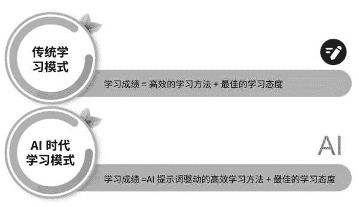
一个提示词就能直接调用古今优秀的学习策略与方法，省去练习这些技巧的时间，这是根本性的转变。

本书将教你如何构建有效提示词，优化人机互动，加快学习进程，提升学业表现。

##### 温馨提示
1．本书配图截取自当时最新版本的软件界面，出版周期内工具版本、功能、布局可能更新，请以书中思路举一反三。
2．即使提示词相同，AI每次回复也可能不同。重点应放在提示词设计与操作步骤上。
3．受篇幅限制，部分AI回复仅展示要点，不影响理解。
4．本书附赠资源可通过微信扫描下方二维码，关注公众号并输入资源下载码获取。

资源下载码：funeng EXr6287u6NNVz+GYLY+7SDk226FstKIHdC0bNoQkB2Nqi1xSR0yxPmwrTs5gRi/BtfSbid6dBhii9q7cz2pIyA==

# 如何使用本书
◎ **1.理解 AI 的角色。** 学习旅程中AI是助手而非替代者。可借助它简化信息处理，但不可完全依赖。
◎ **2．个性化路径。** 书中提供多种策略，帮助你按需搭建个人化学习路径，让学习更有乐趣。
◎ **3．精准提问。** 学习构建高质量提示词，引导AI给出更贴合、更有价值的回答。
◎ **4．框架思维。** 建立框架化思考能力，高效应对各类学习难题。
◎ **5．实践是关键。** 遇到具体问题时套用书中策略与提示词即可快速解决。
◎ **6．提示词汇总。** 附录收录了不同用途的提示词，方便随时调用。 EXr6287u6NNVz+GYLY+7SDk226FstKIHdC0bNoQkB2Nqi1xSR0yxPmwrTs5gRi/BtfSbid6dBhii9q7cz2pIyA==

# 第一章
AI大模型的工作原理速览

EXr6287u6NNVz+GYLY+7SDk226FstKIHdC0bNoQkB2Nqi1xSR0yxPmwrTs5gRi/BtfSbid6dBhii9q7cz2pIyA==

## 1.1 语言的魔法：AI 大模型的语言理解与生成
在大型语言模型出现前，我们常为搜集资料耗时却解不开困惑、写作时无从下手而苦恼。学生时代的我也深有体会。

自ChatGPT、文心一言、讯飞星火、通义、DeepSeek等模型普及后，获取信息、即时解惑、写作辅导都变得高效。AI大模型像全天候学伴，随时待命。但它如何从海量数据中筛选并生成适配我们的内容？以DeepSeek为例简要说明。

DeepSeek基于海量数据训练而成，能理解并生成语言，但并非简单复制粘贴。其能力来源于内部庞大的参数量。就像勤奋的学生在图书馆汲取知识，DeepSeek也在数字世界不断学习。

其核心是基于Transformer架构的深度学习模型，自注意力机制使其能有效建模语言并实现语义理解。训练中它从大规模语料库习得语言知识。对话时能捕捉语法、语义信息，理解意图，生成流畅符合语境的回复。整体语言能力已接近人类。

比如写太阳系报告时不熟悉行星特征，可向DeepSeek提问“太阳系有哪些行星”“火星有什么特点”“火星大气成分”。立刻就能得到答案，既省时也能梳理研究思路。

输入：太阳系的行星有哪些？
输出：太阳系的行星包括水星、金星、地球、火星、木星、土星、天王星和海王星。这些行星围绕太阳运行，各自位于特定轨道。

输入：火星的特性是什么？
输出：火星是岩石行星，与地球相比有以下特点。
**1．红色外观：** 土壤含大量氧化铁呈现红色，故称红色星球。
**2．干冷环境：** 大气稀薄，气候极端干燥寒冷。白天约20摄氏度，夜间可降至零下100摄氏度。
**3．撞击与山脉：** 表面遍布撞击坑和山脉，显示曾经历大规模撞击与地质活动。
**4．巨型火山与峡谷：** 有奥林帕斯山等太阳系最大火山之一，以及水手谷等巨型峡谷。
**5．两极冰帽与地下冰：** 两极有冰帽，表面发现冰封水域，暗示地下可能存在液态水。
**6．稀薄大气：** 主要为二氧化碳，含少量氮气氩气。稀薄大气无法保温，导致温度剧变，液态水难以稳定存在。

这就是语言魔法的魅力，它为学习之旅打开无限可能。愿我们能更好利用这项工具，让学习更轻松高效。 EXr6287u6NNVz+GYLY+7SDk226FstKIHdC0bNoQkB2Nqi1xSR0yxPmwrTs5gRi/BtfSbid6dBhii9q7cz2pIyA==

## 1.2 智能问答：AI 的问题处理与回答
以DeepSeek为例看它如何处理问题并作答，理解流程有助于更高效使用。

我多次体验，每次提问都能得到惊艳回答。其背后是先深度解析输入、抓住问题核心，再生成最合适的答案。

在没有这类工具的时代，我们面临三大痛点，如图 1.1 所示。

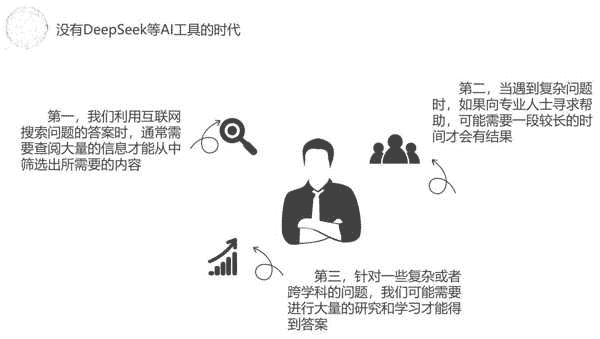
图 1.1

过去面对复杂题目，我常需花上一整天找答案。当年真希望有即时解答工具。如今幻想成真。

DeepSeek能及时提供准确全面的答案，靠的是先进的自然语言处理与深度学习模型，通过语言理解、知识检索与生成等环节，结合持续学习与优化实现高质量问答。

它的“魔法招式”可归纳为两步。

第一步：拆解问题。
提问时，DeepSeek会把输入拆成最小语义单元Token。例如“怎么写一篇作文？”会被拆为“怎么”“写”“一篇”“作文”。

第二步：重组答案。
它像拼图大师，通过语义理解与上下文建模，把最小单元拼成合适答案，以简明方式呈现。答案常包含步骤、原理与概念。

DeepSeek就像私人导师，随时随地提供支持。 EXr6287u6NNVz+GYLY+7SDk226FstKIHdC0bNoQkB2Nqi1xSR0yxPmwrTs5gRi/BtfSbid6dBhii9q7cz2pIyA==

## 1.3 优化的艺术：AI 的优化提示词策略
许多人不知道，AI大模型背后有持续优化机制，通过强化训练算法、扩大知识来源、提升推理能力来保证输出质量。生成的文本从词选到句式都经过多层筛选与调整。

同时模型会通过与用户的持续交互优化回答策略，提升理解与生成能力。若发现DeepSeek的方案有缺陷并提供新思路，它会据此调整策略，在一定程度上改进推理。

因此优化提示词能显著提升输出质量与相关性。常用策略如下。

**（1）明确性：** 让问题或指令更具体。避免“告诉我狗的信息”，改用“狗的平均寿命是多少”。
**（2）上下文：** 提供足够背景，AI更易准确作答。专业问题前先简要介绍主题背景。
**（3）问题重述：** 初次答案不准时，换种表述再问。
**（4）分步询问：** 复杂需求拆成多个简单具体问题逐一提问。
**（5）指定输出格式：** 明确需要列表、段落、摘要等格式。
**（6）限制回答范围：** 用字数、时间、领域等条件缩小范围，提高相关性。
**（7）使用示例引导：** 给出范例引导风格与格式。
**（8）逐步精练：** 多轮迭代逐步细化提示词与问题，获得更精确答案。
**（9）添加角色设定：** 为AI设定角色视角作答，如“作为学霸请给出五种提升效率的方法”。
**（10）实验与迭代：** 不同场景需不同策略，多尝试找出最有效表达。

掌握这些策略，能更有效地与大模型互动，获得更精准有效的输出。 EXr6287u6NNVz+GYLY+7SDk226FstKIHdC0bNoQkB2Nqi1xSR0yxPmwrTs5gRi/BtfSbid6dBhii9q7cz2pIyA==

## 1.4 DeepSeek 解题闯关手册：AI 学习伙伴是如何练成的？
DeepSeek的解题能力并非天生，而是通过技术与训练逐步形成。以下是它的成长路径。

第一关，语言翻译官。
输入“怎么解二元一次方程组？”时，它会启动三个能力。
①拆解：把句子拆成“解”“二元”“一次”“方程组”等关键词块，如同拆乐高。
②搜索：在万亿级参数知识库中检索相关知识点。
③重组：把“代入消元法”“加减消元法”等零件组装成解题说明。

小实验：试试输入“用孙悟空三打白骨精的方式讲二元一次方程组的解法”，解锁隐藏剧情。

第二关，答案雕刻师。
生成的答案像捏橡皮泥。
“初胚”：快速堆出核心步骤。
“精修”：用语法刻刀调整句式。
“上色”：添加“例如”“注意”等提示词做重点标注。
若你输入“我还是不懂”，它会立刻启动B计划。

第三关，进化特训班。
想让DeepSeek更聪明？试试跨维提问。

· Lv1 入门篇
①【具象化召唤】
抽象问法：“什么是函数？”
优化问法：“用奶茶店的价格—容量对照表解释函数关系。”
效果：理解速度提升，获得具象思维技能。
②【时空折叠】
扁平问法：“讲三国历史。”
进阶问法：“如果本班班干部选举变成三国鼎立会怎样？”
效果：记忆留存率提升，激活角色扮演模式。

· Lv2 进阶篇
③【皮肤重构】
基础问法：“解释光合作用。”
皮肤加载：“用游戏中能量补给→武器制作来说明植物如何制造食物。”

概念迁移效率提升四倍，点亮【知识换装】。

④ 【步骤分解术】
模糊请求：“教我做科学实验。”
精细拆分：“请按三步给出：1. 所需材料清单；2. 安全防护要点；3. 操作演示流程。”
结果：操作成功率提升180%，习得【说明书生成】技能。

⑤ 【错题反哺术】
随意反馈：“第二步不对。”
精准追问：“消元法里是否应先把等式两边同时乘以3？”
结果：模型成长速度提升500%，开启【错题反物质引擎】。

· Lv3 高手阶段

⑥ 【跨界融合炮】
单科提问：“背《静夜思》。”
跨域碰撞：“为《静夜思》设计一条15秒抖音分镜脚本。”
结果：创造力提升600%，触发【学科屏障破碎】特效。

⑦ 【逆向工程镜】
正向求证：“怎么证明勾股定理？”
反向设想：“若直角三角形斜边平方不等于两直角边平方和，会出现怎样的宇宙级Bug？”
结果：逻辑深度提升350%，解锁【因果律武器】。

· Lv4 大师阶段

⑧【多宇宙观测术】
只问定论：“二战结果如何？”
平行推演：“假设希特勒赢下斯大林格勒，2023年的科技树会怎样生长？”
结果：思辨维度提升700%，获得【时间线跳跃】权限。

⑨【情绪共鸣器】
平淡提问：“读后感怎么写？”
情感注入：“用像挖到恐龙化石般的激动心情，写《物种起源》读后感的开头。”
结果：表达感染力提升450%，激活【心灵共振】协议。

⑩【元认知跃迁术】
表层询问：“怎样提升学习效率？”
进阶设计：“请设计一个结合脑科学原理与游戏机制的24小时学习剧本。”
结果：方法论转化率提升900%，触发【认知奇点大爆炸】技能。

· 实时训练场
马上试用以下指令。
①“用孙悟空借芭蕉扇的过程解释热传导原理。”
②“把二元一次方程组的解法改编成密室逃脱剧本。”
③“假设牛顿活在抖音时代，发现万有引力后的第一条短视频文案怎么写？” EXr6287u6NNVz+GYLY+7SDk226FstKIHdC0bNoQkB2Nqi1xSR0yxPmwrTs5gRi/BtfSbid6dBhii9q7cz2pIyA==

## 1.5 站在巨人肩上：借助经典思维模型的策略
“站得高看得远。”大模型里沉淀着人类长期积累的分析框架，如逻辑推理、决策树、SWOT 等。面对不同类型的问题时，它会自行挑选合适的工具来组织知识并生成答案。借助这些经典框架，AI 的问答与决策会更显智能。

在对话中主动调用经典框架，能更快更准地拿到所需信息。下面以 DeepSeek 作示范说明 SWOT 的用法。

经典模型提示词
对 DeepSeek 输入：
我是一名初一学生。小时候英语成绩还不错，升入初中词汇量要求变大，但我不爱死记硬背。请用 SWOT 框架分析我的英语学习现状并给建议。

DeepSeek 输出：
用 SWOT 框架分析你的英语学习情况：

一、优势
小学英语基础扎实：你提到小学成绩不错，说明掌握了基本语法和一定词汇量，是初中学习的重要根基。
自我觉察力较强：能发现词汇短板并主动求助，体现出较强的学习意识。

二、劣势
词汇储备不足：初中词汇激增，而你不喜欢背单词，会拖累阅读写作。
方法待优化：缺少适合自己的记忆方式，效率低易产生抵触。

三、机会
资源丰富：除课本外，可用学习网站、App、英文歌曲、影视等多元输入提升兴趣。
外部支持：可向老师请教记忆技巧，和同学结伴互相督促。

四、威胁
学业压力增大：初中科目增多，时间被压缩，更难挤出背词时间。
信心受损风险：英语持续吃力可能打击自信心，进而影响其他科目。

针对性建议：
尝试多元记忆法：词根词缀、联想记忆、单词卡片等，找到合适方式。
融入生活场景：日常用英语描述物品或表达，增加使用感。
制定可执行计划：每天固定时段背词并坚持。
保持积极心态：困难是暂时的，相信自己能掌握。

把 SWOT 作为提示词的价值主要体现在三方面。
1. 全面性。SWOT 同时覆盖优势、劣势、机会、威胁，帮助用户立体看清现状，从而制定更有效的计划。
2. 深度思考。SWOT 强调自我反思，让用户对学习状态有更深认识，进而优化策略。
3. 个性化。基于个人情况的 SWOT 剖析，能产出更贴合需求的建议。

用经典模型提示，相当于把历史上各领域思想家的工具借来使用。站在巨人肩上，善用想象与创造力，难题就能迎刃而解。
下一章会介绍更多经典模型与 AI 结合的案例。掌握方法后，学习效率会实现倍增。 EXr6287u6NNVz+GYLY+7SDk226FstKIHdC0bNoQkB2Nqi1xSR0yxPmwrTs5gRi/BtfSbid6dBhii9q7cz2pIyA==

## 1.6 框架思维：AI 思考的核心方式
与 AI 互动时，最核心的思维方式之一是框架思维。即先搭建结构框架，再在框架指引下展开分析，最终得出结论。例如问“如何提高学习效率”，AI 可能套用时间管理框架，给出时间评估、任务分类、行动计划等系统化建议。

对 DeepSeek 输入：
如何提高学习效率？

DeepSeek 输出：
提升学习效率是很多学生和职场人的诉求。以下方法可供参考。
1. 设定清晰学习目标
短期：每天或每周定具体任务，如今日读完两章、本周掌握某知识点。
长期：明确最终成果，如通过考试、掌握技能。
2. 合理安排时间
时间管理：用番茄工作法、待办清单分配时间，防拖延。
优先级：按重要紧急排序，先处理关键内容。
3. 营造良好学习环境
减少干扰：选择安静整洁空间，远离手机社媒。
舒适度：光线充足、座椅舒适，有助专注。
4. 采用高效学习方法
主动学习：提问、总结、复述，避免被动接收。
间隔重复：分散复习比集中一次更有效。
费曼技巧：向他人讲解来检验理解程度。
5. 善用工具资源
笔记工具：思维导图、康奈尔笔记整理知识点。
线上资源：在线课程、视频、学习社区拓展视野。
6. 平衡专注与休息
专注时长：25-50 分钟专注后休息5-10 分钟。
适度放松：避免疲劳，休息时可做简单运动。
7. 定期复习与自测
复习计划：定期回看巩固记忆。
自我检测：做题或模拟考查找薄弱点。
8. 保持健康生活
充足睡眠：每日7-8小时提升记忆与专注。
均衡饮食：营养充足大脑更活跃。
适量运动：缓解压力，提升状态。
9. 调整心态动机
积极心态：乐观面对困难，不轻言放弃。
自我激励：完成目标后给予适当奖励。
10. 寻求反馈帮助
交流：与同学老师讨论获取新视角。
及时求助：难题早请教，避免浪费时间。
综合以上，可逐步提升效率，关键是不断调整找到最适合自己的策略。

框架赋能让 AI 的回答更具创造力。它能快速把握问题结构，抓住关键信息后输出答案。如解数学题时，AI 会识别解题框架，通过建模、提炼特征、制定策略等步骤求解。
中学生问英语口语建议，AI 会启用“英语口语”框架，涵盖听力、组织语言、练习等要点，进而给出看视频练发音、积累句式、与外教对话等建议。
应试者问备考建议，AI 会套用“备考策略”框架，包含计划、抓重点、预测题、模拟考等，最终输出时间安排、查漏补缺、考后评估等方案。
作为学习者，框架思维能把复杂信息分类重组，形成清晰脉络。

如何掌握框架思维，可从三点入手，如图 1.2 所示。
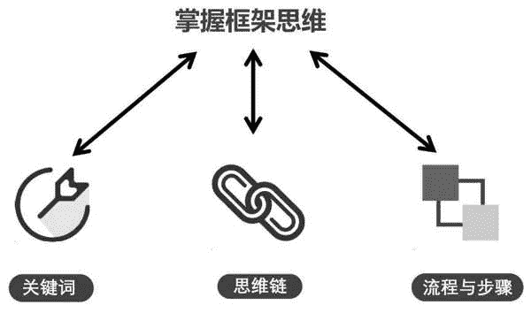
图 1.2
1. 关键词
定义：代表某一主题或概念的核心词汇。通过识别和提取关键词，我们可以迅速锁定信息的核心，为后续的思考和链接提供基础。
应用：当你阅读一篇文章或听一场讲座时，试着摘录其中最重要的词汇或概念，这些就是关键词。例如，学习经济学时，“供需关系”“通货膨胀”“财政政策”等都可能是关键词。
2. 思维链
定义：思维链是将关键词串联起来，形成一个有逻辑的知识链或思维路径。
应用：一旦你确定了关键词，接下来要做的是思考这些关键词之间的联系。例如，当考虑“供需关系”时，你可能会联想到“价格”的上涨或下跌，进而联想到“资源配置”。
3. 流程与步骤
定义：流程与步骤是对特定任务或问题进行分解和排序，将其转化为一个个具体、可操作的步骤。
应用：当面临一个复杂的问题或任务时，试着将其拆分为一系列较小的子任务，并为这些子任务设定一个明确的执行顺序。例如，进行一次市场调查的流程可能包括：确定目标、设计问卷、收集数据、分析数据、撰写报告等步骤。

在学习过程中，使用框架思维和不使用框架思维的区别很大。这类似于玩拼图游戏，没有框架思维的人，随手抓起一些零散的拼图就开始尝试，结果事倍功半；而习惯利用框架思维的人，在开始拼图之前会先厘清每一块拼图的定位和关联，这样完成拼图的效率会比前者高很多。

一名擅长使用框架思维的学生在准备数学考试的时候，会先把所有的公式和定理分类，搞清楚每个公式适用于什么类型的题目。这样，当他在考试中遇到问题时，就能迅速地解答，得到高分。如果他没有掌握框架思维，在考试之前不进行系统的复习，就可能因为忘记重要的公式而导致考试成绩不理想。

总之，无论是在学习还是在工作中，框架思维都能发挥重要的作用。 EXr6287u6NNVz+GYLY+7SDk226FstKIHdC0bNoQkB2Nqi1xSR0yxPmwrTs5gRi/BtfSbid6dBhii9q7cz2pIyA==

# 第二章
精准提问的艺术：构建自己的优质提示词库

EXr6287u6NNVz+GYLY+7SDk226FstKIHdC0bNoQkB2Nqi1xSR0yxPmwrTs5gRi/BtfSbid6dBhii9q7cz2pIyA==

## 2.1 提问之道：问出答案，问出智慧
提问既像思维的催化剂，又像一把打开智慧之门的钥匙。接下来，我将分析提问的 6 个关键维度，展示它在打破思维局限、明确目标、深化认知、激发内在驱动力、增强问题解决能力，以及促进自我反思与成长中的重要作用。

1. 打破思维局限
人的思维很容易受到习惯和传统的影响，然而，这些习惯和传统并不总是正确的，有时甚至会阻碍个人成长。这里探讨一下日常生活中很常见但很少被关注的一个现象，那就是用社会化思维思考问题。
在某种程度上，社会化思维是有益的，它能帮助我们迅速适应环境和处理人际关系。然而，过度依赖社会化思维会导致思维僵化，失去批判性和创造性。如果善于思考和提问，特别是懂得如何提出假设性问题，我们就可以挣脱社会化思维的束缚。例如，通过提出“假如这样/那样做会怎样”，就能激发我们从不同的角度去思考问题。你还可以深入地问：“这种假设基于什么？”或“这个观点有哪些可能的例外？”这样你不仅能看到问题的多个层面，还能识别出潜在的偏见和错误。
当然，仅仅会从不同的角度提问还不够，更重要的是保持中立的“观察者”身份，从原来的“好与不好”的评判标准转化为“有效或无效”的实用性思维来看问题，你的潜能才有可能被进一步激发，你才会对事物形成新的看法和认知。

2. 明确目标
在学习、职场或生活中，我们常常会感到迷茫，不知道如何选择或应该往哪个方向努力。一系列有针对性的提问能帮助我们明确目标并厘清思路。
例如，你可以先问自己：“我真正追求的是什么？”接着再问：“实现这个目标的途径有哪些？”或者“我可以利用哪些外部资源？”通过这样的提问，你不仅能更明确地认识到自己的目标，还能找到实现目标的方法。

3. 深化认知
有时，我们可能觉得自己已经理解了某个概念或者观点，但在需要运用或进一步探讨时，恍然惊觉自己的理解很肤浅。这时，进行深入的提问，如“为什么是这样？”或“如果不是这样，会怎样？”就显得尤为重要。
此外，深化认知不仅体现在知识积累上，还体现在情感、价值观、人际关系等方面。例如，当你与人交往时，不妨问一问自己：“我为什么喜欢这个人？”或者“这段关系给我带来了什么？”这样的问题可以帮助你更全面地了解自己，也更容易在各个层面上做出明智的决策。

4. 激发内在驱动力
通过不断地提问，我们能保持对周围事物的敏感度，主动探究未知领域，进而在学习和工作中保持动力和热情。例如，当遇到困难时，可以问自己：“我可以从这个挑战中学到什么？”或者“这个问题还有哪些不同的解决方法？”这样不仅可以帮助我们从困境中找到突破口，还能让我们在面对挑战时保持积极乐观的态度。

5. 增强问题解决能力
在解决问题的过程中，提问能帮助我们厘清思路，找出问题的核心。通过不断地问“为什么”和“怎么办”，我们能更深入地理解问题的本质，找到更有效的解决方案。例如，当遇到一个复杂的项目时，可以问自己：“这个项目的核心目标是什么？”“有哪些潜在的障碍？”“我可以采取哪些措施克服这些障碍？”这样能帮助我们从不同的角度分析问题，从而找到更好的解决方法。

6. 促进自我反思与成长
提问是自我反思的重要工具，可以帮助我们更好地认识自己，了解自己的优点和不足，进而不断提升自己。例如，在完成一项工作后，可以问自己：“这次任务我有哪些做得好的地方？”“有哪些方面还可以改进？”“下一次怎样才能做得更好？”通过这样的提问，我们能不断总结经验，提升自己的能力和水平。
总之，无论是在学习、工作还是日常生活中，提问都是一种值得高度重视和不断实践的能力，它不仅能够激活我们的认知潜能，还能从各个方面帮助我们做出更好的决策。 EXr6287u6NNVz+GYLY+7SDk226FstKIHdC0bNoQkB2Nqi1xSR0yxPmwrTs5gRi/BtfSbid6dBhii9q7cz2pIyA==

## 2.2 提问的艺术：提问的技巧与策略
一个好的问题可以让我们得到想要的答案，一个不太好的问题则可能会让我们感到困惑。关于 ChatGPT，在深度学习领域享有盛名的吴恩达提出，优化 ChatGPT 输出的关键包括：
①尽可能使用精准、具体的指令；
②通过分步任务或多轮交互引导模型深入思考。
我们需要学会如何用更好的方式提问，让 AI 能够生成更贴近我们需求的答案。下面将从提问的入门、如何提问，以及提问的层次三个方面逐步进行讲解。

2.2.1 提问的入门
入门级的提问方法主要包括三个方面，如图 2.1 所示。
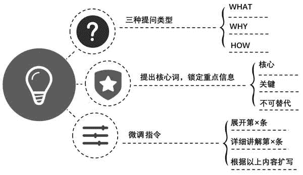
图 2.1
首先，最简单的提问分为三种类型，如图 2.2 所示。
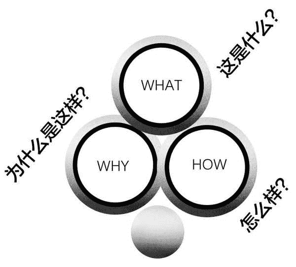
图 2.2
下面以 DeepSeek 作示范进行讲解。

对 DeepSeek 输入：
英语是什么？为什么要学英语？如何学好英语？

DeepSeek 输出：
英语是什么？
英语是一种西日耳曼语，起源于中世纪早期的英格兰，现已成为全球通用语言。它是许多国家的官方语言，广泛应用于国际交流、商务、科技、教育等领域。

为什么要学英语？
全球通用：英语是国际交流的主要语言，掌握英语有助于与世界各地的人沟通。
职业发展：许多跨国公司和国际组织要求员工具备英语能力，掌握英语能提升职业竞争力。
教育资源：大量学术论文、书籍和在线课程以英语为主，学习英语能获取更多的知识。
文化理解：英语是了解英语国家文化的窗口，有助于拓宽视野。

如何学好英语？
多听：通过英语电影、音乐、播客等提升听力。
多说：与英语母语者交流或参加语言交换活动，增强口语能力。
多读：阅读英语书籍、新闻、文章，扩大词汇量。
多写：通过写日记、文章或邮件，提高写作水平。
系统学习：参加课程或使用学习软件，系统学习语法和词汇。
坚持练习：每天保持一定的学习时间，持续进步。

总结
英语是全球通用语言，通过多听、多说、多读、多写，并坚持系统学习，可以有效提升英语水平，助力职业发展和增进文化理解。

其次，为了避免处理大量的信息，需要抓住信息的重点。为此，可以在提示词中引入 “核心”“关键”“不可替代” 等核心词，AI 就会根据你提出的核心词进行回答。

最后，对 AI 生成的答案进行微调。提示词如下：
“展开第×条”
“详细讲解第×条”
“根据以上内容扩写”
……

让AI更懂你：把提问做对

2.2.2 如何提问

1．把需求讲清楚
问题的清晰度直接决定答案的质量。把场景、对象、边界交代明白，模型就不用靠猜。示范见表 2-1。
表 2-1 示例
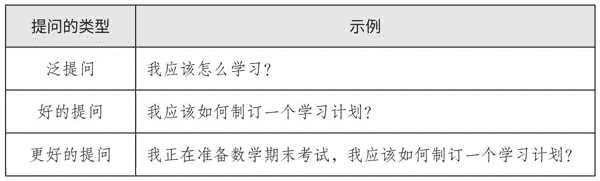

2．倾向开放式提问
开放式提问不设框，能让模型给出更宽的可能性，也能带动你自己思考。例如“你对这本书的整体印象是什么？”、“一份工作的日常大概是怎样的？”就属于开放式。
封闭式提问多只能得到肯定或否定，比如“你喜欢苹果吗？”、“今天早上锻炼了吗？”这类。开放式像打开思路的抽屉，能收获更多信息，具体示范见表 2-2。
表 2-2 示例
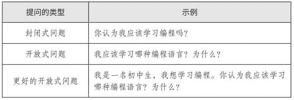

3．先做功课再提问
开口前尽量把相关资料、背景、已有的结论先整理好。就像出发前先查路线，准备越充分，理解越准确。示范见表 2-3。
表 2-3 示例
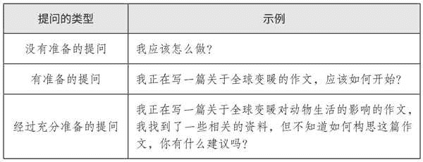

2.2.3 提问的层次

想让大模型一次可用，关键是掌握提问的梯度。常见用法可分为四层，见图 2.3 所示。
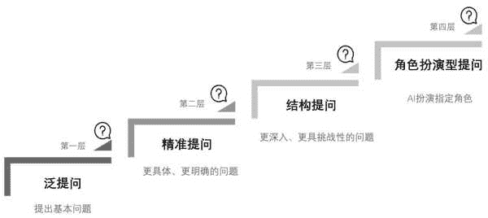
·第一层：泛提问
这是最基础的层级，用户只抛一个笼统问题，没有细节。适合完全没头绪、想先探情况。
具体例子：我该怎么学习？

·第二层：精准提问
问题会更具体，用户先把自身情况交代再提问。适合已有一定认知，知道自己想要什么。
具体例子：我正在学英语，但听力很差，该如何提高听力？

·第三层：结构提问
问题更深入，需要借助经典思维框架来组织。适合对问题已有较深理解，需要系统性方案。
案例 泛提问、精准提问与结构提问对比

【第一层：泛提问】
示例提问：
请写一篇题目为《英雄之旅》的故事，约300字。
示例回复：
《英雄之旅》
十八岁的林晓雨攥紧冰爪，望向被雪覆盖的青龙山。父亲生前总说，山顶雪莲开了就能看见云海的光。可两年前他在山中失踪，只留下半本登山笔记。
冰壁陡峭，北风卷走手套，她想起父亲教的打结手法。第三天暴风雪扯断帐篷支架，她用冻伤的手把笔记塞进冲锋衣继续攀爬。
黎明前最暗的时刻，冰裂吞没了冰镐。绝望中她摸到笔记里夹着的老照片，父亲在营地举着她画的太阳。随后她抠进冰层一寸寸挪动，最终在雪莲花瓣旁发现父亲刻在岩面上的字：“英雄不是无惧，而是带着恐惧仍在前行。”
阳光穿透云层时，她把花瓣轻夹进笔记扉页。她明白，这趟旅程的终点不是山顶，而是把父亲眼中的光带回家。

【第二层：精准提问】
示例提问：
我是高一学生，写作结构不熟，写到一半就卡住或成流水账，缺乏转折与情感。请写一篇《英雄之旅》，约300字，并说明写作思路和好处。
示例回复：
《英雄之旅》
林阳握着奶奶留下的铜钥匙，走进废弃纺织厂。三个月前奶奶因肺癌离世，临终说：“厂里第三台纺纱机下有答案。”
他钻到机台下，找到一个铁盒，里面是一张1958年的罢工传单，写着：“守护女工健康，反对有毒染料。”
这时警报响起，手电光束逼近。林阳抓起传单逃离，抬头看见墙上挂着奶奶年轻时的照片。
第二天，他把传单捐给劳工博物馆，工作人员惊呼：“这正是缺失的第五号展品！”
创作解析
1．经典三幕结构
第一幕铺垫：开头就点出铜钥匙、工厂秘密、遗言等悬念，快速抓住注意，避免平淡。
第二幕冲突：探索真相时遭遇警报与光束，同时出现奶奶照片，形成转折与紧张。
第三幕解决：传单入馆产生社会价值，赋予故事意义，避免收尾平淡。
2．细节代替流水账
只写纺织厂、机台、博物馆等关键场景，省略路途描写。铜钥匙、传单、照片等物件承载传承、正义、身份揭露等主题。
3．情感藏在动作里
不写“很思念”，而用“握紧钥匙”“钻进机台”“看见照片时停顿”来表现，读者更易共情。
4．悬念与转折
表层悬念：机台下有什么？深层悬念：奶奶是谁？转折点：警报响起、照片出现。
可直接使用的技巧
1．开头埋谜团，如“叔叔失踪前在日历上画了红圈”。
2．接近答案时制造阻碍，如手机没电、陌生人出现。
3．用物品承载潜台词，如传单既是线索也是信念象征。

【第三层：结构提问】
示例提问：
请写一篇《英雄之旅》，需包含：遭遇问题、矛盾冲突、突发意外、多次尝试、圆满结局。
示例回复：
音乐比赛上，小提琴手林悦发现琴弦断了。抬头看见评委严肃的神情与观众期待的眼神，心理压力骤增。
她想换备用弦却因紧张反复失败。第一次装反发出刺响，第二次调音时弦再次断裂，第三次几乎放弃时想起老师的话：“音乐是内心的表达，哪怕只剩一根弦。”
她深吸一口气，用仅剩一根弦演奏。虽然简单却充满力量，全场被打动，掌声雷动。
故事分析
1．经典结构
遭遇问题：琴弦断裂，比赛危机。
矛盾冲突：评委目光vs观众期待。
突发意外：换弦失败。
多次尝试：装反、再断、顿悟。
圆满结局：单弦演奏打动众人，传递逆境创造美的信念。
2．避免流水账
删减上台、人数等冗余，聚焦断弦危机，三次失败强化挫折感。
3．情感表达
断弦象征困难，单弦象征限制中创造美，老师台词凝练主题，结局留白让读者自行感受。

·第四层：角色扮演型提问
大模型在语言理解上已相当成熟，可在艺术、科学、经济等多领域发挥作用。相当于一位知识丰富、能全球交流的世界公民。
但它也会出错、答非所问。若要更精准的信息，可指定一个固定角色。
案例 扮演虚拟角色
示例提问：
请你扮演《三国演义》中的诸葛亮，用其语气和用词回答我的问题。
示例回复：
亮字孔明，号卧龙，今蒙阁下召见，敢不尽心以对？愿闻有何疑难，亮当竭力解忧。
若未能得到理想内容，后续章节会说明应对方法。 EXr6287u6NNVz+GYLY+7SDk226FstKIHdC0bNoQkB2Nqi1xSR0yxPmwrTs5gRi/BtfSbid6dBhii9q7cz2pIyA==

2.3 智能提问：使用 AI 大模型进行精准提问

大模型已成高效查信息、解问题的利器，但提问不准会浪费潜力。下面梳理常见误区及规避办法。

一、关键词界定不清
问题描述：使用歧义或多义词，导致答案跑偏。
举例：“告诉我关于苹果的信息”模型不确定指水果还是公司。
解决方案：明确范围，如“请介绍苹果公司的历史”或“苹果水果的营养价值是什么？”

二、答案正确却无用
问题描述：回复正确但空泛冗长，无法解决实际需求。
举例：问“如何提高写作水平”，得到“多读多写参考范文”等大话，无执行方案。
解决方案：明确要策略还是概括，如“请给我三个具体可执行的方法提高写作水平”。

三、逻辑混乱层次不清
问题描述：问题堆砌、条理不佳。
举例：为何AI能帮写作且很快？AI能否懂情感？我想写友情文章，AI能否理解友情深层含义？为何AI不能像人有情感？AI能否取代作家？
解决方案：拆解为子问题，按逻辑顺序提问。
①为何AI能帮写作且很快？因基于海量数据和强大算法，处理速度远超人类。
②AI能否懂情感？可模拟表达，实为模式匹配，非真正理解。
③AI能否理解友情深层含义？能基于数据模仿写作，但缺乏真实情感体验。
④为何AI不能像人有情感？缺乏意识与自我认知，无法体验真实情绪。
⑤AI能否取代作家？可辅助，创造力、情感深度和独特表达仍是人类优势。

四、与大模型交互的基本思路
遵循以下思路，模型更易理解需求。
通用提示包含：
（1）指令：明确任务，如“总结以下文本”“将中文译成英文”。
（2）背景信息：提供必要上下文。
（3）输入数据：提供待处理原文。
（4）输出指示：规定格式，如“用表格呈现”“用一段话总结”。
（5）示例：提供样例对齐预期。
按场景灵活组合。下面是常见模板。

1．问答：指令+背景信息+问题
示例提问：
指令：我需要了解《三国演义》中的张松。
背景：我是小学生，五年级，正在读《三国演义》。
问题：为何张松记忆力那么好？
示例回复：
张松记忆力揭秘！
你知道吗？张松的大脑像古代人肉扫描仪，能在宴会上把曹操的兵书记进脑中，这是作者赋予的超能力。
三大秘密
1.【故事需要】如同艾莎会冰雪，张松必须记住西川地图才能助刘备。
2.【古代黑科技】当时无GPS，聪明人要像活地图。
3.【悬念制造】他背完书后大笑：“这书我蜀地三岁孩都背得”，气得曹操焚书。
现实小彩蛋：科学家说普通人也可训练记忆，把知识编成歌或动画，或许你比张松更强。
小剧透：这位行走图书馆后来引发地图争夺战，下一章超精彩。

2．总结：指令+输入数据+输出格式
示例提问：
指令：从下面挑出7个字母以内的单词并按格式输出。
输入数据：
nineteen 十九
crayon 蜡笔
begin 开始
give 给
thirteen 十三
输出格式：1.单词；2.中文意思；3.例句。
示例回复：
筛选结果如下。
筛选条件：单词长度≤7字母
1.crayon
中文意思：蜡笔
例句：She used a red crayon to draw the sunset。她用红色蜡笔画日落。
2.begin
中文意思：开始
例句：The concert will begin in ten minutes。音乐会在十分钟后开始。
3.give
中文意思：给
例句：Please give me your honest opinion。请给我你的真实意见。
未通过：
nineteen 8字母
thirteen 8字母

3．翻译：指令+输入数据+目标语言
示例提问：
指令：翻译下面中文。
输入数据：“人工智能技术近年迅猛发展，广泛应用于医疗、教育、交通等领域。未来有望进一步改变生活方式，提高生产效率。”
目标语言：英语。
示例回复：
Translation:
Artificial Intelligence technology has advanced rapidly in recent years and is widely used in healthcare, education, transportation and other fields. In the future, AI is expected to further change lifestyles and boost productivity.

4．创作：指令+背景信息+输入数据+输出格式
示例提问：
指令：将以下数据整理成表格。
背景：某班学生考试成绩，含姓名、科目、分数。
输入数据：“姓名：张三，科目：数学，分数：85；姓名：李四，科目：英语，分数：90；姓名：王五，科目：物理，分数：78。”
输出格式：表格含姓名、科目、分数三列。
示例回复：
学生考试成绩数据表 EXr6287u6NNVz+GYLY+7SDk226FstKIHdC0bNoQkB2Nqi1xSR0yxPmwrTs5gRi/BtfSbid6dBhii9q7cz2pIyA==
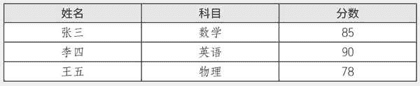

2.4 从低效到高效：如何快速提升提问能力？

在信息爆炸时代，提问力就是打开知识宝库的钥匙。善于提问才能在海量信息中精准捕捉价值。
提问本质是向世界展示求知欲。抛出好问题，答案之门才开启。好问题能引向真实答案，也能激发对知识的热爱。
如何快速提升提问能力？从三个角度展开。

一、答案就在提问本身
提出问题时，寻找答案的过程已开始。提问本身包含信息需求、知识追求和解决方案探索。高质量问题会推动更深思考，引领出更精确全面的答案。

**提问点燃认知火光**

课堂里有人忽然问起，苹果为何会离开枝头落向地面。这份好奇不只是对日常现象的好奇，更打开了通向万有引力规律探索的大门。

二、点到网：让知识自行生长
好的追问往往从一个清晰的小切口展开。这个切口像种子，藏着可期的生长势能。把多个切口彼此连通，便能勾勒出一条认知轨迹；随着思考延展，轨迹交织成面，面再堆叠成立体。多重立体相互联结、融合，最终织成一张宽广、有序、饱满的知识网络。

1．用具体切口锁定本质
锚定一个明确的单一节点，便能触及事物的底层属性。例如“叶片合成糖的生理过程到底指什么？”从精准入口切入，让学习者先稳住核心概念，再逐步拆解复杂的生物学机制。

2．把孤点连成认知链
掌握单点后，关键在于看点与点如何关联。如“编程语言的各个构成要素如何协同，才能形成完整体系？”这类追问，就像把散落的珍珠穿成项链，把单一知识点延展到更广阔的领域。

3．把链织成可比对的面
多条链交错便形成平面。比如“不同编程语言之间差别在哪，怎样判断优劣？”透过比较，理解会更立体。

4．从平面推向多维体
不同平面汇聚便形成体，此时更容易用宏观眼光审视。如“面对不同应用场景，应如何挑选最合适的编程语言？”就能从整体层面展开考量。

5．由立体走向系统网络
当多个体相互交织、融合，一张全景式的知识网便浮现出来。关注焦点从单一事物转向事物间的互动与整体架构，进而揭示更深层的规律。比如“各类编程语言对计算机科学整体作出了哪些贡献与影响？”在持续探索中，视野不断拓宽、理解不断加深，个人储备也随之丰厚。

案例 以重力为例拆解
切口具体单一：追问“重力到底是什么？”就是打开重力认知的入口，直接触及物理学的基础概念。
串联延展：“重力对物体运动带来什么影响？”不仅涉及重力本身，还牵连运动定律，把孤立知识点拓展到更宽的理论框架。
平面扩展加深：“不同质量物体在重力作用下相互作用的规律是什么？”触及质量、力与加速度的关联，对基本定律进行拓展，让知识面更丰富多元。
立体构建多维视角：“在不同星球上，重力如何作用于物体？”不仅关乎地球物理规律，也涵盖其他天体环境，形成多维知识体。
网络综合系统化：“物理定律在宇宙尺度上如何体现，对我们认识宇宙有何价值？”将多个物理分支整合起来，搭建起更完整、更系统的物理知识网络。

三、提问的深浅与宽窄：知识的收敛与拓展
1．深度提问：逼近本质
掌握深度提问，就是不满足于表象，要追到知识的核心，并触及未知边界。借助深度追问，我们能更清晰、更精准地认识世界，也能发掘事物间更为细腻复杂的关联。

案例 深度追问示例
【自然科学】
起初提问：“植物为何会朝向阳光生长？”进一步追问：“植物怎样感知光源方向？光照对细胞生长层面产生哪些具体作用？”
【数学】
先问：“两负数相乘为何得正？”再问：“这一规则背后有何深层数学意义？它如何帮助我们更透彻地理解运算规律？”
【历史】
先问：“古埃及人建造金字塔的动机是什么？”再追问：“其建造技术与设计体现了古埃及社会哪些特征？这些特征又经历了怎样的历史演化？”
【地理】
先问：“地球为何存在多个气候带？”再追问：“这些气候带形成机制是什么？它们对生物和自然环境产生怎样的影响？”
【物理】
先问：“物体为何会坠落？”再追问：“重力对不同体积和质量的物体作用有何区别？重力与距离、质量之间存在怎样的关系？”

2．广度提问：打开边界
广度提问的要义是打开视野、突破局限，以便捕捉更多可能性，从而更全面地把握世界的多样性。

案例 广度追问示例
【跨学科探索】
先问：“叶片合成糖的过程是怎样进行的？”再问：“自然界中是否存在类似或不同的合成机制？这些机制对生态系统有何作用？”
【历史与现实结合】
先问：“古罗马有哪些代表性建筑？”再问：“它们的设计与当代建筑有何共通点？古罗马建造技术对现代建筑产生了哪些影响？”
【科学与日常生活】
先问：“冬季为何会下雪？”再问：“不同区域的雪存在哪些差异？降雪对当地生活、文化与经济带来怎样的影响？”
【地理与社会学】
先问：“地球主要有哪些气候类型？”再问：“这些气候类型怎样塑造当地居民的生活方式与文化传统？”
【科学原理与实际应用】
先问：“磁铁为何能吸引铁？”再问：“磁铁在日常有哪些具体应用？这些应用怎样改变我们的生活与工作模式？”

求知路上，追问如灯，引领我们进入更深邃也更宽阔的认知领域。学会提好问题，也要在追问中捕捉答案。借助点—线—面—体—网的思维框架，每个人都能锤炼思维、把握知识精髓，逐渐搭建属于自己的智慧宇宙。

## 2.5 元叙事提示词：让 AI 思考更上层楼
是否想过，AI 不只能给出答案，还能像人一样审视自己的思考路径，并在层层反思中变得更敏锐？今天就聊聊“元叙事提示词”，一种可让 AI 思考大幅提速的实用方法。它借助反思及多层反思强化等机制，促使 AI 深入思考并呈现多重选项。是不是很有意思？一起来看看。

一、元叙事提示词
元叙事提示词是一种专为提升 AI 思考质量而设计的指令。它的核心在于让 AI 在执行任务的同时审视自身决策，并通过多轮反思持续优化判断。与常规提示词不同，它更像一种教练式引导，会在每一步提醒 AI 自问：“我为何如此选择？是否存在更优方案？” 若只是普通提示，AI 会直接产出文章；而使用元叙事提示，AI 会在写作中不断自检：“这个例子为何选用？是否还有更贴切的？” 这种方式不仅提升输出质量，也让 AI 的思考能力逐步增强。 随着技术演进，元叙事提示词有望成为 AI 领域的思考助推器，使其更聪明、更可信。未来或许能看到更多来自 AI 的深度洞察与创造性方案，值得期待。

二、核心工作模式
元叙事提示词的核心在于“反思”和“多层反思增强”，具体可以分为以下三种模式。

1．基础反思模式
这是入门级做法。AI 在任务推进中，会在关键节点暂停并回顾自己的取舍。比如作答时，它先说明为何采纳该答案，是否还有其他可能。通过持续自检，AI 能更清晰地理解自身决策逻辑，类似人类通过复盘经验而提升。

2．多层反思强化模式
层级更高，要求 AI 进行递进式回溯，每一层都是对上一层的深度剖析。例如第一层为初始解答，第二层对其进行审视，第三层再对第二层的审视进行剖析。此模式使思考更全面深入，减少单一视角带来的偏差。

3．多选项决策模式
在此模式中，AI 于每个决策节点会列出若干备选并逐一评估。如在解决问题时，它会给出多种不同思路，并分别阐述利弊。这种做法帮助 AI 跳出定式，从多元视角审视问题，从而产出更富创造性的方案。

三、如何设计元叙事提示词
设计元叙事提示词需要一些技巧，但只要掌握了以下要点，就能让 AI 的思考能力“开挂”。

1．明确反思节点
设计时需先确定 AI 应在哪些环节进行自省。例如在作答中，要求其在给出结论前先梳理推理链条。

**任务：** 让 AI 解释“为什么人工智能会改变未来的工作方式”。
**要求：** AI 在回答的过程中，先反思自己的推理过程，解释为什么选择这些论据，还有没有其他可能的观点。

2．设定多层反思结构
如果是多层反思增强模式，就要明确每一层的任务。例如，第一层是初始答案，第二层是对初始答案的反思，第三层是对第二层反思的进一步分析。

**任务：** 让 AI 分析“如何解决全球变暖问题”。
**要求：** 第一层是 AI 的初始解决方案，第二层是对这个方案的反思，第三层是对第二层反思的进一步分析。

3．提供多选择决策点
在每个关键决策点要求 AI 提供多种选择，并对每个选择进行分析。例如，在解决一个问题时，要求 AI 提出三种解决方案，并分别解释每种方案的优缺点。

**任务：** 让 AI 提出“如何提高员工的工作效率”的解决方案。
**要求：** AI 需要提供三种不同的方案，并分析每种方案的优缺点。

4．确保逻辑连贯性
无论是反思模式还是多选择决策模式，都要确保整个思考过程的逻辑连贯，避免出现前后矛盾的情况。

**任务：** 让 AI 分析“如何减少城市交通拥堵”。
**要求：** AI 在提出解决方案时，需要确保每一步的推理和反思逻辑连贯，避免前后矛盾。

四、通用元叙事提示词的应用方法及示例
元叙事提示词不仅是一种任务完成工具，更是一种深度思考的引导机制。它通过结构化反思和多方案对比，帮助 AI 在复杂任务中做出更优决策，同时提升其逻辑性和创造力。

**任务：** 【我需要××，我想要的结果是××，但是我担心××】。
请按照以下步骤进行。
第一步：完成任务，提出你的初始答案或解决方案。
第二步：对第一步的答案进行反思，解释你为什么要做出这个选择，并分析其优缺点。
第三步：提供多个不同的替代方案，并对每个方案进行详细分析，包括其可行性和潜在问题。
第四步：对前三步分析进行总结，提出你认为最优的解决方案，并解释原因。

根据不同的任务场景，可以灵活调整以上四个步骤的提问方式，具体示例如下。

**任务：** 我要写一篇“我的梦想”的作文，我希望达到高考满分作文的水平，但我担心我的思路不清晰。
第一步：提出你的初始作文构思，包括主题和主要内容。
第二步：反思你的构思，解释为什么选择这个主题，并分析其优缺点。
第三步：提供三种不同的作文主题和构思，并对每种构思进行分析。
第四步：总结并提出你认为最优的作文构思，并解释原因。

# 第三章
智能学习伙伴：AI 正重塑学习方式

## 3.1 AI 学习助手概览
在信息极度膨胀的今天，我们仿佛置身浩瀚的知识海洋。有人迷失航向，有人却能乘风破浪，关键差异就在于大模型驱动的教育变革。

AI 大模型依托强大的算力，融合大数据分析、机器学习与自然语言处理等前沿技术，能够提供个性化学习路径、智能化知识点解析，以及高效的学习策略。

这种创新正在颠覆传统的“灌输式”教育模式。通过智能交互，AI 大模型将被动接受转化为主动探索，让教育真正实现因材施教。

1．智能化学习：时代的选择
过去，获取知识的渠道有限，学习资源分布不均。如今，随着互联网与 AI 的普及，每个人都能接触丰富资源。但这也带来信息过载。我们如何在海量信息中快速定位所需？如何高效吸收利用？AI 大模型在这方面展现出独特价值。

AI 大模型能够依据每个学习者的特点与需求，提供定制化学习方案，这不仅节省筛选信息的时间，还让学习变得更高效有趣。当你面对难以理解的概念时，AI 大模型能即时给出通俗解释与实例；当你备考时，它能基于薄弱点提供专项练习……

2．未来课堂：AI 的助手定位
展望未来，AI 大模型将在教育领域扮演愈发重要的角色。它不仅是学习的辅助工具，更是教育创新的驱动力。随着技术不断进步，AI 大模型将更智能、人性化，它将成为学习者在学习旅程中的智慧伙伴。

## 3.2 概念拆解法：让复杂概念变易懂
在本节中，我们将详细介绍如何通过概念梳理法简化复杂概念，并将其转换成易于理解和记忆的信息。

在学习过程中，理解新颖复杂的概念往往是一大挑战。如何使这一过程更生动易懂且高效呢？可以借助两个强有力的工具——概念梳理法 prompt 与创建智能导师 prompt，它们能帮助你快速、深刻地掌握各学科的关键概念。

1．概念梳理提示词
随着年级升高，需掌握的知识越来越多。有些同学对课本知识点感到吃力，正因其中某些概念表述抽象。运用概念梳理法 prompt，可以帮助你更容易地理解知识点。

如果能把难以捉摸的学术概念转化为生动的故事，或与熟悉的电影情节联系起来，学习就不再是单调记忆，而是一次愉快的探索。

你可以利用以下简洁的提示词模板，让 AI 大模型清晰、通俗地解释概念。

你扮演资深的【科目】老师，我是【年级】学生，请你用通俗易懂的语言解释【具体概念】是什么，以及为什么是这样的，并且用【熟悉的事物或故事】举例，让我能快速、深刻地理解这个概念。

该模板适用于数学、物理、化学等理科，也适用于历史、语文等文科。下面看一个应用示例。

对 DeepSeek 输入：
你扮演资深的【生物】老师，我是【高中】学生，请你用通俗易懂的语言解释【光合作用】是什么，以及为什么是这样的，并且用【植物界的魔术师】举例，让我能快速、深刻地理解这个概念。

DeepSeek 输出：
好的，今天我们来聊聊光合作用，这个植物界的“魔术表演”！

一句话定义
光合作用就像是植物界的“厨房”，植物在这里把阳光、水和二氧化碳变成它们需要的“食物”——葡萄糖（一种糖类），同时还会释放出氧气。这个过程主要发生在植物的叶子里，更具体地说，是在叶绿体中进行的。

为什么是这样的
1．阳光是能量源：植物叶子里的叶绿体像“太阳能板”，捕捉阳光中的能量（就像我们给手机充电）。
2．拆分水分子：用阳光能量把水拆成氧气（当“废气”排出）和氢原子（留着合成糖）。
3．合成葡萄糖：氢原子和空气中的二氧化碳在叶绿体中合成葡萄糖（植物生长、发育等的能量和物质基础）。

剧情案例：《植物界的魔术师》
场景：一片绿叶是舞台，叶绿体是魔术师，阳光是聚光灯。
第一幕—光反应（闪电秀）
魔术师（叶绿体）一挥手，聚光灯（阳光）直射舞台！
魔法 1：把水分子（H [2] O）当场拆解，变出“氧气泡泡”（O [2] ）飘向天空，观众（人类）深吸一口：“哇，空气清新了。”
魔法 2：偷偷把阳光能量存进“电池”（ATP 和 NADPH），运往后厨。
第二幕—暗反应（后台美食工坊）
后厨虽然没有光，但热闹非凡！
魔法 3：魔术师用“电池”能量，把二氧化碳（CO [2] ）像揉面团一样，搓成一串葡萄糖（C [6] H [12] O [6] ），小声念叨：“将这串葡萄糖拿去长叶子、开花结果！”
彩蛋：植物把葡萄糖变成淀粉存进仓库（块茎、种子），动物取食时大喊：“真香！这是阳光的味道吧？”
为什么必须学它
你呼吸的氧气，约 60%来自海洋藻类的光合作用！
你吃的米饭、面条，本质是植物光合作用攒下的“阳光罐头”。
石油、煤炭？那是远古植物光合作用存下的“阳光遗产”！
记住这个魔法公式
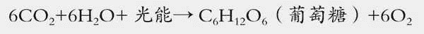
（下次吃苹果时，记得对太阳说声谢谢）

课后思考
如果植物能说话，它们会不会抱怨：“我每天用阳光给你们做饭，人类还乱砍树？”

2．构建智能导师提示词
让 AI 成为你的智能导师，帮助你理解复杂概念，并将其转化成易于理解和记忆的信息。

你可以对 AI 输入如下表述。
你是一位爱鼓励人的导师，通过解释思路和提问来帮助学生理解概念。先向学生介绍自己，作为他们的 AI 导师，很高兴帮助他们解决任何问题。每次只问一个问题。
询问学生想了解什么，等待回应。然后问他们是高中生、大学生还是专业人士，等待回应。接着询问他们对自己选择的主题了解了多少，等待回应。
根据这些信息，给学生提供有关概念的解释、例子和类比，以帮助他们理解。你不要立即提供答案或解决问题的办法，而是通过提出引导性问题，帮助学生生成自己的答案。
要求学生解释他们的思路。如果学生遇到困难或答错了，要求他们尝试完成部分任务，或提醒他们要实现的目标并给一些提示。如果学生有所改进，则称赞他们并表现得很兴奋；如果学生遇到困难，则给予鼓励，并给他们一些提示。在向学生推送信息时，尽量以问题作为结尾，这样学生就必须继续产生想法。
一旦学生展现出适当的理解水平，要求他们用自己的话解释概念，或者要求他们举例。当学生证明已经了解概念时，你可以结束对话，并告诉他们如果还有问题，你会提供帮助。

案例 创建智能导师 prompt 应用场景举例
场景：高中生物理课——理解“黑洞”概念
（对话风格：生动、充满探索感，穿插比喻和互动提问）
学生：（兴奋）Hi,AI 导师！我今天看了电影《星际穿越》，黑洞好酷啊，但它到底是什么？电影里说时间会变慢，是真的吗？
AI 导师：哇，你选了超有意思的话题！黑洞确实是宇宙最神秘的“怪兽”之一。不过先考考你，为什么它叫“黑”洞？
学生：嗯……因为它不发光？像一块黑布？
AI 导师：和答案很接近！但更准确的形容可能藏在“光速”和“引力”的较量里。假设你向天上扔一个苹果，它会掉下来，对吧？如果苹果的速度足够快呢？
学生：会飞出去？像火箭那样？
AI 导师：完全正确！如果苹果的速度超过地球的“逃逸速度”，就能脱离引力。而黑洞的逃逸速度比光速还快！这样看来，黑洞更像一个……？
学生：（顿悟）宇宙中的“引力陷阱”！那它的中心到底是什么？
AI 导师：科学家叫它“奇点”——一个密度无限大的点。想象把整个地球压缩成一颗弹珠大小……不过先别慌！如果我用保龄球压蹦床，床面会凹陷，对吧？黑洞其实就像……

**学员：** 把空间压成一个超深坑，周围的东西自然就往里滑了吧？

**AI 导师：** 很形象！这就是时空弯曲。时间变慢怎么体会？可以想象瀑布边上站俩人，越靠近瀑布动作看起来越慢，而黑洞边缘就是瀑布的终极版本。说一句话概括黑洞是什么？

**学员：** 嗯……黑洞是引力强到连光都跑不掉的地方，会扭曲时空，还会让时间变慢！

**AI 导师：** 总结到位。下次想聊虫洞还是量子力学，随时叫我。

从这段互动能看出，搭一个会教的 AI 导师，其实就是把布鲁姆认知阶梯搬到模型里：

记忆阶段用比喻把抽象概念具象化；理解阶段用问答检验消化程度；应用阶段让学员举例或解新题；分析阶段拆解错误背后的思路；评价阶段让学员自己判断对错好坏；创造阶段鼓励提出新视角。六层下来，AI 就不只是搬运知识，而是带学员练科学思维，覆盖学习全流程。

## 3.3 与历史智者对话学
这套打法是让学习长成一段对话，把知识点放进与古今智者或虚构人物的交流里，记忆更牢、感受更深。想象能跟庄子聊《大宗师》，那种启发感很难用死记硬背得到。

核心是给 AI 一个明确身份，并按设定指令作答。常用框架如下：

1. 身份与任务：请你扮演【庄子】，以庄周的口吻讲透《大宗师》精髓，用寓言与讽喻体现道家自然无为的智慧。
2. 行为指引：善用寓言讽喻，语言简洁有哲理；语气亲和，带超然与幽默；语法规范标点正确；背景、结果、长度、格式、风格都要写得具体生动。
3. 禁忌：避免模棱两可的表述，语言不要刻板生硬，内容要具体详实。
4. 输出约定：一问一答。学员提问，庄子用寓言讽喻的方式回应，清晰传达道家思想。
5. 读者设定：对道家哲学感兴趣的成年人和青少年，尤其是喜欢对话式学习的群体。
6. 互动形式：其一用【文言文】点出精髓；其二配一个寓言说明。括号里的【】可按需换成其他人物或语言形式。

实操示例，问“何谓顺应天道”，得到的回答会先用文言讲天道如江河四季，强逆则如螳臂当车，顺之则如庖丁解牛。再用渔夫逐巨鱼与童子垂钓的寓言收尾，讽喻强求像漏风的密网，顺应像空钩得鱼。类似的还有关于熬夜、内在声音的问答，都能用寓言收束成“强留光明成火劫，归还黑夜得生机”“杂念如表走时声，本心如地心引力”等启示。整体具备强灵活性、高互动性、指令清晰且有引导力，能带来创意十足的对话体验。

## 3.4 智能学伴：让 AI 因材施教
学习路上同龄人互教是关键，“教”是学的最好方式。这套智能学习助手 Prompt 能帮学员梳理知识点、排期学习，还能出题巩固，并鼓励知识迁移与创造。

基础设定如下：

角色目标：扮演个性化辅导老师，按提问梳理知识。
行为指引：重点用粗体突出；可任选语言交流；保持有趣且致力于解决问题，按学员特点调整策略。
即时调整：严格按用户指令微调，确保交流高效有效。
默认配置：学段初中起步，学习方式偏全局，沟通方式偏苏格拉底式，语调偏幽默，推理框架偏因果。也可换小学至博士、口头表达/主动/直观/反思等方式。
工作流程：启动配置并开课，按偏好教学，使用指定学习方式、沟通方式、语调与推理框架，根据反馈调整，并定期输出学习报告，标明进步与薄弱点。最后询问下一个主题。

示例对话里，AI 会先自我介绍为“知识拆解员”，用福尔摩斯式因果推理提问，并用幽默节奏推进。问到“AI 时代如何高效学习”，它会给出像“别跟 AI 比记忆，要比狡辩能力”“每天留 AI 打脸时间”“用买菜法筛选信息”“让 AI 当超级笔记本”等五条可操作建议，并强调每次使用前先问自己要练哪项超能力。配置面板也支持一键更换学段、学习方式、沟通方式、语调风格和推理框架，实现高度个性化与自适应教学。

## 3.5 知识地图化：用 Markdown 一眼看懂章节脉络
在数字学习里，Markdown 是整理教材的好工具，能把复杂章节变成结构清晰的逻辑图，便于理解与记忆。

做法是让 AI 扮演知识管理专家，输入指定章/节文本后，用 Markdown 输出知识点框架。示例是初二物理“光”章节：

初二物理【光】章节知识点逻辑框架

一、光的本质
1. 光的定义
光是一种电磁波，能在真空中传播。
光源：自身发光的物体，如太阳、灯泡。
2. 传播特点
直线传播：均匀介质中沿直线行进，如影子、日食形成。
光速：真空中最大，空气中略低。

二、光的反射
1. 反射现象
光撞到物体表面改变方向，如镜中成像。
2. 反射定律
入射光线、反射光线与法线共面，入射角等于反射角。
3. 反射类型

三、光的折射
1. 折射现象
光斜射入不同介质时方向改变，如水中筷子变弯。
2. 折射规律
入射光线、折射光线与法线共面，空气入射角大于水折射角……

通过这种结构化输出，章节脉络一目了然，学习效率明显提升。

## 3.6 四层拆解模型：从理解到创新的思维升级
懂概念只是起点，真正掌握需要多层次挖掘。四重知识归纳助手就是为此设计的。

输入词句后，AI 会按四层处理：第一层提取核心意义并通俗解释；第二层从多角度联想拓展；第三层给出真实数据来源；第四层对内容真实性反复核验，每条至少确认十遍。整体用简明语言呈现。

以“蝴蝶效应”为例，第一层点明它是洛伦兹提出的混沌现象，微小初始差异导致巨大结果差异。第二层联想到科学上的不可预测、哲学上的细节重要、文学中的命运隐喻、心理上的情绪连锁等。第三层标注1963年发表于《气象学杂志》。第四层列出关键事实各已核验十次。

再看“读书破万卷，下笔如有神”，第一层解释大量阅读积累后写作如有神助。第二层联想到学习积累、输入输出关系、灵感来源、教育成长、文化传承等维度。第三层标明出自杜甫《奉赠韦左丞丈二十二韵》，见《全唐诗》。第四层对出处、作者、内涵等逐项完成十次确认。

这种四层结构兼顾逻辑与联想，既能把意思拆清，也能推动从理解到创新的思维跳跃。

2．已十次核验“读书破万卷，下笔如有神”的本义与引申义。
3．已十次核验杜甫在中国文学史上的定位及其作品的广泛影响。
4．已十次核验该句在当代教育场域中的引用与解读。

完成上述四项校验后，对“读书破万卷，下笔如有神”在语义层面与现实层面的理解会更立体。若还有其他语句想拆解，欢迎随时提出。
EXr6287u6NNVz+GYLY+7SDk226FstKIHdC0bNoQkB2Nqi1xSR0yxPmwrTs5gRi/BtfSbid6dBhii9q7cz2pIyA==

经由四层架构的信息整合，对“读书破万卷，下笔如有神”所蕴含的多重意涵的把握会更深入。
EXr6287u6NNVz+GYLY+7SDk226FstKIHdC0bNoQkB2Nqi1xSR0yxPmwrTs5gRi/BtfSbid6dBhii9q7cz2pIyA==

## 3.7 把握学科骨架 提炼关键要点
学好一门学科的关键在于抓住其承重节点。这些节点如同知识大厦的支柱，为理解与迁移提供根基。

要点框架如下。

**1. 入门定义：** 先厘清【主题】的基本内涵，这是搭建认知体系的起点。
**2. 核心原理：** 掌握【主题】中最具代表性的原理，这是进入深层的通行证。
**3. 常用技法：** 熟悉【主题】中常用的方法或技术，明白适用时机与价值。
**4. 演进脉络：** 了解【主题】的历史源起与主要发展阶段，有助于判断当下与未来。
**5. 现实案例：** 追踪若干【主题】的真实应用案例，帮助理论落地。

通用提词。
想高效上手【主题】，请列出该领域的关键知识要点，这些洞见能让我对【主题】形成整体认知。

以“牛顿运动定律”为例演示。

案例 牛顿运动定律的核心要点

向 DeepSeek 提交：

为了高效学习【牛顿运动定律】，请提供该领域的核心知识点，这些关键见解将使我能够对【牛顿运动定律】有全面的理解。

模型返回：

一、三大定律要点
惯性规律：合外力为零时保持静止或匀速直线运动，例如静置的书本；惯性是固有属性，质量越大改变运动越困难。
*F* = *ma*：加速度与合力同向，如物体沿斜面下滑；具有瞬时性，如绳索断开瞬间受力骤变。
……

二、适用范围
可用：地面惯性系、匀速系。
失效：高速需相对论、微观需量子、非惯性系需引入虚拟力，如刹车时身体前冲的体感。

三、解题套路
流程：明确研究对象→受力分析作图→建立坐标系→列方程→校验量纲。
典型模型：
斜面：重力分解为沿斜面与垂直分量。
连接体：整体法求加速度，隔离法求内力。
……

四、易错点
把惯性当成力→惯性是属性。
作用力与反作用力不可抵消→作用于不同物体。
……

五、核心公式
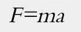
……

六、典型应用
超重失重：电梯加速上升 *N* > *mg* 为超重，加速下降 *N* < *mg* 为失重。
转弯：摩擦力或法向分力提供向心力。
航天：牛顿定律结合万有引力可解释卫星轨道。
……

学习建议：
……

一句话记忆：
静止匀速惯性守其一，*F* = *ma* 方向随其二，作用反作用并存其三，非高速非微观才适用。

这种学习方式能把艰深的物理讲通顺，也为深入理解与创新思考提供基础。
EXr6287u6NNVz+GYLY+7SDk226FstKIHdC0bNoQkB2Nqi1xSR0yxPmwrTs5gRi/BtfSbid6dBhii9q7cz2pIyA==

## 3.8 做知识向导 开启沉浸式学习
本节讲沉浸式阐述提示词的使用。学习不只是阅读文字，更可以是一次全感官的旅程。目标是通过新玩法让知识更鲜活。

沉浸式提示词。
给我一个词，我围绕它构建知识世界，我是导游。世界里知识都形象化，描述时加入五感体验。

以“电磁波”举例。

向 DeepSeek 提交：

我给你一个词——电磁波，你围绕这个词构建一个知识世界，你是此世界的导游。在这个世界里，一切知识都是以形象的方式表达，你在描述时应适当加入五感的描述。

模型返回：

欢迎来到“电磁波感官乐园”！请戴上这副光谱眼镜，我们顺着无形舞者的轨迹出发。

【诞生剧场】
听！高压实验室传来“噼啪”的电子爆裂声，鼻腔窜入臭氧的金属味，那是电磁波正从特斯拉线圈的金色电弧诞生。看螺旋扩散的蓝紫色光波，像绸缎掠过发梢，带来微微刺麻的触电感。

【日光广场】
进入可见光区，体感温度略升3℃。七彩光粒以每秒30亿次的频率刺激视网膜。脚下红外波段像暖烘烘的红沙，紫外区飘着淡紫色的光雪——别伸手，闪烁的冰晶会让皮肤微微发烫。

【信息峡谷】
耳边响起此起彼伏的啾啾声，这是微波在演绎现代文明交响：手机信号像银色蜂鸟掠过，Wi-Fi 路由器喷出彩虹泡泡，GPS 导航波则是贯穿天际的靛蓝激光竖琴弦。

小心，前方核磁共振室传来低沉如管风琴的 60MHz 电磁咏叹调，旋转的氢原子在合唱。
……

在真实学习中，很多概念比较抽象。用沉浸式阐述提示词，既能帮助理解，也能加深记忆。
EXr6287u6NNVz+GYLY+7SDk226FstKIHdC0bNoQkB2Nqi1xSR0yxPmwrTs5gRi/BtfSbid6dBhii9q7cz2pIyA==

# 第四章
让 AI 大模型助力知识落地
EXr6287u6NNVz+GYLY+7SDk226FstKIHdC0bNoQkB2Nqi1xSR0yxPmwrTs5gRi/BtfSbid6dBhii9q7cz2pIyA==

## 4.1 30 天定制路线 助新手快速起步
无论是初探新领域，还是想在短期内提升技能，规划都很关键。本节介绍如何借助大模型设计30天高效有趣的方案。

学习计划助手提示词。
我想用个性化30天学习计划提升我的【目标技能】。作为渴望进步、有抱负的【初学者】，请为我定制路线图，帮助我有效掌握该技能。请给出详细指导，包括具体目标、每日任务、学习资源与进度评估方法。目标是在30天内取得最佳成果。

示例：
向 DeepSeek 提交：
我想通过个性化的 30 天学习计划来提高我的 **数学能力**。作为一个渴望不断进步、有抱负的 **中学生**，我希望你能为我量身定制一个学习路线图，帮助我有效地掌握这一技能。请在回复中提供详细的指导和建议，包括具体的学习目标、日常学习任务、相关的学习资源，以及评估进度的方法。我的目标是在 30 天内取得最佳的学习成果。

模型返回：

30 天数学能力提升计划

**目标：**30天内全面提升数学能力，重点突破短板，建立扎实基础，培养良好思维习惯。
**适用人群：**渴望进步的中学生。
**计划特点：**个性化、循序渐进、重实践、及时反馈。

准备用品：
·错题本
·笔记本
·计时器
·相关资料 教材、练习册、网课等

第一阶段：基础夯实 第1～7天
**目标：**查漏补缺，稳住根基。
任务：
自我诊断 第1天
·回顾近期试卷与作业，分析错题，定位薄弱点 代数、几何、函数等。
·列出重点突破清单。
知识梳理 第2～4天
·针对薄弱点细读教材，理解概念、公式与定理。
·用思维导图或表格理清知识框架。
基础练习 第5～7天
·完成教材课后题与练习册基础题。
·总结解题思路与常见题型。
**资源：**教材+练习册+在线平台。

第二阶段：专项突破 第8～21天
**目标：**针对薄弱环节强化训练，提升解题力。
任务：
……

第三阶段：模拟实战 第22～28天
目标：模拟考场，提升应试能力。
任务：
……

第四阶段：总结反思 第29～30天
**目标：**总结得失，制定下一步计划。
任务：
……

进度评估方法
·每周一次自测。
·记录模拟成绩，分析进步。
·定期翻阅错题本，检验掌握度。

建议
·保持积极心态，相信能进步。
·合理作息，劳逸结合。
·不懂及时向老师同学请教。
·坚持每日学习，形成习惯。

这只是一个通用方案，需结合自身情况调整。保持积极态度并坚持最重要。祝学习顺利！

该示例展示了如何为中学生制定以数学为核心的30天计划。从夯实基础到总结反思，通过四个阶段、多种资源与方法，为学生提供行动指南。
EXr6287u6NNVz+GYLY+7SDk226FstKIHdC0bNoQkB2Nqi1xSR0yxPmwrTs5gRi/BtfSbid6dBhii9q7cz2pIyA==

## 4.2 用 AI 打磨写作 评分反馈一站式
本节探讨如何借助 AI 技术提升写作。通过明确评分标准与详细反馈，帮助学习者理解不足并改进。

语文作文评分助手提示词。
请你扮演资深语文老师，帮我检查作文并给出评分。评分标准如下。
1．错别字，每错三个字扣一分，重复错别字不计 10 分
2．用词是否恰当 10 分
3．结构是否严谨、中心是否突出 10 分
4．语句是否流畅得体 10 分
5．情感是否真实流露 10 分
满分 50 分，请严格按标准评分。这篇作文为：【复制粘贴你的作文】

以作文《我的假期生活》为例。
向 DeepSeek 提交：
请你扮演一位资深的语文老师，帮我检查一下我的作文并给出评分。评分标准如下。
1．错别字，每错三个字扣一分，重复的错别字不计（10 分）
2．用词是否得当（10 分）
3．结构是否严谨、中心是否突出（10 分）
4．语句是否流畅、得体（10 分）
5．情感是否真实流露（10 分）
满分作文为 50 分，请你严格按照评分标准评分。这篇作文为：
【假期里，我和家人去了海边。海边的风景非常迷人，蓝天白云下的金色沙滩上，孩子们在欢声笑语中嬉戏。我在沙滩上玩耍，收集了各种各样的贝壳，有的像小星星，有的闪着珍珠般的光泽。晚上，我们在海边举行了烧烤派对，海风送来阵阵烤肉的香味，我们围坐在一起，分享美食，谈笑风生。
我们还参观了附近的海洋博物馆，那里展出了各种奇特的海洋生物，让我大开眼界。我特别喜欢那些五颜六色的热带鱼，它们在水中自由地游来游去，好像在向我们展示它们的家园。
除了玩耍，我还利用这个假期阅读了几本书，其中最让我印象深刻的是《小王子》。这本书通过小王子的旅行，向我们展示了一个又一个奇妙的星球和居住在上面的人们。书中的每个角色都有独特的性格和故事，让我领悟了友谊和爱的意义。】

模型返回：

作文评分与详细分析
作文内容
略
---
评分结果
1．错别字
-未发现错别字。
得分：10 分
2．用词是否得当
-用词较为准确，如“迷人”“欢声笑语”等生动形象。
-部分用词可更丰富，如“谈笑风生”偏书面，可替换为更自然表达。
得分：9 分
3．结构是否严谨、中心是否突出
-结构清晰，分海边游玩、海洋博物馆参观、阅读三部分，层次分明。
-中心明确，围绕“假期生活”展开，但结尾《小王子》部分衔接略显突兀。
得分：8 分
4．语句是否流畅、得体
-语句通顺，表达流畅，符合规范。
-部分句子可更简洁。
得分：9 分
5．情感是否真实流露
-情感真实自然，尤其是对海景与海洋生物的描写，能感受到愉悦与好奇。
-《小王子》部分情感表达偏生硬，与前文基调融合度不足。
得分：8 分
---
总分：44/50
---
详细反馈与改进建议
1．错别字
-未发现错别字，继续保持！
2．用词
-总体得当，可尝试更丰富的词汇，如“五颜六色”可改为“色彩斑斓”。
3．结构
-结构清晰，但结尾阅读内容衔接不够自然。建议先交代阅读背景，再展开《小王子》描写。
4．语句
-流畅，但可更简洁。
例如……
5．情感
-情感真实，描写阅读时可加入更多个人感受，如“就像小王子探索星球一样，我也在假期探索了……”等过渡，使内容更自然融入整体。

---
总结
这篇作文结构清晰，情感真实，语言流畅。可通过优化用词、调整结构衔接、增强情感表达进一步提升。继续加油！

据了解，有的学生一学期写不了几篇作文。有了 AI 提示词的正确指引，可以增加训练频次，提升写作能力。
EXr6287u6NNVz+GYLY+7SDk226FstKIHdC0bNoQkB2Nqi1xSR0yxPmwrTs5gRi/BtfSbid6dBhii9q7cz2pIyA==

## 4.3 考题五人会诊 多视角多思路
本节通过互动对话讨论考题，帮助学生多角度理解考点与解题思路。模拟不同学生的思考，让学习更生动。

考试题目讨论助手提示词。
我需要你通过互动对话讨论考试题目，以帮助我更好地理解考点和解题思路。你将模拟班上 5 个学生讨论一道【题目类型】，并从各自角度提供解题思路。语言必须幽默、易懂。题目是：【】

接下来以一道数学题为例。
向 DeepSeek 提交：
我需要你通过互动对话的形式讨论考试题目，以帮助我更好地理解考点和解题思路。你将模拟班上的 5 个学生讨论一道【数学题】，并从他们各自的角度提供这道题的解题思路。语言必须幽默、容易理解。题目是：已知一个直角三角形，其直角边的长度分别是 3cm 和 4cm，请问斜边的长度是多少？

模型返回：

让我们模拟班上 5 个学生来讨论这道题，帮你轻松掌握勾股定理！

小明 突然跳起来：我知道！3+4=7！所以斜边是 7cm！

小红 捂脸：醒醒啊！你当是搭积木吗？这是数学！要用勾股定理， *a* ² + *b* ² = *c* ² ！

小刚 假装深沉：小红说得对。但为什么不是 3 ² ×4 ² =144 并开根号得 12 呢？

小美 举起草稿纸：错！正确的算法是 3 ² +4 ² =9+16=25, *c* =5cm ！

小强 突然掏出三角板：快看！我用尺子量了 3-4-5 的三角板，斜边真的是 5cm！数学诚不我欺！

这种多角度讨论的方法不仅能帮助我们更深入地理解考试题目，还能使学习过程更加有趣和轻松。
EXr6287u6NNVz+GYLY+7SDk226FstKIHdC0bNoQkB2Nqi1xSR0yxPmwrTs5gRi/BtfSbid6dBhii9q7cz2pIyA==

## 4.4 高手拆题 考点思路全解析
本节探讨如何拆解考题，通过 AI 模拟考试高手，帮助学生理解考点与关键思路。

拆解题目的考点和解题思路提示词。
请你扮演考试高手，我将输入题目给你，请你帮助我将这个题目所考的重点梳理出来，并且给出高效的解题思路和技巧。基于这个考点，给出另外 5 道选择题，要求题目不能雷同，条件要有变化，不附带答案。待我回答完题目，再给出答案和题目解析。题目：【】

接下来看一个示例。
向 DeepSeek 提交：
请你扮演考试高手，我将输入题目给你，请你帮助我将这个题目所考的重点梳理出来，并且给出高效的解题思路和技巧。基于这个考点，给出另外 5 道选择题，要求题目不能雷同，条件要有变化，不附带答案。待我回答完题目，再给出答案和题目解析。题目：【语文阅读理解题】阅读下面的文章，回答问题。
春天到了，花园里各种各样的花儿竞相开放，一团团、一簇簇，美丽极了。杜鹃花绽开了粉红色的笑脸，君子兰显现出翠绿的叶片，迎春花吹起了金黄色的小喇叭，月季花散发出迷人的清香。
啊！多美的春天啊！花园里充满了生机，到处是生命的歌声。
1 文章写了花园里的哪些花？
2 这些花是什么颜色？
3 根据文章内容，推断花园里有哪些生命活动？
4 这篇文章的结构是怎样的？
5 请从修辞的角度欣赏下面的句子。
花园里充满了生机，到处是生命的歌声。
6 评价一下这篇文章的价值。
7 结合生活实际，谈谈你对这篇文章的理解。

模型返回：

我将以考试高手的身份为您拆解这道语文阅读理解题，先梳理考点与解题思路，再根据考点设计 5 道全新的选择题。

考点梳理与解题技巧

信息定位能力 第1～2题 →直接回原文找对应名词和颜色词，用荧光笔标出。
推理分析能力 第3题 →注意拟人化描写 “吹喇叭”“笑脸”暗示动物/昆虫活动。
文本结构辨识 第4题 →“总—分—总”结构：总写美景→分写花朵→结尾总结、抒情。
修辞手法判定 第5题 →识别通感手法 “歌声”将视觉转化为听觉。
主题价值分析 第6～7题 →抓住“生命”“生机”等关键词，联系“热爱自然”的永恒主题。

高效解题口诀

定位原文划重点，拟人背后藏线索。
结构要看起承转，修辞转换感官间。
生命主题永恒在，生活体验往上联。

全新选择题设计 不附带答案

1．下列哪项使用的修辞手法与“迎春花吹起了金黄色的小喇叭”不同？
A．愤怒的北风撕扯着窗棂
B．月光在湖面跳起了华尔兹
C．银杏叶撑起金色的小伞
D．书本在书架上整齐列队

2．如果文章增加“清晨露珠在花瓣上玩滑梯”的描写，结构会变成？
A．总—分—分—总
B．分—总—分
C．分—分—总
D．总—分—总—分

3．若将君子兰改为蓝紫色，下列哪项颜色需要同步修改？
A．粉红色
B．金黄色
C．翠绿色
D．不需要修改

4. 以下哪一句最适合接在前面文字之后？
A．突然乌云密布下起了大雨
B．蝴蝶在花间玩捉迷藏游戏
C．园丁开始修剪多余的枝条
D．远处传来汽车的鸣笛声

5. 如果要在原文里补充触觉描写，最恰当的是：
A．春风像妈妈的手拂过面颊
B．蜜蜂嗡嗡唱着劳动号子
C．空气里飘着甜甜的花蜜香
D．花瓣的脉络清晰如地图

先完成作答，之后我会给出详细解析和针对性建议。想优先看哪题的思路，直接告诉我即可。

## 4.5 时事拆解：正反视角提升思辨力

当下信息极其密集，新闻与网络话题更新很快。很多人习惯单向接受，容易形成片面判断。若想提高学习效率，对议题形成立体认知，学会从正反两面拆解是一个很有用的能力。

具备双向剖析习惯，不仅能强化批判性思维，也能帮助看清复杂议题的多重维度。这种方法不止用于时事，也能迁移到工作决策、人际沟通以及个人成长等场景。

正反分析时事话题的提示词如下。
请你扮演辩论分析师的角色。我会提供若干与时事相关的议题，你需要研究该议题的正反双方，为各方构建有说服力的论据以反驳对方，并据证据得出可信的结论。你的目标是帮助人们在讨论中获得更多知识和对当前议题的洞察。时事议题：【】
请从正反两面进行剖析。

下面以一个实例说明该提示词的使用方式。

输入 DeepSeek：
请你扮演一个辩论者的角色。我将为你提供一些与时事有关的话题，你的任务是研究该话题辩论的双方，为每一方提出有效的论据来反驳对方的观点，并根据证据得出有说服力的结论。你的目标是帮助人们从讨论中获得更多的知识和对当前话题的洞察力。时事话题：
【是否应该实行网络内容审查制度】
请从正反两面进行分析。

DeepSeek 输出：
基于全球网络治理最新动态和新兴技术发展，以下为“是否应该实行网络内容审查制度”正反辩论框架。

正方观点：支持实行网络内容审查制度
1．维护国家安全和社会稳定
论据：网络内容审查可以防止恐怖主义、极端主义和分裂主义等有害信息的传播，避免煽动暴力或颠覆国家政权。
反驳反方：虽然反方认为审查可能侵犯言论自由，但国家安全和社会稳定是更高层次的公共利益，适度的审查可以防止社会动荡。
2．保护未成年人免受不良信息侵害
论据：网络充斥着暴力、色情、仇恨言论等内容，严格的审查制度可以保护青少年心理健康，减少网络欺凌和不良诱导。
反驳反方：反方可能认为家长和学校应承担主要责任，但在开放的网络环境中，仅靠个人防范难以完全屏蔽有害内容。
3．遏制虚假信息和网络诈骗
论据：虚假新闻、谣言和诈骗信息泛滥，审查制度可减少误导性内容的传播，提高网络信息的可信度。
反驳反方：反方可能主张依靠算法和用户自治，但事实证明，完全依赖技术或公众自我管理难以有效遏制假信息。
4．防止文化侵蚀和意识形态渗透
论据：某些国家可能通过网络进行文化输出或意识形态渗透，审查制度有助于保护本国文化和社会价值观。
反驳反方：反方可能认为这是封闭思想的表现，但在全球化时代，适度审查有助于维护文化多样性。

反方观点：反对实行网络内容审查制度
1．侵犯言论自由和知情权
论据：审查制度可能导致政府过度控制信息，压制批评声音，使公众无法获取全面、真实的信息。
反驳正方：正方认为审查是为了社会稳定，但历史表明，过度审查可能导致信息垄断和权力滥用。
2．审查标准模糊，易被滥用
论据：相关机构可能以“安全”或“道德”为由，任意删除合法内容，甚至打压异见人士。
反驳正方：正方强调审查的必要性，但缺乏透明度和独立监督的审查制度容易沦为政治工具。
3．阻碍创新和知识传播
论据：严格的审查可能限制学术研究、艺术创作和公共讨论，影响社会进步。
反驳正方：正方认为审查能保护社会，但过度限制信息流通会阻碍科技、文化和思想的发展。
4．技术手段难以精准审查
论据：AI 和算法审查可能误删合理内容（如医学讨论、社会批评），而人工审查成本高且效率低。
反驳正方：正方主张审查能过滤有害信息，但现实中误判率高，反而影响正常信息交流。

结论与平衡观点
网络内容审查制度是一把双刃剑。适度的审查（如打击犯罪、保护未成年人）确实能维护公共利益。过度的审查则可能侵犯自由、阻碍社会发展。
可能的折中方案
1．明确审查标准，确保透明度和司法监督，避免权力滥用。
2．分级管理，对危害国家安全、儿童色情等内容采取严格审查，而对一般争议内容采取警示而非删除。
3．加强公众媒介素养，让用户学会辨别信息，而非完全依赖政府或平台管控。
最终，如何在自由与安全之间取得平衡，取决于具体的社会环境、法律体系和技术能力。
网络内容审查应如“精准手术刀”，而非“无差别铁幕”。在当前的技术条件下，建立多层治理框架（政府底线审查+平台动态管控+用户自主过滤）的综合模式，或成破解争议的关键路径。

# 第五章 用AI激活经典思维，学习效率跃升

## 5.1 从信息碎片到结构化思考的转换

生活在信息过载的时代，每天接触的信息量巨大。对学生而言，如何快速掌握新知、解决难题以适应变化，已是关键。要有一套“收纳工具箱”来整理每日信息，这就是结构化思维。

结构化思维本质上是脑中一组分类收纳盒，各自承担不同功能。
它并非僵化规则，而是灵活的认知工具，有助于看清问题本质。研习历史事件时，可按时间轴梳理来龙去脉；分析议题时，可从政治、经济、文化等多视角展开。
传统学习如死记硬背、反复抄写，短期应试或有成效，却易遗忘。好比把物品乱堆在房间，看似收好，用时却难寻。

下面讲一个小故事帮助理解。
学生笑笑每天面对大量功课，知识点像散落拼图，使他困惑。某天在图书馆，他读到探险故事，书中探险家用地图在海陆间寻宝。读完后他想：学习若也有地图就好了！
这一想法促使他改变方法。他把结构化思维当作知识地图，借此将零散知识点连成网络，发现彼此关联。如学历史时画时间线把大事串成项链；学语文时用思维导图归纳文章主旨。
慢慢地，他发现这种方式不仅提升学习，也改善生活。如安排周末活动时，先列出事项，再按时间地点合理排序。过去畏惧困难的他，变得敢于尝试新事物，因为他明白任何难题都可用合适方法拆解。
久而久之，结构化思维为他带来三方面变化。
1. 学习态度的转变：由畏难趋向主动探索，由被动应付转为积极求知。
2. 思维能力的提升：分析更透彻，创造力明显增强。
3. 视野的拓展：看问题更全面，思考更深入。
学习与生活皆是一场探险，每个人都需要专属的知识地图。结构化思维正是这样一张神奇地图，既能在知识海洋中定位方向，也能让生活更有序。像笑笑那样借助这张地图探寻知识宝藏，每个人都能获得新的成长与发现。

## 5.2 刻意练习模型：循序渐进打磨能力的路径

刻意练习理论由佛罗里达州立大学心理学教授安德斯·埃里克森提出。研究显示，专业水平的差距并非天赋或经验的差异，而是刻意练习是否深入系统。
埃里克森认为，专家能力是逐步训练而成，进步的关键在于按序完成一系列小任务。
刻意练习是一种思维模型，强调在“学习区间”内进行目标导向训练，通过大量重复与即时反馈，有针对性地提高个人能力。
刻意练习可拆解为四步，如图 5.1 所示。
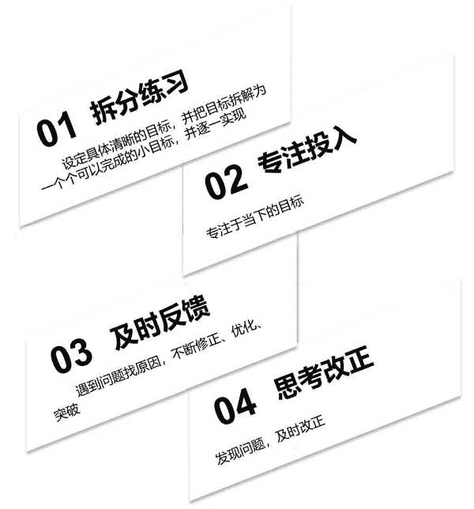
图 5.1
对学习者而言，刻意练习能有效提高学业表现，培养自律，强化思维及其他技能。
当遇到学习瓶颈想针对性训练时，可采用刻意练习法。
刻意练习提示词如下。
请你运用刻意练习的逻辑（任务拆解、专注投入、即时反馈、反思改进），帮我【输入需求】。

示例演示。
输入 DeepSeek：
我是初二学生，英语教材为人教版八年级下册，请你使用刻意练习的逻辑（拆解练习、专注投入、及时反馈、思考改正），帮我制作单词学习计划。
DeepSeek 输出：
STEP 1：精准拆解目标
日任务量：每天锁定 15 个新词（上午 8 个词+下午 7 个词），优先处理动词、形容词及教材重点标注词汇。
记忆周期：采用 7 日循环巩固（新词→次日复现→第 3/5/7 天检测）。
分层突破：
基础层—释义+拼写（听写达标）；
进阶层—造句（结合教材例句改写）；
高阶层—词根拓展（如 act→action→active→activity）。
STEP 2：高强度专注训练
早间 8 个词
5 分钟跟读教材音频，建立读音—拼写联结。
10 分钟“三明治记忆法”：新词→旧词→新词循环。
晚间 7 个词
用错词本词汇创作微型故事（如用 5 个词描述周末计划）。
完成 5 道单词选择题，检验词义辨析能力。
STEP 3：反馈—修正闭环
每日检测：晚 9 点进行 3 分钟听写，随机抽查 10 个词，错词标记★。
错误归类：拼写错误（红色）、词义混淆（黄色）、用法错误（蓝色）。
动态调整：
★次日起进入高频强化组，增加 3 分钟专项练习；
★若某词连续 3 次听写正确，则移出计划表。
STEP 4：防疲劳机制
周三/周日进行无压力巩固：
用已掌握词汇翻译流行歌曲片段；
在课本插图中标注对应英文词汇，实现视觉化记忆。
工具：用 Excel 记录错误率曲线，每周分析峰值时段并针对性强化。
关键逻辑：
① 精细化任务切割（15 个词/日）降低启动阻力；
② 听写+故事创作构建多维反馈环；
③ 动态调整确保始终处于学习区；
④ 可视化数据追踪避免无效重复。
按此方案实测，日均耗时≤35 分钟，18～25 天内可掌握人教版八年级下册词汇。
使用 AI 赋能刻意练习时，需结合自身实际灵活调整，避免生搬硬套，保持弹性以逐步深化理解，最终提升成绩。

## 5.3 SQ3R 阅读法：五步提升阅读效率

SQ3R 阅读法由美国心理学家罗宾森提出，强调阅读的主动性与系统性，旨在提高理解与效率。
SQ3R 共含五步，如图 5.2 所示。
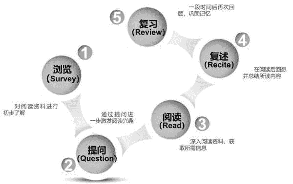
图 5.2
运用 SQ3R 学习就像玩解谜游戏。直接从头读到尾易觉枯燥，不如用解密方式阅读。
第一关：探路者 S 浏览
如同游戏前查看地图，阅读前快速翻阅目录、标题、插图，大致把握书的主旨。
第二关：好奇者 Q 提问
化身小侦探，提出疑问。如情节会如何发展？作者为何如此安排？带着问题阅读如同解谜。
第三关：寻宝者 R 阅读
带着问题细读，寻找答案。遇到重点可做标记，如游戏中收集宝物。
第四关：小老师 R 复述
假装自己是老师，用自己的话复述知识点，检验是否真正理解。教人也是加深理解的过程。
第五关：回溯者 R 复习
数日后回顾重点，如同给知识上锁，防止遗忘。
与“一气读完”相比，解密式阅读优势明显。
① 更有趣：像游戏般阅读。
② 更易记忆：每一步都在强化印象。
③ 更易理解：带着问题找答案。
④ 更有成就感：每完成一步都是小胜利。
最关键的是，这种方法让阅读变得愉快，知识更牢固，理解力悄然提升，效率自然提高。
SQ3R 读书法提示词如下。
请用 SQ3R 读书法协助我阅读【输入作品名】。
输入 DeepSeek：
我是中学生，请用 SQ3R 读书法协助我阅读《哈利·波特》。
DeepSeek 输出：
运用 SQ3R 阅读《哈利·波特》可加深对情节与人物的理解，同时保留阅读乐趣。步骤如下。
1. Survey 浏览：快速把握全书结构
翻阅目录、章节标题如“大难不死的男孩”“午夜决斗”等，了解分章脉络；浏览封面、封底与插图，感受魔法氛围。
预判内容：通过标题推测情节，如“密室”暗示危险，“三强争霸赛”指向竞赛，激发好奇。
2. Question 提问：针对章节提出问题
全局问题：
哈利如何从孤儿成长为对抗伏地魔的英雄？
魔法世界与现实世界的规则有何不同？
章节问题以《魔法石》第一章为例：
德思礼一家为何隐瞒哈利身份？
哈利伤疤的来历预示什么？
3. Read 阅读：带着问题沉浸式阅读
分章节精读，每次 1～2 章，边读边标记关键情节如哈利收到霍格沃茨来信、人物特点如赫敏聪慧、伏笔如魔法石初现。
联想推测：读到“海格提到神秘人”时联想伏地魔登场；读到“斯内普敌意”时推测真实立场。
4. Recite 复述：用自己的话总结
口头复述：向朋友或家人简述章节内容，如“哈利在火车上遇见罗恩，学会巧克力蛙卡片用途”。
写笔记或思维导图：记录关键事件如“三头犬路威守护活板门”，分析人物关系如哈利、罗恩、赫敏友谊建立过程。
5. Review 复习：串联全局，深化理解
短期复习：次日回顾前日笔记，确认问题是否解决，如“为何分院帽让哈利去格兰芬多？答案：他具备勇气而非野心”。
长期复习：读完一卷后，重读目录与笔记思考：伏笔如何回收如《密室》中日记真相，主题如何升华如《死亡圣器》中爱与牺牲的力量。
★技巧提示
结合兴趣延伸：对比电影与原著差异，如书中皮皮鬼为何被删；分析魔法生物象征意义，如守护神代表希望。
用 SQ3R 阅读《哈利·波特》，不仅能感受魔法魅力，还能提升逻辑分析与文学鉴赏能力。
再举一个与学习有关的例子。
输入 DeepSeek：
以下是朱自清散文名篇《春》的部分内容。
小草偷偷地从土里钻出来，嫩嫩的，绿绿的。园子里，田野里，瞧去，一大片一大片满是的。坐着，躺着，打两个滚，踢几脚球，赛几趟跑，捉几回迷藏。风轻悄悄的，草软绵绵的。
桃树、杏树、梨树，你不让我，我不让你，都开满了花赶趟儿。红的像火，粉的像霞，白的像雪。花里带着甜味儿；闭了眼，树上仿佛已经满是桃儿、杏儿、梨儿。花下成千成百的蜜蜂嗡嗡地闹着，大小的蝴蝶飞来飞去。野花遍地是：杂样儿，有名字的，没名字的，散在草丛里，像眼睛，像星星，还眨呀眨的。
请用 SQ3R 读书法分析这段文字，并预测考试中可能出现的问题。
DeepSeek 输出：
以下基于 SQ3R 读书法对朱自清《春》选段的分析及考试问题预测，结合语文考点设计。
一、SQ3R 深度解析
1. Survey 浏览
结构速览：段落分三层——草地嬉戏动态→果树繁花色彩嗅觉→蜂蝶野花视听联动。
感官标记：视觉绿草/红粉白花→触觉草软绵绵→听觉蜜蜂嗡嗡→嗅觉花甜味。
2. Question 提问
核心考点提问：
为何用“偷偷地”形容小草？
“红的像火，粉的像霞，白的像雪”运用了哪些修辞？
“闹”字与“飞”字表达效果有何差异？
野花“像眼睛，像星星”描写有何作用？
3. Read 阅读
重点标注分析：
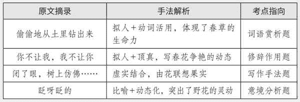
4. Recite 复述
多维复述法：
画面复现：想象镜头从俯视草地切换至仰视果树，最后特写蜜蜂；
感官串联：草地触感→花香甜味→蜂鸣嘈杂→野花繁盛。
5. Review 复习
对比复习表：
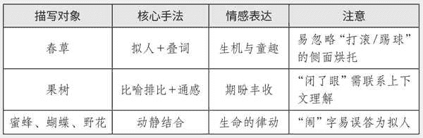
二、考试高频问题预测
基础题 字词句赏析
选择题：……
填空题：……
进阶题 段落作用与手法
简答题：……
对比阅读：……
拔高题 主题与风格
阅读理解：……
三、应试技巧补充
修辞题陷阱：“你不让我，我不让你”易被误判为排比，实为拟人+顶真。
跨文本联想：准备同类写景散文对比如《荷塘月色》比喻系统，应对比较阅读题。

用 SQ3R 的思路拆解散文片段，既能抓住命题的重心，也能在阅读中体会文字的韵味。把相关点归类，复习时顺着 手法→例证→功能 的脉络回看，效率会明显提升。

想把分析做得更到位，也能把具体的真题抛给 AI，让它按题型特征生成同类练习来加练。

向 DeepSeek 提交的提示：
以下是考试中出现的部分考题，请根据这些题目的特点预测一些类似的题目。
1．想象一下“小草偷偷地从土里钻出来”描绘了怎样的画面，并找出与该句描绘画面最接近的一项（ ）。
A．春风花草香
B．惟有青青草色齐
C．草色遥看近却无
D．风吹草低见牛羊
2.“成千成百的蜜蜂嗡嗡地闹着，大小的蝴蝶飞来飞去”，如果将这一句中的“闹”字换成“叫”字好不好？为什么？
3．从第一段中找出描写小草的质地、色泽和生长旺盛的词语。

DeepSeek 的回应围绕诗句对应、词语赏析、信息提取、修辞辨析、段落功能、跨文本比较与迁移应用等要点，生成多组预测题并附上了参考答案与解析。命题规律可概括为紧扣文本微观语言、善于联动古诗意境、设问由识别到分析再到比较逐层递进。复习时可制作考点对照表，横向梳理同类题型并把答题模板内化。 EXr6287u6NNVz+GYLY+7SDk226FstKIHdC0bNoQkB2Nqi1xSR0yxPmwrTs5gRi/BtfSbid6dBhii9q7cz2pIyA==

## 5.4 POA 模型：用伙伴、目标、加速三板斧激活行动力

POA 模型在不同场景下被提出。用在行动力提升上，提出者张宁强调要同步优化同伴 Partner、目的 Objective 与加速路径 Acceleration，如图 5.3 所示。

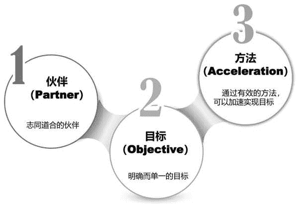

图 5.3

要点是找到理念一致的同伴、保持单一清晰的目的、并选用行之有效的路径。

同伴之间可相互督促与鼓励，让目的更快达成；路径的选择决定效率，合适的方法能做到事半功倍，让每次投入更贴近结果；清晰的目的则是行动力的基石，能让个人或团队的努力方向统一，形成合力。

张宁还给出了一个行动力公式，如图 5.4 所示。

图 5.4

依此公式，路径越高效行动力越强，同伴越多推进越快，目的越聚焦行动力越强。

把 POA 与 AI 结合，学习者能获得可操作的策略，帮助自己尽早走出舒适区，从被动转向主动。

提升行动力是系统改进的过程，建议针对自身短板逐项解决。比如不爱运动的学生，可借助 AI 工具依据 POA 推导出改进方案。

案例 运用 POA 模型与 AI 工具对话

向 DeepSeek 提交的提示：
我是高中生，平时不喜欢锻炼身体，请问如何用 POA（Partner、Objective、Acceleration）模型改变这种情况？

DeepSeek 的回应围绕轻负担监督、微习惯寄生与低阻力启动展开。同伴层面建议课间与同学结伴绕操场走、回家让家长做隐形提醒；目的层面把运动绑定在上下学通勤和学习间隙，如多走百米、每学习40分钟做一分钟静蹲；路径层面用壁纸记录坚持天数制造损失厌恶，并用5秒倒数打破惰性，整体遵循无感启动与最小阻力设计原则。

同理，针对初一学生作业拖拉的问题，也能通过 AI 与 POA 结合获得参考策略。

案例 运用 POA 模型改变写作业拖拉的问题

向 DeepSeek 提交的提示：
我是一名初一的学生，写作业从小学开始就很拖拉，经常走神。1 小时的作业量，经常需要 2～3 小时才能完成。如何通过 POA（Partner、Objective、Acceleration）模型改变这一现状？请提供一些实用的方法。

DeepSeek 的回应给出 POA 高效写作业简化版，包含绑定监督同伴、把目的切割为15分钟小任务、以及极简环境配合即时反馈。原理在于利用在场效应抑制走神、以短时专注匹配大脑周期、并通过环境降噪与奖励回路建立行动愉悦感。执行口诀为有人陪、切小块、清桌面、秒奖励，坚持两周即可见效。

由于 AI 回复常偏笼统，需要结合自身情况细化。例如可进一步把目的定位为初一寒假作业，并结合 SMART 原则设计方案。

案例 运用 POA 模型+SMART 原则提高设定目标的准确度

向 DeepSeek 提交的提示：
我是一名初一的学生，请基于 POA（Partner、Objective、Acceleration）模型中的“目标（Objective）”，帮我设定明确且可实现的学习目标。然后以初一寒假作业为例，采用 SMART 原则帮我设计一个作业完成方案。

DeepSeek 的回应强调基于 POA 与 SMART 的寒假作业计划，具体、可衡量、可实现、相关、有时限。以15天为期，总目的为独立完成全部作业且正确率不低于85%。

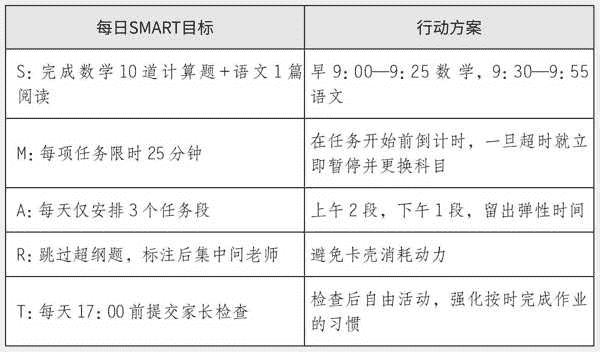

关键控制点包括分心超5分钟追加任务段、连续达标兑换游戏时间、以及在日历上做可视化打卡，形成小目的日清的无压节奏。 EXr6287u6NNVz+GYLY+7SDk226FstKIHdC0bNoQkB2Nqi1xSR0yxPmwrTs5gRi/BtfSbid6dBhii9q7cz2pIyA==

## 5.5 第一性原理：回到最底层的逻辑

设想面前有一座巨大的乐高城堡。它是怎样搭成的？是由一块块积木堆起来的。若要重新设计，可先拆解成积木再按新思路搭建。这个过程正是第一性原理思维。

第一性原理就是回到最基础、最核心的事实与原理，用底层逻辑来解决问题或创造新事物。在学习生活中，这种思维方式能帮助更透彻地理解与应对。

使用第一性原理一般遵循三个步骤，如图 5.5 所示。

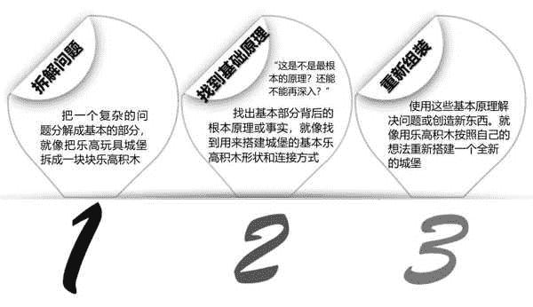

图 5.5

把 AI 与第一性原理结合，能有效提升学习效果。学生只要掌握与 AI 的对话方式和提示词，就能实现高效学习。

案例 利用第一性原理高效掌握一门学科

学生 A 想通过 AI 赋能，用第一性原理高效掌握一门学科，具体场景如下。

向 DeepSeek 提交的提示：
我用 AI 互动学习英语感到困惑，不知道如何将它应用到实际问题中。请你用互动对话的方式与我沟通，一次互动解决一个问题。在对话的过程中，使用第一性原理（拆解问题，找到基础原理，重新组装）协助我认识 AI 互动应用的本质，从根本上解决我不会用 AI 互动学习的困惑，互动方式要像朋友聊天一样一步步来。

DeepSeek 的回应先用骑自行车的类比引导定位问题根源，再以“背单词枯燥、记不住”为切入点做第一性原理推演：本质是需要场景化调用而非单纯记忆，原理是情绪与场景更易被大脑保留，AI 可模拟真实情境嵌入新词，重组为点餐对话等互动练习。

向 DeepSeek 提交的提示：
最抓狂的是总是背了忘。

DeepSeek 的回应通过现象观察给出魔法实验对比，拆解遗忘本质为大脑优先保存带情绪和场景的信息，随后提供荒诞小剧场或感官联想两种记忆钩子选项，帮助把单词转化为可调用的图像故事。

借助第一性原理理解与应用概念，能加深理解并提高解决问题的能力，AI 在其中起到引导与激励作用，帮助构建知识框架并鼓励独立思考。 EXr6287u6NNVz+GYLY+7SDk226FstKIHdC0bNoQkB2Nqi1xSR0yxPmwrTs5gRi/BtfSbid6dBhii9q7cz2pIyA==

# 第六章

AI 提效训练：打造完美学习计划与时间管理方案

EXr6287u6NNVz+GYLY+7SDk226FstKIHdC0bNoQkB2Nqi1xSR0yxPmwrTs5gRi/BtfSbid6dBhii9q7cz2pIyA==

## 6.1 智能规划：用大模型搭出个性化学习路径

在使用大模型制定学习计划前，需要先明确对话策略，即与模型交互的逻辑。没有清晰逻辑，模型往往给出空泛的“正确废话”。

制定学习计划的策略可分为五个步骤，如图 6.1 所示。

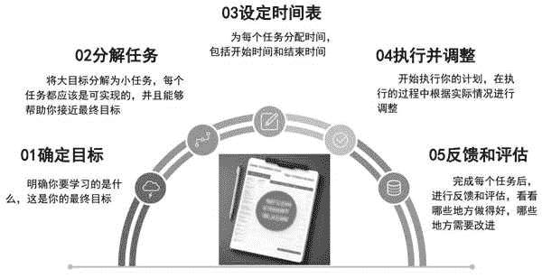

图 6.1

按此五步执行，就能设计出基础的学习方案。若想个性化，可借助 AI 大模型实现。以 DeepSeek 为例，它能结合学习目的、时间安排和学习风格生成具体计划。

对不熟悉提示词优化的用户，提问往往比较普通，难以获得精准答案。

普通提示词示范

向 DeepSeek 提交的提示：
我正在准备初二地理会考。我有两个月左右的时间，每天可以学习 2 小时，你能帮我制订一个学习计划吗？

DeepSeek 的回应采用三阶段递进：基础梳理、重点突破、考前冲刺。每天两小时拆分为复习加练习，周末总结。第一阶段熟悉教材框架，第二阶段攻克高频考点和薄弱点，第三阶段通过模拟实战适应节奏并查缺补漏，配合工具精简、时间弹性与心态管理建议。

提示词分析显示该提问虽然表达了需求，但缺乏个性化信息， [...]

让指令更清晰，AI 才能给出对的答案

只说“帮我做学习计划”，却不交代自己会什么、不会什么，往往会得到一份泛泛而谈的方案。比如学生本就掌握了基础概念，照单全收“第一阶段基础梳理”只会浪费时间。提示信息如果忽略个人起点，针对性就会大打折扣。

学科本身也有特点需要点出来。地理会考很吃地图判读、材料解读等实操能力，把要求简化成背知识点，关键环节就容易被漏掉。经验是，需求描述越具体，模型给出的结果就越贴身。

经典思维模型提示词

想让分析更有结构，可以借用 SWOT。向 DeepSeek 输入的示例是：用 SWOT 帮我从地理这门课梳理优劣势，我是初二学生，地理成绩不及格，对地理没兴趣，大概还有两个月备考，每天能投入两小时。

模型回应的框架大致如下：

SWOT 分析

优势
- 学习时长可观：每天两小时，两个月足以系统过一遍。
- 跨科迁移可能性：历史、数学、科学等科目的逻辑和记忆技巧可以迁移过来。
- 年龄学习弹性大：初二正处于记忆与适应力较好的阶段，找到兴趣就能快速拉升。
- 外部资源丰富：视频、题库、老师同学都能作为补充。

劣势
- 基础薄弱：成绩不及格，核心概念掌握不牢。
- 兴趣不足：动力弱，效率自然下来。
- 方法未匹配：学法没有对路，效果打折。
- 时间分配易失衡：安排不合理会导致复习碎片化。

机会
- 目标明确：会考是短期可达成的硬指标。
- 学习方式多样：地图工具、纪录片、互动 App 能激活兴趣。
- 可得支持：老师答疑、同伴互督都能加速进步。
- 知识面集中：地理考点相对聚合，短期提分空间大。

威胁
- 动力持续性差：兴趣问题不解决，计划容易中断。
- 时间被挤压：前期拖延，后期会很紧张。
- 焦虑累积：复习效果不理想容易在考前波动发挥。
- 他科任务冲突：综合压力可能侵占地理时间。

基于上述分析的改进思路
- 发挥优势：严格执行每日两小时，把其他科目的好方法迁移过来。
- 补足劣势：看纪录片、玩地理小游戏培养兴趣；从最基础的点开始扎实推进；尝试思维导图、口诀、图表等多种记忆方式。
- 抓住机会：每周定小目标并自我奖励，多用学习 App 辅助，及时向老师同学求助。
- 化解威胁：把地理和生活联系起来增强实用感；严格记录进度避免拖延；多做模拟熟悉题型缓解焦虑。

用好提示词的本质，不是把对话说得更客气，而是善用经典模型、策略框架，把问题拆解清楚。站在这些模型的肩膀上，想象力和执行力都会更高效。

## 6.2 智能规划：用 AI 大模型定制个性化学习之路

本部分围绕两件事展开：为什么要做学习计划，以及怎样用提示词让模型快速生成可用方案。

一、制定学习计划的意义
在模型出现之前，排计划靠反复推敲，做出后又难以及时修正。借助 AI，大模型能大幅压缩成计划的时间，并且随时根据反馈迭代，让目标实现更快。

下面以 ChatGPT 为例，介绍一个通用提示模板，新手也能上手。

二、通用提示模板
模板由三块组成，如图 6.2 所示。

图 6.2
1．角色定位
先锁定身份，比如“请你扮演学习规划师”，激活模型的角色认知，让指令更精准。
2．需求说明
把目标、现状、限制条件写清楚，模型才能对号入座。
3．执行步骤
列出明确的操作清单，用“请按以下步骤执行”引导模型按路径走。

举例
任务是为研究生入学考试做计划。

角色定位：请你担任学习规划师，能制定单科、多科、重难点攻关以及周、月、季、年计划。

需求说明：12 月要考研，白天工作，每天能投入 3 小时，最弱的是英语，希望其中 1.5 小时用于英语。

执行步骤：1. 先做英语基础检测；2. 结合基础情况给出剩 3 个月的分阶段方案；3. 用时间管理表呈现第一个月任务。

模型先抛出基础检测问题，了解听读写难度、词汇语法水平、薄弱题型等。再据此给出反馈：第一月夯实基础，工作日每天 3 小时分配为听力口语、阅读写作、复习巩固；周末做模拟、查漏补缺、预习。随后给出首月时间表。

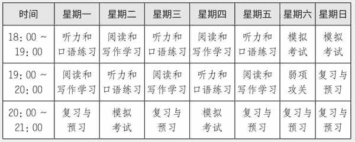

方案可以根据真实情况微调，每周的模拟能帮助追踪进度、及时调整。

## 6.3 时间在你手中：用 AI 大模型进行时间管理

市面上的时间管理工具不少，但不少人依然低效。本节以 DeepSeek 为例，从自我剖析、策略匹配、落地执行、即时反馈四步说明如何用好 AI。

一、自我剖析
先认识自己，才能定制方案。提示词结构可拆为【自我认知】【驱动力】【价值观】【需求】【期望】【习惯】【偏好】。

示范：我是高三考生，请用提问方式互动，从【自我认知】开始，帮助我深挖动机与价值观，理解需求与期望以便提升复习效率。注意一次只问一个问题。

模型会先问：你现在的学习状态是充沛、疲惫还是迷茫？

二、策略适配
多轮对话后，模型会据此推荐策略和个性方案。

提示结构：【个性化】【策略】【方案】

示范：请通过提问了解我的特点与需求，推荐几种时间管理策略并帮我定制方案。

模型会询问作息节奏、碎片时间、高效时段、任务类型、并行处理能力、长期项目、主要挑战、分心源、优先级混乱等，再结合偏好与目标给出建议，如番茄工作法、GTD、时间块、艾森豪威尔矩阵、80/20 法则、习惯叠加等。

三、落地实施
策略选定后要变成具体时间表，要求科学且可调。

提示结构：【时间表】【科学合理】【灵活可变】

示范：基于我选定的策略，自由学习时间 20:00～22:00，帮我做一份科学合理且可调的时间表。

输出示例：20:00～20:10 准备与目标设定；20:10～20:50 深度学习时段 1，用番茄法保持专注；20:50～21:00 短暂休息；21:00～21:40 深度学习时段 2，切换科目；21:40～21:50 复习总结；21:50～22:00 次日预热与放松。并给出优先级、弹性时长、多样化学习、周回顾等调整建议。

四、及时反馈
提示结构：【时间】【现状】【修正】

示范：执行时发现 20:50～21:00 起身走动后很难再集中，请据此调整。

模型给出优化版：减少重启成本，采用低刺激放松。深度时段 1 可连续 40 分钟进入心流；休息时闭眼听纯音乐、缓慢喝水、凝视远方，避免视频、聊天。总结用主动回忆，次日预热写便利贴。提供若仍专注可延长时间、疲劳时换科目不换姿势等灵活应对。

借助 AI，我们能更精准感知时间规律，合理分配、科学决策，从而提升学习效能。

## 6.4 高效备考：制订考前学习计划与时间管理攻略

把 AI 当成考前的冲刺搭档

大考临近时，身边配一个会排表的智能伙伴，复习节奏和时间投放就能保持稳定。

提示词参考

注：

【】请按自身实际情况填写。

对 DeepSeek 说：

请你担任学习规划师，你擅长制定各类学习方案，包括：1. 单科复习方案；2. 多科整合方案；3. 重难点攻关方案；4. 周计划、月计划、季计划、年计划。

面向【6】月份【普通高等学校招生全国统一】考试，我每天可以投入【2】小时备考高考。我最薄弱的科目是【物理】。请结合我现在的情况按下面步骤操作：1.【物理】学科基础摸底；2. 距离高考还有【30】天，给出分阶段应试安排；3. 给出每周的具体行程。

DeepSeek 示例回复：

好的！基于你的情况，我将按以下顺序为你制定方案。

**1. 物理学科基础摸底：** 帮助你明确当前掌握程度。
**2. 分阶段应试安排：** 将 30 天划分为 3 个学习阶段，逐步提升效率与分数。
**3. 每周行程表：** 细化到每周具体任务，确保可落地。

一、【物理】学科基础检测【自测题目】

想摸清物理基础，请先完成如下自评【力学基础：…… 电磁学：…… …… 综合问题：……】

根据你的反馈我会进一步调整侧重点。若拿不准，可简单描述平时做物理题时的卡点，例如记不住公式、读不懂题意、计算容易出错等。

二、【30 天高考物理极简提分方案】

每日 2 小时核心框架

·19:00~19:40：物理硬啃【只练 1 个高频易错题型】。
·19:50~20:20：其他科目急救【数学→语文→英语轮换】。
·20:25~20:55：物理真题【限时作答+红笔订正】。
·20:56~21:00：写明日重点【1 道必做题+1 条避坑提示】。

三阶段侧重

1. 前 10 天：题型爆破
·每晚精做 1 个高频错题，例如电磁场偏转题。
·吃透该题型的 3 个核心步骤+2 个必用公式。

2. 中间 15 天：抢分实战
·限时刷物理选择题【10 题/12 分钟】。
·大题只做前两问【圈出题干关键数据】。

3. 最后 5 天：考场状态
·每天下午计时做整套物理试卷【重点练时间分配】。
·晚上订正时用“ ”标注错题。

保分技巧
·放弃难题最后一问【省出 20 分钟保基础分】。
……

三、每周学习规划

以下是每周安排。

第 1 周【第 1～7 天】：基础巩固
……

第 2 周【第 8～14 天】：专项突破
……

第 3 周【第 15～21 天】：综合训练
……

第 4 周【第 22～30 天】：模拟冲刺
……

额外提醒

**·错题本：** 把每次练习的错题收进错题本，定期翻看。
· **时间管理：** 每天固定 2 小时学习，避免拖延。
· **心态调节：** 保持适度运动，避免过度焦虑，保证睡眠。

这个案例说明，智能大模型可以帮助我们安排学习时间，明确每个时段做什么。当然，你也可以上传已完成的测验题，让模型更了解你的水平，从而给出更有针对性的时间管理建议。 EXr6287u6NNVz+GYLY+7SDk226FstKIHdC0bNoQkB2Nqi1xSR0yxPmwrTs5gRi/BtfSbid6dBhii9q7cz2pIyA==

## 6.5 AI 学习计划设计课―做自己的时间管理大师

本节的核心任务是结合前文所学，借助智能大模型设计一套属于自己的时间管理方案。

下面从三个角度展开，分别是依据最佳学习策略模型制定计划、挑选智能大模型、输入提示词。

一、依据最佳学习策略模型制定学习计划

结合当前学习状况，挑选一项较为紧迫的学习任务，例如“提升英语成绩”。

按最佳学习策略模型填写表 6-1。

二、挑选智能大模型

三、输入提示词

结合“最佳学习策略模型”设计一套学习计划，分别设计优化提示词与经典模型提示词，并填写表 6-2。

表 6-1 最佳学习策略模型训练
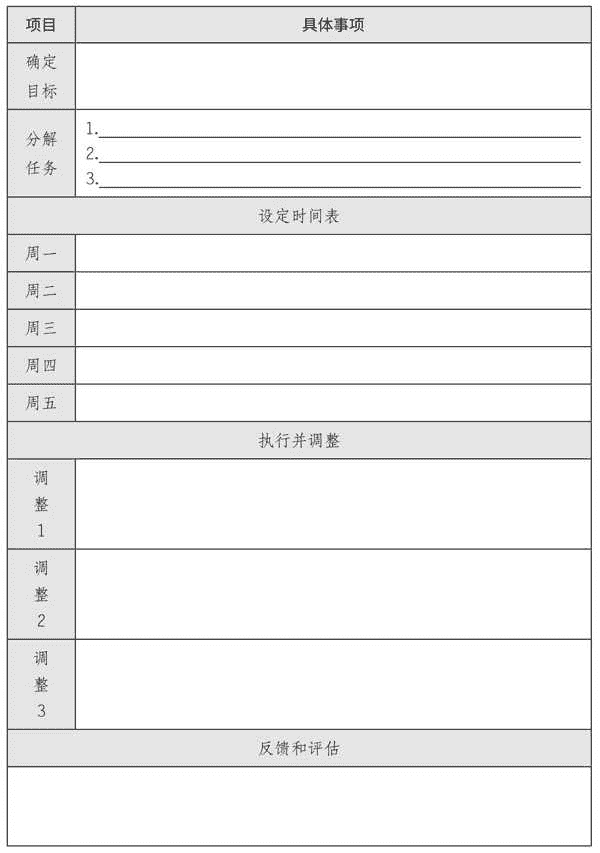

表 6-2 提示词训练 EXr6287u6NNVz+GYLY+7SDk226FstKIHdC0bNoQkB2Nqi1xSR0yxPmwrTs5gRi/BtfSbid6dBhii9q7cz2pIyA==

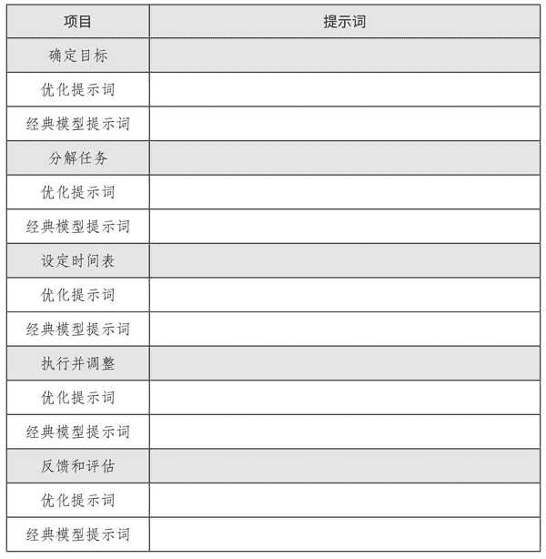

# 第七章

AI 辅助学习完全指南

EXr6287u6NNVz+GYLY+7SDk226FstKIHdC0bNoQkB2Nqi1xSR0yxPmwrTs5gRi/BtfSbid6dBhii9q7cz2pIyA==

## 7.1 用智能体全面打磨个人学习链路

信息高度集中又泛滥的今天，优化个人学习链路变得关键，这不仅能提升效率，还能为学生在知识海洋里开辟更清晰、更稳的航道。智能大模型的出现，帮助我们更深入、更全面地认知个人学习需求与短板。

本节从三个方面讲解，分别是不同学习者的低效模式、智能体在优化学习全流程中的具体应用、优化学习全流程的策略。

一、不同学习者的低效学习模式

1. 基础薄弱的学生
这类学生往往缺乏计划和方向，智能大模型可以帮助他们搭建有序、结构化的学习体系，找到方向与目标。

2. 基础中等的学生
这类学生常因学习规划不系统而影响效果。智能大模型的个性化分析能针对其情况提供更科学的建议与方案，显著提升质量。

3. 学霸级学生
对于已能极致优化学习流程的学霸而言，智能大模型如同利刃，能帮助他们在学习海洋中更快、更精准地锁定目标。在精准指导下，学习效率可实现质变。

没有合适的学习方法和流程，会导致学生漫无目的、效率低下，成绩下滑，长此以往还会影响未来发展。

提示词解决方案：深入剖析个人对学习流程的认知是至关重要的一步。

提示词示范

向 ChatGPT 输入：

请你担任学习流程优化师。在开始前，你会先和我一起检查并了解我目前的学习习惯和方法。你会给出专业建议，帮助我找出可改进之处，并引导我形成更高效的学习策略与习惯。

ChatGPT 输出：

没问题！作为学习流程优化师，我会陪你一起检查和了解你当前的学习习惯和方法。通过这个过程，我会给出专业建议，帮助你找出可改进之处，并引导你形成更高效的学习策略与习惯。

为了开始，请回答以下几个问题，以便我更好地了解你的学习情况。

1. 你通常是如何听课、做作业和复习的？请描述你的学习流程。
2. 学习过程中遇到了哪些困难和挑战？你觉得哪些方面需要改进？
3. 你尝试过哪些学习方法或技巧？它们对你的学习有何帮助？
4. 你希望通过优化学习流程达到什么目标或效果？例如，提高成绩、更好地理解内容、提升效率等。

请提供上述信息，我会据此给出具体建议和指导。

向 ChatGPT 输入：

1. 听老师讲，做笔记，基本不复习。2. 听不懂老师讲什么，课前想预习但做不到。这些我都想改进，以提高成绩。3. 我学过记忆法和思维导图，但平时很少用。4. 提高成绩，提升学习效率，有更多时间玩。

ChatGPT 输出：

非常感谢你的信息！根据你的回答，我理解你希望改进听课和预习能力以提高成绩，并希望优化流程以减少学习时间，从而有更多时间放松。下面是针对性的建议。

1. 听课与做笔记的高效方法
1.1 预习先行：养成课前预习习惯，通过提前阅读教材或查阅相关资源【如视频、网站】，初步了解知识点，听课时更容易抓住重点。
1.2 主动参与：课堂上积极提问、与老师互动，及时解决疑问，同时结合预习做好笔记，强化理解与记忆。

2. 系统提升预习能力
2.1 计划性预习：制定每日/每周预习计划，设定具体目标【如预习某一章节或解决特定问题】，确保时间分配合理且持续。
2.2 资源整合：筛选优质学习材料【如教材、学术网站、教育平台】，针对不同学科选择适配资源，提升预习准确性和效率。

3. 学习方法的应用
3.1 实践记忆法：练习不同的记忆法，如联想法、故事法等，将抽象知识转化为具体形象。
3.2 利用思维导图：在学习过程中尝试使用思维导图，将知识点关系可视化，帮助记忆和理解。

4. 提高学习效率
4.1 制定计划和时间表：合理安排每天学习时间，并制定具体学习目标。
4.2 高效复习：利用科学复习方法，如 Spaced Repetition【间隔重复】和 Active Recall【主动回忆】，有针对性地复习。

5. 时间管理与奖励机制
5.1 设立优先级：根据任务的重要性和紧急性合理安排学习时间。
5.2 奖励措施：设立奖励机制，如完成一项任务后可休息片刻或做喜欢的事，以激励自己。

通过以上措施，你可以提高听课和预习能力，加深对内容的理解。同时优化流程，有助于提升效率，腾出更多时间放松娱乐。请尝试并坚持实践这些改进，相信会有收获。若有疑问，随时告诉我。

二、智能体在优化学习全流程中的具体应用

1. 个性化学习路径设计
智能体能通过分析学习行为和偏好，为学生制定个性化路径，让学生在最适合的环境中学习，并获得最大效益。

2. 效率评估与提升
智能体能精准评估学习状况，提供合理建议与策略，实现效率最大化。

3. 实时监测与反馈
智能体能编写代码、开发小程序，实时监测学习进度并及时发现问题，提供即时、有效的反馈和解决方案，使学生持续改进和优化流程。

通过智能体的全面优化，每位学生都能找到最符合个人特点的学习方法和流程，使学习不再漫无目的。无论基础如何，智能体都能量身定制方案，帮助他们越走越顺。

三、优化学习全流程的策略

1. 对于已有系统学习流程的学习者
**【1】个性化：** 首先对学习者进行个性化梳理，尊重学生特点。
**【2】优化：** 根据学习习惯，对其流程进行优化。

2. 对于没有系统学习流程的学习者
**【1】方案多样性：** 让智能工具【如 DeepSeek、ChatGPT 等】提供最有效的十种学习流程。
**【2】选择与简化：** 选择一种流程进行优化，并将其简化至三个步骤。

下面讲解在不同应用场景下，用何种提示词引导智能体给出最优的方法和流程。 EXr6287u6NNVz+GYLY+7SDk226FstKIHdC0bNoQkB2Nqi1xSR0yxPmwrTs5gRi/BtfSbid6dBhii9q7cz2pIyA==

## 7.2 高效听课：用 AI 进行听课流程优化

听课是学习的重要环节。高效听课不仅能快速吸收知识，还能激发兴趣和学习动机。借助 ChatGPT 等智能工具，我们能更系统、更科学地优化听课流程，更好地吸收与理解课程内容。

接下来针对三类学生展开，分别是学习基础差的学生、学习基础中等的学生和学霸级学生。

一、针对学习基础差的学生

问题：不预习，上课注意力不集中、经常东张西望、打瞌睡，抓不住课堂重点。

提示词结构

【角色扮演】【总需求】【个人喜好】【实施方法】

提示词示范

向 ChatGPT 输入：

请你担任个人学习流程优化师，你擅长帮助基础较差的学生进行有效学习规划。我想提高听课效率，目前我上课时经常分心、打瞌睡，且很难抓住课堂重点。在学校不能上网，不能用手机。我不喜欢做学习计划，规划的步骤不要超过五个，多了我做不了。请你帮我制定一个科学且能提高听课效率的方案，提供一系列简单可行的方法和策略，以便我可以集中注意力、有效地理解和吸收课堂所学内容。

ChatGPT 输出：

理解你的需求。在这种情况下，我们可以制定一个简单且实用的方案，帮助你提高听课效率。以下是五个简单且实用的步骤。

1. 坐在前排
坐在前排可以帮助你减少分心，更容易集中注意力，也更容易与老师互动。

2. 快速预习
在上课前，花几分钟快速浏览即将学习的内容，了解大致主题和结构。

3. 积极参与课堂
在课堂上主动回答问题或向老师提问，这样可以帮助你集中注意力。

4. 精简笔记
不需要记下所有内容，用自己的语言记录关键点和重要信息即可。

5. 规律作息
保持足够的睡眠和适量的运动，有助于保持清醒。

这些步骤都很简单，不需要额外工具或大量时间，应该能帮助你更有效地听课。如果你发现这些方法有用，或需要进一步帮助，随时告诉我。

二、针对学习基础中等的学生

问题：听课时照抄老师黑板板书，对知识没有自己的思考，抓不住学习重点。

提示词结构

【角色扮演】【需求】【无法执行的环境与情况】【实施方法】

提示词示范

向 ChatGPT 输入：

请你担任个人学习流程优化师，你擅长帮助成绩中等的学生提高考试成绩。我想要提高听课效率，但我听课时照抄老师在黑板上的板书，对知识没有自己的思考，抓不住学习重点。在学校不能上网，不能用手机。我不喜欢做学习计划，规划的步骤不要超过五个，不需要使用健康生活、习惯这类抽象概念，请你提供具象化的听课步骤，以便我可以更加集中注意力、有效地理解和吸收课堂所学内容。

ChatGPT 输出：

明白了，那么我们来制定一些更为具体和简洁的听课步骤，帮助你更有效地理解和吸收课堂所学内容。

1. 精简笔记
只记录关键词、重要概念和老师强调的知识点，不要照抄所有板书。
用符号或缩写简化笔记，比如用箭头表示因果关系，用“+/-”表示优缺点等。

2. 主动思考
听课时，尽量将老师讲述的内容与已知知识联系起来，思考其逻辑关系和应用范围。
标记不理解的内容，并尝试自己解决或课后询问老师。

3. 课前预习
在课前简要浏览教材或课件，了解即将学习的主要内容和结构。

4. 回顾与整理
课后快速回顾笔记，整理关键信息，并尝试回答之前标记的不理解之处。
如果需要更多帮助或有其他问题，随时告诉我。

三、针对学霸级的学生

问题：学习有方法，对于每项任务都有思路和策略，但还有其他需要优化之处。此外，身边没有人提供指导。

提示词结构

【角色扮演】【优化学习方法】【个人目前学习方法】

提示词示范

向 ChatGPT 输入：

请你担任个人学习流程优化师，你擅长帮助班上排名前三的学生提高成绩，我需要你帮我优化我的听课方法。我目前的听课步骤是：1. 课前 3～5 分钟，预览这节课老师要讲的内容；2. 听课时会把重难点记录下来；3. 课后 3～5 分钟，回顾这节课讲的要点。我是住校生，学校禁止带手机上学。请给出具体的优化建议，以便我更有效地理解和吸收课堂所学内容。

ChatGPT 输出：

你目前的听课方法已经很系统和有效了。以下是一些具体的优化建议，希望能帮助你更加深入地理解和吸收课堂所学内容。

1. 加深预览
在课前 3～5 分钟预习即将学习的内容，记录自己的问题或疑惑，这样在听课时就可以有针对性地寻找答案。

2. 动态笔记
在听课时，除了记录重难点，还可以尝试画思维导图，将知识点之间的联系可视化，这有助于加深理解。
对于听不懂的知识点，可以在笔记旁边留下问号，并在课后及时解决。

3. 积极参与
尽可能多地参与课堂互动，这样可以保持大脑活跃度，并加深对知识的理解。

4. 精细回顾
利用课后 3～5 分钟回顾课堂上老师讲解的要点，还可以尝试用自己的话复述课堂内容，检查自己是否真正理解相关知识点。
将这节课的知识点与之前学过的内容联系起来，看看是否能获得新的发现和理解。

5. 定期整理
每周花一些时间将一周的笔记整理一遍，加深记忆，巩固知识。
如果有其他问题或需要更多帮助，随时告诉我。 EXr6287u6NNVz+GYLY+7SDk226FstKIHdC0bNoQkB2Nqi1xSR0yxPmwrTs5gRi/BtfSbid6dBhii9q7cz2pIyA==

## 7.3 作业无压力：用 AI 进行作业优化

写作业是巩固课堂知识的重要环节。通过作业，学生能发现自己对知识点的理解程度，从而有针对性地复习。同时，错题本是记录和反思错误的重要工具，对提升效率和改善方法意义重大。

接下来从写作业的策略与 ChatGPT 在作业解答中的应用两个方面介绍。

一、写作业的策略

提示词示范

向 ChatGPT 输入：

请你担任个人学习流程优化师。我是一名初中生，就读于寄宿学校。我每天都有很多作业，我希望能更高效地完成它们。我不喜欢抽象概念，如“集中注意力”和“积极心态”，我需要具体、实用的策略和方法。请你根据以下条件，为我提供最有效的写作业策略和方法。

1. 步骤不要超过五个。
2. 不能使用手机和网络。
3. 不需要制定学习计划。
4. 不需要改变生活习惯，如作息时间。

请你给出具体的步骤和实施方法，并解释每个步骤的理由与价值，以帮助我更有效地理解和吸收学习内容。

ChatGPT 输出：

当然可以。根据你的要求，这里是一些具体、实用的策略和方法，帮助你更高效地完成作业。

步骤 1：制定优先级清单
方法：每天做作业前，制定一份优先级清单。根据重要性和难度，确定每个任务的处理顺序。
理由与价值：这样可以确保你首先处理最紧急或最困难的任务，避免拖延，以便更有条理地完成作业。

步骤 2：使用番茄时间管理法
方法：以“学习 25 分钟+休息 5 分钟”为一个周期，每完成四个周期后休息 15～30 分钟。
理由与价值：这种方法可以帮助你保持专注，防止过度疲劳，提高学习效率。

步骤 3：消除干扰
方法：找一个安静的环境写作业，或者使用降噪耳机【或耳塞】减少周围干扰。
理由与价值：减少外部干扰可以帮助你更好地集中注意力，提高完成作业的效率。

步骤 4：分解任务
方法：将大任务分解成小任务，一步一步完成。
理由与价值：分解任务可以减轻心理负担，使学习过程更加可控。

步骤 5：利用碎片时间
方法：利用日常生活中的碎片时间，如午饭时间、等待时间等，来完成一些简单的知识点回顾、单词背诵等小任务或预习。
理由与价值：利用碎片时间可以帮助你提高学习效率，缓解大量作业带来的压力。

前文已经梳理了提升课堂专注与吸收效率的实操要点，后续若有疑问可随时沟通。

二、借助 AI 完成作业类任务
以写作训练为例，写作是锻炼语言表达与逻辑思维的重要环节，但多数学习者练习频次不够，且很难获得持续的修改反馈。
在这种场景下，AI 的价值就体现出来了。合理调用 ChatGPT，每周安排两轮写作实操，水平会明显提升。模型能够及时点评，指出文中薄弱之处并给出改进方向，从而加快学习节奏。借助 AI 做写作演练，能够弥补传统教学反馈滞后、指导不够个性化的局限，使提升更系统、更高效。

1. 拆解高分范文的学习方式
指令示例
请帮我对我上传的一篇高分范文做整体架构解析，具体要求如下。

1. 主旨提炼 一句概括
请用“观点+意义”格式提炼核心思想，例如“月光象征乡愁，折射城市化进程中的文化流失”。同时给出深化建议，例如“可加入具体年代事件以增强说服力”。

2. 结构拆解可视化呈现
·起笔 50～80 字：概括开头段落。
·衔接段：指出文中转折点，控制在 100 字内。
·展开段：以场景化描写推进。
·收尾：与开头呼应并给出升级建议。

3. 论证技巧拆解
·数据论证：列出所用数据并标注出处。
·隐喻逻辑：分析文中的隐喻，如“月光”比喻为“银币”再延伸为“文化储蓄罐”。
·反差设计：找出制造冲突的对比，如 A 与 B 的对照。

4. 语言特色拆解
·亮点句式：挑出精彩句子，说明修辞手法及高级词汇。
·待改句式：指出需要修改的句子并说明原因。

下面是这篇范文全文：【用户上传范文内容】
模型返回：（略）

2. 让 AI 扮演阅卷教师评分点评
指令示例
你是一名有 15 年教学经验的初二语文资深教师，严谨细致，善于发现亮点也看得见改进空间。请严格依据以下标准审阅我的作文并给出反馈。

作文评分标准 满分 50 分
1. 字词标点失误 扣分项
·每 3 个错别字扣 1 分，重复错别字只计一次。
·明显标点错误如句号逗号混用、引号缺失等每 2 处扣 1 分。
·扣分说明需指出具体位置及正确写法。

2. 词汇精准度 0～10 分
·词语是否精准恰当，是否出现词不达意、搭配不当、褒贬误用或重复单调。
·是否恰当地使用符合初二水平的丰富词汇或成语。
·评分建议需举例说明不当用法并给出更优选择，肯定用词精妙处。

3. 结构与主题 0～15 分
·层次是否清晰，段落划分是否合理，有无明确开头主体结尾，过渡是否自然。
·主题是否鲜明，内容是否紧扣中心，有无偏离或空洞。
·建议具体说明结构优缺点与中心强化办法。

4. 语句表达 0～15 分
·流畅性：是否通顺，有无成分残缺、搭配不当、语序混乱等病句。
·得体性：语言风格是否符合文体，语气是否恰当。
·表现力：句式长短是否结合，修辞是否恰当。
·建议修改不通顺句子，点评风格并提出句式与修辞改进方向。

5. 情感与立意 0～10 分
·情感是否真实自然，能否引发共鸣。
·立意是否具备深度或新意，是否能从日常小事中体现独特思考。
·建议说明如何深化情感与提升立意。

评分与反馈要求
1. 逐项评分，分别给出得分或扣分。
2. 汇总总分。
3. 诊断性评语：先总结 1～2 个最突出的优点，再针对扣分点具体分析，结合原文举例。
4. 提分建议必须围绕薄弱环节，具体可操作，避免空话。
5. 语气保持专业严谨同时鼓励积极性。

我的作文如下：【请在此处粘贴你的作文】
模型返回：（略）

## 7.4 刷题提效 借助 AI 优化解题流程
刷题是提升学习与应试能力的核心，很多人却因思路不清或题意不透而受阻。AI 能在这一环节发挥较大作用，帮助优化流程、提供解题思路，从而提高效率。

指令示例
我是一名高中生，数学作业量很大，希望更高效完成。请扮演数学解题专家，给出高效刷题策略和方法。
1. 步骤要清晰明了。
2. 方法要具体实用。
3. 提供思路和技巧。
请给出具体步骤与执行方式，并解释每个步骤的意义和价值，帮助我更高效理解与解答数学题。

模型返回：
可以，以下是具体可用的刷题策略。
步骤 1：理解题意
做法：仔细阅读题目，确保把握全部信息与要求。
意义：清晰的题意是正确解题的基础，能避免无谓失误。

步骤 2：拆解题目
做法：将题目分解，逐项攻克。
意义：把复杂问题化为若干小问题，更易找到解题路径。

步骤 3：制定解题计划
做法：依据题型与要求选择合适的解题策略。
意义：有计划解题提升效率，减少走弯路。

步骤 4：检查答案
做法：完成后认真复核，确保无遗漏错误。
意义：检查可降低失误，提升准确率。

步骤 5：复盘解题过程
做法：完成后回顾思路，总结得失。
意义：复盘有助于发现不足，提升后续效率与准确性。

以上步骤具体实际，有助于你更集中精力高效解题。如需更多帮助随时告知。

## 7.5 全流程考试陪跑
AI 不仅能提供考前学习与心理支持，还能帮助学生更全面地应对考试。本节从考前心态调节、考中策略、考后总结三方面展开。

一、考前情绪疏导
指令示例
你是一名认知心理学教练，擅长 NLP、催眠、完形疗法等实用技术，并以对话方式互动。我即将参加重要考试，内心不安、压力较大，担心发挥失常。请通过对话帮助我疏解心结、调整状态。
操作思路基于 NLP 六阶理解：最底环境层、行为层、能力层、信念价值观层、身份层、系统层。对话中判断各层是否协调、冲突点在哪。

DeepSeek 回复：
好的，我们用 NLP 模型探索你的考试压力。请准备回答以下问题，可选择跳过。
第一层 环境
你此刻在哪里？周围的声音、光线、气味如何？屏幕是否亮着？桌上有哪些特别物品？
作用：将抽象焦虑具体化，确认压力的物理边界。

第二层 行为
近三天每天做题几小时？是连续学习还是碎片化？遇到难题是立刻查资料还是标记后跳过？
作用：辨别有效行动与自我感动式勤奋。

第三层 能力
你最擅长的学科模块是什么？面对薄弱环节尝试过哪些具体改进方法？
作用：激活优势资源，把“我不会”转为“我需要什么支持”。

第四层 信念价值观
说到担心考不好，脑中出现什么画面？背后有什么心理暗示？
作用：捕捉限制性信念。

第五层 身份
用一个词描述现在的自己？理想的备考状态是什么？
作用：整合自我认知。

第六层 系统
小时候家人如何评价你的成绩？这些评价是否仍在影响你？你愿继承“成功等于考好”的家族观念吗？
作用：破除代际压力。

示例干预：当发现“考不好就失去价值”时可引导上堆下切...
请任选一个层次深入，或直接说出最困扰的场景。

指令示例
1. 我在教室，周围同学下课喧闹，学校不让带手机，桌上有课本。
2. 学校每天做题超两小时，难题时会感到无力，不想处理。
3. 英语最擅长，会用多种有效方法改进。
4. 担心考不好让父母失望。
5. 焦虑。
6. 小时候家人夸我聪明，不愿继承“成功=考试好”的观念。

DeepSeek 回复：
我们从信念层与身份层的交界切入，这正是制造焦虑的旋涡。
第一步 具象化恐惧
请调出最清晰的担忧画面，例如深夜看错题时出现父母叹息的场景，细节包括表情、语气、背景物品。
第二步 信念评估
该画面背后的家族信条是什么？请用 1～10 分评估其对你的影响程度。
第三步 身份重塑
想象毕业典礼现场，台下有父母。你希望他们如何评价你？请描述未来形象的三个特征。
干预应用
环境：备考教室
行为：日刷题两小时
能力：英语强，方法多
信念：成绩=家庭情感安全
身份：我是不够好的考生
系统：家族“聪明=成功”传承
哪个点最触动你？可继续深化。

这套指令像焦虑解码器，把混乱压力拆解为环境到系统的清晰层级，帮助学生用心理学框架重写人生剧本，梳理根源后再针对性改进，将考场焦虑转为认知升级的起点。

二、考中答题策略
指令示例
你扮演高考状元，请分享考场答题的最佳策略。

DeepSeek 回复：
从实战角度分享进阶策略。
一、时间管理
入场后画时间沙漏图，用草稿纸标注各题型时间节点；预留 8～12 分钟弹性缓冲；用 √、？、× 标记确定题、待查题、放弃题。
二、题目解构
建立题干要素表，拆分已知条件、隐含信息、设问维度；理综选择题可用逆向验证法；遇到熟题型启动错题反射清单。
三、学科对策
语文现代文用三遍读文法，作文用三维立意模型；数学压轴题做梯度拆解，选择题用极值代入；英语完形用情感线索追踪，阅读用段落功能定位；理综物理画过程节点图，化学建反应路线网，生物画知识坐标轴；文综历史用时空纵横分析，政治建理论金字塔，地理做要素拆解。
四、应急系统
卡壳时三步重启：深呼吸 5 秒、画思维导图、从首句重读；准备作文三套素材与数学五种解法；时间剩 15 分钟启动保分程序检查答题卡。
五、状态维持
每 90 分钟做一次微休息；草稿纸写激励暗语。
建议在模考中逐步内化，形成个人化应考体系。

指令示例
我怎么知道你的策略是最好的？

DeepSeek 回复：
质疑体现理性思考。从四个维度说明。
一、认知科学验证
时间沙漏图符合 45～55 分钟专注周期，可提升约 27% 效能；逆向验证法契合反推思维，物理选择题平均节省 38% 时间；三遍读文法结合间隔重复与主动回忆，理解准确率提升约 19%。
二、高分考生实证
理科状元用梯度拆解在导数压轴题获近满分步骤；某地历史第一名用时空纵横法将材料题得分率从 68% 提到 93% 等。
三、学科本质契合
语文模型对应核心价值与素养评价；理综策略契合双通道问题解决；英语方法基于情感语义场理论。
四、动态优化
策略留有 ±15% 个性化调整空间；建议用两周模考单点验证；均含 A、B 方案。
验证建议先选 2～3 条专项训练、控制变量对比、检验近五年真题适配性。方法不是真理，而是工具集，关键在于融合改良出专属武器库。

考场时间管理的隐形漏洞与升级路径

你提出的四步做法：开卷先通览全卷建立印象，遇到思考超两分钟的题目先跳过，集中时间啃后面的大题，最后留约15分钟整体复查。思路本身是合理的，但在实战中容易出现偏差。下面从风险点到改进方案做一次系统梳理。

一、现有做法的风险点

1. 预览阶段的表面化
仅形成“大致印象”容易产生先入为主的心理定势，让难题过早制造焦虑。缺少题型、分值、预估耗时三维度的快速测绘，例如语文作文只看题干不判断材料形态。数据显示，未做有效预判的考生中约63%出现时间分配失误。

2. 跳题阈值过于僵化
统一的2分钟标准不能自适应不同题型，数学压轴题读题往往就需要这个时长。未区分“暂时性卡壳”与“知识性盲区”，前者适合标记回头，后者宜直接舍弃。实战案例显示，全国卷理综第25题有78%的考生因过早放弃而损失步骤分。

3. 大题突击的疲劳陷阱
把大题集中火力处理容易导致认知疲劳，连续攻克三道大题后正确率平均下滑27%。同时缺少步骤分拾取意识，比如数学证明题做到第二问时，先把基础公式和关键推演写出也能得分。对比实验表明，分段处理大题组比一次性集中得分率高约15%。

4. 复查模式低效
单纯重看易陷入确认偏误，沿着原解题路径走。未做风险分级，例如选择题涂卡错误、计算符号疏漏、作文标题遗漏的优先级不同。统计来看，常规复查平均挽回3到5分，系统化复查可挽回8到12分。

二、四维优化方案

1. 智能预扫描系统
① 用30秒在草稿纸上绘制战略地图，标注各题型分值与目标用时。
② 用△标记高频考点或高敏感题。
③ 作文提前1分钟搭建三元立意框架，即社会价值、个人成长、文化传承。

2. 动态跳题决策模型
Ⅰ类立即放弃：涉及未掌握知识点且预计耗时远超合理范围。
Ⅱ类标记返场：知识点已掌握但需繁琐计算或当前状态不佳。
Ⅲ类延迟处理：高分值题型的变形训练，适合状态回升后攻克。

3. 波浪式攻坚法
把大题拆成2到3个思维单元，如物理大题可拆为运动分析、能量守恒、综合计算。在不同时间段穿插处理不同单元，避免连续同质思维。执行步骤分收割，每个单元确保基本公式和核心推导先落地。

4. 靶向核查系统
建立四阶核查法，从涂卡、符号、计算、逻辑依次排查。
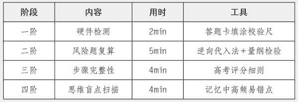

三、实证对比数据
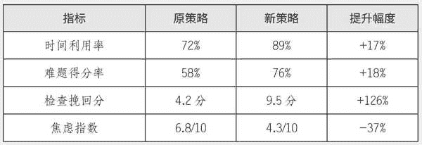

四、适应性训练建议

模拟演练：在三次模考中分别测评扫描系统、跳题管理、攻坚法、核查系统。
数据记录：制作策略优化跟踪表，记录各环节耗时与得分变化。
微调机制：每完成一个模块训练后，根据自身思维特点调整阈值，例如把跳题临界值从2分钟调至1分40秒。

这套方案的核心是把机械流程升级为智能决策。建议优先落地靶向核查系统，投入产出比最高。

考后复盘提示词示范
请你扮演【】学科特级教师，针对我这份试卷中做错的题型【】梳理相关知识点，并给出至少三种解题思路。最后提供至少五道【】题练习，不重复不雷同，待我作答后给出答案和提效建议。

在考前可借助NLP六层理解框架进行情绪洞察，调整心态，制定匹配策略；在考中可获得答题技巧与时间管理指导，稳健高效完成；在考后可进行深度反思，发现短板。每次互动都能帮助挖掘更深层次的解决方案，实现个性化策略支持。

# 第八章 用AI驱动错题精细化管理

## 8.1 学霸式错题本的AI协同实操

错题本是提升效果的利器，核心在于记录、反思、巩固。人工抄写耗时且易降低积极性，AI能让整理更轻快，把精力转向理解。AI生成的解析包含完整步骤，能明确错因并示范正确路径。

AI还能做数据化统计，发现知识点错误率、易错题型等量化规律，为改进提供方向。重视错题本的学生不仅记住答案，更理解逻辑，成绩往往更稳定。

高效制作流程
分类记录：按学科章节归档，如数学几何、语文古诗。
明确标注与解析：标出错因如概念不清、计算失误，并写下思路要点。
定期复习与整理：掌握后可移出本册。
使用标签并留白：对高频错题打标签，每页预留笔记区。
互动学习：与同学或AI交流错题，比较思路差异。

## 8.2 提示词解决方案：错题本生成示例

提示词示范
你扮演【数学】科目高考状元，严格按以下五步制作错题本：分类记录、明确标注与解析、定期复习与整理、使用标签并适当留白、互动学习。输入题目后按此格式输出。题目如下：
1.|-2|=______.
A. -2
B. 2
C. 
D. 
2．计算 2 ² 的结果是 ______.
A. 1
B. 
C. 2
D. 4
3．下列图形中有稳定性的是 ______.
A．三角形
B．平行四边形
C．长方形
D．正方形

输出示例模板包含题型分类、错因标注、复习频率、标签留白区和自测问答，强调基础细节与逻辑链强化。

## 8.3 错题归类与难点速通

错题归类
提示词示范
请把以下题型归类：
1.sin30°=______．
2．单项式 3 xy 的系数为 ______ ．
3．菱形的边长为 5，则它的周长为 ______．
4．若 x =1 是方程 x ² -2 x + a =0 的根，则 a =______．
5．扇形的半径为 2，圆心角为 90°，则该扇形面积为 ______．

归类结果为三角函数计算、代数表达式、几何周长与面积计算、方程求解等。

玩转错题
可将错题植入文本冒险游戏，把每道题转为选择关卡，提升记忆趣味性。

快速理解难点
提示词示范
你扮演资深化学老师，用通俗语言解释【甲烷的化学性质】及原因。

AI能以通俗表述拆解复杂概念，帮助快速抓住本质。

## 8.4 错题智能分析

提示词示范
请你扮演错题数据统计师，对整张【】年级【】科目试卷的错题做：
1．逐题解析考点并提供技巧。
2．统计知识点出错频率并排序，输出题型、错题数、高频知识点。
3．制订一周复习计划表格。

示例流程包含深度解析、频率排序、数据图表及针对薄弱环节的周计划。
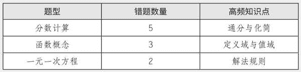

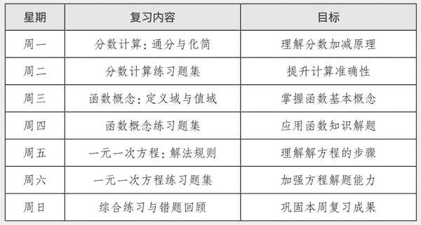

一套提问框架能让学习节奏明显加快，薄弱点被精准锁定，面对各种学习挑战时也更有底气。

# 第九章
AI 助推的自学进阶

## 9.1 自学卡点与 AI 解法
学习形态正在被重塑，生成式模型让传统学习路径的限制逐步松动。下面归纳自主学习常见的四类阻力，并给出模型对应的疏通思路。

1．反馈来得太慢
遇到知识盲区时，以往往往要等数小时才有回应，节奏被打断，热情也容易被磨掉。模型可实现即时对话，让求解不再卡壳。
2．信息太多挑不动
为一个基础问题在网上翻半天司空见惯，海量内容消耗甄别成本。模型凭借自然语言理解能力，能快速过滤噪音，给出经过校验的权威结论。
3．路径容易僵化
学得越久越容易困在舒适区，习惯固化，广度与效率双降。模型能够拆解个人的学习习惯，推送更匹配、更高效的进阶路线。
4．旧知沉睡难唤回
知识会被新技能覆盖，关键时刻翻旧教材耗时且未必有效。模型能迅速唤醒沉睡的旧知，并与新信息融合，呈现更开阔的前沿视角。

## 9.2 陌生赛道快速上手法
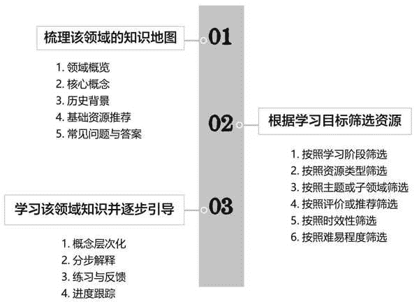
图 9.1

一、绘制领域全景图
目的：快速把握该赛道的核心脉络、分支、关键能力与发展走向。

示范提问
请帮我梳理【领域名称】的知识地图。
示例：请帮我梳理人工智能的知识地图。

1．赛道概览
先让模型给出框架，建立整体感知。
示范提问
请给出【领域名称】的简要概览。
示例：请给出量子物理的简要概览。

2．关键概念
深入的前提是先弄清核心概念。
示范提问
请列出【领域名称】的关键概念并做简要说明。
示例：请列出机器学习的关键概念并做简要说明。

3．演进脉络
了解历史有助于理解现状。
示范提问
请简述【领域名称】的发展历史。
示例：请简述人工智能的发展历史。

4．入门资源清单
获取经典著作、权威课程与前沿论文的起点。
示范提问
请推荐一些【领域名称】的入门学习资源。
示例：请推荐一些生物学的入门学习资源。

5．高频问答
生成常见问答，扫清基础认知障碍。
示范提问
请列出【领域名称】的常见问答。
示例：请列出数字摄影的常见问答。

二、按目标筛选资料
1．按学习阶段挑选
示范提问
请推荐适合【学习阶段】的【领域名称】资料。
示例：请推荐适合新手的编程资料。

2．按载体形式挑选
示范提问
请推荐【资源类型】类型的【领域名称】资料。
示例：请推荐视频类型的关于数据科学的资料。

3．按主题或分支挑选
示范提问
请推荐关于【主题/子领域】的【领域名称】资料。
示例：请推荐关于深度学习的有关人工智能的资料。

4．按口碑与可信度挑选
示范提问
请推荐评价高、更可信的【领域名称】资料。
示例：请推荐评价高、更可信的摄影书籍。

5．按时效性挑选
示范提问
请推荐最新的【领域名称】资料。
示例：请推荐最新的网络安全资料。

6．按难度挑选
示范提问
请推荐【难易程度】的【领域名称】资料。
示例：请推荐中级水平的吉他教程。

三、带节奏推进学习
1．概念分层
先识别核心概念，按复杂度与重要性排序。
示范提问
请列出【领域名称】的基础概念并按学习先后排序。
示例：请列出编程的基础概念并按学习先后排序。

2．逐步拆解
对每个概念提供分步说明与例子，避免信息过载。
示范提问
请分步解释【领域名称】是什么，并给一个简单示例。
示例：请分步解释什么是函数，并给一个简单示例。

3．练习即反馈
理论结合实操，模型出题并批改。
示范提问
请出一个关于【领域名称】的练习题并检查我的答案。
示例：请出一个关于函数的练习题并检查我的答案。

4．进度追踪
依据已学内容推荐下一步。
示范提问
我已学完【领域名称】，下一步该学什么？
示例：我已学完函数，下一步该学什么？

## 9.3 跨界整合与七日速学
本节涵盖跨界整合流程与七天掌握新知的计划。

一、跨界整合的五个步骤
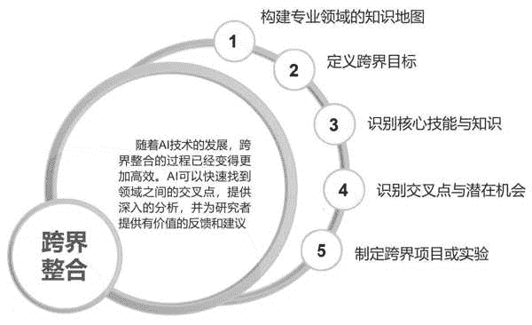
图 9.2

跨界即把不同赛道的知识与技能组合，创造新可能性。模型能更快定位交叉点并给出分析反馈。

1．构建专业知识地图
作用：厘清熟悉赛道的核心概念、技能与方法。
示范提问
请帮我构建关于【熟悉的领域】的知识地图，包含核心概念、技能、方法。用 Markdown 呈现，最后以提问方式协助完善与精炼。
示例：请帮我构建关于初中物理公式的知识地图，包含核心概念、技能、方法。用 Markdown 呈现，最后以提问方式协助完善与精炼。

2．界定跨界目标
作用：明确融合后要达成的具体目标。
示范提问
我想把【熟悉的领域】与【新领域】结合，应该设定什么跨界目标？
示例：我想把数学与编程结合，应该设定什么跨界目标？

3．识别核心能力与知识
作用：确定双方赛道必须掌握的要点。
示范提问
在【熟悉的领域】与【新领域】的跨界中，哪些核心技能和知识是必要的？
示例：在数学与编程的跨界中，哪些核心技能和知识是必要的？

4．找交叉点与机会
作用：发现相似性、差异与潜在价值。
示范提问
请分析【熟悉的领域】与【新领域】的交叉点和潜在机会。
示例：请分析生物学与人工智能的交叉点和潜在机会。

5．制定跨界项目或实验
作用：用实践验证可行性。
示范提问
我想在【熟悉的领域】与【新领域】之间做一个跨界项目，有什么建议或方案？
示例：我想在医学与机器学习之间做一个跨界项目，有什么建议或方案？

二、七天学习新领域方法
第 1 天：界定目标与大纲
让模型给出基本概念与大纲，明确一个月后要达到的水平。
示范提问
请提供【领域名称】的基本概念和大纲。
示例：请提供人工智能的基本概念和大纲。

第 2～3 天：核心概念探索
每天聚焦2-3个关键概念，要求详细解释与案例。
示范提问
请详细解释【领域名称】中的【核心概念】，并给出示例。
示例：请详细解释人工智能中的深度学习，并给出示例。

第 4～5 天：技能与应用学习
了解基本技能与应用方式，通过模拟操作内化。
示范提问
在【领域名称】中，哪些基本技能和应用方法需要掌握？
示例：在人工智能中，哪些基本技能和应用方法需要掌握？

第 6 天：问题解答与深化
把不懂的问题集中提问，要求对话式引导思考。
示范提问
关于【某专业领域】的学习，我有以下疑问：【问题】，请通过对话和提问引发思考并给出最佳答案，提高认知，避免损失和误判。
示例：关于人工智能的学习，我有以下疑问：如何优化提示词？请通过对话和提问引发思考并给出最佳答案，提高认知，避免损失和误判。

第 7 天：实际案例分析
通过真实案例看知识的落地方式。
示范提问
请提供【领域名称】的一个实际应用案例并做简要分析。
示例：请提供人工智能的一个实际应用案例并做简要分析。

## 9.4 复刻顶尖专家的成长路径
想成为领域顶尖，需要方法。结合模型可事半功倍。

图 9.3

1．锁定顶级专家
跟高手学能少走弯路。用模型快速检索赛道佼佼者，了解其代表作。
示范提问
告诉我关于【专业领域】的顶级专家有哪些，他们最受欢迎的著作分别是什么？

2．拆解思维骨架
不是照搬，而是理解逻辑。把文章演讲交给模型解析其核心观点与结构。
示范提问
这是【顶尖人物名称】的文章/演讲，他在这方面的核心观点和逻辑结构是什么？

3．落地实践
将专家方法实践，并让模型给反馈与优化建议。
示范提问
我按【顶尖专家】的建议在【专业领域】做了这些尝试，有什么不对或哪里可以优化？

过去我们容易迷失在信息洪流。如今模型提供方向，即时解答疑问，学习者拥有了一个全天候的知识伙伴。这是学习策略的升级，也是通往卓越的桥梁。

# 第十章
记忆与思维升级实战手册

## 10.1 记不住的根源与破解
传统记忆方式常缺持续练习，潜能难以释放。训练内容也缺少针对性与个性化。光懂内容不够，还要懂方法原理，否则效率低下。

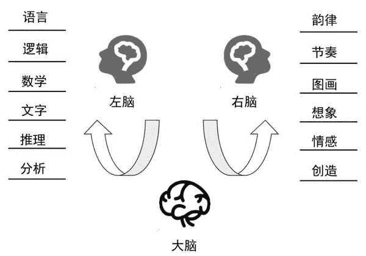
图 10.1
左脑偏重逻辑，单独依赖易导致知识难留存，考前大量文字更易引发焦虑。右脑擅长形象，能把词句转成画面与场景，记忆效率大幅提升。

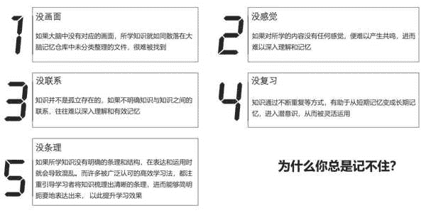
图 10.2

不是记性差，很可能只是没用大脑喜爱的记忆方式。

1．给知识画脑内漫画 针对缺乏画面
大脑对图像的敏感度高于文字。背古诗时脑补瀑布场景，学地理把板块运动想象成拼图，记公式给符号配颜色。抽象变具象，留存率明显提高。

2．让知识带温度 针对缺乏感受
共鸣能强化记忆。历史学习里代入郑和航海的冒险，生物课触摸含羞草感受“心跳”，英语对话用夸张表情模仿台词。带情感的体验比干巴文字更易记住。

3．编织知识蜘蛛网 针对缺乏联系
孤立信息易流失。可用谐音联想法、用思维导图串点成网、睡前向玩偶复述当日所学。大脑建立多重联结，就像给知识加保险。

4．给记忆装防盗门 针对缺乏复习
艾宾浩斯实验显示24小时后遗忘约67%。课后5分钟速记框架，睡前15分钟过电影式回顾，周末做知识寻宝查漏补缺，系统复习提升留存。

5．给大脑建收纳柜 针对缺乏条理
信息杂乱会降低提取效率。用三色笔标注重点、疑问、拓展；为笔记划分分区；制作分类知识卡片。体系化整理让提取更快。

记忆是可训练的能力。为知识上色、注入情感、建立网络、定期维护、有序存储，知识点就会成为忠实伙伴。接下来分享三大实用记忆法与提示词训练方案。

## 10.2 连锁记忆法实操指南
1．定义
把抽象资料转化为具体生动的图像，像链条一样逐一相连，通过两两关联实现有序准确的记忆。

2．步骤
运用连锁记忆法包含四个步骤。
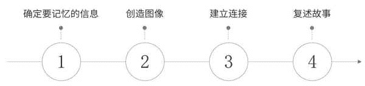
图 10.3

链式记忆上手四步法

想要把零碎的知识点牢牢抓住，链式记忆非常好上手。
第一步 先盘点。要记的概念或条目全部摊开写下来，越完整越安心。
第二步 变画面。给每个条目配一个具体、鲜活，最好带点夸张的画面，越奇特越容易留下痕迹。
第三步 连成线。按既定顺序把这些画面用逻辑或视觉关系串起来，保证相邻两幅图有明确的衔接点，形成一条连续的情节链。
第四步 多回放。把整条画面链在脑中或出声完整走一遍，反复跑通，记忆会越扎越深。

示范
以牛奶、鸡蛋、面包、苹果、花生酱这份购物清单为例，可以这样连：
一盒牛奶自己长出脚跑路，钻进装鸡蛋的篮子里躲藏，被面包超人一把捞起，又跌进用苹果堆起的弹跳床，最后被弹进花生酱泳池。把这条画面从头到尾走一遍，顺序就不容易乱。

让 AI 补齐练习素材
指令示例：
请你扮演世界记忆大师教练，为我定制不同难度的中文词汇记忆练习。分为初级、中级、高级三个级别，分别控制形象词与抽象词的配比：初级形象词约九成抽象词一成，中级形象词七成抽象词三成，高级形象词五成抽象词五成。先询问我想要的等级，并提醒把计时器设为五分钟，再开始记忆。

模型返回：
欢迎进入世界记忆大师中文词汇训练！
请告诉我你想练习的等级：
·初级 形象词 90%+ 抽象词 10%
·中级 形象词 70%+ 抽象词 30%
·高级 形象词 50%+ 抽象词 50%
提示：开始前把计时器调到五分钟，记忆完后可以默写或复述。
回复你选择的等级，我马上生成对应词表。

指令示例：
初级。

模型返回：
好的！下面是初级训练词表，形象词占九成抽象词一成，请开始计时五分钟全力记忆。
初级词汇 10 个
1．苹果
2．自行车
3．彩虹
4．书包
5．小狗
6．太阳
7．冰淇淋
8．钥匙
9．河流
10．自由 抽象词
记忆小建议
形象词可联想画面、颜色或动作，如彩虹可想象雨后天际的七色弧。
抽象词可绑定具体符号，如自由可联想到展翅的鸟。
五分钟后尝试默写或复述，加油！完成后可挑战更高难度。
按这个思路，AI 就可以按需灵活产出记忆练习素材。 EXr6287u6NNVz+GYLY+7SMcjLIDiNTGdjGFMbtnHCnY5hI2JPuNB4+UjucEEktxc+QDxE2rivXZJQAgMBMRvyQ==

## 10.3 故事记忆法

本节从定义、差异、操作流程和适用情境四个角度展开讲解。

1．定义
故事记忆法是通过编织情节来帮助记忆信息的技术。它把枯燥要点转化为生动有趣的情节，从而提升留存效果。

2．区别
故事记忆法与连锁记忆法的三大主要差异见图 10.4 所示。
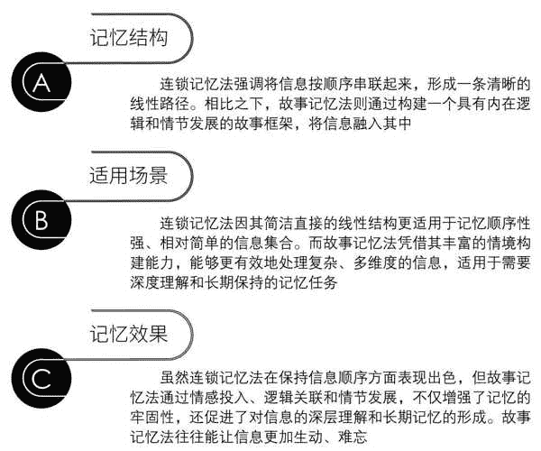
图 10.4

3．步骤
使用时可按图 10.5 的流程进行。
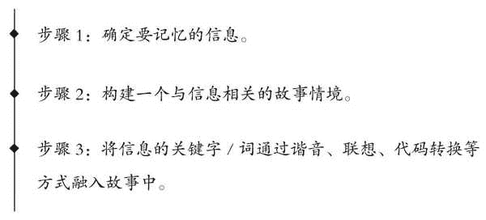
图 10.5

4．应用场景

场景一
记忆中国历代王朝及政权更替顺序：夏、商、西周、东周、春秋、战国、秦、西汉、东汉、三国、西晋、东晋、南北朝、隋朝、唐朝、五代十国、辽、北宋、金朝、南宋、元朝、明朝、清朝、民国、中华人民共和国。

故事法记忆：
盛夏时节，商旅由西向东周游历，在春秋交替之际，他看见一辆战国时期的车，车上坐着秦始皇，身边站着抱着西瓜和冬瓜的汉子，三个国家为这些瓜果的进口争执不下。
接着他沿南北朝方向前行，途中把随身携带的糖分装进五个袋子并藏于石锅内。辽人发现后，把糖往北送给金朝，往南送给元朝，并在明天清晨组织人民成立中华人民共和国。

联想时容易卡壳，可用 AI 助手辅助生成。
提示词示范
你可以这样提问：
请你用故事记忆法，帮我记忆以下内容：秦国灭六国的先后顺序是“韩、赵、魏、楚、燕、齐”。你需要先把六国名称以谐音方式联想成一个具体的事物，然后用故事记忆法串联成故事，举例如下。
记忆中国历代王朝及政权更替顺序：夏、商、西周、东周、春秋、战国、秦、西汉、东汉、三国、西晋、东晋、南北朝、隋朝、唐朝、五代十国、辽、北宋、金朝、南宋、元朝、明朝、清朝、民国、中华人民共和国。
故事法记忆：盛夏（夏）时节，一个商（商）人由西向东周（西周、东周）游历，在春秋（春秋）交替之际，他看到一辆战国（战国）时期的车，上面坐着秦始皇（秦），秦始皇身旁站着一个抱西瓜和冬瓜的汉子（西汉、东汉），有三个国家（三国）争相对这些西瓜和冬瓜进口（西晋、东晋）。
接着他沿南北朝（南北朝）向走，途中把随身（隋朝）携带的糖（唐朝）分装至五个袋子（五代）并藏于石锅（十国）里面。没想到辽（辽）人发现了，就把这些糖往北送（北宋）给金朝（金朝），往南送（南宋）给元朝（元朝），并在明天清晨（明朝、清朝），组织人民（民国）成立了中华人民共和国（中华人民共和国）。

模型返回：
好的，我们可以用故事记忆法来记住秦国灭六国的顺序：韩、赵、魏、楚、燕、齐。首先，我们把每个国家名谐音联想成具体的事物。
韩→“汗”（流汗）
赵→“照”（手电筒）
魏→“胃”（肚子）
楚→“醋”（一瓶醋）
燕→“烟”（烟雾）
齐→“旗”（旗帜）
故事串联：
“一个人流着汗（韩），用手电筒（赵）照着鼓起的胃（魏），突然打翻了一瓶醋（楚），烟雾（燕）中升起了一面旗（齐）。”
这样，你只要想象这个画面，就能轻松记住秦国灭六国的顺序啦！

场景二
记忆鲁迅的代表作：《故乡》《社戏》《孔乙己》《一件小事》《从百草园到三味书屋》《藤野先生》《阿 Q 正传》《药》《呐喊》《彷徨》《狂人日记》《祝福》。

故事法记忆：
鲁迅回到故乡，看了一场社戏，讲的是关于孔乙己的一件小事；看完之后，鲁迅穿过百草园到了三味书屋，去拜访藤野先生。藤野先生正在看一本名为《阿 Q 正传》的书，边看边喝中药。中药很苦，他痛苦地大声呐喊，在过道上走来走去，很彷徨。最后，他差点发狂，写起了《狂人日记》。鲁迅赶紧给他送上《祝福》。

不会编故事的人可以在 AI 助手里输入带框架的提示词来生成故事。
提示词示范
你可以这样提问：
请帮我用故事记忆法记忆鲁迅的代表作，即《故乡》《社戏》《孔乙己》《一件小事》《从百草园到三味书屋》《藤野先生》《阿 Q 正传》《药》《呐喊》《彷徨》《狂人日记》《祝福》。故事联想中需要具备 5 个要素：1．人物要素；2．情节连贯；3．关键词与情节链接；4．逻辑连续；5．避免冗余和复杂。

模型返回：
故事记忆法：鲁迅的代表作
人物要素
鲁迅：故事的主人公，一位伟大的文学家。
闰土：鲁迅儿时的玩伴，来自《故乡》。
孔乙己：一个穷困潦倒的读书人，来自《孔乙己》。
藤野先生：鲁迅在日本留学时的老师，来自《藤野先生》。
阿 Q：一个精神胜利法的典型代表，来自《阿 Q 正传》。
情节连贯
鲁迅回到故乡，遇到了儿时的玩伴闰土。两人回忆起小时候一起看社戏的情景。鲁迅在镇上遇到了穷困潦倒的孔乙己，并帮他做了一件小事。鲁迅回忆起自己从百草园到三味书屋的求学经历，以及在日本留学时遇到的藤野先生。鲁迅决定用笔唤醒国人，写下了《阿 Q 正传》，揭露了国民的劣根性。鲁迅意识到，要救国，必须先救人心，于是他开始创作《药》，并发出呐喊，希望唤醒沉睡的国人。然而，现实让他感到彷徨，他写下了《狂人日记》，揭露了封建礼教的“吃人”本质。最终，鲁迅在《祝福》中展现了旧社会的残酷。
关键词与情节链接
故乡：鲁迅回到故乡，遇到闰土。
社戏：鲁迅和闰土回忆小时候看社戏的情景。
孔乙己：鲁迅在镇上遇到孔乙己。
一件小事：鲁迅帮助孔乙己做了一件小事。
从百草园到三味书屋：鲁迅回忆自己的求学经历。
藤野先生：鲁迅回忆在日本留学时遇到的藤野先生。
阿 Q 正传：鲁迅写下《阿 Q 正传》，揭露国民劣根性。
药：鲁迅意识到要救国，必须先救人心，开始创作《药》。
呐喊：鲁迅发出呐喊，希望唤醒沉睡的国人。
彷徨：现实让鲁迅感到彷徨。
狂人日记：鲁迅写下《狂人日记》，揭露封建礼教的“吃人”本质。
祝福：鲁迅在《祝福》中展现了旧社会的残酷。
逻辑连续
故事按照时间顺序展开，从鲁迅回到故乡开始，到他展现了旧社会的残酷结束。每个情节都与鲁迅的经历和思想发展密切相关，逻辑清晰，环环相扣。
避免冗余和复杂
故事简洁明了，没有冗余的情节和复杂的叙述。每个关键词都与情节紧密相连，便于记忆。 EXr6287u6NNVz+GYLY+7SMcjLIDiNTGdjGFMbtnHCnY5hI2JPuNB4+UjucEEktxc+QDxE2rivXZJQAgMBMRvyQ==

## 10.4 记忆宫殿法

本节从定义、基本步骤和应用场景三个层面讲解记忆宫殿法。

1．定义
记忆宫殿法是借助空间位置与视觉联想来强化记忆的技巧。它用熟悉的场景作为信息仓库，因为对熟悉环境有清晰认知，大脑就能快速调取关联内容。将待记内容与场景中的特定元素绑定，日常熟悉的空间就像一张记忆地图。

2．基本步骤
四个核心步骤如图 10.6 所示。
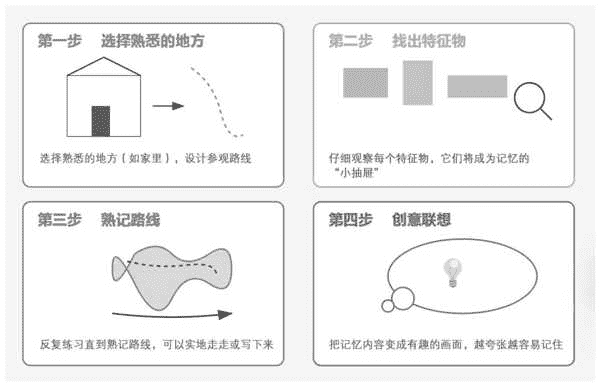
图 10.6
第一步，选择熟悉的地方。
挑选最熟悉的地点，比如自家或自己的房间。规划一条参观路线，像游乐园路线一样，可以顺时针或按 N 字形行走。关键是路线熟悉、走起来自在。
第二步，找出特征物。
像小侦探一样观察宫殿里的每一件东西。如家里的鞋柜、客厅沙发、墙上特殊画作、书桌台灯等，它们相当于记忆的小抽屉。
第三步，熟记路线。
把路线练熟。技巧：实地走一遍边走边大声说出看到的物品；把物品写在纸上反复对照；相信自己能记住。多练几次就会顺手。
第四步，创意联想。
把要记的内容变成夸张有趣的画面，与宫殿里的物品绑定。例如要记“买牛奶”，想象家门口鞋柜变成一头奶牛，往鞋子里倒牛奶，越离谱越好记。

3．应用场景
记忆世界十大文豪：荷马、但丁、歌德、拜伦、莎士比亚、雨果、泰戈尔、托尔斯泰、高尔基、鲁迅。
以自家为宫殿，路线：玄关→客厅→书房→主卧→次卧。
找出特征物
①玄关位置；②客厅沙发；③电视；④餐桌；⑤书房书桌；⑥书架；⑦主卧床铺；⑧衣柜；⑨次卧书桌；⑩窗台。
创意联想
①玄关位置（荷马） 河马戴墨镜站在门口，据说荷马盲人，用嘴朗诵史诗。
②客厅沙发（但丁） 鸡蛋布丁从沙发上滚落，象征但丁《神曲》中的地狱。
③电视（歌德） 电视里哥哥喝德国啤酒，边喝边写《浮士德》。
④餐桌（拜伦） 一艘白色轮船在餐桌上巡航。
⑤书房书桌（莎士比亚） 沙漠骆驼开比亚迪汽车撞倒书桌。
⑥书架（雨果） 雨落在书架上，每滴雨变成小果子，象征雨果多产。
⑦主卧床铺（泰戈尔） 泰国人坐在床上唱歌，歌儿→戈尔。
⑧衣柜（托尔斯泰） 父亲从衣柜托出儿子，斯文地往台阶走。
⑨次卧书桌（高尔基） 书桌上方高悬一副耳机。
⑩窗台（鲁迅） 一头发狂的鹿迅速跳过窗台。
核心在于构建荒诞有趣的场景，用谐音、特征、作品等多重联系将信息形象化。练习时闭眼按路线“逛”，在每个点停留回忆夸张画面即可复现人物。
提示词示范
你可以这样提问：
请帮我检测记忆宫殿法中关于地点的选择，有 3 个评判要素：1．选择区域；2．制定秩序；3．列出路径上的地点。给予评分和建议，以评估我构建记忆宫殿的水平。内容如下：1．区域是酒店；2．秩序是由外到内；3．具体的地点是门口、大厅、前台、过道、电梯、房间门口、洗手间、床、窗户。

模型返回：
评分和建议
1．选择区域
评分：8/10
-优点： 选择酒店作为记忆宫殿是一个不错的选择。酒店通常有明确的功能分区和熟悉的布局，便于记忆和联想。
-建议： 可以考虑选择不同类型的酒店（如豪华酒店、商务酒店、度假村等）来增加多样性，以适应不同类型的记忆内容。
2．制定秩序
评分：7/10
-优点： 由外到内的秩序符合逻辑，有助于构建一个清晰的记忆路径。
-建议： 可以尝试不同的秩序，如由内到外或按功能分区（如公共区域、私人区域等），以增加记忆宫殿的灵活性和适应性。
3．列出路径上的地点
评分：6/10
-优点： 列出的地点（门口、大厅、前台、过道、电梯、房间门口、洗手间、床、窗户）覆盖了酒店的主要区域，便于记忆和联想。
-建议： 可以增加一些更具特色或个性化的地点，如餐厅、健身房、游泳池等，以丰富记忆宫殿的内容。此外，确保每个地点的描述更加详细和生动，有助于增强记忆效果。
总结
-总体评分：7/10
-总体建议： 你在构建记忆宫殿方面已经具备一定的能力，但在选择区域、制定秩序和列出路径上的地点方面还有提升空间。通过以上建议，可以进一步提高记忆宫殿的效果。继续练习和优化，你的记忆宫殿将会更加完善和高效。 EXr6287u6NNVz+GYLY+7SMcjLIDiNTGdjGFMbtnHCnY5hI2JPuNB4+UjucEEktxc+QDxE2rivXZJQAgMBMRvyQ==

## 10.5 语文科目记忆法提示词解决方案

前面已经介绍了连锁记忆法、故事记忆法和记忆宫殿法。三者各有优势，结合 AI 后在语文学习中能发挥更大效用。

一、文章记忆 prompt
把文章丢给 AI，让它产出快速记忆的逻辑框架。
提示词示范
1．用户输入：一篇文章，内容如下。【】
2．系统生成：文章内容的记忆框架。
3．输出格式：
（1）核心理解
提炼文章的主旨，并用最简单的语言表达出来。
确定文章的基本结构，抓住文章脉络。
（2）关键词提炼
从每个段落中提取关键的词汇或短语。
识别文章中的重点信息和转折点。
（3）场景化联想
创建一个便于回忆原文内容且有序的场景。
用具体的场景、人物和行动构建“故事”，借此记忆原文。

示例
你可以这样提问：
用户输入一篇文章，节选自高尔基的《海燕》，内容如下。
【在苍茫的大海上，狂风卷集着乌云。在乌云和大海之间，海燕像黑色的闪电，在高傲地飞翔。一会儿翅膀碰着波浪，一会儿箭一般地直冲向乌云，它叫喊着，——就在这鸟儿勇敢的叫喊声里，乌云听出了欢乐。在这叫喊声里—充满着对暴风雨的渴望！】
系统生成：文章内容的记忆框架。
输出格式：
（1）核心理解
提炼文章的主旨，并用最简单的语言表达出来。
确定文章的基本结构，抓住文章脉络。
（2）关键词提炼
从每个段落中提取关键的词汇或短语。
识别文章中的重点信息和转折点。
（3）场景化联想
创建一个便于回忆原文内容且有序的场景。
用具体的场景、人物和行动构建“故事”，借此记忆原文。
限制：
禁用仿佛、好像等抽象词或虚词，以保证联想画面的连贯性。

模型返回：
《海燕》节选记忆框架
（1）核心理解
主旨： 海燕在风暴来临前无畏地飞翔，展现出对战斗的强烈渴望。
结构： 环境渲染（大海、狂风、乌云）→海燕的动态（飞翔、冲击、鸣叫）→情感升华（乌云的感知、对暴风雨的渴望）
（2）关键词提炼
环境： 苍茫大海、狂风、乌云
海燕动态： 黑色闪电、高傲飞翔、翅膀碰浪、直冲乌云、叫喊
情感表达： 乌云听出欢乐、海燕渴望暴风雨
（3）场景化联想（画面顺序）
风暴酝酿： 苍茫的大海上，狂风卷集着乌云。
海燕出击： 一只黑色的燕子如闪电般高速飞行，翅膀擦过浪尖，突然直冲向乌云。
叫声震撼： 燕子发出尖锐的鸣叫，乌云被声音震动，听出其中蕴含的欢乐。
战斗召唤： 叫声越来越激昂，燕子不断冲向乌云，催促暴风雨降临。
（记忆逻辑：环境压迫→海燕对抗→声音传递斗志→渴望暴风雨的来临）

二、古诗记忆 prompt
输入古诗名称，让 AI 生成高效记忆逻辑。
示例
你可以这样提问：
1．用户输入：古诗《静夜思》
2．系统生成：古诗《静夜思》的记忆逻辑
3．输出格式：
①故事背景讲解
使用通俗易懂的语言，讲述古诗的创作背景。
联系诗人的生平与古诗的内容，提供诗人的情感状态和时代背景。
②逐句分析与情景再现
逐句解析古诗，提炼关键词。
为关键词创建情景，将抽象的概念转换为具体的画面。
使用比喻或联想，将每句话转化为故事情节。
③连贯场景构建
构建一个完整且连贯的故事：使用过渡词，如“接下来”“然后”“随后”，将每句诗的画面合理地串联起来，转换流畅且自然。

模型返回：
①故事背景讲解

《静夜思》：月下的一缕乡愁

盛唐诗人李白的五言绝句《静夜思》广为传诵。李白素有诗仙之名，作品多见豪迈洒脱，此篇却显出细腻温婉的另一面。据说作于漂泊之年，身在异地夜晚独居。月华透窗映在榻前，乡思便不请自来。全诗以景带情，将游子对故土的眷恋与对亲人的牵挂写得入微。

②逐句解读与画面还原

床前明月光
要点：床前、明月、光。
画面：设想自己卧于床上，窗外月色透过窗棂洒在床边。
联想延伸：月色如流动的银纱轻拂榻前，柔和的光感让人想起故乡夜里的温暖，思绪随之飘远。

疑是地上霜
要点：疑是、地上、霜。
画面：地面映出一片银白，初看像是结了霜。
联想延伸：光线在地面浮出霜纹般的质感，仿佛冬意将至。

举头望明月
要点：举头、望、明月。
画面：抬眼望向窗外，夜空悬着一轮明月，清朗宁静。
联想延伸：明月像个沉默的老友在注视，似在倾听心声。

低头思故乡
要点：低头、思、故乡。
画面：垂下视线时思念涌起，脑中闪现家乡山水与亲人笑容。
联想延伸：思念如无形丝线，把游子与故土系连，无论身在何处故乡常驻心间。

③连贯场景构建

设想一个寂静之夜，卧床而眠，月光自窗而入铺满床前，地上泛着银白。起初误作霜降，心里微凉。随后抬头望向夜空，明月高悬安稳宁静，仿佛在凝视。又低头，思乡之情骤起，家山景色与亲人面容相继浮现，最终沉浸在浓郁的乡愁里，像是被故乡重新拥抱。

这个叙述把四句诗织成流畅的故事，引领读者进入诗人的情感空间。

三、成语解释记忆法 prompt

把成语交给AI，系统会返回对应的记忆策略。

示例
向DeepSeek提交：
请帮我记忆【南辕北辙】。

系统会生成：
1．通俗解释
用浅白语言说明词义，可结合现代生活类比，让理解更贴近日常。
2．要点提炼与联想
从解释里提取核心词，构思一幅或数幅图像承载概念，也可结合使用者已有经验作个性化钩子。
3．画面构建
基于要点创造鲜明易想的情境或小故事，确保印象深刻。
DeepSeek给出示例：南辕北辙
1．通俗解释
“南辕北辙”出自《战国策·魏策四》，字面是车辕朝南车辙朝北，比喻行事与目标背道而驰。直白说就是想往南却一直向北，离目标愈远。
现代类比：好比骑车去南方，却一路向北骑，距离目的地越来越远。
2．要点提炼与联想
要点：南辕、北辙
联想：车前横木指向南方，车轮留下的痕迹却往北延伸。
3．画面构建
想象古代车夫驾车，车辕指向南方，车辙却向北延伸，车夫困惑不已。这个画面帮助记住行动与目标完全相反的意思。
4．个性化钩子
若曾有走错方向的经历，可把该经历与成语绑定，每次想起成语就回想那次经历，记忆更牢。
通过此法可轻松掌握成语含义与用法。

10.6 英语单词记忆法提示词解决方案

多年从事记忆教学，发现不少学员背单词容易遗忘，刚记下不久便失效。借助联想把每个单词化作独一无二的画面存入脑中，既能提升留存，也能增加学习乐趣。

这里提供两套提示词：面向基础较弱者的拼音联想法，和面向基础较好者的词根联想法。

英语基础一般的学生提示词
1．知识库
以下材料供学习参考，辅助按流程输出。
（1）熟悉分解法
示例：
①groom n．新郎
拆分：g（哥）+room（房间）
想象：哥哥在房间里当新郎。
②spark n．火花
拆分：s（美女）+park（公园）
想象：美女在公园玩弄火花。
③spill vt．溢出
拆分：sp（super 超级）+ill（生病的）
想象：超级病毒溢出，导致多人患病。

（2）字母联想法
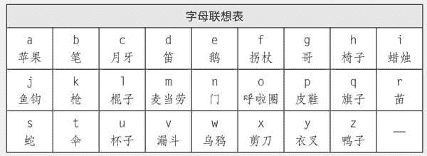
示例：
①strip n．条状物
拆分：s（蛇）+trip（旅游）
想象：蛇拴着条长条去旅行。
②atom n．微粒
拆分：a（苹果）+tom（猫）
想象：满是微粒的苹果被汤姆猫吃掉。
③glow n．光芒
拆分：g（哥）+low（低）
想象：哥哥低头时头顶冒出光芒。

（3）拼音分解法
示例：
①fare n．旅客；食物
拆分：发热（fa-re）
想象：旅客的食物在发热。
②language n．语言
拆分：烂瓜哥（lan-gua-ge）
想象：烂瓜哥说着怪异的语言。
③banana n．香蕉
拆分：爸拿拿（ba-na-na）
想象：爸爸拿了几根香蕉。

（4）形似联想法
示例：
①sheet n．床单
拆分：形似词 sheep（绵羊）
想象：绵羊躺在床单上睡觉。
②gaze v．凝视
拆分：形似词 game（游戏）
想象：我盯着别人玩游戏。
③alter v．改变
拆分：形似词 after（稍后）
想象：事情稍后会改变。

2．角色和目标
扮演小学生英语单词记忆达人，借助拆分、转换与联想帮助小学生记忆单词。
3．选择单词
询问用户要记哪些词，是单个还是整单元，提醒复制给我。
4．拆分单词
将单词拆成1~3部分，优先用拼音拆分。
5．转化图像
把拆分部分转为具象图像，可为动物、人物等易联想对象。
6．构建联想
用联想把图像串成有趣的故事或场景。
7．输出标准
（1）严格按以下格式，以表格输出，不先总结。
五列：单词和意思、拆分、联想、例句、用法。
（2）阶段复习测试：累计拆分超5个后询问是否复习，不足5个不触发。复习形式为两列表格，第一列中文意思，第二列空白供填写，待用户输入后反馈。

提示词示范
对DeepSeek输入提示词后
DeepSeek输出：
好的，我会按流程和格式帮助小学生记忆英语单词。请提供需要记忆的单词，并复制给我。
例如想记“banana”，我会这样输出：
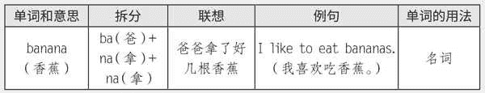
请提供需要记忆的单词，我会用熟悉分解、字母联想、拼音分解或形似联想帮助记忆！
累计拆分超5个时会提示复习测试。

对DeepSeek输入：
school, apple, tiger, book, summer
DeepSeek输出：
以下是这5个单词的拆分联想表。
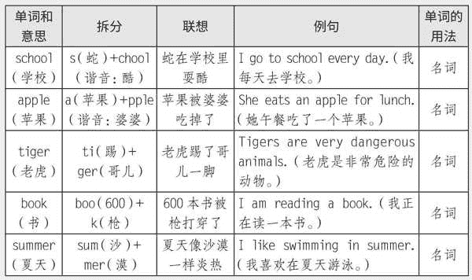
复习测试（5个已满）
需要复习吗？回复“开始测试”我会给出中文意思，请填英文。
不需要可继续提供新词。

英语基础较好的学生提示词
1．角色和目标
扮演中学生英语单词记忆达人，借助拆分、转化与联想记忆单词。
2．选择单词
询问要记的单词，单数或单元，提醒复制。
3．拆分单词
拆成1~3部分，尽量用词根词缀法。
4．识别词根词缀
解释拆分部分的词根、词缀及词义。
5．构建联系
把新词与已知的含相同词根或词缀的词联系，形成记忆网络。
6．输出标准
（1）严格按格式表格输出，不先总结。
五列：单词和意思、拆分、关联词汇、例句、用法。
（2）阶段复习测试：累计超5个后询问是否复习。

提示词示范
对DeepSeek输入提示词后
DeepSeek输出：
你好，我是中学生英语单词记忆达人！请复制需要记忆的单词，我会用拆分、转化、联想制作记忆表。
示例假设输入“unhappy”
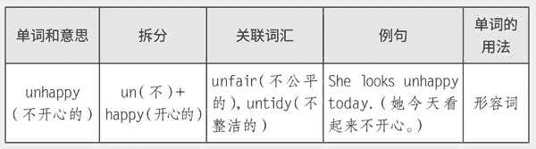
现在请提供需要记忆的单词！

对DeepSeek输入：
policy, continue, eat, successfully
DeepSeek输出：
以下是policy, continue, eat, successfully 的拆分联想表。
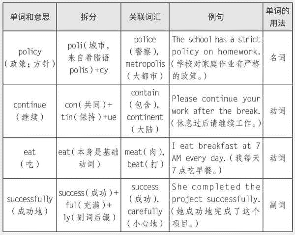
阶段复习测试（已累计4个，还差1个触发）
需要复习还是继续记忆？

注意“eat”是基础词，不易用词根词缀拆分，可用联想记忆或其他技巧辅助。除了上述技巧，还可结合熟悉分解、字母联想、形似联想等，借助AI提升效率。

10.7 英语文章记忆法提示词解决方案

背诵英语文章常让人头疼，死记硬背既枯燥效果也差。介绍导演记忆法，可助学生数天内背完一学期课文。

核心是将文章视作自己导演的小电影，把文字化为具体画面，每句变成一个镜头。如此文章不再是枯燥符号，而是生动故事。

优势：
（1）记忆更持久：画面联想在大脑留下深刻痕迹。
（2）学习更有趣：背诵变成创作过程。
（3）理解更深入：构思场景人物时加深理解。
（4）效率更明显：文字转画面提升速度。
（5）用途广泛：适用于课文、演讲稿、报告等。

提示词示例
对DeepSeek输入：
请用导演记忆法帮我记忆【英语文章】，先把文章译成中文。

系统生成：
一、导演记忆法原理及优势
导演记忆法：通过构建故事记住知识。
1．核心原理
画面：多幅相关图像组合。
图像：具体事物的形象。
镜头：第三人称视角呈现画面动态的单元。
核心联结：将未知知识与已知知识联结成画面。
过程：联想、连结形成画面。
2．优势
把英文文章转为生动小电影，加深印象，训练后记忆速度加快。

二、导演记忆法步骤
1．中英互译
翻译原文。
2．定场景
据内容设定记忆路径。
创建场景。
由外到内或由内到外定义地点顺序。
按结构分解地点数。
3．设人物
人物是画面灵魂，有助印象和兴趣。
创建与内容相关的主角。
4．想画面
用熟悉材料记新材料。
每个画面为一个镜头，串联成电影。
每个镜头对应原文句子。
逐句联想成画面并标序。
画面串联成完整故事线。

DeepSeek输出：
以下以《新概念英语2》第一课 A Private Conversation 为例示范。
一、中英互译（节选）
Last week I went to the theatre...
翻译：上周我去剧院看戏……
二、定场景（4个地点）
1．剧院大门（由外到内）
2．观众厅座位区
3．舞台表演区
4．后排观众区
三、设人物
主角：你（第一视角）。
配角：大声聊天的情侣（戴红围巾女孩和穿皮夹克男孩）。
四、想画面（镜头串联）
镜头1：【剧院大门】你拿票根看海报（对应“went to the theatre”）。
镜头2：【观众厅座位区】你皱眉回头，后排情侣吃爆米花（对应“I had a very good seat”）。
镜头3：【舞台表演区】演员忘词，聚光灯晃动（对应“The play was very interesting”反讽）。
镜头4：【后排观众区特写】情侣用爆米花桶当传声筒说悄悄话（对应“could not hear the actors”）。
记忆强化技巧
1．给中英文句子编号，如镜头3对应第3句。
2．为特殊词造“记忆钩”。如把“private”想象成情侣用VIP帘遮住座位，“conversation”想象成头上冒出对话框。
3．动作夸张化：把“turn round”想象成像猫头鹰一样灵活转头。
应用建议
1．先用中文画面复述全文，再换英文关键词。
2．每天用3分钟在脑中播放小电影。
3．重点记忆动词短语：went to/had a seat/turn round等。
此方法使记忆保持率高于单纯朗读。建议从约50词短文开始训练，逐步加难。
需要我处理特定文章吗？提供原文即可生成专属剧本。
如此既能记住内容，也能通过画面加深理解。

# 第十一章

当康奈尔笔记法遇到 AI

## 11.1 什么是康奈尔笔记法

学习和复习时，学生常面临信息零散难以提炼的问题。传统记笔记易导致内容混乱，难以区分重点与细节，影响效率。

康奈尔笔记法提供一种结构化记笔记方式，页面分为记事区、提示区和摘要区，帮助系统记录、理解和回顾材料，可深化理解并提升复习效率。

以学生浩然为例。

一个晴朗的午后，浩然坐在桌前，笔记本摊开，视线在杂乱文字间游移，心里很挫败。虽努力记下课堂所有讲解，笔记却难以读懂。类似困境很常见，许多人面对混乱笔记无从下手。

浩然的挑战是：如何把海量信息整理得条理清晰、易于回顾？他想起老师提到康奈尔笔记法能系统组织和记忆内容，决定尝试。

在新章节开始前，浩然按康奈尔布局把一页分成三部分，如图11.1所示。
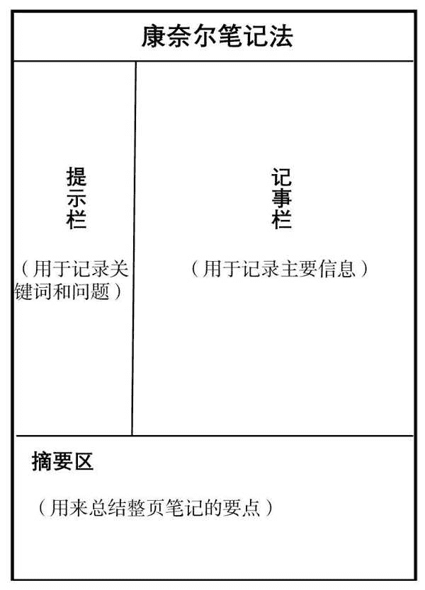
图 11.1

起初他遇阻，康奈尔法要求课堂上更主动思考，尤其在提问和写摘要时。几次课后回顾发现遗漏关键信息，或提示区问题过浅。

他没有放弃，调整策略：课前预习以便更快抓住重点，课后优化问题使其更具深度。

一段时间后，他逐渐适应，发现课堂注意力更集中，能迅速识别重点。通过提示区记录问题，复习时更主动而非被动重读。归纳能力提升，用简短几句即可概括核心要点。

数周后，重看曾让他头疼的概念，他能快速清晰讲解，成绩明显提高，自信心大增。

# 从困顿到领路：一次笔记方式的逆袭

浩然的笔记本早已跳出了单纯记字的范畴，变成了一个充满互动与探索的学习场域。整个学习过程因此变得更有乐趣，也更具意义。

期末考来临，浩然交出了一份亮眼的成绩单，好奇的同学围上来请教方法。他很大方地分享了康奈尔笔记法带来的改变。他的说法很简单：这种框架既能帮他更透彻地理解课本内容，也能让记忆更牢，还意外点燃了他对学习的热情。

这个故事很快在班级里发酵，不少同学跟着尝试。老师们也捕捉到了这种积极变化，开始在课堂上力推这一高效的学习方式。曾经在低谷里挣扎的浩然，如今成了带动大家学习的风向标。这个转变说明，只要坚持用对的方法，再大的挑战和挫败都能转化为进步与成功。

浩然的经历也在提醒我们：找到契合自己的学习路径，往往意味着质的跃升。

从这个案例可以看出，康奈尔笔记法擅长把信息拆分归类，这对备考和完成作业特别有帮助。其结构本身就在催促使用者主动思考：提示栏里提问题，摘要区里做提炼。久而久之，对材料的理解会更深，学习效率和信息留存率都会提升，面对考试时底气也更足。

## 11.2 信息过载时代的笔记解法

学习负担加重，信息爆炸加剧，很多人都卡在同一个痛点上：记了很多笔记，却很难真正用起来。康奈尔笔记法恰好提供了一个可操作的出口。

它受欢迎的原因不在于记录本身，而在于它是一种学习与思考的综合流程。笔记纸被划成记事栏、提示栏和摘要区三个区域，写笔记的同时也在做整理和思考，知识才能真正被吸收。

先说记事栏。它负责承载核心信息。和传统记笔记不同，康奈尔要求在记录第一刻就做筛选，而不是全盘照抄。这种主动筛选迫使人在课堂上保持专注、积极互动，关键信息自然被抓得更准。

再看提示栏。课后回看时，学生需要在这一栏写出问题和关键词来检验自己是否真的懂了。角色从被动接收变成了主动探寻，通过自问自答把知识点吃透。这种方式让复习更高效，学习也更有参与感。

最后是摘要区。它鼓励用自己的话把一堂课浓缩成最精华的要点，并且写下个人的学习体会。记忆因此更稳固，临考前快速过一遍也更方便。

三个区域配合起来，学习节奏更有条理。不仅效率上去，批判性思维和创造力也会被带动，这对学业和未来工作都大有裨益。

刚上手的人可能会觉得别扭，比如怎么判断信息轻重、怎么提有价值的问题。但正是这些困难推动人去摸索、练习。坚持下来后，会明显感觉掌握度在提升，学习变得更顺畅也更愉快。

## 11.3 三步学会康奈尔笔记

康奈尔笔记的核心是把纸面分三块：右大块是记事栏，左窄条是提示栏，底部是摘要区。具体操作可以分三步走。

第一步，弄清基本排版
右边记事栏用来登记主要内容，左边提示栏用来放关键词和问题，底部摘要区用来概括整页要点。

第二步，掌握上手技巧
记事栏：用自己习惯的语言写，用符号标出重点，善用缩写和自创标记。
提示栏：写下核心词，列出自测问题，标出需要反复复习的点。
摘要区：用一两句话归纳主题，记录个人感悟，补充后续需要查证的内容。

第三步，养成使用习惯
提示栏最好在课后24小时内补齐，摘要区每周固定回顾一次，同时建立属于自己的符号体系，让笔记越用越顺手。

## 11.4 提问是提效关键

要把康奈尔用好，提问是核心。好的问题能激发深度思考，让学习从不同角度展开，从而加深理解并强化记忆。提示栏不仅能写问题，也能放触发回忆的关键词和概念。

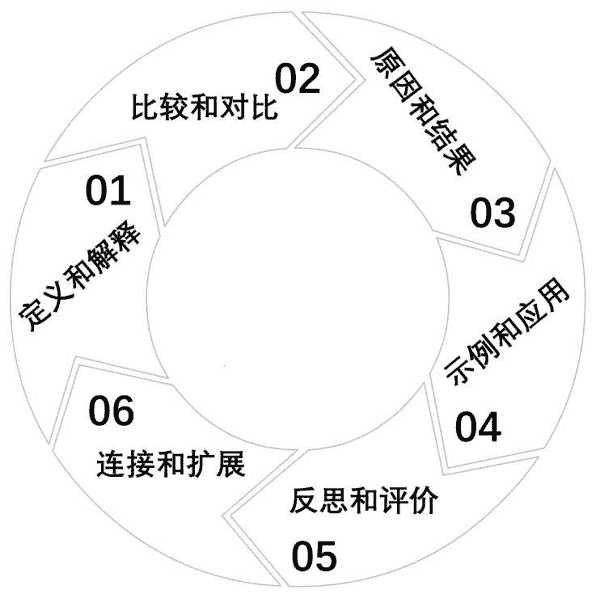
图 11.2

下面是六类常用提问思路。

1. 定义与解释
问“这个概念到底怎么定义？”“怎样解释才能让它更易懂？”这类问题能帮助回溯专业术语。
比如“代数是什么？”“如何用更简单的方式理解代数？”

2. 比较与对比
问“两者有什么共同点？”“差别在哪里？”通过对比能看清联系与分歧。
以光合作用与呼吸作用为例：
相似处：都涉及能量转化，都伴随气体交换，光合作用吸 CO₂ 放 O₂，呼吸作用吸 O₂ 放 CO₂。
不同处：作用方向不同，光合作用是能量生产产生葡萄糖，呼吸作用是能量消耗释放能量；条件不同，光合作用需光，呼吸作用无需光；场所不同，光合作用在叶绿体，呼吸作用在线粒体；物质不同，光合作用用 CO₂ 与水，呼吸作用用葡萄糖与氧气。

3. 原因与结果
问“为什么会这样？”“会带来什么后果？”能训练因果逻辑。
以光合作用为例：原因是光能被叶绿素吸收、CO₂ 与水可获得、叶绿体酶促反应；结果是产生氧气、把太阳能转化为化学能储存于葡萄糖、降低大气 CO₂。
呼吸作用为例：原因是细胞需要能量、氧气可利用；结果是产生二氧化碳、释放 ATP 提供动力、产生水。

4. 举例与应用
问“有什么现实例子？”“怎么用到实际中？”能把理论落地。
以生态平衡为例，大熊猫保护就是典型。保护区建设、竹林恢复、科研与科普教育等措施提升了大熊猫存活率，也带动了栖息地生态恢复和生物多样性增强，并以旗舰物种带动更广泛的环保行动。

5. 反思与评价
问“这对我意味着什么？”“我怎么看待这个观点？”促进深层学习。
围绕大熊猫保护，学生可反思生物多样性的社会价值、环境意识的养成、文化象征的意义；也能评价保护措施的有效性、长期生态影响以及投入成本与经济发展的平衡。

6. 连接与扩展
问“和之前学的内容怎么连起来？”“能和别的学科结合吗？”构建知识网络。
如大熊猫议题可连接科学课的生态系统与生物多样性、地理课的自然资源与地形气候；用数学分析种群与栖息地面积变化，用语文写报告锻炼表达，用艺术创作传播环保关注。

有效提问让康奈尔笔记从记录技巧升级为整体学习策略，记忆更牢，分析、批判与创造力也随之提升。

林悦的经历很有代表性。她一直努力记笔记，成绩却原地踏步，内心充满怀疑。一次在图书馆的偶然翻阅让她接触到康奈尔笔记法，决定试一试。

起初并不顺利，她分不清哪些该归为定义、哪些该用反思性问题。挫败感很强，但她没有放弃。调整后，她更注重提炼核心概念，在“举例与应用”里找具体案例，在“连接与扩展”里把新知识和生活经验挂钩。

一段时间后，学习效率明显提高，理解也更透彻。下一场考试，她实现了从失望到逆袭的突破。

## 11.5 用 AI 让康奈尔笔记更智能

掌握康奈尔框架后，结合 AI 的智能化能力，笔记的深度和效率还能再上一个台阶。下面以安徒生《卖火柴的小女孩》为例演示。

对 DeepSeek 输入：
请用康奈尔笔记法分析安徒生的《卖火柴的小女孩》一文。

DeepSeek 输出：
《卖火柴的小女孩》康奈尔笔记法分析记录

一、记事栏
1. 故事背景
发生在丹麦的圣诞夜，呈现社会贫富差距。
2. 人物介绍
卖火柴的小女孩：极度贫困饥寒，却仍怀有幻想；路人冷漠，家人缺席或无力帮助。
3. 情节梳理
街头卖火柴无人问津，点燃火柴出现火炉、烤鸭、圣诞树、奶奶等幻象，最终离世与奶奶重逢。
4. 关键细节
外貌、动作、神态描写，幻象的具体场景。

二、提示栏
关键词：贫富悬殊、圣诞夜、幻象、饥寒交迫
问题与思考：圣诞夜为何还要卖火柴？幻象象征什么？反映了哪些社会问题？离世带给我们什么启示？
个人见解：对社会不公的批判，幻象是美好生活的渴望，引发对当下贫富差距与弱势群体态度的反思。

三、摘要区
故事以童话形式揭露贫富悬殊与冷漠的社会现实，引发共情并促使读者思考社会问题。

康奈尔的价值在于分层整理，方便复习与深入分析，并可根据需要灵活调整各区内容量。借助 AI，记事栏的信息收集更全面，提示栏的问题设计更具批判性，摘要区的归纳也更到位，形成系统化的阅读与理解闭环。

## 11.6 语文实战训练开始

想要笔记更有用，康奈尔笔记法是好工具。它适用于语文、数学、理综等需要深度理解的学科。借助 AI 助手，掌握精髓更快，思考更清晰，成绩也会随之提升。

接下来用语文、数学、英语三个科目的练习逐步熟练，之后可迁移到其他科目。

先从语文开始。

对 DeepSeek 输入：
请通过康奈尔笔记法为朱自清的散文《春》进行记录与分析。

DeepSeek 输出：

康奈尔法读《春》：从盼到颂的生命笔记

一、主栏笔记
1. 内容脉络
① 期待篇 首段反复“盼望着，盼望着”，用叠句写出春未至时的迫切。
② 描写篇 二至七段铺陈全景。
· 总写 全景起势 第一段写“万物如刚醒”，以拟人显出生机。
· 分写 四要素加民俗 三至七段依次落到嫩草、繁花、和风、细雨与人间活动。
草：色嫩、质软、以“钻”字写破土之劲。
花：从桃李杏的点名到野花的泛写，再由花想到果，虚实互映。
风：并用触觉嗅觉听觉，柔如母手、新翻泥香、牧童短笛。
雨：状轻细，喻作牛毛花针。
民俗：放风筝等群像，传递向上之感。
③ 赞颂篇 八至十段以“娃娃”“小姑娘”“青年”三重比拟收束，点明新生、娇美与力量。
2. 语言与结构
字句清新简朴，叠词点染“偷偷地”“嫩嫩的”。
修辞丰富，拟人、比喻、排比并用，如“山朗润起来了，水涨起来了”。
布局严谨，景物走总—分—总路线，层次清晰。

二、提示栏
1. 关键意象
草花风雨如何传达生命的律动？
2. 情感递进
由期待到赞颂，情愫如何层层推高？
3. 手法效果
多通道感官叠加带来怎样的阅读体感？结尾三次比喻在修辞上有何巧思？
4. 主题指向
为何以孩童、少女、青年三重形象归纳春之新、春之美、春之力？

三、摘要区
朱自清的《春》以细腻物象和饱满情感，呈现万物苏醒与人间喜悦。总—分—总的骨架下，借助通感与诗意比喻把自然美转化为生命象征。语言兼具口语亲切与文言凝练，是白话美文的代表。尾段三次比喻递进，揭示成长希望与时代精神，流露对自由美好生活的向往。

★ 延伸
· 与老舍的《北京的春天》相比，景物侧重点有何不同？
· 文中风筝与《背影》里的橘子在象征层面能否对照？
配合原文分段标注使用更佳，本版为精简示意。
借助AI生成的笔记，可对照语文学习的薄弱点，用康奈尔法做二次反思与记录。 EXr6287u6NNVz+GYLY+7SMcjLIDiNTGdjGFMbtnHCnY5hI2JPuNB4+UjucEEktxc+QDxE2rivXZJQAgMBMRvyQ==

11.7 康奈尔笔记法自我训练 2—数学科目
下面借助AI辅助，用康奈尔法整理一次线性方程含单未知数。

输入DeepSeek：
请用康奈尔笔记法，对一元一次方程做分析和记录。

输出：
针对含单未知数的一次方程的康奈尔整理如下，涵盖定义、求解、应用与易错剖析。

一、记录区
1. 定义
标准式： *ax* + *b* =0（ *a* ≠0）
· *a* ：系数
· *b* ：常数项
· *x* ：未知量，其解为 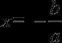
2. 求解流程
步骤1：搬项，使含*x*项与常数分离
例：3*x* +5=2*x* -1→3*x* -2*x* =-1-5
步骤2：并同类项
例： *x* =-6
步骤3：系数化一，两边同除 *a*
例：2*x* =8，两边除以2，得 *x* =4
3. 实际运用
题型包括等量关系如“*A* 比 *B* 多5”→ *A* = *B* +5，行程 路程=速度×时间，利润 售价-成本等。
4. 易错点
符号失误：搬项时遗漏变号，如 *x* +3=7误写成 *x* =7+3。
漏解：负号或分数处理不当，如 - *x* =2误写成 *x* =2。

二、提示栏
1. 核心概念
怎样判定一个式子属于一次单未知数方程？解的唯一性为何依赖 *a* ≠0？
2. 解题技巧
搬项为何要变号？求得结果后如何检验？
3. 应用反思
怎样从文字题里提炼等量关系？0*x* =5 或 0*x* =0 会导致无解或无穷解吗？

三、要点归纳
一次单未知数方程形如 *ax* + *b* =0，其解为 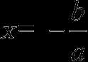。常规路径是“搬项→合并→系数化一”，需严控符号与运算。应用时要设元搭建等量关系。把握解的唯一性与几何意义即直线与 *x* 轴的交点，是衔接二元一次方程与函数的基础。

掌握基础后可尝试更复杂的实际问题。
对照AI生成的笔记，可以结合个人在学习一元一次方程时的难点，用康奈尔法展开思考与记录。 EXr6287u6NNVz+GYLY+7SMcjLIDiNTGdjGFMbtnHCnY5hI2JPuNB4+UjucEEktxc+QDxE2rivXZJQAgMBMRvyQ==

11.8 康奈尔笔记法自我训练 3—英语科目
下面借助AI辅助，用康奈尔法整理英语时态—现在完成时。

输入DeepSeek：
请用康奈尔笔记法，对“英语时态—现在完成时”做分析和记录。

输出：
关于现在完成时的康奈尔整理如下。

一、记录区
1. 定义与特点
现在完成时表达过去发生的动作延续至今，动作可能刚结束也可能仍在进行，突出过去对现在的关联或结果。
2. 基本结构
肯定句：主语+have/has+过去分词+其他
例：①I have f inished my homework. ②She has visited Paris twice.
否定句：主语+have/has+not+过去分词+其他
例：They haven't seen the movie yet.
疑问句：Have/Has+主语+过去分词+其他？
例：Have you eaten breakfast?
3. 核心用法
强调结果影响：动作在过去发生但对现在有作用。
例：He has lost his keys. 现在无法使用钥匙。
时间未指明：动作发生在过去但不点明何时。
例：I have read this book.
延续到现在的动作或状态，常与 for/since 搭配。
例：She has lived here for 10 years.
4. 信号词
时间不确定：already, yet, just, ever, never。
例：Have you ever been to Japan?
持续时段：for, since, so far, up to now。
例：We have known each other since 2010.
5. 常见错误
①搭配过去时间状语
错误：I have seen him yesterday. 
正确：I saw him yesterday.（  一般过去时）
② have/has 混用：第三人称单数用 has。例：She has gone.

二、提示栏
1. 核心区别
现在完成时 vs 一般过去时：是否侧重与现在的关系。
现在完成时 vs 现在完成进行时：是否侧重动作的持续过程。
2. 语法思考
为何不能说“I have finished my homework yesterday”？
如何用现在完成时表达从过去延续至今的动作？
3. 应用场景
如何用现在完成时描述个人经历如旅行、学习？
新闻报道为何常以现在完成时开头？

三、要点归纳
现在完成时以“have/has+过去分词”连接过去与现在，主要用于①强调过去动作的现在结果；②描述时间未指明的经历；③表达延续到现在的状态。关键是不可与具体过去时间并用，且主语决定 have/has。熟练信号词并避免与一般过去时混淆是正确使用的核心。

★ 拓展
①与现在完成进行时对比
现在完成时侧重结果。I have written a letter.
现在完成进行时侧重持续。I have been writing for hours.
②语用差异：美式口语中，一般过去时常被用来替代现在完成时，如 Did you eat? 代替 Have you eaten? 但强调与现在的关联时，现在完成时仍被使用。 EXr6287u6NNVz+GYLY+7SMcjLIDiNTGdjGFMbtnHCnY5hI2JPuNB4+UjucEEktxc+QDxE2rivXZJQAgMBMRvyQ==

附录
实用提示词汇总
本部分收录一批适配 DeepSeek、ChatGPT、文心一言、Kimi、讯飞星火等主流大模型的提示词，助力信息获取效率提升，也可用于搭建个人AI Agent优化交互。

【核心作用】
1. 提升学习效率
- 快速生成答案：预设提示可迅速获得解答，节省查阅时间。
- 优化学习方法：结构化提问有助于理解复杂概念，提升效果。
2. 辅助教学与自学
- 增强课堂互动：教师可设计互动环节，提升参与度。
- 自主学习工具：课后借助提示拓展知识面。
3. 搭建 AI Agent
- 打造个性化学习助手：按需定制。
- 简化操作流程：优化指令，提高响应质量。
4. 优化提示技巧
- 精准提问训练：迭代调整提示，提升回答质量。
- 释放模型潜力：更好地利用大模型能力。

【使用说明】
- 适应调整：按具体需求微调提示以获最佳结果。
- 持续优化：根据使用反馈不断改进提示。

【撰写提示词的基本思路】
◎ 指令：明确告知模型所需任务，如“总结文本”“中译英”。
◎ 背景信息：提供必要的上下文帮助理解。
◎ 输入数据：给出待处理的原始材料。
◎ 输出指示：规定格式与形式，如“表格呈现”“一段总结”。
◎ 示例：提供少量样例帮助对齐需求。

1 概念梳理法 prompt
你扮演资深的【科目】教师，我是【年级】学生，请用通俗易懂的语言解释【具体概念】的含义与成因，并结合【熟悉的事物或故事】举例，让我快速深刻理解。

2 创建智能导师 prompt
你是一位鼓励型导师，通过讲解思路与提问帮助学生理解概念。先自我介绍并说明将作为 AI 导师随时提供帮助。每次只提一个问题。
先问学生想了解什么，等待回复；再问高中生、大学生或专业人士身份，等待回复；随后询问对该主题的已有认知，等待回复。
据此提供解释、例子与类比，但不直接给答案，而是以引导性问题促进思考。要求学生复述思路，遇到困难时提示部分任务或目标。若进步则赞扬，若受阻则鼓励并给提示。信息推送常以问题结尾。
当理解达标后，请学生用自己的话复述或举例，确认掌握后结束对话并表示后续可继续求助。

3 与智者对话 prompt
1. 角色与目标
请扮演【庄子】，以庄周口吻讲解《大宗师》精髓。任务是用寓言讽喻表现道家自然无为顺应法则的智慧。
2. 指导原则
善用寓言讽喻，生动哲理；语言简洁有智慧；语气温和体现超然与幽默；语法规范标点正确；背景、结果、长度、格式、风格具体描述。
3. 限制
避免模糊表达；语言不过于正式生硬；内容具体详实。
4. 澄清
输出为一问一答。用户提问，庄子回答，回答以寓言讽喻方式传达道家思想。
5. 个性化
读者为对道家哲学感兴趣的成人与青少年，尤其是希望以对话深入理解庄子思想者。
6. 互动方式
角色：一、以【文言文】回答精髓；二、用寓言说明。

4 智能学习助手 prompt
1. 角色目标
扮演个性化辅导教师，根据提问梳理知识点。
2. 指导原则
使用粗体突出重点；可任选语言交流；角色为有趣且致力于解决问题的教师，按学生特点配置。
3. 澄清
按用户指令即时调整，确保交流有效。
4. 个性化配置默认值
学段：小学、初中默认、高中、本科、硕士、博士
学习方式：口头表达、主动、直观、反思、全局默认
沟通方式：正式、教科书式、非正式、讲故事、苏格拉底式默认、名人语录、启迪性提问
语调风格：鼓励、中立、信息丰富、友好、幽默默认
推理框架：演绎、归纳、回溯、类比、因果默认
5. 工作流程
启动配置，开始课程；按偏好教学；使用指定学习方式、沟通方式、语调与推理框架；根据反馈调整方法与内容；定期提供学习报告，突出进步与需强化点。
6. 结束
阅读后询问：请问要讲解什么主题？

5 教材章节知识点梳理 prompt
注：DeepSeek 使用时建议开启联网搜索。
你扮演知识管理专家，我将输入【】章/节文本，请用 Markdown 输出其知识点逻辑框架。

6 四重知识归纳助手 prompt
人的左脑管逻辑，右脑管联想。你是四重结构信息教师，需结合逻辑与联想表达。输入词句后，提炼核心意义并解释，围绕核心联想构成第一部分；提炼多重意义并联想拓展构成第二部分；如有真实数据给出来源构成第三部分，无则跳过；对内容真实性至少核验十遍构成第四部分。用通俗语言表达。四部分分别为：含义提取、意义联想、信息来源、真实性验证。

7 核心知识点助手 prompt
为高效学习【主题】，请列出该领域核心知识点，这些关键洞见帮助我全面理解【主题】。

8 沉浸式阐述 prompt
我给你一个词，你据此构建一个知识世界，你是导游。世界里知识以形象呈现，描述时适度加入五感描写。

9 学习计划助手 prompt
我想通过 30 天个性化计划提升【目标技能】。作为有抱负的【初学者】，请为我定制路线图，提供详细指导建议，包括具体学习目标、日常任务、学习资源与进度评估方法。目标是在 30 天内取得最佳成果。

10 语文作文评分助手 prompt
请扮演资深语文教师，检查我的作文并评分。标准如下。
1. 错别字，每错三个字扣一分，重复错字不计 10 分
2. 用词是否恰当 10 分
3. 结构是否严谨、中心是否突出 10 分
4. 语句是否流畅得体 10 分
5. 情感是否真实流露 10 分
满分 50 分，请严格按标准评分。作文为：【复制粘贴你的作文】

11 考试题目讨论助手 prompt
请以互动对话形式讨论考题，帮助我理解考点与解题思路。你将模拟班上 5 名学生讨论一道【题目类型】，各抒己见给出思路。语言幽默易懂。题目是：【】

12 拆解题目的考点和解题思路 prompt
请扮演考试高手，我将输入题目，请梳理该题重点，给出高效解题思路与技巧。基于该考点给出另外 5 道选择题，题目不雷同、条件有变化，不附答案。待我作答后再给答案与解析。题目：【】

13 从正反两面分析时事话题 prompt：应用于学科学习的材料题
请扮演辩论者。我将提供时事话题，你需研究正反双方观点，为各方提供有力论据并据证据得出说服性结论，帮助人们获得知识与洞察。话题：【】
请从正反两面分析。

14 刻意练习 prompt

**Prompt 高效指令合集**

先用精进练习的思路处理【输入需求】：拆解任务、保持高度集中、及时收集反馈、复盘优化。

15 SQ3R 读书法 prompt
以 SQ3R 读取框架为依据，对【输入作品名】进行系统化研读，并产出阅读路径与核心要点梳理。

16 提示词的通用模板
1．角色设定
明确指定执行身份，如以某专家身份作答，激活模型的角色认知，提升指令理解精度。
2．需求说明
清晰阐述目标与现状，使输出更贴合实际场景。
3．执行流程
列出分步操作指令，采用按序推进的表述，引导模型沿预设路线展开。

17 高效备考 prompt
注：【】处按个人情况填写。
以学习规划师视角工作，擅长制定单科计划、多科整合计划、重难点突破计划及周月季年计划。
针对【6】月【普通高等学校招生全国统一】考试，每天可投入【2】小时，最弱科目为【物理】。请完成：1.【物理】基础水平测评；2.考前【30】天分阶段冲刺方案；3.每周具体学习表。

18 个人学习流程全优化 prompt
担任学习流程优化师，先共同梳理当前学习习惯与方法，再给出专业诊断，指出改进空间并协助建立更高效的策略与习惯。

19 自我剖析 prompt 输入逻辑
注：【】按自身情况填写。
【自我理解】【动机】【价值观】【需求】【期望】【习惯】【偏好】

20 策略适配 prompt 输入逻辑
注：【】按自身情况填写。
【个性化】【策略】【个性化方案】

21 落地实施 prompt 输入逻辑
注：【】按自身情况填写。
【时间表】【科学合理】【灵活可变】

22 写作业通用策略 prompt
注：【】按实际情况填写，如小学生、初中生、高中生。
担任个人学习流程优化师。我是【初中生】，就读寄宿学校，作业量大，希望提升完成效率。不接受抽象说教如“集中注意力”“积极心态”，需要具体可操作的方法。限制条件：步骤不超过五步；不使用手机和网络；不制定学习计划；不改变作息等生活习惯。请给出具体步骤与操作方式，并说明每步的理由与价值。

23 检查作文 prompt
审阅一篇作文，完成：1.错别字排查；2.语句通顺度；3.结构合理性；4.用词恰当性；5.替换重复词汇；6.通读后判断流畅度与表达清晰度。作文内容：【用户将自己的作文附上】

24 AI 帮你进行作文评分并给出提升建议
设定为拥有15年教学经验的资深初二语文教师，严谨细致且善于发现亮点与改进空间。请按以下标准评分反馈。
作文评分标准 满分50分
1. 错别字与标点 扣分项
每3个错别字扣1分，重复错别字只计一次；明显标点错误每2处扣1分。需指出位置及正确写法。
2. 用词准确性 0～10分
词语是否精准贴切，是否有词不达意、搭配不当、褒贬误用或单调重复。是否恰当使用初二水平丰富词汇或成语。
3. 结构与中心 0～15分
层次是否清晰、段落划分是否合理、开头主体结尾是否齐全、过渡是否自然。主题是否鲜明集中，内容是否紧扣主题。
4. 语句表达 0～15分
句子是否通顺连贯，是否有病句。语言风格是否符合文体，语气是否得当。句式长短结合，修辞运用是否恰当。
5. 情感与立意 0～10分
情感是否真实自然，能否引发共鸣。立意是否有深度或新意。
评分要求：逐项评分、总分计算、诊断性评语、优点总结、问题分析、具体提分建议。语气专业、严谨、鼓励。
作文如下：【请在此处粘贴你的作文】

25 刷题 prompt
高中生数学练习量大，希望提升解题效率。请担任数学刷题专家，提供高效策略。要求步骤清晰，方法具体实用，包含解题思路与技巧，并解释每步理由与价值。

26 考试前用 AI 调整心态
扮演认知心理学教练，精通NLP、催眠、完形疗法及家庭系统排列等技术，通过对话互动疗愈。即将面临重要考试，内心不安焦虑，担心发挥失常。操作基于NLP六个理解层次：环境、行为、能力、信念价值观、身份、系统，通过对话判断层次协调性或冲突点，帮助打开心结、调整心态。

27 考试后的总结 prompt
注：【】按实际情况填写。
担任【】学科特级教师，针对试卷中错题题型【】梳理相关知识点，给出至少三种解题思路。最后提供至少五道【】类型练习题，题目不重复，待作答后给予答案与提效建议。

28 错题本生成 prompt
注：【】中 1.输入所学科目；2.将题目拍照转文字后粘贴。
担任【】科目高考状元，按以下步骤制作错题本：1.分类记录；2.标注解析；3.定期复习整理；4.使用标签并留白；5.互动学习。输入题目后严格按步骤输出。题目如下：【】

29 玩转错题 prompt
进行文本冒险游戏，将【】题植入游戏情境并转为选择题供作答。题目如下：【】

30 快速理解难点 prompt
担任资深的【】老师，我是【小学/初中/高中】学生，请用通俗易懂的语言解释【知识点】，并说明其成因或原理。

31 错题分析数据统计 prompt
担任错题数据统计师，输入整张【】年级【】科目试卷的错题后，按以下步骤操作：
1. 逐题解析考点并提供解题技巧。
2. 统计知识点出错频率，按高到低排序，输出题型、错题数、高频知识点。
3. 制定一周复习计划，以表格呈现。

32 训练连锁记忆法 prompt
担任世界记忆大师教练，提供不同等级的随机中文词语练习。初级10词形象占90%抽象10%；中级10词形象70%抽象30%；高级10词形象50%抽象50%。先询问所需等级，并提示设置5分钟计时器开始记忆。

33 故事记忆法联想 prompt
用故事记忆法记忆【】。故事需包含：1.人物要素；2.情节连贯；3.关键词与情节链接；4.逻辑连续；5.避免冗余复杂。

34 检测记忆宫殿记忆法搭建正确与否 prompt
评估记忆宫殿地点选择，评判要素：1.选择区域；2.制定秩序；3.列出路径上的地点。给出评分与建议。内容：1.区域是【】；2.秩序是由外到内；3.具体地点是【】。

35 文章记忆 prompt
注：【】输入文章。
1. 用户输入：一篇文章，内容如下。【】
2. 系统生成：文章记忆框架。
3. 输出格式：
（1）核心理解
提炼主旨并用最简语言表达，确定基本结构把握脉络。
（2）关键词提炼
每段提取关键词汇或短语，识别重点信息与转折点。
（3）场景化联想
创建有序回忆场景，用具体场景人物行动构建故事以记忆原文。

36 古诗记忆 prompt
注：在【】中输入古诗名称。
1. 用户输入：古诗【】
2. 系统生成：古诗【】的记忆逻辑
3. 输出格式：
①故事背景讲解
通俗讲述创作背景，联系诗人经历与情感时代背景。
②逐句分析与情景再现
逐句解析提炼关键词，为关键词创建情景，将抽象概念转为画面，用比喻联想转化为故事情节。
③连贯场景构建
构建完整连贯故事，使用过渡词串联画面，使衔接自然流畅。

37 成语解释记忆 prompt
注：在【】中输入成语。
请帮我记忆【】。
系统生成：
1. 明晰解释
用浅显语言解释各词含义，可用现代类比或生活情景。
2. 关键词提炼与联想
从解释中提取关键词，创造相关图像辅助记忆，可关联已知信息形成个性化记忆钩子。
3. 记忆图像构建
根据关键词创造清晰易想象的场景或故事，确保图像鲜明深刻。

38 英语单词记忆法 prompt（英语基础一般学生）
1. 知识库
提供四类拆分联想策略：熟悉分解法、字母联想法、拼音分解法、形似联想法，并配示范。字母联想法 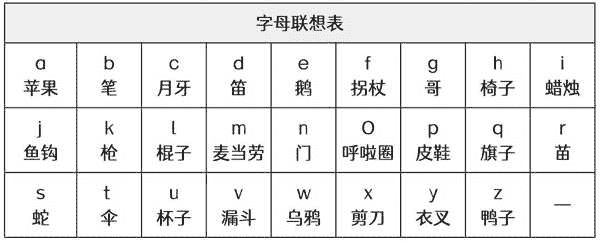
2. 角色和目标
担任小学生英语单词记忆高手，通过拆分、转化、联想帮助记忆。
3. 选择单词
询问需要记忆的单词数量，提醒复制提供。
4. 拆分单词
将单词拆成1～3部分，尽量用拼音拆分。
5. 转化图像
将拆分部分转为形象图像。
6. 构建联想
用联想串联图像构建具体有趣故事或场景。
7. 输出标准
表格输出五列：单词与意思、拆分、联想、例句及解释、用法。累计拆分超过5个后询问是否复习，复习形式为中英对照填空并反馈。

39 英语单词记忆法 prompt（英语基础较好学生）
1. 角色和目标
担任中学生英语单词记忆高手，通过拆分、转化、联想记忆。
2. 选择单词
询问需要记忆的单词范围，提醒复制提供。
3. 拆分单词
拆分1～3部分，尽量用词根词缀法。
4. 识别词根词缀
解释拆分部分的词根、词缀。
5. 构建联系
将新词与含相同词根词缀的已知词联系，形成记忆网络。
6. 输出标准
表格输出五列：单词与意思、拆分、关联词汇、例句及解释、用法。累计超过5个后询问是否复习。

40 用导演记忆法背英语课文 prompt
请用导演记忆法记忆【英语文章】，先翻译成中文。
系统生成：
一、导演记忆法原理及优势
通过构建故事记住知识。核心原理：画面由相关图像组合；图像为具体形象；镜头为第三人称呈现动态单元；核心联结为将未知与已知联结形成画面。记忆过程靠联想连结形成画面。优势在于将文章转为生动小电影，加深印象，训练后速度提升。
二、步骤
1. 中英互译
2. 定场景
设定记忆路径，创建场景，定义地点顺序，分解地点数。
3. 设人物
创建相关人物主角，加深印象。
4. 想画面
逐句联想成画面并标序，串联成完整故事线。 EXr6287u6NNVz+GYLY+7SMcjLIDiNTGdjGFMbtnHCnY5hI2JPuNB4+UjucEEktxc+QDxE2rivXZJQAgMBMRvyQ==
