# 解码学习认知计算

## 核心看点

本书立足“理论引领+数据驱动”双重视角，聚焦学习认知的量化难题，系统拆解了隐性与显性行为的分析路径。内容紧扣心理测量、认知心理、学习分析、教育数据挖掘及教育AI等前沿学科脉络，对认知计算的理论架构、研究范式、应用场景及建模技术进行了全景式梳理。

全书以五大核心板块为支撑——理论基石、静态诊断（推理）、动态诊断（预测）、时空诊断（演变）及教育落地，深度融合AI算法与机器学习技术于教育研究范式之中，旨在破解教育测评“难分论”的困局，精准洞察学习者内在认知，输出科学化的方法论与工具箱。适合高年级本科生、研究生及教育从业者、数据科学家、系统开发者参阅。

## 引言：智能时代的教育新范式

随着AI技术需求爆发式增长，大数据语境下的个性化学习倒逼信息化技术渗透教育全链路，“学习认知计算”由此跃升为研究热点。认知计算源于模拟人脑的AI系统，90年代起被明确为“连接神经生物学、认知心理学与人工智能的交叉学科”，核心在于让机器具备类脑思维。当下，智能教育落地积累了海量过程性数据，为认知计算落地铺就数据基石。作为个性化学习的“核心引擎”，它能还原学习者真实认知画像，支撑精准干预，实践价值深远。

学习认知计算植根现代心理、教育、测量理论，以科学手段对认知过程与发展潜能进行量化刻画，进而实现教育现象的科学判断。其核心使命是：在模拟与深度理解学习机制的前提下，通过数据推理与预测达成目标。技术层面，它利用测评交互中的作答数据，经认知建模实时追踪知识状态，精准定位认知薄弱环。近年，大数据与AI注入认知建模，更推动了高质量个性化学习的实现——让隐性知识状态显性化，成为推动教育高质量发展的关键路径。

21世纪以来，AI迭代催化认知计算跨学科发展，却也带来深层挑战：知识深度表示与推理如何突破？跨学科协作如何落地？模型可解释性如何提升？新时代背景下，技术迭代与新问题倒逼认知计算研究纵深推进，催生出“学习认知计算”这一教育研究新赛道。

本书理论实战并重，系统阐释理论、模型、算法与应用。编排遵循认知规律层层递进：首篇溯源原理与发展史；二至四篇分据静态、动态、时空三大维度，深度剖析诊断核心模型；终篇聚焦应用价值，拓展落地新思路与可行路径。

学习认知计算关乎社会进步与人才培养，作为前沿交叉学科，正为教育注入无限可能。无论初学者还是资深研者，本书的全景覆盖与深度解析，皆能夯实理论基、照亮实践路，助读者把脉前沿动态。

成书得益于杨华利、耿晶、胡盛泽、赵媛、胡俊杰、徐卓然、欧鑫佳、张金鸿、唐琳霞、陈玉霞、王锦、高旺等团队成员倾力付出，谨致谢忱。亦感全体读者，你们的关注与探索，是推动计算机科学、AI、认知心理、脑科学等学科深度融合、赋能教育高质量发展的动力源泉。限于水平，疏漏在所难免，恳请批评指正。

## 第一篇 认知计算溯源与奠基

### 第1章 理论基石：缘起·内涵·演进

#### 1.1 缘起：三重维度的历史必然

**1.1.1 时代底色：智能技术重塑世界**

微型机器人、传感器、可穿戴设备、VR/AR头显等硬件迭代，叠加AI、大数据、云计算、物联网、5G等核心技术突围，以“模拟人脑”为靶心的认知计算强势崛起，重塑经社会版图。智能化技术已成新一轮科技革命与产业变革的核心驱动力，推动人类跨入“机人协同、跨界融合、共创共享”的智能纪元[1]。2016年AlphaGo击败李世石，震惊全球，引爆全球AI战略布局——美、欧、日、中等近30国密集出台战略规划。美方连发三大核心文件锁定领先地位；欧盟主张创新驱动制造业升级；日本推进基础-应用-产业化全链路转化；中国《新一代人工智能发展规划》明确2025年核心产业破4000亿、带动相关产业超5万亿目标。AI已成国家科技博弈制高点，关乎经济命脉与国家安全。

“认知”根植认知科学，指通过抽象表征理解并创造知识的思维过程，已列入国际人类前沿科学计划（HFSP）。经典认知科学溯源霍布斯“推理即计算”思想，主张思维是对心智符号、逻辑、规则的形式化操作。学习认知理论则是心理学与邻近学科交叉渗透的产物，发源于格式塔“顿悟说”，聚焦认知过程探寻学习规律。

“认知计算”概念由Valiant 1995年首提，定义为“链接神经生物学、认知心理学与AI的学科”。IBM于2011年启动类脑模拟研究[2]，融合认知科学与计算机科学，借AI实现规模化学习、目的性推理、自然交互，达成类脑计算[3]。图灵机奠定通用计算架构，计算功能主义纲领成型[4]，推动认知科学硕果累累。计算理论探究算法在模型上高效解题的数学本质，为研究奠基。50年代起，“机器能否模拟大脑”成核心命题，推动认知科学与AI并进。AI历经两谷三峰，认知计算于第三次浪潮中崛起[5]，融汇信息分析、NLP、机器学习创新，赋能决策者从海量结构化/非结构化数据中挖掘深层关联，获取卓越洞见。

当下，我们身处“认知计算时代”：IT设备普遍具备深度学习、多模态识别（图像/语音/文本）、自然语言理解、对话等认知特质。基于认知能力的AI将驱动计算机更优地模拟人脑学习，引领教育、医疗、交通等领域变革。

**1.1.2 教育诉求：个性化学习的“最后一公里”**

教育领域，大数据范式、数据挖掘、深度学习让“因材施教”具备工程可行性。认知计算融合神经网络、机器学习、NLP等技术，为技术增强学习注入新动能。AI阅卷、拍照搜题、教育机器人等工具成熟落地，让个性化学习触手可及。其核心旨在以个体差异为起点，依托特质与潜能匹配资源与路径，补齐知识结构短板，成就最佳发展[6]。Science 2016年将“个性化学习支持”列入六大科研前沿[7]。正如Luckin所言：“教育唯一正道，是让人类比AI更善于学习”[8]。

全球共识已形成：美国《2021地平线报告》强调用AI分析评价学习过程，精准诊断监测，实施干预[8]；中国《中国教育现代化2035》锚定规模化与个性化统一[9]；《教育新型基建指导意见》以基建完善支撑网络化个性化教学[10]；《新一代AI发展规划》部署智能教育新体系，建立以学习者为中心的环境[11]；《义务教育质量评价指南》聚焦全面性、差异性、多样性评价[12]。

余胜泉从知识水平、学习情境、适应发展三维解构个性化内涵[13]，然受限于复杂性与多样性，落地操作性长期不足。2020年疫情下，直播课虽解“停课不停学”，但学情观测缺失，个性化难题依旧。

学习认知计算作为核心技术，历经三十余载，模型超百种[14]。它基于测评交互作答数据，经认知建模实时追踪知识状态，精准定位薄弱环。近年大数据/AI注入建模，显性化隐性知识状态，成为高质量个性化学习的有效路径，助推教育高质量发展。

**1.1.3 技术演进：迈向计算第三代**

AI与机器学习深植脑科学基因。早期AI追逐“造大脑”宏愿，如今学习认知计算正逐步兑现。业界公认认知计算为计算第三代：首代（19世纪）巴贝奇提出可编程概念；次代（40年代）ENIAC开启数字编程纪元；第三代即认知计算，融汇信息分析、NLP、机器学习创新，助力决策者从复杂数据中洞见关联[5]。

认知计算源于类脑AI系统，通过人-环境交互与持续学习，助决策者从海量异构数据中获洞见，实现感知、记忆、学习等认知活动。大数据时代到来，丰富数据与知识赋予新机遇。功能层面，认知系统具备类人认知力，擅长数据发现、理解、推理、决策。学习力是核心，尤在大数据语境下。技术底座建立于神经网络与深度学习，引入认知科学知识构建类脑系统。但其边界远超单一技术，覆盖机器学习、NLP、视觉、人机交互等多学科。IBM Watson在Jeopardy展示顶尖问答交互，后扩展为Web服务套件，提供视觉识别、语音转写、语言理解、对话引擎等API，赋能强虚拟代理构建。

认知计算本质是大规模学习、目的性推理、自然交互的系统，是计算机科学与认知科学的深度交融。它让机器更智能、更友好——兼顾人类行为概念与社会情境。机器学习虽能经验自优，唯有认知计算阶段，用户才能真享“实用智能交互”：不仅访问结构化信息，更能自主编写算法、提出解法。如车载导航依托地形数据生成路线、学习偏好（机器学习），但当它结合习惯主动规避拥堵、推荐最优路径时，便触及认知计算边界。

如何打破人机认知与计算规律的内隐/外显矛盾，实现深度协同，是学界持续攻关的核心命题。认知计算立足认知科学、机器学习、大数据三角支撑，成智能时代焦点。作为人类认知智能与机器计算智能的典范，它将个性化渗透生活每隅，广泛赋能医疗诊断、商业决策、教育变革。

#### 1.2 内涵解码：从行为建模到决策赋能

认知计算模型因可解释、拟合、预测认知行为，广泛服务于学习科学。学习认知计算模型利用过程性数据，洞察学习机制，推理预测表现，护航个性化学习与教育决策。

##### 1.2.1 学习认知：主动建构的信息加工观

学习理论阐释人/动物学习本质、过程及影响因子。心理学视角下，理论分双雄：S-R理论（刺激-反应）与认知理论。认知理论反对被动联结，主张：**学习是主动建构内部认知结构**；**通过领悟理解获期待，非练习强化成习惯**；**受原有结构与当下情境制约，为预期导向而非习惯驱动**。

认知理论描绘大脑对知识“获取-加工-存储-提取”全链路[15]：获取即感官接收刺激；加工指转码便于存储；存储即记忆保持；提取指再认知调用。加工中个体能从存储库提取再认知。遗忘、学习、记忆三者共同制约再认知效能。代表人物涵盖Gagné、Kohler、Bruner、Ausubel等，虽说各异，同强调有机体对情境的认知、理解与领悟。

**1. Gagné的信息加工理论**
美心理学家Gagné 1974年借计算机模拟思想，用信息加工观诠释学习，绘制信息流向图谱。理论主张：**学习本质是形成日益复杂的认知结构**。完整学习行为含八个衔接阶段，各有内部过程与外部事件；教学对应“动机-了解-获得-保持-回忆-概括-作业-反馈”八环。教师责任在于引导建构适宜认知结构，推进循序渐进。主张“指导下的发现学习”，兼顾能力培养与方法传授，助学习者成长为高效问题解决者。

**2. Kohler的格式塔-顿悟说**

# 经典学习理论与认知计算前沿：从顿悟到智能建模

###### 3. 布鲁纳的认知结构学习理论

布鲁纳的核心教育心理学思想集中呈现在1960年的著作《教育过程》中。他专注于有机体在知觉与思维层面的认知学习，将“认知结构”定义为个体感知并概括外部世界的基本框架。布鲁纳坚持认为，学校教育与实验室中针对猫、狗、鼠类的刺激-反应研究有着本质区别，教学的首要使命是主动推动学习者完成旧有认知结构向新结构的转型，使个体能以全新的认知模式理解世界。

- **(1) 聚焦学科核心结构的习得。** 布鲁纳主张，无论教授何种学科，都必须让学习者透彻掌握其基础结构。这种结构具有广泛适用性与强大解释力，涵盖基本概念、原理与规律——即教学中的“三基”。他指出，认知结构的建立依赖于同化、顺应及二者平衡的机制。

- **(2) 培育高效的学习策略与编码系统。** 在布鲁纳视域下，学习者的探究并非被动发现分类规则，而是主动创建分类体系。这些范畴在具体学习中形成“编码系统”——即个体对知识进行分组、组合的方式，该系统随学习持续演变重组。知识迁移的本质，是将既有编码系统应用于新信息以实现高效习得。因此，教师务必摸清学习者现有的编码系统，才能对症下药。

- **(3) 推行基础学科的前置化教学。** 布鲁纳名言指出：“任何学科的基础知识都可以用某种形式教给任何年龄的任何人。”他主张将核心知识下沉至低龄段，认为学科最基本的观点往往简洁而强有力。若教师能依据儿童认知特点呈现核心概念，便能缩小学习层级间的鸿沟，促进迁移，激发早期智慧。他强调，尽早建立高级知识的“同化点”，能助力儿童不仅理解当下内容，更能触类旁通，掌握同类新知——这正是通往迁移能力的“大道”。

- **(4) 倡导发现式学习。** 所谓发现，是指学习者依循独特认知路径自主获取知识的全过程。布鲁纳反复强调教学应服务于认知生长，教师的任务是将知识转化为适配学习者发展阶段的形式，以表征系统的演进序列为教学设计蓝本。基于此，他大力推崇发现学习法。

###### 4. 奥苏贝尔的认知同化理论

作为美国认知心理学家，奥苏贝尔在批判行为主义将动物心理等同人类心理的谬误基础上，融合皮亚杰、布鲁纳等人的思想，构建了有意义学习与先行组织者理论，实现了学习论与教学论的有机融合。

- **(1) 核心主张：有意义学习。** 他认为，有意义学习的实质是新知识符号与认知结构中既有适宜观念建立“非任意、实质性”的联结。学习应尽可能追求意义。他将学习划分为接受/发现、机械/意义四维，并厘清了各维度内涵与关联。

- **(2) 理论基石：同化机制。** 学习新知实为新旧材料的互动过程，学习者需主动在既有知识网络中寻觅能“接纳”新知的锚点（同化点）。同化指将新知纳入既有图式、致使图式量变的活动。能否习得新知，关键取决于认知结构中是否预存相关概念。故而教学前必须诊断学习者原有认知基础。依据新旧知识概括层级与关系，他提出下位学习、上位学习、并列结合三种同化范式。

- **(3) 教学原则与先行组织者策略。** 基于上述理论，他确立三大原则：逐渐分化、综合贯通、序列巩固。为落实原则，引入“先行组织者”策略——在新任务呈现前，教师预先提供具有概括性、关联性的引导材料，搭建同化脚手架，促进下位学习。针对全新知识，主张用“说明性组织者”提供抽象锚点；针对半陌生知识，主张用“比较性组织者”辨析异同，奠定精准习得基石。

##### 1.2.2 认知计算的内涵

认知计算源于模拟人脑的智能系统。90年代起，该术语明确指向“教计算机像人脑一样思考”而非单纯构建人工系统。Valiant (1995) 首提该概念，将其定义为连接神经生物学、认知心理学与AI的学科。此后定义百家争鸣：Szymanski 等视其为融合行为、认知、计算机科学的新兴领域；Wang 从认知信息学视角定义为模拟大脑自主推理感知的智能范式；Modha 等强调开发受思维启发的统一机制；Nahamoo 将其定义为利用大规模并行机器交互海量信息解决现实问题的新范式。Clark 与 Violino 则分别从目标抽象层级与自主提取概念、理解含义、经验学习的角度阐释。

虽无统一定义，但共识特征鲜明：它是源于脑科学研究的技术簇，融合AI与信号处理，旨在模拟人脑信息处理以增强人类决策。注意“大脑”（器官）与“思维”（功能活动）常被混用实则有别，认知计算聚焦于模拟赋予感觉、思考、认识能力的**机制**。简而言之，它是多学科交叉领域，基于神经生物学、认知科学、心理学过程，设计计算模型与决策机制，赋予机器“知、思、觉”能力，目标是建立由人类思维驱动的理性、组合、集成机制。

认知计算开创全新计算模式，融汇信息分析、NLP、机器学习创新，助力决策者从非结构化数据中挖掘深层洞见。传统计算重量化、精度、序列；认知计算则攻克生物系统固有的不精确、不确定、部分真实问题，实现感知、记忆、学习、语言、思维、解题等多层级过程。大数据时代背景下，如何实现类脑认知判断、发现新关联模式、支撑精准决策，成为核心机遇与挑战。

从简单的“说、听、看、写”到复杂的“辅助、理解、决策、发现”，认知计算是自上而下的全局统一理论，兼容自下而上的神经生物学事实，可计算、可数学化。它寻求符合脑科学基础的软硬件元件，处理感知、记忆、语言、智力、意识等心智过程。终极目标：让机器像人脑一样学习、思考、决策。人脑与机器各有所长，认知系统将成人类得力副手，攻克人脑短板任务。在认知计算纪元，计算机将延伸为人类能力的拓展，实现更高效、更自然的信息处理。

**理想认知计算系统应具四大核心特质：**

1.  **辅助力：** 提供百科全书级知识支撑，助人跨域化身资深专家。
2.  **理解力：** 拥有敏锐洞察与自然语言理解能力，处理多源异构数据，洞察数据内在关联，实现深度交互。
3.  **决策力：** 具备智能逻辑推演，通过假设生成挖掘洞见、模式、关系，串联知识碎片，经推理、分析、对比、归纳、论证输出决策证据，量化评估多维因素，保障决策精准与时效。
4.  **洞察与发现力：** 拥有基于证据的学习能力，从大数据中高速提取关键信息，以类人方式认知进化。支持专家训练与交互式经验学习，持续迭代优化。核心价值在于从海量数据中归纳人所需知识，赋能机器类脑认知，助力人类加速发现新问题、新机遇、新价值。

##### 1.2.3 学习认知计算的内涵与外延

学习认知计算是认知计算等新技术在学习科学的落地应用，旨在解释、拟合、预测学习者认知过程与行为，助力高效学习。2016年起引发教育界关注：Irfan 等看好其利用过程数据解析学习机制、分析外显表现的潜力；Maresca 等证实其通过数字化交互能提升表现、减轻教师负担；单美贤等构建集成框架，聚焦教学大数据生成时序行为流，经模型推理预测服务个性化学习与教育决策；黄荣怀等定位其以认知数据为源、教学理论为本，计算分析认知与结果，探寻大脑信息加工机制，揭示学习认知规律。

虽无统一定义，但共性明确：透过外显行为理解内隐认知状态，模拟学习机制进而预测推演行为。重点在于模拟学习过程、赋予机器“知、思、觉”机制。本质上，它是基于大脑、学习科学、认知科学、认知心理学内在加工过程的多学科交叉领域，设计计算模型与决策机制，目标是建立由学习者思维驱动的组合集成机制。

学习认知计算以技术赋能理论，解码外显行为数据，揭示自下而上的内在运行机制与规律。研究对象为信息时代的密集型学习过程数据，通过量化理论要素及交互，融合认知心理学、学习科学、认知计算、信息科学，解释行为表现、理解内在机制，设计模型机制，推进个性化学习与精准教学，为高质量教育体系提供理论与技术双支撑。

其目标双重：一、**仿真与理解学习机制**——认知能力模型可描述为内在状态演变，解释行为与知识变化成因，通过实证行为互动预测，溯源导致观测结果的认知过程；二、**基于数据的推理预测**——构建联结主义黑箱模型，引入认知数据作为输入，对指定输出推理预测。

鉴于跨学科属性，其内涵外延须植根教育学、学习科学、认知心理学、认知科学等理论基础，针对密集型学习数据，以认知计算为技术手段，在跨域互动中融合范式、框架、方法，拓展发展路径。因认知复杂性，学习机制研究兼具社会科学与自然科学双重属性，已成多领域交叉基础上的核心使命：聚焦学习认知数据建模、诊断推理、表现预测三大任务。

###### 1. 学习认知的数据建模

认知计算核心在于数据聚合，大数据范式及收集聚合能力升级是基石。智能化学习环境中，大数据5V特征（量、种、速、真、值）前四者显性呈现：Moodle类LMS或MOOC生成海量数据；数据形态多元（作答、论坛回复等差异巨大）；高速连续流生成；理解度、参与度数据充满不确定性。认知计算拥抱大数据的同时，在**可扩展性、动态性、自然交互性**三维超越传统分析：它非仅解决给定问题，而是研习模式、建议行动，赋能更快、更准的决策分析。

**认知数据源三大类：**
1.  **测试采集数据：** 常规但范围受限，难保模型精度。
2.  **任务交互数据：** 主流补充来源。虚拟游戏/仿真环境成主流采集手段，学习者在复杂模拟中体验角色、解决难题，产出交互式认知数据。在线游戏常用于测量注意力、视觉空间工作记忆、决策力、解题力等，构建学习者特征空间，服务认知建模。
3.  **生理设备数据：** 物理传感器采集生理指标，依神经学事实关联特定认知特征。涵盖眼动(EM)、脑电(EEG)、事件相关电位(ERP)、皮电(GSR)、肌电(EMG)、心电(ECG)、表情(FER)、激素等。底层生理数据能更精准拟合认知动态：心血管数据反映觉醒与认知负荷；皮电映射交感神经唤醒；脑电频谱关联认知工作与心理状态，揭示状态-效果潜在链接；眼动追踪为核心视觉注意技术，监测注意分布与转移轨迹，探究注意模式与效果关联。专注力作为高阶认知核心要素，更是输入转化为吸收的关键前提。

**游戏交互数据建模的优劣势：**
*   **优势：** ① 游戏化环境激发兴趣，提升数据真实度；② 仿真模拟支持复杂角色体验与问题解决，获取丰富交互数据。Luft等测量选择性注意、空间记忆、心理旋转、算力；Khenissi等测量工作记忆容量。
*   **缺陷：** 认知数据高度依赖游戏任务设定，而游戏任务与真实学习任务存较大鸿沟，损害模型可靠性；任务与特定认知指标的关联效度缺乏广泛验证。

**生理数据建模路径：** 利用生物传感器、红外成像等硬件采集生理物理指标，依神经学确证关联认知特征。此类底层数据能更准确捕捉学习过程中的认知相变，为精准建模提供硬核支撑。

### 第二章 学习认知计算的演进脉络

学习认知计算是一门融合计算机科学、人工智能与认知心理学的跨学科领域，致力于构建人类认知过程的计算化模型。其核心使命长期聚焦于建立统一认知理论——即包含通用数据结构与通用解题方法的理论框架。受脑科学、心理学及人工智能多学科启发，认知模型的计算范式已从感知决策与控制，逐步迈向认知决策与控制的更高阶段。

#### 2.1 溯源与分类：奠定理论基石

学习认知计算植根于现代心理学、教育学及教育测量学，旨在通过科学手段对学习者认知过程与发展潜能进行量化刻画，并对教育现象做出科学价值判断。其终极目标在于仿真并理解学习机制，依托学习数据实施推理与预测。具体而言，静态认知诊断模型（CDM）专注于依据单次学习数据推断知识掌握度；动态 CDM 则侧重利用历史连续数据预测未来表现。二者均作用于教育测评场景，而测评本身由“测量”（量化手段）与“评价”（价值判断终点）构成。

从目标维度看，Newton 将其划分为判断、决策、影响三个层级；从流程维度看，经历定量、定性、价值判断三步走；从场景维度看，Sondergeld 等人区分为常模参照与标准参照测评。前者涵盖轨迹模型、过渡表、学生增长百分位数、投影模型四大增长模型；后者则从传统 Angoff 高风险测试演进至基于项目反应理论（IRT）的现代高阶模型。智能时代的学习认知计算，迫切需要探寻教育现象本质与规律，将测评中抽象潜在的属性精准量化，为价值判断提供全面、客观、有效的数据支撑。

---

### 核心应用场景：诊断推理与表现预测

#### 2. 认知诊断：洞察学习黑箱的“显微镜”

在教育实践中，推理是认知计算模型的关键应用。它借助模型解码学习机制，评估认知状态——从微观技能掌握到宏观能力水平。随着认知心理与教育测量学深度融合，诊断评估不再止步于分数，而是致力于解释分数背后的心理加工机制，极大增强了模型的解释力。

**认知诊断理论（CDT）** 是这一领域的代表，它打通心理测量学与认知心理学，挖掘隐藏在分数背后的认知过程、加工技能与知识结构，输出学习者优劣势画像。在奥苏伯尔“有意义学习”理论指引下，CDT 强调宏观能力与微观认知结构并重，助力师生定位薄弱技能、对接既有认知，推动个性化学习与因材施教。

认知模型本质上是对特定粒度下人类解题能力的简化描述，用于解释预测表现。它不仅为试题开发提供解释框架，更搭建起认知原则与测量实践的桥梁。正如 Snow 与 Lohman 所言，能力（潜在特征 θ）不再是唯一总结维度，分数实为处理技能、策略、知识成分（程序性/陈述性、受控/自动）的复杂组合，这些成分在人、任务、练习阶段间呈现动态变异与不变性，认知心理学的贡献正是剖析这些模式。

**认知诊断模型（CDM）** 将认知特征嵌入测量模型，实现对内部心理加工的度量。主流 CDM 多针对单次测评，故常指静态诊断，大致分两派：
*   **潜在特质模型**：典型如**项目反应理论（IRT）**，用单一连续变量刻画宏观能力，以逻辑斯蒂函数建模作答概率。
*   **潜在分类模型**：典型如**DINA 模型**，聚焦微观认知结构，用二元离散向量标记各细粒度知识点的“掌握/未掌握”状态。

#### 3. 表现预测：从静态快照到动态影像

预测是认知计算的另一核心应用，其精度仰赖学习者历史先验知识。在多次连续测评场景下，即**知识追踪（KT）**。KT 利用学习轨迹数据预测未来表现，实现及时干预，突破单次测评局限，覆盖全学习历程。

*   **贝叶斯知识追踪（BKT）**：概率派代表，将知识状态抽象为二元变量，引入隐马尔可夫模型模拟掌握度动态演变。其变体融合猜测/失误、时间因子、题目难度等，具备良好可解释性。
*   **深度知识追踪（DKT）**：深度学习浪潮下的新贵，引入循环神经网络（RNN），预测效能显著超越概率模型。近年研究呈爆发式增长，改进路径集中于：
    1.  **架构创新**：如 DKVMN-KT（动态键值记忆网络）、CKT（卷积神经网络）、GKT（图神经网络）等。
    2.  **多特征融合**：引入遗忘特征（DKT+forget）、习题内容特征（EKT）、认知特征建模学习与遗忘（CF-DKD）等。

**权衡与张力**：DKT 系列虽效果强，但训练过程近乎“黑箱”，可解释性不足；融入教育心理特征的模型虽改善解释性，但结果稳定性仍有波动。

---

### 1.3 学习认知计算的四大核心价值

在大数据驱动个性化学习的浪潮中，智能辅导系统（ITS）广泛落地，积累海量过程数据，使认知计算技术落地成为可能。作为个性化学习核心引擎，它帮助学习者获取真实认知状态，支撑精准干预，实践价值深远。

#### 1. 让认知机制“可理解”：破解学习黑箱
“十四五”规划与十九届五中全会明确教育核心矛盾转向“人人上好学”，高质量教育体系以“高质量学生评价”为核心。认知计算跨学科整合脑科学、认知科学成果，构建精准模型预测学习进度、动机与毅力。

*   **解开黑箱**：UCL Luckin 教授主张，结合学习大数据设计 AI，可“解开学习的黑匣子”。
*   **激发探索**：Bristol Jones 教授发现“不确定奖励”促进学习，认知计算可依据个体反应动态调配奖励机制。
*   **培育成长性思维**：系统可捕捉思维演变轨迹并自适应调整教学。Dweck 团队的 Brainology 即通过捕捉思维脉络，助力学习者高效建立成长性思维。
*   **赋能师生**：全面诊断评价既提升学习效率、助建高质量策略，又助教师优化课堂、重塑教学新样态，推动以学习者为中心的高质量发展。

#### 2. 让学习分析“可预测”：从事后诸葛到先见之明
认知计算提供细粒度工具，追踪能力发展轨迹，支持按需调整。多模态数据采集（语音、眼动等）为难评估技能（如实践学习）提供新证据。海量过程数据的积累，使我们能跨教学方法追踪学习路径，动态设计最优教学流程，优化情境因子提升教学有效性。

在评估层面，认知计算重塑科学精度：
*   **及时评估改进效果**：大数据与学习分析结合，高精度预测学业与课程评价，支撑及时干预。
*   **洞察学习进展新知**：过程数据揭示“如何得出答案”而非仅“是否正确”，发现传统评估盲区。
*   **超越“停考测试”**：持续认知分析取代传统小样本、阶段性评估，实现全程无感测评。

#### 3. 让学习过程“可解释”：落地因材施教的密钥
《中国教育现代化 2035》聚焦个体全面发展与因材施教。学习分析通过测度、收集、分析、报告数据理解优化学习；认知计算以建模技术（学习者、认知、行为、学科知识建模）为基，构建预测模型，为每个学习者匹配最优学习路径，最大化成绩。

实时数据收集与分析，使认知计算比单纯教育数据挖掘更擅长预测学习效果。预测旨在：
*   **即时干预**：教师依据预测给予指导、反馈，提升知识习得，识别高风险学习者。
*   **长远规划**：可靠模型定义最优课程路径，缓解考试压力，减轻教学负担。
*   **精准选课**：为模块、内容项提供决策支持，激发潜能。

最终，认知计算通过建模诊断掌握“学情”，助教师针对性实施因材施教，实现精准教学、提质增效。

#### 4. 让个性化学习“可调节”：重塑自适应学习生态
认知计算深度应用于 ITS 与自适应系统，整合认知数据构建完整学习者模型，支撑精准判断。网络学习作为以学习者为中心的主流形态，将学习视为个人知识网络的持续创建——扩展节点、重构认知。

个性化定义双轨：
1.  **自主节奏**：自由探索顺序，按个人步调推进。
2.  **智能脚手架**：自动生成评估，即时反馈与支持。

鉴于学习者个性、思维、认知、能力的异质性，同环境下效果天差地别。Gudivada 分析了由教育数据挖掘、学习分析、认知分析驱动的 ISPeL 系统；MATHia 融合知识追踪（概念理解）与模型追踪（解题过程）双轨支撑思维；Knewton、基于 KST 的 ALEKS、猿辅导、智学网等平台，打破经验教学与题海战术，依据当前水平定制补救干预，实现高质量个性化学习。

认知计算个性化学习的本质，是追踪分析每一段学习旅程，最大化释放潜能、达成教育目标。以当前学情为起点，借知识诊断技术挖掘认知起点、施以对症补救，是信息化促进有效学习的关键路径。

**小结**：认知计算已成教育新引擎。它既是封装新技术、激活协同的方法论框架，也依托机器学习实现交互与个性化体验。研究学习认知计算，关乎个性化学习高质量发展，理论与实践价值兼具。

---

### 1.4 章节回眸

本章系统阐释了学习认知计算的缘起、内涵与意义。随 AI 深化，认知计算步入以 AI 为基座的新纪元；智能个性化学习成全球焦点，认知计算潜能被激活，助力针对性学习、推动教育高质量发展。

虽无统一定义，但共识特征明确：**透过外显行为，洞悉内隐认知状态；仿真学习机制，实现行为预测与推理。** 简言之，它是脑科学、学习科学、认知科学、认知心理交叉的计算建模与决策机制设计领域，旨在赋予机器“知、思、感”能力。

作为个性化学习核心技术，助力获取真实认知状态、支撑精准干预，价值四维：
1.  认知机制**可理解**；
2.  学习分析**可预测**；
3.  学习过程**可解释**；
4.  个性化学习**可调节**。

**终极结论**：AI 技术演进催生认知计算崛起，基于认知计算的个性化学习成教育新刚需，激发领域潜能，彰显研究学习认知计算对推动个性化学习高质量发展的重大理论与实践意义。

# 学习认知计算理论演进与测评场景重构

## 2.1 理论谱系：从宏观分数到微观动态追踪

学界对教育测评理论的划分视角多元。有研究者依据演进脉络，将其划分为标准测验理论（涵盖经典测量理论CTT、概化理论GT、项目反应理论IRT）与新一代测量理论（以认知诊断理论CDT为核心）两大阵营，二者在教育心理测量领域均奠定了基石地位。亦有学者聚焦于传统测量与现代测量（IRT）的项目特质差异进行对比。近年随着智能导学系统崛起及疫情催化在线教育普及，海量高频过程数据触手可及，推动了以知识追踪（KT）为代表的智能化测评模型加速迭代。

梳理脉络可知，教育测评本质上遵循“宏观（分数/能力）向微观（知识/技能）”、“单次静态向多次动态”双重演进逻辑。据此，本文将学习认知计算理论重构为四大范式：

### 1. 经典范式：以CTT为核心的宏观分数计算
经典测量理论（CTT），亦称真分数理论，核心假设为观测分数 $X$ 由真分数 $T$ 与随机误差 $E$ 合成（$X=T+E$）。该范式依托信度、效度指标检验测评质量，仅凭总分从宏观层面对学习者定位，存在“唯分数论”局限。

### 2. 现代范式：以IRT为核心的能力建模
为破解“唯分数”困境，项目反应理论（IRT）应运而生。它将分析单元下沉至单个试题，通过题目难度、区分度及学习者能力三参数建模作答概率。IRT 本质属于常模参照测验，通过群体横向比较判定个体学业水平，实现了从“分数”到“能力”的跨越，但仍受限于“唯能力”单一维度。

### 3. 新一代范式：以静态认知诊断（CDM）为核心的微观技能画像
针对宏观能力无法定位具体知识短板的痛点，认知诊断模型（CDM）引入认知心理学机制，将认知过程离散化为“掌握/未掌握”二元状态，属半结果性测量。它能精准刻画学习者微观认知结构与知识状态，弥补了传统理论忽视内部加工过程的缺陷。

### 4. 智能时代范式：以动态认知诊断/知识追踪（KT）为核心的时序演化预测
前三范式均局限于单次测评切片，忽视先验历史经验。知识追踪（KT）模型引入深度学习（RNN、注意力机制、GNN等），融合海量时序历史数据，动态跟踪知识状态演变，预测未来作答表现，实现了从“静态诊断”到“动态预测”的质变。

---

## 2.2 应用场景二维镜像：单次终结性 vs 多次形成性

依据数据采集频次与性质，学习认知计算场景划分为单次与多次测评两大范式（对应布鲁姆终结性/形成性分类），核心差异见下表：

| 维度 | **单次测评场景（终结性/判断）** | **多次测评场景（形成性/决策）** |
| :--- | :--- | :--- |
| **数据采集** | 静态一次性采集（结果导向） | 动态连续多次采集（过程导向） |
| **数学结构** | $T:S:R = 1:n:n^q$<br>(1轮测评, n人, q题) | $T:S:R = m:n:n^{m\times q}$<br>(m轮测评, 数据指数级增长) |
| **核心模型** | CTT、IRT、CDM、终结性测评 | 动态认知诊断、KT模型、形成性测评 |
| **典型系统** | 国际大型测评、中高考、区域质检 | Knewton等智能自适应学习平台 |

**单次场景深度解析**：聚焦特定时点群体认知水平判断，适用于选拔型考试（中高考）或大规模监测（PISA）。数据特征为单一矩阵，虽涵盖大小规模，且可引入大数据挖掘补充特征，但先天缺失时间维度，易导致诊断片面、遗漏发展轨迹。

**多次场景深度解析**：贯穿学习全过程，利用历史先验知识强化当前诊断精度。数据呈三维张量结构（$m \times n \times q$），支持实时状态监测、趋势预测及“反馈-矫正”闭环决策。典型落地于智能导学系统，可捕捉知识演变动态，但面临时间间隔建模、结果稳定性等技术挑战。

---

## 2.3 发展四大范式跃迁：技术驱动下的本质重塑

伴随认知心理学与AI技术双轮驱动，学习认知计算完成了从传统统计到智能计算的跨越：

1.  **场景跃迁：单次结果性 $\rightarrow$ 多次过程性**  
    关注点从“考后判断”转向“学中诊断”。KT技术（Piech等）实现自适应路径规划；纵向认知诊断（詹沛达等）利用历史先验强化当前模型；IRT脚手架系统（Ueno等）动态调整提示策略。形成性反馈成为驱动学习的核心引擎。

2.  **目标下沉：宏观能力 $\rightarrow$ 微观知识**  
    宏观分数/能力无法支撑精准教学。基于CDM的形成性系统（Charoenchai等、Lin等）可绘制概念路径图、诊断先验知识，显著提升跨学科学习动机与成效，推动评价从“选拔筛选”走向“精准赋能”。

3.  **过程动态化：单次静态 $\rightarrow$ 连续动态**  
    融合作答时长、间隔时间等多模态过程数据，借助数据挖掘与深度学习构建时序认知模型。作文自动批改（付瑞吉、杨华利等）实现从特征提取到动态评分及提升建议的全链路闭环。动态诊断不再止步于现状描述，更能预测未来发展、指导干预决策。

4.  **方法智能化：概率统计 $\rightarrow$ 大数据/AI分析**  
    突破描述性统计局限，融合决策树、集成学习、深度学习等算法挖掘多变量隐性关联。预测精度显著提升，推动评价从“经验主义/抽样推断”迈向“理性主义/全量数据决策”，实现个体、班级、区域多层级精准画像。

---

## 2.4 章节综述：认知诊断视角下的统一演进叙事

纵观四大范式，实质上构成了认知诊断模型的演进主线：
*   **CTT** 奠定分数基石，暴露“唯分数”弊端；
*   **IRT** 引入潜在特质（能力），为CDM奠定数学基础（IRT可视为连续型CDM）；
*   **CDM** 聚焦离散微观技能，解决“宏观不透明”问题；
*   **KT/动态CDM** 融合时序先验，攻克“静态无历史”困局。

各范式均经历“兴起（统计建模奠基）$\rightarrow$ 发展（数据挖掘融合提精度）$\rightarrow$ 崛起（深度学习赋能重塑）”三阶段。终极图景是：**从分数论走向能力论，从结果性走向过程性，从静态单维走向动态多维，从经验驱动走向AI赋能的精准数据决策。**

---

# 第二篇 静态认知诊断：学习认知的诊断推理

## 第 3 章 项目反应理论：静态认知诊断的奠基者

项目反应理论（IRT）是早期静态认知诊断的核心范式，旨在通过单次/自适应练习作答推断学习者潜在特质（能力）。针对CTT基于随机抽样的“唯分数”痼疾，Rasch 提出IRT，以项目特征函数建模“题-人”交互关系。

### 3.1 IRT 理论内涵与演进脉络

IRT 植根于潜在特质理论，核心逻辑重构了“能力-反应”映射机制：**不再以卷面总分定能力，而是以“攻克高难题”作为高能力的铁证**。例如，答对10道低难题（难度1）能力值仍为1，而攻克1道高难题（难度8）能力值达8。IRT 构建了一套严谨数学体系量化“人-题”互动。

#### 核心三大假设（模型有效性基石）

1.  **单维性假设**  
    假设单一主导潜在特质（如某学科能力）决定作答反应。现实中虽存在干扰因素（焦虑、技巧、多维特质），但只要目标特质解释力占主导，即视为满足单维性。

2.  **局部独立性假设**  
    在给定能力水平下，作答某题概率不受其他题作答影响。统计表现为：整卷作答概率等于各题条件作答概率乘积。链状题、提示性题目易违背此假设。

3.  **项目特征曲线（ICC）假设**  
    预设能力（$\theta$）与作答概率（$P$）存在单调函数关系，曲线具备三大几何特征：
    *   **下渐近线**：$Y=c_0$（猜测参数，若不考虑猜测则 $c_0=0$）；
    *   **上渐近线**：$Y=1$（高能力者作答正确概率趋近1）；
    *   **严格单调递增**：仅存在单一拐点，体现区分度特性。

#### 代表模型谱系演进

| 理论分支 | 维度 | 代表模型 | 英文全称 | 核心特征/适用场景 |
| :--- | :--- | :--- | :--- | :--- |

# 从经典到深度：项目反应理论（IRT）演进全景解析

## 核心流派速览

在深入细节前，我们先建立一张清晰的“家谱图”，梳理IRT体系的主要分支：

| 理论大类 | 维度属性 | 核心模型缩写 | 英文全称 | 中文别称 |
| :--- | :--- | :--- | :--- | :--- |
| **传统项目反应理论** | 单维 | **1PL** | one-parameter logistic | 单参数项目反应理论 / Rasch模型 |
| | 单维 | **2PL** | two-parameter logistic | 双参数项目反应理论 |
| | 单维 | **3PL** | three-parameter logistic | 三参数项目反应理论 |
| | 单维 | **LLTM** | linear logistic trait model | 线性逻辑斯蒂模型 |
| | 单维 | **GLTM** | general component latent trait model | 通用成分潜在特质模型 |
| | 多维 | **MIRT** | multidimensional IRT | 多维项目反应理论 |
| | 多维 | **MLTM** | multicomponent latent trait model | 多成分潜在特质模型 |
| **深度项目反应理论** | — | **DIRT** | deep item response theory | 深度项目反应理论 |

---

## 起源溯源：从智力测验到数学化里程碑

“按项目计分、以概率建模”这一核心思想，最早萌芽于比奈-西蒙编制的世界首个智力量表。他们记录不同年龄儿童对题目的反应，绘制正确率随年龄变化的散点图，并用平滑曲线拟合——这便被公认为**项目反应曲线（IRC）的雏形**，也是IRT思想的源头。

*   **1946年**，塔克正式提出**项目特征曲线（ICC）**概念。
*   **1952年**，洛德推出**双参数正态拟形模型**及配套参数估计法，解决了二值计分测试的实际难题，标志着IRT**正式诞生**。

早期发展受限于数学推导的复杂性与计算手段匮乏，进程一度缓慢。直至**20世纪70年代**，计算机技术普及、参数估计算法与软件相继问世，IRT才真正跃升为心理与教育测量的核心研究范式。

---

## 3.2 单维模型：以概率解码“能力-题目”交互

IRT本质是一族数学模型，用**概率函数**链接应试者的**潜在特质（能力 $\theta$）**与**题目反应**。虽模型超20种，但工程落地最广的莫过于洛德的正态拟形模型与伯恩鲍姆的**逻辑斯蒂模型**。二者计算结果近似、曲线形态一致，但后者因**形式简洁、善于处理对数关系、参数估计便捷**，成为主流选择。

IRT通过题目特征函数运算，由“作答对错”反推“能力值”，实现了从**“分数导向的外显表现”**到**“能力导向的内隐特质”**的评估范式转换。

### 核心三参数与特征曲线（ICC）几何意义

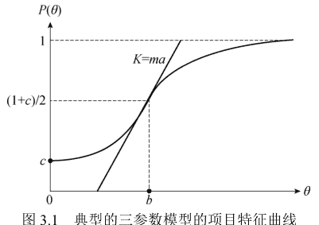

一条标准的ICC曲线（S型）蕴含三大关键参数：

| 参数 | 符号 | 几何/统计含义 | 通俗理解 |
| :--- | :--- | :--- | :--- |
| **难度** | $b$ | 曲线拐点在横轴投影；$\theta=b$时，答对概率 $P=(1+c)/2$ | **题目“门槛”有多高** |
| **区分度** | $a$ | 拐点处切线斜率；曲线越陡峭，$a$越大 | **题目区分高低能力者的“锐度”** |
| **猜测度** | $c$ | 曲线下渐近线截距；极低能力者靠蒙也能答对的概率 | **“瞎猜”也能得分的底线** |

> **关键洞见**：区分度 $a$ 直接决定题目提供的**费舍尔信息量**——在其他条件同等时，$a$ 越大，该题对 $\theta$ 的测量精度越高。

### 三大经典逻辑斯蒂模型演进

#### 1. 单参数模型（1PL / Rasch模型）
**核心假设**：所有题目**区分度相同（$a$ 固定）**、**无猜测（$c=0$）**，仅保留难度 $b$（记为 $\beta$）。
$$ P(X_{ij}=1|\theta_i, \beta_j) = \frac{e^{\theta_i - \beta_j}}{1 + e^{\theta_i - \beta_j}} \tag{3.1} $$
*   **特性**：当能力 $\theta$ 等于难度 $\beta$ 时，答对概率恒为 **0.5**。
*   **地位**：教育测量推广主力，因“特定客观性”具备理论优雅性，但“等区分”假设在实测中常显强人所难。

#### 2. 双参数模型（2PL）
**破局点**：引入**区分度 $a_j$**，允许不同题目ICC斜率各异。
$$ P(X_{ij}=1|\theta_i; a_j, \beta_j) = \frac{e^{D a_j(\theta_i - \beta_j)}}{1 + e^{D a_j(\theta_i - \beta_j)}} \tag{3.2} $$
*   $D=1.7$ 为修正常数，使逻辑曲线逼近正态拟形曲线。
*   **意义**：高 $a$ 题目信息量大，可显著缩短测验长度、提升精度。

#### 3. 三参数模型（3PL / 3PL-IRT）
**终极形态**：在2PL基础上补入**猜测参数 $c_j$**，修正低能力端渐近线非零的现实偏差。
$$ P(X_{ij}=1|\theta;a_j,\beta_j,c_j)=c_j+(1-c_j)\frac{e^{D a_j(\theta-\beta_j)}}{1+e^{D a_j(\theta-\beta_j)}} \tag{3.3} $$
*   **适用性**：选择题、存在明显蒙题可能的场景下，3PL拟合度通常最优。

> **补充视角**：LLTM将题目难度分解为“认知操作难度之和”，虽深化了难度构成解释，但未直接诊断个体知识点掌握；标准IRT则将认知状态压缩为单一 $\theta$，结合 $a,b,c$ 建立评估函数，实现**知识状态诊断**。

---

## 3.3 多维IRT (MIRT)：打破“单一特质”枷锁

传统IRT预设**潜在特质空间单维**——即一套试卷仅测量一种能力。现实中，复杂任务往往调动多维能力（如阅读理解需词汇+推理+背景知识），单维假设失效，倒逼**多维IRT (MIRT)** 诞生。

### 理论渊源：因子分析 (FA) 的非线性延伸
*   传统FA假设特质与反应**线性相关**，实则多为非线性。
*   MIRT利用**完整反应矩阵**，以**非线性概率模型**刻画特质-反应关系，实质上完成了“FA降维视角”向“IRT交互视角”的范式跨越。

### 两大基础架构：按能力交互方式分类

#### 1. 非补偿性模型 (NC-MIRT / MLTM)
**逻辑**：“短板决定成败”。完成任务需**同时掌握**所有涉及技能，缺一不可。联合成功概率 = 各技能成功概率**乘积**。
*   典型代表：**多成分潜在特质模型 (MLTM)**。
*   线性逻辑斯蒂形式：
$$P(X_{ij} = 1|\theta_i) = c_j + \frac{1-c_j}{1+e^{-1.7(a_j\theta_i+d_j)}}$$ (3.4)

> **参数结构**：被试拥有 $K$ 维能力向量 $\boldsymbol{\theta}_i$；题目拥有 $K$ 维区分度向量 $\boldsymbol{\alpha}_j$、单一难度相关参数 $\mathbf{d}_j$ 与猜测度 $c_j$。任一维能力不足，答对概率骤降。

#### 2. 补偿性模型 (C-MIRT)
**逻辑**：“长板补短板”。各维能力可**相互补偿**，某维弱可被他维强抵消。
*   主流流派：
    *   **McDonald** 多维正态拟形模型 (MNO)
    *   **Reckase** 多维逻辑斯蒂模型
*   **应用场景**：综合性强、允许以优势科目弥补弱势科目的综合能力测评。

---

## 3.4 深度IRT (DIRT)：当深度学习遇上心理测量

### 传统IRT的两大痛点
1.  **特征单一**：仅利用“二值作答结果”，忽略**题目语义**、**作答时长**、**行为序列**等丰富侧写。
2.  **数据敏感**：纯统计建模，样本量不足或稀疏时参数估计极不稳健，难以融入多模态特征。

### DIRT 的破局思路
**Cheng 等人提出 DIRT 框架**，引入深度神经网络（DNN、LSTM等）作为“特征增强器”，在保留IRT可解释性框架下，实现**参数估计的智能化、精准化**。

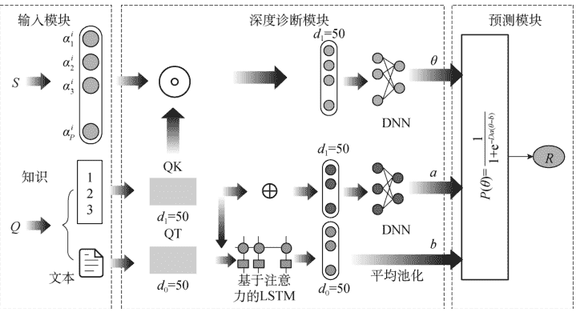

#### 整体三模块架构
| 模块 | 核心功能 | 关键技术 |
| :--- | :--- | :--- |
| **输入层** | 初始化学习者熟练度向量；文本/知识概念向量化嵌入 | Word2Vec、One-hot、Dense Embedding |
| **深度诊断层** | 挖掘文本语义、概念关联，**增强诊断** $\theta, a, b$ | DNN、LSTM 等深度网络 |
| **预测层** | 融合诊断参数，通过标准 IRT 函数输出答对概率 | Item Response Function (IRF) |

---

### 深度拆解：输入与诊断模块

#### 1. 输入模块：构建“学习者-题目-知识”三元表征
*   **学习者侧**：随机初始化熟练度向量 $\boldsymbol{\alpha} = (\alpha_1, \dots, \alpha_P)$，$\alpha_i \in [0,1]$ 表征对知识点 $i$ 掌握度（非参训练变量）。
*   **题目文本 (QT)**：词序列 $\boldsymbol{Q}_T = \{\boldsymbol{w}_1, \dots, \boldsymbol{w}_u\}$，$\boldsymbol{w}_i \in \mathbb{R}^{d_0}$ 为预训练 Word2Vec 向量。
*   **知识概念 (QK)**：One-hot 向量集 $\boldsymbol{Q}_K = \{K_1, \dots, K_v\}$，经全连接层映射为稠密嵌入 $\boldsymbol{k}_i = K_i \boldsymbol{W}_k \in \mathbb{R}^{d_1}$，得到概念嵌入序列 $\boldsymbol{k} = (k_1, \dots, k_v)$。

#### 2. 深度诊断模块：从“统计估计”到“特征推演”
核心目标：输出三大核心参数——**学习者能力 $\theta$**、**题目区分度 $a$**、**题目难度 $b$**。

**(1) 学习者潜在能力 $\theta$ 诊断**
*   **动机**：$\theta$ 与知识概念掌握度强相关，需捕捉高阶非线性映射。
*   **机制**：
    1.  **注意力融合**：将熟练度 $\boldsymbol{\alpha}$ 与对应概念嵌入 $\boldsymbol{k}$ 按元素加权求和：
       $$ \boldsymbol{\Theta} = \boldsymbol{\alpha} \odot \boldsymbol{k} = \sum_{k_i \in K_q} \alpha_i k_i \tag{3.6} $$
       得到 $d_1$ 维融合向量 $\boldsymbol{\Theta}$，编码“该生在该题考察知识点上的综合表征”。
    2.  **深度映射**：送入专用 DNN ($\text{DNN}_{\theta}$) 学习潜在特征，输出标量能力值：
       $$ \theta = \text{DNN}_{\theta}(\boldsymbol{\Theta}) \tag{3.5} $$

> **设计精妙处**：$\boldsymbol{\Theta}$ 显式建模“知识点掌握度 × 知识点语义”，而非简单拼接；DNN 再捕捉跨知识点的非线性交互，兼顾**解释性与拟合力**。

**(2) 题目参数 $a, b$ 诊断** *(素材后续将展开)*
同理，利用题目文本嵌入 $\boldsymbol{Q}_T$ 与知识概念嵌入 $\boldsymbol{k}$，通过 LSTM/DNN 编码语义与结构特征，回归输出区分度 $a$ 与难度 $b$。此举将**专家经验/语义先验**显式注入参数估计，极大缓解了传统IRT对大样本的依赖。

---

### 小结与展望

| 维度 | 传统 IRT | 深度 IRT (DIRT) |
| :--- | :--- | :--- |
| **输入信息** | 仅二值作答矩阵 | 作答 + 文本语义 + 知识图谱 + 行为序列... |
| **参数估计** | EM/MH 等统计迭代算法 | 深度网络前向传播 + 端到端训练 |
| **冷启动能力** | 弱（需大量作答数据） | **强**（题目文本即可预估 $a,b$） |
| **可解释性** | 极强（参数物理意义明确） | **保留**（输出层仍为标准 IRT 参数） |

**DIRT 不颠覆 IRT，而是为其装上“深度感知引擎”**——在守住心理测量理论底座的前提下，拥抱大数据与 AI 红利，推动认知诊断迈向**“小样本、多模态、高精度”**的新阶段。

> **下一站**：我们将深入剖析 DIRT 中题目参数 $a, b$ 的深度诊断网络结构、损失函数设计及实验验证细节，敬请期待。

# 第三章核心回顾：深度融合重塑IRT新范式

上一章我们系统梳理了项目反应理论（IRT）的演进脉络：从早期的单维模型，突破至多维模型（MIRT），再到如今引入深度学习的深度项目反应理论。这一演变核心在于——**用神经网络的强大拟合能力，去攻克传统统计模型在稀疏数据、冷启动及参数解释性上的痛点**。

本章重点剖析该模型（以下称DIRT模型）的“深度诊断引擎”是如何运作的，以及它如何完成从“参数诊断”到“表现预测”的完整闭环。

## 核心架构三部曲：诊断、预测与学习

### 一、 深度诊断模块：让参数“看得见、算得准”

传统IRT中，题目难度（$b$）、区分度（$a$）和学习者能力（$\theta$）往往依赖统计估计，数据稀疏时极不稳健。DIRT模型引入三路并行的神经网络，分别从**文本语义**、**知识结构**、**交互历史**三个维度“画像”这三大核心参数。

#### 1. 学习者潜在特质 $\theta$：动态刻画，告别静态标签
模型不再给学习者贴一个固定的“能力标签”，而是构建**熟练度向量 $\alpha$** 作为基础画像。通过 $\theta = \text{Sigmoid}(\text{DNN}_\theta(\alpha))$ 映射到 $(0,1)$ 区间，实现了能力的动态、非线性表达。

#### 2. 试题区分度 $a$：知识密度决定“筛选力”
区分度反映的是：这道题能否把“会”的和“不会”的学生筛开？
*   **创新点**：受多维区分度（MDISC）启发，模型认为**题目关联的知识概念越密集、越核心，区分度越高**。
*   **操作**：将题目 $q$ 的所有知识概念嵌入向量求和聚合得向量 $A$，送入 $\text{DNN}_a$ 诊断，再通过 $a = 8 \times \text{Sigmoid}(\text{DNN}_a(A) - 0.5)$ 规范化到 $[-4, 4]$ 区间。
*   **细节**：$\text{DNN}_a$ 与 $\text{DNN}_\theta$ 结构同参数异，互不干扰。

#### 3. 试题困难度 $b$：双视角融合，软硬兼施
难度不只取决于题目本身“长什么样”（文本复杂度），还取决于“考了多深、多广”（知识深广度）。模型设计了**基于注意力的 LSTM** 双流融合：
*   **视角一·文本侧**：LSTM 天然擅长长序列语义建模，捕捉题干文本 $w_t$ 的深层语义特征。
*   **视角二·知识侧**：引入注意力机制 $\xi_j = w_i^T k_i / \sqrt{d_0}$，计算文本词汇与知识概念的关联权重。关联越强，说明该知识点在题目中体现越深。
*   **融合**：输入步骤 $x_t = \sum \text{Softmax}(\xi) k_i + w_t$，将知识语义“注入”文本流，经 LSTM 编码后均质化输出 $b$。

> **一句话总结**：$\theta$ 看学习者“底子”，$a$ 看题目“含金量”，$b$ 看题目“综合硬度”。三大参数均由深度网络从多模态数据中自动学习，彻底摆脱了传统统计估计对大样本的强依赖。

### 二、 预测模块：守住解释性的“最后一公里”

诊断出参数后，模型**没有抛弃经典IRT公式**，而是将 $a, b, \theta$ 代入标准 2PL 模型的项目反应函数（IRF）：
$$ \tilde{r} = P(\theta) = \frac{1}{1 + e^{-Da(\theta - b)}} \quad (D=1.7) $$
**设计妙处**：
1.  **保留物理意义**：$a$ 依然是区分度，$b$ 依然是难度，$\theta$ 依然是能力，结果 $\tilde{r}$ 依然是“答对概率”。
2.  **兼容性强**：输出结果可直接接入现有自适应测试、推荐系统，零改造迁移。
3.  **白盒决策**：区别于纯黑盒深度学习，DIRT 做到了“深度特征提取 + 统计模型推理”，既有神经网络的精度，又有统计模型的可解释性。

### 三、 DIRT 学习策略：端到端联合优化

模型参数分两大块联合更新，目标函数直指**交叉熵损失**：
$$ L = r_{ij} \ln \tilde{r}_{ij} + (1 - r_{ij}) \ln(1 - \tilde{r}_{ij}) $$
*   **输入层参数**：学习者熟练度向量 $\alpha$、题目嵌入 $W_Q$、知识嵌入 $W_K$（解决冷启动核心）。
*   **诊断层参数**：三大网络权重 $W_{\text{DNN}_\theta}, W_{\text{DNN}_a}, W_{\text{LSTM}}$。
*   **优化器**：Adam 直接最小化 Loss，端到端训练，梯度直达嵌入层。

---

# 第四章 开篇：静态认知诊断——从“分数”到“认知画像”的范式革命

IRT 再强，也只能告诉你**“这学生大概有多大概率能考 90 分”**（宏观能力 $\theta$）。但它**看不透**：这 90 分里，哪个知识点没掌握？思维卡在哪个环节？解题策略是不是靠蒙的？

这就引出了本章主角——**认知诊断理论（CDT）**。它不关心“总分”，只关心**“知识状态向量”**（掌握/未掌握的 0-1 模式）。这是从“量变”到“质变”、从“宏观评估”到“微观透视”的根本转向。

## 4.1 静态认知诊断理论全景扫描

### 4.1.1 核心内涵：把“黑箱”打开，把“隐性”显性化

**定义**：认知诊断 = 心理测量学 + 认知心理学。
**使命**：挖掘分数背后的**认知加工过程**（知识状态、认知结构、学习策略）。

*   **“静态”含义**：针对**单次测评**数据建模（区别于动态/连续测评）。
*   **三大诊断靶心**（Leighton & Gierl）：
    1.  **核心技能/知识**：高阶能力的基石。
    2.  **知识结构**：不光知道“会几个”，还要懂“怎么组织”的（层级、依赖）。
    3.  **认知过程**：解题时的心理操作步骤。

**政策推手**：2002 年美国《不让任何一个孩子掉队法案》强制要求测验提供诊断反馈，直接推爆了 CDT 的应用热度。

> **本质区别**：传统测评 = “测分数、排名次”；认知诊断 = “找漏洞、给处方”。

### 4.1.2 标准化实施框架：六步走闭环（NRC 评估三角模型落地版）

Junker 等人指出诊断难点在于“推论链条”，NRC 报告给出“认知-观察-解释”三要素。DIRT 团队将其工程化为 **6 步标准流程**：

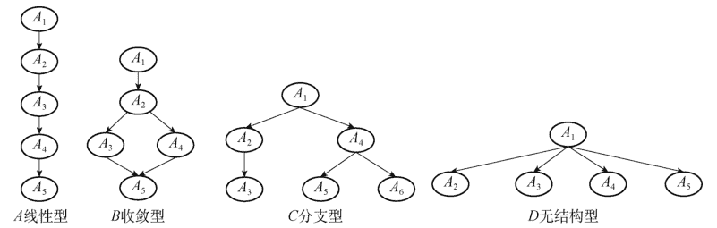

**图 4.1 诊断评估实施流程图（概念示意）**

| 步骤 | 核心动作 | 关键产出 |
| :--- | :--- | :--- |
| **1. 定目标** | 锁定学科、范围（如：高中数学《三角函数》单元） | 诊断范围清单 |
| **2. 定属性 & 定层级** | 专家提炼“认知属性”（知识/技能/策略），绘制**属性层级图**（AHM） | **属性集合 $K$** + **层级结构图** |
| **3. 编测验** | 依层级推导“理想掌握模式” $\to$ “题目考核模式” $\to$ 组卷（原则：覆盖可达矩阵，每属性≥3题） | **诊断试卷** + **Q 矩阵雏形** |
| **4. 验属性** | 专家定性主观，需数据验证层级关系的科学性 | **修正后的属性框架** |
| **5. 大测 & 诊断** | 大样本作答 $\to$ 结合 Q 矩阵 + CDM 模型估计参数 $\to$ 推导**属性掌握模式（知识状态）** | **学习者诊断报告** |
| **6. 出报告 & 开方子** | 针对弱项给个性化补救建议，指导精准教学/自学 | **干预方案** |

#### 重点深度：属性层级关系的四种“乐高积木”

属性不是孤立岛屿，存在先备依赖。Leighton 提出 AHM，四种基础拓扑结构可自由组合成复杂网络：

  <-- 此处保留原标记，对应原文图 4.2

1.  **线性型**：$A_1 \to A_2 \to A_3 \to A_4$（阶梯式，如：认字 $\to$ 组词 $\to$ 造句 $\to$ 写作）。
2.  **分支型**（最常用）：$A_1$ 为根，分出 $A_2, A_3...$（核心概念衍生出多个应用技能）。
3.  **收敛型**：$A_2, A_3$ 独立，汇聚至 $A_4$（综合题需多前置技能同时具备）。
4.  **无结构型**：$A_1$ 是 $A_2 \sim A_5$ 共同前置，但后者互不相关（基础知识支撑多个平行技能）。

> **编测原则**：题目设计必须覆盖**可达矩阵**（含传递闭包），保证每个属性及其依赖链路均被考察到；每属性至少 3 道题，保证诊断可靠度。

### 4.1.3 Q 矩阵理论：连接“隐性认知”与“显性作答”的数学桥梁

Q 矩阵是 CDT 的基因图谱。由 Embretson 提出，Tatsuoka 完善。核心任务：**将不可观测的属性掌握状态，映射为可观测的作答反应模式**。

以 4 属性层级为例（见图 4.3）：

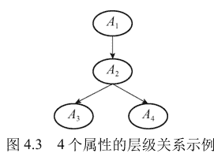  <-- 此处保留原标记，对应原文图 4.3

#### 步骤 1：邻接矩阵 $A$（$K \times K$ 0-1 矩阵）
**只记“直连”，不记“间连”和“自连”**。
*   $A_1 \to A_2$ 直连 $\Rightarrow a_{12}=1$
*   $A_2 \to A_3, A_2 \to A_4$ 直连 $\Rightarrow a_{23}=1, a_{24}=1$
*   其余为 0。
*   **示例**：
    $$
    A = \begin{bmatrix}
    0 & 1 & 0 & 0 \\
    0 & 0 & 1 & 1 \\
    0 & 0 & 0 & 0 \\
    0 & 0 & 0 & 0
    \end{bmatrix}
    $$

#### 步骤 2：可达矩阵 $R$（传递闭包）
**“直连 + 间连”全算上，加上“自连”**（对角线置 1）。
*   通过布尔运算 $R = (A + I)^K$ 或 Warshall 算法得到。
*   $r_{ij}=1$ 表示掌握 $A_i$ 必然掌握 $A_j$（或 $i=j$）。
*   **物理意义**：可达矩阵的每一行，就是一个**“理想掌握模式”**（理想知识状态）。所有行向量去重，构成**理想知识状态空间**——这是 CDM 建模的合法状态集合，大幅压缩参数空间，提升估计精度。

---

**本章小结**：
静态认知诊断通过**属性颗粒化**、**层级结构化**、**Q 矩阵显性化**，构建了从“测验设计”到“精准画像”再到“个性化干预”的完整工程体系。它解决了 IRT “只给分不给因”的痛点，但局限于**单次快照**，无法捕捉学习过程的动态演化——这正是下一章“动态认知诊断”要攻克的高地。

### 可达矩阵：描绘属性间的“全景关系图”

可达矩阵（$ R=\{r_{ij}\}_{K\times K} $）就像一张属性间关系的“全景地图”，它把直接关联、间接传递以及属性自身的特性全都囊括进去。形式上，它和邻接矩阵一样，是一个 $ K $ 行 $ K $ 列的 0-1 方阵。判断规则很直观：只要两个属性之间存在任何形式的联系——不管是直接挂钩、隔空传递，还是自身回环——对应位置就标 **1**；反之则标 **0**。具体矩阵形式如下：

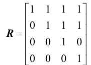

---

### 3. 理想掌握模式：符合逻辑的“知识状态”

**什么是理想掌握模式？**  
简单说，就是符合属性层级逻辑的“掌握清单”。学术上常称其为“知识状态”或“认知结构”。它用一个 $ K $ 行的 0-1 向量表示：1 代表拿下该属性，0 代表尚未攻克。

**举个栗子：**  
假设共有 4 个属性（$ A_1 \sim A_4 $），理论上考生所有可能的组合共有 $ 2^4 = 16 $ 种（见下表）。

| 编号 | $ A_1 $ | $ A_2 $ | $ A_3 $ | $ A_4 $ |
| :--- | :---: | :---: | :---: | :---: |
| 1 | 0 | 0 | 0 | 0 |
| 2 | 1 | 0 | 0 | 0 |
| 3 | 0 | 1 | 0 | 0 |
| 4 | 0 | 0 | 1 | 0 |
| 5 | 0 | 0 | 0 | 1 |
| 6 | 1 | 1 | 0 | 0 |
| 7 | 1 | 0 | 1 | 0 |
| 8 | 1 | 0 | 0 | 1 |
| 9 | 0 | 1 | 1 | 0 |
| 10 | 0 | 1 | 0 | 1 |
| 11 | 0 | 0 | 1 | 1 |
| 12 | 0 | 1 | 1 | 1 |
| 13 | 1 | 0 | 1 | 1 |
| 14 | 1 | 1 | 0 | 1 |
| 15 | 1 | 1 | 1 | 0 |
| 16 | 1 | 1 | 1 | 1 |

**但现实中，逻辑会“删减”大量不可能的情况。**  
已知 $ A_2 $ 依赖 $ A_1 $（得先会 $ A_1 $ 才可能会 $ A_2 $），那么第 3 种模式 `(0100)` 就违背逻辑，被直接排除。同理推演，16 种里只有 **6 种** 符合层级逻辑，构成真正的“理想掌握模式”：

| $ A_1 $ | $ A_2 $ | $ A_3 $ | $ A_4 $ |
| :---: | :---: | :---: | :---: |
| 0 | 0 | 0 | 0 |
| 1 | 0 | 0 | 0 |
| 1 | 1 | 0 | 0 |
| 1 | 1 | 1 | 0 |
| 1 | 1 | 0 | 1 |
| 1 | 1 | 1 | 1 |

(4.3)

**怎么求解？**  
属性少时靠逻辑推演；属性多了靠人工太慢、易错，通常引入**扩张算法**或**编程自动判别**。

---

### 4. 典型项目考核模式：去掉“全零”的实战版

项目考核模式的生成逻辑与理想掌握模式如出一辙，区别只有一点：**剔除了“全 0”模式**（毕竟考试总得考点什么吧）。最终得到 5 种典型考核模式：

| $ A_1 $ | $ A_2 $ | $ A_3 $ | $ A_4 $ |
| :---: | :---: | :---: | :---: |
| 1 | 0 | 0 | 0 |
| 1 | 1 | 0 | 0 |
| 1 | 1 | 1 | 0 |
| 1 | 1 | 0 | 1 |
| 1 | 1 | 1 | 1 |

(4.4)

---

### 4.1.4 静态认知诊断模型：从理论到工具的演进

**核心使命：** 测量、诊断、评估学习者的**内部心理加工过程**。  
**实现路径：** 基于认知心理学，把认知过程“嵌入”计量模型 → 构建认知诊断模型 (CDM) → 从作答结果反推认知状态（知识掌握、认知结构、学习策略等）。

**本质定位：**  
它是**受限（Q 矩阵）的潜在特质模型**，在传统计量框架里加入了“认知状态变量”，让“诊断个体/群体心理过程”成为可能。

**落地价值：**  
通过模型分析作答数据 → 获取个体差异信息 → 帮教师调整策略 → 促进教学良性循环。

**百花齐放的模型谱系：**  
研究者按建模技术路线大致分为三大流派，代表模型汇总如下：

| 建模流派 | 代表模型 | 全称 | 中文别名 |
| :--- | :--- | :--- | :--- |
| **统计结构<br>(参数化)** | GDM | General Diagnostic Model | 通用诊断模型 |
| | BIN | Bayesian Inference Network | 贝叶斯推理网络 |
| | DINA | Deterministic Input, Noisy "And" Gate | 非补偿型：确定性输入、噪声与门 |
| | HO-DINA | High-Order DINA | 高阶 DINA |
| | G-DINA | Generalized DINA | 广义 DINA |
| | P-DINA | Polytomous DINA | 多级评分（分步）DINA |
| | MS-DINA | Multiple Strategies DINA | 多策略 DINA |
| | DINO | Deterministic Input, Noisy "Or" Gate | 补偿型：确定性输入、噪声或门 |
| | NIDA | Noisy Input, Deterministic "And" Gate | 非补偿型：噪声输入、确定性与门 |
| | Fuzzy CDM | Fuzzy Cognitive Diagnosis Model | 模糊认知诊断模型 |
| **非参数分类** | RSM | Rule Space Model | 规则空间模型 |
| | AHM | Attribute Hierarchy Model | 属性层级模型 |
| | GRCDM | Grade Response Cluster Diagnostic Method | 分级反应聚类诊断法（小样本课堂评估） |
| | HDD | Hamming Distance Discrimination | 汉明距离判别法 |
| **深度学习技术** | NeuralCDM | Neural Cognitive Diagnostics Model | 神经认知诊断模型 |
| | RCDM | Relation Map CDM | 关系驱动认知诊断模型 |
| | DCD | Deep Cognitive Diagnosis | 深度认知诊断 |

**现状与挑战：**  
理论成果丰硕，实证应用也证明了其在“精准测量知识状态、提升教学质量”上的有效性。但随教学改革深入，**部分经典模型已难以适配新的个性化场景**，如何优化改进、落地应用，仍是待解难题。

---

## 4.2 基于统计结构的静态认知诊断模型

**一句话定位：**  
CDM 本质 = **受 Q 矩阵约束的潜在特质模型**，核心任务是基于 Q 矩阵，诊断学习者在各具体技能上的掌握状态。

### 建模前的“三大设定”

1.  **基础设定：** 测试有 $ J $ 道题，考察 $ K $ 个技能。$ Q = \{q_{jk}\}_{J \times K} $ 明确每道题需要哪些技能支持。
    $$q_{jk} = \begin{cases} 1, & \text{试题 } j \text{ 考查技能 } k, k \in \{1, 2, \cdots, K\} \\ 0, & \text{其他} \end{cases}$$
2.  **状态向量：** 给第 $ i $ 个学习者定义向量 $ \boldsymbol{\alpha}_i = (\alpha_{i1}, \dots, \alpha_{iK}) $，二分取值（0/1），表示对每个技能的掌握与否。
    $$\alpha_{ik} = \begin{cases} 1, & \text{学习者 } i \text{ 掌握技能 } k \\ 0, & \text{否则} \end{cases}$$
3.  **连接假设：** 做对一道题，**必须**掌握该题所需的**所有**技能（非补偿/连接性假设）。于是，属性模式为 $ \boldsymbol{\alpha}_i $ 的考生答对题 $ j $ 的概率记为 $ P(X_{ij} = 1 | \boldsymbol{\alpha}_i) = \pi_{ia} $。

---

### 4.2.1 贝叶斯推断网络 (BIN)：用“有向无环图”画认知结构

**定位：** 拥有完整概率结构的统计模型家族，近年成功切入诊断性评估领域。

**核心机制：**
*   **分类目标：** 用多个潜在变量（属性）给考生分类。
*   **变量形态：** 潜在变量常为**多变量**（如：未掌握 / 部分掌握 / 完全掌握），比简单的 0-1 更细腻。
*   **可视化核心：** **有向无环图 (DAG)**。节点=属性，箭头=条件依赖关系。图 4.4 展示了 4 个属性 (ATT1~ATT4) 的网络拓扑。
    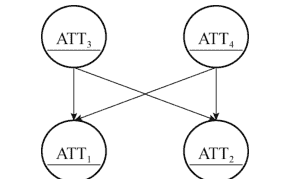

**概率分解的威力：**  
网络编码了所有潜在属性的**联合概率分布**。利用条件独立性，超高维的联合分解可拆解为一系列低维条件概率，让估计变得可行。  
*例：* 图中 $ A_1 \not\perp A_2 $，但 $ A_1, A_2 $ 都依赖 $ A_3, A_4 $。则四维联合分布可分解为：
```
P(A_1, A_2, A_3, A_4) = P(A_1|A_2, A_3, A_4)P(A_2|A_3, A_4)P(A_3|A_4)P(A_4)
= P(A_1|A_3, A_4)P(A_2|A_3, A_4)P(A_3)P(A_4)
```

**“贝叶斯”二字的深意：**  
核心在于**贝叶斯定理**——将理论先验信息与数据观测信息融合。参数视为随机变量，拥有先验分布；目标是求**后验分布**，再取均值 (EAP) 或众数 (MAP) 作为点估计。
```
posterior distribution \(\propto\) prior distribution \(\times\) likelihood of data
```

**信息的“向后传播”：**  
新项目的作答信息 → 直接更新相关属性 → 通过网络连接间接更新其他属性。这就是自适应诊断中信息流动的机制。

**优劣势速览：**
*   ✅ **全概率框架**，参数估计严谨，能建模极复杂的属性结构。
*   ❌ **极其依赖大样本**（百/千级），需可靠先验或强校准，建模需高专业门槛（类似指定 Q 矩阵/层级，属 DCM 通病）。

---

### 4.2.2 UM 模型及其“简化家族”：从“全能”到“易用”

#### 统一模型 (UM)：大而全，但难用
Dibello 等人整合了 RSM 的 Q 矩阵理论，构建了复杂的 UM：
```
P(x_{ij} = 1|\alpha_j, \theta_j) = (1 - s_i) \left\{ d_i \prod_{k=1}^K [\pi_{ik}^{\alpha_{jk} q_{ik}} r_{ik}^{(1-\alpha_{jk})q_{ik}}] P_{c_i}(\theta_j) + (1 - d_i) P_{b_i}(\theta_j) \right\} (4.5)
```
**参数含义速记：**
*   $ s_i $：粗心导致的失误概率
*   $ d_i $：正确运用所需属性的概率
*   $ \pi_{ik} $：会属性 $ k $ 且在题 $ i $ 上正确调用的概率
*   $ r_{ik} $：不会属性 $ k $ 却靠猜蒙对的概率
*   $ c_i, \theta_j $：残余能力维度

**评价：** 覆盖 Q 矩阵完备性、作答策略、失误、残余能力……**理论完备，但参数不可识别，工程落地极少。**

#### 再参数化统一模型 (RUM)：减法做减法，保留核心
Roussos 等令 $ s_i=0, d_i=1 $ 简化得 RUM：
```
\pi_i^* = \prod_{k=1}^K \pi_{ik} = \prod_{k=1}^K P(Y_{ijk} = 1|\alpha_{ij} = 1)q_{ik}, \quad r_i^* = \frac{r_{ik}}{\pi_{ik}} = \frac{P(Y_{ijk} = 1|\alpha_{ij} = 0)}{P(Y_{ijk} = 1|\alpha_{ij} = 1)}, \quad \text{其表达式为}
```
其变体**融合模型 (FM)** 被公认为**最成功的认知诊断模型之一**。

#### 总分模型 (SSM)：为普及而生，极简上手
Henson 等基于简化版 RRUM 开发，核心思想：**用总分代替复杂参数估计**，按总分切界点判定掌握/未掌握。

**三种形态：**
1.  **简单总分模型**
2.  **复杂总分模型**
3.  **加权复杂总分模型**

**数学内核 (RRUM)：**  
$ P(X_{ij} = 1 | \alpha_j) = \pi_i^* \prod_{k=1}^K r_{ik}^{*(1-\alpha_{jk})q_{ik}} $ (4.7)

> **一句话总结：** 从 UM 的“全能理论” → RUM/FM 的“工程平衡” → SSM 的“极简落地”，统计结构流派始终在**模型表达力**与**实用可操作性**间寻找最优解。

### 总分模型：简化诊断的“双刃剑”

在总分模型框架下，\(\alpha_j\) 代表被试参数，取值 0 或 1，标记被试是否掌握特定属性；\(\pi_i^*\) 是项目参数，指代全属性掌握者答对题目 \(i\) 的概率；而 \(r_{ik}^*\) 则对应未全掌握者的作答概率，区间在 (0,1) 之间。该值越小，项目区分度越高；反之则越低。模型设定阈值 \(\lambda\)：总分超线判定为掌握，否则未掌握。三种模型的核心差异在于总分累加逻辑：**简单总分**模式下，单题单技能，得分单一归属；**复杂总分**允许单题多技能，得分多分摊；**加权复杂总分**则引入权重 \(\delta_{ik} = \pi_i^*(1-\pi_{ik}^*)\)，\(\pi_{ik}^*\) 越大权重越低，反之权重越大。

总分模型最大优势在于极大简化了诊断流程。实证研究显示，以总分为界划分技能掌握情况，其结果与基于项目反应理论的认知诊断模型（ICDM）高度吻合，验证了方法有效性。但短板也很明显：一是模型过于粗略，应用时需额外验证总分精度，比如排查 Q 矩阵中技能属性是否存在高共线性（即两技能频繁共现）；二是适用条件受限，题量较小时，分类准确度不如其他认知诊断模型。

### 4.2.3 DINA 模型及其家族扩展

针对 UM 模型参数繁杂的痛点，**确定性输入、噪声与门（DINA）模型**（又称约束潜在分类模型 RLCD）应运而生。它仅保留“失误”（会却错）与“猜测”（不会却对）两个噪声参数，结构极简。核心逻辑为“非补偿型”：必须掌握题目所需全部技能才能作答，缺一不可，否则只能靠猜测蒙对。其概率函数为：

$$P_j(\boldsymbol{\alpha}_i) = g_j^{1-\eta_{ij}} (1-s_j)^{\eta_{ij}}$$

其中，\(\eta_{ij} = \prod_{k=1}^K \alpha_{ik}^{q_{jk}}\) 为理想反应指标，1 表示全掌握，0 表示至少缺一；\(\boldsymbol{\alpha}_i\) 为技能状态向量；\(g_j\)、\(s_j\) 分别为猜测与失误参数。得益于参数少、好解释，DINA 备受青睐，通过专家标注 Q 矩阵，即可用双参数函数刻画知识熟练度。

近年来，学者们在 DINA 基础上衍生出多个扩展版本：

#### 1. HO-DINA：引入高阶能力维度
de la Torre 与 Douglas 指出，属性状态可能受智力等高阶能力驱动。模型在 DINA 基础上增设能力参数 \(\boldsymbol{\theta}\)，通过逻辑斯蒂函数关联属性掌握概率：
$$P(\alpha_k \mid \boldsymbol{\theta}) = \frac{e^{(\lambda_{0k} + \lambda_k \boldsymbol{\theta})}}{1 + e^{(\lambda_{0k} + \lambda_k \boldsymbol{\theta})}}$$
\(\lambda_{0k}\) 为截距，\(\lambda_k\) 为负荷。此举让模型兼具一般能力描述与细粒度技能诊断功能，信息量更丰富。

#### 2. P-DINA：破解多级评分难题
标准 DINA 仅适配 0-1 两级评分。涂冬波等人开发的 **P-DINA（多级 DINA）**，将得分拓展为 \(满分+1\) 个等级。其核心公式利用累积概率差值计算精确得分概率：
$$P(Y_{ij}=t|\boldsymbol{\alpha}_i) = P^*(Y_{ij}=t|\boldsymbol{\alpha}_i) - P^*(Y_{ij}=t+1|\boldsymbol{\alpha}_i)$$
其中 \(P^*\) 表示得 \(t\) 分及以上的累积概率，完美适配主观题、分步评分等场景。

#### 3. G-DINA 与 A-CDM：主效应与交互效应的统一框架
**G-DINA（广义 DINA）** 打破了“全掌握与未全掌握仅两种作答概率”的假设，认为答对概率受属性**主效应**与**交互效应**共同决定。其数学形式随连接函数变化，基于恒等链接函数的饱和模型表达式为：
$$P(Y_{ij}=1|\boldsymbol{\alpha}_{i^*})=\delta_{j0}+\sum \delta_{jk}\alpha_{ik}+\sum \delta_{jkk'}\alpha_{ik}\alpha_{ik'}+\cdots+\delta_{j12\cdots K_j^*}\prod \alpha_{ik}$$
\(\delta_{j0}\) 为全不懂时猜对概率；\(\delta_{jk}\) 为单属性贡献；\(\delta_{jkk'}\) 为二阶交互；以此类推。

其简化版 **加性认知诊断模型（A-CDM）** 假设概率随掌握属性数线性增加，属典型**补偿型**模型：
$$P(Y_{ij}=1|\boldsymbol{\alpha}_i)=\beta_j+\sum_{k=1}^K \gamma_{jk}\alpha_{ik}\varphi_{jk}$$
\(\beta_j\) 为项目截距，\(\gamma_{jk}\) 为属性斜率。A-CDM 允许技能间相互弥补，更符合部分真实考试逻辑。

### 4.2.4 NIDA 模型：属性层面的噪声建模

**噪声输入、确定性与门（NIDA）模型** 将猜测与失误参数下沉到**属性层面**（\(s_k, g_k\)），而非项目层面。定义 \(\eta_{ijk}\) 为考生作答题 \(j\) 时能否正确应用属性 \(k\)。只有所有需用属性均正确应用（\(\eta_{ijk}=1\)），题目才能答对（\(Y_{ij}=1\)）。假设条件独立，IRF 为：
$$P(Y_{ij} = 1 | \boldsymbol{\alpha}_i, s, g) = \prod_{k=1}^K [(1 - s_k)^{\alpha_{ik}} g_k^{1 - \alpha_{ik}}]^{q_{jk}}$$

这里 \(s_k\) 为掌握技能却误用概率，\(g_k\) 为未掌握却正确应用概率。正确率由 \(1-s_k\)（掌握部分）与 \(g_k\)（未掌握部分）构成。若 \(s_k+g_k=0\)，高正确率即代表掌握。

**局限性显著**：同一属性在不同项目中参数固定，导致共享属性的项目难度完全一致，不符合实测数据分布。为此，**广义 NIDA（G-NIDA）** 应运而生，允许参数随项目变化（\(s_{jk}, g_{jk}\)）：
$$P(Y_{ij} = 1 | \boldsymbol{\alpha}_i, s, g) = \prod_{k=1}^K g_{jk}^{q_{jk}} \prod_{k=1}^K \left( \frac{1 - s_{jk}}{g_{jk}} \right)^{\alpha_{ik} q_{jk}}$$
这极大增强了模型拟合实际数据的灵活性。

### 4.2.5 DINO 模型：补偿型的“或门”逻辑

与 DINA 的“与门”（全掌握）相反，**确定性输入、噪声或门（DINO）模型** 采用“或门”机制：**仅需掌握题目考察的至少一个属性**即可作答，属典型**补偿型**模型。其 IRF 形式与 DINA 相似，但理想反应指标 \(\eta_{ij}\) 定义不同：
$$\eta_{ij} = 1 - \prod_{k=1}^K (1 - \alpha_{ik})^{q_{jk}}$$
\(\eta_{ij}=1\) 表示至少掌握一项必需属性。猜测 \(g_j\) 与失误 \(s_j\) 定义沿用 DINA 设定。这为“会一项就能得分”的测验场景提供了建模依据。

---

### 4.3 非参数静态认知诊断模型：无假设的“画像术”

非参数方法摒弃了复杂的参数假设，核心思路是对比**理想反应模式（IRP）** 与 **观察反应模式（ORP）** 的偏离度，通过相似度/距离度量完成分类。主要流派有三：模式识别分类法、分级反应聚类诊断法、距离判别法。

#### 4.3.1 模式识别分类方法：规则空间模型（RSM）

Tatsuoka 的 **RSM** 是该领域代表作。它利用模式识别技术，将单一总分转化为被试在各认知技能上的掌握概率。假设解题涉及特定知识、技能、策略（统称属性），不同属性组合形成不同“属性模式”。

**1. Q 矩阵理论：搭建桥梁**
三步走战略：确定理想掌握模式（认知状态）→ 构建 Q 矩阵（题-属映射）→ 推导理想反应模式（各状态下的理论作答）。

**2. 规则空间构建：二维坐标定位**
模型基于 IRP 计算每种理想掌握模式对应的数对 \(\{(\theta, \xi)\}\)：
*   \(\theta\)：IRT 潜在能力。
*   \(\xi\)：警戒指标，量化实测反应偏离理论反应的程度。
    $$\xi_i = \frac{f(\theta_i)}{\sqrt{\text{Var}f(\theta_i)}}, \quad f(\theta_i) = [P(\theta_i) - T(\theta_i)][P(\theta_i) - X_i]$$
    \(P(\theta_i)\) 为答对概率向量，\(T(\theta_i)\) 为其均值向量，\(X_i\) 为实测反应向量。方差公式见文献（4.15）。
将所有纯规则点 \(\{(\theta, \xi)\}\) 绘制成二维**规则空间**，每个点代表一种确定的认知状态。

**3. 被试判别分类：最近距离归属**
同理估计实测被试的 \(\{(\theta', \xi')\}\)，将其投影至规则空间。根据距离远近（或密度聚类），将被试归类为距离最近的纯规则点所对应的认知状态，完成诊断。

### 核心技术：规则空间与属性层次的诊断逻辑

规则空间模型（RSM）借助贝叶斯判别或马哈拉诺比斯距离，把考生的实测反应向量与预设的纯规则点（理想反应模式）逐一比对，完成个体归类。这一方法突破了单纯估算总能力的局限，实现了对学习者知识点掌握情况的精准画像——哪些掌握了、哪些薄弱、整体水平如何，一目了然。教师据此即可制定分层干预策略，落地“因材施教”。

在 RSM 基础上演进出的属性层次模型（AHM）虽同源但异途。Gierl 指出，AHM 革新了分类基石：它计算实测模式因失误或瞎蒙偏离理想模式的概率，将个体划入错误期望最大的那类模式。其显著长处在于，能依托题技矩阵与技能层级，产出更精确的理想反应模式。Almond 等展望 AHM 未来将引入人工神经网络训练替代 RSM 的异常值处理，视为测量理论的重大跨越。

AHM 致力于用概率手段分类，并强化技能依赖关系的显性化表达。开发者认为 RSM 多忽视技能间联系，而 AHM 将其前置，专为评估场景设计，支持对技能依赖的理论预设。

在分类算法上，AHM 探索多元统计程序，近期引入神经网络。为阐释算法内核，聚焦其源自项目反应理论的原始流程（寻优工作仍在进行中）：

1.  **构造期望样本**：依技能层级推导各技能的期望作答模式，复制扩充生成大样本，使总分服从特定分布（通常为单变量正态）。
2.  **反应理论校准**：以生成数据校准单维 IRT 模型（如 2PL），获取题目系数。关键差异：AHM 用期望反应数据而非实测数据校准，导致参数估计与潜变量取值区别于 RSM。
3.  **多元归类策略**：
    *   策略一：结合 IRT 失误与瞎蒙概率，全维度比对实测与期望模式。
    *   策略二：仅用失误概率。
    *   策略三：失误概率配合技能档案的逻辑包含规则。
    *   比对量级取决于考生数、题量及唯一作答模式数（如 1000 人答 22 题，最多 22000 次比对，重复模式会减少计算量）。

**比对微观机制**：逐题比对实测与期望响应。匹配项无误差；期望为 1 实为 0（失误），按对应潜变量值算失误概率；期望为 0 实为 1（瞎蒙），同理算猜中概率。依策略选用单一或双重概率，或叠加逻辑规则，将全题概率相乘得似然值。每个实测模式对应一组似然值，分配至最大值对应的技能配置。

---

### 多级计分下的聚类诊断：GRCDM

GRCDM 由康春花团队在 0-1 计分 K 均值基础上拓展至多级计分。核心在于构建**技能合分**与**能力向量**。因技能分层，不同得分对应技能加权不同，计算公式为：
$$W_{ik} = \sum_{j=1}^J y_{ij} \rho_{ijky} q_{jk}$$
$W_{ik}$ 为考生 $i$ 技能 $k$ 合分；$y_{ij}$ 为题目得分；$\rho_{ijky}$ 为得 $y$ 分时技能 $k$ 权重；$q_{jk}$ 指示题目测量技能。能力向量元素 $B_{ik} = W_{ik} / \sum q_{jk}$（技能考核次数）。

**K 均值聚类流程**：
1.  依 R、Q 矩阵得理想模式，算出合分与能力向量，设为初始聚类中心。
2.  算考生实测模式能力向量，测距离，分入最近中心。
3.  全量分配后，重算聚类中心。
4.  迭代至分配稳定。

---

### 距离判别法：免校准、强推广的非参数路径

此类方法引入海明、马哈拉诺比斯、欧氏、曼哈顿等距离，无需预设诊断模型、无需复杂参数拟合，极大拓展应用空间。

#### 1. 海明距离判别（HDD 及其变体）
Chiu 和 Douglas 将海明距离 $d(x_i, y_t) = \sum |x_{ij} - y_{jt}|$ 用于认知评估，寻找实测与理想模式最小距离分类。针对“一题对多理想模式同距”误判，提出加权海明距离（WHDD），权重 $1/[\bar{p}(1-\bar{p})]$，实证证明判准率超参数法。HDD 免参数、形式简、推广性强。

罗罗盛等融合 Q 矩阵理论，开发朴素 HDD，按冲突处理分 **R 法（随机分配）** 与 **B 法（贝叶斯后验）**。B 法利用唯一匹配考生的知识状态分布作先验，解决多匹配冲突，充分挖掘后验信息。康春花综合实证发现 R、B、W 三法结果无显著差异。

#### 2. 曼哈顿距离判别（MDD）：多级计分的原生适配
康春花等将曼哈顿距离 $MD = \sum |x_{ij} - y_{jt}|$ 推广至混合计分。MD 随元素差值增大而增，直观反映“差异量级”。

**HDD 与 MDD 关键分野**：
*   0-1 计分下等价。
*   多级计分下 **MDD 优于 HDD**。例：实测=(2,3,3,4,5)，理想 1=(2,4,4,3,5)，理想 2=(3,3,3,3,2)。HDD 仅计不同元素个数（均为 3），难分优劣；MDD 计绝对差值和，理想 1 距离 3，理想 2 距离 5，精准锁定理想 1。HDD 只数“错几个”，MDD 量“错多远”，符合“寻找差异最小”原则。

MDD 同步推广 R/B/W 三法（R-MDD 等）。模拟与实证显示：三法表现相当，MDD 鲁棒性更佳，计算简便，受样本量、测验长度影响小，免建模、免估计、免特殊算法，极利于一线教师落地新课改。

---

### 非参数智能诊断：优势与短板并存

**优势**：
1.  产出技能级诊断报告，学习者明知长短。
2.  对技能/题量要求低，适配课堂小样本场景。
3.  计算轻量，易部署。

**不足**：
1.  技能定义与关系确立难度大。
2.  仅支持单向依赖，双向关系无解。
3.  技能二分（掌握/未掌握），颗粒度粗糙。

---

### 深度建模赋能静态诊断：攻克非线性与稀疏难题

算力跃升推动深度学习入局，擅长挖掘非直线交互、处理稀疏数据、预测成绩，旨在解决传统方法对考生-试题复杂关系拟合乏力的痛点。核心思路：用神经网络训练交互函数（替代人工设计），推断知识状态。代表作有 NeuralCDM、ECD、RCD。

#### NeuralCDM：可解释性与拟合力的统一框架
NeuralCDM 融合神经网络与心理测量假设，用多维参数刻画认知状态与任务特征（难度等），用网络学多源数据中的复杂关系。为守可解释性，两步走：
1.  **技能对齐**：用技能关联向量将认知状态维度锚定到具体技能。
2.  **单向约束**：多层神经元施加单调假设，保证认知状态升高 $\rightarrow$ 成功概率升高，符合 IRT 逻辑。

**框架通用性强**：
*   兼容多源数据学习。
*   涵盖传统模型（如 DINA、IRT）。视角上看：① 参数从一维升维；② 引入技能关联向量对齐；③ 将单 Sigmoid 交互函数升级为多层神经网络。拟合力增强，可解释性保全。
*   关键符号：$Q_{c,1}$（习题-技能关联）、$h^s$（技能熟练度）、$h^{diff}$（技能难度）、$h^{disc}$（区分度）。IRT 用 $\sigma$ 函数保单调，NeuralCDM 用全连接层实现。

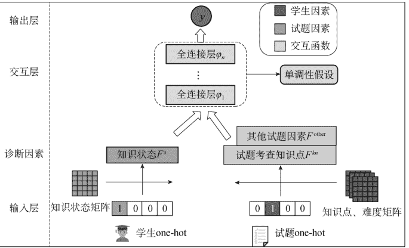

图 4.5 NeuralCDM

值得一提的是，NeuralCDM 是一个通用框架，它既可以从异构数据中学习，也可以涵盖许多传统的 CDM。例如，如图 4.6 所示，NeuralCDM 可以看作项目反应理论的推广：①表示从一维到多维的参数；②加入技能关联向量进行技能对齐；③将单个 Sigmoid 交互函数替换为多层神经网络。这些进展增强了拟合能力，同时保持了参数的良好可解释性。图中 $Q_{c,1}$、$h^s$、$h^{diff}$ 和 $h^{disc}$ 分别表示练习与技能的相关度、学习者的技能熟练度、技能难度和练习的区分度，IRT 和 NeuralCDM 的单调性分别通过 $\sigma$ 函数和全连接神经网络层实现。

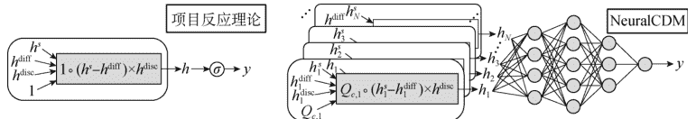

图 4.6 项目反应理论与神经认知诊断的建模方式对比

#### RCD：关系图建模“内部结构+层间交互”
过往研究聚焦层间交互（用户-任务、用户-技能），忽视知识概念间的教育依赖（内部结构）。Gao 等提出 RCD，以多层关系图统一捕获：
1.  **节点化**：用户、任务、技能作层级节点。
2.  **三大局部图**：用户-任务交互图、任务-技能关联图、技能依赖图，全景建模三元关系。
3.  **递归聚合**：节点递归吸纳邻居信息。
4.  **融合层+注意力**：节点级/图级双重聚合，注意力网络平衡多层级信息。
5.  **即插即用**：关系驱动表征可融入现有模型，提升诊断效能。

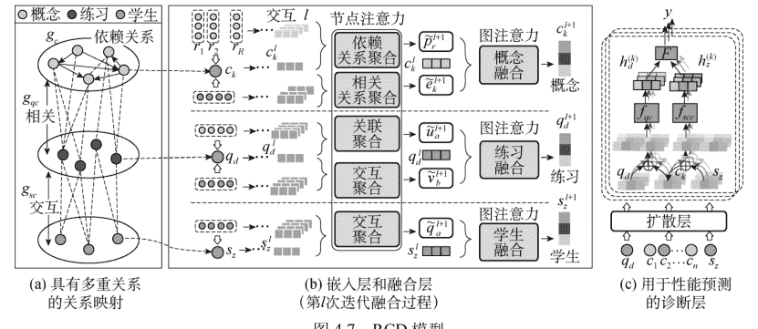

#### ECD：显式作答+隐式语境的双轨推断
学校、家庭、地域等环境深塑隐性认知状态。Zhou 等构建 ECD，将教育情境特征纳入模型：
1.  **领域划分**：异构上下文按类归域。
2.  **情境建模**：层次化注意力网络刻画各领域个性化影响，生成学习者外部特征向量。
3.  **诊断增强**：认情境影响全面非特异，自适应融合外部特征与内部认知状态（历史作答隐含）。
4.  **通用增强器**：该框架即插即用，显著提升主流模型性能。实验揭示跨国跨域教育背景差异等洞见。

---

### 回顾与展望：从统计建模到智能融合的范式跃迁

本章梳理认知诊断理论内涵与演进，聚焦建模路径：统计建模 $\rightarrow$ 模式挖掘 $\rightarrow$ 智能融合，呈现代表性模型谱系。

**统计模型本质**：根植认知心理与教育测量，离散潜变量模型，识别技能模式或掌握程度（潜变量可为认知技能、心理特质、态度）。核心价值：透过作答回溯领域掌握，**非排名定位，而是输出优劣势具体反馈**。

**智能融合转折**：算力瓶颈突破后，神经网络与诊断模型融合催生 NeuralCDM。其不止用得分矩阵与题技矩阵，更用网络挖掘文本修正题技矩阵，三元建模（学习者、试题、交互），大幅提升学习能力。

**总结**：认知诊断经历“传统模型 $\rightarrow$ 深度模型”范式跃迁，实现认知心理学与神经网络技术深度融合双赢：
*   **认知模型赋能深度学习**：注入白盒特性。
*   **深度学习赋能认知诊断**：挖掘非线性交互，强化拟合效能。

---

## 第三篇 动态认知诊断：学习认知的表现预测

### 第 5 章 动态认知诊断理论概述

在线教育的爆发式增长，重塑了知识获取的版图。新冠疫情恰似催化剂，让本已加速的数字化学习进程按下了“快进键”：全球约16亿学习者被迫“居家上课”，191个国家关停校园，联合国教科文组织数据显示，这覆盖了超91%的在册生源。在这场被迫的全球实验中，在线教育展现出不可替代的韧性——它打破了物理围墙，让“随时随地、因材施教”从愿景照进现实。Coursera、ASSISTments等平台的实践证明，搭载智能推荐、自适应路径规划的在线系统，教学效能已超越传统模式。

然而，智能服务的前提是“懂学习者”。平台每时每刻都在记录海量交互日志，这些数据蕴藏着评估认知水平、洞察偏好的金矿。痛点在于：传统静态诊断仅凭单次测评切片，难以还原认知发展的全貌。因此，融合连续时序轨迹、追踪知识状态演进的**动态认知诊断**（即**知识追踪，KT**）应运而生。它的核心使命是：基于历史作答序列，实时建模学习者认知状态的动态变化，精准预测未来表现，进而输出个性化资源推荐与路径规划，真正实现“教学相长”的智能化闭环。

---

### 5.1 知识追踪：给认知过程装上“追踪器”

知识追踪是智能教育领域的“明星赛道”，其理论突破让大规模个性化教学成为可能。简单说，它就是对学习者的时间序列作答数据建模，动态捕捉知识掌握度的增减变化。

概念溯源与演进：
*   **1972年**，Atkinson首发启蒙之声；
*   **1995年**，Corbett & Anderson引入贝叶斯网络，奠定**BKT（贝叶斯知识追踪）**基石，定义为“对实践中不断变化的知识状态建模”；
*   **Piech等**视其为模拟交互中知识水平的机制，核心任务是“随时间建模、预测未来”；
*   **Liu等**强调“全历程轨迹跟踪 + 单次学习增量估计 + 下题预测”；
*   **张暖、江波**从机器学习视角归纳：以含噪观测（正误序列）反推隐变量（知识掌握），本质是序列预测问题；
*   **王志锋等**拔高至智慧教育维度：跟踪轨迹 -> 建模交互 -> 挖掘动态认知结构 -> 预测表现 -> 人机协同优化 -> 服务终身发展。

**核心逻辑**：输入历史轨迹 -> 实时估算知识状态时序演变 -> 预测下一步表现 -> 输出精准干预（如推题、补漏）。

**知识空间与雷达图隐喻**（参见 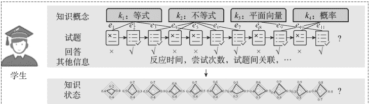 图 5.1）：
设想知识空间由N个概念构成。学习者初始掌握向量为[0.2, 0.4, 0.4, 0.5]。每次作答，系统记录“题目-概念-正误”及响应时长、尝试次数等多模态信号。随着学习推进，掌握向量演变为[0.8, 0.7, 0.7, 0.4]，雷达图多边形面积显著扩大。KT模型即基于此过程，推演下一时刻的状态分布与答题概率，驱动智能推题、难度自适应等服务。

---

### 5.2 方法谱系：从概率图模型到深度神经网络

KT方法演进史，浓缩了AI技术迁移教育的缩影（全景分类参见 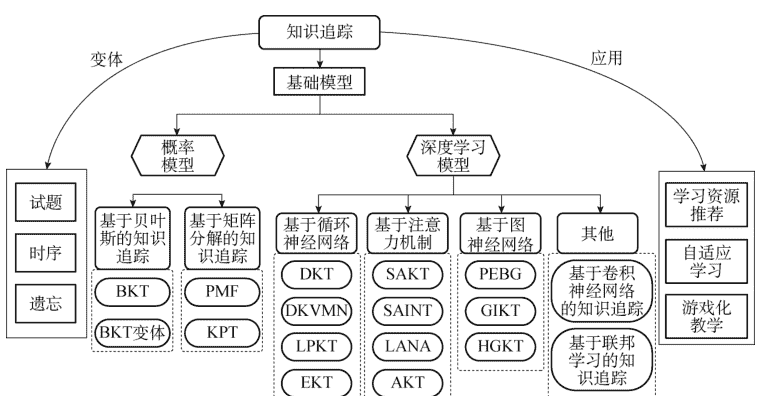 图 5.2）：

**早期（70s-90s）**：聚焦掌握学习理论验证，鲜受教育界关注。
**转折点（1995）**：Corbett & Anderson引入贝叶斯网络，开启**概率模型时代**——BKT、学习因素分析(LFA)、绩效因素分析(PFA)相继登场。
**爆发期（2015至今）**：深度学习以强特征提取、复杂结构建模能力全面接管主流。
*   **DKT (Deep Knowledge Tracing)**：首引RNN，大幅超越传统基线；
*   **GKT (Graph-based KT)**：引入GNN，显式建模概念间先修、相似等拓扑结构；
*   **AKT (Attention-based KT)**：用Attention捕捉长距离交互依赖、细粒度概念关联；
*   **变体层出**：融合遗忘曲线、引入元学习、对比学习、大模型微调等，适配多元场景。

**新分类法两大支柱**：
1.  **概率模型派**：BKT（马尔可夫假设）、PMF/KPT（矩阵分解视角）；
2.  **深度学习派**：RNN系、Attention系、GNN系及混合架构。

后续章节将逐一拆解经典架构与前沿变体。

---

### 5.3 概率模型双雄：BKT 与 PMF/KPT

概率派核心优势在于**可解释性强、参数少、小样本友好**，分两条主线：

#### 5.3.1 传统贝叶斯知识追踪（BKT）：隐马尔可夫的教科书式应用

**核心设定**：
*   知识点解耦建模，每概念对应二元隐状态：{掌握, 未掌握}；
*   观测变量亦为二元：{正确, 错误}；
*   四大核心参数：
    *   $P(L_0)$：先验掌握概率（入场水平）；
    *   $P(T)$：学习转移概率（由不会变会的效率，**假设不遗忘**，即回退概率为0）；
    *   $P(G)$：瞎蒙概率（不会却答对）；
    *   $P(S)$：失手概率（会却答错）。

**数学机制**（三步走）：
1.  **瞬时答对概率**：$P(Correct_n) = P(L_n)(1-P(S)) + (1-P(L_n))P(G)$
2.  **状态迭代更新**（含学习增量）：$P(L_n) = P(L_{n-1}|E_{n-1}) + [1-P(L_{n-1}|E_{n-1})]P(T)$
3.  **贝叶斯后验修正**（依据本题结果反推状态）：
    *   答对：$P(L_n|Correct) \propto P(L_n)(1-P(S))$
    *   答错：$P(L_n|Incorrect) \propto P(L_n)P(S)$

**HMM视角**（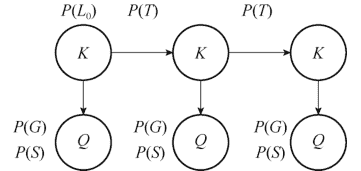 图 5.3 & 表 5.1-5.3）：
*   初始分布：$[1-P(L_0), P(L_0)]^T$；
*   转移矩阵：下三角矩阵 $\begin{bmatrix} 1-P(T) & P(T) \\ 0 & 1 \end{bmatrix}$（体现“不遗忘”单向流动）；
*   发射矩阵：$\begin{bmatrix} 1-P(G) & P(G) \\ P(S) & 1-P(S) \end{bmatrix}$。

**短板显性化**：概念间独立假设，无法捕捉知识图谱结构；参数随概念单独训练，冷启动难；固定$P(T), P(G), P(S)$难以适应个体差异与题目难度细微差别。

#### 5.3.2 原始概率矩阵分解（PMF）：推荐系视角的“阶段性建模”

Salakhutdinov & Mnih (2008) 移植推荐系经典算法。区别于BKT的“实时流式更新”，PMF采用**批量/阶段性反馈**建模。

**建模逻辑**：
*   构建稀疏矩阵 $R \in \mathbb{R}^{N \times M}$，$R_{ij}$ 为学习者$i$对题$j$的正确性（观测值）。
*   低秩假设：$R_{ij} \approx U_i^T V_j$，$U_i$ 为学习者$i$的潜在熟练度向量，$V_j$ 为题$j$的知识特征向量。
*   概率生成：$R_{ij} \sim \mathcal{N}(U_i^T V_j, \sigma^2)$；先验 $U_i, V_j \sim \mathcal{N}(0, \sigma^2 I)$。
*   目标函数（MAP估计等价）：
    $$ \min \frac{1}{2}\sum_{(i,j)\in \Omega} (R_{ij} - U_i^T V_j)^2 + \frac{\lambda_U}{2}\|U\|_F^2 + \frac{\lambda_V}{2}\|V\|_F^2 $$
*   SGD交替优化 $U, V$。

**局限**：标准PMF忽略题目-知识点显性映射（Q矩阵），也未建模时间动态（遗忘/记忆），纯协同过滤视角难以泛化到未见题目/概念。

#### 5.3.3 知识熟练度追踪（KPT）：注入教育先验的“时空增强版PMF”

Chen & Liu (2017) 针对PMF短板，提出三大创新（框架见图  图 5.4）：
1.  **显性知识嵌入**：引入专家标注 **Q矩阵**（题目×概念），约束题目向量 $V_j$ 在概念空间显性化，解决可解释性与冷启动；
2.  **学习者同空间映射**：将学习者向量 $U_i$ 同样投射至概念空间，维度对齐，直接读取各概念掌握度；
3.  **记忆-遗忘双曲线驱动时序演化**：
    *   记忆曲线：学习后熟练度升高；
    *   遗忘曲线：间隔期熟练度衰减；
    *   融合两者建模 $U_i^{t+1} = f(U_i^t, \text{交互日志}^t, \Delta t)$，实现**阶段性窗口**的知识状态追踪与下窗口表现预测（$R^{T+1}, U^{T+1}$）。

**KPT的意义**：它在概率图模型框架内，以极低计算开销实现了“显性概念建模+时间动态演化”的双重突破，为后续深度模型引入显性知识结构与遗忘机制提供了理论范式。

---

**展望**：概率模型奠定了KT的数学基石与可解释标准，但其表达能力上限受限于马尔可夫假设、线性交互等先验。下一站，我们将看到深度学习如何打破这些天花板，用神经网络拟合认知的复杂非线性动力学。


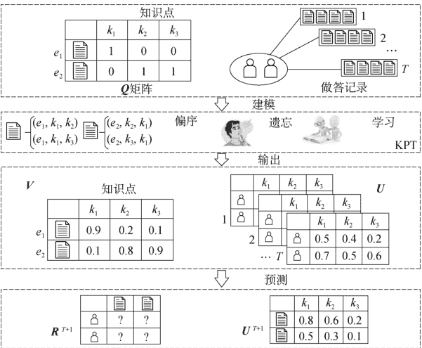

受既有研究启发，KPT 模型构建了试题作答概率的建模公式，具体形式如下：

$$P(\mathbf{R}|\mathbf{U},\mathbf{V},b)=\prod_{i=1}^T\prod_{i=1}^N\prod_{j=1}^M \left[ N(R_j^i \mid \langle \mathbf{U}_j^i, \mathbf{V}_j \rangle - b_j, \sigma_R^2) \right]^{l_j^{ij}} \quad (5.10)$$

其中，$N$ 代表正态分布；$b_j$ 为试题 $j$ 的难度参数；$\sigma_R^2$ 为响应变量 $R$ 所服从正态分布的方差；$\langle \mathbf{U}_i^t, \mathbf{V}_j \rangle$ 表示学习者状态向量与试题向量的点积运算；$I_{ij}^t$ 为指示函数，标记学习者 $i$ 在时间窗口 $t$ 内对试题 $j$ 的作答结果（1 为正确，0 为错误）。

关于 $\mathbf{V}$ 矩阵（试题-知识点关联矩阵）的估计过程，其对数似然函数推导如下：

$$\ln P(\mathbf{V} | D_T) = \ln \prod_{(j, q, p) \in D_T} P(>_j^+ | \mathbf{V}) P(\mathbf{V})$$

$$= \sum_{j=1}^M \sum_{q=1}^K \sum_{p=1}^K I(q >_j^+ p) \ln \frac{1}{1 + e^{-(V_{jq} - V_{jp})}} - \frac{1}{2\sigma_V^2} \|\mathbf{V}\|_F^2 \quad (5.11)$$

公式中，$>_j^+$ 表示偏序关系。例如 $q >_j^+ p$，当 $Q_{jq}=1$ 且 $Q_{jp}=0$ 时成立，意指对于试题 $j$，被标记为 1 的知识点 $q$ 与该题的相关性强于所有标记为 0 的知识点 $p$。$D_T$ 是依据 $\mathbf{Q}$ 矩阵构建的三元组集合，每个元素 $(j, q, p)$ 代表试题 $j$ 包含知识点 $q$ 但不包含知识点 $p$，其计算方式为：

$$D_T = \left\{ (j, q, p) \mid q >_j^+ p \right\} \quad (5.12)$$

即满足 $Q_{jq} = 1$ 且 $Q_{jp} = 0$ 的所有组合。

结合记忆与遗忘曲线理论，KPT 提出两大核心假设：一是练习量越大，知识掌握越牢固；二是时间流逝会导致知识逐渐遗忘。基于此，$\mathbf{U}$ 矩阵（学习者知识状态矩阵）的建模定义如下：

$$P(\mathbf{U}_i^t) = N(\mathbf{U}_i^t \mid \bar{\mathbf{U}}_i^t, \sigma_U^2 \mathbf{I}) \quad (5.13)$$

$$\bar{\mathbf{U}}_i^t = \{ \bar{U}_{i1}^t, \bar{U}_{i2}^t, \cdots, \bar{U}_{iK}^t \} \quad (5.14)$$

$$\bar{U}_{ik}^t = \alpha_i l'(*) + (1 - \alpha_i) f'(*) \quad (5.15)$$

其中，$l'(*)$ 为记忆因子，反映学习者在 $t$ 时间窗口通过刷题提升掌握度的情况；$f'(*)$ 为遗忘因子，刻画 $t$ 窗口内的遗忘程度；$\alpha_i$ 为平衡系数，兼顾遗忘与记忆，同时体现学习者能力及熟练度增长的时间衰减特性。两因子的具体计算公式为：

$$l'(*) = U_{ik}^{t-1} \frac{D \cdot f_k^t}{f_k^t + r} \quad (5.16)$$

$$f'(*) = U_{ik}^{t-1} e^{-\frac{t}{S}} \quad (5.17)$$

参数说明：$f_k^t$ 为学习者在窗口 $t$ 对知识点 $k$ 的练习频次；$r$ 与 $D$ 为控制掌握度提升幅度的超参数；$t$ 为相邻时间窗口间隔；$S$ 表征记忆强度的超参数。

鉴于初始时刻（$\tau=1$）学习者知识水平未知，KPT 假设其服从零均值高斯分布。最终，用户知识掌握矩阵 $\mathbf{U}$ 的联合概率表示为：

$$P(U | \sigma_U^2, \sigma_{U_1}^2) = \prod_{i=1}^N N(U_i^1 \mid 0, \sigma_{U_1}^2 I) \prod_{t=2}^T N(U_i^t \mid \bar{U}_i^t, \sigma_U^2 I) \quad (5.18)$$

KPT 模型的优化目标函数如下：

$$

\min_\phi \mathcal{E}(\Phi) = \frac{1}{2} \sum_{t=1}^T \sum_{i=1}^N \sum_{j=1}^M I_{ij}^t (\hat{R}_{ij}^t - R_{ij}^t)^2 - \lambda_p \sum_{j=1}^M \sum_{q=1}^K \sum_{p=1}^K I(q \succ_j p) \ln \frac{1}{1 + e^{-(V_{jq} - V_{jp})}} \quad (5.19)

$$

$$

+ \frac{\lambda_V}{2} \sum_{i=1}^M ||V_i||_F^2 + \frac{\lambda_U}{2} \sum_{t=2}^T \sum_{i=1}^N ||\bar{U}_i^t - U_i^t||_F^2 + \frac{\lambda_1}{2} \sum_{i=1}^N ||U_i^t||_F^2

$$

式中，正则化系数 $\lambda_U = \frac{\sigma^2}{\sigma_U^2}$，$\lambda_V = \frac{\sigma^2}{\sigma_V^2}$；$\sigma_U^2$ 与 $\sigma_V^2$ 分别为 $U$、$V$ 服从正态分布的方差。

概率模型类知识追踪主要分为贝叶斯知识追踪（BKT）与概率矩阵分解（PMF）两大流派。此类模型架构精简，善于融合认知心理学原理，可解释性强；但短板在于无法挖掘未预定义的隐性知识点，且因结构过于简单，难以精细刻画知识状态的动态演化，在大规模数据场景下表现乏力。

#### 5.4 章节小结

本章系统梳理了知识追踪的核心内涵、技术演进脉络及典型概念模型。首先界定了知识追踪的定义与基础概念，凸显其在教育个性化、提质增效中的核心价值——通过实时捕捉学习者知识状态动态，为精准教学提供数据支撑。

随后回顾了方法发展史：从早期的贝叶斯模型，延伸至概率矩阵分解，再到融合机器学习与深度学习的新范式，计算技术的迭代持续推动模型处理复杂数据、精准预测的能力跃升。

在模型详解环节，重点剖析了三类代表性工作：传统 BKT 利用概率图建模，可解释性佳但高维建模受限；原始 PMF 引入矩阵分解捕捉师生潜在交互，提升预测力，却难应对复杂知识结构；改进型 PMF 则通过引入先验知识与优化策略，显著增强了建模精度与鲁棒性。

综上，知识追踪作为教育数据挖掘的基石工具，在刻画学习轨迹、识别薄弱环节、赋能个性化决策上作用关键。展望未来，随着算力与算法的双重突破，其在优化教育体验、提升教学效能上的价值将进一步释放。

### 第 6 章 深度动态认知诊断

#### 6.1 基于循环神经网络的动态认知诊断范式

随着深度学习在视觉、语言领域的突破，学界纷纷引入此类技术攻克教育难题。传统概率模型在大数据下表现疲软，倒逼研究者探索深度学习新路径。Piech 等人首创性地将循环神经网络（RNN）引入知识追踪，将习题与响应拼接为序列，借 RNN 追踪知识状态演变，开启了深度知识追踪新纪元。此后，基于 RNN 的变体模型层出不穷。本节将重点介绍深度知识追踪（DKT）、动态键值记忆网络（DKVMN）、遗忘增强 DKT（DKT+forget）、习题感知追踪（EKT）及学习过程一致性追踪（LPKT）五大里程碑模型。

##### 6.1.1 深度知识追踪 (DKT)

DKT 是 RNN 落地知识追踪的开山之作，采用 LSTM 架构，性能显著超越概率模型。其核心逻辑：以学习者历史作答序列为输入，输出下一步各题作答正确概率，即预测全知识点掌握度。

具体而言，DKT 将习题 $q_t$ 与响应 $r_t$ 组合为二元组 $x_t = \{q_t, r_t\}$，融合为单一向量输入 LSTM。隐藏层状态向量即刻画学习者动态知识状态。LSTM 的长程依赖建模能力，使模型能综合长期历史信息判断当前水平；其遗忘门机制则天然契合“时间流逝导致掌握度衰减”的遗忘规律（见图 6.1）。

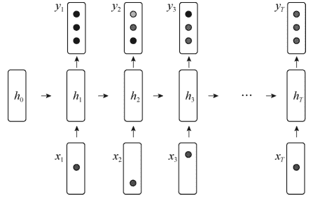

**图 6.1 DKT 模型架构示意**

综上，DKT 打破了知识点独立性假设，在隐空间联合建模多知识点状态，突破一阶马尔可夫局限，实现长序列时序建模。但其将习题简化为知识点标签，忽略了同知识点下不同习题的差异性；且高度依赖海量数据训练，模型内部机制呈“黑盒”状态，可解释性欠佳。

##### 6.1.2 动态键-值记忆网络 (DKVMN)

DKT 类模型用单一高维隐向量表征知识状态，虽表达能力超越 BKT，却难以输出具体概念层面的掌握细节。为破解此题，受记忆增强神经网络（MANN）启发，本节提出 DKVMN（架构见图 6.2）。该模型设置**静态键矩阵**存储所有知识概念，**动态值矩阵**实时记录并更新学习者对各概念的掌握度，从而在追踪细粒度状态的同时，捕捉概念间关联。核心贡献在于：基于 MANN 创新双矩阵架构，更逼真模拟学习过程，并能自动发现潜在概念。实验证明，DKVMN 在合成及三个真实数据集上均超越 BKT 与 DKT，且参数量更少。

$$w_t(i) = \text{Softmax}(\boldsymbol{k}_t^{\text{T}} \boldsymbol{M}^k(i))$$

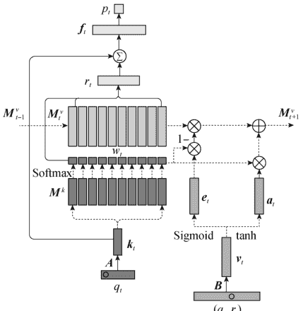

**图 6.2 DKVMN 模型架构示意**

**1. 相关权重计算**
输入习题 $q_t$ 经嵌入矩阵 $A$（$Q \times d_v$）映射为 $d_v$ 维向量 $\boldsymbol{k}_t$；再计算 $\boldsymbol{k}_t$ 与静态键矩阵 $\boldsymbol{M}^k(i)$ 的内积，经 Softmax 归一化得到权重。

**2. 读取与预测过程**
读取动态值矩阵 $M_t^v(i)$ 的加权和得到掌握水平 $r_t$：
$$r_t = \sum_{i=1}^N w_t(i) M_t^v(i) \quad (6.2)$$
融合习题难度：将 $r_t$ 与 $k_t$ 拼接，经全连接层 + tanh 得到融合向量 $f_t$：
$$f_t = \tanh(W_1^T [r_t, k_t] + b_1) \quad (6.3)$$
最终经全连接层 + Sigmoid 输出作答正确概率 $p_t$：
$$p_t = \text{Sigmoid}(W_2^T f_t + b_2) \quad (6.4)$$

**3. 写入与更新过程**
作答后，模型依正确性更新动态矩阵。将二元组 $(q_t, r_t)$ 经嵌入矩阵 $B$（$2Q \times d_v$）映射为知识增量 $v_t$。更新分“擦除”与“添加”两步：
擦除向量 $e_t = \text{Sigmoid}(E^T v_t + b_e)$（$E$ 为 $d_v \times d_v$ 变换矩阵）。
记忆向量修改为：
$$\tilde{M}_t^v(i) = M_{t-1}^v(i) (1 - w_t(i) e_t) \quad (6.6)$$
添加向量 $a_t$ 计算如下：
$$a_t = \tanh(D^T v_t + b_a)^T$$ (6.7)
值矩阵最终更新：
$$M_t^v(i) = \tilde{M}_{t-1}^v(i) + w_t(i) a_t$$ (6.8)

**4. 损失函数**
训练阶段，采用预测概率 $p_t$ 与真实标签 $r_t$ 的交叉熵损失，联合优化嵌入矩阵 $A, B$ 及记忆矩阵初始值：
$$\mathcal{L} = -\sum_t (r_t \ln(p_t) + (1-r_t) \ln(1-p_t))$$ (6.9)

DKVMN 通过双矩阵机制，实现了对多隐性概念掌握度的长程追踪，解决了 DKT 单向量表征的局限；同时支持习题-概念关联挖掘，在少参数条件下超越 MANN 与 DKT 基线。

##### 6.1.3 遗忘行为增强知识追踪 (DKT+forget)

既有研究虽关注遗忘规律，但或仅建模部分遗忘信息，或虽考虑多维遗忘特征却忽视学习序列上下文。如何在序列建模中显式融合完整遗忘行为，成为亟待解决的问题。

Nagatani 等人据此提出 DKT+forget，在 DKT 基座上，通过多维遗忘特征显式建模遗忘机制，实现“学习序列”与“遗忘行为”双轨并行。模型结构见图 6.3，三大遗忘特征示意见图 6.4，核心策略是将遗忘相关信息注入 RNN 的**输入空间**与**输出空间**，完成对 DKT 的扩展。

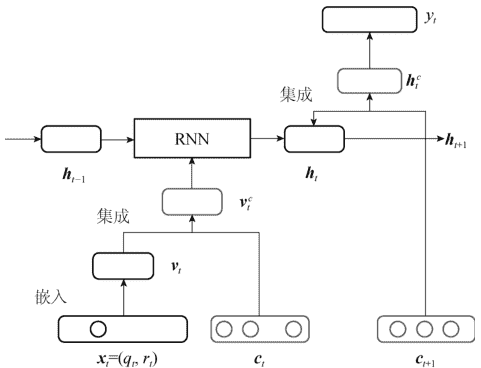

**图 6.3 DKT+forget 模型结构图**

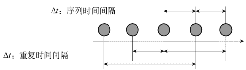

**图 6.4 三大遗忘特征示意表**

| 时间步 | $t_1$ | $t_2$ | $t_3$ | $t_4$ | $t_5$ |
|:---:|:---:|:---:|:---:|:---:|:---:|
| **重复时间间隔** | - | - | $\Delta t_{32}$ | $\Delta t_{41}$ | $\Delta t_{53}$ |
| **序列时间间隔** | - | $\Delta t_{21}$ | $\Delta t_{32}$ | $\Delta t_{43}$ | $\Delta t_{54}$ |
| **过去练习次数** | 0 | 0 | 1 | 1 | 2 |

**核心特征定义：**
1.  **重复时间间隔**：针对特定知识点，距离上一次练习该知识点的时间跨度。
2.  **序列时间间隔**：距离上一次任意交互行为的时间跨度，不限知识点类别。

### 3. 历史作答频次
指学习者针对同一技能标签下题目的累计作答次数。

###### 2. 模型构建

为模拟学习者的知识演变轨迹，模型引入可训练嵌入矩阵 $A$，将交互向量 $x_t$ 映射为嵌入向量 $v_t$。同时，将遗忘相关的三个特征转化为 one-hot 向量并拼接，构成遗忘信息向量 $c_t$。在输入 RNN 之前，先融合嵌入向量 $v_t$ 与遗忘特征向量 $c_t$：

$$v_t^c = \theta^{\text{in}}(v_t, c_t)$$ (6.10)

其中 $\theta^{\text{in}}$ 为输入融合函数，负责将遗忘信息注入知识状态。随后，利用融合后的输入 $v_t^c$ 与上一时刻知识状态 $h_{t-1}$ 更新当前知识状态向量 $h_t$：

$$h_t = \phi(v_t^c, h_{t-1})$$ (6.11)

式中 $\phi$ 为状态更新函数。

预测阶段同理，模型将下一时刻 $t+1$ 的遗忘信息 $c_{t+1}$ 与更新后的知识状态 $h_t$ 融合：

$$h_t^c = \theta^{out}(h_t, c_{t+1})$$ (6.12)

此处 $\theta^{out}$ 为输出融合函数，将遗忘因素引入预测环节。最终，基于融合后的知识状态 $h_t^c$ 预测学习者对所有技能 $y_i \in R^Q$ 作答正确的概率：

$$y_i = \sigma(b^{out} + W^{out}h_t^c)$$ (6.13)

$W^{out}$ 与 $b^{out}$ 分别为输出层权重与偏置。

###### 3. 融合策略

本节对比了四种信息融合方案：

- **(1) 直接拼接**：
  $$\theta^{in}(v_t, c_t) = [v_t; c_t]$$

- **(2) 矩阵变换融合**：
  $$\theta^{in}(v_t, c) = v_t \odot C c_t$$
  $C$ 为可训练变换矩阵，$\odot$ 表示逐元素相乘。

- **(3) 拼接后再变换**：
  $$\theta^{in}(v_t, c_t) = [v_t \odot C c_t; c_t]$$

- **(4) 双向交互编码**：
  $$\theta^{in}(v_t, c_t) = \sum_i \sum_{j \neq i} z_i \odot z_j, z_i \in \{v_t, C_i c_t^i | c_t^i \neq 0\}$$

###### 4. 模型优化

通过最小化下一题 $q_{t+1}$ 的预测概率与真实标签 $a_{t+1}$ 的交叉熵损失来学习参数：

$$\mathcal{L} = -\sum(a_{t+1} \ln(y_i^T \delta(q_{t+1})) + (1 - a_{t+1}) \ln(1 - y_i^T \delta(q_{t+1})))$$ (6.14)

$\delta(q_{t+1})$ 表示 $t+1$ 时刻题目的 one-hot 向量。

该方法在 DKT 基础上融入遗忘机制，在两个真实数据集上均优于原版 DKT，实验证实：引入遗忘信息能显著提升预测精度。

##### 6.1.4 习题感知知识追踪（EKT）

传统 KT 仅依赖作答记录预测未来表现，难以挖掘题目内容（知识点、文本等）蕴含的深层信息，导致可解释性不足。图 6.5 展示了一个典型场景：学习者 $s_1$ 连续作答 $e_1 \sim e_4$，其中 $e_1$ 与 $e_3$ 均答对且同属“函数”知识点，但 $e_3$ 难度显著高于 $e_1$。传统模型无法区分这种差异，造成**信息损失**。

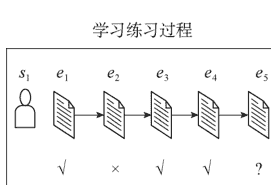

| 习题 | 习题内容 | 知识概念 |
|:---|:---|:---|
| $e_1$ | 若函数 $f(x)=x^2-2x+2, x \in [0,3]$，求值域 | 函数 |
| $e_2$ | 从 {1,2,3,4} 不重复随机取 4 数，按升序排列的概率 | 概率 |
| $e_3$ | 方程 $r=2\times|-x\times-4|-10$ 图像在 y 轴截距 | 函数 |
| $e_4$ | 不等式 $\frac{2x-1}{x+2} \le 3$ 解集 | 不等式 |
| $e_5$ | 已知 $f(x)=2x-2, \frac{2x-1}{3x+2} \le 4$，求 $f(x)$ 值域 | 函数，不等式 |

图 6.5 学习者练习过程示意

针对上述痛点，Liu 等人提出 **EKT 框架**，结合作答记录与题目文本，设计双向 LSTM 追踪状态，并衍生出两种实现：**EKTM**（马尔可夫属性）与 **EKTA**（注意力机制）。EKT 核心创新三点：
1.  **统一语义建模**：自动从语义层面理解并表征题目特征。
2.  **长程历史聚焦**：追踪学习者历史关键知识状态，而非仅依赖近期记录。
3.  **冷启动缓解**：有效缓解新题目/新学生的预测难题。

**EKT 双核任务**：
1. 预测下一题 $e_{T+1}$ 的得分 $r_{T+1}$。
2. 追踪 $T$ 步内 $K$ 个知识概念的掌握度动态变化。

数据表示：
$ s = \{(e_1, r_1), \dots, (e_T, r_T)\} $ (6.15)
$ e = \{w_1, w_2, \dots, w_M\} $ (6.16)
$ s = \{(k_1, e_1, r_1), \dots, (k_T, e_T, r_T)\} $ (6.17)

框架架构见图 6.6，(a) 为 EKTM，(b) 为 EKTA。

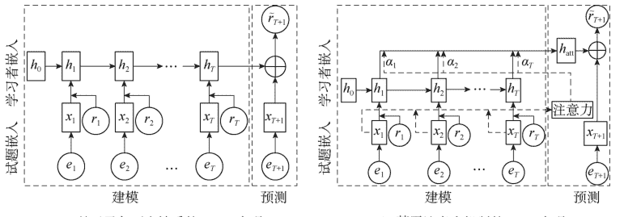

###### 1. 习题嵌入层

对应图 6.7 中 $e_i \to x_i$ 过程。

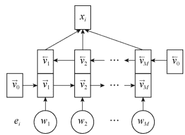

采用 **Bi-LSTM** 的考量：单向 LSTM 仅利用历史上下文，无法捕捉题目文本的完整语义。Bi-LSTM 可同时编码前向与后向依赖，充分挖掘上下文信息。

流程：Word2Vec 将单词 $w_M$ 初始化为预训练向量，再按前向/后向隐状态迭代更新。

前向计算：
$$

i_m = \sigma(Z_{wi}^E w_m + Z_{vi}^E v_{m-1} + b_i^E) \quad (6.18)

$$
$$

f_m = \sigma(Z_{wf}^E w_m + Z_{vf}^E v_{m-1} + b_f^E) \quad (6.19)

$$
$$

o_m = \sigma(Z_{wo}^E w_m + Z_{vo}^E v_{m-1} + b_o^E) \quad (6.20)

$$

后向计算：
$$

c_m = f_m \cdot c_{m-1} + i_m \cdot \tanh(Z_{wc}^E w_m + Z_{vc}^E v_{m-1} + b_c^E) \quad (6.21)

$$
$$

v_m = o_m \cdot \tanh(c_m) \quad (6.22)

$$

门控机制（$i/f/o/c$）与标准 LSTM 一致。特别地，正向隐状态 $\overrightarrow{v}_m$ 依赖 $w_m$ 与 $\overrightarrow{v}_{m-1}$；反向隐状态 $\overleftarrow{v}_m$ 依赖 $w_m$ 与 $\overleftarrow{v}_{m+1}$。最终拼接得到完整词级表示：

$$

v_m = \text{Concat}(\overrightarrow{v}_m, \overleftarrow{v}_m) \quad (6.23)

$$

最后通过池化/映射得到题目级向量 $x_i$ 输入主网络：

$$

x_i = \max(v_1, v_2, \cdots, v_M) \quad (6.24)

$$

至此完成单题嵌入。

###### 2. 学习者嵌入层

对应图 6.7 中 $x_i \oplus r_t \to \tilde{x}_t$ 过程。输入为 $\{(x_1,r_1), \dots, (x_T,r_T)\}$，$r_t \in \{0,1\}$ 表示对错。$\tilde{x}_t = x_t + r_t$（或拼接/融合，视具体实现），融合题目语义与作答结果。

隐状态更新：
$$

\tilde{x}_t = \begin{cases} [x_t \oplus 0], & r_t = 1 \\ [0 \oplus x_t], & r_t = 0 \end{cases} \quad (6.25)

$$

$h_{t-1}$ 为上一状态，$\theta_h$ 为 RNN 参数。具体 LSTM 计算细节：

$$

h_t = \text{RNN}(\tilde{x}_t, h_{t-1}; \theta_h) \quad (6.26)

$$
$$

i_t = \sigma(Z_{\tilde{x}t}^S \tilde{x}_t + Z_{ht}^S h_{t-1} + b_i^S) \quad (6.27)

$$
$$

f_t = \sigma(Z_{\tilde{x}t}^S \tilde{x}_t + Z_{hf}^S h_{t-1} + b_f^S) \quad (6.28)

$$
$$

o_t = \sigma(Z_{\tilde{x}t}^S \tilde{x}_t + Z_{ho}^S h_{t-1} + b_o^S) \quad (6.29)

$$
$$

c_t = f_t \cdot c_{t-1} + i_t \cdot \tanh(Z_{\tilde{x}c}^S \tilde{x}_t + Z_{hc}^S h_{t-1} + b_c^S) \quad (6.30)

$$
$$

h_t = o_t \cdot \tanh(c_t) \quad (6.31)

$$

关键设计：权重矩阵 $Z$ **动态区分正负反馈**。答对（$r_t=1$）使用正权重矩阵 $Z^+$；答错（$r_t=0$）使用负权重矩阵 $Z^-$。这比传统 LSTM 共享参数更符合认知规律。

###### 3. 成绩预测与注意力增强

获得各步隐状态 $h_t$ 后，预测新题 $e_{T+1}$ 得分 $\tilde{r}_{T+1}$：

$$

y_{T+1} = \text{ReLU}(\boldsymbol{W}_1 \cdot [\boldsymbol{h}_T \oplus x_{T+1}] + \boldsymbol{b}_1) \quad (6.32)

$$
$$

\tilde{r}_{T+1} = \sigma(\boldsymbol{W}_2 \cdot y_{T+1} + \boldsymbol{b}_2) \quad (6.33)

$$
权重 $\boldsymbol{W}$，激活函数：
$$

\sigma(x) = \frac{1}{1 + e^{-x}} \quad (6.34)

$$

**痛点**：仅用最终状态 $h_T$ 预测，易忽略历史中关键题目的远距离影响。

**EKTA 方案**：引入注意力机制，用余弦相似度计算历史题目 $j$ 对当前题的重要性权重 $\alpha_j$，生成注意力状态向量 $\boldsymbol{h}_{\text{att}}$ 替代 $h_T$：

$$

\boldsymbol{h}_{\text{att}} = \sum_{j=1}^T \alpha_j \boldsymbol{h}_j, \quad \alpha_j = \cos(\boldsymbol{x}_{T+1}, x_j) \quad (6.35)

$$

预测公式同 EKTM，仅将 $h_T$ 替换为 $\boldsymbol{h}_{\text{att}}$。由此，注意力分数 $\alpha_j$ 不仅捕捉句法相似度，更能从**语义维度**（如难度、知识点关联）度量题目相关性。

**总参数集**：题目嵌入 $\{\boldsymbol{Z}_w^E, \boldsymbol{Z}_v^E, \boldsymbol{b}_e\}$、学习者嵌入 $\{\boldsymbol{Z}_x^S, \boldsymbol{Z}_h^S, \boldsymbol{b}_s\}$、输出层 $\{\boldsymbol{W}_s, \boldsymbol{b}_s\}$。

损失函数：
$$

\mathcal{L} = -\sum_{j=1}^T (r_j \ln \tilde{r}_j + (1-r_j) \ln(1-\tilde{r}_j)) \quad (6.36)

$$

**EKT 价值总结**：融合知识概念信息，兼顾预测精度与多概念状态追踪；EKTA 优于 EKTM，能定位历史关键节点；大规模实验验证了有效性与可解释性。

##### 6.1.5 学习过程一致性知识追踪（LPKT）

现有 KT 多重“预测准确”轻“过程一致性”。DKT 中答错即判定知识状态下降，违背认知科学：**错误是学习常态，良性试错反而促进习得**。因此需在建模中平等对待正负反馈，维持学习过程连贯性。

Liu 等人据此提出 **LPKT**，核心贡献：
1.  **重定义学习单元**：将“基础学习单元”定义为 **(题目, 作答耗时, 作答结果)** 三元组，相邻单元以**间隔时间**分隔，完整刻画学习节奏。
2.  **双门控机制**：
    *   **学习门**：控制知识吸收效率。
    *   **遗忘门**：量化时间流逝导致的知识衰减。
    通过“学习-遗忘”动态博弈，模拟真实认知过程，实现知识状态的精准演进。

LPKT 架构见图 6.8，每步包含三模块：① 学习模块（建模收获与历史交互）；② 遗忘模块（测量时间衰减）；③ 预测模块（基于最新状态预测下题）。

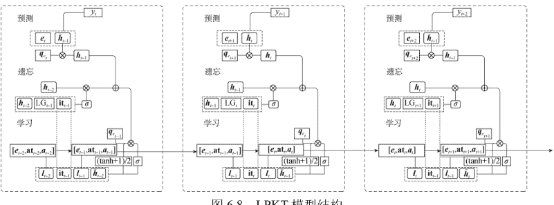

###### 1. 学习模块

## LPKT：学习过程建模的深度解析

LPKT 的核心机制在于对学习收获的精细化建模。这一过程通过串联学习者先前的学习嵌入 \( l_{t-1} \) 来实现，同时确立学习嵌入 \( l_t \) 作为模型的基础输入单元。具体而言，\( l_t \) 的生成依赖于一个多层感知器（MLP），该网络对试题嵌入 \( e_t \)、作答耗时 \( a_t \) 以及答案嵌入 \( a_t \) 完成深度融合：

$$

l_t = W_i^T(e_t \oplus a_t \oplus a_t) + b_1

$$

不仅如此，模型还纳入了两大影响学习增益的关键变量——学习间隔 \( i_t \) 与学习者既往知识状态 \( \tilde{h}_{t-1} \)。在处理历史知识状态时，模型聚焦于与当前试题强相关的知识点状态：

$$

\tilde{\boldsymbol{h}}_{t-1} = \tilde{\boldsymbol{q}}_{e_t} \cdot \boldsymbol{h}_{t-1}

$$

上述要素共同作用，将学习收益 \( lg_t \) 形式化为：

$$

lg_t = \tanh(\boldsymbol{W}_2^T (\boldsymbol{l}_{t-1} \oplus \boldsymbol{it} \oplus \boldsymbol{l}_t \oplus \tilde{\boldsymbol{h}}_{t-1}) + \boldsymbol{b}_2)

$$

考虑到并非所有学习收益都能完全转化为知识增量，LPKT 引入学习门机制，以此调控学习者对知识的吸收转化率：

$$

\Gamma_t^{l'} = \sigma(\boldsymbol{W}_5^T (\boldsymbol{l}_{t-1} \oplus \boldsymbol{it} \oplus \boldsymbol{l}_t \oplus \tilde{\boldsymbol{h}}_{t-1}) + \boldsymbol{b}_3)

$$

随后，通过将相关数值相乘，得出第 \( t \) 次交互中实际发生的学习收益 \( LG_t \)。同理，针对试题 \( q_{e_t} \) 关联的知识概念计算收获，获得相关学习收获 \( \widetilde{LG}_t \)：

$$

LG_t = \Gamma_t^{l'} \cdot ((lg_t + 1) / 2)

$$

$$

\widetilde{LG}_t = \boldsymbol{q}_{e_t} \cdot LG_t

$$

模型应用线性变换 \( ((lg_t + 1) / 2) \) 确保学习收获恒为正值，这符合学习者在每次交互中持续积累知识的基本假设。

## 2. 遗忘机制建模

依据遗忘曲线理论，记忆保持量随时间呈指数级衰减。LPKT 基于三大因素——学习者先验知识状态 \( \boldsymbol{h}_{t-1} \)、当前学习收益 \( LG_t \) 及间隔时间 \( \boldsymbol{it}_t \)——构建遗忘门：

$$

\Gamma_t^{f'} = \sigma(\boldsymbol{W}_4^T (\boldsymbol{h}_{t-1} \oplus LG_t \oplus \boldsymbol{it}_t) + \boldsymbol{b}_4)

$$

继而，遗忘门 \( \Gamma_t^{f'} \) 与 \( \boldsymbol{h}_{t-1} \) 相乘以抵消遗忘效应，从而更新学习者完成第 \( t \) 次交互后的知识状态 \( \boldsymbol{h}_t \)：

$$

\boldsymbol{h}_t = \widetilde{LG}_t + \Gamma_t^{f'} \cdot \boldsymbol{h}_{t-1}

$$

## 3. 预测机制

获取交互后的知识状态后，LPKT 利用 \( \tilde{\boldsymbol{h}}_t \) 对学习者在下一道试题 \( e_{t+1} \) 上的表现进行预测。

$$

y_{t+1} = \sigma(\boldsymbol{W}_5^T (\boldsymbol{e}_{t+1} \oplus \tilde{\boldsymbol{h}}_t) + \boldsymbol{b}_5)

$$

输出值 \( y_{t+1} \) 落区间 (0,1) 内，代表预期得分。设定阈值后，若 \( y_{t+1} \) 超过阈值则判定为答对，反之则为答错。

## 4. 优化目标

为学习 LPKT 全量参数，采用预测值与真实答案间的交叉熵损失作为目标函数：

$$

L(\theta)= - \sum_{i=1}^T (a_i \lg y_i + (1 - a_i) \lg(1 - y_i)) + \lambda_\theta \| \theta \|^2

$$

其中 \( \theta \) 为模型全体参数，\( \lambda_\theta \) 为正则化超参数。优化过程借助 Adam 优化器寻找最优解。

**LPKT 核心逻辑回顾**：该模型将学习过程离散化为基本学习单元与间隔时间（单元内含答题时长），通过捕捉相邻单元差异量化学习增益；收获的多样性由相关知识状态与间隔时间共同度量；学习门区分吸收能力，遗忘门模拟记忆衰退。由此，LPKT 获得了更符合认知规律的知识状态表达，兼具可解释性与高精度，为后续研究指明了方向。

### 6.1.6 阶段小结

深度知识追踪（DKT）的兴起得益于深度学习技术的突破。自 Piech 等人引入 RNN 以来，相关研究呈爆发式增长。随着探索深入，各类深度学习技术不断注入 KT 领域。本节系统梳理了基于 RNN 的演进脉络：从 DKT 到 DKVMN、DKT+forget，再到 EKT、LPKT。这些方法挖掘试题与作答过程的多维特征，在提升预测性能的同时，显著增强了模型可解释性，有力推动了深度学习在知识追踪中的落地与发展。

## 6.2 基于注意力机制的动态认知诊断

注意力机制作为深度学习核心技术，广泛服役于 NLP、视觉及语音等任务。引入注意力机制的追踪模型，旨在对知识状态与试题进行编解码，从而预测未来表现。Pandey 等人首创自注意力知识追踪（SAKT），利用注意力捕捉试题与反应的时序依赖并分配差异化权重。此后，SAINT、SAINT+、LANA、AKT 等变体相继涌现。

### 6.2.1 SAKT：自注意力知识追踪

现有 DKT 及变体依赖 RNN 建模，单一隐藏向量难以解释参数含义。DKVMN 虽借助双矩阵提升可解释性，但 RNN 族模型在稀疏数据下泛化乏力。SAKT 应运而生，基于自注意力机制，从历史交互中识别相关知识概念，据此预测掌握情况。其优势三折：① 依赖少量历史记录预测，缓解稀疏性难题；② 赋予历史试题权重，决策过程透明可解释；③ 并行计算特性使训练速度超越 RNN 模型一个数量级。

SAKT 架构包含七大步骤：特征嵌入、自注意力、前向传播、残差连接、层归一化、表现预测、目标函数。每一时间步仅计算历史元素的注意力权重。Key、Value、Query 从嵌入层提取（见图 6.10），第 \( j \) 元素为 Query、第 \( i \) 为 Key 时，权重记为 \( a_{ij} \)。

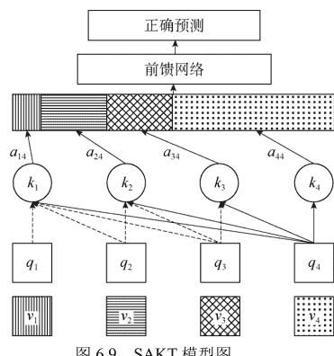

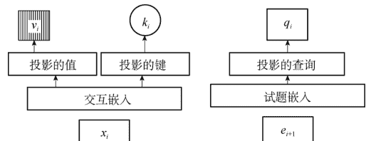

**1. 特征嵌入**
首先训练交互嵌入矩阵 \( M \in \mathbf{R}^{2 \times E \times d} \)（\( E \) 为试题总数，\( d \) 为潜在维度），映射序列各元素 \( s_i \) 为 \( M_{s_i} \)；其次训练试题嵌入矩阵 \( E \in \mathbf{R}^{E \times d} \)；同步进行位置编码训练得 \( P \in \mathbf{R}^{n \times d} \)。将位置嵌入注入交互嵌入，形成最终输入矩阵 \( \hat{M} \) 与 \( \hat{E} \)：

\(\hat{M} = \begin{bmatrix} M_{s_1} + P_1 \\ M_{s_2} + P_2 \\ \vdots \\ M_{s_n} + P_n \end{bmatrix}, \quad \hat{E} = \begin{bmatrix} E_{s_1} \\ E_{s_2} \\ \vdots \\ E_{s_n} \end{bmatrix} \quad (6.37)\)

**2. 自注意力层**
采用缩放点积注意力，挖掘历史试题对当前预测的相对权重。

\( Q = \hat{E}W^Q, \quad K = \hat{M}W^K, \quad V = \hat{M}W^V \quad (6.38) \)

\(\text{Attention}(Q, K, V) = \text{Softmax}\left( \frac{QK^{\text{T}}}{\sqrt{d}} \right) V \quad (6.39) \)

引入多头机制捕捉多子空间信息：

\(\text{Multihead}(\hat{M}, \hat{E}) = \text{Concat}(\text{head}_1, \cdots, \text{head}_h)W^O \quad (6.40) \)

其中 \( \text{head}_r = \text{Attention} (\hat{E}W_r^Q, \hat{M}W_r^K, \hat{M}W_r^V) \)。为防止未来信息泄露，引入因果掩码屏蔽 \( j > i \) 的 Key。

**3. 前向传播**
引入前馈网络（FFN）增强非线性建模与维度交互：

$F = \text{FFN}(S) = \text{ReLU}(SW^{(1)} + b^{(1)})W^{(2)} + b^{(2)}$ (6.41)

\( S=\text{Multihead}(\hat{M},\hat{E}) \)，\( W^{(1)}, b^{(1)} \) 为可学习参数。

**4. 残差连接**
在自注意力层与 FFN 后均应用残差连接，保障底层特征有效传播至深层。

**5. 层归一化**
为稳定加速训练，在上述两大模块后均施用层归一化。

**6. 表现预测**
将特征 \( F \) 经全连接网络配合 Sigmoid 输出预测分数。

**7. 目标函数**
最小化预测概率 \( p_t \) 与真实标签 \( r_t \) 的交叉熵：

\(\mathcal{L} = -\sum_t (r_t \ln(p_t) + (1-r_t)\ln(1-p_t))\) (6.42)

综上，SAKT 摒弃 RNN，凭借历史交互关联性预测未来，在真实数据集上超越 DKT、DKVMN 等基线，且推理速度提升一个数量级。

### 6.2.2 Transformer 架构下的知识追踪演进

2019 年 SAKT 确立多头注意力与位置编码范式，AUC 指标表现优异且训练极快，标志着 Transformer 成为 KT 建模主流方向之一。后续涌现 SAINT、SAINT+ 等更复杂架构。

#### 1. SAINT 模型

SAKT 存在双重局限：① 单层自注意力难捕捉试题-反应间随时间演变的复杂关系；② Query/Key/Value 构造潜力未被充分挖掘。SAINT 采用编码器-解码器架构：编码器对试题嵌入序列施用自注意力，解码器在反应嵌入序列上交替堆叠自注意力与编解码注意力，高效建模交互复杂性。输入分离设计允许深层堆叠，显著提升性能。

SAINT 包含模型输入与深度编解码器两大核心部分（结构见图 6.11）。

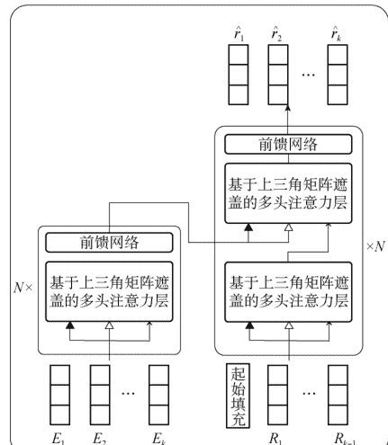

**1. 模型输入**
输入试题序列 \( E_1, \cdots, E_k \) 与反应序列 \( R_1, \cdots, R_{k-1} \)，预测第 \( k \) 步反应 \( r_k \)。嵌入层将两类序列映射为隐空间向量 \( E_1^e, \cdots, E_k^e \) 及 \( R_1^e, \cdots, R_{k-1}^e \)，最终表示融合全量信息。

**2. 深度自注意力编码-解码器**
沿用 Transformer 经典架构。编码器处理试题嵌入序列 \( E^e \) 输出 \( O = [O_1, \cdots, O_k] \) 传递给解码器。解码器接收 \( O \) 与反应嵌入序列 \( R^c = [S, R_1^e, \cdots, R_{k-1}^e] \)（\( S \) 为起始标记），输出预测序列 \( \hat{r} = [\hat{r}_1, \cdots, \hat{r}_k] \)：

```
O = Encoder(E^e) \quad (6.43)
```

```
\hat{r} = Decoder(O, R^c) \quad (6.44)
```

编解码器由多头注意力网络与 FFN 组成。不同于原版 Transformer，SAINT 在所有多头注意力层施加未来掩码，保证预测 \( \hat{r}_k \) 仅依赖历史 \( E_1, \cdots, E_k \) 与 \( R_1, \cdots, R_{k-1} \)。

多头注意力即以不同投影矩阵对同一输入并行计算 \( h \) 次注意力。注意力层先通过 \( W_i^Q, W_i^K, W_i^V \) 将 \( Q_{in}, K_{in}, V_{in} \) 投影至潜在空间。

# Transformer 系 KT 架构演进：从 SAINT 到 AKT 的深度拆解

## 核心范式：SAINT 的 Encoder-Decoder 基石

SAINT 确立了 Transformer 用于知识状态建模的基础范式：将习题与作答记录分离，分别喂入 Encoder 与 Decoder，作为 Attention 的 Query、Key、Value 三元组。

### Multi-Head Attention 与因果掩码
各头通过线性投影生成 $Q_i, K_i, V_i$。为保证时序因果性，引入 Mask 机制：将 $Q_i K_i^T$ 上三角置为 $-\infty$，经 Softmax 后实现未来信息屏蔽。单头输出为 Mask 后权重与 $V_i$ 的加权和；多头拼接后乘 $W^O$ 融合表征。

### FFN 与堆叠拓扑
Attention 输出经 FFN（两层 Linear + ReLU，权重共享）引入非线性。Encoder 由 $N$ 同构块堆叠，每块含 Attention 与 FFN 两子层，均采用 Residual + LayerNorm。首层 Input 为习题 Embedding $E^e$。Decoder 结构类似但含双 Attention：首层 Self-Attn 处理含起始符的响应序列 $R^e$；次层 Cross-Attn 接收 Encoder 输出 $O$ 作 Key/Value。最终经 Linear + Sigmoid 输出概率。实验证实：显式分离建模使编解码 Self-Attn 呈现差异化模式，验证了任务适配性。

## 进阶形态：SAINT+ 的时序特征注入

###### 2. SAINT+：双时间维度的表征增强

SAINT+ 继承 Encoder-Decoder 骨架，核心创新在于向响应 Embedding 注入双时间特征，显著提升表达力。

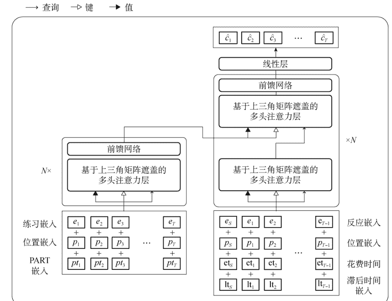

### 核心时间特征定义与 Embedding 策略
1.  **Elapsed Time（作答耗时）**：$t_{i+1}-t_i$。反映掌握度：知识匮乏者难在限时内解题。Embedding 两策略：Continuous（标量乘可学习向量）与 Absolute（每时长分配唯一固定向量）。
2.  **Lag Time（间隔时长）**：上次作答至本次呈现的间隔。捕捉遗忘与恢复：久疏遗忘，适度休息利认知重组。

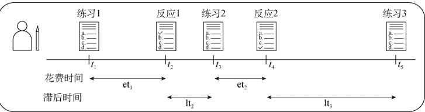

并行计算优势结合时序特征，使 SAINT+ 在性能与效率上双超 RNN 基线，为后续引入先修图谱、能力画像等扩展奠基。

## 个性化突围：LANA 的分层注意力机制

针对 DKT 系“群体均值拟合个体、忽视异质性”的痛点，LANA（Layered Attentive Knowledge Tracing）通过三大创新实现自适应建模。

##### 6.2.3 LANA：分层注意力驱动的个性化追踪

### 核心组件：SRFE（Student-Related Feature Extractor）
假设交互序列蕴含独特内在属性（记忆、推理等），且同一主体不同时期序列亦可区分。SRFE 由 Attn Layer + Linear Layers 组成，从 Encoder 输出中提炼主体特征。设双路 SRFE：
- **Memory-SRFE**：服务 PMA（Pivot Memory Attention），刻画记忆保持力。
- **Performance-SRFE**：服务 PC-FFN（Pivot Classification FFN），刻画认知表现力。
Multi-Head 机制保障不同头聚焦不同技能维度。

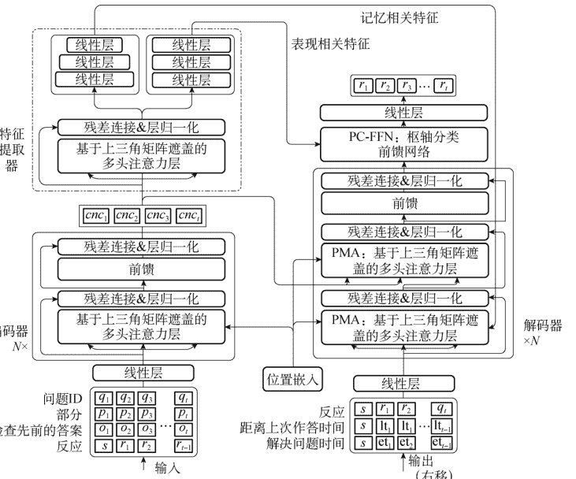

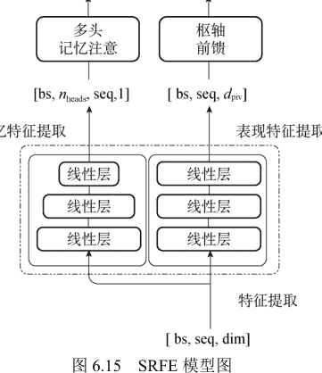

### 动态重参数化：Pivot Module
依据主体特征 $p$ 动态生成变换参数，而非学习固定映射。
- **PC-FFN**：通过 `PivotLinear` 算子，使权重 $W$、偏置 $b$ 成为 $p$ 的函数，实现 Decoder 个性化重构。
- **PMA**：引入记忆特征 $m$ 改进 Attn 打分，融合时间距离 `dis` 与相似度 `sim` 计算遗忘因子 $\alpha$。引入全局平均记忆参数 $\theta$ 辅助收敛，将个体差异 $m$ 建模为高斯分布偏移。

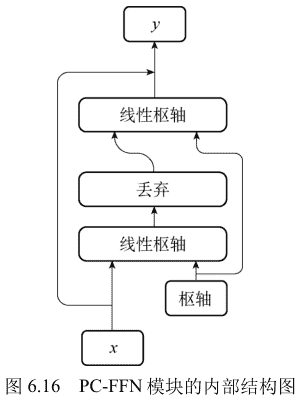

### 分层训练机制
借鉴 IRT 中 Rasch 模型，按整体能力聚类分层。先全量预训练基座，再按层微调。此举固化 Encoder 通用性，专项优化各层 Pivot 参数，兼顾专业化与训练效率。

**局限与展望**：SRFE 可解释性待增强，分层超参依赖人工，现版本忽视概念关联，引入 GNN 或为破局关键。

## 可解释性融合：AKT 的上下文感知建模

早期概率模型可解释但预测弱，深度模型预测强似黑箱。AKT（Attentive Knowledge Tracing）旨在兼得：融合认知/心理测量原理，赋予 Attention 可解释性。

###### 6.2.4 AKT：上下文感知与可解释性的统一

### 核心贡献：Contextualized Representation Learning
区别于直接使用原始习题/答案 Embedding 的 Attention 方法，AKT 将原始向量置于主体完整历史语境中，生成**上下文感知的历史表征**。这意味着同一习题在不同语境下拥有动态表达，更贴合真实认知过程。此外，引入单调 Attention 关联历来响应，融合指数衰减与相对距离度量计算权重；利用 Rasch 模型正则化概念/习题 Embedding，以低参数量捕捉同概念下个体差异。案例研究表明其具备优异解释力，在真实教育场景中拥有自动反馈与个性化干预潜力。

## AKT：基于注意力机制的知识追踪新范式

受认知科学中遗忘规律研究的启发，AKT 模型创新性地引入了**单调注意力机制**。该机制借助指数衰减曲线，自然地弱化了远期历史交互对当前预测的干扰；同时配合上下文感知的时间度量，精准刻画学习者过往作答间的时序间隔。此外，AKT 引入 Rasch 模型（1PL IRT），仅以极少的参数开销，通过专门设计的嵌入向量，有效捕捉了同一知识点下不同习题的个体差异性。

AKT 的整体架构由四大核心模块构成：双自注意力编码器（分别建模习题侧与知识侧的上下文表示）、基于注意力的知识检索器，以及前馈式响应预测网络（参见框架示意图）。

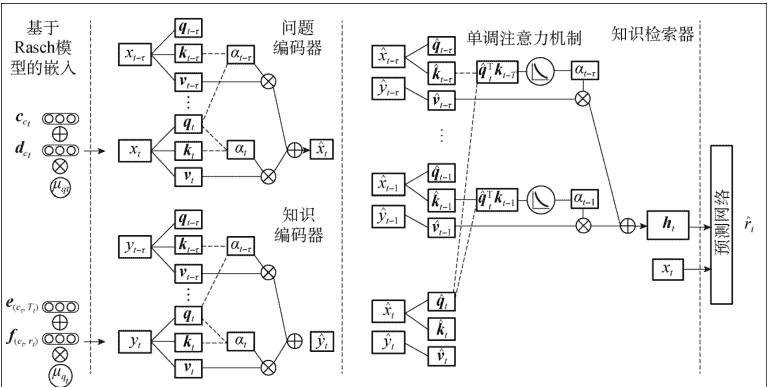

图 6.17 AKT 模型架构示意

### 核心组件解析

#### 1. 双编码器与知识检索器
AKT 配置了两套独立的编码器：
*   **习题编码器**：接收原始习题嵌入序列 $\{x_1, \dots, x_t\}$，输出融合了单调注意力的上下文感知表示 $\{\hat{\boldsymbol{x}}_1, \dots, \hat{\boldsymbol{x}}_t\}$。当前习题的表示 $\hat{\boldsymbol{x}}_t$ 不仅取决于自身，还依赖于历史习题序列。
*   **知识编码器**：处理历史习题-回答对嵌入 $\{y_1, \dots, y_{t-1}\}$，输出实际知识状态序列 $\{\hat{\boldsymbol{y}}_1, \dots, \hat{\boldsymbol{y}}_{t-1}\}$，其最新状态 $\hat{\boldsymbol{y}}_{t-1}$ 编码了学习者过往的作答轨迹。

**知识检索器**随后接管这两组上下文表示（$\hat{\boldsymbol{x}}_t$ 与 $\hat{\boldsymbol{y}}_{t-1}$），输出当前时刻的知识状态 $\boldsymbol{h}_t$。AKT 的一大亮点在于**知识状态的“题目感知”特性**——即知识状态随当前待答题目动态变化，这与 DKT 等传统方法将知识状态视为全局静态向量形成鲜明对比。检索过程严格遵循因果律：仅利用历史信息（$\hat{\boldsymbol{x}}_{1:t}, \hat{\boldsymbol{y}}_{1:t-1}$）与当前题目表示，不可见当前回答。最终，预测模块拼接 $\boldsymbol{h}_t$ 与当前交互嵌入 $\boldsymbol{x}_t$，经全连接层与 Sigmoid 输出正确率。

#### 2. 单调注意力机制：致敬艾宾豪斯
标准的缩放点积注意力对所有历史时刻一视同仁，这违背记忆随时间衰退的认知规律。AKT 在注意力分数中引入**乘法指数衰减项**：

$\alpha_{t, \tau'} = \frac{\exp(s_{t, \tau})}{\sum_\tau \exp(s_{t, \tau'})}, \quad s_{t, \tau} = \frac{\exp(-\theta \cdot d(t, \tau)) \cdot \boldsymbol{q}_t^\mathrm{T} \boldsymbol{k}_\tau}{\sqrt{D_k}}$ (6.61)

此处衰减系数由上下文感知时间距离 $d(t, \tau)$ 决定，而非简单的物理时间差：

$d(t, \tau) = |t - \tau| \cdot \sum_{t'=\tau+1}^t \gamma_{t, t'}$ (6.62)

权重 $\gamma_{t, t'}$ 通过当前题目与历史题目的语义相似度（注意力分数归一化）获得 (6.63)：**语义相近的历史题目“拉近”心理时间距离，语义差异大的则“推远”距离**。该机制还集成了多头注意力、层归一化、Dropout、前馈网络及残差连接，保障模型表达力与训练稳定性。

$$\alpha_{t, \tau} = \text{Softmax} \left( \frac{\boldsymbol{q}_t^\top \boldsymbol{k}_\tau}{\sqrt{D_k}} \right) = \frac{\exp \left( \frac{\boldsymbol{q}_t^\top \boldsymbol{k}_\tau}{\sqrt{D_k}} \right)}{\sum_{\tau'} \exp \left( \frac{\boldsymbol{q}_t^\top \boldsymbol{k}_{\tau'}}{\sqrt{D_k}} \right)} \in [0, 1]$$

#### 3. 响应预测与端到端训练
预测头输入为知识状态 $\boldsymbol{h}_t$ 与当前交互 $\boldsymbol{x}_t$ 的拼接向量，经全连接网络与 Sigmoid 映射为预测概率 $\hat{r}_t$。模型通过最小化二元交叉熵损失端到端优化：

$\mathcal{L} = \sum_i \sum_t -(r_t^i \lg \hat{r}_t^i + (1 - r_t^i) \lg(1 - \hat{r}_t^i))$ (6.64)

#### 4. 基于 Rasch 模型的嵌入：平衡共性与个性
传统 KT 方法常以概念 ID 直接索引习题（$q_t = c_t$），忽略了同概念下习题的难度差异。AKT 借用心理测量学经典 **Rasch 模型**（单参数项目反应理论），以“概念基础嵌入 + 难度标量 $\times$ 概念变异方向”解构习题表示：

$\boldsymbol{x}_t = \boldsymbol{c}_{c_t} + \mu_{q_t} \cdot \boldsymbol{d}_{c_t}$ (6.65)

其中 $\boldsymbol{c}_{c_t}$ 为概念共性向量，$\boldsymbol{d}_{c_t}$ 刻画该概念下习题的变异主方向，标量 $\mu_{q_t}$ 表征具体习题的难度偏移。习题-回答对嵌入同理扩展 (6.66)：

$y_t = e_{(c_t, r_t)} + \mu_{q_t} \cdot f_{(c_t, r_t)}$ (6.66)

此设计以极低参数量实现了**习题个体差异建模**与**避免过度参数化**的平衡。

> **小结**：AKT 通过上下文感知编码、符合认知规律的单调注意力、题目感知的知识检索，以及 Rasch 驱动的精细化嵌入，显著提升了知识追踪的准确性与解释性。

---

## 6.3 基于图神经网络的动态认知诊断：结构先验赋能建模

将数据内在的图结构先验注入模型，已成为提升知识追踪性能与可解释性的主流范式。本节重点剖析三大代表性工作：PEGB（二分图预训练嵌入）、GIKT（图交互模型）与 HGKT（分层习题图模型）。

### 6.3.1 PEGB：挖掘二分图全谱信息的预训练范式

过往研究多聚焦“习题-知识点”显性链接，而习题文本、难度、以及习题间、知识点间的隐性关联常被忽视。DKVMN 用键值矩阵模拟记忆，GKT 构建纯知识点图迭代节点状态，但均未充分利用异构关系。PEGB 的核心思想是：**在下游 KT 任务前，先在“习题-技能”二分图上完成习题嵌入的预训练，再将冻结或微调的嵌入注入深度 KT 模型。**

#### 图建模与关系建模
PEGB 构建包含习题节点 $Q$ 与技能节点 $S$ 的二部图，建模三层关系（图 6.18）：

1.  **显性习题-技能链接**（观测到的边）；
2.  **隐性习题相似性**（共享同一技能的习题对）；
3.  **隐性技能相似性**（共现于同一习题的技能对）。

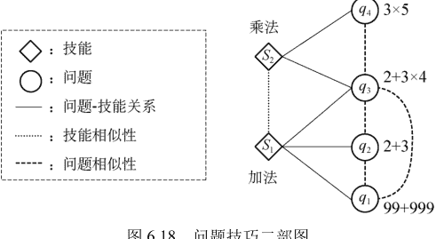

通过产品层融合习题顶点特征、技能顶点特征与属性特征（难度、类型等），学习到的习题嵌入同时保留难度先验与多层关系结构（图 6.19）。

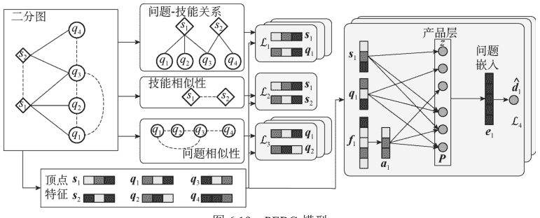

#### 1. 输入特征设计
*   **技能顶点特征** $S \in \mathbb{R}^{|S| \times d_v}$，每行 $s_i$ 为技能 $s_i$ 的可学习向量。
*   **习题顶点特征** $Q \in \mathbb{R}^{|Q| \times d_v}$，同维度可学习向量 $q_j$。
*   **属性特征** $f_i = [f_{i1}; \dots; f_{im}]$：融合平均作答时长、题型等异构信息，类别型做 One-hot，数值型直接标量化。

#### 2. 二分图约束驱动的特征对齐
利用对比学习思想，通过最小化重构误差迫使嵌入空间保持图结构特性：

*   **显性关系重构 (6.67-6.68)**：借鉴 LINE 一阶邻近性，用内积 $\hat{r}_{ij} = \sigma(q_i^T s_j)$ 估计链接概率，交叉熵损失 $\mathcal{L}_1$ 强制其拟合真实邻接矩阵 $r_{ij}$。
*   **隐性相似性保持 (6.69-6.72)**：定义习题相似矩阵 $R^Q$（共享技能即为 1）与技能相似矩阵 $R^S$。同理用内积估计隐性链接概率，最小化交叉熵 $\mathcal{L}_2, \mathcal{L}_3$ 保持二阶邻近性。

$$r_{ij}^s = \begin{cases} 1, \Gamma_s(i) \cap \Gamma_s(j) \neq \emptyset \\ 0, 其他 \end{cases}, i, j \in [1, \cdots, |S|] \quad (6.70)$$
$$\hat{r}_{ij}^q = \sigma(q_i^T q_j), i, j \in [1, \cdots, |Q|] \quad (6.71)$$
$$\hat{r}_{ij}^s = \sigma(s_i^T s_j), i, j \in [1, \cdots, |S|] \quad (6.72)$$
$$\mathcal{L}_2(Q) = \sum_{i=1}^{|Q|} \sum_{j=1}^{|Q|} -(r_{ij}^q \ln \hat{r}_{ij}^q + (1-r_{ij}^q) \ln(1-\hat{r}_{ij}^q)) \quad (6.73)$$
$$\mathcal{L}_3(S) = \sum_{i=1}^{|S|} \sum_{j=1}^{|S|} -(r_{ij}^s \ln \hat{r}_{ij}^s + (1-r_{ij}^s) \ln(1-\hat{r}_{ij}^s)) \quad (6.74)$$

#### 3. 属性增强的产品层融合
预训练最后阶段，将习题顶点特征 $q$、关联技能特征均值 $s'$ 及映射后的属性特征 $a$ 送入**产品层**，显式建模特征间的高阶交互，生成线性信息 $Z$ 与二次信息 $P$ (6.73-6.75)，最终得到信息丰富的习题嵌入。

$$s' = \frac{1}{|C|} \sum_{s_j \in C} s_j \quad (6.75)$$
$$Z = (z_1, z_2, z_3) \triangleq (q, s', a) \quad (6.76)$$
$$P = [p_{ij}] \in R^{3 \times 3} \quad (6.77)$$

> **PEGB 启示**：预训练阶段显式解耦显性/隐性关系并融合属性侧信息，为后续序列建模提供了高质量、结构感知的初始化表示，有效缓解了冷启动与数据稀疏难题。

## PEBG：用预训练嵌入强化知识追踪

在该公式中，特征交互项 $ p_{ij} = g(z_i, z_j) $ 采用向量内积形式，即 $ g(z_i, z_j) = \langle z_i, z_j \rangle $。

随后引入乘积层，将两个信息矩阵压缩为信号向量 $ l_z $ 与 $ l_p $，变换规则如下：

$$l_z^{(k)} = W_z^{(k)} \odot Z = \sum_{i=1}^3 \sum_{j=1}^{d_v} (w_z^{(k)})_{ij} z_{ij} \quad (6.78)$$

$$l_p^{(k)} = W_p^{(k)} \odot P = \sum_{i=1}^3 \sum_{j=1}^3 (w_p^{(k)})_{ij} p_{ij} \quad (6.79)$$

这里 $\odot$ 代表矩阵元素级乘积后求和，输出为标量；$ k \in [1, \cdots, d_v] $，$ d_v $ 为向量变换维度；$ W_z^{(k)} $、$ W_p^{(k)} $ 为该层权重。

基于 $ P $ 的定义及内积交换律，$ P $ 与 $ W_p^{(k)} $ 均为对称矩阵，故可通过矩阵分解降低计算量。设 $ W_p^{(k)} = \theta^{(k)} \theta^{(k)^T} $ 且 $ \theta^{(k)} \in \mathbf{R}^3 $，则 $ l_p^{(k)} $ 可简化为：

$$W_p^{(k)} \odot P = \sum_{i=1}^3 \sum_{j=1}^3 \theta_i^{(k)} \theta_j^{(k)} \langle z_i, z_j \rangle \quad (6.80)$$

接着计算问题 $ q $ 的嵌入表示：

$$e = \text{ReLU}(l_z + l_p + b) \quad (6.81)$$

其中 $ l_z $、$ l_p $ 及偏置 $ b \in \mathbf{R}^d $ 拼接后经 ReLU 激活（$ \text{ReLU}(x) = \max(0, x) $）得到。

为保留难度信息，PEBG 用线性层将嵌入 $ e $ 映射为预测难度 $ \hat{d}_i = w_d^T e_i + b_d $，并引入辅助损失 $ \mathcal{L}_4 $ 约束难度拟合误差：

$$ \mathcal{L}_4(Q, S, \theta) = \sum_{i=1}^{|Q|} (d_i - \hat{d}_i)^2 \quad (6.82) $$

式中 $ \theta $ 涵盖网络所有参数。

### 联合优化：多目标融合

为同时保留显式关系、隐式相似性与难度信息，将各损失函数整合为联合优化目标：

$$ \min_{Q,S,\theta} (\lambda(\mathcal{L}_1(Q, S) + \mathcal{L}_2(Q) + \mathcal{L}_3(S)) + (1-\lambda)\mathcal{L}_4(Q, S, \theta)) \quad (6.83) $$

$ \lambda $ 用于平衡二分图约束与难度约束。

优化完成后获得的问题嵌入 $ e $，可直接作为 DKT、DKVMN 等深度 KT 模型的输入。

**小结：** 本节提出预训练模型 PEBG，先将题-技能关系建模为二分图，再经乘积层学习低维分布式嵌入。实验证明 PEBG 显著提升现有深度 KT 模型性能，可视化结果亦直观验证了其捕获嵌入的有效性。

## GIKT：基于图交互的知识追踪新范式

现有 KT 方法多依赖技能构建预测模型，忽视题目自身信息。实际上，KT 任务中技能与题目呈多对多关系（如图 6.20），仅基于技能预测虽可行，但信息利用不足。

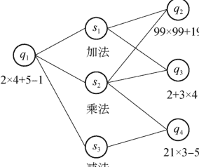

**图 6.20 题-技能关系图示例**

GIKT 核心在于如何高效提取题-技能图中的高阶关系。借鉴图神经网络（GNN）聚合邻域信息的机制，GIKT 引入图卷积网络（GCN）学习题、技能嵌入。嵌入聚合后，将题嵌入与答案嵌入拼接作为 KT 模型输入。为增强长程依赖捕获与知识状态建模，参考 SKVMN 与 EKT，GIKT 设计“历史回顾模块”按注意力筛选相关历史题目降噪；新题融合自身信息与关联技能，经“交互模块”聚合题、技能嵌入与当前隐状态交互；最终经注意力机制加权各交互预测效用，形成端到端框架（图 6.21）。

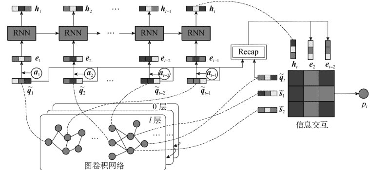

**图 6.21 GIKT 模型架构**

**核心创新：**
1.  **GCN 聚合高阶关系**：解决数据稀疏与多技能关联难题。
2.  **回顾+交互双模块**：统一建模学习者对新题及关联技能的掌握度。
3.  **三大基准验证**：大幅超越 SOTA 基线。

### 1. 嵌入表示层

GIKT 维护三个嵌入矩阵：$ E_s \in \mathbf{R}^{|S| \times d} $（技能）、$ E_q \in \mathbf{R}^{|Q| \times d} $（题目）、$ E_a \in \mathbf{R}^{2 \times d} $（答对/答错）。行向量分别记为 $ s_i, q_i, a_i $。这些嵌入**不预训练**，随端到端目标联合优化。

### 2. 嵌入传播与状态演进

利用二部图 $ G $ 缓解稀疏性。题目 1 跳邻居为关联技能，2 跳为共享技能的其他题目。GCN 通过堆叠层数编码高阶邻域，第 $ l $ 层节点 $ i $ 更新规则：

$ x_i'^l = \sigma \left( \frac{1}{|\mathcal{N}_i|} \sum_{j \in \mathcal{N}_i \cup \{i\}} w'^l x_j'^{l-1} + b'^l \right) $ （6.84）

$ \sigma $ 为 ReLU 等非线性。

**学习者状态建模：** 历史时刻 $ t $，将聚合后题嵌入 $ \bar{q}_t $ 与答案嵌入 $ a_t $ 拼接投影：

$ e_t = \text{ReLU}(W_1([\bar{q}_t, a_t]) + b_1) $ （6.85）

为捕捉题目间潜在依赖（如技能隐含关系），引入 LSTM 建模序列行为，输出粗粒度隐状态 $ h_t \in \mathbf{R}^d $（含技能掌握状态）：

$ i_t = \sigma(W_i[e_t, h_{t-1}, c_{t-1}] + b_i) $ （6.86）
$ f_t = \sigma(W_f[e_t, h_{t-1}, c_{t-1}] + b_f) $ （6.87）
$ o_t = \sigma(W_o[e_t, h_{t-1}, c_{t-1}] + b_o) $ （6.88）
$ c_t = f_t c_{t-1} + i_t \tanh(W_c[e_t, h_{t-1}] + b_c) $ （6.89）
$ h_t = o_t \tanh(c_t) $ （6.90）

### 3. 历史回顾模块：精准定位相关经验

学习者历史记录中，同技能题目常分散且主题不连贯，挑战 LSTM 长程记忆：易遗忘相关历史、易受近期无关题目干扰。人类解新题时会回忆相似旧题，GIKT 换此机制设计“历史回顾模块”挖掘特定题目能力。

提供两种筛选策略：
*   **硬选择**：仅保留与新题共享技能的历史题目。
    ```
$I_e = \{e_i \mid \mathcal{N}_{q_i} = \mathcal{N}_{q_i}, i \in [1, \cdots, t-1]\}$ (6.91)
```
*   **软选择**：注意力网络打分，取 Top-k 相关状态。
    ```
$I_e = \{e_i \mid R_{i,t} \le k, V_{i,t} \ge v, i \in [1, \cdots, t-1]\}$ (6.92)
```
    $ R_{i,t} $ 为注意力函数 $ f(q_i, q_t) $ 排序（类余弦相似度），$ V_{i,t} $ 为注意力值，$ v $ 为相似度阈值过滤噪声。

### 4. 广义交互模块：多维度掌握度融合

传统 KT 仅用 $ \langle h_t, q_t \rangle $ 预测。GIKT 扩展为四维交互：
1.  $ \langle h_t, \tilde{q}_t \rangle $：当前状态对目标题掌握度。
2.  $ \langle h_t, \tilde{s}_j \rangle $：当前状态对关联技能 $ s_j $ 掌握度。
3.  $ \langle e_i, \tilde{q}_i \rangle $：历史时刻对目标题掌握度（模拟历史作答）。
4.  $ \langle e_i, \tilde{s}_j \rangle $：历史时刻对关联技能掌握度。

引入双注意力机制加权求和预测：

```
$\alpha_{i,j} = \text{Softmax}_{i,j} (f W^T [f_i, f_j] + b)$ (6.93)
```

```
$p_t = \sum_{f_i \in \mathcal{I}_l \cup \{h_t\}} \sum_{f_j \in \mathcal{N}_{\tilde{q}_t} \cup \{\tilde{q}_t\}} \alpha_{i,j} g(f_i, f_j)$ (6.94)
```

$ p_t $ 为答对概率；$ \tilde{\mathcal{N}}_{\tilde{q}_t} $ 为聚合邻居技能嵌入；$ I_e $ 与邻居集合均定量采样。

### 5. 模型优化

最小化预测概率与真实标签的交叉熵，梯度下降更新参数：

```
$\mathcal{L} = -\sum (a_l \lg p_t + (1-a_l) \ln(1 - p_t))$ (6.95)
```

**小结：** GIKT 引入高阶题-技能图，配合“回顾”筛选历史、“交互”融合多维掌握度、“注意力”加权预测，构建端到端深度框架，显著超越基线。

## HGKT：基于分层题图的知识追踪

KT 方法分两派：**基于知识**（BKT、DKT、DKVMN、GKT）：将题目序列转知识序列，**丢失题目文本信息**；**基于题目**（EKT）：虽引入文本，但直接喂双向 LSTM，**忽略题目潜在层次图结构，引入噪声**。

挖掘题目间层次图关系，可缓解表征缺失与诊断不足，兼顾预测精度与可解释性。本书提出 **HGKT（Hierarchical Graph-based KT）**。

图 6.22 直观展示层次关系如何辅助诊断，及 HGKT 对比传统方法的优势。将题目层次关系分解为：
*   **直接支持关系**：显式先决依赖。
*   **间接支持关系**：同属“问题模式”的题目间隐性关联（相似解法）。

**关键假设：** 每题仅隶属**一个主知识**和**一个问题模式**。知识与模式为多对多映射（图 6.23）：同知识不同难度可属不同模式，跨知识题目可共享解法。

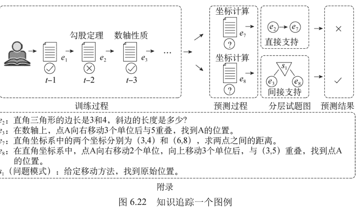

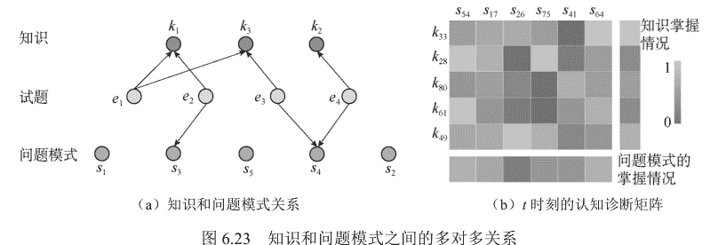

上述分析揭示引入先决关系的潜力，也带来四大挑战：
1.  **直接支持定义多样**：哪种最适配 KT 尚不明确。
2.  **模式与间接关系理解难**：需语义级理解题目，自动表示仍是难点。
3.  **多层次特征融合复杂**：不同层级特征如何有机结合待探索。
4.  **历史关键信息回溯需求**：预测时需灵活调取关键历史（如图 6.22 中预测 e7 需回溯 e2 及其关系）。

# HGKT：融合分层图与序列建模的知识追踪新范式

针对前文梳理的核心难点，本节构建了 **HGKT（Hierarchical Graph Knowledge Tracing）** 框架。该模型深度融合了分层图神经网络（GNN）与递归序列模型的优势，旨在显著提升知识追踪的精度与解释性。

## 核心创新亮点

HGKT 的设计凝练了四大关键创新：

1.  **分级试题图机制**：创性地引入“分级试题图”概念，该图谱涵盖试题间的直接与间接支持关系，作为约束引入追踪任务。我们设计了多种数据驱动的直接关系建模策略，并针对间接关系提出了语义层面的建模方案。
2.  **问题模式表征**：形式化定义了“问题模式”概念，并研发了**层次图神经网络**专门用于学习该模式的精准向量表示。
3.  **双重注意力机制**：引入序列注意与模式注意两大机制，前者聚焦学习者的关键历史状态，后者深度挖掘分层练习图（HEG）中的结构化信息。
4.  **K&S 诊断矩阵**：为实现精细化诊断，提出知识&模式（K&S）诊断矩阵（见图 6.23），可同步追踪知识点与问题模式的掌握度，有效破解传统诊断“颗粒度粗、说服力弱”的难题。

HGKT 整体架构如图 6.24 所示。

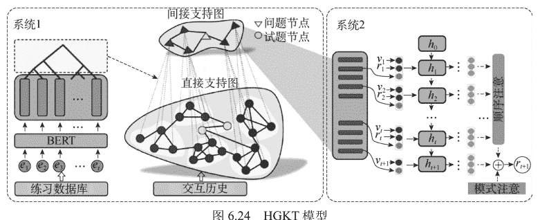

## 1. 直接支持图的构建逻辑

为将试题间的先验关联转化为可优化的约束，首先界定直接支持关系的两大核心属性。

### 核心属性定义

*   **属性一（正向支持）**：用 $Sup(e_1 \to e_2)$ 量化试题 $e_1$ 对 $e_2$ 的支持强度。$R_{e_i}$/$W_{e_i}$ 分别表示学习者对 $e_i$ 作答正确/错误。支持值越高，意味着解 $e_1$ 对解 $e_2$ 的辅助作用越强——已知解过 $e_1$，大概率能解 $e_2$；反之，已知解过 $e_2$，解对 $e_1$ 的概率也显著上升。数学表达为条件概率的不等式约束（公式 6.96）。
*   **属性二（独立无关）**：若支持值趋近于零，说明两题内容与解法无先后依赖关系，学习者在两题上的表现可视为独立事件，对应条件概率相等约束（公式 6.97）。

### 支持度量化计算

基于上述推导，通过统计练习序列中的答题共现频次来估算条件概率（引入拉普拉斯平滑 $\lambda_p=0.01$ 防止分母为零），最终将支持度定义为两个对数似然比非负部分之和：

$$Sup(e_1 \to e_2) = \max(0, \ln \frac{P(R_{e_1}|R_{e_2})}{P(R_{e_1}|R_{e_2},W_{e_2})}) + \max(0, \ln \frac{P(W_{e_2}|W_{e_1})}{P(W_{e_2}|R_{e_1},W_{e_1})})$$

### 四种构图策略

依据上述约束，本节设计了四种基于相似性规则的邻接矩阵生成方案：

1.  **知识驱动法**：稠密连接图。若两题共享知识点，邻接矩阵置 1，否则为 0。
2.  **语义相似法（BERT+Cosine）**：利用 BERT 嵌入计算余弦相似度，超参数 $\omega$ 为阈值，大于 $\omega$ 则建边。
3.  **转移概率法**：基于作答序列的转移频次 $n_{i,j}$ 构建转移概率矩阵，经 $\omega$ 阈值二值化得图。
4.  **支持度法（核心）**：直接采用贝叶斯统计推断出的 $Sup(e_i, e_j)$，配合阈值 $\omega$ 生成图结构，最贴合“支持”语义。

## 2. 问题模式的表征学习

HGKT 构建双通道 GNN 协同进化：$\text{GNN}_{excer}$ 负责更新试题嵌入，$\text{GNN}_{sche}$ 负责迭代问题模式嵌入。

流程如下：输入层以 One-hot 向量 $F$ 及直接支持图 $\mathcal{A}_e$ 初始化；前 $k$ 层由 $\text{GNN}_{excer}$ 传播试题特征；第 $k$ 层引入池化操作，将直接支持图压缩为更小的间接支持图 $\mathcal{A}_s$，并通过线性变换将试题表示聚合为问题模式表示（$\mathbf{H}_e \to \mathbf{H}_s$）；最后由 $\text{GNN}_{sche}$ 精炼模式表示，输出至序列建模阶段。

$$A_s = S_\lambda^T A_e S_\lambda, \quad l = k \qquad (6.102)$$
$$H_s^{(l+1)} = S_\lambda^T H_e^{(l)}, \quad l = k \qquad (6.103)$$
$$H_s^{(l+1)} = \text{GNN}_\text{sche}(A_s, H_s^{(l)}), \quad l > k \qquad (6.104)$$

## 3. 序列建模：融合模式与交互的动态演进

序列模块承担融合“问题模式”与“作答交互”的时序建模重任，包含传播、注意力、训练三环节。

### (1) 序列传播：LSTM 编码长程依赖

每一时刻 $t$ 的输入 $x_t$ 融合三元组：知识 One-hot $v_t$、作答结果 $r_t$、HEG 输出的问题模式 $s_t$。利用 LSTM 处理序列依赖，由 $h_t$ 与 $x_{t+1}$ 递推得 $h_{t+1}$（公式 6.105），并通过全连接层预测当前时刻各模式掌握度 $m_{t+1}^{cur}$（公式 6.106）。

$$h_{t+1}, c_{t+1} = \text{LSTM}(x_{t+1}, h_t, c_t; \theta_{t+1}) \qquad (6.105)$$
$$m_{t+1}^{\text{cur}} = \text{ReLU}(W_1 \cdot h_{t+1} + b_1) \qquad (6.106)$$

### (2) 双重注意力：聚焦典型历史与相似模式

为强化历史信息利用，HGKT 设计双注意力机制：

*   **顺序注意**：假设历史掌握状态的加权和能反映当前关注点。引入注意力窗口 $\lambda_\beta$ 双重考量：① 截断长序列降低算力；② 符合认知心理学“遗忘曲线”规律，近期记忆权重更大。计算得 $m_{t+1}^{att}$（公式 6.107）。
*   **模式注意**：引入外部记忆矩阵 $\boldsymbol{M}_{sc} \in \mathbf{R}^{k|S|}$ 存储模式原型。通过当前模式 $s_{t+1}$ 与记忆矩阵相似度匹配（Softmax），获取注意力权重 $\alpha_{t+1}$，聚焦相似模式的掌握情况，输出 $m_{t+1}^f$（公式 6.108）。训练中记忆矩阵动态更新。

**最终预测**融合三路状态：当前掌握 $m^{cur}$、历史相关 $m^{att}$、模式聚焦 $m^f$，经拼接后通过全连接层输出 $\tilde{r}_{t+1}$（公式 6.109）。

$$m_{t+1}^{\text{att}} = \sum_{i=\max(t-\lambda_\beta, 0)}^t \beta_i m_i^{\text{cur}}, \quad \beta_i = \cos(s_{t+1}, s_i) \qquad (6.107)$$

### (3) 模型训练：端到端联合优化

训练目标最小化交叉熵损失（公式 6.110），采用 Adam 优化器同步更新：两路 GNN 参数（$\text{GNN}_{excer}, \text{GNN}_{sche}$）与序列层参数（$\{W_1,b_1,W_2,b_2\}$）。

> **小结**：HGKT 实证了试题层级关系对 KT 任务的关键价值。通过分层图建模、文本语义融合与序列建模的三重协同，配合 K&S 诊断矩阵，在工业级场景中展现出超越传统 KT 方法的有效性与实用性。

#### 6.4 章节回顾

动态认知诊断是智能教育核心赛道，其理论演进让个性化学习落地成为可能。知识追踪（KT）本质是依据历史轨迹，自动追踪知识状态随时间的演变规律，以精准预测未来表现并赋能智能服务。

自 KT 引入教育领域，关注度持续攀升，衍生出大量创新模型与变体。本章依据模型分类脉络，系统综述了主流 KT 技术：
*   **概率图模型派**：涵盖贝叶斯知识追踪（BKT）与矩阵分解法，在一定程度上解决了学习过程能力测评问题……

---

# 第四篇 时空认知诊断：解码学习认知的时空演变

## 第 7 章 时空认知诊断理论

随着数据科学迭代，认知诊断模型（CDM）体系日臻成熟。CDM 核心在于：基于作答反应建模内隐认知规律，实现状态跟踪、测评与未来预测。按技术路线分，概率统计派依赖显式概率函数设计与参数估计；深度学习派则以神经网络隐层单元映射知识状态，通过反向传播拟合认知演变。

业界逐渐认清：**传统 CDM 必须与时序化 KT 模型深度融合**，从“试题-学习者-时间”三维度构建面向时空的认知诊断新理论。

### 7.1 时空认知诊断：内涵与边界

“空间无界，时间无痕”，二者是人类认知最本原的主题。教育测量本质上是对特定时空下学习效果的量化探求，时空属性对测量理论影响深远。

大数据时代，全流程学习过程数据采集成为常态，时空特性研究升温：
*   **空间维度**：广义指物理/网络空间支撑；狭义指认知内部空间（能力、知识、技能）。新一代认知诊断理论将测验焦点从“分数”转向“认知状态”，深化了空间内涵。
*   **时间维度**：学习是动态流变的。不同时点（如一年级 vs 五年级），同一概念（如“圆”）的认知水平截然不同。

**定义**：时空认知诊断面向学习全过程，基于历史积累的时空数据，运用认知诊断技术挖掘隐含学习规律，实现**当前认知状态的精准诊断**与**未来发展趋势的精确预测**，服务于“学得个性化、教得精准化”。

### 7.2 时空认知理论：多维建模视角

本节融合知识空间理论、教育测量理论、教育目标分类学及认知加工规律，重点对学习者在时空维度的知识构建与认知发展规律进行形式化建模。

#### 7.2.1 知识空间及其扩展

Doignon 与 Falmagne 提出的 **知识空间理论（KST）** 为知识结构表征与状态测试提供了严格数学框架。核心在于：知识状态由“能解出的试题集合”表征；知识属性按多粒度分化，依前驱后继关系组织。

KST 核心概念簇：知识空间、知识状态、知识结构、试题前提/蕴含关系。

**形式化定义**：

*   **定义 7.1（知识空间）**：知识域 $Q$ 为试题有限集。$K$ 由 $Q$ 的子集组成。$K$ 为知识空间 $\iff$ (1) $\emptyset, Q \in K$；(2) $\forall K_1, K_2 \in K, K_1 \cup K_2 \in K$。（闭包性保证状态组合合理性）
*   **定义 7.2（知识状态）**：$K \in K$ 为知识状态 $\iff K = \{q_i | q_i, q_j \in Q, q_i \le q_j \land q_j \in K\}$。其中 $\le$ 为前提或猜测关系。即：不违背试题前提约束的试题集合，即为合法知识状态。
*   **定义 7.3（知识结构）**：$(Q, K)$ 称知识结构。$Q$ 非空，$K$ 至少含 $Q, \emptyset$。若 $Q$ 有限，则结构有限。

### 知识空间进化论：从静态结构到时空认知的三维重构

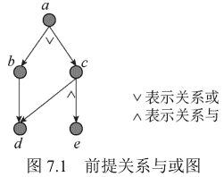

#### 核心概念：前提关系与知识状态的“合法性”检验

在知识空间理论（KST）的框架内，试题间并非孤立存在，而是通过**前提关系**紧密扣合。给定知识结构 $(Q, \mathcal{K})$，若试题 $r$ 是试题 $q$ 的前提，意味着掌握 $q$ 的知识状态集合必然包含于掌握 $r$ 的集合之中（即 $K_r \supseteq K_q$），记作 $r \leqslant q$。

以含五道试题 $\{a,b,c,d,e\}$ 的知识域为例，前提链条如下：
*   攻克 $a$，必能解出 $b$ 或 $c$ 中至少一题（$b \vee c \leqslant a$）；
*   解出 $b$，必能解出 $d$（$d \leqslant b$）；
*   解出 $c$，必能同时解出 $d$ 与 $e$（$d \leqslant c, e \leqslant c$）。

这种层级依赖可视化为“与或图”。据此推导，知识域 $Q$ 所有**合法的知识状态**（连同空集与全集）构成知识空间 $K$。例如，集合 $\{a,b\}$ 因包含 $b$ 却缺失其前提 $d$ 而非法；$\{a,c\}$ 因含 $c$ 却无 $d,e$ 同样违规。只有遵循前提闭包的子集，才是学习者真实知识状态的候选者。

#### 进阶视角：技能映射与扩展知识空间

传统 KST 关注“会不会”，扩展知识空间理论（EKST）进一步追问“凭什么会”。它引入三元组 $(Q, S, \tau)$：$Q$ 为试题集，$S$ 为技能集，$\tau: Q \to 2^S \setminus \varnothing$ 映射每道题所需的技能组合。

这套机制包含四大核心映射：
1.  **技能函数 $s$**：题 $\to$ 技能子集集合。一题对应多子集，意味着多种解题策略并存。
2.  **试题函数 $p$**：技能子集 $\to$ 题集。由此确立知识结构，技能子集即可能的知识状态。
3.  **学习前提函数 $r(l)$**：学前必备技能画像。
4.  **学习结果函数 $t(l)$**：学后达成技能画像。

技能函数与试题函数互为表里，给定其一，另一即定。通过实例可直观见证二者如何联动，将“试题维度”与“技能维度”无缝对接。

---

### 7.2.2 时空认知模型：双层建模看透学习本质

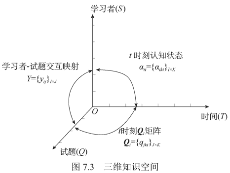

主流认知诊断模型多依赖单次测试做静态切片，忽视了知识状态随时间的流变。时空认知模型旨在打破这一局限：以“为学习而测评”为旨归，从学习者与试题在时空维度的**外在交互特征**入手，反推**内在认知加工模型**，挖掘认知规律，定位潜在高阶能力。

其框架呈双层互动结构：
*   **外在特征层（可观测）**：测评过程中的直接行为数据（作答对错、耗时、点击轨迹等）。
*   **认知规律层（不可观测）**：速度、学习、遗忘等内部心理机制。

二者互为因果：外在行为由内在认知驱动，内在认知又通过外在行为显现。模型最终基于认知规律建模，预测未来表现，实现隐性能力的显性化度量。

#### 1. 从现象到本质：动态追踪知识演变

现有知识追踪模型虽能挖掘长周列知识状态演变，但往往忽略**速度、学习、遗忘**三大内部认知因子的持续干扰。
*   **反应速度**折射知识熟练度，是认知心理变化的关键指标。
*   **遗忘**导致记忆随时间衰减，**学习**则通过复现强化记忆。
认知诊断必须融合时序知识、交互行为特征，同时接入上述三大认知规律，全方位监测技能发展轨迹，提升模型在教育场景的可解释性。

#### 2. 从局部到整体：三大认知规律汇聚综合能力

三大规律分别从不同切面施加影响，最终汇聚为学习者的**潜在综合能力**：
*   **速度**：Salthouse 加工速度理论视其为记忆、推理等认知功能变化的中介。
*   **学习**：学习曲线描述重复操作中熟练度提升、能力增强的过程。
*   **遗忘**：艾宾浩斯遗忘曲线量化记忆随时间自然衰退的规律。

速度、学习、遗忘构成“局部认知拼图”，而知识掌握与未来预测依赖于“整体综合能力”的判读。认知诊断正经历范式转移：从关注外在多维特征，转向本质建模内部认知规律；从局部规律拼凑，进阶为整体能力诊断。通过认知结构、认知发展、综合能力三维描述，方能精准预测反应、评估隐性技能。

#### 记忆的博弈：学习与遗忘的动态平衡

学习者凭借先验记忆应答当下。心理学定义记忆为“识记、保持、再认”，而遗忘与学习是记忆的两大调节器：遗忘是“曾识记今无法回忆/再认”的常态；学习则是通过“回忆与再认”强化旧痕（Schunk 视其为信息的心理加工全流程）。管理学的 Wright 学习曲线、教育学的重复巩固机制，均印证了二者在知识内化中的拉锯博弈。

---

#### 1. 三维知识空间理论：引入时间轴的立体画像

针对传统 KST 忽视时序数据的短板，本节构建**三维知识空间**（Q, S, T）：
*   **试题维度 (Q, K)**：非空试题集 $Q$ 及其可能正确作答子集集合 $K$。
*   **学习者维度 (S, G)**：应掌握试题集 $S$ 及其子集集合 $G$。
*   **时间维度 (T)**：融合多时刻连续测评数据，敏感捕捉不同时间间隔对技能的差异化影响。

该理论立体揭示了“学习者-试题-时间”三体交互关系，为技能诊断奠基。


**四大映射函数：动态捕捉技能变迁**
1.  **测评映射 $\tau(Q,S,T)$**：`test = τ(q,s,t)`，记录学习者在时间轴上与试题的每一次交互，映射技能结构的动态流变。
2.  **试题映射函数 (时序扩展知识空间)**：$Q_t$ 矩阵，定义 $t$ 时刻试题集 $K$ 与技能集 $G$ 的关联。
3.  **学习者-试题映射函数**：作答数据矩阵 $Y = \{y_{ij}\}_{I\times J}$。
4.  **学习者-技能映射函数**：学习者 $i$ 在 $t$ 时刻的技能状态向量 $\alpha_{it} = \{\alpha_{kti}\}_{I\times K}$。

---

#### 可观测变量拆解：项目属性与交互特征

认知诊断的可观测变量分属**学习者属性**与**项目属性**两大阵营。

##### 项目属性：知识表征的四种进化路径

核心在于如何表征“题-知”关联。当前主流呈现四阶演进：
1.  **Q 矩阵（邻接矩阵）**：认知诊断标配。$1/0$ 编码题-知关联，天然支持一题多知，信息零损耗。
2.  **知识点替代项目（DKT 路径）**：强行一题一知（取首个关联知点），为深度学习压缩变量，但丢失多知点信息。
3.  **记忆网络建模（DKVMN 路径）**：引入键-值记忆网络承载题的知识特征，弥补 DKT 单知点缺陷，增强可解释性。
4.  **图表示建模（GKT 等路径）**：借鉴 Q 矩阵全量关联思想，构建“题-知图”，实现精准对齐与状态推荐，进一步挽回信息损耗。

##### 交互特征：行为数据里的心理密码

作答对错（反应变量）是所有测量理论的基石。此外，**行为特征**提供侧写视角：
*   **反应时**：耗时长可能超能力范围（难），耗时极短疑似猜测或敷衍。
*   **在线环境细粒度行为**：停留时长、鼠标轨迹、点提示（求助信号）、反复查看（认知负荷超载）、选项间徘徊（决策犹豫）。
*   **线下环境行为**：书写笔迹、涂改痕迹。
*   **长时程重复作答**：重复次数越多，记忆痕迹越深，技能理解越透彻，对掌握状态呈正向促进。

---

#### 3. 学习者内在认知规律：速度、记忆与高阶能力

##### 空间维度：反应速度背后的加工效率

**反应时（RT）** 是认知心理学量化心理加工的天然数据（Luce 奠基）。加工速度理论视速度为心理结构核心，能反映内部机制变化。在测评中，RT 不仅折射能力水平，更能识别猜测、失误、撒谎等异常作答，提升诊断精度与自适应选题质量。

##### 时间维度：遗忘曲线与学习曲线的拉锯战

记忆随时间在**遗忘**（艾宾浩斯曲线：记忆随时间指数衰减）与**学习**（Schunk 认知加工全链路；Wright 学习曲线：重复提升效率）的双重作用下波动。重复学习固化记忆、对抗遗忘；长期依赖的知识关联与内化机制，仍待深度挖掘。

##### 高阶综合能力：超越分数的认知画像

传统测评仅给结果性能力值（$c$），描述学业水平却遮蔽过程问题。认知诊断需聚焦**认知过程本身**，从过程中提取反馈、实施干预。唯有穿透现象看本质，才能真正评估学习者的隐性知识与技能掌握程度。

# 基于认知规律的诊断模型：追踪知识状态演变

前文分析表明，遵循学习者认知规律构建的诊断模型，能够有效追踪其认知过程中知识状态的动态变迁。在融合多维特征的认知诊断模型框架下，学习者的认知模式——诸如作答速度、遗忘倾向与学习效应——可在一定程度上折射出其潜在能力水平。

具体而言，在速度维度上，若学习者 S1 能在保证作答精度的前提下快速完成任务，而学习者 S2 虽精度达标但耗时较长，则 S1 的潜在能力更强。在遗忘维度，若学习者掌握某技能后久经时日仍能保持高精度作答，说明其综合潜能更优。在学习维度，通过反复练习激活回忆与再认机制，能够强化学习者的记忆保持力。

## 7.2.3 多维特征的量化表征

经典认知诊断模型通过选取不同特征变量对认知状态建模。依据学习者自我调节框架，通常从认知测量（成绩、策略运用、目标达成）、情感测量（动机、焦虑、满意度、主观感知）与行为测量（用时、点击、求助）三维编码。Jimerson 等学者则将学习者模型核心要素归纳为学习行为、学习情感、学习认知三方面。国内研究更进一步，结合知识图谱、认知计算等技术，从知识、认知、情感、交互四维建模；多模态建模则常划分为认知、行为、情感、交互等维度。

鉴于诊断过程中情感数据采集困难，本研究聚焦知识、交互、行为三大特征。同时，考虑到学习过程的动态性，模型需纳入历史时间序列信息（即时序特征）。综上，将诊断特征划分为**知识、交互、时序**三大维度剖析。

### 1. 知识特征

知识特征描述试题与知识点的关联，常用 Q 矩阵或直接以知识点替代表征。设知识点集合 $K = \{k_1, k_2, ..., k_n\}$，Q 矩阵定义如下：

$$Q=\begin{bmatrix} 1 & 0 & 0 \\ 0 & 1 & 0 \\ 1 & 0 & 0 \\ 0 & 0 & 1 \\ 1 & 0 & 0 \\ 0 & 0 & 1 \\ 1 & 0 & 0 \\ 0 & 1 & 0 \end{bmatrix} \tag{7.1}$$

矩阵中 1 表示关联，0 表示无关联。Q 矩阵可直接输入 DINA 等模型，支持一题多知（一行多个 1）或一题一知（一行单个 1）。在 DKT 类知识追踪模型中，通常默认题目与知识点一一对应，无需额外编码。

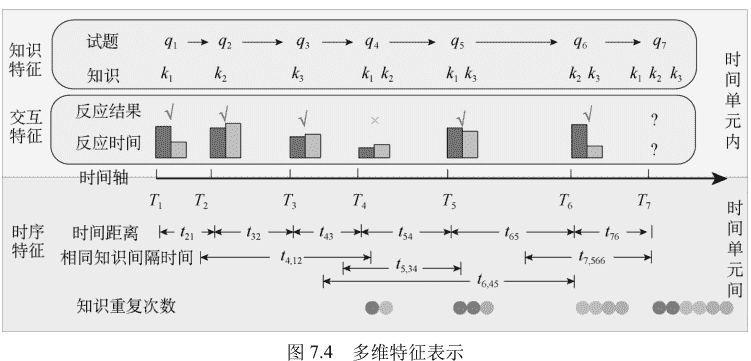

### 2. 外在交互特征

交互特征记为 $I$，由作答结果 $R$ 与反应时间 $T$ 构成，即 $I \in \{R, T\}$。
- **作答结果** $R = \{r_{ij}\}$，$r_{ij} \in \{0,1\}$ 表示学习者 $i$ 在题目 $j$ 上的得分（1 为对，0 为错）。
- **反应时间** $T = \{t_{ij}\}$ 表示学习者 $i$ 作答题目 $j$ 的耗时。

不同建模范式对作答结果的表征略有差异：
- **概率统计类模型**：常用矩阵/向量形式。例如学习者 S1 的反应向量 $R_{s1}=[1\ 0\ 1\ 0\ 1\ 0\ 1\ 0]$。
- **深度学习类模型 (如 DKT)**：输入需统一格式，常将题目与反应拼接为向量：
$$(e_i, r_i) = \begin{cases} [e_i, 0], & r_i = 1 \\ [0, e_i], & r_i = 0 \end{cases} \tag{7.3}$$
即答对时题目向量在前，答错时在后，便于模型输入。

### 3. 时序特征

时序特征记为 $P$，包含序列间隔 $\Delta s_i$ 与重复间隔 $\Delta r_t$，即 $P \in \{\Delta s_i, \Delta r_t\}$。认知诊断中测评时间间隔通常不等距，故这两特征至关重要。

- **序列时间间隔 $\Delta s_i$**：指当前评估与上一次评估的时间差。间隔越短，受潜在关联影响越大，表现通常越好。例如涉及同一知识 $k_2$ 时，题目 $q_2$ 的间隔 $t_{21}$ 短于 $q_6$ 的 $t_{65}$，故 $q_2$ 作答正确概率更高（公式 7.4）。
- **重复时间间隔 $\Delta r_t$**：指当前与历史上最近一次涉及**同一知识点**评估的间隔。间隔越短，记忆提取越容易。如图 7.4 所示，$q_5$ 对 $k_1, k_3$ 的重复间隔短于 $q_4$ 对 $k_1, k_2$ 的间隔，故 $q_5$ 正确率预期更高（公式 7.5）。

## 7.3 时空认知诊断模型

本章基于时空认知理论，构建面向学习轨迹的时空认知诊断模型。通过建模学习者在时空维度的外在交互特征，挖掘内在认知规律与状态，进而预测未来表现。

### 7.3.1 问题定义

认知诊断旨在通过可观测特征推断隐性认知状态。时空认知诊断模型则利用题目知识特征、交互反应特征，结合行为与时序依赖，追踪知识记忆演变，实现多维特征统一表征，并依认知加工理论（遗忘、学习等）完成从外在特征到认知规律的函数映射，最终推测综合能力与未来作答概率。框架见图 7.5。

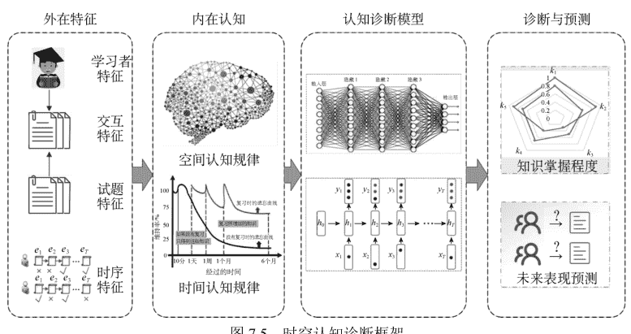

**形式化定义**：设学习者交互产生多维外在特征序列 $\boldsymbol{EF} = \{EF_1, ..., EF_n\}$，其表现遵循认知规律 $\boldsymbol{CL}$。需构建映射 $\boldsymbol{CL}_{\theta}(\boldsymbol{EF})$。模型双重目标：① 基于认知规律预测未来作答正确率；② 推断各知识技能的潜在掌握状态。目标函数（项目反应函数 IRF）为：

$$P(r_{ij}=1|\boldsymbol{a}_i) = \boldsymbol{\varphi}_{\alpha_i}(\boldsymbol{CL}_{\theta}(\boldsymbol{EF})) \tag{7.6}$$

其中：$\boldsymbol{\varphi}_{\alpha_i}$ 为基于认知规律的知识状态 IRF；$\boldsymbol{CL}_{\theta}(\cdot)$ 为认知规律映射函数，$\theta$ 涵盖速度、学习、遗忘、综合能力等；$r_{ij}$ 为反应；$\boldsymbol{a}_i$ 为潜在掌握状态（值越大，正确率越高）。通过预测与真实反应对比训练参数，最终依未来表现反推知识状态。

针对不同认知特征，映射函数各异：
- **速度建模**：$CL_{\theta=s} = \Psi(K, I)$，利用知识关联 $K$ 与交互特征 $I$（含反应时间）推断速度影响（公式 7.7）。
- **记忆建模 (学习/遗忘)**：$CL_{\theta=m} = \Psi(r_{\cdot j}, B, P)$，依赖作答结果 $r$、行为特征 $B$ 与时序间隔 $P$（公式 7.8）。
- **综合能力建模**：$CL_{\theta=c} = \Psi(CL_{\theta=s}, CL_{\theta=m}, CL_{\theta=e})$，整合速度、记忆及其他认知规律 $e$ 表征潜在综合能力 $c$（公式 7.9）。

故诊断目标亦可写为：$P(r_{ij} = 1 | \alpha_i) = \varphi_{\alpha_i}(CL_{\theta=c}(EF))$（公式 7.10），其中 $EF \in \{K, I, B, P\}$，$CL \in \{s, l, f, e, c\}$。主要符号对照见表 7.1。

### 7.3.2 模型整体架构

学习者按时间序列作答，每次交互占据唯一时间戳，形成离散的“时空单元”，串联成时间序列。模型包含三大核心模块（见图 7.6）：

1.  **空间编码器**：编码历史学习轨迹，输出各历史时空单元的潜在知识状态。
2.  **时间序列解码器**：模拟未来作答时对历史知识的检索过程，捕捉时序关联与时序因素影响。
3.  **未来表现预测器**：基于预测知识状态，输出未来作答表现（含正确率、速度、耗时等）。

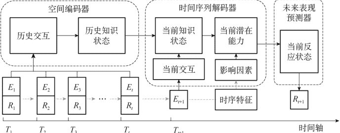

#### (1) 空间编码器
研究证实先验知识是预测未来表现的最强指标。空间编码器将历史轨迹 $X_h$ 编码为历史知识状态 $K_h$：
$$K_h = \text{Encoder}(X_h) \tag{7.11}$$
输入为历史交互三元组，输出各时刻潜在状态。**单向性**：每个时刻仅可见前序信息。

#### (2) 时间序列解码器
认知心理学视角下，新题作答是对过往学习成果的检验/检索。解码器捕捉时空单元间潜在关联，模拟检索过程：
$$K_f = \text{Decoder}(T_{t+1}, E_{t+1}; K_h) \tag{7.12}$$
其中 $E_{t+1}$ 为未来题目，$K_f$ 为未来知识状态。解码器从历史状态中检索相关知识，融合时序因素影响，**同样保持单向性**，不泄露未来信息。

#### (3) 未来表现预测器
作答表现是内在知识状态经题目投射的外化。预测器依预测知识状态 $K_r$ 输出表现 $R_{r+1}$：
$$R_{r+1} = \text{Predictor}(K_r) \tag{7.13}$$
表现维度包含反应结果（对/错）、反应速度、反应时长等。

## 7.3.3 空间编码器深度解析

现有研究多聚焦空间编码器且成果丰硕。其核心任务：编码历史轨迹，从交互中提取作答时刻的知识状态。关键在于**空间交互表示**与**知识状态编码**。

### 1. 空间交互表示

交互 = 静态题目表征 + 动态作答反应。包含三层：题目表征、反应表征、交互融合表征（见表 7.2 对比主流模型）。

| 模型 | 题目表征 | 反应表征 | 交互融合 |
| :--- | :--- | :--- | :--- |
| **DKT** | One-hot | 规则拼接 | 规则拼接 |
| **DKVMN** | Embedding | — | 联合 Embedding |
| **SAKT** | Embedding | — | 联合 Embedding |
| **AKT** | Embedding | — | 联合 Embedding |
| **EKT** | Embedding | 规则拼接 | 规则拼接 |
| **LPKT** | Embedding | 规则/Embedding | 级联 |
| **FKT** | Embedding | Embedding | 对位相加 |

**(1) 题目表征**：
- *One-hot*：早期 DKT 采用，维度高稀疏。
- *Embedding*：主流方案。随机初始化或利用先验知识（如 EKT 用内容 Embedding，ERAKT 融合公式、文本、知识点多模态信息）获得稠密向量。

**(2) 反应表征**：
- *规则法*：人工定义。如 LPKT 用全 0 向量表错、全 1 表对；DKT 用 0 向量前后位置区分对错。
- *Embedding 法*：将对/错随机映射为稠密向量。
- **关键提示**：反应不仅是对错，**反应时长、速度、尝试次数**等过程性数据同等重要，通常也采用 Embedding 表征。

### 核心解析：知识追踪模型如何“读懂”学习行为？

#### 一、 交互表征：把“做对做错”翻译给机器听

知识追踪的第一步，是将学生的作答行为转化为模型能计算的向量。主流方案主要分四类：

1.  **基于规则的拼接法**（DKT、EKT）：DKT 用 One-hot 向量拼零向量，零向量在前代表答错，在后代表答对；EKT 同理，只是把 One-hot 换成了 Embedding。
2.  **联合嵌入法**（DKVMN、SAKT、AKT）：直接为“答对的题”和“答错的题”分配两套独立 Embedding，表征量翻倍，区分度更高。
3.  **级联融合法**（LPKT）：用全 1 向量（对）或全 0 向量（错）与题目 Embedding 拼接，简单粗暴保留完整信息。
4.  **对位相加法**（FKT，我们最新提出）：让反应 Embedding 与题目 Embedding 对位相加，实现细粒度交互建模。

---

#### 二、 知识状态编码：四大流派争锋，谁能更懂“学情”？

编码器的任务是从显性行为中挖掘隐性知识状态。按核心架构可分四大阵营（见下表对应关系）：

| 流派 | 代表模型 | 核心逻辑与演进 |
| :--- | :--- | :--- |
| **RNN系** | DKT、DKT+forget、LPKT | **开山鼻祖**。DKT 首用 RNN/LSTM/GRU 递归传递历史信息；DKT+forget 引入遗忘因子（间隔、次数）拼接编码；LPKT 创新“学习门/遗忘门”动态模拟知识增益与衰减。 |
| **记忆网络系** | DKVMN、SKVMN、CF-DKD | **引入外部存储**。DKVMN 用 Key-Value 矩阵全局共享知识状态，每行对应一知识点；SKVMN 加 Hop-LSTM 强化长程依赖；CF-DKD 融合认知特征更新矩阵。 |
| **注意力系** | SAKT、AKT、FKT | **Transformer 时代**。SAKT 用 Encoder 替代 RNN，并行捕捉长距离依赖；AKT 启用完整 Transformer 结构；FKT 沿用注意力编码，兼顾速度与效果。 |
| **图神经网络系** | GKT、SKT | **显式建模知识关联**。GKT 将题目拆解为知识点图，邻居节点协同更新；SKT 进一步区分有向/无向关系，用同步/部分传播机制精细化更新，可解释性最强。 |

---

#### 三、 时间序列解码器：从“历史”检索到“未来”模拟

解码器负责从历史状态中提取相关知识，模拟下一次作答。关键看两步：

**1. 作答知识怎么检索？（三种范式）**

*   **向量→向量**（DKT系）：线性递归，天然符合“近因效应”，只看最近一步隐状态。
*   **矩阵→向量**（DKVMN系）：全局共享一张记忆矩阵，用注意力机制按题目查询加权求和。
*   **矩阵→向量（全历史）**（AKT/FKT系）：历史状态堆叠成矩阵，**检索范围扩展至全时刻**，用 Key-Value Attention 精准提取，突破线性瓶颈。*注：早期 SAKT 虽用矩阵但仍只取最后一行。*

**2. 未来作答怎么表示？（四种交互手段）**

| 方式 | 代表 | 特点 |
| :--- | :--- | :--- |
| **点乘** | DKT | 经典内积，维度对齐，计算最轻量。 |
| **级联** | LPKT, AKT | 拼接保留全信息，最稳妥，AKT 甚至“注意力+级联”双保险。 |
| **因子分解机 (FM)** | DKT+forget | 推荐系常用，挖掘二阶交叉特征，效果媲美点乘/级联。 |
| **注意力机制** | DKVMN, AKT, FKT | **检索与预测合二为一**：Query 即题目，Value 即历史，输出即交互后的知识向量。FKT 纯注意力路线。 |

**3. 时序因素怎么建模？（遗忘与学习双线并行）**

*   **遗忘规律**：
    *   RNN/记忆网络系（DKT+forget, CF-DKD, LPKT）：时间间隔 Embedding 后**拼接**进状态，靠层层传递模拟长程遗忘。
    *   Attention 系（AKT, FKT）：时间间隔直接融入 **Attention 权重计算**，一次性看全局，无需 Embedding，建模更高效。
*   **学习规律**：
    *   DKT+forget/CF-DKD：练习次数拼接状态。
    *   EKPT：双曲线模拟练习曲线。
    *   LPKT：引入“学习增益”机制，每次作答强制正向更新。
    *   **FKT 创新**：融合上次间隔时间，设计**熟练度函数**动态修正知识状态，兼顾遗忘与学习双重动力学。

---

#### 四、 未来表现预测器：从“猜对错”到“画像全过程”

**1. 预测目标：单维 → 多维**
*   **单目标（主流）**：仅预测 **答对概率**（DKT 至 LPKT 均沿用 Sigmoid/MLP 输出）。
*   **多目标（FKT 突破）**：预测 **「答对率 + 反应速度」**。认知过程非瞬时，快慢也是能力体现，FKT 首次将响应速度纳入监督信号。

**2. 预测方法：MLP 兜底，特例优化**
*   绝大多数用 **多层感知机 (MLP)**：全连接堆叠 + ReLU + 末层 Sigmoid/Softmax。
*   **DKT 简化版**：One-hot 点乘后矩阵稀疏（仅一非零），直接求和过 Sigmoid，无需隐层。
*   **DKT+forget 尝鲜**：引入 FM 层输出单值，同样仅需一层 Sigmoid。

---

#### 五、 章末小结：时空认知诊断，重塑自适应学习内核

本章构建了 **“时空认知诊断理论”** 与 **通用模型框架**：

1.  **理论基石**：融合经典/现代/新一代测量理论 + 教育目标分类 + 认知加工规律，建模时空维度下的知识建构与认知发展。
2.  **模型三剑客**：
    *   **空间编码器**：编码学习轨迹 → 潜在知识状态；
    *   **时间序列解码器**：模拟检索历史 → 预演未来作答；
    *   **未来表现预测器**：映射隐向量 → 可观测多维表现。
3.  **核心价值**：用可观测的“时空外在特征”（题目+交互），反推符合认知规律的“内在状态”，实现**精准诊断 + 未来预测**，为个性化学习与精准教学提供算法支撑。

---

### 第 8 章：聚焦“题目表征”，破解时序认知诊断新难题

疫情加速了在线自适应学习爆发，**知识追踪（KT）即时序认知诊断**，已成自适应引擎核心。它能从历史轨迹自动追踪知识水平演变，精准预测未来表现。

本章将**以“试题要素”为核心切入点**，深度融合试题表征，探索新一代时序认知诊断方法。让教师凭借预测结果动态调整教案，真正落地**“精准教学”**，提质增效。

# 重塑时序认知诊断：超越 BKT 的多维融合模型 ERAKT

早期主流的贝叶斯知识追踪（BKT）[169]预设考生掌握概念后永久保持，这与真实教学中遗忘普遍存在的规律相悖。伴随深度学习技术演进，神经网络逐渐引入时序建模任务，深度知识追踪（DKT）成为代表性工作。DKT 克服了 BKT 忽视遗忘的缺陷，更贴切地描绘考生技能水平。然而，DKT 仅依赖单层隐层刻画技能，精度有限。Zhang 等人据此构建记忆增强网络 DKVMN，显著提升了预测质量。近期，中科大团队拓展现有框架，主张同步纳入作答日志与题目内容，研发出 EKT、qDKT[170] 等模型，在可读性与预测力上均有突破。

不过，现有主流诊断范式多局限于作答顺序，用概念标签替代具体试题，未充分利用题目中的公式、语料及标签对认知状态的驱动作用。我们主张，除交互序列外，试题的多维度属性均深度干预考生发挥。为破解此困境，本章设计融合试题表征的时序诊断模型，补齐因忽略多维表征与联系造成的信息缺口，大幅增强预测能力。主要创新三方面：

- **ERAKT 架构**（context-aware knowledge tracing integrated with exercise representation and association）：整合作答历史、题干语料与概念标签，自动推演考生下一题答题情况及概念掌握水平；
- **多维试题表征技术**：将题干文字、数学符号与概念标签深度整合；
- **双向网络驱动的序列关联挖掘**：发掘试题间深层潜在联系。

#### 8.1 国内外相关研究

##### 8.1.1 语义向量化技术演进

语料处理的初始步骤是将其编码为机器可计算的向量，即嵌入表达。技术路线从早期词袋跨越至深度网络，标志性成果包括 Word2Vec、TextCNN、FastText 与 BERT 等。

**Word2Vec**[171] 源自 Google Mikolov 小组，开启了神经网络用于语义编码的先河，用定长向量标记词汇。为适配句级任务，演进出 **Doc2Vec**[172]：在训练中引入段落向量与词向量共同优化，从而输出文档向量。这两个模型均为无监督深度表征器，较词袋法能更全面保留上下文、语义及顺序信息。

Kim[173] 受视觉领域 CNN 成功激发，于 2014 年调整输入层推出 **TextCNN**。该模型利用循环结构捕捉上下文，辅以最大池化提炼关键成分。精简架构减少参数与算力，加速训练，且表现出色。

**FastText**[174] 也是分类任务常用模型。它对全文词汇与 n-gram 向量求均值得到文档向量，再接 Softmax 分类。无需预训练词向量即可自学习，兼顾精度与训练推理效率。

**BERT**[175] 由 Google 研发，专攻一词多义难题。它引入含 Self-Attention 与 Multi-Head Attention 的 Transformer 编码器，借助上下文动态定义词义。Self-Attention 使各词融合全序列加权信息；Multi-Head 则在多子空间并行捕捉语义。BERT 天生双向且利于迁移学习，实现高精度语义建模。

上述 NLP 语义编码技术，为认知诊断中精准表达题目文本等内部信息奠定了坚实技术基础。

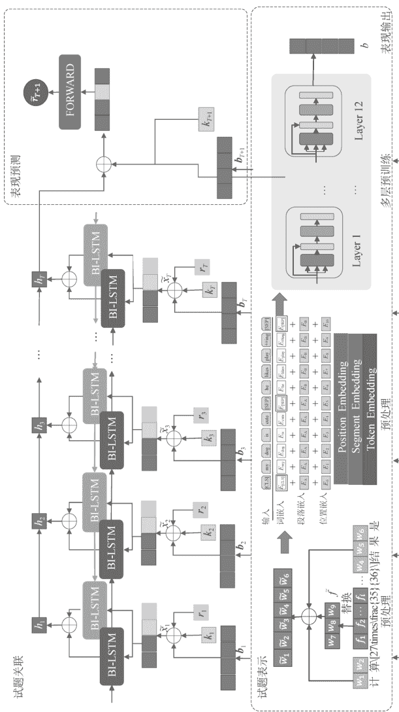

##### 8.1.2 融合「题面」与「知识点」的诊断新范式

深度学习演进推动学界关注试题自身属性对时序诊断的作用。试题多维属性核心包含文本素材与关联知识概念。

**概念锚定路线**：主流做法将概念等同于试题，忽略试题个性。DKT 与 DKVMN 仅建模概念，同概念试题视为同质；DKVMN 虽引入 Key-Value 矩阵拓展隐含特征，实质仍锚定概念。**PDKT** 借助 Q 矩阵融合概念结构，显性建模先后置关系。**SAKT** 以试题为概念，引入 Self-Attention 量化概念联系。**AKT** 设计单调注意力，融合题目相似度、指数衰减与上下文相对距离计算权重；辅以 Rasch 模型正则化概念与试题嵌入，低参数量下捕捉同概念试题差异。**GKT** 以概念为节点构图，配合 GRU 迭代认知状态。

**素材驱动路线**：聚焦文本与概念双轨融合。**EERN**[176] 结合练习日志与题目文本预测表现。**EKT** 源自 EERN，首创三元融合（练习日志、概念标签、题目文本）建模表现，假设认知状态随时间演变并受文本与概念双重驱动。但 EKT 用 LSTM 编码文本，受限于 RNN 串行机制，并行度低、耗时久、效果一般。**qDKT** 建模考生单题随时间成功率，仅需题目素材与作答序列，用 FastText 编码文本，配合图拉普拉斯正则计算题目相似度。**EHFKT**[177] 采用概念、难度、语义三层表征，前两者用 TextCNN，语义层用 BERT。**HGKT** 引入层级图网络学习题目图结构，双 Attention 挖掘认知状态，配合 K&S 矩阵输出诊断。

总之，**融合题目语义已成诊断模型演进主流**。本章拟采用前沿 NLP 技术表征题目语义，助推时序认知诊断性能跃升。

#### 8.2 ERAKT：习题表征与关联的集成架构

时序认知诊断旨在通过观测考生在各题上的交互序列追踪掌握状态，属有监督序列预测任务。本节先给出问题定义与 **ERAKT** 框架，再逐层剖析核心模组。

##### 8.2.1 问题定义与建模目标

设定单考生独立作答场景。定义考生集 $S$ 与试题集 $E$。考生序列 $S=\{s_1,\cdots,s_{|S|}\}$，单序列 $s=\{(e_1,r_1),\cdots,(e_t,r_t)\}$，$e_t\in E$ 为 $t$ 时刻作答题目，$r_t\in\{0,1\}$ 标识正误。因数据集为数学题，含文字与符号，故文本拆解为 $e=\{w,f\}$：$w$ 为文字,$f$ 为符号。各题关联技能 $k=\{k_1,\cdots,k_M\}$，汇总嵌入后序列升维为 $s=\{(e_1,k_1,r_1),\cdots,(e_t,k_t,r_t)\}$。模型终极目标：预测 $t+1$ 时刻考生对题目 $e_{t+1}$ 的响应 $r_{t+1}$，即掌握水平。

整合作答日志、题目文本、技能标签三元信息，本章构建新模型实现认知状态动态更新与预测（见图 8.1），架构含**题目表征**、**题目关联**、**表现预测**三大支柱。

##### 8.2.2 习题多维表征的构建流程

题目信息含材料本体与关联技能。统一数学题表征，先分维建模（材料侧+技能侧），再融合输出统一特征向量。

###### 1. 公式文本规范化预处理

数学题混杂文字与 LaTeX 公式，需先把公式转为文本。利用 LaTeX 统一编码规范，先替换规范化，再与普通文本联合预处理。

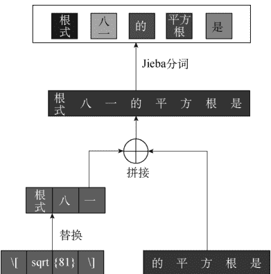

预处理按“实体优先、属性在后”顺序识别替换，用字典存映射，将公式序列 $f=\{f_1,\cdots,f_M\}$ 规范化为 $\tilde{f}=\{\tilde{f}_1,\cdots,\tilde{f}_M\}$。映射表见表 8.1。

| 原符号 $f$ | 替换文本 $\tilde{f}$ |
| :--- | :--- |
| complement | 补集 |
| sqrt | 根式 |
| ^ | 幂 |
| + | 加号 |
| cm | 厘米 |
| pi | 圆周率 |
| lg | 对数 |
| cdot | 点乘 |

替换后，按原位拼接（$\oplus$）文字 $w$ 与规范化公式 $\tilde{f}$，得题目文本表征 $\tilde{w}$：

$\tilde{w} = w \oplus \tilde{f}$ (8.1)

对 $\tilde{w}$ 用 Python Jieba 精确模式分词，再以自建停词表过滤无实义词元。

```
\( b_T = e_{Token} + e_{Segment} + e_{Position} \tag{8.2} \)
```

图 8.2 为题目公式预处理示意。

###### 2. 基于 BERT 的习题语义向量化

借鉴 BERT 在 NLP 的地位，我们引入 BERT 对题目文本特征做自监督预训练。架构含三层 Embedding 叠 12 层 Encoder（见图 8.1）：Token Embedding 映射分词为 768 维向量；Segment Embedding 区分双句；Position Embedding 编码词序。三层嵌入逐元素相加入 Encoder，最终输出文本语义向量 $b_T$。

```
\( x_T = b_T \oplus c_T \tag{8.3} \)
```

此路径可自动习得文本语义，无需人工编码。

###### 3. 知识技能编码与融合

数据中各题标注技能集 $k=\{k_1,\cdots,k_M\}$。参考 EKT，取首个技能 $k_1$（核心考点）代表该题属性。将全量题目技能 One-Hot 编码为 $|E|$ 维向量（$|E|$ 为题目总数），经单层 Sigmoid 校准，生成技能水平向量 $c_T$。

获得文本向量 $b_T$ 与技能向量 $c_T$ 后，拼接融合为最终题目嵌入矩阵：

```
\( \tilde{x}_T = \begin{cases} x_T \oplus 0, & r_T = 1 \\ 0 \oplus x_T, & r_T = 0 \end{cases} \tag{8.4} \)
```

其中 $\oplus$ 指指定维度 Concat 拼接，融合向量维度为 $|E| + 768$。

###### 4. 习题关联建模与响应耦合

获融合嵌入矩阵后，对考生全程作答建模，输出各步隐态，隐态同步受作答序列与得分驱动。

**响应嵌入**：首步将单题响应与题目表征耦合。时刻 $t$ 时，将题目嵌入 $x_T$ 与得分 $r_T$ 融合入 RNN。策略：构造等长零向量与 $x_T$ 拼接，以顺序编码正误。融合后序列重写为 $s = \{\tilde{x}_1,\cdots,\tilde{x}_T\}$。

```
$i_t = \sigma(W_i \cdot [h_{t-1}, \tilde{x}_t] + b_i) \quad (8.5)$
$f_t = \sigma(W_f \cdot [h_{t-1}, \tilde{x}_t] + b_f) \quad (8.6)$
$o_t = \sigma(W_o \cdot [h_{t-1}, \tilde{x}_t] + b_o) \quad (8.7)$
$\tilde{c}_t = \tanh(W_c \cdot [h_{t-1}, \tilde{x}_t] + b_c) \quad (8.8)$
$c_t = f_t \cdot c_{t-1} + i_t \cdot \tilde{c}_t \quad (8.9)$
$h_t = o_t \cdot \tanh(c_t) \quad (8.10)$
```

###### 5. 单向时序认知诊断

沿用 DKT 经典单隐层架构追踪认知状态演变，核心公式如下：

```
$i_t = \sigma(W_i \cdot [h_{t-1}, \tilde{x}_t] + b_i) \quad (8.5)$
$f_t = \sigma(W_f \cdot [h_{t-1}, \tilde{x}_t] + b_f) \quad (8.6)$
$o_t = \sigma(W_o \cdot [h_{t-1}, \tilde{x}_t] + b_o) \quad (8.7)$
$\tilde{c}_t = \tanh(W_c \cdot [h_{t-1}, \tilde{x}_t] + b_c) \quad (8.8)$
$c_t = f_t \cdot c_{t-1} + i_t \cdot \tilde{c}_t \quad (8.9)$
$h_t = o_t \cdot \tanh(c_t) \quad (8.10)$
```

式中,$W_i,b_i,W_f,b_f,W_o,b_o,W_c,b_c$ 为可训练参数;$c_t$ 为 $t$ 时刻长期记忆;$\tilde{c}_t$ 为候选细胞状态;$i_t,f_t,o_t$ 分别为输入门、遗忘门、输出门,控制信息写入、保留、读出;tanh 与 $\sigma$(Sigmoid) 为激活函数。

###### 6. 双向习题关联追踪

### 第 8 章 融合习题表征与关联的时序认知诊断模型（续）

#### 8.2.2 双向长短期记忆网络建模习题关联

为深度捕捉习题间的潜在联系，本节引入双向长短期记忆网络（BI-LSTM）[178] 编码学习者隐状态。该架构可双向提取序列特征[179]，有效融合前后文语境。给定输入序列 \(s = \{\tilde{x}_1, \tilde{x}_2, \cdots, \tilde{x}_t\}\)，首层 LSTM 接收此序列作为初始隐状态。在任意时刻 \(T\)，各层前向/后向隐状态及细胞状态均依赖上一时刻同方向状态迭代更新，数学形式详见下文：

```
\(\vec{h}_T^{(l)}, \vec{c}_T^{(l)} = LSTM(\vec{h}_T^{(l-1)}, \vec{h}_{T-1}^{(l)}, \vec{c}_{T-1}^{(l)}; \vec{\theta}_{LSTM}) \quad (8.11)\)
\(\overleftarrow{h}_T^{(l)}, \overleftarrow{c}_T^{(l)} = LSTM(\overleftarrow{h}_T^{(l-1)}, \overleftarrow{h}_{T+1}^{(l)}, \overleftarrow{c}_{T+1}^{(l)}; \overleftarrow{\theta}_{LSTM}) \quad (8.12)\)
```

其中 \(\vec{\theta}_{LSTM}\) 与 \(\overleftarrow{\theta}_{LSTM}\) 为双向网络的可学习参数。BI-LSTM 使习题关联建模成为可能。鉴于单向隐状态仅编码单侧信息，我们在每步拼接双向隐状态，形成完整的学习者隐状态表征：

```
\(H_t = Concat(\vec{h}_t^{(L)}, \overleftarrow{h}_t^{(L)}) \quad (8.13)\)
```

#### 8.2.3 学习者作答表现预测

完成编码后，我们获得隐状态序列 \(\{H_1, H_2, \cdots, H_T\}\) 与习题序列 \(\{x_1, x_2, \cdots, x_T\}\)，二者共同作用于最终预测。模型采用双层前馈结构输出概率，计算流程如下：

$y_{T+1} = \tanh(W_1 \cdot [H_T \oplus \tilde{x}_{T+1}] + b_1)$ (8.14)

$\tilde{r}_{T+1} = \sigma(W_2 \cdot y_{T+1} + b_2)$ (8.15)

首层利用 \(\tanh\) 融合末端隐状态与目标习题表征，次层经 Sigmoid 映射为标量概率 \(\tilde{r}_T\)，直观反映学习者正确作答习题 \(e_T\) 的可能性。

#### 8.2.4 参数优化与模型训练

训练目标为最小化二元交叉熵损失，衡量真实响应 \(r_T\) 与预测概率 \(\tilde{r}_T\) 的偏差。反向传播迭代更新嵌入参数等，直至收敛。损失函数定义如下：

$\mathcal{L} = -\sum (r_T \ln \tilde{r}_T + (1 - r_T) \ln(1 - \tilde{r}_T))$ (8.16)

#### 8.3 实验评估与结果分析

为验证有效性，我们在真实数据集上对比多基线模型，涵盖数据构成、评测设定、核心发现三维度。

##### 8.3.1 数据集：Eanalyst

Eanalyst 来自国内主流线上测评平台[180]，聚焦小学数学场景（统计见表 8.2）。区别于自适应测试，其涵盖作业、单元测、期末考等常规教学活动，以试卷为单位组织集体测评，高度还原真实课堂。因同班学生序列等长，交互分布呈阶梯状。清洗单次记录后，得 1763 名学生、2763 道题、52.5 万交互，人均近 299 次。分布可视化如下：

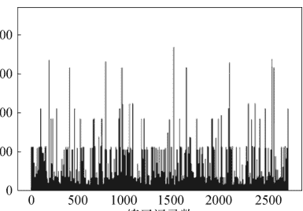

图 8.3 Eanalyst 数据集学习者-交互阶梯式分布

表 8.2 Eanalyst 数据集核心统计量

| 习题数 | 学习者数 | 交互总量 | 人均交互次 |
| :--- | :--- | :--- | :--- |
| 2763 | 1763 | 525,638 | 298.1 |

##### 8.3.2 实验设置与评价体系

任务本质为响应预测，指标分**分类**与**回归**两类：
*   **分类指标**：ROC-AUC 与 ACC（准确率），值越大越优。AUC 作为领域核心指标，取值区间 [0.5, 1]。
*   **回归指标**：MAE 与 RMSE，量化预测偏差，值越小越优。

数据按学习者 7:3 划分训练/测试，并采用 5 折交叉验证（8:2 再分训练/验证）取平均，消除偶然性。

**超参数敏感性探索** 确定最优配置：学习率 \(l=0.09\)、隐藏单元 \(h=16\)、批量大小 \(b=16\)。

##### 8.3.3 核心结果深度解读

###### 1. 整体预测性能对比

表 8.3 列出 ERAKT 与 DKT、DKVMN、EERNN 对比。ERAKT 在四指标上均达最优。关键启示：(1) 引入习题内容显著增益，EERNN 超越无内容基线，ERAKT 再超越 EERNN，验证了 8.1.2 节假设；(2) 双向建模优于单向，BI-LSTM 对上下文的充分利用是性能跃升关键。

表 8.3 主流模型性能对比（最优加粗）

| 指标 | DKT | DKVMN | EERNN | **ERAKT** |
| :--- | :--- | :--- | :--- | :--- |
| **AUC** | 0.7900 | 0.8783 | 0.8836 | **0.9025** |
| **ACC** | 0.7301 | 0.8072 | 0.8213 | **0.8407** |
| **MAE** | 0.2827 | 0.2678 | 0.2495 | **0.2203** |
| **RMSE** | 0.2233 | 0.1346 | 0.1310 | **0.1278** |

###### 2. 多维习题特征的增量贡献

表 8.4 拆解语义与知识标签贡献。融合特征 (BERT+CONCEPT, 0.8463) 显著优于单一特征及原始 DKT (0.79)。语义主导：BERT (0.8325) 胜 Doc2Vec (0.8266)，归因于 Attention 并行建模能力与残差结构抗过拟合。知识标签虽增益小 (~1%) 但稳定正向。

表 8.4 不同特征组合对 AUC 的影响

| 基础模型 | +Doc2Vec | +BERT | +CONCEPT | +BERT+CONCEPT |
| :--- | :--- | :--- | :--- | :--- |
| **DKT** | 0.8266 | 0.8325 | 0.8030 | **0.8463** |

为排除划分比例干扰，测试 60%-90% 训练比递增实验。趋势一致：数据增则 AUC/ACC 升、MAE/RMSE 降，验证模型可扩展性。

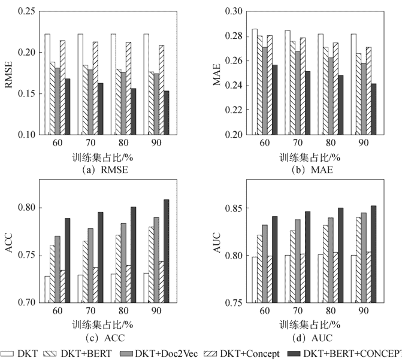

###### 3. 习题关联建模：双向架构的决定性优势

确立表征有效后，对比 RNN/LSTM/GRU/BI-LSTM 四种时序建模器（表 8.5、图 8.5）。梯队分化明显：RNN 垫底（梯度消散）；LSTM/GRU 居中（门控缓解长依赖，GRU 参数少略优）；**BI-LSTM 断层领先 (0.9065)**——双向编码同时保有历史沉淀与未来趋向，充分激活习题间双向关联语义。

表 8.5 时序建模方式对 AUC 的影响

| RNN | LSTM | GRU | **BI-LSTM** |
| :--- | :--- | :--- | :--- |
| 0.8463 | 0.8543 | 0.8637 | **0.9065** |

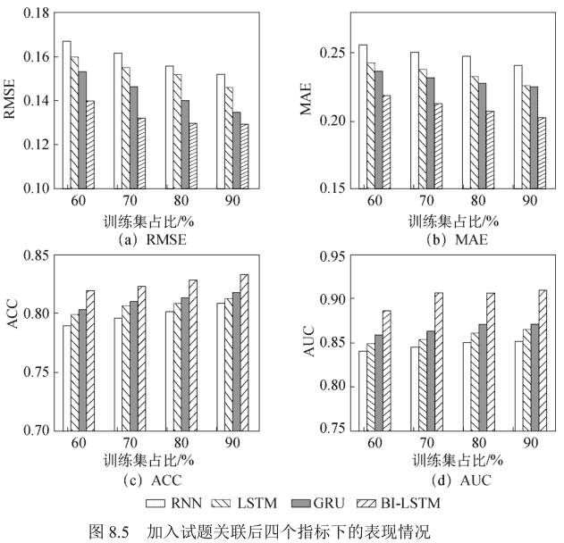

#### 8.4 章节小结与未来展望

本章提出 **ERAKT** 模型，融合习题多维表征与双向关联建模，实现对学习者作答表现及知识掌握度的精准预测，为“因材施教”提供算法支撑。

实验揭示三大核心洞见：
1.  **多维表征是基石**：BERT 语义表征配合知识标签，构建了高质量习题画像。
2.  **双向关联是引擎**：BI-LSTM 打破单向时序限制，利用全局上下文将预测推向新高度。
3.  **架构协同增效**：表征质量与建模深度的耦合，而非单一模块堆砌，才是性能跃迁来源。

**未来方向**：拓展“多知识点关联图谱”建模，强化诊断颗粒度，推动系统化落地赋能一线教学。

---

### 第 9 章 融入响应时延的认知诊断建模

#### 核心动因：从“对错”到“过程”的认知洞察

在时空认知诊断框架下，学习者要素是核心。随着计算机化测试普及，**响应时间（RT）** 成为可大规模采集的关键行为数据。它不仅量化作答速度，更折射认知加工的生理心理机制。

传统认知诊断模型（CDM）如 DINA、G-DINA 等，虽能定位技能掌握，却长期忽略 RT 信息，仅建模二元反应准确度（RA）。经典**速度-准确度权衡** 理论指出：速度与准确度常呈负相关，学习者在“快而错”与“慢而准”间博弈。Roskam 更指出：即便时间无限，未掌握技能者正确率也难达 1。这意味着，**RT 与 RA 的联合建模，是还原真实认知过程的必经之路**。

既往研究多在 IRT 框架下探索 RT（如 van der Linden 分层模型、四参数 Logistic 模型等），但单维能力不足以支撑多维技能诊断。虽有学者（Zhan 等、Wang 等）尝试将 RT 引入 CDM，但主流分层模型假设 **RT 与 RA 条件独立**，无法捕捉速度-准确度交换机制，与实证规律背离。

**本章贡献**：提出 **RT-CDM** 框架，实现三大突破：
1.  **革新 RT 子模型**：融合习题时间强度、学习者速度与**习题区分度**，实现跨习题的速度差异化刻画。
2.  **构建联合诊断框架**：打破条件独立假设，同步建模 RA 与 RT，更贴合认知加工实况。
3.  **实证双重验证**：在真实与仿真数据上证实，引入 RT 显著提升参数估计的稳定性与诊断准确性。

#### 9.1 融入响应时延的认知诊断框架

### 融合反应时的认知诊断模型（RT-CDM）框架详解

本节系统构建了一个嵌入反应时（RT）机制的认知诊断建模框架（RT-CDM），主要涵盖三大核心板块：问题形式化定义、反应时建模策略、以及融合时序信息的认知诊断方法。

**问题设定与符号约定**
该框架旨在评估学习者在计算机化测评环境下对特定认知属性（技能、能力等）的掌握程度。设定测评由 $J$ 道题项构成，测量 $K$ 个属性，共有 $I$ 名学习者作答。题项与属性的对应关系通过 $Q$ 矩阵 $\boldsymbol{Q}=\{q_{jk}\}_{J \times K}$ 表征，$q_{jk}=1$ 表示题项 $j$ 需要属性 $k$，否则为 0。测评过程产生两类核心数据：一是作答反应矩阵 $\boldsymbol{Y}=\{y_{ij}\}_{I \times J}$（$y_{ij}=1$ 答对，0 答错）；二是反应时矩阵 $\boldsymbol{T}=\{T_{ij}\}_{I \times J}$。此外，引入学习者速度参数 $\tau_i$ 与题项标准反应时 $T_j$ 刻画个体与题项的时间特征。

**建模假设：从条件独立到条件依赖**
传统层次模型假设在给定潜在特质下，反应时与反应准确性条件独立：
$$ P(Y_{ij}, T_{ij} | \boldsymbol{a}_i, \tau_i) = P(Y_{ij} | \boldsymbol{a}_i, \tau_i) P(T_{ij} | \boldsymbol{a}_i, \tau_i) \tag{9.1} $$
但此假设难以契合真实考测场景。实际上，RT 与 RA（反应准确性）间存在条件依赖，蕴含着丰富的诊断信息。据此，RT-CDM 确立四大核心假设：
1.  **潜在特质表征**：学习者能力由多维二元向量 $\boldsymbol{a}_i = \{\alpha_{ik}\}$ 表示，$\alpha_{ik}=1$ 代表掌握第 $k$ 项技能。
2.  **作答依赖时序**：反应准确性 $Y_{ij}$ 不仅取决于技能掌握 $\alpha_{ik}$ 与题项特征，还显著受制于反应时 $T_{ij}$。
3.  **速度随题变异**：反应时 $T_{ij}$ 与个体速度 $\tau_i$ 相关，但速度非常数，受题项区分度调节。
4.  **匹配度量化**：学习者 RT 与题项标准 RT 的匹配程度 $\varepsilon_{ij}$，由题项时间强度 $\beta_j$、个体速度 $\tau_i$ 及实测 $T_{ij}$ 共同决定。

基于此，RT-CDM 建立联合建模范式，打破独立性约束：
$$ P(Y_{ij}, T_{ij} | \boldsymbol{a}_i, \tau_i) = P(Y_{ij} | \boldsymbol{a}_i, T_{ij}, \tau_i) P(T_{ij} | \tau_i) \tag{9.2} $$
该框架引入连续的项目反应函数（IRF）融合反应时效应，实现更精准的认知画像。整体流程见图 9.1：输入 $T, Y, Q$ 矩阵 $\rightarrow$ 建模速度、滑失、猜测等认知过程因子 $\rightarrow$ 输出技能掌握诊断结果。

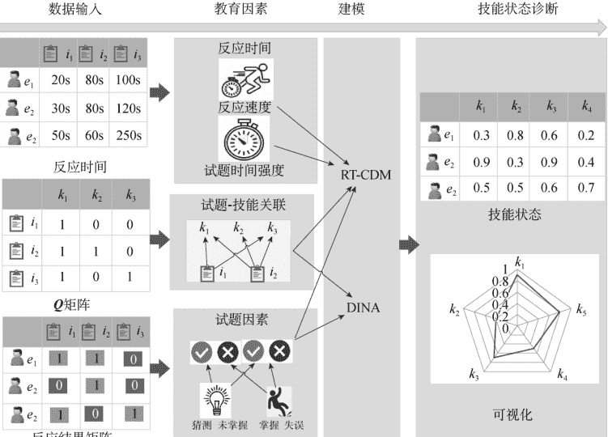

图 9.1 RT-CDM 的框架

```
lg T_{ij}=\beta_j - \tau_i + \varepsilon_{ij}, \varepsilon_{ij} \sim N(0,\sigma^2)
```

#### 9.1.1 反应时模型构建

RT 模型依测试内容分布差异独立建立，与作答结果解耦。主流采用**融合反应时的对数正态模型（LMFRT）**：

```
lg \frac{T_{ij}}{T_j}=\beta_j - \lambda_j \tau_i + \varepsilon_{ij}, \varepsilon_{ij} \sim N(0,\sigma^2)
```

其中，$T_{ij}$ 为学习者 $i$ 作答题项 $j$ 的耗时；$\beta_j$ 为题项时间强度；$\tau_i$ 为学习者平均速度；$\varepsilon_{ij} \sim N(0, \sigma^2)$ 为误差项。该模型虽纳入速度因素，但假设个体跨题速度恒定，与实证不符。

为破解此限制，本框架在逐题层面引入**区分参数 $\lambda_j$ 与标准反应时 $T_j$**，重构误差结构：

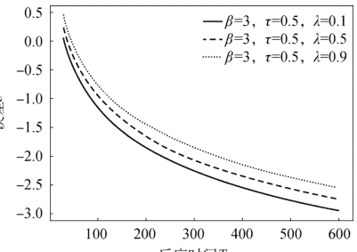

新误差项定义为 $\varepsilon_{ij}=(\ln T_{j}+\beta_{j})-(\ln T_{ij}+\lambda_{j}\tau_{i})$，直观反映题项时间属性与学习者 RT 属性的契合度。**RT 越长，$\varepsilon_{ij}$ 越小，匹配度越高，满足题项要求概率越大**。关键创新在于 $\lambda_j$：它使学习者在每道题上的有效速度呈现题项相关性，而非全局固定。图 9.2 直观展示了不同 $\lambda_j$ 下 $T_{ij}$ 与 $\varepsilon_{ij}$ 的动态关系——同一反应时下，$\lambda_j$ 越大，$\varepsilon_{ij}$ 计算值越大，从而修正了速度恒定的假设偏差。$T_j$ 为专家预设的题项标准用时。

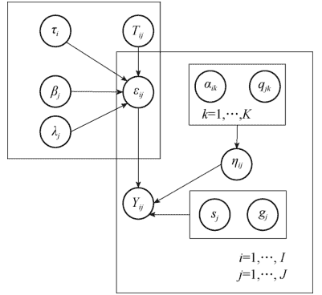

图 9.2 反应时间 T 与误差 $\varepsilon$ 的关系

#### 9.1.2 RT-CDM 认知诊断框架

本节将 RT 模型嵌入 IRF，构建 **RT-CDM** 框架。在此范式中，**反应时作为自变量（驱动因），反应准确性作为因变量（结果因）**，显著增强了模型的信息量，提升了测评的科学性与技能测量精度。

核心机制遵循**速度-准确性权衡（SAT）**原则：反应过快易诱发滑失与猜测；留时充足则利于深度思考，降低误答风险。概率图模型见图 9.3。

```
P(Y_{ij}=1|\boldsymbol{\alpha}_i, s_j, g_j, \varepsilon_{ij}) = (1-s_j)^{\eta_{ij}} g_j^{1-\eta_{ij}} \frac{1}{1+e^{4\varepsilon_{ij}}}
(9.5)
```

图 9.3 融合反应时间认知诊断的概率模型

结合滑失（$s$）与猜测（$g$）参数，依据公式 (9.2) 推导出包含时序效应的 IRF：


核心函数组件解析：
1.  **时间误差函数** $f(\varepsilon_{ij}) = \frac{1}{1+e^{4\varepsilon_{ij}}}$：随 $\varepsilon_{ij}$ 增大单调递减。RT 越长 $\rightarrow$ $\varepsilon_{ij}$ 越小 $\rightarrow$ $f(\varepsilon_{ij})$ 增大 $\rightarrow$ 答对概率升高。它将连续反应时映射为单调递增的概率增益因子。
2.  **潜在特征函数** $\eta_{ij} = \frac{q_i \alpha_i^T}{q_j^T q_j}$：量化技能匹配度的连续指标（0~1）。分子为学习者掌握技能集与题项考察技能集的交集大小，分母为题项考察技能总数。例如题项考察 3 项技能，$\eta_{ij}$ 可将学习者细分为掌握 0、1、2、3 项技能的 4 类。**$\eta_{ij}=1$ 代表全技能掌握；$\eta_{ij} \in [0,1)$ 代表部分掌握**，实现了比传统二元分类更精细的诊断粒度。

### 9.2 模型参数贝叶斯估计

采用**马尔可夫链蒙特卡罗（MCMC）**方法对 RT-CDM 参数联合估计。

**先验分布设定**：
*   题项时间强度：$\beta_j \sim N(\mu_\beta, \sigma_\beta^2)$ \quad (9.6)
*   题项区分度：$\lambda_j \sim N(\mu_\lambda, \sigma_\lambda^2)$ \quad (9.7)
*   学习者速度：$\tau_i \sim N(\mu_\tau, \sigma_\tau^2)$ \quad (9.8)
*   技能掌握状态：$\alpha_{ik} \sim \text{Bernoulli}(0.5)$ \quad (9.9)
*   猜测参数：$g_j \sim 4\text{-Beta}(v_g, w_g, a_g, b_g)$ \quad (9.10)
*   滑失参数：$1 - s_j \sim 4\text{-Beta}(v_s, w_s, a_s, b_s)$ \quad (9.11)
    *注：四参数 Beta 密度函数为 $f(x) = \frac{(x-a)^{v-1}(b-x)^{w-1}}{\phi(v,w)(b-a)^{v+w-1}}$，$\phi$ 为归一化常数。*

**联合后验分布** 由先验与似然函数比例构成：
$$ L(\boldsymbol{\beta}, \boldsymbol{\lambda}, \boldsymbol{g}, \boldsymbol{s}, \boldsymbol{\tau}, \boldsymbol{\alpha} | \boldsymbol{Y}, \boldsymbol{T}) \propto L(\boldsymbol{\beta}, \boldsymbol{\lambda}, \boldsymbol{s}, \boldsymbol{g}; \boldsymbol{\alpha}, \boldsymbol{\tau}) P(\boldsymbol{\tau}) P(\boldsymbol{\alpha}) P(\boldsymbol{\beta}) P(\boldsymbol{\lambda}) P(\boldsymbol{g}) P(\boldsymbol{s}) \quad \text{(9.12)} $$

给定 $I$ 名学习者、$J$ 道题项，假设条件独立，条件似然函数为：
$$ L(\boldsymbol{\beta}, \boldsymbol{\lambda}, \boldsymbol{s}, \boldsymbol{g}, \boldsymbol{\tau}, \boldsymbol{\alpha}) = \prod_{i=1}^I \prod_{j=1}^J \left[ P(Y_{ij} | T_{ij}) \right]^{Y_{ij}} \left[ 1 - P(Y_{ij} | T_{ij}) \right]^{1 - Y_{ij}} \quad \text{(9.13)} $$

**MCMC 采样迭代流程（第 $t$ 次迭代）**：
1.  **更新 $\{\boldsymbol{\beta}, \boldsymbol{\lambda}\}$**：候选值从以当前值为中心的均匀分布生成，$\beta_j^{(*)} \sim U(\beta_j^{(t-1)} \pm \delta_{\beta})$，$\lambda_j^{(*)} \sim U(\lambda_j^{(t-1)} \pm \delta_{\lambda})$。接受概率按 Metropolis-Hastings 算法计算（公式 9.14）。
2.  **更新 $\boldsymbol{\tau}$**：候选速度 $\tau_i^{(*)} \sim U(\tau_i^{(t-1)} \pm \delta_{\tau})$，接受概率依据公式 (9.15)。
3.  **更新 $\boldsymbol{\alpha}$**：候选技能状态 $\alpha_{ik}^{(*)} \sim \text{Bernoulli}(0.5)$，接受概率依据公式 (9.16)。
4.  **更新 $\{\boldsymbol{g}, \boldsymbol{s}\}$**：候选值 $g_j^{(*)} \sim U(g_j^{(t-1)} \pm \delta_g)$，$s_j^{(*)} \sim U(s_j^{(t-1)} \pm \delta_s)$，接受概率依据公式 (9.17)。

### 9.3 实证研究：基于真实数据的验证

### 9.3 实证研究：基于 PISA 2015 数学数据的模型验证

本节选取 2015 年 PISA（国际学生评估项目）数学学科的权威数据集，旨在检验 RT-CDM（反应时间-认知诊断模型）的实际落地效果。PISA 作为全球公认的高质量机考测评体系，不仅题目质量过硬，还完整记录了考生的作答结果与耗时数据，为模型验证提供了理想土壤。

#### 9.3.1 数据概况

实验锁定 17 道采用二级评分的机考题目，随机抽取 6000 名考生的作答记录（含二元得分与连续反应时长）作为分析样本。数据源自 PISA2015 数学评估框架及官方发布的机考日志库。测评覆盖 11 个核心属性：变化与关系（$a_1$）、空间与形状（$a_2$）、数量（$a_3$）、不确定性与数据（$a_4$）、个人情境（$a_5$）、职业情境（$a_6$）、社会情境（$a_7$）、科学情境（$a_8$）、数学形式化（$a_9$）、运用数学概念/程序/推理（$a_{10}$）、解释/应用/评估数学结果（$a_{11}$）。这 17 道题与属性的对应关系（Q 矩阵）详见下表。

**表 9.1 PISA2015 机考数学题 Q 矩阵**

| 试题编号 | $a_1$ | $a_2$ | $a_3$ | $a_4$ | $a_5$ | $a_6$ | $a_7$ | $a_8$ | $a_9$ | $a_{10}$ | $a_{11}$ |
| :--- | :---: | :---: | :---: | :---: | :---: | :---: | :---: | :---: | :---: | :---: | :---: |
| CM033Q01 | 0 | 1 | 0 | 0 | 1 | 0 | 0 | 0 | 0 | 0 | 1 |
| CM474Q01 | 0 | 0 | 1 | 0 | 1 | 0 | 0 | 0 | 0 | 1 | 0 |
| CM155Q01 | 1 | 0 | 0 | 0 | 0 | 0 | 0 | 1 | 0 | 1 | 0 |
| CM155Q04 | 1 | 0 | 0 | 0 | 0 | 0 | 0 | 1 | 0 | 0 | 1 |
| CM411Q01 | 0 | 0 | 1 | 0 | 0 | 0 | 1 | 0 | 0 | 1 | 0 |
| CM411Q02 | 0 | 0 | 0 | 1 | 0 | 0 | 1 | 0 | 0 | 0 | 1 |
| CM803Q01 | 0 | 0 | 0 | 1 | 0 | 1 | 0 | 0 | 1 | 0 | 0 |
| CM442Q02 | 0 | 0 | 1 | 0 | 0 | 0 | 1 | 0 | 0 | 0 | 1 |
| CM034Q01 | 0 | 1 | 0 | 0 | 0 | 1 | 0 | 0 | 1 | 0 | 0 |
| CM305Q01 | 0 | 1 | 0 | 0 | 0 | 0 | 1 | 0 | 0 | 1 | 0 |
| CM496Q01 | 0 | 0 | 1 | 0 | 0 | 0 | 1 | 0 | 1 | 0 | 0 |
| CM496Q02 | 0 | 0 | 1 | 0 | 0 | 0 | 1 | 0 | 0 | 1 | 0 |
| CM423Q01 | 0 | 0 | 0 | 1 | 1 | 0 | 0 | 0 | 0 | 0 | 1 |
| CM603Q01 | 0 | 0 | 1 | 0 | 0 | 0 | 0 | 1 | 0 | 1 | 0 |
| CM571Q01 | 1 | 0 | 0 | 0 | 0 | 0 | 0 | 1 | 0 | 0 | 1 |
| CM564Q01 | 0 | 0 | 1 | 0 | 0 | 0 | 1 | 0 | 1 | 0 | 0 |
| CM564Q02 | 0 | 0 | 0 | 1 | 0 | 0 | 1 | 0 | 1 | 0 | 0 |

针对二级评分特性，本研究将完全正确记为 1，其余（含部分正确、错误）均记为 0；反应时间以秒为单位记录。


#### 9.3.2 对比分析设置

为全面评估模型表现，引入三个经典基线模型，从估计精度与收敛稳定性两个维度展开横向对比。所有模型均运行两条马尔可夫链，每链迭代 8000 次，前 5000 次作为预热期丢弃，后 3000 次用于参数点估计。

**基线模型阵容：**

1.  **DINA 模型**：认知诊断领域的“常青树”，仅利用二元反应数据进行建模。
    $P(Y_{ij}=1|\boldsymbol{\alpha}_i)=(1-s_j)^{\eta_{ij}} g_j^{1-\eta_{ij}}, \quad \eta_{ij}=\prod_{k=1}^K \alpha_{ik}^{q_{jk}}$ \quad \text{(9.18)}

2.  **JRT 模型（联合反应时模型）**：采用分层建模框架，同步处理反应准确度（RA）与反应时间（RT）。
    $\text{logit}(P(T_{ij}))=\beta_j-\tau_i+\varepsilon_{ij}, \varepsilon_{ij} \sim N(0,\sigma^2)$
    $\text{logit}(P(Y_{ij} = 1))=\beta_j+\delta_i \prod_{k=1}^K \alpha_{ik}^{q_{jk}}$ \quad \text{(9.19)}
    $\text{logit}(P(\alpha_{ik}=1))=\gamma_k \theta_i - \lambda_k$

3.  **R-DINA 模型**：改良版 DINA，虽引入了属性掌握的连续化表征，但忽略了 RT 信息。
    $P(Y_{ij}=1|\boldsymbol{\alpha}_i)=(1-s_j)^{\eta_{ij}} g_j^{1-\eta_{ij}}, \quad \eta_{ij}=\frac{q_j \boldsymbol{\alpha}_i^T}{q_j^T q_j}$ \quad \text{(9.20)}

**评价指标体系：** 均方根误差（RMSE）、平均绝对误差（MAE）反映估计偏差，**值越小越优**；预测准确度（ACC）与 ROC 曲线下面积（AUC）反映分类能力，**值越大越优**。

$\text{RMSE}=\sqrt{\frac{1}{I \times J} \sum_{j=1}^J \sum_{i=1}^I (Y_{ij}-P(Y_{ij}=1))^2}$ \quad \text{(9.21)}

$\text{MAE}=\frac{1}{I \times J} \sum_{j=1}^J \sum_{i=1}^I |Y_{ij}-P(Y_{ij}=1)|$ \quad \text{(9.22)}

#### 9.3.3 实证结果解读

将 PISA 数据代入四模型，表 9.2 汇总了误差指标与精度指标，直观展现参数返真水平。结论明确：**RT-CDM 综合表现领跑全场，预测误差最低，分类精度最高。**

**表 9.2 四模型精度对比一览**

| 模型 | 误差 MAE | 误差 RMSE | 精准度 ACC | 精准度 AUC |
| :--- | :---: | :---: | :---: | :---: |
| DINA | 0.380 | 0.616 | 0.626 | 0.620 |
| JRT-DINA | 0.348 | 0.588 | 0.698 | 0.700 |
| R-DINA | 0.235 | 0.484 | 0.767 | 0.765 |
| **RT-CDM** | **0.219** | **0.468** | **0.782** | **0.781** |

优势来源主要有三点：
1.  **信息挖掘更深**：RT-CDM 通过精细建模反应时间，捕获了 DINA 与 R-DINA 遗漏的动态过程信息，显著提升模型质量。
2.  **建模策略更优**：相较于 JRT 的“分层假设（条件独立）”，RT-CDM 构建的“条件依赖联合建模”更符合真实作答心理，效果更稳健。
3.  **状态表征更细**：R-DINA 超越 DINA 印证了“多重分类（连续掌握度）优于二元分类”这一判断。

图 9.5 进一步剖析了单题层面的预测表现：RT-CDM 在绝大多数题目上稳居榜首，R-DINA 紧随其后；JRT 模型波动最大，稳定性最差，提示其高度受试题特性影响。


**图 9.5 各模型在单题上的预测性能对比**

---

### 9.4 仿真实验：理想条件下的深度剖析

为进一步锚定参数返真特性，并在可控环境下聚焦对比 R-DINA 与 RT-CDM，设计了后续仿真研究。核心流程：预设属性/题目/考生量 $\rightarrow$ 估计题目参数与技能状态 $\rightarrow$ 生成反应矩阵与 RT 矩阵。

#### 9.4.1 数据生成机制

模拟 5 个相互独立的技能，衍生 $2^5 = 32$ 种掌握模式（剔除全零模式），配套 31 道题目。Q 矩阵结构见图 9.6，为 5000 名虚拟考生生成数据，参数设定如下：

1.  **RT 参数**：$\beta \sim N(9,1)$；$\tau \sim N(0,1)$；$\lambda$ 服从下截 0.0001 的截断正态分布[1,1]；$\varepsilon$ 服从均值 0、方差区间 [0.3, 0.7] 的均匀分布。
2.  **反应参数**：$\alpha_{ik} \sim Bernoulli(0.7)$；$g_j, s_j \sim 4 - Beta(1,2,0,0.6)$。


**图 9.6 仿真研究 Q 矩阵（黑=0，灰=1）**

#### 9.4.2 评价指标体系

聚焦属性与模式分类精度：
*   **ACCR（属性正确分类率）**：单属性层面的判准准确度。
*   **PCCR（模式正确分类率）**：属性向量（联合模式）层面的整体命中率。
    $ACCR = \frac{\sum_{i=1}^I \mathbb{I}[\hat{\alpha}_{ik} = \alpha_{ik}]}{I}$
    $PCCR = \frac{\sum_{i=1}^I \mathbb{I}[\hat{\alpha}_i = \alpha_i]}{I}$
    （$\mathbb{I}(\cdot)$ 为指示函数，真为 1，假为 0）
同时沿用 MAE、RMSE、ACC、AUC 考察模型整体恢复率。

#### 9.4.3 仿真结果深度复盘

从**模型精度**、**题目参数恢复**、**属性分类精度**三维度对决。

**1. 模型整体精度：碾压级优势**
表 9.3 给出 100 次重复实验的均值。RT-CDM 无论在误差控制（MAE < 0.05，RMSE 更低）还是精度指标（ACC > 0.97）上均大幅领先 R-DINA。这有力佐证：**融合 RT 与反应结果的联合建模，能显著跃升模型精度。**

**表 9.3 两模型核心指标对比（100 次实验均值）**

| 模型 | 误差 MAE | 误差 RMSE | 精准度 ACC | 精准度 AUC |
| :--- | :---: | :---: | :---: | :---: |
| R-DINA | 0.148 | 0.384 | 0.852 | 0.656 |
| **RT-CDM** | **0.026** | **0.161** | **0.974** | **0.802** |

**2. 题目参数恢复：全面占优，稳健可靠**
表 9.4 展示全题参数估计值与真值的偏差。RT-CDM 在猜测参数 $s$、难度参数 $\beta$、速度参数 $\lambda$ 上恢复效果显著优于 R-DINA；仅在失误参数 $g$ 上两者持平（RT-CDM 仅高 0.001）。整体来看，RT-CDM 参数估计极其稳定，标准差极低。

**表 9.4 题目参数恢复性对比**

| 指标 | | RT-CDM $s$ | RT-CDM $g$ | RT-CDM $\beta$ | RT-CDM $\lambda$ | R-DINA $s$ | R-DINA $g$ |
| :--- | :---: | :---: | :---: | :---: | :---: | :---: | :---: |
| MAE | 平均值 | 0.146 | 0.188 | 0.581 | 1.207 | 0.383 | 0.184 |
| | 标准差 | 0 | 0.001 | 0.018 | 0.014 | 0 | 0 |
| RMSE | 平均值 | 0.176 | 0.227 | 1.587 | 1.273 | 0.393 | 0.224 |
| | 标准差 | 0 | 0.001 | 0.003 | 0.01 | 0 | 0 |

**3. 属性分类精度：锁定技能画像的关键**
表 9.5 基于真实与估计分类对比得出。RT-CDM 在所有 5 个单属性 ACCR 及整体 PCCR 上均超越 R-DINA。结论清晰：**忽视 RT 对 RA 的影响，会直接拖垮属性与模式的分类准度。**

**表 9.5 属性分类正确率对比（100 次迭代均值）**

| 100 次迭代 | ACCR $a_1$ | ACCR $a_2$ | ACCR $a_3$ | ACCR $a_4$ | ACCR $a_5$ | PCCR |
| :--- | :---: | :---: | :---: | :---: | :---: | :---: |
| R-DINA | 0.938 | 0.944 | 0.911 | 0.925 | 0.944 | 0.726 |
| **RT-CDM** | **0.953** | **0.957** | **0.933** | **0.957** | **0.958** | **0.815** |

仿真实验证实：基于 MCMC 的 RT-CDM 参数估计稳健高效；引入 RT 分析较传统手段，能大幅提升掌握模式分类精度。

---

### 9.5 章节小结与展望

随着在线教育普及，考生的过程数据（作答轨迹、耗时等）前所未有地丰富。然而主流 CDM 长期聚焦“结果”，忽略“过程”中的时间信息。虽有 JRT 类层级模型尝试融合 RT，但其核心假设“RT 与 RA 条件独立”与现实心理机制悖离。

**RT-CDM 的创新破局：**
1.  **联合建模打破独立假设**：基于 RT 与 RA 的**条件依赖**设计联合模型，而非简单分层。
2.  **机制显性化**：引入连续项目潜在特征函数量化技能数量，构建 RT 函数量化时长对作答的调节效应。
3.  **简洁可解释**：模型结构清晰，参数含义明确，工程落地友好。

**实证与仿真双线验证：**
*   真实数据（PISA）上：RT-CDM 击败 DINA、R-DINA、JRT-DINA，**条件依赖联合建模 > 条件独立分层建模**，信息利用更充分，预测更稳定。
*   仿真数据上：参数返真优异，属性/模式分类精度显著跃升。

**未来迭代方向：**
1.  **模型家族扩展**：将 RT 机制移植至 GDINA、GDM 等更宽泛的 CDM 框架。
2.  **RT 分布多元化**：尝试 Log-normal、Weibull 等非正态分布，探究分布假设对精度的影响。
3.  **多模态过程数据融合**：除 RT 外，引入作答顺序、修改次数、点击轨迹等易获取的行为特征，构建全维度认知诊断范式。

---

### 第 10 章 基于时间的长周期认知诊断方法

聚焦“时空认知诊断”中的**时间维度**，本章从“学习者-试题交互发生的时刻”切入，探寻知识状态随时间流转的动态演化规律。

知识熟练度的动态诊断，是个性化学习的基石，也是建模学习行为时间序列的核心路径——其旨在追踪学习者在持续交互中，各知识领域隐性掌握程度的实时轨迹。诊断成果直服务于个性化干预：精准定位薄弱环节 $\rightarrow$ 靶向知识训练、动态规划学习路径、精准推荐学习资源。

图 10.1 描绘了典型 K12 数学场景下的纵向交互图景：3 月至 4 月，两名学习者（S1、S2）通过单元测试练习不同题目，覆盖整数（K1）、分数（K2）、无理数（K3）三大概念，知识点由专家标注。


**图 10.1 中国基础教育测评典型场景**

现实业务中，教育平台双核心诉求：
1.  **成绩预测**：判定学习者未来能否攻克新题（如 e7、e8）。
2.  **知识追踪**：实时监控评估过程中 K1、K2、K3 等核心素养的动态变化。

## 研究背景与核心动机

学术界针对知识熟练度诊断已积累了诸多成果，认知诊断模型（CDM）与知识追踪（KT）便是典型代表。然而，绝大多数既有研究忽视了两大关键维度——试题的认知特质与潜在特质，而这两者在评估过程中对学习者的认知状态影响深远。

现实情况是，即便承载同一知识点，不同试题的潜在属性（如难度系数）也可能截然不同。主流知识追踪技术，无论是贝叶斯知识追踪（BKT）还是深度知识追踪（DKT），通常仅以知识点为建模单元，而非具体试题，导致练习环节中关键的潜在特征被抛诸脑后。以学习者 $S_2$ 为例，其在测试1中面对同属 $K_1$ 的试题 $e_1$ 与 $e_3$ 表现截然相反，这正是潜在难度差异作祟的结果。该学习者在后续评估3中针对 $K_1$ 的表现，极大概率会向难度相近的 $e_3$ 靠拢，而非 $e_1$。虽有动态键-值记忆网络（DKVMN）、序列键-值记忆网络（SKVMN）等尝试引入潜在特征，但鲜有研究关注**不同时间间隔下、覆盖同一知识点的潜在特征状态**对熟练度判定的具体影响。

综上，本章聚焦知识熟练度诊断的三大痛点：面对学习者认知过程的复杂多变，如何从杂乱的历史交互序列中量化提取通用认知特征？如何将学习、记忆、遗忘等认知机制融入诊断任务以提升预测精度？

为破解上述难题，我们提出**融合认知特征的动态知识诊断方法（CF-DKD）**，旨在将学习与遗忘理论融入历史交互长序列，精准预测学习者表现。本章核心贡献归纳为三点：

1.  **攻克长程依赖建模难题**：DKVMN 虽借添加/擦除门追踪知识状态，却难以有效构建长程依赖模型。我们将遗忘与学习认知特征注入记忆网络，实现对知识掌握状态随时间动态演变的精准追踪。
2.  **多特征融合策略优化**：通过预编码统一特征，探索三种集成方案融合认知特征与交互响应，经优化组合显著提升成绩预测准度。
3.  **双门控机制增强记忆更新**：扩展记忆网络更新流程，引入遗忘门清除陈旧无效长时记忆，学习门强化短时信息与长程依赖记忆，实现记忆的精细化管理。

实验层面，我们采用5折交叉验证，在4个基准数据集上对 CF-DKD 进行全面评测，并与最先进基线对比。结果证实，CF-DKD 在学习者成绩预测任务上全面超越对标模型。

#### 10.1 国内外相关研究

本节将从静态认知诊断、动态知识诊断、记忆网络诊断、具备认知特征的知识诊断四个维度，梳理相关文献脉络。

##### 10.1.1 静态认知诊断

传统静态 CDM（如 IRT、DINA 模型）核心在于通过预测作答反应反推学习者知识水平。IRT 作为单维模型，引入试题区分度与难度参数，借 Logistic 函数刻画潜在特质；DINA 则依赖专家标注 Q 矩阵界定试题-知识关联，通过“猜测”与“失误”双参数函数量化熟练度。但不得不说，这些方法均聚焦单次测验交互，**忽略了知识熟练度随时间演变的动态本质及历史轨迹**，自然也无从谈起精细化的认知特征诊断。

##### 10.1.2 动态知识诊断

为突破静态 CDM 桎梏，动态 CDM 引入时间因子纳入建模视野，如时间间隔、反应时长等。深度知识追踪（DKT）作为序列建模代表，利用 RNN 隐藏层捕捉知识状态流变，免去人工标注之劳。后续扩展工作虽引入遗忘、试题内容、复杂交互等因素，但短板依然显著：一是 CDM 仅引入单一反应时间变量，难以还原历史知识掌握轨迹；二是 DKT 虽设遗忘门，却隐含“相邻交互间隔恒定”的假设，导致严重的时间信息缺失。简而言之，**现有动态模型多忽视时间因子在训练过程中的深层影响，难以解释不同时间间隔下的遗忘与学习程度差异**。

##### 10.1.3 记忆网络诊断

近年，记忆网络因外部存储优势成为预测热门。记忆增强神经网络（MANN）扩展了 DKT 的单一隐层。Miller 等提出的键-值记忆网络（DKVMN）更进一步，将静态知识存入键记忆，动态掌握状态存入值记忆，首创记忆网络用于知识诊断：读取阶段利用试题-概念关联权重输出概念掌握度，写入阶段依据作答反应更新状态。基于 DKVMN 的变体层出不穷：SKVMN 强化同知识长程依赖，DSCMN 引入学习者能力聚类，DKVMN-CA 融合知识标签。实验证实，此类模型擅长捕捉潜在概念关联与序列依赖，预测精度领先。近期，图神经网络（如 GKT）引入知识关联建模，配合弱遗忘/学习门机制更新状态，表现优异。但**现有模型多仅靠擦除/添加门处理遗忘学习，忽略时间间隔信息，机制有效性有待加强**。本文保留键-值存储骨架，致力于注入更丰富认知特征以刻画记忆规律、提升预测性能。


##### 10.1.4 具有认知特征的知识诊断

用认知特征建模知识诊断是认知心理学核心议题，积淀数十年。认知规律显示：知识掌握度随时间衰减（遗忘），随反复练习增强（学习）。经典遗忘理论当属艾宾豪斯遗忘曲线，揭示遗忘率随时间间隔指数级上升；学习曲线则数学化描述重复练习带来的效率提升。

早期概率模型如 BKT 假设“习得即永不遗忘”，违背认知规律。KT-Forget 引入遗忘参数，量化时间间隔对遗忘的影响；Khajah 等通过相似技能重复次数模拟记忆保持，效能甚至超越 DKT。因子分解分析（PFA）引入时间效应函数，半衰期回归模型结合艾宾豪斯曲线建模不同时间间隔重复练习。Liu 等提出的可解释概率矩阵分解框架（IPMF），双曲线追踪遗忘与学习，精度超越 BKT、DINA。

深度学习时代，Nagatani 关联记忆保持与时间间隔、尝试次数；Ghosh 在注意力知识追踪中引入情境感知，以指数衰减模拟遗忘。虽具可解释性，但**局限犹存**：一是重视遗忘中的时间间隔，却常忽视重复次数等增强记忆的学习特征；二是计算复杂度制约了长时序交互信息在深度模型中的融合。本模型**融合学习/遗忘双重认知因子与记忆网络**，通过弱化噪声特征、强化关键特征，改良深度模型，实现动态长时记忆追踪。

#### 10.2 整合认知特征的动态知识诊断方法

##### 10.2.1 问题定义

CF-DKD 属监督学习范式，核心任务是依据学习者各评估节点的试题反应序列，动态追踪其知识熟练度。

形式化描述为：学习者历史交互数据 $X = \{x_1, x_2, \cdots, x_{t-1}\}$，单元 $x_t = (e_t, r_t, f_t, l_t)$ 为四元组。$e_t$ 为试题编号，$r_t \in \{0,1\}$ 为作答正确与否，$f_t, l_t$ 分别表征遗忘与学习两大认知因子。目标双重：**① 预测下一试题 $e_t$ 作答正确概率 $P(y_t=1|e_t, X)$；② 诊断学习者各知识点熟练度 $M_{stu}$**。

为动态追踪熟练度演变，设定两大假设：
*   **假设 10.1**：学习者作答任一试题，无论对错，均借教师解析强化相关知识记忆。
*   **假设 10.2**：试题虽可关联多概念，但默认首个概念为核心，以此计算认知特征。


CF-DKD 是基于记忆网络的时序模型，动态存储潜在知识能力，提供基于认知规则的隐藏信息读写接口。其单步关键流程（如图 10.3）呈四层架构：

1.  **嵌入层**：统一编码异构输入，映射至高维向量空间。
2.  **记忆层**：含键读取与值读取。键读取通过寻址机制获取试题关联隐性知识权重 $e_t$ 及键矩阵知识 $M'_{exc}$；值读取依权重 $M'_{stu}$ 检索当前潜在知识状态。
3.  **更新层**：配备双专用机制，动态刷新潜在知识状态 $M'_{stu}$。
4.  **预测层**：提供三种多特征融合策略，经全连接网络输出下一步答对概率。

##### 10.2.3 认知特征提取

CF-DKD 引入遗忘与学习双特征强化掌握度建模，提取逻辑如图 10.4 所示。以学习者 $S_1$ 在 3月10日($t_1$)、3月31日($t_2$)、4月4日($t_3$) 三次评估为例，试题关联知识点用色区分，$\Delta t_{mn}$ 表示时刻间隔。


**图 10.4 认知特征提取示意**

**1) 遗忘特征**

借鉴 DKT+forget 思想，遗忘特征包含**序列时间间隔 $\Delta s_t$** 与 **重复时间间隔 $\Delta r_t$**。
*   $\Delta s_t$：当前评估与上一次评估的间隔。得益于试题间潜在关联，间隔越短表现越佳。如图，$K_1$ 下 $e_7$ 间隔 5 天（$\Delta t_{32}$），远小于 $e_5$ 的 21 天（$\Delta t_{21}$），故 $e_7$ 答对概率更大。
*   $\Delta r_t$：当前与历史同知识评估的最小间隔。图中 $K_1$ 重复间隔 5 天（$\Delta t_{32}$），$K_2$ 为 26 天（$\Delta t_{31}$），因此 $S_1$ 在 $e_7(K_1)$ 表现优于 $e_8(K_2)$。

遗忘理论表明：间隔越长（$\Delta r_t$ 或 $\Delta s_t$ 增大），遗忘概率越高，后续表现越差。我们分别取两变量最大值作为 one-hot 编码维度，拼接形成遗忘特征 $f_t = [\Delta s_t, \Delta r_t]$。

**2) 学习特征**

基于假设 10.1，每次作答均带来知识增量。学习特征 $l_t$ 由**历史尝试次数 $\Delta c_t$** 决定（$l_t = \Delta c_t$），即同知识在过往序列中的重复频次。练习越频繁，记忆痕迹越深。学习理论指出：$\Delta c_t$ 越大，记忆保持越强。图示中 $K_1$ 尝试 3 次（$\Delta c_t=3$），$K_2$ 仅 1 次，故 $S_1$ 在 $e_7(K_1)$ 表现优于 $e_8(K_2)$。

##### 10.2.4 记忆层

CF-DKD 摒弃 DKT 单一隐层，采用键-值矩阵 $M_{exc}$ 与 $M_{stu}$ 存储状态（如图 10.3）。$M_{exc}$ 为不变键矩阵存潜在知识，$M_{stu}$ 为动态值矩阵存学习者熟练度，槽位一一对应潜在概念。记忆层分两步走：

**1）键读取**
输入试题 $e_t$ 经 one-hot 编码后，为缓解稀疏性映射至稠密空间：$k_t = e_t \times A$（$A \in \mathbb{R}^{|E| \times d_t}$ 为嵌入矩阵）。继而引入注意力机制，通过 $k_t$ 与键矩阵 $M_{exc}$ 内积计算关联权重：
$$ w_t(i) = \text{Softmax}(k_t^T M_{exc}^T(i)) \quad (10.6) $$
其中 Softmax 归一化保证 $w_t(i) \in [0,1]$。

**2）值读取**
给定权重 $w_t$，从值矩阵 $M_{stu}$ 检索试题 $e_t$ 时刻的潜在知识状态。读取向量 $\text{read}_t$ 为所有相关潜在知识状态的加权求和：
$$ \text{read}_t = \sum_{i=1}^N w_t(i) M_{stu}^t(i) \quad (10.7) $$

##### 10.2.5 状态更新机制

依据遗忘与学习理论，学习者的知识水平由试题、作答反应及认知因素共同塑造。那么，该如何利用这些要素刷新隐藏状态呢？

当学习者完成新题 $e_t$ 并给出客观反馈 $r_t$ 后，其潜在知识状态便从 $M_{stu}^{t-1}$ 迁移至 $M_{stu}^t$（见下图 10.5(c)）。为此，我们将交互对 $(e_t, r_t)$ 转为 One-hot 编码。鉴于 $r_t$ 为二值变量（0 或 1），可将反应扩展为与试题维度 $|E|$ 一致的零向量，合成组合向量：

$ (\widetilde{e_t, r_t}) = \begin{cases} [e_t, 0], & r_t = 1 \\ [0, e_t], & r_t = 0 \end{cases} $ （10.8）

该向量维度为 $\mathbf{R}^{2|E|}$，融合了试题与反应信息。为解决 One-hot 稀疏性，引入嵌入矩阵 $B \in \mathbf{R}^{2|E| \times d_v}$（$d_v$ 为 value 维度），映射得密集向量 $v_t \in \mathbf{R}^{d_v}$：

$v_t = (\widetilde{e_t, r_t}) * B$ （10.9）


图 10.5 不同模型更新策略对比

回顾既往研究：图 10.5(a) 的 DKVMN 依靠擦除/添加门更新记忆，却忽视长程认知依赖；图 10.5(b) 的 DKT+forget 虽引入遗忘变量，但单隐藏层难以刻画真实学习轨迹。我们在图 10.5(c) 中增设键-值记忆器存储潜在状态，受阈值机制启发，设计双门自适应融合学习与遗忘特性（如 LSTM 遗忘门、GRU 更新门、GKT 读写门）。

在 CF-DKD 更新范式中，**遗忘门 $F_t$** 控制从新题读取的值矩阵 $M'_{stu}$ 中剔除哪些信息，输入含当前反应嵌入 $v_t$ 与长期遗忘因子 $f_t$。二者经集成函数 $\varphi$ 生成临时遗忘向量 $\tilde{f}_t$：

$\tilde{f}_t = \varphi(f_t, v_t)$ （10.10）  

$F_t = \text{Sigmoid}(F^T \cdot \tilde{f}_t + b_f)$ （10.11）

其中 $f_t = \phi(\Delta s_t, \Delta r_t)$，$\phi$ 为 10.2.6 节详述的集成函数；$F^T \in \mathbf{R}^{(d_t + d_f) \times (d_t + d_f)}$ 为权重矩阵，元素取值 [0,1]。

同理，**学习门 $L_t$** 凭借当前反应 $v_t$ 与长期学习记忆 $l_t$ 决定强化哪些知识。临时学习向量 $\tilde{l}_t$ 同样由集成函数产出：

$\tilde{l}_t = \varphi(\Delta c_t, v_t)$ （10.12）  

$L_t = \text{tanh}(L^T \cdot \tilde{l}_t + b_l)$ （10.13）

$L^T \in \mathbf{R}^{(d_t + d_l) \times (d_t + d_l)}$，$d_t$ 为学习特征维度。

考虑到并非所有信息对历史序列的衰减/增强作用等同，我们引入相关权重 $w_i$ 修正读取过程。值记忆矩阵 $M'_{stu}(i)$ 最终按下式更新：

$M'_{stu} = M'_{stu}(i)[1 - w_i(i)F_t] + w_i(i)L_t$ （10.14）

公式前项为遗忘操作（弱化旧忆），后项为学习操作（注入新知），$\mathbf{1}$ 为全一行向量。

##### 10.2.6 表现预测

学习者在新题上的表现，取决于当前知识水平与认知因子（学习/遗忘特征）的合力。如何综合这些因素完成预测？

**1. 多元特征集成策略**
给定新题特征 $\langle k_t, f_t, l_t \rangle$，首要任务是将其融合为统一张量。我们对比了三类方案[236]：**拼接**（保留原始向量）、**乘法**（交互修正向量）、**拼接+乘法**（双重增强认知信号）。

预测阶段，集成向量 $\boldsymbol{\varphi}_{\text{in}}$ 由 $k_t, f_t, l_t$ 经表 10.1 三种方式计算得出。

| 集成方式 | 表达式 | 示例 |
| :--- | :--- | :--- |
| 拼接 | $\varphi(a,b)=[a,b]$ | $\boldsymbol{\varphi}_{\text{in}}=[k_t, f_t, l_t]$ |
| 乘法 | $\varphi(a,b)=[a \odot b]$ | $\boldsymbol{\varphi}_{\text{in}}=[k_t \odot [f_t, l_t]]$ |
| 拼接+乘法 | $\varphi(a,b)=[a \odot [a,b]]$ | $\boldsymbol{\varphi}_{\text{in}}=[k_t \odot [f_t, l_t], [f_t, l_t]]$ |

实验采用**拼接法**融合四大特征，预测作答概率。

**2. 作答概率预测**
将统一表示 $\boldsymbol{\varphi}_{\text{in}}$ 与读取内容向量 $\text{read}_t$ 拼接，经两层前馈网络输出正确率：

$forward_t = \tanh(W_1^T [read_t, \varphi_{in}]) + b_1$ （10.15）

$p_t = \text{Sigmoid}(W_2^T \cdot forward_t + b_2)$ （10.16）

首层用 $\tanh(z_i) = (e^{z_i} - e^{-z_i}) / (e^{z_i} + e^{-z_i})$ 激活，次层用 $\text{Sigmoid}(z_i) = 1 / (1 + e^{-z_i})$ 归一化，输出标量 $p_t$ 即正确作答概率。

##### 10.2.7 模型优化目标

CF-DKD 为端到端架构，需总损失函数反向传播更新参数（试题/学习者嵌入矩阵 $A, B$，学习/遗忘变换矩阵 $L^T, F^T$ 等）。采用交叉熵损失衡量真实反应 $r_t$ 与预测概率 $p_t$ 的偏差：

$\mathcal{L} = -\sum (r_t \lg p_t + (1-r_t) \lg(1-p_t))$ （10.17）

$M_{\text{stu}}, M_{\text{exc}}$ 以高斯分布 $N(0, \sigma)$ 初始化。优化器选用 SGD 加速收敛，配合 L2 正则抑制过拟合；学习率按指数衰减（衰减率 0.95）动态调整，初始值 0.09 效果最优。

#### 10.3 实验与结果分析

为验证 CF-DKD 有效性，在四大数据集上开展对比实验，考察四大维度：① 新题表现预测精度；② 记忆规模参数敏感性；③ 特征集成方式影响；④ 认知特征贡献度。

##### 10.3.1 数据集概况

实验选用四个含时间特征的公开诊断数据集，统计量见表 10.2，数量分布见图 10.6。

表 10.2 四数据集统计摘要

| 数据集 | 试题数 | 学习者数 | 交互数 | 人均交互 |
| :--- | :--- | :--- | :--- | :--- |
| Assistance2015 | 100 | 19917 | 708,631 | 35.6 |
| Assistance2017 | 3162 | 1709 | 942,816 | 551.6 |
| Slepmapy2015 | 1683 | 18198 | 1,336,210 | 73.4 |
| Eanalyst | 2763 | 1763 | 525,638 | 298.1 |

- **Assistance2015**：源自 2015 年 ASSISTments 系统，剔除交互<2 记录后，含 1.99 万学习者、70.8 万交互、100 道题。因学习者基数大、人均题少，追踪难度最高。
- **Assistance2017**：同系统 2017 年数据，同预处理规则。含 1709 学习者、94.2 万交互、3162 道题，**题量最大、人均交互最多**。
- **Slepmapy2015**：2015 年地理在线测试系统数据[237]。清洗后得 1.8 万学习者、133 万交互、1683 题，人均 73.4 题。

- **Eanalyst**：华中师大团队开发的中小学线上线下测评系统数据（数学科）。涵盖课前/后测、作业、单元/期中/期末考，**场景贴合国内教学实际**。区别于自适应测试即时反馈，Eanalyst 要求完卷后才能看答案。数据呈群体同步顺序分布。剔除单次测试记录后，含 1763 学习者、52.5 万交互、2763 题，人均 298.1 题。

##### 10.3.2 基线模型阵容

为全面评估，引入五类经典/前沿基线：

- **IRT**：经典 CDM，用类 Logistic 函数建模潜在特质。
- **BKT**：二元隐变量表征知识状态，隐马尔可夫追踪演变。
- **DKT**：首引深度学习建模学习过程，以知识点 ID 为输入，RNN 隐层跟踪熟练度。沿用原论文超参。
- **DKVMN**：键-值记忆网络模拟学习，键存潜在知识、值存知识状态，支持多知识点动态追踪。
- **DKT+forget**：DKT 扩展版，引入遗忘行为辅助预测。

##### 10.3.3 评测协议设定

因真实知识状态不可观测，通用「表现预测精度」代理评估模型优劣。主指标 **AUC**（0~1，越大越优，0.5 等同随机猜测）。数据按学习者 7:3 划分训练/测试；训练集内再 5 折交叉验证（细分 8:2 训练/验证）调超参，最终报均值。

实现环境：PyTorch 1.4 + CUDA 10.2 + RTX 2080 Ti。序列定长 200（不足补位）。BKT 在 Assistance2015 结果引用文献[237]；IRT 因要求同题作答，仅在稠密数据集跑通（Assistance 两集因稀疏/规模未运行）。

##### 10.3.4 核心实验结果

**1. 预测精度对决**
表 10.3 汇总四数据集 AUC 对比。

表 10.3 四数据集 AUC 対比表（加粗为最优）

| 数据集 | IRT | BKT | DKT | DKT+forget | DKVMN | **CF-DKD** | **提升幅度** |
| :--- | :--- | :--- | :--- | :--- | :--- | :--- | :--- |
| Assistance2015 | — | 0.642 | 0.6891 | 0.7083 | 0.6792 | **0.7096** | **+0.13%** |
| Assistance2017 | — | — | 0.6622 | 0.7227 | 0.7189 | **0.7390** | **+1.60%** |
| Slepmapy2015 | 0.714 | — | 0.6078 | 0.7086 | 0.7433 | **0.7580** | **+1.50%** |
| Eanalyst | 0.8503 | 0.69 | 0.7997 | 0.8626 | 0.8978 | **0.9144** | **+1.66%** |

**关键洞见：**
- **全域领先**：CF-DKD 在四集上均超越所有基线，平均 AUC 提升 **1%~2%**，验证「认知特征 + 记忆网络」协同增效。
- **认知特征红利**：DKT+forget 与 CF-DKD 显著优于原版 DKT/DKVMN，证实引入时间相关认知因子对预测任务的正向价值。
- **数据特性影响**：Assistance2015 因人均交互最少，全模型 AUC 均偏低，凸显长序列对追踪任务的重要性。
- **深度 vs 传统**：IRT/BKT 普遍弱于深度模型。IRT 忽略动态时序（且丢弃稀疏数据导致结果非最低）；BKT 受限于贝叶斯框架，难捕捉复杂时序依赖。
- **记忆网络优势**：DKVMN 与 CF-DKD 凭借键值矩阵捕获更细致的潜在知识表征，性能上限更高。CF-DKD 兼具键值记忆与认知因子，**最契合学习者表现建模需求**。

# CF-DKD模型深度解析：为何它能击败DKVMN与DKT？

在知识追踪领域，模型的稳定性与泛化能力始终是核心考量指标。本文将带你深入拆解CF-DKD模型在训练动态、超参数敏感度、融合策略、认知特征有效性及实际应用场景中的表现，揭示其超越DKVMN与DKT+forget的关键所在。


## 一、 训练动态透视：稳健收敛，拒绝过拟合

图 10.7 直观记录了四个数据集上各模型的损失演变轨迹。细究之下，DKT+forget 虽在训练集上与 CF-DKD 齐头并进，但验证集表现却大相径庭，尤其在 Eanalyst 数据集上（图 10.7(a)），两者损失差高达 0.11，典型的严重过拟合信号。反观 CF-DKD，训练与验证损失仅差 0.01，完美规避了这一陷阱。

此外，DKT+forget 的曲线波动剧烈，Slepmapy2015 数据集（图 10.7(d)）上尤为明显；DKVMN 虽在后两个数据集训练集表现优异，但验证集依然不敌 CF-DKD，且训练过程同样伴随波动。CF-DKD 的曲线则呈现教科书般的平稳上升，约在第 200 轮迭代平稳收敛。这种稳健的收敛特性，直接奠定了其在测试集上的最优表现与强泛化能力。

## 二、 超参数敏感性实探：寻找最优配置的“黄金法则”

模型性能高度依赖超参数设定。我们系统考察了学习率 $\gamma$、隐藏单元数 $h$、批次大小 $b$ 及潜在记忆槽数量 $s$ 四大核心参数，采用控制变量法逐一击破。

**1. 学习率 $\gamma$ 的初始化之道**
固定 $s=50, h=128, b=32$，先在 $\{0.1, 0.01, 0.001\}$ 粗搜，最优值锁定在 0.1 附近；进而细搜 $[0.05, 0.09]$ 区间，最终 $\gamma = 0.09$ 斩获大多数场景下的最佳性能。

**2. 隐藏层宽度 $h$ 的甜蜜点**
对比 $h=32, 64, 128, 256$，CF-DKD 在 $h=128$ 时状态最佳，过大或过小均导致性能下滑。

**3. 批次 $b$ 与记忆槽 $s$ 的协同博弈**
固定 $\gamma$ 与 $h$，让 CF-DKD 与 DKVMN 在同一起跑线上过招。表 10.4 记录了 $b \in \{16, 32, 64\}$, $s \in \{5, 10, 20, 50, 100\}$ 组合下的 AUC 详情。

数据揭示了关键洞见：
*   **全面领先**：CF-DKD 在绝大多数参数组合下均优于 DKVMN。
*   **数据集特性决定最优 $s$**：Eanalyst 数据集潜在知识特征丰富，$s=50$ 时 CF-DKD 达到 **91.44%** AUC（DKVMN 最优仅 89.78%，$s=10$）；Slepmapy2015 上，$s=10, b=64$ 让 CF-DKD 拿下 **75.71%**，同配置下 DKVMN 为 73.96%。
*   **调参至关重要**：超参数组合不同，AUC 波动高达 0%~4%，精细调优不可或缺。

## 三、 数据融合策略对决：简单往往更有效

如何融合认知特征？我们引入 DKT+forget 的三种融合范式（乘法、拼接、乘法+拼接）对 CF-DKD 实测。表 10.5 结果颇具反直觉意味：

| 策略 | 平均 AUC | 排名 |
| :--- | :--- | :--- |
| **CF-DKD_cat (拼接)** | **0.7803** | **🥇** |
| CF-DKD_mul (乘法) | 0.7532 | 🥈 |
| CF-DKD_mul+cat (混合) | 0.7531 | 🥉 |
| DKT+forget (基准) | 0.7506 | — |

**核心发现**：
1.  无论哪种融合方式，CF-DKD 均碾压 DKT+forget。
2.  **最简单的“拼接”反而最强**。混合策略反而拖了后腿，推测因 CF-DKD 引入外部记忆网络，架构本身已足够复杂，过度复杂的融合反而引入噪声、加剧优化难度。DKT 仅靠单层 RNN，自然需要更复杂的融合来补足表达力。

## 四、 认知特征消融实验：遗忘与学习，缺一不可

我们将“遗忘因素”(ft)、“学习因素”(lt) 逐步注入 DKT 与 CF-DKD 变体，通过表 10.6 对比验证其贡献。

**铁律一：加特征必涨点**
无论 DKT 系还是 DKVMN 系，叠加任一认知特征，AUC 均显著优于原始基线。在 CF-DKD 变体中，单加 ft 或 lt，平均 AUC 即较 DKVMN 提升 **1.4%~1.6%**。

**铁律二：双特征协同 > 单特征**
同时拥有“遗忘+学习”双特征的模型，性能进一步跃升。DKT 变体中，双特征版本平均 AUC 较单特征版本再提升 **4.5%~4.8%**。

**结论**：认知特征维度越丰富，模型对学习者新题作答表现的预测越精准。CF-DKD 融合双特征后，最终以 **0.7803** 的平均 AUC 登顶，佐证了“认知特征 + 外部记忆网络”这一双引擎架构的设计合理性。

## 五、 落地应用场景：从预测分数到精准画像

技术终归要服务业务。CF-DKD 在个性化教育中展现出三大高价值应用潜力：

### 1. 考试总分预测与风险学习者早期预警
$$Y_j = \sum_{i}^{N} y_{ij} \cdot s_i$$
利用训练好的 CF-DKD，循环输入新题及认知因子，输出逐题预测得分 $y_{ij}$，加权求和得总分预测值。这让教师能在考前识别高风险学习者，实施精准干预，助力其逆风翻盘。

### 2. 相似试题挖掘：补弱、备课、认知分析三位一体
“找相似题”看似简单，实则需融合知识点与潜在难度等隐性因子。我们在 Assistment2017 中随机抽取 100 道题，提取微调网络的表征向量 $k_t$，用 Mean Shift 聚为 10 类并可视化（图 10.8、10.9）。
**验证结果极具说服力**：
*   同一簇题目知识点高度关联。如第 43、88、96 题聚于一簇，分别对应“分数除法”、“约简分数”、“小数加法” —— 核心均为**分数运算**；
*   第 5、90 题聚类，对应“面积”与“圆面积” —— 核心指向**几何**。
CF-DKD 成功捕捉了题目与潜在知识因子的深层关联，为推荐补弱题、教师备课选题、认知诊断分析提供了可靠依托。

### 3. 知识状态演化追踪：可视化个性化学习轨迹
知识状态（0~1）随时间动态演化：长期不练则衰退，反复练习则增强。我们追踪一名学习者连续 30 步交互中 5 个核心潜在特征槽的状态变化（图 10.10），涵盖几何性质、面积、平方根、毕达哥拉斯定理、模式发现等 100 个知识点的动态掌握度。
这种细粒度的演化图谱，让“发现薄弱知识点、规划个性化学习路径”从概念变为可操作的现实。

---

**总结**：实验链条完整闭环——从训练稳定性、超参鲁棒性、融合策略有效性、认知特征必要性，到落地应用价值，CF-DKD 均展现出压倒性优势。它不仅证明了**外部记忆网络捕捉序列深层模式**的威力，更确立了**认知心理学机制（遗忘/学习）与深度学习架构深度融合**的范式标杆。

$$Y_j = \sum_{i}^{N} y_{ij} \cdot s_i$$


### 时空融合新范式：TSDCD模型如何精准画像学习者认知状态？

#### 10.9/10.10 图解：从题单分布到知识状态演变

图 10.9 列出了一份包含 36 道题目的测评清单，涵盖**测量（97）**、**小数加法（96）**、**斜率（100）**、**多列加法应用（20）**、**解方程（33）**、**除法方程概念（39）**、**百分比求值应用（89）**、**表达式比较应用（18）**、**圆图（74）**等核心知识点，此外还标注了 36 个诱导函数、29 个补角、51 个运算顺序、58 个组合、69 个符号化表达以及 84 个茎叶图相关考点。


图 10.10 (a) 展示了某学习者的初始知识画像：各潜在知识的起始熟练度为随机赋值。随着答题推进，知识状态并非在“会/不会”间跳跃，而是呈**渐变轨迹**。答对题目熟练度上涨，答错则下降。例如该生在步骤 2、3 连续攻克相关题目后掌握了 LK5，但因在 LK4 相关题目上表现不佳，导致该知识点始终未达标。

有趣的是，第 10 步答对题目却未显著提升 LK2 掌握度，这暗示模型需要更多交互数据来“确证”诊断结果。此外，单道题往往关联多个知识点：攻克 LK5 相关题目时，LK3 熟练度同步上涨。最终在 30 道题后，该生仅掌握 LK3 与 LK5，LK1、LK2、LK4 仍处弱势，如图 10.10 (b) 所示。

#### 10.4 章节速览：CF-DKD 的核心突破

针对时间维度建模痛点，本章提出 **CF-DKD**（融合认知与外部记忆矩阵的动态知识诊断）方法。常规 RNN 默认交互等间隔，严重丢失时间信息，难以追踪细粒度知识掌握。CF-DKD 引入记忆网络并融合认知特征，通过三种集成策略捕捉认知相关的时间动态，显著超越无认知特征的基准模型。实验在四大数据集上验证了参数敏感性、集成策略及认知因子的影响，并落地个性化学习应用，证实有效性。

展望未来：将引入知识概念间关系建模更精准的潜在知识结构，并探索基于教育心理学认知过程理论的神经网络架构，进一步提升诊断解释力。

---

### 第 11 章 时空融合视角下的动态认知诊断：TSDCD 模型深度解析

本章立足**时空认知诊断理论**，聚焦“学习者—试题—时间”三大核心要素，从测评过程的时空维度出发，探究学习者在不同时间节点与试题交互空间中，知识状态的动态演化机制。

#### 11.1 理论溯源：从静态切片到动态时空

**传统认知诊断（如 DINA）**：锁定在**单一时间切片**的交互空间。因试题数固定，可构建静态反应矩阵（图 11.1a），仅利用该时空单元内的交互推断知识状态。

**知识追踪（如 DKT）**：引入**时序维度**，将所有交互按时间排序为变长序列（图 11.1b），旨在根据历史序列预测未来表现及隐性知识状态。

**现实鸿沟**：真实测评中，作答间隔**参差不齐**（图 11.1c），形成带时间戳的非等距序列。基于时空理论，学习者内部认知可拆解为**“作答速度”**与**“学习遗忘”**两大机制。


**速度建模的演进**：传统 DINA 忽视反应时间（RT）。分层模型（JRT、LPKT、RT-CDM）开始联合建模精度与速度，提升预测准度。核心洞见：**同一题、同结果、不同时间，掌握度不同**。引入速度可细粒度刻画反应状态。

**学习与遗忘建模的演进**：DKT 假设等间隔，违背认知规律。近年涌现 DKT+forget、LFKT、LPKT 等模型，显式引入时间间隔刻画遗忘曲线与重复学习增强效应。

#### 11.2 TSDCD：三重认知融合的新范式

本章提出 **TSDCD（时空融合动态认知诊断）**，综合建模**速度、遗忘、学习**三大内部认知规律，在非等距时序中挖掘其对知识状态的联合影响。核心挑战与对策：

| 核心挑战 | TSDCD 解法 |
| :--- | :--- |
| 如何定义认知过程并建模时空序列？ | 划分**时间单元内空间特征**（试题知识+交互）与**时间单元间时序特征**（时间戳+行为轨迹） |
| 如何融合速度至知识状态？ | 多头注意力编码历史单元 + 速度特征融合 → 解码当前知识状态 → **多任务预测（结果+速度）** |
| 如何建模学习/遗忘动态？ | 设计**基于重复熟练度与时间间隔的多头注意力**，联合解码三重认知特征，获取未来综合潜在能力 |

**实验证据**：两大真实数据集显示 TSDCD 预测效果 SOTA，符合认知规律。消融实验确认速度/学习/遗忘均显著增益。注意力权重、知识状态、速度可视化赋予模型强解释性。

---

#### 11.1 问题定义与特征工程

##### 11.1.1 任务形式化定义

TSDCD 基于 **Transformer** 的有监督时序模型。核心对象：
*   **试题静态特征**：题目索引 $q_t \in Q$，知识点集合 $k_t \in K$。
*   **交互三元组**：$x_t = (q_t, r_t, rt_t)$，含反应结果 $r_t \in \{0,1\}$ 与反应时间 $rt_t$。
*   **历史序列**：$X = \{x_1, x_2, \cdots, x_t\}$。

**动态认知诊断任务（定义 11.1）**：
给定历史序列 $X$，双重目标：
1.  **追踪预测**：跟踪知识状态演变，预测 $t+1$ 时刻答对 $q_{t+1}$ 的概率。
2.  **细粒度诊断**：输出各知识点的掌握程度。

##### 11.1.2 多维时空特征表示体系

按交互在时间轴上的位置，特征分为**空间特征（单元内）**与**时序特征（单元间）**。

**1. 空间特征：试题与交互的“当下快照”**

*   **试题嵌入**：避免过参数化，以知识点为枢纽。单题涉及多知识点时，对各知识点嵌入 $k_{t,i}$ 取**平均池化**得整体知识嵌入 $k_t$；最终试题表示 = 索引嵌入 $q_t$ + 知识嵌入 $k_t$。

$$k_t = \frac{1}{m}(k_{t,0} + k_{t,i} + \dots + k_{t,m})$$ (11.1)

*   **交互嵌入**：含**结果嵌入** $r_t$ 与**速度嵌入** $s_t$。
    *   速度计算：引入**基础反应时间** $bt_t$（专家建议或全体均值），计算比值 $rt_t / bt_t$，映射为速度类别再嵌入为 $s_t$。这统一了不同难度题目的时间尺度。
    *   交互最终表示 = $r_t + s_t$。

$$s_t = f_s(rt_t / bt_t)$$ (11.2)

**2. 时序特征：跨时间单元的“演化轨迹”**

*   **行为特征**：针对目标题 $t+1$，统计其涉及知识点的**历史练习次数 $P_{t+1}$** 与**距上次练习间隔 $l_{t+1}$**（多知识点取均值；首次练习设为最大值）。核心逻辑：间隔越长遗忘越重，重复越多越熟练。
*   **时序特征**：非等距时间戳序列。不同于仅看前一步间隔，本文计算当前时刻 $T_{t+1}$ 与**所有历史时刻** $T_1 \dots T_t$ 的距离向量：
    $$d_{t+1} = [T_{t+1} - T_1, \dots, T_{t+1} - T_t] \in \mathbf{R}^t$$


---

#### 11.2 TSDCD 模型架构深度拆解

模型每步包含三大模块：**空间编码器 → 时间序列解码器 → 多任务预测**。
流程：答题后，编码器更新历史知识状态；解码器编码未来题，注意力查询潜在状态，再经“时间距离注意力（遗忘）”与“知识熟练度（学习）”双通道调节，解码得综合潜在能力；预测头联合输出结果与速度。

##### 11.2.1 空间编码器：构建历史知识状态矩阵

目标：编码 $T_1 \dots T_t$ 单元空间，获取历史知识状态 $H_c$。

*   **输入构造**：每时刻 $i$ 的融合向量 = $q_i + k_i + r_i + s_i + pos_i$（含位置编码）。
*   **因果掩码多头自注意力**：符合时间单向性，仅可见历史。注意力公式含上三角掩码矩阵 $M_e$（未来位置置 $-\infty$）。
*   **深度编码块**：残差连接 + LayerNorm + FFN，堆叠 $N$ 层。
*   **输出**：$H_c \in \mathbf{R}^{t \times d_k}$，第 $i$ 行即作答第 $i$ 题后的知识状态向量。

##### 11.2.2 时间序列解码器：预演未来的认知推演

*待续：解码器将利用 $H_c$，结合目标题特征、时间距离注意力机制（模拟遗忘）与熟练度机制（模拟学习），解码得到 $t+1$ 时刻的综合潜在能力向量，最终送入多任务预测层。*

#### 11.2.2 时间序列解码器：动态建模认知演变

时间序列解码器承担着核心推理职责：它接收空间编码器输出的历史隐藏知识状态 $H_c$，结合下一时刻 $T_{t+1}$ 待测试题信息，推演该时刻的潜在认知状态。该模块由三大核心子结构构成：待预测试题编码、时间距离注意力机制及知识熟练度建模。

**(1) 待预测试题编码模块**

沿用空间编码器的设计思路，解码器首层同样部署了一个单向多头自注意力网络（仅关注历史上下文）。其输入为各时间单元空间内的试题特征，旨在捕捉不同时间步试题间的关联模式。

```
Input_d = (q_1 + k_1 + pos_1), \cdots, (q_i + k_i + pos_i), \cdots, (q_{t+1} + k_{t+1} + pos_{t+1})
```

相应地，掩码矩阵更新为 $M_d \in R^{(t+1) \times (t+1)}$ 以适配解码器序列长度。经此模块处理后的输出表示为 $H_e \in R^{(t+1) \times d_k}$。

**(2) 时间距离注意力机制：融合遗忘规律与知识关联**

依据艾宾豪斯遗忘曲线，记忆随时间衰退，导致知识状态漂移。因此，预测 $T_{t+1}$ 时刻反应时，近期历史理应获得更高权重。区别于 AKT 采用索引距离或 LPKT 固定时间窗的做法，本模块引入**真实连续时间间隔**进行动态加权，计算公式如下：

```
D_{t+1} = \frac{a_1}{d_{t+1} + b_1} + c_1
```

其中，$a_1, b_1, c_1$ 为可学习参数；$d_{t+1}$ 为真实时间距离；$D_{t+1}$ 即为分配给历史各空间的时间权重，数值越大暗示时间维度相关性越强。

除时间维度外，还需度量知识状态层面的相似度。机制采用注意力范式：以 $T_{t+1}$ 时刻试题编码 $H_e[t+1]$ 为 Query，历史试题编码 $H_e[1,t]$ 为 Key，历史知识状态 $H_c[1,t]$ 为 Value。通过融合试题语义相似度与时间衰减权重，聚合历史知识状态，推断当前状态。核心计算公式为：

```
Attention(Q, K, V) = Softmax\left(\frac{QK^T}{\sqrt{d_k}} \times D_{t+1}\right)V
```

其中 $Q \in R^{d_k}, K \in R^{t \times d_k}, V \in R^{t \times d_k}$。该模块输出记为 $T_{t+1}$ 时刻的隐藏知识状态 $H_{t+1} \in R^{d_k}$。

**(3) 知识熟练度建模：量化练习效应与遗忘反噬**

学习者通过反复练习强化知识掌握，熟练度直接影响答题倾向。本模块利用行为序列特征量化此动态过程：一方面，知识点重复作答次数 $p_{t+1}$ 越多，熟悉度越高；另一方面，距离上次同知识点作答的时间间隔 $l_{t+1}$ 越长，遗忘越严重，生疏感越强。综合两因素，熟练度计算公式定义为：

$$ P_{t+1} = \sigma \left[ \frac{\max(\mathbf{0}, \boldsymbol{a}_2 \times p_{t+1} + \boldsymbol{b}_2)}{\max(\mathbf{0}, \boldsymbol{a}_3 \times l_{t+1} + \boldsymbol{b}_3)} \right] \tag{11.10} $$

$a_2, a_3, b_2, b_3$ 为可训练参数，$P_{t+1} \in (0, 1)$ 表征当前试题知识点熟练度，值越大越熟练。随后利用 $P_{t+1}$ 修正隐藏知识状态 $H_{t+1}$，得到最终认知状态 $C_{t+1}$：

$$ \boldsymbol{C}_{t+1} = \boldsymbol{H}_{t+1} + P_{t+1} \times \boldsymbol{H}_{t+1} \times \boldsymbol{a}_4 \tag{11.11} $$

$a_4$ 为可训练参数，$\boldsymbol{C}_{t+1} \in \mathbb{R}^{d_k}$ 即为融合时空动态与熟练度演变后的认知状态向量。

综上，解码器通过**时间距离注意力**模拟遗忘规律捕获时空关联，再经**知识熟练度**模块修正练习带来的状态增益，最终输出 $T_{t+1}$ 时刻的精准认知画像 $C_{t+1}$。

---

#### 11.2.3 多任务预测头：双维度刻画认知状态

主流知识追踪仅预测二元作答正确性（0/1），粒度过粗。本章主张：相同结果下，反应速度差异反映认知状态差异（如秒答对 vs 思考久后答对）。因此引入多任务预测，同步输出**反应速度** $s_{t+1}$ 与 **反应结果** $r_{t+1}$。

**阶段一：反应速度分类预测**
将认知状态 $C_{t+1}$ 输入两层 MLP（含 ReLU 激活），经 Softmax 输出速度类别概率分布：

$$ s'_{t+1} = \text{Softmax}[\max(0, C_{t+1} \times W_{s1} + b_{s1})W_{s2} + b_{s2}] \tag{11.12} $$

参数维度：$W_{s1} \in \mathbb{R}^{d_k \times (d_k/4)}$ 等，$d_s$ 为速度分桶数，$s'_{t+1} \in \mathbb{R}^{d_s}$。

**阶段二：融合速度信息预测作答结果**
考虑速度与结果强相关，将预测速度向量投影后与认知状态拼接，构成联合隐藏向量 $R_{t+1}$：

$$ \boldsymbol{R}_{t+1} = \text{concat}(s'_{t+1} \times \boldsymbol{W}_{r1} + \boldsymbol{b}_{r1}, \boldsymbol{C}_{t+1}) \tag{11.13} $$

$W_{r1} \in \mathbb{R}^{d_s \times d_k}$，$R_{t+1} \in \mathbb{R}^{2d_k}$。

**阶段三：二分类预测作答正确性**
第二个 MLP 处理 $R_{t+1}$，经 Sigmoid 输出最终答对概率：

$$ r'_{t+1} = \sigma \{ [\max(0, R_{t+1} \times W_{r2} + b_{r2}) W_{r3} + b_{r3}] W_{r4} + b_{r4} \} \tag{11.14} $$

参数维度逐级变换，$r'_{t+1} \in (0, 1)$ 为 $T_{t+1}$ 时刻预测答对概率。

---

#### 11.2.4 损失函数：多目标联合优化

针对双任务特性，损失函数采用加权融合策略：

1.  **速度预测损失 ($l_s$)**：多分类任务，采用多类别交叉熵。
    $$ l_s = \sum_{t=2}^n -\{I(s_t) \ln s_t' + [1-I(s_t)] \ln(1-s_t')\} \tag{11.15} $$
    指示函数 $I(s_t)$ 判定真实速度 $s_t$ 是否落入对应类别 $S$ (11.16)。

2.  **结果预测损失 ($l_r$)**：二分类任务，采用二元交叉熵。
    $$ l_r = \sum_{t=2}^n -[r_t \ln r_t' + (1-r_t) \ln(1-r_t')] \tag{11.17} $$

3.  **总损失 ($l$)**：加权求和平衡两任务贡献。
    $$ l = k l_r + (1-k) \times l_s \tag{11.18} $$
    超参数 $k$ 控制任务权重比例（实验中设为 0.75）。

---

#### 11.3 实验评估：全方位验证模型有效性

实验设计五大研究问题（RQ1-RQ5），系统考察预测性能、模块贡献、注意力机制、速度与熟练度可视化。

##### 11.3.1 实验配置详解

**1) 数据集选取与预处理**
选用两大规模公开数据集：**Junyi** (2013-2015, 数十万学习者) 与 **EdNet-KT1** (韩国 Santa 平台, 两年跨度, 数十万学习者)。预处理含筛选、去噪、剔除单次作答用户。统计摘要见表 11.1。随机划分 10% 为测试集，Junyi 测试交互量 1310 万，EdNet-KT1 为 3248 万。

**表 11.1 数据集统计特征对比**

| 统计指标 | Junyi | EdNet-KT1 |
| :--- | :--- | :--- |
| 交互总量 | 13,101,058 | 32,482,447 |
| 学习者数 | 191,766 | 735,214 |
| 试题数 | 715 | 13,168 |
| 知识点数 | 39 | 18 |
| 人均交互数 | 68.3 | 44.2 |
| 知识点均关联题数 | 18.4 | 153.2 |
| 试题均关联知识点数 | 1 | 2.2 |

**2) 基线模型体系**
对比对象按技术路线分三类，覆盖经典至 SOTA：
*   **RNN 派**：**DKT** (开山之作)、**LPKT** (引入学习/遗忘门建模动态)。
*   **自定义神经网络派**：**DKVMN** (记忆网络存储状态，可解释性强)、**HawkesKT** (引入 Hawkes 过程建模知识点交叉时序效应)。
*   **注意力机制派**：**SAKT** (首引 Transformer 自注意力)、**SAINT+** (编码器解耦试题/响应双流)、**AKT** (上下文感知 Transformer，双编码器+知识检索器，当前强基线)。

**3) 超参数设定**
*   模型结构：隐藏维度 512，Encoder/Decoder 均 6 层，8 头注意力。
*   优化策略：Adam 优化器，学习率 1e-4，Dropout 0，Xavier Uniform 初始化。
*   训练控制：Early Stopping (耐心 3 epoch，实验最优常现于第 5 epoch)。
*   序列截断：最大长度 200。
*   速度离散化：分 10 档 (EdNet-KT1 用人均作答时长归一化)。
*   时间间隔上限：同知识点最大间隔限 10 天 (秒为单位)。
*   损失权重：$k=0.75$。
*   评价指标：AUC & ACC (阈值 0.5)。

##### 11.3.2 核心结果深度解析

**1. RQ1：学习者表现预测评估 (SOTA 对比)**

表 11.2 展示双数据集 AUC/ACC 对比。核心发现三点：

*   **全面超越基线**：TSDCD 两榜均夺冠。Junyi 上 AUC 比最强基线 AKT 高 **1.33%**；EdNet-KT1 上高 **1.39%**。证实时空多维特征融合显著提升预测精度。
*   **数据规模下的架构差异**：Junyi (中等规模) 上，注意力强基线 AKT 与 RNN 强基线 LPKT 齐头并进 (AUC 差 0.01%，ACC 反而低 0.16%)。但 EdNet-KT1 (大规模) 上，AKT 摆脱 LPKT 0.84% (AUC)，TSDCD 更拉大优势至 2.33%。印证大数据量下 Transformer 挖掘长程依赖优于 LSTM，与 AKT 原论文结论互证。
*   **纯注意力不足，需认知先验**：SAKT 与 SAINT+ 两数据集表现均弱于 RNN 基线。原因在于语言任务依赖长距离上下文，而认知诊断中**近期依赖主导**（遗忘曲线特性）。直接套用标准注意力忽视学习/遗忘/速度认知规律，反而有害。TSDCD 正是显式建模这些规律才取胜。

**表 11.2 主流基线模型 AUC/ACC 対比结果**

| 模型 | Junyi | | EdNet-KT1 | |
| :--- | :---: | :---: | :---: | :---: |
| | **AUC** | **ACC** | **AUC** | **ACC** |
| DKT | 0.7823 | 0.8311 | 0.7158 | 0.5887 |
| LPKT | 0.8159 | 0.8624 | 0.7713 | 0.7088 |
| DKVMN | 0.8095 | 0.8596 | 0.7449 | 0.6912 |
| HawkesKT | 0.7911 | 0.8499 | 0.7526 | 0.6956 |
| SAKT | 0.7464 | 0.8427 | 0.6719 | 0.6435 |
| SAINT+ | 0.7731 | 0.8502 | 0.6943 | 0.6598 |
| AKT | 0.8160 | 0.8608 | 0.7807 | 0.7152 |
| **TSDCD (Ours)** | **0.8293** | **0.8660** | **0.7946** | **0.7237** |

**2. RQ2：消融实验 (模块贡献拆解)**

表 11.3 列举四个移除单一组件的变体：
*   **TSDCD-K**：剔除知识点编码，仅保留试题 ID $q_t$，验证知识点侧信息价值。
*(后续变体描述在素材中截断，此处按素材截止处收尾)*

## 消融实验深度解析：TSDCD 模型核心组件效能验证

为剖析 TSDCD 模型中各模块的实际贡献，我们设计了四个变体模型开展消融对比：

*   **TSDCD-F（剔除遗忘机制）**：仅保留作答序列的索引位置编码，不再引入时间轴上的绝对时间位置信息。
*   **TSDCD-L（剔除学习熟练度模块）**：忽略学习积累等特征对知识状态演变的影响。
*   **TSDCD-S（剔除速度预测任务）**：将损失函数（式 11.18）中的系数 $k$ 固定为 1，使得反应速度预测不再参与损失计算。
*   **TSDCD-K（剔除知识点编码）**：移除知识点相关的特征输入。

实验结果汇总于表 11.3，数据揭示了四大关键洞见：

| 模型变体 | 知识点 | 速度 | 学习 | 遗忘 | Junyi 数据集 | EdNet-KT1 数据集 |
| :--- | :---: | :---: | :---: | :---: | :---: | :---: |
| | | | | | AUC / ACC | AUC / ACC |
| TSDCD-K | | ✓ | ✓ | ✓ | 0.8286 / 0.8656 | 0.7941 / 0.7231 |
| TSDCD-F | ✓ | ✓ | ✓ | | 0.8289 / 0.8657 | 0.7903 / 0.7213 |
| TSDCD-L | ✓ | ✓ | | ✓ | 0.8288 / 0.8656 | 0.7942 / 0.7234 |
| TSDCD-S | ✓ | | ✓ | ✓ | **0.8258 / 0.8648** | **0.7927 / 0.7228** |
| **TSDCD (全模型)** | **✓** | **✓** | **✓** | **✓** | **0.8293 / 0.8660** | **0.7946 / 0.7237** |

**核心结论解读：**

1.  **反应速度是“核心引擎”**：TSDCD-S 在两个数据集上指标跌幅最大，证明引入反应速度的多任务预测机制是模型性能的关键支撑。传统知识追踪（KT）多忽略响应时长，导致认知画像片面；而反应速度作为反应行为的内在维度，能实现对认知状态更精细、更高分辨率的刻画，这也侧面印证了第 3 章 RT-CDM 的理论价值。
2.  **时间距离注意力重塑“时序几何”**：剔除遗忘机制（TSDCD-F）后性能显著下降，说明基于遗忘规律的时间距离注意力贡献巨大。TSDCD 打破了传统模型“等距、离散”索引位置的局限，赋予交互序列“非等距、连续”的真实时间坐标。该机制不仅捕捉交互空间与历史空间的知识关联，还能量化单元间的时间间隔相关度，实现了时序建模的几何升级。
3.  **知识点编码是“结构锚点”**：TSDCD-K 表现最弱，揭示知识点标签是聚合同类习题、强化语义关联的必要条件。知识点能将同概念习题在前序时空中拉近，使其历史反应对当前状态的影响传递更高效。
4.  **学习熟练度的“数据集依赖性”**：TSDCD-L 在 AUC 上微弱落后，尤其在 EdNet-KT1 上明显。推测原因在于：熟练度与重复次数、间隔时间强相关。Junyi 数据集人均交互量远超 EdNet-KT1，学习者对同一知识点的高频复练使得熟练度特征在 Junyi 上释放了更大价值。


---

### RQ3：注意力机制可视化——窥探认知聚焦的动态逻辑

为验证 TSDCD 中三个掩码多头自注意力模块的功能分工，我们随机抽取一名学习者连续作答 7 道题的记录，将注意力权重热力图可视化（图 11.3）。三张热力图依次对应：空间编码器自注意力、解码器第一注意力模块、解码器第二注意力模块。数值代表预测当前题反应时，模块对各历史前序空间分配的关注度权重。

观察发现三大显著模式：

1.  **模块一（空间编码器）：“近因效应”主导**。权重矩阵呈现强对角线特征——各交互空间与自身相关性最高；且越靠近当前时刻的历史空间，获得权重越高。这印证了**认知状态受近期学习行为影响更大**的“时效性法则”，与 MF-DAKT 等前人研究结论不谋而合。
2.  **模块二（解码器首层）：“全局视野”补偿**。该模块聚焦于待测试题编码，广泛吸纳前序历史信息，有效修正了模块一过度关注“自我/近期”而忽视长程依赖的偏差。
3.  **模块三（时间距离注意力）：“语义穿越”时空**。输出学习者未来潜在能力向量。其分配逻辑超越物理索引距离：**索引虽近但语义弱关联→权重低；索引虽远但知识强关联→权重高**。这正是该模块区别于标准位置编码的核心优势——按“认知相关度”而非“时间顺序”重组历史。


---

### RQ4：反应速度可视化——速度与掌握度的非线性博弈

TSDCD 假设：即便反应结果（对/错）相同，不同反应时长隐含不同知识状态。我们随机选取测试集 4 道题，绘制所有作答者的“反应速度（1-10 级，越大越快）—— 预测正确概率”散点图，以深/浅灰区分真实正误（图 11.4）。五大现象极具启示：

1.  **预测校准度高**：散点呈现“左下浅灰（错）、右上深灰（对）”极化分布，仅极少数点落入误判区，验证模型在 0.5 阈值下的高判准精度。
2.  **“快=熟，慢=生”主趋势**：正确样本聚集高速区，错误样本集中低速区。排除猜测/失误后，速度快暗示提取自动化程度高、表征牢固；速度慢则提示认知负荷大、掌握不稳。
3.  **极慢速度（1-2 级）错误密集区**：可能源于两类机制——真·不会（投入巨大认知资源仍解不出），或假·慢（线上环境分心、多任务切换导致有效投入时间极低）。
4.  **极高速度（10 级）残留错误**：高速答错典型对应教育测量学中的“失误” —— 掌握了知识却因粗心、冲动导致错误，实证了猜测与失误理论。
5.  **题目难度谱系化显现**：第 4 道题浅灰点占比压倒性优势，且高速区（10 级）样本稀少且全错，直观揭示其为“高难、高辨、难速解”题型特征。


---

### RQ5：知识熟练度可视化——学习与遗忘的动态博弈轨迹

为直观呈现学习/遗忘对知识状态的连续塑造，我们追踪某学习者连续 30 道题作答过程，绘制知识状态演变热力图（图 11.5）。

关键动态特征：

*   **学习增益的“知识点特异性”**：K4 知识点经高频练习后掌握度显著跃升；短时高频刷题带来的状态提升最为陡峭。
*   **难度阈值的“知识点差异性”**：即便练习次数众多，K4 掌握度仍低于练习较少的 K2、K5。这揭示**不同知识点存在内在难度梯度**，达成“熟练”所需的状态阈值各异——难题需付出更高认知成本。
*   **遗忘的“使用进废退”规律**：30 题结束后（图 11.5b），高频练习的 K2、K4 状态稳固上扬；低频的 K1、K3 因巩固不足，随时间流逝呈现衰减趋势。


---

## 11.4 章节小结

本章构建了 **TSDCD（时空认知诊断模型）**，从评测过程中的显性行为特征（知识标签、交互结果、行为时长、时序间隔）出发，基于 Transformer 架构，通过三大内部认知机制的耦合建模，实现了对学习者认知状态时空演化的精准重构：

1.  **编码端**：融合学习速度与多头注意力，建立**多任务预测机制**（反应正确性+反应时长），突破传统单一标签预测，实现反应组粒度的精细化建模。
2.  **解码端**：创新**学习熟练度注意力**与**时间间隔遗忘注意力**，将离散索引位置升维为连续时间拓扑，完成对“学得快/慢、忘得快/慢”个体差异的显性解码。
3.  **融合端**：关联三大认知机制，输出学习者未来的综合潜在能力向量。

大规模公开数据集（Junyi, EdNet-KT1）实验证实：TSDCD 在成绩预测指标（AUC/ACC）上全面超越 SOTA 基线，且推导出的知识状态轨迹高度符合认知心理学规律，具备强解释性与实用价值。

---

# 第五篇 教育应用落地：从算法模型到智能系统

前文已在实验层面验证时空认知诊断方法的有效性。然而，**算法模型如何跨越“实验室-现场”鸿沟，真正赋能真实教学场景？** 第五篇聚焦工程落地：基于学习认知计算系统（Eanalyst）的研发与部署，记录其在语、数、英多学科 K12 真实课堂中的应用实证，探索诊断分析对学习效果的实质性提升。

## 第 12 章 学习认知计算系统（Eanalyst）：架构、数据与实战

### 12.1 痛点背景与系统使命

在“大数据+AI”驱动个性化学习成为共识的当下，现存方案多存三大短板：
*   **割裂视角**：聚焦单次作业/考试，缺乏全过程连续追踪；
*   **盲区认知**：虽有情感计算、序列挖掘尝试，但鲜有结合**时空数据挖掘**深度解析**认知水平**；
*   **经验驱动**：教学决策仍高度依赖教师经验，而非数据证据。

佐治亚州立大学案例极具说服力：引入智能导学系统 3 年，累计 10 万+ 次风险预警干预，毕业率跃升 6 个百分点（48%→54%）。这正是数据驱动精准教学的威力。

**Eanalyst 诞生于此**：面向 K12 全龄段，端到端闭环系统。核心使命——**解决“评价不准、指导缺位、自我认知模糊”三大痛点**，融合学科知识图谱与教育数据挖掘，通过可视化仪表盘呈现知识画像，输出个性化补救策略。自 2014 年起，已在全国 100+ 中小学落地示范。

### 12.2 教育数据全链路采集

Eanalyst 覆盖课前测、课后练、作业、单元测、期中期末考五大评测场景。将每次评测建模为**习题序列集合**：前三类聚焦短时概念掌握，后两类覆盖知识面更广。
*   **双轨采集**：支持线上（数字设备天然采集作答过程、用时等细粒度数据）与线下（纸笔+OCR 识别）混合模式。
*   **工具赋能**：教师从题库组卷，平台自动完成结构化数据产出。

### 12.3 系统四层架构设计

Eanalyst 采用模块化流水线架构（图 12.1）：

1.  **预处理模块**：OCR 识别手写答卷→ NLP (Transformer) 自动标注题目知识点→ xAPI 标准化异构数据为机器可读流。
2.  **分析模块**：核心引擎。将学习历史建模为交互序列 $x_0,...,x_t$ ($x_t=(q_t, a_t)$)，预测 $x_{t+1}$。输出个体知识状态、班级群体画像、跨年级教法效果对比，支撑教师精准干预。
3.  **仪表盘模块**：将分析结果转化为直观知识图谱、题目得分率、学习者画像雷达图等可视化组件。
4.  **推荐模块**：基于诊断结果，生成个性化补救资源推荐列表。

```
<executor, action, object, and result>
xapi:
<test>
<TITLE>math test 001</TITLE>
<subject>math</subject>
<grade>ele_001</grade>
...
</test>
```

#### 12.3.1 实验数据画像：真实场景的“稀疏性挑战”

分析模块训练数据源自 2017-2019 学年数学学科：**3962 名学生、4784 道题、65 万+ 练习记录**。剔除练习<3 次的低活跃用户（序列过短无法建模状态演变）。统计特征见表 12.1 与图 12.2。

| 数据集指标 | Eanalyst (原始) | Eanalyst (清洗后) | Assistment2009 (公开基准) |
| :--- | :---: | :---: | :---: |
| 记录总量 | 657,573 | **652,752** | 525,534 |
| 学生数 | 4,285 | **3,962** | 15,931 |
| 题目数 | 4,788 | **4,784** | 124 |
| **人均记录数** | - | **~165** | - |
| **稀疏度特征** | - | **极高**(生均遇题数远超公开集) | 相对稠密 |

**关键洞见**：Eanalyst 真实数据呈现**“高稀疏、长尾题、多概念”**特征——每个学生接触题目种类极多，导致“学生-题”交互矩阵极度稀疏，这对模型泛化能力提出比公开数据集更严苛的考验。


#### 12.3.2 分析模块核心算法演进：从 DKT 到记忆增强

*   **深度知识追踪 (DKT)**：引入 LSTM 捕获长程依赖，以隐藏向量表征知识状态，灵活性远超 BKT/KPT 等统计模型，易于融合题目内容、领域知识等侧信息；注意力机制进一步提升预测精度。
*   **动态键值记忆网络 (DKVMN)**：静态 Key 矩阵存“题-概念”不变关系，动态 Value 矩阵存“概念-学习者”易变状态，读写分离架构在 KT 任务上表现优异。
*   **Eanalyst 进阶方案**：继承双矩阵优势，引入 **CNN 卷积读取机制** 缓解记忆矩阵读取过程的信息损失，增强对局部特征模式的捕获能力，更契合真实教学数据的复杂分布。

---

**结语**：Eanalyst 并非实验室玩具，而是经过百校万生实战淬炼的**生产级认知计算基建**。它证明了：将时空认知诊断理论封装为标准化系统能力，能真正让“因材施教”从口号变为可落地、可度量、可迭代的工程实践。

### 模型架构设计：融合遗忘机制的认知诊断流程

我们在模型更新机制中引入了学习者的遗忘行为建模，通过嵌入相邻练习的时间间隔来模拟记忆衰减。整个诊断流程分为四个阶段：首先将输入数据映射为嵌入向量；接着依据习题 $q_i$ 在键矩阵中定位关联概念位置 $w_i$；随后在值矩阵中借助位置小波变换读取对应的概念状态，并以此预测学习者在该习题上的未来表现；最后仅针对相关概念状态进行定向更新。系统整体架构如图 12.1(b) 所示。

### 实验配置与基准对比

我们选取本章构建的数据集与公开基准集 Assistance2009 [254] 进行精度对比。Assistance2009 是目前规模最大的公开知识追踪数据集，源自一个面向小学数学的在线教学评测平台。评价指标采用 AUC（取值区间 0.5~1，0.5 代表随机猜测，1 代表精准预测）。

实验参数设定如下：统一序列长度为 150，不足部分用 -1 填充；参数服从高斯分布随机初始化；受限于 GPU 显存，Assistance2009 批大小设为 32，Eanalyst 数据集设为 16；学习率固定为 0.9，梯度裁剪阈值为 50。

**表 12.2 多模型在两大数据集上的 AUC 性能对比**

| 模型 | Eanalyst 数据集 | Assistance2009 数据集 |
| :--- | :--- | :--- |
| BKT | 0.69 | 0.73 |
| BKT 变体 | 0.75 | 0.82 |
| DKT | 0.85 | 0.86 |

结果显示：尽管 Eanalyst 数据稀疏度远高于 Assistance2009，DKT 模型在两者上均表现优异。相比之下，本章提出的模型结构虽更复杂，却未出现过拟合，展现出更强的鲁棒性。

### 12.2.3 仪表盘模块：可视化认知画像

仪表盘模块作为可视化交互界面，将分析结果投射至知识图谱（见图 12.1(c) 上部）。知识图谱由专家依据教材与经验手工构建，节点间通过连线勾勒概念关联网络。节点大小映射概念重要性（依教学大纲界定），颜色深浅直观反映学习者掌握程度。每门课程包含分学年的多张图谱，概念可跨图复现。该图谱是精准画像认知水平、诊断知识状态及规划学习路径的基石，助力师生快速定位薄弱环节，指导后续补救。

分析报告从统计维度深度复盘历史练习，通过直方图、饼图、雷达图、折线图等多维图表动态呈现学习指标演变；同时按正确率分层展示班级分布，支持个体与班、年级均值的横向对比。图 12.3 给出了某学习者数学学科仪表盘的局部截图。


**知识点详情**

| 一级知识点 | 二级知识点 | 知识点 | 考核项目 | 个人得分率 |
|---|---|---|---|---|
| | 数的认识 | 百分数的应用 | 5 11 | 85.7% |
| | | 分数的加、减法 | 18 | 100% |
| | | 分数除法应用题 | 20 | 100% |
| | | 分数、百分数复合应用题 | 21 25 | 100% |

图 12.3 某学习者数学学科仪表盘部分截图

### 12.2.4 推荐模块：动态自适应的资源分发

推荐模块挖掘学习者与课程的双向特征，以学习者对材料的评价为监督信号，筛选阅读材料、练习、笔记及优秀答案等资源。系统融合行为数据与属性数据构建“学习者-课程”特征向量矩阵，核心流程如下：

1.  **特征提取**：利用深度置信网络（DBN）逐层采用受限玻尔兹曼机（RBM）自下而上无监督预训练，再经反向传播（BP）自上而下有监督微调，融合无监督训练权重与评分标签。
2.  **评分排序**：推荐系统依据预测评分降序推荐高分材料。
3.  **动态更新**：推荐列表随新生成学习轨迹实时刷新，持续贴合学习者动态需求。

详细流程见图 12.1(c) 下半部分。

### 12.3 章节小结

本章介绍了 **Eanalyst** 系统——一款基于时空认知诊断模型、融合深度学习技术的教育大数据分析助手。系统以知识图谱为骨架，结合时序数据分析输出多维报告，并通过资源推荐规划学习路径。未来工作将聚焦冷启动问题的破解，并引入题目内容信息深化模型，挖掘习题与学习者状态的深层关联。

---

## 第 13 章 学科应用与实证研究

精准教学源于 20 世纪 60 年代美国 [256]，历经演进已渗透全学科、全学段。其核心在于“精准诊断”薄弱知识点 [257]，灵魂在于“精准干预”实施教学。当前教育聚焦核心素养与学科能力培育，而学科活动是知识内化为素养的必经路径。因此，开展学科能力层面的认知诊断，是落地精准教学、提质增效的关键。本章选取语文写作、数学运算、英语写作三大典型能力，实证探究认知诊断在学科能力培养中的应用价值。

### 13.1 语文写作能力的智能诊断应用

人工智能已成国家战略竞争焦点，我国出台《教育信息化 2.0 行动计划》等政策推动智教环境建设。写作是语文教学核心，承载着语言表达、逻辑思维与文学素养的训练使命。然而，信息获取便利化的当下，小学写作教学却面临边缘化困境：调研显示 6%~21% 学生存在写作障碍 [259]，教师教学乏力、学生写作畏难并存。本节旨在 AI 赋能的智教环境中，构建人机协同教学模型，借助技术精准诊断写作能力，实施差异化教学与个性化补救，破解作文教学难题，双提教学质效与学生能力。

#### 13.1.1 理论基石：人机协同破解写作困局

**1. 写作特点与困难归因：三重视角的深度剖析**

小学作文教学内容与对象的特殊性决定了教学复杂性。内容上，汉语句法复杂、语义多样，课标规定 1-2 年级“写话”，3-6 年级“习作”（记叙、想象、简易说明文为主）；对象上，皮亚杰理论指出 3-6 年级处于“具体运算阶段”，思维依赖具象支撑 [261]。本书采集苏州姑苏区约 8000 份作文样本实证分析，归因三大痛点：

*   **评价反馈滞后且主观**：课标倡导多元评价，现实却依赖教师主观打分，标准解读不一致导致评分差异；题材缺乏吸引力致学生兴趣低；人工批改耗时耗力，错失反馈黄金期，消磨学习动力。
*   **能力培养缺位**：核心素养要求写作教学重能力 [263]。写作是长时记忆提取与工作记忆加工的复杂脑力劳动 [264]，涉及选题、立意、构思等高阶能力。学生“下笔无话”非因素材匮乏（信息时代素材过剩），实因缺乏加工素材的写作能力。
*   **个性化需求迫切**：中高年级学生因阅历浅，易现思路受阻、千篇一面、畏难情绪、流水账、结构松散、书写不规范等通病 [265]。

**2. 人机协同：双智融合的解题思路**

*   **智慧互补**：人类拥有情感、高阶思维、社会文化属性；机器擅长计算、推理、自动化。沃尔特·艾萨克森主张“以人类灵感驭机器算力” [266]，陈杏圆、王焜洁定义人机协同为“取长补短、共同高效解决问题” [267]。
*   **教学落地**：“人”指师生等教育主体，“机”指软硬件设施。国外 60 年代起探索自动评阅（PEG、IEA、E-rater 等成熟系统 [269]），显著提效；国内起步较晚，尤启良、赵建丰研究证实网络评价系统能保公平、减负、给反馈、指教学 [270, 271]。

综上，计算机介入写作教学成效显著，深入构建人机协同新模型具有现实与教育双重意义。

#### 13.1.2 人机协同写作教学模型构建

**1. 模型架构：双驱动闭环（见图 13.1）**

本模型融合 Dick & Carey 模型“重学习、重效果”优势，对比 ASSURE、ADDIE 等经典模型设计而成。核心逻辑：**机器端（AI）**发挥计算优势，便捷采集写作与批改数据，高效高精分析，用关联规则等算法智能推荐资源；**人类端（HI）**发挥认知智慧，基于机器分析结果归因干预，通过联想推理辅助教学决策，引导学生训练、强化、迁移，强化认知评价，驱动人机协同循环迭代。以网络资源为媒介，师生双主导，大数据平台高效处理统计分析，精准输出长短板报告，大幅节省教师整理工时，实现反馈“及时+精准”。


图 13.1 人机协同语文写作教学模型

**2. 能力表现指标体系：人机对话的“统一协议”**

指标体系是师生机三方协作的标准接口，基于课标、作文知识图谱、核心素养及布鲁姆分类理论，参考文献与一线教师深度访谈构建（针对 3-6 年级）。综合赵保绵《参照量表》[273]（内容/语句 20%、中心/条理 15%、思想/错字 10%、标点/书写 5%）、朱作人框架 [274] 及各地课标 [275-277]，提炼五大一级指标及权重，综合评价公式为：

**SCORE = 0.3×a₁ + 0.3×a₂ + 0.2×a₃ + 0.1×a₄ + 0.1×a₅**

**表 13.1 小学语文写作能力表现指标体系**

| 一级指标 (权重) | 二级指标 |
| :--- | :--- |
| **a₁ 内容选择 (30%)** | a₁-1 主题明确、a₁-2 选材合适、a₁-3 情感真实 |
| **a₂ 篇章结构 (30%)** | a₂-1 层次清晰、a₂-2 过渡自然、a₂-3 详略得当 |
| **a₃ 语言表达 (20%)** | a₃-1 完整通顺、a₃-2 修辞手法/表达方式运用得当 |
| **a₄ 书面文写 (10%)** | a₄-1 书写正确规范整洁、a₄-2 标点正确使用 |
| **a₅ 作文修订 (10%)** | a₅-1 修订语句推敲字词、a₅-2 调整内容增删材料 |

**3. 教学实施流程：技术赋能三大场景（见图 13.2）**

流程参考 Dick & Carey、ASSURE、ADDIE 改造而成。AI 代表学习大数据平台，HI 代表师生角色。流程三大核心环节：

*   **场景一：智能分析赋能精准诊断（AI 辅教）**
    学生线下写作，教师评分上传。平台极速输出班级维度得分分布（聚焦群体高频失分点）与个性化报告（定位个体优劣势、给针对性反馈）。教师解读报告深化认知，平台自动留存成长轨迹数据。


*   **场景二：智能推荐赋能个性化自学（学生主体）**
    学生按任务选题、搜材、立意、构架、成文。报告生成后，学生自主复盘问题，明确改进方向，掌握学习主动权，实现能力个性化跃升。

*   **场景三：技术赋能差异化教学（教师主导）**
    （素材此处截断，原文逻辑延续：教师基于数据决策，实施分层教学干预，主导教学方向。）

### 13.1.3 人机协同作文教学模型：实战落地与成效检验

#### 1. 实验设计：对象与切入点

为验证该人机协作教学模型的实际功力，研究团队选取武汉市某小学五年级三个平行班作为样本。其中一班设为实验班，全体师生纳入基于人机协同的写作教学体系；其余两班（A班、B班）为对照组，沿用传统教学范式。通过横向对比，剖析新模型对小学生写作能力发展的支撑作用。

#### 2. 实施周期与测评体系

实验跨度为2019年春季学期（3月至6月），依托人教版五年级下册教材（第一至八组课文）展开。实验班引入智能写作评价教学系统，实现数据自动采集、分析报告生成及策略推送；对照班维持人工批改、经验讲评的常规模式。学期内安排三次阶段性测试（4、5、6月各一次），命题由专家团队把关，覆盖3-6年级纪实与想象作文，聚焦5个一级指标、12个二级指标，满分30分。评分权重细化为：内容选择9分、篇章结构9分、语言表达6分、书面文写3分、作文修订3分，二级指标均分。

#### 3. 模型运作三部曲：任务、诊断、精准干预

实验班教学遵循“任务发布 → 报告讲评 → 课后练习”闭环。

**环节一：教师掌舵学情，精准投放任务**
教师不仅是任务发布者，更是学情把关人。依据教学进度与班级学情画像，教师适时抛出写作命题。例如，在学生完成记叙抒情类课文学习、积累写人记事技法后，教师结合教材要求布置作业。学生端则主动检索素材（书籍、课本、期刊等），完成审题立意、构思积累、成文提交。平台随即介入，对教师上传的作文数据多维解析，输出个性化评阅报告，实现精准反馈。

**环节二：技术赋能诊断，定位群体与个体痛点**
平台以仪表盘可视化呈现全班各维度得分分布（见表13.3部分数据截图），支持下钻至个体雷达图（图13.4）。以学生A、B为例：A同学篇章结构、书面文写短板突出，内容选择与修订能力超均值，语言表达略弱；B同学则修订能力显著薄弱，书面文写为优势项，其余维度围绕均值波动。班级宏观视角下，篇章结构为普遍薄弱项，成为全班集中讲评的靶向目标。教师据此开展重点讲解、个别答疑，学生结合报告自主复盘，明晰优劣势。


**环节三：智能推荐驱动差异化教学**
*   **学端：** 针对个人薄弱点推送补救资源，引导学生依据报告与范文修订习作，完成变式练习，锚定后续学习重心。
*   **教端：** 基于群体大数据画像，教师洞察长板短板，制定科学决策，实施分层教学与精准干预，推动写作能力整体跃升。

---

### 13.1.4 实证数据：新模型交出怎样的答卷？

#### 1. 纵向追踪：实验班自身成长轨迹

对比首尾两次测试（满分30分）：
*   **首测：** 班级均分23.4分（得分率80%）。各维度得分率：内容选择80%、篇章结构70%、语言表达80%、书面文写80%、作文修订80%。
*   **末测：** 班级均分26.4分（得分率90%）。各维度得分率：内容选择90%、篇章结构90%、语言表达80%、书面文写90%、作文修订90%。

**核心发现（图13.5）：** 所有指标均实现提升。其中，**篇章结构**作为首测短板，经短期集中训练，得分率暴涨20个百分点（70%→90%），涨幅最大；**语言表达**受限于长期积累属性，得分率持平；其余三项指标均从80%跃升至90%。


#### 2. 横向对决：实验班 vs 两个对照班

三次测试平均分趋势对比（图13.6）揭示关键差异：
*   **第一阶段（测试1→2）：** 实验班增长率**12.80%**，显著高于对照A班（6.00%）与对照B班（5.00%）。
*   **第二阶段（测试2→3）：** 实验班基本持平；对照A班下滑8.70%，对照B班下滑9.5%，均呈负增长。

实验班在对照组普遍退步的背景下保持平稳，且全周期涨幅领跑，强有力佐证了人机协同模型对教学质量的稳健提振作用。


#### 3. 深度复盘：有效性三大支柱

实验数据印证了模型有效性的三重逻辑：
1.  **个案层面“照镜子”：** 师生双向看清优劣势，告别盲目教学与盲目练笔，落地个性化教与学。
2.  **班级层面“找短板”：** 精准锁定篇章结构等共性痛点，靶向发力，短期内实现显著补强；内容选择、书面文写等规范性强的指标，经训练快速见效。
3.  **对照层面“见真章”：** 对照组得分下滑时实验班逆势持平且总涨幅领先，实锤新模型在改进作文教学质量、促进学生写作能力提升上的核心价值。

---

### 13.2 认知诊断切入数学运算：从“算不对”到“知为什么错”

#### 背景与动因：数据时代的评价转型

《中国教育现代化2035》吹响变革号角，推动评价从经验主义向数据科学、从单一维度向多元综合跨越。疫情催化了在线教育数据爆发，但如何基于数据精准评估、落地个性化教学，仍是硬骨头。运算素养与读、写并列为“3R”核心基础素养，小学阶段是奠基期，直接关联理工科后续发展。现状调查显示：运算失分是成绩分化主因，但“理不懂”还是“法不熟”往往模糊不清，深层认知障碍亟待挖掘。认知诊断理论（CDT）通过建模学习者内隐认知过程，评估认知结构，为破局提供了理论利器。本书据此构建小学数学运算素养领域图谱，借力认知诊断技术，剖析分数背后的素养缺失，赋能精准教与个性化学。

#### 13.2.1 数学运算素养测评：维度之争与细粒度缺位

**1. 国际国内聚焦点不一，共识指向“运算核心地位”**

| 范围 | 代表性项目/标准 | 核心维度聚焦 |
| :--- | :--- | :--- |
| **国际** | **PISA** | 知识为基，素养为向；2021版引入“计算思维” |
| | **TIMSS** | 紧扣课程，重基础知识、概念与数学思维；数的运算是核心考点 |
| | **NAEP** | 强调知识迁移与问题解决素养；运算是内容领域重要组成 |
| | **NAPLAN** | 聚焦数学计算素养评估 |
| **国内** | **《课标》（2011版）** | 将运算能力列入十大核心词 |
| | **实证调查研究** | 修订测试量表，覆盖抄写、四则运算、比大小，考察概念、速度、准确度 |
| | **“智慧学伴”研究** | 以素养为纲，细化运算意识、品质、素养：明对象、懂法则、选方法 |

**痛点直指：** 课程目标已转向核心素养，但现有研究多停留在宏观层面，**缺乏面向学生的细粒度精准测评**。构建细粒度小学运算能力领域图谱，刻不容缓。

#### 13.2.2 认知诊断测评：智能导学系统（ITS）的“大脑”与“眼睛”

认知诊断测评通过建模认知加工过程，还原学习者知识状态与能力水平，配合即时反馈，支撑精准干预。基于此的智能导学系统（ITS）逐成主流。ITS依托学生交互数据（作答反应、用时等），运用认知诊断技术输出：
*   **微观：** 个体学习者画像（知识状态、素养水平）；
*   **宏观：** 群体画像；
*   **决策层：** 即时反馈、针对性指导、教育决策依据。

这一机制实现了从“判分”到“诊断”、从“事后总结”到“过程干预”的范式跃迁。

# 构建小学数学运算素养“画像”：基于认知诊断的三维图谱与精准干预实践

当前，学界对数学素养测评系统的研发投入持续升温，核心意图在于精准识别学生的学习阻滞点与失败成因，进而为个体化补救铺路。诸多学者已在实践中探索前行：佘岩、徐玲玲引入认知诊断剖析整式运算知识状态；王娅婷、毛秀珍指出将认知诊断嵌入教学流程是大势所趋；魏雪峰、崔光佐依托智能教学系统验证了一对一诊断干预的有效性；国际上，Chu 等人针对 Java 编程入门开发的个性化系统，以及 Liaw 与 Huang 关于互动诊断环境学习者感知的研究，均佐证了该技术显著提升学习绩效与主动性的潜力。

然而，梳理国内外成果可见，现有研究虽重视综合测评与实时反馈，却存两大短板：要么将运算素养仅作单一指标，颗粒度不足；要么以知识点直接代素养表征，剥离了认知目标与素养内涵。鉴于此，迫切需要一套聚焦小学数学运算素养的专用领域图谱，借力大数据测试平台，深度挖掘学生运算掌握实况，为教学决策提供科学依据。


## 13.2.2 运算领域图谱：三维一体化框架的构建逻辑

破解学生运算素养诊断难题，关键在于构建能映射素养全貌的领域图谱。该图谱融汇专家经验与学科知识，为 AI 赋能教育、认知诊断驱动智能教学奠定基石。项目组立足国际大型测评与本土研究，历经骨干教师多轮线上研讨与面对面深度访谈，反复打磨，最终确立了**“知识作载体、认知目标作阶梯、素养作终场”**的一体化领域图谱。

### 1. 三大核心要素的精细化表征

#### ① 学科领域知识：梳理知识脉络，明确关联层级
领域知识是测评的基本颗粒。依据《课标》与教材体系，经专家论证校正，锁定整数、小数、分数的加减乘除、四则及混合运算等核心知识点。知识点非孤立存在，而是织就网络：呈现父子层级（如“加减运算”统领整数/小数/分数加减）、兄弟并列（三类加减互为兄弟）、先备依赖（加减为乘除铺垫）三种关联形态。


> **图 13.7 小学数学运算领域知识关联图**

#### ② 认知目标：对标课标与布鲁姆分类，定分四级阶梯
布鲁姆将认知分六层，《课标》要求把握“了解、理解、掌握、应用”层次。张春莉等研究搭建了两者对应桥梁。结合小学生认知发育规律，采用专家咨询法，将运算认知目标刻画为**理解、掌握、运用、综合**四级，层层递进，精准标定学生技能掌握高度。

#### ③ 学科素养：补全动态刻画缺口，聚焦四大核心维度
知识与认知虽提供载体，却难捕捉长时段学习动态。故引入素养维度，涵盖**理解算理、掌握算法、运用算律、解决问题**四维：
*   **理解算理**：看透运算本质（如加减法含义），形成运算思维雏形；
*   **掌握算法**：精通计算路径（如百内口算），能在理解基础上分类施策；
*   **运用算律**：灵活调用规律（如乘法分配律）化繁为简；
*   **解决问题**：置身真实情境，综合驾驭数学工具破解难题。

### 2. 三维一体化框架：知识、认知、素养的耦合共生
三要素并非平行罗列，而是有机耦合：知识是基石，认知目标是阶段峰值，素养是最终归宿。三者相互支撑、螺旋上升，共同勾勒运算素养全貌。以小数运算为例，框架结构见下图。


> **图 13.8 领域图谱三维一体化框架**

### 3. 细粒度指标体系：落地诊断的“量表与尺子”
基于三维框架，对标《课标》学习目标，为每个知识点的发展层次配置精细化参照标准。梳理图谱中各知识点对应的认知与素养达标要求，形成诊断测评编制与分析的依据。以小数乘法为例，从算理、算法、算律到实际问题，逐级分解认知与素养指标，构建核心概念表现示例表。


> **表 13.3 核心概念表现示例表（节选）**

| 核心概念 | 内容维度 | 认知层级 | 素养指向 | 具体表现指标 |
| :--- | :--- | :--- | :--- | :--- |
| **小数乘法** | 算理 | 理解 | 理解算理 | 读懂小数乘法的运算意义与原理 |
| | 算法 | 理解/掌握 | 理解/掌握算法 | 看清计算流程 / 能准确实施运算 |
| | 算律 | 理解/掌握/运用 | 理解/掌握/运用算律 | 知晓公式 / 能将整数律推广至小数 / 能灵活用律简便运算 |
| | 实际问题 | 理解/掌握/运用/综合 | 理解语义/掌握算法/运用策略/解决问题 | 读懂情境量关系 / 从冗余信息中提取关键量 / 选策略准确运算 / 完整解决实战问题 |

## 13.2.3 系统落地：基于图谱的认知诊断测评闭环

系统运作遵循“构图谱 → 定属性 → 选题测 → 采数据 → 训模型 → 出报告”六步走流程，实现从数据到洞见的转化。


> **图 13.9 基于领域图谱的认知诊断测评系统架构**

核心引擎采用经典 **DINA 模型**。其数理逻辑为：学习者 $i$ 作答题目 $j$ 答对概率，取决于其是否掌握题目所测全部属性（$\eta_{ij}$）、掌握后因疏忽答错的概率（失误参数 $s_j$）、未全掌握却瞎蒙对的概率（猜测参数 $g_j$）。模型以此反推学习者属性掌握模式 $\alpha_i$。


> **图 13.10 面向领域图谱的数学运算素养诊断实施流程图**

## 13.2.4 实证检验：数据见证干预成效

### 同起点、分高下：对照实验设计
选取对照班与实验班，前测独立样本 T 检验显示显著性 Sig=0.209 (P>0.05)，两班数学成绩无显著差异，确保实验前等价性。

### 后测验证：显著提升
后测 T 检验显著性 Sig=0.04 (P<0.05)，实验班均分 85.3 分（标准差 4.44）显著优于对照班 84.2 分（标准差 10.24），且波动更小，证实诊断模型有效提升运算能力且稳定性更强。

### 深度画像：从群体到个体的立体洞察
遵循“宏观→中观→微观”路径，构建三层级学习者画像：

**① 年级群体像：整体达标，结构性短板显现**
五年级运算素养均值 82.77%（>80% 掌握线），整体达标。但班级间差异明显（如 3 班未达线）。知识点层面，小数乘除掌握良好，**混合运算与问题解决为共性薄弱项**，疑因课堂过重单一知识点讲授。认知与素养维度呈**“理解>掌握>运用>综合”阶梯式递降**趋势，高阶素养达成难度大，倒逼教学需知行合一。

**② 班级差异像：同师异策，精准施教**
4 班、5 班同师执教、平均分仅差 1.3%，却截然不同：4 班各维度均衡超均，宜推进挑战性任务；5 班**运用算律强、解决问题弱**，疑因日常忽视实战训练，建议针对高错题专题攻坚。

**③ 个体动态像：捕捉隐性波动，预警精准干预**
中等生 A 学业看似平稳，实则经历“低开→半年稳升→陷低谷→再追赶”波折。本次监测其再掉队，**系统自动预警**。对比班级/年级共性弱项（解题、算律），A 学生个性短板竟是**“运用算律”极弱**，次为解题。若凭经验只补共性“解题”，A 学生真问题将被掩盖。平台结合个性诊断推荐资源，实现“一人一策”补救。


> **图 13.11 五年级各班运算领域认知诊断分析**
> **图 13.12 基于大数据平台的学习历程趋势分析**

## 13.2.5 教学变革：数据驱动的三级跃升

《教育信息化 2.0 行动计划》指明精细化管理、差异化教学、个性化学习方向，本系统正是响应之举：

**1. 管理科学化：从经验主义到数据决策**
管理者凭诊断数据洞察教学规律，优化资源配置。如发现五年级班级间运算水平分层严重，可精准溯源师资短板，定向倾斜优质资源扶持弱势班级，兼顾公平与卓越。

**2. 教学精准化：借势线上线下融合新范式**
后疫情时代，技术深度融合成常态。班级错题本自动采集高频错题，支撑“错题精准巩固”；群体画像揭示知识/认知/素养多维薄弱点，助力教师动态调整教学重心，实现领域级精准教学。

**3. 学习个性化：自适应路径规划与元认知唤醒**
依托个体画像定位认知断层，图谱自动规划补救路线、推送适配资源、生成自适应路径。学习者在系统反馈中练就面对新问题自主决策之能，内化个性化高效策略，达成素养持续跃升。

## 13.2.6 结语：为每一个“卡住”的孩子装上导航

本书针对小学数学运算素养测评痛点，构建“知识载体、认知目标、素养归宿”三位一体领域图谱，打通了**大规模静态诊断（发现规律与问题）→ 动态过程追踪（定位个性成因）→ 精准干预闭环（素养持续提升）**全链路。系统不仅助力管理精细化、教学精准化，更让每个学生的素养成长有迹可循、有策可依、有效可评。

---

# 13.3 智能批改新范式：人机协同赋能小学英语写作教学

步入数据时代，AI 与大数据加速教育融合，智能技术成未来课堂标配。人机协同模式虽处探索期，却是破解“师生比矛盾、个性化难落地”关键。英语“听说读写”四基里，写作最能折射综合素养，分值占比年增，却也是教学重难点，现状堪忧。

项目组梳理文献并分析 2000 份小学生作文样本，锁定三大顽疾：
1.  **评价主观随意**：批改主体各执一词，标准不一；
2.  **决策缺乏数据支撑**：摸不清学情，定不准薄弱点；
3.  **训练陷入“题海战术”**：缺针对性补救策略，低效内耗。

为此，引入 AI 技术，构建**“人机协同支持下的小学英语写作教学模型”**，双方优势互补，重塑批改体系：**科学、准确、客观、全面、持续**，实现反馈即时化、教学精准化、学习个性化。

## 13.3.1 理论基石：评诊融合驱动精准教学

**以评促教，让写作教学有的放矢。** 传统评价多为终结性判断，认知诊断理论主张评价服务于教学过程。通过诊断性评价拆解写作能力构成（词汇、语法、篇章、语用等），精准定位学习者 ZPD（最近发展区），为教师“教什么、怎么教”提供靶向坐标，推动从“凭经验教”向“凭数据教”转型。

# 构建人机协同新范式：赋能小学英语写作教学提质增效

写作能力的培养本质上是一个“评价—反馈—矫正”螺旋上升的闭环过程。肯塔基州立大学Guskey教授的研究指出，无论是干预反应（RTI）模型还是理解设计模型，核心都聚焦于形成性评价中“反馈—矫正”机制的关键作用。科学精准的诊断性评价，不仅能助教师锁定班级共性难点实施精准教学，更能引导学习者认清优劣势，明确自主学习路径，从而显著提升学业成绩。

## 人机协同：重塑英语写作教学效能

所谓人机协同，即人类智慧与机器智能的深度互补与协作。机器端承担海量评价数据的计算、分析与规律挖掘；人类端则基于数据洞察，运用专业智慧进行科学决策。这一理念自上世纪60年代起便受学界瞩目。Huang与Rust实证表明，AI可从基础性智力劳动切入，接管教师繁重的机械性工作；Fu的研究证实，引入AI的在线测评系统能有效破解单一教学模式困局，精准画像学习者薄弱环节；朱永海等学者更强调，人机融合能激发“1+1>2”效能，实现多元智能互补与学习者差异化培养。

当前，国际上已涌现PEG、IEA、E-rater、Jess等成熟自动评分系统。唐锦兰的实践验证了此类工具能显著推动学习者写作进步，并对教学全过程产生正向驱动。综上，人机协同已成为提升英语写作教学质效的关键路径。

## 基于人机协同的小学英语写作教学模型构建

英语写作是综合语言运用能力的核心体现，小学阶段奠基至关重要。本节依托课程标准，以形成性评价为理论基石，以人机协同为指导思想，融合AI技术，从顶层架构与评价标准双维度构建教学模型，探索写作能力培育新范式。

### 顶层设计：明确分工，优势互补

借鉴彭红超、祝智庭的数据智慧机制，本模型在AI赋能的课堂生态中重构要素协作关系（参见图13.13）。“人”涵盖师生等教育主体，“机”指代软硬件技术设施。分工逻辑清晰：机器专司高频重复、标准化事务，发挥算力优势大幅提效；教师聚焦创造性教学设计与情感育人，弥补机器无法洞察主观体验、解读隐性信息、提供自适应方案的短板。教师凭借经验智慧对数据溯源归因、实施干预决策，实现人机无缝协同、知识高效流转。

### 评价指标体系：人机协作的“通用语言”

评价指标体系贯穿教学全程，是师生机三方协同的标尺与桥梁。机器以此构建知识图谱智能诊断范文；教师以此为纲施教；学习者以此为镜修文。较之传统模式，目标更明确、教学更靶向。

参考国际成熟的WRM 2.0系统六维评价框架，结合义务教育课程要求，本节构建小学英语作文评价指标体系（参见图13.14），涵盖词汇(a1)、句子(a2)、语法(a3)、内容相关(a4)、篇章结构(a5)、写作规范(a6)六维。前三维考查基础技能属低阶认知，中两维考查理解与逻辑属高阶认知，末维考查书写习惯。经一线名师深度访谈与权重测算，指标权重比为 `1:1:4:4:1:1`，凸显篇章结构与内容相关的核心地位。

## 教学实践：数据驱动的闭环实施

依托研发平台，选取苏州姑苏区某小学五年级45名学生为样本，开展实证研究。实施流程遵循“机器算力+教师智慧”原则（参见图13.15），重构为**写作—评价—分析—干预**四阶段闭环。

### 阶段一：写作与评价——智能化数据采集

为保真学习数据，坚持纸笔作答保留书写习惯。流程包括：平台追踪历史学情精准定调教学目标；结合标准与数据剖析优劣势，教学重点向短板倾斜；以评价标准为纲、学情为本发布任务。学生头脑风暴构思落笔，高速扫描仪自动入卷，教师依指标体系细项批改评分（参见图13.16），获取颗粒度评价数据。

### 阶段二：分析诊断——精准画像群体与个体

**群体诊断**：平台可视化呈现班级细项掌握度（参见图13.17），本实验中语法、词汇为共性短板。教师据此调整进度、聚焦重难点、设计针对性活动，以过程性评价驱动精准干预。

**个案分析**：同分不等于同能。李、周两生均得5分，雷达图（参见图13.18）却揭示截然不同的能力图谱：李生弱在语法/词汇，周生弱在语法/句子，语法为共同短板；两生在内容与结构维度达班级均值。数据洞察让“因材施教”有了精准坐标。

### 阶段三：精准干预——分层施策，因人而异

**群体精准教学**：针对语法共性弱项，教师重构教学内容强化讲练；学生依讲评反馈首轮修文，聚焦个人薄弱环。数据诊断打破“就题讲题”经验主义僵局，典型问题举一反三，大幅提升课堂效能。

**个性化学习支持**：以李生为例，平台推送主题词汇卡片强基，知识图谱引导专项练习；教师跟踪反馈、归因建议，落实补救。语法维度结合集中讲评与自测报告，引导自主反思、规划路径、智能推荐资源，实现写作专项能力靶向突破。

## 结语：向智能化教育新生态迈进

大数据时代呼唤人机融合的教育智能化变革。AI高效承接数据采集与分析重担，为教师释放时空，回归育人初心——深耕情感交流、涵养综合素养。

传统教学中，作文评价依赖主观经验，科学性不足；教师对AI、大数据应用缺乏系统认知。本模型确立“以学情为中心”的差异化教学范式，人机分工协作，借力大数据挖掘重难点，实现精准教学与个性化学习双驱动，有效提升教学质量与学生写作素养。未来将持续优化模型，探索自动批阅与差异化教学深度融合，推动学情数据驱动的精准教学常态化落地。

---

# 本章小结：认知计算赋能K12核心学科能力诊断与培育

本章以学习认知计算应用为核心，构建基于时空认知诊断模型的计算系统，通过可视化仪表盘直达师生。系统已在语文、数学、英语三大核心学科落地，融合人机协同理论，以智能诊断定位薄弱环节，联动传统教学实施精准干预，提升关键能力。

*   **语文写作**：针对写作障碍，引入认知计算构建人机协同教学模型，设计流程与评价指标，机器赋能数据采集诊断推荐，人类主导归因决策。
*   **数学运算**：针对运算高频错误，构建知识-认知-能力三维领域图谱实现细粒度表征，依托系统开展过程性诊断，靶向补救薄弱点。
*   **英语写作**：针对评价主观随意，探索人机协同新模型，以学情为中心重塑教学设计，人机无缝协同挖掘重难点，达成精准教学与个性化学习，显著提质增效。

实证表明，学习认知计算系统及其衍生教学模式，经多维度跟踪对比验证，能精准诊断学习者关键能力状态，有效促进认知水平跃升，为K12教育数字化转型提供了可复制、可推广的实践样本。


### 重塑智慧教育根基：认知计算与智能测评的文献全景扫描

**认知计算：从理论雏形到教育落地的演进**

回溯认知计算的源头，Valiant 早在 1995 年的 IEEE 顶会上便抛出了“认知计算”这一核心命题，为后续研究奠基[15]。进入新世纪，Wang 等学者致力于整合认知信息学、神经信息学与脑科学，构建跨学科的协同框架[17]；IBM 团队（Modha 等）更在 ACM 刊物上系统阐述了认知计算的架构愿景[18]。Nahamoo 进一步梳理了其技术演进路径[19]，而国内学者通过译介与本土化解读（如 Violin 译作[21]），推动了概念在中国教育语境下的落地生根。Clark 从网络架构视角拓展了认知系统的基础设施边界[20]，为大规模应用提供了底层支撑。

**脑科学与生理感知：解码学习过程的“隐性密码”**

如何量化看不见的认知过程？学者们转向生理信号与脑成像技术。Luft 等利用在线认知任务预测数学成就[27]；Cranford 等引入心率变异性作为化学学习认知负荷的量化指标[30]；Garbarino 等开发的 Empatica E3 可穿戴设备，实现了多模态生理数据的实时采集与生物反馈[31]。脑电（EEG）技术在电子学习场景下的应用更是成果斐然，Lin 与 Kuo 证实了其在检测精神努力程度上的有效性[32]。眼动追踪技术同样大放异彩：Kruger 与 Steyn 探讨了字幕阅读中的眼动模式与表现关系[33]；严薇薇团队结合深度学习挖掘二语学习者的注意力转移模式[34]，为理解注意力机制提供了微观证据。

**知识追踪：深度学习驱动下的学生建模革命**

知识追踪（KT）是个性化学习的核心引擎。早期的深度知识追踪（DKT）由 Piech 等开创，引入循环神经网络建模知识状态[38]。此后，变体层出不穷：Gan 等融合领域感知机制建模动态学习过程与题目难度[37]；Zhang 等设计动态键值记忆网络增强长程依赖捕捉[39]；Yang 等引入卷积结构捕捉局部特征[40]；Nakagawa 等利用图神经网络建模知识点拓扑结构[41]；Nagatani 等则关注遗忘行为对追踪精度的修正[42]。Liu 等提出的 EKT 模型进一步融合习题感知机制，显著提升了表现预测精度[43]。Huang 等最新研究更整合认知特征，构建动态知识诊断新范式[44]。

**认知诊断与测评理论：从静态测量到动态育人**

测评不再仅是选拔工具，而转向诊断与干预。Unsworth 与 Engle 深度剖析了工作记忆与高阶能力的结构关系[35]；Snow 与 Lohman 早已指出认知心理对教育测量的深远启示[36]。现代测验理论（IRT）与认知诊断模型（CDM）成为主流：Mislevy 奠定了新一代测验理论基石[60, 64]；Rasch 模型提供了概率测量的经典范式[65]；Subali 对比了经典与现代理论在题目特征上的差异[61]。范涌峰、朱乃庆在大数据背景下重构教育测评模型[57]；Newton 澄清了评估目的的多元性[58]；Sondelgeld 等探讨了客观标准设定的决策逻辑[59]。国内实证研究中，王立君等基于认知诊断实施个性化补救教学，验证了其在一元一次方程教学中的显著成效[62]。

**智能适应性学习与学习分析：通往规模化因材施教的路径**

技术与教法的深度融合催生了智能辅导系统。Irfan 与 Gudivada 综述了认知计算在教育中的应用图景[22]；Maresca 等聚焦认知计算在电子学习中的实践[23]。国内学者系统研究了“智能+”场域下的认知计算应用[24]，黄荣怀团队提出面向智能教育的三大基本计算问题[25]，吴忖等通过访谈戴维·谢弗探讨基于理解的深度学习与数据使用[26]。靳玉乐等进一步明确了高质量基础教育体系建设的核心议题[45]。Dickson 勾勒了 AI 重塑教育未来的蓝图[46]；Howard-Jones 等从神经教育学角度指导学习技术设计[47]；Dweck 的“脑科学”理念强调动机转化的神经基础[48]。Luckin 等主张释放 AI 在教育中的潜能[49]。学习分析领域，Siemens 确立了学科愿景[50]；Chatti 与 Muslim 提出 PERLA 框架融合个性化与分析[51]；Gudivada 推动认知分析驱动个性化学习[52]。Carnegie Learning 的 MATHia 系统是商业化落地的典范[53]。知识图谱技术方面，李振等构建了“AI+”视域下的教育知识图谱技术框架[54]；董玉琦等梳理了 CTCL 范式下技术支持认知发展的个性化学习进展[55]。Anderson 的认知架构理论为智能系统设计提供了心智模拟蓝图[56]。Grossman 与 Salas 则提醒我们关注训练迁移的关键要素[63]，确保技术赋能最终落实于核心素养提升。

---
*参考文献序号对应原始素材编号 [15]-[65]。*

# 核心文献速览：认知诊断与知识追踪领域必读清单

梳理了一份认知诊断、知识追踪及智能测评方向的高被引/经典文献库，涵盖基础理论模型、深度学习融合应用、非参数方法演进及工程化实践，方向同研者快速定位关键节点。

---

### 一、 认知诊断模型（CDM）理论基石与经典模型
*   **奠基之作**：Tatsuoka (1983, 1990) 确立规则空间法，开启基于 IRT 的认知误诊范式；Leighton & Gierl (2007) 系统梳理认知诊断评估理论框架。
*   **主流模型演进**：
    *   DINA/DINO 族：Junker et al. (1999) 提出统计建模雏形；Henson et al. (2007) 引入高效模型基分数进行技能诊断。
    *   融合模型：Roussos et al. (2007) 融合模型技能诊断系统；Dibello et al. (1995) 基于似然的分类技术。
    *   贝叶斯网络视角：Almond et al. (2007) 用贝叶斯网建模诊断性评估。
*   **多维与非补偿**：Reckase (2009) 多维 IRT 专著；Maris (1995, 1999) 潜在响应模型与多重分类潜在类别模型。

### 二、 国内认知诊断本土化与模型创新
*   **理论体系构建**：涂冬波等 (2012) 《认知诊断理论、方法与应用》成领域权威中文教材。
*   **模型扩展**：
    *   多级评分：涂冬波等 (2010) 开发 P-DINA 模型；康春花等 (2015, 2017, 2019) 推出多级聚类分析、海明距离判别法、曼哈顿距离混合计分非参数方法。
    *   Q 矩阵与属性层级：罗照盛等 (2015) 基于 Q 矩阵要素诊断；Leighton 等 (2004) 属性层级法变体规则空间。
*   **模糊与非参数**：Liu 等 (2018) 模糊认知诊断；Chiu & Douglas (2013) 基于理想响应模式邻近度的非参数诊断。

### 三、 深度学习赋能认知诊断（Neural CDM）
*   **早期融合**：Cheng 等 (2019, CIKM) 提出 DIRT 模型，深度学习增强 IRT。
*   **主流神经诊断架构**：
    *   Wang 等 (2020, AAAI) 首发 NeuralCD 通用框架；
    *   Gao 等 (2021, SIGIR) RCD 引入关系图驱动；
    *   Gao 等 (2022, FGCS) 深度认知诊断预测学生表现；
    *   Zhou 等 (2021, KDD) 建模上下文感知特征。
*   **冷启动与先验知识**：Pliakos 等 (2019) 融合机器学习解决冷启动；Chen 等 (2017, CIKM) 引入教育先验追踪知识熟练度。

### 四、 项目反应理论（IRT）与多维测量经典文献
*   **奠基经典**：Rasch (1961) 测度定律；Birnbaum (1968) 潜在特质模型；Lord & Novick 隐性奠基。
*   **模型发展**：Fischer (1983) 线性约束逻辑模型；Embretson (1997) 多成分响应模型；Reckase & McKinley (1991) 多维项目区分度。
*   **权威教材**：Embretson & Reise (2013) 《项目反应理论》；Reckase (2009) 《多维 IRT 模型》；余嘉元 (1992) 国内早期 IRT 专著。

### 五、 知识追踪（KT）核心文献
*   **起源模型**：Corbett & Anderson (1994) 贝叶斯知识追踪（BKT）奠基之作。
*   **深度追踪**：Salakhutdinov & Mnih (2008) 概率矩阵分解；张暖 & 江波 (2021)、王志锋等 (2021) 国内综述梳理现状、框架与趋势。

### 六、 智能测评与教育大数据应用综述
*   **政策与宏观**：NCLB Act (2001) 推动诊断性评估政策落地；NRC (2001) 《了解学生所知》确立科学评估设计。
*   **国内综述**：
    *   骆方等 (2021) 智能化测评研究全景综述；
    *   年智佳 & 俞显 (2018) 教育大数据背景下智能测评现实审视；
    *   付瑞吉 (2020) 智能评阅技术应用大会报告。
*   **典型应用场景**：
    *   编程提示：Ueno & Miyazawa (2017) 基于 IRT 自适应提示支架；
    *   形成性评价：Wongkatkit 等 (2017) 诊断与形成性评价融合个性化 Web 学习；
    *   英语写作：杨华利等 (2020) 人机协同小学英语写作教学；
    *   先备知识：Lin 等 (2011) 基于测试诊断系统强化先备知识；
    *   真实性评价：Charoenchai 等 (2015) 教师赋权评价发展模型。

---

💡 **使用建议**：
1.  **入门必读**：涂冬波专著(2012) + Leighton & Gierl 专著(2007) + Embretson & Reise IRT教材(2013)。
2.  **算法复现**：NeuralCD (AAAI'20) / RCD (SIGIR'21) / DIRT (CIKM'19) 源码多开源，适合快速上手。
3.  **理论深挖**：非参数派看康春花系列/Chiu & Douglas；贝叶斯派看 Almond / Cen 等；规则空间派看 Tatsuoka / Leighton 系列。
4.  **工程落地**：关注骆方/年智佳综述中的工程化痛点（冷启动、解释性、实时性）及杨华利等真实课堂案例。

> 整理不易，建议收藏备查。如有遗漏关键文献，欢迎评论区补充！

# 知识追踪与认知建模：50篇核心文献深度导航

构建智能教育系统的基石，离不开对学习过程的精准建模。从早期的贝叶斯推演到当下的图神经网络，从艾宾豪斯遗忘曲线到Transformer注意力机制，这份精心梳理的文献清单勾勒出知识追踪（KT）与认知诊断领域最核心的演进脉络。无论你是刚入门的研究生，还是寻求创新突破的资深学者，这份“藏宝图”都值得收藏反复研读。

## 一、 知识追踪：从概率图模型到深度序列建模的范式跃迁

**奠基之作与早期探索**  
一切始于对“知识状态”隐变量的追踪。**Pardos与Heffernan（[144]）**在2010年将贝叶斯网络引入个性化建模，确立了BKT的个性化范式；随后**Yudelson等（[169]）**进一步推动了个性化BKT在大规模数据上的落地。**Qiu等（[135]）**早早敏锐地捕捉到“时间”因素，将时间间隔纳入贝叶斯框架，揭示遗忘对知识保持的关键影响。

**深度学习接管序列建模**  
**Piech等（虽未直接列出但为背景）开启DKT先河后，** 后续工作疯狂涌现：**Pandey与Karypis（[139][146]）**率先引入Self-Attention机制，提出SAKT模型，打破RNN长程依赖瓶颈，实现习题间隐性关联的显性捕捉；**Choi等（[140]）**深入剖析Query/Key/Value的计算逻辑，为Attention在KT中的适配提供了指导性准则。**Ghosh等（[143]）**强调上下文感知，让模型读懂“同一道题、不同时刻、不同语境”下的差异。

**融合认知科学原理的深度模型**  
单纯拟合正确率不够，**李晓光团队（[157]）**提出LFKT，显式建模“学习获得”与“遗忘衰减”双过程，让神经网络拥有了心理学实证支撑。**Shin等（[141]）**在Saint基础上融合时间特征，大幅提升EdNet大规模数据上的预测鲁棒性。**Zhou等（[142]）**聚焦“可区分的交互序列”，推动个性化建模向精细化迈进。

**图结构与结构化知识注入**  
孤立建模习题忽视了知识拓扑。**Yang等（[148]）**开创GKT，用图神经网络编码习题-概念二部图结构；**Tong等（[149][177]）**进一步引入层级习题图与问题图式，捕捉从细粒度知识点到粗粒度章节的多尺度依赖。**Su等（[176]）**与**Huang等（[180]）**则从习题增强建模与大规模数据分析视角，拓展了序列建模的边界。

**预训练与问题为中心的新范式**  
**Liu等（[147]）**证实预训练习题嵌入能显著缓解冷启动与数据稀疏；**Sonkar等（[170]）**提出qDKT，将建模焦点从“学生”转向“问题”，反向挖掘习题内在属性对预测的贡献。

## 二、 认知基石：记忆、遗忘与学习曲线的量化刻画

没有认知心理学，知识追踪就是无源之水。  
**Ebbinghaus（[155]）**百年前的遗忘曲线至今是时序衰减函数的数学原型；**Loftus（[137]）**对遗忘曲线评估的方法论修正，直接指导了KT中时间衰减核的设计。**Pelánek（[134]）**将记忆建模显式化，为自适应系统提供了可解释的学生模型组件。**Settles与Meeder（[136]）**基于间隔重复理论训练的语言学习模型，是认知理论落地工程化的典范。  
国内学者**杨治良（[156]）**与**颜林海（[153]）**从认知心理学宏观视角梳理记忆机制，为建模假设提供理论溯源；**Anzanello与Fogliatto（[154]）**对学习曲线模型的综述，则为绩效预测函数的选型提供了百科全书式参考。

## 三、 序列建模与NLP技术底座：从LSTM到Transformer的军备竞赛

KT本质是教育场景下的序列建模任务，深度学习架构演进史在此投影清晰可见。  
**Hochreiter与Schmidhuber（[183]）**发明LSTM，解决梯度消失，成就早期DKT骨干网络；**Sundermayer等（[132]）**验证其在语言建模上的威力。**Chung等（[184]）**系统评估GRU等门控变体，为模型轻量化选型提供实证。**Zaremba等（[182]）**针对RNN正则化的探索，至今仍是防过拟合的标准操作。  
**Huang等（[178]）**与**Ma与Hovy（[179]）**将Bi-LSTM+CRF推向序列标注SOTA，启发KT中标签依赖建模。**Mikolov等（[171][172]）**的Word2Vec与Doc2Vec，奠定了习题/知识点预训练嵌入的基石。**Kim（[173]）**引入CNN做句子分类，**Joulin等（[174]）**极致优化FastText，**Kenton等（[175]）**推出BERT，预训练-微调范式彻底重塑了教育文本（如题干、解析）的语义表达能力，直接赋能**Liu等（[147]）**等后续工作。

## 四、 认知诊断与心理测量理论：精准画像的数学刚性

深度学习擅长预测，心理测量擅长解释。**Lord（[145]）**的IRT经典著作，确立了项目参数（难度、区分度、猜测）与能力估计的统计框架。**Doignon与Falmagne（[150]）**开创知识空间理论（KST），用集合论定义知识状态结构；**Korossy（[151]）**引入能力-表现视角，修正KST与现实偏差。**彭思书（[160]）**开发JVRT-LCDM，融合反应时信息突破传统认知诊断模型（CDM）仅用二元反应的局限，实现认知属性掌握的精细化推断。

## 五、 优化器、评估与工程化基石

**Kingma与Ba（[138]）**提出Adam优化器，自适应学习率成为深度KT模型训练的默认标配。**Fogarty等（[181]）**引入ROC曲线分析传感器估计，为KT模型AUC指标的统计学解读提供了方法论支撑。

## 六、 中国本土化语境下的智能教育探索

本土学者紧扣国家战略与教学实践，产出高质量成果：  
**张生等（[152]）**提出“学评融合”新理念，重构AI时代教育评价体系；**黄涛/单美贤团队（[167][168]）**聚焦“智能+”场域下的认知计算应用，架构理论框架；**宋佳等（[158]）**实证考察在线交互对深度学习的影响；**武法提与张琪（[159]）**构建学习行为投入的分析框架与理论模型；**王亚南（[161]）**与**李晓光（[162]引用Luce）**从加工速度、工作记忆等基础认知能力切入，探寻个体差异根源。**Schunk（[163]）**与**Pintrich（[165]）**的经典教材视角，则提醒我们：技术终归服务于学习理论与自我调节策略的培养。

## 七、 早期跨学科灵感源

**Wright（[164]）**1936年飞机制造成本学习曲线，是“实践带来完美”最早的量化证据，至今仍是建模“熟练度增长”的隐喻起点。**Jimerson等（[166]）**对学校投入的定义与测量综述，为行为序列建模中的“投入度”操作化提供了量表参考。**Tsou与Chien（[133]）**将记忆增强网络用于源分离，启发KT引入外部记忆模块（如DKVMN, MANN）存储长程知识状态。

---

**💡 给读者的检索建议：**  
建议按“**理论基石（认知/心理测量） → 架构演进（RNN/Attention/Graph/Pre-train） → 机制增强（遗忘/时间/图结构/预训练） → 应用落地（诊断/评价/交互）**”的逻辑分批次精读。重点突破**SAKT/SAINT/AKT/GKT/LFKT**这几条主线，配合**IRT/KST/CDM**对照阅读，可快速构建起「预测精度-模型可解释性-认知科学合理性」三位一体的知识追踪知识体系。

*收藏即掌握半个领域前沿，建议转发给组会打卡！*

**核心文献全景扫描：认知诊断、响应时建模与知识追踪研究版图**

在智能教育评估与自适应学习的研究版图中，认知诊断模型（CDM）、响应时理论与知识追踪技术构成了三大核心支柱。梳理近二十余年的高被引经典与前沿突破，这46篇里程碑式文献勾勒出从静态诊断到动态建模、从单一维度到多源融合的演进脉络。

**一、 认知诊断：从确定性分类到层级贝叶斯估计**

早期研究聚焦于如何将观测分数转化为认知属性掌握状态。Huang等[185]构建了自适应测评系统，为多样化教育评估提供工程化支撑；Pardos等[186]深入剖析多技能数学题中的“组合效应”，探讨技能间是补偿还是联合关系。Huang与Wang[187]引入多层高阶IRT模型，打破单层假设局限。经典的Diagnosys系统[188]确立了基于知识库的数学诊断范式，而Lindsley[189]的精准教学思想则为高频测评奠定了行为学基础。

DINA模型及其变体成为该领域绝对主角。Chen与Chen[190]展示了如何在广义DINA框架下“改造”非认知诊断阅读测评；Li与Wang[191]聚焦差异项目功能（DIF）检测，保障诊断公平性。Henson与Douglas[192]系统阐释了面向认知诊断的试卷编制策略。陈奕等[193]利用贝叶斯方法反向估计Q矩阵，解决了专家定义矩阵的主观性难题。Junker与Sijtsma[194]以极少假设建立认知评估模型，并搭建起与非参数IRT的桥梁。Manning与Dix[195]通过迭代算法压缩误判率，提升多选题诊断精度；Ozaki[196]则创新性地在DINA框架内建模干扰选项信息，实现少参数高效估计。

**二、 响应时建模：速度与准确度的联合建模革命**

将“快慢”纳入心理测量模型，开启了测验理论的新维度。van der Linden[197]奠基性地提出了对数正态响应时模型；Bolsinova与Molenaar[198]、de Boeck与Jeon[199]分别从非线性条件依赖与模型综述角度，深化了对反应时与准确性交互机制的理解。Wang与Chen[200]首次在认知诊断模型中融入反应时，量化“流利度”构念。

经典文献Roskam[201]、Verhelst等[203]早已为限时测验建模提供了理论雏形。Wang与Hanson[204]开发出融合反应时的IRT模型并实现标定。van der Linden[205]随后梳理了响应时建模的概念争鸣；Entink等[206]引入Box-Cox变换增强模型灵活性。Fox与Marianti[207]、Ranger等[208]、van der Linden[209]分别从联合建模能力与差异速度、层级模型与三参数对数正态、层级框架等角度，构建起速度-准确度联合建模的完整理论大厦。Ulitzsch等[202]更关注“未作答”项，区分时间不足与主动放弃两种缺失机制。

**三、 认知诊断与响应时的深度融合**

Zhan等[210]将项目反应时引入认知诊断模型，实现诊断维度的时间增强；Zhan、Liao与Bian[211]进一步处理反应时与准确性上的配对局部项目依赖；Wang、Zhang与Shen[212]提出响应与反应时联合建模框架，为学习效果评估提供多源证据整合方案。

**四、 自适应学习路径与个性化干预**

Shou等[213]基于协作学习行为分析设计路径规划算法；Schiaffino等[214]的eTeacher系统实现了电子学习环境下的个性化辅助；Moreno-Marcos等[215]利用学习分析揭示影响绩效预测的关键因子，为干预决策提供数据支撑。

**五、 知识追踪：从贝叶斯经典到深度记忆网络**

知识追踪（KT）经历了从显性概率图到隐性深度表征的跨越。Liu等[216]通过预训练题目嵌入显著提升追踪性能。Averell与Heathcote[217]、Pelánek[218]、Settles与Meeder[219]分别从遗忘曲线形态、学生记忆建模、可训练间隔重复模型三个维度，将认知科学原理注入KT核心。Huang等[220]提出动态方法区分“学习”与“遗忘”，精准刻画知识熟练度演变。Qiu等[221]在贝叶斯知识追踪（BKT）中引入时间效应；Abdelrahman与Wang[222]引入序列键值记忆网络捕捉长程依赖；Ding与Larson[223]通过损失函数正则化量化学生响应不确定性。Finn等[224]则将认知理论应用于人工评分流程建模。

**六、 深度学习基础架构与记忆增强网络**

Schmidhuber[225]全景综述深度学习发展脉络；Sukhbaatar等[226]、Miller等[227]分别提出端到端记忆网络与键值记忆网络，为KT模型提供了读写可微的外部存储机制。Minn等[228]、Trifa等[229]将动态学生分类与智能体技术引入记忆网络，推动KT向工程化落地迈进。

**七、 遗忘机制与长期保持策略**

Pashler等[230]从认知心理学实证出发，系统总结了增强学习、延缓遗忘的策略选择与后果，为间隔练习与课程安排提供了循证依据。

这组文献矩阵清晰地映射出智能教育评估领域的演进逻辑：**诊断模型向精细化、层级化延伸；时间维度从噪声变为核心构念；追踪技术从规则驱动转向数据驱动与认知驱动融合**。对于从事自适应学习系统设计、智能评估工具开发或学习分析研究的学者而言，此处不仅是文献索引，更是理论溯源与技术选型的关键坐标系。

# 核心文献速览：智能教育与学科教学研究的关键版图

梳理这份跨越十余年的参考文献清单，仿佛展开了一幅智能教育演进与学科核心素养落地的双重画卷。文献跨度从 2008 年至 2021 年，横跨国际顶刊会议与国内核心期刊，系统勾勒出“技术驱动建模”与“学科深度教学”两大主线交织的研究图景。

## 一、 知识追踪与教育数据挖掘：从贝叶斯到深度学习的范式迁移

这是文献库中体量最大、国际化程度最高的板块。早期的 **Baker 等 [243]** 聚焦贝叶斯知识追踪（BKT）中滑动与猜测参数的情境化估计，奠定了学生建模的概率基石；**Anzanello 与 Fogliatto [231]** 则通过文献计量视角，系统梳理学习曲线模型的演进脉络。

进入深度学习时代，**Piech 等虽未直接列入但 Khajah 等 [232]** 敏锐追问“知识追踪有多深”，标志着 DKT（深度知识追踪）成为主流。**Chen 等 [235]** 引入先修关系约束，**Wang 等 [241]、Zhang 等 [242]** 分别从时序交叉效应、多因素双重注意力机制切入，持续打磨预测精度与模型可解释性。**Chaffin 等 [234]、Liu 等 [233]** 更将遗忘机制与迁移学习纳入建模视野，推动学生模型从“静态画像”走向“动态演化”。

数据层面，**Choi 等 [240]** 发布的 EdNet 大规模层级数据集，配合 **Papoušek 等 [237]、Brown 等 [245]** 的编程/地理练习数据，为算法验证提供了标准化试验田。**Baneres 等 [238]、Alleviato 等 [246]** 则将预测模型落地至预警干预与自动评分反馈的实战场景。理论综述上，**Baker 与 Inventado [247]、West [251]** 分别从学科定义与政策视角界定了 EDM 与学习分析的边界。

## 二、 作文教学与语文核心素养：技术赋能下的表达重构

国内文献聚焦小学、初中写作教学的“精准化”转型。**郑林等 [257]、张晓东 [258]** 探索“智慧学伴”与“互联网+”重塑教学生态，**曹培杰等 [259]、胡来林 [262]** 以实验设计验证概念图对困难生写作的支架作用。**杨晨与曹亦薇 [269]、尤启良 [270]、赵建丰 [271]** 系统考察自动评分与质性评量系统的现状与实施成效，直指评价改革痛点。

理论锚点上，**刘淼 [264]《作文心理学》** 与 **赵保纬 [273]、朱作人 [274] 的量表编制** 提供了测度依据；**钟启泉 [263]、蔡清田 [276]、祝智庭等 [268]** 从核心素养、指数思维等宏观维度为语文课程重构指明方向。港台与新加坡课标 **[275, 277]** 的纳入，更为对比分析提供了跨地域参照系。

## 三、 数学认知诊断与运算素养：从能力测评到素养导向

数学板块呈现“认知诊断模型（CDM）本土化”与“运算教学反思”双线并进。**陈秋梅与张敏强 [281]、佘岩与徐玲玲 [294]** 梳理并实践 CDM 在整式运算等细粒度知识点的诊断应用；**魏雪峰等 [296]、秦春霞与何声清 [288]** 结合“一对一”访谈与“智慧学伴”系统，实现诊断与干预的闭环。

大样本实证研究中，**张莹莹 [286]、路红与秦春霞 [287]、孔静 [280]** 分别聚焦小学中高段、初中八年级及澳大利亚 NAPLAN 项目，描绘运算能力发展图谱。**董文彬 [289]、王娅婷与毛础珍 [295]、朱黎生 [285]** 更从课标演变、素养测量、教学反思的高维度，推动“运算能力”向“运算素养”的范式升级。国际大规模评估（TIMSS、NAEP）框架解读 **[283, 284]** 为本土测评工具开发提供了方法论借鉴。

## 四、 自适应学习与智能教育生态：理论融合与系统构建

**姜强等 [290]、刘对海与戴濛濛 [279]、彭红超与祝智庭 [272]** 从“大数据新常态”“因材施教可行化”“人机协同决策”三个维度，系统阐释个性化自适应学习的战略路径与技术架构。**黄涛等 [292, 293]** 双线作战：一方面梳理智能场域下学生建模研究趋向，另一方面构建区域教育质量分析模型，实现微观建模与宏观治理的贯通。**汪维富等 [291]** 以元分析量化验证智能导师系统（ITS）对学业成就的正向效应，为技术介入提供循证支撑。

## 五、 跨学科理论基石与前沿算子

清单尾部汇聚了支撑上层应用的底层逻辑：
- **认知与心理机制**：**Piaget [261]、Zimmerman 与 Schunk [249]、Liaw 与 Huang [298]** 锚定认知发展、自我调节与满意度预测的理论基石。
- **算法与架构创新**：**Vaswani 等 [252] 的 Transformer（Attention Is All You Need）、Weston 等 [253] 的 Memory Networks、Smirnova 与 Vasile [236] 的上下文序列推荐**，为序列建模、记忆增强与推荐系统提供了通用算力引擎。
- **系统与工程实践**：**Feng 等 [254] 的 ASSISTments 系统、Zhang 等 [255] 的 MOOC 资源推荐、Chu 等 [297] 的本体导航、Binder [256] 的精准教学**，展示了技术落地的多样化形态。
- **政策与伦理视野**：**白宫报告 [250]、陈杏圆 [267]、Walter Isaacson [266]**，从算法治理、AI 通识到创新传记，补全了技术理性之外的人文关怀与治理想象。

---

**结语**

这份文献清单不只是罗列，更是一张**“技术-学科-理论”三维耦合的研究导航图**。它揭示了当前智能教育研究的核心张力：**如何用通用的深度建模技术（DKT, Transformer, CDM），精准捕捉语文写作、数学运算等具体学科的核心素养内核，并在真实教学场景中实现诊断-反馈-干预的闭环？** 未来的突破口，或许正藏匿于这些经典文献的交叉缝隙之中。

# 深度解析：《学习认知计算》——重塑智慧教育新图景

在人工智能深度赋能教育变革的浪潮中，如何构建“人机协同”的新型教学范式，已成为学界与业界共同探寻的核心课题。由科学出版社倾力推出的专著《学习认知计算》，系统梳理了智能教育时代的理论脉络与实践路径，为理解“AI+教师”协作模式、自适应学习诊断及自动化评价体系提供了极具参考价值的学术坐标。

## 权威文献支撑，奠定坚实理论基石

本书的研究视野广阔，参考文献汇聚了国内外教育技术、人工智能及语言测评领域的前沿成果。其理论支撑主要聚焦于以下核心维度：

**个性化自适应学习与诊断评价**  
引用 Wongkit 等学者（2017）在《交互式学习环境》上的研究，深入剖析了整合学习诊断与形成性评价的个性化网络学习模式对学习绩效的提升作用；同时结合 Guskey（2010）关于精通学习的经典论述，以及黄明与 Rust（2018）对服务领域人工智能的探讨，构建了“诊断-反馈-干预”闭环的理论模型。

**“AI+教师”协作范式与双师课堂创新**  
重点收录了余胜泉教授团队的系列里程碑式成果：从《人工智能教师的未来角色》（2018）到“‘AI+教师’的协作路径发展分析”（2019），系统阐释了教师角色的重塑与人机协同的演进逻辑。汪时冲、方海光等（2019）基于教育机器人的“新型双师课堂”实践，以及朱永海、刘慧等（2019）构建的人机协同智能层级结构，共同勾勒出未来教师职业形态的新图景。

**数据智慧驱动与人机协同机制**  
彭红超、祝智庭（2018）提出的“人机协同数据智慧机制”，深刻揭示了智慧教育中数据价值挖掘的“炼金术”逻辑；余胜泉、王阿习（2016）则从宏观视角解读了“互联网+教育”的变革路径，为理解技术赋能教育的系统性重构提供了宏大叙事。

**英语写作自动评价与语言能力量表应用**  
在语言测评细分领域，唐锦兰、吴一安（2011）及唐锦兰（2014）对在线英语写作自动评价系统的应用模式与研究述评，配合潘鸣威、吴雪峰（2019）基于中国英语能力等级量表的写作形成性评价实践，以及王淑雯（2011）对 Writing Roadmap 2.0 的反馈应用案例，形成了从理论模型到工具落地、再到量表对标的完整证据链。此外，Fu R.（2017）关于英语机考中人工智能设计与应用的探讨，拓展了智能测评的技术边界。

## 权威出版信息


科学出版社互联网入口

信息技术分社：010-64009602 销售：010-64031535

E-mail: it@mail.sciencep.com

销售分类建议：人工智能、计算机、教育技术

www.sciencep.com

ISBN 978-7-03-076627-4


定价：158.00 元

---

无论您是教育技术研究者、一线教学实践者，还是关注智能时代人才培养的政策制定者，这本书都将为您打开一扇洞见“学习认知计算”核心逻辑、把握未来教育演进脉搏的窗口。