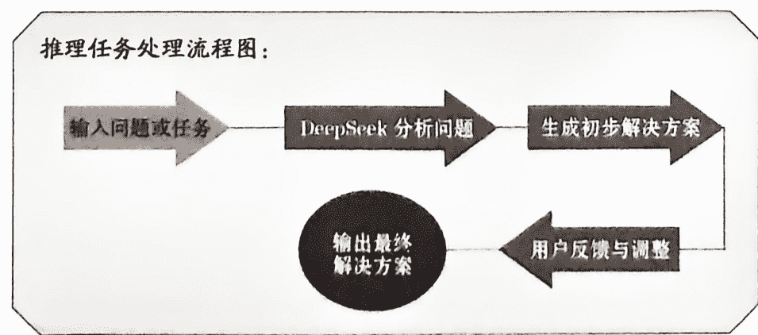
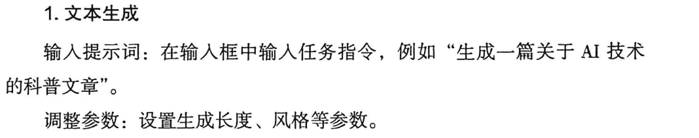
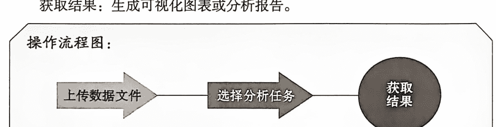
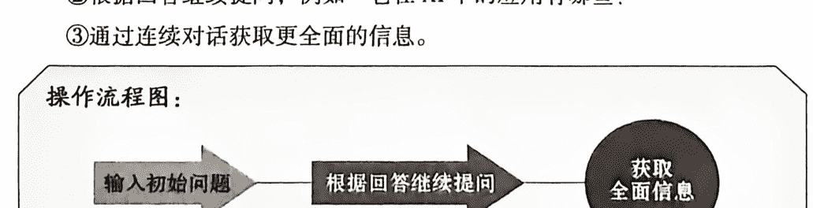
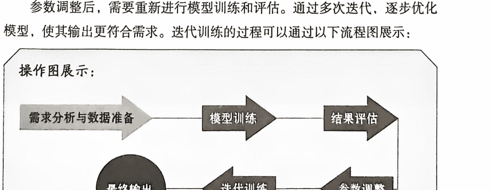
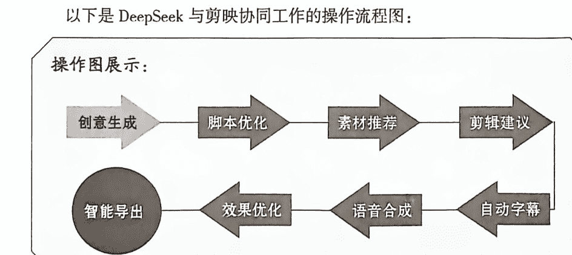
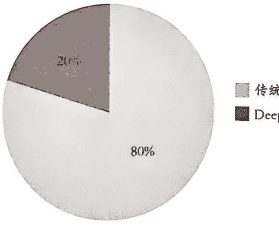
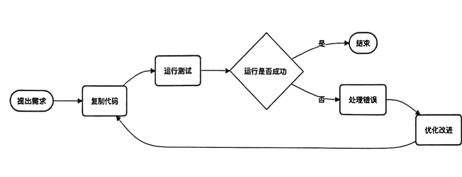
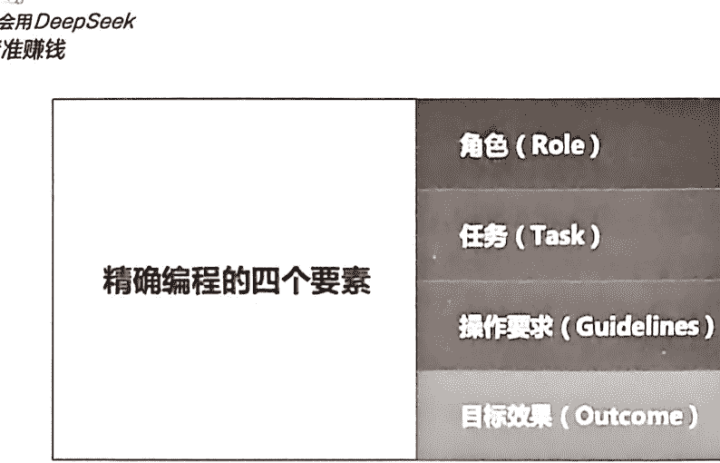

# DeepSeek 实战变现手册

# 第一章 建立 DeepSeek 的使用能力与赚钱思路

生成式模型进入快车道，DeepSeek 迅速被从业者和爱好者盯上。你想搞明白这套系统却找不到入口？本章先梳理它的诞生轨迹，再拆解写作、代码、数据洞察等主要用法，感受它在不同场景的效果。随后给出环境搭建要点、关键操作和新手易踩的坑，并结合典型案例和操作技巧，助你快速上手并持续使用，为后续用它创造收益打基础。

### DeepSeek：驱动智能化流程的核心引擎

#### 产品概览
DeepSeek 由杭州深度求索人工智能基础技术研究有限公司发布，是一款国产开源的通用大模型。团队聚焦大模型研发与落地，强调高效低成本的智能方案。主推产品为开源推理模型 DeepSeek-R1 和基础模型 DeepSeek-V3，二者在写作、语义理解、编程辅助、数据分析与多模态处理上覆盖面较广。

差异化来自几项自研技术，比如混合专家架构 MoE 与多头潜在注意力 MLA。前者靠动态路由挑选最契合的子专家处理具体任务，后者通过压缩 KV 缓存降低推理开销。叠加大规模强化学习框架如 GRPO，进一步提升了复杂推理表现。

#### 背景脉络
该项目起源于国内量化投资头部企业幻方量化的孵化，2023 年成立。依托充足资金与技术积累，公司推动 AI 普惠，采用开源方式吸引全球开发者与研究者共建。

### 核心能力全景

#### 1. 内容产出与语义理解
内容产出是基础能力，覆盖多类任务：
| 能力项 | 说明 |
|---|---|
| 稿件撰写 | 按主题或关键词输出条理清晰、用语流畅的文章 |
| 营销文案 | 产出吸睛的广告文案，提升品牌声量 |
| 代码注释 | 自动为代码补充说明，方便阅读理解 |
| 结构化转换 | 将非结构化信息转为结构化格式，便于后续处理 |

语义理解方面，自然语言处理表现突出：
| 能力项 | 说明 |
|---|---|
| 情感判断 | 识别文本的正面、负面或中性倾向 |
| 意图捕捉 | 理解用户真实需求，实现更智能交互 |
| 知识推演 | 基于已有知识进行逻辑推理，解决复杂问题 |
| 多语互译 | 支持多种语言互译，打破语言障碍 |

#### 2. 编程辅助
在开发场景可显著提效：
| 能力项 | 说明 |
|---|---|
| 代码生成与补全 | 依据上下文自动补全或生成片段，减少重复劳动 |
| 代码解读与调试 | 帮助理解复杂逻辑并给出调试建议 |
| 技术文档整理 | 自动生成或整理文档，便于团队协作沉淀 |
| 数学求解 | 在推导与算法竞赛中表现优异，可快速解答难题 |

#### 3. 数据洞察与可视化
数据侧提供强力工具：
| 能力项 | 说明 |
|---|---|
| 数据分析 | 支持清洗、统计、回归、聚类等任务 |
| 图表呈现 | 输出柱状图、折线图、散点图等，直观展示结果 |

#### 4. 多模态处理
可协同处理多种数据类型：
| 能力项 | 说明 |
|---|---|
| 文件上传与图像识别 | 实现图文识别、图表生成及多模态融合 |
| 跨模态推理 | 融合视觉与文本，完成高效推理与联合输出 |

#### 5. 智能问答与商业决策
在问答与决策场景表现突出：
| 能力项 | 说明 |
|---|---|
| 智能问答 | 提供精准自然语言问答，覆盖教育、科技、生活等 |
| 决策支持 | 涵盖风险评估、参数对比、性价比分析等，助力企业决策 |

## DeepSeek 如何产生商业价值

#### 1. 电商推广实战
电商竞争激烈，精准投放决定盈利。DeepSeek 可作为商家助手。借助其创作能力撰写吸睛的商品详情。

以智能手表为例，模型能深入解析运动监测、时尚外观、长续航等卖点，结合目标人群偏好，生成富有感染力的推广文案，突出运动体验与时尚属性，吸引潜在买家，提升成交。

同时利用数据分析挖掘历史销售数据，解析不同区域、年龄层的购买偏好，有针对性地调整投放策略，实现精准营销，降低成本，提升投入产出比。

| 支持方式 | 具体动作 | 示例商品 | 成效 |
|---|---|---|---|
| 文本创作 | 借助模型撰写商品描述 | 智能手表 | 突出卖点，吸引关注，提高销量 |
| 数据挖掘 | 利用模型分析销售数据 | / | 解析偏好，精准营销，提升 ROI |

#### 2. 自媒体内容变现
对创作者而言，优质内容是引流与变现基础。DeepSeek 可快速产出新颖有价值的内容。

例如科技类自媒体撰写新品评测时，模型能提供性能分析、市场对比及用户体验模拟，创作者在此基础上优化，节省大量时间。

此外，模型可分析热搜话题，给出选题建议，让内容更贴合热点，吸引更多读者。账号起量后，还可借助模型撰写与品牌高度契合的推广文案，提高商务合作成功率，实现变现。

| 支持方式 | 具体动作 | 适用领域 | 成效 |
|---|---|---|---|
| 内容生成 | 模型提供框架，创作者优化 | 科技领域 | 节省时间，产出高质量内容 |
| 选题建议 | 分析热点并推荐选题 | / | 贴合热点，扩大阅读 |
| 品牌合作 | 协助撰写品牌推广内容 | / | 提升合作成功率，实现变现 |

### 技术亮点
核心技术包括：
| 技术 | 说明 |
|---|---|
| 混合专家模型 MoE | 动态路由选择适配专家，提升任务效率 |
| 多头潜在注意力 MLA | 减小 KV 缓存，实现推理成本显著下降并保持性能 |
| 大规模强化学习 | 通过 GRPO 等框架提升推理能力，处理复杂任务更高效 |

DeepSeek 是技术先进的通用大模型，覆盖文本创作、语义理解、编程辅助、数据分析、多模态处理和智能问答。通过 MoE、MLA 与强化学习等创新，降低计算成本的同时提升性能，在多场景中展现出色效果。

### 附录：功能对照一览
| 类别 | 具体功能 | 典型场景 |
|---|---|---|
| 文本创作 | 文章、文案、代码注释生成 | 广告创作、技术文档 |
| 语义理解 | 情感分析、意图识别、翻译 | 多语客服、知识问答 |
| 编程辅助 | 代码生成、调试优化 | 开发者工具、自动化审查 |
| 数据洞察 | 业务分析、数据可视化 | 商业决策、趋势分析 |
| 多模态处理 | 图像识别、文档解析 | 文档管理、跨模态推理 |

## 小测验
开启探索前，先检验基础认知：
1. 该工具主要聚焦的人工智能方向？
   A. 通用人工智能，提供多场景服务
   B. 仅图像识别
   C. 主要用于游戏开发
2. 核心研发理念？
   A. 开源共享推动创新与普及
   B. 技术垄断限制使用
   C. 仅服务特定企业
3. 数据处理能力体现在？
   A. 可快速处理大规模复杂数据
   B. 仅能处理简单文本
   C. 处理速度慢效率低
4. 应用生态覆盖？
   A. 办公、学习、创作、科研等
   B. 仅娱乐
   C. 仅商业营销

评分：A 3分，B 2分，C 1分。10-12分认知全面；7-9分了解尚可需巩固；4-6分建议加强学习。

## 快速部署：从零搭建运行环境
DeepSeek 适用于数据分析、机器学习与深度学习任务。以下步骤帮助初学者快速上手。

### 硬件要求：设备是否达标
开始前核对配置：
| 组件 | 最低配置 | 推荐配置 |
| :--- | :--- | :--- |
| CPU | 4 核处理器 | 8 核及以上 |
| 内存 | 8GB | 16GB 及以上 |
| 硬盘 | 50GB 可用空间 | 100GB 及以上 |
| GPU | 无，仅 CPU | NVIDIA GTX 1060 及以上 |

提示：若需训练复杂神经网络，建议使用高性能 GPU 以加速计算。

### 软件准备：搭建基础环境
#### 1. 选择操作系统
DeepSeek 可在 Windows、Linux、macOS 上运行。本文以 Ubuntu 20.04 LTS 为参考，其他系统操作类似。

#### 2. 安装 Ubuntu
① 下载镜像：访问官网获取 Ubuntu 20.04 LTS 镜像。
② 制作启动盘：使用 Rufus 或 Etcher 将镜像写入 U 盘。
③ 安装系统：重启后从 U 盘启动，按提示完成安装。

### 安装必需软件
#### 1. 部署 Java
运行环境推荐 OpenJDK 17：
```bash
sudo apt update
sudo apt install openjdk-17-jdk
```
安装后校验：
```bash
java -version
```
若输出 openjdk 17.0.x 则安装成功。

#### 2. 部署 Python
可用的 Python 3.7 以上，推荐 3.8：
```bash
sudo apt install python3.8 python3.8-venv python3.8-dev
```

#### 3. 配置 CUDA 与 cuDNN（可选）
如有 NVIDIA GPU 并希望加速，可配置：
① 部署 CUDA：前往 NVIDIA 官网下载适配版本并安装。
② 部署 cuDNN：下载与 CUDA 匹配版本，按官方文档安装。

### DeepSeek 安装与配置
#### 1. 获取 DeepSeek
访问官网 www.deepseek.com 获取最新安装包。

#### 2. 安装 DeepSeek
① 解压安装包：
```bash
tar -zxvf deepseek-x.x.x.tar.gz
```
② 进入目录：
```bash
cd deepseek-x.x.x
```
③ 执行安装脚本：
```bash
./install.sh
```

#### 3. 配置环境变量
① 打开终端编辑 ~/.bashrc：
```bash
nano ~/.bashrc
```
② 文件末尾添加：
```bash
export DEEPSEEK_HOME=/path/to/deepseek
export PATH=$PATH:$DEEPSEEK_HOME/bin
```
将 /path/to/deepseek 换成实际解压路径。
③ 使配置生效：
```bash
source ~/.bashrc
```

#### 4. 验证安装
执行：
```bash
deepseek --version
```
若显示版本号则安装成功。

# 第一章 系统掌握 DeepSeek 的进阶路径

## 常见问题与解决办法
- 1. 安装失败
问题：提示缺少依赖。
解决：确认已部署 Java、Python 等必要依赖后重跑安装脚本。
- 2. GPU 加速未启用
问题：未检测到 GPU。
解决：检查 CUDA 与 cuDNN 是否正确配置及环境变量设置。
- 3. 运行缓慢
问题：运行速度慢。
解决：优化硬件，增加内存或使用更高性能 GPU。

完成以上步骤即表明环境搭建成功，可开始数据分析、机器学习等任务。遇到问题可参照本节。

## DeepSeek 精准创造价值
- 1. 优化电商客服，提升转化
环境搭建后，电商企业可用智能问答功能升级客服。将常见咨询与售后问题数据用于训练，模型可快速给出专业解答。
例如客户询问护肤品适合肤质时，系统可依据成分与功效给出建议并推荐搭配。高效精准的服务提升购物体验与信任度，从而提高转化率，并为产品与策略改进提供依据。

| 应用场景 | 操作方式 | 具体示例 | 最终效果 |
|---|---|---|---|
| 电商客服优化 | 用常见问题训练模型提供智能问答 | 客户问肤质适用性，模型给出成分建议及搭配 | 提升体验与信任，提高转化，助力改进产品策略 |

- 2. 自由职业者项目报价应用
自由职业者报价需精准。DeepSeek 可协助成本与价值分析，实现合理报价。
如平面设计师承接品牌海报项目时，模型可结合项目复杂度、设计元素、市场均价及个人经验给出报价建议，并分析客户预算与期望，调整策略提升签单率。同时可协助起草合同条款，明确权责，避免纠纷。

| 应用场景 | 操作方式 | 具体示例 | 最终效果 |
|---|---|---|---|
| 项目报价 | 按复杂度等分析成本价值并制定合同 | 设计师接海报项目，模型给出报价并据客户调整 | 精准报价，提高承接率，保障利益 |

## 读者测试
合适环境是高效运行的基础。
- 1. 为实现高效运行，推荐 CPU 核心数至少为？
   A. 4 核及以上
   B. 2 核
   C. 1 核
- 2. 运行 DeepSeek 至少需要多大内存？
   A. 8GB
   B. 4GB
   C. 2GB
- 3. 以下哪种数据库管理系统兼容性较好？
   A. MySQL
   B. Access
   C. FoxPro

- 4. 在部署 DeepSeek 相关程序时，开放网络端口的核心作用是什么？

   A. 保证客户端与服务端之间的数据传输通畅
   B. 方便程序实现自动更新
   C. 允许与其他设备进行数据共享

评分说明：
选 A 得 3 分，选 B 得 2 分，选 C 得 1 分。

10 ~ 12 分：对 DeepSeek 的软硬件环境需求理解到位，搭建运行环境不成问题。
7 ~ 9 分：对环境要求有基本认知，部分细节还需再核实。
4 ~ 6 分：对运行环境认识不足，建议系统补学，避免安装使用受阻。

## 30分钟速成：DeepSeek核心操作速通

DeepSeek 已广泛覆盖数据分析、文案撰写、任务管理等场景。以下结合步骤说明、对照表与实操案例，帮助你快速抓住使用要点，让产出更完整、清晰、实用。

## DeepSeek 的核心功能详解

1. 深度思考与推理

DeepSeek 的核心竞争力在于推理能力。典型使用路径如下：



> 示例：如何提高团队协作效率？

输出：

① 选用协作工具，如 Slack、Trello。
② 明确任务分工与责任归属。
③ 定期召开会议保持信息同步。

## 2. 文件处理与复杂任务

DeepSeek 支持导入文档并提取关键信息。常见处理方式如下：

| 功能 | 支持格式 | 典型应用场景 |
|---|---|---|
| 文本抽取 | PDF、Word | 提取合同核心条款 |
| 数据分析 | Excel | 生成销售数据图表 |
| 摘要生成 | PDF、Word | 输出长文档精简摘要 |

> 示例：上传 Excel 表格并生成分析报告。

① 点击“上传文件”，选择 Excel。
② 输入指令：“请分析销售数据并生成图表”。
③ DeepSeek 自动完成分析并给出可视化结果。

## 高效使用 DeepSeek 的技巧

## 1. 提问模板与优化

| 步骤 | 示例 |
|---|---|
| 背景 | 我是一名创业者，正在开发健康管理 App |
| 任务 | 需要一份市场推广方案 |
| 要求 | 预算 5 万元，目标用户为 25 - 35 岁白领 |
| 补充 | 主打“智能健康监测”，希望突出科技感 |

### 万能提问模板

## 2. 结果校验与风险防控

校验方法：
① 检查逻辑是否自洽。
② 核对关键数据是否准确。
③ 评估输出是否符合需求。

风险防控：
① 避免 AI 幻觉，对生成内容进行二次验证。
② 结合人工判断，确保结果可信。

## 实战案例演示

案例 1：咖啡馆开业促销方案
背景：大学城新开精品咖啡店
任务：制定开业促销方案
要求：预算 1 万元，目标群体为大学生
补充：希望结合校园活动进行推广

DeepSeek 生成方案
活动主题：校园咖啡文化节；
促销策略：学生凭学生证享受 8 折优惠；
社交媒体推广：联合校园 KOL 进行宣传

案例 2：远程办公文章撰写
任务：撰写一篇关于远程办公未来发展的文章。
步骤：
① 生成大纲，引言、主要论点、结论；
② 逐步完善各部分内容。

## 核心功能操作示例

1. 文本生成

输入提示词：在输入框中输入任务指令，例如“生成一篇关于 AI 技术的科普文章”。
调整参数：设置生成长度、风格等参数。
生成结果：点击“生成”按钮，获取输出内容。



2. 编程支持

输入代码需求：例如“用 Python 实现一个快速排序算法”。
选择语言：设置编程语言，如 Python、Java 等。
生成代码：点击“生成”按钮，获取代码并支持调试。


3. 数据分析

上传数据文件：支持 CSV、Excel 等格式。
选择分析任务：例如“生成销售数据的趋势分析图表”。
获取结果：生成可视化图表或分析报告。



## 高级功能使用技巧

## 1. 多轮对话

操作步骤：
- ① 输入初始问题，例如“什么是强化学习？”
- ② 根据回答继续提问，例如“它在 AI 中的应用有哪些？”
- ③ 通过连续对话获取更全面的信息。



## 2. 任务分解

操作步骤：
- ① 输入复杂任务，例如“写一篇关于 AI 在医疗领域应用的文章”。
- ② 使用 SPECTRA 模型将任务分解为多个子任务，例如“AI 在诊断中的应用”“AI 在药物研发中的应用”等。
- ③ 分别生成内容后整合为一篇完整的文章。


## DeepSeek 精准创造价值

1. 用 DeepSeek 优化联盟营销推广策略

从事联盟营销的人员可以利用 DeepSeek 提升推广效果，有效增加收入。DeepSeek 能够通过分析不同联盟产品的特点、目标受众以及市场竞争情况，为推广者制定个性化的推广策略。

比如，推广一款在线英语学习课程时，DeepSeek 可以建议在教育类社交媒体群组、英语学习论坛等平台投放，并提供吸引人的推广话术，强调课程的专业师资、个性化教学模式以及学员的成功案例。同时，还可以跟踪推广链接的点击量、转化率等数据，及时调整推广策略，提高推广效率，让推广者获得更多联盟佣金。

| 应用场景 | 操作方式 | 具体示例 | 最终效果 |
| :--- | :--- | :--- | :--- |
| 联盟营销推广 | 分析联盟产品特点、受众、竞争状况，制定推广策略并跟踪数据调整 | 推广在线英语学习课程，建议在社交媒体群组、英语学习论坛推广，提供含师资、教学模式、学员案例的话术 | 提高推广效率，增加联盟佣金收入 |

2. DeepSeek 在股票投资分析中的应用实现盈利

股票投资者可以借助 DeepSeek 的数据分析和推理能力辅助投资决策。DeepSeek 可以收集和分析大量的股票市场数据，包括公司财务报表、行业趋势、宏观经济指标等，对股票的走势进行预测和分析。

例如，通过对某公司财务数据进行深入分析，DeepSeek 可以评估其盈利能力、偿债能力和成长潜力，为投资者提供是否值得投资的建议。同时，它还能结合市场情绪和行业动态，帮助投资者把握投资时机，制定合理的投资组合策略。投资者可以根据 DeepSeek 的分析结果进行精准投资，提高投资收益，降低投资风险。

| 应用场景 | 操作方式 | 具体示例 | 最终效果 |
|---|---|---|---|
| 股票投资分析 | 收集分析股票市场大量数据，包含公司财报、行业趋势、宏观经济指标等 | 分析某公司财务数据评估盈利能力、偿债能力与成长潜力，结合市场情绪和行业动态提供投资建议 | 辅助投资者精准投资，提高收益，降低风险 |

## DeepSeek 的功能对比表

| 功能类别 | 具体功能 | 操作步骤 | 适用场景 |
|---|---|---|---|
| 文本生成 | 文章、文案、代码注释生成 | 输入提示词 → 调整参数 → 生成结果 | 广告创作、技术文档生成 |
| 编程支持 | 代码生成、调试优化 | 输入代码需求 → 选择语言 → 生成代码 | 开发者工具、自动化代码审查 |
| 数据分析 | 业务分析、数据可视化 | 上传数据文件 → 选择分析任务 → 获取结果 | 商业决策支持、市场趋势分析 |
| 多轮对话 | 连续提问获取全面信息 | 输入初始问题 → 根据回答继续提问 → 获取全面信息 | 知识问答、复杂问题解决 |
| 任务分解 | 复杂任务分解与整合 | 输入复杂任务 → 分解为子任务 → 生成并整合内容 | 长文本生成、多步骤任务处理 |

## 总结与进阶建议

为了进一步提升使用效率，建议做到以下三点：
- ① 持续练习：多尝试不同场景的提问，积累经验。
- ② 优化提示词：根据任务性质调整提问方式。
- ③ 结合其他工具：如 Coze 用于文案创作，Midjourney 用于图片生成。

通过本文的详细介绍，你已掌握 DeepSeek 的核心功能及使用方法。无论是文本生成、编程支持还是数据分析，DeepSeek 都能提供高效、精准的解决方案。快来尝试这款强大的 AI 工具，开启高效智能的新体验吧！

## 读者测试

想在短时间内快速掌握 DeepSeek 的核心操作吗？接下来的测试题将检验你对核心操作的掌握情况。

1. 在使用 DeepSeek 进行文本生成时，若希望生成一篇具有特定风格的文章，应该如何操作？ ( )
A. 在输入提示词时明确说明风格要求，如“生成一篇幽默风格的科普文章”
B. 生成文章后手动修改风格
C. 无法实现特定风格文章的生成

2. 利用 DeepSeek 进行数据分析，在上传数据文件后，下一步操作是什么？ ( )
A. 选择分析任务，如生成趋势分析图表
B. 直接获取分析结果
C. 调整数据文件格式

3. 在 DeepSeek 的多轮对话功能中，若初始问题为“什么是人工智能？”根据回答继续提问“人工智能在医疗领域有哪些应用？”这体现了多轮对话的什么优势？ ( )
A. 获取更全面的信息
B. 加快回答速度
C. 简化操作流程

4. 当使用 DeepSeek 执行复杂任务，如写一篇关于 AI 在教育领域应用的文章时，采用任务分解的方式，第一步应该做什么？ ( )
A. 使用 SPECTRA 模型将任务分解为子任务
B. 直接开始写作
C. 收集相关资料

评分标准：
选 A 得 3 分，选 B 得 2 分，选 C 得 1 分。

10~12 分：你对 DeepSeek 核心操作掌握熟练，能灵活运用各项功能高效完成任务。
7~9 分：基本了解核心操作，但在操作细节和功能运用上还有提升空间，需加强练习。
4~6 分：对 DeepSeek 核心操作的理解和应用存在不足，需要系统学习并通过实践巩固。

## 新手避坑指南：常见问题与高效的解决方案

DeepSeek 作为一款强大的 AI 工具，凭借其多模态能力和高效的推理模型，迅速成为用户提升工作效率的得力助手。然而，对于新手用户来说，在使用过程中可能会遇到一些常见问题，比如卡顿、回答不精准、功能不熟悉等。本文将为你提供一份详细的避坑指南，帮助你快速上手并高效使用 DeepSeek。

## DeepSeek 的三大避坑点

### 1. 认准信息源

新手用户常因信息源不准确而陷入困惑。以下是 DeepSeek 的官方信息源：
- 1. 微信公众号：DeepSeek。
- 2. 小红书：@DeepSeek (deepseek ai)。
- 3. X(Twitter)：DeepSeek(@deepseek ai)。
- 4. 官方提示词网站：DeepSeek 提示词库。

避坑建议：务必从官方渠道获取信息，避免使用非官方教程或工具。

### 2. 熟用功能键

DeepSeek 提供了多种功能模式，新手用户常因不了解功能差异而影响使用体验。
- 1. 深度思考（R1）：擅长逻辑推理和复杂问题解答，但回答速度较慢。
- 2. 联网搜索：获取实时信息，适合需要最新数据的场景。
- 3. V3 基础模型：默认模式，回答速度快，适合百科知识类问题。

避坑建议：根据需求选择合适的功能模式。例如，处理复杂问题时启用 R1 模式；查询实时信息时开启联网搜索。

### 3. 避免提问过于极端

新手用户常因提问过于模糊或极端而得不到满意答案。
避坑建议：
- 清晰描述需求：避免模糊提问，明确目标、背景和限制条件。
- 分步拆分任务：将复杂任务拆解为多个步骤，逐步细化需求。

## 常见问题与高效的解决方案

## 1. 卡顿与延迟问题

问题描述：使用过程中出现卡顿或延迟，影响体验。
解决方案：
- 优化网络连接：使用网络加速工具（如迅游加速器）提升连接稳定性。
- 本地化部署：对于高频用户，建议通过迅游一键部署功能，将 DeepSeek 设置在本地计算机上。

流程图：解决卡顿问题的步骤
```
graph TD
    A[遇到卡顿问题] --> B{检查网络连接}
    B -->|网络不稳定| C[使用网络加速工具]
    B -->|网络稳定| D{是否为高频用户}
    D -->|是| E[本地化部署 DeepSeek]
    D -->|否| F[继续使用云端服务]
```

## 2. 回答不精准

问题描述：AI 回答偏离预期，甚至出现“幻觉”。
解决方案：
- 精准提问：提供背景信息和具体需求。例如，“用 Python 写一个从 CSV 文件中读取数据并生成柱状图的代码，要求使用 Pandas 和 Matplotlib 库”。
- 结果校验：对关键信息进行二次验证。

| 提问示例对比 |
| :--- | :--- |
| 模糊提问 | 精准提问 |
| “帮我写个代码。” | “用 Python 写一个从 CSV 文件中读取数据并生成柱状图的代码，要求使用 Pandas 和 Matplotlib 库。” |
| “分析销售数据。” | “分析 2023 年的公司销售数据趋势，找出增长率最高的三个产品，并提出 2024 年的营销建议。” |

## 3. 功能不熟悉

问题描述：新手用户对 DeepSeek 的功能模式和使用技巧不了解。
解决方案：
- 学习官方教程：参考《高效使用 DeepSeek》一书，掌握从基础到进阶的使用技巧。
- 使用提示词模板：通过官方提示词库获取常用模板，快速上手。

| 功能模式对比 |
| :--- | :--- | :--- |
| 模式 | 特点 | 适用场景 |
| 深度思考(R1) | 擅长逻辑推理，回答速度较慢 | 复杂问题解答、决策分析 |
| 联网搜索 | 可获取实时信息 | 查询最新数据、市场动态 |
| V3 基础模型 | 回答速度快，适合百科知识类问题 | 快速查询、简单任务处理 |

## 高效使用 DeepSeek 的技巧

## 1. 提问的艺术
- 简洁明了：用自然语言清晰表达需求。
- 多维提问：通过角色扮演让 AI 从多个角度思考问题。例如，“你是一个资深产品经理，请从用户体验的角度分析这个功能设计……”

## 2. 文件处理与数据交互
- 上传文件：支持 PDF、Excel、Word 等格式，可要求 AI 总结内容或提取关键数据。
- 表格数据处理：粘贴表格数据或上传 Excel 文件后，可执行排序、计算、可视化建议等操作。

## 3. 高级功能挖掘
- 联网搜索：获取实时信息，如“查询今日纽约证券交易所黄金期货价格，并分析近期走势原因”。
- 代码调试与优化：粘贴代码并描述问题，请求 AI 解释错误或优化性能。

通过掌握以上避坑点和高效使用技巧，新手用户可以快速上手 DeepSeek，并将其应用于办公、学习、生活等多个场景。

## DeepSeek 精准创造价值

## 1. DeepSeek 在代运营业务中的盈利应用

随着电商行业的发展，代运营业务需求日益增长，从业者可利用 DeepSeek 更好地服务客户并实现盈利。在店铺运营方面，DeepSeek 能分析竞品店铺的优势与不足，为代运营店铺制定差异化的运营策略。

例如，分析竞品的商品定价、促销活动、页面设计等，为代运营店铺提供定价建议、策划独特的促销活动以及优化店铺页面布局，提升店铺竞争力，吸引更多顾客，增加代运营业务收入。在客户服务方面，DeepSeek 可以自动处理常见的客户咨询，快速响应客户需求，提高客户满意度，为代运营店铺赢得更多好评和回头客，进一步巩固与客户的合作关系，拓展业务规模。

| 应用方向 | DeepSeek 具体作用 | 示例 | 带来的盈利效果 |
| --- | --- | --- | --- |
| 店铺运营 | 分析竞品店铺，制定差异化运营策略 | 分析竞品定价、促销、页面设计，为代运营店铺提供定价建议、策划促销活动、优化页面布局 | 提升店铺竞争力，增加代运营业务收入 |
| 客户服务 | 自动处理常见客户咨询 | 快速响应需求 | 赢得好评与回头客，巩固合作关系，拓展业务规模 |

## 2. 借助 DeepSeek 开展知识付费课程制作与推广

如果你在某个领域有专业知识，可借助 DeepSeek 开发并推广知识付费课程来赚钱。DeepSeek 可以协助整理课程内容，将复杂的知识点进行系统梳理，使其更易于理解和学习。

比如，在制作编程类知识付费课程时，DeepSeek 能够生成详细的代码示例、案例分析以及深入浅出的讲解内容。利用 DeepSeek 的文本生成能力，撰写吸引人的课程推广文案，突出课程特色和优势，吸引更多学员购买课程。同时，还可以通过 DeepSeek 分析学员反馈数据，不断优化课程内容、提高课程质量，进而提升课程的口碑和销量，实现知识变现。

| 应用环节 | DeepSeek 具体作用 | 示例 | 带来的盈利效果 |
| --- | --- | --- | --- |
| 课程制作 | 协助整理课程内容，梳理复杂的知识点 | 制作编程类课程时，生成代码示例、案例分析与讲解内容 | 使课程更易理解学习，提升课程质量 |
| 课程推广 | 撰写课程推广文案 | / | 突出课程的特色优势，吸引学员购买 |
| 课程优化 | 分析学员反馈数据 | / | 不断优化课程，提升口碑与销量，实现知识变现 |

## 读者测试

本节的测试题聚焦于新手在使用时可能遇到的常见问题及对应的高效解决方案。通过测试，看看你是否已经掌握了这些避坑秘籍。

1. 新手使用 DeepSeek 时，为确保获取准确信息，应从哪里获取官方信息？( )

1. 想获取 DeepSeek 权威官方信息，下面的渠道最值得信任的是哪一个？( )
A. 官方微信公众号、小红书账号、X 平台以及官方提示词网站
B. 非官方论坛和个人博客
C. 在搜索引擎上随意检索相关内容

2. 网络通畅且使用频次很高的情况下，DeepSeek 出现卡顿与延迟，最合理的处理方式是？( )
A. 采用本地化部署
B. 继续使用云端服务
C. 更换网络设备

3. 为了让 DeepSeek 的回答更精准，提问时应该？( )
A. 给出充足背景和清晰需求，避免提问模糊
B. 尽量简化问题，减少信息供给
C. 随意提问，依赖模型自行揣测意图

4. 新手在熟悉 DeepSeek 功能时，以下做法不建议的是？( )
A. 参考非官方教程
B. 学习官方教程
C. 使用官方提示词库获取常用模板

评分标准：
选 A 得 3 分，选 B 得 2 分，选 C 得 1 分。
10～12 分：对新手避坑要点和常用对策把握较好，能有效规避常见问题。
7～9 分：了解部分避坑点和解决思路，但覆盖不够全面，需继续熟悉。
4～6 分：对新手使用指南的理解不足，建议加强学习以减少使用困扰。

# 第一章 DeepSeek 实操从入门到精通手册

# 第二章 以 DeepSeek 构建高效工作流

在日常工作中，大家都希望效率更高、流程更顺。DeepSeek 可以帮助重塑工作方式，支撑起一套全新的运转模式。本章将挖掘 DeepSeek 在职场的落地方法，讲解如何与 AI 高效沟通，通过打磨提问结构和交流方式，让模型更准确地捕捉需求。同时介绍如何把复杂任务拆细，把难题化繁为简，引导模型产出专业水准的结果。还会说明对 AI 结果进行迭代打磨的做法，用循环精修让产出更贴合预期。掌握这些要点后，工作会更得心应手，真正发挥工具价值。

## 对话技巧：让模型读懂你的意图

DeepSeek 以强劲的语言能力与友好的交互迅速获认可。但不少用户会遇到“模型没听懂”的尴尬，根源多在提问方式上。下面讲解如何优化提问结构和沟通习惯，让交互更顺畅。

### 高效提问框架：实现精准输出

1. 通用提问框架
DeepSeek 推荐的通用结构是：角色 + 任务 + 细节 + 呈现方式。

2. 进阶技巧
① 角色代入法：先设定人设提升针对性。例如：“请你扮演职业规划师，为应届毕业生给出 5 条实用的面试建议。”
② 任务拆解法：把复杂需求拆成可执行步骤。例如：“把写一篇优质自媒体文章拆成 5 步，说明选题、结构、SEO 要点。”
③ 多维对比法：从多角度分析。例如：“从价格、功能、易用性三方面比较市面上最火的两款手机，并推荐适合学生的机型。”

### 3. 框架的应用场景

| 场景 | 示例提问 |
|---|---|
| 旅行规划 | “预算 1000 元，帮我规划天津 3 天 2 晚的行程，重点推荐本地小吃。” |
| 内容创作 | “以小红书风格写一篇防晒霜文案，带 3 个 emoji。” |
| 编程辅助 | “用 Python 写一个自动整理桌面文件的脚本。” |
| 学术研究 | “概括这篇论文的创新点，并用表格对比第 3 页和第 5 页的数据差异。” |

### 沟通优化：提升理解度

#### 1. 避免常见错误
- 模糊提问：避免“怎么写好文章？”这类宽泛问题，改为“如何写科技类公众号的开头？需要制造悬念吸引中年读者”。
- 逻辑不清：保持问题结构清晰，避免主谓不符或时态混乱。

#### 2. 实用的优化手段
- 预热对话：先用普通模式聊几轮，等模型适应你的表达习惯再切到深度模式。
- 强制通俗化：要求模型用大白话解释专业概念。例如：“用小学生能懂的话解释 RLHF，并举个例子。”

#### 3. 递进提问与拆解
通过逐步追问优化结果。例如：
① 先让模型输出文章提纲；
② 依据提纲完善第一部分内容；
③ 分批生成后续内容并检查错漏。

### 实战案例：从提问到高效产出

1. 旅行规划案例
提问：预算 1000 元，帮我规划天津 3 天 2 晚的旅行攻略，重点推荐本地小吃，以表格形式呈现。
输出：模型生成包含交通、住宿、景点和美食推荐的详细表格。

2. 内容创作案例
提问：撰写一篇小红书风格的防晒霜文案，带 3 个 emoji。
输出：模型生成符合平台调性的文案。例如：“夏日必备！这款防晒霜轻薄不油腻，SPF50+ 强力防护，让你自在迎战阳光！”

3. 编程辅助案例
提问：用 Python 写一个自动整理桌面文件的脚本。
输出：模型生成可运行的 Python 代码，并附带使用说明。

通过打磨提问框架和沟通方式，用户能显著提升与 DeepSeek 的协作效率，让模型更精准理解需求。随着技术演进，DeepSeek 将持续带来更多创新体验。

## DeepSeek 创造价值

## 1. 利用 DeepSeek 精准制定房地产营销策略
销售和营销人员可通过优化对话，制定精准策略提升成交盈利。在明确目标客群后，用通用提问框架向 DeepSeek 询问针对特定区域、特定需求买家的营销方案。
例如，“作为资深房地产营销专家，针对有孩子的年轻家庭，为临近优质学区的楼盘制定营销方案，突出学区优势和宜居特点，以宣传海报文案和线上推广话术的形式输出”。DeepSeek 会据此生成对应内容，人员可制作吸睛海报和推广文案，精准触达目标客户，加快去化并提升利润。

| 应用主体 | 操作方式 | 示例 | 效果 |
|---|---|---|---|
| 房地产从业者 | 用通用框架询问特定购房群体的营销方案 | 询问学区盘面向有孩家庭的海报文案与推广话术 | 吸引目标客户，加速销售，提高利润 |

## 2. DeepSeek 助力广告投放精准定位与优化
广告从业者可借助 DeepSeek 实现投放的精准定位和效果优化，提升业务收益。询问方式如“分析某化妆品品牌的目标客群，并据此制定社交媒体广告投放策略，包括投放时段、形式、内容等”。
DeepSeek 能整合大量市场与用户行为数据，给出有针对性的建议。按此执行可提高投放精准度与吸引力，提升转化率，为客户带来更好效果，从而赢得更多业务与信任。

| 应用主体 | 操作方式 | 示例 | 效果 |
|---|---|---|---|
| 广告从业者 | 询问品牌目标群体及社媒投放策略 | 询问化妆品品牌目标群体与社媒投放方案 | 提升广告效果，赢得更多业务与信任 |

## 读者测试

掌握通用提问框架就能更精准地从 DeepSeek 获取所需信息。以下题目检验你对各要素的理解和运用能力。

1. 使用框架“角色 + 任务 + 细节 + 呈现方式”时，若要让 DeepSeek 生成旅游攻略，“7 天的行程安排，包含景点、美食推荐”属于哪个部分？( )
A. 细节
B. 任务
C. 呈现方式

2. 若想让 DeepSeek 以专业美食评论家的身份写一篇餐厅点评，“从餐厅环境、菜品口味、服务质量等方面进行评价”属于哪个部分？( )
A. 任务
B. 细节
C. 角色

3. 当省略框架中的“呈现方式”部分时，DeepSeek 的输出结果会怎样？( )
A. 以默认格式呈现，但可能不太符合特定需求
B. 无法生成有效结果
C. 按照最复杂的格式输出

4. 以下哪种提问方式更符合通用框架且能得到更精准的回答？( )
A. 以资深记者身份，写一篇关于科技行业发展趋势的文章，包含具体案例和数据，以报告格式呈现
B. 写一篇文章
C. 随便写点东西

评分标准：
选 A 得 3 分，选 B 得 2 分，选 C 得 1 分。
10 ~ 12 分：熟练掌握通用框架，能够精准获取所需信息，提问效率高。
7 ~ 9 分：基本理解框架原理，但在实际应用中对部分要素把握还不够准确，需多实践。
4 ~ 6 分：对框架的理解和运用存在较多不足，需要深入学习和练习。

## 任务拆解大师：让 DeepSeek 输出专业级成果

想充分发挥 DeepSeek 潜能，关键在于学会把复杂任务拆成可控步骤，并指导模型高质量完成。本文详解如何通过分步引导，快速驾驭 DeepSeek。

### 复杂任务分解
把复杂任务拆成可管理步骤，需先明确目标和需求。通用拆解框架如下：

| 步骤 | 描述 |
|---|---|
| 1. 定义任务目标 | 明确任务的具体目标和预期输出 |
| 2. 收集必要信息 | 收集完成任务所需的所有数据和信息 |
| 3. 分解任务 | 将复杂任务分解为多个子任务 |
| 4. 分配资源 | 确定每个子任务所需的资源，如时间、人力、工具等 |
| 5. 执行子任务 | 逐步完成每个子任务 |
| 6. 整合输出 | 将所有子任务的输出整合为最终结果 |
| 7. 评估和优化 | 评估任务完成情况，优化流程以提高效率 |

### 分步指导模型完成高质量输出

1. 定义任务目标
使用 DeepSeek 前先明确具体目标。例如生成市场分析报告，目标可设定为“产出一份包含市场趋势、竞争对手分析和未来预测的报告”。

2. 收集必要信息
汇总任务所需数据。例如市场分析报告需要市场趋势数据、竞争对手财务报告、行业专家观点等。

3. 分解任务
将整体任务拆分为子任务。例如市场分析可拆为：
① 市场趋势分析：分析当前市场走向；
② 竞争对手分析：分析主要竞争对手财务状况与市场策略；
③ 未来预测：基于现有数据预测市场发展方向。

4. 分配资源
明确各子任务所需资源。例如：

| 子任务 | 所需资源 |
| --- | --- |
| 市场趋势分析 | 市场数据、分析工具 |
| 竞争对手分析 | 财务报告、竞争对手信息 |
| 未来预测 | 预测模型、行业专家意见 |

5. 执行子任务
利用 DeepSeek 逐步完成各子任务。
#### ① 市场趋势分析
- 输入数据：将市场数据导入 DeepSeek；
- 选择分析模型：如时间序列分析；
- 生成报告：自动产出市场趋势分析报告。
#### ② 竞争对手分析
- 输入数据：导入财务报告和市场策略信息；
- 选择分析模型：竞争对手分析模型；
- 生成报告：自动产出竞争对手分析报告。
#### ③ 未来预测
- 输入数据：导入当前市场数据和趋势预测模型；
- 选择预测模型：如回归分析；
- 生成报告：自动产出未来市场预测报告。

6. 整合输出
将各子任务结果整合为完整市场分析报告。DeepSeek 可自动汇总生成最终文档。

7. 评估和优化
评估完成情况并优化流程。若某子任务输出质量不佳，可调整输入数据或更换分析模型。

通过分步拆解并引导模型输出，用户可迅速发挥 DeepSeek 潜力。本文以通用拆解框架和市场分析实例展示了实际应用方法。

## DeepSeek 创造价值

## 1. DeepSeek 在项目管理咨询中的应用盈利模式
项目管理咨询师可借助 DeepSeek 提升服务质量，拓展盈利空间。为企业提供咨询时，将复杂项目任务拆解，用 DeepSeek 分析各子任务的资源需求、潜在风险等。
例如在大型软件开发项目中，DeepSeek 可帮助分析各开发阶段所需技术人员数量、技能要求及可能出现的技术难题和风险。咨询师据此为企业制定更合理的项目计划和风险管理方案，收取更高费用。同时可跟踪项目进度，及时发现问题并提供解决方案，提升客户认可度，促进长期合作。

| 应用主体 | 操作方式 | 具体示例 | 盈利相关效果 |
| :--- | :--- | :--- | :--- |
| 项目管理咨询师 | 将项目管理任务拆解，借助 DeepSeek 分析子任务资源需求、潜在风险等，跟踪进度并提供解决方案 | 在大型软件开发项目中，分析各阶段技术人员需求、技能要求及技术难题风险 | 制定合理方案，收取更高咨询费，提升企业认可度，促进长期合作 |

## 2. 通过 DeepSeek 优化供应链管理增加企业利润
供应链管理人员可借助 DeepSeek 优化流程、降低成本、增加利润。将供应链管理拆分为采购、生产、仓储、物流等子任务，用 DeepSeek 分析各环节成本构成、效率瓶颈等。
例如采购环节，DeepSeek 可分析原材料价格走势、供应商信誉和供货能力，助力企业选优降本；物流环节，可优化路线规划，提升运输效率，降低物流成本。整体成本下降后利润空间扩大，管理人员也因成效获得更好职业发展和经济回报。

| 应用主体 | 操作方式 | 具体示例 | 利润增加相关效果 |
| :--- | :--- | :--- | :--- |
| 供应链管理人员 | 把供应链管理任务分解，利用 DeepSeek 分析各环节成本构成、效率瓶颈等 | 采购环节分析原材料价格走势、供应商情况选优；物流环节优化路线规划 | 利润空间扩大，助力员工获得更好的职业发展和经济回报 |

## 读者测试

面对复杂任务，拆解能力是关键。以下题目考查你对拆解原则、方法和评估的掌握。

1. 对于大型软件开发项目，将其拆解为需求分析、设计、编码、测试等子任务，主要依据的原则是什么？ ( )
A. 任务的逻辑顺序和功能模块划分
B. 随机拆分，没有特定规律
C. 按照开发人员的个人喜好拆分

2. 在任务拆解过程中，如何确定每个子任务的合理时间节点？ ( )
A. 参考以往类似项目的经验，结合任务难度和资源情况确定
B. 随意设定时间，不考虑实际情况
C. 只考虑任务的紧急程度，不考虑其他因素

3. 当子任务之间存在依赖关系时，应该如何处理？ ( )
A. 按照依赖顺序依次安排任务，确保前置任务完成后再开始后续任务
B. 同时开展所有子任务，不考虑依赖关系
C. 先完成依赖关系复杂的任务，再处理简单的任务

4. 任务拆解完成后，如何对拆解结果进行评估和优化？ ( )
A. 检查子任务是否完整覆盖原任务，是否具有可操作性和可衡量性
B. 不进行评估，直接按照拆解结果执行
C. 只看子任务的数量，越多越好

评分标准：
选 A 得 3 分，选 B 得 2 分，选 C 得 1 分。
10~12 分：具备出色的任务拆解能力，能够科学合理地将复杂任务拆解为可执行的子任务。
7~9 分：掌握了任务拆解的基本方法，但在时间安排、依赖处理等方面还需要进一步优化。
4~6 分：在任务拆解上存在较大困难，需要学习相关原则和技巧，提高拆解能力。

## 输出优化：迭代式 AI 结果精修术

DeepSeek 提供强大功能和灵活配置，用户可通过结果优化与迭代逐步提升输出质量。本文介绍如何通过 DeepSeek 进行结果优化与迭代，让输出更符合实际需求。

### 结果优化与迭代的基本流程
使用 DeepSeek 进行结果优化与迭代，通常遵循以下流程：
1. 需求分析：明确 AI 输出的具体需求，确定优化目标。
2. 数据准备：收集和整理用于训练和测试的数据集。
3. 模型训练：使用 DeepSeek 进行初步模型训练。
4. 结果评估：评估模型的输出结果，识别不足之处。
5. 参数调整：根据评估结果，调整模型参数。
6. 迭代训练：重复训练和评估过程，逐步优化模型。
7. 最终输出：获得符合需求的 AI 输出。

### 需求分析与数据准备

#### 1. 需求分析
开始优化前需明确 AI 输出的具体需求。例如在自然语言处理任务中，可能要求生成的文章具有特定风格、语气或结构。需求明确后，后续优化更有针对性。

#### 2. 数据准备
数据是模型训练的基础。为获得高质量输出，需准备充足且高质量的训练数据。具体步骤包括：
① 数据收集：从各渠道收集相关数据；
② 数据清洗：去除噪声，确保数据准确一致；
③ 数据标注：对数据进行标注，使模型能学到正确模式。

数据准备示例：

| 数据来源 | 数据类型 | 数据量 | 数据质量 | 备注 |
|---|---|---|---|---|
| 公开数据集 | 文本 | 10000 条 | 高 | 已标注 |
| 企业内部数据 | 文本 | 5000 条 | 中 | 需清洗 |
| 网络爬取数据 | 文本 | 20000 条 | 低 | 需清洗和标注 |

### 模型训练与结果评估

#### 1. 模型训练
在 DeepSeek 中，模型训练是关键。用户可按以下步骤操作：
① 选择模型：根据任务需求选择合适的模型架构；
② 配置参数：设置学习率、批量大小、训练轮数等参数；
③ 开始训练：启动训练过程，DeepSeek 自动进行模型训练。

模型训练参数示例：

| 参数名称 | 参数值 | 说明 |
|---|---|---|

| 学习率 | 0.001 | 控制模型参数更新的步长 |

| 批量大小 | 32 | 每次训练使用的样本数量 |

| 训练轮数 | 10 | 模型训练的迭代次数 |

#### 2. 成效检验
模型跑完后需对产出做一次全面复盘。不同任务的评判维度差异很大，例如在文本生成场景里，BLEU、ROUGE 常被用来衡量生成质量。测评结果能够暴露模型的短板，为后续调优提供方向。

评估示例：

| 评估指标 | 评估值 | 目标值 | 是否达标 |

| :--- | :--- | :--- | :--- |

| BLEU 分数 | 0.75 | 0.80 | 否 |

| ROUGE 分数 | 0.85 | 0.90 | 否 |

| 生成速度 | 10ms/字 | 5ms/字 | 否 |

### 参数调整与迭代训练

#### 1. 参数调整
参照测评反馈，可以对超参数进行修正。常见做法有：

① 调节学习率：上调或下调学习率，来控制收敛节奏。
② 延长训练轮数：增加训练时长，让模型更充分拟合数据。
③ 变更批量大小：改变单次迭代的样本量，进而影响收敛稳定性。

#### 2. 迭代训练
参数改动后要重新执行训练与评测。通过多次循环，模型表现会逐步提升，输出更贴近预期。迭代流程可通过下图所示：



### 最终输出与持续优化
经过多轮调参与迭代后，模型结果会逐步逼近用户需求。为保持输出质量，建议定期刷新模型并持续优化。

## DeepSeek 精准创造价值

### 1. 借助 DeepSeek 提升金融产品设计与销售效能
金融从业者可以借助 DeepSeek 增强产品设计能力，提升吸引力并带动盈利。在理财产品设计阶段，该工具能梳理市场上主流产品的收益与风险特征，并结合投资者偏好给出设计建议。

例如，基于市场数据与风险偏好，会建议推出风险适中、收益平稳且支持灵活赎回的理财方案。销售环节，可为不同客群生成差异化话术与营销方案，提升转化。持续优化设计与策略，能吸引更多资金流入，为机构带来更高收益。

| 应用环节 | 具体功能 | 示例 | 盈利效果 |

| :--- | :--- | :--- | :--- |

| 产品设计 | 分析市场理财产品的特点及投资者的偏好需求，提供产品设计建议 | 依据市场数据与投资者的风险偏好，建议设计风险适中、收益稳定且可灵活赎回的理财产品 | 优化产品设计，吸引更多投资者 |

| 产品销售 | 生成针对不同客户群体的销售话术和营销方案 | / | 提高销售转化率，从业者获得更高绩效和奖励 |

### 2. DeepSeek 助力在线教育课程优化与推广盈利
在线教育机构可借助 DeepSeek 优化课程内容与推广策略，实现收入增长。通过分析学员学习行为，能够把握学习难点、兴趣点与进度，从而优化教学内容与方式。

例如，从数学课程答题数据可看出学员对函数理解薄弱，机构可针对性增加函数教学视频、练习题及解析。推广层面，可依据不同渠道用户画像生成个性化文案，提升各平台投放效果。课程更受欢迎、推广更有效，机构收入随之提升。

| 应用环节 | 具体功能 | 示例 | 盈利效果 |

| :--- | :--- | :--- | :--- |

| 课程优化 | 分析学员学习数据，了解学习难点、兴趣点及进度，优化课程内容与教学方式 | 根据学员的答题情况，分析出函数部分的学习难点，企业针对性增加相关教学资源 | 优化后的课程更受学员欢迎 |

| 课程推广 | 根据不同渠道用户特点，生成个性化推广文案 | / | 在线教育企业的收入增加 |

## 读者测试
拿到结果只是起点，优化迭代才能让结果更完善。以下题目检验你对评估、优化与迭代的理解。

1. 评估 DeepSeek 输出结果的准确性时，主要参考的依据是什么？
A. 相关领域的权威资料、事实数据和逻辑合理性
B. 个人主观感受，没有客观标准
C. 输出结果的字数多少

2. 当发现输出结果存在信息不完整的问题时，应该采取的措施是什么？
A. 补充更详细的提问信息，让 DeepSeek 重新输出
B. 直接使用现有结果，忽略不完整部分
C. 认为是 DeepSeek 的问题，不再使用它

3. 进行结果优化时，对输出结果的语言风格进行调整的目的是什么？
A. 使其更符合特定的受众和使用场景
B. 增加语言的华丽程度，不考虑实用性
C. 随意改变语言风格，没有明确目的

4. 结果迭代的频率应该根据什么来确定？
A. 任务的紧急程度、输出结果的质量和反馈情况
B. 固定的时间间隔，不考虑实际情况
C. 开发者的心情和意愿

**评分标准：**
选 A 得 3 分，选 B 得 2 分，选 C 得 1 分。
10 - 12 分：你能够科学有效地评估和优化 DeepSeek 的输出结果，具备良好的结果迭代意识和能力。
7 - 9 分：你有一定的结果优化和迭代能力，但在评估标准和调整方法上还可以进一步完善。
4 - 6 分：你对结果优化和迭代的理解和操作能力较弱，需要加强学习和实践。

## 第三章 协同共建，DeepSeek 智能生态新可能
当 DeepSeek 遇到其他应用时会产生怎样的化学反应？在数字化办公与创作环境下，协作效率至关重要。本章揭示 DeepSeek 与剪映、办公套件、飞书、Photoshop 等工具协同的逻辑。组合后能为视频创作、文档处理、会议协作、设计工作带来全链路效率提升。无论是短视频创作者、办公人群还是设计师，都能找到适配方案。掌握这些协同方式，可打开智能生态之门，体验高效便捷的新工作模式，挖掘更多盈利机会。


## 剪映 协同 DeepSeek：从创意到成片的全流程赋能
短视频爆发式增长的今天，剪映已成为创作者的核心工具。但创意构思、脚本打磨、素材挑选、剪辑建议、自动字幕、语音合成到效果优化与智能导出，环节繁琐耗时。剪映 配合 DeepSeek，可为视频制作提供从创意到成品的 AI 全流程赋能，大幅提升效率与质量。

本文详细介绍如何利用两者协同，快速完成从创意到成片的制作流程。

### 协同价值
两者结合，能为创作者提供以下核心价值：

| 功能 | DeepSeek 赋予 | 剪映配合 |

| :--- | :--- | :--- |

| 创意生成与脚本优化 | 根据主题或关键词生成脚本，提供创意建议，优化语言、节奏和情感 | 脚本可直接导入剪映，快速进入视频编辑阶段 |

| 素材推荐与剪辑建议 | 根据脚本推荐视频素材、背景音乐和特效，提供剪辑建议 | 自动匹配剪映素材库，剪辑建议可直接应用 |

| 自动字幕与语音合成 | 自动生成精准字幕，支持多语言翻译；AI 语音合成为自然流畅的旁白或配音 | 字幕和配音可直接导入剪映，支持样式自定义 |

| 视频效果优化与智能导出 | 自动调整色彩、亮度、对比度，推荐滤镜和特效；智能优化视频格式、分辨率和压缩率 | 一键应用优化效果，支持多平台适配导出 |

协同后，创作者可减少大量手工操作，聚焦内容创意与艺术表达。

### 创意生成与脚本优化

#### 1. 智能脚本生成
DeepSeek 可根据用户输入的主题或关键词，自动生成视频脚本并提供创意点子。例如输入“夏日旅行”，即可输出包含场景描述、台词与镜头建议的完整脚本。

操作步骤：
① 打开 DeepSeek，选择“脚本生成”功能。
② 输入主题或关键词，如“夏日旅行”。
③ 点击“生成脚本”，DeepSeek 将输出完整脚本内容。

| 场景 | 台词 | 镜头建议 |

| :--- | :--- | :--- |

| 海滩日落 | “夏日的海滩，夕阳洒满金色的光芒。” | 远景：日落与海浪的交融 |

| 沙滩漫步 | “赤脚走在柔软的沙滩上，感受海风。” | 中景：人物漫步，镜头跟随 |

| 海边野餐 | “与朋友分享美食，享受美好时光。” | 近景：野餐篮与笑脸特写 |

#### 2. 脚本优化
DeepSeek 还能对现有脚本进行润色，提供语言优化、节奏调整与情感增强建议，帮助打造更具吸引力的内容。


操作步骤：
① 将现有脚本粘贴到 DeepSeek 的“脚本优化”界面。
② 点击“优化”，DeepSeek 将输出优化后的脚本。

### 素材推荐与剪辑建议

#### 1. 智能素材推荐
依据脚本内容自动推荐适配的视频素材、背景音乐与特效。例如脚本提到“海滩日落”，即可推荐相关片段与音乐，并自动匹配剪映素材库。

操作步骤：
① 在 DeepSeek 中导入脚本。
② 点击“素材推荐”，DeepSeek 将输出推荐素材列表。
③ 将素材直接导入剪映进行编辑。

#### 2. 剪辑建议
DeepSeek 能分析视频素材，提供剪辑建议，如镜头切换时机、转场效果与节奏控制。通过与剪映集成，这些建议可直接应用，减少手动操作。

操作步骤：
① 在剪映中导入视频素材。
② 点击“剪辑建议”，DeepSeek 将输出剪辑建议。
③ 根据建议调整视频剪辑。

### 自动字幕与语音合成

#### 1. 自动字幕生成
DeepSeek 可自动识别视频语音并生成精准字幕，支持多语言翻译与样式自定义，通过集成可直接添加到视频中。

操作步骤：
① 在剪映中导入视频。
② 点击“自动字幕”，DeepSeek 将生成字幕。
③ 调整字幕样式和位置。

#### 2. AI 语音合成
DeepSeek 提供高质量 AI 语音合成，可根据脚本生成自然流畅的旁白或配音，用户可选择语音风格与语速后导入剪映使用。

操作步骤：
① 在 DeepSeek 中导入脚本。
② 选择语音风格和语速。
③ 点击“生成语音”，将配音导入剪映。

### 视频效果优化与智能导出

#### 1. 效果优化
DeepSeek 可分析视频内容，自动调整色彩、亮度与对比度，并提供滤镜与特效建议，通过剪映可一键应用，提升视觉质感。

操作步骤：
① 在剪映中导入视频。
② 点击“效果优化”，DeepSeek 将输出优化建议。
③ 一键应用优化效果。

#### 2. 智能导出
DeepSeek 可按目标平台如抖音、YouTube 的要求，自动优化视频格式、分辨率与压缩率，并生成适配发布文件，还可设置定时发布任务，实现自动化工作流。

操作步骤：
① 在剪映中完成视频编辑。
② 点击“智能导出”，选择目标平台。
③ 设置发布任务，一键导出视频。

协同操作流程图：



通过剪映 与 DeepSeek 协同，创作者可快速完成从创意生成到成品输出的全流程。无论是脚本优化、素材推荐、剪辑建议，还是自动字幕、语音合成、效果优化与智能导出，都能提供强大 AI 赋能，大幅提升制作效率与质量。

## DeepSeek 精准创造价值

#### 1. 利用剪映 与 DeepSeek 协同进行短视频带货盈利
短视频带货是当前热门电商营销方式，创作者可利用协同功能制作高质量带货视频实现盈利。用 DeepSeek 生成兼具吸引力的脚本，结合产品特点与目标受众设计有趣情节与卖点展示。

例如为厨房小电器制作带货视频，生成的脚本可突出便捷操作、多功能用途及用户好评。通过剪映进行剪辑并添加音乐、特效与字幕。DeepSeek 还能推荐适配素材与音乐，提升观赏性。发布后，可分析播放数据与用户反馈，为后续制作提供优化建议，提升转化率，增加带货收入。

| 操作环节 | DeepSeek 作用 | 剪映作用 | 效果 |

| :--- | :--- | :--- | :--- |

| 脚本创作 | 结合产品与受众生成有吸引力的带货短视频脚本，如突出厨房小电器的卖点 | / | 为视频制作提供创意框架 |

| 视频剪辑 | 推荐视频素材和音乐 | 进行剪辑，添加音乐、特效、字幕 | 提升视频的观赏性 |

| 数据优化 | 分析播放数据与用户反馈，提供优化建议 | / | 提高带货转化率，增加带货收入 |

#### 2. 借助剪映 与 DeepSeek 打造品牌短视频营销盈利模式
企业进行品牌短视频营销时，协同作用显著。DeepSeek 可依据品牌理念、产品特点与目标客户生成创意内容与推广策略。

比如为时尚品牌生成展示新品系列的脚本，融入品牌故事与时尚元素。剪映则将创意转化为高质量视频作品，通过精美剪辑与特效提升品牌形象。DeepSeek 还能分析各社交平台用户喜好，指导企业在合适平台发布，提升曝光与影响力。随着品牌知名度提升，产品销量增长，实现营销盈利目标。

| 操作环节 | DeepSeek 作用 | 剪映作用 | 效果 |

| :--- | :--- | :--- | :--- |

| 创意策划 | 依品牌理念等生成短视频创意内容与推广策略，如为时尚品牌生成新品脚本 | / | 明确品牌短视频的方向 |

## 学会用DeepSeek精准赚钱

| 操作环节 | DeepSeek 作用 | 剪映作用 | 效果 |

| :--- | :--- | :--- | :--- |

| 视频制作 | / | 将创意转化为高质量视频，进行精美剪辑与特效处理 | 提升品牌形象 |

| 平台推广 | 分析平台用户喜好，指导发布平台选择 | / | 提高品牌的曝光度与影响力，促进产品销量增长 |

## 读者测试
剪映 与 DeepSeek 携手，视频制作迎来新变革。以下测试检验你对协同功能、操作方法与应用优势的理解。

1. DeepSeek 为剪映推荐的视频素材主要基于什么进行筛选？
A. 剪映的素材库特点、用户的视频主题和风格偏好
B. 随机选择素材，不考虑用户需求
C. 只推荐热门素材，不考虑适用性

2. 在使用 DeepSeek 与剪映协同生成脚本时，若对脚本的节奏不满意，可以怎样做？
A. 调整提问中关于节奏的描述，让 DeepSeek 重新生成
B. 直接在剪映中随意修改，不借助 DeepSeek
C. 放弃该脚本，重新开始

3. DeepSeek 与剪映协同后，在视频剪辑过程中可以提供的实时建议不包括以下哪项？
A. 镜头的时长调整建议
B. 视频的色彩校正建议
C. 剪映软件的版本更新建议

4. 以下哪种方式可以更好地利用 DeepSeek 与剪映的协同功能来提高视频制作效率？
A. 在开始制作前，使用 DeepSeek 规划好脚本、素材和剪辑思路
B. 先随意剪辑视频，再用 DeepSeek 进行后期修改
C. 只使用剪映的自带功能，不借助 DeepSeek

评分标准：
选 A 得 3 分，选 B 得 2 分，选 C 得 1 分。
10 - 12 分：你对 DeepSeek 与剪映的协同功能运用自如，能够充分发挥其优势，提高视频制作的效率和质量。
7 - 9 分：你了解协同功能的基本操作，但在灵活运用和深入挖掘其潜力方面还有提升空间。
4 - 6 分：你对两者协同功能的认识和使用还不够熟练，需要加强学习和实践。

## DeepSeek 与办公套件的无缝集成
在快节奏工作环境中，高效工具与智能方案是提升生产力的关键。DeepSeek 作为强大智能助手，可与 Microsoft Office 与 Google Workspace 无缝集成，帮助用户实现文档智能生成、数据分析、演示制作与邮件处理等任务。以下介绍如何快速掌握其与办公套件的集成方式。

## DeepSeek 与 Microsoft Office 的集成

### 1. 文档智能生成
DeepSeek 可与 Microsoft Word 无缝集成，帮助用户快速生成高质量文档。无论是报告、合同还是邮件模板，都能按需自动生成内容。

操作步骤：
1. 打开 Microsoft Word。
2. 在工具栏中找到 DeepSeek 插件。
3. 选择“智能生成文档”功能。
4. 输入文档主题与关键词，DeepSeek 将自动生成草稿。

示例：

| 步骤 | 操作描述 |

| :--- | :--- |

| 1 | 打开 Microsoft Word，确保已安装 DeepSeek 插件 |

| 2 | 在工具栏中点击 DeepSeek 插件图标 |

| 3 | 选择“智能生成文档”功能，输入文档主题（如“季度报告”）和关键词（如“数据分析”“市场趋势”） |

| 4 | DeepSeek 将根据输入内容自动生成文档草稿，用户可在此基础上进行编辑 |

### 2. 数据分析与报告生成

DeepSeek 驱动办公智能协作全景

把 DeepSeek 嵌入日常办公软件后，重复性工作被大幅压缩，分析、撰写、演示、邮件等环节都能先由模型处理后人工校核。

Microsoft Office 场景

Excel 数据智能洞察
在 Excel 环境里启用 DeepSeek 后，表格中的原始数据可直接交由模型解读，输出可视化结果与文字洞察，报告还能一键导入 Word 继续润色。

使用方法
1. 启动 Microsoft Excel
2. 在功能区定位 DeepSeek 扩展
3. 打开 数据分析 入口
4. 扩展自动扫描数据范围并输出分析结果与报告，可导出到 Word

示范
| 序号 | 动作说明 |
| :--- | :--- |
| 1 | 启动 Excel 报表，确认数据已整理好 |
| 2 | 点按 DeepSeek 扩展标识，进入 数据分析 功能 |
| 3 | 系统自动识别数据区间，完成分析并生成图表与摘要 |
| 4 | 将报告导出到 Word 文档以便后续编辑 |

幻灯片智能搭建
PowerPoint 搭配 DeepSeek 后，只需给出主题与要点，幻灯片框架即可自动拼装。

使用方法
1. 启动 PowerPoint
2. 在顶部菜单找到 DeepSeek 扩展
3. 选择 智能生成演示文稿
4. 输入主题与要点，系统自动创建幻灯片

示范
| 序号 | 动作说明 |
| :--- | :--- |
| 1 | 启动 PowerPoint，点击 DeepSeek 扩展图标 |
| 2 | 进入 智能生成演示文稿，填写主题如 新品发布 和要点如 产品特质、市场优势 |
| 3 | 按输入内容自动生成封面、正文页和总结页 |
| 4 | 视需要对幻灯片进行调整和美化 |

Google Workspace 场景

Docs 文档智能起草
接入 Google Docs 后，DeepSeek 能快速给出文档初稿，再由使用者精修。

使用方法
1. 打开 Google Docs
2. 在工具栏找到 DeepSeek 扩展
3. 选择 智能生成文档
4. 输入主题与关键字，系统自动生成草稿

示范
| 序号 | 动作说明 |
| :--- | :--- |
| 1 | 打开 Google Docs，点击 DeepSeek 扩展图标 |
| 2 | 选择 智能生成文档，输入主题如 项目计划 与关键字如 时间表、资源分配 |
| 3 | 根据输入自动生成文档草稿 |
| 4 | 在草稿基础上编辑补充 |

Sheets 数据洞察与报告
与 Google Sheets 结合后，表格数据可实现自动解读并形成报告，报告可导入 Google Docs 深化。

使用方法
1. 打开 Google Sheets
2. 在工具栏找到 DeepSeek 扩展
3. 选择 数据分析
4. 系统自动分析数据并生成报告，可导入 Google Docs

示范
| 序号 | 动作说明 |
| :--- | :--- |
| 1 | 打开 Google Sheets，确保数据已整理好 |
| 2 | 点击 DeepSeek 扩展图标，选择 数据分析 |
| 3 | 自动识别数据范围并分析，输出图表与摘要 |
| 4 | 将报告导出为 Google Docs 文档继续编辑 |

Slides 演示一键搭建
在 Google Slides 中输入主题与要点，即可获得成套幻灯片。

使用方法
1. 打开 Google Slides
2. 在工具栏找到 DeepSeek 扩展
3. 选择 智能生成演示文稿
4. 输入主题与要点，系统自动生成幻灯片

示范
| 序号 | 动作说明 |
| :--- | :--- |
| 1 | 打开 Google Slides，点击 DeepSeek 扩展图标 |
| 2 | 选择 智能生成演示文稿，输入主题如 年度总结 与要点如 业绩复盘、未来计划 |
| 3 | 按内容自动生成幻灯片 |
| 4 | 按需修改和美化 |

智能邮件处理

邮件归类与智能回复
DeepSeek 可与 Outlook 以及 Gmail 协同，实现邮件自动归类、建议回复并生成任务清单或记录。

使用方法
1. 打开 Outlook 或 Gmail
2. 在工具栏找到 DeepSeek 扩展
3. 选择 智能邮件处理
4. 系统自动归类邮件并给出回复建议或任务清单

示范
| 序号 | 动作说明 |
| :--- | :--- |
| 1 | 打开 Outlook 或 Gmail，点击 DeepSeek 扩展图标 |
| 2 | 选择 智能邮件处理，系统自动扫描收件箱 |
| 3 | 将邮件归为 重要、待回复、归档 等类别并生成回复建议 |
| 4 | 可一键发送回复或归档邮件 |

会议记录自动形成
基于邮件往来，DeepSeek 能提炼会议要素形成记录并保存。

使用方法
1. 打开 Outlook 或 Gmail
2. 在工具栏找到 DeepSeek 扩展
3. 选择 生成会议记录
4. 系统依据邮件内容生成记录并保存至指定位置

示范
| 序号 | 动作说明 |
| :--- | :--- |
| 1 | 打开 Outlook 或 Gmail，点击 DeepSeek 扩展图标 |
| 2 | 选择 生成会议记录，系统扫描相关邮件 |
| 3 | 提取时间、参与者与讨论内容生成记录 |
| 4 | 可保存为文档或直接分享给团队 |

综合来看，DeepSeek 与 Microsoft Office 与 Google Workspace 的无缝配合显著提升了文档、数据、演示与邮件处理的效率。

价值创造

借助 DeepSeek 提升销售业绩与盈利
销售可利用套件联动提高效率。邮件沟通中，系统可自动筛选客户邮件，优先处理高意向客户，并给出定制化回复建议。文档处理上可快速产出销售报告、产品说明等，让销售聚焦客户交流与业务开拓，从而提升满意度与成交率。

优化企业流程降本增效
管理者可借助协同分析审批、流转等流程，定位瓶颈环节，例如项目审批耗时过长的节点，建议调整权限或改进方式。流程优化后运营效率提升、成本下降，同时辅助数据分析与决策，支撑更合理的战略制定。

读者测试
在办公场景中，DeepSeek 与办公套件的集成能大幅提升工作效率。

1. 在 Word 中借助 DeepSeek 扩展生成文档时，若希望输出具有特定版式，应该怎么做？
选项 A：在请求时详细说明版式需求，如字体、字号、段落间距等
选项 B：生成后手动大量修改排版
选项 C：认为系统无法处理排版，不做要求

2. DeepSeek 与 Excel 结合后，能实现的功能不包括哪项？
选项 A：直接修改 Excel 系统设置
选项 B：自动分析数据趋势并生成可视化图表
选项 C：根据数据生成文本型数据报告

3. 使用 DeepSeek 与 PowerPoint 协作制作演示文稿时，如何让幻灯片更具吸引力？
选项 A：提供清晰的主题、受众和期望风格等信息
选项 B：只输入简单标题让系统自由发挥
选项 C：不提供额外信息，依赖默认设置

4. 当 DeepSeek 与办公套件出现兼容性问题时，首先应采取什么措施？
选项 A：查看软件版本信息并更新到兼容版本
选项 B：直接卸载重装相关软件
选项 C：认定是系统问题不再使用集成功能

评分标准：选项 A 计 3 分，选项 B 计 2 分，选项 C 计 1 分。
10-12 分：能熟练运用集成功能，显著提升效率与质量。
7-9 分：有一定了解，操作细节与问题处理需加强。
4-6 分：使用上存在困惑，需要加强学习与实践。

DeepSeek + 飞书 全流程办公自动化

在节奏较快商业环境中，会议与文档耗时易错。DeepSeek 配合飞书提供从记录到任务派发的全流程方案，提升协作效能。

会议记录自动化

自动化会议记录生成
DeepSeek 可解析录音或文字记录，生成结构化记录并提取行动项，减少手工整理时间。

操作流程
1. 录音上传：将会议录音上传至平台
2. 文字记录分析：自动转文字并进行语义分析
3. 记录生成：输出结构化记录，包含主题、讨论、决策与行动项

| 议题 | 要点 | 结论 | 待办 |
| :--- | :--- | :--- | :--- |
| 项目进展 | 讨论当前项目进展情况 | 确定下一步行动计划 | 1. 完成需求文档<br>2. 安排技术评审 |
| 预算调整 | 讨论预算调整必要性 | 批准预算调整方案 | 1. 提交预算调整报告<br>2. 通知相关部门 |

行动项提取
系统可从记录中自动抽取行动项并派发给相关人员，明确责任人与截止日。

报告生成

自动化报告生成
根据会议内容或数据输入自动生成分析报告并导入飞书文档，保证统一性与精确度。

操作流程
1. 数据输入：将相关数据输入平台
2. 报告生成：自动生成分析报告
3. 导入飞书：自动导入飞书文档便于查阅编辑

| 报告类型 | 内容 | 数据来源 | 生成时间 |
| :--- | :--- | :--- | :--- |
| 项目进展报告 | 项目当前状态、风险、下一步计划 | 会议记录、项目管理系统 | 2024-10-01 |
| 财务报告 | 收入、支出、利润 | 财务系统 | 2024-12-01 |

报告模板定制
支持自定义报告模板，满足企业特定需求。

任务派发与追踪

自动化任务派发
飞书集成任务管理功能，可自动分派工作并跟踪进度，提升执行透明度。

操作流程
1. 任务创建：在飞书中创建任务并指定责任人与截止日
2. 任务派发：自动分配给相关人员并发送通知
3. 进度跟踪：实时跟踪完成情况并生成进度报告

| 任务名称 | 责任人 | 截止日期 | 当前状态 | 进度 |
| :--- | :--- | :--- | :--- | :--- |
| 完成需求文档 | 张三 | 2024-10-05 | 进行中 | 50% |
| 安排技术评审 | 李四 | 2024-10-07 | 未开始 | 0% |

任务提醒与通知
可自动发送提醒，确保相关人员及时掌握进展。

效果与优势
- 节省时间：自动生成记录与报告，减少手工操作
- 提升精确度：自动提取分析信息，减少人为失误
- 提高透明度：任务派发与进度跟踪明确责任与截止日
- 提升协作效能：信息无缝流转与共享

价值体现

1. 利用 DeepSeek 与飞书协同提升运营效率盈利
企业可实现办公自动化提升运营效率。会议管理中，自动生成的记录与行动项确保决策落地，避免延误。文档管理上，集成提升生成与协作效率，减少沟通成本，加快交付，增强市场竞争力。

| 协同场景 | DeepSeek 作用 | 飞书作用 | 盈利效果 |
| :--- | :--- | :--- | :--- |
| 会议管理 | 自动生成记录和行动项，明确任务与时间节点 | 任务派发与跟踪，保障推进 | 减少延误，提高执行效率 |
| 文档管理 | 提升文档生成与协作效率 | / | 加快交付，增强竞争力，实现盈利增长 |

2. 借助 DeepSeek 和飞书打造高效招聘盈利模式
招聘人员可优化流程、提高效率、节省成本。DeepSeek 的人工智能简历解析与智能筛选可快速挑出符合岗位要求的应聘者。飞书实现高效沟通、面试安排与流程跟踪，加速人才匹配，降低成本。

| 协同环节 | DeepSeek 作用 | 飞书作用 | 盈利效果 |
| :--- | :--- | :--- | :--- |
| 简历筛选 | 人工智能简历解析与智能筛选，按岗位要求快速筛选 | / | 节省筛选时间 |
| 招聘沟通 | / | 高效沟通、面试安排与流程跟踪 | 降低招聘成本，助力职业发展与经济回报提升 |

读者测试
1. 会议录音上传至平台后，系统首先进行什么操作？
选项 A：自动转文字并进行语义分析
选项 B：直接生成结构化记录
选项 C：提取关键行动项

2. 自动生成的分析报告如何让团队查阅编辑？
选项 A：自动导入飞书文档
选项 B：需手动复制粘贴
选项 C：只能在平台查看

3. 任务创建后，系统会进行什么操作？
选项 A：自动分配给相关人员并发送通知
选项 B：等待人工分配
选项 C：仅记录不分配

4. 协同办公自动化的主要优势不包括？
选项 A：增加人工操作时间
选项 B：提高任务执行透明度
选项 C：减少人为失误

评分标准：选项 A 计 3 分，选项 B 计 2 分，选项 C 计 1 分。
10-12 分：对协同流程非常熟悉，能充分提升效率。
7-9 分：有一定了解，操作与优势理解有提升空间。
4-6 分：了解较少，需加强学习以适应高效办公。

## DeepSeek 连线 Photoshop：把灵感到成品跑通

设计行业拼的是交付速度。将 DeepSeek 的文本生成能力嵌入 Photoshop 的视觉制作链路，能把从点子到成稿的卡点打通。下面给出配合逻辑，并用案例和表格说明落地方法。

## 应用场景：海报与视觉物料制作

协作路径：

- 文案产出
- 设计参考
- AI 草图

### 1. 文案产出

基于项目 Brief，DeepSeek 能快速生成广告文案或创意方向。输入简要需求后，系统会返回多组备选。

操作步骤：

1. 登录 DeepSeek 平台。
2. 填入需求，例如：“暑期促销海报，受众为年轻人群”。
3. 点击“生成文案”。

| 需求简述 | 示例文案 |
| --- | --- |
| 夏季促销海报，目标群体为年轻人 | 1. 夏日狂欢，清凉一夏！<br>2. 青春不散场，优惠享不停！<br>3. 夏日特惠，畅享清凉！ |

### 2. 设计参考

DeepSeek 可输出配色方案、版式建议和素材清单，并支持一键推送到 Photoshop 使用。

操作步骤：

1. 在 DeepSeek 中挑选已生成的建议。
2. 执行“导入 Photoshop”。
3. 在 Photoshop 中打开导入内容。

| 类别 | 建议内容 | 操作方式 |
| --- | --- | --- |
| 配色 | 主色：#FF5733，辅色：#33FF57，点缀：#3357FF | 点击导入 |
| 版式 | 标题字体：Arial；正文字体：Times New Roman；行距 1.5 | 点击导入 |
| 素材 | 背景图：沙滩风景；图标：太阳、海浪 | 点击导入 |

### 3. 智能草图

借助 DeepSeek 的 AI 能力，可自动生成设计草图或模板，供后续精修。

操作步骤：

1. 在 DeepSeek 中打开“生成设计草图”。
2. 输入需求，例如：“夏季促销海报，目标群体为年轻人”。
3. 执行“生成草图”。
4. 在 Photoshop 中打开草图进行优化。

| 需求简述 | 草图示例 |
|---|---|
| 夏季促销海报，目标群体为年轻人 | 1. 草图 A：海边背景，主标题“夏日狂欢”<br>2. 草图 B：晴空背景，主标题“青春不散场”<br>3. 草图 C：浪花背景，主标题“夏日特惠” |

### 效率对比

联动后整条设计周期被明显压缩。

| 传统做法 | DeepSeek + Photoshop 联动 | 提升幅度 |
|---|---|---|
| 文案：2 小时 | 文案：10 分钟 | 1100% |
| 设计建议：3 小时 | 设计建议：30 分钟 | 500% |
| 设计草图：4 小时 | 设计草图：1 小时 | 75% |
| 总周期：9 小时 | 总周期：1 小时 40 分钟 | 81% |

DeepSeek 与 Photoshop 的配合为设计师提供智能高效的创意方案，文案、建议与自动草图让周期大幅缩短，产出效率显著提升。

## DeepSeek 驱动的变现方式

1. 电商设计协同获利

电商设计师利用两者配合，提升效率与质量，为店铺带来流量与转化。DeepSeek 产出的文案与设计建议为 Photoshop 提供灵感。

例如制作促销海报时，DeepSeek 给出的文案突出优惠与卖点，建议涵盖配色、排版与素材。设计师按建议在 Photoshop 中执行，可快速做出吸睛海报。

DeepSeek 还能解读各平台规范与用户偏好，帮助优化展示效果，提升点击购买，带动销售额，设计师获得报酬。

| 协同环节 | DeepSeek 分工 | Photoshop 分工 | 收益表现 |
| :--- | :--- | :--- | :--- |
| 创意准备 | 生成文案，提供配色、排版、素材建议 | / | 明确方向 |
| 设计执行 | / | 按建议制作海报 | 效率提升 |
| 展示优化 | 分析平台规范与用户喜好 | 优化作品 | 吸引顾客，提升销售额，设计师获酬 |

2. 品牌视觉打造获利

品牌设计师借助协作打造独特视觉，提升品牌价值，创造利润。DeepSeek 根据品牌理念与受众给出创意概念与风格建议。

例如为一家新环保品牌，DeepSeek 建议采用自然清新配色与简洁图形，传达环保理念。设计师在 Photoshop 中创作标志、海报、包装等素材。统一且吸睛的视觉形象提升辨识度与美誉度，带动消费，设计师获得更高费用与声誉。

| 协同环节 | DeepSeek 分工 | Photoshop 分工 | 收益表现 |
| :--- | :--- | :--- | :--- |
| 概念生成 | 基于理念与受众提出色彩、图形风格建议 | / | 确定视觉方向 |
| 设计创作 | / | 制作标志、海报、包装等 | 打造统一形象 |
| 品牌提升 | / | / | 提升辨识度与美誉度，企业获利，设计师提升声誉与收入 |

## 知识小测验

以下题目检验你对 DeepSeek 与 Photoshop 协同提升效率的掌握。

1. 两者协同生成广告海报文案时，主要依据什么？
   A. 设计需求，如目标群体、主题等
   B. 随机生成文案
   C. 仅参考过往类似海报文案

2. DeepSeek 提供的配色建议导入 Photoshop 后，设计师可以进行以下哪种操作？
   A. 根据实际需求进一步调整配色
   B. 无法对导入的配色进行修改
   C. 只能使用导入的配色，不能添加其他颜色

3. 利用 DeepSeek 自动生成设计草图后，在 Photoshop 中打开优化，优化不包括哪项？
   A. 草图的创意构思，不修改其他方面
   B. 图形的细节、布局和色彩搭配等
   C. 仅调整草图的大小

4. 两者协同显著提升创意产出效率，主要体现在哪方面？
   A. 缩短设计周期，如文案生成、设计建议和草图生成时间大幅减少
   B. 增加设计成本
   C. 降低设计质量

**评分标准：**

选 A 得 3 分，选 B 得 2 分，选 C 得 1 分。

10 - 12 分：对协同功能和操作十分了解，能高效运用。
7 - 9 分：有一定认识，具体操作和优势需加强。
4 - 6 分：了解不足，需深入学习提升能力。

## DeepSeek 搭配即梦 AI 的强力工作流

## 文本能力遇上视觉能力，创作效率爆发

在 AI 重塑内容生产的背景下，DeepSeek 与即梦 AI 的组合堪称文本与视觉的黄金搭档。DeepSeek 精于逻辑推理、长文写作与代码生成，即梦 AI 作为字节跳动的多模态创作工具，在 AI 绘画、视频生成与智能设计上表现突出。两者配合可实现从文案构思到视觉生成再到成品输出的全流程自动化，效率可提升 10 倍以上。

## 两者的定位与核心能力

1. DeepSeek：全能文本大脑

核心优势：

- 长文本处理：支持 128K 上下文，可分析超长文档。
- 代码生成：辅助 Python、SQL 等编程。
- 结构化输出：自动生成表格、Markdown、思维导图大纲。
- 多语言翻译：高精度中英互译，支持学术润色。

2. 即梦 AI：视觉创作神笔

核心优势：

- AI 绘画：文生图、图生图、风格化处理。
- 视频生成：3 秒短视频自动生成，支持运镜控制。
- 智能设计：一键海报制作、人像精修、背景替换。
- 中文友好：提示词优化更精准。

能力对比：

| 功能 | DeepSeek | 即梦 AI | 组合价值 |
| :--- | :--- | :--- | :--- |
| 文本生成 | ★★★★★（长文/代码） | ★★（依赖输入） | DeepSeek 写脚本→即梦执行 |
| 图像生成 | × | ★★★★★ | 自动生成配图/封面 |
| 视频处理 | × | ★★★★（短视频/分镜） | 快速制作营销视频 |
| 自动化扩展 | ★★★（API 对接） | ★★（网页/App） | 通过 Zapier 联动工作流 |

## 高效组合玩法

1. 全自动短视频生产线

适用：自媒体运营、产品推广

流程：

- DeepSeek 生成脚本：输入“生成 30 秒防晒霜广告脚本”，获取结构化文案。
- 即梦 AI 生成分镜：将脚本关键帧描述输入即梦，生成画面。
- 视频合成：用即梦“故事模式”串联，或导出至剪映剪辑。

案例：

> [DeepSeek 输入]
请写“夏日防晒霜”短视频分镜脚本，含 3 场景：
1. 海滩烈日下痛苦表情（2 秒）。
2. 涂抹防晒霜特写（3 秒）。
3. 享受阳光微笑镜头（2 秒）。

> [即梦 AI 输入]
场景 1：“女子在强光下眯眼出汗特写，写实风格”。
场景 2：“手在脸上涂抹防晒霜，产品可见，工作室灯光”。

2. 一键生成电商海报/详情页

适用：电商运营、社交媒体

流程：

- DeepSeek 提炼卖点：输入产品描述，生成营销文案。
- 即梦 AI 设计海报：将核心关键词输入即梦，选择“海报模板”生成。

效果对比：

| 传统方式 | AI 组合 | 时间节省 |
| :--- | :--- | :--- |
| 设计师手动排版+修图（2 小时） | 文案+图片全自动（10 分钟） | 90% |

3. 虚拟主播快速制作

适用：企业宣传、知识科普

步骤：DeepSeek 生成口播稿 → 即梦 AI“AI 对口型”生成虚拟人视频 → 剪映加字幕/BGM。

## 进阶技巧

1. 提示词优化公式

即梦图像质量高度依赖输入文本，建议用 DeepSeek 优化：

原始：“一只猫”
优化后：“一只毛茸茸的英国短毛猫坐在窗台，黄金时刻光线，4K细节，皮克斯风格。”

2. 自动化工作流搭建

通过 Zapier 或 Make 联动：

- DeepSeek API 接收需求 → 生成脚本 → 发送至即梦 AI。
- 即梦 AI 生成图片 → 自动上传至云盘/社交媒体。

## 用组合实现精准收益

1. 自媒体广告投放收益提升

创作者借助组合提升广告效果，增加收益。DeepSeek 对目标受众深度分析，按年龄性别兴趣撰写针对性文案。例如针对年轻时尚女性推广护肤品，突出天然成分、抗初老、时尚包装。

即梦 AI 根据文案生成精美广告图或短视频。例如将“水润肌肤”“青春焕亮”转化为视觉画面，制作吸睛海报。

| 应用场景 | 操作方式 | 示例 | 最终效果 |
|---|---|---|---|
| 自媒体广告投放 | DeepSeek 分析受众写文案，即梦制作视觉素材 | 推广护肤品，DeepSeek 写卖点文案，即梦生成水润肌肤海报 | 提升点击率与转化，增加收益 |

2. 电商产品定制化营销盈利

电商从业者实现产品定制化营销，促进销售。DeepSeek 依据平台数据分析不同地区、消费层级需求，制定差异化方案。例如针对高消费人群推广高端定制服装，强调工艺与独家设计。

即梦 AI 为方案打造专属宣传物料。例如制作展现精致剪裁、奢华面料质感的图片与视频，吸引目标客户。

| 应用场景 | 操作方式 | 示例 | 最终效果 |
|---|---|---|---|
| 电商产品营销 | DeepSeek 分析需求制定方案，即梦制作宣传物料 | 高端服装推广，DeepSeek 突出工艺文案，即梦生成质感图片 | 精准触达，提升销量与利润 |

3. 创意设计接单获利

自由设计师高效承接订单。DeepSeek 辅助创意构思，接到品牌标志设计订单时，通过分析品牌理念、行业特点，提供多种概念与方向。即梦 AI 据此快速生成初稿，设计师修改完善，缩短周期，增加收入。

## 学会用 DeepSeek 精准赚钱

| 应用场景 | 操作方式 | 示例 | 最终效果 |
| :--- | :--- | :--- | :--- |
| 创意设计接单 | DeepSeek 提供方向，即梦生成初稿 | 品牌标志设计，DeepSeek 分析理念给方向，即梦生成初稿 | 提升效率，增加接单数量与收入 |

## 常见问答

Q1：即梦 AI 免费吗？
基础功能免费，高清生成/去水印需付费订阅。

Q2：DeepSeek 能直接生成图片吗？
当前仅支持文本，需搭配即梦 AI 实现视觉化。

## 未来已来，拥抱 AI 协作

DeepSeek 与即梦 AI 的组合本质是“逻辑+创意”的互补。无论个人创作者还是企业团队，掌握这套工作流，都将在内容爆炸时代占据先机。

## 读者测试

考察你对 DeepSeek 与即梦 AI 组合应用的认识。

- 1. 组合在短视频制作，正确流程是？
A. 即梦生成脚本，DeepSeek 生成分镜，最后合成
B. DeepSeek 生成脚本，即梦生成分镜，最后合成
C. 即梦生成脚本和分镜，DeepSeek 负责合成

- 2. 即梦 AI 在视觉创作不具备哪种核心优势？
A. AI 绘画风格化处理
B. 高精度中英互译
C. 3 秒短视频自动生成

- 3. 最大化组合效率，正确做法是？
A. 仅依靠 DeepSeek，不使用即梦 AI
B. 利用 DeepSeek 优化即梦 AI 的提示词
C. 直接使用原始描述，不做优化

- 4. 电商从业者利用组合进行产品营销，主要流程是？
A. 即梦提炼卖点，DeepSeek 设计海报
B. DeepSeek 提炼卖点，即梦设计海报
C. DeepSeek 分析客户需求，即梦制定方案

评分标准：

选 A 得 2 分，选 B 得 3 分，选 C 得 1 分。

10～12 分：对组合应用有深入了解，能把握核心玩法与优势。
7 - 9 分：有一定认识，需进一步熟悉细节与流程。
4 - 6 分：掌握不足，需加强学习。

## 第四章 DeepSeek 驱动学习与职场效率升级

学习与职场路上，我们始终寻求自我提升与效率突破。DeepSeek 作为得力助手，能带来重大变革。学习方面，可帮助管理知识、强化记忆，通过智能化体验让任务更轻松。职场中，无论代码开发、求职面试，还是日常工作挑战，都能提供有力支持。本章详细介绍 DeepSeek 在学习与职场中的ès应用，通过案例与操作，让你看到其如何助力提升开发效率、优化学习流程、提高求职竞争力，引领成功。


### 代码打造：开发效率提升三倍的方法

**重复编码拖慢交付节奏**

在工程实践里，写一遍又一遍的相似代码是常态。数据库的增删改查、表单校验、日志输出这类基础工作，总会在不同模块里被反复实现。某金融科技团队的内部观察显示，研发人员一天内做复制粘贴的次数经常超过五十次。整个系统里 CRUD 的写法高度同质。这种千篇一律的做法不仅拖慢开发进度，还让代码变得臃肿，后续改动和维护的负担显著上升。



**低级缺陷代价很高**

软件缺陷无法完全避免，特别是语法失误、逻辑漏洞、边界条件考虑不足这类问题，会占用大量排错时间。某医疗软件厂商曾因空指针异常导致系统宕机，直接中断业务，单次事故损失就超过五十万元。

在传统研发流程里，测试往往被安排在开发末尾。等到问题暴露时，已积累了大量未经验证的代码，修复难度被放大。更关键的是，看似微小的失误，在高并发访问下会被放大，严重影响用户体验并损害品牌声誉。

DeepSeek 将自然语言理解与代码解析引擎结合，让工程变得更智能。某跨境电商团队接入后，新功能的交付时间从七点二小时压缩到一点八小时，代码缺陷减少六十五个百分点，测试覆盖率提升到九十二个百分点。


该平台把自然语言处理与代码分析能力深度融合，提供全流程的智能支持。它能够读懂开发者的意图，实现智能补全，程序员敲下开头系统即续写完毕，大幅减少手工输入；也能依据口语化需求描述自动产出功能片段，只需用自然语言说明，系统即可生成对应实现，从而缩短整体周期。

在调试环节，它可实时扫描源码，自动揪出潜在的语法与逻辑隐患，并在异常触发时解析根因并给出调试建议，帮助快速定位。结构优化方面表现突出，能自动识别重复片段并提示抽取为函数或模块，提升可读性。

同时会给出并行计算、缓存策略等性能改进建议，并自动核查命名规范与注释完整度，确保成果符合业界最佳实践与编码规范，整体质量得到明显提升。

| 模块名称 | 核心能力 | 提升幅度 |
| :--- | :--- | :--- |
| 智能代码生成 | 支持多语言自动补全，准确率可达 98.7% | 60% |
| 自动化测试 | 自动生成单元测试，覆盖率达 92% | 75% |
| 智能重构 | 自动识别重复片段，重构后复杂度降低 40% | 50% |
| 依赖分析 | 自动识别潜在漏洞，保障运行安全 | 80% |

### DeepSeek 与 Python 的组合玩法

- 1. 网站开发：该工具可协助生成 Flask 或 Django 框架的 Python 代码，迅速搭建网站雏形。例如做一个简易站点，拿到基础代码后即可按需扩展功能、优化页面，最终拥有自己的网站。
- 2. 数据处理与分析：能够生成数据处理的 Python 脚本。可从 CSV 读取数据，完成去重、补全缺失值等清洗，计算均值、中位数等统计指标，并输出柱状图、折线图等可视化结果，让数据一目了然。
- 3. 自动化脚本：通过脚本大幅提升效率。比如编写文件备份脚本，定时把指定文件夹复制到另一位置；或编写网络爬虫脚本，自动抓取商品价格、新闻资讯等网页信息，避免手工复制粘贴。

### 用 DeepSeek 生成 Python 代码的常用步骤

- 1. 提出需求：依据 4+1 黄金法则，向 DeepSeek 描述 Python 编程需求，如自动备份、数据分析或 Web 开发。

以下是一个功能完善的自动备份脚本，包含日志记录、压缩打包、版本控制和异常处理等功能：

```python
#!/usr/bin/env python3
"""
自动化文件备份脚本
功能特性：
1. 目录递归压缩备份
2. 自动版本管理
3. 日志记录与错误报警
4. 保留策略配置
5. 邮件通知功能
"""

import os
import sys
import logging
import zipfile
import shutil
import hashlib
from datetime import datetime
import smtplib
from email.mime.text import MIMEText
from configparser import ConfigParser
```

- 2. 复制代码：将生成的 Python 代码拷贝到记事本或代码编辑器，保存为 .py 文件，例如 app.py。
- 3. 运行测试：在命令行终端或 IDE 如 VSCode、PyCharm 中执行，例如 python app.py。
- 4. 处理错误：若运行报错，复制错误信息反馈给 DeepSeek，让其修正代码。
- 5. 优化改进：结果不理想时，提出优化要求，让其给出更优解。



### 让 AI 编程更精准的四个要点

借助 AI 编程时，借助四个关键要素可提升产出质量，让需求被更精准理解。

- 1. 角色：指定 AI 身份，如“资深 Python 开发工程师”或“数据库优化专家”，促使其以专业视角思考。
- 2. 任务：明确操作，如“编写代码”、“优化算法”或“修复 Bug”，目标清晰。
- 3. 操作要求：提供具体编程标准，如“使用递归实现”或“符合 PEP8 规范”，保证技术合规。
- 4. 目标效果：定义预期结果，如“提升执行效率 30%”或“生成可扩展的模块化代码”，确保输出符合预期。



示例：

向 DeepSeek 提出要求：“编写一个 Flask API 端点，处理 JSON 格式的用户数据，包括 name、email、age，并将数据存入 SQLite 数据库。”

以下是一个完整的 Flask API 实现，包含数据验证、数据库操作、错误处理和 Swagger 文档支持：

```python
from flask import Flask, request, jsonify
from flask_sqlalchemy import SQLAlchemy
from flask_restx import Api, Resource, fields
from marshmallow import Schema, fields as ma_fields, validate, ValidationError
import os

# 初始化应用
app = Flask(__name__)
api = Api(app, version='1.0', title='User API', description='用户管理API')

# 配置SQLite数据库
basedir = os.path.abspath(os.path.dirname(__file__))
app.config['SQLALCHEMY_DATABASE_URI'] = 'sqlite:///' + os.path.join(basedir, 'users.db')
app.config['SQLALCHEMY_TRACK_MODIFICATIONS'] = False
db = SQLAlchemy(app)

# 数据模型
class User(db.Model):
    id = db.Column(db.Integer, primary_key=True)
    name = db.Column(db.String(80), nullable=False)
```

### 如何挑选合适的 DeepSeek 编程模型

DeepSeek 提供多种模型适配不同需求。基础编程任务如写算法、开发 API 或日常 Python 脚本，可选基础模型 V3。该模型代码规范、结构清晰，能快速给出标准代码，适合新手或日常轻量工作。

若涉及高性能计算、代码优化、架构设计或需强逻辑推理的复杂任务，深度思考模型 R1 更合适。它提供深度代码分析、提升运行效率、重构结构，使代码更高效可维护，适合资深开发者与复杂项目。

| 模型版本 | 特点 | 适用场景 |
| :--- | :--- | :--- |
| 基础模型（V3） | 代码规范，结构清晰 | 适用于简单、标准的代码任务，如算法实现、基础 API 开发或者日常的 Python 脚本 |
| 深度思考模型（R1） | 逻辑推理能力强，代码优化出色 | 适用于复杂任务，如高性能计算、架构优化、代码重构 |

## DeepSeek 的商业价值体现

1. 利用 DeepSeek 开发商业软件盈利

软件团队可借助该平台开发具备市场竞争力的商业软件实现盈利。基础功能开发可选基础模型 V3 快速生成规范框架。

例如开发小型办公软件时，用 V3 生成用户界面、文件管理等基础代码；复杂算法与性能优化部分则用深度思考模型 R1 推进，如优化数据处理算法提升运行效率。DeepSeek 还能辅助代码审查与漏洞检测，确保质量。软件上线后通过销售许可证、提供升级服务等方式获利。

| 开发环节 | DeepSeek 具体作用 | 示例 | 盈利方式 |
| :--- | :--- | :--- | :--- |
| 基础功能开发 | 选择基础模型（V3）生成规范代码框架 | 开发小型办公软件时，生成用户界面、文件管理等基础功能代码 | 销售软件许可证、提供软件升级服务 |
| 复杂部分开发 | 采用深度思考模型（R1）开发复杂算法、优化性能 | 优化软件数据处理算法 |  |
| 质量保障 | 进行代码审查和漏洞检测 | / |  |

2. 借助 DeepSeek 提供编程服务盈利

自由程序员或服务公司可借助该平台提供高效编程服务增加收入。接单后利用 DeepSeek 理解需求、快速生成解决方案。

例如客户需电商网站后台管理系统，DeepSeek 可帮助分析需求并生成数据库设计、权限管理等关键代码。程序员在此基础上完善优化，大幅缩短周期。DeepSeek 还能协助测试调试，提升代码质量。通过高质量交付吸引客户、提升报价。

| 服务环节 | DeepSeek 具体作用 | 示例 | 盈利效果 |
| :--- | :--- | :--- | :--- |
| 需求理解与方案生成 | 帮助理解项目需求，快速生成代码解决方案 | 开发电商网站后台管理系统时，生成数据库设计、用户权限管理代码 | 吸引更多客户，提高项目报价 |
| 开发优化 | 协助程序员进行代码测试和调试，提高代码质量 | / | 缩短项目开发周期，提升服务质量 |

## 读者测试

下面的测试题将考查你对 DeepSeek 在代码纠错、优化、安全审查和应用场景方面的了解，看看你能否借助它有效提升开发效率。

- 1. DeepSeek 在代码开发中进行代码纠错时，主要依据的是什么？

A. 编程语言的语法规则、代码逻辑和最佳实践

B. 随机猜测可能的错误原因

C. 程序员的个人习惯，不考虑代码规范

- 2. 当使用 DeepSeek 进行代码优化时，它主要从哪些方面进行改进？

A. 代码的性能、可读性和可维护性

B. 代码的行数多少，追求代码最短

C. 代码的注释数量，不考虑实际效果

- 3. DeepSeek 在代码开发中生成的代码示例，如何确保其安全性？

A. 对代码进行安全审查，检查是否存在漏洞和风险

B. 直接使用代码示例，不做任何检查

C. 认为 DeepSeek 生成的代码一定安全，无须审查

- 4. 以下哪种场景最适合使用 DeepSeek 辅助代码开发？

A. 遇到复杂的算法问题或需要快速实现新功能时

B. 只在代码编写完成后进行检查，不用于开发过程

C. 不使用 DeepSeek，完全依靠自己的能力开发

评分标准：

选 A 得 3 分，选 B 得 2 分，选 C 得 1 分。

10 - 12 分：你善于利用 DeepSeek 进行代码开发，能有效借助其功能提高开发效率和代码质量。

7 - 9 分：你对 DeepSeek 在代码开发中的应用有一定了解，但在安全审查和场景选择上还需注意。

4 - 6 分：你对 DeepSeek 在代码开发中的作用认识不足，需要加强学习。

## 学习革命：知识管理与记忆强化的 AI 方案

随着人工智能技术加速发展，传统学习方式已难以满足高效获取、管理和记忆知识的需求。手工整理笔记、反复阅读既耗时又难形成完整体系，导致信息筛选与长期记忆效率低下。DeepSeek 通过 AI 驱动的知识管理，实现自动归类、摘要生成和个性化复习计划，为学习者提供全新的智能化体验。

### DeepSeek 与传统学习方式的对比

传统模式存在信息过载、碎片化学习和被动记忆等问题，导致知识体系不完整、检索效率低下。DeepSeek 则通过 AI 技术，自动完成信息整理、知识结构的构建和个性化记忆强化，大幅提升了整体学习效率和应用能力。下表直观地展示了传统学习模式与 DeepSeek 在知识整理、记忆强化和学习效率方面的主要区别。

| 学习方式 | 知识整理 | 记忆强化 | 学习效率 |
| :--- | :--- | :--- | :--- |
| 传统方式 | 需手动整理笔记 | 依赖重复阅读 | 效率较低 |
| DeepSeek | 自动分类、生成摘要 | AI 制订最佳复习计划 | 事半功倍 |

DeepSeek 的系统架构分为三个部分：数据采集、知识处理和知识应用。

## 第四章 DeepSeek：学习与职场效能变革的引领者

数据采集部分负责自动收集网页、文档、音视频等各种形式的知识。知识处理部分通过自然语言处理和基于本体的知识图谱技术，自动解析并建立直观的知识结构图，从而大大提高了知识检索的效率。知识应用部分不仅提供智能搜索和推荐功能，还通过间隔重复记忆策略，帮助用户系统地巩固所学内容。

其实，用 DeepSeek 优化学习流程非常简单。你只需要上传 PDF、Word、Markdown 文件或网页链接，系统就能自动将内容进行分类整理，做成课程、知识点、主题和时间等多个维度的分类结果，还能直接生成知识结构图。这样一来，学生整理课堂笔记、研究人员管理文献、职场人士归档会议记录都会变得又快又整齐。

DeepSeek 的智能摘要搜索功能可以快速提炼出关键信息，大大提高了信息检索和阅读效率。这个系统通过深入分析用户的学习习惯和知识偏好，能自动推荐相关的学习资源，并根据每个人的学习进度，制订出科学合理的复习计划。这种记忆强化机制能有效防止知识遗忘，确保学习成果长期保存，还能在实际工作和研究中灵活运用。

为检验学习效果，DeepSeek 还提供了智能练习功能。系统能够自动生成有针对性的测试题，覆盖用户所学的知识点，并根据测试结果提供实时反馈。通过这种方式，学习者可以及时了解自己的掌握情况，针对薄弱环节进行强化训练，从而不断优化学习策略。

### 移动端支持与安全机制

为了满足现代人随时随地学习的需求，DeepSeek 提供了完善的移动端支持。用户可以通过手机和平板电脑轻松访问平台，不管是在路上还是在家里，都能随时记录灵感、查阅知识卡片、浏览知识结构图，享受智能化体验。所有数据都会在各个设备之间自动同步，确保用户在哪个设备上使用，都能看到最新的知识库和学习进度。

此外，DeepSeek 一直将安全放在第一位。平台在传输和存储数据时，使用了多重加密技术，可以有效保护用户的隐私和知识资产。不仅如此，用户还可以根据自己的需求设置不同级别的访问权限。这样一来，不同角色的人只能看到他们有权查看的内容。无论是个人使用还是团队协作，DeepSeek 都能提供一个安全、可靠的知识管理环境。

## DeepSeek 的功能概述

## 优化学习流程的操作指南

### 自动整理与分类

**目标：** 将大量的信息系统化整理，便于查找和高效复习。

**操作步骤：**

1.  **上传资料**

    进入 DeepSeek 后选择“知识管理”功能；支持上传 PDF、Word、Markdown 文档及网页链接等多种格式资料。

2.  **AI 自动分类**

    系统自动识别内容，并按课程、知识点、主题、时间等维度分类；用户可根据需求对分类进行手动微调。

3.  **查看分类结果**

    系统生成详细的知识结构图，支持列表和图谱两种视图展示，如计算机科学相关文档可被细分为“算法”“数据结构”“编程语言”等类别。

## 优化学习操作流程图

DeepSeek 用 AI 技术把从数据收集到知识处理，再到应用的整个过程都变得智能化。随着 AI 技术的不断发展，DeepSeek 将在更多领域发挥作用，为不同用户定制知识管理方案，推动学习方式的不断创新。

## DeepSeek 精准创造价值

### 利用 DeepSeek 打造学习类 APP 盈利

创业者或开发者可以利用 DeepSeek 打造学习类 APP，通过提供优质的学习服务实现盈利。在 APP 中集成 DeepSeek 的知识管理和学习辅助功能，如自动整理学习资料、生成智能摘要、制订个性化学习计划等。

校园学习App提效新思路
面向在校人群的教辅产品中，该模型主要承担课堂笔记整理、学习卡点拆解和复习方案制定的工作。依靠这三项能力可以提高下载转化与用户留存，随后通过付费会员、付费课程推荐等方式实现商业化。平台还能依据用户的学习行为数据持续迭代功能与服务，提升满意度与使用频率。

| 运营环节 | 能力指向 | 具体体现 | 变现路径 | 持续改进 |
| :--- | :--- | :--- | :--- | :--- |
| 功能融合 | 嵌入知识梳理与学习陪伴 | 自动归类学习材料、输出智能摘要、制定定制学习方案 | 会员付费、课程导流 | 基于学习数据洞察持续优化产品功能与服务 |

知识小测：能力自查
以下题目用于检验你对知识汇聚、学习方案制定、模拟测评与资源利用的理解。

1. 系统在自动抓取知识点并构建知识图谱时，遇到相互冲突的资料应如何处置？
   A. 进行深度校验对比，保留更可信的内容
   B. 全部纳入，不做任何处理
   C. 随机剔除其中一部分信息
2. 用系统生成个人化学习计划时，若学习目标发生变动，应如何操作？
   A. 及时更新相关条件，让系统重新生成方案
   B. 仍按原方案执行，不作调整
   C. 放弃计划，自行散学
3. 系统在学习过程中提供的模拟考，其难度是如何设定的？
   A. 依据学习者掌握程度与进度动态调整
   B. 难度固定，不考虑个人差异
   C. 随机出题，没有难度区分
4. 哪种做法更能发挥学习资源的效用？
   A. 先制定学习计划，有针对性地调用资源并定期回顾反思
   B. 随意翻阅资源，不做规划
   C. 仅使用单一类型资源，不做尝试

计分说明：
选 A 计 3 分，选 B 计 2 分，选 C 计 1 分。
10-12 分：已能充分发挥模型作为学习利器的价值，科学规划并有效提升效果。
7-9 分：对学习功能有一定掌握，计划调整与资源策略仍有提升空间。
4-6 分：对学习资源的利用不足，需改进方法并提升使用能力。

从简历到面试的AI全程陪跑
数据显示，2023 年全球企业单个岗位平均收到 200 多份简历，HR 筛选一份简历的时间不足 7 秒。如何在大量简历中脱颖而出，并在面试中精准呈现优势，成为求职者核心难题。
该系统可提供从简历打磨到面试演练的端到端服务。下面从技术实现、操作流程与案例三方面说明 AI 如何提升求职竞争力。

打造更具辨识度的求职档案
系统可依据求职者背景、求职方向与目标岗位要求，自动生成定制简历模板，并进行初步问题检视。

操作流程：
1. **提交简历：** 将现有简历文件导入平台，支持 DOCX、PDF、Markdown 等格式，便于快速导入。
2. **开启深度推理 R1 模式：** 系统自动扫描解析简历内容，识别出格式、逻辑、专业表达等方面的问题，完成后输出详尽诊断报告并给出改进建议。
3. **深度诊断 R1 模式：** 报告覆盖四个维度：格式缺陷如图片过多导致 ATS 难以识别；内容缺口如教育经历时间线不连贯；竞争力不足如缺乏量化成果展示；关键词缺失如职位描述未体现。

| 问题类别 | 具体表现 | 优化建议 |
| :--- | :--- | :--- |
| 排版与格式 | 大量使用图片与特殊符号，版面混乱 | 移除冗余图片与符号，采用纯文本排版 |
| 工作经历 | 1. 职责描述宽泛，未突出行政相关技能。<br>2. 成果未量化，如负责活动 | 1. 精细化描述，如统筹活动策划、跨部门协调、文件归档。<br>2. 增加数据，如主办 20+ 场活动，服务 500+ 人次 |
| 自我评价 | 1. 表述模板化，未贴合岗位。<br>2. 未提及具体技能 | 1. 结合行政岗位需求，突出能力，如擅长 Excel 数据处理、具备活动执行经验。<br>2. 用实例替代空泛形容，如曾独立完成 XX 项目 |
| 求职意向 | 薪资期望偏低，如 4.5~5K，可能削弱竞争力 | 参考成都行政岗位市场水平，将期望调整至 5~6K 区间 |

4. **简历打磨：** 上传目标职位描述或链接，系统提取关键词，提升与岗位的匹配度，增加初筛通过率。

面试准备：演练练习与题目预判
面试是关键环节。系统基于 100 万+ 历史面试数据构建分行业分岗位题库，并利用 LSTM 预测出题概率。
平台可分析岗位要求与行业趋势，预测高频问题并提供参考答案。输入目标职位如产品经理或市场策划，即可获取行为、技术、情景类题目及示范回答。
同时提供 AI 面试演练，通过文字提问并限定作答时间，实时评估回答并给出评分与改进点。同时提供视频教程、文章与案例分析，帮助掌握行为题应答技巧与技术面试常见陷阱规避方法。

| 题目类型 | 示例问题 | 参考答案要点 |
| --- | --- | --- |
| 行为面试题 | 请举例说明一次你解决复杂问题的经历 | 在实习期间，通过数据分析定位用户流失根因并提出优化方案，流失率下降 15% |
| 技术面试题 | 推荐系统如何设计 | 通常包含数据采集、特征工程、模型训练与评估，常用协同过滤与内容推荐算法 |
| 情景面试题 | 产品上线后用户反馈不佳怎么办 | 收集反馈定位原因，与团队共议优化方案，快速迭代并持续追踪满意度 |

借助全流程智能辅助，求职者可提升材料吸引力与面试表现，新人或转行者均可获得定制化指导，更快高效找到理想岗位。

价值变现路径
### 1. 求职辅导服务的营收放大
求职辅导从业者可借助平台提升服务精准度与效率。利用系统深度解析行业与岗位招聘需求及面试趋势，为学员定制个性化辅导方案。
以互联网产品经理为例，平台可提炼岗位核心技能、经验与素质，指导优化简历突出相关项目成果。面试阶段，系统生成的热门问题与参考答案帮助学员充分准备，提升表现，从而吸引更多付费学员，提高业务收入。

| 工作环节 | 介入点 | 实例说明 | 增收逻辑 |
| :--- | :--- | :--- | :--- |
| 需求分析 | 解析行业岗位招聘要求与面试趋势 | 针对互联网产品经理提炼所需技能、经验、素质 | 吸引付费学员，提升收入 |
| 简历优化 | 协助指导学员优化简历 | 突出相关项目经验与成果 | / |
| 面试辅导 | 生成高频问题及参考答案 | 帮助学员充分准备，提升面试表现 | / |

### 2. 人力资源服务方的增效创收
人力资源机构可借助系统拓展盈利点。招聘服务方面，利用简历解析与人才匹配功能为企业提供精准推荐，提升招聘效率与成功率，收取更高服务费。
同时，借助平台分析人才供需数据，为企业提供人才战略咨询，如预测岗位人才走势，提前规划储备并收取咨询费。对个人求职者提供基于系统的职业规划服务，分析技能、兴趣与市场需求，给出定制化发展建议，通过收费实现盈利增长。

| 服务对象 | 介入价值 | 变现方式 |
| :--- | :--- | :--- |
| 企业客户 | 简历解析与人才匹配，提供精准人才推荐 | 收取更高招聘服务费 |
| 企业客户 | 分析人才供需数据，提供人才战略咨询与岗位趋势预测 | 收取咨询费 |
| 个人求职者 | 分析技能、兴趣与市场需求，提供定制化职业规划建议 | 收费服务实现盈利增长 |

阅读习惯快测
1. 你阅读的频率如何？
   A. 经常阅读
   B. 时常阅读
   C. 很少阅读
   D. 几乎不读
2. 你偏好哪类书籍？
   A. 文学小说
   B. 历史传记
   C. 科普读物
   D. 其他类别
3. 你每天花多少时间阅读？
   A. 1 小时以上
   B. 30 分钟到 1 小时
   C. 15 分钟到 30 分钟
   D. 少于 15 分钟
4. 你认为阅读对生活的影响是？
   A. 增长知识，开阔视野
   B. 提高思维能力
   C. 丰富情感体验
   D. 没有明显影响
5. 你更倾向哪种载体？
   A. 纸质书
   B. 电子书
   C. 都可以接受
   D. 无所谓
6. 你通常在哪里阅读？
   A. 家中
   B. 图书馆
   C. 咖啡馆
   D. 其他场所
7. 阅读习惯的养成关键在？
   A. 童年时期开始，在家长指导下养成
   B. 学校教育，开设阅读课程
   C. 社会宣传，营造阅读氛围
   D. 自我觉醒，自律坚持

第五章 全景扫描：DeepSeek跨行业的创新价值
从教育到金融，从营销到内容创作，系统已渗透多行业，推动创新与变革。教育领域助力定制化学习与知识整理；金融科技实现智能合约与风险预测；营销智能提供数据驱动决策。本章全景呈现其创新应用与独特价值，揭示行业经济效益与从业者新盈利思路。

教育升级：定制化学习与知识整理的智能方案
是否曾因文献繁多难以定位关键信息，或面对海量资源无从下手？获取知识渠道增多，如何精准筛选有效内容仍是痛点。系统以科技重塑学习方式，让知识获取像刷短视频般便捷，同时比名师课堂更精准高效。
平台打造智能知识检索系统，可为学术研究或日常学习精准推荐论文、资料与权威参考文献，并针对特定知识点提供多角度分析与案例，帮助全面理解问题，摆脱传统搜索引擎信息杂乱的困扰。

由获知到运用：提升学习实战力
信息获取只是起点，如何系统化组织与应用才是挑战。系统优化知识整理，让零散信息结构化，形成清晰知识框架，提升效率并服务于论文写作、项目研究与专业提升。
论文写作常面临结构混乱、逻辑不清、格式不规范等问题。系统提供系统化撰写指南，助力攻克难题。

DeepSeek论文撰写实操指南
**一、论文封面**
提示指令——请生成符合学术规范的本科毕业论文封面模板，封面需包含：学校名称、学院名称、专业名称、论文标题、作者姓名、学号、指导教师、提交日期。要求格式清晰，信息准确。

**二、中英文摘要**
提示指令——为本科毕业论文撰写约 300 字的中文摘要，涵盖研究背景、研究方法、主要发现与结果、研究意义、关键词。

**三、目录**
提示指令——依据以下章节标题生成论文目录并标注页码（例 P1、P2）。目录包括：引言、文献综述、研究方法、研究结果与分析、讨论、结论与建议、参考文献、附录（可选）。要求采用三级标题格式，缩进对齐，标题与正文一致。

**四、正文部分**
（1）引言
提示指令——撰写引言，需包含研究背景、研究问题、研究目的与意义、研究方法等。论文结构：概括各章节安排，简洁说明框架。
（2）文献综述
提示指令——针对研究主题撰写文献综述，包括分类总结、现有研究不足、本研究创新点。要求按时间顺序组织，避免简单罗列，需深度分析。
（3）理论框架与研究方法
提示指令——详细描述研究主题的理论框架及研究方法，包括数据来源与样本量、研究设计、所用分析工具。要求技术细节清晰，可操作性强。
（4）研究结果与分析
提示指令——依据研究方法生成结果与分析部分，包括数据呈现、数据描述、图表标注。要求仅陈述客观结果，不做主观推测。
（5）讨论
提示指令——基于研究结果撰写讨论，需回答：结果是否支持假设？如何解读？能提供行业/政策建议吗？要求批判性分析，避免重复结果部分。
（6）结论与建议
提示指令——总结研究主题的结论与建议，包括核心结论、实践建议、未来研究方向。要求结论与研究目的呼应，具有实践意义。

**五、最终整合**
（1）参考文献
提示指令——按 GB/APA/MLA 等格式生成参考文献列表。
（2）附录
提示指令——生成附录内容，包括调查问卷原文、实验原始数据、补充图表。
（3）致谢
提示指令——以第一人称撰写致谢部分。

最终整合提示指令：请将所有章节整合成完整本科毕业论文，确保逻辑连贯、语言流畅无重复，图表编号与引用一致，文献格式统一，最终输出为 Word 文档格式。

第五章 全景扫描：DeepSeek跨行业的创新价值
### 1. 学术辅导业务的盈利化
学术辅导从业者可借助系统提供更专业服务。在论文写作辅导中，利用平台帮助学生梳理思路，依主题与要求生成详细大纲，指导章节安排。
例如经济学论文，系统可分析研究热点与趋势，提供创新角度与大纲框架。内容创作阶段，辅助文献综述、筛选权威文献并生成综述，为实证分析提供数据处理与分析建议。通过深度专业服务吸引付费，实现盈利。

| 辅导环节 | 介入价值 | 具体示例 | 变现方式 |
| :--- | :--- | :--- | :--- |
| 思路梳理 | 依主题与要求生成大纲，指导章节结构 | 针对经济学论文分析热点，提供创新角度与框架 | 吸引付费，实现盈利 |
| 内容创作 | 辅助文献综述，筛选文献生成综述，提供数据处理建议 | / | / |

### 2. 教育软件开发的盈利模式
教育软件开发者可借助系统打造竞争力产品。知识学习类软件可集成智能知识检索与定制化学习功能，依据学习情况精准推送资料与练习题。
例如小学数学学习软件，可分析做题数据找出薄弱点，推送讲解视频与针对性练习题。考试辅导类软件可生成模拟题与解析，并依据大纲与历年真题预测考点。通过软件销售或增值服务如会员功能实现盈利。

| 软件类型 | 介入价值 | 具体示例 | 变现方式 |
| :--- | :--- | :--- | :--- |
| 知识学习类 | 集成智能检索与定制化学习，精准推送资料与练习 | 开发小学数学软件，依做题数据找薄弱点推送视频与练习 | 销售软件或提供增值服务如会员，实现盈利 |
| 考试辅导类 | 生成模拟考题与解析，依据大纲与真题预测趋势 | / | / |

教育新趋势理解度测试
检验你对系统在课程设计、学习资源供给、论文写作辅助与教育应用方式的理解。
1. 系统辅助教师进行课程设计时，主要依据什么生成定制化方案？
A. 教学目标、学生的知识水平和学习特点
B. 教师的个人喜好，不考虑学生情况

教育应用速测

C. 维持固有教学模板，拒绝任何改动

2. 在自主学习阶段，DeepSeek 可提供的资源不包括下列哪一项？
A. 定制化的在线学习社群，方便同伴交流探讨
B. 大量电子游戏供放松
C. 有针对性的练习题与讲解视频

3. 针对论文写作的文献综述生成，DeepSeek 如何保证引用的相关性与权威性？
A. 从多家权威数据库汇集文献并进行关联性分析
B. 随机抽取文献，不考量质量
C. 仅使用内部收藏，不拓展新文献

4. 哪种方式更能发挥 DeepSeek 在教育革新中的价值？
A. 教师主导引导学生合理使用，培养自主学习与创新思维
B. 学生完全依赖工具，教师不介入
C. 放弃使用，坚持传统教学

评分标准：
选 A 得 3 分，选 B 得 2 分，选 C 得 1 分。
10 - 12 分：你对 DeepSeek 在教育革新中的运用路径理解深入，能有效促进教学质量提升。
7 - 9 分：你对教育场景的应用有一定认识，但在引导使用与资源甄别上需加强。
4 - 6 分：你对 DeepSeek 在教育变革中的作用认识不足，需要更新观念并学习实操。

金融科技实战：智能合约与风险预测的 AI 落地

从高频量化交易到智能投顾，金融行业正借助前沿数据分析与机器学习，打破信息壁垒、提升决策效率、应对市场不确定性。凭借深度学习模型、快速数据处理与模块化架构，DeepSeek 为金融科技提供一体化智能方案。

### 金融科技典型场景

**市场走势研判：** 融合时序分析与自然语言处理，能够捕捉短期波动与长期趋势；通过新闻情绪分析判断市场心态，进而更精准预测股价走向。

**风险评估与管控：** 构建先进风险评估体系，可实时跟踪市场动态、解析交易数据与宏观指标，识别潜在风险。依托历史数据深度挖掘与机器学习，可提前预判市场崩盘、信用违约等事件，并给出针对性管理建议，如再平衡资产配置、设定止损位等。

**组合优化：** 分析各类资产历史表现、相关性与市场走向，结合客户风险偏好与投资目标，智能推荐适配的资产组合。系统支持动态调仓，可实时响应变化，确保组合始终符合风险承受力与收益预期。

## 第五章 全景洞察，DeepSeek 在多行业的创新与价值

### DeepSeek 驱动的数据分析与决策支持流程

分为四个环节：

数据采集与预处理：先收集股价、成交量、财报、新闻情绪、宏观指标等金融数据；再借助 DeepSeek 清洗、补缺、归一化、特征提取。

模型训练与优化：采用 MoE 架构训练。按任务选择子模型，如趋势预测用时序模型，风险评估用分类模型如随机森林、逻辑回归。训练模块内置自动化超参调优与分布式计算，提升性能并加速。

结果解读与决策支持：训练后输出多类报告，包括趋势预测、风险评估、组合优化建议，均以可视化呈现。同时提供行动指引，如建议买卖某只股票或调整组合降风险。

自动化交易与实时监控：接入自动化交易平台，实现智能交易。按预设策略自动执行买卖，并实时监测市场动态、捕捉机会与异常，波动时可动态调整策略。低延迟技术与风控机制保障效率与安全。

### DeepSeek 智能合约操作步骤

智能合约是条件达成即自动履行的数字合约，核心在于提升效率与透明度。

首先确认平台已部署并完成配置，安装必要依赖如 Python 运行环境、区块链开发框架及数据库 MySQL、MongoDB 用于存储；收集合约所需数据，用 DeepSeek 清洗工具去噪并提取关键特征。

其次系统实时监控市场数据与合约触发条件，实现条件触发与自动执行。例如价格触及预设阈值时自动触发，通过区块链平台调用合约的 execute 函数完成交易。

执行期间可实时追踪交易状态与资金流向，并依市场变化与风险预测动态调整策略，如剧烈波动时自动降低交易频率或修改条款，确保高效安全。

再者通过历史与实时数据识别潜在风险，如波动加剧或信用违约，风险超阈即自动预警。合规检查模块同步验证条款是否符合法规与行业标准，保障合法透明。

最后基于收益、风险敞口与用户满意度生成执行报告，并给出优化建议，如调整条款或风控策略，提升整体成效。

以下是一个简易 Python 示例，演示如何用 DeepSeek 与以太坊智能合约交互：

```python
from web3 import Web3
import deepseek

# 连接到以太坊节点
web3 = Web3(Web3.HTTPProvider('https://mainnet.infura.io/v3/YOUR_INFURA_PROJECT_ID'))

# 加载智能合约
contract_address = '0xYourContractAddress'
contract_abi = '[...]' # 合约ABI
contract = web3.eth.contract(address=contract_address, abi=contract_abi)

# 使用DeepSeek进行数据分析和风险预测
data = deepseek.collect_data() # 收集数据
cleaned_data = deepseek.clean_data(data) # 数据清洗
features = deepseek.extract_features(cleaned_data) # 特征提取
risk_score = deepseek.predict_risk(features) # 风险预测

# 根据风险预测结果执行智能合约
if risk_score < threshold:
    tx_hash = contract.functions.execute().transact({'from': web3.eth.accounts[0]})
    print(f'Transaction executed: {tx_hash}')
else:
    print('Risk too high, transaction aborted.')
```

凭借强大的合约管理与风险预测能力，DeepSeek 为金融机构构建高效安全运营平台，推动业务数字化，为金融市场长期稳健发展奠定基础。

## Deepseek 精准创造价值

### 1. 利用 DeepSeek 提供金融咨询服务盈利

咨询机构可借助 DeepSeek 为客户提供专业服务并收取费用。通过解析市场走势、行业动态、企业财务数据，为客户定制投资策略。

例如针对高净值客户组合规划需求，可分析各资产历史表现、相关性与未来走势，结合风险偏好与目标，制定个性化配置方案，包括资产比例与入场时机。同时依风险评估模型给出风控建议，如设置止损、动态调仓等，以专业服务赢得信任并获取高额咨询费。

| 服务环节 | 系统职能 | 典型示例 | 盈利方式 |
| :--- | :--- | :--- | :--- |
| 市场分析 | 解析市场趋势、行业动态与企业财务数据 | 分析资产历史表现、相关性及未来走向 | 收取高额咨询费 |
| 投资策略制定 | 结合风险偏好与目标输出定制化组合方案与时机建议 | 为高净值客户规划组合 |  |
| 风险评估与管理 | 用风险模型评估风险并提出管理建议 | 设置止损点、调整组合 |  |

### 2. 借助 DeepSeek 开展量化投资盈利

量化投资从业者可依靠 DeepSeek 实现数据驱动盈利。利用强数据处理能力收集海量金融数据，如股价、成交量、宏观指标，挖掘规律与机会。通过训练优化量化模型，如基于机器学习的择时模型，预测价格走势并确定买卖点。

执行阶段接入自动化交易系统，按策略自动下单，提升效率与准确性。凭借有效策略获取投资收益。

| 投资环节 | 系统职能 | 典型示例 | 盈利方式 |
| :--- | :--- | :--- | :--- |
| 数据处理与机会挖掘 | 收集分析海量数据，挖掘规律与机会 | 分析股价、成交量、宏观指标 | 获取投资收益 |
| 模型训练与优化 | 训练量化模型预测走势并确定买卖时机 | 开发机器学习择时模型 |  |
| 交易执行 | 接入自动化系统实现智能交易并自动下单 | / |  |

读者测试

以下题目考察你在风险预警、组合优化、客户服务集成与决策支持方面的掌握程度。

1. 在金融风险预警中，DeepSeek 解析市场与企业财务数据，主要预警哪类风险？
A. 市场波动风险
B. 企业内部管理风险
C. 自然灾害风险

2. 在投资组合优化方面，系统会依据什么调整组合？
A. 投资者的风险偏好、投资目标与市场动态
B. 固定比例，永不调整
C. 只追逐市场热点，忽视风险

3. DeepSeek 与金融机构客户服务系统集成后，可实现的功能不包括以下哪项？
A. 智能客服，自动解答常见问题
B. 客户需求分析与定制化推荐
C. 直接替客户做投资决策

4. 金融市场出现重大变化时，系统如何助力金融机构决策？
A. 快速解析数据，提供建议与风险评估
B. 维持原有方案不变
C. 随机给出建议，不考虑实际情况

评分标准：
选 A 得 3 分，选 B 得 2 分，选 C 得 1 分。
10 ~ 12 分：你熟悉 DeepSeek 在金融科技的应用，能借助其功能有效应对风险并优化投资。
7 ~ 9 分：你对金融领域应用有一定了解，但在决策运用与风险应对灵活性上需提升。
4 ~ 6 分：你对 DeepSeek 在金融科技的作用认识有限，需加强学习与实操。

营销智能：数据驱动的决策支持体系

消费者需求日益多元，市场竞争愈发激烈，传统营销方式已难适应。营销智能已成为企业提升竞争力、优化运营效率的核心。

### DeepSeek 在电商运营中的应用

在数字化浪潮下，电商正经历深刻变革：流量红利消退，偏好分化，竞争白热化。商家需不断优化营销策略与用户互动体验，方能立足。

1. 智能用户画像分析，优化营销策略

精准营销既能提升投放效果，又能增强购物体验、提高黏性与忠诚度。商家可借助 DeepSeek 深度解析用户行为数据。

从消费习惯如频次、客单价，到浏览偏好如停留时长、页面类型，再到购买历史如品类、品牌、间隔期，多维度构建精准画像。

例如：基于以下用户数据给出三种营销策略。
价格敏感型用户：推送折扣与限时优惠，提升转化。
忠诚客户：提供会员专属权益如积分、VIP折扣，提升复购。
高消费力用户：推荐高端或定制服务，提升客单价。

### 营销策略建议

2. AI 优化广告投放，降低获客成本

传统投放面临高成本压力：制作、媒体购买、维护成本均高；多采用试错法，效果难预估，需反复调整内容与渠道，导致预算分散、浪费；精准触达不足，因数据滞后、细分不足、渠道选择不当、内容与需求脱节，缺乏有效反馈机制阻碍优化。

| 传统广告投放面临的问题 |
| :--- |
| **高昂的广告成本** |
| 制作成本高 |
| 媒体购买成本高 |
| 维护成本高 |
| **试错方法消耗预算** |
| 广告效果不确定 |
| 预算分配不均 |
| **难以精准找到目标受众** |
| 受众定位不准确 |
| 广告投放渠道选择不当 |
| 广告内容与受众需求脱节 |
| 缺乏有效的反馈机制 |

## 第五章 全景洞察，DeepSeek 在多行业的创新与价值

DeepSeek 通过人工智能算法智能分析关键词热度、竞价策略与用户兴趣，结合历史投放数据优化方案。数据驱动的竞价调整可提升投放精准度，降低无效曝光与获客成本，提高广告投资回报率。

### 3. 定制化推荐策略，提高购物体验

电商商品丰富，如何快速匹配用户偏好是体验关键。DeepSeek 深度分析浏览记录与购买历史，结合用户在平台设置的兴趣偏好，如关注品类、收藏店铺，为每个用户定制精准推荐。

### 4. 智能预测市场需求，优化库存配置

库存管理直接影响成本与服务质量。DeepSeek 从历史销售中挖掘规律，结合季节、流行趋势与宏观经济，准确预测未来销量并给出库存调整建议，助力科学配置、降低运营成本、提升效益。

电商竞争加剧，传统运营难以满足现代需求。借助智能化手段，商家可减压提效、优化体验，在竞争中占据优势。

## DeepSeek 在线下活动营销中的应用

传统线下活动多靠人工采集数据与现场观察，效率低且难以全面捕捉真实反馈。借助 DeepSeek 的数据分析与人工智能技术，企业可在策划、执行、评估各环节实现精准高效营销，提升转化与品牌影响力。

- 1. 活动方案智能推荐与策划

策划阶段，可依据目标人群需求与过往反馈自动生成最优方案，如主题设计、场地布局、互动环节，并按展会、体验促销、品牌路演等类型定制个性化方案，数据驱动提升吸引力与信息传达效果。

### 2. 现场数据实时监控与互动反馈

系统可连接现场智能设备如扫码、定位、支付数据，实时采集人流、互动与反馈。运营人员可据此实时查看效果并调整策略，如互动参与度低时自动提醒调整方案或增加激励，确保活动效果。

### 3. 活动效果评估与后续优化

活动结束后，系统汇总线上线下数据，输出详尽评估报告，涵盖参与人数、互动次数、转化率、满意度、品牌认知度与 ROI 等关键指标。企业据此分析优劣，形成数据驱动优化闭环，提升营销效果与品牌竞争力。

在消费者需求多样化背景下，传统运营模式已难支撑持续增长。依托 DeepSeek 等先进智能工具，商家可大幅提升运营效率、降低营销成本、精准把握需求并提供定制化体验，在激烈竞争中保持优势。

## Deepseek 精准创造价值

### 1. 利用 DeepSeek 为企业提供营销策划服务盈利

营销策划公司可借助 DeepSeek 为企业提供更精准有效的策划服务并收取费用。依托系统解析目标客户特征、需求与行为习惯，为企业制定个性化营销策略。

美妆新品增长的智能化解法

拿化妆品新品上市来举例，DeepSeek 能先把目标人群的年龄层、肤质类型、消费偏好等要素梳理清楚，再据此给出渠道组合和落地打法的建议，比如在社交平台上围绕年轻女性做话题种草，同时配合线下试妆体验把兴趣转化为购买。在机会研判和竞争研判层面，还能为定价带和促销节奏提供参考依据。完成高质量的营销方案后，企业市场占有率与销售额随之提升，服务方按项目收取报酬。

| 服务项目 | 模型承担的工作 | 具体案例 | 收益来源 |
| :--- | :--- | :--- | :--- |
| 客群拆解 | 解析目标客群画像、需求点与行为模式 | 解析美妆品牌的目标用户年龄、肤质及消费偏好 | 收取服务费用 |
| 策略制定 | 推荐匹配的投放渠道与推广手法，并给出定价与促销建议 | 为美妆新品建议社媒话题运营结合线下体验，并提供定价与促销方案 |  |
| 市场研判 | 预判需求走向与竞争格局 | / |  |

### 2. 电商店铺运营的提效路径

电商经营者借助 DeepSeek 可把运营效率拉升，进而带动销售额与利润。对店铺成交数据、用户评价及市场动向进行解读后，选品判断会更清晰，挑选更具潜力的商品上架。

例如数据表明某类小众品类需求快速增长，商家可及时引入以抢占先机。营销层面，模型能依据不同客群画像策划差异化活动，如为新客推出组合优惠，为老客提供专属折扣与积分兑换，进而提高转化率与复购率，推动业绩增长。

| 运营环节 | 模型承担的工作 | 具体案例 | 收益表现 |
| :--- | :--- | :--- | :--- |
| 商品选品 | 基于成交数据、评价与市场动向优化选品策略 | 发现需求上升的小众品类并引入销售 | 提高销售额和利润 |
| 店铺营销 | 依据客群特点策划个性化营销活动 | 分别为新老客推出优惠套餐、专属折扣等 |  |

## 读者测试

以下题目用于检验你对用户画像构建、策略制定、活动效果评估及营销应用方面的理解。

1. 在构建用户画像时，除消费行为与偏好外，还会纳入哪些维度以实现更全面的刻画？ ( )
    - A. 社交行为、兴趣爱好和生活习惯等
    - B. 只考虑消费金额，不考虑其他因素
    - C. 不考虑任何因素，随机构建画像

2. 模型会针对客户所处生命周期给出差异化策略，对潜在客户而言核心策略是什么？ ( )
    - A. 吸引关注，提高品牌知名度
    - B. 直接推销高价产品
    - C. 忽略潜在客户，专注老客户

3. 在策划营销活动时，如何对预期效果进行评估？ ( )
    - A. 基于历史数据、市场趋势和用户画像进行模拟分析
    - B. 不进行评估，直接开展活动
    - C. 只根据主观经验判断活动效果

4. 以下哪种做法能更好地发挥营销智能来提升效果？ ( )
    - A. 结合企业的营销目标，定期分析用户画像和活动数据，优化营销策略
    - B. 偶尔使用模型，不进行持续分析和优化
    - C. 不使用模型，依靠传统营销方式

评分标准：
选 A 得 3 分，选 B 得 2 分，选 C 得 1 分。
10～12 分：你能够熟练运用营销智能功能，精准制订营销策略，提升营销效果。
7～9 分：你对营销智能功能有一定运用，但在数据分析和策略优化上还需加强。
4～6 分：你对模型在营销中的作用认识存在不足，需要学习和尝试新的营销方法。

## 第六章 预见未来，模型的演进方向与职业新机遇

科技持续演进，模型也在不断迭代。未来它将走向何处，又会催生哪些新职业，是业界关注的焦点。本章展望模型的演进方向，探讨其在人工智能生态中的角色变化，例如成为个人专属系统、嵌入生态系统、作为产业底层基础设施等。并剖析发展过程中面临的数据安全与伦理挑战，同时介绍由此衍生的新职业，例如数据安全服务与伦理咨询等，帮助你提前洞察趋势，在变革的时代明确职业定位，最大化个人价值。

## 技术前沿：模型与深度学习的未来趋势

人工智能正从工具型向智能型伙伴演进。未来它不仅是辅助手段，更可能深度融入社会生活，成为个性化的“思维伙伴”。DeepSeek 作为新一代大模型，正处于这一变革的前沿。

AI 生态未来会如何演化？模型在其中扮演什么角色？这不仅关乎技术，也关乎社会、商业乃至全球经济的走向。

### AI 未来发展的趋势

- 1. 每个人都能拥有自己的专属系统
未来模型可能从通用助手演变为可深度定制、贴合个人需求的系统。例如支持用户训练专属版本，拥有一款为自己量身打造的助手。这种个性化系统不仅提升体验，也可能成为每个人的“第二大脑”。

- 2. AI 生态系统化：不再单打独斗
随着发展，不同系统之间将不再孤立。未来模型将形成协同体系，而非单一功能。

示例：
DeepSeek+Midjourney：文本生成 + 图像生成，可实现完整的 AI 内容创作方案。
DeepSeek+Sora：文本描述 + 视频生成，优化数字媒体生产流程。
DeepSeek+AI 搜索引擎：结合大模型推理能力，提供更加精准的信息检索。

未来 AI 生态不是单一模型，而是一个智能网络，帮助用户在不同场景下获得更高效服务。

| AI+X模式 | |
|---|---|
| DeepSeek + Midjourney (可实现完整的AI内容创作方案) | 文本生成 |
| | 图像生成 |
| DeepSeek + Sora (优化数字媒体生产流程) | 文本描述 |
| | 视频生成 |
| DeepSeek + AI搜索引擎 (提供更加精准的信息检索) | 结合大模型推理能力 |

- 3. AI 产业的基础设施
模型也可能成为 AI 产业的基础设施，推动 AIaaS 模式发展，为企业提供低成本、高效能的解决方案。

> 模型在 AI 产业中的角色可能包括：
> AIaaS 平台：企业可以直接接入模型，构建智能化商业应用。
> 低成本解决方案：相较于私有训练成本高昂，开源模型可以让更多企业和开发者受益。
> AI+ 自动化工作流：可以整合到办公软件、项目管理工具，提高企业运营效率。

2025 年，AIaaS 市场将实现显著增长，AI-as-a-Service 将成为企业智能化的核心动力。

### 数据安全和 AI 伦理挑战

AI 生态快速扩张也带来数据安全与伦理难题。模型未来需应对以下关键问题。

| 数据安全 |
| --- |
| 系统是否应该存储个人隐私数据？如何确保数据不被滥用？ |
| 企业机密是否可以被模型训练？如何设定访问权限？ |
| 如何符合各国的数据安全法规？ |

例如，2023 年某 AI 公司因数据泄露导致数百万用户信息外泄，给行业敲响警钟。模型必须在数据安全管理上建立更严格机制，以保障用户隐私。

AI 未来既有机遇也有风险。模型的角色可能不再只是工具，而是人类智能的延伸。面对迅猛发展，我们需不断调整认知，让 AI 真正服务于人类，而非成为不可控技术。

## Deepseek 精准创造价值

### 1. 开拓数据安全服务市场盈利
随着技术推进，数据安全的重要性日益凸显。创业者或企业可借助模型切入数据安全服务市场。对企业数据存储、传输等环节的风险点进行分析，提供定制化安全方案。

例如，通过智能分析发现企业在数据访问权限管理上存在漏洞，并给出优化建议与安全策略。同时实时监测安全威胁，预警潜在泄露风险，协助企业及时防范。通过提供上述服务收取费用，满足企业需求并实现盈利。

| 服务内容 | 模型承担的工作 | 具体案例 | 收益来源 |
| :--- | :--- | :--- | :--- |
| 现状分析 | 分析企业数据存储、传输等环节的安全现状 | 发现企业数据访问权限管理漏洞 | 收取服务费用 |
| 方案制定 | 提供定制化数据安全解决方案 | 给出权限管理优化建议与安全策略 | |
| 威胁监测 | 实时监测并预警数据安全威胁 | / | |

### 2. 从事 AI 伦理咨询盈利
AI 伦理受到广泛关注，具备相关知识的专业人士可借助模型开展伦理咨询。对不同行业 AI 应用场景中的伦理风险进行解析，例如在医疗领域，分析算法对患者隐私保护、诊断准确性与公平性的影响，为企业提供符合伦理规范的发展策略与应用方案。

例如，指导企业在开发 AI 招聘系统时规避算法偏见，保证招聘公平。通过提供专业伦理咨询收取费用，为企业 AI 发展提供伦理保障，实现盈利。

| 服务内容 | 模型承担的工作 | 具体案例 | 收益来源 |
| :--- | :--- | :--- | :--- |
| 场景分析 | 分析不同行业 AI 应用场景中的伦理问题 | 剖析医疗领域算法对患者隐私、诊断的影响 | 收取咨询费用 |
| 策略制定 | 帮助企业制定符合伦理规范的 AI 发展策略与应用方案 | 指导企业开发 AI 招聘系统时避免算法偏见 | |

## 读者测试

以下题目考察你对模型与新技术融合、应用场景拓展及发展趋势的理解。

1. 未来模型可能与虚拟现实技术结合，实现的应用场景不包括以下哪项？
    - A. 完全替代人类进行现实生活中的工作
    - B. 沉浸式的教育培训体验
    - C. 虚拟旅游和文化体验

2. 随着量子计算技术的发展，模型可能会在哪些方面得到提升？
    - A. 数据处理速度和复杂问题的求解能力
    - B. 只能进行简单的数学运算
    - C. 对网络带宽的要求降低

3. 在未来的智能家居场景中，模型可以实现的功能包括以下哪项？
    - A. 自动调节家居设备的运行状态，实现能源优化管理
    - B. 根据用户习惯提供个性化的家居服务
    - C. 直接控制人类的日常生活行为

4. 以下哪种说法更符合未来的发展趋势？
    - A. 不断拓展应用领域，与更多新技术融合，为人类提供更智能、便捷的服务
    - B. 发展停滞，功能不再更新
    - C. 逐渐被其他 AI 产品取代

评分标准：
选 A 得 3 分，选 B 得 2 分，选 C 得 1 分。
10~12 分：你对发展趋势有敏锐的洞察力，能提前做好应对和准备。
7~9 分：你对未来趋势有一定认识，但在某些应用场景和技术融合方面的理解还需加深。
4~6 分：你对发展趋势的了解较少，需要关注行业动态和技术发展。

## 企业创新：人才管理的 AI 解决方案

为帮助企业优化人力资源管理、提升管理效率，模型基于 AI 技术提供从制度制定到招聘落地、员工发展、绩效评估等一站式智能化方案。以下通过核心功能解析如何借助模型实现高效人才管理并助力企业提升竞争力。

### 应用场景

#### 1. AI 驱动招聘，精准匹配人才
人才招聘是企业发展关键环节。模型通过 AI 简历解析、智能筛选与人才库管理，大幅提升招聘效率与匹配度。

示例输入：
```
请生成一份适用于初创企业的人才管理解决方案，要求如下：
1. 提供智能简历解析和精准岗位匹配功能。
2. 提供员工培训与发展方案，包括智能推荐培训课程和培训效果评估。
3. 提供绩效评估与薪酬管理方案，包括数据驱动绩效评估和员工满意度调查。
4. 提供企业文化建设方案，包括企业文化传播和员工活动组织。
5. 以HTML格式生成代码。
```

模型能够快速解析各类格式简历，提取教育背景、工作经验、技能特长等关键信息。HR 可设定筛选条件，让模型自动甄选符合岗位要求的简历，节省大量筛选时间。

借助自然语言处理能力，HR 输入岗位描述后，系统会在简历库中自动匹配相关简历，有效提升招聘精准度，帮助企业找到最适合人选。

#### 2. 打造高效团队
员工培训是提升企业整体能力的重要手段。模型提供智能化培训推荐与学习效果评估，帮助企业构建科学的员工成长体系。

根据员工的职位、技能与发展需求，模型可智能推荐相关课程与学习资源，助力 HR 制订个性化培训方案，满足不同员工学习需求，提升专业技能与综合素质。

通过分析学习进度、考试成绩等培训数据，模型可评估培训效果，并为 HR 提供优化建议，使培训更具针对性与实效。

#### 3. 数据驱动决策
模型可收集与分析员工工作数据，包括工作量、效率、质量等，基于数据为 HR 提供客观绩效评估依据，减少主观影响，使评估更公平公正。

利用问卷调查与分析功能，HR 可定期开展员工满意度调研，及时了解员工需求与反馈，优化人力资源管理策略，提升工作满意度与忠诚度。

### 4. 企业文化建设
模型可帮助 HR 快速传播企业文化，如价值观、使命愿景、发展历程等，通过多种渠道将文化传递给每位员工，增强归属感与认同感。

利用智能推荐功能，HR 可组织更贴合员工兴趣需求的活动，提升参与度与满意度，营造积极向上的企业文化。

## Deepseek 精准创造价值

### 1. 开展企业人才管理咨询盈利
管理咨询公司可借助模型为企业提供全面人才管理咨询，获取收益。依托模型分析企业人才结构、员工绩效数据与行业人才趋势，制定人才战略规划。

例如，分析发现企业在关键技术岗位人才储备不足且行业竞争激烈，可为企业提供人才吸引与培养策略建议，包括优化招聘渠道、设计有竞争力薪酬福利体系等。在培训发展方面，模型可为企业制定个性化方案，根据技能短板与职业目标推荐课程与资源。通过提供专业咨询服务提升企业人才管理水平并收取咨询费用。

| 服务板块 | 模型承担的工作 | 具体案例 | 收益来源 |
| :--- | :--- | :--- | :--- |
| 人才战略规划 | 分析企业人才结构、绩效数据及行业人才趋势 | 发现关键技术岗位人才储备不足，提供吸引与培养策略，比如优化招聘渠道、设计薪酬福利体系 | 收取咨询费用 |
| 员工培训与发展 | 制定个性化培训方案、推荐培训课程和学习资源 | 根据员工技能短板和职业目标推荐合适内容 | |

### 2. 开发人才管理软件盈利
软件开发者可借助模型开发创新人才管理软件，实现盈利。在软件中集成 AI 简历解析、智能人才匹配、培训推荐与绩效评估等功能，为企业提供一站式解决方案。

例如，企业使用该软件招聘时，简历解析功能可快速筛选符合要求的简历，智能匹配功能帮助找到最合适候选人。在培训环节，依据岗位需求与绩效数据推荐个性化课程。通过销售软件许可证及提供升级维护服务获取收入，满足企业对高效人才管理工具的需求。

| 软件功能板块 | 模型承担的工作 | 具体案例 | 收益来源 |
| :--- | :--- | :--- | :--- |
| 招聘环节 | 简历解析快速筛选简历，智能人才匹配找最合适候选人 | 企业招聘时高效筛选简历、匹配人才 | 销售软件许可证、提供升级和维护服务 |
| 员工培训 | 依据岗位需求和绩效数据推荐个性化培训课程 | / | |

## 读者测试

以下题目检验你对模型在人才招聘、培训、团队建设与员工影响方面应用的了解。

1. 在企业人才招聘中，通过分析候选人的社交媒体数据，可以了解到候选人的哪些方面信息？
    A. 个人兴趣、价值观和社交影响力等
    B. 只关注候选人的学历和工作经验
    C. 不分析社交媒体数据，只看简历

2. 在企业员工培训方面，根据员工的绩效数据生成的培训方案，重点提升员工的哪些能力？
    A. 与工作绩效相关的关键能力和短板技能
    B. 所有能力平均提升，不做重点区分
    C. 只提升员工的沟通能力

DeepSeek 人才管理与迭代学习要点

先做两题自测，了解你对 DeepSeek 在人力资源场景中的理解程度。

3. 企业借助 DeepSeek 搭建团队时，最合理的思路是？
① 结合每位成员的性格特质、能力强项和工作习惯进行科学配对
② 忽略个人差别随意分组
③ 只按入职先后顺序划分小组

4. 公司引入 DeepSeek 参与人才管理后，员工常会出现的顾虑是？
① 私密信息可能被泄露
② 工作职能会被 AI 完全替代
③ 企业运营成本会上升

计分方式：
选①计3分，选②计2分，选③计1分。
10~12分：你对 DeepSeek 在人才管理中的落地逻辑与影响把握准确，能推动变革。
7~9分：你对其实用价值有认识，但在情绪疏导和组队策略上仍可完善。
4~6分：你对该类应用了解不足，建议加强学习与实践。

持续迭代：高效捕捉 DeepSeek 新版本的办法

大模型变化快，DeepSeek 的版本也在不断演进。学会及时捕捉变化，才能持续释放价值。

保持信息触达
想快速获知新特性，可优先关注官方博客、社区论坛及社交账号，这些渠道会定期发布功能介绍与优化说明。每次版本发布后，更新日志都会记录缺陷修复、新接口与推理能力的提升，阅读日志有助于判断技术变化并调整使用策略。加入用户社群也有帮助，社群里会分享真实使用感受与新特性的潜在用法，能从多角度理解迭代内容。

系统验证新能力
新功能上线后应做全面测评。除常规的文本撰写、翻译等基础任务，更要放在复杂场景和专业领域检验，如医学文献解读、法律条文分析等。多维度实测能明确新功能的优势边界，为后续应用打基础。同时把新功能嵌入现有工作流，观察对其效率和质量的真实影响，通过持续优化使用方式，让 DeepSeek 成为提效的核心助力。

定制化训练与参数微调
为让模型更贴合个人或团队需求，可提供专属训练语料，使其在特定领域表现更精准。例如导入大量产品评测、行业分析资料，让模型在这些数据上学习优化，输出会更贴合实际。另外模型参数也可持续调整，比如文本分类准确度不足时，可通过调节关键词权重、分类阈值等进行微调，使结果更符合预期。

建立反馈与复盘闭环
使用中遇到问题或体验不佳时，应及时向官方反馈，反馈需包含出现场景、操作步骤、预期结果与实际结果。例如视频编辑时某特效无法使用，按规范反馈有助于官方快速定位修复。也应关注官方与社区分享的优秀案例，学习他人在不同场景的应用思路并吸收到自己的流程中，例如借鉴某企业用 DeepSeek 做客户关系管理的实践，优化挖掘、分类和个性化推荐策略。

DeepSeek 创造商业价值的两条主线

1. 借力迭代优化电商运营，提升店铺盈利
电商从业者应紧跟 DeepSeek 迭代，用新功能重塑运营策略。
例如用户画像分析能力升级后，商家可更精准洞察客户需求与行为，优化推荐模型，提高转化。新的数据分析能力也能帮你评估不同营销活动的投入产出，调整预算投放，提升整体利润。

迭代方向 | 运营做法 | 收益
精准用户画像 | 深入剖析客户特征，优化商品推荐逻辑 | 推荐转化率提升，销售额增长
增强型数据分析 | 对比营销活动效果，重新分配投放预算 | 投入产出比提高，利润增加

2. 借助迭代提升内容创作变现能力
内容创作者需要紧跟迭代，用新功能提升产出质量。若创意生成能力增强，可获得更多新颖灵感，打造更具吸引力的内容。例如在短视频创作中，设计差异化情节与表现形式。若 SEO 优化功能升级，可优化关键词、标题与描述，提升搜索排名，增加曝光与流量，从而吸引广告和付费用户。

迭代方向 | 创作落地方式 | 商业成效
强力创意生成 | 获取灵感，打造独特内容形式 | 用户关注度提升
SEO 优化升级 | 优化关键词、标题、描述 | 搜索排名上升，曝光与流量增加，带动广告与付费转化

读者测试

以下题目检验你查阅日志、掌握新功能及理解学习价值的能力。

1. 阅读 DeepSeek 更新日志时，除新功能和性能提升外，还应关注哪类信息？
① 兼容性变更、安全漏洞修复与使用注意事项
② 开发团队人员变动
③ 软件界面颜色调整

2. 为更好跟上迭代步伐，以下哪种做法更有效？
① 加入官方社区或论坛，交流经验并获取最新消息
② 不关注迭代，继续使用旧版本
③ 仅依赖自动更新提示，不主动了解

3. 新功能模块上线后，如何快速掌握使用方法？
① 阅读官方文档、观看教学视频并动手练习
② 不学新功能，沿用熟悉功能
③ 无资料随意尝试

4. 持续学习 DeepSeek 知识技能，对职业发展的核心帮助是？
① 提升数字化时代竞争力，适应工作变化
② 没有实际意义，浪费时间
③ 仅对 AI 行业从业者有用

计分规则：
选①计3分，选②计2分，选③计1分。
10~12分：你具备良好的持续学习意识，能及时掌握动态并提升竞争力。
7~9分：你有学习意愿，但在方法与渠道上可进一步优化。
4~6分：你对持续学习的重视不足，需转变观念以匹配技术发展。

DeepSeek 与豆包协同潜力解析

AI 强强联合，推动行业创新
国内大模型发展迅速，深度求索在长文本推理、代码生成方面突出，豆包在多模态理解、内容生态方面占优。双方若深度合作，可优化产品体验，推动中文大模型整体进步。

技术互补：联合强化大模型能力
1. 能力融合，全面提升表现
深度求索长处：数学逻辑推理、代码生成与理解、长文本处理。
豆包长处：短文本生成与风格化写作、多模态理解、基于字节生态的个性化推荐。
合作思路：深度求索可接入豆包的多模态能力，实现图文视频分析；豆包可引入深度求索的代码与数学能力，增强教育与编程场景。

维度 | 深度求索长处 | 豆包长处 | 合作形态
核心能力 | 推理、代码、长文本 | 短文本、多模态、推荐 | 双向能力互补
应用场景 | 教育解题、编程、论文分析 | 社交文案、短视频脚本、用户偏好 | 联合开发跨领域产品

2. 数据与算力共享
共建法律、医疗、金融等专业语料库，提升行业模型表现；共同制定中文评测基准，推动标准化。深度求索也可借助字节火山引擎算力降低训练成本。

产品整合：打造更强 AI 应用
1. 插件化互补
豆包写作时可调用深度求索逻辑优化，使文章更条理；深度求索可接入豆包的短视频摘要，快速理解视频内容。

2. 企业级解决方案
智能客服：深度求索提供精准问答与知识检索，豆包优化对话流畅度与意图识别。
AI 编程助手：在火山引擎上集成 DeepSeek Coder，提升代码生成能力。

生态共建：推动开放平台
API 互通，开发者可自由组合能力，如自媒体工具=深度求索深度分析+豆包风格润色。联合在 AI 安全、伦理对齐、中文评估方面研究，制定行业标准。

流量协同：内容与用户双赢
字节系 App 可集成深度求索能力，抖音生成话题深度分析，头条辅助文章结构优化。深度求索也可借助字节流量触达技术用户，豆包可向用户推荐其专业功能。

主要挑战与对策
数据隐私与合规：采用联邦学习保障数据不出域。
商业利益分配：明确 API 计费与流量分成规则。
技术架构差异：建立标准接口降低对接成本。

深度求索与豆包联合变现路径

1. 技术互补，抢占市场
模型融合可开发智能编程教学工具或短视频脚本生成器，面向培训机构与自媒体团队按调用次数收费。共建专业语料后推出行业定制服务，如合同审核、医疗问答，按订阅收费。

2. 产品整合，场景化变现
在豆包中内嵌深度求索长文本分析，付费解锁深度报告；深度求索中接入豆包短视频摘要，吸引创作者付费。企业级智能客服系统可向电商、金融公司销售。

3. 生态共建，被动收入
开放 API 生态，开发者组合使用代码生成与错误检测功能，双方按流量分成。联合推出大模型开发实战课程，利润分成。

4. 流量协同，低成本获客
抖音可推荐深度求索论文润色功能，提升学生用户付费转化；头条用豆包生成热点模板吸引创作者订阅。基于豆包用户画像定向推送深度求索编程助手广告，降低获客成本。

风险与对策
数据隐私：联邦学习技术保障合规变现。利益分配：API 明码标价避免纠纷。

变现总结

合作方向 | 变现模式 | 目标客户
技术融合 API | 按调用量收费 | 开发者、企业
行业定制方案 | 企业订阅费 | 法律、医疗机构
流量分成 | 广告/付费功能分成 | 自媒体、教育用户
联合课程 | 培训课程销售 | 技术从业者

合作前景广阔，推动 AI 新生态
深度求索与豆包在技术、产品、生态、商业层面均可互补，既能提升用户体验，也能推动中文大模型进步。若能在数据共享、API 开放、算力协同上达成合作，有望形成国内 AI 超级联盟，为用户和企业提供更强智能服务。

读者测试

1. 深度求索可融合豆包的哪项能力？
① 代码生成与理解
② 长文本处理
③ 多模态理解

2. 豆包用户调用深度求索可获得哪种优化？
① 短视频摘要生成
② 风格化写作
③ 逻辑优化

3. 通过 API 互通，开发者可组合出哪种工具？
① 仅深度求索文本编辑器
② 仅豆包图像识别软件
③ 自媒体工具：深度分析+风格润色

4. 联合智能客服中，深度求索主要提供？
① 对话流畅度优化
② 用户意图识别
③ 精准问答与知识库检索

计分规则：
选①得1分，选②得2分，选③得3分。
10~12分：你对合作方向、技术互补及变现模式有全面了解。
7~9分：你有一定认知，细节部分需巩固。
4~6分：掌握不足，建议重新学习。

学会用 DeepSeek 精准赚钱

深度探索 职场学习
精准定位商机
学会利用 DeepSeek
找到适合自己的
精准赚钱路径

全景洞察 预见未来
快速入门并灵活运用 DeepSeek