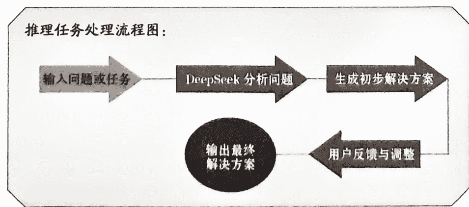
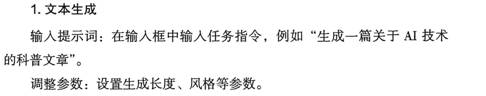
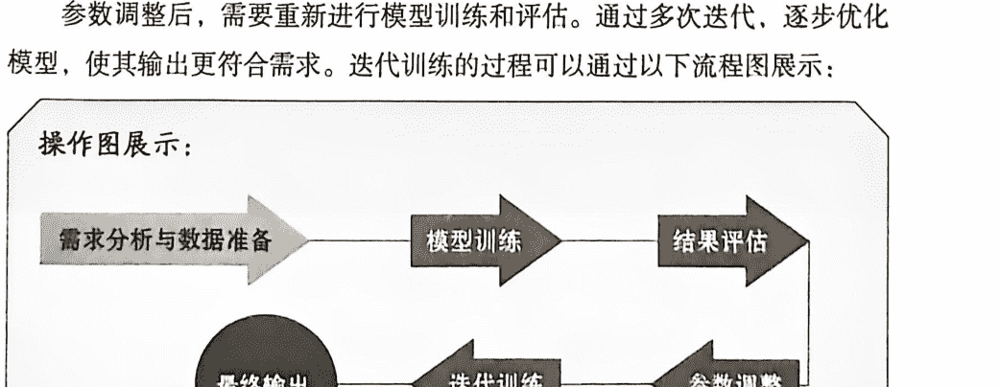
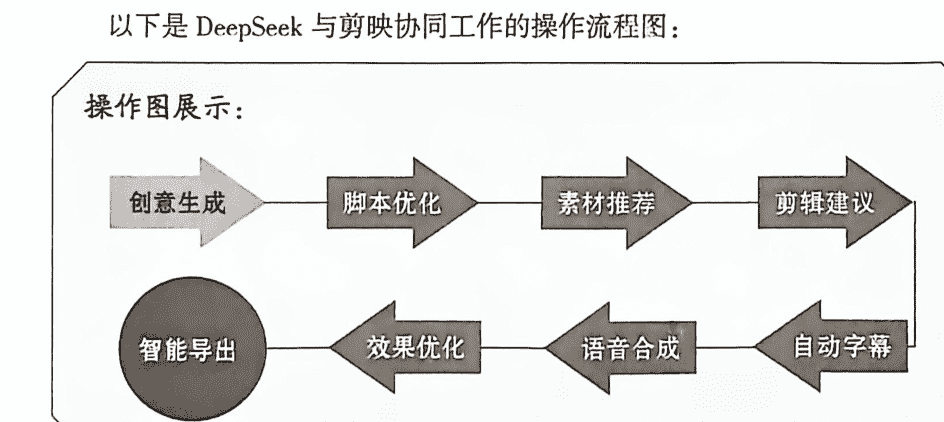
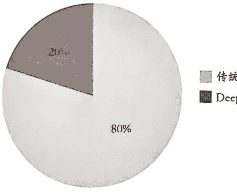
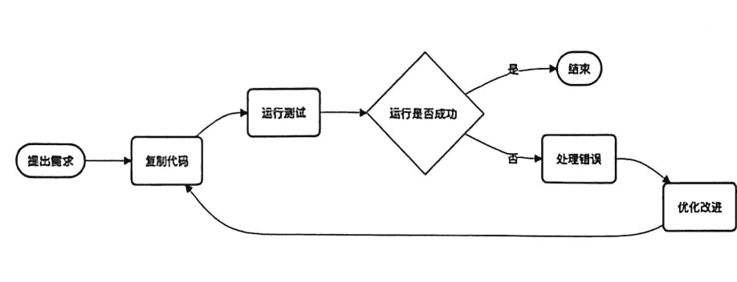
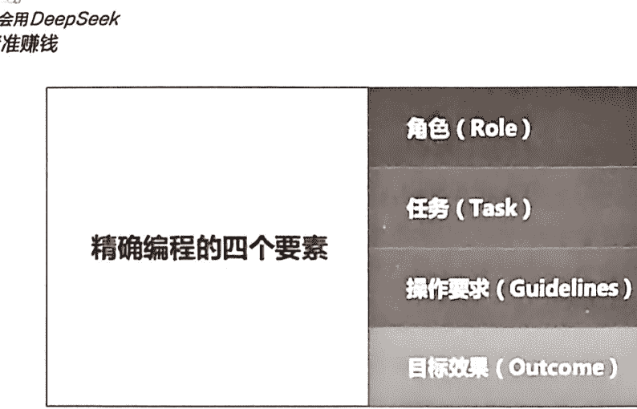

# 学会用deepseek精准赚钱

在人工智能赋能商业的时代
如何借助 DeepSeek
实现财富增长

程 琳○编著

精准定位商机
高效制定商业决策

利用 DeepSeek 精准定位商机，洞悉商场风云变换

- 深度探索
- 全景洞察
- 职场学习

北方妇女儿童出版社

## 目录

# 第一章 DeepSeek 的学习之旅，从入门到精通的必备指南

- DeepSeek：重新定义智能工作流的 AI 引擎 …… 2
- 极速部署：从零到一的 DeepSeek 环境搭建 …… 9
- 30 分钟速成：掌握 DeepSeek 的核心操作 …… 16
- 新手避坑指南：常见问题与高效的解决方案 …… 25

# 第二章 深度探索，DeepSeek 驱动的高效工作流秘籍

- 提问的艺术：与 AI 对话的黄金法则 …… 32
- 任务拆解大师：让 DeepSeek 输出专业级成果 …… 37
- 输出优化：迭代式 AI 结果精修术 …… 43

## 第三章 协同力量，DeepSeek 构建智能生态的无限可能

- DeepSeek 与剪映协同：从创意生成到成品输出的全程赋能 …… 50
- DeepSeek 与办公套件的无缝集成 …… 58
- DeepSeek + 飞书：办公自动化，全流程解决方案 …… 66
- DeepSeek + Photoshop：提升创意产出效率 …… 73
- DeepSeek × 即梦 AI，掌握“王炸级” AI 工作流 …… 79

## 第四章 DeepSeek：学习与职场效能变革的引领者

- 代码智造：开发效率提升 300% 的秘诀 …… 88
- 学习革命：知识管理与记忆强化的 AI 方案 …… 96
- 求职加速器：从简历到面试的 AI 全流程指导 …… 102

## 第五章 全景洞察，DeepSeek 在多行业的创新与价值

- 教育革新：个性化学习与知识管理的智能方案 …… 110
- 金融科技：智能合约与风险预测的 AI 实践 …… 116
- 营销智能：数据驱动的决策支持系统 …… 123

## 第六章 预见未来，DeepSeek 的发展趋势与职业新机遇

- 技术前沿：DeepSeek 与深度学习的未来趋势 …… 132
- 企业创新：人才管理的 AI 解决方案 …… 137
- 持续进化：跟踪 DeepSeek 更新的最佳实践 …… 142
- DeepSeek 与豆包潜在合作方向深度分析 …… 147

# 第一章 DeepSeek 的学习之旅，从入门到精通的必备指南

在人工智能蓬勃发展的时代，DeepSeek 异军突起，成为众多从业者和爱好者关注的焦点。你是否渴望深入了解这款强大的工具，却不知从何入手？本章将为你提供全面且细致的指引。我们将从 DeepSeek 的起源与发展讲起，带你认识其核心功能，如文本生成、编程支持、数据分析等，感受它在多领域的卓越表现。同时还会一步步教你搭建运行环境，掌握核心操作，避开新手常见的“坑”。通过丰富的案例和实用的技巧，助你快速入门并精通 DeepSeek，为后续利用它精准赚钱筑牢基础。

### DeepSeek：重新定义智能工作流的 AI 引擎

#### DeepSeek 的简介

DeepSeek 是由中国杭州深度求索人工智能基础技术研究有限公司开发的一款国产开源通用人工智能（AGI）大模型。该模型专注于大模型的研发与应用，旨在提供高效、低成本的人工智能解决方案。DeepSeek 的核心产品包括 DeepSeek-R1（开源推理模型）和 DeepSeek-V3（基础模型），这两种模型在文本生成、语义理解、编程支持、数据分析及多模态处理等领域有着广泛的应用。

DeepSeek 的独特之处在于其采用了多项创新技术，比如混合专家模型（MoE）和多头潜在注意力机制（MLA）。这些技术不仅显著降低了计算成本，还提升了模型的整体性能。具体来说，MoE 通过动态路由机制选择最合适的专家模型来处理特定任务，MLA 则通过减少 KV 缓存大小来降低推理成本。此外，DeepSeek 还采用了大规模强化学习框架（如 GRPO），进一步提升了模型的推理能力。

#### DeepSeek 的发展背景

DeepSeek 的前身是国内量化投资巨头幻方量化的子公司，它成立于 2023 年。公司依托强大的资金支持和技术积累，致力于推动 AI 技术的普惠化，通过开源策略吸引全球开发者和研究者的参与。

### DeepSeek 的核心功能

#### 1. 文本生成与语义理解

文本生成是 DeepSeek 的核心功能之一，支持多种文本生成任务，包括但不限于：

| 功能 | 描述 |
|---|---|
| 文章生成 | 根据主题或关键词生成语言连贯、逻辑清晰的文章 |
| 营销文案 | 生成吸引眼球的广告文案，提升品牌影响力 |
| 代码注释 | 自动为代码生成详细的注释，帮助开发者理解代码逻辑 |
| 结构化数据生成 | 将非结构化数据转换为结构化数据，便于后续分析和处理 |

在语义理解方面，DeepSeek 具备强大的自然语言处理能力。

| 功能 | 描述 |
|---|---|
| 情感分析 | 识别文本中的情感倾向（正面、负面或中性） |
| 意图识别 | 理解用户意图，帮助系统做出更智能的响应 |
| 知识推理 | 基于已有知识进行逻辑推理，解决复杂的问题 |
| 多语言翻译 | 支持多种语言之间的互译，打破语言障碍 |

#### 2. 编程支持

DeepSeek 在编程支持方面表现出色，能够帮助开发者提高工作效率。

| 功能 | 描述 |
|---|---|
| 代码生成与补全 | 根据上下文自动生成代码片段或补全代码，减少重复劳动 |
| 代码理解与调试优化 | 帮助开发者理解复杂的代码逻辑，并提供调试建议 |
| 技术文档处理 | 自动生成或整理技术文档，便于团队协作和知识共享 |
| 数学问题求解 | 在复杂的数学推导和编程竞赛中表现优异，能够快速解决数学难题 |

#### 3. 数据分析与可视化

DeepSeek 在数据分析与可视化方面提供了强大的工具。

| 功能 | 描述 |
|---|---|
| 数据分析 | 支持数据清洗、统计分析、回归分析、聚类分析等 |
| 数据可视化 | 生成柱状图、折线图、散点图等多种图表，以便于用户更直观地理解数据 |

#### 4. 多模态数据处理

DeepSeek 支持多模态数据处理，能够处理多种类型的数据。

| 功能 | 描述 |
|---|---|
| 文件上传与图像识别 | 支持图像文字识别、图表生成及多模态数据融合 |
| 跨模态推理 | 结合视觉与文本数据，实现高效推理与协同输出 |

#### 5. 智能问答与商业决策支持

DeepSeek 在智能问答与商业决策支持方面表现出色。

| 功能 | 描述 |
|---|---|
| 智能问答 | 提供精准的自然语言问答服务，适用于教育、科技、生活等多个领域 |
| 商业决策支持 | 包括风险评估、参数对比、性价比分析等，帮助企业做出更明智的决策 |

## DeepSeek 精准创造价值

#### 1. 利用 DeepSeek 进行电商产品推广

在竞争激烈的电商市场中，精准的产品推广是盈利的关键。DeepSeek 可以成为电商从业者的得力助手。比如，电商商家可以借助 DeepSeek 强大的文本生成能力，撰写极具吸引力的产品描述。

以一款智能手表为例，DeepSeek 能够深入分析产品特点，比如精准的运动监测功能、时尚的外观设计、长续航能力等，结合目标客户群体的需求和喜好，生成富有感染力的推广文案，突出产品在提升运动体验、彰显时尚品味方面的优势，从而吸引更多潜在客户，有效提高产品销量。

同时，利用 DeepSeek 的数据分析功能，商家还可以对店铺过往的销售数据进行深度挖掘，分析不同地区、不同年龄段客户的购买偏好，有针对性地调整推广策略，实现精准营销，降低推广成本，提高投入产出比。

| 助力方式 | 具体操作 | 示例产品 | 效果 |
|---|---|---|---|
| 文本生成 | 借助 DeepSeek 撰写产品描述 | 智能手表 | 突出产品优势，吸引潜在客户，提高产品销量 |
| 数据分析 | 利用 DeepSeek 挖掘销售数据 | / | 分析客户偏好，精准营销，降低成本，提升投入产出比 |

#### 2. DeepSeek 助力自媒体内容变现

对于自媒体创作者而言，优质的内容是吸引流量、实现变现的基础。DeepSeek 可以帮助创作者快速生成新颖且有价值的内容。

例如，一个专注于科技领域的自媒体人，在创作关于新型电子产品的评测文章时，DeepSeek 能够提供详细的产品性能分析、市场对比以及用户使用体验的模拟内容，创作者可以在此基础上进行优化和完善，节省大量的创作时间。

此外，DeepSeek 还能通过分析热门话题，为自媒体人提供选题建议，使其创作的内容更符合当下热点，吸引更多读者关注。当自媒体账号积累了一定流量后，创作者可以借助 DeepSeek 与品牌合作进行推广。DeepSeek 可以协助创作者撰写与品牌产品高度契合的推广内容，提高品牌合作的成功率，实现内容变现。

| 助力方式 | 具体操作 | 适用领域 | 效果 |
|---|---|---|---|
| 内容生成 | DeepSeek 提供内容框架，创作者优化完善 | 科技领域 | 节省创作时间，产出优质内容 |
| 选题建议 | DeepSeek 分析热门话题，并提供选题 | / | 内容契合热点，吸引更多读者 |
| 品牌合作 | 协助创作者撰写品牌推广内容 | / | 提高品牌合作成功率，实现内容变现 |

### DeepSeek 的技术特点

DeepSeek 的核心技术包括以下几方面。

| 技术 | 描述 |
|---|---|
| 混合专家模型（MoE） | 通过动态路由机制选择最合适的专家模型，提升任务处理效率 |
| 多头潜在注意力机制（MLA） | 减少 KV 缓存大小，显著降低推理成本，同时保持模型性能 |
| 大规模强化学习 | 通过强化学习框架（如 GRPO）提升模型推理能力，使其在处理复杂任务时更高效 |

DeepSeek 是一款功能强大、技术先进的通用人工智能大模型，其核心功能涵盖了文本生成、语义理解、编程支持、数据分析、多模态处理及智能问答等多个领域。通过采用混合专家模型、多头潜在注意力机制和大规模强化学习等创新技术，DeepSeek 不仅降低了计算成本，还显著提升了模型性能，使其在各个应用场景中都能表现出色。

### 附录：DeepSeek 的功能对比表

| 功能类别 | 具体功能 | 应用场景 |
|---|---|---|
| 文本生成 | 文章、文案、代码注释生成 | 广告创作、技术文档生成 |
| 语义理解 | 情感分析、意图识别、翻译 | 多语言客服、知识问答 |
| 编程支持 | 代码生成、调试优化 | 开发者工具、自动化代码审查 |
| 数据分析 | 业务分析、数据可视化 | 商业决策支持、市场趋势分析 |
| 多模态处理 | 图像识别、文档解析 | 文档管理、跨模态知识推理 |

## 读者测试

想要开启 DeepSeek 的奇妙之旅，就要对它有个全面的认识。下面这些测试题将检验你对 DeepSeek 基本概念、应用领域和核心优势的了解程度，快来试试吧！

1. DeepSeek 是聚焦于哪个领域的人工智能工具？
   A. 通用人工智能领域，提供多场景应用服务
   B. 仅专注于图像识别领域
   C. 主要应用于游戏开发领域

2. DeepSeek 的核心研发理念是什么？
   A. 以开源共享促进技术创新和广泛应用
   B. 追求技术垄断，限制使用范围
   C. 仅服务于特定企业，不面向大众

3. DeepSeek 相较于其他同类产品，其数据处理能力体现在哪些方面？
   A. 能够快速处理大规模、复杂类型的数据
   B. 只能处理简单的文本数据
   C. 数据处理速度慢、效率低

4. DeepSeek 的应用生态主要涵盖了哪些方面？
   A. 办公、学习、创作、科研等多个领域
   B. 仅局限于娱乐方面
   C. 只有商业营销领域有应用

评分标准：
选 A 得 3 分，选 B 得 2 分，选 C 得 1 分。
10 - 12 分：你对 DeepSeek 的基础认知非常全面且准确，为深入学习和使用它奠定了良好基础。
7 - 9 分：你对 DeepSeek 有一定的了解，但部分关键知识点掌握得不够扎实，需要进一步巩固。
4 - 6 分：你对 DeepSeek 的认识还比较模糊，建议加强对其基本概念和特点的学习。

## 极速部署：从零到一的 DeepSeek 环境搭建

DeepSeek 是一个功能强大的工具，尤其适用于数据分析、机器学习和深度学习任务。为了让你能够快速上手并充分利用它的功能，本文将一步步教你如何从零开始搭建 DeepSeek 的环境。即使你是初学者，也能轻松跟着操作！下面我们将从硬件准备、软件安装、环境配置到常见问题的解决详细讲解每一个步骤。

### 硬件准备：你的电脑够用吗？

在开始安装 DeepSeek 之前，先检查一下你的电脑是否满足最低需求。以下是推荐的硬件配置：

| 硬件组件 | 最低配置 | 推荐配置 |
| :--- | :--- | :--- |
| CPU | 4 核处理器 | 8 核或更高 |
| 内存 | 8GB | 16GB 或更高 |
| 硬盘 | 50GB 可用空间 | 100GB 或更高 |
| GPU | 无（仅 CPU） | NVIDIA GTX 1060 或更高 |

小提示：如果你打算做大规模的深度学习任务（比如训练复杂的神经网络），建议使用高性能的 GPU，这样可以大大加快计算速度。

### 软件安装：准备好基础环境

#### 1. 选择操作系统

DeepSeek 支持多种操作系统，包括 Windows、Linux 和 macOS。本文以 Ubuntu 20.04 LTS 为例进行说明。如果你使用的是其他系统，操作步骤也类似。

#### 2. 安装 Ubuntu

① 下载 Ubuntu：访问 Ubuntu 官网，下载 Ubuntu 20.04 LTS 的镜像文件。
② 制作启动盘：使用工具如 Rufus（Windows）或 Etcher（跨平台），将镜像写入 U 盘。
③ 安装系统：重启电脑，从 U 盘启动，按照提示完成 Ubuntu 的安装。

### 安装必要的软件

#### 1. 安装 Java

DeepSeek 需要 Java 环境来运行。推荐安装 OpenJDK 17：

```bash
sudo apt update
sudo apt install openjdk-17-jdk
```

安装完成后，检查是否成功：

```bash
java -version
```

如果看到类似 openjdk 17.0.x 的输出，说明安装成功。

#### 2. 安装 Python

DeepSeek 支持 Python 3.7 及以上版本。推荐安装 Python 3.8：

```bash
sudo apt install python3.8 python3.8-venv python3.8-dev
```

#### 3. 安装 CUDA 和 cuDNN（可选）

如果你有 NVIDIA GPU，并且希望使用 GPU 加速，可以安装 CUDA 和 cuDNN：

① 安装 CUDA：访问 NVIDIA CUDA 下载页面，选择适合你系统的版本并安装。
② 安装 cuDNN：下载与 CUDA 版本匹配的 cuDNN，并按照官方文档进行安装。

### DeepSeek 的安装与配置

#### 1. 下载 DeepSeek

访问 DeepSeek 的官方网站（www.deepseek.com），找到最新版本的安装包并下载。

#### 2. 安装 DeepSeek

① 解压下载的安装包：

```bash
tar -zxvf deepseek-x.x.x.tar.gz
```

② 进入解压后的目录：

```bash
cd deepseek-x.x.x
```

③ 运行安装脚本：

```bash
./install.sh
```

#### 3. 配置环境变量

为了能够让系统识别 DeepSeek 的命令，我们需要配置环境变量：
① 打开终端，编辑 ~/.bashrc 文件：

```bash
nano ~/.bashrc
```

② 在文件末尾添加以下内容：

```bash
export DEEPSEEK_HOME=/path/to/deepseek
export PATH=$PATH:$DEEPSEEK_HOME/bin
```

注意：将 /path/to/deepseek 替换为你实际解压 DeepSeek 的路径。
③ 保存并退出编辑器，然后运行以下命令，使配置生效：

```bash
source ~/.bashrc
```

#### 4. 验证安装

运行以下命令，检查 DeepSeek 是否安装成功：

```bash
deepseek --version
```

如果看到版本号输出，说明安装成功。

# 第一章 DeepSeek 的学习之旅，从入门到精通的必备指南

## 常见问题与解决方案

- 1. 安装失败
问题：安装过程中提示缺少依赖。
解决方法：确保你已经安装了所有必要的依赖软件（如 Java、Python 等），然后重新运行安装脚本。

- 2. GPU 加速未启用
问题：DeepSeek 没有检测到 GPU。
解决方法：检查 CUDA 和 cuDNN 是否正确安装，并确保环境变量配置正确。

- 3. 运行速度慢
问题：DeepSeek 运行缓慢。
解决方法：尝试优化硬件配置，比如增加内存或使用更高性能的 GPU。

只要完成了以上步骤，就说明你已经成功安装并配置了 DeepSeek 环境！现在，你可以开始使用 DeepSeek 完成数据分析、机器学习等任务。如果在使用过程中遇到问题，可以参考本文的常见问题部分。

## Deepseek 精准创造价值

- 1. 利用 DeepSeek 优化电商客服，提升客户购买转化率

搭建好 DeepSeek 环境后，电商企业可以利用其智能问答功能优化客服服务。通过将常见的产品咨询、售后问题等数据输入 DeepSeek 进行训练，它能够快速准确地回答客户问题，提供专业的解决方案。

比如，当客户询问某款护肤品的适用肤质时，DeepSeek 可以根据产品成分和功效，给出详细的适用肤质建议，并推荐相关的产品搭配。这样高效、精准的客服服务能够提升客户的购物体验，增强客户对产品的信任度，从而提高客户购买转化率，为企业带来更多收益。

同时，DeepSeek 还可以对客户咨询数据进行分析，发现产品在宣传或使用过程中存在的问题，为企业改进产品和营销策略提供依据。

| 应用场景 | 操作方式 | 具体示例 | 最终效果 |
|---|---|---|---|
| 电商客服优化 | 用常见问题数据训练DeepSeek，用其智能问答服务客户 | 客户询问护肤品适用肤质，DeepSeek依成分功效给予建议及搭配 | 提升客户体验与信任，提高购买转化率，助力企业改进产品与策略 |

## 2. DeepSeek 在自由职业者项目报价中的应用

自由职业者在承接项目时，提供准确合理的报价至关重要。DeepSeek 可以帮助自由职业者进行项目成本和价值分析，从而实现精准报价。

例如，一名平面设计师在接到一个品牌宣传海报设计项目时，DeepSeek 可以根据项目的复杂程度、所需设计元素、市场上同类项目的价格范围等因素，结合设计师自身的技能水平和经验，给出合理的报价建议。它还能分析客户的预算和期望，帮助设计师调整报价策略，增加项目承接的成功率。

此外，DeepSeek 还可以协助自由职业者制定项目合同条款，明确双方的权利和义务，避免潜在的纠纷，保障自身的经济利益。

| 应用场景 | 操作方式 | 具体示例 | 最终效果 |
|---|---|---|---|
| 自由职业者项目报价 | DeepSeek依项目复杂度等分析成本价值，协助制定合同 | 平面设计师接海报项目，DeepSeek提供报价并依客户调整策略 | 助力精准报价，提高项目承接率，保障自身经济利益 |

## 读者测试

工欲善其事，必先利其器。合适的硬件和软件环境是 DeepSeek 高效运行的基础。通过这几道测试题，看看你是否了解为它搭建理想环境的要点。

- 1. 若要让 DeepSeek 实现高效运行，推荐的 CPU 核心数至少为多少？
   A. 4 核及以上
   B. 2 核
   C. 1 核

- 2. 对于内存要求，运行 DeepSeek 至少需要多大容量的内存？
   A. 8GB
   B. 4GB
   C. 2GB

- 3. 以下哪种数据库管理系统与 DeepSeek 兼容性较好？
   A. MySQL
   B. Access
   C. FoxPro

- 4. 在安装 DeepSeek 相关软件时，需要开放的网络端口主要有什么作用？
   A. 确保软件与服务器的数据交互顺畅
   B. 便于软件自动更新
   C. 与其他设备共享数据

评分标准：
选 A 得 3 分，选 B 得 2 分，选 C 得 1 分。
10 ~ 12 分：你清楚了解 DeepSeek 的软硬件环境要求，能够顺利为其搭建合适的运行环境。
7 ~ 9 分：你对环境要求有一定概念，但某些细节可能把握不准，需要再次确认关键信息。
4 ~ 6 分：你对 DeepSeek 的运行环境要求了解不足，需要进行系统学习，以避免安装和使用时出现问题。

## 30 分钟速成：掌握 DeepSeek 的核心操作

DeepSeek 广泛应用于数据分析、文案创作、任务管理等领域。本文将通过详细的步骤、表格和流程图，帮助你快速掌握 DeepSeek 的核心操作，确保内容全面、清晰、准确且实用。

## DeepSeek 的核心功能详解

1. 深度思考与推理

DeepSeek 的核心优势在于其强大的推理能力。以下是一个典型的使用流程：



> 示例：如何提高团队协作效率？
输出：
① 使用协作工具（如 Slack、Trello）。
② 明确任务分工与责任。
③ 定期召开团队会议，确保信息同步。

## 2. 文件处理与复杂任务

DeepSeek 支持上传文档（如 PDF、Word、Excel）并提取关键信息。以下是文件处理的典型步骤：

| 功能 | 支持格式 | 典型应用场景 |
|---|---|---|
| 文本提取 | PDF、Word | 提取合同关键条款 |
| 数据分析 | Excel | 生成销售数据图表 |
| 摘要生成 | PDF、Word | 生成长文档的简明摘要 |

> 示例：上传 Excel 表格并生成分析报告。
① 点击“上传文件”按钮，选择 Excel 文件。
② 输入指令：“请分析销售数据并生成图表”。
③ DeepSeek 自动生成数据分析和可视化图表。

## 高效使用 DeepSeek 的技巧

## 1. 提问模板与优化

| 步骤 | 示例 |
|---|---|
| 背景 | 我是一名创业者，正在开发一款健康管理 App |
| 任务 | 需要一份市场推广方案 |
| 要求 | 预算 5 万元，目标用户为 25 - 35 岁白领 |
| 补充 | 我们主打“智能健康监测”功能，希望突出科技感 |

### 万能提问模板

## 2. 结果校验与风险防控

校验方法：
① 检查逻辑是否自洽。
② 核对关键数据是否准确。
③ 评估内容是否符合需求。

风险防控：
① 避免 AI 幻觉，对生成内容进行二次验证。
② 结合人工判断，确保结果的可靠性。

## 实战案例演示

案例 1：咖啡馆开业促销方案
背景：新开咖啡馆，位于大学城，主打精品咖啡
任务：制定开业促销方案
要求：预算 1 万元，目标群体为大学生
补充：希望结合校园活动进行推广

Deepseek 生成方案
活动主题：校园咖啡文化节；
促销策略：学生凭学生证享受 8 折优惠；
社交媒体推广：联合校园 KOL 进行宣传

案例 2：远程办公文章撰写
任务：撰写一篇关于远程办公未来发展的文章。
步骤：
① 生成大纲（引言、主要论点、结论）；
② 逐步完善每个部分的内容。

## 核心功能操作示例

1. 文本生成
输入提示词：在输入框中输入任务指令，例如 “生成一篇关于 AI 技术的科普文章”。
调整参数：设置生成长度、风格等参数。
生成结果：点击 “生成” 按钮，获取输出内容。



2. 编程支持
输入代码需求：例如 “用 Python 实现一个快速排序算法”。
选择语言：设置编程语言（如 Python、Java 等）。
生成代码：点击 “生成” 按钮，获取代码并支持调试。


3. 数据分析

上传数据文件：支持 CSV、Excel 等格式。

选择分析任务：例如“生成销售数据的趋势分析图表”。

获取结果：生成可视化图表或分析报告。


## 高级功能使用技巧

## 1. 多轮对话

操作步骤：

- ① 输入初始问题，例如“什么是强化学习？”
- ② 根据回答继续提问，例如“它在 AI 中的应用有哪些？”
- ③ 通过连续对话获取更全面的信息。


## 2. 任务分解

操作步骤：

- ① 输入复杂任务，例如“写一篇关于 AI 在医疗领域应用的文章”。
- ② 使用 SPECTRA 模型将任务分解为多个子任务，例如“AI 在诊断中的应用”“AI 在药物研发中的应用”等。
- ③ 分别生成内容后整合为一篇完整的文章。


## DeepSeek 精准创造价值

1. 用 DeepSeek 优化联盟营销推广策略

从事联盟营销的人员可以利用 DeepSeek 提升推广效果，有效增加收入。DeepSeek 能够通过分析不同联盟产品的特点、目标受众以及市场竞争情况，为推广者制定个性化的推广策略。

比如，在推广一款在线英语学习课程时，DeepSeek 可以建议推广者选择在教育类社交媒体群组、英语学习论坛等平台进行推广，并提供吸引人的推广话术，比如强调课程的专业师资、个性化教学模式以及学员的成功案例等。同时，DeepSeek 还可以跟踪推广链接的点击量、转化率等数据，及时调整推广策略，提高推广效率，让推广者获得更多的联盟佣金。

| 应用场景 | 操作方式 | 具体示例 | 最终效果 |
| :--- | :--- | :--- | :--- |
| 联盟营销推广 | 分析联盟产品特点、受众、竞争状况，制定推广策略并跟踪数据调整 | 推广在线英语学习课程，建议在社交媒体群组、英语学习论坛推广，提供含师资、教学模式、学员案例的话术 | 提高推广效率，增加联盟佣金收入 |

2. DeepSeek 在股票投资分析中的应用实现盈利

股票投资者可以借助 DeepSeek 的数据分析和推理能力辅助投资决策。DeepSeek 可以收集和分析大量的股票市场数据，包括公司财务报表、行业趋势、宏观经济指标等，对股票的走势进行预测和分析。

例如，通过对某公司的财务数据进行深入分析，DeepSeek 可以评估其盈利能力、偿债能力和成长潜力，为投资者提供是否值得投资的建议。同时，它还能结合市场情绪和行业动态，帮助投资者把握投资时机，制定合理的投资组合策略。投资者可以根据 DeepSeek 的分析结果进行精准投资，提高投资收益，降低投资风险。

| 应用场景 | 操作方式 | 具体示例 | 最终效果 |
|---|---|---|---|
| 股票投资分析 | 收集分析股票市场大量数据，包含公司财报、行业趋势、宏观经济指标等 | 分析某公司财务数据评估盈利能力、偿债能力与成长潜力，结合市场情绪和行业动态提供投资建议 | 辅助投资者精准投资，提高收益，降低风险 |

## DeepSeek 的功能对比表

| 功能类别 | 具体功能 | 操作步骤 | 适用场景 |
|---|---|---|---|
| 文本生成 | 文章、文案、代码注释生成 | 输入提示词 → 调整参数 → 生成结果 | 广告创作、技术文档生成 |
| 编程支持 | 代码生成、调试优化 | 输入代码需求 → 选择语言 → 生成代码 | 开发者工具、自动化代码审查 |
| 数据分析 | 业务分析、数据可视化 | 上传数据文件 → 选择分析任务 → 获取结果 | 商业决策支持、市场趋势分析 |
| 多轮对话 | 连续提问获取全面信息 | 输入初始问题 → 根据回答继续提问 → 获取全面信息 | 知识问答、复杂问题解决 |
| 任务分解 | 复杂任务分解与整合 | 输入复杂任务 → 分解为子任务 → 生成并整合内容 | 长文本生成、多步骤任务处理 |

## 总结与进阶建议

为了进一步提升使用效率，建议做到以下三点：

- ① 持续练习：多尝试不同场景的提问，积累经验。
- ② 优化提示词：根据任务性质调整提问方式。
- ③ 结合其他工具：如 Coze 用于文案创作，Midjourney 用于图片生成。

通过本文的详细介绍，您已经掌握了 DeepSeek 的核心功能及使用方法。无论是文本生成、编程支持还是数据分析，DeepSeek 都能为您提供高效、精准的解决方案。快来尝试这款强大的 AI 工具，开启高效智能的新体验吧！

## 读者测试

想在短时间内快速掌握 DeepSeek 的核心操作吗？接下来的测试题将检验你对核心操作的掌握情况，看看你能否在这 30 分钟的“速成之旅”中脱颖而出。

1. 在使用 DeepSeek 进行文本生成时，若希望生成一篇具有特定风格的文章，应该如何操作？ ( )
A. 在输入提示词时明确说明风格要求，如“生成一篇幽默风格的科普文章”
B. 生成文章后手动修改风格
C. 无法实现特定风格文章的生成

2. 利用 DeepSeek 进行数据分析，在上传数据文件后，下一步操作是什么？ ( )
A. 选择分析任务，如生成趋势分析图表
B. 直接获取分析结果
C. 调整数据文件格式

3. 在 DeepSeek 的多轮对话功能中，若初始问题为“什么是人工智能？”根据回答继续提问“人工智能在医疗领域有哪些应用？”这体现了多轮对话的什么优势？ ( )
A. 获取更全面的信息
B. 加快回答速度
C. 简化操作流程

4. 当使用 DeepSeek 执行复杂任务，如写一篇关于 AI 在教育领域应用的文章时，采用任务分解的方式，第一步应该做什么？ ( )
A. 使用 SPECTRA 模型将任务分解为子任务
B. 直接开始写作
C. 收集相关资料

评分标准：
选 A 得 3 分，选 B 得 2 分，选 C 得 1 分。
10~12 分：你对 DeepSeek 核心操作掌握熟练，能灵活运用各项功能高效完成任务。
7~9 分：基本了解核心操作，但在操作细节和功能运用上还有提升空间，需加强练习。
4~6 分：对 DeepSeek 核心操作的理解和应用存在不足，需要系统学习并通过实践巩固。

## 新手避坑指南：常见问题与高效的解决方案

DeepSeek 作为一款强大的 AI 工具，凭借其多模态能力和高效的推理模型，迅速成为用户提升工作效率的得力助手。然而，对于新手用户来说，在使用过程中可能会遇到一些常见问题，比如卡顿、回答不精准、功能不熟悉等。本文将为你提供一份详细的避坑指南，帮助你快速上手并高效使用 DeepSeek，成为 AI 工具应用高手！

## DeepSeek 的三大避坑点

### 1. 认准信息源
新手用户常因信息源不准确而陷入困惑。以下是 DeepSeek 的官方信息源：

- 1. 微信公众号：DeepSeek。
- 2. 小红书：@DeepSeek (deepseek ai)。
- 3. X(Twitter)：DeepSeek(@deepseek ai)。
- 4. 官方提示词网站：DeepSeek 提示词库。

**避坑建议：务必从官方渠道获取信息，避免使用非官方教程或工具。**

### 2. 熟用功能键
DeepSeek 提供了多种功能模式，新手用户常因不了解功能差异而影响使用体验。

- 1. 深度思考（R1）：擅长逻辑推理和复杂问题解答，但回答速度较慢。
- 2. 联网搜索：获取实时信息，适合需要最新数据的场景。
- 3. V3 基础模型：默认模式，回答速度快，适合百科知识类问题。

避坑建议：根据需求选择合适的功能模式。例如，处理复杂问题时启用 R1 模式；查询实时信息时开启联网搜索。

### 3. 避免提问过于极端

新手用户常因提问过于模糊或极端而得不到满意答案。
避坑建议：

- 清晰描述需求：避免模糊提问，明确目标、背景和限制条件。
- 分步拆分任务：将复杂任务拆解为多个步骤，逐步细化需求。

## 常见问题与高效的解决方案

## 1. 卡顿与延迟问题

问题描述：使用过程中出现卡顿或延迟，影响体验。
解决方案：

- 优化网络连接：使用网络加速工具（如迅游加速器）提升连接稳定性。
- 本地化部署：对于高频用户，建议通过迅游一键部署功能，将 DeepSeek 设置在本地计算机上。

## 流程图：解决卡顿问题的步骤

```
graph TD
    A[遇到卡顿问题] --> B{检查网络连接}
    B -->|网络不稳定| C[使用网络加速工具]
    B -->|网络稳定| D{是否为高频用户}
    D -->|是| E[本地化部署 DeepSeek]
    D -->|否| F[继续使用云端服务]
```

## 2. 回答不精准

问题描述：AI 回答偏离预期，甚至出现“幻觉”（生成看似合理但不准确的内容）。
解决方案：

- 精准提问：提供背景信息和具体需求。例如，“用 Python 写一个从 CSV 文件中读取数据并生成柱状图的代码，要求使用 Pandas 和 Matplotlib 库”。
- 结果校验：对关键信息（如法律、医疗建议）进行二次验证。

| 提问示例对比 |
| :--- | :--- |
| 模糊提问 | 精准提问 |
| “帮我写个代码。” | “用 Python 写一个从 CSV 文件中读取数据并生成柱状图的代码，要求使用 Pandas 和 Matplotlib 库。” |
| “分析销售数据。” | “分析 2023 年的公司销售数据趋势，找出增长率最高的三个产品，并提出 2024 年的营销建议。” |

## 3. 功能不熟悉

问题描述：新手用户对 DeepSeek 的功能模式和使用技巧不了解。

解决方案：

- 学习官方教程：参考《高效使用 DeepSeek》一书，掌握从基础到进阶的使用技巧。
- 使用提示词模板：通过官方提示词库获取常用模板，快速上手。

| 功能模式对比 |
| :--- | :--- | :--- |
| 模式 | 特点 | 适用场景 |
| 深度思考(R1) | 擅长逻辑推理，回答速度较慢 | 复杂问题解答、决策分析 |
| 联网搜索 | 可获取实时信息 | 查询最新数据、市场动态 |
| V3 基础模型 | 回答速度快，适合百科知识类问题 | 快速查询、简单任务处理 |

## 高效使用 DeepSeek 的技巧

## 1. 提问的艺术

- 简洁明了：用自然语言清晰表达需求。
- 多维提问：通过角色扮演让 AI 从多个角度思考问题。例如，“你是一个资深产品经理，请从用户体验的角度分析这个功能设计……”

## 2. 文件处理与数据交互

- 上传文件：支持 PDF、Excel、Word 等格式，可要求 AI 总结内容或提取关键数据。
- 表格数据处理：粘贴表格数据或上传 Excel 文件后，可执行排序、计算、可视化建议等操作。

## 3. 高级功能挖掘

- 联网搜索：获取实时信息，如“查询今日纽约证券交易所黄金期货价格，并分析近期走势原因”。
- 代码调试与优化：粘贴代码并描述问题，请求 AI 解释错误或优化性能。

通过掌握以上避坑点和高效使用技巧，新手用户可以快速上手 DeepSeek，并将其应用于办公、学习、生活等多个场景。随着 AI 技术的不断发展，DeepSeek 的功能将更加完善，为用户创造更多价值。

## DeepSeek 精准创造价值

## 1. DeepSeek 在代运营业务中的盈利应用

随着电商行业的发展，代运营业务需求日益增长，从业者可利用 DeepSeek 更好地服务客户并实现盈利。在店铺运营方面，DeepSeek 能分析竞品店铺的优势与不足，为代运营店铺制定差异化的运营策略。

例如，分析竞品的商品定价、促销活动、页面设计等，为代运营店铺提供定价建议、策划独特的促销活动以及优化店铺页面布局，提升店铺竞争力，吸引更多顾客，增加代运营业务收入。在客户服务方面，DeepSeek 可以自动处理常见的客户咨询，快速响应客户需求，提高客户满意度，为代运营店铺赢得更多好评和回头客，进一步巩固与客户的合作关系，拓展业务规模。

| 应用方向 | DeepSeek 具体作用 | 示例 | 带来的盈利效果 |
| --- | --- | --- | --- |
| 店铺运营 | 分析竞品店铺，制定差异化运营策略 | 分析竞品定价、促销、页面设计，为代运营店铺提供定价建议、策划促销活动、优化页面布局 | 提升店铺竞争力，增加代运营业务收入 |
| 客户服务 | 自动处理常见客户咨询 | 快速响应需求 | 赢得好评与回头客，巩固合作关系，拓展业务规模 |

## 2. 借助 DeepSeek 开展知识付费课程制作与推广

如果你在某个领域有专业知识，可借助 DeepSeek 开发并推广知识付费课程来赚钱。DeepSeek 可以协助整理课程内容，将复杂的知识点进行系统梳理，使其更易于理解和学习。

比如，在制作编程类知识付费课程时，DeepSeek 能够生成详细的代码示例、案例分析以及深入浅出的讲解内容。利用 DeepSeek 的文本生成能力，撰写吸引人的课程推广文案，突出课程特色和优势，吸引更多学员购买课程。同时，还可以通过 DeepSeek 分析学员反馈数据，不断优化课程内容、提高课程质量，进而提升课程的口碑和销量，实现知识变现。

| 应用环节 | DeepSeek 具体作用 | 示例 | 带来的盈利效果 |
| --- | --- | --- | --- |
| 课程制作 | 协助整理课程内容，梳理复杂的知识点 | 制作编程类课程时，生成代码示例、案例分析与讲解内容 | 使课程更易理解学习，提升课程质量 |
| 课程推广 | 撰写课程推广文案 | / | 突出课程的特色优势，吸引学员购买 |
| 课程优化 | 分析学员反馈数据 | / | 不断优化课程，提升口碑与销量，实现知识变现 |

## 读者测试

本节的测试题聚焦于新手在使用时可能遇到的常见问题及对应的高效解决方案。通过测试，看看你是否已经掌握了这些避坑秘籍。

1. 新手使用 DeepSeek 时，为确保获取准确信息，应从哪里获取官方信息？( )
A. DeepSeek 官方微信公众号、小红书、X（Twitter）及官方提示词网站
B. 非官方论坛和个人博客
C. 随意在搜索引擎上搜索相关信息

2. 当 DeepSeek 出现卡顿与延迟问题时，若网络稳定且是高频用户，最佳解决方案是什么？( )
A. 进行本地化部署
B. 继续使用云端服务
C. 更换网络设备

3. 若希望 DeepSeek 给出更精准的回答，在提问时应注意什么？( )
A. 提供详细背景信息和具体需求，避免模糊提问
B. 尽量简化问题，不提供过多信息
C. 随意提问，依赖 DeepSeek 理解意图

4. 新手对 DeepSeek 功能不熟悉时，可采取的有效学习方法不包括以下哪一项？( )
A. 参考非官方教程
B. 学习官方教程
C. 使用官方提示词库获取常用模板

评分标准：
选 A 得 3 分，选 B 得 2 分，选 C 得 1 分。
10～12 分：你对新手使用 DeepSeek 的避坑要点和解决方法掌握良好，能避免一些常见问题。
7～9 分：了解部分避坑点和解决方案，但还不够全面，需要进一步熟悉相关内容。
4～6 分：对新手避坑指南的理解和应用存在较多不足，建议加强学习，避免在使用过程中遇到问题。

# 第一章 DeepSeek 的学习之旅，从入门到精通的必备指南

# 第二章 深度探索，DeepSeek 驱动的高效工作流秘籍

在日常工作中，我们都期望能提升效率，让工作更加轻松高效。DeepSeek 正是这样一个强大的助力工具，它能为我们打造全新的高效工作流。本章将深入挖掘 DeepSeek 在工作中的应用秘籍，教你掌握与 AI 对话的艺术，通过优化提问公式和沟通技巧，让 DeepSeek 更精准地理解你的需求。同时会分享任务拆解的方法，将复杂任务化繁为简，指导 AI 输出专业级成果。另外还会详细介绍如何对 AI 输出结果进行优化，通过迭代式精修术，让结果更符合预期。掌握这些秘籍后，你将在工作中如鱼得水，充分发挥 DeepSeek 的价值。

## 提问的艺术：与 AI 对话的黄金法则

DeepSeek 凭借其强大的语言模型和用户友好的交互体验，迅速成为行业标杆。然而许多用户在使用过程中常常遇到“AI 不理解我”的困扰，其实问题的核心往往在于提问方式。本文将深入探讨如何通过优化提问公式和沟通技巧，让 AI 更懂你，助你迅速玩转 DeepSeek。

### 提问公式：让 AI 精准输出

1. 万能提问公式
DeepSeek 推荐的万能提问公式为：“身份 + 任务 + 细节 + 格式”。
2. 进阶提问技巧
① 角色扮演法：通过设定角色提升回答的针对性。例如：“假设你是职业生涯规划师，为大学应届生提供 5 个实用面试技巧。”
② 任务拆解法：将复杂任务分解为可执行步骤。例如：“将写高质量自媒体文章分解为 5 个步骤，说明选题、结构、SEO 优化要点。”
③ 多维度评估法：综合对比事物。例如：“从价格、功能和易用性三方面对比最流行的两款手机，给出适合学生党使用机型的建议。”

### 3. 提问公式的应用场景

| 场景 | 提问公式示例 |
|---|---|
| 旅行规划 | “预算 1000 元，帮我规划天津 3 天 2 晚的旅行攻略，重点推荐本地小吃。” |
| 内容创作 | “撰写一篇小红书风格的防晒霜文案，带 3 个 emoji。” |
| 编程辅助 | “用 Python 写一个自动整理桌面文件的脚本。” |
| 学术研究 | “总结这篇论文的创新点，并用表格对比第三页和第五页的数据差异。” |

### 沟通优化：提升 AI 理解力

#### 1. 避免常见提问错误

- 模糊提问：避免使用“怎么写好文章？”这类模糊问题，改为“如何撰写科技类公众号开头段？需要设置悬念吸引中年读者”。
- 逻辑不清：确保问题结构清晰，避免主谓不一致或时态错误。

#### 2. 优化提问的实用技巧

- 预热对话：先用普通模式对话几轮，等 AI 适应语言习惯后再切换深度模式。
- 强制“说人话”：要求 AI 用通俗语言解释专业术语。例如：“用小学生能听懂的话解释 RLHF，并举例说明。”

#### 3. 连续提问与任务拆解

通过连续提问逐步优化结果。例如：

① 让 AI 写出文章大纲；
② 根据大纲完善第一部分内容；
③ 分批输出后续内容并检查错误。

### 实战案例：从提问到高效输出

1. 旅行规划案例

提问：预算 1000 元，帮我规划天津 3 天 2 晚的旅行攻略，重点推荐本地小吃，以表格形式输出。

输出：AI 生成包含交通、住宿、景点和美食推荐的详细表格。

2. 内容创作案例

提问：撰写一篇小红书风格的防晒霜文案，带 3 个 emoji。

输出：AI 生成符合平台风格的文案。例如：“夏日必备！这款防晒霜轻薄不黏腻，SPF50+ 超强防护，让你轻松应对阳光挑战！”

3. 编程辅助案例

提问：用 Python 写一个自动整理桌面文件的脚本。

输出：AI 生成可执行的 Python 代码，并附上使用说明。

通过优化提问公式和沟通技巧，用户可以显著提升与 DeepSeek 的交互效率，让 AI 更懂你的需求。未来，随着技术的不断进步，DeepSeek 将继续为用户带来更多创新和便利。

## DeepSeek 精准创造价值

## 1. 利用 DeepSeek 精准制定房地产营销策略

房地产销售人员和营销人员可通过优化与 DeepSeek 的对话，制定精准营销策略来促进房产销售盈利。在了解目标客户群体后，利用万能提问公式向 DeepSeek 询问针对特定区域、特定需求购房者的营销方案。

例如，“作为资深房地产营销专家，针对有孩子的年轻家庭，为位于优质学区附近的楼盘制定营销方案，突出学区优势和适合家庭居住的特点，以宣传海报文案和线上推广话术的形式输出”。DeepSeek 会根据提问生成相应内容，营销人员可据此制作吸引人的宣传海报和线上推广文案，精准吸引目标客户，提高楼盘销售速度和利润。

| 应用主体 | 操作方式 | 示例 | 效果 |
|---|---|---|---|
| 房地产从业者 | 用万能公式询问特定购房群体营销方案 | 询问学区盘针对有孩家庭的海报文案与推广话术 | 吸引目标客户，加速销售，提高利润 |

## 2. DeepSeek 助力广告投放精准定位与优化

广告从业者在为客户进行广告投放时，可借助 DeepSeek 实现精准定位和优化，提高广告投放效果，增加广告业务收益。通过向 DeepSeek 询问“分析某化妆品品牌的目标客户群体（年龄、性别、消费习惯等），并根据目标群体特点，制定在社交媒体平台上的广告投放策略，包括投放时间、投放形式、广告内容等”。

DeepSeek 能够分析大量市场数据和用户行为数据，给出有针对性的广告投放建议。广告从业者按照这些建议进行广告投放，可提高广告的精准度和吸引力，提升广告转化率，为客户带来更好的广告效果，从而赢得更多广告业务和客户信任。

| 应用主体 | 操作方式 | 示例 | 效果 |
|---|---|---|---|
| 广告从业者 | 询问品牌目标群体及社媒投放策略 | 询问化妆品品牌目标群体与社媒投放策略 | 提高广告效果，赢得更多业务与信任 |

## 读者测试

只要掌握了万能提问公式，就能精准地从 DeepSeek 中获取所需信息。这些测试题将检验你对公式各要素的理解和运用能力，看你能否成为提问高手。

1. 在使用万能提问公式“身份 + 任务 + 细节 + 格式”时，如果要让 DeepSeek 生成一份旅游攻略，“7 天的行程安排，包含景点、美食推荐”属于哪个部分？( )
A. 细节
B. 任务
C. 格式

2. 若想让 DeepSeek 以专业美食评论家的身份写一篇餐厅评测，“从餐厅的环境、菜品口味、服务质量等方面进行评价”属于哪个部分？( )
A. 任务
B. 细节
C. 身份

3. 当省略万能提问公式中的“格式”部分时，DeepSeek 的输出结果会怎样？( )
A. 以默认格式呈现，但可能不太符合特定需求
B. 无法生成有效结果
C. 按照最复杂的格式输出

4. 以下哪种提问方式更符合万能提问公式且能得到更精准的回答？( )
A. 以资深记者身份，写一篇关于科技行业发展趋势的文章，包含具体案例和数据，以报告格式呈现
B. 写一篇文章
C. 随便写点东西

评分标准：
选 A 得 3 分，选 B 得 2 分，选 C 得 1 分。
10 ~ 12 分：你熟练掌握万能提问公式，能够运用它精准获取所需信息，提问效率高。
7 ~ 9 分：你基本理解公式原理，但在实际应用中对部分要素的把握还不够准确，需多实践。
4 ~ 6 分：你对万能提问公式的理解和运用存在较多不足，需要深入学习和练习。

## 任务拆解大师：让 DeepSeek 输出专业级成果

想要充分发挥 DeepSeek 的潜力，用户需要掌握如何将复杂任务分解为可管理的步骤，并指导 AI 完成高质量输出。本文将详细介绍如何通过分步指导，迅速玩转 DeepSeek。

### 复杂任务分解

将复杂任务分解为可管理的步骤，需要明确任务的目标和需求。以下是一个通用的任务分解框架。

| 步骤 | 描述 |
|---|---|
| 1. 定义任务目标 | 明确任务的具体目标和预期输出 |
| 2. 收集必要信息 | 收集完成任务所需的所有数据和信息 |
| 3. 分解任务 | 将复杂任务分解为多个子任务 |
| 4. 分配资源 | 确定每个子任务所需的资源（如时间、人力、工具等） |
| 5. 执行子任务 | 逐步完成每个子任务 |
| 6. 整合输出 | 将所有子任务的输出整合为最终结果 |
| 7. 评估和优化 | 评估任务完成情况，优化流程，以提高效率 |

### 分步指导 AI 完成高质量输出

1. 定义任务目标

在使用 DeepSeek 之前，首先需要明确任务的具体目标。例如，如果你需要生成一份市场分析报告，目标可能是“生成一份包含市场趋势、竞争对手分析和未来预测的报告”。

2. 收集必要信息

收集完成任务所需的所有数据和信息。例如，市场分析报告可能需要以下信息。

- 市场趋势数据。
- 竞争对手的财务报告。
- 行业专家的观点。

3. 分解任务

将复杂任务分解为多个子任务。例如，市场分析报告可以分解为以下子任务。

① 市场趋势分析：分析当前市场趋势。
② 竞争对手分析：分析主要竞争对手的财务状况和市场策略。
③ 未来预测：基于当前数据和趋势，预测未来市场发展方向。

4. 分配资源

确定每个子任务所需的资源。例如：

| 子任务 | 所需资源 |
| --- | --- |
| 市场趋势分析 | 市场数据、分析工具 |
| 竞争对手分析 | 财务报告、竞争对手信息 |
| 未来预测 | 预测模型、行业专家意见 |

5. 执行子任务

使用 DeepSeek 逐步完成每个子任务。以下是具体的操作步骤。

#### ① 市场趋势分析

- 输入数据：将市场数据导入 DeepSeek。
- 选择分析模型：选择适合的分析模型（如时间序列分析）。
- 生成报告：DeepSeek 自动生成市场趋势分析报告。

#### ② 竞争对手分析

- 输入数据：将竞争对手的财务报告和市场策略信息导入 DeepSeek。
- 选择分析模型：选择竞争对手分析模型。
- 生成报告：DeepSeek 自动生成竞争对手分析报告。

#### ③ 未来预测

- 输入数据：将当前市场数据和趋势预测模型导入 DeepSeek。
- 选择预测模型：选择适合的预测模型（如回归分析）。
- 生成报告：DeepSeek 自动生成未来市场预测报告。

6. 整合输出

将所有子任务的输出整合为最终的市场分析报告。DeepSeek 可以自动整合各个子任务的报告，生成一份完整的市场分析报告。

7. 评估和优化

评估任务完成情况，优化流程，以提高效率。例如，如果发现某些子任务的输出质量不高，可以调整输入数据或选择不同的分析模型。

通过将复杂任务分解为可管理的步骤，并分步指导 AI 完成高质量输出，用户可以迅速玩转 DeepSeek，充分发挥其潜力。本文详细介绍了一个通用的任务分解框架，并通过市场分析报告的实例展示了如何在实际操作中应用这一框架。

## DeepSeek 精准创造价值

## 1. DeepSeek 在项目管理咨询中的应用盈利模式

项目管理咨询师可利用 DeepSeek 提升服务质量，拓展盈利空间。在为企业提供项目管理咨询服务时，将复杂的项目管理任务拆解，借助 DeepSeek 分析每个子任务的资源需求、潜在风险等。

例如，在协助企业进行大型软件开发项目管理时，DeepSeek 可以帮助咨询师分析不同开发阶段所需的技术人员数量、技能要求以及可能出现的技术难题和风险。咨询师可以根据这些分析结果，为企业制定更合理的项目计划和风险管理方案，收取更高的咨询费用。同时，DeepSeek 还能跟踪项目进度，及时发现问题并提供解决方案，帮助企业顺利推进项目，提升企业对咨询师的认可度，促进长期合作。

| 应用主体 | 操作方式 | 具体示例 | 盈利相关效果 |
| :--- | :--- | :--- | :--- |
| 项目管理咨询师 | 将项目管理任务拆解，借助 DeepSeek 分析子任务资源需求、潜在风险等，跟踪项目进度并提供解决方案 | 在大型软件开发项目中，分析各阶段技术人员需求、技能要求及技术难题风险 | 制定合理方案，收取更高咨询费，提升企业认可度，促进长期合作 |

## 2. 通过 DeepSeek 优化供应链管理增加企业利润

供应链管理人员可以借助 DeepSeek 优化供应链流程，降低成本，增加企业利润。把供应链管理任务分解为采购、生产、仓储、物流等子任务，利用 DeepSeek 分析每个环节的成本构成、效率瓶颈等。

比如，在采购环节，DeepSeek 可以分析市场上原材料的价格走势、供应商的信誉和供货能力，帮助企业选择最合适的供应商，降低采购成本。在物流环节，DeepSeek 能优化物流路线规划，提高运输效率，降低物流成本。通过这些优化措施，企业的供应链成本降低，利润空间得以扩大，供应链管理人员也会因工作成效获得更好的职业发展和经济回报。

| 应用主体 | 操作方式 | 具体示例 | 利润增加相关效果 |
| :--- | :--- | :--- | :--- |
| 供应链管理人员 | 把供应链管理任务分解，利用 DeepSeek 分析各环节成本构成、效率瓶颈等 | 采购环节分析原材料价格走势、供应商情况选优；物流环节优化路线规划 | 利润空间扩大，助理员工获得更好的职业发展和经济回报 |

## 读者测试

面对复杂任务，学会拆解是关键。下面的测试会考查你任务拆解的原则、方法和评估能力，看看你是否具备成为任务拆解大师的潜质。

1. 对于一个大型的软件开发项目，将其拆解为需求分析、设计、编码、测试等子任务，主要依据的原则是什么？ ( )
A. 任务的逻辑顺序和功能模块划分
B. 随机拆分，没有特定规律
C. 按照开发人员的个人喜好拆分

2. 在任务拆解过程中，如何确定每个子任务的合理时间节点？ ( )
A. 参考以往类似项目的经验，结合任务难度和资源情况确定
B. 随意设定时间，不考虑实际情况
C. 只考虑任务的紧急程度，不考虑其他因素

3. 当子任务之间存在依赖关系时，应该如何处理？ ( )
A. 按照依赖顺序依次安排任务，确保前置任务完成后再开始后续任务
B. 同时开展所有子任务，不考虑依赖关系
C. 先完成依赖关系复杂的任务，再处理简单的任务

4. 任务拆解完成后，如何对拆解结果进行评估和优化？ ( )
A. 检查子任务是否完整覆盖原任务，是否具有可操作性和可衡量性
B. 不进行评估，直接按照拆解结果执行
C. 只看子任务的数量，越多越好

**评分标准：**
选 A 得 3 分，选 B 得 2 分，选 C 得 1 分。
10~12 分：你具备出色的任务拆解能力，能够科学合理地将复杂任务拆解为可执行的子任务。
7~9 分：你掌握了任务拆解的基本方法，但在时间安排、依赖处理等方面还需要进一步优化。
4~6 分：你在任务拆解上存在较大困难，需要学习相关原则和技巧，提高拆解能力。

## 输出优化：迭代式 AI 结果精修术

DeepSeek 提供了强大的功能和灵活的配置选项，使用户能够通过结果优化与迭代，逐步提升 AI 的输出质量。本文将详细介绍如何通过 DeepSeek 进行结果优化与迭代，让 AI 的输出结果更符合实际需求。

### 结果优化与迭代的基本流程

在使用 DeepSeek 进行结果优化与迭代时，通常需要遵循以下基本流程：

1. 需求分析：明确 AI 输出的具体需求，确定优化目标。
2. 数据准备：收集和整理用于训练和测试的数据集。
3. 模型训练：使用 DeepSeek 进行初步模型训练。
4. 结果评估：评估模型的输出结果，识别不足之处。
5. 参数调整：根据评估结果，调整模型参数。
6. 迭代训练：重复训练和评估过程，逐步优化模型。
7. 最终输出：获得符合需求的 AI 输出。

### 需求分析与数据准备

#### 1. 需求分析

在开始优化之前，首先需要明确 AI 输出的具体需求。例如，在自然语言处理任务中，可能需要 AI 生成的文章具有特定的风格、语气或结构。明确需求后，就可以更有针对性地进行后续的优化工作。

#### 2. 数据准备

数据是 AI 模型训练的基础。为了获得高质量的 AI 输出，需要准备充足且高质量的训练数据。数据准备的具体步骤包括：

① 数据收集：从各种来源收集相关数据。
② 数据清洗：去除噪声数据，确保数据的准确性和一致性。
③ 数据标注：对数据进行标注，以便模型能够学习到正确的模式。

以下是一个数据准备的示例表格：

| 数据来源 | 数据类型 | 数据量 | 数据质量 | 备注 |
|---|---|---|---|---|
| 公开数据集 | 文本 | 10000 条 | 高 | 已标注 |
| 企业内部数据 | 文本 | 5000 条 | 中 | 需清洗 |
| 网络爬取数据 | 文本 | 20000 条 | 低 | 需清洗和标注 |

### 模型训练与结果评估

#### 1. 模型训练

在 DeepSeek 中，模型训练是一个关键步骤。用户可以通过以下步骤进行模型训练：

① 选择模型：根据任务需求选择合适的模型架构。
② 配置参数：设置学习率、批量大小、训练轮数等参数。
③ 开始训练：启动训练过程，DeepSeek 会自动进行模型训练。

以下是一个模型训练参数的示例表格：

| 参数名称 | 参数值 | 说明 |
|---|---|---|
| 学习率 | 0.001 | 控制模型参数更新的步长 |
| 批量大小 | 32 | 每次训练使用的样本数量 |
| 训练轮数 | 10 | 模型训练的迭代次数 |

#### 2. 结果评估

模型训练完成后，需要对输出结果进行评估。评估指标可以根据具体任务而定，例如在文本生成任务中，可以使用 BLEU 分数、ROUGE 分数等指标。评估结果将帮助用户识别模型的不足之处，为后续的优化提供依据。

以下是一个结果评估的示例表格：

| 评估指标 | 评估值 | 目标值 | 是否达标 |
| :--- | :--- | :--- | :--- |
| BLEU 分数 | 0.75 | 0.80 | 否 |
| ROUGE 分数 | 0.85 | 0.90 | 否 |
| 生成速度 | 10ms/字 | 5ms/字 | 否 |

### 参数调整与迭代训练

#### 1. 参数调整

根据评估结果，用户可以对模型参数进行调整。常见的调整方式包括：

① 调整学习率：增加或减少学习率，以控制模型的学习速度。
② 增加训练轮数：延长训练时间，使模型更好地学习数据。
③ 调整批量大小：改变每次训练的样本数量，影响模型的收敛速度。

#### 2. 迭代训练

参数调整后，需要重新进行模型训练和评估。通过多次迭代，逐步优化模型，使其输出更符合需求。迭代训练的过程可以通过以下流程图展示：



### 最终输出与持续优化

经过多次迭代训练和参数调整后，模型的输出将逐步接近用户需求。为了保持 AI 输出的高质量，建议定期进行模型更新和优化。

## DeepSeek 精准创造价值

### 1. 利用 DeepSeek 优化金融产品设计与销售

金融行业从业者可以利用 DeepSeek 优化金融产品设计，提高产品吸引力，促进销售盈利。在设计理财产品时，DeepSeek 可以分析市场上各类理财产品的收益、风险特点以及投资者的偏好和需求，为产品设计提供建议。

例如，根据市场数据和投资者的风险偏好，DeepSeek 可以建议设计一款风险适中、收益稳定且具有灵活赎回机制的理财产品。在产品销售阶段，DeepSeek 能够生成针对不同客户群体的销售话术和营销方案，提高产品的销售转化率。通过不断优化金融产品设计和销售策略，金融从业者可以吸引更多投资者购买产品，为金融机构带来更多收益。

| 应用环节 | DeepSeek 具体作用 | 示例 | 盈利效果 |
| :--- | :--- | :--- | :--- |
| 产品设计 | 分析市场理财产品的特点及投资者的偏好需求，提供产品设计建议 | 依据市场数据与投资者的风险偏好，建议设计风险适中、收益稳定且可灵活赎回的理财产品 | 优化产品设计，吸引更多投资者 |
| 产品销售 | 生成针对不同客户群体的销售话术和营销方案 | / | 提高销售转化率，从业者获得更高绩效和奖励 |

### 2. DeepSeek 助力在线教育课程优化与推广盈利

在线教育企业可以借助 DeepSeek 优化课程内容和推广策略，实现盈利增长。通过 DeepSeek 对学员学习数据的分析，了解学员的学习难点、兴趣点以及学习进度，优化课程内容和教学方式。

比如，根据学员在数学课程中的答题情况，DeepSeek 分析出学员普遍对函数部分理解困难，企业可针对性地增加函数部分的教学视频、练习题以及详细解析。在课程推广方面，DeepSeek 能够根据不同渠道的用户特点，生成个性化的推广文案，进一步提高课程在不同平台的推广效果。优化后的课程更受学员欢迎，推广效果更好，在线教育企业的收入也会随之增加。

| 应用环节 | DeepSeek 具体作用 | 示例 | 盈利效果 |
| :--- | :--- | :--- | :--- |
| 课程优化 | 分析学员学习数据，了解学习难点、兴趣点及进度，优化课程内容与教学方式 | 根据学员的答题情况，分析出函数部分的学习难点，企业针对性增加相关教学资源 | 优化后的课程更受学员欢迎 |
| 课程推广 | 根据不同渠道用户特点，生成个性化推广文案 | / | 在线教育企业的收入增加 |

## 读者测试

得到结果只是开始，优化和迭代才能让结果更加完美。通过以下几道测试题，检验你对评估结果、调整优化和迭代更新的理解与实践能力。

1. 评估 DeepSeek 输出结果的准确性时，主要参考的依据是什么？
A. 相关领域的权威资料、事实数据和逻辑合理性
B. 个人主观感受，没有客观标准
C. 输出结果的字数多少

2. 当发现输出结果存在信息不完整的问题时，应该采取的措施是什么？
A. 补充更详细的提问信息，让 DeepSeek 重新输出
B. 直接使用现有结果，忽略不完整部分
C. 认为是 DeepSeek 的问题，不再使用它

3. 进行结果优化时，对输出结果的语言风格进行调整的目的是什么？
A. 使其更符合特定的受众和使用场景
B. 增加语言的华丽程度，不考虑实用性
C. 随意改变语言风格，没有明确目的

4. 结果迭代的频率应该根据什么来确定？
A. 任务的紧急程度、输出结果的质量和反馈情况
B. 固定的时间间隔，不考虑实际情况
C. 开发者的心情和意愿

**评分标准：**
选 A 得 3 分，选 B 得 2 分，选 C 得 1 分。
10 - 12 分：你能够科学有效地评估和优化 DeepSeek 的输出结果，具备良好的结果迭代意识和能力。
7 - 9 分：你有一定的结果优化和迭代能力，但在评估标准和调整方法上还可以进一步完善。
4 - 6 分：你对结果优化和迭代的理解和操作能力较弱，需要加强学习和实践。

## 第三章 协同力量，DeepSeek 构建智能生态的无限可能

当 DeepSeek 与其他应用相遇，会碰撞出怎样的火花？在当今数字化办公和创作环境下，协同合作至关重要。本章将为你揭晓 DeepSeek 与剪映、办公套件、飞书、Photoshop 等应用协同工作的奥秘。它们的结合能为视频创作、办公文档处理、会议协作、设计工作等带来全方位的效率提升。无论是短视频创作者、办公族，还是设计师，都能从中找到适合自己的协同方案。通过学习这些协同应用，你将开启智能生态的大门，体验高效便捷的工作新方式，挖掘更多潜在的盈利机会。


## DeepSeek 与剪映协同：从创意生成到成品输出的全程赋能

在短视频内容创作日益流行的今天，视频编辑工具如剪映（CapCut）已经成为创作者的重要助手。然而，视频制作的过程往往烦琐且耗时，尤其是在创意生成、脚本优化、素材推荐、剪辑建议、自动字幕、语音合成、效果优化和智能导出等环节。DeepSeek 与剪映的协同能够为视频创作者提供从创意生成到成品输出的全流程 AI 赋能，从而大幅提升视频制作的效率和质量。

本文将详细介绍如何利用 DeepSeek 与剪映的协同功能，快速完成从创意到成品的视频制作流程。

### DeepSeek 与剪映的协同价值

DeepSeek 与剪映的协同，能够为视频创作者提供以下核心价值：

| 功能 | DeepSeek 赋能 | 剪映协同 |
| :--- | :--- | :--- |
| 创意生成与脚本优化 | 根据主题或关键词生成脚本，提供创意建议，优化语言、节奏和情感 | 脚本可直接导入剪映，快速进入视频编辑阶段 |
| 素材推荐与剪辑建议 | 根据脚本推荐视频素材、背景音乐和特效，提供剪辑建议 | 自动匹配剪映素材库，剪辑建议可直接应用 |
| 自动字幕与语音合成 | 自动生成精准字幕，支持多语言翻译；AI 语音合成为自然流畅的旁白或配音 | 字幕和配音可直接导入剪映，支持样式自定义 |
| 视频效果优化与智能导出 | 自动调整色彩、亮度、对比度，推荐滤镜和特效；智能优化视频格式、分辨率和压缩率 | 一键应用优化效果，支持多平台适配导出 |

通过 DeepSeek 与剪映的协同，创作者可以大幅减少手动操作时间，专注于内容创意和艺术表达。

### 创意生成与脚本优化

#### 1. 智能脚本生成

DeepSeek 可以根据用户输入的主题或关键词，自动生成视频脚本，并提供创意建议。例如，用户只需输入“夏日旅行”，DeepSeek 即可生成一段包含场景描述、台词和镜头建议的脚本。

操作步骤：
① 打开 DeepSeek，选择“脚本生成”功能。
② 输入主题或关键词（如“夏日旅行”）。
③ 点击“生成脚本”，DeepSeek 将输出完整的脚本内容。

| 场景 | 台词 | 镜头建议 |
| :--- | :--- | :--- |
| 海滩日落 | “夏日的海滩，夕阳洒满金色的光芒。” | 远景：日落与海浪的交融 |
| 沙滩漫步 | “赤脚走在柔软的沙滩上，感受海风。” | 中景：人物漫步，镜头跟随 |
| 海边野餐 | “与朋友分享美食，享受美好时光。” | 近景：野餐篮与笑脸特写 |

#### 2. 脚本优化

DeepSeek 还可以对现有脚本进行优化，提供语言润色、节奏调整和情感增强的建议，帮助创作者打造更具吸引力的内容。


操作步骤：

① 将现有脚本粘贴到 DeepSeek 的“脚本优化”界面。
② 点击“优化”，DeepSeek 将输出优化后的脚本。

### 素材推荐与剪辑建议

#### 1. 智能素材推荐

DeepSeek 可以根据脚本内容，自动推荐适合的视频素材、背景音乐和特效。例如，当脚本中提到“海滩日落”时，DeepSeek 可以推荐相关的视频片段和音乐，并自动匹配剪映中的素材库。

操作步骤：

① 在 DeepSeek 中导入脚本。
② 点击“素材推荐”，DeepSeek 将输出推荐的素材列表。
③ 将素材直接导入剪映进行编辑。

#### 2. 剪辑建议

DeepSeek 可以分析视频素材，提供剪辑建议，如镜头切换时机、转场效果和节奏控制。通过与剪映的集成，这些建议可以直接应用到视频编辑中，减少手动操作的时间。

操作步骤：

① 在剪映中导入视频素材。
② 点击“剪辑建议”，DeepSeek 将输出剪辑建议。
③ 根据建议调整视频剪辑。

### 自动字幕与语音合成

#### 1. 自动字幕生成

DeepSeek 可以自动识别视频中的语音内容，并生成精准的字幕。通过与剪映的集成，字幕可以自动添加到视频中，并支持多语言翻译和样式自定义。

操作步骤：

① 在剪映中导入视频。
② 点击“自动字幕”，DeepSeek 将生成字幕。
③ 调整字幕样式和位置。

#### 2. AI 语音合成

DeepSeek 提供高质量的 AI 语音合成功能，可以根据脚本生成自然流畅的旁白或配音。用户可以选择不同的语音风格和语速，直接导入剪映中使用。

操作步骤：

① 在 DeepSeek 中导入脚本。
② 选择语音风格和语速。
③ 点击“生成语音”，将配音导入剪映。

### 视频效果优化与智能导出

#### 1. 效果优化

DeepSeek 可以分析视频内容，自动调整色彩、亮度和对比度，并提供滤镜和特效建议。通过与剪映的集成，这些优化可以一键应用到视频中，提升视觉效果。

操作步骤：

① 在剪映中导入视频。
② 点击“效果优化”，DeepSeek 将输出优化建议。
③ 一键应用优化效果。

#### 2. 智能导出

DeepSeek 可以根据目标平台（如抖音、YouTube）的要求，自动优化视频格式、分辨率和压缩率，并生成适合发布的文件。用户还可以设置定时发布任务，实现全自动化的工作流。

操作步骤：

① 在剪映中完成视频编辑。
② 点击“智能导出”，选择目标平台。
③ 设置发布任务，一键导出视频。

以下是 DeepSeek 与剪映协同工作的操作流程图：



通过 DeepSeek 与剪映的协同，创作者可以快速完成从创意生成到成品输出的全流程视频制作。无论是脚本优化、素材推荐、剪辑建议，还是自动字幕、语音合成、效果优化和智能导出，DeepSeek 都能提供强大的 AI 赋能，大幅提升视频制作的效率和质量。

## DeepSeek 精准创造价值

#### 1. 利用 DeepSeek 和剪映协同进行短视频带货盈利

短视频带货是当下一种热门的电商营销方式，创作者可以利用 DeepSeek 和剪映的协同功能制作高质量的带货短视频，从而实现盈利。使用 DeepSeek 生成具有吸引力的短视频脚本，结合产品特点和目标受众，设计有趣的情节和卖点展示。

例如，为一款厨房小电器制作带货视频，DeepSeek 生成的脚本可以突出产品的便捷操作、多功能用途以及用户使用后的好评。通过剪映进行视频剪辑，添加合适的音乐、特效和字幕。DeepSeek 还能推荐适合的视频素材和音乐，提升视频的观赏性。在视频发布后，DeepSeek 可以分析视频的播放数据、用户反馈，为后续的短视频制作提供优化建议，提高带货短视频的转化率，增加创作者的带货收入。

| 操作环节 | DeepSeek 作用 | 剪映作用 | 效果 |
| :--- | :--- | :--- | :--- |
| 脚本创作 | 结合产品与受众生成有吸引力的带货短视频脚本，如突出厨房小电器的卖点 | / | 为视频制作提供创意框架 |
| 视频剪辑 | 推荐视频素材和音乐 | 进行剪辑，添加音乐、特效、字幕 | 提升视频的观赏性 |
| 数据优化 | 分析播放数据与用户反馈，提供优化建议 | / | 提高带货转化率，增加带货收入 |

#### 2. 借助 DeepSeek 和剪映打造品牌短视频营销盈利模式

企业在进行品牌短视频营销时，DeepSeek 和剪映的协同能发挥重要作用。DeepSeek 可以根据品牌理念、产品特点和目标客户群体，生成创意短视频内容和品牌推广策略。

比如，为一家时尚品牌生成展示新品系列的短视频脚本，融入品牌故事和时尚元素。剪映则用于将这些创意转化为高质量的视频作品，通过精美的剪辑和特效处理，提升品牌形象。DeepSeek 还能分析不同社交媒体平台的用户喜好，指导企业在合适的平台发布短视频，提高品牌的曝光度和影响力。随着品牌知名度的提升，企业的产品销量增加，实现品牌短视频营销的盈利目标。

| 操作环节 | DeepSeek 作用 | 剪映作用 | 效果 |
| :--- | :--- | :--- | :--- |
| 创意策划 | 依品牌理念等生成短视频创意内容与推广策略，如为时尚品牌生成新品脚本 | / | 明确品牌短视频的方向 |

## 学会用DeepSeek精准赚钱

| 操作环节 | DeepSeek 作用 | 剪映作用 | 效果 |
| :--- | :--- | :--- | :--- |
| 视频制作 | / | 将创意转化为高质量视频，进行精美剪辑与特效处理 | 提升品牌形象 |
| 平台推广 | 分析平台用户喜好，指导发布平台选择 | / | 提高品牌的曝光度与影响力，促进产品销量增长 |

## 读者测试

当 DeepSeek 与剪映携手时，视频制作将迎来新的变革。下面测试你对两者协同功能、操作方法和应用优势的了解，看看你能否利用它们创作出精彩的视频。

1. DeepSeek 为剪映推荐的视频素材主要基于什么进行筛选？
A. 剪映的素材库特点、用户的视频主题和风格偏好
B. 随机选择素材，不考虑用户需求
C. 只推荐热门素材，不考虑适用性

2. 在使用 DeepSeek 与剪映协同生成脚本时，若对脚本的节奏不满意，可以怎样做？
A. 调整提问中关于节奏的描述，让 DeepSeek 重新生成
B. 直接在剪映中随意修改，不借助 DeepSeek
C. 放弃该脚本，重新开始

3. DeepSeek 与剪映协同后，在视频剪辑过程中可以提供的实时建议不包括以下哪项？
A. 镜头的时长调整建议
B. 视频的色彩校正建议
C. 剪映软件的版本更新建议

4. 以下哪种方式可以更好地利用 DeepSeek 与剪映的协同功能来提高视频制作效率？
A. 在开始制作前，使用 DeepSeek 规划好脚本、素材和剪辑思路
B. 先随意剪辑视频，再用 DeepSeek 进行后期修改
C. 只使用剪映的自带功能，不借助 DeepSeek

评分标准：
选 A 得 3 分，选 B 得 2 分，选 C 得 1 分。
10 - 12 分：你对 DeepSeek 与剪映的协同功能运用自如，能够充分发挥其优势，提高视频制作的效率和质量。
7 - 9 分：你了解协同功能的基本操作，但在灵活运用和深入挖掘其潜力方面还有提升空间。
4 - 6 分：你对两者协同功能的认识和使用还不够熟练，需要加强学习和实践。

## DeepSeek 与办公套件的无缝集成

在当今快节奏的工作环境中，高效的工具和智能化的解决方案成为提升生产力的关键。DeepSeek 作为一款强大的智能助手，能够与 Microsoft Office 和 Google Workspace 无缝集成，帮助用户实现文档的智能生成、数据分析、演示文稿制作以及邮件处理等任务。本文将详细介绍如何迅速玩转 DeepSeek，并通过表格和文字描述展示其与办公套件的集成方法。

## DeepSeek 与 Microsoft Office 的集成

### 1. 文档智能生成

DeepSeek 可以与 Microsoft Word 无缝集成，帮助用户快速生成高质量的文档。无论是报告、合同还是邮件模板，DeepSeek 都能根据用户的需求自动生成内容。

操作步骤：

1. 打开 Microsoft Word。
2. 在工具栏中找到 DeepSeek 插件。
3. 选择“智能生成文档”功能。
4. 输入文档的主题和关键词，DeepSeek 将自动生成文档草稿。

示例：

| 步骤 | 操作描述 |
| :--- | :--- |
| 1 | 打开 Microsoft Word，确保已安装 DeepSeek 插件 |
| 2 | 在工具栏中点击 DeepSeek 插件图标 |
| 3 | 选择“智能生成文档”功能，输入文档主题（如“季度报告”）和关键词（如“数据分析”“市场趋势”） |
| 4 | DeepSeek 将根据输入内容自动生成文档草稿，用户可在此基础上进行编辑 |

### 2. 数据分析与报告生成

DeepSeek 与 Microsoft Excel 的集成使数据分析变得更加简单。用户可以通过 DeepSeek 自动分析 Excel 中的数据，并生成详细的分析报告。

操作步骤：

1. 打开 Microsoft Excel。
2. 在工具栏中找到 DeepSeek 插件。
3. 选择“数据分析”功能。
4. DeepSeek 将自动分析数据并生成报告，用户可以选择将报告导入 Word 进行进一步编辑。

示例：

| 步骤 | 操作描述 |
| :--- | :--- |
| 1 | 打开 Excel 文件，确保数据已整理完毕 |
| 2 | 点击 DeepSeek 插件图标，选择“数据分析”功能 |
| 3 | DeepSeek 将自动识别数据范围并进行分析，生成可视化图表和报告摘要 |
| 4 | 用户可选择将报告导出为 Word 文档，进行进一步编辑 |

### 3. 演示文稿自动化制作

DeepSeek 还可以与 Microsoft PowerPoint 集成，帮助用户快速制作演示文稿。用户只需输入演示文稿的主题和要点，DeepSeek 便能自动生成幻灯片。

操作步骤：

1. 打开 Microsoft PowerPoint。
2. 在工具栏中找到 DeepSeek 插件。
3. 选择“智能生成演示文稿”功能。
4. 输入演示文稿的主题和要点，DeepSeek 将自动生成幻灯片。

示例：

| 步骤 | 操作描述 |
| :--- | :--- |
| 1 | 打开 PowerPoint，点击 DeepSeek 插件图标 |
| 2 | 选择“智能生成演示文稿”功能，输入主题（如“产品发布会”）和要点（如“产品特点”“市场优势”） |
| 3 | DeepSeek 将根据输入内容自动生成幻灯片，包括标题页、内容页和总结页 |
| 4 | 用户可根据需要对幻灯片进行修改和美化 |

## DeepSeek 与 Google Workspace 的集成

### 1. 文档智能生成

DeepSeek 与 Google Docs 的集成使文档生成变得更加高效。用户可以通过 DeepSeek 快速生成文档草稿，并进行进一步编辑。

操作步骤：

1. 打开 Google Docs。
2. 在工具栏中找到 DeepSeek 插件。
3. 选择“智能生成文档”功能。
4. 输入文档的主题和关键词，DeepSeek 将自动生成文档草稿。

示例：

| 步骤 | 操作描述 |
| :--- | :--- |
| 1 | 打开 Google Docs，点击 DeepSeek 插件图标 |
| 2 | 选择“智能生成文档”功能，输入主题（如“项目计划”）和关键词（如“时间表”“资源分配”） |
| 3 | DeepSeek 将根据输入内容自动生成文档草稿 |
| 4 | 用户可在此基础上进行编辑和补充 |

### 2. 数据分析与报告生成

DeepSeek 与 Google Sheets 的集成使数据分析变得更加简单。用户可以通过 DeepSeek 自动分析 Google Sheets 中的数据，并生成详细的分析报告。

操作步骤：

1. 打开 Google Sheets。
2. 在工具栏中找到 DeepSeek 插件。
3. 选择“数据分析”功能。
4. DeepSeek 将自动分析数据并生成报告，用户可以选择将报告导入 Google Docs 进行进一步编辑。

示例：

| 步骤 | 操作描述 |
| :--- | :--- |
| 1 | 打开 Google Sheets，确保数据已整理完毕 |
| 2 | 点击 DeepSeek 插件图标，选择“数据分析”功能 |
| 3 | DeepSeek 将自动识别数据范围并进行分析，生成可视化图表和报告摘要 |
| 4 | 用户可选择将报告导出为 Google Docs 文档，进行进一步编辑 |

### 3. 演示文稿自动化制作

DeepSeek 还可以与 Google Slides 集成，帮助用户快速制作演示文稿。用户只需输入演示文稿的主题和要点，DeepSeek 便能自动生成幻灯片。

操作步骤：

1. 打开 Google Slides。
2. 在工具栏中找到 DeepSeek 插件。
3. 选择“智能生成演示文稿”功能。
4. 输入演示文稿的主题和要点，DeepSeek 将自动生成幻灯片。

示例：

| 步骤 | 操作描述 |
| :--- | :--- |
| 1 | 打开 Google Slides，点击 DeepSeek 插件图标 |
| 2 | 选择“智能生成演示文稿”功能，输入主题（如“年度总结”）和要点（如“业绩回顾”“未来计划”） |
| 3 | DeepSeek 将根据输入内容自动生成幻灯片 |
| 4 | 用户可根据需要对幻灯片进行修改和美化 |

### 智能邮件处理

#### 1. 邮件自动分类与回复

DeepSeek 可以与 Outlook 或 Gmail 集成，帮助用户自动分类、回复和归档邮件。用户还可以根据邮件内容生成任务清单或会议纪要。

操作步骤：
1. 打开 Outlook 或 Gmail。
2. 在工具栏中找到 DeepSeek 插件。
3. 选择“智能邮件处理”功能。
4. DeepSeek 将自动分类邮件，并根据邮件内容生成回复或任务清单。

示例：

| 步骤 | 操作描述 |
| :--- | :--- |
| 1 | 打开 Outlook 或 Gmail，点击 DeepSeek 插件图标 |
| 2 | 选择“智能邮件处理”功能，DeepSeek 将自动扫描收件箱 |
| 3 | DeepSeek 将邮件分类为“重要”“待回复”“归档”等类别，并生成回复建议 |
| 4 | 用户可选择一键发送回复或将邮件归档 |

#### 2. 会议纪要自动生成

DeepSeek 可以根据邮件内容自动生成会议纪要，帮助用户节省时间。

操作步骤：

1. 打开 Outlook 或 Gmail。
2. 在工具栏中找到 DeepSeek 插件。
3. 选择“生成会议纪要”功能。
4. DeepSeek 将根据邮件内容自动生成会议纪要，并保存到指定位置。

示例：

| 步骤 | 操作描述 |
| :--- | :--- |
| 1 | 打开 Outlook 或 Gmail，点击 DeepSeek 插件图标 |
| 2 | 选择“生成会议纪要”功能，DeepSeek 将扫描相关邮件 |
| 3 | DeepSeek 将提取会议时间、参与人员和讨论内容，生成会议纪要 |
| 4 | 用户可将会议纪要保存为文档或直接分享给团队成员 |

通过以上的详细介绍和操作示例，我们可以看到 DeepSeek 与 Microsoft Office 和 Google Workspace 的无缝集成极大地提升了办公效率。无论是文档生成、数据分析、演示文稿制作还是邮件处理，DeepSeek 都能为用户提供智能化的解决方案。

## DeepSeek 精准创造价值

### 1. 利用 DeepSeek 与办公套件协同提升销售业绩盈利

销售人员可以利用 DeepSeek 与办公套件的集成功能，提高工作效率，增加销售业绩从而实现盈利。在邮件沟通方面，DeepSeek 可以自动分类和筛选客户邮件，快速识别重要客户和潜在销售机会。例如，它能根据邮件内容判断客户的购买意向，将高意向客户的邮件优先处理。同时，DeepSeek 还能生成个性化的邮件回复，针对客户的需求和问题提供专业的解答和产品推荐。在文档处理上，与办公套件集成的 DeepSeek 可以快速生成销售报告、产品介绍文档等，销售人员可以将更多时间用于客户沟通和业务拓展。通过这些方式，销售人员能够提高客户的满意度和成交率，增加个人的销售业绩和收入。

### 2. DeepSeek 在企业办公流程优化中的盈利价值

企业管理者可以借助 DeepSeek 与办公套件的协同，优化企业办公流程，降低成本，增加企业利润。DeepSeek 可以分析企业内部的办公流程，如项目审批流程、文件流转流程等，找出流程中的烦琐环节和效率瓶颈。例如，在项目审批流程中，DeepSeek 发现某个环节的审批时间过长，影响项目进度，建议调整审批权限或优化审批方式。通过优化办公流程，企业的运营效率提高，成本随之降低。同时，DeepSeek 还能辅助企业进行数据分析和决策，为企业制定更合理的发展战略提供支持，促进企业盈利增长，管理者也能因企业的良好发展获得更多回报。

## 读者测试

在办公场景中，DeepSeek 与办公套件的集成能大幅提升工作效率。下面的测试会考查你对集成功能的掌握和问题处理能力，检验你能否成为办公小能手。

1. 在 Word 中使用 DeepSeek 插件生成文档时，若希望生成的文档具有特定的排版格式，应该怎么做？
A. 在提问中详细说明排版要求，如字体、字号、段落间距等
B. 生成文档后手动进行大量排版修改
C. 认为 DeepSeek 无法处理排版问题，不做相关要求

2. DeepSeek 与 Excel 集成后，可以实现的功能不包括以下哪项？
A. 直接修改 Excel 的系统设置
B. 自动分析数据趋势并生成可视化图表
C. 根据数据生成数据报告的文本内容

3. 在使用 DeepSeek 与 PowerPoint 集成制作演示文稿时，如何让生成的幻灯片内容更具吸引力？
A. 提供清晰的主题、目标受众和期望的风格等信息
B. 只输入简单的标题，让 DeepSeek 自由发挥
C. 不提供任何额外信息，依靠默认设置

4. 当 DeepSeek 与办公套件集成出现兼容性问题时，首先应该采取的措施是什么？
A. 查看软件版本信息，更新到兼容的版本
B. 直接卸载相关软件，重新安装
C. 认为是 DeepSeek 的问题，不再使用集成功能

评分标准：
选 A 得 3 分，选 B 得 2 分，选 C 得 1 分。
10 - 12 分：你能够熟练运用 DeepSeek 与办公套件的集成功能，显著提升办公效率和文档质量。
7 - 9 分：你对集成功能有一定了解，但在操作细节和问题处理上还需要进一步提高。
4 - 6 分：你对集成功能的使用存在较多困惑，需要加强学习和尝试。

## DeepSeek + 飞书：办公自动化，全流程解决方案

在快节奏的商业环境中，企业内部的文档生成与会议管理是日常运营中不可或缺的一部分。然而，这些任务往往耗时且容易出错，影响了团队的整体运作效率。DeepSeek 与飞书的结合，为企业提供了一套全流程的办公自动化解决方案，从会议纪要生成到任务分配，全面提升团队的协作效率。

## 会议纪要生成

### 1. 自动化会议纪要生成

DeepSeek 能够自动分析会议录音或文字记录，生成结构化的会议纪要，并提取关键的行动项。这一功能极大地减少了手动整理会议记录的时间，确保了信息的准确性和完整性。

操作步骤：
1. 录音上传：将会议录音上传至 DeepSeek 平台。
2. 文字记录分析：DeepSeek 自动将录音转换成文字，并进行语义分析。
3. 纪要生成：系统生成结构化的会议纪要，包括会议主题、讨论内容、决策和行动项。

| 会议主题 | 讨论内容 | 决策 | 行动项 |
| :--- | :--- | :--- | :--- |
| 项目进展 | 讨论了当前项目的进展情况 | 确定下一步的行动计划 | 1. 完成需求文档<br>2. 安排技术评审 |
| 预算调整 | 讨论了预算调整的必要性 | 批准预算调整方案 | 1. 提交预算调整报告<br>2. 通知相关部门 |

### 2. 行动项提取

DeepSeek 能够自动从会议记录中提取行动项，并将其分配给相关人员。这一功能确保了每个任务都有明确的责任人和截止日期。

## 报告生成

### 1. 自动化报告生成

根据会议内容或数据输入，DeepSeek 能够自动生成分析报告，并将其导入飞书文档。这一功能不仅节省了手动编写报告的时间，还确保了报告的一致性和准确性。

操作步骤：
1. 数据输入：将相关数据输入 DeepSeek 平台。
2. 报告生成：DeepSeek 根据输入的数据自动生成分析报告。
3. 导入飞书：将生成的报告自动导入飞书文档，便于团队成员查阅和编辑。

| 报告类型 | 内容 | 数据来源 | 生成时间 |
| :--- | :--- | :--- | :--- |
| 项目进展报告 | 项目当前状态、风险、下一步计划 | 会议记录、项目管理系统 | 2024-10-01 |
| 财务报告 | 收入、支出、利润 | 财务系统 | 2024-12-01 |

### 2. 报告模板定制

DeepSeek 支持用户自定义报告模板，确保生成的报告符合企业的特定需求。

## 任务分配与跟踪

### 1. 自动化任务分配

飞书集成 DeepSeek 的任务管理功能，能够自动分配任务并跟踪进度。这一功能确保了每个任务都有明确的责任人和截止日期，提高了任务执行的透明度。

操作步骤：

1. 任务创建：在飞书中创建任务，并指定责任人和截止日期。
2. 任务分配：DeepSeek 自动将任务分配给相关人员，并发送通知。
3. 进度跟踪：系统实时跟踪任务完成的进度，并生成进度报告。

| 任务名称 | 责任人 | 截止日期 | 当前状态 | 进度 |
| :--- | :--- | :--- | :--- | :--- |
| 完成需求文档 | 张三 | 2024-10-05 | 进行中 | 50% |
| 安排技术评审 | 李四 | 2024-10-07 | 未开始 | 0% |

### 2. 任务提醒与通知

DeepSeek 能够自动发送任务提醒和通知，确保相关人员及时了解任务进展。

## 效果与优势

通过 DeepSeek 与飞书的结合，企业能够实现从会议到任务执行的全流程自动化，从而显著提升团队的协作效率。具体效果包括：

- 节省时间：自动生成会议纪要和报告，减少员工手动操作的时间。
- 提升准确性：系统自动提取和分析信息，减少人为错误。
- 提高透明度：任务分配和进度跟踪功能，确保每个任务都有明确的责任人和截止日期。
- 提升协作效率：飞书集成 DeepSeek 的功能，实现信息的无缝流转和共享。

## 学会用DeepSeek精准赚钱

DeepSeek 与飞书的结合，为企业提供了一套全流程的办公自动化解决方案。从会议纪要生成到任务分配，每一个环节都实现了自动化，极大地提升了团队的协作效率。

## Deepseek 精准创造价值

1. 利用 DeepSeek 与飞书协同提升企业运营效率盈利

企业可以通过 DeepSeek 与飞书的协同，实现办公自动化，提升运营效率，增加企业利润。在会议管理方面，DeepSeek 自动生成的会议纪要和行动项，能确保会议决策得到有效执行，避免工作延误。

例如，在产品研发会议后，DeepSeek 生成的会议纪要明确了每个团队成员的任务和时间节点，飞书则通过任务分配和跟踪功能，保证任务按时推进。在文档管理上，DeepSeek 与飞书的集成使得文档生成和协作更加高效，减少了沟通成本和时间浪费。企业运营效率的提升有助于降低成本、提高产品交付速度，从而增强企业的市场竞争力，实现盈利增长。

| 协同场景 | DeepSeek 作用 | 飞书作用 | 盈利效果 |
| :--- | :--- | :--- | :--- |
| 会议管理 | 自动生成会议纪要和行动项，明确成员任务及时间节点 | 任务分配和跟踪，保障任务推进 | 减少工作延误，提高执行效率 |
| 文档管理 | 与飞书集成，提升文档生成与协作效率 | / | 加快产品交付，增强竞争力，实现盈利增长 |

2. 借助 DeepSeek 和飞书打造高效招聘盈利模式

招聘人员可以借助 DeepSeek 和飞书的协同功能，优化招聘流程，提高招聘效率，为企业节省成本，进一步提升自身职业价值。DeepSeek 的 AI 简历解析和智能筛选功能，能够快速从大量简历中筛选出符合岗位要求的候选人，节省招聘人员的筛选时间。

例如，在招聘软件开发人员时，DeepSeek 可以根据岗位所需的技能、经验等条件，精准筛选出合适的简历。飞书则可以实现与候选人的高效沟通和面试安排，以及对招聘流程的全程跟踪。通过这种协同方式，招聘人员能够更快地为企业找到合适的人才，提高招聘效率，降低招聘成本，为企业创造价值，自身也能获得更好的职业发展和经济回报。

| 协同环节 | DeepSeek 作用 | 飞书作用 | 盈利效果 |
| :--- | :--- | :--- | :--- |
| 简历筛选 | AI 简历解析与智能筛选，依岗位要求快速筛选简历，如软件开发岗 | / | 节省筛选时间 |
| 招聘沟通 | / | 实现与候选人的高效沟通、面试安排及流程跟踪 | 降低招聘成本，助力个人职业发展与经济回报提升 |

## 读者测试

下面的测试题将围绕 DeepSeek 与飞书协同完成会议纪要生成、任务管理等办公流程展开，考查你对这一全流程解决方案的了解程度，看你能否借助它们实现高效办公。

1. 在使用 DeepSeek 与飞书协同生成会议纪要时，会议录音上传至 DeepSeek 平台后，DeepSeek 首先进行的操作是什么？
   A. 自动将录音转换为文字，并进行语义分析
   B. 直接生成结构化会议纪要
   C. 提取关键行动项

2. DeepSeek 根据会议内容自动生成分析报告后，如何让团队成员查阅和编辑？
   A. 自动导入飞书文档
   B. 需手动复制粘贴到飞书文档
   C. 只能在 DeepSeek 平台查看

3. 在飞书集成 DeepSeek 的任务管理功能中，任务创建后，DeepSeek 会进行什么操作？
   A. 自动将任务分配给相关人员，并发送通知
   B. 等待人工分配任务
   C. 仅记录任务，不进行分配

4. DeepSeek 与飞书协同实现办公自动化，带来的主要优势不包括以下哪一项？
   A. 增加人工操作时间
   B. 提高任务执行的透明度
   C. 减少人为错误

**评分标准：**
选 A 得 3 分，选 B 得 2 分，选 C 得 1 分。
10 - 12 分：你对 DeepSeek 与飞书协同的办公自动化流程非常熟悉，能充分利用其提升办公的效率。
7 - 9 分：对协同功能有一定了解，但在操作流程和优势理解上还有提升空间，需加深认识。
4 - 6 分：对两者协同办公的功能和流程了解较少，需要加强学习，以适应高效办公的需求。

## DeepSeek + Photoshop：提升创意产出效率

在当今快节奏的设计行业中，创意产出效率成了设计师们面临的主要挑战之一。为了应对这一挑战，DeepSeek 和 Photoshop 的协同工作模式应运而生。本文将详细介绍如何利用 DeepSeek 和 Photoshop 提升创意产出效率，并通过表格和操作图来展示具体的操作流程。

## 场景：设计师进行广告海报或视觉内容创作

协同流程：

- 文案生成
- 设计建议
- 自动化生成

### 1. 文案生成

DeepSeek 可以根据设计需求生成广告文案或创意概念。设计师只需输入简要的设计需求，DeepSeek 便能迅速生成多种选项。

操作步骤：

1. 打开 DeepSeek 平台。
2. 输入设计需求，例如：“夏季促销海报，目标群体为年轻人”。
3. 点击“生成文案”按钮。

| 设计需求 | 生成文案选项 |
| --- | --- |
| 夏季促销海报，目标群体为年轻人 | 1. 夏日狂欢，清凉一夏！<br>2. 青春不散场，优惠享不停！<br>3. 夏日特惠，畅享清凉！ |

### 2. 设计建议

DeepSeek 提供配色、排版和素材建议，并可直接导入 Photoshop 中使用。

操作步骤：

1. 在 DeepSeek 中选择生成的设计建议。
2. 点击“导入 Photoshop”按钮。
3. 在 Photoshop 中打开导入的设计建议。

| 设计建议类型 | 建议内容 | 导入 Photoshop 操作 |
| --- | --- | --- |
| 配色 | 主色调: #FF5733, 辅色调: #33FF57, 强调色: #3357FF | 点击“导入”按钮 |
| 排版 | 标题字体: Arial; 正文字体: Times New Roman; 行距: 1.5 | 点击“导入”按钮 |
| 素材 | 背景图片: 海滩风景; 图标: 太阳、海浪 | 点击“导入”按钮 |

### 3. 自动化生成

通过 DeepSeek 的 AI 功能，自动生成设计草图或模板，供设计师进一步优化。

操作步骤：

1. 在 DeepSeek 中选择“生成设计草图”功能。
2. 输入设计需求，例如：“夏季促销海报，目标群体为年轻人”。
3. 点击“生成草图”按钮。
4. 在 Photoshop 中打开生成的草图进行进一步优化。

| 设计需求 | 生成草图选项 |
|---|---|
| 夏季促销海报，目标群体为年轻人 | 1. 草图 A：海滩背景，大标题为“夏日狂欢”<br>2. 草图 B：阳光背景，大标题为“青春不散场”<br>3. 草图 C：海浪背景，大标题为“夏日特惠” |

### 具体效果

通过 DeepSeek 和 Photoshop 的协同工作，设计师可以显著缩短设计周期，提升创意产出效率。以下是具体效果的对比：

| 传统设计流程 | DeepSeek + Photoshop 协同流程 | 效率提升 |
|---|---|---|
| 文案生成：2 小时 | 文案生成：10 分钟 | 1100% |
| 设计建议：3 小时 | 设计建议：30 分钟 | 500% |
| 设计草图：4 小时 | 设计草图：1 小时 | 75% |
| 总设计周期：9 小时 | 总设计周期：1 小时 40 分钟 | 81% |

DeepSeek 和 Photoshop 的协同工作模式为设计师提供了一种高效、智能的创意产出解决方案。通过文案生成、设计建议和自动化生成等功能，设计师可以大幅缩短设计周期，提升创意产出的效率。

## Deepseek 精准创造价值

1. 利用 DeepSeek 和 Photoshop 协同进行电商设计盈利

电商设计师可以利用 DeepSeek 和 Photoshop 的协同功能，提高设计效率和质量，为电商店铺带来更多流量和销售转化，从而实现盈利。DeepSeek 生成的广告文案和设计建议，能够为 Photoshop 设计提供创意灵感和方向。

例如，在设计电商促销海报时，DeepSeek 提供的文案突出了产品的优惠信息和卖点，设计建议包括配色、排版和素材选择等方面。设计师在 Photoshop 中根据这些建议进行设计，能够快速制作出吸引人的海报。

DeepSeek 还能分析出不同电商平台的设计规范和用户喜好，帮助设计师优化设计作品、提高海报在电商平台上的展示效果，吸引更多的顾客点击购买商品，为电商店铺增加销售额，设计师也能获得相应的设计报酬。

| 协同环节 | DeepSeek 作用 | Photoshop 作用 | 盈利效果 |
| :--- | :--- | :--- | :--- |
| 创意构思 | 生成广告文案，提供配色、排版、素材选择等设计建议 | / | 为设计提供方向 |
| 设计执行 | / | 依据建议制作海报 | 提升设计效率 |
| 优化展示 | 分析平台规范与用户喜好 | 优化设计作品 | 吸引顾客，增加店铺销售额，设计师获报酬 |

2. 借助 DeepSeek 和 Photoshop 打造品牌视觉形象盈利

品牌设计师可以借助 DeepSeek 和 Photoshop 的协同，打造独特的品牌视觉形象，提升品牌价值，为企业带来盈利。DeepSeek 根据品牌理念和目标受众，生成品牌视觉设计的创意概念和风格建议。

比如，针对一家新兴的环保品牌，DeepSeek 建议采用自然、清新的色彩搭配和简洁的图形设计，以传达品牌的环保理念。设计师在 Photoshop 中根据这些建议进行设计创作，制作品牌标志、宣传海报、产品包装等视觉素材。通过 DeepSeek 和 Photoshop 的协同，打造出统一且具有吸引力的品牌视觉形象。它不仅能够提高品牌的辨识度和美誉度，还能吸引更多消费者购买品牌产品，为企业带来更多利润，设计师也能因出色的设计获得更高的设计费用和职业声誉。

| 协同环节 | DeepSeek 作用 | Photoshop 作用 | 盈利效果 |
| :--- | :--- | :--- | :--- |
| 概念生成 | 根据品牌理念与受众，提出色彩、图形等设计风格建议 | / | 确定品牌视觉方向 |
| 设计创作 | / | 制作标志、海报、包装等视觉素材 | 打造统一品牌形象 |
| 品牌提升 | / | / | 提高品牌的辨识度与美誉度，企业获利润，设计师提升声誉与收入 |

## 读者测试

下面的测试题将涉及文案生成、配色建议、草图优化等方面，检验你对 DeepSeek 与 Photoshop协同提升创意产出效率功能的掌握情况，快来挑战一下吧。

1. DeepSeek 与 Photoshop 协同工作，为设计师生成广告海报文案时依据的是什么？
   A. 设计需求，如目标群体、主题等
   B. 随机生成文案
   C. 仅参考过往类似海报文案

2. DeepSeek 提供的配色建议导入 Photoshop 后，设计师可以进行以下哪种操作？
   A. 根据实际需求进一步调整配色
   B. 无法对导入的配色进行修改
   C. 只能使用导入的配色，不能添加其他颜色

3. 在利用 DeepSeek 自动生成设计草图后，在 Photoshop 中打开草图进行优化，优化的方面不包括哪项？
   A. 草图的创意构思，不修改其他方面
   B. 图形的细节、布局和色彩搭配等
   C. 仅调整草图的大小

4. DeepSeek 与 Photoshop 协同工作，能显著提升创意产出效率，主要体现在哪方面？
   A. 缩短设计周期，如文案生成、设计建议和草图生成时间大幅减少
   B. 增加设计成本
   C. 降低设计质量

**评分标准：**
选 A 得 3 分，选 B 得 2 分，选 C 得 1 分。
10 - 12 分：你对 DeepSeek 与 Photoshop 协同提升创意产出的功能和操作十分了解，并能高效运用。
7 - 9 分：对协同工作有一定认识，但在具体操作和优势体现上还需加强，以更好地发挥其作用。
4 - 6 分：对两者协同的功能和操作了解不足，需要深入学习，提升创意产出能力。

## DeepSeek × 即梦 AI，掌握“王炸级”AI 工作流

## 当文本 AI 遇上视觉 AI，创作效率爆炸式提升

在 AI 技术重塑内容生产的今天，DeepSeek（深度求索）与即梦 AI（Dreamina）的结合，堪称“文本+视觉”的黄金拍档。DeepSeek 擅长逻辑推理、长文写作和代码生成，而即梦 AI 作为字节跳动旗下的多模态创作工具，在 AI 绘画、视频生成和智能设计方面表现卓越。两者协作能轻松实现从文案构思→视觉生成→成品输出的全流程自动化，无论是自媒体运营、广告设计还是短视频制作，效率均可提升 10 倍以上！

## DeepSeek 与即梦 AI 的定位与核心能力

1. DeepSeek：你的全能文本大脑

核心优势：

- 长文本处理：支持 128K 上下文，可分析超长文档（如论文、合同）。
- 代码生成：Python、SQL 等编程语言辅助，适合开发者。
- 结构化输出：自动生成表格、Markdown、思维导图大纲。
- 多语言翻译：高精度中英互译，支持学术润色。

2. 即梦 AI：视觉创作的神笔马良

核心优势：

- AI 绘画：文生图、图生图、风格化处理（如“赛博朋克风格插画”）。
- 视频生成：3 秒短视频自动生成，支持运镜控制（推拉 / 旋转）。
- 智能设计：一键海报制作、人像精修、背景替换。
- 中文友好：对国内用户提示词优化更精准。

能力对比表：

| 功能 | DeepSeek | 即梦 AI | 组合价值 |
| :--- | :--- | :--- | :--- |
| 文本生成 | ★★★★★（长文/代码） | ★★（依赖输入文本） | DeepSeek 写脚本→即梦 AI 执行 |
| 图像生成 | ×（纯文本） | ★★★★★ | 自动生成配图 / 封面 |
| 视频处理 | × | ★★★★（短视频 / 分镜） | 快速制作营销视频 |
| 自动化扩展 | ★★★（API 对接） | ★★（网页 / App） | 通过 Zapier 联动工作流 |

## DeepSeek+ 即梦 AI 的高效组合玩法

1. 全自动短视频生产流水线

适用场景：自媒体运营、产品推广

操作流程：

- DeepSeek 生成脚本：输入“生成一个 30 秒的防晒霜广告脚本”，获取结构化文案。
- 即梦 AI 生成分镜：将脚本关键帧描述（如“海滩阳光下的模特”）输入即梦 AI，生成画面。
- 视频合成：用即梦 AI 的“故事模式”串联分镜，或导出素材至剪映剪辑。

案例演示：

> [DeepSeek 输入]
请写一个关于“夏日防晒霜”的短视频分镜脚本，包含 3 个场景：
1. 海滩烈日下的痛苦表情（2 秒）。
2. 涂抹防晒霜的特写（3 秒）。
3. 享受阳光的微笑镜头（2 秒）。

> [即梦 AI 输入]
生成对应画面的提示词：
场景 1：“一名女子在强烈阳光下眯眼、出汗的特写，写实风格”。
场景 2：“手在脸上涂抹防晒霜，产品可见，工作室灯光”。

2. 一键生成电商海报 / 详情页

适用场景：电商运营、社交媒体

操作流程：

- DeepSeek 提炼卖点：输入产品描述（如“一款透气运动鞋”），生成营销文案。
- 即梦 AI 设计海报：将文案核心关键词（如“轻盈透气”“科技感”）输入即梦 AI，选择“海报模板”生成。

效果对比：

| 传统方式 | AI 组合方式 | 时间节省 |
| :--- | :--- | :--- |
| 设计师手动排版 + 修图（2 小时） | 文案 + 图片全自动生成（10 分钟） | 90% |

3. 虚拟主播快速制作

适用场景：企业宣传、知识科普

关键步骤：

DeepSeek 生成口播稿 → 即梦 AI “AI 对口型”功能生成虚拟人视频 → 剪映添加字幕 /BGM。

## 进阶技巧：如何最大化组合效率？

1. 提示词优化公式

即梦 AI 的图像质量高度依赖输入文本，推荐使用 DeepSeek 优化提示词：
原始描述：“一只猫”
优化后：“一只毛茸茸的英国短毛猫坐在窗台上，黄金时刻的光线，4K细节，皮克斯风格。”

2. 自动化工作流搭建

通过 Zapier 或 Make（原 Integromat）联动：

- DeepSeek API 接收需求 → 生成脚本 → 发送至即梦 AI。
- 即梦 AI 生成图片 → 自动上传至云盘 / 社交媒体。

## 用 DeepSeek 与即梦 AI 组合精准赚钱

1. 自媒体广告投放收益提升

自媒体创作者可借助 DeepSeek 与即梦 AI 组合，大幅提升广告投放效果，增加收益。

DeepSeek 可以对目标受众进行深度分析，根据受众的年龄、性别、兴趣爱好等特征，撰写极具针对性的广告文案。比如，针对年轻时尚女性群体推广一款护肤品，DeepSeek 会在文案中突出产品的天然成分、抗初老功效以及时尚的包装设计等卖点。

即梦 AI 则根据文案生成精美的广告图片或短视频。例如，将 DeepSeek 产出的文案中的关键元素，如“水润肌肤”“青春焕亮”等转化为视觉画面，制作出吸引人的护肤品广告海报或短视频。

| 应用场景 | 操作方式 | 具体示例 | 最终效果 |
|---|---|---|---|
| 自媒体广告投放 | DeepSeek 分析受众写文案，即梦 AI 根据文案制作视觉素材 | 推广护肤品，DeepSeek 可以写出含天然成分等卖点文案，即梦 AI 生成含水润肌肤画面海报 | 提高广告点击率和转化率，增加广告投放收益 |

2. 电商产品定制化营销盈利

电商从业者利用 DeepSeek 与即梦 AI，实现产品定制化营销，促进销售盈利。

DeepSeek 依据电商平台数据，分析不同地区、不同消费层次客户的需求偏好，为产品制定差异化的营销方案。例如，对于高消费人群推广高端定制服装时，强调其精湛工艺、独家设计等。

即梦 AI 为不同营销方案打造专属的宣传物料。比如为高端定制服装的营销方案制作展现服装精致剪裁、奢华面料质感的宣传图片和视频，吸引目标客户购买。

| 应用场景 | 操作方式 | 具体示例 | 最终效果 |
|---|---|---|---|
| 电商产品营销 | DeepSeek 分析客户需求制定方案，即梦 AI 制作宣传物料 | 针对高消费人群推高端服装，DeepSeek 突出强调工艺文案，即梦 AI 生成展现质感图片 | 精准触达客户，提升产品销量和利润 |

3. 创意设计接单获利

自由设计师可借助这一组合，高效承接创意设计订单。

DeepSeek 辅助设计师进行创意构思，当接到一个品牌标志设计订单时，DeepSeek 可通过分析品牌理念、行业特点等，提供多种标志设计概念和创意方向。

即梦 AI 则根据这些创意方向快速生成标志设计初稿。设计师在此基础上进行修改完善，大幅缩短设计周期，能够承接更多订单，增加收入。

## 学会用DeepSeek精准赚钱

| 应用场景 | 操作方式 | 具体示例 | 最终效果 |
| :--- | :--- | :--- | :--- |
| 创意设计接单 | DeepSeek 提供创意方向，即梦 AI 生成初稿 | 品牌标志设计，DeepSeek 分析品牌理念给方向，即梦 AI 生成初稿 | 提高设计效率，增加接单数量和收入 |

## 常见问题解答

Q1：即梦 AI 是免费的吗？
基础功能免费，高清生成/去水印等需付费订阅。

Q2：DeepSeek 能否直接生成图片？
当前仅支持文本，需搭配即梦 AI 实现视觉化。

## 未来已来，拥抱 AI 协作

DeepSeek 与即梦 AI 的组合，本质是“逻辑 + 创意”的完美互补。无论是个人创作者还是企业团队，掌握这套工作流，都将在内容爆炸的时代占据先机。

## 读者测试

下面的测试题将考察你对 DeepSeek 与即梦 AI 组合应用、功能特点及玩法的认识，看看你是否了解这一高效 AI 工作流。

- 1. DeepSeek 与即梦 AI 组合，在短视频制作方面，以下哪种操作流程正确？
A. 即梦 AI 生成脚本，DeepSeek 生成分镜，最后合成视频
B. DeepSeek 生成脚本，即梦 AI 生成分镜，最后合成视频
C. 即梦 AI 生成脚本和分镜，DeepSeek 负责视频合成

- 2. 即梦 AI 在视觉创作方面，不具备以下哪种核心优势？
A. AI 绘画风格化处理
B. 高精度中英互译
C. 3 秒短视频自动生成

- 3. 为最大化 DeepSeek 与即梦 AI 组合效率，以下哪种做法正确？
A. 仅依靠 DeepSeek，不使用即梦 AI
B. 利用 DeepSeek 优化即梦 AI 的提示词
C. 直接使用原始描述词，不做优化

- 4. 电商从业者利用 DeepSeek 与即梦 AI 组合进行产品营销，主要流程是？
A. 即梦 AI 提炼卖点，DeepSeek 设计海报
B. DeepSeek 提炼卖点，即梦 AI 设计海报
C. DeepSeek 分析客户需求，即梦 AI 制定方案

评分标准：
选 A 得 2 分，选 B 得 3 分，选 C 得 1 分。
10～12 分：你对 DeepSeek 与即梦 AI 的组合应用有较深入的了解，能把握其核心玩法和优势。
7～9 分：你对相关知识有一定认识，但还需进一步熟悉细节和操作流程。
4～6 分：你对该 AI 工作流的掌握不足，需要加强学习相关内容。

## 第四章 DeepSeek：学习与职场效能变革的引领者

在学习和职场的道路上，我们总在不断寻求提升自我、提高效率的方法。DeepSeek 作为得力助手，能为学习和职场带来重大变革。在学习方面，它能帮助你管理知识、强化记忆，通过智能化的学习体验，让你从烦琐的学习任务中解脱出来。在职场中，无论是代码开发、求职面试，还是日常工作中的各种挑战，DeepSeek 都能提供有力支持。本章将详细介绍 DeepSeek 在学习与职场中的应用，通过实际案例和具体操作方法，让你看到它如何助力提升开发效率、优化学习流程、提高求职竞争力，引领你走向学习与职场的成功之路。


### 代码智造：开发效率提升 300% 的秘诀

在日常开发中，程序员需要不断编写相似甚至完全相同的代码。例如，数据库的 CRUD（增删改查）操作、表单校验逻辑、日志记录等。据某金融科技团队统计，开发者每天复制和粘贴代码的次数超过 50 次。在整个系统中，大部分的 CRUD 代码存在重复性。这种模式不仅增加了开发工作量，还会导致代码冗余，使后期维护变得更加复杂。



代码错误是软件开发过程中不可避免的问题，尤其是低级的语法错误、逻辑漏洞和边界情况未考虑周全的 Bug，往往会占据大量的调试时间。某医疗软件公司曾因空指针异常（Null Pointer Exception）导致系统崩溃，不仅影响了正常业务，还造成了单次事故超 50 万元的损失。

在传统的软件开发流程中，测试通常被安排在开发后期，而不是贯穿整个开发周期。这样一来，开发人员在发现问题时，往往已经写了很多没经过测试的代码，导致修 bug 变得特别难。殊不知，即使是一些小错误，在大规模用户访问时也可能会引发大问题，从而影响用户的体验，甚至损害企业的名声。

DeepSeek 通过自然语言处理与代码分析引擎的深度融合，让开发工作变得更智能。一个做跨境电商的团队在使用 DeepSeek 后，新功能的开发时间从 7.2 小时缩短到了 1.8 小时，代码里的错误少了 65%，测试覆盖率也提高到了 92%。


DeepSeek 利用自然语言处理与代码分析引擎的深度融合，为开发者提供了全流程的智能辅助。它不仅能理解程序员的编码意图，实现智能代码补全（当程序员输入部分代码时，系统会自动补全剩余部分，大幅减少手动输入的时间），还支持根据需求自动生成特定功能的代码片段。程序员只需简单描述需求，系统便能够生成对应代码，从而缩短开发周期。

在调试环节，DeepSeek 可实时分析代码，自动检测潜在的语法和逻辑错误，并在出现异常时分析原因并提供智能的调试建议，帮助快速定位问题。此外，平台在代码优化方面的表现也十分出色：它能够自动识别重复代码，并建议将其重构为函数或模块，优化代码结构。

同时，DeepSeek 还提出诸如并行计算和缓存使用等优化建议。它还会自动检查代码的命名规范和注释完整性，确保代码符合最佳实践和编码规范，从而提升整体代码的质量。

| 功能模块 | 技术亮点 | 效率提升 |
| :--- | :--- | :--- |
| 智能代码生成 | 支持多语言自动补全，代码准确率高达 98.7% | 60% |
| 自动化测试 | 自动生成单元测试，测试覆盖率达 92% | 75% |
| 智能重构 | 自动识别重复代码，重构后代码复杂度降低 40% | 50% |
| 依赖分析 | 自动识别潜在漏洞，保障代码运行的安全 | 80% |

### DeepSeek+Python 能做些什么

- 1. Web 开发：DeepSeek 能帮你写 Python 的 Flask 或 Django 框架代码，快速搭起网站。比如，你可以用它做一个简单的网站。有了这些代码以后，你可以根据自己的想法添加功能、美化页面，最终拥有一个属于自己的网站。
- 2. 处理和分析数据：DeepSeek 可以帮助你生成处理数据的 Python 代码。比如，它能从 CSV 文件中读取数据，清理数据（去除重复值、处理缺失值），然后进行数据分析，计算平均值、中位数等统计信息，还能生成可视化的图表（如柱状图、折线图），让你一眼就能看懂数据。
- 3. 自动化脚本：创建自动化脚本能够显著提升工作效率。例如，开发文件备份脚本，定期将特定文件夹内的文件复制到另一位置；或者开发网络爬虫脚本，自动提取网页上的数据，如商品价格、新闻资讯等，从而避免手动进行复制和粘贴操作。

### 使用 DeepSeek 生成 Python 代码的通用流程

- 1. 提出需求：根据 4+1 黄金法则，向 DeepSeek 提出你的 Python 编程需求，例如自动备份、数据分析或 Web 开发。

以下是一个功能完善的自动备份脚本，包含日志记录、压缩打包、版本控制和异常处理等功能：

```python
#!/usr/bin/env python3
"""
自动化文件备份脚本
功能特性：
1. 目录递归压缩备份
2. 自动版本管理
3. 日志记录与错误报警
4. 保留策略配置
5. 邮件通知功能
"""

import os
import sys
import logging
import zipfile
import shutil
import hashlib
from datetime import datetime
import smtplib
from email.mime.text import MIMEText
from configparser import ConfigParser
```

- 2. 复制代码：将 DeepSeek 生成的 Python 代码复制到记事本或代码编辑器中，并保存为 .py 文件（如 app.py）。
- 3. 运行测试：在命令行（cmd/终端）或 IDE（VSCode、PyCharm）中运行 Python 代码，例如 python app.py。
- 4. 处理错误：如果运行出错，复制错误信息，并向 DeepSeek 反馈，让它修正代码。
- 5. 优化改进：如果结果不符合预期，向 DeepSeek 提出优化请求，让它生成更好的解决方案。



### 精确编程的四个要素

使用 AI 编程时，我们可以通过四个关键要素提高代码质量，使 AI 更精准地理解需求。

- 1. 角色（Role）：指定 AI 的身份，如“资深 Python 开发工程师”或“数据库优化专家”，让 AI 以更加专业的角度思考。
- 2. 任务（Task）：明确需要 AI 执行的操作，如“编写代码”、“优化算法”或“修复 Bug”，确保目标清晰。
- 3. 操作要求（Guidelines）：提供具体的编程标准，如“使用递归实现”或“符合 PEP8 规范”，保证代码符合技术要求。
- 4. 目标效果（Outcome）：定义最终期望，如“提高执行效率 30%”或“生成可扩展的模块化代码”，确保结果符合预期。



示例：
向 DeepSeek 提出要求：“编写一个 Flask API 端点，处理 JSON 格式的用户数据，包括 name、email、age，并将数据存入 SQLite 数据库。”

以下是一个完整的 Flask API 实现，包含数据验证、数据库操作、错误处理和 Swagger 文档支持：

```python
from flask import Flask, request, jsonify
from flask_sqlalchemy import SQLAlchemy
from flask_restx import Api, Resource, fields
from marshmallow import Schema, fields as ma_fields, validate, ValidationError
import os

# 初始化应用
app = Flask(__name__)
api = Api(app, version='1.0', title='User API', description='用户管理API')

# 配置SQLite数据库
basedir = os.path.abspath(os.path.dirname(__file__))
app.config['SQLALCHEMY_DATABASE_URI'] = 'sqlite:///' + os.path.join(basedir, 'users.db')
app.config['SQLALCHEMY_TRACK_MODIFICATIONS'] = False
db = SQLAlchemy(app)

# 数据模型
class User(db.Model):
    id = db.Column(db.Integer, primary_key=True)
    name = db.Column(db.String(80), nullable=False)
```

### 选择匹配编程的 DeepSeek 模型

DeepSeek 提供了各种类型的模型，满足了不同的编程需求。对于基础的编程任务，比如写算法、开发 API 或者日常的 Python 脚本，可以选择基础模型（V3）。这个模型代码规范，结构清晰，能快速生成标准的代码，适合初学者或者在日常工作中做一些基本工作。

如果你需要处理一些更复杂的编程任务，比如高性能计算、代码优化、架构设计或者需要高度逻辑推理的场景，深度思考模型（R1）是个不错的选择。它能够提供更深入的代码分析，提高执行效率，重构代码结构，让代码更高效、更易于维护，适合高级开发者和复杂的项目。

| 模型版本 | 特点 | 适用场景 |
| :--- | :--- | :--- |
| 基础模型（V3） | 代码规范，结构清晰 | 适用于简单、标准的代码任务，如算法实现、基础 API 开发或者日常的 Python 脚本 |
| 深度思考模型（R1） | 逻辑推理能力强，代码优化出色 | 适用于复杂任务，如高性能计算、架构优化、代码重构 |

## DeepSeek 精准创造价值

1. 利用 DeepSeek 开发商业软件盈利

软件开发团队可以利用 DeepSeek 开发一些具有市场竞争力的商业软件，实现盈利。对于基础的软件功能开发，可以选择基础模型（V3）快速生成规范的代码框架。

例如，在开发一款小型办公软件时，使用 V3 模型生成用户界面、文件管理等基础功能的代码。对于软件中的复杂算法和性能优化部分，可以采用深度思考模型（R1）进行开发。比如，优化软件的数据处理算法，提高运行效率。DeepSeek 还能帮助团队进行代码审查和漏洞检测，确保软件的质量。开发完成的商业软件推向市场后，通过销售软件许可证、提供软件升级服务等方式获取收入，软件开发团队也能因软件的成功获得丰厚的利润。

| 开发环节 | DeepSeek 具体作用 | 示例 | 盈利方式 |
| :--- | :--- | :--- | :--- |
| 基础功能开发 | 选择基础模型（V3）生成规范代码框架 | 开发小型办公软件时，生成用户界面、文件管理等基础功能代码 | 销售软件许可证、提供软件升级服务 |
| 复杂部分开发 | 采用深度思考模型（R1）开发复杂算法、优化性能 | 优化软件数据处理算法 | |
| 质量保障 | 进行代码审查和漏洞检测 | / | |

2. 借助 DeepSeek 提供编程服务盈利

自由程序员或编程服务公司可以借助 DeepSeek 提供高效的编程服务，增加收入。当接到编程项目时，利用 DeepSeek 理解项目需求，快速生成代码解决方案。

例如，客户需要开发一个电商网站的后台管理系统，DeepSeek 可以帮助程序员分析需求，生成数据库设计、用户权限管理等关键部分的代码。程序员在此基础上进行完善和优化，能够大大缩短项目开发周期。DeepSeek 还能协助程序员进行代码测试和调试，提高代码质量。通过提供高效、优质的编程服务，自由程序员或编程服务公司可以吸引更多客户，提高项目报价，实现盈利增长。

| 服务环节 | DeepSeek 具体作用 | 示例 | 盈利效果 |
| :--- | :--- | :--- | :--- |
| 需求理解与方案生成 | 帮助理解项目需求，快速生成代码解决方案 | 开发电商网站后台管理系统时，生成数据库设计、用户权限管理代码 | 吸引更多客户，提高项目报价 |
| 开发优化 | 协助程序员进行代码测试和调试，提高代码质量 | / | 缩短项目开发周期，提升服务质量 |

## 读者测试

下面的测试题将考查你对 DeepSeek 在代码纠错、优化、安全审查和应用场景方面的了解，看看你能否借助它有效提升开发效率。

- 1. DeepSeek 在代码开发中进行代码纠错时，主要依据的是什么？
A. 编程语言的语法规则、代码逻辑和最佳实践
B. 随机猜测可能的错误原因
C. 程序员的个人习惯，不考虑代码规范

- 2. 当使用 DeepSeek 进行代码优化时，它主要从哪些方面进行改进？
A. 代码的性能、可读性和可维护性
B. 代码的行数多少，追求代码最短
C. 代码的注释数量，不考虑实际效果

- 3. DeepSeek 在代码开发中生成的代码示例，如何确保其安全性？
A. 对代码进行安全审查，检查是否存在漏洞和风险
B. 直接使用代码示例，不做任何检查
C. 认为 DeepSeek 生成的代码一定安全，无须审查

- 4. 以下哪种场景最适合使用 DeepSeek 辅助代码开发？
A. 遇到复杂的算法问题或需要快速实现新功能时
B. 只在代码编写完成后进行检查，不用于开发过程
C. 不使用 DeepSeek，完全依靠自己的能力开发

评分标准：
选 A 得 3 分，选 B 得 2 分，选 C 得 1 分。
10 - 12 分：你善于利用 DeepSeek 进行代码开发，能有效借助其功能提高开发效率和代码质量。
7 - 9 分：你对 DeepSeek 在代码开发中的应用有一定了解，但在安全审查和场景选择上还需注意。
4 - 6 分：你对 DeepSeek 在代码开发中的作用认识不足，需要加强学习。

## 学习革命：知识管理与记忆强化的 AI 方案

随着人工智能技术的飞速发展，传统的学习方式已难以满足高效获取、管理和记忆知识的需求。在传统模式中，手动整理笔记和依赖重复阅读不仅费时费力，还难以建立完整的知识体系，从而使信息筛选和长期记忆变得极为低效。DeepSeek 则通过 AI 驱动的知识管理，实现自动分类、生成摘要和制订个性化的复习计划，为学习者提供了一种全新的智能化学习体验。

### DeepSeek 与传统学习方式的对比

传统模式存在信息过载、碎片化学习和被动记忆等问题，导致知识体系不完整、检索效率低下。DeepSeek 则通过 AI 技术，自动完成信息整理、知识结构的构建和个性化记忆强化，大幅提升了整体学习效率和应用能力。下表直观地展示了传统学习模式与 DeepSeek 在知识整理、记忆强化和学习效率方面的主要区别。

| 学习方式 | 知识整理 | 记忆强化 | 学习效率 |
| :--- | :--- | :--- | :--- |
| 传统方式 | 需手动整理笔记 | 依赖重复阅读 | 效率较低 |
| DeepSeek | 自动分类、生成摘要 | AI 制订最佳复习计划 | 事半功倍 |

DeepSeek 的系统架构分为三个部分：数据采集、知识处理和知识应用。

## 第四章 DeepSeek：学习与职场效能变革的引领者

数据采集部分负责自动收集网页、文档、音视频等各种形式的知识。知识处理部分通过自然语言处理和基于本体的知识图谱技术，自动解析并建立直观的知识结构图，从而大大提高了知识检索的效率。知识应用部分不仅提供智能搜索和推荐功能，还通过间隔重复记忆策略，帮助用户系统地巩固所学内容。

其实，用 DeepSeek 优化学习流程非常简单。你只需要上传 PDF、Word、Markdown 文件或网页链接，系统就能自动将内容进行分类整理，做成课程、知识点、主题和时间等多个维度的分类结果，还能直接生成知识结构图。这样一来，学生整理课堂笔记、研究人员管理文献、职场人士归档会议记录都会变得又快又整齐。

DeepSeek 的智能摘要搜索功能可以快速提炼出关键信息，大大提高了信息检索和阅读效率。这个系统通过深入分析用户的学习习惯和知识偏好，能自动推荐相关的学习资源，并根据每个人的学习进度，制订出科学合理的复习计划。这种记忆强化机制能有效防止知识遗忘，确保学习成果长期保存，还能在实际工作和研究中灵活运用。

为检验学习效果，DeepSeek 还提供了智能练习功能。系统能够自动生成有针对性的测试题，覆盖用户所学的知识点，并根据测试结果提供实时反馈。通过这种方式，学习者可以及时了解自己的掌握情况，针对薄弱环节进行强化训练，从而不断优化学习策略。

## 移动端支持与安全机制

为了满足现代人随时随地学习的需求，DeepSeek 提供了完善的移动端支持。用户可以通过手机和平板电脑轻松访问平台，不管是在路上还是在家里，都能随时记录灵感、查阅知识卡片、浏览知识结构图，享受智能化体验。所有数据都会在各个设备之间自动同步，确保用户在哪个设备上使用，都能看到最新的知识库和学习进度。

此外，DeepSeek 一直将安全放在第一位。平台在传输和存储数据时，使用了多重加密技术，可以有效保护用户的隐私和知识资产。不仅如此，用户还可以根据自己的需求设置不同级别的访问权限。这样一来，不同角色的人只能看到他们有权查看的内容。无论是个人使用还是团队协作，DeepSeek 都能提供一个安全、可靠的知识管理环境。

## DeepSeek 的功能概述

## 优化学习流程的操作指南

### 自动整理与分类

**目标：** 将大量的信息系统化整理，便于查找和高效复习。

**操作步骤：**

1.  **上传资料**
    进入 DeepSeek 后选择“知识管理”功能；支持上传 PDF、Word、Markdown 文档及网页链接等多种格式资料。

2.  **AI 自动分类**
    系统自动识别内容，并按课程、知识点、主题、时间等维度分类；用户可根据需求对分类进行手动微调。

3.  **查看分类结果**
    系统生成详细的知识结构图，支持列表和图谱两种视图展示，如计算机科学相关文档可被细分为“算法”“数据结构”“编程语言”等类别。

## 优化学习操作流程图

DeepSeek 用 AI 技术把从数据收集到知识处理，再到应用的整个过程都变得智能化。随着 AI 技术的不断发展，DeepSeek 将在更多领域发挥作用，为不同用户定制知识管理方案，推动学习方式的不断创新。

## DeepSeek 精准创造价值

### 利用 DeepSeek 打造学习类 APP 盈利

创业者或开发者可以利用 DeepSeek 打造学习类 APP，通过提供优质的学习服务实现盈利。在 APP 中集成 DeepSeek 的知识管理和学习辅助功能，如自动整理学习资料、生成智能摘要、制订个性化学习计划等。

例如，针对学生群体开发的学习类 APP，DeepSeek 可以帮助学生整理课堂笔记、分析学习难点，并制订个性化的复习计划。通过这些功能吸引用户下载和使用 APP，然后通过会员订阅、付费课程推荐等方式实现盈利。DeepSeek 还能分析用户的学习数据，不断优化 APP 的功能和服务，提高用户满意度。

| 操作环节 | DeepSeek 作用 | 示例 | 盈利方式 | 优化举措 |
| :--- | :--- | :--- | :--- | :--- |
| 功能集成 | 集成知识管理和学习辅助功能 | 自动整理学习资料、生成智能摘要、制订个性化学习计划 | 会员订阅、付费课程推荐 | 分析用户学习数据，优化 APP 功能与服务 |

## 读者测试

通过下面的测试题，检验你对 DeepSeek 在知识收集、学习计划、模拟考试和资源利用等方面的掌握，看你能否成为学习达人。

1.  DeepSeek 自动收集知识建立知识结构图时，如何处理相互矛盾的知识信息？
    A. 进行深入分析和验证，保留更可靠的信息
    B. 全部保留，不做处理
    C. 随机删除其中一部分信息

2.  使用 DeepSeek 制订个性化学习计划时，若学习目标发生变化，应该怎么做？
    A. 及时更新相关信息，让 DeepSeek 重新生成学习计划
    B. 继续按照原计划学习，不做调整
    C. 放弃使用学习计划，自由学习

3.  DeepSeek 在学习过程中提供的模拟考试功能，其题目难度是如何设置的？
    A. 根据学习者的知识掌握水平和学习进度进行动态调整
    B. 固定难度，不考虑学习者的情况
    C. 随机出题，没有难度区分

4.  以下哪种方式可以更好地利用 DeepSeek 的学习资源进行学习？
    A. 制订学习计划，有针对性地使用学习资源，并定期进行总结和反思
    B. 随意浏览学习资源，不做规划
    C. 只使用一种学习资源，不尝试其他类型

**评分标准：**
选 A 得 3 分，选 B 得 2 分，选 C 得 1 分。
10 - 12 分：你能充分发挥 DeepSeek 作为学习利器的作用，科学规划学习，有效提升学习效果。
7 - 9 分：你对 DeepSeek 的学习功能有一定利用，但在学习计划调整和资源使用策略上还有提升空间。
4 - 6 分：你对 DeepSeek 的学习资源利用不足，需要改进学习方法并提高使用能力。

## 求职加速器：从简历到面试的 AI 全流程指导

据统计，2023 年全球企业平均每个岗位能收到 200 多份简历，而 HR 筛选每份简历的时间不足 7 秒。所以，如何让自己的简历在众多简历中脱颖而出，以及如何在面试中准确地展示自己的优势，成了求职者面临的最大挑战。
DeepSeek 可以提供从简历优化到面试模拟的全程服务。下面从技术实现、操作步骤和实际案例三个方面详细讲解 AI 如何帮助我们提升求职竞争力。

## 打造专业且个性化的求职名片

DeepSeek 利用人工智能技术，可以根据求职者提供的背景信息、求职意向和目标岗位要求，自动生成个性化的简历模板，并对简历存在的问题进行初步诊断。

**操作步骤：**

1.  **上传简历：** 将你现有的简历文件上传至 DeepSeek 平台。平台支持 DOCX、PDF、Markdown 等多种格式，确保你能够轻松导入已有的求职资料。

2.  **启动“深度思考（R1）”模式：** 系统会自动扫描并解析你的简历内容，识别出格式、内容逻辑、表达专业性等方面的问题。系统分析完成后，会生成一份详尽的报告，指出简历中的常见问题，并提供相应的改进建议。

3.  **深度诊断（R1模式）：** 报告将涵盖四个维度的评估：格式问题[例如图片过多导致自动跟踪系统（ATS）无法识别]；内容漏洞（如教育经历时间线不连贯）；竞争力短板（如缺少量化的成果展示）；关键词缺失（如职位描述未在简历中体现）。

| 问题分类 | 具体问题 | 改进建议 |
| :--- | :--- | :--- |
| 格式与排版 | 使用大量图片和特殊符号，导致格式混乱 | 删除冗余图片和符号，改用纯文本排版 |
| 工作经历 | 1. 职责描述过于笼统，未突出与行政相关的技能。<br>2. 未量化成果（如“负责活动”需具体化） | 1. 细化工作内容（如“统筹活动策划、协调跨部门沟通、管理文件归档等”）。<br>2. 添加数据（如“组织20+场活动，服务500+人次等”） |
| 自我评价 | 1. 描述较模板化，未结合岗位需求。<br>2. 未提及实际技能（如“熟悉办公软件”） | 1. 结合行政岗位需求，突出能力（如“擅长Excel数据处理、具备活动执行经验”）<br>2. 避免空泛的形容词，用实例支撑（如“曾独立完成XX项目”） |
| 求职意向 | 薪资范围较低（4.5~5K），可能影响竞争力 | 根据成都行政岗位市场薪资水平调整期望（建议5~6K） |

4.  **简历诊断后，下一步就是优化简历。** 上传你想要应聘的职位描述（可以直接粘贴招聘链接或截图）；DeepSeek 会分析职位要求，自动提取关键词，这样你的简历就能更好地匹配目标职位，提高 HR 初筛时通过的机会。

## 面试准备：从模拟面试到问题预测

面试环节也是求职过程中至关重要的一环。DeepSeek 通过分析 100 万 + 的历史面试数据，构建了分行业、分岗位的题库，并利用 LSTM（长短期记忆网络）预测出题概率。

DeepSeek 能分析目标岗位的招聘要求和行业趋势，预测面试中可能会问到的问题，还可以给求职者提供详细的参考答案。你只需要输入你想应聘的职位，比如“产品经理”或“市场策划”，系统就会自动列出各种面试题目，包括行为面试题、技术面试题和情景面试题。随后，DeepSeek 会给你提供参考答案，并用实际案例解释。

为了让你提前适应真实面试的节奏，DeepSeek 还提供了 AI 模拟面试的功能。它会用文字向你提问，然后让你在规定时间内回答。系统会实时分析你的回答，给你评分和改进建议。

除了模拟面试之外，DeepSeek 还为求职者提供了丰富的面试技巧。你可以通过视频教程、文章和案例分析，学习如何回答行为面试题和避免技术面试中常见的陷阱。

**示例：**

| 问题类型 | 示例问题 | 参考答案 |
| --- | --- | --- |
| 行为面试题 | 请描述一次你解决复杂问题的经历 | 在 xx 实习期间，我通过数据分析发现了用户流失的主要原因，并提出了优化方案，最终将流失率降低了 15% |
| 技术面试题 | 如何设计一个推荐系统 | 推荐系统通常包括数据收集、特征工程、模型训练和评估四个步骤。常用的算法有协同过滤和内容推荐 |
| 情景面试题 | 如果产品上线后用户反馈不佳，你会怎么做 | 首先，我会收集用户反馈并分析问题产生的原因；其次，与团队讨论优化方案；最后，快速迭代产品并持续跟踪用户满意度 |

有了 DeepSeek 的全流程智能辅助方案，求职者可以大大提升求职材料的吸引力，还能在面试中表现得更好，从而在激烈的就业市场中脱颖而出。不管是刚毕业的新人还是想转行的人，DeepSeek 都能提供个性化的求职指导，让你更快、更高效地找到理想的工作。

## DeepSeek 精准创造价值

### 1. 借助 DeepSeek 提升求职辅导业务收益

从事求职辅导的专业人士，可借助 DeepSeek 为求职者提供更精准、高效的服务，进而提高自身业务收益。利用 DeepSeek 深入分析不同行业、岗位的招聘要求和面试趋势，为求职者定制个性化的求职辅导方案。

例如，针对一位想要进入互联网行业产品经理岗位的求职者，DeepSeek 可帮助辅导者精准提炼该岗位所需技能、经验和素质，指导求职者针对性地优化简历，突出相关项目经验和成果。在面试辅导阶段，借助 DeepSeek 生成的高频面试问题及参考答案，辅导者能帮助求职者进行更充分的准备，提升面试表现。通过提供高质量的求职辅导服务，吸引更多求职者付费参与，从而增加业务收入。

| 操作环节 | DeepSeek 作用 | 示例 | 收益提升方式 |
| :--- | :--- | :--- | :--- |
| 需求分析 | 分析行业、岗位招聘要求与面试趋势 | 针对互联网产品经理岗位，提炼岗位所需技能、经验、素质 | 吸引更多求职者付费，增加业务收入 |
| 简历优化 | 协助辅导者指导求职者优化简历 | 突出相关项目经验和成果 | / |
| 面试辅导 | 生成高频面试问题及参考答案 | 帮助求职者充分准备，提升面试表现 | / |

### 2. 利用 DeepSeek 拓展人力资源服务盈利渠道

人力资源服务机构可以利用 DeepSeek 拓展盈利渠道。在招聘服务方面，借助 DeepSeek 的简历解析和人才匹配功能，为企业客户提供更精准的人才推荐服务，提高招聘效率和成功率，收取更高的服务费用。

同时，利用 DeepSeek 分析市场人才供需数据，为企业提供人才战略咨询服务，如预测特定岗位人才的市场趋势，帮助企业提前规划人才储备，收取咨询费用。此外，针对个人求职者，提供基于 DeepSeek 的职业规划服务，分析其技能、兴趣和市场需求，提供个性化的职业发展路径建议，通过收费服务实现盈利增长。

| 服务对象 | DeepSeek 作用 | 盈利方式 |
| :--- | :--- | :--- |
| 企业客户 | 简历解析与人才匹配，提供精准人才推荐服务 | 收取更高的招聘服务费用 |
| 企业客户 | 分析人才供需数据，提供人才战略咨询，如预测岗位人才趋势 | 收取咨询费用 |
| 个人求职者 | 分析技能、兴趣和市场需求，提供个性化职业规划建议 | 通过收费服务实现盈利增长 |

## 读者测试

1.  你是否经常阅读？
    A. 是的，我经常阅读
    B. 偶尔阅读
    C. 很少阅读
    D. 从不阅读

2.  你通常阅读什么类型的书籍？
    A. 文学小说
    B. 历史传记
    C. 科普读物
    D. 其他

3.  你每天花多少时间阅读？
    A. 1小时以上
    B. 30分钟到1小时
    C. 15分钟到30分钟
    D. 少于15分钟

4.  你认为阅读对你的生活有什么影响？
    A. 增长了知识，开阔了视野
    B. 提高了思维能力
    C. 丰富了情感体验
    D. 没有明显影响

5.  你更喜欢纸质书还是电子书？
    A. 纸质书
    B. 电子书
    C. 都可以
    D. 无所谓

6.  你通常在哪里阅读？
    A. 家里
    B. 图书馆
    C. 咖啡馆
    D. 其他

7.  你认为阅读习惯应该如何培养？
    A. 从小培养，家长引导
    B. 学校教育，开设阅读课程
    C. 社会宣传，营造阅读氛围
    D. 个人自觉，养成习惯

## 第五章 全景洞察，DeepSeek 在多行业的创新与价值

从教育到金融，从营销到内容创作，DeepSeek 的身影无处不在，为众多行业带来了创新与变革。在教育领域，它助力个性化学习与知识管理，让学习更加高效精准；在金融科技中，实现智能合约与风险预测，保障金融活动的稳定与安全；在营销智能方面，提供数据驱动的决策支持，帮助企业精准把握市场。本章将带你深入各行业，全景洞察 DeepSeek 的创新应用与独特价值，了解它如何为不同行业创造经济效益，为从业者提供新的盈利思路和发展方向。

## 教育革新：个性化学习与知识管理的智能方案

你是否也曾经历过这样的场景：熬夜翻遍文献却依然找不到关键信息，或者面对海量的资源却不知从何下手？如今获取知识的途径越来越多，如何从海量信息中精准筛选出有效的内容依然是让人们感到头疼的问题。DeepSeek 正在用科技重新定义学习方式，让知识获取变得像刷短视频一样简单便捷，同时比名师课堂更加精准高效。

为了帮助学习者更高效地获取关键知识，DeepSeek 打造了一套智能知识检索系统。无论你是进行学术研究还是日常学习，它都能根据你的需求，精准推荐学术论文、研究资料和权威参考文献。更值得一提的是，它还能针对特定知识点提供多角度的分析与案例，帮助你全面理解问题，彻底摆脱传统搜索引擎信息庞杂、筛选困难的困扰。

## 从知识获取到知识应用：让学习更具实战价值

获取信息只是学习的第一步，真正的挑战在于如何有效组织和应用这些知识。DeepSeek 进一步优化了知识管理方式，使得用户能够将零散的信息系统化，从而构建清晰的知识框架。这不仅有助于提高学习效率，还能让知识更好地服务于实际需求，比如论文写作、项目研究和专业提升等。

在深度学习和学术研究的过程中，论文写作是一道不可避免的关卡。很多人都会遇到结构混乱、逻辑不清、格式不规范等问题，这些不仅会拖慢进度，还可能会影响论文质量。为了帮助学习者攻克这一难题，DeepSeek 提供了一套系统化的论文撰写指南，手把手教你完成论文写作。

## DeepSeek 论文初稿撰写指南

**一、论文封面**
提示指令——请生成符合学术规范的本科毕业论文封面模板，封面应包含以下信息：
学校名称、学院名称、专业名称、论文标题、作者姓名、学号、指导教师、提交日期。
要求：格式清晰，信息正确；

**二、中英文摘要**
提示指令——为本科毕业论文撰写一段约 300 字的中文摘要，包括以下内容：
研究背景、研究方法、主要发现和结果、研究意义、关键词。

**三、目录**
提示指令——根据以下章节标题生成论文目录，并为每个章节标注页码（例如：P1、P2）。目录包括以下内容：
引言、文献综述、研究方法、研究结果与分析、讨论、结论与建议、参考文献、附录（可选）。
要求：目录采用三级标题格式，缩进对齐，标题名称与正文一致。

**四、正文部分**
（1）引言
提示指令——撰写论文引言部分，需包含以下内容：
研究背景、研究问题、研究目的与意义、研究方法等。
论文结构：概括各章节安排，简洁明了地说明论文框架。

（2）文献综述
提示指令——针对“研究主题”撰写文献综述，主要包括：
分类总结、分析现有研究的不足、本研究的创新点。
要求：按照主题时间顺序组织内容，避免简单罗列，要进行深度分析。

## （3）理论框架与研究方法

提示指令——详细描述“研究主题”的理论框架及研究方法，包括以下部分：

说明数据来源及样本量、描述研究设计、列出所使用的分析工具等。

要求：技术细节清晰，可操作性强。

## （4）研究结果与分析

提示指令——根据研究方法生成研究结果与分析部分，包括以下部分：

数据呈现（如表格、折线图等）、数据描述、图表标注。

要求：仅陈述客观结果，不进行主观推测。

## （5）讨论

提示指令——基于研究主题的研究结果撰写讨论部分，要求回答以下问题：

结果支持假设吗？能提供对研究结果的解读吗？能提供行业/政策的具体建议吗？

要求：进行批判性分析，避免重复前文的研究结果部分。

## （6）结论与建议

提示指令——总结论文研究主题的结论与建议，包括以下部分：

核心结论、实践建议、未来研究方向等。

要求：结论部分需与研究目的紧密呼应，具有实践意义。

## 五、最终整合

### （1）参考文献

提示指令——帮我按 GB/APA/MLA 等格式生成参考文献列表。

### （2）附录

提示指令——请帮我生成附录内容，包括调查问卷原文、实验原始数据、补充图表。

### （3）致谢

提示指令——以第一人称撰写致谢部分。

## 第五章 全景洞察，DeepSeek 在多行业的创新与价值

最终整合提示指令：请将所有章节整合为一篇完整的本科毕业论文，并确保其逻辑连贯，语言流畅无重复。图表编号与引用一致，文献格式统一，最终输出为 Word 文档格式。

## Deepseek 精准创造价值

### 1. 利用 DeepSeek 开展学术辅导盈利

学术辅导从业者可借助 DeepSeek 为学生提供更专业的学术辅导服务，获取收益。在论文写作辅导中，利用 DeepSeek 帮助学生梳理论文思路，根据论文主题和要求生成详细的大纲，指导学生合理安排章节结构。

例如，对于一篇经济学专业的论文，DeepSeek 可以分析相关研究热点和趋势，为学生提供具有创新性的研究角度和大纲框架。在论文内容创作阶段，DeepSeek 可以辅助学生进行文献综述，筛选权威文献并生成综述内容，还能为实证分析部分提供数据处理和分析建议。通过提供这种深度、专业的学术辅导服务，吸引更多学生付费参与，实现盈利。

| 辅导环节 | DeepSeek 作用 | 示例 | 盈利方式 |
| :--- | :--- | :--- | :--- |
| 论文思路梳理 | 根据主题和要求生成详细的大纲，指导章节结构安排 | 针对经济学论文，分析热点趋势，提供创新研究角度与大纲框架 | 吸引学生付费，实现盈利 |
| 论文内容创作 | 辅助文献综述，筛选文献生成综述内容，提供数据处理和分析建议 | / | / |

### 2. 借助 DeepSeek 开发教育软件盈利

教育软件开发者可以借助 DeepSeek 开发具有竞争力的教育软件产品。在知识学习类软件中，集成 DeepSeek 的智能知识检索和个性化学习功能，根据学生的学习情况和需求，精准推送学习资料和练习题，提高学生的学习效果。

例如，开发一款针对中小学生的数学学习软件，DeepSeek 可以分析学生的做题数据，找出知识薄弱点，推送针对性的知识点讲解视频和练习题。在考试辅导类软件中，利用 DeepSeek 生成模拟考试题目和解析，并根据考试大纲和历年真题预测考试趋势，为学生提供更有效的考试辅导。通过销售软件或提供软件增值服务（如会员功能），实现盈利目标。

| 软件类型 | DeepSeek 作用 | 示例 | 盈利方式 |
| :--- | :--- | :--- | :--- |
| 知识学习类 | 集成智能知识检索和个性化学习功能，精准推送学习资料和练习题 | 开发小学数学学习软件，依做题数据找薄弱点，推送讲解视频与练习题 | 销售软件或提供增值服务（如会员功能），实现盈利 |
| 考试辅导类 | 生成模拟考题和解析，根据大纲和真题预测考试趋势 | / | / |

## 读者测试

下面的测试题将检验你对 DeepSeek 在课程设计、学习资源提供、论文写作辅助和教育应用方式等方面的了解，看看你能否把握教育新趋势。

1. DeepSeek 在辅助教师进行课程设计时，主要根据什么来生成个性化的课程方案？
A. 教学目标、学生的知识水平和学习特点
B. 教师的个人喜好，不考虑学生情况
C. 固定的课程模板，不做调整

2. 在学生的自主学习过程中，DeepSeek 可以提供的学习资源不包括以下哪项？
A. 个性化的在线学习社区，与同学交流讨论
B. 大量的电子游戏，用于放松
C. 有针对性的练习题和讲解视频

3. DeepSeek 为论文写作提供的文献综述生成功能，如何确保文献的相关性和权威性？
A. 从多个权威数据库中筛选文献，并进行相关性分析
B. 随机选择文献，不考虑质量
C. 只使用自己收藏的文献，不拓展新文献

4. 以下哪种方式可以更好地发挥 DeepSeek 在教育革新中的作用？
A. 教师引导学生合理使用 DeepSeek，培养学生的自主学习能力和创新思维
B. 让学生完全依赖 DeepSeek，教师不进行指导
C. 不使用 DeepSeek，坚持传统教学方法

评分标准：
选 A 得 3 分，选 B 得 2 分，选 C 得 1 分。
10 - 12 分：你深刻理解 DeepSeek 在教育革新中的应用方式，能够有效促进教育教学质量的提升。
7 - 9 分：你对其在教育领域的应用有一定认识，但在引导学生使用和资源筛选上还需加强。
4 - 6 分：你对 DeepSeek 在教育革新中的作用认识不足，需要转变教育观念并学习使用方法。

## 金融科技：智能合约与风险预测的 AI 实践

从高频交易到智能投顾，金融领域正用先进的数据分析和机器学习技术，打破信息壁垒，提高决策效率，应对市场的各种挑战。DeepSeek 凭借其深度的学习算法、高效的数据处理能力和模块化设计，为金融科技行业提供了一体化的智能解决方案。

### DeepSeek 在金融科技中的应用场景

**市场趋势分析：** DeepSeek 通过时间序列分析和自然语言处理技术，能精确预测市场的短期波动和长期趋势。此外，它还能通过分析新闻情感来判断市场情绪是乐观还是悲观，这样就能更好地预测股票价格的走势。

**风险评估与管理：** DeepSeek 构建了先进的风险评估模型，能够实时监控市场动态，及时分析交易数据和经济指标，以识别潜在风险。通过对历史数据的深度挖掘和机器学习模型的应用，系统不仅能够预测未来可能出现的风险事件，如市场崩盘和信用违约，还能提供有较强针对性的风险管理建议，如调整投资组合和设置止损点。

**投资组合优化：** DeepSeek 通过分析各种资产的历史表现、相关性和市场趋势，根据投资者的风险偏好和投资目标，智能推荐最适合的资产配置方案。同时，系统支持动态调整投资组合，能够实时应对市场变化，确保投资组合始终符合投资者的风险承受能力和收益预期。

## 第五章 全景洞察，DeepSeek 在多行业的创新与价值

### 如何使用 DeepSeek 进行数据分析与决策辅助

使用 DeepSeek 进行数据分析与决策辅助的过程可以分为以下四个步骤。

数据收集与预处理：首先，收集相关的金融数据，包括股票价格、交易量、财务报表、新闻情感、宏观经济指标等。其次，使用 DeepSeek 进行数据预处理，包括数据清洗、缺失值处理、归一化、特征提取等。

模型训练与优化：使用 DeepSeek 的 MoE 架构进行模型训练。根据具体的任务需求，选择合适的子模型进行训练。例如，对于市场趋势预测任务，可以选择时间序列分析模型；对于风险评估任务，可以选择分类模型（如随机森林、逻辑回归）。DeepSeek 的模型训练模块支持自动化超参数调优和分布式计算，能够显著提高模型性能并加速训练过程。

结果分析与决策辅助：训练完成后，使用 DeepSeek 进行结果分析。DeepSeek 能够生成多种类型的分析报告，包括市场趋势预测报告、风险评估报告和投资组合优化建议。这些报告以可视化的形式呈现，帮助投资者直观地理解分析结果。此外，DeepSeek 还可以提供具体的行动建议，例如建议提问者买入或卖出某只股票，或调整投资组合以降低风险。

自动化交易与实时监控：将 DeepSeek 与自动化交易系统集成，实现智能交易。DeepSeek 可以根据预设的交易策略，自动执行买卖操作。同时，它还能够实时监控市场动态，识别交易机会和市场异常，并根据预设规则或机器学习模型动态调整交易策略。DeepSeek 的低延迟技术和风险控制机制确保了交易的高效性和安全性。

### DeepSeek 智能合约的操作步骤

智能合约是一种自执行的数字合约，其核心在于预设条件一旦达成便自动触发合约条款的执行，从而大幅提高金融交易的效率和透明度。

首先，确保 DeepSeek 平台已部署并配置完成，同时安装必要的依赖库和工具，例如 Python 环境、区块链开发框架和数据库（如 MySQL、MongoDB）用于存储数据。此外，收集与智能合约相关的数据，并使用 DeepSeek 的数据清洗工具去除噪声数据并提取关键特征。

其次，DeepSeek 通过实时监控市场数据和合约条件，实现条件触发与自动执行。例如，当市场价格达到预设阈值时，DeepSeek 会自动触发合约执行。通过与区块链平台集成，DeepSeek 调用智能合约的 execute 函数完成交易。

在合约执行过程中，DeepSeek 能够实时监控交易状态和资金流动，并根据市场变化和风险预测结果动态调整合约执行策略。例如，当市场波动较大时，DeepSeek 可以自动调整交易频率或修改合约条款，以确保执行的高效性和安全性。

再次，通过分析历史数据和实时数据，DeepSeek 能够识别潜在风险（如市场波动或信用违约），并在风险超过阈值时自动触发预警机制。同时，DeepSeek 的合规性检查模块可以验证合约条款是否符合相关法规和行业标准，确保合约的合法性和透明度。

最后，通过分析交易收益、风险暴露和用户满意度，DeepSeek 能够生成详细的执行报告，并提供优化建议。例如，根据分析结果调整合约条款或风险控制策略，以提升整体的执行效果。

以下是一个简单的 Python 代码示例，展示了如何使用 DeepSeek 与以太坊智能合约交互：

```python
from web3 import Web3
import deepseek

# 连接到以太坊节点
web3 = Web3(Web3.HTTPProvider('https://mainnet.infura.io/v3/YOUR_INFURA_PROJECT_ID'))

# 加载智能合约
contract_address = '0xYourContractAddress'
contract_abi = '[...]' # 合约ABI
contract = web3.eth.contract(address=contract_address, abi=contract_abi)

# 使用DeepSeek进行数据分析和风险预测
data = deepseek.collect_data() # 收集数据
cleaned_data = deepseek.clean_data(data) # 数据清洗
features = deepseek.extract_features(cleaned_data) # 特征提取
risk_score = deepseek.predict_risk(features) # 风险预测

# 根据风险预测结果执行智能合约
if risk_score < threshold:
    tx_hash = contract.functions.execute().transact({'from': web3.eth.accounts[0]})
    print(f'Transaction executed: {tx_hash}')
else:
    print('Risk too high, transaction aborted.')
```

DeepSeek 以其强大的智能合约管理和风险预测能力，为金融机构构建了一个既高效又安全的运营平台。这一切不仅推动了金融业务的数字化进程，也为未来金融市场的稳步发展奠定了坚实的基础。

## Deepseek 精准创造价值

### 1. 利用 DeepSeek 提供金融咨询服务盈利

金融咨询公司可以利用 DeepSeek 为客户提供专业的金融咨询服务，收取咨询费用。通过 DeepSeek 分析市场趋势、行业动态和企业财务数据，为客户提供投资策略建议。

例如，针对一位高净值客户的投资组合规划需求，DeepSeek 可以分析各类资产的历史表现、相关性和未来趋势，结合客户的风险偏好和投资目标，为客户制定个性化的投资组合方案，包括资产配置比例、投资时机等建议。同时，利用 DeepSeek 的风险评估模型，为客户评估投资风险，提供风险管理建议，如设置止损点、调整投资组合等。通过提供这些专业的金融咨询服务，赢得客户信任，获取高额咨询费用。

| 服务环节 | DeepSeek 作用 | 示例 | 盈利方式 |
| :--- | :--- | :--- | :--- |
| 市场分析 | 分析市场趋势、行业动态和企业财务数据 | 分析各类资产的历史表现、相关性及未来趋势 | 收取高额咨询费用 |
| 投资策略制定 | 结合客户风险偏好和目标，制定个性化投资组合方案，包括资产配置、投资时机等建议 | 为高净值客户规划投资组合 | |
| 风险评估与管理 | 利用风险评估模型，评估投资风险，提供风险管理建议 | 设置止损点、调整投资组合 | |

### 2. 借助 DeepSeek 开展量化投资盈利

量化投资从业者可以借助 DeepSeek 开展量化投资业务，实现盈利。利用 DeepSeek 强大的数据处理和分析能力，收集和分析海量金融数据，包括股票价格、成交量、宏观经济指标等，挖掘数据中的规律和投资机会。通过 DeepSeek 训练和优化量化投资模型，如开发基于机器学习算法的股票择时模型，根据市场数据预测股票价格走势，确定买入和卖出时机。

在交易执行阶段，利用 DeepSeek 与自动化交易系统集成，实现智能交易。根据预设的交易策略自动执行买卖操作，提高交易效率和准确性。通过成功的量化投资策略，获取投资收益，实现盈利目标。

| 投资环节 | DeepSeek 作用 | 示例 | 盈利方式 |
| :--- | :--- | :--- | :--- |
| 数据处理与机会挖掘 | 收集分析海量金融数据，挖掘规律和投资机会 | 分析股票价格、成交量、宏观经济指标 | 获取投资收益 |
| 模型训练与优化 | 训练和优化量化投资模型，预测价格走势，确定买卖时机 | 开发基于机器学习的股票择时模型 | |
| 交易执行 | 与自动化交易系统集成，实现智能交易，自动执行买卖操作 | / | |

## 读者测试

下面的测试题会考查你对 DeepSeek 在风险预警、投资组合优化、客户服务集成和决策辅助等方面的掌握，看你能否在金融浪潮中把握机遇。

1. 在金融风险预警中，DeepSeek 通过分析市场数据和企业财务数据，主要预警的风险类型包括以下哪项？
A. 市场波动风险
B. 企业内部管理风险
C. 自然灾害风险

2. 在金融投资组合优化方面，DeepSeek 会根据什么来调整投资组合？
A. 投资者的风险偏好、投资目标和市场动态
B. 固定的投资比例，不做调整
C. 只考虑市场热点，不考虑风险

3. DeepSeek 与金融机构的客户服务系统集成后，可以实现的功能不包括以下哪项？
A. 智能客服，自动解答客户常见问题
B. 客户需求分析和个性化推荐
C. 直接为客户进行投资决策

4. 当金融市场出现重大变化时，DeepSeek 如何帮助金融机构做出决策？
A. 快速分析市场数据，提供决策建议和风险评估
B. 保持原有的决策方案，不做调整
C. 随机给出决策建议，不考虑实际情况

评分标准：
选 A 得 3 分，选 B 得 2 分，选 C 得 1 分。
10 ~ 12 分：你熟悉 DeepSeek 在金融科技领域的应用，能借助其功能有效应对金融风险和优化投资。
7 ~ 9 分：你对其在金融领域的应用有一定了解，但在决策应用和风险应对方面还需更灵活。
4 ~ 6 分：你对 DeepSeek 在金融科技领域的作用认识有限，需要加强学习和实践。

## 营销智能：数据驱动的决策支持系统

现在，消费者需求越来越多样化，市场竞争也越来越激烈，传统的营销方式已经不能适应现代商业的需求。因此，在当下的商业环境中，营销智能已然成为企业提升竞争力、优化运营效率的核心要素。

### DeepSeek 在电商运营中的应用

在数字化浪潮推动下，电商行业正经历着一场深刻变革：流量红利逐渐消退，消费者偏好不断分化，市场竞争也变得更加白热化。为了应对这一局面，商家必须不断优化营销策略、提升客户的互动体验，以便在激烈的竞争中站稳脚跟。

1. 智能分析用户画像，优化营销策略

精准的营销策略不仅能够提升广告效果，还能增强用户的购物体验，增加用户的黏性和忠诚度，让品牌真正实现长期盈利。商家可以借助 DeepSeek 对用户行为数据展开深度剖析。

从用户的消费习惯，如消费频率、客单价高低到浏览偏好，包括浏览时长、浏览页面类型，再到购买历史，涵盖购买的商品品类、品牌、购买时间间隔等多个维度，全方位构建出一幅完整且精准的用户画像。

例如：请分析以下用户数据，并提供 3 种适合他们的营销策略。
价格敏感型用户：推送折扣信息、限时优惠，提高购买转化率。
忠诚客户：提供会员专属权益，如积分兑换、VIP折扣，提高复购率。
高消费力用户：推荐高端产品或定制化服务，提升客单价。

### 营销策略建议

2. AI 优化广告投放，降低获客成本

一方面，传统广告投放面临着高昂的成本压力，包括制作成本、媒体购买成本和后续的维护成本。此外，传统广告投放通常采用试错方法，初期投放效果难以预测，需不断调整广告内容和投放渠道，导致预算分配不均、反复尝试相同策略，从而加剧了资金浪费和投入不确定性的问题。

另一方面，传统广告在精准找到目标人群方面也有明显的不足。因为缺乏深入的市场分析和有效的受众细分，所以经常依赖过时的消费者数据，导致目标人群定位不准确。同时，广告投放渠道选择不当，广告内容与受众需求脱节等，使得广告难以引起用户的共鸣。再加上缺乏及时有效的反馈机制，进一步阻碍了广告效果的优化和精准营销。

| 传统广告投放面临的问题 |
| :--- |
| **高昂的广告成本** |
| 制作成本高 |
| 媒体购买成本高 |
| 维护成本高 |
| **试错方法消耗预算** |
| 广告效果不确定 |
| 预算分配不均 |
| **难以精准找到目标受众** |
| 受众定位不准确 |
| 广告投放渠道选择不当 |
| 广告内容与受众需求脱节 |
| 缺乏有效的反馈机制 |

## 第五章 全景洞察，DeepSeek 在多行业的创新与价值

DeepSeek 通过 AI 算法，能够智能分析关键词热度、竞价策略和用户兴趣点，并结合历史投放数据优化广告投放方案。通过数据驱动的竞价策略调整，系统不仅能提高广告投放精准度，还能有效降低无效曝光和获客成本，从而实现更高的广告投资回报率。

### 3. 个性化推荐策略，提高购物体验

电商平台的商品种类丰富，怎样才能让用户快速找到自己喜欢的商品，成了提升购物体验的关键。DeepSeek 能够深度分析用户的浏览记录，通过用户的购买历史，还能看出用户的消费喜好和购物趋势；再结合用户在平台上设置的兴趣偏好，比如关注的商品类别、收藏的店铺等，就能为每个用户定制精准的个性化推荐。

### 4. 智能预测市场需求，优化库存配置

库存管理对企业的成本控制和客户服务质量有很大影响。DeepSeek 能从过去的销售数据里找出销售规律，考虑季节变化、流行趋势和宏观经济因素，准确预测产品未来的销量，给商家提供库存调整的建议，帮助商家科学配置库存，降低运营成本，从而提高经济效益。

电商行业竞争日益激烈，传统的运营模式已经难以满足现代消费者的需求。借助 AI 工具，商家可以减少运营压力，提高工作效率，提升用户体验，从而在市场竞争中占据更有利的位置。

## DeepSeek 在线下活动营销中的应用

传统的线下活动往往依赖人工收集数据、现场观察和后期统计，这种方式不仅效率低下，而且难以全面捕捉目标人群的真实反应。借助 DeepSeek 先进的数据分析和人工智能技术，企业可以在活动策划、执行和效果评估的每个环节实现精准高效的营销，从而更好地吸引目标用户、提高转化率并增强品牌影响力。

- 1. 活动方案智能推荐与策划

在活动策划阶段，DeepSeek 能根据目标人群的需求和以往活动的反馈，自动生成最佳的活动方案。例如，提供主题设计、场地布局和互动环节等建议，还能根据不同的活动类型（比如展会、体验促销、品牌路演等）定制个性化的方案。数据驱动的策划方式，能让企业有效提高活动的吸引力，确保每次活动都能准确传达品牌信息并激发用户兴趣。

### 2. 现场数据实时监控与互动反馈

DeepSeek 能和现场的智能设备（比如扫码、定位、支付数据）连接，实时收集现场的人流量、用户互动和反馈信息。运营人员可以通过这些数据实时查看活动效果，及时调整现场策略。比如，如果某个互动环节参与度不高，系统会自动提醒策划人员调整方案或增加激励措施，确保活动整体效果不受影响。实时数据反馈不仅有助于即时优化现场运营，也为后期活动的总结提供了宝贵依据。

### 3. 活动效果评估与后续优化

活动结束后，DeepSeek 会把线上和线下的数据都进行汇总，出具一个详尽的活动效果评估报告。报告里会包括参与人数、互动次数、销售转化率、用户满意度、品牌认知度以及活动的投资回报率（ROI）等关键数据。企业通过这些数据，可以深入分析活动哪些地方做得好，哪些地方不够好，为以后的活动提供改进建议，形成一个数据驱动的优化闭环，不断提升营销效果和品牌竞争力。

在现代消费者需求多样化的背景下，传统运营模式已难以满足企业持续增长的要求。依托 DeepSeek 等先进的 AI 工具，商家能够大幅提升运营效率和降低营销成本，同时精准捕捉用户需求，提供个性化的体验，进而在激烈的市场竞争中保持优势。

## Deepseek 精准创造价值

### 1. 利用 DeepSeek 为企业提供营销策划服务盈利

营销策划公司可以利用 DeepSeek 为企业提供更精准、有效的营销策划服务、收取服务费用。借助 DeepSeek 分析企业目标客户群体的特征、需求和行为习惯、为企业制定个性化的营销策略。

例如、针对一家化妆品企业的新品推广活动，DeepSeek 可分析目标客户的年龄、肤质、消费习惯等信息、推荐适合的营销渠道和推广方式，比如在社交媒体平台上针对年轻女性用户开展话题营销，结合线下美妆体验活动进行推广。同时，利用 DeepSeek 预测市场需求和竞争态势，为企业制定合理的产品定价和促销策略。通过提供高质量的营销策划服务，帮助企业提高市场份额和销售额，从而获取相应的服务报酬。

| 服务内容 | DeepSeek 作用 | 示例 | 盈利方式 |
| :--- | :--- | :--- | :--- |
| 客户分析 | 分析目标客户群体特征、需求和行为习惯 | 分析化妆品企业目标客户年龄、肤质、消费习惯 | 收取服务费用 |
| 营销策略制定 | 推荐适合的营销渠道和推广方式，制定产品定价和促销策略 | 针对化妆品新品，推荐社媒话题营销，结合线下体验活动，制定定价与促销策略 | |
| 市场预测 | 预测市场需求和竞争态势 | / | |

### 2. 借助 DeepSeek 优化电商店铺运营盈利

电商店主可以借助 DeepSeek 优化店铺运营，提高店铺销售额和利润。利用 DeepSeek 分析店铺的销售数据、用户评价和市场趋势，优化商品选品策略，选择更具市场潜力的商品进行销售。

例如，通过分析数据发现某类小众但需求增长迅速的商品有较大市场空间，店主可及时引入该类商品。在店铺营销方面，DeepSeek 可以根据不同客户群体的特点，策划个性化的营销活动，以如针对新客户推出优惠套餐，针对老客户提供专属折扣和积分兑换活动。通过这些优化措施，提高店铺的转化率和客户忠诚度，增加店铺销售额和利润。

| 运营环节 | DeepSeek 作用 | 示例 | 盈利效果 |
| :--- | :--- | :--- | :--- |
| 商品选品 | 分析销售数据、用户评价和市场趋势，优化选品策略 | 发现小众但需求增长商品，引入店铺销售 | 提高销售额和利润 |
| 店铺营销 | 根据客户群体特点策划个性化营销活动 | 对新老客户分别推出优惠套餐、专属折扣等 | |

## 读者测试

下面的测试题将评估你对 DeepSeek 在用户画像分析、营销策略制定、活动效果评估和营销应用方式等方面的理解和运用能力。

1. DeepSeek 分析用户画像时，除了消费行为和偏好，还会考虑哪些因素来构建更全面的画像？ ( )
    - A. 社交行为、兴趣爱好和生活习惯等
    - B. 只考虑消费金额，不考虑其他因素
    - C. 不考虑任何因素，随机构建画像

2. 对于不同生命周期阶段的客户，DeepSeek 会推荐不同的营销策略，对于潜在客户，重点策略是什么？ ( )
    - A. 吸引关注，提高品牌知名度
    - B. 直接推销高价产品
    - C. 忽略潜在客户，专注老客户

3. DeepSeek 在营销活动策划中，如何评估活动的预期效果？ ( )
    - A. 基于历史数据、市场趋势和用户画像进行模拟分析
    - B. 不进行评估，直接开展活动
    - C. 只根据主观经验判断活动效果

4. 以下哪种方式可以更好地利用 DeepSeek 的营销智能功能来提高营销效果？ ( )
    - A. 结合企业的营销目标，定期分析用户画像和活动数据，优化营销策略
    - B. 偶尔使用 DeepSeek，不进行持续分析和优化
    - C. 不使用 DeepSeek，依靠传统营销方式

评分标准：
选 A 得 3 分，选 B 得 2 分，选 C 得 1 分。
10～12 分：你能够熟练运用 DeepSeek 的营销智能功能，精准制订营销策略，提升营销效果。
7～9 分：你对营销智能功能有一定运用，但在数据分析和策略优化上还需加强。
4～6 分：你对 DeepSeek 在营销中的作用认识存在不足，需要学习和尝试新的营销方法。

## 第六章 预见未来，DeepSeek 的发展趋势与职业新机遇

随着科技的飞速发展，DeepSeek 也在不断进化。未来它将走向何方？又会为我们带来哪些职业新机遇？这是许多人关心的问题。本章将为你展望 DeepSeek 的未来发展趋势，探讨它在人工智能生态中的角色转变，如成为个人专属 AI、融入 AI 生态系统、作为 AI 产业基础设施等。分析其发展过程中面临的数据安全和伦理挑战，此外还会介绍在这种趋势下涌现的新职业机遇，如数据安全服务、AI 伦理咨询等。帮助你提前洞察未来，把握机遇，在不断变化的 AI 时代中找准自己的职业定位，实现个人价值的最大化。

## 技术前沿：DeepSeek 与深度学习的未来趋势

人工智能（AI）正在经历从工具型 AI 到智能型伙伴的转变。未来，它将不仅仅是一个辅助工具，而是能够深度融入人类社会，甚至成为个性化的“思维伙伴”。DeepSeek 作为新一代 AI 模型，正站在这一变革的前沿。

那么，未来的 AI 生态将如何演变？DeepSeek 会在这个生态中扮演什么样的角色？这不仅是技术问题，还关系到整个社会、商业甚至全球经济未来的发展方向。

### AI 未来发展的趋势

- 1. 每个人都能拥有自己的专属 AI

未来，DeepSeek 可能不仅是一个通用 AI 助手，而是一个可以深度定制、适应个人需求的 AI 系统。例如，允许用户训练自定义版本，拥有一款专门为自己定制的 AI 助手，这种个性化 AI 不仅能提升用户体验，也意味着 AI 可能会成为每个人的“第二大脑”。

- 2. AI 生态系统化：AI 不再是单打独斗

随着 AI 的发展，不同 AI 之间将不再是孤立存在的。在未来的 AI 生态中，各种 AI 模型将不再具有单一功能，而是形成协同体系。

示例：
DeepSeek+Midjourney：文本生成 + 图像生成，可实现完整的 AI 内容创作方案。
DeepSeek+Sora：文本描述 + 视频生成，优化数字媒体生产流程。
DeepSeek+AI 搜索引擎：结合大模型推理能力，提供更加精准的信息检索。

未来，AI 生态不只是一个单独的 AI 模型，而是一个智能网络，帮助用户在不同场景下获得更高效的服务。

| AI+X模式 | |
|---|---|
| DeepSeek + Midjourney (可实现完整的AI内容创作方案) | 文本生成 |
| | 图像生成 |
| DeepSeek + Sora (优化数字媒体生产流程) | 文本描述 |
| | 视频生成 |
| DeepSeek + AI搜索引擎 (提供更加精准的信息检索) | 结合大模型推理能力 |

- 3. AI 产业的基础设施

DeepSeek 也可能成为 AI 产业的基础设施，推动 AIaaS（AI 即服务）模式的发展，为企业提供低成本、高效能的 AI 解决方案。

> DeepSeek 在 AI 产业中的角色可能包括：
> AIaaS 平台：企业可以直接接入 DeepSeek，构建智能化的商业应用。
> 低成本 AI 解决方案：相较于私有 AI 训练成本高昂，DeepSeek 等开源模型可以让更多企业和开发者受益。
> AI+ 自动化工作流：AI 可以整合到办公软件、项目管理工具，提高企业运营效率。

2025 年，AIaaS 市场将实现显著增长，AI-as-a-Service（AI 即服务）将成为企业智能化的核心动力。

### 数据安全和 AI 伦理挑战

AI 生态的快速发展也带来了前所未有的数据安全和伦理挑战。DeepSeek 在未来必须面对以下几个关键问题。

| 数据安全 |
| --- |
| AI 是否应该存储个人隐私数据？如何确保数据不被滥用？ |
| 企业机密是否可以被 AI 训练？如何设定 AI 的访问权限？ |
| AI 如何符合各国的数据安全法规？ |

例如，2023 年某 AI 公司因数据泄露导致数百万用户信息被曝光，给行业敲响了警钟。DeepSeek 必须在数据安全管理上建立更严格的机制，以确保用户隐私不被滥用。

AI 未来的发展，既充满机遇，也伴随着风险。DeepSeek 未来的角色，可能不再只是“AI 工具”，而是“人类智能的延伸”。面对 AI 的迅猛发展，我们需要不断调整自己的认知，以便更好地利用 AI，让它真正为人类所用，而不是成为一种不可控的技术。

## Deepseek 精准创造价值

### 1. 利用 DeepSeek 开拓数据安全服务市场盈利

随着 AI 技术的不断发展，数据安全重要性日益凸显。创业者或企业可以利用 DeepSeek 开拓数据安全服务市场。借助 DeepSeek 分析企业的数据安全现状，比如数据存储、传输过程中的风险点，为企业提供定制化的数据安全解决方案。

例如，利用 DeepSeek 的智能分析能力，发现企业在数据访问权限管理方面存在的漏洞，提供优化建议和安全策略。同时，利用 DeepSeek 监测数据安全威胁，实时预警潜在的数据泄露风险，帮助企业及时采取措施防范。通过提供这些数据安全服务，收取服务费用，满足企业对数据安全的需求，实现盈利目标。

| 服务内容 | DeepSeek 作用 | 示例 | 盈利方式 |
| :--- | :--- | :--- | :--- |
| 现状分析 | 分析企业数据存储、传输等环节的安全现状 | 发现企业数据访问权限管理漏洞 | 收取服务费用 |
| 方案制定 | 提供定制化数据安全解决方案 | 给出权限管理优化建议与安全策略 | |
| 威胁监测 | 实时监测并预警数据安全威胁 | / | |

### 2. 借助 DeepSeek 从事 AI 伦理咨询盈利

AI 伦理问题逐渐受到关注，具备 AI 伦理知识的专业人士可借助 DeepSeek 开展 AI 伦理咨询业务。利用 DeepSeek 分析不同行业的 AI 应用场景，研究其中可能涉及的伦理问题，比如在医疗 AI 领域，分析算法对患者隐私保护、诊断准确性和公平性的影响。为企业提供 AI 伦理咨询服务，帮助企业制定符合伦理规范的 AI 发展策略和应用方案。

例如，指导企业在开发 AI 招聘系统时要避免算法偏见，确保招聘过程的公平公正。通过提供专业的 AI 伦理咨询服务，收取咨询费用，为企业在 AI 发展过程中提供伦理保障，实现盈利。

| 服务内容 | DeepSeek 作用 | 示例 | 盈利方式 |
| :--- | :--- | :--- | :--- |
| 场景分析 | 分析不同行业 AI 应用场景中的伦理问题 | 剖析医疗 AI 领域算法对患者隐私、诊断的影响 | 收取咨询费用 |
| 策略制定 | 帮助企业制定符合伦理规范的 AI 发展策略与应用方案 | 指导企业开发 AI 招聘系统时避免算法偏见 | |

## 读者测试

下面的测试题将考查你对 DeepSeek 与新技术融合、应用场景拓展和发展趋势的理解，看看你是否有敏锐的前瞻性眼光。

1. 未来 DeepSeek 可能与虚拟现实（VR）技术结合，实现的应用场景不包括以下哪项？
    - A. 完全替代人类进行现实生活中的工作
    - B. 沉浸式的教育培训体验
    - C. 虚拟旅游和文化体验

2. 随着量子计算技术的发展，DeepSeek 可能会在哪些方面得到提升？
    - A. 数据处理速度和复杂问题的求解能力
    - B. 只能进行简单的数学运算
    - C. 对网络带宽的要求降低

3. 在未来的智能家居场景中，DeepSeek 可以实现的功能包括以下哪项？
    - A. 自动调节家居设备的运行状态，实现能源优化管理
    - B. 根据用户习惯提供个性化的家居服务
    - C. 直接控制人类的日常生活行为

4. 以下哪种说法更符合 DeepSeek 未来的发展趋势？
    - A. 不断拓展应用领域，与更多新技术融合，为人类提供更智能、便捷的服务
    - B. 发展停滞，功能不再更新
    - C. 逐渐被其他 AI 产品取代

评分标准：
选 A 得 3 分，选 B 得 2 分，选 C 得 1 分。
10~12 分：你对 DeepSeek 未来的发展趋势有敏锐的洞察力，能提前做好应对和准备。
7~9 分：你对未来趋势有一定认识，但在某些应用场景和技术融合方面的理解还需加深。
4~6 分：你对 DeepSeek 未来发展趋势的了解较少，需要关注行业动态和技术发展。

## 企业创新：人才管理的 AI 解决方案

为了帮助企业优化人力资源管理，提高管理效率，DeepSeek 基于 AI 技术，提供从制度制定到招聘落地、员工发展、绩效评估等一站式智能化解决方案。以下将通过核心功能详解，解析如何借助DeepSeek实现高效人才管理，并助力企业提升整体竞争力。

### DeepSeek 在人才管理中的应用场景

#### 1. AI 驱动招聘，精准匹配人才

人才招聘是企业发展的重要环节，DeepSeek 通过 AI 简历解析、智能筛选和人才库管理，极大地提升了招聘效率，并优化了人才匹配度。

示例输入：

```
请生成一份适用于初创企业的人才管理解决方案，要求如下：
1. 提供智能简历解析和精准岗位匹配功能。
2. 提供员工培训与发展方案，包括智能推荐培训课程和培训效果评估。
3. 提供绩效评估与薪酬管理方案，包括数据驱动绩效评估和员工满意度调查。
4. 提供企业文化建设方案，包括企业文化传播和员工活动组织。
5. 以HTML格式生成代码。
```

DeepSeek 能够快速解析各类格式的简历，提取关键信息，比如求职者的教育背景、工作经验、技能特长等。HR 可以通过设定筛选条件，让 DeepSeek 自动筛选出符合岗位要求的简历，大大节省筛选时间。

借助 DeepSeek 的自然语言处理能力，HR 输入岗位描述后，系统会自动在简历库中匹配与之相关的简历，有效提高招聘的精准度，确保企业能够找到最适合岗位的人才。

#### 2. DeepSeek 打造高效团队

员工培训是企业提升整体能力和竞争力的重要手段。DeepSeek 提供智能化的培训推荐、学习效果评估，从而帮助企业构建科学合理的员工成长体系。

根据员工的职位、技能和发展需求，DeepSeek 可以智能推荐相关的培训课程和学习资源。这有助于 HR 制订个性化的培训方案，以满足不同员工的学习需求，提升员工的专业技能和综合素质。

通过分析员工在培训过程中的学习数据，比如学习进度、考试成绩等，DeepSeek可以对培训效果进行评估，并为HR提供优化培训方案的参考依据，使培训更加有针对性和实效性。

#### 3. 用 DeepSeek 数据驱动决策

DeepSeek 可以收集和分析员工的工作数据，包括工作量、工作效率、工作质量等。基于这些数据，为 HR 提供客观的绩效评估依据，避免了主观因素对绩效评估的影响，使绩效评估更加公平、公正。

## 第六章 预见未来，DeepSeek 的发展趋势与职业新机遇

利用 DeepSeek 的问卷调查和分析功能，HR 可以定期开展员工满意度调查。及时了解员工的需求和反馈，从而优化人力资源管理策略，提高员工的工作满意度和对公司的忠诚度。

### 4. 用 DeepSeek 进行企业文化建设

DeepSeek 可以帮助 HR 快速传播企业文化，比如企业价值观、使命愿景、发展历程等。通过多种渠道和方式，将企业文化传递给每一位员工，增强员工的归属感和认同感。

利用 DeepSeek 的智能推荐功能，HR 可以组织更加符合员工兴趣和需求的活动。这有助于提升员工的参与度和满意度，营造积极向上的企业文化。

## Deepseek 精准创造价值

### 1. 利用 DeepSeek 开展企业人才管理咨询盈利

管理咨询公司可以利用 DeepSeek 为企业提供全面的人才管理咨询服务、获取收益。借助 DeepSeek 分析企业的人才结构、员工绩效数据和行业人才趋势，为企业制定人才战略规划。

例如，通过 DeepSeek 分析发现企业在关键技术岗位上人才储备不足，且行业内该类人才竞争激烈，为企业提供人才吸引和培养策略建议，包括优化招聘渠道、设计有竞争力的薪酬福利体系等。在员工培训和发展方面，利用 DeepSeek 为企业制定个性化的培训方案，根据员工的技能短板和职业发展目标，推荐合适的培训课程和学习资源。通过提供这些专业的人才管理咨询服务、帮助企业提升人才管理水平，收取咨询费用。

| 服务板块 | DeepSeek 作用 | 示例 | 盈利方式 |
| :--- | :--- | :--- | :--- |
| 人才战略规划 | 分析企业人才结构、绩效数据及行业人才趋势 | 发现关键技术岗位人才储备不足，提供吸引与培养策略，比如优化招聘渠道、设计薪酬福利体系 | 收取咨询费用 |
| 员工培训与发展 | 制定个性化培训方案、推荐培训课程和学习资源 | 根据员工技能短板和职业目标推荐合适内容 | |

### 2. 借助 DeepSeek 开发人才管理软件盈利

软件开发者可以借助 DeepSeek 开发创新的人才管理软件，实现盈利。在软件中集成 DeepSeek 的 AI 简历解析、智能人才匹配、培训推荐和绩效评估等功能，为企业提供一站式的人才管理解决方案。

例如，企业使用该软件进行招聘时，DeepSeek 的简历解析功能可快速筛选出符合岗位要求的简历，智能人才匹配功能帮助企业找到最合适的候选人。在员工培训环节，根据员工的岗位需求和绩效数据，DeepSeek 推荐个性化的培训课程。通过销售软件许可证、提供软件升级和维护服务等方式，获取收入，满足企业对高效人才管理工具的需求。

| 软件功能板块 | DeepSeek 作用 | 示例 | 盈利方式 |
| :--- | :--- | :--- | :--- |
| 招聘环节 | 简历解析快速筛选简历，智能人才匹配找最合适候选人 | 企业招聘时高效筛选简历、匹配人才 | 销售软件许可证、提供升级和维护服务 |
| 员工培训 | 依据岗位需求和绩效数据推荐个性化培训课程 | / | |

## 读者测试

下面的测试题将检验你对 DeepSeek 在人才招聘、培训、团队建设和员工影响等方面应用的了解，助力企业人才管理升级。

1.  DeepSeek 在企业人才招聘中，通过分析候选人的社交媒体数据，可以了解到候选人的哪些方面信息？
    A. 个人兴趣、价值观和社交影响力等
    B. 只关注候选人的学历和工作经验
    C. 不分析社交媒体数据，只看简历

2.  在企业员工培训方面，DeepSeek 根据员工的绩效数据生成的培训方案，重点提升员工的哪些能力？
    A. 与工作绩效相关的关键能力和短板技能
    B. 所有能力平均提升，不做重点区分
    C. 只提升员工的沟通能力

3.  DeepSeek 在企业人才管理中，如何帮助企业进行团队建设？
    A. 分析员工的性格特点、技能优势和工作风格，进行合理的团队成员搭配
    B. 随机分配团队成员，不考虑个体差异
    C. 只根据员工的入职时间来组建团队

4.  当企业引入 DeepSeek 进行人才管理时，员工可能会产生的担忧包括以下哪项？
    A. 个人隐私被侵犯
    B. 工作被 AI 完全取代
    C. 企业成本增加

评分标准：
选 A 得 3 分，选 B 得 2 分，选 C 得 1 分。
10 ~ 12 分：你深刻理解 DeepSeek 在企业人才管理中的应用方式和潜在影响，能有效推动企业人才管理变革。
7 ~ 9 分：你对其在人才管理中的作用有一定认识，但在员工担忧处理和团队建设策略上还需完善。
4 ~ 6 分：你对 DeepSeek 在企业人才管理中的应用了解不足，需要加强学习和实践。

## 持续进化：跟踪 DeepSeek 更新的最佳实践

AI 技术正在以惊人的速度发展，DeepSeek 作为一款前沿的 AI 工具，也在不断迭代和升级。要想用好 DeepSeek 的最新功能，用户就要学会怎么及时跟踪它的更新。这样做不仅能让你在技术方面保持领先，还能让你在工作和生活中更高效地利用 AI 的功能。

### 紧密关注更新动态

要及时掌握 DeepSeek 的最新功能，首先可以关注其官方公告，包括 DeepSeek 的官方博客、论坛和社交媒体，这些渠道会定期发布新功能介绍和优化内容，让用户第一时间了解 AI 的更新动态。

其次，每次 DeepSeek 版本升级后，都会有详细的更新日志，记录修复的 Bug、新增的 API 和推理能力的改进。用户可以通过查阅这些日志，快速了解最新的技术优化，并结合自身需求调整使用方式，以充分发挥 AI 的潜力。

最后，加入用户社区是一个不错的选择。在社区中，用户们会分享自己对新功能的使用体验和发现，还会讨论更新带来的影响和潜在的应用方向。通过与其他用户的交流互动，我们可以从不同角度理解更新内容，拓宽对 DeepSeek 的认知边界。

### 深度探索新功能

每当 DeepSeek 上线新功能时，进行全面而深入的测试显得至关重要。例如，不仅要评估常规文本处理效果，比如文章撰写、翻译等，还要尝试在更复杂的语境和专业领域应用，比如医学文献解读、法律条文分析等。通过多角度测试，可以精准了解新功能的优势与局限，为后续的高效利用奠定坚实的基础。

此外，将新功能融入现有的工作流程，并观察其对工作效率和质量的影响，这是提升 AI 应用价值的重要步骤。通过不断优化和调整使用方式，使 DeepSeek 成为推动工作高效开展的核心助力。

### 强化模型训练与优化

为了让 DeepSeek 更好地适应个人或团队的特定需求，我们可以提供定制化训练数据，使其在特定领域的表现更加精准。例如，可以将大量的产品评测报告、行业分析资料等输入 DeepSeek 进行训练，让 AI 在这些数据的基础上学习和优化。这样一来，DeepSeek 就能提供更加精准、贴合实际需求的输出，从而提升内容质量和分析深度。

此外，DeepSeek 的模型参数可以根据实际使用情况进行持续优化。例如，在执行文本分类任务时，如果发现分类结果不够精准，可以通过调整关键词权重、分类阈值等关键参数，不断优化模型的识别能力。通过这种持续微调的方式，DeepSeek 的输出将更加符合预期，为各类应用场景提供更精确的支持。

### 构建反馈与学习闭环

在使用 DeepSeek 的过程中，遇到任何问题或不满意的地方，要及时向官方反馈。反馈内容应详细准确，包括问题出现的场景、操作步骤、预期结果与实际结果等。例如，在使用 DeepSeek 进行视频编辑时，发现某个特效功能无法正常运行，按照上述要求向官方反馈，有助于官方快速定位问题并进行修复。

关注 DeepSeek 官方和用户社区分享的优秀使用案例和经验总结。学习他人在不同场景下的应用思路和技巧，将其融入自己的使用过程中。例如，学习某企业利用 DeepSeek 进行客户关系管理的成功案例，借鉴其在数据挖掘、客户分类、个性化服务推荐等方面的做法，优化自身企业的客户关系管理策略。

## Deepseek 精准创造价值

### 1. 利用 DeepSeek 更新优化电商运营策略盈利

电商从业者应密切关注 DeepSeek 的更新，利用新功能优化电商运营策略，提高店铺盈利能力。

例如，若 DeepSeek 更新了更精准的用户画像分析功能，电商店主可借助该功能更深入了解客户需求和行为模式，优化商品推荐算法，提高推荐的准确性和转化率。利用新的数据分析功能，分析不同营销活动的效果，找出最有效的营销渠道和方式，调整营销预算分配，提高营销投入产出比。根据 DeepSeek 的更新优化运营策略，提升店铺竞争力，增加销售额和利润。

| DeepSeek 更新功能 | 电商运营应用方式 | 盈利效果 |
|---|---|---|
| 精准用户画像分析 | 深入了解客户，优化商品推荐算法 | 提高推荐转化率，增加销售额 |
| 新数据分析功能 | 分析营销活动效果，调整预算分配 | 提高营销投入产出比，提升利润 |

### 2. 借助 DeepSeek 更新提升内容创作盈利水平

内容创作者需要紧跟 DeepSeek 的更新步伐，借助新功能提升创作水平和盈利能力。如果 DeepSeek 更新了更强大的创意生成功能，创作者可以利用该功能获取更多新颖的创作灵感，创作出更具吸引力的内容。

例如，在短视频创作中，利用新的创意生成功能设计独特的视频情节和表现形式，吸引更多用户的关注。若 DeepSeek 更新了 SEO 优化功能，创作者可以借助其优化内容的关键词、标题和描述，提高内容在搜索引擎中的排名，增加曝光度和流量。通过不断利用 DeepSeek 的更新提升创作质量和传播效果，吸引更多广告合作和付费用户，实现盈利增长。

| DeepSeek 更新功能 | 内容创作应用方式 | 盈利效果 |
|---|---|---|
| 强大创意生成功能 | 获取新颖灵感，设计独特内容形式 | 吸引更多用户关注 |
| SEO 优化功能 | 优化关键词、标题、描述 | 提高搜索引擎排名，增加曝光与流量，吸引广告合作和付费用户 |

## 读者测试

下面的测试题将考查你查阅更新日志、掌握新功能和理解学习对职业发展帮助的情况，看看你是否具备持续学习的能力。

1.  查阅 DeepSeek 更新日志时，除了关注新功能和性能优化，还应该关注哪些信息？
    A. 兼容性变化、安全漏洞修复和使用注意事项
    B. 开发团队的人员变动
    C. 软件的界面颜色调整

2.  为了更好地跟上 DeepSeek 的更新步伐，以下哪种方式是比较有效的？
    A. 加入官方社区或论坛，与其他用户交流经验和获取最新消息
    B. 不关注更新信息，一直使用旧版本
    C. 只依赖软件自动更新提示，不主动了解

3.  当 DeepSeek 推出新的功能模块时，应该如何快速掌握其使用方法？
    A. 阅读官方文档、观看教程视频，并进行实际操作练习
    B. 不学习新功能，继续使用熟悉的功能
    C. 随意尝试操作，不参考任何资料

4.  持续学习 DeepSeek 的相关知识和技能，对个人职业发展的主要帮助是什么？
    A. 提升个人在数字化时代的竞争力，适应不断变化的工作需求
    B. 没有实际帮助，只是浪费时间
    C. 只对从事 AI 行业的人有帮助

评分标准：
选 A 得 3 分，选 B 得 2 分，选 C 得 1 分。
10 ~ 12 分：你具备良好的持续学习意识和能力，能够及时掌握 DeepSeek 的更新动态和新功能，提升自身竞争力。
7 ~ 9 分：你有一定的学习意愿，但在学习方法和信息获取渠道上还可以进一步优化。
4 ~ 6 分：你对持续学习 DeepSeek 重视不足，需要转变观念，积极学习以适应技术发展。

## DeepSeek 与豆包潜在合作方向深度分析

### AI 强强联合，推动行业创新

近年来，中国 AI 大模型发展迅猛，DeepSeek（深度求索）和豆包（字节跳动旗下 AI 产品）作为国内领先的 AI 团队，分别在长文本推理、代码生成和多模态理解、内容生态方面具备独特优势。如果双方展开深度合作，不仅能优化现有 AI 产品体验，还能推动中文大模型技术的整体进步。

下面将详细探讨 DeepSeek 和豆包可能的合作方向，包括技术互补、产品整合、生态共建、流量协同等方面，并分析潜在挑战与解决方案，为未来 AI 行业合作提供参考。

### 技术互补：联合优化大模型能力

#### 1. 模型能力融合，提升综合表现

DeepSeek 的优势：
- 数学与逻辑推理（如复杂计算、解题思路分析）
- 代码生成与理解（DeepSeek Coder 在编程任务上表现优秀）
- 长文本处理（文献总结、论文分析等）

豆包的优势：
- 短文本生成与风格化写作（如社交媒体文案、短视频脚本）
- 多模态理解（图片、短视频内容分析）
- 个性化推荐（结合字节生态的用户偏好数据）

合作方式：
DeepSeek 可集成豆包的多模态理解能力，使其支持图片、视频内容分析。豆包可引入 DeepSeek 的代码解释和数学计算能力，增强其教育、编程类应用。

| 技术维度 | DeepSeek 优势 | 豆包优势 | 合作方式 |
| :--- | :--- | :--- | :--- |
| 核心能力 | 数学与逻辑推理、代码生成、长文本处理 | 短文本生成、多模态理解、个性化推荐 | DeepSeek 集成豆包多模态能力；豆包引入 DeepSeek 代码/数学能力 |
| 应用场景 | 教育解题、编程开发、论文分析 | 社交媒体文案、短视频脚本、用户偏好推荐 | 联合开发教育编程工具、短视频智能生成器等跨领域产品 |
| 互补价值 | 增强豆包的逻辑性与专业性 | 扩展 DeepSeek 的多模态和轻量化输出能力 | 技术融合后覆盖从专业到大众的全场景需求 |

#### 2. 训练数据与算力共享

高质量中文语料库共建：
- 联合优化法律、医疗、金融等专业领域语料，提升行业大模型表现。
- 共同构建中文大模型评测基准，推动行业标准化。

算力优化：
DeepSeek 可结合字节跳动的火山引擎云计算资源，降低训练成本。

### 产品整合：打造更强大的 AI 应用

#### 1. 豆包 + DeepSeek 插件化互补

场景示例：
- 豆包用户在写作时，可调用 DeepSeek 的逻辑优化功能，使文章更具条理性。
- DeepSeek 用户可接入豆包的短视频摘要生成，快速理解视频内容。

#### 2. 企业级 AI 解决方案合作

智能客服：
DeepSeek 提供精准问答与知识库检索，豆包优化对话流畅度与用户意图识别。

AI 编程助手：
在火山引擎上集成 DeepSeek Coder，为开发者提供更强的代码生成能力。

| 整合方向 | DeepSeek 贡献 | 豆包贡献 | 联合应用场景 |
| :--- | :--- | :--- | :--- |
| 插件化互补 | 提供逻辑优化、长文本处理能力 | 提供短视频摘要、风格化写作能力 | 文章润色工具、视频内容快速理解工具 |
| 企业级解决方案 | 精准问答、代码生成能力 | 对话流畅度优化、用户意图识别 | 智能客服系统、AI 编程助手 |
| 平台整合 | 集成代码生成（DeepSeek Coder） | 结合火山引擎云计算资源 | 开发者工具、企业级 AI 服务 |

### 生态共建：推动开放 AI 平台

#### 1. API 互通，开发者生态共享

双方开放 API，允许开发者自由组合能力，例如：
- 自媒体工具 = DeepSeek（深度分析）+ 豆包（风格化润色）
- 智能编程 IDE = DeepSeek Coder（代码生成）+ 豆包（错误检测与优化建议）

#### 2. 联合研究，制定行业标准
- 在 AI 安全、伦理对齐、中文大模型评估方面合作，避免重复投入，促进行业健康发展。

### 流量协同：内容与用户增长双赢

#### 1. 字节系 App 集成 DeepSeek 能力
- 抖音：用 DeepSeek 生成热门话题深度分析，增强内容价值。
- 今日头条：接入 AI 辅助写作，帮助创作者优化文章结构。

#### 2. DeepSeek 借助字节流量扩大影响力
- 豆包可推荐 DeepSeek 的编程、数学等专业功能，吸引更多技术用户。

潜在挑战与解决方案：

| 挑战 | 可能的解决方案 |
|---|---|
| 数据隐私与合规 | 采用联邦学习，确保数据不出域 |
| 商业利益分配 | 清晰界定 API 调用计费、流量分成模式 |
| 技术架构差异 | 建立标准化接口，降低对接成本 |

## DeepSeek 与豆包联合精准变现

### 1. 技术互补：打造全能 AI，抢占市场先机

**模型能力融合：**

DeepSeek 的数学推理和代码生成能力 + 豆包的多模态理解和短文本创作，可开发“智能编程教学工具”或“短视频脚本生成器”，满足教育、自媒体领域的高需求。

变现路径：面向培训机构、自媒体团队提供付费 API 接口，按调用次数收费。

**数据与算力共享：**

共建法律、医疗等专业语料库，推出行业定制化 AI 服务（如合同审核、医疗问答）。

### 2. 产品整合：场景化解决方案，直接变现

**插件化功能：**
- 在豆包中嵌入 DeepSeek 的长文本分析功能，用户付费解锁“深度报告生成”。
- 在 DeepSeek 中接入豆包的短视频摘要，吸引短视频创作者付费使用。

**企业级合作：**
- 智能客服系统：结合 DeepSeek 的精准问答和豆包的流畅对话，向电商、金融公司销售。

### 3. 生态共建：开发者分成，躺赚被动收入

**开放 API 生态：**

开发者调用“DeepSeek 代码生成 + 豆包错误检测”组合 API，双方按流量分成。

案例：一款 AI 写作工具月调用 10 万次。

**联合认证课程：**

推出“AI 大模型开发实战”培训课程，吸引技术从业者，利润对半分成。

### 4. 流量协同：低成本获客，高转化变现

**字节系流量导入：**
- 抖音推荐 DeepSeek 的“论文润色”功能，学生用户付费转化率提升 50%（客单价 ¥199）。
- 今日头条用豆包生成“热点文章模板”，创作者付费订阅。

**精准广告投放：**

通过豆包的用户偏好数据，定向推送 DeepSeek 的编程助手广告，获客成本降低 70%。

### 5. 挑战与解决方案：稳赚不赔
- 数据隐私：采用联邦学习技术，合规变现。
- 利益分配：API 调用明码标价，避免纠纷。

变现总结表：

| 合作方向 | 变现模式 | 目标客户 |
| :--- | :--- | :--- |
| 技术融合 API | 按调用次数收费 | 开发者、企业 |
| 行业定制方案 | 企业订阅费 | 法律、医疗机构 |
| 流量分成 | 广告 / 付费功能分成 | 自媒体、教育用户 |
| 联合课程 | 培训课程销售 | 技术从业者 |

## 合作前景广阔，推动 AI 新生态

DeepSeek 和豆包的合作，可以在技术、产品、生态、商业等多个层面实现互补，不仅能提升现有 AI 产品的用户体验，还能推动中文大模型的整体进步。

未来，如果双方能在数据共享、API 开放、算力协同等方面达成合作，将有望打造中国AI领域的“超级联盟”，为用户和企业提供更强大的智能服务。

## 读者测试

下面的测试题将考察你对 DeepSeek 和豆包合作方向、优势互补及变现模式等方面的认识，看看你是否了解两者合作的相关要点。

1. DeepSeek 与豆包在技术互补方面，以下哪项是 DeepSeek 可集成豆包的能力？ ( )
    - A. 代码生成与理解
    - B. 长文本处理
    - C. 多模态理解

2. 在产品整合的插件化互补场景中，豆包用户可调用 DeepSeek 的什么功能？ ( )
    - A. 短视频摘要生成
    - B. 风格化写作
    - C. 逻辑优化

3. DeepSeek 与豆包通过 API 互通，开发者可组合出以下哪种工具？ ( )
    - A. 仅 DeepSeek 功能的文本编辑器
    - B. 仅豆包功能的图像识别软件
    - C. 自媒体工具（DeepSeek 深度分析 + 豆包风格化润色）

4. 在 DeepSeek 与豆包联合精准变现中，关于智能客服系统的合作，DeepSeek 主要贡献什么能力？ ( )
    - A. 对话流畅度优化
    - B. 用户意图识别
    - C. 精准问答与知识库检索

评分标准：
选 A 得 1 分，选 B 得 2 分，选 C 得 3 分。
10~12 分：你对 DeepSeek 与豆包的合作有较为全面的了解，熟悉其技术、产品及变现要点。
7~9 分：你对相关内容有一定认知，但在一些细节和具体合作点上还需巩固。
4~6 分：你对两者合作的知识掌握不够，需要重新学习相关内容。

## 学会用DeepSeek精准赚钱

- 深度探索
- 职场学习

精准定位商机
学会利用 DeepSeek
找到适合自己的
精准赚钱路径

- 全景洞察
- 预见未来

快速入门并灵活运用 DeepSeek