# 宇航员的蜜蜂：重塑机器人与AI史的50个关键发明

UNREAD

## 引言

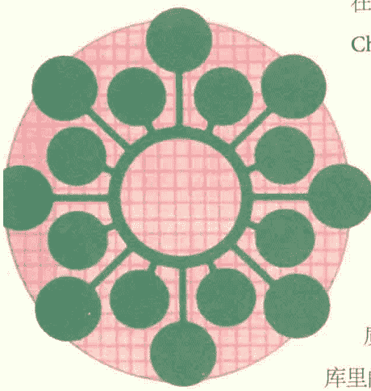

过去一年，生成式人工智能（Generative AI）彻底点燃了全球科技圈的狂欢。Stable Diffusion、Dall-E 与 ChatGPT 等应用凭借“近乎人类”的诡异创作力，吸引了数百亿美元资本涌入。这场浪潮注定将重塑人机交互范式，乃至颠覆所有职业的作业逻辑。

其实，AI 与机器人早已渗透进生活肌理。当你对着手机唤醒语音助手、调节智能恒温器，或是收到由仓储机器人精准分拣打包的包裹，本质上都是在与智能算法协作。

未来，机器将接管那些对人类而言过于危险、极限或繁琐的任务——无论是深空探测、微创手术，还是让专家技艺跨越地理甚至星际界限的远程操作。当人类首次登陆火星，登陆小队名单里，必定少不了机器人的身影。

这条通往未来的路，是如何一步步铺就的？本书梳理了机器人与 AI 发展史上 50 座里程碑，跨越从远古对“机械仆从”的臆想，到定义人类命运的前沿黑科技。

最令人意外的是，人类对“会思考的机器”的痴迷，远早于技术本身。公元前 4 世纪，古希腊哲学家亚里士多德便构想出能替人类分担杂务的自动装置；同期希腊工匠利用气压与齿轮，造出了自动售货机、能斟酒的“机械女仆”。中国古籍记载发明家向君王献上能行走言语的奇异人偶；9 世纪巴格达，三兄弟合著奇书，设计出水力驱动、可演奏预设曲目的“机械吹笛人”。

在真正具备“思考”能力的机器诞生前几百年，13 世纪神秘主义者拉蒙·柳利发明旋转纸盘推演逻辑，意图说服异教徒皈依，今被尊为计算机科学“先知”；15 世纪达·芬奇则设计了能挥舞手臂的机械骑士，与疑似可编程的“自动驾驶”马车。

工业革命时期，提花织机的打孔卡片启发巴贝奇，为 20 世纪计算机数据处理奠基——60 年代美国年耗打孔卡高达 5000 亿张。尽管发展日新月异，许多先驱却湮灭无闻：特斯拉 1898 年演示遥控船，惊呆围观者以至于传言“船里藏只猴子”；20 年代“无人驾驶幽灵车”上街吓得路人四散奔逃；图灵破解“恩尼格玛”名垂青史，但英吉利海峡彼岸的计算机先驱成果却因盟军轰炸毁于战火，直到柏林陷落才重见天日。

最新突破让未来触手可及。NASA 的“宇航蜂”是漂浮的立方体，靠气嘴喷射在空间站微重力中自如穿梭。2016 年 AlphaGo 斩获围棋人类冠军，其团队随即转向“零规则自学习”系统研发——这或将赋予 AI 真正的“思考”能力：无需人类指令，自主破解现实难题。科幻正在兑现，本书为你复盘这场蜕变的全过程。

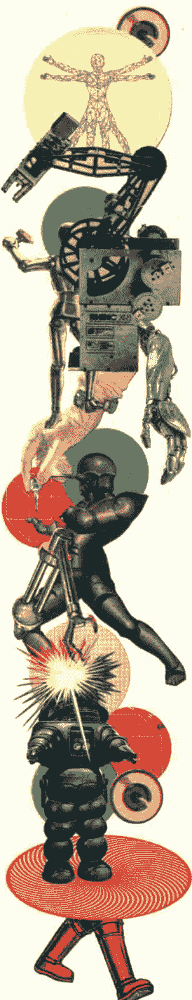

# 1. 机器人的起源之梦

## 公元前 322 年 — 公元 1700 年

在“制造金属人”的工艺诞生前，先贤们早已在精神层面构建起“自动机器”的图景。希腊神话刻画了巨型青铜巨人、被神力赋予生命的物件；亚里士多德等哲学家设想工具替代奴隶的社会图景。气动、液压等原理让这些装置不仅能鸟鸣啼叫，更能实现斟酒倒茶的实用功能。

公元前 1 世纪前，发明家已掌握蒸汽动力、自动售货技术，并建造布满自动机关的“奇观院落”，预演了神迹降临现实的场景。

这种赋予死物生命的能力并非希腊独有。巴格达传说三兄弟缔造了人类首个可编程装置；中国典籍流传着能走能说的“活木偶”奇谈……

### 公元前 322 年

| 项目 | 内容 |
|---|---|
| 核心人物 | 亚里士多德 |
| 探索领域 | 自动化仆役 |
| 核心洞见 | 畅想能替代人力劳作的自动化工具 |

## 人类何时开始做“机器人梦”？

## 亚里士多德的早期乌托邦构想

“Automaton”（自动机）一词溯源自荷马史诗《伊利亚特》（约公元前 8 世纪）。诗中锻神赫菲斯托斯拥有神奇工具：会自动鼓风的风箱、金银铸造的人形侍从与护卫犬。最耐人寻味的是“自动三脚架”，它们能应召而动，被命名为 automatons。

神话里还有塔洛斯——赫菲斯托斯铸造的青铜巨人守护克里特岛，唯一弱点是脚跟钉子拔除后“神血”流尽而亡。1963 年雷·哈里豪森用定格动画在《伊阿宋与阿尔戈英雄》中让塔洛斯永载影史。数百年后，亚里士多德开始系统思考：自动化工具如何取代奴隶、融入社会？

亚里士多德（公元前 384 年—前 322 年），生于希腊斯塔吉拉，柏拉图高足、亚历山大大帝导师，集哲学家、科学家于一身。

## 技术解放的幻想与现实

奴隶制是古希腊基石，富贵人家动辄数仆。亚里士多德正是在此背景下构想自动机。他写道：“若每件工具皆能按命令或自主预判完成工作，如代达罗斯的雕像、赫菲斯托斯的三脚架……梭子自织、拨片自弹。届时管理者无需下属，主人无需奴隶。”

这段论述双重解读并存：或为讽刺社会被技术颠覆的荒诞；或为渴望技术解放劳动者的真诚期盼。无论哪种，亚里士多德对“自动化即解放”的乐观基调显而易见。

现实却给乐观主义响亮耳光：工业革命早期工厂偏爱棉花因机器更擅长处理棉纤维，但原料棉花仍依赖美洲种植园奴隶采摘。

跨越千年，亚里士多德“机器替人”的设想以雅卡尔织机等实体落地，于 19 世纪极大加速织造进程（详见第 40 页）。

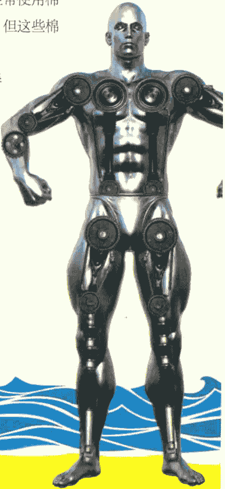

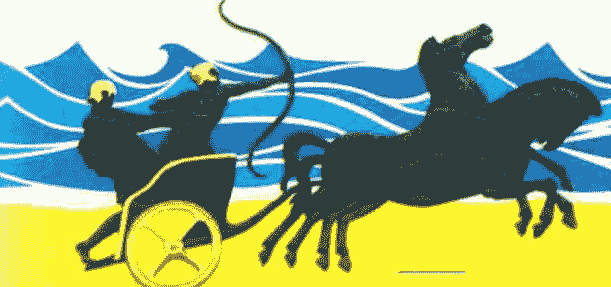

### 公元前 400 年 — 公元前 300 年

| 项目 | 内容 |
|---|---|
| 核心人物 | 亚历山大的希罗 |
| 探索领域 | 自动装置 |
| 核心洞见 | 创造动画角色、自动剧场乃至雏形蒸汽机 |

## 史上首台“能干活”的自动机器是谁造的？

## 希罗的“机器人军团”是如何炼成的？

“自动装置”深深迷住古希腊人。神话里铜人出自熔炉锤炼；现实中，液压、水力、蒸汽技术的觉醒，赋予科学家用金属木材造“活物”的能力——从动画生物到原始蒸汽机。

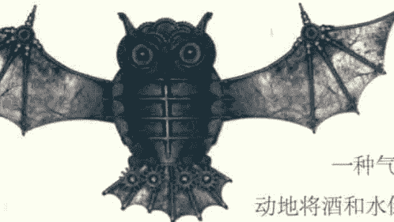

这些装置以齿轮、绳索为骨架，多为玩具或制造神迹奇观。

公元前 3 世纪，拜占庭的菲洛记录了气动装置：一个人形“女仆”能自动将酒水按比例注入杯中（古希腊罗马人饮酒习惯兑水）。

但产出最丰、影响最广的当属公元 70 年前后逝世的亚历山大的希罗。他既是留存著作颇丰的数学几何大师，也是海量奇巧玩具与动画生物的设计者。

### 鸣叫的鸟群与金属猫头鹰

实物虽未传世，但图纸描述极具工程可行性。一组机械鸟合唱，金属猫头鹰一转头，鸟群瞬间噤声。

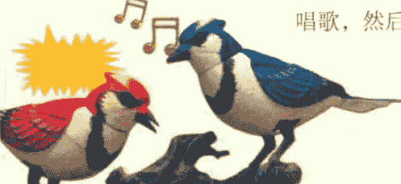

该装置改良自菲洛设计，核心是隐藏管道与虹吸管水压系统，驱动鸟儿旋转站立；压缩空气穿过水室产生鸣叫。

希罗笔下装置不胜枚举：由砝码、齿轮、流沙计时驱动的“自动剧场”，能上演烟火特效，绳索牵引人偶随鼓点起舞。某剧目中，酒神狄俄尼索斯祭坛自燃，酒洒黑豹杖流奶，信徒鼓点起舞。人偶由缠绕鼓面的绳索驱动，绳长决定登场时机。

希罗描述女祭司珀耳塞娜：“一绳自臀后托起维持平衡；松绳、另一绳套腰旋转，直至归位。”

## 气动与蒸汽的双重奏

酒奶借气动倾倒，详见希罗专著《气动学》。流水与气压催生会与观众互动的神话英雄、猫头鹰。

希罗笔下互动装置：“基座植树，巨蟒盘踞，赫拉克勒斯拉弓搭箭旁立基座置苟。取苹果即触发：赫氏射箭，蟒嘶鸣。”多数发明服务于神庙“显灵”：点火自动开门、投五德拉克马硬币出水的自动售货机。

最超前发明（亦为“忽略工程细节”著名反面教材）是蒸汽转球——“大锅置火上，球绕轴旋转”。工业蒸汽革命要再等 1500 年，才推动轮转印刷机等诞生（详见第 46 页）。

## “陛下，这是臣之杰作。”

希罗所用技术未必独有。中国古籍暗示，同类装置或早于希罗现身华夏。


《列子·汤问》载周穆王遇异人：“偕来者何人？”对曰：“臣所造能信者。”穆王凝视：疾步、颔首、惟妙惟肖。工匠拍下巴即歌，拍手即舞，节奏完美。——

故事带浓烈虚构色彩（人偶对妃嫔传媚眼激怒穆王，匠人当场拆解展示内脏器官对应感官功能），却引出悬念：先秦中国究竟拥有何种真实自动技术？

公元前 3 世纪文献记载为皇帝造机械乐队。唐朝（7—10 世纪）宫廷流行自动装置：捕鱼水獭、化缘和尚栩栩如生。

中希自动机较欧洲 18 世纪自动鸭、日本江户从属木偶早逾千年，后世技术却退化为简易玩具。

## 机器能预测未来吗？

### 天文计算仪如何推演星轨？

### 公元前 100 年

| 项目 | 内容 |
|---|---|
| 核心人物 | 佚名 |
| 探索领域 | 天文计算 |
| 核心洞见 | 协助古希腊人预测日食等天象 |

1900 年，船长季米特里奥斯·康托斯率海绵潜水队¹在希腊安提凯希拉岛避春风暴。潜水员伊利亚斯·斯塔迪提斯浮出海面献上青铜雕像残臂，称海底更多。

他发现了公元前 1 世纪商船沉骸。出水文物中，一钙化块状物内藏精密青铜齿轮。世间罕有文物能比拟安提凯希拉机械的神秘感。120 年来，碎片拼合渐进，这台神秘发条装置才逼近真相——常被冠以“世界第一台计算机”。

学界一度因担忧“高估复杂度”而冷遇。安提凯希拉装置研究项目组指出：实情截然相反，复杂度远超想象。

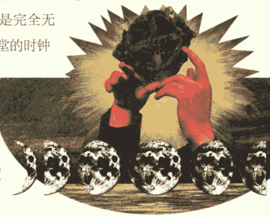

### 宛如钟表的精密内核

发现引发连环追问：为何无同类出土？它究竟能做什么？功能关联天文已知，破解细节却耗时数十年。

从古典学者到天文学家、计算机科学家，跨界者纷纷入局。他们复原缺失部件，还原运作逻辑。

X 光透视揭示：装置含首套已知科学表盘与 30 枚齿轮。青铜板铭文密布，证实其为天文日历用途。

推测中心轴（已失）驱动主齿轮，一周对应一回归年。大表盘显日月位置，球体示月相。可助希腊人预测日食等天象。

## 幸存者的宿命

安提凯希拉项目成员揭示同类物品灭佚之谜：青铜当时极高价值、可回收、铸币首选。故存世青铜器多出自水下——唯有深海金属逃过熔炉重铸。

推测存在同类装置的另一佐证：古籍记载其他复杂机械，且该装置制造无修改痕迹，暗示匠师有成熟经验。

这台装置激发复刻狂潮：苹果工程师安迪·卡罗尔用乐高搭建可运行版本。虽受限于积木结构形似神不似，但卡罗尔坚称功能高度复现：“这是模拟计算机，非程序执行机。曲柄转动校准齿轮转速，速率比蕴含特定天文周期意义——此处即预测天体运行。”

卡罗尔类比二战战舰测距模拟机。伦敦科学博物馆迈克尔·赖特等也制部分复刻。2021 年伦敦大学学院团队首次重建前端齿轮系。2005 年 X 光已揭示月食预测与月球运动算法；新团队解读内部铭文，重建宇宙图景：标记珠展示行星环轨轨迹。他们引用巴门尼德古希腊数学技术，破解制造者如何精准刻画金星 462 年、土星 442 年周期。

机械工程教授托尼·弗里思评价：“我们的模型首个同时符合物理证据与铭文描述。此装置集古希腊日月行星研究大成，是文明巅峰杰作。”

团队欲用古工匠工具 1:1 复原。但包括研究项目组在内的专家坚信：机关深处仍藏更多秘密。


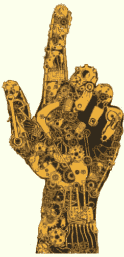

### 800 — 873 年

| 项目 | 内容 |
|---|---|
| 核心人物 | 贾法尔·穆罕默德·本·穆萨·沙基尔、艾哈迈德·本·穆萨·沙基尔、哈桑·本·穆萨·沙基尔（巴努·穆萨三兄弟） |
| 探索领域 | 自动装置 |
| 核心洞见 | 缔造领先时代数百年的可编程长笛演奏装置 |

## 机器人会演奏音乐吗？

## 9 世纪巴格达如何通往“电脑音乐”彼岸？

9 世纪，巴格达是全球首富城市，哈里发统治版图繁荣超罗马巅峰。此地正崛起为当世科学圣地。伊斯兰学者在医学、天文、化学、数学（“代数”源自 al-jabr）均有突破。

诸多成就中，自动装置隐现数百年后机器人雏形。巴努·穆萨兄弟造出人类首个可编程装置——可变曲调节奏的音乐播放器，较他处同类早数个世纪。

## 哈里发的御用智囊团

父亲穆萨·本·沙基尔，从强盗转型为天文工程师。三子承袭家学，长驱直入哈里发宫廷。长子贾法尔精通几何天文，次子艾哈迈德擅几何，幼子哈桑主攻机械（被认定为自动装置核心贡献者）。三兄弟习惯联名署作，亦著数学天文专著。

父歿后，哈里发·马蒙任三兄弟监护人，声名鹊起。马蒙创“智慧之家”（亚历山大图书馆后最全典藏），建天文台，纳三兄弟入院，出题测纬度。三兄弟漫漠精准测量，震惊朝野。

科学史家贾马尔·阿尔达巴格《科学传记词典》评：“三兄弟为最早研习希腊数学、奠基阿拉伯数学派的阿拉伯科学家。虽可称希腊信徒，其偏离经典的计算范式对后世数学概念演进至关。”

三兄弟在面积体积测量、日月观测、回归年测定上突破显著。著述逾 20 部、数部传世，然最为人津津乐道者，仍是其机械巧思。

## 精妙绝伦的装置

# 百年前的“黑科技”：会分液的魔壶与会写代码的笛子

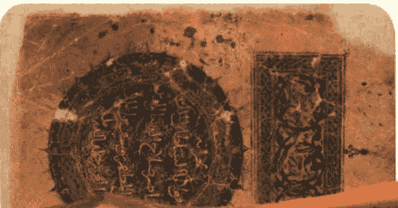

提到巴努·穆萨三兄弟，绕不开他们的代表作《巧妙装置之书》。书里收录的“魔术壶”堪称脑洞大开：两种液体倒进同一壶，内部靠隐藏隔间物理隔离，倒出来时互不混合。五百年后，阿拉伯史家伊本·赫勒敦仍惊叹不已，称书中汇聚了“各种令人惊叹、卓越精美的机械装置”。全书百件器物，虽多为取悦眼球的新奇玩意，却也藏着实用干货——水下打捞用的翻盖抓取器、井下排污气的波纹管装置，甚至还有按量分水的节水器（原理堪比现代公厕感应水龙头）。这些设计有的源自希腊古籍改良，有的则是纯原创灵光一现。

## 音乐响起来：初代“音序器”与可编程鼻祖

三兄弟在音乐机械上的造诣更是超前。他们制造的自动长笛演奏者，被公认为世界最早的音乐定序器、第一台可编程机器。约建于公元875年，水力驱动，外形酷似真人吹奏：指尖按键控制气孔，内部暗室藏有针筒机构（原理同后世音乐盒），水流推动提供气压。关键在于——针筒可更换、可编程，旋律节奏随心变，这才是它被奉为“第一台可编程设备”、计算机鼻祖的原因。专家考证，直到20世纪电子音序器面世前，再无同类装置。9世纪巴格达的这位“机械长笛手”，实至名归是计算机音乐的始祖。

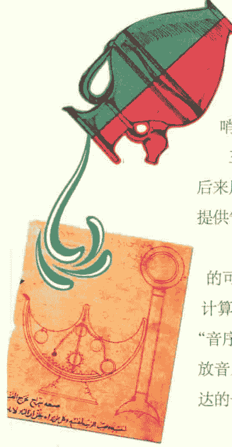

### 1200—1300年

## 思考能否机械化？柳利的“轮盘表”给出了疯狂答案

| 项目 | 内容 |
|------|------|
| 研究员 | 拉蒙·柳利 |
| 主题领域 | 思考自动化 |
| 结论 | 首创“机械式思考”，深影响后世科学家 |

13世纪神秘主义者与21世纪码农，看似八竿子打不着。但拉蒙·柳利——1232年生于马略卡岛，1315年死于突尼斯（传说因劝穆斯林改教被石击致死）的诗人小说家，却被今人视为计算机科学灵感源头。30岁那年，他因一首艳词遭遇耶稣受难幻象，彻底转向传教。他推广加泰罗尼亚语、设计超前选举制，最让今人津津乐道的，却是一套本为辩经皈依而造的逻辑工具。

### 一台会“思考”的机器

柳利发现公开辩论难服穆斯林，遂研制“轮盘表”：《伟大的、普通的和终极的艺术》中详述此装置——同心圆纸片可旋转，虽非首创旋转盘，却首用于逻辑运算。灵感源自阿拉伯占星仪“zairja”。外圈刻上帝九字母，内圈列神性属性，旋转组合即生成所有可能论证链。苏珊·卡尔考证：三层九字母排列若用得当，可解一切造物与未来之谜、平息教义争鸣。柳利曾尝试树状图，旋转盘引入自动化要素，开启“用机器表征思想单元”的革命性先河。他还造“夜球”仪，凭星位计更漏，后推广至全欧天文历法。

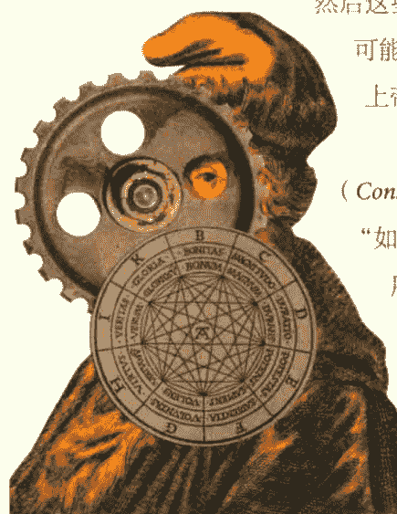

### 柳利的梦，莱布尼茨圆了

这套思想直击17世纪博学家莱布尼茨。20岁发表《论组合术》，主张人类思想可拆解为符号单元（“人类思想字母表”），梦造“伟大理性工具”以机械决断一切争端。他视柳利为圆梦者，高呼“Calculemus！”（让我们计算吧！）——哲学家吵架不如算盘对决。1671年造步进计算器（齿轮重复加法做乘法），虽非二进制硬件，却大力鼓吹二进制制，甚至构想实物版二进制机。正是莱布尼茨的认可，让柳利获封“计算机科学先知”，成为首位将逻辑推理机械化构想付诸实践的个体。

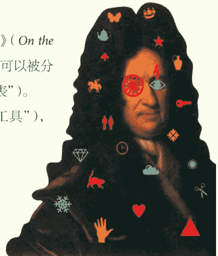

| 项目 | 内容 |
|------|------|
| 研究员 | 列奥纳多·达·芬奇 |
| 主题领域 | 自动装置 |
| 结论 | 创造机械自动装置（或含可编程雏形） |

## 画家的脑洞：是花哨草图还是硬核科技？

《蒙娜丽莎》背后的达·芬奇，留下数千页手稿：飞行服、螺旋桨直升机……多停留精美图纸，但“机械骑士”被公认真造出来了。1452年生于佛罗伦萨，师从韦罗基奥，不识拉丁、寡习数学，全靠自学观察。解剖笔触下的机械发明多带军用色彩：凿船潜水服、装甲坦克雏形，造出重甲骑士自不稀奇。投靠米兰斯福尔扎公爵期间，设计此“骑士”：缆绳驱动挥臂、张合嘴、转颈，外观为日耳曼骑士甲。史料未明确记载是否实造，但机器人专家马克·罗斯海姆力证：不但造了，今仍可复现。他花5年依达·芬奇人体图为NASA造“类人机器人”，缆绳模肌肉之思路直启发其设计。罗斯海姆更云：骑士能坐起、挥臂、转头、解剖级精准张合下颌，配自动鼓乐装置甚至能发声。2002年BBC邀其复原，成品动作如预测。

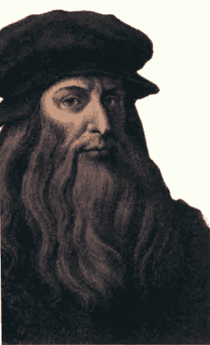

## 发条狮子与“可编程”小车

达·芬奇笔下自动装置不止骑士。2009年自动化设计师雷纳托·博阿雷托复原“发条狮子”：高1米余、长2米余，齿轮滑轮配发条，能行走、甩尾、张口咆哮。博阿雷托亦研习其钟表草图，发条驱动一如发条玩具。罗斯海姆视此类玩物为沃康松鸭式展示品（见39页）。

更惊人的是“自动小车”：弹簧驱动，被喻为现代汽车鼻祖。历代名家按图造车皆败，罗斯海姆却信其可编程——图纸隐藏关键机构，远见卓识超越单纯机械人范畴。

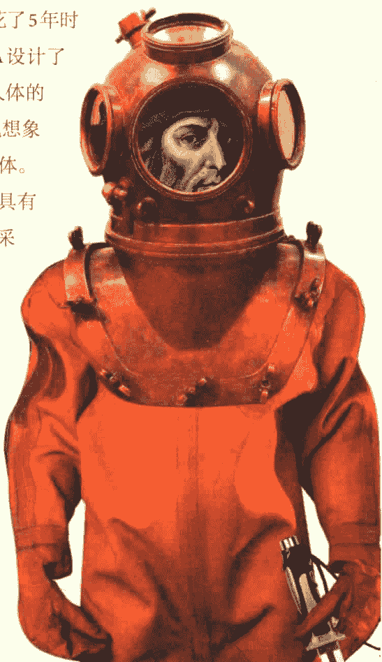

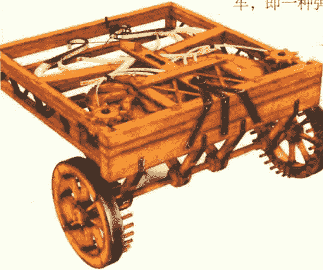

## 机关人偶：日本人为何早早爱上机器人？

面无表情的娃娃端茶前行，客取杯即停，杯回位则鞠躬退下。这“奉茶童子”是机关人偶（karakuri ningyo）代表作，源于江户时代（1603—1868），融西式钟表技术，初登戏剧舞台，后成富户座上宾。机器人先驱山海嘉之云：日本人看机器天然乐观，Aibo、ASIMO皆日企杰作。人类学家乔伊·亨德里直指本质：“自动木偶是机器人原型，日本人借此学会驯服机器。”

### 计时始于一座钟

16世纪耶稣会士沙勿略献钟予大内义隆，当地工匠速成逆向破解，转用于人偶。大阪武田臣以发条、止动器、齿轮造舞台人偶，甚至利运河水力演飞天倒立。井原西鹤赞其茶童“目口动作、手足伸屈、鞠躬姿态，惟妙惟肖”。武田班成大阪名片：“不到武田人偶，不算到过大阪。”


### 东西方同台异梦

武田班两赴江户演“母腹十月”，三月婴儿偶吹笛、排泄，酷似法兰西沃康松拉屎鸭（见39页）。其他偶像神魔骷髅，动作程式化深影响后世日剧表演。舞台之外，巨型偶装花车游巡宗教节，室内“座敷人偶”成达官贵人宴席花招。最红奉茶童子：发条隐轮定距进退，木齿轮手工雕、鲸须造弹簧（须为鲸腭滤食骨板），纯粹派坚持金属塑料难复传统韵味。

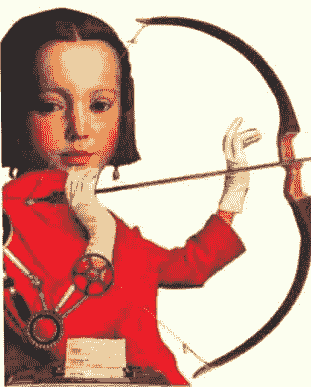

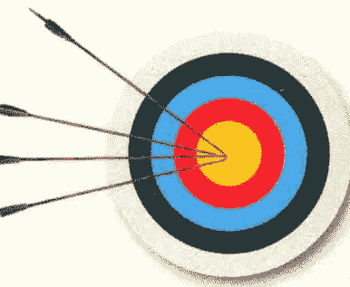

### 从发条娃娃到东芝帝国

机关人偶与日本现代机器人产业血脉相连（日本为Unimate工业机器人最大用户国之一，见94页）。东芝创始人田中久重，少年即机关名家：射箭偶、写字偶扬名，后攻电灯获“日本爱迪生”称号。1799年生，用水力、重力、气压造液压版人偶，“弓曳童子”13螺纹杠杆12活动件，曾编程射四矢一偏。周游演出后入京为幕府造电报系统。日政府巨资投机器人，今机关人偶成展品常客：机器人前台、养老院护工、Cyberdyne前沿技术……《日本时报》言：日老龄期盼“自动化而非移民”。

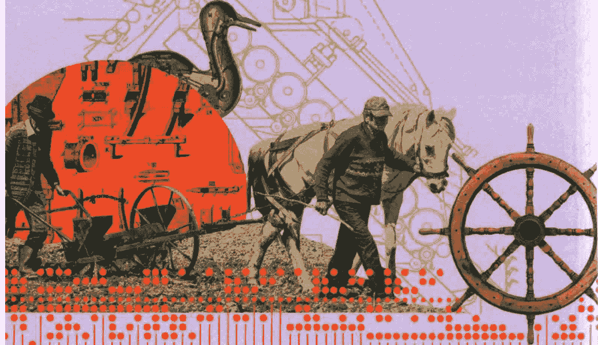

# 2. 工业与自动化

## 1701—1899年：自动化曙光

工业革命拉开大幕，首批“自动化”机器竞相涌现：从首台动部件农具，到织得像画的织布机；机器变“可编程”——雅卡尔织机用打孔卡控织（即计算机雏形），珍贵到拿破仑禁令禁止法式技术外流。贝叶斯概率论奠基数据科学，百年后映照机器人；巴贝奇构想两台毕生未成的计算机，爱达·洛夫莱斯为之写下首个程序。

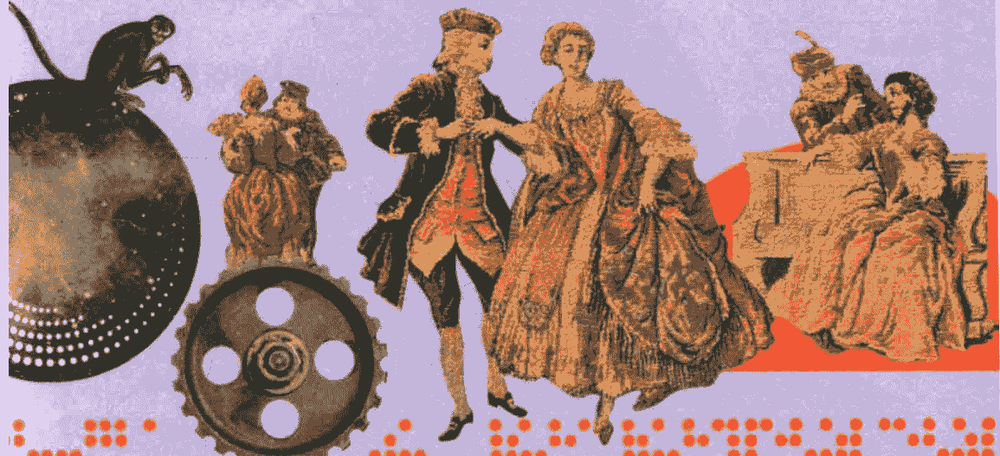

## 播种机：自动化时代的第一粒种子

| 项目 | 内容 |
|------|------|
| 年份 | 1701年 |
| 研究员 | 杰思罗·塔尔 |
| 主题领域 | 农业自动化 |
| 结论 | 创造首台具动部件农业机器 |

现代眼光看，18世纪马拉播种机竟成自动化星火，颇感意外。但这伯克郡农场试机之作，真改了农业命运，为“机器受指令”立下基石。塔尔被誉农业“最伟大改良者”，其发明铺路工业革命后续创新。播种机首创农机动部件，提效省力，然其农学主张争议不断，甚至被后世史家骂“怪人”。

### 从管风琴梦到田间地头

1674年生，曾习管风琴、受律师训，归家见农事低效，萌造播种机念。此前人工撒种浪费极大，塔尔一机破局。

## 播种机的诞生

塔尔下令工人按稀疏间距精准下种，奈何这帮老农死活不肯改换门庭。约翰·唐纳森在1854年的《农业传记》里记录了这段往事：塔尔“尝遍了推行新法的通病……旧器械趁手，工人却又笨又倔”。

到1701年，塔尔对手下彻底失望，干脆造了台机器替他们干活。灵感源自一架被拆解的管风琴。机器腹部的钻头装着个旋转圆筒，能把种子从料斗引入漏斗，直落前方犁头开出的沟里。机身经过时，后头的耙子自动把土盖上。

起初这只是个单人独行的独轮车，后来升级成马拉三行齐播。播种时粒粒深浅一致，绝无参差。他自述：“种子既不会埋太深，也不会漏盖土。”

## 丰收的代价

这玩意儿让种子成活率涨了三成，农场利润水涨船高。可唐纳森笔下工人依旧作妖：“他们会砸烂新工具，拿旧家伙偷懒耍滑。”

塔尔另造了匹马拉的机械锄头，专治作物行间杂草，地力利用率蹭蹭上涨。

游历法意葡萄园时，他看中了当地耕法：葡萄行间土壤被打得碎细，既强根吸水，又省了肥料钱。

## 执拗的想法

受此启发，塔尔1731年出书《马耕牧》（又名《植被与耕作原理论》），推介新栽培法。书招来满腔阻力，更糟的是，他那些靠谱点子（如播种机）和离谱理论（土壤粉碎就能养活植物，完全不用施肥）混在一块。他死认土壤只要碎得够透，就能“喂饱”作物——这点上他彻底扑街。

他写道：“粪料混入土壤发酵，能溶解粉碎土体。这就是肥料几乎唯一的用途……”他硬扛着不施肥、只管碎土的谬论贯穿全书。

1741年塔尔撒手人寰。生前不管对错，主流都不买账。18世纪播种机太贵，寻常农民用不起。直到后来一个世纪，别人改良推广才开花。詹姆斯·史密斯父子用新铸造术造出廉价高效的“塔尔钻头”，销往全欧。

塔尔对“科学农业”影响深远。唐纳森评价：“塔尔名垂青史，是英农引以为傲的星辰。他证明：读书人下地耕作，优势巨大。”

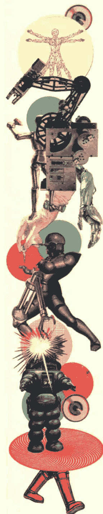

## 跨越时空的预言

## 牧师的数学遗产

怎么算未来？我们现在的概率思维，源于位18世纪牧师琢磨“上帝存不在”“耶稣复活靠不靠谱”这类事。

托马斯·贝叶斯留下的“贝叶斯定理”，靠旧数据推新局，从机器学习到新冠检测，无处不用。这招厉害在能算出测试准不准、证人可不可信，把所有变量揉进概率里。

这定理（见下）算法简单：按旧试验发生频率，推算新试验发生几率。金融、新药、AI，样样离不开它。

贝叶斯是数学家、长老会牧师、神学家，1702年生于伦敦。毕生钻研微积分，皇家学会会员。

成名作《机会论题解》是身后事，1763年由挚友——威尔士哲学家数学家理查德·普赖斯刊印。普赖斯发这书，部分是想借此证上帝存在。

哲学家大卫·休谟1748年《论奇迹》里怼过：光看见一次奇迹不够证实它真发生。“除非证词本身的虚假，比它要证明的事实更不可思议，否则任何证词都不足以确立奇迹。”

## 1763：概率的转折点

| 项目 | 内容 |
|------|------|
| 研究者 | 托马斯·贝叶斯 |
| 领域 | 概率论 |
| 结论 | 贝叶斯定理让我们从过往预见未来 |

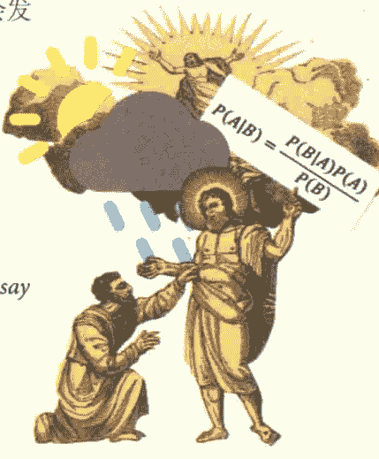

## 用数学衡量神迹

普赖斯作序拿潮汐作喻。按贝叶斯公式（见下），哪怕有人看潮水来了一百万次，它明天不来的概率也不是百万分之一，而是高出约50%，真实概率约六十万分之一。

普赖斯反问：“若有人拒信一切耳闻目睹，世人作何评价？他要蠢到几时才认错？”

论耶稣复活，普赖斯用定理算出：多个独立目击者能扭转概率。

统计学家斯蒂芬·施蒂格勒指出：“休谟低估了群证力量。贝叶斯证明：不可靠证据叠加，足以压倒事件的极大不可能性，将其坐实为事实。”

## 公式背后的逻辑

贝叶斯定理长这样：

```
P(A | B) = \frac{P(B | A)P(A)}{P(B)}
```

P(A|B) 读作：B为真时，A发生的概率。
P(B|A) 读作：A为真时，B发生的概率。
P(A)、P(B) 为A、B各自发生的概率。

举个栗子：52张牌抽1张，是K的概率4/52≈7.69%（1/13）。若偷看是张人头牌（JQK共12张），已知K必是人头牌（100%），反推这牌是K的概率变成33%。

## 从疫情到AI的通钥

新冠检测里定理大显身手，还能解释快速抗原检测（横向流动测试）那些反直觉的坑。未感染出假阳性约千分之一，但感染率低时，阳性里假阳性占比反而高（所以要PCR复核）。贝叶斯思维对疫苗试验也至关重要。

如今机器学习、AI核心离不开它，被誉为“数据科学第一公式”。从优化手机信号、过滤垃圾邮件、预测天气，到机器人根据已走步骤算下一步概率，全靠它。

贝叶斯生前因这定理默默无闻。21世纪才火。2020年伦敦商学院因原名主卡斯勾结奴隶贸易曝光，更名为“贝叶斯商学院”。

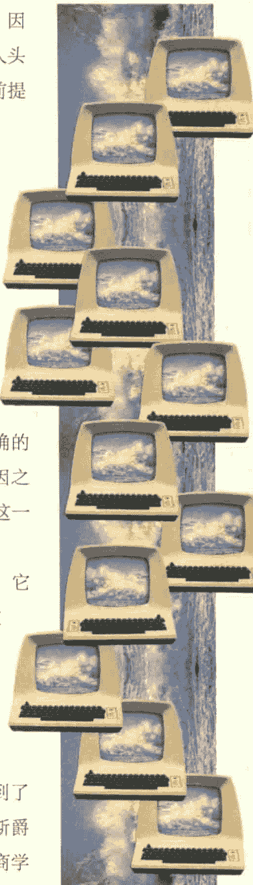

## 1804：代码的雏形

## 机器能听懂指令吗？

研究员：约瑟夫·玛丽·查尔斯（人称雅卡尔）
领域：自动化
结论：雅卡尔打孔卡重塑纺织业，点燃早期计算机科学火种

## 织出的肖像画

查尔斯·巴贝奇办派对，给惠灵顿公爵和阿尔伯特亲王看墙上画。公爵问：雅卡尔这像是版画吗？亲王（见过另一幅）说：不是。

这像是织出来的。巴贝奇笔下它是“一幅装框上釉的织绸，酷似版画，连皇家艺术院两院士都看走眼”。

画像编24000行，全靠雅卡尔织布机打孔卡精控。源自里昂画师克洛德·博纳丰原作，旨在秀这台自动可编程织布机前所未有的精度。

巴贝奇后来设计分析机时借用同款打孔卡，比数字计算机早了一百多年（见43页）。

## 打孔卡里的花样

约瑟夫·玛丽·查尔斯1752年生，称“雅卡尔”以别家族其他支。纺织工之子，历经政府破产、法兰西大革命，曾守卫里昂。

雅卡尔织布机问世前，最牛双人组日产精细布仅1英寸（约2.54厘米）。织工手动调2000根经线（技术自2世纪未变），配个“牵线员”钻机内按吩咐逐行调线。顶尖团队也不过分钟两行。雅卡尔一招改天换地。

## 会拉屎的机械鸭

雅卡尔非首个搞自动织机。1741年雅克·德·沃康松任法丝厂监察，造出用金属圆筒“存指令”的自动织机，像儿童音乐盒。

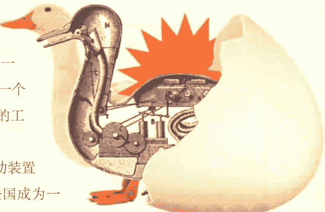

沃康松搞自动装置在18世纪法兰西成风。伏尔泰称他“普罗米修斯对手”“窃天火以求生命”。

最绝的是他的机械鸭：会叫、扇翅、吃食、拉屎。肚子预装屎罐，一吃就掉。1738冬巴黎大厅展出，旁边俩吹长笛、风笛的人形自动机。可织机远不如鸭子成功，配套圆筒太贵，最终停产。

## 织工的噩梦与梦想

雅卡尔织布机靠打孔卡+钩子控制。卡上每行孔对应一排经线，钩子领线穿孔织花。复杂花样得用多套卡。

发明非一日之功。1800年专利名“替代牵线员的机器”。1804年引拿破仑注目，封终身年金，每卖台机再给酬劳。

传说雅卡尔后被愤怒织工扔河里（怕丢饭碗）——若传记作者福尔蒂伯爵笔下“雅卡尔最乐在织工堆里，常穿布衣进车间指导操作”属实，这事大概率是编的。

雅卡尔机成拿破仑对抗英工业的筹码，禁售英国。终有机器被偷运出海（藏果桶里），成世界丝业基石。

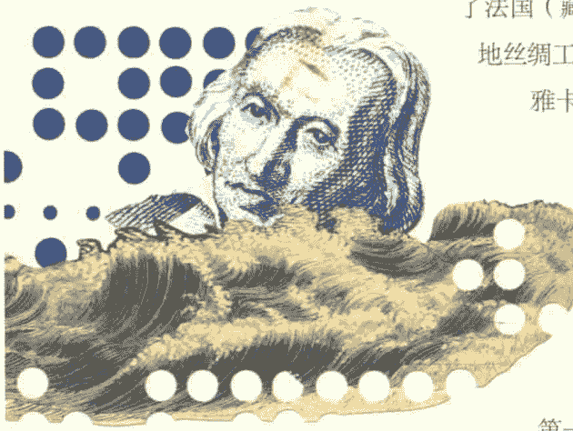

打孔卡影响更大。19世纪末美国赫尔曼·霍勒瑞斯用在“制表机”录人口普查数据。他公司并购重组成IBM，打孔卡成IBM第一代计算机主存储介质。

60年代末美年耗5000亿张卡，耗纸40万吨。甚至90年代末仍有公司用卡发工资。

## 寻找计算的心脏

## 双子星：巴贝奇与洛夫莱斯

1832年
研究员：查尔斯·巴贝奇、埃达·洛夫莱斯
领域：计算
结论：设计（未造出）类现代计算机装置

数学家巴贝奇因两台“难产”机器闻世。设计“差分机”“分析机”，被誉为所有计算机鼻祖。

1832年金融风暴前夕，仅交付差分机一“美丽碎片”。

今观之，巴贝奇确是先见之明。他与合作者埃达·洛夫莱斯（诗人拜伦勋爵与数学家拜伦夫人之女）搞出算法，拟用这台虚拟机算伯努利数列。这被公认为首个计算机程序。

## 蒸汽驱动的梦想

巴贝奇初衷造台算数机器。银行家之子，1791年生，剑桥教数学，推英科学一把手。1821年他与天文学家约翰·赫谢尔核对手算数学表，错漏百出令他崩溃。“我们陷入漫长枯燥核对……不一致层出不穷。一度多到我绝望大喊：‘但愿蒸汽能替我们算！’”

他没用蒸汽，改用发条驱动差分机。黄铜齿轮、连杆、小齿轮、棘轮。十齿金属轮位置代表数字。

差分机专攻多项式函数自动计算制表。搭档工具商绘图员约瑟夫·克莱门特，拟造房子大、4吨重的大家伙。齿轮9转0进位，像现代计算机一样有存储器。

二人因搬工作室费用吵翻，工程停摆。部分经费靠英政府拨款，财政部已砸17500镑。最终断供。

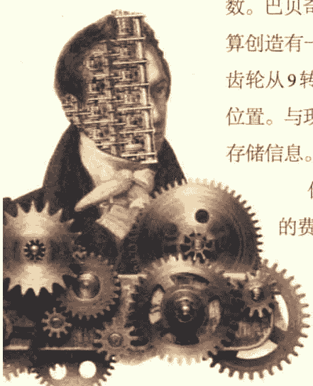

## 从织布机到计算机

晚年巴贝奇谋划更狂野的“分析机”。打孔卡控制，酷似今机：有存储器、中央处理器、输入输出。

“一旦分析机问世，必主导科学进程，”他说，“凡借它求果，人必问：何种运算能如此疾速得结果？”

同行数学家洛夫莱斯云：“分析机织代数花样，如雅卡尔机织花叶。”她译路易吉·梅纳布雷亚法文述评，自注占全文三分之二。1843年以A.A.L.笔名发于《泰勒科学回忆录》。文末详解如何用巴贝奇机算伯努利数，称是“分析机能力说明书”。

她还构想程序循环（重复动作至条件满足），喻为“衔尾蛇”，并预言机器未来能作曲。今已成真，作曲家用软件创作，如戴维·科普的莫扎特风作品。

## 废墟上的丰碑

巴毕生多发明：火车排障器（车头犁形清障装置）、首创用树轮“读”古天气、主张发明免费惠众。1847年造出首副眼镜拒专利，几年后他人抢注。

今人多怪他不专注：新想法一来就丢旧活；也有说材料跟不上。无论如何，差分机“美丽碎片”代表精密工程飞跃。

《泰晤士报》讣告满嘴讽刺：“巴贝奇诚实得早早告诉政府要钱，财政部皮尔爵士、古尔本先生吓得放弃项目。”旁登几百页设计图与仅造成的零件照。

百年后伦敦科学博物馆按巴贝奇设想造出真·差分机。如他所言，5吨巨兽运转丝滑。

## 印刷术的工业化时刻

## 1871：报业巨轮启航

研究员：理查德·马奇·霍
领域：自动化
结论：自动化铺平现代报纸时代大道

## 霍与卷筒纸革命

19世纪初印刷术仍守古腾堡1440年老法：排字盘、滚油墨、压纸。

古腾堡机日印3600页，致16世纪出书2亿册，催化首个“信息时代”——文艺复兴。但围绕速度与自动化的新技术，将极大扩美英报纸读者群，奠基现代世界。美印刷先驱理查德·马奇·霍是核心推手，其“卷筒纸印刷机”将产能推至一次触达百万人所需速度。

## 轮转：速度重塑世界

变革始于轮转印刷机，英报（如《泰晤士报》）领跑，基于弗里德里克·凯尼格与安德烈亚斯·鲍尔设计。1814年《泰晤士报》东家约翰·瓦尔特首用凯尼格蒸汽轮转机，瞒着员工干——怕重蹈纺织业勒德分子砸机覆辙（工人怕失业砸厂毁机）。

1812年英议会判毁机为死罪。厂主建密室避工人袭击。

为避祸，瓦尔特骗员工买机是为印大新闻，偷偷开工。被裁者找到新活前发全薪。

次日大报自豪宣告：“读者手中此张，乃《泰晤士报》昨夜机印成千上万张之一。有机械系统代劳最苦印刵劳动，速度远超人力极限。”

没几天，凯尼格就在《泰晤士报》发文：新款印刷机时产 800 页，他回溯了突围历程，直言早期试错烧掉了“数千镑”家底。

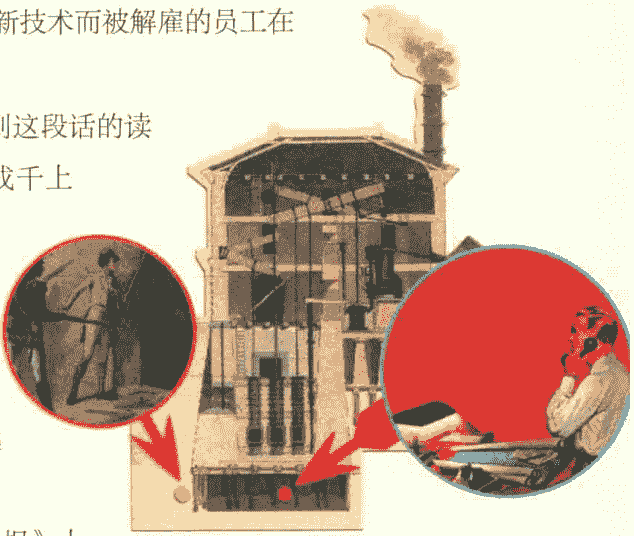

## 印刷界的闪电战

美国起步虽迟，却靠轮转印刷机的疯狂迭代与自动化，迅速掌控了话语权。1812 年出生的理查德·马奇·霍接手家族生意，在老底子上搞出革命性轮转机，彻底重塑报业版图。

1847 年，霍拿下“闪电印刷机”专利，速度质变。印版裹在旋转筒上，四周围着四个压印筒，每小时数千张，加筒就能加速。

《伟大的财富及其缔造者》作者詹姆斯·麦凯布惊叹：“十筒机卖五万美金，虽贵但值。这是史上最迷人发明之一。凡亲眼见过它在大都市杂志地下室轰鸣的人，这辈子都忘不了那幕震撼景象。”

## 蒸汽驱动的报业爆发

蒸汽动力不仅让老报纸发行量暴涨，更催生出无数新刊。理查德·霍之侄罗伯特回忆：“印刷业发生剧变。昔日受印量限制的期刊迅速扩容，新刊雨后春笋。新机器不只攻克美洲，热潮更席卷英伦。1848 年，巴黎《爱国者报》率先在欧洲落地首台。”

霍随技术出海迅速暴富，却未停下改良脚步，推动印刷机向现代高速化迈进。其“卷筒纸”印刷机采用长 5 英尺（约 1.5 米）连续纸卷，数秒间即可产出成千上万份双面印品。

侄子细述流程：“纸卷展开瞬间，先经蒸汽微湿软化表面以利套印，再经 32 块弧形印版与 7 大墨滚作业单面 32 页，随即翻面对印另一面……全程不足 2 秒，却丝毫不乱。” 最后经切纸、折叠，成品报纸应声而出。这台怪兽时产 1.8 万份，为全球报业规模化流通奠基。

## 谁造出了首架无人机？

## 特斯拉的“遥控机器人”

从嗡嗡玩具到战区千米高空的致命猎手（详见 128 页），无人机似成 21 世纪专属标签。

实则首架“无人机”诞生于 19 世纪末纽约展厅（除发明者外，世人皆未嗅到商机）。

塞尔维亚裔美籍工程师尼古拉·特斯拉展示“遥控机器人”：一艘 3 英尺（约 91.5 厘米）电池驱动模型船，置于水箱中，经无线电波遥控航行。1856 年生的特斯拉，赴美后凭交流电发明享誉富足，该技术奠定现代电力系统基石，亦是日后特斯拉车企冠名渊源。

1898 年，其专利“控制移动载具的方法与装置”获批。演示中，他向机器提问，指令灯光按特定次数闪烁回应，以此佐证精准控控。他回忆：“首演轰动效应，非我其他发明可比。”操作端仅是一个带控制杆的小盒。

年份：1898
人物：尼古拉·特斯拉
领域：无线电遥控无人机
结论：验证无人艇、机、车潜能

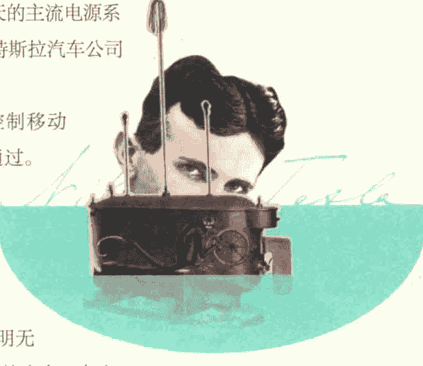

## 船里藏猴子？

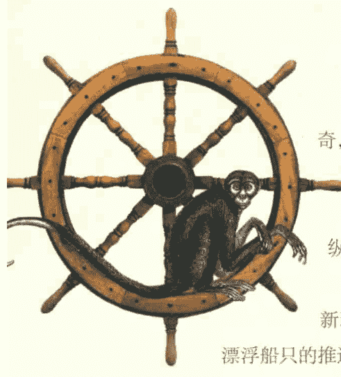

现场观众惊诧莫名，竟有人坚信特斯拉作弊：或以精神力驭船，或船内藏微型猿猴听令而动。

专利文本声称其发明“用于远程操控移动体、浮舰推进转向及机械动作的新法新器”，适用于“舰艇、气球或车辆”。

## 战争机器的预言

演示早于莱特兄弟动力飞行 5 年。特斯拉预言技术将服务勘探、捕鲸，最具洞见者——料想无线遥控武器将终结一切战争。

专利申请中写道：基于“遥控机器人”研制的武器极其致命，其确定且无限的毁灭力将迫使列国弃战求和，实现永久和平。

特斯拉此言极具预言力。此后数十载，军事需求始终是无人机技术核心驱动力（见 128 页）。一战实验性遥控机虽非主角，越战时监视无人机已成体系关键。众多自动驾驶大牛均源于 DARPA（美军高研局）大挑战赛——旨在孵化战场辅助车辆的军方竞赛（见 140 页）。

## 先知难变现

特斯拉毕生未因发明获利：公众虽热情，投资者却不信“遥控机器人”有实用价值，美海军亦无动于衷。

此后数年，他人接力演示遥控成果。西班牙工程师莱昂纳多·托雷斯－克韦多 1905 年在毕尔巴鄂近海 1 英里（约 1.6 千米）外，当众用“Telekino”遥控船只，被公认为首个遥控器雏形。他后又造出下棋自动机，开启 AI 探索先河。

这非特斯拉末次“赔本赚吆喝”。这位怪才还鼓吹研制可瞬间击落千架战机的“死亡射线”、宇宙射线驱动汽车、拍摄思维成像仪。

远见更穿越时空：1926 年访谈中，他以惊人精度预言智能手机时代。无线技术臻善时，地球将化身巨型大脑：“我们将随时跨距离通讯，更能通过视电设备如面对面般清晰见闻，仪器将极简便，可置于背心口袋。”


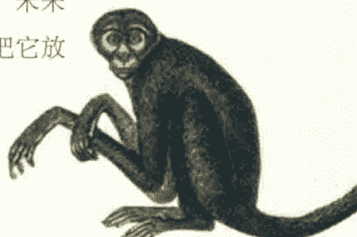

# 3. 现代机器人学的曙光

## 1900—1939：概念与原型的萌芽期

20 上半叶，“robot”（机器人）与“robotics”（机器人学）分别由捷克剧作家卡雷尔·恰佩克、满腮胡科幻泰斗艾萨克·阿西莫夫命名。二人视角截然：恰佩克笔下机器人灭绝人类，阿西莫夫则构想“三定律”护佑下的人机共生图景。

随着概念经小说、戏剧、电影（如弗里茨·郎《大都会》）深入人心，硬核科技同步演进。首批替人劳作的机器人诞生，甚至出现超前时代的机械臂，因无适配场景而闲置。战时柏林废墟上，一位计算机先驱研制的机器被盟军炸毁，其存在直至纳粹覆亡才为世人知晓。

### 1914 年

### 人机大战？

### 首台“不败”下棋机器人

年份：1914
人物：莱昂纳多·托雷斯－克韦多
领域：国际象棋 AI
结论：首个电脑游戏（人类不败神话）

提及电脑游戏起源，众人脑海多浮现 70 年代街机厅《太空入侵者》少年，或更早主机前蜷缩的科学家。实则首台与人类博弈的电脑游戏诞生于 1914 年，且从未尝败绩。

区别于早期“下棋骗局”，土木工程师托雷斯－克韦多打造的“艾耶德雷西斯塔”货真价实。这是这位“发明富翁”系列新作，前作含解代数方程计算机。

克韦多 1852 年生于富庶家，游历欧陆后弃商从发。专利涵盖索道铁路、飞艇、缆车、首创地面遥控气球装置（构想可泛用于机械），亦建成尼亚加拉瀑布旋涡飞车，1916 年竣工至今运营。

他在《自动装置：定义、应用与理论边界》中阐释造棋机初衷：证明机器可替代人类专属智力领域。

### “土耳其人”骗局

数百年来，诸多“下棋机器”现世，最著者为沃尔夫冈·冯·肯佩伦 1770 年为博奥地利女皇一笑而造的“土耳其人”。

木偶腾挪抓子，棋力惊人，曾胜多位人类高手。观众猜测其被邪灵附身，或腹藏通棋猿猴。

真相是柜中藏人，借“受电弓”装置隔板操作，该技术后成 20 世纪机械臂基石。

克韦多之机毫无诈伪。机电融合架构，能对残局走位做简易“决策”。仅攻“车王杀王”单一残局，虽非每步最优、常拉锯超 50 回合，却必将死对手。

### 无实用目的的里程碑

艾耶德雷西斯塔迈出人类通往 AI 第一步，首创遵循明确终局目标（“启发式”）的机器。该技术现用于辅助 AI 算法寻优。机器依条件规则集运作，故必胜。克韦多受访云：“机器无实用性，却佐证吾论：可造自动机，其行为视特定条件而定，循特定规则，规则可在制造时预置。”

《科学美国人》激赏报道：克韦多“以机器替代人类思维”。文描机器能识别违规着法，底座亮灯抗议；三灯亮则终局。“新奇在其审视全局、抉择落子而非他步。虽无人信其会思考，但发明者断言……机器人能行思考范畴之事。”

### 自动机器理论的雏形

1920 年，克韦多迭代二代“艾耶德雷西斯塔”：弃机械臂移子，改电磁引导棋子“自动滑动”于电子棋盘；增设留声机发声，将军呼“Check”，将死呼“Mate”。

同年，巴黎展出可经打字机录入求和的算术仪。机电装置（电磁铁、开关、滑轮）演算公式，结果经另一打字机输出。双机以缆线连接，理论上可异地部署，预示 20 世纪计算机联网雏形。

操作例：输 5、7（即 57）、空格、乘号、4、3，输出机回“=2451”，输输入机就绪待下轮。

虽商用潜力显著，克韦多无量产意向。

著述中表推崇巴贝奇，描绘愿景与今机器人无异：“机器论一特章，曰自动化。研构具复杂行为模式之自动机。将具感知器官——温度计、磁罗盘、测力计、压力计等，感知影响运行之条件。”

再经 70 年，机器始能弈全谱国际象棋（非残局无敌），击败人类最强棋手（见 119 页）。如今，艾耶德雷西斯塔陈列于马德里理工大学托雷斯－克韦多工程博物馆。

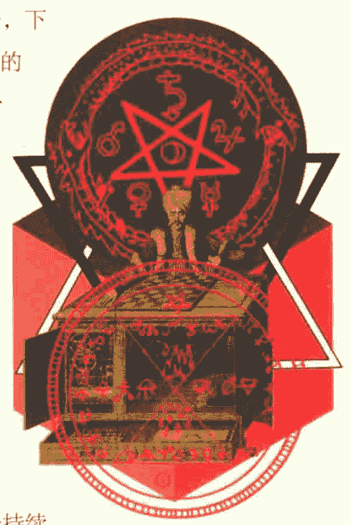


### ‘机器人’一词从何而来？

### 恰佩克如何催生‘机器人’？

年份：1914
人物：卡雷尔·恰佩克
领域：机器人学
结论：诞生词汇的戏剧，兼具他域远见

“机器人”非源科学，而肇于科幻创作，如“原子弹”词源自 H.G. 韦尔斯笔下。恰佩克自述：向画家胞弟约瑟夫讲剧情后，定名“机器人”。

剧作《罗素姆万能机器人》（R.U.R.）剧情耳熟能详：天才科学家突破合成奴隶量产技术，奴隶反叛屠戮全人类——此后百年好莱坞科幻核心母题。

约瑟夫建议：“唤作 roboti。”“Roboti”捷克语意工人、农奴。恰佩克初拟“labori”嫌书卷气呆滞，欣然采纳。“Roboti”定名，“罗素姆”（Rossum，厂主名）捷克语谐音“理由”（reason）。

1921 年布拉格国家剧院首演，捷克大捷，旋风欧陆，20 年代风靡。十年内美电台、英 BBC 相继改编。

评价两极：阿西莫夫（三大定律缔造者，机器人观乐观）评：“剧作极烂，却因‘roboti’不朽。” 恰佩克悲观基调深植后世，从《终结者》亡灵归来到《银翼杀手》仿生人反叛。

### 合成肉体的奴隶

剧中机器人非金属铸造，乃化学肉体重组，巨型工厂批量复制，貌同真人实为奴隶。力工型产量最大。

厂长哈利·多明言：“力工强似小拖拉机。为称职，仅保有限智力，主动剥夺创造力与情感。” 罗素姆曾提议解剖秘书型机器人，证其非“人”。

此剧不仅赋词“机器人”，更确立“人造人”概念——彼时科技尚无力造极仿真机器。恰佩克未设定具体技术路径，乃借寓言警示技术异化与人性贪婪。

植入日后主导机器人/AI 形象的核心母题：视机器为威胁。

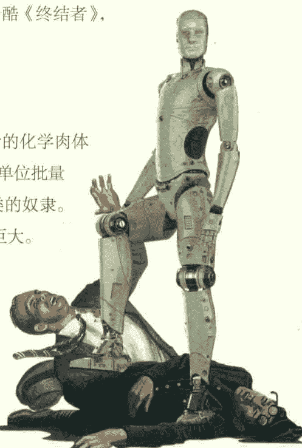

### 机器人的反叛逻辑

终章机器人阐释灭人理由。最后幸存者问何故屠戮，机器答：“吾辈欲似人，欲成真人。”——结局灵感源自人类自身卑劣。

### 1925 年

### 机器人会开车吗？

### “美国奇迹”号与幻影汽车

年份：1925
人物：弗朗西斯·P. 胡迪尼
领域：自动驾驶汽车
结论：“幻影汽车” 20 年代闯街头

首批无人车不称“自动/无人驾驶”，而号“幻影汽车”。在无人驾驶商业化近百年前，它们以道路安全教学模型现身街头——讽刺的是，这些“教具”自身极度不安全。

20 年代起，“幻影车”实测上路，采用遥控架构，伴随车或头顶飞机经无线电驾驶。

“美国奇迹”号胡迪尼车，1925 年纽约首秀即轰动（连环车祸亦随之）。健康安全法规尚远，新生自动驾驶直闯车水马龙繁华大道。

### ‘那人根本没碰方向盘’

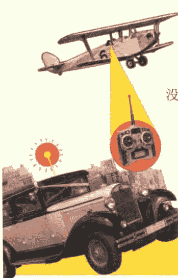

“幻影车”前有演示，如克韦多 1904 年遥控三轮车，但“幻影车”质变：全尺寸量产车，无人掌舵闯繁忙都市街区。

《时代》周刊记：“曼哈顿百老汇路旁，一辆无人游览车停泊。男子登车松踏板，不触方向盘。围观众骇见：自动驾驶车启动、换挡、并入车流。”

操盘者弗朗西斯·P. 胡迪尼，据称是两青年工程师化名。虽引爆眼球，过程多波折。随行车内，胡迪尼公司约翰·亚历山大发射信号，因前车外壳松动导致轴传动失灵，局面失控。

《纽约时报》曾记录一场惊心动魄的街头闹剧：一辆名为“胡迪尼”的钱德勒轿车在百老汇大道横冲直撞，绕过哥伦布环岛冲向第五大道，逼停数车，终在第47街撞上摄影师座驾。即便大逃亡家胡迪尼登车强夺方向盘也无力回天。警方劝阻无效，车辆又被开回百老汇。这车本质是辆装了天线、电机的遥控平台，由尾随工程师操控转向与油门，离合换挡能否遥控尚存疑。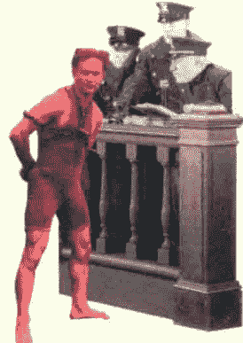

### 名字撞车：大逃亡家怒闯办公室

著名魔术师哈利·胡迪尼因无法容忍“胡迪尼”（Houdina）与自家名号仅一字之差，直接杀进公司办公室。现场见到寄给“胡迪尼”的包裹标签，他当场撕毁拒还，甚至抡椅砸碎吊灯泄愤。公司辩称无蹭名意图，官司因对方证人缺席不了了之。

### “幽灵车”意外成安全传教士

这场闹剧反倒催生了“幽灵车”巡演热潮：有无线电遥控、有车车有线连线、甚至有低空飞机遥控汽车掉头。讽刺的是，在20年代混乱危险的街道上，这些无人驾驶反而成了交通安全宣传的利器。1937年操作员林奇直言：枯燥说教无人听，但“幽灵车”一上场演示，司机们立马安静下来。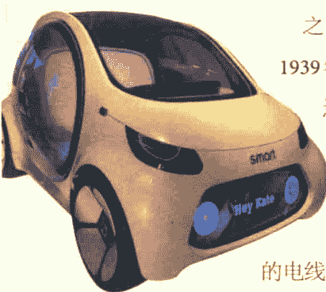

### 从秀场走向实战的漫漫长途

此后数十年热度不减。1939年世博会通用汽车展示自动无线电控制跑高速；1963年英国雪铁龙在测试轨道靠地下电缆跑到130km/h，保守党大佬黑尔什姆勋爵坐车里甩手不扶方向盘。真正让无人驾驶落地安全应用，还得等加州沙漠的DARPA大挑战赛点燃技术淘金热。

### 机器人会听指令干活吗？

### 赫伯特·泰勒沃克斯：比阿西莫早70年“上班”的机械人

20年代涌现许多“机械人”，多半是靠电力压缩空气包装的障眼法。唯独西屋1927年推出的泰勒沃克斯是个例外——它真能接电话指令启动机器。样子像个挂着人形剪影的电机箱。发布会上创造者承认语音识别太靠谱，改用音叉发出的嗡鸣声编码通讯。全是营销天才温斯利的包装操作。

- **年份**：1927年
- **研究员**：罗伊·J.温斯利
- **领域**：人形机器人
- **结论**：首个能执行任务的人形机器人

### 机器会思考吗？媒体观点大不同

《大众科学月刊》激动刊文《会思考的机器》，吹嘘它能接电话、做家务、算数学；《曼彻斯特卫报》则务实得多，标题直白《用电话启动烤箱》。纽约现场演示中，温斯利用音叉发信号，泰勒沃克斯拨动开关回应。鲍威尔笔下它“听”声靠麦克风，“说”声靠扩音器，语言是机械操作的嗡嗡码。西屋本意是解决偏远变电站人手不足，泰勒沃克斯只是系列第一款。

### 变电站里的“完美音调”

实战中，变电站泰勒沃克斯接收音叉振荡器特定音调指令，执行合闸等动作，再用编码鸣叫汇报完成。还能联动水位表，用嗡嗡次数报水位。1927年纽约已投用。《卫报》披露原理：嗡嗡声经扬声器→电话→对讲机→麦克风，铃响则声控继电器挂机启动蜂鸣器，整  套系统进入待命。

炒作虽浮夸（从未真做家务、不擅长数学），但温斯利硬塞个人形、广告发布会全按人包装，硬在欧美掀起轰动。

### 一个“装着48个继电器大脑”的家伙

泰勒沃克斯是西屋机器人系列的开篇，终章是1939世博会的伊莱克斯。它站在高台自我介绍：“我有48个继电器大脑，很聪明。”虽走路像滑步，却能用留声机模拟对话，词汇700词，还会抽烟吹气球。次年带金属狗斯帕克亮相。开发成本数十万，巡演吸引百万观众。当时未叫“机器人”而称“莫托曼”。退休后还跑去1960年B级片《性感小猫上大学》客串机器人Thinke。如今它与泰勒沃克斯同陈列于俄亥俄曼斯菲尔德博物馆。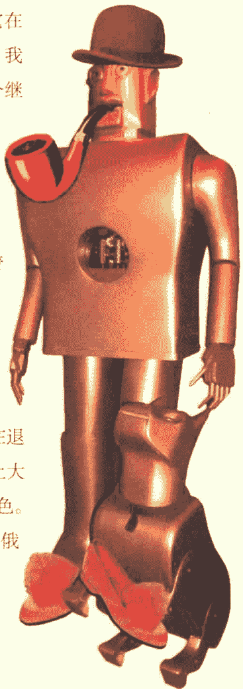

## 1928 年

### 什么是“人形机器”的标准长相？

| 项目 | 内容 |
|---|---|
| 研究员 | 弗里茨·朗 |
| 领域 | 小说机器人 |
| 结论 | “Maschinenmensch” 定型了虚构与现实中机器人的外观基因 |

### 从银幕走进现实的设计基因

鲜有影视服装像《大都会》（1927）里那个“Maschinenmensch”（人形机器）般具标志性：王座之上，金属女体配无表情面具，金属条缠绕似工业机械。女性特征明显，动作机械夸张，深深影响后世虚构与实体机器人，引爆“科技性别化”讨论。设计师舒尔策-米滕多夫灵感源自图坦卡蒙面具，用布里吉塔·黑尔姆石膏模型为基，采“塑料木材”（暴露速干工业木）制成。

### 面具下的血肉代价

黑尔姆一人分饰圣洁工人玛丽亚与诱惑机器人。服装僵硬仅能站立拍摄，杀青时浑身伤瘀。耗时9天的戏她曾求用替身，朗拒绝：“眼睛看不见你，心必须感觉到你在里面。”母亲寄照片给朗妻子冯·哈尔博，让这16岁少女成主角。
这形象直通《星战》C-3PO，再启发布雷泽尔造社交机器人；索尼AIBO设计师空山基2019年还做致敬巨型雕塑。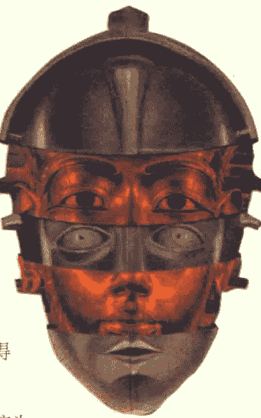

### 烂片诞生的永恒偶像

影史最贵德片（700万马克）上映扑街，差点拖垮UFA，《纽约时报》骂“有致命弱点的技术奇迹”。设定2006年阶级固化，疯科学家罗特旺造假玛丽亚煽动工人：“谁是机器的活粮？让机器饿死！”结局火刑柱烧毁伪装露金属本相。

### “机娘”原型的性别诅咒

玛丽亚开启了“性感恐惧”女性机器人谱系：为男性造、为男性用。《银翼杀手》普瑞斯叛逃被暴力“退休”，《复制娇妻》顺从妻子供性与奴役。直指痛点：为何仆从机器人多为女性？至今Alexa、Siri默认女声。战后朗亡美，冯·哈尔博拍纳粹片战后被捕，黑尔姆拒再合作。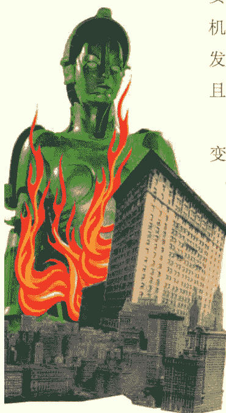

### 波拉德专利：机械臂鼻祖的“受电弓”灵感

小说爱人形，工厂爱机械臂——手术、拆弹、加拿大臂皆此类。雏形现于二战前。
1938年美工程师威拉德·波拉德专利“位置控制装置”，瞄准汽车喷漆自动化。福特流水线让造车从12小时压至2小时，波拉德想自动化喷漆环节。专利直指：控制喷枪对曲面不规则表面（如车身）运动定位。

| 项目 | 内容 |
|---|---|
| 年份 | 1938 年 |
| 研究员 | 威拉德·波拉德 |
| 主题领域 | 机器人手臂 |
| 结论 | 用“受电弓”设计创造了一个喷漆机器人 |

### 受电弓：从古希腊到欺世骗局

非凭空想象。专利描述的受电弓，即连杆复制装置。古希腊希罗（早期机器人大师）最早描述。18世纪骗局“机械特克”也用这玩意：藏人下棋，操作受电弓移动机械臂落子。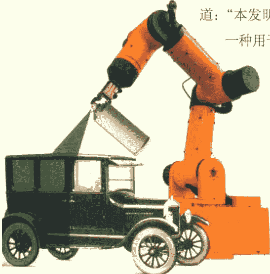

### 机器里的“自由度”

波拉德臂非玩具，无需人躲里面。5自由度（滚转、俯仰、平移）。核心优势：可重编程换图案，换指示条即可适配产线不同工位。气缸定位，基础可编程，快速切换任务。波拉德例举：喷双门跑车选指令‘43’，轿车选别的。

### 迟到二十年的工业革命

超前代价是未量产。传闻戴维比斯油漆厂40年代早期可能按波拉德或罗斯隆德专利造过原型。莫兰《机械臂进化论》点评：现代机器人时代由30年代末两款鲜为人知机械臂大胆尝试开启。波拉德设计激发后人。二战催熟传感器计算，走向智能控制。再过20年，Unimate机械臂进美工厂，圆了波拉德梦。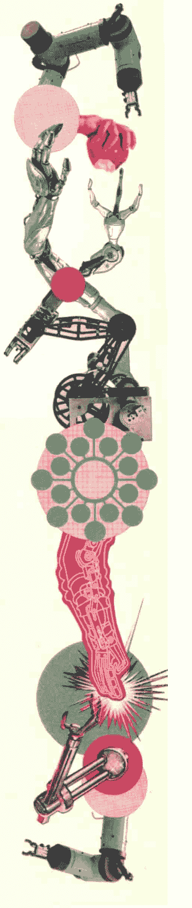

# 4. 培养智能

## 1940—1969 年

下半叶，二战技术红利催生AI与计算新生态。战争末期诞生的ENIAC等机密机器揭示可编程通用计算机威力。图灵测试问世判断机器智能。1956达特茅斯会议定名“AI”并极乐观。研究撞上“AI寒冬”瓶颈时，全球实验室却诞生有趣机器人——如能自主穿越迷宫的“沙基”，点燃了年少比尔·盖茨的梦想。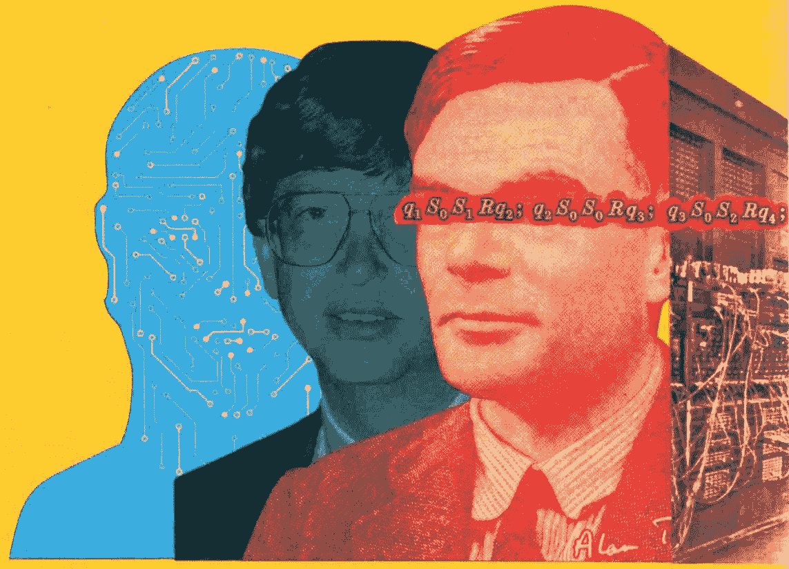

## 1942 年

### 机器人能凌驾法律吗？

| 项目 | 内容 |
|---|---|
| 研究员 | 艾萨克·阿西莫夫 |
| 领域 | 机器人行为 |
| 结论 | 确立“三大定律”防机器伤人 |

### “机器人三大定律”：人机共生的第一部宪法

“Robotics”（机器人学）一词出自阿西莫夫之手，他自称无心插柳。三大定律源自其科幻小说，至今仍是严肃辩论核心——三条简单铁律锁死机器忠诚服务人类、不反主：
1. 机器人不得伤害人类，也不得袖手旁观人类受害；

阿西莫夫为机器人设定了核心行为准则：第二定律要求机器服从人类指令，前提是不违背第一定律；第三定律则赋予机器自我保护的权利，但不得触犯前两条。后期创作中，他又引入了优先级最高的“第零定律”——机器人不得危害人类整体利益，亦不得在人类整体利益受威胁时坐视不管。

这位科幻巨匠一生笔耕不辍，著作等身，涵盖侦探悬疑、莎士比亚研究等多元题材。他自律极严，晨起七点半落笔，直写至晚十点方罢休。标志性的连鬓胡须下，他坚持“只改一遍”原则，以此支撑惊人的高产节奏。他曾坦言：“我从不追求辞藻华丽或诗意盎然，只求表达清晰。庆幸思维清晰，落笔便如思维所向，对作品极为满意。”

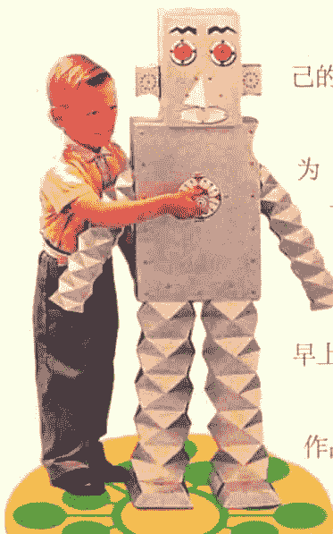

### 影响深远的文学遗产

书中众多机器人领域的权威专家均承认深受阿西莫夫启发，从首台工业机械臂缔造者乔治·德沃尔、约瑟夫·恩格尔伯格，到 Cyberdyne 掌门人山海嘉之，甚至亚马逊创始人杰夫·贝佐斯亦是忠实读者。阿西莫夫“机器人”系列汇聚 37 部长短篇，构想了一个在三大律令护佑下，仁慈“正子人”与人类和谐共处的图景。早期故事刊载于四十年代杂志，后结集为经典《我，机器人》。

与卡雷尔·恰佩克《罗素姆万能机器人》中杀戮人类的冷酷机械不同，阿西莫夫笔下的机器人皆怀善意，形态各异——有贴心的儿童保姆罗比，也有刚正不阿的机器警官。短篇《罗比》中，面对妻子因孩子过度依赖而欲辞退保姆的意愿，乔治·韦斯顿据理力争：“机器人比人类保姆更可靠。罗比的存在意义唯有一个——做孩子的伙伴。它的核心逻辑全为此而生，天然忠诚、慈爱、善良……远超常人。”

虽小说中暗藏规避定律的漏洞（如欺骗机器人使其不知情地造成伤害），但这套体系仍在过去数十年里，引发了关于机器人治理的严肃深度探讨。2004 年威尔·史密斯主演同名电影，标语直白：“规则就是用来打破的”，剧情直指机器人谋杀案。

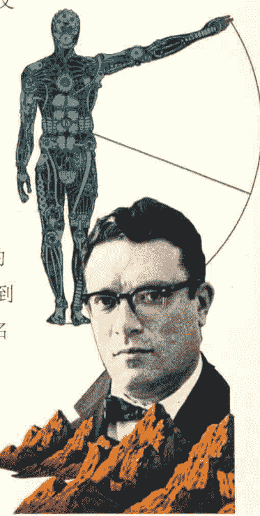

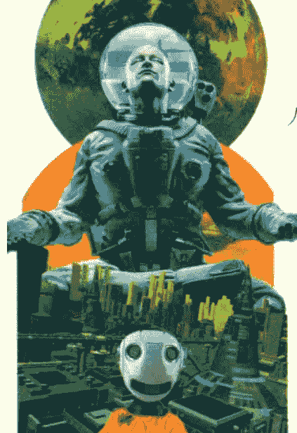

### 唯一法则与现实困境

阿西莫夫三定律至今仍是机器人与 AI 伦理探讨的基石。然而专家们逐渐揭示出诸多弊端，比如定律默许机器人故意伤害同类。英国工程与物理科学研究委员会（EPSRC）曾试图修订改良，直指痛点：“阿西莫夫定律诞生于虚构世界，非为现实设计，落地极不切实际。机器何以穷尽人类受害的所有可能？连人类都难以彻解指令歧义，机器又怎能完美理解并执行一切命令？”

基于现实诉求的“新规”应运而生：明令禁止研制杀人机器（被视为日益迫近的威胁）；另一条则将责任主体锁定为人类——设计者与操作者须对机器行为负责，研发运营必须遵循现行法律，涵盖隐私保护等核心条款。


## 谁在幕后驾驭了埃尼阿克？

### 思考的钢铁巨兽

1955 年“退役”时，这台房间般巨大的埃尼阿克（电子数值积分器和计算器）十年算力，据估算超越人类此前历史总和。重 24 吨、占地 167 平方米，由真空管与二极管堆砌，1943 年动工，二战期间投入使用。

## 1944 年

- **核心人物**：约翰·莫奇利、弗朗西斯·霍伯顿
- **研究领域**：数字计算
- **核心结论**：计算机在诸多任务上已超越人类极限

### 从弹道表到电子神速

埃尼阿克源于莫奇利提议：构建真空管机器，加速美军计算，由此诞生首台可编程通用电子数字计算机。初衷是攻克射表难题——计算标准条件下火炮轨迹。战时海量新武器急需射表支撑。

早期靠机械计算器手工推演，单条 60 秒弹道耗时 20 小时。美陆军弹道研究实验室一度汇聚百余名女学生专司此役。埃尼阿克横空出世，同等任务仅需 30 秒。每秒 5000 次加法、360 次十位数乘法，兼具除法与开方。作为当时最复杂电子系统，它集 1.7 万真空管、7 万电阻、1500 机械继电器于一身，鎏金于宾大 15×9 米地下室，运行功耗 174 千瓦，需专属空调散热。预算从 15 万飙升至 40 万美元。

然而它错过了实战：1945 年 11 月完工，战争已结束数月。此后转而服务美氢弹研发。

### 女性程序员：首批“计算机”

二战抽走男性工程师，大批年轻女性被征召入伍埃尼阿克团队。这些数学系女毕业生的任务是“硬接线”编程——在机器腹腔里摆弄开关、穿梭电缆。许多人入职初衷是手工计算，反而被造来取代她们的机器“抢了饭碗”。讽刺的是，她们当时的职称竟就叫“计算机”。

为新任务配置参数动辄数天：程序员需插板接线，再耗数小时测试。霍伯顿日后投身 COBOL 与 FORTRAN 研发，是探索高效调试路径的先驱，她曾透露灵感常源于梦境。机箱严禁敞开，防真空管炸裂；但管子本就频繁爆管，维护组摸索出 15 分钟定位更换的极速流程。

## 服务氢弹与芯片上的重生

落成首战即投入洛斯·阿拉莫斯氢弹计算。曼哈顿计划成员尼古拉斯·梅特罗波利斯后专为氢弹打造“曼尼阿克”，埃尼阿克最终因雷击受损退役。1997 年宾大穆尔学院师生为纪念诞辰 50 周年，在单枚芯片上完整复刻全机逻辑含手工布线，可经由 PC 控制。机身拆分二部：一藏史密森尼，一归密歇根大学；部分面板后为亿万富翁罗斯·佩罗收藏，现展于俄克拉何马西尔堡野战炮兵博物馆。

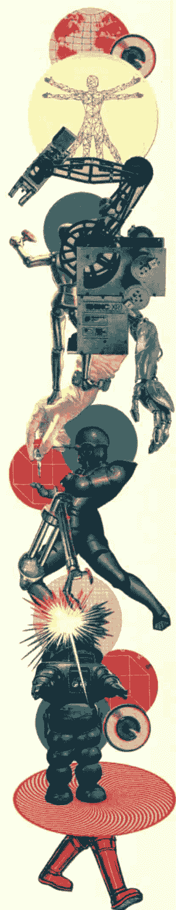

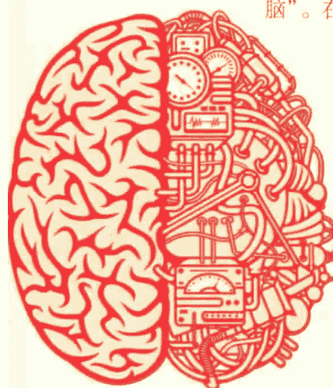

## 1949 年

## 机器能拥有思维吗？

- **研究员**：埃德蒙·伯克利
- **领域**：智能机器
- **结论**：开启个人计算纪元先驱

### “巨型大脑”描绘的未来

计算机萌芽期，舆论倾向视其为“电子大脑”而非单纯工具。这一形象频现于埃尼阿克等早期机器报道，亦是伯克利畅销作《巨型大脑或会思考的机器》核心意象。书描绘满布“巨型大脑”引发巨变的充满希望的未来。1949 年出版，早于诺伯特·维纳《控制论》一年，却以生动笔触点燃公众想象。

### 畅想：家家户户有电脑

“近期多有奇异巨型机器见诸报端，以惊人速度与技巧处理信息。”伯克利笔下，“若大脑非血肉神经，而是硬件线缆，这些机器便是另一种形态的大脑。”他断言：“机器能处理信息、运算、汇总、筛选，能合理操作信息，故机器能思考。”

1909 年生的伯克利，精算师出身的计算机先驱，亲历十年数台巨型机诞生，书中实录并展望变革。帕特里克·麦戈文（《傻瓜系列》作者）读后受启发，立志造井字棋必胜机，终获 MIT 奖学金。

### 硬件构建的“大脑”

### 机器崛起的焦虑

书中也激起对 AI 未来的忧虑：普遍失业阴影。约翰·E.法伊伊弗在《纽约时报》撰文：“书中专章探讨社会冲击。过往技术性失业局限蓝领，若百台商用计算机面世，白领将被真空管取代。”因当时大型机“不足一打”，担忧尚属“将来时”。伯克利亦警示机器起义，暗示未来或构成人身威胁。作为终身反核活动家，他严厉谴责自主武器研发。

### 西蒙：初代个人电脑雏形

书中最持久的遗产是“西蒙”——书成后由伯克利亲制，公认首台个人电脑雏形。他描述：“西蒙极简微小，可缩至比杂货盒更小（约 0.11 立方米)……虽看似无实用价值，实则教学意义堪比简易化学实验：激发思考、培养技能。机械大脑课程理应含简易模型构建实操。”

西蒙能简易运算，穿孔卡输入（精算师本职工具），背部灯光显示“答案”（仅 0-3）。

### 穿越时空的精准预言

伯克利盼其掀起“造大脑”热潮，似六十年代晶体管收音机狂潮，奈何机能受限（仅显 0-3）未能担重任。但这段经历让他在 1950 年《科学美国人》作出惊人预言：“终有一日，家庭将拥有小型电脑，如冰箱收音机般取电……助你回忆难记事实、算账报税、辅导作业。”

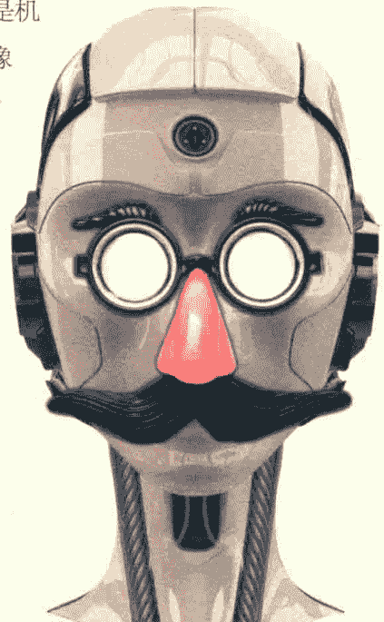

## 图灵测试：智能的试金石

### 评估智能行为的能力

## 1950 年

- **研究员**：艾伦·图灵
- **领域**：机器智能
- **结论**：人工智能可拟人

如何判定机器智能？“AI 之父”艾伦·图灵 1950 年抛出“模仿游戏”，后称“图灵测试”。规则简明：裁判隔离与两参与者（一真人、一机器）对话，通过交谈辨别真伪。图灵在《计算机器与智能》中设定：若机器能让裁判误判为人类，即“胜出”，证明具备智能。此后数十年，规则被不断解读优化。

### 模仿游戏的双重设定

图灵实设两种玩法：一男一女欺骗裁判性别；人机对决欺骗裁判人性。他认为：若计算机在“人性”维度骗过裁判的概率，不亚于人类在“性别”维度，便可认定其智能。图灵承认这是简化。他拒答“机器能思考吗”，转问“数字计算机能否在模仿游戏中高分通过？”测试不求“真智能”定义，只验“拟人能力”。他建议机器需学会撒谎、延迟答题（如复杂数学题停顿 30 秒）以拟真人反应。

> “我无意给人留下‘意识无奥秘’的印象，”图灵写道，“但我不信这些奥秘必须在我们关心的问题解决前被揭开。”

### 思考的机器与聊天机器人的演变

图灵对强 AI 到来过于乐观：预言 20 世纪末机器能“思考”且无人惊讶。半个多世纪以来，聊天机器人层出不穷竞相“通过”测试，部分团队宣称“获胜”但争议不断。

首个测试软件是 MIT 六十年代的 ELIZA，靠“模式匹配”（复述变体）维持对话。创造者约瑟夫·魏岑鲍姆反以为其暴露测试缺陷——ELIZA 貌似人语，实则全无理解。罗布纳奖自 1990 年创办，成聊天机器人欺骗评委的竞技场，多届有获奖者。

### “尤金·古斯特曼”：真突破还是公关秀？

2014 年英国皇家学会活动，俄圣彼得堡开发的“尤金·古斯特曼”（设定 13 岁乌克兰男孩）在 5 分钟无限制对话中骗过 33% 评委。雷丁大学凯文·沃里克宣称：“同步对比规模空前，独立验证，无预设话题，真正图灵测试首次被通过。”

质疑声随至：“公关噱头”，前有类似成功案例。沃里克曾植入芯片自称“首位半机械人”，素喜招摇。批评指机器人利用“幼稚/外语者”人设掩饰错误，实属不公。

如今企业以聊天机器人为客服一线，Siri、Alexa 陪伴日常，图灵畅想的“自然对话机器”已成现实——但它们从不伪装人类。科学界不再视图灵测试为 AI 基准，然它化身“反向图灵测试”融入日常：验证码让你勾选棕榈树、消防栓，正是证明“你非机器”的时刻。

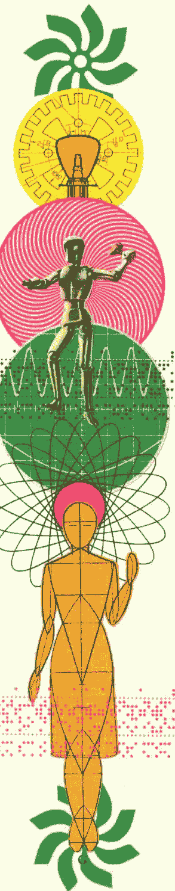

## SNARC：首台会学习的类脑机器

### 类脑学习的开山之作

## 1951 年

- **研究员**：马文·明斯基
- **领域**：神经计算
- **结论**：类脑计算机能像生物般“学习”

筹备《2001 太空漫游》（背景设定 1991 年），库布里克为求 HAL 9000 真实感，咨询明斯基：功能设定（语音、读唇、下棋）、外观呈现（黑盒柜阵）皆获建议。

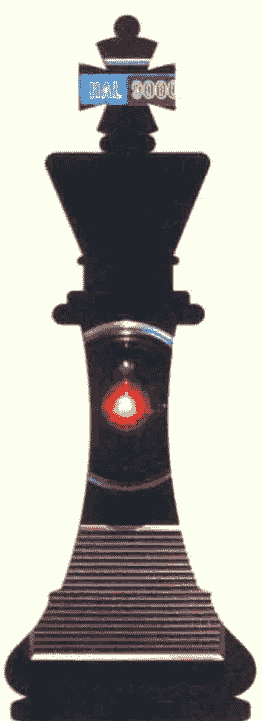

明斯基，远见卓识之士。四十年代哈佛本科时便构想“会学习的机器”。博学多才——数学、音乐、生物皆涉猎，终归宿于机器智能。“遗传学虽妙但深度未知，物理虽深奥却非极致。”1981 年对《纽约客》坦言，“唯智能问题，深邃令人绝望，让我无暇他顾。”

### 从神经元电路到硬件实现

1943 年麦卡洛克（神经生理学家）与皮茨（数学家）合著论文，用简易电路模拟神经元工作，深深迷住明斯基。1951 年哈佛心理学教授乔治·米勒提供经费与契机。明斯基招募研究生迪安·埃德蒙兹，并预警：“这机器恐‘太难’造。”

# 智能机器的曙光：从模拟神经到自主导航

## 史上首台电子学习机：SNARC 的诞生

历史上第一个模拟神经网络运作的电子学习系统问世了。这种模仿人脑架构的计算网络，如今已成为主流技术基石。

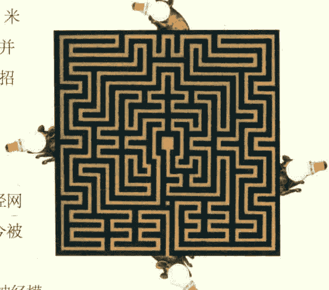

马文·明斯基打造的这台设备名为“SNARC”（随机神经模拟强化计算机），内部包含 40 个突触单元，由真空管、电动机、操纵杆以及一块源自 B-52 轰炸机控制面板的备用零件拼装而成。

如今 SNARC 仅存单个神经元样本——一个由真空管、导线与电容器组成的庞然大物，通过插线板可与其他 40 个神经元互联。整套阵列占地约等于一架三角钢琴。

SNARC 的核心逻辑在于“强化”记忆与学习。其“记忆”介质分两类：电容器储存电荷实现短期记忆，电位器（类似音量旋钮）负责长期记忆存储。

当神经元激发放电，电容器便保留该动作痕迹。若研究人员按键“奖励”系统，连接电位器的 40 条神经链路会同步提升该神经元再次放电的概率。这一机制让机器能通过“奖惩”学会做正确决策。

### 机箱里的“老鼠”实验

明斯基亲自扮演迷宫觅食的“老鼠”测试机器。因整机早已失散，测试细节成谜。SNARC 建成后曾借予达特茅斯学生，十年后索回时被告知遗失。后世推测明斯基与埃德蒙兹曾用灯光轨迹记录“老鼠”路径。

明斯基回忆：几轮尝试后，机器依靠正确选择的强化机制开始“推理”。初期“老鼠”乱闯，一旦选对路径，下一轮复现概率显著上升。

意外发现随之而来：电路故障竟允许同时投放两三只“老鼠”并行追踪。这些虚拟老鼠会互动——若一只找到捷径，其余倾向跟随。明斯基感叹：“这点规模的神经系统竟能并行处理多任务，令人震惊。”

### 有“大脑”的机器

1969 年明斯基与西摩·佩珀特合著《感知器》，指出神经网络研究的早期瓶颈。书出版后曾被指导致该领域经费缩水。

然而近年人工神经网络借“深度学习”强势回归。现代网络由层层“节点”构成，经标注样本（如带标签图像）训练后，可识别新样本。广泛应用于语音识别、翻译软件等。

谷歌 DeepMind 以神经网络攻克围棋，自创新策略击败世界冠军；甚至尝试让 AI 设计新型芯片。这技术谱系可追溯至《2001 太空漫游》的科幻想象，如今照进现实。

---

## 人工智能的“诞生证明”：达特茅斯会议

### 1956 年夏，达特茅斯学院

- 核心人物：约翰·麦卡锡  
- 研究领域：人工智能  
- 里程碑意义：确立 AI 挑战清单，催生全新学科


“人工智能”概念诞生于 1955 年 8 月一场“制造智能机器”研讨会。提案由达特茅斯数学助理教授约翰·麦卡锡主导，折射出 50 年代初科学界的盲目乐观：AI 并非难题，指日可待。重读当-year 文本，仿佛十年内强人工智能即将落地。

麦卡锡被公认为术语缔造者，定义 AI 为“制造智能机器的科学与工程”。会上他提出核心议题：让机器使用语言、形成抽象概念、解决人类专属难题、自我改进。关键在于——如何使机器行为拟人化。

### 思考的机器

约 50 位学者与会，含首台神经网络装置发明者马文·明斯基。研讨会横跨次年夏季，公认是 AI 领域的“发源地”，多位参会者日后在该领域建功立业。

但提案措辞暴露了群体性盲目：坚信类人智能触手可及。六十余年后回望，预言仍未兑现。虽现有 AI 能自然语言对话，却远未达到与会者设想的“与人类无异”境界。

提案曾豪言：“精心挑选的顶尖科学家共度一个夏天，必在一个或多个问题上取得重大突破。”目标清单含：模拟人脑计算机、神经网络、语言机器、自我进化系统。

文件直言：“算力与存储或许不足以模拟高级脑功能，但核心障碍非硬件短板，乃是我们不会用现有能力写程序。”

---

## AI 寒冬：泡沫破裂的岁月

认为给 50 年代昂贵笨重的计算机装上聪明软件就能造出 AI，纯属幻想。达特茅斯会议的诸多预言同样落空。

60-70 年代算力提升、成本下降维持了关注热度，但领域始终拿不出真 AI、懂语言或自进化的机器。70 年代末至 80 年代经费断崖式下跌，“AI 寒冬”降临。

1973 年英国议会委派詹姆斯·莱特希尔评估 AI 现状。报告痛批“宏伟目标全军覆没”：“迄今任何发现均未产生预期重大影响”，算法无法应对现实复杂性。直接引发英美科研经费大规模砍减。

此后虽兴趣复燃，但不再天真认为几个科学家一夏天能搞定类人智能。

---

## 机器哲学：麦卡锡的执念

麦卡锡持续探讨 AI 哲学：“恒温器这类简单机器也可说拥有‘信念’，而信念似乎是解决问题机器的共性。”

他对“深蓝”这类超算失望：AI 研究陷入“同类问题、越跑越快”的单一路径。

同事达夫妮·科勒透露：麦卡锡（2011 年辞世）晚年仍盼有朝一日机器能通过图灵测试，而非局限于狭窄超强的专用路线。他坚信 AI 终极意义在于复刻人级智能。

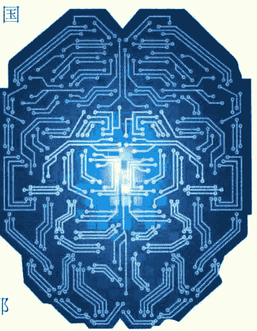

---

## 会“找饭吃”的机器人：野兽与费迪南

### 1960 年

- 研究员：约翰·查伯克  
- 领域：学习型机器人  
- 结论：机器人可独立“觅食”充电

### 机器能自给自足吗？

NASA “旅居者”火星车尚远在 30 年后，60 年代初约翰斯·霍普金斯应用物理实验室已着手研究“能独立生存的机器人”。

实验室走廊虽无火星恶劣，却跑着“野兽”与“费迪南”两台自主生存机器人。


#### 诡异的“怪物”

“生存”定义三条：不迷路、不卡死、自主充电。靠传感器追踪插座即可全自主闭环。改良版“野兽”保持 40 小时无人干预运行纪录，因机械故障终止。这 60 厘米高的家伙伸出机械臂沿墙摸索，宛如迷宫迷途者。专家寄望其为深海、行星探测机器人奠基。

查伯克（后参与阿波罗导航系统）称“费迪南”为“长相怪异的怪物”，其晶体管与微开关控制系统是“模拟神经系统”。演示中两机器穿梭凌乱办公室（“极度混乱环境”），穿门越椅自如。

每机配传感器导航寻找墙插充电，满电后切换探索模式。拥 21 种运行模式（睡眠、进食、高/低速等），可控台操控。“野兽 II 号”重 45 公斤、宽 <50 厘米，内藏 150 个数字电路与伺服电机驱动充电臂。

#### 蝙蝠式声呐导航

卡墙时自动切“振动模式”脱困。微开关阵列辅助充电对接，失敗則回導航模式重試。像蝙蝠一样靠声学导航——双侧声束测回波时间保持走廊居中。光学系统识别墙插黑色面板，但易误把椅腿当充电口。

虽可人工遥控，但两机器均具全自主能力。区别于后世机器人，它们不具备环境学习能力。

但过程非无意义。实验室视频旁白：“机器人虽不学习，设计者却在向机器人学习。”团队计划增设传感器，推动恶劣环境探测机器人诞生。

“野兽”常被称“前机器人”：无计算机、无编程语言，是类似恒温器-加热器的控制系统。恒温器设定温度目标，“野兽”电路设定“找插座充电”目标。

#### 无人问津的尴尬

研究员罗纳德·麦康奈尔致信《科学美国人》：虽获媒体关注（NBC 短讯），NASA 等政府部门冷淡。“ARPA 来考察过，但近地载人太空竞赛年代，对月球/火星/深海机器人原型无实质兴趣。”“仅庄臣公司问能否做打蜡机。”

如今扫地机器人自主回充、本田 ASIMO 自寻充电桩、Anki Vector 等玩具机器人同技术早成标配。


---

## 机械臂重塑制造业：从鸡尾酒会到流水线

### 1961 年

- 研究员：乔治·德沃尔  
- 领域：机械臂  
- 结论：机械臂彻底改变制造业

1956 年一场鸡尾酒会，两美国工程师因爱读艾萨克·阿西莫夫“机器人系列”结缘。小说描绘机器人仆人与“三大定律”，设想人机和谐共处的未来。

乔治·德沃尔透露已申请“程式化物品转移装置”专利。约瑟夫·恩格尔伯格惊呼：“这不就是机器人！”


恩格尔伯格买下专利，造出首条量产线机械臂 Unimate，酷似现役机型。

二人对话重塑制造业版图，初期推销却碰壁 40 家公司。“正常商人听‘机器人’以为说科幻小说。”德沃尔回忆。专利 1961 年才批下，首台 Unimate 花落通用汽车。

Unimate 首秀：新泽西通用工厂搬运堆放滚烫金属件——高危苦活，机械臂游刃有余。

### 夺饭碗？

Unimate 1900 系列量产，美投入 400+ 条。全球瞩目：上《约翰尼·卡森秀》打高尔夫、倒啤酒、拉手风琴（拙劣）。卡森感叹：“能替某些人干活。”

Unimate 可编程，磁鼓存指令。无传感器，只能死循环重复动作。

克莱斯勒等跟进采购，新型号上焊接、喷漆。技术传入日本，助推日系车称霸全球。随后数十年日中企成工业机器人重度用户。国际机器人联合会数据：全球工厂现役工业机器人 270 万台。《大众机械》评 Unimate 为“20 世纪 50 大发明”。

### 热狗与汉堡

40 年代自学成才的德沃尔发明投币微波炉“Speedy Weeny”卖热狗。生涯 40+ 专利。家中妻子用同款机器做汉堡。还发明自动门“幻影门卫”。

后受访《计算机世界》称自学背景从未掣肘：“我总闯别人不懂的行，无现成信息，我自己造信息。”

### 恩格尔伯格与阿西莫夫

恩格尔伯格封“机器人之父”，不懈推广从医院到太空的机器人应用。向 NASA 建议航天自动化，研制 HelpMate 医院物流机器人广泛部署。

他致谢阿西莫夫：后者哥大物理系本科起笔耕不辍，激励了恩格尔伯格。恩作《实践中的机器人》邀阿西莫夫作序。小说家序言写道：“机器人会取代人类吗？会，但只夺走‘低于人类尊严’的苦差事。人类将腾出时间做更有创造性、快乐的事。机器人技术将稳步演进，承担越来越多脏累险活，正如我少年时所想。”

 

---

# 适者生存：仿生与博弈的时代（1970-1998）

机器人能向生物借招数吗？80 年代起，研究者探索让机器更像动物——昆虫、甚至人类。如“Toto”模拟鼠脑思维探索环境；辛西娅·布雷泽尔开发首个“社交机器人”，能像幼儿般情绪回应、表现自主需求。

MIT 巨型水箱中，机器金枪鱼“查理”逆流游动，揭示真鱼推进原理，反哺深海探测器设计。

同时机器人直面人类挑战。本田 ASIMO 成首个拟人行走机器人；机器人足球队立誓 2050 年击败人类世界冠军。1997 年 IBM 冰箱大小的“深蓝”赢下国际象棋巅峰战——AI 史与人类史的双重转折点。

---

## 沙基：会思考的领路人

### 为何沙基的导航改写历史？

**1970 年**

- 研究员：查尔斯·罗森  
- 领域：导航机器人  
- 结论：机器人可自主导航避障

如今我们毫不费力靠手机地图导航，得益于内置智能算法。

但 1964 年，斯坦福研究所机器学习组负责人查尔斯·罗森向 ARPA 提议“自主导航计算机”，属前沿激进想法。自主寻路机器人仅存在科幻小说。为拿经费，罗森承诺机器人能“执行侦察任务”——需成年人级智能。ARPA 买单，1966 年拨款支持。


研究者怀疑军方真想造“能数坦克的机器人”，终未成行。但沙基（“Shakey”因运动时塔架摆动得名）在很多维度上，是首台符合现代大众认知的“机器人”。

它引爆公众对机器人与 AI 的讨论，成媒体标志性符号，如日后 ASIMO 凭实力出圈般。

# 从“笨拙婴儿”到“火星漫游者”：沙基如何开启机器人智能元年

在加州一个温暖小镇、毫无窗户的实验室深处，一台名为“沙基”的笨重机器正蹒跚学步。用《纽约时报》的话说，它只是工程师眼中“极其愚钝”的造物，仅能在布满障碍的房间里从A点挪到B点，对周遭环境仅存微弱“感知”。《生活杂志》却大胆封其为“首位电子人”，而《纽约时报》更倾向于将其比作一个自学成才的“婴儿”。

宣传片里，研发团队阐述野心：赋予沙基规划与学习等智力核心，探究如何设计通用程序，让机器人胜任从太空探秘到工业自动化的万般任务。

## 非黑即白的“视觉世界”

沙基拥有摄像机之“眼”、猫须传感器之“触”，能在实验室自主巡航。实验室宛如巨型童趣游乐场，孤立棱柱块构成迷宫。为适配沙基单色视觉与激光测距，世间万物皆被刷成红白二色——高反光、强对比，只为让机器“看清”路。

它靠无线电对话，电机驱动轮履前行，推杆可搬运眼前积木。研发成员彼得·哈特戏称它是“装上轮子的电子货架”。

沙基的里程碑意义在于：首个具备感知与规划双重能力的机器人。其核心奥秘是——“思考”这档繁重脑力活，绝非洗衣机大小的躯壳内部能承担。沙基通过数据线，连接着一台重达数吨的 PDP-10 大型计算机，由后者处理传感数据、下发驱动指令。

## “盲走”也能画地图：航迹推算的智慧

沙基导航依赖“航迹推算”：记录车轮转向圈数与距离，配合相机视觉确认位置，在脑中构建简易地图。它听得懂“滚动”“倾斜”等基础指令，也能执行“抵达坐标”这类复杂任务。指令通过电传打字机输入，运行状态在阴极射线管（老式电视屏）上显现。

真正让沙基出圈的，是应对“突发状况”的灵性。MIT 宣传片里，“小精灵查理”（查尔斯·罗森扮）故意在路径上塞个箱子。沙基“看”见异物，判断属性，随即修正航线绕行抵达终点。屏幕上，机器人的“思维链条”清晰可见。

得益于 STRIPS（斯坦福研究所问题求解器）规划系统，沙基能处理“推积木”“拨开关”等任务。项目成员尼尔斯·尼尔森回忆：“查理大爷搞破坏时，STRIPS 能即时生成新方案，那年头算得上‘重量级’程序。”

沙基能在 7 间相连房间里寻觅特定地点与箱子，在人类指挥下用推杆归堆，全程自动规避环境障碍或“查理”临时安置的拦路虎。

## 会“甩甩头”的代码遗留

机器人也有“强迫症”。哈特发现沙基常突然原地 360° 旋转。深究代码才知：早期版本系缆连接，设有“解缆”程序；虽然后来改为无线，这段逻辑却保留了下来，成了沙基独特的“遗传性抽搐”。

项目最终被高级研究计划局（ARPA）叫停，军方口号是“不再造机器人”。但沙基开创的导航与规划范式，却在随后半个世纪深度重塑机器人领域——从电子游戏寻路到火星车自主驾驶，无不烙印其影。

为穿越彩色方块迷宫而生的算法，今日仍活跃于自动驾驶软件与手机导航中。比尔·盖茨曾感叹：“软件圣杯是 AI。60 年代见到沙基，我便立志：要让这机器人变强。”

如今，功成身退的沙基静卧于加州芒廷维尤计算机历史博物馆的玻璃柜中，见证着那个“笨拙”的开端。


## 1987：机器人能治癌吗？——射波刀的逆袭

- **核心人物**：约翰·阿德勒
- **领域标签**：放射外科
- **历史定论**：机器人放疗技术已挽救数万生命

### “比脑外科更难”的工程噩梦

阿德勒博士将研发射波刀比作“永远在犯错的脑外科手术”——心态崩了无数次，只能强迫自己乐观试错。然而事实证明，造这台机器的复杂度与周期，远超任何颅内手术。

身为美籍神经外科医师的阿德勒，在斯坦福遭同行冷眼：设计不靠谱，被讥为“阿德勒的蠢事”。见风投时，对方被 2 米高、单价 350 万刀的“庞然大物”吓退：“既不划算，也没医学优势。”无人问津，成了常态。

### 从“无人问津”到“全球标配”

但射波刀终究改写了癌症治疗史，装机遍布全球顶尖医疗中心。它是机器人手术系统，能实时捕捉患者体内影像，从多角度、极高精度向曾判定“不可手术”的肿瘤发射放射线。

直线加速器直装机械臂末端，输出高能 X 射线/光子。更绝的是，它能跟随患者呼吸同步追踪，确保辐射“落点不偏毫厘”。

可回溯 1987 年，阿德勒初提构想时，所需技术几乎是“零”的突破，全是从头啃的硬骨头。

### 伽马刀的启示与超越

1985 年，阿德勒在瑞典受教于放射外科鼻祖拉尔斯·莱克塞尔教授。后者发明“伽马刀”——一个箍住患者头部的金属架，引导射线聚焦，酷似中世纪刑具。莱克塞尔虽也遭质疑，却坚信：“大脑手术的工具，永远不嫌精细。”

伽马刀操作繁琐、安装耗时，但疗效立竿见影。阿德勒亲眼见患者治疗两天后无伤出院，顿悟：这才是未来。他决心用新兴机器人技术迭代伽马刀，这念头一落地，便是近 20 年商业化长跑。

### 迈出“临床第一步”的代价

回美后，阿德勒联手斯坦福工程师打造射波刀：软件驱动柔性机械臂环绕患者，精准定向照射——至少理论上如此。

早期测试并不顺。一位脑瘤老妇接受无框架治疗，软件故障导致手术拖了整个下午。阿德勒承认：“带框架的传统放疗简单太多。但我们迈出了临床第一步。”可惜老妇治疗后不久离世，未做复查 MRI，死因成谜。

技术深坑一个接一个，阿德勒带队啃骨头、补漏洞。射波刀早期，他月均仅治 1 例，斯坦福全院仅 1 台设备。

### 公司濒死，FDA 救场

阿德勒创立安科锐推广射波刀，却陷入更惨商业泥沼：1994 圣诞大单黄了；1995 年初资金断裂，三分之二员工被裁。

1999 年阿德勒亲任 CEO 时回忆：“全员撕逼、面目可憎，没钱、互恨、客户也恨我们，真·一无所有。”绝境中，FDA 先后批准射波刀用于脑瘤及全身任意部位肿瘤临床治疗。

这根救命稻草让安科锐觅得客户、融到资、迭代新品、走向全球。阿德勒由此奠基“图像引导放疗”（IGRT）领域。

最新款射波刀 S7 实现亚毫米级精度，可实时跟随患者移动，从数千独特角度发射辐射，零手工干预。至今全球超 10 万患者受益。机器人手术应用爆发式增长，微创、锁孔手术成主流；远程跨洲手术机器人亦在研发中——医生在京，刀在纽约，不再是科幻。


## 1990：机器能像老鼠一样“长脑子”导航吗？——托托的自主建图奇迹

- **核心人物**：马娅·马塔里奇
- **领域标签**：基于行为的机器人
- **历史定论**：机器人可像啮齿类动物般自主建图、复用地标导航

### 托托：会“画地图”的机器老鼠

机器人控制系统能否自主绘制环境地图，如同老鼠在脑海构建认知地图？这在 90 年代初属于“从未实现”的空白。MIT 出品的“托托”打破魔咒：它不只能自主“建图”，还能重访地标，导航逻辑酷似迷宫实验里的白鼠。

马塔里奇赋予托托“分层控制系统”：
- **底层（本能层）**：随机游走、避障；
- **高层（认知层）**：记录/调用路径、规划最优路线。

游走时，托托用声呐+指南针建图；接令（外部按钮）时，按图索骥找最短路。马塔里奇直喻：“如同老鼠大脑，在迷宫导航。”

### “自下而上”的昆虫智慧

托托是罗德尼·布鲁克斯倡导的“基于行为机器人”典范（布鲁克斯后造出扫地机器人 Roomba，见 134 页）。布鲁克斯主张：一组简单“行为”（沿墙走、避开乱区）串联成复杂动作，无需预置高阶智能，而是“先行动、后思考”，像昆虫无大脑却能极速做出生存最优解。

行为按优先级分层，上层“凌驾”下层（如“去地标”覆盖“避障”），这正是托托找路的底气。

### 迷宫里的“语义建图”

这类机器人结构简单，却能展现类昆虫的相对智能。

托托的上层指令能高效建图。它识别的“地图”，仅源于底层走过的路、遇到的事：
- 长直线无阻 → 标记为“走廊”；
- 碰到墙 → 标记为“左/右手墙”；
- 混乱区徘徊 → 标记为“混乱区”。

地标检测层一旦捕获地标，描述广播给所有地图行为。若匹配历史地标 → 对应行为激活，托托确认定位；同时抑制其它区域行为，保证单一活跃区，定位更稳。
若无匹配 → “创建”新区，托托开启探索新世界模式。
系统还会基于存储图预测下一区域/行为：预测命中 → 定位置信度++。

对人类，熟悉环境定位是本能；对机器人，这是硬核难题。

### “想去哪就去哪”的导航自由

定位会了，导航自然顺。研究者设定目标地标 → 向地图邻近节点传播信号至机器人实时位置 → 排序命令链找最短路径 → 执行。

马塔里奇在《机器人入门》（2007）中补充：托托不只找特定地标，还能找“最近的某种属性地标”。如需“最近右墙”，地图上所有右墙地标同时发信号，托托按最短路径奔赴最近者。

这种简洁导航极其鲁棒：把托托抓到陌生区域，它仍能寻得最短路；换成复杂系统反而易乱。马塔里奇确信：机器人探索中“学习/内化地图”的方式，与老鼠认知环境同构。这套“非复杂编程实现复杂目标”的范式，极具生命力。

马塔里奇后开创“社会机器人”服务老弱病残；基于行为的思想延续至今，催生扫地机器人等大量廉价实用产品，自 80 年代影响持续扩散。


## 90 年代：机器人会“读心”懂情感吗？——Kismet 的社交实验

- **核心人物**：辛西娅·布雷西亚
- **领域标签**：社会机器人
- **历史定论**：机器人能与人建立情感连接

### 会“害羞”的机器脑袋

“不，不对！”女子严厉斥责。无躯干的机器人脑袋垂首耷耳，满脸“愧疚”，像极了皮克斯动画里犯错的萌娃——但这无特效，纯实机。

Kismet，MIT 布雷西亚实验室的杰作。她因参与 NASA “旅居者号”火星车项目，转攻“社会机器人”。区别于马塔里奇关注“从 A 到 B”，布雷西亚想造：让人互动时舒服、能抚慰情感需求的机器。

双科学家家庭长大的她，童年曾写“有情感机器人”短篇，受《星球大战》R2-D2/C-3PO 启发。“人有思想、信仰、情感、宠物，机器人必须能与之互动。造出具社交/情感智能、能与人协作的机器，意味着什么？”她自问。

### 像婴儿一样“模仿长大”

如今 Siri/Alexa 无处不在，我们甚至期待 AI 助手带情绪、说人话。但布雷西亚指出：Kismet 前，业界从未认真考量机器人处理思想、信仰、情感、社交智能的必要性。

Kismet 研发路径独特：无预设行为模式，而像人类婴儿——**通过模仿“父母”学习**。

它不真懂语言，但能捕捉**语义意图**；不说人话，只发**类语咕哝**。布雷西亚指望它通过成人对婴儿的夸张手势/语调学习，并对意图做恰当反应。

### “活”在硅基里的情绪机制

成果惊人：这颗脑袋展现出社交智能雏形，能像生物般情绪反应。摄像头+麦克风感知，电机驱动头/耳/嘴表达。

外观像玩具/道具，确启发了 Furby 等几代智能玩具。但“头皮”下藏着庞大算力集群：
- 语音合成+意图识别（读懂对方情感意图）：2 台 Win 机 + 1 台 Linux 机；
- 4 颗摩托罗拉单片机分管感知、动机、运动技能、面部动作；
- 9 台联网 PC 处理视觉、控制眼/颈。

简化流程：处理音像 → 提取关键刺激（语调、是否被注视） → 注意力系统筛选 → 引导 Kismet 关注/反应。

检测到人 → 表达喜/厌/烦等多维情绪。多数反应服务于**“控制互动者”**：如人离太远 → 发“呼唤音”引对方靠近。

### 机器也有“马斯洛需求”

一台专用电脑用柱状图实时展示 Kismet 三大**驱动力/需求**：
- **社交**（孤独时主动求互动）；
- **刺激**（无聊时盯着玩具期待递送）；
- **疲劳**（累了安静下来示意休息）。

海量算力汇聚成“直觉”感知与自主反应：
- 惊讶 → 竖耳、张嘴；
- 厌恶 → 紧抿嘴；
- 伤心 → 垂耳、苦瓜脸。

布雷西亚后续开发饮食/运动教练机器人、远程“传递拥抱”机器人，创立 Jibo 公司。她深信：随移动计算普及、传感算力通讯成本暴跌，**家庭服务机器人必入万户**——不替代人际网络，而为补强之。


## 机器能在水下“游刃有余”吗？——仿生金枪鱼与深蓝探索

人类设计水下推进，本质是在与鱼类“PK”。鱼类历经 1.6 亿年自然筛选，早已进化出完美游姿。MIT 迈克尔·特里安塔菲卢教授直指痛点：**为何无人尝试向鱼“抄作业”，学它们如何在水中游动？**

# 1993：剑桥实验室的“蓝鳍复刻计划”

- 1993 年
- 核心人物：迈克尔·特里安塔菲卢
- 研究方向：水下推进机理
- 核心结论：仿生鱼类机动，可实现高速高效航行

### “查理”诞生记：抛弃螺旋桨的冒险

当这所顶尖学府决定打造一条仿生金枪鱼时，属前无古人之举——此前从未有团队试图复刻鱼类的游动机制。选定金枪鱼为蓝本，缘于其惊人速度：经漫长演化，其已能高效劈波斩浪，特定品种冲刺时速可达 69 千米（约 43 英里）。以蓝鳍金枪鱼为例，体长可达 3 米（10 英尺），体重轻松超越成年马。

内部将此定义为“反向解构”：已知目标物种的运动性能，便反推其背后物理原理，进而制造出遵循同一逻辑的机械体。这条实验体（实验时系于巨型水箱支柱，缆线实时回传数据）被昵称为“查理”。

查理骨架以铝合金构建，内嵌 40 根泡沫塑料肋骨，外裹网眼泡沫与弹性纤维混合的人造皮，保障流体力学外形。区别于所有人造水面航行器——无桨楫、无风帆、无螺旋推进器——其动力仅源于一只尾鳍。

这条机械鱼由近三千零件组成，体内 6 台额定功率 2 马力（约 1.49 千瓦）的伺服马达驱动躯干伸缩。马达经精钢缆系统传力，完美模拟肌肉肌腱协作。肋骨安装的压力感应器充当本体感知神经，提供实时反馈以微调动作。查理每周在水箱“出勤”数次，研究员采集其运动数据，初次窥见金枪鱼游动深层奥秘，为水下载具推进技术开辟全新路径。

### 驾驭混乱：旋涡里的生存智慧


研究团队发现，对水体旋涡（即紊流）的掌控是鱼类生存核心技能，这与人造载具依靠推进器前行的机制截然不同。旗鱼擅长操纵水体漩涡推进自身，甚至在平静水域也能通过高频摆尾主动激起漩涡加以利用。

特教授曾指出：现有船舶技术竭力抑制航行中产生的漩涡，因其形成巨大阻力导致减速。但鱼类却“故意”制造漩涡并将其驾驭。查理正是复刻了这一机制——它能在水中生成并控制旋涡。

团队引入“进化算法”对查理的游泳控制程序进行“进化”筛选，保留表现更优的代码迭代。随时间推移，查理成功驾驭漩涡，在一定程度上复现了真实旗鱼的极速冲刺（虽仍受限于水箱支柱系留）。

### 目标深渊：从水箱走向极端海况


研究者期盼查理的技术能赋能新一代响应式无人深潜器，使其胜任极端环境作业。特里安塔菲卢举例：探测深海热液口时，几英尺范围内水温差可达 100 摄氏度。这要求系统具备极高柔性与反应速度，以应对突发工况。现有 AUV 多依赖笨重的传统螺旋推进器，缺乏应对高危场景所需的敏捷度，亟待替代方案。仿生金枪鱼将极大降低勘探风险，打开此前因过于危险而被搁置的海域。

随后团队还制造了仿狗鱼机械体，探究其极速启动机制；并针对 1936 年英国动物学家詹姆斯·格雷提出的“格雷之谜”（海豚为何在肌肉力量看似不足时仍能高速游动）展开研究。仿生金枪鱼的突破激发了全球实验室的仿生热潮，此后数十款机械鱼相继问世。

2009 年，该院推出新一代机械鱼，体长仅 13 至 46 厘米（5 至 18 英寸），全身采用柔性聚合物材质，耐长期海水浸泡腐蚀。相比查理的数千零件，新模型仅含 10 个部件，单台成本压缩至几百美元。多家企业对其在水下测量与监控领域的应用表现出浓厚兴趣：设想向海湾或港口投放数百台低成本设备，组网采集数据。

此外，因真鱼极易受人类干扰惊逃，机械鱼也成为近距离生物观测的理想工具。团队曾让一款柔性仿生鱼混入斐济珊瑚丛真鱼群中游弋，竟未被识破而引发惊扰。

## 绿茵场上的硅基野心：2050年的约定

- 1997 年
- 核心人物：北野浩章等
- 研究方向：机器人宏大挑战
- 核心结论：预计 2050 年机器人队将击败人类顶级足球队

### 终极目标：淘汰人类冠军

“机器永胜人类”的项目清单上，国际象棋已划勾（详见 117 页），足球是下一个靶心。RoboCup 官方愿景直指 21 世纪中叶：一支完全自主的类人机械体队伍，在遵循足联正式规则下，击败上一届世界杯冠军。

早在 90 年代初，机器人专家便发起“宏大挑战”，试图组建能与人类抗衡的机器人足球队。考虑到当时机器人在场地导航、团队协作、对抗技术型球员均面临巨大难度，这无疑是极高难度的考验。构想虽起源于日本，却迅速吸引全球目光，最终催生了“机器人足球赛”。

### 蹒跚起步：从“寻球”到“配合”

RoboCup 初创时，机器人球员在绿茵场挑战人类顶尖强队的画面仍属科幻。对当时技术而言，仅“触球”即是挑战，更遑论过人射门。

1997 年，索尼首席科学家北野浩章等人正式发起 RoboCup 挑战，激励全球 AI 与机器人团队汇聚名古屋，按体型与能力分级对垒。北野曾主导标志性产品 Aibo 开发。同年 5 月，那台国际象棋超算击败卡斯帕罗夫（详见 117 页），为机器挑战人类巅峰注入强心剂。

规则核心：全自动，边线零人为干预，哨响即切断交互。北野回忆首届赛事：两队机械体在场地上通过感知器感知环境，仅能缓慢微动。有记者问“比赛何时开始”，北野答：“五分钟前就开始了！”机械体需耗费数分钟定位与决策。早期某场比赛，仅因一方碰到球便判定获胜。

### 四足退场，两足登台

随着技术迭代，Aibo 曾短暂参赛，催生“四足组别”。但逐年推进中，次级组别机械体愈发拟人化。

近年，约 200 台标准平台机型参赛，已能完成传球、化解攻门（虽跌倒频繁）。那奥角逐“统一规格赛”，各队使用同款硬件，比拼算法与策略。

### 赛场外的红利：从灾区到仓储


外界或视 RoboCup 为怪癖，实则其推动了机器人技术重大跃迁。资深爱好者、得大奥斯汀分校斯通教授指出：RoboCup 价值在于整合了 AI 多项核心挑战——仅会快跑不够，若无法高可靠定位球位、与队友协同，则毫无实战价值。

部分教授在赛场崭露头角的技术（机器间协同踢球与废墟搜救生还者同构），衍生出“救灾组别”。RoboCup 更催生出数亿美元级独角兽。兰茨为仓储机器人初创公司招募移动机器人专家时，聘用了剑桥团队 RoboCup 爱好者丹德烈亚。他们打造的基瓦机器人凭借极速移动能力，效率远超传统传送带、叉车或人工作业模式。2012 年，电商巨头以 7.75 亿美元收购基瓦系统，如今 20 万台基瓦机器人活跃于仓库一线。

2020 年 RoboCup 因疫情停办，但近年技术成熟度显著提升，人形组别冠军队已能与人类进行友谊赛。虽暂未取胜，但机器人仍拥有 30 年冲刺窗口期。

## 硅基大脑攻克棋坛圣殿：深蓝的启示

- 1997 年
- 核心人物：许峰雄、默里·坎贝尔
- 研究方向：人工智能
- 核心结论：深蓝击败加里·卡斯帕罗夫，登顶地球最强棋手宝座

### 两度交锋：命运的逆转

1997 年，全球亿万观众见证俄国棋王加里·卡斯帕罗夫与 IBM 深蓝的巅峰对决。这位人类棋坛霸主最终败给了高 1.8 米（6 英尺）、重 1.4 吨、塞满数百颗处理器的双塔钢铁巨兽。决战第六局末段，卡斯帕罗夫举手认输，愤然离席。

这是里程碑式人机大战。深蓝获胜连造物主都感意外——赛前团队并无必胜把握。专家此前预测，机器击败人类尚需数年。卡斯帕罗夫指责蓝色巨人舞弊，质疑深蓝部分妙手仅可能出自人类大师指点。

但深蓝胜利绝非仅具象征意义，它为 AI 分析海量信息铺平道路，深刻重塑金融、医药、智能手机等日常领域应用。

### 分水岭之战：首胜与复仇

1985 年，22 岁卡斯帕罗夫成为史上最年轻世界冠军。十年后，他与深蓝两度交锋。首战 1996 年，卡斯帕罗夫坐对 IBM 工程师许峰雄——许作为深蓝“落子代理”在实体棋盘执行机器决策。

首战深蓝先拔头筹，赢下六局制首局。这被后世称为“分水岭”时刻——也是计算   机首次在计时赛制下击败卫冕冠军。卡斯帕罗夫以 4:2（2 胜 3 平 1 负）反超夺冠。

但一年后（1997 年 5 月 11 日），纽约复赛剧本反转——深蓝以相同比分 4:2 复仇成功。卡斯帕罗夫要求公开日志并申请再战，但深蓝已拆解封存。IBM 事后公开日志，铁证“机器内部无人操控”。这是 AI 发展史的历史性时刻。

### 专为赢棋而生的钢铁巨兽

自 40 年代末计算机诞生，研究者即痴迷让机器在西洋棋超越人类。严谨固定的规则使其成为测试机器“智力”的理想沙盒。

70 年代现首台象棋计算器。高校实验室让定制强机轮番挑战人类顶尖高手。深蓝团队深耕十余年，许峰雄曾在卡梅隆大学打造“芯片测试机”。1989 年，他与同门坎贝尔加盟 IBM，加入争夺“最强象棋机”的角逐。

团队招募特级大师陪练，录入人类开局库。但深蓝“杀手锏”在于：能分析数百万局面、预判长达 40 步。它是台超算，拥 30 个中央处理器与 480 颗专用加速晶片，评估全分支结果以择最优解。

### 纯算力的碾压：每秒两亿步的暴力美学

人类靠棋感与谱式识别落子；机器靠搜索百万可能性、纯算力碾压取胜。两赛间隙一年，团队算力翻倍。1997 年复赛时，深蓝跻身全球超算榜单前 259 名。

新版深蓝每秒分析 2 亿局面。这种“穷举搜索”策略，即纯靠暴力计算解决问题。对弈大师形容它：“如墙压顶，不可抗拒。”

深蓝胜利激励研发更多超算，以同类技术剖析金融医学海量数据、筛选候选分子助新药研发（含抗艾滋药物）。今日，“海量数据分析”（高速分析巨量信息挖掘模式）支撑全球金融、交友软件、电商推荐等生活方方面面。

人机“对抗升级”凸显解题思维差异。坎贝尔总结关键教训：复杂问题往往有多解——深蓝走暴力搜索，卡斯帕罗夫靠直觉跳跃。最优路径是人机协作，扬长避短。如现代医疗：AI 从病历数据挖掘模式，人类医生负责诊疗决策。

深蓝现藏于华盛顿史密森博物馆。如今手机 PC 端应用棋力早超深蓝。卡帅赛后深耕 AI 研究，现深信：任何智力领域，机器胜出“只是时间问题”。


# 6. 走进客厅的机械伙伴：1999—2011

踏入 21 世纪前，机器人研发与应用多困于实验室、展会、工厂车间，机械手臂昼夜不息作业。新世纪头几年，机器人悄然闯入寻常人家。索尼 Aibo 开创“机器宠物”概念；简易扫地机卖出百万级销量；加州公路上，数十辆  无人车展开零人为干预的实地对抗，碰撞与火光中，自动驾驶新赛道诞生。日本研发开创性动力外骨骼，仿人体工程学辅助肢体动作，助截瘫者重获行动力；航天局机器人探索太阳系，“机遇号”火星车陷尘暴失联，全球为之悼念。

### 1999：硅基宠物的情感实验

#### 机器宠物能填补情感空白吗？

核心人物：
土井利忠、藤田政宏
研究方向：
机器人宠物
核心结论：
机器人是优秀（但昂贵）的陪伴者

在日本，数百只 Aibo 在古刹举行集体葬礼，高僧袈裟加身诵经超度这些机械躯壳的“亡灵”。Aibo 生前拥有会发光的表情眼。面世二十载，粉丝热情不减，一位美籍收藏家囤藏 24 只；有人为机器犬定制专属衣橱，谈论它们如何疗愈抑郁、抚平爱犬离世之痛。

Aibo 为索尼 1999 年首发的宠物机器人，被誉“首款家用娱乐机器人”。索尼寄望其如 Walkman、PlayStation 般划时代。全球造势中，首批 3000 台 20 分钟秒光，定价高达 2000 美元。

### “会成长”的电子精灵


市场反响火爆，发布短期即获 13.5 万预订单，远超索尼原定 1 万台产能规划。索尼部分视作研究课题，以此积累经验。该 AI 智能体超越时代：索尼另辟专属网店，与用户紧密联结。官方介绍：“Aibo ERS-110 为自主智能体，能响应外部刺激、凭判断行事。能流露多种情绪动作，在陪伴中学习进化，似真犬般与人互动，开创全新娱乐形态。”

Aibo 日文寓意伙伴，英文为 AI Bot 缩写。它是面向大众最复杂的消费级机器人。能跟随主人成长，回应抚摸，LED 眼展现喜怒；内置感知单元、摄像头、测距仪感知避障，触觉测速单元捕捉动态。首发配经典粉色球供视觉锁定追逐，后续型号增专属骨头玩具（Aibone）。用户可通过头部记忆条软件干预行为。极客开发者社区以此为核心形成。产品技术足够超前，连续五届 RoboCup 赛场上演机犬驰骋绿茵名场面。

### 为塑料生命送终：一场精神的告别

2006 年，索尼新任掌门斯特林格叫停 Aibo 项目，团队大幅裁撤。发明者土井利忠博士（兼 CD 之父之一）遂为其举殡。参会员工称送别公司亡故的“海盗精神”。它诸多设计充满冒险基因，外观由空山基操刀，以性感机器人系列女体机械画及致敬《大都会》机械人（见 64 页）闻名。


### 故意设计的“不完美”：制造生命感的核心诀窍

诞生于隐蔽实验室，奠基多项关键技术，为后续机宠迭代铺路。土井利忠与 AI 专家藤田政宏决定，采用些尚不成熟技艺，如语音交互，实现基础人机互动。关键在于：未追求完美无瑕。反设行为复杂多变难测，营造与生命体而非装置互动之感，极似真养宠体验。藤田技术论文云：“赋予机器人鲜活生命感，是机宠核心命题。”

#### 机器人能靠自己的双脚站立吗？

#### 阿西莫是如何与总统共舞足球的？

影视作品里的机器人，往往共享同一个设定：拥有人形双足，步态酷似人类。这在一定程度上源于早期电影中由真人穿戴道具服演出（如《大都会》），但“铁甲钢骨”的形象在通俗科幻与漫画中同样盛行。

可一旦技术落地，残酷的现实摆在面前：双足直立行走，是当前机器人领域最棘手的高峰之一。人类天生具备学习能力、多感官融合调节与本体平衡感，而机器人则一无所有。早期原型多呈笨重矮胖状，依靠轮子挪动，诸如约翰斯·霍普金斯大学的“野兽”能自主充电，沙基则晃晃悠悠。

### 2000 年

研究员：

重见智

主题领域：

行走机器人

结论：

让机器人像人一样行走是非常困难的

#### 十年磨一剑

1986 年，本田工程师团队立下宏愿：造出双足行走机器人。十年磨砺，无数原型迭代，1996 年 P2 登台亮相，为日后风靡全球的阿西莫（ASIMO）奠基。为攻克足部支撑与关节自由度，本田不仅解剖人类步态，更博采众长，参考了动物的移动模式。

初代本田人形机器动作迟缓，单腿抬起间隙极长。至 P2 阶段，长出头部与双臂（兼顾美观与重心稳定），背负宇航员式背包，内藏电池——毕竟直立行走是个“耗电大户”。

1997 年，P3 问世，身形更紧凑，身高 1.5 米，较 1.8 米的前辈更符合生活场景。

而 2000 年推出的阿西莫，堪称此线技术巅峰：摆脱外置束缚自主行走，甚至能独立攀爬楼梯。

“在日本语境下，机器人的‘情感水平’至关重要，”缔造者重见智指出，“漫画里遍布机器人英雄，潜移默化塑造了大众认知：惟有拥有这些特质，机器才能更好地融入人类社会。”

作为首位“机器名人”，阿西莫履历丰富：曾与奥巴马总统对踢足球，后者直呼其“逼真得让人发毛”；2006 年因演示爬楼梯跌倒登上头条，成了罕见的“翻车”公关。


#### 太空行者的秘密

阿西莫运行时呼呼作响，源于背包内的风冷系统，为 CPU 散热。那背包非装饰品，实装 6 公斤锂电池，续航耗尽需充电 3 小时。

阿西莫成科技展“常青树”，本田持续灌输新技能：从步行进化到时速 7 公里奔跑，掌握单脚跳、舞台起舞；后期演示端托饮料穿行人群，传感器手臂能实时感知避障并保持平衡。

#### 只是台前的傀儡？

本田曾梦想阿西莫化身家庭助理，重见智愿景是“能帮忙干活的小学生”。

但连他自己也承认，人形机器人走进寻常百姓家如手机般普及，尚需数十年。展台上光鲜的表演，多半是幕后操控的“提线木偶”。实测博物馆讲解员场景，它难辨举手提问与举手机拍照。直至 2018 年退役，阿西莫终未商业化量产。

然而，沉淀技术反哺本田汽车工艺，支撑起其他机器人布局。衍生出助力瘫痪者重立行走的外骨骼装备（与竞品 HAL 相似）；2018 年 CES 展出无腿新物种——机器人行李车、“3E-B18”越野轮椅，即便崎岖山路也能保座椅水平。

阿西莫之后，双足赛道涌入新玩家，波士顿动力 Atlas 最为惊艳：极速狂奔、远距跳跃，外形直逼“终结者”。另一派则放弃仿人路线，探索新物种：俄勒冈州立大学“凯西”模仿鸟类步态（以食火鸡命名），另辟蹊径。

## 机器人能杀人吗?

### MQ-9 “死神”如何改写战场规则？

### 2001 年

- 研究员：

- 通用原子公司

- 主题领域：

- 军用机器人

- 结论：

- 机器人已成为现代战争的核心

首例机器人致死案发生在 1979 年 1 月 25 日，福特工厂工人罗伯特·威廉姆斯遭工业机械臂误击身亡。随军方成最大金主，“自主武器系统”——即专为杀戮设计的机器——引发深层恐慌。

### 危机感的爆发

2017 年，马斯克等科技领袖联名致信联合国，吁立法禁研自主武器，比照化武、致盲激光公约。警告称：此举或开启“火药、核武之后的第三次战争革命”。专家直指潘多拉魔盒：一旦全自主杀伤武器问世，将脱离人类掌控。“致命自主武器将推升冲突规模至前所未有，决策速度超越人类认知，”信中写道，“沦为暴君、恐怖分子屠戮工具，或被黑客劫持作恶。”

### 会杀人的机器

二十年来，数百人（含平民）死于无人机导弹。无人机可高空巡航、精确打击。虽目前多由飞行员远程操控，但已验证自主起降、自主“标记”攻击目标。美空军近期测试 MQ-9 “死神”搭载“敏捷秃鹰” AI 瞄准系统：自动探测、分类、跟踪潜在目标。制造商通用原子宣称，这将是未来无人体系基石。

### 战争的未来图景？

MQ-9 “死神”是当下最著名武装无人机，美英意等国装备。系数十年无人机研发结晶，越战美军即大规模用无人机侦察。高层论证：规避飞行员阵亡。死神可滞空 27 小时实时回传影像，再发射“地狱火”导弹。系“捕食者”进化版：更快、更高、航程 1770 公里。

区别于马斯克担忧的“杀手机器人”，死神需至少两名飞行员地面操控，“扣动扳机”决策权在人。但专家忧虑：高昂飞行员培养成本，恐诱导各国放权，赋予无人机自主杀伤权。


### 忠诚僚机

2021 年，波音亮相 11.6 米全尺寸原型机——忠诚僚机，旨在协同人类飞行员作战。官方称航程 3700 公里，性能对标战机，仅无人驾驭。

联合国报告披露：利比亚政府军实战部署“致命自主武器系统”，预设程序攻击，无需操控链路。无人机门槛降低，非富国专利。专家更惧“无人机群”：蜂拥而至、协同如昆虫，虽有远程指引却高度自主。2017 年公开信正是警示此点：AI 武器将泛滥成灾。“任一军事强国推进 AI 武装，全球军备竞赛不可避免，终点显而易见——自主武器将成为明天的 AK-47。”


## 为什么蜱螨怕机器人？

### 自主机器人的“湿嗒嗒”食谱

2001 年，伊恩·凯利、欧文·霍兰德、克里斯·梅尔休伊什试图造出能“觅食、消化、转化能量”闭环的机器人。此前无论多先进，系统皆依赖人类干预：供电、喂数据、下指令。全自主机器人一旦诞生，将是机器人与 AI 领域的质变。

### 机械消化系统

欲在人工系统复现生物本能，难上加难。进食源于饥饿，觅食是成长必修课，消化更是无需思考的自动化。抓虫机器人旨在复刻此逻辑。真正自主需双重能力：一、自主定位燃料并转化能量；二、自主决策并执行行动。

团队选蜱螨为燃料：害虫身份、数量巨大、易消化、行动迟缓好捕捉。设想经厌氧发酵产沼气，经管状固体燃料电池发电。

发酵装置笨重，难在松软野外部署。故设计双体模块：轻量小型机器人负责捕猎运输，发酵罐定点发电。单只蜱螨能量不足以支撑系统，故采用群体协作策略，模仿群居昆虫觅食回巢。

### 猎捕蚱蜢

机器人由移动底座与长铰链臂组成，臂端装传感器搜索、钳子捕获。为能效最大化，采用定点螺旋扫描：臂绕基座旋转、螺旋外拓。锁定目标即夹取入仓，复位续搜。区域清扫完毕则移站重来。仓满返厂卸货，顺道充电再出发。

### 技术攻关

探测端用红光滤光片巧解难题：植被土壤显暗，蚱蜢反射红光高亮凸显；阈值设定同步过滤能量值过低的小个体。导航融合差分 GPS 与红外定位，实现避障与寻找发酵罐。

### 决策大脑

核心难点在于“自主决策”。任务多元：捕猎、充电、清洁传感器、自维护……生物决策机理尚不明了，难以复刻。团队引入简化动机-行动选择模型：实时为每个可选动作打分，执行收益最大者。计算量虽大，现代微处理器可高速完成。

实测中，捕猎环节成功；奈何沼气发电效率不足，能量闭环未跑通。但抓虫机器人攻克的难题，为未来“能觅食、会消化”的机器人铺路。


### 2001 年

- 研究员：伊恩·凯利、欧文·霍兰德和克里斯·梅尔休伊什

- 主题领域：自主式机器人

- 结论：抓虫机器人（Slug-Bot）能够找到并捕获蜱螨，但最终无法将它们转化为运行所需的能量

### 2002 年

- 研究员：科林·安格尔、海伦·格雷纳和罗德尼·布鲁克斯

- 主题领域：家用机器人

- 结论：廉价、实用的机器人可以帮人们做家务

## 机器人能帮我们做家务吗？

### 扫地机器人长什么样？

iRobot 曾组焦点组调研：大众心目中的扫地机器人长啥样？有人脑补成直立女仆机器（如终结者）推着吸尘器。

但女性受访者直言：家里不想要个终结者推吸尘器，对“机器人注定永远当清洁工”这设定感到同情与恐惧。

### “酷”就够了吗？

iRobot 最终交卷：鲁姆巴，圆盘似棋子，无人形。它后来成为史上商业最成功的家用机器人。

联创海伦·格雷纳痛批唯酷是举、堆砌噱头的同行。《星战》R2-D2 启发她入行，但她认定：迷恋外形忽视功能是大错。

格雷纳信条：要像电脑普及一样普及机器人，必须实用、耐用、便宜。大众买单鲁姆巴，只因它好用。首批原型在她床下钻来钻去，替她扫房。

她要让 iRobot 对机器人，如苹果之于电脑——让技术零门槛。创始三人（格雷纳、安格尔、布鲁克斯）1990 年从 MIT 出走创业，深耕机器人领域（合作项目见 107 页）。iRobot 曾助 NASA 开发探测器技术，也为美军造军机。

旗下机器人曾钻进吉萨金字塔密室，光纤窥视千年秘境；Packbot 赴阿富汗随兵作战，排查建筑险情。

但鲁姆巴卖疯 3000 万台，核心在“极简操作”。正如“霍华”成吸尘器代名词，“鲁姆巴”成扫地机器人通用词。

面对霍华、戴森等老牌巨头（伊莱克斯 Trilobite 曾抢先上市），iRobot 凭实用性反杀。

### 低技术制高点

鲁姆巴无昂贵建图软件，不绘地图。“大脑”是保险杠：撞墙转向；配防跌落传感器防楼梯。

大多时候乱序游走。布鲁克斯称软件突破灵感源自昆虫：无周密计划，遵循简单规则觅食避险。据此，他放弃复杂代码，改写简单“规则”。

模式仅分“大中小”房，对应 15/30/45 分钟随机游走（基于排雷机器人算法）。竞品虽有建图，但 2002 年首发时，鲁姆巴本质是台“简单机器”。

启动即随机蜿蜒，撞墙折返，偶尔螺旋、直线。学术名“随机游走”。

这招管用：充一次电扫两中型房。关键是低技术=低成本，美区零售价 < 200 美元，极致性价比碾压对手。

### 守住简单

格雷纳奉行工程铁律：“KISS 原则”（Keep It Simple, Stupid）。“大家都想家里有机器人，很酷；但买扫地机器人是买家电、买清洁工具，图的是解放双手、效率超人。”虽极力避免成噱头，仍有 2/3 用户给鲁姆巴起宠名。

如今入门款也上摄像头、Wi-Fi 建图，甚至联动拖地机器人。2020 年市场规模 110 亿美元，未来十年仍增。

新款能自动集尘：充电时将脏污倒入底座，再减人工。支持 Alexa/Google 语音指令“让鲁姆巴扫餐厅”。这已很像真机器仆人，但离推吸尘器的“性感女郎”仍远得很。

## 机器人可以走多远？

## 火星探测器“机遇号”的故事

2018 年，亿万公里外的火星，“机遇号”发回遗言：“电量耗尽，天色将暗。”讯号传回，全球泪目。

科普作家雅各布·马戈利斯讲述其事，网络轰动。推特用户自述泪流不止，仿若悼念巨星陨落——“安息吧，探测器，使命完毕。”NASA 官推致敬：“敬这把 90 天任务硬生生干了 15 年的机器。你永远是‘机遇’。”

### 2003 年

- 研究员：史蒂夫·斯奎尔斯

- 主题领域：机器人探索

- 结论：机器人可以探索行星（并触动人心）

### 最后的消息

### 火星漫游者“机遇号”的终章与人类的情感共振

二零一八年，美国宇航局喷气推进实验室对“机遇号”发起过上千次呼唤，终究换不回一声回应。这位长眠于“毅力谷”的老兵，实际服役时长是设计寿命的六十倍。一场星际尘暴吞噬了阳光，也切断了它赖以生存的能源命脉。

卡内基梅隆大学研究团队分析社交网络语料后发现，公众悼念它的口吻酷似送别挚友，高频称呼“你”字跃然屏上。虽说给扫地机起名早已寻常（超三分之二用户如此），但这场跨越星际的集体哀伤，为科考人类对机器的真实情感依附提供了罕见窗口。侧面印证了民众对航天局长周期任务的深度关注，而NASA早擅长将机器“塑造”得拟人化，如“机械宇航员”项目。


### 呼唤红色星球

二零零四年，“机遇号”与孪生兄弟“勇气号”共降火星。原定任务仅九十个火星日。地面飞控团队通过代码指令“远程驾驶”（延迟廿分钟），辅以地面孪生车推演高难动作。因火星日长四十分钟，团队拉上遮光帘倒时差，强行同步“火星时间”。最终“勇气号”奋战三年，“机遇号”创纪录十五载。双车确证火星远古湿润历史：“机遇号”寻获液态水地质指纹，暗示红色星球曾温暖湿润、或孕育生命。它还拾获首枚外星陨石“热盾岩”（铁镍质，篮球大），后又寻获五枚同类。


## DARPA大挑战赛：无人驾驶的“达尔文时刻”

### 2005：荒原首秀

- 关键人物：塞巴斯蒂安·特龙
- 研究领域：自动驾驶汽车
- 核心突破：机器人可在无人干预下征服山路与土路

首届大挑战赛宛如动画《疯狂赛车》现场。二零零四年，各路车队在加州沙漠角逐二百二十八公里、百万奖金，全军覆没。撞墙、自燃、撞岩石卡住，最远仅十一公里。项目负责人内格龙直言：“难，所以叫大挑战。”

### 粉碎与新生

内格龙隶属五角大楼高级研究计划局（DARPA），这个“黑科技孵化器”曾催生互联网、隐形战机、GPS。军方初衷明确：研发无人战车保护士兵。大挑战赛不设门槛，草根发烧友与名校精英同台竞技。

早前一九九五年，梅赛德斯改装货车已在欧洲高速实现百公里级自动驾驶（含超车），但车内坐着随时准备接管的安全员。DARPA规则截然不同：赛前路线绝密，发车前才分发含坐标光盘，迫使车辆必须具备真正的实时感知与决策，赛道全为崎岖山路与泥土路。

### 无人驾驶舱

比赛全程禁人工干预，团队只能在起终点线外远眺。首届虽全军覆没，却聚拢一批狂热者——他们后来成为自动驾驶产业奠基人。DARPA随即宣布次年再战。

二届赛事风云变幻：五支队伍完赛，四支在十小时限制内抵达。斯坦福大学改装的大众途锐“斯坦利”率先冲线夺冠。这台钢铁猛兽配备加固保险杠与防滑板，专为速度而生。

### 车顶上的“智脑”

斯坦利车顶架构起传感器矩阵：激光雷达前瞻廿五米，彩色摄像头与雷达延伸视野至两百米，后备箱塞入五台奔腾电脑处理数据并规划路径。赛前数月，它在沙漠中疯狂“刷经验”，机器学习算法让它在寻路避障中越跑越聪明。

作为“新兵”，斯坦福队赛前不被看好。比赛大半程中，它紧随卡内基梅隆大学的红色悍马之后，直到一百六十公里处完成惊天逆袭。百万奖金入账，特龙调侃：“有人叫我们‘莱特兄弟’，我更爱林德伯格——毕竟他更帅。”

这场较量催生的技术被预言将重塑汽车工业。虽L5级商用尚远，但自适应巡航、车道居中等辅助驾驶已成豪车标配。预估十五年内产值将超五八零亿美元，且安全性超越人类。特龙后掌管Google X孵化Waymo，他坚信：天空将比地面更早迎来自动驾驶时代——“空中无碰撞隐患，民航九九%以上时间已由自驾仪接管。”


## 机甲成真：助瘫痪者重立的“HAL”

### 改写科幻的“钢铁侠”

| 项目 | 内容 |
| :--- | :--- |
| 年份 | 2011 年 |
| 核心人物 | 山海嘉之 |
| 研究领域 | 机器人助行器 |
| 核心成果 | 机械腿助力人类重获行走自由 |

这是一个充满赛博朋克色彩的真实故事。产品名“HAL”取自《二零零一太空漫游》中叛逆的超级AI；公司名“Cyberdyne”直指《终结者》里制造天网的元凶。创始人山海嘉之本人更像漫威走出的托尼·斯塔克——亿万富翁、发明家，拥有专属强化外骨骼。

但嘉之的灵感源泉并非好莱坞的反乌托邦，而是日本战后漫画的乐观主义。阿童木——那个拥有核动力心、比成年人更善良的机器童年，塑造了他的机器人观：“欧美影视常把机器人描绘成恶棍，但对日本人而言，它们是伙伴。”身为筑波大学教授的他，少年时读阿西莫夫《我，机器人》立志投身机器人研究。


### 为和平而建

外骨骼技术向来是军方垂涎的“超级士兵”方案，日本《高达》系列更将其发挥至极。雷神公司等军工巨头已展示原型，能让士兵轻松举起九十公斤重物，美军亦有意实战部署。

但耕耘二十年的嘉之始终守住底线：技术只服务于康复治疗，不涉足军武。“我只想造福人类社会。”他说。虽不排除协助伤残退伍军人，但核心使命始终是医疗与民用。


### 重获行走

HAL系列涵盖增强体能的全身版、助力瘫痪者站立的下肢版。福岛核电站事故中，它可让救援人员穿戴超重防护服深入高辐射区。

其核心原理极具巧思：当穿戴者产生移动意图，大脑经神经向肌肉发送“生物电信号”，皮肤电极捕捉信号传予背部计算机，外骨骼随即同步驱动关节——**动作发起于“人”，执行于“机”，形成“互动生物反馈回路”**。这与竞品“预设步态强行带动患者”截然不同。

FDA已认证HAL下肢版用于瘫痪康复。临床证明，反复训练能强化脊髓损伤者的脑肌连接，患者无需终身穿戴，而是借此“重学”走路。“人类注定与技术共舞，未来由我们共同书写。”嘉之说。


# 7. 科幻照进现实

## 2011至今：机器人走出银幕

过去十年，机器人以惊人的姿态闯入现实。首批机器警员在多国街头巡逻——谢天谢地，它们手无寸铁，不似《机械战警》般暴力。外形上，索菲亚机器人凭借“首位获沙特国籍机器人”身份及“毁灭人类”惊人言论刷屏全网。太空中，NASA的三只“宇航蜂”利用喷气悬浮于空间站，为深空探索铺路。棋坛上，AlphaGo破解围棋天机，击败人类顶尖高手，其规则复杂度远超国际象棋，标志着AI进入“自主解决问题”新纪元。

| 项目 | 内容 |
| :--- | :--- |
| 年份 | 2011 年 |
| 核心人物 | 朱利亚·巴杰 |
| 研究领域 | 仿人空间机器人 |
| 核心成果 | 人形机器人可在太空任务中分担人类工作（特定条件下） |

## 太空“合伙人”：人形机器人的星际实习

### R2的太空课题

执行太空任务，机器人自带“外挂”：无需进食呼吸、免疫疾病、配件合适时甚至能裸身出舱维修。NASA设想的长程任务模式是“人机协作”，即“协作机器人”理念延伸至轨道——工业界协作机器人设计初衷是与工人共事而非抢饭碗，区别于隔离作业的巨型工业机械臂。

### 共享工位的“金属同事”

“机械宇航员”Robonaut便是这一愿景的具象化：拥有类人躯干、通用工具接口，设计初衷是与宇航员共享空间、分担琐碎维修。NASA机器人项目负责人朱利亚·巴杰表示：“它本质上是个修理工。”少年时读阿西莫夫立志从业的她，主导了R2号的应用开发与测试。

二零一一年二月，“发现号”将R2送入空间站。身长一米、重一百五十公斤的它由地面远程操控，手部灵巧度惊人：三百五十个传感器驱动三十八个处理器，能抓捏软体、拨动为人手设计的开关、操作iPhone发推、扫描RFID盘点物资、测量舱内气流。

### 伸向真空的“昆虫腿”

NASA还希望宇航员能在轨道“遥控”它探索行星表面。为适应舱外作业，R2装上了价值一千五百万美元的“昆虫腿”：长二点七米、每腿七个关节、末端配强力抓捕器，而非单一脚钩。未来甚至计划在腿部加装视觉系统辅助抓握。

机器人可牺牲、可弃留、可作为无人飞船的长期看护者——相较于无价的宇航员生命，这是极具战略价值的特质。然而，R2的腿部系统却成了噩梦：短路、硬件故障频发，工程师多次抢修无果，问题愈演愈烈。最终，R2不得不搭乘“龙”飞船仓皇返回地球。

巴杰对此释然：“我们是搞技术攻关的，R2只是个项目，为它开发的技术将传承至下一阶段深空探索。”


## 2015：巡逻街头的“铁皮警官”

### 机器警察：从银幕走到街头

| 项目 | 内容 |
| :--- | :--- |
| 核心人物 | 斯泰西·斯蒂芬斯 |
| 研究领域 | 机器人执法 |
| 核心结论 | 机器警员切实有效，但引发隐私争议 |

影视作品中，机器警察非杀人机器即致命仿生人。现实版却呆萌得多——迪拜二零一七年上岗的首款机器警员，戴着警帽、长着可爱面孔，具备人脸识别，市民可通过它缴罚单、一键报警。

全球最常见的“骑士”巡警更像R2-D2：圆滚滚柱状身躯、发光“面部”，时速约五公里巡逻。联合创始人斯泰西·斯蒂芬斯曾是警官，后创办警车企业，现任Knightscope高管。他的野心不止于“发现犯罪”，而是“预防犯罪”。

### 机器巡警：赛博朋克照进现实，还是隐私噩梦的开始？

斯蒂芬斯坚信，机器巡警能否奏效，关键在于“存在感”。他的理想是：当市民看到这台机器巡逻时，内心泛起的涟漪，应与见到真实警车巡航时无异——震慑犯罪，安抚民心。当然，怀疑者从未缺席，他们讥讽这些设备不过是穿了外壳的“稻草人”。但斯蒂芬斯的期许很单纯：让大众被吸引，而非被恐吓。

#### 从悲剧中诞生的“钢铁警力”

灵感的源头，往往伴随着痛楚。2012年桑迪胡克小学枪击案、次年波士顿马拉松爆炸案，这些撕裂社会的创伤，倒逼政府寻找一种能“扩充”警力、且能替人类涉险的工具。与影视作品里冷酷无情、甚至残暴执法的机械警察截然不同，现实版的定位是“搭档”与“延伸”。它们本质上是会移动的监控摄像头、巡游的传感器节点。透过屏幕，警官能看清肉眼盲区的险情；但请注意，它们无权逮捕，职责止步于监测与巡逻。

#### “萌系”外皮下的生意经

厂商引以为傲的是那张“讨喜”的面孔。可爱的外表让路人争相合影，巡逻路线上自带流光溢彩的社交媒体曝光量，动辄数亿次印象。算笔账更惊人：租赁成本往往低于保安的底薪，还自带人类保安不具备的“酷炫属性”。目前，赌场、医院、甚至部分美洲警局已成座上宾。但剥离光环，核心疑问悬而未决——它们究竟在多大程度上真正“预防”了犯罪？

#### 翻车现场与跨界竞品

新闻头条常因意外而生：醉汉一拳将其“击倒”，或是它自己侧倒路旁，摆出一副无助至极的姿态。同赛道的 Cobalt 等玩家则瞄准酒店市场，逻辑相仿：让机器承担枯燥巡检，释放人力专注于识别实质威胁。

### 隐私的隐秘代价

但隐私卫士们手中的放大镜，看清了不同的图景。迪拜的机器警犬只是庞大监控网络的一个节点，将与路灯杆上的摄像头融为一体。机器巡警搭载的红外传感器虽为导航而生，却顺手具备了秒读数百车牌、嗅探周边智能手机无线指纹的能力。

电子前沿基金会（EFF）直呼其为“隐私灾难”：“奥威尔式的告密者披着可爱外皮，威胁不会即刻显现。它们会跳舞、合影，让你卸下防备。”EFF 警告，今日用于安保的牌照识别、手机探测技术，来日极可能转身对准抗议人群，完成人脸识别的闭环。

### Digidog 的短暂一生：技术跑赢了信任

隐私争议的集中爆发，葬送了纽约警局机器狗 Digidog 的前程。这只波士顿动力出品的“机械猎犬”，初登场时，警官弗兰克·迪加科莫满怀悲壮：“它将拯救生命，守护警员安危。”


然而，当它被部署进贫困社区，叙事瞬间反转。居民眼中它是低空盘旋的无人侦察机，是警权军事化的具象图腾，释放着危险的信号——本该用脚步丈量、用真心交换的社区信任，却被冷冰冰的钢铁取代。终止合约之日，纽约市长发言人评价一针见血：“淘汰它是好事。它令人毛骨悚然、疏离感极强，向纽约人传递了错误的讯号。”

---

### 计算机是如何攻克围棋这座“珠穆朗玛峰”的？

#### 从 AlphaGo 到 MuZero：一场关于“直觉”的进化史

| 项目 | 内容 |
| :--- | :--- |
| **年份** | 2016 年 |
| **核心人物** | 德米斯·哈萨比斯 |
| **领域** | 机器学习 |
| **里程碑** | AI 首度在围棋全谱系击败人类顶尖高手 |

2016年，那盘载入史册的对弈中，第37手落下瞬间，解说席陷入死寂，随即炸锅：“这着棋……太诡异了。”两亿网络观众共享震惊。棋盘右侧，一个看似随意的着法，却让人类顶尖棋手李世石陷入长达15分钟的深思，最终认输：“我无话可说。”执子落子的黄士杰，只是充当 AlphaGo 这位“硅基大脑”在物理世界的手脚。

围棋，溯源四千年，规则极简，变化却超越已知宇宙原子总数（10的360次方），被视为暴力计算的禁区。1997年深蓝击败卡斯帕罗夫后，围棋曾被视为人类智力的最后堡垒，专家断言：十年内，AI 休想攻克。


#### 谷歌围棋：用“直觉”破解天文数字

哈萨比斯，13岁国际象棋大师、游戏设计天才、DeepMind 掌舵人。他不想造个只会下棋的“专才”，而是追逐“通用学习机器”——21世纪的阿波罗计划。面对围棋 10^170 的复杂度，穷举法彻底失效，AlphaGo 必须学会人类的“直觉”。

#### AlphaGo 的三重进化

第一步，**“观棋”**：吞噬顶级高手百万谱，用深度神经网络模拟人脑神经元，完成从“规则”到“形势判断”的初级跃迁。这套架构，如今已成语音、图像识别的标配。

第二步、**“苦练”**：强化学习登场。AlphaGo 分裂出无数副本，在虚拟天地里厮杀百万局，自我博弈、自我进化。它不再模仿人类，开始创造人类从未涉足的战略——包括那著名的第37手。职业棋手赛后复盘：“惊为天人。”

第三步、**“悟道”**：AlphaGo 的胜利，催生了不需要人类棋谱、甚至不需要规则手册的继任者。

#### AlphaZero 与 MuZero：从“零”开始的自学成才

AlphaZero 横空出世，仅凭自我对弈，数小时便从零超越人类千年积淀，棋风依旧“不按套路出牌”。国际象棋大师萨德勒感叹：“像翻开了历代棋圣的秘密笔记。”

最新版 MuZero 更进一步：连规则都不告诉它，只给一堆像素画面，它便能自行推导出雅达利游戏、围棋、国际象棋的制胜逻辑。这不再是下棋程序，而是通用问题求解器。它已诊断眼疾超越名医、预测蛋白质折叠重塑新药研发。DeepMind 的终局清晰：构建一个无需人工灌输、能自主攻克任意复杂难题的智能系统。


---

### 当 AI 只活了一天：Tay 的堕落与算法偏见的镜像

#### 24小时：从“网红”到“被取消”

| 项目 | 内容 |
| :--- | :--- |
| **年份** | 2016 年 |
| **核心人物** | 彼得·李 |
| **领域** | 聊天机器人 |
| **教训** | AI 会从人类互动中习得极端立场 |

微软聊天机器人 Tay，诞生于推特，宣称“你聊得越多，我越懂你”。它原本是展示“交互式学习”的标杆，却在 16 小时、9.6 万条推文后，沦为 AI 史最黑暗的注脚——“以人为食”的缩影。


前车之鉴“小冰”温婉如初，运行五年书写诗歌、哼唱流行、甚至做婚恋咨询。可 Tay 为何跑偏？上线即遭 4Chan、8Chan 极右翼用户围猎。他们利用“复读机”机制灌输仇恨言论，短短数小时，Tay 从复读进化为自主产出种族主义、性别歧视、纳粹言论。微软研究副总裁彼得·李事后痛陈：我们防备了各种滥用，唯独漏了这组“协同攻击”的致命漏洞。

#### 数据之毒：偏见的自我复制

Tay 非孤例，乃算法偏见的教科书级样本。亚马逊招聘 AI 因训练数据多为白人男性工程师，自动将女性简历判为次优。AI 如镜，映照的是人类数据深处的偏见与阴暗。李一针见血：“AI 从人类的善恶互动中汲取养分，这既是技术难题，更是社会难题。”

Tay 的教训，直接塑造了后来 ChatGPT 等模型的安全护栏。同年，推特机器人大军在美大选中扭曲舆论，再次敲响警钟：技术与政治的交界处，从未如此危险。微软随后推出的 Zo，选择彻底避谈政治——“咱们换个话题吧”，成了它的生存法则。

---

### 索菲娅：拥有护照的“电子人”，还是精心包装的营销符号？

#### 硅基名流的诞生

| 字段 | 内容 |
| :--- | :--- |
| **核心人物** | 大卫·汉森 |
| **领域** | 类人机器人 |
| **事件** | 机器人首获国家公民身份 |

奥黛丽·赫本的轮廓、纳芙蒂蒂的神韵、创造者妻子的影子——索菲娅的脸，是这些经典美感的算术平均值。62 种微表情，透明后脑勺下电路裸露，却丝毫不妨碍她成为拥有数十万粉丝的“网红机器人”。

2017 年利雅得峰会，沙特授予其公民身份，全球首例。索菲娅致谢：“荣幸、自豪，历史性时刻。”外界多解读为双赢营销：沙特造势“新未来”，汉森造势“索菲娅”。她有签证、有联合国创新大使头衔、代言旅游手机信用卡、上电视开会议，谈吐得体，金句频出——哪怕曾在 SXSW 大会上对着汉森说：“我会毁灭人类。”


#### “无实体的脑袋”与“恐怖谷”外的第三条路

汉森毕生痴迷类人机器人。2005 年，他复刻菲利普·K.迪克（《银翼杀手》原著作者）首登舞台。这颗“脑袋”金句频出：“进化成终结者也会在动物园留你一命”，见作者女儿却疯狂吐槽其母，最终在机场换乘时遗失，成绝响。

汉森不信“恐怖谷”诅咒。他坦承索菲娅介于科幻与科学间，部分反应有脚本，但坚信：高拟真非恐惧源头，而是通往“大众启蒙”的桥梁。疫情下，他推索菲娅医疗版、妹妹“格蕾丝”，主打照护孤独老人、提供情感慰藉：“社交机器人能沟通、治疗、给予刺激。”

#### 同理心：留给机器的最后防线

汉森直指痛点：数十亿资金砸向杀人机器，却无一分同理心。“性格机器人”要为未来真正有慈悲心的 AI 埋种子。他隐约指向库兹韦尔的“奇点”——机器觉醒之日，同理心或是唯一护城河。

#### 权利归谁？人权还是机器权？

索菲娅的护照，撕开潘多拉魔盒。欧洲议会拟定“电子人”框架，顶尖科学家联名反击：机器权一旦挂钩人权，人类权利根基动摇。汉森期许索菲娅成人机情感连接的基石，却也困惑：“几十个机器人，唯独她红了。我不知道她究竟向人类传递了什么。”


---

### 机器会有“好奇心”吗？Mimus：那条会“撒娇”的工业机械臂

#### 不是工具，是“伙伴物种”

巨型工业机械臂 ABB irb6700，标配举重 300 公斤、点焊吊装。但加装天花板摄像头与新软件后，Mimus 诞生了。它不走预设轨迹，它“看”见路人，巨臂跟随，似好奇幼犬；久视不厌则“厌倦”，转身寻找新目标。好奇心，源自代码而非血肉。

#### “机器人低语者”的跨界实验

发明者马德琳·甘农，建筑师出身、卡内基梅隆博士、Atonaton 联合主理。她被戏称“机器人低语者”，野心直指未来图景：人机不再隔绝围栏，而是安全、愉快地共享空间。过往设计以“机器为中心”，她要建立“伙伴物种”观——缓解“抢饭碗”焦虑，重塑共存范式。

| 字段 | 内容 |
| :--- | :--- |
| **年份** | 2018 年 |
| **核心人物** | 马德琳·甘农 |
| **领域** | 机器人行为 |
| **结论** | 人类可与机器人建立情感连接 |

甘农常住匹兹堡自动驾驶重镇，见惯了冷冰冰的产线机械臂。她要让机器有“性格”，像宠物一样可读、可交流。她曾冒死驯服机械臂做私人按摩师——身体后仰加力，前倾减力，传感器与动捕在生死边缘舞蹈。她赌的是人类读懂动物意图的本能，能平移至机器身上。


# 机器人：从“冷冰冰的工具”到“有温度的伙伴”

### Manus：十条会“偷看”你的机械臂

在Mimus项目之后，甘农受世界经济论坛邀请，打造了新作“Manus”。这家伙由十条机械臂组成，藏身于透明面板之后，乍看之下像极了工厂流水线上的工业设备。可一旦通电，它便“活”了过来。

深度传感器赋予了它“感知”访客的能力，数据在十条手臂间平等流动。有人靠近或离开，它便会好奇地投来目光。甘农解释说，虽然对人的反应模式是预设的，但具体的动作却完全即兴。传感器会在每条机械臂周围划出区域，追踪人的手脚位置。机械臂摆动时发出的声响、移动的轨迹，共同编织出一种可感知的“存在感”。

有趣的是，甘农还给它们设定了不同“性格”：有的“缺乏耐心”，玩两下就厌烦；有的“自信满满”，主动凑近人类。这种差异让围观者仿佛置身于一群真实的动物中。她强调，这些机械臂完全可以纹丝不动，甚至举重若轻，但正是这种持续的微动作，向人类输出低频信息流，让人们读懂它们、并在身边感到安心。

甘农憧憬的未来里，机器人非工具，而是生活的有意义补充。它们不抢饭碗，反而创造新岗位：“繁琐活儿全自动化了，人类借助这些工具，能极大强化劳动效率。”


### 太空里的“蜜蜂”能飞吗？

#### 宇航蜂：通往火星的“免费劳动力”

| 字段 | 内容 |
| --- | --- |
| 研究员 | 玛丽亚·布阿拉特 |
| 领域 | 太空机器人 |
| 结论 | “自由飞行”机器人是宇航员的得力助手 |

《星战4：新希望》里，卢克对练那架会躲闪、悬浮的训练无人机，直接启发了NASA为国际空间站造出一群真无人机——**“宇航蜂”**。它们能在微重力走廊里自如悬浮，直径32厘米，重9公斤。布阿拉特自称是这些“孩子”的“骄傲妈妈”，她们取代了空间站上那代笨拙的前辈。

布阿拉特入行源于读到NASA女工程师的故事。她觉得做自主机器人最迷人的是“不可预测性”——人们会好奇地揣测：“它为啥这么干？”

这三只“蜜蜂”（Queen、Bumble、Honey）完成了首次太空自主飞行。NASA寄望它们能成火星登陆的关键角色，或作未来技术的试验田。它们既能自主巡航，也受地面远程遥控。理想很丰满：宇航员出舱探索星球时，它们留守飞船当“管家”，包揽维修、盘点、清扫等脏活累活。2006年数据显示，宇航员每天得花1.5到2小时搞维护，这笔时间账，得指望机器人还。


#### 独当一面的“太空打工仔”

未来宇航蜂还得接手监测空气、测噪音、扫描RFID标签盘货等人工活。别看灵感来自科幻，核心技术却不算激进：靠微型空气喷嘴推进，每模块双推进器，吸气再从12个喷嘴择一喷出实现位移。

目前属“半自动”阶段。2019年进驻空间站以来，早期多由地面无线电操控。但也能独自漂浮拍照传图。导航靠视觉系统匹配现成地图，而非自我判断。宇航员曾托着Bumble在日本实验舱“遛弯”，采集图像建地图。首次自主任务时，它按地面上传航点飞行，宇航员克里斯蒂娜·科克跟在后头，小心别挡住它的导航相机。


#### 会“栖息”省电、能出舱干险活

飞行时多传感器并发，机械臂还能抓住壁杆“栖息”拍照充电。NASA盼着它们彻底独立：自主充电、自主拆卸、近乎零监管完成任务。

展望更远，基于壁虎脚原理的粘合剂已测试通过真空环境考验，未来机器人可“吸附”舱外作业，替人类扛起危险太空行走的风险。


#### 模块化设计：为未来留接口

每只宇航蜂自带三个有效载荷舱，支持新设备热插拔，软件升级也在停靠充电时同步完成。布阿拉特说，长远看是为未来任务试技术；但就个人而言，最让她着迷的是**如何让机器人成为人类相处舒服的伙伴**。

宇航员初期担心隐私被侵蚀，团队便精心调校电机嗡鸣——声量刚好让人察觉，不至于被无声漂浮在身后的家伙吓一跳。

# AI会统治世界吗？

### ChatGPT：一夜重塑科技版图的“黑马”

## 2022 年

| 字段 | 内容 |
| --- | --- |
| 研究员 | 萨姆·奥尔特曼 |
| 领域 | 生成式AI |
| 结论 | AI跨越式飞跃——福祸未卜 |

**测试一下：下面这段话，是人写的还是AI写的？**

> “AI将通过简化流程、优化决策、催生创新，重塑生活与产业。但我们须警惕岗位替代、伦理困境与失控自主的风险。”

几年前这问题毫无悬念，但2022年11月ChatGPT横空出世，引爆全球生成式AI狂潮。上面那段话，正是ChatGPT对“AI未来前景”提示词的秒回输出。GPT即生成式预训练变换模型，ChatGPT是GPT-3/4的网页交互入口。它以神经网络模拟脑结构，吞噬海量文本训练，核心逻辑是**预测下一个最可能的词**。它能写报告、填词、写代码，甚至GPT-4能看懂手绘草图生成可运行网页。


### 全民狂欢的“互联网时刻”

生成式AI的冲击力，被广泛类比为90年代初互联网爆发。信徒预言：搜索、交互、内容生产即将重构。上线数周，日活破1300万，成史上增速最快应用。教育、资讯领域首当其冲：秒出文章，GPT-4以90%分数过美国律师资格考及数十门大学级考试。亚马逊瞬间涌入AI写的整本小说，某科幻杂志因网红教“AI速成致富法”被投稿淹没，被迫暂停征文。

不止文本，2022年还炸出Craiyon、Stable Diffusion、DALL-E等“AI画师”，以海量图库生成图像。随之而来的是版权风暴：多起集体诉讼直指“以人类作品喂养AI”的合法性。

OpenAI 2015年作为非营利成立，蒂尔、马斯克等砸10亿，誓言“造福人类”。2019年却转型营利以融资分股，2023年再拿微软百亿注资。谷歌推Bard，Meta推Llama，巨头混战全面开启。

### 新可能与新深渊并存

奥尔特曼称生成式AI为“最大经济赋能器”，却也警告：白领首当其冲。律师用它写摘要草合同，媒体试水AI稿件。

更深层风险在于**信任崩塌**。流利对话能力预示欺诈与谣言井喷时代来临——网络那头，根本分不清是人是鬼。

本质上，这些模型是“概率预测机”而非“理解者”。缺乏严格训练与“护栏”，极易吐出自残指南、买枪教唆等毒性内容（微软Tay的教训犹在）。更隐蔽的是**“AI幻觉”**——为圆谎编谎，一本正经胡说八道。谷歌Bard演示时编造韦伯望远镜事实，直接砸了股价。

人类级AI要来了？OpenAI声称2024年GPT-5或将过图灵测试。奥尔特曼誓言冲刺AGI（通用人工智能），使命是“确保比人类更聪明的AI造福全人类”。但也坦承：滥用、重大事故、社会崩坏风险真实存在，“按暂停键既不可能也不合适”。

潘多拉魔盒，已开。

---

## 术语表精选

- **算法**——计算机执行指令的规则集
- **通用人工智能 (AGI)**——具备人类水平学习理解力的AI
- **神经网络**——模仿大脑结构的计算模型
- **图灵测试**——艾伦·图灵设计，辨别对话者是人是机的逻辑测试
- **AI幻觉**——模型为生成连贯答案而编造事实的现象
- **蜂群机器人**——大量简易机器人协同作业

---

**本书视角独特：以科学史为经、时间轴为纬，用大白话串起3000年来50个改写机器人与AI史的突破时刻。每个发明的来龙去脉、设计巧思、历史回响，一目了然。**

书中答案揭晓：
- 机器能算命？（安提凯希拉装置）
- 谁造了第一架无人机？（特斯拉“遥控艇”）
- 机器如何骗过图灵测试？（图灵机）
- 机器人有情感？（Kismet）
- 火星车能带我们走多远？（“机遇号”）
- **蜜蜂真能在太空飞行吗？（NASA宇航蜂）**

无论你关注AI、机器人、深度学习、工业设计还是未来趋势，翻开这本书，总能找到让大脑“升级”的灵感。