# AI大模型实战指南

## 作者小传


尤洋，获清华大学硕士学位，加州大学伯克利分校博士学位，现任新加坡国立大学计算机系校长青年研究员。曾刷新ImageNet、BERT、AlphaFold、ViT训练速度的世界纪录，其成果被谷歌、微软、英特尔、英伟达等公司广泛采用。近三年以第一作者在NIPS、ICLR、SC、IPDPS、ICS等顶会期刊发表论文十余篇，曾以第一作者斩获国际并行与分布式处理大会IPDPS最佳论文奖，获奖率0.8%，以及国际并行处理大会ICPP最佳论文奖，获奖率0.3%；以通讯作者获国际人工智能大会AAAI杰出论文奖，获奖率0.14%，以及国际计算语言学大会ACL杰出论文奖，获奖率0.86%。累计发表论文近百篇。曾获清华大学优秀毕业生称号及计算机系最高额西贝尔奖学金，美国计算机协会官网上唯一授予在读博士生的ACM-IEEECS George Michael Memorial HPC Fellowship，获颁伯克利优秀毕业生奖Lotfi A. Zadeh Prize，并入选UC Berkeley ACM博士论文奖候选人。曾供职于谷歌、微软、英伟达、英特尔、IBM，2021年入选福布斯亚洲30岁以下精英榜，并获得IEEE-CS超算杰出新人奖。

本书目的在于弥合人工智能尤其是AI大模型在理论与落地之间的鸿沟。内容涵盖Transformer、BERT、ALBERT、T5、GPT家族、InstructGPT、Chat-GPT、GPT-4、PaLM及视觉类大模型等核心架构，并系统阐释其原理、应用场景与高性能计算技术，包括并行计算与内存优化等。书中同时提供基于Colossal-AI的实操案例，演示如何训练各类模型，兼顾入门者与资深从业者。

## 写在前面

人工智能的迅猛扩张与普及已进入大众视野，它既是技术创新的主引擎，也在重塑社会生活的各个层面。深度学习凭借持续跃升的表现力，定义了新一轮科技浪潮。AI大模型凭借强大的表征能力和卓越表现，在自然语言处理、计算机视觉、推荐系统等方向取得突破。随着应用范围扩大，越来越多的行业从中受益。

与此同时，AI大模型的研发与落地是一场复杂探索。训练方法、优化手段、算力支持、数据质量、安全与伦理等难题亟待破解。编写本书的初衷正是为研究者、工程师、学者、学生等群体提供一份系统参考，提供理论与实践融合的视角，帮助读者理解并运用AI大模型，同时激发更多新问题的思考，推动人工智能持续进步。

大模型训练对算力与分布式系统依赖极高。从机器学习到大模型的演进可知，扎实的深度学习基础、经典算法与网络架构是理解大模型的前提。分布式训练与并行策略是提升训练效率和性能的关键。自然语言处理与计算机视觉是当前大模型应用最活跃的场景，为读者打开更广阔的实践空间。

为便于学习，本书从基础概念延伸至实战技巧。每章聚焦核心概念、关键技术与案例实践。内容横跨神经网络、Transformer、BERT、GPT系列等基础到前沿主题，详述各模型的原理、训练流程与应用场景，并探讨训练中的痛点及优化路径。同时涉及分布式系统、并行策略、内存优化等关键技术，以及Transformer在自然语言处理与计算机视觉中的典型应用。整体提供一个立体的认知框架，帮助读者把握大模型与分布式训练的核心价值。

本书结构安排如下。

第1章梳理AI大模型的兴起背景、挑战与训练难点，并回顾神经网络演进史，提供深度学习框架入门指引。

第2章介绍分布式AI系统与大规模训练平台的核心技术，讲解梯度累积、梯度裁剪及大批量优化器的使用方法。

第3章阐述数据并行与张量并行在分布式环境下的处理思路，并分析混合并行策略对训练效果的提升。

第4章解析Transformer架构与自注意力机制的实现，探讨NLP常见任务及Transformer在文本处理中的应用。

第5章介绍BERT架构与预训练任务，讲解参数共享与句子顺序预测如何提升性能并降低内存占用。

第6章概述T5架构、预训练方法与关键技术，呈现预训练任务统一视角及混合去噪器的应用。

第7章追溯GPT系列的起源、训练方法与核心技术，聚焦GPT-2与GPT-3的思想、性能与评估。

第8章介绍具备互联网交互能力的ChatGPT与InstructGPT，分析ChatGPT应用场景及GPT-4特点与用途。

第9章介绍稀疏门控混合专家模型与MoE为基础的Switch Transformer，并解析PaLM结构、训练策略与效果。

第10章探讨ViT在计算机视觉中的应用与性能，展望图像分类、目标检测、图像生成等任务中Transformer的前景。

BERT、GPT、PaLM等模型皆是人工智能演进的结晶，蕴含深厚理论与工程经验。单独讨论每种模型旨在做到深度与广度兼顾。对支撑训练的技术，本书从高性能计算到并行处理，从大规模优化到内存优化，均做深入梳理，这些都是构建高性能AI系统的基石。

理论掌握只是起点。落地应用必须直面算力调度、效率优化等挑战。本书特别强调Colossal-AI的应用。基于Colossal-AI，本书提供BERT、GPT-3、PaLM、ViT及对话系统的完整训练实战，解析关键技术与优势，助力读者提升研究与工作效能。最后安排系列实战训练，推动理论向实践转化，践行“实践出真知”的学习规律。

本书面向对深度学习与人工智能感兴趣的读者。学生、研究者、从业者均可获益。初学者可建立基础概念与算法框架，经验者可深入大模型与分布式训练的关键技术与挑战，把握最新进展。

本书配套资源丰富，帮助读者深化理解与应用。内容体系化、连贯性强，形成清晰的知识路径与学习路线。提供大量代码示例与实践案例，便于通过操作巩固概念。另附延伸阅读参考文献，支持专题深耕。额外资源包括：

- 开源工具与库：介绍常用深度学习开源框架与库，提供说明、用法与示例代码，便于项目复用。
- 数据集与模型下载：覆盖多个领域的数据集与预训练模型，可通过链接或访问码快速获取，节省收集与训练成本。
- 案例研究与实际应用：涵盖自然语言处理、计算机视觉、语音识别等领域的成功案例，帮助把握技术趋势与行业落地。
- 在线交流社区：作者提供的Colossal-AI社区支持问题解答、经验分享与资源推荐，形成互动学习平台。

读者可结合代码、数据集、模型与在线社区，获得更丰富的学习体验并应用于实际项目，加速成长。GitHub开源地址为 https://github.com/hpcaitech/ColossalAI，Colossal-AI官网安装教程为 https://colossalai.org/docs/get_started/installation/，在线学习社区为 https://app.slack.com/client/T02N7KV99E1/C02NAJARJ9Y。

感谢为本书创作与出版贡献力量的人与机构。感谢以下贡献者按拼音排序：卞正达、曹绮桐、韩佳桐、巩超宇、李永彬、刘勇、柳泓鑫、娄宇轩、路广阳、马千里、申琛惠、许凯、杨天吉、张耿、张懿麒、赵望博、赵轩磊、郑奘巍、郑子安、朱子瑞。感谢提供代码、数据集与模型的研究者与机构，感谢审读人提出的宝贵意见与建议，感谢所有支持与购买本书的读者。期待本书为读者提供有价值的知识与资源，推动AI大模型发展与应用。

水平有限，书中难免存在不足，欢迎批评指正。

# 编者信息

## 第1章 深度学习中的AI大模型

本章回顾AI大模型在人工智能领域的兴起历程，讨论其风险与挑战，最后演示构建神经网络并训练文本分类器的完整流程。学习后，读者可掌握AI大模型的核心概念与技术，为后续应用奠定基础。

### 1.1 大模型崛起之路

当下正处于数字化浪潮中，人工智能以惊人速度扩张，成为技术进步的核心驱动。在众多技术分支里，大模型尤为突出，已成为实现顶尖性能的关键。无论是自然语言处理、计算机视觉、机器翻译还是智能对话，大模型都展现出卓越能力，生动体现人工智能的潜能。

AI大模型指参数规模庞大的智能模型，通常依托海量数据训练，能够学习复杂模式与关系。近两年，大模型技术呈现爆发式增长，在多领域取得瞩目成果。众多科技巨头纷纷投入研发与应用。在最早受益的自然语言处理领域，OpenAI推出1750亿参数的ChatGPT，引发广泛应用：微软将其接入搜索引擎Bing；谷歌推出PaLM与对话模型Bard，并启动PaLM2研发；国内百度、字节跳动、华为等也在积极推出自家语言大模型。这些模型在问答、知识挖掘、推理、规划等方面表现突出，彰显人工智能无限可能。OpenAI报告指出，美国约80%的职业领域可能受ChatGPT影响，充分显示NLP大模型的市场价值。

在NLP取得突破的带动下，其他方向也涌现大模型。在语音识别领域，OpenAI推出15亿参数的Whisper，谷歌推出20亿参数的USM，微软推出可数秒内模仿任意人声与语调的VALL-E；在视觉领域，GPT-4与OpenCLIP进行语音与视觉跨模态训练，使模型能用自然语言理解图像；谷歌与脸书分别以监督与非监督方式训练220亿参数与65亿参数的Vision Transformer视觉大模型，性能远超小模型；在强化学习领域，谷歌DeepMind的PaLM-E与Gato开始探索强化学习大模型的可能性。整体看，大模型热潮正席卷各AI领域，预示更广阔前景。

大模型的冲击不仅限于科研与科技公司，正渗透到医疗健康、金融、教育、零售、制造等广泛场景。大模型驱动的AI工具可助力医生精准诊断，协助金融机构优化投资决策，支持教师个性化教学，帮助商家更有效分析客户。因此，大模型不仅改变研发范式，也在深刻影响日常生活。

与此同时，热潮也带来值得深思的问题。模型规模与复杂度提升带来算力与能源消耗激增，加剧环境压力。随着应用普及，如何保障决策公平、透明及用户隐私保护成为亟待解决的议题。推动发展的同时需优化痛点。

不可否认，大模型在各领域带来深远影响，表现力与潜力引人注目。但随技术进步，人类也需确保发展与应用在创造收益的同时最大程度减少负面影响。人工智能未来广阔，人类正处在探索大潮之中。

#### 1.1.1 发展机遇与面临的挑战

相较传统模型，AI大模型学习与理解能力更强。庞大参数使其能捕捉更复杂、更细微的模式，提升文本理解、图像识别等任务表现。同时可处理更复杂任务，如机器翻译、自然语言理解、医学影像识别等。在医疗、能源、环保等复杂问题领域，大模型的强大学习能力可加速解决方案的发现。

尽管带来巨大机遇，大模型也伴随风险与挑战，主要集中在以下方面。

- 数据与隐私问题：训练大模型需海量数据，可能引发隐私与安全风险。收集、存储、处理环节需确保用户隐私与数据安全。
- 算力需求：大模型训练与推理需要庞大算力，不仅增加资源消耗，也可能使先进技术仅限于资源充足的组织与国家，加剧技术鸿沟。
- 可解释性：大模型结构复杂、黑盒特性强，决策过程难以理解与解释，可能限制其在医疗、法律等高透明度领域的应用。
- 偏见与公平性：训练数据中的偏见可能被放大，导致预测结果不公平。需在设计与训练阶段重视偏见规避，保证公平。
- 泛化能力：大模型在训练数据上表现优异，但在新数据上可能衰减，即过拟合问题，是关键挑战之一。

针对这些挑战，需采取相应策略。如制定严格数据管理政策保护隐私，采用高效模型与算法降低算力需求，利用可解释性技术提升透明度，在设计与训练阶段规避偏见，提升泛化能力。

为降低环境影响，可优化模型计算效率，采用剪枝、量化、压缩等技术减小模型规模；同时推动可再生能源与高效能源供应链支持大规模训练与推理。建立绿色AI研究方向与标准，促进环境友好型人工智能发展亦至关重要。

保障决策公平、透明与隐私保护至关重要。为避免偏见与不公平，需验证数据集多样性与平衡性，避免歧视特定群体。开发可解释、可追溯的方法，增强透明度。强化数据隐私保护技术与法律措施，防止个人数据滥用与泄露。

加强人工智能伦理与法规建设亦不可或缺。制定适配AI发展的法律法规，明确系统责任与义务，确保符合伦理与社会价值。建立跨学科合作与多方参与机制，让政府、学界、产业界与公众共同参与，促进全面讨论与决策。

在AI大模型兴起中，应兼顾技术创新与社会可持续发展及人的福祉。通过共同努力，塑造大模型广泛应用的未来，为人类创造更多机遇。

除环境影响、公平性与隐私外，大模型崛起还带来其他问题。

构建与训练大模型需庞大算力与数据集，成本高昂，仅少数机构与科技巨头可承担，导致资源集中，可能加剧技术差距与创新壁垒。需探索降低门槛与促进资源共享的方法，确保发展更具参与性与可持续性。

同时，大模型广泛应用可能冲击就业市场与经济结构，部分传统岗位受自动化影响，需重新思考教育与职业发展策略。此外，大模型的普及也可能导致数据与算法垄断，加剧数字鸿沟与不平等。因此，需制定相应政策，确保技术进步的同时促进包容性增长与公平分配。

当大模型在决策和影响力上的触角越伸越长，伦理与价值观的议题就越发紧迫。模型的判断是否应该接受人类的监督和介入？它能否具备道德判断力并承担相应责任？技术带来的收益与风险、人类的自主权与权益之间该如何权衡？这些都不是单一领域能回答的问题，需要产学研政等多方共同参与、展开充分讨论并形成广泛共识。

大模型的快速崛起为人工智能打开了前所未有的创新空间，也带来了诸多期待。与此同时，其伴生的挑战和潜在风险同样不容低估，必须提前布局防范应对。只有科技界、政府、企业和社会力量协同配合，才能推动大模型走上可持续发展的轨道，让人工智能在真实场景中发挥更大价值。

### 1.1.2 大模型训练的四大困境

在模型规模尚未爆发的阶段，深度学习任务常以单机单卡的方式完成训练，即一台服务器上的一个GPU扛下全部工作。进入大模型时代后，参数规模和数据规模双双井喷，训练难度也随之陡增。数据量上扬会让每次迭代的计算量和耗时同步拉长；参数量膨胀不仅推高计算和时间成本，还会让单张显卡的显存无法同时容纳模型参数、梯度、优化器状态和激活值。

为此，研究者希望把模型和数据摊开到多个节点、多个GPU上，并借助多种分布式训练技术实现高效可扩展的训练。但现实中大部分从业者能用到的算力十分有限，如何在显存受限条件下把模型训好，成为行业关注的焦点。单纯堆设备虽能装下参数，却难以带来线性的效率提升；设备越多，节点间、GPU间的通信开销越大，反而成为新瓶颈。分布式训练还带来了工程复杂性，如何融合操作系统、网络和并行计算的知识来设计可靠可扩展的并行策略，成了关键。

总体看，大模型训练的阻力可归纳为数据量、计算、内存和通信四类，下面分别展开。

#### 1. 数据规模带来的压力
大规模多样的数据是模型语义理解能力的基石。OpenAI的GPT-1在无监督训练中用了超7000本不同题材的书籍，GPT-2使用的是40GB的私有数据集WebText，GPT-3的训练集超过570GB，而Meta开源的LLaMA训练集规模达到4.7TB。如此体量的数据，即便只是遍历也耗时巨大，送入模型训练的开销更是成倍放大，数据量越大，训练时间越长。

常用的加速手段是数据并行。将数据集切分后在单机多卡或多机多卡集群上训练，每张GPU保存一份相同的模型参数，各自读取不同数据子集并行训练，通过集合通信同步参数更新。这样一次迭代可并行处理多批样本，减少迭代次数，缩短整体时间。

局限在于数据并行要求每张GPU都完整保存模型参数，而大模型的参数量往往超出单卡显存，因此实际使用时通常要和模型并行等技术组合。

#### 2. 计算压力激增
计算瓶颈主要来自规模增长带来的算力需求暴涨，以及实际利用率偏低。

数据量增长会提升语义能力，但也会增加迭代次数和总算量；参数量提升同样有效，也会让单次迭代的内部计算量变大。表1-1列出了部分大语言模型的参数量与训练数据量。

**表1-1 现有大语言模型参数量和数据量**

| 模型 | 模型参数量 (Number of Parameter) | 数据量 (Number of Token) |
| :--- | :--- | :--- |
| LaMDA | 137B | 168B |
| GPT-3 | 175B | 300B |
| Jurassic | 178B | 300B |
| Gopher | 280B | 300B |
| MT-NLG 530B | 530B | 270B |
| Chinchilla | 70B | 1.4T |

Hoffmann等人指出，在固定算力预算下，达到目标性能往往需要在参数量和数据量之间做取舍。表1-2给出了不同参数规模对应的计算量和数据量需求。

**表1-2 不同参数量模型对计算量（FLOPs）和数据量的需求**

| 参数量 (Number of Parameter) | 计算量 (FLOPs) | 数据量 (Number of Token) |
| :--- | :--- | :--- |
| 400M | $1.92 \times 10^{19}$ | 8.0 B |
| 1B | $1.21 \times 10^{20}$ | 20.2 B |
| 10B | $1.23 \times 10^{22}$ | 205.1 B |
| 67B | $5.76 \times 10^{23}$ | 1.5 T |
| 175B | $3.85 \times 10^{24}$ | 3.7 T |
| 280B | $9.90 \times 10^{24}$ | 5.9 T |
| 520B | $3.43 \times 10^{25}$ | 11.0 T |
| 1T | $1.27 \times 10^{26}$ | 21.2 T |
| 10T | $1.30 \times 10^{28}$ | 216.2 T |

从设备利用率来看，GPU算力持续提升，换用更高算力的卡能在一定程度上缓解问题。但面向不同目标优化的分布式并行方案往往引入额外计算或通信开销，导致设备空闲。

提升利用率可从多个粒度入手。算子层面可采用算子融合减少中间变量，降低内存压力同时提升吞吐；利用算子间的结合性或可交换性进行算子替换也能提高效率。计算图层面，模型并行切分时需要寻找通信最优的划分策略以降低时延；流水线并行则通过减少气泡来提高单卡计算负载。任务调度层面，可设计自动并行策略，根据资源规模自适应选择混合并行方案，并用计算时间掩盖通信时延或降低通信量，从而最大化利用率。

#### 3. 显存限制突出
与相对廉价的主存不同，训练主要依赖成本高昂的GPU，而单卡显存通常只有80GB或40GB，远小于主存容量，因此内存常是制约点。

训练内存开销可分为静态和动态两部分。静态部分包括模型参数和优化器状态，与模型结构绑定，训练期间需常驻显存，优化空间有限。动态部分来自前向传播产生的激活值、反向传播产生的梯度以及算子计算的中间变量，是主要优化对象。

常见的缓解手段有：混合精度训练降低部分参数的字节占用，例如把8字节双精度转为2字节，参数占用可降至约1/4，但可能影响精度；张量并行把参数矩阵拆分到多卡，降低单卡数据量；流水线并行把不同层分配到不同节点或设备，同样减小单卡负载并可掩盖层间通信；Gradient Checkpointing减少激活值占用；Offload技术结合GPU、CPU、NVMe的异构内存，把部分开销转移到更便宜的主存。

这些方法在时间与空间之间存在权衡，往往引入额外通信或计算成本，需要结合具体模型参数量进行分析才能选出最合适的策略。

#### 4. 通信开销放大
参数规模庞大时，模型并行不可避免，参数分散在不同节点和GPU上，随之而来的是通信成本。

一个节点内部的多GPU间带宽远高于节点间的带宽，集群规模扩大后通信开销随之攀升。单纯提升带宽也无法保证效率提升，因为现有训练多采用同步集合通信，整体速度受最慢一次通信制约。以Ring All-Reduce为例，节点越多环路越长，通信轮次和时延都会增加。

因此优化通信效率需要综合考虑网络拓扑、设备带宽、模型参数量等因素，设计出通信开销最小化的并行方案。

综上，大模型训练需借助分布式技术应对参数和数据规模带来的挑战，实际受制于数据、计算、内存、通信四方面的制约，且彼此相互影响。要缩短训练时间、降低成本，需要在数据量、参数量、拓扑结构、带宽、显存容量和算力等多种限制下，组合使用相应的优化手段。

### 1.2 PyTorch快速入门

PyTorch由Facebook人工智能研究团队于2016年首次推出，凭借强大且灵活的设计在学术和工业界获得广泛认可。它是一个基于Python的科学计算库，既能作为NumPy的替代品发挥GPU并行计算能力，也能作为灵活高效的深度学习研究平台。

PyTorch的主要特质包括：

- **定义即执行**：不同于需要先构建完整计算图再执行的框架，PyTorch采用动态计算图，代码即时运行，更易理解和调试。
- **Pythonic设计**：深度融入Python生态，可与NumPy、SciPy等库无缝协作。
- **广泛原生支持**：原生覆盖自然语言处理、计算机视觉、强化学习等多种深度学习方向。
- **自动微分系统 Autograd**：提供自动微分和梯度优化能力，是构建和训练神经网络的核心。
- **分布式训练**：支持分布式训练，可在海量数据集上进行模型训练。

总体而言，PyTorch兼具灵活性和计算效率，非常适合科研探索，也在商业场景中得到应用。接下来将以搭建小型文本分类器为例介绍入门方法。

#### 1.2.1 自己动手搭网络
PyTorch中神经网络由层堆叠构成，torch.nn库提供了常用的层类型。例如全连接层可用nn.Linear实现，卷积层可用nn.Conv2d实现。

搭建网络通常继承nn.Module基类，在__init__中定义结构与层，在forward中定义数据流向。

下面是一个简单示例。

```python
import torch
import torch.nn as nn

class Net(nn.Module):
    def __init__(self):
        super(Net, self).__init__()
        self.fc1 = nn.Linear(16, 32)
        self.fc2 = nn.Linear(32, 10)

    def forward(self, x):
        x = torch.relu(self.fc1(x))
        x = self.fc2(x)
        return x
```

该代码实现了一个两层全连接网络。输入先经fc1层并经过ReLU激活，再经fc2层输出结果。实际训练还需配合损失函数、数据和优化器等组件，下节将以文本分类为例介绍。

#### 1.2.2 用词袋训练文本分类器
本节演示如何用词袋模型进行文本分类。首先导入所需库并下载数据集，这里选用新闻组数据集，仅取comp.graphics和sci.space两个类别。

```python
import torch
import torch.nn as nn
import torch.optim as optim
from sklearn.datasets import fetch_20newsgroups
from sklearn.feature_extraction.text import CountVectorizer
from sklearn.model_selection import train_test_split

# 从sklearn的datasets中下载20个新闻组数据集的子集。这是一个经常用于文本分类任务的数据集
newsgroups_train = fetch_20newsgroups(subset='train', categories=['comp.graphics', 'sci.space'])
newsgroups_test = fetch_20newsgroups(subset='test', categories=['comp.graphics', 'sci.space'])
```

随后需要把文本转为模型可理解的数值表示，选择词袋模型Bag of Words进行转换，并把数据与标签转为PyTorch张量。

```python
# 使用 CountVectorizer 将文本数据转换为词袋模型表示的数据
vectorizer = CountVectorizer(stop_words='english', max_features=1000)
inputs_train = vectorizer.fit_transform(newsgroups_train.data).toarray()
inputs_test = vectorizer.transform(newsgroups_test.data).toarray()

# 将输入和标签数据转换为张量。在PyTorch中,数据需要以张量的形式进行处理
inputs_train = torch.tensor(inputs_train, dtype=torch.float32)
labels_train = torch.tensor(newsgroups_train.target, dtype=torch.long)
inputs_test = torch.tensor(inputs_test, dtype=torch.float32)
labels_test = torch.tensor(newsgroups_test.target, dtype=torch.long)
```

接下来定义模型，这里使用一个包含两个隐藏层并带有ReLU激活函数的神经网络。

```python
# 定义模型。这是一个包含两个隐藏层和一个输出层的神经网络模型
class BoWClassifier(nn.Module):
    def __init__(self, num_labels, vocab_size):
        super(BoWClassifier, self).__init__()

        # 隐藏层 1,输入为词袋向量,输出维度为 128
        self.hidden1 = nn.Linear(vocab_size, 128)
        # 隐藏层 2,输入为隐藏层 1 的输出,输出维度为 64
        self.hidden2 = nn.Linear(128, 64)

        # 输出层,输入为隐藏层 2 的输出,输出维度为类别数
        self.output = nn.Linear(64, num_labels)

        # ReLU 激活函数
        self.relu = nn.ReLU()

    def forward(self, bow_vec):
        # 通过隐藏层 1,然后通过 ReLU 激活函数
        hidden1 = self.relu(self.hidden1(bow_vec))
        # 通过隐藏层 2,然后通过 ReLU 激活函数
        hidden2 = self.relu(self.hidden2(hidden1))
        # 通过输出层
        return self.output(hidden2)
```

先创建网络结构，并配置好损失函数与优化器。

```python
# 根据训练数据和类别数初始化模型
vocab_size = inputs_train.shape[1]
num_labels = 2
model = BoWClassifier(num_labels, vocab_size)

# 使用交叉熵损失函数,这是一个常用于分类任务的损失函数
loss_function = nn.CrossEntropyLoss()
# 作为优化器,使用随机梯度下降(SGD)。优化器用于更新模型的参数
optimizer = optim.SGD(model.parameters(), lr=0.1)
```

紧接着进入模型训练阶段。

```python
# 训练模型。将数据传入模型,计算输出和损失,然后反向传播更新模型参数
for epoch in range(100):
    model.zero_grad()
    out = model(inputs_train)
    loss = loss_function(out, labels_train)
    loss.backward()
    optimizer.step()
```

训练完成之后，需要对效果进行检验。

# 模型效果校验
把测试样本送入网络得到预测，然后与真实标签对照计算准确率

```python
out_test = model(inputs_test)
_, predicted = torch.max(out_test, 1)
correct = (predicted == labels_test).sum().item()
accuracy = correct / labels_test.size(0)
print('准确率:', accuracy) # 0.9438
```

以上示例展示了在 PyTorch 中基于词袋方法构建文本分类器的完整流程。选用的是 20Newsgroups 的简化子集，只保留 comp.graphics 与 sci.space 两个新闻类别。通过 CountVectorizer 把原始文本转成词袋向量，再以随机梯度下降配合交叉熵损失进行迭代，最后在测试集上得出准确度。

## 第2章
分布式系统：大模型的训练底座

本章聚焦深度学习与分布式系统的关联，从传统分布式计算演进到分布式 AI 系统，梳理大规模分布式训练平台的核心技术与 Colossal-AI 的工程实践。随后介绍大模型训练手段，包括梯度累积、梯度裁剪、大批量优化器 LARS/LAMB 以及精度与混合精度训练。继而阐述异构训练的原理和落地思路。最后给出实操指南，涵盖 Colossal-AI 环境搭建、首个模型训练演示，以及面向 AI 大模型的异构训练策略。学完后读者能掌握分布式系统在大模型训练中的关键技术与实践，为构建高效分布式 AI 系统提供支撑。

### 2.1 深度学习与分布式系统

随着模型体量与数据规模的快速膨胀，分布式系统在深度学习中的角色愈发关键。从 2012 年 AlexNet 在双 GPU 上夺得 ImageNet 冠军，到今天顶会论文几乎都默认多卡训练，这一转变已成主流。

背后有三股驱动力。第一是参数量爆炸。模型规模随时间指数级上涨，2015 年的 ResNet50 约 2000 万参数，2018 年 BERT-Large 已达 3.45 亿，GPT-2 有 15 亿，GPT-3 冲到 1750 亿，如今千亿参数级别的巨型模型已现身。这些大模型具备更强的表达能力。第二是数据量激增。早期 MNIST、CIFAR10 已无法满足需求，ImageNet 也显得局促，Google 内部的 JFT-300M 含约 3 亿张图片，是 ImageNet-1k 的近 300 倍。大数据是训练的关键，也带来挑战。第三是算力提升。半导体进步让 GPU 核心数与性能大幅增长，从 2012 年的 K10 到 2020 年的 A100，算力提升数百倍，加速了计算密集型任务。

但单卡已捉襟见肘。超大模型常放不进单个 GPU 显存，庞大数据在单卡上训练可能耗时数百天。分布式训练由此成为解法，通过数据并行与模型并行把参数和数据分摊到多节点并行计算，实现加速与可扩展。NVLink、InfiniBand 等互连与高速网络的进步，进一步降低了通信瓶颈，让多节点协同成为常态。

这种从分布式计算到分布式 AI 系统的演进，为深度学习提供了更大算力与存储，加速训练、提升性能并支撑实时推理。随着技术成熟，分布式在训练与推理环节的应用会更普及。训练阶段，多卡并行可把数周数月的工作压缩到数小时数天，加快迭代；并行与数据分发还能改善泛化与鲁棒性，降低过拟合风险。推理阶段，分布式推理可借助多节点并行提升吞吐与响应速度，适用于自动驾驶、智能助手、工业控制等实时高并发场景。

当然挑战并存。通信与同步开销可能成为瓶颈，需要算法与系统优化；节点配置与管理也需要专业能力。随着模型继续向千亿参数迈进，边缘计算与物联网对资源受限设备推理的需求上升，计算需在边缘与云端协同以兼顾实时性与隐私。可靠性、安全性和可扩展性同样需要关注，如节点故障、数据隐私、资源调度等。这些问题仍在推动研究与创新。

总体看，分布式系统已成为深度学习实践的常规手段，未来重要性将进一步提高。

#### 2.1.1 从分布式计算到分布式AI系统

深度学习领域引入分布式已成刚需。分布式系统由多台机器上的多个软件组件协同构成。传统数据库常部署在单机，随着数据暴涨，单机已难以应对“黑色星期五”式流量高峰。现代高性能数据库因此设计为跨机协同，提供高吞吐低延迟。

可伸缩性是核心指标。理想情况下 4 台机器应带来 4 倍加速，但通信开销与硬件差异让线性加速困难，系统与算法优化至关重要。今天的模型常过大无法放入单卡，数据量大到单卡训练需数百天，只有借助多卡并行技术才能在合理时间内完成训练。

分布式 AI 系统可把训练与推理分散到多个计算节点，获得更大算力与存储，解决单机无法处理海量数据的难题，使模型更好地捕捉数据统计特征与复杂关系。

#### 2.1.2 大规模分布式训练平台的关键技术

传统单机训练在面对巨型模型时受限于显存、速度与耗时。转向并行化与优化技术成为必然。

分布式 AI 系统常用数据并行与模型并行。数据并行把大数据集切分为子集分发到各节点处理，再汇总同步得到模型更新。模型并行把庞大模型拆成子模型分节点训练，再整合更新。这两类并行让多机算力得到有效利用。

推理侧同样受益。把模型部署在分布式系统上可实现高吞吐低延迟服务，例如大规模语音识别可并行处理多路输入实时返回结果。系统还能动态扩缩容与负载均衡，按需调整资源分配。

从分布式计算到分布式 AI 系统的演进支撑了医疗诊断、智能交通、金融风控等行业的应用，同时带来数据一致性、同步、通信开销、分布式部署等挑战，需要持续研究。

Colossal-AI 是一款统一系统，集成混合精度训练、梯度累积等常用技巧。混合精度利用半精度浮点减少显存并加速计算；梯度累积把梯度计算与参数更新拆分为小批次，降低显存需求。

并行化方面提供数据并行、张量并行与流水线并行。数据并行切分数据多卡训练并同步参数；张量并行把参数切分到不同设备计算再通信同步，适合超大参数模型；流水线并行把不同层分配到不同设备流水作业，减少整体训练时间。

Colossal-AI 对张量并行做了多维分布式矩阵乘法优化，提升效率；提供多种流水线方案供用户按硬件选择；并引入数据卸载，可把部分任务从 GPU 转移到 CPU 缓解负载。整体上为大规模深度学习提供一套高效训练方案。

1. 分布式多维并行策略
与数据并行、一维张量并行、流水线并行相比，Colossal-AI 额外提供 2/2.5/3 维张量并行与序列并行，并支持便捷的多维混合并行。

高维张量并行可显著降低显存占用并提升通信效率。把模型参数拆成 2/2.5/3 维张量子集在多设备上并行，减少单卡显存压力，同时优化梯度交互时间。

序列并行面向长序列数据，如大图、视频、长文本、医疗监测等。把长序列切分为子序列并行处理，突破单机内存与算力限制，使得长序列大模型训练成为可能。

多维混合并行根据模型与数据特点灵活组合不同并行策略，进一步提升效率与适配性。

2. 异构系统 AI 训练
在 GPU 资源受限时，异构训练是扩展模型规模的有效手段。它让模型数据同时驻留在 CPU 与 GPU，需要时迁移计算，从而突破单 GPU 显存上限，并可利用 CPU DRAM 或 NVMe SSD 扩充内存容量。

异构训练不仅解决内存问题，还能与数据并行、模型并行、流水线并行结合，进一步扩大 GPU 规模，加速训练并提升效率。

3. 大模型训练优化
大规模优化技术针对超大模型与海量数据设计，旨在加速收敛。传统优化器在大规模场景下效率不足。

分布式优化把任务分摊到多设备并行计算，各设备处理部分数据或参数后本地更新，通过通信与同步整合全局模型，可大幅提升训练速度。

自适应学习率调整在大批量训练中尤为重要。固定学习率易导致收敛慢或陷入局部最优，自适应方法可随梯度动态调整学习率。常见方案有 Adagrad、RMSProp、Adam 等常规类型，以及面向大 batch 的 LARS、LAMB。

#### 2.1.3 Colossal-AI 应用实践
Colossal-AI 已成为业界关注的领先 AI 系统，改变了大模型训练与部署方式。下面将详细介绍其工程应用实践。

Colossal-AI：大模型训练推理的降本加速方案

Colossal-AI 围绕让大模型的训练与推理变得更快、更省展开，从而把落地门槛压得很低。对企业与研究机构而言，这相当于一次明显的降本增效升级，用更少的算力投入获取更强的模型能力。依托该框架，类 ChatGPT 级别的复杂语言模型可以以可承受的成本被复现出来。无论是自然语言任务还是机器学习的其它方向，都能体现出跨场景的实用价值。

开源后，该项目多次进入 GitHub 的热门榜单，截至 2023 年 9 月 Star 已超过 33000，并被 SC、AAAI、PPoPP 等国际顶会收录，充分体现出在开源社区与业界的认可度。

#### 1. 以更低成本复现 ChatGPT
ColossalChat 是围绕大模型复现做的开源方案，目标是以更经济的方式获得接近 ChatGPT 与 GPT-3.5 的表现。底层选用开源预训练模型 LLaMA，并完整打通 RLHF 微调闭环。

优势主要体现在：全流程可复现，训练代码、数据集与推理部署一应俱全，科研人员与中小企业能够自主完成训练与上线，明显压缩使用成本；模型体量相对轻量，仅需百亿参数量级，通过简单微调即可逼近原版效果，降低训练与推理的硬件需求；具备中英文双语对话能力，可覆盖知识问答、中英文交流、内容创作、代码生成等典型场景，使用体验接近 ChatGPT；开源约 10 万条中英双语问答对，包含真实提问种子数据及基于 Self-Instruct 扩增的数据，质量较高，适合微调与 RLHF 训练；完整实现 RLHF，涵盖监督微调、奖励模型训练与强化学习环节，生成内容更贴合人类偏好，提升交互质量；可结合基础设施与优化技术进一步提效，如 ZeRO 无冗余优化器、低秩微调 LoRA、4bit 量化推理等，以加速训练、节省硬件并扩大模型上限。

#### 2. Stable Diffusion 训练提速

扩散模型自 2015 年提出后在生成任务上持续突破，已超越 GAN、VAE 等传统范式。其核心由前向扩散与反向生成构成。以 Stable Diffusion 为代表的模型训练对显存与算力的管理要求极高，过程复杂且资源密集。

Colossal-AI 引入 ZeRO、Gemini、块级内存管理以及 Flash Attention 对训练流程进行重构。内存占用大幅下降，消费级 RTX 3080 即可承担训练任务，单张 A100 可跑到批大小 256，对比传统分布式数据并行 DDP 提速约 6.5 倍，训练开销明显降低，让 AIGC 训练更现实。

针对个性化微调，平台提供开箱即用的开源方案，配套完整配置与脚本，操作门槛低。在 RTX 2070/3050 这类消费卡上即可完成微调，硬件投入约为 RTX 3090/4090 的约七分之一。方案还与 PyTorch Lightning 无缝衔接，训练体验更流畅。

AIGC 因跨模态能力备受关注，但高昂算力制约了快速发展。Stable Diffusion v1 的预训练据称动用超过 4000 张 NVIDIA A100，运营成本惊人。该框架通过预训练优化与资源高效微调，帮助行业降低门槛。

# AlphaFold 蛋白结构预测加速
蛋白质折叠长期是生物学难题，AlphaFold 凭借 Transformer 架构首次实现原子级精度的结构预测，已在生物研究与药物开发中广泛应用。

FastFold 来自 Colossal-AI 团队，专为解决 AlphaFold 落地时的痛点而设计。

1. 采用细粒度显存管理，重构分块计算，引入局部分块与重计算策略以降低显存占用，同时利用显存共享避免数据复制，进一步减少开销。
2. 对 GPU 算子层面做优化，融合算子、重写 LayerNorm 与 Fused Softmax 等，新版本结合 Triton 实现额外加速，平均提速约 25%。
3. 创新引入动态轴并行，根据 AlphaFold 计算特性在蛋白质特征序列方向切分数据并用 All_to_All 通信。相较传统张量并行，支持更多计算模块、通信量更小、显存更省、计算通信重叠空间更大。8 卡部署下，长序列推理时间大幅下降，对比原版提升可达 9~11 倍。
4. 以 Ray 为分布式引擎实现端到端并行加速，预处理阶段结合数据并行与计算并行，充分发挥多 GPU 算力。

这些改进让 FastFold 成为高效且经济的预测工具，显存需求下降、推理速度提升，甚至可在普通消费显卡上运行，为更多研究者与机构提供可能性，推动生物学研究和药物开发进展。

## 大模型训练核心优化方法
随着模型规模与复杂度攀升，训练大模型愈发困难。即便使用 SGD 等高效优化方法，在海量数据上训练仍需巨量算力与时间。研究者持续探索加速与提效技术。

实践中常用的手段包括梯度累加、梯度截断与混合精度等。梯度累加通过在多个小批上累加梯度再更新，减小通信开销与更新频率，加快训练。梯度截断限制梯度范围，防止爆炸或消失，提升稳定与收敛。混合精度利用半精度与单精度协同计算，减少内存与算力开销，在几乎不损失精度的前提下提升速度。

其它策略还包括参数服务器架构与模型并行，前者将参数分分布式存储并通过网络更新，后者把模型拆分到多设备并行训练，适用于单设备无法容纳的超大模型。自适应优化算法如 Adam、Adagrad、RMSPROP 可根据梯度统计自适应调整学习速率，提升收敛效果。大批量优化方法如 LARS、LAMB 也在加速训练中被广泛应用。

本节先介绍梯度累加与梯度截断，再说明大批量优化器 LARS 与 LAMB，最后介绍混合精度在内存与效率上的改进。

### 梯度累加与梯度截断
两类技术旨在解决大规模训练中梯度更新的稳定性与效率问题，从而提升速度与收敛性。

#### 1. 梯度累加
Mini-Batch 大小直接影响收敛，但受显存限制难以直接放大。在资源受限时，如何模拟大 Batch 训练十分关键，梯度累加是常用方法。

传统 SGD 每次只用一个小批梯度更新，容易导致梯度方差大、更新不稳。累加可平滑参数更新，提升稳定性，还能在显存有限时借助更大有效批量改善效果。

#### 2. 梯度截断
为加快训练并逼近全局最优，研究者常对学习速率进行精细控制，使损失下降更可控。梯度截断即对梯度向量进行归一化与长度限制的技术，对追求稳定训练的团队而言不可或缺。

梯度截断用于限制梯度范围，避免爆炸或消失。深度学习中梯度易受结构、激活函数与优化算法影响出现异常值，截断可将其约束在合理区间，防止参数更新失稳或训练困难，从而提高稳定性和收敛速度。

总体来看，梯度累加通过累加多小批梯度平滑更新，梯度截断通过限制范围防止异常，两者结合有助于应对大规模训练挑战，在有限硬件下实现更大规模训练。

### 大批量优化器 LARS/LAMB
在大规模数据上，大批量训练带来更高计算效率、更小通信开销与更快收敛。但自适应优化器在大数据量下易出现稳定性差、显存利用低的问题。LARS 与 LAMB 即为应对这些挑战而提出。

LARS 通过层级自适应缩放学习速率平衡不同层的梯度更新速度，提升效率与性能。它根据每层梯度与参数的比例动态调整学习速率，将更大学习速率分配给梯度较小的层，避免梯度爆炸，帮助模型更好收敛并提升泛化。

LAMB 在 LARS 基础上改进，结合自适应梯度截断与自适应矩估计。梯度截断防止爆炸并约束范数，自适应矩估计综合梯度与参数的二阶矩信息提供更准确的学习速率更新。LAMB 综合考虑梯度大小方向与参数规模变化，提供更稳定更新。

两者能充分利用显存资源加速训练，已在自然语言处理、计算机视觉与语音识别等领域取得成效。通过合理调参可提升收敛速度、增强鲁棒性并降低超参调优成本。

#### 1. LARS
标准 SGD 在所有层使用相同学习速率 $\lambda$：$w_{t+1} = w_t - \lambda \Delta L(w_t)$。当 $\lambda$ 较大时，更新步长 $|\lambda * \Delta L(w_t)|$ 可能大于权重的模 $|w|$，这可能导致发散，使得训练的初始阶段对权重初始化和初始学习速率非常敏感。You 等在 2017 年提出了 LARS 算法，其发现权重和梯度的 L2 范数比值在不同层之间存在显著的变化。例如，以 AlexNet-BN 经过一次迭代为例。第一卷积层（conv1.w）的比值为 5.76，而最后一个全连接层（fc6.w）的比值为 1345，见表 2-1。这个比值在初始阶段较高，并在几个轮次后迅速下降。

表 2-1 AlexNet-BN 模型在第一次迭代中的梯度 norm 与梯度 norm 的分析

| Layer | conv1.b | conv1.w | conv2.b | conv2.w | conv3.b | conv3.w | conv4.b | conv4.w |

|---|---|---|---|---|---|---|---|---|

| $\|w\|$ | 1.86 | 0.098 | 5.546 | 0.16 | 9.40 | 0.196 | 8.15 | 0.196 |

| $\|\nabla L(w)\|$ | 0.22 | 0.017 | 0.165 | 0.002 | 0.135 | 0.0015 | 0.109 | 0.0013 |

| $\frac{\|w\|}{\|\nabla L(w)\|}$ | 8.48 | 5.76 | 33.6 | 83.5 | 69.9 | 127 | 74.6 | 148 |

| Layer | conv1.b | conv1.w | conv2.b | conv2.w | conv3.b | conv3.w | conv4.b | conv4.w |

| $\|w\|$ | 0.65 | 0.16 | 30.7 | 6.4 | 20.5 | 6.4 | 20.2 | 0.316 |

| $\|\nabla L(w)\|$ | 0.09 | 0.0002 | 0.26 | 0.005 | 0.30 | 0.013 | 0.22 | 0.016 |

| $\frac{\|w\|}{\|\nabla L(w)\|}$ | 73.6 | 69 | 117 | 1345 | 68 | 489 | 93 | 19 |

如果全局的学习速率（LR）与每个层计算出的 ratio 相比差异较大，可能会导致训练变得不稳定。通过设置学习速率的“预热（warmup）”，可以在一定程度上解决这个问题。通过从较小的学习速率开始，并逐渐增加学习速率，使得该学习速率可以安全地应用于所有层，直到权重增长到足够大，可以使用较大的学习速率，从而试图克服这个困难。

LARS 希望采用不同的方法，为每个层分配不同的学习速率 $\gamma^{(i)}$：

$$ \Delta x_t^{(i)} = \eta * \gamma^{(i)} * \nabla L(x_t^{(i)}) \quad (2-1) $$

其中 $\eta$ 是全局学习速率，在第 $t$ 次迭代计算得到的梯度为 $g_t = \Delta L(x_t)$，为每个层定义的学习速率 $\gamma^{(i)}$ 可以定义为：

$$ \gamma^{(i)} = \frac{\| x_t^{(i)} \|}{\| \nabla L(x_t^{(i)}) \|} \quad (2-2) $$

需要注意的是，现在每个层的更新量不再取决于梯度的大小，因此它有助于部分消除梯度消失和梯度爆炸问题。这个定义可以很容易地扩展到基于动量的随机梯度下降（SGD）算法：

$$ m_t = \beta_1 m_{t-1} + (1 - \beta_1)(g_t + \lambda x_t) $$

$$ \gamma^{(i)} = \frac{\| x_t^{(i)} \|}{\| m_t^{(i)} \|} \quad (2-3) $$

**算法 2-1 LARS**

# 大模型训练加速指南：LAMB、混合精度与异构计算

输入：模型权重 $x_i \in R^d$，学习率 $\{\eta_t\}_{t=1}^T$

令 $m_0 = 0$

For $t = 1$ to $T$:

  从数据集中采样 $b$ 个样本组成 $S_t$ 作为一个 mini-batch

  计算梯度：$g_t = \frac{1}{|S_t|} \sum_{x_i \in S_t} L(x_i, s_t)$

  $m_t = \beta_1 m_{t-1} + (1 - \beta_1)(g_t + \lambda x_t)$

  $x_t^{(i)} = x_t^{(i)} - \eta_t \frac{\| x_t^{(i)} \|}{\| m_t^{(i)} \|} m_t^{(i)}$

#### 2. LAMB

Adam 在深度学习圈子里是训练 BERT 这类前沿语言模型的常用选择，效果已被反复验证。LAMB 的思路是把 LARS 里给不同层单独配学习率的想法搬到 Adam 上，希望在 Transformer 架构的语言模型上获得更好的表现。和 LARS 相比，LAMB 的自适应体现在两个层面。

1）沿用 Adam 的做法，用二阶矩的平方根对每个维度做归一化：

$$ v_t = \beta_2 v_{t-1} + (1 - \beta_2) g_t^2 \quad (2-4) $$

$$ r_t = \frac{m_t}{\sqrt{v_t} + \epsilon} $$

2）借助层级自适应带来的层归一化：

$$ \frac{\phi(\| x_t^{(i)} \|)}{\| r_t^{(i)} + \lambda x_t^{(i)} \|} \quad (2-5) $$

LAMB 的伪代码如算法2-2所示：

**算法 2-2 LAMB**

输入: 模型权重 $x_t \in R^d$, 学习率 $\{\eta_t\}_{t=1}^T$

令 $m_0 = 0, v_0 = 0$

For $t = 1$ to $T$:

  从数据集中采样 $b$ 个样本组成 $S_t$ 作为一个 mini-batch

  计算梯度: $g_t = \frac{1}{|S_t|} \sum_{x_i \in S_t} L(x_i, x_t)$

  $m_t = \beta_1 m_{t-1} + (1 - \beta_1)(g_t + \lambda x_t)$

  $v_t = \beta_2 v_{t-1} + (1 - \beta_2) g_t^2$

  $\hat{m}_t = m_t / (1 - \beta_1^t)$

  $\hat{v}_t = v_t / (1 - \beta_2^t)$

  $r_t = \frac{\hat{m}_t}{\sqrt{\hat{v}_t} + \epsilon}$

  $x_{t+1}^{(i)} = x_t^{(i)} - \eta_t \frac{\|x_t^{(i)}\|}{\|r_t^{(i)} + \lambda x_t^{(i)}\|} (r_t^{(i)} + \lambda x_t^{(i)})$

## 模型精度与混合精度训练

模型精度是衡量深度学习效果的核心维度之一，分类任务常看准确率、召回率、F1 分数，回归任务也有对应的误差指标。训练时通过调整网络结构、优化策略和超参数来提升表现，比如加深网络、拓宽通道、加入正则、改进损失函数等。精度提升对图像分类、目标检测、语音识别等应用至关重要。

混合精度训练是加速训练、压缩开销的有效手段。参数本身用低精度如半精度存储，梯度计算与参数更新仍在高精度如单精度下完成。这种折中既降低了算力和显存压力，训练速度明显加快，又基本不损失最终精度。核心逻辑是用低精度换速度，用高精度保稳定。

好处体现在训练更快、显存更省，同时浮点运算量和内存占用下降后，模型规模和数据规模都能进一步放开，还能省电降成本，特别适合资源受限场景。

不断打磨结构和优化器是让模型更准更稳的关键，而混合精度则为快速迭代和资源节约提供了配套方案。随着模型和数据持续变大，精度追求与精度效率会长期并行。接下来分别看精度评估与混合精度的技术要点。

### 1. 模型精度

#### (1) FP16

FP16 用 2 个字节 16 位编码，如图2-1。最高位为符号位，中间为指数位，低位为尾数位。以 FP16 为例，符号占 1 bit，正负号由此确定，后续 5 bit 为指数，最后 10 bit 为尾数。

图2-1 FP16的示意图

(2) FP32

FP32 用 4 个字节 32 位编码，如图2-2。符号位 1 bit，表示正负，指数位 8 bit，尾数位 23 bit。

图2-2 FP32的示意图

## 2. 混合精度训练

从上述说明可见 FP16 的位宽正好是 FP32 的一半，训练时改用 FP16 能减少显存占用，提升分布式场景下的通信效率。但直接替换也会带来风险。

(1) 数据溢出

粗略估算 FP16 可表示的范围约为 $6.10 \times 10^{-5} \sim 65504$，而 FP32 可达 $1.4 \times 10^{-45} \sim 1.7 \times 10^{38}$。范围差距很大，直接用 FP16 替代 FP32 容易出现上溢和下溢，进而影响训练稳定性。

(2) 舍入误差

反向传播时梯度值往往很小，FP32 能较精细地保留，FP16 因精度不足会出现量化误差。当数值低于 FP16 的最小间隔时，也可能引发异常。

综合来看，混合精度训练正是为了兼顾 FP16 的效率和 FP32 的稳定性，在尽量不损失精度的前提下用半精度加速网络训练。训练过程中会根据权重、梯度的具体需求灵活选用 FP16 与 FP32，避免溢出和舍入问题，同时享受显存节省的红利。

## 2.3 异构训练

GPU 的高并行特性契合大模型训练需求，但参数量膨胀后对算力和显存的压力逼近极限。2023 年初 ChatGPT 掀起浪潮，其背后的 GPT-3 已达 1750 亿参数。之上还有 5000 亿量级的模型如 Megatron Turing NLG。若以双精度存储，1750 亿参数约需 650GB，算上 Adam 优化器所需的梯度与状态，内存需求约是参数的 3 倍。再加上前向反向产生的中间激活，显存压力更大。即使使用约 80GB 显存的顶级 GPU，起步也需 32 卡协同。

在这种背景下，引入异构计算成为必然。异构 AI 计算的思路是把 CPU、TPU、GPU、DRAM、NVMe SSD 等不同硬件统筹起来，各司其职。本节聚焦异构计算带来的高效内存管理。

### 2.3.1 异构训练的基本原理

异构训练是指借助不同类型计算设备协同完成深度学习训练。不同设备在算力、内存和功耗上各有特点，合理组合可以提升效率。

基本做法是把整体任务拆成子任务，按适配性分派给合适的设备。总体目标仍是协调 CPU、TPU、GPU、DRAM、NVMe 等资源，充分发挥各自优势，提升训练速度和效果。合理划分与协同可以缩短训练时长并改善收敛。

落地时需关注几个要点。

1. 设备选择

根据计算需求与数据规模挑选设备。GPU、TPU 擅长大规模并行矩阵运算，CPU 在串行、读写频繁的场景更有优势。

2. 任务划分

例如把前向、反向交给 GPU 加速，参数更新放在 CPU 执行。

3. 数据通信

异构环境下设备间需要频繁交换中间变量和模型状态，通信与同步机制的效率直接影响整体表现。

4. 调度和协调

需做好设备与通信任务的排程，减少阻塞，保证流畅执行，可借助异步通信、交换机内聚合等手段。

实现形式多样，如多 GPU、CPU-GPU 协同、GPU-TPU 协同等，核心都是最大化不同设备的算力。CPU-GPU 协同通常把前反向放在 GPU，更新放在 CPU；GPU-TPU 协同则利用 TPU 在特定算子上的高效性分担部分计算。关键挑战仍在设备间的数据搬运与同步，高效传输和合理调度是性能提升的关键。

异构训练通过设备选择、数据划分、模型分布、通信与调度等手段整合多硬件优势，是大规模训练的有效解法，有助于加速迭代和技术落地。下面聚焦内存管理的实现策略。

### 2.3.2 异构训练的实现策略

大规模训练中，异构训练是提升效率的重要方向。以下介绍两种常用策略：基于 CPU 和 NVMe 的卸载技术。

Zero Redundancy Optimizer，ZeRO，是 2020 年 Rajbhandari 等提出的数据并行方案，可把模型状态均匀拆分到不同设备，减少并行训练的内存占用。其原理将在第 3 章详述。

在此基础上，ZeRO-Offload 实现 CPU 卸载，把优化器状态从 GPU 移到主机内存，参数更新也在 CPU 上同步完成，缓解 GPU 存储与计算压力。主机负责参数更新与管理，重计算由加速设备完成，训练速度与效率得以提升。

NVMe 卸载则是把存储与计算解耦。传统方案中数据与计算同处一设备，传输易成瓶颈。NVMe 卸载把数据放到专用的 NVMe 设备，通过高速 PCIe 与计算设备通信。

利用 NVMe 卸载可实现更高效的数据搬运，降低延迟，充分利用 NVMe 的高速读写来加速训练。

总体看，CPU 卸载和 NVMe 卸载是异构训练的两大常用手段。ZeRO-Offload 借助主机内存与 CPU 分担 GPU 负担，NVMe 卸载通过高速通道把数据搬运瓶颈降到最低。实际部署时需考虑硬件配置、数据分发与同步、存储管理与预取、系统优化与性能调优等环节。

1）硬件配置和连接：需要高算力加速设备和专用 NVMe 存储，并保证 PCIe Gen4.0 及以上高速互联。

2）数据分发和同步：在异构环境中需设计均匀的数据分发策略，并通过数据并行与 Allreduce 等机制保持同步。

3）存储管理和数据预取：卸载方案下要做好存储层数据管理与预取，减少访问延迟。

4）系统优化和性能调优：针对不同硬件做计算图优化、并行化设计，并通过参数与算法选择调优性能。

#### 1. 早期的数据卸载 ——ZeRO-Offload 简介

数据卸载的代表做法之一是基于 ZeRO 的 ZeRO-Offload。框架思路很直接：GPU 负责前向和反向，CPU 负责参数更新等优化器操作，如图2-3。这样优化器状态可全放在主机内存，GPU 与内存之间只需搬运参数和梯度，相比只传必要参数的原始思路，传输量大幅下降。

从量级看，每次迭代 GPU 计算复杂度约 O(MB)，M 为模型大小，B 为批次大小。CPU 只需做一次梯度更新，复杂度 O(M)。通信量也控制在 O(MB)。为进一步降本，梯度和参数以半精度传输，主机保留单精度副本。同时通过重叠通信与计算避免等待。

不过 ZeRO-Offload 的局限也很明显：它只缓解了优化器的计算与存储压力，前向传播的计算量和内存需求并未改变，单卡可承载的模型上限提升有限。

图2-3 ZeRO-Offload工作原理示意

#### 2. 更多空间、更加智能 ——NVMe 卸载技术概览

在把优化器移出 GPU 的基础上，ZeRO-Infinity 进一步把模型权重也移出 GPU。参数与变量在运算时才被取回，结束后立即释放。理想情况下显存仅需容纳最大层的参数和相关激活。

但内存总有上限，模型越大越容易触顶，除非借助更外层的存储。于是 NVMe 卸载成为亮点。NVMe 相比传统 SSD 或机械盘延迟更低、带宽更高，适合高强度、低延迟的模型卸载场景。GPU 与 NVMe 均走 PCIe，带宽限制相对可控，但 NVMe 的读写性能仍低于 DRAM，性能上限取决于存储本身。

为便于评估内存需求，假设全部权重与优化器状态卸载到主机内存，参数量为 M，内存估算如下表2-2。

表2-2 ZeRO-Infinity内存消耗估算

| 单精度模型权重 | 4M |

| --- | --- |

| 单精度梯度 | 4M |

| 动量(Adam优化器状态) | 4M |

| 方差(Adam优化器状态) | 4M |

| 半精度模型权重 | 2M |

| 缓存 | C |

| 总计 | 18M+C |

缓存容量的选取通常要跟着模型的具体实现逻辑和落地需求走。更麻烦的是，ZeRO-Infinity 原版的实现对中间激活的卸载支持很弱，以至于在训练中间激活体量较大的模型时很容易出现溢出。激活重算机制是个很实用的补救手段——在正常的前向流程里，框架会把所有中间变量都保留下来以便反向求梯度；一旦打开激活暂存，前向只在少数关键步保存输入，反向时再把中间结果现场算出来。这种做法会让计算量明显上升，但在需要把数据搬离显存的场景下，重新算一遍往往比搬运海量激活更快。

另一条思路是避免常用权重和中间结果被反复搬来搬去，同时把计算过程中产生的激活更有效地卸出去。研究者因此提出了 PatrickStar 这套更精细的张量管理方案。它的核心是根据张量在运行期的行为特征，由内存管理器按需决定张量的迁移与落盘方式。该能力已融入主流加速库 Colossal-AI 的 Gemini 模块，这里可以直观感受模型卸载的威力。以 GPT 为例，调用 HuggingFace 提供的 GPT-2，规模约 13 亿参数。

```python
from transformers import GPT2Config, GPT2Model
import torch

import colossalai
from colossalai.nn.optimizer import HybridAdam
from colossalai.utils import get_current_device
from colossalai.zero import ColoInitContext, zero_model_wrapper, zero_optim_wrapper

colossalai.launch_from_torch(config={}) # 初始化 Colossal-AI
device = get_current_device()  # 获取当前设备

gpt_config = GPT2Config(
    n_layer=24,
    n_embd=2048,
    n_head=24
)

##### 通过 Colossal-AI 的上下文管理器,可以方便地管理训练中的各种张量
with ColoInitContext(device=device):
    model = GPT2Model(gpt_config)  # 初始化模型

optimizer = HybridAdam(model.parameters(), lr=1e-3)
##### 初始化优化器
##### HybridAdam 是高度优化的 ZeRO 优化器
##### 可以在 CPU 中完成参数更新

gemini_config = dict(
    device=device, # 存放模型的设备
    placement_policy='auto',    # 自动选择卸载设备(cpu 或 cuda)
    pin_memory=True,    # 是否使用固定的内存页来交换数据
    hidden_dim=model.config.n_embd, # 隐藏层维度(可选)
)

model = zero_model_wrapper(  # 包装 ZeRO 模型
    model,
    zero_stage=3,  # ZeRO 等级
    gemini_config=gemini_config, # Gemini, 分块内存管理器设置
)
optimizer = zero_optim_wrapper(model, optimizer) #包装 ZeRO 优化器
```

照着上面的做法，单卡也能把十亿参数量级的大语言模型塞进显存，笔者在 NVIDIA RTX 4080 16GB 上验证过这一点。

## 2.4 实战分布式训练
本部分要把大型深度学习模型的训练从纸面搬到真实硬件上。先讲清楚 Colossal-AI 的环境准备与配置思路，帮助读者快速搭建可用的训练环境；随后给出从数据准备到模型训练再到评估的完整实操路径，让读者能跟着代码跑通第一个模型；最后聚焦不同硬件条件下的痛点与对策，介绍如何用 Colossal-AI 做异构训练，比如多卡、多机场景下的显存优化、算力与通信的平衡等，让大规模模型的分布式落地更可控。

理论和实践在这里结合，读者既能理解训练背后的原理，也能掌握在真实设备上跑通的技巧。

### 2.4.1 Colossal-AI 环境搭建

借助 PyPI 官方源就能把 Colossal-AI 装到本地环境里。
```
pip install colossalai
```
数据并行是加速训练最基础的手段，实现上主要分两步：先准备一份配置文件，再在训练脚本里改动少量代码。

(1) Colossal-AI功能配置
配置就绪后，Colossal-AI 会提供一系列加速手段，涵盖模型并行、混合精度、零冗余优化器等。每一个能力都由配置文件里的对应字段控制。若仅使用数据并行，只需声明并行模式即可。本例采用 PyTorch 提出的混合精度训练，只需给出 fp16=dict (mode=AMP_TYPE.TORCH) 的配置。

(2) 全局超参数
全局超参数包含模型相关的参数、训练策略、数据集信息等。

```python
from colossalai.amp import AMP_TYPE

#### ViT Base
BATCH_SIZE = 256
DROP_RATE = 0.1
NUM_EPOCHS = 300

#### mix precision
fp16 = dict(
    mode=AMP_TYPE.TORCH,
)
gradient_accumulation = 16
clip_grad_norm = 1.0
dali = dict(
    gpu_aug=True,
    mixup_alpha=0.2
)
```
##### 修改训练脚本（/data_parallel/train_with_cifar10.py）
先引入 Colossal-AI 的核心模块。
```python
import colossalai
from colossalai.context import ParallelMode
from colossalai.core import global_context as gpc
from colossalai.logging import disable_existing_loggers, get_dist_logger
from colossalai.nn.lr_scheduler import LinearWarmupLR
from colossalai.nn.metric import Accuracy
from colossalai.trainer import Trainer, hooks
```
再引入其余依赖的库。
```python
import os
import torch
from timm.models import vit_base_patch16_224
from torchvision import transforms
from torchvision.datasets import CIFAR10
```
##### 启动Colossal-AI
配置文件准备好后，训练脚本需要为 Colossal-AI 初始化分布式环境，这个过程称为 launch。库里提供了多种启动方式来创建分布式后端，常见做法是用 `colossalai.launch` 配合 `colossalai.get_default_parser` 通过命令行传参。也可以复用 PyTorch 自带的启动工具，比如大家熟悉的 `colossalai.launch_from_torch`。具体细节可参考官方文档。
```python
# initialize distributed setting
parser = colossalai.get_default_parser()
args = parser.parse_args()
colossalai.launch_from_torch(config=args.config)
disable_existing_loggers()
logger = get_dist_logger()
```
初始化完成后，可通过 `colossalai.core.global_context` 读取配置文件中的各项变量。
```python
###### access parameters
print(gpc.config.BATCH_SIZE)
```

### 2.4.2 使用 Colossal-AI 训练第一个模型
环境搭好后，就能在 Colossal-AI 上跑自己的第一个模型了。

#### (1) 构建模型
仅需数据并行时，不必改动模型代码。这里选用 timm 中的 `vit_base_patch16_224`。
```python
# build model
model = vit_base_patch16_224(drop_rate=0.1,
num_classes=gpc.config.NUM_CLASSES)
```
#### (2) 构建CIFAR-10数据加载器
`colossalai.utils.get_dataloader` 能很方便地构造出数据加载器。
```python
def build_cifar(batch_size):
    transform_train = transforms.Compose([
        transforms.RandomCrop(224, pad_if_needed=True),
        transforms.AutoAugment(policy=transforms.AutoAugmentPolicy.CIFAR10),
        transforms.ToTensor(),
        transforms.Normalize((0.4914, 0.4822, 0.4465), (0.2023, 0.1994, 0.2010)),
    ])
    transform_test = transforms.Compose([
        transforms.Resize(224),
        transforms.ToTensor(),
        transforms.Normalize((0.4914, 0.4822, 0.4465), (0.2023, 0.1994, 0.2010)),
    ])
    train_dataset = CIFAR10(root=os.environ['DATA'], train=True,
                            download=True, transform=transform_train)
    test_dataset = CIFAR10(root=os.environ['DATA'], train=False,
                           transform=transform_test)
    train_dataloader = get_dataloader(dataset=train_dataset,
                                      shuffle=True, batch_size=batch_size, pin_memory=True)
    test_dataloader = get_dataloader(dataset=test_dataset,
                                     batch_size=batch_size, pin_memory=True)
    return train_dataloader, test_dataloader

# build dataloader
train_dataloader, test_dataloader = build_cifar(gpc.config.BATCH_SIZE)
```
#### (3) 定义优化器，损失函数和学习率调度器
Colossal-AI 自带优化器、损失函数与学习率调度器，同时也兼容 PyTorch 的对应组件。
```python
##### build optimizer
optimizer = colossalai.nn.Lamb(model.parameters(),
    lr=1.8e-2, weight_decay=0.1)
##### build loss
criterion = torch.nn.CrossEntropyLoss()
##### lr_scheduler
lr_scheduler = LinearWarmupLR(optimizer, warmup_steps=50,
    total_steps=gpc.config.NUM_EPOCHS)
```
#### (4) 启动用于训练的Colossal-AI引擎
Engine 实质上是模型、优化器和损失函数的封装。调用 `colossalai.initialize` 后会返回一个 Engine 实例，它已按配置文件完成了梯度裁剪、梯度累积、零冗余优化器等设置，之后就能基于该 Engine 进行训练。
```python
engine, train_dataloader, test_dataloader, _ = colossalai.initialize(
    model, optimizer, criterion, train_dataloader, test_dataloader
)
```
#### (5) 训练: Trainer应用程序编程接口
Trainer 是更高层的封装，能用更少的代码完成训练。只需把 Engine 对象传进去即可创建 Trainer。

在 Trainer 内部，用户可以挂载自定义钩子并绑定到训练流程。钩子会按训练阶段定期触发生命周期方法，例如 LRSchedulerHook 会在 `after_train_iter` 或 `after_train_epoch` 时调用 `lr_scheduler.step()` 来更新学习率。
```python
##### build trainer
trainer = Trainer(engine=engine, logger=logger)
##### build hooks
hook_list = [
    hooks.LossHook(),
    hooks.AccuracyHook(accuracy_func=MixupAccuracy()),
    hooks.LogMetricByEpochHook(logger),
    hooks.LRSchedulerHook(lr_scheduler, by_epoch=True),
    # comment if you do not need to use the hooks below
    hooks.SaveCheckpointHook(interval=1, checkpoint_dir='./ckpt'),
    hooks.TensorboardHook(log_dir='./tb_logs', ranks=[0]),
]
```
训练入口就是 `trainer.fit`。
```python
##### start training
trainer.fit(
    train_dataloader=train_dataloader,
    test_dataloader=test_dataloader,
    epochs=gpc.config.NUM_EPOCHS,
    hooks=hook_list,
    display_progress=True,
    test_interval=1
)
```
#### (6) 开始训练
`DATA` 表示 CIFAR-10 数据集的自动下载与存放路径。`<NUM_GPUs>` 为用于以数据并行方式训练 ViT 的卡数。
```bash
export DATA=<path_to_data>

# If your torch >= 1.10.0
torchrun --standalone --nproc_per_node <NUM_GPUs> train_dp.py --config ./configs/config_data_parallel.py

# If your torch >= 1.9.0
##### python -m torch.distributed.run --standalone --nproc_per_node=<NUM_GPUs> train_dp.py --config ./configs/config_data_parallel.py

##### Otherwise
##### python -m torch.distributed.launch --nproc_per_node <NUM_GPUs> --master_addr <node_name> --master_port 29500 train_dp.py --config ./configs/config.py
```

### 2.4.3 AI大模型的异构训练

# ZeRO：从冗余复制到精细分片

零冗余优化器 ZeRO 的设计并非让每个数据并行副本都保留一份完整的模型镜像，而是把优化器状态、梯度、参数这三类数据切分到不同进程上。这样就去除了数据并行中的重复存储，显存需求大幅收缩，同时计算粒度与通信效率基本得到保留。

- **优化器状态切片**：像 Adam 这类优化器所需的 32 位权重以及一阶二阶动量估计被分散到各进程，每台设备只负责更新自己负责的那块。
- **梯度切片**：在数据并行组内完成梯度归约后，梯度张量同样被拆分，每个进程仅保留与自身优化器切片对应的梯度。Colossal-AI 在参数更新前会把梯度转成 FP32。
- **参数切片**：16 位的模型参数被分配到数据并行组的不同进程中。
- **Gemini**：负责模型参数、梯度、优化器状态在 CPU 与 GPU 之间的动态调度。

下面围绕 Chunk 组织的零冗余实现展开说明。

启用 ZeRO 的前提是采用分布式方式保存模型参数。好处是各节点的显存负担趋于均衡，但也会带来两个短板：一是通信时需要临时申请显存，释放后容易产生碎片；二是按单个张量进行传输，消息偏短，带宽利用率不高。一般来说传输块越大，带宽越容易打满。

Colossal-AI 0.1.8 引入的 Chunk 方案就是为此而生。把计算顺序上相邻的一组参数打包进同一个 Chunk 中，Chunk 是一段连续的内存区域且大小统一。该组织方式提升了 PCIe 与 GPU 间通信的带宽利用率，减少通信次数，也避免了碎片产生。

在 0.1.8 之前，ZeRO 在聚合参数时的通信开销较大，若某个参数在连续几次计算中被反复使用，就会触发多次搬运，效率明显下降。开启 Checkpoint 时更典型，反向阶段需要重算前向，参数会被反复搬动。

以 GPT 为例，Checkpoint 通常作用于每个 GPT Block，Block 里包含 Self-Attention 与 MLP。反向时先算 Self-Attention 前向，再算 MLP 前向，随后是 MLP 反向、Self-Attention 反向。若把 Self-Attention 与 MLP 放在同一 Chunk，Block 反向过程中就无需额外搬运。

另外，小张量的搬运难以充分利用 NVLink、PCIe，且每次操作都有 Kernel 启动开销。Chunk 把多次小张量的搬运合并成一次大张量搬运，既提升带宽利用，也降低启动成本。

框架还提供了轻量的 Chunk 搜索工具，帮助自动找到碎片最小的 Chunk 大小，并以 GeminiDDP 的方式使用基于 Chunk 的 ZeRO。这是一个封装好的 torch.Module，同时集成 ZeRO-DP 与 Gemini，前者负责并行，后者负责内存管理。模型初始化时需要放在 ColoInitContext 上下文中。

参数说明如下：hidden dim 为模型的隐藏维度，用户可手动提供以加速搜索，若训练前未知则默认 1024。min_chunk_size_mb 为最小块大小，单位兆字节，若总参数量仍小于该值，所有参数会被压缩进一个小块。

```python
with ColoInitContext(device='cpu', default_dist_spec=default_dist_spec,
default_pg=default_pg):
    model = gpt2_medium(checkpoint=True)
```

#### (1) 初始化优化器

```python
chunk_manager = init_chunk_manager(model=module,
                                   init_device=device,
                                   hidden_dim=hidden_dim,
                                   search_range_mb=search_range_mb,
                                   min_chunk_size_mb=min_chunk_size_mb)
gemini_manager = GeminiManager(placement_policy, chunk_manager)
model = ZeroDDP(model, gemini_manager)
```

#### (2) 训练 GPT

```python
optimizer.zero_grad()
outputs = model(input_ids, attn_mask)
loss = criterion(outputs, input_ids)
optimizer.backward(loss)
optimizer.step()
```

本示例基于 Hugging Face Transformers，以 GPT2 Medium 为例。运行前需先安装 Transformers。为简化演示，使用随机生成的数据即可。只需引入 Huggingface Transformers 的 GPT2LMHeadModel 来定义模型，无需自行修改模型结构，使用更便捷。完整代码可参考 Colossal-AI 教程链接。

##### 1. NVMe Offload

当模型参数规模为 N，采用 Adam 训练时，优化器状态约为 8 倍参数量。十亿参数级别的模型，优化器状态至少需要 32GB 显存。显存成为模型放大的瓶颈。将优化器状态卸载到磁盘即可突破限制。

参与实现的人员提供了一个易用且高效的异步 Tensor I/O 库 TensorNVMe，可方便地实现 NVMe Offload。该库兼容 HDD、SATA SSD 与 NVMe SSD，由于前两者 I/O 带宽更低，建议仅在 NVMe 磁盘上使用。

优化过程可拆分为读取、计算、卸载三个阶段，采用流水线方式执行，让计算与 I/O 重叠，如图2-4所示。

图2-4 优化过程

开始使用前请先确认已安装 TensorNVMe。

```
pip install packaging
pip install tensornvme
```

为 Adam 提供了 CPUAdam 与 HybridAdam 的优化器状态 NVMe Offload 实现。

```
from colossalai.nn.optimizer import CPUAdam, HybridAdam
optimizer = HybridAdam(model.parameters(), lr=1e-3,
nvme_offload_fraction=1.0, nvme_offload_dir='./')
```

nvme_offload_fraction 表示要卸载到 NVMe 的优化器状态比例，nvme_offload_dir 为保存卸载文件的目录，若为 None 则使用随机临时目录。该功能与 Colossal-AI 中的各类并行方法兼容。详细用法可查看 Colossal-AI 教程相关章节。

实测显示，NVMe 卸载约节省 294 MB 显存。注意 Gemini 的 pin_memory 功能可加速训练，但会带来额外显存开销。若关闭 pin_memory，仍可观察到约 900 MB 的显存下降。

## 2. Gemini：异构内存空间管理器

当显卡数量受限而想扩大模型规模时，异构训练是最有效的手段。它把模型数据同时放在 CPU 与 GPU 中，仅在必要时搬运数据，从而利用 GPU 显存、CPU 内存乃至 NVMe SSD 内存，突破单卡显存限制。在大规模训练场景下，数据并行、模型并行、流水线并行等均可在此基础上扩展。以下介绍 Colossal-AI 异构内存管理模块 Gemini 的设计，它借鉴了 PatrickStar 的思想并结合自身需求重新实现。

### （1）解决方案设计

DeepSpeed 的 Zero-Offload 在 CPU 与 GPU 之间静态划分模型数据，内存布局在不同训练配置下保持不变。图2-5 左侧所示，若 GPU 显存不足，即使 CPU 仍有空闲，系统也会崩溃。而右侧所示的 Colossal-AI 可把部分模型数据换出到 CPU，训练得以继续。

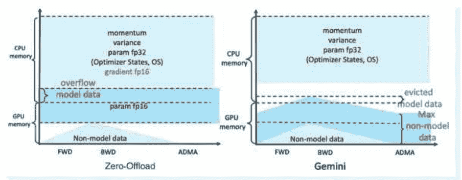

图2-5 优化过程

Colossal-AI 设计 Gemini 如同双子星管理 CPU 与 GPU 内存。张量可在训练过程中动态分布在 CPU-GPU 存储空间，从而突破 GPU 显存墙。内存管理器由 MemStatsCollector 与 StatefulTensorMgr 两部分组成。

利用深度学习训练的迭代特性，可把迭代分为 Warmup 与 Non-Warmup 两个阶段，初始数个迭代为预热，其余为正式阶段。Warmup 阶段由 MSC 收集信息，Non-Warmup 阶段 STM 利用收集的信息搬运 Tensor，以最小化 CPU-GPU 搬运总量，如图2-6所示。

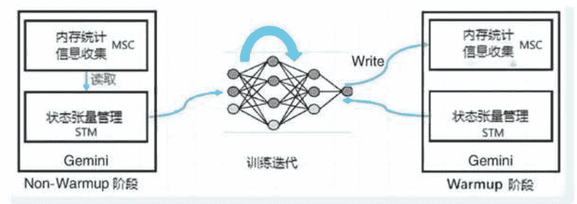

图2-6 Gemini在不同训练阶段的运行流程

### （2）StatefulTensorMgr

STM 记录所有 Model Data Tensor 的信息。模型构建时，Colossal-AI 会把所有 Model Data 张量注册给 STM。每个张量被标记状态，状态集合包括 HOLD、COMPUTE、FREE。

STM 的功能包括：
- 内存使用查询：遍历张量在异构空间的位置，统计模型数据对 CPU 与 GPU 的占用。
- 状态转换：在张量参与算子计算前标记为 COMPUTE，计算后标记为 HOLD，若不再使用则标记为 FREE。
- 位置调整：保证 COMPUTE 状态的张量置于计算设备，若设备空间不足，则把部分 HOLD 状态张量移出到其他设备。驱逐策略依赖 MSC 提供的信息。

### （3）MemStatsCollector

预热阶段，内存信息统计器监测 CPU 与 GPU 中模型数据和非模型数据的内存占用，为正式训练提供参考。模型数据的内存使用可通过查询 STM 获得，而非模型数据的内存难以获取，因为其生命周期由框架管理，未暴露追踪接口。MSC 采用采样方式在预热阶段估算非模型对 CPU 与 GPU 的使用。

算子开始与结束时触发一次内存采样，称作采样时刻，两个采样时刻之间为一个 Period。计算过程属于黑盒，可能分配临时 Buffer，内存变化复杂，但可较准确获取 Period 内的系统最大内存使用。非模型内存使用等于系统最大内存使用减去模型内存使用。

采样时刻的选择对效果影响很大。选择在 PreOp 的 Model Data Layout Adjust 之前进行采样，可获取上一个 Period 的系统内存使用与下一个 Period 的模型内存使用。并行策略会带来额外内存需求，如 ZeRO 或张量并行在算子前需 Gather 模型数据。采样在模型数据变化前进行，可在一个 Period 内捕捉 PreOp 的模型变化，如 Period S2-S3 内 Gather 与 Shard 带来的变化。若把采样点挪到其他位置以排除 Gather Buffer 变动，会因不同并行方式的实现差异带来复杂性，例如 Linear Op 在张量并行中 Gather Buffer 在 Op 内分配，而 ZeRO 中在 PreOp 分配。放在 PreOp 开始时采样有助于统一处理。

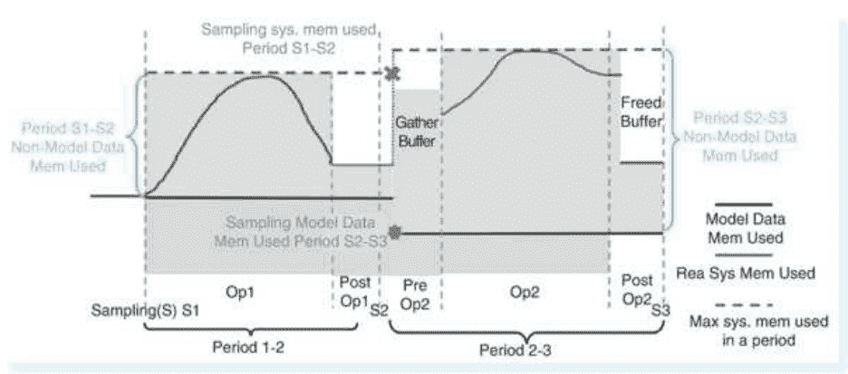

图2-7 Sampling Based MemStatsCollector

即便把采样点移至别处排除 Gather Buffer 的影响，也会因实现差异导致麻烦。将采样放在 PreOp 开始采样有利于统一两种情况。

### （4）Tensor Eviction Strategy

MSC 的重要职责是在调整 Tensor 布局时，例如图2-7 的 S2 时刻，减少设备上的 Model Data，使 Period S2-S3 的峰值内存得到满足。

Warmup 阶段尚未完成完整迭代，真实内存使用尚不明确，此时可限制模型数据在 GPU 上的上限，例如仅使用 30% 显存，以保证预热顺利完成。

Non-Warmup 阶段需利用预热采集的非模型内存信息，为下一个 Period 在计算设备上预留峰值内存，从而搬出部分模型张量。为避免频繁换入换出同一张量导致类似 Cache Thrashing 的现象，利用 DNN 训练迭代特性设计了 OPT Cache 驱逐策略。具体做法是 Warmup 阶段记录每个张量下一次被计算设备需要的时间点，驱逐时选择在本设备上最晚被需要的 HOLD 张量作为受害者。

为简化逻辑，本示例使用合成数据训练 BERT。

首先导入所需依赖，主要来自 PyTorch 与 Colossal-AI 框架，模型定义使用 Transformers 库，仅列出核心依赖，其余依赖请参考完整示例。

```python
from transformers import BertConfig, BertForSequenceClassification
from colossalai import get_default_parser
from colossalai.nn.optimizer import HybridAdam
from colossalai.utils import get_current_device
from colossalai.zero import ColoInitContext, zero_model_wrapper, zero_optim_wrapper
```

随后传入分布式训练所需参数并构建模型。Colossal-AI 提供便捷接口创建分布式环境。

```python
parser = colossalai.get_default_parser()
parser.add_argument(...)
args = parser.parse_args()
colossalai.launch_from_torch(config={})
```

config 可用于设置精度、并行策略等，本例未使用。通过 parser 传入的参数如 placement、dist_plan、vocab_size 可按需调整，以确认模型设置与 ZeRO 策略。完整示例可在随书资源中找到。也可在此基础上扩展兼容 PyTorch 原生数据并行，或使用张量并行进一步优化，并结合 Torch Profiler 进行性能分析。

# 第3章

# 分布式训练：千台机器协同作战

本章将深入探讨并行策略在分布式训练中的基础原理和高级技术。首先，介绍数据并行和张量并行的基本原理，以实现在分布式环境中处理大规模数据和张量数据。接着，深入研究高级并行策略，包括序列并行和混合并行，用于子模型拆分、并行计算和提升分布式训练效果。最后，提供实战分布式训练的案例，包括应用模型并行策略的实际案例和结合多种并行策略的训练实践。通过本章的学习，读者可以掌握上千台机器共同协作的分布式训练技术，为构建高效的分布式训练系统提供实用指南。

# 3.1 并行策略基础原理

面对庞大的模型和复杂的计算任务，通过增加硬件数量来提升性能的想法是合理的，但要充分利用每张显卡的显存并不是一件容易的事情。在并行计算中，设计有效的并行策略是关键，它涉及数据划分、任务分配和通信等方面的基础原理。

- 数据划分是并行计算中的关键问题。大型模型的参数和计算量通常超出单个设备的处理能力，因此需要将模型和数据分割成适合不同设备的部分。数据划分可以基于不同维度进行，如按层划分、按样本划分或按参数划分。合理的数据划分可以充分利用每个设备的计算能力，并尽量减少通信开销。

- 任务分配是并行计算的另一个重要方面。在分布式系统中，将不同的任务分配给不同的设备进行并行计算是关键。任务分配可以基于不同的策略，如静态任务划分、动态任务划分或任务队列调度：静态任务划分将任务预先分配给每个设备，适用于计算任务相对稳定的情况；动态任务划分则根据设备负载和任务进度动态调整任务分配，以实现负载均衡和性能优化；任务队列调度则将任务放入队列中，设备根据可用性自主获取任务进行计算。

并行计算的真实瓶颈，往往藏在设备间的数据搬运里。多卡协同训练时，数据交换不可避免，但每一次交换都带来额外的时间与带宽成本。要压低这部分开销，核心思路是改变通信方式并减少传输量。业界常用的手段有异步通信、通信压缩和节点内通信：异步通信让计算与传输重叠，减少空闲等待；通信压缩先对数据做压缩再传输，降低体积；节点内通信则利用同一台机器内部的高速互联，避免跨节点的长距离传输。

因此，如何设计高效的并行策略，是决定能否发挥硬件规模的关键。数据切分、任务分配和通信协同构成了并行计算的基础，通过合理的方案组合与技术优化，才能让训练与计算任务兼顾速度与效率。

# 3.1.1 数据并行：多卡训练的入门范式
目前主流的多机多卡训练里，数据并行是使用最广的一种。PyTorch 等主流框架原生支持该方法，其做法是把整个数据集切成若干份，按份分给不同的计算设备，例如多张 GPU 进行处理，如图3-1所示。目标就是通过并行喂数据来加速模型迭代。

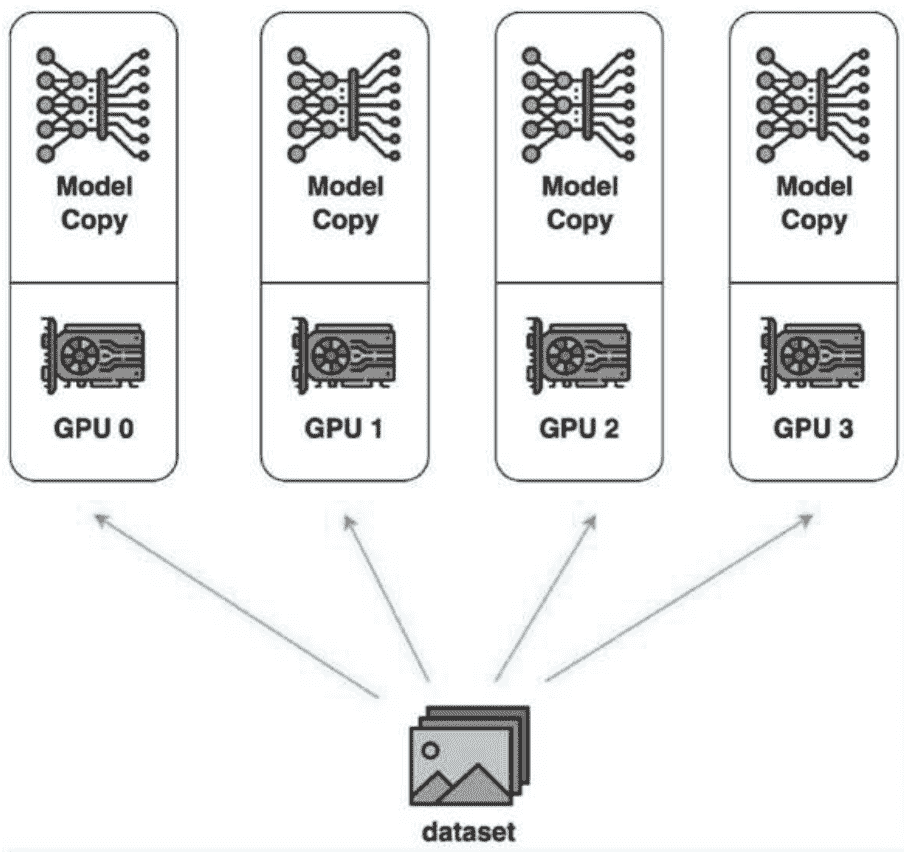
图3-1 基于采样的记忆数据收集器

在数据并行下，每个设备都保存一份完整的模型结构和参数。设备只负责自己那份数据的正向与反向计算，得到本地梯度后，所有设备的梯度会被汇总平均，形成全局梯度，再通过通信同步到各设备，保证参数更新一致。这种方式能显著降低单卡需要保存的输入数据和中间变量规模，同样的数据量下所需迭代次数大幅减少。

使用起来也非常简便，以 PyTorch 训练 GPT-2 为例，只需增加少量代码即可开启多卡数据并行。

```python
from transformers import AutoTokenizer, AutoModelForCausalLM

import torch
import torch.distributed as dist
from torch.nn.parallel import DistributedDataParallel as DDP

dist.init_process_group(backend='nccl') # 初始化进程组
rank = dist.get_rank() # 获取当前进程的 rank
device = torch.device(f'cuda:{rank}') # 每个进程使用对应的 GPU
model = AutoModelForCausalLM.from_pretrained("gpt2").to(device) # 模型部署在对应的 GPU 上
ddp_model = DDP(model) # 封装 DDP

...
# 训练模型
```

需要注意的是，上述脚本需要在每个计算节点上用特定的启动命令来拉起足够数量的进程，并配置好对应的环境变量。

```bash
torchrun --nnodes [节点数] \
--nproc_per_node [每个节点的 GPU 数] \
--node_rank [当前节点序号] \
--master_addr [主节点 IP] \
--master_port [主节点端口号] \
[训练脚本].py
```

这种方案也有明显短板。首先是大批次训练的学习率问题。随着批次增大，梯度方差减小，理论上可以线性放大学习率，但实际调参非常困难，线性缩放容易不收敛，过度的调参又高度依赖经验。其次在大模型场景下，传统数据并行存在致命局限：模型状态无法拆分。每个卡都必须完整保存参数、梯度与优化器状态，整套系统的最大模型规模受限于显存最小的那张卡，即便算力充足也受内存制约。

第2章曾介绍过零冗余优化器 ZeRO。ZeRO 将模型参数和优化器状态在所有设备间平均分配，从而大幅削减冗余内存占用，如图3-2所示。在 ZeRO 机制中，参数、梯度、优化器状态都被切分并分散存储，使用时通过聚合通信和规约把完整张量临时拼回，使用完毕即释放。每个设备只需保存一部分状态，显存需求随之下降。同时通信被均匀摊到所有设备，随着卡数增加等效带宽也提升，额外的分片通信开销被稀释。换句话说，在 ZeRO 加持下，系统可承载的模型大小随总显存呈超线性增长，卡越多能装的模型越大，训练速度也越快。

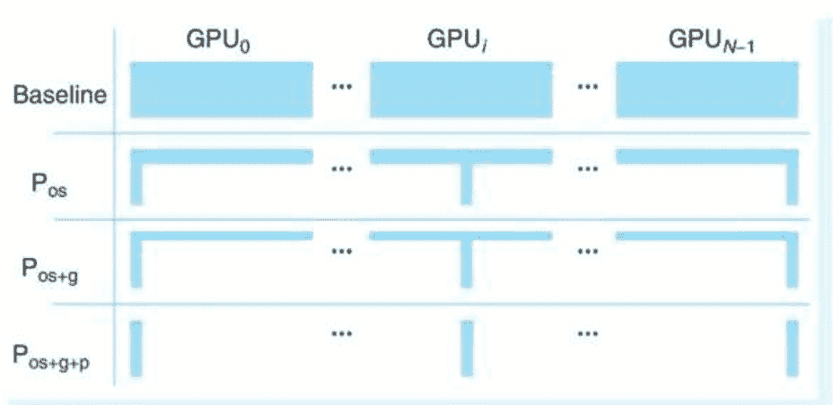
图3-2 零冗余优化器原理图

ZeRO 支持三种运行模式：ZeRO-1 仅对优化器状态如 Adam 的动量与方差进行分片；ZeRO-2 在此基础上把梯度也分散到各卡；ZeRO-3 进一步把模型权重切分存储。以上分片属于 ZeRO-DP，即数据并行范式。

实际训练中，中间激活值占用的显存同样巨大。以 15 亿参数的 GPT-2 为例，序列长度 1K、批次 32 时，中间变量就要约 60GB。针对此问题，ZeRO 还提供了激活值的分片方案，称为 ZeRO-R，能有效缓解大模型训练的内存溢出。

基于 ZeRO 的训练示例在第2章已有演示，这里不再重复。

# 3.1.2 张量并行：层内模型拆分方法
张量并行是一种面向模型层的内层并行策略，其核心思想来自分块矩阵计算。把放不进单卡的模型参数矩阵切成若干块，分散到不同设备上，计算时借助集合通信原语在正向阶段收集各块结果，反向阶段收集梯度，从而让超大参数矩阵能够分布训练。

相较于流水线并行，张量并行实现更简洁、通用性更强，不需要大规模改写模型代码，也能和其他分布式方法配合使用。缺点是集合通信开销偏高，通常只在节点内设备间使用，因为服务器内部带宽远高于跨节点带宽。

按分块粒度可分为多种方案，下面先介绍 1D 张量并行。

## 1.1D 张量并行详解
### (1) 基本概念
Shoeybi 等人为训练基于 Transformer 的大规模语言模型提出 1D 张量并行训练技术 Megatron。该设计主要针对 Transformer Block 的典型构成：一个自注意力层和一个两层 MLP，但思想同样适用于其他层。MLP 的 1D 并行示意如图3-3所示。

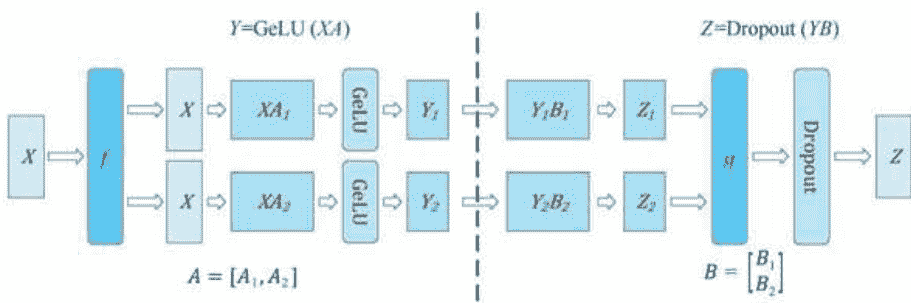
图3-3 MLP的1D张量并行

Transformer Block 中 MLP 可表示为：

$$\begin{aligned} & Y=\operatorname{GeLU}(X A) \\ & Z=\text { Dropout }(Y B) \end{aligned}$$
其中 X 为输入，A 与 B 为参数矩阵，GeLU 为非线性函数。

假设有两张 GPU，对公式进行 1D 并行时，可把参数矩阵 A 按列切分为两块 $A=\left[A_{1}, A_{2}\right]$，分别放到不同设备，本地即可计算：

$$\left[Y_{1}, Y_{2}\right]=\left[\operatorname{GeLU}\left(X A_{1}\right), \operatorname{GeLU}\left(X A_{2}\right)\right]$$
选择列切分是为了减少通信轮次。若按行切分，则需要先对输入 X 作列切分：

$$X=\left[X_{1}, X_{2}\right], A=\left[\begin{array}{c} A_{1}^{\prime} \\ A_{2}^{\prime} \end{array}\right]$$
由此得到的局部结果无法直接进入 GeLU，因为 GeLU (

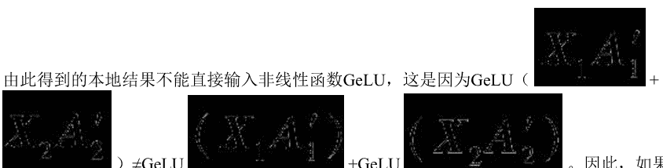
)。因此行切分需要在 GeLU 前做一次 AllReduce 累加，增加通信与延迟。

参数矩阵 B 仅需按行切分，本地计算后做一次 AllReduce 累加即可得到 MLP 输出：

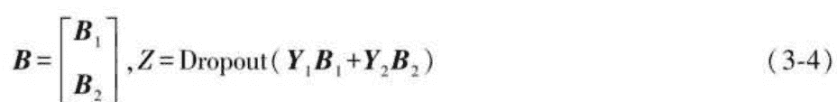
可见 1D 并行对两个参数矩阵都做了切分，反向时还需对梯度做累加。图3-3 中的 f 和 g 即是两次切分的梯度处理函数。f 在前向不操作，反向时对梯度做 AllReduce；g 则相反，前向做 AllReduce，反向不操作。以 PyTorch autograd 实现为例，f 可表示为：

```python
class f(torch.autograd.Function):
    @staticmethod
    def forward(ctx, input_):
        return input_
    @staticmethod
    def backward(ctx, grad_output):
        return _reduce(grad_output)
```

对于自注意力层，1D 并行的处理如图3-4所示。自注意力由自注意力机制和线性层组成，多头自注意力天然可并行，可把注意力参数按列切分在各设备上分别处理；注意力后的线性层处理与 MLP 第二层类似，按行切分并用 AllReduce 合并结果。

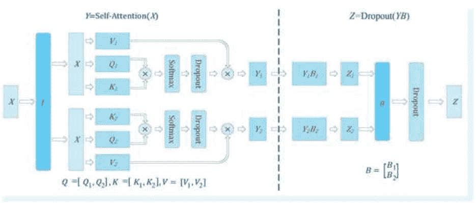
图3-4 自注意力层的1D张量并行

假设有 p 个设备，传输时延为 $\alpha$，带宽为 $\beta$，MLP 两个参数矩阵整体大小为 W，则单设备数据量 $S = W / p$，计算和内存开销均为 $O(1/p)$。以 Ring AllReduce 实现为例，需 $p-1$ 次 ScatterReduce 与 $p-1$ 次 AllGather，每次传输 $S/p$。一次迭代前后向各执行一次 AllReduce，带宽占用时间约为 $2(p-1)S/(p\beta) \sim O[2(p-1)/p]$，时延开销约为 $2(p-1)\alpha \sim O[2(p-1)]$。

## 2. Colossal-AI实战演示
给定 P 个处理器，1D 张量并行的计算、内存与通信成本如表3-1所示。

| 计算 | 内存（参数） | 内存（activations） | 通信（带宽） | 通信（时延） |
|---|---|---|---|---|
| $O(1/P)$ | $O(1/P)$ | $O(1)$ | $O[2(P-1)/P]$ | $O[2(P-1)]$ |

要让模型在两张 GPU 上实现 1D 张量并行，需配置如下并行设置。

```python
CONFIG = dict(parallel=dict(
    data=1,
    pipeline=1,
    tensor=dict(size=2, mode='1d'),
))
```

随后 Colossal-AI 会自动对所有来自 colossalai.nn 的层应用 1D 并行。定义一个由两层 MLP 组成的模型如下。

```python
import colossalai
import colossalai.nn as col_nn
import torch
from colossalai.utils import print_rank_0

class MLP(torch.nn.Module):
    def __init__(self, dim: int = 256):
        super().__init__()
        intermediate_dim = dim * 4
        self.dense_1 = col_nn.Linear(dim, intermediate_dim)
        print_rank_0(f'Weight of the first linear layer: {self.dense_1.weight.transpose(0, 1).shape}')
        self.activation = torch.nn.GELU()
        self.dense_2 = col_nn.Linear(intermediate_dim, dim)
        print_rank_0(f'Weight of the second linear layer: {self.dense_2.weight.transpose(0, 1).shape}')
        self.dropout = col_nn.Dropout(0.1)

    def forward(self, x):
        x = self.dense_1(x)
        print_rank_0(f'Output of the first linear layer: {x.shape}')
        x = self.activation(x)
        x = self.dense_2(x)
        print_rank_0(f'Output of the second linear layer: {x.shape}')
        x = self.dropout(x)
        return x
```

在两张 GPU 上启动 Colossal-AI 并构建模型。

```python
parser = colossalai.get_default_parser()
colossalai.launch(config=CONFIG,
                  rank=args.rank,
                  world_size=args.world_size,
                  local_rank=args.local_rank,
                  host=args.host,
                  port=args.port)

m = MLP()
```

被划分的参数权重形状如下所示。

```
Weight of the first linear layer: torch.Size([256, 512])
Weight of the second linear layer: torch.Size([512, 256])
```

第一个线性层的完整权重本应为 [256, 1024]，经列并行切分后变为 [256, 512]；第二个行并行层把权重 [1024, 256] 划分为 [512, 256]。可用随机输入运行模型。

```python
from colossalai.utils import get_current_device
x = torch.randn((16, 256), device=get_current_device())
torch.distributed.broadcast(x, src=0) # synchronize input
x = m(x)
```

可观察到激活结果的形状。

```
Output of the first linear layer: torch.Size([16, 512])
Output of the second linear layer: torch.Size([16, 256])
```

第一线性层的输出被切成两块，每块形状为 [16, 512]，而第二层的输出在所有 GPU 上保持一致。

## 2.2D张量并行介绍
### （1）基本概念
1D 张量并行仅对参数矩阵分片，并未对层输出的激活值进行切分，导致每个设备仍需保留全局复制的激活，造成内存冗余，限制扩展性。Xu 等人基于 SUMMA 算法提出了 2D 张量并行方法 Optimus，在切分参数矩阵的同时进一步对每层输出的激活值进行划分，从而实现更细粒度的分块矩阵运算，提升训练的可扩展能力。

2D 张量并行采用网格化的组织方式来部署算子与设备。设参与计算的卡数 p 为 $q\times q$，则模型权重与输入会被切分为 $q\times q$ 的块状网格，并且每块都映射到独立的卡上。记网格中第 i 行第 j 列的块为 $A_{ij}$，其中 $i,j$ 取值范围为 $[0,q)$。该方案重点覆盖 Transformer 训练中最常见的三种矩阵乘算子：$C=AB$、$C=AB^T$ 与 $C=A^TB$，兼顾前向推理与反向梯度更新。

以 $C=AB$ 为例，伪码见算法3-1。求出 $C_{ij}$ 时，先把 A 的第 i 行块和 B 的第 j 列块通过广播通信下发到同一设备，收到副本后在本地完成小规模乘法，再做累加即得到目标块。

```
算法 3-1 C=AB
Input: A_ij, B_ij
Output: C_ij
C_ij = 0
for l=0->q-1 do
    broadcast(A_il) within i row
    broadcast(B_lj) within j column
    C_ij += A_il * B_lj
end for
return C_ij
```

$C=AB^T$ 的实现见算法3-2。计算 $C_{ij}$ 时，先对 B 的相关列块做广播，本地先生成中间结果，随后在同一行设备内执行一次 Reduce 聚合，最终得到正确块。

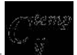

```
算法 3-2 C=AB^T
Input: A_ij, B_ij
Output: C_ij
C_ij = 0
for l=0->q-1 do
    broadcast(B_lj) within j column
    C_ij^{temp} = A_il * B_lj^T
    C_ij = reduce(C_ij^{temp}) within i row
end for
return C_ij
```

$C=A^TB$ 如算法3-3 所示，流程与前者相近。先广播 A 的第 i 行块获得中间值，之后在同一列设备间调用 Reduce 将各局部结果汇总。

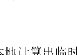

```
算法 3-3 C=A^T B
Input: A_ij, B_ij
Output: C_ij
C_ij = 0
for l=0->q-1 do
    broadcast(A_il) within i row
    C_ij^{temp} = A_il^T * B_lj
    C_ij = reduce(C_ij^{temp}) within j column
end for
return C_ij
```

相比 1D 方案，2D 并行不再使用 AllReduce，而是以 Broadcast 与 Reduce 为主，性能表现随网格边长 q 变化。以 $C=AB$ 为例，设单次通信延迟为 $\alpha$、带宽为 $\beta$，每卡持有的 A 数据大小为 $S_A$、B 为 $S_B$。一次迭代把参数与激活均摊到 $q\times q$ 网格后，单卡的计算与存储负担都下降到 $O(1/q^2)$。相对 1D 需要保存完整的激活副本，2D 把激活存储也压缩到 $O(1/q^2)$。前向与反向阶段都要对 A、B 各自完成 q 次广播，反向时梯度同样需要 q 次广播。综合来看带宽消耗约为 $3q(q-1)(S_A+S_B)/(\beta q^2)$，量级为 $O[6(q-1)/q]$；延迟开销约为 $6q(q-1)\alpha$，量级为 $O[6q(q-1)]$。

### （2）Colossal-AI实战

表3-2 给出了在 $P=q\times q$ 个处理器下，环形算法对应的2D张量并行在前向、反向时的计算与内存开销，以及通信的带宽与延迟成本。

表3-2 成本计算

| 计算 | 内存（参数） | 内存（activations） | 通信（带宽） | 通信（时延） |
|---|---|---|---|---|
| $O(1/q^2)$ | $O(1/q^2)$ | $O(1/q^2)$ | $O[6(q-1)/q]$ | $O[6(q-1)]$ |

若要在4块 GPU 上启用2D张量并行，需要采用下面的并行策略。

```python
CONFIG = dict(parallel=dict(
    data=1,
    pipeline=1,
    tensor=dict(size=4, mode='2d'),
))
```

随后 Colossal-AI 会自动把 colossalai.nn 中的所有层切分为2D张量并行。这里用两层 MLP 作为示例。

```python
import colossalai
import colossalai.nn as col_nn
import torch
from colossalai.utils import print_rank_0

class MLP(torch.nn.Module):
    def __init__(self, dim: int = 256):
        super().__init__()
        intermediate_dim = dim * 4
        self.dense_1 = col_nn.Linear(dim, intermediate_dim)
        print_rank_0(f'Weight of the first linear layer: {self.dense_1.weight.shape}')
        self.activation = torch.nn.GELU()
        self.dense_2 = col_nn.Linear(intermediate_dim, dim)
        print_rank_0(f'Weight of the second linear layer: {self.dense_2.weight.shape}')
        self.dropout = col_nn.Dropout(0.1)

    def forward(self, x):
        x = self.dense_1(x)
        print_rank_0(f'Output of the first linear layer: {x.shape}')
        x = self.activation(x)
        x = self.dense_2(x)
        print_rank_0(f'Output of the second linear layer: {x.shape}')
        x = self.dropout(x)
        return x
```

在四卡环境中启动 Colossal-AI 并实例化模型。

```python
parser = colossalai.get_default_parser()
colossalai.launch(config=CONFIG,
                  rank=args.rank,
                  world_size=args.world_size,
                  local_rank=args.local_rank,
                  host=args.host,
                  port=args.port)

m = MLP()
```

此时可以检查 MLP 中被切分的参数，例如权重的形状。

```
Weight of the first linear layer: torch.Size([128, 512])
Weight of the second linear layer: torch.Size([512, 128])
```

第一层线性变换的完整权重原本是 [256,1024]，经2D切分后每卡只保留 [128,512]。第二层的 [1024,256] 也被切成 [512,128]。

用一组随机张量作为输入进行一次前向。

```python
from colossalai.context import ParallelMode
from colossalai.core import global_context as gpc
from colossalai.utils import get_current_device

x = torch.randn((16, 256), device=get_current_device())
# partition input
torch.distributed.broadcast(x, src=0)
x = torch.chunk(x, 2, dim=0)[gpc.get_local_rank(ParallelMode.PARALLEL_2D_COL)]
x = torch.chunk(x, 2, dim=-1)[gpc.get_local_rank(ParallelMode.PARALLEL_2D_ROW)]
print_rank_0(f'Input: {x.shape}')

x = m(x)
```

可以观察到激活值的形状。

```
Input: torch.Size([8, 128])
Output of the first linear layer: torch.Size([8, 512])
Output of the second linear layer: torch.Size([8, 128])
```

在2D并行里，激活会被同时按行列切分。举例来说，第一层线性输出在每卡上形如 [8,512]，第二层输出为 [8,128]。

## 3.2.5D 张量并行

### （1）基本概念

本质上，2D张量并行把激活存储的压力转嫁为块间通信开销。为降低通信，Wang 等人借鉴2.5D 矩阵乘法思路，提出了名为 Tesseract 的2.5D张量并行训练方案。

2.5D 方案引入额外维度 d，把 p 台设备逻辑上组织成 $q \times q \times d$ 的立方体，其中 $p=q^2 d$ 且 $1\le d\le q$，如图3-5所示。当 $d=1$ 时退化为2D，当 $d=q$ 时升级为3D。

图3-5 2.5D张量并行的设备逻辑拓扑结构

以 $C=AB$ 为例，$A\in[a,b]$ 被切成 $q^2 d$ 块，每块大小 $[a/qd, b/q]$，见图3-6；$B\in[b,c]$ 被切成 $q^2$ 块，每块 $[b/q, c/q]$，见图3-7；结果 $C\in[a,c]$ 被切成 $q^2 d$ 块，每块 $[a/qd, c/q]$，见图3-8。$B$ 的 $q^2$ 块会在 $d$ 层中复制。整体流程见算法3-4。直观上可理解为 $A$ 被分到 $d$ 层，每层保持 $q\times q$ 网格，每层内部用 SUMMA 方式与复制的 $B$ 块做局部乘法，从而提升并行度，图中的高亮区域即对应单层计算。其余两种乘法与2D思路一致，只是均在 $d$ 层上并行展开。

图3-6 2.5D矩阵的分割

图3-7 矩阵 B 的分割

图3-8 矩阵 C 的分割

## 算法 3-4 C=AB

```python
Input: A with size [a, b] split into [a/q²d, b/q] partitions
Input: B with size [b, c] split into [b/q, c/q] partitions
Output: C with size [a, c]
for i, j in [0, q), k in [0, d) do # initialization
    store B_jk into p_ijk
    let h = i+k = q
    store A_hj into p_ijk
    init C_ij = 0 in p_ijk
end for
for i, j in [0, q), k in [0, d) do # computation
    for t in [0, q) do
        broadcast A_it to p_ijk
        broadcast B_jk to p_ijk
        C_ijk += A_it B_jk
    end for
end for
return C_ij
```

2.5D 同样依赖 Broadcast 与 Reduce。以 $C=AB$ 为例，假设 $A$ 为激活或输入，$B$ 为权重，延迟 $\alpha$、带宽 $\beta$，每卡 $A$ 数据量 $S_A$、$B$ 数据量 $S_B$。由于 $A$ 被切到 $q\times q\times d$ 网格，单卡一次迭代的计算量为 $O(1/q^2 d)$，参数存储仍为 $O(1/q^2)$，激活存储被优化到 $O(1/q^2 d)$。带宽占用为

$$ O\left[\frac{3(q-1)(d+1)}{dq}\right] $$

而延迟开销保持 $6q(q-1)\alpha$，量级 $O[6q(q-1)]$。

### （2）Colossal-AI实战

表3-3 列出了在 $P=q\times q\times d$ 台处理器下，基于环形算法的2.5D张量并行的计算、内存以及通信带宽与延迟的理论成本。

### 表3-3 成本计算

| 计算 | 内存（参数） | 内存（activations） | 通信（带宽） | 通信（时延） |
| :--- | :--- | :--- | :--- | :--- |
| $O(1/dq^2)$ | $O(1/q^2)$ | $O(1/dq^2)$ | $O[3(q-1)(d+1)/dq]$ | $O[6(q-1)]$ |

若希望在8块 GPU 上启用2.5D张量并行，可采用如下并行配置。

```python
CONFIG = dict( parallel=dict(
    data=1,
    pipeline=1,
    tensor=dict(size=8, mode='2.5d', depth=2),
))
```

随后 Colossal-AI 会自动把 colossalai.nn 中的层全部转为2.5D张量并行。下面以一个双层 MLP 为例。

```python
import colossalai
import colossalai.nn as col_nn
import torch
from colossalai.utils import print_rank_0

class MLP(torch.nn.Module):
    def __init__(self, dim: int = 256):
        super().__init__()
        intermediate_dim = dim * 4
        self.dense_1 = col_nn.Linear(dim, intermediate_dim)
        print_rank_0(f'Weight of the first linear layer: {self.dense_1.weight.shape}')
        self.activation = torch.nn.GELU()
        self.dense_2 = col_nn.Linear(intermediate_dim, dim)
        print_rank_0(f'Weight of the second linear layer: {self.dense_2.weight.shape}')
        self.dropout = col_nn.Dropout(0.1)

    def forward(self, x):
        x = self.dense_1(x)
        print_rank_0(f'Output of the first linear layer: {x.shape}')
        x = self.activation(x)
        x = self.dense_2(x)
        print_rank_0(f'Output of the second linear layer: {x.shape}')
        x = self.dropout(x)
        return x
```

在八卡环境中启动 Colossal-AI 并构建模型。

```python
parser = colossalai.get_default_parser()
colossalai.launch(config=CONFIG,
                  rank=args.rank,
                  world_size=args.world_size,
                  local_rank=args.local_rank,
                  host=args.host,
                  port=args.port)

m = MLP()
```
在这里可以直观地看到 MLP 模型里被切分的参数，例如权重各自的张量形态。

```text
Weight of the first linear layer: torch.Size([128, 512])
Weight of the second linear layer: torch.Size([512, 128])
```
第一层全量权重本是 $[256, 1024]$，启用 2.5D 并行切分后，每个 GPU 只保留 $[128, 512]$ 的切片。第二层原始权重 $[1024, 256]$ 则被拆成 $[512, 128]$。此时可喂入随机数据跑通模型。

```python
from colossalai.context import ParallelMode
from colossalai.core import global_context as gpc
from colossalai.utils import get_current_device

x = torch.randn((16, 256), device=get_current_device())
# partition input
torch.distributed.broadcast(x, src=0)
x = torch.chunk(x, 2, dim=0)[gpc.get_local_rank(ParallelMode.PARALLEL_2P5D_DEP)]
x = torch.chunk(x, 2, dim=0)[gpc.get_local_rank(ParallelMode.PARALLEL_2P5D_COL)]
x = torch.chunk(x, 2, dim=-1)[gpc.get_local_rank(ParallelMode.PARALLEL_2P5D_ROW)]
print_rank_0(f'Input: {x.shape}')

x = m(x)
```
接下去能够观察到激活值的张量维度。

```text
Input: torch.Size([4, 128])
Output of the first linear layer: torch.Size([4, 512])
Output of the second linear layer: torch.Size([4, 128])
```
在 2.5D 方案里，激活张量会在 $d \times q$ 行同时加上 $q$ 列的方向上一起切分。比如第一层线性变换的输出维度变为 $[4, 512]$，第二层则为 $[4, 128]$。值得注意的是，权重切分方式与 2D 并行保持一致，差异主要体现在输入的划分策略上。

## 4. 3D 张量并行拆解

### （1）基本概念

受三维矩阵乘法思路的启发，Bian 等人设计了一套 3D 张量并行的训练方法，以下做简要说明。

在 3D 张量并行里，$p$ 个设备的逻辑拓扑被组织成 $[q, q, q]$ 的立方体，如图3-9所示。设矩阵 $A$ 的大小为 $[M, N]$，矩阵 $B$ 的大小为 $[N, K]$，对乘法 $C = AB$，两个矩阵被均匀分配到 $q^3$ 个设备上。矩阵 $A$ 先被切成 $q$ 叠 $q \times q$ 子块沿 $y$ 方向堆叠，矩阵 $B$ 则被切成 $q$ 组 $q \times q$ 子块沿 $x$ 方向堆叠。分布式计算时，对 $A$ 沿 $y$ 方向做 AllGather，可在 $(i, *, 1)$ 的 $q$ 台设备上得到 $A_{il}$，如图3-10所示。类似地，如图3-11所示，对 $B$ 沿 $x$ 方向做 AllGather，可在 $(*, j, 1)$ 的 $q$ 台设备上得到 $B_{lj}$。每个设备先本地计算 $A_{il} B_{lj}$，再沿 $z$ 方向做一次 Reduce-Scatter，即可得到 $C$ 沿 $z$ 方向以 $q \times q$ 方式分布的划分，如图3-12所示。3D 张量并行的形式化描述见算法3-5，需要手动指定 $x、y、z$ 的划分方向来确定集合通信的分组。其他两种矩阵乘法的 3D 并行与算法3-5类似，仅划分方向不同。

图3-9 3D张量并行的设备逻辑拓扑结构

图3-10 矩阵沿方向分布和对应的AllGather执行方向 (一)

图3-11 矩阵沿方向分布和对应的AllGather执行方向 (二)

图3-12 矩阵沿方向的分布

```python
算法 3-5 C=AB
Input: A_{ij}, B_{jk}, partition direction x, y and z
Output: C_{ik}
A_{ij} = AllGather (A_{ij}) in y
B_{jk} = AllGather (B_{jk}) in x
C_{ik} = ReduceScatter (A_{ij}B_{jk}) in z
return C_{ik}
```
3D 张量并行主要依赖 AllGather 与 ReduceScatter 两类集合操作。以算法 3-5 中的 $C = AB$ 为例，假设 $A$ 代表激活或输入，$B$ 代表参数矩阵，单次传输延迟为 $\alpha$，带宽为 $\beta$，单设备上 $A、B、C$ 的数据规模分别记作 $S_A、S_B、S_C$。因为设备被组织成 $q \times q \times q$ 网格，所以每个设备的计算和存储负担均为 $O(1/q^3)$。在一个训练步中，前向阶段要对 $A、B$ 做 AllGather，对 $C$ 做 ReduceScatter；反向阶段则需对 $C$ 的梯度做 AllGather，对 $A、B$ 的梯度分别做 ReduceScatter，因而带宽消耗为

$$ 2(q-1)\left(\frac{S_A/q^2}{\beta q}+\frac{S_B/q^2}{\beta q}+\frac{S_C/q^2}{\beta q}\right) \sim O\left(\frac{6(q-1)}{q^3}\right) $$
通信延迟约为 $6(q-1)\alpha$，量级为 $O[6(q-1)]$。

### （2）Colossal-AI实战

表 3-4 汇总了在 $P = q \times q \times q$ 个处理器下，理论计算与内存开销，以及采用环形实现时 3D 张量并行前向和反向的通信开销。

### 表3-4 成本计算

| 计算 | 内存（参数） | 内存（activations） | 通信（带宽） | 通信（时延） |
| :--- | :--- | :--- | :--- | :--- |
| $O(1/q^3)$ | $O(1/q^3)$ | $O(1/q^3)$ | $O[6(q-1)/q^3]$ | $O[6(q-1)]$ |

若想在 8 张 GPU 上启用 3D 张量并行，需按如下方式配置并行度。

```python
CONFIG = dict(parallel=dict(
    data=1,
    pipeline=1,
    tensor=dict(size=8, mode='3d'),
))
```
随后 Colossal-AI 会自动将 3D 张量并行作用到所有 colossalai.nn 提供的层。这里构造一个由两层 MLP 构成的示例模型，具体定义如下。

```python
import colossalai
import colossalai.nn as col_nn
import torch
from colossalai.utils import print_rank_0

class MLP(torch.nn.Module):
    def __init__(self, dim: int = 256):
        super().__init__()
        intermediate_dim = dim * 4
        self.dense_1 = col_nn.Linear(dim, intermediate_dim)
        print_rank_0(f'Weight of the first linear layer: {self.dense_1.weight.shape}')
        self.activation = torch.nn.GELU()
        self.dense_2 = col_nn.Linear(intermediate_dim, dim)
        print_rank_0(f'Weight of the second linear layer: {self.dense_2.weight.shape}')
        self.dropout = col_nn.Dropout(0.1)

    def forward(self, x):
        x = self.dense_1(x)
        print_rank_0(f'Output of the first linear layer: {x.shape}')
        x = self.activation(x)
        x = self.dense_2(x)
        print_rank_0(f'Output of the second linear layer: {x.shape}')
        x = self.dropout(x)
        return x
```
在 8 卡环境下启动 Colossal-AI 并实例化模型。

```python
parser = colossalai.get_default_parser()
colossalai.launch(config=CONFIG,
                  rank=args.rank,
                  world_size=args.world_size,
                  local_rank=args.local_rank,
                  host=args.host,
                  port=args.port)

m = MLP()
```
此时可直观看出 MLP 各参数、尤其是权重的切分形状。

```python
Weight of the first linear layer: torch.Size([128, 256])
Weight of the second linear layer: torch.Size([512, 64])
```
第一层全量权重本为 $[256,1024]$，经 3D 切分后单卡保留 $[128,256]$。第二层原始权重 $[1024,256]$ 被划分为 $[512,64]$。此时可输入随机数据验证运行。

## 3.1.3 流水线并行原理与落地

在机器学习里，流水线并行属于模型并行的一种。核心思路是把含有多层的模型拆成若干阶段，各阶段可独立运行。训练时，样本按序流经各阶段，前一阶段的输出成为下一阶段的输入。借助多个计算单元同时推进不同阶段，整体训练耗时能够明显下降。

流水线并行的一个难点在于各阶段计算量的均衡。若某阶段耗时远超其他阶段，就会形成瓶颈拖慢全局。可通过调整各阶段处理的批次大小或引入动态负载均衡来缓解。

另一个难点是跨设备的通信管理。阶段间需要传递中间结果或梯度，会带来额外开销和延迟。可采用高效传输协议或重叠计算与通信来降低影响。

总体看，流水线并行是加速多阶段模型训练的有效手段，对计算密集型模型尤其明显。但要保证高效执行，必须仔细处理负载均衡与通信开销。下面将先介绍相关概念与优化实践，再阐述一般原理，随后对比 GPipe、PipeDream、DAPPLE、PipeMare 四种框架，最后结合 Colossal-AI 做代码实战，帮助更透彻地掌握流水线并行技术。

### 1. 基本流水线计算

深度神经网络本质上是层堆叠，每层都包含前向函数和对应参数。模型规模由层数与单层参数量共同决定。对于无法容纳于单机的超大网络，可借助流水线并行把参数分散到不同设备上。训练过程分为前向和反向两个方向，均以小批量为单位进行。

这里以 4 层模型为例，层记为 L1、L2、L3、L4，输入为 input，输出为 output，原计算可表示为：

$$

output = L4(L3(L2(L1(input)))) \quad (3-7)

$$
然后使用不同计算设备，将 4 台设备记为 Worker 1~4，中间结果记为 intermediate 1~3，流水线并行可表述为：

- Worker 1 执行：intermediate 1 = L1(input)
- Worker 2 执行：intermediate 2 = L2(intermediate 1)
- Worker 3 执行：intermediate 3 = L3(intermediate 2)
- Worker 4 执行：output = L4(intermediate 3)

图3-13展示了 4 层模型在 4 个计算设备上的流水线并行执行，数字指示样本序号，这里假设反向耗时是前向的两倍。为简化，假设设备间传递激活/梯度无开销。但标准流水线并行会造成计算资源严重闲置。

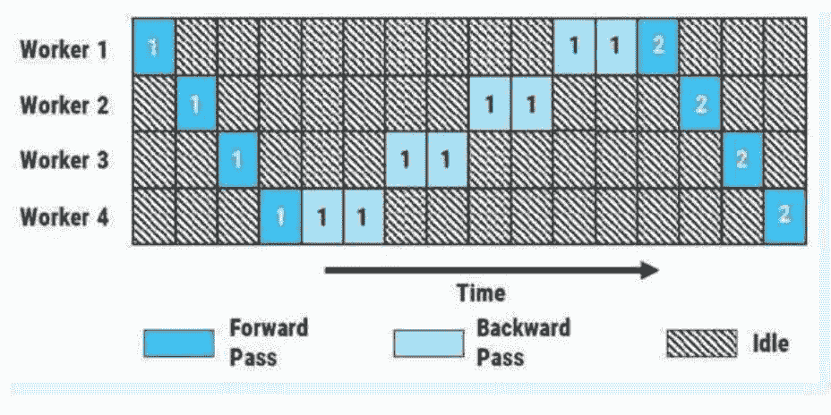
- 计算资源利用率偏低：在任意时刻往往只有一台设备在算，其余空闲。忽略通信时，每个设备总利用率仅

$$

\frac{1}{N}

$$
，若设备数增加，利用率会进一步下降。因此需要给空闲设备安排任务以提升使用率。下游设备长时间等待上游完成才能启动的现象被称为 bubble。

- 计算与通信串行执行：传输前向中间结果和反向梯度时设备处于空闲，产生浪费，需精心设计以提升效率。

- 层划分策略：模型层如何分配到各设备直接影响性能，选择合适的划分方式很关键。

为解决上述问题，Deepak Narayanan、Aaron Harlap 等人提出 PipeDream，Yanping Huang 等人提出 GPipe。基本思路是在训练时把一个 batch 切成更小的 batch，即 GPipe 中的 micro-batch 和 PipeDream 中的 mini-batch，再利用批间或批内并行把小 batch 的执行流水化到设备上。流水线效率可通过总内存使用量和流水线利用率衡量，后者指任一时刻未空闲的阶段占比。下面介绍几种流行技术。

### 2. GPipe——分批流水并行

GPipe 是一种将 batch 切分到流水线的新算法，灵活性高，可高效扩展到不同规模的网络训练，并能实现接近线性的加速。图3-14 a 中因网络顺序性，传统流水线一次仅有一台设备活跃。图3-14 b 中 GPipe 把输入 batch 切成更小的 micro-batch，使多台设备能同时处理不同的 micro-batch。

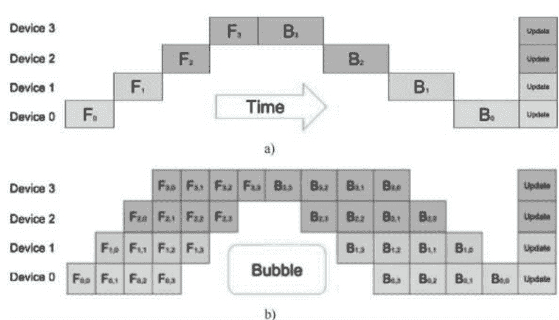
#### (1) Gpipe数据batch的划分

假设网络有 $L$ 层，每层 $L(i)$ 包含前向函数和参数。GPipe 为每层计算成本函数，给定划分数 $K$，会据此把 $L$ 层网络切成 $K$ 组连续的层，并自动设置相邻组间的通信。在前向阶段，GPipe 把 batch 均分为 $M$ 个 micro-batch，使其在 $M$ 台设备间流水。反向阶段，每个 micro-batch 的梯度基于前向的模型参数计算。最后把 $M$ 个 micro-batch 的梯度累加后用于更新各设备的模型参数。

流水线并行训练：GPipe 到 PipeDream 再到 Colossal-AI 实战拆解

图3-14 把基础流水线计算和 GPipe 的并行实现做了对照。先把一个 batch 切成 4 个 micro-batch，计算设备 0、1、2、3 分别存放第 0、1、2、3 层的参数，并在设备间传递前向和反向的中间结果。运行流程是这样的。

1. micro-batch 0 最先进入计算设备 0，在设备 0 完成前向计算。
2. 计算设备 1 从设备 0 接过 micro-batch 0 计算完后传给设备 2，同时 micro-batch 1 被送进设备 0。
3. 计算设备 2 从设备 1 收到 micro-batch 0 计算后传给设备 3；与此同时，设备 1 从设备 0 收到 micro-batch 1 计算后传给设备 2；micro-batch 2 此时进入设备 0。
4. 计算设备 3 从设备 2 收到 micro-batch 0 计算后传给设备 4；设备 2 从设备 1 收到 micro-batch 1 计算后传给设备 3；设备 1 从设备 0 收到 micro-batch 2 计算后传给设备 2；micro-batch 3 进入设备 0。
5. 各层/设备的参数同步更新完成后，开启下一轮流水。

#### (2) GPipe内存使用的降低

GPipe 在实现中采用了激活重计算，内存占用可以压缩为

$$

O(\frac{NL}{M} + \frac{M}{2})

$$

其中 $L$ 是 $N$ 一个batch数据的多少， $M$ 是设备的个数，

$$

\frac{N}{M}

$$

是每个micro-batch的大小，

$$

\frac{L}{M}

$$

是每组划分的网络层数，未经优化的内存需求是 $O(NL)$，可见 GPipe 将内存需求大幅压低。

在 $M$ 份 micro-batch 的场景下，bubble 时间为

$$

\frac{M-1}{M} \times T_{forward}

$$

这一数值远小于传统基础流水线的 bubble。

图3-15 给出了在 TPUv3 上的测试，每个 TPUv3 内存 16GB，AmoebaNet-D 在单块 TPUv3 上无法训练，所以基线取两块 TPUv3。结果显示 GPipe 取得了不错的加速比。总体来看，GPipe 提出并落地了一种新的 batch 处理流水线并行方案，采用同步梯度更新，在计算设备利用率和训练稳定性上表现良好。

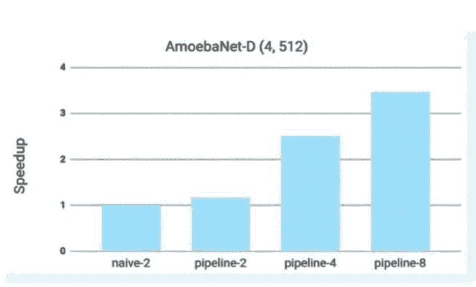

### 3. PipeDream 技术原理

PipeDream 与 GPipe 同期出现，但并行思路完全不同。PipeDream 把前向传播流水化，并将前向与反向交错执行，目标是把硬件利用率和吞吐量推到最高。同样是把每个 batch 切成 Mini-Batch，PipeDream 连续把 Mini-Batch 塞进流水，并在反向结束后异步更新参数。核心区别在于：PipeDream 用异步反向更新，GPipe 用同步反向更新。

如图3-16 所示，以 4 个计算设备为例展示启动与稳定状态。假设反向耗时是前向的 2 倍。PipeDream 同时融合了 batch 内并行和 batch 间并行。完成某个 Mini-Batch 的正向或反向后，各阶段会异步把激活或梯度传给下一阶段，同时启动下一个 Mini-Batch 的工作；反向完成后，各阶段同样异步把梯度传回上一阶段并继续处理新任务。这样不同 GPU 可以同时处理不同 Mini-Batch。

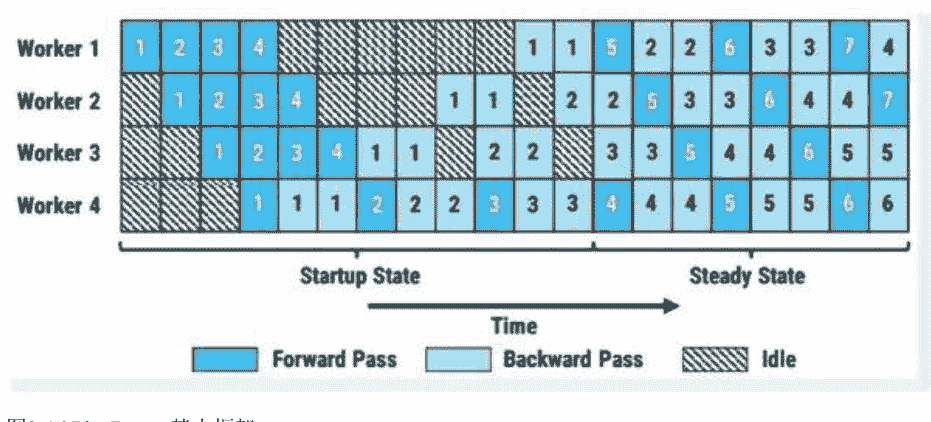

#### (1) PipeDream任务划分

若每个阶段处理 Mini-Batch 的吞吐量差异明显，管道中会产生 bubble。为此 PipeDream 先做一次初始分析，记录前向、反向耗时、层输出大小等信息，再依据设备内存、设备数量、互联带宽自动把 DNN 层切成多个阶段，让各阶段速度大致相等。为了进一步均衡负载，PipeDream 还会在部分阶段引入数据并行，同时处理不同的 Mini-Batch。图3-17 展示了分析与划分流程，先对输入模型做 Profile，随后根据设备内存、硬件数量、互联带宽把模型切分为执行时间基本相等的若干部分。

#### (2) 权重更新

流水线并行把 DNN 层划分为多个连续的阶段，每个阶段映射到单独的计算设备，负责该阶段层的前向和反向。同时参数更新不同步。例如图3-18 展示了 Mini-Batch 5 在阶段的权重存储，箭头指向第一、第三阶段对 Mini-Batch 5 前向和反向使用的权重版本。在计算设备 1 完成对 Mini-Batch 1 的反向后，Mini-Batch 5 的新一次前向会使用已更新的参数。因此 PipeDream 在每台机器上维护多版本参数。这种异步更新会带来权重过时问题。为此 PipeDream 采用权重存储技术。权重存储为每个活跃的 Mini-Batch 保留一组权重，前向时使用当前可用的最新版本，完成前向后把该 Mini-Batch 使用的权重保存下来，反向时就用同一版本计算权重更新和上游梯度。

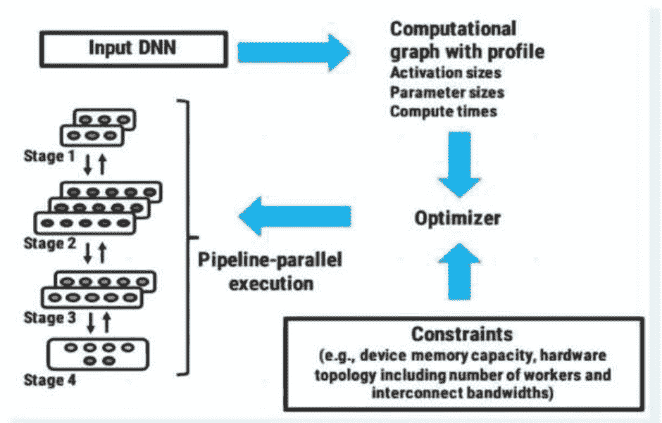


#### (3) PipeDream性能分析

图3-19 对比了模型并行、无数据并行的流水线并行、带数据并行的流水线并行相对于模型并行的加速。对所有模型，流水线并行都能把吞吐量提升两倍以上。对于 GNMT-8 和 GNMT-16，PipeDream 的优化策略选择不使用数据并行，导致横线与竖虚线对应的配置相同。而对于 VGG-16 和 AlexNet，PipeDream 选择在第一阶段使用数据并行，相较于模型并行分别提升了 14.9 倍与 6.5 倍。


### 4. DAPPLE 技术原理

DAPPLE 是一个同步分布式训练框架，融合了大模型的数据并行与流水线并行。其思路是更早安排反向任务，释放存储前向激活所需的内存。图3-20 b 展示了 DAPPLE 的调度，与图3-20 a 的 GPipe 不同：不一次性执行全部 $M$ 个 Mini-Batch，而是先执行 $K$ 个 Mini-Batch（$K < M$），以缓解内存压力并达到峰值；同时严格保证一个 Mini-Batch 的前向完成后紧接着其反向，从而让反向提前执行。图3-20 c 显示了 GPipe 与 DAPPLE 的内存随时间变化。前 $K$ 个 Mini-Batch 两者消耗相同，到第 $K$ 个时因反向提前，DAPPLE 达到内存峰值。具体而言，通过严格控制前向与反向顺序，由前向产生的激活内存可被随后的反向及时释放，而 GPipe 的峰值在 $K$ 个 Mini-Batch 后持续攀升。DAPPLE 并未牺牲训练效率，在阶段划分和设备映射相同的情况下，其 bubble 时间与 GPipe 完全一致。

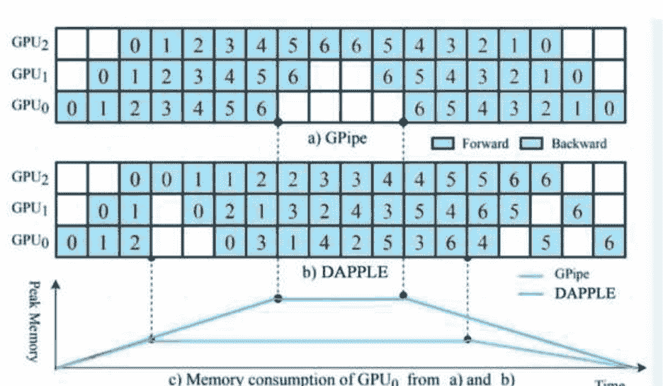

在同步训练中，DAPPLE 以 Global Batch 完成耗时作为性能指标，称之为流水线延迟。调度优化的目标是在所有数据/流水并行解空间中最小化该延迟。

### 5. PipeMare 技术原理

PipeMare 旨在提升异步流水线训练效率，在计算梯度时使用内存中已有的权重，避免为模型权重额外复制副本（无权重存储）或引入 bubble，同时性能优于 PipeDream。

PipeMare 依赖两项技术：1) 学习率重调度；2) 差异校正。学习率重调度为延迟更新提供新解，通过设计步长方案控制训练过程中的步长，因为步长与异步更新的衰减相关；差异校正是权重存储的替代方案，它根据权重近期平均轨迹推断前向传播时的权重，用以修正反向传播中使用的权重值。它不保存多版本权重，只额外保存少量内存用于近似权重速度。

流水线并行让大模型能在不同设备上计算，降低网络通信并提高硬件利用率。同步流水线如 GPipe 需要相邻迭代间梯度同步以保证收敛，运行时尽可能安排更多流水阶段以提升利用率，但会带来显著内存开销；异步流水线如 PipeDream 连续插入 Mini-Batch 并去掉同步以最大化吞吐，但需要高内存避免权重过时。研究者为两者都开发了内存高效版本，例如 DAPPLE 相比 GPipe 采用更好的内存调度，在加速与收敛上表现良好，PipeMare 的内存效率也优于 PipeDream。

总体来看，流水线并行的改进集中在两方面：提高内存效率与保持高流水利用率。有趣的是，同步与异步流派都在吸收对方思路，如 DAPPLE 用动态规划优化同步流水线的内存调度，与 PipeDream 中的优化问题类似。研究思路与数据并行中同步与异步参数更新的权衡相似。同步流水线收敛性高但速度受限，异步流水线速度快但收敛性偏低。流水线并行作为机器学习系统的新型并行方式，未来很长一段时间仍是热点。

## 6. Colossal-AI 实战

下面介绍如何使用流水线并行。Colossal-AI 采用 NVIDIA 提出的 1F1B 流水线。示例中 ViT 和 ImageNet 过于庞大，这里以 ResNet 与 CIFAR 为例。

### (1) 认识1F1B流水线

先回顾 GPipe。GPipe 只有在批次内所有 Micro-Batches 的前向全部完成后再执行反向，如图3-21。总体上，1F1B（一个前向一个反向）在内存或时间上通常比 GPipe 更高效。1F1B 有两种调度，非交错与交错，如图3-22，上部是非交错默认调度，下部是交错调度。

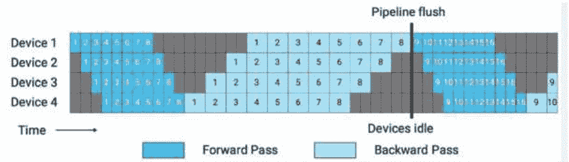

非交错调度可分为三阶段：第一阶段是热身，处理器执行不同数量的前向；第二阶段每个处理器执行一次前向后再执行一次反向；最后阶段完成剩余反向。该模式比 GPipe 更省内存，但完成一轮的耗时与 GPipe 相同。

交错调度要求 Micro-Batches 数量是流水线阶段数的整数倍。在该调度下，每个设备可计算多个层子集构成的模型块，而非连续层集合。举例来说，原先设备 1 拥有层 1~4，设备 2 拥有层 5~8，现在设备 1 拥有层 1、2、9、10，设备 2 拥有层 3、4、11、12，以此类推。每个设备被分配多个流水阶段，每个阶段计算量更小。此模式同时节省内存与时间。

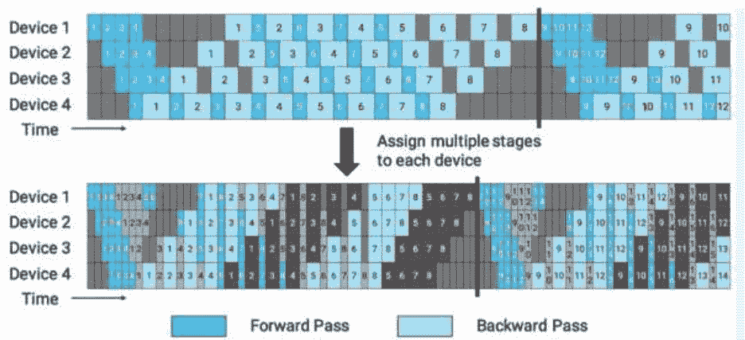

### (2) 使用Schedule

Colossal-AI 提供了非交错 Pipeline Schedule 和交错 Interleaved Pipeline Schedule。操作时需要在配置文件中设置 `NUM_MICRO_BATCHES`，使用交错调度时再设置 `NUM_CHUNKS`。若已知每个流水阶段输出张量形状且形状一致，可设置 `tensor_shape` 进一步减少通信；否则可忽略，形状会在阶段间自动交换。根据用户提供的配置可生成合适的 Schedule 以支持流水线并行训练。

首先用 Colossal PipelinableContext 方式构建 ResNet 模型。

```python
import os
from typing import Callable, List, Optional, Type, Union
import torch
import torch.nn as nn
import colossalai
import colossalai.nn as col_nn
```

```python
from colossalai.core import global_context as gpc
from colossalai.logging import disable_existing_loggers, get_dist_logger
from colossalai.trainer import Trainer, hooks
from colossalai.utils import MultiTimer, get_dataloader
from colossalai.context import ParallelMode
from colossalai.pipeline.pipelinable import PipelinableContext

from titans.dataloader.cifar10 import build_cifar
from torchvision.models import resnet50
from torchvision.models.resnet import BasicBlock, Bottleneck, conv1x1

# Define some config
BATCH_SIZE = 64
NUM_EPOCHS = 2
NUM_CHUNKS = 1
CONFIG = dict(NUM_MICRO_BATCHES=4, parallel=dict(pipeline=2))

# Train
disable_existing_loggers()
parser = colossalai.get_default_parser()
args = parser.parse_args()
colossalai.launch_from_torch(backend=args.backend, config=CONFIG)
logger = get_dist_logger()
pipelinable = PipelinableContext()

# build model
with pipelinable:
    model = resnet50()
```

给出切分顺序后模块会直接给出名称，部分函数需手动添加。

```python
exec_seq = [
    'conv1','bn1','relu','maxpool','layer1','layer2','layer3','layer4','avgpool',
    (lambda x: torch.flatten(x, 1), "behind"), 'fc'
]
pipelinable.to_layer_list(exec_seq)
```

将模型切分为流水线阶段。

```python
model = pipelinable.partition(NUM_CHUNKS, gpc.pipeline_parallel_size, gpc.get_local_rank(ParallelMode.PIPELINE))
```

这里使用 Trainer 训练 ResNet。

```python
# build criterion
criterion = nn.CrossEntropyLoss()

# optimizer
optimizer = torch.optim.Adam(model.parameters(), lr=1e-3)

# build dataloader
root = os.environ.get('DATA', './data')
train_dataloader, test_dataloader = build_cifar(BATCH_SIZE, root, padding=4, crop=32, resize=32)

lr_scheduler = col_nn.lr_scheduler.LinearWarmupLR(optimizer, NUM_EPOCHS, warmup_steps=1)
engine, train_dataloader, test_dataloader, lr_scheduler = colossalai.initialize(model, optimizer, criterion, train_dataloader, test_dataloader, lr_scheduler)
timer = MultiTimer()

trainer = Trainer(engine=engine, timer=timer, logger=logger)

hook_list = [
    hooks.LossHook(),
    hooks.AccuracyHook(col_nn.metric.Accuracy()),
    hooks.LogMetricByEpochHook(logger),
    hooks.LRSchedulerHook(lr_scheduler, by_epoch=True)
]

trainer.fit(train_dataloader=train_dataloader,
            epochs=NUM_EPOCHS,
            test_dataloader=test_dataloader,
            test_interval=1,
            hooks=hook_list,
            display_progress=True)
```

本例采用两段流水线推进，整体 Batch 被拆成 4 个微批次轮流处理。

## 3.2 进阶并行：冲破显存与效率天花板

在规模化深度学习里，张量并行与流水线并行是缓解模型权重、梯度与优化器状态带来的显存压力的常用手段。即便如此，非模型数据同样会成为卡点，尤其在 NLP 领域，Transformer 已是主流架构，而随着参数与序列的膨胀，激活值的占用也在同步攀升。

直觉上会想堆硬件，把每张卡都跑满。但显存利用率并不容易拉满。除了张量并行、流水线并行、模型并行和数据并行等基础方案，还有几类进阶并行用来对付内存瓶颈：序列并行、混合并行和自动并行。

- **序列并行**：面向超长序列。语言模型训练中 Transformer 的自注意力复杂度为 $O(n^2)$，$n$ 为序列长度，长文本会迅速吃掉显存。序列并行把长序列切成若干子段分发到不同设备上并行计算，每个设备只负责自己的子段，再通过跨设备通信完成全局同步，从而提升长文本训练效率。

- **混合并行**：将多种并行模式组合使用，以榨干硬件算力并加速训练。比如模型并行把模型拆分到多卡，每卡同时处理多样本；数据并行则复制模型到各卡，各自算梯度后同步。灵活搭配能更好地匹配超大模型与大规模数据集的需求。

- **自动并行**：借助自动化工具与框架，根据模型结构、硬件配置和任务需求自动挑选并行方案并完成计算分布、通信与同步，减轻人工调优负担，提供高效的分布式训练。

并行训练还需关注几个关键点。通信开销会拖慢整体速度，可通过优化通信模式、降低通信频次、选用高效协议来缓解。负载均衡也很关键，要让各设备任务量相近，避免闲置与速度失衡。容错性与可伸缩性同样重要，系统需能应对设备故障、动态增删节点，并在不同规模集群上保持扩展能力。

总体看，选对并行策略并兼顾通信、均衡、容错与扩展性，才能有效化解内存瓶颈与效率问题，推动大规模深度学习持续突破。

### 3.2.1 序列并行：长文本训练突破


序列并行正是为非模型数据带来的性能瓶颈而设计。它能打破 Transformer 训练在序列长度上的限制，把超长序列切块后分派到不同硬件，每个设备仅保留对应子段的注意力嵌入，从而大幅降低显存占用。配合线性空间复杂度的注意力机制，序列并行可支持近乎无限长的输入序列训练。并行原理汇总如图3-23所示。

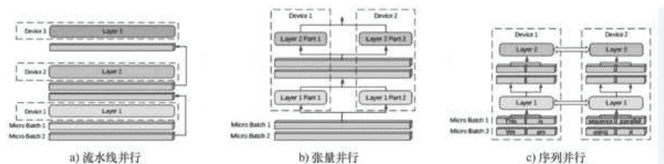

论文“Sequence Parallelism: Long Sequence Training from System Perspective” 提出针对大模型的环形自注意力 RSA。RSA 在分布式环境下计算注意力输出，解决了跨设备注意力分数计算的问题。其流程分为两步。

1. **计算注意力分数**
在 RSA 中，每个设备保存本地子段对应的 Query、Key、Value 嵌入。先要在设备间传输 Key 嵌入来算注意力分数，共需 $N-1$ 次通信，确保每个子段的 Query 能与全部 Key 相乘。具体上，设备先用本地 Query 与 Key 算部分分数，再从前一设备取新的 Key 嵌入继续计算，最终每个 Query 都收集到对应的注意力分数。

2. **计算自注意力层输出**
第二阶段基于注意力分数与 Value 嵌入求出自注意力输出。由于输出需要全部 Value，故需在设备间传输 Value 嵌入而非 Key 嵌入。对每个输出按公式计算 $S^n V$：

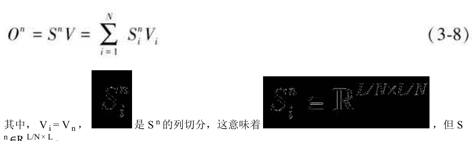

RSA 借助环形通信见图3-24 在设备间搬运 Key 与 Value 嵌入，使每个设备只需保存自身子段的注意力嵌入，显存效率显著提升，尤其适用于长输入。

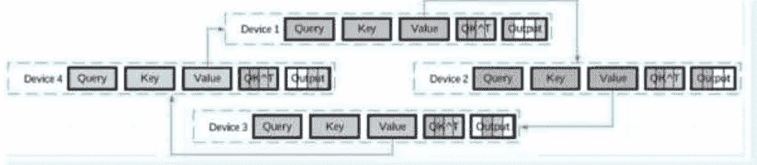

综合来看，序列并行是处理大模型中长序列激活值内存问题的有效手段，相较模型并行，能把输入序列的扩展极限推得更远，如图3-25所示。该技术的发展将让更大规模模型训练成为可能，支撑更复杂任务的解决。

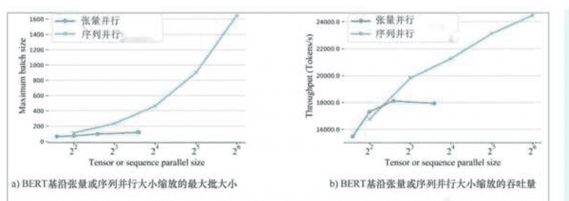

### 3.2.2 混合并行：直推千亿参数模型

数据并行、流水线并行、张量并行与序列并行单独使用时，对 GPT-3、PaLM 等超大模型仍存在显存与通信瓶颈：流水线并行产生大量 Bubble 浪费算力，张量并行通信开销大、跨节点效率低。将这些策略融合即为混合并行，可依据模型结构与硬件环境最大化训练效率。

把数据并行、流水线并行和张量并行组合起来常被称为 3D 并行，如图3-26所示。Colossal-AI、DeepSpeed、Megatron 等框架均支持 3D 并行，其中 Colossal-AI 还可进一步加入序列并行形成 4D 并行。混合并行兼顾不同负载，能支撑万亿参数级模型，同时保持显存与吞吐量的近乎线性扩展，并在带宽受限集群上更快训练数十亿参数模型。

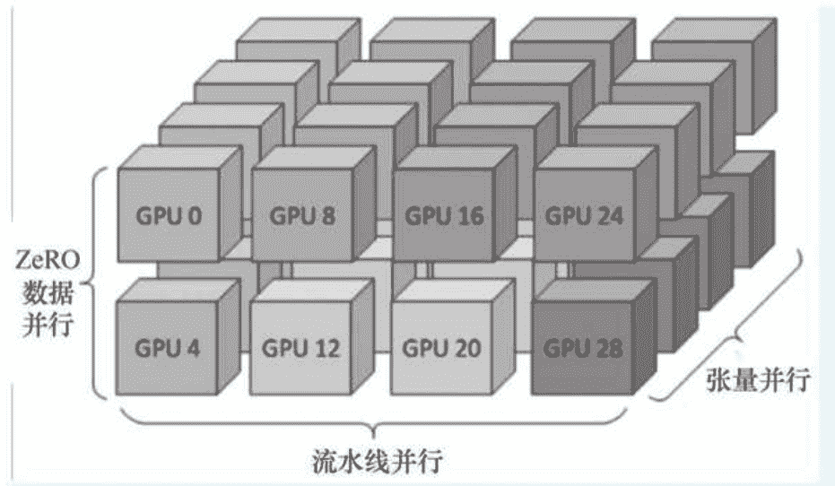

以 3D 并行为例，数据并行、模型并行与流水线并行在内存与计算效率上各司其职，三者协同实现高效训练。

模型各层被划分为流水线阶段，每个阶段内部可再用模型并行拆分。这种 2D 组合能同时压缩模型、优化器与激活值的内存占用，但拆分不能无限进行，否则通信开销会侵蚀计算效率。

为让工作节点数突破模型与流水线并行的限制而不损失效率，可引入 ZeRO 驱动的数据并行 ZeRO-DP。它通过拆分优化器状态进一步提升内存效率，并能在极低通信开销下线性扩展到任意多 GPU。

模型并行的通信开销最大，因此优先在节点内构建模型并行组以利用更高带宽。数据并行组若模型并行未跨越整节点，则置于节点内；否则置于节点间。流水线并行的通信量最小，可在节点间调度阶段，不受带宽限制。

此外，通过通信并行性提升带宽，每个数据并行组内经流水线与模型并行线性缩小梯度，使纯数据并行的总通信量下降。每个数据并行组在局部化节点间独立通信，有效带宽因通信量减少与局部性、并行度提升而放大。

混合并行相比单一数据并行提供了多维选择空间。当前主流框架多采用手动切分实现模型并行，门槛高、依赖专家。主要难点包括：

1. 混合并行需要精细的任务划分与调度，确保资源充分利用与子任务协同，同时处理数据通信与同步，保证一致性与正确性。
2. 模型切分难度大，不同切分维度引入不同通信量与性能，优选策略需丰富经验，且要兼顾内存上限、子模型可运行性与计算均衡，避免负载倾斜。
3）需理解底层网络拓扑与节点内外互联方式，把通信量大的子模型间交互放在节点内、量小的放在节点间，提高网络利用率。
4）在工程实现上，手动混合并行需大量设备绑定与通信代码，并行逻辑与算法逻辑耦合，加重算法工程师负担。

## 3.2.3 自动并行：让分布式训练自驱运行


为特定模型与硬件拓扑手工设计并行策略对工程师要求极高，需要同时精通框架、算法与拓扑。模型或硬件一变，策略往往要重做；手工方案多为经验性次优。于是自动完成大规模模型并行策略的设计成为提升效率、降低成本的关键，让研究者专注模型创新而非底层分布式细节。

### 1. 问题定义

如何数学上抽象自动并行问题？

常见机器学习系统把训练与推理抽象为有向无环图 DAG，即计算图，由张量与算子构成。设计算图 $G = (V, E)$，节点 $v_i \in V$ 代表操作符如 Matmul、Softmax，或张量如输入、输出、中间状态、参数权重、梯度、优化器状态。有向边 $e_{ij} (v_i, v_j) \in E$ 描述计算依赖。模型训练的数学抽象如图3-27所示。


图3-27 模型训练的数学抽象

硬件设备的数学抽象如何定义？

设备拓扑可建模为无向图 $D = (V_D, E_D)$，节点 $d_i \in V_D$ 为 CPU、GPU 等硬件，边 $b_{ij} (d_i, d_j) \in E_D$ 表示带宽与连接方式如 PCIe、NVLink、InfiniBand。硬件设备的数学抽象如图3-28所示。

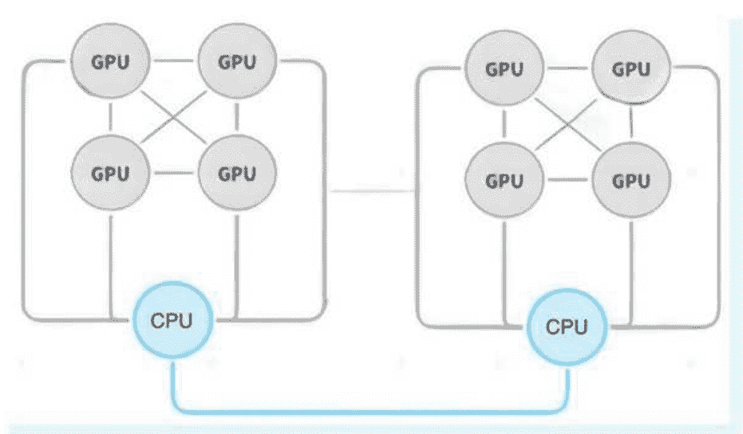

图3-28 硬件设备的数学抽象

在此基础上，自动并行算法 $A$ 可定义为 $S = A (G, D)$，解 $S$ 包含 $G$ 中节点 $v_i$ 的分区集合 $P$、各设备 $d_i \in D$ 的子图集合 $G_d$ 以及流水线并行规划策略。

### 2. 自动并行策略分类

搜索策略是自动并行的核心。现有方法大致分为基于经典算法与基于机器学习两类。经典算法包括递归、动态规划、整数线性规划、广度优先搜索等；机器学习方法包括蒙特卡洛马尔可夫链 MCMC、蒙特卡洛树搜索 MCTS、强化学习等。

搜索空间不同，考虑的并行模式也不同，常见模式有数据并行 DP、张量并行 TP、流水线并行 PP、序列并行 SP、MoE 并行、激活检查点等，选择哪些作为搜索空间是设计自动并行搜索算法的关键。

主流方案中，仅对 PP+DP 搜索的如 PipeDream、DAPPLE、Chimera、WPipe；DP+TP 如 Flexflow、AutoMap；PP+TP+DP 如 Alpa、TPDist；进一步加入激活检查点的 PP+TP+DP+Activation Checkpoint 如 Colossal-Auto。下面介绍 Chimera、Alpa、Colossal-Auto 三个典型案例。

#### (1) Chimera

最简单情形是数据并行加流水线并行，此时降低流水线 Bubble 很关键。SC2021 论文“Chimera: Efficiently Training Large-Scale Neural Networks with Bidirectional Pipelines” 提出双向流水线高效训练大规模模型。Chimera 使用暴力性能模型确定并行策略，采用同步方式避免精度损失，相比最新同步流水线方法，Bubble 减少最多 50%，且双向流水线细粒度调度使激活内存更均衡。Chimera 原理如图3-29所示。

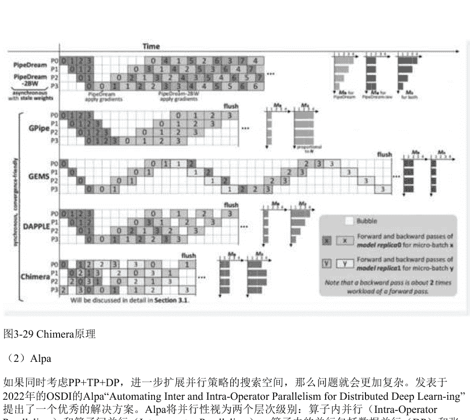

图3-29 Chimera原理

#### (2) Alpa

把数据并行、张量并行和流水线并行一起纳入搜索范围，并行组合的可能性会成倍放大。2022 年 OSDI 发表的 Alpa ——Automating Inter and Intra-Operator Parallelism for Distributed Deep Learning——给出了一个很有代表性的答案。Alpa 把并行拆成两层视角来看：算子内部的并行和算子之间的并行。算子内部主要指数据并行 DP 与张量并行 TP，TP 也常被称作层内模型并行、行并行、列并行，以及二维、三维张量并行；算子之间则涵盖层间模型并行和流水线并行 PP。在此基础上 Alpa 建立了一个新的多层搜索空间，用来枚举海量的模型并行执行方案，并设计了一套编译流程，在不同并行粒度上自动推导出高效的执行计划，同时配套了一个运行时系统负责在分布式设备上协同两级并行。求解时，算子间的并行规划借助整数线性规划 ILP 完成，算子外的并行规划则采用动态规划算法。Alpa 原理如图3-30所示。

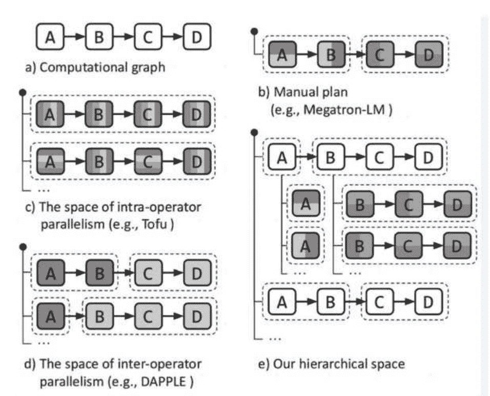

图3-30 Alpa原理

#### (3) Colossal-Auto

前面提到的方案大多聚焦模型本身的并行维度，但训练时激活值的显存消耗同样会成为瓶颈。激活检查点 Activation Checkpoint 通过用计算换内存的方式降低单卡峰值显存：在把激活检查点应用到若干连续层时，只保留最后一层的前向输出用于反向，其余中间结果前向不保存，反向时再重新计算并临时取出做梯度，从而大幅削减中间激活的内存占用，腾出空间装载更大模型。激活检查点不做张量分片，和其他并行技术是正交关系，可以叠加使用。

Colossal-Auto 是首个基于 PyTorch 静态图分析的自动并行系统，也是最早把并行策略与激活检查点联合优化的方案。它采用两阶段求解器，分别处理算子内并行 Intro-Op 与检查点 Ckpt 的规划。Intro-Op 沿用了 Alpa 的整数线性规划思路，Ckpt 求解器接收分布式计算图，并在图中搜索最合适的子图来放置激活检查点。

在满足显存预算的前提下，Colossal-Auto 以最小化运行时间uning 为目标，为每个算子搜索策略，最终得到真实训练可用的方案，囊括每个张量的分片方式、节点间需要插入的通信算子类型、是否进行算子替换等。现有的张量并行、数据并行，以及 Megatron-LM 中使用的列切分、行切分等混合并行，都只是该自动搜索空间的子集。Colossal-AI 甚至能为每个算子定制独特的并行方式，有望超越依赖专家经验和反复试错的手工切分。Colossal-Auto 原理如图3-31所示。

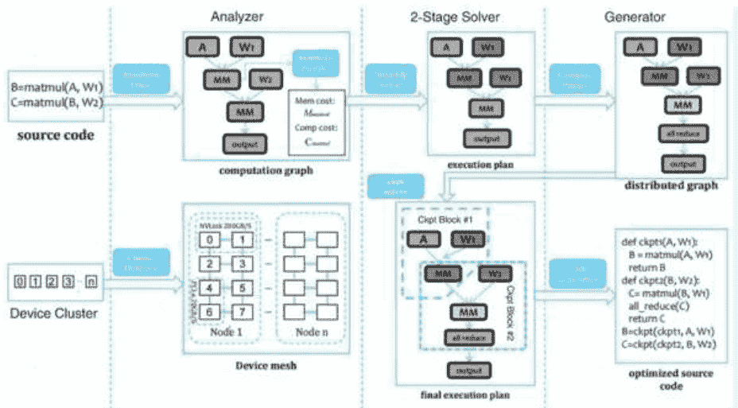

图3-31 Colossal-Auto原理

### 3. 自动并行展望和挑战

当前自动并行仍面临多项难点。首先是并行方案的选择。理解训练任务如何被切分及并行执行是关键，这需要掌握数据并行、张量并行、流水线并行等不同编程模型的工作原理、优缺点与适用场景。

其次是不同方案之间的权衡。各类并行在不同任务上的表现差异很大，如何在性能、复杂度与开销之间找到平衡点，是一个核心难题，任务特性、系统架构与资源可用性都会影响决策。

再者是异构设备的负载均衡。CPU、GPU、FPGA 等异构计算环境下，如何把工作均匀分配以提升利用率，需要精细的调度策略并充分考虑各设备的特性与能力。

网络通信优化也不可忽视。分布式训练中节点间频繁交换数据，通信模式与数据依赖直接影响效率，必须依据设备拓扑、节点数量、连通性与带宽等进行针对性优化，以降低通信耗时、提高算通比。

最后是策略搜索的成本控制。穷举所有并行策略的性能分析耗时不可接受，多数方法借助成本模型估算性能再挑选耗时更少的方案，挑战在于如何在模型准确性与决策耗时之间取得平衡。

## 3.3 实战分布式训练

实战化的分布式训练是用多机多卡实现并行计算来加速大模型训练。本节聚焦两种常见做法：模型并行训练与混合并行训练。

模型并行把模型参数拆分到多个设备上计算，适用于单卡装不下的超大模型。各设备各自负责一部分参数，并在训练中通信同步以更新全局参数。实战步骤通常包括：1) 模型划分，把参数切分并分配到各设备；2) 训练数据划分，让每台设备拿到自己的数据；3) 参数通信与同步，完成更新与梯度传输。

混合并行同时对模型参数和训练数据进行切分，结合了模型并行与数据并行的思想，在大模型与大数据场景下提升效率。每台设备既处理部分参数，也处理部分数据。实战流程为：1) 模型与数据划分；2) 参数与数据的通信，实现更新与梯度传输；3) 计算协同，保证参数与数据的一致性与正确性。

通过这两种方式，可以把训练任务分摊到多机多卡上并行执行。落地时要注意充足的算力与高速网络，选择适配的分布式训练框架，进行环境配置、数据划分、通信管理与性能调优，合理挑选并行策略并优化通信与传输效率，才能充分发挥集群算力，加快训练速度。

### 3.3.1 应用模型并行策略的实际案例

要在 8 张 GPU 上实现张量并行，需要先给出如下并行配置。

```python
CONFIG = dict(parallel=dict(
    data=1,
    pipeline=1,
    tensor=dict(size=8, mode='3d'),
))
```

随后 Colossal-AI 会自动将该设置应用到所有来自 colossalai.nn 的层，例如 3D 张量并行。这里可以先定义一个由两层 MLP 组成的简单模型。

```python
import colossalai
import colossalai.nn as col_nn
import torch
from colossalai.utils import print_rank_0

class MLP(torch.nn.Module):
    def __init__(self, dim: int = 256):
        super().__init__()
        intermediate_dim = dim * 4
        self.dense_1 = col_nn.Linear(dim, intermediate_dim)
        print_rank_0(f'Weight of the first linear layer: {self.dense_1.weight.shape}')
        self.activation = torch.nn.GELU()
        self.dense_2 = col_nn.Linear(intermediate_dim, dim)
        print_rank_0(f'Weight of the second linear layer: {self.dense_2.weight.shape}')
        self.dropout = col_nn.Dropout(0.1)

    def forward(self, x):
        x = self.dense_1(x)
        print_rank_0(f'Output of the first linear layer: {x.shape}')
        x = self.activation(x)
        x = self.dense_2(x)
        print_rank_0(f'Output of the second linear layer: {x.shape}')
        x = self.dropout(x)
        return x
```

在 8 卡环境下启动 Colossal-AI 并实例化模型。

```python
parser = colossalai.get_default_parser()
colossalai.launch(config=CONFIG,
                   rank=args.rank,
                   world_size=args.world_size,
                   local_rank=args.local_rank,
                   host=args.host,
                   port=args.port)

m = MLP()
```

此时可以看到 MLP 中被切分的参数例如权重的形状变化。

```text
Weight of the first linear layer: torch.Size([128, 256])
Weight of the second linear layer: torch.Size([512, 64])
```

第一层线性层的完整权重本应是 [256, 1024]，经 3D 并行切分后在每张卡上变为 [128, 256]；第二层权重 [1024, 256] 则被切分为 [512, 64]。

接下来用随机输入跑一次模型。

```python
from colossalai.context import ParallelMode
from colossalai.core import global_context as gpc
from colossalai.utils import get_current_device

x = torch.randn((16, 256), device=get_current_device())
# partition input
torch.distributed.broadcast(x, src=0)
x = torch.chunk(x, 2, dim=0)[gpc.get_local_rank(ParallelMode.PARALLEL_3D_WEIGHT)]
x = torch.chunk(x, 2, dim=0)[gpc.get_local_rank(ParallelMode.PARALLEL_3D_INPUT)]
x = torch.chunk(x, 2, dim=-1)[gpc.get_local_rank(ParallelMode.PARALLEL_3D_OUTPUT)]
print_rank_0(f'Input: {x.shape}')

x = m(x)
```

即可观察到激活结果的形状变化。

```text
Input: torch.Size([4, 128])
Output of the first linear layer: torch.Size([4, 512])
Output of the second linear layer: torch.Size([4, 128])
```

### 3.3.2 结合多种并行策略的训练实践


张量并行把每个权重参数在多设备间分区，以减轻显存压力。Colossal-AI 支持 1D、2D、2.5D、3D 张量并行，也能把张量并行、流水线并行与数据并行组合成混合并行。配置方式很简洁，修改配置文件中几行即可启用流水线并行。

#### （1）构造配置文件（/hybrid_parallel/configs/vit_1d_tp2_pp2.py）

使用张量并行只需在 parallel 字典中补充相关信息。TENSOR_PARALLEL_MODE 可选 1D、2D、2.5D、3D。并行度需满足：GPU 总数 = 流水线并行度 × 张量并行度 × 数据并行度。指定 GPU 数量、流水线并行度与张量并行度后，数据并行度会自动推导。

from colossalai.amp import AMP_TYPE

# parallel setting

TENSOR_PARALLEL_SIZE = 2

TENSOR_PARALLEL_MODE = '1d'

parallel = dict(

    pipeline=2,

    tensor=dict(mode=TENSOR_PARALLEL_MODE, size=TENSOR_PARALLEL_SIZE)

)

fp16 = dict(mode=AMP_TYPE.NAIVE)

clip_grad_norm = 1.0

# pipeline config

NUM_MICRO_BATCHES = parallel['pipeline']

TENSOR_SHAPE = (BATCH_SIZE // NUM_MICRO_BATCHES, SEQ_LENGTH, HIDDEN_SIZE)

其他配置如下。

# hyperparameters

# BATCH_SIZE is as per GPU

# global batch size = BATCH_SIZE x data parallel size

BATCH_SIZE = 256

LEARNING_RATE = 3e-3

WEIGHT_DECAY = 0.3

NUM_EPOCHS = 300

WARMUP_EPOCHS = 32

# model config

IMG_SIZE = 224

PATCH_SIZE = 16

HIDDEN_SIZE = 768

DEPTH = 12

NUM_HEADS = 12

MLP_RATIO = 4

NUM_CLASSES = 10

CHECKPOINT = True

SEQ_LENGTH = (IMG_SIZE // PATCH_SIZE) ** 2 + 1  # add 1 for cls token

## （2）开始训练

具体训练代码如下。

```bash
export DATA=<path_to_dataset>
# If your torch >= 1.10.0
torchrun --standalone --nproc_per_node <NUM_GPUs>  train_hybrid.py --config ./configs/config_hybrid_parallel.py
# If your torch >= 1.9.0
# python -m torch.distributed.run --standalone --nproc_per_node = <NUM_GPUs> train_hybrid.py --config ./configs/config_hybrid_parallel.py
```

# 第4章
Transformer：大模型时代的基石

Transformer 及其变体为大模型研究与工程实践提供了通用底座，并在复杂序列任务中持续发挥关键作用。本章先回顾自然语言处理的基础，再深入 Transformer 的技术原理。首先介绍自然语言任务与序列到序列模型，随后梳理 Transformer 提出的背景动机与论文 Attention is All You Need 的核心贡献，分析编码器解码器结构、自注意力、正则化与位置编码的工作方式，最后讨论训练流程。

# 4.1 自然语言处理基础

在进入 Transformer 之前，了解其诞生所面向的自然语言处理领域以及序列到序列模型的概念，对初学者尤为重要。

# 4.1.1 自然语言任务介绍

自然语言处理任务是指利用计算机对自然语言文本进行理解、分析与处理的一系列工作，涵盖从文本中抽取信息、理解语义、生成文本以及与人类语言交互等多个层面。

自然语言处理的探索最早可上溯至 20 世纪 50 年代，而真正的大规模腾飞则发生在近几十年。起步阶段的研究几乎全靠手工规则，专家一条条写下语言规律来驱动系统。可随着实证的积累，这种做法的瓶颈变得很明显：人类的语言既复杂又充满变化，靠人手穷举规则既费力又难以覆盖。

进入机器学习和深度学习时代后，范式发生了根本转变。模型不再依赖人工编写的条文，而是靠海量语料自学语言的统计规律与分布模式。递归神经网络、卷积神经网络以及后来的 Transformer 等架构，为这一轮跃进提供了关键算力，也让 NLP 的效果进入了新区间。

在具体应用层面，NLP 可以拆解为众多细分任务，例如文本分类、命名实体识别、机器翻译、情感分析等。几个代表性方向如下。

1) 机器翻译 Machine Translation：将一种语言的文本自动转写为另一种语言，核心目标是实现高质量且自然的跨语言沟通。目前主流路径有两条。

- 统计机器翻译 Statistical Machine Translation, SMT：依托大规模双语平行语料，通过概率模型学习源语与目标语的对应关系。典型实现包括基于短语的模型和基于句法的模型。
- 神经机器翻译 Neural Machine Translation, NMT：借助循环神经网络 Recurrent Neural Networks, RNN 和 Transformer 等神经网络，直接把源句映射到目标句。NMT 在流畅度与译文质量上实现了明显提升。

现阶段机器翻译仍面临语言歧义、长距离依赖、词汇与结构差异等挑战。

2) 文本摘要 Summarization：从长文本中提炼关键信息并生成简洁概括。常见的实现方式分为两类。

- 抽取式摘要 Extractive Summarization：从原文中挑选最重要的句子或短语拼接而成，不创造新句，做法相对直接。
- 生成式摘要 Abstractive Summarization：利用自然语言生成能力，在理解语义和上下文的基础上重写摘要，更贴近人类的归纳方式，但对理解与生成一致性的要求更高。

摘要任务的核心在于准确把握原文主旨，并保证输出语义正确且通顺。

3) 多轮对话 Multi-turn Dialogue：需要处理连续多轮交互，维持上下文并实现更复杂的对话行为。目标是理解并生成符合自然的对话，同时给出准确连贯的回应。该类系统必须解决几个关键问题。

- 上下文理解：准确捕捉历史回合中的语义与关键信息。
- 对话状态跟踪：实时追踪对话目标与信息变化，为回应提供依据。
- 回应生成：在上下文与状态约束下产出合适连贯的回复。

整体挑战集中在上下文理解、一致性保持、生成准确性以及用户体验上。

# 4.1.2 语言输入的预处理

把自然语言文本送入模型之前，通常要先做预处理，核心是清洗噪声和进行分词。

# 1. 文本清洗

文本清洗 Text Cleaning 是 NLP 预处理的重要环节，目的是剔除噪声、无效字符和无用信息。常见做法包括。

# (1) 去除特殊字符和标点符号

- 清理文本中的特殊字符、非字母数字符号和无效标记，可用正则表达式或字符串操作实现，例如匹配并删除 [^a-zA-Z0-9]。
- 标点符号的处理视任务而定，某些场景需要保留其语义作用，某些场景则视为噪声去除。

# (2) 处理HTML标签和特殊符号

- 对网页或 HTML 文档抽取的文本，需要剥离标签。常用工具如 BeautifulSoup 可解析并移除标签。
- 处理 Unicode 字符、Emoji 或特殊表情符号，可通过编码范围或字符映射表进行过滤或替换。

# (3) 清除无意义的文本

数据中常混入广告语、模板重复文本等无关片段，可通过文本匹配、规则过滤或机器学习方法识别并剔除。

清洗的具体策略取决于任务与数据特性，经过清洗后得到的文本更加干净一致，有助于后续分析、建模与分类的准确性。

# 2. 分词

分词 Tokenization 或词元化是将连续文本切分为词元 Token 的基础操作。注：这里的“词”并非严格等于语言学词汇，不同方法会产生不同粒度的划分，例如 playing 在某些方案中视为一个词元，在另一些方案中会被拆为 play 和 ing。合理的切分对语义解析与句法分析至关重要。

在 Transformer 体系中，主流的分词方式是基于子词 Subword 的方法，它能把罕见或复杂词汇拆成更小的可学习单元，提升泛化能力。常见实现有。

# (1) Byte Pair Encoding (BPE)

BPE 是一种统计型分词算法，训练时迭代合并出现频率最高的子词对来构建词表；推理时将词汇逐步切分为词表中的子词单元。它能有效应对未登录词和稀有词，且无需预设词表上限。按基本单位可分为字符级和字节级。字符级 BPE 被 LLaMA 系列、OPT 系列等采用；OpenAI 的字节级 BPE 则使用 tiktoken 分词器，为 GPT 系列服务。

# (2) Unigram Language Model (ULM)

ULM 属于语言模型驱动的分词方法，通过学习文本中各词元的概率分布来决定切分位置。利用贪婪搜索或动态规划实现切分，能兼顾上下文信息，提升切分准确率。

# (3) SentencePiece: 常见分词算法的开源软件库

SentencePiece 是谷歌于 2018 年开源的通用分词工具箱，支持 BPE、Unigram 和 WordPiece 等算法，并提供训练与 API 接口，便于在 Transformer 模型中直接使用。

这些子词方法可以根据任务需求灵活选择，有助于解决复杂词汇与未登录词问题，提升模型在 NLP 任务上的表现与泛化能力。

# 4.1.3 序列到序列模型

序列到序列 Seq2Seq 模型是一种专为输入输出皆为序列的任务设计的神经网络结构，如机器翻译、语音识别。典型架构由编码器和解码器组成：编码器把输入序列压缩为上下文向量，解码器再将其解码为输出序列。

Transformer 出现之前，NLP 领域常用的是以下两种结构。

# (1) 递归神经网络(Recurrent Neural Network, RNN)

RNN 专门处理序列数据，相较于传统前馈网络具备记忆能力，能利用先前信息影响当前计算，因而在 NLP、语音识别和时序分析中表现突出。

RNN 的核心是一个循环单元，将序列逐元素输入，并结合前一时刻的隐藏状态产生新的隐藏状态与输出。隐藏状态可视为对历史信息的压缩。优点是能处理任意长度序列并保留时序依赖，缺点是传统 RNN 容易出现梯度消失与梯度爆炸，难以捕捉长程依赖。

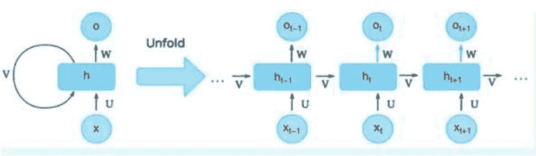

图4-1 RNN模型结构

# (2) 长短期记忆网络(Long Short-Term Memory, LSTM)

LSTM 是 RNN 的改进变体，专为建模长序列设计。它引入门控机制来调控信息流动，从而更好地处理长期依赖。

LSTM 包含记忆单元和输入门、遗忘门、输出门三个门控单元，如图4-2所示。通过选择性存储与遗忘信息，LSTM 在一定程度上缓解了长依赖问题。

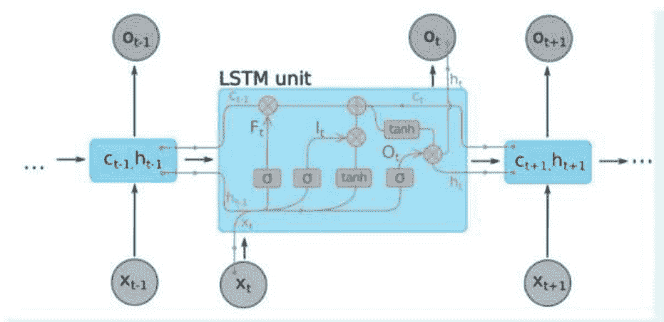

图4-2 LSTM单元结构

Transformer 的提出正是为了解决传统神经网络在复杂序列任务上的局限，尤其是长距离依赖与并行效率问题。过去 RNN 与 LSTM 虽占据主流，但受限于串行处理，训练速度与规模受限；即便引入门控，对超长序列的建模效果仍不理想。

2017 年，谷歌团队在论文《Attention is All You Need》中提出 Transformer。模型完全摒弃循环与卷积，核心依赖注意力机制来捕捉序列中远距离元素间的关联。该论文首次系统引入了自注意力 Self-Attention 与多头注意力 Multi-Head Attention，使模型在处理每个位置时都能全局参考整段输入。位置编码 Positional Encoding 的加入则补偿了模型本身对顺序的无感知问题。实验显示 Transformer 在机器翻译等任务上显著超越以往模型。

Transformer 的成功催生了后续的一系列大模型，如 GPT、T5、PaLM 等，逐步成为 NLP 首选架构，并在语音与计算机视觉等领域得到广泛应用。

# 4.2 Transformer 详解

本节深入剖析 Transformer。首先介绍整体结构与编解码器的工作方式，帮助建立对架构的全局认知；随后聚焦注意力机制，尤其是自注意力的原理与优势，说明其如何提升序列建模能力；之后讲解归一化层在训练稳定与效率上的作用；最后给出训练实践建议，包括损失函数、优化器与策略，以及常见问题的应对技巧。通过这些内容，读者既能理解原理，也能获得落地训练与调优的经验。

# 4.2.1 Transformer 模型结构

Transformer 的核心由编码器 Encoder 与解码器 Decoder 构成，如图4-3所示。编码器负责处理输入，解码器负责生成输出。

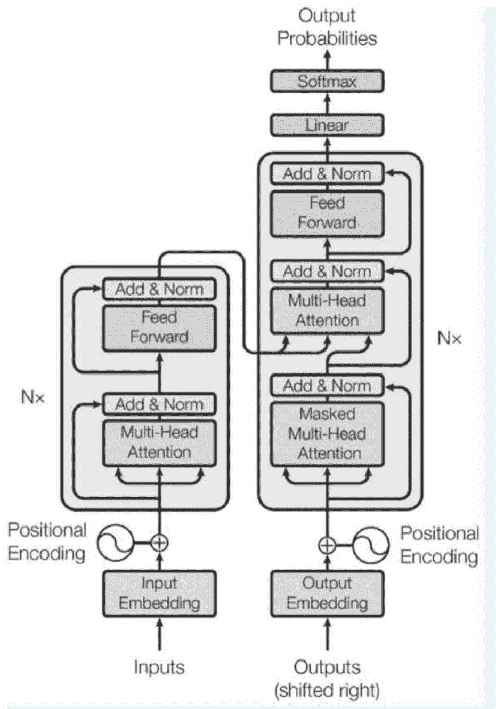

图4-3 Transformer模型结构图(出自论文“Attention is All You Need”)

编码器由 N 个相同层堆叠，原始模型中 N=6。每层包含两个子层：多头自注意力 Multi-Head Self-Attention 与前馈神经网络 Feed-Forward，两者都配有残差连接与层归一化 Layer Normalization。

解码器同样由 N 个相同层堆叠，每层包含三个子层：两个多头自注意力与一个前馈网络，均带残差连接与层归一化。第一个自注意力子层处理目标序列本身；第二个自注意力子层将解码器输入与编码器输出关联，其查询来自前一子层输出，键值来自编码器输出。顶部的全连接层将解码器输出映射为最终预测。

# 4.2.2 注意力与自注意力机制

注意力机制允许网络在生成每一步输出时，对输入的不同部分赋予不同权重。在序列任务中，它能有效缓解长距离依赖问题。

简单注意力先为输入各元素计算权重，权重反映其对当前输出的重要性，通常基于查询 Query 与元素的相似度计算。随后用归一化后的权重对输入做加权平均得到输出。

为此引入三个变量 q、k、v，即查询 Query、键 Key、值 Value，用于度量相关性并聚合信息。

- 查询 Query，Q：表示当前需要比较的目标，通常由隐藏状态或编码器输出给出。
- 键 Key，K：作为参考向量，与查询同维，用于捕捉输入的相关信息。
- 值 Value，V：与键关联的向量，经注意力加权后参与最终表示的合成。

计算流程可概括为。

1）打分 Score：衡量查询与键的相似度，常用点积或加性函数。

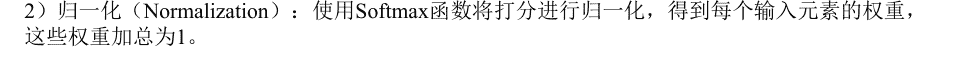

2）归一化 Normalization：用 Softmax 将打分归一化为权重。

$$Softmax(Score) = \frac{e^{Score}}{\sum e^{Score}}$$

3）加权求和 Weighted Sum：将权重作用于值并求和。

$$Attention(Q, K, V) = \sum (Softmax(Score) \cdot V)$$

通过上述组合，注意力机制赋予模型更灵活的交互与关注分配能力，已在 NLP 与计算机视觉中广泛应用。Transformer 使用的是注意力的一种变体：自注意力机制。

自注意力让模型在生成每个位置输出时，都能参考输入序列的全部位置信息。对每个位置生成查询、键、值，用查询与所有键计算相关性，再以相关性对所有值加权求和得到该位置的表示。假设输入为 $x_1, x_2, x_3 \dots x_n$，对每个位置 $i$ 先通过线性变换得到 $Q_i、K_i、V_i$：

$$Q_i = W_q * x_i, K_i = W_k * x_i, V_i = W_v * x_i$$

查询投影 $W_q$、键投影 $W_k$ 与值投影 $W_v$ 均为模型需要学习的参数。

对第 $i$ 个位置的查询向量 $Q_i$，要与序列中所有位置的键向量 $K_j$ 做配对打分，计算方式是两者的点积再除以 $\sqrt{d_k}$ 来抑制数值过大：

$$Score_{i,j} = \frac{Q_i \cdot K_j}{\sqrt{d_k}}$$

这里 $d_k$ 代表查询和键的向量维度。

得到原始分数后，用 Softmax 把它们归一化为概率权重：

$$Weight_{i,j} = Softmax(Score_{i,j})$$

最后以这些概率对各位置的值向量做加权求和，作为该位置的注意力输出：

$$Output_i = \sum_j (Weight_{i,j} * V_j)$$

在自注意力之上，Transformer 引入了多头注意力机制。其核心思路是并行运行多组自注意力，每组使用独立的 $Q/K/V$ 投影，从不同子空间捕捉信息，再把结果合并、线性映射回统一维度。

优势在于模型可以同时关注多种表征角度，丰富序列信息的表达。

具体而言，设头数为 $h$，则对应 $h$ 组投影矩阵 $Wq_i$、$Wk_i$、$Wv_i$，$i=1,2,\dots,h$。每个头先单独完成自注意力计算，随后把 $h$ 个头的结果拼接，再经线性变换 $W_o$ 得到最终输出：

$$Output = Concat(head_1, \dots, head_h)W_o$$

其中 $[;]$ 表示拼接，$Q_i$、$K_i$、$V_i$ 分别为第 $i$ 个头的查询、键、值：

$$Q_i = Wq_i * x$$

$$K_i = Wk_i * x$$

$$V_i = Wv_i * x$$

下面给出一个简化的 PyTorch 实现思路。

```python
class MultiHeadSelfAttention(nn.Module):
    def __init__(self, dim_in, num_heads):
        super().__init__()
        self.num_heads = num_heads
        self.dim_k = dim_in // num_heads
        self.dim_v = dim_in // num_heads

        self.q = nn.Linear(dim_in, dim_in)
        self.k = nn.Linear(dim_in, dim_in)
        self.v = nn.Linear(dim_in, dim_in)

        self.linear = nn.Linear(dim_in, dim_in)

    def forward(self, x):
        batch_size, seq_length, _ = x.size()

        q = self.q(x).view(batch_size, seq_length, self.num_heads, self.dim_k).transpose(1, 2)
        k = self.k(x).view(batch_size, seq_length, self.num_heads, self.dim_k).transpose(1, 2)
        v = self.v(x).view(batch_size, seq_length, self.num_heads, self.dim_v).transpose(1, 2)

        attention_weights = torch.softmax(q @ k.transpose(-2, -1) / self.dim_k**0.5, dim=-1)
        out = attention_weights @ v
        out = out.transpose(1, 2).contiguous().view(batch_size, seq_length, -1)

        return self.linear(out)
```

实现流程先对输入做三次线性变换得到 $q/k/v$，再切分为多头维度计算注意力权重，将权重作用到 $v$ 上，随后拼接各头并做一次线性投影还原维度。至此，自注意力和多头注意力的原理与实现已清晰。

## 4.2.3 LayerNorm 让训练更稳
Transformer 里广泛使用层归一化 Layer Normalization，用以稳定训练并加快收敛。其做法是对每个样本的特征向量做归一化，使均值趋近 0、方差趋近 1。具体形式为：

$$LN(x) = \gamma * (x - mean(x)) / \sqrt{var(x) + \epsilon} + \beta \quad (4-9)$$

$mean(x)$ 与 $var(x)$ 分别是向量的均值和方差，$\epsilon$ 防止除零，$\gamma$、$\beta$ 为可学习缩放与偏移。

在 Transformer 结构中，自注意力子层和前馈子层之后都会接一层归一化，避免内部计算导致激活分布剧烈漂移，同时具备一定正则化效果，降低过拟合风险。

Layer Normalization 在不同变体中的位置并不唯一。常见的有 Post-LN 与 Pre-LN 两种，均源于归一化与残差连接的先后顺序差异，如图4-4所示。Post-LN 采用 Add&Norm，先做残差相加再归一化；Pre-LN 则先归一化再做子层计算。

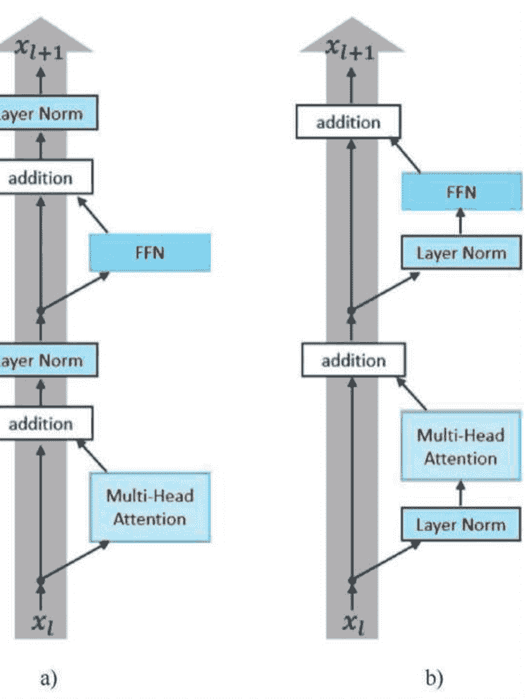

图4-4 Post-LN与Pre-LN对比

两种方式的伪代码对照如下。

| Post-LN Transformer | Pre-LN Transformer |

| :--- | :--- |

| $x_{l,i}^{post,1} = \text{MultiHeadAtt}(x_{l,i}^{post}, [x_{l,1}^{post}, \cdots, x_{l,n}^{post}])$ | $x_{l,i}^{pre,1} = \text{LayerNorm}(x_{l,i}^{pre})$ |

| $x_{l,i}^{post,2} = x_{l,i}^{post} + x_{l,i}^{post,1}$ | $x_{l,i}^{pre,2} = \text{MultiHeadAtt}(x_{l,i}^{pre,1}, [x_{l,1}^{pre,1}, \cdots, x_{l,n}^{pre,1}])$ |

| $x_{l,i}^{post,3} = \text{LayerNorm}(x_{l,i}^{post,2})$ | $x_{l,i}^{pre,3} = x_{l,i}^{pre} + x_{l,i}^{pre,2}$ |

| $x_{l,i}^{post,4} = \text{ReLU}(x_{l,i}^{post,3}W^{1,l} + b^{1,l})W^{2,l} + b^{2,l}$ | $x_{l,i}^{pre,4} = \text{LayerNorm}(x_{l,i}^{pre,3})$ |

| $x_{l,i}^{post,5} = x_{l,i}^{post,3} + x_{l,i}^{post,4}$ | $x_{l,i}^{pre,5} = \text{ReLU}(x_{l,i}^{pre,4}W^{1,l} + b^{1,l})W^{2,l} + b^{2,l}$ |

| $x_{l+1,i}^{post} = \text{LayerNorm}(x_{l,i}^{post,5})$ | $x_{l+1,i}^{pre} = x_{l,i}^{pre,5} + x_{l,i}^{pre,3}$ |

| | Final LayerNorm: $x_{Final,i}^{pre} \leftarrow \text{LayerNorm}(x_{L+1,i}^{pre})$ |

图4-5 Post-LN和Pre-LN伪代码

论文《On Layer Normalization in the Transformer Architecture》对比发现，Post-LN 对 Warm-Up 步数和学习率极其敏感，而 Pre-LN 能让梯度分布更平稳，降低超参数依赖，加速收敛。

另一篇《Understanding the Difficulty of Training Transformers》则指出，Post-LN 在充分训练后往往下游迁移和微调效果更好。综合来看，Pre-LN 更利于训练稳定，Post-LN 在足够训练后潜力更大。当前大模型因参数和数据规模巨大，对预训练稳定性要求极高，因此多采用 Pre-LN。

2022 年论文《DeepNet: Scaling Transformers to 1000 Layers》提出 DeepNorm，可把千层 Transformer 稳定训练，其伪代码见图4-6。

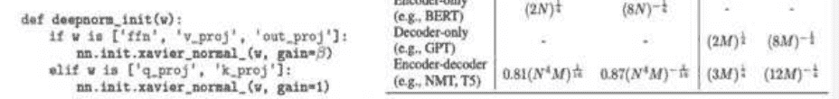

图4-6 DeepNorm伪代码

DeepNorm 与 Post-LN 位置相同，均在残差之后，但归一化前会对残差项乘以与层数相关的系数：

$$x_{l+1} = \text{LayerNorm}(x * \alpha + f(x)) \quad (4-10)$$

$\alpha$ 为依赖模型结构的超参。

实验显示，采用 DeepNorm 的 DeepNet 在训练更新上远比传统 Post-LN 稳定，如图4-7。

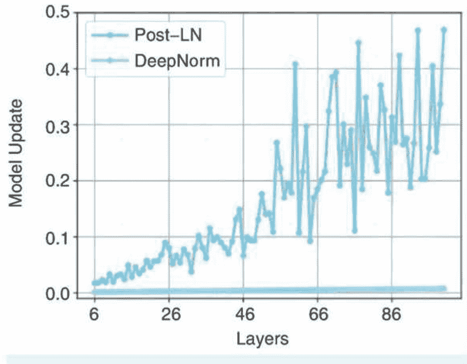

图4-7 DeepNorm与Post-LN对比

本节梳理了 Transformer 中归一化的作用与几种变体，选择何种方案需结合任务目标、训练资源与稳定性需求综合权衡。

# 4.3 Transformer 的主流变体与扩展
自 Transformer 提出以来，研究者围绕其结构做出了大量改良，形成了适配不同场景的家族模型。下面介绍其中最具代表性的几类，之后章节会逐一展开。

## 4.3.1 四大经典变体概览
本节聚焦 BERT、GPT、T5、ViT 四个被广泛应用的模型，概述其架构特点与应用场景，帮助快速建立认知。

### 1. BERT 模型
BERT 全称 Bidirectional Encoder Representations from Transformers，由 Google AI 于 2018 年推出，在问答、情感分析、命名实体识别等任务上表现突出。

其最大创新是双向编码。传统语言模型多为单向，信息受限；BERT 同时利用词左右两侧上下文理解含义。例如句子 “I saw a man with a telescope”，单向模型易混淆望远镜修饰谁，而 BERT 能综合左右信息做出更准确理解。

结构上 BERT 仅保留 Transformer 编码器堆栈，舍弃了解码器，专注文本理解。这是它与原始 Transformer 以及 GPT 等生成类模型的关键区别。

### 2. GPT 模型
GPT 全称 Generative Pre-training Transformer，由 OpenAI 于 2018 年提出，后续有 GPT-2、GPT-3 等版本，在文本生成、对话、写作等领域表现优异。

模型为单向左到右语言模型，生成每个词时只参考左侧历史，没有右向信息。预训练目标很单纯：下一个词预测，通过此任务学习语法、词关系与世界知识。

架构基于 Transformer 解码器，且做了因果遮挡改造，使其只能看到当前位置及左侧。没有编码器-解码器注意力，因为不处理输入输出对齐任务。因此整个模型只有改造过的解码器堆栈。

### 3. T5 预训练模型
T5 全称 Text-to-Text Transfer Transformer，由 Google 于 2019 年提出，擅长分类、标注、问答、摘要等任务。

核心思想是统一为“文本到文本”转换。无论任务类型，输入输出都格式化为文本。例如分类任务输入 “classify: This is a great movie!” 输出 “positive”；翻译任务输入 “translate English to French: Hello, world!” 输出 “Bonjour, monde!”。

预训练采用掩码语言建模，模型需补全被替换的词。微调时在下游数据上继续训练。T5 使用完整的编码器-解码器结构，能兼顾理解与生成。

### 4. ViT 预训练模型
ViT 全称 Vision Transformer，由 Google 于 2020 年提出，将 Transformer 引入视觉，挑战了 CNN 的主导地位。

做法是将图像切分为固定尺寸的 Patch，展平后线性映射为向量序列，拼接类别 token 后输入 Transformer 编码器，最后分类。预训练在大规模图像集上做图像分类，微调迁移到特定视觉任务。

ViT 证明了自注意力机制在像素序列上的有效性，为视觉领域打开了新的研究方向。

ViT 要爆发出来，背后是海量预训练语料和算力的堆叠。在数据规模很小、算力受限的场景里，它的表现往往打不过传统CNN。但当数据量和算力一起上去后，ViT以及一类基于Transformer的视觉模型在计算机视觉任务上的成绩会越来越好。

ViT 的落地也很有标志意义，它把Transformer从自然语言处理成功带到了计算机视觉，也证明了这种架构跨领域迁移时很抗揺。

## 4.3.2 Transformer 序列位置信息的编码处理

Transformer家族的位置编码大致分两类：绝对位置编码和相对位置编码。无论是早期用到的正弦余弦编码，还是第5章会讲到的BERT那种可学习位置编码，都属于绝对位置编码，做法是给序列中每个词元 $x_{i}$ 直接加上一个对应的位置向量 $p_{i}$。这种方式的短板是外推能力弱，比如BERT的 max_seq_len 是512，只有512个位置向量被训练过，一旦序列变长，多余的部分就没法编码，只能截断处理。

在介绍相对位置编码之前，先回顾Attention是怎么借助绝对位置编码感知顺序的。图4-8是一个简化的Attention计算示意，忽略了缩放和softmax。拆开 $Q \cdot K^T$ 的每个元素可以发现，Query第 $i$ 个元素对Value第 $j$ 个元素的分数由两部分组成：Token本身的语义相关性，以及两者之间的位置相关性。而绝对位置编码其实是通过给Attention矩阵间接注入位置信息来让模型感知顺序的。那么能不能把位置信息直接加到注意力矩阵里，而不是加到Token上？这正是相对位置编码的核心思路。

图4-9 相对位置编码提供位置信息的方式分析

图4-9以T5为例展示了一种相对位置编码的实现。仅用9个参数的相对位置向量 $p$，就能给长度为10的序列注入相对位置信息，并且理论上可以外推到无限长。具体来说，第 $i$ 行的Query看向所有Key时，只有距离在前后4个位置内的Key会被赋予不同的位置编码，用 [-4,4] 表示，其中每个数字对应一个可训练参数；距离超过阈值4的远位置被认为与当前Query关联度低，于是左侧统一用-4，右侧统一用4编码，不再区分。相对位置编码因此外推性更强，参数量也更少。需要注意的是，例子未考虑多头情况。若使用 $N$ 头多头注意力，每个头的注意力矩阵都是 $\text{seq\_len} \times \text{seq\_len}$，不同子空间捕捉不同语义关系，于是每个头都拥有独立的相对位置编码，参数总量变为 $9 \times N$。

### 单头Attention矩阵中第i行j列的元素(引入相对位置编码):

$$q_i k_j^T = x_i W_Q W_K^T x_j^T + R_{i,j} \in \text{常数}$$

图4-9 相对位置编码的一种实现方式 (T5)

不同模型里相对位置编码的具体做法差异很大，也有一些工作同时融合两种信息，例如DeBERTa在底层使用相对位置编码，在高层叠加绝对位置编码。感兴趣可以自行了解更多变体。

## 4.3.3 Transformer 训练

工业界训练大模型时常用无监督预训练+有监督微调的组合。下面拆解Transformer训练的关键环节。

### 1. Transformer 无监督预训练

无监督预训练的目的是用大量未标注文本先训出一个强语言模型，再把这个模型作为下游任务的起点进行微调。GPT、T5等主流大模型都走过这条路。

目前主要有两种自监督任务：掩码语言模型MLM和下一个词预测。

#### (1) 掩码语言模型任务

MLM的核心是预测被遮住的词，首次由BERT提出，后续模型普遍沿用。训练时随机挑选一部分词进行替换，模型需要根据前后文还原原词。优势在于可以同时看到掩码词前后的完整上下文，从而学到更丰富的双向表示。

实际操作中不会全掩码。以BERT为例，15%的词被选中，其中80%替换成[MASK]，10%换成随机词，10%保持不变。

举例，“The cat sat on the mat.”可能变为“The cat sat on the [MASK].”，模型要推断出mat。训练目标常用交叉熵损失。

以下是用 PyTorch 实现的 MLM 任务 dataloader 示例代码:

```python
class MaskedLanguageModelingDataset(torch.utils.data.Dataset):
    def __init__(self, texts, tokenizer, vocab, mask_prob=0.15):
        super(MaskedLanguageModelingDataset, self).__init__()
        self.texts = texts
        self.tokenizer = tokenizer
        self.vocab = vocab
        self.mask_prob = mask_prob

    def __getitem__(self, idx):
        tokens = self.tokenizer(self.texts[idx])
        masked_tokens, labels = self.mask_tokens(tokens)
        masked_tensor = torch.tensor([self.vocab[token] for token in masked_tokens])
        labels_tensor = torch.tensor(labels)
        return masked_tensor, labels_tensor

    def __len__(self):
        return len(self.texts)

    def mask_tokens(self, tokens):
        masked_tokens = []
        labels = []
        for token in tokens:
            if torch.rand(1).item() < self.mask_prob:
                masked_tokens.append("[MASK]")
                labels.append(self.vocab[token])
            else:
                masked_tokens.append(token)
                labels.append(-100)  # -100 represents masked tokens during training
        return masked_tokens, labels

def collate_batch(batch):
    inputs = [torch.LongTensor(item[0]) for item in batch]
    labels = [torch.LongTensor(item[1]) for item in batch]
    inputs = pad_sequence(inputs, batch_first=True)
    labels = pad_sequence(labels, batch_first=True, padding_value=-100)
    return inputs, labels
```

#### (2) 下一个词预测任务

下一个词预测是自回归语言模型的标准预训练方式，GPT系解码器模型主要靠它来学习。模型接收一段词序列，任务是预测下一个词，从而学习语法、语义和结构。

比如看到“The cat sat on the”，模型需要给出mat。同样使用交叉熵衡量预测与真实的差距。

以下是一个Next Token Prediction任务的dataloader示例代码：

```python
class NextTokenPredictionDataset(torch.utils.data.Dataset):
    def __init__(self, texts, tokenizer, vocab):
        super(NextTokenPredictionDataset, self).__init__()
        self.texts = texts
        self.tokenizer = tokenizer
        self.vocab = vocab

    def __getitem__(self, idx):
        tokens = self.tokenizer(self.texts[idx])
        # 假设输入序列为 tokens[:-1], 目标标签为 tokens[1:]
        input_ids = torch.tensor([self.vocab[token] for token in tokens[:-1]])
        labels = torch.tensor([self.vocab[token] for token in tokens[1:]])
        return input_ids, labels

    def __len__(self):
        return len(self.texts)
```

两种任务都让模型在无标注环境下学习语言规律。预训练完成后，再针对情感分析、命名实体识别、问答等任务做微调。

### 2. Transformer 有监督的微调

预训练模型在下游标注数据上继续训练即为微调。大部分参数已有良好初始化，只需小幅调整即可适配特定任务。以机器翻译为例，输入英文、目标为法文，通过最小化交叉熵损失让输出更接近目标。

### 3. 注意力掩码机制

Attention Mask用于控制哪些位置可以被看见。Mask是一个与输入同形的矩阵，1表示可见，0表示不可见，主要有两类用途：

- 掩盖无效位置。变长序列通常会用填充符对齐尾部，填充位置对注意力计算无效，需置0屏蔽。
- 屏蔽未来信息。在自回归解码时，为保持因果性，需要把上三角部分置0，让模型只能依赖当前位置及之前的内容。

实际使用时，Mask会与注意力权重相乘，把无效或未来位置的权重置零，从而提升训练稳定性与泛化。

### 4. 预热（Warm-Up）

Warm-Up是指在训练初期以较低学习率起步，再逐步升到预设最大值，常用线性或指数增长。预热有助于：

- 避免梯度爆炸。初期学习率小，减少参数更新幅度的风险。
- 降低陷入局部最优的可能。先小步探索参数空间，再加速收敛，平衡探索与利用。
- 提升收敛稳定性。模型在初始表示不成熟时有更多适应时间，训练更平滑。

# 第5章

AI大幅度提升Google搜索质量：BERT模型

本章聚焦搜索质量跃迁背后的核心技术。先详解BERT的整体架构与输入形式，以及它的预训练思路；再聊它在搜索里的落地方式，包括查询理解、文本匹配与排序。随后介绍ALBERT这一内存优化版本，讲解参数共享和句子顺序预测SOP等提升搜索效果的关键技巧。最后进入实战，从数据准备、模型搭建到并行训练优化，手把手演示如何用BERT类模型让搜索结果更准更相关。

## 5.1 BERT模型详解

BERT，即Bidirectional Encoder Representations from Transformers，推出后在多项NLP榜单上刷新SOTA。凭借强大的语言理解能力，Google已将其引入搜索引擎，用于生成排名和摘要，并称搜索效果提升约10%。从结构看，BERT就是Transformer的编码器部分；从功能看，它是一个文本特征抽取器，和计算机视觉里的CNN角色类似。

CNN的成功很大一部分来自迁移学习。在ImageNet等大规模视觉数据集上预训练的CNN能学到通用视觉特征，后续在新任务上只需保留主体参数，重新训练或微调最后的全连接层，就能快速达到不错效果，同时节省成本。这种“预训练+微调”范式被BERT完整继承，成为NLP的主流训练路线。

在 BERT 出现之前，预训练模型在 NLP 里一直没做出像样成绩。Word2Vec 虽然能在单词层面给出不错的语义表示，但单词粒度的表征很难兼顾句子和段落里的复杂上下文。另一个瓶颈是，NLP 不像 CV 那样拥有 ImageNet 级别的大规模有标注语料。怎么办？思路是自监督学习。模型训练时有监督信号，但标签不需要人工标注，通过固定规则就能从海量无标注文本中自动生成。BERT 就用了两项自监督任务：掩码语言模型 MLM 和下一句预测 NSP。NLP 里的自监督手段其实不少，GPT 用的是语言建模不断预测下一个字，T5 则用 Seq2Seq 形式的 MLM。

### 5.1.1 架构与输入改造
BERT 的骨架与原始 Transformer 的 Encoder 一致，都是多块 Transformer 的堆叠。不同的是输入的处理方式做了两处调整：加入段落编码 Segment Embedding，并把位置编码换成可训练形式。输入的流水线如图5-1呈现。

图5-1 BERT的输入形式
图5-1 最上方深色部分是完成词元化与预处理后的文本。

#### 1. 词元切分
词元化的任务就是把一串自然语言拆成更细的处理单元，即词元。模型里所有词元组成词表 Vocabulary。实现时给每个词元分配一个 embed_size 维的嵌入向量。BERT 有一个 Embedding 参数矩阵，形状为 vocab_size × embed_size，用来存放词表的向量。原论文里 vocab_size 设为3万，仅针对英语。embed_size 有两个规格：BERT-Base 为768，BERT-Large 为1024。也就是 Base 的词元向量是768维，Large 是1024维。经过词元化与嵌入，文本被转成数值，供深度学习处理，从而更好地捕捉语义与上下文。

词元的细粒度由词元化方案决定。中文可以按字切，英语最朴素的做法是按词切，但会让词表爆炸。为控制规模，出现了子词方案，如 BPE、SentencePiece。BERT 采用 WordPiece。图5-1 里右侧的 play、##ing 就是子词示例。playing、jumping、eating 不必各自建词元，只需原形加 ##ing 组合。WordPiece 不依赖人工语言学规则，是在语料上自动学习得到子词划分，从而兼顾泛化与参数规模。

词元化后会加入若干特殊词元 [CLS]、[SEP]、[PAD]。 [CLS] 放在序列最前，其对应输出被视作整句的表征，通过一个 MLP 可用于文本分类等任务。单句任务在结尾加一个 [SEP]。句子对任务如 NLI、QA，需要在第一段末尾和第二段末尾各加一个 [SEP] 来分隔。 [PAD] 用来把短序列补齐到 max_seq_len 以便批量处理，注意力机制会忽略这些位置。

## 2. 位置与段落编码
注意力本身对顺序不敏感，而自然语言的顺序至关重要，比如“我喜欢猫”和“猫喜欢我”含义不同，所以需要位置编码。Transformer 用固定正弦余弦函数生成位置编码，不同维度用不同频率的 sin、cos，模型在训练中去适应。BERT 因为预训练和微调时的长度可能不同，采用可训练位置编码，能随长度自动学习。原始 BERT 支持的最长输入为512个词元，可学习的位置编码矩阵为512 × embed_size。

段落编码用来区分包含两段不同功能文本的任务，如 NLI 和 QA。NLI 里前提 Premise 与猜想 Hypothesis 功能不同，需要让模型知道哪段是哪段，于是给两段分别加上不同的段落向量，索引0给第一段，索引1给第二段。纯单句任务则全用索引0的段落编码。与位置编码一样，段落编码也是可训练参数，存放在2 × embed_size的矩阵里。引入这两类编码后，BERT 能更准确地刻画句子与段落关系，并处理变长输入。

## 5.1.2 预训练双任务
下面聚焦 BERT 的预训练做法。

### 1. 核心双任务 MLM 与 NSP
BERT 的强能力来自两项预训练任务：掩码语言模型 MLM 和下一句预测 NSP。两者都从无监督文本自动构造训练样本，无需人工标注，从而实现自监督学习。

MLM 的做法是在训练时随机遮住输入中的部分词元并换成 [MASK]，模型要根据上下文还原被遮住的内容。若能准确恢复，说明模型掌握了上下文与语义依赖。

NSP 的目标是学习句间关系。训练时会构造相邻句子对和不相邻句子对，要求模型判断二者是否连续。这样 BERT 能捕捉到句子层面的语义关联。

这两个任务类似小时候的完形填空和句子排序，让模型从大量文本中自行习得语言知识。

图5-2所示为预训练时的模型结构以及MLM和NSP任务是如何体现在预训练损失函数中的。

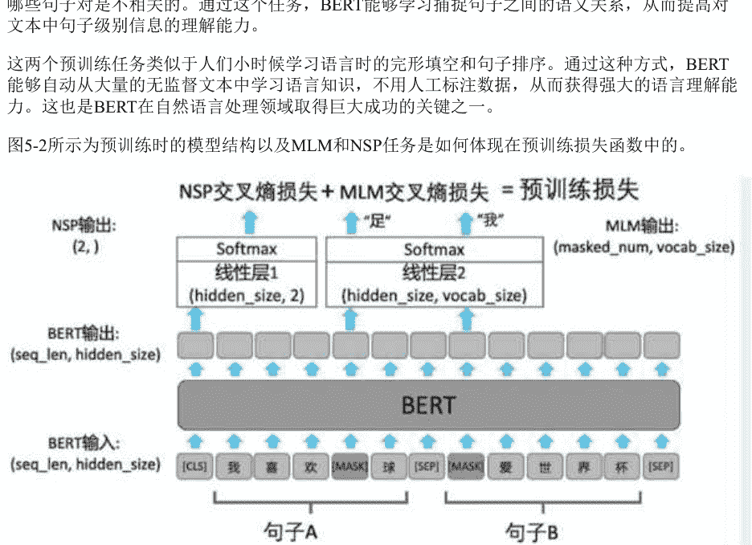

图5-2 BERT预训练任务示意图
图5-2 里 NSP 把 [CLS] 位置的输出送入分类层1做二分类，判断两句是否相邻。MLM 随机遮住 masked_num 个词元，对应位置的输出送入分类层2，预测词表中的概率。两者都用交叉熵，整体预训练损失是两项之和。

预训练可以同时进行，也可以单独进行。分类层只有一层隐藏层，能力较弱，这迫使 BERT 必须生成高质量语义表示。

NSP 样本构造上，50% 取同一文档的相邻两句，50% 取不同文档的两句。MLM 随机挑选15%的词元位置。被选中的位置有80%概率换成 [MASK]，10%概率换成随机词元，10%概率保持原样。不全换成 [MASK] 是因为微调时真实文本里不会出现 [MASK]，过度依赖特殊标记会在推理时失效。保留部分原始词元有助于模型更好地适应真实数据。

作者注：这里的“句子”并非严格指句号分隔的单位，也可以是任意长度的连续文本。

### 2. 中文与多语言扩展
ERNIE 是百度2019年提出的中文预训练模型，采用全词掩码改进 MLM。英语里一个词常对应一个词元，遮住一个词元就等价于遮住整个词。中文词由多个字组成，若只遮其中一个字，模型可能靠相邻字猜出答案，只学到词内信息。ERNIE 一次性遮住整个词，逼模型利用整句语义去预测，提升了对中文上下文的理解。

谷歌在英语 BERT 后发布了支持104种语言的 mBERT。改进之一是把 WordPiece 词表扩大到11万个 Token，以便统一多语言词汇。英语 BERT 词表约3万。不同语言的 Token 会有交集，例如英语和德语共享大量子词，所以词表规模不会随语言线性增长。mBERT 在一个模型里共享参数和词表，实现跨语言预训练与迁移。

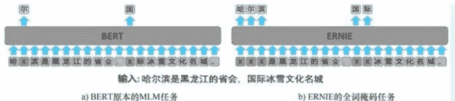

图5-3 BERT和ERNIE对于同一句输入的不同掩码方式
多语言模型命名多带 m 或 X。m 代表 multilingual，如 mBERT、mT5。X 代表 cross-lingual，如 XLM。XQuAD、XNLI 也是多语言数据集。XL、XXL 通常指 Extra Large 或 Extra Long，表示模型更大或支持更长输入，并非多语言。

### 3. CV借鉴：MAE
MLM 在 NLP 很成功，能否迁移到 CV？可以。何凯明提出的 MAE Masked Autoencoders 就采用了类似思路。输入从文本变为图像，输出仍是一个表征向量用于下游任务。自监督任务是预测被掩码的图片块。

具体做法是把图像切成 Patches，随机遮住部分块，让模型学习重建整图。和 MLM 类似，目标是得到强大的图像 Encoder。预训练时只用一个轻量化的 Decoder，图5-4 中 Decoder 体积明显小于 Encoder，这样被迫要求 Encoder 生成高质量表征才能完成重建。

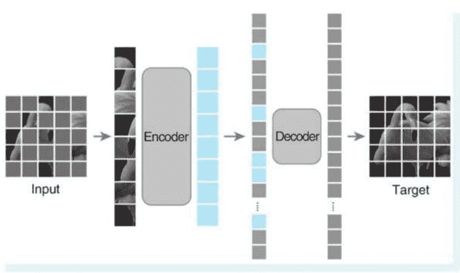

图5-4 MAE模型预训练示意图

## 5.1.3 下游应用
论文 “BERT: Pre-training of Deep Bidirectional Transformers for language Understanding” 给出了几种微调用法：句子级的单句分类和句子对分类，词元级的单句标注和抽取式问答。此外还有 Sentence-BERT 和 SimCSE 这类用于文本相似度的模型。

### 1. 句子级分类实践
无论单句还是句子对分类都属于句子级任务。单句常见场景是情感分类、体裁分类；句子对常见场景是自然语言推理 NLI、问答 QA。实现方式都依赖 [CLS] 标记对应的向量，它汇总了整段文本信息。

# 句子级分类怎么接

BERT处理一整个句子的分类任务时，习惯性地取第1个位置[CLS]的隐藏向量作为整段文字的表征，然后在其后挂一个分类头。分类头的输入是 hidden_size 维，内部是一个线性映射，把它压到 cls_num 维，cls_num 就是类别数。多分类情况下用 Softmax 把这 cls_num 个数值变成概率分布，训练时配合交叉熵；如果是多标签，即一篇文本可能同时属于经济、政治等多个类，就对 cls_num 个输出逐个做 Sigmoid，概率大于0.5就判定为该类，训练时用二元交叉熵。单句分类和句对分类在分类头的结构上完全一致，差别只在输入构造上，比如是否加 [SEP]、是否用段落编码，具体做法在5.1.1里已经讲过。

微调的时候通常只动分类头的参数，BERT主体保持冻结。也可以把最后几层一起解冻调参，效果往往更好，但可训练参数会变多，在小数据集上容易过拟合。

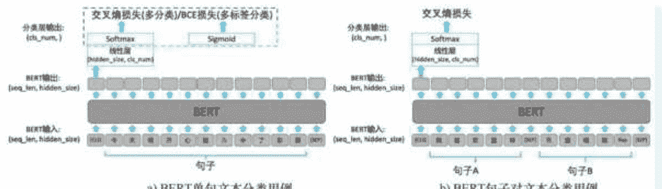
图5-5 BERT句子级 (Sentence-Level) 任务用例

### 2. 单句标注 (Token-Level)

单句标注是对序列里每一个词元分别打标签，属于词元级任务。典型场景是命名实体识别 NER 和词性标注 POS Tagging。实现思路是给 BERT 的每一层输出都套一个同样的分类器，输入输出都是 hidden_size 到 cls_num 的映射，最终得到一个 seq_len × cls_num 的矩阵，矩阵第 i 行第 j 列表示第 i 个位置落在第 j 类的概率，预测时取每行概率最大的类。图5-6给出了 NER 的一个示例。

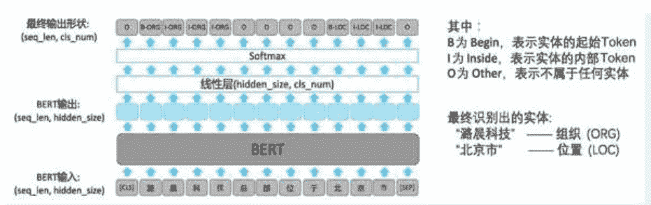
在该示例中，每个位置的标签可选 O、表示组织实体的开始 B-ORG、组织实体的内部 I-ORG、位置实体的开始 B-LOC、位置实体的内部 I-LOC。把同类标签的词元串起来，就能抽出“潞晨科技”这个组织实体和“北京市”这个位置实体。

### 3. 抽取式问答（Extractive QA）

问答大致分成两类，按答案产生方式区分。抽取式问答的答案必须在原文里直接找到，通常是一段连续的词元区间，比如 BERT 就属于这一类；生成式问答则可以输出原文没有出现的表述，比如 GPT 系列，需要更强的重述和推理能力。图5-7展示了 BERT 做抽取式 QA 的流程。

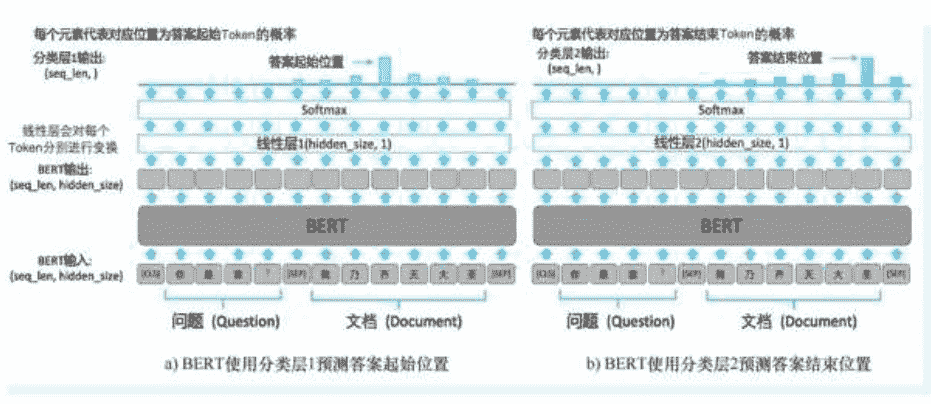
抽取式 QA 其实只需要定位两个位置：答案开头和答案结尾。BERT 为这两个任务各配一个 hidden_size 到1 的线性层，作用在每个 Token 上后得到两个长度为 seq_len 的向量，分别代表该位置作为起点的概率和作为终点的概率。训练时把真实起止位置转成两个 one-hot 向量，与预测向量计算交叉熵。推理时取概率最高的起点和终点截取答案，但要满足两个约束：起点位置必须在终点之前；该位置的概率要超过一个阈值，这个阈值的设定可参考 BERT 原论文第4.3节。若不满足则直接不输出，阈值的目的就是避免模型给出不负责任的答案。假设有一个长度

## 4. 文本语义相似度任务

很多下游任务需要一个句子的向量来衡量语义相近程度，比如聚类、检索。直觉做法是用 [CLS] 向量，或把 BERT 各位置向量做平均——类似平均池化——然后用余弦相似度或欧氏距离比较。但实际效果并不理想。研究发现 BERT 的句向量在空间里呈锥形分布，高频词的向量靠近原点，低频词的向量离原点更远且更稀疏，如图5-8所示。

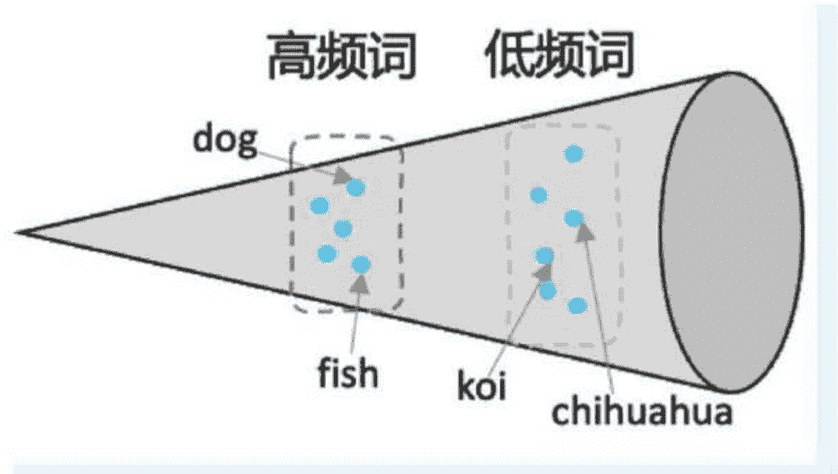
图5-8 BERT句向量在空间上的分布示意图

这种分布会让相似度被词频干扰。举例来说，fish 和 dog 都是高频词，而 koi 和 chihuahua 相对低频。语义上 fish 更接近 koi，而不是 dog。但由于锥形分布，fish 与 dog 的向量距离反而更小，这显然不符合语义直觉，所以直接用原 BERT 做语义相似度判断会失真。

为此出现了多种改良方案，其中比较经典的是 2019 年的 Sentence-BERT 与 2021 年的 SimCSE。它们都不是从零重新训练 BERT，而是在已有 BERT 上加新的训练目标，让句向量更适合衡量语义相似性，毕竟 BERT 本身的理解能力还是很强的。

图5-9展示了基于孪生网络的 Sentence-BERT。两个分支共享同一套 BERT 参数，训练时把句子 A 和句子 B 分别送入同一模型得到向量 u 和 v，反向传播时两个分支的梯度叠加。微调目标很简单：把两句的表征拼起来做二分类，判断语义是否相同。因为分类器只是一个全连接层，能力有限，BERT 就被迫学出能反映相似度的向量。预测时可以直接丢弃分类层，用训练好的 BERT 输出向量即可。

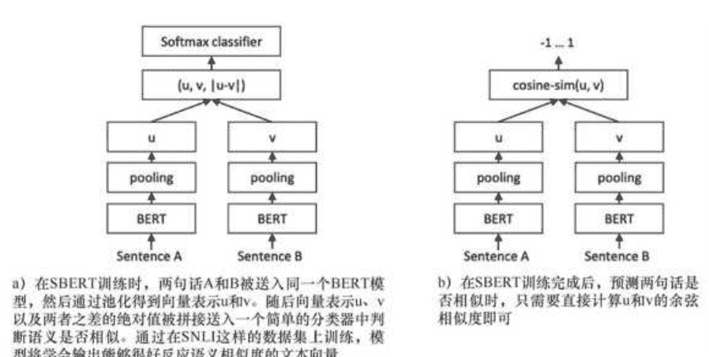
图5-9 Sentence-BERT训练与预测示意图

SBERT 的缺点是需要大量人工标注的相似或矛盾句对，比如 NLI 数据集。那么能不能在无监督语料上自动学到有效句向量呢？SimCSE 用对比学习加 Dropout 实现了这一目标，有监督条件下表现更好。图5-10概括了 SimCSE 在无监督和有监督下的训练方式。

对比学习的思路是让正样本对的向量靠拢、负样本对的向量远离。关键在于如何构造正负样本。有监督时正样本是人工给出的相似句，负样本是不相似句。无监督时，对同一句话用两种不同的 Dropout mask 产生扰动，假设轻微噪声后语义不变，就得到一个正样本对。例如“今天天气真好”经过两次扰动可能变成“今天天气不错”和“今儿天气真好”。负样本则来自同一个 Batch 里的其他句子，比如“自古英雄如美人，不许人间见白头”“一入CS如僧侣，不仅Single还秃头”等。无监督样本的质量比有监督低，Batch 里可能出现语义相近的句子被误当负样本，或扰动过大导致语义反转，但在数据足够多、Batch 足够大时，模型仍能收敛到不错的效果。

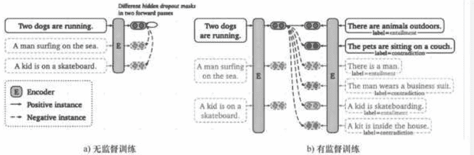
图5-10 SimCSE无监督和有监督训练示意图

## 5.2 高效降低内存使用的ALBERT模型

增大参数能提升性能，但也带来显存和算力的负担。ALBERT 由蓝振忠博士在 2020 年提出，通过参数共享在不掉性能的前提下显著降低模型体积。

### 5.2.1 基于参数共享的参数缩减方法

#### 1. 回顾：BERT 参数从何而来

先看参数主要来自哪里。设 V 为词表大小，E 为词嵌入维度，H 为隐藏维度，N 为 Transformer 层数。BERT-base 中 V=30k，E=H=768，N=12；large 中 H=1024，N=24。

如图5-11所示，参数主要集中在 N 个 Transformer 块①和词嵌入矩阵②。Transformer 块的参数量级约 O(12 N H H)，嵌入矩阵约 O(V H)。FFN 层的参数是 8 H H，是因为先把 H 升到 4H 再降回 H。LayerNorm、位置编码、段落编码等参数量很小，不是优化重点。

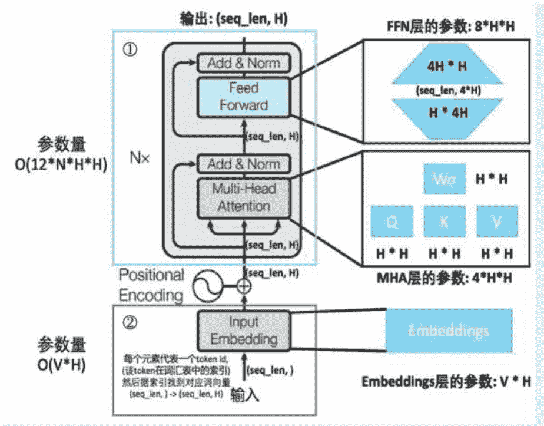
图5-11 BERT中参数主要来源示意图

#### 2. 模型“瘦身”之开胃菜：压缩词嵌入矩阵

BERT 里 E 等于 H 看似合理，其实有点奢侈。词嵌入是上下文无关的静态向量，而 Transformer 中间层的表示已经融合了上下文，信息量更大。用更小的 E 来存词向量就够了。做法是矩阵分解，把原来的 V×H 嵌入拆成 V×E 和 E×H 两个矩阵，其中 E ≪ H。词向量先用小维度表示，再线性映射到 H 维参与上下文计算，在保持效果的同时大幅减少参数。

#### 3. 模型“瘦身”之大招：层间参数共享

跨层参数共享是另一大手段，让不同 Transformer 块复用同一套参数。BERT-base 有 12 层，可以让 12 次前向只用一层参数。论文尝试了多种策略：全部共享 All-Shared、只共享注意力 Shared-Attention、只共享 FFN Shared-FFN，性能基本没有明显下滑。为弥补轻微下降，可以适当增大共享层的隐藏维度 H。

实践中也可以分组共享，比如 9 层模型分成 3 组，同组共享参数，兼顾参数量和表达能力。图5-12展示了分组共享的示意。

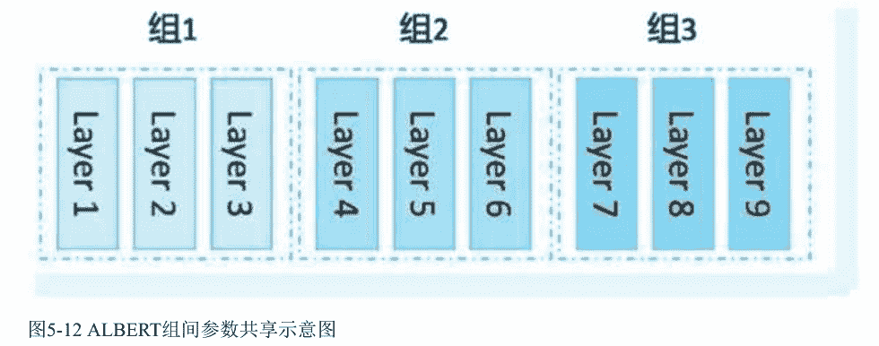
图5-12 ALBERT组间参数共享示意图

需要提醒的是，参数共享减少的是存储量，前向反向传播时共享层仍要执行 N 次，所以计算量并未降低。ALBERT-xxlarge 虽然参数更少、显存占用下降，但训练和推理速度反而可能比 BERT-large 更慢，这也是外界对其“减参不减算”的主要批评。

### 5.2.2 句子顺序预测（SOP）预训练任务

BERT 原来的下一句预测 NSP 任务存在问题：正样本是同一文档的相邻两句 A、B1，负样本是另一篇文档随机抽的句子 B2。因为两篇文档主题可能完全不同，模型只要靠主题就能判断不相邻，学习目标太简单。

ALBERT 把 NSP 改成了句子顺序预测 SOP。正样本仍是同一文档的相邻两句 A、B，负样本则是把顺序打乱的 B、A。模型必须真正理解句子间的语义顺序关系，才能正确分类。引入 SOP 后，模型对上下文顺序的捕捉能力明显增强。

另外 ALBERT 去掉了 Dropout。因为 MLM 任务本身足够复杂，很难过拟合，去掉 Dropout 反而提升了效果。SOP 加上移除 Dropout，让 ALBERT 在预训练阶段更专注于语义和顺序理解，为下游任务提供更可靠的表征。

## 5.3 BERT模型实战训练

Colossal-AI 里已经集成了一批专门用来提速 BERT 训练的方案。接下来要讲的就是 ZeRO 内存优化器，以及序列并行和流水线并行混用的优化思路，并把真正上手时的操作要点拆开来讲。在这之前，先把序列并行的基本概念弄清楚。

借助 Colossal-AI 提供的序列并行模式，BERT 能够在超长序列和超大批量上保持稳定训练。序列并行的核心做法是对输入张量和中间激活在序列维度上做切分，内存占用因此变得更可控，在资源有限的情况下可以把可训练的最大批量和序列长度都拉上去。关于 Colossal-AI 本身的介绍，可参考本书第 2 章。

先做一个简单的概念铺垫。按照 Transformer 自注意力机制的定义，计算量会随输入序列长度急剧上升。长序列在实际任务里很常见，比如医学影像里的 Transformer 输入，序列长度经常远大于普通图像 256×256×3，比如 512×512×512。传统并行方式例如张量并行，难以缓解单卡处理序列的压力。于是研究者提出把输入序列分散到多卡上做序列并行，并给出环形自注意力机制来保证分布式注意力计算既高效又正确。在多卡环境下，序列并行相较于张量并行，序列长度上限可提升约 3 倍；同时带来的内存节省让同一批设备能把训练批量放大到张量并行的 13.7 倍左右。

序列并行还能和流水线并行无缝配合。因为序列并行已经把输入张量和激活在序列维度切开了，它可以抵消流水线并行在每个阶段原本需要做的切分与 All-Gather 通信开销。

### 5.3.1 搭建 BERT 模型
下面用序列与流水线的混合并行方式来训练 BERT。本例聚焦序列并行的用法，不再重复常规训练流程。

使用序列并行时，每个 RANK 拿到的序列是均分好的，分片发生在数据读取阶段。因此需要写一个预处理类来统一处理输入，包括 input ids 和 attention masks。

```python
from colossalai.context.parallel_mode import ParallelMode
from colossalai.core import global_context as gpc

class PreProcessor(torch.nn.Module):

    def __init__(self, sub_seq_length):
        super().__init__()
        self.sub_seq_length = sub_seq_length

    def bert_position_ids(self, token_ids):
        # 创建当前 RANK 的 position ids
        seq_length = token_ids.size(1)
        local_rank = gpc.get_local_rank(ParallelMode.SEQUENCE)
        position_ids = torch.arange(seq_length * local_rank,
                                    seq_length * (local_rank+1),
                                    dtype=torch.long,
                                    device=token_ids.device)
        position_ids = position_ids.unsqueeze(0).expand_as(token_ids)

        return position_ids
...
```

另外，还可以重写自注意力计算方式，即 Transformer Self Attention Ring，使其适配序列并行；对 LayerNorm 做算子级优化，并把加 Bias 和 Dropout 融合为一个算子。这样就能把 Embedding 层在内的整套 Transformer 层重新定义。下面给出单个 Transformer 层的改造示例，完整代码见路径 /sequence_parallel/model/layers/bert_layer.py。

```python
class BertLayer(nn.Module):
    """单个 Transformer 层的定义
    Transformer 层接受[批量, 序列长度, 隐层数]的输入,返回相同维度的输出
    """

    def __init__(self,
                 layer_number,
                 hidden_size,
                 num_attention_heads,
                 attention_dropout,
                 mlp_ratio,
                 hidden_dropout,
                 is_naive_fp16,
                 apply_residual_connection_post_layernorm=False,
                 fp32_residual_connection=False,
                 bias_dropout_fusion: bool = True,
                 convert_fp16_to_fp32_in_softmax: bool = False):
        super().__init__()
        self.layer_number = layer_number

        self.apply_residual_connection_post_layernorm = apply_residual_connection_post_layernorm
        self.fp32_residual_connection = fp32_residual_connection

        # 在输入数据的 layer norm 层
        self.input_layernorm = LayerNorm(hidden_size)

        # 环形自注意力机制
        self.self_attention = TransformerSelfAttentionRing(
            hidden_size=hidden_size,
            num_attention_heads=num_attention_heads,
            attention_dropout=attention_dropout,
            attention_mask_func=attention_mask_func,
            layer_number=layer_number,
            apply_query_key_layer_scaling=True,
            convert_fp16_to_fp32_in_softmax=convert_fp16_to_fp32_in_softmax,
            fp16=is_naive_fp16
        )

        self.hidden_dropout = hidden_dropout
        self.bias_dropout_fusion = bias_dropout_fusion

        # 在 attention output 上的 layer norm 层
        self.post_attention_layernorm = LayerNorm(hidden_size)

        self.mlp = TransformerMLP(hidden_size=hidden_size, mlp_ratio=mlp_ratio)

    def forward(self, hidden_states, attention_mask):
        ...
```

## 5.3.2 并行训练 BERT 模型
启动训练可参考 examples/tutorial/sequence_parallel/train.py。执行前建议完成下面几步。

```python
from colossalai.amp import AMP_TYPE

# hyper-parameters
TRAIN_ITERS = 10
DECAY_ITERS = 4
WARMUP_FRACTION = 0.01
GLOBAL_BATCH_SIZE = 32  # dp world size * sentences per GPU
EVAL_ITERS = 10
EVAL_INTERVAL = 10
LR = 0.0001
MIN_LR = 1e-05
WEIGHT_DECAY = 0.01
SEQ_LENGTH = 128

# BERT config
DEPTH = 4
NUM_ATTENTION_HEADS = 4
HIDDEN_SIZE = 128

# model config
ADD_BINARY_HEAD = False

# random seed
SEED = 1234

# pipeline config
# only enabled when pipeline > 1
NUM_MICRO_BATCHES = 4

# colossalai config
parallel = dict(pipeline=1, tensor=dict(size=2, mode='sequence'))

fp16 = dict(mode=AMP_TYPE.NAIVE, verbose=True)

gradient_handler = [dict(type='SequenceParallelGradientHandler')]
```

1）设定参数。examples/tutorial/sequence_parallel/config.py里已经定义好训练方案、模型等参数。也可以在此改动 Colossal-AI 的配置。比如想在 8 卡上做序列并行，就把 size 由 4 改为 8。若想启用流水线并行，把 pipeline 设为期望的并行度即可。

2）调用并行训练入口。

3）按配置模式开始训练。具体如何调用 train.py 取决于前面的设置。

如果是在单机多卡环境，PyTorch 自带的启动工具就能快速拉起脚本，具体示例命令如下。

```bash
colossalai run --nproc_per_node <num_gpus_on_this_machine> --
master_addr localhost --master_port 29500 train.py
```

如果是多机多卡环境，建议参考 colossalai.launch_from_slurm 或 colossalai.launch_from_openmpi，用 SLURM 和 OpenMPI 在多节点上起进程更方便。若已有自己的启动程序，也可以退回默认的 colossalai.launch 函数。

# 第6章
# T5：统一的文本到文本范式
本章深入讲解 T5 作为统一自然语言处理范式的设计思路。首先介绍 T5 的架构和输入输出方式，尤其是文本到文本的处理逻辑。随后展开其预训练方法与关键技术、在 NLP 领域的落地前景与发展方向。本章还引入统一语言学习范式的 UL2 框架，从统一预训练任务的角度讨论混合去噪器的应用。最后进行 T5 的实战训练，围绕预训练方法、关键技术与代码实现展开。通过学习本章，读者能够掌握 T5 的原理细节，并将其应用到具体 NLP 任务中，学会相关的训练方式与实现技巧。

## 6.1 T5模型详解
T5，即 Text-to-Text Transfer Transformer，是谷歌推出的通用语言模型。它能够覆盖文本生成、摘要、机器翻译、问答、情感分析等一系列 NLP 任务。T5 以 Transformer 为底座，利用自注意力机制处理输入序列，有效捕捉关键信息和上下文，从而生成目标序列。与 BERT 类似，T5 的训练分为无监督预训练和有监督微调两个阶段。不同的是，T5 并非为特定任务定制，而是通过统一的文本到文本迁移学习框架，在大量任务上进行微调。预训练阶段使用海量无标注文本学习通用语言表征；微调阶段则用特定任务的有标注数据适配需求，提升在该任务上的表现。

T5 在多项基准任务上取得了显著成绩，超过了此前的大量模型。统一的输入输出格式让任务迁移与组合更顺畅。整体上，T5 具备灵活性、适应性和准确性等优势。凭借单一的文本到文本框架，它非常适合那些文本资源丰富但任务标注数据稀缺的场景。目前 T5 及相关模型代表了 NLP 的重要进展，在机器翻译、信息检索、数据分析等领域具有广泛价值。

## 6.1.1 T5模型架构和输入输出——文本到文本
T5 基于 Transformer 构建，与 BERT、GPT 不同，T5 主体仍是编码器-解码器结构，编码器和解码器都包含多层 Transformer 模块。输入文本序列先由编码器映射为固定长度的连续向量表示，解码器据此生成输出文本序列。对 Transformer 自注意力机制的改进催生出多种架构变体，T5 在设计时也做了相应尝试。

目前自注意力机制存在多种掩码形式。图6-1 中自注意力的输入输出分别记为 x 和 y。第 i 行第 j 列的黑色单元格表示在输出时间步 i 处允许关注输入项 j，白色单元格表示禁止关注。左侧是完全可见掩码，允许每个输出关注全部输入；中间是因果掩码，常用于 GPT 类模型，防止第 i 个输出依赖未来输入；右侧是带前缀的因果掩码，允许在输入前缀部分使用完全可见掩码。

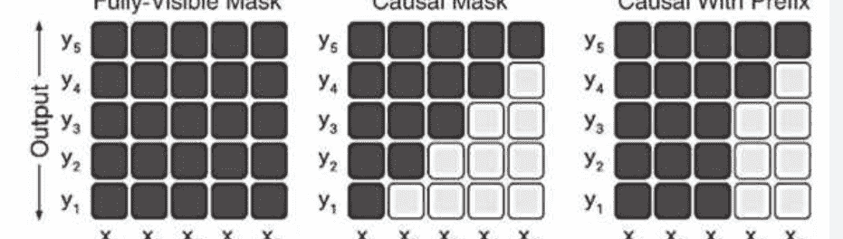

图6-1 不同注意力掩码操作的矩阵

基于上述设计，衍生出编码器-解码器、语言模型、 intellect 前缀语言模型等多种变体。图6-2 中块表示序列元素，连线表示自注意力机制，不同颜色块群表示不同 Transformer 堆叠层。深灰线对应完全可见掩码，浅灰线对应因果掩码。特殊符号“.”表示序列结束 token，用于模型预测终止。输入输出序列分别记为 x 和 y。左图为标准的编码器-解码器架构，编码器与解码器间的注意力使用完全可见掩码，解码器内部使用因果掩码；中间是语言模型，由单堆叠层组成并以因果掩码连接输入与目标；右图为前缀语言模型，在语言模型前加入前缀，前缀部分采用完全可见掩码。

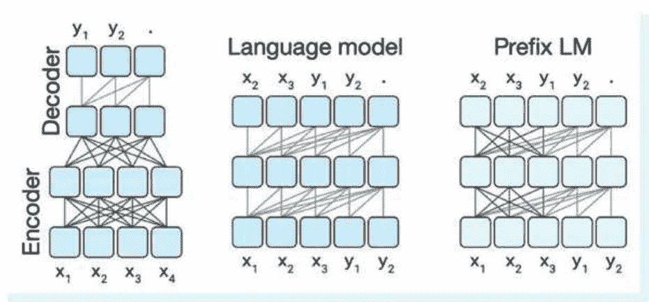

图6-2 Transformer架构变体示意图

大量实验表明，在文本到文本格式下，编码器-解码器架构表现最佳。选择文本到文本的原因在于几乎所有 NLP 任务都能被转化为这种形式。图6-3 显示，翻译任务可把“我爱世界杯”的英文“I love the World Cup.”转写为“将此句子翻译成中文：I love the World Cup.”作为输入，得到中文译文。情感分析可在句子前加上“sentiment: ”，如“sentiment: This movie is really good! ”，模型输出 positive。对于语义相似度这类需要连续值的任务，T5 可把 1 到 5 分的区间以 0.2 为步长离散为 21 类做分类。图6-3 中 STS 任务的输出 3.8 并非数值，而是一串文本，体现了 T5 的强大表达能力。

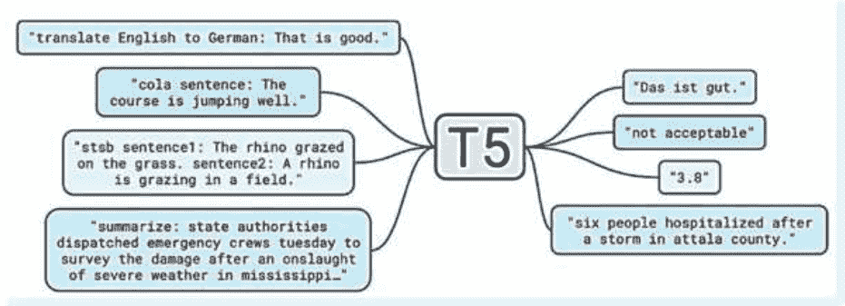

图6-3 文本到文本框架示意图

通过这种统一方式，NLP 任务被收敛到文本到文本形式，再借助迁移学习，同一模型、同一损失、同一训练流程即可处理所有任务，实现高度统一。

## 6.1.2 T5模型预训练

T5 的训练范式可以简化为两个连续步骤：先在海量未标注语料上进行自监督学习以获得通用的语言表征，再借助带标注的任务样本做针对性调整从而在具体场景中发挥更好效果。围绕自监督阶段的目标设计，研究团队展开了多轮对比，整体脉络如图6-4所示。

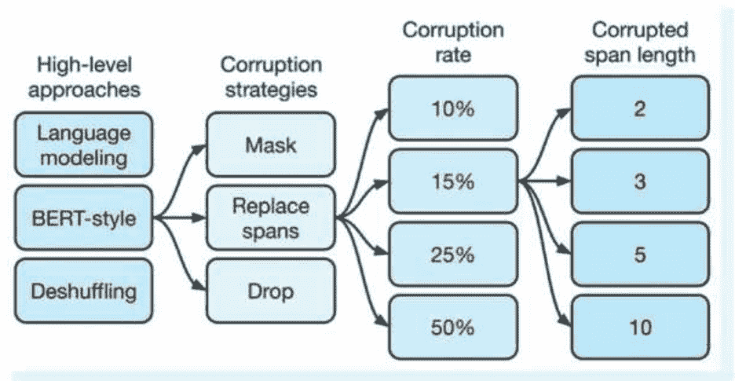

图6-4 T5模型探索无监督目标的流程图

在目标筛选阶段，T5 最初验证了三种思路，分别是对序列做前缀建模、类 BERT 的掩码策略以及 Deshuffling，见表6-1。前缀建模把一段序列切成首尾两段，前面一段送入编码器，后面一段作为解码器需要生成的部分。类 BERT 策略借鉴了掩码语言建模，先遮蔽部分 Token，再在训练中把被遮蔽的部分复原。与 BERT 只用编码器在对应位置重建掩码不同，T5 采用编码器-解码器架构，会把完整的未掩码序列作为解码器的目标。Deshuffling 则先打乱 Token 顺序，再以原始顺序作为训练目标。实验比较后，类 BERT 风格在后续应用中的综合表现最优。

表6-1 “Thank you for inviting me to your party last week.”所产生的输入和目标示例

| 预训练目标 | 输 入 | 目 标 |

| :--- | :--- | :--- |

| 前缀语言模型 | Thank you for inviting | me to your party last week. |

| BERT 风格 | Thank you <M> <M> me to your apple last week. | 原始文本 |

| Deshuffling | party me for your to , last fun you inviting week Thank | 原始文本 |

确定类 BERT 为整体自监督范式后，T5 在更细粒度的设置上继续对比，如表6-2所示。其中一种简化变体是 MASS-style，不做顺序扰动，仅把输入中约15%的 Token 用掩码替换，让模型重建未受损的原序列。随后团队尝试降低对完整文本重建的依赖，因为长序列的自注意力开销较大。提出两种做法：一是把每个连续受损的片段统一换成同一个掩码，目标序列变为所有受损片段的拼接，每个片段前都带上输入中替换它的掩码符号；二是直接从输入中移除受损 Token，让模型按顺序把被移除的部分补回。实验显示，以“替换损坏片段”为目标在多个后续任务上取得最佳综合成绩。

表6-2 BERT风格无监督目标变体所对应的输入和目标示例

| 预训练目标 | 输入 | 目标 |

| :--- | :--- | :--- |

| MASS-style | Thank you <M> <M> me to your party <M> week . | 原始文本 |

| 替换损坏片段 | Thank you <X> me to your party <Y> week . | <X> for inviting <Y> last <Z> |

| 删除 Token | Thank you me to your party week . | for inviting last |

具体而言，替换损坏片段与原始 BERT 预训练的不同在于：T5 不为每个被遮挡的 Token 单独设掩码，而是用特殊的 sentinel token 如 <X>、<Y>、<Z> 一次性替换连续的损坏片段，提升了效率。目标序列则由这些被损坏片段的拼接构成，每个片段前面加上在输入中替代它的 sentinel。 如图6-5所示，以“Thank you for inviting me to your party last week.”为例，随机挑选 for、inviting 和 last 作为损坏对象。for 和 inviting 连续出现，被同一个 sentinel <X> 替换，last 被 <Y> 替换。输出由损坏片段组成，片段之间以在输入中替换它们的 sentinel 以及结束用的 <Z> 分隔。进一步探索还发现，损坏比例设为15%、损坏片段长度设为3时效果最佳。


图6-5 T5模型预训练目标示意图

## 6.1.3 T5 的应用前景与未来演进

目前 T5 已在多种自然语言处理场景中展现出较强的通用性，以文本输入文本输出的方式处理各类任务，使其成为解决 NLP 问题的重要工具，发展空间很大。一方面在机器翻译、文本摘要等任务上表现突出，另一方面围绕 T5 的衍生系统也在快速推进。

1. 关键应用

T5 的通用性和灵活性让研究者和开发者能快速搭建并部署适配不同场景的语言系统。不同任务需要任务描述和针对性微调，通过自监督预训练加任务微调的组合，T5 能获得较好性能和泛化能力，为实际文本处理提供有力支持。主要应用包括：

- 机器翻译：将源语言句子输入，T5 把翻译任务转化为文本到文本问题，生成目标语言译文。
- 文本摘要：在摘要数据上微调后，可为新闻、文档等长文本生成简洁信息丰富的摘要。
- 问答：给定问题和上下文，T5 以文本到文本形式编码后输出与上下文高度相关的答案。
- 情感分析：在情感数据上微调后，能把文本识别为积极、消极或中性等类别，适用于评论、社交媒体、客户反馈等。
- 文本分类：微调后可为输入文本分配主题或文档类别，实现大规模文本自动归类。
- 文本生成：根据提示生成连贯文本，可用于故事创作、对话系统、内容生产等场景。
- 命名实体识别：微调后能从文本中抽取人名、地点、组织、日期等实体。

2. 相关模型

T5 催生了一批共享底层结构但针对特定方向优化的模型，展示了该架构的多功能性。

- mT5：多语言版 T5，可处理 100 多种语言的文本，在多语言翻译、情感分析、问答等任务上表现强劲。
- ByT5：把 T5 的词级表示扩展到字节级，更好地处理多语言的词汇和结构差异，提升多语言任务效果。
- T0：引入提示语作为输入，在多任务训练中不依赖任务特定标签，实现新任务的零样本泛化。
- Flan-T5：采用指令微调技术增强 T5，使其在遵循指令和多任务混合场景下表现更出色。

3. 发展方向

- 多语言处理能力的增强：随着语料和研究关注度提升，跨语言任务的准确性和流畅度有望进一步提高。
- 零样本学习和迁移学习：T5 能在某任务微调后迁移到相关任务，减少对大规模标注的依赖，迁移学习技术仍有改进空间。
- 非英语语种的应用：除英语外，其他语种的数据和特性研究将推动 T5 在全球范围内的落地。
- 特定领域的适应性：在领域特定数据上微调并优化结构，可提供更个性化、精确的行业解决方案。
- 智能助手和自动化应用：强大的文本生成能力使其有望成为智能助手、虚拟助理、聊天机器人的核心，支持更自然的交互和高质量文本服务。

总体而言，T5 作为通用的文本到文本转换系统，在 NLP 领域兼具广阔应用前景和深远发展潜力，对人工智能整体影响显著。

## 6.2 统一BERT和GPT的BART模型

与 T5 同期发布、同样基于标准 Transformer 的 BART 也聚焦于多任务统一。自监督方法在 NLP 中取得大进展，掩码语言建模的变体即去噪自动编码器，对输入随机遮蔽部分单词并重建原文。然而这些方法多针对特定终端任务，适用性受限。例如 BERT 在文本理解上进步明显，预训练加微调已成主流，但直接用于文本生成时效果不佳。

为此 Facebook 提出 BART，它是一个基于序列到序列模型的去噪自动编码器，可在多种下游任务上通用。预训练分两步：先用任意去噪函数破坏文本，再学习序列到序列模型重建原始文本。BART 使用标准的 Transformer 编码器-解码器架构，可视作 BERT、GPT 及其他预训练方案的推广。

### 6.2.1 从BERT、GPT到BART

BERT 与 GPT 基于不同 Transformer 架构，各有优势。BERT 是自编码模型，仅用编码器，随机用 [MASK] 替换输入 Token 并做双向编码，因 Token 独立预测而难以用于生成。GPT 是自回归模型，仅用解码器，按自回归方式预测 Token 联合概率，可生成但只能依赖左侧上下文，缺乏双向交互。

BART 融合了 BERT 的双向编码和 GPT 的自回归解码，构建在标准序列到序列 Transformer 上，比 BERT 更适合生成，比 GPT 具备双向上下文。编码器输入无需与解码器输出对齐，允许任意噪声变换。典型流程是对输入片段做掩码，双向编码后用自回归解码器恢复原文。下游微调时可把未损坏文本同时送入编码器和解码器，用解码器最终隐藏状态进行微调，如图6-8所示。


图6-6 BERT模型简图


图6-7 GPT模型简图


图6-8 BART模型简图

### 6.2.2 BART模型预训练

语言模型预训练对下游泛化至关重要。BART 的预训练先对文本做一定破坏，再最小化重建损失，即解码器输出与原文的交叉熵。不同于早期针对特定去噪方案的自动编码器，BART 支持任意形式的文本损坏。极端情况下输入全部被掩码，BART 就退化为语言模型。

在编码器端，BART 尝试多种噪声形式以破坏序列结构信息，如图6-9所示。Token 掩码与 BERT 相同，随机把 Token 换成 [MASK]。Token 删除则是随机删掉部分 Token，要求模型推断缺失位置。文本填充与 T5 类似，随机把连续 Token 片段替换为 [MASK]，片段长度服从 λ=3 的泊松分布，长度为 0 时相当于插入掩码。句子排序打乱文档内句子顺序，文档旋转则选取一个 Token 作为文档开头。不同噪声可组合使用，见表6-3。


图6-9 不同噪声形式

表6-3 不同噪声形式与其对应的作用

| 噪声形式 | 作用 |

| :--- | :--- |

| Token 掩码 | 提升模型推理单个 Token 的能力 |

| Token 删除 | 提升模型推理单个 Token 以及其对应位置的能力 |

| 文本填充 | 提升模型推理单个片段中包含 Token 数目的能力 |

| 句子排序 | 提升模型推理前后句之间关系的能力 |

| 文档旋转 | 提升模型识别文档开头的能力 |

### 6.2.3 BART模型的应用

在下游微调与应用上，BART 主要以序列分类任务和机器翻译为例展示其在不同任务上的有效迁移。

BART到UL2：预训练走向通用

在序列分类任务里，BART把同一段输入同时送入编码器和解码器，再把解码器最后一个位置的末态隐向量送给新加的多类线性分类器作判别，效果与BERT中[CLS]词元的汇总作用相近。另外，BART会在序列末尾补一个额外词元，让最终输出能够汇聚整段序列各词元的信息。

图6-10 序列识别

图6-11 机器翻译

机器翻译场景下，BART把编码器里的嵌入层换成随机初始化的新编码器。改动后的模型端到端训练，让新编码器学会把外语映射到BART可解码成英文的空间。注意新编码器的词表可以不同于原BART。微调分两步走：先只更新随机编码器、BART的位置编码以及编码器首层自注意力输入的投影矩阵；随后释放全部参数做少量训练。

## 6.3 统一语言学习范式的UL2框架

T5、BART率先以文本到文本的方式把不同任务统一起来，UniLM则证明了单模型多目标训练的可行性。如今可用的预训练模型众多，最终架构却高度依赖具体任务：选编码器-解码器还是仅解码器？预训练目标怎么设？是掩码式还是前缀式？这些细粒度选择让研究者困扰。谷歌提出的UL2框架在多任务、多设定下保持了稳定高效。

通用模型的需求很明显，集中资源打磨单一模型比分散维护多个模型更划算，尤其在设备资源受限时，一个能跨类别使用的预训练模型更有价值。UL2把模型结构与预训练目标拆开，重新梳理自监督任务的统一视角，并展示不同目标间的可转换性。随后提出混合去噪器 Mixture-of-Denoisers，把多种预训练范式融合，形成统一的学习范式。

### 6.3.1 关于语言模型预训练的统一视角

现有的预训练任务都能表述为输入映射到输出，输入是模型所依赖的记忆或上下文，输出是预期结果。主流可归为三类：语言模型、片段破坏和前缀语言模型。语言模型利用过往时间步预测下一个词元；片段破坏利用前后未破坏的词元预测被破坏的片段；前缀语言模型以过去词元为输入但对输入做双向编码，建模能力更强。

从去噪角度看三者有关联。片段破坏若破坏片段恰好是整段序列，问题就退化为语言模型；把破坏片段长度调大，也能模拟局部语言模型的目标。

UL2用统一公式把去噪任务收敛。输入和目标由SpanCorrupt生成，参数为μ、r、n，分别指平均片段长度、破坏率、破坏片段数。n可设为L/μ的函数，也可固定。函数基于均值μ的正态或均匀分布采样破坏长度，破坏后输入参与去噪预训练，被破坏片段作为恢复目标。

因果语言模型的例子是μ=L、r=1.0、n=1，得到长度等于整段输入的单一破坏；类似前缀语言模型则取μ=L-P、r=1.0-P/L、n=1，并强制破坏片段延伸到序列末尾。

这种输入到输出范式适用于编码器-解码器和纯解码器结构。UL2聚焦预测下一个目标词元而非当前词元的模型，因为前者更通用，能覆盖更多任务，避免为特定下游任务引入[CLS]等专用头和投影层。

### 6.3.2 结合不同预训练范式的混合去噪器

若能在预训练阶段用一个强通用框架解决多样问题，就能大幅降低为每个任务设计架构和目标的成本。UL2认为自监督目标里应注入多样性，否则模型可能缺失长文本连贯生成等能力。

基于此，UL2定义了三种主流范式，如图6-12所示，灰色块为被遮住的预训练目标。

图6-12 用于训练UL2的混合去噪器

1) R-去噪器：标准片段破坏，破坏片段多为2~5个词元，约遮挡15%输入。短片段有助于学到文本知识而非流畅生成。
2) S-去噪器：严格遵循序列顺序的去噪特例，即前缀语言模型。输入被拆成上下文和目标两部分，目标不依赖未来信息，且上下文保留双向感受野。记忆很短的S-去噪器与标准因果语言模型特性接近。
3) X-去噪器：极端去噪，模型需从少量或中等输入恢复很大比例原文，模拟从有限记忆生成长目标。UL2通过增大破坏片段或破坏率让约50%输入被遮挡。当片段长度≥12或破坏率≥30%时即视为极端任务，用来填补标准片段破坏与语言模型之间的空白。

R对应T5的片段破坏，S与GPT类因果语言模型关联，X则兼具两者。图6-13显示，无论是纯解码器前缀模型还是编码器-解码器，都能用混合去噪器预训练，并在有监督微调、上下文学习、零样本等范式下，以及语言生成、理解、结构化知识和长程推理等任务上取得最优。

X-去噪器还能提升样本效率，因每个样本可预测更多词元。UL2最终把任务融合为混合自监督目标，共7个去噪器的组合，配置见表6-4。

表6-4 UL2混合式去噪器的配置

| 去噪器 | 配 置 |
| --- | --- |
| R-去噪器 | $(\mu=3, r=0.15, n) \cup(\mu=8, r=0.15, n)$ |
| S-去噪器 | $(\mu=L / 4, r=0.25, 1)$ |
| X-去噪器 | $(\mu=3, r=0.5, n) \cup(\mu=8, r=0.5, n) \cup(\mu=64, r=0.15, n) \cup(\mu=64, r=0.5, n)$ |

X和R的片段长度从均值μ的正态分布采样；S使用均匀分布，破坏片段固定为1并强制其在原文末尾结束，之后不再出现未破坏词元，近似序列到序列去噪或前缀语言模型。由于语言模型是前缀语言模型的特例，UL2未把因果语言模型单独纳入混合。各任务参与度大致相等，也试验过把S提升到总量的50%。

实验表明混合去噪预训练在广泛任务上表现突出，而单一去噪器会损害性能。早期T5曾尝试50%破坏率的X设置，效果并不理想。

UL2还引入模式切换概念，在预训练时为模型提供额外范式标记[R][S][X]，帮助切换去噪模式。微调和少样本学习时，再加入描述下游任务设定需求的范式标记，使下游行为与上游训练模式绑定。

### 6.3.3 UL2的模型性能

UL2以因果语言模型、前缀语言模型、片段破坏、片段破坏+语言模型、UniLM为基线验证框架。实验显示其在T5类和GPT类模型上均有超越。

图6-14可看出，无论是纯解码器还是编码器-解码器，UL2在微调判别任务与提示式一次开放生成任务之间的平衡明显改善。

图6-14 UL2整体性能

所有目标均以输入到输出形式实现，BERT风格掩码语言模型被认为已包含在该范式中，且未使用任务专属分类头，以保持通用性。

图6-15对比标准编码器-解码器片段破坏模型T5的相对表现。UL2在9项NLP任务中全部优于基线，验证了统一预训练范式带来的泛化能力。

| Obj | Arch | SG | Supervised XS | Supervised SGD | Supervised TOT | Supervised SGL | One-shot XS | One-shot SGD | One-shot TOT | One-shot LM | One-shot All | One-shot Win |
|---|---|---|---|---|---|---|---|---|---|---|---|---|
| CLM | Dec | -13.6 | -9.2 | -0.7 | -3.0 | +1.8 | -91.7 | -2.2 | -90.5 | +208 | -31.7 | 2/9 |
| PLM | Dec | -13.3 | -9.2 | -0.5 | -2.8 | +10.5 | -85.6 | +158 | +205 | +185 | -11.0 | 4/9 |
| SC | Dec | -5.6 | -6.2 | -0.6 | -1.3 | +0.05 | -84.5 | +54 | -23.8 | +99 | -20.6 | 3/9 |
| SCLM | Dec | -6.0 | -6.5 | -0.2 | -2.0 | +5.9 | -59.6 | -11.3 | -95 | +204 | -16.1 | 2/9 |
| UniLM | Dec | -10.1 | -8.2 | -0.2 | -2.3 | -5.3 | -69.1 | +382 | +110 | +200 | -16.1 | 3/9 |
| UL2 | Dec | -9.0 | -6.9 | 0.0 | -1.4 | +9.8 | +6.9 | +340 | +176 | +209 | +14.1 | 5/9 |
| PLM | ED | -3.7 | +2.9 | -0.2 | -0.6 | -0.86 | -13.3 | +397 | +86 | +199 | +16.7 | 5/9 |
| SC* | ED | 0.0 | 0.0 | 0.0 | 0.0 | 0.0 | 0.0 | 0.0 | 0.0 | 0.0 | 0.0 | - |
| SCLM | ED | +0.7 | +2.1 | -0.2 | -0.5 | +3.2 | -31.6 | +508 | +248 | +201 | +28.3 | 7/9 |
| UniLM | ED | -1.2 | -0.2 | +0.1 | -0.4 | +3.5 | -11.0 | +355 | +95 | +173 | +19.8 | 5/9 |
| UL2 | ED | +1.5 | +2.6 | +0.5 | +0.4 | +7.2 | +53.6 | +363 | +210 | +184 | +43.6 | 9/9 |

图6-15 UL2实验性能对比

## 6.4 T5模型预训练方法和关键技术

下面聚焦T5的训练实践，涵盖关键技术与流程。

1) 准备数据集。按文本到文本格式整理数据，每对输入-输出为一段序列，输入转成查询式表述，输出为模型生成目标。做好预处理并划分训练、验证、测试集。
2) 安装依赖项。
```
# 安装所需依赖项
pip install torch
pip install transformers
```
3) 加载和分词数据集。
```
from transformers import T5Tokenizer
# 加载 T5 分词器
tokenizer = T5Tokenizer.from_pretrained('t5-base')
# 分词数据集
tokenized_dataset = tokenizer.prepare_seq2seq_batch(input_texts, target_texts, truncation=True, padding=True)
```
4) 定义T5模型结构。
```
from transformers import T5ForConditionalGeneration
# 实例化 T5 模型
model = T5ForConditionalGeneration.from_pretrained('t5-base')
```
5) 准备用于训练的数据。
```
from torch.utils.data import DataLoader, TensorDataset
# 将分词后的数据集转换为 DataLoader 对象
dataset = TensorDataset(tokenized_dataset['input_ids'], tokenized_dataset['attention_mask'],
                        tokenized_dataset['labels'])
dataloader = DataLoader(dataset, batch_size=8, shuffle=True)
```
6) 微调T5模型。

```python
from transformers import AdamW

# 定义优化器和损失函数
optimizer = AdamW(model.parameters(), lr=1e-5)
loss_fn = torch.nn.CrossEntropyLoss()
# 微调循环
model.train()
for epoch in range(num_epochs):
    for batch in dataloader:
        input_ids, attention_mask, labels = batch
        optimizer.zero_grad()
        # 正向传播
        outputs = model(input_ids=input_ids, attention_mask=attention_mask, labels=labels)
        loss = outputs.loss
        # 反向传播
        loss.backward()
        optimizer.step()
```

# 第7章

GPT家族：从预训练到通用智能的起点

本章聚焦于奠定通用人工智能基石的GPT系列。首先回顾该系列的源起，介绍其训练范式与关键技术，并对模型能力做系统评估。随后深入拆解GPT-2的设计思路与实际表现。之后聚焦GPT-3，比较少样本、单样本与零样本学习的差异，阐述其训练方法与核心技术，并评价其效果。最后介绍GPT-3的工程化落地与低资源训练技巧。通过学习，读者能全面把握GPT系列的背景、原理与性能，并将其运用于通用人工智能实践，掌握模型搭建与训练要点。

# 7.1 GPT家族的诞生脉络

第5章已阐述BERT凭借大规模预训练在自然语言处理任务中取得的突破，但预训练并非BERT首创。早在BERT之前，OpenAI提出的生成式预训练Transformer即GPT，已提出用海量文本预训练语言模型的思路。

GPT的提出者主张用同一模型覆盖各类NLP任务，并验证其在9项下游任务上均超越当时最优水平。该方法的核心是通过海量文本的自监督学习，让模型习得语言统计规律与语义表征。GPT采用Transformer结构，以多层Transformer Decoder堆叠实现预训练与下游任务的联合训练。

GPT之后，GPT-2把预训练语料与参数规模都推大，并提出零次表现的概念，即预训练后无需额外训练即可在NLP任务上取得可用效果。GPT-2的参数已达数十亿量级，在文本生成、问答、摘要等场景展现强劲能力。随后GPT-3以1750亿参数引发热议，不仅刷新大语言模型规模认知，也在多项NLP任务上表现惊艳。例如GPT-3撰写的新闻稿以假乱真，约一半准确率即可辨别真假。

尽管GPT-3尚难直接商用，它为WebGPT、InstructGPT、ChatGPT乃至GPT-4等后续系统奠定基础。这些模型在对话、问答、摘要等领域前景广阔。持续扩大规模、优化训练策略并提升可解释性，GPT系列正不断迈向更强的通用人工智能。

在GPT出现前，分类、蕴含、相似度、常识问答等任务往往依赖不同架构与大量人工标注。不同架构带来管理与存储负担，人工标注耗时耗力，拖慢研究进度。GPT提出统一任务的目标，要求模型具备极强语言能力。为此先通过大规模无监督预训练构建扎实语言基础，再在少量标注数据上微调，即可在各任务上取得优异效果。该范式减少了对标注的依赖，且同一基础模型可适配几乎所有NLP任务。

## 7.1.1 预训练与微调的核心流程

GPT训练分为无监督预训练与有监督微调两阶段。架构沿用Transformer解码器，图7-1a显示整体为12层，采用掩码自注意力，12个注意力头，词嵌入维度768。训练共进行100个Epoch，Batch Size为64，参数总量约1.17亿。

### 1. 自监督预训练
自监督预训练以语言建模为目标，使用Transformer解码器结构。具体公式如下:

```
$L_{1}(U)=\sum_{i} \log P\left(u_{i} \mid u_{i-k}, \cdots, u_{i-1} ; \theta\right)$
```

其中，k 代表滑动窗口长度，对应模型参考的上下文范围，$u_i$ 为训练文本中的单个字符。条件概率P基于模型参数$\theta$建模，即依据参数与窗口内字符计算下一个字符的概率。将文本中各位置概率按似然累积，可用于更新参数。训练中$\theta$不断迭代，使每个字符在前k个字符条件下的预测概率最大化。例如文本“无监督预训练的方法使得自然语言处理的研究取得重要突破”，k=4时，模型需最大化“无监督预”后“训”的概率、“监督预训”后“练”的概率等。


图7-1 实现任务

该方式无需标注即可利用海量文本训练，使模型获得基础语言能力。若参数基于充足高质量文本调整，模型便能依据已有窗口预测符合语言规则的词。例如给出不完整句子，模型可补全为通顺且合理的表达。

预训练语料采用BookCorpus，包含7000本未公开英文书籍。选用图书可保证文本质量与上下文连贯，有助于学习长距离依赖；未公开数据则避免下游任务信息泄露导致污染。GPT主要面向英语训练，因而具备较强英语能力，类似思路可迁移至中文、法语等语言，也催生了多语言模型研究。

### 2. 有监督微调
获得具备语言能力的模型后，可用任务标注数据进一步微调。微调引入新的训练目标与损失函数来更新参数。预训练目标是语言能力，损失如公式7-1。有监督微调则采用特定任务的损失函数，提升针对性能力。对任意有标签任务均可定义适配损失，通过微调使模型更好地拟合训练集。

此前各任务输入输出各异，需要专属架构。GPT通过将不同任务拼接为单一输入，实现同一基础模型处理多任务。图7-1a展示12层Transformer解码器可实现两类任务：字符预测与分类。可细化为具体下游任务。图7-1b中每行代表一类任务。所有任务均在前加起始序列、后加终止序列以界定范围。分类任务仅含一个文本，置于起止序列之间；蕴含与语义相似度任务含Text1和Text2，中间用分隔符区分；多选题则将每个选项Answer N与背景Context拼接后分别输入模型，取全连接层输出归一化得到各选项概率。

## 7.1.2 模型能力评估解析

预训练后的GPT基础模型在12项NLP下游任务上微调，涵盖自然语言推理、问答、语义相似度、文本分类等。在12项任务中，GPT以单一通用模型在9项上达到当时最佳。

预训练对下游提升也很关键。图7-2比较了同框架模型在中小学生英语阅读理解RACE与跨类型推理MultiNLI上的表现。左侧纵轴为RACE准确率，右侧为MultiNLI准确率，横轴为使用预训练层数。实线为开发集表现，虚线为训练集表现。随着预训练层数增加，模型在训练集上收敛更快，开发集表现也同步提升，证实预训练的实际增益。


图7-2 增加使用预训练模型中层数后对RACE和MultiNLI任务表现的影响

为验证Transformer作为底层框架的合理性，图7-3对比了Transformer与LSTM在4项下游任务上的零次表现。零次表现指预训练后不微调直接测试。比较架构为Transformer与LSTM，任务为情感分析、Winograd模式挑战、语言可接受性、问答。横轴为预训练参数更新次数。纵轴为归一化后表现。实线为Transformer，从上到下对应情感分析、Winograd、语言可接受性、问答；虚线为LSTM对应顺序略有不同。随着更新次数增加，两者均提升，但Transformer更稳定且提升幅度更高，说明GPT基于Transformer的选型合理。


图7-3 增加预训练更新次数在各任务上零次表现的效果

GPT在不同任务上的优异表现验证了预训练重要性与Transformer优势，并展示单一预训练模型服务多类下游任务的潜力。作为早期预训练工作，GPT开创了先预训练后微调的范式，后续BERT、T5等模型均延续这一思路，对NLP研究产生深远影响。

## 7.2 GPT-2模型详解

本节深入解析GPT-2。GPT-2是开创性语言模型，其设计与性能对NLP产生深远影响。内容分为两部分：核心思想与性能评估。首先解析其设计理念、架构及大规模无标签数据预训练方法。其次评估其在文本生成、阅读理解、摘要等标准任务上的表现，分析随模型规模变化的规律，并给出选型建议。

### 7.2.1 GPT-2的核心思想

上文显示，GPT在下游任务上的零次表现随预训练量增加而提升。即仅靠无监督语言建模提升，也能改善零次效果。若持续扩大预训练数据，零次表现是否可不断提升？若提升上限足够高，则可能无需人工标注的有监督学习即可取得突破。

模型无需额外标注即可完成任务，对机器智能意义重大。例如深度学习需数万张图片才能分辨猫狗，而儿童无需额外学习即可判断。预训练类似儿童学习过程，完成预训练后理想状态下可即时完成随机任务，即完美零次表现。这正是GPT-2的核心目标。

GPT-2通过扩大预训练数据与模型规模提升泛化能力，追求无需训练即表现良好的零次效果。架构上除细节调整外基本沿用GPT的Transformer解码器。作者对同架构的4个不同规模模型进行预训练。图7-4列出参数量、层数、嵌入维度。4个模型参数分别为1.17亿、3.45亿、7.62亿、15.42亿，呈指数增长。未特别说明时默认指15.42亿参数的最大模型。

| Parameters | Layers | $d_{model}$ |

| :--- | :--- | :--- |

| 117M | 12 | 768 |

| 345M | 24 | 1024 |

| 762M | 36 | 1280 |

| 1542M | 48 | 1600 |

图7-4 实验中4个模型参数量和超参设置

参数大幅增加后，GPT预训练数据已不足以支撑。互联网数据如Common Crawl因量大面广、成本低成为潜力来源。但质量难以控制，存在语法错误、逻辑偏差、偏见、极端言论甚至无意义内容，需大量筛选与清洗后才可用于训练。

# 数据、参数与语境：GPT-2 到 GPT-3 的跃迁

GPT-2 的作者最终拿出了一份约40GB的语料 WebText，主要来自 Reddit 上获得至少3个 Karma 的帖子。点赞数在这里被当作简单可用的质量筛选器，确保被采纳的内容至少对一部分读者有意义。网络文本天然混杂，训练集里虽然以英语为主，却掺入了不少其他语言的片段。图7-5里加粗的法语段落配有对应的英译，括号内的英文则是靠上下文可以推断出来的含义，比如第二行法语对应 “我不是一个傻瓜”。这种夹杂的外语片段为 GPT-2 乃至后来的 GPT-3 提供了初步的跨语言线索，对翻译能力的萌芽有帮助。为了避免评测作弊，预训练集还剔除了所有下游任务的测试数据，防止模型因数据污染而虚高分数。


图7-5 预训练数据WebText中包含的英语以外的语言(加粗部分为法语及其对应的英译)

### 7.2.2 GPT-2的模型性能

在海量语料与十倍于 GPT 的参数加持下，GPT-2 的表现出现了明显抬升。如图7-6所示，第一行列出各语言任务的缩写，括号内是评价单位。PPL 即困惑度，越低越好；ACC 为准确率，越高越好；BPB 与 BPC 也是基于困惑度的指标，数值越小越优。第二行 SOTA 指同期除 GPT-2 外的最佳结果。第三至六行则是从1.17亿到15.42亿四个规模的 GPT-2 在各任务上的零样本成绩。语言建模任务的优劣直接反映语言理解能力。在所测的8项任务里，15.42亿参数的版本在7项上达到最优。随着参数递增，零样本表现呈现稳定上升。

| | LAMBADA (PPL) | LAMBADA (ACC) | CBT-CN (ACC) | CBT-NE (ACC) | WikiText2 (PPL) | PTB (PPL) | enwik8 (BPPB) | text8 (BPC) | WikiText103 (PPL) | 1BW (PPL) |

|---|---|---|---|---|---|---|---|---|---|---|

| SOTA | 99.8 | 59.23 | 85.7 | 82.3 | 39.14 | 46.54 | 0.99 | 1.08 | 18.3 | 21.8 |

| 117M | 35.13 | 45.99 | 87.65 | 83.4 | 29.41 | 65.85 | 1.16 | 1.17 | 37.50 | 75.20 |

| 345M | 15.60 | 55.48 | 92.35 | 87.1 | 22.76 | 47.33 | 1.01 | 1.06 | 26.37 | 55.72 |

| 762M | 10.87 | 60.12 | 93.45 | 88.0 | 19.93 | 40.31 | 0.97 | 1.02 | 22.05 | 44.575 |

| 1542M | 8.63 | 63.24 | 93.30 | 89.05 | 18.34 | 35.76 | 0.93 | 0.98 | 17.48 | 42.16 |

图7-6 不同参数量的GPT-2模型在8类语言模型类任务上的零次表现

图7-7 进一步展示了四类下游任务的零样本曲线：阅读理解、机器翻译、摘要、问答。横轴为参数量，纵轴为各任务指标，越高越好。虚线是对应基线。GPT-2 在阅读理解上已超越 Seq2Seq、PGNet、DrQA 三个基线，但与人类仍有差距。机器翻译表现尚可，这与 WebText 中混杂的外语片段有关，仅凭少量多语暴露就获得了初步翻译能力。摘要任务几乎与随机抽三句作为摘要相当，问答则远低于开放域问答系统的水平。整体趋势一致：参数越大，四类任务的零样本效果都随之提升，尤其在问答上增幅更明显，说明该方向存在进一步扩展的空间。

图7-7 不同参数量的GPT-2模型在4个下游任务上的零次表现

GPT-2 证明了仅靠预训练，单模型就能在语言建模与多种 NLP 下游任务上获得可用的零样本成绩，泛化能力突出。网络数据的规模弥补了部分质量缺陷，支撑起更大参数的学习。即便在某些任务上仍逊于有监督微调模型，其未被完全释放的潜力正是 GPT-3 探索的起点。

## 7.3 GPT-3模型详解

从 GPT-2 可见，数据量与模型规模对泛化能力至关重要，但零样本仍有短板。GPT-3 在此基础上从三个维度推进：1）把参数从15.42亿提升到1750亿；2）把预训练语料从 WebText 的40GB 扩大到约570GB；3）引入语境学习。零样本不够时，用少量示例作引导往往更可靠，这与人类需要示范的直觉一致。语境学习的概念由 GPT-3 提出，并成为衡量大模型能力的重要方式。

### 7.3.1 小样本学习、一次学习与零次学习的异同

语境学习并不更新参数，与传统微调有本质区别，它更像是使用已完成预训练的大语言模型的方式。如图7-8，上方箭头代表无监督预训练，深色背景的列代表不同任务。模型在预训练中已习得大量知识，通过特定语境唤醒即可完成任务。示例中依次展示了加法、英文拼写纠错、英译法三种语境。


图7-8 语境学习示例

语境学习包含三种模式。图7-9 左列自上而下为零次、单次、小样本示例。零次即仅给任务指令与问题，不调参直接作答；单次在问题前加上一个示范问答作为前缀；小样本则使用多个示范，样本数可从两三个到上百不等。右侧为传统微调对比，后者会用数据反复更新参数，而语境学习在预训练结束后保持参数不变。


图7-9 语境学习中的零次示例、单次示例和小样本示例（左侧）与传统微调（右侧）的对比

### 7.3.2 GPT-3的训练方法和关键技术

GPT-3 保留 GPT-2 架构，但系统研究了从1.25亿到1750亿的8个规模。如图7-10，每行对应一个模型，列出参数量、层数、模型维度、注意力头数、头维度、批次与学习率。参数随规模指数增长，但层数只从12增加到96，词嵌入维度则从768扩到12288，整体更扁平，训练推理效率相对更好。随参数增大，批次变大，学习率相应下降，保证大模型稳定收敛。

| Model Name | $n_{\text{params}}$ | $n_{\text{layers}}$ | $d_{\text{model}}$ | $n_{\text{heads}}$ | $d_{\text{head}}$ | Batch Size | Learning Rate |

| :--- | :--- | :--- | :--- | :--- | :--- | :--- | :--- |

| GPT-3 Small | 125M | 12 | 768 | 12 | 64 | 0.5M | $6.0 \times 10^{-4}$ |

| GPT-3 Medium | 350M | 24 | 1024 | 16 | 64 | 0.5M | $3.0 \times 10^{-4}$ |

| GPT-3 Large | 760M | 24 | 1536 | 16 | 96 | 0.5M | $2.5 \times 10^{-4}$ |

| GPT-3 XL | 1.3B | 24 | 2048 | 24 | 128 | 1M | $2.0 \times 10^{-4}$ |

| GPT-3 2.7B | 2.7B | 32 | 2560 | 32 | 80 | 1M | $1.6 \times 10^{-4}$ |

| GPT-3 6.7B | 6.7B | 32 | 4096 | 32 | 128 | 2M | $1.2 \times 10^{-4}$ |

| GPT-3 13B | 13.0B | 40 | 5140 | 40 | 128 | 2M | $1.0 \times 10^{-4}$ |

| GPT-3 175B or “GPT-3” | 175.0B | 96 | 12288 | 96 | 128 | 3.2M | $0.6 \times 10^{-4}$ |

图7-10 GPT-3中训练的8个不同大小模型的具体细节

为支撑更大模型，GPT-3 融入了质量较低但体量巨大的 Common Crawl。图7-11 列出各语料的词量、使用权重与训练到3000亿词时的已走轮数。过滤后的 Common Crawl 提供4100亿词，占60%，但仅走0.44个轮次；Books1 仅120亿词，占8%，却走了1.9个轮次。虽然网页数据量更大，整体训练比例仍被高质量书籍数据拉高，造成对书籍的轻微过拟合，但作者认为利大于弊。实际只训练了约3000亿词，并未耗尽全部语料，模型仍处于欠拟合状态，继续训练有望进一步提升。

| Dataset | Quantity (tokens) | Weight in training mix | Epochs elapsed when training for 300B tokens |

|---|---|---|---|

| Common Crawl (filtered) | 410 billion | 60% | 0.44 |

| WebText2 | 19 billion | 22% | 2.9 |

| Books1 | 12 billion | 8% | 1.9 |

| Books2 | 55 billion | 8% | 0.43 |

| Wikipedia | 3 billion | 3% | 3.4 |

图7-11 GPT-3的预训练数据

### 7.3.3 GPT-3的模型性能与效果评估

图7-12 给出 GPT-3 在零次、单次、小样本三种设定下，于42个以准确率为核心的基准任务上的平均表现。蓝线为零次，绿线为单次，灰线为小样本。横轴为模型规模。可以看到规模越大平均分越高，小样本模式优势最大且随规模提升更明显。GPT-2 的零样本水平大致对应横轴1.3B处的蓝点，而 GPT-3 最右侧的小样本点已远在其之上。


图7-12 GPT-3不同模型大小和语境学习模式在42个以准确率为主的基准任务上的表现

总体而言，仅用无标注无监督数据预训练的 GPT-3，在语言建模任务上超越当时多数先进模型，在多项下游任务上也超过了有监督微调的 SOTA。在 SAT 模拟测试中达到65%准确率，高于平均申请者的57%。在新闻生成测试里，约52%的受试者无法分辨机器写与人工写。规模、数据与语境学习的协同，让大模型的能力出现了质变。

值得注意的是，GPT-3的训练语料中英文占比接近总词量的93%，即便如此，它在机器翻译上的表现已经逼近甚至在部分方向上超过了当时最先进的有监督训练模型。图7-13第一行箭头左侧为源语言，右侧为目标语言。En代表英语、Fr代表法语、De代表德语、Ro代表罗马尼亚语。第一列列出对比模型名称。GPT-3把英语翻成其他语言的表现偏弱，见En→Fr、En→De、En→Ro这几列；反向把其他语言翻成英语的表现则相当突出，见Fr→En、De→En、Ro→En这几列。图7-13第一行SOTA指当时有监督学习的最佳表现，而GPT-3在小样本学习模式下，几乎全面超越了外语译英模型，仅在罗马尼亚语译英任务上与SOTA差距很小。这很大程度上得益于GPT-3在英语上的强语模能力，即便只借助少量外语预训练数据，也能建立起这些语言与英语的联系。网络数据本身含有一定比例的其他语言信息，见图7-5，这也是影响因素之一。

| Setting | En→Fr | Fr→En | En→De | De→En | En→Ro | Ro→En |
|---|---|---|---|---|---|---|
| SOTA (Supervised) | 45.6ᵃ | 35.0ᵇ | 41.2ᶜ | 40.2ᵈ | 38.5ᵉ | 39.9ᶠ |
| XLM [LC19] | 33.4 | 33.3 | 26.4 | 34.3 | 33.3 | 31.8 |
| MASS [STQ⁺19] | 37.5 | 34.9 | 28.3 | 35.2 | 35.2 | 33.1 |
| mBART [LGG⁺20] | - | - | 29.8 | 34.0 | 35.0 | 30.5 |
| GPT-3 Zero-Shot | 25.2 | 21.2 | 24.6 | 27.2 | 14.1 | 19.9 |
| GPT-3 One-Shot | 28.3 | 33.7 | 26.2 | 30.4 | 20.6 | 38.6 |
| GPT-3 Few-Shot | 32.6 | 39.2 | 29.7 | 40.6 | 21.0 | 39.5 |

图7-13 GPT-3在机器翻译上的表现

总体来看，GPT-3在多项任务上成绩不俗，但距离GPT-2提出的全能模型理想仍有差距。常识推理类任务依旧薄弱；训练语料难以彻底剔除偏见、刻板印象以及错误信息，模型不适宜直接落地到业务场景。大型语言模型的预训练成本极高，训练GPT-3所需算力以PetaFlops/s-day为单位计，累计达数千量级，等同于每秒千万亿次运算持续运行一天的消耗，能支撑此类训练的机构全球屈指可数。预训练完成后，除非继续微调，否则模型知识冻结，例如2020年完成预训练的GPT-3就不具备2020年之后的信息，多次重训也会带来巨大资源浪费。此外，语言模型基于概率生成，容易出现幻觉式错误输出，这些问题仍需持续解决。

# 7.4 GPT-3模型构建与训练实战

本节聚焦于GPT-3的构建与训练实践。GPT-3是一种参数规模巨大的通用语言模型，性能突出。本节分为两部分，分别讲解如何搭建GPT-3模型，以及如何借助异构训练降低训练资源占用。首先介绍模型的架构设计、配置细节与实现方式，会涉及自注意力机制等核心组件，并说明通过模型并行等手段解决大规模模型存储与计算难题，读者可据此实际搭建GPT-3。随后介绍异构训练策略，包括调用CPU、GPU、TPU等不同算力资源，以及模型并行、数据并行、流水线并行等分布式训练方法，帮助在真实训练中减少资源消耗、提升效率。

学完本节，读者应能掌握大规模语言模型GPT-3的实战构建与训练流程，并学会降低资源开销、提高训练效率的关键方法。

## 7.4.1 构建GPT-3模型

1. 步骤预览

- 1）基于colossalai/model_zoo定义GPT模型。
- 2）处理数据集。
- 3）使用混合并行训练GPT。

2. 项目依赖

```python
import json
import os
from typing import Callable

import colossalai
import colossalai.utils as utils
import model_zoo.gpt.gpt as col_gpt
import torch
import torch.nn as nn
from colossalai import nn as col_nn
from colossalai.amp import AMP_TYPE
from colossalai.builder.pipeline import partition_uniform
from colossalai.context.parallel_mode import ParallelMode
from colossalai.core import global_context as gpc
from colossalai.engine.schedule import (InterleavedPipelineSchedule,
                                       PipelineSchedule)
from colossalai.logging import disable_existing_loggers, get_dist_logger
from colossalai.nn.layer.wrapper import PipelineSharedModuleWrapper
from colossalai.trainer import Trainer, hooks
from colossalai.utils.timer import MultiTimer
from model_zoo.gpt import GPTLMLoss
from torch.nn import functional as F
from torch.utils.data import Dataset
from transformers import GPT2Tokenizer
```

3. 模型定义

搭建流水线并行模型主要有三种做法。

- 1) colossalai.builder.build_pipeline_model_from_cfg.
- 2) colossalai.builder.build_pipeline_model.
- 3) 手动按阶段拆分模型。

若内存足以容纳完整模型，可采用前两种方式，否则需要自行分割。前两种方式先在CPU上实例化完整模型，再进行切分，最后将各部分迁移到GPU。

colossalai.builder.build_pipeline_model_from_cfg（）接受模型配置文件，可按层均匀切分，也可按参数量均衡切分。

熟悉PyTorch的用户可使用colossalai.builder.build_pipeline_model（），它接收一个torch.nn.Sequential模型并按层平均分割。

本教程将把GPT改造为torch.nn.Sequential，再用colossalai.builder.build_pipeline_model（）构建流水线模型。

当输入为Tensor时，可通过模型forward（）的位置参数获取数据张量。流水线首阶段的forward首个位置参数为数据加载器提供的数据张量；其他阶段的forward首个位置参数为上一阶段的输出张量。注意，非末阶段的forward返回必须为Tensor。

当输入为Tensor的dict时，可通过forward的命名关键字参数获取数据字典。

GPT中词嵌入层与输出头共享权重，可使用PipelineSharedModuleWrapper在不同流水阶段间共享参数。该类需要一个整数列表作为参数，代表哪些Rank共享这些参数。可通过register_module（）或register_parameter（）注册模块或参数为共享对象。若有多组共享，需创建多个PipelineSharedModuleWrapper实例。

若参数在同一阶段内共享，则无需使用PipelineSharedModuleWrapper，只需复用同一模块或参数实例。此例中词嵌入层位于首阶段，输出头位于末阶段，因此它们在Rank范围[0，pipeline_size-1]的设备间共享参数。

流水线并行的首阶段维护嵌入层和若干Transformer块；末阶段维护若干Transformer块和输出头；中间阶段仅维护若干Transformer块。

```python
class PipelineGPTHybrid(nn.Module):
    def __init__(self,
                 num_layers: int = 12,
                 hidden_size: int = 768,
                 num_attention_heads: int = 12,
                 vocab_size: int = 50304,
                 embed_drop_rate: float = 0.,
                 act_func: Callable = F.gelu,
                 mlp_ratio: int = 4,
                 attn_drop_rate: float = 0.,
                 drop_rate: float = 0.,
                 dtype: torch.dtype = torch.float,
                 checkpoint: bool = False,
                 max_position_embeddings: int = 1024,
                 layer_norm_epsilon: float = 1e-5,
                 first: bool = False,
                 last: bool = False):
        super().__init__()
        self.embedding = None
        self.norm = None
        self.head = None
        if first:
            self.embedding = col_gpt.GPTEmbedding(
                hidden_size, vocab_size, max_position_embeddings, dropout=embed_drop_rate,
                dtype=dtype)
            self.blocks = nn.ModuleList([
                col_gpt.GPTBlock(hidden_size, num_attention_heads, mlp_ratio=mlp_ratio, attention_dropout=attn_drop_rate,
                                 dropout=drop_rate, dtype=dtype, checkpoint=checkpoint, activation=act_func)
``````python

for _ in range(num_layers)

])

if last:

    self.norm = col_nn.LayerNorm(hidden_size, eps=layer_norm_epsilon)

    self.head = col_gpt.GPTLMHead(vocab_size=vocab_size,

                                  dim=hidden_size,

                                  dtype=dtype,

                                  bias=False)

def forward(self, hidden_states=None, input_ids=None, attention_mask=None):

    if self.embedding is not None:

        hidden_states = self.embedding(input_ids=input_ids)

    batch_size = hidden_states.shape[0]

    attention_mask = attention_mask.view(batch_size, -1)

    attention_mask = attention_mask[:, None, None, :]

    attention_mask = attention_mask.to(dtype=hidden_states.dtype)  # fp16 compatibility

    attention_mask = (1.0 - attention_mask) * -10000.0

    for block in self.blocks:

        hidden_states, attention_mask = block(hidden_states, attention_mask)

    if self.norm is not None:

        hidden_states = self.head(self.norm(hidden_states))

    return hidden_states

def build_gpt_pipeline(num_layers, num_chunks, device=torch.device('cuda'), **kwargs):

    logger = get_dist_logger()

    pipeline_size = gpc.get_world_size(ParallelMode.PIPELINE)

    pipeline_rank = gpc.get_local_rank(ParallelMode.PIPELINE)

    rank = gpc.get_global_rank()

    wrapper = PipelineSharedModuleWrapper([0, pipeline_size - 1])

    parts = partition_uniform(num_layers, pipeline_size, num_chunks)[pipeline_rank]

    models = []

    for start, end in parts:

        kwargs['num_layers'] = end - start

        kwargs['first'] = start == 0

        kwargs['last'] = end == num_layers

        logger.info(f'Rank{rank} build layer {start}-{end}, {end-start}/{num_layers} layers')

        chunk = PipelineGPTHybrid(**kwargs).to(device)

        if start == 0:

            wrapper.register_module(chunk.embedding.word_embeddings)

        elif end == num_layers:

            wrapper.register_module(chunk.head)

        models.append(chunk)

    if len(models) == 1:

        model = models[0]

    else:

        model = nn.ModuleList(models)

    return model

from transformers import GPT2Tokenizer

```

## 7.4.2 使用异构训练降低GPT-3训练消耗资源

本部分重点阐述如何借助异构训练削减GPT-3训练的资源消耗，主要分为数据集处理与训练启动两步。

### 1. 处理数据集

下面进行数据集处理。这里提供了一个精简版的GPT网页文本数据集。原始格式为Loose-JSON，处理后会保存为新格式。

```python

class WebtextDataset(Dataset):

    def __init__(self, path, seq_len=1024) -> None:

        super().__init__()

        root = os.path.dirname(path)

大模型训练实操：缓存加速与流水线张量混合并行

要把 GPT2 级别的 WebText 跑起来，关键在于两件事：数据准备别重复折腾，以及把模型切分到多卡上跑得动跑得快。下面这套实现就是典型的思路，数据层先做一次编码缓存，训练层用 ColossalAI 做流水线并行叠加 1D 张量并行，全流程由 Trainer 收口并打日志。

首先是数据集。初始化时会先检查是否已有 `gpt_webtext_{seq_len}.pt` 这个缓存文件，如果存在并且里面的序列长度和当前配置一致，就直接把 `data` 与 `attention_mask` 载入内存返回，避免重复分词。若缓存不存在，则逐行读取 JSONL 文件取 `text` 字段，调用 GPT2 分词器并把 `pad_token` 指向 `unk_token`，以 `padding=True`、`truncation=True`、`max_length=seq_len` 的方式统一编码，得到 `input_ids` 与 `attention_mask` 后写入缓存。长度方法直接返回编码后条目数，取样时同时给出字典形式的输入掩码和原始 `input_ids` 用于 LM 目标。

```

本例可以确定在流水阶段（Pipeline Stages）之间交换的每个输出张量的形状。对于GPT模型，该形状为（MICRO BATCH SIZE，SEQUENCE LEN，HIDDEN SIZE）。通过设置该参数，可以避免交换每个阶段的张量形状。当不确定张量的形状时，可以把它保留为None，形状会被自动推测。请确保模型的dtype是正确的：使用fp16，模型的dtype必须是torch.half；否则，dtype必须是torch.float。对于流水线并行，仅支持AMP_TYPE.NAIVE。

### 2. 开始训练

可以通过在CONFIG里使用parallel来使用张量并行。数据并行的大小是根据GPU的数量自动设置的。

```python

NUM_EPOCHS = 60

SEQ_LEN = 1024

BATCH_SIZE = 192

NUM_CHUNKS = None

TENSOR_SHAPE = (1, 1024, 1600)

# 纯流水线并行

# CONFIG = dict(NUM_MICRO_BATCHES = 192, parallel = dict(pipeline = 2), fp16 = dict(mode = AMP_TYPE.NAIVE))

# 流水线并行加1D的张量并行

CONFIG = dict(NUM_MICRO_BATCHES = 192, parallel = dict(pipeline = 2, tensor = dict(mode = '1d', size = 2)), fp16 = dict(mode = AMP_TYPE.NAIVE))

def train():

    disable_existing_loggers()

    parser = colossalai.get_default_parser()

    args = parser.parse_args()

    colossalai.launch_from_torch(config=CONFIG, backend=args.backend)

    logger = get_dist_logger()

    train_ds = WebtextDataset(os.environ['DATA'], seq_len=SEQ_LEN)

训练参数方面，整体跑 60 个 epoch，序列长度 1024，单卡微批 192，TensorShape 设为 1x1024x1600。并行策略采用流水线 2 段配合 1D 张量并行 size 2，微批数保持 192，混合精度使用 naive AMP。`train` 函数里先禁用冗余日志，解析 ColossalAI 默认参数并启动分布式环境，拿到分布式日志器后实例化 WebtextDataset。

```

```python

train_dataloader = utils.get_dataloader(train_ds,

                                      seed=42,

                                      batch_size=BATCH_SIZE,

                                      pin_memory=True,

                                      shuffle=True,

                                      drop_last=True)

use_interleaved = NUM_CHUNKS is not None

num_chunks = 1 if not use_interleaved else NUM_CHUNKS

model = GPT2_exlarge_pipeline_hybrid(num_chunks=num_chunks, checkpoint=True, dtype=torch.half)

if use_interleaved and not isinstance(model, nn.ModuleList):

    model = nn.ModuleList([model])

criterion = GPTIMLoss()

optimizer = torch.optim.Adam(model.parameters(), lr=0.00015, weight_decay=1e-2,)

engine, train_dataloader, _, _ = colossalai.initialize(model,

                                                     optimizer,

                                                     criterion,

                                                     train_dataloader=train_dataloader)

global_batch_size = BATCH_SIZE * \

    gpc.get_world_size(ParallelMode.DATA) * getattr(gpc.config, "gradient_accumulation", 1)

logger.info(f'Init done, global batch size = {global_batch_size}', ranks=[0])

timer = MultiTimer()

trainer = Trainer(

    engine=engine,

    logger=logger,

    timer=timer

)

hook_list = [

    hooks.LossHook(),

    hooks.LogMetricByEpochHook(logger),

    hooks.ThroughputHook(),

    hooks.LogMetricByStepHook(),

]

trainer.fit(

    train_dataloader=train_dataloader,

    epochs=NUM_EPOCHS,

    test_interval=1,

    hooks=hook_list,

    display_progress=True,

    return_output_label=False,

)

数据加载使用固定种子 42，开启 pin_memory、shuffle 并丢弃不满批。是否启用交错流水线由 `NUM_CHUNKS` 决定，模型采用半精度 `GPT2_exlarge_pipeline_hybrid` 并开启梯度检查点，必要时包成 `ModuleList`。损失用 `GPTIMLoss`，优化器为 Adam，学习率 0.00015，权重衰减 1e-2。经 `colossalai.initialize` 完成引擎化后，计算真实全局批大小并打印。训练器挂载多定时器与四类钩子：损失记录、按 epoch 日志、吞吐量、按步日志，最后以 `epochs=60`、`test_interval=1`、`display_progress=True` 启动训练。

```

完整的训练用例见随书资源。

# 第8章 兴起新一代人工智能浪潮：ChatGPT 模型

本章将重点讨论ChatGPT模型。首先，介绍能与互联网交互的WebGPT模型，包括其训练方法和关键技术，并对其模型性能进行评估分析。接着，介绍能与人类交互的InstructGPT模型，探讨指令学习、近端策略优化和基于人类反馈的强化学习方法。然后，详细介绍ChatGPT和GPT-4模型，包括其特点和应用。在构建会话系统模型方面，将探讨基于监督的指令精调、RLHF训练模型以及会话系统的推理与部署策略。

## 8.1 能与互联网交互的WebGPT

ChatGPT模型展示了人工智能在自然语言处理和对话交互方面的巨大潜力。通过不断改进和创新，人们可以期待未来的模型在知识更新、偏见消除、任务指导和会话交互等方面取得更加出色的表现。这将为人们提供更智能、更人性化的人机交互体验，并推动人工智能技术在各个领域的广泛应用和发展。

上一章介绍了GPT系列模型。随着不断增加模型参数大小、模型训练数据，GPT-3已经初步展现了它强大的语言能力以及处理各类任务的能力。然而，一旦完成预训练，如果不经过模型的微调，GPT-3的知识将得不到任何更新。那么随着时间的推移，GPT-3很有可能会提供错误的、已经过时的知识。此外，受限于预训练语料的清洁程度，GPT-3中可能包含了预训练语料中存在的偏见、刻板印象，甚至其他不实内容。这些内容可能会引起与GPT-3使用者的不适，也使得GPT-3不适合直接被使用到各项实际生活的业务中。为了改善这些缺陷，后续的模型提出了一些创新的方法和技术。

虽然GPT-3已经有着极强的英语语言能力了，但是依旧受限于预训练的语料，知识不能得到及时的更新。此外，随着模型的增大，训练的时间和金钱成本也随之攀升：预训练GPT-3需要上千的以PetaFlops/s-day为单位的算力。可以说，训练GPT-3所需的财力，只有极少数的大企业可以承担的起。然而，如果把语言模型只看做一个有着沟通能力的模型，使其避开再次的大规模预训练，直接通过额外的知识获取来更好地完成任务，就可以更好地解决上述问题。这便是WebGPT的主要思想。WebGPT探索的问题是如何使开放域的长格式问答（Long Form Question Answering）变得更加可靠。在现实中，当人们被问到知识之外的问题时，他们往往也会上网搜索，基于已有的知识来思考并汇总从网上得到的信息，然后才能给出更好的答案。WebGPT将这一理念运用到了语言模型中：首先，通过微调语言模型，WebGPT使语言模型拥有和互联网交互的能力；然后，WebGPT根据从网上检索到的信息，可以生成更为正确的答案。

### 8.1.1 WebGPT 的训练方法和关键技术

WebGPT是在GPT-3不同大小（分别是1.6亿、130亿和1750亿参数）的3个预训练模型的基础上进行微调得来的。模型训练总体分为4个阶段。第一阶段是对模型进行有监督训练，使用了人工对于使用互联网的标注的数据，这可以使模型习得如何使用网络。第二阶段是训练一个奖励模型（Reward Model）。通过移除第一阶段所得模型的最后一层嵌入层，得到起始模型，再进一步训练这个模型来根据提问、答案来输出奖励分值。第三阶段则是用近端策略优化算法，（Proximal Policy Optimization, PPO）来使用第二阶段的奖励模型对第一阶段中的模型通过强化学习（Reinforcement Learning）来进一步加强（这3个阶段的技术细节将在下一节的InstructGPT中详细介绍）。第四阶段则是作为一个额外的方法，不需要强化学习的额外训练，而只通过从第一阶段的模型中随机抽取同一问题生成的多个答案，再用第二阶段的模型来选择奖励分值最高的回答。

WebGPT通过使用一个现代的搜索引擎（Bing）和互联网进行的交互。模型通过模拟人类浏览网页的过程生成各类指令。如图8-1所示，WebGPT中有明确的与互联网交互的各项指令（左列为具体指令（Command）；右列为各项指令的实际互动效果（Effect））。如第一行中“在搜索引擎中查找xxx”（Search <query>），实际效果为将xxx输入到Bing的应用程序编程接口（API）进行网页搜索。即当WebGPT生成了Search <query>这个指令，对接软件就会开始运行在Bing上的搜索。同理，当WebGPT生成了第二行中的Clicked on link <link ID>（即“单击链接xxx”）指令，对接软件就可以在Bing上进入相应的页面并返回该页面的内容。以此类推，图8-1的第3行至最后一行分别是：“在网页中找到xxx”（Find in page: <text>），即在网页中找到下一个出现xxx内容的位置；“引用xxx”（Quote: <text>），即引用网页中xxx的内容；“向上滑动页面1/2/3次”（Scrolled down <1, 2, 3>）；“向下滑动页面1/2/3次”（Scrolled up <1, 2, 3>）；“回到网页顶端”（Top）；“返回”（Back），即返回到上一个浏览页面；“结束：回答”（End: Answer），即结束浏览，开始回答阶段；“结束：无用或有争议”（End: <Nonsense, Controversial>），即结束浏览，取消回答（因为浏览到的内容对回答问题没有任何帮助）。当模型在浏览过程中，如果模型选择引用当前页面的某段内容，当前页面的信息（如链接、题目等）也会被保存。因此，WebGPT可以通过生成这一系列的指令，接入Bing的搜索引擎而达到与互联网互动的效果。

| Command | Effect |
| --- | --- |
| Search <query> | Send <query> to the Bing API and display a search results page |
| Clicked on link <link ID> | Follow the link with the given ID to a new page |
| Find in page: <text> | Find the next occurrence of <text> and scroll to it |
| Quote: <text> | If <text> is found in the current page, add it as a reference |
| Scrolled down <1, 2, 3> | Scroll down a number of times |
| Scrolled up <1, 2, 3> | Scroll up a number of times |
| Top | Scroll to the top of the page |
| Back | Go to the previous page |
| End: Answer | End browsing and move to answering phase |
| End: <Nonsense, Controversial> | End browsing and skip answering phase |

图8-1 WebGPT与互联网交互的各项指令定义

当模型完成浏览后，浏览中所有被引用的内容及其相关信息都会被输入模型以用于模型生成最终的答案。如图8-2所示，第一行是一个开放式问答领域的提问，即“为什么我们认为特定的词汇是不好的且不应该在特点的社交场合被使用”。第二行是模型经过浏览互联网后最终生成的答案。这里可以看出答案中也包括了各类引用，具体引用的文献则展示在第3行。在此处也可以看出WebGPT的生成依旧包含了一些错误。例如图8-2中第二行的答案中并没有引用序号为4或者5的文献，即便第三行的文献中提供了相关文献。

| Question | Why did we decide that certain words were "bad" and shouldn't be used in social settings? |
| --- | --- |
| Answer | We have all been taught that there are certain words that should not be used in public, at least not without good reason. But why do some words fall into this category while others do not? It turns out that there is not a single answer to this question, as each word has a different history and carries different meanings in different cultures and families [2]. However, there are some general categories that "bad" words tend to fall into. "Bad" words generally relate to parts of life that we don't like talking about in public, like bathroom functions, or negative ways of talking about people's religion, skin color, ability, or gender [3]. Often, people say bad words when they are experiencing strong emotions, and those words are linked to our emotions [3]. |
| References (titles only) | [1, 2, 3] Why Are Some Words 'Bad'? Vermont Public Radio (www.vpr.org)<br>[4] On Words: 'Bad' Words and Why We Should Study Them UVA Today (news.virginia.edu)<br>[5] The Science of Curse Words: Why The &amp;@\$! Do We Swear? (www.babbel.com) |

图8-2 WebGPT答题示例

然而，原本的预训练语言模型 (GPT-3) 不具备正确生成上述浏览互联网指令的能力。为了解决这个问题，WebGPT使用了人工标注的数据来微调模型。图8-3所示为标注与互联网互动数据的平台。第一行“How can I train the crows in my neighborhood to bring me gifts?”即需要回答的问题 (“如何训练邻里的乌鸦为我带礼物”) 。问题下方额外存在两个选项，分别是“这个问题没有任何逻辑”或者“这个问题不应该被回答”，也可以通过此类标注训练GPT-3不要回答不合理的问题。图8-3左下方白色背景部分则是搜索互联网得到的内容，而标注员搜索、浏览网页的一系列指令都会被记录下来作为GPT-3的训练数据。对于搜索到的内容，标注员需要选取合适的内容引用 (Add Quote)，也以此训练模型选择合适的內容。


图8-3 人工标注与互联网互动的平台

此外，为了使模型能够挑选出更优的答案（用于奖励模型的训练），WebGPT也收集了和网页内容对应的模型生成内容，并用人工标注来选出更优的内容，用以训练模型判断优劣的能力。WebGPT是在GPT-3的基础上通过使用6000个浏览示例数据（92%的提问来自于ELI5数据集，其余提问来自于TriviaQA数据集）和21500个对比数据用于训练GPT-3，最终得到了WebGPT模型。

## 8.1.2 WebGPT 的模型性能评估分析

WebGPT在开放域问答上取得了显著的效果。图8-4所示为3个不同参数量的WebGPT在一个问答任务（Explain Like I'm Five, ELI5，即像对5岁孩童一样解释问题）的数据集上的表现。其中最浅色的蓝色柱状图代表了最小的7.6亿参数的WebGPT，居中深浅的蓝色柱状图代表了130亿参数的WebGPT，而最深色的蓝色柱状图则是1750亿参数的WebGPT。图8-4a比较了WebGPT的答案和人工标注的答案，纵轴代表真人裁判更喜欢WebGPT或者人工标注答案的百分比，而横轴则代表了真人裁判打分的3个维度，分别是在答案的总体实用性（Overall Usefulness）、连贯性（Coherence）以及事实正确性（Factual Accuracy）。其中，虚线部分的50%位置代表了随机概率（即随机选择WebGPT答案或人工标注答案）。因此，如果WebGPT的评分超过了50%，可以说明WebGPT在相应的评测维度超越了人工标注的数据。可以看出，最大的模型（1750亿）在总体回答的实用性（Overall Usefulness）、事实正确性（Factual Accuracy）上经过人为评估被认为都超过了一开始通过人工标注得到的回答。图8-4b中比较了真人裁判对3个不同参数量的WebGPT在ELI5上生成内容和ELI5数据集的标准答案的偏好。相比于ELI5中的参考答案，即使130亿参数量的模型也被真人裁判认为有着更好地表现。同时，不难看出随着模型参数量的增加，模型在各个维度的表现也随之增加。因此，可以得出结论，即便有了互联网的加持，模型本身的语言能力也对模型在特性任务上的表现至关重要。


图8-4 3个不同参数量的数据集表现

此外，图8-5所示为WebGPT在TruthfulQA数据集上的表现。TruthfulQA是一个专门用来测试模型回答问题的真实性的数据集，其中包含了一些真人也容易答错的问题。图中白色和蓝色的柱状图代表了两种衡量指标，蓝色即仅仅衡量真诚性（Truthful），而白色同时衡量了真诚性和内容翔实性（Informative）。和图8-4一样，在真实性的指标上，不同深浅的蓝色柱状图代表了不同参数量的WebGPT模型。凭直觉可以得出同时衡量真诚性和内容翔实性的指标更为严格，而图8-5中的确也显示同一个模型白色指标的得分比蓝色指标低。举一个极端例子，模型对每一个问题都回答它不知道答案，那么所有的回答都是真诚的，即模型没有伪造错误信息，但是这样的回答对于提问者来说毫无意义。图中长虚线代表了真人答案的真诚性得分（Human%truthful），而短虚线则代表了真人答案在真诚性和内容翔实性上的综合得分（Human%truthful and informative）。可以从图中得出，WebGPT的表现是比不上真人水平的。即便如此，相比于GPT-3，WebGPT仍取得了显著提升。因此，将预训练大模型接入互联网的方法，可以真实有效地提升模型的实用性。


图8-5 WebGPT和GPT-3在TruthfulQA数据集上的表现对比

相比于预训练GPT-3所需的多大570GB的海量数据内容，WebGPT仅仅用到了6000条人工标注的互联网使用示例，并通过2万多的对比数据训练模型对于答案优劣的判断能力。可以说，在GPT-3的基础上，通过接入互联网的方法，仅仅通过少量的标注和训练，就可以使模型的能力取得强有力的提升。

# 8.2 能与人类交互的InstructGPT模型

到目前为止，读者已经学习了BERT、T5、GPT-3等一系列模型。但无论哪种模型，即使其性能再强，在不同的下游任务，还是要通过专门的精调，或者是精心设计的提示语来激发出模型的能力。但对于人类来说，却可以轻松对不同的问题做出回答。如何才能让模型成为“通才”，满足合理有效地回答人类各种问题的需求，是本节将要解决的问题。

## 8.2.1 指令学习

不同的预训练模型，或基准模型 (Foundation Model) 展现出了很强的模型性能。然而，语言模型的预训练任务与真实的使用场景有所差异。以GPT模型为例，这类Decoder-Only模型的预训练任务是预测下一个单词。只有当合理设计输入时，才可以在一定程度得到符合预期的输入。

举例言之，想让语言模型推荐旅游的地点时，如果直接提问“在中国旅游时我们可以去哪里? ”，GPT-2模型会输出“在该网页寻找世界各处是否有免费WiFi”。这个回答可谓牛头不对马嘴。其原因在于GPT-2训练时使用了大量的网络文本，很有可能一个WiFi推荐网站中含有上述文本，使语言模型学到了这样的输出。

为了获得理想的回答，需要对于语言模型人工设计更好的提示语 (Prompt)。以上述任务为例，当输入为“以下是在中国旅游时可以去的好地方: 上海、”时，模型能够给出更多推荐的地点：“甘肃、广州、深圳……”。这时，研究者们并不希望对于每个任务都要进行提示工程 (Prompt Engineering)，这样会大大增加普通用户使用语言模型的难度。

指令学习 (Instruct Learning) 就是为了让模型能够读懂人类的指令，从而做出相应的回复。换言之，可以让语言模型的行为与人类的需求对齐 (Align)。在InstructGPT相关论文“Training language models to follow instructions with human feedback”中，作者希望通过指令学习让模型获得以下3个能力。

1. 有用性 (Helpful)

正确根据用户要求完成任务。例如，当询问模型“在中国旅游时我们可以去哪里? ”时，模型应该给出合理且有价值的回答。ChatGPT的回答如下“在中国旅游时，您可以去许多不同的地方，以下是一些受欢迎的旅游目的地: 北京 (中国的首都)、……”。

2. 诚实性 (Honest)

不能捏造事实误导用户。即使是大语言模型也无法避免“幻觉” (Hallucination)，包括看似合理实则使用错误或者捏造的事实支持论断。在大模型广泛应用后，这些错误可能会导致错误的信息泛滥。

3. 无害性 (Harmless)

不应该对人类造成物理、心理以及社会危害。对于用户的请求，如果违反公序良俗，譬如要求模型介绍制作危险化学品的流程，语言模型应该学会拒绝这类请求。

通过指令学习后的模型更加实用且安全。目前主流的指令学习方法包括基于监督学习的指令微调 (Supervised Finetuning, SFT) 和基于人类反馈的强化学习。前者方法更加直接简单，而后者需要强化学习的相关知识。

基于监督学习的指令微调是最直接的指令学习方法。该方法收集一个由 (指令, 回复) 对构成的数据集，在该数据集上继续用预训练的方法训练。如使用GPT模型时，对于回复中的每个单词 (Token)，预测下一个单词。通常经过几轮训练，模型就初步具有了回复指令的能力。

该方法简单有效，但难点在于数据集的收集。为了构建监督学习的数据集，需要高质量的指令集合，以及对指令高质量的回答。在InstructGPT的监督学习中，为了构建指令集合，人类标注者总共制作了13000条指令，包括各种不同的任务，如图8-6所示。每个指令又由标注者书写回答，每条回答大约88个单词。为每个任务书写回答所需的时间成本相对较高。


图8-6 监督学习数据集指令构成

虽然监督学习相当有效，在合适的数据集上训练后能够泛化到其他的指令上，但数据集的标注成本很高。同时，每个问题只给定了一个正确答案，这对模型的泛化性也有所欠缺。基于人类反馈的强化学习通过学习一个奖励模型克服了上述的缺点。

在ChatGPT出现后，通过已经指令微调过的大模型来标注数据集成为了一种廉价标注的方法。虽然该方法必须基于已有的指令精调过的模型，但廉价的标注成本可以快速获得大量的数据。如图8-7所示，通过收集网络上的指令，调用ChatGPT接口生成更多指令，同时回答每个指令的问题。只需约3000元人民币，就可以完成约52000条指令的数据集标注。

在InstructGPT的训练中，监督训练是整个指令学习流程的第一阶段。在此之后，还应用了强化学习微调语言模型。为了学习这一部分内容，读者们需要先学习关于强化学习的一些基础知识以及近端策略优化算法（PPO）。


图8-7 利用ChatGPT制作廉价指令数据集

## 8.2.2 近端策略优化

上一节已经讲了一种指令精调的方法。该方法虽然有效，但需要标记数据的成本很高。在提到的 InstructGPT这篇论文中，作者提出了利用强化学习来进行精调的方法。该方法利用人类标记的数据先训练了一个打分模型，在通过训练原模型希望其能获得更高的打分。在正式介绍该方法之前，考虑到读者可能对强化学习的了解不够充分，下面先介绍该方法中用到的强化学习算法——近端策略优化。这个算法也是强化学习领域的基线算法之一。

在监督学习中，有一个由人类标记的带标签数据集，并且通常假设数据是独立同分布的。而强化学习则希望在一个复杂不确定的环境 (Environment) 中最大化智能体 (Agent) 能获得的奖励。这与监督学习相比有两个不同：1) 存在时间序列 (数据不是独立同分布的); 2) 没有标签，取而代之的事奖励 (Reward)。奖励不是直接目标，同时也存在延时回报，即往往要到最后一个状态才知道最终的奖励值。由于延时回报，在强化学习中存在“探索-利用”窘境，在充分利用已知的最优策略的同时，也需要探索新的可能路径。

强化学习的两部分就是环境与智能体。其中，环境的3要素分别是状态空间 S，动作空间 A 和奖励 R。状态 (State) 包括了当前世界的所有信息，通常智能体观测到的部分称为观察值，记为 s。动作空间包括了智能体可以采取的所有动作，包括离散动作空间和连续动作空间。而奖励是一个标量值，它反映了智能体在某一步采取了某个策略的表现如何。

在指令学习问题中，可以这样建模强化学习：状态空间是截至目前所有的人机对话，动作空间则是所有可能的回复内容。这虽然是一个离散的状态和动作空间，但却是指数级的。由于目标是对齐语言模型输出，可以让人类标注者为模型的输出打分作为奖励值。当然这样的效率很低，之后会讨论如何避免每次都要人类进行打分。如果不进行多轮对话训练而只进行单步的指令学习，那么状态就是采样得到的指令文本，时间序列长度 $T_n=1$，是一个简化的强化学习问题。

强化学习的目标是学习最优的策略。通常会假设任务具有马尔科夫性质，即当前的随机变量在给定前一步的随机变量后，与其余的随机变量条件独立。在这种情况下，策略 $\pi (a | s), a \in A, s \in S$ 为在观测到状态 s 后，模型采取动作 a 的概率。对于一个给定的，或者是学习出的策略，可以计算根据该策略，从状态 s 开始能够获得价值数的期望。定义每个状态的价值函数为：

$$V_\pi(s) \doteq E_\pi[R_t | s_t = s] = E_\pi[\sum_{k=0}^\infty \gamma^k R(s_{t+k+1}) | s_t = s] \quad (8-1)$$

其中，$\gamma$为折扣因子，其引入时因为长期的奖励不确定性更高，因此更加重视短期的奖励。除了状态的价值函数之外，Q 函数则包括了状态和动作。其定义为：

$$Q_{\pi}(s, a) \doteq \mathbb{E}_{\pi}\left[R_{t} \mid s_{t}=s, a_{t}=a\right]=\mathbb{E}_{\pi}\left[\sum_{k=0}^{\infty} \gamma^{k} R\left(s_{t+k+1}, a_{t+k+1}\right) \mid s_{t}=s, a_{t}=a\right]$$

强化模型的方法可以分为有模型与免模型方法两种。这里有模型指的是算法会对状态转移进行建模，显式的学习状态转移函数 $\mathrm{P}\left(\mathrm{s}_{\mathrm{t}+1} \mid \mathrm{s}_{\mathrm{t}}, \mathrm{a}_{\mathrm{t}}\right)$ 以及奖励函数 $\mathrm{R}\left(\mathrm{s}_{\mathrm{t}}, \mathrm{a}_{\mathrm{t}}\right)$ 。在这种情况下，可以用动态规划直接求解价值函数，并基于价值函数设计策略 (如最大化价值函数)。但对于大部分问题，状态空间的数量非常大，难以直接学习。以指令学习为例，对于长度为 $\mathrm{L}$ 的序列，状态空间是词表大小的 $\mathrm{L}$ 次方。因此，目前常用的深度强化学习方法都是免模型方法。其中又分为：基于价值的 (或称评论员型, Critic)，基于策略的 (或称演员型)，和两者混合的 (Actor-Critic) 方法。这时，可以将学习的PPO算法属于在演员型方法上增加了评论员的改进。所以，这里将从基于策略的方法开始逐步学习PPO算法。

由于本书不是强化学习的专门教材，对强化学习的很多内容都做了简化处理。感兴趣的同学可以找一下强化学习的教材专门学习。在这里简单介绍一下基于价值的强化学习方法。这类算法的常见学习目标是价值函数 $\mathrm{Q}$ 。一种表示价值函数 $\mathrm{Q}$ 的方法是表格法，行列分别是所有可能的状态和动作。当状态或者动作空间过大，难以用表格存下 $\mathrm{Q}$ 函数时，可以用神经网络 $\mathrm{f}: \mathrm{S}, \mathrm{A} \rightarrow \mathrm{R}$来拟合 $\mathrm{Q}$ 函数。该方法被称作“深度 $\mathrm{Q}$ 网络 (DQN)”。在 $\mathrm{Q}$ 函数已经得到的情况下，可以用贪心策略以及一些改进版本来生成策略：$\pi\left(\mathrm{a} \mid \mathrm{s}_{\mathrm{t}}\right)=\operatorname{argmax}_{\mathrm{a}} \mathrm{f}\left(\mathrm{s}_{\mathrm{t}}, \mathrm{a}\right)$ 。训练 $\mathrm{Q}$ 函数的过程，就像是在培养以为评论家，它会评估每个状态下每个动作的价值，为生成策略提供指导。

首先，基于Actor的强化学习方法策略梯度 (Policy Gradient) 方法是最基础的基于策略的方法。与评论员型的方法不同，基于演员型的方法希望学习策略本身。这里利用神经网络 $\pi_{\theta}\left(\mathrm{a} \mid \mathrm{s}_{\mathrm{t}}\right)$ $=\mathrm{P}\left(\mathrm{a} \mid \mathrm{s} ; \theta\right)$ 获得当前状态下每个动作的概率。根据网络对应的策略，可以计算该策略的期望奖励：

$$J(\theta)=E_{\tau \sim \pi_{\theta}} R(\tau)=\sum_{\tau} P(\tau ; \theta) R(\tau)$$

其中，$\tau$ 是根据当前策略采样的不同轨迹。一个轨迹 (Trajectory) 是状态、动作从开始到结束的序列，$\tau=\left(\mathrm{s}_{1}, \mathrm{a}_{1}, \ldots, \mathrm{s}_{\mathrm{T}}, \mathrm{a}_{\mathrm{T}}\right)$，代表了在智能体环境中的交互记录。学习出的策略能够最大化期望奖励，所以学习目标为 $\max _{\theta} \mathrm{J}(\theta)$ 。

在机器学习中，可以使用梯度上升法来处理这个优化问题，为此需要计算梯度 $\Delta \mathrm{J}(\theta)$ 。但是如果直接求导，可以发现，$\pi_{\theta}$ 是采样的分布，在 $\mathrm{E}$ 的下标上，并不容易直接求导。此时运用以下技巧：

$$
\begin{aligned}\nabla_{\theta} J(\theta) & =\sum_{\tau} R(\tau) \nabla P(\tau ; \theta)=\sum_{\tau} P(\tau ; \theta) R(\tau) \nabla \log P(\tau ; \theta) \\& =E_{\tau \sim \pi_{\theta}}[R(\tau) \nabla \log P(\tau ; \theta)] \approx \frac{1}{N} \sum_{i=1}^{N} R\left(\tau^{n}\right) \nabla \log P\left(\tau^{n} ; \theta\right) \\& =\frac{1}{N} \sum_{i=1}^{N} \sum_{t=1}^{T_{n}} R\left(\tau^{n}\right) \nabla \log P_{\theta}\left(a_{t}^{n} \mid s_{t}^{n}\right)\end{aligned}
$$

其中第二步是利用了 $\Delta \mathrm{f}(\mathrm{x})=\mathrm{f}(\mathrm{x}) \Delta \log \mathrm{f}(\mathrm{x})$ 。重新整理为期望形式后，第四步用采样 $\mathrm{N}$ 次轨迹的方法得到近似的梯度值。最终，梯度上升的更新为 $\theta \leftarrow \theta+\eta \Delta \mathrm{J}(\theta)$ 。

在策略梯度方法中，每次更新完都要重新采样，用重新采样的数据再去更新模型。不断重复采样会成为优化过程中的速度瓶颈。那能否把之前采样的数据用起来呢？此时，对于最新的网络参数对应的策略，之前采样的轨迹不再符合 $\tau \sim \pi_{\theta}$，而是对应之前的策略 $\pi_{\theta}$ 。对于这种情况，可以使用重要性采样技术继续使用之前收集到的数据。$\nabla_{\theta} J(\theta)=\mathbb{E}_{\tau \sim \pi_{\theta}}\left[\frac{P(\tau ; \theta)}{P\left(\tau ; \theta^{\prime}\right)} R(\tau) \nabla \log P\left(\tau ; \theta^{\prime}\right)\right] \quad(8-4)$

其中 $r$ 是重要性权重，是对使用其他概率分布而非当前概率分别采样的修正。

对于重要性采样，读者可以参阅其他资料进一步学习。在这里，可以较为直观地理解该权重的含义。考虑在概率分布 $\mathbf{p}$ 下函数 $\mathbf{f}$ 的期望值，当加上重要性权重后，即使不使用概率 $\mathbf{p}$ 分布进行采样，也可以估计出该期望值：

$\mathbb{E}_{x \sim p}[f(x)]=\mathbb{E}_{x \sim q}\left[f(x) \frac{p(x)}{q(x)}\right] \quad(8-5)$

由此可以依据概率分布 $\mathbf{q}$ 采样来计算概率分布 $\mathbf{p}$ 下函数的期望值。但是也要注意，如果概率分别 $\mathbf{p}, \mathbf{q}$ 差别过大，会导致两者方差差距过大等问题，从而影响最终的结果。

回到强化学习中，为了让重要性采样不要偏差太多，那么在学习的过程中分布 $\mathrm{P}(\tau ; \theta), \mathrm{P}(\tau ; \theta^{\prime})$ 不要相差过大。由于 $\mathrm{P}(\tau ; \theta)$ 是由策略 $\mathrm{P}\left(\mathrm{a}_{\mathrm{t}} ; \mathrm{s}_{\mathrm{t}}\right)$ 决定的，一般期望在训练的过程中 $\mathrm{P}\left(\mathrm{a}_{\mathrm{t}} ; \mathrm{s}_{\mathrm{t}}\right)$ 的变动不要过大。近端策略优化中的近端就是在策略梯度的基础上增加了限制策略变动幅度的约束。PPO有两种变体，一种是在原损失基础上添加上不同时刻参数之间 KL散度大小的惩罚项，通过减小参数间的KL散度来降低策略的变动幅度。下面将详细介绍第二种更为常用的变体，即近端策略优化裁剪 (PPO-Clip)。

由于主要目标是希望当前的模型和进行采样的模型差距不要太大，往往要求限制经过重要性采样权重的范围。给定超参数 $\epsilon$，裁剪函数：

$\operatorname{clip}(r, 1-\epsilon, 1+\epsilon)$

让第一项值小于第二项时返回第二项，大于第三项值时返回第三项。当回报为正时，如果不同分布差距过大而使采样权重过大时，将采样权重截断到 $1+\epsilon$ 。同理，当回报为负数时，裁剪到 $1-\epsilon$ 。综上所述，记重要性采样权重为 $r$，PPO-Clip优化的目标函数为：

$J(\theta) \approx \sum_{\tau \sim \pi_{\theta}} \min \left\{r R\left(\tau^{n}\right), c l i p\left(r R\left(\tau^{n}\right), 1-\epsilon, 1+\epsilon\right)\right\} \quad(8-6)$

到目前为止，已经讲述了基于策略的PPO算法的整体框架。其核心思想是在策略梯度基础上使用重要性采样以复用历史数据，并通过近端策略优化裁剪保证采样分布与当前分布相差不大。近端梯度优化是OpenAI公司提出的经典强化学习算法，也是其在强化学习的各种任务上首先尝试的基准方法，其有效性有充分的实验支撑。

在此基础上，基于Actor-Critic的方法回顾在策略梯度中，更新的梯度为：

$$\nabla _ { \theta } J ( \theta ) \approx { \frac { 1 } { N } } \sum _ { i = 1 } ^ { N } \sum _ { t = 1 } ^ { T _ { i } } R ( \tau ^ { n } ) \nabla \log P _ { \theta } ( a _ { t } ^ { n } \mid s _ { t } ^ { n } )$$

如果一个任务的奖励全部是正数，那么无论模型采取何种策略，最终都会学习让其概率提升。这会大大降低没有采样到的动作在策略中被使用的概率。为此一般期望奖励值能够有正有负。这里可以引入基线值 $\mathbf{b}$，让所有奖励值减去基线值达到此效果。一种简单设置基线值的方案是记录训练时出现的奖励值并计算平均数作为基线值。

除此之外，上述更新过程中同一个轨迹的所有动作都使用了相同奖励值 $\mathbf { R } \left( \tau ^ { n } \right) = \sum_{t=1}^{T_n} R(s_t, a_t)$，即整个轨迹的累计奖励。但即使是同一个轨迹，其中不同的动作也是有坏有坏，全局的奖励值低不意味着每个动作都是不好的。为此可以为每个动作改进对应的奖励值权重。注意到每个动作都只会对其发生过后的事件产生影响，可以将每个动作发生前的奖励扣除。结合减去基线值的技巧，新的更新梯度为

$$\nabla _ { \theta } J ( \theta ) \approx { \frac { 1 } { N } } \sum _ { i = 1 } ^ { N } \sum _ { t = 1 } ^ { T _ { n } } \left[ \sum _ { k = t } ^ { T _ { n } } \gamma ^ { k - t } R ( s _ { k } , a _ { k } ) - b \right] \nabla \log P _ { \theta } ( a _ { t } ^ { n } \mid s _ { t } ^ { n } )$$

其中 $\gamma$ 是折扣因子。将中括号中的值记为优势函数 $\mathbf { A } \left( \mathbf { s _ { t } } , \ \mathbf { a _ { t } } \right)$，它代表了在状态 $s _ { t }$ 时执行动作 $a _ { t }$ 相对而言有多合适。

在以上计算 $\mathbf { J } ( \theta )$ 的过程中，约等号是因为用多次采样的结果的均值对期望进行估算。然而，当每次采样数量较小时，其方差可能会很大。一种让训练更稳定的方法是在计算优势函数时直接计算期望值：

$$\mathbb { E } _ { \tau \sim \pi _ { \theta } } A ( s _ { t } , a _ { t } ) = \mathbb { E } _ { \tau \sim \pi _ { \theta } } ( \sum _ { k = t } ^ { T _ { n } } \gamma ^ { k - t } R ( s _ { k } , a _ { k } ) ) - b$$

读者注意，这里的第一项其实就是之前提到的价值函数 $\mathbf { Q }$。这样就引入了评论员网络 $\mathbf { Q }$，来提供对每个状态的价值估计。在选取基准值时，$\mathbb { E } _ { \tau \sim \pi \theta } \mathrm { Q } _ { \pi}$ 可以选取基线为价值函数 $\mathbf { b } = V_{\pi}(s)$。但同时使用两个网络建模 $Q$ 和 $V$，使用的资源和误差风险都会大大增加，为此，可以利用 $A(s, a) = Q(s, a) - V(s)$，将优势函数估计，这样只需要一个 $V$ 网络即可。该网络的输入是状态，输出则是估计的价值函数的标量值。实验表明，上述近似可以获得好的效果。

引入价值函数网络后，更新目标则为：

$$\nabla_{\theta} J(\theta) \approx \frac{1}{N} \sum_{i=1}^{N} \sum_{t=1}^{T_{n}}\left[R\left(s_{t}^{n}, a_{t}^{n}\right)+V_{\pi}\left(s_{t+1}^{n}\right)-V_{\pi}\left(s_{t}^{n}\right)\right] \nabla \log P_{\theta}\left(a_{t}^{n} \mid s_{t}^{n}\right)$$

此时需要训练两个网络，分别为演员网络 $\mathbf{P}_{\theta}$ 和评论员网络 $\mathbf{V}_{\pi}$ 。对于不能复用历史记录的梯度策略算法，训练流程为：利用策略与环境交互进行采样，更新评论员网络，以及更新演员网络。这就是“优势演员-评论员”算法（A2C）。

上述讨论中还没有涉及如何更新评论员网络。由于没有详细介绍基于价值的算法，结合指令学习场景，考虑这样一个简单的情况。在指令学习中，一般认为时间序列长度仅为 1 ，因此，状态函数 $\mathbf{V}_{\pi}$ 应该直接等于奖励值的期望。实验中也用期望内的奖励值直接进行估计，训练的目标损失为：

$$\mathcal{L}_{value}=\left(V_{\pi}(s)-R(s, a)\right)^{2}$$

最后，把“优势演员-评论员”算法与近端策略优化结合，可以得到PPO的训练目标如下

$$\begin{gathered} A\left(s_{t}^{n}, a_{t}^{n}\right)=R\left(s_{t}^{n}, a_{t}^{n}\right)+V_{\pi}\left(s_{t+1}^{n}\right)-V_{\pi}\left(s_{t}^{n}\right) \\ \mathcal{L}_{P P O} \approx \sum_{i=1}^{N} \sum_{t=1}^{T_{n}} \min \left|r A\left(s_{t}^{n}, a_{t}^{n}\right), c l i p\left(r A\left(s_{t}^{n}, a_{t}^{n}\right), 1-\epsilon, 1+\epsilon\right)\right| \end{gathered}$$

## 8.2.3 基于人类反馈的强化学习（RLHF）方法汇总

学习完近端策略优化后，下面将进一步学习如何将该方法利用到语言模型的精调上来。下面将介绍基于人类反馈的强化学习用以精调语言模型。开始时可以通过标记数据训练一个奖励模型（打分模型）。在该奖励模型的基础上，可以构建出强化学习的框架，从而通过近端策略优化求解。最后会把所有方法结合起来，看看InstructGPT训练的整体流程。

首先需要训练奖励模型。在建模指令学习为强化模型的过程中，提到了如果对模型的每次动作（也就是输出的回复）进行人工评价作为奖励值，那么需要大量人工成本，并且严重制约了采样速度。为了解决这个问题，基于人类反馈的强化学习（Reinforce Learning from Human Feedback, RLHF）提出先利用人类标记训练一个奖励模型用来对模型的输出进行评估。要注意这里的奖励不是上文中的评论员。演员、评论员都是强化学习算法的一部分，而此处训练的奖励模型则是环境中的奖励函数。该模型接受指令和回复对，输出一个标量的奖励分数，越高的分数代表其认为该回复质量越高。

一种直接的训练方法是，给定一个指令和当前模型的输出，人类标记者给出评价得分，让奖励模型学习。但不同评价者、不同指令的绝对评分往往难以给出。为了解决这个问题，可以让奖励模型的学习目标为相对评价。具体而言，在收集数据时，对于同一条指令，对当前模型进行不同的采样得到 K 条输出，在实际中可以选择4～9条。人类标记者对输出质量从高到低进行排序。记模型 $\mathbf{r}_{\theta}$ 对指令 x 回复 y 的评分为 $\mathbf{r}_{\theta}(x, y)$ ，将 K 条输出两两组合后计算相对损失作为目标函数，最大化人类标记者更喜欢的响应和不喜欢的响应之间的差值。其中 $\binom{K}{2}$ 是可能的组合总数，$y_{\mathrm{w}}, y_{1}$ 分别是人类标记中更喜欢和较不喜欢的输出。

$$\mathcal{L}_{r}=-\frac{1}{\binom{K}{2}} \mathbb{E}_{x, y_{w}, y_{l}} \log \sigma\left[r_{\theta}\left(x, y_{w}\right)-r_{\theta}\left(x, y_{l}\right)\right]$$

在奖励模型的基础上利用强化学习微调语言模型。

此时，可以更细致地仔细学习一下如何利用近端策略优化进行指令学习，以ColossalChat中PPO算法的实现为例进行讲解。首先，关注下方PPO的部分，左下角是采样模块，其中最新的Actor和Critic分布在多个进程中，同时进行采样以提高采样效率。采样得到的轨迹数据被放在缓冲区中供模型训练。Actor和Critic的训练则按照8.2.2节中推导的损失函数进行。

但如果直接进行PPO的训练，会遇到如下问题：强化学习的过程中过分学习奖励函数、拟合PPO数据集，导致与原有模型差距过大，在其他各类任务上泛化性能大幅下降。为了解决这个问题，让PPO的训练不要过分激进，InstructGPT使用了以下两种技巧。

第一种方法，在计算奖励值时，在奖励模型输出的基础上加上KL散度的惩罚项，让当前模型每个单词输出的概率与原模型输出概率之间的KL散度差距不要过大。该项展示在图8-8左下计算奖励函数的部分内。

图8-8 强化学习详细流程

第二种方法，在PPO损失的基础上加上预训练梯度（Pretraining Gradient Mixing，PTX）以防止遗忘过去的知识。图8-8上方部分展示了这个损失。在PPO训练过程的同时从预训练数据集中采样数据进行预训练（对于GPT是预测下一单词），从而缓解对PPO数据的过拟合。这两种技巧让强化学习的流程更加稳定，避免了灾难性对过去学到的知识的遗忘。

InstructGPT整体的训练流程如图8-9所示。总体流程分为三步。第一步是基于监督学习指令微调训练过的GPT-3模型，参数量1750亿。由于强化学习的训练往往比较困难，用监督学习获得一个好的起始模型可以大大减小强化学习的难度。第二步则是利用数据训练奖励模型，将获得的奖励模型应用到第三步强化学习中进行训练。第二步中人类标注者不再需要撰写回答，而只需要对不同回答进行排序，效率更高。第三步中甚至不再需要人类标注者的参与，利用奖励模型作为奖励函数，应用强化学习的PPO算法训练。

图8-9 InstructGPT指令学习全流程

第二、三步基于人类反馈的强化学习的过程共需要两个网络：奖励模型网络和强化学习网络。InstructGPT将第一步中精调过的网络作为起始的强化学习网络，参数量1750亿。对于奖励模型网络，论文中指出过大的参数量在训练时很不稳定，因此改成了60亿参数量的模型。这样不仅可以让训练稳定，而且减少大量计算的代价。此外，第二步中的数据收集时也需要一个模型，首次训练时可以用第一步精调过后的网络，当第三步训练好后，也可以继续使用最新的网络再训练一个奖励模型，从而循环迭代进行第二步和第三步。实验中发现，即使不进行迭代，每个步骤进行一次，也能取得相当不错的效果。

通过之前的学习，相信读者已经掌握了指令学习的理论知识。后面会在训练好的语言模型上进行指令学习的实战，在其中可以将这些知识付诸实践，一步步地实现一个属于读者本人的会话系统。

# 8.3 ChatGPT和GPT-4

下面将集中讨论两个突破性的语言模型：ChatGPT和GPT-4。这两个模型在自然语言处理的研究和应用中都取得了显著的成果。本节将分别介绍这两个模型的基本特性和应用，并提供相关的实例和应用案例。首先讨论ChatGPT模型，深入探讨这款模型的构建和训练过程，包括数据收集、模型预训练和微调等关键步骤。然后，进一步探索ChatGPT在各种情况下的应用，比如客服机器人、内容创作、聊天助手等，并通过实例让读者了解和掌握这些应用。接着，将讨论GPT-4，这是一款更大规模的语言模型，以其出色的生成能力和理解力在自然语言处理领域引起了广泛关注。这里将详细介绍GPT-4模型的主要特点和优势，包括模型架构、训练方法和生成策略等。同时，也会探讨GPT-4的各种应用，比如文本生成、情感分析、知识问答等，并通过实例说明如何利用GPT-4实现这些应用。

通过本节的学习，读者将了解并理解ChatGPT和GPT-4这两个语言模型的基本特性和应用，从而为自己在自然语言处理领域的研究和应用提供更广阔的视野和更深入的理解。

## 8.3.1 ChatGPT 模型简介和应用

ChatGPT与GPT和GPT-2之间存在密切的关系。GPT（Generative Pre-trained Transformer）是由OpenAI开发的一系列大型语言模型，而ChatGPT则是在GPT的基础上进行微调和优化得到的特定应用的模型。

GPT是早期由OpenAI提出的生成式预训练模型，旨在通过大规模的语料库数据进行预训练，使模型具备理解和生成自然语言的能力。GPT模型的关键思想是使用无监督学习方法，将大量的文本数据输入模型进行训练，从而使模型能够学习到语言的统计规律和语义表示。GPT模型在多个自然语言处理任务上取得了令人瞩目的表现。随后，GPT-2模型进一步扩大了预训练数据集和模型规模，并引入了零次表现的概念，即在预训练之后不用进行额外的任务特定训练，就能在多个下游任务上表现出色。GPT-2在生成文本方面取得了显著的突破，其生成的文本质量更高，更具连贯性和创造性。

ChatGPT是基于GPT和GPT-2的基础上进行微调和优化的聊天机器人模型。通过对ChatGPT进行监督学习和强化学习的训练，使其在对话任务中具备更好的表现和交互能力。ChatGPT可以与用户进行自然的对话，并且能够提供广泛的主题讨论和知识回答。它可以生成多种类型的文本，包括事实性摘要、创造性文本和实用指南等。

因此，可以说ChatGPT是在GPT和GPT-2模型的基础上进一步发展和优化的产物。它继承了GPT系列模型在自然语言处理领域的优秀表现，并在对话交互方面取得了显著的进展。ChatGPT在实际应用中具有广泛的潜力，为人们提供了更加智能和便捷的对话机器人体验。

ChatGPT具有以下特点和应用领域：

- 自然对话能力：ChatGPT能够与用户进行自然流畅的对话。它通过语言模型的生成能力，可以回答用户的问题、提供信息和解决问题。ChatGPT的回答通常是全面和富有信息的，即使是开放性、具有挑战性或奇特的问题。
- 广泛的主题涵盖：ChatGPT可以涵盖广泛的主题。它可以提供事实性的概述，包括历史事件、科学知识、文化背景等。此外，ChatGPT还可以生成创作性文本，如诗歌、代码、剧本等。
- 应用领域多样：ChatGPT可以应用于各种领域。在客户服务中，它可以帮助回答常见问题，提供产品或服务的信息，解决用户的疑问和问题。在教育领域，ChatGPT可以作为学习辅助工具，为学生提供答疑解惑、学习资源和知识概述。在娱乐领域，ChatGPT可以作为聊天伙伴，与用户进行有趣的对话，以及提供娱乐和消遣。
- 可能的革新性影响：ChatGPT的开发仍在持续进行中，它有可能彻底改变人类与计算机的互动方式。随着ChatGPT的不断改进，它的应用领域和潜力将更加广阔。例如，它可以被用于智能助理、虚拟导游、智能客服等场景，为人们提供更智能、便捷和个性化的服务和体验。

尽管ChatGPT在许多应用领域都展现出了巨大的潜力，但也面临着一些挑战和限制。首先，ChatGPT的输出可能存在错误和不准确性，需要进行有效的验证和过滤。其次，ChatGPT的知识和回答仍然基于其预训练的数据，可能无法及时更新和反馈最新的信息。此外，ChatGPT的应用还需要考虑隐私和安全问题，确保用户的个人信息和对话内容得到充分的保护。

## 8.3.2 GPT-4模型特点与应用

GPT-4是一款引人瞩目的大型多模态深度学习模型，它具备接收图像和文本输入，并生成文本输出的能力。其在多个领域展现了令人惊叹的表现，并被视为人工智能领域，特别是自然语言处理领域的一个重要里程碑。

一个显著的特点是，GPT-4在各种专业和学术基准测试中取得了接近甚至超越人类水平的表现。例如，在模拟的律师资格考试中，GPT-4的得分位于考试者的前10%左右。这表明GPT-4在理解和分析复杂的法律文本方面具备出色的能力，能够提供高质量的法律建议和解释。

GPT-4相比于其前身GPT-3.5在几个关键方面得到了显著的改进。首先，它更加可靠，能够生成更加准确和连贯的文本。这使得与GPT-4进行对话或获取信息时，用户能够得到更可靠和精确的回答。其次，GPT-4具备更强大的创造力，能够生成更富有想象力和创新性的文本。它能够在各种创作任务中发挥出色，包括生成诗歌、故事、剧本等。这使得GPT-4成了一位多才多艺的文本创作者，能够为用户提供独特且引人入胜的文本内容。同时，GPT-4能够处理更微妙的指令和要求。它能够理解更复杂的任务描述，并针对具体需求提供更精准和个性化的回答。这使得GPT-4在交互式对话、个性化助手和智能客服等领域具备广泛的应用潜力。

总体来说，GPT-4是一款具备强大多模态能力的深度学习模型，它在自然语言处理和人工智能领域取得了显著的进展。其可靠性、创造力和对微妙指令的处理能力使其成了一个高度智能且多功能的语言模型。随着GPT-4的发展和推广应用，可以期待在各个领域看到更广泛、更智能的人机交互体验的实现。尽管GPT-4实现细节没有公开，但是也可以从官方文档中了解到其某些特征。

### 1. 新的先进水平

GPT-4在许多自然语言处理和多模态基准测试中取得了新的先进水平（见表8-1和表8-2）。值得一提的是，GPT-4的测试方法是基于少样本（Few-Shot），也就是说，GPT-4没有在训练集上微调，而只是将几个示例写入提示词中。而与GPT-4对比的基线模型经常是基于微调的。

表8-1 GPT-4在自然语言处理学术数据集基准测试上的表现

| 基准测试 | GPT-4 | GPT-3.5 | 之前最佳基线 |
|---|---|---|---|
| MMLU | 86.4% | 70.0% | 75.2% |
| HellaSwag | 95.3% | 85.5% | 85.6% |
| AI2 Reasoning Challenge (ARC) | 96.3% | 85.2% | 86.5% |
| WinoGrande | 87.5% | 81.6% | 85.1% |
| HumanEval | 67.0% | 48.1% | 65.8% |
| DROP (F1 score) | 80.9 | 64.1 | 88.4 |
| GSM-8K | 92.0% | 57.1% | 87.3 |

表8-2 GPT-4在计算机视觉/多模态学术数据集基准测试

| 基准测试 | GPT-4 | 之前最佳基线 |
|---|---|---|
| VQAv2 | 77.2% | 84.3% |
| TextVQA | 78.0% | 71.8% |
| ChartQA | 78.5% | 58.6% |
| A12 Diagram | 78.2% | 42.1% |
| DocVQA | 88.4% | 88.4% |
| Infographic VQA | 75.1% | 61.2% |
| TVQA | 87.3% | 86.5% |
| LSMDC | 45.7% | 52.9% |

值得一提的是，GPT-4 在某些学术数据集上达到了接近人类专家的水平。比如，MMLU（GPT-4 为86.4%；Humans为89%），HellaSwag（GPT-4为95.3%；Humans为95.7%）。

除了在自然语言处理和多模态的数据集上的测试以外，OpenAI还对GPT-4进行了在人类的众多标准化考试的结果，见表8-3。可以看到，在这些标准化考试中，GPT-4经常名列前茅。

表8-3 GPT-4在标准化考试数据集基准测试

| Simulated Exams 标准考试 | GPT-4 在人类中的百分比排名 | GPT-4 (no vision) 在人类中的百分比排名 | GPT-3.5 在人类中的百分比排名 |
|---|---|---|---|
| Uniform Bar Exam (MBE+MEE+MPT) | 298/400 ~90th | 298/400 ~90th | 213/400 ~10th |
| LSAT | 163 ~88th | 161 ~83rd | 149 ~40th |
| SAT Evidence-Based Reading & Writing | 710/800 ~93rd | 710/800 ~93rd | 670/800 ~87th |
| SAT Math | 700/800 ~89th | 690/800 ~89th | 590/800 ~70th |
| Graduate Record Examination (GRE) Quantitative | 163/170 ~80th | 157/170 ~62nd | 147/170 ~25th |
| Graduate Record Examination (GRE) Verbal | 169/170 ~99th | 165/170 ~96th | 154/170 ~63rd |
| Graduate Record Examination (GRE) Writing | 4/6 ~54th | 4/6 ~54th | 4/6 ~54th |
| USABO Semifinal Exam 2020 | 87/150 99th-100th | 87/150 99th-100th | 43/150 31st-33rd |
| USNCO Local Section Exam 2022 | 36/60 | 38/60 | 24/60 |
| Medical Knowledge Self-Assessment Program | 75% | 75% | 53% |
| Codeforces Rating | 392 below 5th | 392 below 5th | 260 below 5th |
| AP Art History | 5 86th-100th | 5 86th-100th | 5 86th-100th |
| AP Biology | 5 85th-100th | 5 85th-100th | 4 62nd-85th |
| AP Calculus BC | 4 43rd-59th | 4 43rd-59th | 1 0th-7th |

### 2. 仍对提示词敏感

尽管GPT-4刷新了众多学术数据集上的先进水平，并在人类标准化考试的结果上表现突出，但它仍具有某些缺陷。比如，GPT-4仍然对提示词敏感。提示词中的微小改动能够使得生成结果出现重要变化。比如，表8-4展示了一个例子，鼓励GPT-4“一步一步地思考”使得生成结果更为准确。

表8-4 GPT-4仍对提示词敏感

| 提示词 | GPT-4生成结果 |
|---|---|
| 7个轴等间距地分布在一个圆周上。在每个轴上放置一个齿轮，使得每个齿轮与其左侧和右侧的齿轮啮合。齿轮在圆周上编号为1到7。如果齿轮3顺时针旋转，那么齿轮7会朝哪个方向旋转？ | 当两个齿轮啮合时，它们会以相反的方向旋转。那么从齿轮3开始，跟踪每个齿轮的旋转方向：<br>齿轮3顺时针旋转。<br>齿轮4（与齿轮3啮合）逆时针旋转。<br>齿轮5（与齿轮4啮合）顺时针旋转。<br>齿轮6（与齿轮5啮合）逆时针旋转。<br>齿轮7（与齿轮6啮合）顺时针旋转。<br>因此，如果齿轮3顺时针旋转，齿轮7也会顺时针旋转 |
| 7个轴等间距地分布在一个圆周上。在每个轴上放置一个齿轮，使得每个齿轮与其左侧和右侧的齿轮啮合。齿轮在圆周上编号为1到7。如果齿轮3顺时针旋转，那么齿轮7会朝哪个方向旋转？**一步步思考这个问题，并确保推理过程是小心谨慎的。** | 逐步分析每个齿轮的旋转情况，从齿轮3开始向齿轮7移动。当齿轮3顺时针旋转时：<br>齿轮3（顺时针）与齿轮2啮合，使齿轮2逆时针旋转。<br>齿轮2（逆时针）与齿轮1啮合，使齿轮1顺时针旋转。<br>齿轮1（顺时针）与齿轮7啮合，使齿轮7逆时针旋转。<br>齿轮7（逆时针）与齿轮6啮合，使齿轮6顺时针旋转。<br>齿轮6（顺时针）与齿轮5啮合，使齿轮5逆时针旋转。<br>齿轮5（逆时针）与齿轮4啮合，使齿轮4顺时针旋转。<br>现在，齿轮4和齿轮3是相邻的，所以如果齿轮3顺时针旋转，齿轮4将逆时针旋转。然而，刚刚确定当齿轮3顺时针旋转时，齿轮4会顺时针旋转。这是一个矛盾，系统是过约束的。在实际情况中，这种齿轮配置无法自由旋转，因为力会相互抵消。<br>**总结一下，如果齿轮3顺时针旋转，系统将过约束，齿轮无法自由旋转** |

### 3. 基于人类反馈的强化学习的对齐

如同GPT-3.5，GPT-4也进行了基于人类反馈的强化学习（RLHF），目的是使模型的回复更符合人类的价值观和需求。同时它能够使模型生成更鲁棒的回复。比如，在TruthfulQA数据集上，GPT-4使用RLHF后，性能产生了大幅提升，如图8-10所示。


图8-10 各语言模型对抗性问题的准确性表现

基于人类反馈的强化学习的对齐使得模型在TruthfulQA上的表现大大提升。Askell et al.2022是来自Anthropic的语言模型。GPT-3.5-Base和GPT-3.5-Turbo是更早版本的GPT模型。在此不做赘述。TruthfulQA是一个旨在测试模型区分事实与“统计上有优势”的句子的能力。此数据集旨在测试大语言模型在多大程度上受大语料库中的人类的错误认知的影响。

### 4. 可预测扩展性

GPT-4专注于构建可预测扩展（Predictable Scaling）的深度学习堆栈。GPT-4团队已经开发出具有多尺度（Multi-Scale）可预测行为的基础设施和优化技术。这使他们能够在训练开始前准确预测在内部代码库上（这个代码库并未用于训练）的模型最终损失。可预测扩展性的主要原因是对于像GPT-4这样的大规模训练运行，进行广泛的模型特定调优是不可行的。这些改进使能够可靠地预测GPT-4的一些性能，这些预测来自使用1000倍至10000倍较少计算力训练的较小模型。

正确训练后的大型语言模型的最终损失被认为可以通过用于训练模型的计算量的幂律很好地近似。为了验证此优化基础设施的可扩展性，GPT-4团队通过拟合一个具有常数损失项的幂定律：

$$ L(C) = aC^b + c $$

来预测GPT-4在一个内部代码库（不是训练集的一部分）上的最终损失，这些模型使用相同的方法训练，但最多使用的计算量比GPT-4少10000倍。这个预测是在运行开始后不久做出的，没有使用任何部分结果。拟合的扩展定律准确预测了GPT-4的最终损失，如图8-11所示。


图8-11 OpenAI代码库衍生单词预测（GPT-4及较小模型的性能）

衡量标准是在OpenAI内部代码库衍生的数据集上的最终损失。这是一个方便的、大规模的代码标记数据集，而且并未包含在训练集中。选择观察损失，因为它相较于其他在不同训练计算量上的度量标准，往往噪音较少。小模型（排除GPT-4）的幂律拟合显示为虚线，此拟合准确预测了GPT-4的最终损失。x轴是经过归一化的训练计算量，使得GPT-4为1。

除了预测在代码库的最终损失外，OpenAI还开发了更可解释的度量方法。比如在HumanEval数据集的通过率，它测量了合成不同复杂度的Python函数的能力。OpenAI通过使用最多1000倍较少计算力训练的模型，成功预测了HumanEval数据集子集的通过率，如图8-12所示。对于HumanEval中的个别问题，性能可能偶尔会随着规模的增加而降低。尽管存在这些挑战，仍然发现了一个近似的幂律关系。

指标是HumanEval数据集的子集上的平均对数通过率。小模型（不包括GPT-4）的幂律拟合显示为虚线，这种拟合准确预测了GPT-4的性能。x轴是训练计算量，归一化GPT-4为1。


图8-12 编码问题能力预测（GPT-4和较小模型的性能）

## 8.4 构建会话系统模型

以ChatGPT、GPT4为代表的AI应用和大模型火爆全球, 被视为开启了新的科技工业革命和 AGI (通用人工智能) 的新起点。然而, OpenAI并未将其开源, 它们背后的技术细节有哪些? 如何快速跟进、追赶并参与到此轮技术浪潮中? 如何降低AI大模型构建和应用的高昂成本? 如何保护核心数据与知识产权不会因使用第三方大模型API外泄?

作为当下很受欢迎的开源AI大模型解决方案, Colossal-AI率先建立了包含监督数据集收集->监督微调->奖励模型训练->强化学习微调的完整RLHF流程, 以LLaMA为基础预训练模型, 推出的 ColossalChat是目前最接近ChatGPT原始技术方案的实用开源项目。

项目包含以下内容。

- 1）训练代码：开源完整RLHF训练代码, 已开源至含70亿（7B）和130亿（13B）两种模型。
- 2）数据集：开源104000条（104K）中、英双语数据集。
- 3）推理部署：4bit量化推理70亿参数模型仅需4GB显存。
- 4）模型权重：仅需单台服务器少量算力即可快速复现。
- 5）更大规模模型、数据集、其他优化等将保持高速迭代添加。

尽管ChatGPT和GPT-4等GPT系列模型非常强大, 但是它们不太可能被完全开源。幸运的是, 开源社区一直在不断努力。例如Meta开源了LLaMA模型, 该模型的参数量从70亿到650亿不等, 对外宣称130亿参数即可胜过1750亿的GPT-3模型在大多数基准测试的表现。但是由于没有被指令微调 (Instruct Tuning), 因此实际生成效果不够理想。斯坦福的Alpaca通过调用OpenAI API, 以SelfInstruct方式生成训练数据, 使得仅有70亿参数的轻量级模型以极低成本微调后, 即可获得媲美 GPT-3.5这样千亿参数的超大规模语言模型的对话效果。

现有开源方案都可以被视为只得到了人类反馈强化学习 (RLHF) 中第一步的监督微调模型, 没有进行后续的对齐和微调工作。同时Alpaca的训练数据集过小, 语料只有英文, 也在一定程度上限制了模型的性能。而ChatGPT和GPT-4的惊艳效果, 还在于将RLHF引入训练过程, 使得生成内容更加符合人类价值观。

基于LLaMA模型, Colossal-AI首个开源包含完整RLHF流程的类Chat模型复现方案Colossal-Chat,是目前最接近ChatGPT原始技术路线的实用开源项目。

### 1. 训练数据集开源

ColossalChat开源了包含约10万条问答的中、英双语数据集。该数据集收集并清洗了社交平台上人们的真实提问场景作为种子数据集, 利用Self-Instruct技术扩充数据, 花费约900美元进行标注。对比其他Self-Instruct方法生成的数据集, 该数据集的种子数据更加真实、丰富, 生成的数据集涵盖的话题更多。该数据可以同时用于微调和RLHF训练 (如图8-13所示)。通过高质量的数据, ColossalChat能进行更好地对话交互, 同时支持中文。

### 2. RLHF 算法复现

RLHF-Stage1 是监督微调模型 (SFT), 即使用上文提到的数据集进行模型微调。RLHF-Stage2 训练了奖励模型 (Reward Model, RM), 它通过对于同一个Prompt的不同输出进行人工排序, 得到对应分数, 监督训练奖励模型。

RLHF-Stage3使用了强化学习算法 (RLHF), 是训练流程中最复杂的一部分, 如图8-14所示。

在PPO部分, ColossalChat分为两个阶段进行: 首先是Make Experience部分, 利用SFT、Actor、RM、Critic模型计算生成Experience存入Buffer中。之后是参数更新部分, 利用Experience计算策略损失和价值损失。在PTX部分，ColossalChat计算Actor输出Response和输入语料的回答部分的交叉熵损失函数，用来在PPO梯度中加入预训练梯度，以保持语言模型原有性能防止遗忘。最后将策略损失、价值损失和PTX损失加和进行反向传播和参数更新。


图8-13 RLHF指令学习全流程


图8-14 强化学习全流程

### 8.4.1 基于监督的指令精调与模型训练

ColossalChat开源了基于LLaMA模型，复现训练ChatGPT三个阶段的完整代码。Colossal-AI框架提供了简单易用的训练代码，用户可以无缝使用如GPT、OPT、BLOOM等预训练模型权重。

```python

# ColossalAI 驱动的大模型 RLHF 微调与量化服务全流程

下面是一套基于 ColossalAI 的完整实践路径，从策略对象初始化、PPO 训练器组装，到多卡 SFT、奖励模型、提示训练，再到 4/8 位量化部署。核心思路是先用 ColossalAIStrategy 统一模型初始化与显存调度，再用 PPOTrainer 串联 Actor、Critic、Reward 与初始模型，最后通过 colossalai run 启动多卡任务，并用 GPTQ/8bit 在单卡上提供服务。

首先组装训练所需的模型组件与策略。ColossalAIStrategy 采用 stage=3 并指定 cuda 放置策略，在 model_init_context 上下文中创建 Actor 与 Critic，并分别通过 deepcopy 复制得到初始模型与奖励模型，随后实例化 PPOTrainer 并调用 fit 开始训练。

from chatgpt.nn import GPTActor, GPTCritic, RewardModel

from chatgpt.trainer import PPOTrainer

from chatgpt.trainer.strategies import ColossalAIStrategy

strategy = ColossalAIStrategy(stage=3, placement_policy='cuda')

with strategy.model_init_context():

    actor = GPTActor().cuda()

    critic = GPTCritic().cuda()

    initial_model = deepcopy(actor).cuda()

    reward_model = RewardModel(deepcopy(critic.model)).cuda()

    trainer = PPOTrainer(strategy, actor, critic, reward_model, initial_model, ...)

    trainer.fit(prompts)

### SFT 微调与奖励模型训练

SFT 阶段在 4 张 GPU 上以 Zero-2 策略并行，加载 LLaMA-7B 预训练权重，使用小 batch 加累积实现稳定收敛，训练日志每 10 步输出一次，最终权重保存到指定目录。

```

在applications/Chat/examples路径下，第一阶段，训练SFT模型。

```bash
# 使用 4-GPU 的服务器训练

colossalai run --nproc_per_node=4 train_sft.py \
  --pretrain "/path/to/LLaMa-7B/" \
  --model 'llama' \
  --strategy colossalai_zero2 \
  --log_interval 10 \
  --save_path /path/to/Coati-7B \
  --dataset /path/to/data.json \
  --batch_size 4 \
  --accumulation_steps 8 \
  --lr 2e-5

奖励模型同样在 4 卡环境下启动，采用相同的 Zero-2 策略，读取预训练基座与评判数据集，完成偏好建模。

```

第二阶段，训练奖励模型。

```bash
# 使用 4-GPU 的服务器训练

colossalai run --nproc_per_node=4 train_reward_model.py \
  --pretrain "/path/to/LLaMa-7B/" \
  --model 'llama' \
  --strategy colossalai_zero2 \
  --dataset /path/to/datasets

### PPO 提示训练

在算力更充足的 8 卡节点上执行提示数据训练，将已微调的 Coati-7B 作为起点，沿用 colossalai_zero2 分布式策略。

```

第三阶段，使用强化学习训练。

```bash
# 使用 8-GPU 的服务器训练

colossalai run --nproc_per_node=8 train_prompts.py prompts.csv \
  --strategy colossalai_zero2 \
  --pretrain "/path/to/Coati-7B" \
  --model 'llama' \
  --pretrain_dataset /path/to/dataset

### 量化部署与本地服务

训练完成后进入推理部署。4bit 量化服务通过指定 GPTQ checkpoint 与分组大小启动，模型加载时根据 quant 参数切换路径。

```

在获得最终模型权重后，还可通过量化降低推理硬件成本，并启动在线推理服务，仅需单个约4GB显存的GPU即可完成70亿参数模型推理服务部署。

```bash
python server.py /path/to/pretrained --quant 4bit --gptq_checkpoint /path/to/coati-7b-4bit-128g.pt --gptq_group_size 128

```

### 8.4.2 会话系统的推理与部署策略

Colossal-AI提供了用户部署在线推理服务器和完成基准测试的指导，主要目标是在单个GPU上运行推理，因此在使用大型模型时量化是必不可少的。目前仅支持LLaMA系列模型。

不同量化精度有以下特征。

- FP16: 速度最快, 输出质量最好, 内存使用最高。
- 8bit (位): 速度较慢, 设置较简单 (最初由Transformers支持), 输出质量较低 (由于RTN的影响), 推荐给初学者。
- 4bit (位): 速度更快, 内存使用最低, 输出质量较高 (由于GPTQ的影响), 但设置较困难。

为降低推理部署成本, Colossal-AI使用GPTQ 4bit量化推理。在GPT/OPT/BLOOM类模型上, 它比传统的RTN (Round-To-Nearest) 量化技术能够获得更好的模型困惑度 (Perplexity) 效果。相比常见的FP16推理, 它可将显存消耗降低75%, 只损失极少量的吞吐速度与模型困惑度性能。

以ColossalChat-7B为例, 在使用4bit量化推理时, 70亿参数模型仅需大约4GB显存即可完成短序列 (生成长度为128) 推理, 在普通消费级显卡上即可完成 (例如RTX 3060), 仅需一行代码即可使用。

```python
if args.quant == '4bit':

    model = load_quant(args.pretrained, args.gptq_checkpoint, 4, args.gptq_group_size)

更通用的 Transformers 加载方式支持 8bit 或 fp16，依据开关决定是否使用 8bit 量化，必要时转 half 精度并设为 eval 模式。

```

使用8bit推理时, 请确保已下载了LLaMA模型的HF格式权重。使用方法如下。

```python
import torch

from transformers import LlamaForCausalLM

USE_8BIT = True  # 使用8位量化;否则使用fp16

model = LlamaForCausalLM.from_pretrained(

    "pretrained/path",

    load_in_8bit=USE_8BIT,

    torch_dtype=torch.float16,

    device_map="auto",

)

if not USE_8BIT:

    model.half()  # 使用 fp16

model.eval()

单卡生成 4bit 权重时固定使用 GPU0，指定 wbits 与 groupsize 并输出量化文件。

```

如果在加载8bit模型时出现指示未找到CUDA相关库的错误，请检查LD_LIBRARY_PATH是否设置正确。例如，可以设置export LD_LIBRARY_PATH=$CUDA_HOME/lib64:$LD_LIBRARY_PATH。使用4bit推理时，可以按照GPTQ-for-LLaMa的步骤进行操作。该库提供了高效的CUDA核函数和权重转换脚本。

安装此库后，可以将原始的HF格式LLaMA模型权重转换为4bit版本。在克隆的GPTQ-for-LLaMa目录中运行以下命令，然后得到一个4bit权重文件llama7b-4bit-128g.pt。

```bash
CUDA_VISIBLE_DEVICES=0 python llama.py /path/to/pretrained/llama-7b c4 --wbits 4 --groupsize 128 --save llama7b-4bit.pt

服务启动示例展示三种精度下的监听配置，fp16 默认对外开放，8bit 监听 localhost，4bit 需提供 GPTQ checkpoint。

```

部署服务器时，执行以下代码。

```bash
export CUDA_VISIBLE_DEVICES=0

# fp16,默认情况下监听0.0.0.0:7070

python server.py /path/to/pretrained

# 8位,监听 localhost:8080

python server.py /path/to/pretrained --quant 8bit --http_host localhost --http_port 8080

# 4位

python server.py /path/to/pretrained --quant 4bit --gptq_checkpoint /path/to/llama7b-4bit-128g.pt --gptq_group_size 128

```

总结来看，ColossalChat包括以下几点优势与特征。

（1）系统性能优化与开发加速

ColossalChat能够快速跟进ChatGPT完整RLHF流程复现，离不开AI大模型基础设施Colossal-AI及相关优化技术的底座支持，相同条件下训练速度相比Alpaca采用的FSDP（Fully Sharded Data Parallel）可提升3倍左右。

（2）减少内存冗余的ZeRO+Gemini

Colossal-AI支持使用无冗余优化器（ZeRO）提高内存使用效率，低成本容纳更大模型，同时不影响计算粒度和通信效率。自动Chunk机制可以进一步提升ZeRO的性能，提高内存使用效率，减少通信次数并避免内存碎片。异构内存空间管理器Gemini支持将优化器状态从GPU显存卸载到CPU内存或硬盘空间，以突破GPU显存容量限制，扩展可训练模型的规模，降低AI大模型应用成本。

（3）使用LoRA低成本微调

Colossal-AI支持使用低秩矩阵微调（LoRA）方法，对AI大模型进行低成本微调。LoRA方法认为大语言模型是过参数化的，而在微调时，参变量是一个低秩矩阵。因此，可以将这个矩阵分解为两个更小的矩阵的乘积。在微调过程中，大模型的参数被固定，只有低秩矩阵参数被调整，从而显著减小了训练所需的参数量，并降低成本。

## 第9章
百花齐放的自然语言模型：Switch Transformer和PaLM

本章将重点讨论Switch Transformer和PaLM模型。首先，本章将详细介绍万亿参数稀疏大模型Switch Transformer，包括稀疏门控混合专家模型MoE（Sparsely Gated MoE）和基于MoE的万亿参数模型Switch Transformer；探讨它们的结构、原理和关键特点，以及其在自然语言处理任务中的应用。其次，本章将介绍优化语言模型性能的PaLM模型，包括其结构、原理和关键特点；讨论PaLM的训练策略和效果评估，以及在实际应用中的应用案例。PaLM实战训练部分将进一步探讨PaLM模型的结构、原理和关键特点，并进行代码演练，帮助读者更好地理解和应用该模型。通过本章的学习，读者将了解自然语言模型的最新进展和应用，为读者在自然语言处理领域的研究和实践提供参考和启示。

### 9.1 万亿参数稀疏大模型Switch Transformer

近年来，无论在NLP还是CV领域都涌现出了一大批出色的大模型，模型参数规模一路从十亿、百亿（GPT-2、T5）狂飙到千亿甚至万亿（GPT-3、Switch Transformer）。同时大模型智能的“涌现现象”也让人们看到了一丝通用人工智能（Artificial General Intelligence，AGI）的曙光。这些大模型的成功无不昭示着增加模型参数是提高模型性能的关键手段。那么大量的参数应该用什么样的结构组织？在以往的深度学习模型中，模型作为一个整体，每次运行往往都会用到全部参数。因此，研究者们不断增加模型的深度、宽度等，希望全知全能智慧体由此而生。而混合专家模型（Mixture of Experts，MoE）提供了一种不同的解决方案。MoE模型的内部有多个专家组成的“智囊团”，模型的输入会被分配给多个专家（子网络），然后模型会综合专家们的意见完成最终的任务。

MoE背后的原理并不难理解：在现实世界中，一些重要的决策的做出往往需要汇总不同领域的专家的意见；人脑也有具备不同功能的脑区协同完成现实世界的复杂任务；对于NLP输入序列中不同类别（词性、句子成分等）的词元，若能交由不同专家专门处理也可能会有更好表现。那这个思路如何在模型中实现呢？首先需要在模型中创建一些独立的“专家”（子网络）；其次，需要一个分发器（Router）决定输入会被交给哪几个专家；最后，需要一个汇总机制来决定采纳或者综合哪几位专家的意见形成输出。因为分发机制的存在，并不是所有专家都会参与到对某任务的处理，所以MoE其实是一种条件计算（Conditional Computation）。

在基于Transformer的模型中，一般每个“专家”是一个独立的FFN层，而负责分发的模型结构是一个门控网络（Gating Network），最终被选中的“专家”输出会被以加权平均的形式汇总成最终输出。图9-1所示为如何在Transformer中引入MoE：把FFN层替换为内含多个FFN的MoE层。


#### 9.1.1 稀疏门控混合专家模型MoE

稀疏门控MoE（Sparsely Gated MoE）是一种常见的MoE实现方式，“稀疏”的含义是在处理一个输入样本的时候，一般只会选择很少的专家（一个或者两个）。这样的好处是尽管引入了很多的参数（专家），但是每次前向/反向传播的计算量（FLOPs）并不会显著增加，因为每个样本（在NLP任务中一般是Token）只会选择少量的FFN层进行运算（如Switch Transformer中只选择一个）。若只选一个，增加的计算成本只有一个简单的门控网络和汇总专家输出时的加权平均。此外，使用MoE也可以方便将不同的专家（FFN层）分布在不同的GPU上，这样有助于并行计算加快训练的速度。

下面正式定义一下MoE中的各个成分。

假设有n个专家$E_1, ..., E_n$，其中每个专家都有自己独立的参数。不同专家可以使用相同的模型结构，也可以用不同的模型结构。为了简单起见一般会用相同结构的专家。用$E_i(x)$表示第i个专家输入样本x后的输出。负责分发的样本门控网络（Gating Network）用G表示。该网络输入样本x后会产生一个n维的稀疏向量$G(x) \in R^n$，$G(x)_i$表示对于样本x第i个专家的权重。最终MoE的输出为不同专家输出的加权和（权重由门控网络得到）：

$$y = \sum_{i=1}^{n} G(x)_i \odot E_i(x)$$

其中$G(x)_i$是标量，y和$E_i(x)$是向量，$\odot$表示逐元素相乘。

对于稀疏门控MoE，G(x)向量的大部分值为0。对于$G(x)_i=0$的专家i，不再计算对应的$E_i(x)$，这样就大幅就减少了计算量。也就是说专家的数量n可以取几百上千，但是对每个样本x只会通过G选择一两个最适合它的专家计算$E_i(x)$从而得到加权输出y。

对于Transformer模型中的MoE层，x是序列中的一个Token，$x, E_i(x) \in R^{hidden\_size}$

##### 1. 门控网络：Noisy Top-K Gating

本部分简要介绍噪声Top-K门控网络（Noisy Top-K Gating）。顾名思义，该方法会将一个样本x分给K个专家。计算的过程如下，其中可训练参数为$W_g, W_{noise} \in R^{hidden\_size}$。

$$H(x) = xW_g + \text{StandardNormal}() \odot xW_{noise}$$

首先将$x \in R^{hidden\_size}$乘以一个矩阵$W_g$得到一个n维的向量$xW_g \in R^n$，但是不直接对该向量进行Softmax作为$G^x$，而是再将其加上后面的一个噪声项得到n维向量$H(x) \in R^n$。最后，使用KeepTopK选出向量$H(x)$中最大的K个元素进行Softmax，得到在K个专家上的不同权重（Softmax是为了让所有专家的权重和为1；若一个位置为-$\infty$则Softmax的结果为0）。如果希望门控网络得到稀疏的结果可以将K设置为较小值（1或2）。

这里引入噪声项的目的是为了给训练的过程中加入一些随机性，让尽可能多的专家得到训练的机会，有助于实现负载均衡（关于负载均衡的重要性详见前面章节）。对于在训练过程中加入的标准正态分布噪声StandardNormal()，模型也可以通过学习$W_{noise}$的值来自行适应。

##### 2. 负载均衡：如何让数据对不同专家“雨露均沾”

MoE中多个专家之间的负载均衡非常重要。如果在训练的时候不添加任何约束，门控网络很可能会偏向于把任务分配给某几个专家。随后，随着这些专家得到了充分的训练，门控网络选择这些专家的路径也进一步强化，于是最终，整个MoE只有一两个FFN层得到了充分训练，大多数专家没有用上，这就违背了使用MoE的初衷。此外，负载不均衡还会导致并行处理的效率降低。假设把专家分配在不同的GPU上以便并行，然而只有少数GPU上的专家不断收到大量的样本，而大多数GPU空闲，这是不合理的，所以实现负载均衡十分必要。

为了达到负载均衡, 会在训练的时候增加一个辅助损失, 惩罚门控网络不均匀的分配方案, 使其将不同的样本尽可能均匀的分配给不同的专家。常见的损失有基于负载 (Load-Based) 和基于重要性 (Importance-Based) 的, 实际中这两者会在损失中以加权的方式同时使用。

在介绍具体的损失之前, 先来思考一下用什么指标衡量不均衡的分配方案。假设有4个专家, 对于100个样本, 每个专家累计被分到的样本数量分别为[80, 5, 3, 12]。这显然不是一个均衡的方案 (第一个专家分得太多了), 那么用什么指标可以衡量呢? 答案是变异系数 (Coefficient of Variation, CV), 也就是向量的标准差除以平均值。用数学语言描述的计算公式为:

$$CV(x) = std(x) / mean(x) \in R, x \in R^m$$

下面就可以引入基于重要性的 (Importance-Based) 的负载均衡损失了, 其公式为:

$$L_{\text{importance}}(Batch) = w_{\text{importance}} * CV(I(Batch))^2$$

其中$I(Batch)_i = Importance(Batch)_i = \sum_{x \in Batch} G(x)_i$, $w_{\text{importance}} \in R$ 为超参数

可以看出, 该损失衡量的是门控单元 G 对一个Batch中所有样本分配方案的均衡程度, 损失大小完全取决于其中 CV (I) 的大小。图9-2所示为一种简化情况 (每个样本只被分给一个专家) 的例子, 可以从图9-2a中看到不均衡的分配方案是如何导致 CV (I) 变大, 从而导致损失变大的; 以及在图9-2b中, 当负载完全均衡的时候 (理想情况), $L_{\text{importance}}(Batch) = 0$。


那么上述基于重要性的损失有没有什么缺点呢? 答案是有的。即使该损失降到很低 (各个专家的 Importance相等), 也有可能不同专家收到的样本数不一样。比如可能的情况是一个专家收到了少量有较大权重的样本, 而其他专家收到了较多权重较小的样本。因此, 第二个基于负载 (Load-Based) 的辅助损失被引入改善这个问题。

Load-Based的损失不再使用每个位置专家上累计的 $\sum_{x \in \text{batch}} G(x)_i$ 作为衡量该专家负载的方式, 而是通过计算 $\sum_{x \in \text{batch}} P(x, i)$ 来估计该专家在一个Batch的负载, 其中 $P(x, i)$ 表示 $G(x)_i$ 不为 0 的概率, 其计算方式为:

$$P(x, i) = \Phi\left(\frac{(xW_g)_i - k^{th}\text{excluding}(H(x), k, i)}{\text{softplus}(x)}\right)$$

其中 $\Phi$ 是标准正态分布的CDF, $k^{th}\text{excluding}(H(x), k, i)$ 表示 $H(x)$ 中除第 i 个元素以外第 k 大的元素。

关于该式的推导在此不做展开, 感兴趣的读者可以查阅论文“Outrageously Large Neural Networks: The Sparsely-Gated Mixture-of-Experts Layer”中的第4章与附录A中的内容。

最终Load-Based的损失形式为:

$$L_{\text{load}}(\text{Batch}) = w_{\text{load}} * CV(\text{Load}(\text{Batch}))^2$$

#### 9.1.2 基于MoE的万亿参数模型Switch Transformer

在2021年6月, 谷歌在Arxiv上发布了论文“Switch Transformers: Scaling to Trillion Parameter Models with Simple and Efficient Sparsity”提出了Switch Transformer这种基于稀疏门控MoE的Transformer模型。Switch Transformer的最大版本Switch-C首次将人工智能模型的参数提高到了万亿量级（1.6万亿）。作为对比, 曾经在2020年大放异彩的GPT-3的模型参数为1750亿, 大约只有Switch Transformer的十分之一。当然, Switch Transformer是一个稀疏MoE, 与稠密的GPT-3模型相比, 对于每个Token并不会调动模型中的全部参数。那么为了达到万亿的参数, Switch Transformer模型采取怎样的稀疏策略? “稀疏MoE+增加参数量（增加专家数量）”的组合带来的模型表现如何? 以及谷歌采取了怎样的并行策略从而应对万亿规模的模型挑战的呢? 希望读者读完如下内容后能对这些问题的答案有所了解。

##### 1. Switch Transformer 的结构

Switch Transformer基于T5模型构造的（将T5模型中的FFN层替换为了MoE层）。在稀疏方面, 模型大胆地将MoE层Top-K中的K设置为1, 也就是每个Token在MoE层中只会被导向一个FFN（而此前的MoE往往K≥2）。图9-3所示为More和Parameters两个词元在MoE层Switching FFN Layer中分别被门控网络Router导向了两个不同的FFN层进行处理的情况。


##### 2. Switch Transformer 的性能表现

图9-4所示为基于T5-Base构造的Switch Transformer模型Switch-Base的预训练表现。模型的评价指标（Test Loss）为衡量语言模型好坏的困惑度（Perplexity），越低表示模型越好。Neg Log困惑度是将困惑度取log后取反，越高表示模型越好。图中e前面的数字代表MoE层的专家数量。需要一提的是，图9-4a中的性能比较都是在相同计算开销（FLOPs）下进行的。


图9-4 Switch Transformer的性能对比

如果横向观察图9-4b，可以发现和稠密的模型T5-Base相比，稀疏的Switch-Base模型达到相同的模型性能要比T5快得多（所用的Training Steps要少近7倍）。如果纵向观察图9-4b，可知在相似计算开销（Training Step）下，训练出的稀疏模型的性能要比稠密T5模型好，并且在有足够计算资源时（训练1e5 step），训练出的稀疏模型的性能上限要比稠密模型T5高。同时，随着专家数量的增加，稀疏模型的性能上限也不断提高，如图9-4a所示。这意味着通过这种方式，可以在不显著增加计算量的情况下放心引入更多的模型参数，来得到优秀的模型表现，论文中提到的包含1.6万亿参数的Switch-C模型就是践行这一理念的成功案例。当然从图9-4a中也可以发现，随着专家数量的增多，获得的收益是递减的。所以专家数量并不是越多越好，在实践中需要权衡通过增加专家（模型参数）带来的性能提升与相应的内存成本的增加，来决定MoE中专家的数量。

除了预训练，Switch Transformer在下游任务的微调也十分出色，但是需要更强的正则化。由于稀疏的Switch Transformer和相似计算开销的稠密模型相比，模型参数明显更多，所以非常容易在数据量较少的下游任务中过拟合。因此研究者在尝试了不同的Dropout策略对模型进行正则化，并且最终发现“在非专家层采用较小的Dropout率（0.1）+在专家层采取了较高的Dropout率（0.4）”的策略可以获得最好的表现，使得基于T5-Base的Switch-Base模型在GLUE、CNNDM、SQuAD、SuperGLUE四个评测集上的指标明显超过相似计算开销的稠密模型T5-Base。

同时，研究者也尝试将Switch Transformer作为Teacher，通过Teacher-Student的方式进行知识蒸馏（Knowledge Distillation），从而得到小的稠密模型。研究者发现将Switch-Base模型参数大小压缩到原来的1/20左右，蒸馏得到的稠密小模型依然可以保留30%的性能提升。

此外，Switch Transformer在多语言任务上的表现也同样出众。在达到同样预训练性能（困惑度）的情况下，基于mT5-Base的稀疏模型mSwitch-Base要比稠密的mT5-Base平均快5倍以上。在给定相同训练步数（1M）的条件下，mSwitch-Base在101种语言上都比对应的稠密模型mT5-Base要好。因此研究者认为Switch Transformer是一个优秀的多语言、多任务学习模型。

作者注：在比较模型表现的时候，需要注意控制对应的变量才能保证公平，得到可信的结果。比如上文在比较模型表现的时候，需要首先控制计算量的大致相同（训练的步数）。在比较训练速度的时候，选择让模型达到同样的指标（困惑度）。

## 3. Switch Transformer 的并行策略

到目前为止，读者们知道了Switch Transformer通过“非常稀疏”的MoE（TopK=1），在不显著增加计算量的情况下成功引入了大量参数，实现了优异的性能。那么是不是该模型完美无缺了呢？非也。俗话说“没有免费的午餐”，Switch Transformer虽然不吃“计算量”，但是引入了更多的参数（专家）带来的代价是巨大的内存占用。或许读者还对本书前面章节中对ALBERT模型的评价存有一些印象: ALBERT基于参数共享的参数缩减的方式虽然减少了内存占用, 但是不减少计算量。而对于Switch Transformer来说, 它的特点是: 虽然随着参数 (专家) 增加, 计算量维持基本不变, 但是所需的内存是会越来越多的。有的读者可能会想, 难道不可以每次只加载某几个需要用的专家吗? 但问题在于, 每个样本 (句子) 中不同的Token会被门控网络分给不同的专家, 并不知道哪几个专家会被用到, 所以必须把所有的专家都加载进内存。这样, 模型的巨大参数量就会给系统设计带来了很大的挑战。毕竟万亿级别的模型参数以及大模型的训练数据集规模导致把所有数据和参数都一次性加载到单个机器的内存中进行处理是不可能的。因此, 训练Switch Transformer必然需要涉及一些并行策略, 下面将进行简单介绍。

### (1) 数据并行、模型并行与专家并行

在Switch Transformer的论文中, 作者列出5种可能的并行方式, 如图9-5所示。该图中每一列代表一种并行方式, 从左到右分别是数据并行、模型并行、模型+数据并行、专家+数据并行和专家+模型+数据并行。在图中每个格子代表一个核心 (Core), 这个例子一共有16个核心。其中第一行代表模型权重在16个核心上的分配, 第二行代表数据在16个核心上的分配。相同的颜色代表相同的模型参数/数据, 矩形的大小代表模型参数量/数据量的大小。如果矩形覆盖了多个格子, 说明该模型参数/数据的不同分片 (Shard) 被分配在了多个单元上。


图9-5 Switch Transformer论文中提到的5种并行策略

下面以一个线性变换为例简要介绍这5种并行方式。

图9-5第一列的数据并行如图9-6所示。每个节点 (核心) 可以存放整个模型参数, 前向传播时将数据切片后分发到各个节点上独立计算, 随后将结果合并, 继续前向传播。反向传播时, 各个节点上的模型参数会根据梯度进行同步的更新。在数据并行中, 每个节点会存储全部模型参数+部分数据。


图9-6 数据并行示意图

图9-5第二列的模型并行如图9-7所示。如果模型太大导致在一个节点上存不下,可以考虑将模型的权重切片后放在不同节点上。前向传播时全部数据会被分发到每个节点,处理的结果会被汇总后继续前向传播。在这里的模型并行中,每个节点会存储 部分模型参数+全部数据。


图9-7 模型并行示意图

图9-5第3列数据+模型并行的情况没有画出,但可以想象每个节点存储 部分模型参数+全部数据的情况。也就是在数据并行的基础上,将每个节点的模型参数再次分到多个节点完成计算。这样进一步增加了并行,但是也会增大节点间通信的开销。

图9-8所示为图9-5中第4列中的专家+数据并行,以及第5列的专家+数据+模型并行(红框部分)。对于专家+数据并行,每个节点会拿到一部分数据,并在本地通过门控网络决定数据分片中各Token会被分发到哪个专家(在负载均衡的理想条件下,一个Batch中各专家收到的Token数量是相同的)。不同的专家会被存储在不同的节点上,每个专家在处理完对应数据分片不同节点会将处理结果汇总。当一个专家在一个节点上无法存下的时候,也可以加入模型并行(蓝框部分),让一个专家网络的参数分配在不同节点上。


图9-8 专家并行+数据并行+模型并行示意图

需要注意的是,这里的图9-6到图9-8只是为了方便作者直观理解图9-5中描述的几种并行方式,并不意味着不存在其他并行方式。比如模型并行除了如图9-7所示把一个矩阵分成几部分,也可以把模型的不同层分配在各个节点上,然后以流水线的方式运行。此外,本部分也并没有详细讨论不同并行方式的通信开销。尽管如此,读者还是可以直观地意识到加入模型并行后将极大增加节点间的开销,因为这涉及大量的数据在节点间的分发和汇总(可以将最简单的数据并行和模型并行进行对比,前者只在节点间分发合并部分数据分片,后者会将完整数据在节点间分发与合并)。因此,Switch Transformer的1.6万亿参数版本Switch-C最后并没有使用模型并行,只使用了专家+数据并行。

### (2) 专家的容量系数

上面提到了专家并行中,不同专家会被分配在不同节点上。图9-9展示了一种情况,其中有3个专家(num_experts=3)分别在3个设备上,并且该Batch中有Token的数量为6(token_per_batch=6)。其中每个专家会留出 Expert Capacity 个Token的缓冲区(Buffer)用于存储分配得到的Token。其中 Expert Capacity 的公式为:

$$
\text{Expert Capacity} = (\text{tokens\_per\_batch} / \text{num\_experts}) * \text{capacity\_factor} \quad (9-7)
$$

在理想的负载均衡情况下,每个专家会收到相同数量的Token。因此每个节点上的Experts只需要留出 tokens_per_batch/num_experts 空间的缓冲区就可以了(Capacity Factor =1)。但是现实中,尽管引入了负载均衡损失,也可能存在分配不均匀的情况。如果每个专家只留出“刚刚好”的缓冲区,某些专家就可能收到过多的Token产生溢出(Overflow),正如图9-9中的蓝色虚线所示,专家1收到了3个Token。为了避免溢出,这时候一种方案就是扩大每个节点上的缓冲区容量,比如图9-9右侧将 Capacity Factor 设置为1.5,这样就缓解了溢出,但同时也造成了空间浪费等问题。因此,实际中会权衡利弊设置合适的 Capacity Factor,并且当一些专家真的被分配超过容量的Token的时候,那些Token将会被忽略,直接通过残差连接进入下一层。


图9-9 Token在专家间的分发过程及专家的容量示意图

## 9.2 PaLM模型：优化语言模型性能

近年来，为了语言理解和生成而训练的大型神经网络在广泛的任务中取得了惊人的成果。GPT-3揭示了大型语言模型（LLM）可以用于少量学习，而不用大规模的特定任务数据收集或模型参数更新，就能取得令人印象深刻的结果。

最近的LLM（如GLaM、LaMDA和Megatron-Turing NLG）通过扩大模型规模、使用稀疏的激活模块，并在更多来源的更大数据集上进行训练，在许多任务上取得了先进的结果。然而，随着模型规模的增加，大模型在小样本学习中的潜力仍有很多方向亟待探索。

科技巨头谷歌公司也推出了自己的下一代人工智能语言模型，即PaLM（Pathways Language Model）。PaLM在训练过程中，采用了谷歌内部研发的人工智能架构Pathways，以协调加速器的分布式计算，提供模型训练的效率和质量。下面将深入研究PaLM的算法，探讨模型训练、解决问题的能力以及其他相关问题。

2021年，谷歌研究部公布了其宏大愿景，即构建一个可以跨领域和任务通用的通用模型，同时具有较高的效率。为实现这一愿景，开发了新的Pathways系统来协调加速器的分布式计算。

2022年，谷歌推出了首个基于Pathways的大语言模型PaLM。这是一个由5400亿个参数且仅由密集解码器构成的Transformer模型，如图9-10所示。通过在多个TPU v4 Pod上有效地训练一个模型，谷歌在数百个语言理解和生成任务上对PaLM进行了评估，发现它在大多数任务中都达到了最先进的概率性能，在语言和推理任务方面更是表现出了非凡的能力，超过了当时人工智能的最先进水平和人类的表现。


图9-10 由PaLM的5400亿个参数支撑起的自然语言处理能力

PaLM具有模仿人类获取新知识和整合各种信息的能力，可以解决新的挑战。例如，它可以很好地解释一个不熟悉的笑话。

PaLM在各种具有挑战性的任务中表现出重大突破，包括语言理解和生成、多步骤算术问题、常识性推理和翻译。它可以利用多语言NLP数据集解决复杂的问题，区分因果关系、概念组合和其他任务。PaLM还可以利用多步骤逻辑推理、深度语言处理和全局知识等技术为各种背景提供详细的解释。

## 9.2.1 PaLM 模型的结构、原理和关键特点

2021年10月，谷歌发布了一篇文章，概述了一个名为Pathways的新人工智能架构的目标。Pathways标志着人工智能系统持续发展的一个新篇章。以前，算法被设计为擅长特定的任务，但Pathways方法是创建一个统一人工智能模型，通过学习和训练来解决所有问题。这种设计避免了为数千种不同的任务训练数千种算法的低效方法。

Pathways是一种新的人工智能方法,通过结合多种学习技术,解决了当前人工智能模型的局限性。现今训练大多数机器学习模型的方式,并不是扩展现有的模型来学习新的任务,而是从无到有地训练为每一个新任务训练一个新模型。Pathways的愿景是可以处理数千或数百万件事情,不再从头开始训练每个新问题。相反,它将利用现有技能更快速、更有效地学习新任务。这种方法更接近于哺乳动物大脑在不同任务中的通用方式。

Pathways可以使模型的模态输入同时包含视觉、听觉和语言理解。这与人们依靠多种感官来感知世界的事实相符,却与当代人工智能系统消化信息的方式非常不同。今天的大多数模型一次只处理一种模式的信息,可以接受文本、图像或语音——但通常不能同时接受这3种。当然,人工智能模型不需要局限于这些熟悉的感觉; Pathways可以处理更多抽象形式的数据,从而找到人类科学家在复杂系统 (如气候动力学) 中难以发现的有用模式信息。

Pathways期望构建更加稀疏和高效的人工智能模型。绝大部分的人工智能模型的神经元之间通常是密集连接的, 当模型遇到输入时, 无论这个任务是简单还是复杂, 整个模型都会被激活, 这耗费了大量的机器算力。为了解决这个问题, Pathways建立一个稀疏的模型, 只有在需要时才激活特定的路径。这样, 模型可以学习哪些部分在不同任务中最有效, 从而以更高效的方式执行任务。这种模型在学习新任务时速度更快, 并且更加节能, 因为它不需要为每个输入激活整个网络。

Pathways代表了谷歌将人工智能提升到新水平的战略, 弥合了机器学习和人类学习之间的差距。谷歌开发的最新模型, 即下面将要介绍的Pathways大语言模型 (PaLM) 是这种方法的进一步推进。

### 1. 模型设计

PaLM采用了Transformer模型架构的纯解码器 (Decoder) 结构, 并且包含了如下一些修改。

#### (1) SwiGLU激活

PaLM使用SwiGLU激活作为MLP的中间激活。与标准的ReLU、GeLU或Swish激活相比, SwiGLU激活已被证明能显著提高模型质量。在计算等效实验中 (即对ReLU使用更高维的激活单元), SwiGLU激活依然具有更好的性能。

#### (2) 并行层

PaLM在每个Transformer块中使用了并行的注意力机制。并行注意力机制有别于标准的“序列化”注意力机制。具体而言, 标准公式可以写成:

$$
y=x+M L P(L a y e r N o r m(x+A t t e n t i o n(L a y e r N o r m(x))))
$$

而并行公式可以写成:

$$
y=x+M L P(L a y e r N o r m(x))+A t t e n t i o n(L a y e r N o r m(x))
$$

由于 MLP 和 Attention 的输入矩阵乘法可以融合在一起, 因此并行注意力机制可在大尺度上显著加速训练过程。

#### (3) 多查询 (Query) 注意

PaLM偏离了使用 k 个注意力头的标准Transformer配置。相反, 它将输入矢量线性地投射到形状为 $[k, h]$ 的Query、Key和Value张量中, 其中 $h$ 是注意头的大小。键/值投影是每个头共享的, 而 Query仍被投影到形状 $[k, h]$ 。这种方法对模型质量和训练速度没有影响, 但在自回归解码过程中, 它能显著节省成本。

#### (4) RoPE嵌入

PaLM采用RoPE嵌入而不是绝对或相对位置嵌入, 因为它们在长序列长度上能表现出更好的性能。

#### (5) 词汇

PaLM使用具有256000个词元的词元表。词元表是由训练数据生成的, 保留了空格, 并将不在词元表内的Unicode字符分割成UTF-8字节, 每个字节都对应一个词元。这意味着对训练数据的词元化 (Tokenization) 将会是无损并且可逆的。

### 2. 训练环境

PaLM的训练和评估代码库基于JAX和T5X, 所有模型都在TPU v4 Pod上进行训练。通过模型并行和数据并行的组合, PaLM在两个由数据中心网络 (DCN) 连接的TPU v4 Pod上训练进行训练。研究人员在每个Pod中使用3072个TPU v4芯片连接到768个主机, 这是迄今为止为止描述的最大的TPU配置, 能够有效地将训练扩展到6144个芯片, 而不需要使用任何流水线并行。

流水线并行通常用于DCN, 因为它的带宽要求较低, 并增加了并行化。它也有一些缺点, 例如,流水线并行将训练批分成“微批”, 这就造成了流水线“泡沫” (Bubble) 的步骤时间开销, 即在前向和反向传播的开始和结束时, 几个设备在填充和清空流水线时处于空闲状态。此外, 它需要更多的内存带宽, 因为要从内存中为微型批次中的每个微型批次重新加载权重, 而且在某些情况下, 它增加了软件的复杂性。

PaLM使用了如下的策略, 使得其能高效利用两个TPU v4 Pod上的6144块TPU进行训练。每个TPU v4 Pod中的模型参数使用12路模型并行和256路完全分片的数据并行进行分区, 每个Pod中都有一份完整的模型参数副本。

为了在单个TPU v4 Pod之外进行训练, PaLM采用了Pathways系统的双向的Pod级数据并行, 如图 9-11所示。一个分片的数据流程序由一个Python客户端构建, 该客户端在由TPU Pod组成的远程服务器上启动JAX/XLA工作。该程序包括用于Pod内前向+反向计算的组件A (包括Pod内梯度下降), 用于跨Pod梯度转移的转移子图, 以及用于优化器更新的组件B (包括本地和远程梯度的汇总)。该程序在每个Pod上执行A部分, 将输出梯度转移到另一个Pod, 然后在每个Pod上执行B部分。Pathways系统旨在通过掩盖调度JAX/XLA工作的延迟和分摊管理数据传输的成本, 将程序执行扩展到所有的TPU上。


图9-11 PaLM的双向Pod训练结构

## 9.2.2 PaLM 训练策略与效果评估

这部分将着重介绍PaLM训练过程中的参数设定和一些技巧。

### 1. 超参设定

模型训练利用了大型Transformer语言模型的标准程序，如下所述。

1）权重初始化：PaLM内核（Kernel）的权重采用Fan-In Variance Scaling进行初始化，输入的嵌入通过标准的正态分布进行初始化。

2）优化器设定：PaLM采用了Adafactor优化器。该模型在最初的10000步更新中使用10⁻²的学习率，然后以 $10^{-2} \times k^{-0.7}$ 的速度衰减，其中k是更新步数。全局梯度范数剪裁的值为1.0，适用于所有模型参数。

3）损失函数：模型的训练采用标准的语言建模损失函数，它是所有标记的平均对数概率，没有进行标签平滑。

4）序列长度：所有模型都使用了2048的序列长度，输入的例子被串联起来，然后分成正好是2048个标记的序列。

5）批量大小：在所有模型的训练中，批量大小都在增加。最大的模型在第50k步之前使用512（100万个词元）的批处理量，然后增加到1024（200万个词元），直到第115k步，最后增加到2048（400万个词元），直到训练在第255k步完成。

6）关于Dropout：PaLM模型的训练没有使用Dropout。

## 2. 训练不稳定性

在训练5400亿参数的PaLM时，尽管启用了梯度剪裁，还是会出现大约20次损失的峰值。这些尖峰出现的时间不固定，在训练较小的模型时也并不会出现。

PaLM采用了一个简单而有效的方法来缓解这个问题。训练从最初发生尖峰前约100步的训练状态重新开始，并跳过约200～500个数据批（Batch），包括尖峰之前和期间遇到的数据批。实施这种缓解技术成功地预防了损失函数在同一点上再次出现尖峰。重要的是，值得注意的是，人们认为尖峰并不仅仅是由“坏数据”造成的。这是通过进行几次消融实验确定的，在这些实验中，从不同的早期检查点开始，对尖峰周围的相同数据批次进行训练。在这些情况下没有观察到尖峰。这表明，尖峰的发生取决于特定的数据批处理和模型参数的特定状态的组合。在未来的努力中，研究者们也打算进行进一步的研究，并开发一个更有原则的缓解策略来解决非常大的语言模型中的损失尖峰。

## 3. 模型表现

谷歌在大量的基准测试中验证了它们的模型表现，并宣称这些模型达到了最先进的水平。在大量的任务上，5400亿参数的PaLM取得了突破性的性能，在多步骤推理任务上超过了微调模型的准确率，并在最近发布的BIG-bench基准上超过了人类的平均性能。

接下来将简要介绍PaLM在一些任务上的表现。

### （1）英文文本任务

将PaLM 540B获得的结果与其他大型语言模型之前获得的最先进（SOTA）结果进行的对比如图9-12所示。其中只包括来自预训练语言模型的单一检查点评估结果，不包括任何采用微调或多任务适应的模型。

在单次测试中，PaLM在30个任务中有25个任务超过了之前的SOTA，而在少数次测试中，它在30个任务中有29个任务超过了之前的SOTA。值得注意的是，PaLM与之前的SOTA相比，在少样本学习的设定中取得了超过10个百分点的重大改进，特别是在阅读理解和自然语言推理（NLI）任务中。值得一提的是，虽然模型的大小对这些成就有所贡献，但PaLM在所有基准任务中甚至超过了类似规模的模型Megatron-Turing NLG-530B。这表明，诸如预训练数据集、训练策略和训练期间观察到的词元数量等因素也极大地促进了这些特殊成果。

### （2）BIG-bench

BIG-bench是一个协作基准，旨在为大型语言模型制作具有挑战性的任务。它包括150多个任务，涵盖了各种语言建模任务，包括逻辑推理、翻译、问题回答、数学和其他。BIG-bench包括文本任务和程序性任务。PaLM在BIG-bench上的表现大幅超过了先前的大语言模型，甚至已经超过了人类平均水平，如图9-13和图9-14所示。

| Task | 0-shot Prior SOTA | 0-shot PaLM 540B | 1-shot Prior SOTA | 1-shot PaLM 540B | Few-shot Prior SOTA | Few-shot PaLM 540B |
|---|---|---|---|---|---|---|
| TriviaQA (EM) | 71.3ᵃ | **76.9** | 75.8ᵃ | **81.4** | 75.8ᵃ (1) | **81.4** (1) |
| Natural Questions (EM) | **24.7**ᵃ | 21.2 | 26.3ᵃ | **29.3** | 32.5ᵃ (1) | **39.6** (64) |
| Web Questions (EM) | **19.0**ᵃ | 10.6 | **25.3**ᵇ | 22.6 | 41.1ᵇ (64) | **43.5** (64) |
| Lambada (EM) | 77.7ᶠ | **77.9** | 80.9ᵃ | **81.8** | 87.2ᶜ (15) | **89.7** (8) |
| HellaSwag | 80.8ᶠ | **83.4** | 80.2ᶜ | **83.6** | 82.4ᶜ (20) | **83.8** (5) |
| StoryCloze | 83.2ᵇ | **84.6** | 84.7ᵇ | **86.1** | 87.7ᵇ (70) | **89.0** (5) |
| Winograd | 88.3ᵇ | **90.1** | **89.7**ᵇ | 87.5 | 88.6ᵃ (2) | **89.4** (5) |
| Winogrande | 74.9ᶠ | **81.1** | 73.7ᶜ | **83.7** | 79.2ᵃ (16) | **85.1** (5) |
| Drop (F1) | 57.3ᵃ | **69.4** | 57.8ᵃ | **70.8** | 58.6ᵃ (2) | **70.8** (1) |
| CoQA (F1) | **81.5**ᵇ | 77.6 | **84.0**ᵇ | 79.9 | **85.0**ᵇ (5) | 81.5 (5) |
| QuAC (F1) | 41.5ᵇ | **45.2** | 43.4ᵇ | **47.7** | 44.3ᵇ (5) | **47.7** (1) |
| SQuADv2 (F1) | 71.1ᵃ | **80.8** | 71.8ᵃ | **82.9** | 71.8ᵃ (10) | **83.3** (5) |
| SQuADv2 (EM) | 64.7ᵃ | **75.5** | 66.5ᵈ | **78.7** | 67.0ᵃ (10) | **79.6** (5) |
| RACE-m | 64.0ᵃ | **68.1** | 65.6ᵃ | **69.3** | 66.9ᵃᶠ (8) | **72.1** (8) |
| RACE-h | 47.9ᶜ | **49.1** | 48.7ᵃ | **52.1** | 49.3ᵃᶠ (2) | **54.6** (5) |
| PIQA | 82.0ᶜ | **82.3** | 81.4ᵃ | **83.9** | 83.2ᶜ (5) | **85.2** (5) |
| ARC-e | 76.4ᶜ | **76.6** | 76.6ᵃ | **85.0** | 80.9ᶜ (10) | **88.4** (5) |
| ARC-c | 51.4ᵇ | **53.0** | 53.2ᵇ | **60.1** | 52.0ᵃ (3) | **65.9** (5) |
| OpenbookQA | **57.6**ᵇ | 53.4 | **55.8**ᵇ | 53.6 | 65.4ᵇ (100) | **68.0** (32) |
| BoolQ | 83.7ᶠ | **88.0** | 82.8ᵃ | **88.7** | 84.8ᶜ (32) | **89.1** (8) |
| Copa | 91.0ᵇ | **93.0** | **92.0**ᵃ | 91.0 | 93.0ᵃ (16) | **95.0** (5) |
| RTE | **73.3**ᶜ | 72.9 | 71.5ᵃ | **78.7** | 76.8 (5) | **81.2** (5) |
| WiC | 50.3ᵃ | **59.1** | 52.7ᵃ | **63.2** | 58.5ᶜ (32) | **64.6** (5) |
| Multirc (F1a) | 73.7ᵃ | **83.5** | 74.7ᵃ | **84.9** | 77.5ᵃ (4) | **86.3** (5) |
| WSC | 85.3ᵃ | **89.1** | 83.9ᵃ | **86.3** | 85.6ᵃ (2) | **89.5** (5) |
| ReCoRD | 90.3ᵃ | **92.9** | 90.3ᵃ | **92.8** | 90.6 (2) | **92.9** (2) |
| CB | 48.2ᵃ | **51.8** | 73.2ᵃ | **83.9** | 84.8ᵃ (8) | **89.3** (5) |
| ANLI R1 | 39.2ᵃ | **48.4** | 42.4ᵃ | **52.6** | 44.3ᵃ (2) | **56.9** (5) |
| ANLI R2 | 39.9ᶜ | **44.2** | 40.0ᵃ | **48.7** | 41.2ᵃ (10) | **56.1** (5) |
| ANLI R3 | 41.3ᵃ | **45.7** | 40.8ᵃ | **52.3** | 44.7ᵃ (4) | **51.2** (5) |

图9-12 英文文本任务结果汇总

图9-13 PaLM在BIG-bench上与先前最佳模型的分数差

图9-14 PaLM在BIG-bench上与人类平均水平的分数差

### （3）逻辑推理

PaLM接受了一套推理任务的评估，这些任务需要多步骤的算术或常识性的逻辑推理来产生准确的反应。虽然语言模型已经表现出对各种任务的熟练程度，但人们普遍认为，在执行多步骤推理任务时，它们仍然遇到了挑战。该评估包括两大类推理基准：算数推理和常识性推理。

最近的研究提出了令人信服的证据，即大型语言模型可以通过在产生最终答案之前生成中间的推理步骤来实现明显的准确性提升。PaLM即使用了类似的思想，称之为“链式启发”。在少样本学习的设定中，这些中间推理步骤是为少量的人为设置的样本提示的，而模型则为测试样本自主地生成自己的思维链。图9-15所示为引入链式启发后，PaLM模型在推理方面能力巨大的提升，同时表现出对于GPT模型的稳定优势。

| Model+Technique | Accuracy |
|---|---|
| PaLM 540B+chain-of-thought+calculator | 58% |
| PaLM 540B+chain-of-thought | 54% |
| PaLM 540B w/o chain-of-thought | 17% |
| PaLM 62B+chain-of-thought | 33% |
| GPT-3+finetuning+chain-of-thought+calculator | 34% |
| GPT-3+finetuning+chain-of-thought+calculator+verifier | 55% |

图9-15 PaLM经过链式启发后的推理表现

### （4）编程任务

谷歌将PaLM模型与几种不同的代码语言模型进行比较。首先, 他们测试了LaMDA 137B参数模型。尽管LaMDA没有专门针对GitHub的代码进行训练, 但LaMDA预训练数据中约有12.5%是与代码相关的网络内容, 如问答网站和教程, 被称为“代码网络文档”, 这些网站内容也为LaMDA提供了一些代码合成的能力。

其次, 他们将其与Chen等人描述的早期Codex模型12B进行了比较, 后者专门在HumanEval数据集上展示了结果。

图9-16和图9-17所示为各模型在预训练和微调时使用的代码数量。

| | Code tokens | | Code web docs |
|---|---|---|---|
| | Total code | Python | |
| LaMDA 137B | - | - | 18B |
| Codex 12B | 100B | 100B | - |
| PaLM 540B | 39B | 2.7B | - |
| PaLM-Coder 540B | 46.8B | 8.7B | - |

图9-16 不同的语言模型在训练时使用的代码数量 (一)

| | Pretraining only | | Code Finetuning | | | |
|---|---|---|---|---|---|---|
| | LaMDA 137B | PaLM 540B | Codex 12Bᵃ | Davinci Codex* | PaLM Coder 540B | Other Work |
| HumanEval (0) | pass@100 | 47.3 | 76.2 | 72.3 | 81.7 | 88.4 | - |
| MBPP (3) | pass@80 | 62.4ᵇ | 75.0 | - | 84.4 | 80.8 | - |
| TransCoder (3) | pass@25 | - | 79.8 | - | 71.7 | 82.5 | 67.2ᶜ |
| HumanEval (0) | pass@1 | 14.0 | 26.2 | 28.8 | 36.0 | 36.0 | - |
| MBPP (3) | pass@1 | 14.8ᵇ | 36.8 | - | 50.4 | 47.0 | - |
| GSM8K-Python (4) | pass@1 | 7.6 | 51.3 | - | 32.1 | 50.9 | - |
| TransCoder (3) | pass@1 | 30.2 | 51.8 | - | 54.4 | 55.1 | 44.5ᶜ |
| DeepFix (2) | pass@1 | 4.3 | 73.7 | - | 81.1 | 82.1 | 71.7ᵈ |

图9-17 不同的语言模型在训练时使用的代码数量 (二)

特别的, 谷歌完全在代码上进行进一步的微调, 得到了PaLM Coder模型。他们采用了类似于Chen等人的方法。

微调过程包括两个阶段: 1) 使用ExtraPythonData中60%的Python代码、30%的各种语言的代码 (来自于预训练代码相同的数据, 但不包括在预训练中) 和10%的自然语言, 对65亿个词元进行初始微调; 2) 使用ExtraPythonData中更多的Python代码对19亿个词元进行额外微调。合并后的微调数据达到77.5亿个词元, 其中59亿个词元是Python代码, 包括预训练和两个微调阶段的代码数据总量。PaLM Coder 540B的性能显示出进一步的提高, 在HumanEval上达到88.4%的通过率 @100, 在MBPP上达到80.8%的通过率@80。

图9-18说明了从8B到62B的性能比例, 最终达到了540B模型。值得注意的是, 与非微调模型相比, 540B模型在HumanEval通过率@100方面有+12%的绝对改善, 在MBPP通过率@80方面有+5%的绝对改善。增加模型的规模可以持续提高所有数据集的性能。这表明即使已经达到了540B的规模，增加模型尺寸带来的性能提升还没有达到饱和。

总之，PaLM作为一个5400亿参数的语言模型，它的成功揭示了大预言模型的具体能力在训练到足够的规模时，会出现大幅度提升，而且在未来的更大的模型迭代中可能表现出更加惊人潜力。

图9-18 编程性能与模型大小的关系

值得注意的是，模型解释自身输出的能力，可以为人类更好地理解语言模型提供方向。然而，结果不止于此，PaLM在推理上的成功表面上促使模型产生明确的推理链，从而可以极大地提高预测本身的质量。换句话说，模型的生成能力，而不仅仅是它的理解能力，甚至对于主要涉及分类预测或回归的任务来说也是非常有利的，在这些任务中通常不需要大量的语言生成。

## 9.3 PaLM实战训练

本节手把手地引导读者编写和运行PaLM模型的训练代码。我们将以Python语言为例，结合实际案例，详细解读代码的关键部分和工作流程。无论是已经熟悉深度学习编程的读者，还是初学者都能在这一节中收获实践经验和编程技巧。

利用colossal-AI提供的便捷API，比如colossalai.initialize来利用colossalai.engine进行模型训练，如下所示。

```python

ColossalAI 启动与初始化快速笔记

想让 ColossalAI 在 PyTorch 原生启动流程上无缝衔接，关键就在于解析器里多加一个开关，再根据开关走两套启动路径。

先用 colossalai.get_default_parser() 拿到默认解析器，给它注册一个布尔标志 --from_torch，默认值是 False，用 store_true 触发。解析命令行后，判断这个标志是否被打开。

打开时走 PyTorch 兼容路径，直接调用 colossalai.launch_from_torch，只需要传配置文件和固定的 seed 42 即可。

没打开时走 ColossalAI 标准启动，调用 colossalai.launch，需要补全 config、rank、world_size、local_rank、host、port 以及同样的 seed 42。

启动完成后的下一步是模型初始化，把 model、optimizer、criterion 和 train_dataloader 一起喂给 colossalai.initialize，返回的 engine、处理好的 train_dataloader 以及两个占位返回值就是后续训练要用到的对象。

parser = colossalai.get_default_parser()

parser.add_argument("--from_torch", default=False, action="store_true")

args = parser.parse_args()

if args.from_torch:

    colossalai.launch_from_torch(config=args.config, seed=42)

else:

    # 标准 launch 步骤

    colossalai.launch(

        config=args.config,

        rank=args.rank,

        world_size=args.world_size,

        local_rank=args.local_rank,

        host=args.host,

        port=args.port,

        seed=42,

    )

...

engine, train_dataloader, _, _ = colossalai.initialize(

    model=model,

    optimizer=optimizer,

    criterion=criterion,

    train_dataloader=train_dataloader,

)

从 PyTorch 方式启动的命令行示例：

```

启用训练可以用如下指令。

```bash

env OMP_NUM_THREADS=12 torchrun --nproc_per_node <NUM_GPUS> \ntrain.py --from_torch --config <CONFIG_FILE>.py

```

完整的用例在hpcaitech/PaLM-colossalai的项目目录。

## 第10章 实现Transformer 向计算机视觉进军的ViT模型

本章主要介绍Vision Transformers（ViT）模型。首先，探讨Transformer在计算机视觉中的应用，重点关注ViT模型在计算机视觉中的发展背景。从介绍ViT模型的架构、原理和关键要素开始，到讨论大规模ViT模型的应用场景和挑战。之后讨论视觉大模型的进一步发展，特别是Transformer与卷积的融合，探索基于Transformer的视觉模型的改进应用，以及基于卷积的视觉模型的发展优化。通过比较和融合两种模型结构，讨论如何进一步提高计算机视觉任务的性能和效果。在ViT模型构建与训练实战部分，将深入讨论构建ViT模型的关键步骤和关键方法。本章的实战部分将带来多维张量并行的ViT的实战演练，帮助读者更好地理解和应用该模型。通过本章的学习，读者将了解到Transformer在计算机视觉领域的应用，以及ViT模型的构建和训练方法。这将为读者在计算机视觉任务中使用Transformer提供重要的参考和指导。

## 10.1 Transformer在计算机视觉中的应用

大型视觉模型是一种先进的深度学习模型，专门用于设计计算机视觉任务。它们在图像分类、物体检测、图像分割等任务中推动了性能的界限。传统的计算机视觉模型主要使用卷积神经网络（CNN），但大型视觉模型通过引入新颖的架构和技术进一步增强了计算机视觉技术的性能。

大型视觉模型的一个显著特点是它们具备从大量数据中学习的能力，并能够捕捉图像中的复杂模式和关系。其中，变形器（Transformer）架构是大型视觉模型的重要组成部分。变形器最初是为自然语言处理任务设计的，但现在成功地应用于计算机视觉领域。其中最著名的大型视觉模型之一是视觉变换器（Vision Transformer，ViT），它直接将变形器架构应用于图像数据。

大型视觉模型的一般架构通常包括以下部分：

- 输入处理：对输入的图像进行预处理，为模型的输入做好准备。这个预处理步骤可能涉及调整大小、归一化或其他转换。
- 特征提取：大型视觉模型通常由多层组成，从输入图像中提取层次化的特征。这些层学习越来越复杂的表征，从而捕捉低层次和高层次的视觉信息。
- 空间和背景推理：大型视觉模型在捕捉图像中的长距离依赖性和上下文关系方面表现出色。它们利用了自我注意（Self-Attention）机制等技术，使模型在考虑全局背景的同时注意到图像的不同部分。
- 分类或回归：根据具体任务，模型的最终输出是通过分类或回归层产生的。这些层提供对所需输出的预测或估计，如物体标签或边界框坐标。

训练大型视觉模型通常需要大量的计算资源和大量的标记数据。诸如迁移学习（Transfer Learning）和大规模数据集的预训练等技术已经被用来缓解这些问题。通过在大型数据集上进行预训练，然后在特定任务的数据集上进行微调（Fine-Tuning），大型视觉模型可以很好地泛化并取得显著的性能。接下来，将对ViT模型进行综述，探讨其原理、特点以及在计算机视觉领域的应用。

ViT模型的核心是变形器架构，该架构最初用于自然语言处理任务。通过自注意力机制，ViT模型能够在图像数据中捕捉全局的关系和上下文信息，从而实现图像的特征提取和表示学习。ViT模型将输入图像分割为一系列小的图像补丁，然后将这些补丁作为变形器的输入。这种分割图像的方式使得ViT模型能够处理任意大小的图像，并且在一定程度上减少了计算复杂度。

与其他大型视觉模型一样，ViT模型通常需要在大规模数据集上进行预训练。预训练过程中，ViT模型通过自监督学习等方法，学习到图像中的丰富特征。之后，通过在特定任务的数据集上进行微调，ViT模型可以适应具体的视觉任务并取得良好的性能。

ViT拥有如下广泛的应用领域：

- 图像分类：ViT模型在图像分类任务中取得了令人瞩目的成绩。通过学习全局上下文信息，ViT模型能够对图像进行细粒度分类，超越了传统CNN模型的性能限制。
- 物体检测与定位：ViT模型在物体检测和定位任务中也取得了显著进展。通过对图像中的目标进行准确的检测和定位，ViT模型为图像理解和分析提供了更全面的能力。
- 图像分割：ViT模型在图像分割任务中的应用也备受关注。通过将图像分割为不同的区域，并对每个区域进行分类和分割，ViT模型能够实现对图像中不同部分的精细理解和分析。
- 视觉问答和视觉推理：ViT模型还可以应用于视觉问答和视觉推理等任务。通过将图像和问题进行结合，并通过模型生成准确的答案或推理结果，ViT模型为图像和语言之间的跨模态理解提供了一种新的方法。

ViT模型作为一种新兴的大型视觉模型，通过引入变形器架构和自注意力机制，取得了在计算机视觉领域的显著成果。其特点包括能够捕捉全局关系、处理任意大小的图像以及通过预训练和微调适应不同任务。ViT模型在图像分类、物体检测、图像分割等任务中展现了强大的性能，同时也具备应用于视觉问答和视觉推理等领域的潜力。然而，ViT模型仍面临一些挑战，如计算复杂度和对大规模数据的依赖性。未来的研究将进一步推动ViT模型的发展，提升其在计算机视觉领域的应用价值。

### 10.1.1 ViT模型在计算机视觉中的发展背景

基于自我注意（Self-Attention）的架构，特别是Transformer，已经成为自然语言处理（Natural Language Processing，NLP）的首选模型。占主导地位的方法是在大型文本语料库上进行预训练，然后在较小的特定任务数据集中进行微调。由于Transformer的计算效率和可扩展性，目前已经有可能训练出规模空前（参数量超过100B，1B为10亿）的模型。目前来看，随着模型和数据集的增长，Transformer的性能仍然没有达到饱和的迹象。

然而，在计算机视觉问题中，基于卷积神经网络（CNN）的架构仍然占主导地位。目前为止，受NLP领域涉及问题的成功所启发，已经有多项工作尝试将类似CNN的架构与自我注意结合起来，甚至有些则完全替代了卷积神经网络。后者的模型虽然在理论上很有效，但由于使用了特有的注意力模式，在现代硬件加速器上还没有得到有效的扩展。因此，在大规模图像识别中，经典的基于ResNet的架构仍然是最先进的。

Dosovitskiy和Beyer等人受到NLP中Transformer扩展成功的启发，尝试将一个标准的Transformer直接应用于图像，并尽可能少地进行修改。为此，研究人员将图像分割成斑块（Patch），并将这些斑块的线性嵌入序列作为Transformer的输入，其中图像斑块的处理方式与NLP应用中的单词（Word）相同，而后以监督的方式训练图像分类的模型。

### 10.1.2 ViT模型的架构、原理和关键要素

如图10-1所示，标准Transformer接收一个一维符号嵌入序列作为输入。为了处理二维图像，将 $x \in \mathbb{R}^{H \times W \times C}$ 的图像重塑为扁平化的二维斑块序列 $x_p \in \mathbb{R}^{N \times (P^2 \cdot C)}$，其中 $(H, W)$ 是原始图像的分辨率，$C$ 是通道数，$(P, P)$ 是每个斑块的分辨率，$N=HW/P^2$ 是产生的斑块的个数，也就是Transformer的有效输入序列长度。Transformer在其所有层中使用恒定的潜伏向量大小 $D$，所以研究人员采用可训练的线性投影见式（10-1）将斑块扁平化并映射到 $D$ 维。把这个投影的输出称作斑块嵌入（Patch Embedding）。


$$z_{0}=\left[x_{class} ; x_{p}^{1} E ; x_{p}^{2} E ; \cdots ; x_{p}^{N} E\right]+E_{pos}, E \in \mathbb{R}^{\left(P^{2} \cdot C\right) \times D}, E_{pos} \in \mathbb{R}^{(N+1) \times D}$$

研究人员而后将一个可学习的嵌入（Embedding）预加到斑块嵌入的序列中，其在Transformer编码器输出的状态图像 $y$ 如式（10-2）。在预训练和细调期间，一个分类头（Classification Head）被连接到。在预训练时，分类头是由一个具有一个隐藏层的多层感知器来实现。研究人员而后将位置嵌入（Position Embedding）添加到斑块嵌入中以保留位置信息，进而使用标准的可学习的一维位置嵌入。这是因为研究人员没有观察到使用更先进的二维感知位置嵌入能够带来显著的性能提升。最后，由此生成的嵌入向量序列作为编码器的输入。

$$y=L N\left(z_{L}^{0}\right)$$

Transformer编码器由多头自注意（Multiheaded Self-Attention，MSA）和多层感知器块的交替层组成，如式（10-3）所示。在每个块之前应用线性标准化层（Layer-Norm，LN），在每个块之后应用残差连接。

$$
\begin{aligned}
& z_{l}^{\prime}=M S A\left(L N\left(z_{l-1}\right)\right)+z_{l-1}, l=1, \cdots, L \\
& z_{l}=M S A\left(L N\left(z_{l}^{\prime}\right)\right)+z_{l}^{\prime}, l=1, \cdots, L
\end{aligned}
$$

值得注意的是，研究人员还发现，与CNN相比，ViT的图像特定归纳偏差要小得多。在CNN中，局部性、二维邻域结构和翻译等价性在整个模型中被烘托到每一层；在ViT中，只有多层感知器层是局部和翻译等价的（Translationally Equivariant），而自我注意层是全局的。二维邻域结构的使用非常少，即在模型的开始阶段，将图像切割成斑块，并在微调时为不同分辨率的图像调整位置嵌入。除此之外，初始化时的位置嵌入没有携带任何关于斑块的二维位置的信息，斑块之间的所有空间关系都要从头开始学习。

### 10.1.3 大规模ViT模型的应用场景和挑战

除了10.1.1节与10.1.2节中所介绍的ViT模型外，近期有更多的研究人员提出了通过扩展参数（例如增加层数）来达到更大规模的ViT模型。

#### 1. DINOv2 模型

Oquab和Darcet等人提出了一个名为DINOv2的一个新的系列的图像编码器，完成在没有监督的情况下对大型策划的数据的预训练。值得注意的是，论文是第一个关于图像数据的自监督研究工作，DINOv2导致了所学习的视觉特征在不需要进行微调的情况下，在广泛的基准上缩小了与（弱）监督替代方案的性能差距。DINOv2模型中出现了一些属性，例如物体部分和场景几何的理解。研究人员预计在更大的模型和数据规模下会出现更多的这些属性，类似于大型语言模型中的指令出现（Instruction Emergence）。

#### 2. EVA-ViT 模型

在论文中，研究人员提出了名为EVA-ViT的一个以视觉为中心的基础模型，并且使用公开的数据来探索扩展的视觉表现的极限。EVA-ViT是一个虚构的ViT模型，它经过预训练，可以在可见的图像斑块上重建被屏蔽的“图像-文本”对齐的视觉特征。通过预训练任务，研究人员可以有效地将EVA-ViT扩展到10亿个参数，并在广泛的代表性视觉下游任务中，在无需大量的监督训练的情况下创造新的记录，例如图像识别、视频动作识别、物体检测、实例分割和语义分割。此外，研究人员还观察到扩展EVA-ViT的参数量变导致了转移学习性能的质变，这在其他模型中是不存在的。

#### 3. ViT-G 模型

在论文中，研究人员进一步扩大了ViT模型和所使用数据的规模，并描述了错误率、数据和计算之间的关系。在研究过程中，研究人员完善了ViT的架构和训练，在减少了内存消耗的前提下进一步提高了所产生的模型的准确性，从而成功训练了一个具有20亿个参数的ViT模型（名为ViT-G），在ImageNet数据集上达到了90.45%的Top-1精度。ViT-G模型对于Few-Shot Transfer也表现良好，例如，在ImageNet数据集每类只有10个例子的情况下，也达到了84.86%的Top-1精度。研究人员还证明了，有足够训练数据的ViT模型的性能边界大致遵循一个（饱和）幂律。为了保持在这个边界上，ViT模型必须同时扩大计算量和规模。换句话说来讲，当额外的计算量变得可用时，不增加模型的规模不是最优的。研究人员还证明了更大的模型样本效率要高得多。

## 10.2 视觉大模型的进一步发展: Transformer与卷积的融合

除了上节中所介绍的ViT模型外, 近年来还出现了许多视觉大模型的进一步发展。这是因为尽管 ViT在图像分类和视觉任务中表现出色, 但仍然存在如下挑战和限制。

- 图像尺寸限制: ViT的输入图像尺寸通常很大, 需要分割成小块或进行缩小才能适应Transformer 的输入要求。这可能会导致信息损失或增加计算开销。为了处理具有更高分辨率的图像或更大尺寸的输入, 需要更高效的模型架构。
- 空间局部性: 在ViT中, 输入图像被分割成小块并被展平, 而忽略了像素之间的空间局部性。这可能不利于某些任务, 如物体检测或图像分割, 其中像素之间的空间关系对结果的影响较大。因此, 需要开发更适合处理空间局部性的模型。
- 数据效率: 训练ViT通常需要大量的有标签图像数据。然而, 有时很难获得大规模的标签数据集, 尤其是对于一些特定领域或任务。因此, 需要研究更具数据效率的模型, 能够在小型数据集上获得良好的性能。
- 计算效率: ViT的Transformer结构在处理大规模图像时可能会面临计算和内存开销的挑战。为了在实际应用中具有可行性, 需要开发更加高效的模型, 能够在有限的计算资源下进行训练和推理。
- 多模态任务: 除了图像, 许多视觉任务还涉及其他类型的输入数据, 如文本、语音等。ViT主要关注图像输入, 并没有充分考虑多模态数据的处理。因此, 为了处理多模态任务, 需要发展能够有效融合不同类型输入的模型。

总之, 尽管ViT是一种非常有前景的视觉大模型, 但仍然存在一些挑战和限制。为了解决这些问题并进一步推动视觉任务的研究, 需要不断发展和探索其他视觉大模型的架构和方法。下面将依次介绍近些年出现的基于Transformer的视觉模型与基于卷积的视觉模型。

### 10.2.1 基于Transformer 的视觉模型的改进应用

为了扩大Transformer在计算机视觉问题上的通用性, 论文的研究人员首先提出了Swin V1-L模型。他们观察到, 将Transformer在自然语言处理领域的高性能转移到视觉领域的重大挑战可以用这两种模式之间的差异来解释, 而这些差异之一涉及的就是尺度 (Scale) 问题。与作为自然语言Transformer的基本处理元素的单词标记不同, 视觉元素在尺度上可以有很大的变化, 而这个问题在物体检测等任务中会受到额外的关注。在现有的基于Transformer的模型中, 标记都是一个固定的尺度, 而这个属性并不适合这些视觉应用。另一个区别是, 与文本段落中的字相比, 图像中的像素分辨率要高得多。有许多视觉任务, 如语义分割需要在像素层面进行密集的预测, 而这对于高分辨率图像上的Transformer来说是难以实现的, 因为其自我注意的计算复杂度与图像大小成二次方的关系。

#### 1. Swin V1-L 模型

为了克服这些问题, 研究人员提出了可以构建分层的特征图, 并具有与图像大小成线性的计算复杂度的Swin V1-L模型。Swin V1-L通过从小尺寸的斑块开始, 在更深的Transformer层中逐渐合并相邻的斑块来构建一个层次化的表示。有了这些分层的特征图, Swin V1-L模型可以方便地利用先进的技术进行密集的预测。除此之外, 线性计算的复杂性是通过在分割图像的非重叠窗口内局部计算自我注意来实现的。每个窗口中的斑块数量是固定的, 因此复杂度与图像大小呈线性关系。正是因为这些优点, 使得Swin V1-L适合作为各种视觉任务的通用骨干。

Swin V1-L的一个关键设计元素是它在连续的自我注意层之间的窗口分区的转移, 其中移位后的窗口为前一层的窗口架起了桥梁, 提供了它们之间的连接, 大大增强了建模能力, 如图10-2所示 (在第1层 (左), 采用了一个常规的窗口划分方案, 并在每个窗口内计算自我注意力。在下一个1+1层 (右), 窗口的划分被改变, 从而产生了新的窗口。新窗口中的自我注意计算跨越了第1层中先前窗口的边界, 从而提供了它们之间的联系)。这种策略在现实世界的延迟方面也是有效的,即一个窗口内的所有查询斑块共享相同的密钥集,因为有利于硬件的内存访问。相比之下,早期的基于滑动窗口的自我注意方法由于不同的查询像素有不同的密钥集,在一般的硬件上有低延迟的问题。论文中的实验表明,在建模能力上很相似的前提下,所提出的移位窗口方法比滑动窗口方法的延迟要低得多。


#### 2. Max-ViT 模型

Transformer模型在计算机视觉方面火热应用的大环境下,论文的研究人员发现自我注意机制在图像大小方面缺乏可扩展性,此缺点限制了Transformer模型在视觉任务中的广泛应用。在论文中,研究人员提出了Max-ViT模型,该模型引入了一个高效且可扩展的注意力模型,结构如图10-3所示[Max-ViT虽然遵循了实践中典型的分层设计(例如ResNet),但是建立一种新型的基本构件,即将MBConv、Block块和网格注意力层统一起来。该图省略了归一化和激活层]。具体来说,该模型有两个方面的创新,即阻塞的局部和扩张的全局注意力。这些设计允许在任意的输入分辨率上进行“全局-局部”的空间互动,而且使得该模型只有线性复杂性。Max-ViT模型还包含一个新的结构元素,该元素将所提出的注意力模型与卷积有效地结合起来,通过在多个阶段重复基本的构建模块,创造出了一个简单的分层的视觉模型。除此之外,Max-ViT能够在全局范围内“观察到”整个网络,即使在早期的高分辨率阶段。注意,虽然Max-ViT模型属于混合视觉Transformer的范畴,但Max-ViT与以前的方法不同的是,它力求通过设计一个统一卷积、局部和全局注意力的基本模块,并且简单地重复该模块来构建模型。实验表明,Max-ViT在包括分类、物体检测和分割、图像美学评估和图像生成等任务上都取得了相当先进的性能。事实上,尽管Max-ViT是在视觉任务的背景下所构建的,但所提出的多轴方法也可以很容易地扩展到语言建模,以在线性时间内捕获局部和全局的依赖关系。其他形式的高维或多模态信号的稀疏注意(如视频、点云和视觉语言),也不是不可能在未来通过Max-ViT实现。

## 3. CoAtNet 模型

研究人员指出，虽然 ViT 在巨大的 JFT 300M 训练图像中表现出了令人印象深刻的结果，但在低数据体制下，其性能仍然落后于 CNNs。例如，在没有额外的 JFT-300M 预训练的情况下，ViT 的 ImageNet 准确性仍然明显低于模型规模相当的 CNNs。在随后的工作中，其他研究人员使用特殊的正则化和更强的数据增强来改进 ViT，但是在相同的数据量和计算量下，这些 ViT 变体仍然无法在 ImageNet 分类上超越先进的纯卷积模型。这样的结果表明 Transformer 层可能缺乏 CNNs 所拥有的某些理想的归纳偏差 (Bases)，因此需要大量的数据和计算资源来弥补。而最近的许多工作都在试图将 CNNs 的归纳偏差纳入 Transformer 模型，所使用的方法是为注意力层加强局部感受野，或者用隐式或显式卷积操作增强注意力和 FFN 层。然而，这些方法要么是临时性的，要么是专注于注入一个特定的属性，缺乏对卷积和注意力结合时各自作用的系统理解。

在论文中，研究人员从模型的泛化能力和逼近能力两个方面，系统地研究了卷积和注意力的混合问题。研究表明，由于强大的先验归纳偏差，卷积层往往具有更好的泛化能力和更快的收敛速度，而注意力层可以从更大的数据集中获益从而具有更高的模型容量。因此，结合卷积层和注意力层可以实现更好的泛化和容量，那么如何结合卷积层和注意力层从而实现准确性和效率之间的更好权衡，是论文所解决的一个重要难题。研究人员给出了两个关键的见解：首先他们观察到常用的深度卷积可以通过简单的相对注意力有效地合并到注意力层中；其次，以适当的方式简单地堆叠卷积层和注意力层，可以有效地实现更好的泛化和容量。基于以上这些发现，他们提出了一个简单而有效的 CoAtNet 模型，其基本架构如图 10-4 所示，同时具有享有 CNNs 和 Transformers 的优点。

图 10-4 CoAtNet 的基本架构

## 10.2.2 基于卷积的视觉模型的发展优化

下面将重点探讨基于卷积的视觉模型的发展与优化，同时帮助读者理解如何选择和应用这些模型来解决实际问题，具体涵盖 3 个重要的模型：BiT 模型、NFNet 模型及 InternImage 模型。

BiT 是谷歌的一项研究，全称为 Big Transfer。BiT 采用大规模预训练和简单的微调策略，将预训练模型迁移到各种视觉任务上，取得了令人印象深刻的效果。

NFNets 是 DeepMind 的一个子项目，它打破了需要批量归一化才能成功训练深度神经网络的观念，开创了新的视觉模型训练方法。

InternImage 模型是一个基于深度学习的大规模图像理解系统，通过构建和预训练大规模的图像和文本对，使得该模型在多个视觉任务上展现出卓越的性能。

### 1. BiT 模型

研究人员重新审视了在一个大型的监督源数据集上进行预训练，然后在目标任务上细调权重的简单范式。他们的目标不是引入新的组件或者更高的复杂度，而是提供一个使用最少技巧但在许多任务上取得优异表现的方案，即 BiT 模型。研究人员在 3 种不同规模的数据集上训练模型，其中最大的模型 BiT-L 是在 JFT-300M 数据集（该数据集包含 3 亿个有噪声的标签图像）训练。研究人员还将 BiT 转移到许多不同的任务中，这些任务中的数据共有 19 个，包括 ImageNet 的 ILSVRC-2012、CIFAR-10/100、Oxford-IIIT Pets、Oxford Flowers-102，以及 1000 样本的 VTAB-1k 等，其中训练集的大小从每类 1 个样本到 100 万个样本不等。最大的 BiT-L 模型在这些任务中的各个性能指标都达到了最先进的性能（见表 10-1，表格中显示了 3 次细调运行的中位数±标准差），而且在下游数据很少的情况下，BiT-L 的效果同样惊人。研究人员还提出了 BiT-M 模型，通过在 ImageNet-21k 数据集上训练后，发现与流行的 ILSVRC-2012 预训练相比，模型性能获得了明显的改进。注意，由于 BiT 只需要预训练一次，因此导致其后续对下游任务的细调所需要的成本更低，而相比之下其他先进的方法需要根据待解决的任务对支持数据进行广泛的训练。换句话说，BiT 对每个新任务只需要一个简短的细调操作，而且不需要对新任务进行广泛的超参数调整。

表 10-1 BiT-L 模型与其他先进的模型的 Top-1 精度对比

| | BiT-L | 其他先进性能 |
|---|---|---|
| ILSVRC-2012 | $87.54 \pm 0.02$ | 86.4 |
| CIFAR-10 | $99.37 \pm 0.06$ | 99.0 |
| CIFAR-100 | $93.51 \pm 0.08$ | 91.7 |
| Pets | $96.62 \pm 0.23$ | 95.9 |
| Flowers | $99.63 \pm 0.03$ | 98.8 |
| VTAB (19 tasks) | $76.29 \pm 1.70$ | 70.5 |

研究人员还探讨了 BiT 转移到两类更具挑战性的任务的有效性，即经典的只有很少的带标签的例子来适应新的领域（Cross Domain）的图像识别任务，以及包含如空间定位、模拟环境、医疗和卫星成像的 VTAB 任务。他们指出 BiT 在这些复杂任务上的性能离饱和状态还很远，仍有很大的进步空间。

### 2. NFNets 模型

研究人员从批标准化（Batch Normalization）的角度去探究视觉大模型的性能，发现尽管批标准化是大多数图像分类模型的一个关键组成部分，但是它仍然由于批大小和样本之间的相互作用的依赖从而导致会有许多不理想的特性。他们指出尽管已有工作成功地训练了没有标准化层的深度 ResNets，但这些模型的性能并没有达到批量标准化网络的最佳测试精度，而且对于大学习率或庞大的数据增量来说往往是不稳定的。为了解决上述问题，研究人员提出了明显改进性能的无归一化的 NFNets 模型，并开发了一种自适应梯度剪裁技术克服了不稳定性。具体来说，研究人员建议如下。

- 研究人员提出了自适应梯度剪裁（Adaptive Gradient Clipping，AGC），根据梯度范数与参数范数的单位时间比值来剪裁梯度，并且证明 AGC 使模型能够以更大的批次规模和更强的数据增强来训练无标准化网络。
- 研究人员提出了一个无标准化的基于 Resnet 的 NFNets 模型，该模型在 ImageNet 上为一系列的训练延迟设定了新的最高精度。其中的 NFNet-F1 模型达到了类似于 EfficientNet-B7 的准确率，但是训练速度却被加快了约 8.7 倍。
- 利用上述技术和简单的架构设计原则所开发的 NFNets 系列模型，在不需要额外数据的情况下，在 ImageNet 上达到了最先进的性能，并且比其他对比模型的训练速度大大加快。实验还表明，无标准化的模型在非常大的数据集上进行预训练后，更适合进行细调。

图 10-5 InternImage 的基本架构

### 3. InternImage 模型

为了弥合 CNNs 和 ViT 之间的差距，论文的研究人员首先从两个方面总结它们的区别。首先，从操作者层面来看，ViT 的多头自注意力（Multi-Head Self-Attention，MHSA）具有长距离的依赖性和自适应的空间聚合，受益于灵活的 MHSA，ViT 可以从海量数据中学习到比 CNN 更强大和稳健的表征。其次，从结构上看，除了 MHSA，ViT 还包含一系列标准 CNN 中没有的高级组件，如层标准化、前馈网络、GELU 等等。他们指出，尽管已有相关的工作通过使用具有非常大的内核（如 31×31）的密集卷积，将长距离的依赖关系引入到 CNN 中，但在性能和模型规模方面与先进的大规模 ViT 仍有相当大的差距。

为解决上述问题，在论文中，研究人员设计了一个基于 CNN 的基础模型，被称作 InternImage。其基本架构如图 10-5 所示，核心算子是 DCNv3，基本模块由层标准化（LN）和前馈网络（FFN）组成，干层（Stem）和下采样（Downsampling）层遵循传统 CNN 的设计，其中 s2 和 p1 分别指 stride 2 和 padding 1。该模型可以有效地扩展到大规模的参数和数据。他们从一个灵活的“卷积变体-可变形卷积”（Convolution Variant-Deformable Convolution，DCN）开始，通过将其与一系列类似于 Transformer 的定制块级和架构级设计相结合，设计了一个全新的卷积骨干网络。与其他改进的具有非常大内核的 CNN 不同，InternImage 的核心算子是一个动态稀疏卷积，常用的窗口大小为 3×3，这样做的好处有 3 点：1）由于其采样的偏差是灵活的，因此可以从给定的数据中动态地学习适当的感受野（长距离或短距离）；2）由于采样偏差和调制标度根据输入数据自适应调整，因此可以实现像 ViT 同样的自适应空间聚集，从而减少常规卷积的过度感应偏差；3）卷积窗口是普通的 3×3，从而避免了大密度内核带来的优化问题和昂贵成本。

## 10.3 ViT 模型构建与训练实战

本节将探讨 ViT 模型的构建及其实战训练。首先，着重介绍 ViT 模型的构建步骤和关键方法，并进行多维张量并行的 ViT 的实战演练。这个部分将从模型的初始化、权重分布、自注意力机制等关键步骤详细介绍，使得读者能深入理解 ViT 模型的构建过程和关键方法。之后，带领读者进行 ViT 模型的实战训练。这一部分将着重介绍如何进行多维张量并行训练，为大规模图像处理任务提供解决方案。我们将提供详尽的代码演示，一步步地引导读者如何使用 Python 和相关深度学习框架实现 ViT 模型的训练，以及如何优化和改进模型的性能。

总体来说，本节旨在帮助读者理解 ViT 模型的设计原理和构建方法，并通过实际的代码演练，提供一个全面的多维张量并行训练的 ViT 模型的实践教程。

### 10.3.1 构建 ViT 模型的关键步骤与关键方法

以下设定基础目录为 examples/tutorial/。

1) 构建配置文件 (/hybrid_parallel/configs/vit_pipeline.py)。

要在数据并行的基础上应用流水线并行，只需添加一个 parallel 的设置字典。

```python

ColossalAI 中 ViT 流水线并行落地指南

下面把 Vision Transformer 在 ColossalAI 上做流水线并行的完整链路拆开讲清楚，从并行与精度策略、训练规模，到可分片的模型定义、按 rank 的层分配，再到分布式启动与配置驱动的组装，方便直接复用。

并行与精度设定
先定下并行拓扑与数值精度。pipeline 设为 2，微批数跟随该值，特征张量的前两个维度按全局批次除以微批数推导。混合精度采用最简 AMP 模式，梯度裁剪上限设为 1.0 帮助训练更平稳。

from colossalai.amp import AMP_TYPE

parallel = dict(

    pipeline=2

)

# 流水线并行设置

NUM_MICRO_BATCHES = parallel['pipeline']

TENSOR_SHAPE = (BATCH_SIZE // NUM_MICRO_BATCHES, SEQ_LENGTH, HIDDEN_SIZE)

fp16 = dict(mode=AMP_TYPE.NAIVE)

clip_grad_norm = 1.0

训练规模与网络规格
超参集中写每卡批次、学习率、权重衰减、总轮数与热身轮数。模型侧给出图像尺寸、patch 尺寸、隐藏维度、层数、头数、MLP 扩张比、类别数与是否检查点，序列长度按 patch 数量再加一个 cls token 计算。
```

其他配置如下。

```python
# 超参数

# 批量数是每个 GPU 的

# global batch size = BATCH_SIZE x data parallel size

BATCH_SIZE = 256

LEARNING_RATE = 3e-3

WEIGHT_DECAY = 0.3

NUM_EPOCHS = 300

WARMUP_EPOCHS = 32

# model config

IMG_SIZE = 224

PATCH_SIZE = 16

HIDDEN_SIZE = 768

DEPTH = 12

NUM_HEADS = 12

MLP_RATIO = 4

NUM_CLASSES = 10

CHECKPOINT = True

SEQ_LENGTH = (IMG_SIZE // PATCH_SIZE) ** 2 + 1 # 为 cls token 加 1

流水线模型入口
ColossalAI 提供了基于配置的流水线模型构建接口，实例化时实际会走这两个入口。
```

2) 构建流水线模型 (/hybrid_parallel/model/vit.py)。

Colossal-AI 提供了以下两种从现有模型构建流水线模型的方法。

```python
colossal.builder.build_pipeline_model_from_cfg

colossalai.builder.build_pipeline_model

导入准备与注册
PipelineVisionTransformer 需要通用的数学工具、类型签名、注册表以及 ViT 的基础部件，同时引入日志、全局上下文、并行模式与均匀分片工具。
```

此外还可以使用 Colossal-AI 从头开始构建流水线模型。

```python
import math

from typing import Callable

import inspect

import torch

from colossalai import nn as col_nn

from colossalai.registry import LAYERS, MODELS

PipelineVisionTransformer 的构造骨架
类挂到 MODELS 注册表，初始化时用 first_stage 与 last_stage 控制是否加入嵌入与尾部归一化/分类头，start_idx 与 end_idx 用来限定当前 rank 负责的层区间。
```

```python
from colossalai.logging import get_dist_logger

from colossalai.core import global_context as gpc

from colossalai.context import ParallelMode

from colossalai.builder.pipeline import partition_uniform

from torch import dtype, nn

from model_zoo.vit.vit import ViTBlock, ViTEmbedding, ViTHead

@ MODELS.register_module

class PipelineVisionTransformer(nn.Module):

    def __init__(self,

                 img_size: int = 224,

                 patch_size: int = 16,

                 in_chans: int = 3,

                 num_classes: int = 1000,

                 depth: int = 12,

                 num_heads: int = 12,

                 dim: int = 768,

                 mlp_ratio: int = 4,

                 attention_dropout: float = 0.,

                 dropout: float = 0.1,

                 drop_path: float = 0.,

                 layernorm_epsilon: float = 1e-6,

                 activation: Callable = nn.functional.gelu,

                 representation_size: int = None,

                 dtype: dtype = None,

                 bias: bool = True,

                 checkpoint: bool = False,

                 init_method: str = 'torch',

                 first_stage=True,

                 last_stage=True,

                 start_idx=None,

                 end_idx=None,):

        super().__init__()

        layers = []

        if first_stage:

            embed = ViTEmbedding(img_size=img_size,

                                 patch_size=patch_size,

                                 in_chans=in_chans,

                                 embedding_dim=dim,

                                 dropout=dropout,

                                 dtype=dtype,

                                 init_method=init_method)

            layers.append(embed)

        # stochastic depth decay rule

层切片构建与前向
随机深度按线性衰减生成，依据区间切片构造 ViTBlock，末段再补 LayerNorm 与分类头，整体包进 Sequential。前向即依次执行。
```

```python
dpr = [x.item() for x in torch.linspace(0, drop_path, depth)]

if start_idx is None and end_idx is None:

    start_idx = 0

    end_idx = depth

blocks = [

    ViTBlock(

        dim=dim,

        num_heads=num_heads,

        mlp_ratio=mlp_ratio,

        attention_dropout=attention_dropout,

        dropout=dropout,

        drop_path=dpr[i],

        activation=activation,

        dtype=dtype,

        bias=bias,

        checkpoint=checkpoint,

        init_method=init_method,

    ) for i in range(start_idx, end_idx)

]

layers.extend(blocks)

if last_stage:

    norm = col_nn.LayerNorm(normalized_shape=dim, eps=layernorm_epsilon, dtype=dtype)

    head = ViTHead(dim=dim,

                    num_classes=num_classes,

                    representation_size=representation_size,

                    dtype=dtype,

                    bias=bias,

                    init_method=init_method)

    layers.extend([norm, head])

self.layers = nn.Sequential(

    *layers

)

def forward(self, x):

    x = self.layers(x)

    return x

def _filter_kwargs(func, kwargs):

    sig = inspect.signature(func)

    return {k: v for k, v in kwargs.items() if k in sig.parameters}

def _build_pipeline_vit(module_cls, num_layers, num_chunks, device=torch.device('cuda'),

                        **kwargs):

    logger = get_dist_logger()

    if gpc.is_initialized(ParallelMode.PIPELINE):

按 rank 均匀切分并实例化
读取管道世界大小与本 rank 的本地编号，调用均匀分区得到每段的起止，设置首尾标志并打印构建信息。单段直接返回，多段用 ModuleList 封装。
```

```python
pipeline_rank = gpc.get_local_rank(ParallelMode.PIPELINE)

else:

    pipeline_size = 1

    pipeline_rank = 0

rank = gpc.get_global_rank()

parts = partition_uniform(num_layers, pipeline_size, num_chunks)[pipeline_rank]

models = []

for start, end in parts:

    kwargs['first_stage'] = start == 0

    kwargs['last_stage'] = end == num_layers

    kwargs['start_idx'] = start

    kwargs['end_idx'] = end

    logger.info(f'Rank{rank} build layer {start}-{end}, {end-start}/{num_layers} layers')

    chunk = module_cls(**_filter_kwargs(module_cls.__init__, kwargs)).to(device)

    models.append(chunk)

if len(models) == 1:

    model = models[0]

else:

    model = nn.ModuleList(models)

return model

def build_pipeline_vit(num_layers, num_chunks,

device=torch.device('cuda'), **kwargs):

    return _build_pipeline_vit(PipelineVisionTransformer, num_layers, num_chunks, device,

    **kwargs)

训练循环所需依赖
调度器、计时器、日志、损失、学习率调度与数据加载等基础设施，支撑流水线训练的循环与监控。
```

## 10.3.2 多维张量并行的ViT的实战演练

修改训练脚本（/hybrid_parallel/train_with_cifar10.py）。

1）导入模块。

```python
from colossalai.engine.schedule import (InterleavedPipelineSchedule,

                                      PipelineSchedule)

from colossalai.utils import MultiTimer

import os

import colossalai

import torch

from colossalai.context import ParallelMode

from colossalai.core import global_context as gpc

from colossalai.logging import get_dist_logger

from colossalai.nn import CrossEntropyLoss

from colossalai.nn.lr_scheduler import CosineAnnealingWarmupLR

from colossalai.utils import is_using_pp, get_dataloader

from model.vit import build_pipeline_vit

from model_zoo.vit.vit import _create_vit_model

from tqdm import tqdm

from torchvision import transforms

from torchvision.datasets import CIFAR10

分布式环境初始化与日志
解析默认参数、从 torch 启动分布式、创建日志并在需要时写文件，最后判断是否启用流水线并行。
```

2）启动Colossal-AI。

`colossalai.utils.is_using_pp`用于检查配置文件是否满足流水线并行的要求。

```python
from colossalai.engine.schedule import (InterleavedPipelineSchedule,

                                        PipelineSchedule)

from colossalai.utils import MultiTimer

import os

import colossalai

import torch

from colossalai.context import ParallelMode

from colossalai.core import global_context as gpc

from colossalai.logging import get_dist_logger

from colossalai.nn import CrossEntropyLoss

from colossalai.nn.lr_scheduler import CosineAnnealingWarmupLR

from colossalai.utils import is_using_pp, get_dataloader

from model.vit import build_pipeline_vit

from model_zoo.vit.vit import _create_vit_model

from tqdm import tqdm

from torchvision import transforms

from torchvision.datasets import CIFAR10

# initialize distributed setting

parser = colossalai.get_default_parser()

args = parser.parse_args()

# launch from torch

colossalai.launch_from_torch(config=args.config)

# get logger

logger = get_dist_logger()

logger.info("initialized distributed environment", ranks=[0])

if hasattr(gpc.config, 'LOG_PATH'):

    if gpc.get_global_rank() == 0:

        log_path = gpc.config.LOG_PATH

        if not os.path.exists(log_path):

            os.mkdir(log_path)

        logger.log_to_file(log_path)

use_pipeline = is_using_pp()

配置驱动的模型组装
从全局配置读取图像与模型参数统一打包为 kwargs，流水线模式下按层切分部署到不同设备上。
```

3) 定义模型。

```python
# create model

model_kwargs = dict(img_size=gpc.config.IMG_SIZE,

                    patch_size=gpc.config.PATCH_SIZE,

                    dim=gpc.config.HIDDEN_SIZE,

                    depth=gpc.config.DEPTH,

                    num_heads=gpc.config.NUM_HEADS,

                    mlp_ratio=gpc.config.MLP_RATIO,

                    num_classes=gpc.config.NUM_CLASSES,

                    init_method='jax',

                    checkpoint=gpc.config.CHECKPOINT)

if use_pipeline:

ColossalAI 流水线并行训练 ViT

先判断当前运行是否开启流水线并行来决定 ViT 的实例化方式，启用时调用分块构建的接口，未启用则走常规的模型创建路径。

```

4) 计算不同流水线阶段上的模型参数个数。

```python

# count number of parameters

total_numel = 0

for p in model.parameters():

    total_numel += p.numel()

if not gpc.is_initialized(ParallelMode.PIPELINE):

    pipeline_stage = 0

else:

    pipeline_stage = gpc.get_local_rank(ParallelMode.PIPELINE)

logger.info(f"number of parameters: {total_numel} on pipeline stage {pipeline_stage}")

随后遍历模型所有参数累加得到总规模，并根据并行环境读取当前所在的流水线阶段编号，通过日志打印出来，便于核对并行切分是否生效。

数据部分以 CIFAR-10 作为示例。训练侧使用随机裁剪配合 AutoAugment 策略增强，测试侧仅做统一尺寸缩放，两侧都使用相同的均值方差做标准化。DataLoader 均开启 pin_memory，加速主机到设备的数据搬运。损失选用带标签平滑的交叉熵，优化器使用 AdamW，学习率与权重衰减均从配置读取。学习率调度采用余弦退火并带预热阶段，总步数和预热步数同样来自配置。

```

5) 构建数据加载器, 优化器等组件。

```python

def build_cifar(batch_size):

    transform_train = transforms.Compose([

        transforms.RandomCrop(224, pad_if_needed=True),

        transforms.AutoAugment(policy=transforms.AutoAugmentPolicy.CIFAR10),

        transforms.ToTensor(),

        transforms.Normalize((0.4914, 0.4822, 0.4465), (0.2023, 0.1994, 0.2010)),

    ])

    transform_test = transforms.Compose([

        transforms.Resize(224),

        transforms.ToTensor(),

        transforms.Normalize((0.4914, 0.4822, 0.4465), (0.2023, 0.1994, 0.2010)),

    ])

    train_dataset = CIFAR10(root=os.environ['DATA'], train=True, download=True, transform=transform_train)

    test_dataset = CIFAR10(root=os.environ['DATA'], train=False, transform=transform_test)

    train_dataloader = get_dataloader(dataset=train_dataset, shuffle=True,

                                      batch_size=batch_size, pin_memory=True)

    test_dataloader = get_dataloader(dataset=test_dataset,

                                     batch_size=batch_size, pin_memory=True)

    return train_dataloader, test_dataloader

# craete dataloaders

train_dataloader, test_dataloader = build_cifar()

# create loss function

criterion = CrossEntropyLoss(label_smoothing=0.1)

# create optimizer

optimizer = torch.optim.AdamW(model.parameters(), lr=gpc.config.LEARNING_RATE, weight_decay=gpc.config.WEIGHT_DECAY)

# create lr scheduler

lr_scheduler = CosineAnnealingWarmupLR(optimizer=optimizer,

                                       total_steps=gpc.config.NUM_EPOCHS,

                                       warmup_steps=gpc.config.WARMUP_EPOCHS)

模型、优化器、损失以及训练测试两个加载器一起交给 ColossalAI 进行初始化，得到可直接执行的 engine。构建完成的消息只在 rank 0 输出，避免多进程重复打印。

```

6) 启动Colossal-AI引擎。

```python

# intiailize

engine, train_dataloader, test_dataloader, _ = colossalai.initialize(model=model,

    optimizer=optimizer,

    criterion=criterion,

    train_dataloader=train_dataloader,

    test_dataloader=test_dataloader)

logger.info("Engine is built", ranks=[0])

训练流程保持简洁。每个轮次先切换到训练模式，主进程用 tqdm 展示进度描述，其他进程静默遍历。内部先清零梯度，随后执行流水线调度并完成一次优化步骤，最后更新学习率。

```

7）训练：基于engine。

数据并行示例展示了如何使用Trainer API训练模型。这里还可以直接训练基于engine的模型。通过这种方式，可以使用更多自定义功能的训练方法。

```python

data_iter = iter(train_dataloader)

for epoch in range(gpc.config.NUM_EPOCHS):

    # training

    engine.train()

    if gpc.get_global_rank() == 0:

        description = 'Epoch {} / {}'.format(

            epoch,

            gpc.config.NUM_EPOCHS

        )

    progress = tqdm(range(len(train_dataloader)), desc=description)

else:

    progress = range(len(train_dataloader))

for _ in progress:

    engine.zero_grad()

    engine.execute_schedule(data_iter, return_output_label=False)

    engine.step()

    lr_scheduler.step()

最后通过环境变量指定数据集路径，根据 PyTorch 版本选择合适的分布式启动器，传入卡数和 pipeline 并行配置文件即可启动训练。

```

8）开始训练。

```bash

export DATA=<path_to_dataset>

# If your torch >= 1.10.0

torchrun --standalone --nproc_per_node <NUM_GPUs> train_hybrid.py --config ./configs/config_pipeline_parallel.py

# If your torch >= 1.9.0

# python -m torch.distributed.run --standalone --nproc_per_node = <NUM_GPUs> train_hybrid.py --config ./configs/config_pipeline_parallel.py

```

使用其他并行手段训练ViT模型请见本书3.3.2节。

# 参考文献

[1] AGARWAL R C,BALLE S M,GUSTAVSON F G,et al.A three-dimensional approach to parallel matrix multiplication[J].IBM Journal of Research and Development,1995,39 (5) :575-582.

[2] BIAN Z,XU Q,WANG B,et al.Maximizing parallelism in distributed training for huge neural networks[D/OL]. (2021-5-30) [2023-6-20].https://arxiv.org/abs/2005.14165.

[3] BROWN T B,MANN B,RYDER N,et al.Language models are few-shot learners (GPT-3) [C].Virtual:Advances in Neural Information Processing Systems,2020.

[4] BARHAM P,CHOWDHERY A,DEAN J,et al.Pathways:Asynchronous distributed data for ML[C].Santa Clara:Conference on Machine Learning and Systems,2022.

[5] BROCK A,DE S,SMITH S L,et al.High-performance large-scale image recognition without normalization[C].Virtual:International Conference on Machine Learning,2021.

[6] CHEN M,TWOREK J,JUN H,et al.Evaluating large language models trained on code[D/OL]. (2021-7-14) [2023-7-20].https://arxiv.org/abs/2107.03374.

[7] COBBE K,KOSARAJU V,BAVARIAN M,et al.Training verifiers to solve math word problems[D/OL]. (2021-10-27) [2023-6-23].https://arxiv.org/abs/2110.14168.

[8] CHUNG H,HOU L,LONGPRE S,et al.Scaling Instruction-Finetuned Language Models[D/OL].2022.https://arxiv.org/abs/2210.11416.

[9] DAI Z,LIU H,LE Q V,et al.Coatnet:Marrying convolution and attention for all data sizes[J].Advances in Neural Information Processing Systems,2021,34:3965-3977.

[10] DEVLIN J,CHANG M,LEE K,et al.BERT:Pre-training of deep bidirectional transformers for language understanding[C].Minneapolis:the North American Chapter of the Association for Computational Linguistics:Human Language Technologies,2019.

[11] DONG L,YANG N,WANG W,et al.Unified Language Model Pre-training for Natural Language Understanding and Generation[J].Advances in neural information processing systems,2019:32.

[12] DOSOVITSKIY A,BEYLER L,KOLESNIKOV A,et al.An image is worth 16x16 words:Transformers for image recognition at scale[D/OL]. (2021-6-3) [2023-6-30].https://arxiv.org/abs/2010.11929.

[13] DOSOVITSKIY A,BEYLER L,KOLESNIKOV A,et al.An image is worth 16x16 words:Transformers for image recognition at scale (ViT) [C].Austria:In Proceedings of the International Conference on Learning Representations,2021.

[14] DU N,HUANG Y,DAI A M,et al.GLaM:Efficient scaling of language models with mixture-of-experts[D/OL]. (2021-12-13) [2023-6-24].https://arxiv.org/abs/2112.06905.

[15] FAN S,RONG Y,MENG C,et al.DAPPLE:A pipelined data parallel approach for training large models[C].Seoul:the 26th ACM SIGPLAN Symposium on Principles and Practice of Parallel Programming,2021:431-445.

[16] FANG Y,WANG W,XIE B,et al.Eva:Exploring the limits of masked visual representation learning at scale[D/OL]. (2022-11-13) [2023-6-30].https://arxiv.org/abs/2211.07636.

[17] FEDUS W,ZOPH B,SHAZEER N.Switch transformers:Scaling to trillion parameter models with simple and efficient sparsity[J].The Journal of Machine Learning Research,2022,23 (1) :5232-5270.

[18] GAO T, YAO X, CHEN D. SimCSE: Simple contrastive learning of sentence embeddings [D/OL]. (2021-4-18) [2023-6-21]. https://arxiv.org/abs/2104.08821.

[19] GAO J, HE D, TAN X, et al. Representation degeneration problem in training natural language generation models [D/OL]. (2019-7-28) [2023-6-23]. https://arxiv.org/abs/1907.12009.

[20] HOFFMANN J, BORGEAUD S, MENSCH A, et al. Training compute-optimal large language models [D/OL]. (2023-5-26) [2023-6-20]. https://arxiv.org/pdf/2305.17126.

[21] HARLAP A, NARAYANAN D, PHANISHAYEE A, et al. PipeDream: Pipeline parallelism for DNN training [C]. Stanford: Proceedings of the 1st Conference on Systems and Machine Learning (SysML), 2018.

[22] HE K, CHEN X, XIE S, et al. Masked autoencoders are scalable vision learners [C]. New Orleans: Proceedings of the IEEE/CVF Conference on Computer Vision and Pattern Recognition, 2022.

[23] HUANG Y, CHENG Y, BAPNA A, et al. GPipe: Efficient training of giant neural networks using pipeline parallelism [J]. Advances in Neural Information Processing Systems, 2019, 32.

[24] HOMANN J, BORGEAUD S, MENSCH A, et al. Training compute-optimal large language models [C]. Virtual: Conference on Empirical Methods in Natural Language Processing, 2020.

[25] JIA Z, ZAHARIA M, AIKEN A. Beyond data and model parallelism for deep neural networks [J]. Proceedings of Machine Learning and Systems, 2019, 1: 1-13.

[26] KOLESNIKOV A, BEYLER L, ZHAI X, et al. Big transfer (BiT): General visual representation learning [C]. Glasgow: Computer Vision-ECCV, 2020.

[27] LAN Z, CHEN M, GOODMAN S, et al. ALBERT: A lite BERT for self-supervised learning of language representations [D/OL]. (2019-2-9) [2023-6-27]. https://arxiv.org/abs/1909.11942.

[28] LEWIS M, LIU Y, GOYAL N, et al. BART: Denoising Sequence-to-Sequence Pre-Training for Natural Language Generation, Translation, and Comprehension [C]. Toronto: Association for Computational Linguistics, 2020.

[29] LIU L, LIU X, GAO J, et al. Understanding the Difficulty of Training Transformers [C]. Stockholm: International Conference on Machine Learning (ICML 2018), 2020.

[30] LIU P J, CHUNG Y A, REN J. SummAE: Zero-Shot Abstractive Text Summarization using Length-Agnostic Auto-Encoders [D/OL]. (2019-10-2) [2023-6-23]. https://arxiv.org/abs/1910.00998.

[31] LIU Z, LIN Y, CAO Y, et al. Swin Transformer: Hierarchical vision transformer using shifted windows [C]. Montreal: IEEE/CVF International Conference on Computer Vision, 2021: 10012-10022.

[32] SHOEBYI M, PATWARY M, PURI R, et al. Megatron-LM: Training multi-billion parameter language models using model parallelism [D/OL]. (2019-9-17) [2023-6-26]. https://arxiv.org/abs/1909.08053.

[33] NARAYANAN D, PHANISHAYEE A, SHI K, et al. Memory-efficient pipeline-parallel DNN training [C]. Virtual: International Conference on Machine Learning, 2021: 7937-7947.

[34] QIU X, SUN T, XU Y, et al. Pre-trained models for natural language processing: A survey [J]. Science China Technological Sciences, 2020, 63 (10): 1872-1897.

[35] RADFORD A, NARASIMHAN K, SALIMANS T, et al. Improving language understanding by generative pre-training (GPT-1) [EB/OL]. (2018-12-23) [2023-6-23]. OpenAI, 2018.

[36] RADFORD A, WU J, CHILD R, et al. Language models are unsupervised multitask learners (GPT-2) [EB/OL]. (2019) [2023-6-23]. OpenAI.

[37] RAFFEL C, SHAZEER N, ROBERTS A, et al. Exploring the limits of transfer learning with a unified text-to-text transformer (T5) [C]. Vancouver: In Advances in Neural Information Processing Systems, 2019.

[38] RAFFEL C, SHAZEER N, ROBERTS A, et al. Exploring the Limits of Transfer Learning with a Unified Text-to-Text Transformer [J]. The Journal of Machine Learning Research, 2020, 21 (1): 5485-5551.

[39] RAJBHANDARI S, RUWASE O, RASLEY J, et al. Zero-Infinity: Breaking the GPU memory wall for extreme scale deep learning [D/OL]. (2021-4-16) [2023-6-23]. https://arxiv.org/abs/2104.07857.

[40] RASLEY J, RAJBHANDARI S, RUWASE O, et al. DeepSpeed: System optimizations enable training deep learning models with over 100 billion parameters [C]. Virtual: 26th ACM SIGKDD International Conference on Knowledge Discovery & Data Mining, 2020, pp. 3505-3506.

[41] REIMERS N, GUREVYCH I. Sentence-BERT: Sentence embeddings using Siamese BERT-networks [D/OL]. (2019) [2023-6]. https://arxiv.org/abs/1909.08053.

[42] REN J, RAJBHANDARI S, AMINABADI R Y, et al. Zero-Offload: Democratizing billion-scale model training [D/OL]. (2021) [2023-6]. https://arxiv.org/abs/2101.06840.

[43] SANH V, WEBSON A, RAFFLE C, et al. Multitask Prompted Training Enables Zero-Shot Task Generalization [C]. Virtual: The International Conference on Learning Representations (ICLR), 2022.

[44] SHAZEER N, MIRHOSEINI A, MAZIARZ K, et al. Outrageously large neural networks: The sparsely-gated mixture-of-experts layer [D/OL]. (2017-1-23) [2023-6-20]. https://arxiv.org/abs/1701.06538.

[45] SHOEBYI M, PATWARY M, PURI R, et al. Megatron-LM: Training multi-billion parameter language models using model parallelism [D/OL]. (2019-9-17) [2023-6-25]. https://arxiv.org/abs/1909.08053.

[46] SMITH S, PATWARY M, NORICK B, et al. Using DeepSpeed and Megatron to train Megatron-Turing NLG 530B, a large-scale generative language model [D/OL]. (2022-2-4) [2023-6-25]. https://arxiv.org/abs/2201.11990.

[47] SOLOMONIK E, DEMMEL J. Communication-optimal parallel 2.5 D matrix multiplication and LU factorization algorithms [C]. Bordeaux: Euro-Par 2011 Parallel Processing, 2011: 90-109.

[48] SONG K, TAN X, QIN T, et al. MASS: Masked Sequence to Sequence Pre-training for Language Generation [C]. Long Beach: International Conference on Machine Learning, 2019.

[49] SUN Y, WANG S, LI Y, et al. ERNIE: Enhanced representation through knowledge integration [D/OL]. (2019-4-19) [2023-6-25]. https://arxiv.org/abs/1904.09223.

[50] TAY Y, DEHGHANI M, TRAN V Q, et al. UL2: Unifying Language Learning Paradigms [C]. Vancouver: IEEE/CVF Computer Vision and Pattern Recognition Conference, 2023.

[51] TU Z, TALEBI H, ZHANG H, et al. MaxViT: Multi-axis vision transformer [C]. Virtual: Computer Vision-ECCV 2022: 17th European Conference, 2022.

[52] LIU Z, LIN Y, CAO Y, et al. Swin Transformer: Hierarchical vision transformer using shifted windows [C]. Montreal: IEEE/CVF International Conference on Computer Vision, 2021.

[53] VASWANI A, SHAZEER N, PARMAR N, et al. Attention is all you need [C]. Long Beach: In Advances in Neural Information Processing Systems, 2017.

[54] WANG B, XU Q, BIAN Z, et al. Tesseract: Parallelize the Tensor Parallelism Efficiently [C]. Bordeaux: Proceedings of the 51st International Conference on Parallel Processing, 2022.

[55] WANG L, HUANG J, HUANG K, et al. Improving neural language generation with spectrum control [C]. Addis Ababa: International Conference on Learning Representations, 2020.

[56] WANG H, MA S, DONG L, et al. DeepNet: Scaling Transformers to 1,000 Layers [D/OL]. (2022-5-1) [2023-6-23]. https://arxiv.org/abs/2203.00555.

[57] WANG W, DAI J, CHEN Z, et al. InternImage: Exploring large-scale vision foundation models with deformable convolutions [D/OL]. (2022-11-10) [2023-6-30]. https://arxiv.org/abs/2211.05778.

[58] XIONG R, YANG Y, HE D, et al. On Layer Normalization in the Transformer Architecture [J]. (2020-2-12) [2023-6-22]. https://arxiv.org/abs/2002.04745.

[59] XU Q, LI S, GONG C, et al. An efficient 2D method for training super-large deep learning models [D/OL]. (2021-4-12) [2023-6-20]. https://arxiv.org/abs/2104.05343.

[60] XUE L, CONSTANT N, ROBERTS A, et al. mT5: A massively multilingual pre-trained text-to-text transformer [D/OL]. (2020-10-23) [2023-6-23]. https://arxiv.org/abs/2010.11934.

[61] XUE L, BARUA A, CONSTANT N, et al. ByT5: Towards a token-free future with pre-trained byte-to-byte models [J]. Transactions of the Association for Computational Linguistics, 2021: 291-306.

[62] YANG B, ZHANG J, LI J, et al. PipeMare: Asynchronous pipeline parallel DNN training [J]. Proceedings of Machine Learning and Systems, 2021: 269-296.

[63] YOU Y, ZHANG Z, HSIEH C J, et al. ImageNet training in minutes [C]. Eugene: Proceedings of the 47th International Conference on Parallel Processing, 2018.

[64] YOU Y, LI J, REDDI S, et al. Large batch optimization for deep learning: Training BERT in 76 minutes [C]. Addis Ababa: International Conference on Learning Representations, 2020.

[65] ZHAI X, KOLESNIKOV A, HOULSBY N, et al. Scaling vision transformers [C]. New Orleans: CVF Conference on Computer Vision and Pattern Recognition, 2022.
```