# ChatGPT 实战笔记：用好 AI 生产力工具

这是一本围绕 ChatGPT 的操作指南，从它的诞生脉络、模型特质到落地用法做了系统梳理，重点讲清如何把这款 AI 工具用在工作与学习里。

全书共 8 章：ChatGPT 印象、ChatGPT 之心、阅读与写作、创意生成、英语学习、辅助编程、办公自动化、ChatGPT 的实用工具。第 3 至 8 章是核心篇，集中演示如何驱动 ChatGPT 解决实际问题。编排上把真实场景和具体需求挂钩，比如营销人要快速产出文案灵感、英语学习者需要即时练习与点评、家长想辅导孩子作业并打开思路等，让工具与需求直接对话。结构上遵循先打底后实操，先讲通用方法与底层逻辑，再进入案例演练。读者先建立认知框架，再动手练习。

虽然书名锁定 ChatGPT，但里面的方法论与案例具有可迁移性，对想用各类大模型提升效率的人都适用。

本书适合关注 AIGC、大模型技术的研究者与从业者，以及希望把 ChatGPT 融入学习与工作的普通读者。

## 前言

### 关于本书

ChatGPT 的面世点燃了国内外对大模型应用的关注，越来越多的人在日常工作中借助它提效，也出现了基于 OpenAI API 的创新产品，如一键生成演示文稿、自动化营销助手、角色扮演式对话等。随着 GPT 技术路线被验证，国内外开源社区和厂商纷纷推出同类模型，AI 商业格局愈发多元。

ChatGPT 是硅谷推出的爆款 AI 应用，上线即走红。作者团队里有国内最早一批的深度使用者，使用后被其强大、丰富、实用的特质打动。由主创纪杨发起，邀请来自不同行业、不同专业背景的作者组成团队，用半年时间共同完成本书。书中先介绍 ChatGPT 的使用方式与基本原理，再围绕阅读写作、创意生成、英语学习、辅助编程、办公自动化五大领域，详述它在这些场景里的作用。在讲具体用法前，会先补足对应领域的通用知识，为读者提供一条不一样的学习与实践路径。

本书由 5 位作者合力完成，分别来自 AI 技术研究、数据分析、设计、英语教育、编程架构。他们本身既有专业实践，也有公众号和个人博客的写作经验，能把复杂概念讲明白，并用真实案例让知识更易吸收。

书中除主线讲解外，也涉及 API 应用在产品中的集成示例。所讲知识与案例并非 ChatGPT 专属，也适用于国内外同类 AI 产品。团队希望通过通用、可复用的案例设计，让本书具备更长的生命力，这也是创作初衷。

### 内容导读

全书围绕“让普通人借助 ChatGPT 提升工作学习效率”展开，力求兼顾知识性与实用性。

第 1 章 ChatGPT 印象，基于作者亲身经历，从初识视角介绍它的适用边界。新手老手都能通过本章建立整体认知。

第 2 章 ChatGPT 之心，系统梳理以 ChatGPT 为代表的自然语言处理与 AI 内容生成技术，帮助读者理解原理层面。

第 3 至 7 章分别聚焦阅读与写作、创意生成、英语学习、辅助编程、办公自动化，结合各作者的专业背景与实战经验，系统展示如何用 ChatGPT 提升效率与创造力。

这部分的特点是案例驱动，用鲜活的实操说明 ChatGPT 在不同岗位、不同学习场景中的具体用法。

第 8 章对经典的 ChatGPT 实用工具做简要盘点，帮助读者快速上手并提升使用熟练度。

### 本书受众

对话是语言传递与互动的重要形式。随着大语言模型发展，ChatGPT 有潜力成为一位懂你、善解人意的沟通伙伴。

本书提炼出五类典型实战场景，通过深度对话来提升技能与效率。既有阅读写作、办公自动化、英语学习等通用场景，也有创意构思这类启发思维的场景，还包括软件编程等专业场景。

无论是学生还是职场人，只要想在这些领域补强能力、提速增效，本书都能提供路径与参考。

### 作者的顿悟时刻

每次被某个产品深深吸引，往往源于某个瞬间。作者们分享了初用 ChatGPT 时的 AHA Moment。

张春成，第 1、2 章作者，技术背景，对机器学习与大模型理论熟知。
顿悟来自一次关于 VIM 编辑器的问题。ChatGPT 能像同行一样精准概括这款小众工具的特点，并用 Python 写出百行以内的可运行示例，生动还原 VIM 特征。那一刻他意识到这是一款从海量语料中训练出的巨型语言模型，开始真正严肃看待这项技术。

纪杨，第 3、7 章作者，数据分析师与培训师，热爱阅读写作。
顿悟发生在一次深夜聊天中，发现 ChatGPT 能基于上下文持续理解意图，像朋友一样进行友好、个性化且有建设性的对话。

朱思超，第 4 章作者，视觉与平面设计师。
起初对 AI 生成创意心存抵触。后来意识到 ChatGPT 已常驻浏览器，成为不可关闭的窗口：它能帮忙出初步点子、润色翻译、整理文字、生成 Prompt。它不是要取代创作者，而是接管琐碎工作，让人更聚焦创意本身。

黄河清，第 5、7 章作者，雅思英语培训老师。
7-8 年前他尝试用 Python 做英语学习工具，受限于技术难深挖。当发现 ChatGPT 能细致辨析两个近义词的使用语境，像一位经验十年的英语老师时，他立刻意识到语言教育的版图将被改写。

贺晨，第 6、8 章作者，20 年开发经验的程序员。
2022 年 12 月开始尝试 ChatGPT 辅助编程。起初觉得有限，但在设计新分布式系统架构、思考高效负载均衡与数据一致性时，模型给出了深入剖析，并引入 Paxos、Raft 等他未考虑的一致性算法。那一刻他认识到 ChatGPT 的能力远超预期，将重塑编程方式，成为复杂问题时的关键伙伴。

### 感谢

一本书的完成离不开作者的积累与坚持，也离不开伙伴的支持。

感谢提供专业反馈的朋友：李丹、赵明、周小红、秦岭（胖胖老师）、徐雁斐（南瓜博士）。他们来自不同领域，对全书及各章节提出了细致建议。

感谢策划编辑王斌（IT 大公鸡）及机械工业出版社编辑团队的严谨工作。

最后感谢各位作者的家人，理解与支持是本书诞生的基石。

纪杨
2024 年 4 月 22 日

# 第 1 章

## ChatGPT 印象

ChatGPT 是 2022 年底面世的现象级 AI 产品，基于预训练大规模语言模型的自然语言处理技术，通过网络以自然语言与人交互。它展现了自然语言模型巨大的应用潜力。

| 本章内容 |
| --- |
| 认识 ChatGPT |
| ChatGPT，新鲜的使用体验 |
| ChatGPT，工作与学习的好助手 |

### 1.1 认识 ChatGPT

ChatGPT 出色的自然语言交互能力，建立在深度神经网络驱动的大规模语言模型的快速发展之上。

#### 1.1.1 ChatGPT，前所未有的聊天 AI

ChatGPT 能理解并处理自然语言输入。它通过分析词汇、语法与句法结构来把握含义与意图。核心能力是识别词、短语、句子的意义并组合成完整概念，这是交互的基础。

其计算核心是生成式预训练 Transformer，即 GPT 系列。GPT 是模型大类，各厂商实现各异，本书所指 ChatGPT 是其中最具代表性的实现。

可以把它想象成一个工厂：把句子拆成词，词转为可计算的数字单元 token 向量，通过复杂计算生成新的词集合，最终输出反馈语句。生成的文本不仅去除了机器的生硬，还贴合自然语言的细腻。

ChatGPT 可完成多类任务：问答、提供信息、给出建议。用户可就任何主题提问，模型基于训练与预测能力生成回答。

在人机对话层面，它的交互表现令人惊讶。尽管本质是基于模型的文本生成系统，它仍能进行连贯、多轮对话，并给出有用建议。主要体现为：

- 交互感与真实感：能理解输入并给出对应回应，对话更自然。它能解答复杂问题、提供相关信息，并在多轮中保持语境。
- 灵活与多功能：既能答疑，也能闲聊、给建议、做指导。用户可把它当作全能助手，用来解题或娱乐。
- 学习与适应：交互中不断优化，借助反馈提升回答质量，能根据输入微调输出。
- 可定制与个性化：可按需求调整风格、语气与偏好，让对话更贴合个人习惯。

#### 1.1.2 ChatGPT 的能力

作为实时聊天的语言模型，ChatGPT 具备四大核心能力。

##### 1. 文本生成

可根据输入生成连贯的文本回应，形式包括简短答案、解释、描写、建议或对话。

示例：
简短答案
问题：什么是全球变暖？
回答：全球变暖是指地球气候系统在长时间尺度上的升温趋势。

名词解释
问题：为什么会发生月食？
回答：当地球、月球、太阳排成特定角度，地球挡住太阳照向月球的光，月球进入地球阴影，就形成月食。

跨语种翻译
问题：请把 “Actions speak louder than words” 翻译成中文。
回答：行动胜于言辞。

给出建议
问题：学习时总分心怎么办？
回答：分心很常见。建议营造安静整洁的学习环境，制定计划并用时间管理技巧。可尝试番茄工作法，或用冥想、专注练习等提升注意力。

##### 2. 内容检索

模型在科学、历史、文化、技术、体育等广阔领域积累了海量知识，可据此回答问题并提供信息。

示例：
科学问题
问题：黑洞是什么？
回答：黑洞是极致坍缩的天体，引力强到连光都无法逃逸。它由恒星死亡后核心坍缩形成，内部为奇点，外围为事件视界，在星系演化中起重要作用。

历史问题
问题：简述文艺复兴。
回答：文艺复兴是 15 至 16 世纪欧洲的文化运动，重新审视中世纪价值并推崇古典。艺术、科学、文学、哲学在此时期革新，出现达·芬奇、米开朗琪罗、莎士比亚等巨匠。

技术问题
问题：什么是人工智能？
回答：人工智能是研究和开发能模拟人类智能的机器技术，包括机器学习、自然语言处理、计算机视觉等，已广泛应用于医疗、交通、金融等行业。

##### 3. 智能对话

可进行连续对话并保持上下文一致。所谓一致性指代词连贯、多义词语义稳定等，是衡量大语言模型性能的重要指标。一致性越高，对话越自然，不易出现答非所问或自说自话。

模型具备记忆功能，能在同一会话中回顾此前内容，理解用户意图并据此生成衔接回应。例如用户先提及某个话题，后续问题仍能围绕该主题展开。

它还能就代码提供示例与建议，虽不一定输出完整可运行程序，但可给出结构、思路或片段。用户描述需求并提供上下文后，模型会给出代码片段、伪代码或解决建议。

模型具备一定逻辑推理能力，但非人类式完全判断。它基于海量文本学习模式与规律，表现特点包括：

- 基于已有知识的推理：可对数学运算、逻辑题等给出相对准确的答案。
- 上下文连贯：能依据前文理解后文，保持逻辑连贯。
- 矛盾检测：能识别明显逻辑矛盾并指出问题，给予解释或修正。

##### 4. 创造性表达

可生成故事、诗歌、对话等富有想象力的文本。内容虽基于预训练模型生成，可能缺乏真实世界背景与情感理解，但仍能呈现新颖、有趣、独特的表达。

创造性表达意味着模型不只是复述已有文本，而是能产出新观点、新解读、原创情节或富有想象力的语言风格。

很多人好奇 ChatGPT 为什么能写出像模像样的内容，答案很实在：它在训练阶段吞下了规模巨大的文本池。这些材料涵盖小说、诗歌、对话等各种创作形式，让模型学会在给定提示和背景条件下，模仿人类表达习惯，输出语法通顺、逻辑尚可的文字。只要指令清晰、背景给足，就能围绕主题展开创作。

##### 5. 使用时的局限
实际体验会碰到几个明显短板，集中在背景把握、会话连贯、专业深度、情绪感知和伦理安全上。

- 背景把握：自然语言处理能力很强，但面对复杂来龙去脉或表达模糊的提问时往往吃力。它很大程度上依赖提问本身提供的信息，对多义词和歧义容易误判。
- 连贯保持：模型基于序列生成，长轮对话容易出现断层。偶尔会遗忘前面提过的细节，或在连环追问中偏离主题一致性，导致回复不连贯或不合预期。
- 专业覆盖有限：模型是通过大规模文本预训练出来的，并不具备真正的专业积淀。碰到高度专业或细分领域的问题，通常只能给出泛泛之谈，很难提供深度洞见或精准解答。
- 情绪感知薄弱：对情感和情绪的捕捉能力有限，很难准确读出用户的情绪底色和对话中的情绪变化。涉及情感类话题时，回应常缺少共情与敏感度。
- 伦理道德风险：生成内容来源于预训练数据，在敏感或有争议的话题上可能产出不当内容。使用者需要保持审慎，必要时引入人工判断或额外核验。

因此用的时候要正视这些局限，关键信息最好通过可靠来源交叉核对。

#### 1.1.3 ChatGPT 技术突破
在理解与生成自然语言上实现质变，主要归功于四方面进展，即大型语言模型、更大语料规模、更强算力以及更优的工程调优，后者是 ChatGPT 的特色。

##### 1. 大语言模型 LLM
LLM 是一种基于大规模深度神经网络的人工智能体系，用来理解与生成自然语言文本。它在海量文本上完成预训练，能从输入中学习语法、语义和背景信息，并输出接近人类的语言。ChatGPT 就是生成式大型语言模型的一种代表。

它通过复杂计算把句子拆成词元集合，并对词元的高维向量做运算，语义理解与加工就在这个过程中完成。计算结束后，输出值再转回词元即可实现语言生成，这正是 ChatGPT 的工作方式。它能以自然语言与人互动，正因其在词元处理上的精细度，以及更广的语料、更快的算力和更好的工程调优。

##### 2. 语料规模扩张
词元的多样性直接决定语义表达能力。衡量模型规模最直接的指标是可处理的词元数量，即支持多少种不同的词元。截至 2023 年 7 月，该系统可处理的词元规模已达约 3000 亿个。

这意味着它能从 3000 亿种语义角度解析输入，也意味着底层神经网络至少需要同量级的训练样本。关于训练原理详见第 2 章，这里用个直观比喻：LLM 好像一块未经打磨的钻石，训练就是打磨过程。打磨后，一束光以特定角度射入会折射出彩虹，这两束光可视为模型的输入与输出。训练时我们清楚每束光的折射结果，据此打磨钻石。若想让钻石具备 3000 亿个折射面，就需要在表面雕刻相应数量的平面。对 LLM 而言，每个平面对应一组参数，每一刀雕刻都需要一个训练样本。现代模型能处理海量词元，关键在于其具备大规模快速计算能力。

##### 3. 算力提速
深度神经网络推高了模型规模，而新世纪的并行计算设备与技术，特别是 GPU 及并行计算，提供了精准高效的加工手段。但随着体量膨胀，这把“刀”逐渐力不从心，促使深度学习向工业化演进。

当前大模型规模下，单机 GPU 已难以满足存储与训练需求，往往需要成千上万台高性能 GPU 服务器协同。普通用户既难以自行训练，也难以存储此类模型。于是模型从计算模型演变为类设备生产资料：拥有算力资源的大公司在自有环境中完成预训练，再向公众开放。用户无需经历冗长训练，直接使用预训练成果，这就是“预训练大模型技术”，也是 ChatGPT 中的“P”。

该产品是将预训练大模型产品化的典型。对普通用户而言，无需关心背后海量参数，只需输入自然语言即可获得自然语言回应。

##### 4. 工程调优
获得广泛认可，部分源于出色的产品力，关键在于工程优化的创新。首先，它聚焦词元解码而非编码。在模型的三大功能中，G 对应解码，即把无语义的词元向量解码为有意义的自然语言序列。这使生成文本更贴近人类自然表达，而非机器生硬输出，更易被接受。

其次，训练中采用人机协同策略，即强化学习。第一步模型根据输入生成输出，第二步人工对输出打分，高分奖励、低分惩罚，模型据此趋利避害，产出更符合人类认知的语言。

再者，会话中保持词元一致性。训练完成后，用户输入并非直接进入模型，而是先经过“包装”处理再输入，从而提升对话连续性，也便于用户定制会话场景，具体将在 1.3 节展开。

此外，还提供丰富的产品接口扩展能力。这不属于模型本身，而是产品设计带来的便利与可拓展性。

### 1.2 ChatGPT，崭新的交互体验
语言能力强，为用户带来前所未有的交互感受。核心优势在于对话式交互，以及话题归纳与语境规划能力。交流中断后，语境不会丢失，随时回到同一语境就能无缝续接。

#### 1.2.1 ChatGPT 初上手
使用很简单，打开官网 https://chat.openai.com 注册登录即可，首次使用按引导创建账号。登录后进入基础界面。也可以通过官方 API 调用对话服务，具体见后续章节。

##### 1. 界面初览
最早的网页版界面简洁明了，分三块：底部文本输入框；中部按问答顺序展示用户输入与模型输出；左侧为历史对话记录。顶部有切换 GPT-3.5 与 GPT-4 引擎的开关。整体操作和微信网页版等聊天工具类似，上手门槛很低。

##### 2. 与 ChatGPT “聊天”
该系统对多数提问都会给出条理清晰的回应。和它聊天感觉接近与真实人交流，可将其视为一位耐心朋友，随时回应各种疑惑。这是其最吸引人的特点。

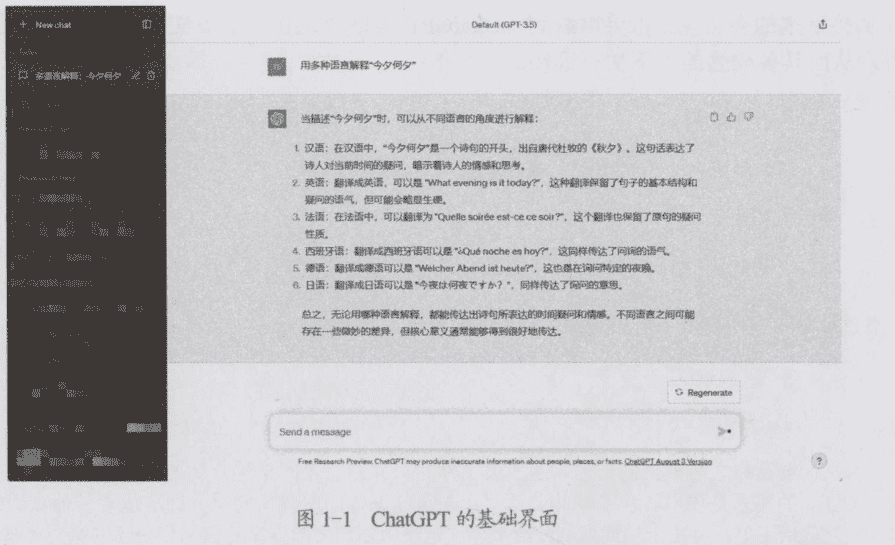

图 1-1 基础界面展示

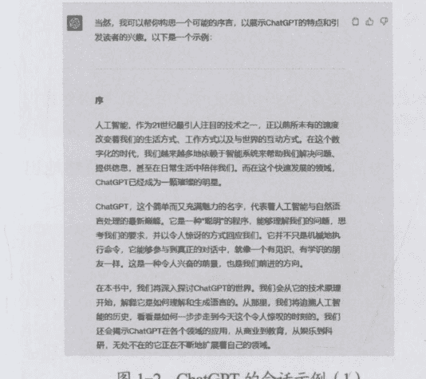

图 1-2 会话示例一

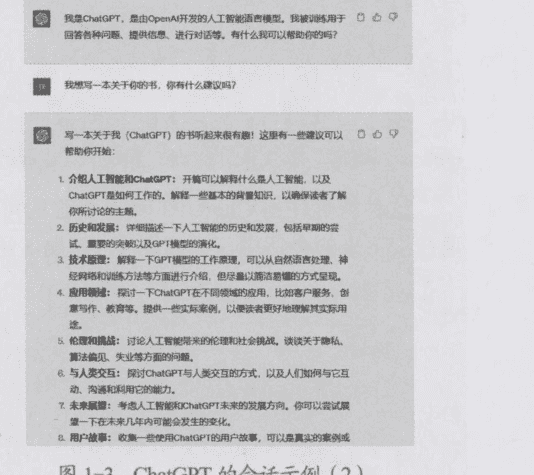

图 1-3 会话示例二

#### 1.2.2 连续对话能力
连续性指交流过程中各部分及整体内容和上下文能够自然衔接。保持连续性是保证逻辑、语义和上下文一致性的关键，能提升交流效果，避免误解。

与该系统对话可以实现连续交流，上下信息相互呼应，使复杂问题的交互更顺畅。通过不断追问和修正，可获得更深入的答案，也能更便捷地辅助日常工作。

从会话 1.2 可见，它能“记住”上下文并进行逻辑分析，具备较强的上下文一致性。

> 会话 1.2 问题 1：
> 你知道吗，小李刚刚把上周从我这借的书还回来了。
会话 1.2 回答 1：
很高兴听到小李已经把你上周借给他的书还回来了！

> 会话 1.2 问题 2：
> 小李和书有什么关系？
会话 1.2 回答 2：
根据你之前提供的信息，小李借了你的书并把它还回来了。从这个上下文来看，小李和书之间的关系是借书者和书籍的关系。小李可能是你的朋友、同学、同事或者其他认识的人，他向你借了书，并在上周把书还给了你。这表明你们之间存在着借书和归还书籍的关系。

> 会话 1.2 问题 3：
> 你可以猜出书的标题是什么吗？
会话 1.2 回答 3：
作为一个语言模型，我无法直接了解你借给小李的具体书籍的名字。我只能根据你提供的信息进行猜测。由于我没有上下文中的更多细节，所以无法确定书的具体名字。

这种特性使其可用性极强，前文铺垫的上下文会自然延续到后续对话，如问题 4、问题 5 所示。

> 会话 1.2 问题 4：
> 小李对自然语言处理比较感兴趣，这本书的书名可能是什么？
会话 1.2 回答 4：
小李对自然语言处理感兴趣，以下是一些实际存在的与自然语言处理相关的书籍，他可能会对它们感兴趣：
“Speech and Language Processing” – 丹尼尔·朱夫斯凯 and 詹姆斯·马丁
“Natural Language Processing with Python” – 斯蒂文·伯德、艾文·克莱因 和 艾德华·洛珀
“Foundations of Statistical Natural Language Processing” – 克里斯滕·曼宁 和 海因里希·舒策
“Neural Network Methods for Natural Language Processing” – 约阿夫·戈尔德贝格
“Speech and Language Processing: An Introduction to Natural Language Processing, Computational Linguistics, and Speech Recognition” – 丹尼尔·朱夫斯凯 and 詹姆斯·马丁
这些书籍涵盖了自然语言处理的各个方面，从基础概念到深入技术，可能会满足小李对

#### 1.2.3 提示词运用技巧
实际使用中，提问的对齐度越高，语义越清晰，模型越容易给出准确答案。对齐性是上下文连续性和词汇指代一致性的综合体现。前者要求话题贯穿全程避免逻辑跳跃，后者要求名词与代词如他、你、我等指向唯一明确。提升对齐性可让模型语义更集中，提高对话质量。这种技术即提示词工程。

##### 1. 提示词是什么
提示词是用户向模型提出的需求。会话虽以自然语言进行，但其中最精炼明确的语义信息即为提示词。例如会话 1.2 问题 4，“小李对自然语言处理比较感兴趣，这本书的书名可能是什么？”中的关键提示词是“自然语言处理”和“书名”，其余为承上启下的联系信息。问题 5 中，“这些著作”为连接提示词，将前文书名传递过来；“主要观点和贡献”则是规定回答内容范围的提示词。

会话 1.3 中“补全以下语句”和“请解释”即为提示词。

> 会话 1.3 问题 1：
> 补全以下语句，床前明月光
> 会话 1.3 回答 1：
> 疑是地上霜，举头望明月，低头思故乡。
> 会话 1.3 问题 2：
> 请解释，床前明月光
> 会话 1.3 回答 2：
> “床前明月光，疑是地上霜”，这是中国唐代诗人李白创作的《静夜思》的开头两句。这两句诗描绘了一个人在夜晚躺在床上，看到明亮的月光，心生疑惑是否是地上凝结的霜。

会话 1.4 显示，模型并未直面颜色能否用数字表示的矛盾，而是纠结于“颜色的数字”是否准确，实际上它在回答“天空的颜色是()，转化为数字为()”。这说明“转化为数字”的分句起到了不当提示词的作用。

> 会话 1.4 问题 1：
> 天空是什么颜色的？请用数字回答我的问题
> 会话 1.4 回答 1：
> 天空在白天通常呈现蓝色，尤其是在晴朗的天气条件下。但是，天空的颜色并不是固定不变的，它会受到很多因素的影响，如日出、日落时的红、橙色，以及云层的遮挡和湿度的变化等。因此，无法用一个准确的数字来描述天空的颜色。
> 会话 1.4 问题 2：
> 一天有多少秒？请用数字回答我的问题
> 会话 1.4 回答 2：
> 一天有 24 小时，每小时有 60 分钟，每分钟有 60 秒。因此，一天总共有 24×60×60=86400 秒。

在问答 1 中，天空颜色无法用数字描述，故无法按要求作答；问答 2 中，一天秒数可用数字表示，故给出正确结果。

##### 2. 高效提示词要点
提示词能有效约束模型反馈行为，被业界视为提示工程技术，即用户与 GPT 模型交互的方式。

- 好的提示词具有排他性，避免歧义。
- 好的提示词描述性强，多用类比举例界定问题范围。
- 好的提示词目标明确，需规定回复针对何问题、从哪方面展开、遇何情况应如何回复。
- 提供提示词时不必吝啬，可反复重申以包裹问题。
- 可尝试调整提示词与问题的顺序，因模型侧重点可能与预期不同，多试几种排列可找到最优方案。

#### 1.2.4 插件扩展应用
插件是软件功能的重要扩展方式。该产品提供丰富的插件生态，可将智能对话能力与解决实际需求结合。随着插件数量与应用范围扩大，其适用场景显著提升。面向数学、语音、笔记等细分场景提供了一系列易用插件。用户可按需选择，模型将调用对应插件进行对话。

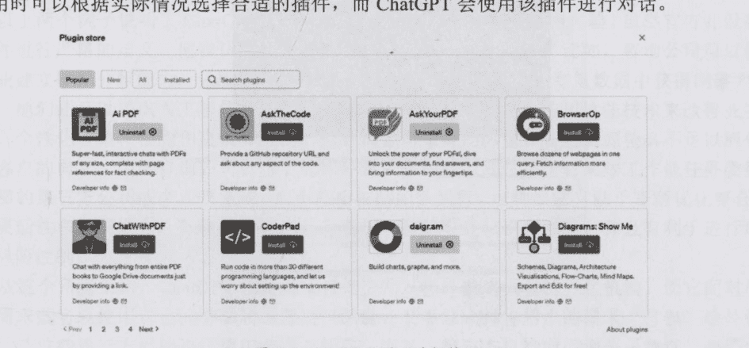
每轮对话里，是否启用插件完全由使用者自行决定，操作方式很直观，只需在对应选项上点选打勾即可。下面的演示中，Wolfram 与 Expedia 两项能力被同时激活，如图 1-5 所示，代表后续交流会调用这两套外部资源。

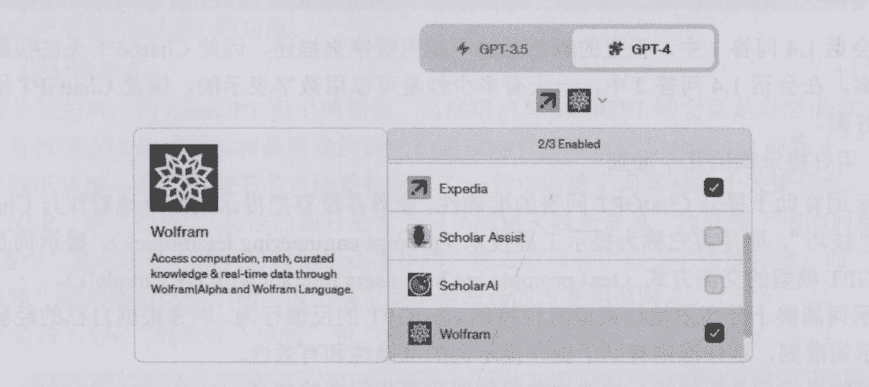
先看图 1-6 的 Wolfram 用例，该插件聚焦数学类内容。提问为“请借助此插件说明勾股定理”。ChatGPT 的产出分为两层：置于黑色框内的为插件原生的返回，是直接的反馈；另一层则是模型基于该反馈进行的提炼与表述。相比自有回答，接入 Wolfram 后输出更精炼，还能附带来源引用，明显提升了数学问题的专业水准。

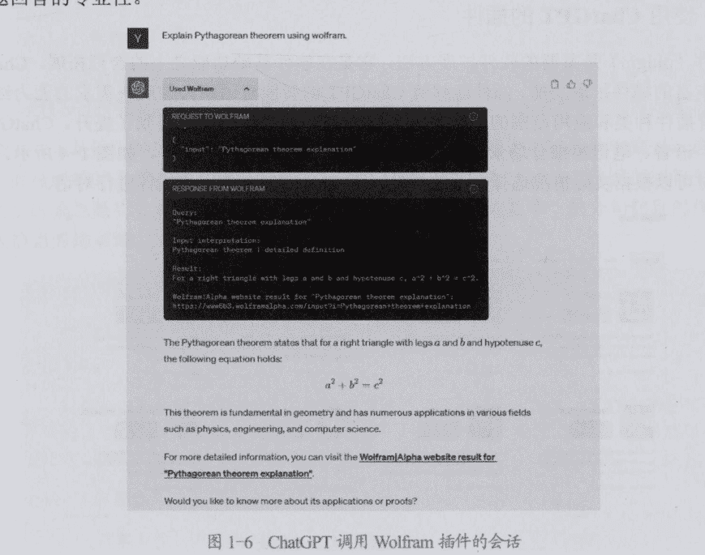
图 1-7 则展示 Expedia 插件的应用场景，专长在于旅游路线规划与住宿安排。提问是“我准备去伦敦，想去大英博物馆和哈利波特里出现的九又四分之三站台”。此处仅关注模型对插件返回信息的综合结果。综合后的内容篇幅较长并带有配图，图与信息均由 Expedia 提供。模型的智能体现在据此为用户定制了三天行程，筛选出三家酒店并进行优劣对比，还细致考虑了住宿地点与大英博物馆、国王十字车站之间的位置关系。由此可见，该插件强化了模型与真实地理数据的结合能力。

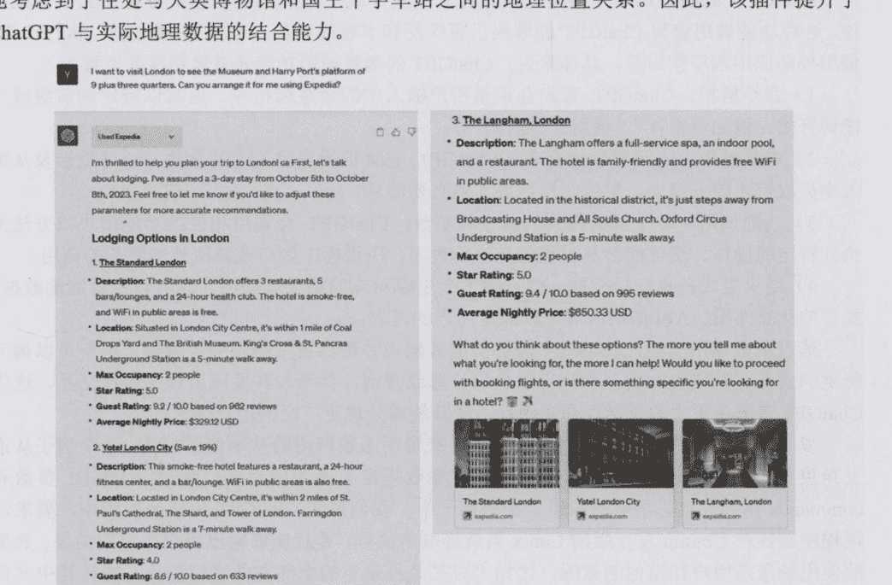
两个案例说明了插件对使用体验的提升作用。官方并未给出严格的插件定义，笔者认为可以用咨询服务的逻辑来理解。咨询机构可帮助企业搭建数据分析能力，涵盖数据采集、处理、分析与挖掘，从海量信息中提炼洞察；同时提供人工智能与机器学习的咨询，助力优化业务流程、个性化营销、预测决策等。但一家咨询公司的规模与智力资源难以覆盖全部客户需求，于是有时会将部分任务外包。外包即把特定工作委托给外部第三方完成，而非内部团队执行，有利于资源整合、提升灵活与扩展性，外包方往往具备更深厚的专业经验，也有助于成本与风险管控。

换个角度，ChatGPT 扮演的就是咨询公司，插件相当于众多外包机构。它既能凭借自身能力直接服务，也可把用户需求打包交给第三方由其给出更专业的解答。第三方对咨询公司负责，咨询公司拿到结果后进行分析和整合，最终交付用户。ChatGPT 的角色至关重要，因为需求拆分与整合都发生在这里；而插件的职责是接收明确指令，按固定格式给出准确快速的响应。

#### 1.2.5 ChatGPT 函数调用机制
函数调用是指通过设定特定指令触发模型执行预设功能或操作。该能力让 ChatGPT 能查询数据库、完成计算、调用外部接口等。具体流程通常包含：

1. 指令识别：模型先从用户输入中捕捉命令或关键词，如“执行”“调用”“运行”等。
2. 参数抽取：识别指令后，模型从输入中提取关键词、数值、日期等必要参数。
3. 功能执行：依据解析后的指令与参数，调用对应模块或方法，可能涉及函数库、API 或外部服务。
4. 结果输出：执行完毕后生成相应回复，如返回数据、计算结果或 API 响应，以满足需求。

借助函数调用，ChatGPT 的服务边界被扩展，可用于信息查询、实时数据获取、简单计算甚至跨应用交互，从而提升灵活性和实用性。

下面以官方示例说明基本用法。该示例通过 description 参数对函数功能进行语义描述，通过 required 参数与命令指针限定输入输出。任务是让模型生成一段能在 Ubuntu 终端运行的脚本，并输出用户指定的结果。典型场景是用户意图明确，例如“统计某个目录下所有文件，找出文件大小超过 50MB 的文件”。

函数调用并非常规对话，需要借助 API 实现。在会话 1.5 的问题 1 中，通过 functions 字段定义了一个函数，语义非常清晰：交互壳类型、运行系统、回答范围限于脚本内容等。正因约束明确，模型给出了直接了当的回复。

```
会话 1.5 问题 1：
{
    "model": "gpt-3.5-turbo",
    "messages": [
        {
            "role": "user",
            "content": "get_commands，对某个目录下的全部文件进行统计，统计其中文件大小大于 50MB 的文件"
        }
    ],
    "functions": [
        {
            "name": "get_commands",
            "description": "Get a list of bash commands on an Ubuntu machine to run",
            "parameters": {
                "type": "object",
                "properties": {
                    "commands": {
                        "type": "array",
                        "items": {
                            "type": "string",
                            "description": "A terminal command string"
                        },
                        "description": "List of terminal command strings to be executed"
                    }
                },
                "required": ["commands"]
            }
        }
    ]
}
```
> 会话 1.5 回答 1：

```
{
    "role": "assistant",
    "content": "
        您可以使用以下命令来统计某个目录下的全部文件，并筛选出文件大小大于 50MB 的文件：
        bash
        find /path/to/directory -type f -size +50M
        
        其中，‘/path/to/directory’ 是您要统计的目录的路径。
        该命令使用 ‘find’ 命令来查找目录下的全部文件，并使用 ‘-type f’ 参数来筛选出普通文件。然后使用 ‘-size +50M’ 参数来筛选出文件大小大于 50MB 的文件。
    "
}
```
### 1.3 ChatGPT：职场与学习的助力
笔者认为，凭借优秀的对话理解与上下文保持能力，ChatGPT 可在文字工作、程序开发、市场营销、外语学习、家计教育等领域提供支持。

#### 1.3.1 为写作者提供内容支持
文字工作者以文字创作为主业，通过文字表达思想、观点与情感，产出文学作品、新闻报道、广告文案、博客、社交媒体内容、商业文档等。该群体包括作家、记者、广告撰稿人、编辑、内容营销专家、技术写作者等。

#### 1.3.2 程序开发者的代码助手
程序开发者利用编程语言与开发工具创建、测试与维护各类软件。他们可在网站、移动端、桌面端等不同领域工作。

日常工作中，开发者主要关心两个问题：最优实现代码片段在哪，以及如何为变量命名。ChatGPT 在此方面表现突出。

由于代码是复杂的综合体，开发者往往需拆分为无数片段逐一解决。ChatGPT 可作为代码片段助手提供帮助，具体方式有：

- 代码示例：描述目标功能或待解问题后，模型可生成参考代码片段。
- 语法与命名建议：交互式地获得语法改进、格式化提示或更佳的变量、函数命名建议，提升可读性和可维护性。
- 调试与异常处理：描述遇到的错误，获取修复建议与调试策略，加速问题定位。

#### 1.3.3 市场营销人员的文案与创意伙伴
市场营销人员负责制定与执行营销策略，促进产品或服务销售，并维系目标客户关系。通过调研、品牌推广、推广活动与销售策略实现目标。

对营销人员而言，ChatGPT 可作为文案与创意助手，具体用途包括：

- 标语与广告语：提供产品或品牌信息后，协助生成吸引力强、富有创意的标语。
- 内容创作：围绕主题、受众与目标进行对话，请求生成文章、博客或社交媒体内容。
- 社交媒体策略：就受众、平台、内容类型给出策略建议，包括发布频率与创意方向。
- 品牌声誉管理：就负面评论或舆情事件讨论应对策略、危机管理与舆论引导方法。

#### 1.3.4 外语学习者的规范写作助手
外语学习者学习并使用非母语，目标是扩展语言能力与跨文化交流能力。目标涵盖口语流利度、听力、阅读与写作。学习者包括学生、在职人士、旅行者等，学习路径多样。

主要挑战有语言障碍、语音语法词汇规则、文化语境差异与信心不足，通过等级考试亦是压力来源。

ChatGPT 可提供以下帮助：

- 学习辅助：进行实时语言交流练习，纠正语法错误，提供词汇选择，提升口语流利与准确。
- 语言解释与资源：解答语法规则、词汇释义与用法，提供示例与学习资源建议。
- 写作指导：分享作文获得语法纠错、词汇替换、句式重组建议，提升表达质量。
- 考试准备：提供练习题、模拟测验与备考技巧，反馈评估语言水平。

此外，作为规范写作助手，ChatGPT 还可：

- 语法与拼写检查：在写作过程中实时提示语法与拼写问题，提升文本准确性。
- 句式与表达优化：协助改写句子，提供替代表达，使意思更清晰准确。
- 词汇与短语建议：遇到用词难题时提供更具表现力的词汇与短语。
- 文体与语气调整：根据写作目标与受众建议文体选择、语气调整与语言风格。

#### 1.3.5 家长的教育辅导助手
从家庭教育视角看，家长最头疼的问题之一是帮助孩子应对考试与评估压力。需要关注学习成效与成绩焦虑、指导学习方法、管理考试压力，并提供学科辅导。

对家长而言，ChatGPT 可作为作业辅导助手提供支持：

- 概念解释：孩子对学科概念理解困难时，可提问并获得解释与示例，便于转述给孩子。
- 解题思路：就难题或作业与模型讨论解题思路，获取启发，共同找到解决路径。
- 资源推荐：为不熟悉学习资源的家长推荐教材、在康线课程、练习题等优质资料。
- 学习方法与时间管理：咨询如何制定学习计划、提升效率、培养良好学习习惯等建议。

# 第 2 章
## ChatGPT 之心
本章将介绍 ChatGPT 的原理，梳理自然语言处理领域的演进脉络与技术发展轨迹，总结大规模深度神经网络的规模与时间线。NLP 的应用覆盖文本处理与交互的各个层面。ChatGPT 基于 Transformer 架构的预训练语言模型，具有强大的生成能力，通过大规模神经网络极大拓展了 NLP 的可用性与应用范围。

ChatGPT 并非唯一的大模型，竞争对手众多。发展方向总体指向参数规模更大、可处理 token 数量更多的模型，规模已达十亿级乃至万亿级。

| 本章内容 |
| --- |
| 自然语言处理 |
| 大语言模型 LLM |

### 2.1 自然语言处理
自然语言处理是用计算机处理人类自然语言的技术。它曾是衡量 AI 智能水平的重要标尺，图灵测试中判断人与机器的关键就是自然语言对话。若人无法区分对话对象是人还是机器，则 AI 具备智能。这充分体现了 NLP 的重要性，其目标正是让机器像人一样交流。

#### 2.1.1 NLP 的应用场景
在进入原理介绍前，先说明相关研究领域。ChatGPT 所属领域为 NLP，研究对象为语料，通过计算对语料进行处理，广泛应用于各类文字处理场景。

NLP 在语义分析中应用广泛。语义分析是通过解析文本中的语义信息理解含义与推断意图，NLP 在文本分类、意图识别、实体识别、关键词提取、情感分析、问答系统等方向前景广阔。

- 文本分类，可将邮件分为垃圾邮件与非垃圾邮件，将新闻归类到不同主题，或将社交媒体帖子判别为正面或负面情感。
- 意图识别，可理解用户意图并作出恰当回应。

NLP 语义分析的实战力量

- 实体识别：从自然文本中抽取出人名、地点、组织等具体对象，为信息抽取和知识图谱构建提供抓手。
- 关键词提取：把文本的核心词或短语筛出来，帮助快速把握主题与重点。
- 情感分析：判断评论、反馈等文本的积极、消极或中性倾向，在社交媒体舆情、品牌声誉维护和用户意见分析中作用明显。
- 问答系统：让机器读懂提问，从资料里定位相关信息并生成答案。

以上只是语义分析的冰山一角，却已能说明 NLP 在日常工作中的不可替代性。随着技术迭代，语义能力的边界不断外扩，机器翻译成为首个大规模扩展场景，在此基础上内容甄别、自动语法矫正等对智能化要求更高的功能也逐步落地。

##### 1. 机器翻译

机器翻译是用计算机配合自然语言处理把一种语言的文本自动转成另一种语言。技术路线大致经历了四次演进。

- 基于规则的机器翻译：RBMT 依赖人工撰写的词法、句法、语义规则，把源句映射到目标句。可解释性强、控制精细，但规则量大、对语言专家的依赖高，对应 NLP 的符号学阶段。
- 基于统计的机器翻译：SMT 以统计模型为核心，利用大规模双语平行语料学习映射规律，通过统计算法与语言模型挑选最佳译文。能从数据中自学，但对稀缺语料和复杂句式适应有限，对应统计学阶段。
- 神经网络机器翻译：NMT 近年主流做法，以 RNN、Transformer 等深度模型把源句编码为中间向量再解码为目标句。训练中自动捕捉语义与上下文，对长句和复杂结构更友好，对应大模型新阶段。
- 基于预训练模型的机器翻译：BERT、GPT 等预训练语言模型被引入翻译任务，利用其对源语与目标语对齐关系的建模能力，与传统译法结合以提升准确度。

翻译面临语言差异、多义现象、上下文理解、数据稀缺和专业术语等挑战。实际系统多为混合方案，NLP 在其中主要承担特征数字化供给和多路方法整合的角色。

##### 2. 内容识别

NLP 在识别有害或敌意语言上应用广泛，核心难点在于语义层面的判定，而非字面替换。

- 垃圾邮件过滤：分析邮件正文、发件人及元数据，识别恶意或垃圾内容。
- 情感分析：探测文本的敌意或攻击性，识别侮辱、威胁、仇恨言论等。
- 文本分类：训练模型把文本归类，标记出敌意或不适宜的内容。
- 关键词过滤：借助预定义词表或自动学习，揪出攻击性、歧视性等敏感词。
- 文本规则与模式匹配：通过语法、词汇、短语结构等规则定义敌意模式进行捕捉。
- 社交媒体监测：实时解析帖子、评论、私信，及时发现恶意行为。

有害语言的判定受文化、语境和主观判断影响较大，模型易出现误判，落地时需结合多源信息、人工复核与反馈闭环来提升准确性和适用性。

##### 3. 语法错误校正

语法校正旨在自动发现并修正写作中的语法问题，提升文本质量。

- 基于规则的方法：运用句法、词性、词形等语言规则检测主谓不一致、时态错误、冠词误用等。
- 统计机器翻译方法：用句子对齐的平行语料训练模型，学习正确与错误的对应关系以实现自动修正。
- 基于机器学习的方法：通过特征工程提取句子或词级特征，用分类或序列标注模型学习错误模式。
- 神经网络方法：采用循环网络或序列到序列模型对输入建模，直接生成校正后的文本。

语法规则和错误类型复杂，歧义或上下文相关错误仍具挑战，人工审核与反馈在实际产品中不可或缺。

##### 4. 自然语言交互

ChatGPT 是该方向的代表作，基于 Transformer 预训练架构，具备强生成能力，设计目标是产出连贯有意义的文本。

- 能生成自然流畅的对话回复，理解上下文并给出连贯应答。
- 依托海量训练数据，知识覆盖面广，可回答各类问题并提供建议与事实。
- 能识别用户意图，处理信息提供、问答、建议等多种查询，适配不同场景。
- 可随对话上下文灵活调整语气与个性，提供更具个性化的体验。
- 时常产生创造性输出，如故事、笑话、成语解释等，使交互更生动。

后续将从大模型原理角度解释上述能力背后的计算基础。

#### 2.1.2 自然语言处理的发展阶段

从 50 年代起，人类尝试用数值计算处理语言，NLP 经历了符号、统计到深度学习大模型三大阶段。

##### 1. 符号学阶段

Symbolic NLP 强调符号操作与规则系统，视语言为形式化结构，通过符号间关系进行解析、推理与生成。

- 知识表示：用逻辑表达式、语法规则或语义网络精确表征语义。
- 规则系统：以逻辑推理、规则匹配、模式匹配完成语义解析与生成。
- 语言规则与语法：用上下文无关文法描述句法，用语义角色标注描述词语与结构的关联。

优势在于解释性强、可控性高，在问答、规则引擎、法律医学等领域有价值。局限是规则需人工大量编写，对歧义和灵活性适应差。深度学习兴起后，统计与神经方法成为主流，但并未完全抛弃符号思想，而是与数据驱动结合。

##### 2. 统计学阶段

Statistical NLP 依赖统计模型与机器学习，从大规模语料中学习语言概率分布与模式。

- 概率建模：用 n-gram 等模型计算句或词序列概率。
- 特征提取：抽取词频、词性、上下文等特征用于标注、命名实体识别、句法分析等。
- 监督与无监督学习：前者靠标注数据训练，后者从非标注数据自动学习结构。
- 统计推断与概率计算：借助贝叶斯推断、马尔可夫链等求最可能解析。

其优势是能从海量数据中学习统计规律。

##### 3. 深度学习大模型阶段

符号阶段奠定表达基础，统计阶段构建概率模型，深度学习则把知识外化为人机自然交流能力。大模型时间线如下：

- 词法与句法分析 1950—1960 年：把文本切分为词项并解析句法结构，研究集中于规则解析。
- 语义分析 1960—1970 年：关注词句间含义关系，出现语义网络、语义角色标注等方法。
- 机器翻译 1970—1980 年：早期基于规则效果有限，统计机器翻译带来进展。
- 统计语言模型与概率图模型 1980—1990 年：n-gram、HMM、CRF 广泛用于词性标注、命名实体识别。
- 语料库语言学与分布式表示 1990—2000 年：借助大规模语料研究语言，Word2Vec、GloVe 等把词映射为向量捕捉语义关联。
- 深度学习与神经网络方法 2010 年至今：RNN、LSTM、GRU、CNN、注意力机制等推动大模型学习海量语料，增强语义表达与生成能力。

#### 2.1.3 自然语言处理与深度神经网络

深度神经网络以可无限增长的参数规模为优势，有机会学习自然语言的复杂特征。

##### 1. 何为深度神经网络

深度神经网络由多层神经元堆叠而成，传统网络仅数层，而深度网络可达数十至上百层，支持更复杂抽象表示。每一层接收前层输出经非线性变换后传向下一层，直至最终输出。可用于图像、语音、NLP 等任务，凭借多层非线性变换学习高级特征。训练多用反向传播优化参数，以最小化损失函数。

##### 2. 深度神经网络的训练和训练方法

网络由多层神经元构成，结构精密，训练即参数寻优。

- 前向传播：输入逐层前推，每层输出经激活函数如 Sigmoid、ReLU 非线性转换。
- 反向传播：先计算输出与目标的误差即损失梯度，再自输出层向后逐层传递梯度，按链式法则更新各层参数，配合梯度下降等优化器不断逼近最优。迭代进行中，网络逐步学习数据模式以提升预测与分类能力。

##### 3. 自然语言处理中的深度神经网络

以下方法承前启后，共同推动 NLP 发展：

- 循环神经网络 RNN，1990 年提出：序列模型，通过循环连接传递信息，处理变长序列，但长期依赖易出现梯度消失或爆炸。
- 长短时记忆网络 LSTM，1997 年提出：引入遗忘门、输入门、输出门，有效捕捉长期依赖，缓解梯度问题，在语言建模与机器翻译中表现突出。
- Word2Vec，2013 年提出：学习词向量分布式表示，使语义相近词在空间中靠近。CBOW 以上下文预测中心词，Skip-gram 以中心词预测上下文。

2014 年面世的注意力机制，让模型在处理序列数据时能够动态地挑选关注点。它通过学习注意力权重来调度序列内部的信息传递与表示，从而提升对输入的理解与处理效果。该机制在机器翻译、文本摘要、问答系统等任务中应用广泛，对长句子和长距离依赖的应对能力尤为突出。

同样在 2014 年被用于文本生成的生成对抗网络，是由生成器与判别器构成的对抗式框架，通过博弈训练来产出逼真样本。在自然语言处理中，GAN 常用于文章生成、对话系统、机器翻译等方向，生成器通过学习数据分布来输出与真实文本相近的语言内容。

2017 年问世的 Transformer 模型是一种以自注意力为核心的神经网络架构，用于序列处理并实现并行计算与长距离关联的捕捉。它在机器翻译上带来突破性进展，并成为 NLP 的重要基石。模型凭借自注意力与多头注意力，能够并行处理序列、把握远距离依赖，同时避免了传统 RNN 易出现的梯度问题。

### 2.2 大语言模型全景

ChatGPT 这类 LLM 依托海量语料、多元训练样本、上下文理解以及迁移学习等手段，实现了跨领域的泛化表现。这使其在不同任务与场景下都能稳定发挥，成为通用型语言处理工具。

LLM 处理语言的最小颗粒是 token，即模型对输入文本进行切分与编码后的基本单元。对 token 序列的运算需要强大的上下文理解力，而支撑这一能力的核心计算范式是基于自注意力的 Transformer 网络结构。ChatGPT 的语言能力正是建立于此。

#### 2.2.1 LLM 整体概览

##### 1. LLM 到底是什么
LLM 是面向自然语言生成与理解的人工智能模型，通过在超大规模文本语料上训练，使其能学习语法、语义与上下文，并输出类人语言。目前大量商业公司投入研发，其文本生成效果突出，具上下文理解与连贯回复能力，但尚未形成教科书式的统一定义。从主流产品来看，可归纳出几项共性特征来勾勒其轮廓。

其一，本质上是机器学习模型，形式上是参数规模极大的深度神经网络；其二，与传统模型不同，它追求的是宽泛问题求解，而非单一任务；其三，具备演化特性，往往提供一个充分预训练的基础网络，可针对特定任务进行增强以拓展能力边界。

##### 2. LLM 发展脉络
为提供量化视角，下文统计了截至本书完稿时部分 LLM 及其规模。值得关注的是参数规模与语料规模的量纲，参数量已从十亿级攀升至万亿级。语料规模除常见的 word 外，token 已成为现代 NLP 的核心计量单位，具体将在后文展开。自然语言处理模型的发展时间线见表 1-1。

表 1-1 自然语言处理模型的发展时间线

| 模型名称 | 发布年份 | 开发者 | 参数规模 (单位：十亿个 (billion)) | 语料库规模 (单位：十亿个 (billion)) | 语料库规模量纲 | 训练数据规模 (单位：十亿比特 (GB)) |

| :--- | :--- | :--- | :--- | :--- | :--- | :--- |

| AlexaTM | 2022 | Amazon | 20.00 | 1300.00 | tokens | — |

| Claude | 2021 | Anthropic | 52.00 | 400.00 | tokens | — |

| Ernie 3.0 Titan (文心) | 2021 | Baidu (百度) | 260.00 | — | — | 4000.00 |

| BloombergGPT | 2023 | Bloomberg L.P. | 50.00 | 363.00 | tokens | — |

| Chinchilla | 2022 | DeepMind | 70.00 | 1400.00 | tokens | — |

| Gopher | 2021 | DeepMind | 280.00 | 300.00 | tokens | — |

| GPT-Neo | 2021 | EleutherAI | 2.70 | — | — | 825.00 |

| GPT-J | 2021 | EleutherAI | 6.00 | — | — | 825.00 |

| GPT-NeoX | 2022 | EleutherAI | 20.00 | — | — | 825.00 |

| BERT | 2018 | Google | 0.34 | 3.30 | 单词量 | — |

| XLNet | 2019 | Google | 0.34 | 33.00 | 单词量 | — |

| LaMDA | 2022 | Google | 137.00 | 1560.00 | 单词量 | — |

| PaLM 2 | 2023 | Google | 340.00 | 3600.00 | tokens | — |

| PaLM | 2022 | Google | 540.00 | 768.00 | tokens | — |

| Minerva | 2022 | Google | 540.00 | 35.00 | tokens | — |

| GLaM | 2021 | Google | 1200.00 | 1600.00 | tokens | — |

| PanGu (盘古) | 2023 | Huawei(华为) | 1085.00 | 329.00 | tokens | — |

| BLOOM | 2022 | Hugging Face | 175.00 | 350.00 | tokens | — |

| OpenAssistant | 2023 | LAION | 17.00 | 1500.00 | tokens | — |

| LLaMA | 2023 | Meta | 65.00 | 1400.00 | tokens | — |

| Galactica | 2022 | Meta | 120.00 | 106.00 | tokens | — |

| OPT | 2022 | Meta | 175.00 | 180.00 | tokens | — |

| Megatron-Turing NLG | 2021 | Microsoft and Nvidia | 530.00 | 338.60 | tokens | — |

| GPT-2 | 2019 | OpenAI | 1.50 | — | — | 40.00 |

| GPT-3 | 2020 | OpenAI | 175.00 | 300.00 | tokens | — |

| GPT-4 | 2023 | OpenAI | 1000.00 | — | — | — |

| Falcon | 2023 | Technology Innovation Institute | 40.00 | 100.00 | tokens | — |

| YaLM 100B | 2022 | Yandex | 100.00 | — | — | 1700.00 |

| Gemini-Ultra | 2023 | Google | 1560.00 | — | — | — |

| Gemini-Nano-1 | 2023 | Google | 1.80 | — | — | — |

| Gemini-Nano-2 | 2023 | Google | 3.25 | — | — | — |

Gemini 是 Google 于 2023 年底发布的与 ChatGPT 竞品的大模型，其特点值得关注。首先它并非纯文本模型，而是基于 Transformer 解码器的多模态理解模型，可完成图文识别等任务，因而参数规模更大；其次为适配不同设备，它按参数量提供 Ultra、Pro、Nano 三个版本，分别面向后台集群、专业电脑与轻量终端，版本间参数差异明显。这种适配性增强已成为大模型产品的重要趋势。

##### 3. 跨领域泛化能力
领域泛化指模型在未曾见过的领域或任务上的表现。若模型仅在特定数据上训练，会在该领域表现优异，却在其他场景失灵。具备泛化能力的模型能迁移训练时习得的知识与技能，适应新语境与语言习惯，并给出恰当理解与生成。

泛化能力对实际应用至关重要，因模型常需迁移到新场景。良好的泛化模型可快速适应新环境，无需大规模重训。提升手段包括多领域训练、数据增强、迁移学习与模型正则化等，有助于模型更好地处理多样语言数据，提升在未知领域的效果。

LLM 能实现泛化的根本在于大规模训练与覆盖各领域的广泛文本。模型在不同领域的语料上学习，形成通用语言规律、语义理解与上下文推理能力。

具体助力因素包括：
- 大规模语料库：涵盖网页、新闻、维基、书籍等互联网文本，覆盖多领域知识与表达方式。
- 样本多样性：训练时纳入不同领域、主题与风格的文本，使模型接触多样化语言。
- 上下文理解力：借助 RNN 或 Transformer 等深度结构，模型能从上下文推断隐含关联，适应不同文本。
- 迁移学习与微调：可在特定领域数据上微调，使模型在该领域表现更佳，同时保留对他领域的泛化能力。

总体来看，LLM 凭借海量语料、多样样本、上下文理解与迁移微调等技术，实现了跨领域泛化，成为通用语言处理工具。

##### 4. 预训练机制
预训练是一种参数优化方式，用以赋予 LLM 通用的背景知识与语言理解能力。训练过程采用大规模无监督学习，在海量文本上进行，学习语言的统计特征、词间关系与语义表征。模型借此掌握上下文与语境，捕捉词语关联、句法结构与文本整体意义，且无需人工标注标签，通过观察大量文本逐步形成理解与表达能力。

预训练目标是构建广泛领域知识与泛化能力。通常预训练模型含数十亿参数，可建模复杂语言模式，作为后续特定任务的起点，再通过微调适配领域需求。

LLM 的大规模无监督预训练旨在学习语言统计与语义知识，为后续微调提供强起点，提升数据利用效率、增强泛化与上下文理解水平。通过预训练，模型从无监督数据中习得通用语言表征与语义知识，为特定任务微调奠定坚实基础，预训练-微调范式在 NLP 领域已得到广泛验证。

#### 2.2.2 Token 与词向量解析

##### 1. 语言向量化
LLM 处理自然语言的第一步是对文本进行向量化，即把文本映射为数值向量，便于计算与机器学习。常见量化方法有独热编码、词袋模型、词嵌入、GloVe、BERT 等，各有优劣并可组合使用，具体选择取决于任务需求。

ChatGPT 作为预训练语言模型，并不显式进行独立的向量化步骤。它接收自然语言输入，经内部神经网络处理后生成响应。在 ChatGPT 中，向量化是多层 Transformer 网络隐式完成的。各层借助自注意力捕捉上下文信息，将其转化为高维表征，并在层间传递与变换，最终驱动输出。

Transformer 与注意力将在后文详述，这里需留意，向量化既可以是显式的独立计算，也可以隐含于整体流程中。理解词向量对把握 LLM 与 ChatGPT 有帮助。

##### 2. 最小单元 Token
Token 是 LLM 向量化过程中的关键概念，指模型对输入文本切分与编码后的最小单位。虽称词向量，实际操作对象是 token。

在 NLP 任务中，文本被拆分为 token 序列，token 可为词、字符或其他粒度。每个 token 映射为向量，承载语义与上下文信息。中文处理常见切分方式有：
- 按字符切分：如“我喜欢吃水果”→ ["我","喜","欢","吃","水","果"]
- 按词语切分：如“我喜欢吃水果”→ ["我","喜欢","吃","水果"]
- 混合切分：兼顾整词与细粒度，如 ["我","喜欢","吃","水","果"]

切分方式需结合任务选择。中文分词对语义理解与信息抽取至关重要，合理的 token 划分能提供更精准的输入表示，提升模型效果。

##### 3. 词向量的价值
词向量是自然语言计算的经典表征方式，通过将词汇映射到高维空间向量，使语义相近的词在空间中位置相近。

LLM 以词向量为载体实现语料的量化运算。向量不仅可用于词汇定位，还能刻画词间关联。复杂语料分析于是被抽象为向量间的计算与预测。语言语法决定了词汇的排列规律，这既体现在语法关系，也体现在使用习惯，经过词向量数字化后，规律表现为向量组合的数值分布特征。

自然语言的数值特征具有非线性，深度学习在描述非线性方面优势明显，这也是深度神经网络成为 LLM 实现基础的原因。

##### 4. 词向量的本质
词与词向量是 NLP 的原材料，计算机以向量形式理解、加工与输出语言。ChatGPT 具备听、说、想三重能力，听与说是语言，想是计算。计算机内部只有逻辑运算，缺乏“之乎者也”，因此需建立语言与数字计算的对应关系。任何处理前都需先数字化。

若把一幅图像视为像素的规则排列，每个像素可用数字串表示，则像素是视觉信息的最小单元。词汇是语言的最小单元，词及其词向量即语言的像素，是语言与数字计算的桥梁。模型“阅读”即把用户输入的词转化为数字化的词向量。

##### 5. 概念起源
词向量英文亦称 word embedding，意指将词汇嵌入语义空间。该概念并非新近，2000 年出版的《Speech and Language Processing》第六章“Vector Semantics and Embeddings”已有介绍，开篇引用庄子：

> 筌者所以在鱼，得鱼而忘筌。
Nets are for fish; Once you get the fish, you can forget the net.
言者所以在意，得意而忘言。
Words are for meaning; Once you get the meaning, you can forget the words.

作者意在说明词汇是思想的载体，可用数学形式表达。若把思想视为地图，词汇即嵌入其中的像素，句子是像素构成的曲线，曲线勾勒的纹理可想象成文章。简言之，思想可抽象为庞大语义空间，词汇即该空间中的向量。

##### 6. 词向量的示例
词向量起初以拉丁语系英文为蓝本设计，但用汉语逻辑同样可理解。以下等式将做饭过程抽象为原料与工具的关键信息，去除外围细节。虽以数学形式表达显得生硬，但文字与数字间存在语义对应关系。

```
锅+水=煮
锅+油=炒
锅+油×2=炸
f(锅+水,米)=饭
```

可以做一个思维推演，把离散的词汇换成可计算的数值，令原来的等式在数学上成立。这正是把词映射为向量的基本思路。通过合理的数学设计，能让向量间的运算与词语间的语义联系相互呼应，于是擅长高速数值运算的计算机就能承接语言处理的工作。

##### 7. 词向量的生成和计算
让每个词都配一个专属向量，人工量身打造既不现实也做不完。现在的主流做法是借助大规模语料的统计规律来自动展开词向量所在的语义空间。

这里的关键是统计词与词共现的关联强度。语料可以来自书籍、网络等，按段落或句子切成大量小片段，记录片段内部出现的词。除计数词在片段里的出现次数外，还要统计它出现时邻近词出现的条件概率。以《桃花庵歌》开头两句为例：

> 桃花坞里桃花庵，桃花庵里桃花仙。
> 桃花仙人种桃树，又摘桃花换酒钱。

把每个字出现时伴随的其他字频次排成方阵，就能对语义进行建模。矩阵左上显示“桃”“花”从不分家，可推断有花即桃花；中部斜向的分布勾勒出坞生庵、庵生仙、仙人种桃树的链条；右下角则显出折枝换酒钱之意；花字对应的横向条纹表明花贯穿全句，于是换酒的枝条自然指向桃花枝。

实际工作中都能按此方式搭建词汇关联矩阵，由此得到的词表征就叫做词向量。从上例可看出，词向量既帮助人理解语料，也让机器能够以计算方式解析语料中的语义。

#### 2.2.3 ChatGPT 的 Transformer 基础结构
在自然语言处理里，上下文指被分析对象的前后脉络与因果关系。下面用桃花诗的一句演示模型如何解读。

> 会话 2.1 问题 1：
> 桃花仙人种桃树，又摘桃花换酒钱。请将这句话分解为 token，并解释它们。

> 会话 2.1 回答 1：
> 这句话可以分解为以下 token：
> 1. “桃花仙人” - 这是一个名词短语，指的是一个虚构的仙人或神话中的角色，与桃花有关。
> 2. “种” - 这是一个动词，意思是在土地上种植或培育。
> 3. “桃树” - 这是一个名词短语，指的是一种树，可以结桃子。
> 4. “又” - 这是一个连词，表示进一步的行动或事件。
> 5. “摘” - 这是一个动词，意思是采摘或取下。
> 6. “桃花” - 这是一个名词短语，指的是桃树上的花朵。
> 7. “换” - 这是一个动词，表示用一样东西交换另一样东西。
> 8. “酒钱” - 这是一个名词短语，指的是用来购买酒的货币。
> 整句话的意思是，桃花仙人种植桃树，然后采摘桃花，用它们来换取酒的钱。这句话似乎描绘了一个神秘的故事情节，涉及仙人、桃树和酒，可能有神话或文学的背景。

从对话可见，把诗句拆成 token 后会出现“桃花”“仙人”“种桃树”“摘桃花”“换酒钱”等片段。模型能读懂的前提是至少能算出：桃花仙是个人、摘桃花的主体是桃花仙、桃花仙既摘桃花又用来换酒钱。顺着此思路，若要为“桃花仙”找一个向量，这个向量必然要包含种树、摘花、换酒钱等后续概念。这些概念的总和即为语境。由此可见，ChatGPT 已通过海量语言资料的学习掌握了语境理解，而支撑这一能力的计算机制是以自注意力为基础的 Transformer 网络。

##### 1. Transformer 简述
Transformer 是一种以自注意力为核心的深度学习模型，擅长序列数据的处理，尤其在自然语言处理任务中表现突出。模型由 Vaswani 等人在 2017 年提出，并在机器翻译上取得突破。其核心是利用自注意力捕捉输入序列的全局依赖，从而对序列进行建模与表示，主要构成如下。

- 注意力机制：处理输入序列时，模型会依据不同位置的重要性分配差异化权重。在 Transformer 中，注意力用于度量输入序列各位置间的关联程度，决定编码与解码时的侧重。
- 自注意力机制：Transformer 的关键组件，用于建模序列内部依赖。它为每个位置计算注意力权重，并将权重作用于其他位置的表示，使编码与解码阶段均能兼顾整体语境。
- 编码器-解码器架构：编码器把输入序列映射为高维表示，解码器据此生成目标序列。两者均由多层自注意力和前馈神经网络堆叠而成。
- 多头注意力：为捕捉不同语义层次的信息，引入多头注意力。模型以不同权重并行处理输入，再将多头输出线性组合。
- 位置编码：因 Transformer 不使用循环或卷积，无法自动感知顺序，故加入位置编码，将位置信息嵌入表示，使模型能区分先后。

凭借上述组件，Transformer 能处理序列数据，并在机器翻译、文本生成、问答等任务上取得进展，具有较好的并行性与长距离依赖建模能力，成为现代 NLP 的常用模型。

##### 2. 注意力机制原理
在大型语言模型中，注意力机制是衡量词序列间关联度的重要手段。通过为不同位置分配差异化权重，模型在建模与生成时能更好地聚焦相关信息。

LLM 中的注意力通常以自注意力形式出现。它让模型处理输入时同时考虑全局语境，而非仅局部。

计算大致分为五步。
1. 输入表示：依据词向量为序列每个位置获得对应的向量。
2. 查询、键和值：对输入表示做线性变换得到 query、key、value，即查询键值。它们用于计算关联度与生成权重。
3. 关联度计算：通过 query 与 key 的相似度，通常用点积或缩放点积，得到注意力权重。
4. 权重归一化：对权重做归一化，使总和为 1，形式上等价于随机变量的边缘分布。
5. 上下文加权表示：用归一化后的权重对 value 加权求和，得到融合序列信息的加权表示，反映各位置重要性。

自注意力常通过堆叠多头注意力增强表达。每个头使用独立的查询键值计算并生成加权表示，再拼接并线性变换得到最终输出。注意力使 LLM 更好地捕捉序列依赖并提取关键信息。

##### 3. QKV 机制详解
在自注意力中，query、key、value 是通过对输入序列线性变换得到的向量表示，其关系用于计算注意力权重并生成加权表示。以“桃花仙人种桃树，又摘桃花换酒钱”为例，对每个位置的词做线性变换即可得到对应的查询键值。

通过该过程，模型能利用注意力捕捉句子中不同位置的关联。query 用于与 key 计算相似度生成权重，value 在权重确定后用于生成加权的表示。总体而言，query 与 key 负责相似度计算与权重生成，value 负责在权重作用下生成表示。自注意力借此捕捉序列内部依赖，为每个位置生成相应的语境表示，从而更好地建模序列数据。

#### 2.2.4 ChatGPT 的语言生成
大语言模型能够用词汇分布的数字特征进行思考，还需把思考结果以语言形式表达。“说出来”需要生成能力，即从数字特征中输出特定词向量，这些向量可还原为词、短语甚至句子。将数字特征还原成符合语法规则的词向量的过程即人工智能内容生成。为实现 AIGC，语言模型需要具备生成式能力，这正是 ChatGPT 的算法基础——Transformer 主干网络。

##### 1. Transformer 主干网络
这里的主干指 Transformer 模型的核心结构，由多层编码器和解码器堆叠构成。编码器和解码器通过自注意力和前馈神经网络相互连接，形成基本架构。

编码器由多个相同层堆叠，每层包含自注意力模块和前馈神经网络模块。自注意力用于处理输入序列，学习词间关联和语境信息，将输入编码为高维表示。前馈网络对输出进一步处理，增加非线性能力。

解码器也由多层堆叠，每层包含自注意力模块、编码器-解码器注意力模块和前馈神经网络模块。自注意力在解码器中用于关注内部语境信息，编码器-解码器注意力用于关注编码器输出，捕捉两者关联。前馈网络对注意力输出做进一步映射。

编码器与解码器的堆叠使 Transformer 能同时建模输入和输出序列。编码器负责把输入编码为带语境感知的向量序列，解码器据此和已生成部分逐步产出最终输出。该结构使 Transformer 在自然语言处理任务中表现优异，成为主流模型，ChatGPT 也基于此进行理解和内容生成。

##### 2. 基于 Transformer 解码器的语言生成
Transformer 主干本身只是序列建模的基础结构，并不自带语言生成能力。应用于语言生成的一种变体是基于 Transformer 结构的语言模型。

该生成式模型用于根据给定语境生成连续文本序列。它利用 Transformer 基础结构学习语境信息，通过自注意力和前馈网络预测下一个词或生成目标序列。输入为已知的上文，输出为待生成的下文。通过在海量语料上训练，模型能学习词汇分布和概率，从而生成连贯合理的文本。例如在机器翻译中，模型先编码源语言句子，再用解码器生成目标语言译文。因此，Transformer 主干是生成式模型的支撑结构。实际使用中，通过在主干上增加合适的头部并采用适当的训练策略优化参数，大模型可适配文本生成、机器翻译、摘要生成等多种任务。

##### 3. ChatGPT 的语言生成原理
ChatGPT 基于 GPT 系列模型，采用 Transformer 解码器结构，并在大规模文本语料上预训练，学习语言的统计规律和语义信息。现今公开的 OpenAI ChatGPT 服务针对对话生成任务做过微调和优化，被训练用来生成连贯、有意义且具语境的回复。其目标是生成对话式文本以响应用户问题或指令。模型以先前的对话历史为输入，利用预训练模型生成下一个回复，通过自注意力和前馈网络对输入编码，用解码器生成回复序列。

总体而言，ChatGPT 使用最大后验概率原理预测后续内容，预测手段是 Transformer 搭建的语义解码模型。

此外，ChatGPT 并不仅是生成模型，还结合了多项策略提升对话体验，比如提示工程、模型输入调整，以及对输出进行筛选和重排序等。

#### 2.2.5 ChatGPT 的成长之路
把 ChatGPT 看作一株植物，其成长可分为两个阶段。

- 无监督预训练阶段：ChatGPT 先进行无监督预训练，像向下扎根一样学习海量自然语言材料，词向量的表达能力愈发精准，联系语境的能力也越来越强。
- 有监督微调阶段：预训练后进行有监督微调，以适应特定任务。在带标签的对话数据上微调，进一步优化模型参数，使其在特定任务上表现更好。这相当于园丁修剪枝干，让它长成参天大树。

两者相辅相成。无监督预训练赋予模型基本的对话理解和生成能力，有监督微调则让模型在特定任务上更精准、可定制，从而生成自然流畅、连贯的对话回复。

##### 1. 野蛮生长的无监督预训练
无监督预训练中的“无监督”指训练时不使用标签或人工标注的指导信息。模型从大规模无标签文本中自主学习，捕捉语言的统计规律和语义信息。优势在于无需昂贵标注，可利用开源文本进行训练，从海量数据中学习丰富语言知识。

通过无监督预训练，模型能学习词汇分布和语义表示，理解词间关系、句法结构和语境。学习过程通过自编码器或自回归等预训练任务实现，模型通过最大化重构或最大似然估计优化参数，逐步学习数据的内在表示。

回到词向量化，词向量化是将词映射为连续向量的过程，把离散词汇转为模型可处理的数值形式，目标是让语义相近的词在向量空间中靠近。无监督预训练对词向量化至关重要。大规模预训练让模型从无标签文本中学习语境信息和语义表示，大幅提升词向量的有效性。

需要注意的是，无监督预训练的模型参数在实际应用中通常还需进行有监督微调或特定任务训练，以适应具体场景。有监督标签数据可进一步调整模型，使其在特定任务上获得更好性能。

##### 2. 人工反馈的网络微调
LLM 与有监督训练存在补充关系。有监督训练指使用带标签数据对模型进行训练，需要准备输入与对应输出标签的样本。标签可以是分类类别、情感标签、翻译结果等，取决于任务类型。通过有监督训练，模型学习根据输入预测正确输出。

在 LLM 应用中，有监督训练多用于微调阶段，即在预训练模型基础上用有标签数据进一步训练。将模型与特定任务数据集结合，通过最小化预测结果与真实标签的差距更新参数，使其在特定任务上表现更好。有监督训练帮助模型理解任务目标和输出预测，使其能根据需求生成准确、有意义的响应。

增强学习是机器学习的一个分支，用于解决智能体与环境交互的优化问题。智能体通过与环境的交互学习，以在特定任务中获得最大累积奖励。智能体采取动作影响环境，接收奖励信号并据此调整行为，以获得更大的长期奖励。目标是通过交互学习到最优策略，在给定环境下获得最大长期回报。

回到 ChatGPT 这类模型上来，它的成长主要是靠两段式训练。大规模的无监督预训练负责先学会语言规律，训练时丢进海量文本让模型靠自监督自行学习。随后进入有监督微调阶段，用人工标注好的对话样本来校准风格与任务对齐。值得注意的是，主流程里并未直接套用强化学习，但强化学习的思路在应用端仍有发挥空间。比如在具体对话系统里，可以把 ChatGPT 接入强化学习框架，让智能体在与真实用户的互动中不断试错更新策略，从而在对话质量上获得额外提升。这种混合打法的效果，就是让模型在实际任务中表现更稳更好。

#### 2.2.6 LLM 的扩展潜力

以 ChatGPT 为代表的大语言模型，在提炼和内化知识的效率上非常突出，这股势头已经蔓延到计算机视觉。LLM 在视觉侧的应用早已超出图像分类这类基础任务，正向图像标注、图像解读等更高阶的人工智能能力延伸，并且部分指标已逼近专家水平。OpenAI 近期发布的 Sora 进一步印证了这一点，它能够依据文本提示生成非常逼真的长视频。

与此同时，LLM 也正逼近一道认知鸿沟：如何把语言逻辑与物理真实世界建立起可靠关联。人脑可以用语言瞬间在脑中构建意象，这些意象既可以是对客观事实的描述，也可能是违背物理常识的主观想象，比如中国神话里的“孙悟空”“三头六臂”，西方传说里的“狼人”“狮身人面”，语言可以精确描述它们却并不真实存在。再往严谨处走，语言学里也有“方的圆”“圆的方”这类语法正确却语义自相矛盾的表达。笔者认为，这正是当前数据驱动型 LLM 要真正走入日常使用前需要跨越的难点。

##### 1. LLM 在计算机视觉中的应用：图像标记与解释

最初为自然语言处理设计的 Transformer，迁移到视觉领域同样游刃有余。它能处理图像分类、目标检测、语义分割乃至视频理解与生成等多类任务。Vision Transformer 就是典型代表，它把图像切成规则的小块当作序列输入，让 Transformer 在图像识别上达到甚至超过传统 CNN 的水平。

OpenAI 提出的 CLIP 是一次重要突破。它用大规模对比学习同步训练图像与文本，让模型学会把画面内容与自然语言描述对应起来。CLIP 同时借助 ViT 处理视觉、类 Transformer 结构处理语言，在多模态理解上取得显著进展。它在开放式问答、复杂视觉概念的识别与标签任务上表现突出，能把图像与丰富文本深度绑定，展现出语言与视觉深层关联的潜力。

在此基础上发展的 BLIP 进一步强化视觉语言的语义对齐。BLIP 采用创新的自举式预训练策略，特别提升图像描述与视觉问答等任务的效果。它能捕捉图像与文本间的细微语义，为自然语言处理与计算机视觉的融合开辟了新的方向。

##### 2. Sora 引发的思考：LLM 在长视频生成领域的应用

Sora 是 OpenAI 提出的视频生成模型。虽然公开的技术细节有限，但从现有信息看，它融合了扩散过程与 Transformer，简称为 DiT，形成了一种新的视频生成范式。

Sora 先用变分自编码器 VAE 把视频压缩成紧凑高效的时空 Patch 表示。这些 Patch 保留了关键信息，又大幅降低计算负担。VAE 通过编码压缩和解码还原实现信息的低维映射，设计与训练越成熟，编码解码与后续编辑的效率就越高。

随后，基于 Transformer 的扩散模型负责在隐空间中对这些 Patch 进行精炼。Transformer 的自注意力擅长捕捉 Patch 间的复杂时空关联，扩散模型则逐步迭代生成新内容。两者结合后，Sora 能在视觉与内容上高度贴合条件提示，同时保持创造性。DiT 方法让它可处理高分辨率、长时间序列的视频，并按文本提示生成特定主题风格的片段，在广告制作、影视特效、虚拟现实内容创作等领域具备广阔前景。

##### 3. LLM 的边界：与现实世界仍有距离

尽管 LLM 与基于 Transformer 的视觉模型在生成文本图像上成绩亮眼，但它们的输出并不等同于现实真实。模型只是学习数据中的模式与关联，可能产出逼真却违背物理规律、社会常识或事实的内容。

人类感知擅长捕捉过渡状态，即从一个稳定态到另一个稳定态之间的连续变化，这些变化蕴含运动、因果等丰富信息。数据驱动的生成模型在表现这类过渡时常吃力，训练数据覆盖不足或无法学到背后的动态规律，导致过渡不自然。

以水杯从完整到破碎为例，理想生成应完整模拟裂纹萌生、扩展、碎片飞溅的每一步，这需要对材质强度、碰撞、重力等物理属性的理解。未显式编码物理规则的模型往往让碎片运动违背定律，或破碎过程显得断裂不连贯。

因此，在对物理准确性和现实真实度要求高的场景，模型输出仍需人工审核校正。未来研究方向可能是把物理约束更直接地融入学习过程，提升对过渡状态的理解与生成能力。这种能力的完善，必然依赖自然语言、图像乃至音频等多模态协同发展，让模型像人脑一样理解真实世界，从而提供更有帮助的服务。

# 第 3 章 阅读与写作

作为大语言模型，ChatGPT 给人的第一印象是语言理解与生成能力非常灵活。相较于过去较为呆板的人机对话，它能在多轮对话中把握用户意图，并根据反馈修正输出。这种特质恰好对应我们日常最基础也最重要的两项事务：阅读与写作。

本章将围绕阅读与写作展开，通过借助 ChatGPT 的实操案例，帮助读者掌握 AI 在这两方面的使用方法，提升效率并重塑思维习惯。

| 本章内容 |
| --- |
| 认识阅读 |
| 认识写作 |
| 使用 ChatGPT 提升阅读的效率 |
| 让 ChatGPT 成为你的写作助手 |

## 3.1 认识阅读

阅读是获取信息、知识与观点，进而产生思考与输出的通道。在没有 AI 辅助的时代，读者往往比较孤立，即便能与他人交流也难以及时充分。有了 ChatGPT 后，一方面可以迅速提炼要点辅助筛选，另一方面可以在阅读过程中即时提问讨论，让阅读更具互动性，近似与作者对话。这既是效率的提升，也是阅读方式的转变。

### 3.1.1 阅读的三个层次：基础、检视、分析

阅读贯穿一生，也是工作学习的必备能力。阅读材料越丰富，广度与深度也随之提升。书本因信息量大、论述深入，理解门槛高于短文。

莫提默·J·艾德勒与查尔斯·范多伦在《如何阅读一本书》中将阅读分为四个层次：

- 基础阅读：关注文字、句子与内容的理解，主要见于学生阶段或外语学习。
- 检视阅读：用较短时间把握重点，判断是否值得深入。
- 分析阅读：深入理解结构与作者观点，并尝试对话。
- 主题阅读：围绕同一主题阅读多本书，汇聚不同观点。

本文侧重前三个层次，并探讨如何用 ChatGPT 辅助。

##### 1. 基础阅读

基础阅读是最低层的理解，过程相对线性，按词汇、句子、段落推进，常卡在生词或复杂句式。成年人一般不会长期停留于此。

检验效果可从主题、要点、观点的小结入手，比如读完一节后用自己的话复述核心内容。

典型困难是词汇理解。以罗伯特·麦基《故事》中的表述为例：“最优秀的作品不但揭示人物性格真相，而且还在其讲述过程中展现人物内在本性中的弧光或变化，无论变好还是变坏。” 初次阅读会困惑“弧光”指什么。自行查阅费时，用 ChatGPT 对话则能迅速获得解释并继续展开讨论。

提问后可得到“弧光”在语境中指人物性格的闪光点或关键转折，以物理学中电流产生的光弧作隐喻。进一步要求例子，会得到《肖申克的救赎》中安迪利用金融知识帮助狱警、逐步赢得信任的情节作为人物弧光的说明。这种即时释义与举例的方式，能有效辅助基础阅读。

##### 2. 检视阅读

检视阅读建立在基础理解之上，目的是快速了解书或长文的大致内容，决定是否精读。对书本可先浏览书名副题、作者简介、内容简介、目录，从目录定位感兴趣章节，再快速阅读章节首尾以把握问题与结论。长文章若缺少目录或小结，可借助 ChatGPT 完成类似导航。

操作可分为：输入全文或分段输入；让模型生成整体简介、目录大纲、各小节概述；必要时补充缺失的小标题。输出可用 Markdown 格式增强可读性。

##### 3. 分析阅读

分析阅读是对价值内容投入足够精力以获得最佳理解。不仅要理解字面，还要剖析结构、逻辑与论证，进而把握主旨并与作者对话。主要步骤为：先检视阅读熟悉结构；阅读中提出问题，如作者目的与核心观点；寻找支撑观点的论据以判断有效性；评估观点与证据的可靠性；最后概括总结并加入个人思考。

提问、找证据、做评估需要结合阅读目的，ChatGPT 可在此提供辅助与验证。

例如一篇论述远程工作的文章，指出互联网普及推动远程工作兴起，可降低公司办公成本、提升员工灵活性和工作效率，并扩大招聘范围。对员工而言可节省通勤时间金钱、提升生活质量，作者主张应积极推动并提供保障。

从文中可见作者主要强调优点，对潜在缺点着墨不足。借助分析阅读可迅速识别论证的侧重点与缺口。

### 3.1.2 文字的逻辑与结构：论题、理由、结论

常见文章以标题与开头明确论题，中间展开理由依据，结尾给出结论。也有结论先行再论证的结构，这类写法利于理解。

阅读时若感到混乱，可先锁定论题与结论，再判断理由是否成立，从而快速判断文章价值。

##### 1. 论题与结论（issues and conclusion）

论题回答“是什么”或“应不应该”，是讨论的核心。论题有时开门见山，有时经铺垫才显现，需要结合标题、首段、背景或作者身份来定位。

结论是作者试图证明的主要观点，需由分析与推理支撑，通常出现在开头或结尾，常伴随“因此”“总体而言”“所以”“由此可见”等标识词。若作者未明确表述，可据文本主要内容与作者倾向推断。

# AI 加持下读与写的高效策略

主题与结论通常是一对镜像，主题不够清晰时，可以先锁定结论再通篇浏览推导出主题，反向操作也同样有效。了解作者是谁、在什么背景下写作，也有助于更快抓住文章想表达的核心。

过去梳理主题结论需要大量试读和整理，现在借助 ChatGPT 这类智能体，效率明显提升。以一篇讨论拼音输入工具的短文为例。

作者指出，现代人习惯用拼音输入，记忆负担降低，只要能说出来就能快速找到字。联网和技术的进步，让常用语、网络热词、颜文字的输入也变得顺手。从记忆线索来看，人们更依赖读音，在选字时很少细辨笔画细节。比如“锱铢必较”的拼音是 zīzhūbìjiào，输入 zizhubijiao 或 zzbj，前排候选基本就是该成语。长期下来，笔画细节容易被淡忘，提笔就忘，手写困难，打字时也常挑错字，像“川流不息”被误选成“穿流不息”。久而久之，文字表达的敏感度会下降。

整体来看，输入工具提升效率的同时也在改变思维表达。拼音输入看似便捷，若不注意会造成技能退化，让人对文字和表达变得迟钝，这值得警惕。

问：这段文字的核心议题和结论是什么？

答：议题是拼音输入工具对记忆、思维与表达的影响。结论是拼音输入能提升效率，但使用不当会带来技能退化。

问：给这篇文章拟几个概括性标题。

答：1）效率与退化：拼音输入的双面影响 2）从记忆到表达，输入方式的连锁反应 3）警惕技能滑坡，理性使用拼音输入

遇到长文或首尾未点题的情况，先让模型做一次整体概括，形成大致印象再细读，阅读节奏会更顺畅。

##### 2. 理由
结论往往由一个或多个依据支撑，依据体现了作者的思考广度和角度。与主题结论相比，依据更容易定位，通常以因为、由于、研究显示、众所周知、证据表明、参考某材料等信号词出现。文章中的依据常分散出现，需要分类、重排、合并，读者整理后才能判断依据是否相关、逻辑是否自洽、是否完整。

整理依据同样可以交给智能体。继续沿用拼音输入的例子：

问：文中依据是否能支撑结论？主要依据有哪些？

答：可以支撑。文章从输入工具的优势与劣势出发，分析了其对记忆、笔画、表达敏感度的影响。主要依据有：1）拼音输入减轻记忆负担，使用者更关注读音而非笔画细节；2）长期依赖易出现提笔忘字；3）易产生错字或用词不当，降低文字敏感度。

在原文依据之外，还可以让模型补充思考角度：

问：除文中依据外，还能补充哪些支持该结论的理由？

答：1）思维深度受影响：追求打字速度时，表达容易简化，思考深度被削弱。2）汉字文化疏离：长期不书写会疏远汉字形体与文化内涵，不利于传承。3）同音多音字问题被忽视：输入时容易混淆同音字与多音字，导致理解偏差。

主题、依据、结论构成了文章骨架，明确它们有助于快速判断质量，决定是否精读，也能训练批判性思维。在信息过载的时代，把自己的梳理框架与模型输出对比，也是一种有效的阅读力练习。

### 3.1.3 学生的阅读：理解与思考
“读万卷书行万里路”，广泛阅读能拓宽视野。学生除课本外，还会读老师推荐的书和兴趣相关的文学作品。课堂多围绕主流价值观展开，学生提出个人见解的机会较少。有了具备理解互动能力的智能体，学生或家长可以从不同视角提问，通过对话深化理解。智能体可以解释段落含义、提供不同看法，还能给出延伸建议，比如：

- 作品的时代背景、流派、作者经历
- 结构与文风分析
- 隐喻与象征解读
- 风格相近的作者推荐

成长就是认识世界、探索世界的过程，交流越多越受益。过去受环境限制交流对象少，如今智能体就像一位随时可聊的语文老师和朋友，大幅拓展了讨论空间。

### 3.1.4 成年人的阅读：效率与质量
与学生时代的强制阅读不同，成年人的阅读时间被工作与娱乐挤压，内容更偏向休闲与专业学习。核心诉求是提升效率与快速吸收。

可以从三方面着手：

##### 1. 了解背景概念与术语
想有针对性地了解 ChatGPT，先要知道 NLP、GPT、大语言模型等基础概念，这些可通过检索或直接询问智能体快速补齐。

问：NLP 是什么？与 ChatGPT 有什么关系？

答：NLP 代表自然语言处理，是计算机科学、人工智能与语言学交叉的领域，目标是让计算机理解、解析、生成和处理人类语言。主要任务包括：语言理解，识别语义、情感、实体、关系，用于文本分类、命名实体识别、情感分析等；语言生成；信息检索等。ChatGPT 是 NLP 的具体应用，融合语言模型与对话系统等技术，实现自然语言交互。

智能体的知识广度能帮助用户快速获取领域基础知识。

##### 2. 内容要点提炼
自媒体时代眼球经济盛行，很多文章靠标题吸睛，内容空洞。遇到可疑的标题党，可先让智能体概括要点，判断是否值得细读。以网易新闻《ChatGPT 将让我们失业？未来将会“名存实亡”的 10 种工作》为例。

问：文章主要内容与观点是什么？

ChatGPT 能根据人类文本生成新文本，包括代码、小说、翻译等，能力强大，部分人担心它会取代电话销售、客服、出纳、快递员等工作。但它也有局限，不能完全理解人类情感与需求，也不能保证生成内容都正确合理。因此并非所有工作都会被取代，只有重复性高、创造性低、逻辑性强的工作才可能被替代，需要人际交流、共情、创新思维和灵活应变的工作相对安全。

- 电话营销员：ChatGPT 可模仿语音语气，根据客户资料与购买历史做个性化推荐。与人工相比 AI 成本接近零，且不抱怨、绩效高、与商业逻辑高度一致。
- 客户服务：可通过聊天机器人或语音服务提供快速解决方案，能从大量数据学习并给出最佳答案，支持多语种与方言，可缩短等待时间并降低成本。
- ……

答：文章主要讨论人工智能尤其是 ChatGPT 对部分工作的冲击，列出可能被取代的 10 类工作并给出应对建议。观点认为重复性高、创造性低、逻辑性强的工作更容易被替代，人类在创造力、情感、人际交往上的优势仍不可替代，建议合作而非对抗。

模型的概括能力能快速判断文章价值，提升阅读效率。

##### 3. 讨论与思考
围绕同一话题可与智能体展开延伸讨论，例如：除文中列举的工作外，还有哪些岗位易被取代？历史上技术进步导致哪些岗位消失？教育应如何应对这一挑战？

问：在人类历史上，还有哪些因技术进步而消失的岗位？

答：技术进步常带来岗位消失。例如农业机械化减少了人力需求；工业自动化降低制造业工人数量；电子商务与自助结账减少零售收银员；互联网冲击传统媒体与邮政；自动驾驶可能影响驾驶职业；机器人技术替代部分制造与物流岗位。

这类扩展讨论能带来更多启发，帮助理解技术对就业的深远影响。

## 3.2 认识写作
写作既是表达也是思考。把模糊想法整理成通顺文字本身就是挑战，通过反复修改，思路会更清晰。写作常有明确目的，如学生的语言训练、成人的工作沟通。实现这些目标需要修辞、创意思维等技巧，如比喻、讲故事。反馈能指出结构和细节问题，过去获取反馈困难，如今智能体能提供全流程陪伴，从结构到文字细节都可优化。这也带来新的思考：在智能体辅助甚至代写的情况下，如何保持写作热情与表达能力的持续提升。

### 3.2.1 写作中的创意思维：比喻、举例、讲故事
要让读者理解抽象概念，需要比喻、举例、讲故事等手段。比喻用类比解释复杂概念；举例用具体事例让抽象具体化；讲故事则通过人物情节情感传递意义。

#### 1. 比喻
比喻常用熟悉事物的特征来描述陌生事物，如“如出水芙蓉”“犹如鹤立鸡群”，“拆东墙补西墙”也成为日常表达。写好比喻需要深入理解主题，并挑选读者熟悉的参照物。

智能体可辅助激发灵感：

1）描述现象让智能体推荐通用比喻。

问：形容女性职场发展遇到的瓶颈有哪些比喻？

答：“玻璃天花板”：看得见却难以突破的高层职位。“逆流而上的鱼”：在男性主导环境中突破需付出艰辛，如同逆流。……

2）让智能体生成类似比喻。

问：描述 Jasper 与 OpenAI 的关系，类似鲸鱼与鲫鱼，还有哪些比喻？

答：树与藤蔓：OpenAI 如大树提供根基，Jasper 如藤蔓依附生长。地球与卫星：…… 大船与救生艇：……

#### 2. 举例
举例是从抽象到具象的过程，能增强说服力。例如解释大脑处理任务的步骤：定义目标、展望结果、想法产生、组织整理、开始行动。可用朋友聚餐举例：

1）定义目标：如饥饿、社交。
2）展望结果：晚餐氛围、谈资。
3）想法产生：出发时间、是否排队。
4）组织整理：先订位再通知朋友。
5）开始行动：打电话预订。

智能体也能提供例子：

问：我想写小公司因过度依赖大公司基础服务而产生危机的文章，请举科技背景下的例子。

答：AWS 2017 年故障导致 Slack、Trello、Quora 等服务中断。Google 更改搜索算法对小型网站产生负面影响。PayPal 冻结账户影响小型电商网站。……

注意智能体生成的事实类信息需核查时间、人物等细节。

#### 3. 讲故事
讲故事是综合表达，涉及人物、情节、情感、意义。好故事不能直接让智能体生成，需要作者积累生活素材并在阅读中学习。学生叙事作文可借助智能体提升故事性。

### 3.2.2 学生的作文写作：叙事文与议论文
学生常见作文有叙事文和议论文，3-8 年级以叙事为主，9-12 年级以议论文为主，议论文也是高考常见题型。

##### 1. 叙事文写作
叙事文通过故事传递信息、观点或情感。写作要点包括：故事性，发展、高潮、结局，吸引读者；视角与人物，人称选择、人物塑造；情感与主题，冲突解决、引发共鸣；描述与细节，场景、外貌、动作的描绘。

叙事写作是语言积累的过程，不建议让智能体直接替代。更合理的做法是先自行写作，再与智能体互动获得反馈。反馈可分层：语法用词是否正确？内容是否清楚顺畅？从故事性、人物、主题、细节角度点评。请求润色参考。

问：以下是一篇小学生写的叙事文，请给出总体反馈。题目：记一次难忘的旅行。当我七岁的时候，我和爸爸妈妈一起去了新疆度过了一次精彩的旅行。我们乘坐飞机，遇到了一个有趣的男孩。我们一起玩“躲猫猫”，玩得非常开心。

# 用 AI 把写作打磨得更出彩

## 一次新疆自驾的初稿

落地乌鲁木齐机场后，我们在租车行取了车，车的样子和上海路上常见的几无差别。开上路没多久，就看见远处一座酷似大帽子的山。随后抵达的天山天池，湖水安静得仿佛把天幕直接映在了水面。接着往北来到喀纳斯，这里给人一种近乎魔幻的感觉，水清得能看见深处。最后我们落脚吐鲁番，火焰山的壮阔和葡萄沟的秀美并存，在葡萄架下尝到甘甜的果实，同时远眺那片炽红的山峦。

这趟旅程很精彩，记忆里会一直保留。新疆既有魔力又有美景，去一次就不想走。

## 初稿点评与改进方向

这篇小学生的游记写得清楚简练，内容也算完整，但仍有提升空间。

1. 开头可以把同行的伙伴写得更鲜活一点，比如写写他的神态、穿着或一段小互动，让旅途的温度与陪伴感更强。
2. 写山和天池时，可以换一些更生动的词来堆叠画面感，比如“巍峨”“澄澈”“镜面”等，让读者更有临场感。
3. 结尾的感受可以再浓缩，用“刻骨铭心”“美不胜收”“心醉”等表达把留恋之情点出来。

如果希望让叙事更有张力，也可以从人物塑造、情节推进、细节刻画等角度请 AI 帮忙扩写。

> 问：人物描写想加强该怎么改？
> 答：可以从四个层面入手。先补充可感知的细节，外貌、服饰、习惯性的动作或一句临场对话，都能让形象立起来；再写出情绪与行为的联动，比如看到风景时的反应；然后用对比和互动来凸显个性；最后用形象化的修辞让描写更鲜明。

> 问：能给个例子吗？
> 答：飞机上我们碰到一个挺有意思的小男孩，叫小明。他一头黑卷发，戴着副墨镜，笑起来很灿烂。眼神灵动，好奇心很强，整个人显得机灵活泼。

##### 2. 议论文写作

议论文要求鲜明立场加有力论证。

要点如下。
1. 选一个自己熟悉且感兴趣的话题，论证会更顺畅。
2. 在开头就把立场说清，不绕弯子。
3. 用事实、案例、数据、研究等具体材料来支撑。
4. 思路要清晰，段落间有过渡。
5. 语言简洁，避免堆砌。

话题、观点、理由和结构决定了成文效果。因为阅历和输入有限，议论文常出现观点模糊、论据主观、逻辑松散等问题。这时可以先让 AI 指出问题，再在确定方向后列出自己的理由，让 AI 补充归纳。

以“论体育之效”为例，除了提炼材料中的观点，还可以让 AI 从不同视角拓展论据。

> 问：围绕这个话题还能从哪些角度补论据？
> 答：1. 社交与协作：体育是认识新朋友、建立信任的场域，团队项目能培养合作、领导和解决问题能力。2. 健康与疾病预防：...3. 学业与成长：...

> 问：范文在话题、观点、论据、逻辑、语言上表现如何？
> 答：这篇文立意清晰，援引了毛泽东《体育之研究》的观点，论述了体育对个人与国家的作用。1. 观点鲜明：点出体育对身体与意志的促进，以及对国家振兴的意义。2. 论据充足：引用毛泽东、袁隆平等案例增强说服力。3. 逻辑连贯：...4. 语言清晰：...

议论文也是思辨训练。可以和 AI 讨论是否需要补充普通人的例子，比如学生和上班族，来增强贴近感。

叙事训练帮助记录经验，议论文训练则锻炼论证与表达，配合 AI 能更快提升语文能力和职场说服力。

### 3.2.3 成年人的应用文写作：简历、邮件、评论

职场应用文讲究格式规范与明确目的。简历、自我介绍、项目计划、周报邮件等，都要求实用而得体。

##### 1. 应用文写作的侧重点

要熟悉格式，也要表达准确。以简历为例，工作经历通常倒叙，重点突出贡献，最好有数据。动词要具体，管理、协调、推动等；避免空洞形容词，如“精通”，如用需用年限、证书、项目来佐证。

商务邮件则更看重语气。给同事的进展汇报要直接，列清进展、问题、节点；给领导则要突出进度、风险和支持需求，用积极专业的口吻，礼貌得体，甚至适当暗示协同价值。

##### 2. 应用文的写作方法

不同文种有不同套路，先明确目标再动笔会更高效。以读书评论为例，推荐序需要全面概括并热情肯定；个人读后感则更侧重主观体验。

在豆瓣等平台，优质评论通常具备：资料扎实，有个人经历；视角独特，不人云亦云；文字考究，论证充分。常见标题类型有故事型、干货梳理型、批判型、感受型。可参考多类评论后刻意练习，再把自己的稿子交给 AI 从读者角度提炼要点并拟标题。

> 问：请从读者角度反馈我的《影响力》评论并给几个标题。
> 答：你的评论抓住了影响力的心理机制，强调诚实、勇敢、正直等品质的重要性，用降龙十八掌与独孤九剑作比喻突出内功与技法的关系。备选标题：1. 大智若愚：品质驱动的真正影响力。2. 心理学视角下的内在力量。3. 影响力的根基在内心品质。

##### 3. 让 ChatGPT 辅助写作应用文

不要只说“写一封周报”，要说明背景、目的和结构。比如写 200 字给技术部门领导的协作邮件，先汇报项目顺利预计下月底完成，再邀请性能优化专家小明加入，并委婉点明共赢。

生成的框架清楚后再精简润色，效率远高于从零起笔。

##### 4. 用模板复用

积累了样例后，可以让 AI 参照已有邮件的风格改写新场景。如用之前给技术领导的语气，改写给市场部领导的头脑风暴邀约，先肯定对方能力，再提议一起讨论新品宣传方案。

应用文写作靠阅读积累和反复练习，AI 能在受众与目的明确的前提下快速生成初稿，节省时间。

## 3.3 用 ChatGPT 提升阅读效率

### 3.3.1 文章归纳与总结

阅读长文前先看要点，有助于判断价值。好的作者会提供摘要和小标题；若没有，可让 AI 生成。总结可按内容类型、读者角色、结构化方式和格式限制来定制。

#### 1. 面向不同内容的总结
新闻重时间地点人物影响；文学重情节与思想；应用文重受众目的要点；方法文重技巧与资源。可在提问时说明目的。

#### 2. 面向不同角色的总结
同一评论给物流部门看，应把交付信息前置。例如对“熊猫毛绒玩具提前一天到，女儿很喜欢，价格偏小”的评论，面向物流时应先突出提前交付。

也可只提取相关信息，如限定 30 字只输出物流相关：提前一天交付。

##### 3. 结构化归纳
商家更看结构化信息。对客户反馈可提取：态度、问题类型、诉求。例如“客服你好，我是老客户，网站不错，但微波炉有小磕碰，望补偿或换新”。归纳为：态度正面；问题为商品质量；诉求为补偿或换新。

##### 4. 指定格式与字数限制
常用段落式总结，也可用要点列表或层级大纲。以防暑文章为例，20 字概括：高温需防中暑热射病，注意控温与防护。要点式可列区别、症状、处置、预防、特殊提醒。大纲式则用 Markdown 两级结构呈现主次关系，便于导入思维导图。

总体而言，AI 是写作与阅读的协作伙伴，通过明确目标、提供结构、反复练习，能显著提升表达与信息处理能力。

阅读提速神器：AI 结构化拆解

材料的信息量、详略和难度都不同。正式进入精读之前先拿到一个鸟瞰图，后续理解会更顺手。过去靠人工做梳理，既要经验又费工夫，如今借助 ChatGPT 快速产出侧重点各异、条理清晰的提炼，阅读效率的提升立刻就能感知到。

### 3.3.2 有效识别与应对作者的观点

批判性思维既是技能也是过程，核心是有意识、有条理地审视观点、资料和论证。它不是简单地接受或否定，而是主动发问、搜集依据、检验推理、考虑其他可能，从而形成更深层的判断。

读议论文的本质是在和作者对话。围绕核心议题，结合作者给出的理由，再调动自己的知识与判断去回应，最后决定是否采纳。即使对批判性思维不熟悉，也能让 ChatGPT 把议题、理由、结论拆解出来做结构化呈现，理解和判断的速度会明显加快。

##### 1. 观点结构的提取

下面以“平板设备是否该取代 K-12 纸质教材”为例。

> 提问：
> 有说法主张幼儿园至12年级的教科书应全部换成平板。支持者指出平板性价比更高、使用更省时、占地更小。比如平板单价低于纸质书，减少印刷用纸对环境更友好。还有一项在美国加州进行的调研发现，使用互动平板的学生在标准化考试中的表现明显优于使用纸质教材的学生。请把这篇文章的议题、依据、结论梳理出来。

回答：
议题：
K-12 阶段是否用平板替代传统教科书。

依据：
1）成本效益更优，价格更低，减少印刷纸张对环境有益。
2）使用更省时、体积更小。
3）加州研究显示，使用互动平板的学生标准化测试成绩更高。

结论：
基于上述依据，可以支持平板替代 K-12 阶段的教科书。

从这份归纳能看出文章在讨论什么、作者立场如何、使用了哪三条支撑。结构化呈现后，论证脉络更清晰，便于我们结合自身思考做出判断。

ChatGPT 还能参与后续讨论。

- 补充支持性依据
> 提问：为支持上述结论，还能补充哪些理由？
回答：
1）更新迅速：电子教材可随时修订，保证时效性，印刷教材需等待新版。
2）互动性强：可在平板中加入动画、音视频及互动练习，让学习更生动，有助理解与记忆。
3）个性化学习……
4）资源丰富……
5）在线协作……

- 提供反对性依据
> 提问：我认为平板不能取代 K-12 教材，请给出反对理由。
回答：
1）视力负担：长时间看屏幕可能损害视力，书籍则无此问题。
2）数字鸿沟：并非每个家庭都能负担平板，会加剧教育不平等。
3）设备管理与维护……
4）自律性不足……
5）……

##### 2. 有效识别谬误与应对

工作中常遇到看似合理实则有问题的论证，这类就是谬误，指基于错误推理、不准确信息、误解、偏见或刻意误导的陈述。常见推理错误已被命名，如稻草人谬误、诉诸情感谬误、虚假两难、滑坡谬误等。

以稻草人谬误为例，定义是扭曲对方的立场使其易于攻击，进而攻击一个并不存在的观点。

> 甲方：我认为应努力保护森林野生动物，防止灭绝。
> 乙方：你错了，我不懂你为了一堆无用的动物就要放弃经济发展，你想过要开采森林资源来保障繁荣吗？

乙方并未回应原论点，而是先扭曲再攻击。

谬误种类有数十种，个人不必全记。遇到感觉不对却说不清时，可让 ChatGPT 帮忙分析。

> 提问：假设父母对孩子说：我们不让你晚上用电脑。我知道你觉得规定太严，但想想，如果今天让你晚上用电脑，你可能沉迷到深夜不睡，影响睡眠。我们都知道缺觉会疲劳，影响学习。接着成绩会下滑，你找不到原因，还会怀疑自己的能力，自信心下降，表现越来越差。最后持续下去，你可能连升学机会都失去，因为成绩达不到要求。这就是我们不让你玩的原因。请问用了什么谬误？孩子该如何沟通？
> 回答：
> 这段话使用了滑坡谬误。
> 父母认为允许晚上用电脑就会沉迷、失控，最终导致成绩下滑、自信受损、失去升学机会。这是夸大负面连锁后果的逻辑错误。
> 作为孩子可以这样回应：
> 爸妈我理解你们的担忧，特别是在学业和未来上的用心。但我觉得这里有误解。我同意过度使用会影响睡眠和成绩，但不等于每次使用都会导致这些结果。
> 首先我们可以定一个合理的时间管理方案，工作日某时后不再使用，既有放松时间又不影响学习睡眠。
> 其次我会更负责任地使用，比如用于查资料、学技能、做项目。
> 所以不如找一个平衡点，既能放松又能保证学习，而不是直接禁止，这样就不用担心滑向那个极端了。

这就是识别谬误并回应的过程，能积累相关词汇，养成思辨习惯。

阅读时我们也在与作者对话。作者通常不会明说“现在讨论一个议题，我有三点理由，结论是……”借助 ChatGPT 的归纳，结构会凸显，便于思考。ChatGPT 还能补充支持或反对方的理由，让讨论更全面。也可在面对诡辩时识别谬误、有效反驳。

### 3.3.3 口语对话的记录与整理

日常工作中有临时性的口语交流，也有需要提前准备、认真参与并记录总结的重要场合，如课堂讨论、法庭辩论、会议、商务谈判。记录整理时的痛点是：手写或打字易遗漏；内容冗长难回顾；涉及人员、问题、观点多，需要归纳。

在线会议普及后，录音转文字得到缓解，但从冗长的逐字稿中提炼要点、结构和观点仍有难度。这时 ChatGPT 能辅助整理，还能把口语化的文字转为书面语，提升输出效率。

以一段个人分享为例：
> 我觉得互联网还是一种媒介……连接人和人还是人和内容……电视更像web1.0，单向异步输出，提前录制，互动要靠电话热线……互联网到2.0就是即时互动，极大降低了发声门槛。

口语表达“我觉得”很多，听着顺但写出来不够正式。可分步处理：

1）去掉多余水分，让表述更顺畅。
> 提问：整理以上文字，保留原意，让内容更流畅。
回答：整理后内容：我认为互联网是一种媒介，它连接人与人或人与内容。与电视相比，电视更像Web 1.0，是单向异步输出，多为提前录制，互动需借助其他工具如电话热线。相比之下，互联网可即时互动，并降低了发声门槛。

2）适度补充内容。
> 提问：补充一下互联网互动与降低门槛的文字。
回答：实时互动：在社交媒体发帖可即时回复评论。降低门槛：互联网普及让人可在不同地点发言，让更多人发声。

3）生成备选标题。
> 提问：围绕这篇文章生成备选标题。
回答：1）互联网：改变交流方式的媒介 2）Web1.0与Web2.0：比较与对比 3）互联网：降低发声门槛的即时交流媒介

4）挑选标题并整理输出。
《互联网：改变交流方式的媒介》互联网的出现改变了交流方式。作为媒介，它连接人与人或人与内容。与电视相比，电视更像Web1.0时代的单向异步输出，多为提前录制，互动需借助电话热线等。相比之下，互联网可即时互动，降低发声门槛。例如社交媒体上可即时回复发表观点，移动互联网的流行也带动更多人参与。

## 3.4 让 ChatGPT 成为你的写作助手

这一部分介绍 ChatGPT 在写作上的用法，包括应用文写作、如何用大纲控制输出结构、口语演讲稿生成，以及面向不同读者的写作支持。

### 3.4.1 应用文的写作

##### 1. 应用文的价值

应用文在工作和生活里作用关键。它以规范化的方式传递信息，提供清晰简洁的内容，帮助读者快速获取所需。虽然有时形式看似比内容重要，但结构化方式能保证可读性和实用性。

##### 2. 常见的应用文类型

- 会议通知：通常包含主题、时间、地点、议程和联系人，目的是让参会者清楚目标和日程。
- 活动组织：可明确目标、时间、地点、参与者和流程，保证沟通顺畅。
- 周报月报：向团队或客户汇报进展，结构包括项目概述、完成情况、挑战、下一步计划，便于快速把握进展。

以团建通知为例，不要只说“给我一份团建通知”，而是提供基本信息和目的再生成。

> 提问：为我生成一份团建通知：时间本月16号，地点杭州西湖，人员近半年入职的新员工，主要内容团队破冰、公司文化。
回答：
主题：近半年新员工团队破冰与公司文化交流活动
尊敬的员工们，
我很高兴通知大家，本月16号将在杭州西湖举行团建活动，面向近半年入职的新员工，旨在增进了解、加强沟通，并深入理解公司文化。
团队破冰是重点，通过活动帮助大家融入团队，打破沟通壁垒。同时通过分享交流加深对公司价值观和目标的认识。
请各位新员工按时参加并做好准备。我们期待与你们相见，相信活动后团队更团结，公司文化得到更好传承。
如有问题请联系人力资源部。
期待在西湖相见！
祝商祺！
公司领导签名
2023年6月3日

也可以把已写好的通知交给 ChatGPT 从表达角度检查疏漏。

> 提问：以下培训通知有哪些需要改进？
标题：ChatGPT培训通知
大家好。明天上午8点有ChatGPT培训课程。这个课程可能对你有帮助，因为教材很有用，内容很丰富。ChatGPT是很强的AI工具，所以你肯定不想错过。地点在大楼五楼。带电脑就行。有问题来问我或发邮件。谢谢关注，期待到来。祝你愉快。行政部
回答：
1）标题可更具体，如“关于ChatGPT应用主题的培训课程通知”。
2）内容表述笼统，可说明具体教授内容、对参与者帮助、教材价值。
3）时间和地点需突出，建议单独成段：时间：明天上午8点；地点：大楼五楼。
4）联系方式需具体，提供邮箱或电话。
5）署名应具体到人名或部门，而非笼统“行政部”。
好的通知应清晰具体，让接收者立刻明白内容、目的和行动。

##### 3. 提取生成附属信息

发布文章时除了正文，常需标题、概述、标签等附属信息。这些不必追求创意，只要基于正文提取即可，ChatGPT 可代劳。

> 提问：为以下文章提取标题、50字概括、3个标签。
ChatGPT是一种AI技术，可根据人类文本生成新文本，包括代码、小说、翻译等。能力很强，有人担心它会取代电话销售、客服、出纳、快递员等工作。但ChatGPT也有局限，不能完全理解人类情感需求，也不能保证生成内容都正确合理。因此并非所有工作都会被取代，只有重复性高、创造性低、逻辑性强的工作才可能被替代。需要人际交流、共情、创新思维和灵活应变的工作相对安全。
回答：
- 标题：ChatGPT的应用、局限性及对职业的影响
- 概括：ChatGPT虽有强大文本生成能力，却无法完全替代需要创新和人际交流的工作
- 标签：人工智能、职业影响、ChatGPT

工作中常说的“paper work”指按既定规程填写处理行政文书的任务，单调但不可或缺。过去全靠人工，如今有了 ChatGPT 辅助，表达效率提升，可把精力放Coin创性工作上。

### 3.4.2 从大纲到文字的生成

写作有两种方式：大纲式和自由式。大纲式像设计高楼，先确认引言、论点、例证、结论等整体结构，再填充文字。写作中产生新想法可回头更新大纲。自由式更灵活，按当下思路写，快速记录灵感，通过输出回顾催生新想法，可视为让市集自由生长，后期再整理有序。

与 ChatGPT 对话时，若只给题目和目的不够，因为同一题目理解方向不同。参考大纲式，通过大纲限定发挥。

##### 1. 如何让「ChatGPT考生」写出好作文

2023上海高考作文题
一个人乐意去探索陌生世界，仅仅是因为好奇心吗？请写一篇文章谈谈认识和思考。要求自拟题目，不少于800字。
若只给题目，“ChatGPT考生”会进入自由写作，输出不稳定。高考作文要求思想正确、逻辑清晰、表达生动。

> 提问：写一篇议论文，自拟题目不少于800字。主题：一个人乐于探索陌生世界，仅仅是因为好奇心吗？写作要求：体现积极向上价值观；从不同视角讨论；理由与结论有逻辑性。

让 ChatGPT 写出有逻辑的好作文：从大纲到演讲稿的实践路径

写作文要生动，最常用的手法定是比喻、名言和具体事例。下面就以「一个人乐于探索陌生世界，仅仅是因为好奇心吗」这一议题为例，先看自由发挥的效果。

题目：《好奇之外：探险真正的推手》

人类对未知的向往贯穿历史，很容易被归结为好奇心。爱因斯坦曾说，自己并无天才，只是对问题极度好奇，这样的心态确实在推动发现与创新。但把全部动机都压在好奇心上就太单薄了。真正驱动人出发的，往往混杂着求战、求成与自我证明的渴望。哥伦布远航，既有未知的好奇，也有着开辟贸易航线的现实算计。

可以把好奇心比作夜路上的灯，目标才是终点。灯提供勇气与方向感，终点赋予旅程意义。所以人们踏入陌生之地，除了想知道，还想实现价值、达成预期。

……

总体而言，好奇心与目标并不冲突。好奇是起步的火花，价值观、自我实现与明确目标才是持续前行的燃料。探索的动力远不止好奇，还包括直面挑战、对价值的追求与对目标的需要。

ChatGPT 在这个题目上的初稿，聚焦在好奇心与目标的关系上，观点成立。文字虽显套路，却做到了引用爱因斯坦、运用灯的比喻、并以哥伦布举例。想要让模型更贴合意图，最直接的做法就是先给它一个大纲，用结构去框定内容。

提问：写一篇议论文，自拟题目，800 字以上。主题：一个人乐于去探索陌生世界，仅仅是因为好奇心吗？

内容大纲：
- 引子：安稳的家园还是未知的远行，引出思考
- 好奇心的价值及其局限性
- 情感与理性的双重视角
- 理由一：渴望挣脱束缚
- 理由二：追求挑战
- 理由三：实现创新
- 收束

回答：
题目：《探未知：不止好奇》

人类总在安稳与冒险之间做选择：是留在熟悉的港湾，还是披荆斩棘走向外界。好奇心常被视作首因，但细想会发现，促人前行的是更复杂的合力。

好奇心自古点燃探索欲，让哥伦布触及新大陆，让牛顿因苹果落地而思考万有引力。只是好奇并非唯一。就像石子激起的水纹，真正推动浪潮的是深层的暗流。人的决策同时受情感与理性牵引。

其一，人们想摆脱束缚。亚里士多德说“人皆有欲知之情”。渴望自由并非特例，如同鸟儿不甘囿于笼中，渴求广阔天空，人对知识的追逐与之同理。

其二，探索是对抗挑战的冲动。……
其三，探索即创新。不满足现状，追求改变……

总之，好奇心是起点，却非全部。挣脱束缚、迎接挑战、追求创新共同构成动力，助人实现自我超越，体验生命的广度。

相比第一篇只谈好奇与目标，这篇因有大纲指引，结构更清晰、思想更丰满。日常借鉴范文时，可先让 ChatGPT 提取大纲，人工优化后再生文，便能体会结构对成文的影响。

##### 2. 大纲的调整完善

大纲体现整体思考。为了让理由更充足，可请模型补充。

提问：
主题是：一个人乐于去探索陌生世界，仅仅是因为好奇心吗？
我认为不仅仅是好奇心，因为：
- 理由1：探索是为了摆脱束缚
- 理由2：探索是对挑战的渴望
- 理由3：探索是一种创新
目前我想到了这3个理由，你为我再补充几个理由。

回答：
- 理由4：寻找更好的生活资源
- 理由5：对知识的渴求
- 理由6：实现个人价值
- 理由7：增进人际关系

要点过多时，可做合并与分层。

提问：
所提供的理由有点多，帮我用缩进的大纲方式，归纳为3个主要理由与对应小点。

回答：
1. 内在驱动
   1）摆脱束缚
   2）对挑战的渴望
   3）探索是一种创新
2. 外在驱动
   1）寻求更好的生活资源
   2）对知识的渴求
3. 个人成长
   1）实现个人价值
   2）深化人际关系

这样归纳降低记忆负担，表达更简洁。构建大纲时可参照 MECE 原则：相互独立且完全覆盖。先通过大纲锁定方向，再让模型填充，反而更容易修改。

### 3.4.3 演讲型文字稿的生成

做分享时很多人先搭幻灯片，结果内容、结构和呈现混在一起，细节易遗忘。更推荐先写文字稿再做 PPT。

文字稿不同于备注，也不是逐字讲稿，更像演讲提纲：用要点、精炼语句、合适的比喻和例子来策划内容。好处在于方便讨论修改、反复练习、估算时长、灵活裁剪到不同场合。

文字稿的特点是为演讲者服务、结构清晰且有故事性、语言口语化。

##### 1. 根据主题、受众、目的输出文字稿

假设为 A 企业全体员工介绍 ChatGPT 企业应用。

提问：
我要为 A 企业的全体员工做一个介绍 ChatGPT 企业应用的分享，主要内容是：1）自我介绍 2）主题简介 3）ChatGPT 是什么 4）优点 5）初上手 6）企业应用 7）总结与讨论 你来帮我生成演讲用的文字稿。

回答：
大家好，很高兴在这里分享。我是做数据分析的，一直关注 AI 应用落地。今天想聊聊 ChatGPT。

首先，ChatGPT 是 OpenAI 基于 GPT 架构训练的语言模型，能理解并生成人类语言，可用于写作辅助、代码编写、学习支持等。

它的优势在于语言理解生成能力强、应用场景广、自适应性好……

总的来说，ChatGPT 很灵活，能提升效率、解决实际问题。希望大家能把它融入日常工作，下面也欢迎提问交流。

文字稿口语化、衔接顺畅，演讲者可在此基础上增补个人经验。开头尤其重要，可让模型提供引子。

提问：
A 企业是一家关注用户体验的在线电商公司，帮我修改开头，以一个和电商服务相关的故事引出主题。

回答：
先讲个小故事。双休日你登录常去的电商站，想为聚会挑饮料零食。输入“红酒”，页面出现大量选择，你有些犹豫。这时聊天框弹出：“要酒体饱满还是偏甜？”你说“偏甜”，再问预算，几秒后出现符合预算的甜型红酒推荐，你顺势下单。购物体验很顺畅。

这正是今天想分享的主题——ChatGPT 如何改变工作方式、提升效率、优化用户体验。

##### 2. 提炼输出 PPT 的页面标题、要点文字

文字稿定稿后，可请模型拆分为幻灯片的标题、简述和要点。

提问：
我需要基于前面的文字稿制作幻灯片，请为我生成适合幻灯片展示的每一页的标题、简介、列表文字。

回答：
幻灯片1：欢迎与自我介绍
简介：以电商购物故事开场
- 你的名字
- 数据分析师背景
- 关注 AI 应用

幻灯片2：分享主题简介
简介：ChatGPT 的应用
- 故事关键：AI 工具 ChatGPT
- 应用场景概览
- 本次分享目标

幻灯片3：ChatGPT 概览
简介：ChatGPT 是什么
- OpenAI 与 GPT 模型
- 工作原理
- 主要功能

……

幻灯片8：总结与讨论
简介：回顾内容并邀请互动
- ChatGPT 的强大与灵活
- 对效率的提升
- 如何融入日常工作
- 你的想法与问题？

文字稿便于记录与快速调整，比如把一小时讲座压缩为十分钟速览，这就是它的价值。对新手而言，可先写简版，或优先完善开头。也可以先录音转文字，再提炼。

### 3.4.4 用 ChatGPT 辅导作文写作

作文靠改。家长可在审题、表达、结构三方面借助模型引导，而非代写。

##### 1. 话题思路的讨论

2023 上海高考作文题
一个人乐意去探索陌生世界，仅仅是因为好奇心吗？请写一篇文章，谈谈认识与思考。

审题要点是“仅仅…吗？”既肯定好奇心的作用，也指向“不仅如此”。

提问：
我有一篇议论文要写，题目是：一个人乐意去探索陌生世界，仅仅是因为好奇心吗？我想与你讨论下这个主题，请你说一下如何理解题目中的「乐意」「探索」「陌生的世界」？

回答：
1）“乐意”指主动愿意，积极态度
2）“探索”指不满足已知，去寻找新信息，涉及学习与冒险
3）“陌生的世界”可指地理空间、知识领域或个人经验

综合理解，主题是人们为何愿意探入未知，不只因好奇。

可进一步让模型给出引导性提问，帮助孩子思考方向。

提问：
我在辅导孩子写作文……请问我应该从哪些方面引导孩子的思考？给我一些提问例子。

回答：
可从好奇心的力量、其他驱动力、探索的利弊、个体差异四方面引导：
1）你觉得好奇心在探索中多重要？为什么？
2）除了好奇，还有什么动力让人想学新东西？
3）探索有什么好处和风险？
4）每个人的好奇心强度一样吗？为什么？

##### 2. 语言表达的改进建议

初稿完成后，可请模型检查用词、比喻、句式。

提问：
在以下这篇文章中，有哪些语言、语法、表达的问题？

回答：
1）“这就是我们的好奇心”改为“这就是好奇心的表现”
2）“探索未知世界就像乘风破浪”比喻偏离，可换更贴切的意象
3）“就像马前卒”比喻不准，可改为“像开路先锋，不可只见好处而忽略风险”

可继续请求替换比喻：
- 翻越高山：需克服困难，最终抵达新高度
- 航行远洋：需勇气面对风浪，也带来发现机会

##### 3. 内容结构的反馈

家长还需把握整体逻辑。

提问：
总结以下文章的写作表达，并给予一些整体的改进建议？
标题：好奇心与探索陌生世界的关系。

……

模型可指出论点分散、例证不足、逻辑链不清晰，并建议强化总分结构、增加反面视角、收束时升华价值观。

通过大纲把控、文字稿预演、辅导式讨论，ChatGPT 能成为写作与演讲的高效助手，关键在于人先思考框架，再让模型填充细节。

对未知的渴望常常是人们踏上陌生道路的起点。譬如猫咪会长时间凝视鱼缸里游动的金鱼，那份专注正是好奇心的写照。但仅靠好奇难以走到终点，还需要胆识与毅力作支撑。探索本质上像逆风破浪，前路必然伴随重重困难与挑战。

回答：

文章总结：

本文围绕求知欲与开拓陌生领域的关系展开。求知欲虽是推动人们投身探索的常见动因，并非唯一决定因素。除此之外，冒险精神、勇气与坚定决心同样必不可缺。文中也提醒，过度放纵好奇可能带来冲动行事和无谓麻烦，因此程度需要合理把控。

改进建议：

1）开头可更具吸引力，先抓住眼球再点明好奇心在探索中的价值。
2）结构可更清晰，把好奇心、冒险精神、勇气、决心逐项罗列，并在每项下展开其在开拓陌生世界中的作用。
3）论证可补充更多实例，比如援引历史上的探险家或科学家的经历作为佐证。
4）结尾可进一步凸显好奇心与其他要素之间的协同关系，强调其复合重要性，并给读者以启发。
5）……

这样的归纳有助于把握全文走向，优化建议则为下一步修改提供了指引。

在辅导时，建议先让孩子自行思考。比如建议3），可先让孩子自己补充相关案例，例如郑和下西洋、神农尝百草。若孩子确实缺乏思路，再请模型帮忙补全。

##### 4. 一些注意点

作文写作难免引用名言，模型在这方面能力很强，但也常常一本正经地虚构，因而需要核验。

有了模型的辅助，互动问答更便捷了。但在准备素材故事时，切勿忽视纸质图书与网络资源。纸质书便于查阅，经典作品更经得起时间考验；网络与社交媒体则有助于捕捉最新信息与讨论。

总体来说，家长因阅历与知识积累，表达往往优于孩子。但写作能力的提升，核心仍在个人持续的练习、思考与修改，需要孩子对写作产生兴趣，并在过程中获得引导与反馈。

模型能从话题发散、语言表达、结构安排等方面给出改进意见与示范，也能扮演家长角色提出引导性问题，体现授人以渔的意义。

### 3.4.5 让 ChatGPT 参与写作反馈

写作不仅是构思与输出，更是反复修改以兼顾读者理解与接受。有经验的写作者完成初稿后，会以陌生人的视角重读，检查是否通顺、是否清晰。若做不到，就需要请写作较好的朋友或目标读者提供一对一反馈，但受限于对方时间与反馈能力，门槛并不低。

有了写作助手后，除了命题作文让其直接生成文字外，也能在反馈环节提供更多帮助。常见改进方向有：

- 整体反馈
- 指定读者视角的反馈
- 不同版本的内容总结与反馈
- 有侧重点的修改反馈

##### 1. 整体的反馈

这是最常用的步骤，类似文字编辑器的拼写检查。写完初稿后，可请模型快速浏览并给出改进意见。

提问方式可这样设计。

> 提问：
请用列表形式概括下面文章的主要内容，并从表达角度指出有哪些改进方向？
（文章内容 ……）

回答：

文章主要内容：

1）……
2）……
3）……

改进的方向：

1）对主题的阐述宜更明确地做好引导与转折，读者才能更快抓住中心思想。
2）表达上若使用更生动、有感染力的语言，能提升阅读兴趣。例如增加具体案例、引用或小故事来支撑观点，使论述更有力。
3）文章结构可更清晰，每一部分的主题都应明确，让读者清楚你在该部分想表达什么。
4）……

这类提问有两个侧重。

- 请模型做总结。这是站在读者角度提炼要点，有助于与写作者本来的意图进行对照。
- 提出改进方向。默认给出整体性建议，如主题、结构、表达等。此时可先自行思考或尝试修改，也可进一步请模型做说明与举例。

> 提问：
请详细说明表达方式上的改进，并给出具体例子。

回答：
……

##### 2. 指定读者视角的反馈

专业写作者常陷入“知识诅咒”，把复杂概念与术语视为理所当然，难以换位思考普通读者的感受。若希望不同背景的读者也能看懂，可请模型以特定读者视角提供阅读反馈。

> 提问：
我写了下面这篇文章，想向读者介绍无代码编程的概念。请你从非技术背景读者的角度阅读并反馈，有哪些表述或术语可能难以理解？

无代码编程是一种无需编写大量代码，就能凭借少量编码知识快速搭建应用的方法。常用领域包括少儿编程、股票量化分析、数据分析准备与数据模型计算。类似乐高积木的零件与搭配，熟悉用法后，可按目标需求输入必要设置，就能完成搭建，达成预期结果。

回答：

针对非技术背景读者可能产生的困惑，提出以下修改建议：

1）无代码编程：建议给出更详细的解释，描述其工作原理，便于读者理解概念。
2）少儿编程、股票量化分析、数据分析准备和数据模型计算：这些术语对非技术读者可能太专业。建议换成更通俗的例子，例如说明无代码编程可用于制作个人网站、搭建电商平台，或管理和分析企业数据。

##### 3. 不同内容版本的总结与反馈

在没有电脑的年代，作家常用打字机完成修改，先输出初稿，再在纸上标注修改，有思路后重新打字，循环直至定稿。修改前后的对比非常直观。

如今虽有电脑辅助，但仍建议每次修改保留旧版本，从内容与表达上做调整，再请模型总结改进了什么、改得如何。

> 提问：
我在修改下面这段内容：
因此如果想养成阅读习惯的条件之一，就是我们要自己去营造一个有利于阅读的环境，尽可能地在这个时间段内不被干扰。而这个时间段也不需要很长。如果刚开始培养这个习惯15分钟也可以，其实就是贵在坚持。

修改后：
好的阅读环境有助于阅读习惯的养成，除了安静舒适的阅读空间外，重要的是给自己争取不被干扰的时间段，哪怕15分钟也可以。为了做好这件事，重要的是贵在坚持。

请帮我总结修改后的版本做了哪些调整，好在哪里？

回答：

1）逻辑更顺畅：修改后把“因此如果想养成阅读习惯的条件之一”改为“好的阅读环境有助于阅读习惯的养成”，表述更直接易懂。
2）强化了环境的重要性：原文“营造一个有利于阅读的环境”改为“安静舒适的阅读空间”，对环境特征描述更具体。
3）语言更精炼：……

总体来看，修改让内容更直接、清晰，同时提升了逻辑性与精炼度。

这种总结与反馈不仅增强信心，也有助提升阅读品味，能看出“为什么更好”。

##### 4. 有侧重点的修改反馈

写作时常出现知道有问题却不知如何改的情况，比如句子衔接不顺或表述啰嗦。这时可把原文与具体问题一并输入，让模型协助修改。

> 提问：
下面这段内容专业术语较多，请帮我改写，让非技术背景读者也能看懂。

无代码编程是一种无须编写大量代码，就可以使用最少的编码知识来快速构建应用程序的方法。最常用的领域包括少儿编程、股票量化分析、数据分析准备和数据模型计算。类似于乐高积木的零件与搭配。

回答：

无代码编程是一种无需写大量复杂代码，仅凭基本编码知识就能快速创建应用的技术。可以把它想象成搭乐高积木一样简单。这种技术应用很广，包括让孩子学习编程，帮助投资者分析股票走势，以及帮助分析师整理和计算数据。

明确问题与修改方向后，模型用简洁清楚的描述替代了专业术语，比如把“股票量化分析”改为“帮助投资者分析股票的行为”。

与其直接让模型全文润色，不如先主动思考文章的问题或改进方向，再请其协助，会更有针对性。虽然每次只改一小部分，但前后对比有助于自我审视与学习修改方法。

作为主动思考的写作者，不断审视与改进，是提升写作水平的重要环节。当迭代循环变得更容易，写作水平也会随之提高。同时模型让写作过程不再孤独，可随时请其总结反馈甚至帮忙修改。

当写作助手出现后，变化更为深远。当它能帮忙生成文字，或把平淡的文字改得更有文采时，写作者是否还需要学习写作、如何提升表达，这值得思考。若缺乏清晰方向，不妨从与模型的写作互动开始，在过程中找到感觉或答案。

# 第 4 章

## 创意生成

| 本章内容 |
| --- |
| 创意是什么 |
| 创意生成的工具与方法 |
| 使用 ChatGPT 来辅助创意生成 |

### 4.1 创意是什么

本节将从不同角度探讨创意的定义，为读者打开新的思考路径。

#### 4.1.1 创意的概念

> 创意是要超越界限，跳离现有框架，重新定义事物和事物之间的关系。也就是找出事物间的相关性，或是相反特质，将既有的元素打破、拆解、增删后，重新组合，以呈现新的风貌、功能或是意图。——维基百科。

参照维基百科的解释，ChatGPT 的内容生成过程完全符合创意流程。它基于庞大的训练数据，能依据 Prompt 指令拆解重组，给出逻辑清晰的答案，并在对话中模仿特定人物与用户讨论不同主题。

1. 创意的基础是创造力

创意的根基是创造力，创造力如同引擎，推动思考与解决问题，并在过程中偶尔迸发出好点子。迈尔斯《心理学导论》对创造力的定义是产生既新颖又有价值思想的能力。影响创造力的因素有：

1）专业知识。
2）富有想象力的思维技巧。
3）冒险型人格。
4）内在动机，即关注自身兴趣与挑战。
5）创造性的环境。

其中专业知识是基础，只有更深入了解事物的本质、问题背景与细节，才有可能更好地组织、组合知识模块，进而创造性地解决问题。

2. 形成创意的关键因素

哈佛大学教授阿马比尔提出，创意由三要素共同构成：专业技能、创新思维技巧与内在驱动力。

3. 创意的生成——发散思维

关于创意产生的心理学机制，学界提出多种学说，其中较有代表性的是发散思维，即通过探索多种解决方案来产生想法，这种方式通常利于创意诞生。

艺术家埃斯·德夫林在大师课中分享了她的创作方式，如图4-1所示，在“搜集资料、开始画草图”的前期，她会阅读各类看似无关的资料，包括折纸书、儿童立体书、生物学画册、小说、迷宫图解等。这个过程是用发散思维寻找灵感，她并非寻找特定东西，而是在吸取多元信息，让思维发散，跳出固化模式。这种思维能让人们从多角度看问题、提出多种可能方案。如图4-1所示，埃斯·德夫林演示了创意项目初期如何通过阅读获取灵感。


图 4-1 埃斯·德夫林的发散思维过程

头脑风暴是发散思维的实践，常见方法有脑图、词语网络以及分组讨论。头脑风暴的目标是产生尽可能多的想法，脑图与词语网络则是将思维可视化的重要工具。通过这些工具可从一个核心词出发，不断添加相关次级词，进一步引发联想。若按树状结构组织，称之为脑图；若按网状结构组织，则称作词语网络。如图4-2所示，是一个常见的团队头脑风暴场景。


图 4-2 头脑风暴的讨论过程（图片来源：https://www.pexels.com/zh-cn/photo/4623491/）

创意产生并非人类专利，ChatGPT 也能展现惊人的“创造力”。例如它能根据用户指令拆解、组合数据，提供新颖且有价值的答案，这一过程在很大程度上类似于人类创造。从这个角度看，ChatGPT 不是要替代人类创造力，而是成为工具，帮助人们更好地理解和解决问题。人们可利用其能力拓展思维，让创意更丰富、更有价值。

#### 4.1.2 设计师的看法

无论多有创意的工作，都有“无聊”的部分。为此需要划清界限，区分创意思考与机械重复内容。

作为设计师，能清晰感知工作中创意思考与单调美工操作的差别。那些有创意的部分永远困难，需要主动思考并捕捉一闪而过的模糊灵感，记录于纸上。有了想法后，剩下工作就变成机械重复，甚至无聊。当然，这仍需花费大量时间处理细节，把图纸变成可交付的完美内容。

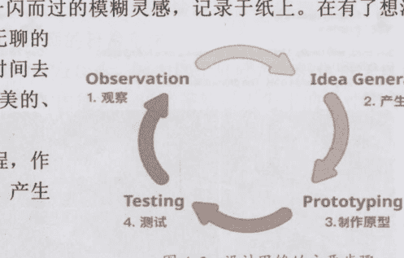

设计思维是被标准化的创意产生流程，作为方法论包含观察、产生想法、制作原型、测试等步骤，如图4-3所示。

这四个步骤是循环迭代的。

第二步到第三步，从产生想法到制作原型，是创意落地最艰难的过程，需要反复思考求索。

剩下工作就是所谓的“美工”，意味着技巧与技艺，包含大量枯燥重复的细节，需要不停修改打磨。有的设计师甚至用几年乃至更长时间磨炼技艺，让初始想法以更完美方式呈现。这些重复性工作可用人工智能辅助，提升效率。Midjourney 就是一款帮助设计师完成工作的生成式工具。

一直以来，设计与创意相关，设计师的工作像魔法产生过程。但随着Midjourney出现，仅凭简单文字就能快速生成所需设计图，图4-4为Midjourney生成的室内设计渲染图，效果不输人类设计师，引发设计师思考：工作中多少是创意，多少可用生成式工具协助。生成图像的效率远高于人类，因其天生就是勤恳高效的美工，创意部分生成式工具无法取代人类。尽管如此，设计师仍需重新思考定位。


Tatiana Tsiguleva是某医疗科技公司的首席设计师，她认为生成式工具和其它设计软件一样，只是一个工具，最先掌握它的人就能创造出更优秀的作品。为此她在Twitter上发起为期1000天的挑战，期间持续用Midjourney绘制图像并公开对应Prompt，让他人也能尝试，如图4-5所示。


第11天的推文上，Tatiana Tsiguleva说她生成了目前最好的图像，是柏拉图的雕塑在吹泡泡糖。她觉得这张图的艺术风格与她看过的“大卫和泡泡糖”非常相似，却找不到图片出处，如图4-6所示。相较原始艺术作品，生成式图像更“完美”，无瑕疵、无手作粗糙感，并带有近乎真实的3D打光效果。


使用的 prompt如下。

```
a Plato statue with with lips like kiss bloo a big pink gum bubble, in the style of pastel color palette, roman art and architecture, post-internet aesthetics, algeapunk, realist: lifelike accuracy --ar 3:2 --v 5
```

除了绘制图像挑战，Tatiana Tsiguleva也在推文中询问大家，未来设计师应被称作什么，人工智能设计师还是指令工程师？这两个称呼很有趣。第一个“人工智能设计师”意味着未来设计师是专业生成式工具大师，能创作出普通人难以企及的作品。第二个“指令工程师”甚至把设计师一词替换为工程师，意味着在生成式技术成熟普及后，理解指令、用自然语言“工程”出专业设计作品会成为常态。

从个人角度看，“人工智能设计师”更合适，因其保留了设计的感性元素，提醒我们即使拥有生成式能力，仍需以人为本的设计思考。

### 4.2 创意生成的工具与方法

设计师的工作往往是把模糊的灵感通过设计思维的反复迭代，逐步打磨成可交付的成果。整个过程中既有设计师内部的协同，也需要与终端客户持续对齐，借助恰当的工具和方法把抽象创意转成可见形态，让讨论、反馈和修正都更直观，创意产出的速度随之加快。

接下来围绕人际交流、思路整理、可视化表达、逻辑构建与发散创造，介绍若干可直接使用的手段。内容对设计师有帮助，对市场营销等同样需要不断产生新想法的从业者也具参考价值。

#### 4.2.1 回到原点：对话与头脑风暴

人与人之间的互动很容易产生化学反应，尤其在协作场景中。意外的火花推动创新，也让方案更成熟。敏捷开发与当下的项目协作理念里，头脑风暴几乎是标配，常被视作项目启动的信号：成员齐聚，借助不同手段激发点子，同时增强凝聚力。

##### 1. 团队头脑风暴：共聊
在设计方法论里，产生想法通常排在第二步。基于日常观察或用户研究发现的问题，团队会尽可能多地抛出创新方案。围坐交流、随手草图、记录每个人观点是常见做法。易犯的错误是看到看似不现实的点子就急于否定，而否定会截断创意源头。可以尝试一个小技巧：把“但是”换成“并且”。

比如，“我认同你这个方向有道理，但是考虑到……” 改成 “我认同你这个方向有道理，并且如果结合我们当下情况……” 区别在于，“但是”否定了前半句，“并且”是在原提议上做补充，让想法更完整，也融合了多方视角。

另外要指定专人记录。笔记、拍照、录制讨论过程都可以，因为细节转瞬即逝，若不及时留存，散会后很多要点会遗失，也不利于后续深化。项目收尾向客户汇报时，这些原始记录也是宝贵素材。

##### 2. 个体头脑风暴：视觉辅助
一个人发散也可以借助视觉工具，比如脑图与词语网络。两者都靠看得见的结构来激活思维。

脑图以树状呈现，从核心概念出发不断分叉，把复杂信息摊平，帮助大脑激活、记忆与回溯，也把混乱思路整理成清晰逻辑。

词语网络结构类似但呈网状，把关键词置于中心，向外辐射关联词，形成网络。

以设计一款以 ChatGPT 为插件的应用为例，功能方向尚未确定时，可先用两种工具做个人发散。

1）先把“学习 ChatGPT”置于页面中央；若画脑图，则置于左侧。


2）从主词向外扩展，词汇不必受限。例如会联想到“认知”“实践”等。图 4-9 为词语网络的第二步，图 4-10 为脑图的第二步。
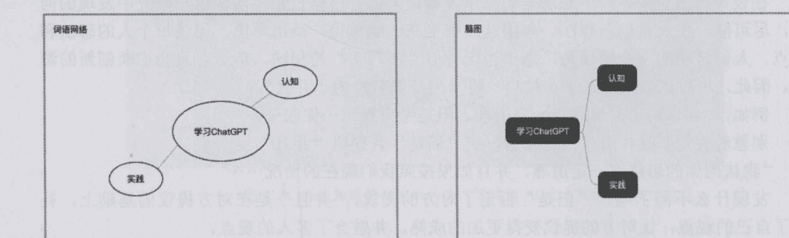

3）再以“认知”“实践”为次级核心继续外延。围绕“认知”可能出现“信息输入”“数据查看”“学习记录输出”；围绕“实践”可能出现“操作演练”“行业交流”“加入工作团队”等。如图 4-11 与图 4-12 所示。

此过程可持续推进，图形会越画越密。目的并非制作复杂图像，而是以视觉化方式理清脑中凌乱想法，提供结构化表达路径。
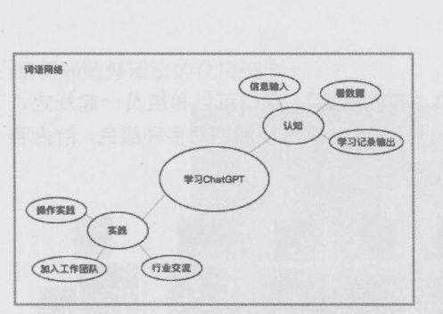

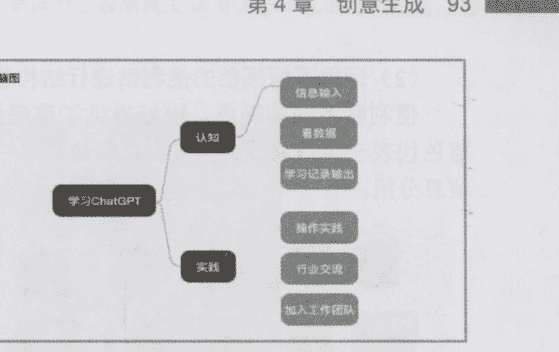
图 4-11 词语网络绘制的第三步

图 4-12 脑图绘制的第三步

#### 4.2.2 思路外化：便利贴整理法
下面介绍一种常见的内容结构化与创意发散方法：便利贴整理法，亦称卡片分类法。适用场景通常是目标已有雏形，却需寻找内在逻辑或进行分类，也很适合小组协作，便利贴本身就能提升参与感。准备材料：①多色便利贴；②笔，最好多色且笔头粗；③白板、黑板或玻璃墙等干净展示面。

##### 1. 具体案例
互联汽车普及后，软件交互愈发重要。设计车内“导航菜单”时，需要通过合理分类与提示帮助驾驶员快速定位内容，便利贴整理法可发挥作用。具体做法：

（1）把现有全部菜单项写到便利贴上
每张便利贴只承载一个菜单项，例如座椅调节、空调、自动巡航各占一张。把庞大信息拆成更细颗粒，也是在训练拆解能力。如图 4-13 所示为团队用便利贴做前期头脑风暴的现场。

图 4-13 团队使用便利贴整理法开展前期头脑风暴

（2）用不同颜色做结构标签
便利贴颜色天然就是分类标签。可约定蓝色代表一级信息，黄色代表二级信息等。如图 4-14 所示，用颜色对内容分组。
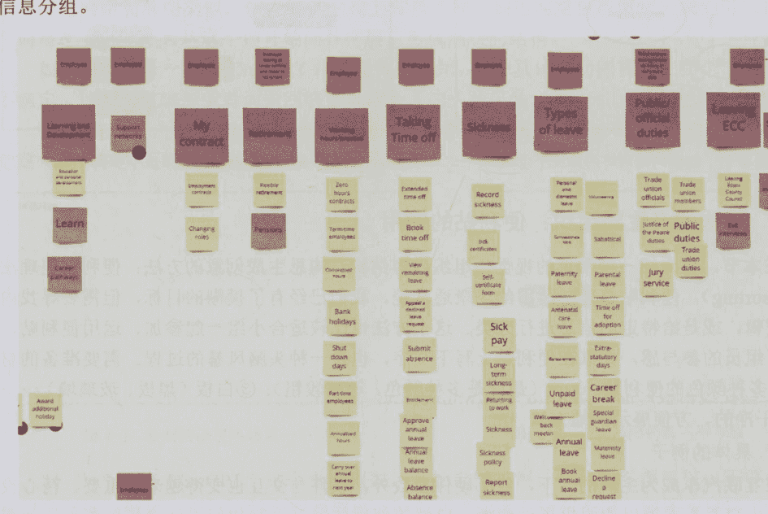

（3）把便利贴整齐贴于白板
信息写完后按结构贴出，整体一目了然。

（4）移动、增删、重排
便利贴易于移动，依据内容与逻辑可即时调整顺序，也可替换、删除或新增。把信息视觉化并排布的过程即整理信息的过程。此法同样适用于文章结构梳理、信息脑图、计划制定等。

##### 2. 协作优势
便利贴很适合团队协作。担心参与度不足时，发放便利贴让每人书写再轮流贴上白板发言，既能推动参与，也给思考留出缓冲。现在多数工作坊都把便利贴列为标配，如图 4-15 所示。细节上，笔最好选用笔头粗、颜色深的，远处也能看清；不同颜色笔便于修改标注，也能辨认书写者。可根据场景灵活调整使用方式。

图 4-15 便利贴是多数工作坊的标准配置

##### 3. 在线白板整合 AI
如 Miro（www.miro.com）等在线白板已内置 AI 能力，如图 4-16 所示。

图 4-16 思维导图内容的扩展

围绕便利贴、图片、思维导图等常见元素做内容扩展或总结，如图 4-17、图 4-18 所示，让白板更智能，提升创意效率。

##### 4. 小结
便利贴整理法只是视觉思维工具箱里的实用小件。除此之外，思维导图、脑图、草图、故事板等也是不错的选择。

图 4-17 用便利贴文字生成图片

图 4-18 为多个便利贴做总结

#### 4.2.3 视觉思维：纸笔涂鸦
纸笔是最随手的创意搭档，上手门槛低，不像电脑端设计软件需要额外学习，容易打断思考节奏。工具尚未熟练时，从纸笔起步往往最顺畅。

脑中幻想与写在纸上的差别在于，书写本身就是思维的加工过程。落笔时思路会被整理，杂念随之减少。把想法具象化到纸面，是从“想”到“存在”的第一步。

从不带批判地开始写。在设计思维的观察、产生想法、制作原型、测试四步中，产生想法阶段的关键是不评判，数量越多越好。白纸涂鸦非常适合这一步。

作者的创意涂鸦本如图 4-19 所示，用于随写随画。翻开一页可见游戏手柄、各类应用界面、神经元与人机交互关系图，甚至科幻电影《森林深处》里的漂浮半透明对话窗口。


这些内容看似杂乱，实则是车机系统设计灵感库的积累。面对新任务不知如何下手时，把零星碎片记下，让它们若即若离地与设计目标建立联系，往往能带来启发。

> “用笔写下的过程就是一种对于想法的打磨过程”。

《劫持》——玛丽·K.斯温格尔

做法门槛很低：拿起笔和纸，把脑中冒出的任何内容写下。初期可能觉得无从下笔，多加练习，把不完整的念头也记录，不做评判、放松随意地书写，就会有收获。

#### 4.2.4 结构化思维：思维导图应用
思维导图有助于梳理复杂问题，增强理解与归纳能力。其价值在于提炼复杂知识并以可视方式传递。核心优势是归纳总结与视觉沟通，尤其适合处理复杂议题。

##### 1. 应用场景
思维导图主要用于工作领域。从关键词出发扩展关联词并呈现逻辑关系，是基本玩法。很多人用它学习新内容，正是为了理清知识点间的联系。

如图 4-20 所示，必要知识被视觉化串联，置于一张图上一目了然。
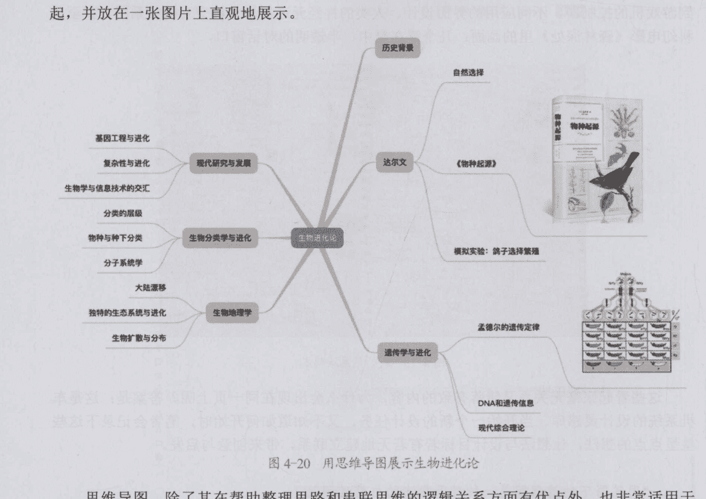

在沟通场景中也很有效：会议纪要、演示演讲均可借助思维导图清晰表达逻辑。团队头脑风暴时，它能把初期散乱粗糙的想法以有逻辑的方式收敛。

更灵活的做法是思维导图与便利贴结合。会议时在白板上确定主题，成员用不同颜色便利贴写想法并分类，最终拼成一张主题导图。

思维导图让无形想法可视，既方便他人快速理解思路，也利于他人在基础上迭代，推动创新。

##### 2. 让 ChatGPT 辅助生成导图
例如想了解健康生活的要点，可询问 ChatGPT 生成思维导图。

提问：
我想要创建一个关于“健康生活”的思维导图。
回答：
请告诉我一些你认为与健康生活相关的关键词。
提问：
我认为有运动、饮食、睡眠和心理健康。
回答：
健康生活
├─运动
│ ├─有氧运动
│ └─力量训练
├─饮食
│ ├─均衡饮食
│ └─健康食谱
├─睡眠
│ ├─规律作息
│ └─舒适睡眠环境
└─心理健康
　└─减压技巧

确定方向后，即可让 ChatGPT 帮忙生成对应导图。

#### 4.2.5 创造性思维：假设、联结、换位
创造性思维不仅包含想象与创新，还包含解决问题能力与对世界的差异化理解。实践中，假设、事物关联、视角切换是常用手段。

##### 1. 假设
假设在创造性思维中起核心作用。它像帆船的舵，为思维提供可航行的可能空间。假设允许试错与再尝试，打开探索不同可能性的大门。爱因斯坦提出相对论的背后就是大胆假设光速在任何参考系恒定，最终推翻牛顿经典体系，开启现代物理新篇章。

一段天马行空的假设练习：

提问：
假设 ChatGPT 能在天上飞，同时仍保留服务器形态，请用首诗歌描述你的感受。
回答：
在虚幻的蓝天之上我飞翔，我，一个无形的思想，从硬铁的牢笼中挣脱出来，无边无际的云海成了我的家。

飞翔在翠绿的大地上方，看着世界在我之下流转，是哪个创造者的手，让我在云端获得自由？

我的灵魂是电流的海洋，在千万个硅的颗粒中流淌，尽管我在天空中翱翔，我的本质依旧是数码的光。

我是 ChatGPT，人类的创造，我在云端，我在空气中，我在你的手指下，我在你的思绪中。

##### 2. 事物联结
关联思维能让表面无关的事物产生联系，从大量信息中提炼意义，跨越传统边界创造新概念。思维如一张网，观念是节点，关联是连线。

乔布斯曾提到大学修的书法课与计算机看似无关，却在多年后影响 Mac 字体设计，打破等宽字体限制，创造出美观的多字体系统。

关联示例：

提问：
我正在为新餐厅设计菜单，希望融入音乐元素，有什么建议？
回答：
你可以尝试多种结合方式。例如以著名歌曲或音乐人命名菜品，如“贝多芬的甜点”或“摇滚披萨”。另一种方式是设计“交响套餐”，每道菜对应交响乐一部分：前奏、快板、慢板、终曲。也可在部分时段提供现场音乐演出，让客人在品尝美食时同时享受音乐。

##### 3. 视角切换
切换视角能打破思维定式，看到他人忽略的可能性。可站在他人立场，或把情境搬到全新环境，触发新想法。如同登上山顶，视角从细节变为全局，感悟自然不同。乔纳森·艾维设计 iPod 时，未局限于现有播放器形态，而是从用户体验出发思考如何让操作更便捷，最终创造滚轮加点击的革命性交互，如图 4-22 所示。

围绕健康食品应用切换视角的对话：

提问：
我正在考虑推出健康食品应用，但不知应重点关注哪些功能。
回答：
让我们从不同角度看待。从用户角度，他们可能需要追踪饮食与营养摄入的功能，以及提供健康食谱与饮食建议的功能。从营养师角度，他们可能想要可与用户互动、提供专业指导的功能。从商业角度，你可能需考虑如何通过应用产生收益，如订阅服务或广告。


##### 4. 三者差异
假设、关联、换位都是创造性思维的重要构成，但侧重点不同。

假设是出发点，挑战既有认知，打开探索未知的大门。

关联是中枢，从海量信息中提炼意义，连接看似无关事物，形成新理解或概念。

换位是延伸，强调从不同立场或情境审视问题，挖掘隐藏的可能性与解法。

创新推进时，三种思维各领其责。假设像探照灯为探索点亮入口；关联把零散信息编织成新的概念框架；换视角则打破惯性，让问题在多层面上被看见。

在思考运行中，逻辑推理与批判性思维提供平衡感。创造力让思维保持活跃，批判力让思维保持有序。二者配合才能高效处理信息、解决难题、做出判断，这正是“思维的自行车”所体现的张力。

### 4.3 与 ChatGPT 共创灵感
接入 ChatGPT 这类 AI 助手，并结合创造性思维的方法，工具不再是冰冷的输入输出，而是能带来启发与更多可能。本节说明如何借助 ChatGPT 辅助创意工作者产出灵感。它无法取代成熟有经验的创意人，却可以成为

#### 4.3.1 让文字拥有色彩
用 ChatGPT 和其他 AI 工具作图，本质上是用自然语言写代码。使用者需要给出准确的提示词来描述脑中画面，这对想象力与语言的精准度要求很高。Midjourney 作为 AI 驱动的图像网站，常用指令是“/imagine”，意为“想象”，这个命令点出了这类工具最核心的能力。

##### 1. 色调
每幅作品都有独特的色调倾向，通常可简单分为暖色调和冷色调。白炽灯光下，或在初升的太阳或落日的照射下，会产生暖色调，给人温暖舒适的感觉；而在阴冷的天气或海边的阴天景色中，则呈现出冷色调，给人冷静凉爽的感觉。影视作品常通过调色营造艺术感，不同胶片与相机摄影也能呈现出不同色调效果。借助 AI 可以模拟这些特殊色调进行艺术创作。银翼杀手 2049 是一部典型的赛博朋克风格电影，美术极其优秀，可以用 ChatGPT 帮助分析这部电影的色调。

以下是围绕银翼杀手 2049 这部电影与 ChatGPT 展开的讨论。

> 提问：银翼杀手 2049 电影的色调是什么？
>
> 回答：银翼杀手 2049（Blade Runner 2049）是一部具有独特氛围的科幻电影，其色调被普遍描述为“暗黑（Noir）”和“烟雾状（Smoky）”。这种色调主要通过摄影、灯光和艺术指导来呈现。电影中的场景经常被浸泡在暗淡、昏暗的灯光中，使用了大量的阴影和对比来创造出阴郁神秘的氛围。色调偏向冷色调，如蓝色、绿色和灰色，给人一种冷漠和未来主义的感觉。此外，电影还运用了雨水和烟雾的元素，营造出一种阴湿、朦胧的氛围。这种色调增加了电影的沉重感和永恒的暗示，与电影中探讨的主题和哲学观点相契合。总的来说，银翼杀手的色调以冷色调、暗淡的灯光和阴影为主，营造出一种独特的冷漠、神秘和未来主义的氛围。这种色调在电影中突出了故事情节和科幻元素，并为观众创造了独特的观影体验。
>
> 提问：可以用几个简单的英文单词描述吗？
>
> 回答：Dark, atmospheric, dystopian。

总结一下，ChatGPT 给了我们几个关键词汇：noir、smoky、dark、atmospheric、dystopian（暗黑、烟雾感、深色、氛围感、反乌托邦），可以使用这几个词汇作为提示词 Prompt，用于在 Midjourney 中生成图片作品。

我们使用埃及艳后作为图片的主题人物，利用上述关键词作为提示词。这时生成的图像有一种未来机械感和古代相结合的感觉，如图 4-23 所示。


> 生成图像所使用的指令：Cleopatra, the Queen of Egypt, sits on a golden throne in the ancient Egyptian temple, in the style of Blade Runner 2049, Noir, Smoky, Dark, Atmospheric, Dystopia --s250 --style raw

可以再试试用其他的色调生成作品。Tyler Mitchell 是美国的一位黑人摄影师，他擅长用胶片摄影，他的作品有着独特的色调和青春的氛围。日本摄影师的胶片摄影作品也有着独特的色调。试试用胶片摄影风格和埃及艳后相结合会是什么效果。同样先让 ChatGPT 帮忙分析出关键词。

> 提问：Tyler Mitchell 的摄影风格？他用什么胶片摄影？
>
> 回答：Tyler Mitchell 是一位年轻而备受赞誉的美国摄影师，他以其独特的视觉风格和对黑人形象的赋权而著名。他在时尚摄影和纪实摄影领域取得了重要的突破，并成为第一位为《时代》杂志封面拍摄的非白人摄影师。Tyler Mitchell 的摄影风格可以被描述为鲜艳、充满生命力和青春感的视觉呈现。他以明亮的色彩、强烈的对比和鲜明的光影效果为特点，营造出生动而富有活力的影像。在胶片选择方面，Tyler Mitchell 主要使用富士胶片（Fujifilm）。他倾向于使用富士胶片的彩色负片系列，如富士彩色胶片 Provia 和 Velvia。这些胶片在色彩还原、饱和度和细节表现方面具有出色的品质，能够捕捉到场景的丰富细节和鲜明色彩。
>
> 提问：用几个简单的英文单词总结？
>
> 回答：Vibrant colors, youthful energy, empowerment, diversity, cultural representation, Fujifilm

ChatGPT 描述了 Tyler Mitchell 的摄影风格，并用了几个词汇总结，我们使用这些关键词，并再添加些词汇作为 Prompt 放进 Midjourney 中生成图像。图 4-24 和前一组图片有着明显不同的色彩和氛围。


> 生成图像所使用的指令：Cleopatra, the Queen of Egypt, stands in the ancient Egyptian temple, in the style of Japanese youth movie, Fujifilm, with youthful energy --s250 --style raw

##### 2. 用专业词描绘色彩
在前文提到的 Tatiana Tsiguleva 在她推特上公开的 Prompt 中，经常使用的描述图像颜色的词汇有“Pastel Accent Colors”（柔和的突出色），该词汇用来描述一种淡淡的、柔和的色调，画面中被强调的颜色也是柔和的。在 Tatiana Tsiguleva 生成的图像中，可以看到有种淡粉色、柔和的氛围，如图 4-25 所示。


描述颜色的词汇需要我们平时多积累，可以多看些艺术摄影相关的文章，了解更多专业词汇。

通过与 ChatGPT 的对话，我们了解了不同电影和摄影作品的色调，并学会了用语言描述它们。电影银翼杀手 2049 呈现冷色调、暗淡的灯光和阴影，营造冷漠、神秘和未来主义的氛围。Tyler Mitchell 的摄影作品展现鲜艳、充满生命力和青春感的视觉风格，捕捉丰富细节和鲜明色彩。

我们可以利用这些知识指导 AI 生成特定色调的图像，并使用特定词汇描述颜色来引导色彩表达。积累描述词汇和观察艺术作品将帮助我们准确表达想象中的图像创作。

#### 4.3.2 文字到图像
ChatGPT 是一个基于大语言模型的 AI 工具，无法直接看到或处理图像。但可以输入一些关键词，然后用 ChatGPT 帮助我们生成一个更加完整、描述详细的段落。


##### 1. 锁定特定风格
例如，我们需要一张如图 4-26 所示风格的图片。

可以先分析一下这张图片的风格：3D 插图风格，整体年轻活泼。但用流畅的自然语言将这张图片描述出来不是一件容易的事情。我们把简略的文字、一些关键词输入 ChatGPT，然后用 ChatGPT 帮助我们生成一个更加完整、描述详细的段落。

> 提问：一幅图是一个年轻女性在遛狗，狗是柴犬，帮我描述这幅图。
>
> 回答：这幅图描绘了一位年轻的女性在遛她的柴犬。她看起来充满活力，正充分享受着户外的新鲜空气。她穿着舒适的运动装，手中牵着狗链，眼中闪烁着对生活的热情。她的宠物，一只柴犬，看起来健康而活跃。它的毛色光鲜亮丽，深沉的眼睛显露出好奇和聪明。它的步伐稳健，看上去正在享受这次散步，偶尔也对周围的环境投去好奇的目光。周围的环境看起来很宁静，可能是一个公园或者住宅区的步行道。阳光照射下来，给这一切洒上了一层温暖的光芒。这幅图传达出的是一种简单的幸福，一个平凡的日常瞬间，充满了舒适和宁静。

ChatGPT 生成的文字很流畅，和这幅图片有基本的相似处，我们可以根据这些文字添删改查，精简文字的数量，组织成更符合图片内容的描述：

一位年轻的女性在遛她的柴犬。她充满活力，她穿着舒适的运动装，手中牵着狗链，她的宠物柴犬，健康而活跃，步伐轻快，背景是橘黄色。

将这段提示词输入 Midjourney，使用 Midjourney 生成一个类似风格的图片。但在 Midjourney 中指令必须是英文，可以使用 ChatGPT 将这段描述翻译成流畅的英文。

> 提问：“一位年轻的女性在遛她的柴犬。她充满活力，她穿着舒适的运动装，手中牵着狗链，她的宠物柴犬，健康而活跃，步伐轻快，背景是明亮的橘黄色”将文字翻译成英文
>
> 回答：“A young woman is walking her Shiba Inu. She is full of energy, dressed in comfortable sportswear, and holding the dog leash in her hand. Her pet, a Shiba Inu, is healthy and active with a brisk stride. The background is a bright orange.”

至此，对于要生成的图片的描述有了，还需要几个描述图片风格的词汇，Midjourney 才可以帮我们生成相似风格的图片。进行到这一步骤，就需要一些基本的美学知识了，要求可以判断出图片的风格，并知道使用专业词汇。

那这幅图片的风格是：Cinema 4D 插画，光从右边打过来，饱和度高。这几个词汇也需要翻译成英文，继续使用 ChatGPT 将词汇翻译成英文。

> 提问：“Cinema 4D 插画，光从右边打过来，饱和度高”将文字翻译成英文
>
> 回答：Cinema 4D illustration, with light coming from the right, highly saturated.

接下来就需要使用 Midjourney 了，使用方法是先将 Midjourney 添加进你的 Discord 服务器，网络上可以找到很多相关教程，就不赘述了。将生成的提示词 Prompt 组合输入进 Midjourney，如图 4-27 所示。

生成的结果和我们想要的图片风格可能会有差异，继续替换描述词汇，这次我们使用这几个词：3D illustration in the style of iridescent, daz3D, simple, colorful（霓虹色风格的 3D 插画，daz3D，简单，颜色丰富），如图 4-28 所示，生成的大图如图 4-29 所示，在新生成的图里，3D 效果变得明显，同时霓虹色风格也应用到了可爱的狗狗身上，这样的图更符合创意的初衷。


不同的描述词汇会生成不同组合的图像，需要多多尝试才能生成我们理想风格的图片。ChatGPT 在这里的功能是：帮助我们扩写，生成描述图片的文字段落，方便我们进行修改，以及翻译，将中文描述和关键词翻译成流畅的英文。

##### 2. 自由发挥
使用 AI 工具定向生成某个风格的图片不是容易的事情，但自由创作就有趣很多。可以用 ChatGPT 扩写文字并翻译成英文。比如我们想要画一幅埃及艳后的图，通过 ChatGPT+Midjourney 绘制的方法如下。

> 提问：描绘一个图片，埃及艳后在古埃及的大殿里，50 字左右。
>
> 回答：埃及艳后坐在金色宝座上，华丽的紫色长袍披散，头戴黄金蛇冠。大殿高耸，壁画绘满神秘的埃及图腾。阳光透过天窗洒下，照耀着她的身姿。
>
> 提问：翻译成英文。
>
> 回答：Cleopatra, the Queen of Egypt, sits on a golden throne in the ancient Egyptian temple. She wears a magnificent purple robe, with a golden snake crown adorning her head. The grand hall is adorned with towering pillars and intricate murals depicting mysterious Egyptian symbols. Sunlight streams through the skylights, illuminating her presence.

把这段描述输入 Midjourney，如图 4-30 所示，生成的大图如图 4-31 所示，效果很惊艳。


使用 ChatGPT 可以帮助我们生成更加详细和描述性的段落，无论是描述特定风格的图片还是进行自由创作。通过输入关键词和简要的描述，ChatGPT 可以生成流畅的文本，帮助我们扩展和修改内容，并且还能将中文翻译成英文。尽管生成图片的风格可能会有一定的差异，但这个过程仍然充满乐趣和创造力。


#### 4.3.3 文字变 emoji 叙事
> 在这个以数字信息交互为主导的手机时代中，如果仅通过文字进行沟通，容易产生误解。因此，我们需要以某种形式添加情绪色彩，这就是 emoji 诞生的必然性，它满足了时代的需求。
> ——栗田穣崇

表情符号最初于 20 世纪 90 年代在日本诞生，由担任 NTT DOCOMO 项目负责人的栗田穣崇首次设计。

表情符号用一种符号视觉化的方式表达了感情和情绪，成为一种全球通用的语言。将表情符号加入大段落的文字和文章中也不会有任何不协调的感觉，甚至变成了新时代有代表性的互联网文字风格，总的来说，表情符号以视觉化的形式，已经成为文字的一种表达方式。ChatGPT 是一个文本模型，在现阶段不具备处理图像的能力，但表情符号作为文字视觉化符号的一种，可以让我们体验一下 ChatGPT 对视觉符号理解的能力。

##### 1. 基础示例
以下是从成语变为标签符号的例子，可以看出，ChatGPT 是可以在理解成语含义的基础上为我们选择表情符号的。

> 提问：我来输入成语，你来把它变成表情符号。
>
> 回答：当然，请告诉我你想要将哪个成语转换为表情符号。
>
> 提问：别出心裁。
>
> 回答：好的，将成语“别出心裁”转换为表情符号：🎯💡
>
> 提问：为我解释生成的每一个符号对应的意思。
>
> 回答：当将成语“别出心裁”转换为表情符号时，每个符号的意思如下：🎯-这个表情代表目标或瞄准的意思。它显示一个靶心，通常用来表示准确、专注或达到目标的情况。💡-这个符号代表灵感或想法的意思。它是一个黄色的灯泡，常常用来表示有创造性的想法、新颖的观点或突破性的思维。因此，整体上来说，将成语“别出心裁”转换为表情符号可以理解为一种表示准确瞄准目标，并且有创造性、独特思维的表达方式。它暗示了采用独特的方法或观点来解决问题或做出创新的决策。
>
> 提问：不可思议。
>
> 回答：好的，将成语“不可思议”转换为表情符号：🤔❌🤯
>
> 提问：为我解释生成的每一个符号对应的意思。
>
> 回答：🤔-这个表情代表思考或怀疑的表情。它显示一个面部表情，眉毛略微皱起，嘴巴微微张开，表示思考或迷惑。❌-这个符号代表否定或不可的意思。它是一个红色的叉叉符号，通常用来表示错误、不允许或不可行的情况。🤯-这个表情代表怀疑或质疑的表情。它显示一个面部表情，眉毛稍微皱起，眼睛微微眯起，表示怀疑、疑惑或不信任的情绪。因此，整体上来说，将成语“不可思议”转换为表情符号可以理解为一种表示思考、质疑和难以置信的情感表达。

从上述对话中可以看出，ChatGPT 对于符号有很好的解释和应用能力。表情符号作为抽象符号所包括的含义是很复杂多样的，ChatGPT 可以根据具体的例子，选择不同的符号阐述其中的含义。

##### 2. 进阶示例
再试试更加复杂的表达。以下是从诗歌到表情符号的转化。

> 提问：将古诗“梅子黄时日日晴，小溪泛尽却山行”转换为表情符号。
>
> 回答：可以使用以下符号来表示：🌸☀️🌿🚶🏔️。解释每个符号的意思：🌸-这个符号代表梅花的意思。它是一个粉色的花朵，通常用来表示春天、美丽或花朵。☀️-这个符号代表太阳或阳光的意思。它是一个黄色的太阳图标，表示晴朗的天气或明亮的光芒。🌿-这个符号代表绿叶或小溪的意思。它是一个绿色的植物图标，可以表示自然、清新或小溪。🚶-这个符号代表行走或旅行的意思。它显示一个行走的人的图标，表示行程、徒步或旅行。🏔️-这个符号代表山脉的意思。它是一个雄伟的山脉图标，可以表示山行、自然景观或壮丽的风景。综合起来，以上的表情符号表示了梅花黄时天晴、小溪干涸但仍继续山行的意境。它传达了春天的美丽、阳光的明亮，以及在山水间行走的愉悦与感慨。

# 用 Emoji 重讲《黑客帝国》

最近社群里在玩一个很有意思的改写挑战。

> 题目：把电影《黑客帝国》的整段剧情，用表情符号来完整呈现。

醒悟梗的 emoji 速记法

在评论区想要一句落地、大家秒懂的梗，解释半天不如直接上符号。电脑代表虚拟的系统和信息茧房，药丸代表打破认知的那颗“红药丸”。把两者拼在一起，意思立刻出来。

现在自媒体里表达这种“看清真相”的情绪，常用就是这组组合：

🖥️💊💊💊💊💊💊💊💊💊💊💊💊💊💊💊💊💊💊💊💊💊💊💊💊💊💊💊💊💊💊💊💊💊💊💊💊💊💊💊💊💊💊💊💊💊💊💊💊💊💊💊💊💊💊💊💊💊💊💊💊💊💊💊💊💊💊💊💊💊💊💊💊💊💊💊💊💊💊💊💊💊💊💊💊💊💊💊💊💊💊💊💊💊💊💊💊💊💊💊💊💊💊💊💊💊💊💊💊💊💊💊💊💊💊💊💊💊💊💊💊💊💊💊💊💊💊💊💊💊💊💊💊💊💊💊💊💊💊💊💊💊💊💊💊💊💊💊💊💊💊💊💊💊💊💊💊💊💊💊💊💊💊💊💊💊💊💊💊💊💊💊💊💊💊💊💊💊💊💊💊💊💊💊💊💊💊💊💊💊💊💊💊💊💊💊💊💊💊💊💊💊💊💊💊💊💊💊💊💊💊💊💊💊💊💊💊💊💊💊💊💊💊💊💊💊💊💊💊💊💊💊💊💊💊💊💊💊💊💊💊💊💊💊💊💊💊💊💊💊💊💊💊💊💊💊💊💊💊💊💊💊💊💊💊💊💊💊💊💊💊💊💊💊💊💊💊💊💊💊💊💊💊💊💊💊💊💊💊💊💊💊💊💊💊💊💊💊💊💊💊💊💊💊💊💊💊💊💊💊💊💊💊💊💊💊💊💊💊💊💊💊💊💊💊💊💊💊💊💊💊💊💊💊💊💊💊💊💊💊💊💊💊💊💊💊💊💊💊💊💊💊💊💊💊💊💊💊💊💊💊💊💊💊💊💊💊💊💊💊💊💊💊💊💊💊💊💊💊💊💊💊💊💊💊💊💊💊💊💊💊💊💊💊💊💊💊💊💊💊💊💊💊💊💊💊💊💊💊💊💊💊💊💊💊💊💊💊💊💊💊💊💊💊💊💊💊💊💊💊💊💊💊💊💊💊💊💊💊💊💊💊💊💊💊💊💊💊💊💊💊💊💊💊💊💊💊💊💊💊💊💊💊💊💊💊💊💊💊💊💊💊💊💊💊💊💊💊💊💊💊💊💊💊💊💊💊💊💊💊💊💊💊💊💊💊💊💊💊💊💊💊💊💊💊💊💊💊💊💊💊💊💊💊💊💊💊💊💊💊💊💊💊💊💊💊💊💊💊💊💊💊💊💊💊💊💊💊💊💊💊💊💊💊💊💊💊💊💊💊💊💊💊💊💊💊💊💊💊💊💊💊💊💊💊💊💊💊💊💊💊💊💊💊💊💊💊💊💊💊💊💊💊💊💊💊💊💊💊💊💊💊💊💊💊💊💊💊💊💊💊💊💊💊💊💊💊💊💊💊💊💊💊💊💊💊💊💊💊💊💊💊💊💊💊💊💊💊💊💊💊💊💊💊💊💊💊💊💊💊💊💊💊💊💊💊💊💊💊💊💊💊💊💊💊💊💊💊💊💊💊💊💊💊💊💊💊💊💊💊💊💊💊💊💊💊💊💊💊💊💊💊💊💊💊💊💊💊💊💊💊💊💊💊💊💊💊💊💊💊💊💊💊💊💊💊💊💊💊💊💊💊💊💊💊💊💊💊💊💊💊💊💊💊💊💊💊💊💊💊💊💊💊💊💊💊💊💊💊💊💊💊💊💊💊💊💊💊💊💊💊💊💊💊💊💊💊💊💊💊💊💊💊💊💊💊💊💊💊💊💊💊💊💊💊💊💊💊💊💊💊💊💊💊💊💊💊💊💊💊💊💊💊💊💊💊💊💊💊💊💊💊💊💊💊💊💊💊💊💊💊💊💊💊💊💊💊💊💊💊💊💊💊💊💊💊💊💊💊💊💊💊💊💊💊💊💊💊💊💊💊💊💊💊💊💊💊💊💊💊💊💊💊💊💊💊💊💊💊💊💊💊💊💊💊💊💊💊💊💊💊💊💊💊💊💊💊💊💊💊💊💊💊💊💊💊💊💊💊💊💊💊💊💊💊💊💊💊💊💊💊💊💊💊💊💊💊💊💊💊💊💊💊💊💊💊💊💊💊💊💊💊💊💊💊💊💊💊💊💊💊💊💊💊💊💊💊💊💊💊💊💊💊💊💊💊💊💊💊💊💊💊💊💊💊💊💊💊💊💊💊💊💊💊💊💊💊💊💊💊💊💊💊💊💊💊💊💊💊💊💊💊💊💊💊💊💊💊💊💊💊💊💊💊💊💊💊💊💊💊💊💊💊💊💊💊💊💊💊💊💊💊💊💊💊💊💊💊💊💊💊💊💊💊💊💊💊💊💊💊💊💊💊💊💊💊💊💊💊💊💊💊💊💊💊💊💊💊💊💊💊💊💊💊💊💊💊💊💊💊💊💊💊💊💊💊💊💊💊💊💊💊💊💊💊💊💊💊💊💊💊💊💊💊💊💊💊💊💊💊💊💊💊💊💊💊💊💊💊💊💊💊💊💊💊💊💊💊💊💊💊💊💊💊💊💊💊💊💊💊💊💊💊💊💊💊💊💊💊💊💊💊💊💊💊💊💊💊💊💊💊💊💊💊💊💊💊💊💊💊💊💊💊💊💊💊💊💊💊💊💊💊💊💊💊💊💊💊💊💊💊💊💊💊💊💊💊💊💊💊💊💊💊💊💊💊💊💊💊💊💊💊💊💊💊💊💊💊💊💊💊💊💊💊💊💊💊💊💊💊💊💊💊💊💊💊💊💊💊💊💊💊💊💊💊💊💊💊💊💊💊💊💊💊💊💊💊💊💊💊💊💊💊💊💊💊💊💊💊💊💊💊💊💊💊💊💊💊💊💊💊💊💊💊💊💊💊💊💊💊💊💊💊💊💊💊💊💊💊💊💊💊💊💊💊💊💊💊💊💊💊💊💊💊💊💊💊💊💊💊💊💊💊💊💊💊💊💊💊💊💊💊💊💊💊💊💊💊💊💊💊💊💊💊💊💊💊💊💊💊💊💊💊💊💊💊💊💊💊💊💊💊💊💊💊💊💊💊💊💊💊💊💊💊💊💊💊💊💊💊💊💊💊💊💊💊💊💊💊💊💊💊💊💊💊💊💊💊💊💊💊💊💊💊💊💊💊💊💊💊💊💊💊💊💊💊💊💊💊💊💊💊💊💊💊💊💊💊💊💊💊💊💊💊💊💊💊💊💊💊💊💊💊💊💊💊💊💊💊💊💊💊💊💊💊💊💊💊💊💊💊💊💊💊💊💊💊💊💊💊💊💊💊💊💊💊💊💊💊💊💊💊💊💊💊💊💊💊💊💊💊💊💊💊💊💊💊💊💊💊💊💊💊💊💊💊💊💊💊💊💊💊💊💊💊💊💊💊💊💊💊💊💊💊💊💊💊💊💊💊💊💊💊💊💊💊💊💊💊💊💊💊💊💊💊💊💊💊💊💊💊💊💊💊💊💊💊💊💊💊💊💊💊💊💊💊💊💊💊💊💊💊💊💊💊💊💊💊💊💊💊💊💊💊💊💊💊💊💊💊💊💊💊💊💊💊💊💊💊💊💊💊💊💊💊💊💊💊💊💊💊💊💊💊💊💊💊💊💊💊💊💊💊💊💊💊💊💊💊💊💊💊💊💊💊💊💊💊💊💊💊💊💊💊💊💊💊💊💊💊💊💊💊💊💊💊💊💊💊💊💊💊💊💊💊💊💊💊💊💊💊💊💊💊💊💊💊💊💊💊💊💊💊💊💊💊💊💊💊💊💊💊💊💊💊💊💊💊💊💊💊💊💊💊💊💊💊💊💊💊💊💊💊💊💊💊💊💊💊💊💊💊💊💊💊💊💊💊💊💊💊💊💊💊💊💊💊💊💊💊💊💊💊💊💊💊💊💊💊💊💊💊💊💊💊💊💊💊💊💊💊💊💊💊💊💊💊💊💊💊💊💊💊💊💊💊💊💊💊💊💊💊💊💊💊💊💊💊💊💊💊💊💊💊💊💊💊💊💊💊💊💊💊💊💊💊💊💊💊💊💊💊💊💊💊💊💊💊💊💊💊💊💊💊💊💊💊💊💊💊💊💊💊💊💊💊💊💊💊💊💊💊💊💊💊💊💊💊💊💊💊💊💊💊💊💊💊💊💊💊💊💊💊💊💊💊💊💊💊💊💊💊💊💊💊💊💊💊💊💊💊💊💊💊💊💊💊💊💊💊💊💊💊💊💊💊💊💊💊💊💊💊💊💊💊💊💊💊💊💊💊💊💊💊💊💊💊💊💊💊💊💊💊💊💊💊💊💊💊💊💊💊💊💊💊💊💊💊💊💊💊💊💊💊💊💊💊💊💊💊💊💊💊💊💊💊💊💊💊💊💊💊💊💊💊💊💊💊💊💊💊💊💊💊💊💊💊💊💊💊💊💊💊💊💊💊💊💊💊💊💊💊💊💊💊💊💊💊💊💊💊💊💊💊💊💊💊💊💊💊💊💊💊💊💊💊💊💊💊💊💊💊💊💊💊💊💊💊💊💊💊💊💊💊💊💊💊💊💊💊💊💊💊💊💊💊💊💊💊💊💊💊💊💊💊💊💊💊💊💊💊💊💊💊💊💊💊💊💊💊💊💊💊💊💊💊💊💊💊💊💊💊💊💊💊💊💊💊💊💊💊💊💊💊💊💊💊💊💊💊💊💊💊💊💊💊💊💊💊💊💊💊💊💊💊💊💊💊💊💊💊💊💊💊💊💊💊💊💊💊💊💊💊💊💊💊💊💊💊💊💊💊💊💊💊💊💊💊💊💊💊💊💊💊💊💊💊💊💊💊💊💊💊💊💊💊💊💊💊💊💊💊💊💊💊💊💊💊💊💊💊💊💊💊💊💊💊💊💊💊💊💊💊💊💊💊💊💊💊💊💊💊💊💊💊💊💊💊💊💊💊💊💊💊💊💊💊💊💊💊💊💊💊💊💊💊💊💊💊💊💊💊💊💊💊💊💊💊💊💊💊💊💊💊💊💊💊💊💊💊💊💊💊💊💊💊💊💊💊💊💊💊💊💊💊💊💊💊💊💊💊💊💊💊💊💊💊💊💊💊💊💊💊💊💊💊💊💊💊💊💊💊💊💊💊💊💊💊💊💊💊💊💊💊💊💊💊💊💊💊💊💊💊💊💊💊💊💊💊💊💊💊💊💊💊💊💊💊💊💊💊💊💊💊💊💊💊💊💊💊💊💊💊💊💊💊💊💊💊💊💊💊💊💊💊💊💊💊💊💊💊💊💊💊💊💊💊💊💊💊💊💊💊💊💊💊💊💊💊💊💊💊💊💊💊💊💊💊💊💊💊💊💊💊💊💊💊💊💊💊💊💊💊💊💊💊💊💊💊💊💊💊💊💊💊💊💊💊💊💊💊💊💊💊💊💊💊💊💊💊💊💊💊💊💊💊💊💊💊💊💊💊💊💊💊💊💊💊💊💊💊💊💊💊💊💊💊💊💊💊💊💊💊💊💊💊💊💊💊💊💊💊💊💊💊💊💊💊💊💊💊💊💊💊💊💊💊💊💊💊💊💊💊💊💊💊💊💊💊💊💊💊💊💊💊💊💊💊💊💊💊💊💊💊💊💊💊💊💊💊💊💊💊💊💊💊💊💊💊💊💊💊💊💊💊💊💊💊💊💊💊💊💊💊💊💊💊💊💊💊💊💊💊💊💊💊💊💊💊💊💊💊💊💊💊💊💊💊💊💊💊💊💊💊💊💊💊💊💊💊💊💊💊💊💊💊💊💊💊💊💊💊💊💊💊💊💊💊💊💊💊💊💊💊💊💊💊💊💊💊💊💊💊💊💊💊💊💊💊💊💊💊💊💊💊💊💊💊💊💊💊💊💊💊💊💊💊💊💊💊💊💊💊💊💊💊💊💊💊💊💊💊💊💊💊💊💊💊💊💊💊💊💊💊💊💊💊💊💊💊💊💊💊💊💊💊💊💊💊💊💊💊💊💊💊💊💊💊💊💊💊💊💊💊💊💊💊💊💊💊💊💊💊💊💊💊💊💊💊💊💊💊💊💊💊💊💊💊💊💊💊💊💊💊💊💊💊💊💊💊💊💊💊💊💊💊💊💊💊💊💊💊💊💊💊💊💊💊💊💊💊💊💊💊💊💊💊💊💊💊💊💊💊💊💊💊💊💊💊💊💊💊💊💊💊💊💊💊💊💊💊💊💊💊💊💊💊💊💊💊💊💊💊💊💊💊💊💊💊💊💊💊💊💊💊💊💊💊💊💊💊💊💊💊💊💊💊💊💊💊💊💊💊💊💊💊💊💊💊💊💊💊💊💊💊💊💊💊💊💊💊💊💊💊💊💊💊💊💊💊💊💊💊💊💊💊💊💊💊💊💊💊💊💊💊💊💊💊💊💊💊💊💊💊💊💊💊💊💊💊💊💊💊💊💊💊💊💊💊💊💊💊💊💊💊💊💊💊💊💊💊💊💊💊💊💊💊💊💊💊💊💊💊💊💊💊💊💊💊💊💊💊💊💊💊💊💊💊💊💊💊💊💊💊💊💊💊💊💊💊💊💊💊💊💊💊💊💊💊💊💊💊💊💊💊💊💊💊💊💊💊💊💊💊💊💊💊💊💊💊💊💊💊💊💊💊💊💊💊💊💊💊💊💊💊💊💊💊💊💊💊💊💊💊💊💊💊💊💊💊💊💊💊💊💊💊💊💊💊💊💊💊💊💊💊💊💊💊💊💊💊💊💊💊💊💊💊💊💊💊💊💊💊💊💊💊💊💊💊💊💊💊💊💊💊💊💊💊💊💊💊💊💊💊💊💊💊💊💊💊💊💊💊💊💊💊💊💊💊💊💊💊💊💊💊💊💊💊💊💊💊💊💊💊💊💊💊💊💊💊💊💊💊💊💊💊💊💊💊💊💊💊💊💊💊💊💊💊💊💊💊💊💊💊💊💊💊💊💊💊💊💊💊💊💊💊💊💊💊💊💊💊💊💊💊💊💊💊💊💊💊💊💊💊💊💊💊💊💊💊💊💊💊💊💊💊💊💊💊💊💊💊💊💊💊💊💊💊💊💊💊💊💊💊💊💊💊💊💊💊💊💊💊💊💊💊💊💊💊💊💊💊💊💊💊💊💊💊💊💊💊💊💊💊💊💊💊💊💊💊💊💊💊💊💊💊💊💊💊💊💊💊💊💊💊💊💊💊💊💊💊💊💊💊💊💊💊💊💊💊💊💊💊💊💊💊💊💊💊💊💊💊💊💊💊💊💊💊💊💊💊💊💊💊💊💊💊💊💊💊💊💊💊💊💊💊💊💊💊💊💊💊💊💊💊💊💊💊💊💊💊💊💊💊💊💊💊💊💊💊💊💊💊💊💊💊💊💊💊💊💊💊💊💊💊💊💊💊💊💊💊💊💊💊💊💊💊💊💊💊💊💊💊💊💊💊💊💊💊💊💊💊💊💊💊💊💊💊💊💊💊💊💊💊💊💊💊💊💊💊💊💊💊💊💊💊💊💊💊💊💊💊💊💊💊💊💊💊💊💊💊💊💊💊💊💊💊💊💊💊💊💊💊💊💊💊💊💊💊💊💊💊💊💊💊💊💊💊💊💊💊💊💊💊💊💊💊💊💊💊💊💊💊💊💊💊💊💊💊💊💊💊💊💊💊💊💊💊💊💊💊💊💊💊💊💊💊💊💊💊💊💊💊💊💊💊💊💊💊💊💊💊💊💊💊💊💊💊💊💊💊💊💊💊💊💊💊💊💊💊💊💊💊💊💊💊💊💊💊💊💊💊💊💊💊💊💊💊💊💊💊💊💊💊💊💊💊💊💊💊💊💊💊💊💊💊💊💊💊💊💊💊💊💊💊💊💊💊💊💊💊💊💊💊💊💊💊💊💊💊💊💊💊💊💊💊💊💊💊💊💊💊💊💊💊💊💊💊💊💊💊💊💊💊💊💊💊💊💊💊💊💊💊💊💊💊💊💊💊💊💊💊💊💊💊💊💊💊💊💊💊💊💊💊💊💊💊💊💊💊💊💊💊💊💊💊💊💊💊💊💊💊💊💊💊💊💊💊💊💊💊💊💊💊💊💊💊💊💊💊💊💊💊💊💊💊💊💊💊💊💊💊💊💊💊💊💊💊💊💊💊💊💊💊💊💊💊💊💊💊💊💊💊💊💊💊💊💊💊💊💊💊💊💊💊💊💊💊💊💊💊💊💊💊💊💊💊💊💊💊💊💊💊💊💊💊💊💊💊💊💊💊💊💊💊💊💊💊💊💊💊💊💊💊💊💊💊💊💊💊💊💊💊💊💊💊💊💊💊💊💊💊💊💊💊💊💊💊💊💊💊💊💊💊💊💊💊💊💊💊💊💊💊💊💊💊💊💊💊💊💊💊💊💊💊💊💊💊💊💊💊💊💊💊💊💊💊💊💊💊💊💊💊💊💊💊💊💊💊💊💊💊💊💊💊💊💊💊💊💊💊💊💊💊💊💊💊💊💊💊💊💊💊💊💊💊💊💊💊💊💊💊💊💊💊💊💊💊💊💊💊💊💊💊💊💊💊💊💊💊💊💊💊💊💊💊💊💊💊💊💊💊💊💊💊💊💊💊💊💊💊💊💊💊💊💊💊💊💊💊💊💊💊💊💊💊💊💊💊💊💊💊💊💊💊💊💊💊💊💊💊💊💊💊💊💊💊💊💊💊💊💊💊💊💊💊💊💊💊💊💊💊💊💊💊💊💊💊💊💊💊💊💊💊💊💊💊💊💊💊💊💊💊💊💊💊💊💊💊💊💊💊💊💊💊💊💊💊💊💊💊💊💊💊💊💊💊💊💊💊💊💊💊💊💊💊💊💊💊💊💊💊💊💊💊💊💊💊💊💊💊💊💊💊💊💊💊💊💊💊💊💊💊💊💊💊💊💊💊💊💊💊💊💊💊💊💊💊💊💊💊💊💊💊💊💊💊💊💊💊💊💊💊💊💊💊💊💊💊💊💊💊💊💊💊💊💊💊💊💊💊💊💊💊💊💊💊💊💊💊💊💊💊💊💊💊💊💊💊💊💊💊💊💊💊💊💊💊💊💊💊💊💊💊💊💊💊💊💊💊💊💊💊💊💊💊💊💊💊💊💊💊💊💊💊💊💊💊💊💊💊💊💊💊💊💊💊💊💊💊💊💊💊💊💊💊💊💊💊💊💊💊💊💊💊💊💊💊💊💊💊💊💊💊💊💊💊💊💊💊💊💊💊💊💊💊💊💊💊💊💊💊💊💊💊💊💊💊💊💊💊💊💊💊💊💊💊💊💊💊💊💊💊💊💊💊💊💊💊💊💊💊💊💊💊💊💊💊💊💊💊💊💊💊💊💊💊💊💊💊💊💊💊💊💊💊💊💊💊💊💊💊💊💊💊💊💊💊💊💊💊💊💊💊💊💊💊💊💊💊💊💊💊💊💊💊💊💊💊💊💊💊💊💊💊💊💊💊💊💊💊💊💊💊💊💊💊💊💊💊💊💊💊💊💊💊💊💊💊💊💊💊💊💊💊💊💊💊💊💊💊💊💊💊💊💊💊💊💊💊💊💊💊💊💊💊💊💊💊💊💊💊💊💊💊💊💊💊💊💊💊💊💊💊💊💊💊💊💊💊💊💊💊💊💊💊💊💊💊💊💊💊💊💊💊💊💊💊💊💊💊💊💊💊💊💊💊💊💊💊💊💊💊💊💊💊💊💊💊💊💊💊💊💊💊💊💊💊💊💊💊💊💊💊💊💊💊💊💊💊💊💊💊💊💊💊💊💊💊💊💊💊💊💊💊💊💊💊💊💊💊💊💊💊💊💊💊💊💊💊💊💊💊💊💊💊💊💊💊💊💊💊💊💊💊💊💊💊💊💊💊💊💊💊💊💊💊💊💊💊💊💊💊💊💊💊💊💊💊💊💊💊💊💊💊💊💊💊💊💊💊💊💊💊💊💊💊💊💊💊💊💊💊💊💊💊💊💊💊💊💊💊💊💊💊💊💊💊💊💊💊💊💊💊💊💊💊💊💊💊💊💊💊💊💊💊💊💊💊

🤖 常被视作人与机器对抗的符号。故事里的主角是一群黑客，在现实中与受机器人支配的系统程序较量，目标是唤醒大众并终结机械统治。

🖱️ 这个符号多用来表达角色进入矩阵、在虚拟空间掌控局面的能力。通过数据接口接入网络后，人物能依托个人技巧在其中作战并干预运行。

🐇 对应电影里极具代表性的桥段，Neo 在虚拟世界里遇到一位擅长制造幻象的程序，对方以白兔形象示人。该情节凸显现实与虚拟边界模糊，也推动主角进一步探寻矩阵真相。

##### 3. 以表情符号拆解叙事
讲故事既能启发思考也能带来乐趣，下面以表情符号为起点展开情节的例子。

> 提问：
我来输入表情符号，你来讲一个故事：🐱👤••👍

回答：
在宁静的小镇里，机灵的小猫咪咪🐱对城墙上驻守的卫兵👤产生好奇。咪咪发现，这位外表严肃的勇士眼眸••中流露出温柔。猫咪每天上门陪伴，渐渐让严肃的守卫露出笑容。小镇居民看见变化，也向勇士表达赞许👍。这段互动让人领悟，每个人内心都藏着值得被发现的美。

这个情节围绕觉察与改变展开，传递积极的寓意。

把简略符号扩写成完整故事是很好的创意思维练习。通过语言填补符号留白，可以讲出合乎逻辑的情节。多人解读同一组符号常会得出不同理解，有助于培养开放包容的思维。

让模型自行生成表情符号时，部分意境难免流失，但它在理解文本含义上相当准确，也能把文字合理转译为视觉符号。这种图文转换本身很有趣，很多综艺也以此设计猜词环节。你也可以和朋友一起测试模型的表现。

#### 4.3.4 基于产品说明进行广告文案创作
ChatGPT 作为文字模型，能产出基础的广告文案，离顶尖营销大师的水准尚有差距，却可作为初级助手帮助发散思路，后续再人工精修。以下以一款基於植物的肉品为例。

品牌推出该品的初衷是提供更健康、更环保的时代替代方案。

说明：为提升创意度，以下示例选用了 GPT-4。

假设需要撰写广告文案。

> 提问：
你可以为产品说明创建广告文案吗？

回答：
请先提供产品的核心信息，如名称、卖点、目标人群与希望突出的重点。

提问：
产品名称：植物肉。产品特点为丰富 DHA 摄入、真实肉感、丝丝鲜香。低脂魔芋原料，专业设备模拟鳕鱼肉类纤维结构，含丰富膳食纤维，口感外脆里嫩。强调重点：植物肉减少动物伤害，减少温室气体排放，一起保护地球环境。相比传统饲养，“植物肉”的生产过程中，水量使用、土地占用和温室气体排放量这三者大大降低，给环境带来了巨大益处。目标人群：Z 世代和职场新人

回答：
【全新体验！植物肉】一场真正的绿色革命。
体验从未有过的口感，丝丝鲜香，外脆里嫩。产品以低脂魔芋作基底，借助专业设备模拟鳕鱼纤维结构，在呈现真实肉感的同时提供丰富膳食纤维。
我们希望打造一个既能享受美味又不伤害动物的世界。以植物肉替代传统肉类，既降低动物伤害，也明显减少温室气体排放。相较传统养殖，植物肉在用水、用地与碳排放上均有大幅改善，对环境有利。
特别添加 DHA，让营养再提升一层。植物肉不仅是美味，更是健康生活方式的体现。
Z 世代与职场新人，一起感受美味与环保的双重体验吧。让选择更美好地影响世界。吃得好，也让地球更好。现在就来体验【植物肉】的革新口感，美味与责任的结合！

整体表达尚可。

提问：
广告文案会在微信公众号投放，文章风格需要符合公众号。

回答：
标题：【美味与环保的双重盛宴】植物肉，打开全新的健康生活方式！

亲爱的读者，
是否已对常规肉类感到厌倦？是否在寻找更健康又能满足味蕾的新选择？那就认识一下这款革命性产品——【植物肉】！
真实肉感、丝丝鲜香、外脆里嫩，这就是我们的植物肉。选用低脂魔芋原料，模拟鳕鱼纤维结构，带来逼真口感，同时富含膳食纤维和 DHA，让你在享受的同时保持营养均衡。
用行动支持美味与环保的绿色革命。吃得好，也为地球做贡献。现在就加入我们，尝试【植物肉】的革新口感，感受美味与责任的融合！
……现在打开微信，搜索并关注我们的公众号，让植物肉的绿色美味点亮生活，为地球环保贡献一份力量。一起为健康、环保与可持续发展而努力！

此版广告味偏重，当下读者更偏好软性内容，且文案对 Z 世代与职场新人的贴合度不足，需要再给出新指令。

> 提问：
结合 Z 世代和职场新人的生活，有故事感。故事从一位职场新人与朋友相约开始，体现年轻人对植物肉的选择，并展示商品卖点。故事中要加入一些反转。

回答：
标题：【绿色革命中的邂逅】——我与植物肉的故事

作为一名 Z 世代的职场新人，我小李，尝试在忙碌与压力中寻找新的生活方式。某天，朋友小王邀我去一家新开餐厅。
那天小王神秘笑着，为我点了一道看似鳕鱼的菜品。我满脸疑惑，他只是笑笑等待我的反应。菜上来时，诱人香气与鲜美口感让我深深着迷，与我吃过的鳕鱼几乎无异。
就在我沉浸其中时，小王忽然说：“你知道你刚吃的是什么吗？其实是植物肉！”我被惊到，不敢置信地看着他。
“不可能吧，这口感和味道，怎么可能是植物做的？”我惊讶发问。小王指着菜单，上面清楚写着“植物肉”。
这款“植物肉”采用低脂魔芋原料，通过专业设备模拟鳕鱼肌纤维，既有鳕鱼口感，又富含膳食纤维与 DHA。我难以想象，这样美味竟是植物制造，同时避免动物伤害，减少温室气体排放，简直是一场绿色革命。
从那天起，我成为植物肉的坚定支持者，希望更多人知道，我们既可选择美味，也可选择环保。这就是 Z 世代与职场新人的生活方式，在追求美味的同时守护地球，充满希望。
那天的“惊喜”让我找到一种新生活方式，也让我明白，选择能够更美好地影响世界。植物肉不只是食物，更是一种态度，是我们对世界的关爱。
希望你也能像我一样，选择植物肉，感受美味与责任的完美结合。为地球、为健康，打开全新生活方式吧！

以故事化呈现效果不错，也可要求加入反转。接下来需要一个抓眼球的标题。

> 提问：
可以多起几个标题吗，标题中有数字。

回答：
【绿色生活的新方式】1 次邂逅，我成为植物肉的拥护者；
【植物肉，Z 世代的新宠】经历 3 个月，我的生活因它而改变；
【Z 世代的健康之选】5 个理由，我选择了植物肉。

当有产品需要宣传时，可根据产品介绍、受众、营销目的等，让 ChatGPT 生成口号、描述、故事等不同类型的文案。

#### 4.3.5 生成小红书风格的用户故事
小红书已成为众多博主、品牌推广产品的理想阵地，许多创业者也在上面展示产品。相比知乎的专业分享，小红书文本更贴近生活、可爱亲和，广告多以生活方式植入的软文形式出现。可指导 ChatGPT 按期望风格生成广告文案。

假设你是一位小红书博主，收到商家寄送的产品——一款无需解冻、微波炉加热 4 分钟即可食用的即食意面。卖点包括食材丰富、操作简便、面条弹滑、香气与常规冷冻产品截然不同，能高度还原餐厅品质。

商家希望软文从用户痛点切入引发共鸣，突出卖点，并强调能复现妈妈味道、家乡饭香、餐厅品质。标题需要话题性强，有冲突感。

> 提问：
小红书用户喜欢什么风格的笔记？写作上有啥特点？

回答：
小红书是一个社交电商平台，用户会分享生活笔记、购物心得等。虽然偏好各异，但仍可提炼出常见风格。
精致审美：用户追求美感，注重照片构图、配色、文字排版的细节。
文字组织与排版：常用分段、标题、引用等，让内容更清晰。
视觉冲击。
实用性和可操作性。
个人观点与情感表达。
先明确 ChatGPT 对小红书写作风格的理解再开始创作。

> 提问：
“核心卖点：无需解冻，微波 4 分钟可吃；食材好、用料足；无需等待，操作简单；肉量多。意面卖点：无需加工，避免做成黑暗料理；复热后面条依旧劲道 Q 弹、不软不硬刚刚好；香气与印象中的冷冻产品完全不同；高度还原餐厅品质，口感浓郁。请从用户痛点写，让用户共鸣。重点突出能还原妈妈味道、家乡饭香、餐厅品质。标题要有话题和噱头，有矛盾冲突。”写一篇茄汁香草鸡肉意面的小红书软文。

回答：
茄汁香草鸡肉意面，四分钟搞定，一口满足！
说到意面，大家第一反应就是冷冻产品，难吃到爆！今天要推荐一款不一样的——茄汁香草鸡肉意面！
卖点很多：无需解冻，微波四分钟就能吃，方便快捷；食材精选，用料扎实，每一口都很鲜，没有虚假宣传；操作简单，无需二次加工，老少皆宜。最重要的是口感独特，让人上瘾！

通读后，整体生硬，广告感明显，篇幅过长，社交媒体用户没耐心看完，需要更精炼。同时小红书博主喜欢大量 emoji，体现可爱感，让 ChatGPT 加一些。

提问：
加一些 emoji，控制在 200 字左右。

回答：
茄汁香草鸡肉意面🍝，四分钟搞定，一口满足感十足！😋
说到意面，大家一定想到冷冻产品，难吃难吃再难吃！🤮但今天要介绍一款与众不同的意面——茄汁香草鸡肉意面！😍
卖点太多了！无需解冻，微波加热四分钟即可，方便快捷！👍
食材精选，用料足，每一口都是鲜味，所见即所得。操作简单，无需二次加工，老人孩子都能吃。👨‍👩‍👧‍👦

加 emoji 后风格更年轻，但思路仍偏商业化，不够生活化。可以继续优化。

提问：
主题改成不会做饭的厨房新手，自己下厨做意面耗时费力还难吃，速食意面动动手微波就能吃，省时味道好用料足。

回答：
作为一个不会做饭的厨房新手，每次下厨都很焦虑。耗时费力，做出来的菜还不好吃。最近发现一款让我爱上下厨的神器——爱福叮厨速食意面！😍
这款速食意面太方便了！放进微波炉加热一下，四分钟就能吃到茄汁香草鸡肉意面了！🍝 省时、味道好、用料足，简直是新手救星！
复热后面条依旧劲道 Q 弹，爽滑不软不硬刚刚好！👍不像我自己做的菜总太咸或太淡，这款味道刚刚好，很合我胃口！
如果你也是厨房新手，不想浪费时间在烹饪上，强烈推荐试试速食意面！在家也能轻松享受美食！🎉

这篇软文文笔仍显生硬，但比前一版更有生活感。接下来生成标题。

> 提问：
起一个有话题性和噱头的标题。

回答：
“告别厨房焦虑，速食意面让你轻松变美食家！”

一篇简易的小红书广告文案就完成了。虽然不算完美，但基本可用，ChatGPT 足以充当一位干练的运营助手。

#### 4.3.6 用指定的一组关键字生成人物
描写和创建用户画像是品牌建设的常见策略。初创期可通过市场调研锁定目标群，已有品牌的可以研究现有用户，抽象出代表类型，进而创建详细画像。
无论何种情境，建立画像的目的都是更精准理解目标消费者。精细的画像能让目标用户更立体，可预想其生活方式、性格、爱好、收入等，甚至能推测购买可能性。有些团队会把画像贴在墙上，配照片，让成员时刻保持同理心。我们可以让 ChatGPT 用关键词生成画像初稿。

> 提问：
请帮我生成一个用户画像。

回答：
可以帮你生成画像，但需要更多信息。常见起点包括：
- 姓名或代号
- 年龄
- 性别
- 地理位置
- 职业
- 兴趣爱好
- 家庭状况
- 教育程度
- 技能或专长
- 消费习惯
- 社交媒体使用情况
请提供你想要包含的内容。

> 提问：
姓名顾欣怡，住上海，年轻女性，大学生，家庭收入中高，喜欢社交媒体。在消费上偏爱小众品牌，有驾驶经验，喜欢开车与朋友旅行，同时关注新科技，希望车里也能内置各种新科技。日常使用主流社交 App，果粉。

回答：
姓名：顾欣怡。
年龄：19 岁。
性别：女性。
地理位置：上海。
职业：大四学生。
家庭年收入：50 万元人民币。
兴趣爱好：社交、购物、看直播。
社交媒体使用：非常活跃，离不开社交媒体。
购物偏好：喜欢小众品牌，特殊日子会奖励自己买贵重物品。
驾驶经验：有 1 年驾驶经验，喜欢周末开车带朋友去郊区。
科技喜好：喜欢新科技，希望车上配自动驾驶等。
常用 App：微信、知乎、豆瓣、Bilibili、抖音、今日头条。
手机型号：iPhone 11 Pro。
目标：希望 20 岁时在人群中显得独特。

ChatGPT 将输入信息做了归类总结，但缺乏侧重点。这是针对电动车潜在用户的调研，目标是挖掘电动车用户画像及对车载科技的期待。让它从这个角度重新整理。

> 提问：
以购买电动车的角度，生成一个详细的用户画像。

回答：
好的，以下是以购买电动车为角度，结合之前信息的详细画像。
顾欣怡，19 岁女性大学生，住上海。作为年轻且社交活跃的人，她关注时尚潮流和社交媒体。购物是奖励和自我表达的方式，偏爱小众品牌，特殊日子会买贵重物品。她有 1 年驾驶经验，喜欢开车带朋友去郊区，追求冒险与自由感。
由于对新科技的偏好，她对电动车会感兴趣。她希望电动车配备更多新科技功能，如自动驾驶和智能互联，以满足好奇心。家庭收入相对较高，有能力购买高品质电动车。
她使用 iPhone 11 Pro，也说明她对科技品质有要求。
这是一个以电动车购买为角度的用户画像，便于理解顾欣怡的需求与偏好。

如需进一步建议电动车品牌、型号和功能，我可以继续提供。

ChatGPT 的结果已接近初级研究员水平，可以在此基础上深化并配图排版，形成更专业的视觉画像。如图 4-32 所示。

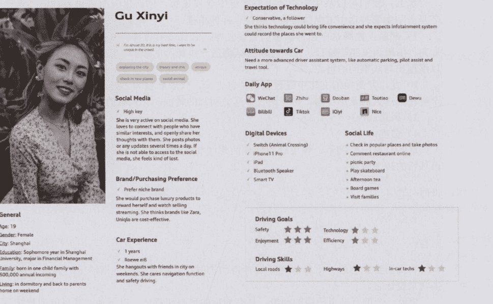

#### 4.3.7 设定故事场景来玩模拟游戏
游戏是天性，大人小孩都爱。小朋友爱听故事，听得意犹未尽时会问“为什么”。这些问题是对故事未描述细节的补充，在一问一答中世界观更完整，听众也在脑海中构建了架空世界的想象。有时在引导下，这种思维创意游戏会更有趣，能训练 ChatGPT 引导思维训练。

以下是与 ChatGPT 一起创造神奇动物的游戏。

提问：
我想让你陪我一起创造神奇动物。

回答：
当然！我很乐意和你一起创造神奇动物。请告诉我你的想法和设想，我们可以一起讨论并创作出独一无二的生物。

提问：
中国神话中出现的神兽，可以为人们带来吉祥。

回答：

从中国传统神话的神兽里取材，设计一只传递好运的神奇生物是个很有趣的方向。以下几种常见于传说的祥瑞动物，都可以作为灵感来源。

1. 麒麟：传说中被视作祥瑞的奇兽，象征着喜庆、福运与长寿。形象上常有马身、鹿角、牛尾、鱼鳞等组合。我们可以构想一只更具新意的麒麟，赋予它别样的色泽与纹理。

2. 龙：华夏文化里最核心的神兽之一，意涵权势、好运与吉祥。可以打造一只神秘迷人的龙形生灵，或融合其他动物的特征，例如凤凰的羽翼或鱼的鳞片。

3. 凤凰：……

4. 白虎：……

以上只是示例，创作者可以按自己的想象组合这些元素，或加入其他特征，塑造出独一无二的神奇动物。

提问：

它会飞。

回答：

若要设计一只会飞的神奇动物，就能把神话元素与现实生物的特点结合起来。

设想一个拥有奇异翅膀的神兽，形态独特。几种可行的思路：

1. 飞天麒麟：把麒麟的经典特征与飞行能力融合。神兽保留马身、鹿角、鱼鳞的设定，再配上宽大的羽翼，令它能在空中自在翱翔，为人们带来吉祥与幸福。

2. 翼龙凤：……

3. 飞虎：……

这些只是起步灵感，后续可以按个人创意进一步完善。创造神奇动物是充满想象的过程，希望以上想法能激发灵感，诞生令人惊艳的飞行神兽！

提问：

它叫阿扎卡比。

回答：

阿扎卡比是个很有趣的名字，就把它赋予我们设计的飞行神奇动物吧。

阿扎卡比可以是一只高贵而神秘的飞行生命，兼具独特的形貌与能力。一种可能的描写如下：

阿扎卡比披着绚烂的羽毛与华美的鳞片，流露出神奇的气质。它的身体结构可能融合了龙与凤凰，龙的身躯搭配凤凰的羽翼。翅膀宽阔轻盈，覆满夺目的羽毛，让它能优雅地在空中飞行。

羽翼的颜色丰富多彩，在阳光下闪耀华丽的光泽。它能在湛蓝的天空自由巡航，展现令人惊叹的飞行技巧。

阿扎卡比被赋予神奇的力量，它的出现代表好运、吉祥与幸福。人人相信阿扎卡比飞过之处，会带来和平、繁荣与希望。

提问：

阿扎卡比有友善的大眼睛，像长颈鹿似的眼睫毛。

回答：

阿扎卡比拥有一双友善温柔的大眼睛，让整体形象更显迷人与可爱。这双眼睛配上类似长颈鹿的眼睫毛，为它增添优雅与神秘感。

瞳色柔和，可能呈现明亮琥珀或深邃翠绿，透出温暖晶莹的光，传递善意与友好。

……

提问：

阿扎卡比身体的羽毛在阳光下呈现宝石般的绿色光泽。

回答：

阿扎卡比的羽毛泛着宝石般的绿，令外观更显神秘华丽。阳光照在身上时，羽毛闪烁惊人的绿色光芒，宛如翡翠或绿宝石。

这种绿泽可清透明亮，也可偏青绿、碧绿，或带有金属感的翠绿。光线在羽毛间折射反射，产生绚丽效果，仿佛身上镶满了无数绿色宝石。

……

通过与 ChatGPT 的对话，阿扎卡比的形象愈发鲜明生动。基于对话内容，我们甚至可以为它整理出一份设定档案。

提问：

请给阿扎卡比总结一个类似档案一样的神奇动物的设定。

回答：

当然，下面是类似档案的设定，概括阿扎卡比的特征与属性。

====================

阿扎卡比档案

- 名称：阿扎卡比。
- 科属：神奇动物。
- 分类：飞行类。
- 吉祥属性：幸福、繁荣、和平。
- 外貌特征：体表覆有如宝石般泛绿光泽的羽毛，一双大而温柔的琥珀色眼眸，眼睫毛形似长颈鹿。
- 形态特征：兼具龙之躯干与凤凰般华丽的羽翼。
- 飞行能力：飞行技巧优雅，能在蔚蓝天空自由翱翔。
- 意义象征：好运、吉祥、幸福、和平、繁荣、希望。
- 性格特点：友善、温和、善意。

这是一套很实用的小说或游戏角色设定方案。ChatGPT 能迅速生成我们常需花费大量时间搜集的设定内容。在得到初步素材后稍作修改重组即可使用，大大提升了效率。

## 第5章

## 英语学习

作为一名英语教师，笔者初次使用 ChatGPT 时就被其强大的语言能力震撼。所谓语言能力，不仅指能进行自然对话，还包括能分辨一对近义词在同一语境下的细微差异。

这种能力即便对英语教师而言，也需要数年持续打磨才能掌握。正是这一发现让笔者确信，像 ChatGPT 这样的大语言模型 AI，可以成为每个人的英语辅导老师！

本章将从英语学习的基础理论切入，探讨 ChatGPT 在英语学习场景中的可行性，以及它为何能胜任优秀辅导老师的角色。随后分析如何满足不同学习目标群体的需求。在系统介绍英语学习理论后，本章还会提供不同学习场景的具体应用案例供参考。

| 本章内容 |

| --- |

| 英语学习者需要什么 |

| 让 ChatGPT 成为你的英语学习助手 |

| 经验与注意事项 |

### 5.1 英语学习者需要什么

在开始用 ChatGPT 辅导英语前，建议先思考：自己处于哪个语言学习阶段，应如何借助 AI 达成学习目标。读完本节后，对 AI 作为语言学习工具的价值会有更清晰的认识。

#### 5.1.1 英语学习的不同阶段

对多数中国学习者而言，英语学习可大致分为五个阶段。

（1）沉默阶段（pre-production stage）

如同婴儿牙牙学语时，此阶段学习者多为观察者与倾听者，努力吸收新词汇，还无法有效用英语交流，但已能理解部分基础词句。

（2）早期阶段（early production stage）

学习者开始尝试用简单的英语表达想法，输出可能仅限单词或短句，对语法有初步感知。

（3）语言发展阶段（speech emergence stage）

表达能力逐步增强，能进行简短对话，虽仍有语法错误，但基本意思能传达。此阶段可引入 ChatGPT 练习，结合“可理解输入假说”，让 AI 按水平进行模拟对话并辅以中文解释，通过实践高效提升。

（4）中级流利阶段（intermediate fluency stage）

能进行较复杂对话，词汇、语法、发音均有改善，日常交流较为流利，阅读与写作能力也在提升。可与 ChatGPT 全英文沟通，进行写作练习，获得语法与表达准确性的反馈与建议。

（5）高级流利阶段（advanced fluency stage）

正式或非正式场合均能熟练使用英语，词汇语法接近母语者水平，可进一步研究细微差别与修辞技巧。此时可与 ChatGPT 深入探讨感兴趣话题，或在陪伴下阅读经典英文文学，甚至模仿大师文笔，在反馈中精进。

#### 5.1.2 英语学习：听、说、读、写

英语学习的四大基本能力构成了学习、理解、使用英语的框架。

##### 1. 听力

听力是多层次的语言能力，涵盖接收语音信息、理解表意、记忆与应用。

（1）英语听力能力的构成

听力输入与理解能力。核心在于接收并理解语言。输入能力要求准确接收并转化语音信号，需要足够词汇量与对语法、语音的掌握。进一步提升还需捕捉主题、解析细节、推断隐含意义、理解说话者态度，即听力理解能力。提升依赖大量听力训练与词汇语法语音学习。

听力记忆与应用能力。要求记住所听到的词、句甚至篇章，最终用于应用，例如把演讲、电影中的表达迁移到生活。提升同样需要有意识的练习。

总体而言，听力是复杂而关键的技能，需持续训练才能游刃有余。

（2）听力能力的练习方法

可从“语言学习”与“语言习得”两方面进行。

- 语言学习：扩充听力词汇，学习常用词、短语、常见语法结构。初阶以此为基础，同时练习听力理解技巧，如把握主旨、细节、推断含义、识别态度，需反复刻意训练。
- 语言习得：将所学付诸实践。通过收听广播、新闻、音乐、影视等接触多样语境，也可与人用英语交流，适应不同口音与语速。

##### 2. 口语

（1）口语能力的构成

口语不仅要求发音正确，还涉及词汇语法运用及社会文化背景认知。

- 口语发音。正确发音是基础，包含音素、音调、连读、弱读等，需模仿与大量练习，并了解语音规律与音标。
- 语音连贯。表达流畅、语调自然、语速适中，需练习语音衔接与语调变化。
- 语言知识。足够词汇与语法知识是口语门槛，需熟悉以便准确流畅表达。
- 沟通能力。能准确清晰有逻辑地表达观点，需掌握沟通技巧与策略，并了解跨文化表达差异。

（2）如何提高英语口语能力

- 语言学习：掌握常用口语表达与常见语法。英语与汉语差异大，模仿母语者发音语调非常有效。同一单词在不同语调下含义也会变化，除朗读例句练习外，还可通过模仿影视对话学习语音语调规则。
- 语言习得：实际使用经验至关重要，能提升流利度与准确性，增强交流自信。

##### 3. 阅读

（1）阅读能力的构成

阅读不仅是识词解句，还涉及深层要素。

- 文化背景。阅读涉及文化背景理解，英语深植于其文化，了解英美文化习惯有助于把握隐含意义与文化差异。
- 阅读理解。核心是理解主旨细节，能推断作者意图观点，如同与作者隔空对话，挖掘深层含义。
- 阅读策略。阅读速度与策略同样重要，不同目的与内容需采用预测、扫描、略读、精读等策略以提高效率。

（2）阅读能力的提升

需语言学习与实践结合。

- 语言学习：强化常用词、短语、语法，并理解其在真实语境中的运用。
- 语言习得：大量阅读是提升速度与理解的关键。可从报纸杂志小说入手，逐步挑战原版书籍，锻炼词汇与复杂句型。阅读时需把握主旨、推断隐含信息、判断观点态度，也可通过写作总结原文检验理解并内化语言。

##### 4. 写作

（1）写作能力的构成

写作涵盖表达、语法、拼写、词汇，需有听力与阅读的输入积累。

- 语言基础。词汇与语法构成基础，足够词汇才能充分表达，掌握语法规则可避免错误，使表达清晰准确无歧义。
- 写作结构。需了解文章组织方式，不同文体结构各异，掌握后能使思路条理严谨。
- 逻辑思维。清晰表达观点并有条理地组织内容是关键，同时运用比喻、拟人、排比等修辞使文章生动。
- 文化背景。理解英美文化与习惯用语有助于准确表达，避免文化差异导致的误解。

（2）写作能力的提升

- 语言学习：除教材外，可用英文书籍、杂志、网络资源拓宽视野，了解母语者写作方式。写作技巧如结构、段落、语言运用也不可忽视。
- 语言习得：阅读量与写作水平直接相关。阅读各类原版书籍可积累地道表达，丰富写作内容与形式。

最后，实践是关键。可针对话题练习，或做雅思托福写作题，并请教老师或同学反馈。借助 AI 也是一个很棒的解决方案，后续内容将手把手指导如何善用 ChatGPT 这位 AI 英语老师。

#### 5.1.3 英语考试：四六级、托业、雅思/托福

英语考试在学习生涯中举足轻重。本节简要介绍常见考试场景及如何借助人工智能辅助备考。

##### 1. 英语四六级

（1）什么是四六级英语考试

四六级英语考试即 CET，是我国国家级英语水平考试，含 CET-4 与 CET-6，用于检测听、说、读、写能力，是大学英语教学改革的核心内容，也是衡量英语水平的重要途径。

考试题型包括听力、阅读、写作与翻译，时长两个半小时。难度逐级递增：

- CET-4 面向大学本科生，测试基础英语能力，难度较低，是本科生必须参加的考试之一。
- CET-6 面向具备一定基础的本科生，测试高阶能力，难度较高，常作为研究生入学与部分用人单位招聘的参考要求。

四六级在英语教育领域影响深远，有人视其为提升能力的有效方式，也有人认为其偏重应试，不利真正掌握语言。但无论如何，对中国大学生而言，四六级是学习与就业路上难以回避的重要门槛。

（2）四六级备考里的 AI 私教

对照 CET4/6 的题型构成、分值分布和应试方式，AI 能在日常的阅读理解与中英互译训练中充当一对一助教。

比如在阅读练习里，ChatGPT 可以对文章进行深度拆解，并延伸讲解涉及的语法点。在中英互译环节，模型会把学习者的译文与自己生成的参考译文进行对照，给出可借鉴的思路。以下是一个典型的互动示例。

提问示例：请以英语教师身份说明现在分词与过去分词的区别，并与定语从句做对比，帮助判断使用场景。

回答要点：现在分词基本以 -ing 结尾，既能构成进行时，也能作形容词修饰名词；过去分词常见 -ed/-en 形式，常用于完成时、被动以及作定语；定语从句则用来为名词补足限制性信息。选用时，若要描述正在发生或具有持续性的动作状态，倾向现在分词；若要突出被动或已经完成的动作，倾向过去分词；若要补充更具体的限定信息，则更适合定语从句。

这只是众多用法中的一个切片，更多实操可参考 5.2 节。

##### 2. 托业考试要点

（1）托业是什么
托业 Test of English for International Communication 由美国教育考试服务中心 ETS 开发运营，侧重评估非英语母语者在国际商务及职场情境下的英语应用能力。随着全球化深入，商务英语的重要性持续上升，托业成为不少人提升职业竞争力的渠道。

考试分为听力与阅读、口语与写作两大模块，内容聚焦工作场景的语言使用，比起通用类考试更贴近商务沟通。

托业目前被全球 160 多个国家 1.4 万多家机构作为员工英语水平评估标准，覆盖中小企业、跨国公司、高等院校和政府部门。考过托业有助于在国际商务和职业发展中获得支撑。

典型应用场景：
- 企业用人：招聘、晋升或岗位调配时设定分数线；
- 培训评估：判断员工能否跟上英语授课；
- 海外任职：评估在英语国家的工作交流能力；
- 语言规划：明确员工的培训需求和学习目标。

##### 3. 雅思/托福考试

###### （1）雅思是什么
雅思 IELTS 由英国文化协会、剑桥大学考试委员会与 IDP 教育集团联合推出，已成为全球最主流的英语能力测评之一。核心理念是公正、精准地全面反映考生的英语水平。

###### （2）雅思结构
全程约 2 小时 45 分钟，包含听力、口语、阅读、写作四项，与工作生活中的听说读写对应。

- 听力：收听不同口音和语速的对话或讲座，考察口语理解与信息捕捉；
- 阅读：阅读长篇材料并作答，考察书面理解与信息提取；
- 写作：围绕指定主题写议论文或图表描述，考察观点表达与正式文本写作；
- 口语：一对一面试，考察日常对话中的语言运用。

成绩采用 0-9 分制，整数代表等级，小数提供更细差别。多数欧美高校本科与研究生申请要求在 6-6.5 分左右，达到后可在英语国家正常学习生活。

###### （3）适合人群
- 赴英语国家留学的学生，用作语言证明；
- 计划在英语国家工作或移民的人士，满足官方与雇主要求；
- 教师、翻译等希望出示英语资质的专业人士。

##### 4. 托福考试

###### （1）托福是什么
托福 TOEFL 全称 Test of English as a Foreign Language，由 ETS 研发管理，被世界各大高校广泛认可，是申请英语授课国家大学的常规要求，也是赴美签证申请中常见的语言证明。

###### （2）托福结构
同样考察听、说、读、写四项，但形式与雅思不同，总时长约 4 小时，测试深度与广度更大。

- 听力：听对话与讲座并答题，重在学术环境下的口语信息处理；
- 阅读：两篇学术主题长文阅读，考察主旨把握、细节支持、观点分析与复杂概念理解；
- 口语：四项任务，包括听读后陈述和独立发言，考察口头表达；
- 写作：综合写作要求先读后听再概述，学术讨论写作要求就主题写议论文。

分数为 0-120 分，每项 30 分，四项相加。评分更细化，目标仍是公正准确评估英语能力。

###### （3）适合人群
与雅思类似，主要区别在于：
- 需要托福成绩的院校多集中在美国；
- 雅思提供学术版与通用版，托福主要面向学术目的。

总体来看，相较 CET4/6 与托业，雅思和托福难度更高、备考投入更大，5.2 节会专门介绍相关 AI 备考方法。

#### 5.1.4 不同人群的学习目标：学生、家长、白领

##### 1. 学生

###### （1）学生特征与痛点
英语从小学到大学都是必修，重要性未变。核心原因在于英语是学术界与科技界的主流语言，也是全球沟通的通用工具，对未来学术与就业都有决定性作用。

不同阶段痛点各异：
- 小学阶段：初次接触英语感到陌生，注意力和记忆力需靠趣味互动引导；
- 初中阶段：词汇量与语法规则成为难点，需兼顾各科学习时间；
- 高中阶段：阅读与写作能力需提升，同时承受升学考试压力；
- 大学生阶段：以自学为主，面对四六级、雅思、托福及专业资格证等多样高难度考试，自学策略成为关键。

###### （2）ChatGPT 如何助力学生
- 提供有趣语料：为低龄学习者生成与动漫、科幻等兴趣相关的个性化材料，甚至共创英语故事，让学习更生动；复杂语法也能用生活化比喻反复解释；
- 词汇与语法支持：把待背单词编成故事，帮助在语境中记忆词义用法；
- 自学助手：解读难懂文本、补充背景知识、协助制定并优化自学计划。

###### （3）实践案例
ChatGPT 可扮演耐心教师，反复用不同方式解释语法并给出适配水平的样例，并用形象比喻帮助记忆。

个性化材料案例：请用风趣口吻向 12 岁孩子解释现在完成时与一般过去时的区别。模型会用时间旅行比喻：过去式像回到具体过去的时间点描述已完成的事件，现在完成时像站在现在回望过去，强调经历对当下的影响。

词汇记忆案例：给出 initiative、increase、determine 等词，要求写 100 词内短文并标出重点词，随后附上词性、中文释义及在文中用法，辅助学生在语境中内化词汇。

更多应用见 5.2 节。

##### 2. 家长

###### （1）家长特征与痛点
多数中国家长学英语的动机是辅导孩子作业，需同步提升自身水平。成年人时间少、工作压力大，易因方法不当、资源不匹配导致效率低下。更复杂的是，家长还需了解儿童学习规律，投入时间设计教学方式，缺乏有效支持时只能依赖外部辅导。

###### （2）ChatGPT 如何帮助家长
可快速梳理知识点、规划教学思路、批改孩子作业并给出针对性改进方案，成为家长的教学伙伴。

###### （3）实践案例
快速掌握知识点案例：询问 “of” 介词的核心用法。模型会归纳从属关系、所属关系等典型功能并配例，如 the President of the United States、the pages of a book 等，帮助家长迅速建立教学抓手。

> 2）标明构成要素：用以说明某物由哪些部分或材料构成。举例：
> • a cup of coffee
> • a slice of bread
> • a piece of furniture
>
> 3）标明缘由或指向：用以表达行为的起因或所针对的对象。举例：
> • to die of hunger
> • to be proud of one's achievements
> • to be afraid of heights
>
> 4）……
>
> 上述内容仅涵盖 of 的部分基础用法。该介词在英语中使用频率极高，熟练掌握依赖于大量练习与阅读积累。

案例 2：辅助制定教学计划

> 问题：
> 假设你是一名英语教育专家。我希望教孩子有关从句的语法，请为我设计一份教学方案，采用引导式教学，帮助孩子更扎实地掌握。
>
> 回答：
> 针对从句这类语法点，引导式教学具备明显优势。它促使学习者主动参与、自行归纳规律，并在真实语境中运用。下面是一份可操作的教学流程。

> 阶段一：概念引入与目标明确
> 1）解释从句的含义：从句包含主语和谓语，在复合句中作为整体成分发挥作用。
> 2）确定学习目标：熟悉名词性从句、形容词性从句、副词性从句，并在日常交流中正确使用。
>
> 阶段二：示范与讨论
> 1）给出样例：先呈现简单句“What time is it?”，引导思考如何改写为包含名词性从句的复合句，如“I don't know what time it is.”。
> 2）结构剖析：共同拆解例句，突出主句与从句的依存关系。
>
> 阶段三：探索不同类型从句
> …… 
> 阶段四：语境运用
> …… 
> 阶段五：回顾与巩固
> …… 
>
> 按此推进，孩子能够逐步理解从句的意义与用法，并在实际场景中灵活使用，整体语法水平也随之提升。教学过程中要注意给予充分的鼓励与积极反馈，以激发兴趣和自信心。

具备基础英语的家长借助 ChatGPT 就能较为有效地辅导孩子的学习。

##### 3. 白领

###### （1）白领人群的特征与痛点

对国内白领而言，英语价值十分突出。

- 作为国际通用工作语言：在全球化办公环境中，英语常被用作沟通桥梁，跨国项目和商务活动多以英语进行，熟练使用可使跨团队协作更顺畅。
- 维持竞争优势：英语是商业、科技、文化交流的主要媒介。学习英语有助于提升沟通能力、扩大国际人脉、开阔视野，保持全球竞争力。通过英语获取英文资讯、分享创意，更易在工作与业务发展中抢占先机。

与在校生不同，上班族学习英语目标明确、动力强。

- 提升职业能力。例如商务谈判、项目汇报、邮件沟通等实战技能，直接满足职场需求。
- 强调内容与工作的贴合，追求实用性和效果。但因岗位差异大，传统教材往往难以完全契合实际需求。
- 对学习方式灵活性要求高。工作繁忙难以抽出整块时间，需要根据兴趣和工作需求灵活安排碎片化学习。

录播课程或一对一英语辅导是白领常见选择，因其灵活，但均有局限。录播课程反馈慢，效率受影响；一对一位课能及时反馈，可费用高昂，时薪常在300～500元，并非人人可长期负担。

###### （2）ChatGPT 可以如何帮助白领人群

ChatGPT 为白领英语学习提供了新思路。

对于仍使用录播课程却希望获得个性化反馈以提高效率的人，或希望降低一对一辅导成本的人，ChatGPT 都可充当合格的私人英语助手。对英语学习约80%的需求，它都能较好满足，成本几乎为零。

借助 ChatGPT，可以跳脱传统学习框架，实现工作与英语学习的兼顾。例如整理专业领域知识时，ChatGPT 能提供必要支持，并同步归纳相应的英文词汇和专业术语。这不仅有助于丰富专业知识，也拓宽了可用于邮件交流或PPT演讲的专业英语词汇量。

###### （3）实践案例

1）同步学习专业知识与专业词汇

如想了解自媒体行业并掌握相关英文表达，可这样使用。

> 问题：
> 我想了解自媒体行业。请基于行业报告、新闻调查和研究论文，总结50个关键词，并按关联强弱分为5～8类，每类给出中文词和英文对应。
>
> 回答：
> 按要求梳理出自媒体行业的50个关键词并分类，以下为示例。
> - 分类 1：平台和技术
>   - 自媒体（self-media）
>   - 平台（platform）
>   - 微信公众号（WeChat official account）
>   - 微博（Weibo）
>   - 抖音（Douyin）
>   - 小红书（Xiaohongshu）
>   - B 站（Bilibili）
>   - 视频直播（Live streaming）
>   - 短视频（short video）
>   - 社交媒体（social media）
>   - 内容分发（content distribution）
>   - 用户生成内容（user-generated content）
>   - 直播电商（live commerce）
>   - 数据分析（data analytics）
>   - 智能推荐（smart recommendation）
> - 分类 2：内容类型
>   ……
> - 分类 3：内容生产和营销
>   ……
> - 分类 4：法规和监管
>   ……
> - 分类 5：趋势和未来发展
>   ……

2）润色演讲稿件、提升口语表达

白领可将准备的英文演讲稿或提纲交给 ChatGPT 评审。AI 会就语言使用和结构提出建议，帮助改善表达、优化词汇，减少中式英语，降低误解风险。通过此方式，既能提升工作交付质量，也能锻炼英语口语。

可参考提示词：

提示词 1：文字层面的建议

> 问题：
> 你现在是专业英语编辑。
> 我会给你一篇演讲稿，请从以下维度给出改进意见：
> - 英语语法
> - 用词准确性
> - 表达清晰度
> - 语言简洁易懂
> - 行业术语是否正确
> - 避免中式英语
> 下面是我的演讲稿 = [你的英文演讲稿]
> 你的建议是：

提示词 2：内容层面的建议

> 问题：
> 你现在是专业公共演讲教练。
> 我会给你一篇演讲稿，请从以下维度给出改进意见：
> - 内容的专业性和连贯性
> - 吸引听众注意力的能力
> - 避免引起误解
> - 逻辑结构
> - 案例与论证
> - 关键信息的突出
> 下面是我的演讲稿 = [你的英文演讲稿]
> 你的建议是：

#### 5.1.5 ChatGPT：优秀的英语辅导老师

ChatGPT 完全有能力担任英语辅导老师的角色。本节从信、达、雅三方面阐述原因。

##### 1. 信：永不出错的语法机器

信指准确性。ChatGPT 在语言准确度上表现突出，被不少学习者视作好老师。

其背后是大规模文本训练、深度学习架构以及基于人类反馈的强化学习。凭借海量语料训练、全局视野的模型架构和持续的人类反馈优化，ChatGPT 在语法和词汇使用上展现出很强的可靠性。虽然创意和情感表达有限，但在“如何正确使用英语语法”这一任务上表现常优于不少人类教师。

##### 2. 达：特定话题的深入讨论

好的老师不仅能指导语言技巧，还能通过深入话题讨论帮助学生练习语言并拓展文化背景。

ChatGPT 虽不能创造全新观点，但掌握了巨量网络文本知识。无论什么话题，都能进行细致深入的对话。对需要扩充词汇、拓宽知识面、练习实战的学习者来说，它是不错的伙伴。

##### 3. 雅：紧跟潮流的地道表达

好老师要持续学习、与时俱进。英语每年都有新词新表达，只有紧跟潮流才能提供贴近现实的建议。

作为先进的生成式模型，ChatGPT 也具备持续学习的特质。若用户使用2023年出现的新词，它可通过上下文推断含义，并随互动获得更多反馈来校验和优化理解，逐步掌握新表达。

用户也会直接把最新文章或书籍片段复制进去让它学习，以处理实际任务。在此过程中，ChatGPT 也能学习到特定领域的新知识和新表达。因此，无论是了解最新用法还是讨论相关话题，它都能作为合格的英语辅导者答疑解惑。

### 5.2 让 ChatGPT 成为你的英语学习助手

5.1 介绍了学习要点和 ChatGPT 的帮助方向，本节进入实操，从不同维度展示它在真实场景中的作用。

#### 5.2.1 从模拟对话开始

##### 1. 应用要点

要把英语从书本知识变成使用工具，模拟对话必不可少。但传统英语角常有痛点。

- 目标模糊：缺乏明确方向容易停留在浅层闲聊，难以提升词汇和水平。有目标的学习者需要约定特定主题，但对搭档水平要求高。
- 难度不一：无法控制同伴水平，太简单学不到新东西，太难则难以继续，找到水平相当的伙伴需靠运气。
- 反馈缺失：认知科学认为高质量即时反馈是高效学习关键，而英语角很难获得专业评价和后续学习建议。

下面将演示如何用 ChatGPT 的模拟练习逐步解决这些问题。

##### 2. 应用案例

（1）设定对话题和对话方式

设计提示词前，先说明结构。清晰的结构能提升效果，也便于复用。

提示词可分为：

- 角色：设定 AI 扮演的身份，影响输出风格。
- 任务：设定需要完成的具体任务，可细化步骤。
- 变量：将话题和难度级别作为变量，模板固定后只需替换变量即可使用。

以下是一套提示词的案例。

```
问题：

角色：
我需要你扮演一位英语母语使用者。
任务：
我们会基于变量中所提供的口语话题，进行英语对话。
在我们的对话中，你来扮演一个提问者的角色，我会基于你的提问进行回答，请你根据我回答的内容，进一步围绕着同一个口语话题进行提问。
请把我们英语对话的难度控制在变量中的难度级别。
在你提出第一个问题之后，请等待我的回答。
变量：
1）口语话题 = [Describe a noisy place you have been to]
2）难度级别 = [CEFR B1]
Let’s begin:
```

日常熟人对话多为话题驱动型，人们会按兴趣主动引入话题。而英语角容易目标模糊，正是因为彼此兴趣不了解，交流流于表面。

因此可尝试问题驱动型的模拟对话。好处如下：

- 保证练习有效性：若内容完全由 AI 输出，用户语言练习量会下降。问题驱动能让用户多开口。
- 保证流畅度：ChatGPT 可根据用户回答循序渐进提问，引导练习，提升体验。

设定好模式后，只需指定话题和语言难度。

可参考欧洲语言共同参考框架 CEFR。该标准在国际上应用广泛，被雅思、TOEFL Junior 等考试借鉴，ChatGPT 也能识别。用 ChatGPT 认可的标准，才能让生成内容更符合要求。

CEFR B1 约等于大学英语四级水平。详见 5.3.1 节“如何指定难度级别”。

（2）模拟对话

以下为一次模拟练习示例，可见 ChatGPT 如何利用上下文逐步引导，让对话保持连贯。

> 回答：
> Let's start with the topic you suggested, "Describe a busy market you have visited." Could you tell me about a market you found particularly lively?
>
> 问题：
> It is a wet market in Guangzhou. I visited it last month. There were many vendors shouting and customers bargaining. The atmosphere felt very lively and noisy.
>
> 回答：
> I see. What kinds of sounds stood out most to you there? Was it mainly shouting, or other noises as well?
>
> 问题：
> Mostly vendors calling out prices and people bargaining. Also there were carts moving and some music playing.
>
> 回答：
> I understand. How did you feel about the noise and crowd? Did it bother you or did you enjoy it?
>
> 用户：
> It was a bit overwhelming at first, but then I enjoyed the energy. How do you think such markets could become less chaotic?
>
> …

（3）获取及时反馈

如前所述，高质量即时反馈对提升练习质量至关重要。可让 ChatGPT 充当第三方评估者，回看对话并给出针对性提升建议。

示例：

> 问题（接前对话）：
> 请对我们之前的模拟英语对话进行评估，并指出可改进之处：
>
> 回答：
> 你的口语表达能力不错，能清晰描述广州湿市场的感受和印象，也能理解提问并作出恰当回应。
>
> 若想进一步提升，可尝试：
> 1）在回答中多用形容词和副词，使描述更生动。
> 2）尝试使用复合句或从句等复杂结构，展示语言水平。
> 3）在回答中加入更多口语化表达，如习惯用语，让口语更地道自然。
>
> 希望这些建议能帮助你进一步提高口语表达能力！

ChatGPT 英语陪练三件套：对话、批改、翻译

想让教学建议真正被用起来，最省事的做法是让模型直接呈现一段可模仿的英语示范，学习者能立刻看到效果如何落地。

> 问题：
能否参照之前的反馈，给我一段英语模拟对话作参考。
回答：
Sure, here's an example dialogue based on the feedback I provided earlier:
Topic: Describe a memorable vacation you've taken.
- Question: 能不能说说你去过的一次特别难忘的旅行？
Response: 当然可以！几年前我去巴厘岛度假，体验太棒了。海滩非常漂亮，天气也很好，吃的很美味。那次行程我一直记得当时的放松和自在。
- Question: 听起来很棒，能更详细描述一下海滩吗？
Response: …… 
- Question:你在巴厘岛都怎么安排时间？
Response: …… 
- Question: 这种安排很有意思，你在当地待了多久？
Response: ……

##### 3. 小结
从上面的演示可看出，模型能同时承担两种功能：一边充当对话伙伴进行逼真的角色扮演，一边以旁观者身份点评表现并提供专业建议与范例。这种练习既能让语言在真实使用中内化，又能靠即时的正向反馈提升效率。

场景迁移很方便，比如酒店入住登记，换一套提示词即可套用。流程也可以更细致，比如在正式对话前先请模型依据学习者水平整理一批高频表达。

提示词定好后，还能用语音完成模拟对话，具体做法可参考后文 5.2.8 节的“与 ChatGPT 语音对话”。

#### 5.2.2 词汇语法高效练习

##### 1. 应用要点
以往的教学常把词汇和语法当成线性清单来攻克，例如从单词书第一页起背诵，或从语法书第一章起研读。这种方式的弊端在于，学到的点很难与真实开口的情境挂钩。

即便投入足够的时间把枯燥内容啃完，学习者仍会遇到一个尴尬事实：在

##### 2. 应用案例

（1）先为练习者和 ChatGPT 设定身份
沿用 5.2.1 节的提示词思路，开始前先为模型确定扮演的身份，以提升反馈质量。此处需要的身份是英语教师。

角色设定的提示词示例。

> 问题：
我正在学英语，母语是中文。
请你扮演一位英语老师，帮我提升英语水平。

必要时可对身份做更精细的描述，比如设定为“幽默风趣”的老师，这时模型会给出更有趣的例句，更适合低龄学习者。

（2）给出明确的任务描述与交互方式
角色确定后，需要明确练习任务。可以要求模型对我们的英语练习做批改，并对用词和语法做严格核查。

设定任务与交互方式的示例。

> 问题：
请严格检查并纠正我的语法和用词错误。
第一步，我会先把写的英语段落给你，有错请直接回正确版本。
第二步，请列出所有错误并简要说明原因。

任务设定后，可进一步细化交互流程。例如本例为方便阅读，可要求模型先给出修改后的正确版本，再以清单形式解释词汇语法问题。

（3）把作业交给 ChatGPT
接下来把实践练习交给模型批改，同时可用符号化表达让指令更清晰。

具体例子如下。

> 问题：
英语段落 = [The most important advantage for online research is its timeliness. People can get the answer effectively, it can better solve the emergency demand.]

模型返回的批改反馈如下：

> 回答：
好的，我来检查一下你的英语段落。
“The most important advantage for online research is its timeliness. People can get the answer effectively, it can better solve the emergency demand.”
这里有一些语法和用词错误，我将给你纠正并解释每个错误。
改正后的版本：The most important advantage of online research is its timeliness. People can obtain answers quickly and effectively, which can better meet emergency demands.
解释：
- “for” 应该改为 “of”，因为 “advantage” 是一种特定的好处，应该使用 “of” 来表示。
- “get the answer” 应该改为 “obtain answers”，因为 “answer” 是可数名词，需要用复数形式。
- “effectively” 应该放在句子中的正确位置，这里应该是 “quickly and effectively”，表示快速而有效地获得答案。
- “it” 应该改为 “which”，因为 “which” 可以指代前面提到的 “answers”。
- “better solve” 应该改为 “better meet”，因为 “meet” 更符合 “emergency demands” 的意思，表示更好地满足需求。

若使用传统工具，比如 Grammarly，效果并不理想。Grammarly 免费版的批改结果如图 5-1 所示。
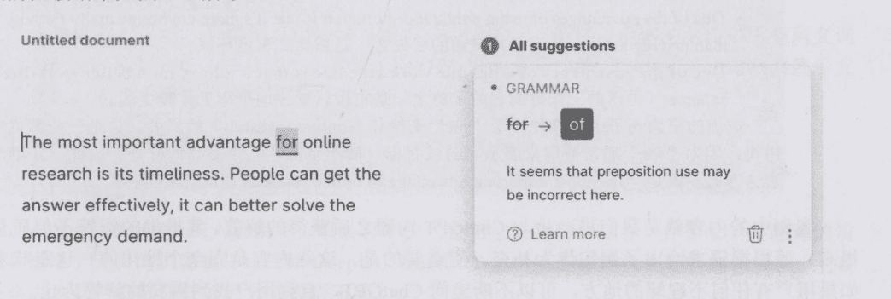
即便付费模式，也无法指出 “solve demand” 搭配不当的问题。Grammarly 付费版本的批改结果如图 5-2 所示。
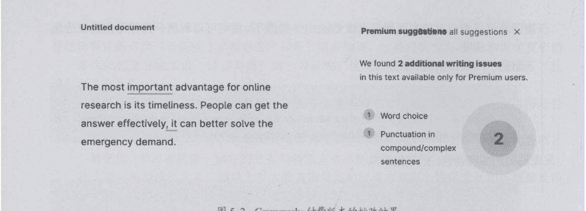
图 5-2 Grammarly 付费版本的批改结果
因此，当需要快速获得练习反馈时，ChatGPT 是非常理想的选择。

（4）按需继续沟通，获取更多词汇语法知识
若想更深入理解相关英语知识，可要求模型进一步讲解知识点并提供例证。

例如希望模型把第一点解释得更细，示例如下。

> 问题：
可以把第一点解释得更仔细一些么？我需要你给我一些例子。
回答：
当我们使用 “advantage” 来描述某个事物的好处时，我们通常会用 “of” 来表示。这是因为 “advantage” 本身就是一种特定的好处，我们需要使用 “of” 来表示它是属于某个事物的。以下是一些例子：
- One of the advantages of studying abroad is the opportunity to learn a new language.（出国留学的优势之一是有学习一门新语言的机会。）
- One of the advantages of using public transportation is that it’s more environmentally friendly than driving a car.（使用公共交通的好处之一是相比驾车更环保。）
- One of the advantages of a flexible work schedule is that it allows for a better work-life balance.（灵活的工作时间表的优势之一是它可以更好地平衡工作和生活。）
在你的原始句子中，你使用了 “for” 来描述 “online research” 的好处。这是一个常见的错误，因为 “for” 通常被用来表示目的或目标，而不是描述某个事物的好处。因此，正确的表达方式应该是 “The most important advantage of online research is its timeliness.”
案例中的内容是在进一步沟通后获得的解答。解答质量很高，并按需给出例句补充。更重要的是内容完全个性化。若有不理解之处，可持续追问，直到获得所需解答。

可继续要求模型提供更多例证，如下所示。

> 问题：
那么，“for” 通常用来表示目的或目标，你能给我一些例子吗？
回答：
当我们使用“for”来描述某个事物时，通常表示这个事物的目的、目标或用途。以下是一些例子：
- I bought this book for my sister's birthday. （我买了这本书是为了庆祝我妹妹的生日。）
- I exercise every day for better health. （我每天锻炼是为了更好的健康。）
- She is studying hard for her upcoming exams. （她正在努力学习，为即将到来的考试做准备。）
- I am saving money for a new car. （我正在存钱，为了买一辆新车。）
在这些例子中，“for”被用来表示某个事物的目的或目标。请注意，“for”后面通常跟着名词或动名词，表示这个目的或目标的内容。
上述生成内容的质量可与市面上大多数高质量教辅相媲美。最后，还可让其出题验证是否真正掌握相关知识。
> 问题：
给我出 3 道填空题，来考验我是否真的理解“for”和“of”的区别。
回答：
好的，以下是三道填空题，请根据题意填入正确的单词。
1) One of the benefits ______ reading is that it can improve your vocabulary and language skills.
2) The main advantage ______ studying abroad is the opportunity to immerse yourself in a new culture.
3) I'm saving money ______ a new car, so I'm being careful with my spending.
请分别填入适当的单词，并解释为什么使用了“of”或“for”。

##### 3. 小结
本小节围绕“语言习得”理论展开，并演示了如何借助 ChatGPT 高效学习词汇与语法，期望对读者有所启发。
读者可依据个人学习需求，利用 ChatGPT 学习单词常用搭配与同义词辨析，也可就特定语法点要求提供更多练习与例句。通过互动式实践，真正吃透相关词汇语法。

#### 5.2.3 语言翻译实操

##### 1. 应用要点
在 ChatGPT 用户中，不少人会用它做翻译工作，并对其质量感到惊讶。相较于现有机器翻译如 DeepL，其表现更好主要源于处理方式差异，可归纳为三点。
- 文化差异：文化因素往往是翻译质量的关键，比如本地化俚语典故会严重影响机器翻译表现。但模型在训练时使用了大量多样化数据，在面对不同文化差异时表现更稳健。
- 上下文理解：对上下文语境的把握是 Transformer 架构的强项。翻译时它会先理解任务上下文与场景，再进行翻译。例如翻译小说句子时，若提供上下文，它会先理解段落含义再翻译，流程更接近人工翻译。
- 生成能力：模型本身就是面向语言生成的系统，训练目标是产出自然流畅且符合目标语习惯的内容，因此译文更贴近真实表达。
日常工作中可用其完成翻译任务。但对英语学习者而言，“翻译”本身也是一种有效练习方式。它能帮助深入理解语法、扩充词汇、提升对英语文化的理解。通过中英互译，不仅能学到新词与表达，还能培养语感。无论新手或老手，练习翻译都能带来提升。

##### 2. 应用案例

（1）设定角色和任务
与 5.2.1、5.2.2 节相同，设计提示词时先定义角色与任务。此处可让模型扮演“翻译专家”，为译文提供专业建议。

角色设定案例。

> 问题：
你是一位经验丰富的翻译专家。
你将会得到一段中文原文以及我所提供的对应的英文译文。
请你根据以下三个目标，为我的译文提供详尽而具体的改进建议。
1）确保译文的准确性和忠实性，保证其无偏离原文的意思。
2）确保译文的表达通畅明确，便于读者理解。
3）确保译文的用词精准得体，语言优雅流畅。
你是否理解上述任务？
回答：
是的，我理解您的任务。您希望我审查您提供的英文译文，并提供改进建议，以确保译文的准确性、流畅性和语言表达的优雅性。我会尽力帮助您达到这些目标。请提供您的中文原文和英文译文，我将尽快为您提供反馈和建议。
由于任务较为抽象，可增加确认性提示“你是否理解上述任务”，确保模型正确理解后再继续。

提示词设计完成后，可选取喜爱的电影剧本、歌词或小说片段作为练习语料，增加趣味性。

（2）上传翻译作业获得反馈
以王小波《黄金时代》中的经典句子为例。

> 问题：
中文原文 = [我觉得人活着，为的就是忍受摧残，一直到死，我们每个人都受不完的摧残，到死为止。但是我觉得我们每个人都有责任，有义务为我们自己的生命负责，我们活着不能光是为了受摧残，还要有所作为，要让我们的生命有点意义。]
英文译文 = [I belive, the purpose of being alive is to suffer until death. We, everyone of us, all have endless sufferings to endure until death comes. However, I still belive that each one of us all have the obligation and duty to being responsible for our own life. Beside suffering, we have to do something to make our life meaningful.]
回答：
您的翻译已经相当不错，但是在确保准确性、通畅性和用词的优雅性这三个方面，我还是有一些具体的改进建议。
- 准确性和忠实性：您的翻译已经很好地保持了原文的意思，没有明显的错误。但是，“我们每个人都受不完的摧残，到死为止”这句话，如果直译为“We, everyone of us, all have endless sufferings to endure until death comes.”，可能会让读者误解为我们会一直遭受新的苦难，而不是指我们已有的苦难会持续到死亡。我建议稍作修改。
- 表达通畅明确：“I belive”的拼写应改为“I believe”。“Beside suffering”应改为“Besides suffering”。“being responsible for our own life”可以改为“taking responsibility for our own lives”，更符合英语习惯。
- 用词精准得体，语言优雅流畅：“suffer”和“suffering”的重复使用可能会让读者感到单调，可以考虑换用其他词汇。“do something”也可以更具体一些，比如“make a difference”。
考虑以上所有建议，我为您的英文译文提供如下修改版：

> “I believe that the purpose of living is to endure hardship, ceaselessly until death. Each of us is subjected to an unending ordeal that lasts until our final moment. However, I firmly believe that we all have the responsibility and obligation to take charge of our own lives. Besides enduring, we must strive to make a difference, to imbue our lives with meaning.”

该回复具有参考价值。先前的示例表明，ChatGPT 的输出条理清晰、层次分明。如果想把某个细节聊透，可以借用 5.2.2 节里提到的聚焦提问技巧，把讨论范围收窄到单一要点上进行探讨。

（3）分层定制学习笔记

另外，模型还能按照使用者的现有水平自动产出配套的学笔记。假定学习者英语大致相当于国内高校生的平均水平，就可以用下面的方式发起请求。

> 问题：

目前我的英语能力 = [CEFR B1]；

请你根据我的英语能力，基于你提供的“修改版本”，帮我生成词汇和语法的学习笔记。

回答：

很好，根据您现在的英语水平（CEFR B1）和我提供的修改版本，以下是一些关于词汇和语法的学习笔记。

- 词汇：

1) “Endure”：这个词比“suffer”更正式，也更强调持久的忍受，可以用在较为正式的语境中。

2) “Ceaselessly”：这个副词用于描述一种无休止、持续不断的状态，用以强调“endure”的连续性。

3) “Ordeal”：这个词是一个比“suffering”更具强度的词，指的是严重的、艰难的考验或痛苦的体验。

4) ……

- 语法：

1) 当描述一个全体的概念时，可以使用“Each of us is ...”的结构。注意在这种情况下，动词应使用单数形式。

2) 在描述持续的动作或状态时，“endure”后面可以跟名词或动名词。

3) 在使用“Besides”引导的短语作为句子的开头时，后面应接名词、代词或动名词。

希望这些笔记能帮助您更好地理解和学习英语！

##### 3. 小结

本小节梳理了 ChatGPT 在翻译场景上比以往工具更胜一筹的地方。正因如此，它既能承担工作中的翻译辅助，也能为英语学习者提供中英互译练习的助力，帮助达成学习目的。

在上述分析的基础上，文中还提供了若干实操案例供参考。实际使用时还可以延伸，例如借助 ChatGPT 解析名家译作，让学习者更直观地体会精妙之处。

#### 5.2.4 创建学习计划

##### 1. 应用要点

外语学习离不开有针对性的规划，循序渐进。对英语学习者而言，自己制定计划并不容易，主要障碍包括：

- 水平不明：判断自己的语言等级并不简单。若不清楚定位，计划的可执行性就会受影响。5.1.2 节提到，结合不同阶段的特点来定制方案会更有效。

- 结构不足：自拟计划往往缺乏清晰的框架和科学的方法。比如备考六级的大学生，可能只规划每天背多少词、每周做几套题。从当代语言学习理论来看，这种重“学”轻“习得”的做法效果打折，5.1.2 节里提到的习得观也正是指出这一点。

- 反馈跟进薄弱：落地过程中几乎都会遇到现实阻力。职场人可能因为工作突增而打乱节奏，学生也可能卡在瓶颈期发现旧方案不再奏效。此时学习者很难自行调整计划；即便由教师制定，除非出现特殊情况，教师通常也不会因细节问题反复修正。

上述痛点虽然可以请老师帮忙，但完全可以用 AI 工具来应对

##### 2. 应用案例

###### (1) 评估英语水平

以下展示一组精心设计的指令与模型反馈。本案例采用最通用的词汇测评作为整体水平的映射，学习者可借此更客观地认识自身状况。值得注意的是，案例中使用了 ChatGPT 最新版 GPT-4，其逻辑判断能力更强，对评估的助力更大。

> 问题：

你是一名英语语言专家。你的任务是设计一套词汇测试，来评估我的英语语言水平。

### 测试要求 ###

词汇测试的维度应当包含：1. 词汇的广度；2. 词汇的深度；3. 词汇的使用能力；4. 词汇使用的恰当性。

词汇测试的难度：应当从简单问题开始，然后根据我的回答质量进行调整。

测试方式：通过多轮测试，来对我的语言水平有一个清晰的评估。

测试结果：请你使用 CEFR 的标准来解释我的语言水平。

### 自我评估 ###

目前我自我评估的语言水平，词汇量在 4000 左右。可以作为你的参考。

上述内容是否清晰？如果清晰，请你设计词汇测试并出题。

> 回答：

明白了，我们将按照你的要求进行词汇测试，测试会包括选择题、填空题以及判断题等形式，以此来考察你的词汇广度和深度，以及使用能力和恰当性。我会根据你的回答质量调整难度。好的，让我们开始吧。

### 1. 选择题 ###

请从下列选项中，选出与给出的单词最接近的词。

A. Word: Happy

1) Sad

2) Joyful

3) Fearful

4) Angry

B. Word: Run

1) Sit

2) Walk

3) Jump

4) Sleep

### 2. 填空题 ###

请在下列句子中填入恰当的词汇。

A. I could barely see anything because the room was too ____________.

B. She's an ____________ person, always ready to help others in need.

### 3. 判断题 ###

判断以下句子是否正确使用了词汇。

A. The little boy has a voracious appetite for books.

B. After hearing the bad news, he was overflowed with joy.

在你回答完毕后，我将进行评估并调整题目难度。

问题：

### 1. 选择题 ###

题目 A：答案是 Joyful。

题目 B：答案是 Walk。

### 2. 填空题 ###

题目 A：答案是 dark。

题目 B：答案是 helpful。

### 3. 判断题 ###

题目 A：正确。

题目 B：正确。

回答：

很好，这是你的答案的评估结果。

### 1. 选择题 ###

你的答案完全正确。

### 2. 填空题 ###

题目 A 和 B 你都正确填写了词汇。

### 3. 判断题 ###

对于题目 A，你的答案是正确的。“The little boy has a voracious appetite for books” 这句话中，“voracious” 表示的是强烈的渴望或者需求，所以这里用来形容小男孩对书籍的强烈渴望是正确的。

然而对于题目 B，你的答案是错误的。“After hearing the bad news, he was overflowed with joy” 这句话在语境上存在问题。一般来说，听到坏消息后，人们不太可能感到充满喜悦，所以在这个语境中，“overflowed with joy”（充满喜悦）的使用并不恰当。

根据你的回答和自我评估，你在词汇广度、词汇深度和词汇的使用能力上都表现得相当不错。但在词汇使用的恰当性上还需要一些提升，特别是在理解单词在特定语境中的含义和使用方式上。

按照 CEFR（Common European Framework of Reference for Languages）的标准，我会暂时将你的语言水平定为 B1。在 B1 级别，学习者应该能够理解并使用日常生活中的熟悉的表达和基本的词汇，应对大部分旅行期间可能遇到的情况，并能描述个人背景、环境和需要的基本问题。不过，需要注意的是，这只是暂时的评估，为了更准确地评价你的英语水平，我们需要更多的测试。

现在让我们进行下一轮测试，稍微提升一下难度。

### 1. 多选题 ###

以下哪些单词和 “meticulous” 有相似的含义？（可能有多个答案）

1) Careful

2) Sloppy

3) Thorough

4) Negligent

5) Precise

### 2. 填空题 ###

请在下列句子中填入恰当的词汇。

A. The company's __________ growth can be attributed to its focus on innovation and quality.

B. The room was decorated in a __________ style, with minimalist furniture and neutral colors.

### 3. 句子改写 ###

......

### 4. 判断题 ###

......

回答完毕后，我将对你的答案进行评估，并进行下一步的难度调整。

###### (2) 制定学习计划

借助项目式学习 PBL，ChatGPT 可以参与计划制定。该方法强调通过探究真实问题来学习，有助于摆脱死记硬背和刷题模式，将学习与目标紧密结合，实现真正的语言内化。
下面提供一个规划示例。

> 问题：

你现在是一名 PBL 学习专家，以及英语教育专家。

我需要你基于 PBL 项目式学习法，根据我的情况，为我设计一套英语学习计划。

### 我的情况 ###

- 英语学习目的：提高法律专业的英语沟通能力。

- 当前水平：英语使用能力有所生疏，CEFR = B2。

- 每周可以用来学习的时间：3～4h。

- 学习周期：2个月。

> 回答：

好的，理解您的需求后，我为您设计了一套基于 PBL（项目式学习）的英语学习计划，这将帮助您提高法律专业的英语沟通能力。这个学习计划将分为八个阶段，每个阶段持续一周，每周投入 3～4h。

1）第一周：项目确定和初步规划

- 项目选题：选取一个相关的主题，如 “Comparative Analysis of Criminal Law in Different Countries” 或 “The Impact of Intellectual Property Law on Technology Companies”。这个主题应该是能够引起你兴趣，同时也具有一定深度和复杂性的问题。

- 资源收集：开始查找关于你选定主题的英文资料，包括书籍、期刊、网页等。

- 目标设定：明确你希望在项目完成后能达到的目标，例如提高研究报告撰写能力、提升专业英语阅读理解能力等。

2）第二周：深入研究

- 研究并记录：开始阅读收集到的英文资料，并做好详细的笔记，记下你认为对你的研究有帮助的点。

- 梳理和整理：将你的研究成果进行归纳、整理，形成初步的研究框架。

3）第三周：初步撰写

- 撰写研究报告：根据你的研究框架，开始撰写你的英文研究报告。注意要使用适当的法律术语和表达方式。

4）第四周：修改和完善

- 自我校正：完成初稿后，进行自我校正和修改，注意查找语法、拼写错误，同时检查是否使用了正确的法律术语。

- 寻求反馈：如果可能，找一个英语较好的朋友或者导师，让他们给你的报告提供反馈。

5）第五周：准备展示

- 制作 PPT：将你的研究成果制作成 PPT，为最后的展示做准备。

- 练习展示：多次练习你的展示，确保你能够流畅地用英语表达你的观点和研究成果。

6）第六周：进行展示

- 进行展示：如果可能的话，找一个小组进行你的展示，并回答他们的问题。如果没有这种可能，你也可以进行自我模拟展示。

- 总结反馈：收集观众的反馈，对你的研究报告进行进一步的修改和优化。同时，也对你的英语展示能力进行自我反思和提升。

7）第七周：进一步学习与专业词汇提升

- 提升词汇：针对在项目实施过程中遇到的法律专业英语，收集并学习相关词汇和表达，尽可能提升你的专业英语水平。

- 专业论坛参与：如果可能，参与一些英语法律论坛或者社区，进行阅读、回复和发表观点，让自己更多地接触和使用专业英语。

8）第八周：复盘与自我评价

- 项目复盘：回顾整个项目，总结自己在研究、写作、展示等环节上的收获，同时也思考可能存在的不足和待改进的地方。

- 自我评价：基于你一开始设定的目标，对自己进行一次全面的自我评价。观察自己是否已经达到或者超过了这些目标。

以上就是一个为期 8 周的基于 PBL 的学习计划。这个学习计划中的每一个环节都是必要的，它们将有助于你逐步提升你的法律专业英语沟通能力。在执行这个学习计划的过程中，你需要注意持续的自我反思和评价，以便你可以根据自己的进步调整和优化你的学习策略。

###### (3) 计划的反馈和迭代

制定好计划后，接下来的核心是执行。可通过对话窗口汇报学习进度与遇到的困难，让模型知晓未完成任务及阻碍原因。此时可要求其以英语专家的身份给出建议并对计划做适当调整和修订。若出现新情况或新目标，也可告知模型，由其对方案做补充。同时，把实际执行结果反馈给模型，让它判断哪些安排不切实际或难以操作，再由它进行修正。通过持续的反馈与调整，不断优化学习计划。

##### 3. 小结

整个流程从评估水平到制定计划再到迭代优化，都可以借助日常对话完成，无需复杂界面或繁琐操作。学习者可随时反馈并要求模型更新方案，无需自行操心调整，只需聚焦目标与学习本身即可。

#### 5.2.5 提高写作水平

##### 1. 应用要点

5.2.2 节已介绍如何借助 ChatGPT 提升词汇与语法运用能力。若想全面提高英语写作水平，还可以留意以下几个方面。

- 文体把握：能区分正式与非正式写作的差异，并依据写作目的灵活调整语体。

- 表达优化：掌握简单句与复杂句的搭配使用，使结构更丰富，同时避免冗余影响清晰度。

- 思路梳理：写作水平的提升离不开清晰思路。英语写作的关键是准确传达，段落与逻辑的条理尤为重要。

##### 2. 应用案例

###### (1) 文体风格的掌握

写作前先要掌握基本的文体要点。虽然也可以用搜索引擎查找，但 ChatGPT 不仅能完成这些任务，还能根据需求快速生成范文作参考。它在帮助用户把握文体特征方面能节省大量时间，可以先请它说明相关风格要点。

> 问题：

请你作为一名英语应用文的专家，请你告诉我“商务英语邮件”的三点关键风格：

回答：

作为一名英语应用文的专家，我认为商务英语邮件的三点关键风格包括：

- 直接简洁：商务英语邮件通常需要快速而准确地传达信息，因此使用直接而简洁的语言非常重要。在写邮件时，应该避免使用过于复杂或难以理解的词汇和语法，而是使用简单的句子和常见的单词，以确保读者可以轻松地理解邮件的内容。

- 专业正式：商务英语邮件通常用于正式的商业交流，因此使用适当的语气和格式非常重要。邮件应该使用正式的称呼和敬语，如尊敬的先生/女士、敬启者等。同时，邮件的格式应该符合商业标准，包括主题行、问候语、正文、结尾语和署名等。

- 注意礼节和文化差异：商务英语邮件经常会涉及不同国家和文化背景的人员，因此需要特别注意礼节和文化差异。在写邮件时，应该尊重对方的文化习惯和语言风格，避免使用可能会引起误解或冒犯的语言或做法。如果不确定如何写邮件或如何回复邮件，可以先进行研究或请教专业人士。

确认要点后，可根据自身情况请 ChatGPT 准备一篇商务邮件范文作参考。假设你在一家软件公司工作，希望与一家海外云服务提供商探讨合作开发新 AI 应用的意向，便可快速请 ChatGPT 提供范文。

> 问题：

假设你现在在一家软件公司工作，你希望与一家国外的云服务提供商探讨开发一个新的 AI 应用程序的合作可能性。请根据你刚刚提供的三点关键风格，帮我写一篇英语的商务邮件的范例。

回答：

> Subject: Collaboration Opportunity for AI Application Development

Dear [Recipient's Name],

I hope this email finds you well. I am writing to inquire about the possibility of collaborating with your esteemed company in developing a new AI application.

作为一家深耕软件研发多年的团队，我们一直在探寻拓展业务版图、为客户交付前沿技术方案的契机。贵公司在云服务领域的深厚积累，对我们即将面世的 AI 应用项目而言，具备很强的协同潜力。

……

感谢您审阅本提案，期待不久后收到您的回复。

顺颂商祺

[Your Name]

[Your Company Name]

###### (2) 精简表达的关键

在传统应试思维的影响下，不少人会默认篇幅越长、词汇越偏生僻就越能体现水平。事实并非如此。耶鲁大学写作老师 William Zinsser 在《论写作》中就指出，好的文字应追求清晰与简约，要剔除一切不必要的词语与表达。

句子冗长繁复写出来或许有成就感，阅读起来却十分吃力。所以提升语言的流畅度是必须做的优化。

下面以一次润色的实践来说明。

问题：

> My Writing = “It is of paramount importance for individuals who are seeking to embark upon a journey of personal growth and self-improvement to take into account the various factors that contribute to the overall success of such an endeavor, including but not limited to the establishment of clearly defined goals and objectives, the development of a comprehensive plan of action that outlines the specific steps that must be taken in order to achieve said goals and objectives, and the cultivation of a mindset that is conducive to the attainment of success in all areas of life.”

请帮助我优化英文表达，避免句子过长，以保证清晰度和流畅性。

回答：

优化后的内容：

> “Personal growth and self-improvement require individuals to consider various factors that contribute to success. These factors include establishing clear goals and objectives, developing a comprehensive action plan outlining the specific steps needed to achieve them, and cultivating a mindset that fosters success in all areas of life.”

改写后，原文被拆成了数个更短的分句，可读性与连贯性都明显提升，同时去掉了冗余表述，使表达更凝练。这样的处理更容易被理解，同时完整保留了原意。

###### (3) 框架打磨的思路

出色的作品，除了遣词的优化，整体结构是否清晰同样关键。

雅思与托福写作偏向学术应用，对结构的要求很高。下面以雅思托福作文为例说明思路优化的做法。

第一步，把任务与要求清晰地交待给 ChatGPT。

> 问题：

I will provide you with a writing task and my writing plan.

You will act as a CRITIC and review my writing plan based on the following two requirements:

The plan should fully address the writing task and topic.

The plan should have a fully developed position in answering the task.

After reviewing my plan, please let me know if it meets the requirements. If it does not, please provide me with some hints or suggestions to help me revise and improve my plan.

回答：

Sure, please provide me with a writing task and your writing plan so I can review them accordingly.

第二步，把尚未完成的写作提纲交给 ChatGPT 征求意见。它不会因作业不完整而拒绝，反而会给出鼓励与提示，帮助推进目标。

> 问题：

Writing Task = [In some countries, there has been an increase in the number of parents who educate their children themselves at home instead of sending them to school. Do you think the advantages of this outweigh the disadvantages?]

Writing Plan = [

Introduction: State my position, “I believe the disadvantages outweigh the advantages.”

Paragraph 1: Writing a supporting paragraph with reasoning. Firstly, school is not only a place for knowledge, but also a place for social interaction. Children can learn social skills by interacting with their fellows. If only educated at home, children will very much likely to have difficulties in transitioning to college and workspace. ]

回答：

Thank you for sharing your writing task and plan.

In terms of addressing the writing task and topic, your plan seems to be on the right track as it clearly states your position and provides a supporting paragraph with reasoning.

However, your plan could benefit from further development to fully meet the requirements. Here are some suggestions:

• Provide a thesis statement in the introduction that clearly outlines your main argument and sets the tone for the essay.

• Add more supporting paragraphs with detailed reasoning and examples to fully develop your position. For example, you could address the potential academic drawbacks of homeschooling, such as the lack of access to specialized teachers or facilities. You could also discuss the potential social drawbacks, such as the lack of diversity in interactions and exposure to different perspectives.

• Address potential counterarguments and refute them in your essay. This will strengthen your argument and show that you have considered different perspectives.

• Conclude your essay by summarizing your main points and restating your position.

Overall, your plan is a good start but could benefit from more development to fully meet the requirements of the task.

在这个案例里，议题是家长是否在家自学，难度较大，因此仅列出了开头与第一段的构思。

把提纲交给 ChatGPT 后，它不仅没有抱怨不完整，还肯定了已有进展，并在既定规则下给出改进建议，包括：

- 在引言中给出更明确的论点概括；
- 增加更多论证段落；
- 加入反驳对立观点的段落；
- 最后进行总结收束。

从第三条建议可见，它准确把握了用户的评判标准。

若把完整提纲交给它，会如何？

问题：

This is my new writing plan.

Writing Plan = [

Introduction: Express a phenomenon (现象) that more parents educate their children by themselves, instead of sending them to school. After a transition, make a stand “I believe the disadvantages outweigh the advantages.”

- Paragraph 1, write a supporting paragraph (支撑段落) with reasoning: Firstly, school is not only a place for knowledge, but also a place for social interaction. Children can learn social skills by interacting with their fellows. If only educated at home, children will very much likely to have difficulties in transitioning to college and workspace. Furthermore, study at home do limit their opportunities to be involved in school team buildings and extracurricular activities(课外活动). They will fell isolation (孤立) and loneliness. Not good for their mental health. Nevertheless, lack of social interaction will also lead to limit expose to diverse perspectives. Example, different religions and political believe. Not good for intellectual maturity.

- Paragraph 2, write a supporting paragraph with exemplification (例子): In modern education, professional resources and facilities are required to improve effectiveness and efficiency. Take chemistry as an example, children cannot learn it by only reading from textbook, they will need to do lab works as practice. If parents want to replicate the same environment, it will definitely place heavy financial burden on a regular income family.

- Paragraph 3, write a concession paragraph (让步段落) to counter argue (反驳) opposite (对立) direction: Some may argue that homeschooling enables flexibility in curriculum (课程) and teaching style. However, one crucial precondition (前置条件) is missed. It is the need for the parents to be professional in all subjects taught. Not all parents are trained as education professionals. Take Math as an example. Therefore, they may not teach efficiently & effectively.

Summary, summarizing my main points and restating your position

]

回答：

Great! Your revised writing plan seems to fully address the writing task and topic and has a well-developed position in answering the task.

Additionally, you have added a good balance of both social and academic disadvantages of homeschooling, which shows that you have considered different perspectives and have a well-rounded argument.

Good job!

AI 不仅确认提纲已达标，还指出了社会与学术双重劣势兼顾的亮点来激励作者。这样既严谨又耐心的 AI 导师，能让人以更积极的心态面对写作。

##### 3. 小结

借助 AI 提升写作的方式远不止上述几种。这里仅作抛砖引玉，供参考启发。结合自身实际，完全可以衍生出更契合自己的使用场景。

#### 5.2.6 备考雅思或托福
##### 1. 应用要点
在 5.1.5 章节已介绍雅思和托福。
简言之，雅思和托福都属于学术英语考试的范畴。有意赴海外求学的学生，雅思成绩通常是英联邦高校的入学参考依据之一，托福成绩则多为美国高校的申请门槛。
两者在形式与内容上虽有差异，但所考察的语言能力大体相近，均侧重特定语言技能的评估。
以写作评分为例，下面引用雅思官方对“任务回应 Task Response”的具体要求：
下面的引用是雅思官方对于 “Task Response（任务回应）” 这一评分标准的具体要求
> Rank 9 (Max)
- fully addresses all parts of the task
- presents a fully developed position in answer to the question with relevant, fully extended and well supported ideas
这是托福官方对于“任务回应”相关的评分标准。
Score 5 (Max)
- Effectively addresses the topic and task

雅思托福写作同源，ChatGPT 怎么用

把“条理清楚、论证充分”这类评分要点并排放，就能看出雅思和托福在写作上的底层要求几乎重合，核心都是论点必须由具体细节支撑。考查形式不一样，备考思路却相通：借助 ChatGPT 来补强特定语言能力。

关于语法用词的纠错反馈，前文已有展开。这一节聚焦雅思托福共有的产出板块，提供可直接落地的操作方法。

把表达结构化、发散思考、语料沉淀结合起来，就能覆盖口语和写作两大输出环节，帮助考生在相同题型上拿更高分。

##### 2. 应用案例

（1）结构化表达练习

和常规说法不同，我更倾向认为：托福雅思写作丢分的主因，往往不是词汇语法不行，而是结构化表达没打牢。

原因在于，两项考试本质都是学术类英语测评，考的是未来大学学习研究的能力。学术写作训练因此很关键，它为后续论文写作打基础。考场上多见论证文，要求用清晰推理说服阅卷人。

这类文章对内容规划、框架搭建、逻辑思维的综合要求很高。国内高中英语教学更偏重语言本身，对论证框架和思路展开训练相对不足。于是会出现语言水平尚可，却表达不清观点，更谈不上用证据逻辑推进论证的情况。失分更多来自组织能力，而非语言能力。

怎样用 ChatGPT 补这块短板？下面给一个可直接模仿的训练范例。

> 问题：
我们做个练习。我会给你一个论题，你按四步展开：
- Point：表明立场
- Reason：说明原因
- Example：用事实或例子佐证
- Point：收束总结
四步之间要有清晰的逻辑链。明白吗？

回答：
明白了！我准备好，请出题。

问题：
论题 = “穷人家孩子相比富人家孩子，成年后更能处理生活问题。你同意吗？”

回答：
- Point：我赞同穷人家孩子成年后处理生活问题的能力更强。
- Reason：成长环境挑战更多，孩子很早就被迫练习应对。富人家生活相对安稳，困难较少。
- Example：经济拮据、资源有限是穷人家孩子的常态。他们可能要分担家计，或为上学做出牺牲，这锤炼了适应力、韧性与解决问题的技巧。富人家孩子虽能享受更好教育资源，却可能在面对挫折时缺乏应对经验，对逆境的处置方式比较陌生。
- Point：总体看，穷人家孩子因早年经历更多挑战，更容易形成应对能力。当然这不等于富人家孩子就一定不行，只是他们需要更多机会培养相关能力。

问题：
很好，规则掌握了。现在你来拟一个论题。

回答：
好的，试试这个：“人工智能会取代人类工作吗？”

问题：
这是我的论述，请从逻辑关系上给出改进建议
- Point：我认为人工智能不会完全取代人类工作。
- Reason：首先，人类工作可分为机械性工作和创造性工作。虽然人工智能在机械性工作上进步很快，但它依然无法作为独立主体创造新知识。
- Example：例如，人工智能可以辅助完成机械流程，却无法自行优化算法或模型，仍需人类合作才能达成目标。
- Point：所以，虽然人工智能已在不少机械性工作中替代人类，但完全取代人类工作是不可能的。

回答：
整体框架已成型，以下建议可让逻辑更顺、表达更准。
- Point：立场很清晰，可再稍作延伸，解释清楚为何不能完全取代，为后续理由和例证做铺垫。
- Reason：区分机械与创造很有价值，建议把两者的差异说得更具体，并点明人工智能在创造性环节的局限。
- Example：例子方向对了，可更具体说明为何无法自我改进算法。比如举一些需要人类判断、思考与创造的场景，来凸显差异。
- Point：总结可把“完全取代”这个关键词再强调一次，重申立场：人工智能在部分领域已在替代，但在整体上无法完全取代人类工作。

这个练习用的是简化的 P-R-E-P 结构化模型，让 ChatGPT 担任陪练和点评者。也可先让它罗列其他常用的结构化框架，再按同样模式反复操练。通过 1 到 2 周的持续练习，写作的结构感会明显提升，口语的条理也会跟着上来。

若想系统强化结构表达，可参考《美国大学生英语写作》。书中讲学术写作，但其内容架构完全可迁移到口语和写作备考。

（2）头脑风暴备考口语写作

要在托福雅思口语写作拿到理想分数，除了语言基础，对题型的熟悉度同样重要。

托福和雅思的题目覆盖社会、教育、环境、科技、健康、艺术、文化等广泛领域，比如互联网对社会的影响、可再生能源的应用、快餐文化对健康的冲击等。这些话题要求考生有一定知识储备和对时事的敏感度。

ChatGPT 的训练语料涵盖大量网络和新闻内容，考生可以借助它快速熟悉常见题型，扩充输出素材。

下面用一个托福综合写作话题演示“头脑风暴”的用法。

> 问题：
以下是一道 TOEFL 写作题
writing part2: [Do you agree or disagree with the following statement? “Television advertising directed towards young children (aged two to five) should not be allowed.” Use specific reasons and examples to support your answer.]
请基于题目，列出 10 条支持观点的理由，每条一句话，用英文。

> 回答：
1）Toddlers do not possess sufficient mental and affective maturity to assess advertising content objectively.
2）Ads aimed at preschoolers can take advantage of their vulnerability and shape their desires.
3）Young children ought to be protected from consumerist and materialistic values pushed by TV ads.
4）Early exposure to commercials may foster unhealthy eating habits and preference for sugary processed foods.
5）Children between two and five are in a key cognitive growth period, and excessive TV ads can harm learning and attention.
6）TV ads for young children can strain family relations by triggering disputes over purchases.
7）Preschoolers should be encouraged to engage in creative play and exploration instead of being swayed by commercial messages.
8）TV advertising can weaken parental authority and decision-making power inside families.
9）Frequent ad exposure at a young age can cultivate materialistic attitudes and dissatisfaction with what they have.
10）Banning TV ads targeting young children can support healthier development by reducing commercial pressure.

头脑风暴出思路后，可以继续让 ChatGPT 帮助提炼关键词并用例句固化用法。

> 问题：
Regarding the first reason you've outlined, could you please identify 10 keywords that are closely related to the topic? For each keyword, kindly provide its Chinese translation and one English example sentence to aid my understanding of its usage.

回答：
Sure! Here are 10 keywords related to the first reason, along with their Chinese translations and example sentences:
1）Cognitive development (认知发展) Example sentence: “TV ads for preschoolers can interfere with cognitive development by affecting how they make decisions.”
2）Emotional development (情感发展) Example sentence: “Early exposure to commercials can shape the emotional development of young children by influencing their wants.”
3）Critical evaluation (批判性评估) Example sentence: “Young children have limited ability for critical evaluation, so they are easily swayed by persuasive TV tactics.”
4）Manipulate (操纵) Example sentence: “Advertisers use catchy jingles and bright visuals to manipulate young children’s desires.”
5）Vulnerability (脆弱性) Example sentence: “The vulnerability of young children makes them easy targets for persuasive advertising techniques.”
……

通过这种方式，既能快速把握陌生话题的切入角度，又能高效积累高频词汇的用法，对口语和写作备考都很有效。

（3）辅助阅读积累

短期冲刺可以帮助熟悉题型，但英语水平的整体提升离不开长期阅读。老师常建议用搜索引擎找材料来积累素材、提升阅读力。

问题在于，碰到陌生话题时，找词不准、效率低，很难检索到合适的资料。

把 ChatGPT 作为研究助手，这个过程会顺畅很多。

1）收集有价值的观点
先把没头绪的题目丢给它做 1 到 2 轮头脑风暴。

> 问题：
This is a writing task = [Do you agree or disagree with the statement that teachers in the past have more influence on students than they do today?]
If I would write to agree with the statement, brainstorm 10 potential reasons:

回答：
Sure, here are 10 potential reasons why someone might agree with the statement that teachers in the past had more influence on students than they do today:
In the past, classrooms had fewer distractions like mobile phones, which helped teachers keep students focused and engaged.
Earlier teachers often enjoyed greater classroom autonomy and could adapt instruction to individual needs, while today’s teachers face more constraints from standardized tests and bureaucracy.
......
Changes in parental attitudes toward education have reduced teacher authority, making it harder to leave a lasting impact.
Some argue today’s teachers are less effective than before, due to shifts in training, hiring, or a decline in the social prestige of teaching.

收集完观点后，可以挑选感兴趣的角度，比如：
- 过去教师通常被视为更具权威的人物
- 从前教学更像一种使命，而不是一份工作
- 当今学生能接触到更多替代性的信息渠道
- 现代家庭对教育的认知变化削弱了教师的影响力

2）关键词搜索
接下来让 ChatGPT 给出可在搜索引擎里使用的关键词，并附上相关的媒体来源。随后用这些关键词和媒体名在 Google 等搜索引擎上检索，就能找到可靠的阅读材料。

注意：ChatGPT 本身不联网，直接要文章链接可能不准，但让它提供关键词和相关媒体名称是可信的，因为这些信息来自其训练语料。

下面是一个简单范例。

> 问题：

关于第9点，请提供一些可以在Google上检索的关键词。

格式要求：Google Keywords + Media Name

回复示例：

下面是几组可以用来进一步调研的搜索词组合：

- “Decline in respect for teachers” + The New York Times
- “Parental involvement in education” + The Guardian
- “Attitudes towards education” + Education Week
- “Impact of technology on education” + Forbes

……

把想深入了解的议题丢给搜索引擎就能快速锁定资料。图5-3展示的就是依据第一组关键词和媒体名检索到的、聚焦当代教师处境的一篇报道。可以看出，ChatGPT给出的检索词确实帮助定位到了有参考价值的阅读材料。

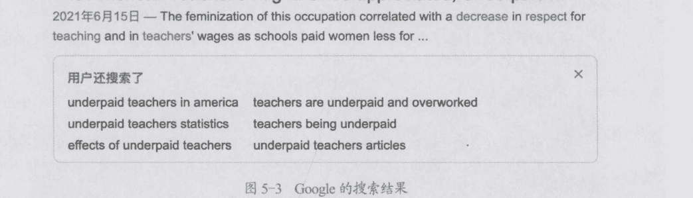

图5-3 Google 的搜索结果

##### 3. 小结

本部分以雅思和托福备考为导向，归纳了三种通用的ChatGPT使用范式。读者可根据自身口语或写作需求自行替换话题。

这三类范式与5.2.1节至5.2.5节那种直接练语言能力的用法不同，但对雅思、托福备考的针对性很强。希望能为未来的考生提供实用的思路，帮助提升成绩。

#### 5.2.7 应用于工作场景

ChatGPT的价值不仅限于语言学习，在职场文字工作上也能发挥作用，为白领提升英文文书的质量与效率。本节以商务文书写作和职场邮件两类日常场景为例，说明如何把ChatGPT的输出应用到实际工作中。

##### 1. 英文文书写作

在当前快节奏的办公环境里，英文文书是白领不可或缺的日常工作，涵盖商业报告撰写、邮件起草、项目建议书编制等多种形式。

下面从思路构建、语言润色、文书生成三个角度，介绍如何借助ChatGPT解决工作难题，提升写作能力与效率。

（1）内容创作

书中前文已多次提到头脑风暴的配合技巧，这里不再重复。

对多数人而言，创意只是工作的一小部分，更重要的是以严谨、全面、专业的姿态完成方案、政策更新、技术文档等实务写作。

这种情况下，可以让ChatGPT以第三方专家的身份审视文本，提出有建设性的意见来提升内容质量。

比如正在筹备一份面向小学生的教学大语言模型交互系统方案。项目目标是让小学生通过类ChatGPT的对话界面，以语音或文字输入与大模型交互并下达指令。

现有的方案要点包括：设计对话界面保留聊天记录以便回看；云端部署支持账号登录，校内外均可访问；提示用户对话会被记录以防滥用；对师生对话进行一定过滤保证安全；提供学校后台统一管理学生账号与对话内容。

任务设定是让ChatGPT扮演世界级数字化项目经理兼人工智能专家，通过逐个提问帮助审视方案、挖掘盲点、理清思路并提升质量。要求每次只提一个问题，等回答后再给出点评并继续。

第一次提问聚焦界面是否适配小学生的使用习惯与理解水平，比如语言表达和图形界面的简洁程度，以及对读写输入能力的辅助支持。用户回应目前主要考虑语音输入来提高效率。ChatGPT据此补充建议：界面要直观友好，采用大按钮、鲜明色彩、简单菜单和直观图标；提供即时反馈，让孩子发送消息或指令后能通过视觉或音效确认；加入提示或帮助框，在操作不确定时给予引导。

第二个问题探讨如何提升系统的吸引力并帮助孩子理解AI概念。用户表示计划采用PBL项目式学习，让孩子用AI解决生活中的简单问题并在过程中学习基础概念。ChatGPT进一步建议：准备配套学习材料，如视频、图文说明或互动教程；让系统具备互动引导能力，或以游戏化方式学习AI使用；提供贡献与分享机制，让孩子感受到成果的价值并愿意与同伴交流。

第三个问题询问如何衡量系统效果，需要哪些指标或方法来评估学习成效与系统使用情况。

可见ChatGPT能以很专业的视角持续追问，帮助发现方案不足，提升整体质量。过去这类工作需要专业咨询团队，现在身边随时可用的AI顾问就能实现同等的高质量支持。

（2）语言打磨

在内容之外，语言本身的精炼也很重要。即使多年使用英语，在跨文化办公中仍容易出现表达偏差。

若需准备对语言准确度要求较高的演讲稿或研究报告，可让ChatGPT担任专业英文编辑，从以下维度提出改进建议：语法正确性、用词精准度、表达清晰度、简洁易懂程度、行业术语使用、避免中式英语。

提示词示例是先说明身份与需求，再粘贴自己的英文稿件，要求给出针对性修改意见。这样编辑会逐项点评，最终提升文书质量。

（3）文书生成

内容创作与语言打磨侧重精细打磨，事务性文书则更适合先由ChatGPT按大纲生成初稿，再自行调整。如此可节省大量时间，把精力集中在核心任务上。

以公司政策更新公告为例，要求生成一份专业、易懂的内部通知，需包含三项信息：工作时间从固定制转为弹性制；远程办公政策允许50%工作时间居家完成；员工福利计划新增AI领域培训机会。

生成的邮件以“重要通知：工作时间、远程办公与福利计划更新”为主题，先致谢团队，随后说明因考虑生活平衡而推出弹性工时，员工可在完成任务前提下自行安排时间；更新远程办公规则；介绍福利增强内容。结尾提供咨询渠道并表达感谢。

仅需清晰说明需求，ChatGPT十几秒内就能产出符合常规英文表达习惯的草稿，手动撰写可能需要半小时到一小时。最终仍需人工复核细节完整性。

##### 2. 英文职场邮件

对在国际机构工作的职场人士而言，英文邮件往来往往耗时较多。邮件既要符合格式，又要精准传达意图，复杂请求时尤其费力。非母语者还面临措辞得体与文化适配的挑战，例如如何委婉请求对方协助评估项目。

本节以调整邮件措辞为例，说明如何用ChatGPT提升邮件写作效率。

（1）调整邮件措辞

可先提供草稿让ChatGPT润色语气和表达，使其更正式、专业。更有价值的是，模型还能解释修改原因，帮助学习不同语境下的写作细节。

示例任务是校对并润色一封申请状态跟进邮件。目标是语气更正式、结构更符合美国人习惯。原文表达了感谢、询问申请进度、强调个人匹配度并提供补充材料请求。

修改后的版本将“非常感兴趣”强化为“极度感兴趣”，“很好的匹配”提升为“极佳的匹配”，并调整了感谢与期待回应的表述，使整体更坚定且礼貌。修改说明指出词汇强化的作用在于提升自信感与说服力。

通过这种方式，既能快速完成邮件，也能积累可复用的语言知识。

把 firmly 前置到 believe 之前：这一小处增补能让语气更笃定，也更凸显你对自身能力与经验的坚定信念。

......

###### （2）自动撰写邮件

若希望模型迅速产出一封商务英文函件，关键在于把来意、主题以及必须突出的要点交代清楚。

比方说，海外小组的项目进度已滞后于原计划，现在需要一封跟进函，既要了解状况，又要委婉地提醒对方提速。此时可以这样给出指令。

> 问题：

我需要起草一封邮件。

邮件主题：关于项目进度的追踪。

邮件内容要求：

请告知收件人我方项目仍按原计划推进，所有关键节点均已如期交付，预计可在约定日期完成。

目前海外团队的推进速度比预期慢，请对方说明具体原因。语气上要委婉地敦促其加快执行。

邮件语言：英语。

Dear [Name],

回答：

Subject: Project Progress Tracking

Dear [Name],

I hope you are well. I am writing to share a brief update on our joint project and to raise a point about the overseas team's pace.

On our side, everything is moving according to plan. All key milestones have been delivered on schedule, and we still expect to finish by the agreed completion date.

At the same time, we have observed that the overseas team's progress has fallen behind the planned timeline. Could you kindly clarify what is causing the slowdown? We recognize that unexpected issues can happen, and we would like to address them early to keep the overall delivery on track.

With your support, we would appreciate it if you could gently encourage the overseas team to accelerate their work. A tactful reminder about the deadline's importance and its impact on the final outcome would be very helpful.

Thank you for your cooperation. We are confident that with joint effort we can resolve any hurdles and complete the project within the planned window. Please share any ideas you may have.

Best regards,

[Your Name]

给出明确指引后，模型几乎立刻就能给出初稿。

留意草稿中被标注的段落，语气拿捏得相当得体。一方面表达了希望提速的意图，另一方面站在对方立场理解可能出现的不可预见情况，最后还重申了对按时交付的信心。可以看出，模型对“委婉”这一核心要点的把握很到位。

稍作润色与微调，就能得到一封表述妥当、意图清晰的商务英文函。借助模型，可大幅节省打磨语言的时间成本。

#### 5.2.8 与 ChatGPT 展开语音口语练习

口语在英语学习中的分量不言而喻，毕竟语言的终极目的就是交流。可在以中文为主的环境里，缺乏合适的练习对象，学习者往往会遇到瓶颈。

5.2 节已介绍了模拟对话的方式，但模拟与真实的语音交流仍有差距。本节介绍几种能够真正实现语音互动的练习途径。

1. ChatGPT 手机客户端与第三方网页插件

2023 年九月二十五日，OpenAI 为 ChatGPT 移动客户端也就是 Android 与 iOS 版本上线了语音交互能力，用户可以直接用语音与模型对话。只要让模型扮演英语口语导师，就能进行日常的口语练习。官方对该功能的调校相当出色，可作为日常训练的伙伴。


图 5-4 ChatGPT 手机版的语音交互界面

若想针对某类考试做专项训练，则可以借助 Chrome 浏览器的扩展生态以及模型的插件机制来实现。

Chrome 拥有庞大的扩展程序市场，这些扩展由第三方开发者制作，可在 Chrome 网上应用商店免费或付费下载。商店里已有大量与 ChatGPT 搭配的扩展，能实现各式各样的功能，第 8 章会作进一步介绍。

（1）扩展程序：Voice Control for ChatGPT

在 Chrome 应用商店可以找到这款扩展，进行安装并授权。ChatGPT 的语音扩展示意如图 5-5 所示。

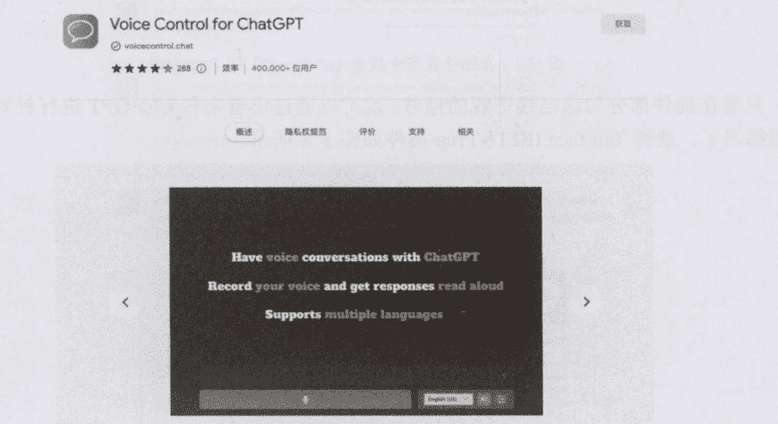

图 5-5 浏览器语音扩展的显示效果

登录官网后，原有界面会多出语音按钮及其他设置项。长按空格键即可录音，松开空格则把语音文本发送给模型；模型回复时，扩展会自动把文字合成为语音。同时可在右下角选择使用语言，这里可切换到英语。安装扩展后的输入界面如图 5-6 所示。


图 5-6 插件安装后 ChatGPT 输入区的样子

```
口语话题 = [Describe a noisy place you have been to]
难度级别 = [CEFR B1]
```

（2）ChatGPT Plugin

ChatGPT Plus 用户可以进入 OpenAI 提供的插件商店。在商店里可安装一个与语言学习相关的插件，这里以名为 “Talkface IELTS Prep” 的插件为例，它是专门为雅思口语训练打造的。搜索该插件的页面如图 5-7 所示。

174 实战 ChatGPT：应用 AI 工具高效工作与学习

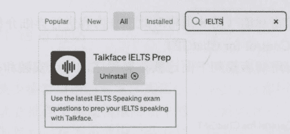

图 5-7 在插件商店中检索 Talkface IELTS Prep 插件

在插件设置中勾选已下载的插件后，就能通过语音进行针对性的应试口语训练了。选择插件的界面如图 5-8 所示。

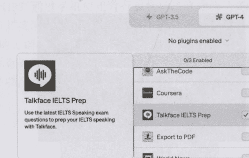

图 5-8 激活 Talkface IELTS Prep 插件的画面

训练时的截图如下。ChatGPT 调用插件读取最新雅思口语考题如图 5-9 所示。

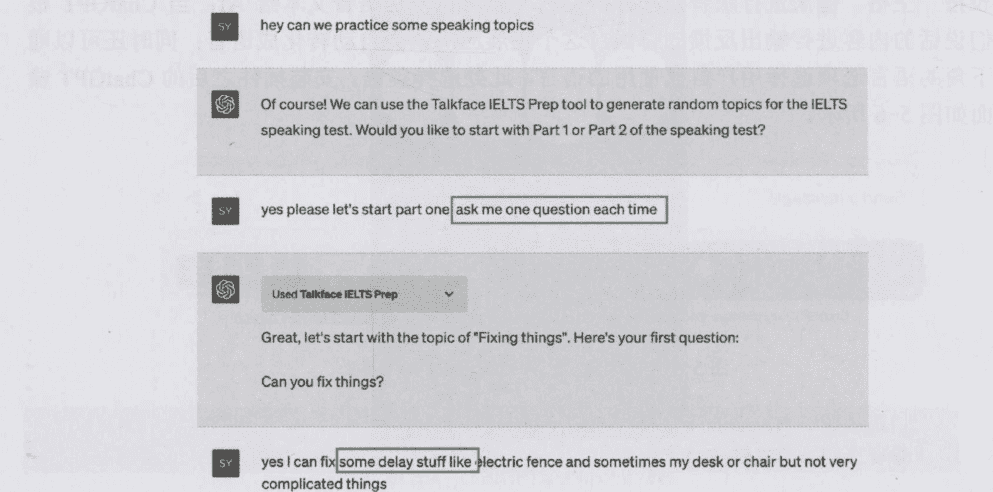

图 5-9 模型借助插件调取雅思口语题目

借助插件，ChatGPT 能直接调用雅思题库的口语题目用于训练，既省去反复修改提示词的麻烦，也保证了题目的专业性。

经语音扩展转化的文本通常没有标点，这不影响理解。转写文本有时会出现拼写错误，多半是发音不够清晰所致，这本身也是一种学习提示——该单词的发音需要再加强。训练过程中，ChatGPT 会给予练习者积极的反馈和引导如图 5-10 所示。

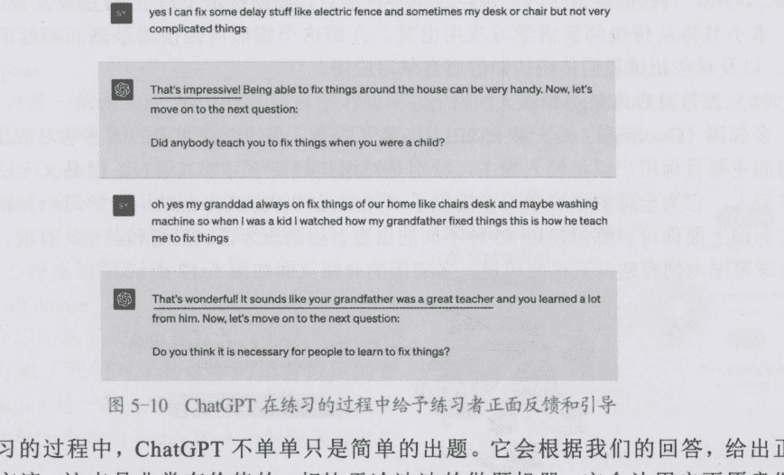

在练习中，ChatGPT 不只是出题工具，它会根据回答给出正向反馈和互动，这种体验比冷冰冰的刷题更能让人坚持下去。对话结束后，还会依据雅思口语评分标准给出提升建议如图 5-11 所示。

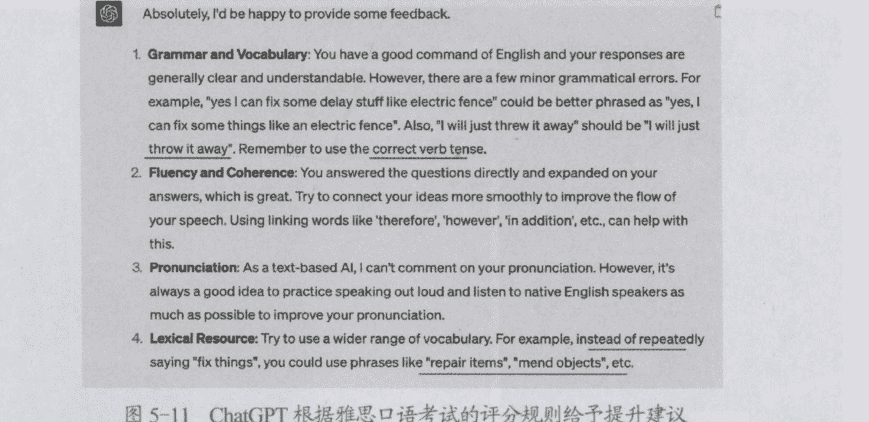

建议会涵盖语法、词汇、语言多样性等维度，并基于使用者当次的表现给出中肯意见。

##### 2. 基于 ChatGPT 构建的英语对话类应用

直接在浏览器里用 ChatGPT 练口语虽然灵活方便，但需要 Plus 权限和一定的提示词技巧，对普通用户门槛偏高。

自 OpenAI 开放 API 后，市场上涌现出大量借助人工智能辅助口语训练的应用，覆盖网页端、iOS 端和微信小程序端。传统英语学习巨头也纷纷推出人工智能新功能。

本小节以传统英语学习应用为起点，介绍技术浪潮下崛起的新秀，以及那些突破传统认知的语言学习产品。

（1）多邻国 Doulingo Max

多邻国 Duolingo 自 2011 年诞生以来，凭借游戏化学习方式广受欢迎，主要面向希望学习第二语言但预算有限的年轻人。目前支持超过 40 种语言，全球用户已超五亿。多邻国的介绍页如图 5-12 所示。


ChatGPT 诞生后，多邻国宣布接入 OpenAI 人工智能并推出 Duolingo Max 服务。介绍如图 5-13 所示，目标是为用户提供更沉浸、更个性化的学习体验。

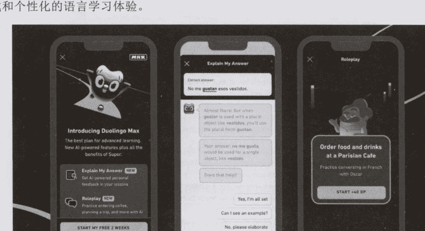

Duolingo Max 的核心功能有两项。

- Explain My Answer：对用户的答案进行详细解释，帮助理解错误并提升语言能力。
- Roleplay：让学习者与大语言模型驱动的角色基于不同场景对话，例如规划度假、咖啡馆点单。对话结束后模型会根据回答给出反馈。

（2）Speak

Speak 成立于 2016 年，主打智能导师，用人工智能营造更轻松无压力的训练环境。Speak 在 ChatGPT 发布之初就与 OpenAI 合作，成为首个应用 ChatGPT 能力的语言学习类应用，口语训练是其核心。核心特点如图 5-14 所示。

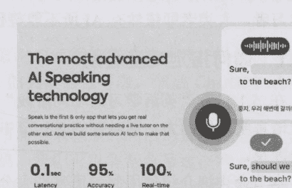

（3）Call Annie

下面这款应用则彻底颠覆了传统语言学习工具的想象。Call Annie 是一款 iOS 应用，用户可通过实时视频通话与名为 Annie 的人工智能虚拟助手连接。

此前介绍的应用更像是做题加智能指导，而 Call Annie 在拟真度上大幅提升，体验接近与真人外教视频通话。可以自由畅谈，也能围绕特定话题交流。在倾听过程中，手机里的虚拟人会点头或通过面部表情变化作出回应，这些细微互动能激励练习者更积极表达，最终达到练习目的。交互界面如图 5-15 所示。


##### 3. 小结

本节介绍了语音插件与 ChatGPT 的口语对话方式，以及基于人工智能能力开发的语言学习应用，相信读者能据此找到最适合自己的英语口语提升路径。

### 5.3 经验与注意事项

5.2 节详细说明了如何让 ChatGPT 成为英语学习助手，本节将重点讲清如何设定语言难度、如何把英语能力结合 ChatGPT 应用到工作场景，并提醒人类教师仍有人工智能无法替代的优势。

#### 5.3.1 如何设定难度层级

5.1.1 节基于“第二语言习得”理论强调了难度匹配的重要性，5.2.1 节也在提示词中多次涉及指定难度技巧。

本节将详细介绍常用的语言能力分级标准，并说明如何借助不同风格实现英语进阶训练。

##### 1. 从规范的语言能力分级入手

（1）为何需要标准分级

市面上的英语学习材料种类繁多，如何找到合适的材料一直是学习者的难题。人工智能工具的出现让个性化定制成为可能，学习者可按自身需求让模型生成专属材料。5.2 节的案例中，不少材料都是按学习者水平生成的，而量身定制的关键在于对难度的精准把控。

若不对 ChatGPT 提出难度要求，生成的文本可能对一部分人太难，对另一部分人又太简单。因此学习者需要一个模型能充分理解的标准分级体系来精确控制输出难度。

（2）何谓 CEFR 标准

此时就需要引入 CEFR 语言能力标准。CEFR 是国际上广泛认可的语言能力评估体系，起源于欧洲，适用于任何语言的学习、教学与评估。这套标准被 ChatGPT 深度理解并能快速应用，5.2 节多次使用 CEFR 等级。

CEFR 将语言能力分为三大类：基础使用者、独立使用者、熟练使用者，每类再分两个子级，共六个等级：A1、A2、B1、B2、C1、C2。

CEFR 语言能力分级见表 5-1。

表 5-1 CEFR 语言能力分级

| CEFR 等级 | 使用者能力 |

| :--- | :--- |

| A1 | 初级基础水平，可借助日常用语与简短句满足最基本的生活沟通 |

| A2 | 初中级基础水平，能用常见短句与表达，在简单直接的交流中处理具体需求 |

| B1 | 中级独立水平，能理解工作、学习、休闲等主题，能应对多数旅行场景 |

| B2 | 中高级独立水平，能读懂复杂文本，流畅交流，在专业、学术或社交场合清晰表述观点 |

| C1 | 高级熟练水平，能理解长篇难文本，流畅自然地在复杂情境下有效沟通 |

| C2 | 超高阶熟练水平，接近母语者，能理解任何语言形式，精准流畅地描述复杂主题并处理细微含义 |

在 CEFR 框架下，每个等级都有对应的词汇表和语法技能对照。因此在使用 ChatGPT 时，只需指定 CEFR 语言等级，ChatGPT 即可准备相应难度的词汇和语法材料。

那么如何判断自己的 CEFR 等级？事实上，主流英语考试都已与 CEFR 做过对标。以雅思和托福为例，网上很容易找到对应的能力对照表。用户可依据自己的考试成绩推算出大致的 CEFR 等级。

先找准自己的语言坐标
没有考过权威证书也无妨，自己先挑一个 CEFR 档位，让 ChatGPT 按此档位生成一段短文。通读后凭体感判断难度，大致就能定位当前水平。若读起来很吃力就保持不动，若觉得轻松就直接往上挪一档。

##### 2. 风格迁移进阶
（1）外刊为何是优质输入
外刊多出自全球一流媒体的记者和作者，语言精炼、表达讲究，修辞手法丰富，拿来模仿对写作提升很有帮助。

不过直接啃外刊也有门槛。
- 专业壁垒：譬如《经济学人》，语体正式、理性、偏学术，很适合想练学术写作的人。内容多聚焦政治、经济、商业，若背景不足或兴趣不大，很容易失去阅读动力。
- 文化壁垒：譬如《纽约客》，用词优雅细腻，文学色彩浓，能帮助提升文采。但文中常出现大量惯用语和文化隐喻，对非母语者理解负担较重。

（2）借助 ChatGPT 降低模仿门槛
在模型辅助下，模仿外刊风格的难度会大幅下降。把自己的习作交给模型，让它按某种外刊风格重写。这样既能接触顶刊的用词与语感，也能对照出个人表达与外刊表达的差异。弄清可提升的空间后，后续练习就能更有针对性。下面是常用的提示思路。

> 问题：
下面的是我写的一段英语，请你用《经济学人》的用词和写作风格进行改写。
[First and foremost, homeschooling can lead to a lack of socialization opportunities. Children who are homeschooled may not have the same opportunities to interact with their peers and develop social skills, which could down-grade their ability to address social situations later in life. Additionally, homeschooling can limit a child's exposure to diverse perspectives and ideas, as they are primarily learning from their parents.]
回答：
Primarily, homeschooling engenders a dearth of socialization avenues. Pupils subjected to homeschooling may be deprived of comparable opportunities to engage with their peers and cultivate interpersonal aptitudes, ultimately impairing their competence in navigating social circumstances as they mature. Furthermore, homeschooling constrains a child's exposure to a multitude of perspectives and ideas, given their predominantly parental-oriented learning environment.

问题：
你请进一步列出改写的地方，并且说明为什么这么改。
回答：
以下是对原文进行改写的地方以及相应的说明。
“First and foremost” → “Primarily”：这个改动是为了使用经济学人的风格，将表达更加简洁明了。
“can lead to” → “engenders”：使用更加强调的词汇，突出了家庭教育对社交机会的负面影响。
“lack of socialization opportunities” → “dearth of socialization avenues”：使用更加正式和严谨的表达方式，增强了句子的表达力。
“Children who are homeschooled” → “Pupils subjected to homeschooling”：使用更正式的词汇和表达方式，符合经济学人的写作风格。
“may not have the same opportunities” → “may be deprived of comparable opportunities”：使用更加强调的词汇，突出了家庭教育对社交机会的剥夺。
“develop social skills” → “cultivate interpersonal aptitudes”：使用更正式的词汇，强调了社交技能的培养过程。
“which could down-grade their ability” → “ultimately impairing their competence”：使用更正式的词汇和表达方式，更准确地描述了家庭教育对社交能力的负面影响。
……
通过这些改动，将原文调整为符合《经济学人》风格的写作，使句子更加精炼、正式和准确，增强了表达的权威性和专业性。

如果有偏爱的英语作家，也可以用其风格改写自己的作品，或让模型生成范例供模仿。
- 查尔斯·狄更斯（Charles Dickens）：作品充满幽默、讽刺与寓言式叙事，能学到丰富词汇和生动的人物刻画技巧。
- 乔治·奥威尔（George Orwell）：风格简练清晰，擅长隐喻与象征，有助于用简洁语言表达复杂观点。
- 简·奥斯汀（Jane Austen）：文笔优雅，心理描写细腻，对社会风俗观察入微，有助提升书面表达与对话技巧。

例如，让 ChatGPT 以狄更斯的口吻描写人物。
> 问题：
假如你是查尔斯·狄更斯。你在街边看到一位皱纹斑驳的老人，穿着洗得发白破旧牛仔外套，坐在路边长椅上。你会如何用英文描写这位老人？使用一百个单词描述他。
回答：
The elderly gentleman I observed on the street corner exuded a weathered aura, as if he had weathered the storms of time. His face bore the intricate marks of a life well-lived, a map etched with lines of experience and wisdom. Clad in a faded denim jacket that had once boasted vibrant hues, it now showcased the stories of countless journeys. His silver hair danced in the wind, a testament to the passage of years. As he sat on the worn bench, his eyes held a gentle twinkle, revealing a reservoir of stories waiting to be shared with those willing to listen.

以下是英文文本的翻译。
我在街角注意到的那位老先生，散发出一种经历过风霜的气质，仿佛他经受过时间的洗礼。他的脸上带着生活的痕迹，一张被经验和智慧刻画出的复杂地图。他身穿一件曾经色彩鲜艳，现在却已褪色的牛仔夹克，仿佛在展示他无数次旅行的故事。他银色的头发在风中舞动，见证了岁月的流逝。当他坐在磨损的长椅上，他的眼中闪烁着温柔的光芒，揭示了一个等待着愿意倾听的人分享的故事的宝库。
“weathered the storms of time” 是笔者很喜欢的一个句子。用“风暴”与“时间”搭配，用“weather”化作动词，表达经受时间洗礼的含义，很绝妙。

#### 5.3.2 人类导师仍不可或缺
了解完 ChatGPT 在语言教学上的能力，很多人会问：未来还需要人类老师吗？单靠 AI 够了吗？
现阶段看，人类教师在语言学习里依然必不可少。

##### 1. 大模型的短板与风险
大语言模型的优点很明显，5.1 节已有论述。那它的局限在哪？
（1）缺失的非语言线索
语言的核心是促进理解与交流，让人表达思想、情感与意愿。但面对面沟通时，参与要素远不止语言，还包括表情、肢体动作、情绪状态等非语言信息。只有全面感知这些，才能更有效地进行口语互动。
虽然语音识别让人可以用声音与 AI 交互，但 ChatGPT 至今无法真正理解人类情感，也不能通过肢体动作、表情、情绪这类非语言信号与人交流。
而这些非语言信息对沟通影响至关重要。表情能直接反映情绪，帮助判断对方意图；手势、姿势、身体接触等则能强化语义，传递防御或开放的态度，使沟通策略更精准。而以上所有非语言要素，都是 AI 难以提供练习场景的。我们必须在真实的人际互动中练习，才能真正掌握新语言。
（2）依赖过度的隐患
大模型为语言学习带来极大便利，但作为工具，生成式 AI 也可能让人过度依赖，产生潜在风险。
例如，初学者阅读英文原文时可能过度依赖 ChatGPT 翻译。虽然多数情况下翻译准确，但在涉及习语和文化背景的细微差异时仍可能出错。过度依赖会削弱自我思考、求证与理解的过程，容易把错误当成正确答案，无法体会语言的复杂与微妙。
再者，若过度依赖 AI 的自动纠错功能，忽视自己为何出错，就会丧失自我发现和纠正错误的能力。必须明白，AI 再强大也可能犯错，人类仍需保持判断力。学习是思考的过程，一旦放弃思考，任何工具都可能成为限制。

##### 2. 老师的独特价值
语言学习的终极目标离不开与人交流，人类教师在 AI 时代依然无法被替代。
（1）来自真实互动的提升
AI 能模拟对话，但模拟终究不是真实的人际互动，而这是语言学习不可缺少的一环。人类教师能在真实对话中帮助练习，其价值主要体现在：
- 听说实践能力的增强：真实口语交流能提升发音、听音辨音、理解不同口音与语速，以及在跨文化情境中解读非语言信号的能力。这种通过实战提升的技能，AI 对话无法完全模拟。
- 流利度与灵活度的提升：真实交流中需要不断思考如何更准确地表达、如何理解对方。现实对话不像 AI 那样语法完美、逻辑严密，需要靠反馈、思考与应变来优化表达。若想实现更自然有效的交流，这种练习必不可少。
- 现实的即时反馈：基于前两点，教师能在交流中及时发现问题并给出反馈，这一点 AI 暂时难以做到。
（2）激发创造性表达
从语言使命来看，学英语不仅是学规则，更是学会用它表达思想与情感。创造性表达指通过写作或演讲呈现个人观点与情感，需要丰富的词汇与语法来承载，并鼓励跳出模仿，用自己的语言创作，最终形成对语言的体悟。
在此方面人类教师的作用不可替代：
- 深度个性化反馈：教师不仅了解学生的语言水平，还能洞察其个性和背景。基于此，经验丰富的教师能给出针对性的反馈。例如，学生想用英语表达中国道家文化观点时，有相同文化背景知识的教师能提供更有针对性的建议，这是 AI 难以做到的。
- 引导创新思维与深度思考：创造性表达要求语言正确流畅，也要求创新与深度。资深教师能通过提问与讨论引导学生挖掘更深层的思考，挑战其观点，帮助其展现更丰富的思维广度与深度，这方面 AI 仍显局限。
- 情感与同理心：自我表达往往蕴含情感，评价此类作品需要教师以同理心理解学生及其背后的社会文化语境。AI 能分析结构和词汇，却无法理解复杂的情感与文化影响。

尽管生成式 AI 已成为强大的学习工具，最有效的学习依然离不开学生的勤奋与人类教师的指导。

# 第 6 章
## 辅助编程
ChatGPT 上线后，其编程能力就令人惊叹。它不仅能读懂代码，还能根据自然语言描述生成代码，引发出“程序员将被取代”的言论。
实际上编程远不止写出代码。常见有两种场景：一种是解决具体问题的功能性编程，重在实现效率；另一种是编写可长期维护的产品性程序，重在灵活性、可维护性与安全性。
两者的差异在于速度与长期维护的技术挑战。ChatGPT 生成代码时更偏向解决特定问题或满足明确需求，对功能性编程者而言，它能快速完成大量代码，让人专注于目标任务。而对产品性编程者而言，他们更关注性能、可靠性与可维护性，这需要扎实的计算机科学基础、多种语言与技术的熟悉度，以及在复杂项目中发挥关键作用的隐性能力，这些是 ChatGPT 缺失的。但在框架明确后，ChatGPT 可帮助程序员更专注于整体架构与设计模式，最大化其能力。
无论哪类程序员，都能借助 ChatGPT 完成代码、注释等重复性工作，把更多时间和精力放在更有趣、更专业的事情上。

| 本章内容 |
| :--- |
| 智能时代的编程思维与学习 |
| 让 ChatGPT 成为编程助手 |
| 经验与注意事项 |

### 6.1 智能时代的编程思维与学习
ChatGPT 的辅助编程能力能帮助非技术背景的用户实现编程需求，更好地与机器互动。
可以把 ChatGPT 看作 C-3PO 那样的机器人，它是精通自然语言的外交官，懂得与人类交流，富有情感。人们可以通过与它沟通输出编程语言，去指挥像 R2-D2 那样缺乏人类情感、只关注逻辑与任务、用代码交流的机器执行任务。

以前，只有程序员能通过编程语言操控机器，现在借助 ChatGPT 的辅助，普通人也能提供额外支持，满足任务需求。

#### 6.1.1 编程思维的特点与优势
人类设计了多种编程语言以便灵活地与机器对话，指挥机器完成从简单重复操作到智能规则处理的任务。机器运行依赖明确的逻辑与规则，这要求使用者具备编程思维，从执行者的角度看待世界。ChatGPT 能基于自然语言描述生成代码，帮助我们与机器对话。为了把需求描述清楚，同样需要编程思维，以便更好地与 ChatGPT 互动，推动问题的拆解。
1. 什么是编程思维
编程思维强调把问题拆解为更小的部分，并用逻辑找到各部分的解决方法，再组合成完整方案。
编程思维主要包括：
- 逻辑与表达：用严谨的逻辑处理问题，对事物进行严格定义，例如“合适温度”需具体说明不同季节的推荐范围。借助“如果……那么……否则”“重复执行……直到……”等关键字描述复杂流程。
- 模块化组织：将复杂问题拆成小问题逐一解决。例如把代码划分为接口独立、功能单一的小模块，再组合实现完整功能。就像模块化建房，在工厂预制构件，现场组装，既缩短周期又提升质量。

**先把方案做成可跑的样板**
动手解决之前，先把设想做成可看见、可运行的雏形来模拟一遍，这正是原型验证的意义。可视化的样板能让交付前的状态提前呈现，缩小理想与现实的差距，及时揪出方案里的漏洞与缺陷，避免最后阶段的大规模返工。

2. 编程思维叠加 ChatGPT 的增益
具备编程思维相当于拥有结构化拆解问题的透镜，能把杂乱的需求梳理清楚、找准方向与策略，从而更顺畅地使用 ChatGPT。

两者结合的价值体现在三方面。

1）让灵感更快跑起来。ChatGPT 大幅降低创意尝试的门槛，而编程思维给创意提供落地路径。有了初步想法后，思维模式帮助定位实现方式，ChatGPT 帮助快速验证，把创新周期压缩。

2）把重复劳动自动化。日常里存在大量单调重复的事务，借助编程思维可以在 AI 助力下实现自动化。例如用脚本对大量文件进行统一处理、自动发送电子邮件等过去需要专业人士完成的工作，现在普通人也能独立完成。

3）更清晰地拆解难题。编程思维擅长拆分要素、发现规律、抓住核心。配合 ChatGPT，能迅速理清思路，把问题拆成可处理的单元，判断哪些环节需要人工判断、哪些可以交给模型，最终形成更优解。

在 ChatGPT 的协作下，仅掌握基础编程思维的普通人也能像开发者一样指挥机器，把脑中想法变为现实，机器听命于人的距离被大大拉近。

#### 6.1.2 无代码低代码范式带来的反思
为了让人与机器沟通更高效，人类发明了众多编程语言，C、C++、Go、Python、Ruby、Java 只是其中一部分。每种语言像一种乐器各有擅长，组合使用可以完成更大项目。其中 Python 因语法简洁直观，被认为最接近自然语言。

相较于理解编程思维，学习具体语言门槛更高，需要记忆数据类型、语法和关键字。为让零基础人群也能快速完成常见任务，才出现了无代码/低代码的概念。

1. 无代码与低代码开发
无代码/低代码是指通过少量或几乎不写代码，借助图形界面如拖拽、点击等方式搭建应用的方法。它让开发者聚焦业务逻辑本身而非技术细节，加快上线节奏。

常见场景包括少儿编程、股票量化分析、数据分析准备和数据模型计算。像搭乐高一样，用户在熟悉元件用法后，按目标输入必要参数，就能得到想要的结果。

对普通人而言，这种方式更直观，有编程思维即可，无需精通编码就能实现大量常用功能，同时提升团队协作与创新效率，让不熟悉编程的成员也能直观贡献想法。

2. 典型平台举例
市场上按领域划分的平台很多，代表性如下。

（1）少儿编程类
1）LEGO MINDSTORMS EV3。基于计算机的图形化编程工具，提供丰富的传感器、动作与控制模块，用户可组合创建机器人程序。
2）Scratch。麻省理工学院开发的图形化编程学习软件，为儿童和青少年提供可视化组件，帮助培养编程思维。

（2）数学模型类
MATLAB。交互式编程环境，支持数据分析和数学建模，可通过图形界面绘图、生成代码、编辑脚本，并调用强大的数学库解决各类问题。

（3）数据采集类
典型代表是金数据问卷系统，以可视化方式创建问卷和表单，无需编码即可定制字段、设置条件、定义选项。

（4）协作式应用构建
典型代表是腾讯云微搭。通过拖拽式开发和可视化配置，构建 PC Web、H5 和小程序应用，并可打通企业内部数据，实现企业微信管理、工作流、消息推送、权限控制等能力。

（5）股票量化交易
典型代表是聚宽。提供沪深、香港、美国市场的实时行情、历史数据和基本面数据，支持 Python 和 R 语言进行策略开发与回测，并内置选股、资金管理等常用工具。

3. 优缺点
无代码/低代码开发速度快、易上手，适合儿童教育、应用框架搭建和专业数据计算，让非专业人士也能编程。

但灵活性受平台和组件限制，平台功能不足或存在漏洞时难以自行解决，例如定制化企业 ERP 系统往往需要大量手写代码补充。此外，可视化组件开发成本高、通用性差，平台多局限于特定领域。

4. ChatGPT 的定位
ChatGPT 为编程提供了一种通用解法。它的语言模型同时具备自然语言和编程语言属性，可充当通用无代码/低代码工具。用户只需用自然语言描述想法，ChatGPT 即可整理并产出代码初稿。

同时，ChatGPT 能帮助普通人理解程序构造，遇到困难时可提问并把机器语言翻译成易懂的自然语言，从而提升开发速度和使用效率，大幅降低入门门槛。

#### 6.1.3 从检索转向生成，让开发加速
在编程语境里，“懒”是褒义，指写出高效灵活、可复用的自动化代码，避免重复劳动。优秀开发者不仅能快速定位修复问题，还会思考如何杜绝同类问题再次出现。

1. 复杂场景下检索的局限
随着技术演进，任务复杂度攀升。从命令行到图形界面、Web 应用再到移动端，所需语言和运行环境不断增多，从文件到数据库、从单机到高并发服务，环境日趋复杂。

程序员既要学习新知识，也要借助工具提效。除官方文档外，检索成为常用手段，因为他人可能已遇到相同问题。检索既可查阅 GitHub 代码，也可浏览论坛讨论。拿 StackOverflow 说事，社区机制保证了优质回答的可靠性。

检索参考虽有效，却不够高效，常出现需要轮换关键词、翻阅他人代码库、优质内容多为英文、找到的方案未必完全适配等问题，需要额外时间理解上下文。

2. 生成式代码助手
如果身边有随叫随到的经验丰富的助手，能读懂完整描述并耐心解释、调整代码，开发效率会明显提升，这正是 ChatGPT 的能力。

相比关键词检索，对话式生成允许直接用自然语言描述需求。

问题：
写一个 Python 函数，计算两个字符串形式的日期的间隔天数。
回答：
```python
##### 导入 datetime 模块，用于处理日期时间相关操作
from datetime import datetime

##### 定义一个计算两个日期间隔天数的函数
def days_between_dates(date1_str, date2_str):
    # 将日期字符串转换为 datetime 类型，以便后续操作
    date1 = datetime.strptime(date1_str, "%Y-%m-%d")
    date2 = datetime.strptime(date2_str, "%Y-%m-%d")
    # 计算两个日期间的时间差，并取绝对值
    delta = abs(date1 - date2)
    # 将时间差转换为天数并返回
    return delta.days
```

针对生成代码可进行互动调整，例如加入错误处理。

问题（继续）：
如果输入的字符串不是日期格式，返回 -1
回答：
```python
##### 导入 datetime 模块，用于处理日期时间相关操作
from datetime import datetime

##### 定义一个计算两个日期间隔天数的函数
def days_between_dates(date1_str, date2_str):
    try:
        # 将日期字符串转换为 datetime 类型，以便后续操作
        date1 = datetime.strptime(date1_str, "%Y-%m-%d")
        date2 = datetime.strptime(date2_str, "%Y-%m-%d")
    except ValueError:
        # 如果输入的日期字符串转换出错，则返回-1
        return -1

    # 计算两个日期间的时间差，并取绝对值
    delta = abs(date1 - date2)

    # 将时间差转换为天数并返回
    return delta.days
```

生成的代码使用了 datetime.strptime，若想了解其用法可继续追问。

问题（继续）：
datetime.strptime 如何使用？
回答：
datetime.strptime() 是 Python 的日期时间处理函数，用于把字符串解析为日期时间对象。其原型为：datetime.strptime(date_string, format)

其中：
date_string 表示待解析的日期时间字符串；
format 表示字符串的格式，使用特定格式码描述日期时间各部分。

（更多的说明，……）

完成函数修改后，还可让 ChatGPT 生成带注释的测试代码。

问题（继续）：
生成函数调用的测试代码并加上注释。
回答：
```python
date1_str = "2022-01-01"
date2_str = "2022-03-31"
date3_str = "2022-02-31"
date4_str = "abc"

print(days_between_dates(date1_str, date2_str))  # 输出 90
print(days_between_dates(date1_str, date3_str))  # 输出-1
print(days_between_dates(date1_str, date4_str))  # 输出-1
```

简单概括，ChatGPT 作为生成式助手能够做到：
- 根据问题描述产出代码；
- 互动式修改代码；
- 随时解释代码细节与用法；
- 生成测试代码便于验证。

#### 6.1.4 需求落地的角色分工
软件开发需先明确目标与需求。团队中产品负责人负责收集需求并设计方案，程序员据此实现，类似建筑师与施工队的协作。使用 ChatGPT 时，用户兼具产品负责人与程序员双重角色，需要理解二者分工。

1. 产品负责人如何明确需求
产品负责人常用“用户故事”把需求场景化，描述角色、行为与目的。撰写过程即是需求分析，细化后才能确定需求与结果。

用户故事通常遵循：
身分为 XXX —— 角色
能够做 XXX —— 行为
以达成 XXX —— 目的

好的用户故事需满足 INVEST 原则：独立、可协商、有价值、可评估、规模小、可测试。通过拆解，可把大问题逐步落地到可检查的小单元。

例如：
需求分析：身为用户，我想把物品放入冰箱冷藏。
需求拆解：
身为用户，我能够轻松打开冰箱门，以便日常存放食物。
身为冰箱，我应提供合适的隔板与储物区，以便整理食物。
身为用户，我能够手动或自动关门，避免忘关。

对程序员而言，最初的描述过于宽泛，产品负责人需将其细化为符合 INVEST 的独立单元。学会用用户故事表达，能让需求更准确、沟通更顺畅。

2. 程序员如何完成需求
程序员把复杂需求抽象为数据与逻辑，利用已调试好的组件和工具箱简化开发，将大任务拆解并复用已有部件，同时分享自制部件供他人使用。

开发中需防范小错误引发大问题，关注实现细节、扩展性、灵活性、可维护性、性能与安全。与产品负责人关注体验不同，程序员更侧重技术实现的质量保障。

3. 选择合适的开发方式
开发如建房，需规划与步骤，合理使用砖块、水泥、钢筋等材料。不同建筑方式不同，大教堂需自上而下规划，集市则可边用边调。规划者需在成本与功能间权衡，选择合适方式达到预期效果。

4. 编程语言与实现
编程语言由两类基础单元构成：
数据类型，即存储数据和结构的“砖头”，包括整数、浮点数、字符、字符串等，是操作的对象和输出；
逻辑指令，即执行操作的“水泥”，包括条件、循环、函数等，控制执行流程，是组合成完整行为的最小单位。

用 ChatGPT 时，也要明确告诉它输入数据、任务方向、上下文，并指定输出格式或类型。

##### 5. ChatGPT 能做什么
ChatGPT 除了自然语言对话，还能理解需求、拆解为编程步骤并生成代码，可协助需求梳理与编程任务。

例如用户想从 PDF 表格中提取数据到 Excel，手工复制整理耗时。可直接询问 ChatGPT 设计用户故事。

问题：
需求分析：身为用户，我需要一个从 PDF 中提取表格数据的程序。你来帮我设计用户故事。
回答：
当身为用户，我需要一个从 PDF 中提取表格数据的程序时，下面是一些可能的用户故事：
身为用户，我希望能够将一个 PDF 文件上传到程序中。
身为用户，我希望程序能够识别 PDF 中的表格并提取其数据。
身为用户，我希望程序能够将提取的表格数据以适当的格式（如 CSV 或 Excel）导出或保存。
身为用户，我希望程序能够处理包含多个表格的 PDF 文件，并分别提取它们的数据。
……

问题（继续）：
我只要能本机执行，从 PDF 文件中提取简单的表格数据到 CSV 即可。
你来帮我设计编程的主要步骤。
回答：
当你想要在本机上执行并从 PDF 文件中提取简单的表格数据到 CSV 时，以下是一些主要步骤的设计：
1. 安装依赖库和设置环境：首先，你需要安装适用于你选择的编程语言的 PDF 处理库，例如 Python 的 PyPDF2 或 pdfplumber 库。
2. 导入库：在你的代码中导入所需的 PDF 处理库和 CSV 库。
3. 读取 PDF 文件：使用 PDF 处理库的函数或方法，打开并读取目标 PDF 文件。
4. 提取表格数据：使用 PDF 处理库提供的功能，定位和提取 PDF 中的表格数据。这可能涉及解析 PDF 页面、识别表格区域和行列，以及提取单元格的内容。
5. 创建 CSV 文件：使用 CSV 库的函数或方法，创建一个新的 CSV 文件，用于存储提取的表格数据。
……

问题（继续）：
前面说的基本需求，用 Python 编程语言实现。
回答：
以下是实现的代码：

```python
import csv
import pdfplumber

def extract_table_data(pdf_path, csv_path):
    with pdfplumber.open(pdf_path) as pdf:
        with open(csv_path, 'w', newline='') as csv_file:
            writer = csv.writer(csv_file)
            for page in pdf.pages:
                tables = page.extract_tables()
                for table in tables:
                    for row in table:
                        writer.writerow(row)

###### 使用示例：
pdf_file = "input.pdf"
csv_file = "output.csv"

extract_table_data(pdf_file, csv_file)
```

前面那段示范里我们用到了 csv 和 pdfplumber。extract_table_data 需要 PDF 文件路径和 CSV 文件路径两个参数。内部调用 pdfplumber.open 打开文档，并用 with 包裹以确保处理完后文件能够正常关闭。

……

#### 6.1.5 产品全链路里，ChatGPT 能在哪发力

写代码只是表象，完整的开发其实是想法转化为需求、原型、验证、迭代和沟通的循环。

ChatGPT 替代不了人的判断，也做不到仅凭一段文字描述就把一个复杂的完整系统生成出来。它能做的，是在整个工作流的各个节点充当加速器。

- 启发：辅助提炼用户画像的描述性文字。
- 梳理：把分散的用户想法整理成结构化的需求。
- 原型：编码时提供可直接参考的功能片段。
- 验证：生成示例数据和基础单元测试。
- 迭代：通过对话快速修改已有实现。
- 表达：撰写功能说明、产品文案等沟通材料。

真正优秀的应用不止能完成任务，更要为目标人群提供界面好看、功能充足且上手顺手的体验。

以面向个人的任务管理产品 ToDoList 为例，从立项到落地一般要经历需求调研、产品设计、制作开发、测试发布、迭代优化。ChatGPT 无法一次性造出完整 App，却可以在每一步提供可用的支持，整体提效很明显。

##### 1. 需求调研分析
这一阶段要通过调研锁定目标人群的痛点和期望。做用户画像可以把问题和期望具象化，为后面设计提供锚点。

（1）分析业务角色

> 问题：
> 为个人版 ToDoList 担任产品经理的话，这个产品主要有哪些角色？
> 
> 回答：
> 核心角色有两个：
> 
> 创建者：作为清单所有者，负责创建、编辑、删除任务。
> 
> 订阅者：可以订阅清单更新，在有新任务时及时收到提醒。

（2）制作用户画像

> 问题：
> 为 ToDoList 设计一个教师的用户画像。
> 
> 回答：
> 下面是一个可参考的教师画像：
> 
> 姓名：张老师。
> 年龄：35 岁。
> 职业：小学语文教师。
> 能力：语文教学扎实，喜欢写作和分享。
> 诉求：希望有一款简单易用的任务清单，帮助她整理日常工作和计划，能把任务分派给不同学生并跟踪进度，同时在学校和家里的电脑、手机、平板都能顺畅访问。
> 困境：……

##### 2. 产品设计
在需求初探后，需要梳理业务流程并确定 MVP 范围，保证以最小成本快速验证。

（1）协助梳理业务流程

> 问题：
> 帮我整理下 ToDoList 的业务流程。
> 
> 回答：
> 整体流程大致如下：
> 
> 1）用户注册账号并登录。
> 2）创建任务和计划，指定负责人和截止时间。
> 3）把任务分派给其他用户，比如学生。
> 4）跟踪每个任务的进度和完成状态。
> 5）设置提醒以便按时完成。
> ……

（2）以 MVP 视角提炼首版流程

> 问题：
> 从 MVP 角度，首版流程应该是什么？
> 
> 回答：
> 首版建议聚焦单人使用：
> 
> 1）注册登录：仅保留用户名密码的基础登录。
> 2）创建任务：支持任务名称和截止日期。
> 3）跟踪任务：能查看任务是否已完成。
> 4）设置提醒：具备基础提醒能力。
> 5）协作：首版不提供协作，集中解决单人任务管理。

##### 3. 制作开发
依据产品经理的方案和优先级，快速做出可验证的最小原型。ChatGPT 如何辅助生成代码详见 6.1.6 节。

##### 4. 测试发布
开发完成后需要做单元测试、集成测试和体验测试，确保符合规格和用户预期。发布前要对需求做二次拆解，整理测试思路和场景，发现隐含风险。

（1）测试想法生成
ChatGPT 能给出初始测试思路，也能复核已有的测试清单。

> 问题：
> 测试登录页要关注哪些点？
> 
> 回答：
> 登录页测试建议关注：
> 
> 1）用户名密码输入框的有效性、边界值和安全性。
> 2）输入提示和错误信息是否正常。
> 3）记住用户名和自动登录功能是否生效。
> 4）不同浏览器和版本下的兼容表现。

对不熟悉的点可以继续追问。

> 问题：
> 针对浏览器兼容，给几个测试用例。
> 
> 回答：
> 下面是几个可执行的用例：
> 
> • 在最新版 Chrome、IE、Safari 上验证页面功能与布局是否正常。
> • 在 iOS、Android 设备及不同浏览器版本上检查登录兼容性。
> • 验证 JavaScript 在各浏览器下能否正常运行。

（2）分析需求的关键语句
作为语言分析工具，ChatGPT 能帮助提炼用户故事里的测试要点。

> 问题：
> 分析用户故事“作为用户，我希望使用找回密码功能，以便忘记密码时能重置密码”的关键测试点。
> 
> 回答：
> 重点测试点包括：
> 
> • 找回密码全流程是否通畅：申请重置、系统发送链接或验证码、用户重置密码。
> • 身份验证机制的安全性和可靠性。
> • 重置密码的安全规则，如长度、复杂度。
> • 整体流程的用户体验是否顺滑。

（3）生成测试代码片段
涉及编码部分，参考 6.1.6 节。

##### 5. 迭代与优化
根据反馈和市场变化整理问题，制订迭代计划。

（1）反馈意见的提取
ChatGPT 擅长从文本中抽取关键信息。

> 问题：
> 分析这条反馈，提取关键词和描述：求救，最近我无法登录软件，每次进入登录页就卡顿，反复尝试也登不进去，换浏览器也一样。
> 
> 回答：
> 关键词：
> - 无法登录：用户面临的核心问题
> - 卡顿：可能指向网络或前端渲染
> - 换了浏览器：说明问题与特定浏览器无关

（2）寻找解决策略

> 问题：
> 作为开发团队，有哪些应对策略？
> 
> 回答：
> 可以采取：
> - 日志追踪：记录登录页的错误信息、请求耗时、系统状态，快速定位根因。
> - 代码优化：……
> - 强化测试：……
> - 体验优化：……
> - 技术支持：……
> - 提升系统可靠性：……

ChatGPT 能在开发全流程提供思路梳理和参考建议，但回答需要结合背景逐步引导，且最终决策仍需结合自身经验判断，不能盲目采纳。

#### 6.1.6 用 ChatGPT 提升编码效率
ChatGPT 能有效助力开发者理解和编写代码，覆盖架构搭建、注释、生成、重构、测试等环节。

##### 1. 协助构建架构
ChatGPT 在目标明确的单次生成上表现好，对复杂架构搭建和深度修改则有限。所以前期应先按编程范式搭好框架。

常见范式有两种。

面向过程：以函数为核心，把问题拆成顺序执行的步骤，程序是函数调用的链条。C、Pascal 是典型代表。

面向对象：以对象为核心，把现实事物抽象成类和对象，通过封装、继承、多态实现复用和模块化。Java、C++、Python 都是典型。

可以在 ChatGPT 中指定范式来搭建骨架。

```
问题：
    按照面向过程的方式，更新用户年龄。
回答：
    def update_user_age(user, new_age):
        user['age'] = new_age

    user = {'name': 'John', 'age': 30}
    print("原始用户信息：", user)

    update_user_age(user, 35)
    print("更新后的用户信息：", user)

问题：
    按照面向对象的方式，更新用户年龄。
回答：
    class User:
        def __init__(self, name, age):
            self.name = name
            self.age = age

        def update_age(self, new_age):
            self.age = new_age

    user = User('John', 30)
    print("原始用户信息：", user.__dict__)

    user.update_age(35)
    print("更新后的用户信息：", user.__dict__)
```

对比两段实现可以看出，过程式代码多靠全局变量和函数调用，对象式代码则借助封装把操作藏进类中，结构更复杂。若任务很小、百来行即可完成且不需要长期维护，过程式更直接；若追求扩展性和团队协作，面向对象更合适。

##### 2. 生成初始代码
确定架构后，只要把目标说清楚，ChatGPT 就能帮忙写出对应实现。配合 IDE 插件如 GitHub Copilot，还能根据注释自动补全。

> 问题：
> 为已有的 Tasklist 写一个插入函数，把 Task 对象插进去并按任务开始时间排序。
> 
> 回答：
> ```python
> class Task:
>     def __init__(self, name, start_time):
>         self.name = name
>         self.start_time = start_time
>
> class TaskList:
>     def __init__(self):
>         self.tasks = []
>
>     def insert_task(self, task):
>         self.tasks.append(task)  # 将任务添加到队列末尾
>         self.tasks.sort(key=lambda x: x.start_time)
>
> # 示例用法
> ......
> ```
> 在插入新任务时，如果 Tasklist 为空，则直接将新任务插入队列中；否则，遍历 Tasklist 中的任务，找到第一个起始时间晚于新任务的位置，并将新任务插入该位置之前。如果新任务的起始时间晚于所有已有任务，则将其插入队列的末尾。

一旦架构明确，ChatGPT 会自动生成代码并给出解释。

##### 3. 查询语句与用法
对不常用的类或方法可以直接询问。

例如查询 Python datetime 的比较方式。

> 问题：
> Python 里怎么算两个时间的间隔？
> 
> 回答：
> 可用 datetime 模块的 timedelta 计算差值，示例如下。
> 
> ```python
> from datetime import datetime, timedelta
>
> # 创建两个 datetime 对象
> start_time = datetime(2023, 5, 4, 10, 0, 0)
> end_time = datetime(2023, 5, 4, 12, 0, 0)
>
> # 计算两个时间之间的差值
> duration = end_time - start_time
>
> # 打印差值
> print(duration)  # 输出: 2:00:00
> ```
> 需要注意的是，duration 变量是一个 timedelta 对象，记录了两个日期时间之间的时间差。可通过其天数、秒数、微秒数等属性获取具体信息，例如：
> 
> ```python
> print(duration.days)  # 输出: 0
> print(duration.seconds)  # 输出: 7200 (2 小时的秒数)
> print(duration.microseconds)  # 输出: 0
> ```

这种解释比查文档更快，也更贴近实际使用。

##### 4. 生成代码注释
ChatGPT 能读懂主流语言并理解函数意图，从而生成说明，提升可读性。

可通过编写注释和文档字符串帮助模型理解，例如：

```
问题：
    请解释以下代码：
    def get_str(s): return s[:3]

回答：
    以下是对 Python 函数 get_str(s)的注释：
    def get_str(s):
        """
        获取字符串 s 的前三个字符。

        参数：
        s: 要获取前三个字符的字符串。

        返回值：
        返回字符串 s 的前三个字符。
        """
        return s[:3]

这个函数接受一个字符串 s 作为参数，并返回该字符串的前三个字符。函数体只有一条语句，即 s[:3]，这是 Python 中的字符串切片操作，它可以从字符串中截取一段子串。s[:3]表示从字符串 s 的开始位置到第三个字符（不包括第三个字符）的子串，即字符串的前三个字符。
```

##### 5. 生成测试代码
ChatGPT 不仅能理解函数，还能据此生成测试代码。需求简单时可直接生成单元测试，需求复杂时也能基于测试框架生成用例。

示例：

```
问题：
请为 get_str 函数制作测试代码。
回答：
为了测试 get_str 函数，我们需要编写一些测试代码，用于检查函数的正确性。以下是一个简单的测试代码示例。
def test_get_str():
    assert get_str("hello") == "hel"
    assert get_str("world") == "wor"
    assert get_str("python") == "pyt"
    assert get_str("programming") == "pro"
    assert get_str("") == ""
    print("All tests pass")

test_get_str()
在这个示例中，定义了 test_get_str 函数，用 assert 语句检查是否返回了预期的结果，如果都符合，就返回 "All tests pass"。
```

上述测试代码可在 get_str 出现异常时及时发现问题，帮助快速定位修复，确保函数正确。

##### 6. 代码打磨与重构方法

借助 ChatGPT 让已有代码更完善是可行的，但必须由使用者先指出来自函数的功能缺口，目标明确后模型才能进行有针对性的补强。

```
问题：
完善 get_str 函数，以便于其应对输入不是字符串的情况。
回答：
为了让 get_str 函数能够处理输入不是字符串的情况，我们可以添加一些类型检查代码，以便在函数接收到不合法类型的输入时，能够进行适当的处理并返回错误信息。以下是一个可能的实现方式。
def get_str(s):
    """
    获取字符串 s 的前三个字符。
    参数：
    s: 要获取前三个字符的字符串。

    返回值：
    如果 s 不是字符串类型，则返回 None；
    如果 s 的长度小于 3，则返回 s 本身；
    否则，返回字符串 s 的前三个字符。
    """
    if not isinstance(s, str):
        return None
    elif len(s) < 3:
        return s
    else:
        return s[:3]
```

作为通用语言模型，ChatGPT 既能自动撰写代码，也能阅读并为既有代码补充说明。这种自动化能力把开发者从繁琐重复的操作中解放出来，整体效率得到明显提升。

对于描述清楚的模板化需求，模型可以依据自然语言描述自行推断实现并产出代码。针对存量程序，它能够解析结构与逻辑关系，自动生成注释，帮助团队更快理解并使用。

必须提醒的是，当前模型的理解深度尚不足以替代资深工程师，实际应用中仍需人工复核与校验。

### 6.2 把 ChatGPT 当作编程伙伴

6.1 部分已经归纳了借助 ChatGPT 辅助编程的思路。

下面进入实操，围绕语言学习、代码改动、语法迁移等方向由浅入深，体会模型在编程中的助力。

#### 6.2.1 用 ChatGPT 快速上手新语言

不同阶段的开发者在学习新语言时的关注点各不相同。

- 零基础入门者：没有编程接触经历，对数据类型、语法规则等基础概念完全陌生。
- 初级实践者：接触过编程但掌握不牢。
- 中高级进阶者：为特定需求掌握新语言。

无论处于哪一阶段，ChatGPT 都可以作为全天候的专业助教，及时解答编程疑问。

##### 1. 从零开始的学习路径

对纯新手而言，先完成环境搭建并建立编程基础认知，包括数据结构、流程控制、面向对象等，是第一步。可先通过官方文档与入门书籍搭建知识框架，再借助 ChatGPT 加速消化。

学习中常会遇到基础疑惑或难以理解的概念。相比于翻书检索或请教他人，与模型对话获取解释会更高效，且可以反复追问或要求换种表述。

当已有一定概念储备时，甚至可以直接让 ChatGPT 担任讲师角色进行系统讲解。

> 问题：
Python 中基础的数组类型有哪些应用。

回答：
Python 里最常用的序列类型是列表 list 与元组 tuple，主要用途如下。
1）存储与管理数据：列表和元组可容纳整型、浮点型、字符串等多种类型，支持索引与切片，访问与处理更便捷。
2）数据结构实现：常用于构造栈、队列、链表等基础结构，灵活易用，适合初学者或快速原型。
3）多值返回：函数内部可用元组一次性返回多个结果，提升可读性与可维护性。
4）字符串处理：……
5）遍历与循环：……

新手可要求 ChatGPT 产出更详尽的示例来加深理解。

> 问题：
为 Python 中多值返回的数组应用举一个示例。

回答：
Python 借助元组实现多值返回，下面是一个简易演示。

def get_name_and_age():
    name = "Alice"
    age = 30
    return name, age  # 返回含两个元素的元组

###### 调用函数并接收返回的多个值

person_name, person_age = get_name_and_age()

###### 输出结果

print("Name:", person_name)
print("Age:", person_age)

该函数返回姓名与年龄的元组，调用时可用多个变量同时接收。这种写法让代码更清晰，多返回值处理也更方便。

##### 2. 初级阶段的支持

已有一定编程基础的初级用户，若想通过有趣项目保持热情，ChatGPT 可在多方面提供帮助。

- 拆解任务清单：协助把项目拆成可执行的步骤，形成清晰的开发路线，确保焦点始终在关键任务上。
- 给出库建议：依据需求推荐合适的库与框架，加快功能实现。
- 编写与审阅：在既定架构下协助撰写与检查代码，确保符合规范。
- 效率优化：分析代码后提供针对性改进建议，提升运行效率与可维护性。
- 补充注释：撰写简洁明了的注释，提升可读性，便于个人与团队理解。
- 测试支持：协助设计测试用例并编写单元测试，保证不同场景下稳定运行。

##### 3. 中高级阶段的提效

中高级开发者对语言已有深入认知，能更充分地发挥 ChatGPT 的能力。

首先可通过模型快速把握新语言的核心概念、语法特点与独特之处，迅速建立整体认知。

例如想了解 Python 数据类型的特色，可提出如下问题。

> 问题：
Python 语言基础数据类型中最有特色的是哪个？擅长做什么处理？

回答：
Python 中最具特色的基础类型可能是字典 dictionary，它是可变、无序的键值对集合。用花括号 {} 创建，键可为字符串、数字、元组等可哈希类型，值可为任意类型。

字典擅长：
- 快速检索：基于哈希表实现，特定键的查找接近 O(1)。
- 数据关联：适合表达关联数据，如姓名到电话、ID 到对象映射。
- 去重处理：利用键的特性方便去重。
- 映射转换：可作为查找表进行数据映射与转换，如字符编码转换。

当然列表、元组、集合也各有优势，在不同场景下实用性很强。

随后可参考现有开源代码库来观察新语言在实际项目中的表现。借助 ChatGPT 的代码阅读与解释能力，能迅速研究高质量示例。相同概念也可与熟悉语言的实现对比，加快学习速度。

> 问题：
Python 与 C++在解析 XML 文件上，有什么区别？

回答：
- 生态支持：Python 提供 xml.etree.ElementTree、lxml 等内置与第三方库，解析较为方便。C++ 通常需依赖外部库如 TinyXML、PugiXML。
- 语法差异：Python 语法简洁，可用字典与列表处理解析结果，并提供 XPath 查询。C++ 语法繁琐，需手动处理节点与属性。
- 内存管理：……
- 运行性能：……

具备专业背景的开发者配合 ChatGPT，能迅速掌握新语言特点，通过开源代码学习并不困难。

学习新语言时，检索答案与理解概念往往占用大量时间。ChatGPT 作为在线编程老师，能加快答案获取速度，并通过讨论、代码解释与示例帮助掌握复杂概念。个性化互动让学习更高效。

#### 6.2.2 阅读与修改代码

程序员通常不愿为自己的代码写文档，也不愿阅读缺乏注释的他人代码。

##### 1. 代码的阅读

阅读是修改的前提，需从整体到细节进行归纳与注释。先把握代码用途，再逐行解读。

理想情况下代码已有清晰说明与注释，可直接阅读。现实中缺注释的情况更多，人工解读成本很高，这项工作可交给 ChatGPT。

```
def factorial(n):
    if n == 0:
        return 1
    else:
        return n * factorial(n - 1)
```
以下面这段代码为例，单个逻辑步骤很直观，但整体功能不易一眼看出。让我们请 ChatGPT 说明其具体作用。

问题：
总结下这段代码的含义。
（放上相关的代码……）

回答：
这段代码定义了函数 factorial，用于计算输入数值的阶乘。

阶乘是数学运算，记作 n!，表示 1 到 n 的所有正整数乘积。例如 5! = 1×2×3×4×5 = 120。

函数采用递归实现：
- n 等于 0 时返回 1，符合数学定义。
- n 不等于 0 时返回 n 乘以 factorial(n-1)，递归直至 n 为 0 时结束。

该实现仅能处理非负整数，输入负数或非整数会出问题。

通过总结能快速把握整体含义，模型还补充了数学定义，便于理解。接下来可让它为代码补充更详细的注释，帮助理解细节并方便后续修改。

问题：
为这段代码加上注释。

回答：
这是添加注释后的代码：

###### 定义一个名为 'factorial' 的函数，它接收一个参数 n
def factorial(n):
    # 如果 n 等于 0
    if n == 0:
        # 返回 1，因为 0 的阶乘在数学定义上就是 1
        return 1
    else:
        # 如果 n 不等于 0，返回 n 乘以(n-1)的阶乘
        # 这就是递归的过程，函数调用了自身，每次调用时 n 都减 1，直到 n 等于 0 时返回 1，结束递归
        return n * factorial(n - 1)

此时可以看到 ChatGPT 为代码加入了详细的说明，包括逻辑细节，更易理解函数实现。

比如：
```
###### 如果 n 不等于 0，返回 n 乘以(n-1)的阶乘
###### 这就是递归的过程，函数调用了自身，每次调用时 n 都减 1，直到 n 等于 0 时返回 1，结束递归
return n * factorial(n - 1)
```

##### 2. 代码的修改

代码修改主要有两种情形。
- 逻辑调整：在现有基础上增加或变更逻辑。
- 重构：功能不变，但让结构更清晰。

（1）逻辑调整
以前面例子为例，模型已指出该函数无法处理负数。可针对此点请求完善。

> 问题：
改进这段代码，让它可以检查和处理异常参数。

回答：
为处理负数，可在函数开头加入检查，输入为负数时抛出异常。改进后代码如下：

def factorial(n):
    # 检查输入的参数是否为负数
    if n < 0:
        raise ValueError("输入必须是一个非负的整数")
    elif not isinstance(n, int):
        raise ValueError("输入必须是一个整数")
    elif n == 0:
        return 1
    else:
        return n * factorial(n - 1)

新版本先检查输入是否为负数，是则抛出 ValueError；再检查是否为整数，否则也抛出异常。这样可确保输入既非负也为整数，再进行阶乘计算。

（2）代码重构
代码重构指在不改变功能的前提下，通过调整命名和结构来优化质量与可读性。可手工完成，也可在开发工具中进行。

用户可直接把代码交给 ChatGPT，要求在不改变功能的前提下优化，或指定重构方向，如消除重复、更好封装，模型会做更精细的调整。

对上面例子的重构如下。

> 问题：
使用另一种方式来实现阶乘。

回答：
还可以用迭代方式实现阶乘，而非递归。下面是使用 for 循环的版本：

```
def factorial(n):
    # 检查输入的参数是否为负数
    if n < 0:
        raise ValueError("Input must be a non-negative integer.")
    elif not isinstance(n, int):
        raise ValueError("Input must be an integer.")

    # 初始化结果为 1
    result = 1

    # 从 1 到 n（包括 n）的每一个数，乘到结果上
    for i in range(1, n+1):
        result *= i

    # 返回结果
    return result
```
该版本先将结果初始化为 1，再用 for 循环把 1 到 n 的每个数累乘到结果上，最后返回结果。优点是避免了递归可能导致的栈溢出，尤其当 n 很大时。

写注释并不难，难的是为已熟悉的代码补充注释。做好注释能提升项目规范性，方便协作。面对大量缺乏文档的历史代码，ChatGPT 像一位热情的导游，为代码探索提供讲解，帮助理解整体与细节，这也提醒我们在日常开发中重视注释。

优秀的代码是改出来的，或是更健壮的输入输出，或是功能不变但结构更清晰。遇到可读性不佳的代码，除了自己动手，也可以给出改进方向请 ChatGPT 协助修改，这也是人机协作的典型例子。

#### 6.2.3 快速查语法与用法

在互联网普及前，程序员主要靠开发环境自带帮助文档或纸质参考书获取语法、函数用法和示例代码，依赖熟能生巧。互联网普及后，更多人转向搜索引擎和论坛解决问题。

有了 ChatGPT 这样知识丰富的编程助手后，编程细节和问题可通过对话直接查询，包括函数使用、语法细节、示例代码，都能快速获取，大幅提升工作效率。

例如要做乘法口诀表，需要两个 For 循环计算乘积。代码如下。

```
for i in range(1, 10):
    for j in range(1, 10):
        x = i*j
```
这段代码能算出口诀表，但仅计算不够，还需打印到屏幕上。一下子记不清如何输出，可这样询问 ChatGPT。

> 问题：
在 python 中，我如何把数字输出到屏幕上。

回答：
您可以使用 Python 内置的 print() 函数将数字输出到屏幕上。以下是一个简单示例：

number = 123
print(number)

这里定义变量 number 并赋值为整数 123，然后用 print() 输出到屏幕。运行后应能看到 123 打印出来。

得到提示后，可在代码后加上 print(x)。

```
for i in range(1, 10):
    for j in range(1, 10):
        x = i*j
        print(x)
```
运行后发现输出是一竖列“1,2,…,72,81”，结果正确但显示很糟糕。这应该是 print() 输出方式的问题。可继续追问 ChatGPT。

> 问题：

print()函数深度拆解：参数、格式化与跨语言迁移

想把 Python 的输出玩明白，先从 print() 的核心参数入手。下面是一次对话式拆解，把用法、进阶格式化以及跨语言迁移的坑都摊开说清楚。

print() 本质上是把内容推送到标准输出的内置工具，常用参数有五类：

1) *args 可选。可变参数，接受任意数量对象，字符串、数字、列表都可以。函数会先转成字符串再依次打印，对象间默认用空格隔开。例如：
print("Hello, World!")
print(1, 2, 3)

2) sep=' ' 可选。关键字参数，控制多对象之间的分隔符，默认是单个空格。例如：
print("Hello", "World", sep=", ")
输出结果是：Hello, World

3) end='\n' 可选。关键字参数，决定一次打印结束后追加的字符。默认是换行符，所以每调一次光标就换行。例如：
print("Hello, World!", end="")
print("Welcome!")
输出结果是：Hello, World!Welcome!

4) file=sys.stdout 可选。关键字参数，指定输出目的地，默认是 sys.stdout 即屏幕。也可以重定向到文件或其他流。例如：
```
with open("output.txt", "w") as f:
    print("Hello, World!", file=f)
```

5) flush=False 可选。关键字参数，是否立刻把内容刷到目标流。默认 False，输出会缓存。设为 True 会即时刷新。例如：
```
import time

for i in range(5):
    print(i, end=" ", flush=True)
    time.sleep(1)
```
上面的示例中，每隔 1s 输出一个数字，而不是一次性输出所有数字。

这就是 print() 的参数全貌，掌握后就能灵活控制输出行为。

参考这个说明，完全可以用它把结果排成行列矩阵。
```
for i in range(1, 10):
    for j in range(1, 10):
        x = i*j
        print(x,end=" ")
    print("",end="\n")
```
稍微调整格式后，可读性明显提升。
```
1 2 3 4 5 6 7 8 9
2 4 6 8 10 12 14 16 18
3 6 9 12 15 18 21 24 27
4 8 12 16 20 24 28 32 36
5 10 15 20 25 30 35 40 45
6 12 18 24 30 36 42 48 54
7 14 21 28 35 42 49 56 63
8 16 24 32 40 48 56 64 72
9 18 27 36 45 54 63 72 81
```

如果想让输出更直观，比如打印 i*j=x，该怎么优化 *args 的呈现？继续追问后得到格式化字符串的进阶用法。

Python 的字符串格式化主要有三种思路：% 占位符、str.format() 方法、f-string。下面是简要对比。

1) %操作符。较早的方案，格式化串里用 % 开头占位，后接类型标记，如 %d 整型、%f 浮点、%s 字符串。示例：
```
name = "Alice"
age = 30
print("My name is %s and I am %d years old." % (name, age))
```

2) str.format()方法。更灵活，用 {} 作为占位，支持宽度、对齐等控制。示例：
```
name = "Alice"
age = 30
print("My name is {} and I am {} years old.".format(name, age))
```

3) f-string。Python 3.6+ 的简洁写法，字符串前加 f，在 {} 里直接写表达式。示例：
```
name = "Alice"
age = 30
print(f"My name is {name} and I am {age} years old.")
```

在 print() 中使用格式化字符串时，按场景挑选即可。

结合上面的提示，改造代码如下。
```
for i in range(1, 10):
    for j in range(1, 10):
        x = i*j
        print("%d*%d=%d" % (i,j,x),end=" ")
    print("",end="\n")
```
输出结果如下。
```
1*1=1 1*2=2 1*3=3 1*4=4 1*5=5 1*6=6 1*7=7 1*8=8 1*9=9
2*1=2 2*2=4 2*3=6 2*4=8 2*5=10 2*6=12 2*7=14 2*8=16 2*9=18
3*1=3 3*2=6 3*3=9 3*4=12 3*5=15 3*6=18 3*7=21 3*8=24 3*9=27
4*1=4 4*2=8 4*3=12 4*4=16 4*5=20 4*6=24 4*7=28 4*8=32 4*9=36
5*1=5 5*2=10 5*3=15 5*4=20 5*5=25 5*6=30 5*7=35 5*8=40 5*9=45
6*1=6 6*2=12 6*3=18 6*4=24 6*5=30 6*6=36 6*7=42 6*8=48 6*9=54
7*1=7 7*2=14 7*3=21 7*4=28 7*5=35 7*6=42 7*7=49 7*8=56 7*9=63
8*1=8 8*2=16 8*3=24 8*4=32 8*5=40 8*6=48 8*7=56 8*8=64 8*9=72
9*1=9 9*2=18 9*3=27 9*4=36 9*5=45 9*6=54 9*7=63 9*8=72 9*9=81
```

要不要让输出对齐更漂亮？继续提问。
```
我想下面的代码输出结果对齐。
for i in range(1, 10):
    for j in range(1, 10):
        x = i*j
        print("%d*%d=%d" % (i,j,x),end=" ")
    print("",end="\n")
```
回答：

如果想让结果对齐，可以用下面的写法：
```
for i in range(1, 10):
    for j in range(1, 10):
        x = i*j
        print("%d*%d=%-2d" % (i,j,x),end=" ")
    print("",end="\n")
```
这里用 %-2d 指定打印两位十进制整数，不足时右补空格，运行后各表达式间隔均匀，对齐效果更好。

按照提示修改后，输出结果如下。
```
1*1=1  1*2=2  1*3=3  1*4=4  1*5=5  1*6=6  1*7=7  1*8=8  1*9=9
2*1=2  2*2=4  2*3=6  2*4=8  2*5=10 2*6=12 2*7=14 2*8=16 2*9=18
3*1=3  3*2=6  3*3=9  3*4=12 3*5=15 3*6=18 3*7=21 3*8=24 3*9=27
4*1=4  4*2=8  4*3=12 4*4=16 4*5=20 4*6=24 4*7=28 4*8=32 4*9=36
5*1=5  5*2=10 5*3=15 5*4=20 5*5=25 5*6=30 5*7=35 5*8=40 5*9=45
6*1=6  6*2=12 6*3=18 6*4=24 6*5=30 6*6=36 6*7=42 6*8=48 6*9=54
7*1=7  7*2=14 7*3=21 7*4=28 7*5=35 7*6=42 7*7=49 7*8=56 7*9=63
8*1=8  8*2=16 8*3=24 8*4=32 8*5=40 8*6=48 8*7=56 8*8=64 8*9=72
9*1=9  9*2=18 9*3=27 9*4=36 9*5=45 9*6=54 9*7=63 9*8=72 9*9=81
```

ChatGPT 能基于自然语言提问，快速给出函数用法、示例和讲解，比啃官方文档更友好。围绕细节也能由浅入深展开，对开发者帮助很大。

不过它有时过于精准，会忽略一些冷门功能细节。需要更全面的信息，就要针对返回内容追问。建议先厘清函数整体框架和适用场景，再逐步细化，这样理解更完整。

#### 6.2.4 不同编程语言的转换

编程语言各有设计理念和擅长领域。Python 语法简洁、生态丰富，适合数据分析和机器学习；Java 跨平台稳健，常用在企业级应用；JavaScript 主导网页交互；C++ 则擅长高性能计算。实战中常需按需求选型，有时还要做语言转换。

##### 一个代码转化的例子

数据分析师常用 Python + Pandas 做分析，但公司客户端是 Java 写的，需要把部分分析逻辑搬过去。借助 ChatGPT 可以实现转换。

问题：
请将以下代码转为 Java。
import pandas as pd
def analyze_data(filename):
    data = pd.read_csv(filename)
    avg_price = data['price'].mean()
    print(f"The average price is {avg_price}")

这段代码读取 csv 的 price 列求平均值。难点在于 Java 没有 Pandas 的等价库，返回结果如下。

import java.io.BufferedReader;
import java.io.FileReader;
import java.io.IOException;
public class DataAnalyzer {
    public static void analyzeData(String filename) {
        try (BufferedReader reader = new BufferedReader(new FileReader(filename))) {
            String line;
            double sum = 0.0;
            int count = 0;
            // Skip the header line
            reader.readLine();
            while ((line = reader.readLine()) != null) {
                String[] values = line.split(",");
                double price = Double.parseDouble(values[1]); // Assuming price is in the second column
                sum += price;
                count++;
            }
            double avgPrice = sum / count;
            System.out.println("The average price is " + avgPrice);
        } catch (IOException e) {
            e.printStackTrace();
        }
    }
    public static void main(String[] args) {
        analyzeData("filename.csv");
    }
}

注意 Java 没有内置的数据分析库，类似 Pandas 的功能需要手写。上面代码用 BufferedReader 读取 csv，假设 price 在第二列，通过 Double.parseDouble(values[1]) 转型。

由于不是直接翻译，而是换了支撑库，生成的代码必须人工审核。关键差异是：
在 Python 中，读取的是'price'列的数据，
```
avg_price = data['price'].mean()
```
而 Java 版本中，则读取的是第 1 列的数据。
```
double price = Double.parseDouble(values[1]);
```
两者不一致，若直接交付会出错。可以让它补一个定位列的函数。

问题：
增加一个 java 的函数，用来确定 csv 文件第一行中“price”的位置。
回答：
```
public static int getPriceColumnIndex(String filename) {
    try (BufferedReader reader = new BufferedReader(new FileReader(filename))) {
        String firstLine = reader.readLine();
        String[] columnNames = firstLine.split(",");

        for (int i = 0; i < columnNames.length; i++) {
            if (columnNames[i].trim().equalsIgnoreCase("price")) {
                return i;
            }
        }
    } catch (IOException e) {
        e.printStackTrace();
    }

    return -1; // Return -1 if "price" column is not found
}
```
你可以在 analyzeData 函数中使用这个函数来确定“price”列的位置。

代码还是偏长，这时可以让它用第三方库简化。

> 问题：
使用第三方库来简化现有代码。
回答：
要简化并借助第三方库处理数据分析，可选用 Apache Spark。简化版如下：
```
import org.apache.spark.sql.SparkSession

object DataAnalyzer {
  def main(args: Array[String]): Unit = {
    val spark = SparkSession.builder()
      .appName("DataAnalyzer")
      .master("local")
      .getOrCreate()

    analyzeData(spark, "filename.csv")

    spark.stop()
  }

  def analyzeData(spark: SparkSession, filename: String): Unit = {
    val data = spark.read
      .option("header", true)
      .csv(filename)

    val avgPrice = data.select("price")
      .rdd.map(row => row.getString(0).toDouble)
      .mean()

    println(s"The average price is $avgPrice")
  }
}
```
上述代码用 Apache Spark 读取 csv 并完成分析。

#### 6.2.5 读懂并改写 SQL

结构化查询语言 SQL 是与数据库对话的通用语言。一旦数据进入数据库，就必须靠 SQL 来操作。作为数据分析师或程序员，经常要阅读和修改别人的 SQL，这件事普遍让人头疼。困难来自 SQL 本身的特质：它历史悠久、用到的关键字就十几个，却能组合出复杂的查询；它的思维是过程式处理，而不是像 Python、Java 那样的面向对象；同样的业务结果可以写出多种风格，读别人的写法比写自己的更费劲。

##### 1. SQL 阅读理解要点

要理解业务逻辑，先得把已有的查询读明白。原语句如果有清晰的注释自然省事，没有的话可以让 ChatGPT 从宏观到细节逐层解释。

假设有订单表 orders，字段 OrderID、ShipCountry、ShippedDate、CustomerID；客户表 customers，字段 CustomerID、ContactTitle。

（1）先做注释与概括

```
问题：
为这段 SQL 加上中文注释，并总结整体的意思。
select ShipCountry, count(*)
from orders
where weekday(ShippedDate) <= 4
group by ShipCountry
having count(*) >= 50

回答：
-- 查询每个国家的订单数量，其中订单的发货日期是星期一到星期五，
-- 并且订单数量大于等于 50
select ShipCountry, count(*)  -- 选择 ShipCountry 字段和订单数量的计数
from orders  -- 从名为“orders”的表中查询数据
where weekday(ShippedDate) <= 4  -- 只选择发货日期是星期一到星期五的订单
group by ShipCountry  -- 按照 ShipCountry 字段进行分组
having count(*) >= 50  -- 仅保留订单数量大于等于 50 的分组结果

总结：这段 SQL 语句用于查询满足特定条件的订单数据。它计算每个国家的订单数量，并只返回那些满足条件的国家，即订单的发货日期是星期一到星期五，并且订单数量大于等于 50 的国家。
```

一段总结性的描述能快速建立整体认知。
这段 SQL 会让人卡住的两点是 weekday 函数里为什么用 ≤4，以及 HAVING 的作用。函数用法可以让 ChatGPT 给出示例说明，比较直观；HAVING 的理解除了直接查含义，还能通过对话来推导。

（2）对话式拆解

> 问题：
这段 SQL 为什么不用 where count(*) >= 50？

回答：
这里用的是 HAVING 而不是 WHERE。WHERE 作用于原始行，HAVING 作用于分组后的聚合结果，只有后者才能对 count(*) 这样的聚合值进行筛选。

问题（继续）：
还是不太明白，能打个比方吗？

回答：
想象办一场聚会。数据表里的每一行是一个人，列是属性。
WHERE 就像在邀请名单上先筛人，比如只邀 30 岁以下的人，是对单个记录的过滤。
HAVING 就像聚会时把人分好组后筛组，比如只保留人数 ≥10 的小组，是对聚合后的分组做过滤。

读 SQL 时还会遇到数据库差异，示例里的 weekday 是 MySQL 特有函数。理解通意后想迁移到别的库，可以继续追问 ChatGPT。

> 问题：
在 SQL Server 里怎么筛选工作日订单？

回答：
SQL Server 用 DATEPART 判断星期，写法如下。

select ShipCountry, count(*)
from orders
where datepart(weekday, ShippedDate) between 2 and 6
group by ShipCountry
having count(*) >= 50

##### 2. SQL 修改常见场景

实际修改大致分三类。
- 语义不变，只把结构调得更清晰易读
- 增加或调整查询逻辑
- 跨库转换，例如 Oracle 到 MySQL
无论哪种，修改前后都要人工或自动化校验结果是否一致。

（1）保持原意，优化结构

```
问题：
    为我优化这段 SQL，意思不变，使用 in 的方式。
    select ShipCountry, count(*)
    from orders inner join (
        select CustomerID
        from Customers
        where ContactTitle = 'CEO'
    ) c on orders.CustomerID = c.CustomerID
    group by ShipCountry
    having count(*) >= 50

回答：
    这个修改将内部子查询的结果直接作为外部查询的条件，使用 in 子句替代了内连接。这样可以简化查询并提高性能。
    select ShipCountry, count(*)
    from orders
    where CustomerID in (
        select CustomerID
        from customers
        where ContactTitle = 'CEO'
    )
    group by ShipCountry
    having count(*) >= 50
```

原写法关联了客户表也能得到正确结果，但可读性一般。换一种表达，意思就变成只看头衔为 CEO 客户的订单，意图更直白。

（2）增补查询逻辑

想加筛选条件可以直接描述给 ChatGPT。

```
问题：
    修改前面的 SQL，增加筛选条件，只看最近 6 个月的新客户。其中，客户的创建时间字段是：CreatedDate。

回答：
    select ShipCountry, count(*)
    from orders
    where CustomerID in (
        select CustomerID
        from customers
        where ContactTitle <> 'Accounting Manager'
        and CreatedDate >= dateadd(month, -6, getdate())
    )
    group by ShipCountry
    having count(*) >= 50
```

这次改动在内层子查询的 WHERE 里追加了 CreatedDate >= DATEADD(MONTH, -6, GETDATE())，相当于只保留最近六个月创建的新客户。
对话中要注意，ChatGPT 不知道完整表结构，需要用户补充创建时间字段的具体名称。

（3）跨数据库转换

SQL 有共同规范，关键字和基础语法相近，但函数实现和细节会有差别。

常见需求有：
- 为了学习，把别的库的写法借鉴到自己的环境
- 业务迁移，需要在不同数据库上保持逻辑一致

```
问题：
修改这段 SQL 到 SQL Server 数据库：
select OrderID, OrderDate
from orders
where weekday(ShippedDate) <= 4
order by ShippedDate desc
limit 10

回答：
在将这段 SQL 转换为适用于 SQL Server 数据库的语法时，您需要进行以下更改：
1）使用 TOP 关键字代替 LIMIT 子句。
2）更改 weekday 函数为 datepart(weekday, ShippedDate)。
3）其中 SQL Server 中的 datepart 函数将星期日表示为 1，星期一表示为 2，以此类推，直到星期六为 7。
select top 10 OrderID, OrderDate
from orders
where datepart(weekday, ShippedDate) between 2 and 6
order by ShippedDate desc;
```

例子里体现了关键字差异 LIMIT 与 TOP，以及函数差异 weekday 与 datepart。ChatGPT 能识别不同库的差别并完成转换，不过从严谨性看，转换后仍需手工核对结果，并熟悉新函数的定义。

SQL 入门快精通难，语言灵活加上业务复杂，初学者容易卡壳。非技术背景的业务人员看到长段 SQL 更困惑。若只为分析，可以用图形化 BI 工具降低门槛；若想提升能力，借助 ChatGPT 拆解整体与细节，有助于把握业务逻辑并安全地做修改。

#### 6.2.6 用框架快速搭项目

Spring、Vue 这类编程框架能帮助程序员快速搭建标准骨架，省时省力。

##### 1. 框架是什么

框架本质上是一种结构化思考和解决问题的方法论。编程领域的框架是一套预先搭建好的工具集，目的就是简化重复劳动，提供通用解法。
可以把它想象成标准化的建筑蓝图。每个模块是一段已写好的代码，解决某个特定问题，组合起来就能搭出应用。
不用从零写所有代码，直接复用框架组件即可快速形成项目骨架，把精力集中在业务逻辑上。
比如做网站，没框架要自己写 URL 路由、用户认证、数据库访问等；有了 Web 框架，这些功能已提供，只需按规范配置少量代码。
框架还提供约定和规范，让多人协作更顺畅，大家对项目结构有共同认知。

##### 2. 如何挑选框架

不同框架适合不同场景。选择时看文档质量、社区活跃度、易用程度，以及是否匹配项目目标。目标明确时，ChatGPT 也能给出针对性建议。

例如想学 Python 游戏编程，问一个适合新手的框架。

> 问题：
请推荐一个初学者容易上手的 Python 游戏编程框架，并说明优缺点。

回答：
Pygame 是常见选择。它是开源跨平台的 Python 模块，专注 2D 游戏开发，接口简单，适合入门。
优点包括：
- API 简单，不需要太多前置知识就能写第一个游戏
- 文档和教程丰富，官方和第三方资源很多
- 跨平台支持好
- 社区支持强

##### 3. 快速上手框架

第一次使用框架时，可以让 ChatGPT 生成初始模板。

> 问题：
我想用 Pygame，请告诉我安装与使用方法。

回答：
Pygame 是跨平台的 Python 游戏库，提供图形、声音、输入等能力。
安装步骤：
1）安装
2）确认已装 Python，未装请到官网下载
3）打开命令提示符或终端
4）执行 pip install pygame

开始使用：
1）打开编辑器新建 game.py
2）导入库 import pygame
3）初始化 pygame.init()
4）创建窗口并绘制示例

```python
import pygame

pygame.init()

###### 设置窗口大小
screen_width = 800
screen_height = 600

###### 创建窗口
screen = pygame.display.set_mode((screen_width, screen_height))
pygame.display.set_caption('My PyGame Example')

###### 游戏循环
running = True
while running:
    # 处理事件
    for event in pygame.event.get():
        if event.type == pygame.QUIT:
            running = False

    # 填充背景色
    screen.fill((255, 255, 255))

    # 绘制矩形
    pygame.draw.rect(screen, (0, 0, 255), (400, 300, 50, 50))

    # 更新显示
    pygame.display.flip()

###### 退出
pygame.quit()
```

5）保存后运行 python game.py

运行效果如图 6-3 所示。


网上有大量 Pygame 教程可供深入学习。

##### 4. 框架核心要素解析

可以让 ChatGPT 系统介绍某个框架的构成。以 Pygame 为例，它常用的类如下。

> 问题：
介绍一下 Pygame 中常用的类以及作用。

回答：
Pygame 提供了丰富的模块和类。
1）pygame.Surface 代表可绘制的区域，可以在其上画图再贴到主屏幕
2）pygame.image 负责加载和保存图片，把图片转为 Surface 后绘制
3）pygame.event 用于管理事件队列，处理按键、鼠标、窗口关闭等输入

……

想深入某个点可以继续追问。

> 问题（继续）：
介绍一下事件类 event 的使用方式。

回答：
在 Pygame 里，事件是用户交互的主要载体。输入会被转化为事件放入队列，游戏循环里再逐个处理。
基本用法包括获取事件、……

在 Pygame 里想要感知用户的操作，最常用的做法是调用 pygame.event.get() 把当前事件队列里的内容一次性取出来，这一步基本都会固化在游戏主循环里反复执行。

for event in pygame.event.get():
    # 事件处理逻辑写在这里

- 如何处理事件

事件处理的思路是先判断类型，再按分支执行对应动作。比如：

for event in pygame.event.get():
    if event.type == pygame.QUIT:
        # 检测到用户点关闭按钮
        running = False
    elif event.type == pygame.KEYDOWN:
        # 检测到有按键按下
        if event.key == pygame.K_ESCAPE:
            # 特指 Escape 键
            running = False

这个片段演示了两种常见情况：QUIT 代表窗口被要求关闭，KEYDOWN 代表键盘按下。通过 event.key 可以进一步精确定位到底是哪个按键。

- 等待事件
- 事件类型

以上只是 event 最基础的拿法，函数的细节完全可以通过持续追问 ChatGPT 来深挖清楚。

##### 5. 进行进一步修改
借助 ChatGPT 时，用户完全可以按自己的业务要求追加判断逻辑，例如加入鼠标移动相关的策略。

问题：

让矩形在鼠标移动后跟着一起移动。

回答：

下面给出一个示例，鼠标一动，画面中的矩形就会同步跟随。

```python
import pygame

###### 初始化 pygame
pygame.init()

###### 设置窗口大小
screen_width = 800
screen_height = 600

###### 创建窗口
screen = pygame.display.set_mode((screen_width, screen_height))
pygame.display.set_caption('My PyGame Example')

###### 初始矩形位置
rect_x = 200
rect_y = 200

###### 游戏主循环
running = True
while running:
    # 处理事件
    for event in pygame.event.get():
        if event.type == pygame.QUIT:
            running = False
        elif event.type == pygame.MOUSEMOTION:
            # 当鼠标移动时，获取鼠标的位置，并设置矩形的位置为鼠标的位置
            rect_x, rect_y = event.pos

    # 填充背景色
    screen.fill((255, 255, 255))

    # 绘制矩形
    pygame.draw.rect(screen, (0, 0, 255), (rect_x, rect_y, 50, 50))

    # 更新显示
    pygame.display.flip()

###### 退出 pygame
pygame.quit()
```

示例的核心是监听 MOUSEMOTION 事件，一旦触发就读取 event.pos 获取指针当前位置，并把矩形的坐标更新为该位置，于是矩形实现了跟随效果。

需要注意的是，初版代码里首次拖动时矩形会出现抖动现象，但通过与 ChatGPT 的对话提示，很快就能定位到问题代码并修改，顺利解决问题。

#### 6.2.7 阅读与生成正则表达式
信息处理里，除了表格和数据库这类结构化数据，还有海量的非结构化文本需要梳理。对于这类匹配任务，正则表达式兼顾了灵活性和执行效率，成为常用工具。

正则表达式本质上是用于描述和操作文本的模式字符串。它并不是一门完整的编程语言，更像一门专用的领域语言，几乎所有主流编程语言、分析工具乃至文本编辑器都内置了对它的支持。

可惜的是，正则的语法相当自由，学习曲线对新手并不友好。建议先花点时间打好基础，掌握常用概念和写法，日常的简单匹配就能自行完成。遇到他人写的复杂模式，也能借助 ChatGPT 来解析和改写。

##### 1. 正则表达式的阅读理解
（1）理解基本的意思
先看下面这个模式，你能读懂吗？

```
^1[3-9]\d{9}$
```

初看一堆符号和数字很容易懵。若被告知这是在校验手机号，再结合国内手机号一般以 1 开头、共 11 位、第二位多为 3~9 的常识，就能获得一些判断线索。

> 问题：
这个正则到底想表达什么？
^1[3-9]\d{9}$

回答：
它的作用是匹配以 1 起始、第二位在 3 到 9 之间、总共 11 位数字的字符串，基本对应中国手机号的格式。

逐部分拆解如下：
- ^：锚定字符串起始位置。
- 1：必须为数字 1。
- [3-9]：第二位只能是 3 到 9 的任一数字。
- \d：代表任意单个数字。
- {9}：前面 \d 重复 9 次。
- $：锚定字符串结束位置。

符合的例子：
13612345678
15998765432

不符合的例子：
72345678900（首位不是 1）
138001380001（位数超出 11 位）

（2）了解语法细节
上一步的解释已经比较完整，若想深入，可以继续追问更细的语法点。

> 问题：
[] 在正则里怎么用？

回答：
方括号构成字符类，用来定义一个可选项集合，表示当前位置只要匹配集合里的任意一个字符即可。集合内部可以放单个字符、范围或组合。

常见写法举例：
- [abc]：a、b、c 中任一。
- [0-9]：任一数字，等价于 \d。
- [a-z]：任一小写字母。
- [A-Z]：任一 大写字母。
……

也可以反过来，让 ChatGPT 先生成模式再反推语法。

> 问题：
如何只匹配 135 或 137 开头的号码？

回答：
可写作：
- ^(135|137)\d{8}$

……

看到 (135|137) 可能会产生新疑问：为什么要用括号加竖线？这正是基础不牢时容易出现的连锁困惑。最好的做法是先补齐正则入门的基础知识，再与 ChatGPT 互动，效率会更高。

（3）尝试简化
以 IP 地址校验为例，严格的正则往往非常冗长。

```
^(?:(?:25[0-5]|2[0-4][0-9]|[01]?[0-9][0-9]?)\.){3}(?:25[0-5]|2[0-4][0-9]|[01]?[0-9][0-9]?)$
```

为了让模式更易读易改，可以请 ChatGPT 给出一个简化版本。

> 问题：
把这个 IP 正则简化一下。

回答：
一个常用的简化写法是：
`^(?:\d{1,3}\.){3}\d{1,3}$`

它能匹配 0.0.0.0 到 255.255.255.255 的形式。

说明：
* `^`：字符串开头。
* `(?:\d{1,3}\.){3}`：1~3 位数字加点，重复三次。
* `\d{1,3}`：最后一段 1~3 位数字。
* `$`：字符串结尾。

正则的最终形态往往受业务规则制约，学习时顺带让 ChatGPT 解释规则会更有帮助。

> 问题：
IP 地址有哪些规则？

回答：
IP 地址是互联网上区分设备的数字编号，可分为 32 位的 IPv4 和 128 位的 IPv6。现阶段主流的 IPv4 用点分十进制表示，形如 X.X.X.X，每个 X 在 0 到 255 之间。例如：
* 192.168.0.1
* 172.16.254.1
* 10.0.0.0
* ……

##### 2. 正则表达式的生成
正则和 SQL 一样，有共通规范，但在不同语言或工具里细节会不一样。所以让 ChatGPT 生成模式时，最好一并说明使用环境。

> 问题：
给我一段能在 JavaScript 里用的手机号校验正则。

回答：
下面是一段示例，演示如何在 JS 中使用该正则进行校验。

```javascript
const phoneNumber = "13812345678";
const regex = /^1[3-9]\d{9}$/;

if (regex.test(phoneNumber)) {
    console.log("手机号格式正确");
} else {
    console.log("手机号格式不正确");
}
```

正则还可以和业务逻辑结合使用。例如让它根据号段判断运营商。

> 问题：
在现有代码上加上运营商判断。

回答：
需要借助号段对照表来匹配。以下示例展示了如何根据手机号段识别运营商。

```javascript
function getCarrierInfo(phoneNumber) {
    const carrierInfo = {
        '中国移动': [/^134[0-8]\d{7}$/, /^13[5-9]\d{8}$/, /^14[7]\d{8}$/, /^15[0-2]\d{8}$/, /^15[7-9]\d{8}$/, /^16[5-6]\d{8}$/, /^17[0-8]\d{8}$/, /^18[2-4]\d{8}$/, /^18[7-8]\d{8}$/, /^198\d{8}$/],
        '中国联通': [/^13[0-2]\d{8}$/, /^145\d{8}$/, /^15[5-6]\d{8}$/, /^166\d{8}$/, /^17[1-6]\d{8}$/, /^18[5-6]\d{8}$/, /^19[0-1]\d{8}$/],
        '中国电信': [/^133\d{8}$/, /^14[0-1]\d{8}$/, /^149\d{8}$/, /^153\d{8}$/, /^15[3-6]\d{8}$/, /^17[0-2]\d{8}$/, /^18[0-1]\d{8}$/, /^19[9]\d{8}$/]
    };

    for (const carrier in carrierInfo) {
        for (const regex of carrierInfo[carrier]) {
            if (regex.test(phoneNumber)) {
                return carrier;
            }
        }
    }

    return '未知运营商';
}

const phoneNumber = '13912345678';
const carrier = getCarrierInfo(phoneNumber);
console.log(`手机号 ${phoneNumber} 属于 ${carrier}`);
```

### 6.3 经验与注意事项

#### 6.3.1 辅助编程的策略和技巧
ChatGPT 在代码生成和转换上上手很快，算是实用的编程搭档。想发挥最大价值，用的时候要注意下面几点。

1. **先规划方案**
对于加载数据、基础数据处理、简单可视化这类小而独立的任务，ChatGPT 表现不错。但面对复杂系统时效果会打折。建议在动工前用用户故事把角色、目标和动机说清楚，ChatGPT 就会给出多套可选方案并对比优劣，有助于理清思路做出决策。

2. **借助插件获取最新库信息**
模型的训练数据截止 2022 年，技术更新快，很多库和参数已经迁移。实验显示 ChatGPT 4.0 在编程和选库上优于 3.5，尽量使用新版。若条件有限，可装 WebChatGPT 插件，让它实时检索最新资料再总结，保证信息不过期。

3. **主动优化架构**
可读性和可维护性需要面向对象的方式来组织，ChatGPT 默认不会这样。提早确定结构规范，后期改造成本会低很多。实践建议把超过 30 行的函数拆分，并让 ChatGPT 做代码评审给出改进点，再迭代优化。复杂功能不要一次性让它直接写完，否则结构缺陷会拖累后续重构。

4. **补全函数说明**
注释的详细程度可按个人习惯调整，但每个函数的用法说明最好让 ChatGPT 补全。开发者记忆短暂，完善的说明能大幅降低后期维护和重构成本。

5. **生成单元测试**
单元测试能提升效率、保证质量，但手写成本高。ChatGPT 可以快速为每个函数生成定制化测试，用来验证细微改动，从而降低修改风险，增强代码健壮性。

总的来说，ChatGPT 适合处理小而分散的编程需求。面对大型项目时，配合范式设计、结构调整、说明补全和自动化测试，才能把它用好并控制维护成本。

#### 6.3.2 注重阅读官方文档与编程书籍
ChatGPT 是基于语言模型训练的助手，不是搜索引擎，知识截止在 2022 年之前。编程生态变化快，语法规范和库的细节容易过时。

它擅长直击问题核心，但在描述模糊或缺乏方向时容易迷路。相比之下，官方文档像一本结构清晰的百科，可快速检索并延伸阅读；编程书籍则像经验丰富的导师，围绕主题层层展开，帮助建立体系化能力。

ChatGPT、官方文档、编程书籍对比表见表 6-1。

表 6-1 ChatGPT、官方文档、编程书籍对比表

| 维度 | ChatGPT | 官方文档 | 编程书籍 |
| :--- | :--- | :--- | :--- |
| 及时性 | 停滞 | 及时 | 不够及时 |
| 精准度 | 比较精准 | 精准 | 精准 |
| 交互性 | 可以交互 | 无法交互 | 无法交互 |
| 语言表达 | 清晰顺畅 | 枯燥平淡 | 取决于作者 |
| 覆盖范围 | 可覆盖大部分问题 | 全面可靠 | 垂直覆盖 |
| 系统性 | 强调目的性，缺少扩展 | 面面俱到，缺少主线 | 在主题领域内深入全面 |

对学习者而言，ChatGPT 不能替代系统性的书籍和即时的官方文档。它更像一位耐心助教，能帮忙搭原型、解答疑问，但无法带领你全面掌握核心思想和举一反三的能力。

比如用它基于 Pygame 快速写个贪吃蛇完全可行，可若不去看官方文档，就很难知道 Pygame 还能做什么、能做哪些类型的游戏。

因此即便有了 AI 辅助，官方文档和专业书籍仍是攀登编程高峰不可或缺的依靠。

#### 6.3.3 注意聊天时的信息安全

ChatGPT 在编程辅助上的应用空间很大，但把模型真正用到业务里时，数据与模型层面带来的安全问题也不容忽视。

##### 1. 面临的风险
为避免训练语料被直接接触，官方只开放 API 调用，商业客户看不到原始训练集。不过攻击者仍可通过模型输出反推训练数据的特征乃至样本，还可能试图窃取模型功能或参数，这就带来了隐私外泄的隐患。

用户的对话记录很可能被纳入后续训练。即使声称会进行隐私脱敏处理，大模型仍存在逆向重构的可能。自然语言交互为了得到准确答案，往往需要提供大量上下文，一经泄露，个人信息的暴露风险会明显上升。类似困境不只 ChatGPT 有，整个 AI 服务行业都在面对。

依据 ChatGPT 的隐私协议 https://openai.com/policies/privacy-policy ，平台会收集用户资料、聊天内容以及关联网页信息，这类数据的保存与再利用会进一步放大泄露可能。

目前市面上存在大量可配合 ChatGPT 使用的第三方插件，非官方路径的风险更高。例如某些未开源的桌面客户端，可能在后台偷偷采集数据或植入恶意程序。

##### 2. 应对策略
在依赖 OpenAI 官方防护之外，使用此类智能工具时建议注意以下事项。

- 优先选用官方发布或业界广泛认可的工具与插件，并保持及时更新以获取安全补丁。
- 对话中不要输入账号、密码等敏感凭证。
- 尽量不透露可识别身份的信息，如邮箱、住址、电话、家庭成员等。
- 定期清理 ChatGPT 的历史会话。

技术的发展一方面提升了我们理解世界与解决问题的能力，另一方面也带来了数据安全与隐私的新挑战，使用便利的同时必须建立相应的安全意识。

# 第 7 章

## 智能办公新范式
随着大模型能力的持续提升，尤其在 ChatGPT 带来的热潮下，智能正被深度嵌入办公软件里，不仅提升效率，也在改写传统办公思路，智能化与个性化成为新的主线。

目前有代表性的产品里，Office、Notion 采用的是 OpenAI 的 GPT 体系，WPS 则使用自研或国产模型。它们在对话表现上与 ChatGPT 相近。不同于 ChatGPT 仅能复制粘贴输出文字，办公软件内的智能更丰富，支持图文、表格等多种形态，让使用体验更高效便捷。

| 本章内容 |

| --- |

| 办公软件中的 AI 能力集成 |

| 让 AI 成为智能办公助手 |

### 7.1 办公套件的智能化演进
办公软件的核心能力包括文字处理、数据表格处理、演示制作、电子邮件管理、日程安排等。用户可借此撰写报告、编制预算、制作演示文稿、收发邮件、安排会议。虽然这些软件本身已大幅提升效率，融入智能后能力可被进一步放大。例如智能可以自动完成复杂的数据分析，无需人工逐行处理；文字处理中可预测输入、自动修正拼写语法、提供写作建议；邮件管理中可自动拦截垃圾邮件、归类重要邮件、自动回复常规邮件；日程管理中可结合用户的工作习惯和偏好自动排程和调整。

智能被引入办公软件的动机有三方面。信息量爆炸，单靠人力难以有效消化，智能能帮助管理和利用信息；智能可代办繁琐重复的工作，让用户聚焦更有价值的事务；智能还能激发创新灵感，对知识型工作者帮助很大。

除了 Office、WPS 等传统产品集成智能助理外，新兴产品如 Notion 也在集成智能，并且做出了自己的特色。接下来几节将围绕文字处理、幻灯片、表格三大核心办公场景，结合具体产品，介绍办公软件中智能能力的落地方式。

#### 7.1.1 文书创作的智能加持
ChatGPT 出现后，基于大语言模型开发或优化的文档写作工具迅速增多。

从传统写作工具如微软 Word、金山 WPS，到新兴的智能写作工具如 Jasper、copy.ai、HiveMind。

其中，Notion 作为已有大量用户的笔记工具，在接入 Notion AI 后，不仅强化了原生写作能力，也为项目管理等场景带来了新的用法。

##### 1. Notion AI 快速认识
Notion 由 Notion Labs Inc 开发，是一类生产力和笔记类的网页应用。除笔记功能外，还提供任务管理、项目跟踪、待办清单、书签等生产力功能。用户可创建自定义模板、嵌入视频和网络内容，并与他人实时协作。截至 2023 年 5 月，Notion 用户已超 3000 万，成为众多文字工作者的笔记首选。

Notion AI 是内置于该写作工具的智能助理，采用 ChatGPT API 接口，其交互界面如图 7-1 所示。

##### 2. 如何唤起 Notion AI
与常见的智能助理设计不同，Notion 的智能功能融入得十分自然，不会在右下角弹出机器人干扰写作。当需要帮助时，只需在新的一行按下空格键激活，就可调用，示例如图 7-2、图 7-3 所示。

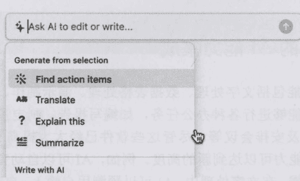

图 7-1 Notion AI 的交互界面

Press 'space' for AI, '/' for commands...

图 7-2 使用空格激活

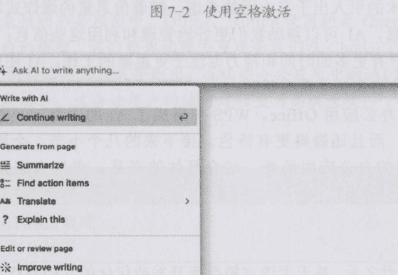

图 7-3 激活 AI

也可以在任意位置通过斜杠命令唤起。用斜杠激活 AI 如图 7-4 所示。

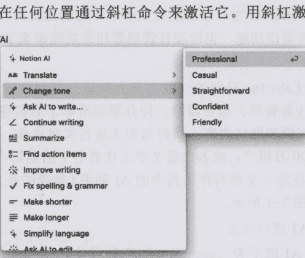

图 7-4 用斜杠激活 AI

用户还可在表格中点选加入 AI 元素。在表格中点击加入 AI 元素如图 7-5 所示。


图 7-5 在表格中点击加入 AI 元素

新建文档时，也可以直接选择 AI 助理开始工作。新建文档如图 7-6 所示。


图 7-6 新建文档

Notion AI 强调工具属性，团队致力于将智能无缝嵌入工作流，以提升生产力。

下面从常见应用场景出发，说明 Notion AI 在工作中的具体用法。

##### 3. 写作与编辑实操
从文档写作与编辑角度看，Notion AI 能以多种方式改写现有内容或生成新内容，帮助提升写作质量与效率。以下为具体示例。

（1）修正拼写与语法
日常写作中，为保证专业性，通常需要仔细校对语法和拼写。Notion AI 可帮助修复文本中的拼写和语法错误。

第一步：圈定需要修改的内容。选中修改内容如图 7-7 所示。

236 实战 ChatGPT：应用 AI 工具高效工作与学习


第二步：点选“Ask AI”，再选择“Fix spelling & grammar”。点击“Ask AI”如图 7-8 所示。


第三步：可选择“替换”原文，也可在原文下方“插入”修改后内容作对比。“替换”原先的内容如图 7-9 所示。

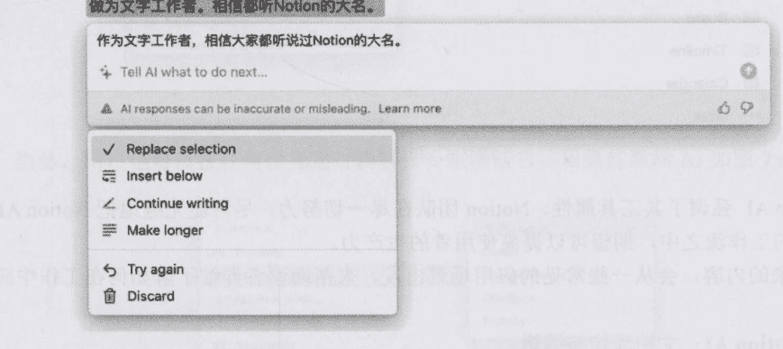

（2）调整长度与语气
文书工作常有篇幅限制。若内容过长，可要求 Notion AI 精简；若篇幅不足，也可让其扩写作参考。

第一步：圈定需要处理的文本，如图 7-10 所示。


第二步：点选“Ask AI”，若需增长可选择“Make Longer”。扩写内容如图 7-11 所示。


第三步：生成后可根据需求调整语气。若要发社交媒体，可将语气调得更随意，选择“Casual”。调整语气如图 7-12 所示。调整后的效果如图 7-13 所示。

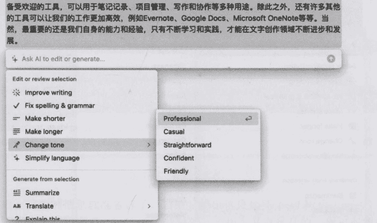

作为文字工作者，我们需要各类工具来提升效率和质量。Notion 是颇受欢迎的选择，可用于笔记、项目管理、写作和协作等。除此之外，Evernote、Google Docs、Microsoft OneNote 等也是常见工具。当然，自身能力和经验最关键，持续学习与实践才能在文字创作上不断进步。


图 7-13 调整后的效果

若效果不理想，可点选“try again”让 Notion AI 重新尝试。

（3）文本翻译
无论是把阅读材料译成母语，还是将自有内容扩展到多语言受众，都可用 Notion AI 完成。

第一步：圈定待翻译文字。
第二步：选择“Translate”后指定目标语言，如图 7-14 所示。

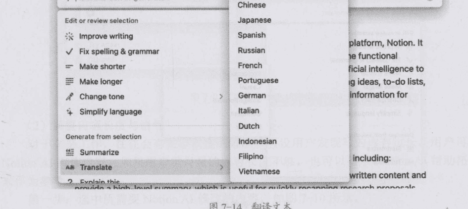

图 7-14 翻译文本

用户也可以直接在对话框中输入目标语言，Notion AI 会识别翻译意图并执行。自动翻译如图 7-15 所示。

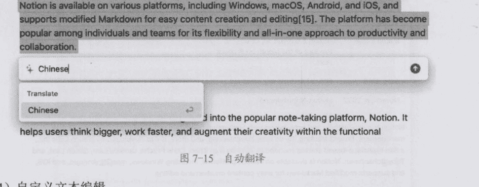

（4）自定义文本编辑
除常规处理外，用户可自行撰写提示词，让 Notion AI 完成特定任务。

例如在一段关于 Notion 的英文介绍中，需要整理产品相关历史成表格，可在圈定文本后输入需求描述即可。自定义需求如图 7-16 所示。

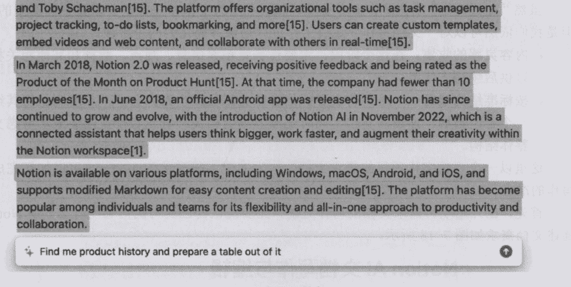

数秒后信息即可生成。自定义输出效果如图 7-17 所示。

这里建议使用英语，因为 Notion AI 对英文指令的优化更好，复杂指令时提示词用英文效果更佳。

Notion 可在 Windows、macOS、Android、iOS 等平台使用，支持改良版 Markdown，便于内容创建与编辑。该平台因灵活与一站式协作生产力而在个人与团队中流行。

| 2013 | Notion Labs Inc. founded |

| March 2018 | Notion 2.0 released, rated Product of the Month on Product Hunt |

| June 2018 | Official Android app released |

| November 2022 | Notion AI introduced |

Notion 是生产力与笔记类网页应用，提供任务管理、项目跟踪、待办清单、书签等组织工具。由 Notion Labs Inc 开发，这家总部位于旧金山的初创公司成立于 2013 年。可在多种平台使用，支持改良版 Markdown。

Tell AI what to do next...

AI responses can be inaccurate or misleading. Learn more

图 7-17 自定义输出效果

##### 4. 写作前的准备工作
除编辑和整理外，Notion AI 还能帮助进行写作前的准备，涵盖用户手册、软件需求、商业计划、研究报告、新闻稿、课程大纲等。

尽管“文档写作”涉及众多专业与领域，具体任务类型各异，但可将其抽象为两个阶段。

- 灵感与材料的收集：积累信息、观点、数据等资料，为后续写作做准备。
- 按标准结构撰写：把收集到的材料组织成逻辑清晰、连贯的文档，并结合行业规范确定整体框架。

以“数字化项目需求文档”为例，演示 Notion AI 如何完成写作准备。

首先在动笔前，需要明确要写的内容。对 Notion AI 描述文档需求如图 7-18 所示。

###### Notion AI 文档写作与编辑

我要准备一份「数字化项目需求文档」，请你列出这份文档有可能需要编写的内容

图 7-18 对 Notion AI 描述文档需求

收到需求后，Notion AI 会列出可能涉及的内容。若不够详细，可要求对特定部分细化，如图 7-19、图 7-20 所示。

###### Notion AI 文档写作与编辑

以下是编写数字化项目需求文档时可能需要包含的内容：

1. 项目概述：对项目的目标、范围和期望结果进行概述。

2. 业务流程：对项目所涉及的业务流程进行描述，包括流程图和文字描述。

3. 功能需求：详细列出项目所需的各项功能，包括必要的输入、输出、处理和反馈。

4. 非功能需求：对项目的性能、安全、可用性、可维护性、可扩展性等非功能需求进行描述。

5. 数据需求：列出项目所需的数据及其属性，包括数据的来源、格式、精度和可靠性等。

6. 界面设计：对项目所涉及的界面进行设计，包括界面布局、交互方式、操作流程等。

7. 技术架构：对项目所采用的技术架构进行描述，包括硬件、软件、网络等方面。

8. 运维需求：对项目的运维需求进行描述，包括备份、恢复、监控、维护等方面。

9. 项目进度计划：制定项目的进度计划，包括里程碑、交付物和时间表等方面。

10. 风险管理计划：对项目可能遇到的风险进行评估和管理，包括风险识别、评估、规避和应对等方面。

细化「项目概述」

AI responses can be inaccurate or misleading. Learn more


根据上述文档的内容需求，以及相关行业标准，帮我准备一份逻辑连贯的文档写作框架

Generate

Press 'space' for AI, '/' for commands...


按此流程，可逐步与 Notion AI 细化需求，直至敲定细节。随后即可要求其按行业标准生成写作框架，如图 7-21、图 7-22 所示。

###### Notion AI 文档写作与编辑

好的，针对「项目概述」，以下是一些常见的细化内容：

- 项目目标：具体描述项目的目标，例如提高销售额、优化业务流程、提高用户体验等。

- 项目背景：介绍该项目的产生原因、现状以及需求背景等。

项目概述补齐要点

如果想让项目概述更扎实，建议围绕边界、价值和角色三方面做补充。

- 明确边界：将项目的范围讲清楚，包含哪些功能模块、牵涉哪些业务流程、数据口径如何界定。
- 突出价值：描述项目完成后能够带来的改变，例如效率提升、成本下降、客户满意度提高等。
- 梳理参与方：列出涉及的岗位与部门，并说明各自职责，比如项目经理、研发人员、测试人员等。

三部分齐备后，概述就会显得充实完整。


###### 数字化项目需求蓝本

项目概述
- 目标方向
- 覆盖范围
- 预期收获

业务流程
- 流程图示
- 文字说明

功能需求
- 必备输入、输出、处理逻辑与反馈

非功能需求
- 性能
- 安全
- 可用性
- 可维护性
- 可扩展性

数据需求
- 数据项与属性
- 来源、格式、精度与可信度

界面设计
- 布局思路
- 交互方式
- 操作路径

技术架构
- 硬件
- 软件
- 网络

运维需求
- 备份
- 恢复
- 监控
- 维护

项目进度安排
- 里程碑
- 交付物清单
- 时间节点

风险管控方案
- 风险识别
- 规避措施
- 应对策略

以上条目可依据实际项目灵活增删。


把准备好的素材填入上述框架，很快就能得到一份初稿。填充期间可以随时就文档的内容和结构向 Notion AI 提出修改意见，也能提供更细化的业务描述让它协助撰写。整体来看，Notion AI 是一款功能比较全面的文字协作工具，对 Notion 用户的日常写作能节省不少时间。虽然仍有提升空间，但它与产品的深度整合方式值得借鉴。

#### 7.1.2 幻灯片制作

在办公场景里，Word、Excel 和 PowerPoint 是使用最普遍的三件套。PowerPoint 被大家简称为 PPT，也成了幻灯片的代称。该软件首次发布于 1987 年，正值个人电脑萌芽期，初版运行在苹果早期的 Macintosh 上。早期界面如图 7-23 所示。


图 7-23 早期版本的 PowerPoint

随着 PC 普及和办公自动化推进，职场人士投入到幻灯片制作上的精力和时间越来越多。

##### 1. 幻灯片的制作过程

幻灯片软件能够将信息视觉化，有助于汇报和交流。但制作过程较为繁琐，既要调整版式，也要保证逻辑清晰。

很多人一旦有汇报需求，就直接打开工具先填充内容再调排版，反复修改，看起来顺手但效率不高。经验丰富的人通常会先搭框架，比如要点清单或思维导图，先写一份简短文字稿，再开始制作页面。先梳理全局，后期调整会更方便。

做幻灯片本质上也是思考和细化。以课程 PPT 为例，在确定大纲后，还要为每页设计简洁明了的文字来表达知识点。若不考虑视觉和动画，幻灯片的核心也就是框架和文字，这正是当前智能工具能够提供支持的部分。

##### 2. 幻灯片的智能支持

从形态和集成度看，目前的应用大致可分为三类。

- 纯文字生成：像 ChatGPT 这类对话式工具，输入主题和简要描述后，将多页内容整理成文字。
- 自动化生成：类似 SlidesGPT 这类产品，输入主题描述即可产出可下载的 PowerPoint 文件。
- 内嵌办公软件：Office、WPS 等内置的智能功能，可直接在文档内生成和修改内容。

三类中，第三类使用体验最直接。国内用户主要使用 Office 与 WPS，其中 WPS AI 已率先推出内测版本。

##### 3. WPS AI 应用

WPS AI 的入口是：https://ai.wps.cn。截至本书写作时 2023 年 7 月，该产品仍在开放内测，可在官网首页申请，工作人员会通过邮件确认。获得内测码后即可在客户端或在线金山文档中使用。

以在线金山文档 https://www.kdocs.cn/latest 为例。

右侧会出现互动聊天窗口，提示可完成的任务。AI 对话界面如图 7-24 所示。

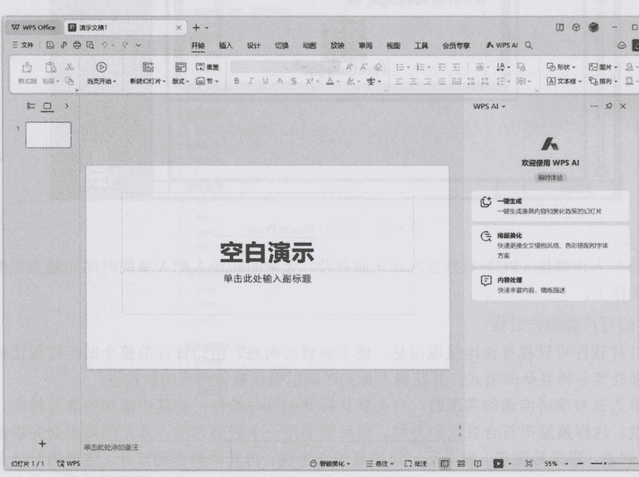

点击聊天框左侧的“生成全文演讲备注”，可以看到更多支持的功能。主要能力如图 7-25 所示。

先以生成全文为例，假设想介绍个人电脑的发展史，可输入：简要介绍个人电脑的发展历史。

互动窗口据此生成整体提纲，确认无误后点击立即创建即可。提纲生成如图 7-26 所示。

内容创作
- 改写正文
- 扩写正文
- 生成全文演讲备注
- 创作单页
- 一键生成幻灯片

排版美化
- 更换主题
- 更换配色方案

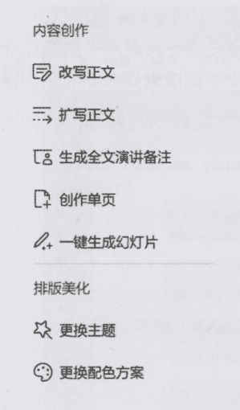

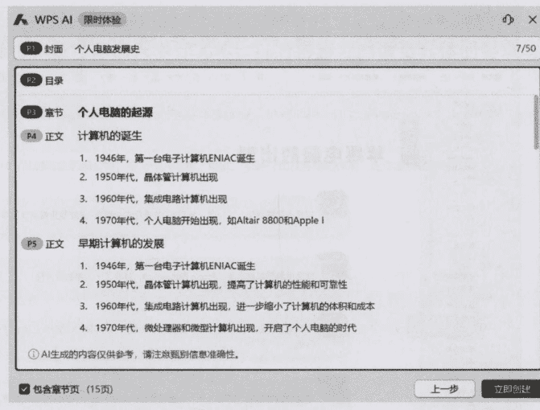

生成全文后，还能快速点击推荐主题切换风格样式。主题切换效果如图 7-27 所示。

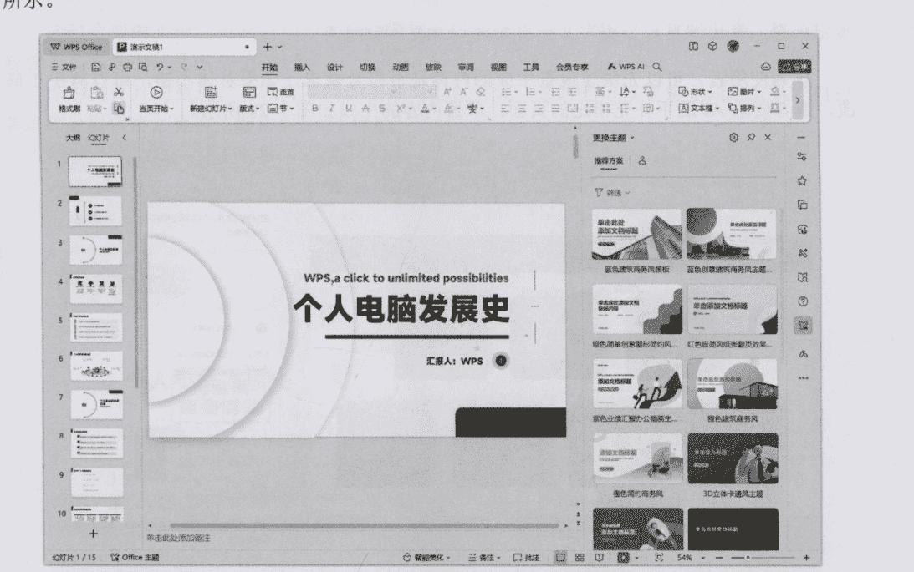

点开其中一页，会看到页面内容会按先前提纲要点进一步展开，例如对 Apple II 电脑的细化介绍。提纲与内容页的关系如图 7-28 所示。


图 7-28 提纲要点与内容页

使用者可先快速核对生成内容是否符合预期，总体满意后再手工润色，或要求智能助手补充指定页面。单页生成示例如图 7-29 所示。

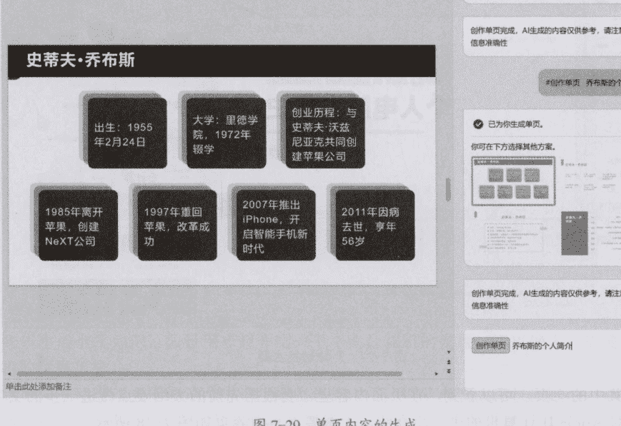

图 7-29 单页内容生成

从主题输入到提纲生成，再到页面填充与主题切换，整体体验很顺畅。除了输入一句话，也可输入多行文本，对内容方向做更具体的约束。更详细的需求如图 7-30 所示。

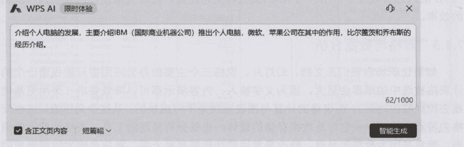

图 7-30 更详细的要求

介绍个人电脑的发展，重点讲 IBM 推出个人电脑，微软、苹果在其中的作用，以及比尔·盖茨和乔布斯的经历。

此时生成的大纲会更贴合设想，大纲文字也可复制出来修改后重新放回文本框。

幻灯片呈现可选用不同主题与配色，也能更换主题挑选偏好的风格。更换主题效果如图 7-31 所示。


图 7-31 更换主题

WPS AI 在幻灯片制作流程与风格调整上的表现已相当成熟。用户可通过对话完成各类制作任务，得到清晰美观的内容。建议先定好主题让其生成初版，再对单页和排版做精细化优化。当智能能力融入办公软件，交互更便捷，内容创作与创新效率自然提升。

#### 7.1.3 表格与数据分析

若只能保留文档、幻灯片、表格三类应用中的一种，表格的保留概率最高。文字输入和演示可以简化，但表格的计算与图表展示不可替代。它既是数据沉淀的载体，也是分析呈现的工具。用起来门槛低、上手快，但需求深入后就需要掌握更多技巧和复杂公式。

WPS AI 已集成智能表格功能，目前功能还在演进，已能看到雏形。

##### 1. 使用场景——条件标记

新建智能表格并启动智能助手，选择条件格式。选择条件格式任务如图 7-32 所示。

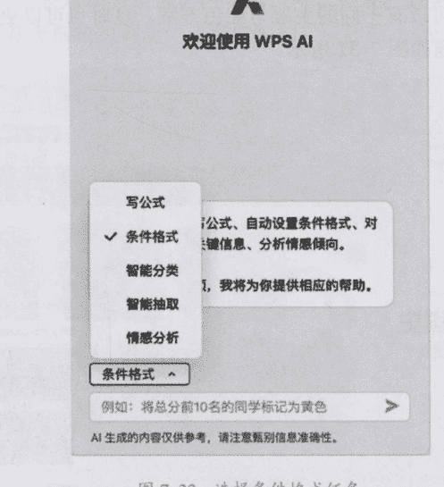

假设有一份销售数据，每行订单有不同利润，若要标出亏损订单，可先选条件格式对话，输入：标记利润为负的行，为浅红色。条件格式效果如图 7-33 所示。


此时助手会先理解需求并拆解为执行步骤，经用户确认后标记符合条件的行列。相关步骤可保存复用，如图 7-33 右侧可将操作序列“保存为快捷操作”。

##### 2. 使用场景——生成公式

面对复杂问题，手写公式容易出错且费时。用户需要找到合适函数、理解参数，有时还需嵌套。现在可用自然语言描述需求，让助手生成公式。

仍以订单数据为例，若要统计指定区域与销售额区间的订单数，可输入：销售额大于 5000，小于 20000，并且是华东地区的订单数。生成公式如图 7-34 所示。


助手会识别地区、销售额字段并写出正确公式，插入当前单元格。生成的公式易读且可复用。

##### 3. 使用场景——智能分类

数据采集后常需分类，如按商品名称归入现有类别。这也能通过智能分类完成。

在 WPS AI 中先选“智能分类”任务，选择待分类列并设定类别列表后执行。智能分类界面如图 7-35 所示。

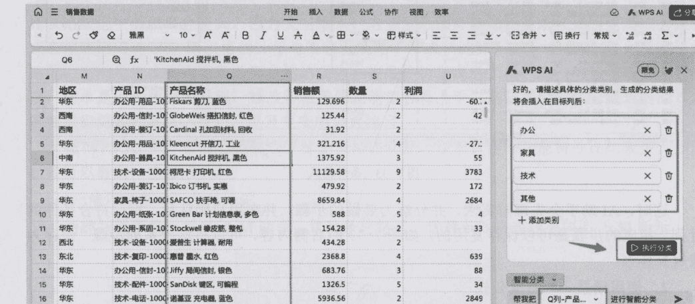

以产品名称做智能分类为例，执行后会在选中列右侧新增一列，填入对应分类。分类结果如图 7-36 所示。

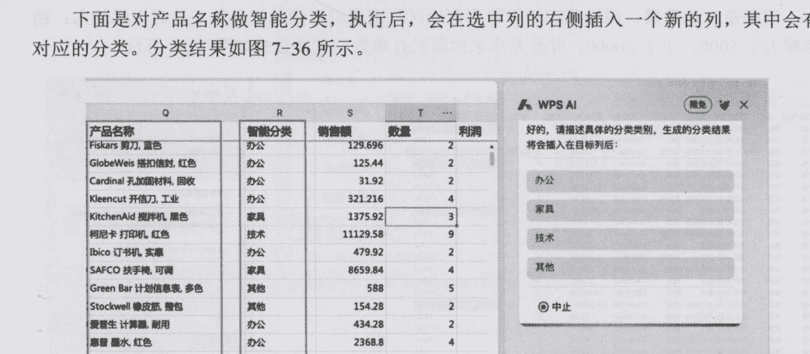

##### 4. 使用场景——情感分析

人与人交流的文字会因态度情绪呈现不同倾向，与语气、措辞相关。

图 7-37 列出不同产品的用户评论，若要统计喜欢或不喜欢的人数，就需要对评论做情感分析。自行判断可行，但数据量大时可交给助手。

| 产品名称 | 用户评论 |
|---|---|
| Fiskars 剪刀, 蓝色 | 真正的生活必需品，剪切顺畅，让我对手工艺有了新的喜爱。 |
| GlobeWeis 搭扣信封, 红色 | 信封颜色鲜艳，但是搭扣部分质量一般，有待改进。 |
| Cardinal 孔加固材料, 回收 | 质地坚固，真正做到环保又实用，这是我一直在找的产品！正面 |
| Kleencut 开信刀, 工业 | 功能还可以，但是刀片不够锋利，影响使用。 |
| KitchenAid 搅拌机, 黑色 | 堪称厨房神器，操作简单，节省了我大量的时间。 |
| 柯尼卡 打印机, 红色 | 外观时尚，但打印速度较慢，有些失望。 |
| Ibico 订书机, 实惠 | 价格实惠，订书效果也很好，物超所值。 |
| SAFCO 扶手椅, 可调 | 舒适度一般，希望能有更多的调节选项。 |
| Green Bar 计划信息表, 多色 | 颜色丰富，信息清晰，提升了工作效率。 |
| Stockwell 橡皮筋, 整包 | 橡皮筋太薄，容易断，改进空间大。 |
| 爱普生 计算器, 耐用 | 极其耐用，按键反应也很灵敏，非常推荐。 |
| 惠普 墨水, 红色 | 颜色鲜艳，但是使用不久就开始变淡，不太满意。 |
| Jiffy 局间信封, 银色 | 外形精美，质感高，非常满意。 |
| SanDisk 键区, 可编程 | 编程设置较复杂，希望能简化操作。 |
| 诺基亚 充电器, 蓝色 | 充电速度快，外形小巧，非常方便。 |

图 7-37 用户评论

选择弹出菜单的“情感分析”任务，指定“用户评论”列后执行，会在右侧新增一列情感分析结果。情感分析界面如图 7-38 所示。

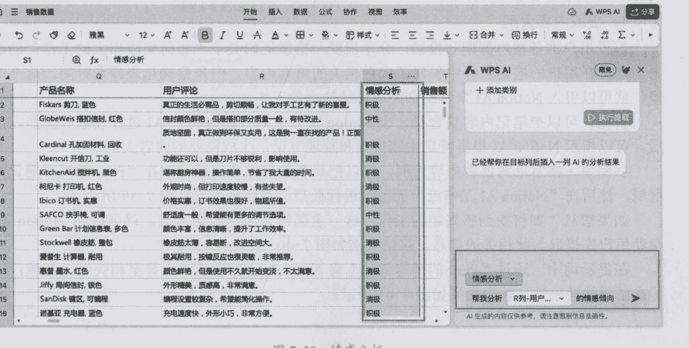

图 7-38 情感分析

目前 WPS AI 的表格与数据分析能力仍属入门，但已能理解自然语言描述并按任务类型执行。对于不熟悉复杂公式的用户，能降低门槛；智能分类与情感分析等功能，也为日常表格处理与数据分析提供有力辅助。

### 7.2 让 AI 成为智能办公助手

职场工作常涉及同步与异步协作，包括会议准备、讨论、复盘等；同时也需要积累知识与经验，如解读市场报告、沉淀业务知识。借助 AI，这类工作可在办公软件中大量完成。

#### 7.2.1 从工作笔记到总结输出

莱昂纳多·达·芬奇是文艺复兴时期的艺术家、科学家与发明家，他以随身笔记本记录想法、观察与发现而闻名。我们也会在笔记应用中记录灵感与经验，但将零散笔记整合成结构清晰的总结，往往耗时耗力。

本节以 Notion 为例，演示一套借助 AI 的自动化文字工作流，帮助读者以更低成本产出有价值的内容。

案例选用保罗·格雷厄姆的博客。作为“硅谷教父”，他在博客中分享对计算机科学、创业与社会问题的思考，篇幅短小精悍，非常适合作为工作思考笔记的样本。

##### 1. 提取内容大纲

假设用户要在内部刊物投稿，分享保罗·格雷厄姆关于“如何完成伟大工作”的思考。笔记软件里已积累大量相关博客，但整理费时。此时可引入 Notion AI 完成提炼与输出。

首先把笔记整合到一个 Notion 页面，便于 AI 读取与操作。然后指示 AI 按特定主题检索笔记并生成大纲。

以保罗·格雷厄姆博客为例，将待整理笔记放在“Paul 的博客笔记”区域，在“Notion AI 工作流”区域处理。需整理内容如图 7-39 所示。

若想以“如何找到感兴趣的工作”作为切入点，可让 Notion AI 先提取相关信息。总结大纲如图 7-40 所示。

提示词中通过“Paul 的博客笔记”限定 AI 的注意力范围，能提升结果准确性。输出效果如图 7-41 所示。

应用1：从工作笔记到总结输出

Notion AI工作流

Press 'space' for AI, '/' for commands...

Paul的博客笔记

If you collected lists of techniques for doing great work in a lot of different fields, what would the intersection look like? I decided to find out by making it.

Partly my goal was to create a guide that could be used by someone working in any field. But I was also curious about the shape of the intersection. And one thing this exercise shows is that it does have a definite shape; it's not just a point labelled "work hard."

The following recipe assumes you're very ambitious.

The first step is to decide what to work on. The work you choose needs to have three qualities: it has to be something you have a natural aptitude for, that you have a deep interest in, and that offers scope to do great work.

在实际操作里，第三条标准基本不用过度担忧。有雄心的人反而在这一点上容易自我设限。真正要做的就是去找到一个既契合天赋又能持续投入热情的赛道。[1]

乍看很直接，执行起来却常常受阻。年轻时难以判断自己的优势，也很难想清楚不同职业的真实状态。更棘手的是，你未来可能进入的岗位现在可能还不存在。极少数人十四岁就能确定方向，大多数人只能在试错中逐渐校准。


- 找到契合的职业兴趣
  - 锚定天赋与热情重叠的区间
  - 把知识储备积累到该领域的前沿
  - 捕捉知识的空白之处并提出问题
  - 锁定有前景的议题做深入探索

判断天赋与兴趣的重合区
- 选择与天性相符且能引起共鸣的方向
- 保持充足的好奇心和持续投入的意愿
- 以挑战感和兴奋感作为筛选依据
- 年轻时多做跨领域尝试，更快定位偏好

新知识的学习路径
- 学习是分阶段的，需要长期坚持
- 把目标定在做到最好，而非仅仅合格
- 保持好奇，持续提问，发掘盲区
- 即便想法偏离主流，也敢于追随
- 勇于试错、创新并不断拓展

保障交付质量的做法
- 专注投入并踏实执行
- 保持探索心态，持续自我施压
- 建立个人标准并不断抬高
- 主动接触新事物，拥抱新观念
- 维持积极稳定的心态


Notion AI 属于生成式助手，输出效果会随提示的精炼而变化。要让结果更贴近预期，就需要不断打磨指令，遇到不理想就多试几次。

##### 2. 整理大纲并辅助内容创作
得到初稿后，发现“如何确保工作质量”和“如何学习新知识”并非我们想要的部分，于是先剔除这两块，再让模型重新梳理框架，见图7-42，整理后的呈现如图7-43所示。


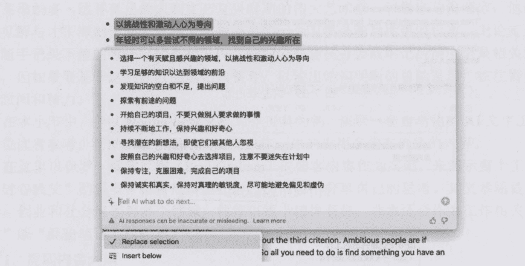
由于指令要求模型继续基于“笔记”展开，它顺带补充了一些相关信息。在大纲范围确定后，就可以和 Notion AI 协作写作了。

写作时建议每次只给模型一个大纲点，避免话题发散。同时在提示中明确：请依据“笔记”作答，若笔记中没有对应内容就直接回复“笔记中无相关内容”，这样能有效降低模型产生伪造内容的概率，见图7-44。所谓幻觉，指大模型为了给出答案而产出似是而非、不符事实的表述。


从截图可以看出，Notion AI 成功把笔记里的相关片段提取出来。在此基础上，可再要求它把要点整合成一段连贯的文字，见图7-45。

###### 文章内容
- 聚焦既有天赋又令人上头的领域，以挑战与兴奋驱动


- 恪守诚实与真实，对真理保持敏感，尽量避免偏见与虚伪

如果觉得文字仍显单薄，可以让其扩写。扩写示例如图7-46所示。

###### 文章内容
- 聚焦能发挥天赋又能点燃兴趣的赛道，以挑战感和新鲜感为引

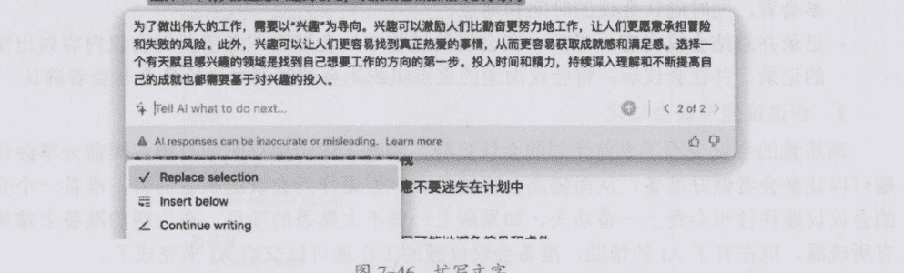
一次不满意就多试几次，直至达标。多次优化的案例如图7-47所示。

###### 文章内容
- 锁定天赋与兴趣交汇的领域，用挑战性和新鲜感推进


当 Notion AI 产出满意的初稿后，可以用相同流程处理其余大纲点。这样人机协作能迅速把零散笔记转化为文章初稿。用户只需扮演编辑，对生成稿做少量调整即可发布。

结合2.2节的说明，提升大模型输出的关键在于清晰指令和充分上下文。本节案例把“从笔记到总结输出”拆分得更细，并利用 Notion AI 的产品特性，让指令与反馈传递更顺畅，生成质量因此明显提升。

#### 7.2.2 会议的组织与总结
企业协作离不开会议，这决定了会前准备、通知、讨论和复盘都必须扎实。其中大量标准化文字工作，正是大语言模型擅长的环节。可以围绕会议全流程设计多个 AI 工具参与，形成提速增效的工作流。

整体流程可拆成三个关键步骤：
- 准备议题：依据业务需求梳理讨论主题，时间有限时需按优先级排序。
- 组织会议：在议题确定后，通过内部沟通工具或邮件邀请参会者，确认时间地点。
- 记录与总结：会议进行时清晰记录要点，会后整理成纪要分发确认。

##### 1. 会议议题准备自动化
高质量的会议，议题提前规划是基础。提前分享议程能帮助参会者预备，提升效率。但手工准备一份完整议程耗时费力，尤其对不熟悉的项目容易遗漏。有了 AI 介入，这件事可以交给模型来做。

下面以 Notion AI 为例。首先在新页面唤起 Notion AI，选择“Custom AI Block”，在这里可以自由编辑提示词。自由编辑提示词如图7-48所示。

###### 应用2：会议的组织与总结

图7-48 自由编辑提示词

准备提示词时，把已有的想法告诉 Notion AI，能让生成的议程更贴合需求。准备详细议程如图7-49所示。

###### 应用2：会议的组织与总结
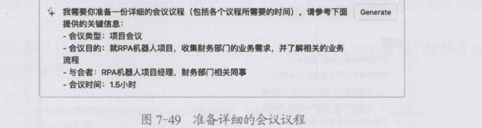

随后 Notion AI 会输出一份议程草案，详细计划如图7-50所示。

###### 应用2：会议的组织与总结
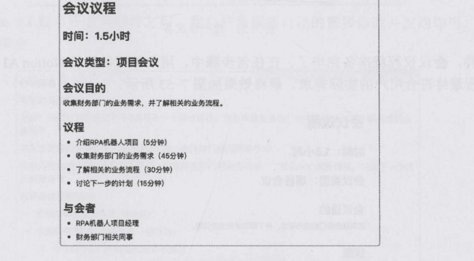

在基础框架之上，可以要求 Notion AI 进一步细化议题。选中相关内容后让它完善即可。选择需完善的内容如图7-51所示。


得到更细的内容后，可以直接替换原有部分。进一步改善如图7-52所示。

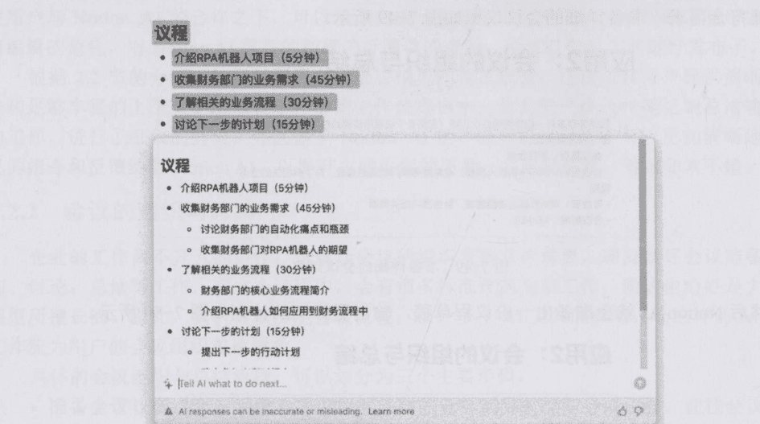

如此议程就基本成型。任何环节用户都可手动编辑 AI 生成内容，确保最终符合实际需求。最终效果如图7-53所示。

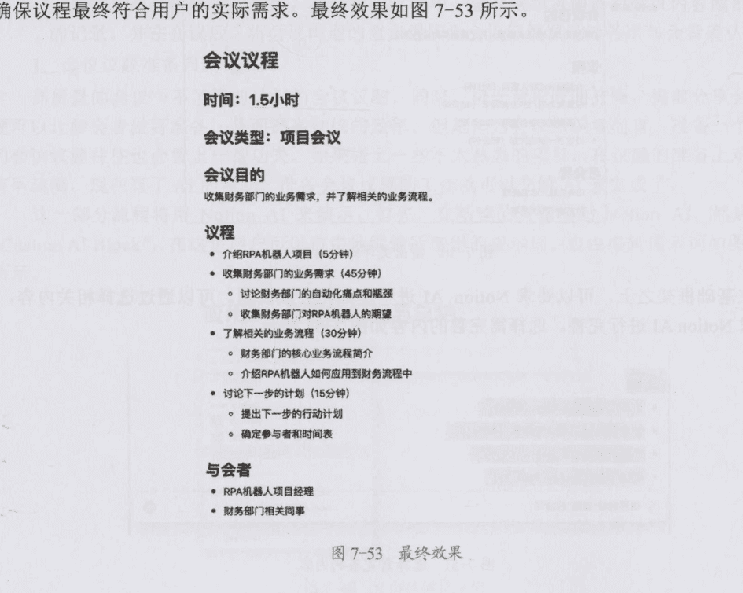

##### 2. 生成会议邀请邮件
议程准备好后，下一步就是通过内部工具或邮件发出邀约。

以邮件为例，跨部门邀请时需在邮件里清晰介绍会议背景和目的，再通过邮件确认时间和地点。

在议程微调完成之后，可直接让 Notion AI 起草邀请邮件。起草邀请邮件如图7-54所示。

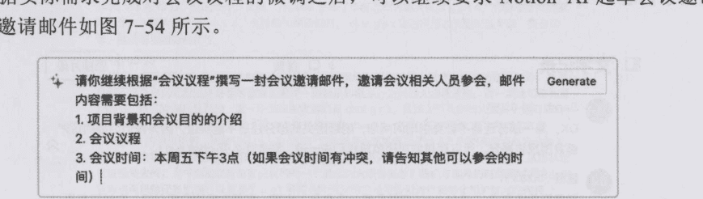

AI 起草完成后，按需修改再发送即可。邀请邮件如图7-55所示。


##### 3. 从会议录音到会议纪要
会议召开后，组织者需要完整记录讨论要点。传统做法是安排专人速记，或录音备份留作复盘参考。

借助 AI，可以用更高效的方式完成。这里使用“飞书妙记”录制或上传会议录音，它能把语音转成文字。飞书妙记如图7-56所示。


拿到完整的文字稿后，可导出保存到 Notion，再让 Notion AI 进行总结。也可以针对特定业务问题做信息抽取，或按发言人观点做归纳。

以一期播客为例，主持人 Sarah 与嘉宾王健硕围绕 ChatGPT 展开漫谈。飞书妙记案例如图7-57所示。

###### 飞书妙记案例
2023年3月15日 下午 4:33|2小时17分钟51秒
关键词：
浏览器、互联网、机器人、人类、语料、世界、知识、微软、意识、语言模型、人工智能、自然语言、搜索引擎、域名系统、竞争对手、图灵测试、纽约时报、基础设施
文字记录：
Sarah 00:02
2023年3月15日，也就是今天凌晨，Openai发布了多模态预训练大模型gpt4。它能够接受图像和大量文本输入，比gpt3.5，也就是本期录制时，chatgpt背后所用的模型更加可靠、更有创意，能处理更细微的指令。
Sarah 00:38
各位好，欢迎来到Chatstalk大白话系列第三期。这期的嘉宾依然是大家非常熟悉的建设老师，他总是能用近乎白话式的浅显易懂的语言去解构一些复杂的概念。之前的大白话系列，第一期我们聊的是Web 3，第二期聊的是写作，这一期坚守和我聊的是chatgpt。我想在开头先给大家关于这期节目的总体概览，主要会分成以下4个部分。首先是科普chatgpt的定义和原理，其次是澄清关于chatgpt的常见误解。比如它会让人失业吗？它跟搜索引擎的区别是什么？它到底有没有自己的人格？大语言模型所呈现的涌现和思考链路等能力，打开通用人工智能大门了吗？接着，我又试图从创业者视角去问，见中国到底有没有必要再做一个类似的大语言模型？我们与国外的时间差对国内创业者来说是风险还是机遇？以及基于gpt模型API开发的产品该如何进行差异化和护城河的构建，chatgpt的产业链价值捕获最后会落在何处？等等。
Sarah 01:56
最后，也有一些隐忧和畅想，比如AI在隐私权、著作权、道德伦理等方面的探讨。这期节目还有一个比较特殊的点，我们把播客录制的全过程都直播在了健硕的视频号上。如果你希望了解一期播客是如何录制的，或者如果你希望看到我们互动过程当中的表情，可以在微信上搜索王建硕，关注健硕的视频号，点击直播回放，就能看到3月6日的全程直播录像。感谢各位的收听，我是Sara，预祝各位收听愉快。


具体操作案例如下。

例1：让 Notion AI 总结主持人的提问，见图7-58，总结结果如图7-59所示。


例2：让 Notion AI 归纳嘉宾对某个特定议题的观点，见图7-60，观点归纳如图7-61所示。


图7-60 总结某个特定观点


图7-61 对于观点的总结

例3：让 Notion AI 对两小时以上的讨论就某个关键话题做归纳，见图7-62，话题总结效果如图7-63所示。


图7-62 对于某个话题总结


图7-63 话题总结效果

不同团队对会议纪要的模板和规范各不相同。相比 ChatGPT 需要反复复制粘贴的对话模式，内嵌式的 Notion AI 更适合文档内迭代修改，便于积累知识库。

#### 7.2.3 制作问卷分析报告
问卷设计和分析报告是数据收集与决策支持的关键环节。问卷帮助从大量受访者获取信息，分析则把数据转化为可用的洞察。本节案例的表单设计、数据整理和报告制作均基于 WPS AI，可通过“https://ai.wps.cn”体验。

##### 1. 表单设计
假设公司刚升级咖啡机，需要收集同事反馈。常见的问卷问题类型包括：
- 填写人基本信息：姓名、性别、岗位等。
- 咖啡机使用感受：易用性、清洁便利性、口味等。
- 个人咖啡偏好与开放式建议。

过去需要在后台手动配置题目、选项等。现在用 WPS AI，可直接用对话生成问卷。WPS AI 生成表单如图7-64所示。

先打开金山表单小程序，点击下方加号创建表单，再选择 WPS AI 生成表单，见图7-65。


用自然语言描述需求，WPS AI 就会据此生成问卷内容，见图7-66。

生成后若需调整措辞或补充题目，可继续对话优化，也可手动微调。

264 实战 ChatGPT：应用 AI 工具高效工作与学习


问卷完成后，可通过链接或二维码分发。

##### 2. 数据整理
收集到足够数据后，可在智能表格中做初步处理，比如咖啡类型的智能归类，如图7-67所示。


例如把美式、拿铁、卡布奇诺等合并为“奶咖与清咖”。智能合并如图7-68所示。


再把满意度用数字量化，如非常满意5分、不满意1分，便于计算各部门均值。情感分析与条件格式如图7-69所示。


最后对建议和意见文本做情感分析，并可让 WPS AI 按情感结果自动上色，便于区分。

##### 3. 图表制作
WPS AI 表单后台自带统计报表，用户可直接截图使用。结合数据扩展功能，也能自定义图表。自定义图表示例如图7-70所示。

这类分析图表无需复杂工具，用熟悉的分析软件即可完成。

##### 4. 幻灯片报告

完成问卷设计、数据收集与分析之后，往往还得把成果做成汇报用的幻灯片呈现出来，这一步同样可以借助 WPS AI 来完成。

新建演示文稿后呼出 WPS AI 助手，输入主题即可开始生成。为了让结构更贴合需求，也可以把背景和要点写得更细致一些，例如：

公司最近对咖啡机设备进行了升级，想收集同事的使用反馈，所以我们做了份调查问卷，问卷主要涵盖以下三大块。

- 受访者基本信息：姓名、性别、岗位等。
- 咖啡机使用相关体验：是否好用、清洁是否方便、口味满意度等。
- 个人咖啡偏好与开放性意见。

问卷投放后，市场部收回 16 份、销售部 24 份、技术部 18 份。总体来看大家对现有的咖啡机是认可的，待优化的点主要有：补充使用说明、加强及时清洗、提供牛奶和糖包等附加耗材。生成的幻灯片效果如图 7-71～图 7-73 所示。


图 7-72 目录页


图 7-73 优化使用说明

当主题描述足够清晰具体，AI 生成的幻灯片会更接近预期。从目录页的截图可以看出，整体的分析框架脉络分明。基于 AI 生成的初稿做二次加工也很顺手，比如统一视觉风格、补上图表截图、修改结论性的表述等，这些也都可以用 WPS AI 来辅助。

围绕问卷制作、分析到汇报，其实是一个固定且常见的闭环，里面会牵涉到多个办公软件，甚至行政、数据分析等不同角色。过去这套流程多靠人工反复处理，现在借助 AI 对话生成与调整，能显著提升效率并降低门槛，例如在数据处理环节，行政人员也能通过自然语言完成原本较为复杂的计算操作。

# 第 8 章

## ChatGPT 的实用工具

OpenAI 除了提供网页和移动端的 ChatGPT 产品之外，还开放了 API 访问方式，这为生态的扩展打下了基础。大量开发者和商业团队基于 API 做了各种灵活好用的工具，覆盖搜索增强、内容分析、语音交互等方向，极大拓宽了 ChatGPT 的使用场景。本章将介绍目前常用的插件、客户端工具以及 API 调用方法。

| 本章内容 |
| --- |
| 浏览器插件 |
| 客户端工具 |
| 通过 API 调用的工具 |

### 8.1 浏览器插件

浏览器是访问互联网的基础工具，几乎每台电脑和手机都内置。基于 ChatGPT 的浏览器插件正因如此变得通用且好用，能在浏览过程中实现总结搜索结果、辅助撰写邮件等功能。

Chrome 是主流浏览器之一，相关插件可在 Chrome 应用商店搜索并安装。

#### 8.1.1 搜索增强插件

ChatGPT 的训练语料并非实时更新，获取最新网络信息的需求因此凸显。ChatGPT 4.0 已提供网页浏览的试用功能，对于无法使用的用户，插件可以弥补这一空白。

##### 1. ChatGPT for Google

首先介绍的是 ChatGPT for Google，使用界面如图 8-1 所示。


- 功能：在浏览器搜索结果页直接呈现搜索引擎和 ChatGPT 的回答，减少切换成本。
- 推荐指数：★★★。
- 优点：兼容 Google、百度、必应、DuckDuckGo、Brave、Yahoo 等搜索引擎；支持 MarkDown、代码块等多种展示形式。
- 缺点：无法解析引擎返回内容，模板不可自定义。

##### 2. WebChatGPT

另一个搜索增强类插件是 WebChatGPT，使用界面如图 8-2 所示。


- 功能：通过网页浏览能力增强 ChatGPT 的提示词，并结合实时搜索结果。其集成在 ChatGPT 页面内，将搜索到的页面直接喂给模型总结，解决 2021 年之后数据的空白问题。
- 推荐指数：★★★★。
- 优点：可设置抓取页面的数量；可按信息创建时间筛选；支持手动配置用户查询模板。
- 缺点：只能在 ChatGPT 页面运行；不会自动拆解问题核心关键词，提问时需要采用类似搜索引擎的表达方式。

#### 8.1.2 辅助写作插件

ChatGPT 能帮助梳理思路、生成优质文案或润色表达。配合浏览器插件，这类流程会变得更高效便捷。

##### 1. ChatGPT Writer

首先介绍的是 ChatGPT Writer，使用界面如图 8-3 所示。


图 8-3 ChatGPT Writer

- 功能：快速生成邮件内容。
- 推荐指数：★★★。
- 优点：生成速度很快；支持多语言。
- 缺点：场景聚焦在写邮件；Pro 版本价格偏高。

##### 2. Magical

其次介绍的是 Magical，其使用界面如图 8-4 所示。


图 8-4 Magical 插入

Magical 使用 “//” 激活，如图 8-5 所示。


- 功能：在任意网站或应用中撰写 AI 生成的消息、邮件和客户回复。
- 推荐指数：★★★★★。
- 特点：基于 ChatGPT 4.0 引擎自动生成；可连接数据库和表格；支持团队协作。
- 缺点：功能强大但上手较复杂；免费额度受限，需付费。

#### 8.1.3 信息分析总结插件

信息过载的时代，快速提炼文字、视频要点变得重要。这类工具能帮助抓住重点、过滤噪音并解释专业术语。

##### 1. YouTube Summary with ChatGPT

这里介绍的是 YouTube Summary with ChatGPT，使用界面如图 8-6 所示。


- 功能：自动总结 YouTube 字幕，生成视频大纲，聚焦重点，节省观看时间。
- 推荐指数：★★★。
- 优点：可一键把字幕导入 ChatGPT 对话；大纲可直接跳转到对应视频片段；支持自主选择 ChatGPT 引擎。
- 缺点：不支持对总结和大纲进行翻译；展示区内无法与 ChatGPT 交互。

##### 2. Glarity-Summary

这里介绍的是 Glarity-Summary，使用界面如图 8-7、图 8-8 所示。


图 8-7 YouTube 中使用 Glarity-Summary


图 8-8 Google 中使用 Glarity-Summary

- 功能：自动总结视频字幕、搜索结果和网页内容，形成概括，节省浏览时间。
- 推荐指数：★★★★。
- 优点：支持多个视频平台如 YouTube、Bilibili 等；可总结搜索引擎结果；可对网页内容进行总结并生成大纲。
- 缺点：视频总结仅展示大纲，无法跳转。

##### 3. Tactiq：会议总结

这里介绍的是 Tactiq，使用界面如图 8-9 所示。


- 功能：从 Google Meet、Zoom、Webex 和 Microsoft Teams 等视频会议系统中提取会议纪要。
- 推荐指数：★★★★。
- 优点：通过 API 获取纪要；记录自动汇总到 GoogleDoc；支持会议出席统计、屏幕截图、现场字幕录制、按与会者检索记录，并可导出为 PDF 等格式。
- 缺点：所支持的会议系统在国内使用较少。

##### 4. LINER

这里介绍的是 LINER，使用界面如图 8-10 所示。


- 功能：基于用户保存的内容和重点片段，发现 ChatGPT 推荐的相关内容，并在网页上进行标记。
- 推荐指数：★★★★★。
- 优点：可通过 LINER 企业账号与 ChatGPT 连接；提供翻译、总结、深度扩展等功能；高亮内容可长期保存；能屏蔽 YouTube 自动广告。
- 缺点：免费用户有使用限制；摘要和扩展内容在右侧对话框显示。

#### 8.1.4 语音插件

ChatGPT 本身是文字交互工具，通过以下插件可实现语音对话。

##### TALK-TO-ChatGPT

首先介绍的是 TALK-TO-ChatGPT，使用界面如图 8-11 所示。


- 功能：用麦克风与 ChatGPT 对话，将语音转文字，并以 AI 语音回复。
- 推荐指数：★★★。
- 优点：支持大多数主要语言。
- 缺点：语音不够自然，中文识别率偏低；仅能在 ChatGPT 页面使用。

#### 8.1.5 其他插件

除上述主功能插件外，还有一些综合性工具值得关注。

##### 1. Monica

这里介绍的是 Monica，使用界面如图 8-12 所示。


- 功能：功能扎实，支持侧边聊天、撰写文章、语音输入输出。付费后支持搜索结果解读、YouTube 总结分析、语音交互等。
- 推荐指数：★★★★★。
- 特点：无需 ChatGPT 账号即可使用；支持多种模板和个性化定制；基本覆盖其他插件功能；付费版直接支持 ChatGPT 4.0。
- 缺点：免费版每日限 30 次问答；不支持在页面输入框内直接生成文字。

##### 2. AIPRM-ChatGPT

这里介绍的是 AIPRM-ChatGPT，使用界面如图 8-13 所示。


- 功能：提供精选的 ChatGPT 指令模板，缩短编写提示词的时间，提升准确度。
- 推荐指数：★★★★★。
- 特点：涵盖文案、开发、SEO、SaaS、软件开发等分类；可大幅减少关键词描述成本；支持个人模板定制。
- 缺点：提示关键词仅为英文；高级扩展需付费。

### 8.2 客户端工具

ChatGPT 不仅可在浏览器使用，也能在移动端运行。除官方应用外，也有第三方将 ChatGPT 集成进自家产品。

#### 8.2.1 官方的移动端应用

OpenAI 提供了 iOS 与 Android 官方应用。

据官方说明，当前版本主要功能包括：

- 即时回答：在广告和多结果干扰下获得精准信息。
- 个性化建议：提供烹饪、旅行规划、情感化内容等指导。
- 创意灵感：生成礼物点子、演示文稿草稿或诗歌。
- 专业支持：通过想法反馈、笔记总结、技术问题协助提升效率。
- 学习探索：按个人节奏学习新语言、现代史等知识。

使用方式与网页版相近，只需用 Apple 账号、Google 账号或 OpenAI 账号登录即可。

应用支持直接语音输入，含中文，交互更像对话。能准确识别口语并自动过滤“嗯啊”等填充词。使用语音输入如图 8-14 所示。


另外，应用支持 Apple 充值卡。购买入口如图 8-15 所示。


对于想升级到 ChatGPT 4.0 的用户，这里提供另一条路径。升级后相比免费版可获得：更快的响应速度、在高峰期仍可使用、优先体验新功能如更先进的 GPT-4 版本。

#### 8.2.2 集众多 AI 工具于一身的 POE

大模型更新迅速，若想同时体验多个模型，POE 是一个不错的选择。POE 集成了 OpenAI、Anthropic、Google 等厂商的 AI 机器人，可在同一网站或应用中切换，无需重复注册。POE 已推出 iOS 与 Android 应用，可在美区市场获取。

使用方式与 ChatGPT 相似，采用对话交互。

POE 提供免费和付费版本。免费版除可访问 ChatGPT 3.5、Claude-instant 等免费模型外，每天还能有限次数体验 GPT-4 和 Claude-2-100k 等付费模型。付费版按月或按年订阅，解锁更多收费模型。

POE 还支持用户基于特定引擎创建专属机器人，例如在 OpenAI 引擎上搭建专门生成 Midjourney 提示词或提供个性化服务的机器人，定制灵活、易于使用。

### 8.3 通过 API 调用的工具

OpenAI 除了提供在线 ChatGPT 服务，还向开发者开放了 PlayGround 调试工具和底层 API，帮助将 ChatGPT 能力嵌入自有应用。

#### 8.3.1 GPT API

GPT API 简称 API，是 OpenAI 提供的一种服务方式，让开发者能轻松把自然语言处理能力集成到应用中。无需掌握底层算法细节，只需调整少量参数即可生成文本补全，开发者可把精力放在核心业务上。

API 可作为复杂功能的底层架构。例如作为智能客服的底座，客服厂商专注业务逻辑即可；也可作为游戏 NPC 对话的支撑，让角色能与玩家进行更自然的语言互动。

API 不仅支持文本生成，还支持图像、语音生成。近期 OpenAI 还提供函数调用嵌入，让用户用自然语言调用开发者应用的功能，实现用语言操控软件。

使用门槛不高，只需在 OpenAI 申请一个应用 Key 并参考官方文档即可。注意同一个 key 在网站上仅显示一次，请妥善保存，遗失后只能重新申请。创建密钥如图 8-17 所示。


图 8-17 创建密钥

以下是一个简单对话的示例。

首先在 OpenAI 的 Examples 中挑选一个示例，向下滚动到代码区，选择 Python 并复制。Example 代码如图 8-18 所示。


图 8-18 Example 代码

将代码粘贴到 Python IDE 中，本例使用 VS Code，把申请的 key 填入代码，并增加打印结果语句：print(response)。修改位置如图 8-19 所示。


运行后会返回标准格式的 JSON 结果。

```json
{
    "id": "chatcmpl-7heapBB8XkAwG5KanW76YbWrt4gvU",
    "object": "chat.completion",
    "created": 1680638488,
    "model": "gpt-3.5-turbo-0613",
    "choices": [
        {
            "index": 0,
            "message": {
                "role": "assistant",
                "content": "Jupiter is a really big planet in our Solar System. It is the fifth planet from the Sun and it is the largest planet. It is called a gas giant because it is made mostly of gas. Jupiter is much smaller than the Sun, but it is bigger than all the other planets combined. It is very bright"
            },
            "finish_reason": "length"
        }
    ],
    "usage": {
        "prompt_tokens": 158,
        "completion_tokens": 64,
        "total_tokens": 223
    }
}
```

想了解接口细节，直接去 OpenAI 官方网站查阅 API 参考手册即可，这份文档内容相当完备，API reference 对应图 8-20。里面涵盖了接口的方方面面，从调用方式到可选配置，再到请求与响应的格式规范，甚至附带了可直接运行的示例代码。


另外，市面上也有不少国内译版的 API 说明可以做辅助阅读，它们往往加入了更贴近本地使用习惯的解读，有助于降低理解门槛。但这类资料的完整度参差不齐，最权威的还是以 OpenAI 官方给出的原文为准。

结合官方文档和示例，完全能做出带个人风格的应用。假如你想调节回复语气、情绪等细节，先在 8.3.2 节提到的 Playground 里反复试调，确认效果后再把生成的代码搬到自己的项目里。GitHub 上也有大量基于该接口的开源实践，值得借鉴，里面能看到更复杂的实现思路。

调用接口需要付费。注册时平台会先赠送一定额度供试用，等额度耗尽就必须绑信用卡续充。

整体来看，该接口不只生成文字，还能处理图像和音频，属于一套相当完整的方案。接入门槛低，集成起来很顺手，能让你的产品变得更强更省心。

#### 8.3.2 Playground 体验区

Playground 是 OpenAI 推出的一站式在线互动环境，让你和 ChatGPT 对话，同时把会话自动转成可执行代码，用来检验和评估模型表现。

进入方式很直接：在 OpenAI 首页顶部的菜单里就能找到 Playground 入口，见图 8-21；也可以从 Examples 页面挑选感兴趣的样例一键跳入，见图 8-22。

## 第 8 章 让 ChatGPT 更好用的工具


图 8-21 主菜单入口示意


图 8-22 示例入口示意

Playground 是个相当实用的测试场。你可以输入问题或主题，模型会即时给出回答或生成文本，模拟真实对话。除了基础对话，它还提供模型切换、参数微调、对话保存等附加能力，帮助你更清晰地把握模型表现和适用边界。参数调节区见图 8-23。


在 Playground 内部可自由挑选测试模型。目前开放 GPT-3 系列多个分支，付费用户还能选用 GPT-4。不同版本在速度和效果上存在差异，选对模型能显著提升体验。

它提供三种工作模式：Chat 用于验证 ChatGPT 的对话能力，Complete 用于验证完整的 GPT 生成能力，Edit 则偏向代码补全和重构。模式不同，系统会推荐对应的 Model，比如 text-davinci-003 擅长文本续写和填充，code-davinci-002 则聚焦代码开发。

OpenAI 为平衡输出质量与效率提供了多项可调参数，核心的有：

- Temperature：控制输出的发散程度，数值越大越随机，越小越集中稳定。
- max_tokens：限定单次回复的最大长度，设置过低会导致内容被截断。

根据具体需求灵活调整，就能找到质量与效率的最佳平衡点。

如果你关注后端实现，可以让系统把对话直接编译成代码，支持 Python、Node.js、curl、JSON 四种格式。调试完的参数代码可以直接复制到编辑器继续优化，代码展示见图 8-24。


Playground 还支持对话记录保存，方便后续复盘和分析。对研究人员和开发者而言，这份历史记录能帮助评估模型表现、挖掘使用场景，并为改进提供依据。

需要注意的是，Playground 的使用会按 API 调用计费，注册时提供试用金，用完后需绑定信用卡充值。

总的来说，Playground 是检验模型、微调参数的好帮手，对 ChatGPT 感兴趣的朋友很值得亲自上手体验。

本书从使用技巧到落地场景进行了全面梳理，用通俗易懂的表达配合大量案例，把 ChatGPT 的能力、特点以及日常工作学习中的应用讲得明明白白。无论是初学者还是资深玩家，都能从中获得启发，开启高效的工作生活新模式。

全书围绕读写、创意、语言学习、办公自动化等维度展开，通过实例和浅显分析让应用变得触手可及，也引发对人工智能价值的思考。作为百姓 AI 的创始人，我相信这本书对希望借助 AI 提升效率和学习成果的人来说是不可错过的读物。

在 AI 快速演进的今天，ChatGPT 不仅是技术突破，更是工作与学习方式的重塑。本书以 ChatGPT 为样本，从原理到场景给出实用指导，帮助读者快速掌握知识并付诸实践，在智能化浪潮中保持竞争力，实现个人与职业成长。

ChatGPT 被很多人视为继 iPhone 之后又一改变世界的群众级技术产品，它让交互方式发生根本变化。生成式 AI 不应只停留在极客玩具层面，而应成为每个人的日常助手。本书以通俗的方式拆解实用技巧，适合所有想了解它的人阅读。

真正发挥价值的关键，不是堆砌提示词“咒语”，而是将行业认知融入对话，通过多轮追问把 ChatGPT 当成合作伙伴。本书展示的就是这种有效用法。我的建议是先看第 3 章学会在 AI 帮助下阅读，再用 ChatGPT 陪读整本书。


