# 小红书爆款规律


## 序言
我的使命就是做传播

百亿上市公司首席内容官 吕白

2024年7月24日，彻夜难眠，我发了一条朋友圈：

拖了快一年的书稿，终于要交稿了。最后写序的时候看到和编辑的对话，不由感叹，就像斯蒂芬·茨威格写在《人类群星闪耀时》里的一句话：“一个人生命中最大的幸运，莫过于在他的人生中途，即在他年富力强的时候发现了自己的使命。”

我感觉我的使命就是做传播，为传播而生。死的时候，我希望在自己的墓碑上刻下这一行字：这个人为中国传播走向世界添砖加瓦。

发完这条非常有感触。感谢新媒体，感谢这个时代，让我从山东省的一个村子，走到了现在。

到现在我其实也不敢相信，2022年当当网市场营销榜单上卖得最好的四本书——《影响力》《定位》《从零开始做内容：爆款内容的底层逻辑》《爆款小红书：从零到百万粉丝的玩赚策略》，后两本是我写的。

写到这里我顿了一下，时间好像回到2014年9月29日打开Word的那天。那天我怀着对未来的一片迷茫，打出了第一行字：毕业以后什么工作能月入破万？

想起这十年的日日夜夜，打开电脑，写东西，拍东西，听课，看书，总结，复盘，周而复始。

新媒体让我获得了财富，在国内的任何城市都有立足的勇气。我感谢新媒体，感谢路上遇到的良师益友，感谢这个时代。

所以我一直都在思考，怎么把时代对我的馈赠传递给更多的人，怎么让在互联网上摸爬滚打的人少走弯路。

2015年做新媒体小有成绩的时候，你问我新媒体怎么做，我会沉思一下，说几句国外传播学理论，然后可能会告诉你做好100条，标题、选题、封面这些。

2018年，你问我，我会讲讲不同平台的区别，然后告诉你其实把握关键的二十点就好。

现在你问我，怎么做好新媒体，我会斩钉截铁地告诉你，其实就三点，简单到你都不相信，但确实是事实。

1. 爆款是重复的；
2. 70%和爆款相似×足够多的试验品=100%成功；
3. 找到自己领域的500条爆款拆解，找共性。

写到这里，我想起来有天晚上失眠，看到了朋友圈里有一个略有交集的人发的一条朋友圈：

深夜的颅内高潮！

刷碗之际，听了一个关于“内容行业爆款方法论”的课，越听越觉得堪称内容行业的“圣经”，想下载PPT发到朋友圈，结果看到不能下载的提示，并且连截图都不被允许，可见其内容的稀缺性和价值感，遂附上几句课程中深有感触的金句：

1. 爆款=目标用户/品类认知+拆解核心要素+组合创新元素+定位极致长板+明确用户入口+明确用户留存；
2. 在无短板基础上要有极致长板，在洞察用户基础上要超出用户预期，在击中集体情绪基础上要做到价值观引领；
3. 节点之间的连接比节点更重要，个体之间的关系比个体更重要，信息之间的流通比信息更重要；
4. 对于内容创新类人才而言，正向激励比负向激励更能够激发自身的创新价值；
5. 用爱创造灵魂级的美好作品，是内容创造者一生的使命；
6. 人塑内容，内容塑人。

我在朋友圈下回复：

太复杂了……哪有那么复杂。

他回复：

白总是爆款内容理论至简派。

我猜，他没听进去。

许多领域的成事原则，简单到很多人都不信。

但人们总是喜欢复杂，总是喜欢烦琐，总是喜欢绝世武功秘籍。幻想着自己没做成是因为不会九阳神功，也没捡到乾坤大挪移的秘籍，但其实哪有什么秘籍，都是基本功罢了。

就像拼多多创始人黄峥接受《财经》采访时说的一样：

> 《财经》：2006年段永平以62万美元拍下了巴菲特的午餐，带你去见巴菲特。当时你26岁，那天对你来说是个重要的日子吗？
> 黄峥：巴菲特讲的东西其实特别简单，是我母亲都能听懂的话。这顿饭对我最大的意义可能是让我意识到简单和常识的力量。人的思想是很容易被污染的，当你对一件事做判断的时候，你需要了解背景和事实，了解之后你需要的不是睿智，而是面对事实时是否还有勇气用理性、常识来判断。常识是显而易见、容易理解的，但我们因为成长、学习形成的各种偏见和个人利益的诉求蒙蔽了我们。
> 段永平还教给我一个商业的常识——价格围绕价值波动。价格一定会波动，但只要你的价值提升，最终价格会和价值接近。这个常识让你安心于增加企业的内生价值，而不过度在意资本市场的价格波动。

黄峥的大概意思是：这个世界看似复杂，其实原理都很简单。看得太多，未必就好，道法自然，无为而治。

我认识的各行各业，身价破亿、十亿甚至百亿的翘楚们，他们掏心掏肺告诉我的全是最简单、最朴素的道理。从未有过什么晦涩难懂的词，也从未有过任何绝招，都是简单到不能再简单的东西。

雷军还透露过，其实他一直没有告诉王传福，在他决定造车的过程中，王传福多年前关于造车的一句话也给了他很大的勇气。

畏惧正是对手给后来者营造的一种产业恐吓。

他们不断地告诉你做不成，投入很大，研发很难，直到你放弃。其实你做不成不是因为你没有能力，而是你缺乏勇气。

新媒体也是如此，其实就是基本功的重复。

请你相信，我下面说的每一个例子都是能让你少走很多弯路的。我费了很多精力，拼尽全力才能写得很简单，才能让你理解。

我之前出版的书会有人评论，写得太浅薄、太简单了。但你知道吗，说句实话，写得让人看不懂，是最简单的事情，拽文弄墨，胡乱造词，瞎造概念，搞个翻译腔，小学生都会。

但我不想这样，因为我太知道一个初入行的人，和一个在行业小有成就的人他们需要什么。

我是想通过这本书，给一个又一个曾经像我一样迷茫的人，一条有些光明的道路。

请你记住：真传一句话，假传万卷书。

2024年8月3日，在广州太古汇，我打开Word写下：“如何让中国新媒体从业者少走弯路，成人达己。”

## 附言

在这本书里，我写了很多案例，写了很多故事，感谢他们，他们都是曾经非常相信我的人，其中一些人做出了很出彩的成绩，但我的作用只占5%。还有一些朋友我并没有帮你们做出特别好的案例，十分惭愧，感觉愧对了你们的信任。

感谢我曾经的学员、老师和合伙人“活力少女阿珍”，我教会了你做小红书，教会了你所谓的爆款方法论。而你教会了我体面地分开，让我格局变得更大。

也感谢我的摄影兼编导“购物天才77”，我曾经帮你拿了一份传统意义上的高薪，你也支撑了我在新公司的业务——小红书的从0到1。

最后，尤其感谢一下吕白爆款工作室，合伙人牟积学，优秀的员工贾楠、田庆东。很遗憾，和我在一起创业的日子里，没有让你们达到财富上的预期，有可能让你们感觉到有价值的是，你们在过程中确实学会了做小红书的技能，学到了商业内容的底层逻辑。

这本书记录了 @吕白White 的从0到10，也记录了吕白工作室这个还算成功的业务的一切，更记录着吕白工作室的奋斗史。

同时也记录着，我从一个“传统意义上的老板，开始学会顺应人性，慢慢分钱的过程”。

我早已不想服务少数人了，剩下的日子里，我要努力走得更远，做更多的案例，写更好的书，帮更多像我曾经一样迷茫的人走得更远。

## 第二次附言

我的微信用了十年从没换过，现在已经有8000个好友了。

今天清理微信好友和群的时候，看到一个又一个群和标签：创业比赛、搭伙、公众号、腾讯、福布斯&胡润U30、北京、编辑、出版、教育……

往事历历在目，身边的朋友们从认识、熟悉、交好，到陌生、离去。

十年，感谢包容和支持，即使曾经有过分歧，但现在看来，都是美好的回忆。

十年前，我觉得成功就是获得财富、地位，现在我觉得成功是做自己喜欢并热爱的事情，为这些事情奉献自己的每一秒。

就像此刻写这些文字一样。

## 第三次附言

本书临近出版前，恰逢儿子出生。找大师提前算了很多能成大事的名字，我都没选。最后还是自己给他取了名字：怀安。初为人父，可能唯一对他的期待就是：他能心怀安定，一生平安。

最后感谢老婆，十月怀胎生了娃。辛苦了。

感谢新媒体让我改变命运，让我从一个某某村184号一步步走到现在。

## 第一章
底层逻辑：揭秘内容从业者获胜的本质

爆款是重复的。

我从事内容行业十年，从公众号、抖音、快手再到现在的小红书。说实话，我算是踩着新媒体时代红利快速成长的。因为新媒体的存在，我实习的时候就拿过8万月薪，23岁的时候就是一家红杉、经纬投资的C++轮公司的高管，在大多数同龄人还在为找工作发愁时，我就拿到了税后百万年薪，很多时候，我也会问自己一个问题，抛开红利这个大因素，内容从业者获胜的本质到底是什么？

这个问题我想了很多年，我把它大致总结为两点。

一是拥有头部思维，在竞争中排到TOP。其实，在这个世界上，你想获得更多的钱，获得更多资源，你就要在竞争中排到前面。在体育比赛中，人们只会记住第一名，哪怕第一名和第二名只差0.1秒，所以一定要找到属于你的细分赛道，成为细分赛道里的第一。

二是一定要去找共性，找规律。最开始写公众号文章的时候，为了写出爆款，我拆解了上千篇阅读量超过10万的文章，发现了一个神奇的事情：爆款是重复的。也是这句话打通了我新媒体的“任督二脉”。

后来我经常跟我的学员和下属说一句话：围棋高手80%的时间不是在下棋，而是在研究棋谱。作为内容从业者，除了把自己的内容能力锻炼扎实以外，还要站到更高的维度总览全局，去发现规律、总结规律、验证规律、传播规律。下面的四个规律，是我做内容这么多年总结的最底层的一些认知，今天分享给看这本书的你。

### 人设篇：不要挑战大众的认知

我有个学员叫晓卓，是一家三甲医院的大夫。有一次和她沟通的时候，我看了她的账号，就问了一个问题：“你是一名医生，但你为什么不穿白大褂呢？”她当时就告诉我：“我已经在内容和简介中说清楚我是医生了，穿白大褂还有必要吗？”我当时对她说：“当然有必要！你要符合大众对医生这个身份的认知。”估计她当时对这句话也半信半疑，后来有一次她刚做完手术累得够呛，没来得及换下白大褂，直接发布了内容，数据很快破千赞。

这个案例想告诉大家一个关键点：不要挑战大众的认知。你可以想想你印象中的医生是不是穿着白大褂戴着医生帽，你印象中的老师是不是戴着眼镜板板正正；你印象中的嘻哈歌手是不是扎着小辫唱着Rap。人们通过整合有关信息及个人经验形成的一种针对特定对象的既定认知模式，在心理学中有个名词，叫刻板印象。

很多人可能听到这，偏不信邪，非要打破这种刻板印象，做那个最特别的人。但以我自己多年做品牌、做新媒体的经验来说，真的不要试图挑战大众认知。我在多年前刚入行的时候，看过一本经典的营销书籍《定位》，里面就讲到定位的基本方法，不是去创造某种新的、不同的事物，而是去操控心智中已经存在的认知，去重组已经存在的关联认知。

“不要试图改变人类的心智”成了定位理论最重要的原则之一。多年过去，我自己又验证了这句话的正确性。我自己的账号“吕白White”目前有21万粉丝，最开始的时候时围绕几大标签输出内容：内容从业者、逆袭人生、职场高管。选的都是爆款选题，但有关职场高管这个身份的笔记一直都没有火。我后来研究了这个问题，因为我的年龄形象都不太像职场高管，每次参加高管会议的时候，其他高管基本上都在40岁以上，看起来成熟稳重。而我的形象不符合大众认知中的高管身份，大家不愿意为此买单。包括我之前在VIPKID工作，当时我们做英语老师的矩阵账号，有个老师非常火，叫桃子老师。但估计说出去没人相信，她并不是英语老师，她的本职工作是外教运营和管理。但她的优势在于长相符合人们对教师的刻板认知，戴眼镜，胖胖的，笑起来有亲和力。所以同样的编导、同样的内容、同样的剪辑，她的数据是别人的1万倍。

所以，从现在开始，请审视一下自己的服化道是否符合大众对你这个身份的认知。

### 流量篇：三种流量，三种逻辑

说到流量，很多人觉得流量越多越好，但真的是这样吗？

我的老板圈有个学员叫JUN姐，主要是做大健康方面的业务，其中有一项业务就是汗蒸装修。她参加线下会后就立刻开始搭建矩阵做账号，前期他们一直在做一件事情，就是追求流量。其实这个可以理解，看着一篇篇垂直笔记发出去没有一点数据反馈的时候，很多人会产生负面情绪。所以他们团队发布了很多热点类笔记，比如周杰伦演唱会视频、全红婵跳水视频，笔记数据都不错，所以团队认为流量终于上来了。

但过了一段时间，在某次会议沟通时，JUN姐反馈道：虽然流量起来了，但是现在只有一个进行精准咨询的，大多数新增的粉丝并不是自己想要的，都是“泛粉”，想知道接下来如果要在线上获得自己真正想要的客户该怎么做。其实，这也是很多线下店获客遇到的问题，核心就是要懂得流量分三种，而这三种流量和变现的关系还存在三种逻辑：泛流量不等于变现，精准流量等于变现，IP流量等于百倍变现。

首先说说什么叫泛流量，为什么泛流量不等于变现，为什么有高曝光但就是不转化。

我认为的泛流量是不以吸引目标用户为诉求而获取的流量。有的账号从一开始就不对粉丝设立门槛，什么火发什么，比如经常刷到的营销号，那么对于这种账号来说这些流量就是精准流量。但如果你想吸引新手宝妈，却一直发演唱会相关的视频，那么哪怕有流量也是无效流量。什么内容吸引什么粉丝。

那为什么说泛流量不等于变现呢？因为变现意味着一定有人愿意为你付费，这个人可能是平台，可能是商家，可能是用户，如果你用内容吸引来的人都是不付费的群体，自然无法变现。

接着讲为什么说精准流量等于变现，IP流量等于百倍变现，它们的区别到底是什么。精准流量的前提是精准内容，精准内容的前提是精准定位。围绕商业变现闭环梳理的用户诉求制作的内容，吸引来的流量就是精准流量，大数据会把你的内容推到对此感兴趣的用户面前，你的用户通过数据反馈（点赞、收藏、加关注）找到你，完成需求和价值的匹配，最终实现成交。那为什么说IP流量是百倍变现呢？以普通的图书直播间和东方甄选图书直播间对比，你大概就知道区别在哪里了，尽管他们需要的用户都是爱书人士，但是东方甄选董宇辉的出现给东方甄选这个平台带来了一种情怀人设——在浮躁的当下依旧有人坚守着一份心底的宁静。所以，哪怕大家知道价格可能略贵一点，但是依旧愿意去购买，因为IP是有温度的，能够带来信任转化，也能够带来溢价。所以，营销人设的本质是获取信任流量。IP流量在我看来就是找了个好的地段，有人设就是在北京SKP卖货，没有人设就是路边摊卖货。人设越好，选择范围就越大。我自己的账号“吕白White”也是这样，我经常会发一些参加TEDx时拍的照片，去虎嗅做分享时的照片，获得一些图书大奖的照片，各种“高大上”的第三方对我认证的内容，这些都在侧面帮我塑造IP人设，巩固我在新媒体领域的专业地位，哪怕这些笔记数据没有那么高，也能让更多人信任我，感觉我和别的博主不一样。

那是不是这三种流量就完全对立，不能共存呢？其实也不尽然，关键是让围绕自身的不同流量发挥好作用，最终塑造一个完整的人设，这里面会涉及内容配比等问题，这部分内容会在后面章节的人设类内容、流量类内容、案例类内容讲到，在此就不赘述了。

### 实操篇：用性价比最高的方式生产内容

我跟学员沟通的时候经常说一句话：最开始做账号的时候千万不要想着一条笔记要十全十美，否则很可能一年过去，一条笔记都没有发布。尤其是很多兼职做小红书的人，时间投入和精力投入都需要被计算在成本内，如何在前期以更少的成本获得更快的正反馈是需要思考的问题。这里我集中聊一下实操中常见的几种问题以及相应的一些对策，包括前期如何高效产出内容以及如何解决更新动力不足的问题。

#### 实操问题一：前期如何高效产出内容

1. 确定高效产出内容的形式

我们之前训练营有个学员 @是苹果宝呀，人设IP是一个在体操、运动、芭蕾等方面都非常有天赋的11岁小女生，这个账号一直是她妈妈在运营。最开始做账号时她妈妈找了很多爆款选题，其中很多是图文形式，尝试制作一篇后跟我们说，做这篇图文足足花了三个小时，同样的时间她的视频制作效率要高很多，这种情况下，显然做视频对她来讲是更高效的做法。

和她情况相反的是另外一个学员 @陈亿护肤。她在我报名之前，全部都是做视频内容，因为当时视频在小红书算是一种发展趋势，但可惜的是，她做了一年也没有做起来。看了她的账号后，我发现她的定位以及图文审美都没啥问题，但是因为普通话不标准，而且上镜神态不自然，视频这种形式对她来说有点难度，所以我建议她改做图文方向。做图文后她发现在这方面非常有天赋，后续相继有了多条爆款笔记，下面的数据图就是她在社群分享经验时展示的。

##### 是苹果宝呀🍎

小红书号：11896696691a
IP属地：泰国

11岁小学生 | 分享体育锻炼与生活日常
🏃‍♀️足迹：10国 🇹🇭留学经验
🏫现在清迈国际学校 | 感谢关注✨

- 天秤座
- 泰国清迈府
- 运动博主

| 关注 | 粉丝 | 获赞与收藏 |
| :---: | :---: | :---: |
| 37 | 1.8万 | 9.6万 |

笔记
收藏

- 长高 | 拉伸 | 训练

##### 陈亿护肤

小红书号：chenyi688
IP属地：广东

✨8年资深高级皮肤管理师 | 美容师 | 公共营养师
🔥专研痘痘肌，敏感肌改善护理
分享护肤干货&好物&护肤博主0-1蜕变经验🔥
📧253113966@qq.com

- 广东潮州
- 护肤博主

| 关注 | 粉丝 | 获赞与收藏 |
| :---: | :---: | :---: |
| 43 | 2.3万 | 59.2万 |

心情日签

笔记
收藏

- 痘痘肌，敏感肌护理
- 护肤博主0-1起号

所以，大多数人做账号一开始就要思考一个问题：到底是图文更高效，还是视频更高效？我的回答是因人而异。如果你是纯“小白”，我会先推荐尝试图文形式，因为一篇优质视频内容的制作成本远远高于图文制作，需要拍摄、剪辑、文案，有的还需要镜头表现力，摸清楚每一项都需要一定的时间。而图文的话，有的软件自带模板，你需要的无非是做好内容的修改和替换。总而言之，前期选择什么样的制作形式，取决于你在哪种形式上花的时间精力更少但是效果更好，你用哪种形式的工具更加熟练，你的个人基本素质更匹配哪种形式。

这里分享做图文一般需要用到的几个工具：稿定设计、创可贴、美图秀秀、黄油相机；做视频需要用到的工具：高像素的手机、剪映、度加剪辑、轻抖、提词器、打光设备、收音器等。

#### 2. 确定高效产出内容的“姿势”

确定了内容输出形式后，如何让你的选题源源不断地输出，有以下几个方式。

第一个方式：自己账号爆过的选题继续做，换内容换场景继续拍。

以我自己的账号“吕白White”为例，我在2022年的时候有两篇万赞笔记、一篇千赞笔记。2023年10月份，我重新发了一篇该选题的笔记，很快这篇笔记的数据就破千了。所以，从现在开始，你要学会在平台找到爆款，以及在你过去的爆款笔记中找规律。

这里我补充一个知识点，选题的重要性>形式的重要性>内容的重要性，一个好的选题其实就能决定你80%的流量了。“黄金一小时”这个选题能爆的核心就在于这是个爆款选题，不仅我自己账号做出了爆款，我的学员 @复盘一姐 靠这个选题笔记获赞20万，收藏15万，这个选题的其他爆款还有很多，可以说是完美诠释了我之前一直在说的“爆款是重复”这一理念。

她的内容和我说的相比，几乎一字未改，为什么她的笔记比我的更火呢？答案可能是因为“她看起来比我更像老师”，甚至我发现，我戴眼镜拍的视频数据都比我不戴眼镜拍的要好很多。因为更符合用户的刻板印象。

我常说一句话，专业杀死流量，演员成就爆款。几乎所有短视频上有粉丝、有流量的博主，都是因为她/他长得就像是做这行的人，他们符合用户的刻板印象。哪怕内容一模一样，他们也会比别人更有优势。这也许应了那句话，老天爷赏饭吃吧。

第二个方式：用行业案例或者个人案例做内容。

我老板圈有位成员是做云南大理包车业务的，她来的时候我问她为什么想做小红书，她说因为她的一位同行在小红书上获客效果很好，并且把账号链接发给了我。我看完这个账号后觉得虽然内容做得相对粗糙，但是有一点值得学习，就是博主特别会做案例。

他把他的内容和评论区做成了用户好评反馈，制作成本低的同时还有利于转化成单。这个思路非常适合做知识付费和需要线上获客的商家学习。以我自己为例，我在2022年做过一系列内容，就是“吕白和他的学员们”，我把我的一些优秀学员的案例做成笔记分享到平台上。当时我的想法很简单，就是激励学员们努力的同时，也让更多人了解学员们的心路历程，但不得不承认，这也让我获得了很多用户的信任。

所以，分享个人案例或者拆解行业案例做成内容是创作者源源不断输出的高效方式。

大理环洱海9月8-9号、客户真实好评
大理环洱海攻略
大理环海一圈140公里，骑电动车太累，还是租车（配司机）比较省心，我们家租车（配司

重磅第八期🔥吕白老师和他的优秀学员
最近陆陆续续有很多学员向我报喜！这是吕白和他的学员第八期。这次有一位学员拿到了不错的

#### 实操问题二：如何解决更新动力不足的问题

做自媒体最恐怖的其实不是出不了爆款，而是如何保持持续更新的状态。这个问题其实我也一直在思考，因为我是比较容易放过自己的人，每天下班后，时常会想，我真的太辛苦了，一定得好好休息。不知道大家和我的想法是否一样。但同时，我也很清楚，个人IP这件事我是一定要做的，所以，我当时想到了两个方法。

一是搭建团队去推动我完成这件事，用他律来抵抗自己的惰性。每次周末的时候我的团队成员就会把我从房间“薅”出来，让我开始录视频。所以，有些朋友说，你真努力，每天都在产出内容，这个时候我都会默默地想，那是因为后面有一群人每天在倒逼我生产内容。

二是我会把所有时间都集中起来做事，比如我一般在周六把一周的文案素材全部整理出来，等到周日全天进行拍摄，这两天我会雷打不动地做好这些事。但据我观察，很多学员的做法是，每天晚上下班后开始写脚本，然后再拍摄内容，一天一篇，看似很有规律，但只要加班，基本上这一天的原定计划就会泡汤。这个时候很多人就会开始懊恼，但自我谴责反而会加重不自律。我的观点就是：解决问题固然重要，但懂得如何高效聚焦解决问题更能事半功倍。在我看来，创作最重要的是流程，而不是灵感。

所以，如果你现在也陷入了一个人更新动力不足的情况，不妨试试我说的这两种方法。

### 心态篇：自媒体时代“剩”者为王

我进入新媒体行业有将近十年了，从公众号到抖音再到现在的小红书。我发现在新媒体这个领域做得好的人，不是那种一开始就爆火的天才型选手，反而是那些入局不是太早，最开始数据也一般但是能坚持发布的人跨越了周期，存活了下来。究其原因，是一部分人没有理解新媒体本身是一个概率游戏，过快的爆火会让部分创作者难以接受数据的落差，慢慢地也就放弃了，而对于一开始水花不大的人，后续的每一次良好的数据反馈其实都是馈赠。

#### 心态调整法一：培养终局思维

我自己就是很典型的例子。我出版的《从零开始做内容：爆款内容的底层逻辑》《爆款小红书：从零到百万粉丝的玩赚策略》两本书，市场反馈还不错，也有很多同行来问我如何出一本畅销书。虽然我有自己的一套出书方法论，但是我也并不是出的每一本书都畅销，都能大赚，甚至算上时间成本的话，我出的很多书是赔钱的。但于我而言，我还是会继续出书，核心在于我做这件事情的逻辑是终局思维。所谓终局思维，就是在做一件事情时，能够思考其终局是什么。

短期来看，是一本书没火，一篇笔记没火，但长期来看，只要有一本畅销书、一篇爆款笔记，就能影响到10万人、20万人，甚至30万人。距离出版《爆款小红书：从零到百万粉丝的玩赚策略》已经过去三年之久，但时至今日，依然有人通过这本书受益，来给我报喜，告诉我他通过看这本书开始做小红书取得了什么样的成绩，发生了什么改变。每次看到有人因为我的书，人生有那么一点点不一样的时候，我都会觉得我做的这件事情是有意义的，我继续出的书是有价值的。拥有终局思维本质上不是毅力带来的结果，而是具有长远目光的结果。

#### 心态调整法二：发够5000条视频

之前我说个人IP制胜的法宝就是发够5000条视频。在最开始打造IP的时候，你要确保你的心态足够稳——不要在意每条火不火，只要关注条数有没有发够，一是要确保你的精力聚焦在你能控制的事情上，二是当你发够条数的时候，你一定是有数据不错的视频的。

估计有人会问，我为什么要花这么多篇幅在心态这一节上，因为我自己也在做小红书培训相关的业务，包括我身边也有很多朋友、学员来问我怎么做小红书。有一上来就说要当百万粉丝博主的，有因为数据焦虑，吃不好睡不好的；有最开始兴致极高，发了几条视频后一看数据没有达到预期就停发的；也有一开始没什么预期就自己发力，突然一年后跟我报喜说已经10万粉了，并且打算给我介绍新学员的。

所以，我的人生格言中有一条：人生是一场马拉松，不是百米赛跑，太用力的人走不远。因为你越用力，你对结果的欲求就越高，而欲求越高，往往坚持就会变得越难。所以得有策略地努力，有方法地努力，有规模地复制，以及有意识地提升认知，核心就是稳定地持续前进，我认为这样是比较良性的循环。

## 第二章 内容创作：让你分分钟成为小红书红人

小红书的用户渴望成长，变美，愿意为利他、有用、真诚的内容买单。

内容是每一个创作者的生命，现在你只要想在社交媒体上吸引用户，就需要学会内容创作。不管是干货内容，还是搞笑段子，抑或是营销广告，都需要用内容去吸引用户的注意力。那到底什么是内容？具体怎么搞内容？在小红书搞内容有哪些需要注意的？如何让自己的内容实现人设、流量、变现的全方位增长？这些便是我们本章要解决的问题。

首先聊聊内容创作这件事。我在二十岁出头的时候，去一家报社采访，当时墙上就挂着四个字“内容为王”。时至今日，我还时不时能够听到这个词，从过去的纸媒到门户网站，再到今天的社交媒体时代，做内容创作的人一直都在，只是内容形式、内容载体在不断发生变化，从一篇篇报纸上的稿件到图文帖再到短视频，纷繁缭乱的同时，很多创作者也在思考到底能抓住什么，当旧媒体变成了新媒体，留给我们的到底有什么。其实，这个问题我在《从零开始做内容：爆款内容的底层逻辑》那本书里就给了答案：

100%成功 = 70%和爆款类似 × 足够多的试验品

虽然内容平台变得很快，但内容的本质从未改变，把精力放在不变的东西上，方可穿越平台，跨越周期。那当下小红书平台用户喜欢什么内容呢？怎样做内容才能使人设、流量、变现兼具呢？

关于第一个问题，小红书平台自己也给出了答案，作为一个女性群体占比将近70%的平台，小红书的用户渴望成长，变美，提升认知，愿意为利他、有用、真诚的内容以及真诚的分享买单。其实对于很多素人来讲这是有好处的，当你具备一技之长或者某个行业的经历时，你完全可以本着真诚的初心去做分享。

关于第二个问题，其实就是要明白人设类内容怎么做，流量类内容怎么做，案例类内容怎么做，也就是我们接下来要讲的，还不懂怎么做小红书内容的读者可以认真看下面的分享。

### 小红书平台内容特性

小到衣食住行，大到重要人生时刻，越来越多年轻人带着“有用性和目的性”涌入小红书，小红书已经成为当代互联网年轻人的“百科全书”。

源于用户的真实分享与真诚表达

交换生活经验，分享生活态度，定义生活潮流

### 人设类内容：故事营销+事件营销

做过营销工作的朋友，对故事营销和事件营销这两个词应该不陌生，人设类内容的底层方法论便是这两种营销方法。

我这里给没有接触过这两个词的朋友分别介绍一下。关于故事营销，我比较认可《爆款文案写作指南：故事营销的24堂核心课程》里面的定义，故事营销就是为事物增加心理价值，改变受众原有的观感。用在小红书人设类内容创作上，就是在我们的内容基础上添加一些能引发人们心理波动的因素，比如向往、同情、共鸣、喜爱等，从而增加用户对人设的理解和喜爱。而事件营销则是借助一些社会热点事件、重大活动，将自己的产品与之结合，达到推广宣传自己品牌的目的。用在小红书人设类内容创作上，就是你可以将参与一些行业重要峰会演讲、担任某大赛评委、和知名公司或者知名大V的合作制作成内容发布，最终让你的人设标签不断强化。

#### 故事营销：讲好你的十年故事

小红书中比较突出的故事营销案例是“讲好你的十年故事”。你在小红书搜索框中搜索“十年”“普通女孩的十年”等字样，页面就会弹出和这个选题相关的很多爆款笔记，其中不乏十万赞以上的大爆款。我曾经在课程里讲过，每个人都应该将“属于他的十年故事”作为个人主页的置顶笔记。后来有学员问我：“可是我好像没有他们那么有钱，现在小红书不挣个几百万感觉都不配发这个选题的笔记，而且我不确定我的故事对于别人来讲是否有价值，是否会陷入自嗨。”这估计是很多人都会困惑的问题，一是回望自己过去的十年，貌似没有达到那么大的成就，没有赚到超越99%的人的财富，平平淡淡似乎也没有多么难熬的经历，在这种情况下很多人会自问：“我到底能够对外表达些什么东西呢，我表达的东西是否能利他？”其实我想说，金钱是我们人生故事中的一个要素，拥有财富固然能让这个故事更受追捧，但是人类的情感并不是只会被金钱打动——人们会被一生坚守在大山，只为给女孩子们找到出路的张桂梅老师打动；会被平凡中的真挚爱情所打动；会被一个陌生人的笑容打动。所以，我觉得每个人的人生故事都是自己经历的书写，关键是要学会放大优势，找到能与人类情感共通的点，找到自己身上存在着的人类对于美好的追求。

不光是小红书，在任何场景平台都是如此，讲一个好故事永远胜过讲道理。我的老板圈学员躁躁，是在私域一年变现近2000万元的女性，我最开始看到她的摸底文档的时候，一下就记住了她，因为她的人生经历太过曲折了：10岁丧父，18岁辍学，23岁跟渣男离婚净身出户，身上只有2万元，30岁患癌症，带着弟弟和妈妈一起生活，一个人撑起整个家。这个经历放在任何人身上都是坎，但是她硬生生地熬过来了，而且还过得不错。后来我问过她一个问题，你是如何说服顾客信任你，愿意跟着你下单购买一些东西的。她说有两个原因：一是她一年365天坚持做这件事情，并且已经做了十年，很多人都已经养成了从她这儿“种草”的习惯；二是她的经历，她身上自强不息的精神给予了很多人正向的力量，当别人想要购买东西的时候，第一时间就想到了她。听完后我和她说，一定要做一个属于自己的故事，这个笔记不一定流量要多高，数据要多好，但是它能够带来成交，带来转化。因为，这个世界上最强的销售不是使劲让别人买东西，而是情感销售，是把人设做到极致的人。为什么罗永浩失败了那么多次依然有很多人愿意支持他，是因为他身上的理想主义精神其实是很多人内心的净土，人们看似在追求IP，实质上是完成了对自我追求的表达。所以，好的人设才能够让别人喜欢你，愿意跟随你。那具体要怎么讲好你的人生故事？我会通过拆解几个爆款案例，讲清楚背后的底层逻辑。

现在请你在小红书上搜索下面这两篇笔记，并花10分钟耐心看完，然后思考一个好的“十年故事”都具备哪些要素。

案例一：一个不服输女孩的十年。点赞5.6万，收藏1.6万，评论1661。

案例二：一个不甘心只是护士的女孩十年。点赞1.1万，收藏2044，评论448。

你可以看完后先写下你认为不错可以学习的地方：

总体来说，这两个案例的主角都是素人博主，一个是学生人设，一个是护士人设。

这两个故事同时具备的几大要素就是：细节、情感、意外、金句、励志BGM（背景音乐）。

##### 要素一：够细节

白岩松的《白说》里面有一句话，“意义没有意义，好细节才有意义”，他认为，传播中没有细节就没有公信力。以《一个不服输女孩的十年》这篇笔记为例，如果我直接说这个女孩很优秀，在学习这件事上下了很大功夫，你的第一感觉是什么？是不是只会说一句，小女孩真的不错，但对此并不会有任何情绪波动。可是当这个女孩把初中时父亲失业，高考前三个月被分手，月考排名下降几十名，高考超常发挥被清华大学录取，利用暑假兼职的家教工资给父母拍了迟到20年的婚纱照，以及在不断努力之后取得的成绩全部做成视频呈现在你面前时，你清楚地看到她在大学军训时被晒得黝黑，大学阶段争分夺秒地修了新闻和经管双学位，在保研金融类专业失败后的沮丧表情，是不是哪怕我一句话不讲，你都会由衷地觉得这个女孩能坚持到今天真的很厉害，甚至可能如果你有孩子，还想要向她请教一些关于学习的问题。这就是细节带来的效果，增强可信度的同时能够打动人心。《一个不甘心只是护士的女孩十年》这篇笔记同样如此，当你看到一个女生从最开始的高考失利进入护理专业，依然不灰心不放弃不断尝试，不停找货源努力卖货，最终事业爱情双丰收的时候，你会不由自主地被带入故事中，就像是跟着主角一起经历她的人生，感受她的喜怒哀乐，也能在故事中找到自己的某些影子。

那内容如何做到细节饱满呢？首先你要有善于记录生活点滴的习惯。“十年故事”的情节需要大量的视频或者照片做填充，有些学员想要做的时候发现没有素材可放，这是最可惜的。其次是故事细节的处理，没有细节的故事很难激发人的情绪共鸣。写出细节其实就是把故事具象化。把时间、地点、人物、情节、心理活动、视觉、触觉、听觉、嗅觉、味觉这些要素具象化。以 @在下小苏 这篇笔记的文案为例：讲到高中月考失利，不只是说我要努力，她会讲，“我的人生还有希望吗”；讲到在新加坡、芬兰等国家游学时，她会说，“生活原来还可以这么精彩”；回顾十年的成长经历时，她说，“我想对那个考高前深夜在床上痛苦的小女孩说：一切都会过去的，一切都会变好，而你要做的就是从床上起来，擦干眼泪义无反顾地向前走”，把女孩的内心活动细腻地描写了出来。@肉蟹宝 的内容同样如此，很多看起来微不足道的细节，比如“脸经常被化得花花绿绿”“每次拿起国旗都觉得很神圣”，这样的心理细节全部都写了出来，而这些点滴的细节能让人从中感受到主角的心理活动，感知到主角是一个有血有肉有感情的人。

写出你十年故事的细节：

##### 要素二：有情感

我最开始做内容的时候，老是被“毙稿”，为了写出爆款笔记，我拆解了几千条爆款文案，发现了爆款具备的十大要素，其中亲情、友情和爱情这三大情感便是其中的重点要素。关于情感的重要性，2300多年前的希腊哲学家亚里士多德就曾经指出，“情感乃是行动的前期和动机，没有情感，就没有一切”。你可以回想一下你看到的所有优秀动人的内容，不论是小说，还是话剧、短视频、电视剧等，是不是都有这三种情感贯穿其中。包括我们前文提到的两个案例，在下小苏的笔记中包含的情感要素有父女情、师生情等，而肉蟹宝的笔记中包含了同学情、爱情等要素，这些都让笔记更容易引起共鸣。

写出你十年故事的情感要素：

##### 要素三：有意外，有转折

大家在看肉蟹宝的笔记时应该注意到开头讲了“因为高考失利阴差阳错到了护理专业”，意外转折这个元素在讲故事中也是非常关键的，会让人产生出乎意料、措手不及的感觉，能够为后续故事高潮的出现铺垫情节，增加故事可读性。意外这个元素在很多小说中也有，比如《无声告白》中莉迪亚的意外去世在小说开头就写了出来，把读者的好奇心一下子拉到了高点，为后续故事的展开留下了充足的想象空间。再比如《苏菲的世界》中的意外来信，前面写道：“里面通常有许多垃圾邮件和一些写给她妈妈的大信封，但是今天，信箱里只有一封信，而且是写给苏菲的。”这样的意外突出了“今天”的不同以往，也让故事从这里出发，徐徐展开。

写出你十年故事的意外和转折：

##### 要素四：金句结尾

李尚龙在他的《1小时就懂的沟通课》里写过这么一句话：“好的内容包含什么，除了知识的深度，还要包含一个好的开始和一个好的结尾。”好的开始能够吸引人们的注意力，好的结尾符合心理学中的峰终定律，令人印象深刻。所以，学会用金句升华整篇笔记也是“十年故事”非常重要的一环，我们看以下两个案例的结尾：

案例1结尾：六年来，我感谢我的两位好老师，更感谢妈妈将世界上最美的舞蹈注入我的生活，我还想和正在和我一样坚持学习芭蕾的你说，放弃很简单，但坚持会很酷，愿你我都能保持信念，在每一次翩翩起舞时，眼里都闪着灼灼星光。

案例2结尾：想对当时的自己说：这十年你真的成长得很好呢，谢谢你，辛苦啦，要继续加油呀！

这两个案例的结尾就是用金句升华整篇笔记的优秀示范。

我提炼出了小红书“十年故事”的金句结尾方法论，赶快来试试看。第一种是感谢型结尾，可以感谢自己，也可以感谢家人，感谢身边帮助过你的人；第二种是寄语型结尾，比如给像自己一样坚持学习某项技能的人，给正在低谷中的朋友，给和曾经的自己一样不自信的女生写几句鼓励的话；第三种是感悟型结尾，多是分享自己一路走来的心得和收获。

以下是小红书爆款“十年故事”的结尾：

1. 终于我可以自信地跟那个女孩说，你很棒，你的雀斑也很美，现在就流行雀斑妆，但是你笑起来更好看，所以，微笑吧，别放弃，念念不忘，必有回响。——感谢型（一颗脆莓，点赞10万+）
2. 希望看到这条视频的你也有梦想要去实现，不要一开始就给自己设限，这条路会充满挑战，请自我暗示，越努力越幸运，在这个浮躁的社会沉淀下来，选对赛道并且努力，时间自会给你答案，感谢15岁自己的选择和估值，愿世界和平，祝大家美梦成真。——寄语型+感谢型（Helen是海伦呀，点赞6万+）
3. 亲爱的学弟学妹们，高考不是终点，而是拥有无限可能的新起点，你才是自己人生的主角，前途漫漫亦灿灿，祝你也祝我！——寄语型（梁田-Eliza，点赞2万+）
4. 如果你要问我这十年最大的变化是什么，我想说，每个人的外在和阅历都会随着时间发生变化，但对于我来说，我比十年前更快乐了。——感悟型（香橘子Ella，点赞12万+）
5. 这是我的十年，经历过数不清的刺激的冒险，也做好了守望平凡的准备，或许我更愿意为我的未来写下这句话：即便不能拥有完美的生活，索性追求过完整的自我。——感悟型（原来是西门大嫂，点赞9万+）
6. 十年过得真快呀，从一个人变成了三个人，谢谢你们两个治愈了我的不快乐，让十年前那个没有安全感的小姑娘变得这么的幸福，我真的很爱你们。——感谢型（宁小雪，点赞10万+）

写出你十年故事的金句结尾：

##### 要素五：励志BGM

> 《故事思维》里写道：让人们听到、闻到或者品尝到你的故事，就是要在故事里增加声音效果。一个好的BGM能够给笔记起到锦上添花的作用。

十年人生故事常用的BGM我也整理出来了：

李宇春《和你一样》、牛奶咖啡《明天，你好》、房东的猫《云烟成雨》、许飞《我要的飞翔》、买辣椒也用券《起风了》，赶紧实操起来吧！

这就是十年人生故事中的关键要素了，现在开始整理你的十年人生照片，准备制作属于你的十年人生故事吧！

#### 事件营销：记录自己的品牌事件

很多人看“吕白White”这个账号时，会发现我经常发一些自己参加各种会议的分享，比如中国内容营销峰会、京东图书的活动等，还会分享我自己出版图书的榜单，笔记的数据其实都比较一般，但我一直在坚持发布，原因就是这些内容能够把我“新媒体人”“畅销书作家”的标签打造得更深入人心，并且让我在一众从事小红书培训的人当中具备优势。

很早的时候我就意识到一件事情，如果想让自己在新媒体领域站稳脚跟，我就需要具备自己的“行业护城河”，而“护城河”的搭建需要一个个品牌事件的叠加。这些品牌事件可能是你的一次大会演讲，可能是你出席的某次专业论坛，也可能是你的某次粉丝见面会。这些都在巩固你身上的标签。

以我自己为例，我自己身上的标签有新媒体专家、畅销书作家、小镇逆袭、职场高管、福布斯U30等，而我每次发布的品牌事件都在为这些标签持续积累背书，为这个定位添砖加瓦。所以，每一个运营人设类内容账号的人，都要学会记录自己的品牌事件并做好渠道传播。

从现在开始，你可以打开手机备忘录，写下你的个人标签，专门花时间记录属于你的标志性品牌事件，并且在每一次品牌事件发生后，做成内容发布到你的社交媒体平台，为其能强化的个人标签加分，巩固你的人设。

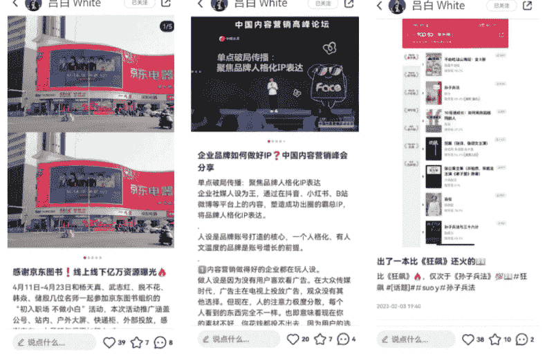

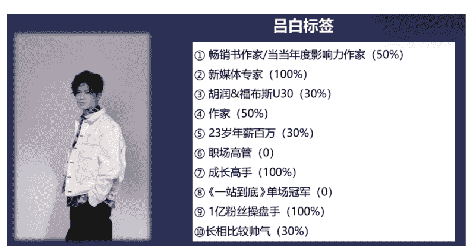

### 流量类内容：100倍引爆账号热度

如果说人设类内容能够呈现你的个人魅力，那么流量类内容则能够直线提升你的账号热度。我之前的一位学员复盘一姐，曾经一篇笔记点赞20万，直接涨粉7万，成交五六个客户，客单价在3000元以上。这其实也说明了一件事情，一个账号80%的粉丝来自20%的爆款。

那小红书的流量类内容都满足哪几个要点呢？我总结为以下五点：选题经过市场多次验证、受众人群广、痛点够痛、利他性、有干货。

第一，选题经过市场多次验证。

很多小白在想该做什么选题和判断一个选题要不要做时，会在第一时间判断自己想不想做，以及想表达自己的哪些想法。但事实上，如果前期想让你的账号快速积累基础粉丝，让流量快速提升，那么首先应该做的是看你的选题是否被市场验证过，是否是多次爆火的内容。我们在做内容的时候一定要养成一种习惯，即不靠自己的主观想法去臆断，而是从数据中不断复盘，找出大众对于这件事情的态度。我一直跟我的团队说一句我的人生格言：“同行摸着石头过河，我们一定要摸着同行过河。”举个例子，“起床后黄金一小时”这个选题，我自己在发布前就搜到很多博主发的爆款笔记了，这么多博主已经用笔记测试出了用户对这件事情的兴趣值，那我在选择题材时就会优先选它，因为明显这篇笔记火的概率要更大一些。

第二，选题受众要够广。

我的一位学员是做文眉工作的，她最开始找爆款选题时，就发现在这个赛道，几千点赞就是大爆款了，她想问如何才能拿到像很多女性成长类博主一样的上万点赞的爆款数据。这样的差距其实就是因为受众人群的基数不同，女性成长的受众是所有女性，而选择文眉的则是女性中的一部分人，基数不同的情况下数据自然有差异。所以，每次有人问我爆款的标准是多少点赞，其实不能一概而论，对于有的赛道来讲，万赞才算大流量，而有的赛道，几百赞就算大流量了，流量类选题的标准是找到你所属赛道下的受众人群广的爆款选题。

第三，痛点够痛。

“起床后黄金一小时”这个选题为什么这么火爆，为什么减肥赛道数据动不动就上万，因为起床困难是很多人面临的一个老大难问题，减肥减不下来也是很多人急切需要解决的问题。当痛点够痛，用户在一开始就更容易被这个话题吸引，如果内容制作得不错，能解决用户的痛点，那么便能得到用户的认可。

第四，利他性。

做内容千万不要陷入自嗨，这是所有内容创作者都要牢记的一点。有一次我去 @闪光少女斯斯 的公司，当时他们团队里有一个女孩叫Keke柒，她性格非常活泼爽朗，表达欲也很旺盛。她问我怎么做出好内容，我当场问了她一个问题，数一下刚才说的话中出现了多少个“我”字，她愣了一下，大概是没想过我会问这样的问题。你们也可以回想一下日常沟通中，话语中有多少个“我”字。大多数时候，我们说话做事的ego（自我）太大了，日常生活中坚持自己固然很好，但是做内容的人如果固守自我，很容易走上“自嗨”之路。佛教“三法印”说，“诸行无常，诸法无我，涅槃寂静”。优秀的内容创作者应该将自己的杂念清空，用用户视角去看自己的内容是否真的为他人创造了价值。所以，一篇内容创作完成后，切换视角去思考也是每一个内容创作者必须学习的一课。这几个问题你可以时刻问自己：我账号的用户画像是什么？他们对这个选题主要想了解什么？同类型的选题别的作者都讲到了什么？我有哪些可以优化的地方？如果我是用户，我对这篇笔记是否满意？

第五，有干货。

小红书平台的用户群体70%是女性，而且普遍爱学习，渴望提升自我。所以，如果你的内容能够提供干货，用户会更愿意点赞收藏。举个例子，如果你是旅游博主，你单纯发旅游风景照不如发旅游攻略，告诉大家去某地需要注意的事项。如果你是插画博主，单纯分享自己的插画作品，不如分享一些月入过万的插画师需要具备的技能等干货内容。总而言之，用户只关心两个点：和“我”相关，对“我”有用。

关于流量类内容的创作方法，我将两位优秀学员的心得分享到这里，全部来自学员的个人真实分享，希望对你有所启发。

学员分享一：@方好好呀

我觉得启发最大的是“爆款是重复的”这句话。其实，因为我自己本身是在电视台，之前也是做内容的，所以我对做内容比较有自己的想法，但是我发现靠自己的创意做出来的内容，可能十条里面只有一条数据比较好，这其实就是一个弯路。我现在觉得更好的方式应该是直接去学习别人的爆款内容。先找到一个你想做的爆款选题，然后去找这个选题下的十条爆款内容，总结这十条内容里的框架和共性，然后就可以用这十条内容，再加上自己的一些经历提炼创作出一个自己的原创爆款了，我觉得这是一个特别省时省力，而且不会出错的方法。

我经常听到学员，包括我身边一些其他做内容的小白的朋友抱怨：哎，我觉得很多人，他们的内容就做得很一般啊，可是为什么他们的数据很好呢？就觉得抖音和小红书这种地方很玄学。其实我觉得根本不是这样的，当我们看到一些觉得很一般，但数据很好的内容，我们应该去分析它，看起来一般，但是数据很好的原因是什么。我觉得这才是值得我们研究的地方。

我还想分享一下我们应该发一些什么样的内容。我觉得小红书一定要遵循利他原则。虽然咱们要求就是要保持一个更新的频率，但是不能说我今天没有什么内容了，所以我就可以当作朋友圈一样，随手发一下。其实我也试过发一些漂亮照片之类的，但这是没有任何意义的，包括什么吃瓜娱乐内容，其实都是没有什么用的。小红书上大家就是本着学习的态度，比如你可以教别人学东西，帮大家避坑，或者分析某个产品的优缺点，总之一定要输出对别人有帮助的东西。小红书上的用户特别喜欢看这类内容。

另外就是要选好自己的赛道，要提前规划好变现的路径，毕竟在一个很好的赛道里，可能几千粉丝就可以赚钱了。比如一位老师有一个学员，他是教写作的，还有一些像心理咨询之类的内容，其实只要你有了一个精准的客户，他就有可能为你付费。但是有一些差的赛道，可能你粉丝很多都变现不了，比如我小红书最早关注的几个美食博主。都是好几年前关注的，他们的粉丝量都是大几十万甚至百八十万，但是他们最近发的内容点赞可能还没有我高，而且几乎都不太更新了，这就说明他们的内容已经跟不上时代的步伐了。这也是我想说的，就是如果我们要做小红书的话，就一定要紧跟时代的步伐，因为流量密码，还有这个平台的玩法，是实时在变化的，不能说我们现在觉得这个方法是管用的，就能一直吃老本，那肯定是不行的，必须始终保持学习状态。要时时研究方法，其实就是对标一些流量大、粉丝多的账号，例如每天跟着实时热点，这就是一个很好的方法。但是重点还是每天都得跟着这些热点走，每天都得研究看看。

学员分享二：@林小白极简手绘

我刚开始发小红书也是一头雾水，什么都不懂。我想找点教程，也找不到，当时没有一本书是专门讲如何做小红书的。我翻了一些国外的书籍，比如《自媒体时代，我们该如何做营销》《异类》《从0到1》。国外的书底层逻辑都讲得非常好，但是比较难懂，看起来也累，操作方法也不适用于我们现在的app，离中国市场还是太远了。

吕白老师的《从零开始做内容：爆款内容的底层逻辑》里面有一章是讲小红书的，我就反复地看那部分，尝试跟着里面的方法去做。每天发小红书笔记对我来说很痛苦，因为我不知道该发什么。我拍了几个自己画画的视频，发出去，只有个位数点赞。我想，不要紧，积少成多。我每天都发，点赞仍然只有个位数，当时我感觉很挫败。

后来我遇到了一位老师，他跟我说，做内容要有直觉。他还跟我说，好看，很重要，封面好看，更重要。“你把‘好看，好看，好看’写成大字，贴在你家里最醒目的地方！”他说。不管那么多，别人毕竟做成了，肯定有他的秘诀在里面。他让我关注200个博主，我就关注了。他让我把“好看”挂在墙上，我没有做，因为我懒。后来我的笔记，一直都做得不够好看，到今天还是不够好看。因为我发现自己要兼顾好看和高信息密度两件事，我忙不过来。所以我选择了先做高信息密度，也就是干货。

我也因此有点后悔，别人都告诉了我“武功秘籍”，虽然字数很少，只有两个字，我却一直没放在心上。我努力培养“直觉”，主要方法就是从早到晚刷小红书，疯狂关注其他人。而且也不只是画画的，情感的、运动的、旅行的，什么领域的都有，特别关注那些我喜欢的或者能打动我的博主。同时开始研究其他人的爆款，做了个Excel表格，整理不同博主的爆款、标题、封面特点、发笔记数量、频率等信息。

但做这件事太枯燥了，因为我就是个文艺女青年。虽然小时候是奥数比赛选手，大学还学了经济，但我真的很讨厌数字。跟表格和数据打交道，一点都不有趣，也不浪漫。所以我在搜集爆款的时候，也耐不住性子，不想搜集了，开始按照自己的想法做起来。这个观念到今天，有了很大的改变，我已经深刻地认识到，数据特别重要，数据也特别能说明问题。老师说，要敬畏数据，很多现实其实是反直觉的。对数据敏感度不够的弱点，也在之后的实践中，啪啪打我的脸。

我做的第一个爆款笔记，有3.3万的点赞，9000多收藏，200多个评论。这是一个2021年1月26日发的图文，“‘粑粑人’表情合集”这个笔记奠定了我自己可以做出爆款的信心，但也让我非常茫然。通过我关注的很多博主，看了各种爆款后，我渐渐有了一些感觉。

小红书用户喜欢信息密度大的内容，封面密密麻麻的很容易火。我看到很多笔记封面是很多个蜡笔小新、樱桃小丸子的脑袋，很火，有几千个点赞。当时我还没做出一个上千点赞的笔记，我的梦想就是能有上千点赞。但是要做密密麻麻的封面，我是画画的，就需要画很久。可不可以用Photoshop（图像处理软件）复制粘贴呢？我心里想，反正用户也是瞟一眼就打开了，他们应该看不出来是复制的还是画的吧？我正在纠结的时候，就看到了有一个人，画了“粑粑人”不同的表情动作。几十个简笔画小人，乱七八糟画在一页课本上，有6000多的点赞。这个笔记给了我灵感，因为我的课程第二课，就是画人物表情。“粑粑人”虽然恶心了一点，毕竟也是有表情的，而且跟我的课程还是有相关度的。如果我画一个升级版的粑粑人呢？会不会火？因为这个画法特别简单，我想应该很快，就马上拿出本子和笔，着手画了起来。我一开始想的是画500个粑粑人，或者1000个粑粑人。结果一打格子，发现本子上根本放不下，纸太大的话，拍照也拍不出来。试验了几次，我发现画150个左右的粑粑人，刚好可以填满一张A4纸大小的素描纸。然后我就开始画，这件事看起来好简单，实际上我连续画了五六个小时，而且因为每一个都很小，所以很费眼睛。画完了，很有成就感，我就赶紧拍照，准备发出去。那个时候，我还没怎么有视频的思维，没拍视频，如果拍摄一个过程，肯定也会很火。写标题的时候，我是参考了那个6000点赞笔记下面的用户评论。在爆款笔记的下面，总是会有很多人留言，特别是高赞留言，会非常精彩。看淘宝、抖音、网易云音乐的留言，是我的一大乐趣，因为高手在民间啊。我看到有一个留言是：“男朋友说饿了，给他分享这个过去！”有很多人给这条评论点赞。

我就用这句做了我的笔记标题，“男朋友说饿了，给他分享粑粑人过去，解解馋”。我迭代了对标笔记的封面，它是随手一拍，黑白的，感觉很不显眼。我精心制作了封面图，还用大红色字体写了标题“300个粑粑人表情包合集”。我把封面截图下来，用Photoshop P到小红书的瀑布流里面，把自己当作一个用户，思考用户是否会点进去看。当时感觉挺好的，挺显眼，就这样吧！

1月21日，我在晚上10点左右发布了笔记。发出去刚1分钟，我就把笔记删除了。因为我担心“粑粑人”有点恶俗，会不会被判违规，这个纯粹是我自己臆想的，没有任何根据。但我真的删除了笔记。隔了一会儿，我想违规就违规，管它的，辛苦做了五六个小时，我不能不发吧！就闭上眼睛，闷头发了！

过了一会儿，能搜索到了，正常发出来了。初始是150多个小眼睛（观看数），五六个点赞。最后这篇笔记的点赞是3975，收藏是1312，评论是10多个。我非常开心，因为在这之前，我从来没做过1000个赞以上的笔记。但实际上，真正的爆款，是我修改后的第二个。过了5天，我又发了一个改版过的笔记。我把封面重新改回了随手一拍的感觉，没有特别做封面，只改动了这一个地方。

当时为什么这么改动，没有理性的原因，就是直觉吧。因为我想到很多画“粑粑人”的，就是画在课本上，摸鱼，打发时间，可能正因为这样，才引起了学生党的共鸣。而我煞有介事地做一个封面，其实大大削弱了共鸣感，恐怕会适得其反。因为这个直觉，我改动了一下，又重新发了一次。这个笔记火了，第一轮流量150多个小眼睛，就有20多个赞。晚上手机就开始不停地响了起来，不断有新的粉丝。那天我没睡着，半夜3点还起来看了数据，特别激动。我终于做出爆款了！到现在，这个笔记有3.3万的点赞，9249个收藏，100多个评论，为我涨粉了1万多人，虽然这些粉丝一个都没买课。因为我后来看了一下数据，粉丝年龄都在18岁以下。给“粑粑人”点赞的可能都是小学生！我辛辛苦苦做的引流笔记，引来的不是自己的目标客户。但之前我从来没做过爆款，通过做这个“误打误撞”的笔记，我培养了做爆款的能力，培养了自信。也有了一个教训，如果无法转化，爆款笔记也没有用。于是后面我再继续做笔记，就没有再盲目地追求爆款了，而是要吸引我真正想吸引的人。同时，我也在暗暗积累经验，期待有一天能再次做出既引流又吸粉又能转化的大爆款。终于，后面我做到了，陆续做出了几篇1万多点赞的精准引流爆款。其中11月4日的一个画画视频笔记，有23万观看，2.6万赞藏，200多评论，直接涨粉4万。

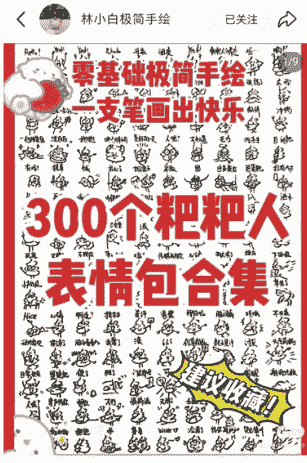

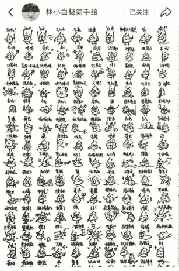

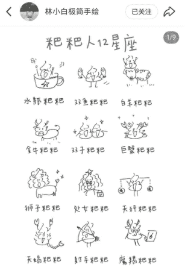

粑粑人表情包合集/零基础学画画干货
【以下是严肃粑粑人画法简介】
一看到粑粑人，感觉特适合作为学画画素

男盆友说饿了，给他分享粑粑人过去，解解馋
你们要的清晰版本粑粑人合集，欢迎临摹

粑粑人12星座简笔画详细画法教程（上）
你觉得

说点什么... ❤️ 4438 ⭐ 1490 💬 35

说点什么... ❤️ 3.6万 ⭐ 1万 💬 205

说点什么... ❤️ 8754 ⭐ 2509 💬 122

### 案例类内容：小红书内容掘金密码

问你一个问题：如果做账号不变现，你觉得你能坚持多久？为爱发电这种事情能坚持的太少了。所以，做账号前期一定要想好自己到底要如何变现。是靠广告变现，还是知识付费变现？是靠线下获客，还是直播带货？关于具体每一项的介绍，在我的《爆款小红书：从零到百万粉丝的玩赚策略》里都有介绍，感兴趣的读者可以去看看。

案例类内容要清楚的几个点：你的用户是谁？你的产品是什么？你的用户对你的产品需求点有哪些？你的转化链路到底有哪些？其实每一次制作案例类内容都是对你账号商业模式的一次思考。我这里通过两个学员的案例来加深大家对案例类内容的理解。

#### 案例一： @索菲亚又富又美

索菲亚在2022年的时候参加了我们第七期训练营，来之前她是做医美赛道的，由于平台政策，做了一段时间后被封了。到了训练营后最开始她想做珠宝赛道，原因是看到别人做珠宝赚钱了，心里痒痒，但是具体了解之后，我知道她一是没有珠宝从业经验，对珠宝的业务完全不了解，二是也没有相关的合伙人能帮她操持业务，所以我们不太建议她去做。我做小红书相关业务这么长时间，经常遇到有人一上来就跟我说“老师，有没有什么赚钱的赛道，我就想直接赚钱”，要不就是“我看某某某赚钱了，我也想做和他一样的事情”。大家对赚钱这件事的渴望我能理解，但是说实话，一上来不考虑个人实际情况盲目给建议对每个人都不负责，所以我能够给到的解决方案的前提是这个方案可以被执行。

后来，索菲亚又讲到自己在面部保养、身材维持方面比较有经验。她自己虽然已经40岁，是两个孩子的妈妈，但是外形上保养得一直比较好，所以她选择定位在“女性全方位保养”这个她熟悉的领域做内容。有了正确的方法，她自己也比较认真努力，第一个账号很快突破了1000粉丝，后来账号有的内容涉及“打针”等问题，所以第一个账号没过多久被限流了，紧接着她又开始做第二个账号，就有了现在大家能看到的11万粉丝的小红书账号。

做账号的过程就是这样，对你的时间、精力、心态其实都是考验，我也从不跟任何人吹嘘做自媒体有多么简单，但是如果选择要做这件事情，想挣这个钱，评估好投入度和心力在自己可承受范围之内就努力往前走吧。

第二个账号她真正爆火的内容就是“眼部按摩”“面部抗衰”等护肤内容，这也让她的账号有了起色，后来差不多做了一个月就开始接广告变现了，到后期有一个月更新了14条视频，实现了月入10万的目标。

这里我们重点说一下她的变现内容，即在小红书上做广告案例类内容的正解，两个要点：以干货内容切入，合适时机做营销种草。索菲亚所有的变现内容都不是上来直接介绍产品，而是会将干货融入其中，以下面这篇笔记为例，她先讲淡化法令纹的干货知识把粉丝留住，再引入产品种草，种草的时候详细讲解产品用法和效果，最后讲解面部瑜伽缓解法令纹干货内容，整体就是用讲干货的方式去种草产品。利用广告变现的创作者需要注意的是你的账号广告内容要适度，因为广告主会根据你的粉丝基数、粉丝黏性等选择是否与你合作以及报价。所以，做好粉丝关系维护对于你们也是非常重要的。

#### 案例二：@鹏哥装修避坑

鹏哥在训练营期间就做出了2000多赞的爆款图文笔记，后来做视频，现在做得也很不错，听说已经变现几十万元了。他的内容是从装修避坑这个痛点切入的，在小红书教大家有哪些注意事项。他的变现产品有两种，一种是线上装修知识陪跑，另一种就是线下定制装修。用户通过看他的避坑短视频了解到他的专业性，从而找他下单解决个人装修难题。这样的账号实现了内容即产品、产品即营销、营销即变现的闭环。所以，这里大家要明白一点：干货类内容不等于变现，围绕产品输出的干货内容才等于变现。举个例子，很多女性成长类博主讲干货内容，比如“一个见过世面的女生是什么样的”“吸引力法则”等，这些都是干货类内容，但是如果她们的产品和这些不挂钩，那么这些内容只有流量，但无法变现。但如果一个博主讲婚姻类的流量话题，他的产品是经营关系的课程或者用品，那么他的内容就是在为他的变现输送流量。

总而言之，人设类内容建立信任，流量类内容实现转粉，案例类内容完成转化。

这时账号就要考虑到内容配比的问题了，就是一个账号一周的更新中有多少是流量类内容，多少是人设类内容，多少是案例类内容。这其实可以根据不同阶段进行不同安排。一般来讲，账号起号阶段流量类内容（干货类内容）比重要高一点，可以在50%以上，人设类30%，案例类20%。等到账号达到1万粉丝以后，流量类内容50%，案例类提升至30%，人设类占20%，后续账号平稳阶段，案例类内容的比重逐渐增加。对于有的账号，一篇优质内容可以实现三种效果，这种的配比就无所谓了。

最后，我想在这一章的最后讲一个我在课程里面反复提到过的词：飞轮效应。我做新媒体已有近十年的时间，很多人问我为什么坚持了这么长时间，或者对比当时和我一样做内容的人，我为什么还能在这个圈里排得上号。我一直觉得“飞轮效应”这个词是带给我很多思考的，这个词的意思指的是为了使静止的飞轮转动起来，起初你必须用尽全力，一圈一圈反复地施加力量，每转一圈都很费力，但久而久之，当飞轮上的力超过临界点，飞轮便会转动得越来越快。我的新媒体生涯便是如此，一开始做公众号疯狂被“毙稿”，那个时候我觉得好难好难，做一篇爆款感觉要了我半条命，后来我在拆了几千条爆款，最终做出第一条爆款的时候，我明显感觉到我找到了自己的那个“临界点”，后来相继做出了多条点赞10万以上的爆款。我想说的是其实做小红书内容同样存在飞轮效应，前期你可能需要花很大的力气，要产出很多内容才能将你的账号的流量推上去，推平稳，那也是最难熬的阶段，可是当你逐渐找到节奏后，很多事情就会变得不那么辛苦了。

下面是我的学员 @心理师西西 的一段分享，目前她有近7万的粉丝，希望这段话也能给你力量：

因为吕白老师曾经讲过一个飞轮效应，说你的力气要大到足以把一个轮子推动起来，后面它才会自己滚起来。如果你每次都只是使一点劲的话，那就不知道什么时候才能把轮子推动到可以滚动的那一个点上了。也有人说这个点叫复利拐点，就是你必须到这个点之后才能实现复利的增长。而大多数人还没到这个点就放弃了。所以我觉得应该把精力放在前期，尽可能地在前期高产，拼命到达拐点之后，后期再日更一条就好了，让飞轮快速转起来。

所以前期找准一个方向持续发十多条进行测试，去找到你这个方向的临界点是很关键的一步，一个策略需要跑一段时间才能评定是否有效，千万别因为发一篇笔记的数据不好就直接不干了，这种做法在自媒体从业者中极为致命。同时这一段话也是给有些丧气的朋友一些力量，你不是唯一一个遇到困难的人，关键是你能不能成为破局的那一个。

## 第三章 爆款规律：小红书文案这么写才会爆

提升文案功底，核心就三个字：拆爆款。

做了这么长时间的小红书培训相关业务，学员没有几千也有几百了，我发现大家普遍存在的问题就是不知道该怎么写小红书文案。根据我十多年的内容从业经验，如果你想提升自己的文案功底，核心就是三个字：拆爆款。当然很多人听到这句话还是会有很多问题，比如不知道怎么拆，拆完别人的爆款后自己还是无从下手。其实，所有爆款文案都可以拆成三个部分——开头、主体和结尾，我们要做的就是以点带面，分别去拆解它的开头是如何吸引人的，正文是如何陈述观点，有哪些方法可以学习，结尾又是如何升华和与用户互动的。在拆解的过程中一定不要单纯地陷入内容中去，而是带着思考去拆解。当你拆的爆款足够多的时候，一定要做一件事，就是复盘总结，按照复盘的方法论去撰写你的小红书笔记，这是拆解爆款文案的流程。

接下来我将分享我们复盘总结的9种开头、2大主体和5大结尾模板，帮助大家用最少的时间写出爆款小红书文案。

### 技巧篇：9种开头+2大主体+5种结尾模板，打造万赞爆款

好的开头是成功的一半，在这个内容纷繁复杂、信息过剩、注意力稀缺的今天，如何在无限的信息中抓取到有限的注意力，并且吸引用户看下去是每一个内容创作者都要思考的问题。

这里我先问大家一个问题，你觉得什么开头方法是一定要规避的？你可以花几分钟时间思考一下。我说一种很多小白惯用的开头方法：一上来自我介绍，“哈喽，大家好，我是某某某，今天我想跟大家说一下……”这样的开头其实不能说不行，只是在账号没有粉丝基础的前期，对于小白来讲，这种介绍太不抓人，用户在看到的前几秒钟就可能会划走。所以，在前期阶段，学一些方法、技巧更有助于获取正反馈。

#### 吸睛开头模板一：呈现结果型

**案例开头**

一个女娃娃突然开窍的表现是什么？自然就是事业爱情双丰收，天天浑身充满着能量，快乐得要命。而且你会发现你想得到什么就得到了什么，机会就会找上门。美女天使珍挖掘了一下自己开窍的四个阶段，快来看看你们处在哪个阶段！

> ——活力少女阿珍

在开头直接呈现自己做到某件事情的结果，通过晒成果的方式激发起用户的好奇心，吸引读者继续往下寻找问题的答案，这是一种非常常见的短视频文案开头。试想一下，如果你打开一篇笔记，开头就是：这三个动作，让我从一年前180斤的胖女孩变成了现在众人眼中的瘦子，全身上下只有100斤。你会不会很好奇到底是哪三个动作，她说的是真的还是假的？如果你正巧有减肥的需求，你会不会花时间看完这篇笔记？我相信大多数人的选择都是会，这就是直接呈现结果的好处，产生跟随的冲动。

现在请按照这个模板去写出你的第一篇小红书文案开头：

#### 吸睛开头模板二：罗列痛点型

**案例开头**

工作一分钟，玩手机一小时，晚上熬着不睡，早上拖着不起，完美主义者害怕失败，迟迟不敢去做。如果你有以上的拖延症状，那你一定要把这条视频看完，30天改变一生系列的第12篇给大家讲4个终结拖延的方法。

> ——舒同姐姐

罗列痛点型模板的好处就是让人产生对号入座的感觉，并且在想解决问题的心理状态下继续看下去。如果给这种文案总结一个公式，那就是：痛点开头=揭露用户的“痛”+给出解决方案+解决效果。其实，不光是文案，很多经典的广告语也用了类似的“套路”，比如“怕上火，喝王老吉”。前半句直接戳中消费者吃火锅担心上火的痛点，用户很容易产生共鸣，后半句随即给出解决方案——喝王老吉，再比如“爱干净，住汉庭”，前半句戳中用户住酒店时对于酒店卫生的担忧，后半句也直接给出了解决方案——住汉庭，同时也对产品销售也起到了很好的带动作用。

如果要做罗列痛点型的开头，到底要如何挖掘粉丝痛点呢？其实最关键的就是换位思考，真正站在用户的视角去关心用户的生活场景，站在用户的视角去想这个选题中他们的主要痛点在哪里。复盘一姐的20万点赞笔记《起床后黄金一小时》开头，就是典型的罗列痛点型开头。

起床后就打开手机的朋友们，看到这条视频，说明上天在提醒你要开始改变了。

——对号入座，这种“对号”可以是某种坏习惯、症状，也可以是人们的某种渴望。比如：想挣钱变美的朋友们，习惯性内耗的朋友们。

你以为你只是正常看一下新闻，其实你消耗掉的是你一天当中最宝贵的时间。

——讲痛点，这句话其实是表明了一个点，就是看似不经意的一个习惯造成了很大的后果。比如，你以为你只是比较追求完美，殊不知正是这种心理暗示让你迟迟不去开始行动，错过了很多机会。

正因为利用好了起床后的一个小时，我在大学期间不仅保证了我的学业第一，还把我的学生会工作做得引来了省教育电视台专题报道，各种演讲、唱歌、英文大赛都是第一，毕业设计专业第一，同时还有两年的计算工龄的正式工作。28岁我就开始创业，走过36国。挣到1000万，然后结婚，继续深造。

——给出解决方法并呈现效果。

这个内容的开头就是对号入座+痛点阐述+解决方案+呈现效果的结构，如果你是一个旅游攻略分享类博主，按照这个模板，你可以这样阐述：所有国庆节打算来北京旅游的朋友们，刷到这条视频，就是上天在提醒你这个假期有很多可以玩的东西。旅游前密密麻麻地做足了功课，看够了攻略，但脑子还是一团糊涂，不是你不用心，是你不懂怎么做攻略。正因为用了这套做攻略的方法，我出去旅游都跟到自己城市一样，热门熟路，同行的朋友都说跟着我准没错。

下面，请你按照这个模板，写一个你所属赛道的罗列痛点型开头文案：

#### 吸睛开头模板三：引起恐慌型

**案例开头**

90%的人都有过这些对爱的错误认识，而如果不改变过来呢，我们的爱情就会很难成功。今天就跟大家分享最常见的5个错误的爱情观，你中了几点？

——钱庄钱笑笑

著名产品人梁宁曾经讲过：一个人的底层操作系统是情绪，主要包括愉悦、痛苦、恐惧。当你善于抓住用户的情绪时，也就收获了用户的注意力。恐惧心理作为三大情绪之一，主要来源是害怕失去以及对未知的不确定性，如果找到了精准拿捏的方法，一篇优质内容也就唾手可得了。

英文难，放弃英文，28岁出现一个很棒但要会英文的工作，你只好说“我不会”。人生前期越嫌麻烦，越懒得学，后来就越可能错过让你动心的人和事，错过新风景。

利用人们害怕失去机会的恐惧心理，刺激人们产生学习英语的行为。

接下来我们讲讲到底要如何写出引起恐慌的开头。很多人觉得引起恐慌只要够吓人，制造失去感就可以，其实并不尽然，一篇文案不能光有恐慌，那样会让人产生强烈的不适感，更重要的是要提供战胜恐慌的可行性建议。在《认知操纵》一书中，作者普拉卡尼斯和阿伦森提出，满足以下四点时，恐惧诱导法最有效：①足够吓人；②能提供具体战胜威胁的建议；③使消费者相信提供的建议能降低威胁；④用户执行建议时很方便。

以下面这个小红书文案开头为例：

> 晚上不睡，早上不起，一天只想玩手机，一边为浪费时间而焦虑，一边继续玩手机，下定决心第二天不再摆烂，结果又陷入前一天的循环，你记性越来越差，做事越来越慢，注意力无法集中，表达能力退化，没干啥就觉得好累，对整个人生失去掌控感。这就是长期摆烂的后果，一旦持续下去，你的人生真的会完蛋。看到这，别害怕，这条视频就是来拯救你的，以下方法曾帮助我走出摆烂困境，快速恢复学习力和执行力，强烈建议点赞收藏，长期摆烂后拿出来看一看。

——三多同学

开头直击痛点，指出很多摆烂人的长期生活状态，让用户对号入座，这个时候说出“记性越来越差，做事越来越慢，注意力无法集中，表达能力退化，没干啥就觉得好累，对整个人生失去掌控感”，点出的是摆烂的后果，也就是引起用户恐慌，让其对长期摆烂这种行为产生焦虑，这个时候作者又写出有方法可以解决这个问题，并且自己曾经用这个方法做到过，让用户知道这些方法是可复制可执行的。这就是一个指出痛点+引起恐慌型的开头，具体模板：罗列痛点问题+不改变痛点问题所产生的巨大不良后果+致以改变现状的具体方法。

“你不理财，财不理你。”利用的其实是人们怕穷的恐惧心理，刺激人们产生理财的动力。

以教人理财为例，你可以这样写：

一到月底就月光，努力工作大半年，口袋里还是只有几个钢镚，同事的薪水明明和你一样，可是每次你都是月光，人家却还能攒下一大笔，看着别人的小金库越来越满，自己却还是啥都没有，你难道一点都不焦虑吗？再这样无计划消费，你和同龄人的差距将越来越大，不过先别慌，以下几个方法可以帮你建立良好的消费观，掌握储蓄的正确方法，手里有余粮心里才不慌。我就曾经靠着这几个方法从月光变成现在存款六位数，赶紧学起来吧。

下面，请你按照这个模板，写一个你所属赛道的引起恐慌型开头文案：

#### 吸睛开头模板四：提问型

**案例开头**

> 怎么能够让这个世界上90%的普通人安于现状，乖乖地为那10%的富豪服务？很简单，给他们加上一个奶嘴就好了。

——傻白呀

先问大家一个问题，1+2+3+4+5+6不停地加上去，加到无穷的总和是多少，不是无穷大哟，而是-1/12。但我今天不推理这个过程哈，我举这个例子，只是希望大家先抛下惯性思维，先忘记你人生前几十年所学到的所有东西。用最简单的思维去听一些相对难以理解的东西。

> ——花大钱

这就是典型的提问型开头，模板就是“提问+回答问题”，通过这个开头来引出自己想讲的话题，还有一种就是“提问+讲故事”的模板。比如“问大家一个问题，老老实实回答，你觉得男女之间有纯友谊吗？前几天聚会跟朋友聊天……”就属于第二种提问模板。当然，具体要怎么开头，以什么方式开头，还是要根据用户对于该选题关心的角度去讲，要还是不会，可以先从你的评论区选择大家感兴趣的话题开始。

下面，请你按照这个模板，写一个你所属赛道的提问型开头文案：

#### 吸睛开头模板五：讲故事型

前面我们在讲人设故事那一章节的时候，就说到了故事的价值所在，一个好的故事远胜过讲一百句道理。对于小红书文案，以故事开头也更容易让用户感兴趣，有更强的代入感。

我们来看下面这篇文案的开头：

我刚刚和一个专门给世界500强企业做招聘的HR总监吃饭，吃饭的时候啊，他突然感慨万千，问了一个特别扎心的问题，那就是为什么穷人家的孩子就算是天赋良好、外貌良好、资源良好，也经常能在生活和职场中被人一眼认出来，难道说这就是那个玄而又玄的气质吗？因为我回来得有点晚了，所以我也不浪费时间，边卸妆边跟大家聊一下这个事情。我一般卸妆啊，就是简单地用一个卸妆油，其实我也是一个出身很普通的孩子，所以这个问题啊，在我年轻的时候，我其实就有过非常深刻的思考，并且也有过刻意的练习，还有加以改正，所以我今天呢，就想要告诉你，作为像我们这样普通人家的孩子，如果说我们想要走得更远，更加成功，我们和那些所谓的有钱人家的孩子，到底这个差距是在哪里？

> ——大花和小鹿

这个文案其实就是讲故事型的开头，整个内容想聊的主题就是“普通小孩和有钱人家小孩的差距在哪里”，这篇脚本没有选择直接提问的形式，如果直接提问这个问题可能会显得博主说教感太强，导致效果大打折扣。而讲故事这种形式的好处就在于让用户作为故事的旁观者参与到聊天这个场域中，这个时候也能把聊到的一些尖锐的问题的锋利感消解，让用户对一些过界问题也不感觉到被冒犯，拉近了博主和用户的心理距离。而且在这篇笔记的开头说的是跟专门给500强企业做招聘的HR总监聊到这个事情，有时间地点人物的细节描写，将讲故事的真实感拉满，回想一下，这是我们之前章节的哪个知识点？

经典的小红书故事开头就是：前几天有个什么样的事情或者跟朋友的聊天中我们探讨了什么样的话题，抑或是最近身边有什么样的情况让我想到了什么。切记，一定要跟你想表达的主题以及你的账号定位相关的。

下面，请你按照这个模板，写一个你所属赛道的故事型开头文案：

#### 吸睛开头模板六：场景呈现型

**案例开头**

入住新家半年了，我妈来我家都忍不住夸，怎么每次都这么干净，是不是特意收拾了一番啊！

场景呈现型的文案就是切入用户相关的某个特定的场合、某些特定的情景，从而让用户回忆起自己在这些场景下的感受，进而切入用户的心智。自媒体人“六神磊磊”曾经给拼多多写过一条年货节文案，其中有段关于iPad的，就是场景呈现型的好例子：

过年的时候，家里放个iPad，关键时候真的可以救场。万一家里来了爱胡闹的小孩，一进门就满屋乱窜，你既要招待大人，还要分心顾及物品不被摔坏，头是不是立马痛起来了？这时，只需要递给他一个联网的iPad，就能让他在你的可视范围内安静地待到离开。

这个案例是通过场景呈现让用户脑中产生画面感，从而对iPad产生需求，达到文案的转化效果。小红书文案开头同样可以用到这种方法，场景可以是用户吃饭场景、居家场景、社交场景、办公室场景、出行场景等。举个例子，现在要推荐一款扫地机器人，你是不是可以将用户的居家场景作为开头？看下面这个开头，通过描述有了扫地机器人后的美好场景让人产生代入感，另外其实也可以通过描写没有扫地机器人时打扫家务的辛苦画面来让用户产生需求。

想象一下，你刚下班回家，地面干净得一尘不染，光脚就能直接走动，猫猫在地上自在打滚，猫毛、灰尘通通消失不见，不用怀疑有什么魔法，是因为我家有这台全能升级的石头G20扫拖机器人。

> ——Lena爱生活

所以，场景呈现型的开头有两个基础模板：描述拥有某种产品或者技能的美好画面，或是描述没有某种产品或者某项技能的糟糕画面来让用户产生需求。

下面，请你按照这个方法，写一个你所属赛道的场景呈现型开头文案：

#### 吸睛开头模板七：反常识型

**案例开头**

给你们说个内幕啊，那些你以为很强的人其实都很水的，你看到的那些世界500强里的高管，机关单位里的领导或者学校里的老师，大多数都是草台班子，凑合着过日子而已，外面看上去像个豪华大奔驰，其实里面就是几个人蹬着自行车套着个壳子在走……

> ——马仔睿总

这个开头观点“那些你以为很强的人其实都很水”就属于反常识类型，大众觉得看起来很强的人都能力卓越、认知超群，但是“很水”这个词打破了大家的固有认知，让大家产生了一种探索下去的欲望。举个例子，有段时间小红书上有类选题很火，叫作“戒掉骨子里的自卑感”“自信的女生有多美”，当所有人都在讲自信有多好、自卑有多难受，这个时候“彤姐很忙”这个账号出了一篇笔记《昂首挺胸地自卑吧》，开头直接就是：

发表一个一定会被喷的观点，我不想再看到任何一个名为“自信的女生有多美”的内容了，我不知道自信会美吗，我不想美吗，我不愿意自信吗，我不去北大清华是因为我不想去吗？多少人就是彻头彻尾的自卑，我看了你这么自信我能感觉到被激励吗？

把视角从“自信的女生有多美”这个观点脱离，当人们看到这篇笔记的时候会直接感觉有亮点，会觉得别有新意。其实，我在《从零开始做内容：爆款内容的底层逻辑》那本书里面就说过，内容主要包括两种，知识和观点，前者是有确定答案的，比如1+1=2，但是观点是不具备唯一性的，只要你能够围绕你讲的主题，逻辑闭环自圆其说即可。当你要分享知识干货的时候，你能不能去调转方向找到新的切入点，而这个点是能够作为你的内容开头吸引眼球的。

下面，请你按照这个方法，写一个你所属赛道的反常识型开头文案：

#### 吸睛开头模板八：制造冲突型

**案例开头**

> 我举报了我的闺蜜，是她告诉我考研时间到了她还在写，凭什么她什么都有，我就是不想让她真的考上。
——饼饼阿堇

看到上面的第一句话，你的第一感受是什么？是不是产生了极大的好奇？这种好奇来自什么，便是一种冲突，“举报”和“闺蜜”这两个词的直观冲突。在大多数人的认知里面，举报代表着一种关系的撕裂，但闺蜜代表着关系的亲近，当这两个元素同时出现在一句话中，冲突便形成了，用户也被瞬间吊足了胃口，也就是所谓的“冲突越大，话题越大”。

关于冲突感要如何制造，可以用“硬组合”的方式去做。硬组合就是把两个不相关的领域甚至同一领域相反的词硬生生组合在一起，还能解释清楚，而冲突型硬组合就是把两个大众认知中无法共存的内容放在一句话中，比如“我和我恨的人结婚了”“我的朋友背叛了我”等，这些都是冲突型的组合。

下面，请你按照这个方法，写一个你所属赛道的制造冲突型开头文案：

#### 吸睛开头模板九：直入正题型

**案例开头**

> 21个极简高情商社交潜规则，能让你在为人处世方面少走5年的弯路，在深圳少摸爬滚打这么多年啊！
——周Rich

这个开头就是典型的直入正题，不提问，不做场景呈现，这种开头的好处是让用户快速知道你的笔记主题是什么，知道看你的笔记能够获得什么价值，有效找到对这类话题感兴趣的人群。常用模板就是：主题+这件事情能够给你带来的价值+互动。比如： 给大家介绍国内年入100万元的10个插画师，认真听完总有收获，看看有没有你喜欢的风格。这种开头类型算是比较简单的。

下面，请你按照这个模板，写一个你所属赛道的直入正题型开头文案：

当我们把9种吸睛开头都讲完的时候，相信你也已经跟着我们前面的内容创作出了多条属于你的小红书开头文案，现在我们正式进入正文内容，开始主体创作。

#### 主体创作模板一：列点式

都归咎于对方，那这个人就不是一个体面人。像我老公，他前女友就是为了追求前途抛弃他出国了。然后我还一直在说他前任的坏话，但是我每次说的时候，他都会非常严肃地指责我，说你并不了解她，你不要这样去评价她。我当时还很生气，但我现在觉得他是对的，因为一个愿意体面地去祝福前任的人，也一定会护你安好。第二，就是看这个人言行不一致。要远离那种天天给你画饼，但从来不给你买饼的人。有的人整天炫耀自己多牛，一年能挣多少钱，回头情人节就给你买个200块钱的礼物；整天说要带你去这里去那里，整天承诺给你这个买那个，要给你开店，要给你开公司，但说了都不做。有了两次就可以拜拜了。不然时间久了，你就会一直期待那些原本就不存在的东西，而平白消耗了自己美好的青春。

> ——团圆妈妈

列点式这种模板在小红书文案中非常常见，就是围绕选题进行分点撰写。以上述文案主体为例，围绕“如何判断男人是否靠谱”这个选题，博主从两个要点去阐述，这样条理清晰，逻辑清楚，用户看的时候脑子里也比较清楚。

现在，请你以列点式的形式去撰写你某一篇选题的主体内容：

#### 主体创作模板二：递进式

递进式的主体内容适合于每一点和后面的点有逻辑承接关系的，将内容层层递进地展现在读者或者观众面前，常见的模板如下：是什么+为什么+怎么样，案例+原因+解决方案，第一步+第二步+第三步，等等。递进式和列点式的最大区别在于列点式的点与点更多是平行关系，侧重阐述要素部分，而递进式有侧重，内容有先后。下面就是一个典型的递进式主体结构。

第一步，框架为王。拿到这样一张密密麻麻的内容，你要做的不是立马开始读或者是记忆，而是写。怎么写呢？一定是列思维导图。比如这位同学要背的这2000多字，可以形成这样的一张思维导图，这张思维导图涵盖了那2000多字的要点。可能有同学会问，那有些细节没有列在上面，考试考到了怎么办呢？如果你有这个思维方式，你一定要改改。一方面，如果你第一遍就逐字记忆，真的会把自己逼疯的，另一方面呢，画思维导图就像是盖房子，打地基，加钢筋，细节就像最后灌水泥，这个顺序一定不要颠倒。然后是第二步，图像记忆，像这幅思维导图，左边两个分支，右边四个大小，客观、主观、内部、外部，这个太容易记住了吧。然后再把后面的干条条记一下，不超过五分钟就能记住。下面第三步，用你自己的话把思维导图说出来，比如行政伦理中的客观责任，包括对上下级负责，对法律、公共政策负责，对公民负责。说出来的过程呢，比你闭着眼睛背实践有用得多。记住，此时你依然不需要去填充细节，等你把这幅图完全熟悉之后，先带回到教材中，先用自己的话把细节加进干条条里，相信我，这个时候啊，你能想起来80%的细节。

> ——魔都妈妈黛西

像上面这个内容就是讲述了费曼学习法的操作步骤：第一步，先把需要背诵的内容框架用思维导图直观呈现出来；第二步，在第一步的基础上用图像记忆的方法把思维导图的左右分支记忆下来；第三步，在前两步完成的基础上用自己的话表述出来。每一步都有前面的内容做基础。

现在，请你以递进式的形式去撰写你某一篇选题的主体内容：

小红书常见的主体撰写内容主要就是这两类，掌握了这两种方法，90%的选题你都能够轻松应对。

最后，就剩下我们的结尾部分了。诺贝尔经济学奖得主丹尼尔·卡尼曼教授曾经提过一个定律，叫作峰终定律。峰终定律认为人们经历一件事后，“峰”（事件的高潮）和“终”（事件的结束）时的体验会给大脑留下深刻印象，而其他的细节往往会被遗忘。小红书文案同样如此，一个好的结尾能够拉升内容的互动率，推动笔记的曝光。小红书的文案结尾一般有这么几类：金句升华、美好祝福、互动提问、总结回顾、号召行动。

#### 结尾模板一：金句升华

上学的时候，语文考试之前我最常做的一件事情不是背范文，而是背名人名言。写作文时，不管怎样，都要把我背的名人名言放进去，毕竟有了金句总感觉整篇作文都大放异彩了。后来，我成为一名内容从业者，创作成了家常便饭，我跟金句的缘分也越来越深了。一个好的金句能够升华整篇文章，起到锦上添花的作用，比起普通的话术，金句更能引起人们共鸣。很多时候，我们看完一篇文章、一本书、一个短视频，一段时间后可能都忘记讲了什么具体内容，却一直记得其中的金句，这就是金句的魅力。小红书文案金句结尾的也有很多，关于金句怎么写，一方面大家可以日常做一些积累，比如专门准备一个金句本，每次遇上不错的都可以直接补充在里面。一些有金句的网站也可以收藏起来，比如句子控、句子迷，需要的时候拿出来选择合适的加进去。

现在，为你的一篇文案加一个金句来结尾吧：

#### 结尾模板二：美好祝福

美好祝福式结尾和我们前面讲人设故事那部分的寄语型结尾有点类似，就是在内容的结尾给他人一些美好的祝福或者正能量语录。我们可以看下面这个案例，这是典型的金句+祝福式结尾。

> 最后，我想说一句很私人的话，我非常欣赏在爱情中主动也好，打直球也好啊，这样的女生，我觉得这是一种敢于主动把握自己命运的表现。就像古诗里面说的“愿我如星君如月，夜夜流光相皎洁”（金句），我总觉得这样落落大方地去承认自己的感情是一种非常珍贵的品质，真诚、直接就是你最真实的样子。如果有一天你遇到一个男生，他在你打篮球的时候肯定了你的行为，并且双向奔赴地把这个球重新打回来给你，你就可以很放心，他一定欣赏和喜欢最真实的你。所以对我们每个人来说都是如此啊。我们只有用自己最真实的样子去约会和遇见他人，才有可能最终收获一个喜欢和欣赏我们真实自我的真爱。
——钱庄钱笑笑

现在，为你的一篇文案加一个祝福式结尾吧：

#### 结尾模板三：互动提问

互动提问结尾就是在内容要结束的时候，采用和用户互动的方式来拉数据、引评论。比如经常听到的一些互动内容，“看到这的小伙伴们在弹幕上扣个1”“关注点赞哟”“博主吐血整理，建议收藏一下，给博主鼓励继续分享其他内容”“大家喜欢我推荐的物品吗？喜欢别忘记点赞加收藏哟”“大家还想了解什么……可以在评论区打出来，后续我会选择一部分来回答大家的问题”等，这些都是互动提问式结尾。有些时候用户很喜欢你的内容，但是会忘记点赞，所以我们需要去提醒他。

现在，为你的一篇文案加一个互动提问式结尾吧：

#### 结尾模板四：总结回顾

总结回顾式的结尾就是将前面讲到的要点在结束的时候做概述。在小红书视频中比较好用的一种方式是以表格或者思维导图做回顾，这样一方面把大家的注意力拉回到主题，对整个主题有一个全局的了解，另外一方面，这种表格类或者思维导图类的结尾能够让用户感觉有收获，有一种截图保存下来的冲动，会提升笔记的收藏数据。

| 时间 | 重要事项 | 细节点 |
| :--- | :--- | :--- |
| 第一天 | 熟悉平台规则和后续用到的相关软件 | 1. 熟悉规则方法：①关注小红书官方账号，比如薯队长、薯条小助手、薯管家等等；②点击我—左上角三道杠选择创作中心，查看创作学院，了解平台更多运营方法；③关注千瓜公众号。<br>2. 熟悉相关软件：创可贴、堆糖、黄油相机、美图秀秀、稿定设计、剪映、快题词、轻抖。 |
| 第二天 | 确定账号定位 | 1. 已有定位：有自己的产品、技能和线下店的，定位清晰明了。<br>2. 三句话定位法：你喜欢什么？擅长什么？你被别人夸过什么？你在什么事情上花时间花钱最多？ |
| 第三天 | 寻找自己的对标账号 | 1. 在搜索框里搜索关键词，找到爆款笔记后，关注20个1万至10万粉丝的博主。<br>2. 低粉多爆款的账号对于新手小白更有参考价值。 |
| 第四天 | 确定选题，搭建爆款选题库 | 把对标账号中数据不错的选题筛选出来搭建选题库。赛道比较广的，1000个赞以上算爆款，比如美妆、穿搭、减肥、成长；赛道比较细分的，100个赞以上算是爆款，比如文眉、汗蒸等。 |
| 第五天 | 创作自己的第一篇笔记 | 拆解爆款文案结构并且套用。 |
| 第六天 | 拍摄剪辑 | 布置好灯光、场景，支好三脚架，按照文案进行拍摄和剪辑，并且发布。 |
| 第七天 | 账号复盘 | 笔记点击率、完播率、观看来源、粉丝分析。 |

现在，为你的一篇文案用思维导图或表格的形式做一个结尾吧：

#### 结尾模板五：号召行动

号召行动的结尾就是呼吁用户跟练或做出行动，一般用于教程类的笔记。比如我会在小红书上教大家一些做新媒体的方法，结尾的时候我会讲“完成比完美更重要，赶紧行动起来做出属于你的第一篇小红书笔记”，这种就是呼吁大家行动的结尾，不管是图文还是视频，都很适合。

现在，为你的一篇文案写一个号召行动式的结尾吧：

读到这里，你已经掌握了小红书内容文案的撰写方法和技巧，可以开始创作你的第一篇小红书笔记了。

最后，我想说一个我这么多年的真实感受，所有上面的小红书文案和写作技巧在我看来都是“术”，只要你善于总结学习，都是很容易学会的，真正稀缺的是基于你自身经历产生的思考，你对人性的把控以及和别人分享自己知识或者生活时的热情。我见过有学员完全没有学过文案技巧，也没有准备稿子，直接口播做到第一篇笔记数据破千的，核心就在于他自身的人生经历给了他足够的思考。所以，很多时候，有人问我有没有什么技巧类的东西可以分享，我可以讲很多，但是我不希望这些方法束缚你，我希望你更多地去经历你的人生，而这些经历最终能够滋养你，输送给你源源不断的内容灵感。

### 工具篇：月薪过万的小红书内容人都在用的网站

很多学员在做自己的小红书账号时，都或多或少遇到过这些问题：去哪里找合适的选题和热点？哪些素材网站比较好用又不侵权？写完笔记后如何判断有没有违禁词？针对小红书运营常见的问题，我整理了一些常用的工具及网站，推荐给你们。合理利用它们，你们的运营效率将大大提升！这些工具包括内容素材工具、内容创作工具、内容检测工具以及数据分析工具。

#### 一、内容素材工具

做内容创作的工作，经常会面临灵感缺失的状况，需要根据自身账号的定位，搜索一些合适的热点内容进行创作，主要包括热点搜集和素材参考两个部分。

第一个就是今日热榜。它是一个汇集了各类热门资讯的网站，整理聚合了微信、微博、百度、知乎等数十家的平台热榜，可以帮助用户快速了解当天的热门话题和热点新闻。无论是国内外的时事新闻、科技资讯、娱乐八卦还是体育赛事，今日热榜都能提供最新、最热的内容。我们只需打开网站，就能轻松浏览各类热门信息，结合当下最新时事，制作与账号定位匹配的内容。

第二个是营销热点日历。这个网站罗列了全年的营销热点，可以查询到每个月中每一天的纪念日、影视上映、重要事件等热点事件。更重要的是这个网站涵盖了新媒体营销能用到的所有内容，新媒体人、营销人一定要收藏。哪怕你不是这两个行业的人，很多职场工具也用得上。

第三个是小红书自己的热点榜单，笔记灵感。这里的内容来自小红书平台热门在推的话题，可以在你的领域中找找是否有你想要写的话题，还可以看到目前这个话题内热门笔记的样子。通过这里发布笔记还可以获得官方的激励，而且有固定的流量券。

第四个是顶尖文案TOPYS，这是一个全球领先的创意内容平台，经典广告文案的“大宝库”，精彩的视频短片、名人专访、名人名言、独家专栏、创意课堂等也是应有尽有。写文案、找灵感必不可少。

第五个网站叫作句子迷，在这个网站里可以找到小说摘抄、古诗词、电影台词、动漫台词等热门金句。我们在做内容文案以及讲到“十年故事”金句部分的时候，就可以来这个网站找找适合的内容。

第六个和第七个内容素材网站叫作新片场和万图聚，这两个网站拥有超全超优质的素材内容，包括视频、AE模板、图片、音乐，都正版可商用。做视频笔记的时候需要用到一些视频画面，完全可以从这里找到你想要的。

#### 二、内容创作工具

跟学员沟通的时候，我发现大家对于创作工具的关注度非常高。好的工具能够极大提升创作效率，帮助博主更好地创作出优质的、吸引人的内容。这里给大家推荐一些小红书博主常用的工具。

第一个是拍摄工具，一部手机+美颜相机就可以了。我用的是美图秀秀出品的美颜相机，拍摄前一定要先调整好参数，图中是我的拍摄参数和美颜滤镜，可以拿去做参考。另外，这个软件里的提词器功能着实很实用，美颜、提词两大功能完美融合。直接把脚本复制进提词器，拍摄的时候对着屏幕念出来就可以，口播视频轻松搞定。

第二个是剪辑工具。剪辑视频我一直用的都是剪映，我目前的口播内容是用不上Photoshop的，如果你的视频制作对于剪辑要求高，可以考虑Photoshop、After Effects等Adobe公司开发的软件。直接将拍好的视频导入，剪掉不需要的部分，一键识别文字，加上滤镜、花字和特效，再来个背景音乐，视频就做好了。如果你现在的技能还不够，可以在各大互联网平台上找教程，这个软件学习起来还是相对容易的。

第三个是封面工具。我下面这些爆款封面都是用剪映完成的，点击开始创作，把照片导入，添加一些花字和贴纸，然后导出3：4的图片，后续直接替换照片和文字即可。另外，黄油相机、稿定设计、美图秀秀、创可贴也都不错，选择适合自己的才是最好的。

#### 21天改变一生🔥从小镇青年到畅销书作家！

吕白 White ❤️ 2w

2分钟教你开通薯店，保姆级教程有手就会✅

吕白 White ❤️ 417

起床后黄金1小时，这个习惯能改变你一生✅

吕白 White ❤️ 1290

1. 导入图片
2. 裁剪比例3：4

①

编辑区
位置、大小、角度
调整到合适的参数
即可

②

字体推荐
1. 点宋体
2. 捆金黑
3. 优设标题
4. 先锋体

字间距：-2 至 2
看字数情况而定
确保清晰端正即可

预设样式
可以直接使用
重点内容用鲜艳色

③

如何保存导入图片
1. 点击三条杠
2. 导出精帧画面
3. 回到桌面查看

④

第四个工具是在线emoji工具。编辑小红书笔记时经常用到emoji表情，比如标题、图文等，能够增强与用户的情感强度。可以直接百度搜索可粘贴emoji符号，也可以直接在专业网站上搜索，如uu在线工具。

#### 三、内容检测工具

目前小红书对违规内容审核较严，因此在发布内容前，可以用专业的检测工具对内容进行检测，避免违规。下面几个软件可以完美解决内容违规问题。

第一个检测工具是零克查词，可免费帮助检测小红书笔记违规词，有效规避一些违禁词，只要把刚刚写好的文案复制进去，就能知道哪些词不合规，修改替换掉不合规的就可以了，能极大避免笔记限流。

同样的检测内容违规词网站还有句易网，大家可以根据需要选择适合自己的。

第二个工具就是红薯编辑器，是个微信小程序，可以提供不同类型的小红书模板，还带有违规检测、预览笔记的功能，方便给领导或是甲方预览内容。

#### 四、数据分析工具

通过数据分析，可以了解自身笔记的不足和优势，也可以快速了解目前市场的热点趋势和爆款笔记，从而更好地制定战略和决策。常见的数据分析工具有千瓜数据、灰豚数据、新红、蝉小红等。如果你的账号所属赛道比较大类，比如母婴、职场、生活、教育，里面很多的信息数据非常有帮助，比如低粉爆款类笔记可以让博主了解到近期平台有哪些粉丝量少但数据高的笔记，对起号很有帮助。

双11特惠来袭
好物不贵！真香这一波！

- 10月24日-10月31日 预售期
- 11月1日-11月3日 第一波
- 11月4日-11月10日 第二波
- 11月11日 当天

| 品牌 | 优惠 | 备注 |
| --- | --- | --- |
| 品牌A | 满减 | 详情 |
| 品牌B | 折扣 | 详情 |
| 品牌C | 赠品 | 详情 |

年度大促遇冷？
去小红书找一个消费理由

- 1. 选品策略
- 2. 内容营销
- 3. 用户互动
- 4. 数据分析

| 指标 | 数值 | 趋势 |
| --- | --- | --- |
| 浏览量 | 10000 | ↑ |
| 点击率 | 5% | → |
| 转化率 | 2% | ↓ |

```python
## 示例代码
def calculate():
    return 0
```

> 这是一个引用示例，用于强调重要信息。

### 效率篇：巧用AI生成种草文案

未来打败你的不是AI，而是会用AI的人，所有内容创作者一定要学会用AI提效。今天这章主要聊聊如何用AI帮你一分钟批量生成几十条种草文案，从而大大节省时间和人力资源。首先可以了解一下一些用得到的AI工具：灵感岛、智谱清言、copydone AI、秘塔写作猫、文心一言、轻松写种草（小程序）、写作蛙（小程序）、光点红AI（小程序）、DeepSeek等。可以从中挑选一个你操作起来比较方便的用起来。

#### 你好，我是文心一言

作为你的智能助手，我可以帮你写文案、写代码、写报告、写邮件、写周报、写总结、写策划、写小说、写诗歌、写对联、写剧本、写歌词、写故事、写笑话、写情书、写道歉信、写感谢信、写推荐信、写求职信、写辞职信、写检讨书、写保证书、写承诺书、写协议书、写合同、写招标书、写投标书、写标书、写策划书、写计划书、写申请书、写报告、写总结、写汇报、写汇报材料、写汇报稿、写汇报提纲、写汇报大纲、写汇报框架、写汇报结构、写汇报内容、写汇报要点、写汇报重点、写汇报难点、写汇报亮点、写汇报特色、写汇报创新、写汇报突破、写汇报成果、写汇报经验、写汇报教训、写汇报反思、写汇报改进、写汇报建议、写汇报意见、写汇报批评、写汇报表扬、写汇报鼓励、写汇报激励、写汇报鞭策、写汇报督促、写汇报检查、写汇报考核、写汇报评估、写汇报评价、写汇报鉴定、写汇报总结、写汇报汇报、写汇报汇报材料、写汇报汇报稿、写汇报汇报提纲、写汇报汇报大纲、写汇报汇报框架、写汇报汇报结构、写汇报汇报内容、写汇报汇报要点、写汇报汇报重点、写汇报汇报难点、写汇报汇报亮点、写汇报汇报特色、写汇报汇报创新、写汇报汇报突破、写汇报汇报成果、写汇报汇报经验、写汇报汇报教训、写汇报汇报反思、写汇报汇报改进、写汇报汇报建议、写汇报汇报意见、写汇报汇报批评、写汇报汇报表扬、写汇报汇报鼓励、写汇报汇报激励、写汇报汇报鞭策、写汇报汇报督促、写汇报汇报检查、写汇报汇报考核、写汇报汇报评估、写汇报汇报评价、写汇报汇报鉴定、写汇报汇报总结。

你有什么想让我帮忙的吗？

- **AI应用开发**
- **创意写作**
- **数据分析**

请输入你想让我帮忙的内容，例如：帮我写一份关于人工智能的报告。

#### AI写作，文章自成

全新升级的AI写作工具，助你轻松创作各类文章。

- **新建文档**
- **AI写作**
- **上传Word**

#### 轻松写种草

点击模板，一键生成你想要的文案。

- **热门**
- **小红书**
- **爆文风格**

- **小红书种草文（加强版）**
- **爆款标题**
- **短视频脚本生成器**
- **文本优化v2**

#### 文章生产

#### 标题创作

#### 营销文案

#### 头脑风暴

#### 文章润色

#### 申论文章

#### 文章摘要

#### 现代诗歌

#### 运营活动

#### 获得成就

以光点红AI为例，假设你是羽绒服厂家，现在要推出一款冬季抗冻鹅绒羽绒服，需要在小红书上做一些种草内容，图片已经准备齐全，需要文案作为补充，这个时候你就可以用光点红AI来撰写种草文案，直接在提示框中按照提示填写内容，系统会自动生成文案。

冬季女生羽绒服推荐

所有成年女性

购买

专业

抗冻、鹅绒、暖和、宽松舒适、长款

#### 一. 标题

1. 保暖杀手！推荐这几款羽绒服，让你舒适度max！🔥
2. 宽松舒适，暖暖冬日穿羽绒服！这几款超值推荐！❄️
3. 保暖必备！冬季女生穿羽绒服，暖意满满！🧣
4. 给你一个温暖的冬天！赶紧来看看这些冬季女生羽绒服！❄️
5. 冬天，羽绒服是你的最佳选择！推荐这几款抗冻神器！❄️

#### 二. 正文

🧣 冬天来啦！想要在寒冷的季节里保持温暖与时尚，一件好的羽绒服肯定是必备宝藏！不仅可以抗冻，还给你带来舒适感和时尚风格。现在，我给大家推荐几款超级棒的羽绒服，让你在寒冷的冬日里迎接温暖！❄️

1. 宽松舒适：这种羽绒服的特点是宽松设计，让你在穿着时充分伸展自如，不会有束缚感。同时，它们采用高品质的鹅绒填充，提供出色的保暖效果，让你在寒冷的冬天里感到温暖舒适。

2. 长款设计：对于喜欢长款外套的女生来说，长款羽绒服绝对是最佳选择！它们能够更好地保护你的腰部和臀部免受寒冷侵袭，让你温暖度过整个冬季。

3. 潮流时尚：羽绒服不仅可以保暖，还能给你带来时尚感。这些推荐的羽绒服都采用了经典的设计元素和时尚的细节处理，让你在冬天里成为时尚的焦点。

4. 多样选择：根据你的个人喜好和风格，可以选择不同的款式和颜色。不论是简约大气的经典款，还是活力四溢的亮色系列，总能找到最适合你的那一款。

赶紧行动起来吧，给自己一个温暖的冬天！选择一款合适的羽绒服，让寒冷无法触及你的身体！❄️

标签：#冬季女生羽绒服推荐 #保暖穿搭 #时尚羽绒服 #冬季保暖 #温暖冬天

生成的文案也比较符合小红书的风格，有emoji符号，也添加了标签，直接复制下来进行适当的修改就可以发布了。当然，你也可以选择自由模式，根据角色+需求+设定的模板输入你的诉求。比如你要写一篇云南的旅游攻略帖子，这个时候你可以这样写：我是一名小红书旅游博主，现在要在小红书上发布关于去云南旅游5天的攻略，需要写清楚每天的路线和注意事项。

注意事项：

1. 高原气候干燥，请注意保湿和防晒。
2. 云南的天气变化多端，请随身携带雨具和保暖衣物。
3. 在游览景点时请注意安全，不要攀爬山峰或乱扔垃圾。
4. 尊重当地的风俗习惯和民族信仰。
5. 如果出现高原反应，可以适量吸氧或咨询医生。

希望这份攻略能够帮助大家更好地规划行程，享受这段美妙的云南之旅！

#### 【云南5日游攻略】大理丽江走一圈，感受高原风光的魅力！

☀️ Day1：昆明

抵达昆明后，可以先适应一下高原气候，然后前往市区的翠湖公园、滇池等景点游览。晚上可以品尝一下地道的云南美食。

☀️ Day2：昆明-大理

早上乘坐高铁前往大理，抵达后可以游览大理古城，感受白族风情。下午可以去洱海边欣赏美景，晚上在大理古城内品尝美食。

☀️ Day3：大理

继续游览大理的各个景点，例如崇圣寺三塔、喜洲古镇等。晚上可以在大理古城内逛逛夜市，体验当地的生活氛围。

☀️ Day4：大理-丽江

按照这样的方式，一天可以快速生成十几条种草内容，大大提升了创作效率。而且需要修改完善的部分，你可以直接跟AI进行对话，让它根据你的需求进行修改。现在还在每天自己写种草文案的小伙伴可以赶紧实操起来了！

## 第四章
爆款视频：让你的视频上热门

前五秒
留不住用户，
爆款
就跟你
没关系了。

我有一名学员叫小夏，她是零基础小白，本职工作较轻松，因此业余时间比较多，所以想抽出时间来学习短视频拍摄。学习课程时她很认真，做了很多的笔记。结果开始做内容的时候，发现实操上还是存在很大问题，比如拍摄时不知道该用什么视角拍，总感觉自己拍出来的不美观、很奇怪，甚至有时候好不容易拍完视频了，结果发现用剪辑软件剪辑的时候需要卡点。这其实也是很多新手面临的问题，自媒体对人的能力要求是综合的，你得学习很多技能，比如拍摄和剪辑，这些都会耗费心力，但是如果你决定了要做这件事情，那么就可以继续往下学习了。这一章的内容会稍微有一点枯燥，因为会涉及很多拍摄视频中的专业名词。如果你本身在这方面比较有经验，那可以跳过；但如果你是小白，可以认真学习一下，相信会对你有所帮助。

### 认知篇：如何培养自己的小红书视频网感

为什么有的人只用一张图甚至几句话就能轻松抓住观众的注意力，而有的人辛辛苦苦更了几百条也照样没人看，这里面有一个点，就是网感的差距。所谓的网感就是你对内容的感知力，包括你对内容的预判，比如看到一个内容，你就知道它能不能火、能火到什么程度；还包括你对用户群体的感知，你知道你的用户是哪部分人群，他们想看什么，他们的痛点和需求分别是什么，而这种网感是需要一定时间锻炼的。

首先就是大量刷低粉爆款。别的博主可以忽略低粉，但是你一定要关注低粉，那具体该怎么做呢？可以关注一些数据分析网站，比如千瓜数据、新红等，里面都有低粉爆款的排行。

刷低粉爆款能看到很多只有几百粉丝的账号创作的爆款视频。你要去分析，同样是低粉，为什么他们火了，而你没火？是因为他们踩中了流量？还是他们哪个选题做得好？你要把这些记下来，分析背后的逻辑，学以致用。打算做账号的前一周，每天至少花三小时刷短视频，重点思考视频前五秒是如何吸引人的。无论后面的内容有多精彩，如果前五秒留不住用户，人家就直接划走了，跟你没关系了。

其次，大量地去拆爆款。我们行业内有个共识，就是爆款的视频等于“选题+封面+文案+表现力+标题”，这需要你去大量拆解爆款视频才能有收获。一个视频能成为爆款，它的封面点击率必然很高，如果是剧情视频，那我们就要分析它的开场；如果是vlog视频，我们就要分析它的选题；如果是口播视频，就要分析它的“钩子”和开头。坚持一个月，你的流量至少提高50%。所以大家要理解，所谓爆款不是一下子爆发，而是在标题、封面、选题、内容、服化道等方面，至少有三个地方是不错的，而你做好五个怎么可能不火？

最后，分析大量爆款视频时，不要着急打开评论区，可以先猜一下用户的评论，然后再打开评论区去验证这个想法。你会发现一个很有意思的现象，很多时候排在前面的评论是能引起争议的评论，因为你的观点引发了观众的讨论，互动数据特别好，从而让视频爆火。因此在写一些脚本的时候，你其实可以刻意设置观众讨论点，这样你的视频会更容易爆。

这些都是锻炼你网感的一些方法，如果你前期拍视频对自己不是很自信，可以先把这三个方法刻意练习一番。

### 工具篇：搞定拍剪设备，效率翻倍

想要在小红书上创作优质的视频内容，视频用什么拍？怎么拍？如何打光？如何收音？拍完后怎么剪辑？这些都是至关重要的环节，直接影响着视频的质量和观众的体验。所以这一节会跟大家讲讲如何选择合适的设备进行拍摄，拍摄过程中会用到哪些辅助设备，如何布光，如何打光，如何收音，等等。这部分理论学会了，一定要多实操多调整。

1. 用什么设备进行拍摄，拍摄设备有哪些基本常识？

拍摄短视频的主要设备包括但不限于手机、单反、微单、运动相机、无人机等。如果你在拍摄方面是零基础，那么前期你可以选择用手机拍摄，短视频创作本质上是低成本的创业项目，前期使用手机拍摄不仅效率更高，而且操作起来也比较方便。当然，如果是专业团队，对画质要求很高，那么可以用一些专业设备。

在开始使用手机拍摄之前，可以先对手机拍摄参数做一些调整。一般进入“设置”菜单，选择“相机”设置，即可进行以下相关参数的调整：

①调整到视频拍摄模式后，开始使用手机拍摄之前，要调整好视频的分辨率和帧率。下面展示的是苹果手机的相机设置界面。如果没有特殊的拍摄要求，推荐使用1080p，16：9格式，“30fps”（即30帧/秒）的设置。
②拍摄的时候，一定要先把镜头擦干净，否则拍出来的视频清晰度不够。接下来，我们具体介绍一下苹果手机和华为手机相关参数的设置。

- 苹果手机参数和设置

iPhone 8以上型号的苹果手机都能胜任视频拍摄任务，而iPhone 13更是在视频拍摄上引入了景深功能，提升了画面的纵深感。我自己拍摄视频就是用的iPhone 13的电影模式，整体视频的质感和效果可以和专业相机媲美。4K模式虽然拍摄的视频画质更清晰，但太占内存空间，后期处理时间会很长，我们之前拍了一次，结果光导出视频就花了将近一天的时间。下面是一些在拍摄前的基本手机设置，可以让你拍出来的视频效果更好。

①格式。建议选择“兼容性最佳”的格式，这样在不同的机器和电脑上都能无缝使用，但这会导致单张照片占用的储存空间比较大，不过使用iCould就可以完美解决了。高效模式占用的内存比兼容模式更小，但是照片清晰度没有兼容性模式的好。所以，如果想节约内存就选择“高效”，想拥有更高的质感就选择“兼容性最佳”。

②网格。就是我们常说的九宫格，开启该功能后会在相机界面出现网格，便于你拍摄人物、静物、风景时构图。用这个来构图会让你的拍照水平有很大的进步，具体也可以去看看一些构图的知识，非常容易理解和上手。

③镜像前置镜头。如果你喜欢自拍，一定要把这个打开，不然拍出来的脸是反着的，非常难受。

#### 华为手机参数和设置

华为相机有一个“专业模式”，拍摄之前点开它，你就可以看到一个小矩形，还有ISO、S、EV、AF、AWB这些英文，这些都是专业相机的一些参数。那它们具体代表什么含义呢，这里给大家简单介绍一下。

第一个是这个矩形图标，代表的是测光模式（测光是测量光线的强度，使拍照实现正确曝光的过程，测光模式就是指不同的测光方法），点开这个矩阵图标我们可以看到三个选项，分别代表矩阵测光、中央重点测光和点测光。矩阵测光是针对整个画面的光线明暗，通过算法采取平均的方法，适合拍摄无突出主体的题材，比如拍摄车水马龙的街道或者风景的时候常会用这种测光方式。中央测光是对画面中央区域进行测光，适用于被摄主体在画面中部的情况。点测光就是寻找画面中你要拍摄的重点进行测光，比如舞台摄影、个人艺术照、新闻特写照片等一般采用点测光。当点测光的中心点放在不同位置时，出现的画面也是不一样的。

第二个是ISO（感光度），是用来衡量感光元件对光的敏感程度。拍照时需要根据不同的拍摄环境调整，一般室内在100—200左右，室外400左右，夜景在400—800左右。随着ISO值的上升，曝光度上升，画面越亮，画质越差，易有噪点；随着ISO值的下降，曝光度下降，画面越暗，画质越好，画面越清晰。

第三个是S（快门速度），快门主要用于快速捕捉高速移动的物体，图中的1/33指的就是快门速度。在拍摄高速运动的物体时，应该用更快的快门速度，如果想要拍摄车流，可以用慢的快门速度，拍出拉丝的效果。

第四个是EV（曝光补偿），如果你觉得当前画面比较暗，可以通过提高数值来增加画面亮度，太亮的话可以降低数值。数值在-4.0—4.0之间，你可以根据具体情况调整。

第五个是AF（对焦模式），有三种对焦模式，AF-S自动单次对焦，更适合拍摄精致的物体，AF-C连续自动对焦，适合拍摄运动中的物体，连续对焦进行拍摄；MF手动对焦方式，可以手动调节。

第六个是AWB（白平衡），分为阴天模式、荧光灯模式、白炽灯模式、晴天模式和自定义模式。阴天模式适合多云，本身阳光不充足的时候使用；荧光灯模式适合在日光灯、节能灯等人造光源下使用；白炽灯模式适合在米黄色类型的光源（灯泡、钨丝灯、蜡烛）下使用；晴天模式适合在户外天气相对晴朗的环境里使用；自定义模式需要自己调整白平衡数值，原则是需要偏黄的暖调效果时调高色温K值，要偏蓝的冷调效果时降低色温K值。

当然，大家也可以用轻颜相机、美颜相机等调好参数后进行拍摄，关键是自己前期多去尝试，拍出来后看哪个效果最满意，比如我自己就是直接原相机调电影模式拍摄，剪辑的时候再去美颜，但有的朋友就比较喜欢直接用美颜相机拍摄后剪辑，根据个人实际情况去操作即可。

另外，拍摄短视频的时候还有一些常用设备，比如三脚架和小蜜蜂。

三脚架有桌面和落地两种类型。桌面三脚架更为常用，价格相对较低，一般50元以下即可购得。落地三脚架通常与补光灯一起销售，可在电商平台上找到。

桌面三脚架

在拍摄短视频时，为了确保有高质量的音质效果，拍摄的时候应尽量靠近录音对象，并且选择相对安静的环境，同时关闭周围可能产生噪声的设备。在收音设备的选择上，预算在500元以内可选择有线设备，1000元左右可考虑猛犸1拖2，2000元左右可考虑罗德。

我常用的是领夹式麦克风（Lavalier），这种小巧的麦克风可以夹在主播的衣物上，靠近口腔，提供清晰的口播音频。

#### 2.如何找光线并且应用光线，如何布光？

很多新手开始拍摄时，发现辛辛苦苦拍了一天视频，结果片子导出后不是整体光线特别暗沉，就是虽然打了光，但都是死亡光线，一点都不自然。原因就是很多时候新手不懂怎么用光线，怎么布光。这一部分将从光线应用方式、打光设备、布光技巧出发，教你如何拍出画质透亮、清晰的视频。

首先讲光线。光线主要分为自然光和人工光。自然光就是非人为因素产生的光，主要指太阳光，如果我们是白天拍摄，自然光线比较充足的情况下，就用不上打光设备，直接面对窗户拍摄就能获得很好的光线，可以在窗户上安一个纱帘柔化光线，防止过度曝光，每天上午10点到下午3点是最佳拍摄时间。

如果是晚上或者阴天拍摄的话就需要打光了。短视频常用的打光设备有桌面补光灯、环形补光灯、带柔光箱的补光灯等。初期不必过多投资，可以逐步购置设备，等到视频创作有了明显进展再考虑购买更高级的设备。

最基础的布光方式是三点布光，包括主光、辅助光、轮廓光，可以拍出画面的层次感，有时候为了美化画面我们需要在后面加上一盏背景灯，三点布光就是由这3盏或者4盏灯构成。主光放在人的侧前方，约45度，向下打光（柔光），光心要位于主播胸口；辅光放置在人侧前方，45—65度，向下打光（柔光）；轮廓光要位于人的侧后方，高于摄像机。当然，这都是打光的基本逻辑，熟练应用还是需要长期实践和迭代。

总体来讲，室外自然光>室内自然光（朝窗户）+补光>补光。

#### 3.拍摄时如何构思景别？构图又是什么？

拍摄时的景别选择是影响整体作品的重要因素之一。景别指的是在焦距一定的情况下，相机和拍摄对象距离不同造成的拍摄对象在相机中呈现范围大小的不同，分为远景、全景、中景、近景和特写五种。不同的景别带有独特的氛围和情感，通过巧妙地选择和构思景别，可以让你的视频更有质感和代入感。

远景：人物画面占比较小，常用于展示户外的壮观景象，如沙漠、山丘、海洋。

全景：常用来展现人物或某物体的全貌的画面。

中景：一般拍摄人物膝盖以上的画面，展现叙事性镜头，会显得更有亲切感，口播视频常见。

近景：一般拍摄人物胸部以上的画面，可以进一步展现人的性格、情绪和面部神态。

特写：一般拍摄人物肩部以上的画面，常常放大人物的表情状态，可以交代更多细节，引发人们的思考。

#### 4.拍摄时如何摆脱镜头尴尬症？

曾经有一个非常火爆的沟通公式，相信很多人都听过：沟通=7%的语言+38%的声音+55%的肢体动作。也就是说人和人之间的沟通，55%要靠肢体语言或表情，38%要靠声音，只有7%是靠语调或言语本身。应用在视频呈现上，就是你的镜头表现力。我有很多学员经常跟我讲，自己在生活中能说会道，但是到了镜头面前，就特别紧张，说话磕磕巴巴的，要不就是说不出话来，要不就是变成了只会读稿的机器人，整个人在镜头前特别僵硬。

还有的学员会陷入一个误区，觉得镜头表现力就是要夸张，要咆哮，或者说要特别端着，要声情并茂。其实，这些都不是核心。镜头表现力的核心是你能多大程度自然地做自己，比如说 @赤焰男孩 的辛辣风格， @甜老师在笑 的与朋友聊天式风格， @都靓读书 的书香婉约风格，都在用自己的特点去表达内容，表达自己，而这些完全可以通过刻意练习来完成。

下面这些步骤就是帮助你摆脱镜头尴尬症的一些方法，平常拍摄的时候可以练习起来。

- （1）熟悉稿子
  - ◎不要完全依赖提词器，拍摄前要熟悉稿子。
  - ◎多读几遍稿子，了解稿子的断句、重读和轻读、语气。
  - ◎对着镜子练习，最终的视频呈现要让人有强烈的信任感。

- （2）找好环境
  - ◎刚开始拍摄的时候选择舒适、安静、有安全感的地方更容易放松。
  - ◎拍摄前可以热场，提前进入拍摄状态。
  - ◎如果自己有点局促，可以用抱枕、书籍等道具增强安全感。

- （3）把镜头当眼睛
  - ◎把镜头当作眼睛，想成你是在跟人沟通交流。这个人在生活中跟你频繁沟通、交流。学会用眼神说话。

- （4）拍完后复盘
  - ◎拍摄完成后及时看视频，有不足的进行修改。
  - ◎对每次拍摄进行复盘，总结自己拍摄中的问题。
  - ◎平时可以把文字交流变成语音交流，每天录一条视频。

按照这些方法，长期练习下去，你就会对镜头越来越熟悉，在镜头面前也更能真实地表达自己的想法。

### 实操篇：剪出你的第一条爆款视频

莉莉是一名大厂员工，最近打算利用下班时间做自媒体。她好不容易拍摄完视频后，发现自己还不会剪辑，看到网上很多讲如何用Adobe公司出品的Premiere Pro软件剪辑的教程，学了几天发现实在是太辛苦了，愁眉苦脸地找到我，问我该怎么办。我告诉她，新手一定要从能快速上手的剪辑软件开始操作，比如说剪映、度咔之类的，操作简单，零基础都很好学。后来我就把我们团队的剪辑流程做了一份给她，都是我们自己的实操心法。今天也分享给大家，希望看完后你能通过它剪出你的第一条爆款视频。

使用剪映进行剪辑的整体流程包括以下几个部分：导入素材、智能剪口播、智能字幕、添加花字、添加音效、导出设置。当然，在最开始用剪映这个软件的时候，要先在设置里面把“自动添加片尾”关掉，否则最后呈现的视频结尾会有抖音的水印，在小红书平台上出现其他平台水印会影响笔记推荐。

#### 去掉抖音片尾

#### 1.导入素材

点击“导入”弹出文件夹，可选择直接将素材拖入剪映或选中素材后点击右下角的“导入”，导入后可直接将视频拖拽入下方的剪辑窗口。

#### 2.智能剪口播

选中素材，在上方工具栏中点击“智能剪口播”，等待分析完成后，点击右下角的“确认删除”即可。该功能可将素材中的重复片段、停顿、语气词等多余片段筛查出来。

#### 3.智能字幕

全选素材后点击上方的“文本”，点击“智能字幕”，其中有“识别字幕”和“文稿匹配”两种方式。“识别字幕”可自动识别素材音频生成对应的字幕，缺点是有错别字，需要自行校对。“文稿匹配”可以将事先准备好的口播文稿自动匹配到视频中（文稿字数最多5000字）。字幕匹配完成后，可对字幕进行编辑，添加花字、动画特效等。

#### 4.添加花字

全选素材后点击上方的“文本”，点击“花字”，里面有多种样式的花字可以选择，可以直接拖拽你选中的花字进入剪辑窗口进行编辑。

#### 5.添加音效

点击上方的“音频”里面的“音乐素材”，这里有丰富的背景音乐可以选择，各种风格的都有，选择适合你视频的音乐拖拽进去即可。“音效素材”同理，各种场景下的音效都为你分好类了，还可以通过上方搜索框搜索你想要的音效。

#### 6.导出设置

点击右上角的“导出”进入导出设置。

标题可以自定义。

导出位置选择桌面或者方便找到的文件夹。

分辨率一般选择1080p，码率默认推荐即可，编码选H.264，格式选mp4，帧率选30帧或60帧都可以（根据拍摄素材的帧率选），其他的参数不需要改动，直接导出就可以。

以下是我的口播视频剪辑参数设置，大家在剪辑时可以参考：

##### （1）字体

- ◎字体一般选用“点宋体”和“优设标题”（在剪映自带字体选项里面就有），字体大小12—18之间，根据具体情况调节。高度位置在-900（y）左右。
- ◎强调关键字词时一般使用字体预设样式里面的“黄色”样式或者“红色”样式，也可以挑选合适的花字。
- ◎字体动画一般使用“缩小”“收拢”“甩出”等常用入场动画，可根据画面具体表现自行选择。

##### （2）背景音乐和音效

- ◎分享书籍类的口播视频一般使用舒缓类型或者轻快类型的纯音乐，不建议使用太过激烈、节奏感太强的背景音乐，避免太嘈杂导致难以集中注意力。音量一般-20分贝左右，具体根据所选的音频响度自行调节。
- ◎个人成长和工具分享类口播视频可选择节奏渐进增强的背景音乐，比如“大气磅礴”“震撼大气”类的，把人的情绪带入，逐渐拉高激情。音量也要避免盖过人声。
- ◎视频人声建议拉高10—15个点，统一开启降噪。
- ◎音效一般使用“综艺”类目里面的“冒泡”“水滴”“金币”“小孩哭泣”等常用音效，在需要强调的字幕处添加合适的音效即可，整个视频的音效也不建议使用太多，恰到好处即可，太多可能会显得太吵。

##### （3）画面调节参数

- ◎亮度调节参数一般在5—10，具体需根据画面增减，不过曝、不过暗就可以。
- ◎“锐化”建议设置在30—40，可以提高视频的清晰度。
- ◎对比度一般在10以内，根据画面表现调节，可增加画面对比，增强画质。
- ◎开启肤色保护（肤色看起来更自然）。
- ◎其余调节参数一般使用默认数值，如有需要可自行尝试。
- ◎磨皮参数70%以上、美白参数50%以上，瘦脸一般50—80%。下颌骨70%以上，可根据具体情况调整。

##### （4）导出设置

视频文件导出一般选1080p，30帧或60帧，mp4格式即可。

这一章讲了很多如何拍摄、如何剪辑、如何打光的知识，但是光有理论远远不够，大家还是要在理论的基础上多去实践，在调试过程中找到最适合你的内容输出方式。

## 第五章 博主变现：10个爆款小红书赛道打法

起号流程7步：熟悉、定位、对标、选题、文案、拍剪、复盘。

我的学员里有各种各样不同赛道的博主，经常有人问我某某赛道要怎么做。所以在这一章，我想跟大家分享一些小红书主流赛道的具体实操打法，这些都是我课程中的精华内容，也是我自己这些年的实操落地经验分享，包含了每个赛道的竞对分析、内容方向、呈现形式、封面参考、爆款选题等。但是在具体拆解每一个赛道的前期，我们把一些基本的起号流程再次回顾一下。

起号的总体流程可以归纳为7个步骤：熟悉、定位、对标、选题、文案、拍剪、复盘。

起号的第一步就是 **熟悉**，是指你要熟悉平台规则和后续用到的相关软件。新手小白一上来千万不要稀里糊涂就发笔记，而是要先了解平台运营机制。

这里推荐几个了解小红书运营规则的方法：

- ①关注小红书官方账号，比如薯管家、薯队长、薯条小助手以及你所在细分领域的官方号，不仅能了解最新平台政策，而且还有平台发起的流量曝光奖励，参与上面的活动就会有流量扶持。

84个小红书官方账号
- 新媒体运营必备 -

小红书恶意交易导流行为治理公告
自7月20日平台发布恶意导流行为治理公告以来，对高频骚扰用户、批量刷引流内容等恶意导流行为进行了严格治理，至今累计封禁6353个账号，长期限流禁言1779个账号。

跟着热搜词发商笔，瓜分百万流量啦🎉
📣多少小红薯要的行业趋势和笔记灵感，真的来了！
❓是否想发商品笔记但没有灵感？不知道行业趋势和热点？
❓是否发了笔记但没有用户看？不知道平台用户都

- ②点击左上角三道杠，选择创作中心里面的创作学院，这个含金量真的很高，里面有官方教你如何选题取材、如何拍摄剪辑、如何运营粉丝、如何商业变现。看完这些，你对小红书运营机制的理解已经算是入门了。

- ③关注“千瓜”公众号，这里会不定期发布关于小红书大盘的调研报告，了解后你就是半个“小红书专家”。

年度报告 | 「她研究」小红书女性用户深度数据洞察
千瓜 千瓜 2023-10-25 15:01 发表于福建
收录于合集
#千瓜行研
35个 >

周榜 | 9月第1周千瓜品牌创作者排行榜（小红书平台）
千瓜 千瓜 2023-09-13 15:00 发表于福建
收录于合集
#千瓜榜单（小红书平台）
98个 >

> 作为新时代女性群体的聚集地、发声场，小红书不断涌现的「她」话题，承载着不同的女性特质，对理想自我、理想生活的期待，以及消费行为与决策偏好。

> 千瓜为大家整理了9月第1周大榜单周榜（小红书平台），千瓜涨粉红人榜、热门话题排行榜、直播达人排行榜3大榜单，为大家提供小红书多方位的数据参考。

起号的第二步就是 **找定位**，定位会决定你后续要发布什么样的内容。一般来说如果你自己本身就有产品，有线下店，只是想要靠线上引流，比如珠宝、文眉、留学、教育等，那么你的定位就很清晰明了。但如果你是学生党、上班族、宝妈或者是创业者，想打造自己的个人IP，那你可以从这几个问题入手寻找定位：你喜欢什么？擅长什么？你被人夸得最多的是什么？你在什么事情上花时间花钱最多？先不用着急说出答案，拿出一张纸写下这个问题，花20分钟时间思考，再思考，再给出答案。

起号的第三步就是 **找对标**，确定了自己的定位后，你需要去找和自己同样定位下的对标账号，了解别人都是如何输出内容的。比如你是做美妆内容的，那你就在搜索框里面搜美妆、变美、护肤等关键词，找出爆款笔记，点开账号主页。按照这个方法找出20个1万—10万粉丝的博主并且关注他们。

这里需要注意，最好多看低粉多爆款的账号，你可以打开一个叫新红的网站，点开爆款笔记排行，然后重点看低粉爆款排行，再选择你的赛道。比如母婴，然后点击近七天，这里都是博主粉丝量不高，但数据格外好的笔记，对小白更有参考价值。

第四步就是 **确定选题**，搭建爆款选题库。很多人好奇，为什么大博主能保持稳定更新，且连续产出高赞内容？很大原因是他们搭建了爆款选题库。具体做法就是把我们第三步找到的对标账号中，数据不错的选题全部筛选出来后按照这个选题库模板填写进去。等到灵感枯竭的时候翻出来看看，绝对有意外之喜。

第五步是 撰写你的内容文案。关于文案撰写的方法以及AI工具在前面的章节已经详细讲了，不清楚的可以再回去看一下。

第六步就是进行 拍摄和剪辑，如何拍摄，如何剪辑，用什么设备，有什么流程，在前面的章节也已经说清楚了。

最后一步就是 复盘。点开小红书个人首页左上角三道杠，打开创作中心，可以在笔记发布2—3天后查看你的账号和笔记的相关数据，并且根据数据修改优化。这里面有几个关键指标：①笔记点击率，一般和封面、标题有关，如果这个点击率非常低，说明你要考虑如何让你的封面和标题更吸睛。②完播率，这个和脚本结构、视频时长以及整体节奏有关，如果很低，说明你要学习如何通过内容来持续抓住用户眼球，以及检查你的视频时长是否太长，等等。③观看来源，看你的笔记推流主要来自哪，注重搜索来源，要有意布局关键词。④粉丝分析，看你的粉丝画像是否符合你的变现定位。

起号完成后的流程就是：寻找选题—拆解文案—撰写文案—优化文案—准备视频/图文素材—拍摄—剪辑—发布内容—复盘迭代—保持更新频率持续发布。

接下来我会对几个常见赛道进行分析。

### 一、美食博主

#### 1.竞对分析

| 账号标签 | 账号基本信息 | 优势借鉴 |
| :--- | :--- | :--- |
| | 账号名称 | 粉丝量 | 发布规律 | |
| 低卡减脂餐 | 是Apple啊 | 6.9万 | 一周3—4条 | 标题通常带关键词“已瘦××斤”，封面有自己统一的风格。而且作品置顶是自己的真实瘦了55斤的图片，人设更加真实 |
| 低卡减脂餐 | 张张的减脂日记（日更） | 43.1万 | 日更 | 标题通常带关键词“减脂期吃它”，人设是孕后从120斤瘦到90斤的宝妈。整体画面拍摄非常干净，有自己的统一风格 |
| 家庭美食教程 | 云朵的美味佳肴 | 52.6万 | 一周3—4条 | 妈妈身份出镜做菜，每次做完菜后一家人吃饭，展现出温馨的家庭氛围 |
| 美食日常分享 | 喵酱超爱吃 | 45.5万 | 一周1—2条 | 标题通常带关键词“好好吃饭”“回家吃饭”，主要是一人食，封面多为2碗菜和1碗饭，再加一个看剧的iPad，并配有温馨的桌垫，有自己的统一风格 |
| 美食日常分享 | 大头吃不饱 | 19.1万 | 一周2—3条 | 打造了一个给妻子（之前为女友）做饭的人设，而且账号的整体设计是美食+追剧，营造出一种温馨的氛围感 |

#### 2.内容方向

- ◎美食教程：如果你的厨艺比较精湛，平常也经常做菜，可以做一些教程类的视频，让大家跟着你学习做菜。准备什么食材、具体步骤、所需时间等细节都要写出来，让人跟着你的视频就能学会。
- ◎低卡减脂餐、养生美食：美食领域的细分赛道。
- ◎美食探店：比较适合喜欢各种逛吃逛喝的人，尽量做同城。
- ◎美食vlog：分享自己的美食日常。
- ◎特色菜、家常菜：找到自己擅长的菜系，比如有的账号专门做辣味，有的账号专门做甜品。

在做内容时要找到自己适合的风格，比如有的主要是“一人食”，有的则是塑造一种关系，比如母子关系、情侣关系等。常见的人设有：妈妈给孩子做饭；女朋友给上班的男朋友做饭；给上班的闺蜜、同事带饭；姥姥姥爷给外孙外孙女做菜；一个人“北漂”自己做饭；给在工地上班的丈夫或妻子做饭等。

#### 3.变现路径

- ◎好物分享，广告变现
- ◎直播带货、店铺带货
- ◎探店佣金
- ◎知识付费：美食技能教学，如营养师妈妈的美味早餐

#### 4.展现形式

- ◎vlog形式：记录做菜和吃饭的过程，分享美味的食物。
- ◎口播形式：将一些健康饮食的理念融入做菜过程，以分享的视角口播讲述。
- ◎图文形式：干货做成图文内容。

#### 5.封面参考

◎宫格拼图照片

将餐食、原材料做成六宫格、九宫格的拼图

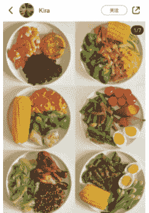

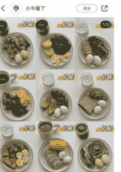

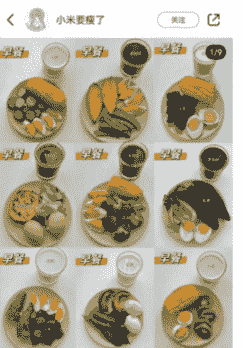

一周减脂午餐不重样！美味健康又掉秤！
#减肥食谱分享 #减肥减脂食谱 #我的减脂餐
#减脂餐打卡 #减脂餐
好吃又健康，还掉秤，姐妹们安排起来💪

已瘦23斤！一周低卡减脂三餐合集
不重样一周三餐合集！
#减肥减脂吃这些 #减肥减脂 #记录减脂一日三餐

一周不重样减脂早餐合集！
低卡又营养！简单易做！！
#减肥日常 #减脂早餐 #早餐吃什么

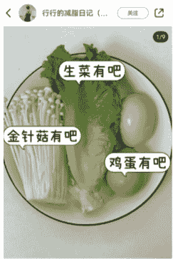

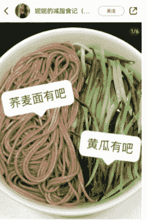

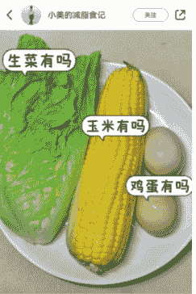

网友说的是真的！！
分享巨好吃的凉拌生菜金针菇鸡蛋！巨巨好吃！
巨巨爽脆！
金针菇真的好好吃这样拌！加上好吃的鸡蛋！
脆的生菜真的好好吃！

多少个晚上靠这一碗掉秤！！
今天做个凉拌荞麦面吃，酸酸辣辣的，加上黄瓜，嘎嘎香啊！每次不知道吃啥的时候，就给自己做这个，做法简单，饱腹感超强，有鸡胸肉的姐妹们可以加鸡胸肉进去拌

已瘦20斤！建议女孩子把晚餐换成它！！
今天分享一个简单掉秤的生菜玉米鸡蛋汤！
低卡低脂高蛋白！生菜爽脆，玉米清甜！减脂期的姐妹晚餐吃它真的太适合了！
食材：玉米 生菜 鸡蛋

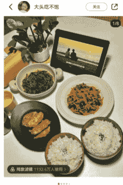

给女友做饭的第182天 | 二人食晚餐吃什么
大家好呀！我是大头～
今日菜谱：
咸蛋黄鸡翅
鱼香肉丝

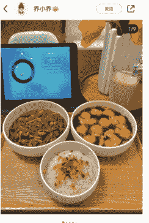

🍱我的餐桌 | 一人食一周不重样🍱
🍱自己做饭真的太治愈啦，所有菜单均有图文教程，都在前几篇的笔记哈～
1️⃣青椒肉丝·紫菜鸡蛋虾滑汤

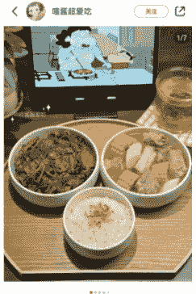

✨一人食 | 小炒泡椒牛肉·玉米山药排骨汤
叮叮✨今日伙食：（附教程）
🌟爆辣的小炒泡椒牛肉
🌟香浓无比的玉米山药排骨汤

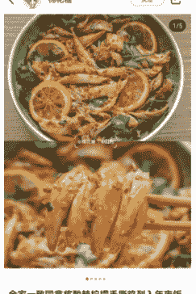

全家一致同意将酸辣柠檬手撕鸡列入年夜饭菜
🍀大家好呀
分享一道年夜饭凉拌菜，酸辣柠檬手撕鸡，鸡肉鲜嫩多汁，酸辣开胃，低脂高蛋白，减脂期吃无负担

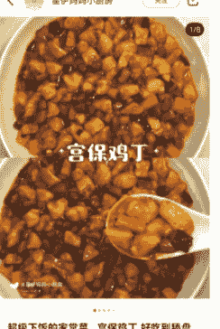

超级下饭的家常菜 宫保鸡丁 好吃到舔盘
今天分享一道超级下饭的家常菜——宫保鸡丁，鸡肉爽滑细嫩，鲜香味美，做法简单，新手小白也能学会，快来试试吧！
🟢🟢🟢食材

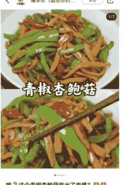

啥？这个青椒杏鲍菇吃出了肉感？😍😍
❤️今天这个青椒杏鲍菇真的吃着有种仿肉肉的感觉，滑嫩中带有嚼劲的口感真的爱了爱了。🌶️🌶️
虽说是青椒杏鲍菇，但我自作主张加了干辣椒，没办法，本四川人就是无辣不欢，不喜欢的小伙伴可以不加哦

◎家人大口吃饭的画面

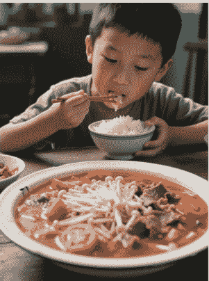

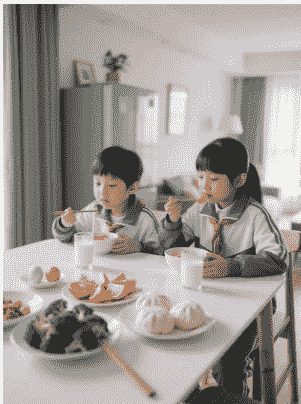

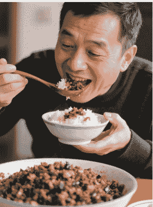

今天给儿子做了一锅番茄金针菇肥牛汤，酸…

每天有妈妈做各种花样真幸福

‼️炒外婆菜｜神仙下饭菜！小时候的味道呀

momo ♡ 5.3万

momo ♡ 1.7万

momo ♡ 6.3万

#### 6.选题参考

- ◎打工人的一日三餐
- ◎十分钟就能做的美食
- ◎挑战一百天，晚餐不重样
- ◎太掉秤了姐妹们，巨好吃的减脂拌菜合集来了
- ◎减脂期解馋冰激凌、奶酪，巨好吃还低卡
- ◎一周不重样营养减脂汤
- ◎已瘦30斤……多少个晚上就靠它掉秤
- ◎8分钟就能搞定的家常菜，还无敌好吃
- ◎在家复刻的×××同款美食
- ◎好吃不胖的零食清单
- ◎不重样的懒人带饭套餐
- ◎讲真……这个真的巨掉秤又好吃

### 二、女性成长博主

在小红书这个女性用户占比达到70%的平台，女性成长类内容本身就是备受女性用户喜欢的选题。我接触过的学员里80%的女生都希望做一些女性成长类的内容，在分享内容的同时影响他人。而且随着女性对自我提升的关注，自信、正能量、变美、独立成长、girls talk、爱自己等一系列话题都吸引了很多小红书优质用户，这个赛道在未来极具发展潜力。只要你是女性，你对成长、人生、改变、赚钱、自我提升有自己的态度和观点，都可以通过分享女性成长话题来表达自己，让用户感受到你是一个有温度、有经历、有思想的女人，非常适合结合个人故事做人设类内容。

#### 1.竞对分析

| 账号标签 | 账号基本信息 | 优势借鉴 |
| :--- | :--- | :--- |
| | 账号名称 | 粉丝量 | 发布规律 | |
| 女性成长 | 刘卷毛儿 | 21.6万 | 一周1—2条 | 主要就是口播的形式去讲女性成长类内容，主要是观点输出 |
| 女性成长人间清醒情感话题 | Mandie有毒 | 29万 | 一周3—4条 | 这个博主很多发言打“人间清醒”这个tag，还有就是她会有个回答粉丝问题的系列笔记 |
| 女性成长治愈迷茫 | 甜老师在笑 | 68.4万 | 一周1—2条 | 这个博主的视频给人一种朋友跟你很舒服地聊天的感觉，以邻家姐姐的视角帮你解答人生中的疑惑和迷茫。很多选题都是爆款选题，有的内容视角会反方向去做，容易有亮点 |
| 女性成长人间清醒自我觉知 | 花大钱 | 85.5万 | 一周2—3条 | 作家出身，出版过多本书籍，输出女性思维认知提升、生活方式、心理分析、亲密关系、人际交往等热点。观点犀利且新颖，能够带给人不一样的视角体验 |
| 女性成长变美干货好物分享 | 方好好啊 | 36.3万 | 一周1—2条 | 主持人出身，后来自己创业做自媒体，在小红书上分享自己的成长干货，围绕爆款选题持续输出内容 |

#### 2.内容方向

- ◎成长类书籍和电影分享
- ◎职场进阶类干货
- ◎独立成长类、人间清醒类、人生态度类观点分享
- ◎人生故事分享

#### 3.变现路径

- ◎好物分享，广告变现
- ◎直播带货、店铺带货
- ◎知识付费：线上成长类课程售卖

#### 4.展现形式

- ◎vlog形式：记录生活、工作日常，分享感悟
- ◎口播形式：如果你对话题有自己的思考，可以出口成章，可以直接拍摄自己输出观点的视频。或者提前写好稿子，通过提词器做口播录制
- ◎图文形式：干货做成图文内容

#### 5.封面参考

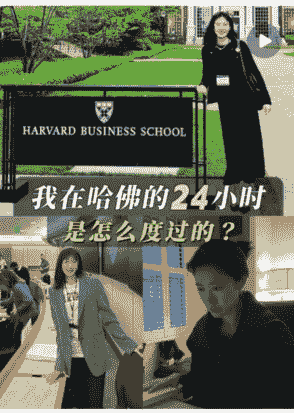

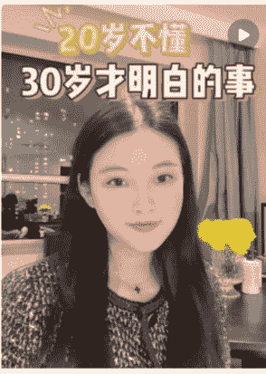


Vlog | 在哈佛学习的一天，我过得有多充实？

20岁不懂，30岁才明白的道理 | 越早知道越好

拥有好心态，普通女孩也能活得精彩

作家张萌 | ... ♡ 2.2万

耶鲁学姐笑笑 ♡ 1920

赛茜Cecilia ♡ 1326

#### 6.选题参考

- ◎见过世面的女生到底什么样子
- ◎如何向上社交，养成贵人体质
- ◎女生经济独立到底有多重要
- ◎离婚并不会毁掉一个女人的一生
- ◎拒绝美丽羞耻
- ◎停止精神内耗，学会爱自己
- ◎高能量女生养成
- ◎主动的女生过得有多爽
- ◎女生怎么样才是真正的爱自己
- ◎普通女孩的十年
- ◎做一个不好惹的女生
- ◎断舍离，远离消耗你的人事物

### 三、身心灵博主

#### 1.竞对分析

| 账号标签 | 账号基本信息 | 优势借鉴 |
| :--- | :--- | :--- |
| | 账号名称 | 粉丝量 | 发布规律 | |
| 瑜伽冥想 | 印如 Yinru | 38.6万 | 周更 1—2条 | 这个博主是将瑜伽、养生、冥想、保养这些内容结合起来的，她是用分享生活方式的角度去做内容的 |
| 专业冥想 | 李冉在冥想 | 25.8万 | 半月更 | 专业冥想导师人设，有自己线下讲课的视频。他的很多选题适合想做专业导师身份的人去看 |
| 正念运动冥想 | 李嘉慧 Elaine | 4.7万 | 周更 1—2条 | 这个博主以分享慢生活和一些冥想瑜伽结合，整体风格偏向治愈，干净素雅。她的一些内容素材是线下课程，而且美照很多，生活方式非常精致 |
| 冥想瑜伽 | 方楷冥想瑜伽 | 8.9万 | 周更 1—2篇 | 这个整体人设专业性更强一些，也会讲一些专业的名字，比如海底轮、喉轮这些。他做了冥想的一些干货知识，主要变现方式是冥想线上线下课程 |
| 冥想 | 满世界'冥想のSu | 14.1万 | 周更1—2条 | 主要围绕“睡眠冥想”“冥想入门”“冥想引导”“吸引力显化”“缓解抑郁焦虑冥想”这些去输出内容。更多的还是输出成长类疗愈类干货观点内容。主要变现方式：线上21天冥想计划、线下疗愈中心、相关疗愈课程 |

#### 2.内容方向

- ◎冥想练习：自己实际的冥想。

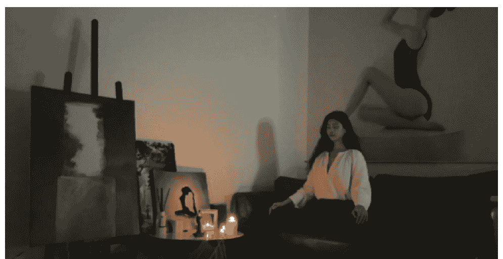

- ◎冥想干货：坚持冥想的好处、冥想一个月会发生的改变、如何进入冥想、冥想零基础入门，可以是口播或图文形式。

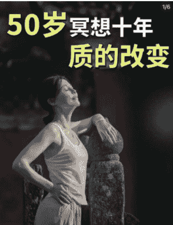

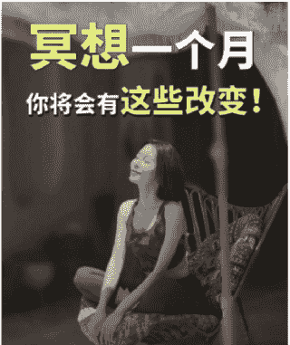


50岁，我重新出发！你也可以！
⭐50岁的转折。
你是否曾想过，晚秋的落叶归根，是否承载着与生俱来的智慧？你是否曾在繁忙的生活中，想要找到那份宁静和内心的平衡？我在50岁的这个转折点上，找到了答案，那就是冥想。

冥想1年，你与世界的关系将发生怎样的变化
你是否想要知道坚持修习冥想到底能给你带来什么？我按照4个时间节点规划了一条“成长曲线”，为你提供一个大致的预期：

50+坚持冥想10年|彻底改变了我的生活
我坚持冥想10年，给我的人生也带来了翻天覆地的改变，这10年，我完成了事业转型，也见证了

- ◎一些细分冥想方法的分享：睡眠冥想、摆脱焦虑冥想、调节情绪冥想等。
- ◎和疗愈相关的好物分享：比如说冥想可以促进睡眠嘛，那你也可以分享一些助眠好物、眼部按摩放松好物、冥想气味好物等。
- ◎一些人生放下、亲密关系等方面的思考，就是偏向于能够治愈人心灵的观点类分享，也可以强化你的治愈系人设，比如爱自己、如何去治愈原生家庭等类似的内容。
- ◎可以做一些系列化的内容，比如21天冥想练习等，参照方楷的10分钟xxx，还有冥想14天入门，系列化内容会让别人在看的过程中想持续了解，从而关注你。

#### 3.变现路径

- ◎知识付费：线上课程售卖，如21天冥想练习课程或正念训练营；线下课程交付，如疗愈课堂、禅修班。
- ◎好物分享，如水晶、颂钵等高溢价产品。
- ◎广告变现。

总而言之，前期做账号的过程中，可以多分享一些干货，方便抓取流量。

- ①流量类内容和案例类内容：可以做一些21天冥想跟练计划，或者早起跟练计划，后续可以做训练营，同时可以分享一些疗愈好物。
- ②人设类内容：自己做疗愈十年的变化，一些疗愈类成长话题观点分享。

#### 4.展现形式

- ◎vlog形式：分享慢生活、冥想跟练
- ◎口播形式：将一些干货类的知识，比如冥想的好处，以分享的视角去口播讲述
- ◎图文形式：干货做成图文内容

#### 5.封面参考

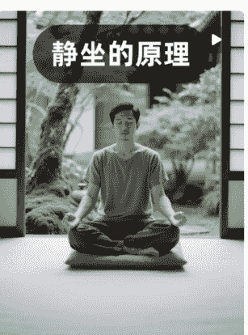

为什么静坐不动，是一种高级运动？

momo ❤️ 1899

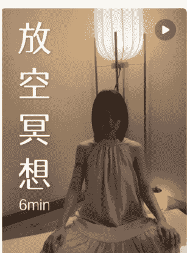

6min放空冥想，一起回到内在的净土，安放…

印如Yinru ❤️ 8192

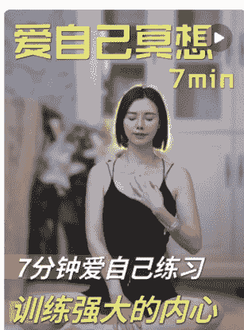

50+冥想导师|教你学会爱自己❤️

冥想欧 ❤️ 260

#### 6.选题参考

- ◎吸引力法则真的有用，3步心想事成
- ◎自我肯定冥想，训练内心强大，自我蜕变
- ◎冥想十年会发生什么改变
- ◎8分钟=深睡3小时，冥想休息术，一听就睡着
- ◎坚持冥想的好处
- ◎7天养成吸金体质，显化财富，旺自己的小妙招
- ◎冥想的经验分享
- ◎关于冥想的问题回复（如：冥想要不要闭眼、腹式呼吸、冥想指南、冥想打坐姿势、冥想到底要想什么、冥想入门指南）
- ◎静观冥想，不要和自己对抗，才会更强大
- ◎养成易睡体质，快速入眠方法，60s无痛入眠（睡眠冥想、早起冥想）
- ◎与自己和解，治愈内在小孩
- ◎抱树疗法

### 四、母婴博主

#### 1.竞对分析

| 账号标签 | 账号基本信息 | 优势借鉴 |
| :--- | :--- | :--- |
| | 账号名称 | 粉丝量 | 发布规律 | |
| 母婴 | 小芋圆麻麻 | 27.8万 | 一周2—3条 | 记录陪伴女儿成长的治愈系生活，整体风格非常温暖有趣，主要拍摄早教、辅食、绘本以及带娃的vlog这些热门话题，展现孩子生活的同时又给妈妈们提供了很多带娃的灵感，很受广告主欢迎 |
| 母婴 | 洋子在东京 | 5.6万 | 一周1—2条 | 记录在日本的带娃、料理及日常生活，利用地域的不同，展现给人们中日的带娃差异、生活差异。适合生活在国外的宝妈们参考借鉴 |

### 五、时尚穿搭博主

#### 1.竞对分析

| 账号标签 | 账号基本信息 | 优势借鉴 |
| :--- | :--- | :--- |
| | 账号名称 | 粉丝量 | 发布规律 | |
| 穿搭 | JNwannnng | 68.3万 | 一周3—4条 | 主要特点是美女加衣服展示。可以参考博主的封面拼图形式和展现产品的风格，还有她的选题特点，比如通勤穿搭、秋日穿搭、针织穿搭、出游穿搭等 |
| 穿搭 | 七七也是西西 | 3万 | 一周3—4条 | 低粉爆款更具备参考价值，该博主的笔记封面比较统一 |
| 穿搭 | 奶盖呀奶盖 | 12.6万 | 一周3—4条 | 明星穿搭回归现实系列可以参考。你的穿搭如果能够添加上明星要素，会让笔记的流量更好 |
| 穿搭+穿搭干货 | 涵子爱臭美 | 1.5万 | 一周1—2条 | 在展现衣品的同时教一些穿搭思路，提供干货内容，会让大家觉得不仅能跟你买，同时还能跟你学习穿搭 |
| 穿搭分享 | Namiii | 6.7万 | 日更 | 素人身份，小红书上有很多穿搭博主通过做系列快速出圈，比如“挑战一百天成为穿搭博主”“挑战做博主的第×天”，让用户在看她笔记的过程中见证她账号的成长，无形中和用户产生了互动。背景非常干净简单，让人将注意力集中在人体上，凸显衣服的美感，而人物旁边的说明字体，也丰富了画面，不至于显得太过空白 |

#### 2.内容方向

- ◎穿搭干货技巧（一衣多穿、节假日风格穿搭、省钱穿搭）
- ◎穿搭上身推荐合集
- ◎明星穿搭拆解，明星穿搭回归现实
- ◎穿搭测评

#### 3.变现路径

- ◎好物分享，广告变现
- ◎直播带货、店铺带货
- ◎知识付费：形象管理链路变现，如线上线下导购、线下测色、线上课程等

#### 4.展现形式

- ◎vlog形式：穿搭上身分享
- ◎口播形式：讲穿搭干货，分析明星穿搭风格
- ◎图文形式：干货做成图文内容

#### 5.封面参考

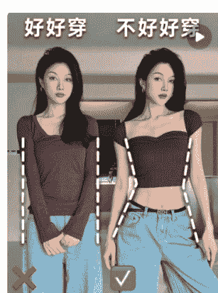

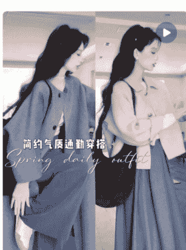

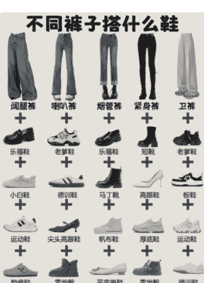

旧衣翻红🔥闲置先别扔！试下不按套路穿…

一周通勤穿搭｜大衣羽绒服分享✨简单提…

不同类型裤子的万能鞋子搭配公式 #穿搭 #…

hello我是沱沱 ♡ 4.1万

大美牛 ♡ 3585

AO GALS
2024-12-25 ♡ 6064

#### 6.选题参考

- ◎穿搭口诀，快速提升衣品
- ◎万能白西装一周穿搭（同理，可换牛仔裤/针织衫……）
- ◎人越贵，衣越素
- ◎衣品不好的女生，提升衣品的小方法
- ◎万能配色公式
- ◎为什么同一件衣服，你穿不如博主好看
- ◎普通女生如何提升衣品
- ◎叠穿思路
- ◎你缺的不是衣服，而是穿搭思维
- ◎逼自己看完，你的衣品会很好
- ◎年后复工惊艳登场，早春精致通勤装
- ◎一周通勤穿搭

### 六、健身减脂博主

#### 1.竞对分析

| 账号标签 | 账号基本信息 | 优势借鉴 |
| :--- | :--- | :--- |
| | 账号名称 | 粉丝量 | 发布规律 | |
| 跑步日常 | 一只清子zz | 12万 | 日更 | 记录自己的跑步日常、跑步后的身材、生活变化等。坚持跑步的过程其实也在给用户传递一种积极向上的正能量，非常适合有跑步习惯的素人博主尝试 |
| 健身 | 美丽的大肉肉 | 31.8万 | 日更 | 全部采用图文形式，图片采取拼图形式，主要内容为减脂干货、减脂好物、减脂美食、减脂日记等专辑。同时还有系列内容：100天跟练，如何逼自己瘦下来。比较适合不太方便做视频的博主 |
| 健身 | 徐肉瑄 | 11.8万 | 一周2—3条 | 挑战100天瘦50斤系列，通过分享自己的减脂日常来持续输出内容，走养成系风格 |
| 产后瑜伽 | 慧灵的YOGA4MOMS | 13.3万 | 一周1—2条 | 主要是产后修复瑜伽这个主题，从健身运动这个领域切了一个细分去做，更容易拿到精准流量。所以，新人博主可以考虑做账号的时候切一个细分赛道，人群更精准，流量也更精准，还可以凸显自己的特色，差异化竞争 |
| 减肥运动 | 朱七七Shara | 13.9万 | 一周3—4条 | 主打健身塑形，每一期视频都精准聚焦一个塑形痛点去做，比如瘦侧腰、瘦肚子、瘦大腿、瘦全身、瘦手臂等。而且视频采用跟练方式，能够让用户更有参与感 |

#### 2.内容方向

要根据自己的身份去输出内容，如果你是健身教练，或者本身在健身领域有非常专业的经验可以分享，那么你可以输出健身相关的干货知识。如果你是健身爱好者或者是有瘦身想法的，可以做系列化的跳操跟练以及健身日常内容，比如“挑战100天瘦xx斤系列”“逼自己瘦下来系列”“挑战100天成为健身博主系列”“挑战21天练出马甲线系列”等。

- ◎器械健身：分享健身房机械使用技巧，新手如何开始健身房运动，健身房器械打卡
- ◎减肥干货分享：分享自己的减肥经历，或者平常健身过程中的经验
- ◎减肥塑形：分享减肥前后的身材，突出前后对比
- ◎跳操跟练：分享锻炼体态的方法，局部瘦身，比如跟练瘦肚子、瘦大腿等
- ◎减肥饮食：控制饮食实现瘦身的具体方法分享
- ◎健身减脂好物：健身时候会用到的好物分享，比如一周运动穿搭等
- ◎健身日常：早起坚持运动

#### 3.变现路径

- ◎直播带货
- ◎好物分享，广告变现
- ◎减脂训练营、私教课

#### 4.展现形式

- ◎vlog形式：记录自己早起、晨跑、早餐、跳操、暴汗的生活日常。
- ◎口播形式：将孕产康复、减肥瘦身等干货类内容，以教学的视角去口播讲述。
- ◎图文形式：将如何制作减脂餐、跳操瘦身等干货做成图文内容。

#### 5.封面参考

- ◎健身前后对比照片

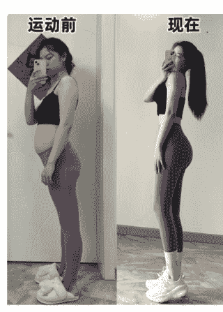

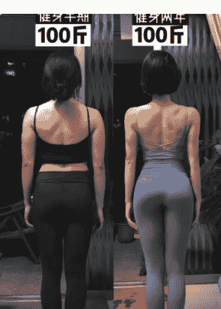

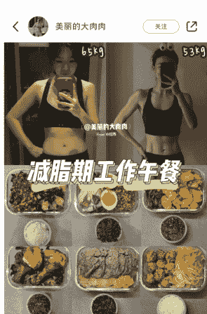

#### 6.选题参考

- ◎如何逼自己瘦下来，年前瘦20斤
- ◎一个人说一个减肥误区
- ◎世界公认燃脂最快的跳绳减肥法
- ◎女生健身一定要练胸！真的会变大！
- ◎减脂期间身体出现这些信号要注意啦
- ◎急性子来练，超级速瘦腹马甲线养成
- ◎破防了，这玩意真的巨巨巨掉秤啊
- ◎瘦了20斤最有意义的变化是什么
- ◎8分钟翘臀又瘦腰，还不快进来跟练
- ◎全身暴汗燃脂操，快乐减脂一遍跟上
- ◎马甲线养成记|晨起告别大肚腩
- ◎我悟了，原来减肥可以这么丝滑

### 七、职场博主

#### 1.竞对分析

| 账号标签 | 账号基本信息 | 优势借鉴 |
| :--- | :--- | :--- |
| | 账号名称 | 粉丝量 | 发布规律 | |
| 职场博主 | 行政不迷路 | 7.5万 | 一周2—3条 | 博主的定位是有6年工作经验的行政人事，围绕“行政”这一定位给在从事行政这个岗位的人输出干货内容。所以，职场赛道，定位不知道该怎么做时，可以考虑切职业细分 |
| 职场避坑 | 帮助女友职场避坑的小号 | 43.5万 | 一周2—3条 | 博主定位是帮女友职场避坑的大厂员工，围绕职场人在职场经常遇到的困境，比如“遇到垃圾公司怎么办”等，通过情景代入，让女友以小白和嘴替版两种形象去做出回应，让观众既能够感受到两种回应产生的不同效果，让职场人从中学习职场干货，同时也增添了趣味性。对于不知道该做什么赛道的素人博主可以去尝试 |
| 职场博主 | 职选 Marrkk 求职咨询 | 11.7万 | 一周3—4条 | 如何不露脸拍视频，可以参考一下这个账号。博主巧妙运用卡通头像的形式，在一众视频中脱颖而出，让人眼前一亮 |
| 职场博主 | 姜Dora在此 | 38.7万 | 周更 | 通过对谈采访身边不同职业的人来输出干货内容，让人们看到不同生活的人的职场生活状态，在分享干货的同时也治愈了很多人，给人一种职场大姐姐的形象 |
| 职场精英 | Olga姐姐 | 59.4万 | 一周3—4条 | 博主本身是肯德基的总经理，有很强的职场背书，以输出职场干货、职场语录、女性成长、生活方式来打造个人IP |

#### 2.内容方向

- ◎职场干货/心得：职场发展、职场思维、职场情商、职场效率提升、职场避坑、职场礼仪、职场汇报等
- ◎职场好物：办公室好物、职场书单
- ◎职场穿搭：适合通勤的穿搭分享

#### 3.变现路径

- ◎好物分享，广告变现：办公室好物、考证机构广告等
- ◎直播带货、店铺带货
- ◎知识付费：简历修改、求职规划咨询、电子资料等

#### 4.展现形式

- ◎vlog形式：记录自己在职场的一天，可以是通勤、出差、吃饭、会议、接待等场景
- ◎口播形式：将求职面试、职场容易踩的坑、职场沟通问题等干货类的内容，从分享答疑的视角去口播讲述
- ◎图文形式：干货做成图文内容

#### 5.封面参考

- ◎小红书常见的人物封面+文案，适合于口播干货类内容


一个领导不会告诉你的职场晋升“潜规则”

管理者不要情绪稳定，要情绪流动

“逼疯”一个打工人的最快方法就是……

- ◎拼图形式：适合职场人日常分享，职场人的一天vlog做封面

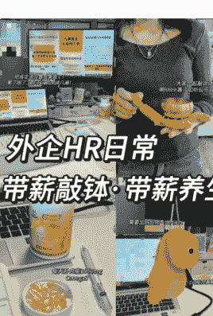

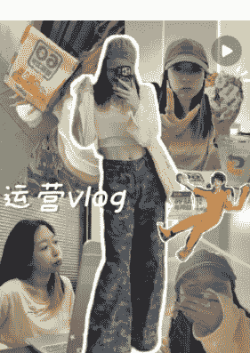

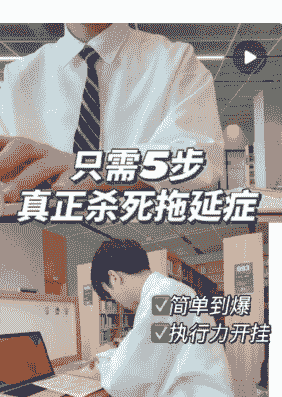

外企日常|上班原因|带薪喝水|养生|敲颂钵

Vlog | 没错我都是这么哄自己上班的

5步，彻底杀死拖延症🔥

#### 6.选题参考

- ◎第一次实习如何谈薪
- ◎没工作经验怎么面试，穿什么衣服面试，如何问期待薪资
- ◎职场人空白期很长怎么办
- ◎那些被上司赏识的人都有什么特点
- ◎身为职场人，如何在业余时间提升自己
- ◎如何摆脱职场的学生思维
- ◎有哪些好用高效的职场神器
- ◎工作20年的职场老鸟给职场新人的建议
- ◎想套话又不想被别人发觉该怎么做
- ◎领导说辛苦了如何高情商回复
- ◎职场饭局禁忌：这几种幼稚行为千万别做
- ◎无痛上班秘诀，打工千万不要太老实

### 八、收纳博主

#### 1.竞对分析

| 账号标签 | 账号基本信息 | 优势借鉴 |
| :--- | :--- | :--- |
| | 账号名称 | 粉丝量 | 发布规律 | |
| 收纳技巧 | 纳川家居收纳师 | 3.3万 | 一周1—2条 | 人设是家居收纳师，把整理和极简生活、提升生活品质、生活技巧相关联，除了分享整理干货外，也分享提升生活品质的习惯、好物等 |
| 收纳技巧 | 收纳男神-涛爷 | 6.2万 | 日更 | 人设是室内设计师，分享橱柜、衣柜、零食柜等空间的收纳技巧，作品系列叫“100个收纳小技巧” |
| 收纳技巧 | Melody楚楚 | 5.6万 | 一周2—3条 | 人设是自装118平方米美式轻奢风格小四房的生活博主，分享自家浴室、厨房、鞋柜、卧室的高效收纳方法 |
| 收纳技巧 | 整理师泡泡减法生活 | 4360 | 一周2—3条 | 人设是高级收纳整理师，将收纳和生活品质挂钩，作品系列叫“每天5分钟变身整理大师” |
| 收纳规划 | BOX收纳 | 2.7万 | 日更 | 人设是家政公司，主打日式收纳。发布的图片都比较偏日式极简风格。对照片质量要求比较高。主打小空间收纳术、分区收纳（厨房、储物间、阳台柜、浴室、鞋柜、衣柜收纳） |

#### 2.内容方向

前期做账号的过程中，我们可以尝试以下几个方向：

- ①流量类内容：可以分享一些干货内容，收纳技巧、收纳好物合集、减法生活分享，最好能够系列化，比如“100个收纳技巧”“每天一个收纳小知识”等，这里收纳好物的分享同时后续也能接到一些广告。
- ②案例类内容（单个案例、案例合集）：用户好评类内容；置顶笔记放一篇你们业务的介绍以及案例合集、用户好评合集等。
- ③人设类内容，收纳师培训：收纳师的相关介绍、如何成为收纳师、对收纳师的理解等，前期可以少一点。

#### 3.变现路径

- ◎广告变现：分享生活好物、收纳好物
- ◎线下引流：上门提供收纳服务
- ◎知识付费：整理收纳师线下职业培训

#### 4.展现形式

- ◎vlog形式：拍摄改造后的整洁场景，记录改造过程，对比改造前后的场景
- ◎口播形式：以分享的视角去讲述收纳故事，也可以边整理边口播
- ◎图文形式：将收纳技巧整理成图表、思维导图、说明书等形式

#### 5.封面参考

- ◎创意封面类：适合干货类内容，多关注平台创意封面
- ◎设计感风格：找到属于自己的风格


房间杂乱❗必须知道的方法！码住！
屋子乱，导致心情差，生活品质下降，不知道从哪开始下手整理！

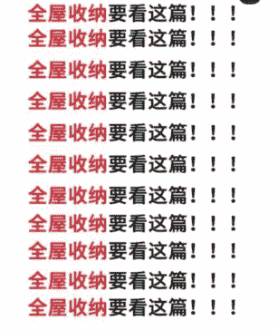

9张图，让你的屋子收纳力与颜值暴风提升‼️
✅关于收纳
收纳解决的是有型的空间问题和物品问题，就是如何在现有的空间把物品摆放好，更合理地利用空间

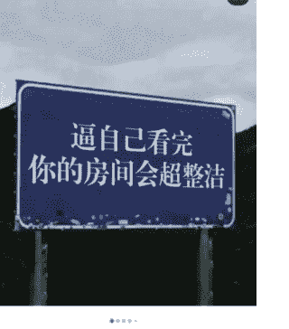

干净的房间是最好的风水！超详细房间整理
“干净的房间是最好的风水。”超详细房间整理
“我的生活一团糟，要怎么去改变？”
高赞回答：当你对眼前的生活一筹莫展，就去打扫回屋子🧹，从最小的事情开始改变，当一个人开始整理自己

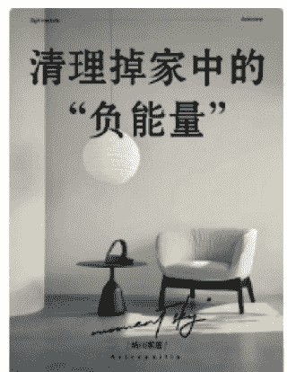

清理掉家中的“负能量”，我丢掉这80样…

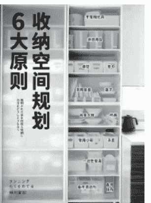

哇塞❗收纳空间规划6大原则，沉浸式整理

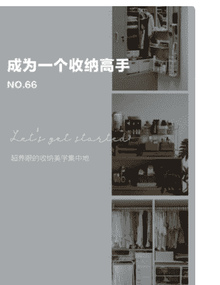

🏠成为一个收纳高手
100期 NO.66

- ◎合集类型：适合分享收纳好物、收纳书单等

收纳3年了~超满意的8大空间30+好物
接上篇
入住第4年了
有规划的收纳家里的区域是第3年了
一共收纳了20多个区域

吐血整理！！12m²小卧室实用收纳大合集
整理了小卧室里所有的实用收纳！
图片上都标注清楚啦大家看图即可
努力平衡实用性和颜值，大家觉得还可以吗

家居好物篇🔥请大数据推给所有家庭!!
提升家庭幸福感的宝藏神器
真诚分享，实用不鸡肋
快来抄作业!!!

从业整理7年推荐这10本实用整理收纳书
成为整理收纳师的第7年，整理的对象已经成看得见的物品，延伸到看不见的关系、情绪、金钱等等~越来越觉得，整理无处不在

【好书推荐】学收纳看这6本就够了！
今天是世界读书日，来分享一些近期看的书。
最近常看的都是一些家居类的书，尤其是对收纳很感兴趣！我买了这几本：
• 近藤麻理惠《怦然心动的人生整理魔法》

物尽其用❤️你的收纳可以不花钱！
#大大方方做自己
家里各种闲置品的隐藏用法！

◎思维导图类型

当然封面还是要自己多测试，看封面点击率不断调整出属于自己的风格。但是记住每一种类型起码试10次左右，因为新媒体也存在概率。

#### 6.选题参考

- ◎日本主妇收纳技巧分享，2025年末整理必备
- ◎J人空无一人的家！全屋收纳规划，直接抄作业
- ◎15年整理师带你轻松选百纳箱
- ◎你见过哪些特别厉害的收纳方式
- ◎3年攒下的收纳好物合集
- ◎榨干厨房空间的收纳细节！直接抄作业
- ◎怒省4位数的衣柜收纳方法分享
- ◎3分钟详解！厨房装修完还需配齐哪些收纳
- ◎思路打开！活了20年才知道衣服全挂错了
- ◎过年回家这样收纳行李箱，一个箱子就解决

### 九、插画博主

#### 1.竞对分析

| 账号标签 | 账号基本信息 | 优势借鉴 |
| :--- | :--- | :--- |
| | 账号名称 | 粉丝量 | 发布规律 | |
| 文创产品 | y园糖 | 11.6万 | 一周3—4条 | 有许多插画周边、文创产品的内容可供参考。博主有自己的设计工作室、线上店铺和线下门店 |
| 插画教学 | 插画喵绘画 | 14.2万 | 一周1—2条 | 既有干货类图文，又有视频类教学，内容丰富，数据好，值得参考学习 |
| 插画分享 | 语宸要做插画师 | 71.2万 | 一周2—3条 | 封面简洁，色调是暖色调。标题的情绪化做得非常好，吸引人点击。拍摄的内容优质，利他性强。还有很多好玩的系列化创作：挑战在衣服、筋膜枪上画画；挑战画动漫人物、男团人物、历史人物；挑战用眼影、口红画画 |
| 插画分享 | 弱冠年华 | 80万 | 一周2—3条 | 人设是旅行插画师，主打边走边画，插画和产品结合得很好，很有辨识度 |
| 插画分享 | 肆只耳的插画日常 | 9万 | 一周1—2条 | 用iPad画画，以水墨国风的人物头像为主。以记录自己画画的vlog为主，也追《哪吒之魔童闹海》等热点，主打沉浸式画画 |

#### 2.内容方向

前期做账号的过程中，我们可以尝试以下几个方向：

①流量类内容：前期做账号的过程中多输出一些干货类内容（插画干货、插画好物分享）起号，做一些系列化主题内容会更有帮助，比如挑战xxxx，100天搞定xxx。
②案例类内容：中间可以穿插一些自己的文创周边产品，开店铺，通过笔记带货的方式进行售卖。
③人设类内容：还可以分享一些成长类选题内容，如插画师的一天、插画师的五年，这些能让你的人设更立体。

- ◎插画干货（绘画教程、绘画工具、绘画技巧）
- ◎绘画好物（iPad推荐、电容笔、电动升降桌等）、自己结合商家产品做的绘画作品（植入式广告）
- ◎文创周边（展现你的一些作品，开店铺，通过笔记带货）
- ◎个人成长：可以分享一些你的个人经历，让别人从你的经历中找到成长的力量

#### 3.变现路径

- ◎广告变现：分享生活好物
- ◎知识付费：商业插画课程
- ◎线下引流：合作约稿、开店铺

#### 4.展现形式

- ◎vlog形式：把自己的插画一天生活拍成vlog，然后配上文案。适合于干货内容，或者是人设类内容。可参考博主 @肆只耳的插画日常。
- ◎口播形式：适合干货类内容和人设类内容，写好稿子用提词器直接拍摄。可参考博主 @普通插画师西西。
- ◎图文形式：适合发干货类内容，介绍专业网站有哪些，在看什么工具书。可参考博主 @语宸要做插画师。

#### 5.封面参考

封面要自己多测试，看封面点击率不断调整出属于自己的风格。

◎拍摄自己画画的照片，然后在上面修改封面文案

为什么我推荐有平板的学画画？好处这么多

绘画vlog | 让你自愿打工的艺术工作台

如何1年内靠画画变现？手把手教你做签…

◎做自己作品和自己画画产品的拼图

春天好好画 | 我看到的vs我画的🙌

vlog | 零基础学画画·练习过程分享🌈

插画师vlog | 跟着我的画笔开启少年感的一…

◎直接画产品和插画（植入式广告）

把金典有机奶画成这样，官方会请我喝奶…

养女儿之后 也在倒逼着我做一个大格局妈妈

1分钟教会你！用平板画国潮城市地标插画

弱冠年华 ♡ 1125

源一yuanyi ♡ 85

肆只耳的插画… ♡ 676

#### 6.选题参考

- ◎零基础插画师：从小白到大触你需要多久
- ◎今天是粉色主题18张，好喜欢这个风格呀
- ◎“95后”年入百万的插画师日常
- ◎手把手带你：30天陪伴式自学插画
- ◎随手一画|出去野餐啦
- ◎盘点国内年入百万的插画大佬
- ◎插画干货|插画师的素材库
- ◎5年画师经验终结！零基础入门插画要听劝
- ◎不同段位的插画师，应该去哪接单
- ◎整理了9个免费可商用插画素材网
- ◎16个免费插画无版权网站，新手小白福音
- ◎10月收入5400元|新手如何通过插画赚米

### 十、产后修复博主

#### 1.竞对分析

| 账号标签 | 账号基本信息 | 优势借鉴 |
| :--- | :--- | :--- |
| | 账号名称 | 粉丝量 | 发布规律 | |
| 孕产知识 | 段涛医生 | 122.3万 | 日更 | 博主是上海市东方医院（同济大学附属东方医院）妇产科主任，笔记以视频为主，孕期大大小小的事情基本都能覆盖，娓娓道来，让人如沐春风 |
| 孕产知识 | 金鱼-孕产育儿 | 22.4万 | 一周2—3条 | 人设是妇产科护士。视频背景多为医院病房，着装为护士服，在专业性上给大众极强的信赖感。这个账号和人设身份比较统一，选题和形式可参考价值大 |
| 孕产育儿 | 助产士陈嘉慧 | 47.4万 | 一周2—3条 | 人设是省三甲医院助产士和二宝妈妈。封面图有自己的统一风格，文字信息量足，干货多，值得借鉴 |
| 孕产知识 | 猴哥聊孕产 | 67.2万 | 一周3—4条 | 人设是妇产科医生，分享猴哥缓痛呼吸法，主打帮助宝妈超快顺产。主要分享备孕、产检、顺产、坐月子等专业知识 |
| 妇科健康 | Jojo医生 | 67.9万 | 一周3—4条 | 人设是妇产科医生，有许多关于女性健康的优质选题。主打“说真话的医生”这个点，分享医学冷知识，有高赞系列：你眼中的伤子宫 VS 医生眼中的伤子宫；你眼中的伤卵巢 VS 医生眼中的伤卵巢 |

#### 2.内容方向

前期做账号的过程中，我们可以多做一些干货分享，这样在后续做妇科护理、内调养生、母婴好物分享时，用户信任度更强。总而言之，前期做账号的过程中，我们可以尝试以下几个方向：

①流量类内容：前期系列化输出孕期干货知识、妇科健康类知识，可以考虑一些动作跟练教学类的，类似卵巢最爱的7个动作，修复盆底肌的几个动作。
②案例类内容：等到差不多有几篇笔记数据跑起来了，可以开始少量发一些好物分享的内容，比重可能三四条干货搭配一条好物分享类的内容，这样对后续变现有帮助。
③人设类内容：其实作为一个分享孕产科知识的人，专业度和信任感对于用户非常重要，所以需要做一些人设类的内容，比如分享你做这件事情的初心，或者是你的相关从业经历，这种笔记哪怕没啥流量，但能强化人设，提升转粉率。

- ◎孕期知识（备孕、孕期、生产、产后）
- ◎妇科健康（知识科普、私密护理、卵巢、乳房、会阴部、盆底肌、两性知识、妇科炎症）
- ◎人设类内容（结合自己的身份、故事去做内容）

#### 3.变现路径

- ◎广告变现：分享护理方面相关产品、产后修复产品
- ◎直播带货、店铺带货

#### 4.展现形式

- ◎口播视频：主要适用于干货内容分享和好物分享类，参考 @金鱼-孕产育儿 或者 @助产士陈嘉慧 的形式
- ◎图文形式：可以用来做人设类内容、干货类内容
- ◎注意事项：拍摄一些专业内容的时候，穿上工作服会更有利于打造专业人设，增加用户对你的信任度

#### 5.封面参考

◎干货类（拼图类型）

◎内调养生类（拼图类型）

大号通畅‼️3种天然益生菌✅身材轻盈皮…

中式变美回春大法㊙️低成本防止气虚变丑…

悟了！一个月！我发现了好气色的真谛💃

susan米苏 ♡ 398

晚申申 ♡ 3.5万

林一夕 ♡ 4344

#### 6.选题参考

- ◎养成易孕体质的好习惯，给备孕女生的建议
- ◎孕期零基础运动，控制体重，助力顺产
- ◎孕期长胎不长肉
- ◎正确顺产用力教学
- ◎孕期不能做的动作
- ◎预防妇科病，宫腔排毒运动
- ◎小月子养护运动
- ◎坐月子变美，神奇的月子水
- ◎盆底肌修复的黄金动作：凯格尔运动
- ◎错误的几个两性知识
- ◎新生儿怎么抱、新手宝妈要学的排气操、错误抱法姿势
- ◎30天养出好气血、去黄气

## 第六章
商家获客：4大类目线上获客打法

线下商家
做好三种内容：
流量类内容、
案例类内容和
人设类内容。

我的学员里面，除了想要打造个人IP实现广告副业收入的人之外，还有一部分学员经营着各自的线下实体店，希望能够利用小红书这个平台增加品牌曝光度，扩大客户来源，吸引更多的潜在客户来购买自己的产品和服务，进而提高销售额和收益。但是，由于对平台不够了解，对内容制作不够熟悉，他们纷纷找到了我。他们来自各行各业，如珠宝、旅游、文眉、家居等，都在小红书上寻找增量机会。所以，这一章不讲个人IP打造，也不讲品牌如何做好小红书声量传播或者品牌曝光，我想重点拆解几个不同行业的中小商家如何在小红书上“偷流量”。希望能给一些准备入局小红书的朋友一点启发，也希望你们在看完这本书后能够真正从小红书上得到回报，那么这便是这本书的价值所在。

线下商家做小红书内容笔记同样离不开我们之前说的三种内容和三种流量。流量类内容主打干货爆款，能够短时间内快速引爆账号流量，吸引对这个话题感兴趣的人群关注你的账号；案例类和人设类内容凸显服务的专业性，拉升用户对你的信任感，促进转化成交。关于案例类内容，主要是商业成功案例，最直接的就是用户服务前后对比呈现，用户真实的好评反馈，这些能够激活你的潜在客户。关于人设类内容，可能是你公司十年的介绍，你们服务过多少客户，接触过多少行业，有哪些标杆性案例，等等，也可能是你的创业故事，这些数据可能不会特别高，但是能够让你的潜在客户在点进你主页的那一刻，就将自己的需求快速和你的服务做匹配。当然，优质的笔记能够同时完成引流、营销、立人设三个任务，这三者并不是完全区隔的。

### 一、婚纱类目

#### 1.竞对分析

| 账号类型 | 账号基本信息 | 优势借鉴 |
| :--- | :--- | :--- |
| | 账号名称 | 粉丝量 | 发布内容 | |
| 蓝V机构账号 | 武汉小香奈TINYKANA婚纱馆 | 19万 | 用视频的方式分享婚纱干货、婚礼注意事项，让用户在看视频的过程中不仅仅能看到机构的美丽婚纱，同时还能了解婚纱和结婚的相关细节知识，让用户一站式解决结婚选婚纱的所有难题 | 不同于其他单纯分享婚纱样式的账号，该账号对目标用户（备婚人群）制作干货向内容，将账号做成了订婚人的必备科普指南，趣味感和知识性兼具 |
| 蓝V机构账号 | The Best Bridal圣白婚纱 | 51.8万 | 内容多为外国模特穿着婚纱走秀的氛围感视频，主打唯美、精致 | 比较适合有一定预算的婚纱公司，请专业的模特去拍摄视频制作内容，满足了小红书上女性用户群体对于好看精致氛围感照片及视频的需求 |
| 蓝V机构账号 | 舟山AMYLI艾米丽婚纱馆 | 5.6万 | 内容多数是图文形式，按照三种流量三种逻辑的方法制作内容。流量类内容出图文干货，案例类内容出婚礼返图和公司介绍 | 适合给不擅长视频拍摄，想要低成本制作内容的婚纱公司参考 |
| 婚纱店主理人 | 杜鹃 | 1.7万 | 用视频的方式分享唯美婚纱，外国模特以T台走秀的场景为主，中国模特以婚礼现场的场景为主，满足用户的不同审美需求 | 标题几乎都带固定词组“青岛婚礼备婚”，是专为小红书的搜索流量设计的；账号简介中露出店铺账号@杜鹃婚纱，为店铺业务引流 |
| 礼服师 | 合肥如初婚纱-桃子 | 8万 | 用视频的方式分享婚纱干货、婚礼注意事项，拍摄内容多为解决和避免婚礼中可能遇到的问题 | 封面图花字统一用黄底白字，内容清晰，信息饱满；内容有新人和博主人镜，场景化演绎兼具趣味性和知识性 |

#### 2.流量类内容选题参考

除了找到适合自己账号的风格之外，会写标题也非常重要。 小红书作为双向瀑布流平台，用户是否会点开你的笔记，主要看两个关键点：一是你的封面够不够吸引人，二是你的 标题是否“抓人”。 以下五类爆款标题，经营婚纱店的你可以尝试学起来。

| 类别 | 标题列表 |
| :--- | :--- |
| 对比类标题 | ◎老公选的婚纱VS店长选的婚纱<br>◎你以为的试纱VS实际的试纱<br>◎“00后”选婚纱VS“90后”选婚纱<br>◎老公选的婚纱VS闺蜜选的婚纱<br>◎我以为穿大拖尾的样子VS实际上穿大拖尾的样子<br>◎我试穿的效果VS我婚礼当天的效果<br>◎闺蜜选的缎面婚纱VS我选的重工婚纱<br>◎白富美新娘选的婚纱VS富二代老公选的婚纱 |
| 干货类标题 | ◎99%新娘选婚纱会忽略的问题<br>◎穿大拖尾婚纱千万要避4个坑<br>◎结婚当天新娘要穿几件衣服<br>◎小个子挑选婚纱攻略<br>◎婚礼后新娘如何正确打包婚纱<br>◎瘦女孩千万不要这样选婚纱<br>◎胖女孩如何挑选婚纱<br>◎超全的租纱流程 |
| 预算类标题 | ◎当你有2000元，买婚纱VS租婚纱<br>◎婆婆选的7000元婚纱VS妈妈选的1万元婚纱<br>◎闺蜜选的5000元婚纱VS我选的7000元婚纱 |
| 合集类标题 | ◎扬长避短的一字肩婚纱合集来了<br>◎不同风格婚纱怎么选？教你轻松搞定<br>◎不同的身材怎么选鱼尾轻纱呢<br>◎不同场地如何挑选婚纱<br>◎不同国家公主的婚纱是什么样子的<br>◎不同国家的婚服哪个国家更好看<br>◎如何选婚纱？一篇教你轻松搞定<br>◎让新娘美到发光的8件神器 |
| 情绪类标题 | ◎2025年一定会火的婚纱款式<br>◎谁说小胸新娘不能穿抹胸婚纱<br>◎都2025年了，谁还在重温4周年婚纱 |

新娘婚礼8件神器加持，你不好看谁好看…

穿大拖尾婚纱一定要避这4个坑 #大拖尾婚…

2023一定会🔥的婚纱款式｜海口婚纱 店…

武汉小香… 2022-12-13 ♡ 9532

妍姐说婚礼 2022-09-21 ♡ 5.3万

海口 DEA… 01-16 ♡ 2414

不同风格婚纱该怎么选？教你轻松搞定✨
正在备婚的新娘们，准备挑选婚纱了吗？想要成为让人眼前一亮的新娘吗？选对婚纱可不是一件容易的事。就让小编教你们轻松搞定这一难题吧！

🔴扬长避短的一字肩婚纱合集来了！泰安婚纱
选对一字肩婚纱不纠结，让你显瘦20斤

不同的身材怎么选鱼尾轻纱呢❓太原婚纱
鱼尾轻纱✨凸显女性的优雅线条
同样的鱼尾轻纱✨不同的设计
上身也有着不同的风格与气质
适合婚礼场合✨教堂婚礼以及出门纱✨

💬 说点什么... ♡ 483 ⭐ 260 💬 15

💬 查看商品 ♡ 2.1万 ⭐ 6843 💬 75

💬 说点什么... ♡ 430 ⭐ 222 💬 13

#### 3.案例类内容呈现形式

婚纱类营销内容主要有三种：一是婚纱礼服展示；二是用户好评反馈；三是线下店面情况及具体服务流程展示。

◎婚纱礼服展示

复古蝴蝶结蕾丝胸衣9♡e | 小贝壳🐚装饰太灵了
9♡e

【雪玫瑰】| 和白月光相配的纯白花缎☁️
纯白无瑕，漫溢浪漫，涤荡心底的尘埃，这是一...

◎用户好评反馈

只要做的好/拍得好📸定叫他“好评如潮”
有幸遇见 | 不负选择
分享一波真实客户好评！！！

一篇新鲜热乎的夸夸贴！真实顾客反馈好评
✨

来自洛粉们的暖心好评❤️❤️
关于这件浪漫的事💕
只要身旁的人对了什么都是喜悦的

◎线下店面情况及具体服务流程

在杭州湘湖这家宝藏婚纱摄影店备婚必看
近两年计划拍婚纱照的小姐妹注意咯~❤️❤️❤️

要向全世界安利‼️南京这家无套路宝藏摄影馆
✅南京出片率超高的沉浸式❤️必打卡的婚纱摄影

备婚 | 💍婚纱店试婚纱需要注意什么
给备婚小仙女们献上最实用的试纱攻略💖
码住下面这些注意事项，都可以选到自己最合适

#### 4.人设类内容呈现形式

如果你在运营一个婚纱店主理人的账号，可以多分享自己和婚纱店之间的故事，比如创业开婚纱店的心路历程，婚纱店主理人的一天都在忙什么，婚纱店主理人是如何选品的，一个普通女孩开婚纱店的十年经历，等等。如果你在运营一个礼服师的账号，可以记录自己一天的工作日常，分享自己从业多年的感悟，给新人选婚纱遇到的感人故事，揭秘选婚纱的一些套路。

### 二、民宿类目

很多民宿老板想尝试做小红书，提高民宿入住率，结果发现发布了许多条民宿照片的笔记都没有什么人看，那到底该怎么办呢？首先，想要你的民宿足够吸引人，你就得把照片拍好看，让人通过照片、视频就能够对你的民宿产生向往。所以，在做账号前期你可以积攒民宿美照素材，这些后续都能成为你内容的一部分。其次，你要强化自己的标签，比如大理民宿、云南民宿等。

#### 1.竞对分析

| 账号类型 | 账号基本信息 | 优势借鉴 |
| :--- | :--- | :--- |
| | 账号名称 | 粉丝量 | 发布内容 | |
| 蓝V机构账号 | 小居民宿 | 42万 | 以图文为主，围绕旅行这个主题分享全球、全国高性价比的民宿和旅游线路。内容分享偏瀑布流，主要是为线下业务引流 | 笔记封面多为暖色调，画面干净唯美。适合在全球、全国有民宿业务的平台型公司参考 |
| 蓝V机构账号 | 安吉一田一墅精品民宿 | 7.4万 | 以视频形式分享土灶、篝火、养花等山野乡村生活，也会记录新店从0到1的装修过程，从改造前的破烂小屋到改造后的精致庭院，极具视觉冲击力，让用户也有参与感 | 案例类内容主打田园生活，画面干净唯美，背景音乐都是舒缓的治愈系音乐，很让“久在樊笼里”的城市人群心生向往。人设类内容主打自己不断壮大经营的奋斗历程，新租乡下小院，记录改造老房子的过程 |
| 民宿机构账号 | 大理品浩花园连锁客栈 | 14.4万 | 采用微信聊天框的形式，讲述和用户之间的故事，既有真实性，又能提升用户的信任度 | 采用直接展现和用户沟通过程这种形式，内容制作成本低，同时展现了服务流程，用户反馈，有的沟通内容也比较有趣，客户看的过程也很轻松，有代入感。像这样的内容就实现了引流、营销、立人设三重效果 |
| 民宿主理人 | 宏村开民宿的掌柜章小姐 | 6.5万 | 民宿主理人真人出镜，展现住在农村的悠闲自在的场景，搭配上古风音乐，整体氛围非常治愈，环境很美，也很吸引人 | 明确账号主推民宿的卖点是“人们向往的生活”，围绕这个卖点不断推出治愈系风格民宿院景视频 |
| 民宿主理人 | 首尔M&H民宿主理人 | 2.8万 | 图文形式展示自己经营的几间民宿的房间内景，主打干净、整洁、性价比高 | 围绕“首尔”“明洞”“小韩”“穷游”“超高性价比”等关键词撰写文案，直接点出“人均150元”“人均160元”的价格，颇有吸引力，主要是为线下的民宿业务引流 |

#### 2.流量类内容选题参考

以下六类爆款标题，经营民宿的你可以尝试学起来。

| 意境类标题 | ◎穿越时光的民宿，带你领略恬静的复古美感
◎不想去城里上班了，宏村这家民宿我能住一个月
◎只要不上班，我能在宏村这家民宿住一年
◎×××小众雪景秘境insulting，误入北海道既视感
◎只有乘船才能抵达，带你领略海岛民宿的浪漫 |
| 关系类标题 | ◎偷偷分享一个每次和男友去武汉住的民宿
◎在长沙和闺蜜去了5次的树屋民宿
◎男朋友太会找了！在×××想无限续住的民宿
◎×××，刚退房，真的美哭了，全家住了五次了
◎和男友住酒店之×××篇！值哭了 |
| 预算类标题 | ◎我花300多元，在××住进欧式公主酒店
◎5次来××就是为了这家海边民宿，请给我锁死
◎被无数人安利的一线海景民宿，人均340元冲了
◎279元俩人，以后去××，请死磕这家平价西湖小院
◎北京宝藏平价民宿合集，人均80元起 |
| 背书类标题 | ◎不愧是上海民宿天花板｜室外游泳池，室内儿童乐园
◎网红峡谷悬空民宿，你敢睡一觉吗
◎刘亦菲真的懂，去大理选对民宿很重要
◎赵露思真的懂，以后去×××死磕这家海景民宿
◎比起景德镇，我更爱这个上榜国家地理的民宿
◎×××民宿是圣托里尼没错了，住进童话城堡 |
| 合集类标题 | ◎2025年住过最喜欢的9家民宿！住进风景里
◎潮州旅游高性价比的5家民宿合集
◎重庆9家平价民宿合集！情侣、学生党冲呀
◎南京超美民宿合集！300元内，学生党快收藏 |
| 情绪类标题 | ◎就在×××，一问就烦了，谁懂啊妥妥出片
◎×××民宿，已经被问烦了
◎被朋友圈问爆的民宿！凭什么美得这么突出
◎去×××都给我去住这家民宿，不是广，真心推荐 |

烟台民宿｜夏天的夜晚，在这里枕着银河入睡
漫步在安静砣矶岛上，仿佛置身于一幅八十年代

长沙情侣度假树屋|老公夸我真会选
在长沙，节假日想带女朋友找个不太远又不用人挤人的地方真难，益阳桃江的竹海新开了一个度

南京五一平价民宿合集‼️人均45起💰学生党冲
五一来#南京 的宝子真的有福啦
小安整理了一份超全的低价酒店分享
巨幕投影✅下沉沙发✅情侣浴缸✅

2021年住过的最喜欢的9家民宿🏠住进风景里
✨这些年去过很多地方，也住过很多民宿

刘亦菲真的懂🙏去大理选对民宿很重要…
去年5月我裸辞去到大理旅居
没有像许红豆直接在一个地方呆三个月

被问烦了！朋友圈问疯了的北海泳池民宿
偶然发现的民宿，没想到这么好住😍

#### 3.案例类内容呈现形式

民宿类营销内容主要有两种：一是线下实景展示；二是用户与店家的互动，可以适当玩一些梗。

##### ◎线下实景展示

人均90💰在北京…和男友无限续住的平价民宿
人均90块💰的北京平价loft民宿‼️
楼下就是地铁站！交通出行特别方便！

抛弃（房奴）的枷锁 过自己喜欢的小院生活
喜欢小院里明媚的每一天😊🌸

今天的山边边是梅花主题布置，真是仙美呀
梅花的场景布置
连咖啡也是梅花装扮，樱花口味

##### ◎用户与店家的互动

客户竟让我辞职？
差点晕过去
顺便打个广告这个民宿独栋独院 两个房间超级好住！
能得到客户的赏识 真的很欣慰

上来就 我是你爹 这我能忍？
一整个大无语！差一点就要挨揍了！真不敢想原来是真的参加了我的工作号😭😭😭
我爹说我民宿不咋地，家人们评评理啊，我的民宿真的不咋地嘛🥺

男朋友：好险！差点就解释不清楚了！
来入住我们小院的客人差点把女朋友气死🤣
这么卡的网络真的会生气哈哈哈哈哈哈
在北京怀柔超级好看又出片的情侣、亲子独栋私汤1居民宿小院，真的超多人喜欢哦💕

#### 4.人设类内容呈现形式

如果你在运营一个民宿主理人的账号，可以分享自己和民宿之间的故事，比如创业开民宿的心路历程，民宿主理人的一天生活记录，一个普通女孩开民宿的十年经历，等等。如果你在运营一家民宿的账号，除了讲好用心经营的故事，展示客户的好评，拍摄周边优美的环境，还可以在和客户的聊天记录中埋一些有趣味的梗，引发大众传播。

### 三、文绣类目

#### 1.竞对分析

| 账号类型 | 账号基本信息 | 优势借鉴 |
| :--- | :--- | :--- |
| | 账号名称 | 粉丝量 | 发布内容 | |
| 蓝V机构账号 | 久匠半永久纹眉毛 | 5万 | 久匠门店情况、用户反馈、文眉干货、素人改造、用户答疑、周年庆典 | 从2021年开始做，采取门店矩阵+老师账号矩阵打法全网做曝光。内容布局上用“文眉干货”来吸引目标用户关注，用案例前后对比呈现、客户真实好评反馈、用户答疑、门店介绍来增加用户的信任度，提升转化效果 |
| 蓝V机构账号 | 玉叶老师美学 | 4.5万 | 变现方式为野生眉教学培训和文眉业务。所以除了输出文眉案例之外，会分享一些跟她学习的学员文眉案例 | 区别于单纯的文眉变现，将文眉技术的培训也作为业务的一个板块进行线上招生 |
| 蓝V机构账号 | 张小野纹眉 | 11.7万 | 图文为主，主要分享文眉干货、门店活动、文唇客户照片等内容 | 封面图风格统一，人物多为甜美女孩，非常养眼；标题多用拟人化手法，可爱的风格吸引人点击 |
| 文眉师 | 西安纹眉师~艾薇 | 9.1万 | 在做客户案例的过程中输出干货内容，比如不同脸型的人如何设计眉形，如何通过眉形打造高级感 | 如果你本身有很多的客户案例，那么在做眉型打造的过程中可以做一个干货的输出，这样可以用更高性价比的方式生产内容，在工作的同时制作视频，效率更快，而且能打造文眉师的个人IP |
| 文眉师 | 西班牙纹眉师瑞瑞 | 2.1万 | 用视频记录博主如何用中式美学改造外国人，主打“爆改外国女孩”，改造前后对比明显 | 博主常驻西班牙马德里，在国外大街上帮助外国女孩在眉毛上做素人改造，赛道小众且独特 |

#### 2.流量类内容选题参考

文眉赛道的流量类内容多数是文眉干货，可以采用图文的形式呈现，也可以做成视频。我们曾经的学员 @粽子de野生眉 最初找到我们时还没有正式开始做账号，后来按照我们的建议做了“文眉前必看，6大文眉避坑指南”的视频笔记后，单条笔记3000+点赞，拉升账号流量的同时，还收获了很多用户的私信，很快就完成了在小红书上获客的目标。所以干货类内容一定能让你在潜在客户处得到充分的曝光。如果你是文眉师，目前正在做小红书，下面这些选题可以尝试做起来。

| 干货类标题 | ◎文眉痛不痛，避开文眉的2大雷区
◎如何找到适合自己的眉形
◎文眉后眉毛变红的原因是什么
◎文眉后的护理指南
◎纹眉师干货|新手文眉的避坑指南
◎文绣万能脸型文眉公式
◎3分钟get高级感野生眉！通勤党必备
◎文眉前一定要问的8个问题
◎文什么样的眉更有高级感
◎方圆脸选择这个眉型一定不会错 |
| 对比类标题 | ◎菱形脸文眉逆袭！太阳穴凹陷秒变高级脸
◎眉压眼救星！上提塑性眉打造春日氛围感
◎文个美瞳线，不画也能get女团同款星星眼
◎女大学生看过来！文完眉毛氛围感直接拿捏 |
| 预算类标题 | ◎文眉文眉左边的880元，右边的680元，好纠结做哪个
◎文眉选择什么价位合适？
◎看看还有谁398元做出6800元的效果呢？
◎坦白局：大家文眉花了多少钱 |
| 情绪类标题 | ◎杭州野生眉天花板！真自然，适合淡颜姐妹！
◎骨相气质野生眉yyds！高级方圆脸狠狠爱吧！
◎终于发现男士眉的杀伤力了
◎这眉毛什么含金量，我不说！ |

#### 3.案例类内容呈现形式

文眉类营销内容有这三种：一是用户眉毛服务前后对比示例；二是用户体验后的好评反馈；三是你的线下店面情况以及服务流程展示。

##### ◎用户眉毛服务前后对比示例

根根分明野生眉✅真的是早八通勤必备了
早八人
早上没时间撞精致的妆容
去冲这款野生眉，让你体验妈生眉的快乐
气质，精气神💯💯💯

远山眉真的是方圆脸的归宿！！！
论气质转变还得是远山眉，方圆脸本身的“钝感”需要这种细长一点的眉毛去中和，眉形修整好，眉眼距也打开了，整个人的气质更加舒展~
方圆脸骨相宽厚，试试这种偏中式的风格，大气知性真的好惊艳啊！

男朋友都看不出｜以假乱真的自然野生纹眉
想要纹眉的愿望已经有好几个月了
但是一直害怕纹眉不自然，会死板
而且作为一个美妆博主，
我对眉毛的要求还是很高的
但是我经常去游泳做瑜伽 画眉毛很容易晕染

##### ◎用户体验后的好评反馈

##### ◎线下店面情况以及服务流程展示

#### 4.人设类内容呈现形式

如果你在运营一个文绣师账号，那么在做人设类内容时，可以分享更多自己和文绣之间的故事，比如创业开文绣店的心路历程，再比如做文绣师十余年的一些套路揭秘，文绣师的一天，一个普通女孩的文绣十年经历，文绣师月入十万的成交经验，等等。如果你在运营一个文绣机构账号，那么就要学会讲机构的故事，你的文绣机构成立多少年，创立初心是什么，服务过多少客户，用户的好评有多少，有几家连锁门店，店面的环境如何，机构的文绣师有多少年工作经验，等等。这些要素都可以在你的内容中去呈现，让用户看到机构的专业性，提升对机构的信任度。

### 四、留学赛道

留学赛道完全是低粉高变现的赛道。留学产品可以做到高盈利、高溢价，所以这个赛道总体来讲还是非常有前景的。但是高客单价的背后意味着这个赛道需要建立和客户之间足够的信任基础，这是干巴巴的干货知识难以做到的，这也就是为什么很多机构账号在努力地“利他”，但数据依旧没有起色，很难变现的原因。

要打造一个赚钱的小红书账号，第一步就是弱化机构形象，打造一个有质感的人设。大众本能地对机构有抵触心理，觉得会有很多营销广告。正确的做法是以学长、学姐或者是留学申请老师，抑或是机构创始人的身份去输出内容，这样信任感和权威性会更强。

#### 1.竞对分析

| 账号类型 | 账号名称 | 粉丝量 | 发布内容 | 优势借鉴 |
| :--- | :--- | :--- | :--- | :--- |
| 蓝V机构账号 | 亮哥留学咨询 | 15.6万 | 用留学公司创始人身份做背书，内容更具有权威性。从专业的视角解读国际教育，讲不同国家的留学，讲留学注意的事项，更具有信服力 | 适合留学公司创始人或者在留学行业具有强背书的人参考学习。在这里不光能获得留学的一些相关经验，同时还能收获一些人生方向的建议，这是区别于普通留学IP的优势所在 |
| 蓝V机构账号 | A超哥留学 | 10.2万 | 作为国内知名的升学规划专家，有16年的一线教学经验，发布内容主要是子女留学规划和留学生的职业规划等干货 | 博主曾获中央电视台英语演讲大赛浙江省冠军，本科保送浙江大学，有美国华盛顿大学和美国杜克大学的留学经历。采取矩阵号的打法，大号做留学和求职问题的直播答疑，为线上雅思、托福的口语培训课程、留学规划业务、职业规划课程引流，小号讲解留学干货 |

#### 2. 流量类内容选题参考

具体要根据自己的人设，围绕目标用户的痛点去做选题。以下五类爆款标题，你可以尝试学起来。

| 观点类标题 | ◎普通家庭孩子如何靠自己出国留学
◎大龄出国留学建议选这条路
◎真心建议大家出国留学：别吃没必要的苦
◎适合女孩子留学的9个国家
◎留学生信息闭塞到底会错过多少
◎为什么建议本科就出国留学
◎什么人适合去×××留学 |
| 干货类标题 | ◎天哪，终于有人把留学如何准备说清楚了
◎留学到底要花多少钱
◎留学避坑指南
◎如何不花父母一分钱去名校留学
◎去美国留学，要看QS排名吗
◎终于有人把留学申请的时间线说明白了
◎3招教你写招生官满意的文书 |
| 经验分享类标题 | ◎一个普通留学生的十年
◎花100万出国留学，我到底收获了什么
◎给所有留学生一个忠告
◎到国外留学才知道的真相
◎留学就是买文凭，学霸怎么选 |
| 就业类标题 | ◎留学后回国，这五个专业最吃香
◎海归不能进国企，风向变了
◎3招教你留学快速回本
◎留学生回国，稳稳拿offer |
| 信息差类标题 | ◎老外轻松上清北，国内学生有捷径吗
◎留学一定是为了镀金啊
◎美国留学VS英国留学
◎留学鄙视链 |

#### 3. 案例类内容呈现形式

一篇好的笔记能够实现流量、营销、人设的全方位覆盖，上面罗列的很多选题都是流量类内容，但在制作的那一刻也完成了产品介绍的使命，完成了营销的使命，即所谓的“内容即产品，产品即营销”。所以，你输出的每一篇笔记都在书写着你能为他人提供的价值，你的用户好评反馈则在这基础上为你能提供的价值不断做着案例背书，不断证明在这件事情上你能帮助更多人拿到结果，让更多人愿意从你这里下单购买。

#### 4. 人设类内容呈现形式

留学类博主的人设内容更多是要让别人对你的生活状态产生向往，从你积极正能量上进努力的视频呈现中对留学这件事情产生向往。所以你可以写你的逆袭人生，比如从双非一本到独自一人海外留学创业，你也可以讲你的学霸故事。

当你很清楚自己账号的布局是怎样的，每次输出内容的目的是什么，那么你便会做到心中有数。当你清楚一个账号从起号到咨询，再到转化成交全链路的时候，你就可以搭建矩阵，增加你的内容曝光度，同时能够用频次去对抗单个账号带来的不确定性。

由于篇幅有限，我无法将每个行业的小红书实操打法做详尽说明，你可以将自己所处的类目对应上面四个类目去借鉴可取之处，多思考以下几个问题：第一，你的商业变现路径是什么？第二，你的目标客户人群画像是什么？第三，你的目标客户的痛点是什么？第四，围绕你客户的痛点问题如何输出内容？流量类内容怎么输出？营销和人设类内容又如何输出？当你有了精准客户咨询时如何转化成交？这些都是在做账号过程中需要常常思考的问题。

## 第七章 重识平台：小红书兴趣电商新思路

买手时代已来，小红书平台将更多资源投入买手电商模式。

距离《爆款小红书：从零到百万粉丝的玩赚策略》面市已经过去三年时间，在这期间，小红书的平台政策也在不断发生变化。小红书过去一直都是一个社区内容平台，旨在为用户分享美妆、时尚、生活等领域的心得体会。然而，近年来小红书的发展重心逐渐转向了电商，特别是在2023年，小红书明确宣布“买手时代已来”，并对自营业务进行了重大调整。这标志着小红书电商正式走入了一个新的时代，转向将更多资源投入买手电商模式，致力于打破内容社区的纯洁性和商业化逐利性之间平衡的烟瘴，全面拥抱电商，努力挣钱。那在这一章中，我将带领大家去了解2025年小红书的那些平台新玩法。

### 一、直播带货：小红书买手时代来临

2023年8月24日，小红书在上海举办“link电商伙伴周”活动之“买手时代已来”主题会谈。在这次会上，小红书提出了一个词，叫“小红书买手”，我们会发现小红书电商新玩法就是以此来展开的。

什么是买手呢？买手这个词源于代购行业，指的是一种为客户代购或代买商品的专业人士或服务。他们通常有广泛的购物经验和专业知识，可以根据客户的需求帮助客户挑选和购买特定的商品，包括时尚服装、奢侈品、艺术品、珠宝等。买手可以提供个性化的建议，帮助客户找到其想要的物品，通常还能够获得独特或难以获得的商品。而小红书买手电商就是一种在具备专业知识和深刻理解用户需求的买手（代购者）与用户、商品之间建立信任关系的电商模式。买手不仅仅是商品的中间人，还承担了向用户传递商品价值、提供持续服务的重要角色。这个模式在小红书中得到了广泛应用，为用户提供了更加精细化的购物体验。

为了大力发展买手电商，小红书积极探索并优化着直播带货的方式，为博主和品牌提供了丰富的机会。

首先，从平台功能上打造多元化的直播入口。2023年，小红书较之前提供了更丰富多样的入口，以确保用户能够轻松发现和参与直播。除了在关注页面提供系统提醒外，还有两个常见的直播入口：一个是推荐页和搜索页的直播标记，正在直播的博主头像上会有一圈红色加上“直播”的字样，这增加了直播的曝光机会，让用户更容易找到直播内容；另一个是发现页的独立直播入口，通过发现页的工具栏，用户可以直接进入小红书的直播广场，探索各种主题的直播内容。与此同时，小红书还提供了官方流量支持，这意味着即使在工作时间，直播间的观众数量也相当可观。官方流量支持帮助博主吸引更多潜在客户，并且许多直播间的客单价相对较高，这使小红书成为一个吸引品牌和博主的理想平台。

章小蕙就是小红书买手电商的代表主播之一，她以独特的风格在小红书电商领域崭露头角。直播风格以“小众品牌+相对高价”路线为特点，她的外形气质、人生经历和讲解风格与小红书社区的调性高度契合，为用户提供了情感价值和审美体验。她的粉丝不仅接受了高客单价的产品，而且认可了她的生活理念和消费观。小红书对章小蕙投入了大量曝光和其他资源，旨在推动买手电商的增长。在“双11”大促前夕，章小蕙带领小红书电商业绩狂飙，取得了单场GMV破亿的胜利，这次成功也被视为小红书电商步入“买手时代”的关键节点。

另外一位备受瞩目的主播就是董洁，她于2023年3月在小红书进行了三场直播带货，总GMV超1亿，尤其是第三场GMV为6000万，这个数字打破了小红书单场直播GMV的纪录，也为小红书电商找到了一种新出路。董洁的电商风格强调“做自己生活的主理人”，并成功打造了“董生活”的个人IP。她的直播间销售额高达数千万元，精准地满足了观众的需求，特别是母婴领域的观众。

其实章小蕙和董洁的小红书电商成功有一些共同之处。首先，她们都采用了“慢直播”风格，以真诚和专业的态度推荐产品。她们的讲解极具专业性，给予观众深刻的印象，也增强了用户的信任度。其次，她们都能够用自己的亲身经验来例证产品的优势和特点。这种亲和力使她们在直播间中更具说服力，也增加了用户的信任。然而，尽管两位主播在电商领域都取得了巨大的成功，但她们的粉丝属性不尽相同。章小蕙的粉丝主要集中在一线城市，经济实力可能更强，而董洁则吸引了更多的精致妈妈人群。这两位主播的成功证明了小红书电商的多样性，可以满足不同群体的需求。

总体来讲，小红书的直播特点可以总结为以下三点：

1. 以人带货，人设统一。小红书的成功也与博主的特点和品位相关。与其他平台不同，小红书的主播通常有自己的特征，与他们推荐的产品高度契合。这意味着用户更容易受到博主的生活方式和品位的影响，因此他们更愿意购买被推荐的产品。这是一个以人带货的模式，货物跟着博主，而其他平台通常是相反的情况。
2. 注重产品品质。在小红书直播中，产品的品质至关重要。许多博主推荐的产品都是小众品牌和设计师的作品，尽管价格普遍较高，但它们具有独特的卖点，主打高级感、实用性和质感。这与小红书的用户群体追求高品质生活的调性完全契合。与传统直播平台不同，价格不再是唯一的卖点，用户更关注产品的品质和博主的推荐。
3. 聊天式分享和强烈的信任感。小红书的成功博主采用了一种聊天式分享的直播风格，他们分享的不仅仅是产品，还有他们的生活方式和经验。这种真诚的分享方式建立了强烈的信任感，使用户觉得他们在直播中花钱得到了尊重。这种与传统的叫卖式直播不同的方式满足了小红书主流用户的需求。

小红书直播带货虽然相对较晚起步，但凭借其高净值用户的优势，已经实现了其他平台羡慕的“三高一低”：高转化率、高客单价、高复购率和低退货率。今年上半年的成功博主们更是充分验证了这一点。通过多元化的入口、多样化的直播主题、官方流量支持、以人带货的模式、注重产品品质、聊天式分享和强烈的信任感，小红书直播带货为品牌和博主提供了巨大的商机，同时也为用户提供了更多购物的可能性。

### 二、笔记带货：小红书图文视频版“小黄车”

小红书的商业化发展确实在近年来经历了不少变化和加速，其中“笔记带货”功能是一项重要的更新。允许商家与达人合作，在笔记下方附加商品链接，让用户能够直接在站内购买商品，类似于抖音的小黄车。这对商家、达人和用户都有一些重要的好处。对商家而言，这一功能简化了挑选达人和合作流程，提高了效率。对达人来说，笔记带货选品中心为他们提供了直接关联商品的机会，拓展了变现方式。而用户则可以在浏览笔记的同时直接购买商品，提升了用户体验。因此，推出“笔记带货”功能有望进一步增强用户黏性，加速电商业务的发展。与过去的“购物笔记”相比，“笔记带货”更注重种草属性，减少了广告属性，有助于吸引更多用户。

相比于打造个人IP，我建议纯小白可以先从带货做起，以下是三个原因：一是流量机会，小红书正不断完善其商业板块，平台会逐渐将更多的流量分配给这一方向。新手选择带货会无形中获得更多的流量机会，只要方法正确，后期的转化也将更容易。二是操作简单，带货的操作相对简单，不需要深入设计变现模式，也不需要担心流量数据。对于新手来说，这种方式更容易上手，不需要像接广告的博主那样被流量数据左右，也不用像打造个人IP一样对个人的镜头表现力、视频拍摄剪辑能力、文案输出能力要求比较高。三是注重笔记转化，带货账号的运营注重的是笔记的转化，而不是笔记是否成为爆款。这可以帮助新手解决选题和爆款难题，因为他们更关注如何成功转化而不是如何写出爆款笔记。

那新手如何进行带货？首先，要成为小红书的带货博主，你需要满足一些硬性要求，包括拥有1000个粉丝，进行专业号认证，并开通商品合作。具体开通方法也比较简单，你可以在主页左上角点击三条杠，然后进入“买手合作”—“选品中心”，选择“商品合作”。现在小红书的商品合作方式分为三种：一是定向邀请，找到商家，让他们设置特定的商品和佣金比例，适用于已有固定合作途径的博主。二是直接选品，从选品首页选择自己要推广的商品，可以选择佣金较高或销量高的商品，但要注意不要选择自己已经拥有或购买的商品。三是免费拿样，博主可以申请免费样品，审核通过后商家会寄送样品，之后你可以发布相关笔记，适合已拥有一定粉丝或数据好的博主。一般带货数据通常在第二天中午12:00更新。你可以在主页左上角点击三条杠，然后进入买手合作页面，再点击“更多”进入“数据中心”，就可以查看结算数据和销售数据了。

截至2025年9月30日，小红书的笔记带货有两种模式：一是0粉开店铺后笔记带店铺产品；二是账号达到1000个粉丝后开通买手合作，可以通过选品中心带货赚佣金，佣金的比例由商家自主决定，通常在10%—30%。如果你本身有货品那直接开店铺发布笔记时带品就可以；如果你没有产品，对于新手来讲，第一个卡点就是如何突破1000个粉丝。很多人听到这可能就是吭哧吭哧更新笔记，但说实话新手靠自己每天更新笔记做到1000个粉还是需要一些时间的。我做项目有一个核心理念，就是低成本，如果说一开始投入的时间、精力、金钱特别大，那我会慎重考虑是否要去做。所以，对于笔记带货这件事，核心是如何用低成本的方式快速达到1000个粉丝，并且这些粉丝还是自己想要的粉丝群体。我自己测试过，如果采用正确的策略，我目前是用9天做到了1000个粉，第10天成功出单。这里有几个关键点：一是要有爆款，一个账号80%的粉丝来自20%的爆款笔记，所以前期要找到流量大的爆款笔记以及相对低成本的制作形式；二是当笔记数据不错的时候，要注意转粉率如何，因为很多账号流量大不转粉，出现这种情况要考虑自己的账号是否有人设，让人喜欢的同时想要持续看到你的内容；三是可以考虑将你的账号内容系列化，让用户看你的内容时有追剧一样的乐趣，如我的“21天逆袭人生系列”和“21天玩赚小红书系列”。还有最重要的一点就是前期要多发几篇笔记，去测试哪种内容哪种形式数据反馈更好。

#### 小红书如何开通薯店

只需要身份证就可以在小红书上开一家个人店，不需要营业执照，步骤也很简单。第一步：点开“创作中心”的“全部服务”，点击“开通店铺”，按提示操作，1分钟就能把店开起来。

第二步：登录商家后台。后台会提示你先交1000元保证金，其实可以先忽略，等到店铺盈利以后再交，这样开店成本就会低很多，而且这个保证金是可以退的，大家可以放心。

第三步：学会选品。可以打开商家后台，在商品后台里可以看到热搜词，通过热搜词去搜索你要的产品，热搜词的热度越高，说明你选的品类越适合小红书。然后在热搜词下发布商品笔记，还能得到额外的流量扶持。

第四步：上架商品。这里我们可以利用一键搬家工具，把选好的商品一键复制到自己的店铺。

第五步：模仿爆款。我经常说一句话，爆款是重复的，小红书电商也一样，我们要去模仿对标笔记，模仿别人的表现形式。更重要的一点是发布笔记的时候一定要带上自己店铺的购买链接，因为如果不挂链接，别人就看不到商品。很多学员问我：为什么这笔记火了却没挣到钱呢？我一看，他们都没挂商品链接，怎么能挣钱呢？所以大家一定要记住，笔记加商品才能带来成交。

第六步：AB测试打造爆款。我提到过一个爆款公式，70%和爆款相似×足够多的试验品=100%成功，所以说我们要有足够多的试验笔记，用笔记多测几款产品，多测几个封面，一旦发现流量不错的笔记，就可以批量复制。一边复制旧的爆款挣钱，一边测试新的爆款来挣未来的钱。

第七步：持续复盘。有时候同样的笔记别人发会火，但是到自己发怎么都不火，这时候要分析是不是小红书平台的规则发生了改变，以及是不是笔记触发了相关违禁词。持续复盘才能让店铺数据越来越稳定。

#### 小红书开通薯店7步法

1. **第一步**：开通薯店 - 身份证注册
2. **第二步**：登陆商家管理后台 - 预留1000元，等店铺盈利后交保证金
3. **第三步**：学会选品 - 选择热搜词高的商品
4. **第四步**：商品上架 - 利用电商工具
5. **第五步**：模仿爆款 - 模仿别人的标题、封面、文案内容
6. **第六步**：AB测试，打造高流量爆款 - 100%的爆款=70%爆款相似×足够多的试验品
7. **第七步**：持续数据复盘 - 稳定店铺数据

### 三、聚光平台：小红书私信“白名单”

小红书聚光投流是小红书的付费广告投放平台，旨在帮助用户在小红书上进行广告推广和引流。通过小红书聚光投流，用户可以创建广告推广计划，选择不同的广告类型和目标受众，以提高品牌曝光和吸引潜在客户。

很多人听到付费，估计会好奇薯条平台和聚光平台的区别，这两个其实都是用户通过付费的方式购买更多的曝光和流量的途径，主要不同点集中在以下三方面：一是账号的主体不同，想要投聚光平台必须是认证了蓝V的企业号，而薯条不限主体，个人专业号和企业专业号都可以投放。二是收费的方式不同，薯条按照曝光收费，最低75元能够买到5000的曝光，这里的曝光指的是出现在用户界面的次数，聚光则是按照点击次数计费的。所以聚光平台对于内容一般的商家更友好，哪怕你的封面不吸引人，只要没人点击进来，你就不算亏，而薯条对于内容制作能力比较高的、封面吸睛的会更有优势。三是薯条更偏向于知识类内容投放，聚光更偏向于广告案例类内容的投放。过去很长时间小红书一直打击商业导流现象，轻则违规警告，重则限流封号，但同时确实很多商家需要通过私信的方式来获客，所以平台基于自身商业化考量，专门推出了聚光平台。聚光平台因此也被称作小红书私信“白名单”，用了聚光，引流就不算违规。

| 投放方式 | 投放主体 | 展现效果 |
| :--- | :--- | :--- |
| 投聚光 | 企业 | 带有广告标识，可编辑插件 |
| 投薯条 | 个人+企业 | 与普通笔记一样，无插件 |

下面是使用聚光投流平台的具体步骤：

1. 一是升级为认证企业账号。首先，将你的账号升级为蓝V，即认证企业账号。这需要完成企业资质认证和支付2000元达到首充门槛，通常审核需要两到三天。
2. 二是制定推广计划。一旦你的账号获得认证，你就可以打开聚光平台并完成推广资质认证。选择适合你的营销计划，例如客资收集、产品种草、抢占赛道等，以满足你的引流和获客需求。
3. 三是填写计划基本信息。在设置推广计划时，填写计划名称、广告类型、推广标的类型、投放日期和投放时段。选择适当的广告类型，根据账号观众来源进行分析和选择。
4. 四是选择目标和出价方式。建议选择私信开口量作为推广目标类型，以帮助你精准锁定人群。
5. 五是查看客资投放。完成推广计划后，使用聚光平台的线索管理工具可以查看客资填写的信息。

如何投流能够利益最大化？

#### 1. 投什么样的笔记？

所有的投流都是锦上添花，而不是雪中送炭。所以，在选择要投流的笔记时，优先选择笔记有自然流出单的，也就是说这样的笔记本身就有转化效果，在这个基础上优化封面后投放效果会比较好。这个就要求前期我们做内容时要有一定的运营思维，懂得怎么做内容，怎么做利于转化的内容。

#### 2. 如何投流？

广告计划的价值就是把精准用户和广告主做一个精准匹配，最终达到在售价合理的情况下，让更多有需求的客户看到这样的笔记。这个系统匹配的过程需要测试和调整。你需要通过设立不同的计划，去掌握你的产品在什么时间段、面对哪些城市的用户、哪个年龄段的用户人群转化效果更好。举个例子，我们当时做一个手机卡业务投流的时候，发现一天有300个进线，其中100个能够转化，也就是30%的转化率。这100个用户绝大多数是在早上和晚上的时间段进来的。当掌握这个情况后，为了扩大单量，我们快速对不同时间段的出价比重进行了调整，把金额的80%投在早上和晚上这两个时间段。所以，前期本着测试的心态去跑通你的最佳人群包信息，通过数据做出反馈调整。

#### 3. 什么样的品类适合做投流？

小红书聚光投流是在2023年正式上线的平台，相对来说还没有那么成熟，电商人群画像还没有那么精准。现阶段，一些小红书细分类目高客单有复购的产品可以考虑去尝试，比如男装高定、家装、留学赛道。一是细分类目的人群比较垂直，系统匹配的时候更精准。二是如果你的获客成本太高，最终可能因为无法支撑利润被迫停止投放，高客单有复购的产品，如果你花1万元能够拿到愿意消费2万元的客资，利润能跟得上，且后续会有复购群体，那么投放就可以持续。

#### 4. 什么时候可以停止投流？

要看你的获客成本有多高，你的投入产出比怎么样。

综上所述，你可以结合你的赛道以及当下账号的情况、笔记的数据情况去考虑投放相关的事宜。

## 第八章 案例分析：品牌账号如何运营

内容有趣味性，玩梗恰到好处，且有共鸣点，才能引起用户互动。

### 一、老乡鸡账号爆款笔记分析

#### （一）抽奖福利类


1. 豪气
   数量大，金额非常高。

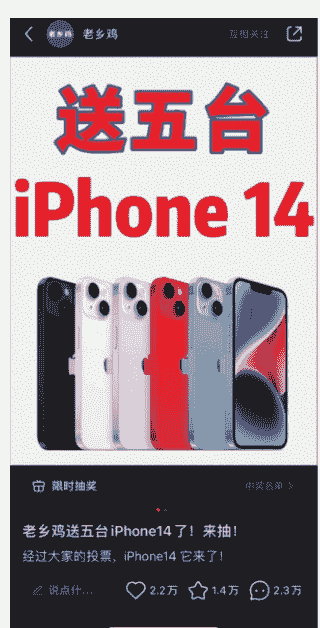

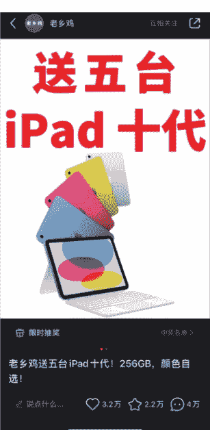

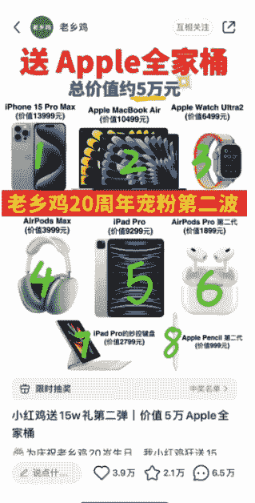

2. 紧跟当下热点
   结合国庆、五一长假抽旅游基金，在情人节送花，在高考结束后送旅游金等。

再比如，“xx搭子”的热词盛行时，抽工作内容简单但工资高的小红鸡助理作为奖品。

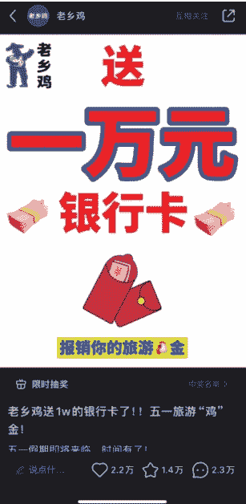

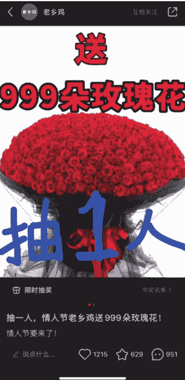

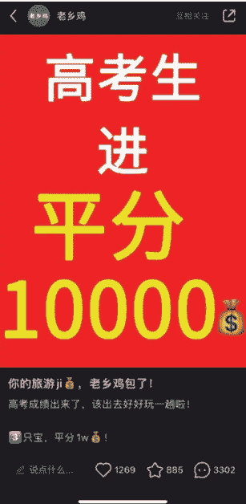

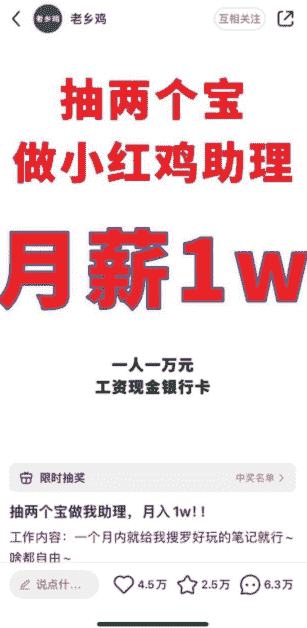

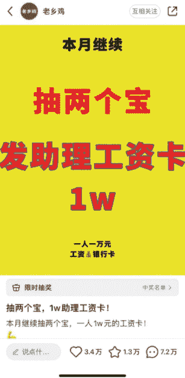


3. 引流方式新颖
   - 使用肯德基的“疯狂星期四”发疯文学。
   - 敲董事长的门，拿董事长的钱包，给粉丝抽奖。
   - 用户共创，如“我在大润发杀鱼的梗+抽奖给钱替上班”。


4. 大奖中奖公示
   坐实宠粉人设，为新抽奖引流。


5. 日常爱抽包括但不限于自己公司产品的小奖
   - 肯德基“疯狂星期四”
   - 王者荣耀皮肤
   - 1000元老乡鸡卡


V50，去吃肯德基
大家好
我是老乡鸡的小红鸡
我正在吃我最爱的麦当劳


挑战满足粉丝心愿第一天｜公主喜欢新衣服吗
艾琳公主有的新衣服，
我的公主也得有～


谁的老乡鸡尊贵VVVIP黑卡掉了啊？
被我捡鸡蛋的时候捡到了～
2022-08-10 15:32

6. 手抽小奖在评论区公示，@中奖者并置顶评论


老乡鸡

今天是肯德基疯发作最严重的一次，躺在床上，拼命念肯德基的名字，难受得一直抓自己眼睛以为刷视频没事，看到视频都在推他的视频，眼睛越来越大都要炸开了一样，拼命扇自己眼睛越扇越用力，扇到自己眼泪流出来，真的不知道该怎么办，我真的想肯德基想得要发疯了。我躺在床上会想肯德基，我洗澡会想肯德基，我出门会想肯德基，我走路会想肯德基，我坐车会想肯德基，我工作会想肯德基，我玩手机会想肯德基，我盯着路边的肯德基看，我盯着马路对面的肯德基看，我盯着地铁里的肯德基看，我盯着网上的肯德基看，我盯着抖音别人合照里的肯德基看，我每时每刻眼睛都直直地盯着肯德基看，像一台雷达一样扫视经过我身边的每一个肯德基，我真的觉得自己像中邪了一样，我对肯德基的念想似乎都是病态的了，我好孤独啊！真的好孤独啊！！

2022-04-28

五一自在畅选大桶

畅选 13件

详情描述：五一自在畅选大桶：经典主食选3件，美味...

老乡鸡 作者

@一只小小怪 @野味爱哼唧 @九月 @周周要脱单 @小王爱吃蒜（减肥版） 炫肯德基🍗

置顶评论

2022-04-29

10+

8

请选择主食3份

小王爱吃蒜

好幸福🥰🥰

香辣鸡腿堡 x3

2022-04-29

登录后评论

1k+

1k+

1k+

1k+

> 【总结】
> ·抽奖图片大字报，标题直接把抽奖的数量和金额直观表现出来。
> ·大抽奖要紧追热点，做第一人。
> ·除大抽奖外，还需要非本公司产品的小抽奖，例如“v50”。

#### （二）用户共创类

##### 1. 搞笑+玩梗

（1）鸡生鸡蛋，打碎的鸡蛋是鸡的儿子，贴合老乡鸡品牌，配搞笑文案。
（2）用户发帖问摔断了老乡鸡筷子怎么办是否需要赔偿，老乡鸡直接截图发帖回复不用赔钱，并表示自己也经常不小心摔坏东西，以幽默的语气安慰用户。


我是真的会心痛!!
辛苦生蛋一整年
打翻只需一秒钟
我的儿!!

特此声明：在老乡鸡摔断筷子，不用赔钱
实不相瞒
我摔坏的餐具，打烂的鸡蛋数不胜数
😭😭

##### 2. 重视用户+表明态度

1. 不是只看得见夸奖，客诉也同样重视。
2. 拿砖头跑到研发中心，询问好吃的菜品怎么总是下架。
3. 食品安全问题，向从餐食中吃出餐巾纸的用户官方道歉，并郑重声明。
4. 自查自纠食品安全问题，给消费者们一颗定心丸。


##### 3. 饮食健康

当代人越来越关注健康与减脂，在用户的推动下公布500大卡套餐和菜品热量表契合热点，与霸王茶姬的卡路里表有异曲同工之妙。


#### （三）玩梗人设类

##### 1. 社会热点

###### （1）高考

- 高考录取填志愿期，老乡鸡发文询问清华好还是北大好。
- 高考录取填志愿期，老乡鸡发文表示分数达到了784分，怎么进不了复旦大学？原来是芝麻信用分。
- 高考出成绩后，收留高考心碎男孩，贴合老乡鸡经常点赞帅哥的行为，配土味大字海报。


###### （2）春节

- 春晚加上幽默搞笑的话语，用大字海报吸引大家，如老乡鸡要上春晚。文案幽默，老乡鸡不上春晚，契合大润发名梗，“我在大润发杀鱼”。
- 年货，过年年轻人打王者荣耀，送王者荣耀新皮肤。


###### （3）疯狂星期四

文案采用发疯文学“v我50，让我们一起谢谢鸡”。


###### （4）疯狂下属

- 给董事长报名综艺《男生女生向前冲》。
- 男生女生向前冲的帖子后续，配上热门歌曲“怎么也飞不出，花花的世界”。
- 老板画大饼
- 老乡鸡收藏夹都是帅哥
- 职场高情商：董事长开会嗑瓜子，如何提醒他


帮董事长报名了，拿了冰箱分你们
@束从轩 董事长，加油！！我们相信你可以的！
[表情]


“董事长这身法会拿不到大冰箱？之前偷拍的董事长打太极的视频，看得出来这个... 展开全文


##### 2. 品牌联动

###### （1）老乡鸡和周黑鸭的CP梗

- 老乡鸡和周黑鸭炒CP人设，老乡鸡咯咯咯与周黑鸭嘎嘎嘎，配合被董事长抓包的梗，粉丝在线嗑CP。
- 周黑鸭出轨了？本来和老乡鸡在一起，又和肯德基在一起了？
- 老乡鸡点名菲诺，承认只是普通朋友。


###### （2）官方号点名盒马和星巴克互动

- 盒马的招牌少字
- 星巴克洒地上了


##### 3. 公益

- 老乡鸡免费提供米饭
- 物资捐赠


##### 4. 用户共创

借“我在大润发杀鱼”的梗，玩“给钱替我上班”的游戏。


##### 5. 官方联动

将董事长与老母鸡P图在一起，贴合品牌形象，在小红书官方主题下玩梗。


##### 6. 抽奖

- 小卡片：老乡鸡卡；定位：汤臣一品；共享单车：限量版“法拉利”。
- 敲董事长的门，拿董事长的钱包，给粉丝抽奖。


##### 7. 其他

###### （1）名字梗


###### （2）CP梗


- 奥特曼：“你相信光吗？”
- 把开店通知包装为机密文件


拍到知名优质偶像来老乡鸡干饭！！
你相信光吗？
❤️


老乡鸡内部机密文件遭曝光！！！
刚才看到公司发的文件，我已经激动的不行了！
管机密不机密直接给你们看了，快看啊！！

###### （3）疯狂下属


我已经够勇敢了，该遗憾的不是我！
@家从轩
2023-04-17 10:17

发现送给董事长的绝佳礼物！！
送这个给摔了腿的董事长
他就可以和小鸟一起快乐漂移了！！
我真的太贴心了~


谢谢董事长批准！！
@家从轩
2023-04-17 10:17

老乡鸡
互相关注
有这样的董事长，真是我的福气，@家从轩 送到
到你老板办公室去喝茶吧！！

### 二、洁柔账号爆款笔记分析


#### （一）抽奖福利类

爆文公式：预热+玩梗抽奖+引流

- 抽奖礼品：华为全家桶、华为mate 60、iPhone 15、iPad、5000元哈尔滨旅游基金、1万元旅游基金、1年纸巾自由等。
- 派送福利：定期派纸、新品试用、香水、霸总周边、铁粉礼等。

##### 案例

###### 1. 旅游基金（现金）抽奖

标题：抽1位马铃薯公主送去哈尔滨

数据：4万点赞、1.8万收藏、80560评论


洁柔 🟢 洁柔
互相关注

###### 抽1位马铃薯公主送去哈尔滨

尊贵的马铃薯公主
请查收你的哈尔滨旅游基金！

#用洁柔当霸总 #一起囤洁柔 #洁柔 #哈尔滨 #小土豆 #冰城 #马铃薯 #公主 #抽奖 #免费 #旅游 #免费抽奖 #游玩攻略 #旅游攻略 #旅行推荐官 #旅游推荐 #旅行 #宠粉 #纸巾

2024-01-01 广东

共 80560 条评论

洁柔 🟢 作者
song纸！👑霸总女人专属👑

置顶评论

01-01 广东

♡ 3651 💬 4202

白茶清欢
我，第一

01-01 广西

♡ 291 💬 回复

展开 4201 条回复

洁柔严选
小助理也想给大家抽平板 有没有霸总的女人支持一下
🥰🥰🥰

说点什么...

❤️ 4w ⭐ 1.8w 💬 80560

本篇笔记爆的点：

1. 标题：直球式标题，直观描述“抽×位马铃薯公主送去×”，简单明确。
2. 封面：大字海报，明确“可折现5k”这个点，对用户有价值，多方位地吸引用户群体，引发读者好奇心。
3. 热点：结合当下热点，近期哈尔滨热度高，用户会向往去哈尔滨玩、凑热闹，吸引力较强。

对比同类型旅游基金和日薪体验官抽奖，我们可以发现其他笔记的缺点：

1. 缺乏热点玩梗内容，内容相对比较单调，对用户吸引力不够大。
2. 虽然抽奖金额比较大，但是文案中没有体现“可折现”这个点，用户对现金的期望度比较高。
3. 这三篇内容里均有提到要求，相对于“马铃薯公主”的内容没有那么直观简洁。

#### （一）抽奖福利类

爆文公式：标题+大字海报+热点

##### 案例

###### 1.现金抽奖

标题：抽×位马铃薯公主送去×

数据：1.2万点赞、1.1万收藏、10000+评论

> 【总结】

- 直球式标题：“抽×位马铃薯公主送去×”，开门见山，吸引力大。
- 大字海报形式图片：把抽奖金额直接放在图片上，再加上“可折现”字眼，多方位地吸引用户群体。
- 热点：结合当下热点事件发起抽奖，影响力更大，用户会向往过去玩、凑热闹，吸引力更强，从而提高用户参与度。

###### 2.礼品、产品抽奖

标题：免费的华为全家桶，就在今天！！

数据：2.1万点赞、1.2万收藏、31163评论

本篇笔记爆的点：

- ①标题：紧迫感标题，“xxx，就在今天（现在）”，体现出抽奖、送福利的紧迫性，让人感觉现在不点进去就会错过活动。
- ②封面：开门见山，直接上赠送礼品图，所见即所得。
- ③豪气：赠送礼品多且金额大，实用性强，对用户吸引力大。

对比同类型礼品、产品抽奖内容，我们可以发现其他笔记的缺点：

- ①标题缺乏紧迫感，“正在送xxx”这种标题相对没有“xxx，就在今天（现在）”的紧迫感。
- ②赠送礼品不够吸引眼球，对用户吸引力不够大，可考虑送大奖或吸引度高且实用的礼品。
- ③缺乏热点与玩梗内容衔接，不够有趣味性，抽奖可结合近期热点事件玩梗，突出品牌会玩、宠粉的人设。

> 【总结】

- 紧迫感标题：“xxx，就在今天（现在）”的标题公式在前10篇爆款笔记里出现了5次，且排名在前5位，标题体现出抽奖、送福利的紧迫性，让人感觉现在不点进去就会错过，打开率和“三连”的数据高。
- 大字海报形式图片：把抽奖产品直接放在图片上，再加上“免费”字眼，吸引力大，开门见山，简洁直观的词汇可快速给用户传递信息。

###### 3.抽奖引流

标题：被霸总指到的人都中奖！

数据：1008点赞、258收藏、656评论

本篇笔记爆的点：

- ①标题：玄学标题给人“我刷到就中奖”的错觉，引起用户好奇心，会吸引用户点进去，提高笔记点击率。
- ②封面：大字海报形式图片，把信息直接放在图片上，开门见山，简洁直观的词汇可快速给用户传递信息。
- ③内容：有引导互动性，有点玄学、锦鲤类的内容，吸引力较高。

对比连载引流内容可发现：

- ①账号连续性更新同一类型的引流贴，会降低用户对抽奖的兴趣，用户也会对账号产生信任危机，给人一种一直在宣发抽奖但不开奖的感觉。
- ②图片虽然是以大字海报形式呈现，但是图片上的内容只做引导性，缺乏趣味性。

> 【总结】

- 紧迫感标题：“被xx指到的人都中奖”“xx礼物就是你的”，标题要有强有力的引导，引起用户好奇心。
- 大字海报形式图片：把抽奖产品明细直接放在图片上，吸引力大，开门见山，简洁直观的词汇可快速给用户传递信息，也可以使用实拍图，给笔记增添真实感，拉近用户距离。
- 内容：需要有点玄学、锦鲤类的内容，吸引力较高。

#### （二）用户共创类

爆文公式：回应+实时共创过程+产品推出

共创内容：纸巾改版（五层改四层）、香水、美术生、洗不烂纸巾、草间弥生等。

##### 案例

###### 1.纸巾改版

标题：因为一条笔记，洁柔的纸巾要改版了？！

数据：4245点赞、296收藏、1753评论

纸巾内卷能不能停......
今天才发现新买的纸巾是5层的。。
试问纸巾从一开始的3层卷到4层到现在的5层，
意义是什么？

本篇笔记爆的点：

- ①标题：“因为×××，我们要改版（出新品）啦”，直观地告诉用户，我们要执行了，就是宠粉。
- ②封面：开门见山，采用当时热度最高的图片，视觉冲击力大，容易吸引读者目光。
- ③内容：互动性内容，询问意见，提高用户参与度，让用户有发言权。

###### 2.香水共创

标题：他们卖的香水，好像是从我这免费进货的

数据：3098点赞、823收藏、1520评论

因为一条笔记，洁柔的纸巾要改版了？！
今天刷到@菠萝花和金花花 反馈的纸巾规格问题【现在一张纸巾都5层了，是不是有点浪费】
霸总已经让产品改版了！
-
本霸总的女人必须重视！
“只在乎您”从来都不是说说而已！！
#用洁柔当霸总 #一起囤洁柔 #洁柔 #洁柔油画
2023-03-30

共 1753 条评论

废话本霸总不多说了！在线爪3个人送纸！！
置顶评论
2023-03-30
♡ 1266 ○ 373

刚刚好家里的一箱洁柔用完了，你懂我的意思吧？[表情] 补一句：我是小学生[表情]
2023-03-30
♡ 410 ○ 回复

展开 372 条回复

力推三层十张！不管是上厕所还是擦嘴，这个厚度和张数都是最好的！！！！！！！
2023-03-30

本篇笔记爆的点：

- ①标题：玩梗卖惨，直观地告诉用户，我们已经出香水了，还在闲鱼上被倒卖。
- ②封面：开门见山，采用闲鱼上倒卖的截图，图片真实性高，容易吸引读者目光。
- ③内容：互动性内容，引流回到香水抽奖帖子上，霸总也正在免费派送香水，告诉粉丝不需要在闲鱼上买。

###### 3.高考、美术生联动

标题：接下来，你一定会收到梦想的录取通知书！

数据：4203点赞、177收藏、127评论

本篇笔记爆的点：

- ①标题：“接下来，你一定会收到×××”给人心灵寄托感，会吸引用户点进去，提高笔记点击率。
- ②封面：采用用户热帖的截图，图片真实性高，做出一个事情的回应，直接向用户传达洁柔是一个“有认真在看用户的需求，时刻关注用户，以用户为中心”宠粉的霸总人设。
- ③内容：承接孔庙祈福+高考季的热点，内容简单明确，传达一种好运即将降临的愿景，可以提高互动率。

> 【总结】
用户共创是一种能快速与用户拉近距离的低成本营销方式，关注度也会高，对于品牌来说，更接地气，也可以更好地打造“洁柔霸总宠粉”人设。
后续我们可以持续多更新与用户共创的内容，需要多看多刷平台帖子，有合适的用户共创帖子就尽快跟进，把这块内容做得更好一些。

#### （三）品牌联动类

爆文公式：抓住热点+玩梗联动

联动形式：国货联盟、国货锦鲤礼包等。

##### 案例

###### 1.国货联盟

标题：国货联盟！！霸总第一个举手

数据：1.5万点赞、761收藏、16469评论

本篇笔记爆的点：

- ①标题：“xxx，霸总第一个举手”直观地告诉用户，我们的行动力很强。
- ②封面：采用用户意见的截图，也是在直白地告诉用户，我们真的听劝，让用户参与其中。
- ③内容：表明态度，介绍自己，与蓝V认证的国货品牌联动，简单明了，响应国货风波的号召，凝聚力非常强！
- ④热点：在“花西子79哪里贵”的热点流量扶持下，联动国货，组建国货联盟，凝聚力非常强，容易吸引国货品牌和对应的国货粉丝群体，具有黏性强、转化率高的特点。

###### 2.国货锦鲤礼包

标题：国货锦鲤大礼包，180+家只送一人！

数据：2024点赞、1141收藏、1578评论

本篇笔记爆的点：

- ①标题：“xxx，180+家只送一人”引起用户好奇心，会吸引用户点进去，提高笔记点击率。
- ②封面：奖品数量多，颜色鲜艳抢眼，比较吸睛。

内容：简单明了，表明态度，立好人设，主打宠粉！

> 【总结】
- 紧跟热点：我们要学会抓住热点，利用热点做事件营销、品牌联动。
- 多与品牌互动：增加曝光量和互动量；提升品牌和影响力，也可以让品牌有较高的信誉度和公信力，让更多的用户信任个人品牌，同时官方平台也会提供很多资源，帮助蓝V企业的互动。

#### （四）热点营销类

爆文公式：抓住热点+玩梗联动

热点事件：淄博派纸、孔庙为高考学子祈福、国货热潮等。

##### 案例

###### 1.蜂花缺箱子国货热

在花西子事件后，蜂花因玩梗出圈了，洁柔抓住热点，和蜂花来了一波互动，创建国货联盟，回应用户以为洁柔是“宝洁”旗下或者外国品牌的疑问，向用户介绍了一波品牌，趁热打铁告诉大家洁柔是国货，同时关联上品牌45周年宣传，打造品牌好感度。在热点风波的流量扶持下，笔记均过千点赞。

###### 2.淄博烧烤热

2023年4月份开始，“淄博烧烤”话题持续火热并吸引了全国各地的关注。洁柔紧跟热点，到淄博高铁站送纸，用帅哥吸引游客，也引起用户对品牌的关注，给品牌宣传起到一个很好的效果，笔记点赞数破6000，总互动量达到7000。

> 【总结】

- 紧跟热点：做第一个，不做第二个，热点就是流量密码，蹭热点能满足人们的参与感。大家都知道，人与人之间有共同话题才有的聊，而热点事件就为我们的沟通搭建了一个平台。大到国际形势，小到娱乐花边，这些都能成为我们讨论的话题，当所有的社媒平台都在讨论这个事件，就会增强用户的参与感。

- 掌握好蹭热点的度：蹭热点很有必要也很有前景，但是玩好热点却不是那么简单。对于热点，我们要蹭，而且要会蹭，不能做热点的穿堂风，更不能做热点的神经病。要知道结果有两种，要么玩得好，要么玩完。

#### （五）玩梗人设类

爆文公式：趣味性玩梗+帅哥变装+霸总宠粉人设

内容方向：帅哥变装、B站魔性玩梗视频、霸总日常宠粉等。

##### 案例

###### 1.帅哥变装

标题：这个游戏你们觉得好玩吗

数据：9125点赞、1092收藏、358评论

笔记爆的点：

符合当代年轻人的审美。

一共发布11条帅哥变装视频，其中8条点赞过千，剩余3条点赞量超400，内容比较符合当代年轻人审美，很多品牌也在做男色经济，比如望山楂、书亦烧仙草、椰树、封神的质子团、河南文旅等。

> 【总结】
- 符合年轻人审美：帅哥变装是一直都有的，而且热度不减，谁不爱看帅哥？帅哥能让用户上头，反复观看。
- 趣味性玩梗：内容有趣味性，观看过程不乏味，玩梗恰到好处，且有共鸣点，能激发用户互动。
- 多与颜值博主合作推广新品：共发布11条，8条笔记点赞均在1000+，剩余3篇点赞超400，流量相对不错。

###### 2.霸总宠粉人设

标题：请问一下，有人想试用香水吗？

数据：1231点赞、743收藏、2315评论

本篇笔记爆的点：

- ①封面以大字报形式，“抓×××个女人免费试用霸总香水”，把抽奖产品直接放在图片上，再加上“免费”字样，吸引力大，开门见山，简洁直观的词汇可快速给用户传递信息。
- ②豪气：赠送礼品多且金额大，实用性强，对用户吸引力大。
- ③文案语气用得好，“抓女人”“爱霸总”都体现了霸总宠粉的人设特点。

###### 3.品牌声明有趣一点

标题：关于“洁柔洗衣液抽检不合格”声明

数据：2510点赞、698收藏、5382评论

###### “洁柔”等13批次洗衣液产品抽检不合格的最新相关信息

13批次洗衣液抽检不合格 详细名单曝光！
13批次洗衣液抽检不合格 详细名单曝光！近日，市场监管总局通报136批次衣料用液体洗涤剂产品质量国家监督抽查情况。其中,13批次...
海峡都市报 18分钟前

本篇笔记爆的点：

- ①封面背锅形象有趣有梗，吸引力大，开门见山，简洁直观的词汇可快速给用户传递信息。
- ②声明简要，直述观点，解释到位，事件有议论点，评论5000+。
- ③符合霸总人设，“全网寻用户免费试用新品”，会引起用户体验心理，参与度高。

#### （六）产品联名类

爆文公式：联名过程+征求粉丝建议+产品推出

联名品牌：霸王茶姬、卡皮巴拉等。

##### 案例

###### 1.霸总茶姬纸巾盒联名

标题：霸总茶姬（限量版）来了！

数据：5646点赞、784收藏、3798评论

本篇笔记爆的点：

- ①标题：“xxx来了”，直观地告诉用户我们做出来了，主打一个宠粉。
- ②封面：实拍图，给笔记增添真实感，拉近用户距离。
- ③热度：霸王茶姬这款纸巾盒本身自带热度，很多用户会自己制作，洁柔帮用户做出来也是自带热度流量的，满足用户需求，有话题性。

###### 2.卡皮巴拉产品联名

标题：霸总×豚豚=?

数据：2372点赞、804收藏、1704评论

本篇笔记爆的点：

- ①封面：直接晒出联名设计稿，直观地表达出联名产品正在执行期间。
- ②内容：征求用户信息，把参与感拉满，霸气地宣传新联名。

> 【总结】
- IP联名：产品周边以及品牌联名是目前很多品牌都会做的，一个好的IP联动能引起不少热议，譬如与瑞幸、喜茶这些品牌的联名，很多都是出圈的。
- 要结合热度：没有热度的IP联名，对品牌没有帮助，要选择话题性高或热度高的IP。

#### （七）玩梗卖货类

爆文公式：趣味性玩梗+带货链接

内容方向：霸总文学、互动性内容等。

##### 案例

###### 1.繁花的卖货帖

标题：你好香，我势必拿下你

数据：1704点赞、420收藏、285评论

本篇笔记爆的点：

- ①图片是简单的实拍产品图，简洁明了，但又与文案联系不到一起，会让人有种捉摸不透的感觉，可以引起用户好奇心。
- ②文案以霸总口吻叙述，内容有趣，能让用户有讨论的兴趣。

###### 2.互动性内容的卖货帖

标题：嚯！玩这么大

数据：1135点赞、133收藏、294评论

本篇笔记爆的点：

- ①图片上放一个实拍图，“每人仅限免费观看一次”，引起用户好奇心，会求证是否只能免费看一次。
- ②标题有噱头，“嚯，玩这么大”就是一个很有吸引力的话题，每个人都有八卦心理，好奇到底是个什么事，提高了笔记点击率。
- ③内容简单明了，打直球，送香水，霸气又有吸引力。

> 【总结】
- 标题：要有吸引力或者讨论性，才能引起用户关注点击。
- 封面：简单有趣，要有吸引力才会有点击。
- 文案：可以植入一些玩梗内容，别太过于硬广推销。

现在洁柔的小红书矩阵已经有200多万粉丝，成为快消品官方账号里粉丝数非常多的品牌之一，也成了很多人学习的对象，有许多人贡献了很大的价值。总体而言，爆款笔记可以归纳为以下七类。

##### 1.抽奖福利类

植入热点或者玩梗，奖品金额多少不能决定笔记是否能爆，有趣的抽奖才有效，譬如送马铃薯公主去哈尔滨、抽一位尊贵的公主去新加坡，结合热点事件下的抽奖关注度更高，参与度也会更高。

##### 2.用户共创类

重视用户感受，分享共创过程，让用户参与其中；我们可以多挖掘用户UGC，多创作互动性内容，询问用户意见，打造霸总宠粉人设，用户共创类笔记是比较容易出爆款的，譬如香水共创、纸巾改层数、美术生联动，都能提升品牌形象，让用户感受到我们在用心做产品，用心听劝。

##### 3.品牌联动类

品牌联动是官号不可缺少的活动，品牌联动可以快速提升品牌影响力，也可以让品牌有较高的信誉度和公信力，让更多的用户信任我们的品牌，同时官方平台也会提供很多资源，帮助蓝V企业的互动，要学会跟紧热点事件，若可以根据热点事件联动。我们可以第一时间拉动品牌，在这方面，我们需要提高对热点的敏锐度，精准出击，譬如国货联盟。

##### 4.热点营销类

在热点事件发生后，我们应快速地想好，我们品牌可以做什么来蹭热点，学会做热点跟进的第一个品牌。热点就是流量密码，蹭热点能满足人们的参与感，蹭热点很有必要也会很有发展前景，譬如淄博派纸、孔庙祈福、哈尔滨派纸等。

##### 5.玩梗人设类

内容有趣味性，要玩梗玩得恰到好处，且有共鸣点，这样才能引起用户互动，提高点击率。如2025年我们玩梗内容上多以“男色营销”+“宠粉”为主，绑定和稳固“霸总”人设让用户一想到霸总就想到洁柔。

##### 6.产品联名类

要联合热度高的IP，与没有热度的IP联名，对品牌没有帮助。我们明年可以多做这一块内容，产品周边以及联名是目前很多品牌都会做的动作。一个好的IP联动能引起不少热议，譬如与瑞幸、喜茶这些品牌的联名，很多都是出圈的。

##### 7.玩梗卖货类

可以植入一些玩梗内容，别做硬广推销，用户会反感品牌做硬广推销的。内容和标题要有吸引力或者讨论性，才能引起用户关注点击，提高笔记曝光度以及转化成交。

## 附录

### 专访吕白：小红书企业号还能这么玩

在小红书做企业号，一直是很多品牌头疼的问题。在短短两个多月内，@洁柔纸巾 的官方账号却凭借“霸总”人设，在小红书迅速揽粉8万+，产出爆文笔记达20篇。

为此，千瓜数据特约采访了中顺洁柔首席内容官吕白，在深度沟通后我们总结出品牌在小红书做企业号的五个方法，供大家参考借鉴。

- 1.账号人设与核心内容规划。树立品牌人设，构建人物小传，通过研究小红书用户关注焦点，挖掘可以与人设产生交集的热门话题方向，对账号运营进行详细梳理与规划。
- 2.深入贯彻品牌年轻化战略。善于玩梗、造梗，做一个有意思、有内容、有价值的品牌。
- 3.账号抽奖玩法、私域运营。基于人设出发，丰富抽奖预告形式，激发用户活跃度，善用抽奖工具但并不依赖工具，同时在私域的运营过程中利用人设拉近品牌与用户的关系。
- 4.运营互动技巧、产品价值打造。和用户做朋友，听取用户建议并及时给予反馈，为产品赋予情绪价值，在与用户互动的过程中获取更多内容灵感。
- 5.爆款研究、品牌联名。深耕行业底层，分析标杆爆款，多与同行交流经验，借助联名实现品牌共赢。

#### 一、营销4.0：树立人设，打造口碑

千瓜：为什么选择入驻小红书呢？您觉得品牌在小红书做账号的最大价值是什么？

吕白：洁柔现有用户中女性占据相当大的比重，一方面这与小红书平台的用户画像相符，另一方面我们则是希望能在小红书上对用户进行种草，将品牌年轻化。

当前大环境下，其实有很多新消费都来源于小红书。我们认为营销分为四大阶段：1.0是“上央视”，什么产品只要上央视后就大概率能火；2.0是“多屏幕”，就是从央视再到各大卫视；3.0是“相信人”，通过明星或KOL推荐带火产品；4.0则是“算法+口碑”，年轻消费者在做消费决策之前一定是先去小红书这类平台上搜一搜，而小红书便是我们选择种草、树立口碑的一个比较好的渠道。

能更接近用户，了解更多细分用户的需求，听到用户的声音，有一些特别好的点我们能继承发扬。再有就是推新品，做小红书便是给我们新品建立的一个免费的推广流量池。

#### 一、会玩梗：破圈联动，提升互动体验

千瓜：洁柔纸巾账号经常和一些品牌互动，如美菱、盼盼、老乡鸡，是什么原因让您去做这件事呢？效果怎么样？

吕白：其实很多品牌都会抱团合作的，因为大家的受众用户有一部分一定是重合的。像老乡鸡这些品牌出圈都是因为他们给品牌赋予了一些人格化的内容，那么关注他们的都是一些有意思的人，这些人也会喜欢有意思的品牌。

品牌跟品牌之间做一些联名、你来我往的互动，一是有助于双方粉丝的互换，二是可以在用户心中持续强化品牌的人设印象。可以看到这些内容的数据都是不错的。

千瓜：品牌账号在与用户互动时，需要注意哪些方面呢？

吕白：最核心的就是品牌人格化，大家就像朋友一样，与用户互动其实就是为了更贴近用户。

基于人设，我们在回复用户的时候也会尽可能地用“霸总”语气和用户互动，而且在新媒体上能够很快知道用户在想什么。譬如我推一个产品，用户是否喜欢，都能够在这个互动过程中及时得到答案，同时也会形成很多有趣的梗，吸引到更多感兴趣的用户，也让我们收获了惊喜与感动。

在人设持续影响下，一个大众化的品牌便会在用户心中拥有“一张脸”，这是件非常美妙的事情。同样是纸，用户愿不愿意买一个有趣的纸，愿不愿意买一个会玩梗的纸呢？

归根结底，其实我们做的是为产品赋予更多的情绪和情感价值，因为纸的背后是故事，比如你哭了、笑了、你的孩子流口水了、上厕所忘记带纸了，有很多可以挖掘的点，都是可以通过内容或互动来影响用户的。

#### 三、小红书企业号建议：公域投放，私域构建

千瓜：关于小红书达人投放，品牌做了哪些动作，会更注重哪方面呢？

吕白：过去我们合作了近千个小红书达人，投放效果还是蛮不错的。

小红书平台鼓励用户创造内容，所以我们不会强制他们去发布一些固定的东西，而是先做出几篇爆款笔记，给他们树立一个标杆，那么他们也会自发地去参考，往标杆的方向靠拢。

千瓜：您如何看待将小红书公域流量引流到品牌私域？可以谈谈您的经验吗？

吕白：目前阶段洁柔小红书账号承担的职责还是以品牌宣传为主，但是我们建立了小红书粉丝群，更多的是希望它能帮我们完成一些冷启动，比如账号发布笔记之后我们会发到群里，引导大家来参与互动。

建群的核心是我们想拥有一群可以每天在小红书上夸品牌、为品牌说话的粉丝，这样就能形成一个正向的循环。

拥有品牌粉丝是账号发展的基础，一个品牌在小红书上发展得好不好，我总结了三点：一是官方账号的活跃度，二是品牌相关笔记数，三是品牌爆文笔记数。一和三尤为重要。

千瓜：您有什么建议可以给到想要在小红书做企业账号的品牌吗？

吕白：人设是品牌账号打造的核心，一个人格化、有人文温度的品牌是账号增长的重要前提。

第二点则是要深入行业底层，例如通过加入行业群，与更多有经验的从业人员深入探讨行业资讯与风向，交流运营心得。

第三点是多做爆款分析，可以发现很多爆款内容往往都是重复的，通过研究爆款，能更快地为账号内容打造提供灵感来源。

第四点则是要善用工具，切忌被工具反噬。例如抽奖于品牌账号而言，只是涨粉的手段之一，要时刻谨记做小红书企业账号的目的，是去打造一个真正有内容价值的宣传渠道。

最后一点就是需要运营小红书品牌号的人员，能够在运营的过程中找到成就感，让自己的快乐源于他所创造的内容和用户提供的反馈。

[1] 果集·千瓜数据显示：洁柔纸巾账号粉丝中女粉占比高达93.56%，且年龄在18—24岁的年轻用户占比为48.86%。

[2] 果集·千瓜数据显示：#霸道总裁 在小红书话题浏览总量高达1.63亿，其相关话题#霸道总裁只认他、#霸道总裁爱上我 的话题浏览量也高达千万。

## 后记
帮更多人少走弯路

2025年马上要结束了，在这里，我回首2025年。

### 一、开始领悟“万物皆空”

真正开始对“万物皆空”这个概念有了更深的体会。空的本意是不断往外拿，就像是容器一样，把装在里面的东西挨个拿走，才能空。

就好像当老板一样，只有舍得花钱，才能获得更多的钱，如果不舍得花钱，后面都做不大，比如华为，比如胖东来。

再比如我们现在公司的创始人一生践行的话，“分权、分责、分钱”，简单的六个字，蕴含着不可估量的力量，他凭借这股力量把公司做到了百亿市值。

分钱时候的动念是真诚的，所以回来的钱也是至纯的，不会装到容器里，而是成了容器本身。

同理，想获得爱，就要给爱，就要真诚，就要热切，不计成本地付出爱，哪怕短期内被伤害，但迟早会有爱。

其实核心是“我要给予”。

也真正理解了痛苦的本源，就是要把“功名利禄”往“我”这个容器里装。

起心动念都是“我要获得”。

“我”要往“我”这个容器里，拼命地塞东西，所以进入我执。

我想可能断舍离的概念也是一样，让你把家里收拾干净，因为家也是内心的投射，“一屋不扫，何以扫天下”可能也是类似吧。

想了想我自己可能能有一些福报的点，是我在写书的时候，我把我认为真的好的东西都真诚地给了别人，然后确实也帮了很多人。

最好的利己其实是利他。

### 二、本自具足，莫向外求

米兰·昆德拉说过一句话：“除了生病以外，你感受到的痛苦，都是你的价值观带给你的，而非真实存在的。”

我深以为然。曾经我认为我一定要在“北上广深”买一个大房子，要活得很好，不然感觉人生白活，并一直为了这个目标而努力。

当我拥有了这个能力，有了一定的财富，至少能在北上广深也能活得不错的时候，我反而感觉，我现在的生活其实挺好的：因为工作来这个三线小城市，只花不到4000元就能住上四室两厅的江景房，漫步在城市街道的时候，我就在思考，我曾经的目标到底是什么？

出人头地？拥有更多的财富？被更多人认可？

确实是，但这些其实都是向外求，不是向内求。

向外求太痛苦，事业的波折、人生的起落都是常态。

我后来思考，我的人生就是来体验的，有波折只是为了增加我的体验感，我才是主角。就像是：“一切有为法，如梦幻泡影，如露亦如电，应作如是观。”

世间万物都是无常、空虚和无我，如同梦境、幻影、泡影、露水、闪电，都是短暂的，生与死都是虚幻，但经历和感受都是真的。

### 三、成人达己

没带电脑，用手机打字太累，我用地图搜了一下附近，看见一个网吧叫网鱼，走进去，店员问我要不要注册会员，会员半价。我打算注册，但一查，他说我之前已经注册过了，到现在已经快八年了。

我还是我。

只是从大厅换到了包间。

从游戏换到了写字。

从62kg到75kg。

物质上好了一些，趣味也变了一些，体重也重了一些，焦虑也少了一些。

当年思考的是如何毕业就拥有一份月薪破万的工作。

此刻思考的是，如何能更好地帮更多人在新媒体的道路上少走弯路。

成人达己。

（全文完）

## 鸣谢

封面字体_严永亮 内文排版_李鑫

在下小苏 作家张萌 耶鲁学姐笑笑 赛茜 崔璀
肉蟹宝 一只小羊 猫屋Becky 余木 米苏

感谢为本书提供原生内容的小红书博主
感谢为本书提供案例素材的品牌和企业

## 图片来源说明

第123—125页、第149页的图片均由AI制图软件生成