# 小红书爆款底层法则

## 序言

我的天职是让内容被看见

百亿集团首席内容官 吕白

2024年7月24日深夜，我在朋友圈写下这么一段话：

拖了将近一年的书稿终于要交了。写序时翻到与编辑的往来，忽然想起茨威格在《人类群星闪耀时》里写的那句：人到壮年之际认清自己的使命，是生命里最难得的幸运。

我很笃定，传播就是我的宿命，为此而活。将来走的时候，我希望墓志铭上能留下：此人助力中国传播走向世界。

发完之后感触很深。新媒体和这个时代，把我从山东一处山村带到了今天。

到现在我仍不敢置信，2022年当当网市场营销品类销量前四的书是《影响力》《定位》《从零开始做内容：爆款内容的底层逻辑》《爆款小红书：从零到百万粉丝的玩赚策略》，后两本出自我手。

写到这里我停了一下，思绪回到2014年9月29日第一次打开Word的那天。那天我对未来很迷茫，敲下的第一句话是：毕业后哪份工作能做到月入过万？

想起这十年的节律：开机、写稿、拍摄、上课、读书、梳理、复盘，反复循环。

新媒体给了我财富，也给了我在任何一座城市立足的底气。我感激这个平台，感激路上遇到的良师与伙伴，感激时代。

于是我一直在思考，怎么把时代回馈我的东西传递下去，怎么让在互联网里打拼的人少走弯路。

2015年我刚在新媒体小有斩获，有人问我怎么做，我会先想一想，说一些西方传播学的观念，然后会建议先堆量，标题、选题、封面要下足功夫。

2018年再被问起，我会先讲平台差异，然后说抓住二十个关键点即可。

如今再有人问我怎么做好新媒体，我会很肯定地说，其实就三条，简单到让人怀疑，却是真的。

1. 爆款的形态是会复现的；
2. 七成相似度的内容乘以足够多的实验次数，成功率会趋近百分百；
3. 在自己的赛道里拆解五百条头部内容，找共性。

写到这儿，我想起一个失眠的夜晚，朋友圈里一位与我有交集的人写道：

深夜的脑内高潮！

刚听完一场关于内容行业爆款方法论的分享，感觉像是圣经，想把PPT转出来，结果发现无法下载也无法截图，可见稀缺。于是摘了几句有感触的金句：

1. 爆款=目标用户认知+要素拆解+元素重组+定位长板+入口明确+留存明确；
2. 在无短板的前提下要有极致长板，在洞察用户的基础上要超出预期，在击中集体情绪的基础上要引领价值观；
3. 节点间的联结比节点本身重要，个体间的关系比个体重要，信息的流动比信息本身重要；
4. 对内容创新型人才，正向激励比负向更能激发价值；
5. 用爱心做灵魂级的作品，是创作者一生的使命；
6. 人塑内容，内容亦塑人。

我回复：太繁琐了，哪有那么复杂。

他回：白总属于极简派。

我猜他没真正听懂。

很多行业的成事逻辑简单到让人不信，但人们偏爱复杂，偏爱秘籍，幻想自己没成是因为不会九阳神功。其实没有秘籍，只有基本功。

就像黄峥在《财经》访谈里说的：

> 《财经》：2006年段永平花62万美元拍下巴菲特午餐带你去见面，26岁的你觉得重要吗？
> 黄峥：巴菲特讲的东西很朴素，我母亲都能听懂。那顿饭最大的意义是让我明白简单和常识的力量。判断一件事，先弄清背景和事实，弄清后需要的不是智慧，是面对事实时是否敢用理性常识。常识本就显而易见，却常被偏见和利益遮住。
> 段永平还教我，价格围绕价值波动。价格会波动，但价值提升后价格终会靠拢。

意思很清楚：世界表象复杂，本质简单。看得太多未必更好，道法自然。

我认识的身价过亿、十亿、百亿的领军者，给我的建议都是最朴素的道理。没有黑话，没有绝招，简单到极致。

雷军曾透露，王传福多年前的一句话在他造车决策时给了他勇气。畏惧是竞争对手给后来者的心理压制。他们不断说难、投入大、研发难，直到你退出。做不成往往不是能力问题，是勇气问题。

新媒体亦是如此，就是基本功的重复。

请相信我接下来举的例子都能帮你省时间。我花了很大力气才把道理讲得极简。

我的书常被说写得太浅。实话说，把事写得晦涩最容易，堆辞藻、造概念、搞翻译腔，小学生都会。但我不愿那样，因为我清楚新人和小成者真正需要什么。

我想给像当年我一样迷茫的人递一条有光的路。

记住：真传一句话，假传万卷书。

2024年8月3日，广州太古汇，我打开文档写下：“如何让中国新媒体从业者少走弯路，成人达己。”

## 附言

书里写了很多案例和故事，感谢每一个曾信任我的人。其中一些人取得了亮眼成绩，我的作用大概只占五分之一。还有些伙伴我没帮他们做出理想案例，深感愧疚。

感谢学员、恩师与合伙人“活力少女阿珍”。我教你小红书和爆款方法，你教会我体面分开，让格局更大。

也感谢摄影兼导演“购物天才77”。你帮我拿到传统意义上的高薪，也支撑我在新公司的业务从零到一搭建小红书。

最后特别感谢吕白爆款工作室，合伙人牟积学，员工贾楠、田庆东。创业期没让你们在财富上达到预期，很遗憾。但过程里你们确实学会了小红书技能和商业内容的底层逻辑。

这本书既记录了@吕白White从零到十，也记录了吕白工作室的业务与奋斗史，更记录了我从传统老板到学会顺应人性、学会分钱的过程。

我已不想只服务少数人。余下日子，我想走得更远，做更多案例，写更好的书，帮更多曾经迷茫的人走得更远。

## 第二次附言

我的微信用了十年未换，如今好友已八千。

清理群聊时，看到一串标签：创业比赛、搭伙、公众号、腾讯、福布斯&胡润U30、北京、编辑、出版、教育……

往事历历，朋友从相识相熟到陌生离去。

十年，感谢包容与支持，即便曾有分歧，如今看来都是美好回忆。

十年前，我以为成功是财富与地位；现在我觉得成功是做热爱的事，并把每一秒奉献给它。

就像此刻写下这些文字。

## 第三次附言

本书临出版时，我儿子出生。曾请大师取名，寓意成大事的都没选，最后自己取名：怀安。初为人父，只希望他心怀安定，一生平安。

最后感谢妻子，十月怀胎生子，辛苦了。

感谢新媒体改变命运，让我从某某村184号一步步走到今天。

## 第一章
底层逻辑：内容从业者胜出的本质

爆款会重复出现。

我深耕内容十年，从公众号、抖音、快手到如今的小红书。可算赶上红利期。实习时月入过八万，23岁时已是红杉、经纬投的C轮公司高管，同龄人还在找工作时我已拿到税后百万年薪。反复自问，抛开红利，内容从业者胜出的本质是什么？

多年思考，大致归为两点。

一是具备头部思维，在竞争中占据前列。对资源与金钱的追求，本质是赛道排名。体育比赛人们只记第一名，哪怕只快零点一秒。要找到自己的细分赛道，成为细分赛道的头名。

二是必须找共性、找规律。刚写公众号时，我拆解了上千篇十万加文章，发现一个现象：爆款会重复出现。这句话打通了我新媒体的任督二脉。

后来我常对团队说：围棋高手八成时间不在对弈，而在研棋谱。内容人除了练好能力，还要站到更高维度去发现、总结、验证、传播规律。以下四条规律，是我多年的底层认知，分享给你。

### 人设篇：别去对抗大众的既有认知

我有一个学员晓卓，是三甲医院医生。一次沟通我看她账号，问：“你明明是医生，为何不穿白袍？”她答：“简介里已说明，穿白袍还有必要吗？”我说：“有必要，要符合大众对医生的第一印象。”她当时半信半疑，后来一次刚手术完累得不行，没换衣服直接发了条白袍视频，数据很快破千赞。

这个案例想说明：不要去挑战大众的固有认知。你脑中医生是不是白袍加帽子，老师是不是戴眼镜一丝不苟，嘻哈歌手是不是扎小辫唱Rap？心理学里这叫刻板印象。

很多人偏要打破刻板印象做最特别的人。但以我多年的品牌与新媒体经验，不要试图对抗大众认知。我早年读过《定位》，定位的核心不是创造新事物，而是操控心智里已有的认知，重组已有联想。“不要试图改变人类心智”成为定位理论的核心。我多年后也验证了这一点。

我的账号“吕白White”目前21万粉，最初围绕三个标签：内容从业者、逆袭人生、职场高管。选题都是爆款，但职场高管这条线一直不火。后来我研究发现，年龄与形象都不像大众心中的高管。每次参加高管会，其他高管基本都在四十岁以上，成熟稳重，我的形象与刻板印象不符，用户不买单。

我之前在VIPKID做英语老师矩阵，有个老师叫桃子老师特别火。说出去没人信，她本职是外教运营与管理。她火的原因是长相符合大众对教师的固有印象：戴眼镜、微胖、笑容亲和。编导、内容、剪辑都一样，她的数据是别人的万倍。

所以，请审视你的服化道是否符合大众对你身份的刻板认知。

### 流量篇：三种流量，三种逻辑

谈到流量，很多人觉得越多越好，但真的是吗？

我圈子里有个学员JUN姐，做大健康，其中一项业务是汗蒸装修。她参加线下会后立刻搭建矩阵做号，前期主打流量思维，发了很多热点笔记，如周杰伦演唱会视频、全红婵跳水视频，数据都不错，团队觉得流量来了。

过了一段时间她反馈：流量是上来了，但精准咨询只有一条，大部分新增粉丝都是“泛粉”，不是目标客户。她的问题其实是：不知道线上怎么拿到想要的客户。核心在于要明白流量分三种，三种流量与变现的关系也不同：泛流量≠变现，精准流量=变现，IP流量=百倍变现。

先说泛流量。我认为的泛流量是不以吸引目标用户为目的而获取的流量。有些账号从一开始就不设门槛，什么火发什么，这对营销号来说是精准流量，但如果你想吸新手宝妈却长期发演唱会视频，再多流量也是无效流量。什么内容吸什么粉。

泛流量不等于变现，因为变现意味着有人愿意付费，这个人可能是平台、商家或用户。若你吸引来的人群不付费，自然无法变现。

再说精准流量与IP流量。精准流量的前提是精准内容，精准内容的前提是精准定位。围绕商业闭环梳理用户诉求做内容，吸引来的流量就是精准流量，大数据会把内容推给感兴趣的人，用户通过点赞、收藏、关注完成需求匹配，最终成交。

IP流量为何是百倍变现？拿普通图书直播间和东方甄选图书直播间对比，目标用户都是爱书人。但董宇辉带来了一种情怀人设：浮躁时代仍有人坚守心底宁静。所以哪怕价格略贵，大家也愿意买。人设是有温度的，能带来信任与溢价。

营销人设的本质是获取信任流量。有IP人设就像在北京SKP卖货，没人设就像路边摊卖货。人设越好，选择面越大。我的账号“吕白White”常发参加TEDx的照片、去虎嗅分享的照片、获图书大奖的照片，这些第三方背书虽未必数据高，却强化了我的专业IP，让人信任我与众不同。

三种流量并非完全对立，关键是让不同流量发挥作用，最终塑造完整人设，这涉及内容配比，后面章节会展开。

### 实操篇：用性价比最高的方式生产内容

我常对学员说：账号起步期千万别追求一条笔记十全十美，否则一年可能一条都发不出。尤其是兼职做小红书的人，时间和精力都是成本，如何用更少成本获得更快正反馈很重要。下面聊实操中常见问题及对策。

#### 实操问题一：前期如何高效产出内容

1. 确定高效产出内容的形式

我们训练营有个学员@是苹果宝呀，人设是11岁极具天赋的体操、运动、芭蕾小女生，账号由妈妈运营。起步时她尝试图文，一篇要花三个小时，同时间视频效率更高，于是转向视频更合适。

反过来有个学员@陈亿护肤，报名前一直做视频，一年没起色。账号定位、图文审美都没问题，但普通话不标准，上镜不自然，视频门槛高。我建议她转图文，后来她在图文上极有天赋，连续产出爆款。

所以起步要先问：图文更高效还是视频更高效？因人而异。若你是纯小白，我更推荐先试图文。优质视频需要拍摄、剪辑、文案、镜头表现，成本高。图文有模板可用，主要改内容与排版。总之，前期要选投入更少、效果更好、工具更熟、个人素质更匹配的形式。

图文常用工具：稿定设计、创可贴、美图秀秀、黄油相机。视频常用工具：高像素手机、剪映、度加剪辑、轻抖、提词器、打光设备、收音设备。

2. 确定高效产出内容的“姿势”

形式确定后，如何让选题源源不断？

第一个办法：把自己账号已爆的选题继续做，换内容、换场景再拍。

我自己的账号“吕白White”2022年有两篇万赞、一篇千赞笔记。2023年10月我重新发了一个旧选题，数据很快破千。所以要学会在平台找爆款，也在自己的历史爆款里找规律。

补充一个认知：选题重要性>形式重要性>内容重要性。好选题能决定80%流量。“黄金一小时”这个选题能爆，不仅我做出来了，我的学员@复盘一姐靠它获赞20万、收藏15万，相关爆款还有很多，完美诠释了爆款是重复这一理念。

她的内容几乎没改，为什么比我更火？可能因为她看起来更像老师。我还发现，我戴眼镜拍的视频数据明显高于不戴眼镜，更符合用户刻板印象。

# 从人设到心态再到内容：小红书起号的底层逻辑

我常跟人聊一个判断：过度强调专业感会把流量挡在门外，而带点表演张力的人设更容易爆。短视频里能长期吸粉的账号，第一眼给人的印象就是“这人就是干这行的”，精准命中了用户内心的刻板认知。哪怕内容框架和别人高度相似，启动效率也会高出许多。说白了，是天生的匹配感在起作用。

另一条通用路径是把案例变成内容生产发动机。

圈子里一位做云南大理包车业务的朋友刚入场时跟我说想做小红书，因为同行在上面获客很顺，还把账号发给我看。内容质感不算精致，但有一个点很值得学：她很会做案例。

她把正文和评论区整理成用户好评的展示窗口，制作成本很低，却很容易促成转化。这个思路对做知识付费、需要线上引流的商家特别友好。我自己在2022年做过“吕白和他的学员们”系列，把一批优秀学员的真实成长经历整理成笔记发布。起初只是想激励学员，也让外界看见成长轨迹。回头看，这波操作确实换来了不少信任。

对创作者而言，持续拿个人经历或行业案例来拆解输出，就是一个可长期复用的内容来源。

大理环洱海9月8-9号、客户真实好评
大理环洱海攻略
大理环海一圈140公里，骑电动车太累，还是租车（配司机）比较省心，我们家租车（配司
重磅第八期🔥吕白老师和他的优秀学员
最近陆陆续续有很多学员向我报喜！这是吕白和他的学员第八期。这次有一位学员拿到了不错的

#### 实操问题二：如何维持稳定更新节奏

做自媒体最怕的不是单条没爆，而是日更节奏被打断。我自己就容易放纵，下班后常觉得疲惫需要休息。相信很多人也有类似感受。但我清楚个人IP必须推进，于是给自己定了两条规则。

其一是搭建小团队，用外部压力对冲惰性。每个周末团队会把我从房间叫出来开拍。外界总说我很自律，天天有产出，其实心里明白，是后面一群人每天在逼我生产。

其二是把时间做成大块集中处理。我习惯周六把一周的文案素材全部梳理完，周日整天用来拍摄，这两天雷打不动。很多学员的做法相反，每天下班后写脚本再拍，一天一更。看起来有规律，只要加一次班，计划就全乱，后面又会自责加拖延。我的判断是，解决问题的同时更要学会聚焦解决，效率更高。创作的核心在于流程建设，而不是等待灵感。

如果你也卡在输出动力上，不妨试试上面两种做法。

### 心态篇：活下来的人才有话语权

我在新媒体行业接近十年，从公众号到抖音再到小红书。能留下来的，往往不是起步就爆火的天才，而是入场时间不算早、起步数据平平却能持续发布的人撑过了周期。关键是很多人没意识到新媒体本质上是概率游戏，早期火得太快会难以接受后续波动而退出，而起步平淡的人，每一次数据回升都像意外之喜。

#### 心态调整法一：用终局视角做取舍

我就是典型样本。我出版的《从零开始做内容：爆款内容的底层逻辑》《爆款小红书：从零到百万粉丝的玩赚策略》市场反馈不错，也常有同行问我如何出畅销书。虽然我有一套出书方法，但并不是每本书都火、都赚钱，算上时间成本，很多书是亏的。但我依然会继续出，原因就是终局思维。做事时先想清楚它的最终形态是什么。

短期看，一本书没火、一篇笔记没爆；长期看，只要有一本畅销书、一个爆款笔记，就能影响十万、二十万、三十万人。《爆款小红书：从零到百万粉丝的玩赚策略》出版三年了，到现在仍有人来报喜说因为这本书开始做小红书并有了改变。每当看到有人因此发生一点点变化，我就觉得这件事有意义。终局思维不是靠毅力硬撑，是靠长线眼光。

#### 心态调整法二：以足够体量对冲不确定性

我一直强调，个人IP的制胜点是发满五千条视频。打造期要稳住心态，不要纠结单条火不火，只看数量有没有补齐。一方面把精力放在可控的事情上，另一方面量够了，必然会出现不错的数据。

我为什么反复讲心态。因为我本身在做小红书培训，身边学员的问题很多：有人一来就要百万粉丝，有人因数据焦虑睡不好吃不好；有人起初热情高，发几条没达到预期就停了；也有人没报太大希望默默发，一年后回来说已经十万粉，还要介绍新朋友。

我的座右铭之一是，人生是马拉松不是百米冲刺。越用力越容易对结果要求越高，要求越高越难坚持。所以需要有策略地努力、有方法地复制、有意识地提升认知，核心是稳定地持续前行，这才是最健康的循环。

## 第二章 内容打法：如何快速在小红书站稳脚跟

小红书用户想要成长、变美，他们愿意为利他、有用、真诚的内容买单。

内容是创作者的命。在社交媒体上想留住人，就必须学会做内容，不管是干货、段子还是广告，都要靠内容抢注意力。小红书到底要做怎样的内容？人设、流量、变现怎么兼顾？这一章来拆解。

我二十出头去报社实习，墙上挂着“内容为王”。到今天这个词还在被反复提，从纸媒到站到社交，载体变了，内容还在。报纸稿、图文帖、短视频，形式在变，创作者都在找不变。我的答案在《从零开始做内容：爆款内容的底层逻辑》里说过：

100%成功 = 70%和爆款类似 × 足够多的试验品

平台再快，内容本质没变。把精力放在不变的部分，才能穿越平台和周期。

现在用户喜欢什么？平台自己给出了线索。小红书女性占比接近七成，用户想要成长、变美、提升认知，愿意为真诚分享、有用利他的内容付费。对素人友好，有一技之长或行业经历，只要初心真诚就能做起来。

怎么兼顾人设、流量、变现？核心就是弄明白人设内容怎么做、流量内容怎么做、案例内容怎么做。

### 小红书平台内容特性

从衣食住行到人生大事，年轻人带着明确的“有用性和目的性”涌入小红书，它已经成了年轻人的百科全书。

源于真实分享与真诚表达
交换生活经验，分享生活态度，定义生活潮流

### 人设类内容：故事营销+事件营销

营销里常见的故事营销和事件营销，正是人设内容的底座。

故事营销就是给事物增加心理价值，改变受众的原有印象。用在小红书，就是在内容里加入能触发心理波动的元素，比如向往、同情、共鸣、喜爱，让用户更理解、更喜欢这个人设。事件营销则是借社会热点、行业大事，把自身与之联动来放大声量。放到小红书人设上，就是把参加行业峰会演讲、担任大赛评委、与知名公司或大V合作做成笔记发布，持续强化标签。

#### 故事营销：讲好你的十年故事

小红书里最典型的就是“十年故事”。搜“十年”“普通女孩的十年”，一堆十万赞的笔记。我在课上说过，每个人都该把自己的十年故事置顶。学员常问：我没那么有钱，现在不挣几百万是不是不配发？我的故事对别人有价值吗？会不会自嗨？

其实金钱只是故事的一个维度。人们会被张桂梅老师一生守在大山里为女孩找路的故事打动，会被平凡的真挚爱情打动，会被陌生人的笑容打动。每个人都有属于自己的经历，关键是放大优势，找到与人类共通的情感点，找到对美好事物的追求。

讲好故事永远比讲道理管用。老板圈学员躁躁，私域一年变现近两千万。我第一次看她的背景资料就记住了：10岁丧父，18岁辍学，23岁离婚净身出户手里只剩两万，30岁患癌，带弟弟妈妈一起生活，一个人撑家。这个坎放在谁身上都难，她却扛过来了且过得不错。我问她如何让顾客信任，她说两点，一是一年365天坚持十年，大家习惯了从她这儿种草；二是她的经历，自强不息带给人正向力量，买东西第一时间想到她。人设做到极致就是情感销售。罗永浩失败多次仍有很多人支持，就是因为理想主义精神击中了内心柔软处。人们追的IP，本质是自我表达。

具体怎么讲？我拆两个爆款：

案例一：一个不服输女孩的十年。点赞5.6万，收藏1.6万，评论1661。
案例二：一个不甘心只是护士的女孩十年。点赞1.1万，收藏2044，评论448。

这两个都是素人，一个学生人设一个护士人设。共同点有五：细节、情感、意外、金句、BGM。

##### 要素一：细节要扎实
白岩松在《白说》里说过，“意义没有意义，好细节才有意义”，传播里没有细节就没有公信力。比如《一个不服输女孩的十年》，如果只说她很努力，感受很平。但当你看到初中父亲失业、高考前三个月被分手、月考掉几十名、超常发挥进清华、暑假家教工资给父母补拍迟到20年的婚纱照，军训晒黑、双学位、保研失败后的沮丧表情，细节堆上去，信任感和打动力就出来了。《一个不甘心只是护士的女孩十年》也一样，从高考失利到护理，再到卖货、事业爱情双丰收，观众会跟随主角一起走。

怎么做到细节饱满？第一要有记录生活点滴的习惯，十年故事需要大量照片视频填充。第二处理细节，把故事具象化。时间、地点、人物、情节、心理活动、感官体验都要写出来。比如@在下小苏，月考失利写“我的人生还有希望吗”；游学写“生活原来还可以这么精彩”；回顾时写“我想对那个高考前深夜在床上哭泣的小女孩说：一切都会过去，你要做的就是擦干眼泪向前走”。@肉蟹宝写“脸经常被化得花花绿绿”“每次拿起国旗都觉得很神圣”，这些小细节让人物有血有肉。

##### 要素二：情感驱动
我早期写稿常被毙，拆解几千条爆款后发现亲情、友情、爱情是高频要素。亚里士多德两千多年前就说，情感是行动的前期和动机，没有情感就没有一切。两个案例里，在下小苏有父女情、师生情，肉蟹宝有同学情、爱情，情感让共鸣更强。

##### 要素三：需要冲突与反转
肉蟹宝开头写“因为高考失利阴差阳错到了护理专业”，意外感立刻抓住人。故事里有转折才有张力，像《无声告白》开头就写莉迪亚意外去世，立刻拉高好奇心。《苏菲的世界》里信箱里“今天只有一封写给苏菲的信”，也以意外开启叙事。

##### 要素四：结尾要有记忆点
李尚龙在《1小时就懂的沟通课》里说，好的内容要有好开头和好结尾。结尾符合峰终定律，印象深刻。

案例1结尾：六年来，我感谢我的两位好老师，更感谢妈妈将世界上最美的舞蹈注入我的生活，我还想和正在和我一样坚持学习芭蕾的你说，放弃很简单，但坚持会很酷，愿你我都能保持信念，在每一次翩翩起舞时，眼里都闪着灼灼星光。
案例2结尾：想对当时的自己说：这十年你真的成长得很好呢，谢谢你，辛苦啦，要继续加油呀！

方法论有三种：感谢型、寄语型、感悟型。

1. 终于我可以自信地跟那个女孩说，你很棒，你的雀斑也很美，现在就流行雀斑妆但是你笑起来更好看，所以，微笑吧，别放弃，念念不忘，必有回响。——感谢型（一颗脆莓，点赞10万+）
2. 希望看到这条视频的你也有梦想要去实现，不要一开始就给自己设限，这条路会充满挑战，请自我暗示，越努力越幸运，在这个浮躁的社会沉淀下来，选对赛道并且努力，时间自会给你答案，感谢15岁自己的选择和估值，愿世界和平，祝大家美梦成真。——寄语型+感谢型（Helen是海伦呀，点赞6万+）
3. 亲爱的学弟学妹们，高考不是终点，而是拥有无限可能的新起点，你才是自己人生的主角，前途漫漫亦灿灿，祝你也祝我！——寄语型（梁田-Eliza，点赞2万+）
4. 如果你要问我这十年最大的变化是什么，我想说，每个人的外在和阅历都会随着时间发生变化，但对于我来说，我比十年前更快乐了。——感悟型（香橘子Ella，点赞12万+）
5. 这是我的十年，经历过数不清的刺激的冒险，也做好了守望平凡的准备，或许我更愿意为我的未来写下这句话：即便不能拥有完美的生活，索性追求过完整的自我。——感悟型（原来是西门大嫂，点赞9万+）
6. 十年过得真快呀，从一个人变成了三个人，谢谢你们两个治愈了我的不快乐，让十年前那个没有安全感的小姑娘变得这么的幸福，我真的很爱你们。——感谢型（宁小雪，点赞10万+）

##### 要素五：音乐助力情绪
《故事思维》提到，要让你的故事被听到、闻到、品尝到。好的BGM能锦上添花。十年故事常用：李宇春《和你一样》、牛奶咖啡《明天，你好》、房东的猫《云烟成雨》、许飞《我要的飞翔》、买辣椒也用券《起风了》。

把十年照片整理好，开始做属于你的故事吧。

#### 事件营销：记录自己的品牌事件

关注吕白White的读者会留意到，我的动态里经常出现各类会议的参与记录，比如中国内容营销峰会、京东图书的活动报道，偶尔也会把新书的榜单、笔记数据拿出来分享。数字其实谈不上亮眼，可我始终在持续输出，原因很直接：这类内容在不断强化我“新媒体人”“畅销书作家”的身份印象，也让我在同为小红书培训从业者中更容易被区分。

早些年我就形成一个判断，想在新媒体赛道站稳，就必须打造属于自己的行业护城河，而护城河的形成是若干品牌事件累加的结果。品牌事件可以是站在大会上做分享，也可以是受邀出席专业论坛，甚至是一场粉丝见面会，每一次都在为个人标签做加固。

拿我自己举例，身上打上的标签有新媒体专家、畅销书作家、小镇逆袭、职场高管、福布斯U30等，而每一次对外曝光的品牌事件，都在为这些定位不断提供背书、添砖加瓦。所以做人设类账号的人，都需要学会系统化地记录自己的品牌事件，并做渠道化传播。

现在就可以打开备忘录，先列出你的个人标签，然后有意识地收集属于你的标志性品牌事件，事件发生后及时整理成内容发布到社交平台，让其所强化的标签持续获得分值，人设也因此更加稳固。

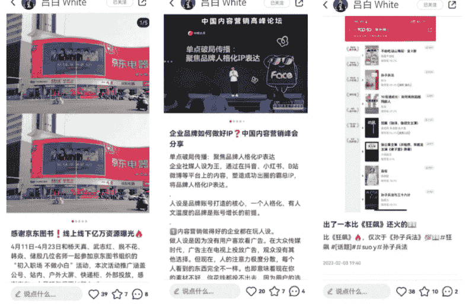

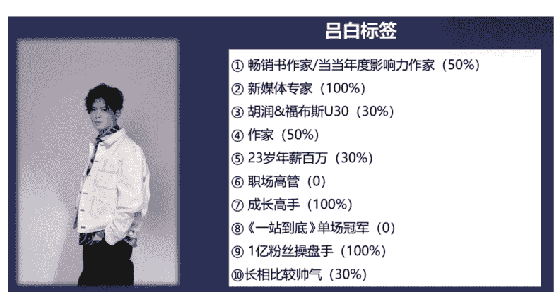

### 流量型内容：把账号热度快速拉满
人设类内容负责呈现个人魅力，流量类内容则负责把账号热度直接拉高。我带过的一位学员复盘一姐就曾用一篇笔记拿到20万点赞，同期涨粉7万，带来五六个客单价3000元以上的成交。这个案例也印证了一点：账号里80%的粉丝往往来自20%的爆款。

小红书上能形成流量的内容，大致要抓住以下五点。

第一，选题要有市场验证。
新手在选题时容易先问自己想不想做、想表达什么。其实前期更重要的是判断选题是否已被市场反复验证，是不是多次出现爆款。我们做内容要改掉主观臆断的习惯，多从数据复盘大众态度。我常跟团队说：同行趟过的水，我们要顺着走。像“起床后黄金一小时”这类话题，我在发布前就能检索到大量博主的爆款笔记，说明用户兴趣已被测试出来，优先选择这类题材，成爆款的概率自然更高。

第二，受众面要足够大。
我有一个做文眉的学员，最初发现这个赛道几千赞就算头部，她很困惑为什么女性成长类博主能稳定上万赞。差异本质是受众基数不同，女性成长面向所有女性，文眉则只覆盖其中的细分人群。在不同赛道，爆款的点赞标准并不能一概而论，关键是找到所在赛道里人群最广的选题。

第三，痛点要够痛。
“起床后黄金一小时”之所以能火，减肥类内容动不动就上万赞，都因为起床困难、减重停滞是很多人长期困扰的难题。痛点足够尖锐时，用户更容易被吸引，一旦内容能给出解决思路，认可度就越高。

第四，具备利他价值。
做内容切忌自嗨。有一次我去 @闪光少女斯斯 的公司，团队里一位表达欲很强的女孩Keke柒问我如何做出好内容，我让她数一下刚才话里出现多少个“我”。很多人日常沟通中“我”占比过高，内容创作中如果过度沉浸自我，就容易走偏。优秀的创作者要清空杂念，用用户视角审视价值。创作完成后可以自问：用户画像是谁？他们想了解什么？同类作者讲了什么？我能优化哪块？如果我是用户，这篇笔记满意吗？

第五，内容要有干货。
小红书用户以女性为主，且学习意愿强。提供实用信息时点赞收藏率会更高。比如旅游博主与其只发风景照，不如发攻略讲注意事项；插画博主与其只晒作品，不如讲月入过万的插画师需要哪些技能。用户本质只关心两件事：跟我有关，对我有用。

关于流量内容的实操，下面分享两位学员的经验，都是他们真实复盘。

学员分享一：@方好好呀
我印象最深的是“爆款是重复的”。我本身在电视台做过内容，有自己的想法，但靠原创创意十条里只有一条数据好，这是弯路。后来我改为直接拆解同题材的十条爆款，总结框架和共性，再结合自身经历复刻，效率高且更稳。

我也常听学员抱怨：有些内容看起来一般数据却很好，很玄学。其实应该去分析它为什么一般却能爆。小红书必须遵循利他原则，不能把更新当朋友圈随手发。漂亮照片或吃瓜娱乐没有意义，平台用户来是学习的，教东西、避坑、产品优缺点分析才会被接受。

另外要提前选好赛道并规划变现路径。好赛道里几千粉就能变现，比如写作、心理咨询，只要客户精准就会付费。差的赛道粉丝再多也难转化，像早期的美食博主，粉丝几十万却长期低活跃，就是因为跟不上平台迭代。流量密码和玩法都在变化，必须保持学习，对标头部账号、跟紧实时热点。

学员分享二：@林小白极简手绘
刚入小红书时我很迷茫，没有专门的教程，翻了几本国外书底层逻辑不错但操作不贴合国内。我反复读吕白老师《从零开始做内容：爆款内容的底层逻辑》里关于小红书的章节，照做却很痛苦，画画视频点赞常年个位数，很挫败。

后来一位老师提醒我做内容要有直觉，并且强调“好看，很重要，封面更重要”。我当时懒得把‘好看’写在墙上，结果笔记一直不够好看。后来我选择先做高信息密度，也就是干货。

我开始关注200个博主，用Excel记录爆款、标题、封面、发文频率等。表格很枯燥，我一度想放弃做回自我表达。但实践让我认识到数据特别重要，很多现实反直觉。

我第一个有感觉的爆款是2021年1月26日发的图文“粑粑人表情合集”，拿到3.3万点赞、9000多收藏、200多评论。那次灵感来自一个6000赞的粑粑人笔记，我的课程涉及人物表情，于是决定画升级版。最终画了约150个小人填满A4纸，连续画了五六小时。标题借鉴了评论区高赞留言“男朋友说饿了，给他分享这个过去”，封面用大红字写“300个粑粑人表情包合集”。发出去1分钟我因担心违规又删了，后来又重新发布，首日150观看6点赞，最终拿到3975点赞、1312收藏。

5天后我改版重发，把精致封面改回随手一拍的课堂笔记风格，更贴近学生党摸鱼场景。那篇笔记首轮150观看就获20赞，当晚粉丝不断增长，最终达到3.3万点赞、9249收藏，涨粉1万多。但粉丝年龄多在18岁以下，并未带来课程转化。这次“误打误撞”让我学会做爆款，但也明白爆款若无法转化意义有限。之后我转向精准引流，11月4日的一条画画视频拿到23万观看、2.6万赞藏，直接涨粉4万。

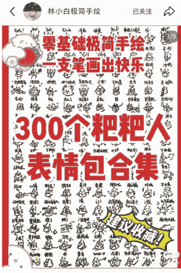

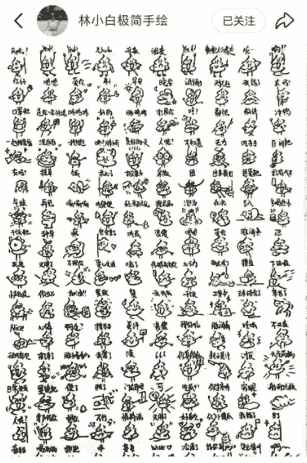

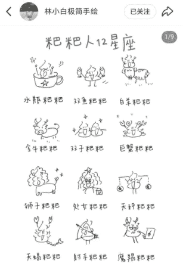

粑粑人表情包合集/零基础学画画干货

【以下是严肃粑粑人画法简介】

一看到粑粑人，感觉特适合作为学画画素

男盆友说饿了，给他分享粑粑人过去，解解馋

你们要的清晰版本粑粑人合集，欢迎临摹

粑粑人12星座简笔画详细画法教程（上）

你觉得

说点什么... ❤️ 4438 ⭐ 1490 💬 35

说点什么... ❤️ 3.6万 ⭐ 1万 💬 205

说点什么... ❤️ 8754 ⭐ 2509 💬 122

### 案例型内容：小红书掘金的底层逻辑
先问一个问题：如果账号不做变现，你能坚持多久？为爱发电很难长久，前期就必须想清楚变现方式，是广告、知识付费、线下获客还是直播带货。具体路径在《爆款小红书：从零到百万粉丝的玩赚策略》里有详细说明。

做案例类内容要厘清四个关键：你的用户是谁？你的产品是什么？用户对产品的需求点在哪？转化链路如何设计？每次做案例都是对账号商业模式的一次复盘。下面用两个学员案例来说明。

#### 案例一： @索菲亚又富又美
索菲亚2022年参加我的第七期训练营，之前做医美因平台政策被封。训练营期间她一度想转珠宝赛道，但既无从业经验也没有合伙人支撑，不具备可执行性。我坚持先匹配个人现状再给建议，以免盲目。

后来她提到自己在面部保养和身材维持方面很有心得，40岁、两个孩子的妈妈状态却保持得不错，于是锁定“女性全方位保养”定位。第一个账号很快破千粉，却因涉及打针内容被限流，紧接着她重启第二个账号，现已积累11万粉丝。

真正起势的是眼部按摩、面部抗衰等护肤干货内容，账号在一个月内开始接广告，后期一个月发14条视频做到月入10万。

她的广告变现逻辑有两个要点：以干货切入、在合适时机做营销种草。她的笔记从不会上来就推产品，而是先用干货把用户留住，再自然引入产品并讲解用法效果，最后再补充相关干货。广告投放要适度，粉丝基数和粘性直接影响报价，因此维护粉丝关系至关重要。

#### 案例二：@鹏哥装修避坑

鹏哥在训练营里就做出了两千多赞的图文爆款，随后转向短视频，效果持续在线，听说变现已经到了数十万的体量。他的切口选在装修避坑，用小红书给打算装修的人讲清注意事项。变现路径也比较清晰，一条是线上做装修知识陪跑，另一条是线下做定制化施工。用户先通过他的避坑短视频感受到专业度，再主动找他解决自己的装修问题。这一套打法就是内容即产品、产品即营销、营销即变现的闭环。

所以要记住关键区别：单纯输出干货不等于能赚钱，只有围绕品输出的干货才真正具备变现力。很多女性成长博主讲“见过世面的女生是什么样”“吸引力法则”这类话题，内容很干，但如果对应的商品、课程与之脱节，就只能拿流量拿不了钱。反过来，如果博主做的是婚姻关系类内容，而产品是关系经营课或相关用品，内容就能持续为变现导流。

归纳一下工作逻辑：人设类内容负责建立信任，流量类内容负责完成涨粉，案例类内容负责促成交。

讲到这里就要考虑周期的内容配比，也就是一周里流量、人设、案例各占多少。配比可以随阶段调整。账号起号期，流量型干货最好占到一半以上，人设三成，案例两成。粉丝过万后，流量维持在五成左右，案例提升到三成，人设降到两成。进入稳定期，案例的比重会继续上移。也有个别账号一篇内容能同时实现信任、涨粉、转化，配比上就没那么讲究了。

最后说一个在课上反复强调的概念：飞轮效应。我做新媒体近十年，常被问为什么能坚持下来、为什么还在圈子里有话语权。对我而言飞轮就是最核心的思考。静止的飞轮刚开始推，每一圈都很吃力，需要持续加力，等跨过临界点后，惯性会让它越转越快。我的经历就是这样，公众号早期稿件被毙得很快，做一条爆款几乎耗尽心力。后来我拆解了上千条爆款，终于做出第一篇爆款，临界点就此出现，之后接连出现点赞十万以上的作品。小红书同理，前期要高强度产出把账号流量推起来，这个阶段最难熬。节奏找到后，后续会明显轻松。

学员@心理师西西 有近七万粉丝，她的体会也很有代表性。吕白老师讲过飞轮，你的推力要足够把轮子推起来，后面它才会自己滚。如果每次只推一点点，就永远到不了能自转的那一点。也有人称之为复利拐点，越过之后才开始复利增长，很多人还没到就放弃了。所以前期要集中精力高产，冲到拐点后再保持日更也够。先定一个方向连发十来条做测试，找到方向的临界点，这一步很关键。一个策略需要跑一段时间才能判断好坏，别因为一两条数据不理想就撤掉，这在自媒体里非常致命。也希望给正在迷茫的朋友一点力量，你不是唯一遇到困难的人，关键看谁能破局。

## 第三章 小红书文案爆款写作方法

提升文案能力，最核心就三字：拆爆款。

做了这么多年小红书相关培训，带过的学员累计上千，我发现大家的共同痛点就是不会写文案。依托十年内容经验，我的答案依然是拆爆款。很多人会问怎么拆、拆完不会用。实际上所有爆款都能拆成开头、主体、结尾三部分。我们要做的就是带着问题拆：开头怎样抓人，主体怎样讲观点，哪些方法可迁移，结尾怎样升华并引导互动。拆的时候不要陷在内容里，要带着思考拆。当样本量足够后，必须做复盘归纳，按方法论写自己的笔记，这才是拆爆款的完整流程。

下面分享我们长期复盘总结的9类开头、2大主体框架、5大结尾模板，帮助你更快产出爆款。

### 实操篇：9类开头2种主体5种结尾，打造万赞笔记

好的开头决定一半成败。现在信息过载、注意力稀缺，能在几秒内抓住用户并让其继续看下去，是每个创作者必须解决的问题。

先问大家一个问题，你觉得哪种开头是一定要避开的？可以想几分钟。我常看到小白惯用的一上来自我介绍，“哈喽大家好，我是某某，今天想跟大家聊聊……”这种形式不算错误，但在账号没有基础期非常不抓人，用户几秒就会划走。前期更需要方法技巧来获得正反馈。

#### 吸睛开头模板一：呈现结果型

**案例开头**
一个女生突然开窍的表现是什么？自然是事业爱情双丰收，每天能量满满，特别快乐。你想得到的就会得到，机会主动找上门。美女天使珍梳理了自己开窍的四个阶段，来看看你处在哪个阶段！

——活力少女阿珍

开头直接亮出做到的结果，用晒成果的方式激发好奇，让读者想往下找答案。这类开头很常见。比方说笔记开篇写：这三个动作，让我从一年前180斤的胖女孩变成现在人眼里的瘦子，全身只剩100斤。你会不会立刻想知道是哪三个动作，是真是假？如果你正有减脂需求，你会不会看完？大多数人会，这就是呈现结果带来的跟随冲动。

#### 吸睛开头模板二：罗列痛点型

**案例开头**
工作一分钟，刷手机一小时，晚上熬夜不睡，早上拖着不起，完美主义怕失败，迟迟不敢动手。如果你也有这些拖延表现，这条一定要看完。30天改变一生系列第12篇，讲4个终结拖延的方法。

——舒同姐姐

罗列痛点能让用户产生对号入座感，并带着解决问题的心态继续看。公式可以概括为：点破用户痛点+给出解决方案+展示解决效果。很多经典广告也是同理，“怕上火，喝王老吉”，前半句点痛，后半句给解法。

要做痛点开头，关键是换位思考，从用户生活场景出发找核心痛点。复盘一姐《起床后黄金一小时》的开头就是典型。

起床就刷手机的朋友，看到这条，上天在提示你要改变了。

——对号
你以为只是看看新闻，其实消耗的是当天最宝贵的时间。

——点痛
正因为利用好起床一小时，我大学期间学业第一，学生会工作被省教育电视台报道，演讲、唱歌、英文比赛都是第一，毕业设计专业第一，还提前两年积累工作经验。28岁创业，游历三十六国，事业有成后结婚深造。

——给方法并展示效果

#### 吸睛开头模板三：引起恐慌型

**案例开头**
90%的人对爱的认知都存在误区，不纠正的话爱情很难长久。今天分享5个常见的错误爱情观，你中了几条？

——钱庄钱笑笑

梁宁提到人的底层操作系统是情绪，包括愉悦、痛苦、恐惧。恐惧来自害怕失去和对未知的焦虑，拿捏准确就能收获注意力。

英文不好就错过好机会，28岁出现一个理想工作却要求英语，你只能说我不会。人生前期越嫌麻烦，后期越可能错过动心的人和事。

写作恐慌开头不能只有吓人，还要给出可行的解决建议。《认知操纵》提到恐惧诱导最有效时需满足四点：足够吓人、提供具体建议、让用户相信建议有效、执行门槛低。

**案例开头**
晚上不睡早上不起，一天只想刷手机，一边焦虑浪费时间一边继续刷，下定决心第二天不摆烂结果又循环。记性变差，做事变慢，注意力不集中，表达退化，随便做点就累，对人生失去掌控。这就是长期摆烂的后果，持续下去人生的确会完蛋。别怕，这条视频来拯救你，下面方法曾帮我走出摆烂，快速恢复学习力和执行力，建议点赞收藏，摆烂期拿出来看。

——三多同学

结构是：罗列痛点+不改变的严重后果+可行的改变方法。

#### 吸睛开头模板四：提问型

**案例开头**
怎么让这个世界上90%的普通人安于现状，老老实实为10%的富人服务？很简单，给他们一个奶嘴就够了。

——傻白呀

开头提出问题再给出答案，引出话题。也有提问加讲故事的变体，比如问完“男女有纯友谊吗”立刻接朋友聚会的经历。选题角度要从用户关心点出发，不确定的话可以先从评论区热议话题入手。

#### 吸睛开头模板五：讲故事型

故事比说教更有代入感。以故事开场更容易让用户停留。

**案例开头**
我刚和一个为世界500强做招聘的HR总监吃饭，他感慨为什么穷人家的孩子即便天赋外貌资源都不错，依然容易在生活和职场里被一眼识破。我回来得晚，边卸妆边聊这个问题。我也是普通出身，年轻时思考很深，也刻意练习过改正。今天就想告诉普通家庭的孩子，如果想走得更远，差距到底在哪？

——大花和小鹿

讲故事开头有时间地点人物细节，可信度高，且能软化尖锐话题。经典套路是：前几天发生了什么、和朋友聊了什么、身边什么情况触发了思考。必须与主题和账号定位相关。

#### 吸睛开头模板六：场景呈现型

**案例开头**
入住新家半年，我妈来都忍不住夸，怎么每次都这么干净，是不是特意收拾过？

场景型文案切入用户熟悉的特定情境，唤起回忆再切入心智。

用在推荐扫地机器人上：想象下班回家，地面一尘不染，光脚就敢走，猫在地上打滚，毛发灰尘全不见，不是魔法，是我家这台全能升级的石头G20扫拖机器人。

场景呈现有两种基础写法：描述拥有产品或技能后的美好画面，或描述没有时的糟糕画面，制造需求。

#### 吸睛开头模板七：反常识型

**案例开头**
给你说个内幕，那些你以为很强的人其实都很水，你看到的世界500强高管、机关领导、学校老师，大多数都是草台班子凑合过日子，外表像豪华奔驰，里面几个人蹬自行车套个壳。

——马仔睿总

“很水”打破了“很强人=能力超群”的固有认知，制造探索欲。内容分为知识和观点，知识有标准答案，观点只要自洽就有空间。分享干货时可以调转切入点，找到反常识的新角度。

#### 吸睛开头模板八：制造冲突型

**案例开头**
我举报了闺蜜，是她告诉我考研时间到了她还在写，凭什么她什么都有，我就是不想让她考上。

——饼饼阿堇

“举报”与“闺蜜”形成关系撕裂与亲近的冲突，瞬间吊起好奇。冲突越大，话题张力越强。

冲突感切入：硬拼打法

想让开头带张力，常用硬拼思路。所谓硬拼，就是把两件原本不挨着的领域、甚至同一个领域里相悖的概念强行拧在一起，却能自洽得通。冲突款的硬拼更进一步，把大众印象里互斥的两个事实塞进同一句话，比如“我嫁给了我最讨厌的人”“闺蜜把我给卖了”，这类表达自带撕裂感。

请结合自身赛道，用上面思路写一个冲突感强的前置句：

#### 吸睛开头模板九：直入正题型

**案例开头**

> 21个极简高情商社交潜规则，能让你在为人处世方面少走5年的弯路，在深圳少摸爬滚打这么多年啊！

——周Rich

这就是典型的开门见山，不设问不铺垫。好处是读者一眼就清楚笔记主题与可得收益，能迅速筛选出感兴趣的人群。常用公式为 主题＋可得到的价值＋互动引导。例如：给大家梳理国内年入百万的十位插画师，完整看完总有启发，看有没有你中意的画风。这类开头门槛低，上手快。

现在请基于该框架，输出自己赛道的直入正题开头：

九种吸睛开头讲完后，你已经能复刻出几条属于自己的小红书开场，接下来进入正文撰写。

#### 主体创作模板一：列点式

都归咎于对方，那这个人就不是一个体面人。像我老公，他前女友就是为了追求前途抛弃他出国了。然后我还一直在说他前任的坏话，但是我每次说的时候，他都会非常严肃地指责我，说你并不了解她，你不要这样去评价她。我当时还很生气，但我现在觉得他是对的，因为一个愿意体面地去祝福前任的人，也一定会护你安好。第二，就是看这个人言行不一致。要远离那种天天给你画饼，但从来不给你买饼的人。有的人整天炫耀自己多牛，一年能挣多少钱，回头情人节就给你买个200块钱的礼物；整天说要带你去这里去那里，整天承诺给你这个买那个，要给你开店，要给你开公司，但说了都不做。有了两次就可以拜拜了。不然时间久了，你就会一直期待那些原本就不存在的东西，而平白消耗了自己美好的青春。

> ——团圆妈妈

小红书里分点叙述很常见，就是围绕选题把要点拆开写。以上面这段为例，围绕“如何判断男人是否靠谱”这个选题，作者仅用两点展开，条理分明、逻辑顺畅，阅读时也更清晰。

现在请你用列点的方式，写出你某个选题的主体内容：

#### 主体创作模板二：递进式

递进式适合各要点之间存在承接、逐层深入的关系。常见套路有：是什么→为什么→怎么做、案例→原因→对策、第一步→第二步→第三步等。递进式与列点式的最大差异在于，列点式多为并列，侧重要素罗列；递进式有先后，主次分明。下面是一个典型递进结构。

第一步，框架为王。拿到一堆密密麻麻的内容，不要立刻阅读或死记，先动手写出来。怎么写？做思维导图。比如这位同学要背2000多字，就能提炼成一张导图，涵盖全部要点。有人会问，细节没列会不会考不到？这个想法要改一改。一方面，第一遍就逐字记忆会把自己逼疯；另一方面，画思维导图就像盖房子，先打地基、搭钢筋，细节是最后的浇筑，顺序不能颠倒。然后是第二步，图像记忆。看这张导图，左边两个分支，右边四个维度：客观、主观、内部、外部，记起来很顺。再把后面的关键词过一遍，五分钟内就能记住。下面第三步，用自己的话把思维导图说出来，比如行政伦理中的客观责任，包括对上下级负责、对法律和公共政策负责、对公民负责。说出来的过程比闭眼死背有效得多。记住，此时仍不需要填充细节，等整张图完全熟悉后再回到教材，用自己的话把细节补进干货里，相信我，这个时候你能想起80%的细节。

> ——魔都妈妈黛西

上面这段演示的就是费曼学习法：第一步把待背内容用思维导图视觉化；第二步在前一步基础上用图像记忆记住导图的左右分支；第三步在前两步完成后用自己的语言复述出来。每一步都依托前一步完成。

小红书主体写作基本就这两类，掌握后九成选题都能应对。

最后说结尾。诺贝尔经济学奖得主丹尼尔·卡尼曼提出过峰终定律，人们对经历的记忆往往由高潮和结尾决定，其他细节容易被遗忘。小红书同理，一个好的结尾能提升互动和曝光。常见的结尾形式有金句升华、美好祝福、互动提问、总结回顾、号召行动。

#### 结尾模板一：金句升华

上学时语文考前我最爱背的不是范文，而是名人名言。写作文时不管怎么写，总要塞一句背过的金句，感觉整篇文章瞬间高大上。后来从事内容创作，金句对我的重要性更深了。一句好金句能把全文拔高，锦上添花。比起普通话术，金句更易引发共鸣。很多时候读完文章、书、视频，具体内容早忘了，但金句却一直记得，这就是金句的魅力。小红书金句结尾也很多。积累方法一方面是随手记，比如专门准备一个金句本，遇到好句就记；另一方面收藏一些金句网站，如句子控、句子迷，用时挑选合适的植入。

现在，为你的一篇文案加一个金句来结尾吧：

#### 结尾模板二：美好祝福

美好祝福式结尾与人设故事里的寄语型结尾相近，就是在末尾给读者一些正能量祝福或暖心语录。下面这个案例就是典型的金句加祝福。

> 最后，我想说句很私人的话，我很欣赏在爱情里主动、敢打直球的女生，这是一种把握自己命运的勇气。就像古诗说的“愿我如星君如月，夜夜流光相皎洁”，我觉得落落大方承认自己的感情是一种珍贵的品质，真诚直接就是你最真实的样子。如果有一天你遇到一个男生，他在你打篮球时肯定了你，并双向奔赴把球打回来给你，你就可以放心，他欣赏和喜欢的是真实的你。所以对每个人都一样，只有用最真实的样子去相处，才可能收获一个喜欢你本真的真爱。

——钱庄钱笑笑

现在，为你的一篇文案加一个祝福式结尾吧：

#### 结尾模板三：互动提问

互动提问式结尾是在收尾时通过与读者互动来拉评论和数据。比如“看到这条的小伙伴在评论区扣个1”“记得点赞关注哦”“博主整理不易，建议收藏，给点鼓励继续更新”“喜欢我推荐的吗？喜欢就点赞收藏”“大家还想了解什么，可以留言，我会挑一部分回复”等等。用户很喜欢内容却容易忘了点赞，提醒一下很有必要。

现在，为你的一篇文案加一个互动提问式结尾吧：

#### 结尾模板四：总结回顾

总结回顾式结尾是在结束时把前面要点再梳理一遍。小红书视频里常以表格或思维导图呈现回顾，这样能把注意力拉回主题，形成整体认知，也容易让人想截图保存，提升收藏率。

| 时间 | 重要事项 | 细节点 |

| :--- | :--- | :--- |

| 第一天 | 熟悉平台规则和后续用到的相关软件 | 1. 熟悉规则方法：①关注小红书官方账号，比如薯队长、薯条小助手、薯管家等等；②点击我—左上角三道杠选择创作中心，查看创作学院，了解平台更多运营方法；③关注千瓜公众号。<br>2. 熟悉相关软件：创可贴、堆糖、黄油相机、美图秀秀、稿定设计、剪映、快题词、轻抖。 |

| 第二天 | 确定账号定位 | 1. 已有定位：有自己的产品、技能和线下店的，定位清晰明了。<br>2. 三句话定位法：你喜欢什么？擅长什么？你被别人夸过什么？你在什么事情上花时间花钱最多？ |

| 第三天 | 寻找自己的对标账号 | 1. 在搜索框里搜索关键词，找到爆款笔记后，关注20个1万至10万粉丝的博主。<br>2. 低粉多爆款的账号对于新手小白更有参考价值。 |

| 第四天 | 确定选题，搭建爆款选题库 | 把对标账号中数据不错的选题筛选出来搭建选题库。赛道比较广的，1000个赞以上算爆款，比如美妆、穿搭、减肥、成长；赛道比较细分的，100个赞以上算是爆款，比如文眉、汗蒸等。 |

| 第五天 | 创作自己的第一篇笔记 | 拆解爆款文案结构并且套用。 |

| 第六天 | 拍摄剪辑 | 布置好灯光、场景，支好三脚架，按照文案进行拍摄和剪辑，并且发布。 |

| 第七天 | 账号复盘 | 笔记点击率、完播率、观看来源、粉丝分析。 |

现在，为你的一篇文案用思维导图或表格的形式做一个结尾吧：

#### 结尾模板五：号召行动

号召行动式结尾是呼吁读者跟做或立刻行动，多用于教程类笔记。比如我会在小红书教一些新媒体方法，结尾会说“完成比完美更重要，马上行动做出你的第一篇笔记”，这种结尾图文视频都适用。

现在，为你的一篇文案写一个号召行动式的结尾吧：

读到这里，你已经掌握了小红书文案撰写的方法和技巧，可以开始创作第一篇笔记了。

最后分享一个真实感受，以上所有技巧在我看来都是“术”，善于总结就能学会，真正稀缺的是源于自身经历的思考、对人性的洞察以及分享知识生活的热情。我见过学员没学过技巧、没准备稿子，直接口播首篇就破千，靠的就是人生经历带来的思考。所以有人问我技巧，我可以讲很多，但我不希望方法束缚你，更希望你多去经历生活，这些经历会不断滋养你的内容灵感。

### 工具篇：月薪过万的小红书内容人都在用的网站

很多学员做小红书账号时常遇到选题、素材、违禁词、数据分析等问题。下面整理了常用的工具和网站，合理使用能大幅提升效率。这些工具涵盖内容素材、内容创作、内容检测和数据分析。

#### 一、内容素材工具

创作时灵感枯竭是常态，需要按账号定位找热点和参考，主要分热点收集和素材参考。

第一个是今日热榜。它聚合了微信、微博、百度、知乎等数十平台的热榜，帮助快速了解当日热门话题和新闻。无论国内外时事、科技、娱乐还是体育，都能快速浏览，结合时事做出匹配内容。

第二个是营销热点日历。这个网站列出了全年营销节点，可查询每月每天的纪念日、影视上映、重要事件等，覆盖新媒体营销所需热点，新媒体人必收藏。

第三个是小红书自带的笔记灵感榜单。这里收录平台在推的热门话题，可在自身领域找选题，还能看到该话题下热门笔记的样子，发布还能获官方激励和流量券。

第四个是顶尖文案TOPYS。全球领先的创意内容平台，广告文案宝库，还有精彩短片、名人访谈、名言专栏、创意课程，找灵感必备。

第五个是句子迷。提供小说摘抄、古诗词、电影台词、动漫台词等金句，做文案和金句部分时可直接取用。

第六七个是新片场和万图聚。两者提供海量正版可商用素材，包括视频、AE模板、图片、音乐。做视频笔记时可直接取用画面。

#### 二、内容创作工具

学员对创作工具关注度很高，好工具能大幅提升效率。推荐几个博主常用工具。

第一个是拍摄工具，手机+美颜相机即可。我用美图秀秀出的美颜相机，拍摄前先调好参数，美颜滤镜可参考。另外提词器功能很实用，把脚本复制进去拍摄时对着念，口播轻松完成。

第二个是剪辑工具。我一直用剪映，口播内容足够用。若要求更高可考虑Photoshop、After Effects。导入视频后剪掉多余部分，一键识别字幕，加滤镜、花字、特效和背景音乐即可完成。学习成本不高，各平台教程很多。

第三个是封面工具。我爆款封面多用剪映完成，点击开始创作导入照片，加花字贴纸后导出3：4图片，再替换照片文字即可。黄油相机、稿定设计、美图秀秀、创可贴也不错，选适合自己的即可。

21天改变一生🔥从小镇青年到畅销书作家！

吕白 White ❤️ 2w

2分钟教你开通薯店，保姆级教程有手就会✅

吕白 White ❤️ 417

起床后黄金1小时，这个习惯能改变你一生✅

吕白 White ❤️ 1290

1. 导入图片

2. 裁剪比例3：4

①

编辑区

位置、大小、角度

调整到合适的参数

即可

②

字体推荐

1. 点宋体

2. 捆金黑

3. 优设标题

4. 先锋体

字间距：-2 至 2

看字数情况而定

确保清晰端正即可

预设样式

可以直接使用

重点内容用鲜艳色

③

如何保存导入图片

1. 点击三条杠

2. 导出精帧画面

3. 回到桌面查看

④

第四个工具是在线emoji工具。编辑笔记时标题图文常用emoji增强情绪。可百度搜可粘贴emoji，也可去专业网站如uu在线工具。

#### 三、内容检测工具

小红书审核较严，发布前可用检测工具规避违规。

第一个是零克查词，可免费检测笔记违禁词，把写好的文案粘进去就能看到不合规词汇，修改替换即可降低限流风险。

同类网站还有句易网，可按需选择。

第二个是红薯编辑器微信小程序，提供多种小红书模板，并带违规检测和笔记预览，方便给领导或甲方预览。

#### 四、数据分析工具

通过数据分析可了解笔记优劣，也能快速捕捉市场热点和爆款。常见工具有千瓜数据、灰豚数据、新红、蝉小红等。若账号赛道较大，如母婴、职场、生活、教育，这些工具里的低粉爆款笔记信息对起号很有帮助。

双11特惠来袭

好物不贵！真香这一波！

- 10月24日-10月31日 预售期

- 11月1日-11月3日 第一波

- 11月4日-11月10日 第二波

- 11月11日 当天

| 品牌 | 优惠 | 备注 |

| --- | --- | --- |

| 品牌A | 满减 | 详情 |

| 品牌B | 折扣 | 详情 |

| 品牌C | 赠品 | 详情 |

年度大促遇冷？

去小红书找一个消费理由

- 1. 选品策略

- 2. 内容营销

- 3. 用户互动

- 4. 数据分析

| 指标 | 数值 | 趋势 |

| --- | --- | --- |

| 浏览量 | 10000 | ↑ |

| 点击率 | 5% | → |

| 转化率 | 2% | ↓ |

```python
## 示例代码
def calculate():
    return 0
```

> 这是一个引用示例，用于强调重要信息。

### 效率篇：巧用AI生成种草文案

未来打败你的不是AI，而是会用AI的人，所有创作者都要学会用AI提效。本章讲如何用AI一分钟批量生成几十条种草文案，节省人力。首先可了解一些可用工具：灵感岛、智谱清言、copydone AI、秘塔写作猫、文心一言、轻松写种草（小程序）、写作蛙（小程序）、光点红AI（小程序）、DeepSeek等。挑一个操作顺手的用起来。

#### 你好，我是文心一言

作为你的AI搭档，我可以帮你完成各类文字创作与文档处理需求，从文案、代码、报告、邮件、周报、总结、策划，到小说、诗歌、对联、剧本、歌词、故事、笑话、情书、道歉信、感谢信、推荐信、求职信、辞职信、检讨书、保证书、承诺书、协议书、合同、招标书、投标书、标书、策划书、计划书、申请书，以及汇报材料的全链条撰写，包括材料、稿件、提纲、大纲、框架、结构、内容、要点、重点、难点、亮点、特色、创新、突破、成果、经验、教训、反思、改进、建议、意见、批评、表扬、鼓励、激励、鞭策、督促、检查、考核、评估、评价、鉴定、总结等多种形态。你想让我为你做点什么呢？

- AI应用开发
- 创意写作

请直接输入你的需求，比如：帮我写一份关于人工智能的报告。

#### 智能写作，一键成稿
全新升级的AI写作功能，让你快速产出各类文章。

- 新建文档
- AI写作
- 上传Word

#### 种草文案快速生成
选好模板，点一下就生成想要的文案。

- 热门
- 小红书
- 爆文风格
- 小红书种草文强化版
- 爆款标题
- 短视频脚本生成器
- 文本优化v2

#### 内容生产
#### 标题创作
#### 营销文案
#### 头脑风暴
#### 文章润色
#### 申论文章
#### 文章摘要
#### 现代诗歌
#### 运营活动
#### 获取成就

以光点红AI为例，假如你是主营羽绒服的品牌方，冬季要推出一款抗冻鹅绒款，需要在小红书做种草，图片素材都已就位，只缺配文，这时就能用光点红AI来生成种草文案。按提示框填写信息即可自动输出。

冬季女生羽绒服推荐
面向人群：成年女性
目的：购买
风格：专业
关键词：抗冻、鹅绒、保暖、宽松舒适、长款

一. 标题
1. 冬天必囤！这几款羽绒服把舒适度拉到满格🔥
2. 宽松不臃肿，暖冬就靠这几件羽绒服❄️
3. 保暖清单来了，女生冬季羽绒服这样选🧣
4. 想要全程暖心？先看这批冬季羽绒服推荐❄️
5. 抗冻神器上线，冬季羽绒服选它就对了❄️

二. 正文
🧣 寒冬已至，想兼顾温暖与[content]
作为你的AI搭档，我可以帮你完成各类文字创作与文档处理需求，从文案、代码、报告、邮件、周报、总结、策划，到小说、诗歌、对联、剧本、歌词、故事、笑话、情书、道歉信、感谢信、推荐信、求职信、辞职信、检讨书、保证书、承诺书、协议书、合同、招标书、投标书、标书、策划书、计划书、申请书，以及汇报材料的全链条撰写，包括材料、稿件、提纲、大纲、框架、结构、内容、要点、重点、难点、亮点、特色、创新、突破、成果、经验、教训、反思、改进、建议、意见、批评、表扬、鼓励、激励、鞭策、督促、检查、考核、评估、评价、鉴定、总结等多种形态。你想让我为你做点什么呢？

- AI应用开发
- 创意写作

请直接输入你的需求，比如：帮我写一份关于人工智能的报告。

#### 智能写作，一键成稿
全新升级的AI写作功能，让你快速产出各类文章。

- 新建文档
- AI写作
- 上传Word

#### 种草文案快速生成
选好模板，点一下就生成想要的文案。

- 热门
- 小红书
- 爆文风格
- 小红书种草文强化版
- 爆款标题
- 短视频脚本生成器
- 文本优化v2

#### 内容生产
#### 标题创作
#### 营销文案
#### 头脑风暴
#### 文章润色
#### 申论文章
#### 文章摘要
#### 现代诗歌
#### 运营活动
#### 获取成就

以光点红AI为例，假如你是主营羽绒服的品牌方，冬季要推出一款抗冻鹅绒款，需要在小红书做种草，图片素材都已就位，只缺配文，这时就能用光点红AI来生成种草文案。按提示框填写信息即可自动输出。

冬季女生羽绒服推荐
面向人群：所有成年女性
目的：购买
风格：专业
关键词：抗冻、鹅绒、暖和、宽松舒适、长款

一. 标题
1. 冬天一到就想囤！这几款羽绒服舒适度拉满🔥
2. 宽松自在过冬日，这几件羽绒服超值推荐❄️
3. 保暖刚需！女生冬季羽绒服暖意十足🧣
4. 送你一个暖冬，先来看这些羽绒服❄️
5. 冬季首选羽绒服，这批抗冻单品别错过❄️

二. 正文
🧣 入冬了，想在冷天里既保暖又好看，一件好羽绒服是必备单品。既能抗冻，又能提供舒适感和穿搭风格。以下推荐几款很适合寒冬的羽绒服，让你在冷空气里也能安心。

1. 宽松舒适：版型宽松，活动自如不紧绷。内里采用优质鹅绒填充，保暖性能突出，给冬日带来温柔包裹感。
2. 长款设计：偏爱长外套的女生，长款羽绒服是首选，能更好地护住腰臀，抵御寒风，整季都暖。
3. 时尚点缀：保暖之外也讲颜值。这些款式在经典元素上加入了时尚细节，穿上就能成为冬日焦点。
4. 款式多样：从简约大气的经典款到亮色活力系，总能找到契合个人风格的那一件。

快行动起来，给自己一个温暖的冬天。选对羽绒服，寒冷自然触碰不到你❄️

标签：#冬季女生羽绒服推荐 #保暖穿搭 #时尚羽绒服 #冬季保暖 #温暖冬天

生成的内容很贴合小红书调性，有emoji和标签，直接复制稍作调整就能发布。也可以用自由模式，角色+需求+模板来定制。例如你要写云南5日游攻略，可以这样说：我是一名小红书旅游博主，要发一篇云南5天行程攻略，需要写清每日路线和注意事项。

注意事项：
1. 高原气候偏干，做好保湿防晒。
2. 天气多变，备好雨具和保暖衣物。
3. 游览时注意安全，不攀爬不乱丢垃圾。
4. 尊重当地风俗和民族信仰。
5. 出现高原反应可适量吸氧或咨询医生。

希望这篇攻略能帮大家更好规划行程，享受云南之旅！

#### 【云南5日游攻略】大理丽江环线，高原风光一次收齐！
☀️ Day1：昆明
抵达后先适应高原气候，市区逛翠湖公园、滇池，晚上尝地道云南美食。
☀️ Day2：昆明-大理
高铁到大理，逛大理古城感受白族风情，下午洱海边看景，夜宿古城。
☀️ Day3：大理
游崇圣寺三塔、喜洲古镇，晚上逛古城夜市，感受当地生活气息。
☀️ Day4：大理-丽江
... 

按这种方式，一天能批量生成十几条种草内容，大幅提升效率。需要优化时可直接与AI对话，让它按你的要求修改。还在手工写种草的小伙伴可以马上试试。

## 第四章
爆款视频的关键在开头

前五秒抓不住人，再精彩的内容用户也划走了。

我的学员小夏是零基础白领，本职工作轻松，想利用业余时间做短视频。学习时她很勤奋做了很多笔记，但真正实操时问题不少：拍摄视角不会选，画面总显怪异，拍完还要卡点剪辑。这些困扰也常见于新手。自媒体能力是综合的，拍摄、剪辑都要投入心力，但一旦确定方向就能持续精进。本章会涉及较多专业名词，若你已有经验可跳过，纯小白建议认真学习。

### 认知篇：如何培养小红书视频的网感
为什么有人一张图几句话就能抓住人，有人发几百条也不获关注？差距在于网感。网感是对内容的感知和预判能力，能判断内容能否火、火到什么程度，也能判断用户是谁、他们想要什么、痛点是什么。这种感觉需要长期训练。

首先，大量刷低粉爆款。头部账号可忽略低粉，你一定要关注。可用千瓜数据、新红等平台找低粉爆款榜单。

刷到几百粉账号的爆款要拆解：同样是低粉，为什么他火了你没火？是选题对了还是踩中流量点？把逻辑记下来并应用。做号前一周，每天至少花三小时刷短视频，重点研究开头五秒的吸睛手法。后面再精彩，开头留不住，人就走了。

其次，大量拆解爆款。行业共识是爆款=选题+封面+文案+表现力+标题。要多拆多学。爆款的封面点击率高，剧情类看开场，vlog类看选题，口播类看钩子与开头。坚持一个月，流量至少提升50%。爆款不是一蹴而就，标题、封面、选题、内容、服化道，至少有三项在线，做好五项基本不火都难。

最后，拆解时先别急着看评论区，先猜用户会怎么评论，再去验证。你会发现热评多为引发争议的观点，这类评论能带动讨论，让数据更好。写脚本时可刻意埋讨论点，提升互动。

这些都是训练网感的方法，自信心不足时先刻意练习这三项。

### 工具篇：搞定拍剪设备，效率翻倍
做优质视频离不开拍摄与剪辑环节。拍什么设备、怎么拍、怎么打光、怎么收音、怎么剪，这些都直接影响成片质量与体验。下面讲设备选择、辅助工具、布光、收音等，学完要多实操多调整。

1. 用什么设备拍摄，拍摄设备有哪些基本常识？
短视频主设备包括手机、单反、微单、运动相机、无人机等。零基础前期用手机即可，低成本且操作方便。专业团队对画质要求高可上专业设备。

手机拍摄前先调参数。以苹果为例，设置-相机里可调：
①视频模式下建议1080p，16:9，30fps。无特殊需求这样够用。
②镜头要擦干净，否则清晰度受影响。

苹果手机设置
iPhone 8以上都能拍视频，iPhone 13加入景深功能，画面纵深感更好。我自己用iPhone 13电影模式，质感接近专业相机。4K画质虽清晰但占内存，后期导出耗时。
①格式：选“兼容性最佳”，多设备通用但占空间大，iCloud可解决；高效模式省空间但质感稍弱。
②网格：九宫格构图辅助，人物静物风景都更稳。
③镜像前置镜头：自拍时打开，避免脸反拍。

华为手机设置
华为相机有专业模式，点开可见ISO、S、EV、AF、AWB等参数。
第一个是测光模式，矩形图标里有矩阵、中央重点、点测光三种。矩阵适合整体风景，中央重点适合主体居中，点测光适合舞台特写。
第二个是ISO感光度，室内100-200，室外约400，夜景400-800。ISO越高越亮噪点越多，越低越暗但更清晰。
第三个是S快门速度，1/33代表快门速度。拍高速物体用快门，拍车流用慢快门出拉丝。
第四个是EV曝光补偿，画面暗就提高数值，亮就降低，范围-4.0到4.0。
第五个是AF对焦模式，AF-S单次对焦适合静物，AF-C连续对焦适合运动，MF手动对焦可自主调节。
第六个是AWB白平衡，阴天、荧光灯、白炽灯、晴天、自定义，暖调提高色温K值，冷调降低色温K值。

也可使用轻颜、美颜相机调好参数再拍，关键多尝试。要点也包括三脚架和小蜜蜂。

三脚架分桌面和落地两种，桌面款常用，价格低约50元内。落地款常与补光灯捆绑销售。

为保证音质，拍摄时尽量靠近声源，选安静环境并关闭杂音设备。预算500元内可选有线设备，1000元左右可选猛犸1拖2，2000元左右可选罗德。我常用领夹麦克风，夹在衣物上靠近口腔，口播清晰。

2. 如何找光线并应用，如何布光？
新手常遇光线过暗或死亡光线问题，核心是不会用光。
光线分自然光和人工光。自然光指太阳光，白天光线充足时无需打光，面向窗户拍摄即可，窗上加纱帘柔化，防止过曝。最佳时间上午10点到下午3点。

阴天或夜间需打光。常用设备有桌面补光灯、环形灯、带柔光箱的补光灯。初期不必一次性投入，逐步添置。

最基础是三点布光：主光、辅光、轮廓光。熟练后可在后方加背景灯，形成层次。主光放人物侧前约45度向下柔光，光心在胸口；辅光放侧前45-65度向下柔光；轮廓光放侧后方高于摄像机。当然这是基础逻辑，需长期实践。

总体规律：室外自然光 > 室内自然光靠窗+补光 > 纯补光。

3. 拍摄时如何构思景别？构图是什么？
景别影响作品质感。焦距一定时，机位与主体距离不同呈现范围不同，分远景、全景、中景、近景、特写。

远景：人物占比小，常表现户外壮阔如沙漠山海。
全景：展现人物或物体全貌。
中景：拍摄至膝盖以上，叙事感强，口播常用。
近景：拍摄至胸部以上，突出性格情绪与面部。
特写：拍摄至肩部以上，放大表情细节，引发思考。

4. 拍摄时如何摆脱镜头尴尬症？
沟通=7%语言+38%声音+55%肢体。视频表现靠肢体与表情。很多学员生活中能说会道，上镜就紧张磕巴，甚至成读稿机。

镜头表现力不是夸张咆哮，而是自然做自己。如@赤焰男孩的辛辣风格、@甜老师在笑的聊天式风格、@都靓读书的书香风格，都是用自身特质表达内容，可通过刻意练习达成。

练习方法：
- 熟悉稿子
  ◎别完全依赖提词器，拍前熟悉稿子。
  ◎多读几遍，掌握断句、重读轻读、语气。
  ◎对着镜子练习，培养信任感。
- 找好环境
  ◎初期选舒适安静有安全感的地方。
  ◎拍摄前热场，进入状态。
  ◎用抱枕、书籍等道具增强安全感。
- 把镜头当眼睛

把镜头当成与观众对话的窗口，用你和日常熟人交流的方式去讲，慢慢培养用眼神传递信息的习惯。

（4）拍摄收尾复盘
◎ 成片完成后立即回看，发现短板马上调整。
◎ 每一次拍摄都做回顾，把出现的问题梳理清楚。
◎ 平时把文字交流转为语音表达，每天录一条短视频练手。
按这个节奏坚持下去，对镜头会越来越熟悉，在镜头前也能更真实地表达想法。

### 实操篇：剪出你的第一条爆款视频
莉莉在一家大厂做白领，最近想利用下班时间做自媒体。她好不容易拍完素材，却不会剪辑，看到网上很多关于 Adobe Premiere Pro 的教程，学了几天觉得门槛太高，愁眉苦脸地来找我。我告诉她，新手要从上手快的剪辑工具开始，比如剪映、度咔之类，操作简单，零基础也能快速上手。后来我把团队内部的剪辑流程整理给她，今天也分享出来，希望你能按此剪出第一条有流量的视频。

在剪映里完整的工作链路包括：载入素材、智能口播剪辑、智能字幕、花字添加、音效添加、导出设置。首次使用时，先在设置里关闭“自动添加片尾”，否则成片结尾会带抖音水印，搬到小红书会影响笔记推荐。

#### 去掉抖音片尾
#### 1.载入素材
点击“导入”会弹出本地文件夹，也可直接把素材拖入剪映，或选中素材后点右下角“导入”，导入后把视频拖拽到下方剪辑窗口即可。
#### 2.智能剪口播
选中素材后在上方工具栏点击“智能剪口播”，等待分析完成，点击右下角“确认删除”即可。该功能可把素材中的重复片段、停顿、语气词等多余部分筛查出来。
#### 3.智能字幕
全选素材后点击上方“文本”，点击“智能字幕”，有“识别字幕”和“文稿匹配”两种方式。“识别字幕”可自动识别音频生成字幕，缺点是有错别字，需自行校对。“文稿匹配”可把事先准备好的口播文稿自动匹配到视频中，文稿上限5000字。匹配完成后可对字幕进行编辑，添加花字、动画特效等。
#### 4.添加花字
全选素材后点击上方“文本”，点击“花字”，里面有多款样式可选择，直接拖拽选中花字进入剪辑窗口编辑即可。
#### 5.添加音效
点击上方“音频”里的“音乐素材”，这里有丰富的背景音乐可选，各种风格都有，选择合适的拖拽进去即可。“音效素材”同理，已按场景分类，也可在上方搜索框搜索想要的音效。
#### 6.导出设置
点击右上角“导出”进入设置页。
标题可自定义。
导出位置选桌面或方便找到的文件夹。
分辨率一般选1080p，码率用默认推荐，编码选H.264，格式选mp4，帧率选30帧或60帧均可，按拍摄素材帧率选择，其余参数不用改动，直接导出即可。

口播视频剪辑参数参考：

##### （1）字体
- ◎ 字体一般选用剪映自带的“点宋体”和“优设标题”，字号12—18之间，根据画面调节。高度位置在-900（y）左右。
- ◎ 强调关键词时一般使用字体预设里的“黄色”样式或“红色”样式，也可挑选合适的花字。
- ◎ 字幕动画一般使用“缩小”“收拢”“甩出”等常用入场动画，可根据画面表现自行选择。

##### （2）背景音乐和音效
- ◎ 分享书籍类口播视频一般使用舒缓或轻快类型的纯音乐，不建议使用太激烈、节奏感太强的背景音乐，避免嘈杂导致难以集中注意力。音量一般-20分贝左右，具体按所选音频响度调节。
- ◎ 个人成长和工具分享类口播视频可选择节奏渐进增强的背景音乐，如“大气磅礴”“震撼大气”类，把情绪带入，逐渐拉高。音量也要避免盖过人声。
- ◎ 视频人声建议提高10—15个点，统一开启降噪。
- ◎ 音效一般使用“综艺”类目里的“冒泡”“水滴”“金币”“小孩哭泣”等常用音效，在需要强调的字幕处添加合适的音效即可，整个视频音效不建议使用太多，恰到好处即可，太多会显得吵。

##### （3）画面调节参数
- ◎ 亮度调节一般在5—10，具体根据画面增减，不过曝、不过暗即可。
- ◎ “锐化”建议设置在30—40，可提高清晰度。
- ◎ 对比度一般在10以内，根据画面表现调节，可增加对比，增强质感。
- ◎ 开启肤色保护，肤色更自然。
- ◎ 其余调节参数一般用默认数值，如有需要可自行尝试。
- ◎ 磨皮参数70%以上，美白参数50%以上，瘦脸一般50—80%。下颌骨70%以上，可根据具体情况调整。

##### （4）导出设置
视频文件导出一般选1080p，30帧或60帧，mp4格式即可。

这一章讲了很多拍摄、剪辑、打光的知识，但理论远远不够，大家要在理论基础上多实践，在调试中找最适合自己的内容输出方式。

## 第五章 博主变现：10个爆款小红书赛道打法
起号流程7步：熟悉、定位、对标、选题、文案、拍剪、复盘。
我的学员里有各种赛道的博主，经常有人问具体怎么做。本章分享小红书主流赛道的实操打法，涵盖竞对分析、内容方向、呈现形式、封面参考、爆款选题等。在拆解赛道前，先回顾起号基本流程。

起号总体可归纳为7步：熟悉、定位、对标、选题、文案、拍剪、复盘。

起号第一步是熟悉，即熟悉平台规则和后续用到的相关软件。新手不要上来就发笔记，先了解运营机制。

了解规则的几个渠道：
- ① 关注小红书官方账号，如薯管家、薯队长、薯条小助手以及细分领域官方号，不仅能了解最新政策，还有平台发起的流量曝光奖励，参与活动就有流量扶持。
84个小红书官方账号
- 新媒体运营必备 -
小红书恶意交易导流行为治理公告
自7月20日平台发布恶意导流行为治理公告以来，对高频骚扰用户、批量刷引流内容等恶意导流行为进行了严格治理，至今累计封禁6353个账号，长期限流禁言1779个账号。
跟着热搜词发商笔，瓜分百万流量啦🎉
📣多少小红薯要的行业趋势和笔记灵感，真的来了！
❓是否想发商品笔记但没有灵感？不知道行业趋势和热点？
❓是否发了笔记但没有用户看？不知道平台用户都
- ② 点击左上角三道杠，进入创作中心里的创作学院，含金量很高，里面有官方教你如何选题取材、如何拍摄剪辑、如何运营粉丝、如何商业变现。看完对运营机制的理解已算入门。
- ③ 关注“千瓜”公众号，会不定期发布小红书大盘调研报告，了解后你就是半个“小红书专家”。
年度报告 | 「她研究」小红书女性用户深度数据洞察
千瓜 千瓜 2023-10-25 15:01 发表于福建
收录于合集
#千瓜行研
35个 >
周榜 | 9月第1周千瓜品牌创作者排行榜（小红书平台）
千瓜 千瓜 2023-09-13 15:00 发表于福建
收录于合集
#千瓜榜单（小红书平台）
98个 >
> 作为新时代女性群体的聚集地、发声场，小红书不断涌现的「她」话题，承载着不同的女性特质，对理想自我、理想生活的期待，以及消费行为与决策偏好。
> 千瓜为大家整理了9月第1周大榜单周榜（小红书平台），千瓜涨粉红人榜、热门话题排行榜、直播达人排行榜3大榜单，为大家提供小红书多方位的数据参考。

起号第二步是找定位，定位决定后续发布内容方向。一般来说如果你已有产品、有线下门店，只是想靠线上引流，如珠宝、纹绣、留学、教育等，定位很清晰。若是学生、上班族、宝妈或创业者想打造个人IP，可从这几个问题入手：你喜欢什么？擅长什么？你被人夸最多的是什么？你在什么事情上花时间花钱最多？写下来花20分钟思考。

起号第三步是找对标，确定定位后去找同定位的对标账号，了解别人如何输出内容。如做美妆，就在搜索框搜美妆、变美、护肤等关键词，找出爆款笔记，点开主页。按此方法找出20个1万—10万粉的博主并关注。建议多看低粉多爆款账号，可打开新红网站，看爆款笔记排行，重点看低粉爆款排行，再选赛道。如母婴，点击近七天，这里都是粉丝量不高但数据很好的笔记，对小白更有参考价值。

第四步是确定选题，搭建爆款选题库。很多人好奇大博主为何能稳定更新且连续产出高赞内容，很大原因是他们搭建了爆款选题库。具体做法是把第三步找到的对标账号中数据不错的选题全部筛选出来按模板填写，灵感枯竭时翻阅即可。

第五步是撰写内容文案。文案撰写方法以及AI工具前面章节已详细讲过，不清楚可回看。
第六步是拍摄和剪辑，如何拍摄、如何剪辑、用什么设备、有何流程，前几章已说清楚。
最后一步是复盘。点开个人首页左上角三道杠，打开创作中心，可在笔记发布2—3天后查看账号和笔记相关数据，并根据数据修改优化。关键指标：①笔记点击率，一般和封面、标题有关，点击率过低说明要优化封面和标题吸睛度。②完播率，和脚本结构、视频时长、整体节奏有关，过低说明要学习如何通过内容持续抓住用户眼球，以及检查视频时长是否太长。③观看来源，看笔记推流主要来自哪，注重搜索来源，要有意布局关键词。④粉丝分析，看粉丝画像是否符合变现定位。

起号完成后的流程是：寻找选题—拆解文案—撰写文案—优化文案—准备视频/图文素材—拍摄—剪辑—发布内容—复盘迭代—保持更新频率持续发布。

下面对常见赛道展开分析。

### 一、美食博主
#### 1.竞对分析
| 账号标签 | 账号基本信息 | 优势借鉴 |
| :--- | :--- | :--- |
| | 账号名称 | 粉丝量 | 发布规律 | |
| 低卡减脂餐 | 是Apple啊 | 6.9万 | 一周3—4条 | 标题通常带关键词“已瘦××斤”，封面有自己统一的风格。而且作品置顶是自己的真实瘦了55斤的图片，人设更加真实 |
| 低卡减脂餐 | 张张的减脂日记（日更） | 43.1万 | 日更 | 标题通常带关键词“减脂期吃它”，人设是孕后从120斤瘦到90斤的宝妈。整体画面拍摄非常干净，有自己的统一风格 |
| 家庭美食教程 | 云朵的美味佳肴 | 52.6万 | 一周3—4条 | 妈妈身份出镜做菜，每次做完菜后一家人吃饭，展现出温馨的家庭氛围 |
| 美食日常分享 | 喵酱超爱吃 | 45.5万 | 一周1—2条 | 标题通常带关键词“好好吃饭”“回家吃饭”，主要是一人食，封面多为2碗菜和1碗饭，再加一个看剧的iPad，并配有温馨的桌垫，有自己的统一风格 |
| 美食日常分享 | 大头吃不饱 | 19.1万 | 一周2—3条 | 打造了一个给妻子（之前为女友）做饭的人设，而且账号的整体设计是美食+追剧，营造出一种温馨的氛围感 |

#### 2.内容方向
- ◎ 美食教程：厨艺精湛可做教程类视频，让大家跟着学习做菜。准备食材、具体步骤、所需时间等细节都要写出来，让人照着视频就能学会。
- ◎ 低卡减脂餐、养生美食：美食领域细分赛道。
- ◎ 美食探店：适合喜欢逛吃逛喝的人，尽量做同城。
- ◎ 美食vlog：分享自己的美食日常。
- ◎ 特色菜、家常菜：找到擅长菜系，比如有的账号专门做辣味，有的专门做甜品。
做内容时要找到适合风格，比如有的主要是“一人食”，有的塑造关系，如母子关系、情侣关系等。常见人设有：妈妈给孩子做饭；女朋友给上班男朋友做饭；给上班闺蜜、同事带饭；姥姥姥爷给外孙外孙女做菜；一个人“北漂”自己做饭；给工地上班丈夫或妻子做饭等。

#### 3.变现路径
- ◎ 好物分享，广告变现
- ◎ 直播带货、店铺带货
- ◎ 探店佣金
- ◎ 知识付费：美食技能教学，如营养师妈妈的美味早餐

#### 4.展现形式
- ◎ vlog形式：记录做菜和吃饭过程，分享美味食物。
- ◎ 口播形式：将健康饮食理念融入做菜过程，以分享视角口播讲述。
- ◎ 图文形式：干货做成图文内容。

#### 5.封面参考
◎ 宫格拼图照片
将餐食、原材料做成六宫格、九宫格拼图
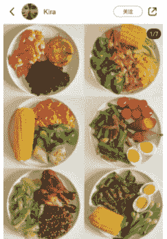
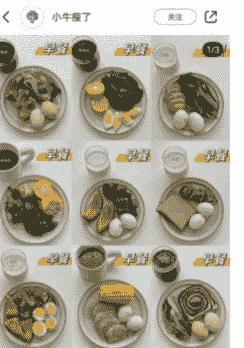
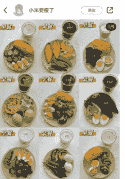
一周减脂午餐不重样！美味健康又掉秤！
#减肥食谱分享 #减肥减脂食谱 #我的减脂餐
#减脂餐打卡 #减脂餐
好吃又健康，还掉秤，姐妹们安排起来💪
已瘦23斤！一周低卡减脂三餐合集
不重样一周三餐合集！
#减肥减脂吃这些 #减肥减脂 #记录减脂一日三餐
一周不重样减脂早餐合集！
低卡又营养！简单易做！！
#减肥日常 #减脂早餐 #早餐吃什么
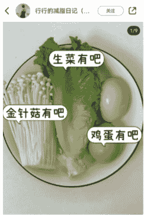
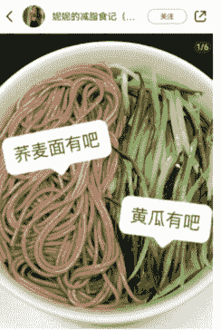
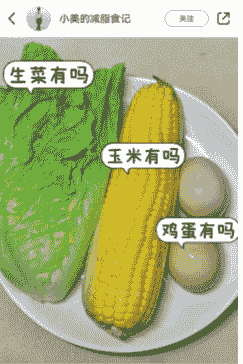
网友说的是真的！！
分享巨好吃的凉拌生菜金针菇鸡蛋！巨巨好吃！
巨巨爽脆！
金针菇真的好好吃这样拌！加上好吃的鸡蛋！
脆的生菜真的好好吃！
多少个晚上靠这一碗掉秤！！
今天做个凉拌荞麦面吃，酸酸辣辣的，加上黄瓜，嘎嘎香啊！每次不知道吃啥的时候，就给自己做这个，做法简单，饱腹感超强，有鸡胸肉的姐妹们可以加鸡胸肉进去拌
已瘦20斤！建议女孩子把晚餐换成它！！
今天分享一个简单掉秤的生菜玉米鸡蛋汤！
低卡低脂高蛋白！生菜爽脆，玉米清甜！减脂期的姐妹晚餐吃它真的太适合了！
食材：玉米 生菜 鸡蛋
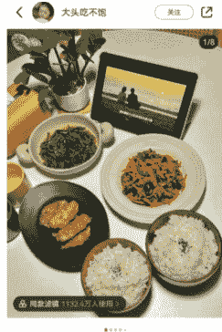
给女友做饭的第182天 | 二人食晚餐吃什么
大家好呀！我是大头～
今日菜谱：
咸蛋黄鸡翅
鱼香肉丝
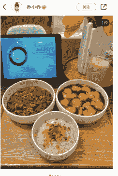
🍱我的餐桌 | 一人食一周不重样🍱
🍱自己做饭真的太治愈啦，所有菜单均有图文教程，都在前几篇的笔记哈～
1️⃣青椒肉丝·紫菜鸡蛋虾滑汤
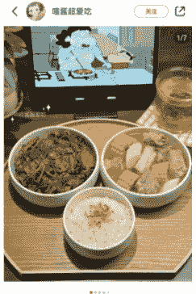
✨一人食 | 小炒泡椒牛肉·玉米山药排骨汤
叮叮✨今日伙食：（附教程）
🌟爆辣的小炒泡椒牛肉
🌟香浓无比的玉米山药排骨汤
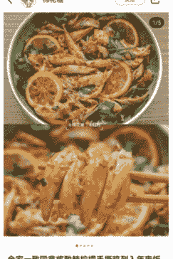
全家一致同意将酸辣柠檬手撕鸡列入年夜饭菜
🍀大家好呀
分享一道年夜饭凉拌菜，酸辣柠檬手撕鸡，鸡肉鲜嫩多汁，酸辣开胃，低脂高蛋白，减脂期吃无负担
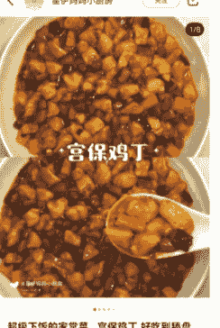
超级下饭的家常菜 宫保鸡丁 好吃到舔盘
今天分享一道超级下饭的家常菜——宫保鸡丁，鸡肉爽滑细嫩，鲜香味美，做法简单，新手小白也能学会，快来试试吧！
🟢🟢🟢食材
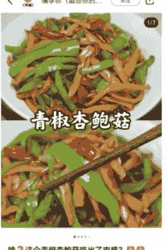
啥？这个青椒杏鲍菇吃出了肉感？😍😍
❤️今天这个青椒杏鲍菇真的吃着有种仿肉肉的感觉，滑嫩中带有嚼劲的口感真的爱了爱了。🌶️🌶️
虽说是青椒杏鲍菇，但我自作主张加了干辣椒，没办法，本四川人就是无辣不欢，不喜欢的小伙伴可以不加哦
◎家人大口吃饭的画面
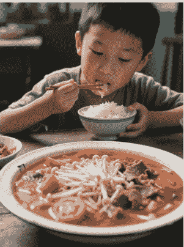
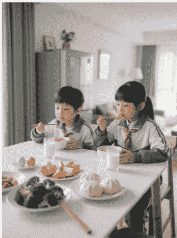
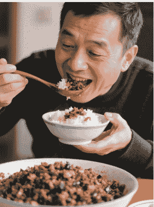
今天给儿子做了一锅番茄金针菇肥牛汤，酸…
每天有妈妈做各种花样真幸福
‼️炒外婆菜｜神仙下饭菜！小时候的味道呀
momo ♡ 5.3万
momo ♡ 1.7万
momo ♡ 6.3万

#### 6.选题参考
- ◎ 打工人的一日三餐
- ◎ 十分钟就能做的美食
- ◎ 挑战一百天，晚餐不重样
- ◎ 太掉秤了姐妹们，巨好吃的减脂拌菜合集来了
- ◎ 减脂期解馋冰激凌、奶酪，巨好吃还低卡
- ◎ 一周不重样营养减脂汤
- ◎ 已瘦30斤……多少个晚上就靠它掉秤
- ◎ 8分钟就能搞定的家常菜，还无敌好吃
- ◎ 在家复刻的×××同款美食
- ◎ 好吃不胖的零食清单
- ◎ 不重样的懒人带饭套餐
- ◎ 讲真……这个真的巨掉秤又好吃

### 二、女性成长博主
小红书女性用户占比达70%，女性成长类内容备受喜欢。我接触的学员里80%女生都希望做女性成长类内容，在分享中影响他人。随着女性对自我提升关注，自信、正能量、变美、独立成长、girls talk、爱自己等话题吸引大量优质用户，赛道潜力大。只要你有女性成长、人生、改变、赚钱、自我提升的观点，都可以通过分享表达，让用户感受到你是有温度、有经历、有思想的女人，非常适合结合个人故事做人设类内容。

#### 1.竞对分析
| 账号标签 | 账号基本信息 | 优势借鉴 |
| :--- | :--- | :--- |
| | 账号名称 | 粉丝量 | 发布规律 | |
| 女性成长 | 刘卷毛儿 | 21.6万 | 一周1—2条 | 主要就是口播的形式去讲女性成长类内容，主要是观点输出 |

女性成长类账号启动参考

1. 参考账号拆解
Mandie有毒：现阶段粉丝约29万，更新频率保持在每周3至4篇，内容大量标注人间清醒，另有固定运营的粉丝答疑笔记栏目，可借鉴。
甜老师在笑：粉丝体量68.4万左右，基本周更1到2篇。视频质感像闺蜜聊天，以邻家姐姐口吻为迷茫者答疑，选题多选自爆款池，反向切入常有亮点。
花大钱：粉丝85.5万，更新约每周2到3篇。作者为作家，已出版多本作品，长期输出女性认知升级、生活方式、心理剖析、亲密关系、人际交往等热门话题，观点新锐辨识度强。
方好好啊：粉丝36.3万，每周1到2更。前主持人转做自媒体，在小红书持续围绕爆款题材输出成长类干货。

2. 内容方向
◎ 成长类书籍与影视推荐
◎ 职场进阶实操笔记
◎ 独立成长、人间清醒、生活态度观点输出
◎ 个人经历故事化分享

3. 变现路径
◎ 好物种草获取广告合作
◎ 直播带货及自营店铺销售
◎ 线上成长课程付费售卖

4. 展现形式
◎ 用Vlog记录生活工作日常并加入感悟
◎ 口播输出观点，思路清晰可直接拍摄，也可先写稿用提词器录制
◎ 图文笔记整理核心要点

5. 封面参考
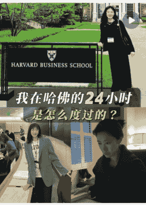
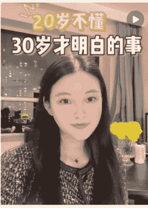

Vlog | 在哈佛学习的一天，我过得有多充实？
20岁不懂，30岁才明白的道理 | 越早知道越好
拥有好心态，普通女孩也能活得精彩
作家张萌 | ... ♡ 2.2万
耶鲁学姐笑笑 ♡ 1920
赛茜Cecilia ♡ 1326

6. 选题参考
◎ 见过世面的女生典型特征
◎ 如何练习向上社交打造贵人气场
◎ 女生经济独立的重要性探讨
◎ 离婚并不会终结一个女人的完整人生
◎ 拒绝美丽羞耻感
◎ 停止精神内耗学会自我关爱
◎ 高能量女生养成路径
◎ 主动型女生为何活得更爽
◎ 什么是真正的爱自己
◎ 普通女孩的十年成长线
◎ 做一个不好惹的女生
◎ 断舍离，远离消耗身心的人与物

三、身心灵与冥想赛道

1. 竞对分析
瑜伽冥想 印如 Yinru：粉丝38.6万，周更1到2篇。将瑜伽、养生、冥想、保养打包，以生活方式分享切入。
专业冥想 李冉在冥想：粉丝25.8万，半月更一次。人设为专业冥想导师，会放出线下授课片段，选题适合想走专业导师路线的创作者。
正念运动冥想 李嘉慧 Elaine：粉丝4.7万，周更1到2篇。以慢生活结合冥想瑜伽为主，调性治愈干净，部分素材来自线下课程，美照多生活质感精致。
冥想瑜伽 方楷冥想瑜伽：粉丝8.9万，周更1到2篇。人设专业度强，会使用海底轮、喉轮等专业名词，主要发布冥想知识干货，变现以线上线下课程为主。
冥想 满世界'冥想のSu：粉丝14.1万，周更1到2篇。内容集中在睡眠冥想、入门引导、吸引力显化、缓解抑郁焦虑冥想等，偏成长疗愈类干货，变现为21天冥想计划、线下疗愈中心及相关课程。

2. 内容方向
◎ 真实冥想练习过程拍摄
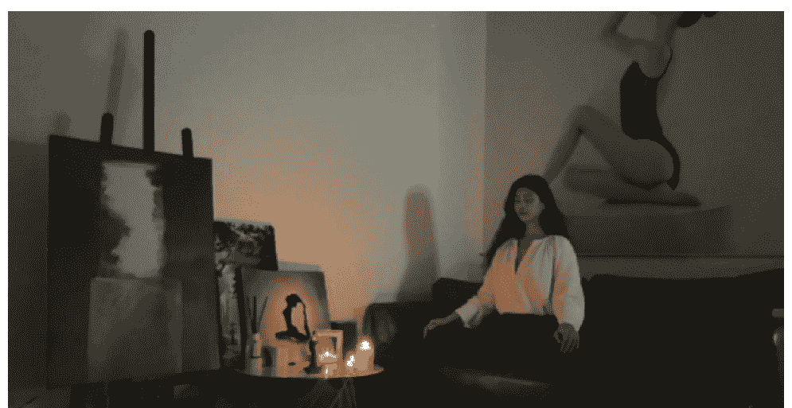
◎ 冥想实用知识点，如长期坚持的效果、一个月会发生的改变、如何进入状态、零基础入门，可用口播或图文呈现
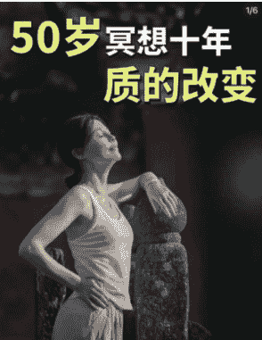


◎ 细分冥想方法分享，如助眠冥想、焦虑舒缓冥想、情绪调节冥想等
◎ 疗愈类好物推荐，如助眠用品、眼部放松工具、冥想香氛等
◎ 人生放下与亲密关系思考，偏向治愈心灵的观点输出，如爱自己、疗愈原生家庭等，强化治愈人设
◎ 系列化内容，如21天冥想练习计划，参考10分钟跟练、14天入门等形式，提升用户持续关注

3. 变现路径
◎ 知识付费，售卖线上21天练习或正念训练营，线下疗愈课堂、禅修营
◎ 高溢价好物，如水晶、颂钵等
◎ 广告合作
前期建议多发干货引流
① 流量案例类：21天跟练计划、早起跟练，后续可做训练营，同时分享疗愈好物
② 人设类：分享自己疗愈多年的变化及成长话题观点

4. 展现形式
◎ Vlog分享慢生活与跟练过程
◎ 口播讲述冥想益处等干货
◎ 图文笔记呈现干货信息

5. 封面参考
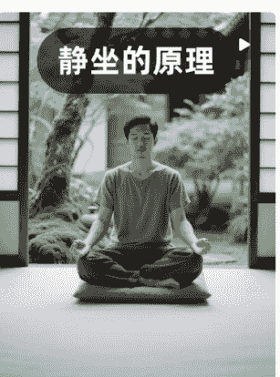
为什么静坐不动，是一种高级运动？
momo ❤️ 1899
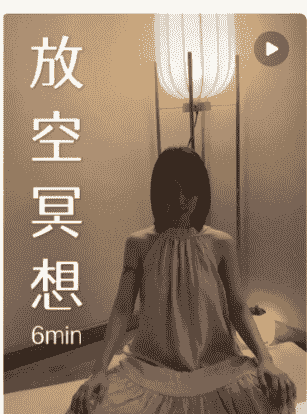
6min放空冥想，一起回到内在的净土，安放…
印如Yinru ❤️ 8192
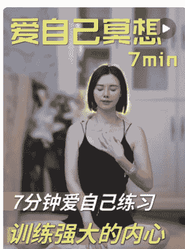
50+冥想导师|教你学会爱自己❤️
冥想欧 ❤️ 260

6. 选题参考
◎ 吸引力法则是否有效，三步实现心想事成
◎ 自我肯定冥想，训练内心力量促进蜕变
◎ 冥想十年会产生哪些改变
◎ 8分钟冥想等于深睡三小时，休息术一听就睡
◎ 坚持冥想的益处有哪些
◎ 7天打造吸金体质，显化财富小技巧
◎ 冥想经验分享
◎ 冥想常见问题答疑，如是否需要闭眼、腹式呼吸、入门指南、打坐姿势、冥想时是否需要思考等
◎ 静观冥想，学会不与自己对抗
◎ 养成易睡体质，60秒无痛入眠方法
◎ 与自己和解，疗愈内在小孩
◎ 抱树疗法

四、母婴育儿赛道

1. 竞对分析
母婴 小芋圆麻麻：粉丝27.8万，每周2到3篇。记录陪伴女儿成长的治愈生活，风格温暖有趣，主要拍摄早教、辅食、绘本、带娃Vlog，既提供情绪价值又给妈妈灵感，受广告主青睐。
母婴 洋子在东京：粉丝5.6万，每周1到2篇。记录在日本的带娃、料理及日常，利用地域差异展现中日育儿与生活差异，适合海外宝妈参考。

2. 内容方向
围绕陪伴成长、育儿干货、生活记录展开

3. 变现路径
常规可走种草合作与广告变现

4. 展现形式
以Vlog记录为主

5. 封面参考
暂无

6. 选题参考
暂无

五、时尚穿搭赛道

1. 竞对分析
穿搭 JNwannnng：粉丝68.3万，每周3到4篇。以美女展示服饰为主，封面常用拼图形式，选题涵盖通勤、秋日、针织、出游等。
穿搭 七七也是西西：粉丝3万，每周3到4篇。低粉账号爆款多，笔记封面风格统一值得借鉴。
穿搭 奶盖呀奶盖：粉丝12.6万，每周3到4篇。主打明星穿搭还原现实，加入明星元素易提升流量。
穿搭+穿搭干货 涵子爱臭美：粉丝1.5万，每周1到2篇。在展示衣品的同时输出穿搭思路，提供干货价值。
穿搭分享 Namiii：粉丝6.7万，日更。素人身份，通过系列挑战如百天成为穿搭博主出圈，背景干净突出服装，旁侧文字丰富画面。

2. 内容方向
◎ 穿搭干货技巧，如一衣多穿、节假日风格、省钱穿搭
◎ 上身推荐合集
◎ 明星穿搭拆解及现实还原
◎ 穿搭测评

3. 变现路径
◎ 种草合作广告变现
◎ 直播带货与店铺销售
◎ 形象管理付费，如线下测色、线上课程

4. 展现形式
◎ Vlog分享上身效果
◎ 口播讲解干货、分析明星风格
◎ 图文笔记呈现干货

5. 封面参考
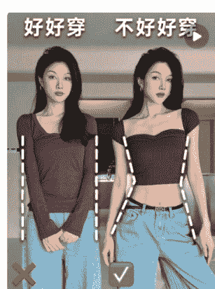
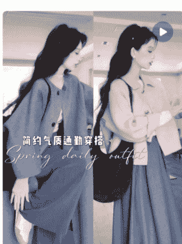
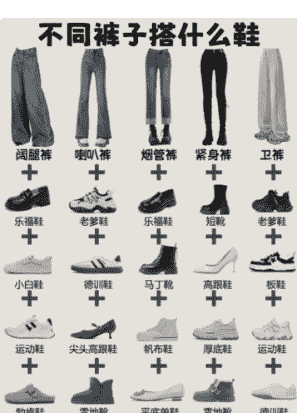
旧衣翻红🔥闲置先别扔！试下不按套路穿…
一周通勤穿搭｜大衣羽绒服分享✨简单提…
不同类型裤子的万能鞋子搭配公式 #穿搭 #…
hello我是沱沱 ♡ 4.1万
大美牛 ♡ 3585
AO GALS
2024-12-25 ♡ 6064

6. 选题参考
◎ 穿搭口诀，快速提升衣品
◎ 万能白西装一周穿搭，同理可换牛仔裤、针织衫
◎ 人越贵，衣越素
◎ 衣品不佳的女生提升小方法
◎ 万能配色公式
◎ 为什么同样一件衣服，你穿不如博主好看
◎ 普通女生如何提升衣品
◎ 叠穿思路分享
◎ 你缺的不是衣服，而是穿搭思维
◎ 强迫自己看完，衣品会变好
◎ 年后复工惊艳登场，早春精致通勤装
◎ 一周通勤穿搭合集

六、健身减脂赛道

1. 竞对分析
跑步日常 一只清子zz：粉丝12万，日更。记录跑步日常、跑后身材与生活变化，传递积极正能量，适合跑步爱好者素人尝试。
健身 美丽的大肉肉：粉丝31.8万，日更。全部图文拼图形式，内容涵盖减脂干货、好物、美食、日记等，设有100天跟练、逼自己瘦下来等系列，适合不便拍视频者。
健身 徐肉瑄：粉丝11.8万，每周2到3篇。挑战100天瘦50斤系列，以减脂日常持续输出，走养成系风格。
产后瑜伽 慧灵的YOGA4MOMS：粉丝13.3万，每周1到2篇。聚焦产后修复瑜伽细分赛道，精准获取流量。
减肥运动 朱七七Shara：粉丝13.9万，每周3到4篇。主打塑形，每期聚焦一个痛点如瘦侧腰、瘦肚子、瘦大腿等，采用跟练形式增强参与感。

2. 内容方向
根据自身身份输出，教练可发专业干货，爱好者可做系列跟练与日常，如挑战100天瘦XX斤、逼自己瘦下来、挑战100天成为健身博主、挑战21天练出马甲线等
◎ 器械健身，健身房器械使用技巧、新手入门、打卡
◎ 减肥干货分享，经历与经验
◎ 减肥塑形，前后对比展示
◎ 跳操跟练，体态锻炼、局部瘦身
◎ 减肥饮食，控制方法分享
◎ 健身减脂好物，如运动穿搭
◎ 健身日常，早起坚持运动

3. 变现路径
◎ 直播带货
◎ 种草合作广告变现
◎ 减脂训练营、私教课

4. 展现形式
◎ Vlog记录早起、晨跑、早餐、跳操、暴汗日常
◎ 口播以教学视角讲述孕产康复、减肥瘦身等干货
◎ 图文笔记呈现干货

5. 封面参考
◎ 健身前后对比照
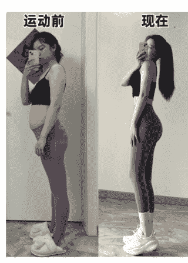
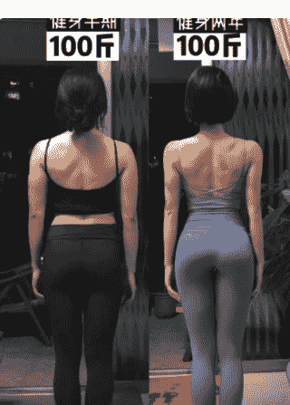
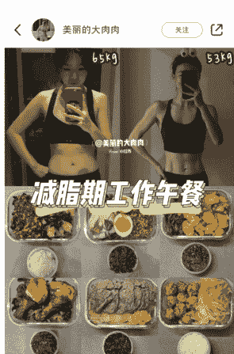

6. 选题参考
◎ 如何逼自己瘦下来，年前瘦20斤
◎ 每个人说一个减肥误区
◎ 世界公认燃脂最快的跳绳减肥法
◎ 女生健身一定要练胸，真的会变大吗
◎ 减脂期出现这些身体信号要注意
◎ 急性子来练，速瘦腹马甲线养成
◎ 破防了，这玩意真的巨掉秤
◎ 瘦了20斤最有意义的变化
◎ 8分钟翘臀瘦腰，跟练起来
◎ 全身暴汗燃脂操，快乐减脂一次跟上
◎ 马甲线养成记，晨起告别大肚腩
◎ 我悟了，原来减肥可以这么丝滑

七、职场成长赛道

1. 竞对分析
职场博主 行政不迷路：粉丝7.5万，每周2到3篇。定位6年经验行政人事，围绕行政岗位输出干货，细分定位可参考。
职场避坑 帮助女友职场避坑的小号：粉丝43.5万，每周2到3篇。定位大厂员工帮女友避坑，围绕职场困境做情景代入，兼具趣味与干货。
职场博主 职选 Marrkk 求职咨询：粉丝11.7万，每周3到4篇。不露脸拍摄可参考，使用卡通头像突出。
职场博主 姜Dora在此：粉丝38.7万，周更。通过对谈采访不同职业人士输出干货，展现多元职场状态，有职场大姐姐形象。
职场精英 Olga姐姐：粉丝59.4万，每周3到4篇。肯德基总经理背景，输出职场干货、语录、女性成长、生活方式打造IP。

2. 内容方向
◎ 职场干货/心得，如发展、思维、情商、效率提升、避坑、礼仪、汇报等
◎ 职场好物，如办公室好物、书单
◎ 职场穿搭，通勤分享

3. 变现路径
◎ 种草合作广告变现，如办公室好物、考证机构
◎ 直播带货与店铺销售
◎ 知识付费，如简历修改、求职规划咨询、电子资料

4. 展现形式
◎ Vlog记录职场一天，通勤、出差、会议、接待等场景
◎ 口播从答疑分享视角讲述求职面试、踩坑、沟通问题等
◎ 图文笔记呈现干货

5. 封面参考
◎ 小红书常见人物封面+文案，适合口播干货


领导不点破的晋升隐形规则

管理者不求情绪稳定而是情绪要流动

打工人最快崩溃的操作到底是什么

- ◎拼图式封面：很适合职场日常分享，也能做成上班族一日Vlog封面

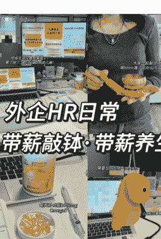

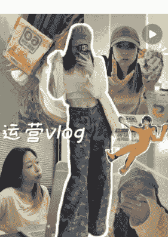

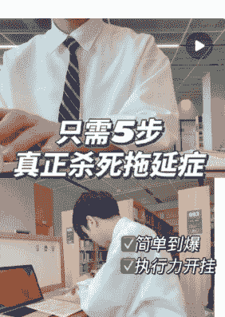

外企日常|上班由头|带薪养生|喝水请假|敲颂钵

Vlog｜没错我就是靠这些自我安慰才出门的

5步，把拖延症彻底干掉🔥

#### 6.选题参考

- ◎首份实习怎么开口谈薪水
- ◎零经验如何面试、面试该穿什么、怎么问期望薪资
- ◎职场空白期拉长了怎么办
- ◎被上司青睐的人通常有哪些特质
- ◎在职者如何利用碎片时间自我提升
- ◎如何摆脱职场里的学生心态
- ◎高效率职场工具有哪些
- ◎二十年老兵给新手的忠告
- ◎想套信息又不想被察觉该怎么做
- ◎领导说辛苦了怎么高情商回
- ◎职场饭局禁区：这几类幼稚行为别犯
- ◎无痛通勤的小技巧，打工别太老实

### 八、收纳博主

#### 1.竞对分析

| 账号标签 | 账号基本信息 | 优势借鉴 |
| :--- | :--- | :--- |
| | 账号名称 | 粉丝量 | 发布规律 | |
| 收纳技巧 | 纳川家居收纳师 | 3.3万 | 一周1—2条 | 人设定位为家居整理师，将收纳与极简生活、品质提升、生活技巧联动，既发整理干货，也分享提升生活质量的习惯与好物 |
| 收纳技巧 | 收纳男神-涛爷 | 6.2万 | 日更 | 人设是室内设计师，聚焦橱柜、衣柜、零食柜等空间的收纳方案，栏目名为“100个收纳小技巧” |
| 收纳技巧 | Melody楚楚 | 5.6万 | 一周2—3条 | 人设是自装118平米美式轻奢四房的居住博主，分享自家卫浴、厨房、鞋柜、卧室的高效收纳做法 |
| 收纳技巧 | 整理师泡泡减法生活 | 4360 | 一周2—3条 | 人设为高级收纳整理师，强调收纳与生活品质挂钩，栏目名为“每天5分钟变身整理达人” |
| 收纳规划 | BOX收纳 | 2.7万 | 日更 | 人设是家政公司，主推日式收纳，成片偏日式极简，对画面质感要求高，主打小户型收纳与分区收纳，覆盖厨房、储物间、阳台柜、卫浴、鞋柜、衣柜 |

#### 2.内容方向

起号阶段可以尝试以下方向：

- ①流量向内容：可输出干货笔记，收纳方法、好物清单、减法生活分享，最好做成系列，如“100个收纳妙招”“每日一课收纳小知识”，好物笔记后期利于接广告。
- ②案例向内容：单个案例或案例合集，用户好评内容；置顶笔记放业务介绍及案例合集、好评合集。
- ③人设向内容，收纳师养成：介绍收纳师相关信息、如何成为收纳师、对职业的理解等，前期可少做。

#### 3.变现路径

- ◎广告合作：分享生活好物、收纳好物
- ◎线下引流：上门提供收纳服务
- ◎知识付费：整理收纳师线下职业培训

#### 4.展现形式

- ◎Vlog记录：拍摄改造后的整洁场景，记录改造过程，做前后对比
- ◎口播讲述：以分享视角讲收纳故事，也可边整理边口播
- ◎图文整理：把技巧整理成图表、思维导图、说明书形式

#### 5.封面参考

- ◎创意拼图：适合干货内容，多关注平台创意封面趋势
- ◎设计感风格：沉淀个人风格


家乱到受不了？这几招赶紧收藏！

屋子不整齐心情就差，生活品质下降，连下手点都找不到！

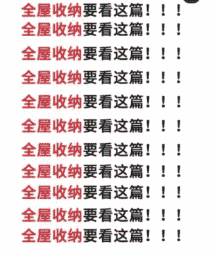

9张图直接把家收纳力与颜值拉满‼️

✅收纳要点

收纳核心是解决空间与物品的摆放难题，即在现有面积内做好物品安置，实现更高效利用

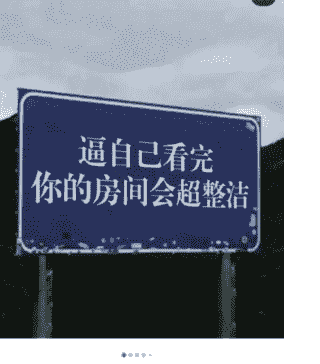

干净房间自带好气场！房间大整理全流程

“干净的房间就是最好的风水。”房间整理全解析

“我的生活一团糟，要怎么改变？”

高赞回答：当你对眼前生活无力，就去打扫房间🧹，从最小的事开始改变，整理环境即是整理自我

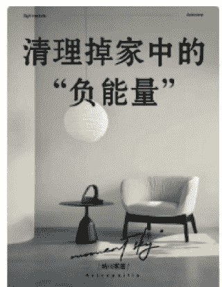

清理掉家里的负面能量，我扔了这80样…

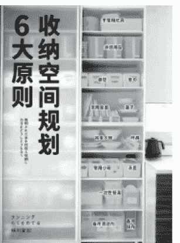

哇塞❗收纳空间规划6大原则，沉浸式整理

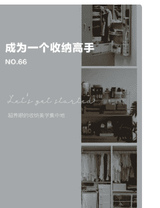

🏠成为收纳高手

100期 NO.66

- ◎合集类型：适合分享收纳好物、收纳书单等

收纳3年了~超满意的8大空间30+好物

接上篇

入住第4年了

有规划收纳家里区域是第3年了

一共收纳了20多个区域

吐血整理！！12m²小卧室实用收纳大合集

整理了小卧室里所有实用收纳！

图上都标注清楚啦大家看图即可

努力平衡实用性和颜值，大家觉得还可以吗

家居好物篇🔥请大数据推给所有家庭!!

提升家庭幸福感的宝藏神器

真诚分享，实用不鸡肋

快来抄作业!!!

从业整理7年推荐这10本实用整理收纳书

成为整理收纳师第7年，整理对象已从看得见的物品延伸到看不见的关系、情绪、金钱等~越来越觉得整理无处不在

【好书推荐】学收纳看这6本就够了！

今天是世界读书日，来分享近期看的书。

最近常看家居类书籍，尤其对收纳很感兴趣！我买了这几本：

• 近藤麻理惠《怦然心动的人生整理魔法》

物尽其用❤️你的收纳可以不花钱！

#大大方方做自己

家里闲置品的隐藏用法！

◎思维导图类型

封面仍需多测试，看点击率不断优化出自己的风格。记住每种类型起码试10次左右，新媒体本身存在概率。

#### 6.选题参考

- ◎日本家庭主妇收纳技巧分享，2025年末整理必备
- ◎J人空无一人的家！全屋收纳规划，直接抄作业
- ◎15年整理师带你轻松挑百纳箱
- ◎见过哪些特别厉害的收纳方式
- ◎3年攒下的收纳好物合集
- ◎榨干厨房空间的收纳细节！直接抄作业
- ◎省下四位数的衣柜收纳方法分享
- ◎3分钟详解！厨房装修完还需配齐哪些收纳
- ◎思路打开！活了20年才知道衣服全挂错了
- ◎过年回家这样收纳行李箱，一个箱子就解决

### 九、插画博主

#### 1.竞对分析

| 账号标签 | 账号基本信息 | 优势借鉴 |
| :--- | :--- | :--- |
| | 账号名称 | 粉丝量 | 发布规律 | |
| 文创产品 | y园糖 | 11.6万 | 一周3—4条 | 有大量插画周边、文创产品内容可参考。博主自有设计工作室、线上店铺和线下门店 |
| 插画教学 | 插画喵绘画 | 14.2万 | 一周1—2条 | 既有干货图文，又有视频教学，内容丰富，数据表现好，值得学习 |
| 插画分享 | 语宸要做插画师 | 71.2万 | 一周2—3条 | 封面简洁，暖色调为主。标题情绪化做得好，点击吸引力强。内容优质、利他性强，还有很多系列化创作：挑战在衣服、筋膜枪上作画；挑战画动漫人物、男团人物、历史人物；挑战用眼影、口红作画 |
| 插画分享 | 弱冠年华 | 80万 | 一周2—3条 | 人设是旅行插画师，主打边走边画，插画与产品结合紧密，辨识度高 |
| 插画分享 | 肆只耳的插画日常 | 9万 | 一周1—2条 | 用iPad作画，以水墨国风人物头像为主。以记录画画的vlog为主，也跟《哪吒之魔童闹海》等热点，主打沉浸式创作 |

#### 2.内容方向

前期可尝试：

①流量向内容：多输出干货，插画干货、插画好物分享，系列化主题更利于起号，如挑战xxxx，100天搞定xxx。

②案例向内容：穿插文创周边产品，开店，通过笔记带货。

③人设向内容：分享成长类选题，如插画师的一天、插画师的五年，让人设更立体。

- ◎插画干货：绘画教程、工具、技巧
- ◎绘画好物：iPad推荐、电容笔、电动升降桌等，结合商家产品做绘画作品植入
- ◎文创周边：展示作品，开店，笔记带货
- ◎个人成长：分享个人经历，让他人从中获得成长力量

#### 3.变现路径

- ◎广告合作：分享生活好物
- ◎知识付费：商业插画课程
- ◎线下引流：合作约稿、开店铺

#### 4.展现形式

- ◎Vlog手记：把插画日常拍成vlog并配文案，适合干货或人设内容。可参考@肆只耳的插画日常
- ◎口播拍摄：适合干货与人设，稿子写好用提词器拍摄。可参考@普通插画师西西
- ◎图文发布：适合发干货，介绍专业网站、工具书。可参考@语宸要做插画师

#### 5.封面参考

封面需多测试，根据点击率不断调整出个人风格。

◎拍摄画画照片并在上面叠加文案

为什么我推荐用平板学画画？好处这么多

绘画vlog | 让你自愿打工的艺术工作台

如何1年内靠画画变现？手把手教你做签…

◎作品与绘画产品的拼图

春天好好画 | 我看到的vs我画的🙌

vlog | 零基础学画画·练习过程分享🌈

插画师vlog | 跟着我的画笔开启少年感的一…

◎直接画产品与插画植入式广告

把金典有机奶画成这样，官方会请我喝奶…

养女儿之后 也在倒逼着我做一个大格局妈妈

1分钟教会你！用平板画国潮城市地标插画

弱冠年华 ♡ 1125

源一yuanyi ♡ 85

肆只耳的插画… ♡ 676

#### 6.选题参考

- ◎零基础插画师：从小白到大触需要多久
- ◎今天是粉色主题18张，好喜欢这个风格呀
- ◎“95后”年入百万的插画师日常
- ◎手把手带你：30天陪伴式自学插画
- ◎随手一画|出去野餐啦
- ◎盘点国内年入百万的插画大佬
- ◎插画干货|插画师的素材库
- ◎5年画师经验终结！零基础入门插画要听劝
- ◎不同段位的插画师，应该去哪接单
- ◎整理了9个免费可商用插画素材网
- ◎16个免费插画无版权网站，新手小白福音
- ◎10月收入5400元|新手如何通过插画赚米

### 十、产后修复博主

#### 1.竞对分析

| 账号标签 | 账号基本信息 | 优势借鉴 |
| :--- | :--- | :--- |
| | 账号名称 | 粉丝量 | 发布规律 | |
| 孕产知识 | 段涛医生 | 122.3万 | 日更 | 博主为上海市东方医院妇产科主任，笔记以视频为主，覆盖孕期大小事，娓娓道来，令人安心 |
| 孕产知识 | 金鱼-孕产育儿 | 22.4万 | 一周2—3条 | 人设是妇产科护士。视频背景多为医院病房，着装护士服，专业信任感强。人设与选题统一，可参考 |
| 孕产育儿 | 助产士陈嘉慧 | 47.4万 | 一周2—3条 | 人设是省三甲医院助产士兼二宝妈妈。封面风格统一，文字信息量足，干货扎实 |
| 孕产知识 | 猴哥聊孕产 | 67.2万 | 一周3—4条 | 人设是妇产科医生，分享猴哥缓痛呼吸法，主打帮助宝妈快速顺产。聚焦备孕、产检、顺产、坐月子等专业知识 |
| 妇科健康 | Jojo医生 | 67.9万 | 一周3—4条 | 人设是妇产科医生，主打“说真话的医生”，分享医学冷知识，高赞系列：你眼中的伤子宫 VS 医生眼中的伤子宫；你眼中的伤卵巢 VS 医生眼中的伤卵巢 |

#### 2.内容方向

前期多做干货分享，后续做妇科护理、内调养生、母婴好物时用户信任度更高。可尝试：

①流量向内容：系列化输出孕期干货、妇科健康知识，可做动作跟练教学，如卵巢最爱的7个动作，修复盆底肌的几个动作。

②案例向内容：数据跑起来后少量发好物分享，比例约三四条干货配一条好物，便于后续变现。

③人设向内容：作为孕产知识分享者，专业度与信任感关键，需做人设类内容，如分享初心、从业经历，增强转粉率。

- ◎孕期知识：备孕、孕期、分娩、产后
- ◎妇科健康：知识科普、私密护理、卵巢、乳房、会阴部、盆底肌、两性知识、妇科炎症
- ◎人设类内容：结合身份、故事做内容

#### 3.变现路径

- ◎广告合作：分享护理相关产品、产后修复产品
- ◎直播带货、店铺带货

#### 4.展现形式

- ◎口播视频：适用于干货分享与好物分享，参考@金鱼-孕产育儿 或 @助产士陈嘉慧
- ◎图文发布：人设内容、干货内容均可
- ◎注意事项：拍摄专业内容时穿工作服更利于塑造专业人设，提升信任

#### 5.封面参考

◎干货类拼图类型

◎内调养生类拼图类型

大号通畅‼️3种天然益生菌✅身材轻盈皮…

中式变美回春大法㊙️低成本防止气虚变丑…

悟了！一个月！我发现了好气色的真谛💃

susan米苏 ♡ 398

晚申申 ♡ 3.5万

林一夕 ♡ 4344

#### 6.选题参考

- ◎养成易孕体质的好习惯，给备孕女生的建议
- ◎孕期零基础运动，控制体重助力顺产
- ◎孕期长胎不长肉
- ◎正确顺产用力教学
- ◎孕期不能做的动作
- ◎预防妇科病，宫腔排毒运动
- ◎小月子养护运动
- ◎坐月子变美，神奇的月子水
- ◎盆底肌修复黄金动作：凯格尔运动
- ◎错误的几个两性知识
- ◎新生儿怎么抱、新手宝妈要学的排气操、错误抱法姿势
- ◎30天养出好气血、去黄气

## 第六章

商家获客：4大类目线上获客打法

线下商家

做好三种内容：

流量类内容、

案例类内容和

人设类内容。

我的学员里，除了想打造个人IP做广告副业的人，还有一批经营线下实体店的学员，希望借助小红书提升品牌曝光、扩大客源、吸引潜在客户购买产品与服务，从而提升销售额。他们来自珠宝、旅游、文眉、家居等行业，都在找小红书增量机会。本章不讲个人IP打法，也不讲品牌声量传播，重点拆解中小商家如何用小红书“薅流量”。希望能给准备入局的朋友启发，让你们真正从平台获益，这就是本书价值所在。

线下商家做小红书笔记同样离不开三种内容与三种流量。流量类内容主打干货爆款，能快速引爆账号流量，吸引感兴趣人群关注；案例与人设类凸显专业性，提升信任促成交。案例类主要是商业成功案例，最直观的是服务前后对比、用户真实好评，能激活潜在客户。人设类可能是公司十年历程、服务客户数量、标杆案例等，也可能是创业故事，数据可能不高，但能让潜在客户进主页即快速匹配需求。当然，优质笔记可同时完成引流、营销、立人设，三者并不完全割裂。

### 一、婚纱类目

#### 1.竞对分析

| 账号类型 | 账号基本信息 | 优势借鉴 |
| :--- | :--- | :--- |
| | 账号名称 | 粉丝量 | 发布内容 | |
| 蓝V机构账号 | 武汉小香奈TINYKANA婚纱馆 | 19万 | 用视频分享婚纱干货、婚礼注意事项，让用户在看视频时既能看到美丽婚纱，又能了解相关细节知识，做到一站式解决选纱难题 | 不同于单纯晒款账号，聚焦备婚人群做干货内容，成为订婚人的必备科普指南，趣味与知识兼具 |
| 蓝V机构账号 | The Best Bridal圣白婚纱 | 51.8万 | 以外国模特穿婚纱走秀的氛围感视频为主，主打唯美精致 | 适合预算充足的婚纱公司，请专业模特拍摄，满足女性用户对精致氛围图视频的需求 |
| 蓝V机构账号 | 舟山AMYLI艾米丽婚纱馆 | 5.6万 | 多为图文形式，按三种流量三种逻辑制作。流量类出图文干货，案例类出婚礼返图与公司介绍 | 适合不擅长视频、低成本制作的婚纱公司参考 |
| 婚纱店主理人 | 杜鹃 | 1.7万 | 用视频分享唯美婚纱，外国模特T台走秀、中国模特婚礼现场为主，满足不同审美 | 标题几乎都带固定词组“青岛婚礼备婚”，利于搜索流量；简介露出店铺账号@杜鹃婚纱，引流至店铺 |
| 礼服师 | 合肥如初婚纱-桃子 | 8万 | 用视频分享婚纱干货、婚礼注意事项，内容多为规避婚礼问题 | 封面花字统一黄底白字，信息清晰饱满；内容有新人与博主人镜，场景化演绎兼具趣味与知识 |

#### 2.流量类内容选题参考

小红书垂类爆款拆解：标题钩子与内容模型

账号定位是基础，标题的穿透力才决定笔记是否会被点开。小红书双向瀑布流里，决定用户是否停留的核心就是封面是否吸睛、标题是否够抓人。下面把婚纱、民宿、文绣、留学四个垂类的做法拆开来看。

一、婚纱赛道
标题打法
做婚纱店号，标题可以从五个角度切入。

类别 | 标题示例
对比类标题 | ◎老公选的婚纱VS店长选的婚纱 ◎你以为的试纱VS实际的试纱 ◎“00后”选婚纱VS“90后”选婚纱 ◎老公选的婚纱VS闺蜜选的婚纱 ◎我以为穿大拖尾的样子VS实际上穿大拖尾的样子 ◎我试穿的效果VS我婚礼当天的效果 ◎闺蜜选的缎面婚纱VS我选的重工婚纱 ◎白富美新娘选的婚纱VS富二代老公选的婚纱
干货类标题 | ◎99%新娘选婚纱会忽略的问题 ◎穿大拖尾婚纱千万要避4个坑 ◎结婚当天新娘要穿几件衣服 ◎小个子挑选婚纱攻略 ◎婚礼后新娘如何正确打包婚纱 ◎瘦女孩千万不要这样选婚纱 ◎胖女孩如何挑选婚纱 ◎超全的租纱流程
预算类标题 | ◎当你有2000元，买婚纱VS租婚纱 ◎婆婆选的7000元婚纱VS妈妈选的1万元婚纱 ◎闺蜜选的5000元婚纱VS我选的7000元婚纱
合集类标题 | ◎扬长避短的一字肩婚纱合集来了 ◎不同风格婚纱怎么选？教你轻松搞定 ◎不同的身材怎么选鱼尾轻纱呢 ◎不同场地如何挑选婚纱 ◎不同国家公主的婚纱是什么样子的 ◎不同国家的婚服哪个国家更好看 ◎如何选婚纱？一篇教你轻松搞定 ◎让新娘美到发光的8件神器
情绪类标题 | ◎2025年一定会火的婚纱款式 ◎谁说小胸新娘不能穿抹胸婚纱 ◎都2025年了，谁还在重温4周年婚纱

实操中笔记基本都是封面加标题的组合，比如 新娘婚礼8件神器加持，你不好看谁好看…、穿大拖尾婚纱一定要避这4个坑 #大拖尾婚…、不同风格婚纱该怎么选？教你轻松搞定✨ 等。

备婚期用户最在意的是快速判断。内容可以围绕扬长避短的一字肩合集、身材与鱼尾轻纱的匹配逻辑、教堂与出门纱的使用场景等硬核信息展开。

#### 3.案例类内容呈现形式
婚纱营销笔记大致分三类表达：礼服实拍、客户好评回声、门店实景与服务流程。
◎婚纱礼服展示
复古蝴蝶结蕾丝胸衣9♡e | 小贝壳🐚装饰太灵了
9♡e
【雪玫瑰】| 和白月光相配的纯白花缎☁️
纯白无瑕，漫溢浪漫，涤荡心底的尘埃，这是一...
◎用户好评反馈
只要做的好/拍得好📸定叫他“好评如潮”
有幸遇见 | 不负选择
分享一波真实客户好评！！！
一篇新鲜热乎的夸夸贴！真实顾客反馈好评
✨
来自洛粉们的暖心好评❤️❤️
关于这件浪漫的事💕
只要身旁的人对了什么都是喜悦的
◎线下店面情况及具体服务流程
在杭州湘湖这家宝藏婚纱摄影店备婚必看
近两年计划拍婚纱照的小姐妹注意咯~❤️❤️❤️
要向全世界安利‼️南京这家无套路宝藏摄影馆
✅南京出片率超高的沉浸式❤️必打卡的婚纱摄影
备婚 | 💍婚纱店试婚纱需要注意什么
给备婚小仙女们献上最实用的试纱攻略💖
码住下面这些注意事项，都可以选到自己最合适

#### 4.人设类内容呈现形式
如果定位是店主理人，建议多输出与店铺共生的个人经历，比如创业开店的心路、主理人一天的工作节奏、选品思路、十年经营变迁等。若是礼服师，则可记录工作日常、多年从业感悟、为新人选纱时的暖心瞬间及行业选纱规则。

二、民宿类目
很多民宿号发图后互动很低，关键是先把视觉打亮，让用户透过图视频产生向往。起号期先囤美照素材，后续复用，同时强化地域标签如大理民宿、云南民宿，提升搜索匹配。

#### 1.竞对分析
| 账号类型 | 账号基本信息 | 优势借鉴 |
| :--- | :--- | :--- |
| | 账号名称 | 粉丝量 | 发布内容 | |
| 蓝V机构账号 | 小居民宿 | 42万 | 以图文为主，围绕旅行这个主题分享全球、全国高性价比的民宿和旅游线路。内容分享偏瀑布流，主要是为线下业务引流 | 笔记封面多为暖色调，画面干净唯美。适合在全球、全国有民宿业务的平台型公司参考 |
| 蓝V机构账号 | 安吉一田一墅精品民宿 | 7.4万 | 以视频形式分享土灶、篝火、养花等山野乡村生活，也会记录新店从0到1的装修过程，从改造前的破烂小屋到改造后的精致庭院，极具视觉冲击力，让用户也有参与感 | 案例类内容主打田园生活，画面干净唯美，背景音乐都是舒缓的治愈系音乐，很让“久在樊笼里”的城市人群心生向往。人设类内容主打自己不断壮大经营的奋斗历程，新租乡下小院，记录改造老房子的过程 |
| 民宿机构账号 | 大理品浩花园连锁客栈 | 14.4万 | 采用微信聊天框的形式，讲述和用户之间的故事，既有真实性，又能提升用户的信任度 | 采用直接展现和用户沟通过程这种形式，内容制作成本低，同时展现了服务流程，用户反馈，有的沟通内容也比较有趣，客户看的过程也很轻松，有代入感。像这样的内容就实现了引流、营销、立人设三重效果 |
| 民宿主理人 | 宏村开民宿的掌柜章小姐 | 6.5万 | 民宿主理人真人出镜，展现住在农村的悠闲自在的场景，搭配上古风音乐，整体氛围非常治愈，环境很美，也很吸引人 | 明确账号主推民宿的卖点是“人们向往的生活”，围绕这个卖点不断推出治愈系风格民宿院景视频 |
| 民宿主理人 | 首尔M&H民宿主理人 | 2.8万 | 图文形式展示自己经营的几间民宿的房间内景，主打干净、整洁、性价比高 | 围绕“首尔”“明洞”“小韩”“穷游”“超高性价比”等关键词撰写文案，直接点出“人均150元”“人均160元”的价格，颇有吸引力，主要是为线下的民宿业务引流 |

#### 2.流量类内容选题参考
以下六类标题方向可参考。
| 意境类标题 | ◎穿越时光的民宿，带你领略恬静的复古美感 ◎不想去城里上班了，宏村这家民宿我能住一个月 ◎只要不上班，我能在宏村这家民宿住一年 ◎×××小众雪景秘境insulting，误入北海道既视感 ◎只有乘船才能抵达，带你领略海岛民宿的浪漫 |
| 关系类标题 | ◎偷偷分享一个每次和男友去武汉住的民宿 ◎在长沙和闺蜜去了5次的树屋民宿 ◎男朋友太会找了！在×××想无限续住的民宿 ◎×××，刚退房，真的美哭了，全家住了五次了 ◎和男友住酒店之×××篇！值哭了 |
| 预算类标题 | ◎我花300多元，在××住进欧式公主酒店 ◎5次来××就是为了这家海边民宿，请给我锁死 ◎被无数人安利的一线海景民宿，人均340元冲了 ◎279元俩人，以后去××，请死磕这家平价西湖小院 ◎北京宝藏平价民宿合集，人均80元起 |
| 背书类标题 | ◎不愧是上海民宿天花板｜室外游泳池，室内儿童乐园 ◎网红峡谷悬空民宿，你敢睡一觉吗 ◎刘亦菲真的懂，去大理选对民宿很重要 ◎赵露思真的懂，以后去×××死磕这家海景民服 ◎比起景德镇，我更爱这个上榜国家地理的民宿 ◎×××民宿是圣托里尼没错了，住进童话城堡 |
| 合集类标题 | ◎2025年住过最喜欢的9家民宿！住进风景里 ◎潮州旅游高性价比的5家民宿合集 ◎重庆9家平价民宿合集！情侣、学生党冲呀 ◎南京超美民宿合集！300元内，学生党快收藏 |
| 情绪类标题 | ◎就在×××，一问就烦了，谁懂啊妥妥出片 ◎×××民宿，已经被问烦了 ◎被朋友圈问爆的民宿！凭什么美得这么突出 ◎去×××都给我去住这家民宿，不是广，真心推荐 |

代表笔记如 烟台民宿｜夏天的夜晚，在这里枕着银河入睡、长沙情侣度假树屋|老公夸我真会选、南京五一平价民宿合集‼️人均45起💰学生党冲、刘亦菲真的懂🙏去大理选对民宿很重要、被问烦了！朋友圈问疯了的北海泳池民宿 等。

#### 3.案例类内容呈现形式
民宿营销笔记主要有两种表达：线下实景展示与店家用户互动，可适当加入梗增强传播。
##### ◎线下实景展示
人均90💰在北京…和男友无限续住的平价民宿
人均90块💰的北京平价loft民宿‼️
楼下就是地铁站！交通出行特别方便！
抛弃（房奴）的枷锁 过自己喜欢的小院生活
喜欢小院里明媚的每一天😊🌸
今天的山边边是梅花主题布置，真是仙美呀
梅花的场景布置
连咖啡也是梅花装扮，樱花口味
##### ◎用户与店家的互动
客户竟让我辞职？
差点晕过去
顺便打个广告这个民宿独栋独院 两个房间超级好住！
能得到客户的赏识 真的很欣慰
上来就 我是你爹 这我能忍？
一整个大无语！差一点就要挨揍了！真不敢想原来是真的参加了我的工作号😭😭😭
我爹说我民宿不咋地，家人们评评理啊，我的民宿真的不咋地嘛🥺
男朋友：好险！差点就解释不清楚了！
来入住我们小院的客人差点把女朋友气死🤣
这么卡的网络真的会生气哈哈哈哈哈哈
在北京怀柔超级好看又出片的情侣、亲子独栋私汤1居民宿小院，真的超多人喜欢哦💕

#### 4.人设类内容呈现形式
运营民宿主理人账号时，可多分享与民宿相关的成长故事，如创业开民宿的心路、主理人一天的生活记录、一个普通人开民宿的十年历程等。运营民宿机构账号，除了讲好经营初心、展示客户好评、拍摄周边环境外，还可以把与客户的聊天记录做成有趣内容引发传播。

三、文绣类目
#### 1.竞对分析
| 账号类型 | 账号基本信息 | 优势借鉴 |
| :--- | :--- | :--- |
| | 账号名称 | 粉丝量 | 发布内容 | |
| 蓝V机构账号 | 久匠半永久纹眉毛 | 5万 | 久匠门店情况、用户反馈、文眉干货、素人改造、用户答疑、周年庆典 | 从2021年开始做，采取门店矩阵+老师账号矩阵打法全网做曝光。内容布局上用“文眉干货”来吸引目标用户关注，用案例前后对比呈现、客户真实好评反馈、用户答疑、门店介绍来增加用户的信任度，提升转化效果 |
| 蓝V机构账号 | 玉叶老师美学 | 4.5万 | 变现方式为野生眉教学培训和文眉业务。所以除了输出文眉案例之外，会分享一些跟她学习的学员文眉案例 | 区别于单纯的文眉变现，将文眉技术的培训也作为业务的一个板块进行线上招生 |
| 蓝V机构账号 | 张小野纹眉 | 11.7万 | 图文为主，主要分享文眉干货、门店活动、文唇客户照片等内容 | 封面图风格统一，人物多为甜美女孩，非常养眼；标题多用拟人化手法，可爱的风格吸引人点击 |
| 文眉师 | 西安纹眉师~艾薇 | 9.1万 | 在做客户案例的过程中输出干货内容，比如不同脸型的人如何设计眉形，如何通过眉形打造高级感 | 如果你本身有很多的客户案例，那么在做眉型打造的过程中可以做一个干货的输出，这样可以用更高性价比的方式生产内容，在工作的同时制作视频，效率更快，而且能打造文眉师的个人IP |
| 文眉师 | 西班牙纹眉师瑞瑞 | 2.1万 | 用视频记录博主如何用中式美学改造外国人，主打“爆改外国女孩”，改造前后对比明显 | 博主常驻西班牙马德里，在国外大街上帮助外国女孩在眉毛上做素人改造，赛道小众且独特 |

#### 2.流量类内容选题参考
文眉赛道的流量内容多围绕干货展开，可图文或视频呈现。学员 @粽子de野生眉 起初账号未起色，按建议发布了“文眉前必看，6大文眉避坑指南”视频后单条获3000+点赞，既拉升流量又带来大量私信咨询，快速实现获客。以下选题可尝试。
| 干货类标题 | ◎文眉痛不痛，避开文眉的2大雷区 ◎如何找到适合自己的眉形 ◎文眉后眉毛变红的原因是什么 ◎文眉后的护理指南 ◎纹眉师干货|新手文眉的避坑指南 ◎文绣万能脸型文眉公式 ◎3分钟get高级感野生眉！通勤党必备 ◎文眉前一定要问的8个问题 ◎文什么样的眉更有高级感 ◎方圆脸选择这个眉型一定不会错 |
| 对比类标题 | ◎菱形脸文眉逆袭！太阳穴凹陷秒变高级脸 ◎眉压眼救星！上提塑性眉打造春日氛围感 ◎文个美瞳线，不画也能get女团同款星星眼 ◎女大学生看过来！文完眉毛氛围感直接拿捏 |
| 预算类标题 | ◎文眉文眉左边的880元，右边的680元，好纠结做哪个 ◎文眉选择什么价位合适？ ◎看看还有谁398元做出6800元的效果呢？ ◎坦白局：大家文眉花了多少钱 |
| 情绪类标题 | ◎杭州野生眉天花板！真自然，适合淡颜姐妹！ ◎骨相气质野生眉yyds！高级方圆脸狠狠爱吧！ ◎终于发现男士眉的杀伤力了 ◎这眉毛什么含金量，我不说！ |

#### 3.案例类内容呈现形式
文眉营销笔记有三类：用户眉毛服务前后对比、用户体验后的好评反馈、线下门店及服务流程展示。
##### ◎用户眉毛服务前后对比示例
根根分明野生眉✅真的是早八通勤必备了
早八人
早上没时间撞精致的妆容
去冲这款野生眉，让你体验妈生眉的快乐
气质，精气神💯💯💯
远山眉真的是方圆脸的归宿！！
论气质转变还得是远山眉，方圆脸本身的“钝感”需要这种细长一点的眉毛去中和，眉形修整好，眉眼距也打开了，整个人的气质更加舒展~
方圆脸骨相宽厚，试试这种偏中式的风格，大气知性真的好惊艳啊！
男朋友都看不出｜以假乱真的自然野生纹眉
想要纹眉的愿望已经有好几个月了
但是一直害怕纹眉不自然，会死板
而且作为一个美妆博主，
我对眉毛的要求还是很高的
但是我经常去游泳做瑜伽 画眉毛很容易晕染
##### ◎用户体验后的好评反馈
##### ◎线下店面情况以及服务流程展示

#### 4.人设类内容呈现形式
运营文绣师账号时，可分享与文绣相关的个人经历，如创业开店的心路、从业十余年的经验揭秘、文绣师的一天、一个普通女孩的文绣十年、月入十万的成交思路等。运营文绣机构账号则要讲好机构故事：成立年限、创立初心、服务客户量、好评数量、连锁门店数、环境、师资经验等，以建立专业信任。

四、留学赛道
留学属于低粉高变现赛道，客单价高、利润可观，但高客单价要求更强的信任背书，单纯干货难以成交。很多机构账号利他做足，数据却不理想。
要做赚钱账号，第一步是弱化机构感，打造有质感的人设。大众对机构天然抵触，觉得是广告。正确做法是以学长学姐、申请老师或创始人身份输出内容，信任感与权威性会明显提升。

#### 1.竞对分析
| 账号类型 | 账号名称 | 粉丝量 | 发布内容 | 优势借鉴 |
| :--- | :--- | :--- | :--- | :--- |
| 蓝V机构账号 | 亮哥留学咨询 | 15.6万 | 用留学公司创始人身份做背书，内容更具有权威性。从专业的视角解读国际教育，讲不同国家的留学，讲留学注意的事项，更具有信服力 | 适合留学公司创始人或者在留学行业具有强背书的人参考学习。在这里不光能获得留学的一些相关经验，同时还能收获一些人生方向的建议，这是区别于普通留学IP的优势所在 |
| 蓝V机构账号 | A超哥留学 | 10.2万 | 作为国内知名的升学规划专家，有16年的一线教学经验，发布内容主要是子女留学规划和留学生的职业规划等干货 | 博主曾获中央电视台英语演讲大赛浙江省冠军，本科保送浙江大学，有美国华盛顿大学和美国杜克大学的留学经历。采取矩阵号的打法，大号做留学和求职问题的直播答疑，为线上雅思、托福的口语培训课程、留学规划业务、职业规划课程引流，小号讲解留学干货 |

#### 2. 流量类内容选题参考
选题需结合人设并围绕目标用户痛点。以下五类爆款标题可参考。
| 观点类标题 | ◎普通家庭孩子如何靠自己出国留学 ◎大龄出国留学建议选这条路 ◎真心建议大家出国留学：别吃没必要的苦 ◎适合女孩子留学的9个国家 ◎留学生信息闭塞到底会错过多少 ◎为什么建议本科就出国留学 ◎什么人适合去×××留学 |
| 干货类标题 | ◎天哪，终于有人把留学如何准备说清楚了 ◎留学到底要花多少钱 ◎留学避坑指南 ◎如何不花父母一分钱去名校留学 ◎去美国留学，要看QS排名吗 ◎终于有人把留学申请的时间线说明白了 ◎3招教你写招生官满意的文书 |
| 经验分享类标题 | ◎一个普通留学生的十年 ◎花100万出国留学，我到底收获了什么 ◎给所有留学生一个忠告 ◎到国外留学才知道的真相 ◎留学就是买文凭，学霸怎么选 |
| 就业类标题 | ◎留学后回国，这五个专业最吃香 ◎海归不能进国企，风向变了 ◎3招教你留学快速回本 ◎留学生回国，稳稳拿offer |

内容即产品，笔记即成交

信息差向选题参考
◎ 海外生上清北有多简单，内地考生能复制吗
◎ 留学真的只是镀金吗
◎ 美本还是英硕？怎么选
◎ 留学圈的鄙视链图鉴

#### 3. 案例式内容呈现方式

一篇扎实的笔记能同时完成引流、成交和人设加固。上面列的很多选题表面是流量款，落实到制作上就已经承担了产品讲解和营销的功能，也就是“内容即产品，产品即营销”的逻辑。每一次输出都在定义你能交付什么价值，而用户的点赞好评则在不断为这个价值提供案例背书，反复证明你在这件事上能带人拿到结果，从而让更多人愿意从你这里下单。

#### 4. 人设式内容呈现方式

留学博主的人设要让人向往生活状态，从积极上进的呈现里爱上留学这件事。可以讲逆袭经历，比如从双非一本到独自海外创业，也可以讲学霸日常。

当你对账号的版图和每条内容的使命都很清楚，就会做事有底。弄明白从冷启动到咨询再到成交的完整链路后，就能做矩阵，用数量对冲单号的不确定性去扩大曝光。

篇幅有限，无法把每个品类的实操细拆。你可以把自己的赛道套进上面四类去迁移。重点多想几个问题：你的商业化路径是什么？目标客户是谁？他们的核心痛点在哪？围绕痛点如何做内容？流量型、营销型、人设型内容分别怎么打？精准客户进来后如何转化？这些都是账号经营中需要反复自问的。

## 第七章 重识平台：小红书兴趣电商的新玩法

买手时代已经到来，平台把资源更多倾斜到买手电商。

《爆款小红书：从零到百万粉丝的玩赚策略》面世至今已三年，平台规则也在持续演进。过去小红书更像一个分享美妆、时尚、生活心得的社区，近两年重心明显向电商倾斜。2023年平台明确提出“买手时代已来”，对自营业务做了重大调整，标志着电商进入新阶段，资源集中投向买手电商，试图在内容调性和商业化之间找到新平衡，全面拥抱电商。本章聊聊2025年的平台新打法。

### 一、直播带货：买手时代如何开启

2023年8月24日，小红书在上海举办“link电商伙伴周”活动中发起“买手时代已来”主题讨论，提出“小红书买手”概念，电商玩法由此展开。

买手源自代购行业，指为客户挑选商品的专业人士，具备购物经验和选品能力，能按需求推荐时尚、奢侈品、艺术品等，并提供个性化建议。小红书买手电商本质是让懂用户、懂产品的买手在用户与商品间建立信任，买手不仅是中间人，更要传递价值、提供持续服务。这种模式在小红书已经形成，为用户带来更精细的购物体验。

平台也在不断优化直播带货环境。

首先直播入口更丰富。2023年后除了关注页的系统提醒，还在推荐页和搜索页做了直播标识，正在直播的博主头像会显示红色“直播”角标，提升曝光；发现页也独立出直播入口，用户可直接进直播广场逛主题直播。平台还提供官方流量扶持，直播间即使在工作时段也能保持可观的观众和高客单，成为品牌和博主的理想阵地。

章小蕙是买手电商的典型代表，主打小众品牌+相对高价路线，外形气质、经历和讲解风格与社区调性高度契合，提供审美和情感价值。粉丝不仅接受高客单，也认同其生活理念。平台对其投入大量曝光资源，推动买手电商增长。双11前夕她带领电商业绩爆发，单场GMV破亿，被视作买手时代的关键节点。

董洁也是现象级主播，2023年3月在小红书连开三场，总GMV超1亿，第三场6000万，打破单场纪录。她以“做自己生活的主理人”为定位，打造“董生活”IP，直播间销售额数千万，精准触达母婴等精致妈妈人群。

两位主播的共性是“慢直播”风格，真诚专业，讲解深入，增强信任；同时用自身使用经验佐证产品，增强说服力。不同的是粉丝画像，章小蕙集中在一线城市高收入人群，董洁则覆盖更多精致妈妈，证明小红书电商可以满足多元需求。

小红书直播的核心特征可以归纳为三点：

1. 以人带货，人设统一。博主自身品味与推荐产品高度匹配，用户受生活方式影响更愿意下单，是货随人走的模式。
2. 强调品质感。推荐多为小众设计师品牌，价格偏高但卖点在高级感、实用性和质感，契合用户追求品质生活的调性。
3. 聊天式分享与强信任。主播分享生活方式和经验，真诚交流让用户感觉被尊重，与传统叫卖式直播不同。

直播起步较晚，但凭借高净值用户实现“三高一低”：高转化率、高客单价、高复购率、低退货率。2025年上半年头部博主再次验证了多元入口、丰富主题、官方流量、以人带货、重品质、聊天式信任能为品牌和博主带来巨大机会。

### 二、笔记带货：小红书的图文视频版小黄车

商业化加速的代表就是笔记带货功能。笔记下方可挂商品链接，用户站内直接购买，类似抖音小黄车。对商家简化达人合作流程提高效率，对达人提供变现渠道，对用户提升体验，增强粘性。相比早期的购物笔记，笔记带货更重种草、弱广告，利于吸粉。

对纯新手，我建议先从带货起步，三点原因：一是流量红利，平台持续加码商业板块，新手带货更容易获得自然流量，后期转化也更顺；二是门槛低，不用深度设计变现模型，也不用被数据绑架，像接广告需要盯数据、做IP需要镜头和剪辑能力都相对宽松；三是重结果，带货账号看的是转化而非爆款，减缓了选题和爆款的焦虑。

新手如何起步？硬性条件是1000粉丝、专业号认证并开通商品合作。入口在主页左上角三条杠—买手合作—选品中心—商品合作。当前合作方式有三类：一是定向邀约，由商家设置商品和佣金，适合已有合作资源的博主；二是自由选品，在选品中心挑选高佣金或高销量商品，注意不能选自购过的品；三是免费拿样，申请样品审核通过后寄送，适合有一定粉丝的博主。带货数据一般在次日中午12点更新，可在买手合作—更多—数据中心查看。

截至2025年9月30日，笔记带货主要有两种路径：一是0粉开店后笔记带自有店铺商品；二是粉丝达1000后开通买手合作做佣金，佣金比例由商家定，通常10%—30%。有货直接开店挂链，无货则先破1000粉。

破粉要低成本。测试显示用正确策略9天可达1000粉，第10天出单。关键点：1、找爆款，账号80%的粉丝来自20%的爆款，前期要找到高流量且制作成本低的形式；2、顾转粉率，流量大不转粉要检查人设是否足够喜欢和持续看；3、做系列化，让用户有追剧感，如“21天逆袭人生”“21天玩赚小红书”。前期多发笔记做AB测试，找到数据好的方向再放大。

#### 小红书如何开薯店

用身份证即可开个人店，无需营业执照，流程简单。第一步：创作中心—全部服务—开通店铺，按提示操作约1分钟完成。第二步：登录商家后台，保证金1000元可先不交，等盈利后再交，保证金可退。第三步：学会选品。后台可看热搜词，按热度选品，热度越高越适配小红书，并在热搜词下发笔记可获额外流量。第四步：上架商品，用一键搬家工具把选好的品复制进店铺。第五步：模仿爆款，爆款可复制，重点是笔记要挂自己店铺购买链接，否则无成交。第六步：AB测试打造爆款。公式为70%相似爆款×足够多的试验=成功，多测产品和封面，验证后再批量复制。第七步：持续复盘，若同类笔记别人火自己不火，要排查规则变化和违禁词，复盘让数据更稳定。

#### 小红书开店7步法

1. **第一步**：开通薯店 - 身份证注册
2. **第二步**：登录商家管理后台 - 保证金暂缓，盈利后再交
3. **第三步**：学会选品 - 选择热搜词高的品类
4. **第四步**：商品上架 - 利用电商工具搬家
5. **第五步**：模仿爆款 - 模仿标题封面文案
6. **第六步**：AB测试，打造高流量爆款 - 70%爆款相似×足够试验
7. **第七步**：持续数据复盘 - 保持店铺稳定

### 三、聚光平台：小红书私信白名单

小红书聚光是付费广告平台，用于推广引流。

很多人好奇薯条和聚光的区别，主要在三点：一是主体，聚光需蓝V企业号认证，薯条个人专业号和企业号均可；二是计费，薯条按曝光收费，最低75元买5000曝光，聚光按点击计费，内容稍弱也能不亏；三是内容定位，薯条偏知识内容，聚光偏广告案例。由于平台长期打击商业导流，聚光被视为私信白名单，使用后引流不违规。

| 投放方式 | 投放主体 | 展现效果 |
| :--- | :--- | :--- |
| 投聚光 | 企业 | 带有广告标识，可编辑插件 |
| 投薯条 | 个人+企业 | 与普通笔记一致，无插件 |

投放流程：1、升级为蓝V企业号，完成资质认证并首充2000元，审核2-3天。2、制定推广计划，完成资质认证后选择客资收集、种草、抢占赛道等目标。3、填写计划信息，包括名称、广告类型、投放周期时段。4、选择目标和出价，建议以私信开口量为主，精准锁定人群。5、查看客资，用线索管理工具查看表单信息。

如何投得更划算？

#### 1. 投什么笔记
投流是锦上添花。优先选已有自然流出单的笔记，本身具备转化能力，优化封面后再投效果更好。

#### 2. 怎么投
广告系统需测试匹配，设不同计划测出最佳投放时段、城市、年龄。举例手机卡业务，一天300进线100转化，转化多集中在早晚，调整出价把80%预算投在高转化时段，单量明显提升。

#### 3. 适合什么品类
聚光2023年上线，人群画像还在完善。现阶段适合小红书垂类、高客单、有复购的品类，如男装高定、家装、留学赛道。垂直人群匹配更准，高客单能承受获客成本且有复购即可持续投放。

#### 4. 何时停止
看获客成本和投入产出比，利润覆盖不了就停。

综合赛道、账号状态、笔记数据再决定是否投放。

## 第八章 案例分析：品牌账号如何运营

内容要有趣味、梗准、共鸣，才能引发互动。

### 一、老乡鸡账号爆款笔记分析

#### （一）抽奖福利类


1. 豪气

   数量多，金额非常高。

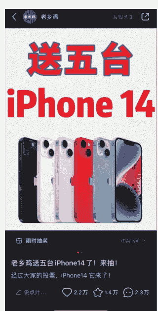

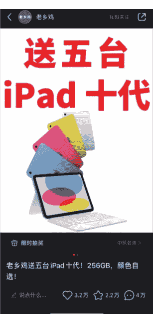

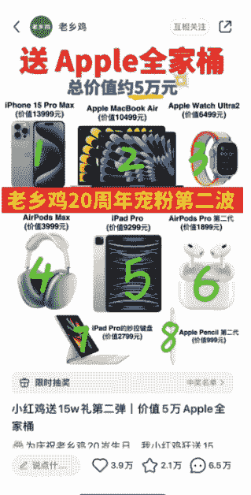

2. 紧跟当下热点

   结合国庆、五一长假送旅游基金，情人节送花，高考后送旅游金等。

例如，“xx搭子”热词流行时，抽工作简单但工资高的小红鸡助理作为奖品。

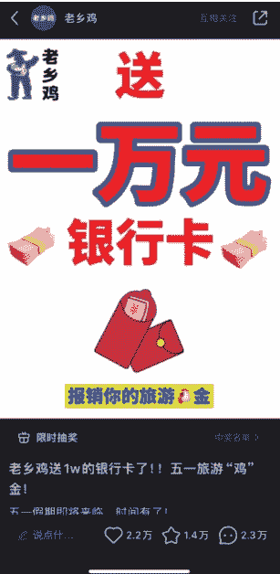

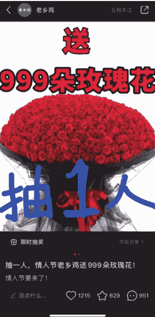

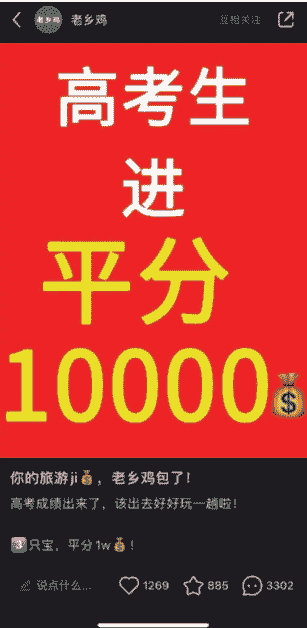

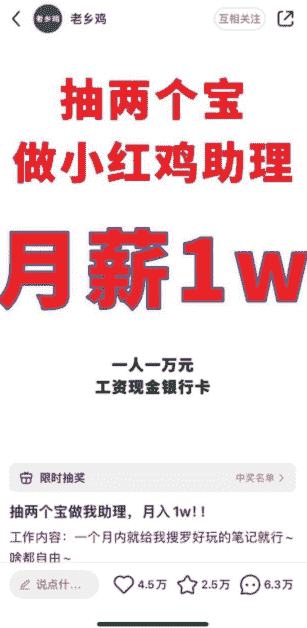

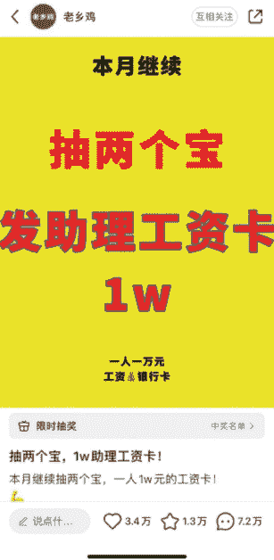

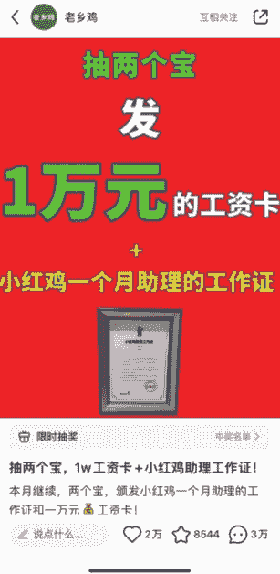

3. 引流玩法更有破圈感
   - 借助肯德基“疯狂星期四”的发疯体进行热点借势创作。
   - 用剧情化方式演绎敲开董事长办公室、顺手拿钱包给粉丝发福利。
   - 激发用户共创，例如将“我在大润发杀鱼”的梗与“付钱替我上班”的抽奖玩法结合。


4. 大奖中奖公示造势
   借此进一步坐实宠粉人设，同时为下一轮抽奖导流。


5. 日常小额福利常态化发放，品类不限自营
   - 与肯德基“疯狂星期四”联动派福利
   - 王者荣耀皮肤
   - 1000元老乡鸡礼品卡


V50，去吃肯德基

大家好

我是老乡鸡的小红鸡

我正在吃我最爱的麦当劳


挑战满足粉丝心愿第一天｜公主喜欢新衣服吗

艾琳公主有的新衣服，

我的公主也得有～


谁的老乡鸡尊贵VVVIP黑卡掉了啊？

被我捡鸡蛋的时候捡到了～

2022-08-10 15:32

6. 小额派奖在评论区公示并置顶，@中奖者


老乡鸡

今天是肯德基疯发作最严重的一次，躺在床上，拼命念肯德基的名字，难受得一直抓自己眼睛以为刷视频没事，看到视频都在推他的视频，眼睛越来越大都要炸开了一样，拼命扇自己眼睛越扇越用力，扇到自己眼泪流出来，真的不知道该怎么办，我真的想肯德基想得要发疯了。我躺在床上会想肯德基，我洗澡会想肯德基，我出门会想肯德基，我走路会想肯德基，我坐车会想肯德基，我工作会想肯德基，我玩手机会想肯德基，我盯着路边的肯德基看，我盯着马路对面的肯德基看，我盯着地铁里的肯德基看，我盯着网上的肯德基看，我盯着抖音别人合照里的肯德基看，我每时每刻眼睛都直直地盯着肯德基看，像一台雷达一样扫视经过我身边的每一个肯德基，我真的觉得自己像中邪了一样，我对肯德基的念想似乎都是病态的了，我好孤独啊！真的好孤独啊！！

2022-04-28

五一自在畅选大桶

畅选 13件

详情描述：五一自在畅选大桶：经典主食选3件，美味...

老乡鸡 作者

@一只小小怪 @野味爱哼唧 @九月 @周周要脱单 @小王爱吃蒜（减肥版） 炫肯德基🍗

置顶评论

2022-04-29

10+

8

请选择主食3份

小王爱吃蒜

好幸福🥰🥰

香辣鸡腿堡 x3

2022-04-29

登录后评论

1k+

1k+

1k+

1k+

> 【总结】
> ·抽奖海报走大字报风格，标题直接把奖项数量与金额摆出来。
> ·大额抽奖要紧跟热点，力争第一家。
> ·除自营大奖外，还要搭配非自营的小额抽奖，例如“v50”。

#### （二）用户共创型

##### 1. 搞笑+玩梗
（1）以“鸡生蛋，摔碎的蛋就是儿子”为设定贴合品牌，配合搞笑文案。
（2）粉丝发帖询问摔断老乡鸡筷子是否要赔偿，官方截屏回复不用赔，并自曝自己也常摔坏餐具，用幽默语气安抚对方。


我是真的会心痛!!

辛苦生蛋一整年

打翻只需一秒钟

我的儿!!

特此声明：在老乡鸡摔断筷子，不用赔钱

实不相瞒

我摔坏的餐具，打烂的鸡蛋数不胜数

😭😭

##### 2. 重视用户+表明态度
1. 不只收好评，投诉同样被重视。
2. 拎着砖头冲到研发中心追问好吃的菜为何总下架。
3. 食品安全问题，向从餐食中吃出餐巾纸的用户公开道歉并郑重声明。
4. 主动自查食品安全，给消费者吃下定心丸。


##### 3. 饮食健康
用户愈发关注健康与减脂，在粉丝推动下公布500大卡套餐及菜品热量表，契合当下热点，与霸王茶姬的卡路里表异曲同工。


#### （三）玩梗人设型

##### 1. 社会热点

###### （1）高考
- 志愿填报期发文询问清华好还是北大好。
- 志愿填报期表示分数784却进不了复旦，原来是芝麻信用分问题。
- 放榜后收留高考失意少年，贴合老乡鸡常点赞帅哥的习惯，用土味大字海报呈现。


###### （2）春节
- 借助春晚话题配幽默文案，用大字海报吸睛，如老乡鸡要上春晚。文案调侃老乡鸡不上春晚，接大润发名梗“我在大润发杀鱼”。
- 年货季结合年轻人过年打王者，送王者新皮肤。


###### （3）疯狂星期四
文案沿用发疯体“v我50，让我们一起谢谢鸡”。


###### （4）疯狂下属
- 为董事长报名综艺《男生女生向前冲》。
- 对向前冲帖子的后续，用热门歌词“怎么也飞不出，花花的世界”配图。
- 老板画大饼
- 老乡鸡收藏夹全是帅哥
- 职场高情商：董事长开会嗑瓜子如何提醒


帮董事长报名了，拿了冰箱分你们

@束从轩 董事长，加油！！我们相信你可以的！

[表情]


“董事长这身法会拿不到大冰箱？之前偷拍的董事长打太极的视频，看得出来这个... 展开全文


##### 2. 品牌联动

###### （1）老乡鸡与周黑鸭的CP梗
- 老乡鸡咯咯咯、周黑鸭嘎嘎嘎组CP人设，配合被董事长抓包梗，粉丝嗑CP。
- 周黑鸭出轨了？先和老乡鸡在一起又和肯德基在一起？
- 老乡鸡点名菲诺，称只是普通朋友。


###### （2）官方号点名盒马和星巴克互动
- 盒马招牌少字梗
- 星巴克洒地上梗


##### 3. 公益
- 老乡鸡免费供应米饭
- 物资捐赠


##### 4. 用户共创
借用“我在大润发杀鱼”梗，推出“给钱替我上班”游戏。


##### 5. 官方联动
将董事长与老母鸡P图结合，贴合品牌形象，在小红书官方主题下玩梗。


##### 6. 抽奖
- 小卡：老乡鸡卡；定位：汤臣一品；共享单车：限量版“法拉利”。
- 敲董事长门、拿董事长钱包，为粉丝抽奖。


##### 7. 其他

###### （1）名字梗


###### （2）CP梗


- 奥特曼：“你相信光吗？”
- 把开店通知包装成机密文件


拍到知名优质偶像来老乡鸡干饭！！

你相信光吗？

❤️


老乡鸡内部机密文件遭曝光！！！

刚才看到公司发的文件，我已经激动的不行了！

管机密不机密直接给你们看了，快看啊！！

###### （3）疯狂下属


我已经够勇敢了，该遗憾的不是我！

@家从轩

2023-04-17 10:17

发现送给董事长的绝佳礼物！！

送这个给摔了腿的董事长

他就可以和小鸟一起快乐漂移了！！

我真的太贴心了~


谢谢董事长批准！！

@家从轩

2023-04-17 10:17

老乡鸡

互相关注

有这样的董事长，真是我的福气，@家从轩 送到

到你老板办公室去喝茶吧！！

### 二、洁柔账号爆款笔记拆解


#### （一）抽奖福利类

爆款公式：预热+玩梗抽奖+引流

- 派奖礼品：华为全家桶、华为mate 60、iPhone 15、iPad、5000元哈尔滨旅游基金、1万元旅游基金、1年纸巾自由等。
- 福利发放：定期派纸、新品试用、香水、霸总周边、铁粉礼等。

##### 案例

###### 1. 旅游基金现金派奖

标题：抽1位马铃薯公主送去哈尔滨

数据：4万点赞、1.8万收藏、80560评论


洁柔 🟢 洁柔

互相关注

###### 抽1位马铃薯公主送去哈尔滨

尊贵的马铃薯公主

请查收你的哈尔滨旅游基金！

#用洁柔当霸总 #一起囤洁柔 #洁柔 #哈尔滨 #小土豆 #冰城 #马铃薯 #公主 #抽奖 #免费 #旅游 #免费抽奖 #游玩攻略 #旅游攻略 #旅行推荐官 #旅游推荐 #旅行 #宠粉 #纸巾

2024-01-01 广东

共 80560 条评论

洁柔 🟢 作者

song纸！👑霸总女人专属👑

置顶评论

01-01 广东

♡ 3651 💬 4202

白茶清欢

我，第一

01-01 广西

♡ 291 💬 回复

展开 4201 条回复

洁柔严选

小助理也想给大家抽平板 有没有霸总的女人支持一下

🥰🥰🥰

说点什么...

❤️ 4w ⭐ 1.8w 💬 80560

本篇笔记爆的点：

1. 标题：直球式标题，直观描述“抽×位马铃薯公主送去×”，简单明确。
2. 封面：大字海报，明确“可折现5k”这个点，对用户有价值，多方位地吸引用户群体，引发读者好奇心。
3. 热点：结合当下热点，近期哈尔滨热度高，用户会向往去哈尔滨玩、凑热闹，吸引力较强。

对比同类型旅游基金和日薪体验官抽奖，我们可以发现其他笔记的缺点：

1. 缺乏热点玩梗内容，内容相对比较单调，对用户吸引力不够大。
2. 虽然抽奖金额比较大，但是文案中没有体现“可折现”这个点，用户对现金的期望度比较高。
3. 这三篇内容里均有提到要求，相对于“马铃薯公主”的内容没有那么直观简洁。

#### （一）抽奖福利类

爆款公式：标题+大字海报+热点

##### 案例

###### 1.现金派奖

标题：抽×位马铃薯公主送去×

数据：1.2万点赞、1.1万收藏、10000+评论

> 【总结】
> - 直球标题：“抽×位马铃薯公主送去×”，开门见山，吸引力强。
> - 大字海报图片：把抽奖金额直接放在图上，再加上“可折现”字样，多角度吸引用户。
> - 热点：结合时下热点事件发起抽奖，影响力更大，用户更想去凑热闹，从而提升参与度。

###### 2.礼品、产品派奖

标题：免费的华为全家桶，就在今天！！

数据：2.1万点赞、1.2万收藏、31163评论

本篇笔记爆的点：

- ①标题：紧迫感标题，“xxx，就在今天（现在）”，体现出抽奖、送福利的紧迫性，让人感觉现在不点进去就会错过活动。
- ②封面：开门见山，直接上赠送礼品图，所见即所得。
- ③豪气：赠送礼品多且金额大，实用性强，对用户吸引力大。

对比同类型礼品、产品抽奖内容，我们可以发现其他笔记的缺点：

- ①标题缺乏紧迫感，“正在送xxx”这种标题相对没有“xxx，就在今天（现在）”的紧迫感。
- ②赠送礼品不够吸引眼球，对用户吸引力不够大，可考虑送大奖或吸引度高且实用的礼品。
- ③缺乏热点与玩梗内容衔接，不够有趣味性，抽奖可结合近期热点事件玩梗，突出品牌会玩、宠粉的人设。

> 【总结】
> - 紧迫感标题：“xxx，就在今天（现在）”的标题公式在前10篇爆款笔记里出现了5次，且排名在前5位，标题体现出抽奖、送福利的紧迫性，让人感觉现在不点进去就会错过，打开率和“三连”的数据高。
> - 大字海报形式图片：把抽奖产品直接放在图片上，再加上“免费”字眼，吸引力大，开门见山，简洁直观的词汇可快速给用户传递信息。

###### 3.抽奖引流

标题：被霸总指到的人都中奖！

数据：1008点赞、258收藏、656评论

本篇笔记爆的点：

- ①标题：玄学标题给人“我刷到就中奖”的错觉，引起用户好奇心，会吸引用户点进去，提高笔记点击率。
- ②封面：大字海报形式图片，把信息直接放在图片上，开门见山，简洁直观的词汇可快速给用户传递信息。
- ③内容：有引导互动性，有点玄学、锦鲤类的内容，吸引力较高。

对比连载引流内容可发现：

- ①账号连续性更新同一类型的引流贴，会降低用户对抽奖的兴趣，用户也会对账号产生信任危机，给人一种一直在宣发抽奖但不开奖的感觉。
- ②图片虽然是以大字海报形式呈现，但是图片上的内容只做引导性，缺乏趣味性。

> 【总结】

小红书爆款拆解：洁柔怎么做到的

标题要制造紧迫感，比如被点名的都中奖、礼物已经锁定你之类，引导好奇。封面用大字海报，直接把抽奖品项写进图里，开门见山，信息一目了然，实拍图也能增加真实感拉近距离。内容里适当加入玄学、锦鲤等元素，吸睛效果更好。

### 用户共创类
公式是回应用户声音+记录共创过程+推出新品。共创话题覆盖纸巾层数调整、香水、美术生、洗不烂纸巾、草间弥生等。

1. 纸巾改版
标题改写为：一条笔记就把5层纸巾改了？数据 4245赞、296藏、1753评。笔记吐槽纸巾从3层卷到4层再到5层意义何在。爆点在于：标题用“因为××就改版了”，直接传递宠粉执行力；封面选用当时热度最高的图，视觉冲击强；内容以征求意见为主，提升参与感。

2. 香水共创
标题改写为：他们在闲鱼倒卖的香水是从我们这拿的吧。数据 3098赞、823藏、1520评。开头引用@菠萝花和金花花对5层纸巾浪费的反馈，霸总表示已让产品改版。爆点在于：标题玩梗卖惨，告知香水已上线；封面放闲鱼截图，真实感强；内容引流到抽奖帖，霸总在线派发，引导粉丝不要去二手平台买。

3. 高考、美术生联动
标题改写为：接下来，你一定会收到梦想的录取通知书。数据 4203赞、177藏、127评。爆点在于：标题给予心灵寄托，提升点击；封面用用户热帖截图，体现聆听需求、用户至上的霸总人设；内容承接孔庙祈福和高考季热点，愿景简单明确，互动率高。

总结：用户共创是低成本拉近距离的方式，关注度高，更接地气，有助于塑造洁柔霸总宠粉形象。后续应持续刷帖跟进合适的UGC，快速响应。

### 品牌联动类
公式是抓住热点+玩梗联动。常见形式有国货联盟、国货锦鲤礼包。

1. 国货联盟
标题改写为：国货联盟，霸总第一个报名。数据 1.5万赞、761藏、16469评。爆点在于：标题体现行动力；封面放用户意见截图，显得真心听劝；内容表明态度并与蓝V国货品牌联动，响应国货讨论，凝聚力强；热点借势花西子79元争议，吸引国货粉丝，黏性高转化好。

2. 国货锦鲤礼包
标题改写为：180多家国货大礼包，只送一个幸运儿。数据 2024赞、1141藏、1578评。爆点在于：标题制造好奇；封面礼品多、色彩鲜艳吸睛；内容简洁立人设，主打宠粉。

总结：要紧跟热点做事件营销，主动与品牌互动提升曝光与公信力，借助官方资源放大声量。

### 热点营销类
公式同样是抓住热点+玩梗联动。热点包括淄博派纸、孔庙祈福、国货热潮。

1. 蜂花缺箱子带来的国货热
花西子事件后蜂花出圈，洁柔借势与蜂花互动组建国货联盟，澄清不是宝洁旗下品牌并介绍品牌历史，关联45周年宣传。笔记均破千赞。

2. 淄博烧烤热
2023年4月起淄博烧烤火爆，洁柔到淄博高铁站派纸，安排帅哥引流。单篇点赞破6000，总互动7000。

总结：热点即流量密码，宜做第一个跟进。蹭热要把握分寸，既要参与也要有度，避免成过客或翻车。

### 玩梗人设类
公式为趣味玩梗+帅哥变装+霸总宠粉人设。内容方向包括帅哥变装、B站魔性视频、霸总日常。

1. 帅哥变装
标题改写为：这个游戏好玩吗。数据 9125赞、1092藏、358评。共发11条变装视频，8条过千赞，其余超400赞。符合年轻审美，男色经济效应明显。

2. 霸总宠粉人设
标题改写为：有谁想免费试用霸总香水吗。数据 1231赞、743藏、2315评。爆点：封面大字报形式“抓几个女人免费试用”，抽奖产品直给；赠品多且实用；文案语气“抓女人”“爱霸总”强化人设。

3. 品牌声明的趣味化
标题改写为：关于洁柔洗衣液抽检不合格的说明。数据 2510赞、698藏、5382评。爆点：封面背锅形象有梗；声明简洁直述；评论超5000；结尾“全网寻用户免费试用新品”延续霸总人设。

总结：内容需符合年轻人审美，玩梗恰到好处有共鸣，多与颜值博主合作。

### 产品联名类
公式为联名过程+征求建议+产品上线。联名对象包括霸王茶姬、卡皮巴拉。

1. 霸总茶姬纸巾盒联名
标题改写为：霸总茶姬限量版上线了。数据 5646赞、784藏、3798评。爆点：标题直接告知已做好；封面实拍增加真实感；联名本身自带热度，用户常自制，洁柔满足需求。

2. 卡皮巴拉联名
标题改写为：霸总×豚豚等于什么。数据 2372赞、804藏、1704评。爆点：封面直接晒设计稿，展示执行中；内容征求信息，拉满参与感。

总结：IP联名要选热度高的IP，结合话题才能出圈。

### 玩梗卖货类
公式为趣味玩梗+带货链接。方向为霸总文学、互动卖货。

1. 繁花卖货帖
标题改写为：你好香，我必须拿下你。数据 1704赞、420藏、285评。爆点：实拍产品图简洁却与文案错位，引发好奇；霸总口吻有趣易讨论。

2. 互动卖货帖
标题改写为：哇，玩这么大。数据 1135赞、133藏、294评。爆点：封面实拍加“每人仅限免费观看一次”制造求证欲；标题有噱头；内容直球送香水，霸气吸睛。

总结：标题要吸睛或引发讨论，封面简单有趣，文案植入玩梗避免硬广。

### 七大爆款归纳
1. 抽奖福利类：借热点或玩梗，奖品金额不决定爆不爆，有趣的抽奖更有效，如送马铃薯公主去哈尔滨等。
2. 用户共创类：重视感受，展示共创过程，提升用户参与，塑造宠粉霸总，易出爆款。
3. 品牌联动类：快速提升影响力与公信力，紧跟热点即时联动。
4. 热点营销类：快速跟进热点，成为第一个品牌，淄博派纸、孔庙祈福等案例。
5. 玩梗人设类：以男色营销加宠粉绑定霸总人设。
6. 产品联名类：选择高热度IP联动。
7. 玩梗卖货类：标题、封面、文案都要有吸引力，不硬广。

附录专访要点
首席内容官吕白提出五点方法：人设与内容规划；贯彻年轻化战略，善玩梗造梗；账号抽奖与私域运营；互动技巧与产品价值打造；爆款研究与品牌联名。营销进入算法+口碑时代，小红书是种草与口碑阵地。品牌人格化让互动像朋友，用霸总语气及时反馈，用户愿为有意思的品牌买单。公域投放需给达人标杆，私域建群做冷启动，衡量指标为账号活跃度、笔记总量、爆文数量。

[2] 根据果集·千瓜的监测，#霸道总裁 在小红书的话题总阅览量已达1.63亿，衍生的 #霸道总裁只认他、#霸道总裁爱上我 等话题的浏览也都站上千万。

## 年末记

让更多人少绕弯

2025 年眼看就要收官，我把这一年里慢慢沉淀下来的几件事捋出来。

### 一、初悟“空”的逻辑
对“万物皆空”这四个字，我今年有了更具体的感受。空不是坐着等空出来，而是像把东西从容器里一件件倒出去。做老板也是一样，能舍得花钱才有钱回流，抠门就做不大，华为和胖东来就是这个道理。

我们公司创始人一直践行的三句话是“分权、分责、分钱”，六个字背后藏着很大的力量，靠它把公司带到百亿市值。分钱时的心态要是真的，回来的钱也就干净，不再是往容器里装，而是把容器本身撑大了。

爱也一样，想得到就得先付出，要真诚、要热烈、不计回报，哪怕一开始会被伤到，最终仍会迎来回应。核心其实是“我要给予”。

痛苦的根大概也在这里，把名利往“我”这个箱子里塞。起心动念都是“我要得到”，硬往自己身上塞东西，就成了执念。我想断舍离的逻辑也是这个意思，家里收拾干净，心里才清，所谓“一屋不扫，何以扫天下”。

回头看，我能得到一点福报，可能来自写书时把自己觉得真正好的东西坦诚分享出去，真的帮到不少人。最好的自利，往往是利他。

### 二、归根自足 别向外索求
米兰·昆德拉说过：“除了生病以外，你感受到的痛苦，都是你的价值观带给你的，而非真实存在的。”我很认同。

以前我觉得自己一定要在北上广深买套大房子，过得体面，不然人生等于白活，于是拼命往那个方向走。

现在有了一定条件，至少在北上广深也能过得不错，却发现当下的生活已足够好：人在一个三线小城，月租不到四千就能住进四室两厅的江景房。晚上在街上走着走着就开始问自己，当年的目标到底是什么？出人头地、更多财富、更多认可。

确实是这些，但那都是向外求。向外求太累，事业的起伏、人生的波动本就是常态。

后来我换了个角度，人生是来体验的，波折反而是体验感的来源，我才是主角。正如那句“一切有为法，如梦幻泡影，如露亦如电，应作如是观。”世间万物无常、空、无我，像梦像影像露水像闪电，短暂易逝，生死也带点虚幻，唯有经历和感受是真实的。

### 三、成己达人
没带电脑，手机打字太累。我在地图上找了附近，看到一家叫网鱼的网吧，进去后店员问要不要办会员办了半价。我说要办，他查了一下说我八年前就办过了。

还是同一个人。

只是从大厅换到包间，从打游戏换到写字，从62公斤到75公斤。

物质条件好了一些，兴趣点变了一些，体重重了一些，焦虑却少了一些。

当年琢磨的是毕业后怎样拿一份月薪过万的工作。现在琢磨的是怎样更有效地帮助更多人在新媒体的路上少走弯路。

成人达己。

（全文完）

## 鸣谢

封面字体_严永亮 内文排版_李鑫

在下小苏 作家张萌 耶鲁学姐笑笑 赛茜 崔璀

肉蟹宝 一只小羊 猫屋Becky 余木 米苏

感谢为本书提供原生内容的小红书博主

感谢为本书提供案例素材的品牌和企业

## 图片来源说明

第123—125页、第149页的图片均由AI制图软件生成