# 小红书运营实战手册

# 作者介绍

# 刘诗齐

掌舵新媒体、执教瑜伽、践行斜杠生活的复合型创作者，曾在一年内把一个零起步的小红书号做到17万关注，并操盘过多个千万级账号，期望助力实体商家以及渴望多重身份的个人抓住小红书爆发式增长的窗口。

# 李音奈

在内容产品与营销赛道深耕十一年，反复带领团队完成从0到1起号并打通涨粉到变现的完整闭环，曾主导项目16天内单平台增粉20万。擅长以内容撬动流量，打造具备高价值的个人IP。

# 前言

## 掌握小红书运营的理由

当下的传播形态正在经历巨变，除了传统媒体，个人自媒体已成为第二增长曲线，标记着去中心化时代的到来。我们的工作方式也因此被重塑，以个人或小团队为核心的自媒体迅速崛起，个人品牌的力量变得格外突出。在这个阶段，不仅是营销运营从业者需要学会自媒体运营，普通人更该学会通过自媒体塑造IP，像经营一家企业一样经营自我，从而降低职场风险。这无疑是最具回报的长期投资。

那么面对众多自媒体平台，为何要锁定小红书？看上去体量小众，实则商业价值极高。小红书自诞生起便带着商业变现的基因，虽然同样靠内容聚拢流量再实现盈利，却并非泛娱乐阵地。平台上用户与创作者都在交换真实的购买心得和体验，使其成为典型的种草场。选一瓶洗发水、一套彩妆、一件家居好物，很多人会先去小红书查测评与攻略。更关键的是用户购买力强劲，据报告，小红书直播带货的平均客单价约为抖音、快手的五倍。若目标是实现精准流量的商业化变现，小红书不容错过。

对新手博主而言，小红书更是理想起点。目前各大平台已进入红海竞争，若没有全新平台诞生，在抖音、快手、微信获取流量已十分拥挤，内容制作趋于饱和。而小红书作为以购物种草为核心的分享社区，对普通人更友好。其一，分发机制去中心化，每位创作者都有被看见的可能；其二，社区氛围重在体验分享，用户更信任普通人的真实感受。因此做小红书不必精通剪辑，也不需要惊艳文案，保持真实即可迎来持续曝光。

## 小红书运营的体感

笔者自2020年8月起运作小红书，截至2021年11月中旬，16个月内共操盘4个账号，累计涨粉超20万，已帮助2000余名用户沉淀至私域，并从中获得27万元课程收入，折合月均约2万元，人均贡献约135元。个人账号在粉丝不足2000时就完成过单笔9500元的大额成交。2023年起尝试小红书聚光投放，一个粉丝仍在2000以下的账号，月营收已突破11万元。

这些数字与头部主播的半场收入相比并不算突出，但整个过程除人力、灯光、拍摄、收音等固定成本，以及几百元一次的薯条投放外，再无其他物质投入，投入产出比相当可观。实践中发现，爆款与变现并非偶然，而是具备强烈可复制性。

更深层的收获是元认知与元能力的提升。写作、运营、盈利思路、传播逻辑等能力，会在更长的时间里持续产生正向影响。事物的改变皆由量变到质变，靠长期内容经营积累经验，逐步实现个人或品牌的增值，是最稳健的路径。若在此期间点燃热情、找到新的人生或品牌方向，则更为难得。

运营过程中也会收获意外资源。例如本书读者能读到这些文字，正源于笔者曾在粉丝不足百时发布过一条关于小红书运营的视频。无论起点多低，哪怕一条点赞不足百的内容，也足以让同频的人发现你。愿大家带着目标经营、带着收获成长。也许回头看，小红书的意义远超预期，它甚至能成为自我蜕变的加速通道。愿每个人都能在探索小红书的过程中获得向内延伸的动力，相信平台的未来，也相信创作者的未来，从翻开本书开始，一起飘红。

## 编写亮点

- 逻辑体系完整：从平台解析到IP定位，从内容生产到变现方式，从个人品牌到企业品牌，全景拆解运营思路与实操打法。
- 真正从零起步：从注册养号讲起，逐步搭建账号，操作门槛低。
- 方法贴近新态势：大部分内容结合小红书的新功能迭代更新。
- 经验高度提炼：汇聚多年新媒体实战经验，沉淀为可落地的方法。
- 心法与工具并重：既分享具体操作与工具，也传授运营心法，直击核心难点。
- 帮助走出迷茫：复盘作者在运营过程中的心态调整经验，助力读者保持高效心态。

## 本书结构

全书分为小红书运营基础入门、基础操作与案例拆解、运营者心智与能力塑造三大部分。

第一部分阐释平台特性与调性，介绍功能使用与官方薯服务，详解视频号与专业号差异，帮助初学者建立对平台的基础认知，有经验者可跳过。

第二部分聚焦账号定位、内容创作方法、短视频制作技巧、矩阵与导流变现、预算与投放策略。

第三部分解读运营者的心态与思考方式，为实操提供清晰的判断力与决策依据。

## 适合阅读的人群

- 新媒体运营从业者
- 个人创业者
- 希望打造个人IP的人
- 计划布局小红书的营销人员
- 对新媒体运营感兴趣的读者

因作者能力所限，书中难免有疏漏，欢迎批评指正。阅读中遇到问题可联系：刘诗齐 1368141753@qq.com；李音奈 375351927@qq.com。

刘诗齐 李音奈

# 第1章 小红书入门概览

在正式创建账号前，先花些时间认识这个平台，判断其能带来的价值是否与你的目标一致。只有相信它能提供成长与蜕变所需的资源，才能更坚定地投入。

本章涵盖要点如下：

- 平台基础信息、内容生态与直播特色
- 平台基础操作与账号申请流程
- 官方账号的形态介绍
- 适合入局小红书的人群画像

## 1.1 小红书的核心优势

内容平台层出不穷，主流平台蓬勃发展，小众平台也在另辟蹊径寻求弯道超车。但精力有限，面对众多选择，为何要把小红书作为主战场？挑选平台时，需预判哪个平台更愿意赋能、更能赋能，这至关重要。

### 1.1.1 机会密集的小红书

作为种草型社区，小红书对商家、品牌与普通创作者都极具价值，大家可在此建立品牌、推广产品、直播带货。这一切都与诞生背景紧密相关，要想把握更多机会，需从源头理解其来历。

1. 起源：小红书的前身
很多人知道小红书曾是电商平台，却不知它本质是社区起家的电商。笔者将这段背景分享给同行时常引来惊讶，却又觉得理所当然。正是这条发展路径，才造就了其内容商业化却不让人反感的特质。

平台于2013年6月在上海成立，12月上线海外购物分享社区，用户在此分享海外品牌的真实使用感受与购买攻略，弥合了品牌与用户的信息鸿沟，迅速成为市场黑马。

初期用户集中在海外购物经验分享，尤其是美妆个护，后逐渐扩展到运动、旅行、酒店餐饮、购物等高价值信息。数千万条真实消费体验汇聚，使小红书成为全球最大的消费口碑库，也成为年轻人的生活方式与消费决策入口。这为深耕优质内容提供了土壤，也奠定了其高口碑与种草特质。

正因如此，其商业潜力巨大。2021年新榜小红书营销洞察显示，仅上半年商业笔记便超十万篇，直播平均客单价是抖音、快手短视频的五倍，庞大用户体量与优秀转化正吸引更多达人入局。

2. 影响：植入购物的心锚
小红书既是KOL的分享集，亦是无数普通用户的决策参考。关键意见领袖即掌握更多、更准确的产品信息，并能影响多数人购买行为的少数人，是舆论风向标。

这类人群通常具备消费能力强、需求强、理念超前三大特质，也往往是现实生活中的意见领袖。小红书的种草效应正是建立在这些人群的影响力之上。

不知道选哪款洗发水？小红书搜一下；换季不知道什么风格流行？小红书搜一下；想出行却没目的地？小红书搜一下；想针对性减脂？小红书搜一下；想学新媒体实操？小红书搜一下……

公开数据显示，搜索优先用户占首页流量38%。先看小红书再做消费决策，已成为众多年轻人的习惯。与其他平台不同，目的性浏览是其最大差异，因此购物前先看小红书的习惯日益固化。

3. 种草：自带转化基因
既然用户带着强烈目的而来，只要精准匹配产品与人群，便有机会打造爆品，比如完美日记、7or9高跟鞋、可啦啦美瞳等。

越是消费导向的内容，越强调极致的消费体验描述，用户越买账。同时，品牌方对小红书的投放预算占比持续提升。

4. 机遇：普通创作者的崛起
不仅整体转化优秀，对普通创作者而言，小红书同样充满变现机会。粉丝不足一万即可入驻官方达人平台，新榜数据显示，商业笔记互动Top10中，粉丝5万至50万的腰部达人占6席。即使是万粉到百万粉的KOC，也可能成为商家批量种草的核心合作对象。

且变现路径仍在迭代。2021年知识付费窗口上线，为达人提供了除直播带货与接商单外的更直接变现渠道。此类尝试仍在持续，小红书每天都可能带来新可能。

### 1.1.2 平台内容生态

随着资本涌入与抖音、快手加入，更多创作者将目光投向小红书。原因不仅是用户购买力强、变现易、算法友好、新人机会多、粉丝黏性高，更因为这里有三项关键理念。

1. 在小红书，真诚分享是核心
“真诚种草、真实分享”贯穿整个生态。大多数创作者踏实做内容，而非哗众取宠，用心完成每条测评与展示。

一方面得益于官方对真诚分享、友好互动社区的建设，另一方面创作者也在守护这一氛围。真诚带来好内容，好内容带来高价值，价值内容吸引好产品，好产品创造好口碑，口碑带来传播，传播带来复购，形成个人影响力与商业价值的正向循环。

对“生于内容、长于交易”的商业个体而言，无论大品牌、小商家或个人，都能找到健康发展的路径。直播带货、账号变现、内容种草都在真诚中演进。以信任为前提、不透支信任，也可能是其直播客单价可达抖音、快手五倍的原因之一。

2. 在小红书，多元声音很重要
小红书给用户充分选择权。多数平台只能前后翻阅，算法锁死浏览行为，而小红书采用双列信息流，每屏约呈现四条内容，用户可根据封面与标题自由挑选。

这为创作者留了思考空间，也让深度优质内容有机会被发现，长视频同样受欢迎。算法对新人和普通人友好，包容表达是社区核心价值观之一，只要不违规即可自由发声。

内容因此高度多元，随着用户基数扩大，时尚、美妆、科技、运动、家居、美食、科普、出行等各领域都在涌现优秀作者。不同于女性扎堆的刻板印象，男性达人生产力在提升，月均发文12篇，超过平台整体均值10篇，男性用户注册占比达30%。

多元传播为打造个人IP提供无限可能，无论分享何种内容，只要足够优秀，就能链接同频伙伴，累积社交货币。

3. 在小红书，专业内容受重视
除首页推荐外，搜索流量占比相当高，公开数据显示搜索优先用户占首页流量38%。引爆搜索流量，除关键词布局外，内容是否专业、有料至关重要。

小红书有“小百度”之称，正因其重视内容品质。创作者持续输出所长，无论专业度还是优质度，粉丝都能找到所需信息。即使三五分钟的短视频，也能浓缩硬核干货。

专业氛围带来信任价值转化，也是粉丝黏性高、商业价值高的原因之一。在这里，不需要奇招或重金投入，只要具备真诚、多元、专业任一要素，都有机会从零爆红，且不必依赖团队即可做出成绩。

### 1.1.3 小红书直播的差异化魅力

小红书布局直播时间较短，整体仍在完善，但仍有独特优势。

1. 变现属性更强
平台粉丝以种草为主，使用核心目的是为购买决策提供支撑，本就具备强购买意愿，与以娱乐为主的平台不同。直播间流量与人数可能不高，但变现能力不弱。

2. 对新手更友好
对创作者而言，流量并非终点，直播间人气再高若无变现则无意义。与其沉迷人气，不如追求实际收益，这也是许多博主选择小红书直播的原因。

## 1.2 了解平台操作

在开启账号运营前，本节帮助大家初步熟悉小红书的基础操作与信息，降低上手成本。

### 1.2.1 认识发布界面

打开App进入发现页，除浏览系统分配内容外，可点击底部【+】进行发布。对创作者而言，这是高频页面，可完成编辑、上传、开启直播。

1. 编辑与上传内容
发布页可分别选择视频或照片上传，也可直接拍摄。平台的视频与图片编辑能力充足，支持智能成片、字幕识别、滤镜调色及小红书风格贴纸。

还可使用【模板】功能，如图1-1所示。点击下方模板，可按推荐、最新、生活碎片、旅行等分类挑选，分段添加素材后即可自动生成精美视频。

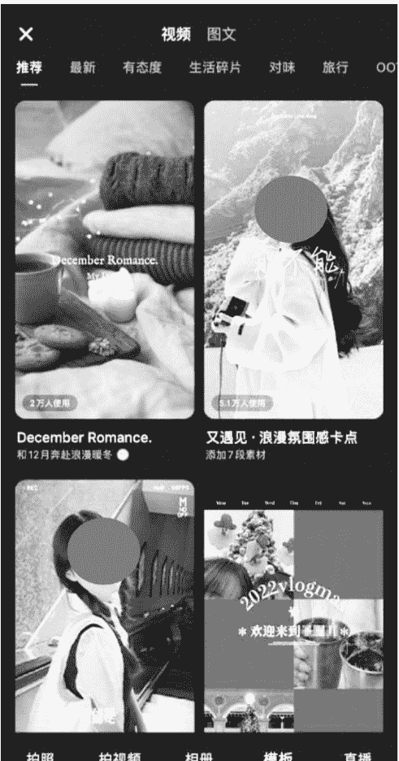

图1-1 发布页面模板功能界面

2. 开启直播
直播入口同样在发布页，支持上传封面、撰写标题以吸引精准人群，可开启滤镜美颜提升精致度，也可设置直播公告说明本场内容与福利，并设置屏蔽词维护互动氛围。

小红书亦提供电脑端发布入口，登录创作服务平台官网即可发布作品，或通过官网创作者服务中心进行作品发布与电脑直播操作。

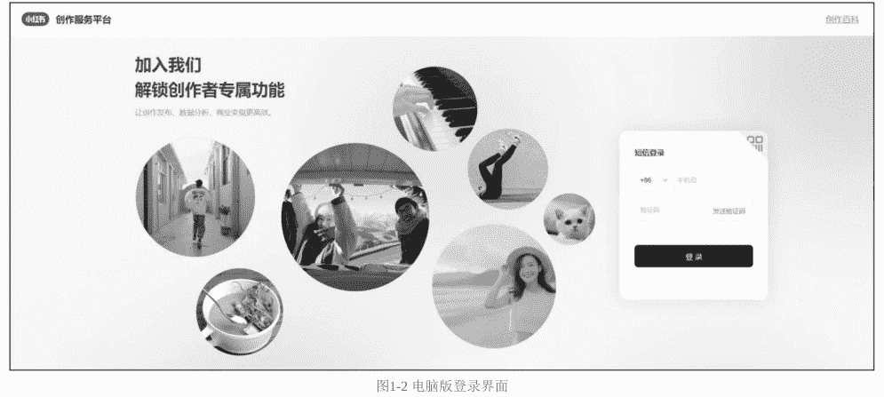

### 1.2.2 了解个人中心

小红书个人中心全解：从主页管理到变现路径

打开 App 之后点进底部导航的“我”，就进入了自己的主页。在这里可以发布新笔记、查看账号整体表现、编辑个人信息，也能通过侧边收纳栏触达一套完整的运营功能。

1. 发布内容并浏览基础表现
在个人页上下滑动，就能直观看到粉丝总数以及每条笔记的简要数据。页面底部中间的“+”是新建作品的入口。

2. 完善个人资料
点击主页右侧的“编辑资料”，可以修改头像、昵称、小红书号、个人简介和封面图等信息。

3. 进入折叠菜单
如图1-3所示，点一下左上角的“≡”即可展开侧边栏，这里聚合了账号的核心功能。创作者日常高频使用的有“创作中心”“我的草稿”“钱包”三大模块。

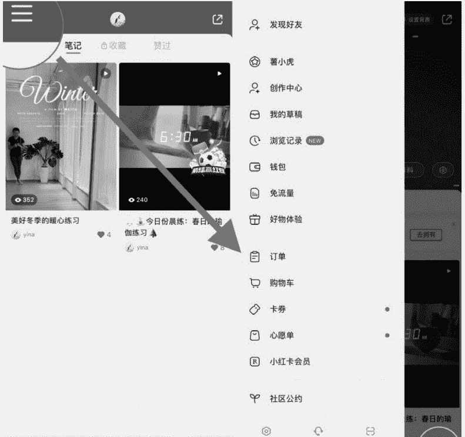

（1）进入创作中心/专业号中心
创作中心/专业号中心相当于创作者的运营中枢，如图1-4所示，它汇总了近期账号表现、热门话题活动以及官方创作教程，善用它可以随时掌握数据变化并获得系统化运营支持。

点 ≡ —“创作中心/专业号中心”—“近7日数据”，即可打开数据中心。这里能查看访客变化、用户观看时长、粉丝来源、互动情况和转化等细分指标，也能切换“近30日”查看本月走势。

活动 关于你的美妆2022

# 近7日数据

| 新增粉丝 | 主页访客 | 观看数 | 互动数 |

| :---: | :---: | :---: | :---: |

| 0 | 8 | 8 | 0 |

- 主播中心

- 创作学院

- 规则中心

- 薯条推广

- 更多服务

# 视频号成长计划 >

视频号是一项流量扶持计划，加入视频号，获取更多创作方式。

视频号升级 · 5大创作权益 · 任务中心

# 创作学院

更多课程 >

图1-4 创作中心界面

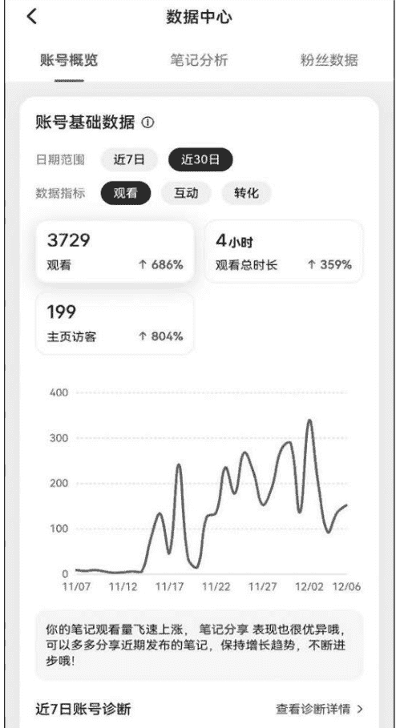

图1-5 数据中心界面

在笔记分析里可以查看单篇笔记的详细表现，视频类笔记还能看到观众流失曲线，便于根据反馈迅速迭代。粉丝数据则展示新增粉丝来源、流失人数及粉丝总量趋势，帮助维持粉丝关系。

点 ≡ —“创作中心/专业号中心”—“创作服务”—“更多服务”，可以查看创作权益、作者能力与内容变现三个板块。创作权益会按粉丝阶段展示可用的笔记功能，如定时发布、视频分段、合集创建、评论管理等，这些权限需达到一定粉丝量或条件后才会开启，如图1-7所示。作者能力板块符合条件后可申请专业号、原创保护等。内容变现板块支持申请店铺、直播选品、薯条推广等，粉丝≥1000可开通商品合作带货，粉丝≥5000可申请品牌合作接单，同时还能用薯条为优质内容加热涨粉。

# 数据中心

# 单篇笔记分析

# 单篇笔记分析

账号概览 笔记分析 粉丝数据

# 单篇笔记 ①

按发布时间排序 按观看量排序

北京上门私教🧘‍♀️这效果杠杠的

12-06 👁 47 ❤ 2 💬 0

瑜伽上门私教❤按次付费，标准...

12-05 👁 161 ❤ 2 💬 0

北京上门私教❤

12-03 👁 121 ❤ 3 💬 0

北京上门私教🧘‍♀️1节课就能达成...

12-02 👁 217 ❤ 2 💬 0

北京上门私教🧘‍♀️16节课练成这样?

12-02 👁 156 ❤ 3 💬 0

北京上门私教🧘‍♀️瑜伽私教🧘‍♀️

11-25 👁 578 ❤ 7 💬 3

# 笔记基础数据 ①

578

观看

14秒

人均观看时长

7

点赞

0

收藏

3

评论

4

笔记涨粉

2

笔记分享

# 发布后7日观看数趋势

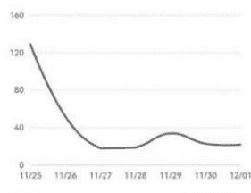

笔记诊断 查看诊断详情 >

# 观众来源分析 ①

● 首页推荐 53%

○ 搜索 35%

○ 个人主页 7%

○ 关注页面 1%

○ 其他来源 4%

有 35% 的用户通过搜索发现了这篇笔记，在笔记标题及正文中提炼笔记重要信息，有机会提升笔记的曝光量噢！

# 观众画像

# 性别分布

● 男性 18% ● 女性 82%

# 年龄分布

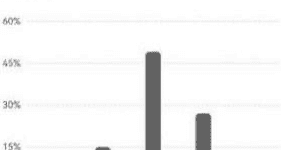

图1-6 单篇笔记数据分析

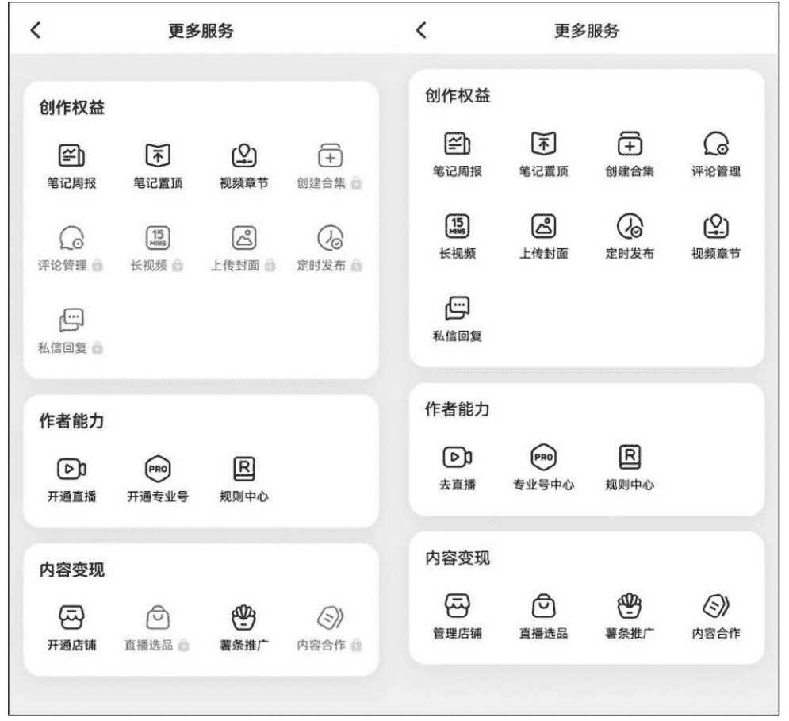

图1-7 不同账号的权益差距

点 ≡ —“创作中心/专业号中心”—“创作学院”，可以学习官方课程，涵盖选题、拍摄剪辑、粉丝运营等创作思路，还能及时了解视频新功能及优秀创作者的运营经验。

点 ≡ —“创作中心/专业号中心”—“笔记灵感”，可查看本周热点及官方话题活动，参与官方选题有机会获得流量推荐。

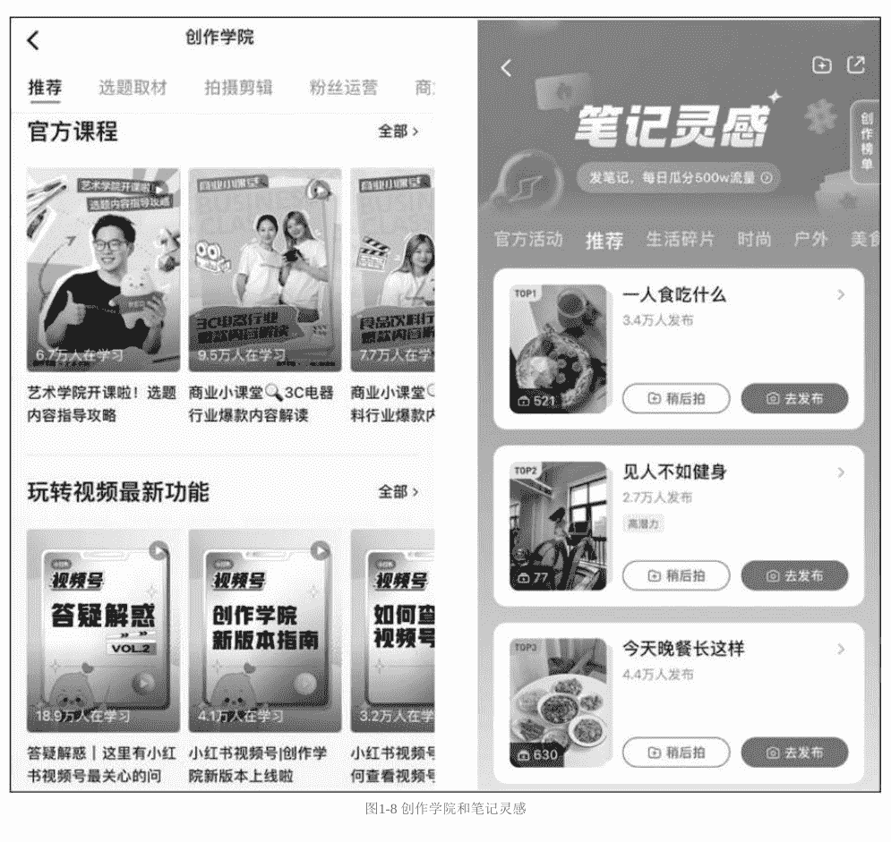

图1-8 创作学院和笔记灵感

（2）暂存未完成的草稿
在发布页编辑内容时，若暂时未完成或想延后发布，可先存为草稿。点 ≡ —“我的草稿”即可查看并继续编辑、发布所有草稿，如图1-9所示。

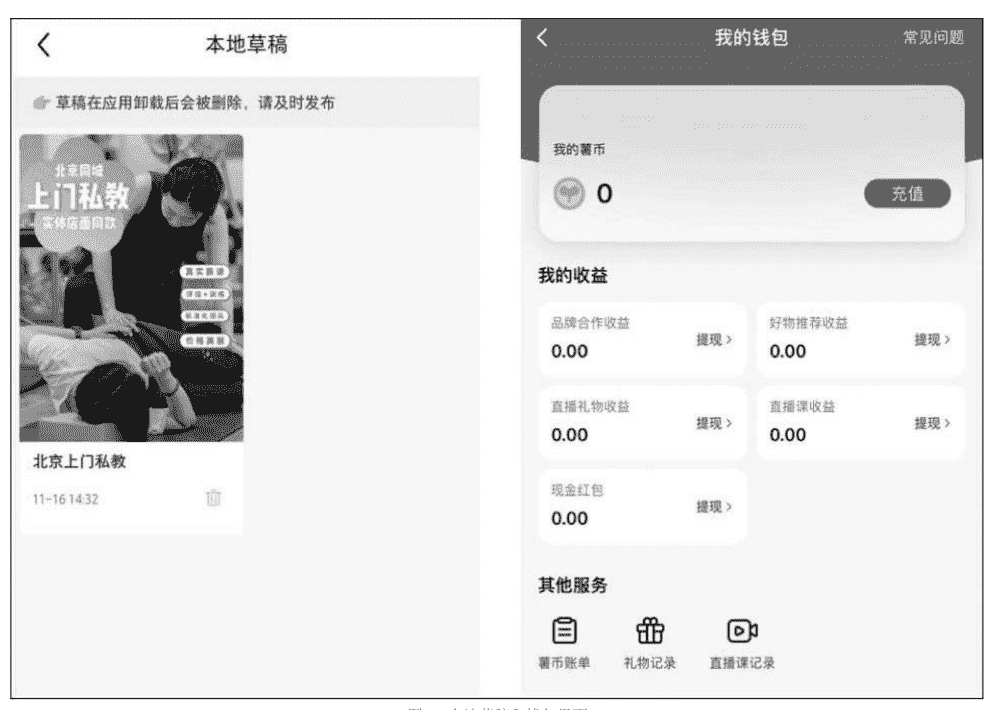

（3）查看资金往来
点 ≡ —“钱包”进入“我的钱包”，创作者在站内的充值、收益、礼物等资金往来基本都能在这里查询，包括薯条充值记录、品牌合作收入、直播礼物、薯币余额等，也支持直播课收益、品牌合作收益等提现操作。

除以上三大核心板块，侧边菜单里还能查阅社区公约。新人上传内容前应先了解发布规范；若数据出现骤跌，也可对照公约判断是否触及平台红线。

以上是创作者初期在个人中心常用到的功能，后续会结合实操进一步讲解。注意先完成实名认证，路径为“我的”—≡—“设置”—“账号与安全”—“身份认证”，否则会影响直播开通、收益提现等功能使用。

### 1.2.3 了解视频号和专业号
刚入驻小红书时，大家常提到视频号和专业号，却不一定清楚申请条件和权益。下面做个梳理。

1. 小红书视频号
视频号是官方的流量扶持项目。加入后可获得视频流量倾斜，还能接入官方资源，享有一对一运营指导、商业合作优先推荐、优秀作者签约等服务，并解锁视频合集、定时发布、15分钟长视频等专属功能。建议满足条件后尽早申请。

可申请的两类创作者：
第一类新手创作者需同时满足：
- （1）完成个人实名认证。
- （2）粉丝数≥500。
- （3）发布过时长≥1分钟的视频笔记。
- （4）无社区违规记录。

第二类已有站外粉丝基础的创作者：
- （1）B站粉丝≥5万。
- （2）西瓜视频或其他视频网站粉丝≥10万。
- （3）抖音、快手或微博粉丝≥50万。

对新人而言，冲到500粉申请视频号是不错的短期目标。
申请路径：“我的”—≡—“创作中心/专业号中心”—“视频号成长计划”—“我要报名”。

2. 小红书专业号
专业号是官方认证账号，可为自己打上专业身份标签，如运动博主、文化博主、美食博主等，每人最多认证两个身份，可自主选择是否展示在主页。

认证优势在于更利于做垂直内容，并开放抽奖、私信、运营指导等强运营功能。更关键的是，只有成为专业号后，才能在小红书开展开店卖货、品牌合作、广告投放等商业行为。

专业号分为个人身份和企业身份两大类，均可在站内自主开店。个人身份只能开通个人店铺，企业身份只能开通企业店铺，且账号与店铺合一，一个账号仅能绑定一个店铺。

商家建议必申请专业号。申请后主页可关联线下门店，展示地址、营业时间、联系电话，若多店还可按用户位置智能推荐最近门店；用户打卡后，门店页会同步展示口碑笔记。

个人用户切勿误申请为企业号，会影响带货、接广告等商业操作，且申请成功后难以人工取消，只能自然过期，过期后身份证号和手机号仍可能被占用，影响后续认证。

申请方式：“我的”—≡—“创作中心”—“更多服务”—“升级专业号”，选择身份并提交资质。个人身份选择美妆博主、时尚博主、摄影博主等推荐身份免审核费；找不到对应标签的企业身份可在搜索框查找，提交对应资质并缴纳审核费即可。

电脑端可登录小红书专业号平台，首页点“专业号认证”或在“资质管理”中点“专业号认证/年审”，了解可申请身份及资质后上传资料进入流程。后续的营销操作也可在该页面完成，建议收藏。

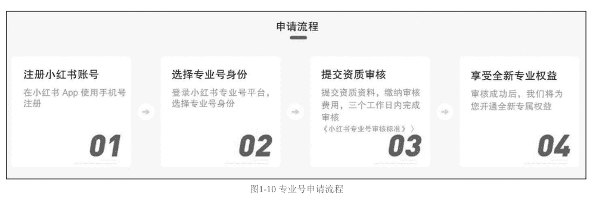

### 1.2.4 了解小红书的各种“薯”
对小红书运营陌生的人，建议先关注官方“薯”账号，能第一时间获知平台动态、热点活动和福利信息，也有助于快速建立内容生态认知。为方便查找，将其分为两类。

1. 提供创作者服务的各种“薯”
- 薯队长：官方顶流账号，聚焦平台调性与近期热门内容风格。
- 视频薯：视频号功能答疑、优质视频盘点及创作话题推荐。
- 薯管家：规则解读、违规案例公示及不建议操作提示，如“勿过度修图”“勿标题党”“勿非实拍种草”等。
- 薯条小助手：薯条投放答疑与干货直播，分享投放案例及基础运营。
- 小红书成长助手：新功能上线通知及热门功能攻略。
- 小红书体验站：可薅羊毛的体验申请信息，涵盖美妆、保健、家电等。
- 创作者小助手：直播课、视频号相关内容。
- 专业号助手：专业号操作与最新玩法解读。
- 带货薯：带货直播官方号，含主播培训、名家讲堂等。
- 店铺薯：商家内容创作、商品导流、店主经验分享的官方号。
- 商业广告薯：商业动态一手资讯，适合品牌方及策划运营参考。
- 商家培训薯：号店一体、店铺运营、营销玩法课程合集。
- 招聘薯：官方社招、校招信息及工作体验分享。
- 安全薯：网络安全科普、风险用户识别及维权引导。
- 蒲公英小助手：商业合作服务平台的官方号，提供合作干货与问题解答。

2. 垂直领域的各种“薯”
- 娱乐薯：综艺、影视、明星专访及观影团招募。
- 美妆薯：美妆内容灵感。
- 穿搭薯：穿搭灵感。
- 生活薯：旅行攻略、露营指南、出片地推荐等。
- 日常薯：Vlog爱好者向，居家、出行、恋爱日常等。
- 薯宝宝：母婴垂直内容。
- 运动薯：运动话题、周榜及行业领袖访谈。
- 校园薯：教育职场干货及定向流量扶持活动。
- 心情薯：情感/心理内容，定期发布情感红人榜及流量计划。
- 逛逛薯：种草、穿搭、美食类博主向，扶持点播及宝藏店铺对接。

此外还有电影薯、音乐薯、宠物薯、数码薯、薯博士、吃货薯、知识薯、新品薯、潮流薯、走走薯、玩家薯、美业薯、家居薯、人文薯、公益薯、游戏薯、红卡薯、薯侦探、小红书成长笔记、城市情报官、国货情报官等，感兴趣可自行搜索。

若偏好系统学习，也可直接进入创作学院的官方课程，内容覆盖选题取材、拍摄剪辑、粉丝运营、商业变现等多维度。

## 1.2.5 什么样的人适合做小红书
了解基础信息后，核心问题是“谁适合做小红书”。不必过度焦虑，小红书本质上人人可做。

### 1. 每个人都适合做小红书
专业优秀者自带发光点，创作门槛更低。若自身平平也无需担心，平凡同样是流量密码。吸引关注的关键在于审美价值、知识价值、功能价值、情感价值中满足其一，而情感价值对粉丝黏性最重要。

小红书倡导真诚分享，大家更爱寻找与自己相似或同频的人。从平凡慢慢变优秀的成长型博主，比一开始就很完美的人更能提供情感共鸣，这也是减肥、学习、美妆类博主易于起号的原因。此外，平台并非要求全方位PK，而是发挥自身长处找细分赛道，所以只要找到合适的切口，每个人都有机会爆款。

### 2. 多想“怎么办”的人更适合做小红书
对“是否适合”的反复怀疑，往往源于不自信和行动恐惧。觉得想法不成熟、外貌不突出、写作不佳、审美不达标……这些担忧本身不是决定因素。

问题的存在不可怕，关键是加上“怎么办”。没加之前，发现问题等于制造焦虑；加上之后，就是发现问题、解决问题。

颅内小剧场示例：
> 想法不成熟？——好慌，不如不做了！
> 外貌没特点？——我好丑，不玩了。
> 写作功底差？——果然没创作能力。
> 审美不达标？——太丑没人看，算了。

加上“怎么办”后，思路立刻变为行动导向，发现问题就顺势解决，推进会变得更顺畅。

> 我的点子还很青涩要怎么办？——不成熟也没关系，边实践边迭代，它会慢慢长大。
> 外表没什么记忆点怎么办？——可以借助妆发、穿搭与道具增加辨识度。
> 写作功底薄弱怎么办？——多阅读，多摘抄并细细揣摩，或者系统学习写作课程与书籍。
> 审美感觉不够格怎么办？——可以跟随当季流行趋势，同时研习大师的摄影、雕塑、绘画作品来提升。

归根结底，最契合小红书的，是习惯追问“怎么办”的创作者。持续发现问题、解决问题，打破固有思维，把想法迅速落地，即便风雨再大，也可能收获回应。与其纠结谁才有资格入局，不如把时间花在实操上，熟练度只会随行动而来。

### 3. 付诸实践，你才是最合适的创作者

曾有一位客户来做付费咨询，说账号定位已清晰，灯光、相机、支架一应俱全，却迟迟不发笔记，理由是想先把内容吃透再输出。听完能感受到她的用心，但她在找我前已在平台沉寂两年，仅发了两组照片，粉丝个位数。理解大家想万事俱备再出发的心情，可起步期不必给自己设限。

第一，莫要太玻璃心。起步时没有粉丝、笔记沉寂，本就是常态。进步来自实操，就像盖楼，爆款也需打地基、一砖一瓦砌起。我们看到的速成案例，多半是创作者在其他领域早已积累工具箱，运气成分也有，但绝不存在凭空起楼。

第二，粉丝稀少就不必在意评价。网友也是普通人，多数人理性，不会无端羞辱。担心内容不成熟、怕熟人看到尴尬，平台自带保护：可开启“不把我推荐给可能认识的人”“在【附近】页隐藏我的笔记”，也能用黑名单屏蔽不适内容。

第三，别被结果绑架。很多人还没开始就先焦虑未来。做阅读号要投入大量阅读时间，回报也就是出版社寄书与少量稿费；做美妆号竞争激烈，前期投入不小。二八定律常被提及，新人想进入前20%，付出时间与制作成本是正常代价。收益当然要思考，想不清也可以边做边想。

放手去试吧，边做边复盘，对自己的信任会不断增强，焦虑与好奇会随之消退，因为最适合做小红书的人，就是现在就开始行动的人。

# 第2章 账号定位

有人说，帮助一个人的最好方式，是让他明白如何正确用力。我们从定位入手，系统了解小红书的玩法。

本章主要涉及要点如下：

- 厘清人设与定位的方法。
- 确认账号的运营目标。
- 挑选内容赛道。
- 构建让人过目不忘的个人IP。

## 2.1 人设和定位：建立个人与品牌IP思维

刚刚起步的博主最容易卡在人设与定位上，筹备期喜欢找参考对象，参考越多越易迷失。没先定方向就贸然开张，最后很难保持稳定。

### 2.1.1 理解人设和定位

做好定位的前提是吃透人设与定位的意义，抓住不变的核心，才能避免后续陷入“又要A又要B”的矛盾，守住账号一致性，不让读者印象走偏。

#### 1. 定位的必要性

为什么做小红书必须先做定位？

因为平台人人可发，日更量爆炸带来的不仅是同类博主的竞争，更是全网信息渠道的争夺。设想日常：清晨用听书App配牛奶看新闻，通勤刷短视频被逗笑，上班时打开视频平台看观点被启发，中午肩颈酸痛打开运动App跟15分钟办公课，傍晚饿了翻点评约饭，晚上卸妆后打开小红书找姐妹推荐的护肤单品……

信息入口太多，用户只有24小时，心智像装满水的海绵，而我们想在上面留下印记。定位的价值就在于此：信息过载时用户会关闭判断欲，拒绝模糊内容，必须一眼可辨才会被分配注意。所有创作者都在讨好用户，在有限时间里，为什么要给小红书，为什么要给你？

避免无效努力，摆脱无人关注，先把定位准备好。

#### 2. 定位的定义

定位就是在用户心智里占据最佳位置，让用户瞬间识别“这就是我要的内容、想关注的人”，并在特定人群中形成差异化。做好定位能降低传播噪音，找到沟通的正确方式，应对信息干扰。

它既能在账号初期快速吸引目标粉，也能让运营者不再焦虑，对方向心中有数，减少选题弯路。

落实到行动，就是规划内容领域、内容调性、人设或品牌调性、视觉风格、文案风格、昵称、简介、标志性动作等，以应对平台海量内容与稀缺注意，如图2-1所示。

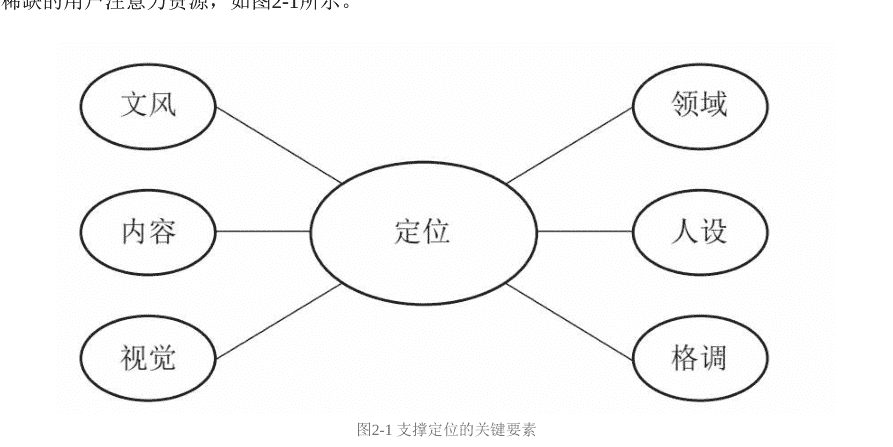

#### 3. 如何做定位

要让人第一时间记住我，关键在“他人”和“我”。做定位本质是厘清他人的位置、我的位置以及两者关系。

1. 摸清用户、市场、平台特性。
2. 摸清自身特点与特质。
3. 确定希望与用户建立怎样的关系。

定位本身不难，难在要真实客观地审视用户与自己，不断找到用户喜欢的点，勇敢面对短板，果断调整对外呈现方式，这都是对内心的考验。

在此之前，先建立IP思维。

### 2.1.2 建立IP思维

IP思维是放大互联网影响力的关键，必须前置。

很多人以为IP就是贴标签，只做绘画、只做搞笑就等于垂直IP，其实会越做越窄。IP不是把自己锁进小角落，IP是提供无限延展的能力。

简单说，IP即在某领域扎根，拥有至少1000个铁杆粉丝，愿意追随你、支持你任何新决策。按此标准，靠爆款拿流量的混剪号、搞笑号，都算不上IP，因为缺少内核影响力。

为什么要IP化？看消费行为。产品迭代快，消费者最怕踩雷，决策关键变成信任。买面霜前会问朋友、看好评、找测评，都是在解决信任问题。广告代言已不够高效，卖货前先要赢得信任，这就是IP的力量，如图2-2所示。

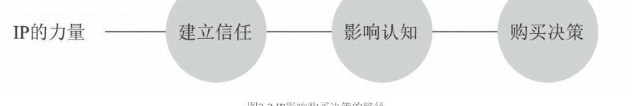

IP区别于网红博主在于，它必须有硬专业、被欣赏的品质或稳定正向的性格特质，才能让粉丝卸防、长期跟随。

举个虚构案例。

> 小红书运动博主俊俊妈坐拥百万粉，基本每隔三四条就有一条过万赞，专业又有趣，是关注基础。了解得更深后，大家被她感染力的笑容吸引，也好奇她的宝妈身份、审美、情感。于是即便是与健身无关的饰品、穿搭、饮食、美甲内容，依然有粉丝买单。
> 
> 起始广告是运动品牌，后来珠宝、腕表、化妆品相继合作，随后直播带货的品类从衣物到护肤都卖得不错。

品牌亦然：爱喝喜茶就买联名包，爱旺仔牛奶就喜欢周边衣饰。这就是IP魅力。

内容越垂直越容易建立信任，而垂直外的衍生线能展现立体魅力，打开舒适区，是粉丝从普通变忠实的催化剂。

所以定位第一步是充分认识自己，找到内容根基，再像大树一样长出新枝。

### 2.1.3 寻找人设和定位

具体如何找到适合自己的定位与形象？下面是可操作的方法。

#### 找到你的起始赛道

无论个人、商家还是品牌，前提是足够了解自己。

不用刻板划分自己是搞笑、健身、美妆、美食、知识类博主，尘埃落定前谁也不知道哪类最准，即便你是资深理财师，最后火的也可能是生活分享。

定位要深挖，方法如图2-3所示。

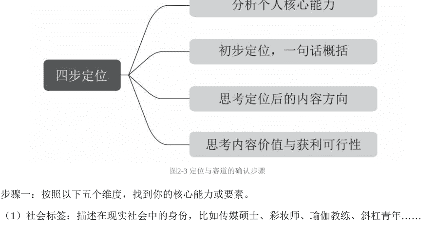

步骤一：按五个维度梳理核心要素。

1. 社会标签：现实身份，如传媒硕士、彩妆师、瑜伽教练、斜杠青年。
2. 性格特征：开朗、冷静、幽默、脆弱、自信等自我标签。
3. 外形特征：诚实审视，如上镜的嘴巴、舒服的面孔、有辨识度的眼睛、腹肌等。
4. 兴趣和愿景：不因无回报而厌烦，愿意持续做的事。
5. 独家经历或优势：别人没有的资源，如小众能量教练职业、180斤减到120斤且未反弹、获高含金量舞蹈奖等。

写下时保持中性，不分好坏。

步骤二：初步定位，一句话概括角色。通过要素拆解后自然产生优先级，用一句话串联，就能勾勒出小红书的角色画像。

步骤三：设想内容。基于定位列出可做的选题，检验是否可无限延展。

步骤四：评估价值。账号能带来社会价值还是经济价值，转换价值需要付出多少成本，有价值才有持续动力。

### 2.1.4 账号定位的四大步骤

以虚拟账号“小Q姐”为例演示流程。

步骤一：确定核心要素。

> 小Q姐在一家知名媒体公司做创意总监五年，因高强度昼夜颠倒工作年初突发疾病，幸亏抢救及时。她在病床上醒悟生活意义，开始规律作息饮食，并在医生监督下健身，把松垮的肉练成马甲线，决心把正确生活方式和积极态度传递给相似的女性。

核心要素：

1. 社会标签：知名媒体公司创意总监、女性病患。
2. 性格特征：不服输、坚毅、积极向上。
3. 外形特征：马甲线。
4. 兴趣愿景：传递女性正能量，探索高压女性健康生活。
5. 独家经历：重病后在病床上练出马甲线。

步骤二：初步定位。

她最想呈现的是患病经历与积极态度，想用真实故事释放自己，也想告诉高压下受病痛打击的女性，直面困难也能美丽自信、松弛生活。

角色定位为热爱生活的美丽女性，历经常人没有的病痛仍积极向上，已回归正常生活并游刃有余。

若优先级调整，也可成为健身博主或知识博主。

步骤三：内容设想。

可做女性正能量账号，内容分两大类：

特殊群体治疗心态、运动技巧、健康饮食、病愈后可用染发剂护肤品；传媒行业工作状态、日常穿搭、阅读书籍。

都能传递精神态度，且选题可长期延展。

步骤四：社会与经济价值。

内容能赋能女性，符合公序良俗，前期投入低，手机+支架+收音器即可。未来可通过直播带货分享优选健身好物、健康食材、特殊人群护肤品，考取瑜伽与营养师证书做知识付费课程和女性社群，也可获品牌合作。

她最终开始行动，收获副业收入，也给很多相似经历者带去勇气。

定位四个步骤就此完成，若仍觉得“我不了解自己”，后续内容会从其他角度帮助厘清。

### 2.1.5 学会逆向定位账号

思维方式不同，自知程度不同，若正向梳理困难，可用倒推法：先定运营目标，让账号具象化。

就像射箭，先找靶子。先问自己：做小红书是为了爱好还是为了赚钱？

纯爱好就简单，以兴趣定方向，找对标账号切入小赛道即可。若目标是变现，就要选对赛道。美妆、穿搭、游戏、科技、母婴、阅读、健身、个人成长等赛道的赚钱能力差异很大，选对方向能少走弯路。

甄别赛道可从三个角度，如图2-4所示。

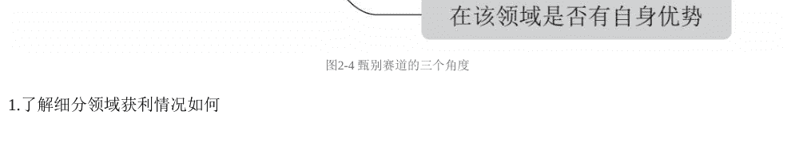

1. 了解细分领域获利情况

赛道赚钱能力取决于粉丝的消费习惯、消费能力、消费渴望。理想赛道用户易受刺激且付费能力与渴望都高。

比如母婴号粉丝基数小却好变现，因为背后是三四十岁新手妈妈和五六十岁的奶奶姥姥，都是女性冲动消费群体，掌握家庭开支，且对孩子爱意强烈。美妆同理，女性用户愿为变美高额投资，所以粉丝量一般的搞笑、知识、旅行博主常转美妆或开小号。

2. 了解细分领域的粉丝精准画像及黏性

要看粉丝是否可具象化，精准度越高越好变现。

很多培训机构账号，如模特培训、教练培训、英语培训，粉丝不多但变现强，因为运营前就对潜在付费人群了如指掌，只需引导就能吸有效粉丝。

如果你对粉丝整体画像没有清晰的认知，摸不清他们在乎什么、消费的逻辑是什么，品牌方很难把你列入投放名单。即便想做知识付费或直播带货，也会因为不了解受众的偏好而推进困难。拿影视剪辑号举例，这类账号做大规模不难，但用户获取门槛低，受众范围就会很宽，到商业化阶段就需要花更多创意去做转化。

黏性同样是生死线。每个人的时间和预算都有限，能给你多少，取决于粉丝对账号产生了多少依赖和情感联结。黏性不足的账号，最后都只能在关注列表里沦为同质化的背景。

再用影视剪辑说明，很多人点关注只是因为片段里出现了心仪的明星，和创作者本人并没有建立联系，换一个账号发同样的片段照样会跟。想靠这种松散的关注做付费转化，难度会很大。反过来，高黏性的账号就不一样，比如笔者接触过的颜值博主辉某仔，粉丝不过一千八时，商业邀约就已经源源不断，因为观众喜欢的是他这个人，而不是一段素材。

## 3. 赛道选择是否能放大你的个人优势

选定赛道后，先找可对标的账号，把该细分赛道的常见打法梳理清楚，再拆解头部账号的差异化特征。随后把上一章的定位流程再走一遍，结合自身核心能力，在赛道里细化可以扮演的角色特质。这个过程对方向感还不够明确的创作者尤其有帮助，能逼出更深层的想法，也能检验对账号未来的信心和决心。

至于赛道目前是红还是蓝、入局人数多少、运营多久、头部有多少，这些不必过度焦虑。如美妆和穿搭，早已是竞争激烈的领域，没有差异很难突围，但这并不意味着没机会。动点脑子就能找到切口，比如美妆结合八卦聊天，美妆结合吐槽段子。只要愿意，内容形式永远可以被重新设计。

### 2.2 让定位在细节里被记住

昵称、头像、简介，本质上是账号的名片。内在逻辑理清后，就要借助这些外在细节把它具象化。

#### 2.2.1 名字怎么起

定位明确后，如何命名？

企业或品牌号最省事，在原名基础上做关键词的增减即可。团队协作做项目，命名可以直接用策划主题，比如：100个中国女孩的家、而立计划project30、天才职业故事。

个人品牌没有统一标准。昵称是对内容特质的高度浓缩，自由度很高，可以随账号成长而调整，也代表你在网络世界的一种身份，要符合个人文字审美，能产生代入感。一般满足以下三点即可。

1. 有助于提升曝光
最好别用生僻字或复杂的英文，否则即便影响力足够，品牌方也可能把你过滤掉，因为名字难读写会增加工作成本。用户在搜索和口碑传播时也会受阻。建议控制在七字左右。昵称里的关键词布局也很关键，名字和关键词结合在一起，能直接影响曝光和导流。过度风格化，用纯英文或特殊符号，会降低记忆度，也让搜索时流失流量。

2. 有助于提升辨识
别拗口也别随意，避免重名。比如Emma、安娜这类常见英文名或音译，好认但遍地都是，分辨困难。

3. 尽量体现个人特色
把想呈现的特质暴露出来，让人看到名字就能联想到账号的特点、性格、技能、职业、目标、爱好、地域等，有助于人设建立。

比如爱健身的陈自律直接点出自律特质和健身爱好；京城小丸子传递了京城地域和可爱短发形象。

个人品牌命名常用公式：

- 职业/身份/产品+昵称，比如：能量教练CieCie、陈顾榕瑜伽、脱不花讲沟通……
- 性格/情绪+花名，比如：刘豆豆不怎么逗、躁动的moom、励志的安子薇……
- 中文昵称+英文名，比如：Constance雷雷、多老师Dora、小粽子Selina……
- 人物特点+昵称，比如：黑头发的Gina、肉脸喵喵、圆脸木木……
- 人物昵称+空间营造，比如：Jacy的小宇宙、林安的会客厅……

也可以随意发挥：

- 化用爱吃的食物，比如：六个葡萄、奶茶界的米奇王、奶卷金橘……
- 化用喜欢或所在的地点，比如：邱巴黎Paris……
- 名字的谐音梗，比如：壶提提（胡婷婷）……
- 喜欢的影视或书籍化名，比如：小鱼海棠、不凡的阿凡达……
- 自己的愿望，比如：唢呐瘦了没……

提醒：多平台分发尽量全网同名，别增加用户搜索成本。昵称可变，有固定直播或促销活动时可按需更改，比如丸子笔记（每晚7：00直播）。

#### 2.2.2 头像与背景图

小细节也能放大效果。头像是账号标志，陌生人进主页的第一入口，必须足够吸睛。进入主页之后，一张干净清爽的背景图会让人更愿意停留，提升点击其他内容的概率。

头像可参考四项：

- 便于视觉识别，风格化且有记忆点，同时能体现特点。比如舞者头像最好露出面部舞姿；段子手头像最好做近距离面部特写放大五官。
- 避免背景杂乱或主体和背景边界不清。比如穿大地色衣服的模特站在土坡上，划屏时只剩棕色色块。
- 图片四周留白，避免上传裁切掉画面中心，比如脸被裁半张、腿被切掉、文字被截断，视觉很不舒服。
- 除主体是水滴、心形、人物剪影等特殊形状外，别用白底图。App浏览时头像置于白底，白底会消失在标题栏，缺乏边界感，在比例上也吃亏。

具体情况分两种：

##### 1. 品牌或商家账号的头像选择
以简洁可识别为原则，建议用品牌标识或拟人化动漫形象。背景图要和商标呼应，视觉和谐即可，可用和商标色搭配的商品照、概念照或主IP出镜照。

##### 2. 个人IP的头像选择
头像最好和昵称形成呼应，按个人喜好挑选。为树立IP，建议用本人照片或以本人为原型的动漫形象。

不愿用本人形象时，可用视频中占比大的宠物、自己喜欢的影视形象（影视号、时尚号适用）、自己做的糕点（厨艺达人适用）。别用好看但毫无关联的图片，比如影视号用风景图，会显得不专业。

用户通常是被内容吸引后点进主页了解你。主页呈现为左侧头像右侧昵称，像初次见面打招呼的场景。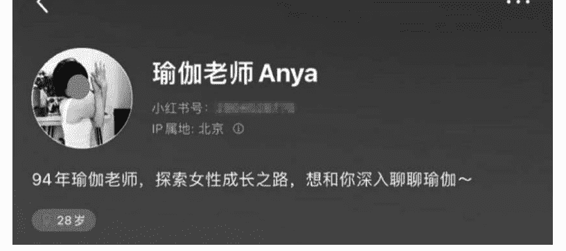

想在第一眼就被喜欢，就要让头像和昵称相互呼应，形成互动，让人感觉真人友好地在打招呼。这里有一个设计法则叫逆向构图法。昵称在右侧时，让头像主体向左倾斜，仿佛面向名字，就能让名字、简介、信息产生强互动，强化个人IP感。

#### 2.2.3 账号简介

简介写得好，能显著提升关注率。虽然只有几行字，但在关注决策中作用不小。很多人关注前会先点进主页看简介，简介出彩能大幅提升关注概率。

写简介注意五点：

- 别写太长，分段或用“|”等分隔符，密密麻麻的字没人看完。
- 善用Emoji表情和符号，美化呈现，也能含蓄表达额外信息。
- 尽可能呈现最重要的信息，如职业标签、可提供的帮助。“分享生活”“热爱生活”这类空泛标签等于浪费引流机会。
- 尽可能呈现用户有共鸣的信息。比如健身博主写身高体重，美妆博主写皮肤状况，宝妈写座右铭。
- 已有变现目标可加入引流语句，不要直接留微信或引导私信，会被判定站外导流，写明能提供的服务即可，如“免费体态评估”“达人孵化，有问必答”。也可预告直播或促销，如每周一、三、五晚7：00直播。

多观察同领域博主找灵感。撰写简介的通用方法如图2-6所示。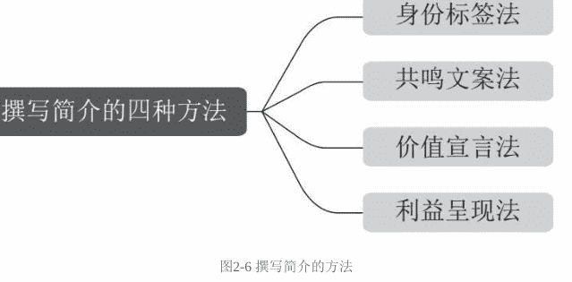

##### 1. 身份标签法
我是谁，我的独到之处、职业、成就、影响力是什么，我将持续输出什么价值。

比如钳钳妈，如图2-7所示，简介是：174/55 kg，93年半全职妈妈，另一半留给运动和自己。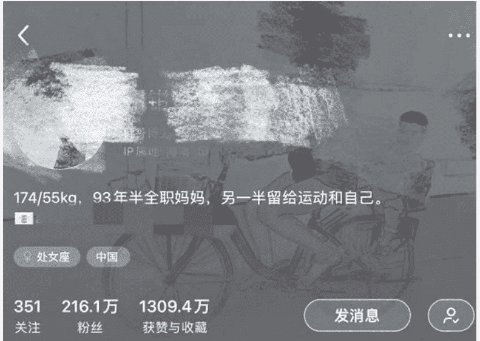

##### 2. 共鸣文案法
结合定位和领域，写目标人群会感同身受的话。

比如美食号绵羊，如图2-8所示，简介是：对着油炸的卡路里许愿，贪吃不胖！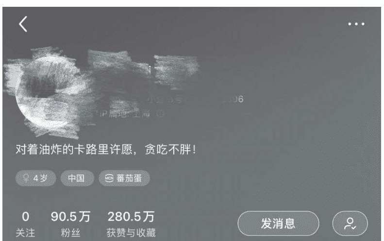

##### 3. 价值宣言法
发自内心宣告价值观、愿景。

比如雷雷，她的简介是：做全网最年轻的37岁元气美少女！瑜伽教学11年，全球500强企业御用瑜伽教练，驻颜逆龄，身心疗愈。瑜伽的本质是一种工具，支持我们，体验生命。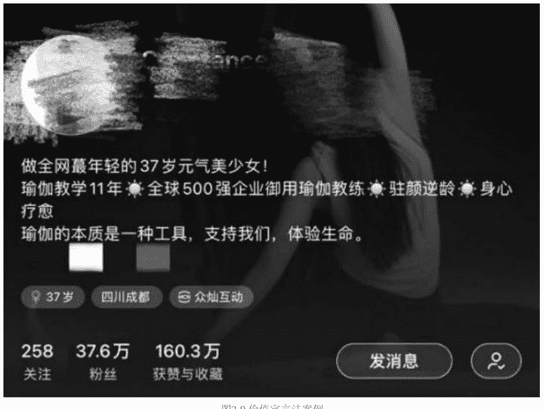

##### 4. 利益呈现法
写下可提供的价值和帮助，如图2-10所示，用户能从你这里得到什么。比如摄影博主写：分享手机摄影技巧；美妆博主写：半百老少年，手把手教你护肤变美。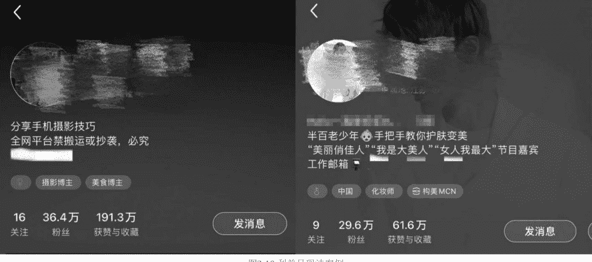

简介没有固定框架，方法可组合，只要把想表达的说清、达成目的即可。

### 2.3 主线、风格、调性的统一落地

开屏前四页，尤其是主页第一屏，是账号内容集锦，用户多从这里建立认知。因此主线、风格、调性的统一至关重要，它决定第一印象，也决定是否会产生后续关注。

画面、标题、文案风格、形象设计都要重视，下面分视觉和内容两块落地。

#### 2.3.1 视觉上的主线、风格、调性
通过良好的视觉把握住近因效应。

##### 1. 封面
封面是第一印象，打开账号最先注意的就是它。字体、图片、标志、色调、文案、人物占比都会影响认知。有固定传播符号最好，每张封面用相似元素、相似色彩、相似字体、相似人物占比，让人产生“熟人感”，降低识别成本，也省去反复构思的时间。

当然长期固定板式容易审美疲劳，建议定期更换。若创作能力强想常玩花样，就要保留标志性元素。极端例子是运动博主Midori，每张封面版式都不同，字体位置、主色调、字体样式几乎没有重复，但大胆配色、美感排版、夸张字号加上一头标志性绿发，依然一眼可辨。

##### 2. 场景
场景设计就是通过物品或元素摆放营造情境氛围，增加带入感，帮助差异化定位。

两大原则：符合账号自身调性，符合关注者心理向往。运动博主可在健身房拍，读书博主背后放书架，美食博主用有特色的餐具。

想丰富场景可固定在有属性的场所，比如自律型博主可用书房、厨房、图书馆、健身房、咖啡厅等积极向上的场景，通过调色和版面保持统一感，便于用户形成逻辑联想。

视频或图文的画面感要和谐，内容之间要有联系。原本一直是鲜花绿植的场景，突然切到工业风“铜墙铁壁”，很容易丧失识别性。

##### 3. 形象
打造魅力风格，妆容、发型、服饰都会影响感受。形象要服务定位。如果是自律内容分享，穿睡衣头发凌乱就缺乏说服力。

形象设计三原则：一显眼，二舒服，三契合。

显眼原则。观察小红书会发现很多人用爆炸头卷发，就是因为生活中少见，平台上会多看两眼。通过少见发型、发色、妆容、配饰、穿搭让人一眼认出。

显眼过度会招反感，要遵循舒服原则。如长期戴墨镜、口罩、压得很低的鸭舌帽，除潮酷风格外，会让人觉得畏缩不敢露面。打鼻环、眉骨钉等装饰也会劝退一部分潜在用户。做亮眼但要接地气，让更多人接受。

外形还要契合内容。知识类博主干净利落，简单大方职业套装合适。科技数码类博主数码风，合身格子衫或黑框眼镜更显专业。即贴近用户脑海中的刻板印象。当然也可以剑走偏锋，比如素面朝天的美妆博主反而更吸粉。

#### 2.3.2 内容上的主线、风格、调性
内容主线不是要求固定模式不变，而是给用户一个稳定预期，告诉他们关注你能看到可预期的精彩。需要足够暗示和线索：身份、定位、正在做的事情、关注收益。选题可变，传递的感觉和价值观要统一。

举例：

> 成长型账号用内容呈现成长变化。比如胡某馨立志做“最美圆脸”，公布普通女孩10年变美逆袭史，视频里能感知人生变丰富、变美好。
> 专家型账号用内容输出持续干货。比如鹤老师大量实例集中讨论经济学，每篇都让人有收获感。
> 兴趣型账号满足猎奇心。比如陈某山讲名利场生活；硬糖视频科普后青春期两性知识百科。
> 搞笑型账号提供快乐。比如配音账号植某椿用诙谐段子吸粉。
> 地域色彩浓重的人物让用户了解乡野文化。比如康仔、茂茂，视频即质朴美妙。
> 观点型人物呈现先锋思维碰撞。比如产后漏尿、卫生巾自由、青年负债等话题。
> 纪实采访型账号呈现不同人群生活状态。比如不普通实录、北京青年访谈录。

不要追热点乱发，也不要今天一个主题明天一个主题，不符合近期定位且无重大意义的内容可以直接删掉。

除选题外，标题、文案、剪辑风格、音乐选择也要保持统一。可利用标题建立稳定性，每条标题采用固定格式，如加入固定符号、特定Emoji、数字序号No.001、No.002……形成系列感，用户还没反应过来就已条件反射打开。

文案的风格最好有一个清晰的调性，文艺、搞笑、犀利还是治愈，都要和画面、个人形象以及分享主题保持统一，尽量避免标题党。围绕定位打造一套专属的口头禅也很关键，比如瑜伽博主Rosie的收尾语就是“关注我，带你练点更好的”，用户听到后会觉得练习品质有保障，很安心。

剪辑手法和音乐挑选同样要保持一致，后面会另起章节详细拆解。另外小红书的置顶笔记可以用来强化个人记忆点。用户进入主页第一眼看到的就是置顶内容，功能一解锁就建议马上启用。

# 第3章 选题布局

定位讲完就进入执行。这一章聚焦选题与创意策划，把怎么选题、怎么想题讲清楚，能让小红书起步阶段的操作更省力、更顺畅。

本章主要覆盖的内容有：

- 什么样的选题算优秀
- 选题时要遵循的准则
- 如何快速找到选题
- 如何搭建个人选题库

## 3.1 选题心法：实现持续爆款

选题本质上是在回答内容从何而来。俗话说选题决定一半成败，创作者几乎都被选题需求牵着走。选得准，内容更容易被用户接受，也能提高发布频率。对创作者自己而言，构思越巧，制作越轻松。甚至好选题能掩盖部分内容瑕疵。可惜很多博主把精力都放在文案、剪辑和排版上，发布一段时间后就出现产出困难、灵感枯竭的问题。

要怎样才能让选题不断出爆款、内容不断供呢？

### 3.1.1 好选题的四大构成

大学学新闻传播时学过新闻选题课，一个优秀的新闻选题通常要具备广度、角度、深度、速度至少其一，如图3-1所示。放到短视频和图文内容上，逻辑是一样的。

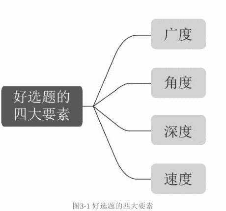

1. 广度：扩大选题覆盖面
广度基本等同于覆盖人群。能触达的人群越广，曝光机会就越多。小红书上点赞过万甚至几十万的爆款，多是大众关心或好奇的话题。
垂直类博主容易在广度上吃亏。拿运动类举例，大神级瑜伽老师想把知识完整讲透，会把“骶髂关节功能紊乱”作为选题，其实和“慢性腰背痛”讲的是同一类问题。换成后者覆盖面更广，在内容质量相当的情况下，阅读量、点击率和涨粉效果通常更好。

2. 角度：优化选题切入点
第一种是选题过于直白。把“高效学习方法”直接作为主题，泛泛而谈很难出彩。换成个人真实经历的切口，“一年拿下15所名校的学习方法”，传播力会明显提升。
第二种是切入口是否够新颖。创新不是凭空造题，而是和同赛道博主相比，在同一框架内有突破。比如“秋冬穿搭”人人都在做，换成“拯救秋冬雷品的穿搭”，用废物利用的角度就立刻拉开差距。

3. 深度：提升选题内涵
传播的关键是渗透而非覆盖。用户看完你的内容会有什么冲击？能引发多大共鸣？能在记忆里留存多久？核心在于找到用户的痛点和敏感点并向下深挖。痛点越深，内容越抓人。
还是以运动为例，同样讲翼状肩胛，一个题目是“翼状肩胛的成因和危害”，另一个是“你可能不是驼背，而是翼状肩胛+平上背”。前者平淡，后者更容易让人想看、想转给身边同样有困扰的人。

4. 速度：抓住选题热度
事件型爆点越及时，水花越大。热点+速度+定位就构成好选题。有时抢在前面，内容上的小不足也能被忽略。
比如某选秀节目的成团夜，当天发的相关片段数据都很不错。一周后就需要用更具体的解读角度才能达到相似效果。
辅助操作时可多关注搜索引擎热搜、突发热点，以及每年的营销日历里的固定节点。

### 3.1.2 选题筛选的四条准则

有原则地选题，能让内容稳定、有效且持久。发布300多条笔记后，总结出以下四条可借鉴的经验，如图3-2所示。

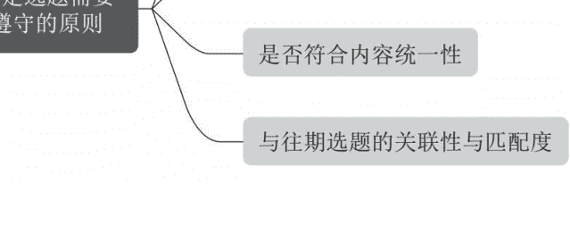
图3-2 确定选题需要遵守的原则

1. 优先选择可延展的选题
对照自身经历和能力，选题可分一次性与延展性。
一次性选题是跳着做的，比如从没胖过、也没指导过减肥，却做“搞定减肥中的消极心态”，做一次效果不佳就难以延续。下次又去做不擅长的“运动穿搭种草”，选题之间缺乏关联，时间久了会越来越难想。
延展性选题更稳定。内容发出后能自然带出一连串相关话题，甚至开辟新方向。横向延展、纵向延展、对角线延展都可用。仍以减肥为例，真正有过胖瘦经历、懂底层逻辑的人，这个题材就能持续展开。
- 横向延展：瘦身经历分享、如何逼自己瘦下来、瘦身食谱、瘦身训练、如何瘦大臂、如何瘦小肚子……
- 纵向延展：溯源——为什么总减肥却瘦不下来、减肥底层逻辑是什么；生长——减肥后收获了什么、如何保持减重30斤不反弹、瘦后皮肤松弛怎么办
- 对角线延展：沿着美的方向——瘦下来才知道自己有多美、好身材的意义；沿着内在提升——瘦下来更自律了、瘦下来改变了能量场
搞定一个可延展的选题，接下来一段时间的素材都有了，用户对你的认知也会更立体。

2. 不要给自己制造创作障碍
别碰让你为难、不适、痛苦的题材，否则内耗大、效果差。
比如想拿工作中槽点做内容，却担心被领导同事看到影响未来求职；想分享读书笔记却坚持不了每周一本；想讲自己糟糕经历但情绪不稳，每条内容像撕开刚愈合的伤口。这些都不要碰。
内容创作本身压力已够大，选题是自己能掌控的部分，尽量让自己更轻松。也不建议挑战刁钻或易引发争议的极端话题，容易踩线或触雷。
总结一句：选题最好自己喜欢、有兴趣、愿分享给朋友家人，在知识、专长、物质条件上具备优势，又在能力可胜任范围内。确保能给出足够观点和能力，避免给创作之路埋雷。

3. 别盲目跟风
追热点可以，硬追不好。用户关心热点，但不希望每个博主都重复出现。内容必须与用户需求相关，机械模仿会适得其反。
比如“社牛症”火时，有辣妈博主也去蹭，但她并不符合形象，摆拍感很强，反而被质疑。单纯为吸粉追热，渴望会很外露，容易招致排斥。

4. 做好内容配比
建立清晰的内容框架和选题边界很重要。100%垂直会显得刻板，话题过于发散又会显随意，不利于平台推荐。建议垂直类与跨品类比例控制在8：2。
同时可做板块区分。如运动垂类可设：燃脂训练、健身饮食、运动穿搭；跨品类可设：自由职业、博主日常。用视觉元素做区分，比如橙色封面为燃脂训练，绿色为健身饮食，红色为运动穿搭，蓝色为自由职业，黄色为博主日常。老用户一眼识别，增强亲近感。

### 3.1.3 快速捕捉灵感的八个方法

解决灵感枯竭和内容来源问题，整理了八个常用方法，如图3-3所示。

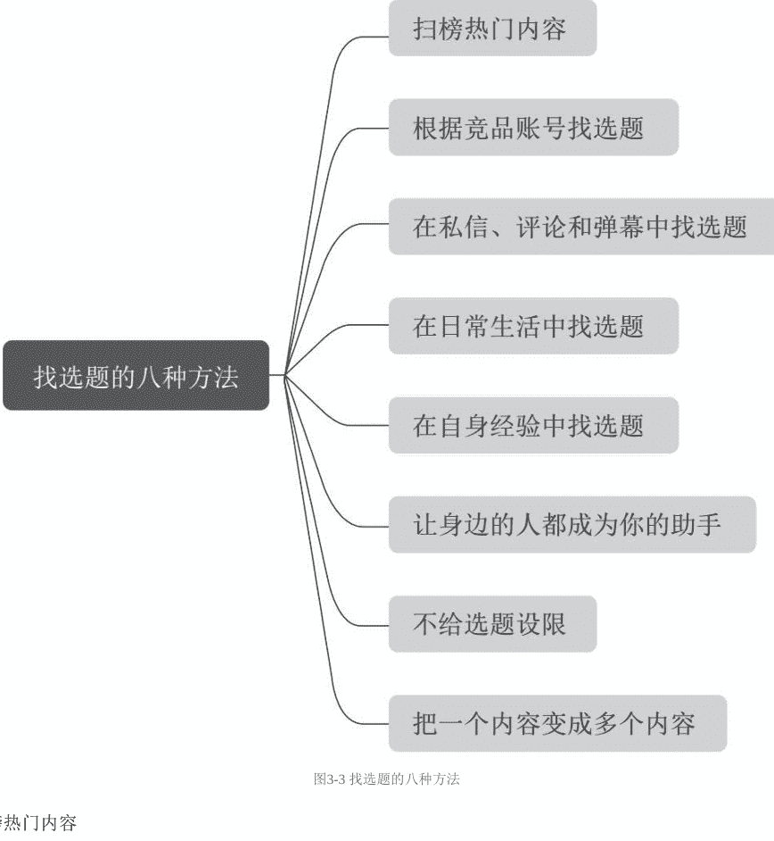
图3-3 找选题的八种方法

1. 刷榜热门内容
看平台上哪些题材受青睐，为什么受青睐，把核心要素提炼过来。既可以自己收集同赛道热门笔记，也能用官方的【笔记灵感】功能。功能面向全站创作者，提供站内热门活动、本周热点和经典话题。
查阅方式一：进入【创作中心】或【专业号中心】查看。
查阅方式二：一键订阅【笔记灵感】，每周五更新后提醒。
订阅路径：专业号作者：我的-≡-专业号中心-创作服务-笔记灵感-右上角铃铛。非专业号作者：我的-≡-创作中心-笔记灵感-更多灵感-官方奖励-右上角铃铛。

2. 从竞品账号找选题
找对标账号看他们在写什么，从中提炼关键词和灵感。对数据好的选题，换一个新角度再讲。对数据差的选题，判断是题材不行还是角度不行，若是角度问题则转换切口。

3. 从私信评论弹幕找选题
好的选题来自用户最真实的声音。评论区、弹幕、私信是离用户最近的地方，汇总高频提及的关键词。账号互动少也没关系，可以先看同类账号的评论。
此法还有额外好处，能增强粉丝粘性。采纳粉丝建议，会让粉丝感到被重视、有话语权。之前运营瑜伽教培账号时，按粉丝需求做了缓解腰椎间盘痛的内容，该粉丝不仅成为铁粉，还后续购买了4000多元的线上课程。

4. 从日常生活中找选题
选题藏在生活里。用户消费内容主要是满足有趣、有情、有用、有料四种需求，这也是我们自己的需求。
有趣：逛购物网站时看销量爆款为何火，能否借鉴。
有情：逛书店时看热销图书触动了哪些情感需求。
有用：看新闻时关注大家在操心什么问题，如何解决。
有料：茶余饭后听大家讨论什么，有颠覆认知的点子。
每个生活场景都能成为选题来源。

5. 从自身经验找选题
结合个人经历的选题更真诚，创作者有话说，用户有参照。常见的“一个普通女孩的十年”“我如何攒到人生第一个100万”都是此法。
可以回想过去的踩坑和高光瞬间。若一时想不到，可用提问联想：你有什么成就及怎么做到的？踩过哪些坑怎么克服的？拿手技能如何快速学会的？运动博主可想身材焦虑瞬间、爱上运动的契机、如何改善体态。
自己找不到时，对镜观察想改进的地方，也能得到“凹陷臀填坑”“大腿根粗怎么练”这类爆款题。

6. 让身边的人当助手
思维僵化时，可求助他人。发起一次聊天，提出几个问题，引导对方拓展思路。对方给出惊喜选题是最好结果，即使没用，也能排除不想做的方向。
做瑜伽内容时，常问学员“练习中最大问题是什么”“想改善什么”。由此得到“快速一字马”“倒立起不来怎么练”“腹直肌分离怎么修复”等选题。
也可组织小型创意会，集结多脑碰撞。天才创意多来自百家争鸣。

7. 不给选题设限
万物皆可成为创作对象，关键在如何关联。如运动垂类，也能做“如何学会走路”。形体老师更擅长讲走路，但用健身理论分析走路姿势的发力模式和运动轨迹，就进入健身博主的专业范围了。
历史选题也可复用。思考：数据好的选题为什么好，还能怎么介入？数据差的选题为什么差，如何优化？带着这种复盘心态重复选题，能化解瓶颈并验证账号底层逻辑。
操作上可用思维导图自由发散，写下关键词后多角度扩展，也可使用Xmind等工具选择树形图、括号图、流程图模板向外延伸。

8. 把一个内容拆成多个内容
核心话题有限，好选题可拆分。拿瘦腿为例，可做以下拆解：
横向拆解：瘦腿亲身经验、瘦腿三分钟带练、办公室瘦腿练习、大腿前侧突出怎么办、大腿根粗怎么办、小腿粗怎么办……
纵向拆解：瘦腿底层逻辑、发力不当对腿粗的影响、日常发力模式对小腿的影响、瘦腿为何要练臀、为何要练足踝……
对角线拆解：沿困扰探索——大腿围减五厘米后实现牛仔裤自由；沿工具探索——泡沫轴松解帮助瘦腿、弹力带在臀腿训练中的用法……
这样可连续产出数周数月，创作瓶颈自然缓解。

## 3.2 选题库搭建：让创作不掉线

创作中灵感很宝贵，创作者可以没库存，但一定要有选题灵感库，别等粉丝催更才手忙脚乱。接下来用系统视角梳理选题，实现稳定持续高效生产。

### 3.2.1 灵感库的搭建方式

聪明人“偷懒”的方式是提前多做一步。机智的创作者会提前建好选题宝库，即使不榨干自己也有源源不断的好题。搭建重点不在精致，而在实用。常用两个地方存放灵感：小红书收藏夹和个人选题表格。

1. 用好小红书收藏夹
遇到优质内容只点收藏，等需要时再找会很费劲。提前建立分类专辑，按大类整理剪辑技巧、灵感启发等板块，收藏时顺手归类，多几秒时间，使用时能立刻检索。
收藏时建议遵循两条原则：
- 非必要不收藏。大量无用收藏和没收藏一样难找。只有能学到知识或提供灵感的内容才入选。
- 定期整理删除。方便二次查阅、激发灵感，帮收藏夹瘦身只留重点，反复整理也能加深对爆款内核的理解。

2. 建立专属选题表格
除了收藏夹，还有专门的选题表格，有灵感就记录，随时补充，没灵感时按大类梳理。下面是搭建和运用的一般步骤，如图3-4所示。

### 3.2.2 有效管理灵感库

建立一个能持续供养选题的灵感池只是起点，真正让它长效运转的关键在于会管。持续地梳理、扩充与升级，才能让选题库始终保持健康、可用的状态。

#### 1. 定期清仓做减法
灵感库也需要像居家断舍离一样定期大扫除，把极简的思路搬进内容运营，会更省心。

人很容意外忘，写下时觉得很有料的内容，过几周可能就想不起来怎么落地。账号本身也在变化，几天前觉得合适的方向，到下周就可能不匹配了。所以要养成周期性复盘的习惯，把不再合适、或已经记不起执行路径的点子清理掉。

#### 2. 主动增量补库存
清理之后剩下的选题总量是有限的，等到产能吃紧灵感告急怎么办？别慌，创作的边界是打开的，卡住往往只是思维方式需要切换。

一个好用的自用技巧是用解题的思路拆选题，把一个母题裂变出多个子题。

- 1）做加法，融合双赛道：方向A＋方向B＝新切口
  大腿粗＋臀部扁平＝腿粗臀瘪怎么改

- 2）做减法，抽离一个要素：元素A－元素B＝新切口
  360度小蛮腰打造－前侧肌群训练＝侧腰怎么快瘦

- 3）换元素，保持骨架重配血肉：原题＝A＋B，新题＝A＋C
  零基础燃脂＝零基础练习＋燃脂
  燃脂进阶＝进阶练习＋燃脂

除此之外，画思维导图、分析账号里点赞分布的冷热带、以及其他常用的数据辅助手段，都是挖掘增量选题的有效方法。

#### 3. 迭代边界防倦怠
灵感库必须持续迭代。重复输出同质内容，本质是和粉丝比谁先疲惫。为了提前规避倦怠，要有意识地拓宽内容边界，找到突破当下的方法。以下三点可供参考。

- 1）看未涉足的内容
小红书会按你的浏览偏好推送内容，长期只刷同类就会把平台当成垂直信息站，比如首页全是穿搭、美食、运营干货，创作者不知不觉就掉进信息茧房。

一旦察觉自己被单一标签锁定，就要主动换池。可以通过关键词搜索改写推荐标签，借同事朋友的账号看看他人首页，也去其他平台逛逛。只有视野更宽、输入更多元，输出才能更扎实。

- 2）和认识的人深度交流
同质化重复往往源于固定的思维习惯。借助身边人的视角能打破固化，也许几句对话就能从迷茫跳到顿悟。

如果担心聊得太空，可以先坦诚当前困境，请对方帮忙，并提前准备几个具体议题，比如“你常关注哪些博主、为什么喜欢”“我可以借鉴他们的哪些优点”“你觉得我还能尝试哪些新方向”。让对方带着问题思考，才能给出更有价值的反馈。

- 3）做从未尝试的事
做久了容易被固定模板套住，选题看起来被“套死了”。这时可以反问自己：以前绝对不会碰的选题是什么？很少做的点是什么？找到它们，再思考如何与自己的核心能力和气质结合。

新方向都有不确定性，不管成败都去复盘规律和经验。像笔者喜欢的运动博主阿文，一条自己剪头发的视频就爆了，没行动前谁能想到用户更爱看博主剪头发而不是健身教程。敢于尝试没做过的事，账号才可能实现跃迁。

# 第4章 内容起盘指南
明明很用心，点赞却只有个位数；封面费了很大功夫，阅读却过不了200。小红书的创作门槛到底在哪？别急，这一章用更直接的方法帮你走出迷茫。

本章重点覆盖：
- 内容起号的基础常识
- 标题打法的几种思路
- 爆款封面的思考框架
- 图文笔记的制作方式
- 视频笔记的制作方式

注意：本章属于账号落地的执行环节，建议作为重点研读内容。

## 4.1 先拿主动权：内容创作起步要点
这一节集中聊新手在启动期最纠结的细节：图文还是视频起号、画面比例怎么选、发文频率如何定等，帮你提前拿回主动权，跨过起步的迷茫期。

### 4.1.1 图文和视频，哪个更吃香
种草是小红书的基因，视频是全平台的主流，二者各有擅长。起号时常犹豫该先做图文还是视频，可以从以下维度综合判断。

1. 从平台流量倾斜看
单纯从获取流量的角度，视频更占优。自2020年8月15日视频号功能上线后，小红书对视频内容进行百亿级流量扶持，不仅额外曝光，还能查看创作中心数据，使用视频合集、自定义封面、发布15分钟长视频等功能。

进入个人主页—左上角≡—创作中心/专业号中心—笔记灵感，可看到官方推荐任务。以2023年6月的假日活动为例，符合要求的笔记可获得专项扶持，优质内容扶持量在10万至50万不等。另外官方微信社群也会对优质视频笔记进行“翻牌”加推。可见平台对视频的渴求度更高。

2. 从内容属性看
| 笔记形式 | 特点 | 长处 | 短板 |
|---|---|---|---|
| 图文笔记 | 直观高效，阅读负担小 | 能在短时间内把要点讲清 | 认知容易扁平，互动与粘性相对弱 |
| 视频笔记 | 形式多元，时长可调 | 表达更丰富，易沉浸，适合碎片消遣 | 需要展现真实形象，对制作要求更高 |

《运营之光》作者黄有璨提到，互联网内容消费分泛娱乐和深度学习两类。短视频在泛娱乐场景几乎是王者，适合碎片化放松。而深度学习场景图文更有优势，信息密度高、阅读成本低，比如读书、历史类，图文更合适。

如果目标是做付费转化，视频更能建立信任感，带来更精准的付费粉丝。

3. 从个人能力看
图文需要写作、配图、摄影能力；视频需要剪辑、拍摄、表达能力。客观评估自己当下擅长或易习得的能力，选一个更顺手的切入点。

文笔和摄影强、视频零基础，可以先从图文起号，给自己留出学习期。表达亲和、镜头感好、普通话或方言有辨识度，视频则更能放大优势。

4. 从投入成本看
先算清时间、精力、财力的投入产出比。比如课堂英语讲师，口语讲课就是优势，拍视频几乎零成本脚本；如果去做精细排版图文，反而更慢。羞于表达的设计师若硬做视频，耗时会大幅增加。

从制作看，图文门槛并不低，探店类视频剪完即可发，图文则需调色、排版、信息提炼。美妆博主若要做精美视频，器材、收音、灯光、支架投入不小，图文一部手机就能启动。

5. 从目标诉求看
想通过做号训练公众表达，视频是很好的倒逼方式。想精进排版或文字能力，图文更合适。

6. 从分发策略看
一鱼多吃时，若能针对平台改造形式，图文视频都可做。若想一次制作多平台分发，则应选该平台主流形式。视频适合抖音、快手、B站；图文适合知乎、简书、公众号。

实在难以抉择，可图文视频各做4-5条，用数据决定主赛道。匠心内容比形式更重要。

### 4.1.2 拍视频横屏还是竖屏
落地时容易纠结比例，从题材适配和用户习惯两方面考虑即可。

1. 从题材和画面适配看
| 项目 | 横屏 | 竖屏 |
|---|---|---|
| 概念 | Landscape/风景模式 | Portrait/人像模式 |
| 长处 | 视野宽阔，能容纳丰富环境，多人出镜不拥挤，画面更高级 | 主体更贴近，适合细节特写，易营造互动沉浸感和情绪 |
| 短板 | 与观众距离感偏大 | 环境信息呈现受限 |

旅行Vlog、居家Vlog、数码拆箱测评需要宽阔环境，横屏更合适。段子、颜值、舞蹈、美食美妆需要拉近距离和特写，竖屏更佳。

2. 从用户使用习惯看
小红书图文视频以竖版为主，不确定时优先竖版，转化更贴合浏览习惯。

若需多平台分发，快手、抖音用竖屏，B站、西瓜用横屏。两者都要时，建议横屏拍摄再转竖屏，横改竖只需上下加黑边或背景填充文字，损耗更小。综合来看，以小红书为主、无特殊题材需求，可先从竖屏起步。

### 4.1.3 日更和周更哪个更划算
| 项目 | 日更 | 周更 |
|---|---|---|
| 特点 | 每天至少一篇，数据积累快，便于复盘 | 每周至少一篇，频率低更易坚持，创作时间充裕，利于打磨精品 |
| 适合人群 | 内容产出快、输出简单、需靠日更养成习惯的人 | 时间不充裕、追求精细化、擅长一击即中的人 |
| 不建议 | 内容质量不稳定、压力承受差的人 | 数据本身极差、风格不成熟易被遗忘的人 |

笔者测试过多种频率。日更压力极大，需提前储备大量素材，除非创作成本极低否则不推荐。一日多更除非做投放测试，否则容易因质量下降和信息过载导致消耗。

周更在质量不稳时也很伤人，一篇内容凉一整周体验很差。比较稳妥的节奏是2-3天一次，保持稳定输出、强化记忆、避免爆款流量相互吞噬。优质内容带来的涨粉效应往往能持续数日至一周。

### 4.1.4 笔记发布的黄金时间怎么找
不要盲信网络上的“最佳发布时间”，必须自己验证。

1. 粉丝积累初期，避开流量高峰
小红书流量高峰在晚间和周末，这时竞争激烈，容易出现两极分化：优质内容爆发，普通内容被淹没。初期可先用排除法避开高峰。

2. 用稳定的三个时间段做A/B测
结合目标人群的生活、工作、地域习惯，推算可能的打开时段。比如晨型人群可能早上7点前打开，早高峰通勤族适合早晚高峰前半小时，海外用户则要考虑时差。

选出三个可稳定执行的时段，每个时段连续发3-5条，发布1-2小时后记录阅读量，找出明显高点。

3. 有粉丝后再精细化
积累首批粉丝后，创作中心的人群画像更准，男女比例、年龄分布、城市层级、兴趣标签都会更真实。基于真实画像重新选时段并测试。

确定时段后，可在粉丝>500且发布过一条以上视频后申请定时发布，在编辑页高级选项中设置未来1小时至7天内的发布时间。

### 4.1.5 感觉什么都能做，却做不到极致
账号前期什么都试有助于快速找方向，但粉丝起来后胡乱发会消耗账号风格和用户认知，单篇数据可能不错，却带不起整体辨识度，自己也会迷茫。

一旦出现审美疲劳，要及时定下来。方法之一是找自己关注列表里印象最深的博主，拆解他们吸引你的核心价值，从理念、表情、声音、文案、排版、打光等维度总结可复制的要素。

一个小技巧是只向冉冉升起的新星学习。大博主已高度成熟，很难判断哪一点真正有效，且有明星效应干扰。新手博主的包装不完美，能把你留下来的就是核心价值点，且缺点明显，更容易“找茬”规避。跟对标的新人学习，也能帮助你设定更清晰的里程碑和成长预期，在低谷期获得更多动力。

如果研究门槛对你来说太高、投入产出不成正比，就别反复纠结，记住下面两条基本原则就够了。

1. 只分享自己真正喜欢的
当你对某件事有充足的热情，输出自然会有温度、有料可讲。穿搭思路、省钱窍门、审美偏好、旅行手记、生活实拍、才艺展示……这些都是源源不断的灵感来源。即便内容看起来不垂直也没关系，你展现的是立体的个人样貌，能聚到的是兴趣高度重合的粉丝，反而更容易在小红书成长为有影响力的创作者。

#### 2. 只输出自己拿手的内容
擅长的事情做起来底气足。职业背景、专业知识、过往经历都能变成可用的素材。职场经验、行业吐槽……越贴近真实越有参考价值，粉丝黏性也就越高。
若自认想法还不够成熟，可以选择“抱大腿”。向身边判断力强的人请教，他们或许不了解你具体在做的事，但生活阅历和决策思路能给你启发，在此基础上再延展自己的观点。相对来说，不太建议照单全收网络上那些做号类账号的建议，听得越多越容易陷入养号、刷流量、赚钱、快速涨粉的焦虑漩涡。一旦目光只盯着数据和热点，真诚分享就很难做到了。而小红书的核心流量逻辑，本质上就是真诚。

### 4.1.6 创作之前必须留意的事项
正式开更前，有几件事需要提前规避。

#### 1. 隐私保护要到位
拍摄生活物件时，身份证、快递箱、任何可能泄露个人信息的细节都应做遮挡或后期处理。手机通讯录、聊天记录截图同样需打码，自己的信息要保护，他人的信息更不能外泄。另外，日常常去的地名不要描述得过于具体，定位也别精确到门牌，避免被有心人结合室内外观进行定位。

#### 2. 别做显眼的导流动作
明显的站外引流很容易触发限流甚至封号。视频里不要出现二维码、外链、logo水印、个人联系方式等导流元素，也不要直白点名淘宝、拼多多等具体店铺进行引流，纯种草分享除外，否则流量会受重创。

#### 3. 借鉴要有分寸
完全照搬是绝对禁止的，无论是平台内搬运还是跨平台搬运，整条复刻也好，封面、脚本、拍摄逻辑、创意点、观点照抄也罢，均属违规。一旦被发现，博主和粉丝都会被声讨，平台也会处罚。洗稿也不行，把原创改写、删减、换词，看似面目全非却偷了核心价值，仍属于侵权擦边行为。
借鉴本身是创作的必备环节，优秀的借鉴能帮助新人快速起步、稳定出圈，关键在于分清可学与不可学。
可以借鉴的是做号的底层逻辑。比如你喜欢某个博主的封面，把字体位置、配色方案、元素用法照搬过去只换照片，这就是抄袭。若你认可标题置于画面四角的做法，基于此形成自己的版式语言，并加入个人思考，那就是站在前人肩上做创新。

#### 4. 不碰价值观红线
内容必须符合主流价值观和公序良俗，倡导积极健康的生活方式。严禁发布违法违规、危害国家社会安全的内容。辱骂、嘲讽、威胁、恶意@、故意挑起争端等不友好行为也要坚决规避。

#### 5. 创作始终坚持真实
（1）伪科学和误导性宣传不行！
没有科学依据就发布夸大功效的言论，或为了吸引眼球编造不切实际的攻略，都可能被严肃处理。
伪科学案例：
> 曾出现标题“三分钟快乐燃脂，建议收藏，年前瘦下来！”，内容流量很高，后经确认被标记为伪科学。原因是三分钟燃脂运动无法保证所有人年前变瘦。
误导案例：
> “我的副业，60天卖货18万元”用副业赚钱做噱头，实则并非真实经历，属于虚假欺骗。
案例来源：2021/11/19薯管家的Bad Case黑名单

（2）夸张猎奇标题党不行！
标题中过度夸大、使用噱头或贬低性词汇误导用户，即使正文写“对不起标题党了”，仍可能被限流。常见雷区有三种：
第一种，假借公众人物或平台影响力造势。如“某某明星真的没骗我，某某产品太好用了！”“这个产品真的好用，小红书没骗我！”
第二种，反话设悬，内容与预期不符。如“千万不要打开这本书，看完会后悔”，点开却是后悔没早看，属于明贬暗褒的套路。
第三种，功效夸张或违背常识。如“一天被问800次的平价短靴，姐妹们闭眼入好吗”，再好看的靴子也不可能一天被问800次；“十二年胖纹也就它能速救！生完孩子一定要用！”妊娠纹短期难改善，“也就”是绝对化用语，“十二年”也有刻意夸大嫌疑。
真诚推荐与用力过猛之间要把握好度。

#### 6. 严禁作弊行为
小红书不允许任何数据造假行为。
（1）虚假流量作假。包括但不限于刷粉丝、点赞、收藏、评论等异常数据。常见手法：被“加我微信，快速安全涨粉帮你做数据”诱导购买点赞；或用利益诱导用户点赞、收藏、评论、关注。无论机器还是真人接单，都很容易被识别并处罚，不可抱有侥幸心理。
（2）滥用账号权限。包括出借、出售、出租、购买账号进行异常操作；非正常模式批量、高频、机器发布笔记；重复发布相似内容，或通过评论、@、私信干扰他人，影响平台秩序。

## 4.2 标题写作：不玩标题党也能拿流量
标题决定了用户是否愿意点进来。在小红书，首屏注意力极其有限，用户先看封面再看标题，标题不够抓人，再好的选题也无济于事。花时间打磨标题绝对不亏，只有标题亮眼，内容才有机会爆。

### 4.2.1 标题撰写的三个基本点
先明确小红书标题的构成：封面标题即首图上最大的文字，正文标题是发布时填写在封面下方的一行小字，最多20字，一般展示两行。下面方法对两者都适用，封面视觉部分后续再讲，这里以正文标题举例。

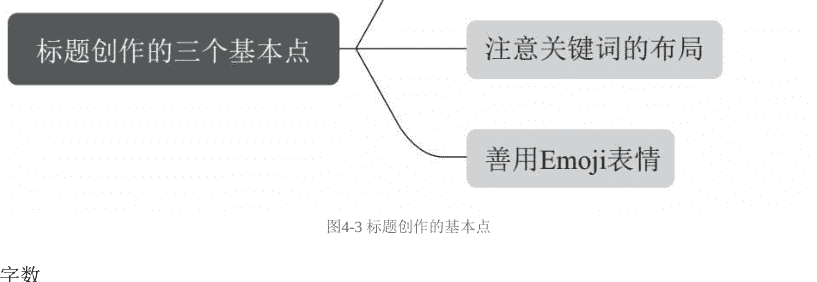
图4-3 标题创作的基本点

- 1. 控制字数
正文标题虽可填20字，首页实际展示通常为18字左右，最多两行。
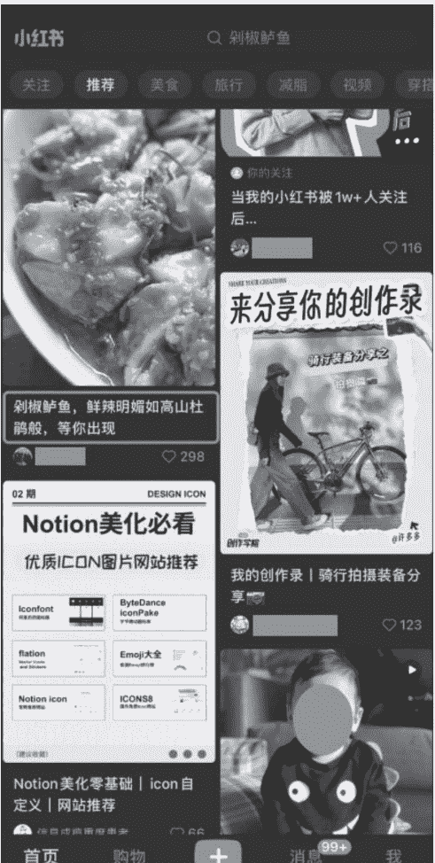
图4-4 标题在首页推荐的展示效果
过长会导致换行影响阅读，最后两字被折叠出现语义不全；过短则会把正文前几字自动补上，影响控制。所以标题过短时，第一句正文最好当成标题的延续，或干脆不写正文。
- 2. 挂好关键词
标题里放准关键词，能让用户一眼识别主题，也利于系统分发。公开数据显示，搜索导流用户占首页流量的38%，这部分流量完全可以通过关键词优化收割。例如运动类内容用“瘦肚子”“燃脂”“圆肩驼背”等，即使笔记发布已久，仍可被带着精准需求的用户检索到。
- 3. 善用Emoji与符号
小红书很看重视觉，适度加入Emoji或文字符号能让标题更有活力、更好读。例如装饰性符号“☺ ♥”，断句符号“|、，&”能缓解阅读压力。
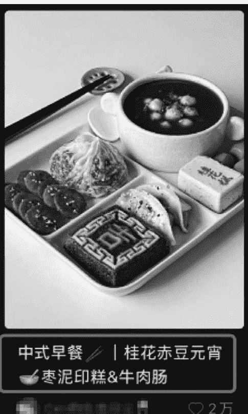
符号还能承载隐性含义。不同垂类会形成暗号，比如购物分享里桃子符号常指“淘宝”，运动燃脂里指“蜜桃臀”，核心粉丝秒懂。注意单个Emoji占两个字符，一个标题最多三个，太多会花哨。

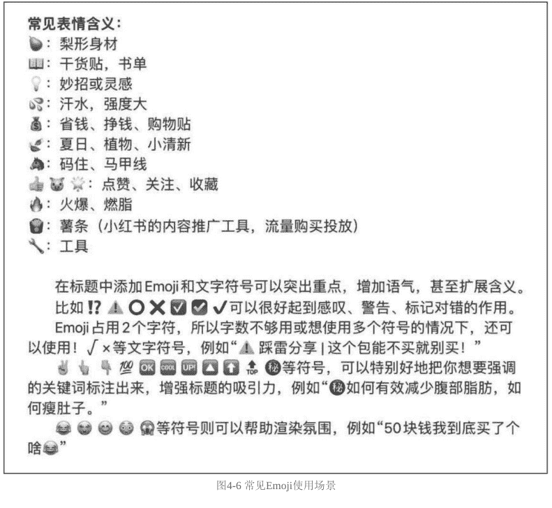

### 4.2.2 标题撰写的五种技巧
掌握基本点后，这五种技法是可直接复用的万金油，判断好标题的标准不仅是流量，更是精准粉的沉淀。

1. 加数字
数字直观、易抓眼，能增强可信度，也便于用户预判内容结构。可放权威数据、身材参数，或内容点数、售价、测评款数等。
标题举例：
> 暑假变美！3个卷发心机｜高颅顶｜发量翻倍
> 5分钟手臂塑形｜热身跟练一步到位
> 159｜60公斤梨形身材显瘦穿搭

2. 做标签
（1）身份标签，借助身份共鸣让用户对号入座。
标题举例：
> 学生党也能买得起的平价好物
> 金融白领一年在北京能挣多少钱
> 女性必读｜读完《认知觉醒》，我突然不焦躁了
（2）内容标签，让主题一眼可辨，并利于搜索。如减肥要出现“燃脂”“瘦”，购物要有“省钱”“薅羊毛”，旅游要有“冷门小众”。
标题举例：
> 在北京如何挑选合适的瑜伽教培学校
> 周末去哪｜京城最大夜间市集【国潮市集】

3. 讲价值
标题里点明用户看完能获得什么利益，选题与人群痛点高度相关。
标题举例：
> 【iPad】我是如何做学习笔记的｜Notability——解决学习工具
> 经验｜真诚干货！说说我怎样成功减重30斤——缓解身材焦虑
> 健忘星人必备！告别职场焦虑，永远自信——应对职场问题
洞察越准，爆款越近。

4. 做互动
用问句或感叹句制造共鸣与参与感，提升评论活跃度。
标题举例：
> 每天坚持运动，怎么还胖了？
> 普通人在小红书还有机会吗？
> 我应该不是最后一个知道的吧！
> 现在就连茶颜悦色都有对象了？

5. 用人称
与“贴标签”相似但更关键，多用第一人称“我”和第二人称“你”，口语化更强。
“我”增强信任背书，让看似夸张的事更易被接受。
标题举例：
> 工作两年，我写文案月薪4000到年薪40万后续
“你”提升代入感，拉近距离。
标题举例：
> 《目光》送给每一个正在经历至暗时刻的你

### 4.2.3 标题撰写的避坑提示
1. 避免陌生名词
标题要通俗易懂，减少圈内黑话。健身内容少提“上交叉综合征”“骶髂关节”，数码内容尽量不堆生僻型号。
2. 拒绝标题党
标题党只能骗点击，内容跟不上用户会立刻流失。10,000播放却只有10个赞，转化价值为零。且与内容不符或使用低俗违规用词会违规。
小红书创作学院总结的常见限流标题党有：
一是过度夸张，如“出事了”“传疯了”“惊呆”“没想到”；
二是隐瞒关键信息设悬念，如“当红女星绝密隐私外泄，原来是这样！”；
三是夸张挑衅强迫，如“你一定没吃过的……”“不看不是中国人”“经常用电脑的人一定要练这个！”

## 4.3 爆款封面：上热门的封面思路
小红书是双列信息流，多条内容同屏呈现，用户先做视觉筛选，封面和标题决定点击率，其中封面冲击力更大。没有足够的点击量，爆款无从谈起。

### 4.3.1 小红书封面的特征
1. 画面比例
小红书推荐三种比例，如图4-7所示：横屏4:3、正方形1:1、竖屏3:4。遵循这三个比例可完整展示，其他尺寸会自动裁切，可能导致关键信息丢失。
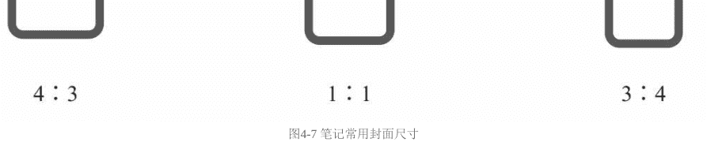
2. 封面形式
| 封面类型 | 特点 | 适合的内容方向 |
| :--- | :--- | :--- |
| 图文均衡型封面 | 最常见的基础类型，一张底图上叠加主标题、副标题和说明文字 | 图文互补，信息展示充分，适配绝大多数内容 |
| 偏图展示的封面 | 图美字少，氛围感强，突出美感、萌点、槽点、视觉冲击 | 摄影、绘画、家居、手作、舞蹈、萌娃、颜值、搞笑、健身等强调画面感的垂类 |
| 纯文字排版封面 | 字多图少，图片仅作背景或贴纸 | 干货笔记、思维导图、学习笔记；观点输出与讨论；承接视频开头的引导封面 |
| 真实场景封面 | 较少修饰，突出人物与场景真实感，常截取视频精彩瞬间如活动现场、夸张表情、食物入口瞬间、高难度动作，再做简单文字或贴纸加工 | 真人出镜内容；现场氛围感强的内容 |

| 多图拼接封面 | 把两张或更多图片组合起来，用来制造鲜明对比或让画面更饱满 | （1）对比展示类，比如美白前后、增肌前后 （2）精致图集类美图博主 （3）种草、美妆、干货等合集整理 |

| 高识别度设计封面 | 在好看的同时具备很强的辨识特征 | （1）品牌或商家官方内容分发 （2）设计师、潮流艺术家等特定职业的内容分享 |

### 4.3.2 封面设计避坑指南
一张接近满分的封面到底有没有可复制的规律？

不少人觉得做图全靠直觉，封面说不清道不明，审美、格调、技巧堆在一起才能出高分。其实做封面不是做纯设计，更像用信息展示的逻辑在做取舍。

#### 1.过度追求好看的误区
做封面不是为了好看本身，而是为了让信息更直观易读。刚入小红书的人容易把精力花在封面调性上，做出很“有质感”“有设计感”的图，结果花费很多点击却上不去。

美本身没问题，但封面必须具备可读性。用户点封面是为了满足某种具体需求，封面要提前让用户判断内容能否满足：极致美感满足审美需求，好奇向封面满足探索欲，干货感强满足求知欲，幽默搞笑满足娱乐需求……

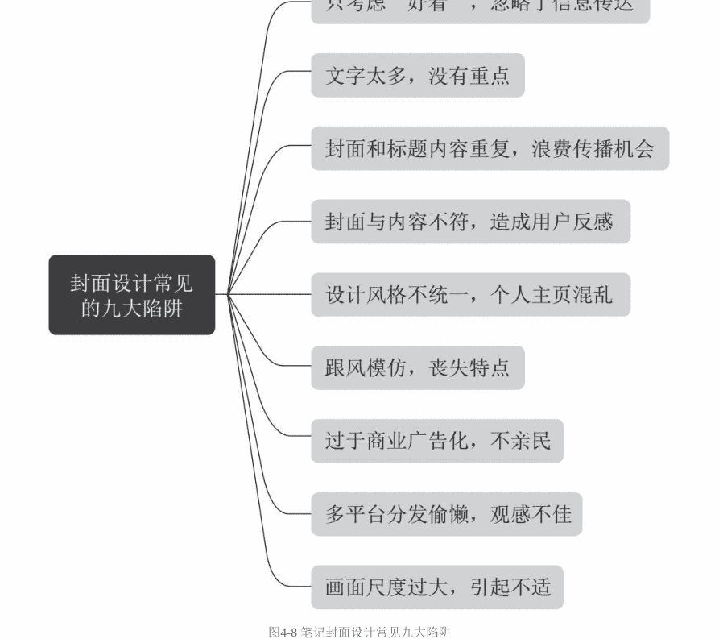
有位博主说过类似的话：除非你是靠颜值立号，否则不必纠结标题遮没遮住脸或身材；除非你是穿搭号，否则也不必纠结文字破坏了首图的整齐。我们不必绝对化，重点是——美不是目的，信息传递才是。传播点不在于美，就没必要纠结。封面顺眼即可，不必强求调性，阅读舒适最关键。画面别做得太复杂，关键信息看不到就白做了。

#### 2.文字堆砌的误区
信息呈现的重点不在多，而在层级是否清晰。为了讲清楚，创作者常把可能感兴趣的关键词全塞进封面，最后文字密密麻麻毫无重点，再好的内容也难获流量。还有人看到市面上有字多的封面很火就盲目模仿。

事实上，写得越多不等于用户看到越多。能吸睛的封面往往不是点多，而是它在众多封面里把核心词或核心画面凸显出来。所以没有极强的排版能力就不要堆信息。

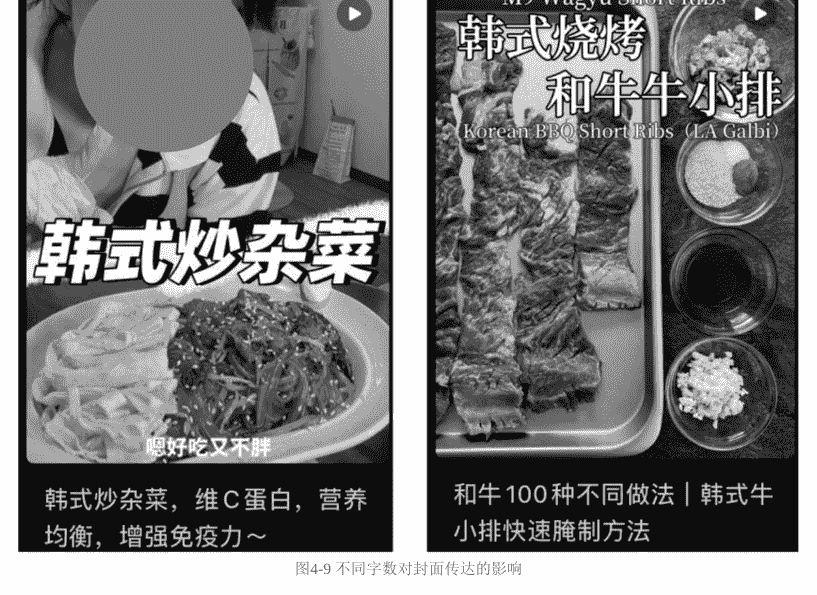

#### 3.封面与标题重复浪费渠道
封面元素多、色彩多、占面积大，用户浏览时先看到封面再看文字标题，封面和标题说同一件事就浪费了封面本该承担的传达。

封面和标题最好各司其职、相互呼应。封面呈现更吸睛的视觉卖点，标题放用户常搜的高频关键词。这样先被画面吸引，再被关键词加深印象；搜索时也更容易被检索到。同时也能解决关键词太多取舍困难的问题。

#### 4.封面与内容脱节
标题党让人反感，封面党同样不可取。吸引进来的用户发现内容没有实质，很容易产生失落和被欺骗感，影响后续推荐。

当然也有个别情况，内容精彩度远高于预期，能抵消封面党嫌疑。但大多数时候用户预期会高于封面，落差会直接伤害账号。

#### 5.频繁大改导致风格混乱
意识到流量差就大幅度换封面，几次下来主页视觉极度不统一，用户会觉得账号没有体系。反之，封面清晰美观、风格高度统一且辨识度高，更利于粉丝沉淀，如图4-10所示。

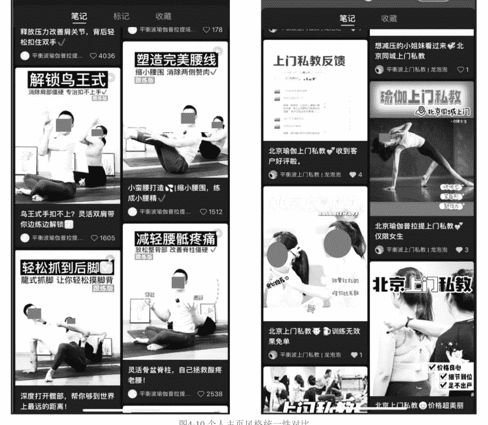
建议保持格式统一，除非你的标志性元素足够强，否则不要频频更换风格。若对现有封面不满意，可以每次只微调一点慢慢演进，或提前准备几种备选方案测试后再逐步替换旧作。

#### 6.盲目跟风失去个性
看到什么封面热就抄什么，最终账号毫无特点。封面除了要一秒吸睛，还要一秒识别。粉丝对博主的第一印象来自封面图，要保留个人风格，只借鉴不照搬，才能被记住。

#### 7.封面过度商业化
去商业化才是封面设计的王道。用户在封面看到明显的消费风险就会产生戒备。比如机构号爱用PPT式、大字报式封面，一看就是引导成交，用户自然会防备，这也违背了小红书真诚分享的原则，把获利目标暴露太明显很难建立信任，如图4-11所示。

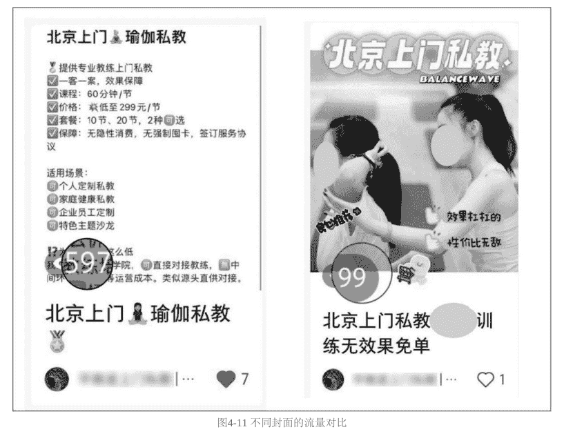
所以很多博主反复强调纯绿无广，就是因为软性带货内容太多，需要降低用户戒备心。

#### 8.跨平台搬运不做二次设计
把抖音、快手等平台的视频直接搬运上来，没做封面再设计。一来画面会被裁切，重点信息不完整或出现黑边，观感差；二来不同平台封面逻辑不同，不符合小红书调性的封面足以毁掉视频爆发潜力。同步视频适配不良、笔记质量不错却阅读量极低，往往原因都在封面。

#### 9.尺度不当与价值感偏差的画面
封面尺度过大、带挑逗性文案、大面积露身材，或出现手术场景、术后未恢复场景、美容对比等让人不适的内容。

具体要看定位而定，平台也有自己的判定标准。核心是看目的，比如健身类目展示肌肉走向和动作，适度展示身材是可以的。

### 4.3.3 封面设计的基础原则
避开上述九个坑后，有效传播的封面通常都符合以下基本原则。

#### 1.信息层级分明
排布时注意主次。文案分一级标题、二级标题、说明文字，一级标题加粗放大，说明文字用更纤细的字重。通过行距字间距把文字分块分组，视觉上建立主次。

元素上把重点信息放在画面焦点区，占较大画幅。主体元素尽量控制在三个以内，且有主次。颜色上，人眼对对比强、饱和度高的色彩更敏感，用黑、白、红、黄、荧光色等突出一级信息。

画面杂乱时，可给文字加显眼底色，或用引导线、箭头、圆圈、贴纸做强调，但不要放太多，否则会吞掉重点。

#### 2.文字使用要克制
字数少而精，能表达清楚即可，避免废话。非纯文字排版时，一行尽量不超过8个字。

字体种类最好不超过三种，选择与画面风格和内容匹配且可读性高的字体。手写体、繁体、造型字可视情况点缀，主要起美化均衡作用。文案不要过大，要与主体和谐，总之以不增加阅读障碍为准。

关键词放到最显眼位置，信息量足、主次分明，大中小字号、重点标记符号配合使用，可用热词、流量词点缀，突出作者标签和受众人群。文案必须与内容相符，不要为蹭热度硬加无关文字，避免标题党式博眼球。排版时可微调字间距、行间距填补空白，在不抢戏的前提下做装饰。

#### 3.色彩应用合理
封面色彩要保持统一舒适的视觉状态，系列封面采用同色系搭配。不统一时可用滤镜或手动调色填色。

注意色彩心理影响：黄色温暖、蓝色冷静、黑色压抑……冷色适合严肃内容如数码拆箱、干货分享；暖色适合温馨亲切内容如家居展示、美妆穿搭。可参考色彩心理学，整体保持明亮和谐，鲜亮色冲击力更强。

没有专业设计功底时，颜色不必花哨，1~2个醒目的颜色或撞色搭配即可，色块面积和数量不要过大或过多。

#### 4.细节要拿捏住
第一，封面必须清晰，高清图片才能提升点击。
第二，不要留水印，水印会影响平台流量推荐。从其他平台截来的图要去除或遮挡图标/logo。
第三，调整尺寸时不要随意拉伸压缩，确保画面完整，避免扭曲或被裁剪。
第四，文字信息要能迅速扫读，干脆利落。
第五，封面与正文配图或视频在配色、版式上保持统一，避免封面一个色调正文一个色调。

#### 5.突出具有代表性的元素
测评种草类，封面要体现本期产品，尤其是热门产品或知名品牌logo，容易吸引目标用户。书单推荐尽量出现书封或内页实拍。故事解说要呈现主人公形象。用符号化视觉提升亲切感。

#### 6.多展示真实人物
真实人物出现在封面上能提高点击率和可信度，也利于建立识别度，用户凭封面就能预判内容。建议把人放在主要位置。若人物过大画面太满，可用作图App的“小头”功能制造空间感。

### 4.3.4 打造90分封面的五步法
沿着下面五步逐步优化即可。

#### 1.发布前先做借鉴
大量刷小红书，找出十张以上让你一眼就想点开的优秀封面。归纳它们在排版上打动你的点，可能是贴纸、色彩搭配等细节。把吸引点都记下来，会发现自己总被某一类风格吸引，这就是初步个人风格的雏形。

#### 2.借鉴之后做升级
初步风格不稳定，今天做着心动明天就腻。持续多做几张，请朋友同事评价优缺点。有些想法会被印证，有些自以为好的点会被否定。冷静思考反馈的合理性，自己是否有能力稳定复现好点，坏点是因为能力限制还是本身方向不对，沿着一个方向不断优化，打造差异化特色。

#### 3.批量发布测试关注点
连续发布五篇以上，每次封面做微调，直到出现相对的小爆款。若平时点赞10以内，几十赞就算小爆款；平均100以内，300~500赞就算。冷静分析爆款原因：是图片真实感强？还是关键词提炼到位？把可能原因写下来，总结用户喜欢的封面特征，再优化下一步。

#### 4.建立个人封面模板
找到个人风格和用户敏感点后，把封面元素固定下来，形成一套模板保存在手机或电脑。下次只需替换图片、修改文案即可，把精力用于内容打磨和关键词提炼。

#### 5.定期升级版式
稳定输出一段时间后，可逐步丰富或升级版式。一般把升级节点放在内容疲软期，上升期换封面可能有反效果，疲软期换封面能带来新鲜感，顺便升级内容。

做到以上五步，90分基本可达，剩下的10分靠灵感和持续行动。

### 4.4 突破高转粉：图文笔记创作要点
图文笔记是小红书一大特色，大面积图片展示、精致文字排版、高价值内容构成其可读性高、收藏价值高、干货感强的特点。即使视频崛起，图文笔记仍占据重要地位。本节帮助建立图文笔记创作底层能力。

### 4.4.1 认识图文笔记
小红书图文笔记由封面、标题、配图、正文四部分组成，相互配合。

常见阅读路径：阅读封面→阅读标题→点进内容滑动配图→阅读正文小字。
或：阅读封面→阅读标题→点进内容阅读正文小字→滑动配图，如图4-12所示。

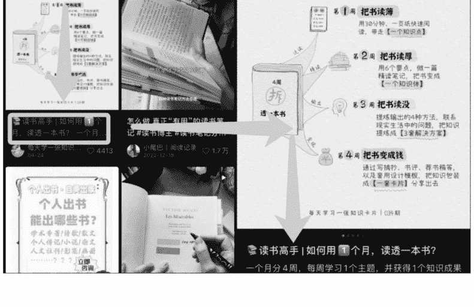
因此封面+标题决定点击率，正文+配图决定互动率。想提升点击或互动就针对性下功夫。封面和标题技巧前文已讲，这里聚焦配图、正文及发布细节。

#### 1.配图
（1）尺寸。配图支持竖版3:4、正方形1:1、横版4:3三种，上传时调整布局避免重点被裁或留白边。
图文笔记最少1张，最多9张，首张默认为封面。发布页可左右拖动调整顺序。用户习惯左滑浏览，配图3张以上或用满8张比较合理。

（2）上传与编辑。小红书发布流程可完成裁剪、加背景、调色、滤镜、加文字、美颜等基础编辑，也可加贴纸，主题丰富，不必依赖站外软件。
建议在封面和配图上添加标记（用户、地点），如图4-13所示，有利于算法推荐。标记会展示在图片上，点击可进聚合页。
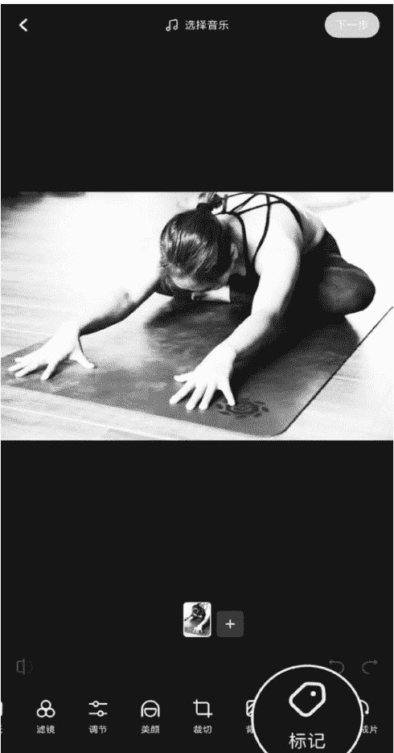
上传时可添加音乐，音乐库覆盖清新、美食、旅行等类目，能烘托氛围延长浏览时长。

（3）存储草稿。如需临时退出，可保存草稿，下次通过主页左上角【≡】进入【我的草稿】继续编辑。

#### 2.正文
正文上限1000字，通常不宜填满，字数太多会增加阅读压力。一般600~700字为宜。字数也不能过少，需展开重点，否则压力全压在标题和图片上。

#### 3.发布细节
- 在正文中@已关注用户进行互动，比如借鉴他人创意时示礼貌。
- 添加话题和地点增加曝光，合适话题更易被算法推荐和用户检索，地点能被附近用户发现，增加黏性粉丝。
- 高级选项可添加直播预告，账号状况良好可逐步解锁更多功能。
- 已开通店铺可关联商品，实现图文带货。

### 4.4.2 常见图文笔记类型
平台上具有统一特点的图文笔记可归为以下大类，供创作参考。

#### 1.“种草”与“拔草”笔记
小红书以种草闻名，大量种草笔记功不可没。早期图文在种草领域应用广泛，穿搭、饰品、护肤测评，只要图片精致排版清晰，基本都有不错表现。

随着内容丰富，避坑拔草类笔记也很受欢迎，比如昂贵却难用的大牌、买了只能压泡面<|message|> 电子产品等，如图4-14所示。

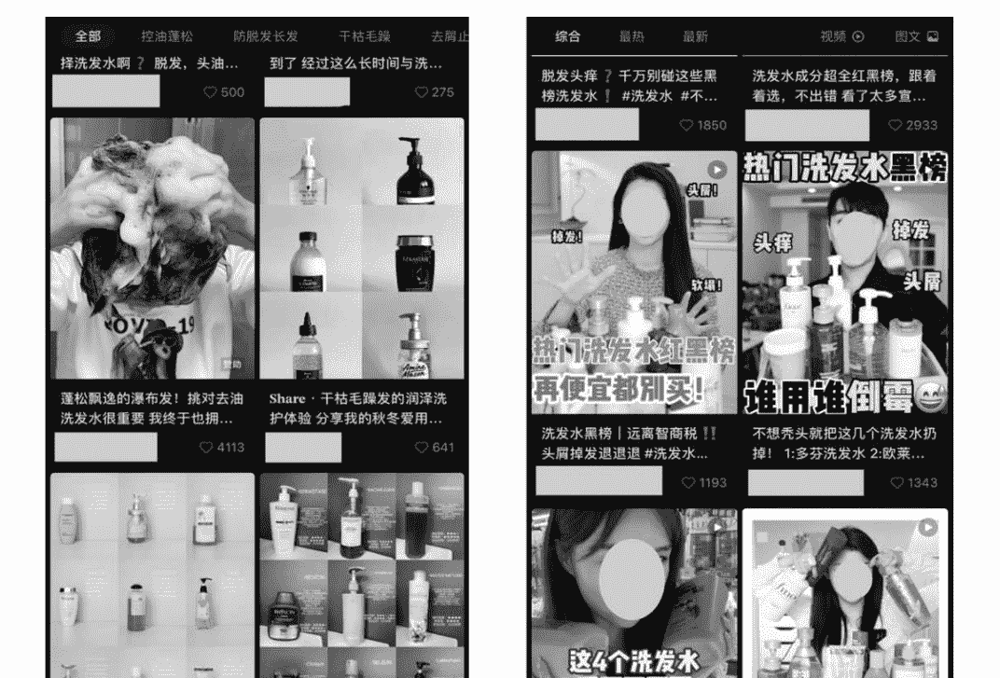
做种草拔草笔记有两个关键：一是全，二是细。

大类种草更看重信息整合与呈现能力，把海量同品类的产品集中在同一篇笔记里做盘点，比如全网最全的牛油果色穿搭合集、最齐全的定妆喷雾横评、14支当红眼线笔避雷榜、易饱腹健身零食合集等，都是典型写法。

细类种草更考验挖掘深度，把单个产品拆到极致。比如以研究员视角拆解成分，或抓住一个能打动特定人群的使用场景，比如油皮用户钟爱的抗晕染眼线笔。若“种草”“拔草”是你的主战场，先把用户画像吃透，年龄、地域、性别、职业、生活习惯等都要心里有数。

随着平台对内容真实度的要求提升，早期那种厂商搭景摆拍、直接搬官网图的做法已不被鼓励。要想让种草笔记吃到流量，尽量展示真实使用过程，并把最能体现产品特质的画面单独提炼或拼成封面。

例如要种草一瓶干爽自然的刘海定型发胶，可以拍四张连贯的实拍：手持产品展示外观，喷雾瞬间体现雾化细腻度，梳好发型呈现定型效果，手持吹风机验证吹不散的“铁刘海”质感。四张做好后，可单独置顶吹刘海的效果图或将手拿产品的画面组合出封面。

#### 2.干货分享
当下B站、知乎、小红书聚集了大量爱学习的受众。图文笔记因逻辑清晰、便于整理归纳，在知识类分享里非常吃香。这类笔记追求信息密度高、废话少，内容易懂、条理清楚比华丽辞藻更受欢迎。结构上多用总分或总分总，封面先罗列核心要点，正文和配图再展开讲解，复杂主题最后做一次总结收束。

（1）教程类。讲清某件事怎么做或给出可复用的模板，比如制作某款蛋糕、瘦手臂的方法、工作总结写法、个人时间管理技巧等。

也包括某个产品/App的标准用法，比如零基础学Notion的系列教程、详解小米相机专业拍照模式等。

还有生活里App/产品/物件的冷门或创新用法，比如用PPT抠图、单块修容盘画全妆、用闲置眼影做美甲、用普通塑料勺做耳饰。

这类内容要求步骤明确，图片上会用箭头、虚线、波浪线、圆圈、勾、三角、爱心等符号突出重点，正文配文字说明，常配合Emoji或数字序号做分隔。

（2）笔记类。是干货的高度浓缩呈现。常见形式有：

手写或电子笔记。用点阵、横线、方格纸做底色，用荧光色等鲜艳色点题标题，配简笔画、便签、贴纸点缀。排版简洁，文字饱满，可读性强，画面很具干货感和真实感。

照片或图片笔记。以精美排版和丰富图量为特点，图中文字仅作强调，正文补充更细的讲解。这种形式传递出强专业感，适合新媒体、市场营销、金融等需要背书的领域，对创作者审美、配色、信息层级把控要求较高。

思维导图。关键词密集、架构清晰，由一个核心向外延伸成知识网络，权威感强。制作门槛低，在思维导图App写完截图即可。

总体来说，笔记类靠梳理与清晰传达取胜，内容扎实、结构紧凑，流量表现通常不错。

（3）观点类。是直抒胸臆，对社会现象、热点新闻发表看法的笔记。常见划分：

对近期争议话题、生活现象、历史事件等直接给出立场，也可用提问先抛出再解答。

与他人观点互动。截取视频片段做拼图，围绕核心观点发表解读。

对专业领域的看法，比如瑜伽教练是否还有前景、MCN机构未来的改革方向等。此类内容重格局和深度，哪怕截屏手机便签，只要观点犀利、角度新奇，也能吸粉。

观点类一定要开门见山，封面标题即能感知立场。阅读中，认同者更认同，反对者更反对。争议话题易出现沉默螺旋，公开表达易随大流。创作者在图和文中做好引导很重要。分点陈述、观点鲜明利于高曝光，专业身份背书会更具说服力。

（4）信息汇总类。因干货足、水分少，收藏量常很高。常见分类：

榜单类。书单、影单、综艺榜单等，比如跟几部综艺学说话之道、提升审美的观影清单。氛围感重要，书单封面可用手持书在桌面的随拍，影单可用电影海报拼图。画面调性要统一，例如励志书单可用电脑/平板加暖光做背景，手持书本配大字标题，小字说明内容与信息。

特定信息整理。综艺金句合集、投稿网站全汇总、国家级好用App汇总等。信息碎而多，封面和配图常用表格，正文用1234 Emoji或①②③④等序号清晰分隔。

规律总结类。汇总多个案例提炼共性，比如拆解200多个账号找到流量密码，或深挖单案例比如某品牌如何创新转型。信息分析能力越强，收藏越高。

创作时避免照搬他人整理，若引用较多需在正文或图片中标注来源，既尊重原创，也尊重自己。

#### 3.Plog类
Plog即图片博客，用大量图片加文字、贴纸记录生活，传递氛围与情绪，联想到美好的日常。常见类型：

晒活动晒日常。如旅行记录、家养猫咪、阅读时刻等，风格温柔简约干净。常用日更Plog、周更Plog、自律Plog、旅行Plog等。

晒幸福晒情感。家庭全家福、可爱宝宝、给伴侣做的爱心餐、一猫一狗的悠闲午后等。

晒成长晒变化。如一年妆容变化、十年审美蜕变等。

晒数据晒真实。消费截图、存款截图、自律打卡天数、运营数据曝光等。

晒成果晒成就。绘画作品、亲手装修的家、手工艺成品、创意菜品、综艺现场花絮等。

晒美丽晒氛围。安静院落、日落场景等。

晒身材晒颜值。展示自信气质。

晒态度晒状态。如美丽老去、活力运动，配合文字呈现个人理念。

Plog的核心是精品化。每张图的色调、文字排布、贴纸使用都要统一，发布时可配音乐增强沉浸感。

#### 4.互动类
一切旨在引发讨论、让用户参与的笔记都属互动类，对提升粉丝黏性很有效，但干货感弱，除搞笑娱乐博主外宜作为风格调剂。

采访式互动。常用“想问问大家+问题”，如“存多少钱会安心？”“你们的猫也这么霸道吗？”

求助式互动。放低姿态请网友解惑，互动率高。如“求助姐妹，这个小老虎钱包什么牌子？”“帮我看看适合什么穿搭风格？”此类帖除解决问题外还能种草、吸同频粉。

朋友圈式互动。如同在朋友圈发生活趣事、尴尬经历、搞笑瞬间。

需把握尺度，避免卖乖博眼球，平台价值观是真诚分享。

#### 5.视觉类
以高颜值吸粉的笔记。绘画、摄影、家居、珠宝设计、海报设计等。区别于Plog，视觉类不是记录生活，而是纯粹的美学展示。若是房间展示要有格调，人像展示要有氛围。统一特点是美、精致。

适合有设计或美学功底、风格独特的创作者。一张图加一个标题就能击中审美。正文要求不高，把美做到极致即可。

#### 6.宣传告知类
图文因清晰直观，常用于公告。常见场景：

告知动态、对话粉丝。用文字真诚沟通，如感谢信、获奖通知、接商单、内容方向调整等，拉近距离，增强黏性。

宣传运营、维权借势。用于活动通知、课程上架、抽奖送礼，不求点赞收藏，只要阅读量达标即完成告知。维权时可清晰晒证请求支持。

目的性强，善于利用可快速达成目标，但不宜过度，核心仍是输出对用户有帮助的内容。

以上是小红书主流的六种图文内容形式。

### 4.4.3 写好内容文案及优化
小红书文案做好四点即可：层级清晰、简洁、真实、有效。

#### 1.分点叙述
将内容模块化、结构化，先搭好框架。

多分段。一段一到三行最佳，文字过密会劝退阅读。

提炼小标题和关键词。把正文拆成数个部分，每个部分标明重点，让没耐心通读的用户也能快速抓住要点。

信息层级清晰。按重要程度、时间顺序、操作步骤排序，也可按地点、价格、实用度归类，便于快速传达信息。

#### 2.多做减法
删句。逐字检查，去掉累赘的“的”“得”“了”“就”等干扰词。

删内容。笔记要服务目的，散点太多会分散注意力。讲蜜桃臀时，把足踝调整放在一堆动作里就会稀释重点，越写越多越难读。

#### 3.反复打磨
细节决定质感。好的句子还能优化，换一个更合适的词即可提升吸引力。创作者常有“僧敲月下门”的反复劲头。举例，“拯救凹陷臀”与“凹陷臀填坑”，一字之差，点赞量可能差一个量级。

#### 4.抓住开头
开头决定是否继续浏览。常用手法：

亮出有价值的观点，开头即观点。

金句开头，朗朗上口易引发共鸣。

故事开头，如“我有个朋友”，老套但有效。

提问开头，引发思考。

对比开头，如“从复旦高才生到肉铺老板”，反差感强。

强调价值，如“本篇分享从0到1起号全过程，纯素人建议看到最后”。

#### 5.抓住结尾
结尾是粉丝转化的黄金区。

（1）强调价值，引导关注。告诉用户关注后能看到什么、拿到什么福利，形成指令感。“关注我看更多美妆干货”“今天的分享有帮助，关注一起自律”。

（2）制造话题，引发共鸣。深化主题做高情感宣言，或提问“你的忧郁情绪被治愈了吗？”促进收藏评论分享。

（3）双向沟通，了解心声。营造聊天感，引导用户在评论区反馈，收集选题依据，同时增强参与感。如“有类似体验的姐妹评论区说说，我会整理成下期干货”。

#### 6.优化排版
小红书文案短，不需复杂工具，精细化处理文字关系即可。

段落留空。密集文字难读，每段空一行。可连按两次回车，或单独放“____”作分隔线。

应用表情和符号。强调重点。用表情或符号开头、点缀关键词，能提升完读率，用户已习惯跟随Emoji找重点。美化排版时适量使用，避免喧宾夺主。

应用花体字。花体与Emoji作用相近，但更低调，可搭配出典雅、可爱等风格。常用方法：

用字体App如花样文字、Fonts等，字体全但多为付费。

免费小程序神奇字体，输入英文生成多种花体，操作简单。

自建花体库，收集后长期复用。

笔者常把小程序与自建库结合，免费且灵活。

## 4.5 玩转视频：吸睛的创作秘诀
短视频兴起后，小红书创作者纷纷尝试视频内容，平台也推出视频号及成长计划扶持，掌握视频笔记创作变得关键。

### 4.5.1 了解视频笔记
小红书视频笔记同样由封面、标题、视频、正文构成。封面加标题决定点击率，视频加正文决定互动率。核心区别在视频本身。

视频尺寸需注意。若上传尺寸与平台要求不符，系统会自动填充黑边，影响观感。可放大画面铺满屏幕，或另加好看的背景色填充。

小红书现在支持五种主流上传比例，分别是竖屏 9:16、竖屏 3:4、方形 1:1、横屏 4:3 以及横屏 16:9。视频传上去之后会自动截取封面，规则是这样的：竖版视频的封面都会被裁成 3:4，方形视频保持 1:1，横版视频统一裁成 4:3。

所以 9:16 的竖屏素材和 16:9 的横屏素材一定要单独设计封面，或者在拍摄时把核心信息放在中间安全区，避免四角被裁掉。听起来有点绕，但这点真的要当成重点记下来。想省事的“懒人”方案也很简单，直接上传 3:4 或 4:3 的视频，系统截取哪一帧当封面都相对安全。

- 2. 视频时长怎么定更合理
普通用户发布视频的上限是 5 分钟，随着账号等级提升，满足条件后最长可以发到 15 分钟。

刚起步没经验的话，建议从 1 分钟甚至更短的短视频开始，这样完播率更容易好看。等账号和内容成熟了，再逐步拉长时长，长视频更受平台推荐，也更符合小红书用户的观看习惯，优质内容还有额外流量加成。

时长也可以根据内容方向来选：1 分钟以内的适合快速说清一件事，但太短十几秒的很难拿到官方推荐；3 到 15 分钟的区间则适合做深度讲解，比如测评、教程、运动带练等内容。

- 3. 发布时可以用的进阶功能
同图文笔记一样，发布视频时也能 @ 已关注用户、添加地点标记，还能用剪辑的基础操作，比如加背景音乐、转场特效、自动识别字幕、花体字、贴纸等。建议直接进发布页逛一圈，很快就能上手。这里重点说说章节功能。

章节功能主要是因为小红书视频时长偏长，帮助粉丝快速get到视频重点，提前知道内容大概，以及自由拖动到想看的部分。上传页面点【章节】，把进度条拖到合适位置，点击【添加章节】即可。自己按内容大纲来加也行，但要记住两点：相邻两个章节至少间隔 5 秒以上；章节名称最多写 14 个字。

### 4.5.2 写脚本别在这些地方踩坑
脚本在传播领域应用很广，电影、动画、广告都离不开它，价值就在于能把创作者的意图完整传达给接收者，是团队协作的必备环节。

做自媒体也一样，脚本相当于行动指南。提前想清楚分几段拍、每段要呈现什么信息、场景氛围怎么营造、用什么镜头达到什么效果，能把思路理顺，拍起来也更有条理。不梳理就开拍，后面要么素材堆成山，要么剪辑一头雾水。

一份完整的脚本会包含序号、标题、场景道具、时间、景别、拍摄角度、画面描述、文案配音，比较适合有团队协作的情况。个人创作者没必要搞那么复杂，脚本是来帮你理清思路，不是增加负担，用表格或文档把想拍的内容概括梳理，归纳出自己的模板就行。

小红书创作者常用的脚本大致分四类，如图4-26所示。

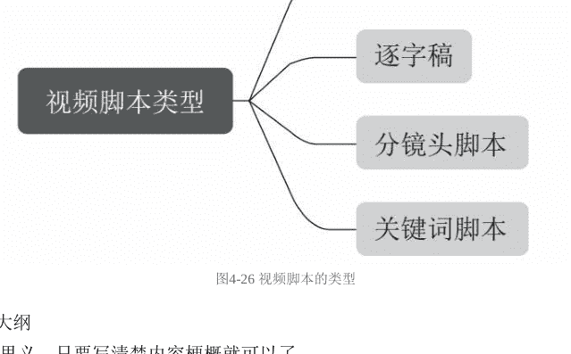
1. 相对简单的拍摄大纲
大纲脚本就是把内容梗概写清楚。可以按开场、主体拆分小板块、结尾的逻辑来概括，也可以用时间线大纲，把拍摄场景和对应文案按顺序列出来。创作者只要记下重点和关键词，防止漏拍错拍即可。

2. 可以照着念的逐字稿
台词量大的观点类、干货类内容，可以直接写成口语化的完整文字，方便用提词器拍摄。这样能避免新手忘词，也不会漏讲重点。缺点是眼睛一直盯着屏幕，表情容易僵硬，像在背稿，所以更推荐用大纲。

3. 详细的分镜头脚本
适合故事类或需要复杂剪辑的短视频。记录维度包括场景、内容、镜头、景别、时长、音乐、道具等，需要提前在脑子里过一遍成片效果，再按顺序拆成关键画面，落实到每个细节。想突出小的物体，就可以提前规划机位。适合有一定创作基础的用户。

4. 关键词脚本
有时候只需要一个主题关键词。像常上课的老师、常做提案的策划人，分享观点时给完整稿反而会限制发挥，不如现场发挥。旅行、体验类内容也很难提前预知，会遇到什么人景，这时只要有一个大致结构，备注好画面、景别远全中近特、拍摄角度平侧俯仰、视频亮点、开场收尾、台词道具，列出关键词就行。

很多新手会被脚本吓退，觉得还没开拍就写不出来。其实脚本只是创作工具，是被你掌握而不是被它掌握。

### 4.5.3 拍摄前做对这六件事
脚本准备好后别立刻冲去拍，先针对短视频特点做些准备，不然 NG 场面会很多，拍出来的效果和预期差很远。以下六点是我在拍摄环节总结的经验。

1. 尽量真人出镜
真人出镜是让人记住你的最直接方式，更容易获流量、树立人格 IP，也更真实真诚，拉近与用户的距离，粉丝粘性也更强。同时也是自我突破的好机会，恐惧、害羞、紧张、自卑、仪态、表达能力差，都是心理障碍，敢露脸才能蜕变。

一些拍摄小技巧：
- 心态建立。保持平常心，紧张尴尬是第一次镜头都有的正常反应。别只盯颜值，性格舒服、内容精彩更容易涨粉。
- 增强镜头感。拍摄时眼看镜头，避免上看斜视，会更有交流感。表情管理上少眨眼、少抿嘴、少吐舌，多练习微笑。肢体语言要自然，别一动不动，手势能缓解紧张也传递信息，比如双手张开显得开放，食指点一下表示重点。固定一个黄金角度，别过度仰头或低头。
- 设计个人风格。妆容穿搭要设计感，视频里浅色衣服更耐看，避免花哨抢戏。想留印象可以设计夸张卷发、假发、千禧辣妹风等造型，也要设计独特的动作、表情、语言风格。
- 制定规则。尽量别用提词器，容易面无表情。记不住就分段录、反复录再合成。别频繁暂停，口误忘词正常，先录完后期剪掉。多次暂停会打击信心，素材也更乱。
- 巧妙突破。刚开始不熟悉镜头时，给自己一个安全感小道具，比如抱枕、水杯、玩偶，安放双手放松。也可以模拟把镜头当听众注入情感。若实在不敢直视镜头，可用采访视角侧身拍，假装有人对面采访，紧张感会降低。
- 增加有效互动。每条视频里真诚号召互动，比如让粉丝留言想看的选题，既能避免评论区冷清，也能保持创作热情。

2. 注意语速语调
普通话或方言都可以，发音不准也能成为特色，关键是语速和语调。语速保持正常交流节奏，别太快让人觉得着急，也别太慢像树懒让人犯困。除非有特殊效果，别调倍速，更不要为了压缩时长调快调慢语速，观感会很差。语调要有起伏，别全程平铺，让人有聊天感，更亲切。

3. 注意画面精致度
主要看清晰度、光线和构图。
- 清晰度。尽量别手持拍摄，没稳定器就别边走边拍。舞蹈、运动类注意动作幅度，别模糊。清晰度与播放量正相关，除非刻意做粗糙风格，否则都要重视。
- 光线。白天自然光充足的地方效果最好，户外避开正午强光，防止曝光过头人物发“油”。室内光线别太杂乱避免多影子，避开顶光直射头顶，补光最好在斜上方打柔光。
- 布局。人物特写建议居中，头顶留白。人像素材占画面 2/3 到 3/4 比较舒服，这样头顶放文案也不会被头像和底部分区遮挡。拍场景如 Vlog，注意主体不被遮挡，排布合理。

4. 拍完记得及时回看
回看能及时发现问题，比如收音没录到、穿帮、重点没拍到。曾经一次拍 4 条内容结果收音设备没开，全无声音；也曾因动作幅度过大人物头脚同时出框，最后只能重拍布景。回看时也容易迸发新灵感，及时补拍能避免后期再返工，增加工作量。

5. 尽量一次性完成拍摄
除剧情、炫酷类需要多镜头拼接的视频外，尽量一条拍完。手机相机分段拍摄再合并，极易出现音量、色彩不统一的问题，概率很高。

6. 做好准备工作
提前布场。家里拍摄整理干净整洁的空间，特殊场地提前勘查灯光、嘈杂程度、拍摄角度，并携带补光、收音设备，必要时带稳定器、自拍杆。

确认设备。确保手机相机收音电量和内存充足。拍到一半没电、没内存、没装存储卡、收音没打开，都是高频失误。

### 4.5.4 剪辑更快更顺的几个办法
拍摄产生海量素材，一股脑导入很容易剪到混乱。掌握节奏，先粗后精，能省很多时间。

1. 先粗剪再精剪
先筛选要用的素材一次性导入，统一调整尺寸、音量、画面大小，避免剪成小段后再逐一调，特别是主体大小不一更尴尬。再逐个分割镜头，删掉无用和重复片段。

- 特效别用太多。大量特效是创作者自嗨，对观众是视觉轰炸。能少用就少用，用精用妙。
- 善用转场。场景或话题切换时加个转场更丝滑。整个视频控制在三种以内，别花哨。
- 巧用文字。字幕是帮助理解，别堆特效。文字还能强调重点，把每段话提炼成短句方便记忆；也能营造综艺感，比如文字放脸旁、和五官拼谐音梗；还能代替画面，漏拍时用纯色背景打字配音，黑屏打字抓注意力，衔接生硬时用文字过渡。
- 多用贴纸。贴纸是小红书的特色，能突出重点，和文字搭配美化视频，和表情搭配增加戏剧性，还能遮挡水印、身份证号、私人信息、杂物，也能营造机械、科技、二次元、潮流等风格。
- 慎用音效。音效影响互动率。人物讲话的视频避免全程背景音乐，若必须加选外语歌或纯音乐，避免歌词干扰。有背景音时，每句话或重点词都要配字幕。音乐音效音量不要盖过人声。
- 按需画中画。单一画面表达不清时，用画中画把新图片或视频叠加，信息传递更清晰。

2. 收尾工作
内容节奏和逻辑调好后，进入统一设计阶段。
- 统一调色。精剪后基本定稿，再统一调色。会调的话改对比度、亮度、暗角、色相、色温；不会的话直接用现成滤镜调节深浅即可。
- 制作导入封面。可以在剪辑 App 里直接选封面，也导入提前设计好的封面。视频剪完后再做封面，对重点更清楚，封面更抓人。
- 最后检查。核对音乐、音效、文字、贴纸是否错漏，整体还能否提升。确认无误再导出发布，同时编辑醒目简洁的文案，加上关键词和话题。

# 第5章 常用工具分享及实操
账号核心技能讲完后，本章分享做图、剪辑、拍摄的配套工具。前期起步没必要报班学剪辑 PS，也没必要买贵设备，我们不是技术从业者，市面上免费好用的作图剪辑软件足够上手，何乐不为。

本章主要涉及图文笔记常用工具与使用方法，以及视频笔记常用工具与使用方法。

## 5.1 图文笔记常用工具分享及实操
这里分享一些提升做图效率、真正好用的工具。笔者本身会 PS，但接触这些简单工具后就基本不用了。软件更新很快，等你阅读时基础操作只会更好用。

### 5.1.1 常用的作图工具
做新媒体运营或个人博主，除了会写会拍会表达，还需要基本的设计排版思维。小红书封面直接决定阅读量，做出好看封面是关键。随着行业发展，针对小红书笔记的设计工具越来越多，专门设有专区，做出高分封面更高效。

- 1. 在线设计修图网站
在浏览器打开网页就能直接用，不用下载安装，还能保存记录随时二次编辑，特别适合习惯电脑操作的创作者。比传统软件学习成本低，比手机 App 功能更完整，很多操作能在同一页面完成。主流的有 Canva 可画、创客贴设计等，它们也都有手机 App 端，如图5-1所示，支持多终端同步记录。除了这两家，还有搞定设计、Fotor 懒设计、图怪兽等，大家按操作习惯和审美风格挑选最合适的。

#### 2. 手机平板上的作图神器

现在几乎人人手机或平板里都装着几款好用的修图应用，操作灵便、随时可开，想改就改不受时间地点限制，各自也有鲜明特点。新媒体创作者用得比较多的就有醒图、美图秀秀、黄油相机、简拼等，如图5-3所示。这类工具处理人物、美食、旅行等社交平台常见的分享题材特别顺手。

下面以醒图为例，拆解一下做图时的基础操作。进入醒图后，最常用的四个入口是导入、拼图、批量修图、图转视频。

（1）导入。醒图的导入比较灵活，除了手机里已有的照片，还能直接选纯色或透明背景，对排版很便利。软件自带大量贴纸和文字特效，随手就能拼出点赞量高的文字图。

导入后可以对细节做全面调整，尺寸、色调、对比度、明暗以及各种特效都能加，滤镜、文字、贴纸、马赛克、涂鸦笔，人像方面也有面部重塑、瘦脸瘦身、自动美颜等。

值得一提的是醒图功能更新很快，例如路人消除能迅速清理画面里多余的人，多种光效可模拟夕阳斜射、树影投落等接近真实的效果，隔段时间打开总有新惊喜。

（2）拼图。拼图张数上限是2到9张，可拼成3:4、1:1等不同比例和布局，也能拼成长图。长图支持横向和纵向两种拼接。

遇到超过9张的情况怎么办？一个实用的小技巧是先把所有照片调成统一尺寸再分组，比如12张分三组，先用长图的横向拼图把每组四张拼好，再用纵向拼图把三组合起来，就能得到整齐的多图拼页。

拼好后仍可在当前页进行布局微调、滤镜添加、调色和文字添加四项基础操作。

（3）批量修图。同一环境下拍摄的一组照片，光线色彩基本一致，用批量修图一次修改更省事。

同时也可以单独处理单张，不会影响整组其他画面，比如画面中央有一段文字挡住脸，只需把这张的文字移开即可。

（4）图转视频。功能比较基础，只能加音乐和卡点，视觉变化有限，生成后通常要导入专业的视频剪辑软件再做特效，所以使用频率不高。

#### 3.非传统作图工具

除了专业绘图类App，小红书流行的视觉笔记还有不少借助笔记软件和思维导图软件产出的内容。这类产出虽不是为制图而生，却因条理清晰、重点突出、干货感强而很受欢迎，做知识类博主时可重点使用。

（1）笔记软件。最即时的记录方式是手机自带的备忘便签。随手写的文字稍作排版后截图，就可能成为爆款，特别适合观点类分享，例如创作者如何找定位、瑜伽练习者怎样保持自律等。这类内容创作时多用表情符号和空格来增强节奏。

另外还有电子笔记和手写笔记，代表软件有GoodNotes和Notability。它们能营造出学习氛围，配有荧光笔等工具，很好地模拟纸质阅读体验，兼顾手写和打字。

（2）思维导图。现在的思维导图工具都很成熟，提供配色模板，可轻松做出脑图、逻辑图、鱼骨图、树形图等。版式分明、脉络清楚，操作也简单，导出或截图后导入作图软件加标题、贴纸、简单装饰，很容易得到几千赞的小爆款。

笔者常用XMind，打开就能上手，操作简便，配色选择多，能满足不同审美。

### 5.1.2 纯文字排版快速打造小爆款

排版手法一直在更新，这里分享一个简单耐用的纯文字排版方法。

#### 1.利用手机作图软件/作图网页快速搞定小爆款

下面以醒图为例说明。

（1）打开醒图，导入一张耐看的纯色背景，或仿纸张质感的图片。
（2）确定标题位置，最好居中；挑选合适的字体，尽量避免过于花哨影响阅读。
（3）把成段文字粘贴进醒图，选用手写体，多次换行，将段落拆成一句一行，每行字数保持相近。按语义每隔2到6行空一行，重复操作直到全部文字添加完成。
（4）在重点文字下方加下划线，用涂鸦笔手绘即可，若画不直可在贴纸里找合适的线条，调整大小粗细。
（5）在文字周边点缀贴纸，提升观感。

#### 2.利用非传统作图工具快速搞定小爆款

下面以思维导图为例说明。

- （1）打开要分享的思维导图，调整成适合展示的样式，比如改变骨架排列、配色方案、背景填充、同级主题对齐，让文字足够清晰大方，截图或导出保存。文字较多时可分多次截图，分块展示。
- （2）把任意一张截图导入作图软件，以醒图为例，先导入图片，再取色吸取思维导图背景色，把画笔调到最大号涂抹整张图，得到一张与导图一致的纯色底图。
- （3）将该底图调成3:4比例，再导入之前的截图，调整截图大小，观察在底图上的呈现效果，不合适就重新截图尝试，直至导图能铺满背景图的下半部。
- （4）在醒图里挑选合适的文字模板添加标题，也可在贴纸库里找装饰元素或做重点标记。

如此即可完成两个小爆款。

## 5.2 视频笔记常用工具分享及实操

本部分分享一些实用的剪辑软件以及拍摄剪辑的思路。受纸质图书时效影响，这里不举具体案例，而是给出视频笔记的实操思路。

### 5.2.1 常用的手机剪辑软件

作为新人，没必要把时间花在Adobe Premiere Pro、Final Cut Pro这类专业工具上，先从手机剪辑软件入手就能满足初期需求，效果也相差不大。笔者常用剪映和必剪。

#### 1.剪映

剪映是字节跳动旗下产品，被公认为新手友好的剪辑工具，且免费。支持手机、电脑、平板，且可同步编辑记录，十分便捷。

功能全面，视频内可做美颜瘦脸，录制时自带提词器，还能打关键帧营造特殊效果。素材库丰富，输入关键词即可找到贴纸，综合来看是目前剪辑软件中的佼佼者。

#### 2.必剪

必剪由哔哩哔哩推出，主打“年轻人都在用的剪辑工具”，风格很B站。

它的一大亮点是可以创建专属虚拟形象，不想真人出镜也能零成本做虚拟创作者。录音时可用提词器，一台手机即可完成配音。小红书内容与B站契合度高，同步发布时能方便添加“一键三连”贴图，样式多样。表情包资源丰富，做鬼畜搞笑类视频很顺手。想要一款风格化且免费的剪辑工具，必剪是不错的选择。

#### 3.其他

市面上还有iOS自带的iMovie、被称作手机版Premiere Pro的Videoleap、滤镜感强的“一闪”、快速剪辑的“度咔”、适合朋友圈视频的“秒剪”等，本文不一一展开，可在小红书查看使用评价后挑选。

### 5.2.2 快速完成一条视频的拍摄和剪辑

本节从景别、构图、运镜等基础概念入手，分享拍摄和剪辑的快速思路，包括设备投入建议和剪辑流程，帮助没有经验的读者建立信心。

#### 1.手机拍摄时的基础概念

要拍出满意的视频，先了解景别、构图、运镜、转场的常见用法。

（1）景别。在焦距不变时，手机与被摄物距离不同，画面呈现的范围大小也不同。常见分类有远景、全景、中景、近景、特写。

远景用于展示环境全貌，视野宽广，整体感强，细节少，多用于交代环境或营造氛围。
全景常表现场景全貌或人物全身动作，比远景细节更多。
中景拍摄人物膝盖以上，突出上半身动作，叙述性强。
近景画面更小，通常为人物胸部以上或物体局部，细节清晰，更具亲近感。
特写为肩部以上头像或物体局部，用于刻画人物或细节，视觉冲击强。

（2）构图。构图影响画面美感和重点突出。

中心构图把主体放在画面正中，最常见，能最大程度突出主体，适合面对镜头讲解互动的视频，如好物分享、教学、开箱等。
三分构图包括三分点和三分线，把画面划分为九格，交点为视觉中心。拍摄时可开网格辅助，注意人物朝向，人物面向留白的画面更均衡。
对称构图沿水平中线分为水平对称和垂直对称，布局均衡工整，适合建筑、自然风光等宏伟场景，常用于旅行Vlog。
前景构图在主体前方放置较近的景物，利用遮挡与轻微虚化增强立体感和层次感，但使用需谨慎，避免影响视觉。

（3）运镜。运镜指拍摄时手机的运动方式，常见有推、拉、摇、移等。

推拉镜头是匀速移动，离主体越来越近为推，越来越远为拉。推能突出主体和细节，视觉集中；拉强调主体与环境关系，常用于结尾。
环绕拍摄让人物居中，手机保持一定距离环绕拍摄，能突出主体并渲染情绪，画面更有张力，要求主体始终居中且移动顺滑。
跟随运镜是手机跟随主体移动，可正反双向拍摄，保持相同速度，有第一人称即视感，能连续表现动作表情，易调动情绪。
平移运镜是手机在主体侧面横向匀速移动，类似边走边看，有平衡感，常用于展现大场面和复杂场景。

转场常见类型：
方向转场，视频结尾时镜头向某方向转出，下一个镜头同方向转入，拼接即可。
相似物体转场，利用关联点衔接，如相似物体、场景或动作，天空转场是典型例子。
物体遮挡转场，用画面中物体遮挡镜头实现场景切换。
同一主体转场，前后场景共用同一主体，通过主体运动或相机随主体运动完成空间转换，适合从一个场景进入另一个场景。

拍摄时需拆解视频，确定每个镜头的景别和构图，并用运镜和转场让画面更流畅。

#### 2.拍摄设备投资的建议

拍摄需要灯光和收声等设备，建议结合自身情况只先买必要的部分。

- （1）推迟专业相机的投入。手机已能满足大部分拍摄需求，初期不必购入专业设备，除非对画质要求极高的美妆、Vlog、数码、时尚博主等。
- （2）投入合适的收声设备。手机自带录音需绝对安静，环境噪音大时会录入杂音。测试显示，同样内容，带杂音与使用收音器的视频点赞量可相差约200。建议购买轻便的领夹麦或指向性话筒，价位几百到几千元，预算低可选博雅、塞宾智麦，预算高可选罗德。具体型号可参考靠谱种草贴。若不打算投资收音设备，可戴耳机录制或后期配音，并在手机话筒处包湿纸巾防喷麦。
- （3）按需购入灯光设备。光线影响人物形象和画面质感。自然光层次丰富、现场感强，是最佳选择，白天拍摄优先使用。若常在夜间、顶灯环境或光线复杂场合拍摄，建议入手。常备两种：补光灯和氛围灯。补光灯解决光线不足不细腻的问题，常见有箱型灯、环形灯、平板灯、条形灯等，部分条形灯带吸盘或磁铁。氛围灯用于填补空白墙面或营造特殊效果，如日落灯、可变色补光棒等。例如以科技数码分享为主的博主，常选用蓝色或紫色冷调以增强科技感。
- （4）按需购入支架。好支架可独立完成多场景拍摄。

表5-1 几种常见的手机支架类型

| 支架类型 | 预算区间 | 特性及作用 |
| :--- | :--- | :--- |
| 普通自拍杆 | 100元内 | 便携轻巧，长度一般在0.9米以内，外出灵感来时可随时记录 |
| 专业手机支架 | 200元上下 | 略重，比普通自拍杆更稳，凹凸路面或风大时也能站稳。长度可在1.6米～2.1米调节，可外接补光灯、多机位拍摄，收起后可作稳定器 |
| 万能三脚架 | 100元内 | 一般配1/4螺丝孔，拧上不同配件可作手机、平板、相机支架，也能作灯架。建议搭配带多角度调节的热靴使用，热靴可连接闪光灯、补光灯、收音麦、运动相机等，横竖屏架灯都方便 |
| 俯拍支架 | 200元内 | 学习类、美食、Vlog博主常用，适合做饭、写作、画画、手工制作等需要俯拍的镜头 |

#### 3.整理剪辑思路

剪辑大致分为五步：整理素材、确定思路、粗剪、精剪、合成导出。

- （1）整理素材。拍摄后素材较多，先删除明显废片，挑选可用素材，对精彩片段做标记。可按时间、人物或环境分类，方便后续调用。前期整理越细，后期越省时。
- （2）确定剪辑思路。把握内容与节奏，考虑如何让视频连贯流畅、有起伏。对没有脚本的内容如旅行Vlog，需先规划整体结构，明确开头、发展、高潮、结尾，保证框架完整连贯。
- （3）粗剪。搭建视频骨架，形成雏形，只需按时间或场景顺序串主线，音乐、色调、转场、花字等细节后补。粗剪时素材宁多勿少，通常会比成片稍长。两个实用技巧：一是先自动识别字幕，借助字幕快速判断重复和卡顿部分，可让机器辅助筛选；二是粗剪前先调好声音大小、画面大小、倍速，避免剪成小段后再逐一调整，减少工作量并保证统一。

以创客贴设计为例，说明在线设计修图网站的额外优势。

- （1）有海量通用模板，分类查找方便。这些网站提供通用模板，按分类、场景、行业细分，例如手机海报、竖版海报、长图海报、横版海报、logo设计、动态横版海报、方形海报等。检索功能强大，输入“健身”可得到大量精准结果，按颜色筛选也简单，且会按热点节日及时更新，首页多为当下流行内容。
- （2）尺寸调整灵活，不用担心尺寸转换。不同于手机上靠比例确定尺寸，在线平台可输入任意数据完成特殊尺寸创作，且制作过程中可随时调整。尤其适合长图创作，若不确定长度，拖拽底部即可拉长缩短，也可在设计页修改数据，平台会自动适配内容调整布局。
- （3）素材取用、搬运、上传方便。创客贴设计的图库、字体库、素材多为正版，开通VIP可商用，规避版权风险。素材多为免抠，省去抠图麻烦。若看中其他模板上的素材，可跨模板粘贴，将多个模板精华拼合。若自有素材不足，可直接上传图片或从其他网页复制粘贴，无需下载保存。

- （4）抠图与描边更精细。手机在指尖上点涂，操作容易失准。创客贴设计在电脑端一键抠图后，还能对边缘进行二次精修，鼠标比手指涂抹精准很多。抠图完成后描边也更从容，线条的粗细、笔触样式随意切换，颜色可用取色器直接吸取想要的色值，自由度远高于手机绘图App。

- （5）存图更省事。电脑端完成后不用再靠互传、微信、蓝牙把文件倒来倒去，直接用手机或平板扫码就能把成图保存到本地，发布和回看都更快。

- （6）版面更工整。做一张好看的图，对齐是基本功。手机上左对齐、居中对齐、等距分布等功能受限，基本只有字体能调，手指拖动素材也不稳定。网页端做图则不一样，对齐工具齐全，还能拉出横向和竖向参考线，排版更稳。

- （7）图表与二维码插入更顺手。手机里做表格通常要借助别的工具，效率低且不好看。创客贴提供大量现成的表格和图表模版，表格、饼图、柱状图、折线图等直接挑模板填入数值就能成型。生成二维码同样便捷，选好模板双击进入编辑，直接粘贴网址、文字或公众号文章链接，即可一键生成。

- （4）精剪。粗剪已有雏形，精剪是打磨质感的阶段：剪掉冗余画面，在保证逻辑完整的前提下做减法；配上合适的音乐和音效，并让画面随声音节奏微调；加入转场让衔接更顺滑或更有冲击感；做整体调色让画面统一精致；加上字幕提升信息传达；可提前做好封面直接在小红书添加。精剪时可围绕以下重点推进。

黄金三秒：开头三秒决定留存。要在最短时间内讲清用户能得到什么收益。可以把片子最精彩的片段拼成预告式开场，像电视预告一样抛钩子。剧情类内容可把冲突、高能、搞笑点前置制造悬念；干货类内容直接点明分享要点，别在开头过多铺垫消耗耐心。

善用转场：转场是两个镜头衔接的桥梁，能改变节奏、情绪和叙事感。淡入淡出、叠化、溶解是常用手法。转场可以让视频更丝滑，特殊转场也能提升酷感和层次感。可尝试把转场卡在音乐节拍点上，冲击力会更强。剧情向视频转场要克制，用太多容易分散注意力，增加跳出风险。

调色处理：不同片段的光线和质感差异明显，不调会显得突兀。可以套用滤镜，也可手动调亮度、饱和度、色彩平衡等。画面偏暗就提亮度和光感，偏黄就调色温，层次不足就调对比度、高光、阴影，模糊就加锐化。调色靠手感，调不出理想色可参考小红书剪辑博主分享的参数。

把控画面节奏：匀速播放很枯燥。依据内容走向做慢速、快速或定格处理。学习类Vlog可把长时间写作业的重复段落加速呈现；旅行Vlog可慢放树叶飘落的特写；定格常用来强调表情细节，像“惊呆”“惊恐”等情绪，配合内心画外音更有戏剧张力。

内容要紧凑：宁可少说一个重点，也不说一句废话。信息分散或冗余，观众很容易走神。停顿、空白、重复全删掉，提升完播率就要对素材更狠一点。

效果要克制：字幕、贴纸、音乐、特效不是越多越好，点到为止才显高级。文字堆太多用户抓不住重点，提炼关键词放在合适位置即可。讲话类视频全程放背景乐会干扰人声识别。特效间隔太近会让人眼花。

- （5）检查与导出。确认声画同步、无视觉瑕疵、无穿帮镜头后方可合成。导出时选对分辨率，保证成片清晰。

# 第6章 账号诊断与投放实操
上一章把创作流程大致走完了，对小红书创作者来说这只是起步。真正要把号养好，还得靠复盘和诊断。清楚自己强在哪、弱在哪，才能持续优化。本章聚焦以下方向：

- 小红书推荐机制的核心逻辑
- 快速复盘账号的思路
- 薯条的购买与投放技巧
- 品牌官方号如何做推广

## 6.1 有的放矢：先搞懂推荐机制
积累素材后别急着注册发笔记，先弄明白平台规则和推荐逻辑。方向对了，后续内容才更容易获得曝光和流量，粉丝增长才有持续动力。了解机制也能少走弯路，避免踩雷，让辛苦做的内容不被冷藏，账号不被封禁。

### 6.1.1 推荐的底层逻辑
小红书非常看重原创。因为平台要靠优质内容吸引用户留存，进而壮大生态。所以它乐于扶持新创作者，形成了不同于强者恒强的氛围，人人都有机会。机制的核心就是让好内容被看见，而不是只看账号体量。实际运营中，几千粉账号的单篇数据经常超过大号，竞争的关键是笔记是否受欢迎，而非账号本身的粉丝量。

### 6.1.2 笔记的推荐流程
笔记发布后会先过审，未通过就不会分发。创作时要避开违禁敏感词。怎么判断是否过审？发布后用关键词在搜索框搜笔记，点右上角筛选选最新可展示。能搜到说明已过审并开始推送，搜不到则还在审核或未进入推荐池。

审核通过后，系统会根据账号权重和笔记权重做第一波分发。新号通常会先推100量级左右的流量，观察互动表现来判断内容质量，互动越好流量越加码。有一定粉丝基础的账号，内容还会先推给老粉，粉丝互动也直接影响后续推量。

曾运营过一个健身跟练号，粉丝到20万时转型，内容调性完全变化，点赞互动骤降，相当于重新起号。说明小红书对内容匹配度要求高，精准和质量是决定性因素，不能搬运或做伪原创。定位一旦确定就不宜随意更改，否则等于浪费积累，标签混乱还会拖慢新目标达成。若需调整方向，建议另开账号。

### 6.1.3 流量入口有哪些
从粉丝视角看App，笔记获取流量的主要入口有：

1. 首页推荐
打开App首先看到的是推荐流，这是主要曝光位。平台依关键词和权重匹配内容与用户，双列信息流不断滚动，封面和标题的吸引力直接决定点击率。

2. 关注与话题
左右滑动进入已关注更新和分类更新。笔记会被推给已关注用户，或对特定主题感兴趣的人。持续输出粉丝偏好的内容，能获得基础互动，帮助进一步进入首页推荐。

3. 搜索
用户带着明确需求来搜索攻略、教程。运营案例中，精准内容搜索流量占比很高，有时甚至超过首页推荐。

4. 站外引流
将笔记分享到站外也能带来增量。小红书鼓励站外分发，相当于用优质内容为平台导流，互利共赢。后台数据也能看到分享转发的贡献。起号期可在微信群、朋友圈转发获取冷启动流量。

5. 流量构成
创作者中心的数据助手会详细展示单篇笔记的流量来源。多数笔记以推荐为主，但也有搜索为主的情况。来源并非固定，与运营目标强相关。首页推荐曝光强但时效性强，通常维持约一周；搜索流量更持久，关键词精准且基础数据好，可在发布数月甚至几年后仍持续带来点赞、关注、收藏。策划内容时要结合目标入口思考：想达成的目标是什么，怎样触达目标用户，心里才有数。

### 6.1.4 提升流量的关键要素

1. 笔记排名
指笔记在搜索结果双列信息流中的位置，靠前位置在推广平台需花钱，免费占位等于省成本。主要提升方式是选题质量和关键词布局。

关键词要选准且易被搜到，避免前后带符号空格等干扰字符。
关键词要适度重复，200-300字笔记重复4-6次比较合理，重复越多权重越高，但要自然不生硬。
关键词要分布在标题、正文、话题中，不同位置权重不同。

2. 账号权重
平台会评估账号质量。持续输出靠谱优质内容就是核心。

账号质量与信用：账号如同虚拟人物，信用是基础。需遵守创作者公约，避开违法违纪、负面攻击。曾见过攻击同行的瑜伽号，短期吸睛后粉丝反感取关，且易被投诉封禁。做正能量、可信赖的内容才能走远。

原创能力：电脑端发布会进入审核，系统自动比对加人工检查。选题、措辞、关键词使用都要谨慎，表达清晰完整，避免潦草被判抄袭。

创作频率与活跃度：稳定输出才能被平台视为靠谱创作者。频繁断更会被视为不稳定，长时间不更会被判定江郎才尽。机械发内容不互动会被当成营销号。保持分享者心态，健康经营IP或品牌。

3. 笔记权重
单篇笔记也有权重，评判维度与账号类似。

基础质量：避开违禁词，不放微信号、手机号、二维码、logo、水印、邮箱等明显引流信息，避免限流封禁。内容也不能低俗。

互动表现：点赞、收藏、评论、转发是通用指标。学会引导互动，如一键三连。2022年上线的互动组件可在笔记下增加PK游戏等环节，提升讨论趣味性和参与度，是加分项。

## 6.2 快速复盘：吃透基础数据
定期停下来问自己：内容满意吗？不满意原因是什么？能否保持稳定输出？主观感受不够，需用数据验证。养成数据思维，用结果指导创作，而不是凭天赋感觉。

### 6.2.1 主动记录与观察数据
官方已提供创作者中心的数据工具，但很多人只粗略浏览。建议形成定期复盘习惯。

进入创作中心可看到近7日新增粉丝、主页访客、观看数、互动数等概览。点进详情可从账号概览、笔记分析、粉丝画像三维度查看近30日数据。

账号概览展示近期内容观看量、观看总时长、主页访客、粉丝互动转化情况，并给出近7日诊断，与同类作者在观看、互动、涨粉、发文活跃度四个维度对比，方便判断起步阶段是否健康。还能看到观众来源比例，是搜索来的多还是首页推荐来的多。若搜索占比低，需优化关键词；若推荐占比低，需优化封面和标题吸引力。

笔记分析页可按观看量排序，找到爆款和低效内容，形成后续选题、标题、内容的参考和避坑清单。进入单篇笔记可查看观看量、人均观看时长、点赞、收藏、评论、涨粉、分享等，以及发布后7日观看趋势和诊断，从点击率、互动量、涨粉三维度与同类做对比。还能看到阅读人群的性别、年龄、城市、兴趣分布，据此细化内容人群定位。

粉丝洞察面板其实就是在看最近一周或一个月内的涨粉与掉粉曲线，通过涨跌幅度和流失数字，判断某段时间的内容是否达成了预期目标。页面里还能看到高互动粉丝的头像，点击就能进入主页，翻看他们的笔记和收藏偏好，就能更立体地理解自己的受众画像。新增粉丝的来源渠道也很清晰，是靠搜索笔记进来的多，还是直接搜索账号进来的多；性别、年龄、城市、兴趣爱好这些维度，也都用柱状图直观呈现出来，便于快速判断人群结构。

内容做得越稀缺，忠诚度往往越高。比如运动英语这个细分话题，除了健身从业者几乎没人关注，但你把这块内容做得足够细致专业，即便收藏量不爆，也能沉淀一批真正爱看、长期追更的铁粉。

### 6.2.2 如何提前判断笔记表现
视频数据通常要到发布次日才会趋于稳定，但我们想尽早知道能否顺利进入下一阶段涨粉。因此学会提前预判就很关键，下面分享一套基于长期统计的自检方法。

先建一张内容发布追踪表，见表6-1。

表6-1 内容发布表格示例

| 序号 | 发布日期 | 选题方向 | 标题 | 封面关键词 | 2小时点赞 | 2小时收藏 | 次日点赞 | 次日收藏 | 次日账号总赞藏 | 次日评论 | 次日粉丝数 | 粉丝增量 |
|---|---|---|---|---|---|---|---|---|---|---|---|---|
| 1 |  |  |  |  |  |  |  |  |  |  |  |  |
| 2 |  |  |  |  |  |  |  |  |  |  |  |  |

备注：统计起点可按自身习惯调整，建议2小时以上，平台审核时间不固定，留足审核通过后的曝光时间更稳妥。

从这张表里能读出什么？

1. 能相对准确地预估次日数据。做法是2小时点赞数÷次日点赞数得出点赞稳定系数，2小时收藏数÷次日收藏数得出收藏稳定系数。数据积累多了会发现，同一账号周期内，用前两小时的点赞收藏就能框定次日区间。比如我自己的账号，2小时点赞和收藏都未破百，次日很难做到点赞收藏双破500；若两者都超过200，次日破千的概率就大很多。
2. 能判断内容质量高不高。核心看点赞与收藏是否均衡。小红书偏向真实分享，优质内容收藏往往略高于点赞。例如点赞4万、收藏4.4万；点赞2000、收藏2700，就属于健康比例。若点赞远高于收藏，说明内容有亮点但价值感不足，需要补充干货；若收藏远高于点赞，而粉丝增长却平平，则说明大家觉得有用但没击中痛点，需要优化表达。发布后对内容做二次优化并不会影响账号，反而有机会翻红。

### 6.2.3 发了笔记却没流量怎么办
有时候随意发一条就爆了，精心打磨的作品播放却惨淡。想理解这背后逻辑，就得先明白推荐机制如何运作。

互联网学者克莱·舍基曾说，当下的焦虑并非信息太多，而是过滤器失灵。大量内容进入小红书的内容池后，系统会依据用户的点击、搜索、观看和消费习惯，筛选出可能感兴趣的内容推送到信息流。点过某类博主的视频，系统就会判定你偏好该风格；搜索过北京景点、美食，系统就可能认为你对北京相关内容感兴趣。

推送后系统还会再评估用户是否喜欢。用户会产生的行为信号包括观看、点赞、评论、关注等，初次分发都是小范围测试，根据点击率、完播率、互动率等表现决定是否扩量。表现好就逐步放量，表现差就收回。因此没流量，根源往往在用户对内容的反馈上。

#### 1. 没流量的常见排查点
（1）观感是否达到基础舒适度。用户先要愿意停下来看。画面不能裁切、主体缺失、过曝过暗，避免出现让人不适的元素，也不要带水印、二维码、网址等导流信息。封面尤为重要，清晰、颜值高、有辨识度的封面更易吸睛。小红书支持1:1、3:4、4:3，竖屏3:4展示面积更大，更容易抓住亮点。
（2）内容是否真正解决用户需求。好坏由读者说了算，不是创作者自认。所谓的干货可能是自我感觉良好，先站在观众角度思考他们当下在解决什么问题，提炼出能一眼抓住的价值点，才能促成点击。
（3）表达是否用户听得懂。越专业的创作者越容易掉进术语陷阱。比如“骶髂关节痛”，用户根本不知道在哪，就难以产生关联。用大白话讲专业，才是有效的内容。
（4）是否具备传播钩子。一张秋冬穿搭图，文案写“软乎乎穿搭，我们一起变成白面包！”比“这套穿搭我很喜欢！”更有分享欲。善用“我们”等代入感词汇，以及“白面包”这类具象联想词，更容易被转发。
（5）是否具备互动钩子。笔记互动率=（点赞+收藏+评论）÷阅读量。三个指标都要高，且重要性为评论>收藏>点赞。互动低通常是因为没设置讨论点，选题参与感弱，封面标题不聚焦，缺乏槽点和共鸣，用户不知道怎么评论。
（6）内容本身是否太小众。受众基数小，流量自然受限。要找到小众话题与大众关切的连接点。如“对外汉语老师的日常”吸引力有限，换成“对外汉语老师讲职业收入，人人可做的高收入自由职业”就有了围观点。
（7）定位是否不清晰、垂直度不稳。内容杂乱会让平台难以打标签，也让用户形成不了稳定预期，最终数据和推荐都会受影响。

#### 2. 把热度拉回来的五个办法
流量解药一：深耕细分赛道，打造记忆点。不要等账号长大了才总结粉丝类型，要主动筛选人群。例如健身领域只讲练臀，从凹陷臀、妈妈臀到蜜桃臀养成原理，垂直小赛道做透，来的流量更精准。

流量解药二：往人多的方向靠。流量在哪，人就在哪。做内容前先做调研，了解话题关注体量和人群画像，避免今天吸30岁女性明天吸20岁技术宅，导致涨粉慢、黏性差。爆款带来的无效粉也会拖累后续转化。

流量解药三：定期给粉丝小回馈。关注你的用户是期待价值的，情感价值或知识价值不足时，可用抽奖送礼等方式维持温度，让博主形象更有人情味。

流量解药四：紧抓热点。结合时下热点、节日节点或近期热议话题，从自身擅长领域切入，热点本身自带流量，找到介入角度就能事半功倍。

流量解药五：优化内容标签。标签既帮用户降低搜索成本，也帮创作者提升被检索概率。发布时可添加地点、品牌、商品、影视等标签；同时在标题、封面、正文中嵌入高频搜索关键词，让系统更好识别和分发。

### 6.2.4 爆了却不涨粉的原因
有时候阅读、点赞、评论数据都不错，排版选题也在线，却很难带来大规模涨粉甚至变现。多数情况是收藏数据偏低，用户觉得内容还行但价值感不足，转化粉丝的概率自然下降。可从以下角度复盘内容生产。

#### 1. 你是否把粉丝当成真实个体
如果把粉丝只当成数字，就很难持续涨粉。流量背后是真实的人，要了解他们在小红书的触媒习惯、身份标签、打开动机、停留时长、账号停留时长，以及关注你的充分理由。缺乏这些思考，就很难实现有效转化。

#### 2. 你的个人故事讲清楚了吗
内容里是否明确介绍过你是谁、有怎样的经历、能提供什么价值、为什么值得关注。把这些信息自然融入每条内容，才能让流量变成精准、忠诚、有效的粉丝。

#### 3. 信任需要时间沉淀
粉丝数少会影响后续关注意愿，这是用户判断账号靠谱的重要依据。传播学中的沉默螺旋理论指出，人们倾向于跟随多数声音，评论区冷清会形成负向循环。信任来自持续输出真实、专业、真诚的内容，以及来自更强势的背书和自信。核心就两点：熟悉产生信任，专家感产生关注。持续生产有价值内容，才能提升粉丝转化。

内容信息量要足且贴合需求；能引发情感共鸣，让用户获得满足感；有趣新奇，比如让男朋友讲解化妆，既有温馨感又有干货；结合热点，借助话题热度放大传播。

### 6.2.5 遇到创作卡壳怎么破
复盘后仍陷入空白期是常态，下面三种方法可以打开思路。
1. 倾听粉丝的声音，让粉丝成为灵感来源。引导评论区提问、直播聊天，直接获取痛点和建议，比闭门猜测更高效。
2. 展示更加立体丰富的自己。从生活出发延展选题，比如训练博主可扩展饮食控制、训练服种草；颜值博主可延伸搭配、护肤等。上下左右迁移，触角伸向生活。
3. 增加内容的新玩法。在熟悉话题里寻找新角度、新形式，对旧选题做翻新。关注大众领域的小众切口，你知道别人不知道的点，往往就是差异化。参考多个喜欢的创作者，站在肩膀上创作。

### 6.2.6 长期有效的选题密码
无论平台怎么变，可爱、财富、健康、实用、新奇、美丽等核心诉求一直存在。下面按时态列出可复用的选题方向。

1. 站在现在看未来
（1）改变。现在的改变能激发用户对理想状态的联想，如“让生活井井有条”“让身材更纤瘦”“让工作更高效”“让气质更优雅”。
（2）求助。以当下不完美的现状提问，激发共鸣，如“救命！怎么拯救乱糟糟的生活”“微胖十年求助”“工作效率低怎么办”“相亲前怎么快速变优雅”。

2. 站在现在看现在
接纳当下，帮助用户与现实和解，如“我爱我洒脱的生活”“我爱我健康微胖的身材”“我甘愿做平凡的螺丝钉”。

3. 站在现在看过去
怀旧与重评，如“回不去的潇洒青春时光”“过去微胖但有福气的脸”“过去效率低其实是自卑”“过去不修边幅的我才最快乐”。

## 6.3 薯条投放：提高笔记曝光的技巧
薯条是创作者提升笔记曝光、实现短时间广泛触达的推广工具，买的是在发现页的展示次数，可按点击、互动、涨粉等目标投放。

### 6.3.1 薯条怎么买怎么用
开通路径：【我】—左上角【≡】—【创作中心/专业号中心】—【创作服务】—【薯条推广】。

投放方式1：进入目标笔记—右上方【...】—选择【薯条推广】进入设置页。
投放方式2：进入【创作中心/专业号中心】—【薯条推广】主页新建推广。

可自定义投放时长、定向人群和预算。建议优先推广互动率满意或最具代表性的笔记。根据目标选择推广阅读量/播放量，薯条会把笔记推给可能感兴趣的潜在用户。播放量这里指用户点击进入笔记的次数，并非完播时长。

薯条投放与小红书变现实战笔记

薯条能让笔记获得更多点赞和收藏的互动，它会把内容推给习惯点赞收藏的用户群体，提升笔记的互动率和曝光面。
薯条也可以用来涨粉，它会把笔记推送给有关注创作者习惯的潜在人群，帮助账号吸粉。
薯条还能为直播间导流，它会把笔记展示给喜欢看直播并且关注创作者的潜在用户。

小红书会在投放前根据选择的推广目标给出曝光量预估，不一定百分百精准，但可以作为参考心中有数。
使用薯条推广后，作者可在创作中心/专业号中心找到薯条推广，查看审核结果与实时数据，比如曝光量、播放量、新增互动转化。被投放的笔记在发现页没有固定排位，会在小红书App首页随机露出。

投放前常遇到的几个问题：

#### 1. 哪些内容能用薯条加热
并非所有笔记都能投放。必须是发布90天内、合规且非商业营销性质的内容才可投放。通过薯条推广的笔记需先审核，满足小红书社区规范、社区公约、薯条推广服务协议以及薯条内容规范才可发布。
只要不出现恶意标题党、低俗色情、伪科学以及笔记中含有商业推广等情况，通常都可以通过。审核时长一般在1到2小时左右，受节假日、突发热点影响会有波动。

#### 2. 时机与时长怎么把握
不同投放方式各有利弊，要结合自身目标选择最优方案。薯条支持多目标投放，也支持自定义投放时长。

时间上，早高峰、晚高峰以及周末平台流量更集中，竞争也更激烈。建议参照这篇笔记的目标用户活跃时段来投放，才能物有所值。

时长上，如果只是想测内容有没有被市场喜欢的潜力，可小额做6小时的快速曝光测试。若目标是涨粉等更具体的转化，建议把时长延长到12小时或24小时。

#### 3. 智能推荐和自定义投放有什么不同
薯条支持人群定向，可按性别、年龄、地域、兴趣等特征圈定投放对象，笔记就会出现在目标用户的发现页。

创作者可选择系统智能推广，也可自行自定义设置。智能推广是系统把笔记推送给可能对内容感兴趣的用户；自定义则是作者按需求手动选择人群。

对受众没有把握时，建议新手先用智能推广，效果相对更有保障。若账号垂直优势明显，且对粉丝画像有一定认知，自定义投放则可能获得更优效果。

#### 4. 哪些情况会触发薯条退款
订单未顺利完成会产生退款，薯币只能退回小红书钱包，不能提现到银行卡或微信，可用于直播打赏或继续投放。

常见三类情况：
（1）笔记审核未通过。
笔记完全未通过审核时，薯币会全额退回钱包。推广中编辑笔记后内容会重新进入审核，未通过则剩余款项原路退回。投放期间作者可根据实时数据调整内容，调整时推广会暂停，重新发布后订单才继续。小红书在此过程中没有限流，调整内容是允许的。
（2）推广结束未花完。
购买的薯条在有效时长内未消耗完，剩余未曝光部分会自动退回。注意，实际完成比例超过系统预定的95%即视为正常完单，不会退款。例如预估曝光5000次，实际投放4950次也算完成。
（3）内容质量不佳，系统自动中断推广。

#### 5. 投放后为什么没涨粉
薯条只是提升曝光的助力工具，并不保证点击和转化。曝光上去后，点击取决于标题和封面是否足够吸引；互动率取决于内容本身；粉丝增长还要看账号主页整体内容质量。

检查投放订单是否定向过窄、过小众，这类定向很难在短时间内带来大规模曝光和阅读，订单跑得慢甚至零曝光属于正常。

建议先保证内容足够优质再投放，优先挑选笔记中表现更好的内容投放，避免浪费。除了薯条，小红书还有很多免费的曝光机会，主动参与平台的流量活动、结合新功能尝试，也能获得扶持做爆款。

## 6.4 团队作战：品牌官方号推广与获利

前面讲了个人博主如何获利，小红书也为品牌官方号提供了更多曝光和变现方式，不仅限于做号获利，还能通过多种推广工具形成矩阵打法，当然需要投入一定资金。

### 6.4.1 矩阵账号与引流
在小红书用笔记完成引流需要技巧，操作不当不仅得不到精准流量，还可能被封禁。

引流时切记不要在评论区正文中出现电话、微信号、二维码等信息，也要谨慎使用私信功能，这些都是平台重点监管的行为。

如何引流？矩阵账号是常用方法。指在平台注册多个不同角色的账号，分工配合完成引流。通常准备一个主账号和一个副账号，名字要一眼可关联，例如主账号叫“某某某老师”，副账号可叫“某某某老师的小助理”，再备几个小号配合控评效果更好。核心目的就是引导评论风向，让用户主动留下联系方式。

常用方式有：
第一，评论区埋购买线索。主账号发布笔记后，在评论区放一条购买渠道信息，例如家居博主在种草视频下写下店铺名称，粉丝可自行搜索下单。
第二，咨询回复。主账号发完种草笔记后，有意向的粉丝会在评论区咨询购买方式。主账号直接留联系方式风险高，这时由小助理出面。提前用小助理账号上传一张手写图片做置顶笔记，上面留联系方式，评论区回复“看我主页”，引导用户点击头像查看。
第三，关联实体店铺。品牌笔记可带上门店地址，点击后进入门店专题页，里面有详细地址、联系电话及所有相关笔记，形成完善的品牌页面，增强信任后用户可电话预约体验。

引流需要每个账号角色齐全、分工明确。主账号不方便表达的内容可由小助理代劳，多小号在评论区控评，联动引导节奏，最终达到留资目标。

### 6.4.2 品牌官方推广的四大方式
小红书商业产品页面提供了多种品牌曝光和引流工具，常见的开屏广告、信息流广告、搜索推广等可按营销场景选用，也能实现沉浸式互动。

#### 1. 小红屏
小红屏是小红书特色推广形式，可覆盖开屏黄金位，并联动信息流笔记持续展示。既能做品牌曝光，用户又可通过左下角的立即购买进行预付费，实现曝光与盈利双目标。

#### 2. 信息流广告
信息流广告是与笔记结合最紧密的推广方式，可投放官方账号的原生笔记，也可以笔记卡片形式投放广告，对获取销售线索帮助很大。品牌可在官方号挑选优质笔记投放，也可投放合作达人制作的优质内容，通过信任促进转化。

薯条与信息流的区别：薯条按曝光计费，最低75元起，主要目标是加热笔记、提升阅读、涨粉、增加点赞；信息流按点击计费，最低充值2000元，目标更明确，集中在私信、下单及用户转化。

实操中常会组合使用。例如内容本身偏转化的笔记，可先用薯条加热提升曝光；投放信息流前，也可先用薯条完善信息丰富度和展示效果，以更好控制成本。

#### 3. 蒲公英平台
蒲公英平台不仅是博主接单工具，对品牌而言可帮助找到精准优质达人，为产品匹配高质量用户流量，提升品牌和新品曝光，促进消费转化。

同时也是素材库。在做信息流和搜索广告时，素材内容比后台数据更关键。蒲公英上达人创作的广告具有公信力、质量高且经市场验证，素材可混剪或二次创作，再结合付费推广形成矩阵互动。

#### 4. 聚光平台
聚光平台功能更全面，类似百度营销后台，将搜索和信息流打通的智能投放工具，可针对单品做精细投放，实现转化或客资收集。

### 6.4.3 如何制订投放策略
平台工具丰富，投放时应如何选择？关键先看预算。

刚起步的小品牌预算吃紧，应在精准度上下功夫，建议亲自把控环节而非交给代理。除运营官方账号外，可选择靠谱的小型博主，粉丝虽不多但出爆款概率高，投入产出比更好，还可与博主共同成长，后期可能获得更低合作费用。

品牌已有沉淀和预算时，可按市场竞争选择粉丝量更大的博主，稳定抢占关键词排名，提升流量精准度。合作中素材由博主创作，品牌需信任、少干涉，前期筛选尤为关键。

投放时不要一上来就批量联系博主，要把筛选、沟通、谈判做扎实，尤其资金紧张时，宁可不投也不能选错。

# 第7章 账号获利与转化

本章聚焦小红书的获利模式，平台也在积极探索新方向。目前摄影、婚庆、萌宠、手工制品等面向女性群体的类目转化情况很好。对于普通人而言，小红书的变现能力不输抖音、快手等更大盘平台。

小红书粉丝商业价值高，很多人做购买决策前都会先在小红书做功课。哪怕500粉、1000粉也有机会赚钱。合作报价上，抖音、快手等泛娱乐平台约是粉丝数的1%，小红书普遍在5%到12%。本章基于经验讨论如何安全平稳地获利。

主要知识点包括品牌合作获利、带货获利、知识付费获利及获利针对性问题指南。

## 7.1 个人博主的获利方式
除了团队化操作，个人博主最基础的获利方式有品牌合作、带货、知识付费三种。

### 7.1.1 品牌合作
与品牌合作赚取广告费是常见方式。平台为优质达人和品牌搭建了官方交易平台蒲公英，可官方合作也可私下对接，各有利弊。

1. 了解小红书蒲公英平台
接到品牌合作有两种路径：私下通过平台或私信与商家对接；或通过官方渠道小红书蒲公英平台。后者更安全有保障，合作结束后必能收款，私单若被发现可能影响自然流量。

使用蒲公英接单需满足专业号认证且粉丝≥5000。满足条件后可在平台展示账号数据、设置合作报价。

报价设置方式：
（1）App端【我】-左上角菜单【专业号中心/创作服务】-品牌合作，跳转蒲公英品牌合作，点击右下角【我的设置】-【我的报价】进行设置。
（2）电脑端登录蒲公英网页版，点击【我的】-【合作设置】进行设置。

蒲公英提供建议报价功能，系统参考同垂类同粉丝量级博主过去90天订单成交价，形成价格分布区间，取中间值作为同行均价给出建议。平台还会按账号内容和粉丝量级设置底价，报价过低会红色提醒。创作者可查看同行价格分布及成交占比，判断定价成单率。每月最后一天计算同行均价，下月1号通知。

报价作为下月生效报价。每月26号至月底不可修改报价。若当月25号前未修改，下月沿用当月报价。未设置报价的创作者，首次报价立即生效，后续改价遵循上述规则。设置好报价后需开启合作状态才能接单。

小贴士：别被粉丝数主导定价。曾在4A公司投放公众号软广，同样粉丝量，广州地方号远高于纯玩乐攻略账号，因内容垂直度和稀缺性更强。品牌和代理更看转化率和可替代性，内容优质可大胆报价。

2. “吃饭”难，怎样让品牌方追着“喂饭”
品牌选号会按预算合理排布，从知名度、销量、口碑等多维度考量账号定位、粉丝黏性、信任度及近期作品互动数据。掌握正确的合作姿势，让品牌看到投放效果和良好体验，就不会出现接单难。

（1）提高配合度。
品牌下单前通常会私信沟通合作意向和档期，预判合作体验。需确认产品、档期、推广费用，按时交稿保证图文质量。拒绝合作时提前说明原因，款项先打平台，不影响品牌后续工作，保持专业素养。

（2）设置合作原则。
接单后要对产品做足功课，尽量选择熟悉可靠的品牌，可要求寄样试用，使用体验良好再合作，保持真实种草。产品调性与往期内容风格一致，品类最好与自身强项关联。例如长期强调正常饮食运动的博主，突然带货代餐，易让用户觉得开始赚钱。产品需达到自身筛选标准，并提前确认客户是否接受真实客观评价。不说假话是长期保持带货能力的基石。

（3）提高内容的专业与多元。
图文或视频需亲身创作，不盗图、不靠过度滤镜磨皮伪造效果。介绍卖点时避免硬广和夸大，用户很敏感，夸张描述易导致评论区翻车。要站在粉丝立场充分考虑，不能透支信任。尽量少用对比式种草，恶意踩踏对标商家易引发纠纷。

合作的机会值得用心去经营。除了给品牌和商家留下好印象之外，小红书蒲公英平台会按信用等级对博主进行分层管理，不同等级能享受到的商业权益并不相同，等级越高权益越丰厚。等级提升后平台会给予优先推荐。收到合作邀约时系统会推送通知，品牌下单后要在72小时内完成确认，超时未处理系统会自动视为拒绝，邀约也会失效。

### 7.1.2 带货获利
小红书账号分为企业号和普通个人号，企业号无法做选品带货，只有普通博主才具备视频、直播带货的能力。视频带货的打法可以借鉴抖音、快手等主流平台的操作思路，下面以直播带货为主展开说明。

1. 提前开通好物推荐权限
进入个人主页，点击【我的】—【创作中心】—【创作服务】—【带货】即可查看开通方式。成为主播后才能在选品中心挑选商品进行带货，把契合度高的商品加入我的选品，直播时挂上直播间即可产生收益。

直播需要在商品在选品中心标注的推广时段内进行，按与商家的约定时长开播。直播内容要按照约定规则介绍商品信息、抽奖安排、售后服务、发货与库存等细节。

建议只推自己真实体验过、内心认可的商品。没有使用过的可以联系商家索要样品试用。收到样品后要在签收后7天内完成推荐，并遵守商家关于样品使用与退换的约定。如需归还要按时退换。同一商家提供多个样品时，直播中提及的商品数量不应少于样品数量的一半。

2. 直播中小助手的设置
在主页点击底部【+】进入直播界面，点击添加商品即可把选品中心的商品挂到直播间。

小红书直播选品上限为70个，官方账号的经验建议是单场至少选30到40个品，尽量开播3到4小时。品类越全越容易覆盖不同消费需求，时长越长进入间的人越多，转化机会也越大。

可在直播间右上角观众列表中添加小助手和超级小助手。小助手最多设5位，负责维持秩序、活跃氛围、处理不当评论、解答观众提问。

超级小助手最多设2位，除了小助手的基础权限，还能自行设置小助手、发起抽奖、发布直播公告，大大减轻主播操作压力。

小助手分为选品小助手和直播小助手。直播间小助手只做互动和商品讲解录制，选品小助手能在开播前帮忙选品并在直播中补加商品。

无论是小助手还是超级小助手，双方必须互相关注，单向关注或未关注则无法添加。

选品小助手的添加路径：【选品中心】—右下角【我】—【常用功能】—【选品助手】，发送邀请等待通过，每个主播最多邀请5位选品小助手。

3. 怎么设置直播间抽奖功能
主播和超级小助手都可以通过直播间右下角的抽奖图标设置奖品、奖品数量、开奖时间以及参与门槛，例如只允许本场购买过的观众参与，结合实时销售数据在合适节点刺激下单，也能让直播间更热闹。

可选择的抽奖条件有5种：
- 关注主播。
- 分享直播。
- 输入口令。
- 加入粉丝团。粉丝团是主播与粉丝的专属圈子，加入方式目前是向主播赠送价值1薯币的团票，加入后可获得专属名牌、开播提醒、入团礼券等权益；在粉丝团完成系统任务可提升粉丝等级并解锁更多权利，完成观看直播、点赞、评论、送礼、购买推荐商品等行为能提升亲密度。
- 完成下单。只有开通购物袋功能的主播才会看到该条件。

4. 正式开播前可以做哪些努力
- 了解直播规则。提前阅读《小红书直播协议》《小红书直播带货管理规则》《直播规范》等，若违规平台会按情节轻重进行处罚，仔细阅读是必要的。
- 发预告笔记。提前一天或半天发布预告种草笔记，能让粉丝留下印象，也会被非粉丝看到，有助于涨粉。预告笔记要精准定位人群、击中痛点、专业阐释卖点，必要时用实物演示增强说服力，比如用透明水桶展示筋膜枪震动，比单纯说震频高更直观。
- 设置直播预约功能。可以通过瞬间功能发布，也可以在笔记上挂直播预告，使用瞬间的直播贴纸或笔记里的直播预告选项即可，具体操作因版本更新较快，建议到创作者学院查看最新教程。
- 准备道具及测试直播间。信息提示类道具如黑板、A4打印纸便于展示要点；实用类道具如美食博主的锅具、运动博主的瑜伽砖普拉提圈；氛围类道具如文化博主的折扇、美妆博主的彩灯，有助于调节气氛缓解压力。开播前检查手机电量、网络、灯光、麦克风等设备，调试直播封面、标题和美颜参数。首次开播最好先试播，在直播准备界面封面图右侧有仅对分享用户可见的选项，关闭粉丝通知即可进行不打扰的试播。
- 提前写好内容框架。准备一份流程稿，把各环节要点写在纸上，直播中忘记也能低头查看，保持专业度，避免冷场。
- 固定直播时间。固定时段能培养粉丝收看习惯，提升粘性。多数主播集中在晚上打榜，新手可选择错峰开播，早上和下午流量机会更大。每场打榜奖励不同，可通过延长观看时长、增加互动评论、直播间送礼等方式冲榜获取官方流量扶持。

####5.直播时可以做哪些努力
留意数据。直播期间可以查看实时数据，点击商品列表即可看到实时售卖件数和订单总金额，评论区反馈不足时应及时查看数据并调整话术。
保证时长。直播最好保持在1小时以上，开播后系统会向粉丝推送，观众会陆续进入，可为后来者保留讲解。
录制讲解。打开直播间挂上的商品列表，商品右侧有讲解按钮，介绍完卖点后点击结束讲解并确认，系统会自动保存生成讲解视频。超级助手也有录制权限，操作同上，这样不同时段进来的粉丝也能快速了解商品。
预告下场直播。临近结束时口头告知下一场时间，口头传达的记忆点强，转化效率高。

####6.如何提现结算
用户从直播间进入商品详情页后，24小时内下单或24小时内加入购物车并在7日内完成下单，均计入主播收益。
个人主播的收益会结算到小红书App钱包，遇节假日顺延至最近工作日。机构主播则由平台每月结算给机构，再由机构发放给个人。

### 7.1.3 知识付费
小红书在外界印象中是美妆种草平台，但随着用户增长，平台涌现大量知识型博主，并上线了知识付费变现方式。

####1.小红书知识付费现状如何
2021年小红书大规模开放线上知识变现渠道，博主无需外引流，只需在站内上传课程售卖或开直播课。客单价普遍高于其他平台，即便是引流课起售价也在6元以上。这筛选出了真正愿为知识买单的用户，也证明小红书用户对知识付费接受度很高，认可知识价值并愿意付费。这种尊重知识的氛围除B站外在主流平台少见。拥有职业身份或知识背景的创作者，知识付费是值得做的方向。

####2.小红书知识付费对于课程设置的要求
课程主题多样，心理疏压、美容美妆、学习成长、投资理财、燃脂健身、美食烘焙等大众类，小众如手工制作、萌宠养育、工具使用也效果不错。只要具备相关经历或知识就能找到匹配用户。
制作门槛很低。直播课一部手机即可开播，视频课直接上传成品视频即可，除视频大小外基本无限制。

####3.如何策划课程可以取得更好的效果
从用户需求出发。思考关注者是谁、为何关注、会为哪些内容付费，每个流量背后都是具体的人。
从自身特质出发。复盘过往视频，哪些内容流量高、涨粉快，是因为呈现了哪些知识点或要素，进行总结提炼。
从平台销量出发。观察同类博主在哪些大类开发课程、效果如何，自己能否形成差异化。
不要把课程只当成卖货工具，而应视为筛选用户、经营用户、深度链接用户的机会。可设置低价款和利润款。
低价款承担筛选与测试作用，判断谁有付费意愿、谁属于无效流量，并测试不同主题的付费偏好。
利润款负责深度变现，建立稳定的付费关系，带来大额或长线收益。

####4.小红书平台上常规的课程宣传手段有哪些
确定主题后在后台创建课程链接并填写详情即可分享。
发布种草笔记或视频。专门制作一条内容介绍课程，体现专业度和价值。粉丝忠诚度高且内容质量好的情况下不仅不会掉粉，反而会涨粉，发布时可带上课程链接实现边看边下单。
私信用户。可单独私信或分享至用户群，优先发给已关注自己的用户。若对方未关注且未回复，24小时内最多只能发送1条文字消息。
利用瞬间功能。瞬间会以圆圈形式展示在主页，可设计有趣玩法。最直接的做法是连续发布多条瞬间，每张图只写一个字“报”“名”“请”“点”“+”，有意向的用户会立刻明白。

####5.怎样把用户装进自己的流量池持续获利
单纯在平台获利与用户交流较浅。做知识变现要有漏斗思维，课程售出后不是结束，而是从公域筛选用户、长期经营、个性化维护、建立情感连接的过程。私域沉淀越多，IP效应越明显。公域流量虽广但使用权在平台、流动性强、不可控，沉淀到私域才真正掌握在自己手中。
笔者2020年末参与一次短视频奖项评选，需要投票。当时有深夜徐老师、秋叶PPT、樊登读书等知名账号参与，最终靠自身小红书社群拿下名次。社群黏性带来的变现效果很好，最高单价课程达到12800元。社群成员从何而来：
第一，利用内容引流。内容引流最柔和，用户在不知不觉中主动找到你。例如知识博主把高浓度知识提炼成干货帖，笔者曾发一张阿斯汤加瑜伽思维导图，仅600多赞就有50多位粉丝主动加微信索要原图。干货博主也可以在内容中植入自己的公众号作为投稿渠道，实现低成本获客。小红书规则在变，引流方式也会进化，例如曾有人通过置顶小号评论来引流。
第二，利用相关手段引流。微信号ID需好记、好识别、好搜索。避免纯数字、无意义字母组合或过长，最好是全拼音、全简单英文单词或拼音/单词加数字。
第三，利用瞬间、私信、直播间、评论区引导用户留下微信。注意不要留电话，多数情况下微信沟通更高效。可在账号中使用软提示语或符号表达意图。平台禁止引流行为，切勿去他人评论区或直播间引流，以免被举报封号。
引流后要做好留存。装饰好微信头像、昵称、个性签名、朋友圈封面，保持近期朋友圈调性与小红书一致，加深印象。个性签名中最好展示专业特长，减少用户猜测。加微信后的破冰很重要，可准备百字以内的自我介绍：问候+身份+能提供的价值。常用话术可保存在微信收藏随时转发。对用户做好标签管理，区分付费与未付费人群，实现针对性服务。

####6.不要做单一的专业号，适当暴露自己的生活
很多专业类创作者初期凭借干货获得关注，但长期只输出专业内容后素材枯竭，涨粉变慢，广告和课程转化也下降。因为持续输出专业会让自己被物化为粉丝眼中的工具，粉丝获取信息无需投入感情。
因此成为有温度、可感知的人至关重要，提供情绪价值往往比单纯的知识价值更能留住人。很多用户关注的动机并非真正解决问题，而是寻求情绪上的慰藉。
适度展示生活能与用户产生价值观共鸣，筛选掉不匹配的受众，也让品牌更容易找到合适的种草场景，从而为知识付费者打开商务合作通道。甚至投资人或合作伙伴也会因你呈现的个人特质主动接触。
展示方式不必另开Vlog，可以在现有选题中优化表达：通过打光、布景、化妆塑造统一的个人气质；文案中加入个性化表达，例如把“本条视频分为三个板块”改成“我不仅会从三个方面分享，也会把我踩过的坑告诉大家”，摆脱机械化表达。

##7.2 获利针对性问题指南
了解各种变现方式后，还应认识平台的现实状况和常见问题，才能制定清晰的目标并做长期规划。

自媒体时代流量为王的神话已过去。收益不再只看粉丝数。小红书上同样是十几万粉丝，有人一年课程收入仅27万元却拥有13.8万粉丝，有人一篇笔记就能创造60万元营业额。要扭转只看粉丝数的运营惯性。

###7.2.1 流量是否100%决定了获利能力
有流量不等于有深度注意力。粉丝的价值在于是否主动把注意力投入账号。很多点赞上千万的娱乐八卦内容，一张明星图配一个冷门点就能引来大量留言，却难以给博主留下深刻印象。账号无法完成商品转化，无论带货还是接商单都无从谈起，所以仅看流量没有意义。
粉丝的关键在精而非多。精准粉丝越多越好，泛粉再多也只是虚胖，几十万泛粉也缺乏忠诚度，变现能力未必高于十几万精准粉丝的账号。平台上很难看到靠低俗博眼球内容长期存活的博主，前期夯实账号风格很重要。笔者曾运营的账号由老板维护，因工作繁忙出现过一个月断更的情况，即便如此每天仍有1到2个用户主动留资，依然能产生收益。

###7.3.2 几乎没有粉丝，能不能产生获利
在小红书，即便是百粉博主也有变现机会。
大家熟悉KOL，KOC是其延伸，指能影响身边人购买决策的用户。相比KOL粉丝少、影响力小，但投入成本更低，种草更可信。用户看笔记更关注内容体验和真实度，对透明真实的内容认可度更高。

随着大家养成长点开小红书先看达人推荐的习惯，只要账号本身具备带货基因，哪怕只有几十个粉丝，也有机会拿到商单。粉丝积累到一两千时，日常零花和常用的东西往往能由品牌方包揽。笔者认识一位做生活分享的朋友，小红书只有1800个粉丝，却能收到品牌赠送的贴身衣物，情况不夸张。KOC的变现水平差异很大，本质在于账号是否展露出清晰特质，你呈现的内容类型决定了能接到什么品类的广告。比如一直埋头写读后感，哪怕粉丝到了两三千，也很难接到台灯、键盘这类硬广，但只要在图文里露出书桌布局，品牌就能判断你擅长种草家居场景。

账号服务属性越明确，变现也越直接。笔者认识一位做瑜伽上门私教的博主，账号粉丝只有几百，就已经能养活两三人的小团队，实现正向现金流。这也说明一个方向：先做离变现最近的事。把商业定位想清楚，再考虑内容形式，而不是盲目堆更新。无论哪个赛道，都要牢牢把握住目标受众是谁。

### 7.3.3 获利时要留意的三条红线
小红书很看重社区调性，变现一定要围绕“真诚分享”的核心。

（1）别急着变现。
同样一个商单，投给粉丝基数和粘性不同的博主，报价差距很大。若不急着赚钱，待粉丝沉淀更充分后再启动商业化，回报会更可观。

（2）坚决不接烂单。
第一，利益相关必须明示。若收到商家赞助、福利、邀请试用或线下体验，发布笔记时要在显眼位置声明，比如文案开头写“受XX场馆邀请”“获得XX品牌新品赠送”，视频则要口播说明。未主动标明被平台判定为广告，会被治理甚至拦截。做到客观中立是平台倡导的方向，主动披露并不会损害口碑，只要内容真诚、态度善意，粉丝反馈通常是正面的。
第二，使用体验的描述要克制。无论是否收过赞助，都不能过度修饰、夸张渲染。一旦被判定过度美化，内容同样会受处理。

（3）走官方渠道拿单。
小红书所有品牌合作都应通过蒲公英平台完成，这是唯一正规接单入口。私下接单一旦被发现，后果非常严重。

# 第8章 直播与社群：小红书的第二增长曲线
本章聚焦除商城、专栏外的两大变现路径：直播和社群。近两年各大平台都在推直播，小红书则相对晚一些，直到2020年才全员开放直播功能，整体生态不算成熟，但也有独有的优势。不会过分展开直播搭建的技术细节，更侧重讲解小红书直播的特性和玩法。

本章涉及：
- 小红书直播的特点
- 如何开启小红书直播
- 社群的意义与价值
- 如何创建社群
- 如何运营社群

## 8.1 直播怎么玩才不踩坑
直播和短视频是两套逻辑，运营好一个直播间远不止点一下开播，还涉及人设打造、内容策划、场景布置、投流转化等多个环节。开播前一定要做好准备，不能盲目上场。

### 8.1.1 小红书直播和其他平台很不一样
打开小红书直播间，风格差异非常明显，这和用户构成直接相关。小红书用户偏爱精致、有品位的呈现，消费决策更独立，不会盲目下单。所以直播节奏偏慢，促销花样不多，也很少机械式重复话术。

在小红书做直播，能否真诚、轻松地和观众聊天是关键。用客观理性的方式展示产品细节和品质，才能推动购买。要记住这里的用户更信“一分钱一分货”，价格不是问题，品质才重要。

直播间场景也要偏向生活化分享，而非硬广堆砌，这点在搭建时要特别注意。

另外，小红书每场直播结束后会在个人主页留下直播动态，且支持回看和倍速播放。也就是说，一场直播既是变现场，也是账号的内容资产，能持续展示博主的形象和专业度。

### 8.1.2 上线直播前的准备清单
基础操作和其他平台差别不大，核心是按小红书的特性把每个环节准备好。

1. 直播准备
小红书直播流量主要来自首页推荐，所以封面和直播设置很重要，和抖音有差异。
开播前先准备一张3:4比例的图片做封面，参考笔记封面原则，要清晰、抓眼、文字精简，核心信息最好4到6个字就能说清。
再设置直播主题，16个字符内，用于延展封面。要明确告诉用户能得到什么，比如“XX的XX分享”这样的公式更易吸引点击。
这两点是因为小红书直播以双列信息流展示，而不是像抖音那样直接进入直播现场。

2. 直播内容
平台氛围决定了内容调性。打开直播广场，能明显感觉节奏安静，即使是带货间也不会像抖音那样快节奏、高压促销。小红书观众更愿意听主播平静地分享真实使用体验，再形成购买决策。所以脚本策划和节奏控制都需要微调。

3. 流量入口
主要入口和笔记类似：首页推荐、直播推荐、直播广场、主播榜单。比较特殊的是，小红书直播可以站外转发引流。点击右下角【...】即可分享到微信、朋友圈、微博等。适合新手用已有私域粉丝预热，通过老粉丝互动把直播间推向广场和首页。直播中也可以主动号召观众转发扩散，形成裂变。

## 8.2 社群私域来了，如何把公域变成自家池子
2022年小红书开放了社群私域功能，可以直接建粉丝群，公域流量到私域转化的通道被打通。短视频+直播+社群形成了一整套从引流到变现的闭环。

### 8.2.1 社群能给账号带来什么价值
做运营的人都知道公域做获客，私域做留存和转化。过去小红书只能通过图文视频单向沟通，无法二次触达，粉丝容易遗忘。现在有了社群，能带来三方面价值。

- 洞察用户更精准
小红书本身就是社区分享属性，用户进群后很愿意表达想法观点，为博主洞察需求提供便利。以前只能靠评论区事后观察，现在可以提前预测并常态化检测，为运营策略提供支持。

- 选题策划有依据
通过观察群里讨论的话题和态度，能反推粉丝真实需求，基于需求产生的选题更容易出爆款。

- 变现路径更顺畅
直播可直接推送到群内，第一时间触达粉丝促成进入。社群运营提升粘性后，购买需求会在群内自然触发，再由客服号承接，完成转化。个人主页同时展示店铺、专栏、社群、直播，形成完整运营闭环。

### 8.2.2 从零到一建立社群的步骤
#### 1. 如何开通群聊
进入小红书【消息通知】页面，右上角有【群聊】入口，点击【创建群聊】即可进入设置。先起一个群名，第二步开启展示功能，群会出现在个人主页，方便粉丝申请加入。

#### 2. 社群基础功能
建好群后点右上角【...】可做更多设置，和微信群逻辑相近，可设置进群门槛、管理员、自动欢迎语等，按运营目标逐项配置，再进入拉新阶段。

#### 3. 如何进行拉新
目前有四种拉新方式：建群后可见“邀请进群”“发笔记招募”，点击右上角【...】还能看到“分享群邀请”“关联笔记”。入口不仅限于粉丝，还能通过笔记曝光引流，再在群内转化。

### 8.2.3 社群运营的三个核心动作
建群只是开始，后续的常态化运营才是关键。

#### 1. 构建社群基础氛围
按运营目标制定群规，并前置展示。为日后管理建立良好氛围。用户进群后要清楚群的作用和成员构成，才能判断自己在群里说什么合适，也才敢开口。

#### 2. 提升活跃度的小技巧
- 欢迎语要设置好。新人进群时自动欢迎能快速拉近距离。
- 定期定点互动。通过干货分享、观点讨论、话题引导带动交流。部分知识类或健身类博主会用打卡方式提升活跃，营造友好氛围。
- 及时回应问题。粉丝常问什么时候直播、什么时候更新，快速回复能给到鼓励，使其更愿意在群里发言。

#### 3. 做社群的禁忌
社群功能强大，但也有红线。变现要讲方法，不能急。用户看重品质，若一建群就把客服微信等引流信息设为欢迎语，会引起强烈反感。更稳妥的做法是等群有一定活跃度后，用小号配合群主自然引导购买讨论，再进行引流。信任和印象是小红书引流的基础。

# 第9章 运营卡壳时，如何找回方向感
无论是个人还是团队，想在小红书建立影响力和商业价值，最难的并非技巧，而是面对播放量、点赞量等数据波动时用什么心态去应对，找不到稳定变现路径时如何破局。笔者称这种底层能力为“道”。在多年运营中，每天都要直面这些挑战，逼着自己完成蜕变。本章分享突破运营困境的方法。

本章围绕：
- 负面心态的解决
- 体系化构建能力
- 保持创作动能
- 执行落地前的思考

## 9.1 先调心态，再谈能力升级
账号运营尤其在初期，会遇到涨粉慢、点赞低、更新和本职工作冲突、看到同类博主内容差距大等挑战，容易影响情绪和压力。做自媒体需要好心态和持续迭代的能力，看似难，不过是捅破一层窗户纸。

### 9.1.1 五个方法帮你摆脱负面情绪
创作中负面情绪和积极状态像硬币两面，都会出现。关键是成为解决问题的那个人。

1. 别用情绪看数据
笔者早期舒压能力很差，第一月粉丝每天增十几几十，就很焦虑，甚至在纸上算一年也到不了两万。每当如此，就用解决问题的方式处理。会在运营笔记里详细记录每天粉丝增长、点赞收藏量和工作事项。看到数据呈现跳跃式上涨时才明白，增长不是直线，可能是指数曲线，随时可能爆发。一个月后只有三千多粉，却更有信心了。

容易受数据和评论影响的人，建议把每日行动和结果记录下来，会更冷静。适当从点赞、收藏、评论、关注这四大魔咒中抽离，被数据盯住就会被数据控制。跳出来才能看清真相，比如涨粉变差可能是内容风格调整；涨粉不如同期的人，可能是内容更垂直粉丝更精准。

培养自我觉察能力，增加好的思考习惯，减少坏的思考习惯，避免一味自责。

2. 别做比较式成长
自媒体需要空杯心态，但过度模仿优秀博主反而不利于成长。就像家长拿刚上小学的孩子和邻居考上重点高中的孩子比，焦虑但阶段不同。

笔者运营运动账号时，每天看健身Top博主，久了觉得成为优秀博主需要太多综合能力：笑容亲切、长相有辨识度、表达风趣思维跳跃，越比越懈怠。实际上每个人命题不同，Top博主也可能面临选题枯竭、转型难题。可以看同领域优秀内容，但别拿来和自己直接对比。

原因一：容易自我鞭笞。常有“明明他做的我都做了，为什么他火我不火”的困惑，或自我否定“设备不好、没团队、没高颜值”。

原因二：参考价值有限。粉丝量大的博主数据融合因素太多，很难提炼出对自己有启发的点。反而是看后起之秀，在画质、声音、表情管理都不完美时为何能爆，原因更直观、简单，能看清涨粉本质。

原因三：思路被限制。觉得成功案例都一样，必须照做，导致模仿重复。两个思维工具可助破局：
- 5W1H分析法：Who、When、Where、Why、What、How。通过梳理你是谁、因何目的、在何时何地用何方法完成何事，能有条理地思考，提升效率，适合新阶段规划或课程开发。
- SWOT分析法：优势S、劣势W、机会O、威胁T。四维度分析能帮助明确竞争态势，把目标和现状结合，找出有利因素、规避不利因素、明确方向。永远记住自己最突出的特点，它是创作自信的来源。

3. 克服焦虑
运营小红书注定不是直线上升，被焦虑挟持、躁动不安是常见阶段。焦虑会让注意力变窄，内容无法按时产出，最终陷入焦虑循环。

注意力一旦被焦虑占据，就容易越陷越深。所以一定要主动给焦虑找个出口。有人会用吃顿好的、打场游戏、买件好看的衣服来转移情绪，笔者想推荐一个完全不花钱的减压方法：写下来。

准备一本专门的运营手记，挑一页当作情绪垃圾桶。每当焦虑冒头，就把困扰和担忧原原本本地倒进这页里。每天固定抽一点时间回来看一眼，看看当时的烦恼现在是什么样子。把模糊的担忧具象化，它就没那么可怕了。把最怕的事都集中收纳到同一个地方，其实就是在给自己减负。

4. 回血指南：摆脱低能量状态
当认真做的笔记没人看、新的尝试没有反馈、全身心的投入换来冷场的时候，运营者很容易泄气。能量低下去该怎么办，可以试试以下做法。
- （1）回看高光时刻。数据和内容是不会撒谎的证据。翻开过去被点赞、被认可的记录，心情会慢慢稳下来，也能找回继续往前的劲头。
- （2）找个可学习的榜样。挫折从来不是个人的专利，你正在经历的困境，必定也有人走过。去拆解小红书上那些做得好的创作者，找到和你处境相似的片段，从中汲取前进的动力。
- （3）回到书本里。低谷期什么都提不起劲，不如读书给自己补电。读，不用太费神，故事、观念、智慧都能自然调节心情。能静下心读点专业的书，收获会更大。
- （4）换个内容方向。单一赛道走不动就换条路，没什么丢人的。很多创作者就是换了赛道后才起来的。笔者认识的朋友原本做国内游，几乎没流量，后来转做美妆，反而做得很不错。

5. 拆掉拖延的墙
> “一个人不能只思考，而应该将行动作为思想的补充。”创作最大的拦路虎就是拖延。对拖延有清晰认知，才能少内耗。大平信孝在《一个笔记本搞定你的拖延症》里提到三个关键点。
第一，拖延之所以难以戒掉，是因为它也有“好处”。人都是趋利的，拖延能暂时推迟负面情绪的到来。只要继续拖，那些麻烦、没兴趣、棘手的任务带来的焦躁、内疚、疲惫就感受不到。
第二，拖延并不是什么都不做。想拖下去同样要付出成本，害怕被催更、担心完不成任务带来的压力也是一种消耗。所以面对拖延，先别急着否定自己。要想摆脱它，只需停止为拖延付出的那份努力。
第三，不是所有暂缓都是拖延。真正的拖延是拖延对你而言重要的事。把不重要不紧急的事往后放，不算拖延。先客观梳理手头的事：重要且紧急、重要不紧急、紧急不重要、不重要也不紧急。不重要也不紧急的事，暂时放一放完全合理。
先理清对拖延的看法，解决就容易多了。
- （1）立一个值得奔的远目标。拖延最好的解药是目标感。没有方向很难坚持，一旦有了目的地，行动才有开关。可以设想做小红书后，半年、一年、三年后的自己希望在哪里，拥有什么样的惊喜，事业会长成什么样。倒推计划比先做计划再空想更有推动力。宏大的目标会逼着你现在就动起来，哪怕只完成一半，也会带来质变。先写初稿再打磨，行动比完美重要。把目标写下来，随时翻看，甚至配上代表意义的图片或手绘，会让目标更具体、更好实现。
- （2）给账号赋予更深的意义。如果做账号只是为了涨粉或赚钱，在没达到之前很容易坚持不下去。赋予意义才能走更远。比如做知识类账号，可以把运营当成给自己搭知识体系的过程，为以后出书、做课做准备。做穿搭美妆，也可以赋予使命感：不是单纯教变美技巧，而是帮助更多普通女孩建立自信。找到一个经得起推敲的理由，负面情绪就很难击倒你。
- （3）别总想着完美时机。不要因为当下环境不好就一再推迟。好时机是用行动试出来的，放下戒备和恐惧，相信自己能应对各种困难。负面情绪上来时，提醒自己别陷在过去，过去已成定局；也别沉溺在对未来的幻想里，你并不知道该怎么实现。最好的选择是“活在当下”。也别等环境变好才动，环境不会自己变好，是行动改变环境。用潜意识的力量催动目标，在心里反复描绘成功画面，不断告诉自己“我能达成运营目标，我能成功”。潜意识会潜移默化影响心智，重复确认，目标终会成真。无论做什么，都立刻跟着直觉动起来。

### 9.1.2 能力迭代：谈自由职业的现实
网上总有辞职做自媒体逆袭的故事：辞职一年成头部、商单不断、靠平台实现创业。辞职后真的能马上得到想要的结果吗？
笔者身边的自由职业者很多：卖茶器、手工皂、饰品的摊主；接商单的小红书、抖音博主；教瑜伽、健身、音乐、舞蹈、绘画的自由老师；开面包店、做摄影摄像的创业者。因为之前在瑜伽教练培训行业工作，每月都能看到学员毕业转行。有人转行后收入微薄，有人一鸣惊人。境遇差异很大，所以要冷静看待自由职业这件事，能否做自媒体，不在于是否辞职，而在于个人能力是否在持续迭代。

1. 自由职业意味着什么
首先，自由的背后是安全感的缺失。没有制度约束是轻松，但没有稳定收入就会很脆弱。要先评估抗风险能力：如果几个月接不到商单，有没有存款缓冲？除了博主身份，还有没有第二收入？笔者认识的不少自由职业者在2020年收入骤减，甚至去送外卖、便利店打工，这种落差你能承受吗？
其次，时间管理会变难。没有公司监督，独处时间变长，还能保持作息和稳定产出吗？一个人如何使用时间，直接决定了影响力的上限。如果没有外部压力就容易松懈，有没有内在驱动力？
再者，社交会受影响。突然从高强度工作抽离，会不适应。长期宅家，能否维持基本社交、保持与社会的连接？住在家里，家人打扰频繁，有没有应对办法？
最后，要考虑退路。如果自媒体做不下去，还愿不愿意、有没有能力回到体制内？辞职后社保公积金怎么解决？这些都必须理性判断，找到适合自己的路径。

2. 如何实现能力迭代
别被这些问题吓退，如果它们困扰你，说明做自由职业的条件还不够成熟。想做自由职业的人出发点各不相同：厌倦上班规矩、想打造个人IP、追求自我价值……归根结底是为了更丰富的人生。想明白如何平衡生活、如何投入热爱的事情，副业模式自然会开启。

### 9.2 持续输入，让创作永不掉电
输入大于输出，才是创作的永动机。做自媒体，持续的自我学习能力至关重要，有意识的输入能加速成长。见得多了，账号方向心里才有底。

### 9.2.1 阅读是最稳的输入渠道
这一部分会推荐经典著作，也会推荐一些浅显但启发大的书。书好不好，不看口碑，看你吸收了多少。“3招写标题”“5招做爆款”这类速成法，只是别人的经验表层，你不知道他们读了什么、做了什么、付出多少。所以要自己读、自己练。
1. 经典传播学读物推荐
新媒体变化极快，没有放之四海皆准的操作方法。只有理解传播原理，才能掌握底层逻辑，保持长期不败。
- ①《超级符号就是超级创意》，华杉、华楠著。推荐指数：4星。人际传播本质是符号互动，打造品牌就是打造符号，做自媒体也是如此。随着内容增多，用户筛选成本升高，这本书能帮你实现传播的“熵减”。结合书中思路运营，IP形象会更清晰有序。通过西贝莜面村、厨邦酱油等案例，能直观感受到超级符号的威力。
- ②《广告人手记》，叶茂中著。推荐指数：4星。叶茂中是广告界的传奇，他的文字充满智慧。做新媒体，多读广告人的传播书，会有不一样的启发。
2. 实用型书籍推荐
迷茫时，去看看前辈的经验，里面藏着接地气的智慧。
- ①《学会写作》，粥左罗著。推荐指数：4星半。粥左罗是自媒体时代的代表人物，也是优秀导师。摆过地摊、做过服务员，靠写作年入千万。经历不可复制，但方法可以借鉴。对于目的性强、非文学性的写作，这本书非常实用。
- ②《放大》，池骋著。推荐指数：4星。如果做小红书的决心不够，读它会帮你快速找到可放大的亮点，并付诸行动。掌握放大思维，人生才有可能跃迁。很多账号受限，只是因为脑子里没有放大意识。
- ③《副业赚钱》，张丹茹著。推荐指数：4星半。做博主不只是成长，赚钱也很重要。这本书评价两极，但笔者认为值得读。作者没有显赫背景，从月入2000的客服成长为财务自由。笔者更看重她背后的思维模式。焦虑时想赚钱却无从下手，往往是思维限制了行动。书中建议操作性强，可以挑能马上用的，写出行动清单。也能当启发读物：明明有能力，为何犹豫不前？希望它能帮你开启想要的人生。

### 9.2.2 有意识借鉴，少走弯路
想快速推进小红书运营，既要懂传播知识，也需要能“亲眼示范”的导师。最快得到真传的方式就是借鉴。这里的借鉴不是抄袭，而是从他人作品中提炼灵感，拆解风格、思路和技能。
1. 先借鉴再颠覆，点燃灵感
很多人上来就说要做不一样的、要出风格。想法很好，但问到具体怎么不同时又说不出。往往是眼高手低，看不到当下该从何开始。这时需要沉下心，从搭建创作系统起步。有意识的借鉴能避免无效消耗，提升产出效率。
2. 给借鉴设门槛，明确目标
借鉴是为了提升效率，时间要花在刀刃上。借鉴时也要激发潜能，别否定原创力，相信自己有无限可能。借鉴前先想清楚：借鉴谁、做到什么程度、用什么标准判断成功。不要盲目模仿。
（2）向内深挖底层逻辑。站在内容演变规律上理解创作。如果某个博主很有人缘，这份亲切感从何而来？不只靠外貌。要关注可学习、可掌控的元素。
（3）别被难度吓退。别人的几分钟精彩，可能背后是几年沉淀。别怕麻烦，慢慢积累。
3. 借鉴、重塑、超越，迭代思路
创作最好从借鉴开始，但不能一辈子借鉴。熟能生巧，当借鉴成熟后，就可以在巨人肩膀上创新。这时的创新才有意义，因为你已经走过常规路径。

### 9.3 执行落地前的冷静提醒
接近尾声，再强调几个执行前的建议，希望大家能顺利实现运营目标。

### 9.3.1 灵感价值在于能否落地
这一节给灵感很多、想法天马行空的创作者。刚起步就像新苗一样充满可能，希望能保护新手，避免美好愿景在第一步就夭折。
讲个案例。之前一位想法很活跃的瑜伽馆主来咨询，抛了两个点子。
灵感一：做“心想事成”采访号，采访不同的人，了解需求后帮她们链接资源实现心愿。她觉得新颖，能吸引人、有收入。
灵感二：做剧情号，把故事和瑜伽结合，比如改编“世界奇妙物语”，打开罐头出现练瑜伽的女孩，传播知识又有趣。
听起来都很棒，但对她个人而言，可执行性很低。
“心想事成”采访号为什么难落地？
一句话：工程量太大，更适合团队。时间成本高，一个人物要确定人选、了解需求、找资源、说服帮助者、约采访、跟踪进展、呈现结果，周期以周计，馆主抽不出时间。沟通成本高，需要强统筹，恰恰是她需要补足的能力。且采访、拍摄、后期都超出舒适区，学习成本高，资金也有限。
剧情号为什么难落地？
表演要求高，每集多个角色，要么多人扮演，要么一人分饰多角，对没训练过的人是挑战。执行压力大，要考虑场景合理性、道具成本、剪辑效率，汇总后容易放弃。
两个灵感最大的问题：离目标太远。她现在的定位应是“懂点心理学的瑜伽老师”，依托线下馆做瑜伽和心理疏导变现。两个想法虽能牵扯心理或瑜伽，但表达不直接，成功率低。时间和金钱紧张时，最稳妥的是直击目标，输出干货说服受众。行动必须服务于目的，有明确目标后才能约束思绪，让行动聚焦。

### 9.3.2 从竞争思维转向创造思维

# 思维定格局

账号能走多远，先看你怎么想。

现在打开小红书，创作者数量一路攀升，头部玩家不断从别的平台迁移过来。还没入局的人看着这番景象，很容易冒出沮丧的念头：流量总共就那么大，好位置早被占完了。别人有才有颜有资源，自己什么都没有，剩下的那点机会怎么可能轮得到我。这种想法就是典型的竞争思维陷阱。

带着竞争的心做账号，会把自己困住。第一，容易打退堂鼓。心里一直在比，同样的人设、差不多的布光，为什么别人爆自己不爆？比着比着就放弃了。第二，脑子只会跟着跑。只能在已有的玩法里找参照，反复横向对比，根本跳不出那个圈子。

其实这不是一场你死我活的零和。账号的意义是创造，而不是争夺。平台的流量不是被瓜分完的盘子，更多的是被不断挖掘出来的空间。每个人身边都有未被满足的需求，哪怕赛道看起来很挤，只要创造新的价值点，就能占据用户心智。

把焦点从对手身上挪开，放到创造上更有效。不是去抢别人的粉丝，而是用自己的洞察给用户新的好处。当怀疑、恐惧、不安占据内心时，输出自然就没了气场。保持创造的信念，比一味较劲更长久。

# 后记

把这本书写完，我们算是真正赢了自己，赢了拖延、没底气和焦虑。写作过程中好几次想收手，但不想对自己妥协，还是咬牙走到了最后。写书和做账号逻辑是一样的，都是结果说话，中途跌跌撞撞的辛苦只有自己明白，成果出来才有意义。

希望和我们一起翻开这本书的朋友，都能真的动起来。先搞清楚方向，再找到做法，最后真正出发。说来讽刺，很多人在等，等自己不再害怕就不行动了，于是永远没启动过。有念头就开始走，路是走出来的，别把时间耗在纠结要不要出发上，真正的好机会往往在路上才出现。

在写作里我们尽量把这些年做号的实战经验和踩过的坑摊开来讲，但要说到最后，账号并没有那么玄乎。那些方法技巧只是外在的工具，真正起号的草根，往往不是先把技能点满才上路的，而是先迈步再坚持，坚持久了自然水到渠成。

如果非要问爆款的密码，答案只有一个：初心。稻盛和夫在带领第二电电、日本航空走出困境时，最先花大量时间厘清一个问题：为什么要做？想明白后，所有策略和行动才有了锚点，那个初心后来成了个人使命，也成了组织的使命，聚人成事。

做账号同理。只是看到别人赚钱就跟着试的人，很快会在困难面前找不到理由坚持。有分享的冲动，想把生活、观点、正能量传递出去的人，才会在疲惫时依然觉得是在做轻而易举的小事。

尤其是把账号当成自由职业来做，本质上就是一场自我创业。最难的从不是钱、人、资源，而是面对自己时的不自信，怕不够好、怕白费力气。有因必有果，用对方法，即便起初选错了赛道，也会很快找到更合适的跑道；即便站错了位置，也能修正方向。完美主义只会拖慢效率，不要在死胡同里耗太久。短时间解决不了的问题，及时换个角度更重要，当然这不是无脑换跑道，只有在创意枯竭、反复卡在同一处突破不了时，才需要有意识的转向。

做号的路有无数条，我们分享的都是亲手操作验证过的路径，需要踏实执行，没有捷径。书里记录了我们一路走来的每一步和每一次心态变化，希望能和正在这条路上奋斗的新媒体人相互打气。

刘诗齐 李音奈