# 零基础趣学 Linux：嵌入式 AI 开发丛书

# 内容概览

本书凝结了作者多年 Linux 实战沉淀，以实用高效为导向，从初探 Linux 世界、熟练操控系统、Shell 编程实战、掌握主流企业 Web 架构，到部署常见企业级服务五条主线展开。内容覆盖系统安装、命令体系、权限管理、软件包管理、数据库、防火墙、文本处理、Shell 脚本编写、Web 服务架构及各类企业服务实践，全书共 23 章，每章都配有大量企业级演示案例。

书中观点源自真实工作场景，聚焦快速上手、提升操作效率、解决企业实战痛点。配套独立学习网站提供视频课程、日常答疑、工具库与 Linux 命令速查、在线实验环境等支持，适合 Linux 开发工程师、行业从业者、编程爱好者阅读，也可作为高校相关专业的教学参考。

# 写在前面

笔者深耕 Linux 运维七年，读过不少同类技术书籍，却鲜有酣畅之感。部分作品偏向内行人参考，对新手门槛过高、难以入门；部分写得生动，却缺少配套的学习环境，读完只能纸上谈兵，缺乏实操能力。

基于此，笔者决心为准备进入该领域的朋友写一本更友好的书。从大纲制定到定稿耗时三年，期间因技术迭代反复修订，也因此保持了内容的时效性。

本书并非单纯的原理加实现堆砌，而是融入了多年企业一线的经验，力求让读者提前建立对企业工作方式与注意事项的认知，入职后更快上手。

行文上尽量避开官方术语，营造轻松的阅读氛围，用闲聊的方式呈现技术，用生活化的类比化解知识点，期望阅读时有与老友对话的体感。

学习 Linux，阅读只是起点，还要把疑惑问出来，更要动手实战，在报错中被纠正。于是除书本内容外，笔者搭建了专属学习网站，提供视频讲解、日常答疑、命令速查工具与在线实验平台，尽力打造一个可学可练可交流的闭环环境。

孙亚洲
2022 年 10 月

# 第一部分 探索 Linux 世界

## 第 1 章 Linux 渊源与演进

### 1.1 Linux 简介

业界常把 GNU/Linux 简称为 Linux。对未接触 IT 的读者而言，看到满屏代码容易产生距离感，像是无字天书。

其实 Linux 是一款开源操作系统。提到操作系统，很多人会先想到 Microsoft Windows。两者的差异很明显。

**1.操作方式的区别**

Windows 以图形界面为主，靠鼠标点选操作，如图 1-1 所示。这种方式上手门槛低，老少皆宜，命令行只是附带功能，使用率极低。


图 1-1 Windows 操作界面

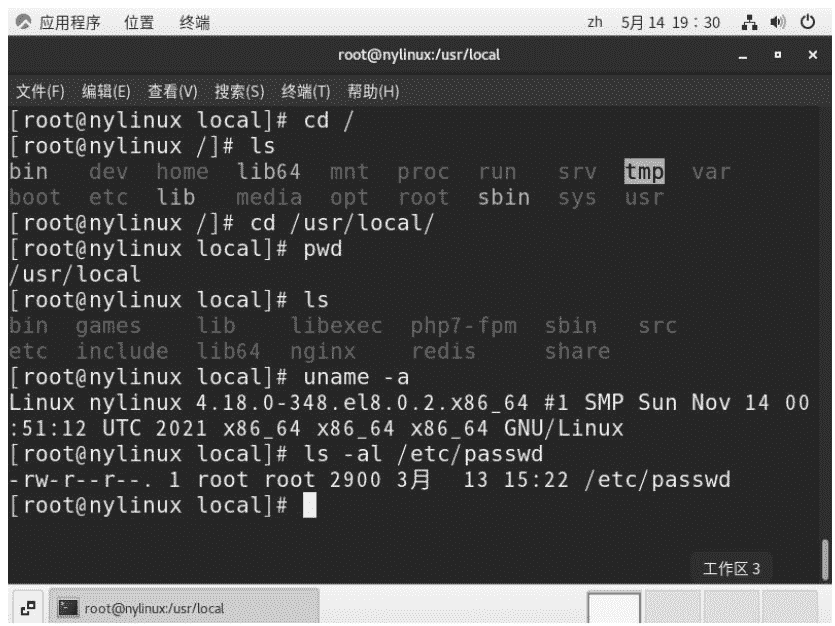

图 1-2 Linux 的命令行界面

Linux 也有图形界面，但核心操作仍在命令行，通过输入指令完成，如图 1-2 所示。乍看有门槛，实则并不高，也不必有很强的英文基础。

命令行优势在于强大且高效，一条指令可完成多步任务。举例创建用户，Windows 需要鼠标点选约十次，命令行一条指令即可，操作就像与电脑对话，非常受运维与开发者欢迎。

**2.应用场景的区别**


图 1-3 家庭台式机

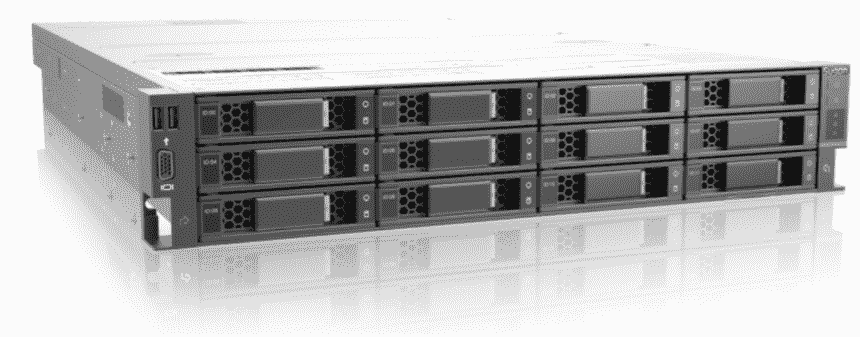

图 1-4 服务器

Windows 在家庭台式机领域，如图 1-3 所示占据主流；Linux 在服务器领域，如图 1-4 所示则长期领先。

互联网企业中服务器是核心资产，承载商城、音视频网站、社区平台、论坛等核心业务。Linux 在此领域的 dominance 毋庸置疑。

嵌入式方向 Linux 横跨手机、平板、路由器、电视、机顶盒、树莓派、智能家居等，广为人知的 Android 系统即基于 Linux 构建。

高端领域同样在用 Linux。NASA 国际空间站的大部分计算机采用定制版 Linux。超级计算机方面，全球 TOP500 榜单中，自 2017 年起绝大多数上榜机型运行 Linux。我国的“神威·太湖之光”位于无锡国家超算中心，另有“天河二号”“天河一号”等，均为 Linux 阵营。

为何 Linux 越来越普及？核心在于 **安全、稳定、开源** 三大特质。

安全性来自严格的权限机制与开源协作。Windows 必须依赖杀毒软件，Linux 凭借细粒度权限控制，病毒难以扩散；且因开源，全球顶尖黑客与厂商共同维护源码，漏洞可被迅速发现修复，制造 Linux 病毒成本极高。

稳定性方面，运行 Linux 的服务器可年久不关机，长时间运行也不卡顿。Windows 服务器运行半年后常需重启缓解。更新时 Windows 需重启生效，Linux 可热更新，不影响业务连续性，进一步保障稳定。

开源意味着源代码公开可查、可分享、可修改、可复用，可核查后门与漏洞，无版权顾虑。Windows 需付费授权，源代码受版权保护不可见。Linux 不属于任何个人或公司，属于全人类。Google、Intel、IBM、Oracle 等及众多中国开发者持续贡献，使系统更安全更稳健。

本章旨在带大家全面认识 Linux 的诞生历程、版本编号、体系结构与发行版。

### 1.2 Linux 内核的诞生史与版本号

UNIX 商业化是 Linux 诞生的重要推手。

AT&T 拥有 UNIX，1979 年收回版权并禁止向学生提供源码，商业化运作。市场上随之出现大量类 UNIX 衍生系统，威胁其地位。学术界受冲击最大，教授无法以低成本讲授 UNIX 内部原理。

为延续教学，荷兰阿姆斯特丹自由大学的 Andrew S.Tanenbaum 在不使用 UNIX 源码前提下，自行开发兼容系统 Minix，并开放源码供高校教学研究，但限定仅教学用途。因此 Minix 功能有限，未能广泛发展。

1988 年，Linus Benedict Torvalds 进入赫尔辛基大学攻读计算机科学，接触 UNIX。1991 年，UNIX 已商业化，他购买电脑安装 Minix，研究其源码后发现 Minix 仅为教学系统，功能不全且不可扩展。版权限制激发了他开发新操作系统的想法。

1991 年 4 月他开始规划内核，9 月发布 0.01 版，邀请社区共同完善，源码自由下载修改，管理者称之为 Linux。初版仅约 1 万行代码，在持续维护与全球程序员贡献下，形成虚拟团队协作模式。10 月发布 0.02 版，正式宣告 Linux 内核诞生。

1994 年，社区完成 1.0 版，代码约 17 万行，加入 X Window System 支持，按自由免费协议发布，后采用 GPL。

1996 年发布 2.0 版，首个支持多处理器且稳定的内核，兼容更多处理器类型。同年推出企鹅吉祥物 Tux 作为标识，如图 1-5 所示。


图 1-5 Linux 内核的 Logo 和吉祥物

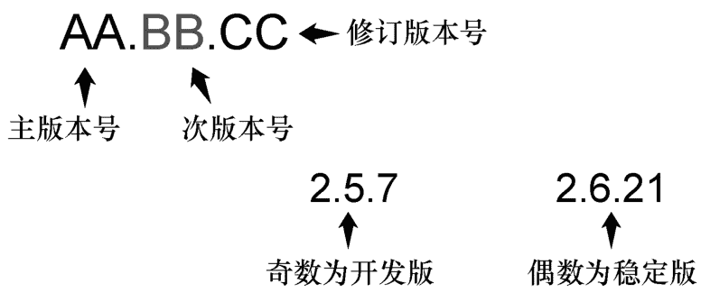

图 1-6 Linux 内核版本号

内核版本号多为 AA.BB.CC 格式，分为稳定版与开发版。

稳定版成熟可靠，可在企业广泛部署，升级多为小 Bug 修复。开发版加入新功能，稳定性不足，可能存在严重缺陷，需大量测试。

历史上主版本号变更代表重要功能变动；次版本号奇偶区分开发版与稳定版，奇数为开发，偶数为稳定；修订号反映小功能调整或修复次数。Linux 2.6 后改用 -rc 表示开发版。

升级路径一般是：以稳定版为基，加入新功能形成开发版，经测试修复严重 Bug 后逐步趋于稳定，再成为新稳定版。

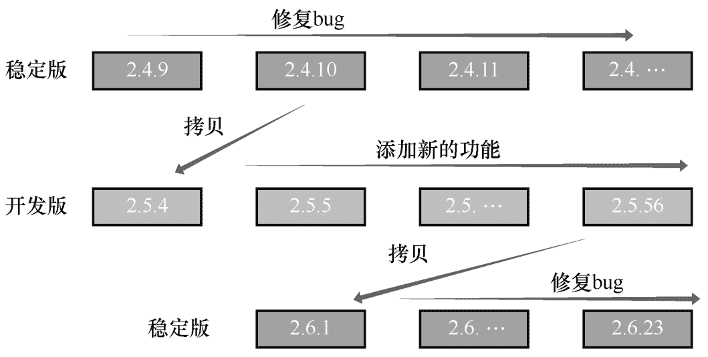

图 1-7 Linux 内核版本的升级路径

**注**

图 1-6 和 1-7 仅用于演示，并不直接对应实际的内核版本号。

### 1.3 "GNU is Not UNIX"

GNU 计划即“GNU is Not UNIX”的递归缩写，目标是打造一套完全自由的操作系统。

1979 年 AT&T 将 UNIX 商品化，价格高昂；软件商业化浪潮亦起。麻省理工学院的职业黑客 Richard Matthew Stallman 认为隐藏源码违背人性，主张让每个人拥有运行、复制、发布、研究和改进软件的权利。

1983 年，他在 net.unix-wizards 公布 GNU 计划并发布宣言，Logo 为非洲牛羚，如图 1-8 所示。


图 1-8 GNU 计划的 Logo

Stallman 也是自由软件运动的精神领袖与自由软件基金会创始人。1984 年 GNU 工程启动，产出大量 GNU 软件包。1985 年自由软件基金会成立，确立软件使用者四项基本自由：自由运行、自由研究修改、自由分发、自由发布改进版。

1989 年，GPL 通用公共许可证出台，保障 GNU 软件自由性。1990 年，基金会已具规模，Stallman 自主开发 Emacs、GCC、GDB 等经典工具，全球黑客亦贡献大量自由软件。

到这里会发现一个关键问题：软件已有，内核何在？GNU 曾开发 Hurd 内核，但进展缓慢、功能未达预期。直到 1991 年 Linux 内核在网络上开源，才为 GNU 计划补上了完整的操作系统内核。

Linux 内核首次公开亮相时，GNU 项目已经把除内核以外的核心基础软件做得差不多了，恰好从这一刻起，系统的底层研发与上层软件的完善走上了同一条时间轴。

1992 年，在 Linus Benedict Torvalds 的牵头下，来自全球的程序员和黑客共同协作，把 Linux 内核与自由软件基金会旗下成百上千套工具整合到一起，一个完全自由的操作系统就此成型。

正因为内核大量采用了 GNU 的组件，GNU 计划的发起人 Richard Matthew Stallman 建议把这个系统叫做“GNU/Linux”，不过在实际使用中，大多数人仍然习惯简称“Linux”。

在 GNU 发展历程里，有两份许可协议尤其关键，必须弄清楚。

“GPL”是 GNU General Public License 的缩写，也就是 GNU 通用公共许可证。它的核心特征是“传染性”，只要某个软件使用了遵循 GPL 的代码或产品，该软件本身也必须采用 GPL 许可。形象地说，一旦选择 GPL，你的衍生作品乃至后代作品都要继续遵守，这一点让它并不适合闭源的商业模式。GPL 协议的标志如图 1-9 所示。


图 1-9 GPL 协议的图标

表 1-1 GPL 开源协议的特点

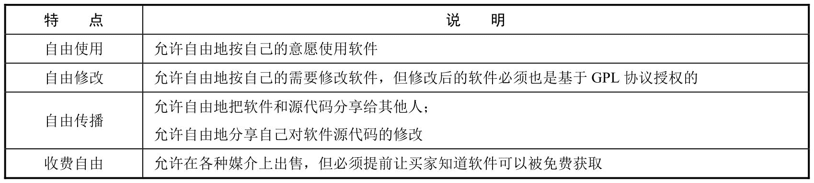

“LGPL”是 GNU Lesser General Public License 的缩写，即 GNU 宽通用公共许可证。它是 GPL 的一个变体，GNU 提出它的目的就是争取更多商业软件厂商的参与。与 GPL 最大的区别在于，基于 LGPL 的自由软件可以被私有化使用，无需公开全部源代码。LGPL 协议的标志如图 1-10 所示。


图 1-10 LGPL 协议的图标

如今，开源的理念已经扩散到世界各地，各类开源社区如雨后春笋。比较有代表性的有 GitHub、Gitee、开源中国社区、MySQL 社区等。随着社区蓬勃发展，开源软件也迎来快速增长，Apache、火狐浏览器、OpenOffice、Nginx、MariaDB 都属其中，前三者的 Logo 如图 1-11 所示。


图 1-11 部分开源软件的 Logo

至此，GNU 计划的主线已经讲完，这条脉络也与 1.2 节的叙述衔接起来，足以把握完整的 Linux 演进史。

### 1.4 Linux 操作系统的体系结构

前面已经粗略提及 Linux 的构成，本节把它的整体架构完整梳理一遍。

图 1-12 展示了 Linux 的完整结构。Linux 本身只是内核，而 GNU 工程提供了大量工具和应用来丰富内核之上的使用场景。

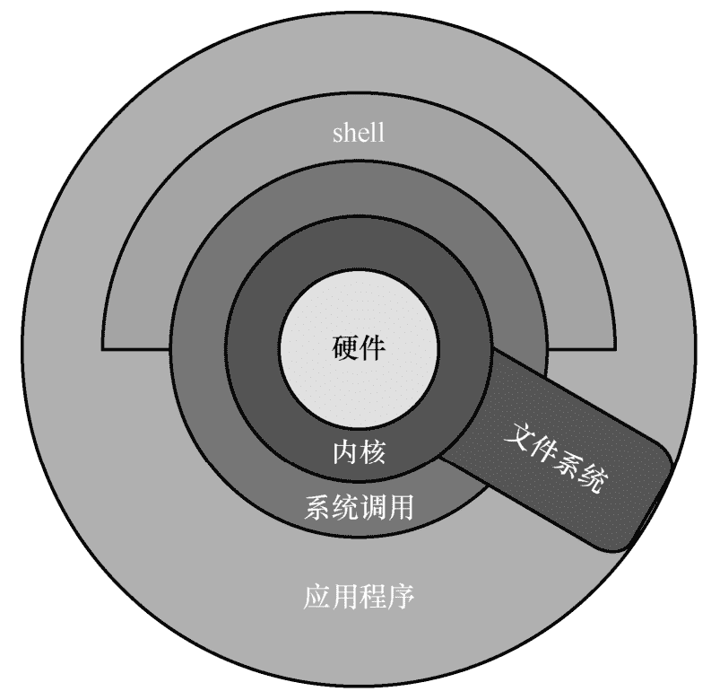

图 1-12 Linux 操作系统的完整结构

按图 1-12 由内向外依次说明：

（1）硬件。大家熟知的 CPU、主板、内存、硬盘、显卡以及鼠标键盘等都属于这一层，这里不再赘述。

（2）内核。内核是操作系统的核心程序，负责调度 CPU、内存、磁盘等硬件资源，并为上层应用提供运行所需的环境。反过来说，应用在运行时必须依赖内核分配的资源，否则无法启动。由此引出一个问题：应用如何与内核沟通来申请资源？

（3）系统调用。为让应用随时能与内核交互获取资源，内核暴露了一组统一的访问接口，这就是系统调用。应用正是通过系统调用向内核提出资源请求。

（4）文件系统。文件系统属于内核的一部分，是一种把数据有序存储和组织的方式。它用文件和树形目录的逻辑概念代替了硬盘数据块的物理概念。用户只需记住目录名和文件名，就能完成建立、读写、修改、备份等操作，而不必关心数据具体写在了哪个物理块上。

（5）Shell。Shell 本身也是一个应用，但性质特殊，它负责把用户输入的命令翻译成内核能够识别的指令，充当“翻译官”。

（6）应用程序。这里指运行在系统之上的各种软件。

总体而言，完整的 Linux 就是内核加上丰富的应用生态。

### 1.5 主流的 Linux 发行版

Linux 内核和 GNU 软件都是开源的，所以不少组织和企业把内核、配套软件、文档以及安装界面和管控工具打包在一起，形成了基于 Linux 内核的发行版。

最典型的例子是 Red Hat。它把公开的 Linux 内核与开源周边软件组合，推出了 Red Hat Enterprise Linux，也就是红帽企业版系统。

Linux 遵循 GPL，那么 Red Hat 如何盈利？答案是卖服务。红帽系统可以免费下载，GPL 不允许靠卖软件赚钱，于是提供技术支持、咨询、培训、技术认证等增值服务。用户在使用过程中遇到难题，可以购买付费支持，这是 Red Hat 的主要收入来源。相关收费服务还包括培训和认证。

Red Hat 还设立了认证体系，包括初级的红帽认证系统管理员 RHCSA、中级的红帽认证工程师 RHCE、高级的红帽认证架构师 RHCA，如图 1-13 所示。

红帽的操作系统属于商业发行版，某些功能需要付费，例如 Yum 软件包管理器。

随后，有社区成员把红帽的源代码拿出来重新编译，发布为 CentOS。CentOS 也称社区企业版 Red Hat Enterprise Linux，是目前的主流发行版之一。它的功能与红帽几乎一致，仅去掉了商标，且完全免费，但不提供商业售后，也不承担商业责任。

Linux 发行版远不止 Red Hat 和 CentOS，以下是几种常用版本，如图 1-14 所示。

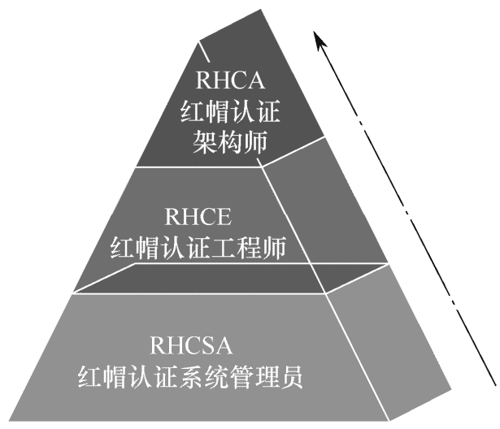

图 1-13 Red Hat 认证

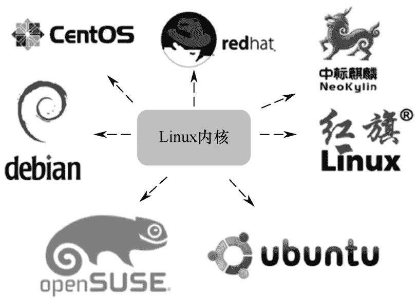

图 1-14 主流的 Linux 操作系统

➢ CentOS：全称 Community Enterprise Operating System，社区企业操作系统。它基于 RHEL 的公开源代码编译而成，稳定性高且免费，国内众多企业因其稳定和丰富的技术资料而选用。

➢ Red Hat Enterprise Linux：Red Hat 面向商业市场的 Linux 发行版，简称 RHEL。

➢ 中标麒麟：国产操作系统，采用强化 Linux 内核，提供桌面版、通用版、高级版、安全版等，已广泛应用于能源、金融、交通、政府等领域。

➢ Debian：1993 年由 Ian Ashley Murdock 发起，以坚守 UNIX 传统和自由软件精神著称，特点是自由与稳定。

➢ 红旗 Linux：由北京中科红旗打造，涵盖桌面版、工作站版、数据中心服务器版、HA 集群版和嵌入式版等。

➢ openSUSE：源自 SUSE Linux，专注为开发者和系统管理员提供开源工具，同时提供易用的桌面和功能完整的服务器环境，对新手友好。

➢ Ubuntu：基于 Debian 的桌面导向发行版，提供桌面版、服务器版以及面向物联网和机器人的 Core 版。

Linux 发行版主要应用于三大场景：

➢ 服务器领域：得益于开源、稳定、高效，Linux 在服务器市场的占比非常高。

➢ 个人桌面领域：界面相对简单，应用生态和娱乐性不足，长期被 Windows 所压制，是 Linux 的薄弱环节。

➢ 嵌入式领域：凭借良好的网络支持、低成本和可裁剪性，被广泛用于机顶盒、数字电视、手机、网络电话等设备。

需要明确，“Linux”一词有多重含义，既指内核本身，也指基于内核、结合自由软件构建的操作系统体系，这些系统在全球服务器市场占据重要地位。

## 第 2 章 VMware Workstation 虚拟机入门

### 2.1 虚拟机的基本概念

“工欲善其事，必先利其器”。本节介绍 Linux 运维人员常用的一款利器——VMware Workstation 虚拟机。初次接触可能感到陌生，读完本节就会明白它的价值。

虚拟机诞生于虚拟化技术，而虚拟化技术正是为了解决服务器硬件资源利用率低的问题。

企业服务器性能通常很高，但实际使用时往往只发挥了一半甚至更少。例如一台 128 GB 内存的服务器，日常只用到 64 GB，剩余资源被闲置，造成浪费。如何提升利用率？虚拟化提供了答案。

从理解角度看，有三个概念需要区分：

（1）虚拟化：在一台物理主机上通过技术手段模拟出多台逻辑主机，每台逻辑主机可独立运行不同操作系统，互不干扰，从而提高硬件利用率。

（2）虚拟化技术：一种资源管理方法，本质上不改变硬件，而是用软件抽象出计算资源，实现自动分配、调度、共享和监控。

（3）虚拟机：由软件模拟的、拥有完整硬件和系统功能的隔离计算环境。虚拟机是虚拟化技术的一种实现形式，可以在同一硬件上运行多个不同类型的操作系统。

总之，虚拟机是虚拟化概念的具体落地，而 VMware Workstation 就是其中最主流的实现之一。

由于 VMware Workstation 操作简便、适合入门，本书选用它来进行演示。

### 2.2 虚拟机的运行架构

虚拟机主要有两种运行架构：寄居架构 Hosted Architecture 和裸金属架构 Bare Metal Architecture，两者决定了安装方式。普通电脑的运行结构如图 2-1 所示。

图 2-1 显示，最底层是硬件，其上安装操作系统，再在其上安装 QQ、微信、浏览器等常用软件，这是最常见的结构。

图 2-2 所示为寄居架构。虚拟机以应用形式安装在宿主操作系统之上，再在虚拟机内部运行多个独立的操作系统。特点如下：

（1）安装像普通软件一样简单。

（2）兼容性好，宿主能用的硬件虚拟机基本都能用，对物理硬件要求低。

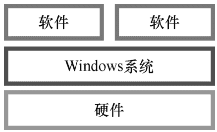

图 2-1 计算机的普遍运行架构

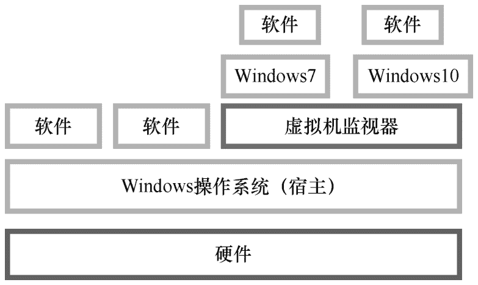

图 2-2 寄居架构

缺点是宿主系统一旦无法使用，虚拟机里的系统也会随之停止。

寄居架构的产品包括 VMware Workstation、Oracle VM VirtualBox、Microsoft Virtual PC 和 Citrix XenDesktop 等。

图 2-3 所示为裸金属架构，也称原生架构。它直接部署在硬件服务器上，虚拟机接管全部硬件资源，并在其上运行多个相互隔离的操作系统。特点如下：

（1）一个操作系统故障不会影响其他系统。

（2）性能接近物理主机，远超寄居架构。

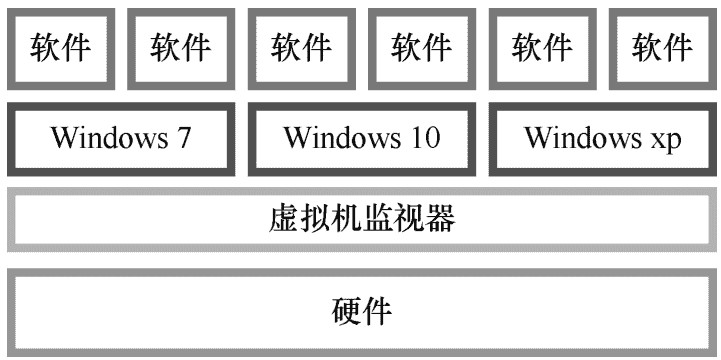

图 2-3 裸金属架构

缺点是硬件兼容性受限，为保证稳定只支持主流服务器和存储设备，普通个人电脑硬件在很多裸金属方案下无法使用。

裸金属架构的产品有 VMware vSphere、XenServer 和 Microsoft Hyper-V 等。

一般来说，个人台式机选用寄居架构，服务器则倾向裸金属架构。

### 2.3 VMware Workstation 的安装流程

VMware Workstation 采用寄居架构，是一款功能强大的桌面虚拟化软件。界面友好、支持中文，很适合新手入门，在虚拟网络、共享文件夹、快照、克隆、迁移等方面表现优异。

下面以安装步骤为例说明，安装包可在官网或本书配套网站获取。

（1）双击安装包启动安装向导，依次点击“下一步”，阅读许可协议并同意，如图 2-4 所示。

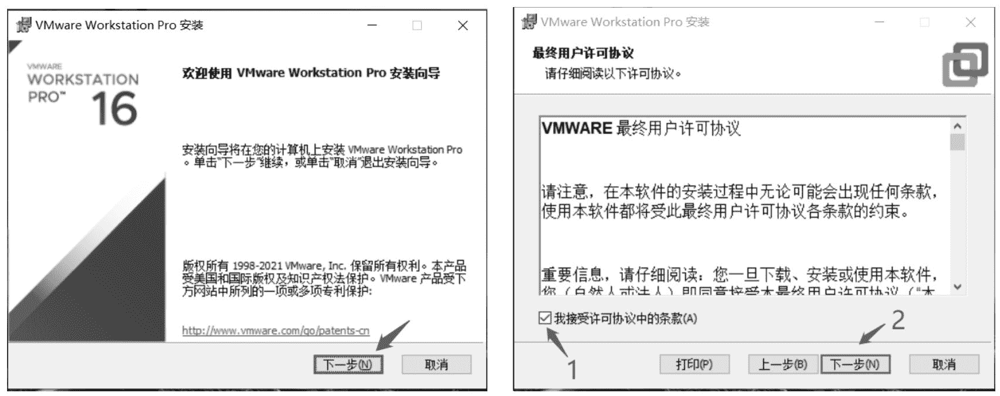

图 2-4 进入安装界面接受许可协议

（2）选择安装路径，点击“下一步”。根据需要勾选产品更新和客户体验计划，继续下一步，如图 2-5 所示。

（3）快捷方式保持默认，点击“下一步”开始安装，如图 2-6 所示。

（4）安装完成后点击“完成”或直接输入许可证，如图 2-7 所示。

（5）安装结束后的主界面如图 2-8 所示。

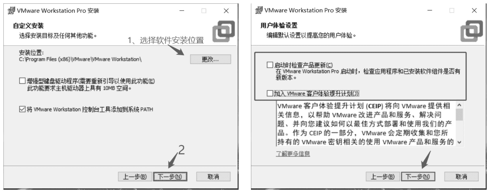

图 2-5 选择软件安装位置

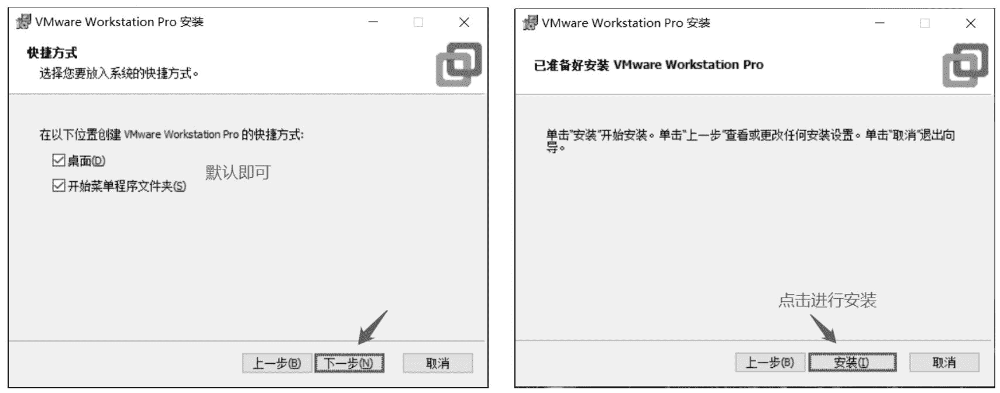

图 2-6 默认快捷方式

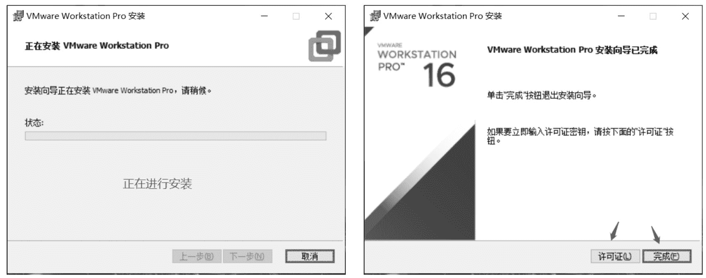

图 2-7 单击“完成”按钮或直接输入许可证

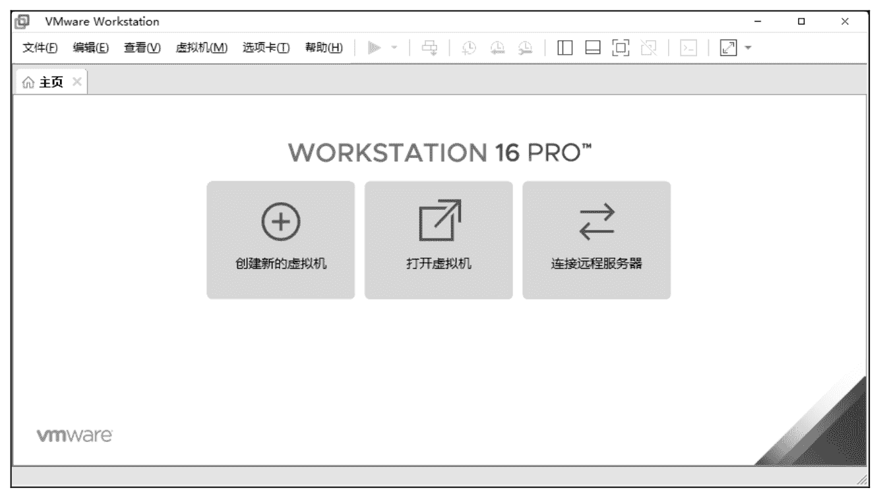

图 2-8 安装完毕后的界面

### 2.4 新建一个虚拟机的操作

安装完成后即可创建虚拟机，具体步骤如下。

（1）打开 VMware Workstation，点击“文件”菜单中的“新建虚拟机”，如图 2-9 所示。

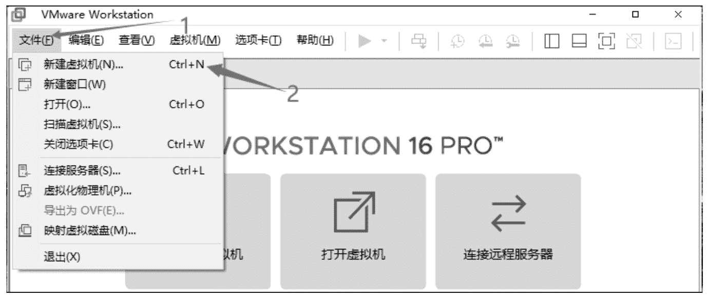

图 2-9 单击“新建虚拟机（N）...”选项

（2）进入新建向导，选择“自定义（高级）”配置。典型配置是高级配置的简化版。下一步选择虚拟机硬件兼容性，直接使用对应版本即可，如图 2-10 所示。

（3）选择稍后开始安装操作系统。下一步选择操作系统类型，这里选择 Linux，再选择具体版本。例如准备安装 CentOS 8 64 位镜像，则选择 CentOS 8 64 位，如图 2-11 所示。镜像文件可在本书配套网站下载。

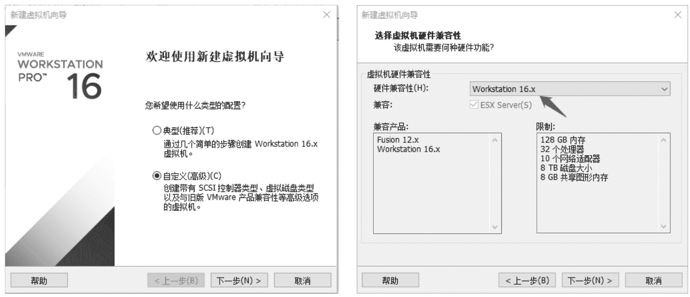

图 2-10 选择虚拟机配置方式和硬件兼容性

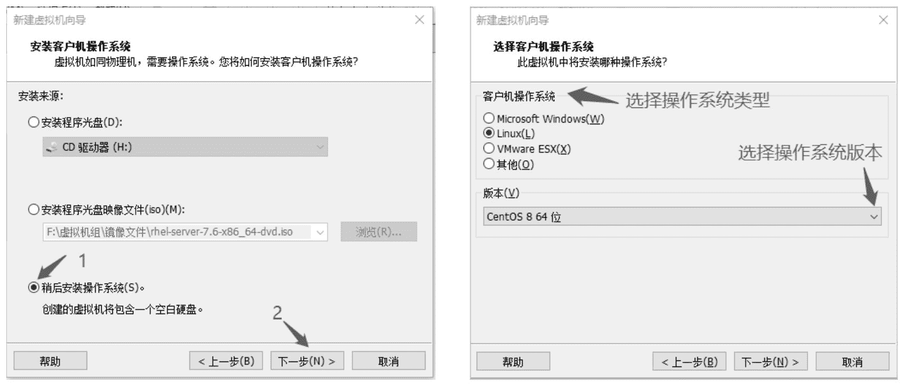

图 2-11 选择客户机操作系统

（4）为虚拟机命名并指定存储位置，如图 2-12 所示。

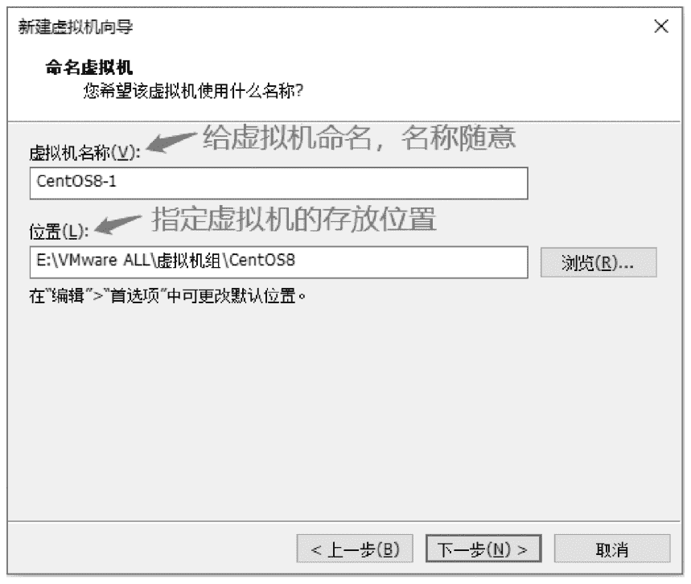

图 2-12 给虚拟机命名并指定存放位置

（5）设置处理器数量，建议分配为宿主机 CPU 数量的 1/3，不要把全部核心都给虚拟机。查看宿主机 CPU 数量可在任务管理器→性能→CPU 中查看，如图 2-13 所示。

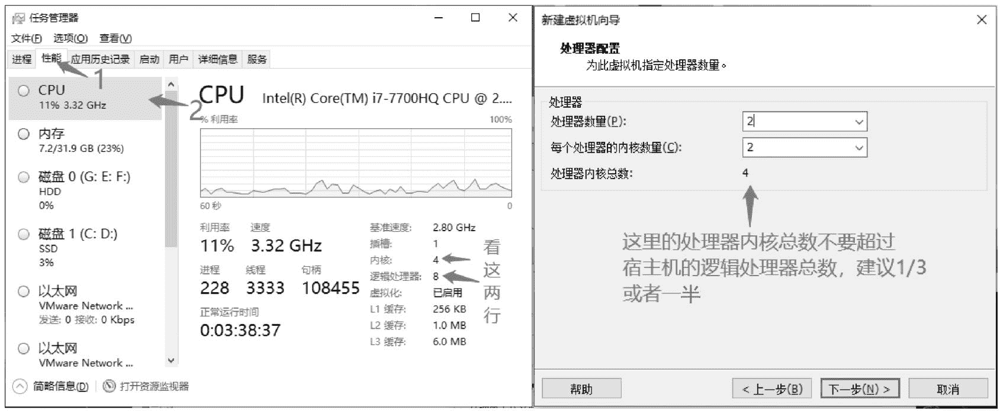

图 2-13 展示了虚拟机处理器数量的设置界面。

（6）内存分配的思路与前面类似，建议按宿主机处理器数量的三分之一或二分之一来规划，务必保留宿主机自身使用空间，不要把所有内存都划给虚拟机，示例中为虚拟机配置了 8 GB。接下来是虚拟网络的配置，VMware Workstation 提供了 NAT、桥接和仅主机三种模式，这里采用 NAT 模式，如图 2-14 所示。

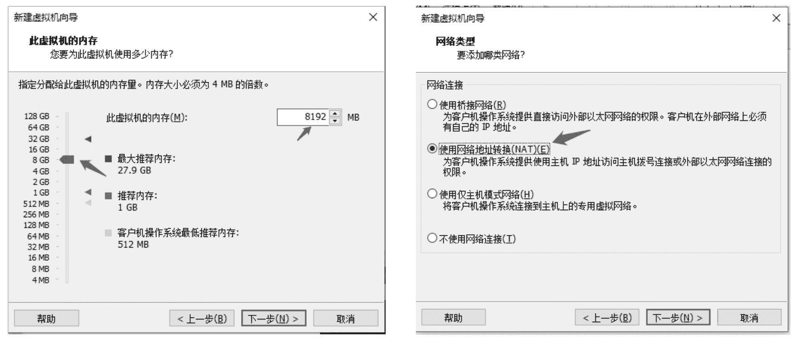

图 2-14 演示内存分配与网络配置的步骤

（7）I/O 控制器类型保持默认推荐即可，点击下一步。磁盘创建环节需要先选类型，共 4 种可选，这里选用推荐的 SCSI（S），如图 2-15 所示。

（8）选择新建虚拟磁盘后点下一步，指定磁盘容量要参照宿主机剩余空间，控制在可用范围内，如图 2-16 所示。切勿勾选“立即分配全部磁盘空间”，该选项会一次性占用宿主机存储；不勾选则会按实际使用量动态增长。

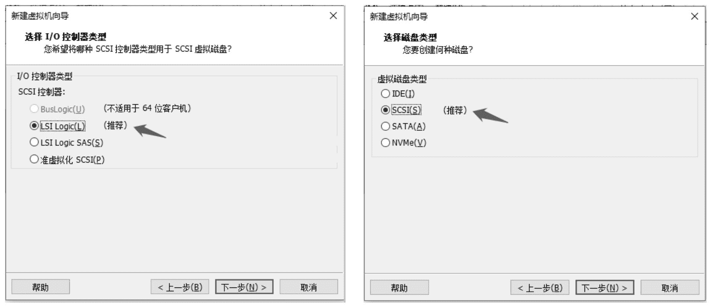

图 2-15 I/O 控制器与磁盘类型选择界面

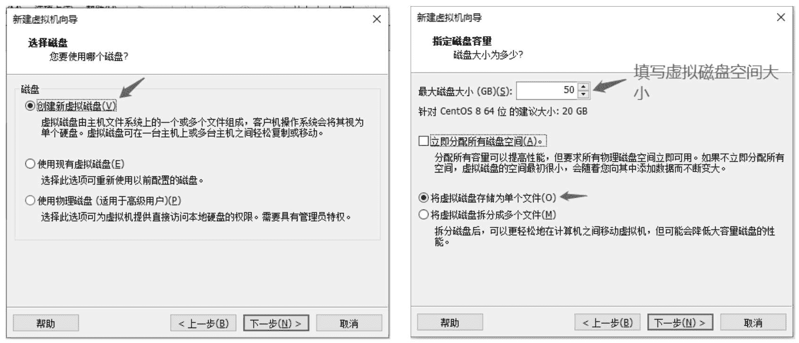

图 2-16 磁盘创建及容量设定

（9）将配置好的虚拟磁盘以文件形式保存到电脑里。磁盘文件存放在哪个分区，就占用哪个分区的空间，若放到 C 盘则消耗 C 盘容量，所以最好选剩余空间充足的磁盘，建议与虚拟机放在同一文件夹。确认后点下一步，会汇总之前的配置，再点完成即可生成虚拟机，如图 2-17 所示。

至此虚拟机已创建完成，如图 2-18 所示。当前虚拟机尚未安装操作系统，之前选择系统版本只是向 VMware 说明将要安装的类型。

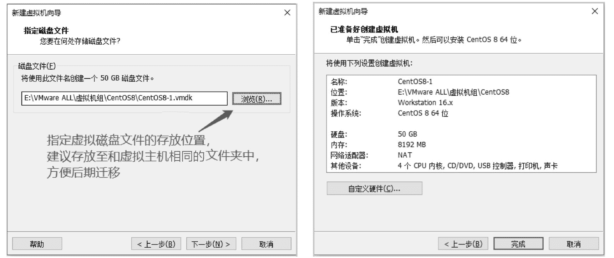

图 2-17 指定磁盘保存位置并完成创建

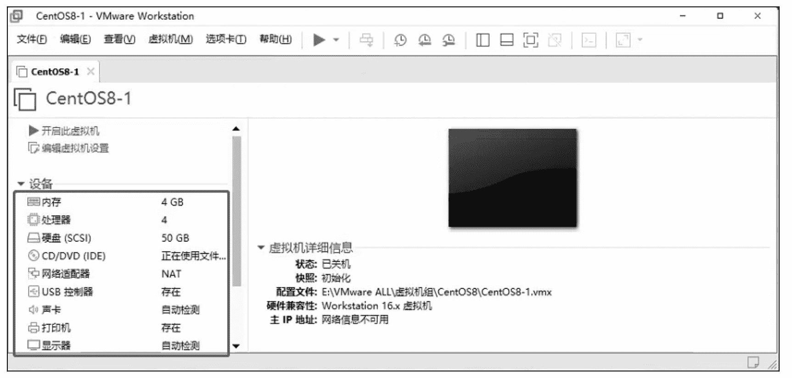

图 2-18 刚创建好的虚拟机列表

### 2.5 虚拟机的快照、克隆和迁移功能

本节介绍 VMware Workstation 中常用的三个功能：快照、克隆、迁移。

#### 2.5.1 快照

快照提供快速备份与还原系统状态的能力，操作分为拍摄快照和恢复快照。拍摄即记录当前时刻虚拟机的状态与数据，恢复则把虚拟机回滚到保存的那个时间点。

按图 2-19 的 1~4 步打开快照管理器，也可直接点击顶部的快照管理器快捷图标，三个图标从左到右分别是新建快照、还原快照、快照管理器。

在快照管理器窗口点“拍摄快照”，填入名称和描述后确认，一个快照就生成了，如图 2-20 所示。创建多个快照相当于拥有多个还原点，建议在操作系统安装完成后才创建，现在创建意义不大。

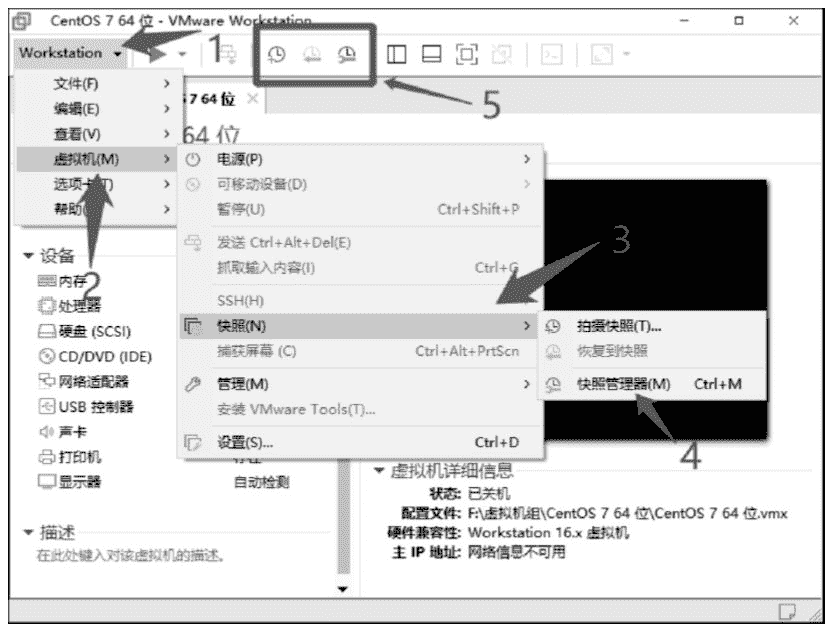

图 2-19 快照管理器的开启方式

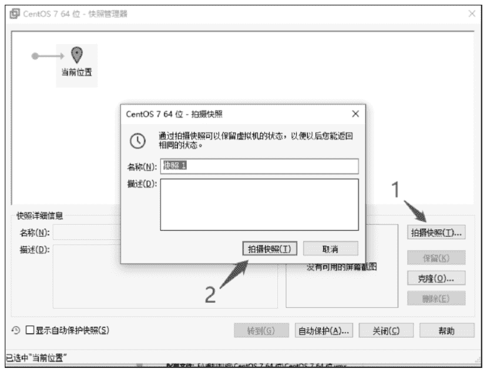

图 2-20 新建快照的界面

还原快照可把虚拟机拉回之前的某个状态。图 2-21 中快照管理器显示已存在 3 个快照，即保存了三个时间点的系统状态，选中目标快照点“转到”即可恢复。

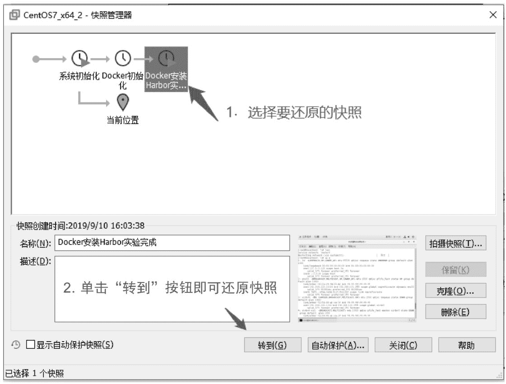

图 2-21 快照还原操作

#### 2.5.2 克隆

克隆就是复制出一台完全一样的虚拟机，分为链接克隆和完整克隆：

（1）链接克隆：新虚拟机与原机部分资源共用；

（2）完整克隆：生成一个完全独立的新虚拟机。

按图 2-22 的 1~4 步启动克隆向导。

**注**
克隆操作要求虚拟机关机状态下进行。

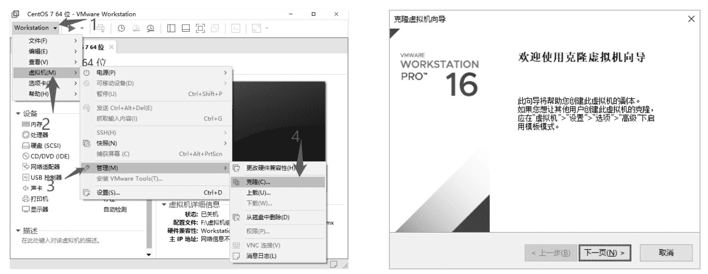

图 2-22 进入克隆向导的路径

可选择克隆当前状态或某个快照状态，点下一步后选择克隆类型，链接克隆或完整克隆，这里选用完整克隆，如图 2-23 所示。

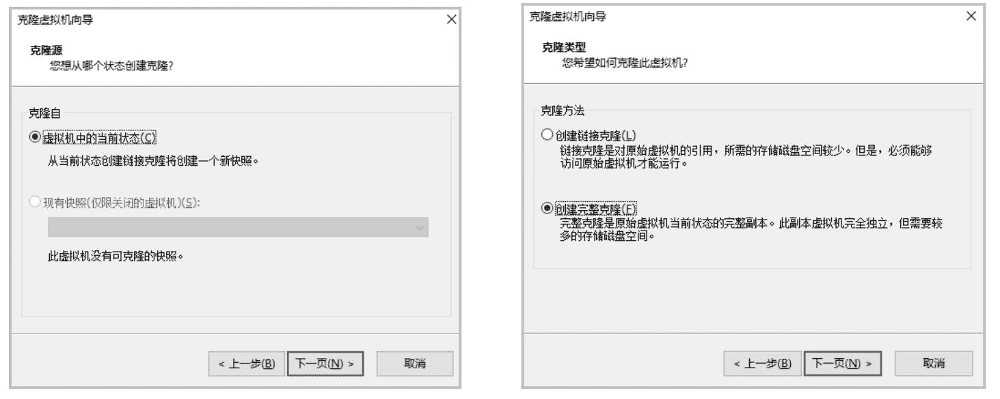

图 2-23 克隆状态与克隆类型的选择

输入克隆虚拟机的新名称和存储路径，点完成即可，如图 2-24 所示。克隆完成后即可使用。

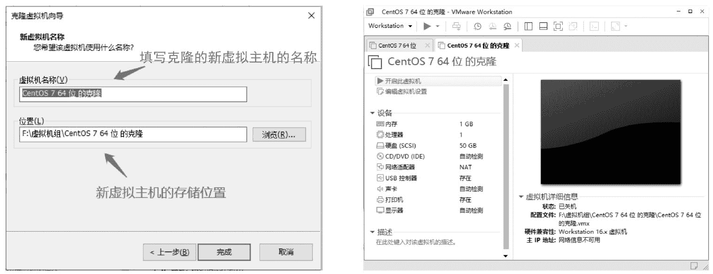

图 2-24 填写克隆的新虚拟机的名称和存储位置

克隆的目的是快速复制一台相同的虚拟机，复制对象是虚拟机本身，因此有无操作系统都可以克隆，只是没有安装系统的虚拟机克隆出来实用价值有限。

#### 2.5.3 迁移

VMware Workstation 支持便捷迁移，可把虚拟机搬到另一台电脑上，注意目标主机也需安装 VMware Workstation。

具体步骤：

（1）定位虚拟机在宿主机上的存储位置，如图 2-25 所示。

（2）把整个虚拟机目录完整复制到另一台计算机，如图 2-26 所示。

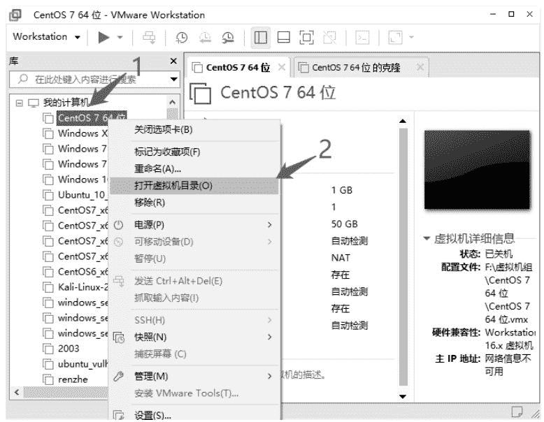

图 2-25 虚拟机文件存放位置

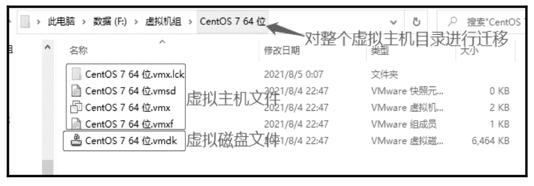

图 2-26 迁移虚拟机目录

（3）在新电脑上打开 VMware Workstation，按图 2-27 打开虚拟机组，找到复制过来的虚拟机文件，目录中后缀为 `.vmx` 的文件，点击打开即可完成迁移。

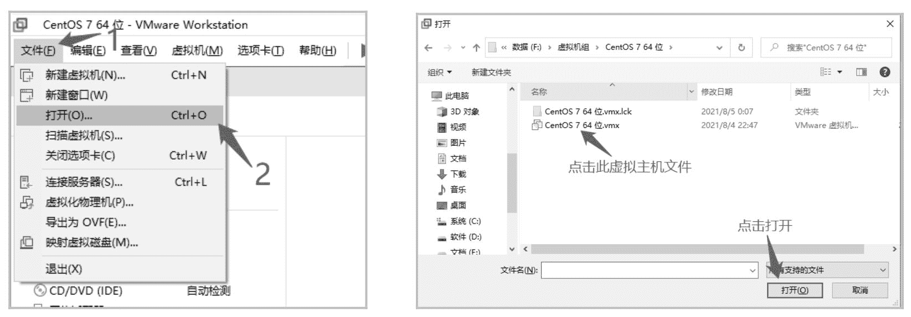

图 2-27 在新主机上打开迁移的虚拟机

## 第 3 章 初窥门径之 Linux 操作系统的安装部署

### 3.1 引言

虚拟机建好后，下一步就是装系统。对 Linux 运维工程师来说，装系统是日常操作。本章完整演示 Linux 系统的安装流程，并对关键细节做标注。

CentOS Linux 8 的镜像可到官网下载，因服务器在国外速度慢，笔者已把各发行版镜像提前下载并上传至本书配套站点，读者可直接获取，速度更快。

装过 CentOS 7 和 Rocky Linux 的朋友会发现流程基本一致。接下来详细演示 CentOS Linux 8 的安装。

### 3.2 安装 CentOS Linux 8 操作系统

在已创建的虚拟机中按以下步骤安装：编辑虚拟机设置→硬件→CD/DVD（IDE）→使用 ISO 镜像文件→浏览→选中已下载的 CentOS Linux 8 镜像→打开→确定→启动虚拟机，如图 3-1 所示。

**注**
CentOS Linux 8 最低配置要求为 2 GB 内存、`x86_64` 架构、2 GHz CPU、20 GB 硬盘。

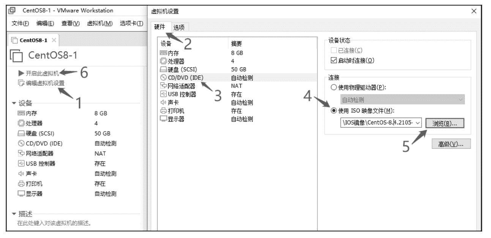

图 3-1 启动装有镜像的虚拟机

进入后会看到 CentOS 8 安装界面，提供三个选项：

（1）安装 CentOS Linux 8；

（2）检测镜像并安装；

（3）疑难解答。

用上下键移到第一项回车确认，如图 3-2 所示。随后选择安装语言，点“继续”。这里选用简体中文，如图 3-3 所示。

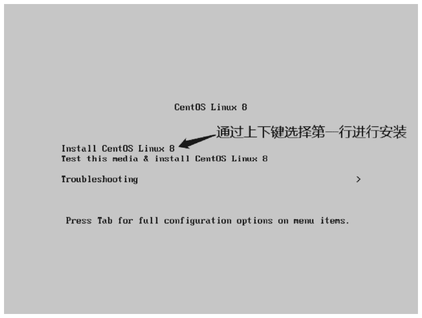

图 3-2 选择安装选项

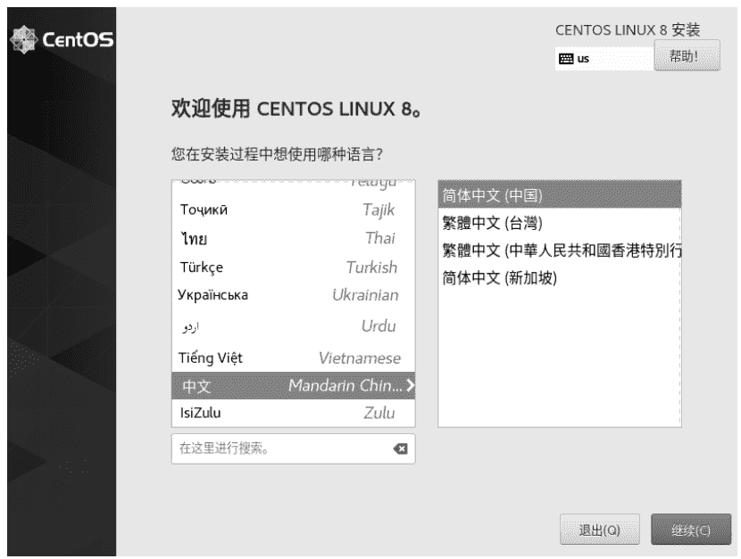

图 3-3 选择简体中文

接下来需要配置键盘、时间和日期、软件选择、安装位置、KDUMP、网络与主机名、根密码等，如图 3-4 所示。安装向导已给出默认值，如需修改点对应图标即可。

（1）网络与主机名。点对应图标进入配置界面，如图 3-5 所示。可自动获取 IP，也可手动填写。

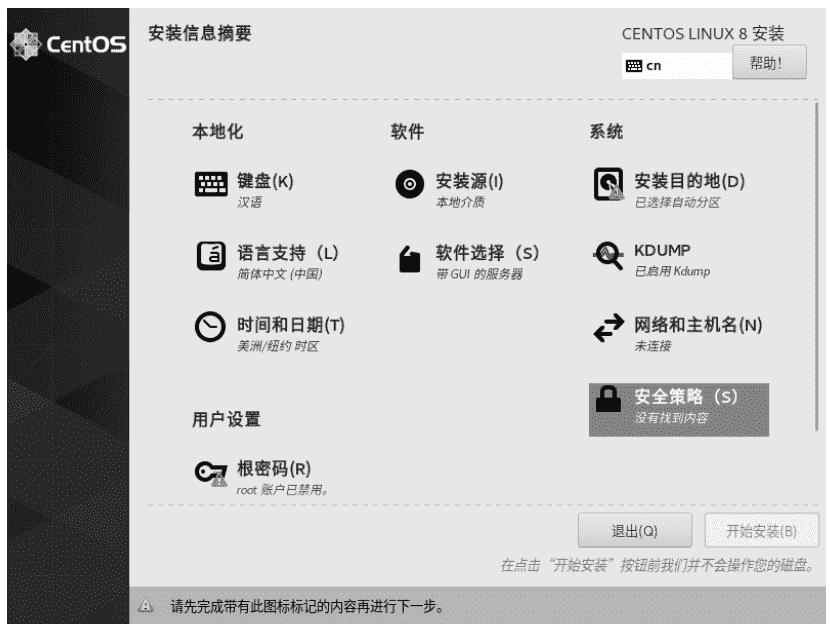

图 3-4 安装向导配置项

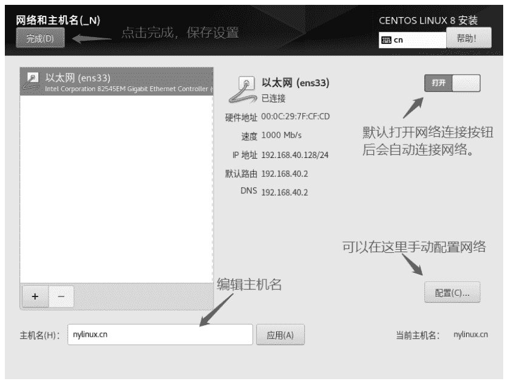

图 3-5 网络与主机名设置

（2）网络配置完成后调整时间和日期，点对应图标进入设置界面，选择上海时区，如图 3-6 所示。

（3）软件选择。点软件选择图标进入界面，基本环境包括带 GUI 的服务器、服务器、最小安装、工作站、定制操作系统、虚拟化主机，如图 3-7 所示。


图 3-6 时间与日期设置

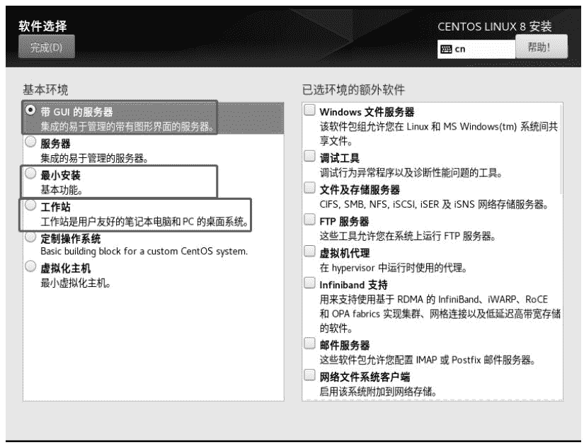

图 3-7 软件选择界面

新手建议选带图形界面的“带 GUI 的服务器”，有经验者可选“最小安装”。这里选择“带 GUI 的服务器”。额外软件按需勾选，可空，后续再装。确认后点完成。

（4）安装位置。指定 CentOS 8 安装到哪块磁盘及分区方式，类似 Windows 安装。点对应图标后看到磁盘信息，在存储配置中选择“自定义”，如图 3-8 所示，点完成进入磁盘分配界面，点“点击这里自动创建它们”，如图 3-9 所示，系统会自动分区。如有特殊需求可手动调整大小、挂载点、文件系统，如图 3-10 所示。配置完点完成，会弹出更改摘要，点“接受更改”，如图 3-11 所示。

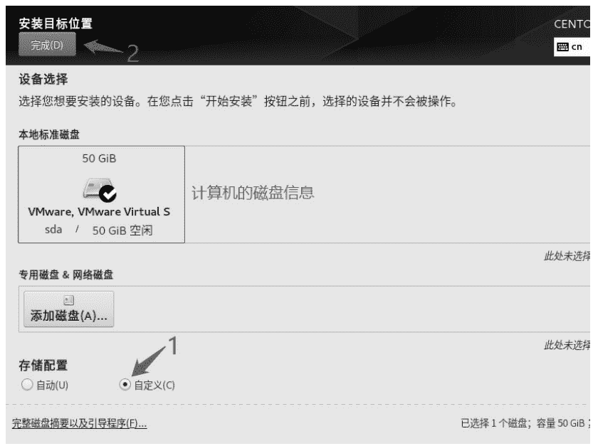

图 3-8 选择自定义分区

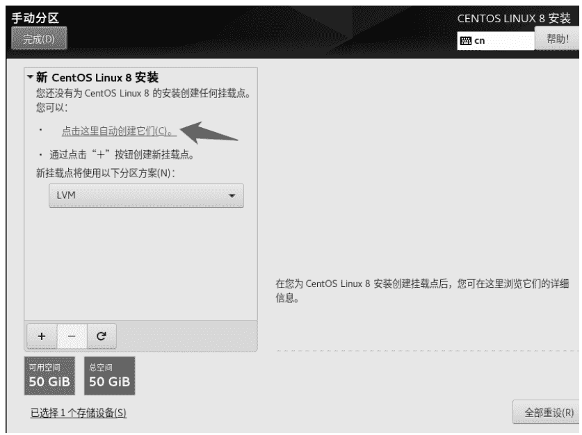

图 3-9 自动创建分区

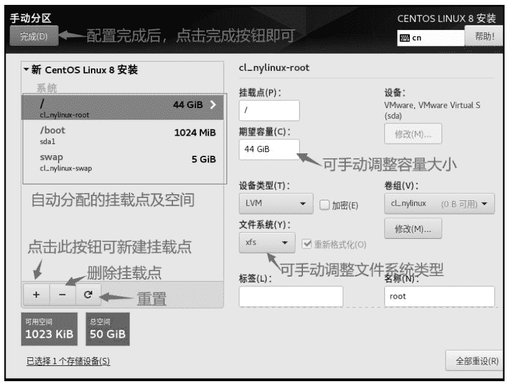

图 3-10 手动分区设置

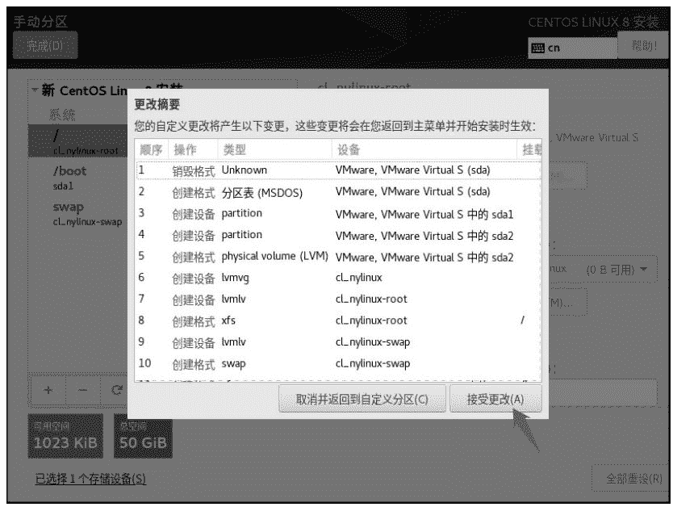

图 3-11 确认更改

（5）根密码。设置 root 超级管理员密码，root 权限最高，设置后点完成，如图 3-12 所示。

**注**
企业环境中 root 密码建议采用 7 位以上大小写字母+数字+符号的复杂组合。

（6）创建普通用户。设置完 root 密码后创建普通用户，点“创建用户”图标进入界面，如图 3-13 所示。企业中通常只有运维经理或工程师能用 root 登录，其他人员仅用普通账号。

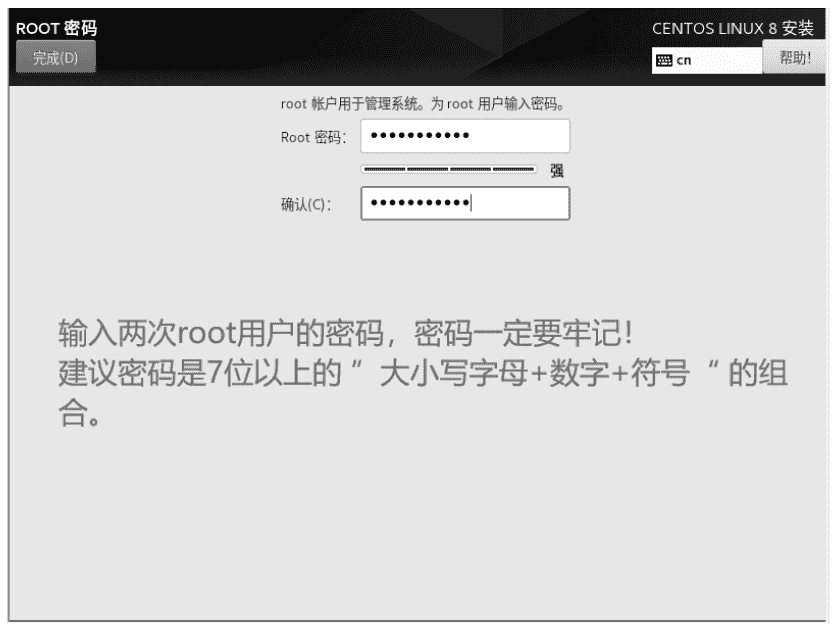

图 3-12 设置 root 密码

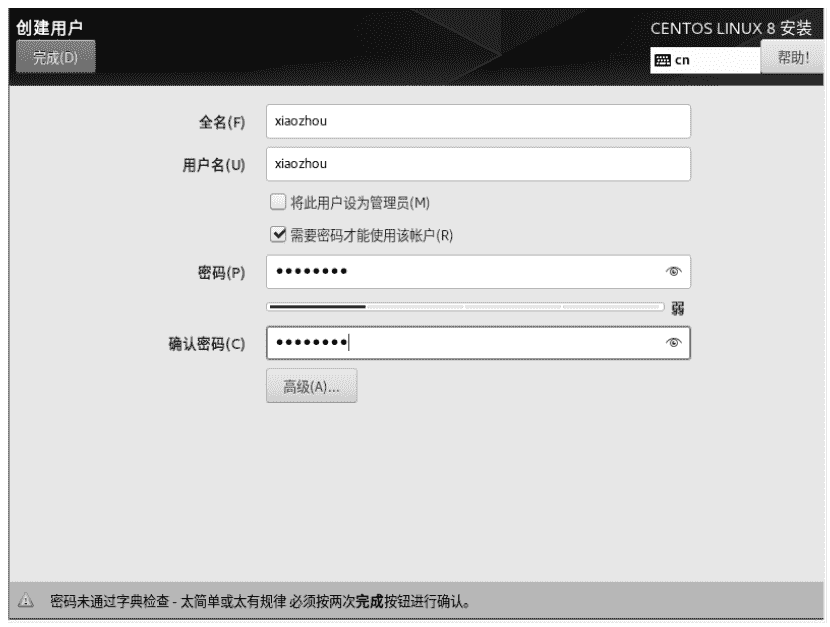

图 3-13 创建普通用户

所有配置完成后点“开始安装”，如图 3-14 所示。

安装完成后点“重启系统”，如图 3-15 所示。重启后进入初始设置，点“许可信息”→勾选“我同意许可协议”→点完成，如图 3-16、3-17 所示。随后出现登录界面，如图 3-18 所示。

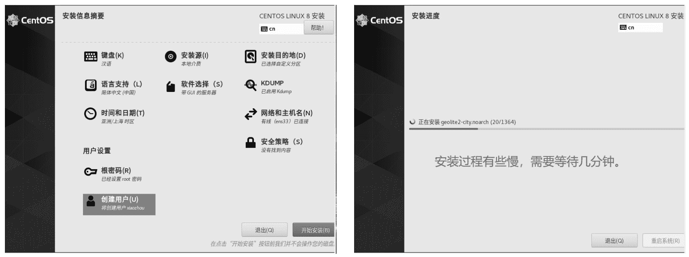

图 3-14 开始安装

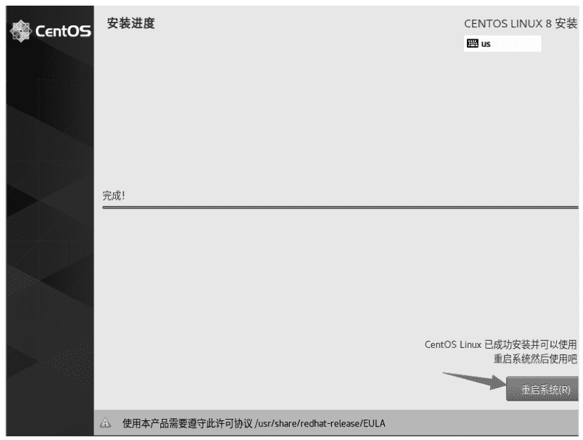

图 3-15 重启系统

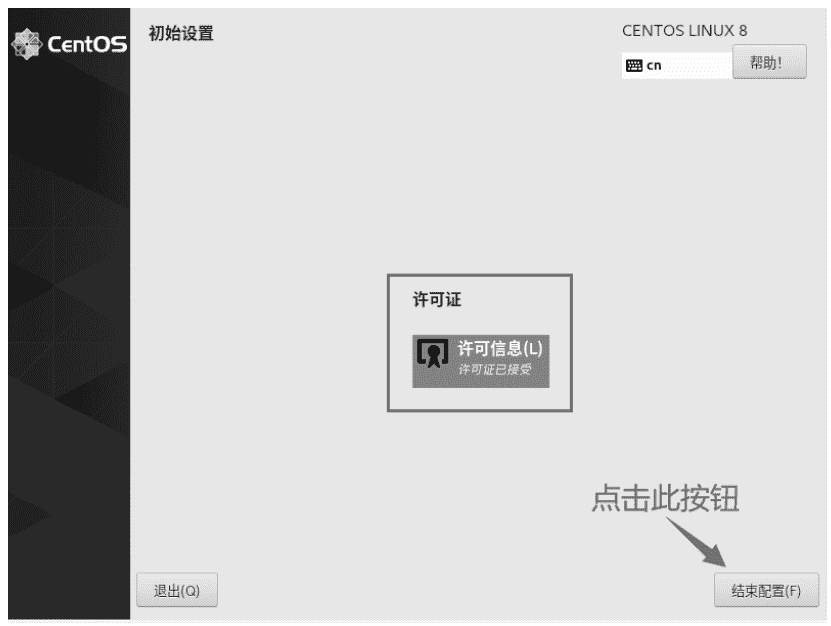

图 3-16 初始设置


图 3-17 同意许可协议


图 3-18 用户登录界面

输入账号密码后进入欢迎界面，按提示操作，最后点“开始使用 CentOS Linux”，安装完成，如图 3-19 所示。

CentOS Linux 8 的主要变化：

➢ 默认软件包管理器为 DNF，YUM 仍可用；

➢ 网络配置改用 NetworkManager（`nmcli`/`nmtui`），废弃 `network.service`；

➢ 提供基于 Web 的控制台 Cockpit；

➢ 容器工具默认使用 Podman；

➢ 显示服务器默认 Wayland；

➢ `iptables` 被 `nftables` 取代为默认包过滤。


图 3-19 安装完成界面

### 3.3 CentOS Linux 8 之后我们将何去何从

本节补充说明 CentOS 的后续走向。写作期间 CentOS 官方发布通告：


没错，CentOS Linux 8 生命周期已结束，官方停止维护，转而聚焦 CentOS Stream。

其中发生了什么？

2004 年红帽推出商业版 Red Hat Linux 同年，Gregory Kurtzer 发起 Community ENTerprise Operating System 项目，即 CentOS。做法是下载 Red Hat 企业版源码，修复 Bug、更换 Logo 后重新编译免费发布。因基于源码，更新略慢但更稳。

于是出现有趣现象：红帽发布新版后不久，CentOS 社区就会推出功能特性一致的版本。Fedora、Red Hat、CentOS 的关系如图 3-20 所示。


图 3-20 三者的关系

CentOS 的做法让全球大量企业免费使用企业级 RHEL。

对红帽而言 CentOS 很尴尬：自家商业系统被免费镜像分流。**注** Red Hat 必须开源源码，因受 GPL 约束。

2014 年初红帽收购 CentOS，获得商标和核心开发人员。收购后推出的 CentOS Stream 介于 Fedora 与 Red Hat 之间，是滚动发布的发行版，通过融合 Fedora 实验特性加速 RHEL 发布，图 3-21 所示。


图 3-21 收购后的关系

红帽的算盘是借助社区力量让 RHEL 更稳定、迭代更快。那 CentOS Linux 还需保留吗？2020 年底官方宣布停止维护 CentOS Linux，正因其已无作用，资源集中到 CentOS Stream，红帽得以继续商业化。

读者可能会问：生产环境还能用 CentOS Stream 吗？不建议。生产环境需要稳定，而 CentOS Stream 介于实验版与稳定商业版之间，不够稳定，官方也不推荐用于生产。

问题随之而来：仍在使用 CentOS Linux 8 的企业该怎么办？

2020 年 12 月 8 日红帽宣布停止维护后，CentOS 创始人 Gregory Kurtzer 紧接着提出 Rocky Linux 计划，目标是提供 100% 兼容 RHEL、社区支持、可用于生产的企业级系统。

既然 CentOS 被收购后不再维护，就再造一个 CentOS，命名为 Rocky Linux。

于是原汁原味的“CentOS”以 Rocky Linux 新面貌回归，Logo 如图 3-22 所示。


图 3-22 Rocky Linux Logo

说到底，红帽与 Gregory Kurtzer 这一轮操作下来，生态的本质并没有变。CentOS Linux 的位置被 Rocky Linux 取代，红帽系的演进脉络也随之成了图 3-23 所示的样子。


图 3-23 Fedora、CentOS、Red Hat、Rocky 之间的关系图

把 Rocky 官网上的 Rocky Linux 下载下来安装一遍，见图 3-24 和图 3-25，不出所料，你会感叹：这不就是换个名字、换个 Logo 的原汁原味 CentOS 吗？对比图 3-24 和图 3-25 就会发现，除了名称和商标，几乎一模一样。

正如官方所说，Rocky Linux 是基于 RHEL 源代码重建的，所以无论怎么用，都能得到与 CentOS Linux 同等级别的稳定感。

目前这个项目已获得亚马逊、Google、VMware、Arm 和微软等厂商的背书。

就个人使用感受而言，Rocky Linux 是目前最合适的 CentOS 替代品。刚从 CentOS 8 迁移过来完全不用担心重新学习成本。CentOS Linux 8 与 Rocky Linux 除了名字和 Logo 外，其它层面基本一致，按装 CentOS 的方式安装 Rocky，按用 CentOS 的习惯使用 Rocky 就行了。


图 3-24 Rocky Linux 安装界面


图 3-25 Rocky Linux 登录界面和桌面

## 第 4 章 快速上手 Linux 操作系统

### 4.1 开篇导读

与 Windows 相比，Linux 的上手方式截然不同。Windows 靠图形界面点点鼠标就能搞定不少事；Linux 则主要靠命令行执行指令，看起来门槛高了些，其实只要肯练并不会太难。

笔者玩 CentOS 已经有 8 年了，最近才迁移到 Rocky Linux。初识 CentOS 时觉得挺有意思，便花了半个多月去琢磨、研究、折腾。别怕把系统搞坏，大不了重装一次。敢于试错、善于总结，遇到不懂的就查资料，坚持下去收获会很明显。

下面正式进入 Linux 入门阶段，本章理论会相对集中，需要反复体会。

### 4.2 Shell 是什么

Shell 在第 1 章里已简单提过，这里结合图 4-1 的结构图把它讲透。

Shell 外号叫“壳”，与内核的“核”相对。它既是 Linux 操作系统的命令行语言，也是解释这种语言的程序。换句话说，Shell 既是一门编程语言，又是 C 语言编写的软件。


图 4-1 Linux 操作系统结构图

Shell 夹在用户与内核之间，起承上启下的作用。出于安全、复杂度和操作繁琐等原因，普通用户无法直接触碰内核，于是需要一个中间程序来接收用户指令、做一定处理，再把信息传给内核。可以把这个处理理解成“把用户操作翻译成内核能懂的语言”，就像个翻译官。Shell 就是用户与内核之间的代理层，既简化操作，又保护内核安全。

总之，Shell 是连接用户和 Linux 内核的程序，让内核的使用更高效、安全、低成本，这就是它的核心作用。通过 Shell 可以实现对 Linux 大部分的管理。

Linux 发行版众多，不同组织为了体现特色，会开发功能相近但特性各异的软件，Shell 就是其中之一。不同 Shell 有各自优势，有的资源占用低，有的编程功能强，有的兼容性好，有的更注重体验。常见 Shell 类型见表 4-1。

表 4-1 常见的 Shell 类型


`Bash` 是多数发行版的默认 Shell，主要特点有：

➢ 自动补全：Tab 键可自动补齐命令和路径；
➢ 命令历史：上下键翻阅最近命令，Ctrl+R 搜索历史，`history` 命令调出记录；
➢ 命令别名：用短命令代替长命令；
➢ 输入输出重定向与管道：改变数据流方向；
➢ 支持通配符和特殊符号；
➢ 支持变量、条件测试及循环控制结构。

这些特性后续会反复使用，先做个了解，边用边熟练。

最后补充一点，Shell 程序通常放在 `/bin` 或 `/usr/bin` 目录下。当前系统支持哪些 Shell，可通过 `cat` 命令查看 `/etc/shells` 文件。


### 4.3 命令提示符与命令写法

打开终端，第一眼看到的就是图 4-2 的内容，这就是命令提示符，它只是在告诉你可以输入命令了，并不是命令本身。


图 4-2 命令提示符

图 4-2 中各部分的含义按图示编号说明，见表 4-2。

表 4-2 命令提示符各部分含义


**注**

家目录也叫主目录。Linux 最初是字符界面，用户登录后需要一个初始位置，这个位置就是家。root 的家是 `/root`，普通用户的家是 `/home/用户名`。

了解提示符后，命令的语法格式又是怎样的？


图 4-3 命令的语法格式

由图 4-3 可知，语法里的 `[]` 表示可选项，有些命令不写选项参数也能运行，执行默认功能。下面拆解命令格式。

（1）`command`：命令本体，必须写，表示要执行的操作。
（2）选项：对命令功能做微调，决定执行方式。同一命令配不同选项，配合空格分隔，结果会不同。
（3）参数：命令作用的对象，可为文件、目录、用户等，可为 0 个或多个。

执行方式：回车 Enter 表示提交执行；输错可按 Backspace 逐字符删除；命令记不全可用 Tab 补全；执行中想终止按 Ctrl+C；命令过长可用反斜杠 `\` 换行。

**注**

`command`、选项和参数之间要用空格分隔。

### 4.4 内置命令与外部命令及帮助

Linux 命令分为内置命令和外部命令。内置命令是系统自带的，安装后即可用；外部命令类似 Windows 上的 QQ、迅雷，需要安装包安装后才能使用。

两者区别见表 4-3。

表 4-3 内置命令与外部命令的差别


在命令行执行 `help` 可查看所有内置命令及用法：


（1）`help` 帮助。它用于查看内置命令的帮助文档，比如查 `pwd`，执行后会显示该命令的详细信息。建议多用 `help` 熟悉内置命令。

语法格式：

`command --help`

示例如下：


（2）`man` 手册。它以全屏方式显示在线帮助，按 q 退出，上下键翻页。如查 `pwd`，执行 `man pwd` 即可。

语法格式：

`man command`

示例如下：


（3）`info` 命令。另一种在线帮助，与 `man` 类似但更详尽。用法为 `info command`，同样按 q 退出。

一般查帮助的流程是：先用 `help`，再用 `man` 补充，不懂就查中文资料，`info` 用得较少。

### 4.5 目录结构详解

本节介绍 Linux 目录结构，这在学习中非常重要。先对比 Windows 目录架构来引导理解，两者差异很大。

Windows 目录结构大家都熟，见图 4-3，它有盘符概念，打开“我的电脑”能看到 C 盘、D 盘等。路径都是从盘符开始，如 C 盘下 Windows 文件夹路径是 `C:\\Windows`。


图 4-3 Windows 操作系统的目录结构

Linux 则采用层级树状结构，最上层是根目录 `/`，所有目录文件都从这里向下展开。也就是说 Linux 中所有文件目录都在根目录之下，根目录唯一且最高，全部路径以 `/` 为起点，如图 4-4。


图 4-4 Linux 操作系统的目录结构

Linux 根目录 `/` 下是一级目录，用 `ls /` 可查看。这些目录并非随意创建，存放内容已有规划。各一级目录说明见表 4-4。

表 4-4 一级目录


了解各目录用途后要记住其存放内容。Linux 目录结构是层级树状结构，这个概念务必牢记。

### 4.6 磁盘分区概念

先对磁盘分区有初步认识。Linux 磁盘分区主要有主分区、扩展分区和逻辑分区 3 种，见表 4-5。

表 4-5 磁盘分区类型


**注**

单块磁盘中主分区与扩展分区总数不超过 4 个，逻辑分区数量理论上无上限。

再看磁盘表现形式。Linux 里一切皆文件，硬盘设备以设备文件的形式放在 `/dev` 目录下。

Linux 用“字母+数字”的方式标识分区，与 Windows 盘符不同，更细更灵活。标识包含：

➢ 硬盘设备所在目录；
➢ 设备类型。IDE 为 `hd`，SCSI/SATA 为 `sd`；
➢ 磁盘号。第一块硬盘为 a，第二块 b，以此类推；
➢ 分区号区分类型与数量。主分区 1~4，逻辑分区从 5 开始。

举例：`hda1` 表示第一块 IDE 硬盘的第一个主分区；`sdc7` 表示第三块 SCSI 硬盘的第三个逻辑分区。

图 4-6 总结上述知识，图中两块已分区的 IDE 硬盘，第一块是 `hda`，第二块是 `hdb`。前两个主分区号为 1、2，逻辑分区从 5 开始，所以第一个逻辑分区是 5，第二个是 6。


图 4-5 Linux 磁盘分区标识方式


图 4-6 IDE 硬盘设备分区标识

### 4.7 绝对路径和相对路径

熟悉目录结构后就可以在目录间移动了。这里普及路径概念。

Linux 有绝对路径和相对路径两种。绝对路径见图 4-7，优势是：

➢ 永远相对于根目录，第一个字符永远是 `/`；
➢ 路径虽长但准确性更高，减少错误。

相对路径见图 4-8，优势是：

➢ 永远相对于当前所在目录，第一个字符不是 `/`；
➢ 以当前位置为出发点指向目标；
➢ 相比绝对路径更短，是快速定位的捷径；
➢ 只在当前目录下有效。


图 4-7 绝对路径


图 4-8 相对路径

路径常用符号有 3 个：

➢ `~`：当前用户家目录的快捷符号；
➢ `.`：当前目录；
➢ `..`：上一级目录。

如图 4-9，每个 Linux 目录都含 `.` 和 `..`，默认隐藏，需用 `ll -al` 查看。快速切换到上一级执行 `cd ..`，快速回到家目录执行 `cd ~`。


图 4-9 路径符号

# 第二部分 熟练使用 Linux

## 第 5 章 务必掌握的基础 Linux 命令

要玩转 Linux，熟悉命令是必经之路。虽然学习过程略显枯燥，但正是跨越障碍的必经阶段。

### 5.1 系统基本管理与显示相关命令

**1.`shutdown`**

语法格式：

`shutdown [选项] [时间/数字/now]`

描述：用于关机重启，执行时已登录用户会看到提示。需 root 或有管理员权限的用户执行。

常用选项见表 5-1。

表 5-1 `shutdown`命令的常用选项


**案例**

让系统 5 分钟后关机，再取消该关机操作。


**2.`reboot`**

语法格式：

`reboot [选项]`

描述：重启正在运行的 Linux 系统，企业中一般不加选项。需 root 或管理员权限。

常用选项见表 5-2。

表 5-2 `reboot`命令的常用选项


**3.`poweroff`**

语法格式：

`poweroff [选项]`

描述：关闭系统，关机记录写入 `/var/log/wtmp`。执行后立即关机，无缓冲期，一般不常用。需 root 或管理员权限。

常用选项见表 5-3。

表 5-3 `poweroff`命令的常用选项


**4.`logout`**

语法格式：

`logout`

描述：退出当前登录的 Shell，等同 Windows 注销。


**5.`exit`**

语法格式：

`exit [状态值]`

描述：以指定状态退出当前 Shell 或在脚本中终止脚本执行。


**6.`uname`**

语法格式：

`uname [选项]`

描述：打印系统信息。

常用选项见表 5-4。

表 5-4 `uname`命令的常用选项


**案例**

使用 `uname` 命令。


**7.`lscpu`**

语法格式：

`lscpu [选项]`

描述：显示 CPU 架构信息。

常用选项见表 5-5。

表 5-5 `lscpu`命令的常用选项


**案例**

使用 `lscpu` 命令。


**8.`free`**

语法格式：

# Linux 运维核心命令实战

## 内存占用查看 free
调用写法：
`free [选项]`
用途：展示当前系统内存的占用情况。
表 5-6 罗列了 free 的常见参数。

实操演示
运行 free 查看内存。


输出各字段的说明：
➢ `Mem`：整体内存的使用概况；
➢ `Swap`：交换分区的占用概况；
➢ `Total`：物理内存的总体容量；
➢ `Used`：已经被占用的内存大小；
➢ `Free`：尚未被使用的空闲内存大小；
➢ `Shared`：被多个进程共用的内存总量；
➢ `buffers/cached`：用作缓存的内存量；
➢ `available`：进程还能继续使用的可用物理内存量。

## 9. `df` 磁盘空间查询
调用写法：
`df [选项]`
用途：反馈各磁盘分区剩余空间的情况。
表 5-7 汇总了 df 的常见参数。

实操演示
执行 df 查看磁盘使用。


## 10. `date` 时间日期操作
调用写法：
`date [选项] [输出形式|日期时间]`
用途：读取或修改系统的日期与时间。
表 5-8 列出 date 的常见参数。
日期时间格式符号见表 5-9。
（续表）

实操演示
按自定义格式输出时间。

展示历史时间。


## 11. `top` 实时性能监控
调用写法：
`top [选项] [PID|time|...]`
用途：Linux 系统性能分析工具，可动态实时呈现整体运行态势，是一个集成了多项系统监测信息的实用工具。
表 5-10 汇总了 top 的常见参数。

界面交互常用指令：
➢ `q`：退出程序；
➢ `m`：切换内存信息显示；
➢ `c`：在命令名与完整命令行之间切换；
➢ `i`：忽略空闲与僵尸进程，开关式指令；
➢ `k`：结束指定进程；
➢ `M`：按常驻内存大小排序；
➢ `P`：按 CPU 占用百分比排序；
➢ `T`：按累计时间排序。

实操演示
用 top 查看系统运行态势。


（1）首行展示系统运行时长与平均负载。
当前时间 23：40：18；系统已运行 5 分 32 秒；在线用户 3 人；负载 0.58、0.58、0.25 分别对应 1 分钟、5 分钟、15 分钟的负载值，当数值 >5 时表示系统过载。

（2）第二行展示进程汇总。
进程总数 150；运行中 1；休眠 267；停止 0；僵尸 0。

（3）第三行展示 CPU 状态。
CPU 状态参数见表 5-11。
（续表）

（4）第四行展示内存相关信息。
内存信息参数见表 5-12。

（5）第五行展示交换空间相关信息。
交换空间信息参数见表 5-13。

（6）第六行为空白行。

（7）第七行展示各进程的状态及详情。
进程状态信息参数见表 5-14。

## 12. `ps` 进程状态查询
调用写法：
`ps [选项]`
用途：显示当前时刻系统的进程状态。
表 5-15 汇总了 ps 的常见参数。

实操演示
列出此刻系统上全部进程的详细信息。


输出列的解释：
➢ `USER`：进程所属用户；
➢ `PID`：进程唯一标识号；
➢ `%CPU`：进程占用的 CPU 资源占比；
➢ `%MEM`：进程占用的内存占比；
➢ `VSZ`：进程使用的虚拟内存量，单位 KB；
➢ `RSS`：进程使用的实际物理内存量，单位 KB；
➢ `TTY`：进程运行的终端，若与终端无关则显示“？”；
➢ `STAT`：进程当前状态；
➢ `START`：进程启动时间；
➢ `TIME`：进程累计使用 CPU 的时间；
➢ `COMMAND`：进程执行的命令。

`STAT` 列常见状态：
➢ `R`：运行中，程序正在执行；
➢ `S`：睡眠，可被唤醒；
➢ `T`：停止，已暂停工作；
➢ `Z`：僵尸状态。

## 13. `netstat` 网络状态检测
调用写法：
`netstat [选项]`
用途：输出网络系统的状态信息。
表 5-16 汇总了 netstat 的常见参数。

实操演示
列出所有正在监听的 TCP 端口信息。


TCP 端口字段说明：
➢ `Proto`：网络连接协议，一般为 TCP 或 UDP；
➢ `Recv-Q`：已接收但尚未被进程取走的数据，暂存于本地缓存；
➢ `Send-Q`：已发出但对方未确认的数据，仍在本地缓存中；
➢ `Local Address`：本机 IP 与端口；
➢ `Foreign Address`：远程主机 IP 与端口；
➢ `State`：链路状态。

`State` 列常见状态：
➢ `LISTEN`：监听状态，TCP 需要，UDP 不需要；
➢ `ESTABLISHED`：连接已建立；
➢ `SYN_SENT`：主动发起连接的 SYN 包；
➢ `SYN_RECV`：收到主动连接请求；
➢ `FIN_WAIT1`：正在中断的连接；
➢ `FIN_WAIT2`：已中断，等待对方确认；
➢ `TIME_WAIT`：连接已断，套接字仍在等待结束；
➢ `CLOSED`：已关闭的连接。

## 14. `alias` 别名定义
调用写法：
`alias 别名='命令'`
注意
等号两侧不能有空格。
用途：为较长的命令创建简短别名，直接输入别名即可执行原命令。执行不带参数的 `alias` 可查看当前所有别名，切勿与系统已有命令重名。

实操演示
为 `date` 的长命令设置别名。

使用 `unalias` 取消自定义别名。


## 15. `ls` 目录内容列出
调用写法：
`ls [选项] [参数]`
用途：显示目录下的文件与子目录列表，是使用频率最高的命令之一，不指定路径则默认展示当前目录。
表 5-17 汇总了 ls 的常见参数。

实操演示
以详细信息形式展示目录下所有文件与子目录。


（1）首列为文件类型与权限，共 10 个字符。
第 1 位表示类型：- 普通文件；d 目录；b 块设备；c 字符设备；l 符号链接；p 管道；s 套接字。
第 2-4 位为所有者权限，第 5-7 位为所属组权限，第 8-10 位为其他用户权限。
文件所有者权限说明见表 5-18。

（2）第二列为硬链接数，文件默认 1，目录默认 2。

（3）第三列为文件属主。

（4）第四列为文件属组。

（5）第五列为文件大小，加 `-h` 后以 K、M、G 显示。

（6）第六至八列为创建或最近修改时间。

（7）第九列为文件名或目录名。

## 16. `pwd` 当前路径显示
调用写法：
`pwd [选项]`
用途：以绝对路径形式输出用户当前工作目录，通常直接执行即可。
表 5-19 汇总了 pwd 的常见参数。

实操演示
显示当前所在目录。


## 17. `wc` 文本统计
调用写法：
`wc [选项] [参数]`
用途：统计指定文件中的行数、词数、字节数并输出结果。
表 5-20 汇总了 wc 的常见参数。

实操演示
统计 `/etc/passwd` 的行数、词数与字节数。


## 18. `whoami` 与 `who am i`
用途：打印当前有效用户 ID 对应的用户名。

`whoami` 命令：


`who am i` 命令：


## 19. `who` 与 `w`
用途：展示当前所有登录用户的信息。

`who` 命令：


`w` 命令：


各列解释：
➢ `USER`：登录用户名；
➢ `TTY`：终端设备；
➢ `FROM`：远程登录来源主机；
➢ `LOGIN@`：登录时间；
➢ `IDLE`：用户空闲时长；
➢ `JCPU`：该终端下所有进程占用 CPU 时间；
➢ `PCPU`：当前进程占用 CPU 时间；
➢ `WHAT`：正在执行的命令。

### 5.2 文件内容查看类命令

#### 1. `cat`
调用写法：
`cat [选项] [参数]`
用途：文件内容查看与连接工具，常用于快速读取文件。
表 5-21 汇总了 cat 的常见参数。

实操演示
查看文件内容。


#### 2. `tac`
调用写法：
`tac [选项] [参数]`
用途：将文件内容从尾到头反向输出到屏幕。
表 5-22 汇总了 tac 的常见参数。

实操演示
正向与反向查看文件内容。


#### 3. `more`
调用写法：
`more [选项] [参数]`
用途：分页浏览较长文件内容，按页呈现并提供快捷键，读取时从文件开头开始加载。
表 5-23 汇总了 more 的常见参数。

常用交互键：
➢ 空格键：下一页；
➢ 回车键：下一行；
➢ `B` 键：上一页；
➢ `Q` 键：退出。

实操演示
从文件第 15 行开始显示。


#### 4. `less`
调用写法：
`less [选项] [参数]`
用途：分屏上下翻页浏览文件，比 `more` 更灵活，功能更强大。
表 5-24 汇总了 less 的常见参数。

常用交互键：
➢ 上下方向键：上下移动一行；
➢ `j`、`k`：向下、向上移动一行；
➢ 空格键：向下翻一页；
➢ 回车键：向下移动一行；
➢ `d` 键：向下翻半页；
➢ `/字符串`：向下搜索；
➢ `?字符串`：向上搜索；
➢ `n`：下一个匹配；
➢ `N`：上一个匹配；
➢ `Q`：退出。

实操演示
用 less 打开文件。

使用 ps 查看进程信息并用 less 分页显示。

同时打开多个文件，可用 `:n` 切换到下一文件，`:p` 切换到上一文件。


#### 5. `head`
调用写法：
`head [选项] [参数]`
用途：显示文件开头部分，默认前 10 行，可指定多个文件。
表 5-25 汇总了 head 的常见参数。

实操演示
显示指定行数或字节数的内容。

显示多个文件的前 3 行。


#### 6. `tail`
调用写法：
`tail [选项] [参数]`
用途：显示文件末尾内容，常用于日志查看，默认末尾 10 行。配合 `-f` 可实时追踪新写入内容。
表 5-26 汇总了 tail 的常见参数。

实操演示
显示文件最后 3 行。

使用 `-f` 实时跟踪文件末尾，写入新数据时即时展示，常用于程序日志监控。

### 5.3 文件目录创建与管理命令

#### 1. `touch`
调用写法：
`touch [选项] [参数]`
用途：创建新的空文件，可批量创建，也可修改文件时间属性，不指定时间则更新为当前时间。
表 5-27 汇总了 touch 的常见参数。

实操演示
创建文件。

用 `-a` 与 `-m` 修改访问时间与修改时间。

用 `-t` 将访问时间改为指定日期。


#### 2. `mkdir`
调用写法：
`mkdir [选项] [目录...]`
用途：创建新目录。
表 5-28 汇总了 mkdir 的常见参数。

实操演示
一次性创建多个目录。

递归创建多层嵌套目录，若父级不存在则一并创建。


#### 3. `ln`
调用写法：
`ln [选项] [源文件|目录] [链接目标]`
用途：为文件创建链接，默认硬链接。硬链接通过索引节点连接；软链接以路径形式存在，类似快捷方式，保存源文件位置信息。
注意
链接不会复制原文件本体，仅占用少量空间；创建软链接时源文件需使用绝对路径。
软链接与硬链接特性对比见表 5-29。
表 5-30 汇总了 ln 的常见参数。

实操演示
为目录与文件创建软链接。


#### 4. `cd`
调用写法：
`cd [选项] [绝对路径|相对路径|~|.|..|-]`
用途：切换当前工作目录。
表 5-31 说明了 cd 常用特殊符号。

实操演示
切换目录。


#### 5. `mv`
调用写法：
`mv [选项] [源文件或目录] [目标文件或目录]`
用途：重命名文件或目录，或将文件从一个位置移动到另一个位置。
表 5-32 汇总了 mv 的常见参数。

表 5-32 mv 指令常用参数


案例
文件改名演示，目录改名原理一致。


案例
把文件搬进指定的目录，搬移目录操作相同。


### 5.4 复制与删除相关指令

#### 1. `cp`

使用格式：
`cp [选项] [源文件或目录] [目标文件或目录]`

说明：将一个或多个来源文件或目录复制到指定位置，复制时可顺带改名。

`cp` 指令的常见参数见表 5-33。

表 5-33 cp 指令常用参数


提示
一次复制多个对象时，目标必须为已存在的目录。

案例
复制单个文件。


#### 2. `rm`

使用格式：
`rm [选项] [文件或目录]`

说明：删除指定的文件或目录。`rm` 使用需谨慎，删除后很难恢复。尤其 `rm -rf /` 与 `rm -rf /*` 两条指令，切勿以 root 或具备最高权限身份执行，执行后会清空根目录，导致系统瘫痪。

`rm` 指令的常见参数见表 5-34。

表 5-34 rm 指令常用参数


提示
执行 `rm` 时默认带交互确认，可通过 `alias` 查看到 `alias rm='rm -i'`。

案例
强制删除文件与目录且不提示。


### 5.5 文件检索相关指令

#### 1. `which`

使用格式：
`which [选项] [参数]`

说明：定位并输出指定命令的绝对路径。环境变量 `$PATH` 记录了查找时遍历的目录，`which` 会在 `$PATH` 指定的路径中搜索匹配项。日常使用通常不加参数。

`which` 工具的常见参数见表 5-35。

表 5-35 which 工具常用参数


案例
查询 `bash` 命令所在位置。


#### 2. `find`

使用格式：

### `find` 工具

`find [查找范围] [查找条件表达式]`

说明：在指定目录下查找文件并返回绝对路径。未指定范围时默认在当前目录及其子目录中搜索。

`find` 工具的常见参数见表 5-36。

表 5-36 find 工具常用参数


`-type` 可选的类型主要有：

➢ `d`：目录；
➢ `f`：普通文件；
➢ `b`：块设备；
➢ `c`：字符设备文件；
➢ `l`：符号链接；
➢ `p`：管道文件。

案例
在 `/var` 目录下查找以 `cron` 开头的文件。


在 `/etc` 目录下查找全部目录。


在 `/var/log` 目录下查找大小超过 2 MB 的文件。


### 5.6 打包压缩与解压相关指令

#### 1. `tar`

使用格式：
`tar [主选项+辅选项] [包名] [目标文件或目录]`

说明：`tar` 是 Linux 下最常用的打包程序，用它生成的包称为 tar 包，文件名通常以 "`.tar`" 结尾。

每条 `tar` 命令只能有一个主选项，辅选项可以多个。常用主选项与辅选项见表 5-37 与 5-38。

表 5-37 常用主选项


表 5-38 常用辅选项


> 提示
建议执行 `tar` 时所在目录与待打包文件在同一路径下。

各类压缩包的压缩与解压命令汇总见表 5-39。

表 5-39 各类压缩包的压缩与解压命令


案例
将整个 `/etc` 目录打包，并把 tar 包放到 `/tmp/` 目录下。


查看压缩包内容。


> 提示
用什么方式压缩的包，查看或解压时必须带上对应选项。

将压缩包解压到指定目录，默认解压到当前目录。


#### 2. `zip`

使用格式：
`zip [参数] [压缩包名] [要压缩的文件/目录]`

说明：以 zip 方式压缩文件或目录，或进行打包。压缩后会生成扩展名为 "`.zip`" 的文件。

`zip` 工具的常见参数见表 5-40。

表 5-40 zip 工具常用参数


案例
把 `/etc` 目录整体压缩成包并保存到 `/mnt` 下，不写路径时默认保存在当前目录。


压缩时不带路径。


#### 3. `unzip`

使用格式：
`unzip [选项] [压缩包名]`

说明：用于解压由 `zip` 生成的 "`.zip`" 压缩包。

`unzip` 工具的常见参数见表 5-41。

表 5-41 unzip 工具常用参数


案例
查看压缩包内部结构。


解压压缩包，加 `-d` 可指定解压后存放位置。


## 第 6 章 经典编辑器 Vim 实战

### 6.1 Vim 编辑器概述

`Vim` 全名为 "Vi IMproved"，是一款开源且高度可定制的文本编辑工具。它由经典 `Vi` 发展而来，首个版本由 Bram Moolenaar 于 1991 年发布，在 `Vi` 基础上大幅增强，使用简洁、功能强大，后来成为众多 Linux 发行版的默认编辑器。图 6-1 为 `Vim` 的 Logo。


图 6-1 Vim 编辑器的 Logo

`Vim` 因代码补全、编译及错误跳转等编程友好特性在开发者中很受欢迎，与 `Emacs` 并列为类 UNIX 系统的代表编辑器。笔者身边的 IT 朋友几乎都在使用。其核心在于三种工作模式：命令模式、编辑模式与末行模式。三者分工明确且可自由切换，效率显著提升。

初学时可能不适应，熟练后会觉得很顺手。

### 6.2 三种工作模式

打开文件后 `Vim` 默认处于命令模式，可进行复制、粘贴、删除、翻页等常规操作。光标可用方向键或 `k`、`j`、`h`、`l` 移动。

命令模式下按 `i`、`a`、`o` 可进入编辑模式，底部会出现 "--插入--"。此时可修改文件内容，完成后按 `Esc` 返回命令模式。

命令模式下按冒号 `:` 进入末行模式，底部出现 `:` 并将光标移至末行。可执行保存、退出、查找、替换、显示行号、分屏、另存为等操作。按 `Esc` 返回命令模式，或回车后自动返回。三种模式关系如图 6-2。


图 6-2 Vim 编辑器的三种工作模式

企业中 `Vim` 不只用来写文档，还常用于编写 Shell 脚本、Python 程序、多文件编辑和嵌入式开发等。下面结合基础用法演示使用场景。

### 6.3 常用基础操作

为快速熟悉三种模式，按模式分别介绍常用操作。

打开文件的格式：
`vim [+行号|+/模式字符串]文件名`

演示几种打开方式：

（1）直接打开文件，光标停在首行。


（2）打开文件后光标定位到指定行。


（3）打开文件后光标定位到末行。


（4）`Vim` 支持模式匹配，打开后光标停在首个匹配指定字符串的行。


> 提示
演示用 `/etc/passwd`，该文件敏感，修改会引发登录问题，故先复制一份到其他目录演示。

#### 1. 命令模式

命令模式下包含光标移动、删除、撤销、复制、粘贴、替换等操作，对应按键见表 6-1。

表 6-1 命令模式下的基本操作


#### 2. 编辑模式

编辑模式下的快捷键作用见表 6-2。

表 6-2 编辑模式下的快捷键作用


#### 3. 末行模式

末行模式下的保存与退出指令见表 6-3。

表 6-3 末行模式下的保存与退出指令


保存并退出时可组合使用。


末行模式下的基本操作见表 6-4。

表 6-4 末行模式下的基本操作


> 提示
右下角会显示光标所在行列及文件显示百分比。

批量替换表达式各部分含义：

➢ 替换起始行：开始搜索的行号。
➢ 替换结束行：结束搜索的行号。
➢ 源字符串：待替换内容。
➢ 替换后字符串：替换为的内容。
➢ `/`：分隔符，固定。
➢ `%`：全局，作用于整个文件。
➢ `s`：替换命令。
➢ 命令末尾加 `g`：对所有匹配项替换。
➢ 不加 `g`：只替换首次匹配。

替换示例：

（1）在全局中仅把第一个 `root` 换成 `noylinux`。


（2）在全局中把所有 `root` 换成 `noylinux`。


（3）仅在第 7 行到第 23 行把 `nologin` 全部换成 `logout`。


> 提示
替换完成后记得保存。

代码开发常需注释，`Vim` 支持多行注释，均在末行模式操作，语法如下：

➢ 添加多行注释 `#`：
`起始行,终止行 s/^/#/g`

➢ 取消多行注释 `#`：
`起始行,终止行 s/^#//g`

➢ 添加多行注释 `//`：
`起始行,终止行 s/^/\\//g`

➢ 取消多行注释 `//`：
`起始行,终止行 s/^\\/\\///g`

> 提示
不同语言注释符号不同，Bash、Python 用 `#`，C/C++、Java、PHP 用 `//`。

案例
对 Shell 脚本第 1~3 行进行注释。


以上为 `Vim` 常用基础操作，需多练，学习重在灵活运用。

### 6.4 可视化模式

前文操作要么针对单个字符，要么针对整行，能否对列或块操作？

可以。`Vim` 提供了可视化模式，用于在文本中选取一块区域，可为若干字符、几行或几列，选取后再统一处理。

可视化模式包含三种衍生模式，如图 6-3。

（1）字符可视化模式：按字符为单位选取。
（2）行可视化模式：按行为单位选取。
（3）块可视化模式：按矩形块方式选取。


图 6-3 三种可视化模式

进入可视化模式后，以光标为起点，通过方向键或 `h`、`j`、`k`、`l` 移动即可选取区域。以 `/etc/passwd` 为例直观展示差异。

> 提示
切勿直接修改 `/etc/passwd`，为安全起见，先拷贝到 `/opt` 目录演示。


打开 `/opt/passwd` 后默认在命令模式，按小写 `v` 进入字符可视化模式，用方向键选择，如图 6-4。

图 6-4 中数字 1 为进入时初始位置，数字 2 为移动后最终位置。

字符可视化模式下按大写 `V` 可直接切换至行可视化模式，如图 6-5。


图 6-4 进入字符可视化模式


图 6-5 进入行可视化模式

图 6-5 中数字 1 为切换时初始位置，数字 2 为移动后位置。

行可视化模式下按 `Ctrl+V` 可进入块可视化模式，如图 6-6。


图 6-6 块可视化模式

图 6-6 中数字 1 为切换时初始位置，数字 2 为移动后位置。

掌握选取后，常用操作快捷键见表 6-5。

表 6-5 常用快捷键


下面通过两个案例巩固操作。

案例
注释选中文本。
操作步骤：`Ctrl+V` → 选取目标块 → 大写 `I` → 输入 `#` → `Esc`，如图 6-7。


图 6-7 将选中文本内容注释掉

把选中区域所有小写字符转大写。
操作步骤：`Ctrl+V` → 选取目标块 → 大写 `U`，如图 6-8。


图 6-8 将选中区域的小写字符转换为大写

> 提示
选取块时按 `o` 可改变延伸方向。

## 第 7 章 用户与用户组管理实战

### 7.1 引言

Linux 是多用户多任务的分时系统，企业技术人员使用 Linux 前需向运维工程师申请普通账号，再以该账号登录。

企业所有硬件服务器及系统统一由运维工程师管理，因主流系统为 Linux，该岗位也称 Linux 运维工程师。

运维对账号管理要求严格。Linux 中用户类型主要有超级管理员 `root`、系统用户和普通用户三类：

（1）超级管理员：即 `root`，系统最高权限，风险也最高，操作失误可能导致系统崩溃。
（2）系统用户：不用于登录，用于运行和维护各类服务。
（3）普通用户：供技术人员日常工作使用，权限受管理员限制。

因此企业中 `root` 账号通常由运维工程师和技术领导掌控，其他人员登录只能使用普通用户账号。

说到底，设计这套机制是为了让 Linux 更安全。让运维人员和开发人员都用普通账号登录，一方面便于运维工程师追踪是谁在用系统，必要时还能限制或干预操作；另一方面每个账号都有独立的家目录，彼此互不干扰，形成天然的隔离。比如账号 A 想打开账号 B 下的文件，默认是被拒绝的，只有在 B 主动授权后才有可能访问，这就避免了随意窥探。

### 7.2 用户和用户组

正如前文所说，企业里的 Linux 环境通常会存在大量账号，不同账号承担的功能也各不相同，有的是用于集成测试，有的是运行后台服务，有的是日常开发。身为运维，需要对这些账号统一把控。几十上百个账号逐个管理成本很高，也容易出错。更可行的做法是把功能相近的账号归到同一个用户组里，通过管组来间接管人。

举个例子，某公司技术部有 50 名工程师，涵盖 C 语言开发、Java 开发、Web 前端和测试。每个人在服务器上都有独立登录名。此时可以新建 C 开发组、Java 开发组、Web 开发组、测试组四个组，把对应的人塞进各自的组里，管理这四个组就等于覆盖了 50 个账号。分组正是 Linux 集中管控用户并分配访问权限的常用手段，通过自定义组能大幅简化用户管理工作。

#### 1. 用户

Linux 里与账号相关的核心配置文件有两份，分别是 `"/etc/passwd"` 和 `"/etc/shadow"`。`"/etc/passwd"` 用来记录系统中所有账号的基本信息，文件对全体用户可读，只有 root 能写入。因为早期密码明文相关信息也放在这里，容易被暴力破解，后来将密码单独迁移到 `"/etc/shadow"`，并加上严格的权限限制，`"/etc/passwd"` 中密码位置则用占位符 "`x`" 代替。

打开 `"/etc/passwd"`，每行对应一个用户，用 “：” 拆分为 7 个字段，各字段含义见表 7-1。


表 7-1 " `/etc/passwd`"文件 7 个字段的含义


`"/etc/shadow"` 同样按行记录用户，同样使用 “：” 分隔，共 9 个字段，具体含义见表 7-2。请注意，该文件仅 root 可读，其他用户无权访问，这保证了密码信息不被泄露。


表 7-2 " `/etc/shadow`"文件 9 个字段的含义


以上两份文件构成了 Linux 记录用户信息的核心。常说 root 权限极高，但具体有多高很多人没有直观感受。下面做一次“破坏性”演示（务必在虚拟机中操作并先做快照！）：用 root 删除 `"/etc/passwd"` 和 `"/etc/shadow"`：


注销 root 后，本来应返回登录界面，但由于关键文件已被删，屏幕直接变黑，任何按键都无响应，所有用户都无法登录。重启后系统也会卡在转圈状态，无法继续。


图 7-1 注销用户

这就说明 root 的破坏力有多大，一条误操作就能让整台机器瘫痪。因此在生产环境中，非必要不使用 root。已经做过实验的读者可直接回滚快照；若没有做快照，可尝试进入单用户模式从备份文件 `"/etc/passwd-"` 恢复，若备份也被误删，则只能重装系统。

关于用户信息的配置文件就先到这里，接下来介绍用户组。

### 7.2 用户组

给用户分组是 Linux 管理访问权限的常用做法，通过自定义组可以简化对大量账号的管控。

用户与组之间常见的对应关系有四种：

（1）一对一：一个用户只属于一个组，且为该组的唯一成员。
（2）一对多：一个用户可加入多个组，拥有这些组的联合权限。
（3）多对一：多个用户同属一个组，共享组的权限。
（4）多对多：多用户可跨多个组存在，是前三种的综合。

与用户组相关的配置文件也有两份，分别是 `"/etc/group"` 和 `"/etc/gshadow"`。`"/etc/group"` 记录系统中所有组的信息，全用户可读，仅 root 可改。组密码则存放于 `"/etc/gshadow"`，权限严格，仅 root 可读，从而保证组密码安全。

先看 `"/etc/group"`，每行代表一个组，用 “：” 拆分为 4 个字段，含义见表 7-3。


表 7-3 “`/etc/group`”文件 4 个字段的含义


用户组密码：设置组密码的初衷是指定组管理员。因为账号太多，root 未必能及时调整成员，组管理员可以代为增删成员。但目前该功能使用很少，因为 `sudo` 已能很好地解决权限委派问题。

初始组与附加组：每个用户只能有一个初始组，但可加入多个附加组。初始组通常在建用户时自动创建，与用户名同名。

`"/etc/gshadow"` 每行对应一个组，用 “：” 拆分为 4 个字段，含义见表 7-4。


表 7-4 “`/etc/gshadow`”文件 4 个字段的含义


至此，用户和用户组相关的四个核心配置文件已介绍完毕，下面进入与用户相关的常用命令。

### 7.3 用户的添加、删除与管理命令

#### 1. `useradd`

语法格式：

`useradd [选项] 用户名`

描述：用于新建用户账号。

`useradd` 的常用选项见表 7-5。

表 7-5 `useradd`命令的常用选项


**案例**

新建一个用户，先不设置密码。


使用 `useradd` 创建用户的流程大致如下：

（1）读取 `"/etc/login.defs"` 和 `"/etc/default/useradd"` 获取默认参数。
（2）按默认参数创建用户，同时自动创建同名初始组，并在 `"/etc/passwd"`、`"/etc/group"`、`"/etc/shadow"`、`"/etc/gshadow"` 中写入对应记录。
（3）在配置文件指定的目录下创建家目录，默认是 `"/home"`。
（4）把 `"/etc/skel"` 目录里的文件复制到新家目录中，该目录多为隐藏文件，需用 `ls -a` 查看。

涉及的文件：

（1）`/etc/login.defs`：定义账号限制相关默认值。


（2）`/etc/default/useradd`.


（3）`/etc/skel` 目录下的隐藏文件。


可见用户与组相关的配置之间是相互关联的。

#### 2. `passwd`

语法格式：

`passwd [选项] 用户名`

描述：为 `useradd` 创建的账号设置认证信息，包括密码及过期策略，也可用于重置密码。

`passwd` 的常用选项见表 7-6。

表 7-6 `passwd`命令的常用选项


**注**

普通用户只能修改自己的密码，root 可修改所有用户密码。

**案例**

普通用户自行重置密码。


使用 root 强行重置普通用户密码。


#### 3. `usermod`

语法格式：

`usermod [选项] 用户名`

描述：修改用户的各类属性。

`usermod` 的常用选项见表 7-7。

表 7-7 `usermod`命令的常用选项


**案例**

把用户 user1 的登录 Shell 改为 sh，主目录改为 `"/home/tttt"`，并将其作为附加用户加入 noylinux 组。


#### 4. `userdel`

语法格式：

`userdel [-r] 用户名`

描述：删除指定用户及其相关文件。不加 `-r` 只删账号，加 `-r` 同时删除家目录等个人文件。

**案例**

删除用户 user2 及其家目录。


#### 5. `id`

语法格式：

`id 用户名`

描述：输出用户的真实 UID、有效 UID 及所属组信息。

**案例**

查询 user2 的 UID 和组 ID。


### 7.4 用户组的添加、删除与管理命令

#### 1. `groupadd`

语法格式：

`groupadd [选项] 组名`

描述：在系统文件中新建用户组。

`groupadd` 的常用选项见表 7-8。

表 7-8 `groupadd`命令的常用选项


**案例**

新建组 user5。


#### 2. `groupmod`

语法格式：

`groupmod [选项] 组名`

描述：修改用户组的属性。

`groupmod` 的常用选项见表 7-9。

表 7-9 `groupmod`命令的常用选项


**案例**

把组 user5 改名为 user9。


#### 3. `groupdel`

语法格式：

`groupdel 组名`

描述：删除指定组。若组内仍有成员，需先移除用户。

**案例**

删除组 user9。


#### 4. `gpasswd`

语法格式：

`gpasswd [选项] 组名`

描述：管理 `/etc/group` 和 `/etc/gshadow`，是组文件的管理工具。

`gpasswd` 的常用选项见表 7-10。

表 7-10 `gpasswd`命令的常用选项


**案例**

把 user1 和 user2 加入新建的 group1。


从 group1 中移除 user1。


#### 5. `groups`

语法格式：

`groups 用户组名`

描述：查询用户所属的组。

**案例**

查询 user2 隶属的组：


## 第 8 章 登堂入室之文件和文件夹的权限管理

### 8.1 引言

在学习权限前先思考：为什么 Linux 不能让所有人直接用管理员身份？这样不是更省事吗？

家庭电脑上管控要求低，使用者都是可信的亲友，主要用途是娱乐，统一用管理员账号也问题不大。

企业环境则完全不同。服务器存放核心业务数据，能登录的人很多。若人人都用 root 作业，一次误操作就可能造成灾难。笔者身边就发生过，某 Java 开发同事图方便把 root 账号发给他人，结果有人执行了 `rm -rf /`，服务器瞬间清空，系统崩溃，这就是常说的“删库跑路”。

当然也可以禁止登录服务器，但现实中技术人员必须登录查看日志、做测试、改配置，权限管理不可回避。运维的一项核心工作就是精细化授权，做到“谁能做什么”清晰可控，权限划分越细越安全。

对文件目录做权限控制，本质是对使用者即用户做控制。

权限管理主要作用：

（1）保障数据安全，实现按需授权；
（2）支撑多用户多任务并行运行；
（3）体现层级管理，契合公司治理。

### 8.2 文件/目录的权限与归属

`ls -l` 显示的文件信息共 7 列，含义见表 8-1。


图 8-1 文件的权限与归属

表 8-1 文件的权限与归属中 7 列的含义


**注**

本章重点关注第一列、第三列、第四列。

### 8.3 权限位

Linux 常见权限有 r、w、x，另外还有特殊位 s、t，具体见表 8-2。

表 8-2 Linux 系统中的权限位


（续表）


权限位前 11 个字符表示不同身份对文件的访问能力，含义见表 8-3。


图 8-2 权限位

在图 8-2 中，前半部分表示不同用户对文件所拥有的权限，共 11 个字符，其含义见表 8-3。

表 8-3 11 个字符含义


文件的基本权限由 9 个字符构成，分别对应属主、属组、其他用户，每类包含读、写、执行。


图 8-3 属主、属组、其他用户权限

长期使用会发现，系统里大量文件的属主和属组都是 root，这也是 root 权限强大的体现。

### 8.4 修改属主属组相关命令

#### `chown`

语法格式：

`chown [选项] user[:group] file...`

功能是更改文件或目录的所有者与所属组，同时支持通配符批量操作。

`chown`命令的常用参数汇总在表 8-4。

表 8-4 `chown`命令的常用选项


**案例**

把某个文件的属主和属组切换成其它账号。


**注**

执行`chown`修改属主/属组时，必须确保目标用户或用户组真实存在，若不存在命令会执行失败并提示“invalid user”或者“invaild group”。

root 账号具备最高权限，可以对任意文件进行修改，普通账号仅能操作自己拥有的文件。

### 8.5 权限相关的核心指令

#### `chmod`

语法格式（见图 8-4）：

`chmod [选项] [ugoa][+-=][rwx] file...`

作用是调整文件或目录的访问权限。


图 8-4 `chmod`命令的语法格式

`chmod`命令的常用参数汇总在表 8-5。

表 8-5 `chmod`命令的常用选项


各符号的具体含义如下：

➢ `[ugoa]`：u 代表文件拥有者 User；g 代表与拥有者同组的用户 Group；o 代表其他用户 Other；a 代表全部用户 ALL。

➢ `[+-=]`：+ 表示增加权限，- 表示移除权限，= 表示以指定权限重新设定。

➢ `[rwx]`：r 为读权限，w 为写权限，x 为执行权限。

**案例**

为文件拥有者授予读、写、执行权限，为所属组授予写权限，其他用户不授予任何权限。


用八进制数字的方式再复现一次上述实验。


下面把数字表示权限的用法讲清楚，先前提到过对应关系：r=4、w=2、x=1、-=0。

按刚才的案例，最终权限为 rwx-w----，换算如下：

➢ 拥有者 rwx=4+2+1=7；

➢ 所属组 -w-=0+2+0=2；

➢ 其他 ---=0+0+0=0。

因此执行“`chmod 720 321.txt`”即可达成相同效果。

再举一例，若要把权限设为 rw--wxr-x，按数字表示就是 635：

➢ 拥有者 rw-=4+2+0=6；

➢ 所属组 -wx=0+2+1=3；

➢ 其他 r-x=4+0+1=5。

在 Linux 上新建一个文件来验证一下：


字符方式写权限更直观，一眼就能看出给了谁什么权限；数字方式则更省事，一条命令就能完成设定。两种写法本质相同，习惯哪种就用哪种。

## 第 9 章 Linux 软件安装与管理实战

### 9.1 开篇导语

到目前为止，对 Linux 的基本概念和常用操作已有初步掌握，本章重点讲如何在 Linux 上安装和管理各类软件。

把本章放在这里是为了承上启下：前面讲了用户组管理、权限管理，接下来就是软件管理，这是承上；后面会讲解企业里常用的服务，这些服务都需要先安装部署，所以先学本章是启下。

个人认为，操作系统如果不装软件，功能始终有限，只有装上软件后才能发挥更大价值。Linux 也是如此，本身功能有限，装上各种程序后才能真正好用。

Linux 的安装方式和 Windows 一样吗？不一样。两者底层完全不同，软件包的管理机制也截然不同。

本章会带大家掌握一套专属于 Linux 的软件包安装与管理方法，学扎实了，后续部署服务会轻松很多。

### 9.2 软件包的两种形态

Linux 上的软件包数量庞大，绝大多数遵循 GPL 协议开源。GPL 具有传染性，基于其代码开发的新软件也必须开源，于是形成树状扩散，这也是数量庞大的原因之一。

大致可分为两类：源码包与二进制包。

#### 1. 源码包

源码包里是一堆源代码，由程序员按特定语法编写而成。源代码不能直接运行，需要编译器将其“翻译”成计算机可执行的二进制。编译即把源代码转成二进制的过程，编译器就是翻译工具。

编译工作由用户触发，编译器只是工具。用户可以在编译时指定选项，比如增删某些功能，也就是说可以自定义软件功能。

源码包优缺点总结：

（1）优点：①能看到源代码，可自行修改；②编译时可定制功能，只保留所需部分。

（2）缺点：①步骤繁琐，需要完整的编译环境和正确选项，否则编译失败；②耗时久，例如 QQ 安装包约 82MB 安装只需一两分钟，而 MySQL 源码包约 60MB 编译安装往往需要半小时到一小时，视机器性能而定。

综合来看，源码包编译安装对新手不友好，耗时且环境要求高，若不熟悉编程，编译出错很难排查。

#### 2. 二进制包

为解决源码包的问题，二进制包应运而生。二进制包是源码编译完成后的产物，发布时已编译好，用户安装速度快，报错概率低，和 Windows 安装体验相近。

主流的二进制包管理系统有两种：`RPM`包管理系统和`DPKG`包管理系统。

（1）`RPM`包管理系统：由 Red Hat 最早研发，功能强大，安装升级查询卸载都很便捷，被 Red Hat、Fedora、`CentOS`、`Rocky`等发行版默认采用。

（2）`DPKG`包管理系统：1993 年由伊恩·默多克创建，为 Debian 专属开发。与 RPM 类似，用于安装卸载 `.deb` 包，主要用于 Debian 和 Ubuntu。

两者原理相近，学懂一个另一个也很快。二进制包优缺点：

优点：①管理简单，几条命令完成安装升级查询卸载；②安装速度远快于源码编译。

缺点：①编译后看不到源代码；②安装时功能选择不如源码灵活；③存在依赖关系。例如装 a 需要 b、c，装 b 又需要 d、e，需按顺序安装。包管理器能自动拉取依赖，一次性安装，大幅减少手工工作。

两种方式各有利弊，通常能用二进制包就优先用二进制包，实在不行再用源码包。

### 9.3 RPM 包使用详解

本书面向 Rocky/CentOS/Red Hat/Fedora 系列，所以重点讲 `RPM` 包。

之所以叫 RPM 包，是因为这类二进制包统一以 `.rpm` 为后缀，且遵循统一命名规则，通过名称即可获取信息。命名格式为：

`包名-版本号-发布次数-发行商-Linux 平台-适合的硬件平台-包后缀名`

例如 `httpd-2.4.6-97.el7.centos.x86_64.rpm` 的含义：

➢ `httpd`：包名，完整名称 `httpd-2.4.6-97.el7.centos.x86_64.rpm` 称为包全名，安装升级用全名，查询卸载常用包名，注意区分。

➢ `2.4.6`：版本号，通常为 主.次.修正。

➢ `97`：发布次数，表示第几次编译生成。

➢ `el*`：发行商，如 `el7` 表示 Red Hat 发布，可用于 RHEL 7.x 与 `CentOS` 7.x。

➢ `centos`：适用 `CentOS` 系统。

➢ `x86_64`：适用硬件平台。

➢ `rpm`：扩展名，表明是编译好的二进制包，可用 `rpm` 命令安装。另有 `src.rpm` 表示源码包，需先生成源码再编译成 rpm 再安装。

目前支持平台：

➢ `i386`：Intel 80386 以上 x86 架构，32 位；

➢ `i686`：Intel 80686 以上 x86 架构，32 位；

➢ `x86_64`：64 位 CPU；

➢ `aarch64`：ARMv8，部分国产服务器使用；

➢ `noarch`：不依赖硬件，通用。

Linux 本不靠扩展名区分文件类型，这里保留 `.rpm` 是方便管理员识别，知道这是一个 RPM 包才能正确操作。

安装 RPM 包使用 `rpm` 命令，语法格式为

```
rpm [选项...] 包全名...
```

`rpm` 可一次安装多个包，用空格分隔。用途包括：

➢ 安装、删除、升级和管理软件；

➢ 查询包包含的文件及存放位置；

➢ 查询系统是否安装及版本信息；

➢ 依赖性检查，验证是否因不兼容影响系统。

`rpm` 命令的常用主选项见表 9-1。

表 9-1 `rpm`命令的常用主选项


`rpm` 命令的常用辅助选项见表 9-2。

表 9-2 `rpm`命令的常用辅助选项


默认安装路径：

➢ `/etc/`：配置文件

➢ `/usr/bin/`：可执行文件

➢ `/usr/lib/`：函数库

➢ `/usr/share/doc/`：使用手册

➢ `/usr/share/man/`：man 手册

常用操作：

➢ 安装：

`rpm -ivh rpm 包名`

➢ 升级：

`rpm -Uvh rpm 包名`；`rpm -Fvh rpm 包名`

➢ 卸载：

`rpm -e rpm 包名`

**注**

卸载前需考虑包与包间的依赖关系。

查询命令格式为

```
rpm 选项 查询对象
```

查询选项包括：

➢ `-q`：是否已安装

➢ `-qa`：所有已安装包

➢ `-qi`：包详细信息

➢ `-ql`：包相关文件路径

➢ `-qR`：包依赖关系

**案例**

列出系统中所有已安装的软件包。


用 `rpm` 安装软件，以 `httpd` 为例演示依赖性问题。


强制安装并忽略依赖，命令为 `rpm -ivh 包全名 --nodeps --force`，示例如下：


**注**

依赖报错会提示版本要求。`>=` 表示大于等于，`<=` 表示小于等于，`=` 表示等于。

查询已安装包的所有文件位置，以 `httpd` 为例：


卸载需考虑依赖，卸载顺序类似拆楼，先盖的后拆，先拆后盖的。若不考虑依赖会报依赖错误，示例如下：


### 9.4 Yum 软件包管理器

Red Hat 操作系统的包管理器为收费，个人环境难以直接使用，可通过搭建本地 Yum 源解决。`Rocky` 和 `CentOS` 完全免费，包含 `Yum` 管理器，安装后即可联网使用官方 Yum 源。

前面讲过 `rpm` 安装会遇到依赖问题，`Yum` 就是为此而生。`RPM` 包依赖主要有三种：

（1）树形依赖：装 a 依赖 b，b 依赖 c，c 依赖 d，需按顺序逐层安装。

（2）环形依赖：交叉依赖，需梳理后一起安装。

（3）模型依赖：依赖库文件，需找到对应软件安装。

类似 Windows 的 360 软件管家，Rocky/CentOS/Red Hat/Fedora 提供 `Yum`，全称 Yellow dog Updater Modified，Logo 如图 9-1。


图 9-1 `Yum`的 Logo

`Yum` 是改进版的 RPM 管理器，能自动解决依赖问题。服务端存放所有 RPM 包及依赖关系文件，管理员安装软件时，`Yum` 会先下载依赖信息，再一次性拉取所有相关包自动安装。

优点：

➢ 自动下载并安装 RPM 包；

➢ 自动处理包间依赖；

➢ 实现一键安装、升级、卸载。

使用 `Yum` 前需指定下载源，即 Yum 源，指存放软件包的服务器地址。至少需要一个源，可用网络源或本地源。默认是网络源，如 CentOS 默认使用官网源。

#### 9.4.1 Yum 软件包管理器的使用

通过 `yum` 命令使用，语法格式为

```
yum [选项...] [软件包名]
```

`yum` 命令的常用主选项见表 9-3。

表 9-3 `yum`命令的常用主选项


（续表）


`yum` 命令的常用辅助选项见表 9-4。

表 9-4 `yum`命令的常用辅助选项


**Yum 操作示例**

通过 Yum 包管理器安装程序，例如部署 httpd。


借助 Yum 包管理器移除 httpd。


借助 Yum 包管理器把 httpd 及其全部依赖先下载到指定目录，不执行安装。


#### 9.4.2 本地 Yum 源搭建实操

在用 Yum 安装软件前，必须先确定 RPM 包的获取位置，这个位置就叫做 Yum 源。通俗讲，Yum 源就是软件包的来源地，也可视作一个集中仓库，搜索并部署所需程序时，大部分依赖问题都能自动搞定。

使用 Yum 安装软件时至少要配置一个 Yum 源，Yum 源可以是网络源，也可以是本地源。

本地 Yum 源多用于系统无法上网的场景，是让 Yum 在离线环境下继续工作的备用方案。

通常 Yum 源的配置文件放在 /etc/yum.repos.d/ 目录下，文件名以 .repo 结尾。


这些 repo 文件的配置项大同小异，各自含义如下：

➢ base：仓库标识，必须写在 [] 里。

➢ name：仓库说明，可随意填写。

➢ mirrorlist：镜像站点列表。

➢ baseurl：Yum 源服务器地址，默认指向 CentOS 官方网络源。若要做成本地源，需改为 ISO 镜像的挂载路径，例如 ISO 挂载到 /ISOdata，则写成 file:///ISOdata/。

➢ enabled：是否启用该仓库，不写或写 enabled 表示启用，写成 enable=0 表示禁用。

➢ gpgcheck：是否校验 RPM 包数字签名，1 为校验，0 为不校验。

➢ gpgkey：数字签名公钥文件的存放位置。

下面演示本地 Yum 源的搭建流程，所需的镜像文件可在本书配套站点下载，按实际系统选择 CentOS 8 或 Rocky Linux 对应镜像即可。

为什么要用系统 ISO 做本地源？因为 Linux 发行版 ISO 里包含了几乎所有常用 RPM 包，是最方便的方案。用压缩工具打开 ISO，进入 Packages 目录就能看到全部 RPM 包，如图 9-2 所示。


图 9-2 ISO 镜像中的 RPM 包列表

搭建步骤如下：

（1）新建一个文件夹，将对应系统的镜像文件上传进去。


（2）用 mount 命令手动把镜像挂载到系统的 /mnt 目录下，重启后失效。


（3）编辑 /etc/fstab，让镜像开机自动挂载。添加一行并保存：/ISO/CentOS-7-x86_64-DVD-2009.iso /mnt iso9660 defaults 0 0。


（4）新建 Yum 源配置文件，统一放在 /etc/yum.repos.d/ 目录。


（5）在 /etc/yum.repos.d/ 下创建本地源配置文件并启用。


至此，Linux 系统的本地 Yum 源搭建完成。

#### 9.4.3 网络 Yum 源配置

### 9.4 网络源概览

一般来说，只要系统能联网，网络 Yum 源就能直接用，因为系统自带官方网络源。例如 CentOS 安装后自带官方 Yum 源，执行 yum 命令时，Yum 就会去 CentOS 官网拉取软件及依赖。

相较本地源，网络源的优势在于：

➢ 各大厂商提供自己的网络源，软件数量和种类更丰富；

➢ 网络源由专人维护，更新迭代速度更快。

常用源站点包括：

➢ 阿里云开发者社区；

➢ 清华大学开源镜像站；

➢ 网易开源镜像站；

➢ 搜狐开源镜像站；

➢ EPEL。

在联网环境下配置网络源很简单，以阿里云源为例：

（1）把网络源文件下载到本地的 /etc/yum.repos.d/ 目录。


至此，阿里云 Yum 源即可使用，下载个软件验证效果。


### 9.5 DNF 包管理器详解

DNF 全称 Dandified YUM，是 Yum 的下一代，基于 RPM 的 Linux 发行版包管理器，用于在 Fedora / RHEL / CentOS / Rocky 等系统上安装、更新、卸载软件包。目前在这些系统的新版本中，DNF 与 Yum 共存，但未来 Yum 可能逐步被取代。

DNF 首次出现在 Fedora 18，于 Fedora 22、CentOS 8、RHEL 8、Rocky 8 中成为默认管理器。其工作方式与 Yum 非常接近，上手很快，其 Logo 如图 9-3 所示。


图 9-3 DNF Logo

DNF 为了解决 Yum 的性能瓶颈、高内存占用、依赖解析慢等问题而诞生，优势如下：

➢ 源码更精简，DNF 约 3 万行，Yum 接近 6 万行；

➢ 支持多仓库；

➢ 执行更快、内存占用更低；

➢ 界面简洁，配置简单；

➢ 同时支持 Python2 和 Python3；

➢ 依赖解析更快；

➢ 支持软件组管理，跨仓库组管理；

➢ 命令语法与 yum 基本一致。

**注**

CentOS 8 已预装 DNF，CentOS 7 系列需手动安装：

（1）解决依赖：

`yum -y install epel-release`

（2）安装 DNF：

`yum -y install dnf`

（3）查看版本：

`dnf -version`

DNF 用法与 Yum 基本相同，运行 `dnf --help` 可见，选项与 Yum 大体一致。因此熟悉 yum 就能直接用 DNF，本质上只是把 yum 换成 dnf。语法：

`dnf [选项...] [软件包名]`

常用选项 autoremove 用于清理因依赖关系安装后不再需要的软件包，其余选项与 yum 基本相同，不再赘述。

**案例**

查询系统中可用的 DNF 仓库。


检查所有软件包的更新情况。


升级所有可升级的系统软件包。


用 DNF 安装软件，例如安装 httpd。


用 DNF 卸载软件，例如卸载 httpd。


需要注意，DNF 的卸载行为与 Yum 不同。Yum 卸载只移除主程序，依赖包保留；DNF 卸载时会连同当时安装的依赖一起全部移除。

笔者更偏爱 DNF 的卸载方式。Yum 用久了系统会越来越臃肿，因为安装时依赖一并装上，卸载时却只删主程序，依赖留在系统里。DNF 则能避免此问题。

**案例**

清除系统中无用且孤立的软件包，即没有其他软件依赖时可移除的包。


清理 DNF 缓存的无用软件包。


查看 DNF 命令执行历史。


多练习 DNF 命令很重要，这是一个技术趋势。虽然当前主流仍是 CentOS 7 使用 Yum，但未来 RHEL 8 / Rocky Linux 时代，DNF 取代 Yum 已成趋势。

## 第 10 章 Linux 防火墙要点

### 10.1 防火墙基础

介绍 Linux 防火墙前，先了解流量分类，按传输方向分为流入和流出。图 10-1 展示观看视频网站时产生的流量，通过 Rocky Linux 流量监控可清晰看到两种流量的吞吐。

（1）流入流量：接收来自局域网和互联网信息产生的流量。

（2）流出流量：在网络上发出信息产生的流量。


图 10-1 流入与流出流量对比

防火墙是一种网络安全设备，核心功能是隔离网络，通过划分不同区域 Zone，制定区域间访问策略，控制不同信任等级区域间的数据流。简单说就是管控流量传输，是内部安全网与不可信网之间的屏障。

图 10-2 展示了防火墙在企业网络中的典型位置，位于企业内网出口，所有设备的流入流出流量都必须经过防火墙。这样可以管控全网流量，保护内部网络安全，防止黑客入侵，同时也能防止员工上班摸鱼。


图 10-2 防火墙应用场景示意

防火墙主要是配置规则来规范流量进出，属于技术活，逻辑是“只允许经此通道，其余拒绝”。如果员工因工作需要访问被拦截的网站，可再单独放行，防火墙配置本身就是长期迭代的工作。

防火墙的强大在于精细管控流量，可明确允许或禁止访问哪些网站、流量走向何处。

防火墙种类如何划分？

一是从逻辑角度：

（1）主机防火墙：为单台计算机提供防护。

（2）网络防火墙：部署在网络入口或边缘，对进出流量进行管控。

两者不冲突，网络防火墙侧重企业整体防护，主机防火墙侧重单机防护。

二是从物理角度：

（1）硬件防火墙：在硬件层面实现部分功能，其余靠软件。特点：性能强、成本高。图 10-3 中的 USG6309E-AC 就是典型硬件防火墙。


图 10-3 HUAWEI 企业级硬件防火墙 USG6309E-AC

（2）软件防火墙：在操作系统中运行，实现防火墙功能。特点：性能相对低、成本低。图 10-4 中的 Iptables 是典型软件防火墙。


图 10-4 Linux 软件防火墙 Iptables

### 10.2 Linux 防火墙工作原理

记住，防火墙核心一定是数据报文过滤。Linux 自带的防火墙由两部分组成：

（1）Netfilter。可视为数据包过滤机制，是 Linux 内核中强大的数据包处理模块，具备网络地址转换 NAT、数据包内容修改、数据包过滤等功能。真正实现防火墙功能的就是它。

（2）防火墙管理工具。可把 Netfilter 看作工作框架，按规则管控数据包，但它本身不配置规则。管理工具负责维护规则，真正执行规则的是内核 Netfilter。常见工具有 Iptables 和 Firewalld。

为了更好理解：

很久以前有一座城池，里面住着一对亲兄弟。老大 Netfilter 是武将，能舞五把青龙偃月钩，对应五链。老二 Iptables 是文臣，手握四本生死簿，对应四表，簿中记载规则。兄弟俩守护城池，武将按文臣的规则检查过往数据包，发现匹配则驱逐。

规则即运维工程师通过管理工具为 Netfilter 预定义的条件，通常是：如果数据包头符合条件，则处理。规则由源地址、目标地址、传输协议、服务类型等构成，处理动作有通过、拒绝、丢弃等。

### 10.3 四表五链体系

上文提到的四表五链是 Linux 防火墙核心知识。

先说五链：链指数据包经过的路径。为有效管控，Netfilter 在内核空间选了 5 个位置作为钩子函数 Hook Function，也称五规则链，能覆盖数据包几乎所有路径。

按数据包进出顺序依次为：

（1）PREROUTING：数据包刚到达本机，路由表之前。

（2）INPUT：过滤进入本机的数据包。

（3）FORWARD：转发流经本主机的数据包。

（4）OUTPUT：处理本机发出的数据包。

（5）POSTROUTING：数据包送往网卡接口之前。


图 10-5 数据包经过五链的顺序

**注**

多数情况下 Iptables 用来配置外部进入系统的数据包，所以 INPUT 链使用频繁。

图 10-5 描述了流量在网卡进入后的路径：

（1）入站流向 PREROUTING → INPUT。

流量从网卡进入，先经 PREROUTING 处理，如地址修改，再按路由表选择，若目标是本机，则交给 INPUT 链判断是否放行，放行后递交给用户空间应用，应用响应后走出站流程。

（2）转发流向 PREROUTING → FORWARD → POSTROUTING。

当目的地址指向本机之外的设备时，流量先进入防火墙，被`PREROUTING`链初次处理，之后内核依据路由表决定走向，把报文交给`FORWARD`链做转发与否的判断，再由`POSTROUTING`链检查是否需要改写地址等信息，最后才送出。

（3）本机发出的流向（`OUTPUT`→`POSTROUTING`）。

本地应用向外发包同样要经过本机防火墙，先在`OUTPUT`链接受检查，随后按路由表选路，再进入`POSTROUTING`链决定是否修改地址头，最后真正发出。

这就是`Netfilter`定义的五条处理链，简称为五链。只要报文与本机相关，必定会触及其中至少一条链。

下面说四表。`Iptables`内置四张表：`Filter`、`Nat`、`Mangle`、`Raw`，各有分工，所有自定义规则的能力都被限定在这四张表之内。

➢ `Filter`表：主要负责放行或丢弃报文。
➢ `Nat`表：负责地址转换，可改写源 IP、目的 IP，也能改端口。
➢ `Mangle`表：对报文头做精细操作，拆解、修改后重新封装。
➢ `Raw`表：控制报文是否进入状态跟踪机制。

**注**
以上解释针对的是`Iptables`工具，`Firewalld`采用的逻辑并不相同。

可以这样想，表是规则的仓库。报文到达某条链时，`Netfilter`会先去关联的表里查找匹配的规则，再决定放行、丢弃、转发还是改写。为了更好理解四表五链的关系，用塔防游戏做个类比。

游戏开始！整张地图只有 5 个关卡，对应五链，所有敌人无论走哪条路都至少经过其中一个关卡。关卡本身不会攻击，所以给玩家 4 种能力卡片，对应四表，分别对应陆地、空中、海面、地下四类敌人。关卡可以插入卡片，插入什么卡片就获得什么攻击能力，一个关卡可以插多张卡，也就是能叠加多种能力。

汇总一下，五条关卡各插了哪些卡片，也就是各链能使用哪些表。

➢ `PREROUTING`链：`Raw`表、`Mangle`表、`Nat`表。
➢ `INPUT`链：`Mangle`表、`Nat`表、`Filter`表。
➢ `FORWARD`链：`Mangle`表、`Filter`表。
➢ `OUTPUT`链：`Raw`表、`Mangle`表、`Nat`表、`Filter`表。
➢ `POSTROUTING`链：`Mangle`表、`Nat`表。

**注**
`CentOS`/`RHEL 7`的`INPUT`链包含`Nat`表，`CentOS`/`RHEL 6`则没有。

反过来，四张表能被哪些链调用？

➢ `Filter`表：`INPUT`链、`FORWARD`链、`OUTPUT`链。
➢ `Nat`表：`PREROUTING`链、`INPUT`链、`OUTPUT`链、`POSTROUTING`链。
➢ `Raw`表：`PREROUTING`链、`OUTPUT`链。
➢ `Mangle`表：`PREROUTING`链、`INPUT`链、`FORWARD`链、`OUTPUT`链、`POSTROUTING`链。

把上述对应关系整理成一张完整的“四表五链”示意图，如图 10-6 所示。


图 10-6 “四表五链”关系图

再看每条链上的匹配顺序。规则是从上往下依次检查，一旦命中就停止继续，匹配不到就执行链的默认策略。默认策略由管理员设定，白名单模式下默认丢弃，黑名单模式下默认放行。生产环境通常采用白名单，越严谨越好。

**注**
白名单把所有人都视为“坏人”，只放行明确标记为“好人”；黑名单则相反，把所有人当“好人”，只拒绝明确标记为“坏人”。

最后补两个实操知识点。

第一个知识点，防火墙匹配报文时常用的条件见表 10-1。

表 10-1 常用的匹配条件


（续表）


第二个知识点，匹配成功后常见的处理动作见表 10-2。

表 10-2 处理操作


下面介绍两款 Linux 防火墙工具的用法。之所以讲两款，是因为`CentOS`/`RHEL 7`向`CentOS 8`/`RHEL 8`/`Rocky`过渡带来的变化。

### 10.4 Iptables 管理工具
# Iptables 与 Firewalld 管理工具

## Iptables 发展历程
`Iptables`的前身是`Ipfw`，该工具移植自`FreeBSD`，能在`Linux`内核中检测数据包，但操作繁琐。`Linux`内核 2 系列时演进为`Ipchains`，支持多条规则串联。内核 2.4 时`Ipchains`重构为列表式、四表结构的`Iptables`，实现更细致的访问控制。管理工具演进见表 10-3。

表 10-3 管理工具的发展历程


## CentOS/RHEL 中的 Iptables 使用
`CentOS`/`RHEL 7`及更早版本默认用`Iptables`配置防火墙。虽然从 7 开始`Firewalld`已可用，但多数企业仍沿用`Iptables`。新工具初期不成熟、Bug 多，企业习惯等其稳定后再迁移，`Firewalld`当时正处于这个阶段。

## Iptables 语法与常用选项
语法格式：
`iptables [-t 表名] 选项 [规则链名] [条件匹配] [-j 采取的动作]`

常用选项见表 10-4。

表 10-4 `Iptables`的常用选项


`-L`查看规则时可配合辅助选项，见表 10-5。

表 10-5 `-L`选项的常用辅助选项


## 条件匹配与动作
条件匹配见表 10-6。

表 10-6 条件匹配


（续表）


处理动作见表 10-2。

注
（1）规则链名必须大写：`INPUT`|`OUTPUT`|`FORWARD`|`PREROUTING`|`POSTROUTING`
（2）表名必须小写：`filter`|`nat`|`mangle`|`raw`
（3）动作必须大写：`ACCEPT`|`DROP`|`SNAT`|`DNAT`|`MASQUERADE`|...
（4）匹配选项必须小写：`-s`|`-d`|`-m`|`-p`|...

## `iptables -L` 选项详解
`-L`用于查看表中的链及规则，输出信息量大，容易混淆。下面以`Filter`表为例说明各区域含义。

使用`Iptables`的`-L`查看`Filter`表所有链及规则，结果如图 10-7。


图 10-7 `Filter`表中所有的规则链及规则

各区域说明见表 10-7。

表 10-7 `-L`选项显示内容含义


加`-nvL`会多出几列：
➢ `pkts`列：该规则匹配到的报文数。
➢ `bytes`列：匹配报文的总字节数。
➢ `in`列：报文流入的网卡。
➢ `out`列：报文流出的网卡。

## 实践案例
下面通过递进案例把知识串起来，勤练才能内化。

案例
查看现有防火墙规则并全部清空。


注
本部分案例做成一条完整流程，从易到难走完即可掌握常用配置。

尝试把各链默认策略改为拒绝，把`INPUT`链默认改为拒绝。注意链上拒绝动作只能用`DROP`，不能用`REJECT`。


此时只要目标为本机，默认都会被拒，因为链上无规则，只能走默认拒绝策略。

在`INPUT`链头部加一条规则，允许`ICMP`通过，这样可被`Ping`探测到主机活跃。


删除刚才允许`ICMP`的规则。


再把`INPUT`链默认策略改回放行`ACCEPT`。


添加限制端口的规则，仅允许指定网段访问本机 22 端口。22 端口为`SSH`，控制着远程登录权限。


添加拒绝规则，禁止任何主机用`TCP`或`UDP`访问本机 3306 端口。


添加基于`MAC`地址的规则，禁止接收`MAC`为`00:0C:29:27:55:3F`的主机报文。


开放本机一段连续端口。


特别提醒：`Iptables`规则不保存则重启失效。永久保存需执行“`service iptables save`”，写入`/etc/sysconfig/iptables`。

### 10.5 Firewalld 管理工具
从`CentOS`/`RHEL 7`起，`Firewalld`成为默认管理工具，`Iptables`虽保留但已退居次要。7 系列可视为向`Firewalld`过渡的版本。

### Firewalld 概述
`Firewalld`是动态防火墙管理工具，`Iptables`是静态的。静态模式把规则写入`/etc/sysconfig/iptables`，修改需整表重载，容易在高并发场景丢包或耗资源。动态模式可增删单条规则，不破坏已有会话，无需重启服务。

### Firewalld 与 Iptables 的区别
相同点：两者本身不做报文过滤，均依赖内核`Netfilter`；`Firewalld` v0.6.0 后规则交由`Nftables`处理。不同点：`Iptables`用四表五链，`Firewalld`引入区域`Zone`概念，按可信级别划分网络，简化配置。

初始化提供 9 个区域，见表 10-8。

表 10-8 `Firewalld`的 9 个初始化区域


注
默认使用`public`区域为默认区。

另提供 9 个配置文件：`block.xml`、`dmz.xml`、`drop.xml`、`external.xml`、`home.xml`、`internal.xml`、`public.xml`、`trusted.xml`和`work.xml`，位于“`/usr/lib/firewalld/zones/`”。

报文处理优先级：
（1）源地址绑定到特定区域则执行该区域规则。
（2）未绑定则使用入站网卡对应的区域规则。
（3）网卡也未绑定则使用默认区域规则。
优先级：源地址绑定区域 > 网卡绑定区域 > 默认区域。

### 配置方式
`Firewalld`提供三种配置方式：`Firewall-config`图形界面、`Firewall-cmd`命令行，以及直接编辑`/etc/firewalld/`下的`XML`文件。图形界面适合有桌面的环境。


图 10-8 图形化管理工具`Firewall-config`


图 10-9 命令行管理工具`Firewall-cmd`


图 10-10 `XML`配置文件

# Firewalld 命令行实战速览

先从命令行入手讲解 `Firewalld` 的使用方式，毕竟在 Linux 场景下命令行仍是主流操作入口。

### 两种配置模式

`Firewalld` 存在两套运行机制：

（1）运行时模式 `Runtime Mode`：仅作用于当前内存中的规则，服务重启、重载或停止后就会丢失。

（2）永久模式 `Permanent Mode`：写进配置文件中的持久化规则，重启或重载后依然生效。

与模式切换相关的常用开关有三个：`--reload`、`--permanent`、`--runtime-to-permanent`，下面会结合演示说明它们的具体效果。常用命令汇总见表 10-9。

表 10-9 常用的命令


表 10-9 的命令比较直观，这里不逐条演示。接下来介绍的命令更贴近实战，难度也更大，会边讲边演示。

（1）`firewall-cmd --get-active-zones`。
作用：查询网卡接口所属的网络区域，演示可见主机网卡 `ens33` 归属 `public` 区域。


（2）`firewall-cmd --zone=<区域名称> --list-all`。
作用：列出指定区域绑定的网卡、资源、端口及服务等完整信息。

（3）`firewall-cmd --list-all-zones`。
作用：展示所有区域的配置概览。


（4）`firewall-cmd --get-default-zone`。
作用：查看当前 `Firewalld` 使用的默认区域。

（5）`firewall-cmd --set-default-zone=<区域名称>`。
作用：修改 `Firewalld` 的默认区域。


### 端口操作命令

下面是工作中最常用的端口相关命令：

（1）`firewall-cmd --zone=<区域名称> --list-ports`。
作用：列出指定区域已开放的所有端口。

（2）`firewall-cmd --zone=<区域名称> --add-port=<端口号>/<协议>`。
作用：将单个端口加入指定区域的放行列表。

（3）`firewall-cmd --zone=public --add-port=<端口号>-<端口号>/<协议> --permanent`。
作用：将一段连续端口范围加入指定区域并持久化。

（4）`firewall-cmd --zone=public --add-port={<端口号>，<端口号>，<端口号>，<端口号>}/<协议>`。
作用：一次性把多个离散端口加入指定区域。

（5）`firewall-cmd --zone=<区域名称> --remove-port=<端口号>/<协议>`。
作用：从区域中移除已开放的端口，完成关闭操作。


### 服务操作命令

端口命令介绍完后，再看几条服务相关的操作：

（1）`firewall-cmd --get-services`。
作用：显示防火墙支持的所有服务名称。

（2）`firewall-cmd --list-service`。
作用：查看默认区域当前允许的服务。

（3）`firewall-cmd --zone=<区域名称> --list-services`。
作用：查看指定区域允许访问的服务列表。

（4）`firewall-cmd --add-service=<服务名> --zone=<区域名称>`。
作用：把某服务加入指定区域，不写 `--zone` 时作用于默认区，配合 `--permanent` 可永久生效。

（5）`firewall-cmd --add-service={<服务名>，<服务名>，...} --zone=<区域名称>`。
作用：批量把多个服务加入同一区域，`--zone` 与 `--permanent` 用法同上。

（6）`firewall-cmd --remove-service=<服务名称> --zone=<区域名称>`。
作用：从指定区域移除已添加的服务，若为永久规则需加上 `--permanent` 才能彻底删除。


`Firewall-cmd` 的常用操作到此为止，掌握以上命令即可满足企业日常大部分规则配置需求。下面再简单介绍图形化工具 `Firewall-config` 的使用。企业里命令行更常见，图形工具使用率低，但上手也很快。

### 图形化工具 Firewall-config

图 10-11 为 `Firewall-config` 启动后的界面，各区域功能如下：

（1）任务栏，包含几项关键操作。
➢ 重载防火墙：等同于 `--reload`，实时刷新规则。
➢ 更改连接区域：同（3）功能，可为多块网卡分别设定规则。
➢ 改变默认区域：同 `--set-default-zone=`，切换默认区域。
➢ 应急模式：丢弃所有进出数据包。
➢ 将 Runtime 设定为永久配置：同 `--runtime-to-permanent`，把运行时规则写入配置文件。

（2）选择配置模式，运行时或永久模式。

（3）选择要在哪个网卡或接口上应用规则。

（4）选择规则适用的网络区域。

（5）选择规则编辑方式：基于服务、基于端口号或基于协议，每种方式的编辑面板不同，前面命令行已演示过服务与端口两种常用方式。

（6）具体编辑允许或拒绝的项，如选择端口方式后可新增、修改或删除端口。

（7）已生效或已配置的规则列表，可看到之前命令行演示添加的端口和服务。

（8）工具的运行状态信息。


图 10-11 `Firewall-config`工具界面

下面演示图形化添加端口：切到端口列点击“添加”，弹出窗口输入端口号，可填单个或范围，选择协议如 TCP，最后确认即可，如图 10-12、图 10-13。添加完成后列表会显示新增端口，如图 10-14，为稳妥可点任务栏的重载防火墙刷新规则。

至此防火墙相关内容告一段落，直接编辑配置文件的方式不展开，熟练掌握 `firewall-cmd` 与 `Firewall-config` 就能在实战中快速实现所需规则。


图 10-12 添加开放端口


图 10-13 添加端口


图 10-14 端口添加后的效果

# 第三部分 Shell 编程进阶

## 第 11 章

### Linux 文本处理三大利器

### 11.1 开篇说明

Linux 秉持一切皆文件的理念，对系统的操作本质上就是对文件的处理，包括查看、筛选、替换、修改等。几行的小文件用 `Vim` 直接改即可，若文件有数十万行，交互编辑就不再高效。

更常见的是按规则截取内容、统计时间戳出现次数、只显示包含某词的行、按首字母筛选行、提取某列内容，或查询网卡 MAC 地址等需求。

这些需求指向本章主题：借助 Linux 文本处理三剑客深度处理文本。深度处理有两层含义：对文件内容做复杂烦琐的处理；实现自动化处理而非手动。`Vim` 需要键盘鼠标反复交互，而自动化只需一条命令即可完成。

三剑客分别是 `grep`、`sed`、`awk`，既可看作命令也可看作工具。掌握它们可完成复杂文本操作并提升运维效率。

简要介绍：
（1）`grep`：强大的文本搜索工具，擅长查找和筛选。
（2）`sed`：非交互式流编辑器，擅长逐行截取和替换。
（3）`awk`：强大的文本分析工具，擅长按列提取和数据分析。

本章将围绕这三款工具展开，先掌握正则表达式基础。Linux 支持标准正则和扩展正则，学会后才能更好地使用三剑客。

### 11.2 正则表达式基础

正则表达式即规则表达式，是一种用于字符串匹配的逻辑公式，由一组预定义字符组合而成，可用于匹配文本内容或命令输出。

三剑客的操作都依赖正则完成匹配：`grep` 用来查找筛选，`sed` 用来取行替换，`awk` 用来取列分析，离开正则这些功能无法实现。

Linux 中标准正则与扩展正则并存。扩展正则是在标准正则基础上简化了大量转义，使操作更简便。默认工作在贪婪模式，会尽可能多地匹配内容。

**注**
转义符“\\”用于取消特殊字符的特殊含义，保留字面意义。

标准正则的匹配符号及含义见表 11-1。

表 11-1 标准正则表达式中的匹配符号及含义


**注**
后向引用是指引用前面已出现的字符。

扩展正则的匹配符号及含义见表 11-2。

表 11-2 扩展正则表达式中的匹配符号及含义


常用匹配符号就这些，记忆靠熟练使用。多练习后技巧自然形成。

这里未配合案例单独讲解，因为正则必须与三剑客结合使用，后文示例均为工具加正则的形式。

正则没有固定写法，不同字符组合往往能达到相同效果，灵活运用是关键，掌握后可多种方式实现同一匹配。

### 11.3 grep——查找与筛选

`grep` 全称 global search regular expression and print out the line，用于用正则搜索文本并输出匹配行。

`grep` 还有 `egrep` 和 `fgrep` 两个变体：

- `grep`：原生命令，使用标准正则。
- `egrep`：扩展版，相当于 `grep -E`，使用扩展正则。
- `fgrep`：简化版，不支持正则，搜索更快资源占用更低。

语法格式如下：

```
grep [选项] 匹配规则 文件名
```

常用选项见表 11-3。

表 11-3 `grep`命令的常用选项


**案例**
用两种写法筛选 `/etc/passwd` 中以大小写字母 s 开头的行并显示行号。


查找 `/etc/passwd` 中不包含 `/bin/bash` 的行。


在多个文件中匹配含 root 的行，分别展示不加文件名与加文件名的效果。


列出以大写字母开头的文件名。


获取系统中网卡的 MAC 地址。


### 11.4 sed——取行与替换

`sed` 全称 stream editor，流编辑器，适合执行重复编辑，省去人工反复操作的时间。

`Vim` 是交互式编辑，`sed` 是流式处理，处理前需先给出操作指令，`sed` 会按指令自动处理数据。

处理流程：
（1）每次读入一行；
（2）暂存到模式空间 Pattern Space；
（3）按预设操作处理缓冲区；
（4）输出结果；
（5）进入下一行循环至文件尾。

默认不修改源文件，仅输出到屏幕，使用 `-i` 选项可直接修改原文件。语法格式如下：

```
sed [选项] 'script' 文件名
```

**注**
`'script'` 包含地址定界和操作命令，用于限定范围和指定动作。

常用选项见表 11-4。

表 11-4 `sed`命令的常用选项


地址定界方式见表 11-5。

表 11-5 `'script'`的地址边界（定界）


常用操作命令：

（1）`a`：在匹配行下方插入内容，位于定界之后，不加边界表示全文件，插入多行可用 `\\n` 分隔。例如 `sed 'a B' 1.txt` 在每行后插 B；`sed '1，2a B' 1.txt` 在 1-2 行后插 B；`sed '1，2a B\\nC\\nD' 1.txt` 分别插入三行。

（2）`i`：在匹配行上方插入内容，用法与 `a` 类似。

（3）`c`：用指定内容替换整行。例如 `sed 'c ABCDEF' 1.txt` 把所有行替换为 ABCDEF；`sed '1，2c B' 1.txt` 把 1-2 行合并替换为 B；`sed '1，2c A\\nB\\nC' 1.txt` 替换两行并额外插入一行。

（4）`d`：删除匹配行。例如 `sed 'd' 1.txt` 删除文件所有行。

`sed '1，3d' 1.txt` 执行后，`1.txt` 前三行会被直接抹掉，不会在输出里留下痕迹。

（5）`y`：用来做字符级的替换，可以一次性搬动多个字符，但只能处理字符不能处理整串字符串，也不支持正则。替换时源字符和目标字符必须一一对应，个数多一个少一个都不行。举例说，
```
sed 'y/123/abc/' 1.txt
```
就是把 `1.txt` 里的字符 `1`、`2`、`3` 分别换成 `a`、`b`、`c`。

（6）`r`：把指定文件的内容读进来，插到目标文件某行的下方。
```
sed '2r/etc/passwd' 1.txt
```
表示把 `/etc/passwd` 的全部内容接在 `1.txt` 第 2 行的下面。

（7）`[address]s/pattern/replacement/flags`：`s` 是条件替换，`sed` 里用得最频繁，因为它能用正则。结构拆开看：
- `[address]`：作用范围的边界。
- `s`：替换动作。
- `/`：分隔符，`=`、`@`、`#` 等也能用。
- `pattern`：要找的内容。
- `replacement`：要写进去的新内容。

（8）`flags`：功能标记：
- `n`：1 到 512 之间的数字，指定第几次匹配时才动手。
- `g`：全局替换，缺省只换每行第一次。
- `p`：把匹配到的行打印出来，常和 `-n` 配合。
- `w file`：把暂存区内容写到指定文件。
- `&`：用正则匹配到的内容本身参与替换。
- `\\n`：引用第 n 个子串，需在 `pattern` 中用 `\\（\\）` 标记。

**案例**
把 `1.txt` 里出现的 `root` 换成大写的 `ROOT`，可只换第一次，也可全局换。


**注**
演示时先用 `cp` 把 `/etc/passwd` 复制成 `1.txt` 作为副本，千万别直接动原文件。
把 `1.txt` 里的所有 `/bin/bash` 统统换成 `/sbin/nologin`，这里需要对斜杠做转义。

把 `1.txt` 每行里第二次出现的冒号 `：` 改为井号 `#`。

筛选 `1.txt`，只输出包含两个字母 `o` 的行。

筛选 `1.txt`，只输出包含 4 位数字的行。

用 `-e` 同时对 `1.txt` 施加多个筛选条件。

只在 1～10 行内把 `root` 换成 `ABCD` 并显示结果，不真正写入文件。


### 11.5 awk 核心用法：取列与数据分析
`awk` 的名字取自三位创始人 Alfred Aho、Peter Weinberger、Brian Kernighan 的姓氏首字母，诞生于上世纪 70 年代末，是一款擅长文本数据分析与格式化输出的工具。

整体思路是先逐行读入文件，和 `sed` 一样以单行为处理单元；随后以空格或 Tab 切片，得到的数据切片叫数据字段；再对字段做分析处理；最后把结果输出到屏幕或文件。

`awk` 被定义为样式扫描与处理语言，本质上是一门语言，和 Shell 一样支持样式装载、流控制、数学运算、进程控制，甚至内置变量与函数。功能非常全，实战中只要掌握它最擅长的部分即可。

使用方式有三种：
（1）命令行直接执行。
（2）写进 Shell 脚本里执行。
（3）写进独立文件，用 `-f` 调入。
下面以命令行为主讲解。
`awk` 的语法是
```
awk [选项] ‘pattern{command}’ 文件名
```
`pattern{command}` 必须用单引号括起，`command` 用 `{ }` 括起。
`pattern` 是匹配规则，和 `sed` 类似，支持地址和正则，不写则匹配所有行。
`command` 是对匹配数据做的操作，不写则默认输出整行。

常用选项见表 11-6。

地址边界见表 11-7。


常用命令：
- `print`：输出。
- `printf`：格式化输出。

数据字段变量：
- `$0`：整行。
- `$1`：第 1 个字段。
- `$2`：第 2 个字段。
- `$n`：第 n 个字段。

内置变量：
- `FS`：输入字段分隔符，默认空格。
- `OFS`：输出字段分隔符，默认空格。
- `RS`：输入记录分隔符，默认换行符 `\\n`。
- `ORS`：输出记录分隔符，默认换行符 `\\n`。
- `NF`：字段数。
- `NR`：记录号。
- `NFR`：多文件分别计数时的记录号。
- `FILENAME`：当前文件名。
- `FIELDWIDTHS`：字段宽度定义。
- `ARGC`：命令行参数个数。
- `ARGV`：保存命令行参数的数组。

操作符：
算术 `+ - / *`；赋值 `= += -= /= ++ --`；比较 `> < >= <= != ==`；逻辑 `&& || !`。

**注**
`awk` 可一次写多条命令，命令行里用分号隔开。处理时按分隔符切片，切片后自动给每个字段分配变量。

初看用法很多容易想放弃，实际工作中只需要常用的一小块，多用多练就能掌握。

### 案例
以冒号为分隔符，从 `/etc/passwd` 提取第 1 列用户名、第 3 列 PID、第 6 列家目录、第 7 列 Shell 类型。

以冒号分隔，挑出 PID 大于 999 的行。

用 `awk` 的编程能力统计 `/etc/passwd` 里的用户总数。

提取系统网络信息。

统计 `/etc/` 下所有 `.conf` 结尾文件的总大小，单位字节。


**注**
`ls -l /etc/*.conf` 能显示 `.conf` 文件详情，第 5 列就是字节大小，把它们相加即得总和。

从案例可见 `awk` 最擅长取列，取到列后可做展示、运算等操作，工作中使用频率很高。熟练案例后再学会变通，结合实际需求使用才是真正掌握。

## 第 12 章 从零速成 Linux Shell 脚本编程
### 12.1 引言
熟练写 Shell 脚本是 Linux 运维工程师的必备能力，面试和工作中都会频繁出现。笔者当年没重视脚本，后来面试屡次被卡，之后恶补才逆转。工作后更能体会脚本对重复劳动的价值，核心作用就是帮运维工程师减少重复工作。

### 12.2 初识 Shell 脚本
Shell 脚本可以看作一门编程语言，比很多语言更易上手。入门也从 `Hello World` 开始。

先用 `touch` 建文件 `hello.sh`，`.sh` 后缀代表 Shell 脚本，便于识别。
写入两行代码：

第一行 `#!` 是约定标记，告诉系统用哪个解释器执行，后面的 `/bin/bash` 指明解释器位置。写脚本时第一行必须是 `#! /bin/bash`，想换解释器就改这里，不能省略。
第二行 `echo` 把内容送到标准输出 Stdout，通常是显示器。
以 `#` 开头的行是注释，`#!` 除外。写注释利于他人阅读和日后维护。

运行方式分两类：
（1）在新进程中运行：`./脚本名称`；`/bin/bash 脚本名称`
（2）在当前进程中运行：`source 脚本名称`；`. 脚本名称`

先看新进程运行：
（1）把脚本当程序执行，需要 `chmod` 赋予执行权限。

`chmod +x hello.sh` 给文件执行权限，`./` 表示当前目录，不写会找不到文件。
这种方式必须写对第一行的解释器路径。可用 `which bash` 确认解释器位置。
（2）把脚本作为参数交给 Bash 执行。

这种方式不需要第一行解释器也不需要执行权限，但建议保留，形成良好习惯。
本质上两种方式一样，一种靠脚本内指定的解释器，一种靠命令行显式调用。

再看当前进程运行：
`source` 是 Shell 内置命令，会逐行读并执行脚本内容，忽略脚本本身权限。
语法：`source 脚本名称` 或 `. 脚本名称`

**案例**
用 `source` 运行 `hello.sh`。

不用赋权，操作更省事。

如何判断是新进程还是当前进程？看进程 ID。Linux 每个进程都有唯一 PID，Shell 特殊变量
$$`”变量就可以获取当前进程的`PID`。“`$$
可获取当前 PID，之后会详细讲解，先熟悉用法。

操作步骤：
（1）修改 `hello.sh`。

（2）分别用两种方式运行对比。

结果很明显，当前进程运行脚本拿到的 PID 与终端 PID 相同，新进程运行则不同。

初学者可能仍模糊，没关系，后面讲环境变量时会更清楚。

### 12.3 Shell 变量与作用域
变量就是存放数据的容器。Shell 是弱类型语言，定义变量无需声明类型，可随时赋不同类型值，解释器运行时自动转换。像 Java、C/C++ 这类强类型语言则要求类型严格、先定义后使用。

Shell 支持 3 种定义变量的方式：
```
variable=value
variable='value'
variable="value"
```

Shell 变量实战指南：从赋值到作用域全搞懂

在 Shell 里，`variable` 是名字，`value` 是要塞进去的内容。值里没有空格 Tab 之类空白，就可以裸写；一旦出现空白，就必须用引号包起来，而且单引号和双引号的行为并不一样，稍后细讲。还有一个容易踩坑的点：赋值号 `=` 左右两侧禁止写空格，这点和大多数编程语言不一样。

变量命名基本和常见语言接近：
（1）只能由字母、数字、下划线构成，其他字符一出现就会被当成名字结束；
（2）开头必须是字母或下划线，并且区分大小写；
（3）不能占用 Shell 内部保留的名字，可用 `help` 查看关键字。

下面看几组定义示例：


取值也很直接：
`$变量名`
`${变量名}`
花括号可加可不加，作用是把名字边界框死。比如下面这种写法：

如果不给 `name` 加花括号，写成 `echo "I like to watch the www.noy$nameux.com website！"`，解释器会把 `$nameux` 当成一个不存在的变量，输出就跑偏了。习惯上建议所有变量都带上 `{}`，更稳妥。

上面讲的是读，下面看改。重新赋值时左边不要加 `$`，只有引用时才需要：

注意区分定义和引用。再回头看前面例子，有的用双引号、有的用单引号、有的干脆不加，引号到底有什么影响？

（1）`" "` 双引号，弱引用，会展开变量；
（2）`''` 单引号，强引用，里面的内容原样输出，不做任何替换；
（3）`` `` 反引号，做命令替换，把命令结果塞进变量。

### 案例演示
单双引号差别演示。

总结一下：
➢ 单引号里是什么就输出什么，哪怕里面藏着变量名也不会被解析，适合要原样输出纯文本的场景。
➢ 双引号会先把里面的变量解析成值再输出，适合字符串里需要拼接变量的场景。
小建议：纯数字可以不加引号；需要严格原样输出就用单引号；其他字符串默认用双引号最常见。

命令结果赋给变量也很常用：
```
variable=`command`
variable=$(command)
```
反引号容易和单引号混淆，建议多用 `$()` 形式，视觉上更清晰。

### 案例
新建 `log.txt`，用 `cat` 读出内容赋给变量，再用 `echo` 打印：

写成脚本就是：


只读变量用 `readonly` 定义，值一旦固定就不能再改：

脚本执行时会报错，只读变量确实无法被改写。

删除变量用 `unset variable_name`：

删除后再次调用会空输出，因为变量已不存在。注意 `unset` 不能删只读变量。

到这里，定义、取值、改值、引号区别、命令替换、只读、删除这些基础操作就齐了。接下来聊范围问题。

Shell 变量作用域与环境变量
变量的有效范围叫作用域，同名变量在不同范围里互不干扰，就像不同班级同名同学不会混淆。

三种类型：
（1）只能在函数内部用的局部变量 Local Variable；
（2）可在当前 Shell 进程内用的全局变量 Global Variable；
（3）可在当前进程及其所有子进程中用的环境变量 Environment Variable。

Shell 函数里定义的变量默认是全局的，和外部同名。下面示例验证：

函数内定义 `a`，函数外也能读到，说明默认是全局而非局部。

想限制在函数内，用 `local` 声明：

函数外输出为空，说明 `a` 只在函数内部有效。

全局变量的有效单位是 Shell 进程，而不是脚本文件。开一个终端就是一个进程，不同终端互不影响：

图 12-1 演示全局变量在不同 Shell 进程中的互不相关性
这说明变量只在创建它的进程里生效。

`source` 命令在当前进程内执行脚本，所以多个脚本的全局变量会共享：

`OV1.sh` 定义的全局变量能被 `OV2.sh` 使用，因为两者在同一个 Shell 进程里。

环境变量是通过 `export 变量名` 把全局变量导出，让子进程也能继承。父进程创建子进程，子进程继承环境变量，可层层向下传递，俗称传子不传父，兄弟进程之间不共享。

可用 `pstree -p | grep bash` 查看 bash 进程树。

**案例**
全局变量在父子进程间的传递效果：

用环境变量演示传递效果：

这验证了环境变量只能向下传，不能向上回传。

环境变量随父进程消失而消失。若想开机即生效，可写入环境变量文件：
（1）全局生效：`/etc/profile`、`/etc/profile.d/*.sh`、`/etc/bashrc`
（2）用户生效：`~/.bash_profile`、`~/.bashrc`

12.4 命令行参数与特殊变量
运行脚本时可以带参数，用 `$n` 接收。`$0` 是脚本本身，`$1` 起表示第 1 个参数，依此类推，10 起建议写成 `${n}`。

特殊参数还有 `$#`、`$*`、`$@`、`$?`、`$$` 等。

命令行参数变量：
（1）`$n`：`$0` 脚本名，`$1~$9` 前九个参数，10 以上用大括号。

图 12-2 命令行参数
（2）`$*`：所有参数，整体看待。
（3）`$@`：所有参数，每个单独看待。
（4）`$#`：参数个数。

用法主要是给脚本传参，也可给函数传参。

**案例**
给脚本传参：

`Shell` 是第一个参数，`www.noylinux.com` 是第二个，参数用空格分隔。

给函数传参：

参数超过 10 个时必须用 `${10}` 这种写法，和变量用法一致。

Shell 特殊变量见表 12-1：

（续表）


验证示例：
**案例**
给脚本传参验证：

脚本最后 `rm -rf $0` 是自删技巧，执行完把自己删掉。

给函数传参验证：

`$*` 和 `$@` 不加引号时行为一样，加引号后区别明显：
➢ "`$*`" 把所有参数合并成一个整体；
➢ "`$@`" 保持每个参数独立。
用 `for` 循环对比：

加引号后 `$*` 只循环一次，`$@` 循环参数个数次。

12.5 Shell 字符串
Shell 常用类型有字符串、整数、数组。字符串可分为基础知识、拼接、截取。

1.Shell 字符串基本知识
字符串就是字符序列，定义可用单引号、双引号或不加引号，三者差异明显。
```
Str1=xiaozhou
Str2='xiaozhou'
Str3="xiaozhou"
```
单引号字符串：原样输出，变量不被展开，单引号内不能出现单引号。
双引号字符串：变量会被解析，可转义双引号。
不加引号字符串：变量会被解析，但不能包含空格，否则空格后会被当成新变量或命令。

**案例**
三种定义形式对比：

`str1` 中包含 `$num`，被解析输出了 `num` 的值。`$num` 后有空格，紧跟的 `str2` 会被当成新变量名，而不是 `str1` 的一部分，这点要留意。

Shell 字符串与数组核心技巧

➢ `str2` 里带有一段被反斜杠转义的双引号，同时其中出现的 `$num` 会被 Shell 实际解析展开。
➢ `str3` 表面上也写着 `$num`，但这只是普通字符序列，Shell 并不会对其进行变量替换。

在处理 Shell 文本时，一个高频小技巧是求长度，写法如下：

```
${#string_name}
```

这里的 `string_name` 就是要测长的变量名。

**案例**

获取字符串长度。


2.字符串的拼接
拼接字符串在脚本里出现频率极高，做法非常直观：不需要任何运算符，把两个变量直接并排写在一起即可完成合并。

**案例**

字符串拼接。


给 `str3` 赋值时，`$name` 与 `$url` 之间不能留空格，因为不加引号时 Shell 会把空格当成分隔符，后面内容会被误认为命令或其它变量。
给 `str5` 赋值时加上 `{}`，主要是为了让 bash 明确变量名的边界，避免被后续字符吞并。

3.字符串的截取
在一些特殊需求里，截取字符串是必备操作。Shell 提供的截取大致分两类：一类按位置截取，一类按字符截取。

先说按位置截取。这类截取需要明确起点和截取长度。Shell 支持两种计数方向，正向和反向。

（1）从字符串左边开始计数：

```
${string:start:length}
```

`string` 为目标变量，`start` 是从左边起的起始位置，0 开始计数；`length` 为截取长度，可省略，省略则取到末尾。

（2）从字符串右边开始计数：

```
${string:0-start:length}
```

相比前一种，只多了一个 `0-` 前缀，这是表示从右边起计数的固定写法。

**案例**

从字符串左边计数进行截取。


从字符串右边计数进行截取。


使用右边计数要注意两点：
（1）左边计数起点是 0，更偏向程序员习惯；右边计数起点是 1，更符合日常习惯。
（2）无论哪种计数方式，最终的截取方向始终是从左往右。

再介绍按字符截取的方式。这种方式无法指定长度，只能从指定字符截到末尾。可以取字符右边的部分，也可以取字符左边的部分。

（1）用“`#`”去掉指定字符右边的所有内容：

```
${string#*chars}
```

`string` 为目标，`chars` 为要匹配的字符，`*` 是通配符，表示任意长度。

注
这里的 `chars` 本身不会被保留到结果中。

（2）用“`%`”去掉指定字符左边的所有内容：

```
${string%chars*}
```

注意星号的位置，要保留 `chars` 左边的内容，星号就放在 `chars` 右侧。其它规则与“`#`”一致。

**案例**

使用“`#`”截取指定字符右边的所有字符（有 3 种写法）。


第一种写法匹配单个字符；第二种写法匹配一串字符；第三种写法在不需要忽略 `chars` 左边内容时可省略星号。
以上写法都会在第一次匹配成功时停止。做个验证，看 URL 中多条斜线会被匹配哪一条：


实验显示，按字符截取默认命中第一个符合条件的元素。若想匹配到最后一个，可以用“`##`”，格式为

```
${string##*chars}
```

**案例**

使用“`#`”和“`##`”分别进行截取。


可以看到 `${string##*chars}` 会一直找到最后一个匹配项才停止，而 `${string#*chars}` 遇到第一个就停止。

截取指定字符左边的所有字符。


把以上截取写法汇总如下：

表 12-2 字符串截取格式汇总表


### 12.6 Shell 数组
Shell 同样支持数组，数组是一组元素的集合。Shell 数组不限制容量，空间允许的情况下理论上可以存放大量数据。访问元素使用下标 `[]`，下标可以是整数或能求值为整数的表达式，Shell 数组下标从 0 开始，且必须大于等于 0。

定义数组要用圆括号 `()`，元素之间用空格分隔。通用格式：

```
array_name=(ele1 ele2 ele3 … elen)
```

注
等号两边不要有空格，变量名和元素必须紧挨着。

**案例**

定义一个数组。


`nums` 为数组名，括号内为元素。Shell 是弱类型语言，数组中元素类型可以混用。

例如：


Shell 数组长度可变，定义后还能追加元素：


此时长度从 6 变成 7。也可以只给特定下标赋值：

```
array_name[index]=value
```

按这种方式赋值后，数组长度等于有值的元素个数。

取元素值的通用写法：

```
${array_name[index]}
```

`array_name` 为数组名，`index` 为下标。

**案例**

获取数组中元素的值。


若赋值时未指定位置，下标会从 0 递增；若指定了位置，则会写入对应下标。

一次性取出所有元素可以用“`@`”或“`*`”，效果相同：

```
${nums[*]}
${nums[@]}
```

**案例**

使用“`*`”和“`@`”获取数组中的所有元素。


把数组元素赋给普通变量也是可以的：

**案例**

将数组中元素赋值给变量。


获取数组长度在工作中很常见。字符串长度是 `${#str}`：

```
${#str}
```

数组长度写法类似：

```
${#array_name[@]}
${#array_name[*]}
```

先用 `@` 或 `*` 展开所有元素，再用 `#` 统计个数。

示例如下：


如果数组里包含字符串，同样可以取其长度。

**案例**

获取数组中字符串的长度。


数组也可以拼接合并。把两个数组展开为列表再合并即可：

`array_new=(${array1[@]}${array2[@]})`
`array_new=(${array1[*]}${array2[*]})`

两种写法等价。

**案例**

拼接两个数组（4 种写法）。


四种写法结果一致，`*` 与 `@` 的组合不必纠结。

删除数组元素用 `unset`：

`unset array_name[index]`

不写下标则删除整个数组：

`unset array_name`

**案例**

删除数组中的元素。


注意末尾的空行，说明数组已被删除，输出为空。

### 12.7 Shell 数学计算
Shell 不只会处理文本，还能做数学运算。常见算术运算符见表 12-3。

表 12-3 Shell 算术运算符


（续表）


Shell 的特点是不能直接算术运算，必须借助计算命令。

**案例**

尝试在 Shell 中直接进行算术运算。


默认情况下 Shell 会把 `+` 两边的东西当成字符串，最终只是拼接。

Bash 里变量默认都是字符串，即使赋了数字也以字符串保存，所以会出现拼接现象。

常用的数学计算命令见表 12-4。

表 12-4 Shell 中常用的数学计算命令


（续表）


本节重点介绍 `(( ))` 与 `let`，日常已足够。

`(( ))` 是 Bash 专门做整数运算的命令，效率高、写法灵活。

注
`(( ))` 仅支持整数，不支持浮点或字符串。

语法为 `((表达式))`，可包含多个表达式，用逗号分隔，最后一个表达式的值作为整体结果。结果可用 `$` 取出。

常见用法见表 12-5。

表 12-5 (( ))的普遍用法格式


在 `(( ))` 中使用变量无需 `$` 前缀，会自动识别。

**案例**

使用`(( ))`进行简单的数值计算。


用`(( ))`进行稍微复杂一些的综合算术运算。


用`(( ))`进行逻辑运算。


这是一个简单的 if 含义示例，8>7 且 5==5 成立则输出 yes。

用`(( ))`进行自增和自减。


前置与后置的区别：
➢ `echo $((a++))` 先输出再自增；`echo $((++a))` 先自增再输出。
➢ `echo $((a--))` 先输出再自减；`echo $((--a))` 先自减再输出。

同时计算多个表达式：


注
多表达式时，以最后一个表达式的结果为准。

`let` 与 `(( ))` 类似，都只做整数运算。

语法：
`let 表达式`
`let '表达式'`
`let "表达式"`

三者等价于 `((表达式))`。`let` 也支持多表达式，但分隔符是空格而非逗号。`let x+y` 只会计算却丢弃结果，若需保存应写成 `let sum=x+y`。

对比示例：


**案例**

对变量`i`进行加运算。


计算多个表达式。


### 12.8 Shell 常用命令

#### 1. `echo`
`echo` 是 Bash 内置命令，用于在终端输出内容并自动换行。


默认 `echo` 不解析以反斜杠开头的转义字符，例如 `\n` 会原样输出：


加 `-e` 选项即可解析转义字符：


在脚本里，`echo` 常用来打印变量内容。

#### 2. `exit`
`exit` 是 Bash 内置命令，用来退出当前进程并返回退出状态码，通过 `$?` 可接收。

退出码为 0~255，其中 0 表示成功，非 0 表示失败。可以自定义退出码以表达不同错误。

**案例**

自定义`exit`命令的退出状态码。


运行结果里 “how are you？” 始终没出现，这就说明脚本在遇到 `exit` 的瞬间就结束了，`demo21.sh` 后面的内容根本没机会执行。想知道 `exit` 退出时到底返回了什么，可以用 `$?` 拿到它的退出状态码，再通过 `echo` 打印出来，借助这个技巧就能判断脚本跑到哪一步出了问题。

#### 3. `read`

`read` 是 Bash 自带的内置指令，作用就是把标准输入读进来放到变量里。没有重定向时默认读键盘，有重定向时就能从文件里取内容，典型用法就是和用户做交互。基本写法是：

`read [options] [variables]`

`options` 代表可选参数，具体常用项见表 12-6；`variables` 用于接收输入，可以写一个也可以写多个，用空格分开。

表 12-6 read 命令常用的选项


**案例**

让脚本提示用户依次输入姓名、年龄和成绩。


只截取用户输入的第一个字符。


### 12.9 Shell 流程控制

#### 12.9.1 if 条件判断语句

前面内容都是 Shell 的基础用法，从这里开始进入真正的脚本编程。

先说条件判断。很多教程只教怎么写，却不讲思路，导致照抄能跑，独立写脚本时就卡壳。授人以渔比给模板更重要，判断的思路决定了脚本怎么设计、怎么流转。

常见的思考方式有：

➢ 用户不存在就创建，存在就不动；
➢ 文件存在就往里追加内容，不存在就先建后写；
➢ 变量 `a` 等于 6 就走 `x` 分支，不等于就走 `y` 分支；
➢ 变量 `a` 里是“允许”就放行，是“拒绝”就拦截。

归纳起来，常用的判断大体分四类：

（1）整数判断。比如变量 `a` 是否等于 6。
（2）字符串判断。比如变量里存的是不是 `a`、`b`、`c` 等。
（3）命令间的逻辑关系。前一个命令成功，后一个才跟进。
（4）文件/目录判断。判断是否存在。

写表达式有三种写法：

`test 条件表达式`

`[ 条件表达式 ]`

`[[ 条件表达式 ]]`

注意这里的 `[ ]` 和数学计算里的 `$[ ]` 不是一回事，别混用。

前两种写法效果相同，`[[ ]]` 则额外支持模式匹配和正则。

**注**

中括号两边必须留空格，否则会报语法错误。

类型和写法都清楚后，就能组合出判断内容。表达式内部主要分四类：

（1）整数比较，格式为

`[ 整数 1 操作符 整数 2 ]`

常用操作符见表 12-7。

表 12-7 常用的操作符


**注**

用 `echo $?` 能看到表达式的返回值，相等算真返回 0，不相等算假返回非 0。

（2）命令间的逻辑关系，格式如下：

`[ 表达式 1 ] 操作符 [ 表达式 2 ]`

`命令 1 操作符 命令 2`

➢ 逻辑与 `&&`：只要有一个为假，结果就为假。第一个假，后面就不判断了；第一个真，才会继续看第二个。
➢ 逻辑或 `||`：第一个真，结果立刻为真，后面不再执行；第一个假，才去判断第二个。
➢ 逻辑非 `!`：真变假，假变真。

（3）字符串判断，格式如下：

`[ 字符串 1 操作符 字符串 2 ]`

`[ 操作符 字符串 ]`

➢ `==`：判断两串是否相同，相同为真。
`[ $a == $b ]`
➢ `!=`：判断是否不同，不同为真，不能写成 `!==`。
➢ `-z`：判断是否为空，空为真。单 `[ ]` 里变量要加双引号如 `[-z "$name"]`，`[[ ]]` 里不用加。
➢ `-n`：判断是否非空，非空为真，用法与 `-z` 相同。

（4）文件或目录判断，格式为

`[ 操作符 文件或目录 ]`

常用操作符见表 12-8。

表 12-8 常用的操作符


**案例**

把上面的判断表达式实际跑一遍。


下面用因果关系来拆解 `&&`、`||`、`!` 的行为。

#### 1. 逻辑与（`&&`）。

写法：

`command1 && command2`

左边命令返回真（0）时，右边才执行，意思是“成功了&&再做这个”。可以串多个：

`command1 && command2 && command3 && …`

配图见图 12-3。


图 12-3 逻辑与

把开关关掉看作假，打开看作真。两开关串联控制灯泡，共有四种情况：

（1）两个都关，电断，灯不亮，结果假。
（2）第一个关第二个开，电仍断，灯不亮，结果假。
（3）第一个开第二个关，电仍断，灯不亮，结果假。
（4）两个都开，电通，灯亮，结果真。

总结：`&&` 只要有一个假，结果就是假；第一个假，后面不判断；第一个真才继续判断第二个。

**案例**

逻辑与（`&&`）操作。


运算符不仅能用在表达式，也能直接连命令。

#### 2. 逻辑或（`||`）

写法：

`command1 || command2`

左边失败时才执行右边，即“失败了||就做这个”。可扩展为：

`command1 || command2 || command3 || …`

原理图见图 12-4。


图 12-4 逻辑或

两个开关并联，情况如下：

（1）都关，灯不亮，结果假。
（2）第一个开第二个关，灯亮，结果真。
（3）第一个关第二个开，灯亮，结果真。
（4）都开，灯亮，结果真。

总结：`||` 第一个真就直接为真，后面不执行；第一个假才看第二个。

**案例**

逻辑或（`||`）操作。


从例子可看出，第一条为真时后面的命令会被跳过，第一条为假时才继续执行后面的。

#### 3. 逻辑非（`!`）

`!` 就是取反，满足变不满足，不满足变满足。


图 12-5 逻辑非

开关打开时电流走捷径不经过灯泡，灯灭；开关关闭时电流经过灯泡，灯亮。

# 逻辑非特性

`!` 会把结果反过来，本来真变假，本来假变真。

## 案例

逻辑非（`!`）操作。


这里判断 `root` 用户是否存在，存在显示“`root`存在”。加上 `!` 后第一条命令结果被反转，为假时逻辑与会让后面的命令不再执行。

## 条件判断语句

重点来了——`if` 条件判断语句。Shell 里最常用，用来决定是否执行某段逻辑。`if` 有三种形态：单分支、双分支、多分支。

举个生活例子：地铁口写着“儿童免票身高 1.3 米”，这就是条件。写成脚本就是“判断身高是否 ≤1.3，满足就免票放行，不满足就不免票”。

### 单分支 if 条件判断语句

最基础的写法如下：


**注**

`if` 和 `then` 写在同一行时要用分号隔开，分开写就不用。

语句里 `if`、`then`、`fi` 是固定关键字，注意结尾是 `fi` 而不是 `if`。

判断条件可以是表达式、数学运算，也可以是复杂逻辑，见表 12-9。

表 12-9 指定判断条件


`statement1`、`statement2`… 都是自定义操作。条件为真就执行内部语句，为假就跳过，继续执行 `if` 之外的代码。

#### 案例

`if`条件判断语句。


案例融合了 `(( ))`、`[]`、`[[]]` 和逻辑运算符，可以多改多练。

判断条件千变万化，把之前学的知识点组合进去才算真正掌握。

### 双分支 if 语句

语法如下：


执行逻辑：条件真执行 `then` 部分，条件假执行 `else` 部分，最后以 `fi` 收尾。

相比单分支，多了 `else`，意思就是“否则”。真走一个分支，假走另一个分支。

#### 案例

双分支`if`判断语句。


案例里还用了逻辑非，多体会一下。

### 多分支 if 语句

语法如下：


多分支可以写多个判断条件，`elif` 表示“如果上面的都不成立，就试这个”。判断从上往下进行。

执行流程：先判断 `if` 条件，真就执行对应 `then` 并跳到 `fi` 结束；假则看第一个 `elif`，真就执行并结束；依次类推。若全部不成立，就执行 `else` 部分。

#### 案例

判断输入的是文件还是目录。


根据分数区分优秀、合格、不合格。


多练几个脚本，知识才能融会贯通。

## 12.9.2 case in 条件判断语句

多分支 `if` 适合条件少但复杂的场景；当条件很多且都很简单时，`case in` 更省事。

`case in` 适合一个变量有多取值，每个取值对应不同操作的场景。语法如下：


关键词 `case`、`in`、`esac` 固定，注意结尾是 `esac`。`expression` 可以是变量、数字、字符串、计算结果或命令输出。`pattern` 是匹配模式，可用数字、字符串或简单正则。`)` 是固定符号。

执行逻辑：`case` 会把 `expression` 的值从上到下与每个 `pattern` 比较，匹配成功就执行后面语句直到 `;;` 结束。若都不匹配，就执行 `*)` 后的语句，相当于 `else`。`*)` 可省略。

**注**

没匹配到时 `*)` 可做收尾提示。除最后一个模式外，其他模式必须以 `;;` 结尾，否则会报错。

模式支持的简单正则见表 12-10。

表 12-10 匹配模式支持的正则表达式


初学格式容易迷茫，下面用案例帮助理解。

#### 案例

把数字 `[1-7]` 映射成周一到周日。


判断输入是大小写字母、数字还是符号。


## 12.9.3 for 循环控制语句

从这一节开始讲循环控制语句，名字就说明了用途：让一段代码反复执行。但重复是有条件的，不是无限跑，必须同时具备开始执行的入口条件和能够停下来的出口条件。

Shell 里常用的循环有这么几类：

- `for` 循环控制语句；
- `while` 循环控制语句；
- `until` 循环控制语句。

下面重点拆解 `for` 循环。满足进入条件就启动循环，循环过程中一旦满足退出条件，整个循环就结束。

如果只写了进入条件，没写退出条件，这个循环就成了死循环，代码会一直转下去。死循环并非全无用武之地，比如监控服务器资源的程序就常靠它来保持持续运行，类似场景也不少。但要注意，死循环最怕出现在不该出现的地方，一旦跑飞，脚本会一直占用进程，只能用 `kill` 命令强制把进程杀掉。

### 1.第一种循环写法
`for` 循环大致有两种写法，先看第一种：


**注**

把 `for` 和 `do` 写在同一行时中间必须加分号，分开写行就可以不用加。

在 `for` 循环骨架里，`for`、`in`、`do`、`done` 这四个关键字是固定不变的，`for` 开头，`done` 结尾。

除关键字外，`variable` 是循环变量，`value_list` 是取值集合，后面会详细说明。

执行思路是：每轮循环先从 `value_list` 里取一个值赋给 `variable`，再进入循环体执行 `statements`，直到 `value_list` 被取空，循环自然结束。

#### 案例
体会 `for` 循环骨架的执行顺序。


`value_list` 的写法很灵活，可以直接列值、给出区间、用命令输出、也可以用通配符。

（1）直接列值：比如 `1 2 3 4 5`，`"abc""390""tom"`。
（2）给出区间：`{start..end}`，比如 `{1..100}`，`{A..Z}`。
（3）用命令结果：比如 `$(seq 2 2 100)`，`$(ls *.sh)`。
（4）用 Shell 通配符：比如 `*.sh`。

**注**

`seq` 用来生成等差整数序列，可指定步长。例如 `seq 2 2 100` 表示从 2 开始每次加 2 到 100。

`value_list` 直接写死值时，写在 `in` 后面，用空格分隔，示例如下：


`value_list` 也可以写成区间，格式 `{start..end}`，中间是两个点，不是三个点，支持数字和字母。示例如下：


`value_list` 用反引号或 `$()` 都能拿到命令执行结果，示例如下：


### 2.第二种循环写法
第二种写法长这样：


各部分的含义：

- 初始值：给变量一个起点。例如 `i=1` 表示 `i` 从 1 开始。
- 条件判断：比如 `i<=100`，不满足就退出循环。
- 变量变化：通常是自增或自减，让条件逐渐变假。

`for` 第二种写法示例：


执行逻辑：初始时 `i` 为 1，跑完一轮后 `i` 变为 2，检查是否仍小于 100，满足就继续，不满足就结束。

在这个结构里，“`i<100`” 就是退出条件，判断不成立循环就停；“`i++`” 负责改变变量，让判断条件慢慢失效。

#### 案例
用 `for` 求 1 到 100 的累加和。


脚本的大致流程：

（1）`for` 开始时先给 `i` 赋 1，判断 `i<=100` 是否成立，成立就进循环体，`sum` 累加，`i` 自增。
（2）第二轮 `i` 变为 2，条件仍成立，继续累加。
（3）重复直到 `i` 到 101，条件不成立，循环结束。

总结出来一般形式是：


初始化、判断、变量变化三者都可写可不写，但分号必须保留。

#### 案例
省掉初始化语句。


这里把 `i=1` 移到了 `for` 外面。

省略判断条件。


没有判断条件若不加处理就会变成死循环，可以在循环体内用 `if` 做判断，再用 `break` 强行退出。

`break` 是 Shell 内置命令，能跳出循环；`continue` 也是内置命令，能跳过本次继续下一轮。

省略变量变化。


省略变量变化后，循环体里不会改动判断变量，条件会一直为真，形成死循环。所以通常要在循环体内手动对判断变量做自增自减等操作，让条件最终变假。

同时省略三部分只是演示，实际意义不大。


最后简述 `break` 和 `continue` 的区别：

（1）`break` 直接跳出当前整个循环，后续不再执行。
（2）`continue` 只结束本次循环，马上进入下一轮。

#### 案例
分别用 `break` 和 `continue` 演示效果。


很明显，`continue` 只是跳过本次，循环还在；`break` 则是彻底结束循环。按需求选用。

## 12.9.4 while 循环控制语句
`while` 在 Shell 里是最直观的一种循环。条件为真就反复执行一组语句，条件为假就退出。

语法格式如下：


其中 `condition` 是判断条件，`statements` 是要执行的语句，`do` 和 `done` 是固定关键字。

执行流程：

（1）先判断 `condition`，成立就进入循环体执行 `do` 和 `done` 之间的代码，完成一次循环。
（2）每轮开始前都会重新判断 `condition`，成立继续，不成立就退出 `while`，执行后面的代码。
（3）若一开始 `condition` 就不成立，循环体一次也不会进。

**注**

循环体内必须有让条件逐渐变假的语句，否则 `while` 会变成死循环，一直跑下去。

#### 案例
用 `while` 求 1 到 100 的和。


只要 `i<=100` 就持续循环，每轮 `sum` 累加 `i`，`i` 自增，最终 `i` 超过 100 退出。

用 `while` 做一个交互式加法器，用户每次输入数字，累加所有输入。


## 12.9.5 until 循环控制语句
`until` 的逻辑与 `while` 相反。条件不成立才进入循环，条件一旦成立就终止。

语法格式如下：


`condition` 为判断条件，`statements` 为循环体，`do`、`done` 固定。

执行流程：

（1）判断 `condition`，不成立就进循环执行 `do` 和 `done` 之间的语句。
（2）每轮开始前重新判断，不成立继续，成立就结束整个 `until` 循环。
（3）若初始就成立，循环体不会执行。

### 注
循环体内必须有让条件逐渐变真的语句，否则 `until` 会变成死循环。

### 案例
用 `until` 求 1 到 100 的和。


这里把 `while` 的 `((i<=100))` 改成 `((i>100))`，逻辑正好相反。

## 第 13 章 定时任务

### 13.1 定时任务简介
本章讲定时任务，顾名思义就是按指定时间或周期让 Linux 自动执行任务。

本章内容同样和 Shell 紧密相关，定时任务常配合 Shell 脚本来完成重复性工作。运维里很多例行操作都靠脚本自动化，比如清理日志、采集系统信息、同步时间、备份文件等。这些事不是做一次就完，需要每天或每周重复，于是定时任务就派上用场。

定时任务类似生活中的闹钟，定点工作。典型场景有晚上 11 点备份数据、凌晨 0 点清理日志、凌晨 1 点同步服务器时间等。

### 13.2 用户级别的定时任务（命令）
想用定时任务，就要掌握 `crontab` 命令。它负责配置周期性任务，但需要 `crond` 服务支撑。`crond` 是 Linux 里负责定时执行任务的守护进程，启动后常驻后台。`crontab` 只是配置工具，真正干活的是 `crond`。比如你用 `crontab` 配置“每天 23 点执行脚本”，`crond` 就会在指定时间去跑。

`crond` 启动与开机自启方式如下：


`crond` 每分钟扫描一次是否有任务待执行，有就自动跑。系统安装时通常已自带 `crond` 服务和 `crontab` 工具，若缺失可用 DNF 安装：

```
dnf -y install crontabs
```

使用前提是 `crond` 正在运行。用户能否用 `crontab` 由 `/etc/cron.allow` 和 `/etc/cron.deny` 控制：

➢ `/etc/cron.allow`：只允许名单内用户使用 `crontab`，优先级最高。
➢ `/etc/cron.deny`：名单内用户禁止使用 `crontab`，不在名单内可使用。

### 注
默认只有 `/etc/cron.deny`，`/etc/cron.allow` 需手动创建。用户任务文件默认存放在 `/var/spool/cron`，文件名用用户名命名。

每个用户可配置自己的定时任务，执行 `crontab -e` 即可。被写进 `cron.deny` 的用户无法使用。

`crontab` 命令格式：

```
crontab -e [-u 用户名]
crontab -l [-u 用户名]
crontab -r [-u 用户名]
```

分别表示编辑、查看、删除计划任务。root 可管理普通用户任务，普通用户只能管自己。

### 注
执行 `crontab -e` 后系统会自动用默认编辑器打开 `/var/spool/cron/用户名`，无需手动指定路径。

初次打开是空文件，需要按固定格式填写：


配置语法如下：


字段含义：

➢ 分钟：0-59
➢ 小时：0-23
➢ 日期：1-31
➢ 月份：1-12
➢ 星期：0-7，0 或 7 代表周日
➢ 要执行的命令或脚本

前五个字段共同决定触发时间，第六个字段是具体任务。

时间字段常用符号：

➢ `*`：任意时间
➢ `,`：不连续的多个点
➢ `-`：连续区间
➢ `/`：间隔频率

例如：

➢ `0 23 * * 1-5`：周一到周五每天 23:00
➢ `30 2 * * 1,3,5`：周一、三、五 2:30
➢ `0 8-18/2 * * *`：每天 8 点到 18 点每隔 2 小时

第六个字段既可写系统命令，也可写 Shell 脚本。

### 案例
每天 1:50 停止 `sshd` 防止员工远程登录，早上 7:50 再启动。


每 3 分钟备份一次 `/etc/passwd`，文件名带时间戳。


实际备份周期建议一天或一周一次，这里为了演示才设得这么密。

每 3 分钟执行一次 Shell 脚本。


这个练习在生产环境里几乎派不上用场，但它能最直观地证明计划任务是否生效，同时也演示了如何把计划任务与 Shell 脚本串联起来使用。

接下来先用普通账号来创建计划任务。


### 注

若用普通账号来设定计划任务，一定要把权限范围想清楚，避免因授权不足导致任务无法执行。

### 13.3 系统级别的定时任务（配置文件）

前面章节已经演示过借助 crontab 工具来添加计划任务，每个登录账户都能拥有自己的任务集，这里再提醒一次，设定时务必结合当前账户的权限来规划。

有了账户级的计划任务，自然也存在系统级的调度。系统级的调度统一由 `/etc/crontab` 文件来管理。

可能有人注意到，以前用 crontab 工具添加任务时并未显式指定运行身份，因为执行 `crontab -e` 时默认沿用当前登录者的身份。而修改 `/etc/crontab` 时，则可以手动指定任务的执行者，这让调度更灵活、调整也更方便。

打开配置文件 `/etc/crontab`：


文件里 `SHELL` 用来规定使用的解释器类型，`PATH` 用来设定命令搜索路径，`MAILTO` 用来把任务输出推送到指定邮箱。`/etc/crontab` 的书写规则如下：


与 crontab 工具相比，`/etc/crontab` 额外包含了一个 `user-name` 字段，用来决定任务运行时所扮演的账户身份。

把前面用命令演示过的任务迁移到 `/etc/crontab` 中，效果等价，只是多了一个身份标识，示例如下：


把计划任务写入 `/etc/crontab` 并保存后即可生效，前提是 `crond` 守护进程必须正在运行。

从示例可以看出，通过命令创建的任务与通过配置文件创建的任务彼此独立，而且配置文件里的任务不会在 `crontab -l` 的输出中出现。

# 第四部分 掌握企业主流 Web 架构

## 第 14 章 Web 服务器架构系列之 Nginx

### 14.1 引言

在 Linux 的学习路径上，搭建网站是一个绕不开的环节，也是运维工程师必须掌握的核心技能。有人会问建站需要哪些技术？我的回答是 LNMP 与 LAMP 这两套架构一定要熟练。

刚接触 Linux 的同学可能对这两个缩写感到陌生，LNMP 和 LAMP 指的是一组常被组合使用来搭建动态网站或服务器的开源软件首字母：

➢ `L`：`Linux` 操作系统，常见发行版有 `CentOS`、`Rocky`、`Red Hat`、`Ubuntu` 等。
➢ `A`：`Apache`，一种 `Web` 服务器。
➢ `N`：`Nginx`，一种 `Web` 服务器。
➢ `M`：`MariaDB` 或 `MySQL` 数据库，用来保存网站数据。
➢ `P`：通常指 `PHP`，也可能是 `Python` 或 `Perl`，属于脚本语言。

### 注

`Web` 服务器也就是网站服务器，用来存放站点文件。

LNMP 与 LAMP 的本质区别在于选用 `Nginx` 还是 `Apache` 作为 `Web` 服务器，二选一即可。两套架构的调用关系如图 14-1 所示。


图 14-1 `LNMP`和`LAMP`架构图

在企业里，搭建和维护网站是 Linux 运维的主要工作，因此从本章到第 19 章，我会把重点放在网站搭建所需的主流软件上，其中就包括 LNMP 与 LAMP。第 20 章会把前面内容串起来，手把手教大家完成一次完整建站。

本章核心讲解 `Nginx`，`Nginx` 属于 Web 服务器，专门用来承载网站。作为 Web 服务器，它主要负责：

➢ 建立连接：决定是否接受客户端的连接请求。
➢ 接受请求：通过网络读取 `HTTP` 请求报文。
➢ 处理请求：解析报文并执行对应动作。
➢ 访问资源：取回请求中指定的资源。
➢ 构建响应：按规范生成 `HTTP` 响应报文。
➢ 发送响应：把响应返回给客户端。
➢ 记录日志：把完成的 HTTP 事务写进日志文件。

`Nginx` 由俄罗斯程序员 `Igor Vladimirovich Sysoev` 开发，2004 年首次公开。最初的定位就是轻量级、高性能的 Web 服务器和反向代理服务器。这里的高性能主要体现在并发能力强、稳定性高。

图 14-2 是英国 `Netcraft` 公司调研的数据，呈现截至 2021 年的 Web 服务器市场占有率。


图 14-2 `Web` 服务器市场调查统计

调查覆盖了全球 11 亿多个网站，可以看出 `Nginx` 从 2007 年开始崭露头角，经过多年积累，市场份额反超 `Apache` 成为全球第一。1996 年到 2016 年间 `Apache` 几乎独霸，峰值超过 70%，但到 2020 年 `Nginx` 已实现反超。

为什么 `Nginx` 这么受欢迎？核心在于它的优良特性：

➢ 跨平台：可在 `Linux`、`Windows`、`FreeBSD`、`macOS`、`Solaris` 等系统上运行。
➢ 开源：以类似 `BSD` 的许可证发布源代码。
➢ 高度模块化：官方模块和第三方模块丰富，1.9.11 及以后版本支持动态模块加载。
➢ 支持热部署：升级时无需中断服务。
➢ 低消耗高性能：官方数据显示，1 万个空闲的 `HTTP keep-alive` 连接仅占用约 2.5 MB 内存。

本章从企业真实应用场景出发，涵盖 `Nginx` 的特性、安装部署方式、配置文件里每一行的含义，以及实战中几个必备技能。

### 14.2 理论知识准备

接触新技术，先搞懂设计理念和内部原理，部署和排错时会顺手很多。

`Nginx` 默认采用多进程 `Master-worker` 模型配合 `I/O` 多路复用 `Epoll` 模型。

#### 1. 多进程（Master-worker）模型

启动后 `Nginx` 以守护进程方式在后台运行，后台包含一个 `master` 进程和多个互不干扰的 `worker` 进程，所以默认工作方式是多进程。

`master` 和 `worker` 的分工如下：

➢ `master`：读取并校验配置文件的有效性；创建、监听和管理 `TCP` 套接字；按配置生成、监控、管理 `worker` 进程；`worker` 异常退出时自动 `fork` 新进程补位；接收管理信号。
➢ `worker`：接收客户端连接请求并处理；处理完后把结果返回客户端；接收 `master` 的控制信号。

`master` 与 `worker` 的协作流程如图 14-3 所示。


图 14-3 `master` 进程和 `work` 进程之间的工作流程

`master` 先调用 `listen` 创建 `TCP` 套接字并开始监听，然后按配置文件 `fork` 出指定数量的 `worker`，这些子进程会继承父进程的 `sockfd`。随后 `worker` 内部调用 `accept` 等待连接。当客户端请求到来时，所有继承了相同 `sockfd` 的 `worker` 都会被唤醒抢占连接，最终只有一个成功建立 `TCP` 连接，其余重新进入阻塞等待。

抢到连接的 `worker` 开始读取、解析、处理请求，完成后生成结果响应客户端并断开连接。一个完整请求包含接收→读取→解析→处理→返回→断开，全部在一个 `worker` 内部完成。

`master` 还负责健康检查，一旦有 `worker` 异常退出就会立刻拉起新的进程。

`Master-worker` 模型很好理解，就像公司里一个领导带多个员工。领导不亲自干活，而是把任务分给员工；员工离职就招新人继续分配任务。

这里会有一个问题：请求到来时所有 `worker` 同时被唤醒抢连接，这对系统是好事吗？

其实这就是著名的 `accept` 惊群效应。大量的 `worker` 因为一个请求同时醒来，最后只有一台能处理，其余白忙一场，会造成资源浪费和性能下降，如图 14-4 所示。


图 14-4 `accept` 惊群效应

怎么避免？`Nginx` 提供了 `accept_mutex` 互斥锁来解决。原理是所有 `worker` 的 `listenfd` 在新连接到来前先变得可读，保证同一时刻只有一个 `worker` 能处理。所有 `worker` 在注册 `listenfd` 读事件前先争抢互斥锁，抢到锁的才能获取连接并建立 `TCP` 连接，从而避免惊群。机制如图 14-5 所示。


图 14-5 互斥锁机制

`Nginx` 1.11.3 之前默认开启 `accept_mutex`。之后 Linux 内核 4.5 引入了 `EPOLLEXCLUSIVE` 标记，作用类似但唤醒策略不同。`Nginx` 从 1.11.3 开始采用该方案，默认关闭 `accept_mutex`。

上文提到 `Nginx` 高并发，秘密就在于 `I/O` 多路复用。

#### 2. I/O 多路复用（Epoll）模型

`Nginx` 默认使用 `I/O` 多路复用 `Epoll` 模型，通过异步非阻塞的事件处理实现轻量与高并发。

## LNMP 架构交互流程与 Epoll 模型

图 14-6 给出了 LNMP 架构的交互流程，服务器上部署了 `Nginx`、`PHP`、`MySQL` 三个服务，共同支撑一个用 PHP 编写的购物网站。


图 14-6 `LNMP` 架构交互流程

以登录流程为例说明 `Epoll` 如何工作：

（1）用户输入账号密码，电脑通过互联网向服务器发起动态请求，某个 `worker` 接收并开始处理。
（2）`worker` 解析后发现需要 `PHP` 配合，于是把请求转发给 `PHP`。
（3）`PHP` 接收请求，判断是登录请求后，访问 `MySQL` 查询用户是否存在。
（4）`MySQL` 把查询结果返回给 `PHP`，确认用户存在。
（5）`PHP` 把结果返回给 `worker`。
（6）`worker` 收到结果后响应给用户，登录成功。

整个流程清晰，但 `Epoll` 呢？重点在这里。

步骤（2）中 `worker` 把请求交给 `PHP` 后，不会傻等。`Epoll` 支持水平触发和边缘触发，最大的特点是边缘触发。`worker` 会先注册一个事件：“如果 `PHP` 处理完了，通知我一声，我再回来继续”。注册完事件后 `worker` 进入休眠，若有新请求进来则按同样方式处理。一旦 `PHP` 返回结果，之前注册的事件被触发，`worker` 立刻接手执行步骤（5）（6）。

打个比方盖房子。小工从工人手里接过抹好水的砖递给抹水泥的工人，抹水泥需要时间，小工不会干等，而是跟对方说“好了叫我一声”。这相当于注册事件，小工去休息。新的砖来了同样处理。水泥抹好后对方喊一声，事件触发，小工立刻回来继续。


图 14-7 盖房子案例

注

关于 `Epoll` 模型，官方介绍太技术化，对入门者不友好，所以这里用类比的方式说明。

## 14.3 Nginx 的两种部署方式

本节介绍 `Nginx` 的安装部署，企业里常用两种方式：手动编译源码包安装，和通过 `Yum`/`DNF` 包管理器安装。

### 1.手动编译 Nginx 源码包

操作系统可选 `Rocky`、`CentOS 7` 或 `CentOS 8`。安装前先掌握常用的编译参数：

➢ `--prefix=`：指定 `Nginx` 安装目录，未指定时默认 `/usr/local/nginx`。
➢ `--sbin-path=`：可执行文件路径，只能在编译时指定，默认 `<prefix>/sbin/nginx`。
➢ `--conf-path=`：指定配置文件路径。
➢ `--error-log-path=`：若配置文件未指定错误日志，默认存放位置。
➢ `--http-log-path=`：若 `nginx.conf` 未指定 `access_log`，默认访问日志位置。
➢ `--pid-path=`：指定 `PID` 文件路径，默认 `<prefix>/logs/nginx.pid`。
➢ `--lock-path=`：指定 `lock` 文件路径。
➢ `--user=`：指定启动时使用的用户，配置文件未配置则默认 `nobody`。
➢ `--group=`：指定启动时使用的组，配置文件未配置则默认 `nobody`。
➢ `--with-http_ssl_module`：开启 `HTTP SSL` 模块以支持 `HTTPS`，需要提前安装 `OpenSSL`。
➢ `--with-http_flv_module`：启用 `ngx_http_flv_module` 模块。
➢ `--with-http_stub_status_module`：启用 `server status` 页面。
➢ `--with-http_gzip_static_module`：启用 `gzip` 压缩功能。
➢ `--http-client-body-temp-path=`：设置 `http` 客户端请求体临时文件路径。
➢ `--http-proxy-temp-path=`：设置 `http` 代理临时文件路径。
➢ `--http-fastcgi-temp-path=`：设置 `http fastcgi` 临时文件路径。
➢ `--with-pcre=`：指定 `PCRE` 库源码目录，`PCRE` 支持正则表达式，可在 `nginx.conf` 中使用正则。

# Nginx 从编译到配置全攻略

为了演示平滑升级，本次实验选用 Nginx 1.16.1 这个偏旧的源码包，低版本用起来更利于对比升级过程。高低版本编译流程本质一样，下面是实操步骤：

（1）把 Nginx 源码包和 PCRE 源码包一起传到服务器并解压。


（2）进入解压后的 Nginx 目录，用 configure 加上编译选项去探测当前系统是否满足编译条件。


如果探测时提示缺少编译器，按下面命令补齐编译环境即可。

```
dnf-y install gcc gcc-c++autoconf automake zlib zlib-devel openssl openssl-devel pcre-devel gd-devel make
```

示例如下：


（3）环境检查通过后执行编译和安装，这两个动作可以用 && 合并。


（4）采用手动编译方式安装后，服务目录如下所示。


服务启动后会在对应位置再多出几个以 _temp 结尾的临时目录，用于存放临时文件。

Nginx 的可执行命令都在安装目录的 /sbin/ 下，作用分别是：

➢ `nginx -t`：只校验 Nginx 配置文件是否语法正确，其他文件不检查。

➢ `nginx -s reload`：平滑重载，常在改动配置后让新配置生效。

➢ `nginx -s stop`：快速停止服务。

➢ `nginx -s quit`：正常关闭服务。

➢ `nginx -V`：输出程序版本号。

➢ `nginx -c nginx.conf`：指定配置文件启动服务，路径可写绝对也可写相对。

（5）启动前先创建运行用户和组，之后再启动服务。


打开 127.0.0.1 即可看到启动后的欢迎页，如图 14-8 所示。


图 14-8 Nginx欢迎页面

### 2.通过 Yum/DNF 软件包管理器安装

这种方式最省事，只需几条命令。现在把虚拟机回滚到快照，步骤如下：

（1）先配置 Nginx 官方的 Yum 源仓库。


（2）用 yum/dnf 安装 Nginx 程序。


此时 Nginx 已被纳入系统包管理体系。

（3）通过包管理器安装的目录布局。注意，手工编译和包管理器安装的目录是不一样的，包管理器版的目录结构见表 14-1。

表 14-1 通过 Yum/DNF 软件包管理器安装的 Nginx 服务目录结构


装好后可以用以下命令管理服务：

➢ `systemctl start nginx`：启动服务。

➢ `systemctl stop nginx`：停止服务。

➢ `systemctl reload nginx`：重载服务。

➢ `nginx -t`：检查配置。

➢ `systemctl enable nginx`：设为开机自启。

（4）启动后验证，出现如图 14-9 的欢迎页。


图 14-9 Nginx欢迎页面

到此，包管理器安装完成。对比来看，手工编译更灵活可定制，包管理器安装则更简便快捷。

## 14.4 Nginx 配置文件的整体结构

本节聚焦 Nginx 配置文件，算是本章精华之一。掌握可以从三层入手：

（1）整体把握主配置文件的构成；
（2）逐行理解配置含义；
（3）吃透 location 语法规则。

下面先从整体结构和各部分作用说起。

图 14-10 是 Nginx 配置文件结构图，可从配套网站下载。依次介绍图中各块。

### 1.全局块

最上方是全局块，用来设定影响整个 Nginx 运行的全局选项。

比如用什么用户启动、生成几个 worker 进程、是否开启全局日志及日志路径、PID 文件位置、是否引入其他配置等。

### 2.events 块

events 块负责网络连接相关的配置。常见设置有：多 worker 下是否对连接做序列化、是否允许同时接受多个连接请求、事件驱动模型选择，默认是 Epoll。配置文件里通常不写模型选择，因为默认就是 Epoll，想改可在 events 块里指定。


图 14-10 Nginx配置文件结构

每个 worker 能承受的最大并发连接数也在此块定义，默认 1024。这个参数在生产环境性能调优时必须调整。

### 3.http 块

http 块是配置最频繁的区域，反向代理、缓存、日志格式等绝大多数功能都在这里。http 块包含 http 全局块和 server 块。

### 4.http 全局块

http 全局块主要做文件引入、MIME 类型定义、日志自定义、连接超时时间和单链接最大请求数等设定。

### 5.server 块

server 块与虚拟主机相关。从用户视角看，虚拟主机和一台独立物理主机几乎一样，虚拟主机就是为了节省硬件成本而产生的技术。

记住：一个 http 块可包含多个 server 块，每个 server 块相当于一台虚拟主机。server 块包含全局 server 配置，并可包含多个 location 块。

### 6.全局 server 块

一般配置虚拟主机的名称、域名、监听 IP 和端口号等。

### 7.location 块

一个 server 块可配置多个 location 块。location 主要用来对请求中域名或 IP 之外的部分做匹配，或对特定请求做处理，比如地址重定向、缓存控制、响应定制等，第三方模块也常在此配置。

## 14.5 Nginx 配置文件的每行含义

不同安装方式的配置文件位置不同。包管理器安装在 /etc/nginx/nginx.conf；手工编译默认在 <安装目录>/conf/nginx.conf，可自定义。

打开手工编译版配置文件逐项说明。# 表示注释，去掉 # 即可生效。


## 14.6 Nginx 配置文件的虚拟主机

虚拟主机也称网站空间，能把一台硬件服务器切分为多台逻辑主机，每台都有独立域名和完整 Web 功能，相互隔离，对外表现和单台物理主机一样，如图 14-11。


图 14-11 虚拟主机示意图

有了虚拟主机，就不必为每个网站单独准备 Nginx，同一组进程可承载多个站点。配置很简单，一个 http 块可包含多个 server 块，每个 server 块就是一个虚拟主机。

虚拟主机有三种实现方式：

（1）基于域名的虚拟主机：IP 和端口相同，域名不同；多个站点共享 IP 和端口，通过域名区分，如图 14-12。


图 14-12 基于域名的虚拟主机

（2）基于端口的虚拟主机：IP 和域名相同，端口不同；多个站点共享 IP 和域名，通过端口区分，如图 14-13。


图 14-13 基于端口的虚拟主机

（3）基于 IP 的虚拟主机：端口和域名相同，IP 不同；多个站点通过不同 IP 区分，如图 14-14。


图 14-4 基于 IP 的虚拟主机

注

一个 IP 加一个端口组成一个套接字，一个套接字只能为一个服务提供服务。

案例

在 Nginx 配置里按不同端口配置 4 个虚拟主机，每个放不同的网站。


配置完成后用浏览器分别访问对应端口，可看到各站点独立运行，互不干扰，如图 14-15。


图 14-15 基于不同端口的虚拟主机网站

注

演示中使用的是简单静态页，实际环境下各虚拟主机的根目录里放的是各自的网站程序。

## 14.7 Nginx 配置文件的 location 语法规则

server 块里可放多个 location 块，location 是 Nginx 配置里最常用也最关键的部分。它会依据预先定义的 URL 匹配规则接收请求，并转发到对应后端；非法请求会直接返回 403、404、500 等状态码。

编译时指定的 PCRE 库决定了 Nginx 是否支持正则表达式。若配置文件中使用了正则，编译时必须把 PCRE 编进去，因为 HTTP 模块靠它解析正则。

先补充 URL 知识。URL 由协议、主机地址、端口号、路径、文件名五部分组成，如图 14-16。默认 80/443 端口可省略。


图 14-16 URL 语法结构

（1）协议：HTTP、HTTPS、FTP 等，客户端和服务器通信类型。

（2）主机地址：域名或 IP。

（3）端口号：Web 服务监听端口，HTTP 默认 80，HTTPS 默认 443。

（4）路径：资源所在完整路径，文件夹间用 / 隔开。

（5）文件名：文档或资源名称，如 .html、.php 等。

注

# Nginx 配置详解

## location 匹配规则

协议需用 :// 与 URL 其余部分分隔。

了解 URL 结构有助于理解 location。location 有两种匹配模式：

（1）普通字符串匹配：以 = 开头或无引导符号；
（2）正则表达式匹配：以 ~ 或 ~* 开头，~* 表示不区分大小写。

location 语法格式：

`location [=|~|~*|^~|/|@]/"path"/{…}`  
`location@name{…}`

各符号含义：

➢ `=`：精确匹配。
➢ `^~`：前缀匹配，常用于目录匹配。
➢ `~`：正则匹配，区分大小写。
➢ `~*`：正则匹配，不区分大小写。
➢ `!~`：区分大小写不匹配的正则。
➢ `!~*`：不区分大小写不匹配的正则。
➢ `/`：通用匹配，优先级最低。
➢ `@`：用于 location 内部重定向的命名变量。

server 块里可定义多个 location，Nginx 收到请求后先截取路径+文件名部分，再按规则检索。优先级从高到低：精确匹配 =、前缀匹配 ^~、正则匹配、通用匹配 /。

先找精确匹配，命中就直接使用并停止搜索；未命中再找前缀匹配；仍未命中则匹配正则；最后 fallback 到通用匹配。

普通字符串匹配和正则匹配的原则不同：

➢ 普通字符串匹配：命中后暂存结果继续检索，追求最大匹配。
➢ 正则匹配：命中第一个就定下来，不再继续，受配置文件中定义顺序影响。

若没有任何规则命中，则返回 404。

案例

配置 location。为了看得清楚，把无关注释全部删掉。


共加入 9 个 location，每个对应一种匹配方式。下面用不同 URL 测试匹配结果，使用 IP 访问与域名效果相同。

（1）访问网站根目录，如图 14-17 所示。

这个 URL 对应 /，命中规则 A 的精确匹配，精确匹配命中后不再继续。

（2）访问网站的 “/login”，如图 14-18 所示。


图 14-17 访问网站的根目录


图 14-18 访问网站的“/login”

这个 URL 命中规则 B 的精确匹配。

（3）访问以 /static/ 开头的 a.html 网页，如图 14-19 所示。

匹配到规则 C，规则 C 匹配所有以 /static/ 开头的地址。

注意规则 C 用的是普通字符串匹配，命中后仍会继续检索以实现最大长度匹配。

（4）先试试打开网站里以 `/static/files/` 打头的路径，示意见图 14-20。


图 14-19 打开网站中以 /static/ 开头的 a.html 页面


图 14-20 打开网站中以 /static/files/ 开头的地址

这条请求主要是用来检验普通字符串匹配时最长匹配的取舍。实际上它同时满足规则 C 的条件，可最终被规则 E 选中，因为 E 专门捕获所有以 `/static/files/` 起始的地址，匹配范围更大，按照最长优先原则更靠前。

（5）再访问网站里以 `.png` 结尾的资源，如图 14-21 所示。

该地址既命中规则 F，也命中规则 G，那为何偏向 F 呢？因为 F、G 都是正则匹配，正则匹配一旦在配置里找到第一个符合的 location 就会立刻采用，不会继续往后找，所以正则类型的 location 受配置文件中定义的先后顺序制约，先定义先生效。

（6）接着访问以 `.PNG` 结尾的资源，如图 14-21 所示。


图 14-21 打开以 .png 结尾的资源


图 14-21 打开以 .PNG 结尾的资源

这一次请求不符合规则 F，却符合规则 G。原因是规则 F 使用了 `~ \.(gif|jpg|png|js|css)$`，波浪线 `~` 是区分大小写的；而规则 G 用的是 `~* \.png$`，波浪线加星号 `~*` 表示忽略大小写匹配。

（7）按既定规则访问站点，如图 14-23 所示。


图 14-23 访问以 .mp3 后缀收尾的资源

该请求命中规则 H。H 的匹配表达式为 `~/music/.+\.mp3$`，只要 URL 中出现 `/music/` 目录并且最后以 `.mp3` 结束，就会被判定为匹配。

（8）再按既定规则访问站点，如图 14-24 所示。

此请求前面没有任何匹配规则能覆盖，退而求其次只能匹配最后的规则 I。I 使用的 `location /` 是通用匹配，能捕获所有请求。

若配置文件里连规则 I 的 location 都没有，访问时就会返回 404 状态码，即资源不存在的错误页，见图 14-25。


图 14-24 按既定规则访问站点


图 14-25 404 错误页

### 14.8 反向代理实战
Igor Sysoev 设计 Nginx 时就把它定位为轻量高效的 Web 服务，同时也是反向代理服务。Web 服务大家熟了，这里重点讲代理。

没有代理时，客户端和服务端直连通信如图 14-26 所示。


图 14-26 客户端与服务端直连流程

代理是什么？生活中最常见的就是房产中介。中介在房源和租客之间搭桥，帮助租客找到合适的房子，如图 14-27 所示。


图 14-27 典型代理——房产中介

Nginx 代理的职责就是替客户端或服务端处理请求，如图 14-28 所示。按企业场景划分可分为正向代理和反向代理。


图 14-28 Nginx 代理示意

从图 14-29 可以看出，在企业内部架构里，反向代理服务器代替后端接收客户端请求，收到后转发给真实服务端，服务端处理完再把结果回传给代理，代理最后送达客户端。


图 14-29 Nginx 反向代理流程

简单说，反向代理负责接请求、转发、回数据。对用户而言，核心业务服务器看起来就像代理本身，实际上它只是个中转。

大规模网站普遍采用反向代理，主要有三点好处：
（1）遮蔽核心服务器的网络位置，降低被黑客攻击的风险；
（2）借助 location 配置分担后端处理压力；
（3）实现负载均衡，把请求分发到多台机器并行处理。

搭建反向代理非常简单，Nginx 内置 `proxy_pass` 指令，改一下配置即可。无需额外模块。

如果被代理的目标不是 http 类型的服务，还能选用：
➢ `fastcgi_pass`：转发给 FastCGI 接口，常用于 PHP；
➢ `uwsgi_pass`：转发给 uwsgi 接口；
➢ `scgi_pass`：转发给 SCGI 接口；
➢ `memcached_pass`：转发给 memcached。

反向代理通常写在 `location` 块里，最简示例：

`location` 中用 `proxy_pass` 指定后端地址，后端地址可以用域名、域名+端口、IP、IP+端口等形式表示。

除了后端地址，还常用一些辅助微调项：
➢ `proxy_connect_timeout 60 s;`
Nginx 建立到后端连接的超时，默认 60 s。
➢ `proxy_read_timeout 60 s;`
Nginx 等待后端处理并返回的时间，默认 60 s。
➢ `proxy_send_timeout 60 s;`
后端回传响应数据给 Nginx 的超时，规定 60 s 内传完，可自定义。

另外 `proxy_set_header` 很常用，用来重写或添加发往后端的请求头：
➢ `proxy_set_header Host $proxy_host;`
默认值。
➢ `proxy_set_header X-Real-IP $remote_addr;`
把客户端 IP 放入 X-Real-IP，经代理后后端看不到真实客户端 IP，只能看到代理 IP，此设置可透传真实来源。
➢ `proxy_set_header X-Forwarded-For $proxy_add_x_forwarded_for;`
另一种透传客户端 IP 的方式。

**案例**
在 `location` 中加入上述辅助配置。


除此之外，配置里还注释了一段用于反向代理 PHP 服务的内容。


Nginx 解析 FastCGI 时会调用 `fastcgi_params` 传递变量，默认映射如下：


**案例**
演示最简反向代理，架构如图 14-30 所示。后端搭一个简单站点，Nginx 只做代理不存放任何资源。用户访问代理，实际拿到的是后端内容。


图 14-30 Nginx 反向代理案例架构

（1）在后端服务器搭建站点——虚拟机二 192.168.1.130。建议用 DNF 部署 Nginx，放一个测试页并验证能否正常启动，如图 14-31 所示。


图 14-31 验证 Nginx 服务能否正常启动

（2）在虚拟机一 192.168.1.128 部署 Nginx 并配置反向代理。


（3）用本机模拟用户直接访问代理服务器，如图 14-32 所示。原则上用户并不知道后端存在。


图 14-32 访问 Nginx 反向代理服务器

（4）到虚拟机二查看 Nginx 访问日志，可发现访问来自虚拟机一，即代理服务器。


（5）日志里记录的是代理服务器 IP 而非真实客户端 IP，若想记录真实 IP 就需要前面提到的辅助配置。


（6）再次用本机访问代理，查看后端日志，这时已能记录到客户端真实 IP。


**注**
在真实运维环境中，后端只允许代理服务器访问，用户无法直连后端。

### 14.9 正向代理原理
反向代理是代替服务端处理请求，正向代理则相反，是代替客户端处理请求。

正向代理负责替客户端发出请求给服务端，拿到响应后再返回给客户端，如图 14-33 所示。从服务端视角看，客户端仿佛就是这台 Nginx，正向代理只是中转。

典型用途有匿名访问和跳板机。想隐藏真实位置时可通过代理访问网站；企业云服务器常在专有网络中，未授权 IP 无法直连，这时可用跳板机中转。网络上不少免费正向代理，甚至能访问境外站点，切记勿用于违法。


图 14-33 Nginx 正向代理示意

主配置文件里配置正向代理的示例：


示例中 `resolver` 指定 DNS 服务器，可多配轮询；`resolver_timeout` 为解析超时；`proxy_pass $scheme://$host$request_uri` 是转发核心。

**案例**
通过正向代理访问网站。
虚拟机二 192.168.1.130 搭建站点，虚拟机一 192.168.1.128 搭建正向代理，架构如图 14-34 所示。本机配置代理后访问虚拟机二的站点，看后端日志记录的 IP。


图 14-34 Nginx 正向代理案例架构

（1）在虚拟机二部署站点。用 DNF 安装 Nginx，放一个测试页并启动，验证访问，如图 14-35 所示。


图 14-35 访问网站

（2）在虚拟机一部署 Nginx 并配置正向代理。


（3）因本机充当客户端，需在 Windows 系统上配置代理指向 Nginx 正向代理服务器，步骤如图 14-36 所示。


图 14-36 Windows 系统上配置代理

（4）配置完成后用浏览器访问虚拟机二的站点，如图 14-37 所示。再去虚拟机二查看访问日志。


图 14-37 客户端经代理访问网站

日志显示两条记录。第一条是配置前确认站点可用，客户端 IP 为本机；第二条是配置代理后访问的，记录的客户端 IP 为 Nginx 正向代理服务器，说明配置成功。网站只能感知到代理的存在，看不到真实客户端。

## 14.10 Nginx 负载均衡
前文介绍了反向代理和正向代理。反向代理代理的是服务器，正向代理代理的是客户端。本节用反向代理实现分流——负载均衡。

如图 14-38 所示，未使用均衡时所有请求都打到一台服务器，使用后请求被分摊到多台机器，处理速度和承载量都提升。


图 14-38 Nginx 负载均衡效果图

负载均衡可分为硬件和软件两类：
（1）硬件方案如 NetScaler、F5，效果最好但价格昂贵。
（2）软件方案如 LVS、Nginx、Apache，开源免费，性能相对硬件低一些。


图 14-39 NetScaler、F5

Nginx 借助内置模块 `upstream` 实现负载均衡，语法示例：

`upstream` 后跟组名，组内列出多台后端服务器；`location` 通过反向代理指向该组名来分发请求。`ip_hash` 为负载均衡算法，`server` 后接后端地址，`weight` 为权重，`max_fails` 为判定不连通的次数，`fail_timeout` 为检测时间，`backup` 为备用机器。

**注**
后端地址格式为 IP:端口，若端口为默认 80 可只写 IP。

定义好 `upstream` 后，通过 `location` 里的 `proxy_pass` 指向该组名即可生效。定义位置建议放在 `http` 模块内、`server` 模块外。

Nginx 支持的均衡算法包括：
（1）轮询 round-robin：默认策略，按时间顺序顺序分配，不考虑连接数和负载；
（2）源地址哈希 ip_hash：按客户端 IP 的 hash 选择服务器，保证同一客户端请求固定到同一台机器，有利于保持 session。`ip_hash` 不可与 `backup` 混用，且剔除服务器需手动停止。

最小连接数 `least_conn` 的思路很直接：把新请求丢给当前活跃连接最少的后端。轮询只是简单平均派发，遇到处理时间差异很大的请求，某台服务器会被长时间占用。least_conn 就能缓解这种不平衡，让负载更合理。它最适合那种请求耗时参差不齐，容易出现瞬间过载的场景。

加权轮询 `weight` 则是在轮询基础上加了概率权重。给性能强的机器配更高权重，请求分配比例就会向它倾斜，适合后端硬件配置不一致的集群。

响应时间 `fair` 算法以后端实时响应耗时做调度，响应越快越优先派发请求。实现它需要额外安装第三方模块。

URL 哈希 `url_hash` 用请求 URL 计算哈希值来决定后端。同一 URL 总是落到同一台服务器，避免同一个资源被多台服务器重复下载，提升缓存命中率，减少重复消耗。

下面带你走一遍 Nginx 负载均衡下的完整访问链路，看各个环节在做什么。

流量先碰到防火墙，恶意攻击和非法访问在这里被拦截，合规请求才被放行。随后请求抵达 Nginx 负载均衡节点，Nginx 按预设策略把流量分发到后端集群。

以默认轮询为例，请求1到服务器1，请求2到服务器2，请求3到服务器3，请求4又回到服务器1，以此类推，依次循环分发到三台机器。

有人担心分发到不同机器后页面数据会不一致，实际上三台电商站点都挂在同一台数据库上，商品价格、介绍、时间、账户等数据统一存储，由数据库提供，站点只是负责渲染页面，因此用户看到的内容保持一致。

案例
搭建一个小型负载均衡架构。
起4台机器，1台做负载均衡，另外3台做电商站点。虚拟机一二三上装 Nginx 模拟电商站点，虚拟机四上部署 Nginx 并配置负载均衡指向这3台站点，可切换不同调度算法。


图 14-40 访问网站的整个流程（Nginx 负载均衡）

注
生产环境里3台电商站点通常在内网，用户无法直连，只能通过 Nginx 负载均衡节点访问。

1) 在虚拟机一二三部署 Nginx 服务，建议用 DNF 包管理器安装，分别部署电商站点后启动即可。Nginx 安装流程前面已演示，这里不再重复。


三台虚拟机部署完成后效果如图 14-41。


图 14-41 模拟 3 个电商网站
注意第三个站点没有用默认80端口，而是改成了8080，目的就是演示当后端非80端口时在 upstream 如何填写。

2) 配置负载均衡服务器。先在该机安装 Nginx，然后在主配置文件里在 server 块之外定义一个 upstream 组，组名这里用 web，可自由命名。默认使用轮询，把3个站点的地址加入组内。在 location 块里用 proxy_pass 反向代理 upstream，格式为 http://upstream组名/。


配置完成后用 -t 检查语法，正常则启动 Nginx。此时使用默认轮询，客户端连续3次访问的结果如图 14-42，可明显看出请求按时间顺序轮流分发。

把算法改成源地址哈希 ip_hash，示例如下：

只需修改 upstream 中的算法。修改后客户端3次访问结果如图 14-43，可看出来自同一客户端的请求始终被固定到同一台后端，这对保持 session 会话很有帮助。


图 14-42 客户端 3 次访问电商网站的结果（轮询算法）


图 14-43 客户端 3 次访问电商网站的结果（源地址哈希算法）

最后换成加权轮询 weight，假设第三台机器性能更好，给它更高权重，示例如下：

加权轮询下客户端3次访问结果如图 14-44。


图 14-44 客户端 3 次访问电商网站的结果（加权轮询算法）
从图可见，权重越高被选中的几率越大，这种方式特别适合硬件性能参差的集群。

##14.11 Nginx 热升级实战
平滑升级在日常运维里出现频率不高，但却是必须掌握的核心技能。

Nginx 自2002年诞生以来持续流行，社区维护活跃，版本迭代很快，图14-45显示基本每个月都有数次更新。


图 14-45 Nginx 版本更新发布记录
一旦发布了带重要功能或修复严重漏洞的版本，企业很可能要跟进升级。但业务不能停，比如电商网站随时有用户访问，直接停机升级会丢用户。平滑升级就是在不中断业务、不影响正在访问用户的状态下完成版本更新，俗称无感知升级。

整个流程概括如下：
1) 不停止现有 Nginx 进程，直接启动新版本的 master 和 worker 进程。
2) 旧进程继续处理未完成的请求，不再接收新请求。
3) 新版本进程开始接收并处理新来的请求。
4) 旧进程把剩余请求处理完后自动关闭连接并退出。
5) 服务器上只剩下新版本 Nginx 在运行。

通常有两种升级动因：旧版本存在高危漏洞必须修复，或需要使用新版本提供的功能模块。

控制 Nginx 有两种常用方式。第一种是用 -s 参数再次调用 Nginx，如 nginx -s stop 停止服务，nginx -s signal 向主进程发送信号。可选参数包括：
stop 快速关闭
quit 正常关闭
reload 重新加载配置，用新配置启动新 worker，旧 worker 优雅退出
reopen 重新打开日志文件

注
stop 是快速停止，可能不保存相关信息；quit 是完整有序停止，会保存信息。

第二种方式是直接向进程发送信号。Nginx 默认把主进程 PID 写进 nginx.pid，可通过 PID 发送信号。主进程可处理的信号有：
TERM、INT 立刻退出
QUIT 等待 worker 结束后再退出
KILL 强制终止
HUP 重新加载配置，用新配置启动新 worker，旧 worker 优雅退出
USR1 重新打开日志
USR2 执行升级并启动新主进程，实现热升级
WINCH 逐步关闭 worker 或正常关闭 worker

发送信号语法为 kill -信号 PID，例如 kill -QUIT 16396。默认信号为 SIGTERM，即终止程序。

案例
Nginx 平滑升级。
1) 虚拟机上当前运行着旧版本 Nginx 1.16.1，通过 -V 可查看版本和编译参数。

2) 把新版源码包 1.20.2 上传到服务器并解压，同时解压编译时依赖的 pcre。

3) 编译新版本，注意安装路径和编译选项要与旧版保持一致，信息可通过 nginx -V 获取，直接复制 configure arguments 的内容即可。编译后不要执行 make install。

4) 替换二进制文件，即 sbin 目录下的 nginx 可执行文件，替换前先备份旧文件，建议用 cp -rf 强制覆盖。

5) 执行 -t 检查服务是否正常，可看到新版 nginx 命令可用，配置无误。

6) 向 master 进程发送 USR2 信号，Nginx 会启动新版本 master 和对应的 worker，与旧 master 共存。旧 master 不再接收新请求，继续处理完已有请求；新 master 接管新请求。
发送信号前查看当前进程，注意 PID 变化。

旧版进程仍在，同时新启动了新的 master 和 worker，旧 master PID 58903，新 master PID 65787。
7) 向旧版 master 发送 WINCH 信号，逐步关闭其 worker，master 暂时保留。此时所有新请求由新版 master 处理。

若要回滚，可向旧 master 发送 HUP 让它重启 worker 并继续用旧配置，再用 QUIT、TERM 或 KILL 杀掉新版进程。
若继续升级，可向旧 master 发送 QUIT、TERM 或 KILL 让其退出。

8) 最终只剩下新版 Nginx 进程在运行，通过 nginx -V 验证版本号已变为 1.20.2。整个过程用户无感知，访问不中断。


##第 15 章 Apache Web 服务器架构全解
##15.1 Apache 核心认知
Apache HTTP Server，即 httpd，是 Apache 软件基金会维护的开源 HTTP 服务，曾长期占据全球 Web 服务器市场份额第一。

Apache 可运行在几乎所有主流平台，支持 Linux、Windows、macOS 等，因跨平台和安全性被广泛使用，是目前主流的 Web 服务软件之一。

1996 年至2014 年间，Apache 长期保持市场第一，巅峰时期全球约70%网站都在使用。

部署 Apache 的服务器常被称为补丁服务器，因为 Apache 高度模块化，需要什么功能就加载对应模块，不需要的就不加载，保证系统简洁轻便稳定。面对大量并发时可选用多种复用模式，快速响应客户端请求。

与 Nginx 相比：
处理动静态请求上，Apache 更擅长动态请求，适合以动态页面为主的网站；Nginx 更擅长静态内容。
稳定性方面，Apache 因历史更久、Bug 更少，被认为更稳重。Apache 起源于1995年初，Nginx 首个开源版在2004年。
功能丰富度上，Apache 模块生态庞大，几乎能找到对应功能模块；Nginx 功能相对精简。
高并发能力上，Apache 消耗资源多，高并发表现较弱；Nginx 高并发能力强，反向代理和负载均衡表现突出。

总体看两者各有长处，需结合实际业务场景选择。

##15.2 HTTP 请求与报文拆解
主流客户端服务器架构主要有 C/S 和 B/S 两种。

C/S 模式需要单独安装客户端，如 QQ、微信、迅雷等；B/S 模式通过浏览器访问，服务器承担全部逻辑处理。两者本质都是客户端与服务器通信，只是形式不同。

服务器与客户端建立连接的常用协议有：
FTP 文件传输协议
HTTP 超文本传输协议
HTTPS 安全的文本传输协议，通过 SSL 加密
P2P 点对点文件传输协议

本节聚焦 HTTP。HTTP 是应用层协议，报文分为请求报文和响应报文。客户端访问网页时先把请求封装成 HTTP 请求报文，服务器解析后返回响应报文。

一次完整 HTTP 请求过程大致为：
1) 建立连接：接受或拒绝客户端连接请求
2) 接受请求：通过网络读取客户端发来的 HTTP 请求报文
3) 处理请求：解析报文并做相应处理
4) 访问资源：读取请求中指定的资源
5) 构建响应：生成正确首部的 HTTP 响应报文
6) 发送响应：把响应报文发回客户端
7) 记录日志：把完成的事务写入日志文件

请求报文和响应报文的格式如图 15-1 所示。


图 15-1 请求报文和响应报文的格式

HTTP 报文从结构上看可以拆成四个连续的部分：起始行、首部、一个空行以及主体。

（1）起始行：用来概括这条报文的性质，从而区分请求报文和响应报文。
（2）首部：承载客户端、服务器或报文主体相关的各类说明信息。
（3）空行：作为分隔符，告诉接收方头信息到此结束，后面开始主体。
（4）主体：真正的请求数据或响应数据。

HTTP 请求报文的格式如图 15-2 所示。


图 15-2 HTTP 请求报文的格式

由图 15-2 可以看出，请求报文的起始行本身又包含三要素：

（1）请求方法，例如 `GET`/`POST`/…；
（2）请求的 URL，例如 `/index.html`；
（3）协议版本，例如 `HTTP/1.1`。

**案例**

HTTP 请求报文的起始行和首部。


上述案例采用的是 `GET` 方法。HTTP 规范共定义了 8 种请求方法：

➢ `GET`：向服务器索取资源。参数会明文出现在地址栏，浏览器和服务器通常对 URL 长度有限制，因此不适合传递隐私信息，也不适合传递大量数据。另需注意，GET 请求的报文里不会出现主体。
➢ `POST`：向服务器提交待处理的业务数据。数据被封装在请求主体中，以名称/值对的形式传输，容量基本没有上限，且不会暴露在 URL 里，典型场景是表单提交和文件上传。POST 有可能导致新资源创建或已有资源被修改。
➢ `HEAD`：行为与 GET 接近，区别在于服务器只回送响应头，不回送响应体。
➢ `PUT`：将资源放置到明确的位置。PUT 和 POST 都用于上传数据，关键差异在于 PUT 会指定资源的存放位置，而 POST 的存放位置由服务器自行决定。常规用法上 PUT 多用于更新资源，POST 多用于新增资源。
➢ `OPTIONS`：探测当前 URL 支持的 HTTP 方法。请求成功时，响应头中会出现名为 Allow 的字段，其值列出可用的方法，如 GET、POST 等。
➢ `DELETE`：请求服务器删除 URL 所指向的资源。
➢ `TRACE`：回显服务器收到的完整请求，主要用于测试和诊断。目标服务器会进行回环诊断，以便追踪经过代理链路的报文。
➢ `CONNECT`：把连接转换为隧道式代理，是 HTTP/1.1 预留的方法，常用于 SSL 加密服务器与非加密 HTTP 代理之间的通信。

在实际使用中 GET、POST、HEAD 最为常见，其中 GET 与 POST 的本质区别在于，GET 是从服务器获取数据，POST 是向服务器发送数据。

本节以 `HTTP/1.1` 为例，该版本引入了持久连接，即 TCP 连接默认保持不关闭，可被多个请求复用，无需再显式声明 `Connection：keep-alive`，从而弥补了 `HTTP/1.0` 在长连接上的不足。不同版本的情况如下：

➢ `HTTP/1.0`：仅支持 `GET`、`POST`、`HEAD` 三种方法。
➢ `HTTP/1.1`：新增 `OPTIONS`、`PUT`、`DELETE`、`TRACE`、`CONNECT` 五种方法。
➢ `HTTP/2.0`：为提升 `HTTP/1.1` 的利用率而设计，支持双工模式，客户端可同时并发发送请求，服务端也可并行处理，并且提供服务器推送能力，即服务端可在客户端未请求时主动推送数据，解决了队头阻塞问题。

**注**

目前生产环境的主流版本仍是 `HTTP/1.1`。

介绍完起始行后来看请求首部，请求首部由关键字和值配对构成，每行一对，描述的信息如下：


HTTP 响应报文的格式如图 15-3 所示


图 15-3 HTTP 响应报文的格式

**案例**

HTTP 响应报文的起始行和首部。


由图 15-3 可见，响应报文的起始行也由三部分组成：

（1）协议版本；
（2）状态码；
（3）状态码描述。

状态码用于判断请求是否成功，HTTP 协议将状态码划分为 5 类，具体见表 15-1。

表 15-1 HTTP 协议状态码分类


响应首部同样采用关键字和值配对、每行一对的形式，其包含的信息如下：


## 15.3 Apache 的两种安装方式

Apache 的部署方式与 Nginx 类似，一种是通过编译源码包，另一种是通过软件包管理器安装二进制包。

编译源码包可以在任意支持编译环境的操作系统上部署，并且可以通过编译选项自定义功能；通过软件包管理器安装二进制包则需要匹配对应的操作系统及版本，包的差异由系统包管理器自动解决。这两种方式的优劣在第 9 章已有回顾，这里作简要复盘。

需要说明的是，Apache 服务的主程序名称是 `httpd`，安装 `httpd` 等同于安装 Apache，Apache 是服务名称，`httpd` 是提供该服务的可执行程序。

### 1. 通过软件包管理器安装二进制包

CentOS 7 默认使用 `Yum`，CentOS 8 及 Rocky 系统虽兼容 `Yum`，但更推荐使用 `DNF`。以下演示以 CentOS 8 为例，Rocky 系统的操作与结果一致。

只要服务器联网且源仓库配置正确，执行 `dnf install httpd` 即可完成安装。

**案例**

通过软件包管理器安装二进制包。


安装完成后，可通过浏览器访问新装的 Apache 服务，如图 15-4 所示。


图 15-4 HTTP 服务器测试页

图 15-4 即为 Apache 的欢迎页，出现该页说明服务已成功启动。常用的 `httpd` 控制命令如下：

（1）`httpd` 自带控制脚本。
➢ 启动：`apachectl start`。
➢ 重启：`apachectl restart`。
➢ 平滑重启不中断现有连接：`apachectl graceful`。
➢ 停止：`apachectl stop`。
➢ 查看状态：`apachectl status`。
➢ 检查配置文件语法：`apachectl configtest`。
（2）`systemctl start httpd` 启动服务。
（3）`systemctl restart httpd` 重载服务。
（4）`systemctl stop httpd` 停止服务。
（5）`systemctl enable httpd` 设置开机自启。

安装结束后，`httpd` 相关目录与配置文件的默认位置见表 15-2。

表 15-2 与`httpd`相关的目录和配置文件的默认分布


细看安装过程会发现，Apache 默认会一并安装工具包 `httpd-tools`，其中包含：
➢ `Htpasswd`：为基于文件的 Basic 认证生成账号密码。
➢ `apachectl`：`httpd` 自带的服务控制脚本，支持 start、stop、restart 等。
➢ `rotatelogs`：日志切割工具。
➢ `suexec`：在有特殊权限配置的资源访问时临时切换用户运行。
➢ `ab`：Apache 压力测试工具。

### 2. 通过编译源码包安装 Apache 服务

从官网下载最新稳定版源码包并上传到服务器。编译前先准备编译环境，一条命令即可完成基础依赖安装：

```
dnf -y install gcc gcc-c++ apr-devel apr-util-devel pcre pcre-devel openssl openssl-devel zlib-devel make redhat-rpm-config
```

具体步骤如下：

（1）安装编译依赖并创建安装目录。


（2）上传源码包到服务器并解压。


（3）进入解压目录，使用 `configure` 加上编译选项检测当前平台是否满足编译要求。`./configure --help` 可查看全部支持的选项及说明。


若平台不满足要求，会报错提示缺少环境，按提示安装即可。

（4）检测通过后执行编译与安装。


常见问题：若启动失败，可将 Apache 主配置文件 `httpd.conf` 中 `#ServerName www.example.com：80` 前的 `#` 去掉，改为自己的域名或 IP，例如 `ServerName localhost：80` 或 `ServerName 127.0.0.1：80`。

编译时常用的选项包括：
➢ `--prefix=PREFIX`：指定安装根目录，默认 `/usr/local/apache2`。
➢ `--bindir=DIR`：指定二进制可执行文件目录。
➢ `--sbindir=DIR`：指定系统二进制文件目录。
➢ `--includedir=DIR`：指定头文件目录。
➢ `--enable-deflate`：启用内容压缩传输编码，提升 html/js/css 传输速度。
➢ `--enable-expires`：允许通过配置控制 `Expires` 和 `Cache-Control` 头，实现浏览器缓存。
➢ `--enable-headers`：允许对 HTTP 请求头进行控制。
➢ `--enable-modules=most`：以 DSO 方式编译常用模块，most 可加入一些非默认模块。
➢ `--enable-so`：激活 Apache 的 DSO 支持，以便后续以共享模块方式加载。
➢ `--enable--ssl`：启用 SSL/TLS 支持 `mod_ssl`。
➢ `--enable-cgi`：支持 CGI 脚本。
➢ `--with-mpm=`：指定默认 MPM，有 `prefork`、`worker`、`event` 三种。
➢ `--enable-rewrite`：提供基于 URL 规则的重写功能，为伪静态奠基。
➢ `--enable-mpms-shared=all`：以动态模块方式加载 MPM。

笔者更偏好编译源码安装，因其可高度定制，虽流程比 Yum/DNF 复杂，但可将步骤写成 Shell 脚本以便复用。

## 15.4 Apache 的 3 种工作模型

Apache 被设计为高性能、可灵活适配多种平台和环境的服务器。其模块化设计让运维人员可在编译和运行时加载不同模块以扩展功能。

在 Apache 2.0 中，模块化被延伸到服务器核心功能，形成多路处理模块 MPM，用来绑定网络端口、接收客户端请求并分配给子进程处理。

这种延伸带来两点好处：
（1）更简洁高效地支持各操作系统，如 `mpm_winnt` 使用本地网络特性替代旧版 POSIX 模拟层，提升 Windows 下性能，其他系统同样受益。
（2）可针对站点需求定制，例如需要高伸缩性的站点可选用线程化 MPM `worker` 或 `event`，需要高稳定性和兼容旧软件的站点可选用 `prefork`。

从用户视角看，MPM 像一个普通模块，但必须且只能加载一个。MPM 需在编译配置时确定，编译 `httpd` 时使用的 `--with-mpm=` 即为指定 MPM。安装完成后可用 `httpd -V` 查看当前使用的 MPM。

**注**

`httpd-2.2` 默认 MPM 为 `prefork`，`httpd-2.4` 默认 MPM 为 `event`，具体可通过 `httpd -V` 确认。

常见 MPM 包括：
➢ `prefork`：非线程型预派生 MPM。
➢ `worker`：线程型 MPM，子进程中包含多个线程。
➢ `event`：worker 的改进变种。
➢ `core`：HTTP 服务器核心，始终有效。
➢ `mpm_common`：多个 MPM 共享的公共指令。
➢ `beos`：针对 BeOS 优化。
➢ `mpm_netware`：针对 Novell NetWare 的线程化 MPM。
➢ `mpmt_os2`：针对 OS/2 优化的混合多进程 MPM。
➢ `mpm_winnt`：用于 Windows NT/2000/XP/2003 系列。

企业中常用的三种 MPM 为 `prefork`、`worker` 和 `event`。

### 1. prefork

图 15-5 展示了 `prefork` 的架构，属于多进程两级模型，主进程负责生成和管理子进程，每个子进程以独立线程响应请求。


图 15-5 `prefork`的模型架构

主进程与子进程职责如下：
➢ 主进程：创建并回收子进程，创建套接字、接收请求后分发给子进程。
➢ 子进程：处理分配到的用户请求。

## 1. prefork 模型

`prefork` 采用预派生子进程的方式。启动 `httpd` 后，主进程会预先创建若干子进程，每个子进程仅含一个线程，收到客户端请求时由子进程处理；若并发请求超过预先创建的子进程数量，主进程会再创建新的子进程。

**注**

`prefork` 默认预先创建 5 个子进程，可在配置文件中调整。

与 `prefork` 相关的配置如下：


`prefork` 是最古老的模型，也是最稳定的模式，优点是稳定，缺点是内存占用较高，适合访问量不高的场景，不推荐用于高并发环境。

## 2. worker

图 15-6 展示了 `worker` 的架构，属于多进程多线程混合的三级模型，主进程生成子进程，每个子进程再生成多个线程，由线程响应请求。


图 15-6 worker 的模型架构

主进程、子进程和线程的职责如下：
➢ 主进程：生成子进程，创建套接字、接收请求并分配给子进程。
➢ 子进程：生成并管理若干线程。
➢ 线程：处理分配到的用户请求。

worker 模式属于多进程配合多线程的混合架构，运行流程大致如下：httpd 启动后，主进程会提前孵化多组子进程，每个子进程内部会准备固定数量的工作线程再加上一个监听线程，监听线程负责承接外部请求并即时分发给工作线程处理，各线程独立并行作业。若当前所有线程的承载能力已不足以应对瞬时并发，主进程就会动态派生新的子进程并在其内部新建线程来分担额外请求。

**注**
默认情况下 worker 主进程会先创建 3 个子进程，每个子进程自带 25 个工作线程，这些初始数值都可以在配置文件中自行调整。

配置文件中与 worker 相关的配置如下：


**注**
Apache 内部会常备一批空闲服务线程池，这样客户端请求到来时就能直接被空闲线程接手，无需等待排队。

相比 prefork，worker 的优势十分明显。线程可以复用父进程的内存，整体内存开销更小；在高并发场景下，worker 的处理效率也明显优于 prefork。

共享内存也带来稳定性问题，一旦某个线程崩溃，所在子进程及进程内的其他线程都会被波及，所以 worker 的健壮性要逊于 prefork。

worker 还存在 keep-alive 长连接的短板。保持长连接的线程在两次请求间隔期内仍会被占用，直到超时才释放。prefork 同样受此影响。若高并发时被占用的线程过多，可用线程会被耗尽，客户端将无法正常使用，例如浏览器打开页面长时间无响应，很可能就是服务端处理资源耗尽。

## 3. event
图 15-7 展示了 event 模式的架构图。event 目前是 Apache 的最新工作方式，核心是事件驱动的三层架构。主进程负责生成子进程，每个子进程依据配置创建固定数目的工作线程和一个监听线程，监听线程负责接收连接请求并转发给工作线程执行。

event 综合了多进程、多线程和事件驱动，专门解决 worker 在 keep-alive 场景下线程长期被占用的资源浪费问题。event 为每个进程的线程池加入一个监听线程来管理 keep-alive 连接，请求到来时由监听线程分发给工作线程处理，处理完毕后线程即可被释放回收。一个线程于是能轮流服务多个请求，实现异步非阻塞，从而显著提升高并发下的请求处理能力。


图 15-7 event 的模型架构

配置文件中与 worker 相关的配置如下：


Apache 这三种常用模式各有长短，选用哪一种完全取决于业务场景，这对 Linux 运维工程师的选型能力提出了要求，必须结合实际环境挑选最合适的方案。

### 15.5 Apache 配置文件解析
前文已经把 Apache 的工作模式讲清楚了，本节接着深入主配置文件的解读。与 Nginx 配置讲解一样，这里会逐行拆解说明。

为什么只聚焦主配置文件？因为绝大多数核心参数都集中在它里面，其他 .conf 文件大多是把主配置拆分到各模块管理，最终还是以主配置文件为核心。

这里以 Apache 2.4.52 稳定版为例。源码编译安装的主配置约 500 多行，yum/dnf 安装的约 300 行左右。差异不代表丢失，只是部分内容被拆分到辅助小文件里，关键配置依然完整。

**注**
以 `#` 开头的行属于注释，不起作用，启用时需要去掉前面的 `#`。

（1）`ServerRoot "/usr/local/httpd"`：定义 Apache 的根工作目录，也就是安装根路径。编译时使用的 `--prefix=` 选项就对应于此。很多其他路径都是相对 ServerRoot 来写的，一般不要随意更改。

（2）`Listen 80`：指定监听地址和端口，语法是 `Listen IP:端口`，IP 可省略表示监听所有地址。默认是 80 端口，重复写该指令即可开启多端口监听。

（3）`LoadModule *.so`：用于加载动态模块，Apache 采用模块化设计。示例：


（4）指定提供服务的子进程运行身份，即用户和用户组，示例：


（5）`ServerAdmin you@example.com`：填写管理员邮箱，出现错误时该邮箱会显示在错误页中。

（6）`#ServerName www.example.com:80`：声明服务器名称及端口，用于主机识别，生产环境常用作域名设置，默认是注释掉不生效的。

（7）`<Directory></Directory>`：对指定目录及其子目录的指令进行分组。此处针对系统根目录 `/` 的访问权限做限制，默认拒绝访问。示例：


（8）`DocumentRoot "/usr/local/httpd/htdocs"`：指定默认网站的文档根目录，即站点文件存放路径。

（9）用 `<Directory></Directory>` 为默认站点根目录设置访问权限，默认是允许访问。示例：

参数说明：
➢ `Options`：开启目录的特定功能。Indexes 显示目录列表；FollowSymLinks 允许使用符号链接；ExecCGI 允许运行 CGI 脚本；SymLinksIfOwnerMatch 仅当符号链接与目标文件拥有者一致时才允许访问。
➢ `AllowOverride`：决定是否允许 `.htaccess` 中的指令生效。none 表示不查找该目录下的 `.htaccess`。
➢ `Require`：访问控制。all granted 允许所有人；all denied 拒绝所有人。

（10）定义默认首页，默认仅 `index.html`。若需支持 `index.php` 等，可在此追加，用空格分隔。示例：


（11）限制 `.ht*` 文件的访问，避免 `.htaccess`、`.htpasswd` 等被直接读取。默认拒绝站点根目录下所有 `.ht*` 文件访问。示例：


（12）`ErrorLog "logs/error_log"`：指定错误日志的存储位置。

（13）`LogLevel warn`：设置错误日志的详细程度。可选级别有 debug、info、notice、warn、error、crit、alert、emerg 等。

（14）定义访问日志的格式和存放路径，使用占位符表示字段。示例：

其中 combined 为混合格式，common 为通用格式。

（15）包含 URL 重定向、别名、CGI 模块等相关说明，示例：


（16）配置 MIME 类型支持，建立文件扩展名与内容类型的映射，例如为 PHP 文件添加映射。示例：


（17）自定义错误页展示方式，支持纯文本、本地重定向、外部重定向三种。示例：


（18）`#EnableMMAP off`：控制是否启用内存映射优化，默认注释。

（19）`#EnableSendfile on`：决定 httpd 是否借助内核 sendfile 将文件发送给客户端，属于传输优化。

（20）该区段的配置被拆分到 `conf/extra/*.conf` 辅助文件，路径相对 ServerRoot。涵盖服务器池、错误信息本地化、目录列表、虚拟主机等。示例：


（21）借助 ssl_module 实现 HTTPS 支持，即配置 SSL 连接的相关位置。


相比 httpd-2.2，httpd-2.4 的配置更模块化，主配置被拆分，管理更清晰。

### 15.6 Apache 虚拟主机
虚拟主机的配置单独放在 `<httpd 安装目录>/conf/extra/httpd-vhosts.conf` 文件中。

在编辑虚拟主机配置前，主配置必须完成三项硬性修改，否则无法生效。

（1）注释掉 `DocumentRoot "/usr/local/httpd/htdocs"`。虚拟主机要在同一台机器上运行多个站点，每个站点有独立根目录，所以要让主配置的默认根目录失效。否则主配置优先级更高，所有请求仍指向默认目录，虚拟主机起不了作用。

（2）端口监听。若要按端口区分虚拟主机，需要在 `Listen 80` 中增加所需的端口，几个端口就写几个。

（3）启用虚拟主机配置文件引用。默认是注释状态，需去掉 `#` 使其生效。示例：


接下来编辑 `httpd-vhosts.conf`。该文件本质是模板，直接在模板基础上修改即可。

虚拟主机的类型有以下 3 种：
（1）基于域名的虚拟主机：相同 IP 地址，相同端口，不同的域名。
（2）基于端口的虚拟主机：相同 IP 地址，相同域名，不同的端口。
（3）基于 IP 的虚拟主机：相同端口，相同域名，不同的 IP 地址。

配置文件中每一行的作用注释如下：


**注**
每组 `<VirtualHost IP:端口>` `</VirtualHost>` 代表一个虚拟主机，多组即多站点。

`ServerAlias` 指令常被新手忽略。企业里一个站点往往对应多个域名，传统做法要建多个虚拟主机，使用 ServerAlias 后可把多个域名写在同一指令后，用空格分隔即可指向同一站点。

**案例**
配置多个基于不同端口的虚拟主机。

（1）为三个虚拟主机分别创建站点根目录，并在各自目录下放一个简单的 html 测试页。


（2）修改主配置文件，完成前述三项前提设置。


（3）在虚拟主机配置文件中添加三组配置，各自监听不同端口。


（4）用 `httpd -t` 检查语法。

提示 AH00558 一般是因为 ServerName 被注释，去掉注释并填写主机名即可解决。


（5）启动 httpd 服务并依次访问三个虚拟主机验证。


由图 15-8 可见三个虚拟主机均已正常运行。实际生产中它们就是三个独立站点，资源互不干扰。


图 15-8 3 个虚拟主机成功启动

## 第 16 章 Web 服务器架构系列之 PHP

### 16.1 PHP 简介
1994 年，Rasmus Lerdorf 创造了 PHP，全称为 PHP Hypertext Preprocessor，意为超文本预处理器，PHP 的 Logo 是一头大象。


图 16-1 PHP 的 Logo

“PHP 是世界上最好的语言！”这个梗曾一度流行，虽然带有调侃意味，但也反映出 PHP 跨平台、开源、学习成本低、开发效率高、性能稳定、生态丰富的优势，使其成为最受欢迎的 Web 开发语言之一。

PHP 后端程序通常部署在服务器上，用来解析 PHP 语言编写的网站。PHP 本身不提供 Web 功能，需要借助 Nginx、Apache 等 Web 服务器。

这里会用到第 14 章的 LAMP 和 LNMP 两个架构。名称中 L、A、N、M、P 的含义如下：
➢ L 表示 Linux 操作系统；
➢ A 表示 Apache，用来提供 Web 服务；
➢ N 表示 Nginx，用来提供 Web 服务；
➢ M 表示 MySQL 数据库，用来存储网站数据；
➢ P 表示 PHP，属于后端服务，用来解析 PHP 请求。

PHP 的常见运行模式有 4 种：
（1）Module 模式，也称动态库方式，即在 Apache 内置 PHP 解释器，将 PHP 作为 Apache 的子模块加载，接收 Apache 传递的 PHP 请求并返回结果，Apache 即可同时提供 Web 服务和解析 PHP。
（2）CGI 模式，即通用网关接口，是早期传统模式。PHP 作为独立程序运行，像一座桥梁连接 Web 服务和 PHP 程序。跨平台性好，但在每个请求都要 fork 子进程再销毁，fork-and-execute 模式在高并发下会大量消耗系统资源，性能下降的主要原因是子进程反复加载。
（3）FastCGI 模式，是 CGI 的升级版，也是主流模式。常驻型 CGI，可一直运行，请求到来无需重复 fork。采用独立进程池运行，稳定性高；C/S 结构可将 Web 服务器和 PHP 解析分离，安全性更强；性能优于前两种模式。
（4）CLI 模式，即命令行运行模式，通过命令运行 PHP 服务，例如 `php -m` 可查看已加载模块。

下面重点介绍 Module 和 FastCGI 两种模式。

### 16.2 Module 模式（Apache）
Apache 是一款高度模块化软件，PHP 的 Module 模式即把 PHP 作为 Apache 的子模块加载运行，这样 Apache 既能提供 Web 服务又能解析 PHP 请求。

# PHP 与 Apache/Nginx 整合及 Tomcat 架构

## 16.2 PHP 模块模式（Apache）
本节演示如何以模块化方式将 PHP 与 Apache 结合。Apache 和 PHP 均采用源码编译安装，企业生产环境中源码安装更符合需求：一是所有文件可集中存放，便于统一管理维护；二是编译安装可通过选项自定义 PHP 功能，按需裁剪，避免臃肿。

说到用 Yum/DNF 来装软件，并不是在贬低它的方便，反而正好相反，一条命令就能搞定，能省下不少时间和精力，但这种方式的可定制程度不如源码编译。Yum/DNF 更适合企业测试环境快速上线，而想要精细调优，编译安装会更有优势。

Apache 的部署上文已经演示过，这里不再重复。下面以 PHP 7 系列源码包为例，演示如何从官网下载并编译。

在执行 configure 前，先把常用的编译参数过一遍：

➢ `--prefix=`：决定 PHP 最终安装到哪个目录。
➢ `--with-apxs2=`：打开 Apache 模块模式，把 PHP 编译进 Apache。
➢ `--enable-fpm`：打开 FastCGI 模式。
➢ `--with-config-file-path=`：指定 php.ini 等配置文件存放位置。
➢ `--with-pdo-mysql=`：启用 PDO MySQL 支持，可指向 MySQL 编译目录，未指定或写 `mysqlnd` 时使用内置驱动。
➢ `--with-mysqli=`：启用 MySQLi 扩展，未指定或写 `mysqlnd` 时同样使用内置驱动。
➢ `--with-jpeg-dir`：加入 JPEG 图片格式支持。
➢ `--with-png-dir`：加入 PNG 图片格式支持。
➢ `--with-freetype-dir`：集成 FreeType 字体库，可调用特定字体。
➢ `--with-iconv-dir`：指定 iconv 在系统中的位置，默认会自行搜索。
➢ `--with-zlib-dir`：为 PDO_MySQL 指定 libz 的安装前缀。
➢ `--with-bz2`：开启 bzip2 压缩支持。
➢ `--with-openssl`：开启 OpenSSL 功能。
➢ `--with-mcrypt`：加入额外的加密库支持。
➢ `--enable-soap`：开启 SOAP 扩展。
➢ `--enable-mbstring`：开启多字节字符串处理。
➢ `--enable-sockets`：让 PHP 支持套接字通信。
➢ `--enable-exif`：开启 EXIF 元数据读取能力。

PHP 的编译参数非常丰富，以上只是常用片段，具体选用要结合部署需求来定。

下面进入实战，所有演示用的源码包都已放在配套网站，按需下载即可。

（1）先把编译环境搭好，PHP 源码依赖的包用 DNF 安装最省事，执行命令如下

```
dnf install libxml2 libxml2-devel sqlite-devel bzip2-devel autoconf automake libtool
```


（2）上传、解压并编译安装 oniguruma。oniguruma 是正则表达式处理库，PHP 7 编译时 mbstring 的正则功能依赖它，不装会报错。


（3）依赖就绪后上传、解压 PHP 源码，进入目录后用 configure 加上需要的选项，先检测系统环境是否满足编译条件。


（4）检测通过后正式编译安装。


到此 Apache 与 PHP 都已装好，下面要微调，让 Apache 能调用 PHP 模块处理请求。

（5）确认 PHP 模块位置。上文提到 Apache 模块目录是 `/usr/local/httpd/modules/`，查看一下是否有文件：


PHP 模块确实存在。另一种办法是用 `httpd -M` 查看当前已加载的模块。


（6）把 Apache 主配置修改，让它能引用 PHP 模块。


（7）最后用一段 PHP 测试页验证。用浏览器访问，结果如图 16-2 所示。


图 16-2 浏览器访问验证结果

页面能正常解析，说明 Apache 与 PHP 模块整合成功。

### 16.3 Nginx 下的 FastCGI 模式实战

FastCGI 是 CGI 的改进版，解决了 CGI 的性能短板。PHP 的 Module 模式常与 Apache 搭配，而 FastCGI 的最佳组合是 Nginx。Nginx 主配置里有一段专门用于 PHP FastCGI 的配置，默认被注释，启用时去掉注释即可。

在 FastCGI 模式下，PHP 以独立程序运行，会占用一个端口供外部通信，默认端口是 9000。

工作流程与 Nginx 类似。启动时 FastCGI 先起一个 Master 进程负责读取配置和初始化，再起多个 Worker 进程处理请求。请求到来时 Master 把它分发给某个 Worker，自身立刻返回继续监听，避免重复初始化，效率远高于 CGI。Worker 不足时 Master 会按配置预先扩容，空闲过多时也会回收，既提升性能又节省资源。

FastCGI 进程的管理常用 php-fpm 和 spawn-fcgi，这里重点讲 php-fpm。php-fpm 全称 FastCGI Process Manager，最初是 PHP 的补丁，后被合并进 PHP 5 以后的源码，只需在编译时加上 `--enable-fpm` 即可使用。

php-fpm 管理方式更灵活，能控制内存和进程数量，支持平滑重载，比 spawn-fcgi 更适合高并发场景。

FastCGI 模式下 PHP 服务的操作已不再使用 start/stop/reload，而是通过信号控制，常用信号如下：

➢ `INT`：立刻终止。
➢ `QUIT`：平滑终止。
➢ `USR1`：重开日志文件。
➢ `USR2`：重启服务。

FastCGI 把动态解析与 HTTP 服务器分离，Nginx 与 php-fpm 往往部署在不同机器，Nginx 专注静态和反向代理，php-fpm 专注 PHP 解析，分担压力。

下面动手部署 Nginx 与 php-fpm。

（1）把源码包传到服务器，先编译安装 Nginx。


（2）准备 PHP 编译依赖，步骤与 16.2 节一致，用 DNF 安装依赖并编译 oniguruma。


（3）编译安装 PHP 源码，过程与 16.2 相似，只是把 `--with-apxs2=` 换成 `--enable-fpm` 来启用 FastCGI。


（4）启动 PHP 服务并做初步验证。


（5）配置 Nginx 的 `fastcgi_params` 文件。Nginx 需要把客户端参数转发给后端 PHP，通过该文件定义。


（6）整合 Nginx 与 PHP，让两者协同工作。


（7）访问 `index.php` 页面验证，效果如图 16-3 所示。


图 16-3 验证配置结果

（8）通过向主进程发送信号关闭 PHP 服务。


### 16.4 FastCGI 场景下的 PHP 核心配置文件

PHP 安装目录下主要有 `php.ini`、`php-fpm.conf` 以及 `php-fpm.d` 目录里的 `www.conf`，再加上 Nginx 关联的 `fastcgi_params`。下面逐一说明。

#### 1.php.ini
`php.ini` 是 PHP 的核心配置，启动时读取。下面列出部分关键项。


#### 2.php-fpm.conf
`php-fpm.conf` 是 php-fpm 进程管理器的主配置，常用项如下。


#### 3.www.conf
`www.conf` 是 php-fpm 的扩展配置，被 `php-fpm.conf` 引入，主要涉及用户组、进程池、慢日志等。


#### 4.fastcgi_params
Nginx 通过 `fastcgi_params` 向 php-fpm 传递客户端变量，文件里列出了所有可传参，作用如下。


## 第 17 章 Tomcat Web 服务器架构详解

### 17.1 Tomcat 简介
企业里 Linux 上的动态网站常见两种：一种是 PHP，依赖 PHP 服务解析；另一种是 Java，依赖 Tomcat 解析。

Tomcat 是目前最流行的 Java Web 服务器之一。

Tomcat 的起源可追溯到 1997-2001 年，Sun Microsystems 的 James Duncan Davidson 在任期间开发，起初想用动物命名，最后定名为 Tomcat，Logo 也是一只雄猫。1999 年 Sun 将项目捐给 Apache 基金会，后更名为 Apache Tomcat。

Apache Tomcat 实现了 Oracle 的 Java Servlet 与 JSP 规范，为 Java 程序提供纯 Java 的 HTTP Web 服务器环境。遵循 Apache 协议开源，早期发布的版本为 3.0.x 系列。


图 17-1 Tomcat 的 Logo

### 17.2 Tomcat 五层架构拆解
把 Tomcat 从外到内拆开，共五层，各司其职又相互配合，架构如图 17-2 所示。

#### 1.服务器（Server）
最外层是 Server，容纳 Tomcat 所有组件，负责启动、初始化、停止，并为下一层提供运行环境和端口。1 个 Tomcat 只有 1 个 Server，1 个 Server 可管理多个 Service。


图 17-2 Tomcat 的架构

#### 2.服务（Service）
Service 负责对外提供服务。1 个 Server 可包含多个 Service，每个 Service 可监听不同端口。Service 由 Connector 和 Container 组成，可有多个 Connector，只有 1 个 Container。

（1）Connector 组件。连接器负责监听指定端口，接收客户端请求，封装后交给 Container 处理，再把结果返回。可配置多个监听不同端口，典型组件有：

➢ `Coyote HTTP/1.1 Connector`：默认 8080 端口，处理浏览器来的 HTTP 请求。
➢ `Coyote AJP/1.3 Connector`：默认 8009 端口，接收其他 Web 服务器的 Servlet/JSP 请求。

注
Tomcat 启动后默认监听 8080 和 8009。

（2）Container 组件。Container 负责处理 Connector 递来的请求，本质是一个 Servlet 容器。采用责任链模式，内部包含 4 个子容器：Engine、Host、Context、Wrapper。包含关系为 Engine 包含 Host，Host 包含 Context，Context 包含 Wrapper。

注
Servlet 是运行在服务器端的 Java 程序，用于交互式浏览和修改数据，生成动态 Web 内容。

**Engine 又称引擎**，是 Service 层的请求处理核心，接收 Connector 转来的请求并处理，返回响应。每个 Service 只能有 1 个 Engine。

**Host 又称主机**，扮演虚拟主机的角色。Engine 下可有多个 Host，每个 Host 代表一个虚拟主机，负责部署和运行多个 Web 应用，即多个 Context，并保存主机信息。

**Context 又称上下文**，表示虚拟主机上运行的一个 Web 应用。Host 下可定义任意多个 Context，负责管理内部的 Servlet 实例，实例以 Wrapper 形式存在。

包装器 Wrapper 其实就是 Tomcat 里负责管 Servlet 的最小单元。每个 Wrapper 对象内部只捆绑一个 Servlet 实例，工作内容覆盖从加载、初始化到执行、最后回收资源全过程。作为容器体系的最底层，它自己不再往下挂子容器，本身就是不可再分的最小容器。

在 Container 体系中，这三层的分工很清晰：Engine 这一层会承接 Service 下发的所有请求；Host 这一层只处理发往某个虚拟主机的流量；Context 这一层则专注于单个 Web 应用内部的请求。


图 17-3 Tomcat 主配置文件 server.xml 的整体构成示意

有人会问了解这些组件的划分有什么实际意义，配置好后服务器不就自己跑了吗。实际恰恰相反，正是靠修改 server.xml 才能决定这些组件如何工作。下面这张图就展示了 server.xml 的整体骨架。

在 Service 层，除了前面提到的核心角色之外，还配有一批起辅助作用的组件，它们虽然不直接处理业务，却对运行至关重要：

➢ Manager 管理器，主要负责会话管理，支持热加载已有 Web 应用、监控 JVM 资源占用等。
➢ Logger 日志器，专门承担日志的收集与输出。
➢ Pipeline 管道组件，与 Valve 配合完成类似过滤器的处理链。
➢ Valve 阀门组件，和 Pipeline 协作实现请求拦截与处理。
➢ Realm 认证授权组件，建立用户密码与 Web 应用的映射关系，用来实现角色权限控制。

接下来是一次完整请求在这些组件之间是如何流转的：

（1）用户在浏览器点击某个按钮，浏览器会发出一次 HTTP 请求，这次请求首先抵达 Tomcat 的 Server 实例。
（2）负责监听端口的 Connector 将请求截获，默认是 8080 端口，解析报文后封装成 Request 对象，再交给 Engine 容器继续处理。
（3）Engine 根据 URL 判断目标虚拟主机，选定对应的 Host 容器后把请求转发过去。
（4）Host 依据请求地址找到匹配的 Context 容器，将请求交给它。
（5）Context 借助内部的映射表定位到对应的 Servlet 组件，同时生成 HttpServletRequest 与 HttpServletResponse 对象来执行业务逻辑。
（6）业务处理完成后，Context 把 HttpServletResponse 交回 Host。
（7）Host 将结果上抛给 Engine。
（8）Engine 再把响应交给 Connector。
（9）Connector 最终把响应数据回送给客户端。浏览器收到数据包后按 HTTP 格式解包并渲染，一个请求周期就结束了。

### 17.3 Tomcat 的二进制包安装方式

Tomcat 最常见的部署方式就是使用官方提供的二进制发行包。在 Apache Tomcat 官网可以下载到已经编译好的包，解压即用，和 Windows 上的绿色软件思路一样，前提是先装好 JDK。采用这种方式，所有相关文件都会集中在同一个目录，部署非常简洁。

企业里基本也都采用二进制包部署，官网下载流程如图 17-4 所示。


图 17-4 官网二进制包下载页面

生产环境很少直接使用最新大版本，除非是为了修复严重安全漏洞。最新版的稳定性和安全性往往还需要时间验证。因此这里不选目前最新的 10 系列，而是以 9 系列为例演示，两种系列的安装步骤基本一致。

**1.安装 JDK 环境**

先把 Tomcat 和 JDK8 的安装包传到服务器，先装 JDK8 让系统具备 Java 运行环境，具体做法如下。

（1）把上传好的 JDK8 二进制包解压到 /usr/local 目录下。


**注**

建议养成好习惯，所有第三方软件都统一放到 /usr/local 下。-C 参数可以指定解压目标目录，不加 -C 则解压到当前目录。

（2）在 /etc/profile 中加入 JDK8 的环境变量，该文件保存了 Linux 的全局环境变量。


**2.安装 Tomcat**

（1）Tomcat 的安装同样简单，和 JDK 类似，解压二进制包到 /usr/local 即可，这一步省去了环境变量配置。


（2）直接使用默认配置启动 Tomcat 服务，先不改动任何配置文件。


（3）确认是否启动成功，有两种办法：查看日志或访问 Web 服务。


日志显示 Web 服务默认监听 8080 端口，直接在浏览器访问该端口即可，出现图 17-5 的界面就表示安装成功。


图 17-5 Tomcat 安装成功后的欢迎页

### 17.4 目录结构和主配置文件

解压后的 Tomcat 目录包含以下几个核心文件夹：

（1）bin 目录：存放启动、停止等管理脚本。Linux 下以 .sh 结尾，Windows 下以 .bat 结尾。
➢ catalina.sh：真正负责启动 Tomcat 的核心脚本。
➢ startup.sh：启动脚本，最终会调用 catalina.sh。
➢ shutdown.sh：停止 Tomcat。
➢ version.sh：查询版本等信息。

（2）conf 目录：存放各类配置文件。
➢ server.xml：Tomcat 的主配置文件，定义 Service、Connector、Engine、Realm、Valve、Host 等核心组件。
➢ web.xml：遵循 Servlet 规范的默认配置，用于文件类型等基础设定。
➢ tomcat-user.xml：Realm 认证时使用的角色、用户及密码信息。
➢ logging.properties：日志级别、格式及存放位置配置。
➢ context.xml：所有 Host 的默认上下文配置，通常不改动。

（3）lib 目录：存放 Tomcat 运行依赖的 Jar 包。
（4）logs 目录：运行时产生的日志文件。
（5）webapps 目录：默认的 Web 应用部署目录，可放 war、jar 等。
（6）temp 目录：运行时产生的临时文件。
（7）work 目录：存放 JSP 编译后的 class 等工作文件。

server.xml 中的每个元素都对应一个组件，通过修改元素属性可以控制组件行为，示例如下：


配置项 pattern="%h%l%u%t&quot；%r&quot；%s%b" 中各占位符含义如下：
➢ %h：远程主机名或 IP。
➢ %l：远程逻辑用户名，通常为 “-”。
➢ %u：经过授权的远程用户名，无则为 “-”。
➢ %t：请求到达时间。
➢ %r：请求报文首行，包含方法、URI 等。
➢ %s：HTTP 响应状态码。
➢ %b：响应字节数。
➢ %D：请求处理耗时，单位毫秒，默认不输出。

实际日志文件的内容如下：


可以看到每一次访问都会按配置文件定义的格式生成一条记录。

## 第 18 章 数据库系列之 MySQL 与 MariaDB

### 18.1 数据库的世界

超市、银行、农场、餐馆、旅馆、图书馆、学校等日常场景中无处不在数据库的身影，只是我们往往意识不到。随着互联网扩张，数据库的应用会更加普遍。

比如在超市购物，每件商品的名称、价格、库存等信息都事先存入数据库。收银员用扫描枪扫码后，系统就能立刻从数据库中调取对应的商品信息并展示在屏幕上。整个过程对收银员来说是透明的。

数据库工具的出现源于数据管理技术的发展，而核心就是数据库管理系统 DBMS，它位于用户与操作系统之间，负责数据库的创建、使用与维护。

数据管理技术大致经历三个阶段：
（1）人工管理阶段。上世纪 50 年代中期以前，数据记录靠算盘和账本，计算机出现后开始使用磁带、纸带存储。特点是数据难以长期保存、查询繁琐、无法共享关联，重复严重。
（2）文件系统阶段。上世纪 50 年代后期到 60 年代中期，磁盘、磁鼓等直接存取设备出现，文件系统诞生。数据以文件长期保存，由文件系统管理，但不同文件间关联弱，数据冗余、维护困难、易不一致。
（3）数据库管理系统阶段。上世纪 60 年代后期以后，DBMS 出现并克服了文件系统的缺陷。应用和用户通过 DBMS 访问数据库，在数据库中建表并存储数据。特点是统一管理、结构化、共享关联减少冗余、提供增删查改接口、数据独立性高。

MySQL 是一款开源的典型关系型数据库管理系统 RDBMS，名字由创始人女儿名字缩写 My 和结构化查询语言 SQL 组成。凭借高性能、低成本、高可靠性，MySQL 已成为最流行的开源数据库，被维基百科、Google、Facebook 等大量使用。LAMP 和 LNMP 组合中的 M 指的就是 MySQL。

MySQL 的吉祥物是小海豚，名字叫 Sakila。

MariaDB 的诞生源于 Michael Widenius 对 Oracle 收购 Sun 后 MySQL 可能闭源的担忧。为保持开源、免费、共享的初衷，他在 Oracle 宣布收购 Sun 的当天分叉了 MySQL，推出了 MariaDB，并带走了一批核心开发者。故事与 CentOS 被红帽收购后诞生 Rocky Linux 颇为相似。

MariaDB 在 GPL 下保持开源免费。MySQL 中的 My 取自创始人女儿名字，MariaDB 中的 Maria 取自其小孙女名字，也算是一种传承。MariaDB 的吉祥物是一只海豹。


图 18-1 MySQL 的 Logo 与吉祥物


图 18-2 MariaDB 的 Logo 与吉祥物

作为 MySQL 的衍生项目，MariaDB 在兼容性上做得非常彻底：
➢ 可执行程序与实用工具同名且可互换。
➢ MySQL 5.x 的数据文件与表定义文件可直接在 MariaDB 5.x 使用。
➢ 客户端 API 与通信协议完全兼容。
➢ 配置文件、路径、端口、套接字等保持一致。
➢ mysql-client 也能连接 MariaDB。

刚诞生的两个项目长相相似，随着发展差异逐渐显现，有好的也有坏的，这或许是最贴切的比喻。

发展过程中还发生了不少故事：Oracle 收购 Sun 后，CentOS Linux 7 将默认数据库从 MySQL 换成了 MariaDB；维基百科在 2013 年正式宣布从 MySQL 迁移到 MariaDB。

尽管 MySQL 在开源圈的地位有所动摇，但影响力依然巨大，MariaDB 的追赶仍在路上。据 DB-Engines 2022 年 2 月数据，MySQL 全球排名第二，MariaDB 排名第十二。


图 18-3 全球数据库流行度排名 2022 年 2 月

### 18.2 数据库系统结构与类型

数据库系统由用户、数据库应用程序、数据库管理系统和数据库本身四部分构成，整体结构如图 18-4 所示。


图 18-4 数据库系统结构

数据库系统 DBS 通常包含：
（1）用户：多指数据库管理员，负责创建、监控和维护数据库，确保数据被合法使用。
（2）数据库应用程序：配合 DBMS 访问数据，实现插入、查询、修改、删除等操作。
（3）数据库管理系统：统一管理数据，所有操作必须通过它进行。
（4）数据库：数据仓库，数据以行列组成的二维表形式存储，一个数据库可包含多个表。

表 18-1 就是一个简单的二维表示例，定位一条数据需要行列两个条件。


数据是通过观测得到的能够描述事物的符号记录，形式可以是数字、文字、符号等。在数据库中，数据以记录形式存在。例如超市案例中，一个商品的名称、价格、数量等构成一组数据，形成一条记录存入数据库。

数据库从概念到手搓安装的完整拆解

数据库应用程序（`DataBase Application`）是开发者用编程语言实现的工具，专门用来新建、修改、维护数据库文件与记录，让用户完成建档、录入、编辑、更新、报表输出等操作变得更顺手。应用会把用户的动作翻译成请求交给数据库管理系统执行，后者再去操作实际数据。市面上常见的代表有 `Navicat`、`PhpMyAdmin`、`DBeaver` 等。

数据库管理系统（`Database Management System`，`DBMS`）是面向数据库管理的通用系统软件，承担建库、维护以及向用户或数据库应用提供操作入口的工作。典型产品包括 `MySQL`、`MariaDB`、`Microsoft Access`、`Microsoft SQL Server`、`FileMaker Pro`、`Oracle Database`、`PostgreSQL` 等。常用的访问接口有 `ODBC`、`JDBC`、`ADO.NET`、`PDO`。

数据库（`DataBase`，`DB`），也就是 `RDBMS` 中的 `DB`，是指以电子形式长期保存在计算机内的结构化信息集合，按既定数据结构进行组织、存放和管理，通常由 DBMS 控制。可以理解为按结构归档的数据仓库。

**注**

在企业实践里，因 DBMS 已经包含了数据库，两者常被合并称呼为数据库，例如 `MySQL` 数据库、`Oracle` 数据库。

随着使用场景扩展，数据库品类日益丰富，不同类型适配不同需求。

➢ 关系型数据库：80 年代起成为主流，数据以列行构成的表格呈现。凭借表格模型访问结构化信息效率高且灵活。

➢ `NoSQL` 数据库：即非关系型数据库，擅长存储和处理非结构化或半结构化数据。伴随 Web 应用复杂化，其应用愈发广泛。

➢ 面向对象数据库：以对象形态保存数据，思路与面向对象编程相近。

## 数据库类型概述

➢ 分布式数据库：由分布在不同站点的两个或多个文件构成，可以放在同一物理位置的多台机器上，也可跨网络分散部署。

➢ 数据仓库：作为企业级数据的集中存储区，专为高速查询与分析而优化。

➢ 图形数据库：以实体及其关系为核心组织数据。

➢ OLTP 数据库：面向多用户并发执行大量事务的高速在线交易处理系统。

以上只是几十种现役数据库的冰山一角，还有大量面向科研、财务等特定领域的定制化方案。其中关系型和非关系型在企业里最为常见，覆盖面最广。

关系型数据库基于关系模型构建，目标把复杂结构归纳为简单的二元关系，即二维表形式。关系模型在二维表上叠加一对一、一对多、多对多等关联。简言之，关系型数据库就是由相互关联的多张二维表构成的数据组织方式。其特点如下：

➢ 易于理解与维护。数据以二维表行列存储，读取查询直观方便。

➢ 使用门槛低。采用结构化查询语言（SQL），SQL 已成为各厂商通用的行业标准。

➢ 操作能力强。借助 SQL 可对单表或多表执行复杂查询。

➢ 关系型数据库由关系型数据库管理系统（RDBMS）管理，R 代表 Relational，即表与表之间的关系。代表性产品有 MySQL、MariaDB、Oracle Database、SQL Server、DB2 和 PostgreSQL 等。

非关系型数据库也称 NoSQL 数据库，本意是“Not Only SQL”，与关系型数据库形成对比，具体差异后文详述。

### 18.3 MySQL 和 MariaDB 的两种安装方式

本节演示 MySQL 与 MariaDB 的手动部署。安装途径主要有源码编译和二进制包安装。为兼顾篇幅，这里采用混合方式：用软件包管理器（Yum/DNF）部署 MySQL 二进制包，并手动编译 MariaDB 源码包；同时简单说明用软件包管理器安装 MariaDB 的流程。

演示环境为 Rocky Linux 8，从 MySQL 安装视角看与 CentOS Linux 8 基本相同，可视为换皮版本。

#### 1. 通过软件包管理器（Yum/DNF）安装 MySQL 二进制包

（1）从 MySQL 官网获取官方编译好的二进制包。MySQL 版本众多，通常选用社区版，因其开源免费。下载流程如图 18-5 和图 18-6 所示。

点开“Download”后会提示登录 Oracle 账号，不登录也可直接点“No thanks，just start my download.”。MySQL 采用 C/S 架构，需下载包含客户端工具的 RPM Bundle 二进制包。


图 18-5 下载 MySQL 社区版本


图 18-6 选择 MySQL 安装包版本号、对应的操作系统等

（2）新建文件夹，将下载的安装包上传到服务器，解压后执行安装。


**注**

MySQL 服务端命令为 `mysqld`，客户端命令为 `mysql`。

至此 MySQL 已安装并启动。安装完成后会自动创建 `root@localhost` 用户，初始密码随机生成，记录在日志文件 `/var/log/mysqld.log` 中。


连接数据库服务器的客户端命令格式为

`mysql -h 数据库地址\[-P 端口号\]-u 用户名-p \[数据库\] \[-e"SQL 语句"\]`

参数说明如下：

➢ `-h`：指定服务器地址，可填 IP 或主机名，本地建议用 `localhost`。

➢ `-P`：指定端口，默认 3306，也是 MySQL 与 MariaDB 的默认端口。

➢ `-u`：指定用户名。

➢ `-p`：提示输入密码，参数后留空，回车后再输入，避免明文。

➢ `\[数据库\]`：指定要登录的具体库，未指定则进入系统库。

➢ `[-e "SQL 语句"]`：登录后直接执行指定 SQL 并退出。

（3）登录服务器并重置 root 临时密码。


**注**

命令行中不要直接写密码。`-p` 后空一格，回车后再输入。

退出客户端输入 `exit` 或 `quit` 即可。

通过 DNF 安装后主要文件位置如下：

➢ `/usr/lib/systemd/system/mysqld.service`：服务启动单元，可用 `systemctl start mysqld` 启动。

➢ `/usr/sbin/mysqld`：服务器二进制程序。

➢ `/usr/bin/mysql`：客户端二进制程序。

➢ `/etc/my.cnf`：主配置文件。

➢ `/var/lib/mysql`：默认数据目录。

**注**

可用 `rpm -ql mysql-community-server` 查看完整文件清单。

也可直接执行 `dnf install mysql mysql-server` 完成安装。

#### 2. 通过软件包管理器（Yum/DNF）安装 MariaDB 源码包

从 CentOS Linux 7 起默认自带 MariaDB，Rocky Linux 同理。安装时可勾选 MariaDB，或已装系统后执行：

`dnf install mariadb mariadb-server`

Linux 下 MySQL 与 MariaDB 互斥，只能其一。先停止卸载刚才的 MySQL，再安装 MariaDB。


MySQL 已卸载，开始安装 MariaDB。


#### 3. 手动编译 MariaDB 源码包

手动编译主要是为了自定义功能与安装路径。

（1）先用 DNF 准备编译依赖。


（2）上传 MariaDB 源码包并解压，创建安装目录及对应用户组。


（3）预编译以检查平台兼容性。常用编译选项如下：

➢ `-DCMAKE_INSTALL_PREFIX=`：指定安装目录。

➢ `-DMYSQL_DATADIR=`：指定数据目录。

➢ `-DMYSQL_USER=`：指定运行用户。

➢ `-DWITH_INNOBASE_STORAGE_ENGINE=1`：启用 INNOBASE 引擎。

➢ `-DWITH_ARCHIVE_STORAGE_ENGINE=1`：启用 ARCHIVE 引擎。

➢ `-DWITH_BLACKHOLE_STORAGE_ENGINE=1`：启用 BLACKHOLE 引擎。

➢ `-DWITH_PARTITION_STORAGE_ENGINE=1`：启用分区引擎。

➢ `-DWITHOUT_MROONGA_STORAGE_ENGINE=1`：不安装 MROONGA 引擎。

➢ `-DWITH_DEBUG=0`：关闭 DEBUG。

➢ `-DWITH_READLINE=1`：启用可编辑命令行支持。

➢ `-WITH_SSL=system`：使用系统 SSL 库。

➢ `-DWITH_ZLIB=system`：使用系统 ZLIB 库。

➢ `-DWITH_LIBWRAP=0`：禁用 LIBWRAP。

➢ `-DENABLED_LOCAL_INFILE=1`：允许本地导入。

➢ `-DMYSQL_UNIX_ADDR=`：指定 sock 文件路径。

➢ `-DDEFAULT_CHARSET=`：设定默认字符集。

➢ `-DDEFAULT_COLLATION=`：设定默认排序规则。

开始预编译。


（4）执行 `make && make install` 编译并安装。


（5）安装后进行基础配置：设置环境变量、更改目录属主属组为 `mysql`、初始化数据、创建主配置文件、准备启动脚本等。

配置环境变量并调整权限。


用初始化脚本完成数据库初始化。


准备主配置文件 `my.cnf`。老版本会自带模板，当前需手动创建。


将 MariaDB 注册为系统服务并设为开机自启。


**注**

此处使用 `systemctl` 管理服务。

（6）启动服务并检查状态。


（7）运行自带的安全脚本，设定 root 密码、远程登录权限、删除测试库等。


（8）用客户端登录验证。


源码编译方式到此完成，步骤比二进制安装更繁琐。

二进制安装本质是官方已编译完成，直接解压使用，类似 Windows 下的绿色软件。

有人会问为何要学编译方式。技术学习重在理解底层，二进制安装把编译和部署都替你完成了，学习空间有限；掌握编译过程才能真正吃透技术，因此建议把最难的部分也学透。

### 18.4 主配置文件

MySQL 与 MariaDB 的主配置文件互相兼容，可共用同一份 `my.cnf`，尽管两者不能共存。默认查找顺序为

`/etc/my.cnf` → `/etc/mysql/my.cnf` → `~/.my.cnf`

优先级最高的是 `/etc/my.cnf`，找到后不再继续查找。也可执行命令查看：


配置文件以方括号划分作用域，官方称选项组。MariaDB 可从多个选项组读取配置。常用组如下：

➢ `[client]`：客户端程序通用选项。

➢ `[mysqld]`：服务器端通用选项。

➢ `[mariadb]`：MariaDB 服务器专属选项。

➢ `[mariadbd]`：MariaDB 服务器选项，10.4.6 及以后可用。

➢ `[mysqld_safe]`：`mysqld_safe` 启动脚本相关选项。

`[mysqld]` 组中常用的配置项有：

➢ `port=`：监听端口，默认 3306。

➢ `socket=`：本地通信使用的套接字文件。

➢ `user=`：启动服务的系统用户。

➢ `basedir=`：安装目录。

➢ `datadir=`：数据文件目录。

➢ `log_error=`：错误日志路径与名称。

➢ `pid-file=`：PID 文件。

➢ `skip-external-locking`：关闭外部锁定，提升稳定性。

➢ `key_buffer_size=`：索引缓存大小，影响索引处理速度。

➢ `max_allowed_packet=`：单次数据包最大传输尺寸。

➢ `sort_buffer_size=`：每个连接首次使用时的排序缓冲区。

➢ `net_buffer_length=`：客户端线程缓存初始容量。

➢ `myisam_sort_buffer_size=`：MyISAM 索引排序时使用的缓存。


➢ `skip-name-resolve=1`：关闭主机名反查。 参数置为 0 时，MySQL 在校验客户端连接时会进行主机名解析；置为 1 时服务仅依据 IP 地址识别客户端。

➢ `max_connections=`：设定同一时刻允许的最大并发客户端连接数。

➢ `default-storage-engine=`：决定新建表默认采用的存储引擎。

客户端 `[client]` 选项组配置较少，常用的是下面两项：

➢ `port=`：客户端默认使用的连接端口。
➢ `socket=`：本地连接时使用的 socket 文件。

在企业生产环境下，数据库主配置文件必须结合服务器硬件进行压测调优，不同硬件条件下同一配置项的最佳取值也会不同。

### 18.5 存储引擎原理与数据类型解析
存储引擎这个词对新手来说可能比较陌生。数据库的核心职责就是保存数据，它如何实现保存呢？MySQL/MariaDB 会借助多种技术把数据写入文件，不同的技术提供了不同的存储机制、索引策略等功能，这些技术及其配套能力在 MySQL/MariaDB 中就叫做存储引擎。

简单说，存储引擎就是一套可选方案，用来决定数据以何种方式存储、如何为数据建索引、怎样执行查询更新。

MySQL 和 MariaDB 都内置了多种存储引擎，各有侧重，需要按业务场景挑选。除了开源优势，它们提供丰富的存储与检索方案，也是长期受欢迎的重要原因。

**案例**
执行 `SHOW ENGINES` 可查看当前实例支持的全部存储引擎。


下面简述几种常见引擎的特点：

➢ Aria：基于 MyISAM 改进的 MariaDB 引擎，具备崩溃后自动安全恢复能力。
➢ InnoDB：MySQL 5.5 及 MariaDB 10.2 之后默认引擎，也是通用首选。支持事务、行级锁、外键约束和 B 树索引。
➢ MRG_MyISAM：将多个 MyISAM 表逻辑合并为一个对象引用，本身不存数据，真正的数据仍在底层 MyISAM 表中，可直接查询、删除、更新。
➢ MEMORY：全部数据驻留在内存，响应极快，适合临时表和高速缓存场景。
➢ BLACKHOLE：接收写入但不做任何持久化，查询结果始终为空，常用于主从复制拓扑中。

# 存储引擎与 SQL 核心要点

## 常见存储引擎盘点

➢ `MyISAM`：MySQL/MariaDB 早期默认引擎，读写入库速度较快但不支持事务，实务中建议用 `Aria` 取代。
➢ `CSV`：以 CSV 格式读写文件，方便与其它软件进行数据交换。
➢ `ARCHIVE`：面向归档，仅支持 `SELECT` 与 `INSERT`，压缩率高、支持行级锁与专用缓存区，但不支持索引。
➢ `PERFORMANCE_SCHEMA`：运行时监控服务器内部执行情况的性能诊断方案。
➢ `SEQUENCE`：生成指定起止值与步长的升序或降序数字序列，可自动创建虚拟临时表。

存储引擎决定了数据在磁盘上的组织方式，最终都是文件，但从数据库视角看差异很大。数据库层面，数据以由行 `Row` 和列 `Column` 构成的二维表管理。

二维表的列定义了可存放的数据类型及最大长度。

有人会问，为什么存个数据还要指定类型？数据库会存放各种异构数据，若把姓名、籍贯、年龄、性别、住址、出生日期混在一起管理，成本会很高。文字类与数值类、不同长度的字段混杂会让存储与检索效率下降。数据类型正是为了让管理更清晰、存储更省空间。

因此建表时必须为每列声明类型。MySQL/MariaDB 常见类型有字符、数值、日期时间、布尔等。

## 数据类型全解

### 字符类型
➢ `char(size)`：长度固定，默认1，最多255字符，不可变。
➢ `varchar(size)`：长度可变，最多65535字符。
➢ `tinytext(size)`：最多255字符。
➢ `text(size)`：最多65535字符。
➢ `mediumtext(size)`：最多16777215字符。
➢ `longtext(size)`：最多4294967295字符或约4GB。
➢ `binary(size)`：定长二进制字符串。
➢ `varbinary(size)`：变长二进制字符串。

**注**
字符类型默认不区分大小写，`size` 表示字符长度。

### 整数类型
➢ `tinyint`：微整型，有符号范围 -128~127，无符号 0~255。
➢ `smallint`：小整型，有符号 -32768~32767，无符号 0~65535。
➢ `mediumint`：中整型，有符号 -8388608~8388607，无符号 0~16777215。
➢ `int`：标准整型，有符号 -2147483648~2147483647，无符号 0~4294967295。
➢ `bigint`：大整型，有符号 -9223372036854775808~9223372036854775807，无符号 0~18446744073709551615。

### 浮点类型
`Float`：单精度浮点数。
`Double`：双精度浮点数。

### 日期时间类型
➢ `date`：范围 1000-01-01 至 9999-12-31，显示格式 yyyy-mm-dd。
➢ `datetime`：范围 1000-01-01 00:00:00 至 9999-12-31 23:59:59，显示格式 yyyy-mm-dd hh:mm:ss。
➢ `timestamp`：范围 1980-01-01 00:00:01 UTC 至 2040-01-19 03:14:07 UTC，显示格式 yyyy-mm-dd hh:mm:ss。
➢ `time`：范围 -838:59:59 至 838:59:59，显示格式 hh:mm:ss。
➢ `year`：范围 1901 至 2155，显示格式 yyyy。

### 布尔类型
➢ `0`：对应 False。
➢ `1`：对应 True。

MySQL/MariaDB 的 `BOOL` 或 `BOOLEAN` 实际等价于 `tinyint(1)`，数据库并未原生实现布尔，而是借助微整型模拟。把列定义为布尔时会被自动转为 `tinyint(1)`。

字段类型选择对性能和空间占用影响很大，选对类型能提升速度、节省磁盘。

修改单表的存储引擎语法为

```
ALTER TABLE<表名>ENGINE=<存储引擎名>
```

`ENGINE` 关键字指定新引擎。若要改动全局默认引擎，需修改 `my.cnf`，在 `[mysqld]` 组加入 `default-storage-engine=存储引擎名称`。

## 18.6 SQL 命令分类与书写规范
SQL 可完成查看、创建、修改、删除、查询等操作，是关系型数据库管理的核心技术。

结构化查询语言 Structured Query Language 是国际标准编程语言，用于管理关系型数据库并操作数据。主流产品如 Microsoft SQL Server、Oracle、Db2、MySQL、PostgreSQL 均符合其标准。SQL 主要特点：

➢ 综合统一：融合 `DDL`、`DML`、`DCL`，语法统一，可覆盖所有需求。
➢ 高度非过程化：只需说明“做什么”，系统自动选择存取路径和执行过程。
➢ 面向集合操作：可一次性对记录集合进行查找、插入、删除、更新，结果仍是集合。
➢ 结构灵活：既可独立交互使用，也可嵌入 C、C++、Python、Java 等程序，语法基本一致。
➢ 语法简洁：核心动词少，表达力强。

**注**
元组是关系型数据库基本概念，二维表中一行即一个元组，一列为一个属性。

按功能 SQL 命令可分为 5 类：

（1）数据定义语言 `DDL`。用于创建、修改、删除数据库、表、视图等对象。
➢ `CREATE`：创建数据库、表、索引、视图、触发器等。
➢ `DROP`：删除数据库、表、索引、视图、触发器等。
➢ `ALTER`：修改数据库、表、索引、视图、触发器等。

（2）数据操作语言 `DML`。用于增改删表中的数据内容。
➢ `INSERT`：向表插入数据。
➢ `UPDATE`：更新表数据。
➢ `DELETE`：删除表数据。

（3）数据查询语言 `DQL`。用于从表中获取数据。
`SELECT`：查询表数据。

（4）数据控制语言 `DCL`。用于权限管理。
➢ `GRANT`：授予用户权限。
➢ `REVOKE`：回收用户权限。

（5）事务控制语言 `TCL`。用于改变数据状态。
➢ `COMMIT`：提交事务。
➢ `ROLLBACK`：回滚事务。

**注**
只有 `DML` 具有事务性。

各数据库通用 SQL，但存在各自特性。下面内容针对 MySQL/MariaDB，其它数据库使用时可能需微调。

SQL 语法规则：

（1）关键字不区分大小写，大小写混用均可；但存储的数据区分大小写，写入大写取出仍为大写。
（2）语句以分号 `；` 结尾，表示一条操作结束，方便批量导入时定位边界。
（3）常数写法固定：
➢ 字符串：用英文单引号括起，如 `'database'`。
➢ 日期：用英文单引号括起，如 `'2023-02-13'`。
➢ 数字：直接书写，无需符号。
（4）单词间需用空格或换行分隔，运算符 `or`、`in`、`and`、 `=`、 `<=`、 `>=`、 `+`、 `-` 等前后各有一个空格。

**注**
空格必须为英文空格。

下面将详细介绍数据库、表、数据的具体操作。

## 18.7 数据库的创建与管理操作
数据库是存放数据的仓库，每个仓库都有唯一名称，由用户命名以便识别内容。


图 18-7 数据库管理系统

MySQL/MariaDB 通常存在两类库：初始化时系统自带的系统库，和安装后用户自行创建的自定义库。

用 `SHOW DATABASES` 可列出所有数据库。


安装完成后默认自带 4 个系统库：

（1）`information_schema`：保存系统对象信息，如表结构、列信息、权限、字符集、分区等。
（2）`mysql`：核心系统库，保存用户账号、权限及 MySQL/MariaDB 自身的控制信息。
（3）`performance_schema`：采集服务器性能指标。
（4）`Sys`：MySQL 5.7 新增，将 `information_schema` 与 `performance_schema` 整合为易读视图。

创建数据库使用 `CREATE DATABASE`，完整语法：

```
CREATE DATABASE [IF NOT EXISTS] <数据库名> [[DEFAULT] CHARACTER SET<字符集名>] [[DEFAULT] COLLATE<校对规则名>];
```

**注**
`[ ]` 内为可选项。

各片段含义：
➢ `CREATE DATABASE`：固定创建关键字。
➢ `[IF NOT EXISTS]`：避免重复创建同名库。
➢ `<数据库名>`：名称不区分大小写，不能以数字开头，建议见名知意。
➢ `[[DEFAULT] CHARACTER SET<字符集名>]`：指定字符集，防止乱码。
➢ `[[DEFAULT] COLLATE<校对规则名>]`：指定字符集校对规则。

**注**
字符集是一组符号编码，定义存储方式；校对规则是字符集内比较字符的规则。

**案例**
最简方式创建 `test01`。


成功时会提示 `Query OK, 1 row affected`，表示执行成功，受影响一行，括号内为耗时。

用完整格式创建 `test02`。


数据库可修改的属性主要是字符集与校对规则，使用 `ALTER DATABASE` 修改，语法为

```
ALTER DATABASE 数据库名{[DEFAULT] CHARACTER SET <字符集名>| [DEFAULT] COLLATE<校对规则名>};
```

**注**

`[ ]`里包裹的都是可选项。

**案例**

把已经存在的 `test01` 库的字符集调整为 `gb2312`，同时把默认校对规则改成 `gb2312_unicode_ci`。


在 `MySQL`/`MariaDB` 环境里，清理掉一个已建的库最直接的方式是执行 `DROP DATABASE`。要提醒的是，一旦库被删，库里所有的表和数据会一并消失。`DROP DATABASE` 的书写形式是

```
DROP DATABASE [IF EXISTS]数据库名;
```

**注**

`[ ]`里包裹的都是可选项。用户自建的库可以根据需要自行移除，但系统自带的库千万不要乱动，系统库被误删会导致 `MySQL`/`MariaDB` 无法正常启动，所以使用 `DROP DATABASE` 必须格外谨慎。

**案例**

移除之前建好的 `test01` 库。


当库的数量变多时，就需要先锁定工作对象。`USE` 命令可以把某个已存在的库设为当前默认库，后续对表的增删改查都会自动作用在这个库上。指定默认库的语法是

```
USE <数据库名>;
```

**案例**

把某个已有的库切换为当前默认库。


切换工作对象也很灵活，后续想操作别的库，只要再次用 `USE` 指定即可，默认库可以随时更换。

## 18.8 SQL 语句对表的基本操作

关系型数据库里所有数据都是以行列组成的表来组织和管理的，可以说数据存在于表里，表也是数据存储的基本单位。

在关系型数据库中常见的二维表简称为表 `Table`，一个表由多行多列构成。图 18-8 展示了一张学生成绩统计表，我已把各部分标出，作用如下：

➢ 表头 `header`：每一列的名字。
➢ 列 `column`：同一种数据类型的数据集合。
➢ 行 `row`：描述一个具体对象的信息。
➢ 值 `value`：行里的具体内容。
➢ 键 `key`：用于唯一识别某条记录，在本列中值必须唯一。


图 18-8 统计学生成绩信息的表

下面重点讲表的常用操作，包含建表、查表、改表和删表。

### 1.创建数据表

建好库之后下一步就是建表，建表的本质是定义要存什么样的数据以及用什么格式存。

建表前必须先用 `USE` 指定目标库，相当于告诉系统“接下来的表要建在这个库里”。如果没指定，系统会提示 “No database selected”。

在 `MySQL`/`MariaDB` 中建表用 `CREATE TABLE`，其写法为

```
CREATE TABLE [IF NOT EXISTS]表名称(
字段名称 数据类型[(宽度)] [字段属性|约束] [索引] [注释],
字段名称 数据类型[字段属性|约束] [索引] [注释],
...
)[ENGINE=存储引擎] [CHARSET=编码方式];
```

**注**

`[ ]`里是可选部分；语句里的逗号必须是英文逗号；最后一行字段定义后面不能带逗号。

各部分的含义：

➢ `CREATE TABLE`：创建表。

## 表创建规范

➢ `IF NOT EXISTS`：表不存在时才创建，可选。
➢ 表名：只能用小写英文字母、数字、下划线，且必须以字母开头；多词用下划线连接；命名简洁清晰；禁止大写。
➢ 字段名：即列名。
➢ 数据类型 `(宽度)`：指定存储类型，宽度可选项。
➢ 字段属性|约束、索引、注释：三项都可选，可选配置如下，不区分大小写，可多选：

■ `PRIMARY KEY`：主键约束，唯一标识，一个表仅能有一个，主键列不可空且不能重复，通常用于学号、ID。
■ `UNIQUE KEY`：唯一约束，列值不能重复，一个表可设多个，允许一个空值。
■ `FOREIGN KEY`：外键约束，用来保证完整性和一致性，常配合主键实现一对多关系。
■ `NOT NULL`：非空约束，值不能为空。
■ `AUTO_INCREMENT`：自增，只能用于数值列，配合索引使用，默认从 1 开始递增。
■ `UNSIGNED`：无符号类型，取值从 0 起。
■ `ZEROFILL`：零填充，长度不足时自动在前补 0，会自动带上 `UNSIGNED`。
■ `DEFAULT`：未显式赋值时使用默认值。
➢ `ENGINE=存储引擎` `CHARSET=编码方式`：可选，不写则沿用库的默认值。`MySQL`/`MariaDB` 默认存储引擎为 `InnoDB`，默认编码为 `utf8`。

### 注

整张表中只能有一个自增字段，且该字段必须是主键。宽度管的是存储上限，约束是在宽度之上加的限制。

下面以图 18-8 为蓝本，在 `MariaDB` 中建表，表头包含 `ID`、`学生姓名` 以及英语、数学、地理三科成绩。


可以看到，用 `CREATE TABLE` 建了一个名为 `stu_score` 的表，共 5 个字段。`stu_id` 用 `int` 且不允许空；`name` 用 `varchar` 并设为主键，即姓名唯一且不重复；`english` 用 `char` 且不允许空；`mathematics` 用 `char` 无额外约束；`geography` 用 `char` 且不允许空。注意最后一个字段后面没有逗号，这是最容易忽略的地方。

### 2.查看数据表

建表后通常要核对一下，查看方式有两种：看库里有哪些表，和看指定表的结构。

1）先用 `USE` 指定库，再用 `SHOW TABLES` 罗列表名。


2）查看指定表结构有两个命令：

➢ 表格形式：`DESCRIBE` 表名；简写 `DESC` 表名；
➢ SQL 形式：`SHOW CREATE TABLE` 表名；

表格形式会以行列展示字段名、类型、是否可空、索引、默认值等。


字段含义：

➢ `Field`：列名。
➢ `Type`：数据类型。
➢ `Null`：是否允许空值。
➢ `Key`：索引信息，如主键 `PRI`、唯一 `UNI`、普通索引 `MUL`。
➢ `Default`：默认值。
➢ `Extra`：额外信息，如 `AUTO_INCREMENT`。

`SHOW CREATE TABLE` 能看到更多信息，如存储引擎、字符集等，语句末尾可加 `\G` 调整展示格式。


### 3.修改数据表

表建好后常需调整结构，常见的是增删字段、改属性。`MySQL`/`MariaDB` 用 `ALTER TABLE` 实现，可增删列、改类型、改名等。

修改可分两类：增删字段 和 修改表/字段属性。

1）增删字段

可在表首、中、尾三处新增，语法略有差异。

表尾新增字段语法：

```
ALTER TABLE 表名 ADD 新字段名称 数据类型[(宽度)] [字段属性|约束] [索引] [注释];
```

含义：`ALTER TABLE` 修改表，`ADD` 新增列，后接新字段名、类型、属性等可选。

案例

在表尾追加新字段。


表首新增需用 `FIRST` 关键字，语法：

```
ALTER TABLE 表名 ADD 新字段名称 数据类型[(宽度)] [字段属性|约束] [索引] [注释] FIRST;
```

案例

在表开头插入新字段。


表中间插入用 `AFTER`，只能插在指定字段之后，语法：

```
ALTER TABLE 表名 ADD 新字段名称 数据类型[(宽度)] [字段属性|约束] [索引] [注释] AFTER 指定字段;
```

指定字段表示插入位置的参照。

案例

在 `english` 后面插入新字段。


可以看到 `computer` 字段被加在了 `english` 之后。

删除字段用 `DROP`，语法：

```
ALTER TABLE 表名 DROP 字段名;
```

字段名指待删列。

案例

删除刚才添加的 `computer` 字段。


2）修改表及其属性

仍用 `ALTER TABLE`，可改表名、字段名、类型、字符集等。

改表名用 `RENAME`，只改名字不改结构，语法：

```
ALTER TABLE 旧表名 RENAME TO 新表名;
```

案例

把 `stu_score` 改为 `stu_chengji` 再改回原名。


生产环境表名一般不轻易改，改名后相关代码也需同步调整。

改表字符集语法：

```
ALTER TABLE 表名 DEFAULT CHARACTER SET 字符集名 DEFAULT COLLATE 校对规则名;
```

案例

把表 `stu_score` 的字符集从 `utf8` 改为 `gb2312`。


改字段名用 `CHANGE`，同时可改类型，语法中所有部分都必须写，语法：

```
ALTER TABLE 表名 CHANGE 旧字段名 新字段名 新数据类型;
```

若不改类型就重复写原类型。

案例

把 `mathematics` 改名为 `shuxue`。


不建议直接改已有数据的字段类型，容易影响数据。

只改类型用 `MODIFY`，语法：

```
ALTER TABLE 表名 MODIFY 字段名 数据类型;
```

案例

把 `english` 从 `char` 改为 `varchar` 并扩大宽度。


### 4.删除数据表

删除表用 `DROP TABLE`，可删多个表或单个表，语法：

```
DROP TABLE [IF EXISTS] 表名 [,表名,表名,...];
```

含义：`DROP TABLE` 删除表关键字；`[IF EXISTS]` 存在才删，不存在则提示错误但继续执行；表名多张用英文逗号分隔。

企业环境删除前最好备份。

示例：


## 18.9 SQL 语句对数据的基本操作

对数据的四类基本操作是增、查、改、删。

### 1. 插入数据

建好表后就要写入数据，`MySQL`/`MariaDB` 用 `INSERT` 实现，支持单行或多行插入。

有两种写法：`INSERT...VALUES...` 和 `INSERT...SET...`。

1）`INSERT...VALUES...` 语法：

```
INSERT INTO 表名[(列名 1,列名 2,列名 3,列名 n)]
VALUES (值 1,值 2,值 3,值 n),
(值 1,值 2,值 3,值 n);
```

含义：表名；列名列表可省略，省略则按表顺序插入所有列；`VALUES` 后跟具体值，多行可连续写，值按列顺序对应。

2）`INSERT...SET...` 语法：

```
INSERT INTO 表名 SET 列名 1=值 1,列名 2=值 2,列名 n=值 n;
```

`INSERT...SET...` 写法直观，列名与值成对出现；`INSERT...VALUES...` 支持一次插多行，效率更高。

案例

分别使用 `INSERT...SET...` 和 `INSERT...VALUES...`。


案例

对表的全部字段插入完整记录时可省略列名部分。


掌握一种写法即可，另一种作为补充。

### 2. 查询数据

`SELECT` 用来读取表数据，常见的基础查询如下，语法：

```
SELECT {*|列名 1,列名 2,列名 n} FROM 表名 1 [,表名 2,表名 n]
[WHERE 条件表达式]
...;
```

含义：`{*|列名1,列名2...}` 选择查询的列，`*` 表示全部；表名可多张，用逗号分隔。

# 条件查询到权限备份的 SQL 实战全解

➢ `[WHERE 条件表达式]`：用来限定查询结果的筛选规则，属于可选部分。

➢ `...`：除此之外，查询语句还支持多种可选的扩展写法。

案例

查询整表所有列以及指定列的数据。


往 SELECT 里加上 WHERE 就能让查询具备筛选能力，查询条件本身类型丰富，常用到的有：

➢ 基础比较符：`=、>、<、>=、<=、!=` 等。

➢ 范围判断：`BETWEEN...AND...` 表示落在某个区间；`NOT BETWEEN...AND...` 表示不在该区间。

➢ 集合判断：`IN` 表示值属于指定集合；`NOT IN` 表示值不属于指定集合。

➢ 空值判断：`IS NULL` 判断为空；`IS NOT NULL` 判断非空。

➢ 模糊匹配：`LIKE '字符串'` 用于模式匹配，支持通配符 `%` 代表任意多个字符、`_` 代表单个字符；`NOT LIKE '字符串'` 用于不匹配的情况。

➢ 多条件组合：`AND` 要求全部满足才返回；`OR` 只要满足其一就返回；`XOR` 要求只满足其中一个条件。

从上述用法可以看出 SELECT 的灵活程度很高。实际业务中，大多数场景用到的只是最基础的几条语句就能取出想要的字段。

案例

把各种筛选条件都跑一遍。


用表里实际数据演示不同筛选条件的表现。


需要牢记的是，筛选表达式并非固定模板，可以自由组合搭配，只要逻辑通顺，效果就会随之变化。

### 3. 修改数据
在 MySQL/MariaDB 里改表数据主要靠 `UPDATE`，其基本结构为

```
UPDATE 表名 SET 字段 1=替换内容 [,字段 2=替换内容,...]
[WHERE...]
...;
```

各部分说明如下：

➢ 表名：要操作的表。

➢ `SET`：指定要变更的字段。

➢ 字段 1=新值 `[,字段 2=新值,...]`：字段与新值的映射，多个字段用英文逗号分隔。

➢ `[WHERE...]`：可选，用于限定要改动的行，省略时整张表对应字段都会被更新。

➢ `...`：其他可选参数，如 `[ORDER BY...]`、`[LIMIT...]` 等。

下面两个例子展示了使用上的差异：


企业里使用 UPDATE 时几乎都会配合 WHERE，只改符合条件的行，改动范围可能是单行也可能是多行，完全取决于 WHERE 的条件。

### 4. 删除数据
MySQL/MariaDB 提供两种清空数据的命令，`DELETE` 用于删行，`TRUNCATE` 用于清空整表。语法如下

```
DELETE FROM 表名 [WHERE...]...;
TRUNCATE TABLE 表名;
```

含义说明：

➢ `DELETE FROM`：删除指定表的行记录。

➢ `TRUNCATE TABLE`：清空整张表。

➢ 表名：目标表。

➢ `[WHERE...]`：可选，带上 WHERE 就只删符合条件的行，不带则删除全部。

➢ `...`：可选辅助参数，如 `[ORDER BY...]`、`[LIMIT...]` 等。

注
`DELETE FROM` 若不加 WHERE，会把整表数据全部删掉。

案例

## 应用 DELETE 语句和 TRUNCATE 语句删除数据
演示 DELETE 与 TRUNCATE 的使用。


从示例看，两者都能把表清空，逻辑上效果相近，但在实际使用中有明显区别：

➢ 条件删除：`DELETE` 可配合 WHERE 按条件删除；`TRUNCATE` 只能整表清空。

➢ 事务回滚：`DELETE` 属于 DML，删除数据会写入 rollback segment，支持回滚；`TRUNCATE` 属于 DDL，不记录旧数据，不支持回滚。

➢ 执行效率：`DELETE` 是逐行删除，慢但更安全；`TRUNCATE` 是删表重建，速度快但安全性低。

➢ 返回值：`DELETE` 执行后会返回受影响行数；`TRUNCATE` 通常返回 0。

事务回滚指删除后可通过事务指令恢复数据。MySQL/MariaDB 相关的事务控制语言 TCL 包括：

➢ 开启事务：

```
START TRANSACTION;
```

➢ 提交事务：

```
COMMIT;
```

➢ 回滚事务：

```
ROLLBACK;
```

### 注
修改类命令会自动触发事务，例如 `INSERT`、`UPDATE`、`DELETE`。

### 案例
在开启事务的情况下用 DELETE 和 TRUNCATE 删除记录。


删除相关命令的适用场景总结：

➢ `DROP`：删除表结构。

➢ `TRUNCATE`：清空表内所有记录。

➢ `DELETE`：删除表中指定的记录。

### 18.10 数据库的用户管理
本节介绍 MySQL/MariaDB 的用户管理工作，包括创建、查看、修改、删除用户以及权限控制。

从 18.4 节起一直使用 root 登录，root 与 Linux 系统中的 root 类似，安装后自带，是拥有全部权限的超级管理员，可创建、删除用户、修改密码等。

系统并非只有 root 一个用户，是多用户架构，可为不同用户授予不同权限。

`mysql` 系统库里有 4 张控制权限的表：`user`、`db`、`tables_priv`、`columns_priv`，其中 `user` 最关键，保存账户信息和全局权限。查看其结构：


前三列决定登录是否成功：`Host` 限制登录来源，`User` 是用户名，`Password` 是密码，这三项创建用户时必须确定。

以 `_priv` 结尾的字段用于配置全局权限，决定用户能做什么不能做什么。

权限校验分两步：第一步校验用户名、密码、主机是否允许登录；第二步校验登录后每一步操作的权限，例如查询表是否拥有查询权限。

权限可分为三级：

1. 全局级权限：作用于整个数据库系统，`user` 表的权限即为全局，适用于所有库。
2. 数据库级权限：作用于指定数据库或所有数据库。
3. 数据库对象级权限：作用于表、视图、存储过程等对象。

具体权限见表 18-2。

表 18-2 `MySQL`/`MariaDB` 数据库中的权限


（续表）


创建用户有三种方式：

1. `CREATE USER` 语句
2. `GRANT` 语句
3. 直接向 `mysql.user` 插入记录，不推荐

`CREATE USER` 语法：

```
CREATE USER 'username'@'hostname' IDENTIFIED BY '密码';
```

说明：

➢ `CREATE USER`：创建用户关键字。

➢ `'username'`：用户名。

➢ `@`：分隔符。

➢ `'host'`：主机限制，可写 `localhost`、`ip` 或 `%`。

➢ `IDENTIFIED BY`：指定密码，可省略但不建议。

➢ `'密码'`：用户密码。

### 案例
创建单个用户和批量创建多个用户。


创建后密码在库中以哈希形式存储。

`CREATE USER` 虽然能批量建用户，但无法同时授权，新用户权限很少。

因此提供 `GRANT` 语句，在创建时直接赋权：

```
GRANT 权限 ON 数据库.表 TO 'username'@'hostname' IDENTIFIED BY '密码';
```

说明：

➢ `GRANT`：创建用户并赋权关键字。

➢ 权限：可写多个，用逗号分隔；写 `ALL` 表示全部权限。

➢ `ON`：关键字。

➢ 数据库.表：权限范围，`*. *` 表示所有库所有表。

➢ `TO`：关键字。

➢ `username'@'hostname' IDENTIFIED BY '密码'`：同 `CREATE USER`。

授权后建议执行 `FLUSH PRIVILEGES` 刷新权限表。

### 案例
用 GRANT 创建用户并赋权。


示例中 `xiaoliu1`、`xiaoliu2` 为数据库级用户，`xiaoliu3`、`xiaoliu4` 为全局级用户。`mysql` 系统库的 `user` 表保存账户信息及全局权限。查看权限的方法有：

➢ 查看全局用户权限：

```
SELECT * FROM mysql.user WHERE user='用户名' \G;
```

➢ 查看数据库级用户权限：

```
SELECT * FROM mysql.db WHERE user='用户名' \G;
```

➢ 通用查看：

```
SHOW GRANTS FOR '用户名'@'主机地址';
```

### 案例
三种方式查看用户权限。


修改用户名可用 `RENAME USER`，语法：

```
RENAME USER 旧用户 TO 新用户;
```

说明：旧用户为已存在的账户，新用户为目标名称。

### 案例
修改用户名。


删除用户使用 `DROP USER`，语法：

```
DROP USER 用户名 1 [, 用户名 2, 用户名 3, 用户名 n];
```

用户名之间用逗号分隔可批量删除。

### 案例
批量删除多个用户。


授权后若发现权限过高，可用 `REVOKE` 撤销，语法：

```
REVOKE 权限 ON 数据库.表 FROM 'username'@'hostname';
```

与 `GRANT` 类似，只是把 `TO` 换成 `FROM`，多权限用逗号分隔。

### 案例
用 REVOKE 撤销用户权限。


撤销全部权限的写法：

```
REVOKE ALL PRIVILEGES, GRANT OPTION FROM 'username'@'hostname';
```

### 案例
撤销用户所有权限。


### 18.11 数据库的备份与恢复
企业里数据库相当于粮仓和武器库，一旦丢失可能导致业务停摆。删库跑路、断电、磁盘损坏、误操作、黑客攻击都可能造成数据丢失，所以必须提前采取保护手段。

备份是最有效的手段之一，提前备份可在丢失时快速恢复。

MySQL/MariaDB 的备份按读写影响分为：

1. 热备份 Hot Backup：备份时读写不受影响。
2. 温备份 Warm Backup：备份时只读。
3. 冷备份 Cold Backup：离线备份，读写都禁止。

按备份范围分为：

1. 完全备份：备份整个数据库。
2. 部分备份：只备份部分数据，可细分为增量备份和差异备份。增量备份备份上次完全备份后变化的数据；差异备份备份上次备份后变化的数据。

备份内容包括表数据、配置文件、二进制日志、事务日志等。

不同存储引擎备份方式不同：MyISAM 不支持热备份，仅支持温备份和冷备份；InnoDB 支持热、温、冷备份。

常用备份工具：

➢ `mysqldump`：自带逻辑备份工具，支持所有存储引擎，可做温备份、完全备份、部分备份，对 InnoDB 可做热备份。

➢ `cp`：Linux 拷贝命令，可作物理备份，直接复制数据文件实现备份。

➢ `xtrabackup`：一款物理热备方案，支持增量备份。适用范围仅限 InnoDB 与 XtraDB 引擎，对 MyISAM 引擎不提供支持。

➢ `ibbackup`：商业收费工具，热备份速度快，但成本很高。

下面重点讲解 `mysqldump`，这是 MySQL/MariaDB 自带的逻辑备份组件，无需额外部署其他工具即可使用。

`mysqldump` 的工作方式是先通过网络协议连上 MySQL/MariaDB 实例，把需要备份的数据查出来，再把查询结果转换为标准的 `insert` 语句，全部集中写入一个 SQL 文件，从而完成备份。恢复时只需把该 SQL 文件重新导入数据库即可实现数据还原。备份命令的通用写法如下：

➢ 单个库：

```
mysqldump [选项] 数据库名 [表名] > 文件名.sql
```

➢ 多个库：

```
mysqldump --databases 数据库名 数据库名 数据库名 > 文件名.sql
```

➢ 所有库：

```
mysqldump [选项] --all-databases > 文件名.sql
```

各部分说明：

➢ `[选项]`：用于控制备份行为的辅助参数。

➢ 数据库名：目标数据库的名称。

➢ `[表名]`：可选，表示在该库中挑选哪些表进行备份，可写多个。若省略，则备份整个库。

➢ 右箭头 `>`：把查询得到的数据流写入指定的备份文件。

➢ `文件名.sql`：备份文件的路径与名称，支持相对或绝对路径，建议后缀为 `.sql` 以便识别。

常用选项：

➢ `--host/-h`：指定目标数据库的 IP。

➢ `--port/-p`：指定连接端口，默认 3306。

➢ `--user/-u`：登录时使用的用户名。

➢ `--password/-p`：登录密码。

➢ `--databases`：列出要备份的多个数据库，名字之间用空格分隔。

➢ `--all-databases`：备份全部数据库。

➢ `--lock-tables`：备份前锁定相关表。

➢ `--no-create-db`：不输出创建数据库的语句。

➢ `--force`：遇到错误仍继续执行备份。

➢ `--compatible`：导出结果兼容其他数据库或旧版 MySQL。

### 案例

备份单个数据库。


备份文件头部会记录库名、版本及主机信息，文件中以 `--` 开头的行都是注释说明。形如 `/*!` 与 `*/` 包裹的内容在其它数据库中也会被当作注释处理，有助于提升可移植性。

### 案例

备份多个数据库。


### 案例

备份所有数据库。


对比备份文件可发现，多个库和全部库的备份里都包含创建数据库的 SQL，而单库备份中没有相关语句。因此单库备份恢复时必须先手动建好空库，例如执行 `CREATE DATABASE`，再把文件导入。

MySQL/MariaDB 可通过 `mysql` 命令执行恢复。`mysql` 会按顺序逐条执行 SQL 文件中的语句，把数据库、表和数据完整还原。恢复命令格式为：

```
mysql -u 用户名 -p [数据库名] < 文件名.sql
```

各字段含义：

➢ `-u`：用户名。

➢ `-p`：用户密码。

➢ `[数据库名]`：可选项，指定数据恢复的目标库。若备份文件已含创建库语句，可省略。

➢ 左箭头 `<`：把文件内容导入数据库。

➢ `文件名.sql`：要恢复的备份文件。

### 案例

将备份文件恢复到数据库中（恢复前请先删除原库）。


若备份文件自带创建库语句，如多库或全库备份，恢复语法应改为：

```
mysql -uroot -p < all.sql
```

这种写法无需指定数据库名，因为恢复过程中会根据文件里的 `CREATE DATABASE` 自动创建库。

## 第 19 章 Redis 数据库实战指南

### 19.1 Redis 简介

企业常用的数据库模型主要有关系型和非关系型两类。18 章已介绍典型的关系型代表 MySQL 与 MariaDB，本章聚焦非关系型阵营的佼佼者 Redis。

有人会问学了关系型后是否还需要非关系型。一般场景下关系型足够，但面对高并发、高性能需求时，关系型的处理能力会受限，市场由此催生了非关系型数据库来填补空白。

# NoSQL 与 Redis 核心解析

## NoSQL 概述

非关系型数据库常称 NoSQL，最初意为 Non-SQL，后被解释为 Not only SQL。2009 年亚特兰大举办的 no:sql(east) 讨论会上提出口号 `select fun，profit from real_world where relational=false`。因此 NoSQL 更常被理解为“非关联型”，强调键值存储和文档数据库的优势，是对传统关系型数据库的有益补充而非对立。

## 常见类型

NoSQL 多年发展形成了多种分支，典型分类如下：

➢ 键值 Key-Value 存储：数据以键值对保存，通过 key 快速定位 value。结构最简单，常用于缓存。代表有 Redis、MemcacheDB。

➢ 文档 Document-Oriented 存储：面向半结构化文档，支持 XML、YAML、JSON、BSON、Office 文档等。代表有 MongoDB、Apache CouchDB。

➢ 列 Column-oriedted 存储：按列族组织数据，同一列集中存储，查询快、扩展性强，易分布式部署。代表有 Hbase、Cassandra。

➢ 图形 Graph 存储：以图结构保存数据，适合表达关系。代表有 Neo4J、FlockDB。

## Redis 简介

Redis 即 Remote Dictionary Server，由意大利开发者 Salvatore Sanfilippo 用 C 语言实现，采用内存键值缓存方式，因而也被称为缓存数据库。

## Redis 特性

Redis 广泛应用除开源免费外，还具备：

➢ 内存存储，读写极快，测试读速约 110000 次/s，写速约 81000 次/s。

➢ 支持磁盘持久化。

➢ 提供丰富数据类型。

➢ 支持主从复制，即 Master-Slave 模式。

➢ 支持多种编程语言客户端。

## Redis 数据结构

Redis 用来存储 Value 提供了 5 种基础结构：

（1）字符串 String：最基本类型，<|message|> 二进制安全，可存文本、图片或序列化对象，单值上限 512 MB。

（2）哈希散列 Hash：键值对集合，可看作 string key 映射到一个内部键值对，value 本身是 Key-Value。

（3）链表 List：底层为链表，按插入顺序排列，可在头部或尾部添加，特点是有序可重复。

（4）集合 Set：String 无序集合，无重复。

（5）有序集合 Zset：String 集合基础上带顺序。

## 应用场景与持久化

Redis 最常见的用途是数据缓存以提升访问速度。如图 19-1 所示，缓存系统会把短时间内不变且访问频繁或生成成本高的数据暂存到 Redis，让应用快速读取。


图 19-1 Redis 在数据缓存系统中的应用

无 Redis 时，商城系统直接查 MySQL；引入 Redis 后，先查缓存，未命中再查 MySQL 并回写缓存。Redis 内存操作远快于 MySQL 的磁盘操作：

➢ 固态硬盘约 300MB/s；

➢ 机械硬盘约 100MB/s；

➢ DDR4 内存约 50GB/s。

因此把热点数据放入 Redis 可显著提升响应速度，降低网站负载与数据库读取压力。

Redis 全内存带来速度的同时也存在安全风险，宕机或断电会导致数据丢失。为此提供持久化机制作为重要特性。

持久化能把内存数据以文件形式写入磁盘，防止意外丢失。服务重启时可通过这些文件恢复数据。

### 19.2 Redis 的两种部署方式

本节介绍两种手动安装方式：DNF 一键安装和源码编译安装。源码可从官网或配套资源获取。

#### 1. DNF 软件包管理器一键安装

Redis 默认监听 6379 端口。DNF 安装只需一条命令：

```
dnf install redis
```

示例：


安装完成后常用管理命令：

➢ `systemctl start redis`：启动。

➢ `systemctl stop redis`：停止。

➢ `systemctl restart redis`：重启。

➢ `systemctl enable redis`：设为开机自启。

➢ `systemctl disable redis`：取消开机自启。

➢ `systemctl status redis`：查看状态。

DNF 安装后的主要路径：

➢ 主配置：`/etc/redis.conf`。

➢ 服务端：`/usr/bin/redis-server`。

➢ 客户端：`/usr/bin/redis-cli`。

➢ 性能测试：`/usr/bin/redis-benchmark`。

➢ AOF 修复：`/usr/bin/redis-check-aof`。

➢ RDB 检查：`/usr/bin/redis-check-rdb`。

➢ RDB 默认目录：`/var/lib/redis`，用于保存二进制快照。

➢ 日志目录：`/var/log/redis`。

#### 2. 手动编译安装源码包

编译需要先装依赖：

```
dnf install gcc gcc-c++ make
```

准备依赖示例：


编译源码：


编译安装完成后可把程序与配置统一放到 `/usr/local/redis/`，便于维护，安装位置可按习惯自定义。

Redis 启动命令较长且不支持常规 systemctl 管理，可做如下优化：


优化后即可用 `systemctl start|stop|restart|status redis` 统一管理，并将命令全局化。

企业中多服务共存，需做好文件归整。源码编译安装可集中存放，维护更方便。包管理器安装也会自动归类，如 `/etc/` 统一存放配置文件。

### 19.3 Redis 的基本操作命令

Redis 命令在命令行执行，借助 `redis-cli` 客户端。连接语法为：

```
redis-cli [-h host] [-p port] [-a password]
```

各参数说明：

➢ `redis-cli`：客户端程序，本地无密码可直接使用。

➢ `[-h host]`：远程服务器 IP，本地可省略。

➢ `[-p port]`：端口号，默认 6379 可省略。

➢ `[-a password]`：若服务器设密码则提供。

**案例**

本地与远程连接命令差异：


连接后即可执行各类操作，操作命令按数据类型划分，各类数据对应不同指令集。

**注**

Redis 命令大小写不敏感，Tab 可补全。

#### 1. 键值相关命令

常用键操作：

➢ `keys*`：列出库中所有键，支持模糊匹配如 `my*`。

➢ `exists` 键：判断键是否存在。

➢ `del` 键：删除键。

➢ `expire` 键 数字（秒）：设置过期时间。

➢ `persist` 键：移除过期时间。

➢ `ttl` 键：查询剩余有效时长，-1 表示已过期。

➢ `randomkey`：随机返回一个键。

➢ `move`：把键从当前库移到其它库。

➢ `select` 数字：切换数据库，默认 0，共 16 个。

➢ `rename` 键名 键新名：重命名。

➢ `type` 键：返回键类型。

#### 2. Redis 服务器相关命令

常用服务器命令：

➢ `Ping`：检查连接是否正常。

➢ `select` 数字（0～15）：选择数据库。

➢ `dbsize`：返回当前库键的数量。

➢ `info`：获取服务器信息与统计。

➢ `config` key：实时传输与存储收到的请求。

➢ `flushdb`：把当前选中库里的所有键全部清除。
➢ `flushall`：把所有库里的所有键全部清除。

#### 3. 字符串类型常用指令
String 类型的常用操作如下：

➢ `set key value`：为 key 写入字符串 value，若 key 已存在则用新值覆盖旧值。
➢ `setnx key value`：仅当 key 不存在时写入 value，存在则返回 0 不做修改。
➢ `setex key seconds value`：写入 value 的同时设定生存时间，默认单位为秒。
➢ `mset key value…`：一次性为多个键赋值，执行成功返回 OK。
➢ `msetnx key value…`：批量写入多个键值对，只有全部键都不存在时才成功，不会覆盖已有键。
➢ `get key`：读取指定键的当前值。
➢ `getset key value`：先返回 key 的旧值，再把新值写入 key。
➢ `mget key key key…`：批量读取多个键的值，若键不存在则返回 nil。
➢ `incr key`：将 key 的数值加 1 并返回结果。
➢ `incrby key increment`：给 key 的数值加上指定增量，不存在时按 0 处理后创建。
➢ `decr key`：将 key 的数值减 1 并返回结果。
➢ `decrb key increment`：从 key 的数值减去指定增量，不存在时按 0 处理后创建。
➢ `append key value`：在 key 原有字符串末尾追加 value，返回追加后的长度。

示例如下：


#### 4. 哈希类型常用指令
哈希类型的常用操作如下：

➢ `hset key field value`：为哈希 key 中的 field 设置 value。
➢ `hsetnx key field value`：仅在 field 不存在时才写入。
➢ `hmset key field value [field value…]`：一次性写入多组 field-value。
➢ `hget key field`：取出哈希中指定 field 的值。
➢ `hmget key field [field…]`：批量取出一个或多个 field 的值。
➢ `hexists key field`：判断 field 是否存在，存在返回 1。
➢ `hlen key`：返回哈希中 field 的总数。
➢ `hdel key field [field…]`：删除哈希中指定的一个或多个 field。
➢ `hkeys key`：列出哈希中的全部字段名。

示例如下：


#### 5. 列表类型常用指令
列表类型的常用操作如下：

➢ `lpush key value [value…]`：把一个或多个值推入列表头部，多值按从左到右顺序依次插入。
➢ `rpush key value [value…]`：把一个或多个值推入列表尾部，多值按从左到右顺序依次插入。
➢ `linsert key BEFORE|AFTER pivot value`：在 pivot 元素的前后插入 value。
➢ `lrange key start stop`：按偏移量返回 start 到 stop 区间内的元素。
➢ `lset key index value`：用 value 替换指定下标的元素，下标从 0 开始。
➢ `lrem key count value`：移除列表中等于 value 的元素，count>0 从头删，count<0 从尾删，count=0 删除全部匹配项。
➢ `ltrim key start stop`：只保留 start 到 stop 之间的元素，其余丢弃。
➢ `lpop key`：弹出并返回列表头部的元素。
➢ `rpop key`：弹出并返回列表尾部的元素。
➢ `lindex key index`：返回指定下标位置的元素。
➢ `llen key`：返回列表长度。

示例如下：


#### 6. 集合类型常用指令
集合类型的常用操作如下：

➢ `sadd key member [member…]`：向集合 key 中添加一个或多个成员。
➢ `srem key member [member…]`：从集合 key 中移除指定成员。
➢ `spop key`：随机弹出并删除一个成员。
➢ `srandmember key [count]`：随机返回一个或多个成员，不删除。
➢ `sdiff key [key…]`：返回多个集合的差集。
➢ `sinter key [key…]`：返回多个集合的交集。
➢ `sunion key [key…]`：返回多个集合的并集。
➢ `smove source destination member`：把 member 从 source 集合移到 destination 集合。
➢ `smembers key`：返回集合 key 的全部成员。
➢ `scard key`：返回集合中成员的数量。

示例如下：


#### 7. 有序集合类型常用指令
有序集合类型的常用操作如下：

➢ `zadd key score member [[score member] [score member]…]`：添加带分数的成员，成员已存在则更新分数。
➢ `zrem key member [member…]`：删除指定的成员。
➢ `zrank key member`：返回成员的升序排名。
➢ `zrevrank key member`：返回成员的降序排名。
➢ `zrangebyscore key min max [WITHSCORES] [LIMIT offset count]`：按分数升序取出指定区间元素，可带分数。
➢ `zcount key min max`：统计分数在区间内的元素个数。
➢ `zcard key`：返回有序集合的成员总数。
➢ `zremrangebyrank key start stop`：按排名区间删除元素。
➢ `zremrangebyscore key min max`：按分数区间删除元素。
➢ `zrange key start stop [WITHSCORES]`：按升序取排名区间元素，可带分数。
➢ `zrevrange key start stop [WITHSCORES]`：按降序取排名区间元素，可带分数。

示例如下：


## 第 20 章 用 LNMP 搭 DzzOffice 私有网盘

### 20.1 LNMP 架构简介
本章重点不是单纯装好网盘，而是借着部署网盘把 LNMP 的运行原理吃透。

前面几章已经把 Linux、Nginx、MySQL/MariaDB、PHP 单独讲过，现在要把它们串起来。图 20-1 就是 LNMP 的基础工作流，也是本章要动手搭建的形态。Nginx 负责对外提供 Web 访问，处理静态资源；动态请求则由 Nginx 转交给后端的 PHP 处理。


图 20-1 LNMP 基础架构的工作流程

PHP 长期驻留等待动态请求，收到请求后若需要数据就去 MariaDB 查询，把结果交给 Nginx，再由 Nginx 返回给浏览器。

MariaDB 默认使用 3306 端口，相当于一个数据仓库，除了存数据，还提供增删改查等服务。

以上就是 LNMP 的核心逻辑。市面上网盘开源方案很多，这里选用 DzzOffice，这套开源办公套件适合企业内网搭建类似 Google Workspace 或 Office365 的协同平台，功能包括在线办公、公告、文件管理、云盘等，私有部署安全性高。选择它的原因是代码开源、界面简洁，且必须基于 LNMP 安装，能帮助理解架构。

### 20.2 搭建过程
按前文方法在 Rocky Linux 上把 Nginx、PHP、MariaDB 装好。


安装完成后先打通 Nginx 与 PHP，配置效果如图 20-2。


图 20-2 Nginx 与 PHP 互通效果

打通后只需为 DzzOffice 创建一个数据库用户，让它能自动建库导入 SQL，示例如下：


至此 LNMP 基础环境就绪，开始安装 DzzOffice。下载安装包上传到服务器，按以下步骤操作。

（1）把解压后的文件拷贝到 Nginx 的 html 目录下。


（2）浏览器访问 `http://服务器IP地址/`，出现安装欢迎页，如图 20-3，点“开始安装”。


图 20-3 DzzOffice 安装欢迎页

（3）系统会先检查 LNMP 环境是否满足要求，如图 20-4。


图 20-4 环境检查

（4）点“下一步”检查目录文件权限，如图 20-5，不合规需手动授权。


图 20-5 权限检查

（5）点“下一步”填写数据库信息，如图 20-6，确认无误后自动建库导入数据，如图 20-7。若有误需重填。


图 20-6 数据库信息填写


图 20-7 自动创建数据库并导入

此时 MariaDB 已多出一个 DzzOffice 自动创建的数据库，表和数据已就位：


（6）填写管理员信息，包括邮箱、用户名、密码等，如图 20-8，管理员权限最高。


图 20-8 管理员信息填写

（7）安装完成，如图 20-9，点击“进入首页”。


图 20-9 安装成功

（8）用刚创建的管理员账号登录，如图 20-10。


图 20-10 登录

（9）按提示完成两项初始化操作，如图 20-11，应用市场可按需安装网盘、任务板、文档等模块。


图 20-11 初始化操作

配置后的首页效果如图 20-12。


图 20-12 首页展示

网盘界面如图 20-13，支持拖拽上传、下载、分享、权限管理等，适合部门协同。


图 20-13 网盘界面

到此 DzzOffice 已部署完成。LNMP 搭建思路对博客、商城等 PHP 项目通用，配套站点提供大量示例可自行练习。

# 第五部分 部署常见的企业服务

## 第 21 章 企业服务系列之 FTP

### 21.1 FTP 工作原理
从本章开始介绍常用企业服务，提升办公效率并降低运维成本。

文件共享服务只需一条 URL 即可拉取文件，开发时也能方便地把网页程序推到 Web 服务器。

常见的文件共享方案有：

➢ `FTP`：应用层协议，以文件操作方式与远端主机交互。
➢ `RPC`：远程过程调用，实现跨主机的二进制数据通信。
➢ `NFS`：网络文件系统，支持目录和文件共享。
➢ `Samba`：实现 CIFS/SMB 协议，跨平台共享。

文件传输协议 FTP 既是标准协议也是工具的总称，作为工具它是互联网上历史最久的网络工具，不同系统有不同客户端，但都遵循同一协议。

完整 FTP 包含服务端和客户端，服务端监听 TCP 21 端口存储文件，客户端通过协议访问下载或上传。

传输需要两类连接：

（1）控制连接：客户端向服务器 21 端口发起连接，建立后长期在线接收指令。
（2）数据连接：执行上传下载时按需建立，传输结束后关闭。

FTP 建立数据通道本质上就是选择不同的传输约定，业界最常见的就是 PORT 与 PASV 两种约定。判断的视角放在服务器上：如果服务器去主动敲客户端的门就是主动约定，如果服务器只开门等客户端来敲就是被动约定。

PORT 主动约定的交互大致如下。客户端先向 FTP 服务器的端口 21 发起控制连接请求，握手成功后控制链路就通了。需要传文件时，客户端通过控制链路下发 PORT 指令，告诉服务器我本地已经打开了一个端口，请来连。随后服务器会从自己的端口 20 向客户端指定的端口发起数据连接请求，客户端接受后数据链路建立，开始搬运。

PASV 被动约定的交互方向相反。客户端同样先连端口 21 建立控制链路。需要传数据时，服务器在控制链路上返回 PASV 指令，告知客户端我这边已经开了一个临时端口，请过来连。客户端收到端口信息后向该端口发起连接，服务器接受后数据链路建立。

看到这里很多人会问，为什么除了 21 还有 20 和随机端口。某些资料说 FTP 用 TCP 20 和 21，这说法并不精确，容易误导。实际是主动约定下 21 负责控制，20 负责数据；被动约定下 21 仍负责控制，数据则使用服务器分配的随机端口。运维做防火墙规则时，必须搞清 PORT 与 PASV 的工作方式。

**注**
FTP 服务器默认以 PORT 约定启动。

PORT 与 PASV 的本质差异在数据端口的建立方式。站在安全防护角度，PORT 因为端口固定，更便于防火墙做白名单保护。PASV 出现是为了降低数据被窃听的风险，PORT 里 20 端口固定传数据，容易被嗅探工具捕获，改成随机端口能大幅提高窃取难度。

企业里 FTP 从不单独使用，通常会搭配防火墙等安全组件一起，形成完整的运维体系。


图 21-1 主动模式（`PORT`）和被动模式（`PASV`）

### 21.2 VSFTPD 部署实战

能提供 FTP 服务的软件不少，Linux 自带的主流选择是 `vsftp`。`vsftp` 全称 Very Secure FTP，是一款免费开源的服务器软件，体积小速度快、安全易用、运行稳定，支持虚拟用户和带宽限制，目前在 Red Hat、Debian、CentOS、SUSE、Ubuntu、Rocky Linux 等发行版上应用广泛。

该工具支持用户校验和文件权限设置，方便运维管控下载、上传、读取权限。`vsftpd` 服务提供三种登录方式：

（1）匿名模式：无需验证即可进入，默认家目录为 `/var/ftp`，多用于分享非敏感资料。
（2）本地账户模式：使用系统本地账户登录，家目录为用户主目录，配置简单。
（3）虚拟账户模式：通过独立的用户数据库文件加口令验证。

安装很简单，在使用 `dnf`/`yum` 的系统上执行 `dnf -y install vsftpd` 即可，Red Hat、CentOS、Fedora、Rocky Linux 都适用。

**案例**
在 Rocky Linux 上部署 `vsftp` 服务。

安装完成后主要路径如下：

➢ `/usr/sbin/vsftpd`：可执行主程序。
➢ `/usr/lib/systemd/system/vsftpd.service`：启动脚本。
➢ `/etc/vsftpd/vsftpd.conf`：主配置文件。
➢ `/etc/pam.d/vsftpd`：PAM 认证文件。
➢ `/etc/vsftpd/ftpusers`：禁止使用 FTP 的用户列表。
➢ `/etc/vsftpd/user_list`：允许或禁止使用 FTP 的用户列表。
➢ `/var/ftp`：匿名用户主目录。

主配置文件中每一行的含义如下：

下面以本地账户登录模式为例实操，步骤如下。

（1）创建用户。


在 Windows 上验证，打开任意文件夹，在地址栏输入 FTP 服务器地址回车即可，如图 21-2 所示。其格式为

`ftp://FTP 服务器 IP 地址/`


图 21-2 在地址栏中输入 FTP 服务器地址

（2）通过 Windows 文件夹管理器与 FTP 服务器建立连接。
（3）连接成功后在空白处右键单击登录，如图 21-3 所示。


图 21-3 在空白区域右键单击登录

（4）输入刚创建的用户名与密码，点击“登录”按钮，如图 21-4 所示。


图 21-4 输入刚创建的用户名与密码

（5）以本地账户模式登录到 FTP 服务器，如图 21-5 所示。此时 Windows 资源管理器相当于 FTP 客户端，可在此上传、下载、删除文件。


图 21-5 使用本地用户模式登录到 FTP 服务器

拖动上传一个新文件夹测试，如图 21-6 所示。


图 21-6 拖动上传一个新文件夹

注意，此时位置即为 `noylinux` 用户的家目录，向这里上传文件夹后，Linux 系统中该用户的家目录里就会出现对应的测试文件，示例如下。


## 第 22 章 企业服务体系：DNS

### 22.1 DNS 工作原理概览

DNS 在日常上网中无处不在，核心职能是把域名翻译成 IP 地址，可把它想象成互联网的通讯录，域名对应电话号码。

早期网站只能用 IP 访问，比如 `192.168.4.23`。随着站点的爆发式增长，靠记忆数字极不现实，查表成本过高。于是域名系统应运而生，用户只需记住域名，浏览器输入后由 DNS 自动完成翻译。

# DNS 服务核心概念

## 域名构成与规则

一个域名由两个或以上部分组成，用英文句号分隔。最右侧为顶级域名 TLD，紧邻左侧的是二级域名 SLD，再往左是三级域名，依此类推。

域名只使用字母和数字，不区分大小写，每级不超过 63 字节，完整域名不超过 255 字节，通常长度在 7 到 20 个字符。


图 22-1 单个域名的结构

## 分布式层级架构

整体上 DNS 采用层级树状命名。上层服务器知道下层位置，下层不了解上层。每台服务器不可能掌握全部域名信息，因此 DNS 是一个分布式数据库，由众多服务器协同完成解析。各站点维护自己的数据并运行查询服务，即使单台故障也不会导致整体失效，避免单点故障。


图 22-2 DNS 服务的组织模型

## 域名层级划分

（1）根域名：互联网顶级解析由根服务器完成，被称为互联网的中枢神经。
（2）顶级域名：分为国家类和国际类。
➢ 国家顶级域名 nTLDs：按 ISO3166 国家代码分配，如中国 .cn、美国 .us、英国 .uk、日本 .jp。
➢ 国际顶级域名 iTDs：按组织性质划分，如商业 .com、教育 .edu、非营利 .org、政府 .gov、企业 .biz、网络服务 .net、军事 .mil。
（3）二级域名：顶级域名下可注册的域名，主要由企业和运维人员管理。
（4）三级域名：二级域名的延伸，由网站管理员自行命名，如 mail.abcd.com、www.abcd.com。

## 服务器角色

同一节点或区域内，DNS 服务器按工作形式可分为：

➢ 主服务器 Primary Name Server：权威信息源，从本地磁盘区域文件加载数据，可权威回答所管辖域的查询。
➢ 辅助服务器 Secondary Name Server：协助主服务器分担压力，通过区域文件复制获取完整数据，也属权威服务器，无需自行生成区域文件。
➢ 高速缓存服务器 Caching-only Server：无域名数据库，仅缓存远程查询结果，提供间接信息，非权威服务器。
➢ 转发服务器：本地无法解析时将请求转发给其它 DNS 服务器，通常不缓存数据。

## 查询方式

本地向 DNS 服务器查询有两种方式：

（1）递归查询：由被请求的 DNS 服务器直接返回最终答案，只需一次请求。
（2）迭代查询：需要多次查询才能得到结果。

图 22-3 展示了典型的迭代查询过程。主机先查本地 `hosts` 文件，无则查本地 DNS 缓存，缓存无则查本地 DNS 数据文件，仍无则向根服务器询问，根服务器只告知负责该区域的服务器位置，再逐步追查。根服务器不负责最终解析。


图 22-3 典型的迭代查询

## 解析类型

DNS 提供正向解析和反向解析两种功能：

（1）正向解析：`FQDN` 到 IP，域名对应一个或多个 IP。
（2）反向解析：IP 到 `FQDN`，一个 IP 可能对应多个域名。

正反向使用两棵不同的解析树，不必部署在同一服务器。

## 常见记录类型

DNS 缓存表中的映射被称为记录，常用类型有：

（1）`A` 记录：正向解析，将域名转为 IP。格式：`完整主机名 IN A IP 地址`
（2）指针记录 `PTR`：反向解析，将 IP 转为域名。格式：`IP 地址 IN PTR 主机名`
（3）`SOA` 记录：起始授权机构，标识区域数据来源，每个区域唯一且位于文件首条。格式：`区域名 IN SOA 主域名服务器 管理员邮件地址 (序列号 刷新间隔 重试间隔 过期间隔 TTL)`，邮件地址中 @ 用 . 代替。
（4）`NS` 记录：向下授权，标识区域的权威服务器。格式：`区域名 IN NS 完整域名`
（5）`MX` 记录：邮件交换器，规定邮件服务器及优先级，数值越小优先级越高。格式：`区域名 IN MX 优先级 邮件服务器名称`
（6）`CNAME` 记录：别名记录，将多个名字映射到同一主机。格式：`别名 IN CNAME 主机名`

**注**
`A` 记录和指针记录必须分开存放。

### 22.2 BIND 安装与端口说明

Linux 上提供域名解析服务的软件包是 `bind`，启动进程为 `named`，协议为 DNS。

安装很简单，通过 `Yum/DNF` 执行 `dnf install bind` 即可将 `bind` 安装到系统。


服务启动后默认占用 53 端口进行域名解析，953 端口用于 `RNDC` 远程管理 DNS 服务。`RNDC` 可在本地或远程查看服务器运行状态，并执行关闭、重载、刷新缓存、增删 `zone` 等操作。

DNS 服务部署完后，真正管用的配置文件其实就集中在几个固定位置。

➢ `/etc/named.conf`：域名的总开关，bind 进程的运行参数和各区域定义都在这里。
➢ `/etc/rndc.key`：远程控制域名的秘钥文件。
➢ `/etc/rndc.conf`：远程控制域名的配置信息。
➢ `/var/named/`：放所有区域数据文件的目录。
➢ `/var/named/named.ca`：保存全球根域名服务器的记录。
➢ `/var/named/named.localhost`：把 localhost 指向 127.0.0.1。
➢ `/var/named/named.loopback`：把 127.0.01 指向 localhost。
➢ `/var/log/named.log`：服务日志。
➢ `/usr/lib/systemd/system/named.service`：服务的 systemd 启动文件。
➢ `/etc/resolv.conf`：系统层面指定使用哪个 DNS 服务器上网。

主配置文件里每一行具体起什么作用如下。


除了主配置之外，`/var/named/` 目录下的 zone 文件也很关键。企业里搭建 DNS，通常需要手工新建一个 zone 文件来描述域名解析规则。

一次完整的 DNS 搭建演示可以这样理解：先装好 DNS 服务器，给自己编一个 baidx.com 这个域名，让它解析到任意 IP。之后只要客户端走这台 DNS 访问 baidx.com，就会被带到设定的 IP 地址。

这里有个安全视角要提醒，如果这个操作是我们自己做，那就是正常的维护；如果被黑客做了，那就是典型的域名劫持。通过入侵 DNS 或伪造 DNS，把目标域名指向错误 IP，让用户打不开原站，或者被引流到攻击者指定的站点。

**注**
演示用的 baidx.com 换成知名网站域名，效果会更直观。

配置 baidx.com 的大致步骤：

（1）修改主配置文件，新增 baidx.com 的 zone 区域配置，实现正向解析。


（2）在 `/var/named/` 目录下按第一步的定义创建对应的 zone 文件。


这里举例把 www.baidx.com 和 mail.baidx.com 都指向 192.168.1.130，这台机器上放了测试网页。只要走这台 DNS 访问这两个域名，就会跳到 192.168.1.130 的页面。

**注**
想象原本这两个域名指向导航站，通过被篡改的 DNS 访问后却打开了别的网站，这就是 DNS 劫持的核心手法：改写域名与 IP 的对应关系。

（3）给新生成的 zone 文件调整权限和属组。


（4）让 DNS 服务重新加载配置。


（5）用 `dig` 命令查一下刚设置的域名是否生效。


`dig` 的结果能直接看到域名解析是否正确。

（6）找一台测试机，把它的 DNS 服务器指向这台刚搭建的 DNS 服务器。Linux 上就是改 `/etc/resolv.conf`。


（7）在 Linux 桌面浏览器直接打开域名，效果如图 22-4。


图 22-4 用浏览器直接访问域名

到此 DNS 服务器就算搭起来了，后续就是不断完善域名记录。只要网络设备的 DNS 指定到这台服务器，所有域名请求都会交由它解析。国内常用的公共 DNS 有：

➢ 114DNS：114.114.114.114.
➢ AliDNS：223.5.5.5.
➢ Baidu Public DNS：180.76.76.76.
Tencent Public DNS：119.29.29.29.

## 第 23 章 企业网络基石：DHCP 全面拆解

### 23.1 DHCP 的运行逻辑与演进

动态主机配置协议 DHCP 是一款运行在局域网里的网络协议，基于 UDP 工作。它是从 BOOTP 发展而来，在原有基础上加入了租约、续租等机制。

DHCP 主要干两件事：为内网设备自动分配 IP 地址；为运维人员提供统一管理网络参数的条件。

过去电脑没普及时，IP 都靠手工填写，每换一个网络就要重配，十分麻烦。BOOTP 应运而生，可自动分发地址。后来 DHCP 取代 BOOTP，功能更强，租约机制让地址使用更灵活。

现在几乎家家都在用 DHCP，市面上路由器基本都自带 DHCP 且默认开机启动。厂商偏爱它，因为它让路由器配置更省心。

企业路由器和家用不同，员工量大，家用设备扛不住。常见做法是把路由器功能拆分，路由器只负责连接和路由，DHCP 单独做成服务器对外提供服务，支撑更多终端在线。

企业里 DHCP 很常用，它能自动下发 IP 地址、子网掩码、网关、DNS 等参数，并统一管理地址池。工作流程大致如下：

（1）客户端启动时本身没有 IP，以广播找 DHCP 服务器。
（2）服务器收到请求后回传 IP、网关等信息。
（3）分配的 IP 带租约，不是永久使用，到期会被回收。
（4）租期快到时客户端可申请续租，续租时间可自定义。
（5）租期到达续租点若服务器不响应，地址仍可继续用。
（6）租期过半后再次尝试续租，无响应则继续用。
（7）租期到 3/4 时再试一次续租，无响应仍可继续。
（8）最后阶段服务器仍无响应，则放弃该 IP，重新寻找服务器。
（9）继续以广播方式寻找新服务器。
（10）若有多台服务器响应，优先使用响应最快的。

DHCP 报文基于 UDP 封装，服务端监听 67 端口，客户端使用 68 端口。两者通过 67、68 端口交互。

服务器与客户端的协商过程如图 23-1，分发现、提供、请求、确认 4 个阶段。


图 23-1 服务器与客户端的通信协商过程

（1）发现阶段。新电脑开机未配置网络信息时，会在本地网络广播 DHCP Discover 报文，寻找可分配地址的服务器。

## DHCP 报文交互过程

### (2) 提供阶段
服务器收到 Discover 广播后回 `DHCP Offer`，里面包含客户端 IP、MAC、租约时间、服务器标识等。客户端会通过比较 `xid` 字段判断 Offer 是否发给自己。

### (3) 请求阶段
多台 DHCP 服务器存在时都会回 Offer，客户端只选先收到的那份，随后广播 `DHCP Request` 告知其它服务器自己已选择。未收到 Offer 时会重新发送 Discover。

### (4) 确认阶段
服务器收到 Request 后发送 `DHCP Ack` 确认，并携带网络参数。若参数冲突则发 `DHCP Nak`。客户端收到 Ack 后会再发一个免费 ARP 探测，确认地址未被占用再正式使用。

### 租约问题
整个协商中服务器拥有 IP 的所有权，客户端只有使用权，Offer 里带租约过期时间。默认租约 24 小时，可自定义。租期内可用，到期后失效，但可在到期前申请续租。

续租通常在两个节点发起：租期一半时一次，若无响应，租期 3/4 时再尝试一次。若到期仍未收到响应，客户端会停用旧 IP，重新走发现流程。

### 其他常见报文
➢ `DHCP Decline`：服务器分配的 IP 被占用时，客户端发此报文拒收，请求重新分配。
➢ `DHCP Release`：客户端主动释放当前 IP，服务器回收后可分配给他人。
➢ `DHCP Inform`：客户端 IP 已手动配置，仅想获取网关、DNS 等额外参数时发送。

### 免费 ARP 的作用
交互最后为什么要发免费 ARP？客户端广播 ARP 询问，告知全 VLAN 自己即将使用该 IP。若有人回应，说明冲突；若无人回应，则地址唯一可用。收到回应后会释放 IP 并用 Decline 重新协商，避免冲突。

## 23.2 DHCP 服务安装与验证

### 地址分配机制
DHCP 服务器分配地址有三种方式：

（1）自动分配方式 Automatic Allocation：为指定客户端保留永久 IP，第一次租到后长期使用。
（2）动态分配方式 Dynamic Allocation：分配带时限的 IP，租期结束或主动放弃后回收复用。
（3）手动分配方式 Manual Allocation：管理员手工指定 IP，服务器仅告知客户端，不推荐。

**注**
三者里只有动态分配能重复回收闲置 IP。

### 安装过程
DHCP 安装和 DNS、FTP 类似，用 Yum/DNF 一条命令搞定：

`dnf -y install dhcp-server`

或

`yum -y install dhcp`

安装完成后用 `dhcpd` 启动，示例如下：


### 配置文件路径
安装完成后主要文件如下：

➢ `/etc/dhcp/dhcpd.conf`：主配置文件，默认为空。
➢ `/usr/share/doc/dhcp-server/dhcpd.conf.example`：模板文件。
➢ `/usr/lib/systemd/system/dhcpd.service`：服务启动文件。
➢ `/var/lib/dhcpd/dhcpd.leases`：租约记录文件。

下一步就是配主配置文件，先打开它。


里面基本只有注释，真正可用的模板在注释里指出的位置。做法是把模板拷贝覆盖当前空文件，再在此基础上修改。


修改完模板。


**注**
主配置文件里设定的网段必须和本机网段一致才能正常启动。

配完后启动服务，命令和其它服务一致。


### 客户端验证
服务启动后，用客户端测试是否能自动获取 IP。Linux、Windows、手机均可，只要和服务器在同一局域网。

图 23-2 是 CentOS 7 桌面的网络设置界面，按图示改为 DHCP 获取并重启网卡。


图 23-2 CentOS 7 桌面网络设置界面

客户端会按 23.1 节流程寻找服务器，协商后拿到 IP 及网关、DNS 等信息。由图 23-3 可见分配成功。


图 23-3 客户端获取的 IP 地址及其他网络信息

关注一下网卡 MAC，在服务器的租约文件里能查到对应记录。


若用 VMware 实验要注意，VMware 自带网卡驱动自带 DHCP 服务，同一局域网会出现两台 DHCP 服务器。建议关闭自带服务，如图 23-4。


图 23-4 关闭 VMware 自带的 DHCP 服务

**注**
实验时别忘了 Linux 防火墙的影响。

