# 工业传感网应用技术实践指南
# 开篇导读

## 一、成书缘由

智能制造正成为新一轮产业升级的主轴，通过对生产装备进行系统化、智能化运维，能够把制造价值推向最大。面向车间与产线，规模化、标准化、自动化的基础仍然坚实，同时叠加了柔性生产、个性化定制、可视化运营、低碳化发展等新维度。工业互联网是新一代信息技术与传统工业技术深度融合的产物，承担着智能制造的核心载体作用，它打通设备、物料、人员与信息系统的互联底座，使工业数据实现全域感知、快速传输、实时解析，进而支撑科学决策与精准管控，提升资源配置效能，成为头部企业竞争的新赛道、全球产业布局的新方向，也是推进中国制造2025的关键动力。

智能工厂是工业互联网的典型实践形态，依托产品、装备、生产管理、企业管理与服务等层面的智能化，能强化管理规范、降低人为差错、提升作业效率、保障安全生产并为决策提供依据。其中，生产环境监测、物料数据采集与品质检测是生产管理智能化的关键环节，直接决定产品质量稳定性。本书依托校企合作伙伴江苏大备智能科技有限公司的真实案例“互联网+智能制造系统开发”，选取“机械零件在线监测与质量分拣”作为典型案例，由校企双元联合编写并配套资源。

## 二、内容编排

本书面向传感网应用开发岗位所需的能力、知识与素养，立足智能制造产业背景，以工业传感网系统的设计、开发、集成为主线，实现工业数据的实时采集、可靠传输与交互应用。内容对接传感网应用开发1+X证书，全面融入课程思政并贯穿劳动教育。以企业真实项目“基于工业传感网的机械零件在线监测与质量分拣系统”为蓝本，主要介绍工业传感网体系架构、组网方案设计、应用系统开发、集成与维护等内容，项目教学内容框架如图 1 所示。

本书坚持“项目牵引、任务驱动、行动导向”的理念，在真实职业情境中培养能力。项目导入部分包含项目总览、知识图谱、学习要求、1+X证书考点；项目实施部分包含学习目标、思政目标、任务要求、实训设备、知识准备、任务实施、任务评价与课后任务，形成目标导向、评价反馈的学习闭环；项目教学评价采用问卷形式，对教学组织、授课内容、授课教师等维度进行测评，便于教师改进。教材组织结构如图 2 所示。

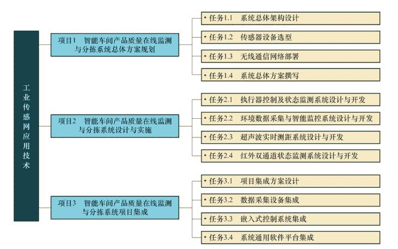

图 1　项目教学内容框架

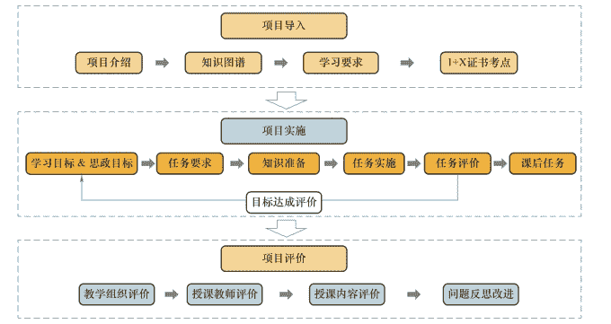

图 2　教材组织结构

### （1）项目总览
阐述本项目实施背景、任务内容，以及各子任务间的逻辑关联。

### （2）知识图谱
呈现项目所涉及并需掌握的知识要点与技能要点，帮助学生整体梳理思路，系统把握学习内容。

### （3）学习要求
明确项目总体学习要求，覆盖思政素养、职业素养、信息素养与劳动素养，促进德智体美劳全面发展。

### （4）1+X证书考点
详细列出本项目包含的1+X证书考点及对应教学内容。

## 三、编写特色

### 1.校企协同、项目牵引
依托智能制造产业背景，本书以合作企业真实项目“互联网+智能制造系统开发”为依托，培养学生工业传感网系统的设计、开发、集成能力，采用“项目牵引、任务驱动、行动导向、学做合一”的方式，各项目由若干由易到难、循序渐进的任务构成，符合认知规律与实践要求，使学生在任务完成中获得知识与技能。

### 2.课程思政、育人为本
以坚定理想信念、培育社会主义核心价值观、职业素养与工匠精神为目标，深入挖掘教材中的思政元素，采用案例渗透、体验探究等方法，将爱国主义、法治意识、规范意识、劳动价值观教育贯穿教学全过程。各任务设置“思政目标”“课程思政链接”及案例素材、思考讨论等内容，实现德育隐性渗透，为教师与学生提供双向参考。

### 3.书证融通、对接标准
本书将1+X证书“传感网应用开发”职业技能等级标准中级技能点与项目内容匹配，对项目内容进行整合、拓展、补充，有机融入数据采集、近距无线通信、通信协议应用等知识点。各项目引导部分列出所含1+X证书考点及对应教学内容，并在任务实施中重点标注。以证书考纲的理论、实操与素养考点为学习评价主要构成，实现书证融通，提升核心职业能力。

### 4.资源丰富、形态新颖
配套课程标准、授课计划、微课视频、教学课件、应用程序源代码、题库等立体化数字资源，书中视频、动画、网络资源二维码可随扫随学。配套在线课程支持学生自主学习，并辅助提问、讨论、测试、作业等课堂活动。采用活页式编排，便于及时补充案例与最新技术；书中记录栏与总结栏便于学生记录学习过程、结果与问题，不断反思改进，提升学习效果。

## 四、教学建议
课程学时分配如表 1 所示。

表 1　课程学时分配表

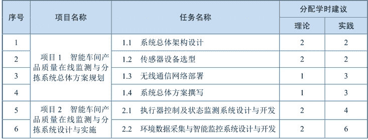

续表

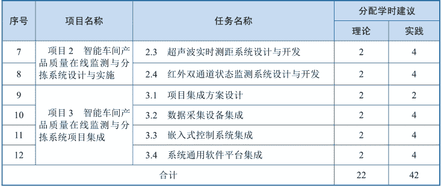

## 五、致谢
衷心感谢常州机电职业技术学院对工业传感网应用技术核心课程建设的大力支持。感谢江苏大备智能科技有限公司提供的项目资源、编写人员与技术指导。感谢北京理工大学出版社为本书出版付出的辛勤劳动以及提出的修改建议。

本书由常州机电职业技术学院马长胜、王茗倩、王云良担任主编，常州机电职业技术学院顾卫杰和嘉兴职业技术学院桑世庆担任副主编，常州机电职业技术学院孙华林、楼竞、杨保华，江苏大备智能科技有限公司金亚峰工程师和庄岳辉工程师等参与编写。谨向他们表示谢意。

由于编者水平有限，书中难免有疏漏不足之处，恳请广大读者批评指正。

编　者

# 总体项目设计

## 1.项目概况
本书与合作企业江苏大备智能科技有限公司共同开发，依托企业真实项目《互联网+智能制造系统》。该公司主要从事物联网、工业互联网大数据平台、电子产品、机器人及自动化系统等技术开发，兼顾数控机床维修及改造。“互联网+智能制造系统”涵盖网上订单、智能生产加工、智能装配、质量检验、智能仓储、设备管理、能耗管理、物流管理等子系统，其管理平台界面和智能车间沙盘分别如图 0-1、图 0-2 所示。

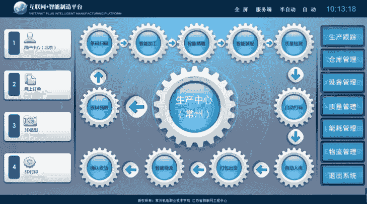

图 0-1　“互联网+智能制造系统”管理平台界面

质量是企业竞争力核心、是建设制造强国的生命线，坚持质量优先的制造业发展道路至关重要。产品质量检验是企业关注焦点，也是保障质量的关键环节。传统产品尺寸检验主要靠人工，使用量规、卡尺、轮廓仪等简单工具进行尺寸与形位公差比对。卡尺、量规操作简便但精度有限，轮廓仪需特定检测环境；先进仪器虽精度高但价格昂贵。因此国内多数零件生产车间仍以人工检验为主。

近年来，受物联网、无线通信、传感器技术、微机电系统等快速发展推动，出现了一种低成本、低功耗、多功能的新型网络——无线传感器网络 WSN。该网络由大量具备计算与通信能力的感知节点构成，能在监测区域进行数据采集与传输，无需人工维护，可自组织多跳网络，根据环境变化主动完成特定监测任务，是一种大规模、无须值守的分布式系统。在产品检验领域，可通过各类传感器获取产品尺寸参数，经无线传感器网络传输检验数据，使检验更便捷、数据应用更灵活，改变了传统仪器体积庞大、价格昂贵、人工效率低等弊端，为检验技术发展带来新机遇。

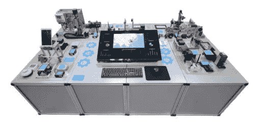

图 0-2　智能车间沙盘

项目中，“机械零部件质量检验分拣系统”利用无线传感器网络技术实现产品信息自动获取与质量检验并分类放置。通过传感设备获取检验车间环境参数如温度、湿度；同时借助 RFID读写器、摄像头、传感器获取产品条码、图像及长宽高尺寸信息，再经无线网络传输至嵌入式网关，与数据库中产品标准比对，分拣不合格品；最终对各产品合格数与合格率进行统计分析。其系统模型与运行界面分别如图 0-3、图 0-4 所示。


图 0-3　基于无线传感器网络的机械零部件质量检验分拣系统模型

该监控网络成本低、无须布线，多个感知节点布置于待测工位可采集传统方法难以监测的信号，并依据机械零件质量标准判断合格性实现分离，省去人工检验烦琐环节，确保产品质量，并将检验数据与企业 ERP 系统对接，客户可实时查询各项生产参数。

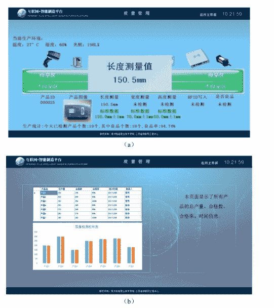

图 0-4　机械零部件质量分拣系统运行界面

（a）产品尺寸参数检验；（b）管理平台

## 2.课程思政设计
本书以立德树人为根本任务，以培养德智体美劳全面发展的社会主义建设者和接班人为宗旨，设计系统化课程思政内容，在知识传授与技能培养的同时实现价值引领与精神塑造。采用案例渗透、专题嵌入、提炼引申、体验探究等方法，挖掘教材中蕴含的思政元素，主要涵盖爱国主义、核心意识、法治意识、工匠精神、职业素养等，实现教材德育隐性渗透，为教师和学生开展课程思政提供双向参考。各项目的课程思政总体教学设计如表 0-1 所示。

表 0-1　各项目的课程思政总体教学设计

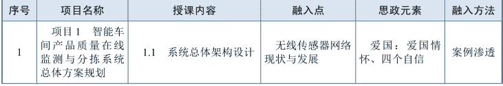

续表

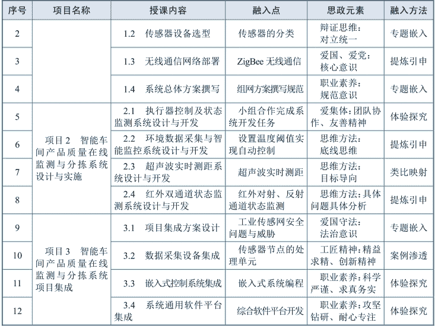

## 3.与1+X证书匹配关系
本书将1+X证书“传感网应用开发”职业技能等级标准中级技能点与项目内容匹配，对项目内容重新整合、拓展、补充，有机融入数据采集、近距无线通信、通信协议应用等知识点。项目内容与1+X证书技能点的总体匹配关系如图 0-5 所示，各项目引导部分均列出所含1+X证书考点及对应教学内容，并在任务实施中标出具体技能点。以证书考纲中理论、实操和素养考点为课程评价主要构成之一，实现书证融通，提升核心职业能力。

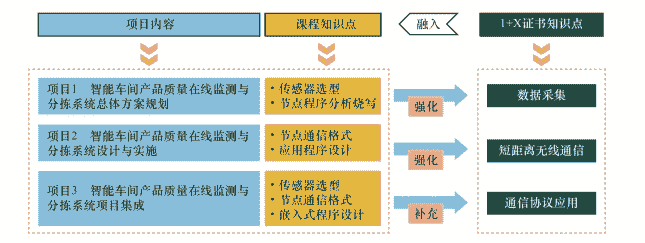

图 0-5　项目内容与1+X证书技能点的总体匹配关系

# 项目 1　智能车间产品质量在线监测与分拣系统总体方案规划

## 项目介绍
工业传感网应用系统开发前需进行总体方案设计，再实施各子系统开发，最终集成并联调。本项目以“智能车间产品质量在线监测与分拣系统”为背景，首先完成工业传感网体系结构分析设计、传感设备选型、无线通信网络部署等任务，掌握传感网结构、传感器工作原理与选型、常见近距离通信技术等知识，并初步实现传感器数据采集、节点 ZigBee 无线通信功能，为后续开发奠定基础。其次依据具体需求，按规范撰写工业传感网组网方案。

## 知识图谱
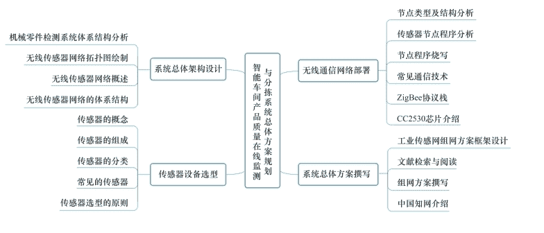

## 学习要求
●依据课程思政目标，提升系统组网方案的不断优化完善，养成精益求精、追求卓越的工匠精神。
●在系统开发中按1+X证书“传感网应用开发”相应硬件电路搭建与软件编程规范实施任务，养成规范严谨的职业素养。
●通过“传感器选型”“组网方案设计”等任务中的信息查找、文献检索与阅读、信息选取与整合，培养信息获取与评价的基本信息素养。
●使用实训设备时需佩戴防静电手套、禁止带电热插拔设备，布线整洁美观，保持工位卫生、完成后及时收回工具并按位摆放，树立热爱劳动、崇尚劳动的态度与精神，养成良好劳动习惯。

## 1+X证书考点
“传感网应用开发”职业技能等级标准中级

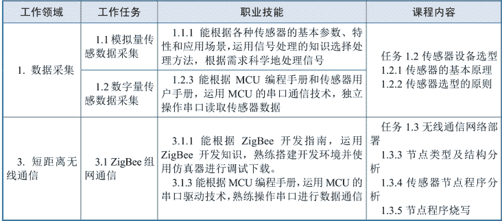

## 任务 1.1　系统总体架构设计

### 学习目标
●了解无线传感器网络的发展历程及特点。
●了解无线传感器网络的体系结构。
●了解无线传感器网络的应用领域。
●会进行工业传感网系统的需求分析。
●能叙述工业传感网的组建步骤。
●能用 Visio 软件绘制系统拓扑结构图。

### 思政目标
●培养爱国情怀、民族自豪感，树立道路自信。

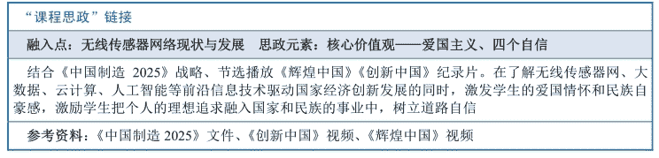

### 任务要求
（1）观看机械零件在线检验系统模型运行过程，学习无线传感器网络体系结构知识链接点，从而区分无线传感器网络体系结构，了解其发展过程、特点及应用领域，掌握组建步骤。
（2）学习 Visio 绘图软件基本使用方法，并绘制机械零件在线检验系统中的网络拓扑结构图。

### 实训设备
（1）机械零件在线检验系统模型一套或模型演示录像。
（2）安装有 Visio 软件的计算机一台。

### 知识准备

#### 1.1.1　无线传感器网络概述


##### 无线感知网体系结构分析

###### 1.无线传感器网络概念
近年来，随着无线通信、传感器技术、微机电系统、计算机等技术飞速发展与日益成熟，诞生了低成本、低功耗、多功能的新型网络——无线传感器网络 WSN，该网络引发了世界范围内的广泛关注。它由大量感知节点构成，节点具备一定计算与通信能力，能在监测区域进行数据采集、传输，无需人工维护，可形成多跳自组织网络系统，根据环境变化主动完成特定监测任务，是一种大规模、无须人员值守的分布式系统。

###### 2.无线传感器网络研究现状
信息化革命促进了无线传感器网络发展，从发展历程看，它是继互联网之后对21世纪人类生活方式、生产方式产生重大影响的关键技术。早在1999年，美国《商业周刊》就将其列为21世纪最具影响力的21项技术之一；2003年，麻省理工学院在预测未来科技发展趋势报告中，将其列为改变人类世界的十大新技术之一；2008年，前 IBM 首席执行官彭明盛提出“智慧地球”新概念，引发全球物联网技术研究热潮，其中无线传感器网络作为物联网关键技术之一备受关注；在我国，温家宝总理2009年8月在无锡视察时提出“感知中国”概念，物联网被列为国家五大新兴战略性产业之一并写入政府工作报告；2010年，江苏等省份将物联网列为重点培育新兴产业；2011年底，工信部出台《物联网“十二五”发展规划》，提出“十二五”时期我国物联网将由起步发展进入规模发展阶段，并大力实施关键技术创新工程和标准化推进工程等五大重点工程。

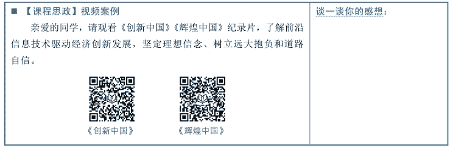

从专家学者研究情况看，无线传感器网络在20世纪70年代最早应用于军事领域。1978年，卡内基梅隆大学设立新一代分布式传感网络研究工作小组；至20世纪末，英国、德国、日本等科技强国也在该领域展开大量研究，但多处于起步阶段；2005年，麻省理工学院开始研究基于无线传感器网络的安全监测技术，利用众多具有感知、计算和无线通信能力的节点自组织形成安全监测网络，并据网络节点上传感器感知状态信息准确诊断监测对象现状；2006年，200个联网微尘被部署于旧金山金门大桥，用于检测大桥摆动距离；2008年，德国举行的“无线传感器网络应用论坛”上，专家主要研讨其在工业监控、企业生产数据采集等领域的应用；2010年，加州大学伯克利分校在复杂机械维护领域进行探索，采用无线传感器网络降低人工开销。

在我国，研究相对薄弱。1999年，中科院在信息与自动化领域研究报告中首次正式提及无线传感器网络研究。2001年，中科院依托上海微系统在该领域开展若干重大项目研究，取得较大进展；2005年起，无线传感器网络被国家自然科学基金委员会列为重点研究项目；2006年，武汉理工大学、太原理工大学在工业设备监控等方面进行有益探索；2008年，北京交通大学研制新一代传感网络核心设备 BJTUIPv6 微型传感路由器，在 IPv6 领域取得突破性进展；2010年，蔡伯根教授等人对无线传感器网络进行优化，降低网络能量消耗；2011年，北京邮电大学将无线传感器网络应用于燃气检测，在燃气检测领域取得突破。

###### 3.无线传感器网络发展历史
1）第一阶段

# 从丛林监听到自组织感知

它的远祖可以上溯到上世纪七十年代的越南战场。美越双方在密林覆盖的胡志明小道一带展开残酷对峙， 这条通道为南方游击部队源源不断输送补给，美军动用航空兵多次狂轰滥炸收效甚微。随后美军空投了约两万套代号“热带树”的侦测装置。


图 1-1-1　胡志明小道

“热带树”实质上是一套由振动与声学采集单元组成的感知系统， 飞机投放后主体埋入泥土，仅有伪装成树枝的无线电天线露出地面， 因而得名。一旦敌方车队经过，装置捕捉到振动与声响并即时回传指挥所，美军战机随即出击， 据统计累计摧毁或损毁卡车约4.6万辆。

2）第二阶段

八十年代至九十年代，主要以美军为主导的分布式感测网络、海军协同交战系统、远程战场传感系统等相继问世，如图 1-1-2 所示。这一时期的设备朝着微型化发展，同时具备感知、计算、通信三种能力。1999年《商业周刊》据此将传感网络列为21世纪最具影响力的21项技术之一。

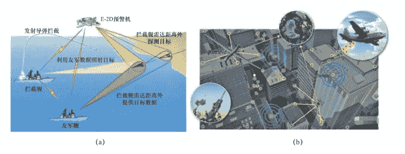
图 1-1-2　美军军事传感网系统

（a）海军协同交战能力系统；（b）远程战场传感器系统

3）第三阶段

从21世纪开始，尤其是911事件之后。这一阶段的技术特点是传输具备自组织特性，节点设计更强调低功耗。2010—2019年中国工业无线传感器网络产品市场规模与增长预测如图 1-1-3 所示。

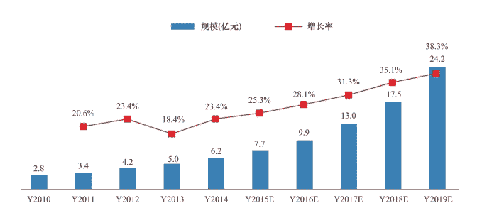
图 1-1-3　2010—2019 年中国工业无线传感器网络产品市场规模与增长预测

###### 4.无线传感器网络的特点

1）大规模网络

为获得更精确的信息，监测区域往往布设海量节点，数量常以千计甚至上万。 大规模有两层含义：一是覆盖地理范围广，比如在原始大森林开展防火与环境监测，需在广阔地带投放大量节点，如图 1-1-4 所示；二是局部密度高，在有限空间里密集布置众多节点。

规模化带来的好处包括：多视角信息融合提升信噪比；分布式处理海量原始采集数据可提高整体监测精度，从而放宽对单体传感精度的要求；大量冗余节点带来很强的容错能力；节点增多扩大覆盖面，降低盲区和空洞。

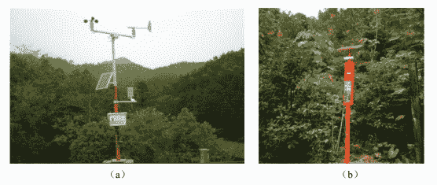
图 1-1-4　森林防火传感气象站

2）自组织网络

在实际应用中，节点大多投放在无基础架构的环境里。投放位置往往无法精确定位，邻居关系也事先未知，例如通过飞机把大量节点播撒到广阔原始林区，或随意放置到人难以到达、甚至危险的区域。因此节点必须具备自组织能力，可自行配置与管理，借助拓扑控制与路由协议自动形成多跳无线中继系统，用来转发监测数据。

使用过程中，部分节点会因电量耗尽或环境干扰失效，同时也会为填补空缺或提升精度而增补新节点，导致节点总数动态增减，网络拓扑随之演化。自组织机制需要适应这种实时变化。

3）动态性网络

拓扑可能因以下因素改变：

（1）环境因素或电量耗尽导致节点故障或失效；
（2）环境变化使无线链路带宽波动，甚至出现时断时续；
（3）传感器、被感知对象与观察者三者都可能存在移动；
（4）新节点的加入，要求系统具备动态重构与自适应能力。

4）可靠的网络

传感网络常部署在恶劣环境或人类不宜进入的区域，节点需在露天条件下承受暴晒、风雨侵蚀，甚至遭受人为或动物破坏。节点多采用随机布设，例如飞机播撒或炮弹投放，要求结构坚固耐用，能适应严苛条件。

受监测区域限制与节点数量庞大，人工维护往往不可行甚至不可能。通信保密与数据安全极其重要，需防止数据被窃取或信息被伪造。因此软硬件必须具备鲁棒性与容错性。

6）以数据为中心的网络

现有的互联网先有终端系统再互联成网，终端可以脱离网络独立存在。网络设备以唯一的 IP 地址标识，资源定位与传输依赖终端、路由器、服务器的 IP 地址。访问资源前必须先获知服务器地址，可以说现在的互联网是地址导向型网络。

传感器网络属于任务型网络，脱离网络谈论单节点没有意义。节点以编号标识，编号是否全网唯一取决于协议设计。由于节点随机部署，网络结构与编号之间的关系完全动态，编号与物理位置并无必然联系。用户查询时直接向网络通告关心的事件，而不是指向某个确定编号的节点；网络获得指定事件的信息后再汇报给用户。这种以数据本身作为查询与传输线索的思想更接近自然语言交流习惯。因此通常认为传感器网络是数据导向型网络。

例如在目标跟踪应用中，目标可能出现在任意位置，用户只关心出现的位置与时间，不关心由哪个节点监测到。目标移动时，必然由不同节点轮流提供位置消息。

讨论：为什么说互联网是以地址为中心的网络，而无线传感器网络是以数据为中心的网络？

###### 5.无线传感器网络结构

传感器网络系统通常包含传感器节点、汇聚节点和管理节点。

1）传感器节点

一般为微型嵌入式系统，处理、存储与通信能力相对有限，由有限电池供电。传感器节点如图 1-1-5 所示。

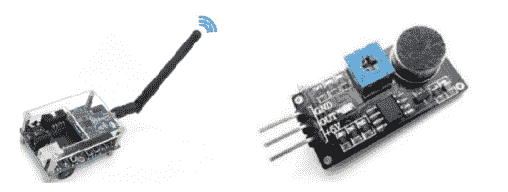
图 1-1-5　传感器节点

从网络功能看，每个传感器节点兼具传统网络节点的终端与路由器的双重角色，除本地采集与数据处理外，还需对转发数据进行存储、管理和融合，并与邻居协作完成特定任务。

2）汇聚节点（也称协调器）
# 汇聚节点

汇聚节点的处理、存储与通信能力相对较强，连接传感器网络与Internet等外部网络，实现协议栈间的转换，同时下发管理节点的监测任务，并将采集数据转发至外部网络。

汇聚节点可以是增强型的传感器节点，也具备充足的能量供给与更多的Flash和SRAM。它可将全部信息传输到计算机中，通过汇编软件方便地把获取的信息转换为汇编文件格式，从而分析出传感节点所存储的程序代码、路由协议及密钥等机密信息，同时还可以修改程序代码并加载到传感节点中。汇聚节点如图 1-1-6 所示。

很明显，通用传感节点存在较大安全漏洞，攻击者可通过此漏洞获取节点机密信息、篡改程序代码，使节点具备多个身份ID并以多重身份通信；也可通过获取存储的密钥、代码等信息伪造或伪装合法节点加入网络。一旦控制部分节点，攻击者便可窃听传输信息、下发虚假路由或伪造传感数据、实施拒绝服务等攻击。

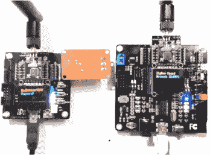
图 1-1-6　汇聚节点

由于物理可操纵性是传感器网络难以回避的安全问题，必须通过其他技术手段提升安全性。如通信前进行节点间身份认证；设计新密钥协商方案，即使部分节点被操纵，也难以推导出其他节点密钥；还可对节点软件合法性进行认证等措施提升节点本身安全。

## 管理节点

终端用户通过管理节点对传感器网络进行管理、配置与控制。一般情况下，管理节点可以是嵌入式控制器、计算机或其他移动终端，是整个传感器网络系统信息处理的“大脑”。

# 无线传感器网络的用途

虽然大规模商业化应用受技术制约尚需时日，但随着计算成本下降与微处理器体积缩小，无线传感器网络已在多个领域投入使用。主要集中在以下方向：

## 1）环境的监测和保护

随着公众对环境问题的关注提升，需要采集的环境数据日益增多。无线传感器网络为随机性数据获取提供了便利，并可避免传统采集方式对环境的侵入式破坏。例如英特尔研究实验室曾将32个小型传感器接入互联网，读取缅因州“大鸭岛”图 1-1-7 的气候，用于评估海燕巢条件。还可用于候鸟与昆虫迁徙跟踪、农作物受环境变化影响研究、海洋大气土壤成分监测等，也可应用于精细农业，监测病虫害、土壤酸碱度与施肥状况等。

## 2）医疗护理

无线传感器网络在医疗研究与护理领域大有可为，如图 1-1-8 所示。罗切斯特大学科学家利用无线传感器构建智能医疗房间，用微尘测量居住者血压、脉搏、呼吸、睡眠姿势及24小时活动状况。英特尔也推出家庭护理技术，作为应对老龄化社会项目Center for Aging Services Technologies的组成部分。该系统在鞋、家具、家用电器中嵌入半导体传感器，帮助老年人、阿尔茨海默病患者及残障人士改善家庭生活。借助无线通信高效传递必要信息，既方便护理也减轻护理人员负担。英特尔预防性健康保险研究董事Eric Dishman称，无线传感器网络在家庭护理技术领域极具前景。

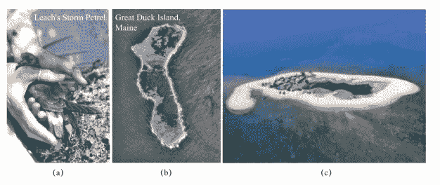
图 1-1-7　缅因州“大鸭岛”

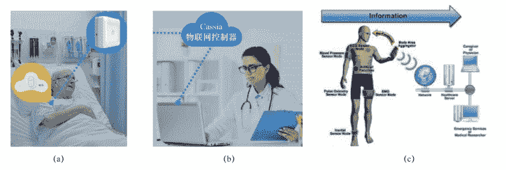
图 1-1-8　医疗传感器

## 3）军事领域

凭借密集型与随机分布特性，无线传感器网络非常适合恶劣战场环境，包括侦察敌情、监控兵力装备物资、判断生化攻击等用途，如图 1-1-9 所示。美国国防部远景计划研究局已投资数千万美元，推动“智能尘埃”传感器技术研发。

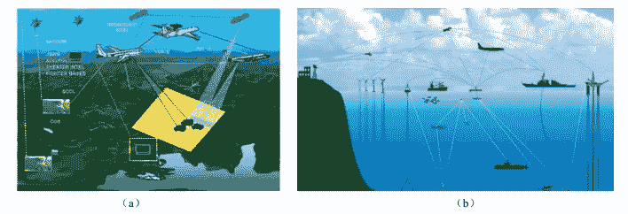
图 1-1-9　军事物联网

## 4）目标跟踪

DARPA支持的Sensor IT项目探索如何将WSN技术应用于军事领域，实现所谓“超视距”战场监测。UCB教授主持的Sensor Web是其子项目，原理性验证了用WSN进行战场目标跟踪的可行性。翼下携带WSN节点的无人机飞抵目标区后抛撒节点，节点随机布设后利用地震波传感器探测坦克、装甲车等目标，并据信号强度估算距离，综合多节点观测数据定位目标并绘制移动轨迹。虽然精度等方面尚不足以实战装备，该模式仍可能受到军方关注。

## 5）其他用途

无线传感器网络还用于井矿、核电厂等危险工业环境的安全监测，也可用作交通领域的车辆监控工具。此外在工业自动化生产线等领域已有应用，英特尔正在测试一座工厂的无线网络，该网络由40台机器上的210个传感器组成，可改善工厂运行条件，降低设备检查成本，提前发现问题从而缩短停机时间、提高效率并延长设备寿命。尽管技术尚处初步应用阶段，其应用价值已十分显著。

#### 1.1.2　无线传感器网络的体系结构


无线传感网应用案例

## 1. 无线传感器网络的种类

无线网络可分为有基础设施网与无基础设施网。有基础设施网需依赖固定基站，如手机使用的蜂窝网需高大天线与大功率基站支持；无线局域网借助接入点亦属此类。无基础设施网又称无线Ad Hoc网络，节点分布式部署，无专门固定基站。无线Ad Hoc网络分为两类：一类是移动Ad Hoc网络，终端快速移动，如美军101空降师装备的Ad Hoc通信设备，可在远程空投后在高度机动车辆上实现通信，无需外部设施支援；另一类是节点静止或移动缓慢的无基础设施传感网。

无线传感器网络的体系结构如图 1-1-10 所示，通常包括传感器节点、汇聚节点和管理节点。大量传感器节点随机部署于监测区域，通过自组织方式构网。数据沿其他节点逐跳传输，传输中可能被多个节点处理，经多跳后路由到汇聚节点，再经互联网或卫星到达管理节点。用户通过管理节点配置网络、下发监测任务并获取数据。

## 2. 无线传感器网络拓扑结构

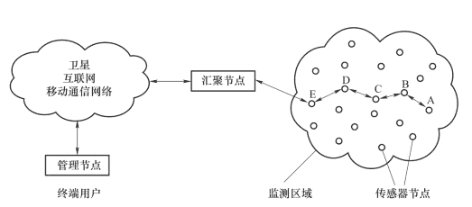
图 1-1-10　无线传感器网络的体系结构

在ZigBee网络组建过程中，可按应用需求构建三种拓扑：星形网络结构Star、簇树状网络结构Cluster-Tree和网状网络结构Mesh。可组合形成简单或复杂的多种网络。

### 1）星形网络结构

星形网络通常由一个ZigBee协调器和多个ZigBee终端节点构成。协调器为网络核心，功能较强，负责设备启动、角色分配、网络维护等；终端节点功能简单，位于协调器覆盖范围内，可以直接与协调器通信，终端节点最多可达65535个。星形网络拓扑结构如图 1-1-11 所示。

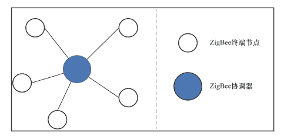
图 1-1-11　星形网络拓扑结构

### 2）簇树状网络结构

簇树状网络中节点通常采用Cluster-Tree路由协议传输数据。每个子网都有簇头节点承担协调器功能，维护其覆盖范围内的通信；各子网簇头节点再与上一级ZigBee网络协调器或主网络协调器通信，保证网络畅通。簇树状拓扑可扩展至更复杂结构，但拓扑越复杂，数据传输的准确性、实时性会变差。ZigBee簇树状网络拓扑结构如图 1-1-12 所示。

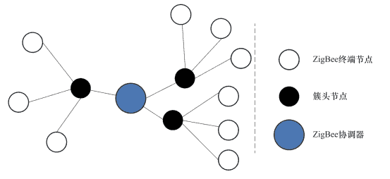
图 1-1-12　`ZigBee`簇树状网络拓扑结构

构建时，协调器首先启动并为自己分配网络地址0x0000，此时簇树状网络深度为0。当新节点i欲通过已有节点j加入网络时，节点j称为父节点，新节点i称为子节点。父节点j根据自身网络地址Address(j)和网络深度Depth(j)，为子节点i分配网络地址Address(i)，子节点i的网络深度为Depth(j)+1。网络深度仅表示数据帧传输到簇头节点或协调器所需最小跳数。

在簇树状网络中，同一深度分配网络地址时，根据新加入节点类型采取不同算法。

若新加入终端节点i不具备路由功能，通过与簇头节点相连作为某子网中簇头设备的第n个子节点加入网络。根据父节点网络深度d，父节点j为新子节点i分配网络地址，终端节点i的地址方式如式（1）所示：


配置参数如下：

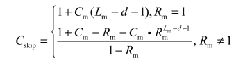
式中，`Cskip`表示不同深度的父设备分配地址时的偏移量；`Lm`表示网络的最大深度；`Cm`表示协调器在网络中允许拥有子设备数量的最大值；`Rm`表示子节点中协调器的最大个数。

若新加入终端节点i具备路由功能，父节点j为其分配网络地址，此时终端节点i的分配地址方式如式（2）所示：


基于前述两种地址划分思路，簇树路由机理可移植到 ZigBee 簇树网络。设簇树网络中某感知节点的网络地址为 A，所在深度为 d，若该节点需向地址为 D 的目标节点投递数据，首先以逻辑式对 D 进行校验，判断 D 是否落入本节点的子节点集合，判断条件即式（3）。若满足，则下一跳指向本节点的子节点，下一跳地址 N 由式（4）给出：


当式（3）不成立时，表明目标不在本节点子树范围内，节点将数据帧转发给自己的父节点。父节点接收帧后，仍按式（3）对目标地址做进一步逻辑判断。簇树网络的路由决策流程如图 1-1-13 所示。

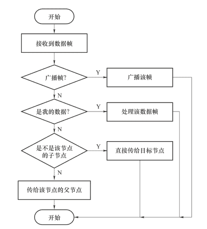

图 1-1-13　簇树状网络的路由算法流程

### 3）网状网络结构

网状拓扑与前两种结构差异较大，整个网络中各节点均可相互通信，每个节点都可承担路由功能。该类网络自愈能力强，具有自动修复与自组织能力，可提供多条端到端路径。一旦某条链路中断，业务可切换至其他备用路径，可靠性因此大幅提升。ZigBee 网状网络采用 Z-AODV 协议与分级簇树路由相结合的混合机制。ZigBee 网状拓扑如图 1-1-14 所示。

其中 Z-AODV 在 AODV 基础上改进，为每条路由分配序列号以体现新旧程度，组网时优先选用序列号最新的路由。考虑到功耗与易用性，Z-AODV 将基于序列号的选路改为基于路径能量消耗的选路策略，在简化实现的同时保留了 AODV 的核心功能。

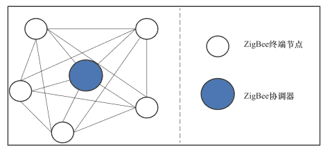

图 1-1-14　`ZigBee`网状拓扑结构

思考：三种网络拓扑各自的特征是什么？链路故障时哪种拓扑的性能更具优势？

## 3. Visio 软件介绍

### 1）Visio 简介

`Microsoft Office Visio` 由微软推出，面向 IT 与商务人员，帮助其直观呈现、解析和传递复杂信息。它能将难懂的文本与表格转化为易于理解的 Visio 图表。Office Visio 提供多种模板：业务流程图、网络图、工作流图、数据库模型图、软件图，可用于简化业务流程、跟踪项目与资源、绘制组织架构、映射网络、绘制建筑图以及优化系统，如图 1-1-15 所示。

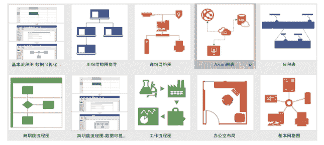

图 1-1-15　`Visio`绘图模板

### 2）Visio 主要功能

借助 Office Visio 的新增或改进功能，可更轻松地将流程、系统与复杂信息可视化：模板驱动快速启动。Office Visio 为 IT 与商务人员提供针对性的绘图工具。利用 Office Visio Professional 中的 ITIL 模板和价值流图模板，可创建更丰富的图表。通过预置的 Microsoft SmartShapes 符号和强大的搜索功能，无论形状保存在本地或网络上，均可快速定位所需图形。

任务实施

#### 1.1.3　产品质量在线检测系统演示及体系结构分析


## 系统拓扑图绘制

观看项目介绍与演示视频后，可了解系统功能与机械零件检测流程。系统拓扑如图 1-1-16 所示。每个车间均部署一套独立的在线检测系统，传感器采集的数据经 ZigBee 网络汇聚至汇聚节点，汇聚节点再通过 4G、Wi-Fi 等无线方式将数据推送至嵌入式网关，网关最终上传至服务器。每个车间构成一个无线传感器网络。客户端用户可通过电脑、手机等终端经互联网访问数据中心，实现对检测系统的实时监测。

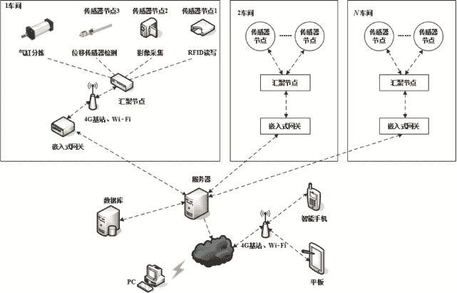

图 1-1-16　系统拓扑图

#### 1.1.4　产品质量在线检测系统拓扑图绘制

（1）启动 Microsoft Office Visio 2016。
默认窗口展示全部形状模板分类，如图 1-1-17 所示。

（2）从模板中选择“详细网络图-3D”，单击创建按钮，如图 1-1-18 所示。

（3）参照图 1-1-16，自上而下绘制产品质量在线检测系统的网络拓扑图。车间 1 区域需提前准备好“气缸”与“位移传感器”图片，通过“插入”→“图片”导入并调整大小，如图 1-1-19 所示。

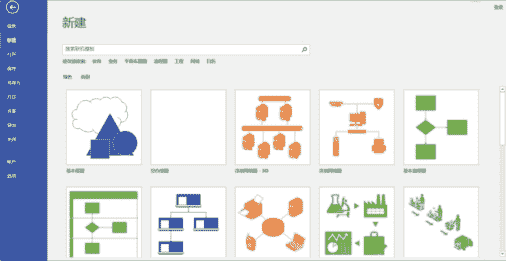

图 1-1-17　`Visio`初始画面

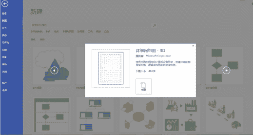

图 1-1-18　创建详细网络模板

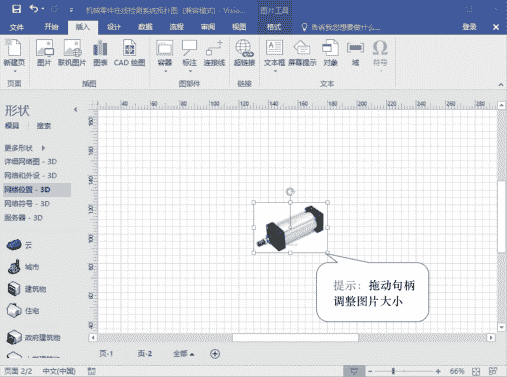

图 1-1-19　插入图片

提示：若 Visio 自带形状库中无所需图形，可在互联网搜集并保存到本地后再导入文档使用。

（4）在左侧形状选择窗格切换至“网络和外设-3D”选项卡，找到“摄像机”图形，拖拽至绘图区并调整显示尺寸，如图 1-1-20 所示。

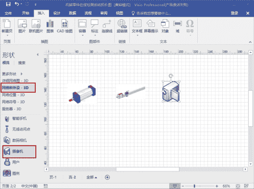

图 1-1-20　插入摄像机图形

（5）按上述方式，在“详细网络图-3D”选项卡中定位“智能卡读卡器”和“中继器”图形；在“网络和外设-3D”选项卡中选取“网桥”和“无线访问点”图形，拖入绘图区并调整大小，如图 1-1-21 所示。

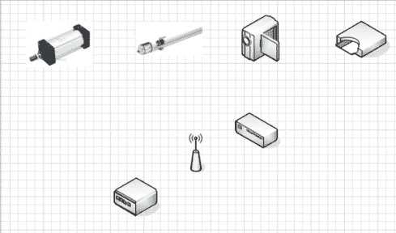

图 1-1-21　车间 1 局部图

提示：绘图时需兼顾布局的合理与美观，既注意局部摆放，也要顾及整体视觉平衡。

（6）为各网络节点添加文字说明。从菜单栏选择“插入”→“文本框”→“水平”，在气缸图片下方插入文本框，输入“气缸分拣”并设置格式使其美观，按同样方式完成其余文本框的添加，如图 1-1-22 所示。

# 系统拓扑图绘制

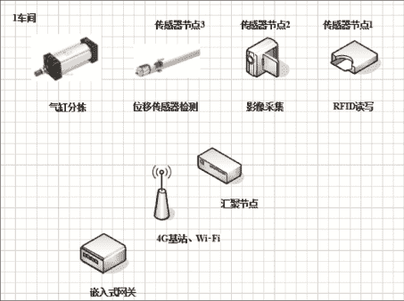

图 1-1-22　添加文字说明

## （7）节点无线通信连线

使用绘图工具栏的“线条工具”，在常用工具栏线条选项中选用线型 2 来表现节点间的无线通信，如图 1-1-23、图 1-1-24 所示。

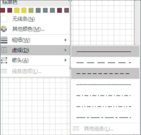

图 1-1-23　选择线条

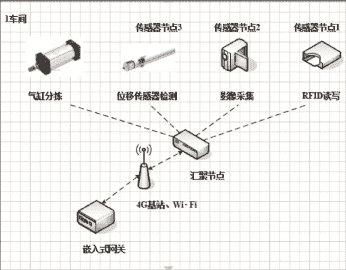

图 1-1-24　节点无线通信

提示：连线时应注意美观与合理，长短适中、虚实结合，可根据需要调整线条粗细、颜色和样式，以达到突出强调的效果。

## （8）2 车间拓扑绘制

下面以 2 车间为例完成其余车间拓扑。在绘图工具栏选择“圆形”和“矩形框”工具，按要求在绘图区绘制 2 个圆和 1 个矩形框，绘制圆形时需按住 Shift 键。绘制完成后双击图形输入对应文字，如图 1-1-25 所示。

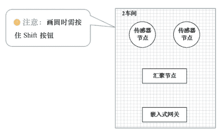

图 1-1-25　2 车间

## （9）节点连接

参照步骤（7）完成节点间的连线，如图 1-1-26 所示。

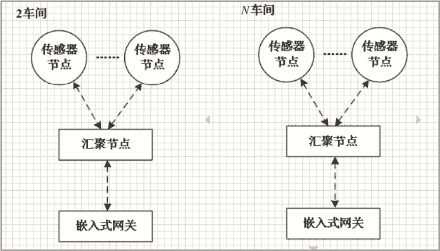

图 1-1-26　车间完成图

## （10）远程访问部分

完成整张拓扑图的远程访问区绘制。在左侧形状选择窗格的“网络和外设-3D”→“计算机和显示器”→“网络位置”中选择所需图形，并调整大小与位置，如图 1-1-27 所示。

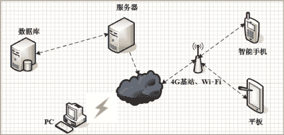

图 1-1-27　远程访问图

## （11）节点连接实现

借助绘图工具实现节点间的连接关系，如图 1-1-28 所示。

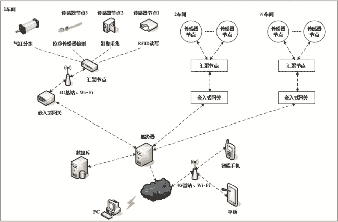

图 1-1-28　系统拓扑图

## （12）拓扑结构清晰化

为使网络拓扑更清晰，使用矩形框将各个车间区域分隔开来，如图 1-1-29 所示。

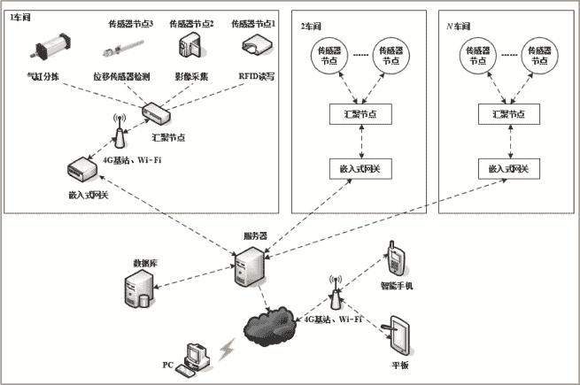

图 1-1-29　系统拓扑图

# 任务评价

任务评价表如表 1-1-1 所示，总结反思如表 1-1-2 所示。

## 表 1-1-1　任务评价表

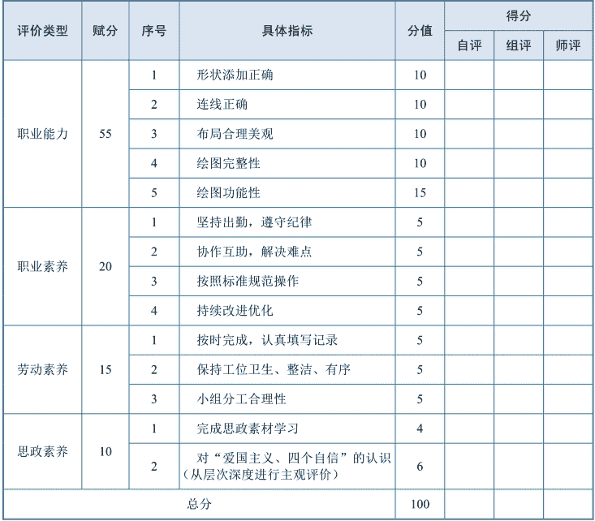

## 表 1-1-2　总结反思

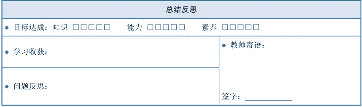

# 课后任务

## 1. 问答与讨论

（1）什么是无线传感器网络？

（2）无线传感器网络与现代信息技术之间的关系如何？

（3）画出机械零件在线检测系统的工业传感网的体系结构。

（4）讨论在实际生活中无线传感器网络的应用情况。

## 2. 巩固与提高

阅读项目 1 中任务 1.1 的知识链接、在线开放课程资料，了解无线传感器网络的基本概念与基本特征，了解其发展历程，熟悉应用领域。结合自身专业，提出某一领域无线传感器网络应用的可能性，并按需求设计基于无线传感器网络的应用系统，完成一次应用案例设计。案例撰写见任务模板。

# 工作任务单

《工业传感网应用技术》工作任务单


# 任务模板


# 作业要求

阅读项目 1 中任务 1.1 的在线课程资料，了解无线传感器网络的基本概念与基本特征，了解其发展历史，熟悉应用领域。

结合自身专业知识，提出某一领域内无线传感器网络应用的可能性，并按需求设计基于无线传感器网络的应用系统，完成一次应用案例设计。

## 一、无线传感器网络概述

### 1. 无线传感器网络的基本概念


### 2. 无线传感器网络的发展历史


### 3. 无线传感器网络的应用领域


## 二、基于无线传感器网络的应用系统设计

### 1. 系统概述


### 2. 系统的体系结构


### 3. 系统流程分析


## 三、收获与感想


## 任务 1.2　传感器设备选型

## 学习目标

●了解传感器的功能。

●了解各种传感器的工作原理。

●了解不同传感器的应用领域。

●会分辨各类传感器。

●能根据项目需求选择合适的传感器。

●会传感器的连接。

## 思政目标

●培养辩证思维，科学理性看待问题。

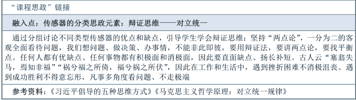

## 任务要求

通过观察机械零件在线监测系统中各工位的操作过程，选择合适的传感器。

（1）了解各类传感器的功能和工作原理。

（2）了解传感器的应用领域、特性、价格等属性。

（3）根据“互联网+智能制造系统”中生产车间的环境检测需求，选择功能合适、价格合理的传感器。

## 实训设备

（1）有上网功能的计算机一台。

（2）常见的温湿度传感器、光敏传感器、红外测距传感器、超声波传感器等。

## 知识准备

### 1.2.1　传感器的基本原理


#### 传感器结构与检测原理

##### 【1+X 证书考点】

###### 1.1.1　熟知各种传感器的基本参数、特性和应用场景

### 1. 传感器的概念

传感器是一种检测装置，能够感知被测量的信息，并将所感知的物理量按一定规律转换为电信号或其他所需形式的信息输出，以满足信息传输、处理、存储、显示、记录和控制等需求，如图 1-2-1 所示。它是实现自动检测与自动控制的基础环节。


图 1-2-1　传感器原理示意

### 2. 传感器的组成

传感器通常由敏感元件、转换元件和基础转换电路构成，如图 1-2-2 所示。敏感元件负责感受或响应被测量；转换元件把敏感元件的响应转换为可传输的信号，通常为电信号；基础转换电路则对微弱电信号进行放大、运算、调制等处理。该电路工作时需要辅助电源供电。

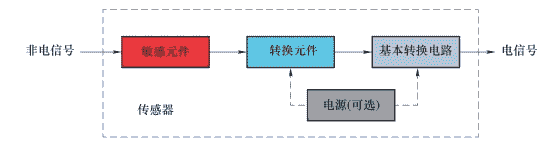

图 1-2-2　传感器的组成结构

随着半导体器件和集成技术的普及，传感器的基础转换电路可集成于传感器壳体内，或与敏感元件一起集成在同一芯片上，形成集成传感器。传感器接口技术是实用性很强的一环：各种物理量经传感器转化为电信号后，经过放大、滤波、抗干扰、多路转换等信号检测与预处理，再将模拟电压或电流转换为数字量，供计算机或微处理器处理。

思考：生活中有哪些传感器？它们各自有什么作用？

### 3. 传感器的分类

（1）按用途划分，可分为：压力与力敏传感器、位置传感器、液位传感器、能耗传感器、速度传感器、加速度传感器、辐射传感器、热敏传感器。

（2）按工作原理划分，可分为：振动传感器、湿敏传感器、磁敏传感器、气敏传感器、真空度传感器、生物传感器等。

（3）按输出信号形式划分，可分为：

模拟传感器：将被测非电学量转换为模拟电信号。

数字传感器：将被测非电学量转换为数字输出信号，包含直接与间接转换。

开关传感器：当被测量达到设定阈值时，输出预设的低电平或高电平信号。

（4）按测量目的划分，可分为：

物理型传感器：利用被测物质的物理性质发生显著变化的特性制成。

化学型传感器：利用敏感元件将化学成分、浓度等化学量转化为电学量制成。

生物型传感器：利用生物或生物物质的特性制成，用于检测与识别生物体内化学成分。

（5）按作用形式划分，可分为主动型和被动型传感器。

主动型传感器又分为作用型与反作用型，这类传感器会向被测对象发射探测信号，并检测信号的变化或由此产生的效应而形成输出。检测信号变化的方式称为作用型，如雷达与射频探测器；检测响应效应形成信号的方式称为反作用型，如光声效应分析装置与激光分析仪。被动型传感器仅接收被测对象自身产生的信号，如红外辐射测温仪、红外摄像设备等。

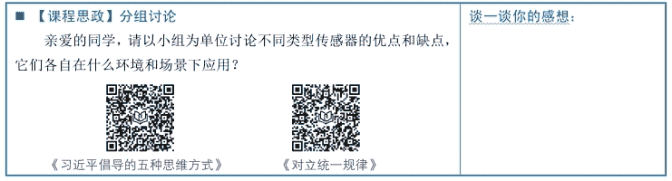

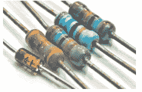

图 1-2-3　热电阻

### 4. 传感器常见品类速览

#### 1）电阻式传感器
电阻式器件能将位移、形变、力、加速度、湿度、温度等物理量转换为电阻信号。主要类别有电阻应变型、压阻型、热电阻型（图 1-2-3）、热敏型、气敏型、湿敏型等。

#### 2）称重传感器
称重传感器是力/电转换器件，可把重量变为电信号，是电子衡器的核心部件，如图 1-2-4 所示。

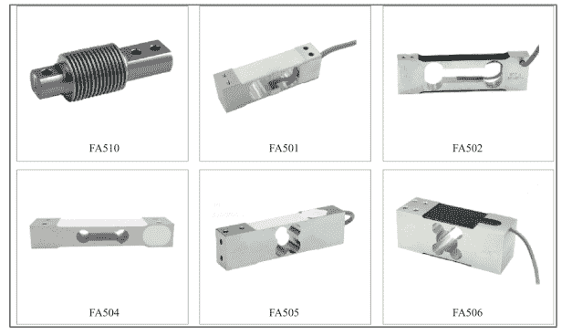

图 1-2-4　称重传感器

实现力电转换的传感器不止一种，典型有电阻应变式、电磁力式、电容式。电磁力式常用于电子天平，电容式用于部分电子吊秤，而大多数衡器产品仍以电阻应变式称重传感器为主。该类结构简单、准确度高、适应范围广，且在环境较差时仍能稳定使用，故在衡器领域应用广泛。

#### 3）电阻应变式传感器
电阻应变片利用金属的应变效应，外力导致机械形变时电阻随之改变。应变片分金属和半导体两大类，金属类再分丝式、箔式、薄膜式。半导体应变片灵敏度很高，通常为丝式或箔式的几十倍，且横向效应小。电阻应变式传感器的结构如图 1-2-5 所示。


图 1-2-5　电阻应变式传感器

#### 4）压阻式传感器
压阻器件基于半导体材料的压阻效应，在半导体基片上扩散形成电阻。基片本身可作测量元件，扩散电阻在内部接成电桥。基片受外力形变时各臂电阻变化，电桥产生不平衡输出。

用于压阻传感器的基片或膜片主要为硅片和锗片，其中硅基敏感器件受重视，尤其是用于测压和测速的固态压阻器件应用最普遍。


图 1-2-6　热电阻传感器

#### 5）热电阻传感器
热电阻测温依据金属导体电阻随温度升高而增大的特性，如图 1-2-6 所示。大多由纯金属制成，目前最常用铂和铜，镍、锰、铑等材料也开始采用。

该类元件借助电阻随温度变化的特性测量温度及相关参数，在精度要求较高的场合表现突出。现阶段广泛使用的铂、铜、镍等材料具有电阻温度系数大、线性好、稳定性好、使用范围宽、易加工等特点，可用于 -200～+500 ℃ 测温。

#### 6）激光传感器
激光传感器以激光技术实现测量，如图 1-2-7 所示，由激光器、探测器和测量电路组成。其优点是能无接触远距离测量、速度快、精度高、量程大、抗光电干扰能力强。


图 1-2-7　激光传感器

工作时激光发射二极管对准目标发射脉冲，经目标反射后光向各方向散射，部分散射光返回被接收器收集，经光学系统成像到雪崩光电二极管上。雪崩管内部具放大功能，能探测极微弱光信号并转成电信号。

利用激光的高方向性、高单色性和高亮度，可实现远距离非接触测量。激光传感器常用于长度（ZLS-Px）、距离（LDM4x）、振动（ZLDS10X）、速度（LDM30x）、方位等物理量测量，也可用于探伤和大气污染物监测。

#### 7）霍尔传感器
霍尔传感器依据霍尔效应制成的磁场传感器，广泛用于工业自动化、检测与信息处理。霍尔效应是研究半导体性能的基本方法，通过霍尔系数可判断导电类型、载流子浓度及迁移率等。常见霍尔传感器如图 1-2-8 所示。


图 1-2-8　常见的霍尔传感器

（a）霍尔转速传感器；（b）霍尔液位传感器；（c）精密电流传感器；（d）霍尔流速传感器

霍尔传感器分为线性型和开关型。

（1）线性型由霍尔元件、线性放大器和射极跟随器组成，输出模拟量。
（2）开关型由稳压器、霍尔元件、差分放大器、施密特触发器和输出级组成，输出数字量。

霍尔电压随磁场强度变化而变化，磁场越强电压越高，反之越低。霍尔电压本身很小，通常仅数毫伏，经集成电路放大后可输出较强信号。若使霍尔集成电路起传感作用，需以机械方式改变磁场强度。如图 1-2-8（d）所示，用旋转叶轮作为控制磁通的开关，当叶片位于磁铁与霍尔集成电路的气隙中时，磁场被偏离，霍尔电压消失。

#### 8）温度传感器
（1）室温、管温传感器：室温传感器用于测室内外环境温度，管温传感器用于测蒸发器和冷凝器管壁温度。二者外形不同，温度特性基本一致。美的现用室温、管温传感器常数 B 值为 4100 K（1±3%），基准电阻为 25 ℃ 对应 10 kΩ（1±3%）。温度升高阻值下降，温度降低阻值上升，偏离 25 ℃ 越远电阻公差范围越大；0 ℃ 和 55 ℃ 对应电阻公差约 ±7%，0 ℃ 以下及 55 ℃ 以上不同供应商公差存在差异。

（2）排气温度传感器：用于测量压缩机顶部排气温度，常数 B 值为 3950 K（1±3%），基准电阻为 90 ℃ 对应 5 kΩ（1±3%）。

（3）模块温度传感器：用于检测变频模块（IGBT 或 IPM）温度，现用感温头型号为 602F-3500F，基准电阻为 25 ℃ 对应 6 kΩ（1±1%）。典型对应阻值：-10 ℃→25.897～28.623 kΩ；0 ℃→16.324 8～17.716 4 kΩ；50 ℃→2.326 2～2.515 3 kΩ；90 ℃→0.667 1～0.756 5 kΩ。

温度传感器种类很多，常用的热电阻有 PT100、PT1000、Cu50、Cu100；热电偶有 B、E、J、K、S 等。种类与组合形式多样，应依据使用场合选用合适产品。常见温度传感器如图 1-2-9 所示。


图 1-2-9　常见的温度传感器

（a）热敏电阻温度传感器；（b）半导体温度传感器

测温原理基于电阻阻值或热电偶电势随温度规律变化，可据此求得待测温度。

#### 9）光敏传感器
光敏传感器种类繁多，主要有光电管、光电倍增管、光敏电阻、光敏三极管、太阳能电池、红外线传感器、紫外线传感器、光纤式光电传感器、色彩传感器、CCD 和 CMOS 图像传感器等。敏感波长在可见光附近，涵盖红外和紫外。光敏器件不仅能探测光，也可作为探测单元组成其他传感器，对多种非电量进行检测，只要将非电量转换为光信号变化即可。光传感器产量大、应用广，在自动控制和非电量电测中地位重要。最简单的光敏器件为光敏电阻，光子冲击结区时会产生电流。常见光敏传感器如图 1-2-10 所示。


图 1-2-10　常见的光敏传感器

（a）光敏电阻；（b）光敏三极管

### 1.2.2　传感器选型原则

## 【1+X 证书考点】

### 1.1.1　掌握各类传感器的基本参数、特性和应用场景
传感器在原理和结构上差异很大，如何依据测量目的、对象与环境合理选用是选型的关键。测量准确性很大程度上取决于是否选得合理，选型时主要考虑以下因素：

### 1. 测量对象与环境
开展测量前首先要确定采用何种原理的传感器，这涉及多方面考量。即便测量同一物理量，也有多种原理可选，选择时需考虑：量程大小；被测位置对体积的要求；接触式或非接触式；信号输出方式；器件来源；国产还是进口；价格是否合理。

### 2. 灵敏度
一般认为灵敏度越高越好，因灵敏度高时被测量变化对应的输出信号越大，有利于后续处理。但灵敏度过高时，与被测量无关的外界噪声也易混入并被放大，从而降低精度。因此选型时应优先选择信噪比较高的器件，尽量减少外界干扰。


传感器特性与选型

思考：灵敏度作为传感器的重要性能指标，数值是否越高越好请说明理由。

### 3. 频率响应特性
频率响应特性决定可测量频率范围，必须在允许频段内实现不失真测量。实际器件响应总有延迟，通常希望延迟越短越好。频率响应越高，可测信号频率范围越宽，受结构影响机械系统惯性较大，频率较低，可测信号频率也较低。

### 4. 线性范围
线性范围指输出与输入呈线性关系的区间。理论上在此区间灵敏度恒定，范围越宽量程越大，同时能保证一定精度。确定类型后首先要核查量程是否满足要求。

### 5. 稳定性
使用一段时间后稳定性会受影响，影响因素除自身结构外，环境也是重要因素。为使器件具备良好稳定性，需具备较强环境适应能力。在要求长期使用且不宜更换或重新标定的场合，对稳定性的要求更严格，需经受长时间考验。

### 6. 精度
精度是重要性能指标，直接关系到整个测量系统的准确度。精度越高价格通常越贵。因此选型时精度只需满足需求即可，无需过度追求高精度。

提示：在以往概念中，“精度”常指小数位数，位数越多精度越高；而对传感器而言，“精度”指实际测量值与真实值的误差，误差越小精度越高。

# 任务实施
传感器是以一定精确度把被测非物理量转换为相应物理量的测量装置，作为检测系统的输入端，其性能直接影响检测精度。尽管传感器类型众多，并不存在能直接判断零件是否合格的单一传感器，只能采用组合式方案，对机械零件的不同参数逐项探测，才能正确判定是否合格。

## 1. 传感器性能参数分析
请依据具体型号与生产厂家信息查阅资料，填写常见温度传感器、湿度传感器、光强度传感器的性能参数。

说明：请利用互联网资源检索信息并筛选有价值内容，在此过程中培养信息获取与评价的基本素养。

### 1）温度传感器
温度测量在环境监测、工业生产、农作物生产等领域发挥重要作用，通过温度传感器可实现温度监测与控制。

随着电子技术与材料科学发展，温度传感器的种类与性能大幅提升，按原理大致分为电阻式、PN 结式、热电阻式与辐射式四类。实际使用主要考虑功耗、供电电压、测温精度、封装、与节点的兼容性及价格等。

表 1-2-1 所示为常见的温度传感器及其性能，表中所列器件功耗低、具备两线接口，与常用微控制器兼容性好，测量范围宽，测量精度高，常温下精度在 0.5 ℃以下。

表 1-2-1　常见的温度传感器及其性能


### 2）湿度传感器
湿度传感器可测量监测区域湿度，作为开启加湿器等操作的依据，使用时主要考虑功耗、供电电压、湿度测量精度、响应时间、封装、信号调理电路功耗复杂度及价格等。表 1-2-2 所示为常见的湿度传感器及其性能。

表 1-2-2　常见的湿度传感器及其性能


### 3）光强度传感器
光强度传感器可监测环境光强，主要考虑因素为功耗、供电电压、光波长、强度测量范围、封装、信号调理电路功耗复杂度及价格等。表 1-2-3 所示为常见的光强度传感器及其性能。

表 1-2-3　常见的光强度传感器及其性能


## 2. 传感器选型
依据功能需求，选择“机械零件在线检测系统”所需传感器并填于表 1-2-4 中。

表 1-2-4　机械零件在线检测系统的传感器选型


# 任务评价
任务评价表如表 1-2-5 所示，总结反思如表 1-2-6 所示。

表 1-2-5　任务评价表


表 1-2-6　总结反思


# 课后任务

## 1. 问答与讨论
（1）什么是传感器？
（2）列举传感器的种类。
（3）传感器选择的基本原则是什么？
（4）讨论在“智能工厂”环境监测中需哪些传感器。

## 2. 巩固与提高
了解传感器工作原理，根据具体应用案例选择合适的传感器类型，分析其基本参数、应用领域、价格、图片等信息。以智能家居或智慧工厂为应用案例，完成本次作业。案例撰写见任务模板。

# 工作任务单
《工业传感网应用技术》工作任务单


## 任务模板


## 作业要求
了解传感器工作原理，根据具体应用案例选择合适的传感器类型，分析其基本参数、应用领域、价格、图片等信息。

以智能工厂为应用案例，完成本次作业。

1. 应用案例概述

_
_
_

2. 各类传感器选型
填写下列各类传感器的选型表。


## 任务 1.3　无线通信网络部署

## 学习目标
●会根据项目实际选择合适的短距离通信方式。
●会分析 ZigBee 协调器和终端节点程序。
●会烧写 ZigBee 协调器和终端节点程序。
●了解常见的短距离通信技术。
●掌握 ZigBee 协议的特点。
●了解 ZigBee 协议的各层规范。
●了解 CC2530 芯片的相关参数开发。
●掌握 ZigBee 项目开发的基本步骤。

## 思政目标
●培养团队协作精神、树立核心意识。


## 任务要求
在机械零件在线检测系统中各工位都完成相应的检测功能，经检测后，数据通过传感器节点汇总到协调器，协调器再将数据发送到服务器与标准值进行比对，从而判断零件的合格与否。在此过程中，每个传感器节点发挥着检测与数据传输的功能，替代人工操作。在本任务中，要求会分析和理解 ZigBee 协调器和终端节点程序，理解协调器和传感器节点的控制程序，并完成 ZigBee 协调器和终端节点程序烧写等操作。

## 实训设备
（1）计算机一台，装有程序烧写软件。
（2）NEWLab 实训平台。
（3）CC2530 仿真器。

## 知识准备


近距离无线通信技术

### 1.3.1　常见通信技术

#### 5G 技术


##### 1）5G 的概念

# 第五代蜂窝网络如何运作？

第五代蜂窝体系与 2G/3G/4G 一脉相承，采用数字蜂窝架构。运营商服务区被划分成大量微型地理单元，即蜂窝。手机把声音画面转为数字信号，经模数转换后以比特流形式发射。每个蜂窝内的终端都通过无线电波与本地天线阵列和低功耗自动收发装置交互。这些收发装置从共用的频谱池动态分配信道，地理上分离的小区可复用同一频段。天线侧经高带宽光纤或无线回传接入电话网和互联网。终端在小区间移动时会自动切换到邻近小区的天线，实现业务连续。

##### 2）从试点到规模化商用的关键节点
移动通信演进脉络见图 1-3-1。


图 1-3-1　移动通信技术发展历程

2019年10月，工信部正式批准第五代基站入网并发放首个无线电通信设备进网许可证，标志着相关设备可接入公用电信商用网。同月31日三大运营商公布第五代资费方案，11月1日起执行。临近商用时，首都移动副总经理介绍，金融场景里建设银行等推无人银行体验；交通领域自动驾驶技术开始起步；民生层面远程诊疗、医疗与环保融合应用已现身。首都联通表示将推出京区专属的第五代产品套餐并附权益。10月19日，首都移动助力某三甲医院远程指导浙江中心医院完成颅骨缺损修复手术；在首都北部水库，无人船依托第五代网络实现水质监测、污染通量自动计算、现场数据采集及海量检测结果分析回传。这些案例体现了技术在各行业的落地。技术及产业链如图 1-3-2 所示。


图 1-3-2　第五代技术及产业链

2020年6月30日，GSMA线上展会举办“独立组网部署指南产业发布会”，国内电信运营商副总经理以《独立组网规划》为题阐述独立组网、云网融合及核心价值，强调独立组网是云网融合的最佳实践。2020年9月15日，重庆举行以新基建为主题的创新发展高峰论坛。当时国内第五代用户已超1.1亿，年底基站数量超60万个，覆盖全国地级及以上城市。第五代对智能制造的影响见图 1-3-3。


图 1-3-3　中国第五代对智能制造领域的变革


##### 3）核心技术概览
架构图如图 1-3-4 所示。


图 1-3-4　第五代架构图（二级市场版）

###### （1）超密集异构网络。
第五代网络正向多元、宽带、综合、智能方向演进。随着智能终端普及，2020年后移动数据流量呈现爆发式增长。缩小小区半径、增加低功耗节点是支撑千倍流量增长的关键手段，故超密集异构组网成为提升吞吐量的核心，如图 1-3-5 所示。

未来无线网将部署远超现有站点的各类无线节点，宏站覆盖区内站点间距可压缩至10米内，并在每平方公里内为2.5万用户提供服务。甚至可能出现活跃用户与站点数1:1的情形，即一用户对应一节点。密集部署拉近终端与节点的距离，提升功率与频谱效率，扩大覆盖范围、提升系统容量，并增强业务在不同接入技术与覆盖层间的灵活性。第五代中干扰必须解决，包括同频干扰、频谱共享干扰、不同覆盖层间干扰。现有协调算法只能处理单一干扰源，而在新网中相邻节点传输损耗差异小，多干扰源强度相近，性能会进一步恶化，传统算法难以应对。


图 1-3-5　第五代超密集异构网络

###### （2）自组织网络。
传统移动网多靠人工部署运维，耗费人力且成本高，优化效果有限。未来网面临部署、运营、维护挑战，因接入技术多样、节点覆盖能力各异，关系复杂。因此自组织网络 Self-Organizing Network，SON 的智能化是第五代网络必备关键技术。

###### （3）内容分发网络。
第五代下，面向大众的音频、视频、图像业务激增，流量爆炸会恶化上网质量。如何高效分发大流量内容、降低时延是运营商与内容方难题。单纯加带宽不够，还受路由阻塞、延迟、服务器处理能力及用户到服务器距离等因素影响。内容分发网络 Content Distribution Network，CDN 对未来网容量与访问体验有重要支撑，如图 1-3-6 所示。


图 1-3-6　内容分发网络解决方案

###### （4）D2D 通信。
第五代需要提升容量与频谱效率，提供更丰富通信模式与更好终端体验。设备到设备通信 Device-to-Device communication，D2D 有提升系统性能、改善体验、减轻基站压力、提高频谱利用率的潜力，是关键技术之一。

D2D 是基于蜂窝系统的近距离直连数据传输，会话数据在终端间直传，无需基站转发，而建立、维持、资源分配、计费、鉴权、识别、移动性管理等控制信令仍由蜂窝网负责。引入 D2D 可减轻基站负担、降低端到端时延、提升频谱效率并降低终端发射功率。在基建受损或覆盖盲区，终端可借助 D2D 实现端到端通信甚至接入蜂窝网。第五代中 D2D 可在授权频段或非授权频段部署。

###### （5）M2M 通信。
M2M Machine to Machine 作为物联网常见应用，已在智能电网、安全监测、城市信息化、环境监测等领域商业化，如图 1-3-7 所示。3GPP 已制定 M2M 网络标准并立项研究关键技术。M2M 有广义和狭义两种定义：广义指机器对机器、人与机器、移动网与机器间的通信，涵盖人、机器、系统间通信技术；狭义仅指机器间通信。智能化、交互式是 M2M 的典型特征，使机器更具智慧。


图 1-3-7　M2M 应用场景

###### （6）信息中心网络。
实时音频、高清视频服务激增，基于位置的传统 TCP/IP 网难以满足流量分发。网络向以信息为中心演进。信息中心网络 Information-Centric Network，ICN 的思想 1979 年由 Nelson 提出，后被 Baccala 强化。作为新型体系结构，ICN 目标是取代现有 IP。

ICN 所指信息包括实时媒体流、网页服务、多媒体通信等集合。核心概念是信息的分发、查找与传递，而非维持目标主机可连通。与以主机地址为中心的 TCP/IP 不同，ICN 采用以信息为中心的通信模型，IP 地址仅作传输标识。新协议栈可实现网络层解析信息名称、路由缓存信息数据、多播传递信息，从而更好解决扩展性、实时性与动态性问题。ICN 传递流程采用发布订阅方式。

## 2. Wi-Fi
### 1）定义
无线保真能把电脑、手持设备如 PDA、手机等以无线方式互联。它是 Wi-Fi 联盟的品牌，旨在改善基于 IEEE802.11 标准无线网络产品的互通性。公众常把无线保真与 IEEE802.11 混为一谈，甚至等同于无线互联网。无线保真原意为 Wireless Fidelity。

### 2）Wi-Fi 网络组建
搭建无线网最基本配置是无线网卡和一台 AP，可配合已有有线架构共享网络资源，费用和复杂度远低于传统有线。Wi-Fi 网络架构见图 1-3-8。如只是几台电脑组成对等网，也可不设 AP，只需每台配备无线网卡。AP 即 AccessPoint，译为无线接入点或桥接器，主要在媒体存取控制层 MAC 充当无线工作站与有线局域网的桥梁。有了 AP，无线站可像接入有线 Hub 一样快速连网。宽带入户后，接入 AP 并在电脑安装无线网卡即可使用。普通家庭一台 AP 足够，若邻里经授权亦可共享上网，无需增设端口。


图 1-3-8　Wi-Fi 网络架构

### 3）Wi-Fi 应用
无线保真频段全球范围内无需电信运营执照，WLAN 设备因此提供低成本、高带宽的全球无线空中接口。用户可在覆盖区内快速浏览网页，随时接打电话，其他基于 WLAN 的宽带数据应用如流媒体、网络游戏等也受支持。

国内覆盖日益广泛，高档宾馆、豪华住宅、机场、咖啡厅等均提供接入。旅游办公时，可在这些场所用掌上设备上网。厂商在机场、车站、咖啡店、图书馆等人员密集地部署热点，并通过高速线路接入因特网。热点电波可覆盖接入点半径数十至上百米，支持无线保真的笔记本、PDA、手机、PSP、iPod touch 等设备即可高速接入。

## 3. 蓝牙
### 1）定义
蓝牙 Bluetooth 是一种支持 10 米内短距离通信的无线电技术，能在移动电话、PDA、无线耳机、笔记本电脑及相关外设间进行无线信息交换。它能简化移动通信终端互联，也简化设备与因特网连接，使数据传输更迅速高效。蓝牙采用分散式网络结构、快跳频和短包技术，支持点对点及点对多点通信，工作在全球通用的 2.4 GHz ISM 工业、科学、医学频段，数据速率 1 Mb/s，采用时分双工实现全双工传输。蓝牙基本架构见图 1-3-9。


图 1-3-9　蓝牙基本架构

### 2）蓝牙技术的优势
（1）全球可用。
Bluetooth 无线技术规格对全球成员公司免费开放。众多厂商将其嵌入产品，减少杂乱线缆，实现无缝连接、立体声流传输和语音通信。工作在 2.4 GHz 无需许可的 ISM 波段，使用无需额外付费，但使用 GSM 或 CDMA 仍需向运营商注册。
（2）易于使用。
蓝牙即插即用，无需固定基础设施，安装设置简便，可无线连接。新用户门槛低，只需拥有蓝牙品牌产品并核对可用配置文件，再将使用同一配置文件的设备配对即可，后续 PIN 码流程如同 ATM 操作。出门可随身携带个人局域网 PAN，并可与其他网络连接。
（3）全球通用的规格。
蓝牙是市场上支持范围最广、功能丰富且安全可靠的无线标准之一。全球资格认证程序可测试产品是否符合标准。自 1999 年规格发布以来，已有超 4000 家公司加入 Bluetooth 特别兴趣小组 SIG，市场产品数量持续数年翻倍增长。

思考：蓝牙在生活中有哪些应用？请列举 1～2 个实例。

## 4. NFC
### 1）定义
NFC Near Field Communication 即近距离无线通信技术，由飞利浦与索尼共同开发，是一种非接触式识别与互联技术，可在移动设备、消费电子、PC 和智能控件工具间进行近距离无线通信。NFC 提供简单、触控式解决方案，让消费者直观地交换信息、访问内容与服务。

NFC 基本工作原理见图 1-3-10。


图 1-3-10　NFC 基本工作原理

### 2）技术特征
与 RFID 一样，NFC 通过电磁感应耦合传输信息，但差异明显。NFC 提供轻松、安全、迅速的无线连接，传输距离比 RFID 小，RFID 可达数米甚至数十米，NFC 因独特信号衰减技术具有距离近、带宽高、能耗低特点。NFC 与现有非接触智能卡技术兼容，已成为主流厂商支持的正式标准。NFC 还是一种近距离连接协议，实现设备间轻松、安全、迅速且自动的通信，在无线世界中属于私密通信。RFID 多用于生产、物流、跟踪、资产管理，NFC 则在门禁、公交、手机支付等领域发挥作用。NFC 应用场景见图 1-3-11。


图 1-3-11　NFC 应用场景

NFC、红外、蓝牙同为非接触传输方式，各有技术特征，可用于不同目的。NFC 手机内置芯片相比仅作标签的 RFID 增加了双向数据传输功能，更适合电子货币支付；相互认证、动态加密、一次性钥匙 OTP 等 RFID 难以实现的功能在 NFC 上可行。NFC 支持移动支付与交易、对等通信及移动信息访问，让用户随时随地通过任意设备完成付款、获取海报信息等。NFC 设备可用作非接触式智能卡、智能卡读写器终端及设备对设备数据传输链路，应用主要分四类：付款和购票、电子票证、智能媒体、交换与传输数据。

### 3）发展前景
NFC 成本低廉、方便易用、直观性强，在特定领域具潜力。通过一颗芯片、一根天线和少量软件即可实现几厘米范围通信，费用仅 2～3 欧元。据 ABI Research，NFC 市场或起源于移动手持设备。2005 年后出现搭载 NFC 芯片的智能手机和增强型手持设备，2009 年该类手持设备或占市场一半以上，至 2011 年全球基于移动电话的非接触式支付额将超 360 亿美元。NFC 技术普及或将改变人们使用电子设备的方式，甚至改变使用信用卡、钥匙和现金的方式。NFC 并非完全取代蓝牙、Wi-Fi 等，而是在不同场景下互补。其数据传输速率仅 212 Kb/s，不适合音视频流等高带宽应用。

## 5. 新兴无线通信技术
### 1）NB-IOT

NB-IoT：窄带蜂窝物联

窄带蜂窝物联网 NB-IoT 已成为万物互联网络的重要分支。方案搭建于蜂窝基建之上，所需频谱约 180 kHz，可直接复用在 GSM、UMTS 或 LTE 系统中，以降低部署投入并实现平滑升级。

在物联网体系里，NB-IoT 属于低电耗广域接入技术，常被归入 LPWAN 类别。它面向续航要求长、连通可靠性要求高的终端提供蜂窝数据通道，市场测算单设备可做到十年量级续航，同时具备较为完备的室内蜂窝覆盖能力。

技术可概括为四方面特质：
（1）覆盖表现突出。室内深层覆盖得到明显强化，同一频段下较传统网络增益约 20 dB，相当于覆盖面扩大百倍左右；
（2）承载能力可观。单一扇区可承接十万级设备接入，同时兼顾低时延敏感度、终端超低成本、低电耗与精简网络架构；
（3）电耗表现优异。模组待机续航可达十年；
（4）成本预期可控。产业普遍预期单链路模组价格不超过 5 美元。

NB-IoT 聚焦低电耗广覆盖 LPWA 物联网市场，具备全球化应用空间。整体呈现覆盖广、并发多、速率偏低、成本与电耗均低、架构精良等特点。运行在授权频段，部署方式可选带内、保护带或独立载波，与现有网络共存。凭借低电耗、广覆盖、低成本、大连接等优势，已在远程抄表、资产追踪、智能停车、智慧农业等垂直场景得到落地，如图 1-3-12 所示。


图 1-3-12　NB-IOT 架构及应用场景

### 2）LoRa

LoRa 由 Semtech 提出的一种低电耗广域无线方案，低电耗与远距离往往难以兼得，LoRa 的命名即源自 Long Range Radio，核心在于相同电耗条件下实现更远传播，兼顾了省电与远距。在相同电耗水平下，通信距离较传统射频提升 3 到 5 倍。

传输距离：城区 2～5 km，郊区可达 15 km。工作频段：ISM 频段，包含 433 MHz、868 MHz、915 MHz 等。标准：IEEE802.15.4g。调制方式：基于扩频，采用线性调制扩频 CSS 的一种变体，具备前向纠错 FEC 功能，为 Semtech 私有专利。容量：单网关可接入上千至上万节点。电池寿命：可达 10 年。安全：AES128 加密。传输速率：几十到几百 kb/s，速率越低距离越长。LoRa 架构及应用场景如图 1-3-13 所示。


图 1-3-13　LoRa 架构及应用场景

## 6. ZigBee 无线通信

### 1）定义

ZigBee 依托 IEEE802.15.4 标准构建的低电耗个人局域网协议，属于短距离低电耗无线方案。名称取自蜜蜂的八字舞，蜜蜂凭借振翅嗡嗡传递花粉方位信息，形成群体通信网络。特征是距离近、复杂度低、自组织、电耗低、速率低、成本低，适配自动化与远程控制，可内嵌各类设备。简言之，ZigBee 是一种廉价低电耗的近距离无线组网技术。

### 2）ZigBee 起源

ZigBee 在国内常译为“紫蜂”，属于新兴短距离无线技术。

2001 年 8 月，ZigBee Alliance 成立。
2004 年，ZigBee V1.0 发布，是首个规范。
2006 年，推出 ZigBee 2006，规范趋于完善。
2007 年底，ZigBee PRO 面世。
2009 年 3 月，ZigBee RF4CE 发布，具备更强的灵活性和远程控制能力。

底层源自 IEEE802.15.4，物理层与 MAC 层沿用该标准。蓝牙应用中人们发现其局限：对工业、家庭自动化及工业遥测遥控而言，蓝牙过于复杂、电耗偏高、距离受限、组网规模偏小，而工业自动化对可靠无线数据传输需求日益增长，且现场要求抗电磁干扰。因此 ZigBee 协议于 2003 年正式问世。此外 Zigbee 也参考了面向家庭网络的 Home RF Lite 方案。

长期以来，低价、低速率、短距离、低功率的无线市场一直存在。自 Bluetooth 出现后，曾让工业控制、家庭自动化、玩具制造等领域期待，但 Bluetooth 价格长期偏高，制约推广。随后众多厂商加入 IEEE802.15.4 工作组，负责制定 ZigBee 的物理层与媒体接入层。IEEE802.15.4 是一种经济高效、低数据速率＜250 kb/s、工作于 2.4 GHz 与 868/928 MHz 的无线技术，用于个人区域网与对等网络，是 ZigBee 应用层与网络层的基础。ZigBee 是一种近距离、低复杂度、低电耗、低速率、低成本的无线网络技术，介于无线标签与蓝牙之间，用于近距离无线连接。它依托 802.15.4 标准，在数千个微型传感器间实现协同通信。传感器仅需少量能量，以接力方式通过无线电波逐节点传递数据，通信效率较高。


ZigBee 无线网络


### 3）ZigBee 技术优势

（1）电耗低。低电耗待机下，两节 5 号干电池可驱动一个节点工作 6～24 个月甚至更久，这正是 ZigBee 的突出优势。相比之下，蓝牙仅能工作数周、Wi-Fi 仅数小时。如今 TI 与德国 Micropelt 联合推出新能源 ZigBee 节点，采用热电发电机为 TI 的 ZigBee 供电。

（2）成本低。通过大幅简化协议，复杂度不足蓝牙的 1/10，降低对通信控制器的要求。按 8051 8 位微控制器估算，全功能主节点代码约 32 kB，子功能节点可低至 4 kB，且 ZigBee 免专利费。每颗芯片价格约 2 美元。

（3）速率低。ZigBee 工作速率在 20～250 kb/s，提供 250 kb/s（2.4 GHz）、40 kb/s（915 MHz）与 20 kb/s（868 MHz）的原始吞吐率，满足低速率数据传输需求。

（4）距离近。传输范围一般为 10～100 m，提升 RF 发射功率后可增至 1～3 km，指相邻节点距离。若经路由与节点接力，整体传输距离更远。

（5）时延短。响应速度快，从休眠转工作约 15 ms，节点入网约 30 ms，进一步节省电能。相比之下蓝牙需 3～10 s、Wi-Fi 需 3 s。

（6）容量高。可采用星型、片型与网状结构，由一个主节点管理若干子节点，最多管理 254 个子节点；同时主节点可被上一层节点管理，最多可组成 65 000 个节点的大网。

（7）安全高。提供三级安全模式：无安全设定、使用接入控制清单 ACL 防止非法获取数据、采用 AES128 对称密码灵活定义安全属性。

（8）频段免执照。采用直接序列扩频于工业科学医疗 ISM 频段，2.4 GHz 全球通用、915 MHz 美国、868 MHz 欧洲。

### 4）ZigBee 协议栈

完整的 ZigBee 协议栈自下而上包括物理层、媒体访问控制层、网络层、应用支持子层与应用层，每层分别执行特定服务，其中数据传输服务主要由数据实体完成，其余服务由管理实体完成。各服务实体通过服务接入点 SAP 为上一层提供接口。IEEE802.15.4 仅定义物理层 PHY 与数据链路 MAC 子层，ZigBee 在此之上构建网络层 NWK 与应用层 AF。应用层主要由 ZigBee 设备对象 ZDO、应用支持子层 APS 与厂商定义的应用对象组成。厂商定义应用对象与 ZDO 共享 APS 服务。ZigBee 协议栈架构如图 1-3-14 所示。


图 1-3-14　ZigBee 协议栈的架构

（1）应用层规范。

### 1.3.1 ZigBee 协议栈与节点平台

## 应用支持子层（APS）

如图 1-3-14 所示，应用支持子层 APS 位于网络层 NWK 与应用层 APL 之间，接口由可被 ZigBee 设备对象 ZDO 与用户自定义应用对象调用的一系列服务构成。服务通过两个实体提供：APS 数据实体 APSDE 与 APS 管理实体 APSME。前者经 APSDE-SAP 主要在同一网络的多应用实体间提供数据传输；后者经 APSME-SAP 提供以下服务：

① 发出应用层 PDU APDU：ASPDE 接收应用 PDU，并增加协议开销发出 APS PDU；
② 绑定：绑定后 APSDE 可从一个绑定设备向另一设备传输信息；
③ 可靠传输：网络层采用端到端重传，提升事务可靠性；
④ 重复拒绝：传输信息不会被多次接收；
⑤ 分裂：可对网络层帧载荷进行分裂与重组。

## 网络层规范

网络层在功能上为 IEEE802.15.4 MAC 子层提供支撑，并为应用层提供适配服务接口。为实现与应用层通信，网络层通过数据服务与管理服务两种方式提供功能。两类服务的实体分别为数据实体 NLDE 与管理实体 NLME。网络层数据实体通过相关 SAP 提供数据传输服务，管理实体通过相关 SAP 提供管理服务。数据实体主要负责生成网络层协议数据单元、分配拓扑路由策略等；管理实体主要负责新设备配置、网络建立、寻址、邻居发现、接受控制等。

## MAC 层规范

MAC 层位于物理层之上，为汇聚子层 SSCS 与物理层之间提供接口。概念上提供调用 MAC 层管理功能的管理服务接口，提供两种服务分别通过两个 SAP 访问：MAC 层数据服务与 MAC 层管理服务。MAC 层数据服务即数据传输服务，由公共部分子层服务接入点提供，实现物理层与上层协议间数据收发。MAC 层管理服务允许 MAC 层管理实体与上层进行传输管理指令。

## 物理层规范

物理层通过射频连接件与硬件为 MAC 子层与物理无线信道提供接口，概念上提供调用物理层管理功能的管理服务接口，提供物理层数据服务与管理服务。物理层数据服务经接入点在无线信道上收发数据，管理服务经接入点维护物理层相关数据构成的数据库。物理层模型如图 1-3-15 所示。

物理层数据服务包括以下 5 项：
① 休眠、激活射频收发器；
② 发送链路质量指示；
③ 当前信道能量检测；
④ CSMA/CA 空闲信道评估；
⑤ 数据发送与接收。


图 1-3-15　物理层模型

#### 1.3.2 CC2530 芯片介绍

## 1. CC2530 芯片概况

CC2530 是面向 IEEE802.15.4、ZigBee 与 RF4CE 应用的真正片上系统 SoC 解决方案，结合领先 RF 收发器性能，保证短距离通信的可靠与高效。CC2530 仅需少量外围器件，外围电路主要包括射频输入输出匹配电路、微控制器接口电路与晶振时钟电路等。若本振信号由内部电路提供，需外加两只负载电容与一个晶振，电容大小取决于晶体频率及输入容抗等参数。射频 I/O 匹配电路用于匹配芯片输入输出阻抗至 50 Ω，同时为芯片内部 PA 与 LNA 提供直流偏置。

CC2530 芯片大致分三类模块：CPU 与相关存储器模块、外设时钟与电源管理模块、无线模块。常见 ZigBee 芯片及其性能参数如表 1-3-1 所示。

表 1-3-1　常见 ZigBee 芯片及及其性能参数


续表


## 2. 增强型 8051 内核

CC2530 集成增强工业标准 8051 内核 MCU 核心，使用标准 8051 指令集。每个指令周期的一时钟周期对应标准 8051 每指令周期的 12 个时钟周期，且取消无用总线状态，故指令执行速度远超标准 8051。由于指令周期在可能时已包含取指令时间，绝大多数单字节指令可在一次时钟内完成。除速度提升外，增强架构还包括第二数据指针与扩展的 18 个中断源。

该 8051 内核目标代码与工业标准 8051 微控制器兼容。但因指令定时不同，使用定时循环的旧代码可能需修改。此外外设单元如定时器、串口与其它 8051 内核不同，使用外设特殊功能寄存器 SFR 的指令代码可能无法正常运行。

Flash 预取默认未使能，可使 CPU 性能提升高达 33%。代价是功耗略有增加，但因速度更快整体能耗多在多数情况下下降，可在 FCTL 寄存器中使能 Flash 预取。

思考：传感器节点为什么要采用近距离低速协议进行通信？

## 任务实施

#### 1.3.3 节点类型及结构分析


节点程序分析与烧写

## 1. NEWLab 实训平台简介

本书配套实训设备为北京新大陆教育时代科技有限公司研制的 NEWLab 实训平台，平台包括实验底板与若干模块。实验平台底板如图 1-3-16 所示，至少支持 8 个通用实验模块插槽，可同时联动 8 个不同模块；每个实验槽含 2 路 DC 电源与 2 路 UART 通信通道；底板与模块连接采用磁性吸合，便于拆装，不采用螺栓或针脚固定；平台可提供 3 组不同电压电源，为外部设备及扩展电路供电。独立电源额定电流要求为：DC 3.3 V 1 000 mA、DC 5 V 1 000 mA、DC 12 V 1 000 mA。

本书涉及的无线传感器网络系统相关模块如图 1-3-17 所示，具体包括：ZigBee 通信模块（协调器节点、终端节点）；采集模块——红外传感模块、湿度传感模块、温度/光照传感模块、超声波传感模块；执行模块——继电器模块、指示灯模块、风扇模块。


图 1-3-16　NEWLab 实训平台底板


图 1-3-17　节点示意图

（a）ZigBee 协调器节点；（b）ZigBee 终端节点；（c）红外传感模块；（d）湿度传感模块；（e）温度/光照传感模块；（f）超声波传感模块；（g）继电器模块；（h）指示灯模块；（i）风扇模块

各模块功能如表 1-3-2 所示。

表 1-3-2　模块功能


## 2. 传感器节点结构分析

传感器节点基本硬件功能模块如图 1-3-18 所示，主要包括处理单元、无线收发单元、传感单元与电源管理单元等。


图 1-3-18　传感器节点的基本硬件功能模块

请根据结构图填空

（1）传感单元主要用于获取信息，并将其转化成＿＿＿＿＿＿；
（2）传感单元主要由＿＿＿＿＿＿、＿＿＿＿＿＿ 等构成；
（3）处理单元是传感器节点的＿＿＿＿＿＿，主要负责协调和控制传感节点各部分的工作，各层的通信协议、数据融合等数据处理也是处理单元来实现的；
（4）无线收发单元由＿＿＿＿＿＿ 和＿＿＿＿＿＿ 组成，主要负责收发数据和交换控制信息；
（5）电源管理单元是任何电子系统的＿＿＿＿＿＿，为传感器节点提供正常工作所需的能源。

#### 1.3.4 ZigBee节点程序解析

【1+X 证书考点】

3.1.1 能依据 `ZigBee` 开发指引，掌握 `ZigBee` 开发要点，熟练搭建开发环境并借助仿真器完成调试与下载。

## 1. IAR 集成开发环境概览

`IAR Embedded Workbench` 覆盖了嵌入式开发全流程：从源文件编辑、工程组织到 `C/C++` 编译、链接以及在线调试。平台可与各类仿真器、调试器协同工作，让用户在统一界面下面向多种微控制器完成开发与验证。

除基础工具链外，`IAR Systems` 额外提供 `visualSTATE` 与 `IAR MakeApp` 两套图形化辅助方案。依据设计思路，这两套工具能自动生成应用层代码与驱动层代码，帮助开发者减少重复编码同时维持代码质量。`IAR` 集成开发环境示意图见图 1-3-19。


图 1-3-19　`IAR`集成开发环境

`IAR Embedded Workbench` 内置编译器的主要特性：

（1）产出高效的可编程代码；
（2）完全遵循标准 C 规范；
（3）内置面向对应芯片的执行速度与代码体积优化；
（4）目标特性可拓展；
（5）版本控制与扩展工具支持完善；
（6）中断处理与仿真操作便捷；
（7）瓶颈性能分析能力；
（8）浮点运算效率高；
（9）内存使用模式可选；
（10）工程支持相对路径。

## 2. ZigBee 主程序结构拆解

传感器节点代码均在 `IAR` 集成环境中编写，主流程较为复杂，深入理解并编写 `ZigBee` 节点程序需要扎实的 C 语言基础。以下对 `ZigBee` 主程序的核心构成进行说明，完整源码可到课程资源库下载。

`ZigBee` 主程序逻辑框架如图 1-3-20 所示。

【请根据流程图补充程序代码】


图 1-3-20　`ZigBee`主程序的基本结构

#### 1.3.5 节点程序烧录实操

【1+X 证书考点】

3.1.1 能依据 `ZigBee` 开发指南，运用 `ZigBee` 开发知识，熟练搭建开发环境并使用仿真器进行调试下载。

## 1. CC2530 仿真器连接

使用 `CC2530` 仿真器把协调器节点与电脑相连，连接方式见图 1-3-21。


图 1-3-21　仿真器连接方式

## 2. CC2530 多功能仿真器驱动安装

（1）按照图 1-3-21 接好线后，Windows 7 及以上系统会自动识别新硬件并弹出自动安装窗口，系统会按硬件信息自动部署所需驱动，如图 1-3-22 所示。


图 1-3-22　系统找到仿真器

（2）若自动安装失败，可下载驱动精灵或驱动人生等工具，搜索对应硬件驱动并完成安装，如图 1-3-23 所示。

（3）驱动安装完成后会弹出完成提示，点击“完成”即可结束。

## 3. SmartRF Flash Programmer 软件安装


图 1-3-23　找到驱动路径并安装驱动文件

`SmartRF` 闪存编程器可对德州仪器 `TI` 射频片上系统器件的闪存进行编程，并可对 `SmartRF04EB`、`SmartRF05EB` 和 `CC2430DB` 上发现的 `USB MCU` 固件进行升级。此外，还可通过 `MSP-FET430UIF` 和 `eZ430` 软件狗对 `MSP430` 器件的闪存进行编程。

（1）运行 `Setup_SmartRFProgr_1.7.1.exe` 启动安装，出现如图 1-3-24 的界面。


图 1-3-24　`SmartRF`安装界面

（2）点击“Next”进入下一步，出现如图 1-3-25 的界面。


图 1-3-25　安装路径选择

（3）设定安装目录后点击“Next”。如图 1-3-26 所示，可选择完全安装或自定义安装，通常选择完全安装。


图 1-3-26　选择完全安装

（4）再次点击“Next”，出现如图 1-3-27 的界面。


图 1-3-27　开始安装

（5）点击 Install 开始安装，如图 1-3-28 所示，进度条逐步推进。进度达到 100% 后跳转至下一界面，如图 1-3-29 所示，可选择是否创建桌面快捷方式，安装结束。


图 1-3-28　安装进度


图 1-3-29　安装完成

## 4. 传感器节点程序烧写

（1）双击桌面快捷方式打开 `SmartRF Flash Programmer`，界面如图 1-3-30 所示。


图 1-3-30　打开`SmartRF Flash Programmer`

（2）按下仿真器上的复位键，软件会提示已找到 `CC2530` 芯片，如图 1-3-31 所示。


图 1-3-31　`SmartRF Flash Programmer`找到`CC2530`芯片

思考：如果按下仿真器复位键后仍无法识别 `CC2530` 芯片，应如何排查与处理？

（3）定位待烧写文件的路径，选择已编译好的 `.Hex` 文件，点击 Perform actions 开始烧写，如图 1-3-32 所示。


图 1-3-32　文件烧写进展

提示：在本实训平台中，`ZigBee` 各类终端节点与协调器节点的烧录程序不同，烧写错误将导致节点无法正常通信。

（4）烧写完成后，节点即可基于 `ZigBee` 协议进行数据传输。

## 任务评价

任务评价表见表 1-3-3，总结反思见表 1-3-4。

表 1-3-3　任务评价表


表 1-3-4　总结反思


## 课后任务

（1）`ZigBee` 传输速率偏低，单次数据量有限，收发时长较短。空闲时节点处于\_\_\_\_\_\_\_。从休眠唤醒至工作，设备搜寻时间仅需\_\_\_\_。借助该机制，普通电池即可驱动 `ZigBee` 节点工作长达\_\_\_\_\_\_\_\_\_。

（2）无协调器时，一个无线传感器网络最多容纳\_\_\_ 个网络节点。有协调器后，网络规模可扩展至\_\_\_\_ 个 `ZigBee` 节点，再经多协调器互联，整体节点数将非常可观。

（3）`ZigBee` 技术是一种\_\_\_\_\_\_\_\_\_\_\_\_\_\_\_\_\_\_\_\_\_ 的双向无线通信或无线网络技术，是基于 `IEEE802.15.4` 无线标准研发的集组网、安全与应用软件于一体的通信技术。

（4）`ZigBee` 协议规范采用了\_\_\_\_\_\_\_\_\_ 规定的\_\_\_\_\_\_\_\_\_ 和\_\_\_\_\_\_\_\_\_，并在此基础上定义了网络层 `NWK` 与应用层 `APL` 架构。

（5）随着通信技术发展，人们提出在数米范围内进行通信的需求，于是出现了个人区域网络 `PAN` 与无线个人区域网络 `WPAN` 的概念。`IEEE802.15.4` 是 `IEEE` 针对\_\_\_\_\_\_\_\_ 制定的无线通信标准。

（6）`IEEE802.15.4` 支持两种网络拓扑，即\_\_\_\_\_\_ 或通信距离超过 10 m 时的\_\_\_\_\_\_\_\_。

（7）`IEEE802.15.4` 工作于工业科学医疗 `ISM` 频段，定义了两种物理层，即\_\_\_\_ 和\_\_\_ 物理层。两者均基于直接序列扩频 `DSSS`，采用相同的物理层数据包格式，差异在于工作频率、调制技术、扩频码片长度与传输速率。免许可的\_\_\_\_\_\_ 在全球通用，而 868 MHz 与 915 MHz 的 `ISM` 频段分别仅在欧洲与北美使用。

# 《工业传感网应用技术》工作任务单

## 基础知识填空

（8）在 `IEEE802.15.4` 中定义了两种器件：\_\_\_\_\_\_\_\_ 和\_\_\_\_\_\_\_。全功能器件需支持全部 49 个基础参数，简化功能器件在最小配置下仅需支持 38 个基础参数。

（9）\_\_\_\_\_\_ 是 `IEEE802.15.4` 最重要的特点。因为对电池供电的简单器件而言，更换电池的成本往往高于器件本身。在某些应用如嵌于汽车轮胎的气压传感器或高密度部署的大规模传感器网中，更换电池既麻烦又不现实。

（10）在 `IEEE802.15.4` 数据传输中引入了多种延长电池寿命或节能的机制，多数基于信标使能，主要包括\_\_\_\_\_\_\_\_\_\_\_\_\_\_\_\_\_\_\_\_\_\_\_\_\_\_\_\_。

（11）安全性是 `IEEE802.15.4` 的另一重要问题。为提供灵活性和支持简单器件，`IEEE802.15.4` 在数据传输中提供了\_\_\_\_\_\_\_\_\_\_\_。第一级实际是\_\_\_\_\_\_\_\_\_，若安全性不重要或上层已提供足够安全保护，器件可选用此方式传输数据。第二级安全\_\_\_\_\_\_\_\_\_\_\_。第三级安全在\_\_\_\_\_。AES 可保护数据净荷并防止攻击者冒充合法器件，但无法防止攻击者在通信双方交换密钥时通过窃听截取对称密钥。为防此攻击，可采用公钥加密。

（12）物理层定义了\_\_\_\_\_\_\_\_\_\_\_\_\_\_\_\_\_。物理层数据服务负责在无线物理信道上收发数据，物理层管理服务维护一个包含物理层相关数据的数据库。

（13）`IEEE802.15.4` 规范的物理层定义了 868～868.6 MHz、902～928 MHz 与 2 400～2 483.5 MHz 三个载波频段用于收发数据。这三个频段在发送速率、信号处理与调制方式上存在差异，其中 2 400 MHz 频段的数据传输速率为\_\_\_\_\_\_\_\_\_，915 MHz、868 MHz 分别为 40 kbit/s 和 20 kbit/s。

（14）`IEEE802.15.4` 规范定义了\_\_\_\_ 个物理信道，编号从\_\_\_ 至\_\_\_\_，每个信道对应一个中心频率，这 27 个物理信道覆盖上述 3 个频段。其中 2 400 MHz 频段定义了 16 个信道（11～26 号信道）。

（15）`ZigBee` 硬件不支持同时兼容两个工作频段，选择时应符合当地无线电管理委员会规定。由于 868～868.6 MHz 频段主要用于欧洲，902～928 MHz 频段用于北美，而 2 400～2 483.5 MHz 频段可全球使用，因此中国采用的工作频段为\_\_\_\_MHz。

（16）`MAC` 层提供两种服务：\_\_\_\_\_\_\_\_\_\_\_\_\_。前者确保 `MAC` 协议数据单元在物理层数据服务中正确收发，后者负责 `MAC` 层管理活动并维护信息数据库。

（17）\_\_\_\_ 年\_\_\_\_ 月成立的 `ZigBee` 联盟是针对 `LR-WPAN` 网络成立的产业联盟。该联盟致力于近距离、低复杂度、低数据速率、低成本的无线网络技术开发，被称为 `ZigBee` 技术，期望部署于商用电子、住宅及建筑自动化、工业设备监测、PC 外设、医疗传感设备、玩具及游戏等无线传感与控制领域。

（18）`ZigBee` 技术是基于\_\_\_\_\_\_ 无线标准研发的组网、安全及应用软件通信技术体系。

（19）`ZigBee` 的命名源于蜜蜂采蜜时的 ZigZag 舞蹈，用以交流食物源的方向、距离和位置等信息。又因蜜蜂体型小、能耗低、能携带采集的花粉，人们以 `ZigBee` 技术代表成本低、体积小、能量消耗小和传输速率低的无线通信技术。中文译名通常为“智蜂”“紫蜂”等。

（20）`IEEE802.15.4—2003` 标准定义了底层协议：物理层 `PHY` 与媒体访问控制子层 `MAC`。`ZigBee` 联盟在此基础上定义了\_\_\_\_\_\_\_\_\_\_\_\_ 架构。在应用层内提供应用支持子层 `APS` 与 `ZigBee` 设备对象 `ZDO`。应用框架中加入了用户自定义的应用对象。

（21）`ZigBee` 的网络层基于\_\_\_\_\_\_\_\_构建，除通用网络层功能外，还需与底层 `IEEE802.15.4` 标准一样功耗低，同时实现网络自组织与自维护，以最大程度方便用户使用，降低网络维护成本。

（22）为更好对接应用层，网络层定义了两种服务实体实现必要功能。这两个服务实体是\_\_\_\_\_\_\_\_\_\_ 和\_\_\_\_\_\_\_\_\_。

（23）在 `ZigBee` 协议中应用层由\_\_\_\_\_\_\_\_\_ 组成。应用层提供高级协议栈管理功能，用户应用程序由各制造商自行规定，它使用应用层管理协议栈。

（24）`ZigBee` 网络根据应用需求可组织成\_\_\_\_\_\_、\_\_\_\_\_\_\_ 和\_\_\_\_\_\_\_ 三种拓扑结构。

（25）开展 `ZigBee` 应用开发时，往往还需要理解以下几个基本术语：\_\_\_\_\_\_\_\_\_。若不能很好区分这些术语关系，就无法很好使用 `ZigBee` 协议进行应用开发。

在 `ZigBee` 网络中存在三种逻辑设备类型：\_\_\_\_\_\_\_\_\_、\_\_\_\_\_\_\_\_\_ 和\_\_\_\_\_\_\_\_\_。

## 工作任务单

《工业传感网应用技术》工作任务单


### 任务 1.4 系统总体方案撰写

#### 学习目标

● 进一步掌握工业传感网体系结构。
● 熟悉无线传感器网络的应用领域。
● 具备文献检索能力。
● 能够撰写工业传感网组网方案。
● 具备团队协作能力。
● 具备较好的语言表达能力。
● 具备较好的组织协调能力。

#### 思政目标

● 培养规范自律意识，遵守规范、严格自律。


#### 任务要求

通过前三个任务的学习，已了解工业传感器网的体系结构。本任务要求如下：

（1）依据不同应用系统的需求与功能，撰写工业传感网组网方案，能清晰描述项目的背景、功能、系统流程及设计过程。

（2）讲解并分析所设计的系统组网方案。

#### 实训设备

一台可联网进行资料搜索的计算机。

#### 知识准备

##### 1.4.1 工业传感网组网方案规范模板

无线传感器网络在机械零件检测系统中的组建方案

###### 1.项目背景

机械零件尺寸检测在制造企业生产中占据重要地位，传统人工测量方法效率低且易出现错检、漏检，已难以满足现代生产企业对高效率、高标准、高精度的要求。无线传感器网络是物联网技术应用与推广的核心技术之一，在国家安全及国民经济等诸多领域均具有广泛应用前景。

无线传感驱动的零件在线质检方案

本方案聚焦机械零件生产线的无线传感应用。现场部署的传感终端实时采集工艺参数，经 ZigBee 链路汇总到汇聚节点，与数据库中存储的零件标准值进行比对，再由分拣装置将不合格品剔除。对比传统的人工抽检，该模式判别更准确，同时把工人从繁复的抽检中解放出来，提升整体作业效率。

###### 2.机械零件检测系统总体设计
本系统为麦格纳动力总成常州公司定制。动力总成零部件装配中，若某工位操作遗漏，易产生不良品。现阶段精密件检测主要依靠英国雷尼绍的测量仪器，毛坯件检测多靠人工判断。仪器采购成本高、人工方式效率低且检测工作量大，推动企业提出智能化产线检验的需求。设计时需兼顾拓扑管控、通信方式、节点排布、能耗管理等要点。组建无线传感网络时，通常以一台全功能设备作为发起者，完成建网与角色分配，称为协调器；负责采集的终端可采用精简功能设备接入已有网络执行采集，结构更简洁，有助于降低成本。

**1）无线传感器网络拓扑结构选择**
ZigBee 组网可按需求搭建星型、簇树型、网状三种基本形态，可组合成不同复杂度的网络。本方案采用簇树型，以车间为单位划分簇，簇间通信依靠各车间簇头转发完成。簇头在采集自身检测设备信号的同时，汇总成员节点上传的数据，逐级上报至汇聚节点，最终送入嵌入式网关。

**2）无线传感器网络系统拓扑结构设计**
系统架构可参照任务 1.1 说明。每个车间均有一套独立的在线检测单元，传感器信息经 ZigBee 送至汇聚节点，再通过 4G、Wi-Fi 等无线通道推送至嵌入式网关，网关再转发至服务器。单个车间的检测单元构成一个无线传感网。用户可借助电脑、手机等终端经互联网访问数据中心，实现对检测过程的实时监控。

**3）机械零件检测系统流程设计**
工件进入检测工序后，扫码枪读取产品编码，系统从产品类型表查询名称、类别及应达标准并写入服务器。进入采集工位，影像传感器抓取外观图像，位移传感器测量长度等尺寸，信息经 ZigBee 传送至汇聚节点，再由节点推送至网关并暂存服务器临时表。系统将实测值与标准特征进行分析比对，判定完毕后通过 RFID 读写器把结果写入产品标签，最后由分拣装置将合格品与不合格品分离。流程图见图 1-4-1。


图 1-4-1 系统流程图

###### 3.传感器节点设计

**1）传感器节点的结构**
节点硬件构成如图 1-4-2 所示，主要包含处理单元、无线收发单元、传感单元和电源管理单元。传感单元负责采集外部信息并转化为数字信号，由传感器与数模转换模块构成；处理单元是核心，负责协调各部分工作，并完成协议处理与数据融合；无线收发单元由射频电路与天线组成，负责数据收发与控制信息交换；电源管理单元为整机提供稳定能源。


图 1-4-2 传感器节点的基本硬件功能模块

**2）传感器节点硬件选型**
从处理器角度划分，节点可分为两类。一类以 ARM 为代表的高端处理器，多支持 DVS 动态电压调节或 DFS 动态频率调节等节能策略，运算能力强，常用作汇聚节点或网关，但功耗偏高；另一类是以低端微控制器为代表的终端，多为 8/16 位单片机，运算能力有限但功耗极低，适合用作前端采集终端。本方案选用美国德州仪器 CC2530 芯片，集成 2.4GHz DSSS 直接序列扩频射频收发器与增强型 8 位 8051 微控制器内核。
传感器是检测系统的输入环节，性能直接影响精度。本系统核心传感器为位移与影像两类。位移传感器选日本精工 KTC 产品，量程 75 至 1250 毫米，精度可达 0.01 毫米；影像传感器采用三星 ST50 CCD。
天线选用 50Ω 2.4GHz 贴片陶瓷天线，相较同频段单极杆状天线，陶瓷贴片长度约 7 毫米，仅为后者的十分之一，体积大幅缩小。

**3）传感器节点内置程序设计**
节点主要任务是采集后将数据上传至协调节点，软件设计相对复杂。应用软件包括主程序、串口接收回调、路由层接收回调、数据发送任务与规范发送任务。串口接收回调仅在收到实时数据或规范 ACK 时置位信号量，具体处理在应用任务中完成；路由层接收回调处理下行路由，收到下发规范时由规范发送任务转发给节点。具体流程见图 1-4-3。


图 1-4-3 传感器节点接收和发送数据规范流程

**4）传感器节点的测试**
测试主要覆盖接收灵敏度 RSSI、误码率与丢包率三项。本方案测试方法如下：测试软件通过电脑串口与测试模块通信，节点接收数据后以 4dBm 功率发射，信号经 2.4GHz 90dB 衰减器衰减后被协调节点接收，再经串口回传至测试软件，通过对数据帧比对得出结论。
测试结果显示，发送 100 字符、间隔 100 毫秒、速率 178b/s 条件下，RSSI 为 -98dBm，误码率与丢包率均满足设计要求。

###### 4.系统应用
课题组历经一年多研究与实践，已完成基于无线传感网的机械零件检测系统样机。样机可实现节点数据采集与传输，后台可对检测数据进行比对并驱动自动分拣，Web 监控界面如图 1-4-4 所示。实验室验证表明，组网稳定可靠，检测精度满足企业产品要求。


图 1-4-4 检测系统的 Web 界面

###### 5.总结
规模化工业制造中，品质检测是质量管控的关键。传统人工检测效率与精度均难以满足现代生产需求。无线传感网络作为 IT 领域的热点，应用前景广阔。下一步将重点完善节点，提升采集精度与传输效果，同时扩展系统功能，与企业 ERP 等其他系统对接，实现全流程智能化。


##### 1.4.2 中国知网介绍

**1.中国知网简介**
中国知网源于国家知识基础设施 NKI 概念，该概念由世界银行于 1998 年提出。CNKI 工程旨在推动全社会知识资源共享与增值利用，由清华大学、清华同方发起，1999 年 6 月启动。在党和国家领导以及教育部、中宣部、科技部、新闻出版总署、国家版权局、国家计委的大力支持下，全国学术界、教育界、出版界、图书情报界密切配合，清华大学直接领导下，CNKI 工程集团历经多年建设，采用自主研发且国际领先的数字图书馆技术，建成全球全文信息规模最大的 CNKI 数字图书馆，并启动《中国知识资源总库》及 CNKI 网格资源共享平台建设，通过产业化运营为社会提供丰富知识资源与高效传播、数字化学习平台。

**2.中国知网的服务内容**

**1）中国知识资源总库**
提供 CNKI 源数据库及外文、工业、农业、医药卫生、经济、教育等多类专题库。其中综合库包括中国期刊全文数据库、中国博士学位论文数据库、中国优秀硕士学位论文全文数据库、中国重要报纸全文数据库和中国重要会议论文全文数据库。每类库均支持初级、高级、专业三种检索方式，高级检索使用频率最高。

**2）数字出版平台**
数字出版平台为国家“十一五”重点出版工程，提供学科专业数字图书馆与行业图书馆。配套个性化服务包括个人数字图书馆、机构数字图书馆与数字化学习平台等。

**3）文献数据评价**
2010 年发布的《中国学术期刊影响因子年报》基于对期刊、博硕士论文、会议论文等文献引证规律研究，首次构建全新期刊影响因子指标体系，并制定国内首个公开的期刊评价统计标准——《〈中国学术期刊影响因子年报〉数据统计规范》。新体系全面提升计量指标的客观性与准确性。
本系统主要统计内容包括：
（1）中国正式出版的 7000 多种自然科学、社会科学学术期刊发表的文献量及其分类统计表。
（2）各期刊论文的引文量、引文链接量及其分类统计表。
（3）期刊论文作者发文量、被引量及其机构统计表。
（4）CNKI 中心网站访问量及分 IP 地址统计表。

**4）知识检索**
提供文献搜索、数字搜索、翻译助手、图形搜索、专业主题、学术资源、学术统计分析等检索服务。

#### 任务实施
##### 1.4.3 工业传感网组网方案框架设计
工业传感网组网方案通常由五部分构成。第一部分说明项目背景，介绍基本情况与待解决问题；第二部分为总体设计，明确拓扑结构、关键技术与系统流程；第三部分阐述开发过程，涵盖传感器节点、协调器等设计；第四部分展示调试运行情况与系统演示效果；第五部分作总结。

##### 1.4.4 文献检索与阅读
说明：通过专业数据库开展文献检索并甄选有价值信息，提升信息获取与评价的基础信息素养。

# 文献检索与组网方案撰写
文献检索可通过互联网进行，百度等搜索引擎是常用查阅资料方法，但部分专业文献在百度中检索效果不佳，因此需学会在中国知网等数据库中检索，具体步骤如下：

## （1）打开中国知网首页
打开中国知网首页，网址为：www．cnki.net，如图 1-4-5 所示。

图 1-4-5　知网首页
① 学校通常已购买知网数据库，可点击首页右上角“登录”，在弹出界面中选择“IP 登录”。
② 输入检索关键词，可单关键词或多词组合，如输入“无线传感器网络组建”，进入检索页面，如图 1-4-6 所示。

图 1-4-6　检索页面
③ 选择相关文献下载，若未购买账号则无法下载，一般高校通过校园网可免费下载。

## （2）组网方案撰写
文献查阅后，依据机械零件在线检测系统的实际功能撰写组网方案。

## 任务评价
任务评价表如表 1-4-1 所示，总结反思如表 1-4-2 所示。
表 1-4-1　任务评价表

表 1-4-2　总结反思


## 课后任务
完成本任务后已掌握撰写工业传感网组网方案的基本方法。要求阅读文献，讨论无线传感器网络的其他应用领域，选择熟悉或感兴趣的领域深入了解，自行选取传感网应用系统实际案例，撰写具体组网方案。案例撰写见任务模板。

## 工作任务单
《工业传感网应用技术》工作任务单


## 任务模板


## 作业要求
无线传感器网络在__________系统中的组建方案


## 项目 1 教学评价
同学们，本项目学习已结束，感谢你始终坚持学习并积极配合。为持续改进教学效果，我们非常重视建议、创意与批评。收集数据采用匿名方式，并严格保密，不会透露给第三方。对部分问题只需选择，部分问题请用几个关键词简要作答。

请回答下列问题
1.在教学组织上有哪些方面需要优化？


2.哪些授课内容你格外感兴趣，为什么？

3.哪些授课内容你不感兴趣，为什么？

4.关于授课内容，是否还有你想学但教师未涉及的？如有请指出：

5.你对哪些授课内容比较满意？哪些方面还需要改进？

6.你希望每次活动都为小组留出讨论时间吗？如果需要，多长时间合适？

7.通过本项目学习，你最想对自己说些什么？

8.通过本项目学习，你最想对授课教师说些什么？


# 项目 2　智能车间产品质量在线监测与分拣系统设计与实施
## 项目介绍
由于“智能车间产品质量在线监测与分拣系统”属于复杂综合系统，直接开发难度较大。本项目按功能模块将原系统拆分为若干子系统，包括执行器控制及状态监测系统、环境数据采集与智能监控系统、超声波实时测距系统、红外双通道状态监测系统等；先分别设计开发各子系统，再于项目 3 中集成。通过实施各系统开发任务，掌握工业传感网应用系统开发的一般步骤和方法，培养设计与研发能力。

## 知识图谱


## 学习要求
●根据课程思政目标，持续优化完善方案、提升系统性能，养成精益求精、追求卓越的工匠精神。
●系统开发须按 1+X 证书“传感网应用开发”硬件搭建与软件编程规范执行，养成规范严谨的职业素养。
●利用微课进行课前自主学习、课中分组汇报，培养信息利用与信息创新素养。
●使用实训设备时按 1+X 证书职业素养要求，佩戴防静电手套、禁止带电热插拔、布线整洁美观，保持工位卫生，使用后及时归位，树立热爱劳动、崇尚劳动的态度，养成良好劳动习惯。

## 1+X 证书考点
“传感网应用开发”职业技能等级标准（中级）


## 任务 2.1　执行器控制及状态监测系统设计与开发
## 学习目标
●会连接实训平台中的执行器节点和 ZigBee 通信模块。
●会使用串口调试助手软件进行通信测试。

# C# 操控 ZigBee 执行装置 实践课

能力清单
● 能够基于 C# 完成串行收发程序的开发。
● 能够基于 C# 完成执行器驱动程序的开发。
● 能够基于 C# 完成输出状态回显程序的开发。
● 熟悉执行器节点与主控节点间 ZigBee 帧的构成规范。
● 掌握电磁开关的基本工作机理。

思政目标
● 培养尊重包容、团结友善、推己及人的优良品格。


## 任务要求

在机械零部件在线检测产线中，图像采集工位会依据外界光照强弱决定是否点亮 LED 照明，也会依据温度高低决定是否启动散热风机。本次实训的核心是先通过程序人工操控执行设备，让 LED 自由亮灭、风机自由启停，为后续自动控制提供基础。具体要求如下：

（1）学会在教学平台上连接执行器、电磁开关节点及 ZigBee 无线模块，建立无线链路，并借助串行调试工具完成链路验证。
（2）在 .Net 环境下使用 C# 编写串行配置程序实现数据交互；编写执行器驱动程序实现对接电磁开关模块的 LED 与风机的手动操控；编写状态回显程序，根据返回指令在界面上实时呈现 LED 与风机的当前状态，以验证指令正确性。

## 实训设备

（1）NewLab 实验平台底板一块。
（2）ZigBee 无线模块一套，含主控与末端各一，并配有电磁开关模块、LED 模块与风机模块。
（3）一台安装有 Visual Studio 与串行调试工具的计算机。
（4）USB 转串行线一条、主控电源适配器一个。

## 知识准备

### 2.1.1　串行调试工具

串行调试工具支持十六进制数据收发、字符串收发、文件传输、空闲串口扫描等功能，也可自定义扩展其他项目。

#### 1.串行调试工具的安装

该软件为绿色免安装版，运行于 Windows 系统，下载后复制到指定目录即可使用。

#### 2.十六进制调试配置

用于校验其他程序的报文。开启左侧 Hex 显示与 Hex 发送复选框，如图 2-1-1 所示。串行口打开后接收内容以十六进制呈现，发送内容也按十六进制解析发出。

#### 3.使用字符串收发

取消 Hex 显示与 Hex 发送复选框后进入 ASCII 模式。收发内容以明文字符串形式显示。注意非 ASCII 字符可能无法正确显示。

### 2.1.2　数据交互的格式


图 2-1-1　使用十六进制调试配置

进行串行编程前需先约定双方的数据格式。在 NewLab 无线传感器网络教学平台中，传感器节点与主控间的数据格式已确定。平台扩展模块较多，指令种类繁杂，本实训仅关注模块控制、数据读取与全网探测，每个模块仅用一条指令。

指令生效的前提是主控正常工作且传感器节点与其建立无线连接。若主控未工作，传感器节点无线模块指示灯表现为一盏常亮一盏持续闪烁；正常时，节点上指示灯循环闪烁两次后常亮，表示已加入网络可通信。若底板未插扩展模块，则双灯闪烁。

所有指令均为十六进制，主要分为三类：

#### 1.节点连通指令

传感器节点上电或复位时会向主控发送一条连通通知，表示可通信，此时 LED 显示双灯常亮。该指令为标准格式，各扩展模块返回格式一致。节点连通指令格式见表 2-1-1。

表 2-1-1　节点连通指令格式


指令由六个十六进制字节组成，第一字节为起始符，第二三字节为地址，第四字节为帧功能，第五字节为节点功能，第六字节为截止符。本平台各模块对应指令见表 2-1-2。

表 2-1-2　各模块对应的指令


例如电磁开关模块上电或复位时，串行调试工具会返回“3A30 33 2A 33 2F”，表示有节点接入主控。其中“3A”为起始，“30 33”为电磁开关模块 DO 地址，功能码为“33”，帧功能为 2A 即“*”，“2F”为结束符。

提示：复位模块前先通电主控并将其连至电脑，待工作正常后打开串行调试工具并完成设置。

#### 2.全网探测指令

用于查询无线传感器网络中连通节点数量，格式见表 2-1-3。

表 2-1-3　全网探测指令格式


例如发送“3A FF FF 2A FF 2F”进行全网探测，根据返回指令即可判断当前在线节点数并据此下发控制命令。

#### 3.数据操控指令

通过程序下发指令实现电磁开关吸合、释放等动作。指令发送后子节点会返回一条确认，包含执行是否成功及模块实时状态。电磁开关控制指令格式见表 2-1-4。

表 2-1-4　电磁开关模块控制指令格式


例如发送“3A 30 33 33 01 02 2F”，表示要求地址 30 33 的电磁开关模块吸合第二路继电器。返回“3A 30 33 33 01 01 2F”表示执行成功。

### 2.1.3　电磁开关工作机理

#### 1.电磁开关的概念

电磁开关是一种电控器件，当输入激励量变化达到设定阈值时，电气输出回路中的被控量产生预定阶跃变化。它在控制回路与被控回路之间起中介作用，常用于自动控制中，以小电流控制大电流，实现自动调节、安全保护与电路切换。

#### 2.电磁开关的原理

电磁开关由铁芯、线圈、衔铁、触点簧片构成。给线圈施加电压后产生电磁吸力，衔铁克服回位弹簧吸向铁芯，带动动触点与常开静触点闭合；断电后电磁力消失，弹簧复位使动触点与常闭静触点分离，从而实现通断。线圈未通电时断开的触点为常开，闭合的触点为常闭。电磁开关一般包含低压控制回路与高压工作回路。工作原理如图 2-1-2 所示。


图 2-1-2　电磁开关工作原理

1—电磁铁；2—衔铁；3—弹簧；4—触点

#### 3.电磁开关的应用领域

##### 1）汽车领域

汽车上广泛使用电磁开关，常见有启动机开关、喇叭开关、发电机断路开关、充电调节开关、转向灯开关、灯光控制开关、空调控制开关、电动门控制开关、玻璃升降控制开关等。汽车电源多为 12 V，线圈电压多设计为 12 V。蓄电池供电电压不稳，环境恶劣，要求吸动电压≤60%VH，允许过压达 1.5VH，功耗约 1.6～2 W，温升较高。环境温度 -40～100℃，需耐沙尘、水、盐、油，冲击 100 g，振动 10～500 Hz 多级。

##### 2）家电领域

空调电磁开关用于控制压缩机电动机、风机电动机、冷却泵电动机。压缩机功率 1～3 hp，风机与水泵 1/4～2 hp。启动瞬间浪涌电流约 6 倍额定电流，要求开关负载裕度充足，回跳小，释放快。需通过安全认证。环境温度 -40～55℃，相对湿度 95%，防渗水，沿海需防盐雾。更强调坚固耐冲击。

##### 3）工业控制领域

工业控制多采用通用交流电磁开关，常由按钮或限位开关驱动，触点可控制电磁阀、大功率启动电机、指示灯等，电压 24 VDC、220 VAC。数控领域扩展了开关的应用，如数控铣、坐标镗孔等。要求开关适应低电平信号、中等灵敏度、动作快、切换可靠。工业现场存在振动、切削液飞溅，需考虑绝缘、耐压、阻燃等安全要求。

### 2.1.4　C#语言基础语法

#### 1.分支结构

##### 1）if 构造

基本格式：


只有 if 后布尔表达式为 true 时才执行语句块；否则跳过。

##### 2）if…else…构造

基本格式：


条件为 true 执行语句块 1，否则执行 else 后语句块 2。

##### 3）switch 构造

基本格式：


先计算 switch 表达式，与各 case 常量比较，相等则执行对应语句并遇 break 跳出；不相等则进入 default。

## 2. 循环结构

### 1）`for`循环

重复执行语句或语句块直至条件为 false。语法：

`for（初始化表达式；条件表达式；迭代表达式）`


初始化表达式用于设初值，条件表达式决定是否进入循环，迭代表达式用于更新循环变量。

### 2）`foreach`循环

用于遍历集合每个元素。格式：

`foreach（数据类型 变量名 in 集合表达式）`


每次循环取出集合元素赋给变量，可处理但不可修改变量。变量类型须与集合元素一致。

## 3. 数组

### 1）数组的定义

相同类型的若干变量按有序组织成的集合称为数组，成员为元素。

### 2）数组定义的语法

一维数组格式：
`数组类型[]数组名=new 数组类型[]{数组元素初始化列表}`
`[]`不可省略。

## 4. 字符串

提取子串可用 `string` 类的 `Substring()` 方法：
（1）`public string Substring（int startIndex）` 从指定位置截取至末尾；
（2）`public string Substring（int startIndex，int length）` 从指定位置截取指定长度。

## 5. 异常处理

`try...catch...finally` 用法：


可能出错代码放在 try 中，处理代码放在 catch 中，finally 总会执行。必须执行的清理代码可放入 finally。

## 任务实施


## 2.1.5 系统硬件连接与调试

### 1. 节点硬件连接

本无线传感器网络包含 ZigBee 末端节点、主控节点、电磁开关、执行器 LED 与风机。主控通过 USB 转串行线连接电脑并单独供电，连接示意图如图 2-1-3。ZigBee 末端节点、电磁开关与执行器插入 NewLab 平台底板的通用实验插槽，磁吸连接后由底板供电。


系统硬件连接与调试


图 2-1-3 主控连接示意图

（1）ZigBee 末端节点与电磁开关模块连接：导线连末端节点 OUT0 引脚至电磁开关模块 J2 引脚，末端节点 OUT01 引脚至电磁开关模块 J5 引脚。
（2）电磁开关模块与执行器连接：电磁开关模块 J8、J11 接 12 V 供电，J9 接风机正极、J12 接 LED 正极，风机与 LED 负极接地。

节点连接示意图如图 2-1-4。连接时根据信号强度适当调整主控与传感器节点的距离，保证通信稳定。首次连接需按提示安装驱动。

### 2. 连接状态判断

连接完成后观察指示灯。主控双灯常亮表示工作正常；末端节点双灯常亮表示连接正常；一灯常亮一灯闪烁表示连接异常，如图 2-1-5。


图 2-1-4 节点连接示意图


图 2-1-5 节点连接状态判断

（a）主控节点工作正常；（b）末端节点工作正常；（c）末端节点工作异常

### 3. 驱动程序安装

主控接入电脑后，Windows 7 及以上系统会自动检测新硬件并提示安装驱动，如图 2-1-6。若自动安装失败，可使用驱动精灵或驱动人生等工具自动安装，如图 2-1-7。


图 2-1-6 系统自动安装驱动


图 2-1-7 驱动精灵

（2）打开设备管理器检查安装结果，此时列表中可看到“Prolific USB to Serial Comm Port（`COM4`）”，如图 2-1-8 所示，表明驱动已成功载入。

说明：“`COM4`”为编者本地的安装示例，读者实际部署时端口编号可能不同，均属正常。


图 2-1-8 串口驱动安装完成后的效果

### 4. 串口调试助手设置
驱动完成之后，需要对节点进行通信验证。本章选用串口调试助手完成连通性测试。打开软件后先配置端口号和波特率。端口号应以本机实际为准，可通过右键“计算机”→“属性”→“设备管理器”→“端口”查看。如图 2-1-9 所示，将端口选为“`COM4`”，波特率选为“`57600`”，其余保持默认后点按“打开串口”按钮。


图 2-1-9 串口调试助手参数设置

### 5. 协调器串口通信测试
按下协调器上的复位键，如图 2-1-10 所示，此时串口调试助手窗口会显示“****Welcome****”字样，说明协调器通信正常，如图 2-1-11 所示。


图 2-1-10 协调器复位按钮

### 6. 终端节点通信测试
对 NewLab 平台电源键连按两下，使平台上节点重新上电复位，如图 2-1-12 所示。此时串口调试助手窗口会出现字符串“：03*3 数字量输出 OK/”，说明数字量输出节点所连终端节点通信正常，如图 2-1-13 所示。


图 2-1-11 协调器通信正常


图 2-1-12 NewLab 平台电源按钮


图 2-1-13 数字量输出节点通信正常

## 2.1.6 串口通信程序设计

### 1. 新建项目
启动 Visual C# 集成开发环境，会弹出“新建项目”对话框，按下列步骤建立工程，如图 2-1-14、图 2-1-15 所示。
（1）在“已安装的模板”栏展开“Visual C#”分支下的“Windows 桌面”。
（2）在“模板”栏选择“Windows 窗体应用程序”。
（3）在“名称”后输入工程名例如 `DigitalOutPut`，点“确定”。


串口通信编程


图 2-1-14 新建项目


图 2-1-15 输入项目名称

### 2. 串口控件添加与设置

#### 1）添加串口控件
从工具箱将串口控件 `SerialPort` 拖到窗体上，如图 2-1-16 所示，该控件为不可见控件，不会显示在窗体上，只列于窗体下方。


图 2-1-16 添加串口控件

#### 2）串口控件属性设置
开发串口程序时需对 `SerialPort` 控件进行属性配置，主要参数见表 2-1-5。

表 2-1-5 `SerialPort`控件的主要属性参数


除 `PortName` 外，其余各属性取值应由通信双方事先约定。本实训平台数据设备默认通信参数为：速率 57 600 b/s，数据位 8 位，校验无，停止位 1 位。

说明：本实训平台协调器仅有一个串口，接入电脑后串口名称随机，程序需先枚举本地串口再手动选择与协调器相连的端口。

### 3. 初始化代码编写

#### 1）添加串口类的引用

```csharp
using System.IO.Ports;
```

#### 2）初始化代码编写
双击 `Form1` 自动生成“`Form1_Load`”方法，在其中完成初始设置：

【请根据程序框架，完成代码填空】


程序说明：该段主要完成图片资源初始化加载，以及串口默认端口号与默认波特率的显示。

### 4. 串口通信编程

#### 1）编写“`sPort1_DataReceived`”事件代码
串口工作大致分三步：打开串口；进行收发；关闭串口。三步分别由 `SerialPort` 控件的相应方法实现，见表 2-1-6。

表 2-1-6 `SerialPort`控件的主要方法和属性


续表


提示：可用 `Open` 方法打开串口，可用 `IsOpen` 属性判断是否已正常打开。未打开串口时调用 `ReadExisting`、`Write` 会抛出异常。

为 `SerialPort` 控件添加“`sPort1_DataReceived`”事件，参考代码如下：

【请根据程序框架，完成代码填空】


程序说明：此过程用于存放串口回传数据，读取缓冲区内容并转换存入可变字符串。

#### 2）编写“打开串口”功能代码
双击“打开串口”按钮添加 `button1_Click` 事件，参考代码如下：

【请根据程序框架，完成代码填空】


程序说明：本段实现串口的打开与关闭，并切换按钮的 text 值。

## 2.1.7 LED 灯和风扇控制及监测程序设计

### 1. 界面设计

#### 1）控件选择
从工具箱依次拖入表 2-1-7 所列控件，并按表修改控件属性。

表 2-1-7 控件属性设置


续表


图 2-1-17 添加项目资源文件

提示：`imageList1` 中存放 LED 灯状态图片；`imageList2` 中存放风扇状态图片，同时需调整 `Image Size` 属性以保证显示清晰。

#### 2）界面布局
对控件进行排布，形成如图 2-1-18 所示界面。


图 2-1-18 界面布局

### 2. “打开”功能代码编写
双击“打开”按钮添加 `button2_Click` 事件，参考代码如下：


打开功能

【1+X 证书考点】

5.3.1 能根据通信协议，运用编程知识，独立编程生成控制指令。

5.3.2 能根据通信协议，运用编程知识，独立编程实现解析指令，将解析结果执行出来，实现设备的控制。

【请根据程序框架，完成代码填空】


程序说明：在该事件中先判断命令符是否为一位，若是则将其转为十六进制数并拼接到执行命令中，经串口发送至继电器所在无线接收模块，实现控制。

### 3. “查看状态”功能代码编写
双击“查看状态”按钮添加 `button3_Click` 事件，参考代码如下：

【1+X 证书考点】

5.3.3 能根据通信协议，运用编程知识，独立编程生成响应控制指令。


查看状态功能

【请根据程序框架，完成代码填空】


## 2.1.8 系统运行与调试
程序编写完毕后先编译检查语法错误，若运行正常即可进行整体联调。先选择“串口”和“波特率”，点“打开串口”按钮；在“数字量输出控制”单元选择“LED 灯”，再点“打开”按钮，如图 2-1-19 所示，观察继电器模块连接的 LED 灯是否点亮，正确时效果如图 2-1-20 所示。


图 2-1-19 选择“LED 灯”，单击“打开”按钮

再单击“查看状态”按钮，此时 LED 灯当前状态会以图片形式在界面中显示，如图 2-1-20 所示。

程序说明：根据继电器模块返回数据判断控制是否成功，并进行相应图片显示，实现状态实时反馈。


图 2-1-20 LED 灯点亮的状态反馈

## 任务评价
任务评价表如表 2-1-8 所示，总结反思如表 2-1-9 所示。

表 2-1-8 任务评价表


表 2-1-9 总结反思


课后任务

# 《工业传感网应用技术》工作任务单

## 1. 问答与讨论

（1）如何根据指示灯判断协调器与数字量输出节点连接是否正常？

（2）串口调试助手的用途。

（3）数据通信格式中各字段的含义。

（4）数字量输入、模拟量输入、数字量输出、模拟量输出四个节点的节点地址分别是什么？

（5）继电器的工作原理。

（6）继电器的应用领域。

## 2. 巩固与提高

根据本任务所学内容，设计一个在环境智能监测系统中利用数字量输出模块完成智能控制的案例，比如利用数字量输出模块启动加湿器等。

### 工作任务单

《工业传感网应用技术》工作任务单


### 任务 2.2 环境数据采集与智能监控系统设计与开发

#### 学习目标

●会连接实训平台中的温度、湿度传感器节点和 `ZigBee` 通信模块。

●会使用串口调试助手软件进行通信测试。

●会编写基于 `C#` 的温度、湿度数据采集程序。

●会编写基于 `C#` 的风扇自动控制程序。

●掌握温湿度传感器节点和协调器间的 `ZigBee` 数据通信格式。

#### 思政目标

●培养居安思危、防患未然的底线思维。


#### 任务要求
为保证系统稳定运行，需采集作业环境温度、湿度参数，并据当前温度自动控制风扇开关，具体要求如下：
（1）利用传感器实时采集环境温湿度并传输至上位机。
（2）通过文本框、图表等方式将采集数据呈现。
（3）设定温度阈值，与实时温度比较，实现风扇自动控制。
（4）实现风扇手动控制功能。

#### 实训设备

（1）`NewLab` 实训平台。

（2）`ZigBee` 协调器节点、终端节点各一。

（3）温度传感器模块、湿度传感器模块、继电器模块、风扇模块各一。

（4）计算机一台，装有 `Visual Studio` 软件、串口调试助手软件。

（5）`USB` 转串口线一根，协调器电源适配器一个。

#### 知识准备

##### 2.2.1 温湿度采集模块数据通信格式
温湿度采集模块可直接采集所在位置的温湿度信息，并通过串口传输，方便在程序中查看并据此改善工作环境。指令格式见表 2-2-1。

表 2-2-1 温度、湿度采集模块指令格式


思考：发送指令“`3A 30 37 66 00 00 2F`”表示读取地址为【______】，即温湿度采集模块的温度、湿度数据。

返回指令为“`3A 30 37 66 00 2B 32 33 2E 34 38 2B 35 35 2E 33 39 2F`”，对应十进制信息为“`23.48+55.39`”，即采集到的现场温度为【______】℃，湿度为【______】%。

#### 任务实施

##### 2.2.2 环境温湿度数据采集
本任务搭建的无线传感网包含 `ZigBee` 无线通信模块（协调器节点和终端节点）、温度传感器模块、湿度传感器模块、继电器模块、风扇模块。


环境数据采集系统总体设计
首先，协调器通过 `USB` 转串口线与计算机连接，并将温度、湿度传感器模块及 `ZigBee` 终端节点模块置于 `NewLab` 平台底板供电。

其次，将温度传感器模块的模拟量输出接口用导线连接到 `ZigBee` 终端节点的 `ADC0` 接口；将湿度传感器模块的模拟量输出接口用导线连接到 `ZigBee` 终端节点的 `ADC1` 接口。其连接示意如图 2-2-1、图 2-2-2 所示。

（1）节点硬件连接。

（2）连接状态判断。
节点与协调器连接状态判断及使用串口调试助手进行通信调试的方法与前节相同，可参考相关内容。

（3）按任务 2.1 步骤新建一个项目，命名为 `WSInPut`。


图 2-2-1 协调器连接示意图


图 2-2-2 温、湿度节点连接示意图

（4）界面设计。
从工具箱依次拖入表 2-2-2 所列控件，并按表修改属性。

表 2-2-2 控件属性设置


思考：上述控件添加完成后，还需添加 `Timer` 与 `SerialPort` 控件，这两个控件在程序运行界面上是否可见？

编者设计的温湿度采集程序界面如图 2-2-4 所示，也可按需自行设计。


图 2-2-3 `Chart1` 添加成员


图 2-2-4 温湿度采集程序界面

（5）代码编写。

# 温湿度监测与风扇联动实操指引

本例实现拆成两条主线，一条负责 COM 口的收发交互，另一条负责温湿度参数的采集与处理。收发交互部分沿用前例方案。采集动作由界面上的采集键触发计时器组件，计时器一打开便进入周期读取温湿度。

① 窗体加载 Form1_load 事件的参考代码如下：


环境数据采集编程调试

【请根据程序框架，完成代码填空】


② “打开串口”功能实现的参考代码如下：

【请根据程序框架，完成代码填空】


③ 加载 sPort1_DataReceived 事件的参考代码如下：

【请根据程序框架，完成代码填空】


④ 双击“数据采集”按钮，添加 button3_Click 事件的参考代码如下：

【请根据程序框架，完成代码填空】


程序说明：本段按需开启或关闭计时器，同时同步切换按钮上的提示文字，实现每 1 s 触发一次温湿度的自动采集。

⑤ 双击 timer1 控件，添加 timer1_Tick 事件，参考代码如下：

【1+X 证书考点】

5.2.1 能根据通信协议，运用编程知识，独立编程生成读配置参数的指令。

【1+X 证书考点】

5.2.2 能根据通信协议，运用编程知识，独立编程实现解析指令，从存储介质中提取目标参数或读取输出设备的状态。

【请根据程序框架，完成代码填空】


程序说明：在 timer1_Tick 中建议先声明临时变量暂存串口回传的温度、湿度数值。运行时数据经串口送回后会写入对应的 textBox 展示。

若希望在图表控件中呈现，还需补充绘制方法 chatshow，把串口解析后的数值映射为图表点位，参考实现如下：

【请根据程序框架，完成代码填空】


（6）系统整体调试。

联调时运行界面如图 2-2-5 所示，系统以图形方式呈现串口获取的温湿度，点击“数据采集”后按钮文字会变为“停止采集”。每隔 1 s 界面即可刷新一次温湿度的实时数据。


图 2-2-5 程序运行界面

##### 2.2.3 风扇智能控制

在温湿度采集与显示的基础上做扩展，实现环境自适应控制。本节以温度为控制依据，将用户设定的阈值与实时温度对比来自动驱动风扇。

（1）节点硬件连接。

按前节方式把 ZigBee 协调器与电脑相连，同时连接温度传感器和 ZigBee 终端节点，如图 2-2-6 所示；再按项目 2 任务 2.1 的接法把 ZigBee 终端节点、继电器模块和风扇模块连起来，如图 2-2-7 所示。


环境智能监控系统总体设计


图 2-2-6 温度传感器节点连接示意图


图 2-2-7 数字量输出节点连接示意图

（2）连接状态判断。

节点与协调器的连通性判断以及串口调试助手的通信调试方法与上一节一致，此处不再展开。

（3）按任务 2.1 流程新建项目，命名为 Control。

（4）界面设计。

从工具箱拖入表 2-2-3 所列控件，并按表修改属性。

表 2-2-3 控件属性设置


以上控件布置完成后，还需额外加入两个 Timer 控件与一个 SerialPort 控件，这两个控件在最终界面中不可见。程序采用自动获取温湿度的方式，间隔设为 1 s。温度控制风扇的主界面如图 2-2-8 所示。


图 2-2-8 温度控制风扇程序界面

（5）代码编写。

实现顺序为：先打开串口，再读取温度，最后判断用户是否设置了温度临界值，有则比较，无则不动作。

①～③ 步参考代码与 2.2.2 节相同，此处省略。

① 窗体加载 Form1_load 事件的参考代码。

② “打开串口”功能实现的参考代码。

③ 加载 sPort1_DataReceived 事件。

④ 双击“温度采集”按钮，添加 button2_Click 事件，参考代码如下：

【请根据程序框架，完成代码填空】


环境智能监控编程调试


程序说明：该段用于控制定时器的启停并切换按钮文字，要求每秒自动采集一次温湿度。

⑤ 双击“直接控制”按钮，添加 button3_Click 事件，参考代码如下：

【请根据程序框架，完成代码填空】


程序说明：本段实现继电器模块的开闭，从而间接控制风扇，并完成按钮文字的切换。

⑥ 双击 timer1 控件，添加 timer1_Tick 事件，参考代码如下：

【请根据程序框架，完成代码填空】


程序说明：在 timer1_Tick 前应先定义变量存放串口获取的数据。运行时采集值经串口传输后写入对应 textBox。若参考值不为空则启动 timer2 执行后续逻辑；否则只持续采集温度，不触发 timer2 事件，需再添加 timer2。

⑦ 双击 timer2 控件，添加 timer2_Tick 事件，参考代码如下：

【1+X 证书考点】

5.3.1 能根据通信协议，运用编程知识，独立编程生成控制指令。

5.3.2 能根据通信协议，运用编程知识，独立编程实现解析指令，将解析结果执行出来，实现设备的控制。

【请根据程序框架，完成代码填空】


程序说明：timer2 的作用是当用户在文本框输入比较值时，将当前采集温度与设定值对比，若采集值大于设定值则开启风扇，否则关闭。

（6）系统整体调试。

联调时界面如图 2-2-9 所示，可显示串口获取的温度。输入设定值即可观察风扇状态。例如设定值“25”，实际采集温度“28.98”，因高于设定值，风扇会自动打开。


图 2-2-9 程序运行界面


#### 任务评价

任务评价表如表 2-2-4 所示，总结反思如表 2-2-5 所示。

表 2-2-4 任务评价表


表 2-5-5 总结反思


#### 课后任务

1.问答与讨论

（1）温度、湿度采集模块的数据通信格式。

（2）温度、湿度采集模块中指令“3A 30 35 22 00 00 2F”的含义是什么？

（3）光照度的度量单位是什么？

2.巩固与提高

基于本任务内容，思考如何把温度、湿度采集模块与继电器模块结合，设计智能联动系统，例如根据光照度变化自动控制灯具开关，绘制流程图并完成开发。

### 任务 2.3 超声波实时测距系统设计与开发

#### 学习目标

●会连接实训平台中的超声波传感器节点和 ZigBee 通信模块。

●会使用串口调试助手软件进行通信测试。

●会编写基于 C# 的超声波距离测量程序。

●了解超声波传感器节点和协调器间的数据通信格式。

#### 思政目标

●培养目标导向的思维方法。


#### 任务要求

在机械零件在线监测场景中，可用多种传感器测量工件尺寸，如霍尔、红外和超声波等。本实训利用超声波传感器实现距离测量，为后续工件尺寸测量与质量分拣提供基础。具体要求：

（1）利用超声波传感器实时测量与目标物体的距离并传输至上位机。

（2）通过文本框显示所测距离信息。

#### 实训设备

（1）NewLab 实训平台。

（2）ZigBee 协调器节点、终端节点各一。

（3）超声波传感器。

（4）计算机一台，装有 Visual Studio 软件、串口调试助手软件。

（5）USB 转串口线一根，协调器电源适配器一个。

#### 知识准备

##### 2.3.1 超声波传感模块数据通信格式

程序会定期发出查询命令，超声波传感模块探头据此发射超声波进行实时测量。命令发送成功后，节点会返回距离数据；解析返回信息即可得到目标物当前距离。需先了解返回数据的通信格式，如表 2-3-1 所示。

表 2-3-1　超声波传感模块指令格式


思考：如发送指令“3A 30 35 22 00 00 2F”表示要读取地址为【______】，即取超声波传感模块所测量的距离数据。

返回指令为“3A 30 35 22 00 2B 31 32 2E 39 39 2B 2F”，对应的十进制数信息为“+12.99+”，即采集到的目标物距离为【______】cm。

## 任务实施

### 2.3.2　系统硬件连接与调试

#### 1. 节点硬件连接

本项目无线传感器网络包含 ZigBee 无线通信模块与超声波传感器模块。首先，协调器通过 USB 转串口线与电脑相连并单独供电，连接示意图如图 2-3-1 所示。

其次，将超声波传感器与 ZigBee 终端节点置于 NewLab 平台底板的通用实验模块插槽上，由底板自动供电。将超声波传感器模块的“测量触发信号”和“距离脉冲输出”接口，分别用导线连接至 ZigBee 终端节点的 OUT1 和 IN0 接口。其连接效果图如图 2-3-2 所示。


超声波测距系统总体设计


图 2-3-1　协调器连接示意图


图 2-3-2　超声波节点连接示意图

#### 2. 连接状态判断

节点与协调器的连接判定及串口调试助手通信调试方法与前文相同，此处不再赘述。

### 2.3.3　超声波测距程序设计

#### 1. 新建项目

启动 Visual C# 集成开发环境，新建项目命名为 frmUltrasonic。

#### 2. 界面设计

根据测距功能需求，从工具箱依次拖入表 2-3-2 所列控件，并按表修改属性。

SerialPort 控件的添加与使用方法与前文相同。PictureBox 添加图片的方法如图 2-3-3 所示，选择需要导入的超声波传感器模块图片。


超声波测距界面设计

表 2-3-2　控件属性设置


控件添加完成后，还需加入 Timer 与 SerialPort 控件，这两个控件在最终运行界面不可见。程序采用自动检测目标物体距离的方式，事件间隔为 1s。超声波测距程序界面如图 2-3-4 所示，也可按需求自行设计。


图 2-3-3　pictureBox 添加图片的方法


图 2-3-4　超声波测距程序界面

#### 3. 代码编写

本程序分为两部分，第一部分为串口通信编程，第二部分为目标物距离测量。

##### 1）串口通信编程

（1）添加串口类引用：using System.IO.Ports;


超声波测距编程调试

（2）初始化代码。

双击 Form1 会自动生成“Form1_Load”方法，在其中进行初始设置：


程序说明：该段主要完成串口默认端口号显示与默认波特率显示。

（3）编写“打开串口”功能代码。

双击“打开串口”按钮，添加 btn_Open_Click 事件，参考代码如下：


程序说明：本段实现串口的打开与关闭，并对按钮的 text 值进行切换。

④ 编写“sPort1_DataReceived”事件。

在 SerialPort 控件中，需添加“sPort1_DataReceived”事件，参考代码如下：

【请根据程序框架，完成代码填空】


程序说明：本程序为存放串口回传数据的过程，读取串口缓冲区数据，将数据转换并存放到可变字符串中。

##### 2）目标物距离测量编程

（1）编写“距离测试”功能代码。

双击“距离测试”按钮，添加 button3_Click 事件，参考代码如下：

【请根据程序框架，完成代码填空】


测距开关与周期设定

本段主要判断是否开启测距，通过修改定时器 Enabled 属性实现启动与停止，并设定采样间隔，同时切换按钮文字提示。

② 双击 timer1 控件，生成 timer1_Tick 处理函数，代码示例如下：

【1+X 证书考点】

5.2.1　能根据通信协议，运用编程知识，独立编程生成读配置参数的指令。

【请根据程序框架，完成代码填空】


【1+X 证书考点】

5.2.2　能根据通信协议，运用编程知识，独立编程实现解析指令，从存储介质中提取目标参数或读取输出设备的状态。

说明：本部分以固定周期向超声波测距模块发出请求，解析返回报文中的距离数值，并以文字形式实时刷新目标距离。

#### 4. 系统整体调试

整机联调时主界面如图 2-3-5。串口连接成功后按下“距离测试”按钮，超声波模块将按设定周期对前方物体进行测距，并把结果动态展示。示例中当前读数为 13.32 cm。


图 2-3-5　程序运行界面


任务评价

评价细则见表 2-3-3，反思记录见表 2-3-4。

表 2-3-3　任务评价表


表 2-3-4　总结反思


课后任务

1. 问答与讨论

（1）超声波传感模块采用怎样的数据通信格式？

（2）ZigBee 无线通信模块指令“3A 30 35 22 00 00 2F”代表什么含义？

2. 巩固与提高

基于本任务所学，思考如何利用超声波实时测距技术，构建机械零件在线监测中的工件尺寸测量方案，实现长宽高实时采集，并与数据库标准值对比，自动筛选合格品与不良品，完成质量分拣。

工作任务单

《工业传感网应用技术》工作任务单


## 任务 2.4　红外双通道状态监测系统设计与开发

学习目标

● 能完成实训平台上红外传感节点与 ZigBee 通信模块的连接。
● 掌握串口调试助手进行通信验证的方法。
● 能编写基于 C# 的串口收发程序。
● 能编写基于 C# 的红外通道状态监测程序。
● 熟悉红外传感节点与协调器之间 ZigBee 数据交互格式。

思政目标

● 培养理性分析问题、科学解决问题的思维习惯。


任务要求

在机械零件在线检测流水线上，工件通过时需自动触发传感器采集参数。例如工件经过霍尔传感模块时自动采集尺寸，这就要求能够感知模块位置处是否存在工件。本任务选用红外传感模块检测物体有无，具体要求为：

（1）实时监测红外传感模块四路通道状态，可查看返回数据并以文字和图像形式呈现四路状态。
（2）监测模式仅支持同时监测同类型通道。

实训设备

（1）NewLab 实训平台底板。
（2）ZigBee 通信模块一套，含协调器与终端节点各一，以及红外传感模块。
（3）安装 Visual Studio 与串口调试助手的 PC 一台。
（4）USB 转串口线一根，协调器电源适配器一个。

知识准备

### 2.4.1　红外传感模块数据通信格式

1. 指令格式

程序会周期性发送查询命令获取通道状态。命令发出后，红外节点会回传状态数据，经解析即可判断各路通道是否被遮挡。相关格式见表 2-4-1。

表 2-4-1　红外传感模块指令格式


思考：发送“3A 30 30 11 00 00 2F”表示向红外传感模块请求当前通道状态。返回“3A 30 30 11 00 00 2F”表示两路对射通道均【有/没有？】物体；返回“3A 30 30 11 00 01 2F”表示对射通道 1【有/没有？】物体，而通道 2【有/没有？】物体。

2. 通道状态与返回指令的对应关系

红外模块提供四路输出，分别为反射输出 1、反射输出 2、对射输出 1、对射输出 2，如图 2-4-1。ZigBee 模块仅有两个数字量输入接口，故每次只能监测其中两路。连接示意如图 2-4-2。指令与回包均使用十六进制，拆分为二进制后共四位，本任务仅使用低两位。

解析返回报文可获知状态。返回报文共 21 字符，其中第 17 位为状态数据，第 16 位为高位，第 17 位为低位。以“3A 30 30 11 00 00 2F”为例，带下划线的第 17 位“0”代表四位二进制，本任务只用到低两位，此时“0”表示两路对射通道均无遮挡，换言之两路反射通道均有遮挡。


图 2-4-1　红外传感模块中的探测通道

下表说明返回指令与通道状态的映射关系。注意对射与反射的状态表示相反。以对射为例，返回指令第六字节为状态字节，转为二进制后低两位表示通道状态：低 1 位对应通道 1，低 2 位对应通道 2；有物体返回“1”，无物体返回“0”。状态字节取值 0～3，对应见表 2-4-2。

例如返回状态字节为十六进制 0x01，即二进制 0000 0001，低两位为“0”“1”，表示对射通道 1 有物体而通道 2 无物体，对应反射通道 1 无物体而通道 2 有物体。

表 2-4-2　红外传感模块返回指令与通道状态的对应关系


注意：反射与对射通道的状态表示相反

## 任务实施

### 2.4.2　系统硬件连接与调试

1. 节点硬件连接

无线传感网络包含 ZigBee 无线模块，含协调器与终端节点，以及红外传感模块。协调器经 USB 转串口线连接电脑并独立供电，示意图如图 2-4-2。ZigBee 终端节点与数字量输入节点置于 NewLab 平台底板的通用实验插槽，由底板供电。

（1）红外反射通道监测：使用导线将 ZigBee 终端节点的 IN0、IN1 与红外模块的反射 1、反射 2 相连，示意如图 2-4-3（a）。
（2）红外对射通道监测：使用导线将 ZigBee 终端节点的 IN0、IN1 与红外模块的对射 1、对射 2 相连，示意如图 2-4-3（b）。


红外通道状态监测总体设计


图 2-4-2　协调器连接示意图


图 2-4-3　红外传感节点连接示意图

（a）红外反射通道


图 2-4-3　红外传感节点连接示意图（续）

（b）红外对射通道

2. 连接状态判断

节点与协调器的连接确认及串口调试助手的调试方法与前文相同，此处不再展开。

### 2.4.3　红外通道状态监测程序设计


红外通道状态监测界面设计

1. 新建项目

打开 Visual C# 开发环境，新建项目命名为 DigitalInPut。

2. 界面设计

从工具箱拖入表 2-4-3 所列控件，并按表修改属性。SerialPort 控件添加与使用方法、ImageList 控件图片添加方法与前文一致。此外需添加两个 Timer 控件，分别实现对射与反射通道的定期检测。界面如图 2-4-4。

表 2-4-3　控件属性设置


续表


图 2-4-4　程序界面

3. 代码编写

程序分为串口通信与通道状态监测两部分。

1）串口通信编程

（1）添加串口类引用：using System.IO.Ports;

（2）初始化代码。

双击 Form1 自动生成 Form1_Load 方法，在其中完成初始设置：

【请根据程序框架，完成代码填空】


红外通道状态监测编程调试


说明：本段完成图片与状态文字的初始化加载，并显示串口默认端口号与默认波特率。

（3）编写“打开串口”功能代码。

双击“打开串口”按钮，添加 controlSports_Click 事件，示例代码如下：


说明：本段实现串口的打开与关闭，并切换按钮 Text。

（4）编写“sPort1_DataReceived”事件。

在 SerialPort 控件中添加 sPort1_DataReceived 事件，示例代码如下：


说明：该流程用于缓存串口回传数据，读取缓冲区并转换为字符串保存。

## 2）红外通道状态监测编程

### （1）编写“对射监测”功能代码。

双击“对射监测”按钮，添加 btnDS_Click 事件，示例代码如下：

【请根据程序框架，完成代码填空】


说明：本段控制对射监测的启动与停止，通过设置 Enabled 属性开关定时器；设定查询周期，对射监测期间禁止反射监测，并切换按钮文字。

### （2）编写“反射监测”功能代码。

双击“反射监测”按钮，添加 btnFS_Click 事件，示例代码如下：

【请根据程序框架，完成代码填空】


说明：本段控制反射监测的启动与停止，通过 Enabled 属性开关定时器；设定查询周期，反射监测期间禁止对射监测，并切换按钮文字。

### （3）双击 timer1 控件，添加 timer1_Tick 事件，示例代码如下：

【请根据程序框架，完成代码填空】


说明：定时向红外传感模块发送状态查询请求，解析返回指令中的状态数据，以文字与图片实时展示对射通道状态。

### （4）双击 timer2 控件，添加 timer2_Tick 事件，示例代码如下：

【1+X 证书考点】

5.2.1　能根据通信协议，运用编程知识，独立编程生成读配置参数的指令。

5.2.2　能根据通信协议，运用编程知识，独立编程实现解析指令，从存储介质中提取目标参数或读取输出设备的状态。

【请根据程序框架，完成代码填空】


说明：定时向红外传感模块发送状态查询请求，解析返回指令中的状态数据，以文字与图片实时展示反射通道状态。

## 3）系统整体调试

联调前先确定监测反射还是对射通道，实训中仅能同时监测两路同类通道，详见知识准备；再按节点连接与调试步骤完成线路连接。

测试时，先将物体置于红外对射通道 1 中间，如图 2-4-5，单击“对射监测”按钮，界面上通道 1 显示有物体、通道 2 显示无物体，如图 2-4-6。再将物体置于反射通道 1 上方，如图 2-4-7，单击“反射监测”按钮，界面上通道 1 显示有物体、通道 2 显示无物体，如图 2-4-8。


图 2-4-5　对射测试示意图


图 2-4-6　对射程序示意图


图 2-4-7　反射测试示意图


图 2-4-8　反射程序示意图


## 任务评价

评价表见表 2-4-4，反思表见表 2-4-5。

表 2-4-4　任务评价表


表 2-4-5　总结反思


## 课后任务

1. 问答与讨论

（1）红外传感模块的数据通信格式。

（2）通道与返回指令的对应关系。

## 工作任务单

《工业传感网应用技术》工作任务单


## 项目 2 教学评价

同学们，本项目阶段性学习已结束，感谢大家一以贯之的学习投入与配合。为了让教学持续改进、专业培养更有效，我们高度重视大家的意见建议与批评，诚邀你分享对本次学习的真实想法。所有反馈均匿名采集，资料严格保密，不会向第三方披露。部分题目只需勾选，部分题目请用简短关键词概括。


请就以下问题作答

1. 教学组织层面，哪些环节还有提升空间？


2. 哪几项教学内容最吸引你，其吸引点在哪里？


3. 哪几项教学内容吸引力较弱，原因判断是什么？


4. 内容层面，有无你希望学习却未涉及的知识点？如有请列明：


5. 对哪些教学内容较为满意？又有哪些方面可继续优化？


6. 是否希望每次活动都安排小组讨论时间？如需，合适的时长如何把握？


7. 完成本项目后，你最想对自己说的一句话是什么？


8. 对于承担本项目教学的教师，你最想表达的感受或建议是什么？


【注释】

[1]马力，1 hp = 745.699 872 W。

# 项目 3　智能车间产品质量在线监测与分拣系统项目集成

## 项目介绍

项目 2 已完成智能车间产品质量在线监测与分拣各子系统的开发，本项目在此基础上实现子系统整体集成，涵盖集成方案设计、数据采集设备集成、嵌入式控制系统集成以及通用软件平台集成。通过完整的功能实施，掌握工业传感网络应用系统集成的常规方法与步骤，提升系统集成与落地实施能力。

## 知识图谱


## 学习要求

● 依据课程思政目标，不断优化方案、持续改进性能，培养精益求精、追求卓越的工匠精神。
● 开发过程须遵循 1+X 证书“传感网应用开发”规定的硬件搭建与软件编程规范，形成规范严谨的职业素养。
● 结合微课开展课前自学与课中分组成果汇报，提升信息利用与信息创新能力；并通过网络信息安全与知识产权保护相关内容的介绍，培养信息道德素养。
● 实训操作时需佩戴防静电手套，严禁带电热插拔，布线整洁美观，保持工位整洁，操作结束后及时归位工具，树立热爱劳动、崇尚劳动的观念，培养良好劳动习惯。

## 1+X 证书考点

“传感网应用开发”职业技能等级标准（中级）


## 任务 3.1　项目集成方案设计

### 学习目标

● 了解产品质量在线检测系统的基本情况。
● 掌握工业传感网络应用系统的总体设计思路。
● 熟悉工业传感器网络安全相关知识。
● 能够绘制工业传感网络总体结构图。

### 思政目标

● 培养网络安全法治意识与防范意识。


### 任务要求

基于前两个项目的学习，完成机械零件质量检测系统集成部分的总体设计，分析无线传感器网络安全相关要点，合理构建系统框架，剖析关键技术，形成完整总体设计。

### 实训设备

（1）机械零件在线检测系统模型一套。
（2）NewLab 实验平台一套。
（3）计算机一台。

### 知识准备

#### 3.1.1　工业传感网安全问题

##### 1.工业传感网基本安全需求

随着工业传感网络研究与应用的深入，安全议题已成为热点。网络安全技术历来是网络技术的重要组成部分。传感器网络作为新型网络，诞生之初就应纳入安全考量，并引入适配的安全机制保障无线通信安全。各类传感器网络应用均需考虑安全，只是防护等级要求存在差异。环境监测、智能小区、建筑状态监控、医疗应用及抢险救灾等场景安全防护要求相对较低；在商业应用如汽车防盗、库存管理、智能办公楼等需要中等防护；而军事应用则要求高等级防护。

工业传感网的核心安全需求有：

（1）机密性。网络中重要敏感数据在传输与转发过程中须加密，保证仅授权实体可知，任何其他实体无法通过截获物理信号等方式获取信息。
（2）数据完整性。数据包被接收后，接收方能够确认传输途中未被恶意节点或敌方篡改或出错。
（3）节点认证。为防止攻击者冒充网络节点骗取资源与信息，通信节点间须实现身份认证。对传感器网络而言，认证技术是网络安全的重要组成部分。
（4）新鲜性。数据须具备时效性，网络中传输的数据必须是最新产生的数据包。新鲜性问题主要由数据包传输处理时延和重放攻击引起。

##### 2.工业传感网面临的安全威胁

因工业传感网自身特点，安全问题贯穿协议栈各层，各层均面临威胁，如表 3-1-1 所示，表中亦列出对应防御措施与常用安全技术。

表 3-1-1　无线传感器网络面临的安全威胁


续表


1）物理层的安全威胁

拥塞攻击指攻击节点通过物理手段在工作频段持续发送无用无线电波，使范围内传感器节点无法正常工作，如图 3-1-1 所示。物理捕获是较大威胁，防御思路有伪装隐藏、提升捕获感知能力，一旦感知被捕获即销毁关键信息。


图 3-1-1　拥塞攻击示意图

2）数据链路层安全威胁

非公平竞争指通信过程中存在优先级控制时，恶意节点持续发送高优先级数据占用大量带宽，导致正常节点发送受影响。可采用取消优先级或限制通信帧长度策略防御。
碰撞攻击针对 MAC 层发送，一旦两设备同时发送则本次发送失效，导致通信异常。可采用带冲突避免的载波侦听多路访问机制防御。
耗尽攻击针对无线传感器网络能量有限特点，利用协议漏洞如 MAC 层重传机制，要求节点反复重传耗尽能量。可设置重传门限值防御。

3）网络层的安全威胁

虚假路由信息指攻击者伪装正常节点篡改或重放路由信息，使数据包传输时延增大因新鲜性失效。可对数据包加密或进行身份认证以识别伪装节点。
丢弃与贪婪指恶意节点被视为正常节点，随意丢弃数据包，或发送高优先级数据包破坏通信。
槽洞攻击与隧道攻击类似，槽洞攻击利用收发能力强特点吸引范围内全部流量；隧道攻击由多个恶意节点协作，通过封装技术压缩路径长度以吸引网络流量。
女巫攻击属内部攻击，恶意节点扮演多个不存在节点破坏网络多跳路由特性。防御困难，需依赖完善密钥管理防止密钥丢失并配合身份认证。

（4）传输层的安全威胁

泛洪攻击指攻击者不断要求与邻居节点建立新连接，耗尽邻居节点连接资源，使其他节点连接无法满足，如图 3-1-2 所示。可采用客户端谜题技术，正常节点易解而攻击者需耗费大量时间。


图 3-1-2　泛洪攻击示意图

##### 3.工业传感网安全部署约束

工业传感网安全目标需解决可用性、机密性、完整性、节点认证与新鲜性问题。因传感网自身特点，实现安全目标与一般网络不同，研究与移植安全技术时须考虑以下约束：

（1）能量限制。节点部署后难以更换与充电，低能耗是设计安全算法的首要因素。
（2）有限存储、运行空间与计算能力。传感器节点存储与运行代码空间有限，CPU 运算能力亦有限。
（3）通信不可靠性。无线信道不稳定、节点并发通信冲突与多跳路由较大时延，要求安全算法具备容错能力，合理协调通信并尽量减少对时间同步要求。
（4）节点物理安全无法保证。安全设计须考虑被俘节点的检测与撤除，并将安全隐患扩散范围限制在最小。
（5）节点布置随机性。节点常随机投放到目标区域，布置前节点间位置关系一般不可预知。
（6）安全需求与应用相关。无线传感器网络应用广泛，不同应用对安全需求不同。

思考讨论：在考虑工业传感网自身特点前提下，针对其安全威胁，如何进行安全部署以满足安全需求？


#### 3.1.2　工业传感网关键检测技术

##### 1.影像传感器检测的关键技术

检测圆形机械零件时，利用影像传感器采集流水线零件图像，采集单元由影像传感器、现场可编程门阵列与 DSP 构成。影像传感器中像素位置由行列地址表示，指定地址后图像可随机读取，降低系统时序复杂度。检测流程由 FPGA 控制传感器获取圆形零件平面数字图像，再进行噪声去除，通常采用中值滤波，最后用拉普拉斯算子提取边缘得到圆边界点。DSP 中通过 Hough 变换对图像边界进行快速准确曲线拟合，得到拟合后圆心坐标、半径等参数，与标准值比对判断零件尺寸是否达标。

##### 1）圆形机械零件检测图像的边缘获取过程

# 影像传感器与 FPGA 处理

## 图像采集与滤波流程

影像传感器对检测零件图像采集后，数据先经中值滤波处理再进行边缘提取，最终获得检测零件图像边缘数据。FPGA 主要功能为图像数据读入控制、中值滤波与边缘获取。FPGA 首先将图像数据逐行读入，数据存放在双口 RAM 中。初始状态时 FPGA 先连续读取五行数据，分别为第 0 行、第 1 行、第 2 行、第 3 行与第 4 行，将五行数据分别输入对应五个双口 RAM 中，双口 RAM 中第 0、第 1 与第 2 行数据送入第一个中值滤波器处理，以此类推，第 1、第 2 与第 3 行数据送入第二个中值滤波器处理，第 2、第 3 与第 4 行数据送入第三个中值滤波器处理，处理完毕后将三个中值滤波处理后数据进行边缘提取操作，最后将所得边缘数据送入 DSP 处理。当第一行边缘数据处理完后，FPGA 开始重新读入新数据，再按上述步骤进行中值滤波与边缘提取，如此循环直至所有图像数据处理完毕。

## 中值滤波原理

受采集环境、成像条件、光电转换噪声、A/D 转换误差等因素影响，图像采集过程会引入噪声。中值滤波是一种非线性平滑技术，将每个像素灰度值设为该点邻近窗口内所有像素灰度值的中值，可平滑噪声并保护图像尖锐边缘，在图像处理中被广泛应用。本项目采用 3×3 中值滤波窗口，其值分别为 A1、A2、A3、B1、B2、B3、C1、C2、C3，其中 B2 为目标灰度值，将 9 个灰度值排序，将排在最中间灰度值设为 B2 新灰度值。其计算方法如式（3-1）所示：

定义一维数据 x1，…，xn，按其值大小排序，x1＜x2＜…＜xn，则


三行数据在时钟同步下同时进入中值滤波器，由第一个比较器得出每一列三个数据（Ai，Bi，Ci）中的最大值、中间值与最小值。然后将这三个值进行逐级存储。由第二个比较器分别得出 p、q、r，最后由第三个比较器得出最后中值。

## 边缘提取

经中值滤波后图像噪声可消除，边缘可强化，因图像边缘是图像上灰度变化最剧烈处，可对图像各像素点进行微分确定边缘像素点。一阶微分图像峰值处为图像边缘点，二阶微分图像过零点亦为图像边缘点。根据数字图像特点，采用差分运算替代导数运算，得到计算式如下：


实现过程中定义 3×3 中值滤波窗口，其值分别为 A1、A2、A3、B1、B2、B3、C1、C2、C3，其中 B2 为目标点，B2 坐标为（x，y），则 B2 所对应边缘值

经边缘提取后，图像边缘数据 G 需经二值化处理，即图像上点灰度值只能为 0 或 255。常见方法为阈值分割，设置阈值，处理过程中将灰度值大于或等于阈值像素点判断为边界点，灰度值用 255 表示，将灰度值小于阈值像素点判断为非边界点，灰度值用 0 表示。

## 获取图像后的处理过程

DSP 读取 FPGA 产生边缘数据后，将边缘点坐标进行保存，再通过霍夫变换进行圆识别。霍夫变换是图像处理中从图像中识别几何形状方法，经典霍夫变换常用于圆、直线段与椭圆检测，广义霍夫变换可推广到任意形状检测。但不管是经典霍夫变换还是广义霍夫变换，其基本思想均是把图像平面上点对应到参数平面上线，再通过统计特性用绝大多数点都满足参数描述图像中曲线。该技术基于局部度量计算全面描述参数，对区域边界被噪声干扰引起边界间断情况具有很好容错性与鲁棒性。

霍夫变换算法流程图如图 3-1-3 所示，在图像边缘点等间隔选取不在一条直线上的三个点计算出它们对应圆参数 P，对这些圆参数值进行归类，将相互误差小于允许误差 D 的圆参数设为一个子集，若子集内个数 N 达到指定阈值 X 时，该子集对应圆即为拟合到标准圆。若大于允许误差 D，则将圆参数 P 设为新子集。该算法是多到一映射，大大加快测量速度。当找到圆后，根据圆心位置与边缘数据坐标即可计算实际零件面积与最大最小半径，通过与数据库中标准值比较，判断零件是否合格。

# 容栅式位移传感器检测的关键技术

容栅式位移传感器是一种应用于测量位移数字式传感器，是在变面积型电容传感器基础上开发而来，一般可分为三类：直线形、圆形与圆筒形，其中直线形与圆筒形主要用于直线位移测量，圆形主要用于角位移测量。本系统采用直线形。


图 3-1-3　霍夫变换算法流程图

容栅式位移传感器主要由定尺与动尺两部分组成，其相对面上分别刻有一系列等间距且具有绝缘性金属栅状极片，中间填充介质，从而形成一对对并联连接电容。动尺上以一定宽度排列一系列尺寸相同发射极片，而定尺上以一定间隔均匀排列一系列相互绝缘且尺寸相同反射极片，当发射电极片分别加以相应激励电压时，反射极片上将产生一定电荷，最终经过电容即可在公共接收极上产生电荷并输出。

在忽略边缘效应情况下，得到最大电容量如式（3-3）所示：


公式中 `n` 表示活动标尺上搭载的极片数目；`L1`、`L2` 分别对应栅极片的纵向与横向尺寸；`ε` 为介质的介电常数；`δ` 为两块极板之间的间隔。位移求取的思路是把栅极间形成的电容接入多谐振荡器，振荡器输出的方波再送入信号处理电路，通过读取波形周期并依据周期与位移的线性关联，即可算出位移量。

# 任务推进

伴随工业自动化水平持续攀升，制造企业对零部件加工精度的诉求不断提高，生产环节在线检验的难度也在同步加大。常规零件检验内容包括外圆、内孔、半圆、缺圆、弧面、曲面、球面等形貌的检测；长度及关联尺寸的核对；锥度、角度、沉槽、键槽等特征的测量；形位公差、齿轮、螺纹的评定以及表面粗糙度的判断等。本设计面向麦格纳动力总成（常州）有限公司的实际场景，重点针对规则圆形件开展测量，下图展示的就是动力总成中的一种齿轮件。


图 3-1-4　汽车动力总成中的齿轮零件

手工量具检测效率偏低且容易出现漏检、错检，已无法满足当前生产对高效、高标准、高精度的综合要求。随着传感技术、图像信号处理与识别技术的进步，检测信息可由传感器采集，经无线传感网络汇聚后传至服务器，与数据库中的标准值进行比对，从而判断零件是否合格。

## 产品质量检测系统集成方案设计

### 系统集成拓扑图设计

各车间均配置独立的在线质量检测系统。传感器获取的数据先经 `ZigBee` 链路发送到汇聚节点，汇聚节点再通过 `5G`、`Wi-Fi` 等无线通道转发至嵌入式网关，网关最终将数据推送到服务器，单个车间即构成一个无线传感网络。客户端用户可利用电脑、平板等终端经互联网访问数据中心，实现对检测系统的实时监控。


项目集成方案设计

### 系统流程图设计

工件进入检测工位后，扫描枪读取产品 `ID`，系统从数据库产品类型表中调出该件的名称、类别及应达标准并暂存服务器；在数据采集工位，影像装置抓取工件图像，位移装置测量长度等参数，数据经 `ZigBee` 协议送至汇聚节点，汇聚节点再转发至网关并写入服务器临时表，系统随后将采集结果与对应标准特征进行比对分析。检测结束后信息经 `RFID` 读卡器写入产品标签，最终由分拣装置将合格与不合格品分离。流程示意图见图 3-1-5。


图 3-1-5　系统流程图

## 产品质量检测系统中传感网的构建

### 工业传感网拓扑结构的选择

机械零件在线检测服务于生产过程的质量控制，搭建无线传感网络时需兼顾复杂性、实时性、开放性等特征。本项目选用簇树型拓扑，以车间为单元划分为一个簇，簇间通信依赖各车间簇头节点的转发，簇头在采集本车间检测设备信号的同时汇总成员节点数据并送至汇聚节点，最终接入嵌入式网关。

### 工业传感网拓扑结构的搭建

本环节涉及的工业传感网搭建细节，请参照项目 1 任务 1.1 中 1.1.4 节的相关介绍。

# 任务评价

任务评价表如表 3-1-2 所示，总结反馈如表 3-1-3 所示。

表 3-1-2　任务评价表


表 3-1-3　总结反思


# 课后任务

1.问答与讨论

（1）产品质量在线检测系统的工作原理是什么？

（2）在本项目中选用了工业传感网的哪种拓扑结构？

（3）影像传感器检测的基本原理是什么？

（4）容栅式位移传感器检测的基本原理是什么？

（5）工业传感网的安全目标是什么？

（6）在研究和移植工业传感网各种安全技术时，必须考虑哪几方面的约束？

（7）工业传感网的基本安全需求有哪些？

（8）工业传感网面临的安全威胁有哪些？

（9）对于工业传感网面临的安全威胁，可采用哪些防御方式？

# 工作任务单

《工业传感网应用技术》工作任务单


## 任务 3.2 数据采集设备集成

## 学习目标

● 了解传感数据采集节点的构成。
● 掌握传感数据采集节点的硬件选型与集成方法。
● 了解采集节点软件开发环境。
● 能够完成节点集成测试。

## 思政目标

● 树立敬业奉献、精益求精、追求卓越的工匠精神。


## 任务要求

完成机械零件在线检测系统中的采集节点设计：明确节点的构成，根据项目需求挑选合适的传感装置；熟悉软件开发环境，完成节点的通信测试。

## 实训设备

（1）机械零件在线检测系统中的各类采集节点。
（2）NewLab 实验平台一套。
（3）计算机一台。

## 知识准备

### 传感器节点原理图

#### 通信模块 PCB 设计图

该板卡采用四层结构，上、下层布信号线，布线时模拟信号线与数字信号线分开，且相邻线的走向尽量一致。第二层为地线，线宽加粗，模拟地与数字地分开布线。第三层布电源线，同样加粗。芯片底部铺铜过孔以利于接地散热。

功能引脚采用双列直插形式，便于接入扩展板并便于更换。图 3-2-1 为 `CC2530` 通信模块 PCB 设计图。


图 3-2-1　`CC2530`通信模块 PCB 设计图

#### 电源底板设计

电源底板以 `miniUSB` 接口作为外部供电入口，接入 5 V 直流后经电源管理芯片为传感装置与 `CC2530` 通信单元提供 5 V 与 3.3 V 稳压电源，并以限流二极管实现电源回路的限流保护。

#### 温湿度传感器功能板的设计

节点功能定义：
（1）常规工作温度 -40～60℃，湿度 0～100%RH，选用的温湿度装置需覆盖该量程。
（2）节点为终端且电池供电，需长期运行，故温湿度装置功耗应低，休眠时周边器件应尽量少。

依据上述要求，以低功耗 `sht10` 温湿度装置为核心，仅保留供电电路的外围设计方案如图 3-2-2 所示。

#### AD 采样功能板的设计

工程中大量装置输出 0～5 V 或 4～20 mA 模拟量，针对此类输出设计通用电流、电压采样电路，便于不同模拟量装置接入。

电流采样采用 1 Ω 高精度取样电阻配合 20 倍差分运放，实现 4～20 mA 信号采集；电压采样采用 1 Ω 高精度取样电阻配合电压跟随器，实现 0～5 V 信号采集。


图 3-2-2　电路设计原理图

## 任务实施

采集节点本质上是无线传感网络中的微型计算机系统，设计时需兼顾低功耗、低成本与稳定性。各节点可自组织成网络，具有本地数据处理与路由转发能力，可处理本节点采集的信息，也可转发其他节点数据并协同完成特定任务。汇聚节点的数据处理、传输与存储能力强于普通节点，既可以是增强型节点，也可以是仅具无线通信功能的专用设备。

## 传感器节点的硬件选型


数据采集设备集成

### 传感器节点的硬件结构

节点的核心硬件模块主要包括处理单元、无线收发单元、传感单元及电源管理单元等，示意及说明请参考项目 1 任务 1.4 中［任务实施］的内容。

### 处理单元选型

从处理器角度看，节点可分为两类：一类以 `ARM` 为代表的高端处理器，多支持 `DVS` 动态电压调节或 `DFS` 动态频率调节，处理能力强，一般用作汇聚节点或网关，能耗较高；另一类以低端微控制器为代表，常见 8/16 位单片机，处理能力相对弱但功耗极低，多用于前端采集。选型时先考虑系统对处理器的实际需求，再权衡功耗问题。

传感器网络节点是一个微型嵌入式系统，与通用微处理器不同，其系统多由用户自行定义，差异较大。微处理器的选择需综合功耗、性能、价格及开发工具等因素。

本项目选用德州仪器 `CC2530` 芯片，集成 2.4 GHz `DSSS` 射频收发器与增强型 8 位 `8051` 内核，提供 64/128/256 kB 可编程闪存与 `RAM`，并包含 `ADC`、定时器、协同处理器、32 kHz 晶振休眠定时器、看门狗、掉电检测、上电复位及 21 个可编程 `I/O` 引脚。

### 无线收发单元选型

`CC2530` 是面向 `IEEE802.15.4`、`ZigBee` 与 `RF4CE` 的片上系统方案，集成领先 RF 收发器，保证短距离通信的可靠性和有效性。外围主要包括射频输入输出匹配电路、微控制器接口电路与晶振时钟电路。本振若由内部提供需外接两个负载电容与晶体振荡器。射频 `I/O` 匹配电路用于将输入输出阻抗匹配至 50 Ω，同时为内部 `PA` 与 `LNA` 提供直流偏置。


【1+X 证书考点】

1.1.1　熟知各种传感器的基本参数、特性和应用场景

### 传感器选型

传感装置是将非电量按一定精度转换为对应电量的测量装置，其性能直接影响检测精度。本系统主要装置为位移装置与影像装置。位移装置选用日本精工 `KTC` 产品，量程 75～1250 mm，精度达 0.01 mm；影像装置选用三星 `ST50 CCD`。

### 天线的设计

天线是采集节点的重要部件，其设计直接影响通信质量与距离。可采用 PCB 金属印刷线、导线天线或金属条天线，本项目采用贴片陶瓷天线。衡量指标主要有增益、效率、电压驻波比。增益越高通信距离越远；效率为发射电磁波所需能量与自身损耗能量的比值；电压驻波比反映传输线与天线阻抗失配程度，越高损耗越大。

本任务选用 50 Ω 2.4 GHz 贴片陶瓷天线，长度约 7 mm，约为同频段单极柱状天线的十分之一，体积大幅减小。工业环境节点间距离较短，陶瓷贴片增益即可满足要求。设计中电源引脚就近经 0.1 μF 电容退耦接地，以滤除数字信号高速切换产生的瞬态电流对高频模拟信号的干扰。为减少数字噪声回流对高频弱电信号的干扰，天线与 `CC2530` 射频端之间接入 200/50 Ω 均衡器进行匹配。

# 3.2.3 传感器节点的软件设计

## 1. 开发调试环境

`CC2530` 的软件开发平台为 `IAR Embedded Workbench` 集成开发环境，含优化的 C/EC++ 交叉编译器与调试器，界面直观。包含嵌入式 C/C++ 编译器、汇编器、编辑器、连接定位器、库管理员、项目管理器及 `C-SPY` 调试器，可生成最优化紧凑代码，节省硬件资源。集成开发环境界面如图 3-2-3 所示。


图 3-2-3　集成开发环境界面

## 2. 协议配置文件和接口函数

### 1）协议配置文件 app.h

不同应用对无线传感网络协议的要求各异，为避免逐个修改协议层参数，每个应用需有独立的协议配置文件。一般命名为 `app.h`，以宏定义形式表达应用层配置参数，定义如下：


程序说明：在文件前端加入 `#include“app.h”`，在 `app.h` 中添加 `#define MACRO x`。这样 `app.h` 中的宏优先权更高，协议内部宏主要有网络号、基站地址、路由队列大小、邻居表大小、路由重发次数、反向最大跳数、反向路由表大小及邻居表大小等配置项。

### 2）接口函数

无线传感网络协议常用接口函数便于应用层调用，常见函数有：

（1）网络初始化函数。


程序说明：在应用初始化过程中调用网络初始化函数，执行完毕后网络完成初始化并进入组网状态。


程序说明：该函数在应用层有数据待发送时调用，其中 `mbuf` 代表待发送数据包，`destiAddr` 代表目的地址，`appType` 代表数据类型，`AckRequired` 代表是否需要应答确认。

（2）网络发送函数。

（3）网络发送完成回调函数。


程序说明：`mbuf` 代表已完成发送的数据包，`result` 代表发送状态，应用层在此释放发送成功的数据包，对失败的数据包按需重发。应用层发送完数据包后可通过该回调获知发送状态。

## 3. 传感器节点中应用程序的设计

节点主要任务是将采集数据发送给协调器。软件设计包括主程序、串口接收回调、路由层接收回调、发送数据任务与发送规范任务。串口接收回调仅负责置信号量，具体处理在应用任务中完成，路由层接收回调用于反向路由，接收下传规范时由发送规范任务转发给节点，具体流程如图 3-2-4 所示。传感器节点发包处理程序如下：


图 3-2-4　传感器节点接收和发送数据规范流程


【1+X 证书考点】

1.2.3 参照单片机开发指导与传感器厂商文档，借助单片机串口通信能力，实现独立读取传感器数据的操作。


# 3.2.4 节点数据采集检验

## 1. 检验思路概述

本次验证围绕接收灵敏度 RSSI、误码率与丢包率展开。测试链路为：上位机测试程序经 PC 串口与测试模块联通，被测节点接收指令后以 4 dBm 功率发射，射频信号经 2.4 GHz 90 dB 衰减器衰减后由协调器接收，数据回传至上位软件，软件通过帧对比得出结论。流程如图 3-2-5。


图 3-2-5　传感器节点测试过程

## 2. 具体测试表现

在间隔 100 ms 发送 100 个字符的条件下，误码率为 0，丢包率为 0，传输速率约 178 b/s，RSSI 达到 -98 dB，整体表现良好，具体见图 3-2-6。


图 3-2-6　传感器节点测试结果

# 任务评价

评价细则见表 3-2-1，总结反思见表 3-2-2。

表 3-2-1　任务评价表


表 3-2-2　总结反思


# 课后任务

1.问答与讨论

（1）本项目中传感器节点由哪几部分组成？

（2）衡量天线的性能好坏主要从哪几个指标进行评价？

（3）传感器节点接收和发送数据规范流程是什么？

（4）传感器节点测试方法有哪些？

# 工作任务单

《工业传感网应用技术》工作任务单


## 任务 3.3 嵌入式控制系统集成

## 学习目标

●完成嵌入式硬件的连接操作
●利用超级终端开展系统安装
●完成嵌入式系统的 USB 下载驱动配置
●在 WinCE 平台上开发 C# 程序
●熟悉嵌入式系统运行机制，掌握基础理论

## 思政目标

●培养严谨规范、求真务实的职业素养
●树立健康的劳动价值观


## 任务要求

嵌入式技术已广泛运用于各类智能终端，本任务对 WinCE 系统安装流程进行详细说明，并在 WinCE 环境下完成 C# 程序开发。具体要求如下：

（1）掌握 WinCE 系统安装步骤，完成 USB 下载驱动与系统同步软件的部署。
（2）将实训平台的数字量输出节点与协调器连接，实现 ZigBee 无线通信，并借助串口调试助手进行验证。
（3）在 Visual Studio.Net 环境下开发基于 WinCE 的 C# 应用，用程序控制数字量输出节点上的 LED。

## 实训设备

（1）协调器一台。
（2）带继电器功能的传感器节点一台。
（3）配置 Visual Studio 与串口调试助手的计算机一台。
（4）USB 数据线三根，用于为协调器及继电器模块供电，其中一根用于嵌入式系统与 Windows 系统同步。
（5）嵌入式开发板一套。

## 知识准备

嵌入式网关负责与传感器节点通信，将接收到的数据处理打包后转为以太网通信格式。PC、手持终端等远程监控端可通过网关 IP 地址建立连接。监控分析软件解析数据包，提取传输数据，实现对机械零件质量检测过程的实时监测。

## 3.3.1 嵌入式网关的硬件设计


嵌入式控制系统集成

网关与主机之间采用 RS-232 串行通信，当前主流笔记本与台式机多已取消 COM 口仅保留 USB 接口，故设计中选用 CP2102 实现 USB 到串口的转换。CP2102 为单片 USB 转 UART 桥接方案，内置时钟无需外接晶振，外围电路精简，仅需 3 个电容 2 个电阻，且兼容多种操作系统。

主控芯片选用基于 ARM7TDMI 内核的 S3C44B0X 微处理器，如图 3-3-1 所示。ARM 微处理器自诞生以来成为移动通信等嵌入式领域的 RISC 代表，已广泛应用于工业控制、网络系统、通信系统等。该方案提供低成本高性能的嵌入式解决方案，S3C44B0X 采用 0.25 μm CMOS 工艺，I/O 供电 3.3 V，内核电压 2.5 V，是以 ARM7-TDMI 为内核的高性能 CPU，核心为 ARM 公司的 16/32 位 ARM7-TDMI RISC 结构，主频 66 MHz，支持 16 位指令集、32 位硬件乘法器及中断调试。在 ARM7-TDMI 基础上扩展了 8 kB Cache、LCD 控制器、可选内部 SRAM 等外设。本项目选用 S3C44B0X 作为网关中央管理单元，因其成熟稳定价格低廉，且丰富的外设接口降低了系统设计复杂度。

为实现网络功能，网关需增加以太网接口，本设计选用 RTL8019AS。RTL8019AS 为 Realtek 生产的高集成以太网控制芯片，集成 IEEE802.3 协议标准，与 NE2000 兼容，支持 8/16 位总线模式，内置 16 KB SRAM，收发速率可达 10 Mb/s，支持全双工。设计时需合理规划微处理器与 RTL8019AS 的 ISA 总线接口，选择合适的配置模式、I/O 端口与中断。


图 3-3-1　嵌入式网关芯片

网关需独立工作，无需即插即用，故采用 10 kΩ 上拉电阻。网络接口原理见图 3-3-2。

思考：本系统中，RTL8019AS 芯片的 JP 引脚应接高电平还是低电平？跳线模式选用何种方式？

## 任务实施

## 3.3.2 USB 驱动安装

（1）将嵌入式开发板设为 Nor Flash 启动，使用 USB/B 连接线接入电脑，Windows 7 及以上系统会自动联网搜索并安装 USB 驱动。
（2）若自动安装失败，可参照项目 1 任务 1.3 方法，使用“驱动精灵”搜索并安装 USB 驱动。
（3）安装成功后会提示“已成功安装新硬件”，可在“计算机→属性→设备管理器”中查看。

## 3.3.3 嵌入式 WinCE 系统安装

WinCE 所需二进制文件，4.3 英寸屏位于光盘 \\GT2440 烧录镜像\\LCD4.3\\WinCE5.0 目录，以下以 3.5 英寸屏为例说明完整步骤，可按需删减。Windows CE 系统安装主要包括：


### 1. 格式化 Nand Flash

安装 WinCE 需将 Nand Flash 前段空间标记为坏块区，重装引导程序时需擦除坏块，若空间已标记可跳过。连接串口，打开超级终端，波特率 115200，启动开发板进入 BIOS 功能菜单，如图 3-3-3 所示。


图 3-3-3　BIOS 界面

选择功能号［9］进入格式化选项，如图 3-3-4 所示。

提示：［1］彻底格式化 Nand Flash 含坏块在内，安全性较低，但烧写 WinCE 后需重装引导程序时需用此命令；［2］普通格式化；［q］返回上级菜单。


图 3-3-4　选项说明

选择功能号［1］，出现警告后输入 y 完成格式化，如图 3-3-5 所示。按［q］返回上级菜单。


图 3-3-5　完成格式化

### 2. 安装 STEPLDR

（1）打开 DNW0.5L 程序，连接 USB 电缆，若 DNW 标题栏显示“SB：OK”表示连接正常。
（2）在超级终端输入“1”，选择 BIOS 菜单功能号［1］下载 STEPLDR，出现等待下载提示，如图 3-3-6 所示。


图 3-3-6　等待下载信息

（3）点击 DNW0.5L 的“USB Port→Transmit→Transmit”，选择文件“STEPLDR.nb1”，该文件位于光盘 \\GT2440 烧录镜像\\LCD 4.3\\WinCE5.0 目录，开始下载，如图 3-3-7 所示。


图 3-3-7　等待下载信息

（4）下载完毕 BIOS 自动将 STEPLDR.nb1 烧写至 Nand Flash 分区并返回主菜单，如图 3-3-8 所示。


图 3-3-8　主菜单

### 3. 安装 Eboot

（1）在超级终端输入“2”，选择 BIOS 菜单功能号［2］进行 Eboot 下载。
（2）点击 DNW0.5L 的“USB Port→Transmit→Transmit”，选择文件“EBOOT_CE5_W43.nb0”，位于光盘 \\GT2440 烧录镜像\\LCD4.3\\WinCE5.0 目录，开始下载，如图 3-3-9 所示。


图 3-3-9　等待下载信息

（3）下载完成 BIOS 自动将 EBOOT_CE5_W43.nb0 烧写至 Nand Flash 分区并返回主菜单。

### 4. 下载开机画面

（1）在 BIOS 主菜单选择功能号［b］开始下载开机画面，如图 3-3-10 所示。


图 3-3-10　下载开机画面

（2）点击 DNW0.5L 的“USB Port→Transmit→Transmit”，选择文件“gt2440_logo_W43.bin”，位于光盘 \\GT2440 烧录镜像\\LCD4.3\\WinCE5.0 目录，开始下载。
（3）下载完毕 BIOS 自动将 gt2440_logo_W43.bin 烧写至 Nand Flash 分区并返回主菜单。

### 5. 安装 WinCE 内核映象

## 3.3.3 WinCE 系统烧写

（1）在超级终端下按住空格键重启开发板，出现 Eboot 下载画面。
（2）选择 Eboot 菜单功能号［B］将 STEPLDR、Eboot 及开机画面所在区域设为坏块区，以保护引导区不被破坏，如图 3-3-11 所示。


图 3-3-11　选择功能键［B］

提示：安装前将开发板设为 Nand Flash 启动。
（3）选择 Eboot 菜单功能号［U］进行 WinCE 内核下载，出现等待下载信息。
（4）点击 DNW0.5L 的“USB Port→UBOOT（WINCE500）→UBOOT”，选择文件“NK_CE5_W43.bin”，位于光盘 \\GT2440 烧录镜像\\LCD4.3\\WinCE5.0 目录，开始下载。

烧写镜像需对 Nand Flash 擦除与读写校验，耗时较长，256 MB Nand Flash 约需 12 min，请耐心等待，如需提速可先选择 Eboot 菜单［9］。烧写完成后系统自动启动 Windows CE，期间不可断电或重启。

## 3.3.4 使用 ActiveSync 与 PC 同步通信

本任务使用微软提供的 ActiveSync 实现 GT2440 与电脑的便捷通信，完成文件上传、远程调试等。

### 1. 安装 ActiveSync

在光盘“Windows 平台工具”目录下 ActiveSync 文件夹，双击运行“ActiveSync_4.1_setup.exe”程序开始安装。

### 2. 为同步通信安装 USB 驱动

确认底板已烧写提供的 WinCE 镜像，开机后连接 USB 电缆，电脑会提示发现新硬件。若已安装 ActiveSync，系统会自动安装对应驱动。

打开设备管理器，可见如图 3-3-12 所示设备。


图 3-3-12　系统显示的设备

ActiveSync 会自动弹出，若不熟悉使用可点“取消”。

## 3.3.5 嵌入式 WinCE 系统应用程序设计

### 1. 新建项目

启动 Visual C# 集成开发环境，显示“新建项目”对话框，按以下步骤创建：

（1）在“文件”菜单选择“新建→项目”。
（2）在“新建项目”选项卡中，“项目类型”选“WinCE 5.0”，“模板”选“设备应用程序”。
（3）在“名称”输入项目名如“wince 测试”后点“确定”。

### 2. 串口控件添加过程与代码编写

（1）添加串口控件。

从工具箱将串口控件 SerialPort 拖到窗体，如图 3-3-13 所示，该控件不可见，仅列于窗体下方。


图 3-3-13　添加串口控件

提示：串口波特率设为 57 600。

（2）编写“打开串口”功能代码。

双击“打开串口”按钮添加 button1_Click 事件，参考代码如下：


程序说明：本段完成串口打开并切换按钮 text。

（3）添加发送命令方法，参考代码如下：

【请根据程序框架，完成代码填空】


（4）在对应按钮下添加命令，参考代码如下：

【请根据程序框架，完成代码填空】

### 3. 程序运行


代码完成后即可运行，系统使用方式与 Windows 下应用程序类似。


# 工业传感网平台集成实训

## 任务评审
评审细则可对照表 3-3-1，反思记录可对照表 3-3-2。

### 表 3-3-1　任务评价表


### 表 3-3-2　总结反思


## 课后研讨
### 问答与讨论
（1）概括嵌入式 WinCE 操作系统的安装流程。
（2）阐述 Windows 端程序与嵌入式端程序的同步机制。
（3）对比 WinCE 环境下 C# 编程与 Windows 环境下 C# 编程的差异。
（4）总结 S3C44B0X 处理器的主要特性。

## 工作任务单
《工业传感网应用技术》工作任务单


## 任务 3.4 系统通用软件平台集成

### 学习目标
● 能够用 C# 完成串行通信程序的开发。
● 能够基于 C# 设计传感器节点控制软件。
● 能够基于 C# 编写执行器节点控制程序。
● 能够对 ZigBee 协议通信网络实施 C# 编程控制。
● 具备将传感器节点与协调器接入工业传感网应用系统的能力。
● 熟悉工业传感网控制平台的集成思路。
● 了解工业传感网控制平台的数据存取与处理方式。

### 思政目标
● 培养攻坚钻研、耐心专注的职业素养。


### 任务要求
工业传感网应用系统通用软件平台面向工业无线传感网的实际需求，由传感器完成信息采集，经传感器节点控制程序实现信息传输，最终写入 SQL Server 数据库，为智能查询、历史回溯与趋势研判提供支撑。具体要求如下：

（1）依托前期所学，将四类传感器节点与协调器接入开发平台，集中管控温度、湿度、光照的采集，对采集信息进行判定，并向用户发出人性化温馨提示。
（2）完成传感器节点与协调器间的互联，实现通信正常。
（3）在 .Net 环境下，借助 C# 完成串口选择模块、联动控制模块、历史统计、环境小贴士模块的程序设计，实现传感器节点控制及数据信息的展示与存储处理。

### 实训设备
（1）NewLab 实训平台 1 套。
（2）计算机 1 台，预装 Visual Studio 软件与串口调试助手。

### 知识准备

#### 3.4.1 传感网应用系统中的数据库

##### 1. 数据管理的基本概念
人们在日常生活中时刻接触各类数据，文字、图像、声音、影像等信息大量存在。若要在海量信息中快速定位所需内容，必须采用特定管理方式。数据管理借助计算机软硬件对数据进行采集、保存、加工和应用，其目的在于充分发挥数据价值，数据组织是实现有效管理的关键。随着计算机发展，数据管理经历了人工管理、文件系统、数据库系统三个阶段。数据库系统中建立的结构更能反映数据间的内在联系，便于修改、更新与扩展，同时保障数据的独立性、可靠性、安全性与完整性，降低冗余，提升共享程度与管理效率。

计算机高速发展推动了数据管理在各行业的广泛应用，如学生学籍管理系统、办公自动化系统、铁路订票系统、图书管理系统等，如图 3-4-1 所示。可预见数据管理仍是计算机应用的重要研究方向，数据库技术是此类应用的直接产物，数据库技术在物联网中的作用至关重要，如何将物联网海量数据有序存入数据库，如何借助数据库技术更好地服务物联网，是重要研究方向。


图 3-4-1　学生学籍管理系统和铁路订票系统

（a）学生学籍管理系统；（b）铁路订票系统

##### 2. 数据库技术基本概念
数据库技术源于数据管理的需要，在软硬件不断进步的基础上持续完善，主要经历三个阶段：

1）第一阶段：人工管理阶段
20 世纪 50 年代中期以前，计算机主要用于科学计算，本阶段数据管理主要特征有：
（1）数据不保存。当时计算机主要用于科学计算，一般无需长期保存数据，只是在计算课题时输入，用完即撤除。对用户数据如此，对系统软件有时也是如此。
（2）应用程序管理数据。数据需由应用程序自行设计、说明和管理，没有专门软件负责数据管理工作。
（3）数据不共享。数据面向应用，一组数据只能对应一个程序，因此程序间存在大量冗余。
（4）数据不具独立性。数据的逻辑结构或物理结构变化后，必须修改应用程序，加重程序员负担。

2）第二阶段：文件系统阶段
20 世纪 50 年代后期到 60 年代中期，硬件上已出现磁盘、磁鼓等直接存取存储设备；软件上操作系统中已有专门的数据管理软件，即文件系统；处理方式上不仅有批处理，还能联机实时处理。用文件系统管理数据具有以下特点：
（1）数据可长期保存。大规模数据处理后，数据需长期保留在外存，反复查询、修改、插入、删除。
（2）由文件系统管理数据。文件系统也存在缺陷，主要为共享性差、冗余度大。在文件系统中，一个文件基本对应一个应用，当不同应用有部分相同数据时，也必须建立各自文件，无法共享相同数据，导致冗余度大、浪费存储空间，同时因重复存储、各自管理，易造成数据不一致，给修改维护带来困难。

3）第三阶段：数据库系统阶段
20 世纪 60 年代后期以来，计算机管理对象规模增大，应用范围扩展，数据量急剧增长，多应用、多语言共享同一数据集合的需求增强，数据库技术应运而生，出现统一管理数据的专门软件系统——数据库管理系统。数据库管理系统使应用程序从打开、关闭、读写文件等底层操作中解脱，数据存储等实现细节独立于应用程序，应用程序可在更高抽象级别访问数据，减少维护工作量。

##### 3. 数据库产品介绍

###### 1) Access 数据库
Microsoft Office Access 是微软发布的关联式数据库管理系统，结合了 Microsoft Jet Database Engine 和图形用户界面，是 Microsoft Office 的系统程序之一。
Microsoft Office Access 是微软将数据库引擎的图形用户界面与软件开发工具结合在一起的数据库管理系统，是 Microsoft Office 的成员，在专业版及以上 Office 版本中单独出售。2012 年 12 月 4 日，最新的 Microsoft Office Access 2013 随 Microsoft Office 2013 发布。MS ACCESS 以自身格式将数据存储在基于 Access Jet 的数据库引擎中，也可直接导入或链接存储在其他应用程序和数据库中的数据。

###### 2) SQL Server 数据库
SQL Server 是一个关系数据库管理系统，最初由 Microsoft、Sybase 和 Ashton-Tate 三家公司共同开发，1988 年推出首个 OS/2 版本。Windows NT 推出后，Microsoft 与 Sybase 在 SQL Server 开发上分道扬镳，Microsoft 将 SQL Server 移植到 Windows NT 系统，专注于推广 SQL Server 的 Windows NT 版本。Sybase 则侧重 SQL Server 在 UNIX 操作系统上的应用。

目前主流版本有 Microsoft SQL Server 2008、Microsoft SQL Server 2012、Microsoft SQL Server 2016 等。SQL Server 数据库具有十大功能：
（1）.NET 框架主机。
使用 SQL Server 2005，开发人员可通过相似语言如微软的 Visual C#.net 和 Visual Basic 创建数据库对象，还可建立用户定义的类和集合。
（2）XML 技术。
在本地网络和互联网环境下跨应用散布数据时，可扩展标记语言是重要标准。SQL Server 2005 自身支持存储和查询可扩展标记语言文件。
（3）ADO.NET 2.0 版本。
从对 SQL 类的新支持到多活动结果集 MARS，SQL Server 2005 中的 ADO.net 推动数据集的访问与操作，实现更大可升级性和灵活性。
（4）增强的安全性。
SQL Server 2005 的新安全模式将用户与对象分离，提供细粒度访问，并允许对数据访问进行更大控制。另外所有系统表作为视图实现，对数据库系统对象有更大控制。
（5）Transact-SQL 增强性能。
SQL Server 2005 为开发可升级数据库应用提供新语言功能，包括错误处理、递归查询、关系运算符 PIVOT、APPLY、ROW_NUMBER 和其他数据列排行功能等。
（6）SQL 服务中介。
SQL 服务中介为大型、营业范围内的应用提供分布式、异步应用框架。
（7）通告服务。
通告服务使业务可建立丰富通知应用，向任何设备提供个性化、即时信息，如股市警报、新闻订阅、包裹递送警报、航空公司票价等。在 SQL Server 2005 中，通告服务与其他技术更紧密融合，包括分析服务、SQL Server Management Studio。
（8）Web 服务。
使用 SQL Server 2005，开发人员可在数据库层开发 Web 服务，将 SQL Server 当作超文本传输协议 HTTP 侦听器，为网络服务中心应用提供新型数据访问功能。
（9）报表服务。
利用 SQL Server 2005，报表服务可提供报表控制，可通过 Visual Studio 2005 发行。
（10）全文搜索功能增强。
SQL Server 2005 支持丰富的全文应用。服务器的编目功能增强，对编目对象提供更大灵活性。查询性能和可升级性大幅改进，同时新管理工具为全文功能运行提供更深入了解。

###### 3) Oracle 数据库
Oracle 数据库系统是美国 ORACLE 公司提供的以分布式数据库为核心的一组软件产品，是目前最流行的客户/服务器或 B/S 体系结构数据库之一。比如 Silver Stream 就是基于数据库的一种中间件。Oracle 数据库是目前使用最广泛的数据库管理系统，作为通用数据库系统具有完整数据管理功能；作为关系数据库是完备关系产品；作为分布式数据库实现了分布式处理功能。只要在一种机型上学习 Oracle 知识，便能在各种机器上使用它。

#### 3.4.2 传感网数据管理技术

##### 1. 无线传感器网络数据管理技术
无线传感器网络数据管理系统的作用是将传感器网络采集的信息有效存储并建立良好查询处理机制，减轻用户负担，使用户只需提出查询需求而无需关心传感器网络具体物理细节。无线传感器网络中两种最重要的数据管理技术是查询处理技术、数据存储技术。

##### 2. P2P 网络数据管理技术
P2P 网络又称对等网，与传统 C/S 模式不同，P2P 网络不依赖服务器，而是依赖网络中参与者的计算能力和带宽，两者网络架构对比如图 3-4-2 所示。比如计算机在下载的同时还要继续做主机上传，下载人越多速度越快，但对硬盘损伤较大。P2P 数据定位技术和数据复制技术是 P2P 系统中的重要数据处理技术。


图 3-4-2　P2P 和 C/S 网络架构对比

（a）P2P 对等网络；（b）C/S 网络

与传统 C/S 模式不同，P2P 网络中没有中心服务器，所有数据存储在各节点中，因此如何有效对资源进行搜索定位成为 P2P 网络核心问题，数据定位技术对 P2P 系统的可扩展性、性能和鲁棒性都有重要影响。

P2P 网络中每个节点都承担数据存储和计算工作。理想情况下 P2P 系统存储能力很强，但 P2P 网络中节点可能随时离开系统，且每个节点没有固定在线时间，于是产生数据复制技术来支持数据可用性，加强数据管理。

### 任务实施

#### 3.4.3 平台功能模块分析


系统通用软件平台集成

工业传感网应用系统已在各行业得到应用，本项目利用通信模块、传感模块、执行器模块等，设计与开发工业传感网应用系统通用软件平台，通过软件参数配置，结合相应外围硬件，即可完成各种应用案例系统搭建。

## 1. 串口设置模块
运行平台程序时第一步需进行端口号、波特率配置，“串口设置”界面如图 3-4-3 所示。

## 2. 主窗体模块
温度、湿度窗体包括温湿度及尺寸实时获取部分、手动控制部分及联动控制部分。如图 3-4-4 所示，单击“数据采集”按钮，即可进行实时温度、湿度读取，同时可通过设置获取周期来选择获取数据的时间间隔。手动控制模块可控制数字量输出节点的四路输出。在联动控制模块中，用户可通过设置温度、湿度初始值，并与采集的环境温度、湿度比较，从而实现联动控制。


图 3-4-3　“串口设置”界面


图 3-4-4　主窗体界面

## 3. 历史统计模块
在“历史统计”界面中，用户单击“查看”按钮可查看温度、湿度及光照度的历史最大值和最小值，在“最近数据查看”中，可选择查看最近半小时的数据，如图 2-4-5 所示。


图 3-4-5　历史统计界面

## 4. 生活小贴士模块
生活小贴士模块是根据实时温度、湿度的值对车间进行人性化温馨提示，程序会根据采集到的不同值进行相应提示，如图 3-4-6 所示。


图 3-4-6　生活小贴士模块

## 3.4.4 软件平台开发与设计

### 1. 节点连接测试
协调器与数字量输出节点连接完成后，观察两个指示灯情况，如果协调器两个指示灯全亮，说明协调器连接正常。如果数字量输出节点两个指示灯全亮，说明该节点连接正常，如果一个灯亮、一个灯连续闪烁，说明节点与协调器连接异常。

### 2. 主窗口界面设计
启动 Visual C# 集成开发环境，新建“Windows 窗体应用程序”项目，通过工具箱设计如图 3-4-4 所示界面，将该界面 Form1 作为主程序启动界面。

### 3. 串口选择模块实现
由于主程序启动后先要进行串口设置，当串口正确选择完毕才能进行主程序调用，故首先通过添加一个串口，完成用户串口设置，部分参考代码如下：


单击“打开串口”按钮事件，串口选择的参考代码如下：


当用户选择好串口之后，完成主程序的 Form1_load 事件调用，程序便会进入主程序，部分参考代码如下：


由此可以看出，程序执行顺序应为 Form → Form3 串口选择 → Form1。

### 4. 数据采集功能实现
数据采集有两种状态：数据采集和停止采集。其中数据采集事件主要功能是控制定时器 timer 工作方式，并在定时器 Tick 事件中获取显示温湿度，部分代码如下：


### 5. 灯光开关实现
实现灯具的亮灭需要一个全局状态变量来记忆当前通断情况。示范片段：


### 6. 联动控制实现
该部分依据采集到的温湿度数值，自动判定数字量输出端继电器的通断。演示片段：


若需要在定时回调中执行，`timer2_tick` 的填充示例为：


### 7. 历史数据统计实现
历史统计功能从数据库读取温度、湿度、光照的历史最大值与最小值，并在界面上展示。
“查看”按键触发时的示范代码：


在近期数据浏览区，点击“查看最近六十秒”可调取最近一分钟范围的记录，示范：


将查询结果写入 `listview1` 的片段：


对应的查询语句示范：


其余查询按键的实现思路与此一致，具体省略。

### 8. 生活提示模块实现
提示模块通过把实时温湿度与预设阈值对比，满足条件时调用 `count()`，该方法安排在计时器 `tick` 回调中。部分片段：


## 任务评估
评分细则参阅表 3-4-1，学习回顾参阅表 3-4-2。

### 表 3-4-1　作业评分清单


### 表 3-4-2　学习回顾


## 课后练习

### 1. 问答讨论
（1）工业感知网络应用系统的通用软件平台由哪些模块构成？
（2）该平台的数据通信支持哪几种格式？
（3）数据库技术的发展经历了哪些阶段？
（4）主流的数据库产品有哪些？
（5）P2P 网络在数据管理上具有哪些特点？

### 2. 深化练习
以两人小组形式，选定感知网络在某个行业的具体落地场景，撰写组网方案，并利用实训平台完成节点与协调器之间的数据交互，实现查询、判断、存储、控制等环节，构建完整的感知应用系统。

## 工作任务单
《工业感知网络应用技术》工作任务单


## 项目 3 教学反馈
亲爱的同学，本项目学习已结束，感谢你持续的专注与配合。为持续优化教学、提升培养质量，我们重视你的建议与批评。全部反馈匿名处理，严格保密，不对外披露。部分题目选择作答，部分请用关键词简要作答。

请回答下列问题
1.在教学组织上，还有哪些方面可优化？

2.哪些教学内容最吸引你？原因是什么？

3.哪些教学内容你不太感兴趣？原因是什么？

4.针对授课内容，是否还有未涉及但你希望学习的？如有，请列出：

5.哪些教学内容比较满意？哪些方面还需改进？

6.你希望每次活动都预留小组讨论时间吗？若有，多长时间合适？

7.通过本项目的学习，你最想对自己说些什么？

8.通过本项目的学习，你最想对授课教师说些什么？


## 参考答案
### 项目 1　工业感知网络组网方案设计
#### 任务 1.2　传感器选型
表 1-2-1　常见的温度传感器


表 1-2-2　常见的湿度传感器


表 1-2-3　常见的光强度传感器


#### 任务 1.3　节点程序分析与烧写
1.传感器节点结构分析
传感单元负责采集信息并转换为数字信号；
传感单元通常包含传感器、数模转换模块等；
处理单元是节点核心，负责协调各部分运行，协议处理与数据融合等由其完成；
无线收发单元由射频电路和天线构成，负责数据收发与控制信息交换；
电源管理单元为节点提供稳定运行所需的电能。

2.ZigBee 主程序核心代码


### 项目 2　工业感知网络应用系统设计与实施
#### 任务 2.1　执行器控制及状态监测系统设计与开发
##### 2.1.6　串口通信程序设计
1.初始化代码编写


2.串口通信编程
（1）编写“sPort1_DataReceived”事件代码

（2）编写“打开串口”功能代码


##### 2.1.7　LED 灯和风扇控制及监测程序设计
1.“打开”功能代码编写


2.“查看状态”功能代码编写


#### 任务 2.2　环境数据采集与智能监控系统设计与开发
##### 2.2.2　环境温湿度数据采集
1.窗体加载 From1_Load 事件的示范代码

2.“打开串口”功能实现的示范代码


3.加载 sPort1_DataReceived 事件的示范代码

4.双击“数据采集”按钮，添加 button3_Click 事件的示范代码


5.双击“timer1”控件，添加 timer1_Tick 事件，示范代码


6.chatshow 示范代码


##### 2.2.3　风扇智能控制
1.双击“温度采集”按钮，添加 button2_Click 事件，示范代码


2.双击“直接控制”按钮，添加 button3_Click 事件，示范代码

3.双击“timer1”控件，添加 timer1_Tick 事件，示范代码


### 4. 双击 timer2 控件，添加 timer2_Tick 事件，示范代码如下


## 任务 2.3　超声波实时测距系统设计与开发
## 2.3.3　超声波测距程序设计
### 1. 目标物距离测量编程
#### （1）编写“距离测试”功能代码

#### （2）双击 timer1 控件，添加 timer1_Tick 事件，示范代码如下：


## 任务 2.4　红外双通道状态监测系统设计与开发
## 2.4.3　红外通道状态监测程序设计
### 1. 初始化代码


### 2. 红外通道状态监测编程
#### （1）编写“对射监测”功能代码
双击“对射监测”按钮，添加 btnDS_Click 事件，示范代码如下：


#### （2）编写“反射监测”功能代码
双击“反射监测”按钮，添加 btnFS_Click 事件，示范代码如下：

#### （3）双击 timer1 控件，添加 timer1_Tick 事件，示范代码：

#### （4）双击 timer2 控件，添加 timer2_Tick 事件，示范代码：


# 项目 3　工业感知网络应用系统项目集成
## 任务 3.3　嵌入式网关程序设计
### 3.3.4　嵌入式 WinCE 系统应用程序设计
#### 1. 添加一个方法发送命令，示范代码

#### 2. 在相应的按钮下添加命令，示范代码


# 参考文献
［1］王平，王恒.无线传感器网络技术及应用［M］.北京：人民邮电出版社，2016.
［2］俞阿龙，李正，孙红兵，孙华军.传感器原理及其应用［M］.南京：南京大学出版社，2017.
［3］李艇，杨彬，李栋，赵春雷，刘继伟.实时工业网络设计与应用［M］.北京：人民邮电出版社，2014.

核心参考文献速览

4. 《无线传感器网络关键技术的研究与应用》[M]，蔡绍滨、张方舟 著。哈尔滨工业大学出版社，哈尔滨，2011 年出版。

5. 王良民、廖闻剑 著《无线传感器网络可生存理论与技术研究》[M]。人民邮电出版社，北京，2011 年。

6. 詹杰、刘宏立、张杰 合著《面向复杂环境监测的无线传感网络技术研究》[M]。人民邮电出版社，北京，2014 年。

7. 王振力、孙平、刘洋 编著《工业控制网络》[M]。人民邮电出版社，北京，2012 年。

8. Bhagirathi Nayak、Subhendu Kumar Pani、Tanupriya Choudhury、Suneeta Satpathy、Sachi Nandan Mohanty 著《无线传感器网络与物联网：未来发展方向与应用》[M]。Apple Academic Press，2020-12-17。

9. Abdulrahman Yarali 著《无线传感器网络（WSN）：技术与应用》[M]。Nova Science Publishers，Inc.，2020-10-29。