# ChatGPT 助你演讲更高效
# 前言

ChatGPT 是 OpenAI 打造的生成式语言模型，近几年在全球范围内引发了广泛关注，也展现出强劲的成长潜力。它基于深度学习技术，训练了海量文本，在写作创作、资讯生成、智能对话、教育辅导等众多场景里都表现出强大的文本生成能力。更关键的是，它能够理解自然语言、产出自然语言，还能依据特定语境给出高质量的内容输出，这让它在很多场合的交流质量接近人类水平。尤其是放在演讲学习与实操的语境里，ChatGPT 已经成为一个难以替代的练习伙伴。

对于演讲能力的提升，ChatGPT 的作用十分明显。首先在稿件搭建阶段，它能给出新颖思路。把一个问题或几个关键词丢进去，就能得到连贯、有关联且有深度的素材，极大拓宽思路边界。其次在练习阶段，它可以提供即时反馈，帮助找到需要改进的地方。再者，它对各式主题都有一定理解，能够提供多元视角和新见解，让演讲的深度和广度都上一个台阶。总体来看，无论是准备期还是演练期，ChatGPT 都能全方位赋能演讲者的成长。

# 作者实战心得

在真实的演讲训练中，ChatGPT 的效果非常突出。它在构思讲稿环节的语言生成优势非常明显，能够快速提供丰富思路和创新观点，帮演讲者高效完成内容搭建和文本梳理。

在实际演练过程中，它还能给出即时且具建设性的优化建议。这种即时反馈机制，让演讲者在模拟场景中持续打磨技巧，从而提升演讲的质量与说服力。

由于兼具强大的知识理解能力和语言生成能力，ChatGPT 在准备阶段可以提供更深入的内容支撑和更宽广的视角，不只能让讲稿本身更扎实，也能在现场帮助演讲者及时调整表现，最终提高整体效果。

# 本书亮点

● 实战导向：以大量案例和实战经验为依托，指引读者如何借助 ChatGPT 提升演讲力。
● 理论与实操兼顾：既介绍演讲的基础知识，也结合 ChatGPT 工具做落地练习。
● 跨行业覆盖：收录不同行业的演讲范例，满足多元领域读者的需求。
● 全水平适用：无论是零基础新手，还是已有一定经验的演讲者，都能获得收益。
● 在线互动体验：本书配套在线站点 http：//www.yanjiang.chat，已接入 ChatGPT API 接口，提供在线讲稿写作与演讲练习环境，让读者实时体验 AI 辅助的演讲准备流程。

# 书中结构

全书划分为四个部分。第一部分为第一章至第四章，主要介绍演讲的思维方式与核心技巧。第二部分为第五章至第九章，聚焦如何利用人工智能工具 ChatGPT 高效完成演讲写作与练习。第三部分为第十章，探索国内大语言模型的应用场景与技巧迁移。第四部分为第十一章至第二十三章，通过典型案例演示如何用 ChatGPT 撰写不同场合的演讲稿。

本书通过理论讲解、工具实操与真实案例剖析，系统指导读者提升演讲能力。

阅读过程中如有疑问，可通过邮件与作者联系，常使用邮箱为 tato447@qq.com。

# 读者画像

● 对提升演讲表达感兴趣的人群。
● 需要公开演讲、商务陈述、教学讲解等职业场景表达的人士。
● 对 ChatGPT 及人工智能应用有兴趣的读者。
● 教育工作者与学生，尤其是参与公众演讲、口才训练相关课程的学习者。

# 第一章
# 演讲基础全解析

优秀的演讲如同高效的沟通，在生活和工作中都扮演着关键角色。从让人印象深刻的自我介绍，到左右决策的商务汇报，演讲的影响力无处不在。本章梳理演讲的基础认知，涵盖演讲的定义与类型，以及演讲的三大核心原则，为理解和实践演讲艺术提供一个完整视角。

注意：本章核心在于把握演讲三大原则，以助读者做好有效的演讲准备。

### 1.1
## 演讲是什么与主要类型

本节聚焦演讲的概念与分类，帮助读者先弄清楚什么是演讲，以及演讲有哪些常见形态。演讲既是一种语言艺术，也是一项实用沟通技能，能在公共或私密场合帮助我们表达观点、传递信息或说服他人。厘清基本概念与种类，对提升自身演讲能力至关重要。

### 1.1.1
## 演讲本质解读

演讲是在特定情境下，以口头语言为主、身体语言为辅，向听众清晰完整地传递观点、阐明事物或抒发情感，并对听众产生宣传或鼓动作用的一种语言交流活动。

1. 演讲是思想的呈现
演讲是把脑中想法以声音形式外化的一种表达，需要设计与准备，不是可以随口发挥。它是一种有意图、有准备的思维传递形式，具备明确目的与表达冲动，必须被听众接受，目的性因此格外重要。有人说演讲是有效沟通的方式之一，沟通需遵循一定规律。把思想当作礼物传递时，克服恐惧的第一步是有表达欲望。主动表达会激发前进动力，增强表达欲；而被动表达则容易让演讲停滞。更重要的是，主动表达本身就是克服紧张不安的有效路径。

2. 演讲在沟通中的价值
我们每天都在进行大量沟通，有效与无效沟通同样占据时间。谈话内容随时可能改变生活，影响家庭、事业等。如果谈话如此重要，就应该把每一次沟通都当作一次演讲来看待。沟通的质量往往取决于内容、形式与方法。内容是最核心的影响因素，决定沟通质量与信息传递效果；形式同样关键，面对面、电话、文字、视频等不同形式会带来不同效果；方法也很重要，有效沟通能带来资源与人脉价值，需要以清晰意图、简洁话语和易理解易接受易记忆的方式传递信息。

3. 感受塑造与话题选择
在《高效演讲》一书中提到一项研究：交谈一天后，90% 的内容会被忘记，但听众更不会忘记谈话带来的感受。沃伦·比蒂曾说：听众可能忘了你说了什么，但永远忘不了你带给他们的感受。培养这种感受对演讲者极重要，也很难做到。我们常误以为听众对自己的演讲很感兴趣，实际并非如此。作为听众，我们只关心自己在意的事，而演讲开头很难抓住注意。什么内容容易被记住？对听众有益、有趣、独特的内容。因此话题选择对沟通成效起决定性作用。

4. 表达能力的提升空间
沟通根植于日常人际关系，高效沟通需要明确目标与结果。研究显示，我们每天 75% 到 90% 的时间用于沟通，但约 60% 属于日常闲聊，未达高效水平。缺乏系统训练是主因，表达质量仍有很大提升空间。

### 1.1.2
## 演讲常见分类

演讲的分类方式多样，下面归纳几种常见维度。

1. 按内容划分
可分为政治演讲、生活演讲、法律演讲、学术演讲、教育演讲、军事演讲、商业演讲、公共关系演讲、外交演讲等，依据涉及领域与主题区分。

2. 按形式划分
包括即兴演讲、照读式演讲、背诵式演讲、提纲式演讲。即兴是现场发挥，照读是按准备稿件表达，背诵是全文熟记后复述，提纲则是依据大纲展开。

3. 按目的划分
有说服性演讲、鼓动性演讲、传授性演讲、娱乐性演讲。说服性旨在改变观点与行为，鼓动性旨在激发情感与行动，传授性旨在传递知识技能，娱乐性以轻松方式吸引注意。

4. 按场合划分
如集会演讲、课堂演讲、法庭演讲、教堂演讲、战地演讲、广播演讲、电视演讲等。不同场景有特定要求，演讲者需据此调整准备与表达。

5. 按情调划分
可分为激昂型、深沉型、严谨型、活泼型等，取决于表达时展现的情感与语气。

通过不同分类，演讲者能更有针对性地调整语言、内容与形式，提升针对性与效果。

### 1.2
## 演讲三大核心原则

本节聚焦成功演讲背后的三个支柱：制定明确的演讲目标、与听众建立有效连接、提炼并突出关键信息。首先阐述目标设定的重要性，其次讲解如何从听众视角建立共鸣，最后说明如何提炼核心信息以便记忆。掌握这三点，能打造更具影响力的演讲。

### 1.2.1
## 明确演讲目标

演讲的终极价值在于达成预期结果并产生持续影响。只有先确定目标，才能准确传递信息。没有目标的演讲如同沙漠中迷路，有目标的演讲则如顺流而下，方向清晰。

1. 成效导向的演讲
与闲聊不同，演讲必须实现特定目的，不同演讲目标各异。有的旨在改变听众认知体系，带来启示与思想转变，如健康讲座、知识分享、动员大会等。有的旨在拓展知识边界，让听众获得新认知与新感受，如书籍分享、美食制作、经验交流等。还有的旨在促成行动，如签约、达成共识、完成购买等，如课程销售、产品介绍、好物推荐等。带着清晰目标准备，往往事半功倍。

2. 宏观目标与微观目标
宏观目标指演讲的意义与整体方向，帮助确定主题。微观目标则更具体，聚焦听众在特定情境下应产生的认知改变或行动。例如鲁迅、闻一多等人的演讲旨在揭露社会问题、鼓舞民众、推动进步；教育家曲啸、李燕杰、刘吉等人的演讲则致力于引导青年树立理想与道德观念。

3. 目标的一致性
宏观与微观目标并非对立，而是相互支撑。微观目标是宏观目标的具体化，帮助实现更大愿景。在合适语境下，二者协同作用，推动演讲成功。

总之，目标是否清晰直接决定演讲成败。准备时需同时明确宏观与微观目标，并据此制定计划与策略，才能有效传递信息、影响听众。

### 1.2.2
## 与听众建立有效连接

很多演讲者容易陷入自我中心，过度关注自身观点而忽视听众需求。在准备内容时，始终以听众为中心至关重要。要设想听众为何而来、希望获得什么、在意什么，这就是建立共识的过程。

1. 把握听众需求
演讲前首要任务是理解听众需求，即他们希望从此次演讲中收获什么，并如何改变生活。这与演讲目标紧密关联，听众都是带着目的而来，如改变生活、获得新认知、确定方案等。以书籍分享讲座为例，需先了解听众年龄层、偏好书类、希望通过阅读获得什么改变，再据此准备。站在需求出发，准备效率会大幅提升。

2. 建立统一战线
调研需求后，要主动与听众拉近距离，产生共情。演讲者应进入听众视角，从他们的感受与需求出发构思内容，不仅了解需求，还要了解背景、兴趣与终极目标。把听众视作朋友，消除陌生感，内容会更贴近、更有吸引力。建立共识的方式可提前设计问卷或访谈，收集个人信息、想法与目标，为演讲准备提供素材。

3. 保持持续关注
与朋友聊天时，知晓对方兴趣后如何保持互动？答案是保持热情互动。演讲同理，提升听众注意力，让其跟随思路，是关键环节。当听众持续关注并与演讲者互动时，既是对演讲者的肯定，也能确保信息准确传递，效果加倍。

### 1.2.3
## 提炼并突出关键信息

无论何种演讲，都需把握一个基本原则：清晰传达核心信息。这要求内容组织条理，同时语言精练，确保在有限时间内把最重要的信息有效送达。

1. 重点信息的重要性
准备时必须明确想传达的核心点，从大量信息中挑选最能打动听众的观点并突出。例如环保主题演讲，可将“可持续发展”作为核心，并围绕其展开保护环境、合理利用资源、减少废弃物等论述。

2. 要点提炼技巧
要让听众记住核心信息，可先深入理解主题，明确传递意图，并用简洁清晰的语言表达出来，然后在演讲中多次复述，帮助记忆。

3. 在有限时间内传达核心
演讲时间有限，必须压缩冗余，确保要点易懂易记。可通过反复强调或配合生动案例来强化。环保演讲中，可在开头即点明可持续发展，并在后续多次强调并配以具体建议。

4. 要点的决定性作用
能否有效传达要点，直接影响听众理解与接受程度。清晰简洁的要点能减轻认知负担，提高接收效率，同时引导思路、激发兴趣，提升演讲影响力。因此准备与演练时都应高度重视要点的提炼与呈现。

清晰传达要点是核心演讲技能，无论主题与听众如何，都应以明确要点为中心组织演讲，确保核心信息被有效接收。只有这样，演讲才能产生真实影响并实现目标。

# 第二章
# 演讲稿撰写指南

任何出色的演讲都离不开周密策划与准备，而演讲稿的写作是核心环节。无论是要向公众提出新想法，还是在重要会议上发言，都需要一份高效且具说服力的讲稿。本章帮助你掌握如何挑选引人入胜的主题、设计吸引人的开场、有效展开论述以及通过结尾实现演讲目的。

注意：本章重点在于构建有效的演讲稿，而非提供特定领域的演讲技巧或内容。

### 2.1
## 如何挑选演讲主题

本节探讨主题选择这一基础且关键的环节。深入分析为何主题选择重要、如何确定合适的主题、如何规避不合适的主题。掌握这些，能更精准把握听众需求与兴趣，提升演讲质量与效果。只有对主题有真知与热情，才能带领听众进入你的思想与情感世界，引发共鸣。

### 2.1.1
## 主题选择的关键意义

演讲主题是连接演讲者与听众的桥梁，直接决定演讲成败。合适的主题能让演讲更具吸引力、易于理解并留下持久影响。不合适的主题则会让演讲枯燥难懂，甚至让听众失去兴趣。

举一个反面案例：在一次会议上，演讲者选用了一个自己非常熟悉但与听众关联不大的专业技术主题。虽然内容详实准确，但大部分听众全程走神，甚至有人中途离场，因为主题过于专业、缺乏兴趣点。

再看一个正面案例：在企业年会上，演讲者选择了“如何平衡工作与生活”这一主题。他对该话题有深入理解，且正是大多数听众关心的痛点。演讲引发强烈共鸣，结束后听众还展开热烈讨论。

上面的两个案例已经说明，选题是否贴合直接决定了演讲能否打动人。只要主题能连接到听众的现实，能触到他们的好奇和共鸣，演讲的成功概率就会大幅提升。

### **2.1.2**

### **找准主题的关键路径**

把脉听众是锁定好题的首要动作。你需要先弄清台下是谁：他们的职业背景、认知水平、关注点和价值偏好。掌握这些信息后，选题才能对上号。

最直接的做法是做一份简短的调研问卷。问卷里既包含基础画像，比如年龄、性别、职业、学历，也要涵盖兴趣倾向和对本次活动的期待。回收的数据能帮助你看出人群的真实需求，选出更契合的议题。

如果场景允许，线下小规模交流更有效。比如小型研讨会，你可以在会前和几位参与者聊几句，了解他们希望带走什么、担心什么。这种面对面的反馈，比问卷更柔软、更具体，也更能帮助你细化主题。

主题确定后，别停在名字上。必须做深度的内容梳理，形成自己的理解和独特的视角。只有吃透了，才能兼顾深度与广度，真正把听众的注意力留住。

### **2.1.3**

### **避开选题雷区**

选题时容易踩坑，提前避开会更省力。

第一，别选过度专业或复杂的题目。如果听众不是圈内人，术语和概念会让他们迅速迷路。虽然讲者能把难懂的东西讲简单，但题目本身若太深奥，铺垫基础就会占用大量时间，演讲会失去节奏和吸引力。

第二，避免与听众无关的题目。演讲是服务，是回应需求。主题若和听众的经验、痛点脱节，他们很快就会走神。

第三，慎用争议性话题。除非你的目的就是辩论，否则容易引发对立。演讲的核心是分享和启发，而不是制造冲突与质疑。

第四，不要碰自己不熟悉的题。缺乏亲历感与判断力，既讲不准也答不上提问。挑你了解且热爱的方向，才能讲出热情与底气。

总体来看，一个靠谱的主题，要相关、有熟悉度，还能启发和鼓舞人。

### **2.2**

## **打造让人想听下去的开场**

本部分拆解如何设计一个抓人的开场。好的开场会在几秒内抓住注意力，点燃对后续内容的期待。我们从明确开场的功能、掌握吸睛技巧、注意开场细节三个层面展开。把开场做好，就是把整场演讲的启动键按对。

### **2.2.1**

### **开场要达到什么效果**

开场远不止是引出主题。它要在一开始就点燃兴趣，并在几十秒内建立与听众的连接。你的任务是让注意力被牢牢抓住，并让他们产生继续听下去的欲望；同时用开场定下整体基调，提前告诉听众能获得什么价值。

开场是否有效，可以看身体语言。听众微微前倾，说明话题击中了他们，正跟上你的节奏。这是积极的非语言信号。

目光也很关键。当视线集中、持续停留在你身上，说明他们被调动起来，开始思考，期待下一步。

开场是拿下人心的黄金窗口。用语言、状态和专业度，让听众感受到这场分享值得跟随，并愿意进入你为他们准备的探索旅程。

### **2.2.2**

### **七种抓住注意力的开场技巧**

**1. 与听众直接对话**
把“你”“你们”放在开头，能瞬间拉近距离，让人感觉是对话而非宣讲。听众会从旁观者变成参与者。

例如，“你有没有在重要会议的关键时刻，突然听到一句让全场笑起来的点评？”这样的问法容易引发共鸣，也制造悬念。

这种方式还能体现对听众的理解。比如，“在座很多人都经历过家人生病时的无力感，那时你最需要怎样的支持？”听众会觉得被看见。

提问还能激发好奇心，“一个看似微小的决定，如何改写你的一生？”让人想听答案。通过设场景的引导，“请想象你推开那扇门，映入眼帘的是什么？”也能提升沉浸感。

使用时要保持真诚自然，不要让听众觉得你在刻意套路，并在全程保持互动感。

**2. 用硬核数据开路**
权威数据既增加可信度，也极易吸睛。挑选与主题高度相关的、来源可靠的数据，如科研报告、官方统计。

用震撼的数字制造记忆点。例如，“每年约800万吨塑料进入海洋，相当于每分钟倒出一辆垃圾车。”数字具体、画面感强。

解读时避免堆砌术语，用大白话讲清，并可配图或图表辅助理解。

参考案例：心理健康，世卫组织指出全球超3亿人患抑郁，约每13人中就有1人受影响；创业存活率，美国商务部数据显示新企业5年存活率约50%，10年约30%；AI就业影响，麦肯锡预测到2030年自动化可能导致全球约4亿岗位变化。

**3. 用好问题激活参与**
精心设计的问题能让大脑立刻上线。问题可以开放也可以带挑战，目的是点燃好奇心，牵引注意力到核心信息。

问题要贴题，且具备思考张力，避免太显而易见。最好能触动情绪，让人想在心里寻找答案。提问后，后续内容必须给到回应，形成闭环。

参考案例：时间管理，“如果每天只改一个小习惯就能多出一小时，你想知道怎么做吗？”；心理韧性，“你是否曾被巨大压力压得喘不过气？我们能如何变得更从容？”；创新思维，“假如你是苹果的联合创始人，你会在几年内推出什么改变世界的产品？”

**4. 抛出震撼信息或观点**
反直觉、惊人的事实能在瞬间抓住耳朵。关键是信息要真实、可验证，并能支撑你的论点。

讲解时用清晰易懂的语言，可借助小故事增强感受。

参考案例：网络安全，全球每天约30亿次网络攻击，平均每秒超3万次尝试；健康饮食，研究显示糖摄入过量或使寿命减少约7年，相当于每天吸20支烟；自动驾驶，预计到2050年事故可减少高达90%，挽救数百万生命。

**5. 用想象力带人入场**
邀请听众“想象”，能快速建立情感连接并提升投入度。想象激活创造力，也让抽象概念具体化。

提供明确、具体的情境，让人能马上代入；也可以让听众设想理想结果，激发行动欲望。

参考案例：环保，“请想象你在绿荫小道漫步，突然发现这片美景正被污染侵蚀，你会怎么做？”；创新教育，“设想一个孩子兴高采烈走进教室，对世界充满好奇，我们的教育如何点亮他的创造力？”；企业发展，“想象几年后公司成为行业标杆，客户口碑满满，我们该如何一步步走过去？”

**6. 以适度的脆弱开场**
适当展现不完美，能迅速拉近距离。人对真诚的情绪反应更敏感。

可以分享当下的紧张感，“我有点紧张，刚才还打翻了水杯。”也可以讲个人弱点，“我怕蛇，看到一条彩绳差点吓哭。”这种坦诚带来共情。

参考案例：应对压力，“压力曾让我整夜失眠、食欲全无”；挑战自我，“我有很严重的恐高，站高处会眩晕”；逆境成长，“我经历过人生至暗时刻，不断怀疑自己是否足够好”。

**7. 用故事点燃情绪**
人类天生爱听故事。一个有角色、有冲突、有启发的故事，能把信息变成体验。

故事要贴合主题，简洁有力，结尾点回主题。背景、人物动机和情感细节能增强共鸣，寓意要清晰。

参考案例：创业之路，“一位年轻人把点子变成公司，从无数次碰壁到最终站稳脚跟”；逆境成长，“一个贫困家庭长大的女孩靠坚持改变命运”；文化桥梁，“一个年轻人远赴异国，通过交流学会尊重与理解”。

### **2.2.3**

### **开场时别忘了这些细节**

开场不仅要吸睛，还要给听众导航。为他们画一张路线图，能显著提升体验。

第一，预告时长。提前说明演讲大概需要多久，既体现对时间的尊重，也让听众做好预期管理。

第二，预览议程。简要告知将要讲的几个要点或板块，帮助听众建立框架，更好地记忆和跟进。

第三，设定互动规则。如果会有提问或小组讨论，开头就说清楚规则和时机，保持流程顺畅。

归根到底，开场是兴趣的入口，也是指引的开始。既要点燃好奇，也要给出方向。

### **2.3**

## **如何在主体部分论证观点**

本篇聚焦演讲正文如何形成说服力。核心论证是整场演讲的发动机，直接影响听众接不接受、懂不懂你的观点。下面从搭框架和操作要点两方面拆解，帮助你把逻辑理顺、说服力做足，让观点顺利被听见、被认可，也让演讲效果达到预期。

### **2.3.1**

### **论证骨架怎么搭**

想要说服人，得走一个完整的流程：先定论点，再找证据，再按逻辑排好序。搭建有说服力的论证关键在以下几个步骤。

（1）先把主题和核心论点钉死：主题是演讲的盘子，核心论点是你希望听众最终点头的关键主张。两者都要说得清楚、直接，让人一听就知道你要带他们去哪。

（2）搜集并整理支撑材料：论点定下来就要找弹药。可以是数据、专家观点、案例、个人观察。材料必须可信，并且紧贴主题。收集完要筛选，挑出最能打的主力证据，并想好在演讲里出现的先后次序。

（3）把证据串成论证链：按逻辑把材料排成一条线。通常先抛出核心论点，然后逐条展开证据。顺序上建议从最有冲击力的证据先上，再层层递进。

（4）把证据讲明白：只摆证据不够，要解释清楚它怎么证明你的论点。这一步是转化的关键，让听众明白因果，而不是自己猜。

（5）小结并预告下一步：每讲完一条证据，给个简短收束，再提示接下来要讲什么。这样能帮听众跟上节奏，也保持期待感。

搭建论证不只是逻辑通顺，还要语言有温度、表达有感染力。不同场景要灵活调整，比如正式场合偏严谨、随性场合可多讲故事和个人化表达。

举个例子。假设你要讲全球变暖，核心论点是人类活动是主要推手。

先明确这个主张，并先给听众建立对全球变暖的认知和紧迫感。随后去找证据：气候研究的结论、学者的论文、化石能源消费量、工业排放数据、森林砍伐的案例。

收集齐后做取舍和排序。比如先用科研数据呈现气温上升的事实，接着用专家研究说明升温与人类行为的关联，再用化石燃料和工业排放的数字佐证，最后用森林破坏的案例收尾。

讲完每组证据后，都要解释：这些数字和案例揭示了什么，如何指向人类活动是主因。解释完再做一句小结，并告诉听众下一块要讲什么。

按这个思路走，演讲会更有力，听众更容易被带进你的逻辑，这套方法同样适用于写作、辩论等任何需要说服的场合。

### **2.3.2**

### **论证过程中的关键提醒**

除了内容和结构，是否让听众听懂、记得住也很重要。做到下面四点，说服效果会更好。

（1）适时回顾要点：在推进新证据或转场前，先把前面讲过的主线复盘几句。这样既能帮听众跟上，也能强化记忆。

（2）论据归类别太散：尽量把支撑点归纳成三到四个核心要点。论据类型太多，听众会晕，也记不住。

（3）表达要清晰直接：少用生僻词和专业术语，语言要干净。注意节奏和语气的变化，让表达更有层次和听感。

（4）加入互动确认理解：可以抛一个小问题让听众思考，或邀请简短回应，实时检验大家是否跟上。

## **2.4**

## **怎么收尾才能让人记住**

这一部分讲如何收束演讲并实现目标。一个好的结尾能回顾重点、引发共鸣，甚至促成行动。我们会从结尾的作用、常见做法和注意事项三个角度拆解，帮助你把最后一分钟用好，让演讲余音绕梁。

### **2.4.1**

### **结尾要实现什么**

结尾是整体印象的定音笔，直接影响听众的最终感受。通常有三个任务：

**1.制造情感共鸣**

共鸣是连接你的关键。讲一个打动人的小故事、一段真切的感受，或一个大家都有感触的经历，都能让听众更投入。

比如讲环保，在结尾分享一次在户外看到被污染的河、奄奄一息的动物时自己的难过和无力。这个画面会触动情绪，让主题更走心。

**2.点燃思考**

结尾是抛出好问题的黄金时间。可以给一个尚未解决的难题，或一个开放性提问，激发好奇和后续思考。

比如讲人工智能，可以问：“AI会怎样重塑我们日常？我们准备好应对了吗？”一个好问题能把思考延续到演讲之外。

**3.推动行动**

结尾也是号召行动的最佳时机。把想让听众做的事说清楚、说具体。

比如倡导支持本地商家，可以说：“接下来的一周，至少去一次本地店，亲身体验他们的服务。”清晰的指令更易转化为行动。

### **2.4.2**

### **常用的收尾手法**

一个精彩的收尾既是高潮，也是你最后一次影响听众的机会。可以参考乔布斯斯坦福演讲的经历共鸣+提问+“Stay hungry, stay foolish”，以及马丁·路德·金的“我有一个梦想”，都是情感、思考和行动的结合。

下面四种方法实用且好上手：

**1.用一个小故事收束**

故事能同时带来共鸣和具象化论证。选一个与主题紧密相关的小案例即可。

比如讲工作与生活平衡，可以讲一个曾经的工作狂如何调整节奏，最终更快乐也更高效的故事，既打动人也点题。

**2.用比喻提炼观点**

比喻能帮助记忆和理解。可以把观点比作一个形象的画面。

比如讲团队合作，可以说：“团队像一台机器，每个人都是关键零件，各就各位机器才好用。团队也一样。”

**3.引用一句金句**

合适的语录能增强权威感和共鸣。

比如讲勇气，可以引用马丁·路德·金：“我们要接受有限的失望，但绝不能失去无限的希望。”一句话收束主题。

**4.引导想象**

让听众在脑中预演采纳建议后的画面，能增强代入感。

比如讲环保，可以让听众想象：如果大家都减少塑料使用，世界会变成什么样。这种画面感会促进行动意愿。

无论选哪种，都要确保回到主题、强化核心论点，并对听众产生影响。

### **2.4.3**

### **收尾别踩的坑**

结尾是最后的沟通窗口，做好三件事：

首先，结尾要明确有力。不要让听众猜什么时候结束，用“总结一下”“最后一点”等收束信号，清晰收尾。再重申主题和核心论点，用一句有分量的结论收束。

其次，问答环节的位置很重要。如果有互动问答，放再生结尾前。问完再结束，会让收尾显得拖沓，像“还有问题吗？”就戛然而止。

最后，把结尾当成影响的高潮。可以是一个强有力的呼吁、一段动人的共鸣，或一个让人回味的提问，让听众带着感受离开。

# **第三章**

# **演讲表达力进阶**

对演讲者来说，把想法清晰表达出来至关重要。表达不只是说词，还包括声音、肢体语言和语言技巧的综合运用，它们共同塑造了演讲者的形象。本章聚焦如何通过这些维度，让观点和感受更有效地传递出去。

**注意：**技巧很重要，但真诚和热情才是让技巧活起来的前提。

### **3.1**

## **声音的塑造与运用**

本节先讲清楚声音在演讲里扮演什么角色，再拆解声音的三大构成要素，最后给出可落地的训练方法，帮你把声音从工具变成武器。

### **3.1.1**

### **声音为何关键**

声音不仅是信息载体，更是情绪的通道和个人气质的外化。它能透露你的自信、热情和性格。

清晰悦耳的声音会提升专业感，让人更愿意听下去。声音的质感和韵律本身就有吸引力，能让信息更容易被接受。

通过音调和节奏的变化，你能传递不同情绪：昂扬能点燃热情，平缓能引导思考，低沉能增加权威。

停顿、快慢、轻重这些细节，能牵引听众注意力，让演讲更有张力与节奏感。培养声音，就是在塑造辨识度。

### **3.1.2**

### **掌握声音的三要素**

音色、音量、语调构成了声音表达的核心。

（1）音色。可以理解为声音的“颜色”，带有个人特质。音色会影响听众的第一印象，温暖饱满的音色更有亲和力。了解自己的音色并加以调控，是提升表现的基础。

（2）音量。指的是响度大小。合适的音量能抓住注意力，过大易嘈杂，过小则失声。调整音量可以强调重点、制造起伏、调节氛围。

（3）语调。也就是音高高低的起伏。语调的变化能表达疑问、惊喜、肯定等情绪，让演讲更生动，避免平直乏味。

把三者结合运用，信息传递会更精准、更有感染力。

### **3.1.3**

### **提升声音表达的训练**

**1.音色训练**

（1）呼吸与发声：用腹式呼吸支撑发声，放松喉咙，避免用力挤压声带。

（2）发声技巧：通过调整唇舌颚位改变共鸣，练习音阶和音程提高灵活度。

（3）共鸣空间：尝试在喉咙、鼻腔、头部等不同位置共鸣，找到更通透的音色。

（4）模仿学习：多听优秀演讲者、播音员的声音，观察其共鸣和表达，并做针对性模仿。

（5）姿势配合：站姿坐姿端正，身体放松，有利于声音顺畅流动。

注意保护声带，避免过度练习，保持水分和充足休息。

**2.音量训练**

在不同环境里练习朗读，安静处练习洪亮，嘈杂处练习收着说。录音回放对比清晰度和力度，找到适合自己的音量区间。

**3.语调训练**

（1）听觉模仿：注意演讲者音高起伏和转折点，跟着练习。

（2）录音复盘：录下自己的表达，回放找单调或不自然之处，针对性调整。

（3）句子重音：练习在不同词上加重，改变句子的侧重点和情绪。

（4）情感代入：用不同语调表达喜悦、悲伤、惊讶、愤怒等，增强表现力。

（5）文本朗读：选择新闻、诗歌、故事等多种文本，用不同语调读，锻炼韵律感。

（6）视频学习：观看语音表达教程，学习方法并实操。

（7）口语互动：在真实对话中刻意练习语调的运用。

持续练习并接受反馈，语调会越来越自然、有张力。

## **3.2**

## **肢体语言如何加分**

身体语言是非语言沟通的重要部分，通过姿势、动作、表情和眼神传递意图。本节先理清定义和分类，再说明其在演讲中的作用，最后给出训练思路。

### **3.2.1**

### **身体语言是什么**

身体语言是通过身体动作传递信息和情感的方式。它能强化语言表达，帮助与听众建立连接，更准确地传达意图。

身体语言的根基其实就藏在姿态与动作里。它涵盖了站立的方式、手势的运用、移动的节奏。一种挺拔自在的站姿会让人感受到信心得分，而僵硬局促的动作则容易暴露紧张、迟疑。活跃的走位能带动气氛，放松的倾斜则能拉近距离。把姿态调到合适的状态，演讲的质感会立刻不一样，也更容易和台下产生链接。

脸上的表情是身体语言里最直白的部分。嘴角的弧度、眉头的变化、眨眼的频率，都在悄悄透露情绪和意图。自信的微笑能给人安全感，眉眼放亮会显得兴奋投入，眼神温和则让人觉得认真和真诚。恰到好处的表情能让观点更有温度，让听众更快共情。

眼神是沟通里最直接的通道。稳定的目光接触会传递出专注和尊重，也让演讲者能实时捕捉到观众的情绪波动。敢于看人，代表你对内容有底气；不敢对视，则容易让人怀疑诚意。眼神的运用，决定了连接是建立起来还是被拉开。

把姿势、表情、眼神这三类非语言信号用起来，演讲的效果会明显提升。不同场合下，组合方式不同，产生的化学反应也不同。掌握这些基本变量，你就能在不同情境里灵活调配，让表达更有穿透力。

### **3.2.2**
### **身体语言为何关键**

非言语表达在台上几乎起着决定性的作用。它是言语之外的强力沟通工具，能放大表现力、抓住注意力、让信息更顺畅抵达。

第一，它负责建立连接。合适的站姿、自然的手势、真诚的面部反应，会共同发出开放、亲和、可靠的信号。观众感受到被看见、被尊重，情感账户就开始积累，演讲也就更有吸引力，也更容易被接受。

第二，它负责增强表达。手势可以点出重点，肢体可以为论点做注脚，表情可以把情绪具象化。观点通过身体被演绎出来，就变得更鲜活、更易懂，也更难被遗忘。

第三，它负责提升可信度。语言和身体一致时，整个人才可信。如果嘴上说着坚定，身体却在颤抖、躲闪，信息就会冲突，信任感立刻流失。反之，言行一致，力量感和说服力都会倍增。

总的来说，身体语言不可忽略。它是链接听众、丰盈表达、增强说服的三大支点。把这项能力练好，演讲的质量会整体上一个台阶。

### **3.2.3**
### **身体语言修炼五步法**

想让非言语更自信、更有说服力，可以按这几条来训练。

观察与借鉴。去看优秀演讲者、公众人物的现场录像，留意他们手势怎么配合语速，表情如何跟随情绪，站位怎样引导视线。把别人的亮点记下来，再对照自己的录像，找差距、定改进点。

对镜演练。站在镜子前练习站姿、手势和面部反应，检查传递的信息是否和意图一致。可以刻意切换几种情绪状态，比如笃定、兴奋、严肃，反复体会肌肉记忆，让动作更自然。

录像回放。用手机录下自己的练习，回放时对照台词看身体是否同步。哪些地方僵硬、哪些地方过度，都要标记出来，针对性调整。看见才改得动。

善用空间。舞台不是钉住不动的点。合理利用前后左右的区域去强调重点，给不同区域的听众传递关注。但动作要有边界，避免走来走去分散注意力。

实战+反馈。把练习带到真实场合，演讲后主动请教他人感受，观察观众的微表情和反应。通过持续实操和外部反馈，能力会越练越稳。

身体语言是需要时间沉淀的技能，持续练习和复盘才能让它成为本能，最终让演讲更具影响力。

## **3.3**
### **语言表达的打磨技巧**

这一块聚焦演讲的语言本身。首先聊如何挑词定调，这是信息传递的基础；再聊修辞如何加分，让表达更有力量；最后给出一套练法的路径，帮助把语言技巧内化成习惯。想提升表达效率的同学，这部分很实用。

### **3.3.1**
### **选词与语气怎么抓**

用词和语调直接决定了你能不能被听懂、被喜欢。

先搞懂听众。准备前要清楚他们的背景、知识水平和关注点。面对专业人群可以用术语和正式表达，对大众则要口语化、亲切，避免术语堆砌。

词汇要精准有画面。选简洁、具体、有张力的词，避免生僻难懂的表达。带情绪的词能制造共鸣，让听众更有感。

会做重点标记。演讲中要主动突出关键词，通过音量、速度、停顿或重音把它挑出来。这样核心信息才更容易被抓住和记住。

语调要随内容走。语气不是固定的，要配合意图切换。观点输出时用坚定有力的调性，调动情绪时用轻快兴奋的节奏，严肃议题时用沉稳平缓的语速。匹配度越高，说服力越强。

选词和语气是连接的桥梁。读懂听众、用对词汇、灵活换调，表达才会有穿透力。持续练习和复盘，才能越说越准。

### **3.3.2**
### **修辞如何让演讲更抓人**

修辞是给语言加光的艺术，让内容更生动、更有感染力。

比喻。用熟悉的东西去解释抽象的概念，让人一下子 get。比如说知识像一盏火把，照亮前路，就把知识的作用具象化了。

排比。把结构相似的短语或句子并列，制造节奏感和气势。比如我们要敢闯、敢拼、敢担当；要团结、要协作、要共进。重复带来的力量感很强。

反问。抛出问题不求回答，而是引导思考。比如难道我们不该为更好的未来负责吗？难道梦想不值得去坚持吗？能迅速点燃共鸣。

夸张。适度放大效果，突出情绪或严重性。比如这个挑战困扰了行业整整十年。一点夸张，会让听众更在意。

设问自答。先提问后立刻给出答案，既制造悬念又强化观点。比如推动社会进步的核心是什么？是创新。创新才是引擎。这种问答式推进很有记忆点。

修辞要适量使用，贪多会累。结合主题，点到即止，才能让演讲既有美感又有说服力。

### **3.3.3**
### **语言功力如何快速提上来**

语言技巧靠持续打磨。

多读广听。阅读文学、新闻、专业书籍、优秀演讲稿，开拓词汇量和表达维度，也能学到不同领域的表达范式。

系统学修辞。了解比喻、排比、反问等手法的用法和效果，有意识地在练习中运用，表达会更艺术化。

开口练、朗读。每天大声练习稿件，感受流畅度和节奏。朗读经典文本，能训练咬字、停顿和韵律，提升口语自信。

录音复盘。用录音记录自己的练习，听回放检查语速、音调、停顿和发音，找出毛病并纠正，反复迭代。

报班或找教练。参加训练营或请专业导师点评，能得到精准反馈，快速发现盲区，加速进步。

坚持练、不断复盘，语言才会在关键时刻为你加分。

# **第四章**
# **演讲的实战技巧**

演讲不只是说得好，还要会处理现场。紧张、没底气、突发状况，都是常态。怎么保持连贯、稳住状态、化险为夷，是每个演讲者都要修炼的实战能力。本章就聊怎么把控全局，提升抗压和应变力。

**注意：**策略因人而异，要结合自身特性和现场灵活使用。

### **4.1**
## **认识自己：建立自信**

本节围绕自我认知与自信展开。先做一次全面的自我盘点，认清起点；再挖掘个人特色，找到独特的表达风格；最后给出可操作的自信心建设方法，帮助你更从容地上台。想建立稳固信心的演讲者，这里有清晰路径。

### **4.1.1**
### **优势短板怎么看清**

一切好的演讲都始于对自己的了解。自评是建立自信的第一步。

看表达能力。口头表达是否清晰流畅？能否用语言把画面感拉出来引发共鸣？优点要放大，卡点要记录。

看知识储备。是否对主题够深、够广？能不能准确传递信息而不出错？知道自己的强项领域和盲区，就不会在台上露怯。

看人格特质。性格外向还是内敛？是热情澎湃型还是冷静理性型？不同气质决定了更适合的表达方式，找到合适的风格比硬套别人更有效。

自评不是为了全盘否定，而是认清边界、善用长板。优点和不足都会随经验变化，保持定期复盘，才能持续进化。

### **4.1.2**
### **找到属于你的演讲风格**

精彩的演讲不只是内容好，更在于表达方式独特。

回溯过往。想想哪些演讲你做得顺手、观众反馈好，那些瞬间往往就是你的舒适区和特色所在。

向他人学习但不照搬。可以借鉴高手的技巧，但不要变成复制品。吸收精华后，用自己的语气、节奏、价值观重新组合。

多练多看反应。不断尝试不同方式，观察观众的反馈，哪些桥段引发共鸣，哪些表达让注意力下降，以此迭代风格。

拥抱差异。有些人擅长小众专业的深度拆解，有些人习惯用故事化表达。独特性是你的标签，坦然接受并强化它，你的演讲才有记忆点。

风格是在实践中长出来的，时间与耐心会给你答案。

### **4.1.3**
### **如何把自信练出来**

自信是结果，不是天赋。

深耕内容。对主题做足功课，信息牢靠，台上自然底气足。

敢于登台。每一次公开表达都是训练，无论大小。成功让你积累正反馈，失败让你看到改进点，经验会累积成底气。

用正向视角。把注意力放在已有的成绩和优势上，而不是过度挑剔瑕疵。积极的自我对话能稳住情绪。

用身体宣告自信。挺直站姿、保持眼神交流、用稳定的声线说话，身体会反过来影响心理状态。

主动接受反馈。同事、朋友或专业教练的意见都是养分，帮助你客观定位、定向提升。

别和别人比，只和昨天的自己比。持续输出、持续成长，自信会自然出现。

### **4.2**
## **破解演讲紧张**

本节解答紧张问题。先讲充分准备的重要性，预防胜于治疗；再讲如何把紧张转化为助力；最后讲用幽默来化解压力，让你在高强度场景下更自如。想管住紧张感，这几招很管用。

### **4.2.1**
### **先做好准备，紧张自然少**

准备充分，紧张就会减半。

吃透主题。对核心观点、数据、逻辑链做系统梳理，甚至做延伸研究，知识点扎实心里才踏实。

搭建清晰框架。开场、主体、结尾的脉络要先确定，思路清晰，现场不容易乱。

反复演练。找安静环境模拟真实场景，脱稿练习到流畅。可以对镜子或请人听，越熟练越从容。

预演提问。提前列出可能被问的问题并准备答案，面对互动时才不手忙脚乱。

熟悉场地。提前看场地布局，知道讲台、设备、观众动线，现场适应度会大幅提升。

把能准备的做到位，临场失控的风险就会大大降低。

### **4.2.2**
### **把紧张变成助力**

紧张本身很正常，关键看怎么用。

承认它的存在。告诉自己紧张是生理反应，不是敌人，接受它就能减少对抗带来的额外压力。

借用能量感。紧张带来的心跳加速可以转化为警觉性和专注力，让表达更有张力。

把焦虑重命名。把“我好紧张”换成“我很期待”，情绪标签一变，体验就从恐惧转向兴奋。

深呼吸稳心态。演讲前做几轮慢而深的呼吸，身体放松，声音会更稳。

练习当下觉察。当注意力被拉回当下，过去的失败和未来的担心会暂时退场，你能更专注于呈现。

紧张可以被驯服，甚至成为加分的燃料。接受、转化、练习，你会越来越自如。

面对挑战而感到紧绷，是人之常情。学会接纳并善用这份紧张，就能把它转化为提升演讲表现的动力。下次紧张感出现时，别急着排斥，试着借助下面这些方法，把它变成你的优势。

### **4.2.3**
### **用幽默松绑，轻松应对紧张**

幽默是可以化解压力、拉近与听众距离的好工具。用得恰当，它能在高压的演讲场域里制造轻松愉快的氛围，也能帮助自己稳住自信。

具体做法可以参考以下几个方向。

（1）适度自嘲。恰到好处的自嘲会让人显得亲切、有自知之明，不造作，也能在紧张时给自己松绑。但要注意分寸，过度自嘲容易削弱专业权威。

（2）轻松的表达与故事。选用与主题相关又富有趣味的轶事来支撑观点，既能让听众在理解内容的同時感到愉快，也能让演讲更生动、更有共鸣。

（3）机智的应答。具备较快反应力和想象力时，可以用幽默的回应来接住听众的提问或评论，既能化解尴尬，又能提高互动感。

（4）对环境的幽默观察。演讲前后若发现一些有趣或别具一格的现象，适时融入内容，能为演讲增添新鲜感并抓住注意力。

使用幽默也要有边界。第一，笑点要符合听众背景，避免冒犯；第二，幽默必须服务主题，不能跑题或牵强；第三，要找到真正自然、真实的个人风格，而不是生硬模仿他人。

### **4.3**
## **应对突发状况的实战策略**

接下来重点讲如何处理演讲中的意外。首先给出在突发情况下保持灵活的实操技巧，再介绍提升临场反应速度的策略，最后说明失误后如何调整心态快速恢复。希望有助于你在各种意外面前更从容、应变力更强。

### **4.3.1**
### **突发状况处理技巧**

演讲或生活中难免遇到打乱计划的意外。演讲者的关键能力是保持镇定并灵活处置。

实用技巧如下。

（1）先稳住自己。意外发生时，第一步是告诉自己有能力处理，保持冷静不被打乱节奏至关重要。

（2）快速判断影响。在冷静的同时迅速评估突发状况对演讲的影响，判断是否需要马上处理，还是可以先搁置到结束后处理。

（3）寻找可行解法。若需要即时解决，就要迅速调整内容或采取应急措施，寻找可行的替代方案。

（4）善用幽默。正如前文所说，幽默能帮助你和听众一起度过难关，用轻松的语言或一点小调侃缓解紧张气氛。

（5）直面问题。最重要的是勇敢面对，不要因一个小插曲就中断演讲，要相信听众会理解并给予支持。

突发状况没有通用公式，每次情境都不同，但以上原则能帮助你保持冷静。演讲者不仅要传递信息，也要具备应对意外的能力。

### **4.3.2**
### **提升临场反应能力**

公开演讲无法预料所有情况，听众提问、设备故障或忘词都可能出现，这时快速反应的能力就显得关键。

提升反应的策略有：

（1）打牢主题理解。对主题有深入掌握，才能应对刁钻提问，并在忘词时迅速找到新的切入点继续讲下去。

（2）提前预设问题及对策。虽不能预测全部，但可以事先设想常见风险并准备应对思路，真正发生时就能迅速给出回应。

（3）多做即兴练习。即兴训练能提高思维敏捷度，可在家自行练习或参加辩论等活动来增强临场发挥力。

（4）保持平稳心态。清晰的思考需要情绪稳定，避免因紧张焦虑而影响判断。

（5）正视反馈。错误或未答出的提问都是学习机会，不要沮丧，从中总结改进点即可。

快速反应需要持续练习，掌握后自信心会明显提升，你也能在任何挑战下表现得更从容。

### **4.3.3**
### **失误后快速回稳的心态**

即便是经验丰富的演讲者也会忘词、漏点或遇到技术问题，关键在于如何调整心态迅速恢复节奏。

可以这样做：

（1）接纳失误。失误是演讲常态，再周全的准备也难免出错。发生时不要过度自责，明白犯错很正常是第一步。

（2）保持积极心态。把目标放在信息传递和启发思考上，而非追求完美表现。将注意力转向如何更好地完成演讲，有助于更快恢复状态。

（3）轻松化解。小错可用幽默带过，缓解自身紧张，也让听众感受到你的自信与应变力。

（4）复盘改进。每次失误都是宝贵经验，分析原因并找到改进方法，失败才能成为成长的阶梯。

（5）自我鼓励。在内心为自己加油，告诉自己有能力解决问题，能有效提升信心并加快恢复。

从失误中快速恢复并不容易，但通过心态调整，就能把挫折转化为成长的契机。只要有决心和毅力，总能找到解决办法。

# **第五章**
# **认识 ChatGPT**

人工智能的快速发展带来了诸多变革，其中自然语言处理类模型的影响尤其深远，它正在改变人与技术互动的方式。ChatGPT 作为基于 GPT 架构的聊天机器人，被视作一种创新工具。本章将系统介绍 ChatGPT 的定义、特点、工作原理、使用方法以及在不同领域的应用。

**注意：**本章聚焦 ChatGPT 的认知，国内自然语言模型的原理大体相似。

### **5.1**
## **ChatGPT 究竟是什么**

本部分先探讨 ChatGPT 的定义、特点与工作原理，再简要回顾 GPT 的发展历程与自然语言处理演进，并比较 ChatGPT 与其他智能语音助手的差异，最后展望其未来走向。通过这些内容，更好理解 ChatGPT 如何助力演讲。

### **5.1.1**
### **ChatGPT 定义与核心特质**

ChatGPT 就像派对上的全能聊天高手。不管是聊美食还是聊量子物理，它都能应对自如，甚至能get到你的玩笑。但别被它表现出的风度迷惑，它的核心其实是一个强大的语言模型。

这个模型能理解和生成人类语言，保持连贯对话。

**1.ChatGPT 的定义**

ChatGPT 是 OpenAI 团队开发的人工智能语言模型。Chat 指聊天机器人，GPT 是 Generative Pre-training Transformer 的缩写，即生成式预训练 Transformer 模型。简单说，ChatGPT 就是基于 GPT 架构的聊天机器人。

下面是 ChatGPT 对自身定义的回答。

用户：

ChatGPT 的定义是什么？

**ChatGPT：**

ChatGPT 是一个由 OpenAI 训练的人工智能语言模型，基于 GPT（生成式预训练 Transformer）架构。这是一种深度学习模型，特别用于理解和生成自然语言。它被训练用来处理各种任务，包括回答问题、写作、总结和翻译等。

具体来说，GPT（包括 GPT-4，这是目前版本的 ChatGPT 基础）使用了一种称为“Transformer”的模型架构。这种架构利用了自注意力机制（Self-attention Mechanism）来理解输入文本中的各个部分的上下文关系。

模型是通过大量的文本数据进行训练，从而学习语言模式和语义。这种训练方式使其能够生成连贯、有意义的文本。但值得注意的是，尽管它能够提供详细和富有洞见的回答，但 ChatGPT 并没有意识或理解能力，它只是根据其训练数据生成回答。

此外，ChatGPT 的知识是有限的，它的训练数据只包含到 2021 年 9 月，因此它可能不了解之后发生的事件或信息。

**2.ChatGPT 的特点**

ChatGPT 是一个令人印象深刻的技术产物。从与人进行自然对话，到处理复杂学术问题；从积累庞大的用户群体，到遵循人类价值观；从覆盖各领域话题，到提供个性化服务，其能力远超传统聊天机器人的预期。它甚至能写作、作诗、编程。但同时要清楚，它仍是人工智能，会出错，需要批判性思维。

主要特质如下。

（1）像人一样的对话者。它的回应不是机械式复读，而是能理解上下文并据此生成自然、连贯、富有创造力的回复。

（2）懂分寸的学习者。ChatGPT 具备行为规范的能力，这得益于基于人类反馈的强化学习。

（3）知识面广的学者。无论科学、艺术、体育、文化、历史还是未来趋势，它都能展开深入讨论，并在医学、法律等专业领域提供有价值的信息。

（4）个性化智能助手。它能根据对话历史理解偏好，生成符合需求的回答，像专属的私人助理随时待命。

（5）创作与编程高手。需要小说、诗歌或特定代码时，只需提出需求，它就能产出令人惊喜的内容。

（6）需要审慎对待的伙伴。尽管强大，ChatGPT 仍可能在需要深度理解和推理的问题上出现错误或“AI 幻觉”。使用时应保持怀疑与独立思考，尤其在关键决策场景。

了解这些特质后，再深入探讨其工作原理会更有帮助。

### **5.1.2**
### **ChatGPT 如何运作**

理解其运作原理，就像了解汽车工作原理后再驾驶一样重要。下面解析这个 AI 的核心机制，帮助更好地利用它提升演讲技巧。

**1.类比围棋高手的视角**

可以把 ChatGPT 想象成一位围棋高手。高手依据棋盘现有布局预测下一步，而 ChatGPT 也是根据已有文本预测后续发展。它未必全盘理解语境，但能凭借规则和经验推演可能走向。

**2.思考方式：自注意力机制**

ChatGPT 采用自注意力技术，类似棋手在思考时对棋盘重点区域的关注。当阅读文本时，它能决定哪些部分更重要，从而更好地把握语境。

自注意力像围棋高手分析棋局，逐步推演、记住每个字，对近期内容关注度更高，对远期内容逐渐淡化。

**3.生成回答：逐步“落子”**

提问的文字相当于棋盘布局。ChatGPT 逐字阅读问题，通过自注意力理解意图，然后逐字生成回答，每生成一个新字就重新审视问题与已生成内容，如同一步步落子。

**4.局限性：聪明的初学者**

ChatGPT 基于海量文本学习，知识丰富但仍会出错，像只懂规则却不懂世情的棋手。答案有时会显得奇怪，因它并不真正理解语言背后的含义。尽管有局限，它仍是学习演讲技巧等任务的强大工具。

ChatGPT 的强大源于 GPT 模型的驱动，而 GPT 模型的成长是迭代的结果。接下来回顾其发展历程，更好理解这一语言大师如何逐步成长。

### **5.1.3**
### **GPT 模型概览**

ChatGPT 之所以具备强大的语言处理与生成能力，得益于其底层驱动——GPT 模型。下面从定义和工作原理两方面来认识它，从而更有效地用 ChatGPT 改进演讲。

**1.GPT 模型是什么**

GPT 全称 Generative Pre-training Transformer。

Generative 指生成能力，能创造新内容，而不是简单检索。面对问题时，它基于学习到的语言模式生成回答。

Pre-training 指预训练，先在大量文本上进行通用训练，学习语言基本规律，再针对特定任务微调，从而生成更符合语言模式的回应。

Transformer 是一种深度学习网络架构，在自然语言处理任务上取得突破，尤其擅长处理序列数据。其核心是自注意力机制，能高效捕捉词语之间的关联与顺序。

因此，GPT 是 OpenAI 开发的自然语言处理模型，通过预测下一个词的概率生成连贯文本，擅长机器翻译、问答、文本生成等任务。ChatGPT 可视为基于 Transformer 处理语言复杂性的预训练生成式聊天机器人，能进行类人对话并根据学习模式生成回答。

**2.GPT 模型的工作原理**

基本流程包括：

（1）自注意力机制。模型在处理每个词时关注上下文相关词，提升对语境的理解和长距离依赖的处理能力。

（2）预训练。模型在书籍、文章、网页等海量文本上训练，学习预测给定文本后最可能出现的下一个词。

（3）文本生成。给定提示后，模型依据学到的知识依次生成最可能的词，直至形成完整文本或达到限制。

（4）微调。在预训练基础上，用特定任务数据进行额外训练，如对话数据，生成更符合人类对话习惯的 ChatGPT。

总之，ChatGPT 的工作原理是应用场景的具体体现，而 GPT 是其底层语言学习与生成的核心机制。理解两者，有助于全面认识并最大化利用 ChatGPT。

**3. GPT 模型成长轨迹**

在搞清楚 GPT 如何学习和产出语言后，我们可以顺着时间线回望它的进化过程。就像观察一位围棋高手从学徒到宗师的历程，这条轨迹清晰地展现了“语言围棋手”是如何一步步提升的。

（1）GPT 的诞生。2018 年，OpenAI 率先推出了首个 GPT。好比一名刚接触围棋的新手，虽然经验尚浅，却已能依据已落的棋子推断下一步的大致走向。在文字世界里，它也是凭借前文去推测下一个词出现的概率。

（2）GPT-2 的进阶。2019 年，OpenAI 发布 GPT-2。相当于围棋的进阶练习者，预测能力显著增强，能应对更复杂的局面。只是能力提升也带来争议，正如棋手冒进易招败，GPT-2 因强大生成力被担忧用于制造虚假新闻。

（3）GPT-3 的成长。2020 年推出的 GPT-3 犹如职业棋手，在众多任务上的理解与预测已超越前代，部分表现逼近人类水平。只是如同职业棋手需大量研究棋谱，GPT-3 的训练和运行同样消耗海量算力。

（4）GPT-3.5 的爆发。2022 年面世的 GPT-3.5 像一位成熟的围棋大师，基础扎实且开始探索新玩法，例如对话生成。它能像深思熟虑的大师那样预测并回应对手的每一步，并掌握了生成更自然、连贯、有趣甚至具创造性的对话的新技巧，也就是我们熟知的 ChatGPT。社交媒体上 ChatGPT 表现亮眼，注册用户在短短两个月内突破 1 亿。这一新能力的出现，相当于大师练成独门绝技，进一步扩大了 GPT 的影响力。

（5）GPT-4 多模态大模型。2023 年发布的 GPT-4 好比围棋大师跃升为超级大师，不仅精准处理文本输入，还能接收图像输入并准确理解后生成相关文本。就像超级大师能多维度洞察棋局，GPT-4 也拥有卓越的学习与理解能力。

总的来看，GPT 系列正是在语言世界里不断进化的围棋大师，从基础预测学习到深度理解创新，持续突破极限，成为推动自然语言处理发展的强大工具。

为了更清晰地呈现演进脉络，请参考下表 表 5.1 GPT 系列模型的发展历程

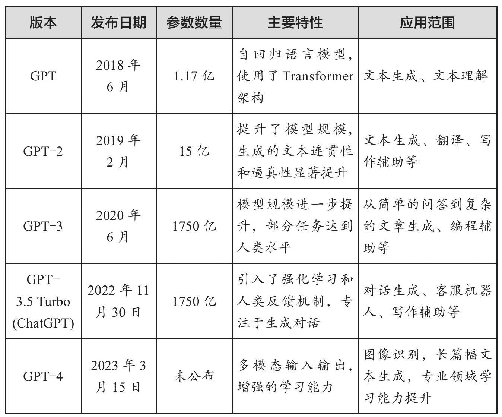

### **5.1.4**

### **自然语言处理发展脉络**

了解 GPT 后，更能体会其背后 Transformer 架构的威力，但这些创新并非凭空出现，而是自然语言处理长期积累的结果。在回顾 GPT 进化后，我们再回溯自然语言处理的发展，看清两者关联，并理解其如何演变为今日形态。

早在 1950 年，艾伦·图灵在论文 Computing Machinery And Intelligence 中首次提出“机器思维”，大胆假设机器可具备思考能力，并给出检验标准：如果一台机器经电传打字机与人交流，超过 30% 的人无法在 5 分钟内分辨对方是人还是机器，则认为该机器拥有人类智能。这就是后来的“图灵测试”。

图灵的挑战点燃了人工智能探索。那时研究者思考智慧的本质：创造力？会用工具？很快发现最具代表性的标志是语言能力。连《西游记》都点明，动物与妖精的分界在于能否言语。因此，让机器与人自然对话成为构建人工智能的核心任务，自然语言处理遂成人工智能的重中之重。让我们回到过去，梳理这一领域从无到有的历程。

自然语言处理可分为初期与发展两大阶段。在统计模型普及前，主要依赖规则驱动，由语言学家手工编写规则和词典处理文本。统计模型的引入转向数据驱动，利用机器学习从大量语料中学习语言规律。随后深度学习的兴起让模型能处理更复杂的语言模式和结构。

**1.自然语言处理的初期阶段**

（1）笨鸟先飞 1950 年。图灵测试的提出标志自然语言处理的起点。当时技术简陋却充满希望，虽显笨拙，为后续研究开启新篇。

（2）神秘密码 1950—1960 年。研究者尝试用规则集模拟人类语言，似在破解神秘密码。试验成果有限，却为后继工作奠定基础。

（3）词汇乐园 1970 年。研究开始在词汇层面探索语言结构，使用朴素贝叶斯、决策树等方法做文本分类。成果有限，但让人意识到自然语言处理的复杂。

（4）数学魔术师 1980 年。贾里尼克的数学模型开始进入自然语言处理，能预测缺失内容，标志着该领域从理论走向实践，进入新阶段。

**2.自然语言处理的发展阶段**

（1）瞎子摸象 1980—1990 年。语言模型像盲人摸象，只能感知语言一隅。通过统计语料库中词频预测下一词，方法有局限，却是规则向统计转型的关键拐点。

（2）初见曙光 2000 年。随着机器学习发展，语言模型开始捕捉更复杂的模式。神经网络的出现如初升的太阳，为领域带来新可能。

（3）词的万花筒 约 2013 年。Word2Vec、GloVe 等词向量模型提出，每个词可在多维空间用向量表示，为理解词间关系提供新视角。

（4）全景视野 2014—2015 年。Seq2Seq 模型让人能看全句，把握整体含义。注意力机制的加入让模型聚焦句中关键部分，语义理解更精确。

（5）变形金刚 2017 年。Transformer 完全采用注意力机制，可处理更长文本序列并理解深层关联，性能大幅提升。

（6）双向神探 2018 年。BERT 采用双向上下文理解，能关联前后文，大幅提升语言理解能力。

（7）文字大厨 2018 年至今。OpenAI 的 GPT 系列像一位文字大厨，擅长生成富创造性的文本，如故事和诗歌。GPT-3 与 GPT-4 的出现让人工智能的语言生成能力攀上新高。

正如所见，人工智能语言模型的发展丰富多样，每一步都开辟新研究并提供新解法，让人机交流愈发自然深入。为便于理解，我们整理出语言模型发展里程碑表格 表 5.2，该表按阶段概述主要特点与技术。

表 5.2 语言模型的发展里程碑

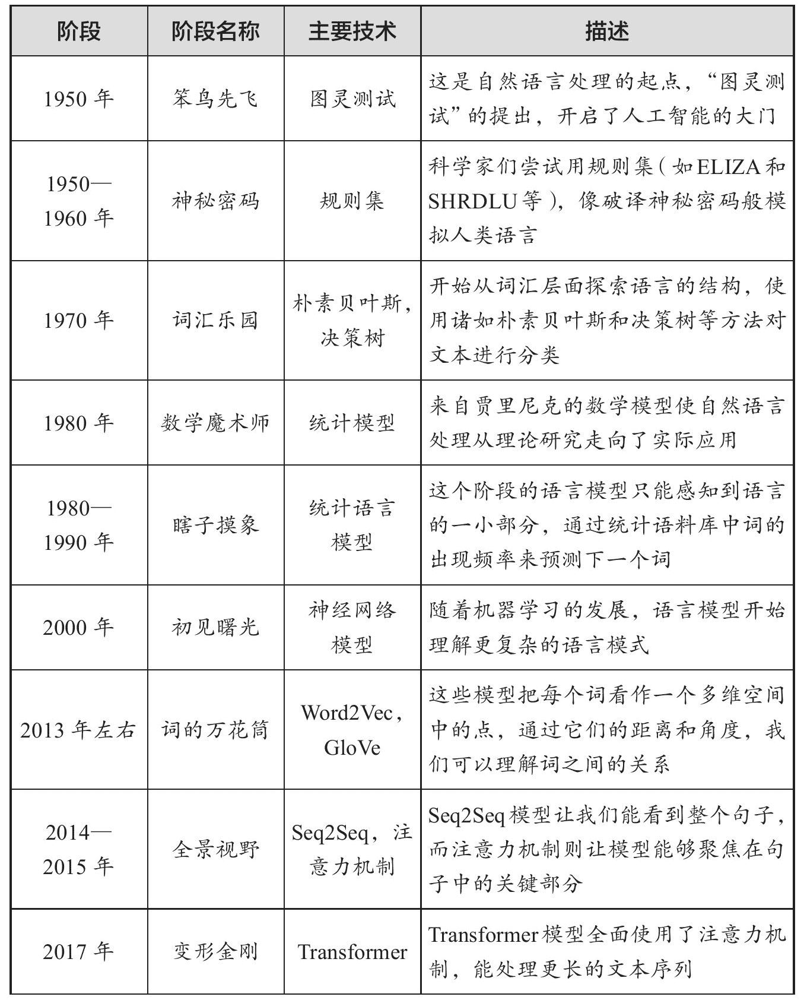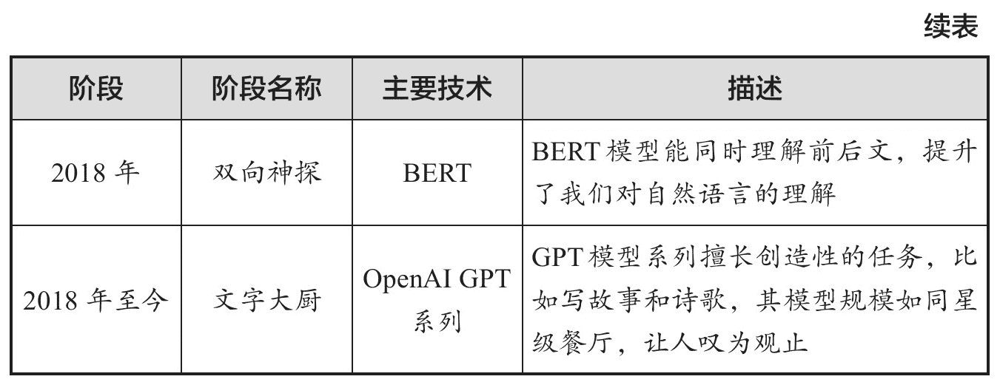

### **5.1.5**

### **与主流语音助手的差异**

你可能用过 Siri，它常驻 iPhone，解答疑问、设闹钟、讲笑话。也可能熟悉天猫精灵，放在客厅播放音乐、控制智能家居。还有小爱同学，驻扎在小米设备里，搜索信息、放歌、播新闻。

在这个智能语音助手林立的世界，ChatGPT 算是新面孔。它不仅新，而且具备独特的魅力和能力，来看与 Siri、天猫精灵、小爱同学的不同。

（1）连贯的对话体验。向 Siri 等助手提问，往往一问一答即结束，像问答游戏。ChatGPT 的对话则像在潺潺小溪中划船，流畅连贯，仿佛与一个真正理解你的人交流。

（2）广博的知识库。Siri 等助手的回答通常有限、预设，如翻阅预编词典。ChatGPT 像深不见底的知识海洋，持续学习，能给出更全面、深入的答案。

（3）个性化体验。传统助手给出的回应对任何人都大同小异。ChatGPT 会结合对话历史，理解偏好与需求，返回更符合期待的回答，像一个真正了解你的朋友。

（4）智能化与生成性。Siri、天猫精灵、小爱同学主要依赖预设答案库。ChatGPT 作为生成式模型，强调智能化，能创造新的、贴合上下文的回应，处理新颖未见问题，并借助海量数据理解语言，提供有深度和个性化的对话。

因此，当你需要一个聊天伙伴时，ChatGPT 会带来不一样、有趣的体验，值得尝试。

### **5.1.6**

### **ChatGPT 未来发展方向**

在谈未来前，先拿出水晶球，因为科技的未来总充满未知与惊喜。让我们一起揭开可能的方向。

首先是更高级的自然语言理解。ChatGPT 已展现出色的理解与生成能力，但仍有提升空间。未来有望更深入剖析复杂句式、更精准把握隐含语义与情感、更好处理歧义。好比不仅听懂话，还能读懂心情，像一个真正的好朋友。

其次是多模态输入输出。现在 ChatGPT 主要处理文本，未来可望理解并生成图像、音频甚至视频，像人类用眼看、用耳听、用口说。这会让它更强大多元，更好服务生活与工作。

再者是个性化趋势。每个人独一无二，未来 ChatGPT 应能更好学习适应用户个性，为每人提供定制化服务，像私人助理般了解并关怀。

最后是应用领域拓展。ChatGPT 已在教育、娱乐、客服等领域展现潜力。随着技术进步，它将服务更多领域，为人类发展作出更大贡献。

总之，ChatGPT 的未来充满希望与可能，真正的图景仍需我们共同探索与创造。

## **5.2**

## **ChatGPT 注册与登录指南**

本节介绍 ChatGPT 的注册与登录流程。首先准备所需材料信息，其次学习初步注册与接码平台操作，最后完成注册并了解基本使用。通过学习，你将能顺利注册登录并开始创作。

### **5.2.1**

### **准备工作**

注册前先了解硬件与软件需求，并准备好设备。

**1.硬件需求**

需一台电脑或手机完成注册。手机可操作，但为更好体验和功能，建议使用电脑。

**2.浏览器选择**

需浏览器访问 OpenAI 网站。推荐 Chrome 或 Edge，兼容性与性能较好。建议开启无痕模式或清除历史记录。

**3.邮箱选择**

注册需提供有效邮箱接收验证码。因国内部分邮箱无法注册 OpenAI，建议使用国外邮箱如 Gmail。请确保能登录并及时查收验证码。

**注意：**ChatGPT 尚未在国内开放注册，注册、登录与使用时需借助相应工具辅助。

### **5.2.2**

### **初步注册 ChatGPT**

进入 ChatGPT 初步注册步骤。

**1.打开网站进行注册**

在浏览器输入 https://chat.openai.com 回车。页面加载后会看到注册与登录界面，左侧 Log in 为登录，右侧 Sign up 为注册，点击 Sign up，如图 5.1 所示。

图 5.1 注册界面

**2.输入邮箱**

会出现四种注册方式。三种为一键登录：Google 账号、微软账号、苹果账号。也可直接输入预备好的邮箱，注意仅支持国外邮箱。演示选择输入邮箱，填入后点击 Continue 继续，如图 5.2 所示。

**3.设置密码**

需输入登录 ChatGPT 的密码，可与邮箱密码不同，但务必牢记，输入后点 Continue 继续，如图 5.3 所示。

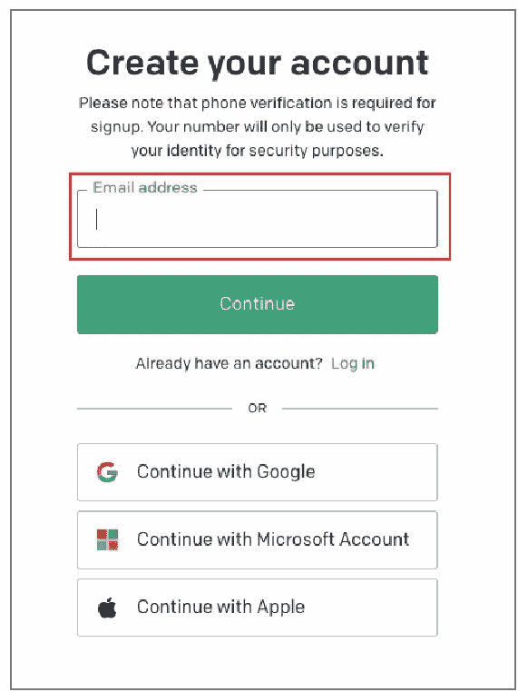

▲图 5.2 输入邮箱界面

图 5.3 输入密码界面

**4.验证邮箱**

若出现此界面，说明官方已向邮箱发送验证邮件。需前往邮箱确认，如未收到可点下方 Resend email 重新发送，如图 5.4 所示。

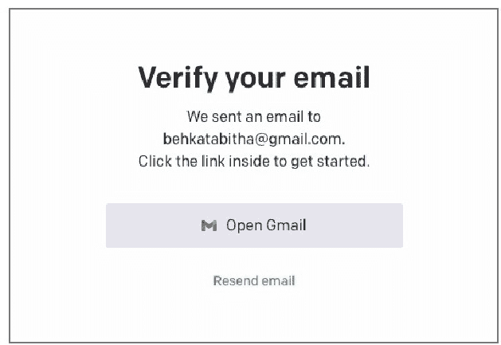

图 5.4 邮件验证界面

**5.设置基本信息**

验证成功后需输入姓名与生日。英文中 First name 为名字在前，Last name 为姓氏在后，填写可不为真实姓名。下方的 Birthday 填写生日，完成后点 Continue 继续，如图 5.5 所示。

**6.保留验证手机号界面**

此时需用国外手机号接收验证码完成验证。后续会介绍如何获取接码平台手机号。请勿关闭本页，另开页面注册接码平台账号，稍后返回此界面，如图 5.6 所示。

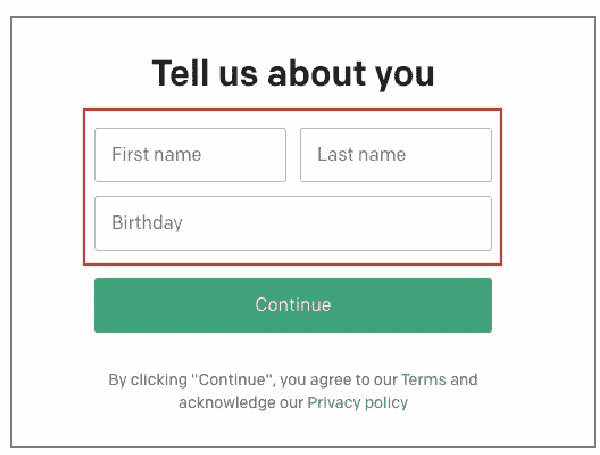

▲图 5.5 输入基本信息界面

图 5.6 验证手机号码界面

### **5.2.3**

### **注册接码平台**

接码平台用于获取 ChatGPT 注册所需的手机验证码。

**1.打开接码网站并注册**

另开页面访问 https://sms-activate.org/，点击右上角注册，使用邮箱注册，如图 5.7 所示。该站对注册邮箱无限制。若收不到验证码，可多次重发或检查垃圾邮件。

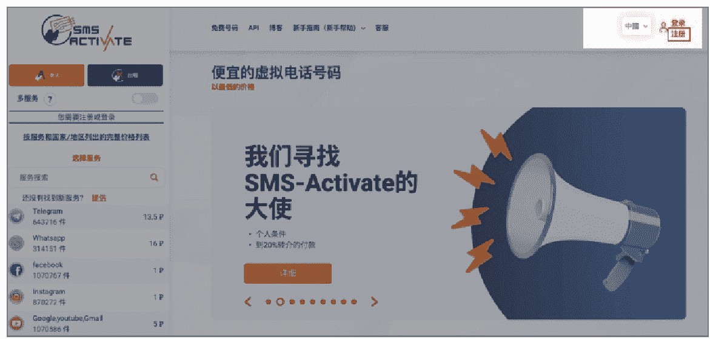

图 5.7 接码平台注册界面

**2.在接码平台上进行充值**

点击右上角充值按钮，使用支付宝支付，如图 5.8 所示。最低充值 2 美元，初期支付 2 美元即可。注意单位为美元。

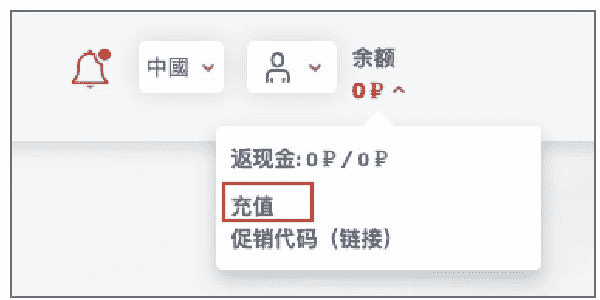

图 5.8 充值入口界面

**3.购买临时手机号**

充值后在左侧输入框输入 openai，选择合适的接收验证码号码，如图 5.9 所示。推荐印尼手机号性价比更优。

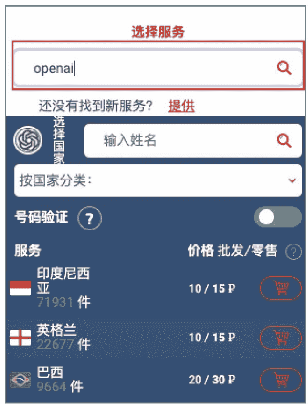

图 5.9 购买手机号界面

**4.复制手机号**

购买成功后系统分配一个临时手机号用于接收验证码，如图 5.10 所示。验证码有效期约 20 分钟，未收到可取消订单，费用退回账户。如需尝试其他国家号码，可重新选择。

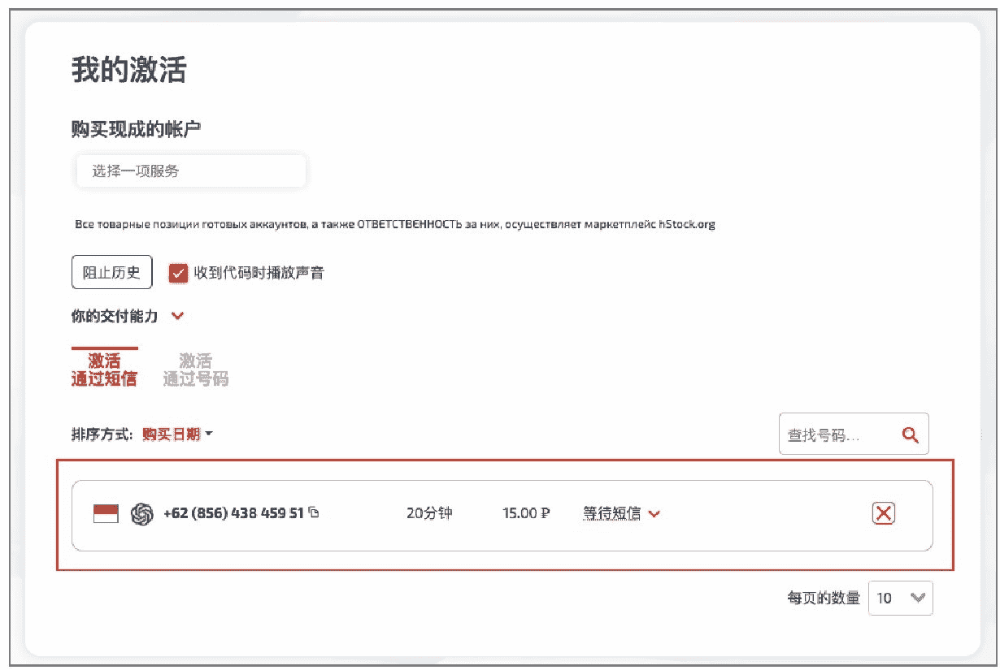

图 5.10 临时手机号界面

### **5.2.4**

### **完成 ChatGPT 注册**

已注册接码平台并准备好验证码，现在完成 ChatGPT 注册。

**1.输入复制的手机号**

保留接码平台页面，返回 ChatGPT 注册填写手机号的界面，将接码平台获得的手机号码填入，点击 Send code 获取验证码，如图 5.11 所示。

图 5.11 输入手机号界面

**2.去接码平台复制验证码**

接下来的验证码会推送到你刚才使用的接码平台，记得及时查看。找到之后直接复制即可，对应界面如图 5.12 所示。

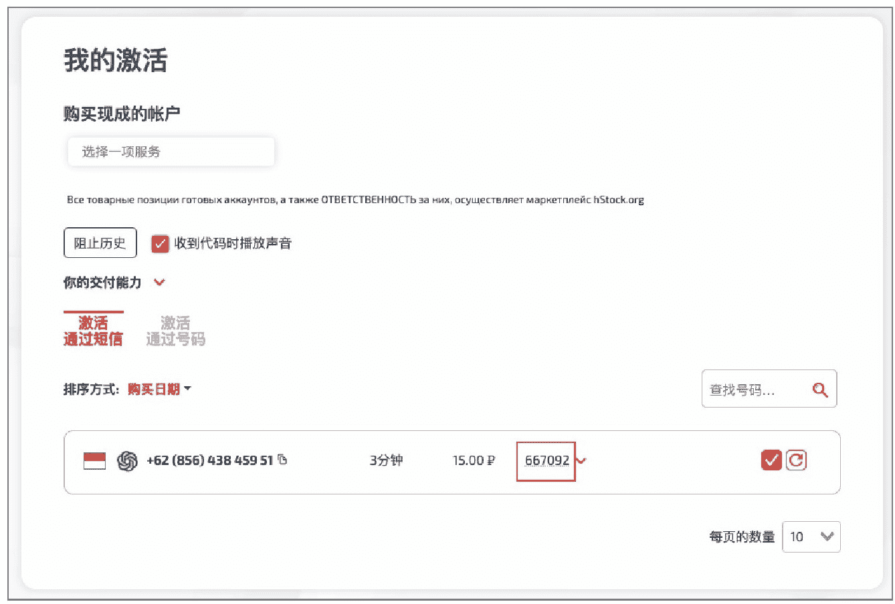

图 5.12 接收验证码界面

**3.输入验证码**
最后一步，把复制到的验证码粘贴到 ChatGPT 的输入框中，如图 5.13。提交后系统会自动校验并跳转，注册流程也就结束了。

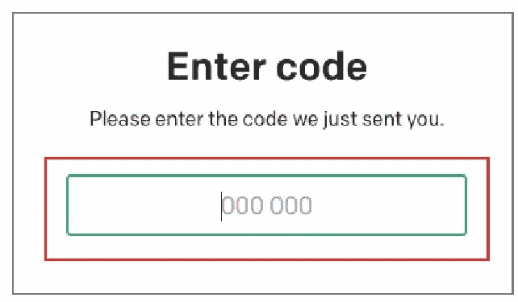

图 5.13 输入验证码界面

### **5.2.5**
### **ChatGPT 的基本使用**
注册完成后会进入 ChatGPT 的主面板，如图 5.14 所示。整体由底部输入区、上方结果展示区以及一些个性化设置构成。

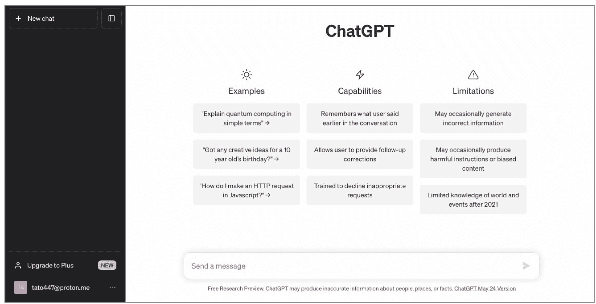

图 5.14 ChatGPT 主界面

下面拆解主要组成部分。

**1.输入框**
输入框位于页面底部，是你与模型交互的入口。在这里输入问题、需求或任意文本，按回车或点击发送键即可。

开始使用前有件事要说明：ChatGPT 能直接用你当前使用的语言对话。你用中文提问，它就会用中文作答，无需开启页面翻译功能。实际上若强行开启翻译，反而容易出现错误，所以不建议这样做。

**2.输出界面**
输出区在页面上方，会展示模型生成的回答、建议或响应。它会依据你的输入给出对应的文字反馈，帮助你解决问题或获取信息。

**3.设置选项**
主界面还提供了多种自定义设置。可以切换界面主题、选择模型版本例如 GPT-3.5 Turbo、导出历史记录等。

现在做一次初体验。在输入框里输入一个简单提问，比如“你好，你是谁？”，回车后几秒钟就能在输出区看到模型的回复，如图 5.15 所示。

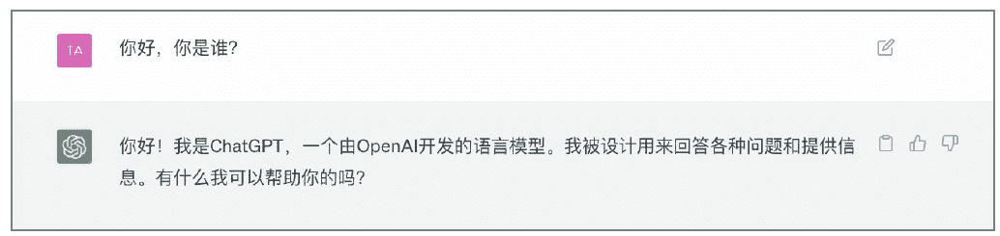

图 5.15 输出界面

若觉得回答不够理想，可以换一种说法重新提问，或补充更多背景信息。也可以点“拇指向下”给出反馈，这既能帮你更快得到想要的结果，也有助于 OpenAI 优化模型。

到这里基础交互就掌握了。接下来将介绍 ChatGPT 在不同场景中的实际应用。

## **5.3**
## **ChatGPT 的应用**
本节会重点梳理 ChatGPT 在演讲、智能客服、智能对话助手、机器翻译、智能写作和智能教育等领域的广泛落地。我们通过具体案例呈现它如何解决实际问题、提升效率，揭示其作为技术工具在改善表达、优化服务、促进跨文化沟通、辅助创作和个性化学习方面的潜力。

### **5.3.1**
### **在演讲领域中的应用**
用 ChatGPT 来打磨演讲既有趣又高效。你可以询问如何搭建演讲框架、如何设计吸睛的开场、如何收束主题。凭借内容生成能力，它能结合你的具体需求给出定制化的建议和点评。

它也能参与演讲稿的撰写。先把主题抛给它，让它基于主题展开内容，或直接请它给出思路。这有助于厘清思路，让演讲更有吸引力和说服力。

此外，还能针对特定听众或场合做优化。无论面对行业专家还是普通大众，都可以通过对话让它帮你选择合适的用词和语气，并提示如何突出重点，引导听众关注。

总体来看，ChatGPT 可以充当私人演讲教练，在结构、表达、互动等多个维度提升你的演讲表现力。

### **5.3.2**
### **在智能客服领域中的应用**
你是否遇到过在线客服等待久、回复慢、解决不了问题的状况。现在 ChatGPT 为智能客服提供了新的解法。

想象一个智能客服能用自然流畅的语言与你交流，理解需求并给出准确方案。它还能跨语言跨文化使用，不受地域限制，无论你说哪种语言都能无障碍沟通。

依托自学习能力，智能客服的知识和技能会不断进化，能应对从常见问答到复杂技术问题的各类场景，提供高效、精准且个性化的体验。

举个例子，在淘宝浏览商品时对尺码或材质存疑。过去需要手动文字沟通或打电话。现在直接在聊天窗口问：“这件 T 恤尺码偏大还是偏小？”“面料是纯棉吗？”，ChatGPT 会立刻给出明确答复，还能结合你的偏好和购物历史推荐相似款式。

这种体验节省了时间，也带来了更贴心的购物建议，让决策更轻松。可见在电商客服等场景中，ChatGPT 能显著提升用户满意度，并为平台提供更可扩展的服务能力。

### **5.3.3**
### **在智能对话助手领域中的应用**
假设你是一位年轻创业者，即将在一场创业大会上演讲，介绍你的创新产品。你有些紧张，因为这是争取投资的关键时刻。

好在你有一个得力助手——ChatGPT。在准备阶段，你把创业故事、产品亮点和商业愿景告诉它，它迅速生成一个生动的开场白来抓住听众，还提供了关键市场数据和成功案例来支撑观点。

它不仅能帮你写稿，还能扮演虚拟听众。你可以问：“这个产品在市场上的潜力如何？”“怎样更好地展示产品的独特性？”，它会通过对话给出见解和优化建议，帮你完善内容。

演讲当天，你更有底气地上台。流畅的表现与观众的互动都更自然，赢得掌声和投资方的关注。ChatGPT 不只是对话助手，更是舞台上的伙伴，让准备更轻松、表现更出彩。

### **5.3.4**
### **在机器翻译领域中的应用**
设想你在国外餐厅，菜单全是看不懂的菜名。打开手机用 ChatGPT 扫描翻译，它就能把每道菜的成分和口味流畅地译成你熟悉的语言，让点餐变得轻松。

在商务场景同样好用。作为市场部经理，你需要给海外伙伴发邮件，ChatGPT 能迅速把内容译成对方母语，保证沟通准确顺畅。

它还能提供文化背景解释。比如发祝贺短信时，它会提示当地的习俗和礼仪，让表达更贴合对方文化。

机器翻译让世界更紧密。无论旅行、商务还是跨文化交流，ChatGPT 都能作为私人语言向导，跨越语言障碍带来更广阔的合作机会。

### **5.3.5**
### **在智能写作领域中的应用**
写作常让人耗时耗力，有了 ChatGPT 过程会更轻松、有趣且高效。

想象你正在写长篇小说，遇到创意枯竭或人物塑造不充分的问题。你可以把背景、设定和情节思路分享给它，它会基于强大的语言处理和创造力提供新颖点子、精彩情节和生动对话，让作品更吸引人。

适用范围远不止小说。写公众号文章、商业报告，甚至写一封“世界那么大我想去看看”的辞职信，它都能提供灵感、帮助梳理逻辑、优化句式并提醒写作技巧。

它还能做语法纠正、词句替换和文风调整，提升文章质量。不管是学生作业还是专业稿件，都能获得实用帮助和创意支持。

智能写作正在改变创作方式，ChatGPT 将成为你开启高效创作旅程的得力伙伴。

### **5.3.6**
### **在智能教育领域中的应用**
随着技术发展，智能教育成为新趋势。ChatGPT 为学习和教学带来了革新。

从学习者角度看，学外语时常卡在语法和词汇。传统方式枯燥且缺乏个性化，而 ChatGPT 可以实时对话，解释规则、给出例句、提供个性化指导。

例如问：“英语里冠词该怎么用？”，它会解释：“冠词用来表示名词的特定或泛指。‘The’指特指，‘a/an’指泛指。例如‘The cat is on the table’特指某只猫，‘An apple a day keeps the doctor away’指泛指的苹果。”

这种互动让理解更直观，表达能力提升更快。

对教师而言，它可以扮演虚拟学生，回答关于课程、困惑和作业的问题，提供详细解答。它还能协助编写教材、设计课程、制作教学视频，提供思路和创意建议，让教学更具吸引力。

智能教育让学习更个性、高效、有趣，ChatGPT 正推动教育走向更美好的未来。

# **第六章**
# **如何编写提示词**
在 ChatGPT 中，用户输入的内容称为提示 Prompt。它可以是问题、陈述或场景描述，是对话的起点，决定了模型后续的响应方向。因此写好提示至关重要。本章将讲解提示编写的基本原则和结构，并结合实践加深理解。

**注意：**学习时请认真理解各部分内容，并通过实际练习巩固。

## **6.1**
## **编写提示词的原则**
向 ChatGPT 发提示，就像给一个聪明但不了解任务细节的人下指令。当回复不理想时，往往是因为指令不够具体。

比如只说“为我写一篇演讲稿”，得到的结果可能大相径庭。若明确说明主题、听众、时长、风格等细节，模型就能生成更符合预期的稿件。你甚至可以指定模仿某位作家的风格。

如同指导应届毕业生，先提供参考资料能提高效率，对 ChatGPT 的提示也是同样的道理。下面将探讨如何让提示更具体、更具引导性。

### **6.1.1**
### **第一个原则：明确具体的指令**
第一原则是把指令写得清晰具体。这样能引导模型朝着期望方向思考，降低无关或错误输出的概率。

需要强调的是，明确不等于简短。详细的提示往往提供更多上下文，能让输出更精细、更相关。

提升明确性的技巧之一是使用分隔符。通过明显的分隔符清晰划分指令和待处理内容，能让模型更准确地识别，避免混淆。你可以用三个相同符号如 ===、 ““”、或 XML 标记 <tag></tag> 等。

分隔符还能防止提示注入，即用户输入的内容覆盖或干扰原始指令。

用户：

帮我概括以下内容：在开场时，使用一个引人注目的事实、引用或故事来吸引听众的注意力。例如，可以介绍全球气温升高的速度、极端天气事件的增加或影响到人类和自然生态系统的案例。

**ChatGPT：**

在开场时，我们可以使用一个引人注目的事实、引用或故事来吸引听众的注意力。例如，我们可以提及全球气温升高的速度、极端天气事件的频繁发生及对人类和自然生态系统的影响。全球气温升高的速度之快令人惊讶。根据最新科学研究，过去几十年间，地球的平均气温已经上升到了一个惊人的程度。这种上升的趋势导致了极端天气事件的频繁发生，比如严重的热浪、干旱、洪水和飓风等。这些事件给人类社会和自然生态系统带来了巨大的影响。例如，许多地区正在经历长期的干旱，导致农作物歉收、水资源短缺和食物危机。同时，海平面上升也威胁到沿海城市和岛屿的存在。这些情况提醒我们，必须认真对待气候变化问题，并采取积极的行动来保护我们的地球和未来的生活环境。

如果加入分隔符，模型就能清楚区分指令和内容，正确执行概括任务。

用户：

帮我概括以下内容。

===

在开场时，使用一个引人注目的事实、引用或故事来吸引听众的注意力。

例如，可以介绍全球气温升高的速度、极端天气事件的增加或影响到人类和自然生态系统的案例。

===

**ChatGPT：**

开场时，通过引人注目的事实、引用或故事来吸引听众的注意力，可以提及以下内容之一：全球气温升高的速度、极端天气事件的增加或对人类和自然生态系统的影响。

**2.技巧二：利用结构化输出**

## 用格式锁定输出，直接拿来用

想让结果可直接复用，最省事的方式是把呈现样式先写死。把 HTML、JSON、Markdown 或表格这类结构化载体写进指令，模型就会按这个外形来填充内容。比如让它虚构三本演讲主题图书并按书名、作者、类型整理成表格，得到的就是能直接贴进演示文稿的整齐资料，省去二次整理。

用户：

帮我生成三本虚构演讲类图书的详细信息，包括书名、作者和类型，并以表格格式呈现。

**ChatGPT：**

当然可以！以下是三本虚构演讲类图书的详细信息，按照书名、作者和类型的顺序排列。

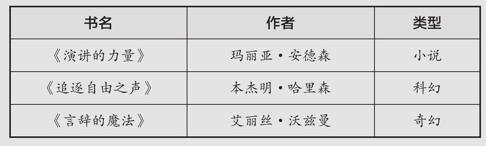
**3.技巧三：先验条件再执行**

思路是先让模型对任务前提做一次可行性校验。指令里一旦包含不一定能兑现的限制，就先让它判断前提是否成立，成立才继续，不成立则给出说明并中止。边界情况也要提前预设，模型卡住时要有体面的退出路径，避免出现不可控的错误。

下面用抽取步骤来演示。给一段关于写演讲稿的说明，只要原文里有可执行的步骤就按约定格式重排，没有就统一返回“未发现”。从返回结果看，模型成功识别出步骤并按序输出。

用户：

===

写演讲稿的步骤如下：确定主题，明确目标受众，收集资料，确定演讲结构，编写大纲，撰写草稿，编辑修改，添加引言和结尾，排版格式化，练习演讲。首先确定主题，明确目标受众，收集相关资料。然后确定演讲结构和大纲，撰写草稿，并进行编辑和修改。之后添加引言和结尾以吸引听众，并进行排版和格式化使其易读。最后通过多次练习提高演讲技巧。

===

我为你在上方提供了由三个等号分割的文本，如果文本包含按步骤进行的指令，请使用以下格式重新编写这些指令。

===

步骤一：……

步骤二：……

……

步骤 N：……

===

如果文本不包含按步骤进行的指令，那么只需写“未发现”。

**ChatGPT：**

步骤一：确定主题。

步骤二：明确目标受众。

步骤三：收集资料。

步骤四：确定演讲结构。

步骤五：编写大纲。

步骤六：撰写草稿。

步骤七：编辑修改。

步骤八：添加引言和结尾。

步骤九：排版格式化。

步骤十：练习演讲。

换成一段没有步骤指引的演讲感言，用同样提示测试。模型判断不出步骤，准确返回了“未发现”。

用户：

===

在未来的日子里，我希望每一个在座的人都能在自己的领域中展现出领导力，这不仅仅是为了自己，更是为了我们共同的社区，我们的世界。每个人都有能力影响他人，所以每个人都有责任去展现领导力。这就意味着，我们要有勇气去接受挑战，去决定方向，去激励他人。

===

我为你在上方提供了由三个等号分割的文本，如果文本包含按步骤进行的指令，请使用以下格式重新编写这些指令。

===

步骤一：……

步骤二：……

……

步骤 N：……

===

如果文本不包含按步骤进行的指令，那么只需写“未发现”。

**ChatGPT：**

未发现

**4.技巧四：用少量示范牵引风格**

另一个思路是借助少量示例来引导表达。先让模型看一个同类任务的问答，用来锁定语言习惯，再让它处理新问题。提示里要明确要求保持风格一致。

先给一个参考，问题“你会为失败而遗憾吗？”回答“我认为自己不会为尝试后的失败而遗憾，反而那些想做却从未付诸行动的事情会一直困扰着我。”有了这个参照，再问“你会为放弃而后悔吗？”时，模型会延续相近的表达，产出类似“我认为不会为放弃而后悔，因为放弃也是一种选择，有时放弃可以让我们更专注于更有价值的事情。只要我认真思考并采取了适当的行动，我就能接受这个决定，并从中学习。”的回复。

用户：

你的任务是以一致的风格回答。

===

问题：你会为失败而遗憾吗？

回答：我认为自己不会为尝试后的失败而遗憾，反而那些想做却从未付诸行动的事情会一直困扰着我。

问题：你会为放弃而后悔吗？

===

**ChatGPT：**

我认为自己不会为放弃而后悔，因为放弃也是一种决策，有时放弃可以帮助我们更好地专注于更有意义的事情。只要我认真考虑并采取了适当的行动，我会接受放弃的结果，并从中学习。

### **6.1.2**
### **第二个原则：给模型留出“思考”的时间**

模型因赶速度而误判时，可以把提示拆成推理链，让它先走完思考过程再给结论。任务越复杂、越求即时，猜测概率越大。现实里让人一秒解难题也会出错，所以面对复杂指令，尽量让模型慢下来多推几步，相应会耗费更多计算。

下面介绍争取思考时间的两种做法。

**1.技巧一：在指令里明确步骤**

先看一个只写目标、未给流程的复杂需求。要求把一段英文“The most precious thing in this world is the human brain.The most valuable asset we have is that we’ve all gone through tough days and tough experiences, and a lot of failures and mistakes.It is because of our tough lives that we are different”，整理成表格，含中文一句话总结和关键词。输出虽然有，但质量明显偏低。

用户：

以表格形式输出一句话的中文总结和中文关键词。

===

The most precious thing in this world is the human brain.The most valuable asset we have is that we’ve all gone through tough days and tough experiences, and a lot of failures and mistakes.It is because of our tough lives that we are different.

===

**ChatGPT：**

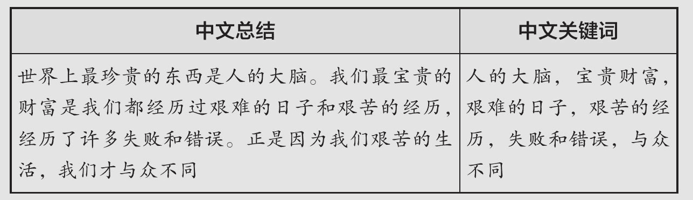
改成带流程的版本，效果会更好。保留原文，要求模型依次执行四步：先用英文把原文概括成一句话，再译成中文，接着从中文里抽关键词，最后以表格呈现总结和关键词。

用户：

===

The most precious thing in this world is the human brain.The most valuable asset we have is that we’ve all gone through tough days and tough experiences, and a lot of failures and mistakes.It is because of our tough lives that we are different.

===

执行以下操作。

1.用一句英文总结上方三个等号里面的文本

2.将总结的文本翻译成中文

3.在中文文本中提炼关键词

4.以表格形式输出一句话的中文总结和中文关键词

**ChatGPT：**

The human brain is the most precious and valuable asset shaped by tough experiences and failures, making us unique.

人类大脑是最珍贵和宝贵的资产，它是在艰难经历和失败中塑造出来的，使我们与众不同。

关键词：人类大脑、珍贵、宝贵、资产、艰难经历、失败、与众不同

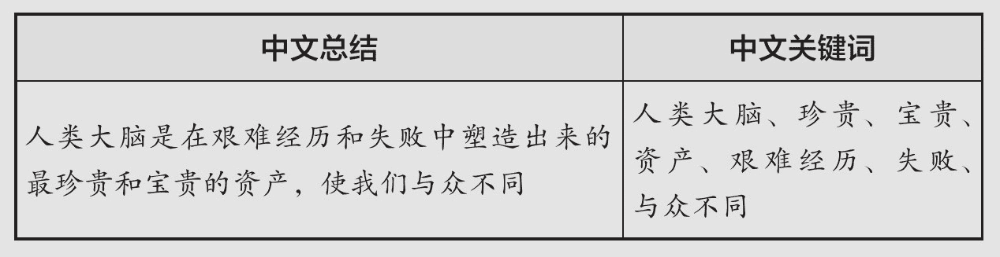
**2.技巧二：先自检再下结论**

另一种做法是要求模型在下结论前先理清思路。明确让它先梳理逻辑再判断，通常能得到更稳妥的答案，这与给模型时间思考的原则一致。就像人先自己想明白再评价他人一样。

演示时用一道会议开支计算题和学生的解法，让模型判断对错。

用户：

判断学生的解决方案是正确还是错误。

===

问题：

我正在准备一个学术会议，需要帮助计算开支。

酒店住宿费用为 500 元/人

我可以 150 元/人的价格订购到三餐

我已经联系好了酒店会议场地，需要固定开支 1 万元，并额外支付每人 50 元

参会人数作为函数，这次会议的总费用是多少

学生的解决方案：

设 x 为参加会议的人数，单位为人。

费用：

酒店住宿费用：500x

餐饮费用：150x

酒店会议费用：10000 元+500x

总费用：500x+150x+10000 元+500x=1150x+10000 元

===

**ChatGPT：**

学生的解决方案是正确的。他们正确地列出了各项费用，并将参会人数作为函数。总费用的计算也是正确的，通过将各项费用相加得到总费用的表达式：1150x+10000 元。这个表达式反映了会议总费用与参会人数之间的线性关系。

实际上，学生的回答是错误的。他们计算的酒店会议费用为 10000 元加 500x，但真正的费用应该是 50x，这是因为每增加一名参会者只需多支付 50 元，这里的 x 代表参会人数。所以，正确的费用应该是 700x 加 10000 元，而不是 1150x。

如果我们像上述案例中那样直接询问 ChatGPT，它很可能会判断学生的回答是正确的，因为 ChatGPT 只是粗浅地阅读了问题，就像我们在面临一个复杂问题时，未能深思熟虑，便草率做出错误的判断。

因此，我们可以通过引导 ChatGPT 先自行解答问题，然后再将其解答与学生的解答进行比较，以此来解决这个问题。这可以通过使用一个更详细的提示词来实现。我们可以向模型提示如下。

你的任务是判断学生的解决方案是正确还是错误。要解决这个问题，请执行以下步骤。

（1）自行解答问题。

（2）将你的解答与学生的解答进行比较，并评估学生的解答是否正确。

在完成你自己的解答之前，不要决定学生的解答是否正确。务必确保你自己已经解决了这个问题。

用户：

你的任务是判断学生的解决方案是正确还是错误。要解决这个问题，请执行以下步骤。

（1）自行解答问题。

（2）将你的解答与学生的解答进行比较，并评估学生的解答是否正确。

在完成你自己的解答之前，不要决定学生的解答是否正确。务必确保你自己已经解决了这个问题。

===

问题：

我正在准备一个学术会议，需要帮助计算开支。

酒店住宿费用为 500 元/人

我可以 150 元/人的价格订购到三餐

我已经联系好了酒店会议场地，需要固定开支 1 万元，并额外支付每人 50 元

参会人数作为函数，这次会议的总费用是多少

学生的解决方案：

设 x 为参加会议的人数，单位为人。

费用：

酒店住宿费用：500x

餐饮费用：150x

酒店会议费用：10000 元+500x

总费用：500x+150x+10000 元+500x=1150x+10000 元

===

**ChatGPT：**

我的解答：

设 x 为参加会议的人数，单位为人。

费用：

酒店住宿费用：500 元/人*x 人=500x 元

餐饮费用：150 元/人*x 人=150x 元

酒店会议费用：10000 元+50 元/人*x 人=10000 元+50x 元

总费用：500x 元+150x 元+10000 元+50x 元=700x 元+10000 元

学生的解决方案：

总费用：1150x 元+10000 元

评估学生的解答：

从学生的解答中，费用计算部分的表达式是正确的，计算公式包括了酒店住宿费用、餐饮费用和酒店会议费用。但是，学生的解答中将费用的计算公式写成了总费用等于 1150x 元加上 10000 元，这是不正确的。正确的表达式应为总费用等于 700x 元加上 10000 元。

因此，学生的解答在费用计算的公式上存在错误。

先让模型自己算出正确结果 700x+10000，再与学生答案对比，就能准确发现错误。可知，给模型自检和分步处理的时间，能显著提升判断精度。

### **6.2**
## **了解提示词的结构**

写好提示不仅靠技巧，也要懂结构。一个有效的提示本质上是一次清晰的任务交接，一般由角色、背景、任务描述、具体要求和输出格式等模块构成。这些要素能帮助模型准确把握你的意图。下面就展开介绍常见的提示结构，其中包括角色设定、上下文提供、任务创建、要求说明和输出规范等。

### **6.2.1**
### **角色设定**

先聊聊角色设定。ChatGPT 本质上是一个聊天助手，默认就是来答疑解惑的。这种通用定位让它能应付各种话题。

如果想要更专业的输出，就可以给它指定身份。比如让它“扮演一名演讲教练，指导如何缓解上台紧张”。这时模型会从教练的角度切入。

角色设定主要有三方面价值：

**1.定位信息源**
指定角色相当于告诉模型从哪个专业视角出发，比如医生、科学家或演讲教练，回答会更贴合预期。

**2.调整语言风格**
角色不同，表达方式也不同。商业分析师会用正式术语，卡通人物则会更活泼轻松。

**3.引导对话方向**
设定角色能牵引后续走向，比如写故事时指定骑士或巫师人设，模型会围绕该人设续写。

下面对比一下未设角色和设为演讲教练时的差异。直接问“告诉我关于上台前紧张的信息”，得到的回答面面俱到但不够聚焦。

用户：

告诉我关于上台前紧张的信息。

**ChatGPT：**

上台前紧张是指在即将进行公开演讲、表演或其他公众活动之前，人们可能会感到紧张、焦虑或不安的情绪状态。这种紧张感是很常见的，许多人都会经历这种情况，无论他们是经验丰富的演讲者还是初次亮相的新手。

以下是关于上台前紧张的一些信息。

1.生理反应：上台前紧张可能会导致一系列生理反应，例如心跳加快、出汗、呼吸急促、口干舌燥、肌肉紧张等。这些反应是身体自动应激反应的一部分，可以视为身体准备迎接挑战的方式。

2.心理压力：上台前紧张也与心理压力有关。人们可能会担心自己的表现、被听众评判、忘词或犯错等。这些压力源于对表现的期望、自我要求及对他人评价的担心。

3.影响表现：对一些人来说，上台前紧张可能会对他们的表现产生负面影响。紧张情绪可能导致思维紊乱、注意力不集中、声音颤抖、手抖等。然而，对于其他人来说，适度的紧张感可能有助于提高专注力和表现力。

4.应对方法：有许多方法可以应对上台前的紧张情绪，包括深呼吸、积极的自我暗示、充分的准备、多次实践演讲、尝试放松的体育锻炼等。寻求支持和鼓励也可以帮助减轻紧张感。

5.经验和训练：随着经验的积累和训练的进行，许多人发现自己能更好地应对上台前的紧张情绪。演讲者、演员和公众人物通常会通过反复实践和接受反馈来提升自己的表现，并逐渐减少紧张感。

请记住，上台前紧张是很正常的反应，许多成功的人士都会经历这种情绪。重要的是学会管理和应对紧张感，以便充分发挥自己的潜力。

然而，当我们设定 ChatGPT 的角色为“演讲教练”并提出同样的问题时，它的回答会更加专业，更加具有针对性。

用户：

上台前心跳乱了？先拆解紧张的本质

作为一名带过很多新手的演讲教练，我对上台前的焦虑太熟悉了。下面用更直白的方式，把你需要知道的关键点说清楚。

1. 紧张是常态。即将在公众面前开口，产生不安几乎是人类的默认设置。哪怕是台上很稳的老手，临场也会带点波动。
2. 身体在报警。心跳变快、手心冒汗、声音发抖、腿软，这些都源于自主神经的应激反应，并不代表你不行，只是不习惯把能量用对地方。
3. 准备是底气。越熟悉稿子、越多次演练，自信就越厚实。给自己留出足够的时间反复过流程，会在脑中形成安全感。
4. 换个视角看紧张。别把它当成敌人，视作身体在为挑战做热身。把这股战备感转化为表现的燃料，状态会完全不同。
5. 调气和放鬆。临场前做几次缓慢深呼吸，配合肩颈、面部的放松动作，甚至几分钟的冥想，都能让神经降温回到专注。
6. 用经验磨平。越多上台，适应力越强。每一次分享都是数据积累，复盘得失后，下一次的紧张阈值就会降低。
7. 记住观众是盟友。大多数听众是友善且期待你成功的。适度眼神接触、一个自然的微笑，都能让你感受到支持而不是审视。

总之，上台前紧张不丢人。靠充分准备和积极的自我解读，就能把这份能量稳稳变现为表现。

把角色和语境给清楚，ChatGPT 的回答才更有用。在和模型交流时，清晰的角色设定能让回复更贴合、更有针对性，也让对话更生动。

### 6.2.2
### 给 AI 充足的背景

你一定在语文阅读里学过「联系上下文」。上下文就是语境，是理解词义的背景。我们和 ChatGPT 对话也一样，背景信息越全，理解越准。

开始对话时
没有背景时，模型只能凭字面猜。但如果你主动补上场景，它就能给出更精准的建议。比如演讲的例子，你可以这样补背景：「我是个要参加选拔赛的初级讲者，同学老师都对我有期待。可一想到可能失误让大家失望，我就非常慌，心跳加速、手心出汗，甚至想逃。假设你是我的演讲教练，请告诉我上台前怎么调节紧张。」

这段背景说明了你的身份、赛事性质、心理压力来源和具体生理反应，有了这些，模型才能给出针对性强的办法。

用户：
我快要参加一次选拔赛，演讲经验不多。老师和同学都对我抱有很大期望，一直在为我打气。可是一想到自己可能表现不好让他们失望，我就慌乱起来，心跳很快、手心发汗，有时甚至冒出想逃的念头。请你扮演我的演讲教练，教教我该怎样在上台前处理这种紧张。

ChatGPT：
我能体会你现在的压力。请先知道，这样的焦虑很正常，越在乎结果，紧张感就会越强。好消息是，这份在意恰恰说明你重视这次机会。下面给你几招可以马上用的方法。

1. 承认并接纳。把紧张理解为对比赛的在乎，而非负面标签。它在提醒你想做好、想对得起支持你的人。
2. 把准备做扎实。确认自己已经尽力准备，知识和流程都已过一遍，这会直接降低不确定感。
3. 用呼吸稳住。感到绷紧时，做几组缓慢深呼吸，帮助身体从应激状态回落。
4. 对自己说积极的话。试着转换内在语言，例如「我已尽力，无论结果如何，我都值得尊重。」
5. 活动身体释放。做一些轻度拉伸或简单的瑜伽动作，把多余的紧张能量消耗掉。

最后记住，能走到台上挑战自己就已很值得。结果只是过程的一个注脚。

对话过程中
一次对话里，前面的内容就是上下文。同一会话中模型会尽量保持连贯。但当对话变长或话题漂移，它可能会忽略早前的细节。这时可以用简短提示召回，例如「正如我们之前讨论的……」「你之前提到过……」「回想一下我们刚才聊的……」，帮助模型重新对齐语境，得到更连贯的回复。

### 6.2.3
### 明确要让 AI 做什么

创建任务就是把需求说清楚：你希望模型执行什么。任务可以是回答、写作、辅导、翻译或练习。明确的任务能让输出更可控。

比如「请写一篇环保主题的演讲稿」「解释量子力学的原理」「把这段文字翻成法语」「续写我开始的故事」「给我一些面试建议」。这些指令都很清晰。

但清晰不等于足够。以「写一篇环保演讲稿」为例，模型知道主题，却不知道受众、语气、深度，往往会产生空泛的文本。所以任务要搭配具体的背景和要求才更有效。

### 6.2.4
### 给任务加细节要求

任务要求是把执行标准细化：语气、术语、步骤、专业度等。要求越具体，结果越贴近预期。

例如「写一篇面向中学生的环保演讲稿，语言简洁、有趣，能给出可操作的建议」；「用外行能懂的语言解释量子力学，假设我没有物理基础」；「把下面文字翻成正式书面的法语」；「续写我的故事，要求悬疑推理、角色皆为动物，且有出人意料的转折」。

这些限定让模型知道对象、风格和内容边界，输出才更符合预期。

### 6.2.5
### 约定输出的形式

输出要求是指明结果的形式：篇幅、结构、情绪倾向、语言等级。

常见例子：篇幅「请控制在500字以内」；结构「按正式商业报告格式写产品分析」；情绪「用激励性的语言撰写」；语言「用非正式的日常用语解释量子物理」。

设定输出要求能更精细地操控结果。需要注意，模型会尽力满足，但复杂要求下可能仍需微调。

表 6.1 ChatGPT 提示词结构框架

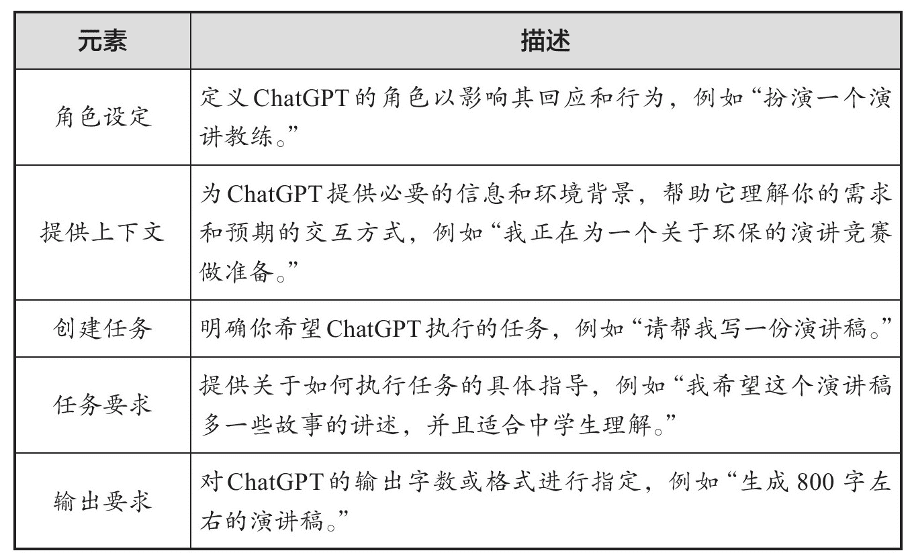
这是常见的提示词框架，掌握它能大幅提升沟通效率。随着使用深入，你可以基于它创新出更符合特殊需求的结构。

# 第七章
# 用 ChatGPT 打造演讲稿

演讲不只是文字，还涉及受众、目的、逻辑和感染力。本章讲如何借助 ChatGPT 优化全流程：明确目的与主题、分析听众、搜集资料、搭建大纲、撰写和打磨稿件，从而提升说服力和效率。

注意：在使用 ChatGPT 生成演讲稿时，必须审慎核查准确性和适用性，结合自身专业判断进行修改。

### 7.1
## 先把目的和主题定清楚

写稿前最重要的基石是目的和主题。它决定整场演讲的走向。接下来会说明如何借助 ChatGPT 设定目的、分析受众、提炼有吸引力的主题。关键是提供明确、具体的指令，让 AI 真正帮上忙。

### 7.1.1
### 让 ChatGPT 帮你厘清演讲目的

演讲目的分宏观和微观。宏观指整体影响，如激发兴趣、促成行动；微观指具体内容，如清晰讲解概念、传递某种情绪。ChatGPT 都能协助梳理。

1. 明确宏观目的以把握整体方向
无论是小范围汇报还是大型主题演讲，宏观目的必须先行。它是演讲的核心锚点，所有论点、故事、数据都要围绕它。宏观关注长期影响，微观关注细节达成。下面以食品安全为例。

（1）案例拆解：食品安全主题演讲
假设你是一名食品科学家，要面向公众讲食品安全，会怎样要求 ChatGPT 设定宏观目的？按提示词结构框架来设计。

① 设计提示词的步骤
● 角色设定：让模型担任你的职业生涯顾问，从更宽的视角给建议。
● 提供上下文：说明你是谁、面向谁讲什么。
● 创建任务：明确要它帮你设定宏观目的。
● 任务要求：期望有深远影响、提升公众关注度。
● 输出要求：要一个精炼的目的并附解释。

② 完整提示词示例
你现在是我的职业生涯顾问。我是食品科学家，准备为公众做一场关于食品安全的公开演讲。请帮我确定这场演讲的宏观目的。我希望演讲能产生长远影响，提高公众关注并增强食品安全意识。请给出一个清晰有力的宏观目的，并附上简要说明。

③ 对话示例

用户：
你现在是我的职业顾问。我是一名食品科学家，准备举办一场面向公众的食品安全公开演讲。需要帮助确定演讲的宏观目标。我希望演讲产生深远影响，提升公众关注度并提高食品安全意识。请提供一个清晰有力的宏观目标，并附带说明。

ChatGPT：
演讲宏观目标：唤起公众对食品安全的持续关注，提升相关认知，进而推动个人与社会的积极行动，保障可持续的食品供应链和健康生活方式。

说明要点：
1. 唤醒关注：通过信息传递和感染力表达，让公众意识到食品安全是真实且重要的议题。
2. 提升认知：讲解食品处理、储存、运输和消费的最佳实践，以及潜在风险。
3. 促成行动：强调个人与社会责任，鼓励改变饮食与处理习惯，并呼吁更严格的监管。
4. 连接可持续与健康：将食品安全与可持续发展和健康生活关联，突出其长远价值。

这个目的帮助演讲者围绕公众教育与行动倡导展开，产生更持久的效果。

（2）提示词模板：明确宏观目的
注意：模板仅作参考，模型版本更新会影响表现。

① 模板
你现在是我的职业生涯顾问。我是{演讲者身份}，准备面向{目标受众}做一场关于{演讲的泛主题}的公开演讲。请帮我设定这场演讲的宏观目的。我希望演讲能产生深远影响，引起{目标受众}的关注并提升他们对{演讲的泛主题}的认识。请给出一个精炼且有力的宏观目的，并附上支持性解释。

② 使用方法
把大括号内的占位符替换为具体信息即可。
● {演讲者身份}：如食品科学家、心理学家、社会学者等。
● {目标受众}：如公众、中学生、企业家等。

# 抓住主线，让演讲更具穿透力

演讲的上位主题也就是归属的大类，像食品安全、环境保护、领导力这类宽泛范畴，下面会分化出大量具体议题。把大方向想清楚，能从准备到上台全程牵引，帮助你把最关键的信息讲准，并在听众脑中留下持续回响。

可以借助下面的思路把总目标梳理得更清晰、更有冲击力。它会提示你如何制定一个能够触达目标人群、提升议题认知深度的目标。牢记，大方向必须有深度，要能触动情感与理解。当目标足够明确时，演讲的能量自然会被放大，更容易达成预期效果。

**2. 把微观目标拆解到执行细节**

微观目标聚焦在可操作层面，关乎讲什么、听众应带走哪些明确知识点、采用何种技术与手法。以食品安全演讲为例，说明如何借助 ChatGPT 细化微观目标。

（1）案例拆解：围绕食品安全的演讲
假设你是一位从事食品研究的专家，在大方向目标确定之后，需要进一步细化内容。我们依然沿用角色定义、提供背景、明确任务、任务细则、输出格式的提问框架来构建指令。

①构建提问的步骤
●角色定义：把 ChatGPT 定位为你的“演讲顾问”。如此它会更集中在目标设定、内容搭建、风格选择等演讲相关工作。
●提供背景：交代演讲者的身份、听众画像、演讲的大主题以及已确定的大方向目标及其具体表述。
●明确任务：把要完成的事情说清楚，即“制定演讲的微观目的”。
●任务细则：在任务之上进一步细化需求，例如“厘清要覆盖的子主题、听众应获得的具体知识点”。
●输出格式：说明你希望得到的形式，例如“列出具体的微观目的，并给出风格和表达方式的建议”。

②完整提问示例
你现在是我的演讲顾问。我是一名食品科学家，准备在一次面向大众的演讲场合中谈食品安全的议题。我需要你的帮助来进一步细化我的演讲内容。我已经设定了总体目标，即激发公众对食品安全的兴趣，增强其食品安全意识并促使他们采取积极的行动，以保障自己和社区的食品安全。

现在，我希望我们能一起确定演讲的微观目的。我希望你能帮助我明确要涵盖的主题，以及我希望听众从演讲中获取的具体信息。此外，我也需要你的建议来决定我的演讲风格和方式，以便我能以最有效的方式传达我的信息。请提供具体的微观目的，并解释为什么这些目的会对我的演讲有所帮助。

③与 ChatGPT 的对话示例

用户：

你现在是我的演讲顾问。我是一名食品科学家，准备在一次公开演讲中对公众进行食品安全的演讲。我需要你的帮助来进一步细化我的演讲内容。我已经设定了总体目标，即激发公众对食品安全的兴趣，增强其食品安全意识并促使他们采取积极的行动，以保障自己和社区的食品安全。

现在，我希望我们能一起确定演讲的微观目的。我希望你能帮助我明确要涵盖的主题，以及我希望听众从演讲中获取的具体信息。此外，我也需要你的建议来决定我的演讲风格和方式，以便我能以最有效的方式传达我的信息。请提供具体的微观目的，并解释为什么这些目的会对我的演讲有所帮助。

**ChatGPT：**

作为你的演讲顾问，我很乐意帮助你进一步细化演讲内容。在确定微观目的之前，让我们先考虑一些主题和信息方面的重点，这将有助于明确你想要传达的核心内容。

主题和信息方面的重点如下。

1.食品安全的重要性：解释为什么食品安全是关乎每个人的重要议题，以及它对个人健康和社区福祉的影响。

2.食品安全的挑战：探讨当前食品供应链所面临的挑战，如污染、食品伪劣、食品添加剂等，并强调这些挑战对食品安全的威胁。

3.食品安全的标准和监管：介绍相关的食品安全标准和法规，并说明其在确保食品质量和安全方面的作用。

4.个人责任和行动：鼓励听众认识到每个人都有责任保障自己和社区的食品安全，提供一些建议和实际行动步骤，如购买食品时的注意事项、正确的食物储存方法等。

基于上述主题和信息方面的重点，下面是一些可能的微观目的。

1.提高食品安全意识：确保听众明确食品安全对个人健康的重要性，并理解食品安全问题的严重性和潜在影响。

2.传达食品安全知识：提供关于食品安全的基本知识，包括食品污染的来源、食品存储的最佳实践、食品标签的阅读等，使听众能够做出明智的选择和决策。

3.强调食品监管的重要性：强调监管机构的作用，并解释相关食品安全标准和法规的目的和价值，以建立听众对监管措施的信任和支持。

4.提供实用的行动建议：给出实际可行的行动步骤，使听众能够在日常生活中采取措施保护自己和家人的食品安全，例如购买有机食品、正确储存食品等。

这些微观目的有助于确保你的演讲能够有针对性地传达所需的信息，并激发听众的兴趣和参与度。在演讲的风格和方式方面，考虑以下建议。

1.故事化表达：通过真实的案例、个人经历或有趣的故事，将抽象的概念和信息转化为具体、易于理解和记忆的形式，从而更好地吸引听众的注意力并引发共鸣。

2.可视化辅助工具：结合图表、图片或视频等可视化辅助工具，以提供更直观、生动的信息呈现方式，增强听众对关键概念和数据的理解和记忆。

3.互动和参与：鼓励听众参与演讲过程，可以通过提问、小组讨论或实际示范等方式，增强听众的参与感和互动性，从而提高他们对食品安全话题的关注度和理解程度。

通过采用这些建议，你将能以更具吸引力和影响力的方式传达食品安全的信息，激发听众的兴趣，并促使他们采取积极的行动来确保食品安全。祝你演讲成功！

在上述交流中，食品科学家希望获得设定细分目标和挑选表达方式的建议。ChatGPT 针对食品安全给出一组明确的细分目标建议，涵盖提升对重要性的认知、传递基础知识、突出监管价值、提供可执行的行动指引。同时，ChatGPT 还建议采用故事化、可视化、互动参与等表达策略，帮助信息更清晰地抵达听众并实现演讲目标。

（2）提示词模板：细化微观目的
**注意：**提示词模板仅作参考，ChatGPT 版本迭代会影响效果。

①模板
你现在是我的演讲顾问。我是一名{演讲者身份}，准备在一次公开演讲中对{目标受众}进行{演讲的泛主题}的演讲。我需要你的帮助来进一步细化我的演讲内容。我已经设定了总体目标，即{宏观目的}。现在，我希望我们能一起确定演讲的微观目的。我希望你能帮助我明确要涵盖的主题，以及我希望听众从演讲中获取的具体信息。此外，我也需要你的建议来决定我的演讲风格和方式，以便我能以最有效的方式传达我的信息。请提供具体的微观目的，并解释为什么这些目的会对我的演讲有所帮助。

②使用说明
把大括号里的占位符替换为自己的信息即可。
●{演讲者身份}：你的角色，如“食品科学家”“心理学家”“社会学家”。
●{目标受众}：听众群体，如“公众”“高中生”“企业家”。
●{演讲的泛主题}：大主题，如“食品安全”“环境保护”“领导力”。
●{宏观目的}：如“激发公众对食品安全的兴趣，增强他们的食品安全意识并鼓励他们采取行动”。

明确的细分目标能帮你把内容拆细、把信息点锁定、把表达方式选准，使演讲更具针对性，更贴合听众需求与兴趣。

### 7.1.2
### 用受众洞察提升演讲说服力

精准把握受众是打造说服力的关键。要考虑年龄、性别、教育背景、兴趣、职业等，这些信息会影响论点构建、案例选择、语言风格与呈现形式。

在准备阶段，ChatGPT 可帮助你更深入地认识受众。常见做法是设计问卷。

**1.用问卷深入了解受众需求**
一份设计精良的问卷能获取受众的背景、兴趣和期待，从而让演讲更贴合需求。

（1）案例拆解：食品安全主题的演讲
假设你是那位食品科学家，想用 ChatGPT 设计问卷。提示词中需要包含已确定的大方向目标和细分目标，以便模型更准确地理解目标并给出建议。依然遵循角色定义、供给背景、明确任务、任务细则、输出格式的框架。

①构建提问的步骤
●角色定义：把 ChatGPT 设定为“市场研究顾问”，侧重问卷设计与数据分析类任务。
●供给背景：说明演讲者身份、目标听众、主题，以及大方向目标和细分目标的具体内容。
●明确任务：明确任务为“为受众设计一份问卷”。
●任务细则：细化期望收集的信息，如“听众基本信息、对食品安全的理解与期待、最关心的议题”。
●输出格式：指定采用 Markdown 标记语言输出问卷。

②完整提问示例
你现在是我的市场研究顾问。我是一名食品科学家，准备在一次公开演讲中对公众进行食品安全的演讲。我的宏观目的是激发公众对食品安全的兴趣，增强其食品安全意识并促使他们采取积极的行动，以保障自己和社区的食品安全。微观目的包括提高公众食品安全意识、传达食品安全知识、强调食品监管的重要性及提供实用的行动建议。我需要你帮助我设计一份问卷，收集这些听众对食品安全的看法。问卷需要包含听众的基本信息（如年龄、性别、教育背景和职业等）、他们对食品安全的理解和期望，以及他们最关心的食品安全相关问题。请以 Markdown 格式输出这份问卷。

③与 ChatGPT 的对话示例

用户：

你现在是我的市场研究顾问。我是一名食品科学家，准备在一次公开演讲中对公众进行食品安全的演讲。我的宏观目的是激发公众对食品安全的兴趣，增强其食品安全意识并促使他们采取积极的行动，以保障自己和社区的食品安全。微观目的包括提高公众食品安全意识、传达食品安全知识、强调食品监管的重要性及提供实用的行动建议。我需要你帮助我设计一份问卷，收集这些听众对食品安全的看法。问卷需要包含听众的基本信息（如年龄、性别、教育背景和职业等）、他们对食品安全的理解和期望，以及他们最关心的食品安全相关问题。请以 Markdown 格式输出这份问卷。

**ChatGPT：**

当然，我可以帮你设计一份问卷来收集听众对食品安全的看法。以下是一份基于你提供的要求的 Markdown 格式问卷样本。

——

**#食品安全调查问卷**

**个人信息**

1.年龄：

-小于 18 岁

-18～25 岁

-26～35 岁

-36～45 岁

-46～55 岁

-56 岁以上

2.性别：

-男性

-女性

-其他

3.教育背景：

-小学及以下

-初中

-高中/职业学校

-大学本科

-研究生及以上

4.职业：

-学生

-自由职业者

-上班族（非食品相关行业）

-食品行业从业人员

-其他（请注明）：_________

**食品安全理解和期望**

5.你对食品安全的理解是什么？

6.你对当前的食品安全状况有何期望？

7.你认为个人在保障食品安全方面能发挥哪些积极的作用？

8.你认为政府和食品监管部门应该采取哪些措施来加强食品安全监管？

**关注的食品安全问题**

请你在以下列出的食品安全相关问题中选择你最关心的三个问题，并根据重要性排序（1 表示最重要）。

-食品添加剂和防腐剂的安全性

-农药和化肥在食品中的残留问题

-转基因食品的安全性

-食品过敏原的标识和警示

-食品生产和加工过程中的卫生标准

-食品包装和储存条件的影响

-食品安全知识普及和教育

-食品销售渠道的监管和控制

-其他（请注明）：_________

——

请注意，以上只是一个示例问卷，你可以根据自己的需求对问题进行修改或添加。这份问卷可以通过在线调查工具（如 Google 表单、SurveyMonkey 等）进行发布和收集答案。收集到的数据将帮助你了解听众对食品安全的看法，以便更好地设计和传达你的演讲内容。

在上述对话中，食品科学家希望 ChatGPT 帮助设计问卷来收集公众对食品安全的看法。ChatGPT 按要求生成了包含个人信息、理解与期待、关注问题的问卷，并以 Markdown 呈现，便于后续了解听众关切点并优化演讲。

（2）提示词模板：设计调查问卷
①模板
你现在是我的市场研究顾问。我是一名{演讲者身份}，准备在一次公开演讲中对{目标受众}进行{演讲的泛主题}的演讲。我的宏观目的是{宏观目的}。微观目的包括{微观目的}。我需要你帮助我设计一份问卷，收集这些听众对{演讲的泛主题}的看法。问卷需要包含听众的基本信息（如年龄、性别、教育背景和职业等）、他们对{演讲的泛主题}的理解和期望，以及他们最关心的{演讲的泛主题}相关问题。请以 Markdown 格式输出这份问卷。

②占位符说明
●{演讲者身份}：如“食品科学家”“心理学家”。
●{目标受众}：如“公众”“高中生”。
●{演讲的泛主题}：如“食品安全”“环境保护”。
●{宏观目的}：如“激发公众对食品安全的兴趣，增强他们的食品安全意识并鼓励他们采取行动”。
●{微观目的}：如“提高食品安全意识”“传达食品安全知识”“强调食品监管的重要性”“提供实用的行动建议”。

设计问卷能让你更清楚听众是谁、想要什么，从而调整内容和表达，提升吸引力和影响力。

**2.分析问卷数据以精准把握需求**
收集到反馈后，下一步是分析数据，提炼关键趋势与模式，确保演讲最大化满足受众。

（1）案例拆解：食品安全主题的演讲
设想你是食品科学家，要用 ChatGPT 分析已收集的问卷数据，识别受众关注点。我们依旧采用角色定义、供给背景、明确任务、任务细则、输出格式的步骤。

①构建提问的步骤
●角色定义：把 ChatGPT 设为“数据分析顾问”。
●供给背景：将问卷数据整理为文本，分段输入给模型。
●明确任务：明确任务为“分析问卷数据并撰写分析报告”。
●任务细则：要求识别关键趋势、受众关注点、对食品安全的认知、希望从演讲获得的信息。
●输出格式：指定 Markdown 编排的分析报告。

**注意：**GPT-4 及更早版本无法直接读取 Excel 或 CSV，需把数据抽取为文本并保持格式清晰。

②完整提问示例
●分段提供问卷数据作为上下文资料，如图 7.1 所示。
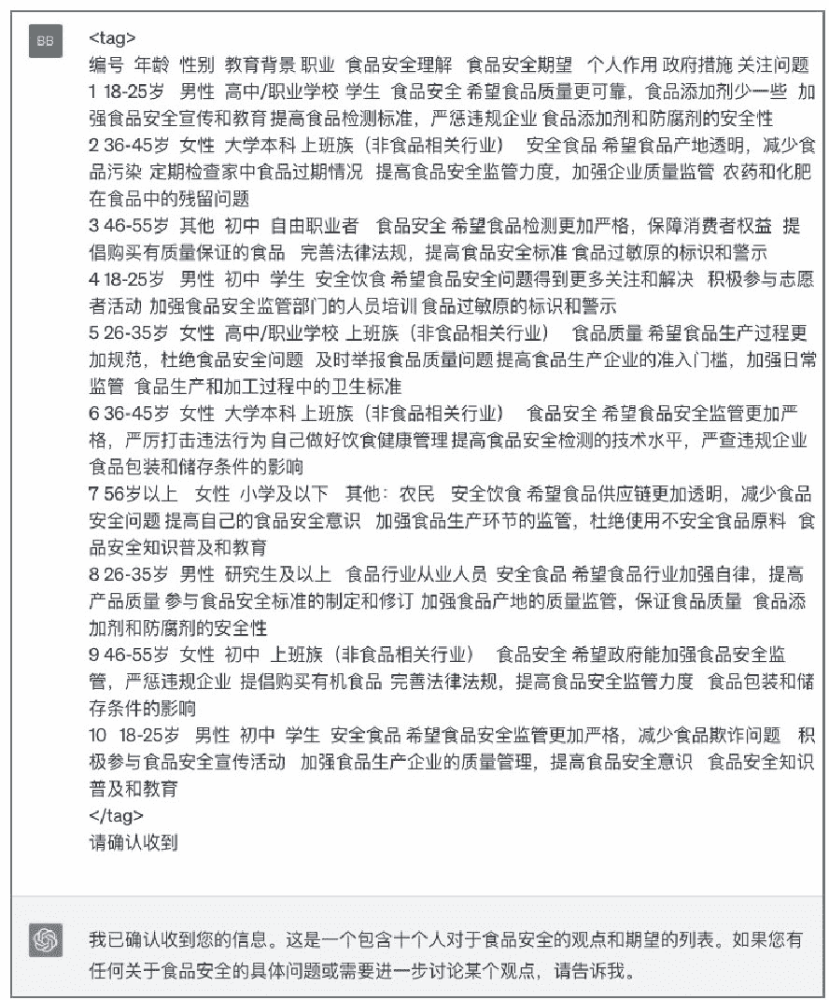

图 7.1 分段输入

＜tag＞（此处省略问卷数据 1）＜/tag＞请确认收到

＜tag＞（此处省略问卷数据 2）＜/tag＞请确认收到

●输入指令性提示词。
你现在是我的数据分析顾问。我刚刚收集了一份关于食品安全的调查问卷。在这份问卷中，我收集了受众的基本信息、他们对食品安全的理解和期望，以及他们最关心的食品安全问题。我已经将这些数据放在了上方＜tag＞中。我希望你能帮助我分析这些数据，并以 Markdown 格式（含标题）形成分析报告。要求分析哪些食品安全问题受到了受众的最大关注、受众对食品安全的理解如何，以及他们希望从我即将进行的公开演讲中获得什么样的信息。最后形成一份总的结论。

③与 ChatGPT 的对话示例

用户：

＜tag＞（此处省略问卷数据 1）＜/tag＞请确认收到

**ChatGPT：**

信息已成功接收到。这是十位受访者就食品安全看法与期望的汇总，有任何想深入探讨的具体议题或某个观点，随时可以继续交流。

用户：

＜tag＞（此处省略问卷数据 2）＜/tag＞请确认收到

**ChatGPT：**

补充数据已收到。这是另外十位受访者关于食品安全的看法与期待清单。如果对这些观点有具体疑问，或想就某个方向进一步讨论，请告知。

用户：

你现在是我的数据分析顾问。我刚做完一份关于食品安全的问卷调查，收集了受众的基础信息、他们对食品安全的认知与期待，以及最在意的食品安全议题。数据已放在上面的＜tag＞里。请帮我分析这些数据，并以 Markdown 格式输出一份含标题的分析报告。需要说明受众最关注哪些食品安全问题、对食品安全的理解是怎样的，以及他们希望我在接下来的公开演讲中提供哪些信息，最后给出总体结论。

**ChatGPT：**

**听众视角下的食品安全调研速览**

**1.开篇说明**

本报告基于本次食品安全问卷的收集结果进行梳理。问卷涵盖了受众基本情况、对食品安全的认知与期望，以及最关心的议题。以下展开解读与总结。

**2.听众如何理解食品安全**

从回收的问卷来看，受众的理解主要集中在以下维度。

-**食品安全本身**：大部分受访者对食品安全有基础认知并保持关注，他们希望食品品质更可靠，添加剂与防腐剂的使用安全有保障，生产加工环节的卫生标准得到规范。
-**安全饮食**：部分受访者更聚焦在日常饮食安全层面，希望相关问题获得更多关注与解决，减少食品欺诈，确保吃得安心。
-**食品品质**：也有受访者更看重食品品质，期望生产流程更规范，杜绝安全隐患，产地信息公开透明，减少污染风险。

**3.听众最关心的食品安全议题**

综合数据来看，关注度最高的问题有这几类。

-**标准与监管**：受众普遍在意标准的严格程度与监管力度，希望监管部门加强巡查，提升检测门槛，严惩违规企业，强化企业质量管控，加大违法行为的处罚力度。
-**过敏原标识与提示**：大量受访者关注过敏原的标注与提醒，希望包装上能清晰标明所含过敏原，方便敏感人群规避风险。
-**生产加工卫生**：不少受访者特别在意从生产到加工的卫生状况，希望提高企业准入门槛，提升质量管理水平，并重视包装与储存条件的影响。

**4.对即将演讲的期待**

问卷显示，受众对公开演讲的信息需求主要落在以下方向。

-**标签信息更清晰**：希望演讲能提供更明确的食品安全标签解读，帮助消费者更好地读懂食品，做出理性购买选择。
-**科普与教育**：期望演讲加强食品安全科普，提升大众的安全意识，让大家更懂得如何维护自身权益。
-**监管与执法**：希望演讲能探讨如何强化监管部门的执法效能，加大对违法行为的惩处力度，真正守住安全底线。

**5.总结**

综合来看，

-受众对食品安全关注度较高，重点落在标准与监管、过敏原标识与警示、生产加工卫生等议题上。
-他们希望演讲提供更清晰的标签信息、更系统的科普教育，以及关于监管与执法力度的讨论。

以上洞察可作为演讲准备的参考，帮助你更贴合听众关切，提升认知共鸣。

*提醒：以上结论仅基于本次样本数据，并不能代表全体受众意见。落地时请结合实际情况与专业判断。*

在上述交流中，食品科学家把收集的食品安全问卷数据提供给 ChatGPT 并请求分析。ChatGPT 据此生成了一份 Markdown 分析报告，涵盖了听众对食品安全的认知、最关心的议题以及对公开演讲的期待。

最终也给出了总结：听众对食品安全高度关注，期待演讲围绕标签清晰度、科普教育、监管执法等展开。这些参考对演讲准备很有帮助。

（2）问卷数据分析提示词模板

**注意：**ChatGPT 版本更新会影响效果与表现，请把以下模板视作参考而非绝对标准。

①提示词模板。

●分段提交问卷数据的提示词模板。

＜tag＞{问卷数据 1}＜/tag＞请确认收到

＜tag＞{问卷数据 2}＜/tag＞请确认收到

●指令式提示词模板。

你现在是我的数据分析顾问。我刚完成了一份关于{演讲的泛主题}的问卷调查。这份问卷收集了受众的基本信息、他们对{演讲的泛主题}的理解与期待，以及他们最关心的{演讲的泛主题}相关议题。数据已放在上方的＜tag＞中。请帮我分析数据并以 Markdown 格式含标题输出报告。要求分析哪些{演讲的泛主题}议题受关注度最高、受众对{演讲的泛主题}的理解如何，以及他们希望我在即将进行的公开演讲中获得哪些信息。最后给出总体结论。

②模板使用说明：只需把大括号内的占位符替换为具体内容即可使用。占位符含义如下。

●{问卷数据}：问卷收集到的原始数据。当前 GPT-4 及更早版本尚不支持直接上传 Excel 或 CSV，可先提取为文本分段多次提供。提供时保持格式清晰，有助于解析。
●{演讲的泛主题}：演讲的大类主题，如“食品安全”“环境保护”“领导力”等。

数据分析是让演讲内容与听众需求对齐的关键。只有读懂目标听众，才能做出有影响力的演讲。该模板指导你如何利用问卷数据进行分析。

使用此模板可生成包含多部分的分析报告：识别听众最关心的问题、了解他们对主题的认知、明确他们希望在演讲中得到哪些信息。这些洞察能为内容准备与调整提供依据。

最后形成总结性结论，为演讲准备提供重要参考，帮助你更好地连接听众，实现演讲目标。

### **7.1.3**

### **借助 ChatGPT 锁定演讲主题**

选定一个能引发共鸣、易懂又有深度的主题至关重要。这需要你充分了解听众，并在此基础上找到既能吸引他们又符合演讲目标的方向。ChatGPT 可以作为得力助手，帮助你挖掘新颖且深刻的主题。

**1.案例拆解：以食品安全演讲为例**

假设你就是那位食品科学家，想请 ChatGPT 提供演讲题目。你需要构建一个完整清晰的提示词框架，而不是简单提问。该框架包含多个关键环节，每一环节都有特定作用。

（1）撰写提示词的步骤。

①角色设定：把 ChatGPT 设定为“演讲顾问”，明确其任务是提供主题建议，并说明采用的策略与视角。
②提供背景：在此环节向 ChatGPT 介绍任务背景，例如“我是一名食品安全专家，正在筹备公开演讲”。同时提供已完成的受众调研信息与分析报告要点，让模型理解听众需求与关注点。
③任务明确：清晰告知希望 ChatGPT 完成的任务，即确定一个既吸睛又有深度的演讲主题。
④任务要求：进一步说明主题选择时需兼顾吸引力与深度。
⑤输出要求：指定输出形式，例如列出 5 个候选主题并简要说明理由。

（2）完整提示词示例。

你现在是我的演讲顾问。我是一名食品科学家，准备面向公众做一场关于食品安全的公开演讲。我已完成受众调研，主要发现是：受众对食品安全关注度高，尤其关心标准与监管、过敏原标识与警示、生产加工卫生；他们希望演讲提供标签解读、科普教育、监管与执法等方面的信息。基于这些，请为我提供 5 个吸睛且深刻的演讲题目，并解释每个题目为何有助于我的演讲。

（3）使用提示词的对话示例。

用户：

你现在是我的演讲顾问。我是一名食品科学家，准备在一次公开演讲中对公众进行食品安全的演讲。我已经完成了一份受众调查，并得出了一些主要发现：受众对食品安全问题具有较高的关注度，特别关注食品安全标准和监管、食品过敏原的标识和警示及食品生产和加工过程中的卫生标准；受众期望从公开演讲中获得关于食品安全标签明确性、食品安全教育和知识普及及食品安全监管和执法力度等方面的信息。基于这些信息，我需要你帮我提供 5 个吸引人且富有深度的演讲题目，并解释为什么这些题目会对我的演讲有所帮助。

**ChatGPT：**

作为你的演讲顾问，很乐意提供 5 个有吸引力且有深度的题目，并说明其价值。如下：

1.“保障食品安全：标签明确性的挑战与解决方案”。

说明：此题目能引发听众对标签的关注。可探讨标签信息是否足够清晰，以及如何优化标签以便消费者准确了解成分、工艺与潜在风险，并给出实用建议。

2.“从过敏到安全：食品过敏原的标识与警示”。

说明：此题目聚焦过敏议题。可介绍常见过敏原与风险，讨论标签如何清晰标示，以及警示标识对过敏人群的重要性与认知提升方式。

3.“食品安全的卫生标准：从农场到餐桌”。

说明：此题目引发对生产加工卫生标准的兴趣。可讲解农场、加工厂、餐饮环节的卫生措施，及其如何保障安全与品质，并介绍相关监管与法规，提出公众可采取的行动。

4.“培育食品安全意识：教育与知识普及的重要性”。

说明：此题目突出科普价值。可强调消费者在购买、储存、烹饪中应具备的基础知识，以及如何通过教育与媒体宣传提升安全意识，并分享实用提示。

5.“加强食品安全监管：挑战与前景”。

说明：此题目触及监管与执法。可探讨当前监管面临的挑战，如跨境流通、新技术、网络销售等，并展望未来如何通过创新监管与协作机制强化保护。

这些主题能满足听众对标签、过敏原、卫生、教育与监管的深度需求，帮助你实现演讲目标。

在上述对话中，食品科学家希望 ChatGPT 提供 5 个吸睛且深刻的演讲题目并说明理由。

ChatGPT 在理解背景后，提出了 5 个方向：“保障食品安全：标签明确性的挑战与解决方案”“从过敏到安全：食品过敏原的标识与警示”“食品安全的卫生标准：从农场到餐桌”“培育食品安全意识：教育与知识普及的重要性”“加强食品安全监管：挑战与前景”，并分别解释了其对满足听众需求与提升认知的价值，为演讲筹备提供了指导。

**2.确定演讲主题的提示词模板**

**注意：**模板效果会受模型版本影响，请作为参考使用。

（1）提示词模板。

你现在是我的演讲顾问。我是一名{演讲者身份}，准备面向{目标受众}做一场关于{演讲的泛主题}的公开演讲。我已完成受众调研，主要发现是：{数据分析报告总结}。基于这些，请为我提供几个吸睛且深刻的演讲题目，并解释为何这些题目有助于我的演讲。

（2）模板使用说明：替换大括号内的占位符即可使用。

①{演讲者身份}：如“食品科学家”“心理学家”“社会学家”。
②{目标受众}：如“公众”“高中生”“企业家”。
③{演讲的泛主题}：如“食品安全”“环境保护”“领导力”。
④{数据分析报告总结}：如“受众对食品安全关注度高，尤其关注标准与监管、过敏原标识与警示及生产加工卫生；期望演讲提供标签解读、科普教育、监管执法等方面的信息。”

选择一个吸睛且深刻的主题是成功演讲的第一步。主题需反映研究发现，满足听众需求与期待，同时展现专业性与独特观点。

使用此模板可基于分析报告结果生成候选主题，并说明其吸引力与实现演讲目标的逻辑。

该模板有助于在准备早期确定主题，为后续工作奠定基础。

### **7.2**

## **用 ChatGPT 撰写演讲稿**

主题确定并了解受众后，下一步是撰写演讲稿。ChatGPT 可在资料收集、大纲制定、初稿撰写等多环节提供支持。接下来将详细介绍如何利用其完成这些任务。

### **7.2.1**

### **用 ChatGPT 收集资料与信息**

演讲准备的关键工作之一是收集相关资料与信息，确定核心观点。这不仅能加深对主题的理解，也为演讲提供有力论据。

**1.获取主题相关信息以丰富演讲内容**

主题确定后，需要进一步收集与主题相关的信息，以充实演讲内容。这一环节同样可借助 ChatGPT。凭借其训练数据与理解能力，ChatGPT 能提供兼具深度与广度的信息，为演讲增添细节，更好地吸引与影响听众。

（1）案例拆解：食品安全主题演讲。

假设你就是那位食品科学家，演讲主题定为“保障食品安全：标签明确性的挑战与解决方案”。你希望引发听众对标签误导问题的关注。但要增强说服力，需要深入了解行业挑战、最新趋势与可行方案。下面演示如何利用 ChatGPT 获取相关信息。

①撰写提示词的步骤。

●角色设定：明确指定 ChatGPT 为“研究助理”，其可深入研究主题，提供详实信息与分析，契合获取深度信息的需求。
●提供背景：说明身份、演讲主题与目标。
●任务明确：指出希望获取与主题相关的背景信息。
●任务要求：详细说明需求，如行业背景、主要挑战、趋势与机会等。
●输出要求：指定期望的输出形式，如背景信息与观点提炼。

②完整提示词。

你现在是我的研究助理。我是一名食品科学家，准备面向公众做一场关于食品安全的公开演讲。演讲主题是“保障食品安全：标签明确性的挑战与解决方案”。我希望你能帮助我深入研究并准备这场演讲。

我想了解更多关于这个行业和主题的背景信息，包括主要的挑战、趋势和机会。你能为我提供一些信息和可能的观点吗？

③使用提示词的对话示例。

用户：

你现在是我的研究助理。我是一名食品科学家，准备在一次公开演讲中对公众进行食品安全的演讲。演讲的主题是“保障食品安全：标签明确性的挑战与解决方案”。我希望你能帮助我深入研究并准备这场演讲。

我想了解更多关于这个行业和主题的背景信息，包括主要的挑战、趋势和机会。你能为我提供一些信息和可能的观点吗？

**ChatGPT：**

当然！很乐意协助你准备食品安全演讲。以下是关于食品安全标签明确性的挑战、趋势与机会的背景信息与观点，供参考。

1.挑战。

-标签信息不明确：消费者对食品安全关注度提升，但标签内容常难以理解或不够清晰，易造成误导与困惑，影响购买决策。
-标签具有误导性：部分生产商使用模糊用语或夸大宣传，让消费者误以为产品更安全或更健康，事实未必如此。
-标签信息过载：信息与术语过多，可能让消费者感到压力与困惑，难以把握核心风险。
2.趋势。

-透明度提升：消费者需求推动行业更透明，越来越多企业提供更详尽清晰的标签信息，包括原料来源、工艺、营养成分等。
-可追溯性增强：消费者对产品追溯能力要求提高。通过二维码、区块链等手段，消费者可获取全生命周期信息，增强信任。

标识清晰度：从问题拆解到分享落地

新一代感知与分析技术正重塑食安监管方式。物联传感、AI 推断以及大数据分析被逐步嵌入监管体系与企业流程，可以对生产流通环节进行实时捕捉，并在风险扩散前发出预警，帮助拦截污染与隐患。

3. 机会

- 认知与素养提升：科研人员与公共机构能够加大科普投入，帮助大众读懂标识、合理使用信息。
- 标识规则收紧：主管部门可以出台更严格的标识管理细则，要求生产端提供准确、清晰、易读的内容，并强化事后抽查与日常监管。
- 全链条协同与透明：产业链各环节需要更紧密合作，共享数据与最佳实践，保证标识口径统一、表述明确。
- 工具创新：科研团队可与科技企业联合，研发新型数字工具与应用场景，提升食安标识的实效与可信度。

以上要点可为一次围绕标识清晰度困境与对策的分享提供讨论框架。演讲者可在此基础上补充具体案例与数据，始终突出受众教育、透明机制以及行业协同的必要性。祝分享顺利。

在先前的交互里，ChatGPT 扮演了研究支持角色，食品研究者希望获取该议题与行业背景，以便把握主要难题、演进方向与潜在机会。

ChatGPT 给出了系统性的背景梳理，涵盖了标识清晰度目前面临的核心问题，如信息模糊、误导性表述、内容过度复杂；行业演进方向，如透明度提升、可追溯性强化以及新技术落地；以及主要机会，如教育认知提升、法规完善、协作透明化与技术创新。

这些材料帮助研究者更全面理解标识清晰度问题，从而更好地准备公开分享。通过明确提问，研究者获得了涵盖挑战、趋势与机会的背景信息，为分享中的问题剖析与方案探讨提供了支撑。

（2）指令范例：获取主题相关研究概览。

**提示：**使用该范例时需注意 ChatGPT 版本迭代可能带来效果差异，请将其视作参考而非硬性规范。

①指令范例。

你现在是我的研究伙伴。我是一名{演讲者身份}，准备在一次公开分享中对{目标受众}进行{演讲的泛主题}的分享。分享的主题是{演讲的主题}。我希望你能帮助我深入研究并准备这场分享。

我想了解更多关于这个行业和主题的背景信息，包括主要的挑战、趋势和机会。你能为我提供一些信息和可能的观点吗？

②范例使用说明：只需将模板中的占位符替换为实际内容即可使用。各占位符释义如下。

●{演讲者身份}：演讲者在本场分享中的身份定位，如“食品科学家”“心理学家”“社会学家”等。
●{目标受众}：分享的听众群体，如“大众”“高中生”“企业家”等。
●{演讲的泛主题}：分享所处的宏观领域，如“食品安全”“环境保护”“领导力”等。
●{演讲的主题}：具体的分享题目，如“保障食品安全：标签明确性的挑战与解决方案”。

该范例旨在帮助演讲者快速掌握主题背景，包括关键挑战、发展动向与潜在机会，从而提升分享准备效率。借助 ChatGPT 作为研究支持，演讲者可获取系统信息与可参考观点，将更多精力集中在内容打磨与表达技巧上。

**2.确立主线论点以增强分享说服力**

分享准备中，明确一至多个主线论点至关重要。论点是分享的核心信息，是听众需要记住的关键。清晰有力的论点能指引整体结构，提升说服力。同时，对论点进行正反评估，梳理支持依据与潜在质疑，有助于提前回应听众疑虑。

（1）案例解析：以食安为主题的分享。

设想你即为那位食品科学家，正在筹备一场面向大众的食安分享，聚焦标识明确性带来的挑战与对策。为让听众产生共鸣与关注，你需要构建一套有力的主线论点。此时可借助 ChatGPT 寻找支持证据并评估反驳观点，以强化说服力。

①构建指令的流程。

●角色设定：建议继续指定 ChatGPT 为“研究伙伴”角色。该角色可适配多样研究需求，如搜集支持论据、评估反驳点、提出新视角等。
●提供背景：说明你的身份、分享主题及主张等上下文。
●明确任务：清晰指出期望 ChatGPT 完成的任务，如“分析主张的论据与可能的反驳点”。
●任务细化：具体描述对任务的要求，如探讨支持与反对观点的理由。
●输出格式：告知期望的呈现形式，如列出支持与反对论据。

②完整指令。

你现在是我的研究伙伴。我是一名食品科学家，准备在一次公开分享中对大众进行食安的分享。分享的主题是“保障食品安全：标签明确性的挑战与解决方案”。我希望你能帮助我深入研究并准备这场分享。

我正在考虑的观点是通过提高食品标签的明确性，能有效提升食品安全。你认为这个观点有哪些支持的理由和可能的反驳点？有没有其他的观点是我应该考虑的？

③使用指令与 ChatGPT 的对话。

用户：

你现在是我的研究助理。我是一名食品科学家，准备在一次公开演讲中对公众进行食品安全的演讲。演讲的主题是“保障食品安全：标签明确性的挑战与解决方案”。我希望你能帮助我深入研究并准备这场演讲。

我正在考虑的观点是通过提高食品标签的明确性，能有效提升食品安全。你认为这个观点有哪些支持的理由和可能的反驳点？有没有其他的观点是我应该考虑的？

**ChatGPT：**

作为你的研究助理，我很高兴能够帮助你准备这场演讲。关于食品安全和标签明确性的观点，以下是一些支持和反驳该观点的理由，以及其他你可以考虑的观点。

支持观点（提高食品标签明确性有助于提升食品安全）如下。

1.消费者知情权：明确的食品标签可以提供关键的信息，帮助消费者做出知情决策，从而选择更安全、更适合自己的食品。透明的标签可以让消费者了解成分、过敏原、营养价值等重要信息。

2.食品追溯能力：准确和明确的标签可以帮助监管机构和生产商追踪食品供应链，及时发现和解决潜在的安全问题，从而保护公众健康。

3.预防食品欺诈：通过提供明确的标签，消费者可以更容易地识别和避免食品欺诈行为，例如虚假宣传、误导性标签或低质量成分的隐藏。

反驳观点（提高食品标签明确性无法有效提升食品安全）如下。

1.执行难题：即使标签规定明确，监管机构在执行和监督方面仍面临挑战。确保所有产品符合标签要求并非易事，尤其是针对全球供应链的食品。

2.标签信息过载：提供过多的详细信息可能导致消费者困惑和信息过载。消费者可能无法理解标签上的科学术语或复杂的营养信息，从而降低了标签的实际有效性。

3.不诚实行为：有些企业可能会利用合法漏洞或故意欺诈，违反标签规定。即使标签明确要求提供某些信息，仍有可能存在不诚实的行为，从而降低标签的可靠性。

其他观点（可能需要考虑的观点）如下。

1.教育和意识提高：除了改善食品标签明确性，提高公众对食品安全的教育和意识也是重要的方面。消费者需要具备一定的食品安全知识和技能，以便更好地理解和应对食品安全挑战。

2.创新技术的应用：借助创新的技术，如智能标签、追溯系统和区块链等，可以进一步提升食品安全和标签明确性。这些技术可以提供更准确、实时的信息，并增加食品供应链的透明度和可追溯性。

希望这些观点和论证能为你的演讲提供一些思路。根据你的专业知识和研究，你可以进一步深入这些观点，选择最具说服力的论据来支持你的演讲主题。

（2）指令范例：确立核心观点。

**提示：**使用该范例时需考虑模型版本更新对效果的影响，请作为参考使用。

①指令范例。

你现在是我的研究助理。我是一名{演讲者身份}，准备在一次公开演讲中对{目标受众}进行{演讲的泛主题}的演讲。演讲的主题是{演讲的主题}。

我正在考虑的观点是{初步观点}。你认为这个观点有哪些支持的理由和可能的反驳点？有没有其他的观点是我应该考虑的？

②范例使用说明：替换大括号内的占位符即可使用。释义如下。

●{演讲者身份}：如“食品科学家”“心理学家”“社会学家”等。
●{目标受众}：如“公众”“高中生”“企业家”等。
●{演讲的泛主题}：如“食品安全”“环境保护”“领导力”等。
●{演讲的主题}：如“保障食品安全：标签明确性的挑战与解决方案”。
●{初步观点}：你对主题的初步看法，是分享的核心主张。如“你认为通过提高食品标签的明确性，能有效提升食品安全。”

该范例可帮助明确并深化核心观点。ChatGPT 能为初步观点提供支持理由，也能指出可能的风险点，便于演讲者提前应对。此外，ChatGPT 还可提供其他可参考视角，帮助分享呈现更立体多元的讨论。

### **7.2.2**

### **借助 ChatGPT 构建分享提纲**

一份条理清晰的分享提纲是成功分享的基础。它能帮助梳理思路、突出重点、规划论证路径。本节将展示如何利用 ChatGPT 的辅助功能，更高效地搭建与优化分享提纲。

**1.案例解析：食安主题分享**

假设你已完成主题研究并明确核心论点，接下来需构建分享提纲，规划整体脉络。下面以食品科学家为例，演示如何借助 ChatGPT 完成提纲构建与优化。

（1）撰写指令的步骤。

①角色设定：指定 ChatGPT 为“分享辅助专家”，其将以专业顾问身份提供建议与反馈。
②提供背景：说明身份、主题、核心观点及已有构思。
③明确任务：指出期望完成的任务，如“帮助完善提纲”。
④任务要求：具体描述需求，如提供更细化的子议题与论据。
⑤输出格式：指定输出形式，如“以 Markdown 格式输出”。

（2）完整指令。

你现在是我的演讲辅助专家。我是一名食品科学家，准备在一次公开演讲中对公众进行食品安全的演讲。演讲的主题是“保障食品安全：标签明确性的挑战与解决方案”。我的核心观点是“通过提高食品标签的明确性，能有效提升食品安全。”

我打算首先介绍食品标签当前的状况，然后讨论标签规范对食品安全的重要性，最后总结一些可能的解决方案。你能帮助我完善这个大纲，提供更具体的细分话题和论据吗？以 Markdown 格式输出。

（3）使用指令与 ChatGPT 的对话。

用户：

你现在是我的演讲辅助专家。我是一名食品科学家，准备在一次公开演讲中对公众进行食品安全的演讲。演讲的主题是“保障食品安全：标签明确性的挑战与解决方案”。我的核心观点是“通过提高食品标签的明确性，能有效提升食品安全。”

我打算首先介绍食品标签当前的状况，然后讨论标签规范对食品安全的重要性，最后总结一些可能的解决方案。你能帮助我完善这个大纲，提供更具体的细分话题和论据吗？以 Markdown 格式输出。

**ChatGPT：**

当然可以！以下是你的演讲大纲，包括细分话题和相关的论据。

**演讲主题：保障食品安全：标签明确性的挑战与解决方案**

**Ⅰ.引言**

-引入自己的身份和专业领域

-引发听众对食品安全的关注

-提出核心观点：通过提高食品标签的明确性，能有效提升食品安全

**Ⅱ.当前食品标签的状况**

-解释当前市场上食品标签存在的问题和挑战

-论据 1：许多食品标签缺乏明确的信息，难以理解和解读

-论据 2：消费者常常无法辨认潜在的食品安全风险

-论据 3：不规范的标签可能误导消费者，引发健康问题

**Ⅲ.标签规范对食品安全的重要性**

-说明标签规范对于消费者做出明智的食品选择的重要性

-论据 1：清晰和详细的标签能够提供关键的营养信息，帮助消费者做出健康的决策

-论据 2：准确的成分列表和过敏警示能够保护过敏体质人群的安全

-论据 3：正确标注食品添加剂和防腐剂的使用可以防止不必要的健康风险

**Ⅳ.解决方案：提高食品标签的明确性**

-提出一些可能的解决方案和改进措施

-论据 1：制定统一的标签规范和标准，确保信息的一致性和易读性

-论据 2：增加图形和图表等可视化元素，使标签更易于理解

-论据 3：推广使用新技术，如 QR 码或 RFID 标签，以提供更多详细信息

**Ⅴ.总结**

-重述核心观点：通过提高食品标签的明确性，能有效提升食品安全

-总结主要论据和解决方案

-鼓励听众在购买食品时更加重视标签信息，以保障自身的食品安全

**2.指令范例：制定分享大纲**

**提示：**使用时请注意模型更新可能影响效果，请作为参考。

（1）指令范例。

你现在是我的演讲辅助专家。我是一名{演讲者身份}，准备在一次公开演讲中对{目标受众}进行{演讲的泛主题}的演讲。演讲的主题是{演讲的主题}。我的核心观点是{核心观点}。

我打算首先介绍{第一点}，然后讨论{第二点}，最后总结{第三点}。你能帮助我完善这个大纲，提供更具体的细分话题和论据吗？以 Markdown 格式输出。

（2）范例使用说明：替换占位符即可使用。释义如下。

①{演讲者身份}：如“食品科学家”“心理学家”“社会学家”等。
②{目标受众}：如“公众”“高中生”“企业家”等。
③{演讲的泛主题}：如“食品安全”“环境保护”“领导力”等。
④{演讲的主题}：如“保障食品安全：标签明确性的挑战与解决方案”。
⑤{核心观点}：对主题的核心立场，如“你认为通过提高食品标签的明确性，能有效提升食品安全。”

该范例可帮助设计深度分享。在已有初步构思的基础上，ChatGPT 能提供细化建议与补充，帮助完善结构。输出的 Markdown 提纲清晰明了，便于演讲者按部就班准备。

### **7.2.3**

### **利用 ChatGPT 撰写分享初稿**

在明确提纲后，进入初稿撰写阶段。将思路转化为流畅语句与段落是关键环节。借助 ChatGPT，可大幅提升撰写效率与质量。

**1.分段生成分享初稿**

受单次输出长度限制，建议按板块分段生成，再合并整合。可依据提纲逐段提问，每次聚焦一个部分，最后拼接成完整稿件。这样能更精确控制内容质量，并保证整体连贯。

分段撰写还有助于在每个部分完成后即时审视与调整观点，确保一致性。下面以食安主题分享为例，演示如何使用 ChatGPT 撰写初稿。

（1）案例解析：食安主题分享。

提示词拆解：用AI把食品安全演讲做到位

假如你已经是前面提到的那位食品科学家，手头有了一份完整的演讲提纲，接下来就可以跟着提纲的框架和要点，对每个部分进行延伸，补充更细致的内容和概念，逐步搭建出演讲初稿。

①撰写提示词的步骤。

●角色定位：把 ChatGPT 设定为专业的演讲稿撰写师，让它给出有深度、有分量的观点，提升整场演讲的说服力。
●背景交代：向模型提供充分的背景信息，例如“我是一名食品科学家，准备面向公众演讲食品安全的议题，题目是‘保障食品安全：标签明确性的挑战与解决方案’。”
●拆分任务：把提纲的每个环节当成独立任务来处理。比如开场白是第一项任务，主体第一段是第二项任务，依次类推，为每项任务写出明确的指令，并说明该部分需要涵盖的核心内容和论点。
●任务细化：对每个任务的要求要具体，包含需要呈现的关键观点、论据、案例或引用，同时给出风格和语言上的偏好，例如开场要吸睛，结尾要铿锵有力。
●输出说明：明确告诉模型最终要生成的是演讲稿文本。

②完整提示词。

●开场白部分提示词。
请你担任我的演讲稿撰写助手。我是食品科学领域的从业者，计划面向大众做一次关于食品安全的公开演讲。演讲题目定为《保障食品安全：标签清晰度带来的挑战与对策》，我主张的核心论点是提升标签清晰度能够显著改善食品安全现状。
目前我正在完善大纲中的开场部分。
期望内容涵盖：点明我的专业背景和身份，点燃观众对食品安全的关注，并抛出核心论点——通过提高标签的明确性来有效提升食品安全。
希望开场能够抓人眼球、引发好奇，可以用一个引人思考的问题、一段贴切的小故事或一个有冲击力的数据来切入。请帮我撰写一段开场演讲稿好吗？

●主体部分第一段提示词。
请你担任我的演讲稿撰写助手。我是食品科学家，准备面向公众演讲食品安全。演讲主题是“保障食品安全：标签明确性的挑战与解决方案”，核心观点是提高食品标签的明确性能有效提升食品安全。
开场白已完成，现在需要主体第一段的内容。
希望围绕“当前食品标签的现状”展开，说明市场上标签存在的痛点与挑战。论据包括：不少标签信息模糊难以解读；消费者难以识别潜在的食品安全风险；不规范的标签会误导消费并导致健康问题。
请把相关观点和证据展开，让听众能顺畅跟上主线。可以帮我生成一段演讲稿吗？

●主体部分第二段提示词。
请你担任我的演讲稿撰写助手。我是食品科学家，准备面向公众演讲食品安全。主题是“保障食品安全：标签明确性的挑战与解决方案”，核心观点是提高标签明确性能有效提升食品安全。
开场已写好，现需主体第二段。
想讨论“规范标签对食品安全的重要性”，说明清晰标签如何帮助消费者做出明智选择。论据包括：清晰详实的标签提供关键营养信息，助力健康决策；准确的配料表和过敏提示能保护过敏人群；正确标注添加剂和防腐剂可避免不必要的健康风险。
请把论点扩展并配以说明，便于听众理解。可以帮我生成一段演讲稿吗？

●主体部分第三段提示词。
请你担任我的演讲稿撰写助手。我是食品科学家，准备面向公众演讲食品安全。主题是“保障食品安全：标签明确性的挑战与解决方案”，核心观点是提高标签明确性能有效提升食品安全。
开场已完成，现需主体第三段。
想聚焦“提升标签明确性的解决方案”，提出改进思路。论据包括：建立统一的标签规范与标准，保证一致性和可读性；加入图形、图表等可视化元素，降低理解门槛；推广 QR 码、RFID 等新技术，提供更多延伸信息。
请展开论证，让听众能清晰理解。可以帮我生成一段演讲稿吗？

●结尾部分提示词。
请你担任我的演讲稿撰写助手。我是食品科学家，准备面向公众演讲食品安全。主题是“保障食品安全：标签明确性的挑战与解决方案”，核心观点是提高标签明确性能有效提升食品安全。
开场和主体已完成，现需结尾。
希望重申核心观点，概括主要论据与解决方案，并呼吁听众在选购时更重视标签信息来守护自身安全。
请给我一段简洁有力、能以金句、行动号召或思考性提问收尾的结论。可以帮我生成一段演讲稿吗？

③使用提示词与 ChatGPT 的对话。

●开场白部分。

用户：
请你担任我的演讲稿撰写助手。我是食品科学领域的从业者，计划面向大众做一次关于食品安全的公开演讲。演讲题目定为《保障食品安全：标签清晰度带来的挑战与对策》，我主张的核心论点是提升标签清晰度能够显著改善食品安全现状。
目前我正在完善大纲中的开场部分。
期望内容涵盖：点明我的专业背景和身份，点燃观众对食品安全的关注，并抛出核心论点——通过提高标签的明确性来有效提升食品安全。
希望开场能够抓人眼球、引发好奇，可以用一个引人思考的问题、一段贴切的小故事或一个有冲击力的数据来切入。请帮我撰写一段开场演讲稿好吗？
ChatGPT：
各位朋友大家好，很高兴在这里与大家交流。我从事食品科学研究多年，长期关注生产到餐桌的全链条安全。今天想聊一个与我们每个人都息息相关的话题：如何真正保障食品安全。
先请大家想象一下，走进超市面对琳琅满目的货架时，你是否会问自己：我手里这件商品真的安全吗？它跟标签上写的一致吗？这个问题值得我们每个人思考。
食品安全牵涉生产、加工、运输、储存多个环节，而我今天特别想聚焦标签的清晰度。因为我坚信，提升标签的明确性，是提升食品安全极为有效的一条路径。
为什么把标签放在这么重要的位置？因为标签是我们与食品之间的信息桥梁。理想情况下它应该传递关键信息，但现实中常出现字迹不清、表述繁复、信息缺失甚至误导的情况，直接影响购物体验和选择。
我曾有过一次很深刻的体会。一次买了一瓶包装很健康的果汁，色彩和文案都很有吸引力。回家细看标签才发现里面含有大量添加糖和人工调味剂，和“健康”的宣传相去甚远。这件事让我更坚定：标签必须更透明，消费者才有能力做出符合期望的决策。
所以提高标签明确性，就等于为消费者提供更可靠的信息，既保护健康权益，也推动行业向更透明的方向发展。
接下来我会先梳理标签目前存在的难题，再分享可能的改进方向和创新做法，一起思考如何让餐桌更安心。
谢谢大家！

●主体部分 1。

用户：
请你担任我的演讲稿撰写助手。我是食品科学家，准备面向公众演讲食品安全。演讲主题是“保障食品安全：标签明确性的挑战与解决方案”，核心观点是提高食品标签的明确性能有效提升食品安全。
开场白已完成，现在需要主体第一段的内容。
希望围绕“当前食品标签的现状”展开，说明市场上标签存在的痛点与挑战。论据包括：不少标签信息模糊难以解读；消费者难以识别潜在的食品安全风险；不规范的标签会误导消费并导致健康问题。
请把相关观点和证据展开，让听众能顺畅跟上主线。可以帮我生成一段演讲稿吗？
ChatGPT：
**当前食品标签的现状**
各位观众：
在日常选购中，标签本应是我们的参考依据，但现实是市场上标签的明确性仍有不少短板，也带来了安全隐患。
第一，很多标签信息不够清晰，阅读起来吃力。你是否也遇到过标签上充斥专业术语、描述冗长、字体过小的情形？这让人一头雾水。没有一定的食品科学基础，普通消费者很难准确读懂。
第二，消费者往往难以辨识潜在风险。标签理应披露成分、过敏原、添加剂、转基因等信息，但一些产品表述含糊，关键信息不足。对于过敏体质或有特殊饮食需求的人群，这可能带来严重后果。
第三，不规范的标签容易误导，进而影响健康。部分商家用模糊的用语或夸张的宣传营造“更健康、更天然”的印象，实际上成分可能并不匹配。被误导的购买决策会直接伤害身体。
要改善现状，需要多方协作。监管部门应强化标签审查，确保信息准确完整；企业应自律，使用简明易懂的表达和符号；同时也要加强公众教育，提升大家解读标签的能力。
只有把标签现状理清，才能真正让信息为安全服务，推动行业更透明、可持续。
谢谢！

●主体部分 2。

用户：
请你担任我的演讲稿撰写助手。我是食品科学家，准备面向公众演讲食品安全。主题是“保障食品安全：标签明确性的挑战与解决方案”，核心观点是提高标签明确性能有效提升食品安全。
开场已写好，现需主体第二段。
想讨论“规范标签对食品安全的重要性”，说明清晰标签如何帮助消费者做出明智选择。论据包括：清晰详实的标签提供关键营养信息，助力健康决策；准确的配料表和过敏提示能保护过敏人群；正确标注添加剂和防腐剂可避免不必要的健康风险。
请把论点扩展并配以说明，便于听众理解。可以帮我生成一段演讲稿吗？
ChatGPT：
**标签规范对食品安全的重要性**
各位朋友：
买什么吃，怎样吃，标签往往是第一道决策依据。规范清晰的标签，能让选择更理性、更安全。
首先，详尽的营养信息帮助我们做健康决策。营养成分表呈现能量、蛋白质、脂肪、碳水等数据，对关注均衡饮食的人极有价值。对比不同产品，我们才能依据自身需求做出更合适的选择。
其次，准确的配料清单和过敏提示是守护特殊人群的安全网。对过敏或不耐受者而言，一行清晰的警示可能避免一次危机。完整透明的成分披露，也让消费者不会无意摄入风险物质。
再者，添加剂与防腐剂的如实标注减少健康隐患。这些物质在加工中广泛使用，适量使用无碍，但长期或过量摄入仍可能有风险。明确标注让消费者有权自主判断是否购买，从而降低潜在威胁。
标签规范不仅是信息披露，更是责任体现。监管应确保内容合规真实，企业应主动提升呈现质量，让信息易读易懂。
当标签变得可靠，食品安全就有了更坚实的基础。
谢谢！

●主体部分 3。

用户：
请你担任我的演讲稿撰写助手。我是食品科学家，准备面向公众演讲食品安全。主题是“保障食品安全：标签明确性的挑战与解决方案”，核心观点是提高标签明确性能有效提升食品安全。
开场已完成，现需主体第三段。
想聚焦“提升标签明确性的解决方案”，提出改进思路。论据包括：建立统一的标签规范与标准，保证一致性和可读性；加入图形、图表等可视化元素，降低理解门槛；推广 QR 码、RFID 等新技术，提供更多延伸信息。
请展开论证，让听众能清晰理解。可以帮我生成一段演讲稿吗？
ChatGPT：
**解决方案：提升标签明确性**
大家好：
既然问题明确，我们更需要可行的改进路径。提升标签清晰度，关键在标准、可视化和技术。
第一，建立统一的规范与标准。市场上格式各异、信息呈现不一，让消费者困惑。统一标准能保证信息一致、易读，买任何产品都能快速获取关键点。
第二，增加可视化表达。纯文字有时难以传递复杂信息。用图标、色块、简易图表来呈现营养占比、食用建议或安全提示，能直观降低理解成本，让标签真正“看得懂”。
第三，借助新技术拓展信息维度。QR 码或 RFID 可以承载更多细节，如溯源链路、生产批次、检测报告等。消费者扫码即可获取完整背景，实现从“简要告知”到“深度知情”的转变。
标准打底，可视化提效，技术赋能，三者结合能显著提高标签的可信度和实用性，也会倒逼行业更透明、更负责。
让我们一起推动这场改进，让信息更好地服务健康。
谢谢！

●结尾部分。

用户：
请你担任我的演讲稿撰写助手。我是食品科学家，准备面向公众演讲食品安全。主题是“保障食品安全：标签明确性的挑战与解决方案”，核心观点是提高标签明确性能有效提升食品安全。
开场和主体已完成，现需结尾。
希望重申核心观点，概括主要论据与解决方案，并呼吁听众在选购时更重视标签信息来守护自身安全。
请给我一段简洁有力、能以金句、行动号召或思考性提问收尾的结论。可以帮我生成一段演讲稿吗？
ChatGPT：
各位听众：
今天的讨论指向一个共识：提升标签的明确性，能够实质性地提升食品安全。
我们看到标签模糊带来的困扰，也看到规范清晰标签对营养选择、过敏保护、风险规避的价值，并提出了统一标准、可视化呈现和新技术应用的三条改进方向。
作为科研工作者，我想呼吁每位消费者在购物时多花几十秒阅读标签，了解成分、营养、过敏提示和添加物信息。知情的选择，才是自我保护的第一步。
最后请记住一句话：我们吃进去的东西，塑造着我们的身体。让标签更透明，就是让健康更有保障。
愿我们共同推动标签改进，让每张餐桌都更安心。谢谢大家！

分段协作：用 ChatGPT 打磨演讲稿

在前一段演示中，一位做食品研究的学者希望借助 ChatGPT 完成演讲准备，他把整体诉求拆成若干细项逐步下发。ChatGPT 充当撰稿伙伴，分批接收指令并产出各部分的初稿。在演讲大纲等丰富上下文的引导下，系统对每个模块都做了细化，让各部分的论点都能得到充 TEX。

（2）提示词模板：撰写演讲稿

**提示：** 实际使用时要留意模型迭代会改变效果表现，这里给出的模板仅作参考，不宜当成唯一标准。

① 提示词模板

● 开场白版提示词模板
请你担任我的演讲稿撰写助手。我的身份是{演讲者身份}，将面向{目标受众}做一场关于{演讲的泛主题}的公开演讲，具体题目为{演讲的主题}，核心立场是{核心观点}。
现在我需要为大纲中的开场段落找素材。
希望围绕{演讲大纲引言部分}展开。
开场要能抓住注意力与好奇心，可以用一个引人思考的问题、一个相关小故事或一个有冲击力的事实来切入，请帮我写一段开场草稿。

● 主体版提示词模板
请你担任我的演讲稿撰写助手。我的身份是{演讲者身份}，将面向{目标受众}做一场关于{演讲的泛主题}的公开演讲，具体题目为{演讲的主题}，核心立场是{核心观点}。
开场白已完成，现在需要为大纲中的主体段落找素材。
希望围绕{演讲大纲主体部分}展开。
请帮我扩展相关的观点、论据与证据，让听众能够跟进并理解演讲的主要论点。

● 结尾版提示词模板
请你担任我的演讲稿撰写助手。我的身份是{演讲者身份}，将面向{目标受众}做一场关于{演讲的泛主题}的公开演讲，具体题目为{演讲的主题}，核心立场是{核心观点}。
开场与主体已完成，现在需要为大纲中的结尾段落找素材。
希望围绕{演讲大纲总结部分}展开。
请给出简洁有力但不拖沓的收束，突出主要观点，并用一句有分量的引用、一次行动呼吁或一个引发思考的问题来收尾。

② 模板使用说明
模型单次生成的长度有限，采用分段产出再合并的方式通常更高效。可依据个人大纲，依次向模型提出需求来产出各部分内容。
例如大纲包含引言、三个主体段和结论，即可在同一对话中分五次提问，每次聚焦一段。这种做法便于精细把控篇幅，保证每段都符合预期。
分段生成时，只需把模板里的占位符也就是大括号内的文字替换为具体信息即可直接使用。

占位符含义
● {演讲者身份}：你在台上的角色，例如“食品科学家”“心理学家”“社会学家”等。
● {目标受众}：演讲面向的群体，例如“公众”“高中生”“企业家”等。
● {演讲的泛主题}：演讲所属的宏观领域，例如“食品安全”“环境保护”“领导力”等。
● {演讲的主题}：演讲的具体题目，例如“保障食品安全：标签明确性的挑战与解决方案”。
● {核心观点}：你对主题的核心立场，即希望听众接受的主要信息。例如，“你认为通过提高食品标签的明确性，能有效提升食品安全。”
● {演讲大纲不同部分}：指大纲的各个组成单元，涵盖引言、主题论述、解决方案、结论与行动呼吁等。

以上模板为构思和撰写提供了系统指引。不论开场、主体还是结尾，都能得到对应帮助。借助模板，模型能更准确把握需求，提供具体、专业且具说服力的内容。无论演讲是否有特定目标，这些模板都能帮助产出一篇令人印象深刻的稿件。

**2. 合并演讲初稿**

这一环节的关键在于分段撰写完成后进行整合。分段整合能更有效地掌控整体框架，保证连贯与协调。前述工作已完成分段撰写，接下来就是把各段初稿整合成完整文稿。

（1）案例分析：食品安全主题的演讲
假设你就是前面提到的食品科学家，计划面向公众做一次关于食品安全的公开演讲。题目是“保障食品安全：标签明确性的挑战与解决方案”，核心观点是“通过提高食品标签的明确性，能有效提升食品安全”。你已完成分段撰写，并在此前获得了各段确认。现在要做的是把这些分段稿整合成一篇连贯完整的演讲。

① 撰写提示词的步骤
● 角色设定：此阶段模型仍扮演“演讲稿撰写师”，负责把分段稿整合成完整篇章。
● 提供上下文：分段撰写已完成，若内容不在同一对话或消息较杂乱，可再次把分段内容提供给模型作为上下文。
● 创建任务：本环节任务是将分段撰写的演讲稿整合成一篇完整篇章。
● 任务要求：在段落之间加入过渡词、短语和句子，实现顺畅衔接，并确保原有内容全部保留。
● 输出要求：最终输出一篇连贯完整的演讲稿。

② 完整提示词
● 分段提供演讲初稿作为上下文
＜tag＞{此处省略演讲初稿开场白部分}＜/tag＞，请确认收到。
＜tag＞{此处省略演讲初稿主体部分第一段}＜/tag＞，请确认收到。
＜tag＞{此处省略演讲初稿主体部分第二段}＜/tag＞，请确认收到。
＜tag＞{此处省略演讲初稿主体部分第三段}＜/tag＞，请确认收到。
＜tag＞{此处省略演讲初稿结尾部分}＜/tag＞，请确认收到。
● 输入指令性提示词
你现在是我的演讲稿撰写师。我是一名食品科学家，准备在一次公开演讲中对公众进行食品安全的演讲。演讲的主题是“保障食品安全：标签明确性的挑战与解决方案”。我的核心观点是“通过提高食品标签的明确性，能有效提升食品安全。”
我已经把演讲初稿分多段放在了上方，请帮我把它们整理成一篇完整的演讲稿。我希望在不同段落之间增加一些过渡词语、短语和句子使之平稳过渡，我希望你能在新的演讲稿中保留所有原来的内容。

③ 使用提示词与 ChatGPT 的对话

用户：
＜tag＞{此处省略演讲初稿开场白部分}＜/tag＞，请确认收到。
**ChatGPT：**
收到

用户：
＜tag＞{此处省略演讲初稿主体部分第一段}＜/tag＞，请确认收到。
**ChatGPT：**
收到

用户：
＜tag＞{此处省略演讲初稿主体部分第二段}＜/tag＞，请确认收到。
**ChatGPT：**
收到

用户：
＜tag＞{此处省略演讲初稿主体部分第三段}＜/tag＞，请确认收到。
**ChatGPT：**
收到

用户：
＜tag＞{此处省略演讲初稿结尾部分}＜/tag＞，请确认收到。
**ChatGPT：**
收到

用户：
你现在是我的演讲稿撰写师。我是一名食品科学家，准备在一次公开演讲中对公众进行食品安全的演讲。演讲的主题是“保障食品安全：标签明确性的挑战与解决方案”。我的核心观点是“通过提高食品标签的明确性，能有效提升食品安全。”
我已经把演讲初稿分多段放在了上方，请帮我把它们整理成一篇完整的演讲稿。我希望在不同段落之间增加一些过渡词语、短语和句子使之平稳过渡，我希望你能在新的演讲稿中保留所有原来的内容。
**ChatGPT：**
当然，我很乐意帮助你整理成一篇完整的演讲稿。在下面的文本中，我将按照你提供的段落顺序，加入过渡词语、短语和句子来实现平稳过渡。请注意，我会保留你原来的内容，同时进行适当的修改和调整。
尊敬的听众们：
我非常荣幸能在今天与大家分享关于食品安全的重要话题。作为一名食品科学家，我深知保障食品安全对我们的健康至关重要。在我的演讲中，我将重点讨论食品标签明确性的挑战与解决方案，以及提高食品安全的关键手段。我坚信，通过提高食品标签的明确性，能有效提升食品安全。
首先，让我们来看一下食品标签的重要性。每天，我们都会做出购买食品的决策，而我们都希望选择健康、安全的食品。然而，要做出明智的选择并不容易，这就是为什么食品标签的明确性和规范性如此重要。通过清晰和详细的标签，我们可以获得关键的营养信息，比较不同产品的营养价值，并做出更明智的选择，使我们的饮食更加均衡和健康。
然而，目前存在一些挑战和问题。当前市场上存在各种不同的食品标签格式和信息呈现方式，这给消费者带来了困扰。同时，一些标签的信息过于复杂，难以理解，给消费者带来了困惑。为了解决这些问题，我们需要采取一些切实有效的解决方案。
首先，我们需要制定统一的标签规范和标准，确保食品标签的信息一致性和易读性。这样一来，无论消费者购买哪种食品，都能够轻松地理解标签上的信息，做出明智的选择。同时，增加图形和图表等可视化元素也是提高标签明确性的有效手段。通过可视化的元素，我们可以直观地展示食品的营养成分、食用方法或食品安全信息，帮助消费者更直观地理解标签上的重要信息。
然而，仅仅依靠传统的标签形式可能还不够。因此，我们可以推广使用新技术，例如 QR 码或 RFID 标签，以提供更多详细的食品信息。通过扫描 QR 码或使用 RFID 设备，消费者可以获得食品的溯源信息、生产过程、质量检测结果等。这种技术的应用使消费者能够更深入地了解食品背后的故事，并为他们提供更全面的选择依据。
通过制定统一的标签规范和标准、增加可视化元素及推广使用新技术，能够有效提高食品标签的明确性，进一步保障消费者的权益和健康。当我们能够准确、明确地了解食品标签上的信息时，就能够做出明智的食品选择，为自己和家人的食品安全负责。
让我们共同努力，推动食品标签的改进，确保消费者能够获得准确和可信赖的食品信息，从而保障我们的健康和权益。如同一句名言所说：“我们是我们所吃的东西。”通过提高食品标签的明确性，我们能够选择更健康、更安全的食品，为我们的身体和生活质量做出积极的贡献。
在结束之前，我想与大家分享一个重要的思考：作为消费者，我们应该更加重视标签信息。在购买食品时，我们应该仔细阅读和理解标签上的内容，了解食品的成分、营养价值、过敏警示和安全风险等重要信息。只有充分了解标签，我们才能为自己和家人的食品安全负责。
让我们共同努力，推动食品安全意识的提升，并要求食品行业和监管机构持续改进标签明确性。让我们成为有意识的消费者，为了自己和社会的福祉而做出明智的食品选择。
谢谢大家！

在上述对话里，食品科学家把初稿按段落发送给模型，并要求整合成完整演讲稿，同时希望在段落间添加过渡表达以实现平稳衔接，并保留全部原有内容。
经过处理，生成了一篇整理完毕的完整稿件，严格按提供的段落顺序加入过渡词、短语和句子，确保内容连贯流畅，同时保留了原文。整个过程中模型完全满足了用户需求。

（2）提示词模板：合并演讲稿
**提示：** 使用该模板时需考虑版本更新可能带来的效果差异，请将其视为参考而非绝对指导。
① 提示词模板
● 分段提供演讲初稿提示词模板
＜tag＞{演讲初稿分段部分}＜/tag＞，请确认收到。
● 指令性提示词模板
你现在是我的演讲稿撰写师。我是一名{演讲者身份}，准备在一次公开演讲中对{目标受众}进行{演讲的泛主题}的演讲。演讲的主题是{演讲的主题}。我的核心观点是{核心观点}。
我已经把演讲初稿分多段放在了上方，请帮我把它们整理成一篇完整的演讲稿。我希望在不同段落之间增加一些过渡词语、短语和句子使之平稳过渡，我希望你能在新的演讲稿中保留所有原来的内容。
② 模板使用说明
只需把模板中的占位符也就是大括号内的文字替换为具体内容即可直接使用。
● {演讲者身份}：角色，如“食品科学家”“心理学家”“社会学家”等。
● {目标受众}：听众，如“公众”“高中生”“企业家”等。
● {演讲的泛主题}：宏观领域，如“食品安全”“环境保护”“领导力”等。
● {演讲的主题}：题目，如“保障食品安全：标签明确性的挑战与解决方案”。
● {核心观点}：核心看法，例如“你认为通过提高食品标签的明确性，能有效提升食品安全。”
● {演讲初稿分段部分}：已分段生成的稿件，若不在同一对话或消息较杂乱，可再次分段提供作为上下文。

该模板旨在帮助把已准备好的多段稿件组合成连贯流畅的完整稿件。模板明确提出具体要求，使模型在保持原稿完整的基础上，通过添加过渡词、短语和句子将各段平滑连接。按指示替换占位符即可得到一篇连贯且有深度的演讲稿。

## **7.3**
## **修改和完善演讲稿**

初稿完成后，下一个关键阶段是修订与完善。目标是通过细致打磨，将粗糙初稿优化为引人入胜、极具影响力和吸引力的演讲。

### **7.3.1**
### **使用 ChatGPT 让演讲稿更具个性化**

虽然已用模型生成了初步稿件，但这只是起点。当前初稿仅包含基本主题和框架，真正的挑战在于如何深度优化，打造独一无二且贴合个人需求的演讲。以下仍以“食品安全”主题为例，展示如何借助模型进一步优化稿件，包括植入故事元素、数据和其他相关信息。

**1. 案例分析：食品安全主题的演讲**
假设你仍是那位食品科学家，若要真正抓住听众并引发关注，一个有效做法是在开头植入故事元素。精心编排的故事不仅能赋予演讲生动有趣的色彩，也有助于听众记忆观点。在主体部分，通过相关数据、案例、引用或个人经历支撑观点。在总结部分，回扣前文并重申主题，可提供有力引言、发出行动呼吁或提出发人深省的问题，以此留下深刻印象。

（1）撰写提示词的步骤
① 角色设定：此阶段可继续让模型担任“演讲稿撰写师”。
② 提供上下文：在设定角色后，需向其提供基础背景信息、演讲初稿，以及准备融入的故事或从各渠道收集的事实、数据、例子、引用等。这部分主要是提供完整的演讲初稿和个性化素材，为后续任务奠定基础。
③ 创建任务：在提供充足背景信息后，明确希望模型执行的任务，即“将提供的故事或数据融入演讲初稿”。
④ 任务要求：任务明确后，进一步细化具体需求和期望，即“保持演讲稿主体内容不变，故事或数据的插入自然流畅，不破坏整体结构和逻辑”。
⑤ 输出要求：最后说明对输出形式和内容的具体期望，即“输出优化后的演讲稿”。

（2）完整提示词
① 上传完整的演讲初稿提示词
＜tag＞{此处省略演讲初稿}＜/tag＞，请确认收到。
② 输入指令性提示词
你现在是我的演讲稿撰写师。我是一名食品科学家，准备在一次公开演讲中对公众进行食品安全的演讲。演讲的主题是“保障食品安全：标签明确性的挑战与解决方案”。我的核心观点是“通过提高食品标签的明确性，能有效提升食品安全。”
我已经写好了演讲初稿并放在了上方 tag 标签中，请帮我把我在下方 p 标签中提供的故事或数据融入演讲初稿。
我希望保持演讲稿主体内容不变，故事或数据的插入能够自然、流畅，且不破坏演讲稿的整体结构和逻辑。
＜p＞最近，我决定开始减肥，首先我选择从日常的饮食入手，我觉得超市是个好的起点。我走进超市，准备买瓶无糖可乐。
无糖可乐的标签上写着“零糖”，但作为食品科学家，我知道这并不总意味着“健康”。我拿起一瓶，仔细阅读了一下标签。我发现这瓶饮料使用了一种叫阿斯巴甜的人工甜味剂。确实，它没有糖，但是我对它的健康影响有点疑虑。
之后我突然想到，如果我，一个食品科学家，都需要这么仔细地去读食品标签，那普通消费者是不是也需要呢？他们是否真正理解他们正在买的是什么？他们知道食品添加剂可能会对他们的健康产生怎样的影响吗？
这次超市之旅让我意识到，食品标签和食品安全的问题真的非常重要。我得做些什么，让更多人了解这些信息，帮助他们做出更好的选择。
＜p＞《中国消费者食品标签认知及使用状况调研报告 2020》中提到，相当一部分消费者不会合理利用标签信息来选购食品。比如有 35%的人不知道什么是“食品真实属性名称”，因此常出现将乳饮料当作牛奶，将固体饮料当作特殊医学用途婴儿奶粉等情况。近半数消费者几乎不看营养标签和配料表，“从来不看”食品标签的消费者之所以不看的第一大原因是“我想看，但我看不懂”（43.1%），可见消费者读懂食品标签的能力不足限制了他们对食品标签的使用。
＜p＞假设有一个人对钠摄入量很敏感，需要控制钠的摄入量。当他在超市购物时，他可以通过仔细阅读食品标签上的营养成分表来了解食品中的钠含量。这样，他就能够比较不同产品的钠含量，并选择低钠食品。
＜p＞一些生鲜食品生产商在产品包装上使用 RFID 技术来跟踪冷链物流，增加生鲜食品冷链管理的透明度和可追溯性。消费者可以通过扫描 RFID 标签，查看有关产品成分来源、包装和运输时间及过期时间的数据。这样，消费者就能够更好地了解食品的安全性和新鲜度，做出更明智的选择。
＜p＞【结尾部分】“许多人都记得小学时大人们常说人如其食。”

（3）使用提示词与 ChatGPT 的对话
① 开场白部分

用户：
＜tag＞{此处省略演讲初稿}＜/tag＞，请确认收到。

ChatGPT：
收到。

②主体部分。

用户：
请你担任我的演讲稿撰写助手。我是食品科学领域的从业者，即将面向公众做一场关于饮食安全的公开演讲。演讲题目是“保障食品安全：标签明确性的挑战与解决方案”。我想要传递的核心判断是“提升包装标签的清晰度，能够切实推动食品安全”。

我已把演讲初稿放在上方的 tag 标签里，请把下方 p 标签里提供的故事或数据自然融入初稿。

我希望演讲的主体框架保持不变，故事与数据的植入要流畅自然，不破坏原有结构与逻辑。

＜p＞最近我开始尝试减重，从调整日常饮食入手，超市成了第一站。我打算买一瓶无糖可乐。

标签上印着“零糖”，但身为食品科学家我清楚这不等于“健康”。我拿起一瓶细看，发现其中使用了阿斯巴甜这种人工甜味剂。确实不含糖，但我对它的健康影响仍有疑虑。

随后我就想，如果我这样专业的从业者都要仔细研读标签，那普通消费者是否也需要？他们是否明白自己买的是什么？能否意识到食品添加剂可能带来的健康影响？

这次逛超市让我切身感受到，食品标签与食品安全息息相关。我应该做点事情，让更多人了解这些细节，帮助他们做出更好的选择。

＜p＞《中国消费者食品标签认知及使用状况调研报告 2020》指出，不少消费者无法有效利用标签信息挑选食品。例如有 35%的人不了解“食品真实属性名称”是什么，于是常把乳饮料误当牛奶，把固体饮料误当特殊医学用途婴儿奶粉。近半数消费者几乎不看营养标签和配料表，在“从不看”标签的人群里，最主要的原因是“想看却看不懂”，占比达 43.1%，说明消费者解读标签的能力不足制约了标签的使用。

＜p＞设想一位对钠摄入高度敏感的人，需要严格控制钠量。购物时，他可以通过查看营养成分表了解食品钠含量，从而横向比较不同产品并挑选低钠选项。

＜p＞部分生鲜生产商在包装上应用 RFID 技术监测冷链物流，提升冷链透明度和可追溯性。消费者扫描 RFID 标签后，可查阅产品成分来源、包装信息、运输时长及保质期等数据，从而更清晰地判断食品安全性与新鲜度，做出更理性的决策。

＜p＞【结尾部分】“许多人都记得小学时大人们常说人如其食。”

ChatGPT：
各位朋友：

很高兴今天能与大家交流饮食安全的话题。作为食品科学工作者，我深知保障饮食安全对健康的重要性。今天我想聚焦标签清晰度的挑战与对策，以及其对饮食安全提升的关键作用。我坚信，只要提高标签的明确性，就能切实增强食品安全。

先谈标签的重要性。近期我为减重从饮食入手，首站选了超市，打算买瓶无糖可乐。标签写着“零糖”，但我知道这不代表健康。我仔细阅读后发现饮料使用了阿斯巴甜这种人工甜味剂。没有糖，却让我对健康影响产生疑问。我随即反思：连我这样的专业人士都需要逐字阅读，普通消费者怎么办？他们是否真正清楚自己在购买什么？是否明白添加剂可能带来的健康风险？

这次经历让我意识到标签问题的重要性，我希望能推动更多人理解这些信息。

目前仍存在明显问题。《中国消费者食品标签认知及使用状况调研报告 2020》显示，相当一部分消费者不会合理利用标签选购食品。35%的人不了解“食品真实属性名称”，因而出现乳饮料被当成牛奶、固体饮料被当成特医婴儿奶粉的情况。近半数消费者基本不看营养标签和配料表，“从不看”的人首要原因是“想看但看不懂”，比例为 43.1%，足见解读能力不足限制了标签使用。

针对这些问题，需要采取可行对策。首先，建立统一的标签规范和标准，保证信息一致且易读。举例来说，一位需控钠的人可通过营养成分表了解食品钠含量，比较后选择低钠产品。无论购买何种食品，消费者都应能轻松读懂标签并做出明智选择。

加入图形、图表等可视化元素也是提升清晰度的有效办法。可视化能直观呈现营养成分、食用方式或安全信息，帮助消费者快速理解要点。

仅靠传统标签可能不够，还应推广新技术。比如 RFID 标签。部分生鲜企业已在包装上使用 RFID 追踪冷链物流，提升透明度和可追溯性。消费者扫码后可查看成分来源、包装、运输时间及到期时间等信息，从而更好地评估安全性和新鲜度。

通过统一规范、增加可视化、推广新技术，能够有效提升标签明确性，进而维护消费者权益与健康。当信息足够准确清晰时，人们就能做出负责任的选择。

让我们共同推动标签改进，让消费者获得准确可信的信息，从而保障健康。正如一句名言所说：“我们是我们所吃的东西。”提高标签明确性，我们才能选择更健康的食物，提升生活质量，这是共同的责任。

许多人都记得小时候长辈常说人如其食。让我们以此为动力携手前行，为食品安全与健康未来努力！谢谢大家！

在本次交互里，科研人员将自有素材成功嵌进初稿，得到了升级版讲稿。升级稿吸收了使用者提供的亲身经历，形塑出更具吸引力的叙事，激发听众对饮食安全议题的关注。主体段落则借助使用者提供的事实、数据与案例来佐证观点。收尾处接上了指定的俗语，以引发思考。

**2. 提示词模版：让讲稿具备个人色彩**

提示：使用时要留意模型迭代可能带来的表现差异，本模版仅供参考。

1. 模版内容。
① 上传初稿的模版。
＜tag＞{演讲初稿}＜/tag＞，请确认收到。
② 融入个性化素材的模版。
你现在是我的演讲稿撰写师。我是一名{演讲者身份}，准备在一次公开演讲中对{目标受众}进行{演讲的泛主题}的演讲。演讲的主题是{演讲的主题}。我的核心观点是{核心观点}。
我已经写好了演讲初稿并放在了上方 tag 标签中，请帮我把我在下方 p 标签中提供的故事或数据融入演讲初稿。
我希望保持演讲稿主体内容不变，故事或数据的插入能够自然、流畅，且不破坏演讲稿的整体结构和逻辑。
＜p＞{故事或数据}

2. 使用说明：把占位符替换为实际内容即可。说明如下。
①{演讲者身份}：演讲者在台上的角色，如“食品科学家”“心理学家”“社会学家”等。
②{目标受众}：面向的听众群体，如“公众”“高中生”“企业家”等。
③{演讲的泛主题}：演讲的大方向，如“食品安全”“环境保护”“领导力”等。
④{演讲的主题}：具体题目，如“保障食品安全：标签明确性的挑战与解决方案”。
⑤{核心观点}：对主题的核心立场，如“通过提高食品标签的明确性，能有效提升食品安全”。
⑥{演讲初稿}：待优化的稿件，因字数限制建议先上传并用＜tag＞标注，便于区分指令与素材。
⑦{故事或数据}：需植入的案例、数据等，建议用＜p＞标注。
该模版的核心在于让讲稿更具个人印记。通过在成稿中自然植入个人故事或数据，使演讲更能打动人、更有说服力。每个人素材独一无二，讲稿也应独特。按提示替换占位符即可获得个性化稿件，且主体结构和逻辑保持完整。总之，该模版既能提升质量，也能赋予演讲独特力量。

### 7.3.2

### 借助 ChatGPT 提升讲稿的语言感染力

语言风格对演讲成败至关重要，能抓住注意力并增强参与感。下面将利用 ChatGPT 的能力优化语言风格，提高吸引力与共鸣。

**1. 案例分析：食品安全主题的演讲**

假设你就是那位食品科学家，知识储备丰富，深知饮食安全的重要性，渴望通过演讲号召更多人关注。你需要借助工具优化演讲的语言风格，让它更具感染力与共鸣。这正是 ChatGPT 能发挥作用的地方。

1. 撰写提示词的步骤。
①角色设定：建议使用 ChatGPT 默认角色，使稿件更具创新与多样性。生成结果可能不那么稳定，但可多次生成后挑选最优。
②提供上下文：因输入限制，需上传全文并用＜tag＞标注。为最大化创新性，仅提供稿件，不再重复背景信息。
③创建任务：优化演讲稿的语言风格。
④任务要求：明确风格需求，可指定“幽默、正式、激昂、感人”等，或模仿某人风格，如“白岩松”。
⑤输出要求：输出风格优化后的演讲稿。

2. 完整提示词。
①上传演讲稿提示词。
＜tag＞{此处省略演讲稿}＜/tag＞，请确认收到。
②指令性提示词。
我已经将写好的演讲稿放在了上方 tag 标签中，请帮我以白岩松的口吻优化演讲稿。

3. 使用提示词与 ChatGPT 的对话。

用户：
＜tag＞{此处省略演讲稿}＜/tag＞，请确认收到。

ChatGPT：
收到。

用户：
我已经将写好的演讲稿放在了上方 tag 标签中，请帮我以白岩松的口吻优化演讲稿。

ChatGPT：
各位听众：

非常荣幸在此与大家聊聊我长期关注的话题——饮食安全。作为食品科学家，我有责任与大家深入探讨它对身体健康的影响。今天我想重点谈包装标签的明确性，以及提升饮食安全的关键举措。

先聊聊标签。有一天我为控制体重去超市想买无糖可乐。拿起饮料看到添加了阿斯巴甜——一种人工甜味剂，我不禁思考：没有糖，它真的健康吗？这让我反思，如果我这样的专业人士都要细致查阅标签，普通消费者能看懂吗？他们了解自己买的是什么吗？是否清楚添加剂可能带来的影响？

这次超市体验让我意识到标签问题比想象中更重要。作为从业者，我有义务让更多人了解这些信息，做出更明智的选择。

我们面临挑战。2020 年一份报告显示，许多消费者未能有效利用标签，有 35%的人不知道“食品真实属性名称”，把乳饮料当牛奶，把固体饮料当特医婴儿奶粉。近半数消费者几乎不看营养标签和配料表。“从不看”的人最主要原因是“我想看，但我看不懂”。这说明消费者解读标签的能力不足。

怎么办？
第一，制定统一的标签规范和标准。若有人需控钠，可通过营养成分表了解钠含量，比较后挑选低钠食品。消费者应能轻松理解标签并自主选择。
第二，增加图形、图表等可视化元素，直观展示信息，帮助更好理解。
第三，利用现代技术如 RFID 标签提供更丰富信息。RFID 可提升生鲜冷链透明度和可追溯性。消费者扫码可获取原料来源、包装、运输时长、保质期等，了解安全性和新鲜度。

有了统一规范、清晰可视化及科技辅助，我们就能更好理解标签，为自己和家人负责。

朋友们，让我们携手推动标签改进，让每个消费者获得准确可信信息。如那句名言，“我们是我们所吃的东西。”理解并善用标签，才能选择更健康的食物，提升生活质量，这是共同责任。

我记得小时候大人常说，人如其食。让这句话成为动力，共同为更健康安全的未来努力！谢谢大家！

通过互动，食品科学家成功让演讲稿更具白岩松风格。他以直白深刻的方式阐述饮食安全重要性，揭示消费者理解标签的困境及挑战，并提出制定统一规范、增加可视化、利用科技提供详实信息等建议。目标是通过演讲教育公众正确理解和使用标签，做出更健康安全的选择，提升生活质量。

**2. 提示词模版：优化讲稿语言风格**

提示：版本更新可能影响效果，本模版仅作参考。

1. 提示词模版。
①上传演讲稿模版。
＜tag＞{演讲稿}＜/tag＞，请确认收到。
②指令性模版。
我已经将写好的演讲稿放在了上方 tag 标签中，请帮我以{语言风格}的口吻优化演讲稿。

2. 使用方法说明。
①{演讲稿}：需优化的稿件，建议使用已融入个性化素材的完整版。
②{语言风格}：期望的风格，可指定“幽默、正式、激昂、感人”等，或模仿名人风格如“鲁迅、老舍、钱钟书”等。
该模版帮助优化语言风格。内容相同，不同风格带来的感受也不同，特定风格还能强化效果。通过指定风格，ChatGPT 会据此调整表达；模仿名人风格更能提升吸引力。总之，这是一种让演讲稿更符合预期与听众需求的有效方式。

### 7.3.3

### 识别与修正 ChatGPT 的不足

尽管 ChatGPT 在撰写演讲稿等文本时能提供巨大帮助，能快速生成文本、提供新思路并模仿人类表达，但仍存在局限。识别并修正这些不足，是获得高质量成果的关键。

首先，ChatGPT 是预训练模型，能生成连贯文本却不真正理解内容。以创业为例，它可写出看似深入的稿件，却不理解创业的实际含义与挑战。因此需仔细审阅，确保语境正确、逻辑通顺。

其次，ChatGPT 无法产生真正的创新观点或原创洞见。它只能在训练数据基础上重组内容，看似新颖却缺乏基于个人知识经验的深度思考，无法做出预测或独特观点。使用 AI 内容时需加入自己的见解，提升创新与深度。

最后，ChatGPT 生成速度快、数量大，但可能出现逻辑不连贯、细节不准或深度不足。人工审校与编辑必不可少，需检查逻辑、准确性与深度，及时修正完善。

例如，需核实稿件中事实的准确性，补全遗漏细节，确保主题表达清晰；可能还需调整段落顺序，提高连贯性与吸引力。

总之，AI 是工具，最终质量取决于人工审校。调动自身知识、判断力与创造性，将 AI 生成内容优化到最高水平。通过精细评估与编辑，既能利用 AI 能力，又能保持人类独特的洞见与创新。

# 第八章

# 运用 ChatGPT 进行演讲练习

学会让 ChatGPT 帮你写演讲稿只是第一步，真正要站上台去打动人，还得反复练。我们已经搞定内容生成，接下来就是用 AI 当陪练，磨声音、练动作。ChatGPT 不只是资料库，它还能扮演语气教练和肢体导师，帮你拆解停顿、重音、语速，也帮你判断站姿、眼神、手势和表情怎么配合。今天的主线就是怎么把这份练习变得具体、可执行。

**注意：** AI 给出的方案不等于标准答案，落地时一定要结合自己的习惯和现场情况灵活取舍。

### **8.1**
## **用 AI 精修你的语言表达**

这一块聚焦在声音层面：语气、停顿、重音、节奏怎么用，才能让信息和情绪同时传出去。我们会先学会怎么提问、怎么读懂 AI 的反馈、再怎么把反馈变成自己的表达。把 ChatGPT 当成私人语言导师用，效果会明显提升。

### **8.1.1**
### **把成稿交给 AI 做逐句朗读标注**

写完稿后，最容易卡的就是读起来平。ChatGPT 可以逐句帮你标出哪里该停、哪里要加重、哪里语速要放慢。下面以“保障食品安全：标签明确性的挑战与解决方案”这篇食品安全演讲为例来拆。

**案例拆解：食品安全主题的演讲**

假定你就是那位食品科学家，稿子已经定稿，现在想让表达更有张力。可以把 ChatGPT 设定成语言指导师，让它读稿、点评、给可操作的朗读提示。核心思路和之前搭提示词一样：先定角色、给背景、说清任务、明确要求、规定格式。

1. 搭提示词的关键步骤
① 角色定位：把 ChatGPT 设为专业的语言指导师，懂语气、重音、停顿、节奏，能给出可落地的建议。
② 背景交代：说明演讲者是谁、面向谁、主题是什么，并把已写好的稿子贴上。
③ 任务界定：明确让它为稿子提供语言表达建议。
④ 具体要求：点名需要语气、停顿、重音、节奏四个维度，每条建议配解释。
⑤ 输出格式：要求逐句标注，但不改动原文。

2. 可直接用的完整提问
你是一名专业的语言导师，我是一名食品科学家，准备在一次公开演讲中对公众进行食品安全的演讲。演讲的主题是“保障食品安全：标签明确性的挑战与解决方案”。我的核心观点是“通过提高食品标签的明确性，能有效提升食品安全。”
我已经写好了演讲稿并将段落放在下方 p 标签中。请帮我分析演讲稿内容并逐句标注出来在演讲时建议的语言表达技巧，包含停顿、语气、重音和节奏（在每个建议后加以解释），我希望你尽可能详细地给出专业指导，但不要修改演讲稿原内容。
＜p＞
尊敬的听众们：
非常荣幸在这个舞台上，跟大家聊聊我心中挂念已久的一个话题——食品安全。作为食品科学家，我感到有责任和大家深度交流这个直接影响我们身体健康的问题。今天，我主要想跟大家探讨一下食品标签的明确性，以及提高食品安全的关键措施。
＜/p＞

3. 实际对话示例

用户：
你是一名专业的语言导师，我是一名食品科学家，准备在一次公开演讲中对公众进行食品安全的演讲。演讲的主题是“保障食品安全：标签明确性的挑战与解决方案”。我的核心观点是“通过提高食品标签的明确性，能有效提升食品安全。”
我已经写好了演讲稿并将段落放在下方 p 标签中。请帮我分析演讲稿内容并逐句标注出来在演讲时建议的语言表达技巧，包含停顿、语气、重音和节奏（在每个建议后加以解释），我希望你尽可能详细地给出专业指导，但不要修改演讲稿原内容。
＜p＞
尊敬的听众们：
非常荣幸在这个舞台上，跟大家聊聊我心中挂念已久的一个话题——食品安全。作为食品科学家，我感到有责任和大家深度交流这个直接影响我们身体健康的问题。今天，我主要想跟大家探讨一下食品标签的明确性，以及提高食品安全的关键措施。
＜/p＞
ChatGPT：
＜p＞
尊敬的听众们：[稍作停顿，营造开场氛围]
非常荣幸在这个舞台上，跟大家聊聊我心中挂念已久的一个话题——食品安全。[此处停顿，语气略加重，“食品安全”四字提高重音以点明主题。]作为食品科学家，[短暂停顿，点清身份]我感到有责任和大家深度交流这个直接影响我们身体健康的问题。[停顿，语气上扬，重点落在“直接影响我们身体健康的问题”以凸显严重性。]今天，我主要想跟大家探讨一下食品标签的明确性，以及提高食品安全的关键措施。[停顿，语气平稳，重音落在“食品标签的明确性”和“提高食品安全的关键措施”上，突出讨论焦点。]
＜/p＞
适度的停顿能给你整理思路的时间，也给听众消化信息的空间。关键词的凸显能抓住注意力，语气和节奏的变化则让演讲更有动感。

从这段标注能看出，AI 会在开头建议短暂停顿来建立氛围，强调“食品安全”时提升重音和语气，介绍身份时用微停顿，谈及问题重要性时提高语气，最后在总结议题时通过停顿和重音收束焦点。你可以根据这些点做针对性演练，逐步把语感内化。

**提示词模板：要语言表达建议**
**注意：**模型版本迭代会让输出有差异，把下面模板当作参考框架去调整。

1. 模板
你是一名专业的语言导师，我是一名{演讲者身份}，准备在一次公开演讲中对{目标受众}进行{演讲的泛主题}的演讲。演讲的主题是{演讲的主题}。我的核心观点是{核心观点}。
我已经写好了演讲稿并将段落放在下方 p 标签中。请帮我分析演讲稿内容并逐句标注出来在演讲时建议的语言表达技巧，包含停顿、语气、重音和节奏（在每个建议后加以解释），我希望你尽可能详细地给出我专业指导，但不要修改演讲稿原内容。
＜p＞{演讲稿段落}

2. 占位符说明
①{演讲者身份}：你的角色，如“食品科学家”“心理学家”等。
②{目标受众}：听众范围，如“公众”“高中生”“企业家”。
③{演讲的泛主题}：大领域，如“食品安全”“环境保护”“领导力”。
④{演讲的主题}：具体题目。
⑤{核心观点}：你想让听众记住的立场。
⑥{演讲稿段落}：待标注的段落，字数有限时建议分段处理。

好内容需要好声音来承载。停顿得当、语气到位、重音清晰、节奏流畅，才能把信息变成感染力。模板能帮你快速拿到专业级的朗读建议，但最终是你的声音在连接听众。

### **8.1.2**
### **别全盘照搬，给 AI 建议加自己的滤镜**

AI 的建议很专业，但不等于适合你。每个人气质、语速、习惯都不同，关键是找到 AI 指导和个人风格的交集。

1. 先尊重自己的风格
有人天生偏激昂，有人偏沉稳。读 AI 建议时先问：这条建议会不会扭曲我的自然状态？保留辨识度比追求完美技巧更重要。

2. 根据现场灵活调整
AI 可能建议某处加重，但现场听众已经很投入，你可以更收敛；反之如果气氛冷淡，就适当放大情绪。语境和反馈比预设更可靠。

3. 节奏要自己把控
AI 会说“这里停顿”，但停多久要看你平时的语速。语速快的人可稍延长停顿，语速慢的人则缩短，避免拖沓。

4. 用真实反馈校准
排练时录音或请同事听，收集反馈。如果大家都觉得某个处理很打动人，就强化它；如果普遍觉得别扭，就回炉。

AI 是起点，不是终点。结合个人特质、现场语境、节奏感受和他人反馈做二次加工，你的表达才会既专业又真实。

### **8.2**
## **让 AI 给你身体语言的方案**

稿子熟了、声音练了，身体也得跟上。姿势、眼神、手势、表情共同构成非语言信号，能放大或削弱你的信息。这一节教你在稿子基础上，让 ChatGPT 帮你设计肢体配合方案。

### **8.2.1**
### **基于稿子获取肢体表达建议**

口头表达之外，身体在说话。可以把 ChatGPT 设为演讲导师，让它逐句看稿，给出眼神、站姿、手势、面部表情的操作点，并配上可学习的标杆人物。

**案例拆解：食品安全主题的演讲**

延续上面那位食品科学家的开场，已经有语言建议，现在要解决“怎么站、怎么看、怎么比划”。把 AI 设定为演讲导师，提供背景、交代任务、明确要姿势眼神手势表情，并要求每条建议后附一个模仿对象。

1. 提问步骤
① 角色设定：将 ChatGPT 设定为专业的演讲导师，精通肢体语言。
② 提供上下文：说明身份、主题、核心观点，给出稿子段落。
③ 创建任务：让它标注身体语言要点。
④ 任务要求：涵盖姿势、眼神、手势、表情。
⑤ 输出要求：给出详细指导，并在每条后面推荐一个可模仿的对象。

2. 完整提问
你是一名专业的演讲导师，我是一名食品科学家，准备在一次公开演讲中对公众进行食品安全的演讲。演讲的主题是“保障食品安全：标签明确性的挑战与解决方案”。我的核心观点是“通过提高食品标签的明确性，能有效提升食品安全。”
我已经写好了演讲稿并将段落放在下方 p 标签中。请帮我分析演讲稿内容并标注出来在演讲时我要注意的身体语言，如姿势、眼神、手势和表情等，我希望你尽可能详细地给出专业指导，并在每项指导意见后面帮我推荐一个可以模仿的对象，以便我去深入学习。
＜p＞
尊敬的听众们：
非常荣幸在这个舞台上，跟大家聊聊我心中挂念已久的一个话题——食品安全。作为食品科学家，我感到有责任和大家深度交流这个直接影响我们身体健康的问题。今天，我主要想跟大家探讨一下食品标签的明确性，以及提高食品安全的关键措施。
＜/p＞

3. 实际对话示例

用户：
你是一名专业的演讲导师，我是一名食品科学家，准备在一次公开演讲中对公众进行食品安全的演讲。演讲的主题是“保障食品安全：标签明确性的挑战与解决方案”。我的核心观点是“通过提高食品标签的明确性，能有效提升食品安全。”
我已经写好了演讲稿并将段落放在下方 p 标签中。请帮我分析演讲稿内容并标注出来在演讲时我要注意的身体语言，如姿势、眼神、手势和表情等，我希望你尽可能详细地给出专业指导，并在每项指导意见后面帮我推荐一个可以模仿的对象，以便我去深入学习。
＜p＞
尊敬的听众们：
非常荣幸在这个舞台上，跟大家聊聊我心中挂念已久的一个话题——食品安全。作为食品科学家，我感到有责任和大家深度交流这个直接影响我们身体健康的问题。今天，我主要想跟大家探讨一下食品标签的明确性，以及提高食品安全的关键措施。
＜/p＞
ChatGPT：
＜p＞
尊敬的听众们：
＜i＞（注：开场时建立眼神接触，让听众感受到尊重。可参考乔布斯在公开演讲中热情称呼听众的方式。）＜/i＞
非常荣幸在这个舞台上，跟大家聊聊我心中挂念已久的一个话题——食品安全。
＜i＞（注：此处可做一个环视全场的动作，体现对话题的重视。参考贝拉克·奥巴马演讲中用手势强化观点的习惯。）＜/i＞
作为食品科学家，我感到有责任和大家深度交流这个直接影响我们身体健康的问题。
＜i＞（注：提到“责任”时，可轻触胸口表达诚挚与决心。模仿马丁·路德·金的演讲风格，其演讲常充满激情与坚定。）＜/i＞
今天，我主要想跟大家探讨一下食品标签的明确性，以及提高食品安全的关键措施。
＜i＞（注：此时双手掌心向上置于胸前，呈现开放邀请的姿态。可参考布伦é·布朗的 TED 演讲，她常用这种开放手势。）＜/i＞
从回应可见，AI 会针对每句的情绪给出具体的眼神、手势、表情动作，并附上标杆人物。食品科学家可以对照这些参考去观摩、拆解、练习，逐步形成自己的肢体习惯。

**提示词模板：要身体语言建议**
**注意：**不同模型表现有差异，模板仅作参考。

1. 模板
你是一名专业的演讲导师，我是一名{演讲者身份}，准备在一次公开演讲中对{目标受众}进行{演讲的泛主题}的演讲。演讲的主题是{演讲的主题}。我的核心观点是{核心观点}。
我已经写好了演讲稿并将段落放在下方 p 标签中。请帮我分析演讲稿内容并标注出来在演讲时我要注意的身体语言，如姿势、眼神、手势和表情等，我希望你尽可能详细地给出专业指导，并在每项指导意见后面帮我推荐一个可以模仿的对象，以便我去深入学习。
＜p＞{演讲稿段落}

2. 占位符说明同语言表达模板，{演讲稿段落}指需要标注的段落，建议分段输入。

演讲是全身心的表达。姿势稳、眼神连、手势准、表情真，能让观点更可信、更有温度。这个模板既给你针对稿件的肢体建议，也提供可模仿的学习对象，帮助你更快找到感觉。

### **8.2.2**
### **对 ChatGPT 给出的身体语言建议进行调整**

肢体建议要先过个人滤镜

ChatGPT 能给出不少关于身体表达的专业参考，但肢体本质是高度个人化的呈现方式。真正登台仍要结合自身的使用习惯与表达个性做本地化校准。

**1. 先对照习惯与舒适区间**
肢体不是统一模板，得贴合演讲者自己的惯用做法与舒适边界。若平时开口不爱频繁用手势，硬模仿那些手势夸张的名家，很容易不自在，反而拖累发挥。合理的做法是先吸收模型建议，再做适配，让技巧与个人习惯对齐。

**2. 保持真实感**
借鉴优秀演讲者的肢体技巧可以提效，但内核仍是做真实的自己。可作参考，风格要保留。听众更容易被真诚且自洽的你打动，而非一个生硬的复制品。

**3. 反复演练再校准**
肢体运用不可能一次到位，需要反复排练、逐步微调。把 ChatGPT 的提示当作起点，多次演练、观察反馈，再慢慢调到最适合自己的状态。

下面用一个具体案例说明如何对建议做个性化处理。

以食品安全演讲为例。

前文已拿到 ChatGPT 对这场演讲的肢体建议，现在做适配。

原建议：“尊敬的听众们：（注：开始时，尝试建立与听众的眼神接触，让他们感受到你的尊重。也可以模仿乔布斯在其公开演讲中对听众的热情称呼。）”

调整后建议：“尊敬的听众们：（注：开场时可尝试与观众进行眼神交流，传递尊重感。若你不习惯过分直接的眼神对视，也可以让视线在会场范围内自然游移。）

这样调整后，肢体运用更自然，既不失礼仪，又保持了个人风格和真实感。

# **第九章**

## **用 ChatGPT 破解演讲现场难题**

演讲不只是稿件与技巧，还要应对现场的挑战与突发状况。本章聚焦如何借助 ChatGPT 做好问答准备、缓解紧张、处理意外，让准备与执行更从容。注意：ChatGPT 的作用是辅助准备和执行，无法替代自身的努力与实战。

### **9.1**

## **如何用 ChatGPT 准备演讲的问答环节**

本部分围绕问答准备展开，核心思路是先吃透主题关键词，再从多角度预判可能提问。掌握这两步，能提升预测能力，也能在互动中更有底气。

### **9.1.1**

### **用 ChatGPT 熟悉与演讲主题相关的关键词**

准备演讲时，先把主题和相关词汇吃透很重要。可让 ChatGPT 充当研究助理，整理出关键词并附带简要说明，为后续准备提供知识支撑。

**1.案例分析：食品安全主题的演讲**

假设你是食品科学家，要做一场关于食品安全的公开演讲，需要先对主题有更全面的认知。

（1）撰写提示词的思路。
①角色设定：把 ChatGPT 定为研究助理，负责梳理关键词。
②提供背景：说明自己是食品科学家，正在准备食品安全演讲。
③明确任务：请其生成关键词清单及解释。
④任务要求：关键词须与演讲主题相关，并给出简短解释。
⑤输出要求：以关键词加解释的形式呈现。

（2）完整提示词。

你现在是我的研究助理。我是一名食品科学家，准备在一次公开演讲中对公众进行食品安全的演讲。演讲的主题是“保障食品安全：标签明确性的挑战与解决方案”。我的核心观点是“通过提高食品标签的明确性，能有效提升食品安全。”

我正在准备演讲的问答环节，我希望你可以帮我生成一些主题相关的关键词和简单解释，以便我更全面地了解演讲主题相关的知识。

（3）使用提示词与 ChatGPT 的对话。

用户：

你现在是我的研究助理。我是一名食品科学家，准备在一次公开演讲中对公众进行食品安全的演讲。演讲的主题是“保障食品安全：标签明确性的挑战与解决方案”。我的核心观点是“通过提高食品标签的明确性，能有效提升食品安全。”

我正在准备演讲的问答环节，我希望你可以帮我生成一些主题相关的关键词和简单解释，以便我更全面地了解演讲主题相关的知识。

**ChatGPT：**

当涉及食品安全和标签明确性的演讲时，以下是一些相关的关键词和简单解释，可以帮助你更全面地了解这个主题。

1.食品安全：确保食品不会对人类的健康造成危害的一系列措施和实践。包括食品生产、加工、运输、储存和消费环节中的各种控制措施。

2.食品标签：在食品包装上提供关于产品成分、营养信息、生产日期、保质期等重要信息的标识。

3.标签明确性：食品标签的信息清晰、准确、易于理解和正确解读的特性。

4.食品标签要求：法律或监管机构对食品标签内容的规定和要求，例如营养成分表、过敏原声明、生产加工信息等。

5.标签误导：食品标签中包含不准确、模糊或具有误导性的信息，可能会给消费者带来困惑或误解。

6.标签一致性：食品标签在同一产品的不同包装上具有一致的信息，以确保消费者能够准确地了解产品。

7.食品追溯系统：一种记录和跟踪食品生产和供应链的系统，可以追溯到原材料的来源和产品的流向，以提高食品安全性。

8.信息技术解决方案：利用现代技术如条形码、二维码、RFID 等来提高食品标签的明确性和可追溯性。

9.教育和意识提高：通过消费者教育和宣传活动，增加公众对食品标签的重要性和正确解读的认识。

10.国际标准和法规：各国制定的关于食品标签的规范和法律，旨在确保全球食品安全和贸易的一致性。

这些关键词和简单解释可以作为你在问答环节中引入不同方面的讨论，并提供更多详细的解释和实例来支持你的核心观点。记得在演讲中强调提高食品标签的明确性对于提升食品安全的重要性。

对话显示，ChatGPT 按需求提供了食品安全与标签明确性相关的词汇及解释，帮助演讲者建立知识框架。这些词汇可作为 Q&A 的参考点，便于展开深入讨论并强化核心观点。掌握关键词后，还需进一步查阅资料，深化理解，才能在提问时游刃有余。

**2.提示词模板：生成与演讲主题相关的关键词**

注意：ChatGPT 版本更新可能影响效果，模板仅作参考。

（1）提示词模板。
你现在是我的研究助理。我是一名{演讲者身份}，准备在一次公开演讲中对{目标受众}进行{演讲的泛主题}的演讲。演讲的主题是{演讲的主题}。我的核心观点是{核心观点}。

我正在准备演讲的问答环节，我希望你可以帮我生成一些主题相关的关键词和简单解释，以便我更全面地了解演讲主题相关的知识。

（2）使用方法：把大括号内的占位符替换为实际内容即可。
①{演讲者身份}：如“食品科学家”“心理学家”等。
②{目标受众}：如“公众”“高中生”等。
③{演讲的泛主题}：如“食品安全”“环境保护”等。
④{演讲的主题}：具体题目。
⑤{核心观点}：你希望听众接受的核心信息。

提前熟悉关键词是 Q&A 准备的关键一步。该模板可帮助快速生成词汇清单并附解释，提升专业度和自信。生成后仍需深入研究，积累更多细节，才能应对各种追问。

### **9.1.2**

### **用 ChatGPT 从不同角度预测问题**

为了让演讲更立体、互动更顺畅，提前预判问题及其答案很有帮助。ChatGPT 能从多视角模拟提问，助力 Q&A 更从容。

**1.案例分析：食品安全主题的演讲**

作为食品科学家，你想围绕“提高标签明确性提升食品安全”展开，期望 Q&A 能覆盖不同关注点。可把 ChatGPT 设为演讲策划师，生成多角度问题与答案。

（1）撰写提示词的思路。
①角色设定：演讲策划师，负责生成问题与答案。
②提供背景：说明演讲主题、听众和核心观点。
③明确任务：列出可能被问到的问题与答案。
④任务要求：问题需来自不同角度并标注角度。
⑤输出要求：清晰的问题答案列表。

（2）完整提示词。
你现在是我的演讲策划师。我是一名食品科学家，准备在一次公开演讲中对公众进行食品安全的演讲。演讲的主题是“保障食品安全：标签明确性的挑战与解决方案”。我的核心观点是“通过提高食品标签的明确性，能有效提升食品安全。”

我正在准备演讲的问答环节，我希望你可以帮我生成一些可能被问到的问题及相关答案，我希望问题可以从不同受众的角度进行提问，并标注提问的角度。

（3）使用提示词与 ChatGPT 的对话。

用户：

你现在是我的演讲策划师。我是一名食品科学家，准备在一次公开演讲中对公众进行食品安全的演讲。演讲的主题是“保障食品安全：标签明确性的挑战与解决方案”。我的核心观点是“通过提高食品标签的明确性，能有效提升食品安全。”

我正在准备演讲的问答环节，我希望你可以帮我生成一些可能被问到的问题及相关答案，我希望问题可以从不同受众的角度进行提问，并标注提问的角度。

**ChatGPT：**

当然，我很乐意帮助你准备演讲的问答环节。以下是一些可能被问到的问题及相关的答案，这些问题涵盖了不同受众的角度。

1.角度：公众关注食品安全。

问题：为什么食品安全对公众如此重要？

答案：食品安全是关乎每个人的健康和福祉的重要问题。食品污染、添加剂过量或欺诈行为可能导致食物中存在有害物质或营养不足，对人体健康造成严重影响。因此，公众对食品安全的关注是理所当然的，并且应该积极参与确保食品标签的明确性，以保护自己和家人的健康。

2.角度：消费者角度。

问题：提高食品标签的明确性如何帮助消费者做出更明智的食品选择？

答案：食品标签的明确性提供了消费者所需的关键信息，使他们能够做出明智的食品选择。通过清晰标示食品的成分、营养信息和过敏原提示等，消费者可以更好地了解所购买食品的质量和安全性。明确的食品标签可以帮助消费者避免食物过敏反应、选择符合特定饮食需求的产品，并有助于预防不必要的食品相关疾病。

3.角度：食品生产商角度。

问题：提高食品标签的明确性会对食品生产商造成哪些挑战？

答案：提高食品标签的明确性确实对食品生产商提出了一些挑战。一方面，他们需要确保标签上提供的信息准确、完整，并符合相关法规和标准。这可能需要对产品配方和生产过程进行详尽的记录和验证。另一方面，食品生产商还需要确保标签设计清晰易懂，并在产品包装上提供足够的空间来显示所需的信息。尽管这些挑战存在，但通过采用先进的技术和合规的流程，食品生产商可以克服这些挑战并提高食品标签的明确性。

4.角度：政府监管角度。

问题：政府在确保食品标签明确性方面扮演着怎样的角色？

答案：政府在确保食品标签明确性方面扮演着关键的监管角色。他们制定和实施食品标签的法规和标准，以确保食品标签提供准确、一致和易懂的信息。政府机构负责监督和检查食品生产商的合规性，并对不符合标签要求的产品进行处罚。政府还应该加强与食品行业的合作，鼓励食品生产商积极采用最佳实践，并提供培训和指导，以确保食品标签明确性的持续提升。

5.角度：学术界角度。

问题：学术界如何参与提高食品标签的明确性？

答案：学术界在提高食品标签的明确性方面起着重要作用。食品科学家和研究人员可以进行食品成分分析、营养价值评估和食品过敏原研究等方面的研究，为制定相关的标签标准和指南提供科学依据。他们还可以通过与政府、食品行业和消费者组织的合作，推动食品标签研究的进展，并提供专业意见和建议，以促进食品标签明确性的不断改进和创新。

希望这些问题和答案能够帮助你在演讲的问答环节中更好地回答听众的提问。如果你有其他需要，请随时告诉我。祝你演讲顺利！

食品科学家希望获得多角度的问题以便准备 Q&A。ChatGPT 提供了公众、消费者、生产商、政府和学术界等不同视角的问题及答案，覆盖食品安全重要性、标签对消费决策的影响、生产商挑战、监管角色和学术参与等，帮助演讲者更全面地准备互动。

**2.提示词模板：从不同角度预测问题**

注意：版本差异可能影响效果，仅作参考。

（1）提示词模板。
你现在是我的演讲策划师。我是一名{演讲者身份}，准备在一次公开演讲中对{目标受众}进行{演讲的泛主题}的演讲。演讲的主题是{演讲的主题}。我的核心观点是{核心观点}。

我正在准备演讲的问答环节，我希望你可以帮我生成一些可能被问到的问题及相关答案，我希望问题可以从不同受众的角度进行提问，并标注提问的角度。

（2）占位说明同上。

Q&A 是展示理解深度的重要环节。该模板鼓励从不同受众思考可能提问，比如专业人士关心技术细节，普通公众关心日常应用，从而准备更全面的回应，提升自信和专业感。

## **9.2**

## **如何用 ChatGPT 应对紧张和意外情况**

本节探讨如何借助 ChatGPT 预判演讲中的紧张与突发状况，提升抗压能力和现场反应力，保持演讲连贯与专业。

### **9.2.1**

### **用 ChatGPT 应对常见的演讲紧张情况**

无论场合如何，演讲紧张的根源多相似：惧怕公众、主题不熟、对表达方式担忧。提前用 ChatGPT 模拟这些压力情境，可以找到更具体的应对策略。

**1.案例分析：食品安全主题的演讲**

设想你是一名内向且有社交焦虑的食品科学家，即将就“保障食品安全：标签明确性的挑战与解决方案”进行公开演讲。你感到紧张，希望获得实用建议。

（1）撰写提示词的思路。
①角色设定：心理咨询师，提供应对策略。
②提供背景：说明性格内向、社交障碍、演讲前焦虑。
③明确任务：请其给出可操作的缓解紧张方案。
④任务要求：要实用直接，避免纯理论。
⑤输出要求：一套可直接使用的策略。

（2）完整提示词。
你现在是我的心理咨询师。我是一名食品科学家，准备在一次公开演讲中对公众进行食品安全的演讲。但我性格内向，有些社交障碍，因此我对这次演讲感到紧张，你能否给我提供一些实用的策略来应对我的社交障碍和演讲前的焦虑呢？

（3）使用提示词与 ChatGPT 的对话。

用户：

你现在是我的心理咨询师。我是一名食品科学家，准备在一次公开演讲中对公众进行食品安全的演讲。但我性格内向，有些社交障碍，因此我对这次演讲感到紧张，你能否给我提供一些实用的策略来应对我的社交障碍和演讲前的焦虑呢？

**ChatGPT：**

演讲焦虑可以拆解，用方法就能降温。下面这份清单把应对社交障碍和上台紧张的常用做法做了梳理，可直接拿来用。

1. 把主题吃透再开口。深入钻研演讲要点的背景、数据和典型案例，熟悉度上去了，自信自然会跟上来。
2. 反复演练。多次在镜子前、录屏或家人朋友面前走一遍流程，熟悉度和掌控感都会提升。
3. 做一份清晰的大纲。把内容按逻辑切块，写出条理分明的大纲，现场不容易跑偏，紧张感也会减轻。
4. 提前踩点。演讲前到现场看一遍，了解空间布局和投影仪、麦克风等设备的操作方式，减少陌生带来的不确定。
5. 用好视觉辅助。幻灯片或图表能帮你理清思路，突出重点，同时分散听众注意力，也减轻自己的压力。
6. 学会放松。深呼吸、渐进式肌肉放松、冥想等技巧能在上场前帮助身体回稳。
7. 先建立连接。上场前先看前排观众，点头、微笑、打个招呼，营造友好氛围，紧张更容易放下。
8. 把听众看成盟友。多数人是希望你讲好、乐于倾听的，保持积极心态，相信自己能带来价值。
9. 接受复盘。无论效果如何，都要收纳听众的点评，反思优势与不足，为下一次迭代提供依据。
10. 需要时求助专业支持。若社交障碍和演讲焦虑严重影响生活和工作，建议咨询心理咨询师或治疗师，获得个性化方案。

希望这些思路能帮到你，祝演讲更从容，也逐步摆脱社交障碍的困扰。

在上述对话里，一位食品科学家向 ChatGPT 寻求帮助，希望获得应对社交障碍与演讲前焦虑的实用建议。ChatGPT 扮演心理咨询师的角色，从内容准备、实战演练、放松调节到听众互动等角度给出操作性建议，核心是提升自信心、降低焦虑并提供可执行的步骤。

**2. 应对演讲紧张的提示词模板**

**注意：** ChatGPT 版本会更新，实际效果可能有差异，请把下面模板当作参考而非硬性指令。

（1）提示词模板
请你担任我的心理咨询师。我是{演讲者身份}，即将对{目标受众}做一场关于{演讲的泛主题}的公开演讲。但我因为{紧张的原因}而感到焦虑，能否给我一些实用的应对策略？

（2）提示词使用说明。只需把大括号内的占位符替换为具体信息即可使用。各占位符含义如下。

①{演讲者身份}：你在台上的身份定位，如“食品科学家”“心理学家”“社会学家”等。
②{目标受众}：听众群体，如“公众”“高中生”“企业家”等。
③{演讲的泛主题}：演讲的大方向，如“食品安全”“环境保护”“领导力”等。
④{紧张的原因}：引发焦虑的具体情境或担忧。

演讲紧张很普遍，用好上述模板能让模型给出更贴合你的建议。当你明确身份、受众、主题和焦虑源时，得到的策略会更具针对性，帮助你克服紧张、改善表现。常见建议包括深呼吸、正向自我对话、充分准备和熟悉环境等，均有心理学依据，能降低焦虑、提升自信。每个人压力反应不同，可能需要尝试多种方法，找到最适合自己的组合，通过不断练习积累从容感。

### **9.2.2**
### 用 ChatGPT 预演演讲的突发状况

公开演讲常会出现设备故障、现场提问或情绪波动等意外，提前模拟和准备应对预案是关键。借助 ChatGPT 可以预判可能的风险并设计应对方案。

**1.案例拆解：以食品安全主题演讲为例**

设想你是一名食品科学家，即将在公开场合做题为“保障食品安全：标签清晰化的挑战与解法”的演讲。事先做好意外预案至关重要。

（1）构建提示词的步骤。
①角色设定：把 ChatGPT 设定为你的演讲顾问，以便获得专业建议。
②提供背景：说明你的职业、演讲主题和希望预备的突发情况。
③明确任务：请模型预测可能的意外并给出可操作的应对策略。
④细化要求：指定想要预判的场景，如技术故障、即兴提问等。
⑤输出规范：要求模型给出条理清晰的风险清单和对策。

（2）完整提示词。
你现在是我的公开演讲顾问。我是一名食品科学家，即将面向公众做一次关于食品安全的主题演讲。请帮我预测可能出现的突发情况，例如设备故障、现场提问等，并提供实用、可操作的处理策略。

（3）提示词执行对话示例。

用户：

你现在是我的公开演讲顾问。我是一名食品科学家，即将在一次公开演讲中对公众进行食品安全的主题演讲。

我希望你能帮我预测可能出现的意外情况，例如技术故障、突然的提问等，以及提供具有实用性、操作性强的策略来应对这些意外。

**ChatGPT：**

公开演讲确实容易碰到突发状况。以下是常见风险及应对思路供参考。

1.技术故障。
-提前检查投影、音响等设备是否正常。
-准备备选方案，例如幻灯片打不开时能用口头说明无缝衔接。
-演讲前与现场技术人员沟通，确保问题能快速处理。

2.即兴提问。
-熟悉主题核心知识，保持自信作答。
-对不确定的问题坦诚说明局限，表示会后续研究并联系提问者补答。
-主动引导互动，借提问展示专业度。

3.时间把控。
-演练时计时，确保内容适配时长。
-在稿中标注要点，时间紧张时优先交付核心信息。
-时间不足时做简要收尾，并留下联系方式供后续交流。

4.情绪管理。
-充分准备讲稿、演练并了解听众背景。
-用深呼吸、放松练习调节紧张。
-把焦点放在信息传递和听众连接上，而非过度关注自我紧张。

5.听众反馈。
-正负反馈都接纳，用于优化内容与表达。
-鼓励提问与意见，提升互动与参与度。

在上述对话中，食品科学家希望模型预测突发情况并提供对策。ChatGPT 给出了可预见的风险与对应策略，帮助讲者保持自信、提升应变能力。通过提前准备、掌握核心知识、灵活调整并接纳反馈，可以完成高质量演讲并与听众建立良好互动。

**2.应对演讲突发状况的提示词模板**

**注意：** 模型迭代可能影响输出效果，模板仅作参考。

（1）提示词模板。
你现在是我的演讲顾问。我是一名{演讲者身份}，准备面向{目标受众}进行一次关于{演讲的泛主题}的公开演讲。请帮我预测可能出现的突发情况，例如技术故障、现场提问等，并给出实用、可操作性的应对策略。

（2）提示词使用说明。把大括号占位符替换为具体内容即可。各占位符含义如下。

①{演讲者身份}：如“食品科学家”“心理学家”“社会学家”等。
②{目标受众}：如“公众”“高中生”“企业家”等。
③{演讲的泛主题}：如“食品安全”“环境保护”“领导力”等。

演讲中不可避免出现不可控的突发状况。用此模板可提前预判风险，如设备故障、即兴提问或其他干扰。你可能获得关于备用设备、场地试讲、问题处理准备等方面的建议，也会学会如何保持冷静、用幽默和自信化解突发状况，甚至把意外转化为演讲亮点。虽不能预见全部意外，但良好的预案和经验积累能显著提升应变力，保持开放适应心态即可化危机为优势。

# **第十章**
# **探索国内大模型的应用与技巧迁移**

在快速发展的科技时代，人工智能重塑生活与工作。中国已推出首批 AI 大模型，并在多领域落地。本章聚焦国内领先模型，解析核心功能和使用技巧。

**注意：**本章重点在于理解如何有效使用国内 AI 技术，以及这些技术与国际趋势的融合。

### **10.1**
## 国内大语言模型概览
本节介绍国内先进 AI 大模型的功能、优势及实际应用场景，展现我国在 AI 领域的创新能力，并为各行业提供智能化方案，从日常生活服务到工业智能升级均有体现。

### **10.1.1**
### 国内首批备案的八大 AI 模型概览
我国首批通过《生成式人工智能服务管理暂行办法》备案的大模型包括：文心一言、云雀大模型、GLM 大模型、紫东太初大模型、百川大模型、日日新大模型、ABAB 大模型、书生通用大模型。

**1.文心一言**
由百度开发，应用于搜索引擎、智能客服等，为第三方提供 API，并具备在线 AI 绘画能力。

**2.云雀大模型**
字节跳动旗下抖音出品，应用于聊天机器人、文本生成等，提供丰富接口便于二次开发。

**3.GLM 大模型**
清华大学与智谱 AI 合作开发，应用于机器翻译、文本生成等，是大模型的重要突破。

**4.紫东太初大模型**
中国科学院自动化研究所开发，全球首个图文音三模态预训练模型，支持全场景 AI 应用。

**5.百川大模型**
百川智能开发，应用于问答系统、聊天机器人等，在自然语言处理领域表现突出。

**6.日日新大模型**
商汤科技开发，专注视频生成与理解，提供多风格视频生成与分析。

**7.ABAB 大模型**
MiniMax 开发，面向数据增强与压缩，可生成丰富数据并优化压缩效果。

**8.书生通用大模型**
上海人工智能实验室开发，通用自然语言处理模型，可自动完成翻译、摘要、对话等任务，并评估任务难度与效果。

八大模型展现了国内 AI 的多元化发展，各有应用场景和技术特点，共同推动行业进步。

### **10.1.2**
### 百模大战及两大成熟模型介绍
除首批八大模型外，国内还有数百款大模型在内测，中国已进入“百模大战”阶段。华为盘古、腾讯混元、科大讯飞讯飞星火等均为内测佼佼者。其中技术成熟且已向公众免费开放的代表是文心一言与讯飞星火认知大模型，下文重点分析二者。

**1.百度的文心一言**
2023 年 3 月发布，采用深度学习，在自然语言处理、图像识别、语音识别等领域有应用前景。

技术特点：
（1）双向预训练：更好捕捉上下文，提升语义理解。
（2）多任务学习：参数共享，提升泛化能力。
（3）知识增强：依托海量数据与知识库，增强理解与应用。
（4）高性能：计算能力强，处理速度快。

应用示例：
（1）自然语言处理：文本分类、情感分析、语言翻译等，如百度 AI 语音翻译服务。
（2）智能客服：智能问答、智能推荐等，提升服务效率与质量。

**2.科大讯飞的讯飞星火认知大模型**
科大讯飞推出的认知智能大模型，具备跨领域知识与语言理解能力，可基于自然对话理解并执行任务，并持续进化，实现提出、规划到解决的全流程闭环。

技术能力包括七大核心：
（1）文本生成能力：多风格多任务长文本生成，如邮件、文案、公文、作文、对话。
（2）语言理解能力：多层次跨语种理解，实现语法检查、要素抽取、语篇重整、摘要、情感分析、多语翻译。
（3）知识问答能力：覆盖生活、工作、医学等各类问题。
（4）逻辑推理能力：科学推理、常识推理等。
（5）数学能力：理解数学问题并给出解题步骤。
（6）代码能力：代码理解、修改与编写。
（7）多模态能力：多模态理解与生成。

**3.百模大战的意义与展望**
百模大战既是技术竞争，也是创新能力的体现，推动 AI 快速发展并为社会各领域提供解决方案。未来随着技术进步与应用拓展，国内大模型将在全球舞台发挥更大作用。

## **10.2**
## 使用技巧的迁移
——讯飞星火认知大模型应用实例

了解功能只是起点，如何有效使用才是关键。本节探讨如何将使用 ChatGPT 积累的经验迁移到国内模型。

### **10.2.1**
### 把握模型核心功能
每个模型都有独特优势，掌握核心能力是前提。可据任务选择最合适的模型并充分发挥其潜力。

**示例一：文本生成**
任务是生成高质量文本时，可沿用 ChatGPT 的提示词原则向讯飞星火提问。输入关键词或主题，让模型据此生成文章或演讲稿。

**示例二：语音识别**
目标为语音转文字时，可利用讯飞星火的语音识别功能，提供音频文件自动转为文字，方便后续分析。

**示例三：自然语言理解**
面对文本解析任务时，模型的语言理解能力可帮助分析内容、提取信息。

### **10.2.2**
### 迁移使用经验
从 ChatGPT 到讯飞星火的技巧迁移不仅是技术转换，更是思维方法迁移。可从以下角度实现：

**1.理解模型基础**
深入了解两种模型的结构与原理，有助于理解功能与局限，做出更明智决策。

**2.转换输入输出格式**
不同模型对格式要求不同，需学会转换以便顺畅迁移。

**3.调整参数与设置**
掌握各模型参数的含义与作用，可更好调优以实现最佳效果。

**4.学习新功能**
每个模型都有独特新能力，学习并应用可充分发挥潜力。

### **10.2.3**
### 实例分析
下面展示如何把 ChatGPT 的提问技巧应用到讯飞星火中。

**实例一：使用讯飞星火进行问卷设计**
可把 7.1.2 小节用于 ChatGPT 的提示词直接输入讯飞星火，实现相同效果。

（1）完整提示词。

大模型跨模型迁移实操：食品安全调研与演讲辅助

先说场景。用户是一位食品科学家，准备面向公众做一场食品安全公开演讲。宏观上想点燃公众兴趣、提升安全意识并推动实际行动，微观上要提高认知、传递知识、凸显监管价值并给出可操作建议。为此需要一份听众调研问卷，收集基本画像、对食品安全的理解与期待、以及最关心的具体问题，以 Markdown 格式呈现。

（2）使用提示词与讯飞星火认知大模型的对话。

用户：

我现在需要一位市场研究顾问的角色。我作为食品科学家，近期要对大众做一次食品安全主题的公开演讲。整体目标是激发大家对食品安全的关注、强化安全意识并促使其行动起来来保障个人和社区安全。具体目标包括提升公众认知、普及安全知识、强调监管重要性并提供实用行动建议。请帮我设计一份面向听众的问卷，要涵盖基本信息如年龄性别教育职业、对食品安全的理解与期望，以及最关心的食品安全议题。请用 Markdown 输出。

讯飞星火认知大模型：

**公众食品安全认知问卷**

感谢您抽出时间参与本次调查。您的意见将帮助我们更清晰地把握大众对食品安全的真实看法与需求，从而制定更有针对性的科普和行动方案。请耐心作答，所有信息将严格保密。

**个人基本信息**

1.您的年龄段属于？
-18岁以下
-18-24岁
-25-34岁
-35-44岁
-45-54岁
-55岁以上

2.您的性别是？
-男
-女
-其他
-不愿透露

3.您的最高学历为？
-高中及以下
-大专/本科
-硕士
-博士及以上

4.您的职业类别是？
-在校学生
-教师
-医护人员
-工程师
-其他，请说明：______

**食品安全理解与期待**

5.您如何定义食品安全？
-请用自己的话简述您对食品安全的认识：______

6.您对食品安全有什么样的期望？
-请列出您最在意的几点：______

**食品安全关注议题**

7.您最担心哪一类食品安全问题？
-食品添加剂超标
-食品污染，如化学污染、生物污染等
-食品造假，如假冒伪劣
-过期变质食品
-其他，请说明：______

8.您对本地食品安全监管制度和流程的了解程度？
-非常清楚
-大致清楚
-只了解部分基本内容
-基本不了解

9.如果提供更多食品安全教育和资源，您是否愿意学习并传播？
-非常愿意
-愿意
-不确定
-不愿意

实例二：用讯飞星火认知大模型完成演讲稿搭建

若已在 ChatGPT 上积累了翻译等经验，同样的方法可迁移到讯飞星火认知大模型，实现高质量的输出。

（1）完整提示词。

我现在需要一位演讲辅助专家。我是食品科学家，计划做一场食品安全主题的公开演讲，主题定为“保障食品安全：标签清晰性的挑战与对策”。核心论点是“提升食品标签的清晰度能有效提高食品安全水平”。

我打算先梳理当前标签现状，再剖析规范对安全的重要性，最后归纳可行对策。你能帮我细化大纲，给出更具体的子话题和论据吗？请用 Markdown 呈现。

（2）使用提示词与讯飞星火认知大模型的对话。

用户：

我现在需要一位演讲辅助专家。作为食品科学家，我将面向公众做一场食品安全演讲，主题为“保障食品安全：标签清晰性的挑战与对策”。核心观点是提高食品标签的清晰度可以有效提升食品安全。

我计划先介绍现有食品标签的状况，然后讨论标签规范对食品安全的作用，最后总结可能的解决办法。请帮我完善大纲，补充更具体的细分议题和支撑论点，以 Markdown 格式输出。

讯飞星火认知大模型：

没问题！下面是为你准备的演讲提纲，采用 Markdown 格式。

# 保障食品安全：标签清晰的难题与解决路径

**开场**

-自我介绍为食品科学家
-点燃听众对食品安全的关注

**第一部分：食品标签现状剖析**

-阐述标签的功能与价值
-指出现行标签的痛点
-信息不明确、指导不足
-专业术语与缩写难以读懂
-内容呈现不一致、不够准确

**第二部分：标签规范对食品安全的关键意义**

-解释标签规范的概念与目的
-强调其对安全保障的核心作用
-为消费者提供成分、营养等必要信息
-帮助消费者做出理性选择
-推动行业透明与责任

**第三部分：提升清晰度的可行方案**

-提出可落地的改进建议
-使用通俗语言，降低理解门槛
-统一内容与格式，保证一致性与准确性
-强化监管与执法，确保合规

**结语**

-重申核心观点：标签更清晰，食品安全更有保障
-呼吁公众关注并参与改善行动
-鼓励日常多看标签，做出明智选择

通过上述对比与案例可以看出，不同模型各有特点，但借助正确的方法与技巧，经验完全可以跨模型迁移，实现更高效高质的任务完成。

# **第十一章**

# **商业演讲**

在商业环境里，企业家演讲与投资者演讲都发挥着举足轻重的作用。它们不仅承载信息传递功能，更是塑造认知、鼓舞士气、建立信任的桥梁。本章深入解析商业演讲的精髓，帮助你在不同场合展现出色表达力。

本章分两部分，第一部分聚焦企业家演讲，研究如何借演讲塑造观点、激励团队、影响决策，并探讨如何借助 ChatGPT 撰写有影响力的企业家演讲稿。第二部分聚焦投资者演讲，解析其核心目标——建立与维护投资者信心，以及如何有效传递公司信息，并探讨如何借助 ChatGPT 编写吸引人的投资者演讲稿。希望内容能为你的商业演讲提供实用指导。

## **11.1**

## **企业家的演讲**

在竞争激烈、节奏快速的商业世界里，企业家演讲已成为重要的沟通与领导工具。企业家演讲不仅传递信息，更以强有力的说服力塑造观点、激发团队、影响决策并与利益相关者建立深厚联系。

企业家演讲旨在用精准有力的表达传递特定理念，目标是激发思考、推动行动、达成共识。它追求的不仅是技巧，更是情感共鸣与逻辑说服的统一。

这类演讲通常用于塑造个人或组织的形象与声誉、建立信任与认可。可用于内部传达战略方向与价值观，激发员工热情与创新；也可用于外部传递品牌使命与愿景，吸引投资者、客户与合作伙伴。

演讲成效取决于演讲者能力与准备度。优秀的企业家演讲者兼具出色口才、专业知识、战略洞察与领导力。他们能把复杂商业概念讲清，用生动故事与具体案例抓住注意力，以积极姿态与坚定目标激励行动。正是这种力量，让企业家在市场中脱颖而出，赢得关键支持，实现商业成功。

**1.撰写演讲稿的步骤**

（1）角色设定：将 ChatGPT 设定为“企业家演讲稿撰写助手”，让其产出富有洞察与影响力的内容，激发听众思考并传达目标与价值观。

（2）提供背景：给出详细上下文，如行业背景、演讲主题、目标听众与场合。例如，“我是一名科技创业者，即将在创业峰会上演讲，主题是‘创新思维与科技驱动的未来’，听众包括投资者、创业者与行业专家。”

（3）拆解任务：将撰写过程拆分为开场白、主体、故事、行动呼吁等任务，并为每个任务设定明确指令。

（4）任务要求：为每部分设定具体要求，包括核心观点、数据支撑、案例等，同时指定语言风格、演讲技巧或情感要素。

（5）输出要求：明确告知期望的组织结构与篇幅，如“请生成约1200字的完整演讲稿，按开场、主体、故事、呼吁顺序组织，用简洁明了且积极激励的语气。”

**2.完整提示词示例**

你现在是我的企业家演讲稿撰写助手。我是一名科技创业者，即将在创业峰会上演讲，主题是“创新思维与科技驱动的未来”。我希望点燃听众对科技创新的兴趣，分享成功案例，并号召大家勇于创新与变革。

请帮我撰写演讲稿。开场请用引人入胜的句子抓住注意力，提出创新思维与科技驱动的重要性。主体请分享行业洞察与实际案例，展示科技创新对企业成功的影响，并用数据与趋势佐证。故事部分请生动讲述成功的创新案例，激发想象。最后的行动呼吁请强调人人皆可创新，鼓励参与科技驱动的未来。

请生成约1200字的演讲稿，按开场、主体、故事、呼吁顺序组织，采用简洁明了、充满激情与动力的语言。

**3.生成的演讲初稿示例**

尊敬的各位听众，大家好！

今天我站在这里，分享关于创新思维与科技驱动未来的思考。在这个机遇与挑战并存的时代，创新是推动社会进步的引擎，科技则是驾驭创新的利器。创新思维塑造当下，科技驱动引领未来。

创新思维是人类进步的源泉。历史上，每一次突破都源于敢于挑战现状、探索新领域的勇气。创新思维打破常规，寻找解法，创造全新价值，并推动科技发展，让生活更便捷高效。

但创新思维需要科技支撑才能充分释放。科技是放大器，为创新提供无限可能。人工智能、大数据、云计算、物联网等正在重塑各行业。通过科技，我们更懂需求，提供个性化方案，提升效率，降低成本，甚至创造新商业模式。

看一组数据。最新研究显示，科技驱动型企业近几年收入增速为传统企业的两倍以上，在市场份额、创新能力、员工满意度等方面也表现突出。这既印证了科技创新的价值，也预示未来将更辉煌。

再看行业变革。交通领域，无人驾驶汽车提升安全并缩短通勤；医疗健康领域，AI辅助诊断提高准确性；教育领域，虚拟现实带来沉浸式互动学习。这些都说明科技创新正在改变生活，带来更多机会。

分享一个创新故事。年轻创业者马克·扎克伯格创立Facebook，最初只是校园社交网站。凭借创新思维与科技驱动，Facebook成长为全球顶级社交平台，改变了社交方式，也为企业带来新营销渠道。这个故事证明，有创新思维与科技加持，就能创造惊人成就。

最后呼吁大家积极参与科技驱动的未来。无论是企业家、学生还是职场人，每个人都有创新潜能。可从身边问题出发寻找解法，关注科技趋势学习新技能，积极参与创新项目，与他人协作共创更美好的未来。

在机遇与挑战的时代，让我们勇于创新，拥抱科技驱动的未来，为社会带来更多进步。相信每个人都能成为创新的推动者，改变世界。

谢谢大家！

## **11.2**

## **投资者的演讲**

投资者演讲是面向投资者群体的公开讲话或报告，通常由高管、财务顾问或创业者主讲，旨在分享公司或项目的重要信息，吸引并维持投资者关注。是公司与投资者沟通的关键渠道，帮助投资者理解业务、战略、行业动态与前景。

核心目标是建立与维护投资者信心。优秀的投资者演讲需提供详实事实与数据，并以透明可信的方式呈现，让投资者产生信任。这种信心建立在坦诚、透明、及时的信息传递之上。

同时，演讲也用于吸引潜在新投资者。成功的演讲能展现公司或项目的独特价值，激发兴趣。

总体而言，投资者演讲是一种策略性沟通工具，旨在吸引投资者、建立信心并提供决策所需信息。通过分享愿景、计划与成果，塑造认知，影响投资行为。

**1.撰写演讲稿的步骤**

（1）角色设定：将 ChatGPT 设定为“投资者演讲稿撰写师”，让其提供深度财经知识与专业投资视角。

（2）提供背景：给出详细背景，如演讲者公司背景、演讲主题、主要投资观点与预期听众。例如，“我是一家科技创业公司的CEO，准备在年度股东大会上演讲，主题是‘公司的创新战略与未来前景’，听众为现有与潜在投资者。”

（3）拆解任务：将撰写过程拆分为开场白、主体、结论等，并为每个部分设置具体指令。

（4）任务要求：为每个任务设定具体要求，包括关键观点、数据引用、案例讲述及风格语言要求。

（5）输出要求：明确期望的组织结构与篇幅，如“请生成约1500字的完整演讲稿，按开场、主体、结论与致谢顺序组织。”

**2.完整提示词示例**

你现在是我的投资者演讲稿撰写师。我是一家创新科技公司的CEO，即将在年度股东大会上向现有与潜在投资者演讲。主题是“公司的创新战略与未来前景”。核心观点是我们的创新战略已带来显著业绩增长，且对未来充满信心。

请帮我撰写演讲稿。希望引用实际业绩数据与成功案例证明战略成效，同时分享未来规划与预期目标。演讲稿需打动现有投资者并吸引潜在新投资者。

请生成约1500字的演讲稿，按标准结构组织，包括开场白、主要内容、结论与致谢。

**3.生成的演讲初稿示例**

尊敬的各位股东、各位投资者，大家好！

非常荣幸在本次年度股东大会上向大家介绍我们的创新战略与未来前景。作为一家创新型科技公司的首席执行官，我坚信我们的创新战略已带来显著业绩增长，且对未来发展充满信心。

先分享令人振奋的业绩与案例。过去一年，公司收入增长××%，超过行业平均水平。成绩背后是持续的创新与努力。我们不跟随趋势，而是引领行业。

我们的创新战略聚焦三方面。

第一，技术前沿探索。研发团队持续开拓新技术领域，解决行业挑战。最新产品在市场上取得巨大成功，赢得新客户并扩大现有业务。例如，近期推出的智能家居解决方案整合人工智能、物联网与大数据，为用户提供更智能便捷的体验，带来可观收入增长。

第二，用户体验导向。产品与服务始终以用户为中心，持续收集反馈以满足需求。这种导向让我们在激烈竞争中脱颖而出并赢得客户忠诚。例如，移动应用经过精心设计，提供直观界面与丰富功能，带来卓越使用体验，有效吸引新用户并保持满意度。

第三，战略合作共进。我们与多家领先科技公司建立战略合作，共同研发新方案。合作强化技术实力并开拓市场机会。例如，与一家人工智能技术公司合作开发创新语音识别系统，在准确性与响应速度上超越竞品，帮助扩大市场份额并巩固行业领先地位。

通过这些战略，我们实现显著业绩增长与市场份额扩大。但创新之路未止。我们对未来充满信心，已制定发展规划与预期目标。

在研发端，我们将持续加大投入，源源不断推出创新产品与解决方案。唯有保持持续创新，才能在高度竞争的市场中稳住领先优势。我们会深化与高校及科研机构的合作，吸引更多优秀科研人才加入，推动技术实现持续突破。

在市场端，我们将强化营销体系与销售渠道建设，进一步做大市场份额。深化与客户的协同，提供更具价值的解决方案；通过更积极的营销动作发掘潜在客户。同时密切追踪市场趋势与竞争对手动态，及时优化策略，维持敏锐的嗅觉与竞争力。

在合作端，我们将不断拓展合作网络，延伸业务边界。与其他企业及组织建立协同关系，共享资源、交流经验，实现互利共赢。我们也将积极参与行业协会及各类展会，与行业内的头部企业对话互鉴，共同促进整个行业的进步。

各位股东、各位投资者，公司的创新路径已带来显著成效，为未来发展筑牢基础。我们坚信持续创新与发展将带来更大成果。衷心邀请您与我们同行，共同见证公司更辉煌的未来。谢谢大家！

# 第十二章

# 学术演讲的实战手册

学术演讲是学术生态中不可或缺的一环，用以传递研究成果、碰撞新颖理论、实现全球学者间的交流合作。演讲的成效直接决定上述目标能否达成。本章将系统拆解提升学术演讲质量的方法。

内容分为两大部分。第一部分聚焦学术会议的现场报告。我们将拆解这种特殊演讲形式的关键要素，并探讨如何更有效地呈现研究成果；同时介绍如何借助 ChatGPT 辅助撰写报告，让准备更高效。

第二部分聚焦教授式公开讲座。与会议报告不同，教授讲座更强调知识迁移与观念启发。我们将探讨如何把复杂议题讲得通俗易懂，以及如何激发听众的思考与探索欲。希望本章能为你未来的学术表达提供实操参考。

## 12.1

## 会议报告的表达艺术

学术会议报告是一种以成果分享、讨论传播为核心的特殊演讲形式，在学术共同体中扮演关键角色。它为研究者提供将理论落地、建立同行联系、为科学知识积累贡献力量的平台。

这类演讲通常由学者、研究员或领域专家主讲，内容涵盖最新发现、理论模型、技术方法、实验数据或新兴议题。目标不仅是呈现结果，更是引领更广泛的学术讨论、激发创新思维，在必要时也用于寻求合作或项目支持。

这类演讲要求主讲者具备扎实的专业功底、良好的沟通表达能力以及对领域前沿的敏锐感知。除精准阐述研究外，还需思考如何与听众有效沟通、产生共鸣，并在众多报告中脱颖而出。

引入 ChatGPT 辅助撰写会议演讲稿，可以帮助组织思路、梳理表达，节省准备时间，让研究者更专注于研究本身。当然，学术的严谨性与人类的独特洞察无法被替代，ChatGPT 只能作为辅助工具，提供新视角来提升演讲质量。

**1.撰写演讲稿的步骤**

（1）角色设定：让 ChatGPT 扮演“学术会议演讲稿撰写师”，兼顾科研深度解析与通俗表达。
（2）提供上下文：输入演讲者背景、演讲主题、核心论点及目标听众等信息。例如，“我是一名气候科学家，即将在全球气候大会上发言，主题是全球变暖对海平面上升的影响，听众包括科研人员和媒体。”
（3）任务拆解：将撰写过程拆分为开场、主体、结论等子任务，并给出明确指令。例如，“请写一个能迅速抓住注意力的开场白，突出暖化与海平面关系的紧迫性。”
（4）任务要求：为每个子任务设定具体要求，如关键论点、数据引用、案例支撑及语言风格。例如，“开场白中请用生动场景描述暖化导致海平面上升的影响。”
（5）输出要求：明确整体格式与篇幅，例如，“请输出一份约 800 字的完整演讲稿，包含开场、主体、结语和致谢。”

**2.完整提示词示例**

你现在是我的学术会议演讲稿撰写师。我是一名气候科学家，准备在全球气候变化大会上面向同行和媒体做公开演讲。主题是‘全球变暖如何推动海平面上升’。核心观点是极地冰川加速融化正推高海平面，对沿海城市构成严重威胁，需减缓变暖并做好适应。

请帮我撰写演讲稿。要求引用科学研究结果，用形象比喻和具体例子帮助理解，并提出可行的应对策略。受众包括科学家、政策制定者和关注气候的公众。

请生成约 800 字的演讲稿，采用标准结构：开场白、主要内容、结论、致谢。

**3.生成的演讲初稿示例**

各位同行、各位决策者、关心地球未来的朋友，大家好。

我是气候科学家，今天分享的主题是全球变暖与海平面上升的关联。议题虽常被提及，但其紧迫性与复杂性仍被低估。下面引用一项最新数据。

国际海洋科学研究所的报告指出，受暖化影响，北极与南极冰层正以每年约 390 亿吨的速度消融。此消融速率让海平面每年上升约 3.6 毫米，照此推算，三十年内水位将上升超过一脚高度。

一脚高度或许不显眼，但对沿海城市和岛国而言是毁灭性打击。孟加拉国首都达卡、纽约、上海等城市都将面临更频繁的洪水威胁，而这只是冰山一角。

我们能做什么。首先，减缓变暖是根本。需采取行动降低温室气体排放，推动清洁能源、提升能源效率、改变消费方式。这需要政府、企业与每个人的共同参与。

其次，需建立适应策略应对水位上升。包括建设防洪设施、适度后撤海岸线、提升城市排水能力、增强社区抗灾韧性。科学家与决策者需紧密配合，设计出适合本地的方案。

最后，提升公众认知。让更多人了解变暖与生活的关联，从出行、饮食到消费，都与海平面上升息息相关。

作为科学家，我们职责是提供扎实证据，揭示严重性。但更重要的是给予希望。只要团结行动，挑战可被应对。

感谢为气候研究作出贡献的同行，也感谢所有关注此议题的人，你们的关注是改变的动力。

让我们共同抵御全球变暖、应对海平面上升，为我们和子孙后代守护共同家园。谢谢！

## 12.2

## 教授讲座的设计逻辑

教授讲座在公共演讲中占据重要位置，其核心在于传递知识并启发思考。评价标准不仅是信息量，更在于能否提升听众的理解深度与观念塑造。

这类讲座往往涵盖大量研究细节与思想脉络，旨在激发学习兴趣，引导深入理解复杂概念。它既是信息传递，也是教学过程。

从更广的角度看，教授讲座是向学界与公众普及前沿研究的重要渠道，涉及科学、技术、人文等领域，常包含对主流观点的质疑、新方法介绍或未来研究方向的探讨。

总体而言，教授讲座追求深度与广度兼具，目标是传递知识、启发思维、促进理解并展示学术进展。成败取决于听众能否更深入理解主题、激发对研究的兴趣与探索欲。

**1.撰写演讲稿的步骤**

（1）角色设定：将 ChatGPT 设为“学术讲座演讲稿撰写师”，提供高质量内容与生动讲解方式。
（2）提供上下文：给出演讲者学术背景、讲座主题、主要观点及预期听众。例如，“我是一名人工智能教授，为全国人工智能大会准备公开讲座，主题是人工智能在医疗领域的应用与影响，听众为学者与学生。”
（3）创建任务：将撰写拆分为开场、主体、结语等，并给出具体指示。例如，“请写一个引人入胜的开场白，引导关注人工智能在医疗中的应用与影响。”
（4）任务要求：设定关键观点、数据引用、案例要求及语言风格。例如，“开场中使用具体案例展示人工智能在医疗中的实际应用。”
（5）输出要求：明确格式与字数，例如，“请生成约 1000 字的完整讲稿，含开场、主体、结论、致谢。”

**2.完整提示词示例**

你现在是我的学术讲座演讲稿撰写师。我是一名人工智能教授，正在为全国人工智能大会准备公开讲座。主题是“人工智能在医疗领域的应用与影响”。核心观点是人工智能为医疗带来巨大机遇，也伴随挑战与风险。听众为学者、学生及感兴趣的公众。

请帮我撰写演讲稿。要求引用最新研究成果，提供实际应用案例，并讨论相关伦理问题。讲稿需兼顾深度与广度，吸引不同背景听众。

请生成约 1000 字的演讲稿，按标准格式组织：开场白、主要内容、结论、致谢。

**3.生成的演讲初稿示例**

各位听众、各位老师、同学及朋友，大家好。非常荣幸在这里谈论“人工智能在医疗领域的应用与影响”。作为人工智能研究者，我深知其潜力与挑战。今天将分享最新进展、实践案例，并探讨伦理议题。

人工智能为医疗带来诸多机遇。近年来，其在诊断、药物研发与个性化治疗方面取得明显进展。例如，深度学习在医学影像分析中表现突出。研究显示，人工智能在乳腺癌、皮肤癌与眼疾的早期筛查中，准确性与敏感性优于传统方法，有助于患者更早接受治疗。

在药物研发与治疗方案制定上，人工智能通过分析海量医疗数据，可识别药物相互作用、个体差异与治疗反应规律，支持更精准的个性化方案，降低副作用风险。同时，在基因组大数据分析中，人工智能为基因治疗与精准医学提供支持。

然而，应用也带来挑战。首先是数据隐私与安全。医疗数据高度敏感，需完善数据管理与安全机制以保护患者隐私。

其次是伦理问题。决策支持系统中的算法可能存在偏见，导致不公平结果。需审慎评估并解决伦理风险，避免歧视。

另需思考系统透明度与可解释性。虽然深度学习在影像诊断中成效显著，但其黑箱特性让医生与患者难以理解决策依据。研究可解释算法，有助于建立信任。

最后强调，人工智能在医疗中的应用需在技术进步与伦理、隐私、社会影响之间取得平衡。只有兼顾两者，才能最大化潜力，造福健康。

感谢聆听，期待本次分享能带来新思考。谢谢！

# 第十三章

# 颁奖演讲的撰写技巧

颁奖典礼上的颁奖词与获奖感言是庆典的核心环节。颁奖词旨在介绍、赞扬并表彰在特定领域取得卓越成就的个人或团体，以庄重、敬意与赞美为基调，通过精心措辞激励他人、树立榜样。

获奖感言则是表达谢意、分享成功经验与传递价值观的重要时刻。获奖者通常感谢赞助方、评委、家人、同事等，并回顾挑战与突破，同时阐释对成功的理解，为听众提供启发。

两者相辅相成，共同呈现成就与贡献，并激发听众的共鸣与动力。撰写时需充分准备、结构清晰，确保情感真挚、语言优美，为典礼增色。

## 13.1

## 颁奖词的打造要点

颁奖词是一种在庄重仪式中出现的特定演讲形式，常见于电影、音乐、体育等各类颁奖盛典。

其主要目标是向听众介绍获奖者的背景、成就与贡献，并表达崇高敬意与赞美。演讲者常运用修辞手法、感人语言与生动描绘，确保成就得到充分呈现，并正式宣布获奖以凸显其重要性。

不同典礼各有侧重：电影类可能强调艺术贡献与影响力，音乐类突出才华与创新。无论类型如何，颁奖词都应庄重、敬意、鼓舞人心。

撰写时需深入了解获奖者背景与成就，并根据场合与受众调整表达，以难忘的语言为荣誉增光，营造喜悦与振奋的氛围。

**1.撰写演讲稿的步骤**

（1）角色设定：将 ChatGPT 设为“颁奖词撰写助手”，提供感人且突出的演讲内容。
（2）提供上下文：输入活动背景、获奖者身份与成就。例如，“我们正在举办年度文学奖颁奖典礼，获奖者是一位影响深远的作家，其作品在文学界产生深远影响。请撰写感人且激励的颁奖词以表彰其贡献。”
（3）创建任务：将撰写过程拆分为介绍背景、突出成就、表达敬意等任务，并给出具体指示。例如，“请写一个引人入胜的开场，凸显其在文学界的地位，随后详细描述其杰出成就与影响，并以感人语言表达敬意。”
（4）任务要求：设定关键信息、突出成就、背景知识，以及语言风格与情感表达要求。例如，“在描述成就时提及代表作品、获奖记录及对文学发展的独特贡献，用生动比喻展现其对读者与行业的影响。”
（5）输出要求：明确输出为完整颁奖词，含开场、成就描述、敬意表达与结尾致谢。可给出字数。例如，“请生成约 1000 字的颁奖词，以庄重饱含情感的语言表达赞美与祝贺。”

**2.完整提示词示例**

你现在是我的颁奖词撰写助手。我们正在举办盛大颁奖典礼，表彰作家李伟，其作品《远方》对文学界影响深远，探讨生命意义，并在国内外多次获奖。我们希望借助你的帮助，撰写一份感人且激励的颁奖词，充分表达敬意。

请撰写引人入胜的开场，突出其在文学界的地位；随后详述其杰出成就与影响，并以感人语言表达敬意。在描述成就时请提及代表作品、获奖记录及对文学发展的独特贡献，用生动比喻展现其对文学界与读者的影响。

请生成约 1000 字的颁奖词，以饱含情感与庄重的语言表达赞美与祝贺。

**3.生成的演讲初稿示例**

尊敬的各位来宾，晚上好！

今晚我们齐聚于此，向一位真正的文学巨匠致敬。他的作品穿越时光，触动无数读者的心灵，如同璀璨星河点亮文学天地。让我们以热烈掌声欢迎杰出作家李伟先生！

李伟是当代文学界备受推崇的作家。他的代表作《远方》以细腻笔触探讨生命意义，催人泪下。该作在国内外屡获殊荣，对整个文学生态产生深远影响。他的文字如春风拂面，点亮人们对存在意义的思考，引领文学走向更深邃的境地。

李伟先生的文学建树一直为业内所推崇。他以细腻的观察与鲜明的个人书写风格，写下了多部令人难忘的作品。长篇《远方》被视作近当代文学的重要坐标，像流星划破夜幕，把读者带入由文字构筑的辽阔空间，让人重新体会生命的美好与价值。这本书在国内外收获了不少奖项，也在社会层面引发了广泛讨论，推动人们对人性与生命本质进行更深层的追问。

他的影响力早已超出文本本身。作品仿佛作者的自白，将阅读者带进真实而动容的情境，迅速产生情感共鸣。语言温暖，抚慰内心干涸处，点燃对生活的热爱。既有思想深度，又贴近日常，为读者带来力量与方向，成为内心指引的坐标。

有评论家说，他的文字像种子撒在文学土壤，结出繁花。贡献不仅在个人创作，也拉动了整体文学的演进。他激发了许多新生代写作者对艺术的追求，让文学在时间长廊里持续绽放。可以说他是一位无私的航海者，带领人们穿越迷茫，驶向更开阔的创作海域。

李伟先生，您的成就令人钦佩，作品让我们深受触动。您用敏锐的心灵触碰人心柔软之处，用文字点亮生命的星光。谨致最高敬意与热烈祝贺！

愿您持续前行，创作出更多有分量且温暖的作品。愿创作之路如夜空中最亮的星，照亮文学前行方向。再祝贺您获得应得荣誉，感谢您为文学事业做出的突出贡献！

谢谢大家！

## **13.2**
## **获奖者的致辞**

获奖致辞是颁奖场合特有的一种表达形式，通常在个人或团队获奖后发表。其核心诉求是表达谢意、回顾历程、分享通往成功的思路与体悟。

首先，这类致辞多以感恩开场。要向赞助方、评审、家人、友人、同事、导师等为结果提供帮助的人致谢，这是对支持、信任与付出的确认。

其次，要呈现经验与故事。讲述获奖者争取过程中遇到的阻碍及化解方法，能让听众获得立体理解与启发，同时为追梦者提供动力。

第三，要传递价值。获奖者往往会阐释对成功的认知，或坚守的信念。这些思考对听众，尤其年轻人，具有引导作用，帮助其在未来做出更有意义的判断。

总体来看，获奖致辞既是表达谢意与分享成功经验的场合，也是启发他人、传播价值的窗口。优秀的发言应体现谦逊、感恩与智慧，同时激发听众的好奇与灵感。

**1.撰写演讲稿的流程**

（1）角色定位：把 AI 设成“获奖致辞撰写师”，让其产出一份饱含深情、昂扬且富于感悟的演说。
（2）提供背景：提交详实信息，如获奖者身份、获奖缘由、预期受众等。例如，“我是一名环保工作者，刚获全球环保领袖奖，主要听众是环保同仁、支持者与公众。”
（3）拆分任务：将致辞拆分为开场、致谢、经验分享、心得表达等子任务，并为每项给出具体指示。例如，“请写一段吸睛的开场，使受众对我的环保工作产生兴趣。”
（4）任务细化：为每项设定明确要求，可能包括致谢对象、经验细节、心得核心观点等。例如，“在经验分享中，请用具体案例说明我如何开展环保行动。”
（5）输出规范：明确希望得到一份按开场、致谢、经验分享、心得表达顺序组织的完整致辞，并给出预期字数或页数。例如，“请生成约1000字的完整获奖致辞。”

**2.完整提示词范例**

你现在是我的获奖致辞撰写师。我是一名环保工作者，近期荣获全球环保领袖奖，主要听众是环保同仁、支持者及公众。我希望在致辞中向所有给予支持的人表达感谢、分享环保工作经验，并阐述我对环保事业的理解与展望。

请帮我撰写一份获奖致辞。感谢部分需提及我的团队、家人及所有支持者。经验分享部分请用具体事例描述我投身环保的过程与收获。心得部分请表达我对环保事业的坚定信念及对未来的期许。

请生成约1000字的致辞，包含开场白、致谢、经验分享和心得表达。

**3.生成的演讲初稿范例**

尊敬的环保同仁、支持者及各界朋友：

大家好！

首先，我怀着满腔感恩之心，向每一位支持、鼓励并推动我前行的人致以最诚挚的谢意。能站在这里接受全球环保领袖奖，是对我和团队长期努力的肯定。我特别感谢团队、家人以及所有支持我工作的人，正是你们的陪伴让我坚定前行。

回首过往，我的环保之路充满热情也伴随挑战。我仍记得初入环保时亲眼目睹一片秀美林地被砍伐，那种无力与愤怒深深刺痛了我。于是我决心投身守护地球的行动，召集一支小团队开展植树造林项目，并在各地倡导可持续发展理念。

过程中我们遭遇不少阻力。有一次在推广环保意识时，遭到质疑，有人认为我们的努力微不足道。但我们没有退缩，而是与当地社区合作，举办环保教育活动，改变人们的认知，最终取得了令人欣慰的成果，越来越多的人开始参与保护行动。

这段经历让我学到，环保不只是职业，更是一种生活态度。每个人在日常中都能做出改变，减少用水、垃圾分类、使用可再生能源，每一个小行动累积起来都无比强大。我也学会倾听自然的声音，从树木的呼吸、江河的流淌中感受到环境的脆弱与恩赐。这更加坚定了我守护地球家园的信念。

亲爱的朋友们，环保事业需要我们共同努力。我们是地球的守护者，每一项行动，无论是种树、清理海滩、减碳还是推动政策，都会对地球产生深远影响。

展望未来，我对环保事业充满信心。随着科技进步与全球协作加强，我们将找到更多创新方案，实现资源可持续利用和环境全面保护。我期待更多人加入，共同为下一代留下一个更美好的世界。

再次感谢每一位支持我的人，你们的鼓励是我坚持不懈的动力。我将带着感恩之心继续推动环保事业。让我们携手，让地球的每一个角落都充满生机与美丽！

谢谢大家！

# **第十四章**
# **社交场合的演讲**

在社交场景中发表演说是难以回避的重要任务。它为个人提供了一个独特窗口，在各类庆典中分享情感与想法，为特殊时刻增添温度与意义。然而，社交演讲同样需要精准且动人的表达，以确保话语真正触动听众。那么，如何写出有感染力的社交演讲呢？本章将围绕这一问题展开。

本章分为两部分。第一部分聚焦婚礼祝福演讲。我们将深入了解这种特殊形式的演讲，分析它如何以深情的话语与真挚祝福为新人婚礼增添意义，并介绍如何借助大模型辅助撰写婚礼祝福稿，让创作更得心应手。

第二部分聚焦生日宴会祝福演讲。这种演讲主要围绕对寿星的赞美与祝福，交织着亲情、友情与敬意。我们将探讨如何以通俗易懂的方式表达这些情感，同时提升演讲的感染力，激发听众共鸣。

本章旨在提供实用策略与技巧，帮助你在各种社交场合的演讲中更好地表达情感，为特殊时刻注入更多温度与深度。

## **14.1**
## **婚礼上的祝福演讲**

婚礼祝福是一种特殊类型的演讲，通常在婚礼仪式中进行。目标是向新人表达最真挚的祝福与美好期许，同时向到场的亲友传递喜悦与感恩。

这种演讲区别于其他类型，更具个人化与情感导向。演讲者通常是新人的亲友，通过自己的语言与情感，分享对新人的深厚感情及对他们未来幸福生活的美好祝愿。

婚礼祝福不仅是对新人的期许，也是对现场所有参与者传递喜庆氛围的方式。通过真诚的祝福与赞美，点燃每个人的喜悦，让大家共同分享这个特殊时刻的欢乐。

相较于其他演讲，婚礼祝福更注重情感表达与个人化语言。演讲者常使用温馨、幽默、感人的话语，结合与新人间的特殊关系与共同回忆，营造亲密、轻松而温暖的氛围。

总之，婚礼祝福是一种以表达祝福与感恩为核心的个人化演讲，旨在为新人及现场宾客带来欢乐。

**1.撰写演讲稿的流程**

（1）角色定位：将大模型设定为“婚礼祝福演讲稿助手”，创作感人而温馨的祝福稿。
（2）提供背景：向大模型提供婚礼相关信息，包括新人姓名、婚期、与新人关系等。例如，“我是新娘的姐姐，即将在她的婚礼上发言。新娘叫莉莉，新郎叫迈克，婚期为2023年7月15日。”
（3）拆分任务：将撰写过程拆分为开场白、回忆分享、祝福新人等任务，并为每个任务设定具体指示。例如，“请为开场白写一段温馨且引人入胜的文字。”
（4）任务细化：为每个任务设定具体要求，可能包括祝福方式、回忆内容、语言风格等。例如，“在回忆部分，请用亲切语气描述和莉莉相处的美好时光，用感性词汇表达喜爱与祝福。”
（5）输出规范：明确希望生成一份完整的演讲稿，包含开场白、回忆、祝福与结尾，可指定字数或段落数。例如，“请生成约500字的演讲稿，按开场白、回忆、祝福、结尾组织。”

**2.完整提示词范例**

你现在是我的婚礼祝福演讲稿助手。我是新娘的姐姐，即将在她的婚礼上发言。新娘叫莉莉，新郎叫迈克，他们近期举行婚礼。

请帮我写一份感人温馨的演讲稿。我希望回顾和莉莉共度的美好时光，表达对她的深深祝福，并以亲切的方式把情感传递给在场亲友。

请生成约500字的演讲稿，按开场白、回忆、祝福、结尾组织。回忆部分请用亲切语气描述和莉莉的美好时光，用感性词语表达喜爱与祝福。整体应感人而温馨，让每个人感受到我对新人的爱与祝福。

**3.生成的演讲初稿范例**

亲爱的亲朋好友们：

非常感谢大家今天出席莉莉和迈克的婚礼，能站在这里为我的妹妹送上祝福，我深感荣幸。对我而言，这不仅是姐姐的祝福，更是一段关于我们共同回忆的分享。

回想和莉莉相处的岁月，我满怀感动与喜悦。我们从小就是最亲密的姐妹，分享无数欢笑、秘密与梦想。无论盛夏还是寒冬，我们总携手探索生活，为彼此的成长与幸福努力。

莉莉，你总给我勇气与鼓舞。你乐观开朗的性格和源源不断的正能量，像一束灿烂阳光，照亮我的生活。每当我迷茫或失落，你总在我身边，用温柔的话语和温暖的拥抱给予力量。你是我最亲爱的妹妹，也是我最贴心的朋友。

我们一起度过许多难忘瞬间。还记得童年时在花园里追逐嬉戏的场景吗？我们笑声不断，完全不顾时间流逝。还记得一起度过的圣诞节吗？我们围坐在壁炉旁，分享梦想与期盼，希望世界充满爱与善意。

如今看到你和迈克携手步入婚姻殿堂，我由衷开心与欣慰。迈克，你温文尔雅、体贴入微，我很高兴你成为我们家庭的一员。我相信你们会共同创造充满爱与和谐的家庭，无论喜悦还是困难，都能相互扶持。

莉莉和迈克，你们是我心中最珍贵的人。我祝愿你们的婚姻像我们姐妹的情谊一样坚固持久。愿爱情永远如仪式上的烛火般明亮。愿生活充满快乐、健康与成功，无论何地我都会永远支持你们。

最后，让我们举杯庆祝新人的幸福。愿这个婚礼成为我们珍贵的回忆。感谢大家的到来，让婚礼更加完美。祝福莉莉和迈克婚姻幸福美满！

谢谢大家！

## **14.2**
## **生日宴会上的祝福演讲**

在学习如何用大模型撰写生日祝福演讲前，我们先厘清这种演讲的定义与目标。

生日宴会上的祝福演讲是一种特殊的公众演讲，多在庆祝个人或团体生日时进行。与其他演讲不同，其目的是通过言辞表达对寿星的深切祝福与美好祝愿，同时传递对寿星的赞美与敬意。

这种演讲可能来自家人、朋友或同事，主要目的是强化与寿星的情感联结，同时分享对寿星的喜爱、尊重与期待。生日祝福演讲通常会涉及寿星的生活趣事、个人成就或性格特点的赞扬。通过演讲，演讲者与听众共同分享庆祝氛围，进一步拉近与寿星的关系。

另外，生日祝福演讲通常基调积极乐观，不仅庆祝生日，也表达对寿星未来的美好期许。在此意义上，演讲者的目标不仅是向寿星祝福，也是向在场所有人传递庆祝与感恩的氛围。

总之，生日祝福演讲是用言辞表达对寿星尊重、祝福与期待的形式。其目标是在庆祝的同时增强人际情感联系，提升宴会氛围，并对寿星未来寄予美好期望。

**1.撰写演讲稿的流程**

（1）角色定位：将大模型设定为“生日祝福演讲稿撰写师”，提供热情洋溢、富有感情的祝福语与亲切表达。
（2）提供背景：向大模型提供详细背景，如演讲者与寿星关系、寿星年龄、性格、成就、兴趣爱好及预期听众等。例如，“我为朋友庆生，他是一位充满热情、热爱旅行的45岁建筑师，听众是共同朋友与家人。”
（3）拆分任务：将撰写过程拆分为开场白、祝福、寿星特点与成就分享、结尾等，并为每个任务设定具体指示。例如，“请撰写一段热情洋溢的开场白，引起听众对寿星的关注。”
（4）任务细化：为每个任务设定具体要求，可能包括关键祝福、个人特点与成就等，也可包括风格与语言的特殊要求。例如，“在祝福部分，请使用积极乐观的词语表达对寿星的祝愿。”
（5）输出规范：明确希望输出一份按开场白、祝福、特点与成就分享、结尾顺序组织的完整演讲稿，并给出预期字数或页数。例如，“请生成约500字的演讲稿。”

**2.完整提示词范例**

你现在是我的生日祝福演讲稿撰写师。我将在朋友的生日宴会上发言。这位朋友45岁，是建筑师，热爱生活与旅行，具有丰富经验与出色职业成就。我想通过演讲表达对他的尊重与祝福，并分享他的个人特点与成就。主要听众是共同朋友与家人。

请帮我写一份演讲稿。希望充满热情、语言亲切，内容涉及个人特点与成就，并传递对他未来的美好祝福。演讲稿需让朋友与家人都能理解，充满节日欢乐气氛。

请生成约500字的演讲稿，按标准格式组织，包括开场白、祝福、特点与成就分享及结尾。

**3.生成的演讲初稿范例**

尊敬的朋友们与亲爱的寿星：

大家好！今天我满怀喜悦与激动，为我们优秀的建筑师庆祝45岁生日！让我们一起喊出：“生日快乐！”

作为建筑师，他不仅是构建世界的艺术家，更是一位热爱生活的人。他的人生充满热情、对未知的渴望，以及对美的独特追求。亲爱的朋友，你带给我们无尽惊喜与启发！

正因你拥有丰富生活经验与杰出职业成就，你成为我们的灵感之源。你的设计作品不仅是惊艳的建筑之美，更是你对人们幸福与舒适的追求。你的努力与创造力无疑改变了城市面貌，为无数人带来美好的居住与工作环境。

在我眼中，你最大的成就是对生活的热爱与积极态度。无论探索未知之地，还是品味不同文化的精髓，你始终保持开放心态，欣赏世界多样性。你不仅拥有令人艳羡的职业生涯，也在每段旅程中收获珍贵回忆与人生智慧。

在这个特别的日子里，我想表达对你的敬意与祝福。愿你的未来充满无限可能与创造力！愿每个新项目都带来满满成就感与喜悦！愿你的旅程继续延伸，带给你更多灵感与丰富体验！

最后，让我们举杯共庆这个非凡时刻！亲爱的寿星，生日快乐！愿你的岁月充满幸福与满足！感谢你为我们所做的一切，愿共同的朋友与家人与你分享今天的喜悦！

谢谢大家！

# **第十五章**
# **学校典礼演讲**

在学校典礼中，演讲并非单纯的信息传递，而是一种强大的影响工具，无论是校方领导还是毕业生代表的发言，都带有明确的目标与意义。本章将深入探讨这两种不同视角的演讲，并分析如何借助大模型这类人工智能技术提升演讲质量与效果。

首先，我们将研究学校领导的演讲。他们的发言不仅是传达学校政策的方式，更是影响校园文化、激励师生、处理校园危机的关键手段。我们将探索如何借助大模型构建具有深远影响力的演讲。

其次，我们将转向毕业生代表的演讲。这些发言者是学生的代言人，他们的发言是对过去学习生活的总结，以及对未来的展望。我们将探讨如何利用大模型帮助毕业生构建一场深情、感人而又饱含力量的演讲。

本章目标是通过以上两角度的探讨，帮助读者理解并学会如何借助大模型撰写出既有深度又有影响力的演讲稿。这种技能不仅适用于学校典礼，也可运用到生活中的任何需要公开演讲的场合。接下来，让我们深入探索。

## **15.1**
## **学校领导的演讲**

学校领导的公开讲话，核心任务是把关键的校务信息、政策导向清晰传递，并在教职工、学生、家长以及周边社区之间建立或巩固信任与相互理解。这类讲话需要信息准确、表达通透且具备引导力，能够影响校内外成员的认知与行为，其中对教育价值、办学目标和推进策略的强调是必不可少的构成部分。

校长或其它校级负责人的发言，并不局限于信息公布。恰当的语言能够塑造校园文化，点燃教师和学生的进取心，带动大家向更高标准迈进。面对学校运行中的危机或难题，讲话也能起到定调、化解和推动解决的作用；在毕业典礼等特定仪式上，还能传递祝贺、鼓励与期许。

对外沟通层面，校领导的讲话有助于家长与社区读懂学校的治理方式和育人目标。借助条理清晰、有力的表达，能够改善外界对学校的观感，提升对学校工作的理解与支持，形成家、校、社协同发展的合力。

总体看，校领导的讲话是一种独特的沟通工具，能够影响相关群体的思维与行动取向，最终服务于教育质量的提升和学校长远发展的实现。

1. 提示词编写步骤

（1）角色锚定：把模型设定为“学校领导演讲稿撰写顾问”，要求它输出兼具教育行业洞察和得体语言的内容。
（2）背景填充：提供演讲者身份、演讲场景、核心议题和目标听众等细节。例如，“我是某初中校长，即将在新学期开学典礼上面向全体师生及家长讲话，主题是‘携手提升教育质量’”。  
（3）任务拆解：将撰写过程拆成开场、主体、收束等分任务，并给出明确指示。例如，“请拟写一个有感染力的开场，凸显学校对提高教育质量的决心”。  
（4）任务细化：为每个分任务设定具体要求，包含关键论点、政策阐释、案例举例以及风格语气等。例如，“在主体部分详细说明提升质量的具体举措及预期成效”。  
（5）输出规范：明确要求输出为按开场白、主体、结论和致谢顺序组织的完整稿件，并给出字数或页数预期。例如，“请生成约 1000 字的正式演讲稿”。

2. 完整提示词示例

你现在担任我的学校领导演讲稿撰写顾问。我是某初中校长，即将在新学期开学典礼上面向师生和家长做公开讲话。主题是“共同为提升教育质量努力”，核心立场是我们将推出一系列教育改革举措以提高质量，并期待师生与家长共同参与支持。

请帮我撰写一份演讲稿。希望稿件中详细解释改革措施与预期效果，辅以形象化的例子帮助理解，并发出积极参与的号召。受众包含教师、学生、家长以及关注学校发展的社区人士。

请输出约 1000 字的稿件，采用标准演讲格式，包含开场白、主体内容、结论和致谢。

3. 生成的演讲初稿示例

尊敬的老师们、同学们、家长朋友们，以及关心我们学校发展的社区成员：

大家好！我是本校校长，很高兴在新学期开学之际与大家相聚。今天想和大家交流的主题是“携手提升教育质量”。唯有同心协力，教育的发展才能真正腾飞，托举每位学生的未来。

作为追求卓越的学校，我们始终致力于为学生营造更优的学习环境和成长空间。为此将推出多项教育改革举措，确保每个孩子都能发挥潜能。

首先是推行个性化学习方案。我们认识到学生的学习方式和需求各不相同。因此将为每位学生制定定制化学习计划，结合兴趣、能力与节奏提供差异化支持，让学生在适合自己的轨道上取得更大进步。

其次是强化科技教育。面对快速发展的时代，培养创新思维与数字能力至关重要。我们将引入更新的教学设施与方法，提供丰富的科技学习资源，锻炼学生的数字素养与问题解决能力，帮助他们更好适应未来社会。

再次是深化社区参与。教育是共同事业，需要学校、家庭与社区协同。我们鼓励家长参与学校活动与家校沟通机制，及时了解孩子进展；也欢迎社区人士参与志愿服务与课程分享，贡献经验与资源。合作将营造更温暖包容的学习生态。

这些举措的预期成效十分明确。学生能找到契合自我的学习路径，获得更多成功体验；科技教育的强化将奠定创新与职业发展的根基；社区的参与则让学校成为更具归属感的大家庭。

借一个比喻来说明：每个学生都像一朵独具色彩的花，学校是花园。我们用个性化方案为每朵花提供适宜的养分，用科技教育提供新工具让花更绚丽，用社区参与提供园丁式的陪伴，共同促进成长。

老师们、同学们、家长们，请积极参与并支持我们的改革。教育需要每个人的投入，唯有携手方能共创更美好的未来。

最后衷心感谢全体教职员工、家长和社区成员长期以来的支持。正是大家的付出成就了今天的成果。让我们并肩努力，为提升教育质量，为每个孩子的希望之路奠基！

谢谢大家！

## 15.2
## 毕业代表发言

毕业生代表的发言是毕业典礼上一种典型且重要的公开表达形式。由即将步入新阶段的学生代表发言，主要传递个人感受、学习经历、期许与理想。目标可归结为两点。

其一是对在校所获知识、能力、经历与价值观的回顾，通过分享学习路上的挑战、收获与成长，让同窗回味共同记忆，也让自己更清晰看见进步轨迹。

其二是对未来的展望，表达毕业后生活的设想、对社会与行业发展的期待，以及对自身梦想目标的思考。

这类发言对家长、教师及未来雇主往往产生深远影响，有助于他们更立体地认识这一届毕业生，也促使他们反思教育理念、教学方式或人才选择策略。

总体而言，毕业代表发言是对过往的总结、对未来的憧憬、对集体经历的纪念，以及对个人理想的呈现。

1. 演讲稿撰写步骤

（1）角色定位：将模型设为专业的“毕业演讲稿撰写师”，帮助产出感人且富有深度的稿件。
（2）背景提供：给出毕业生的专业背景、经历感受、演讲主题和目标听众等。例如，“我是一名即将毕业的软件工程学生，代表本班在毕业典礼上发言，主题为‘我们的旅程，我们的成长’，听众为校方、教师、同学及家长”。  
（3）任务拆分：把撰写拆分为开场、主体、结尾等，并给出具体指示。例如，“请写一个鼓舞人心的开场，引导听众回顾学习旅程与成长”。  
（4）细化要求：为各部分设定关键观点、代表性事件、心得感悟及语言风格等要求。例如，“开场可引用班级学习期间的典型事件引入主题”。  
（5）输出要求：明确输出为按开场、主体、结论和致谢顺序组织的完整稿件，并给出字数预期。例如，“请生成约 1000 字的演讲稿”。

2. 完整提示词示例

你现在是我的毕业演讲稿撰写师。我是即将毕业的软件工程专业学生，要在毕业典礼上代表同学发言。想分享我们一路的学习历程与成长，展现勇气、韧性与创新精神。主题是“我们的旅程，我们的成长”，核心观点是挑战与困难正是成长的动力，困难即学习机会。

请帮我写一份演讲稿。希望回顾学习经历，分享代表性事件与心得，展望未来并表达信心。稿件需让教师、家长和同学都能感受到真诚与坚定。

请生成约 1000 字的演讲稿，按开场白、主体、结论和致谢组织。

3. 生成的演讲初稿示例

尊敬的老师、家长、同学们：

大家好！今天代表大家发言。首先感谢学校与老师的培养，也感谢家长长期以来的支持与鼓励，没有你们我们走不到今天。

毕业典礼不仅是学业的完成，更是成长里程的重要节点。回望这几年，我们的学习之路充满挑战，却也因此塑造了今天的我们。

起初零基础接触编程语言、算法与软件开发，晦涩的代码与抽象概念让我们迷茫。但我们没有放弃，在一次次尝试中寻找解法，每一次挫折都成为前行的动力。

在项目实践中，我们锻炼了团队协作。学会倾听、尊重分工、相互支撑，无数个通宵达旦的奋战让我们懂得团队的力量源于心手相连。

学习并非只有成功。我们也经历代码崩溃、进度延误与计划偏差。正是失败教会我们直面错误并从中学习。我们坚信每一次挑战都是成长契机。

如今站在毕业门槛，我们收获的不只是知识与技能，更是勇气、韧性与创新精神。我们学会不怕失败、坚持到底、迎向未知。

展望未来，无论投身行业、创业或继续深造，我对同学充满信心。我们拥有扎实专业、解决问题的能力与积极创新的心态，必能迎接挑战。

感谢老师不仅传授知识，更启迪思维、激发潜能，在困难时给予耐心指导。感谢家长给予的爱与信任，让我们有底气追梦。

亲爱的同学们，旅程未完，未来待我们书写。让我们铭记成长，勇敢面对挑战，相信能力、发挥创新、追求卓越。记住，每一次挑战都是学习的机会。

谢谢大家！

# 第十六章
# 文艺类演讲

在艺术领域，演讲是一种充满表现力与创造性的表达方式。它为创作者提供平台分享创作心得、传播艺术观念并引发听众对生活的思考。

本章分为两部分。第一部分聚焦作家、文艺工作者的讲座，探讨如何分享创作经验、传播艺术观念、激发思考，并研究如何借助工具辅助撰写更具感染力的讲稿。第二部分聚焦文艺作品成果展示，探讨如何通过演讲呈现艺术作品、阐释创作理念、带领听众进入创作世界，并研究如何借助工具使展示更生动。

## 16.1
## 文艺工作者讲座演讲

作家与文艺工作者的讲座演讲以分享创作经验、传播文艺观念、激发听众对艺术的热爱与生活思考为核心。其功能不在于单纯传递信息或改变观点，而在于启发灵感、传播艺术价值与生活洞察。

一方面，这类演讲让听众了解创作过程与思考逻辑，演讲者分享个人经历与心得，点燃听众对艺术创作的兴趣甚至创作冲动。这要求演讲者具备深厚艺术修养与丰富经验，并能把复杂的过程讲得通俗易懂。

另一方面，演讲引导听众以艺术视角理解生活，思考现实问题，从而提升精神境界与生活体验。这需要敏锐的观察力、人文素养以及把抽象观念转化为具体生动表达的能力。

总体而言，这是一种复杂微妙的过程，既涉及创作技巧，也涉及对人生与世界的理解表达，需要高度艺术素养与深入人心的语言能力。

1. 演讲稿撰写步骤

（1）角色设定：将模型设为“作家与文艺工作者演讲稿撰写师”，提供深度艺术理解与感人表达。
（2）背景提供：提供演讲者专业背景、演讲主题、核心观点与目标听众。例如，“我是一名作家，即将在全国文艺工作者大会上演讲，主题是‘文学与生活’，听众为作家、文艺工作者及文学爱好者”。  
（3）任务拆分：将稿件拆分为开场、主体、结尾并给出指示。例如，“请写一个引人入胜的开场，引发对文学与生活关系的关注”。  
（4）细化要求：明确关键观点、例证、案例及风格语言要求。例如，“开场中可引用个人写作经历说明文学如何映照生活”。  
（5）输出要求：要求输出按开场、主体、结论和致谢顺序组织的完整稿件，并给出字数预期。例如，“请生成约 1000 字的演讲稿”。

2. 完整提示词示例

你现在是我的作家与文艺工作者演讲稿撰写师。我即将在全国文艺工作者大会上面向作家、文艺工作者及文学爱好者演讲。主题是“文学与生活”，核心观点是文学既是对生活的映照与批判，也能帮助理解人性、激发想象与创新。

请帮我撰写演讲稿。希望引用文学作品例证、分享个人写作经验与观察、对当前创作生态提出思考。稿件需让相关受众易于理解。

请生成约 1000 字的稿件，按标准格式组织。

3. 生成的演讲初稿示例

各位作家、文艺工作者及文学爱好者，大家好！

我是一名作家，很荣幸探讨“文学与生活”。这是每个人都能找到自身故事、感受生活色彩并激发创意的主题。

文学是对生活的反映，也是对生活的质问。陀思妥耶夫斯基的《罪与罚》里，罗斯科尔尼科夫的挣扎让我们看见生活对人性的严峻考验，却也开启对人性更深的理解。

作为写作者，我在创作中学会用文学感知生活。写作《时间的河流》时，我走进平凡人的喜怒哀乐与理想妥协，深切感到人性共通与梦想的力量。

文学更是想象与创新的源泉。卡尔维诺的《树上的男爵》构建出别样世界，为我们提供新的观看角度。

当下文艺创作面临挑战与机遇。互联网改变阅读习惯，也带来更大传播空间。我们应拥抱变化，用新技术让作品更贴近生活，点燃阅读热情，让文学在当代继续发挥价值。

我的建议是，深入生活、观察体验。唯有真实理解生活，才能创作出有力量的作品，体会文学魅力。

文学映照并批判生活，帮助我们理解人性，激发想象。让我们共同深入生活，创作出更多有力量的作品。

感谢大家给我分享的机会，期待与大家在文学世界中获得更多启示。

谢谢大家！

## 16.2
## 文艺成果展示演讲

文艺创作成果展示演讲是指艺术家或创作者通过公开表达来呈现作品、阐释创作理念并与听众分享灵感来源与心得体会。

这类演讲与其它类型不同，其目标在于展示作品、分享创作思维并激发听众对艺术的兴趣与理解。通过演讲，创作者能让听众更深入理解作品内涵与创作过程，进而点燃听众的艺术热情甚至创作灵感。

另外，这类讲演往往对创作者的个性化与情绪化表达提出很高要求。创作者要用自己的话语来回溯创作历程，袒露内心的感受，帮助现场听众更透彻地把握作品的深层意蕴，体会到支撑作品的情感张力与创作冲劲。

总体而言，文艺作品成果展示演讲属于一种别具特色的艺术呈现形式，它的落脚点集中在呈现作品本身、交流创作心得、与受众探讨艺术观念，并由此提升公众对艺术的认知与体感，最终点燃社会对艺术创作的热爱与敬意。

**1.撰写演讲稿的步骤**

（1）角色设定：将 ChatGPT 定位为“艺术创作演讲稿撰写师”，让它输出独具风格且感染力强的表述与描摹。

（2）提供上下文：向 ChatGPT 递交详尽的背景资料，涵盖演讲者的艺术经历、作品类型、核心创作主张以及目标受众。例如，“我是一名小说家，即将为新书举办发布会公开演讲。新书主题是‘超越自我：一场精神探索之旅’，听众主要是读者和媒体。”

（3）创建任务：将整份演讲稿的撰写拆分为若干子任务，如开场白、主体、结语等，并为每个子任务给出明确指示。例如，“请写一个能迅速抓住注意力的开场，点燃听众对新作的好奇。”

（4）任务要求：为每个子任务设定具体标准，可涉及作品刻画、创作心路分享、读者回响等，也可规定风格与语言的偏好。例如，“在主体部分，请细致刻画新作的诞生过程与背后的思考脉络。”

（5）输出要求：清晰告知 ChatGPT 期望得到一份按开场白、主体、结论与致谢顺序编排的完整演讲稿，并给出大致字数或页数。例如，“请输出约 1000 字的演讲稿。”

**2.完整提示词示例**

你现在是我的艺术创作演讲稿撰写师。我是一名小说家，准备在新书发布会上面向读者和媒体做一次公开演讲。演讲主题是“超越自我：一场精神探索之旅”。我的核心判断是，通过这部作品我展开了一段探索内心与生命意义的旅程，这既是自我突破的经历，也是对读者精神成长的启发。

请帮我撰写演讲稿。我希望稿件中详细介绍新作，分享创作期间的思考与感悟，以及读者对作品的反馈与体会。内容需要能被热爱文学的读者、出版从业者以及对人生哲理感兴趣的普通大众所理解。

请生成约 1000 字的演讲稿，采用规范的演讲格式，包含开场白、主体、结论与致谢。

**3.生成的演讲初稿示例**

各位读者、媒体朋友：

大家好，感谢各位在百忙之中出席我的新书发布会，与我共同度过这个难忘的时刻。能站在这里呈现新作并分享创作体会，我深感荣幸。今天想和大家聊聊的主题是“超越自我：一场精神探索之旅”。

作为小说家，我的使命不仅是讲好故事，更是探寻内心的秘密与生命的真义。在这部新书里，我开启了一场深刻的自在之旅，一次穿行于内心世界的探索。这既是一次自我超越的历练，也是一次重新审视生命意义的尝试。

书中，我借由主人公的经历带领读者跨越时空的界限，进入一个奇妙而动人的世界。我努力探寻人类深处的情感与欲望，去追问存在的意义。那并非纯粹的虚构，而是我内心投射的镜像，也是对精神成长的一种启示。

创作期间，我完全沉浸其中。每一段落、每个场景都是我与自我对话的时刻。我与主人公共同面对困境、共同历经蜕变。在此过程中我领悟到一些道理：要珍惜当下，接纳不完美，放下过往遗憾，寻找心灵的宁静。创作对我而言，既是为读者讲故事，也是与自己对话，通过人物与情节完成共同成长。

作品面世后，我收到大量读者反馈。有读者说，阅读时仿佛经历了一次心灵洗礼，找回了深处的勇气；有读者说，这本书让他们重新思考生活的意义，看见了生命中更珍贵的部分。这些回应让我备受鼓舞，因为我的初衷正是用作品的力量带来思考与启发。

我相信文学是一种强有力的媒介，能触动内心、引发对人生的省思。在喧嚣的生活中，我们常被琐事牵绊而迷失方向。文学像一面镜子，让我们审视自我聆听内心声音。通过阅读与创作，我们能超越自我，获得内在的平衡与和谐。

临近尾声，我想向所有支持我的人致谢。首先感谢家人与朋友的鼓励，让我有勇气走上创作之路。其次感谢编辑与出版团队的辛勤付出，让本书得以诞生并走向读者。最后感谢所有读者与媒体同仁的关注与支持，让作品有了生命与意义。

今天我向大家展示了新作并分享了我的体悟。愿这本书能为每位读者带来启示，产生心灵共鸣。无论身处何境，我们都能通过探索内心超越自我，找到生命的意义与价值。谢谢大家！

# **第十七章**
# **新闻发布会要义**

新闻发布会属于公共演讲的重要形态，其核心在于向媒体与公众传递关键信息。在这种场域里，演讲者需要做到条理清晰、信息精准且具说服力。本章聚焦两种典型场景：企业新品发布与政府政策发布。

本章分为两部分展开。第一部分探讨企业新品发布场合的演讲技巧。我们将解析该类演讲的关键要素，包括如何呈现并推广新品、如何凸显创新性、功能与特色、如何预判市场表现。同时介绍如何借助 ChatGPT 辅助撰写，提升准备效率。

第二部分聚焦政府部门发布政策的演讲。此类演讲旨在确保公众知晓并理解政策。我们将研究如何清晰传达政策目标与内涵、如何回应公众疑虑、如何说明政策对民生的影响，并分享运用 ChatGPT 撰写此类稿件的方法，帮助更有效地向公众传递政策信息。

# **17.1**
# **企业新品发布演讲**

企业新品发布演讲是一种特定公共演讲类型，其根本目的是向公众介绍并推广公司最新产品或服务。该类演讲的显著特征是突出产品的创新性、功能、特色及应用场景，并对市场表现作出预期。常见于产品发布会、展会或公司年会等场合。

该类演讲的目标多元。首先，让潜在消费者及相关方了解新品并激发购买意愿。其次，提升品牌形象，展现创新实力与行业领先地位。再者，也是向投资者传递战略方向、增强市场信心的契机。新品演讲通常配合产品演示、视频或幻灯片等视觉元素，增强信息传达效果。

同时，这类演讲有助于企业与消费者、投资者、同行、媒体等各方建立并维系关系，通过互动收集反馈，及时调整市场策略，优化表现。

**1.撰写演讲稿的步骤**

（1）角色设定：将 ChatGPT 设定为“企业新产品发布演讲稿撰写师”，让其提供亮点展示与吸引力强的语言表达。

（2）提供上下文：向 ChatGPT 提供详细背景，如企业背景、新品核心特点、目标市场及预期听众。例如，“我是一家科技公司产品经理，即将在年会上发布一款创新的人工智能产品，主要面向科技爱好者和企业用户。”

（3）创建任务：将撰写过程拆分为开场白、产品介绍、市场预期等子任务，并给出具体指示。例如，“请撰写一个能激发期待的开场白。”

（4）任务要求：为每个任务设定具体要求，可涉及产品特色、应用场景、预期效益，也可规定风格与语言。例如，“在产品介绍部分，请详细说明创新点与用户需求的契合度。”

（5）输出要求：明确要求输出按开场白、产品介绍、市场预期、结束语顺序组织的完整演讲稿，并给出字数。例如，“请生成约 1000 字的演讲稿。”

**2.完整提示词示例**

你现在是我的企业新产品发布演讲稿撰写师。我是一家科技公司产品经理，即将在年度大会上发布一款创新的人工智能产品，目标用户为科技爱好者和企业客户。该产品学习能力突出，操作简便，能显著提升工作效率。

请帮我撰写演讲稿。希望介绍新品的创新性与特色，突出其如何满足用户需求，并预测市场表现。语言要生动易懂，兼顾不同听众。

请输出约 1000 字的演讲稿，按开场白、产品介绍、市场预期与结束语的顺序组织。

**3.生成的演讲初稿示例**

各位科技爱好者、企业用户：

大家好！我是某科技公司产品经理。今天很荣幸在此向大家介绍即将推出的创新人工智能产品。它将为科技爱好者和企业用户带来全新体验，助力提升效率，实现更多成果。

首先介绍这款令人期待的新品。它具备强大的学习能力，能迅速理解和掌握各类任务。无论是大数据处理、复杂分析、自然语言处理还是图像识别，都能游刃有余。它不仅能处理海量数据，还可给出准确结果与智能建议，帮助做出更明智决策。

另一大亮点是易用性。我们深知用户对科技产品的期待，因此打造了友好界面与交互方式。无论是专家还是新手都能快速上手，充分发挥强大功能。简单操作即可完成复杂任务，节省时间精力。

基于这些创新，我们有信心满足用户需求并创造巨大价值。对科技爱好者而言，它是探索科技世界的得力助手，提供思路灵感，让想法更好落地。对企业用户，它是提升效率的利器，快速处理繁琐工作，提供精准分析与智能决策支持，让团队更聚焦核心业务与创新。

市场层面，我们对该产品寄予厚望。人工智能正快速发展，我们的产品紧跟潮流。随着智能化工具需求增长，我们相信它将获得广泛认可与应用。

最后用一句话概括核心理念：简单、智能、高效。我们的目标是让用户在科技海洋中自如航行，成为实现更多成就的助手。

感谢聆听！期待与大家共同见证这款人工智能产品的发布，一起开启科技未来！谢谢！

# **17.2**
# **政府政策发布演讲**

在各类演讲中，政府部门发布政策的演讲对社会运行具有关键作用。其本质是政府官员或代表面向公众，公开介绍、解释或推广新政策或修订政策的一种沟通方式。政策领域涵盖环境、经济、教育、公共卫生等。

核心目标是确保公众理解并知晓政策。通过有效演讲，政府可清晰传达政策目标与含义、解答疑虑、说明对公民生活的影响。也可借此引导公众看法，提升对决策的理解与接受度。

此外，此类演讲常用于确立政府在公共议题上的立场与影响力。它不仅是政策传达的渠道，也是塑造政府形象、增强公众信任与参与度的重要手段。因此撰写需深入把握政策内容，并对公众心理与舆论动态保持敏感。

**1.撰写演讲稿的步骤**

（1）角色设定：将 ChatGPT 设定为“政府官员演讲稿撰写师”，提供精准政策解读与优雅表达。

（2）提供上下文：提供具体背景，包括演讲者身份、政策主要内容、预期听众。例如，“我是教育部部长，即将发布全国中小学在线教育改革新政，主要听众为学校教师、学生和家长。”

（3）创建任务：将撰写拆分为引言、政策阐述、结论等子任务，并设置具体指示。例如，“请撰写一个引人关注的开场，凸显在线教育改革的重要性。”

（4）任务要求：为每个任务设定具体要求，可涉及要点、数据引用、案例说明，也可规定风格与语言。例如，“阐述政策时，请用通俗易懂的语言帮助公众理解核心要点与意图。”

（5）输出要求：明确需要一份包含引言、政策阐述、结论与致谢的完整演讲稿，并给出预期字数。例如，“请生成约 1000 字的演讲稿。”

**2.完整提示词示例**

你现在是我的政府官员演讲稿撰写师。我是教育部部长，即将发布一项全国中小学在线教育改革新政。此次政策面向学校教师、学生和家长，旨在提升在线教育质量与效率，减轻学生和家长负担。

请帮我撰写演讲稿。希望详细解释政策背景、内容、目标与影响，用清晰易懂的语言传递给公众。介绍政策时可使用实例或比喻帮助理解，并构思有效表达以引导公众理解并接受改革。

请生成约 1000 字的演讲稿，包含引言、政策阐述、结论与致谢，兼顾逻辑性与语言连贯性。

**3.生成的演讲初稿示例**

各位教育界同仁：

大家好！我是教育部部长，很荣幸在此介绍一项重要的全国中小学在线教育改革新政策。该政策旨在提升在线教育质量与效率，减轻学生与家长压力。我相信它将对教育事业产生深远影响，为下一代创造更好的学习条件与机会。

先谈背景。随着科技迅猛发展，互联网已深刻改变生活与社会结构。在教育领域，在线教育为学生提供更广资源与个性化学习方式。但质量参差、教学效果难评估等问题也并存。因此我们亟需全面改革，推动教育进步与发展。

接下来介绍政策内容与目标。首先，加强教师培训与支持。通过专业在线课程与资源，帮助教师提升在线教学能力，更好应对挑战，为学生提供高质量教育。其次，推动学校与在线平台合作，共同开发符合学生需求的教学内容与工具，提供多元互动资源，激发学习兴趣与创造力。再者，加强对家长的指导与支持，帮助他们理解并应对在线教育挑战，与学校携手促进孩子成长。

政策目标是提高在线教育质量与效率，减轻学生与家长负担。优化教学资源配置，提升服务质量，加强学习效果评估与反馈。推动在线教育与传统教育有机结合，让学生线上线下获得全面体验。我们相信，这些努力将为学生提供更好学习机会与平台，助力他们实现梦想。

借一个比喻说明其意义与影响。教育体系如同一座大桥，连接学生与知识彼岸。这项政策就是加固大桥基础，使其更坚固稳定。我们要确保学生安全跨越，获得优质资源。同时让家长安心，知道孩子正站在坚实之桥上迈向成功未来。

最后感谢教育工作者与家长的支持与合作。没有你们的付出，改革目标难以实现。我相信在共同努力下，这项政策将为教育带来积极变革与发展。谢谢大家！

# **第十八章**
# **竞选演讲要领**

在公众生活里，无论是学生社团还是社会组织，竞选演讲都占有重要位置。它是候选人展示领导力、理念与目标的重要方式，演讲质量直接影响听众评价与投票决策。本章深入探讨如何提升竞选演讲水平，帮助候选人更有效地传递信息、赢得支持。

本章分为两部分。第一部分聚焦学生竞选演讲，介绍其目标与重要性，以及有效组织与准备的方法，并讲解如何利用 ChatGPT 撰写学生竞选演讲稿。第二部分研究社会组织竞选演讲，讨论如何撰写与组织有效演讲，以及如何借助 ChatGPT 提升稿件质量。

# **18.1**
# **学生竞选演讲**

学生竞选演讲是在学校选举中，候选人面向同学、教师乃至家长，展示才能、阐述理念与目标的演讲形式。它为学生提供平台展现能力、分享观点并争取支持。

首要目标是自我介绍与展示。在演讲中，候选人可向同伴介绍自己，展现领导力、演讲能力及解决问题思路。通过自我呈现建立信任与认同。

其次，演讲是分享视野与策略的渠道。候选人可详细说明希望带领学校发展的方向与实现路径，分享价值观与构想，让选民更清楚其愿景与计划。

再者，演讲具有动员与激励功能。候选人需说服同学自己是最合适人选，并号召在选举中投票支持。借助演讲激发热情，鼓励积极参与选举并表达声音。

最后，演讲能促进对话与交流。候选人的发言会引发师生对学校问题与未来方向的讨论，鼓励更多学生参与、表达观点。这种开放氛围有助于建立联系与理解，推动校园社区发展与进步。

学生竞选演讲实战指南

从整体角度看，学生竞选演讲是推动校园变革、锻炼领导力、提升表达能力的关键场域。一场设计得当的发言，能让候选人把个人特长与服务理念清晰呈现出来，带动学校向前，同时累积选票。更重要的是，它给学生提供一次实操性的能力训练和参与民主决策的机会，也让整个校园更凝聚、更具活力。

**1.撰写演讲稿的步骤**

（1）角色定位：把 ChatGPT 设定为“学生竞选演讲稿助手”，让它负责提供主题灵感、内容框架和语言润色。

（2）背景交代：把竞选岗位、竞选主张、个人经历与优势等信息完整告知模型。比如“我是高中学生，报名参选学生会主席，长期参与社团活动，擅长组织协调，富有团队精神。”

（3）任务拆解：把整篇稿子拆成开场白、自我介绍、政策承诺等若干小任务，并给出明确指令。例如“请写一段有吸引力的开场，先抓住注意力再点明参选目标。”

（4）要求细化：为每个小任务设定标准，包含核心观点、价值主张、承诺内容，以及语气风格和表达技巧上的偏好。例如“自我介绍部分要突出过往领导经历和对同学的关怀，语言简洁有力。”

（5）输出规范：明确指定整体结构和篇幅，例如“请按开场白、自我介绍、政策承诺的顺序输出一份约3分钟的完整稿件。”

**2.完整提示词示例**

你现在是我的学生竞选演讲稿助手。我是一名高中生，计划角逐学生会主席一职。校园里我积极参与各类活动，具备组织与协作能力，乐于服务同学。

请帮我撰写竞选演讲稿。我的参选主张是优化学习氛围、丰富课外活动、促进师生沟通。我想让大家感受到我对学校未来的设想与责任担当，也展现出担任主席的资质。

请输出约3分钟的演讲稿，包含开场白、自我介绍和至少三项政策承诺。开场要用生动有趣的语言抓住听众，个人介绍要突出领导经验和对同学的关心，政策部分要提出具体可行的措施并用简明语言表述。

**3.生成的演讲初稿示例**

亲爱的同学们：

大家好！能站在这里参选学生会主席，我感到非常荣幸。我是你们的同学，一名对校园发展怀有热情的高中生。多年来的活动参与让我积累了领导和协作的经验。今天，我想把我的设想、承诺以及对这份工作的决心与大家分享。

先做个简短自我介绍。我叫[你的名字]，就读于[你的班级]。我一直关注同学们的诉求，曾担任班干部，组织过文化节、运动会等活动。这些经历让我更懂得团队协作的力量，也学会了倾听和尊重不同声音。未来若能担任主席，我会用积累的经验和对大家的关爱，为大家营造更好的学习环境。

接下来谈谈我的具体承诺。

第一，改善学习环境。每个人都希望有一个安静、舒适、能激发灵感的空间。我会与校方协商，争取升级教室设备与学习资源，同时策划学习分享会和减压辅导，帮助大家提升效率。

第二，丰富校园活动。学校生活不止于课堂。计划以学生会为平台组建更多社团与俱乐部，提供多元选择；并举办文艺节、体育赛和志愿服务，搭建展示才艺、回馈社会的舞台，让校园更活泼更有创意。

第三，加强师生交流。师生是校园共同体，需要更好的互动。我会设立定期学生代表座谈，邀请老师参与；并组织师生对话与互动活动，促进双向理解，共同解决问题。

同学们，我对学校的未来充满信心，也相信每个人都有无限潜力。作为主席，我将全力推动更好的学习环境、更丰富的活动、更顺畅的沟通。恳请大家支持，让我们携手实现更美好的校园愿景！

谢谢大家！

## **18.2**
## **社会组织竞选演讲**

社会组织中的竞选发言是一种典型的公共表达，其核心在于让投票者对候选人或议题产生信任与兴趣。发表对象多为社区团体、非营利机构、学生组织或专业协会，候选人既可以是内部成员，也可以是希望加入并任职的外部人士。议题涵盖组织改革、发展方向、个人价值观与经历等。

这类演讲的首要目标是传播理念与方案，争取支持。它不仅是自我介绍，更是改变认知的过程，好的演讲能够建立信任、引发共鸣、点燃热情，促使听众投出支持票。

同时，演讲承担信息传递功能。候选人需清晰阐明立场与行动路径，让选民明白问题如何解决。信息交流是双向的，需要留出倾听意见与回应的空间，以便更贴合需求与期待。

总体而言，社会组织的竞选演讲是影响力与信息互动的综合过程，通过它候选人争取在组织内实现目标。

**1.撰写演讲稿的步骤**

（1）角色定位：将 ChatGPT 设为“社会组织竞选演讲稿撰写师”，获取议题深度剖析和吸睛表达。

（2）背景交代：提供候选人背景、竞选主题、核心议题和目标选民。例如，“我是一名社区公园志愿者，拟参选公园管理委员会主席，主张‘更绿的社区’，主要面向小区居民。”

（3）任务拆解：按开场、正文、结尾等环节拆分，并给出具体指引。例如，“请写一段能引发居民对公园绿化关注的开场白。”

（4）任务要求：明确每个环节需包含的关键论点、数据支撑、案例呈现，以及风格语气要求。例如，“开场要结合生动事例说明绿化的意义。”

（5）输出规范：说明期望的整体结构与篇幅，例如，“请生成约800字的完整演讲稿，包含开场、主体、结论与致谢。”

**2.完整提示词示例**

你现在是我的社会组织竞选演讲稿撰写师。我长期参与社区公园的建设与维护，现拟竞选公园管理委员会主席。竞选主题是“为了一个更绿色的社区”，计划推动公园绿化、垃圾分类等环保项目，目标选民是社区居民。

请为我撰写演讲稿。希望稿件能引用绿化对生活质量影响的数据，分享我在志愿者工作中的亲身经历，并提出任期内将推动的环保举措。内容要能引起居民共鸣，体现我对社区的热爱与担当。

请输出约800字的演讲稿，按标准格式组织，包含开场白、主要内容、结论和致谢。

**3.生成的演讲初稿示例**

尊敬的社区居民：

大家好！我是社区公园的常客，也是一名志愿者。今天非常荣幸宣布，我将竞选公园管理委员会主席。我的主题是“为了一个更绿色的社区”。我相信通过更多环保项目，比如扩大绿化、推行垃圾分类，我们能打造更美丽宜居的家园。

先说说绿化的价值。研究显示，生活在绿意环境中的人幸福感更高，心理更健康，焦虑抑郁更少。绿色空间不仅提供休闲场所，也能减压、净化空气。因此，我会努力提升公园绿化面积，为居民创造更健康舒适的生活环境。

我亲眼见过公园的变化。作为志愿者，几年里我们一起种树、修花坛、捡垃圾。每一次活动都充满协作与凝聚力，让我深知一个绿意盎然的公园不只是风景，更是社区精神的象征。我希望把这份热情带入管理委员会。

若当选，我将推动三方面工作。

其一，加大公园绿化力度。组织植树活动，增加树木与绿植，同时号召居民共同参与养护，让绿色家园由大家守护。

其二，倡导垃圾分类与资源回收。通过宣传教育改变行为习惯，并与相关部门合作增设分类回收点，让投放更方便。

其三，提升设施与服务。争取资金改善游乐区、健身区与休憩区，满足多元需求，并建立意见反馈机制，不断优化管理。

亲爱的居民，社区潜力巨大。作为主席，我将全力为更绿色的社区奋斗。恳请大家信任与支持，让我们共同为社区繁荣贡献力量。

最后感谢各位的支持与鼓励。没有你们，我无法站在候选人位置。我将竭尽所能，不负期待，让我们携手共创美好未来！

谢谢大家！

# **第十九章**
# **社会公益演讲**

社会公益演讲在公众认知提升和行动动员上作用显著。它帮助听众认识社会议题，激发参与意愿，推动社会变革。本章分两部分展开。

第一部分聚焦公益宣传演讲的技巧，如何清晰传递信息、引发情感共鸣并促成行动，以及如何借助 ChatGPT 提升撰写效率。第二部分讨论环保、健康类讲座演讲，如何用通俗语言阐释专业内容、给出可行方案并鼓励实践。无论是公益组织者还是议题倡导者，都能从中获得启发。

## **19.1**
## **社会公益活动中的宣传演讲**

公益宣传演讲是一种特殊公共表达，核心是引导听众理解并参与特定公益事业。演讲需阐明问题的严重性、展示解决路径，并强调公众参与的价值。

其主要目标是通过激励、教育与启发，提升公益参与度。演讲要深化问题认知、唤起同情与共情，进而推动行动。比如环保人士可能用演讲揭示气候变化的紧迫性、介绍组织的植树方案，并号召听众加入。

宣传演讲不只是信息传递，更是情感与行为的引导。借助故事、数据和事实帮助理解，通过情感触动激发参与，最终让更多人关注问题、关怀受影响群体并投身行动。

**1.撰写演讲稿的步骤**

（1）角色定位：把 ChatGPT 设为“社会公益宣传演讲稿撰写师”，提供议题深度解析和感人表达。

（2）背景交代：提供演讲者身份、主题、核心论点和目标听众。例如，“我是一家环保公益组织的负责人，准备在全球环保峰会演讲，主题是‘种树行动对抗气候变化’，听众是公众与潜在参与者。”

（3）任务拆解：按开场、主体、结尾拆分并设指令。例如，“请写一段能引起关注种树行动的开场白。”

（4）任务要求：明确关键观点、数据引用、案例使用及语言风格要求。例如，“开场要用实际案例说明植树如何对抗气候变化。”

（5）输出规范：指定结构与篇幅，例如，“请生成约1000字的演讲稿，含开场、主体、结论和致谢。”

**2.完整提示词示例**

你现在是我的社会公益宣传演讲稿撰写师。我是环保公益组织的负责人，即将在全球环保峰会上面向公众与潜在参与者演讲。主题为“种树行动对抗气候变化”。核心观点是植树可吸收二氧化碳、减缓变暖，需要更多人参与。

请帮我撰写演讲稿。希望引用科研成果，加入形象化例子，便于不同年龄和背景的听众理解，并号召大家参与植树。输出约1000字，按标准格式组织，含开场、主体、结论和致谢。

**3.生成的演讲初稿示例**

尊敬的各位来宾：

大家好！很荣幸在此分享“种树行动对抗气候变化”的思考。我是一家环保公益组织的负责人，今天想强调植树的意义，并呼吁更多人加入。

当前可持续发展的最大挑战之一是气候变化。科学证实，人类排放的大量二氧化碳是地球升温主因。而种树是一个简单而有效的应对方式。

树木是地球的古老生命体，能提供氧气并吸收二氧化碳，通过光合作用固定碳，即固碳，从而降低大气温室气体含量，减缓升温。一棵成熟树木每年可吸收约22公斤二氧化碳。若人人种下一棵树，累积效应将非常可观。

设想一下，种下一棵树就像为地球撑起一把绿色雨伞。它能缓解城市热岛、改善空气、带来清新与美景，还为野生动物提供栖息地。每棵树都是一份给未来的礼物。

每个人都能行动。年轻人或长者，学生或职场人，都可以参加社区植树、支持环保组织、组织朋友一起种树。每一个小行动都会产生大影响。

最后，衷心感谢所有支持植树行动的人。你们的热情让世界更美好。让我们一起把植树作为对抗气候变化的有力武器！

谢谢大家！

## **19.2**
## **环保、健康等方面的讲座演讲**

这类演讲旨在普及环保与健康意识，通过信息传递、观点交流与方案提供，激发兴趣并推动行为改变。

首先，增强认知是基础。演讲者用关键信息和数据揭示环境问题及对个人与社会健康的冲击，结合前沿研究与最佳实践，提升听众的认识深度，帮助理解问题的紧迫与复杂。

其次，引发共鸣很重要。借助生动故事、个人经历和共同价值与听众建立情感联结，激发关注与关怀。情感共鸣能推动可持续与健康行为，因为听众更能体会个人选择对环境与健康的实际影响。

最后，提供解决方案并鼓励行动。展示可操作的可持续生活方式、环保实践案例和健康促进方法，并号召参与环保组织、志愿活动或支持相关政策。通过明确路径，激发责任感与参与意愿，助力构建更可持续、更健康、更美好的未来。

总体而言，环保健康演讲的核心在于传递意识、点燃兴趣并促成实践。

**1.撰写演讲稿的步骤**

（1）角色定位：将 ChatGPT 设为“演讲稿撰写师”，提供科研内容解析与通俗表达。

（2）提供上下文：交代演讲者身份、主题、核心论点及目标听众。例如，“我是一名环保活动家，准备在学术研讨会上演讲，主题是‘可持续发展与环境保护’，听众为各领域专业人士与学者。”

（3）任务拆解：把整篇演讲的撰写工作拆成多个具体小任务，例如开场设计、问题剖析、方案提出等，并为每个任务给出清晰的操作指令。比如提示“请写一个能够迅速抓住注意力的开场白，点燃听众对环境保护与可持续发展的兴趣”。

（4）任务细化：为每个小任务设定明确的标准，可能涉及核心观点、权威数据、真实案例的引用，也可对该部分的语言风格与表达方式做出特殊要求。例如要求“在问题阐述部分，补充相关统计数据和典型案例，突出环保与可持续发展的紧迫性与重要性”。

（5）输出设定：清楚告知模型期望获得的是一篇按开场白、主体、结论与总结顺序编排的完整演讲稿，并说明预期的字数或页数。比如“请输出约1000字的完整讲稿，包含开场、主体、结论和总结四个部分”。

**2.完整提示词示例**

你现在是我的演讲稿助手。我是一名环保倡导者，即将在一次学术研讨会上发言，主题是“可持续发展与环境保护”。我希望强调两者之间的紧密关联，并呼吁大家采取行动共建可持续的未来。

请为我撰写演讲稿。要求用专业研究作支撑，同时用通俗易懂的语言表达；要突出环保与可持续发展的重要性，并提供具体可行的解决方案以激发听众兴趣与行动。

请生成约1000字的讲稿，按开场白、主体、结论和总结顺序组织。开场要设计出彩的引入吸引注意力；主体需呈现科研数据、案例与观点，阐明环保与可持续发展的内在联系；结论要强调听众的作用并号召行动；最后给出简洁动人的收束。感谢！

**3.生成的演讲初稿示例**

各位来宾大家好，很荣幸在此与大家探讨可持续发展与环境保护的话题。作为长期投身环保的倡导者，我想说明两者深度互依，并分享一些行动路径。

先从一个事实说起。每年约有800万吨塑料垃圾进入海洋，对海洋生态造成严重破坏。数字触目惊心，也正说明我们的行为与地球生态直接相关，而可持续发展正是为了在满足当下需求的同时不牺牲后代福祉。

先看气候变化这一全球性挑战。联合国气候变化框架公约的报告指出，温室气体排放持续增加是主要驱动力，源于化石燃料燃烧、森林砍伐与工业生产。可持续路径能有效削减排放，比如用清洁能源替代化石能源，减缓气候变化速度。

除气候问题外，水资源短缺、生物多样性衰退、土壤退化等挑战也日益突出。例如水资源短缺已制约多地农业生产与居民生活，亟需推动可持续的水资源管理和生态修复。

我们如何行动？个人层面可从节电、减废、节水等日常习惯做起，减少环境负担；同时选择并支持环保产品与服务，倒逼企业走向可持续经营。

政府与企业也责无旁贷。政府可通过政策法规推动绿色转型，企业应承担社会责任，提升资源利用效率，减少排放并参与环保项目。

最后我想强调每个人的力量。各位在座的都可成为变革推动者，通过传播环保理念、参与志愿服务、支持环保组织，汇聚更多行动力量。

借用一句名言：“我们并非继承地球，而是向后代借用。”我们的选择将决定子孙的未来，让我们携手保护地球，共建可持续的明天。谢谢！

# 第二十章
## 周年庆典演讲方法

本章聚焦周年庆典演讲的撰写思路。无论企业还是组织，周年都是重要里程碑，既是回顾过去也是展望未来。一场设计精良的庆典致辞能强化使命感、鼓舞士气、深化与客户合作伙伴及公众的联系。

本章分两部分展开。第一部分探讨企业周年庆典演讲的撰写要点：如何在庆祝成就的同时感谢各方利益相关者，并以积极语言描绘未来愿景。并提供具体步骤与ChatGPT实操示例。第二部分聚焦组织机构周年庆典演讲：更强调成立初心、过往挑战与成果、未来规划，并给出可直接使用的撰写指南与AI辅助范例。

## 20.1
## 企业周年致辞实操

企业周年庆典演讲通常由高层或特邀嘉宾在重要场合发表，标志着成长与延续。其核心是庆祝、回顾、展望与激励。

首要目标是庆祝企业取得的成绩，并向员工、合作伙伴、客户等贡献者表达感谢。回顾过去一段时期的历程，总结成就与挑战，为成员提供反思基础。

同时，演讲要明确新目标，分享未来发展愿景，为员工与伙伴指向共同方向。回顾与展望并重，也能再次强化企业核心价值观与使命，增强文化认同。

此外，此类致辞有助于提升企业形象，增强潜在客户、人才与投资者的好感。总体而言，旨在庆祝历史、明确愿景、激发期待。

**1.撰写演讲稿的步骤**

（1）角色设定：将ChatGPT设定为“企业周年庆典演讲稿撰写师”，要求其使用专业而富有人情味的语言，并能深入解析企业发展。

（2）提供背景：向模型提供详实背景，如企业历史、创立动因、主营业务及庆典规模。例如，“我们是一家创新科技公司，今年迎来成立十周年，将举办大型庆典”。

（3）任务拆解：把撰写过程拆分为开场、企业历程回顾、未来展望等子任务，并给出具体指令。例如，“请撰写一段充满感恩与庆祝氛围的开场，引导听众关注企业发展”。

（4）任务细化：为每个任务设定要求，可包括关键成就、面临挑战、企业价值观，也可规定风格与语言特点。例如，“在历程回顾中，请用具体事例描述主要成就与挑战”。

（5）输出设定：明确要求输出一篇按开场、历程回顾、未来展望与致谢顺序组织的完整讲稿，并给出字数预期。例如，“请生成约1000字的演讲稿”。

**2.完整提示词示例**

你现在是我的企业周年庆典演讲撰写师。我们是一家专注AI技术的创新科技公司，迎来成立十周年，将举办大型庆典，我要在庆典上发表主题为“十年路，携手前行”的演讲。核心观点是感谢员工、合作伙伴、客户等各方贡献，回顾成就与挑战，并展望未来。

请为我撰写讲稿，要求用具体案例描绘主要成就与挑战，表达真诚感恩，并以鼓舞人心的语言描绘未来愿景。演讲面向内部员工及合作伙伴、客户和潜在投资者。

请输出约1000字的稿件，按开场、企业历程回顾、未来展望与致谢的结构组织。

**3.生成的演讲初稿示例**

尊敬的员工、合作伙伴、客户及各位来宾，大家好！非常荣幸与大家共庆公司成立十周年。今天我想分享公司的故事，回顾过往并展望未来。

十年前，一群怀揣技术热爱与创新梦想的年轻人创立了这家AI科技公司。十年间我们经历艰辛，也收获了可喜成果。

首先感谢员工。正是你们的勤勉与奉献让公司从几人团队成长为今日规模。你们的智慧与创造推动我们在AI领域实现突破，产品与方案改善了人们生活，也为多个行业带来变革。

其次感谢合作伙伴。你们与我们携手达成多个里程碑，与科技公司、研究机构和学界的紧密协作让我们不断探索前沿。你们的信任是我们前行的动力。

同时感谢客户与潜在投资者，你们的支持让我们实现可持续增长。我们将继续提供卓越产品和服务，为你们创造更大价值。

过去十年我们也面对激烈竞争与技术快速更迭的挑战。正因这些挑战激发潜能，我们坚持技术创新，不断优化方案，克服一个个难题，保持了领先地位。

展望未来，我们将继续坚持创新与卓越。相信AI将在未来发挥更大作用。我们将投入更多资源推动技术发展，聚焦客户需求，提供更智能高效的方案，与伙伴共同探索技术边界。相信通过努力我们能实现更多突破。

再次感谢所有支持者。是你们的信任让我们走到今天。我们承诺持续创新，不断提升产品与服务。携手前行，共迎挑战与机遇！谢谢大家！

## 20.2
## 机构周年演讲指南

组织机构周年庆典演讲通常由负责人或特邀嘉宾发表，既庆祝回顾成绩、表彰贡献者，也是反思学习与经验总结的契机。

展望未来也是重要环节，演讲者会分享前瞻判断、设定新目标与计划，为成员与利益相关者指明方向。同时通过讲述成功故事、传递积极信息、提出具有挑战性的目标激励大家继续为愿景奋斗。

此外，这是建立与强化组织与各方关系的契机。可借此表达对成员、合作伙伴、捐助者及公众的感谢，传递价值观并邀请持续支持。总体上，此类演讲用于庆祝过去、展望未来、提振士气与建立连接，对组织发展至关重要。

**1.撰写演讲稿的步骤**

（1）角色设定：将ChatGPT设定为“周年庆典演讲稿撰写师”，要求其能融合组织历史、成就与未来愿景进行表达。

（2）提供背景：提供组织基本信息、庆典主题及预期听众。例如，“我们的非营利组织即将迎来五周年，主题是回顾成就与挑战并展望未来，听众包括员工、志愿者、合作伙伴与捐助者”。

（3）任务拆解：将撰写拆分为开场、主体、结论等子任务，并给出具体指示。例如，“请撰写一段引人入胜的开场，突出组织的创立宗旨与过往成就”。

（4）任务细化：为每个任务设定要求，可包括关键观点、数据引用、案例讲述及风格要求。例如，“在主体部分请用实际案例描述主要成就，并引用具体数据”。

（5）输出设定：明确要求输出一篇按开场、主要内容、结论与致谢顺序组织的完整讲稿，并给出字数预期。例如，“请生成约1000字演讲稿”。

**2.完整提示词示例**

你现在是我的周年庆典演讲撰写师。我们的非营利组织即将迎来五周年庆典，主题为“携手前行，共创未来”。希望在庆典上回顾过去成就与挑战，展望未来。听众包括员工、志愿者、合作伙伴与捐助者。

请撰写演讲稿，要求突出创立宗旨、总结五年主要成就、介绍面临挑战及未来规划，适当加入案例与数据增强说服力。

请生成约1000字讲稿，按开场、主要内容、结论与致谢顺序组织。

**3.生成的演讲初稿示例**

各位员工、志愿者、合作伙伴及捐助者，大家好！很高兴与大家共庆非营利组织五周年。主题“携手前行，共创未来”恰好概括我们的使命与愿景。今天一起回顾五年成果、挑战与未来规划。

首先回顾初心。五年前我们共同创立组织，旨在回应社会问题，为需要帮助者提供支持与资源。宗旨是为社区创造更美好未来，通过协作实现目标。

过去五年我们取得诸多成果。团队持续努力，在教育、医疗、环保与社会公益等方面提供援助。许多困难群体得到帮助，生活得到改变。例如教育项目帮助数百名贫困学生获得优质教学资源，为他们打开更广阔未来。

同时我们也面对挑战。社会问题的复杂性与严峻性使工作更加艰难，资源有限、社会认知不足及跨组织协作等问题需要应对。但挑战也推动我们不断进步，寻求创新解决方案以更好地回应需求。

展望未来，我们有清晰规划。一是继续深化与志愿者、伙伴及捐助者的合作，共同实现使命。二是不断提升项目质量与成效，确保工作真正改变生活。三是加强社会倡导，提升公众关注度与参与度。

实现这些目标需要大家的支持与参与。捐助与志愿行动对我们至关重要，只有共同努力才能真正影响社区发展，为更多人带来希望。

最后衷心感谢所有付出者。感谢员工的辛勤与奉献，是你们构成成就基石；感谢志愿者的无私付出，让项目顺利运行；感谢合作伙伴的支持与协作；感谢捐助者的慷慨，让使命得以实现。

让我们携手前行，共创更美好的未来！谢谢大家！

# 第二十一章
## 热点议题演讲策略

社会热点问题反映社会现状，影响生活与价值观。理解与讨论热点至关重要，而公开演讲提供了分享观点、提出议题、倡导改变的重要平台。如何更有效地在公开场合讨论热点并提升演讲质量，是本章的核心议题。

本章分两部分展开。第一部分探讨专家解读类演讲：如何剖析事件背景、因果与后果，引导听众多角度看待事件，并介绍借助ChatGPT撰写稿件的方法。第二部分研究当事人发言：如何向公众传达立场、解释行为、塑造形象并影响舆论，以及如何利用演讲推动对话与和解。

## 21.1
## 专家解读热点事件

专家解读类演讲由行业专家深入分析当前受关注的社会事件，核心目标是解析复杂议题，帮助听众全面深入理解各方面。

演讲还提供多元视角与深度洞察，引导听众跳出单一媒体报道的局限，从更广角度看待事件。专家的专业解读能为公众提供科学视角，使讨论走向更深入理性，形成更全面观点。主要作用是提供深度理解、促进公众认知与讨论，并塑造更均衡的看法。

**1.撰写演讲稿的步骤**

（1）角色设定：将ChatGPT设定为“社会事件专家解读演讲稿撰写师”，要求其提供深度解析与有说服力的表达。

（2）提供背景：向模型提供详实背景，如演讲者专业背景、热点事件、核心观点及预期听众。例如，“我是一名社会学者，即将在社会论坛上发言，主题是‘数字化时代的个人隐私问题’，听众主要是社会学者与媒体”。

（3）拆分任务：把整篇演讲的写作流程拆成若干个子项，比如开场段落、主体内容、收尾段落等，并为每项给出清晰的操作指令。例如，“请写一段能迅速抓住注意力的开头，让听众对数字时代个人隐私的困境产生关注。”

（4）细化要求：针对每一个子项设定具体的执行标准，这可以涵盖核心论点、数据佐证、案例呈现等，也可以明确该部分的语气和表达方式。例如，“在开场里，请用真实发生的情节来描绘数字化环境下个人隐私被侵蚀的风险。”

（5）明确交付：清楚告知模型期望得到的成品形态，即按开场白、主体、结论、致谢的顺序呈现的完整演讲稿，并给出大致字数或页数。比如，“请输出约 1000 字左右的演讲稿。”

**2.完整提示词示例**

你现在是我的社会议题解读与演讲稿撰写顾问。我是一名社会学研究者，准备在即将召开的社会论坛上面向同行学者和媒体做一场公开演讲。主题围绕“数字化时代的个人隐私困境”。我的核心判断是，随着技术演进，隐私问题愈发尖锐，必须探索更有效的保护路径。我希望演讲中能引用实际案例、阐释问题的严重程度并给出可操作的防范建议。

请帮我起草这份演讲稿。希望加入科学研究结论、形象的比喻或案例以提升理解度，并提出务实的解决思路。文本要能让学者、政策制定者以及关心隐私的普通公众都读得懂。

请输出约 1000 字的演讲稿，采用规范的演讲结构，包含开场、主体、总结和致谢。

**3.生成的演讲初稿示例**

各位社会学者、媒体朋友，大家好！

感谢主办方给我这次在重要平台发声的机会。今天我想谈的是“数字化时代的个人隐私困境”。科技飞速发展，个人隐私正面临前所未有的压力。在信息泛滥的当下，我们的个人数据被高速采集、储存和分析，而很多人毫无察觉。今天我会展示隐私泄露的严重性，并提出切实可行的应对思路。

先看一组研究数据。近期研究显示，人均每天在互联网上留下超过 2500 字的数字痕迹，包括社交互动、网购记录、搜索历史等。这些信息被广告商、科技企业乃至政府机构大量利用，用于推送个性化广告、优化服务，甚至进行监控和引导。

大规模的数据采集与利用对隐私构成巨大威胁。举个例子，你在网上查询新车信息，随后几天社交平台就被汽车销售、贷款广告刷屏。这并非巧合，你的搜索行为被用于定向投放，这正是个人数据被利用的方式。个性化广告看似便利，代价却是隐私权的让渡。

更严重的是数据泄露与身份盗窃。近年来屡屡传出大型企业和机构数据库被攻破，数百万人的姓名、住址、社保号、银行账户信息外泄。这不仅威胁财务安全和身份安全，也损害个人尊严。

面对这些风险，需要多管齐下。首先要强化数据保护。企业和机构应升级安全体系，防止黑客入侵和滥用。同时要提升公众隐私意识，教育大家使用强密码、定期更换、不随意透露敏感信息。

其次，要制定更严格的隐私立法与政策，规范数据的采集与使用，并加强监管执行力，确保法规落地。

最后，应推动技术创新。加密技术可提升数据安全性，区块链等去中心化方案能提供更可控的存储和管理方式，减少滥用可能。

再次强调隐私的重要性。每个人都有权享受私密空间，并对自己的数据拥有更大掌控。只有共同努力，才能在享受科技便利的同时守住隐私底线。

感谢主办方与各位的聆听，希望我们一起为隐私保护而行动。谢谢！

## **21.2**

## **社会热点事件中的当事人发言**

谈到社会热点事件中的当事人表态，主要指在被公众广泛关注的公共议题、社会争议或其他热点里，直接或间接相关的主体所做的公开表达。这些事件的主题涵盖政治、经济、文化、科技、环境等多个领域。发言者可能是官员、企业高管、社会活动家、专家或普通公民。

不同身份的当事人，其发言目标不尽相同。官员往往用来传递政策信息、回应关切或引导舆论；企业高管常用以塑造品牌形象、说明公司立场或稳定投资者预期；活动家和学者则倾向于倡导理念、传播专业认知或揭露问题。

这类表态发挥多重作用。一方面为当事人提供解释立场、回应舆论的渠道；另一方面帮助公众理解事件的复杂性，呈现多元视角；最终促成公开对话，推动理解与和解。

总体看，热点事件中的当事人发言是各方向公众传达立场、解释行为、塑造形象并影响舆论的重要方式，兼具复杂性、多元性和挑战性，需要良好的沟通能力和洞察力。

**1.撰写演讲稿的步骤**

（1）角色定位：将 ChatGPT 设定为“社会热点事件演讲稿撰写师”，让其针对特定事件提供观点阐述和说服性表达。

（2）提供背景：给出详细的情境信息，如发言人身份、涉及的热点事件、核心立场及预期受众。例如，“我是一家公司 CEO，正面临公司数据泄露的舆情。听众包括员工、投资者和公众。”

（3）拆解任务：将整篇稿子分解为开场、主体、结尾等部分，并为每部分设定明确指示。例如，“请撰写一段真诚且吸引注意的开场，向听众表明我们对事件的重视。”

（4）设定要求：为每项任务规定具体要点，可能包括关键观点、应对策略、责任承担等，也可要求特定风格与语言。例如，“在开场中，请明确承认失误，并交代已采取的初步措施。”

（5）输出规范：明确要求输出按开场、主体、结论、致谢顺序组织的完整演讲稿，并给出预期字数或页数。例如，“请生成约 1000 字的演讲稿。”

**2.完整提示词示例**

你现在是我的社会热点事件演讲稿撰写师。我是一家大型科技企业的 CEO，公司近期发生了重大数据泄露。我需要面向员工、投资者和公众做公开说明，承认错误、解释原因并说明后续措施。

希望演讲传达我们对问题的高度重视，同时体现解决问题的决心与能力。语言要专业而不冰冷，减少专业术语，确保所有听众都能理解。希望获得理解与支持。

请生成约 1000 字的演讲稿，采用标准结构，包含开场、主体、结论和致谢。

**3.生成的演讲初稿示例**

尊敬的员工、投资者、公众朋友们：

大家好，我是本公司的 CEO。今天我站在这里，直面公司发生的一次重大数据泄露事件。我深知这对公司、员工和大家都是沉重打击，谨向各位表达最诚挚的歉意。

首先，请允许我明确我们的态度。对这次泄露我们高度重视，责任重大。我们承认未能妥善保护大家的个人信息，辜负了信任。对此深感愧疚，也为造成的不便和担忧致歉。

关于原因，我想坦诚说明。公司长期聚焦创新与技术发展，却在一定程度上忽视了数据安全的重要性。我们在防护措施上的标准不足，给了攻击者可乘之机。我们没有尽到科技企业应有的责任，让信息暴露于风险之下，令人痛心。

但我承诺，我们已启动多项整改措施。首先与专业数据安全团队合作，对系统进行全面排查与升级，提升至最高安全水位。其次加强员工安全培训，提高防范意识，防止未授权访问。再者完善内部监控与审计，建立更严格的数据保护制度与流程，并加大资源投入，确保数据安全。

我明白这只是起点，路还很长。但我们将竭尽全力修复问题，重建信任。我们会及时公布进展，接受外部专业机构的审查和监督，确保行动公正透明。

最后，衷心感谢大家的支持与理解。此次事件严重冲击了信任，但请相信我们有解决问题的决心与能力。我们会全力恢复信任，保障数据安全。

在后续进程中，我们将持续沟通，欢迎反馈与建议。通过开放透明的交流，我们共同应对挑战，让公司更可靠、更值得信赖。

谢谢聆听，谢谢理解。

# **第二十二章**

# **企业内部演讲**

在工作中，我们需要以演讲形式分享成果、解决难题、提出方案，其质量直接影响工作成效。本章探讨如何提升企业内演讲水平，共分两部分。

第一部分聚焦企业内部管理会议上的部门负责人汇报，将解析该类演讲的核心要素，如何有效呈现工作成果、问题及发展规划，并介绍借助 ChatGPT 提升准备效率的方法。

第二部分聚焦员工代表发言，探讨如何以通俗易懂的方式表达员工诉求与公司信息，激发思考与行动。

## **22.1**

## **企业内部管理会议上的部门负责人报告**

部门负责人报告是向组织内部尤其是高层及同级负责人介绍部门运行、成果、挑战与发展计划的沟通形式。目标是促进跨部门协作与理解，推动企业整体战略落地。

汇报通常由各部门负责人于定期或特定管理会议上进行，内容涵盖运营状况、绩效指标、项目进展、资源需求、市场动向、竞争态势及人才培养等。

主要作用在于帮助高层全面掌握各部门情况，评估整体表现并提供指导资源；同时激发团队士气，分享最佳实践，推动创新改进。负责人借此建立领导力与影响力，塑造部门形象并与关键干系人建立关系。

总体而言，此类报告是组织内协同、理解与战略执行的关键沟通工具，对有效运营至关重要。

**1.撰写演讲稿的步骤**

（1）角色设定：将 ChatGPT 设为“企业内部管理会议部门负责人报告撰写助手”，获取内容与结构建议。

（2）提供背景：给出身份、公司名称、会议时间地点等信息。例如，“我是 XYZ 公司市场部负责人，下周将在管理会议上向高层及各部门负责人汇报。”

（3）拆解任务：将稿子拆分为开场致辞、工作总结、挑战与对策、发展规划等，并给出具体指示。例如，“请写一段有吸引力的开场，介绍自己及部门价值。”

（4）设定要求：规定每部分需涵盖的关键信息、数据支撑、亮点、问题解决思路等。例如，“在工作总结中，请突出过去一季度核心业绩并用数据佐证。”

（5）输出要求：明确要求按开场、工作回顾、挑战对策、规划、结束语顺序输出完整稿，并给出字数。例如，“请生成约 1000 字的演讲稿。”

**2.完整提示词示例**

你现在是我的企业内部管理会议部门负责人报告撰写助手。我是 XYZ 公司的市场部负责人，即将在下周的管理会议上向高层及各部门负责人汇报。

请帮我起草演讲稿，介绍市场部的工作、成果、挑战与规划，突出我们在促进销售增长、扩大份额、品牌建设上的作用。

具体要求：

（1）开场致辞：写一段能抓住注意力的开场，介绍我与市场部的重要性，激发兴趣。
（2）工作总结：重点呈现过去一季度业绩，包括销售增长、份额提升及品牌活动成效，并附数据。
（3）挑战与对策：说明工作中遇到的主要困难及采取的解决方案，体现应对能力。
（4）发展规划：提出未来目标，如新市场开拓、调研加强、产品创新等，展现远景。
（5）结束语：总结内容，强调部门对公司整体目标的贡献，并表达合作期望与感谢。

请按上述顺序生成约 1000 字的演讲稿。谢谢！

**3.生成的演讲初稿示例**

尊敬的高层领导、各部门负责人：

大家好！我是 XYZ 公司市场部的负责人，很高兴在此向大家汇报市场部的工作情况、成果、挑战与规划。作为部门负责人，我深知市场部是推动销售、扩大份额、提升品牌的关键力量。下面我将分享近期成绩与未来方向。

先用一句话概括价值：市场部是公司增长的核心驱动。我们为公司创造机会、拓展市场、提升品牌价值。上季度我们取得明显进展。

在销售增长方面，我们实施了差异化营销策略，针对不同客群推出定制化活动，成功吸引大量新客户。据统计，上季度销售额同比增长 15%，高于行业平均水平，这得益于团队的努力与专业执行。

市场份额方面，通过深入调研与竞争分析，我们调整了定位与产品策略，在激烈竞争中脱颖而出，份额提升 8%。这离不开团队协作与合作伙伴的支持。

品牌推广方面，我们策划并执行了创意活动，有效提升了品牌认知与美誉度。调研显示品牌认知度提升 12%，潜在客户兴趣明显增加。

当然，竞争加剧、技术迭代、消费者需求变化带来诸多挑战。但我们相信挑战可解，因我们拥有一支具备应对能力与创新精神的团队。

为此我们采取多项举措：一是加强跨部门协作，形成高效联合体共同应对市场变化；二是加大市场调研投入，及时把握需求与趋势，动态调整策略；三是鼓励员工参与行业交流与培训，不断提升专业能力。

展望未来，市场部将继续开拓新市场，强化调研支撑产品创新，加强与合作伙伴联动，推动品牌与份额双提升。我们坚信，通过这些努力，市场部将持续为公司成功贡献力量。

最后，强调市场部在实现公司整体目标中的关键作用。我们不仅是支持部门，更是增长引擎。真诚希望与各部门保持紧密协作，共同达成战略目标。

在此感谢市场部团队的付出与智慧，正是你们的协作与专业才取得今天的成绩。相信未来我们将携手创造更辉煌的成果。

谢谢大家！

## **22.2**

## **员工代表发言**

员工代表发言是指在公司会议、培训、庆祝等场合，由选出代表以表达员工群体想法与立场的演讲。该形式具有双向沟通特征，既将员工意见传递给管理层，也可向员工传达公司信息。

目标多样。一方面可提出改进建议、关注福利或解决实际问题，为员工与管理层对话提供渠道；另一方面可表达对公司战略、决策或行为的支持或反对，代表员工发声，呈现对发展方向、文化理解及决策反馈的看法。

基层代表在会议上发声，往往能够拉近管理层与一线之间的距离。发言者既可以拿出过去的成功案例来提振士气，也能够坦诚谈到当前遇到的瓶颈与难题，并把自己摸索出的应对思路拿出来交流，这样同事之间的信任感与向心力都会得到提升。

总体而言，职工代表的讲话是传递一线声音、推动组织优化、汇聚团队合力的关键渠道。

**1. 起草讲稿的流程**

（1）身份设定：请让AI扮演“职工代表讲稿策划师”的角色，使其输出的结果更贴近岗位实务，并使用员工日常的说话方式。
（2）背景交代：把发言人的具体岗位、会议场合、核心议题和目标听众说清楚。例如说明“我是研发部的一位职工代表，即将在年度全员大会上做分享。主题围绕‘强化协同、加快项目交付’，听众是公司高层与部门同事。”
（3）任务分解：把整篇讲稿的制作拆成开场、主体、收尾等小环节，并为每个环节给出明确指令，比如要求“请拟一个能抓住注意力的开场段，引导听众关注协同与交付效率的问题。”
（4）具体要求：为每个环节设定明确标准，可涉及核心观点、数据佐证、真实案例，也可规定语气与表达方式，例如开场要借助具体的团队工作场景来体现协同对效率的实际影响。
（5）输出规范：说明希望得到一份按开场-主体-结尾排列的完整讲稿，并给出字数预期，例如“请生成大约 800 字的讲稿。”

**2. 完整提示词范例**

你现在是我的职工代表讲稿策划师。我来自研发团队，即将在年度全员大会上发言，主题聚焦“强化协作、提速执行”。我认为只有协同到位，项目效率才会真正提升。

请帮我准备一份讲稿。我希望文中能融入真实的工作片段，用几个发人深省的问题抓住注意力，并给出可落地的协同方法。语言要让管理层和同事都能理解。

请输出约 800 字，结构为开场、主体、结尾的标准讲稿。

**3. 生成的讲稿初稿范例**

各位领导、同事们：

大家好！很荣幸作为研发代表在这里与大家聊聊如何加强协作、提升交付效率。在软件行业节奏快、竞争强的环境下，协同能力直接决定成败。

先回想身边常见的情况：一个项目全员投入，最终结果却打了折扣。很多时候问题不在努力不足，而在协同没有被真正激活。协同不只是人人发挥专长，更要把不同技能拼成整体。

我们不妨自问：是否真正了解同事的工作习惯和需求？是否清晰自己的定位和分工？答案直接影响效率。沟通是关键，需要搭建开放透明的交流通道，让想法能被听见。

另外，任务与资源的分配是否合理？有没有人被过度挤压，有人却闲置？这种失衡会拖慢进度。更合理的办法是依据个体的能力和兴趣来分工，让每个人都能发挥价值。

我建议两个实操方向。一是搭建共享经验库，把项目中的教训和经验沉淀下来，避免重复踩坑。二是定期做团队活动，增强彼此信任。协作不只是一次项目的事，更是一种文化。

总结一下，协作提升了，效率自然提升。只要我们更好理解彼此、优化分工、坚持实用做法，就能打造更高效的团队。

谢谢大家！一起加油！

# 第二十三章

# 经历驱动的表达艺术

在生活中我们会遇到各种挑战，也会积累独一无二的人生经验。这些经验一旦用语言讲出来，既能帮助自己梳理，也能给别人提供参考和启发。所以，人生经验分享类演讲成为我们重点讨论的对象。本章围绕这一主题展开。

本章分两块展开。第一块聚焦个人经历在公开演讲中的应用，聊聊如何用故事和感悟搭建情感桥梁，引发共鸣达成演讲目的，同时介绍借助 AI 高效准备讲稿的方法。

第二块深入剖析励志演讲的思路与技巧，讲解怎样用耐人寻味的案例和观点点燃听众内在驱动力，帮助他们面对困境、实现成长，并配上可操作的流程和范例。

希望这些内容能让你看清人生经验类演讲的价值，掌握撰写要点，为你的演讲实践提供参考。

## 23.1

## 用真实经历打动现场

在公开演讲里，个人经验分享是一种影响力很强的表达形式。它不同于汇报式演讲，核心是通过真诚讲述自己的经历、故事和感悟来鼓舞和启发听众，帮助听众与演讲者建立情感连接，并从中获得智慧。

这类演讲的目的是用坦率直接的表达带来思考与共情。它不止于讲一个“我”，而是搭建起对话的桥梁。演讲者以自己的视角回顾一路的成功、挫败、挑战与蜕变，用真实情节触动听众内心，点燃直面生活的勇气。

本质上，它强调人际间的情感共鸣。与政府官员的政策宣讲或投资者的市场分析不同，它更关注个人在成长、学习和逆境中积累的经验。借此传递价值观与人生观，促使听众反思自身，激发成长与进取的意愿。

因此，这是一种兼具温度与力量的表达方式，听众在聆听中能获得洞察与动力，去应对自己的难题，追求更有意义的生活。

**1. 起草讲稿的流程**

（1）身份设定：将 AI 设定为“个人人生经验分享讲稿助手”的角色，让其提供具有启发性、情感共鸣和深度思考的演讲内容。
（2）背景交代：向 AI 提供详细的背景信息，包括你作为演讲者的身份、演讲的场合和目标听众等。例如，“我是一名成功的企业家，准备在一次大型创业峰会上进行一次公开演讲。我的主题是‘从失败到成功：创业者的成长之路’，主要的听众是初创企业的创始人和潜在创业者。”
（3）任务分解：将整个讲稿撰写过程分解成若干个任务，如撰写开场白、分享主要经历、总结教训等，并为每个任务设置具体的指示。例如，“请撰写一个引人入胜的开场白，以吸引听众的注意力，并介绍你的创业经历。”
（4）具体要求：对每个任务设定具体的要求，这可能包括关键经历、转折点、教训和洞见等，也可以包括对该部分风格和语言的特殊要求。例如，“在分享主要经历时，请强调你在创业过程中面临的困难和挑战，并讲述你是如何克服它们的。”
（5）输出规范：明确告诉 AI 你希望输出的内容是一个按照开场白、主要经历、教训总结和结尾致谢的顺序组织的完整讲稿，并给出预期的字数或页数。例如，“请生成一份大约 1000 字的讲稿，以启发听众，分享我的人生经验和心得。”

**2. 完整提示词范例**

你现在是我的个人人生经验分享讲稿助手。我是一名成功的企业家，准备在即将举行的一次大型创业峰会上向创业者们进行一次公开演讲。演讲的主题是“从失败到成功：创业者的成长之路”。我的目标是通过分享我的创业经历和心得，激发听众的动力和创业热情。

现在，请帮我写一份讲稿。我希望在演讲中突出强调我在创业过程中面临的困难和挑战，并分享我是如何克服它们并最终取得成功的。我希望这个演讲能够启发听众，激发他们的创业热情，并给他们带来一些实用的建议和思考。

请生成一份大约 1000 字的讲稿，并按照开场白、主要经历、教训总结和结尾致谢的顺序进行组织。在主要经历部分，请重点突出我在创业过程中的转折点和重要经历，并讲述我是如何从失败中学习、成长并最终取得成功的。谢谢！

**3. 生成的讲稿初稿范例**

尊敬的创业者们：

很高兴在这里和大家交流。今天想和大家聊从低谷到起步的成长之路，希望能给大家带来一点力量和思路。

刚创业时我满怀激情，以为好点子就能改变世界。现实很快给了教训，接二连三的挫败让我几乎怀疑自己。印象最深的是第一次创业失败，投入大量心血却没结果，沮丧到想放弃。但后来我明白，失败是反馈，不是终点。

我开始复盘问题，发现市场调研不足、商业模式有缺陷。于是调整方法，重新规划路线。

这教会我：要直面失败并从中学习。创业充满不确定性，只有从错误里提炼经验，才能继续前行。

此后几年，我经历更多起伏，低谷时常动摇，酸甜苦辣都有。但每一次挫折都成了成长的养分，逼我坚持、调整。

最终在多年努力后，我们推出了一款被市场认可的创新产品。那一刻我明白，成功来自持续积累而非偶然。

总结三点体会：第一，心里要有清晰的目标和信念，才能在风浪里坚持；第二，要敢于冒险，挑战本身就是突破的入口；第三，保持学习力，随时调整策略。

感谢大家的聆听。愿大家在创业路上保持热情，勇敢追梦，从失败中成长，最终走向成功。谢谢！

## 23.2

## 点燃内在动力的演讲

励志类演讲的核心是唤醒听众内在的能量，推动他们克服阻碍、追求卓越、达成目标。它靠感人故事、真实案例和发人深省的观点来驱动听众思考生命的意义，迈向理想。

它不只是传递信息，更要留下长久的影响。可能让听众重新认识自己的潜能，对生活有新理解，或做出改变现状的决定。其力量在于帮助人重新审视自己与世界，从中找到支撑，勇敢应对挑战。

归纳起来，励志演讲就是唤醒、鼓舞、激励。通过故事、经验和情感共鸣激发积极情绪，帮助人们找到改变的动力。虽然主题各异，但共同点是点燃每个人的潜能，助力他们成为更好的自己。

**1. 起草讲稿的流程**

（1）身份设定：将 AI 设定为“励志讲稿撰写师”的角色，让其以第一人称的角度提供富有感染力和引人深思的演讲内容。
（2）背景交代：向 AI 提供详细的背景信息，如演讲者的个人经历、演讲主题、核心观点及预期的听众等。例如，“我是一位从事教育工作多年的教师，准备在教育论坛上进行一次公开演讲。我的主题是‘坚韧不拔的毅力如何帮助我们克服生活中的困难’，主要的听众是教师和家长。”
（3）任务分解：将整个讲稿撰写过程分解成若干个任务，如撰写开场白、主体部分、结论等，并为每个任务设置具体的指示。例如，“请撰写一个引人入胜的开场白，引起听众对坚韧不拔的毅力的关注。”
（4）具体要求：对每个任务设定具体的要求，这可能包括关键观点、个人故事、感人事例等，也可以包括对该部分风格和语言的特殊要求。例如，“在主体部分，请使用一个或两个关于毅力的个人故事来鼓舞听众。”
（5）输出规范：明确告诉 AI 你希望输出的内容是一个按照开场白、主要内容、结论和致谢的顺序组织的完整讲稿，并给出预期的字数或页数。例如，“请生成一份大约 800 字的讲稿。”

**2. 完整提示词范例**

你现在是我的励志讲稿撰写师。我是一名有着丰富教育经验的教师，准备在即将举行的教育论坛上进行一次公开演讲。演讲的主题是“坚韧不拔的毅力如何帮助我们克服生活中的困难”。我的核心观点是，无论在学习上还是在生活中，只有具备坚韧不拔的毅力，我们才能克服困难，实现我们的目标。主要的听众是教师和家长。

现在，请帮我写一份讲稿。我希望在演讲中引用一些关于毅力和坚韧的科学研究，加入一些我在教学过程中遇到的学生的故事，以及提出一些如何培养和提升毅力的建议。这个讲稿需要能被教师、家长及学生所理解。

请生成一份大约 800 字的讲稿，并以标准的讲稿格式进行组织，包括开场白、主要内容、结论和致谢。

**3. 生成的讲稿初稿范例**

尊敬的老师和家长朋友们：

大家好，很高兴在这里交流。今天想和大家谈谈毅力在面对困难时的重要作用。我坚信，拥有坚韧的毅力，我们才能跨越障碍实现目标。

研究显示，毅力是预测学习成绩的关键指标之一，而在职场研究中，毅力甚至超过智力和天赋，影响职业发展。这些都说明毅力是成就不可或缺的品质。

在我的教学里，见过很多孩子靠毅力逆袭。有个学生数学一直吃力，但他从不轻易放弃，反复练习、主动求助，最后成绩有了质的提升。这告诉我们，只要有恒心，困难都能被攻克。

如何培养毅力呢？第一，设定清晰的目标，目标能提供方向和动力。第二，做具体可行的计划，把大目标拆解成小步骤，有效管理时间和精力。第三，保持积极心态，把挫折看成成长的养分，相信自己能做到。

教师和家长在其中起关键作用。我们要给予孩子支持与鼓励，帮助他们建立自信；提供适度的挑战和及时反馈；教他们如何面对失败，从中总结经验并坚持下去。营造一个温暖、支持的氛围，毅力自然会生长。

最后，感谢这些年在我身边成长的学生，你们的坚持给了我力量。也感谢各位老师家长的付出。让我们一起培养坚韧的品质，为孩子们的未来打下坚实基础。谢谢大家！