## 用 ChatGPT 让 Excel 学习更轻松

## 前言
### AI 辅导对 Excel 学习的意义
Excel 仍是数据处理里最常用的软件之一，菜单指令多而分散，容易让新手感到无从下手，也难以判断该先学什么、该看什么资料，学习往往零散低效。ChatGPT 能够依据个人需求与兴趣点提供定制化辅导，问题可即时反馈，操作也能得到即时点拨。掌握合适的提问与使用方式后，就能借助它突破学习卡点，提升学习效率，并归纳出可迁移的自学思路，对以后掌握其他新技能也有参考价值。

### 实际使用体会
ChatGPT 基于大规模文本预训练，对语言结构与语义有较深理解，在多任务场景下交互自然，能够提供问答与文本生成支持。把它用于知识学习时，关键在于提问技巧与使用场景的匹配，结合学习对象的特性灵活调整使用方式，才能发挥最大价值，真正成为辅助学习的伙伴。

### 本书亮点
- 循序渐进，易于入门：由界面构成切入，逐项拆解常用指令，初学者也容易跟上。
- 节奏合理，理解顺畅：知识点编排由浅入深，学习曲线平缓，上手迅速。
- 融合新技术，提升参与感：引入 ChatGPT 辅助讲解，互动性强，能激发学习兴趣。
- 重视举一反三，案例贴近实务：大量实例对比不同实现路径，实用性突出。
- 案例可溯源，素材获取方便：案例源于作者实践，数据多为公开集，部分数据亦可让 ChatGPT 直接生成。

## 本书内容概览
第一步，把 Excel 的基础知识拆解并按功能归类，将整体结构与学习节奏调整为适合初学者的形态。

第二步，按由浅入深的顺序学习拆解后的要点。主要覆盖：基础操作；图形化呈现；分析报告的拆解与搭建；操作快捷键；工作表保护；宏与 VBA 编程入门；Power Query 数据处理及 M 语言基础；高级分析与建模等。每个要点均配有实践案例，帮助直观理解。

第三步，将实践中积累的技巧与方法提炼成可复用的方法论，便于迁移到其他新知识的学习中。

阅读中如有疑问，可邮件联系作者，常态邮箱为 1090321700@qq.com。

## 适合阅读的人群
- 零基础想入门 Excel 的读者
- 从事数据分析的工作者
- 日常需录入数据的办公人员
- 对 Excel 感兴趣的爱好者
- 对 ChatGPT 感兴趣的读者
- 参加 Excel 培训的学员

温馨提示：本书配套资源已上传至百度网盘，请关注封底“博雅读书社”微信公众号，进入“资源下载”栏目，输入本书第77页的下载码，按提示即可获取。

资料下载码：QYExcel

# 第1章 Excel基础认知
要学得扎实、用的顺手，先要搭建一套系统且实用的学习框架与脉络。本章先梳理 Excel 在工作中常用的知识点，让读者建立整体观，再在后续章节分块细讲。

本书主线是借助 AI 工具学习，本章还将说明一种可直接嵌入 Excel 的智能助手 Copilot 的操作要点。

## 1.1 功能归类与学习路径
正式讲解前，先对 Excel 的功能进行归类，明确学习路径，再逐步掌握各项操作。下面是对各类的简要说明。

（1）界面构成：首次接触时需要熟悉布局与各工具栏的作用，涉及工作簿、工作表、单元格等对象概念，以及常用按钮与菜单的功能。也需学会启动与关闭程序，并按需加载工具栏。

（2）数据录入与编辑：掌握文本、数字、日期、公式等不同类型数据的输入方式，以及格式设置、自动填充等操作。同时要会调整列宽行高、增删行列等基础动作。

（3）图形化呈现：将信息以图表形式展示，提升直观性。包括制作数据表、生成折线、柱形等常用图表，并熟悉样式、布局、数据源设置等技巧。还需了解条件格式与筛选等手段，用来突出重点与关联。

（4）数据处理与分析：学习如何清洗、整理并分析数据，为决策提供依据。包括排序、筛选、查找替换、求和、平均值等常用技巧，以及数据透视表的使用。还要学会运用公式与函数进行计算与统计。

（5）快捷键与数据保护：掌握常用快捷键以提升效率，并了解如何对文件进行保护，限制特定人员查看或编辑特定内容，以及相关数据安全知识。

（6）宏编程：学习通过 VBA 编写宏，实现重复操作的自动化，减少手工劳动，并实现更复杂的智能化功能。

（7）外部数据源交互与高级分析：学习如何与其它数据源联动进行处理分析，并了解 Excel 中的高级分析方法与建模工具，以提升分析可信度。

## 1.2 界面构成
在操作前，认识界面及各工具栏的功能很重要。不同系统的界面存在差异，macOS 版与 Windows 版的界面如图1.1所示。

以下以 macOS 版为例说明构成。界面主要由快速访问栏、功能栏、编辑区与状态栏组成。


macOS 版 Excel

Windows版 Excel
图1.1 Excel界面组成

（1）快速访问栏位于顶部，包含“主页”“保存”“撤销”“恢复”“打印”等控制项。点击菜单栏按钮可打开对应菜单，例如“文件”菜单可进行新建、打开、保存等操作；“格式”菜单可设置字体、颜色、边框等。

（2）功能栏在菜单栏下方，通过点击图标即可快速调用功能，如剪切、复制、粘贴、插入图表等。用户也可自定义栏位，按需增删图标以提升效率。

（3）编辑区是核心工作区域，由行列构成的网格组成，每个格子为单元格。可在其中输入文本、数字、日期等并进行格式化与编辑，也可对多格进行选择、复制、粘贴、删除等。编辑区还提供自动填充、排序、筛选等功能，辅助数据处理。

（4）状态栏位于窗口底部，显示当前工作状态信息，可显示选中单元格的位置、内容、格式，也可显示汇总结果如选中区域的总和、平均值等。状态栏还提供快捷操作，如切换工作表、切换输入模式等。

除上述部分外，Excel 还提供扩展屏幕、分栏、缩放等视图功能，可通过界面按钮或菜单选项启用。

界面直观简洁，功能丰富，通过了解各部件的作用，可更好地发挥其数据处理与分析能力。

## 1.3 数据录入与编辑
在 Excel 中输入与修改数据十分灵活。新建工作表后即可开始输入，选择目标单元格，可为单个格子或整行整列。在选中区域中可录入文字、数字等各类信息。

修改已有内容时，选中对应单元格直接编辑即可。编辑方式直观，点击后即可进入编辑状态，可直接修改，也可利用方向键在格间移动。

除基础操作外，还有若干提升效率的手段。

（1）自动填充：基于首项或数项数据推断序列规律并自动填充到指定范围。例如输入“1”后向下拖动填充柄，会自动生成递增序列。

（2）拖动填充：自动填充的一种交互方式，通过鼠标拖动填充柄完成填充。只需输入起始值，拖动到目标区域即可完成批量填充，适合连续数据的重复录入。

（3）剪贴板：先复制数据到剪贴板，再粘贴到目标位置。在不同区域复制相同内容时十分便捷。

（4）数据表格：可将大量数据组织为带表头、行列结构的形式。表格中可录入修改数据，也可通过拖动边缘调整大小以适应数据增减。

根据实际需求选择合适的方式，可满足多样化的数据处理需求。

## 1.4 图形化呈现
图形化呈现能帮助用户更快理解数据。借助图表、图形等形式展示规律、趋势、关系与异常，图1.2为一个数据看板，丰富的图表可迅速洞察数据含义与价值。


图1.2 2019年圆通全球集运数据看板

Excel 提供多种图表类型。柱形图适合比较不同类别或时间段的数值；折线图适用于展示随时间或连续变量变化的趋势；饼图常用于占比展示；散点图可呈现两个变量间的关系。除基础类型外，还有多种可选形式，可按需选用。

制作图表前，需先将数据录入工作表，可手动输入也可导入。数据准备好后，选中目标范围，点击工具栏的“插入图表”按钮创建。创建后可按需调整，如修改标题、坐标轴标签、数据系列样式等。

除基础图表外，还提供高级呈现功能。条件格式可依据数值或条件自动设置单元格样式，突出特定部分。数据条以色块形式显示数值，便于直观看差异。色阶可按数值设置单元格颜色，展现分布情况。

为进一步提升效果，还可使用数据标签、趋势线、数据表、筛选等功能。数据标签在图表中显示具体数值；趋势线帮助识别规律；数据表以表格形式展示明细；筛选可快速聚焦特定数据。

丰富的呈现工具与灵活的选项，可让数据更具吸引力、更易理解，提升分析效率并支撑基于数据的决策。

## 1.5 数据处理与分析
基础的数据处理与分析主要集中在函数公式、筛选、排序、透视表与数据透视图等方面。

函数公式是核心工具。Excel 内置大量函数，涵盖求和、平均值、最大值、最小值、计数等。输入函数名与参数即可完成计算与统计。如 SUM 计算总和，AVERAGE 求平均，COUNT 统计非空单元格数量。公式能快速给出准确结果，为后续分析奠基。

筛选与排序是常用手段。筛选可按条件保留符合项，更好把握特征与趋势。排序可按指定字段升序或降序排列，使数据更有条理。两者结合可灵活组织与展示数据。

透视表与数据透视图是重要分析手段。透视表可对海量数据进行分组、汇总与计算，得到清晰结果。可按不同维度分组，并对各组进行求和、计数、平均等操作，灵活性强，支持多重分析。数据透视图以图表形式呈现透视结果，直观展示分析成果，可用柱形、折线、饼图等形式呈现。两者配合使用，能更全面理解数据，为决策提供依据。

总之，Excel 提供了丰富且灵活的处理分析工具，合理运用公式、筛选、排序、透视表与透视图，可完成从简单计算到深入分析的各项需求。

## 1.6 快捷键的使用
熟练使用快捷键可明显提升效率。下面介绍若干常用组合。

### 1. 基本操作
（1）复制与粘贴：使用“Ctrl+C”复制所选区域，“Ctrl+V”粘贴到其它位置，可快速复制数据、公式、格式。
（2）撤销操作：“Ctrl+Z”可撤销上一操作，出现错误时能迅速恢复。
（3）保存工作簿：“Ctrl+S”可快速保存修改，避免数据丢失。

### 2. 导航与选择
（1）导航：方向键或配合控制键可在工作表间快速移动，无需鼠标滚动。
（2）选择区域：配合控制键与方向键可快速框选范围，便于复制与格式设置。
（3）全选工作表：“Ctrl+A”可一次性选中所有单元格。
（4）工作表切换：配合翻页键可在不同工作表间快速切换。

### 3. 格式设置
（1）文本格式：“Ctrl+B”加粗，“Ctrl+I”斜体。
（2）数值格式：“Ctrl+Shift+!”设为常规数值格式，“Ctrl+Shift+$”设为货币格式，便于后续计算与展示。

### 4. 公式与函数
（1）插入日期与时间：“Ctrl+;”插入当前日期，“Ctrl+Shift+;”插入当前时间，便于记录。
（2）单元格格式对话框：“Ctrl+1”快速打开，可详细设置颜色、边框、对齐方式等。

### 5. 数据处理
（1）查找与替换：“Ctrl+H”打开对话框，可查找文本或数值并替换。
（2）复制公式与填充数据：“Ctrl+D”将上方单元格内容复制到当前单元格，“Ctrl+R”将左方单元格内容复制到当前单元格，批量填充时很有用。

掌握这些组合，可帮助更高效地处理数据、编辑内容与完成操作。

## 1.7 数据保护
数据保护功能可锁定工作表中的特定内容并设置权限，控制可编辑或查看的人员，有效防止意外或恶意修改、删除关键数据，保证完整性与准确性。

（1）锁定单元格：选中需保护的区域，在“审阅”选项卡中点击“保护工作表”，在弹出对话框中勾选“选择锁定的单元格”，确认后仅选中区域被锁定，其余保持可编辑。

（2）格式限制：除锁定外，还可设置单元格格式，限制输入特定类型数据，如日期、时间、整数等，有助于避免输入错误。

（3）密码保护：可为整个工作簿或特定工作表设置密码，防止未授权访问或修改。设置时建议使用强密码并定期更换，以提高安全性。

（4）跟踪更改：借助跟踪更改功能，修改记录和历史轨迹都能被清晰保留，对多人协作的场景尤其友好，能快速掌握表格变动并捕捉异常。Windows系统下，进入“审阅”标签页，点击“跟踪更改”即可打开设置窗口，选择“启用跟踪更改”来启动。macOS版本则将它收纳在“工具”菜单的“修订”里，从下拉菜单中点选“突出显示修订”就能开启追踪。

（5）外部数据连接的加密：除此之外，Excel还能对外部数据链接进行加密保护。使用者可为外部数据源配置访问权限，并借助加密手段确保敏感信息在传输和保存环节的安全。

（6）数据备份：数据保护中，备份同样不可忽视。即便Excel自带多种防护手段，仍建议养成定期备份工作表或整个工作簿的习惯，以防意外丢失。定期备份能让数据在出现问题时快速回溯到既往可用状态。保护范围也不能只局限于文件本身，涉及敏感信息时，还应考虑对整台电脑进行加密并落实访问管控，以构建更完整的安全屏障。

综上所述，数据保护功能在Excel中至关重要。单元格锁定、密码设置、变更追踪和定期备份等手段协同使用，能有效维护数据的完整、安全与可用。对处理机密信息或开展团队协作的用户而言，合理运用这些功能既能保障保密性与准确性，也能提升整体工作效率。

## 1.8 宏的应用

在Excel里，宏是提升重复作业效率的利器。它本质上是一组被记录下来的指令序列，能够回放用户完成的操作。通过宏，用户可以快速搭建个性化功能与自动化流程。

宏的落地场景相当广泛，下面就从数据处理、报表生成、自定义功能以及自动化绘图四个角度展开说明。

- （1）数据处理的自动化。录制宏时，可以把排序、筛选、填充、复制粘贴等一系列操作完整记录下来。日后面对海量数据，只要一键运行，重复性工作就能自动完成，大幅节省人力与时间。
- （2）报表自动生成。通过宏可以预设汇总数据、绘制图表、输出报告的完整流程。宏会按既定逻辑自动完成计算与分析，生成报表时无需手工重复操作，既提速又保证输出的稳定与准确。
- （3）自定义函数与操作。宏还能用来打造专属功能，满足个性化需求。比如录制一段实现特殊计算或数据抽取的流程，就能形成可复用的自定义操作，赋予用户更强的灵活性和场景适配能力。
- （4）绘图自动化。宏可以记录从选择数据源、设定图表类型到调整版式与样式的全部绘图步骤。运行后即可自动产出图表，免去大量手工调整。

需要提醒的是，宏的高效建立在录制质量之上。录制前应先梳理好操作步骤，保证每次运行都能稳定调用所需数据和对象；同时学习变量、条件判断、循环等编程技巧，也能让宏的编写与维护更灵活可靠。

## 1.9 Excel中Power Query的使用

Power Query是Excel内置的数据驱动型ETL工具，负责从文本、CSV、XML、JSON、SQL Server、Access等多种源头抽取、转换和加载数据。它能在获取与清洗环节自动完成重复且繁琐的工作，比如去重、表合并、排序、数据清理等，从而简化流程、降低人为失误、提升一致性。

它的核心优势在于转换能力，涵盖类型转换、列拆分、列合并、数据反转、填充等。面对来源不同的数据，格式不统一是常见问题，Power Query可以自动把日期、时间、百分比、货币等规范化，也能处理其他类型的格式差异。

界面简洁，上手容易。Power Query可对数据源进行规范化与重塑，并修复缺失值、类型不匹配、数据不完整等常见缺陷。导入后仍保留源数据不变，便于随时做更精准的查询以匹配业务需求。

它还支持自定义函数，用户可以用正则、复杂拆分、循环等逻辑编写代码实现进阶处理。同时内置查询、筛选、排序、分组、汇总等高阶操作，可灵活应对多样的数据处理场景。

总而言之，借助Power Query，用户能便捷地连接、清洗、转换和整合多源数据，便于深入理解并在Excel中呈现分析结果。它同时也是数据采集与分析的好帮手，为业务决策提供更充分的数据支撑。

## 1.10 Excel中的高阶数据分析和建模

除基础处理外，Excel还集成了一系列高阶分析与建模工具，能帮助用户深入挖掘数据规律，揭示变量间的关联，并提供更精准的预测与决策依据。

统计分析是Excel的强项。除了均值、标准差、百分位等描述性统计，还有方差分析、相关分析、多元分析等进阶工具，可用于研判分布特征、验证假设、识别关联，让分析更全面。

回归分析是另一项高阶能力。它能描绘多变量间的关联并构建解释模型，帮助识别哪些因素对目标变量影响显著，从而实现预测与优化。Excel提供线性回归、多元回归、逻辑回归等方法，运行后可获得回归系数、决定系数、显著性检验等结果，便于深入解读变量影响。

数据挖掘与机器学习也已融入Excel。借助内置工具，可发掘隐藏的模式、趋势、非线性关系、异常点与聚类等，并据此做出数据驱动的判断。平台还集成了决策树、神经网络、支持向量机等算法，支持更复杂的建模与预测，从而更可靠地把握数据复杂性。

Excel的优化求解器可在约束条件下寻找最优方案，适用于生产排程、资源分配、投资组合等场景。用户只需定义目标函数、约束与变量范围，系统即可自动求解，帮助提升效率、降低成本并优化决策。

总的来说，掌握这些高级分析与建模工具，能让数据认知更深刻、结论更可信。但要注意，每种方法对数据质量与格式都有特定前提，需针对性学习与校验。

## 1.11 如何在Excel中引入Copilot

因本书与ChatGPT相关，这里先介绍嵌入Microsoft 365的AI助手——Copilot。

Microsoft 365是一套集成办公应用，其中Excel是核心组件。相较传统版本，Microsoft 365 Excel具备更强的云端与协作能力，可与OneDrive等云存储联动，实现随时随地访问与编辑，并支持多用户实时协同。Copilot由OpenAI打造，基于大语言模型，在Excel中可实现数据抽取、分析、总结，一步到位呈现处理结果。

2024年1月，微软推出两类Copilot订阅：面向企业客户的Microsoft Copilot for Microsoft 365，以及面向个人与家庭的Copilot Pro。具体订阅规则可在官网查询并自行选择。以下重点介绍它在Excel中的操作方式，当前界面如图1.3所示。


图1.3 Excel中的Copilot显示

打开文档后点击任意内容，Copilot会弹出如图1.4所示的提示。

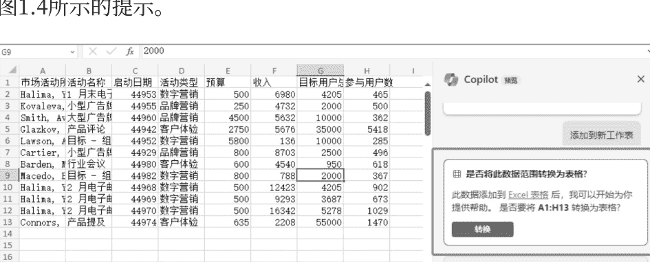

图1.4 Excel中的Copilot提示

可直接点提示中的“转换”按钮把选中区域转为表格，也可通过工具栏“插入 → 表格”实现相同效果。

需要注意，工作表Sheet与表格Table是两种概念，Copilot仅能处理Table格式数据，如图1.5所示的样式即为Table。

| 市场活动所有者 | 活动名称 | 启动日期 | 活动类型 | 预算 | 收入 | 目标用 |

|---|---|---|---|---|---|---|

| Halima, Yakubu | 1 月末电子邮件 | 44953 | 数字营销 | 500 | 6980 | |

| Kovaleva, Anna | 小型广告牌 | 44955 | 品牌营销 | 250 | 4732 | |

| Smith, Avery | 大型广告牌 | 44960 | 品牌营销 | 4500 | 5632 | |

| Glazkov, Ilya | 产品评论 3x | 44942 | 客户体验 | 2750 | 5676 | |

| Lawson, Andre | 目标 - 组 1 | 44952 | 数字营销 | 5800 | 136 | |

| Cartier, Christian | 小型广告牌 | 44929 | 品牌营销 | 800 | 8703 | |

| Barden, Malik | 行业会议 | 44980 | 客户体验 | 600 | 4540 | |

| Macedo, Beatriz | 目标 - 组 2 | 44982 | 数字营销 | 800 | 788 | |

| Halima, Yakubu | 2 月电子邮件 - 北部 | 44968 | 数字营销 | 500 | 12423 | |

| Halima, Yakubu | 2 月电子邮件 - 南部 | 44969 | 数字营销 | 500 | 9293 | |

| Halima, Yakubu | 2 月电子邮件 - 西部 | 44970 | 数字营销 | 500 | 16342 | |

| Connors, Morgan | 产品提及 5x | 44974 | 客户体验 | 635 | 2208 | |

图1.5 Excel中的Table格式

在Table空白区域点击时，Copilot同样会给出提示，如图1.6。

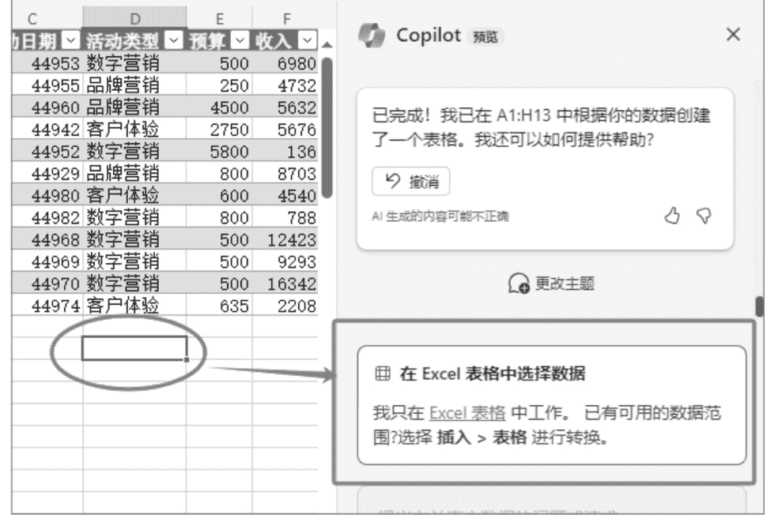

图1.6 单击空白处Copilot的提示

接下来对Table数据执行Copilot操作，相关提示见图1.7。

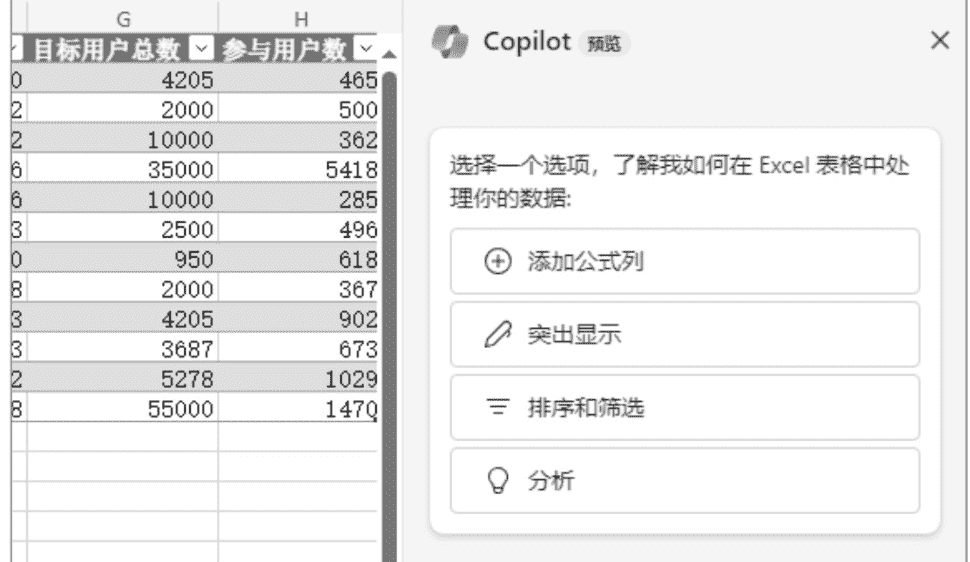

图1.7 Copilot提示的数据处理操作

我们可以让Copilot对数据做一个可视化效果，提示与效果如图1.8所示。

对活动类型做预算的饼图

### 按'活动类型'列出的'预算'


AI 生成的内容可能不正确

我已经创建了一个饼图，显示了按活动类型列出的预算汇总。例如，数字营销的预算总额为 $8,600，品牌营销的预算总额为 $5,550。

AI 生成的内容可能不正确

图1.8 对Copilot提出可视化效果要求

生成的饼图会直接呈现在工作表中，结果见图1.9。

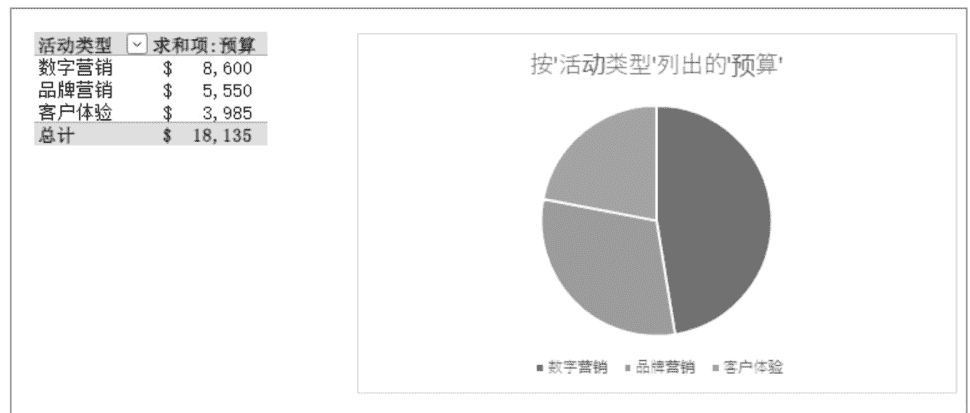

图1.9 Copilot可视化效果呈现结果

原则上Copilot仅支持Table格式数据，打开空白工作簿时会提示“请尝试一个示例”，如图1.10。


图1.10 打开新工作簿Copilot的提示

点击“请尝试一个示例”，系统会自动生成一组Table示例数据，如图1.11，随后即可进行测试。

| 市场活动所有者 | 活动名称 | 启动日期 | 活动类型 | 预算 | 收入 | 目标用户总数 | 参与用户数 |

|---|---|---|---|---|---|---|---|

| Halima, Yakubu | 1 月末电子邮件 | 27-Jan | 数字营销 | $ 500 | $6,980 | 4,205 | 465 |

| Kovaleva, Anna | 小型广告牌 | 29-Jan | 品牌营销 | $ 250 | $4,732 | 2,000 | 500 |

| Smith, Avery | 大型广告牌 | 3-Feb | 品牌营销 | $4,500 | $5,632 | 10,000 | 362 |

| Glazkov, Ilya | 产品评论 3x | 16-Jan | 客户体验 | $2,750 | $5,676 | 35,000 | 5,418 |

| Lawson, Andre | 目标 - 组 1 | 26-Jan | 数字营销 | $5,800 | $ 136 | 10,000 | 285 |

| Cartier, Christian | 小型广告牌 | 3-Jan | 品牌营销 | $ 800 | $8,703 | 2,500 | 496 |

| Barden, Malik | 行业会议 | 23-Feb | 客户体验 | $ 600 | $4,540 | 950 | 618 |

| Macedo, Beatriz | 目标 - 组 2 | 25-Feb | 数字营销 | $ 800 | $ 788 | 2,000 | 367 |

| Halima, Yakubu | 2 月电子邮件 - 北部 | 11-Feb | 数字营销 | $ 500 | $12,423 | 4,205 | 902 |

| Halima, Yakubu | 2 月电子邮件 - 南部 | 12-Feb | 数字营销 | $ 500 | $9,293 | 3,687 | 673 |

| Halima, Yakubu | 2 月电子邮件 - 西部 | 13-Feb | 数字营销 | $ 500 | $16,342 | 5,278 | 1,029 |

| Connors, Morgan | 产品提及 5x | 17-Feb | 客户体验 | $ 635 | $2,208 | 55,000 | 1,470 |

图1.11 Copilot自动生成的Table格式数据

## 1.12 小结

本章对Excel各项功能做了分类梳理，帮助大家建立整体认知。接下来进入实战环节，开启在ChatGPT助力下的高效学习之旅。

# 第2章 ChatGPT手把手教：从0到1做表

本章以实战为主，介绍如何借助ChatGPT制作表格，涵盖数据录入类型选择、合并、筛选、排序等操作，以及表格格式设置，并讲解提示词撰写技巧，让ChatGPT更好地配合工作。

## 2.1 巧用工具搭建知识脉络

学习新概念或新工具时，常不知从何入手，分不清重点，导致走弯路。以Excel为例，初次打开界面功能繁多，若逐一探究耗时耗力，反馈也不明显，容易打击学习热情。因此面对零散且数量庞大的知识点，最好先按逻辑串联，形成个人速查手册，遇到问题再查阅，提升效率。ChatGPT非常适合承担这种归纳总结的工作。

使用ChatGPT整理知识时，可先按自定规则分类，例如按功能区域划分，再据此补全知识体系，并以Markdown格式输出，Markdown是一种轻量标记语言，便于阅读与编辑；最后可用XMind等思维导图工具将其可视化，XMind是一款常用的思维导图软件，可帮助整理思路与构建脑图。

构建思维导图时，Markdown是常用格式。以下是基础语法规则。

（1）标题：#的数量决定层级，#越多层级越深，例如：

```
#一级标题

##二级标题

###三级标题
```

（2）段落：段落间用空行分隔，段内换行可用<br>标签。

（3）强调与加粗：用*或_包裹文本可实现斜体或加粗，例如：

```
*斜体* 或 _斜体_
**加粗** 或 __加粗__
```

（4）列表标记
无序条目建议以 “-” 或 “*” 开头，有序条目则以数字加点开头，写法示范如下：

- 无序列表项 1

- 无序列表项 2

- 无序列表项 3

1. 有序列表项 1

2. 有序列表项 2

（5）图片引用语法
要在文档中嵌入图片，可使用 ! [描述文本](图片链接地址) 的形式，示例如下：

```

```

（6）图片路径
本地或网络图片的写法均为 ! [描述文本](链接地址/相对路径)，示例如下：

## 2.2 用对话方式拆解表格界面

ChatGPT 只能输出文字，无法直接演示操作。把问题拆得更清晰，就能让它把每个部件的位置、用途和操作步骤整理成简洁的文字流程，理解偏差也会大幅降低。按下面顺序推进就能快速上手。

### 1. 先厘清提问思路
先对 Excel 界面做整体盘点，了解由哪些区域构成，再按部件逐一提问，让模型说明该部件包含什么、能做什么、怎么用。

### 2. 设计提示词
了解某个模块在表格软件中的位置和功能时，可套用如下模板：

> 请详细介绍【××模块】在 Excel 中的位置、功能及使用方法，并以 Markdown 格式输出给我。

### 3. 参考回复范例（以快速访问工具栏为例）
按上述模板询问快速访问工具栏，模型会给出类似说明：

**位置：**
快速访问工具栏默认放在 Ribbon 功能区上方，通常位于标题栏与功能区之间。切换任意选项卡时它始终可见。

**功能介绍：**
该栏用于收纳高频命令，默认自带保存、撤销、恢复三个按钮。可点右侧的“自定义快速访问工具栏”按钮添加其它按钮，也可从任意功能区右键某功能后选择“添加到快速访问工具栏”，同样可以从栏中移除不需要的功能。

**使用方法：**
……具体步骤略，后文会结合实际操作演示。提问时最好说明使用的 Excel 版本，部分操作会因版本差异而不同。未特别说明的操作基本适用于 macOS 与 Windows 2016 及以上版本。

### 2.2.1 快速访问工具栏的配置

#### 1. 用法一：新增功能
表格软件允许把常用命令固定到快速访问工具栏，主要做法如下。

点工具栏右侧的“自定义快速访问工具栏”按钮会弹出菜单，列出可选命令，如图2.1 所示。选中所需命令即可加入。若备选列表里没有想要的功能，可点“更多命令”，各版本名称可能为“其他命令”，打开对话框后挑选再添加。设置完毕点“保存”即可。

像保存、筛选、升降序这类高频操作固定在工具栏后，就无需反复在功能区寻找。


单击选择自己需要的功能如果未找到自己需要的功能可选择此命令

图2.1 Excel快速访问工具栏添加功能

#### 2. 用法二：移除功能
点工具栏右侧的“自定义快速访问工具栏”按钮展开菜单，再点要去掉的命令即可移除。例如要去掉“保存”按钮，就在展开菜单中找到“保存”前的勾选状态取消即可，具体如图2.2 所示。


图2.2 Excel快速访问工具栏删除方法一

也可以在自定义菜单里选择“更多命令”，打开的界面如图2.3 所示。在右侧“自定义快速访问工具栏”列表中把不想保留的功能移至左侧，再点“保存”。

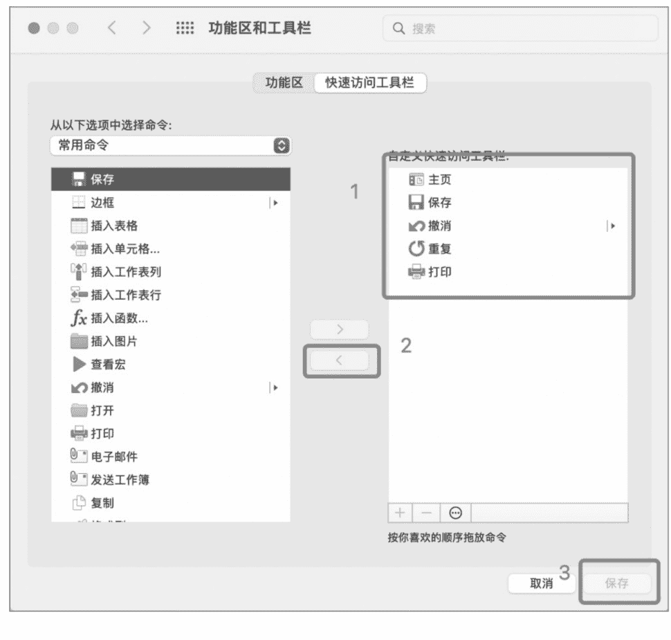

图2.3 Excel快速访问工具栏删除方法二

#### 3. 用法三：个性化设置
除增删功能外，还可对工具栏本身进行调整。

（1）移动位置：点右侧的“自定义快速访问工具栏”按钮，在菜单中选择“在功能区下方显示”，工具栏会下移到功能区下方，如图2.4 所示。想改回上方则选“在功能区上方显示”。该功能在 Windows 版本较为常见，macOS 通常不支持。

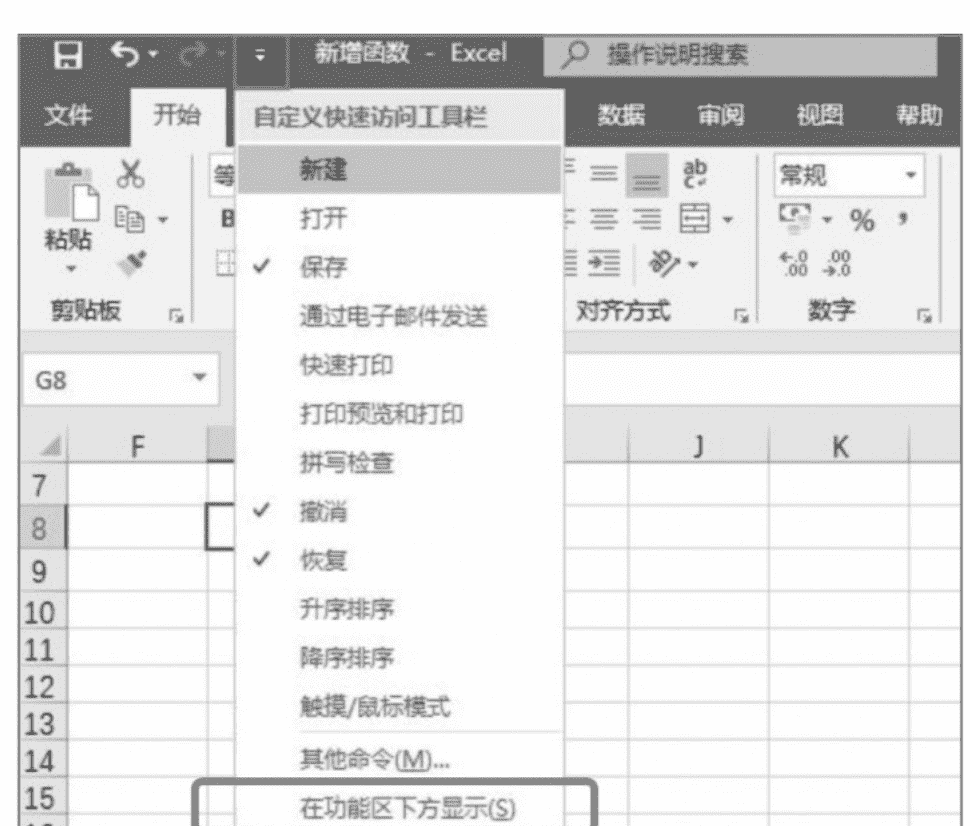

图2.4 Excel快速访问工具栏移动

（2）排序调整：工具栏默认按添加顺序排列。如需调整，可点“自定义快速访问工具栏”→“更多命令”，在弹出的对话框里用上下移动按钮自行排序。例如把“打印”调到“保存”前面，具体如图2.5 所示。

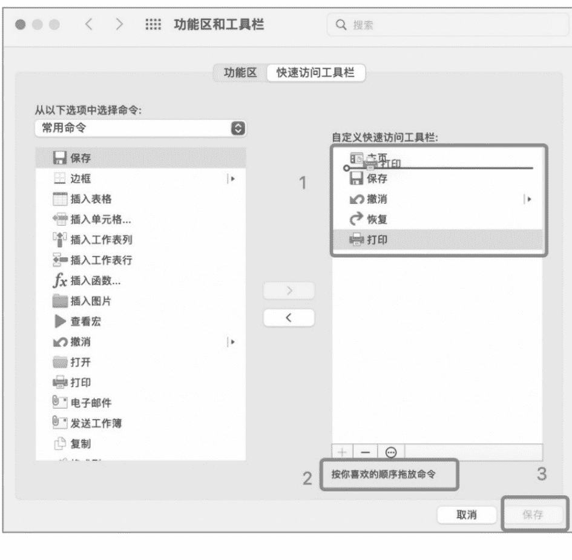

图2.5 Excel快速访问工具栏功能排序

（3）生效范围：默认增删对所有文档生效，也可只针对单个工作簿。打开要单独设置的工作簿，点“自定义快速访问工具栏”按钮，在对话框中选择该工作簿后再增删功能，一般仅 Windows 版本支持，macOS 不支持，具体如图2.6 所示。


图2.6 Excel快速访问工具栏功能生效范围

（4）重置：若添加的功能太多想一键清空，可选“更多命令”，在对话框右下角点“重置”，下拉选择“仅重置快速访问工具栏”，如图2.7 所示。


图2.7 Excel快速访问工具栏功能重置

（5）导入与导出：换电脑或重装系统想保留设置，可用导入导出功能，一般仅 Windows 版本支持。

导出：在“Excel 选项”对话框中点右下角的“导入/导出”按钮，下拉选择“导出所有自定义设置”，如图2.8 所示。

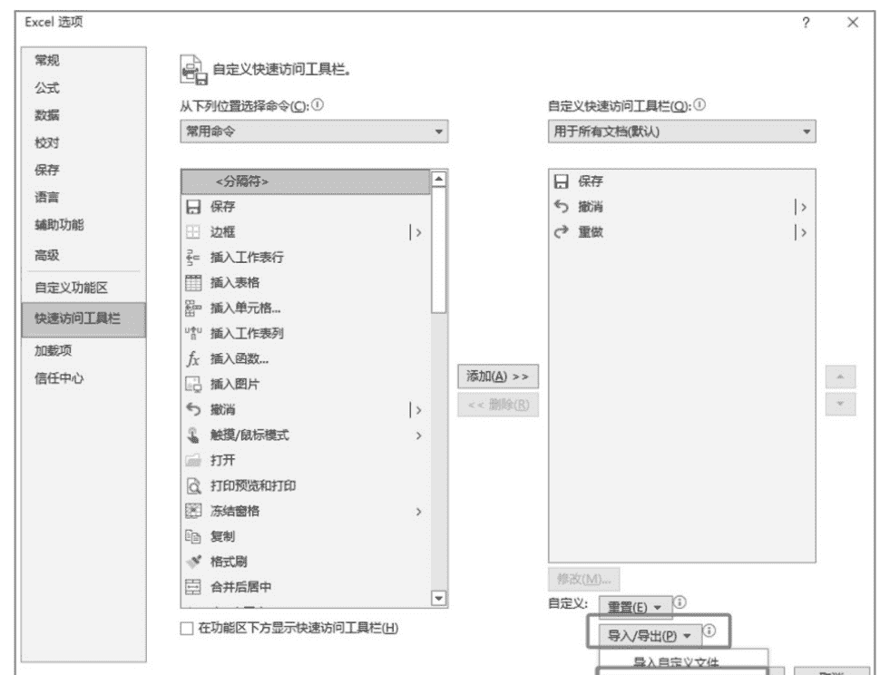

图2.8 Excel快速访问工具栏导出操作

随后在“保存文件”对话框里指定路径并命名，如图2.9 所示。


图2.9 Excel快速访问工具栏导出保存操作

导入：在“Excel 选项”对话框中点“导入/导出”按钮，下拉选择“导入自定义文件”，如图2.10 所示。

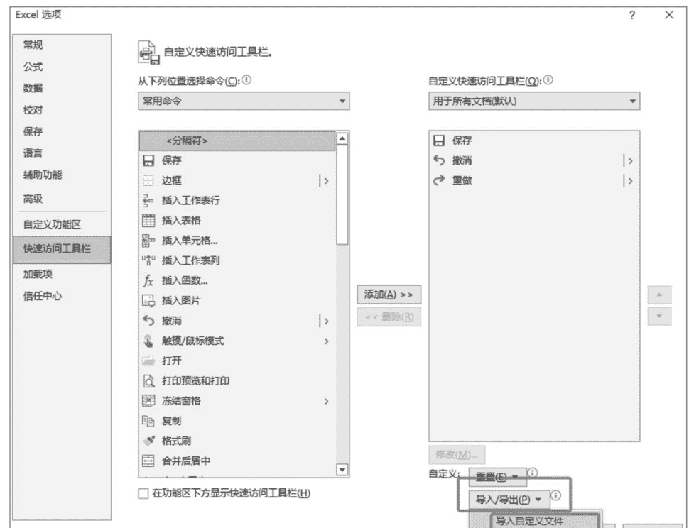

图2.10 Excel快速访问工具栏导入操作

关闭对话框后设置生效。注意导入导出会同时作用于快速访问工具栏和功能区的全部自定义内容，导入会覆盖原有设置，建议先记录重要功能。

### 2.2.2 功能区的设置

Windows 版 Excel 的功能区默认对应“文件”“开始”“插入”“页面布局”“公式”“数据”“审阅”“视图”八大选项卡。macOS 版的功能区为“开始”“插入”“绘图”“页面布局”“公式”“数据”“审阅”“视图”八大选项卡，“文件”相关选项则在菜单栏里。“绘图”大致等同于文件中的笔工具做标注。下面以 Windows 版的高频功能为例，结合模型整理如下。

**功能分类概述：**
功能区按任务把命令分组，主要选项卡如下。

#### “文件”（File）选项卡
- 新建（New）：创建新工作簿或基于模板新建工作表。
- 打开（Open）：打开已有工作簿。
- 保存（Save）：把当前工作簿存到指定位置。
- 另存为（Save As）：以不同名字或格式另存。
- 打印（Print）：设置打印选项并输出。
- 导出（Export）：把工作簿导出为其它格式。

#### “开始”（Home）选项卡
- 剪切（Cut）：剪切选中内容到剪贴板。
- 复制（Copy）：复制选中内容到剪贴板。
- 粘贴（Paste）：把剪贴板内容贴回工作表。
- 格式（Format）：调整单元格格式、字体、边框和颜色。
- 插入（Insert）：插入行列、图表、图片等对象。
- 删除（Delete）：删除选中行列单元格或对象。
- 查找和选择（Find and Select）：查找并选定内容。

#### “插入”（Insert）选项卡
- 图表（Charts）：插入柱形、折线、饼图等。
- 表格（Tables）：插入并格式化数据表格。
- 图片（Pictures）：插入图片或其它图像。
- 形状（Shapes）：插入矩形、椭圆、箭头等。
- 链接（Links）：插入超链接。
- 文本（Text）：插入文本框、批注、WordArt 等。
- 日期和时间（Date & Time）：插入日期时间。

#### “公式”（Formulas）选项卡
- 函数库（Function Library）：选择并应用函数。
- 公式审阅（Formula Auditing）：检查工作表公式。
- 计算选项（Calculation Options）：配置计算设置和精度。
- 定义名称（Define Names）：为单元格或区域命名以便引用。

#### “数据”（Data）选项卡
- 排序和筛选（Sort and Filter）：对数据排序筛选。
- 获取外部数据（Get External Data）：从外部文件或数据库导入。
- 数据工具（Data Tools）：清洗数据、去重、建透视表等。
- 分析（Analysis）：使用数据分析工具进行分析运算。

#### “视图”（View）选项卡
- 工作表视图（Workbook Views）：切换普通、页面布局、分页预览等。
- 窗口（Window）：管理窗口布局、拆分、冻结等。
- 显示/隐藏（Show/Hide）：显示或隐藏网格线、公式栏、标尺等。
- 放大/缩小（Zoom）：调整缩放比例。

#### “页面布局”（Page Layout）选项卡
- 页面设置（Page Setup）：设置纸张大小、方向、页边距等。
- 主题（Themes）：应用颜色、字体、图形主题。
- 页面背景（Page Background）：插入或设置页面背景图。

#### “审阅”（Review）选项卡
- 拼写检查（Spelling）：检查拼写错误。
- 语言（Language）：设置语言属性。
- 注释（Comments）：增删管理注释。
- 更改（Changes）：追踪、接受、拒绝修改。
- 比较（Compare）：比较工作簿或工作表差异。
- 保护（Protect）：保护工作表、工作簿或单元格。

以上只是常见选项卡和分类，实际功能区还有更多命令组，后续使用时再具体讲解。

### 2.2.3 工作区的设置
工作区即单元格区域，是输入、修改、删除数据的核心地带，也是数据的载体，其在 Excel 中的位置如图2.11 所示。


图2.11 Excel单元格区域

Excel 2016 中行数为 1,048,576 行，列数为 16,384 列。行号用 1~1,048,576 表示，点数字可选中整行；列号用 A~XFD 表示，点字母可选中整列。

行列虽多，但并不代表能无限存储数据。数据量到数十万条后，表格会明显卡顿，公式越多越慢，因为运算耗时增加。日常工作中不建议在表中堆积大量公式。大多数实际业务数据量不大，Excel 完全够用。

单元格区域下方是工作表标签，左侧显示各 Sheet 名称，一个 Excel 文件为工作簿，内页为工作表。点“+”可新增工作表，双击名称可重命名。右侧是水平滚动条，拖动可查看不同列；界面最右侧是垂直滚动条，拖动或滚轮可查看不同行。

### 2.2.4 状态栏的设置
状态栏位于界面最底端，如图2.12 所示。选中数据时它会显示平均值、计数、求和等信息，不同版本右侧还可能出现普通、页面布局、分页预览等视图切换和缩放比例。


图2.12 Excel状态栏

状态栏常被忽略却很实用。比如想知道表格有多少行或列，不必拉到底，只需选中一行或一列，状态栏数字即为结果。求和也一样，选中目标单元格后直接看状态栏，无需写 SUM 公式，十分省事。

### 2.2.5 生成思维导图
把 ChatGPT 输出的 Markdown 回答整理好，加上实际操作的截图，导入 Xmind 即可生成一份速查型思维导图。Markdown 可用 Visual Studio Code、Sublime Text、Notepad++、GitHub 在线编辑器等工具编辑，这里以 Sublime Text 为例，保存为 .md 文件即可。图2.13 为整理后的 Markdown 示例。

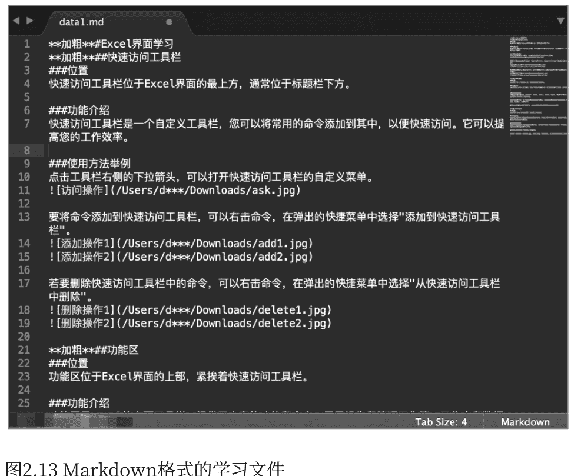

图2.13 Markdown格式的学习文件

在 Xmind 中选择“文件”→“导入”→“Markdown”命令，如图2.14 所示，即可把文件转为思维导图，作为实践时的快速检索手册。


图2.14 导入Xmind操作步骤解析

## 2.3 最快速地从0到1做表
传统制表靠手动输入，费时费力。ChatGPT 能依据用户指令生成结果并导出到 Excel，后续再配合数据填充、格式调整、快捷键使用，完成合并、筛选、排序等操作，效率大幅提升。

### 2.3.1 快速整理数据类型和使用场景
在用自己的数据建表前，可先让模型随机生成示例来熟悉数据类型。可用指令：“请帮我生成一张随机的 Excel 表格，包含所有 Excel 支持的数据类型。”该功能需 ChatGPT 3.5 以上版本。把回答复制粘贴到 Excel 中，如表2.1 所示。

表2.1 Excel中支持的数据类型举例

| 布尔类型 | 整数类型 | 浮点类型 | 日期时间类型 | 字符串类型 |
| :--- | :--- | :--- | :--- | :--- |
| TRUE | 123 | 3.14 | 2024-01-01 10:30 | Hello |
| FALSE | -456 | 2.718 | 2024-02-15 15:45 | World |

| TRUE | 789 | 1.23 | 2024-03-31 09:00 | Excel |

| FALSE | -987 | 0.567 | 2024-04-20 18:20 | Assistant |

Excel 的类型体系远不止示例表里展示的那几项，错误值、空值也都属于常用类型，每种都有各自的使用边界。上面那张表是随机抽样，只覆盖了少量常见情况。结合这份样例，可以继续追问 ChatGPT，例如“Excel 里常见的字段类型有哪些，各自怎么用”。根据对话的归纳，大致可以分为四类。

(1) 文本类：用来存放姓名、地址、说明等字符信息，允许字母、数字、符号和空格混排。Excel 提供了丰富的文本处理函数与格式选项，能对内容进行加工与呈现。

(2) 数值类：用来存放价格、件数、成绩等数字信息。这类数据可参与运算、统计与图表化。显示层面支持整数、小数、百分比等多种数值样式。

(3) 日期与时间类：用来存放订单日期、会议时刻等时序信息。支持日期的计算、排序与格式化，并可通过函数与自定义格式满足不同需求。

(4) 布尔类：仅表示逻辑真 TRUE 或逻辑假 FALSE。常用于条件判断与逻辑运算，结合逻辑函数与条件格式，可依据真假做差异化处理与展示。

### 2.3.2 单元格、行列与表格格式快速调整方法

在 Excel 里可以很便捷地修改单元格、行、列以及整表的外观。下面是借助 ChatGPT 梳理的常用操作要点。

**参考提示词：** Excel 里怎么快速调整单元格、行、列和整表的格式？

#### 1. 单元格格式调整

（1）修改列宽：把光标移到列标上方的分割线，指针变成双向箭头后拖动即可改变宽度。

（2）修改行高：把光标移到行号左侧的分割线，指针变成双向箭头后拖动即可改变高度。

（3）文本自动换行：选取目标单元格，进入“开始”标签页的“对齐”区，点击“设置单元格对齐方式”，在弹出窗口勾选“自动换行”，确认后生效。具体操作见图2.15和图2.16所示。


▲图2.15 单元格文本换行1


图2.16 单元格文本换行2

（4）单元格样式与主题：在“开始”标签页可选用预设样式和主题，一次性改变整表视觉效果，如图2.17所示。

（5）数值格式：选取需要格式化的单元格，在“开始”标签页的“数字”区选择货币、百分比等样式即可。

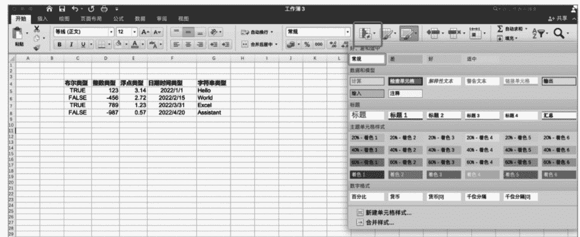

图2.17 选择表格样式和主题

#### 2. 行和列的格式调整

（1）插入行：定位插入位置后，在“开始”标签页点开“插入”下拉，选择“插入工作表行”，如图2.18所示。也可右键定位位置，从快捷菜单里点“插入”，如图2.19所示。


▲图2.18 插入行方法一


图2.19 插入行方法二

（2）删除行：选取目标行，在“开始”标签页点开“删除”下拉，选择“删除工作表行”，或右键选择“删除”。

（3）插入列：定位插入位置后，在“开始”标签页点开“插入”下拉，选择“插入工作表列”，或右键选择“插入”。

（4）删除列：选取目标列，在“开始”标签页点开“删除”下拉，选择“整列”，或右键选择“删除”。

#### 3. 表格格式调整

（1）表格样式与主题：在“开始”标签页选用预设样式和主题，也可单独设定边框、底色和字体，都在“开始”标签页完成，如图2.20所示。


图2.20 表格样式和主题

（2）条件格式：选取整表，在“开始”标签页点“条件格式”按钮，从下拉列表里挑选合适的规则与效果突出重点数据，如图2.21所示。

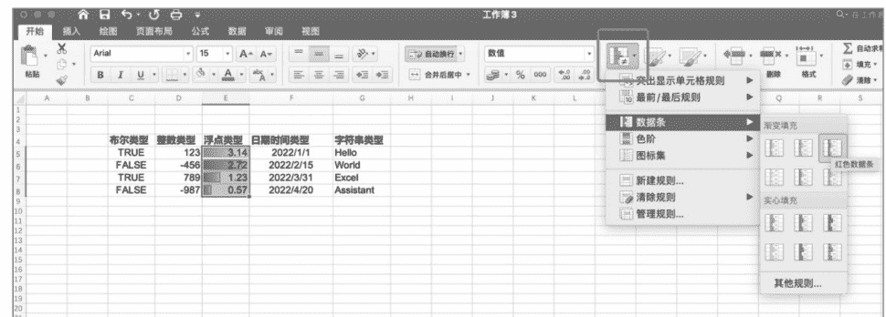

图2.21 条件格式设置

### 2.3.3 分列、分组、排序与筛选实操

Excel 提供了分列、分组、排序和筛选等手段来组织数据。以下是 ChatGPT 生成的操作要点。

**参考提示词：** 在 Excel 里如何对数据进行分列、分组、排序和筛选？

（1）分列：选取待分列的数据，进入“数据”标签页点“分列”按钮，可按分隔符或固定宽度拆分，如图2.22~图2.24所示。

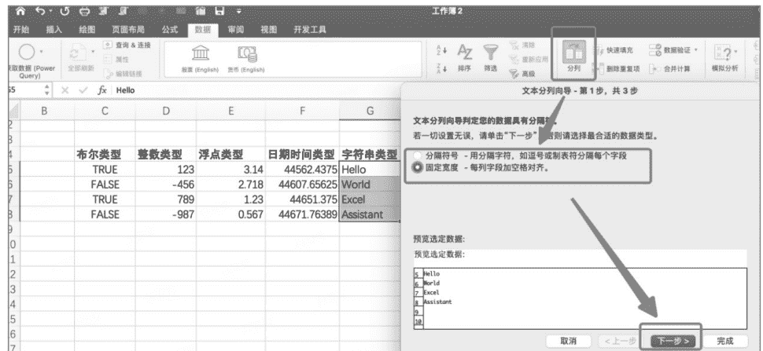

▲图2.22 数据分列第一步


▲图2.23 数据分列第二步


图2.24 数据分列第三步

（2）分组：选取要归并的行或列，进入“数据”标签页点“组合”按钮，在对话框里选择按行或列归并并指定范围，如图2.25所示。归并后在左侧或上方会出现“+”“-”标志，点击可展开或收起层级，便于查看层级数据。


图2.25 数据分组

（3）排序：单列排序可直接点列标题，再在“开始”标签页的“编辑”区选择“升序”或“降序”，整列数据会同步移动。自定义排序则点“排序和筛选”→“自定义排序”，在对话框里设定排序规则。

（4）筛选：选取列表任意单元格，在“开始”标签页“编辑”区点“筛选”，列标题会出现下拉箭头，可通过箭头设定筛选条件。排序与筛选的操作示意如图2.26所示。


图2.26 排序和筛选操作

借助分列、分组、排序和筛选，表格数据更易整理与汇总，提升可读性和可操作性，也方便后续分析与报表制作。

### 2.3.4 用 ChatGPT 出题检验学习成果

前文介绍了借助 ChatGPT 学习与在 Excel 里设置页面、制作表格的方法，但大量实操才是检验掌握程度的关键。下面利用 ChatGPT 按步骤生成练习题来检验。

### 提问思路

需要通过大量练习巩固知识点，因此让 ChatGPT 基于之前的聊天记录出题并附带“参考答案”，方便在遇到困难时对照。

问：请根据之前聊天记录中涉及的知识点给我出一套实践题目，并给出参考答案。

ChatGPT 回答：

#### 1. 实践题目

- 1) 数据类型

  (1) Excel 里常见的数字格式有哪些？请简要说明用途。

  (2) 如何把数字转换成日期格式？

  (3) 如何把文本数据转换成数字数据？

- 2) 调整单元格、行、列和表格格式

  (1) 如何让单元格里的文本内容自动换行？

  (2) 如何调整单元格的宽度和行高？

  (3) 如何对选取的单元格进行货币格式设置？

- 3) 分组、排序和筛选

  (1) 如何对 Excel 表格的数据按单个列进行升序或降序排序？

  (2) 如何在 Excel 里使用自动筛选快速筛选数据？

  (3) 如何使用高级筛选进行多条件筛选？

#### 2. 参考答案

- 1) 数据类型

  (1) 常见数字格式有常规、货币、百分比、科学记数法等。常规用于普通数字显示，货币用于金额显示，百分比用于百分数显示，科学记数法用于极大或极小数值。

  （2）如何把数字转换成日期格式？

  选取目标单元格或区域，在“开始”标签页“数字”区选择“日期”样式，可挑选常用日期样式或自定义样式。

  （3）如何把文本数据转换成数字数据？

  选取包含文本的单元格区域，在“开始”标签页“数字”区选择“常规”或“数字”等合适样式即可转换。

- 2) 调整单元格、行、列和表格格式

  （1）如何让单元格里的文本内容自动换行？

  选取单元格，在“开始”标签页“对齐方式”区点击“自动换行”按钮。

  （2）如何调整单元格的宽度和行高？

  调整宽度：将光标置于列标上方边界，指针变为双向箭头后拖动。调整行高：将光标置于行号左侧边界，指针变为双向箭头后拖动。

  （3）如何对选取的单元格进行货币格式设置？

  选取单元格，在“开始”标签页“数字”区选择“货币”样式。

- 3) 分组、排序和筛选

  （1）如何对 Excel 表格的数据按单个列进行升序或降序排序？

  选取列标题，在“开始”标签页“编辑”区点击“升序”或“降序”按钮。

  （2）如何在 Excel 里使用自动筛选快速筛选数据？

  选取数据区域，在“数据”标签页“排序和筛选”区点击“筛选”按钮，通过列标题下拉按钮选择条件。

  （3）如何使用高级筛选进行多条件筛选？

  在“数据”标签页“排序和筛选”区点击“高级”，按要求指定条件区域和输出区域进行操作。

通过这种方式可以为固定知识领域生成“无限多”的变式题目，反复提问 ChatGPT 会得到不同题目，逐步形成个人题库，全面掌握知识点。

### 2.4 学习中常用的提示词策略

在向 ChatGPT 提问时，不同的表达方式会得到不同详细程度的回答。OpenAI 的 CEO Sam Altman 曾指出，会写提示词是一项高杠杆技能。因为当前技术下，输出质量高度依赖提示词，学会与 AI 沟通的语言是关键。下面给出一个通用公式：【专家模式】+【问题描述】+【效果描述】+【条件限制】，如图2.27所示。

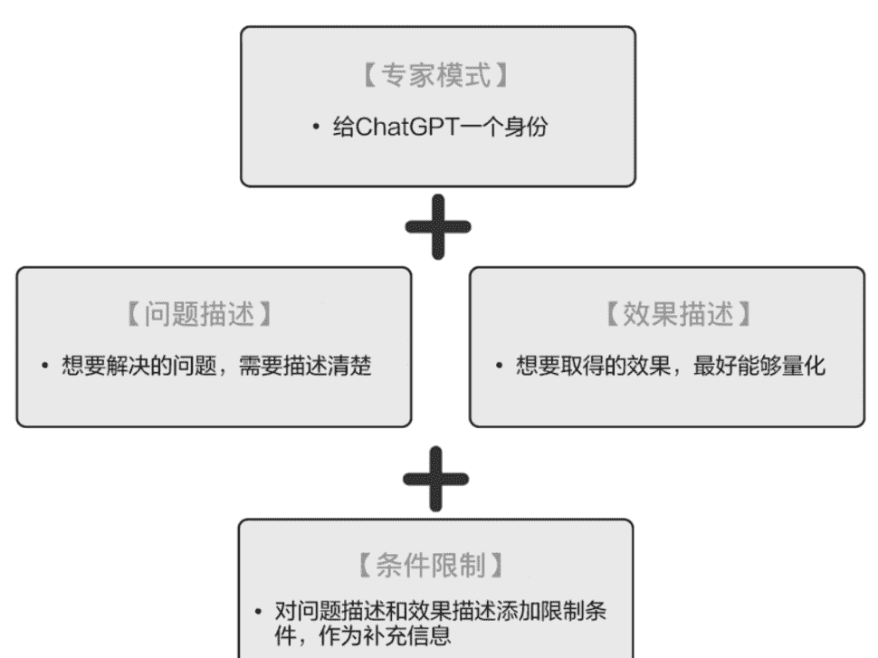

图2.27 ChatGPT提问万能公式示意图

**【专家模式】** 根据专业领域给 ChatGPT 一个角色定位。例如学习 Excel 时，让它扮演“精通 Excel 的数据工程师”，在复杂问题拆解时效果更好。

**【问题描述】** 包含需要解决的具体问题，可采用以下方式描述：

- (1) 使用简明扼要的语言：用简洁语句陈述问题，避免冗长。
- (2) 提供背景信息：补充上下文帮助 AI 更全面理解问题。
- (3) 列举关键细节：说明系统、软件版本等细节，便于给出更精确答案。

没有放之四海而皆准的公式，但该框架能帮助更系统清晰地表达问题，配合持续练习和反馈可不断提升提问能力。

**【效果描述】** 指希望获得的最终成果，是操作步骤、参考建议等。建议：明确具体目标和可量化指标，将大目标拆分为更小的子目标，便于跟踪进展。

**【条件限制】** 指难以归入问题描述或效果描述的零碎要求，如要求输出语言、表达风格等。虽非核心，却能规范回答格式。

具体问题需具体对待，并非所有要素都必须使用。有时即便描述很严谨仍会出现操作偏差，常因 Excel 版本差异导致按钮名称不同，或文字描述存在理解偏差。建议使用 ChatGPT 4 获取更新信息，或使用联网插件如 WebPilot，如图2.28所示。


图2.28 ChatGPT插件举例

### 2.5 本章要点回顾

本章介绍了利用 ChatGPT 的回答生成个人界面功能速查手册的方法，便于后续快速查阅解决问题。围绕表格制作，借助 ChatGPT 了解了数据类型设置、单元格行列表格格式调整、筛选排序等操作，提升数据分析和展示效率。最后总结出一个可复用的提问方法论，作为后续学习的通用公式。

以上是初次借助 ChatGPT 学习 Excel 的入门操作，后续章节还将介绍更多技巧。

# 第3章 用 ChatGPT 学数据可视化

本章介绍如何协同 Excel 与 ChatGPT 学习数据可视化。数据可视化是通过图表图形呈现抽象数据，帮助直观理解和分析。Excel 提供丰富的数据处理与展示工具，ChatGPT 则能提供问答式实时解释和辅助说明。

接下来将探讨如何让 ChatGPT 提供可在 Excel 中使用的数据，并了解导入数据、创建数据透视表和图表的方法。借助 Excel 的可视化功能，可快速生成柱形图、折线图、饼图等，直观展示趋势、关系和分布。

## 3.1 折线图的基础与场景

折线图是常见的数据可视化手段，用连续线段连接多个数据点，直观呈现变化趋势、关联性和周期性。

常见应用场景包括：

- (1) 趋势分析：直观展示随时间变化的趋势，如股价走势、气温季节变化，便于识别增长、下降和波动。
- (2) 比较分析：同时展示多组数据的走势，如不同产品的销量、不同城市人口增长，对比差异和关联。
- (3) 预测预警：基于历史走势预测未来趋势，如销售预测、气温预测；异常波动可作为预警信号。
- (4) 数据监控：实时监控网站访问量、股市波动等，动态更新折线图及时掌握变化。

对入门用户而言，折线图易懂实用，能帮助快速发现规律和趋势，适用于数学、科学、商业和社会科学等领域。

在掌握基础后，需要学习 Excel 中的具体操作，可借助 ChatGPT 获取步骤。

### 提问思路

新手绘图常需反复修改，因此除了步骤外应加入注意事项，提升规范性。

问：你现在是一个精通 Excel 的数据工程师，请写一段在 Excel 中绘制折线图的教程和注意事项。

ChatGPT 回答：

[教程]：

- 1. 启动 Excel 并准备好包含数据的表格，确保数据以连续的列或行排列。
- 2. 选中需要制图的数据范围。例如数据位于 A 列和 B 列，可选中这两列的所有单元格。
- 3. 在 Excel 菜单栏中打开“插入”选项卡。

# Excel图表实战手册：从折线到雷达，一次搞懂

## 3.1 折线图绘制与调优

- 4. 切到“插入”选项卡后，按 Excel 版本点选“折线图”或“线形图”，会弹出折线图的样式选择菜单。
- 5. 在样式菜单里挑选合适的类型，常见的是普通折线图，按每个数据点绘制；或平滑折线图，用平滑曲线把点连起来。
- 6. 确认类型后，工作表上会出现一个空白的折线图，同时“图表设计”标签页会被激活。
- 7. 在“图表设计”标签页里可以按需做个性化设置，比如增加图例、轴标题、数据标签等，提升可读性。
- 8. 用鼠标拖拽即可调整图表大小和位置，也能把它整体移动到另一张工作表。

【注意事项】：数据格式要规范，数据要完整且顺序正确，标签与标题要清晰，数据标签、图例、数据点的样式、坐标轴的刻度与标题都需要留意。

接下来结合 ChatGPT 的思路在 Excel 里实操。先准备两列数据，分别对应 X 轴和 Y 轴。已有类似表格可以直接用，没有的话请 ChatGPT 生成一组双列数据即可。这里随机构造了一组数据并粘贴到表格里，具体过程见图3.1。

这样就能得到图3.1 左下角的折线图。初始形态是 Excel 的默认配置，还可以按前文提到的要点继续优化。

### 图3.1 Excel中做折线图的步骤

例如设定图表标题、调整数据标签、更改图例样式、修改坐标轴刻度等。参照 ChatGPT 回答里的第6、7步思路，进入“图表设计”选项卡，点击“添加图表元素”，在下拉列表里挑选所需项即可。也可以在图表上右键，选择“设置图表区格式”命令进行设置，如图3.2。

图3.2 Excel中设置图表区格式

执行该命令后，窗口右侧会弹出如图3.3 的设置面板，可在“图表选项”和“文本选项”下分别调整。

### 设置图表区格式

图表选项 | 文本选项

+ 填充
  - 无填充
  - 纯色填充
  - 渐变填充
  - 图片或纹理填充
  - 图案填充
  - 自动
  颜色
+ 边框
  - 无线条
  - 实线
  - 渐变线
  - 自动
  颜色
  透明度 0%
  宽度 0.75 磅
  复合类型
  短划线类型
  线端类型 平
  连接类型 圆角

### 图3.3 Excel图像格式中包含的选择项

同样也可以双击图表里想修改的部分，例如标题、坐标轴、数据点，会弹出如图3.3 的窗格，窗口会自动跳转到对应设置项。Excel 图表可单击的区域见图3.4。

### 图3.4 Excel图像中包含的信息

要添加图表元素，可在“图表设计”选项卡工具栏里点“添加图表元素”按钮，支持添加的元素如图所示3.5。点“快速布局”按钮，其下拉列表提供了官方预设的经典版式，满足日常作图需求，如图3.6。

▲图3.5 Excel图像中添加元素

图3.6 Excel图像中快速布局

## 3.2 柱形图

柱形图由一组垂直或水平的矩形柱构成，柱高代表数值的大小，适合直观比较类间差异、观察趋势等。

常见用途有：
- 比较不同类别间的数量、频率或其它度量差异，如各产品销售额、各年收入对比。
- 呈现数据的分布，观察集中趋势、离散程度和异常值，如班级成绩分布。
- 展示时间序列的走势，每个柱代表一个时间点或区间，柱高体现变化，如月度销售额、年度人口增长。
- 对比不同组别或部门的绩效表现，如各销售团队业绩。
- 可视化调查结果和统计数据，如不同选项的支持率占比。

上手练习时可先让 ChatGPT 准备数据，再按步骤作图。柱形图与折线图的流程几乎一致，仅在“插入”选项卡选择图表类型时点“柱形图”。不想重走流程，也可直接把已有折线图更改为柱形图，操作见图3.7。

### 选择图表类型

| 日期 | Mon | Tue | Wed | Thu | Fri | Sat | Sun |
| :--- | :--- | :--- | :--- | :--- | :--- | :--- | :--- |
| 数值 | 10 | 52 | 200 | 334 | 390 | 330 | 220 |

### 图3.7 更改图像类型为柱形图

## 3.3 饼图

饼图把整体切分成扇形，各扇形面积与所占比例成正比，用于展示构成关系。

典型场景：
- 展示各部分在整体中的相对占比，如市场份额分析。
- 按分类呈现数据分布，反映各类别的重要程度，如调查选项人数占比。
- 对比不同部门或组织的贡献度，如预算分配。
- 显示统计数据的比例分布，如年龄结构。
- 可视化资源或资金分配，如项目任务资源占比。

制作流程与前者相同，选中图表后点“更改图表类型”，在列表里选择“饼图→二维饼图”即可完成切换，见图3.8。注意饼图体现的是占比，若输入的是常规数值，则显示每个数值占总和的比例。

图3.8 Excel中更改图像类型为饼图

## 3.4 散点图

散点图用于探究两个变量间的关系，横轴为一个变量，纵轴为另一个变量，每个点代表一次观测，通过点群分布判断关联性。

常用场景：
- 探索性数据分析中研究变量相关性、趋势与模式，如身高与体重。
- 发现异常值和离群点。
- 用不同颜色或符号分组比较多个类别，如不同消费群体的收入支出关系。
- 同时可视化多变量关系。

需注意，散点图对关系敏感，若数值是文本类型，会以索引代替。将 3.1 节的折线数据改用散点呈现，日期横坐标会变成索引值，结果见图3.9。

| 日期 | Mon | Tue | Wed | Thu | Fri | Sat | Sun |
| :--- | :--- | :--- | :--- | :--- | :--- | :--- | :--- |
| 数值 | 10 | 52 | 200 | 334 | 390 | 330 | 220 |

图3.9 Excel中绘制散点图

## 3.5 直方图（密度图）

直方图把数据划分成若干区间，统计落入各区间的观测数或频率，用来认识分布形态、集中与离散情况。

主要用途：
- 分析数据分布，判断均值、中位数、标准差等特征，如考试分数分布。
- 检测异常值与离群点。
- 比较不同数据集的分布形态。
- 数据预处理与特征工程中选择变换方式。
- 估计概率分布。

与前面图表不同，直方图只需一列数据即可生成。可在“图表设计”里点“更改图表类型”把柱形图改为直方图，结果见图3.10。

图3.10 Excel中将柱形图更改为直方图

直方图的分组方式有几种选择：
按分类：按分类变量分组，如按产品类别生成柱形。
自动：Excel 根据数据范围和分布自动确定箱宽或箱数。
箱宽度：手动指定每个箱的宽度。
箱数：手动指定箱的数量。

选“自动”后，Excel 会自动合并分组并统计每个区间的个数，见图3.11。若选“分类”，离散变量的呈现与柱形图基本一致。直方图真正发挥作用时需要连续型变量，并按连续数值区间分组。可让 ChatGPT 生成柱形用数据和直方图用数据来体会差异。

图3.11 Excel中直方图箱数选择自动

## 3.6 瀑布图

瀑布图是特殊的统计图，用来表现数据的增减关系与累积变化。

特点与作用：
- 清晰展示增减关系，用户能直观看到变化过程。
- 突出起始值和正负向变化，便于比较关键数据贡献。
- 财务分析中常用于收入、支出、净利润的累积展示。
- 销售分析中用于呈现销售额的涨跌。

插入方法：在“插入”选项卡“图表”组中点“插入瀑布图、漏斗图、股价图、曲面图或雷达图”按钮，选择“瀑布图”即可生成，见图3.12。

图3.12 Excel中制作瀑布图

正数代表收入，负数代表支出，默认生成的是累积数值柱形，能看出变化趋势。若需显示总计，先在表格里计算总计并扩展数据源，选中图表后在“图表设计”选项卡点“选择数据”，把包含“总计”的数据范围加入，见图3.13。

图3.13 给瀑布图加入“总计”数据

单独选中“总计”那根柱子，在格式窗格中勾选“设置为汇总”，如图3.14。设置完成后完整效果如图3.15。

图3.14 为瀑布图设置“总计”柱子

图3.15 Excel中的瀑布图

## 3.7 气泡图

气泡图在二维平面上用圆形气泡的大小和位置展示至少两个数值变量的关系，气泡大小表示第三个数值变量，颜色常作为分类辅助信息。

构成要素包括横轴、纵轴、气泡大小和颜色。

典型应用：
- 数据探索与展示，如销售额与广告投入、产品价格的关系。
- 多维数据比较，同时呈现多个维度信息，识别模式与异常。
- 地理数据可视化，把气泡放到地图位置，大小代表人口，颜色代表经济指标。
- 科学研究与实验数据分析，如物种数量与特征关系。

可先让 ChatGPT 生成数据和步骤再操作，具体效果见图3.16。

图3.16 Excel中的气泡图

## 3.8 雷达图

雷达图也称蜘蛛网图或星型图，以中心点为原点向外延伸多条轴，每条轴代表一个变量，数据值通过节点位置或与中心距离表示，便于多变量对比。

常见用途：
- 综合评估多个因素或维度，如产品性能全方位打分。
- 规划与决策，对比不同方案在各指标上的表现。
- 评估个人能力与发展方向，直观展示优势与改进点。

雷达图：多轴读懂竞争态势

做竞品拆解时，雷达图是常用的直观工具。把每个对手的关键维度分配到不同的辐轴上，用折线闭合形成多边形，一家家的优劣就能摊开来看。进行市场对标时，常用来对照产品特性、市场份额等维度，强弱对比一下就显现出来。

本质上是把若干变量的值分别投射到各条轴线，再以几何图形呈现，让多变量之间的关联与变化趋势变得容易比较。

想快速上手，可以直接让AI助手解释：「雷达图有什么用？常见场景有哪些？在表格软件里怎么插入和制作？」它会给出对应的说明。

已有数据想出图：在功能区的“插入”里点击“插入瀑布图、漏斗图、股价图、曲面图或雷达图”，在弹出的列表中挑选一种雷达图样式即可生成。具体流程可参考图3.17所示。


图3.17 Excel中制作雷达图

## 3.9 热力图

热力图是把二维矩阵数据用色彩编码的可视化方式，通过色调深浅反映单元格的数值或出现频次，帮助一眼捕捉模式、走势和异常。

常见用途主要有：

- （1）数据探索与分析：用不同颜色区分数值或频次，能迅速发现规律。金融领域常用来呈现利润、销售额等指标的波动情况与相关性。
- （2）市场研究与竞争分析：在区域或对手维度，用颜色标记销售额、份额等指标，可快速横向比较业绩与趋势。
- （3）用户行为洞察：可用于网页点击、鼠标移动、滚动等行为的可视化，揭示注意力焦点与互动偏好。
- （4）时间序列呈现：时间放一轴，数值放另一轴，用颜色表达大小，就能展示一段期间的数据演变。
- （5）图像处理与计算机视觉：热红外成像中用于温度分布，目标检测中用于各区域置信度的展示。

借助色彩编码，热力图有助于发现数据间的模式、趋势与关联。

向AI请教制作方法时，容易得到看似可行实则不行的回答，例如：

在 Excel 中创建热力图可以通过以下步骤完成。

- （1）准备数据：整理成矩阵结构，包含行列。确保行列排序正确。
- （2）选择数据：选中整个区域，包含标题与数值。
- （3）插入热力图：在菜单栏选择“插入”，在“图表”里找到“热力图”，点开下拉，选择2D或3D等样式。
- （4）自定义样式：插入后可加标题、调整色阶、修改坐标标签等。
- （5）调整范围：点击图表数据点，在“图表设计”→“数据”→“选择数据”中更改系列范围。
- （6）完善格式：按需添加数据标签、调整图例等。

实际上表格软件并无原生热力图类型，需要换个思路，在明确限制的前提下给出可行的替代方案。

### 提问思路

因表格软件不支持热力图图表类型，直接提问容易出错。把这一限制作为背景写进问题描述，让模型据此重构答案。

问：我的表格版本不支持热力图，也不愿装插件，如何在现有条件下实现类似热力图的效果？

回答要点：

如果没有热力图功能且不想装插件，可用条件格式或自定义图表来模拟。下面以条件格式为例。

- （1）选中范围：框选需要做热力图的数据区域。
- （2）添加规则：在“开始”选项卡的“样式”组点“条件格式”，选“新建规则”。
- （3）创建规则：对话框中选“双色刻度”，值类型选“百分比”，按数据需求设定阈值。
- （4）选色方案：在底部格式的颜色映射处，选择合适的渐变或自定义配色。
- （5）应用规则：点“确定”生效。

按此思路操作，可得到效果相近的呈现，如图3.18所示。


图3.18 Excel中制作热力图

## 3.10 漏斗图

表格里的漏斗图擅长表现转化率与流失率的递减过程，常用于营销、销售和业务流程分析。上宽下窄的造型正好对应输入数据的逐层筛选，便于理解各环节损耗。

典型场景包括：

- （1）营销转化：追踪用户在不同触点后的转化情况，找出优化点提升转化。
- （2）销售进展：展示各阶段的客户数与业绩，明确需重点跟进的环节。
- （3）业务流程效率：掌握全流程的转化与流失，定位瓶颈以降低成本、提效。
- （4）产品规划：呈现设计、研发、销售等阶段的进展，获取反馈以提升品质与热度。
- （5）网站访问：展示不同来源渠道的访问路径，找出阻碍购买或访问的问题，优化体验。

同样可让AI解释：「漏斗图的作用与使用场景是什么？插入与制作步骤是怎样的？」

有数据想生成漏斗图：在“插入”选项卡点“插入瀑布图、漏斗图、股价图、曲面图或雷达图”，先选“瀑布图”，再在子菜单里选“漏斗图”即可。具体操作见图3.19。


图3.19 Excel中更改图像类型为漏斗图

## 3.11 ChatGPT让图表更加完整美观

前面已学会在表格里制作各类图表并做基础配置，但多停留在默认配色与字体，观感不够专业。本节借助AI把图表打磨得更美、更易读。

先介绍一个功能强、使用简便的可视化库——ECharts。它在数据分析、监控报表、地理信息等场景应用广泛。打开官网点“所有示例”，会看到如图3.20的界面。


图3.20 Echarts官网示例

ECharts是基于JavaScript的开源可视化库，点进任意一张图都能得到一段可修改、完整描述该图的JS代码。复制链接给AI提问，可绕过低版本AI不能直接传图的限制，代码信息更精确，也无需自己阅读JS。把ECharts图在表格里复现，需要一些技巧，下面边做边讲。

图3.21是一段可绘制气泡图的代码页面。

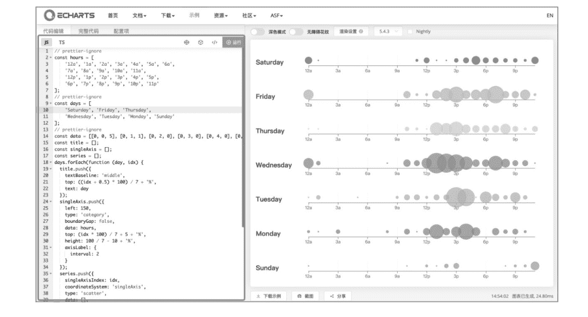

### 提问思路

JS代码里的信息AI完全可读取，先让它提取关键信息再提问。复杂问题可拆成数据信息、图像设置、表格复现三块逐个解决。

数据信息分两问：一是整体理解图在表达什么，二是抽取数据。

问1：你现在是ECharts图表专家，请根据下面这段代码，解析图中包含哪些信息：【复制代码】。

问2：你现在是ECharts图表专家，请根据下面这段代码，把数据提取出来并以表格形式输出：【复制代码】。

第一问的要点为：

代码绘制的是散点图，标题基于title数组配置，对应星期；采用单轴布局，每个星期的水平轴独立显示小时，垂直方向显示星期；数据在data数组中配置，每个点包含星期索引、小时索引和大小；提示框位于上方，可显示具体位置。

该图用于展示每日不同小时的散点分布，点的大小可反映该时段的指标值如数据量或活跃度。

第二问得到的数据整理成表3.1。注意AI在解析复杂或数据量大的情况时偶有误差，只要在可接受范围，后续可自行微调。

### 表3.1 气泡图数据表

| 时间 | Saturday | Friday | Thursday | Wednesday | Tuesday | Monday |
| :--- | :---: | :---: | :---: | :---: | :---: | :---: |
| 01a | 1 | 0 | 1 | 3 | 3 | 0 |
| 02a | 0 | 0 | 0 | 0 | 0 | 0 |
| 03a | 0 | 0 | 0 | 0 | 3 | 0 |
| 04a | 0 | 0 | 0 | 0 | 0 | 0 |
| 05a | 0 | 0 | 0 | 0 | 0 | 0 |
| 06a | 0 | 0 | 0 | 0 | 0 | 0 |
| 07a | 0 | 0 | 0 | 0 | 0 | 0 |
| 08a | 0 | 0 | 0 | 0 | 0 | 0 |
| 09a | 0 | 0 | 0 | 0 | 0 | 0 |
| 10a | 0 | 5 | 3 | 5 | 7 | 1 |
| 11a | 2 | 2 | 2 | 4 | 1 | 3 |
| 12a | 4 | 2 | 1 | 7 | 5 | 4 |
| 01p | 1 | 6 | 0 | 1 | 2 | 0 |
| 02p | 1 | 9 | 0 | 0 | 3 | 0 |
| ... | ... | ... | ... | ... | ... | ... |

继续第三问：

> “你现在是ECharts图表专家，请帮我把下面代码中关于字体型号与大小的相关信息提取出来：【复制代码】。”

回答要点包含：title数组里的文字基线、位置参数；singleAxis数组里的标签数据、位置、轴标签特性、显示间隔；series数组里的系列数据。并给出代码注释与解释：

```
// 对标题进行配置
days.forEach(function(day, idx) {
    title.push({
        textBaseline: 'middle', // 定义标题文字的垂直对齐方式为居中对齐
        top: ((idx + 0.5) * 100) / 7 + '%', // 根据行数计算标题的垂直位置
        text: day // 根据星期几的字符设置标题的文本
    });
    // 对单轴进行配置
    singleAxis.push({
        left: 150, // 时间轴的左侧距离设置为 150
        type: 'category', // 类型为分类类型
        boundaryGap: false, // 去除轴距离两端的空白
        data: hours, // 时间轴的标签
        top: (idx * 100) / 7 + 5 + '%', // 根据行数计算单轴的垂直位置
        height: 100 / 7 - 10 + '%', // 单轴的高度根据行数进行设置
        axisLabel: {
            interval: 2 // 通过设置轴标签的 interval 属性，调整轴标签的显示间隔
        }
    });
    // 对散点图集合进行配置
    series.push({
        singleAxisIndex: idx, // 该系列数据所使用的时间轴的索引
        coordinateSystem: 'singleAxis', // 设置散点图的坐标系为单轴
        type: 'scatter', // 类型为散点图
        data: [], // 系列数据，初始为空
        symbolSize: function(dataItem) {
            return dataItem[1] * 4; // 用于设置散点图符号的大小
        }
    });
});
// 根据提供的数据，对散点图集合中的每个散点进行设置
data.forEach(function(dataItem) {
    series[dataItem[0]].data.push([dataItem[1],
    dataItem[2]]);
});
```

依据上述配置，可在表格中对应设定指标。

最后解决表格复现问题。按过往气泡图的经验，AI直接给出的数据不能直接作图，需明确要求做数据形态转换：把字符串时间转为递增数值，气泡大小对应value，x轴为day、y轴为hour，以表格输出。也可以自行复制后手动调整。

准备就绪后在表格中绘制气泡图，再做格式精修。颜色可用取色器吸取网页中气泡的颜色并把透明度调至约20%，如图3.22。


图3.22 Excel中吸取颜色

绘制完成的图像如图3.23所示。

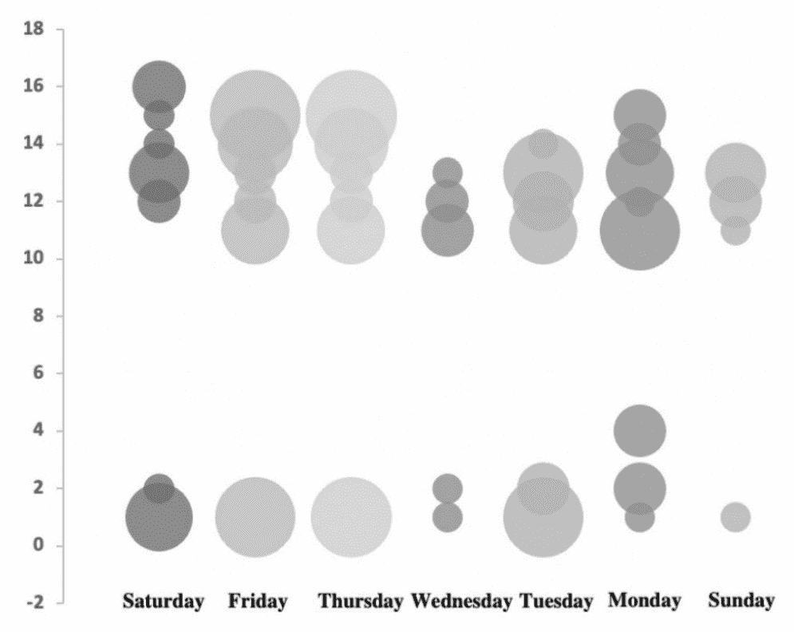

可自行尝试复刻其他图像。表格支持的图形种类有限，部分ECharts图无法完全复现，但多练会越来越熟。若某类图使用频率高，可存成模板：点“更改图表类型”，下拉选择“存为模板”，下次直接调用，具体见图3.24。


图3.24 在Excel中作图并存为模版

## 3.12 ChatGPT作图的提示词推荐

实践中会发现AI有时会“胡说八道”。要理解原因并应对，本节给出思路。

调教模型的过程像教育孩子，用正向反馈与负向反馈引导行为。表现理想时及时奖励，表现不佳时惩罚，让模型意识到错误。通过反复奖惩，模型会形成期望的行为规范。

例如做瀑布图时，AI说要准备三列：起始值、正向变化值、负向变化值，这时要指出问题。可直接说“你说得不对”，让它自查最可能的错误点并修正。更高效的做法是给出清晰指令，让它指出具体哪方面出错。可打开错误瀑布图的数据设置，如图3.25所示。

实际数据需求包含系列数据、水平轴数据及Y轴数据。系列可先忽略，只做单系列图。按表格的填写规则，可直接向AI提出具体修正需求，即：

> “你说得不对，在Excel中作瀑布图需要填写X轴数据和Y轴数据，并不需要起始值、正向变化值、负向变化值。请你根据上述描述对回答进行修正。”进行修改，并把数据以表格形式输出给我。”

收到这种纠正性反馈后，模型会吸收新的限制条件，给出符合要求的修正版本。

我们把借助模型绘图的提问技巧做一次归纳。

- 基础提问套路可参考第2章的万能公式，按实际场景增删要素即可。
- 配合奖惩式指令，明确指出回答偏差点，引导模型自行修正。

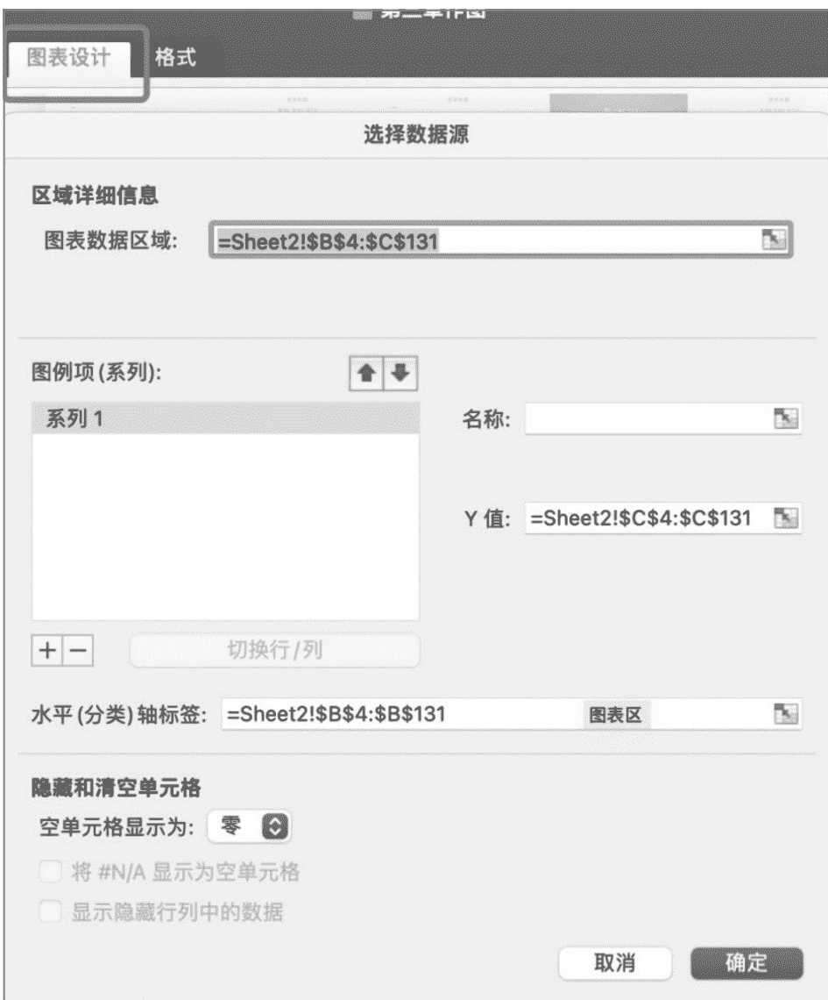

图3.25 Excel作图的数据选择

（三）引入第三方工具，比如ECharts这类交互式网页图表工具作为知识供给，让模型在固定领域内进行解读与回答，配合我们做出更出色的图表。

## 3.13 小结

本章梳理了Excel里常用的基础图表，包含折线图、柱形图、饼图、散点图、条形图、瀑布图、气泡图、雷达图以及热力图等。通过模型的介绍，我们了解了每种图表传递的信息、适用场景以及在Excel中的实现路径。在实践中，针对模型出现不靠谱的情况，我们学会了在对话里使用奖惩指令，精准指出错误点。此外，为提升图表的美观度和可读性，我们认识了ECharts的作图方式，并学会利用网页给出的代码片段，让模型协助在Excel中复刻图表。持续练习后，读者能够熟练地在Excel中制作各类图表。

# 第4章 用ChatGPT拆解618大促数据

电商持续高速发展催生出大量营销玩法，每年6月18日前后都会集中爆发大促。面对海量信息与复杂的策略，若缺少科学的分析框架，很难提炼出真正有价值的结论。结合ChatGPT以及合适的方法论，就能搭建出适配个人水平的分析工具，高效完成618电商大促的数据剖析。

注意：本章所用数据集源自改造后的天池公开数据集。

## 4.1 用ChatGPT梳理分析思路

拿到数据后，先用方法与步骤把思路理顺，按清晰的路径推进，才能事半功倍。

### 4.1.1 确定分析主题与指标

做分析前要先明确问题是什么，再据此拆解指标。例如订单用户转化率若定义为订单用户/全体用户，则该指标可拆为订单用户与全体用户；若定义为订单用户/访问用户，则拆分为订单用户与访问用户。

指标分析的目的是服务产品或业务优化。了解指标变化趋势后，要弄清其对业务的实际意义，并在该意义基础上限定分析边界。边界清晰后，分析结果才能更精准地指导改进。

我们的数据包含两张表，分别是618数码品类商品页的用户行为记录和用户基本画像，部分样例见表4.1与表4.2。

表4.1 618当天用户行为信息

| 用户唯一标识 | 用户行为时间戳 | 商品唯一标识 | 商品二级分类 | 用户行为 | 购买金额 |
|---|---|---|---|---|---|
| 497566 | 1687095546 | 2570804 | 相机 | 加购物车 | null |
| 610240 | 1687103125 | 5708291 | 相机 | 收藏 | null |
| 558421 | 1687073643 | 5168681 | 音箱 | 购买 | 3813 |
| 993175 | 1687070980 | 3648222 | 耳机 | 购买 | 1218 |

表4.2 用户基本信息

| 用户唯一标识 | 用户位置 | 用户性别 | 用户年龄 |
|---|---|---|---|
| 497566 | 广西 | 男 | 18 |
| 610240 | 湖南 | 男 | 25 |
| 558421 | 广东 | 女 | 36 |

接下来让模型帮忙提炼分析思路。

提问思路
我们已有具体数据，最直接的方式是让模型接触数据样本，并基于真实数据给出建议。可先复制用户行为信息，因数据量有几十万行，只需复制若干行，但要包含全部列。

问：你是一名资深数据分析师，看到这份数据后，请帮我整理一份完整的分析思路：【粘贴内容】。

模型回复：

- 行为分析：统计各类操作行为的分布，如加购物车、收藏、浏览、购买的频次；计算行为间的转化率，如加购到购买、收藏到购买的比例等。
- 商品分析：比较不同二级分类的销售表现，了解各品类的受欢迎程度；计算各商品的平均成交价，了解商品价值。
- 用户分析：统计不同用户的操作频次，了解活跃度；统计不同用户的消费金额，了解购买力。
- 时间分析：观察不同时段的行为分布，找出生动时间；比较工作日与周末等时间段的转化差异。

以上是基于所给样本的初步思路，具体方法与技巧需结合实际目标再确定。

结合模型的建议与自身需求，我们锁定分析主题为：聚焦6月18日浏览过数码品类的用户及其行为，弄清“浏览-收藏-加购-购买”的转化链路；并识别哪类用户对哪类商品更感兴趣，以便重点营销。按此主题请模型给出所需指标，归纳如下。

（1）转化相关指标：浏览收藏率＝收藏次数/浏览次数；收藏加购率＝加购次数/收藏次数；加购购买率＝购买次数/加购次数。
（2）流量指标：浏览PV、浏览UV、收藏PV、收藏UV、加购PV、加购UV、购买PV、购买UV。PV指次数，UV指人数。
（3）订单与用户价值指标：订单数、订单总额、下单人数、ARPU值＝订单金额/下单人数。

### 4.1.2 确定数据预处理方式

指标搭建前需先清洗整理数据，这一步称为数据预处理，为后续分析做准备。

先对各列做基础观察：

- （1）用户唯一标识共299190条，无空值，类型为字符串。
- （2）用户行为时间戳共299180条，空值10条，类型为字符串，格式为时间戳。
- （3）商品唯一标识共299000条，空值190条，类型为字符串。
- （4）商品二级分类包含相机38600条、音箱29900条、耳机81000条、手机149590条，空值100条，类型为字符串。
- （5）用户行为包含浏览130230条、收藏69460条、加购物车55156条、购买40730条，空值3614条，类型为字符串。
- （6）购买金额有40534条非空，因金额仅对应购买行为，故购买行为中缺失196条。
- （7）用户基本信息完整，年龄为数值类型。

继续向模型提问。

提问思路
合理的数据预处理需考虑数据质量与分析目标两个维度。

问：你是一名资深数据分析师，我的数据现状如下：【数据基本情况】，分析目标是【分析主题】，需要得到【数据指标】，请给出预处理建议及理由。

模型回复：

我建议按以下步骤处理。

- （1）处理缺失值：空值较少的字段可直接删除对应行；购买金额空值可标记为0，表示该行为无金额。
- （2）类型转换：将时间戳转为日期时间格式，便于后续时间序列分析。
- （3）去重：对用户唯一标识和商品唯一标识去重，保留唯一标识。
- （4）计算转化率：按行为分类统计用户数，计算浏览到收藏、收藏到加购、加购到购买的转化率。
- （5）用户价值分析：基于购买金额统计不同用户的消费水平，识别高价值用户以便营销侧重。
- （6）商品价值分析：结合商品二级分类与购买金额，评估各品类价值，加大高价值商品推广。
- （7）其它分析：对年龄做统计，了解不同年龄段的行为与消费偏好，为个性化推荐提供依据。

结合上述建议与既有方法，可得到数据预处理思维导图，如图4.1所示。


图4.1 数据预处理思维导图

综合需求与数据判断，预处理路径如下。

（1）删除用户行为时间戳、商品唯一标识、用户行为分类中的空值；把时间戳转为日期时间格式；对年龄做分段处理；把地理位置由省份合并为华南、华东、华北等大区，以避免省份过细导致样本稀释。
（2）将用户行为表与用户信息表关联，形成一张Sheet，并在其上计算上述指标。
（3）在完整数据上对用户分层，观察不同群体的行为差异，判断高价值用户的特征。

## 4.2 让ChatGPT教你用Excel完成分析

### 4.2.1 预处理与指标搭建

有了处理思路与指标框架后，在Excel中实操以加深理解。先对部分数据做删除操作。

涉及格式转换与表关联时，需用Excel函数实现。借助ChatGPT的提问技巧，可快速掌握函数用法。

#### 1. 询问Excel函数的写法

若想用函数实现数据处理，可套用既有提问模板。

> 问：你是一名资深数据分析师，我想在Excel中实现【期望结果】，请列出操作步骤。

例如要把时间戳转日期，可这样问：

> 问：你是一名资深数据分析师，请列出在Excel中把时间戳转为日期格式的必要步骤。

模型回复：

转换时间戳可按以下步骤操作。

- （1）打开表格，确保时间戳位于某单元格。
- （2）在另一单元格使用日期函数，例如时间戳在A1，则B1可输入=DATEVALUE("1970/01/01 00:00:00")+A1/86400，将秒级时间戳转为日期。若需显示时间，可把B1格式设为“yyyy-mm-dd HH:mm:ss”。
- （3）回车后B1显示对应日期。

注意86400是一天的秒数，若时间戳为毫秒，需用86400000。转换后数据仍是数值，需通过设置单元格格式为日期才算完成。可自定义格式，本例日期全为6月18日，也可只显示时段。设置示例如图4.2。

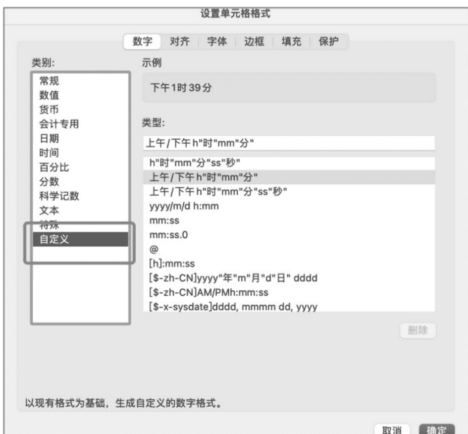

图4.2 Excel中自定义数据格式

同理询问年龄分组，模型给出示例：

可使用IF与AND组合，例如：

```
=IF(AND(A1>=18, A1<=25), "18-25岁", IF(AND(A1>=26, A1<=35), "26-35岁", IF(AND(A1>=36, A1<=45), "36-45岁", IF(AND(A1>=46, A1<=55), "46-55岁", IF(A1>=56, "56岁及以上", "未知")))))
```

要把用户信息合并到同一Sheet，模型建议：

可用VLOOKUP实现跨表关联，先在主表建搜索列，在从表建结果列，公式为=VLOOKUP(搜索键值, 范围, 索引, [匹配方式])。

也可使用HLOOKUP，先建搜索行与结果行，公式为=HLOOKUP(搜索键值, 范围, 索引, [匹配方式])。

更灵活的是INDEX+MATCH，先用MATCH定位搜索键值在主表的位置，再用INDEX返回对应结果列的值，公式为=INDEX(结果列, MATCH(搜索键值, 搜索键值列, 0))。

把公式中的单元格替换后，Excel操作示例如图4.3。

| 用户唯一标识 | 用户行为时间戳 | 用户行为日期 | 商品唯一标识 | 商品二级分类 | 用户对商品 | 购买金额 |
|---|---|---|---|---|---|---|
| 497566 | 1687095546 | =DATEVALUE("1970/01/01 00:00:00")+B2/86400 | | | | null |
| 610240 | 1687103125 | 2023/6/18 15:45 | 5708291 | 相机 | 收藏 | null |
| 558421 | 1687073643 | 2023/6/18 7:34 | 5168681 | 音箱 | 购买 | 3813.32588 |
| 993175 | 1687070980 | 2023/6/18 6:49 | 3648222 | 耳机 | 购买 | 1218.73006 |
| 191337 | 1687091180 | 2023/6/18 12:26 | 7078700 | 音箱 | 加购物车 | null |
| 163834 | 1687089608 | 2023/6/18 12:00 | 1275017 | 音箱 | 浏览 | null |
| 用户唯一标识 | 用户位置 | 用户年龄 | 用户性别 | 用户年龄分组 |
|---|---|---|---|---|
| 497566 | 广西省 | 男 | 18 | =IF(AND(E3>=18, E3<=25), "18-25岁", IF(AND(E3>=26, E3<=35 |
| 610240 | 湖南省 | 男 | 25 | 18-25岁 |
| 558421 | 广东省 | 女 | 36 | 36-45岁 |
| 用户唯一标识 | 用户行为时间戳 | 用户行为日期 | 商品唯一标识 | 商品二级分类 | 用户对商品 | 购买金额 | 用户年龄分组 |
|---|---|---|---|---|---|---|---|
| 497566 | 1687095546 | 2023/6/18 13:39 | 2570804 | 相机 | 加购物车 | null | =VLOOKUP(A2,Sheet1!B2:F5,5,1) |
| 610240 | 1687103125 | 2023/6/18 15:45 | 5708291 | 相机 | 收藏 | null | 18-25岁 |
| 558421 | 1687073643 | 2023/6/18 7:34 | 5168681 | 音箱 | 购买 | 3813.32588 | 36-45岁 |

图4.3 Excel中的函数运用示例

最后对省份做地域归并，同样用VLOOKUP，先整理好省份与大区的映射表，如表4.3。

表4.3 Excel数据透视表显示各商品购买行为漏斗数据

| 东北 | 西北 | 华北 | 华东 | 华中 | 华南 | 西南 |
|---|---|---|---|---|---|---|
| 辽宁 | 陕西 | 北京 | 山东 | 湖北 | 广东 | 四川 |
| 吉林 | 甘肃 | 天津 | 江西 | 湖南 | 广西 | 云南 |
| 黑龙江 | 青海 | 河北 | 江苏 | 河南 | 海南 | 贵州 |
| | 宁夏 | 山西 | 安徽 | | | 西藏 |
| | 新疆 | 内蒙古 | 浙江 | | | 重庆 |
| | | | 福建 | | | |
| | | | 上海 | | | |

将映射表处理为省份列与地域列两列后，用VLOOKUP补全地域信息即可，此处不再展开。

想把Excel函数系统吃透，光看知识点拆解不够用。参考第二章搭建知识框架的做法，同时用真实业务数据去向ChatGPT提问，效果会明显更好。

### 2. 透视表快速搭建核心指标

前面已经把分析维度定下来，也完成了清洗和整理，数据现在可以分析了。下一步就是把指标搭出来，先讲透视表这个必备工具。

Excel的数据透视表是数据分析的利器，能把原始数据按需透视汇总，快速得到可读的摘要。它能把海量信息整理成清晰的呈现，帮助发现趋势和关联，支撑决策。

透视表主要能做这些事：

- （1）汇总数据：几秒钟就能把大量数据做汇总，支持数字、文本、日期等类型。可自行选择汇总字段和方式，比如求和、计数、平均值、最大值、最小值等。
- （2）重新布局数据：可把原始表格重新排列。把字段拖到行、列、值区，就能以不同视角组织和对比数据。
- （3）过滤筛选数据：按条件筛出子集，聚焦想看的部分，实现更深度的分析。
- （4）分组排序数据：能对数据做分组和排序，更直观地看出关系和走势。
- （5）动态刷新数据：源数据变动后，一键刷新就能更新汇总结果，始终保持最新。

下面直接操作一遍。

创建透视表的流程很简单。先选中数据区域，点左上角第一个单元格更方便；切换到【插入】选项卡，点击【数据透视表】；弹出对话框后选择存放位置，可以放当前Sheet空白处，也可以新建工作表，一般建议新建。点确定即可。

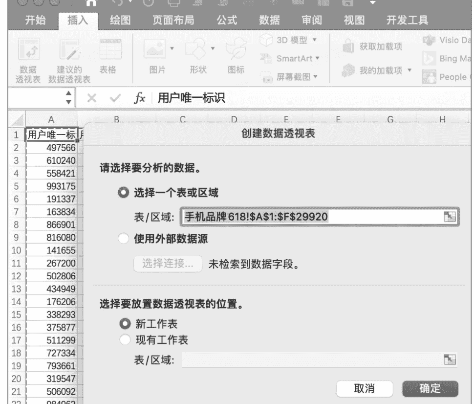

图4.4 Excel中创建数据透视表

建好后的透视表长这样：


图4.5 Excel中的数据透视表

里面有几个关键区域：

- （1）行区域：放想作为行标签展示的字段。例如销售表里把“产品”放进来，表就会按产品分组展示。
- （2）列区域：放想作为列标签展示的字段。同样用销售表举例，把“地区”放进来，就能按地区做列分组。
- （3）值区域：放需要汇总分析的字段。如“销售额”，并选择求和、平均等汇总方式，透视表会按行列组合给出结果。
- （4）过滤区域：放筛选条件。把“时间”放进来后，可限定时间范围，只显示符合条件的数据。
- （5）值字段设置区域：用来调整值区字段的汇总方式、格式等。可以在这里把汇总方式改成计数、最大值、最小值，或把格式设为货币。

把区域组合好，就能完成汇总、分析和筛选。

了解作用后，按之前确定的指标来建。先是转化率指标：浏览收藏率 = 有收藏行为的用户 / 有浏览行为的用户。这个指标没有现成字段，需要按用户行为分组聚合。把用户行为放到行或列，值区放用户唯一标识并计数。注意唯一标识是数值类型，默认会求和，所以要手动改成计数。

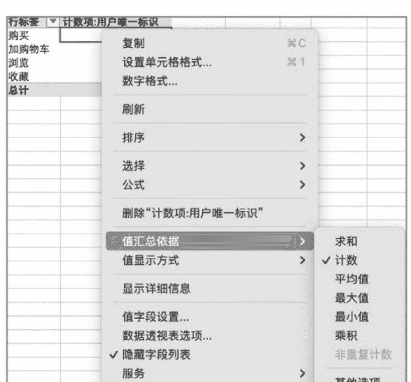

图4.6 Excel数据透视表修改值汇总依据

目前数据是全量行为汇总，还没按商品分类。于是把商品种类也加入分组，并按浏览→收藏→加购→购买的漏斗顺序调整行顺序观察。得到各行为次数后，按转化率口径计算，得到表4.4的结果。

表4.4 Excel数据透视表显示各商品购买行为漏斗数据

| 购买行为 | 耳机 | 手机 | 相机 | 音箱 |

| :--- | :--- | :--- | :--- | :--- |

| 浏览收藏率 | 48.33% | 55.90% | 48.24% | 47.27% |

| 收藏加购率 | 62.62% | 48.62% | 51.42% | 50.07% |

| 加购购买率 | 78.67% | 88.70% | 69.42% | 70.00% |

同理，也能按地域、性别、年龄等维度切出不同分组的漏斗。

再来构建流量指标。PV即访问次数，比较好办，上面已经用用户唯一标识计数得到。UV即人数，比较麻烦，因为用户ID会重复出现，原始表里只有用户行为时间是唯一值。所以需求锁定在去重后聚合。

### 提问实操
问：你是一名资深数据分析师，我的Excel表里用户ID不唯一，一个用户会在多行出现，怎么计算不同维度的UV？

ChatGPT回答：

可以结合函数和透视表实现。具体思路如下。

- （1）确认数据表包含日期、用户ID、其他维度字段。
- （2）新建工作表或在现有表里建透视表。
- （3）把日期字段拖到“行”区域，把用户ID拖到“值”区域。
- （4）右键值区里的用户ID，选择“值字段设置”。
- （5）在对话框里把汇总方式设为“计数”，统计出现次数。
- （6）右键透视表任意单元格，选择“显示值字段设置”，取消“显示值的总计”。

再用筛选按日期、地区、性别等维度过滤，就能得到不同维度的UV估算。透视表会按筛选条件和用户ID组合计算UV。需要注意的是，因为ID不唯一，结果是估算值，但在多数场景够用。

本质就是先把每条用户记录记为1，再做汇总，就能算出各维度的UV。如图4.7所示，购物行为中同一用户ID出现了2次，但实际只有1个用户，所以要把数量定义为1再汇总。

| 用户对商品操作行为分类 | 购买 |

| :--- | :--- |

| **行标签** | **计数项:用户唯一标识** |

| 100542 | 1 |

| 100786 | 1 |

| 100928 | 1 |

| 101004 | 1 |

| 101031 | 1 |

| 101104 | 1 |

| 101163 | 1 |

| 101387 | 1 |

| 101444 | 1 |

| 101519 | 2 |

| 101836 | 1 |

| 102133 | 1 |

| 102801 | 1 |

| 102830 | 1 |

| 102845 | 1 |

| 102990 | 1 |

| 103283 | 1 |

| 103509 | 1 |

| 103516 | 1 |

| 103752 | 1 |

| 103805 | 1 |

| 103846 | 1 |

图4.7 Excel数据透视表计算UV的方法

用同样思路把浏览PV、收藏PV、加购PV、购买PV，以及对应的UV全部算出来，为后续分析准备好数据。

最后是用户价值指标。订单金额在透视表里选总和汇总即可，订单数用计数汇总，操作很简单。ARPU 用订单金额除以下单人数得到。

指标都算完后，就进入报告整理阶段。

### 4.2.2 如何搭建一份专业分析报告
先了解报告的常见结构。结构可根据需求调整，通常包含：

- （1）引言/概述：开头给出背景、目的和范围，说明分析要解决什么问题。
- （2）分析方法/数据来源：说明用了哪些方法、工具和数据来源，确保过程可复现、可追溯。
- （3）分析结果：核心部分，用表格、图表展示发现，每个结论点要清晰、准确，可配合平均值、标准差、百分比等指标。
- （4）结论：基于结果总结洞察，回应引言提出的问题。
- （5）建议/推荐：基于数据给出可执行的建议，与目标一致。
- （6）附录/参考资料：放支撑材料、代码、数据表、参考文献等。

还可以根据需要增加方法细节、局限与假设、讨论等板块。

### 提问实操
问：你是一名资深数据分析师，我的报告思路和目标是【填写思路】，现有指标有【填写指标】，请按上面的结构告诉我该怎么写。

ChatGPT回答：

建议结构如下。

- （1）引言/概述。简要说明目的：对用户分层，观察不同用户行为差异，找高价值用户特征。
- （2）分析方法/数据来源。说明数据源和分析方法，保证透明可复现。
- （3）转化率相关指标分析。分别分析浏览收藏率、收藏加购率、加购购买率，说明计算方式和含义。
- （4）流量指标分析。分析浏览PV/UV、收藏PV/UV、加购PV/UV、购买PV/UV，解释每个指标意义。
- （5）订单和用户价值指标分析。分析订单数、订单总额、下单人数、ARPU值，解释含义。
- （6）结论。总结行为差异和特点，明确高价值用户画像。
- （7）建议/推荐。基于结果提出提升高价值用户数量和价值的举措。必要时附上公式、表格等。

这只是基础框架，具体可根据实际情况增删扩展。撰写时保证每个点呈现清晰，用图表辅助可视化。

接下来就按这个框架，把数据按年龄段、地域、性别、商品分类拆开分析。对ChatGPT的回答保持批判性，看看哪些数据没用上，哪些角度缺失。可以反过来让它“反思”，完善思路。

### 提问实操
再把之前给的框架和实际处理的数据对比，看看有没有遗漏维度。针对没用上的数据追问，往往能得到新角度。

问：购买时间段信息有没有被利用到，如果有用该怎么用？

ChatGPT回答：

购买时间段能提供更深的洞察，帮助理解偏好和行为模式。可从以下几方面入手：

- （1）时间段分布分析：按小时或4小时一段分类，统计各时段购买次数或金额，找到活跃时段。
- （2）关联分析：把时间段和其他指标如用户位置、年龄、商品分类关联，看是否存在特定组合偏好。
- （3）转化率关系：对比不同时段的转化率，判断哪个时段用户购买意愿更强，为营销提供依据。
- （4）金额关联分析：计算各时段平均客单价，理解不同时段的购买决策和力度，指导促销和定价。

把时间段分析合并进原框架，重新得到完整结构。时间段按4小时划分，如表4.5和表4.6。

表4.5 按照用户行为时间段的转化率指标

| 转化率 | 0:00—4:00 | 4:00—8:00 | 8:00—12:00 | 12:00—16:00 | 16:00—20:00 | 20:00—24:00 |

| :--- | :--- | :--- | :--- | :--- | :--- | :--- |

| 浏览收藏率 | 54.00% | 43.59% | 62.00% | 65.00% | 70.00% | 65.76% |

| 收藏加购率 | 62.62% | 48.62% | 51.42% | 50.07% | 48.62% | 48.62% |

| 加购购买率 | 88.70% | 50.43% | 53.40% | 56.35% | 76.45% | 94.00% |

表4.6 按照用户行为时间段的各类转化PV

| 流量 | 0:00—4:00 | 4:00—8:00 | 8:00—12:00 | 12:00—16:00 | 16:00—20:00 | 20:00—24:00 |

| :--- | :--- | :--- | :--- | :--- | :--- | :--- |

| 浏览量 | 9,230 | 16,600 | 21,057 | 20,367 | 44,739 | 25,574 |

| 收藏量 | 5,016 | 7,236 | 13,114 | 13,239 | 31,317 | 16,817 |

| 加购量 | 3,141 | 3,518 | 6,744 | 6,629 | 15,227 | 8,177 |

| 购买量 | 2,786 | 1,774 | 3,601 | 3,735 | 11,641 | 7,686 |

省略背景引言，直接看主体分析结论：

（1）所有时段里，16:00—20:00浏览收藏率最高达70.00%，用户更倾向浏览收藏。
（2）4:00—8:00浏览收藏率最低为43.59%，可能受休息影响。
（3）加购购买率在20:00—24:00最高，达94.00%，该时段加购后更易成交。
（4）加购量和购买量在16:00—20:00均为峰值，分别为15,227和11,641，是最活跃购买时段。

再按商品分类观察：

表4.7 按照商品分类的转化率指标

| 转化率 | 耳机 | 手机 | 相机 | 音箱 |

| :--- | :--- | :--- | :--- | :--- |

| 浏览收藏率 | 48.33% | 55.90% | 48.24% | 47.27% |

| 收藏加购率 | 62.62% | 48.62% | 51.42% | 50.07% |

| 加购购买率 | 78.67% | 88.70% | 69.42% | 70.00% |

表4.8 按照商品分类的各类转化PV

| 流量 | 耳机 | 手机 | 相机 | 音箱 |

| :--- | :--- | :--- | :--- | :--- |

| 浏览量 | 89,512 | 102,736 | 69,838 | 36,879 |

| 收藏量 | 43,261 | 57,429 | 33,690 | 17,433 |

| 加购量 | 27,090 | 27,922 | 17,323 | 8,729 |

| 购买量 | 21,312 | 24,767 | 12,026 | 6,110 |

表4.9 按照商品分类的流量指标和价值指标

| 各类指标 | 耳机 | 手机 | 相机 | 音箱 |

| :--- | :--- | :--- | :--- | :--- |

| 浏览UV | 88,617 | 101,709 | 69,140 | 36,510 |

| 收藏UV | 42,829 | 56,855 | 33,353 | 17,258 |

| 加购UV | 26,819 | 27,643 | 17,150 | 8,641 |

| 购买UV | 21,099 | 24,519 | 11,906 | 6,049 |

| 订单总额 | 12,573,966 | 77,892,149 | 48,536,330 | 21,684,348 |

| ARPU值 | 596 | 3,177 | 4,077 | 3,585 |

上表可以提炼出以下几项关键观察：

（1）从浏览到收藏的转化来看，手机的浏览收藏率达到55.90%居首，耳机以48.33%位居次席。该结果显示手机与耳机在用户浏览和收藏环节的热度最高。

（2）从收藏到加购的衔接来看，耳机的收藏加购率最高为62.62%，手机的该指标最低仅48.62%。这表明用户对耳机的关注度更强，转化到购物车的意愿更明显。

（3）在加购到购买的环节，手机的加购购买率最高为88.70%，相机的该比率最低为69.42%。说明手机的最终成交意向最强。

(4) 从绝对规模看，手机在浏览量、收藏量、加购量、购买量四个维度上均排名第一，音箱则在各项指标上均垫底，反映出音箱整体需求相对疲软。

(5) 从UV、订单总额与ARPU的综合视角看，手机的订单总额遥遥领先，其它品类差距明显；相机的ARPU值为4,077为四类之最，单笔订单客单价最高，凸显了其高价值属性，即便销量不及手机也具备很强的价值贡献。

后续的工作可沿用相同指标体系，在性别、地域等不同切割维度上持续展开，并进一步进行交叉拆分，例如在华北地区内再按性别或品类细分，观察指标波动。因为本组数据是对真实数据集的改造，结论仅用于演示方法论，具体研究仍需读者自行获取公开数据并按此流程复现。

### 4.3 用ChatGPT把分析文档做精做细

前文通过透视表构建了多维度的指标表格并附带了解读，虽然具备分析内核和结构，但离一份可对外呈现的文档还有距离。格式、表达和可读性都需要优化，这部分可以交给ChatGPT来加速。

提问思路
可将既有的分析框架和结论结构整体提供给ChatGPT，让其基于框架给出改进建议，再配合几张指标表让其提出落地方案。

问：如果继续沿用现在这种纯表格化的呈现方式，如何让分析报告的内容更饱满、阅读体验更好？

ChatGPT回答：

要提升报告的丰富度和可读性，可以从以下几个方向入手。

- （1）结构化分层：在每个模块开头加上明确的小标题，模块之间用段落隔开，使整体层次清晰，便于快速浏览。
- （2）增加解读：在表格或指标后补充说明，解释指标的含义与计算逻辑，并关联到用户行为的影响，帮助读者理解数据背后的意义。
- （3）可视化呈现：除表格外引入条形图、折线图、饼图等图形，把数据变化和关联直观化。
- （4）突出重点：在正文中点出关键数据并加以强调，让读者一眼捕捉核心信息。
- （5）收尾给建议：在结论部分汇总发现并给出可执行的建议，使分析具备行动价值。
- （6）统一排版：保持表格、图表与正文的字体、字号、行距和间距一致，整洁的版面能大幅提升阅读舒适度。

按照以上建议对报告进行改造后，格式问题可通过前文学过的排版技巧解决，遇到细节仍可按既有提问方法把问题描述清楚后交由ChatGPT处理。可视化部分也可继续向ChatGPT发起提问。

提问思路
直接把数据表粘贴到对话中，先说明各列指标的含义，再询问怎样的可视化方式最合适。

问：基于表4.7和表4.8的转化数据，采用什么可视化形式能让报告更生动、更易读？

ChatGPT回答：

让转化表格更具表现力，可以考虑以下做法。

- （1）使用图表：将表格转化为漏斗图，能更直观地呈现各阶段的转化路径与比例，视觉冲击强。
- （2）补充标题与说明：在图表上方给出主题标题，下方附上简短解读，说明漏斗含义与数据口径。
- （3）颜色与图例：为不同阶段赋予不同色调，用深浅体现转化高低，并配图例说明对应关系，便于横向对比。
- （4）标注关键数值：在图中直接显示各阶段数值与百分比，强化数据感知。
- （5）排序展示：按转化率从高到低或从低到高排列品类，差异一目了然，便于定位优劣品类。

把上述思路落成漏斗图后，可得到如图4.8所示的效果。

### 耳机类商品转化漏斗

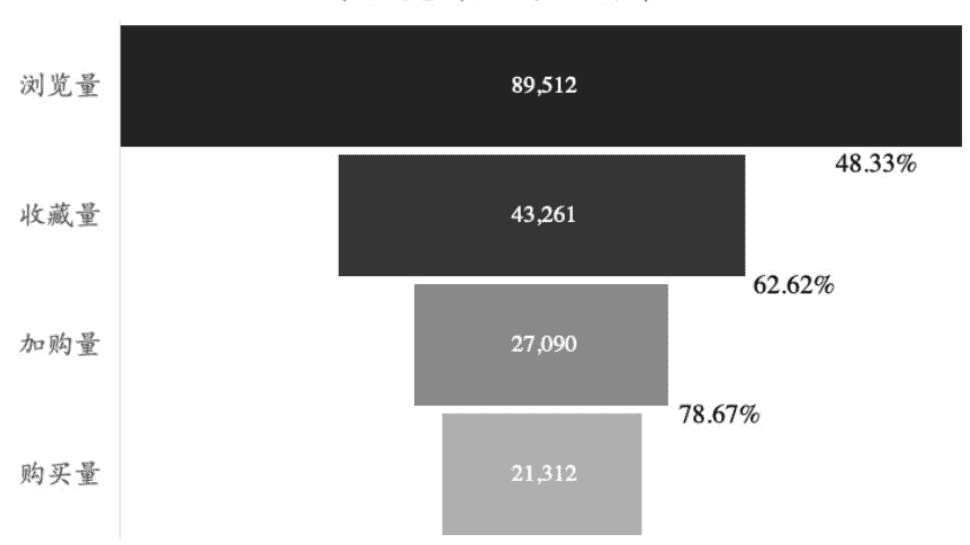

图4.8 耳机类商品在618当天的转化漏斗图

对表4.9采用同样提问方式，可得到如下建议。

要让表格更生动、更易读，可以考虑以下操作。

- （1）色彩与格式：对流量类指标使用浅蓝色系，订单总额用浅绿色，ARPU值加粗突出，便于区分。
- （2）补充单位：在数值后统一加上“人”“元”等单位，避免歧义。
- （3）图表配合：除表格外可用柱状图或折线图展示流量与订单总额的趋势，差异更直观，不同品类用不同颜色或标记区分。
- （4）标题与图例：图表需配图例说明颜色对应的品类，表格上方放置简明标题，快速传达主题。

参考上述建议后，可将表格信息转化为可视化呈现，结果如图4.9所示。

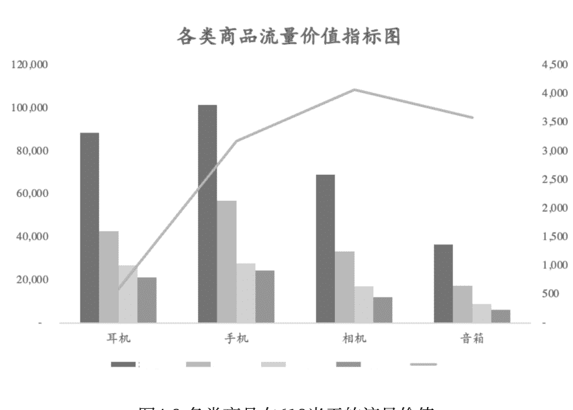

图4.9 各类商品在618当天的流量价值

优化后的文档整体排版如图4.10所示。在Excel中输出正式文档时通常会去掉网格线，标题、副标题、正文与图表的字体大小保持区分且前后统一。

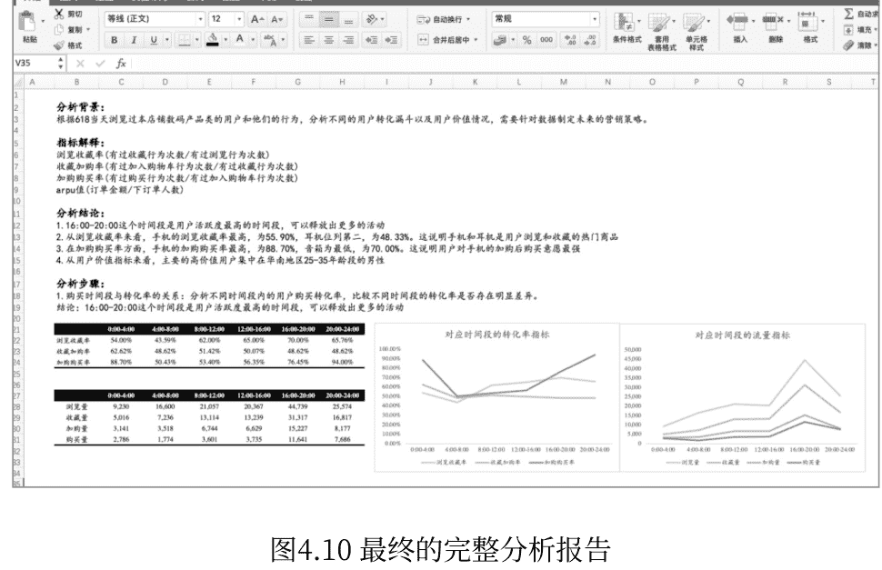

### 图4.10 最终的完整分析报告

报告成型后，可对照ChatGPT给出的检查清单逐项核对是否存在遗漏，必要时调整板块顺序和布局以适配阅读习惯。需要强调的是，ChatGPT的输出并非绝对正确，保持独立思考与复核尤为重要。

## 4.4 小结

本章以一个实操案例演示了在ChatGPT辅助下完成分析报告的全流程，具体步骤如下。

第一步，让ChatGPT基于原始数据提供可行的分析思路，结合自身需求确定指标与框架。

第二步，检查数据质量，梳理数量、缺失、类型、取值范围等信息后反馈给ChatGPT，获取预处理方案。

第三步，用数据透视表对清洗后的数据按既定指标进行汇总构建。

第四步，让ChatGPT结合思路与指标给出适配案例的分析结构，据此搭建报告骨架。

第五步，针对表格与结论向ChatGPT咨询最佳呈现形式，逐步完善报告，并在过程中持续审视与修正ChatGPT的建议。读者可自行下载公开数据集，按此流程练习。

# 第5章 掌握常用快捷键让效率翻倍

快捷键是键盘组合操作，能在Excel中快速执行指令，减少鼠标依赖，大幅提升工作效率。

本章安排如下：介绍常用快捷键及记忆技巧，利用ChatGPT加深理解并形成记忆方案，构建个性化自定义快捷键体系，并在案例中应用，最后进行总结。

## 5.1 常用的快捷键介绍与记忆技巧

Excel已内置的快捷键可在“工具”菜单中选择“自定义键盘”查看，具体位置如图5.1所示。

打开“自定义键盘”对话框后可修改快捷键，如图5.2所示。以数据降序排序为例，默认并无快捷键，当前快捷键框为空，可在“按新的快捷键”中自行设置，若冲突会如5.3所示提示。


▲图5.1 选择“自定义键盘”命令


▲图5.2 “自定义键盘”对话框


图5.3 自定义键盘中查看是否发生快捷键冲突

快捷键冲突常发生在系统或其它软件占用相同组合时，可尝试以下解决办法。

- 1. 修改或禁用冲突项。进入应用偏好设置查看是否可更改或关闭该快捷键，避免互相覆盖。
- 2. 更换修饰键。尝试用Shift、Control、Option/Alt、Command等不同修饰键搭配同一基础键，例如用Control + C替代Command + C。
- （3）调整系统设置。在macOS中可通过“系统偏好设置”→“键盘”→“快捷键”查看和修改系统及应用层级的快捷键。

为避免冲突，建议选用独特且不易重复的组合。

在默认状态下，可将已配置的快捷键按功能分类整理，部分示例见表5.1。

### 表5.1 Excel中的快捷键

| “开始”中的项目 | 快捷键 | “插入”中的项目 | 快捷键 |

|---|---|---|---|

| 粘贴 | command+V | 数据透视表 | command+Option+P+/ |

| 选择性粘贴 | control+command+V | 插入表格 | command+Option+T+/ |

| 剪切 | command+X | 插入图片 | command+Option+I+/ |

| 复制 | command+C | 获取加载项 | command+Option+G+/ |

| 复制为图片 | command+Option+C | 我的加载项 | command+Option+M+/ |

| 格式刷 | command+Shift+C | 折线 | command+Option+L+/ |

| 增大字号 | command+Shift+. | 柱形 | command+Option+B+/ |

| 减小字号 | command+Shift+, | 文本框 | command+Option+X+/ |

| 加粗 | command+B | 横排文本框 | command+Option+H+/ |

| 倾斜 | command+I | 竖排文本框 | command+Option+V+/ |

| 下划线 | command+U | 公式 | command+Option+F+/ |

| 双下划线 | command+Shift+D | 符号 | command+Option+S+/ |

| 下框线 | command+Shift+B | | |

| 上框线 | command+Shift+T | | |

| 左框线 | command+Shift+L | | |

| 右框线 | command+Shift+R | | |

| 无框线 | command+Shift+N | | |

| 所有框线 | command+Shift+A | | |

| 外部框线 | command+Shift+O | | |

由于软件版本与系统差异，实际快捷键可能存在不同。建议按个人使用频率对常用功能排序，重点记忆高频项。

记忆可采用正向记忆与逆向记忆两种方式，均可借助ChatGPT辅助。以下以正向记忆为例。

提问思路
把整理好的操作与快捷键清单提供给ChatGPT，让其输出记忆技巧。

问：请为下面表格内涉及的快捷键整理一些记忆方法。（附上表格）

ChatGPT回答：

- （1）建立联想：将快捷键与动作或英文原意关联，例如Ctrl+C联想Copy，Ctrl+V联想Paste。
- （2）分组记忆：将功能相近的快捷键归为一组，记住其规律。例如Ctrl+B与Ctrl+U均用于文本格式，可一起记忆。

逆向记忆则是通过实操强化。借助ChatGPT可快速生成练习场景。具体做法如下。

- （1）提问思路：先让ChatGPT生成一份练习数据集，再基于该数据和目标快捷键生成可操作的场景与步骤。
- （2）提示词示例：“请给我一个适合Excel分析的数据集，不用复杂，包含多种数据类型，以表格形式输出。”
(3) ChatGPT的回答如表5.2所示。

### 表5.2 ChatGPT随机生成的数据表

| 序号 | 姓名 | 年龄 | 性别 | 邮箱 | 电话 | 成绩 |

|---|---|---|---|---|---|---|

| 1 | 张三 | 25 | 男 | zhangsan@email.com | 1234567890 | 85 |

| 2 | 李四 | 28 | 男 | lisi@email.com | 9876543210 | 90 |

| 3 | 王五 | 23 | 女 | wangwu@email.com | 2468135790 | 78 |

| 4 | 小明 | 21 | 男 | xm@example.com | 1357924680 | 95 |

| 5 | 小红 | 22 | 女 | xh@example.com | 1587926430 | 83 |

后续提问：“你是一个精通Excel的工程师，请根据以上数据，以及以下Excel快捷键：【快捷键】，帮我想出一个数据处理的场景，可以在数据集中使用到这些快捷键进行操作，并输出具体的操作步骤。”

例如指定快捷键：粘贴“Command+V”；选择性粘贴“Control+Command+V”；剪切“Command+X”；格式刷“Command+Shift+5”；加粗“Command+B”；柱形图“Command+2”；平均值“Command+5”。

ChatGPT将会给出如下回答：

为您设计了一个完整的数据处理场景，可以使用Excel快捷键进行操作。以下是步骤。

- (1) 打开Excel并创建一个新的工作表。
- (2) 复制并粘贴数据集到新的工作表中。使用快捷键“Command+V”进行粘贴。
- (3) 选中“成绩”列的所有单元格，使用快捷键“Command+2”将其设置为柱形图。
- (4) 选中“年龄”列的所有单元格，使用快捷键“Command+5”计算平均值。
- (5) 选中“成绩”列的所有单元格，使用快捷键“Command+5”计算平均值。
- (6) 将“成绩”列的所有单元格的字体设置为加粗，使用快捷键“Command+B”。
- (7) 选择并拖动“邮箱”和“电话”列，然后使用快捷键“Command+X”进行剪切。
- (8) 选中“姓名”列，使用快捷键“Command+Shift+C”后，再选中“邮箱”列，将“邮箱”列的格式与“姓名”列保持一致。

完成上述步骤后，您将得到一个包含平均成绩和年龄的柱形图，并且“邮箱”和“电话”列已被剪切并粘贴到新的位置。

## 5.2 自定义快捷键

默认快捷键虽好，但个性化定制能让操作更顺手。自定义时建议注意以下几点。

（1）通用基础操作如复制、粘贴、剪切不建议更改，保持肌肉记忆一致。

（2）同类功能尽量使用相似组合，例如统一用“Command+字母键”或“Control+Command+字母键”。

（3）借助联想规则制定组合，例如求和函数英文为sum或add，可定义Shift+Command+A以避免冲突，便于记忆。

把同一类操作打包设定会更省事。以边框为例，下框线、上框线、左框线、右框线、无框线、所有框线、外侧框线、粗闸框线、双底框线、粗底框线、上下框线、上框线和粗下框线、上框线和双下框线，这些名称都能按 Command+Shift+英文描述首字母 的规律来分配组合。

向 ChatGPT 提出需求可以这样写：我现在有下面这些框线相关功能想做成快捷键【把所有框线操作名称列出】，每个指令必须唯一，按下面这套命名规则【定义规则说明】来帮忙生成对应的按键组合。

按此思路得到的结果如下。

### 表5.3 ChatGPT定制框线快捷键一览

| 操作 | 快捷键指令 |
|---|---|
| 下框线 | Command+Shift+B |
| 上框线 | Command+Shift+T |
| 左框线 | Command+Shift+L |
| 右框线 | Command+Shift+R |
| 无框线 | Command+Shift+N |
| 所有框线 | Command+Shift+A |
| 外侧框线 | Command+Shift+E |
| 粗闸框线 | Command+Shift+W |
| 双底框线 | Command+Shift+D |
| 粗底框线 | Command+Shift+U |
| 上下框线 | Command+Shift+H |
| 上框线和粗下框线 | Command+Shift+Q |
| 上框线和双下框线 | Command+Shift+X |

实际落地时会碰到问题，比如在“自定义键盘”里搜不到刚设定的命令。如图5.4所示，检索“上框线”时没有任何结果，基本只能放弃这个键位。

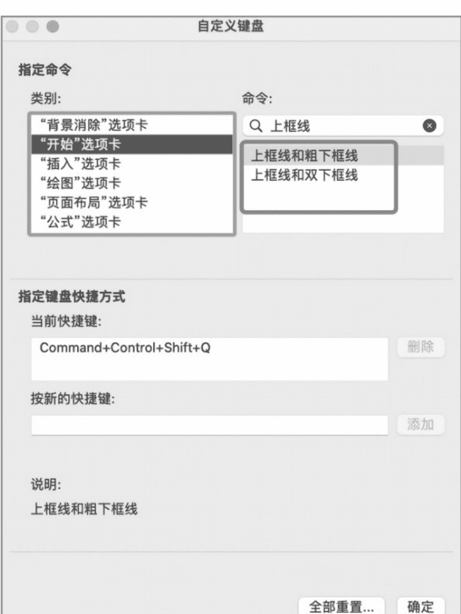

图5.4 搜索需要修改快捷键的类别操作

另外还会出现冲突，ChatGPT 给出的“上框线和粗下框线”为 Command+Shift+Q，这个组合在系统里本就用来关闭全部应用。比较省事的做法是在所有指令上再加一个修饰键，比如改成 Command+Control+Shift+Q。用同样的思路就能把自己常用的操作全部按个人习惯重设一遍。

## 5.3 快捷键使用案例

下面用几种 Excel 常见项目来演示，结合前面自定义的快捷键，让 ChatGPT 输出操作步骤再实操验证。

Excel 的核心操作无非是录入数据、求和平均、筛选排序、做图表，典型场景有：

- 学生成绩管理：录入成绩，算平均分和总分，并排名；
- 数据图表制作：做折线图、柱形图等；
- 数据筛选与排序：按条件筛选并按指定顺序排序。

让模型先生成数据的方法前面已讲过，这里直接用提问模板：“你是一个精通 Excel 的工程师，我的快捷键对照表如下【自定义快捷键表】，我想完成【案例描述】，数据是【数据】，请尽量用快捷键给出操作步骤。”

第一个案例的返回是：

借助快捷键，录入学生成绩、计算平均分、总分和排名会很顺手。具体步骤如下。

1) 录入学生的考试成绩：姓名和各科成绩手工输入。
2) 计算平均分：在目标单元格用快捷键 Command +5 插入平均值函数，选中数值区域后回车。
3) 计算总分：在目标单元格用快捷键 Command +Shift +5 插入求和函数，选中数值区域后回车。
4) 进行排名：在目标单元格用快捷键 Command + Shift +R 或 Command + R 插入排名函数，选中数值区域后回车。

第二个案例的返回是：

用快捷键在 Excel 中生成折线图和柱形图的流程。

1) 把数据粘到工作表，时间、数值1、数值2分别放在 A1、B1、C1。
2) 选中数据区域及标题，用快捷键 Command + T 转成表格。
3) 折线图：选中数值1、数值2所在列，按 F11 生成默认折线图。若要自定义样式，可先用 Alt + F1 生成簇状柱形图再调整。
柱形图：选中时间、数值1、数值2所在列，按 F11 生成默认柱形图，也可用 Alt + F1 生成簇状柱形图后微调。

第三个案例的返回是：

用快捷键完成筛选与排序。

- 把数据粘入单元格，学生姓名、数学、英语、物理分别在 A、B、C、D 列。
- 选中范围及标题，用 Command + T 转成表格。
- 筛选数据：选中表头行，用 Command +Shift + L 进入筛选模式，通过列标题下拉选择条件。例如只显示英语大于90分的学生，选择英语列下拉→Number Filters→Greater Than→输入90。
- 排序数据：选中排序范围，用 Command +Shift + R 打开排序对话框，选择排序列如数学、英语或物理，选升序或降序后确定。

Excel 里能做的项目基本都能按此套路处理，按需指定操作即可。

## 5.4 小结

本章讲了如何借助 ChatGPT 提升 Excel 快捷键的使用效率。默认快捷键的记忆技巧与应用先做铺垫，再用模型按需求自动生成一套个人化的快捷指令，形成更易记、更顺手的体系。最后用已定义的快捷键高效完成常见项目。掌握后，日常工作学习会更顺畅。

# 第6章 利用ChatGPT学习如何保护数据

信息时代数据安全至关重要，泄露、丢失或被不当使用都会对隐私和业务造成伤害。Excel 提供了多种手段防止敏感信息外泄、避免商业机密被滥用。本章按提问顺序让 ChatGPT 拆解场景、补充操作并给出实践点。

## 6.1 ChatGPT指导学习数据保护

知道数据保护的概念后，如何下手仍不清晰。下面让 ChatGPT 指导系统学习。

### 提问思路

系统学习需要边界，所以先问完成文档制作后哪些场景会用到数据保护。

问：你是一名资深 Excel 工程师，文档做完后哪些场景需要数据保护？请详细说明。

ChatGPT 回答：

作为资深工程师，可用场景包括：

- 分享文档
当需要他人协作时确保安全与保密。可设置密码保护，只有知道密码的人能打开；设置写保护，禁止编辑只能只读；授予只读权限；指定编辑区域，限定特定区域可改。

- 保护机密数据
文档含敏感信息时要特别注意。可设置密码保护，仅授权人员查看；隐藏含敏感数据的列行；使用数据验证限制输入范围，防止非法数据。

- 防止误操作
使用过程中防误改很重要。可锁定单元格或整张工作表；禁止插入或删除行列，保持结构稳定；使用保护窗口，防止误关闭或退出编辑。

- 控制数据公开
公开展示时需控制范围。可做摘要视图，只展示部分数据；审阅保护，限制他人审阅权限；用权限控制定义不同用户的访问与操作权限。

- 保护公式和工作表结构
含复杂公式或特殊结构时需保护。可隐藏公式区域；保护工作表防止结构被改；关闭编辑对象，禁止修改图表、图形、图片等。

场景清晰后，若想了解 Excel 能提供的全部保护手段，可继续问：“请把上述场景涉及的操作按类别整理，并按 Excel 的最大能力扩充每类操作。”

得到的功能清单大致为：

1. 密码保护
2. 配置用户权限
3. 指定编辑区域
4. 隐藏列和行
5. 利用数据透视表摘要视图保护敏感数据
6. 隐藏公式
7. 关闭编辑对象
8. 自动备份和恢复
9. 数据连接和外部数据保护

下面逐项介绍并在 Excel 中实操，VBA 与数据连接相关内容后文再讲。

## 6.2 文档的各类密码保护

按 ChatGPT 的密码与权限说明来学提问时要注意版本差异，比如 macOS Excel 2016 的操作与 Windows 不同，提问时要说明系统与版本。若步骤不对或找不到按钮，可要求模型纠正并给出权威网站。

以下操作基于 macOS Excel 2016，做不到时可按同样方法追问。

设置文档打开与编辑密码步骤如下，见图6.1、6.2。

1. 打开目标文档。
2. 菜单栏选“文件”。
3. 下拉选“密码”。
4. 在“文件密码”对话框中按需设“打开权限密码”或“修改权限密码”。
5. 输入密码点“确定”。
6. 在确认框再次输入相同密码点“确定”。


▲图6.1 选择“密码”命令


图6.2 Excel中设置文档打开或修改密码

设了打开密码后再次双击打开需输入密码；设了编辑密码后不输入只能只读，不能修改任何内容。

设置工作表密码步骤如下，见图6.3。

1. 打开文档。
2. 菜单栏选“工具”。
3. 在“工具”下选“保护”，按需选“保护工作簿”或“保护工作表”。
4. 输入密码并确认。
5. 点“确定”保存。


图6.3 Excel中设置文档密码

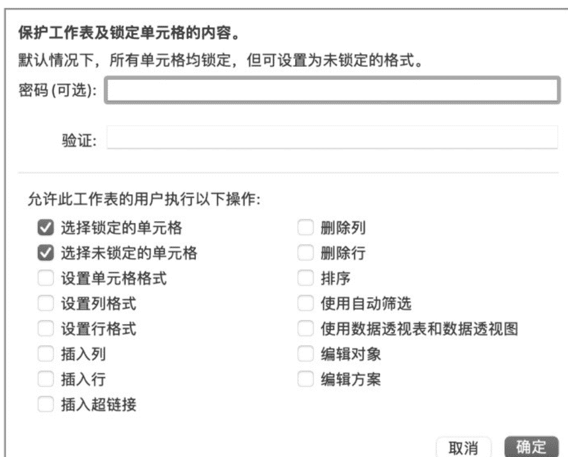

图6.4 Excel中的保护工作表选项

图6.4 显示了保护工作表的选项，勾选“选择锁定的单元格”后，“选择未锁定的单元格”会自动被勾上。因为默认保护后所有单元格都是锁定的不可编辑状态，而“选择”只是可被鼠标选中。编辑权限高于选择，所以若已允许选择锁定单元格，则未锁定的可编辑单元格自然也能被选择，反之则不然。

保护工作表还可限制插入列、插入行等。若勾选后保存，再次打开不输入密码撤销保护，仅插入行列可用，其余功能受限。工作表密码只作用于当前活动表，对其他表无效。

保护工作簿选项中，“保护结构”会禁止移动、删除、隐藏、取消隐藏或重命名工作表，也禁止插入新工作表，如图6.5所示。其余操作不受影响。

## 6.3 为文档配置用户权限

直接问：“你是一名资深 Excel 工程师，如何在 macOS Excel 2016 中为文档配置不同用户权限，请给出详细步骤。”模型给出的步骤包括审阅→保护工作簿→限定为特定用户→添加用户→设置完全控制/修改/只读等。但实际界面找不到“限定为特定的用户”选项，需要纠正。

### 提问思路

对错误答案可用奖惩指令引导。模型随后给出迂回方案：用 macOS 文件系统权限设置访问权限，但这不是 Excel 内部操作，继续纠正。

再问：“不这样的话，怎么在 macOS Excel 2016 文档中配置不同用户权限？”

回答：

可尝试以下流程：

- 打开文档，菜单栏选“文件”→“分享”或“共享”。
- 列表中可选择“添加联系人”“发送链接”或“更改高级权限”。
- 选“添加联系人”，输入受邀者邮箱，Excel 发链接并可设定访问权限。
- 选“发送链接”，生成链接发送，同样可设定权限。
- 选“更改高级权限”，会打开 macOS 的“获取信息”窗口，可增删用户并指定权限。

## 6.4 创建摘要视图保护机密数据

因为 Excel 各版本菜单位置并不完全一致，提问时最好把版本写清楚。下面是一条可直接套用的提问模板： “请你扮演一位资深 Excel 工程师，说明在 macOS 版 Excel 2016 中，怎么用自动筛选或数据透视表做一个摘要视图，只展示部分数据，同时确保敏感信息不被泄露。” 当然提问方式可以自行调整，思路相通即可。

ChatGPT 给出的思路可归纳为两条制作摘要的路径，外加保密处理。

1. 用自动筛选做快速概览
   (1) 打开文件并定位到含数据的工作表。
   (2) 确认表头行完整且唯一。
   (3) 在表头上方任一列点选一个单元格。
   (4) 在菜单栏的“数据”选项卡里点“筛选”。
   (5) 在表头里点筛选图标，选择需要的条件。
   (6) Excel 会只保留符合条件的数据，其余暂时隐藏。

2. 用数据透视表做汇总视图
   (1) 在“数据”选项卡里点“数据透视表”。
   (2) 系统会在新工作表生成字段列表。
   (3) 在“数据透视表字段列表”中勾选需要进入摘要的字段。
   (4) 根据勾选结果，Excel 会自动在透视表中生成汇总视图。

### 3. 对敏感信息做保密
- (1) 若想对整本工作簿加码，可在 macOS Excel 2016 中用密码保护工作簿。
- (2) 进入顶部菜单“文件”→“保护”→“保护工作表”。
- (3) 在弹出的对话框里输入密码并确认。
- (4) 确认后工作表被锁定，未输入密码无法编辑。

为了加深理解，可以让 ChatGPT 随机生成一份数据再实操。图6.6 是筛选后只保留 A 类产品的画面。


图6.6 筛选A类产品

把筛选结果做成数据透视表，并把该表所在的工作表命名为“开放数据”提供给他人使用，同时对原始数据所在的工作表进行加密，如图6.7。


图6.7 原始数据加密

若不想让原始表在标签栏出现，可直接隐藏工作表，如图6.8 所示。在状态栏的工作表标签附近右键，选择“隐藏”即可；再次右键选择“取消隐藏”就能恢复显示。


图6.8 隐藏工作表

## 6.5 自动备份与恢复设置
自动恢复可以在菜单栏选择“Excel”→“偏好设置”，打开对话框后勾选“启用自动恢复”，如图6.9。实际上该功能默认就是开启的，Excel 意外退出或崩溃时会自动保存副本，重新打开时会询问是否恢复上次的工作，或直接新建空白文件。


图6.9 保存选项

默认情况下，系统每 10 分钟自动保存一次快照，快照文件存放在 Excel 安装路径相关的用户目录下，可手动查找。

自动恢复还能记录修改历史，方便追溯是谁、何时改了什么。开启步骤如下：
- (1) 打开需要追踪的工作簿。
- (2) 在菜单栏点“工具”。
- (3) 在子菜单里选择“修订”。
- (4) 进入“修订”子菜单，选择“突出显示修订”。
- (5) 弹出提示后按需开启记录更改功能并保存。

开启后所有修改都会被记录，相关界面如图6.10、图6.11。


▲图6.10 选择“突出显示修订”命令


图6.11 “突出显示修订”对话框

在“突出显示修订”对话框中可控制显示三项信息：
- (1) 修订时间：显示每次改动的时间戳。
- (2) 修订人：显示执行改动的用户。
- (3) 修订位置：显示改动影响的具体单元格或区域。

勾选后就能在表格中直观看见修改痕迹。例如把 A3 的 123 改为 234 并标记 A 列固定时间后的所有操作，打开文件后效果如图6.12。

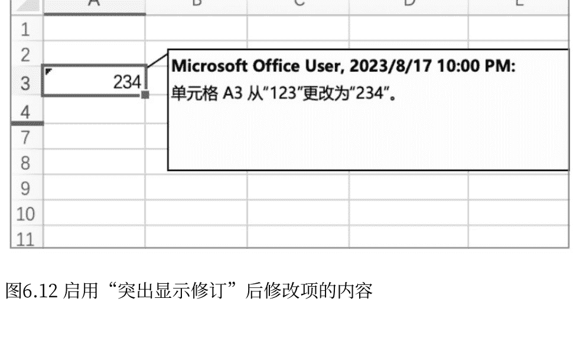
图6.12 启用“突出显示修订”后修改项的内容

## 6.6 更多数据保护手段
除了前面介绍的常规方法，还有以下进阶操作。

先说数据验证，用来保证输入合法准确。在“数据”选项卡点“数据验证”，打开的面板如图6.13。

各项含义如下：
- (1) 任何值：默认项，允许任意内容输入。

图6.13 Excel数据验证选项
- (2) 整数：限定整数输入，可设最小值和最大值。
- (3) 小数：限定小数输入，可设上下限。
- (4) 序列：从预设列表中选择，来源可手动填写或引用单元格区域。
- (5) 日期：限定日期格式，可设范围。
- (6) 时间：限定时间格式，可设范围。
- (7) 文本长度：限制字符数，可设等于、大于、小于等条件。
- (8) 自定义：用 Excel 公式自行判断，返回 TRUE 通过、FALSE 拦截。

再说隐藏行列与隐藏公式。隐藏行列可直接使用快捷键。隐藏公式则要借助保护功能：选中目标单元格右键→“设置单元格格式”，如图6.14。在弹出的窗口切到“保护”选项卡，勾选“锁定”和“隐藏”，如图6.15。随后对工作表设置保护并勾选“选择锁定单元格”，保存后公式便不可见；若未勾选“隐藏”，公式仍可被查看。


- 剪切 ⌘X

- 复制 ⌘C

- 粘贴 ⌘V

- 选择性粘贴 >

- 智能查找... ^⌘L

- 同义词库... ^⌥⌘R

- 插入...

- 删除...

- 清除内容

- 筛切 >

- 排序 >

- 插入批注

- 设置单元格格式... ⌘1

- 从下拉列表中选择...

- 显示拼音字段

- 定义名称...

- 超链接... ⌘K

- 服务 >

▲图6.14 Excel锁定单元格操作


图6.15 Excel设置单元格格式弹窗

最后是锁定对象。对象指图表、图形、图片、文本框等。右键图表选择“设置图表区格式”，在右侧窗格勾选“锁定”，如图6.16。保存后回到工作表保护设置中勾选“编辑对象”，即可用密码控制对象的编辑权限。同一窗格的“属性”还能控制对象是否随单元格移动或缩放大小，进一步保护排版。


图6.16 图表对象设置属性

## 6.7 本章要点回顾
本章围绕 Excel 数据保护展开，先借助 ChatGPT 梳理提问路径，再按操作类型拆解学习。从摘要视图、密码保护、隐藏工作表，到自动恢复、修订追踪、数据验证、公式隐藏和对象锁定，形成一套完整的数据安全实践方法，便于在实际工作中快速落地。

# 第7章 用 ChatGPT 打造 Excel 宏
Excel 宏是实现任务自动化的方式，通过录制或编写代码重复执行一系列操作，能大幅节省时间。宏本质上是 VBA 代码，ChatGPT 可以提供通用编程指导、语法解释、常见错误排查以及示例代码片段，帮助快速上手。

## 7.1 宏操作与 Visual Basic 编辑器
本节分为两部分：先系统介绍宏的创建、运行、管理与安全设置，再认识 Visual Basic 编辑器的构成与主要功能。

### 7.1.1 宏的基础操作
宏是一组指令集合，本质是 Visual Basic 程序，可通过录制或直接写 VBA 创建，最终都会转为代码。

提问思路
可以向 ChatGPT 提问如何创建宏，例如：
问：你是一位资深 Excel 工程师，在 macOS Excel 2016 中怎样创建宏？

ChatGPT 回复：
在 macOS Excel 2016 中创建宏的步骤如下：
- (1) 打开 Excel，在菜单栏选择“工具”。
- (2) 在子菜单里选择“宏”。
- (3) 在“宏”的子选项中点“录制新宏”开始录制。
- (4) 在“录制宏”对话框里命名宏并选择存储位置，默认个人工作簿。
- (5) 确认后开始记录操作。
- (6) 录制期间执行想要自动化的操作，如输入、格式修改等。
- (7) 完成后在“宏”选项卡下点“停止录制”。

注意：录制器会记录所有操作，建议先规划流程。创建后可用快捷键或自定义按钮调用。

实际操作如图7.1、图7.2。


▲图7.1 选择宏操作

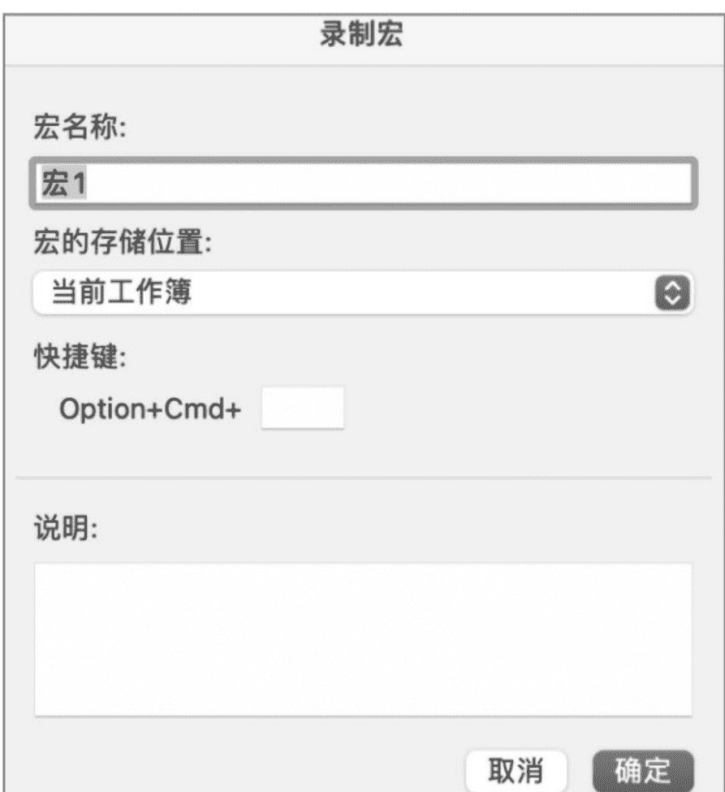
图7.2 “录制宏”对话框

若想用 VBA 手写，可在“宏”子命令中打开“Visual Basic 编辑器”，界面如图7.3。


图7.3 Visual Basic编辑器界面

为提高效率，可把常用宏命令放到快速访问工具栏或自定义功能区。如图7.4、图7.5 把“录制宏”和“Visual Basic 编辑器”加入快速访问工具栏；如图7.6 把“开发工具”加入自定义功能区。

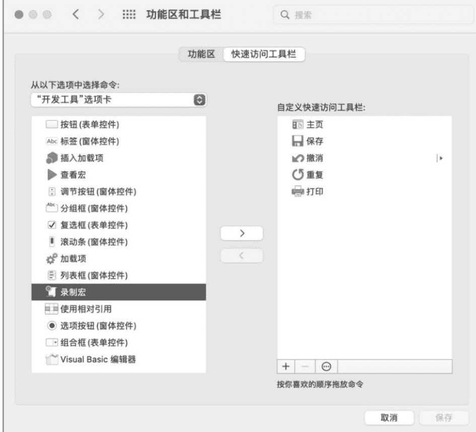
▲图7.4 将“录制宏”放入“自定义快速访问工具栏”

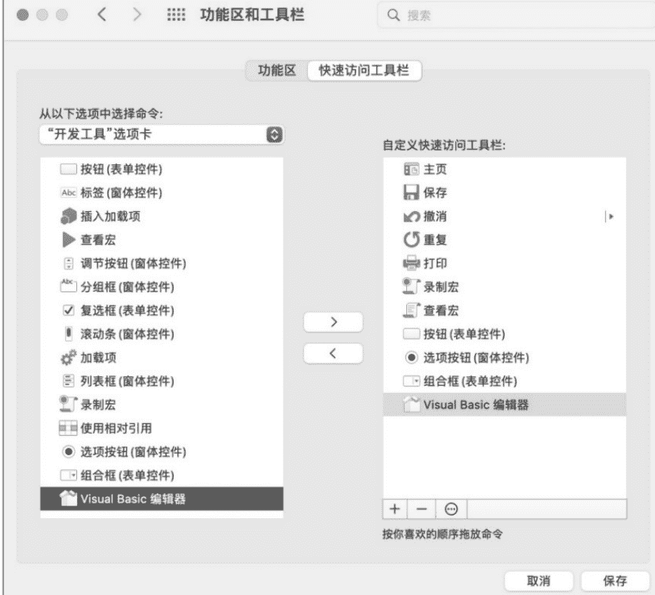
▲图7.5 将 “Visual Basic编辑器” 放入 “自定义快速访问工具栏”

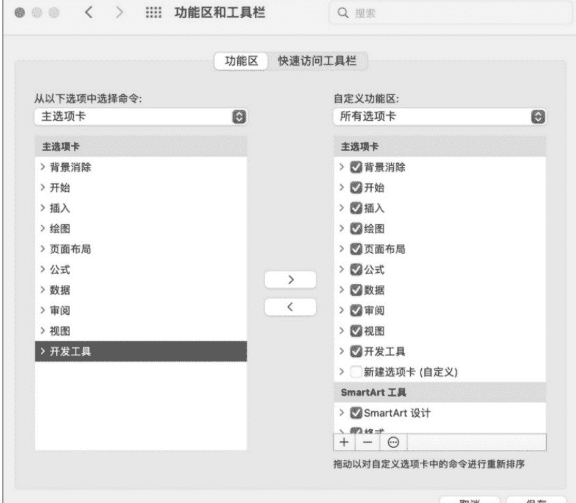
图7.6 将“开发工具”放入自定义功能区

接下来用两个小例子练习。ChatGPT 曾给出以下可练项目：
- (1) 自动求和宏：录制选择范围并求和的操作。
- (2) 数据格式化宏：录制字体、字号、颜色等格式操作。
- (3) 自动筛选宏：录制筛选条件设置。
- (4) 数据导入宏：录制导入外部数据。

这里演示前两个。

自动求和宏的提问可以是：“如何在 Excel 2016 for Mac 上创建自动求和宏？” 不要求自适应范围，只实现固定流程。ChatGPT 给出的步骤如下：
- (1) 在“开发工具”选项卡点“录制宏”。
- (2) 在对话框里命名，例如 Auto-SumMacro，可设快捷键后确定。
- (3) 录制期间先选定求和范围，再点“开始”选项卡的“自动求和”。
- (4) 完成后点“停止录制”。之后可用快捷键或通过“宏”按钮运行。

演示步骤如图7.7～图7.10。


▲图7.7 “自动求和”宏功能实现步骤1

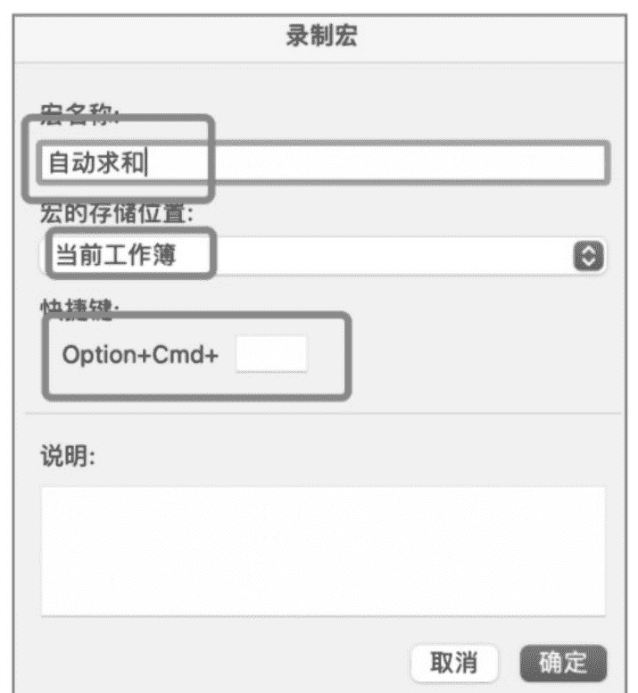
▲图7.8 “自动求和”宏功能实现步骤2

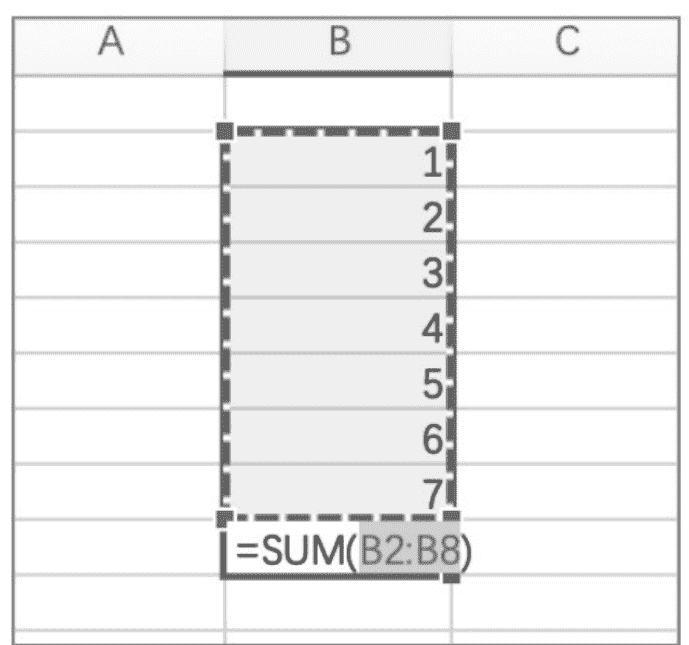
▲图7.9 “自动求和”宏功能实现步骤3


图7.10 “自动求和”宏功能实现步骤4

测试时在新单元格输入数字，选择数字下方单元格，通过“开发工具”→“宏”→选择“自动求和”→“运行”，即可自动填充求和结果，如图7.11。


图7.11 “自动求和”宏功能测试

数据格式化宏的操作逻辑相同，只是第三步录制的是格式设置：先选字体，再设字号，最后设置颜色和加粗，顺序可自行调整，如图7.12。


图7.12 “数据格式化”宏功能录制

经过前面关于宏的创建与运行实操，接下来要掌握的是宏的管理方法。主要包含以下几方面操作。

- （1）修改宏代码：打开宏管理器后挑选目标宏，点按“编辑”即可进入代码区，对宏的逻辑和功能进行调整。
- （2）删除宏：选中待移除的宏后点击“删除”。注意此操作无法撤销，需慎重。
- （3）单步调试宏：这是一种逐行运行宏代码的方式，每次只执行一行，便于观察运行过程和排查问题。可以实时查看每一阶段的执行情况、变量数值、结果输出以及潜在错误。
- （4）导入导出宏：借助宏管理器可把宏保存为“.bas”文件用于备份或分享，也能把外部的“.bas”文件导入到当前工作簿中使用。

单步调试涉及到 VBA 代码细节，本节暂不展开，后续操作将在 Excel 中演示。

以之前的“自动求和”宏为例，点击“开发工具”选项卡里的“宏”按钮，在弹出的对话框的“宏名称”列表中选中“自动求和”，再点“编辑”，如图7.13。


点开“编辑”后会启动 Visual Basic 编辑器，能看到“自动求和”对应的 VBA 源码，如图7.14。此时可以修改功能实现，具体的代码讲解将在后续 VBA 章节中展开。

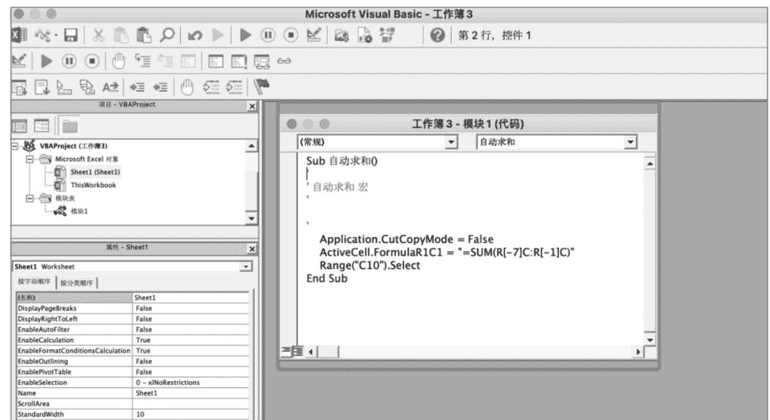

若仅需调整快捷键，可在“宏”对话框里点击“选项”按钮来设定，如图7.15。

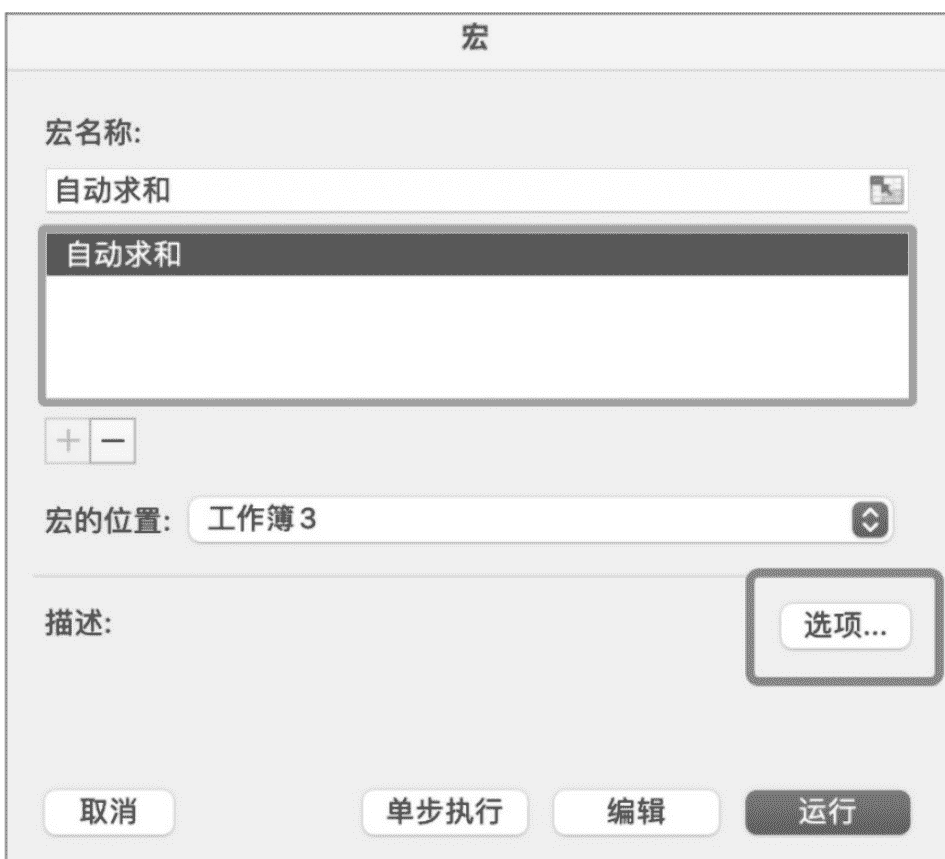

若不再需要该宏功能，也可以直接删除，操作步骤见图7.16。


不同 Excel 版本和系统的导入导出流程会有差异。以笔者使用的版本为例，先打开宏对应的 Visual Basic 编辑器，借助菜单栏的“文件”→“导出文件”完成导出，如图7.17。


若在自己的版本里找不到该入口，可向 ChatGPT 求助，提问方式沿用前面提到的通用提问模板，此处不再重复。

接下来介绍宏的安全设置。

在 Excel for Mac 里，宏安全相对简洁，只有启用和禁用两种状态。

具体操作步骤如下，截图见图7.18。

1. 从顶部菜单栏点选“Excel”，随后在下拉菜单里选择“偏好设置”。
2. 在弹出的偏好设置窗口中切换到“安全性”。
3. 在“安全性”面板里可以看到“启用所有宏”选项，勾选则允许所有宏运行，取消勾选则全部禁止。


### 7.1.2 Visual Basic 编辑器结构与使用

新建一个空白 Excel 文档，直接打开 Visual Basic 编辑器，界面概览如图7.19。


下面对编辑器的各个组成部分及其作用进行说明。

1. 项目资源管理器：位于左侧，展示当前工作簿的 VBA 项目层级，可浏览工作簿、模块、用户窗体等对象结构。
2. 代码窗口：占据右侧，用于呈现所选项目的 VBA 源码，支持编写、新增过程函数以及查看属性方法。
3. 工具栏：提供常用快捷按钮，包含运行、单步调试、停止执行、设置断点等操作。
4. 属性窗口：选中项目资源管理器或代码窗口中的对象后，会在此显示该对象的各项属性，如名称、位置、尺寸、字体、颜色等，可直接修改属性值以改变对象表现。

另外，代码窗口下方还有立即窗口，用于调试时查看运行时信息，可临时输入 VBA 语句、查询变量值或执行表达式。当前文档为空且未运行代码，因此该窗口未显示。

截图中代码窗口为空，是因为项目资源管理器里尚未选中任何对象。资源管理器中，funcres.xlam 为 Excel 加载项，提供可被其他工作簿引用的函数与资源；当前工作簿指正在编辑的 Excel 文件及其包含的模块、窗体等；模块是存放 VBA 代码的容器，可在其中编写过程、函数和变量，通过调用实现特定功能。

若要在当前工作簿中编写代码，需在项目资源管理器里双击对应对象。例如要编辑 Sheet1，就双击图7.20中框选的位置，此时代码窗口会打开相应的编辑区。Sheet1 代表当前工作表，选中 ThisWorkbook 则指向整个工作簿。

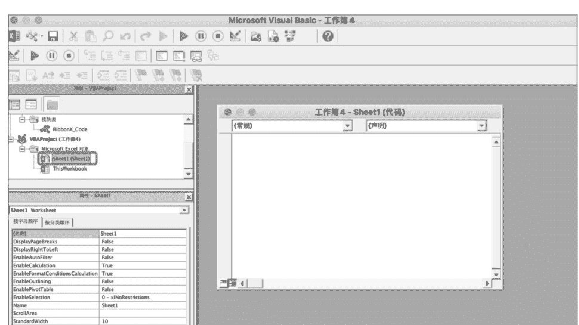

图7.20 的属性窗口列出了工作簿的诸多属性，初学者往往难以全部理解，即使有经验也难以记住全部。遇到不确定的属性时，可直接请 ChatGPT 解释。下面是基于截图属性名称的说明结果。

以下为选中工作簿对象时各属性的含义与作用。

1. DisplayPageBreaks（显示分页符）：控制工作簿是否显示分页符，True 显示，False 隐藏。
2. DisplayRightToLeft（右至左显示）：决定工作簿是否采用从右到左的排版，True 时文本与对象右向左排列，False 时左向右。
3. EnableAutoFilter（启用自动筛选）：控制自动筛选功能是否可用，True 可用，False 禁用。
4. EnableCalculation（启用计算）：决定是否开启自动计算，True 时公式会自动重算，False 时计算被禁用。
5. EnableFormatConditionsCalculation（条件格式计算）：控制条件格式是否参与计算，True 允许，False 禁止。
6. EnableOutlining（大纲显示）：决定是否启用大纲功能，True 可用，False 关闭。
7. EnablePivotTable（数据透视表）：控制数据透视表功能是否开放，True 可用，False 不可用。
8. EnableSelection（允许选择）：管理单元格/区域是否可被选中，True 允许，False 禁止。
9. Name（名称）：用于查看或修改工作簿的名称。
10. ScrollArea（滚动区域）：限定用户可滚动的工作表范围。
11. StandardWidth（标准列宽）：设定列宽自动调整时的默认基准宽度。
12. Visible（可见性）：控制工作簿是否显示，True 可见，False 隐藏。

## 7.2 借助 ChatGPT 快速掌握 VBA 编程

上一节介绍了如何在 Excel 中打开 Visual Basic 编辑器并认识其界面，本节将进入 VBA 编程实务。VBA 语法主要涵盖：数据类型与变量声明、运算符、控制结构、常用函数方法，以及代码结构，包括模块、子程序和函数的定义等。

### 7.2.1 VBA 数据类型与变量声明

开始学习 VBA，先掌握数据类型与变量声明，也可借助 ChatGPT 系统梳理，下面是提问思路。

### 提问思路拆解

该主题内容繁杂，系统学习最佳方式是请 ChatGPT 生成一份学习大纲。数据类型与变量涉及的概念包括：数据类型概念及分类、类型转换与强制转换、命名规范、声明与初始化、作用域与生命周期，提问应围绕这些点展开。

问：你现在是VBA编程专家，请给我列一份在VBA中学习数据类型和变量的学习文档，里面需要包含但是不限于：【上述的内容分类】。

ChatGPT回答：

当学习 VBA 中的数据类型与变量时，可参考以下学习提纲。

1. 数据类型概念与分类。
介绍数据类型的作用与必要性。
讲解 VBA 中常见的类型，如整型、浮点型、字符串、布尔等。
区分简单类型与复合类型的差异。
2. 类型转换与强制转换。
解释转换的意义与场景。
介绍隐式转换与显式转换的应用。
配合示例演示用函数和运算符完成转换。
3. 变量命名规范。
说明规范对可读性和维护性的影响。
介绍 VBA 命名规则，如使用描述性名称、避免保留字等。
给出最佳实践，如驼峰、帕斯卡、匈牙利命名法。
4. 变量声明与初始化。
阐述声明与初始化的意义。
讲解在 VBA 中声明变量并指定类型与名称的方法。
提供赋初值的示例及常见注意事项。
5. 作用域与生命周期。
说明作用域即变量可见范围的概念。
对比局部变量与全局变量的使用方式。
介绍变量从创建到释放的时间范围。

拿到大纲后，可让 ChatGPT 逐条展开讲解。需要注意 VBA 是 Office 宏语言，不同应用间存在细微差异，后续提问最好明确限定在 Excel VBA。我们可根据返回内容筛选重排，挑出新手重点讲解，不懂之处再向 ChatGPT 请教。

VBA 的常见数据类型包括整数、浮点数、字符串、布尔值等。

1. Integer（整型）：表示整数，取值范围 -32,768 至 32,767。
2. Long（长整型）：覆盖更大整数范围，-2,147,483,648 到 2,147,483,647。
3. Single（单精度浮点）：可存储小数，占用 4 字节。
4. Double（双精度浮点）：范围更大、精度更高，占用 8 字节。
5. String（字符串）：用于存放文本字符序列。
6. Boolean（布尔）：仅取 True 或 False。
7. Variant（变体）：可容纳任意类型，声明时未指定类型时默认使用。
8. Date（日期时间）：表示日期与时间。
9. 对象类型：Object 为通用对象，Range 代表单元格区域，Worksheet 代表工作表，Workbook 代表工作簿。

此外还有复合类型。VBA 中常用的复合结构是数组和集合。数组按顺序存放同类型元素，可为一维、二位或多维，存储类型灵活，创建后大小固定。集合是特殊对象，元素无序且可混合类型，大小可动态增减。

类型转换用于不同类型数据间的交互与计算，常见于：把值赋给不同类型变量时、进行跨类型运算或比较时、字符串与数值间相互转换时。

在 VBA 中，类型转换可分为隐式与显式两种。

1. 隐式转换：编译器自动完成，通常由窄类型向宽类型转换以避免丢失，如整型转浮点、字符转字符串。
2. 显式转换：需在代码中明确指定转换方式，如用函数或运算符将字符串转为整数、浮点转整数等。

声明变量是为了先告知编译器变量的存在，通过指定名称和类型完成。变量名应具备描述性，便于理解其用途。命名需遵循规范：使用字母大小写组合，避免特殊字符和空格；以字母开头；不能与 VBA 保留关键字冲突。常见命名方式有：

1. 驼峰命名：首词全小写，后续单词首字母大写，如 myVariableName。
2. 帕斯卡命名：每个单词首字母大写，如 MyVariableName。
3. 匈牙利命名：以数据类型前缀开头，后接描述名，如 strFirstName、intCount。

声明后编译器会分配内存并提供对应操作。初始化指声明时同时赋予初始值。

作用域与生命周期描述变量的可见范围与存在时间。

局部变量仅在其声明的过程或函数内有效，离开后即释放。全局变量在模块级声明，整个模块内均可访问，程序运行期间始终存在。

将上述知识点整合，通过若干代码示例练习，未涉及部分可自行实践。

1. 声明和初始化整数变量。
```vba
Dim num As Integer
num = 10
```
2. 声明和初始化字符串变量。
```vba
Dim name As String
name = "John Doe"
```
3. 声明和初始化布尔变量。
```vba
Dim isTrue As Boolean
isTrue = True
```
4. 声明并初始化一个一维数组。
```vba
Dim arr1(2) As Integer
arr1(0) = 1
arr1(1) = 2
arr1(2) = 3
```
5. 声明并初始化一个二维数组。
```vba
Dim arr2(1, 1) As String
arr2(0, 0) = "Apple"
arr2(0, 1) = "Banana"
arr2(1, 0) = "Orange"
arr2(1, 1) = "Grapes"
```
6. 声明并创建一个集合。
```vba
Dim coll As New Collection
```
7. 声明一个全局变量，可以将变量的声明放在任何一个模块的最上方，在所有过程的外部进行声明。
```vba
Public myGlobalVariable As Integer
```

### 7.2.2 VBA 运算符概览

该部分结构清晰，可直接让 ChatGPT 以知识点加示例的方式输出。提问模板可设为：“请用示例讲解 VBA 中【××运算符】”。

#### 1. 算术运算符

VBA 的算术运算符用于数学计算，包含加法 +、减法 -、乘法 *、除法 /、整除 \、取模 Mod。根据上述模板，ChatGPT 给出的示例如下。

```vba
Dim result As Integer
result = 3 + 5          '结果为 8
result = 3 + 5          '结果为 8
result = 4 * 3          '结果为 12
result = 4 * 3          '结果为 12
result = 10 / 3         '结果为 3.33333333333333
result = 10 \ 3         '结果为 3，整数相除运算符
result = 2 ^ 3          '结果为 8
result = 10 Mod 3       '结果为 1，取模运算符，用于取除法的余数
```

#### 2. 比较运算符盘点

VBA 中的比较运算符用来对两个值进行对照，并返回布尔值 True 或 False。常用的符号有等于 =、不等于 <>、大于 >、小于 <、大于等于 >=、小于等于 <=。沿用之前的提示语模板，ChatGPT 给出的演示如下。

```vba
Dim result As Boolean
result = (5 = 5)        '结果为 True
```
result = (3 < 5)          '结果为 True

result = (8 > 5)          '结果为 True

result = (3 <= 5)         '结果为 True

result = (8 >= 5)         '结果为 True

result = (3 <> 5)         '结果为 True

#### 3. 逻辑运算符一览

VBA 的逻辑运算符专门处理 True/False 这类逻辑值，根据设定的条件综合判断后给出结果。常用的运算符如下。

And：逻辑与，要求两个条件同时为真才为真。
Or：逻辑或，只要至少一个条件为真即为真。
Not：逻辑非，对条件的真假进行取反。
Xor：逻辑异或，判断两个条件是否恰好一个为真。

基于前面的提问模板，ChatGPT 返回的例子如下。

```
Dim result As Boolean
result = (True And False)      '结果为 False
result = (True Or False)       '结果为 True
result = Not True              '结果为 False
result = (True Xor False)      '结果为 True
```

#### 4. 字符串连接运算符

在 VBA 里，字符运算符负责把多个字符串拼接到一起，形成新的字符串。
+ 或 &：连接符，可将两个及以上字符串合并。

按之前的提示语，ChatGPT 给出的例子如下。

```
Dim result As String
result = "Hello, " & "World!"       '结果为 "Hello, World!"
```

#### 5. 赋值运算符说明

VBA 用赋值运算符把一个值赋给变量、属性或数组元素，标准写法就是等号 =。依据先前的提示，ChatGPT 给出的示例如下。

```
Dim x As Integer
x = 10       '将值 10 赋给变量x
x += 5       '相当于 x = x + 5
```
-=、*=、/=：类似于 +=，操作符可以根据需要进行替换

#### 6. 其他常用运算符

()：圆括号运算符，用来限定运算顺序和分组。

```
Dim result As Integer
result = (10 + 5) * 2       '结果为 30
```
.：点运算符，用来访问对象的属性和方法。

```
Dim myRange As Range
Set myRange = Worksheets("Sheet1").Range("A1:B2")
myRange.ClearContents  '通过点运算符调用Range对象的
                       ' ClearContents方法
```
:: 冒号运算符，可在同一行书写多条语句。

```
Dim x As Integer : Dim y As Integer    '声明多个变量在同一行上
x = 10 : y = 20                        '将两个值分配给不同的变量
                                        '在同一行上
```

### 7.2.3 VBA控制结构详解

在 Excel 中使用 VBA 时，需要借助控制结构来决定程序的执行路径。下面是常见分类。

#### 1. 条件分支

If…Then：条件成立时执行对应代码块。
If…Then…Else：条件为真执行一个块，为假执行另一个块。
If…Then…ElseIf…：在多个条件中逐一判断，命中即执行。
Select Case：根据表达式取值选择对应的处理分支。

#### 2. 循环结构

For…Next：循环次数事先确定，反复执行一段代码。
For Each…Next：遍历集合或数组的每个元素并执行。
Do…Loop：先执行代码再检查条件，满足则继续。
While…Wend：依据条件循环执行代码块。

#### 3. 跳转控制

GoTo：将执行指针转移到指定标签处。
Exit：提前退出循环或过程。
Continue：跳过本次迭代，进入下一次。

#### 4. 异常捕获

On Error GoTo：运行时出错时跳转到指定错误处理区。
Resume：指定错误处理完成后恢复执行的点。

这些结构可以相互嵌套，以实现更复杂的逻辑。例如在循环里使用条件判断，或在条件分支里嵌套循环。

为更好理解，可以借助 ChatGPT。下面是提问思路。

### 提问思路

可以让 ChatGPT 分别为不同控制结构生成代码并讲解，也可以组合提问，在理解单项作用的同时学会联合使用。

问：你现在是 VBA 编程专家，请把上面提到的条件语句、循环语句、跳转语句、异常处理全部用上，输出一段代码示例。

ChatGPT 回答：

```
Sub ControlStructureExample()
    Dim i As Integer
    Dim j As Integer
    On Error GoTo ErrorHandler ' 异常处理
    For i = 1 To 5
        If i = 3 Then
            GoTo SkipLoop ' 跳转到标签 SkipLoop，跳过当前迭代，
            ' 执行下一次迭代
        End If
        Debug.Print "外层循环: " & i
        For j = 1 To 3
            If j = 2 Then
                GoTo NextIterationInInnerLoop ' 跳过内层循环的
                ' 剩余迭代，执行
                ' 内层循环下一次
                ' 迭代
            End If
            Debug.Print " 内层循环: " & j
        NextIterationInInnerLoop:
        Next j
SkipLoop:
    Next i
    Select Case i
        Case 1
            Debug.Print "i 的值为 1"
        Case 2, 3
            Debug.Print "i 的值为 2 或 3"
        Case Is > 3
            Debug.Print "i 的值大于 3"
        Case Else
            Debug.Print "i 的值不在已定义的范围内"
    End Select
    Exit Sub ' 正常退出
ErrorHandler:
    Debug.Print "发生错误: " & Err.Description
    Resume Next ' 继续执行下一个语句
    ' 可以在这里添加其他的错误处理代码
End Sub
```

可复制这段代码让 ChatGPT 做详细解读。其中涉及的函数和方法会在后续章节介绍，配合学习效果更佳。

### 7.2.4 VBA常用函数与方法

VBA 提供了大量常用函数与方法，涵盖字符串处理、日期时间、文件操作等。借助 ChatGPT 学习时可按以下思路提问。

### 提问思路

需求是掌握函数写法与方法调用，所以提问围绕这两点展开。

问：你现在是 VBA 编程专家，请简要说明 VBA 中如何编写函数以及如何调用方法。

ChatGPT 回答：

在 VBA 中，函数是一种可被调用并返回值的过程。常规写法如下：

```
Function 函数名(参数1 As 类型, 参数2 As 类型, ...) As 返回值类型
    ' 函数的代码
    ' ......
    ' 返回值
    函数名 = 返回值
    ' 结束函数
    Exit Function
End Function
```

各部分的含义如下。
(1) 函数名：自行定义的名称。
(2) 参数1 As 类型，参数2 As 类型，...：参数列表，可零个或多个。
(3) 返回值类型：指定返回值的类型，如整数、字符串、日期、布尔等。
(4) 函数体：实现具体逻辑，可声明局部变量。
(5) 返回值：用“函数名 = 返回值”设置输出。
(6) Exit Function：提前结束函数执行。

示例代码如下：

```
Function AddNumbers(num1 As Integer, num2 As Integer) As Integer
    ' 计算两个数字的和
    Dim sum As Integer
    sum = num1 + num2
    ' 设置返回值
    AddNumbers = sum
    ' 退出函数
    Exit Function
End Function
```

示例定义了 AddNumbers 函数，接收两个整数 num1、num2，计算和后通过 AddNumbers = sum 返回结果。注意若未显式使用 Exit Function，函数会在最后可达行结束，返回值取决于是否设置。

关于方法调用的提问，ChatGPT 的回答如下。

使用对象时可通过方法触发行为。通用格式为：

对象. 方法(参数1, 参数2, …)

对象可以是变量或表达式，方法是对对象执行的操作，参数可选。

示例写法：

```
Sub ExampleMethod()
    Dim ws As Worksheet
    Set ws = ThisWorkbook.Worksheets("Sheet1") '引用工作簿中
                                                '名为"Sheet1"
                                                '的工作表

    '使用工作表的方法来进行操作
    ws.Activate '激活工作表
    ws.Range("A1").Value = "Hello" '将文本 "Hello" 写入 A1 单元格
    ws.Range("A1").Font.Bold = True '将 A1 单元格的字体设置为
                                    '粗体
End Sub
```

示例中 ws 为 Worksheet 对象，先用 Set 赋值，再调用 Activate 激活工作表，通过 Range("A1").Value 写入文本，通过 Range("A1").Font.Bold 设置粗体。属性描述对象状态，方法表示可执行的操作。

接下来让 ChatGPT 举例 Excel 中常用的函数。提示语可为“请列举 Excel 中 VBA 常用函数及示例”，回答如下。

Excel VBA 中常用于数据处理的函数示例。
(1) MsgBox：以对话框展示信息。
MsgBox "Hello, World!"
(2) Range：引用单元格或区域。
Dim cell As Range
Set cell = Range("A1") ' 引用单个单元格
(3) Cells：引用工作表指定单元格。

```
Dim cell As Range
Set cell = Cells(1, 1) ' 引用第一个单元格(A1)
(略)
```

建议在编辑器里实际运行上述代码，观察输出，再自行修改参数体会函数效果，不易理解的可以继续追问。

关于常用方法，ChatGPT 的回答如下。

Excel VBA 中常见的方法示例。
(1) Select：选中特定单元格或区域。
Range("A1").Select ' 选择 A1
(2) Copy：复制选区。
Range("A1:B2").Copy ' 复制 A1:B2
(3) Paste：把复制内容粘贴到指定位置。
Range("C1").Paste ' 粘贴到 C1
(略)

对不熟悉的方法可继续针对性提问加深理解。

### 7.2.5 VBA代码基础架构

学习完基础语法后，需要了解整体结构，即如何把各部分串联起来让代码生效。提问可分步进行。

### 提问思路

先问整体结构，再按模块、过程、函数分类提问，答案会更细致。

问：你现在是 VBA 编程专家，请概括 Excel VBA 编程中的模块概念。

ChatGPT 回答：

在 Excel VBA 中，模块是存放和组织代码的容器，可把相关功能集中管理，便于维护。一个项目可包含多个模块。

要点说明。
(1) 创建模块。
打开 VBA 编辑器，在项目资源管理器中选中工作簿或项目，右键选择“插入”→“模块”即可。
(2) 模块属性与命名。
模块可在项目资源管理器中查看名称，也可通过 Name 关键字设置。建议使用描述性名称。
(3) 模块内代码。
模块可容纳过程、函数、变量声明等，直接编写或复制粘贴。
(4) 共享与私有代码。
模块内代码可设为公共或私有，公共可在全项目调用，私有仅限本模块。
(5) 导入导出模块。
模块可导出为文件再导入，实现跨项目复制或分享。
(6) 删除模块。
在项目资源管理器中右键模块选“删除”即可，注意删除会永久丢失代码，需先备份。

对上述内容有疑问可继续追问，例如操作步骤或用比喻通俗解释。对子程序，ChatGPT 的介绍如下。

VBA 过程与函数配合实战指南

在 Excel VBA 里，Sub 过程相当于把一连串完成特定任务的指令打包成独立单元。它既可以在当前编辑器里声明，也能在其他位置反复触发执行。

下面把过程的使用要点重新梳理一遍。

（1）声明过程
过程的声明以关键字 Sub 开头，随后是过程名加一对圆括号。名称建议唯一且语义清晰，括号内部可以列出形参，调用时把实际值传入。声明范例如下：

```
Sub HelloWorld()
    ' 代码块
    MsgBox "Hello, World!"
End Sub
```

（2）触发过程
在其它 VBA 源码中，只要写出过程名就能让其运行，并在需要时带入对应形参的值，由此执行过程内部定义的操作序列。触发示例如下：

```
HelloWorld    ' 调用子程序
```

（3）执行区
过程的实际工作区被一对大括号 {} 限定，业内常称为代码段。这里才放置真正执行的 VBA 语句，可包含控制结构、变量定义、对象操作等。下面示例展示在代码段中组织多条语句的做法。

Sub ExampleSub()

    ' 变量声明

    Dim x As Integer

    Dim y As Integer

    ' 赋值

    x = 5

    ' 加法操作

    y = x + 10

    ' 显示结果

    MsgBox "The result is: " & y

End Sub

（4）形参
过程可以带入形参，外部值在调用时传入，内部按需使用。声明时在括号里写明形参数名及类型即可。下面给出带形参的声明示例：

```
Sub Greeting(name As String)
    MsgBox "Hello, " & name & "!"
End Sub
```

带形参的调用示例：

```
Greeting "John"    ' 调用带参数的子程序并传递参数值
```

把逻辑拆成多个独立过程，能让整体更清晰、更易维护，过程既可单独运行，也可被其它 VBA 片段所引用。

Function 的写法在前面章节已介绍，这里不再重复。单看各组成部件的分类还不了解它们之间的配合关系，所以下面进一步说明。就像了解人体各系统的构成还不够，还要知道协同方式，整体才能运转。针对此问题，ChatGPT 的回答如下。

在 Excel VBA 里，代码容器、Sub 过程和 Function 的差异如下。

（1）定义和用途
代码容器用于存放和组织 VBA 源码，可容纳多个过程、Function、变量声明等。
Sub 过程是一组语句的组合，用来完成某项任务，使用 Sub 关键字声明，不产生返回值。
Function 也是一组语句的组合，用来完成某项任务并输出结果，使用 Function 关键字声明，必须返回结果。

（2）返回值
代码容器本身不产生返回值，只是源码的归置处。
Sub 过程也不返回任何值，只负责执行操作。
Function 则必须给出一个返回值，供其它代码使用。

（3）形参
Sub 过程和 Function 都支持形参，在声明时写出参数名，在调用时传入对应值，目的是把外部数据带入内部处理。

（4）调用方式
代码容器不能被直接调用，只是组织源码。
Sub 过程和 Function 可在模块内部或其它模块的源码里随时调用。

要搭出完整可用的实现，容器、过程和 Function 需要相互配合、合理编排。常见做法如下。

（1）新建代码容器。略，前面已讲过。
（2）声明过程和 Function。
在容器内部按任务划分，分别编写过程和 Function，让它们各自承担独立的计算、操作或任务。
（3）调用过程和 Function。
在需要的位置用名称直接调用，并按需传入数值。
（4）过程与 Function 的互相调用。
过程或 Function 内部可以直接调用其它过程或 Function，实现复用和模块化。
（5）结合逻辑和控制流程。
借助 If…Else 等条件语句以及 For、Do 等循环结构控制执行顺序，让过程和 Function 按预期流程运行。

了解完上述知识后，就要靠不断实践、思考和修正来熟练。

## 7.3 Excel 中的 VBA 开发实践

本节围绕 Excel 使用中常见的 VBA 操作做实操，在实践中学会用 ChatGPT 辅助编程。

前面录制宏做过自动求和，但只能对固定行数求和，无法随数据行数和内容变化而自适应，这里来实现自适应版本。

- （1）录制宏实现选中单元格求和。
- （2）利用 VBA 批量生成 Word 报告。

下面用两个案例来练习。

第一个案例是第7.1.1节的自动求和宏。宏已录制，可直接打开对应的 VBA 源码修改。需求是选中某一列中所有有数据的单元格，把数值自动累加。可借助 ChatGPT 给出实现思路。提问时要把需求描述清楚，ChatGPT 给出结果如下。

```
Sub 自动求和()
    Dim rng As Range
    Dim sumValue As Variant
    Dim sumRange As Range
    ' 获取选中的列范围
    Set rng = Selection
    ' 判断有内容的范围，并计算求和范围
    For Each cell In rng
        If Not IsEmpty(cell.Value) Then
            If sumRange Is Nothing Then
                Set sumRange = cell
            Else
                Set sumRange = Union(sumRange, cell)
            End If
        End If
    Next cell
    ' 求和并将结果显示在选中区域的下方一行
    If Not sumRange Is Nothing Then
        Set lastCell = rng.Cells(rng.Rows.Count)
        Set lastCell = lastCell.Offset(1)
        ' 获取最后一个单元格的下方一行
        sumValue = WorksheetFunction.Sum(sumRange.Value)
        lastCell.Value = sumValue
    Else
        MsgBox "没有找到内容数据。"
    End If
End Sub
```

在自动求和案例中，宏已存在，打开 VBA 编辑器定位到对应模块，按 ChatGPT 修改后的源码调整模块内容后，选中目标列中有数据的单元格，点击“宏”按钮，即可得到该列所有选中内容之和。

第二个案例常见于检测机构，需要根据表格数据批量生成格式统一的 Word 检测报告。涉及多文件交互，例如检测记录数据、送检用户信息、检测报告模板。三个文件内容如下。

### 表7.1 检测记录数据

| 编号 | 姓名 | 送检时间 | 检测时间 | 检测人 | 检测结果 |

|------|------|----------|----------|--------|----------|

| 01 | 张三 | 20230101 | 20230102 | 王医生 | 阴性 |

| 02 | 李四 | 20230101 | 20230102 | 王医生 | 阳性 |

| 03 | 王五 | 20230101 | 20230102 | 李医生 | 阴性 |

### 表7.2 送检用户信息

| 姓名 | 身份证号 | 性别 |

|------|----------|------|

| 张三 | 32145XXXXXXXXX | 男 |

| 李四 | 45245XXXXXXXXX | 男 |

| 王五 | 61131XXXXXXXXX | 女 |

### 检测报告模板

姓名：{S姓名}

性别：{S性别}

身份证号：{S身份证号}

编号：{S编号}

检测结果：患者于北京时间{S检测时间}经过{S检测人}检测，最终确认为{S检测结果}

报告时间：{S年}年{S月}月{S日}日

图7.21 检测报告模板

明确目标后，可套用第2章的万能提问模板。难点在于如何描述需求。可把大目标拆成【内容实现】+【格式实现】。先把 Excel 里对应位置的内容准确组合成 Word 文档内容，再处理字体、格式、对齐等。

拆完后第一个问题可这样问：“你现在是一个资深 Excel 工程师，精通 VBA 语言，我有一个 Excel 文档，在 Sheet1 中的 B2 到 G5 的单元格中有下面的内容：【复制检测记录数据】，在 B12 到 D15 的单元格中有下面的内容：【复制送检用户信息】。现在想要使用上面的 Excel 中的内容，实现把每个用户的信息批量生成对应用户的 Word 格式的检测报告文档，内容如下：【复制检测报告模板】。需要怎么写 VBA 代码？”ChatGPT 给出的代码如下。

```
Sub GenerateReports()
    Dim wsData As Worksheet
    Dim wsTemplate As Worksheet
    Dim objWord As Object
    Dim objDoc As Object
    Dim i As Integer
    ' 设置数据工作表和模板工作表
    Set wsData = ThisWorkbook.Sheets("Sheet1") ' 数据工作表
    Set wsTemplate = ThisWorkbook.Sheets("Template") ' 模板工作表

    ' 创建Word对象
    Set objWord = CreateObject("Word.Application")
    objWord.Visible = True ' 可见模式打开Word
    ' 遍历数据行
    For i = 2 To 5 ' 假设数据行范围为 2 到 5，根据实际情况进行调整
        ' 打开模板文档
        Set objDoc = objWord.Documents.Open("C:\Path\to\your\Template.docx")
        ' 替换文档中的占位符
        ReplacePlaceholder objDoc, "{$姓名}", wsData.Range("B" & i).Value
        ReplacePlaceholder objDoc, "{$性别}", wsData.Range("C" & i).Value
        ReplacePlaceholder objDoc, "{$身份证号}", wsData.Range("D" & i).Value
        ReplacePlaceholder objDoc, "{$编号}", wsData.Range("A" & i).Value
        ' 继续替换其他内容，根据需要添加更多的占位符和对应的数据
        ' 保存生成的报告文档
        objDoc.SaveAs "C:\Path\to\your\GeneratedReport_" & wsData.Range("A" & i).Value & ".docx"
        ' 关闭报告文档
        objDoc.Close
        ' 在循环的下一个迭代中，打开下一个报告文档
    Next i
    ' 关闭Word对象
    objWord.Quit
    ' 释放对象变量
    Set objWord = Nothing
    Set objDoc = Nothing
    MsgBox "报告生成完成！"
End Sub
Sub ReplacePlaceholder(objDoc As Object, placeholder As String, replacement As String)
    With objDoc.Content.Find
        .ClearFormatting
        .Text = placeholder
        .Replacement.ClearFormatting
        .Replacement.Text = replacement
        .Execute Replace:=2
    End With
End Sub
```

从上述代码可以看出实现步骤如下。

- (1) 定义数据工作表和模板工作表对象，分别对应存放数据的工作表和存放报告模板的工作表。
- (2) 新建一个 Word 应用程序对象objWord并设为可见，后续用它来控制 Word 文档的打开、占位符替换和保存。
- (3) 用循环遍历数据工作表中指定行，为每一行生成一份报告。
- (4) 每次循环打开报告模板文档objDoc。
- (5) 调用自定义的ReplacePlaceholder子过程，在模板中查找占位符并替换为对应行的数据。占位符如“{姓名}”、“{性别}”等，会被实际数据替换。
- (6) 保存生成的报告，并按数据工作表中的编号命名。保存路径和命名规则可按实际调整。
- (7) 循环下一轮时关闭当前文档，准备打开下一个模板。

上述回答整体流程是对的，但存在几处错误：第一，原表只有一个工作表“Sheet1”，代码却定义了一个不存在的“Template”工作表；第二，遍历2~5行时，代码用D列的值去填身份证号，但2~5行中D列并没有身份证信息；第三，检测人、检测时间、检测结果和报告日期等信息未处理。因此代码无法直接运行。它更多是提供思路和框架，需要根据实际表名、模板路径、占位符对应关系等做修改，并调整逻辑后才能正常使用。

可以自行按之前学过的知识在此框架上修改，也可直接指出问题让 ChatGPT 修正。提问方式为：“在实现把每个用户的信息批量生成对应用户的 Word 格式的检测报告文档的 VBA 代码中，你给出的代码存在以下问题【书写上述问题】，请进行修改后返回正确答案。”经过修正后的输出如下。

Excel VBA 批量生成 Word 报告的实操要点

```
Sub GenerateReports()
    Dim wsData As Worksheet
    Dim objWord As Object
    Dim objDoc As Object
    Dim i As Integer
    ' 设置数据工作表和模板工作表
    Set wsData = ThisWorkbook.Sheets("Sheet1") ' 数据工作表
    ' 创建Word对象
    Set objWord = CreateObject("Word.Application")
    objWord.Visible = True ' 可见模式打开Word
    ' 遍历数据行
    For i = 2 To 5 ' 假设数据行范围为 2 到 5，根据实际情况进行调整
        ' 打开模板文档
        Set objDoc = objWord.Documents.Open("C:\Path\to\your\Template.docx")
        ' 通过姓名查找身份证号和性别
        Dim rngFound As Range
        Set rngFound = wsData.Range("B12:B15").Find(What:=wsData.Range("B" & i).Value, LookIn:=xlValues, LookAt:=xlWhole)
        If Not rngFound Is Nothing Then
            Dim id As String
            Dim gender As String
            id = rngFound.Offset(0, 1).Value ' 姓名对应的身份证号
            gender = rngFound.Offset(0, 2).Value ' 姓名对应的性别
            ' 替换文档中的占位符
            ReplacePlaceholder objDoc, "{$编号}", wsData.Range("A" & i).Value
            ReplacePlaceholder objDoc, "{$姓名}", wsData.Range("B" & i).Value
            ReplacePlaceholder objDoc, "{$身份证号}", id
            ReplacePlaceholder objDoc, "{$性别}", gender
            ' 检测时间、检测人和检测结果
            ReplacePlaceholder objDoc, "{$检测时间}", wsData.Range("C" & i).Value
            ReplacePlaceholder objDoc, "{$检测人}", wsData.Range("D" & i).Value
            ReplacePlaceholder objDoc, "{$检测结果}", wsData.Range("E" & i).Value
            ' 最后一行的报告时间
            Dim nowDate As String
            nowDate = Format(Date, "yyyy年mm月dd日")
            ReplacePlaceholder objDoc, "{$年}", Year(nowDate)
            ReplacePlaceholder objDoc, "{$月}", Month(nowDate)
            ReplacePlaceholder objDoc, "{$日}", Day(nowDate)
            ' 保存生成的报告文档
            objDoc.SaveAs "C:\Path\to\your\GeneratedReport_" & wsData.Range("A" & i).Value & ".docx"
            ' 关闭报告文档
            objDoc.Close
            ' 在循环的下一个迭代中，打开下一个报告文档
        End If
    Next i
    ' 关闭Word对象
    objWord.Quit
    ' 释放对象变量
    Set objWord = Nothing
    Set objDoc = Nothing
    MsgBox "报告生成完成！"
End Sub
Sub ReplacePlaceholder(objDoc As Object, placeholder As String, replacement As String)
    With objDoc.Content.Find
        .ClearFormatting
        .Text = placeholder
        .Replacement.ClearFormatting
        .Replacement.Text = replacement
        .Execute Replace:=2
    End With
End Sub
```

Set objDoc = Nothing

MsgBox "报告生成完成！"

End Sub

Sub ReplacePlaceholder(objDoc As Object, placeholder As String, replacement As String)

    With objDoc.Content.Find

        .ClearFormatting

        .Text = placeholder

        .Replacement.ClearFormatting

        .Replacement.Text = replacement

        .Execute Replace:=2

    End With

End Sub

以上片段的核心流程已经能跑通，但在不同环境下要想稳定运行，需要同时满足下面几条前提：

- ① 源表必须存在，且工作表名称正好是 Sheet1。
- ② 模板文件必须可访问，当前示例写的是 C:\Path\to\your\Template.docx，请换成你本机的实际地址。
- ③ 读取的数据行默认取第 2 行到第 5 行，后续可依据表结构自行调整范围。
- ④ 对应的单元格区域现为 B12:B15，按需要改动。
- ⑤ 模板里预留的占位符包括 "{$编号}"、"{$姓名}"、"{$身份证号}"、"{$性别}"、"{$检测时间}"、"{$检测人}"、"{$检测结果}"、"{$年}"、"{$月}"、"{$日}"。
- ⑥ 输出文件名规则为 “C:\Path\to\your\GeneratedReport_” +编号 + “.docx”，同样要指向可写的目录。

另外，机器上必须已正确安装并启用 Microsoft Word。不同 Excel 版本在细节上略有差异，建议限定版本使用。本例依赖 Word 对象库，所以一定要在 VBA 编辑器里完成引用：打开编辑器菜单 工具 → 引用，在弹出的对话框里勾选 “Microsoft Word XX.X Object Library”，XX.X 对应本地 Word 版本，确认后点确定即可。


图7.22 编辑器中引用Microsoft Word对象库

接下来在已有逻辑上做排版优化，即对 Word 文档内的文字统一字体与字号。借助 ChatGPT 完成字体设定：

```
Sub ModifyFont(objDoc As Object, fontName As String, fontSize As Integer)
    objDoc.Content.Font.Name = fontName
    objDoc.Content.Font.Size = fontSize
End Sub
```

上面代码里新增的 ModifyFont 子过程，用于把指定范围的字体名称和字号改成目标值。需要时可直接修改该过程内的字体名和字号参数，就能得到想要的样式并写入最终报告。

除了直接在模块里编写宏，也可以通过工作表控件来触发执行，比如开发工具提供的按钮、组合框、复选框等，具体组件见图7.23。


图7.23 开发工具中可以用作触发的组件

搭建触发方式的思路是：从开发工具拖入按钮、组合框或列表框到工作表，调整位置大小；右键控件选择“指定宏”，为其绑定一个点击事件名称。在该事件对应的处理程序里写入 VBA 逻辑即可响应用户点击。最简点击事件示例如下：

```
Private Sub CommandButton1_Click()
    ' 在按钮单击事件中执行的代码逻辑
    MsgBox "按钮被单击了！"
End Sub
```

同样的思路可用于其他控件事件。例如组合框选项变化时，就在它的 Change 事件里加入处理代码。

本案例在演示环境下很顺畅，但实际使用时代码越复杂调试越频繁，掌握编辑器里的规范调试方法很有必要。

## 7.4 Excel中的VBA代码调试

当程序出现错误或结果不符合预期时，就需要在编辑器里定位修复。关于 VBA 错误分类，可在官网“Visual Basic for Application → 语言参考 → 用户界面帮助 → 错误消息”查询，这里挑几个常见类型用 ChatGPT 生成错误案例复制进编辑器运行，观察提示后再按提示修正，直至正常运行。

常见错误归纳如下。

- （1）变量或对象未声明：在使用前必须先声明，否则会报“变量未定义”或“对象变量未设置”。

```
Sub VariableUndefined()
    i = 10    '变量 i 未声明，会出现变量未定义的错误
    MsgBox i
End Sub
```

- （2）语法错误：代码中出现拼写失误、标点缺失或多余，通常由错字、括号引号运算符使用不当引起。

```
Sub SyntaxError()
    Dim x As Integer
    x = 5    ' 正确的赋值语句
    ' 错误的赋值语句，少了一个等号
    x 5      ' 会出现语法错误

    MsgBox x
End Sub
```

- （3）引用错误：调用的对象、属性、方法或库不存在或用法不对，可能源于拼写、未引用相关库或功能不支持。

```
Sub ReferenceError()
    Dim ws As Worksheet
    Set ws = ThisWorkbook.Worksheets("Sheet1")
                        ' 引用Sheet1 工作表
    ws.Range("A1").Value = "Hello"    ' 引用工作表的单元格来赋值
    ' 错误的工作表名称，应为 "Sheet1" 而非 "SheetA"
    Set ws = ThisWorkbook.Worksheets("SheetA")
                        ' 会出现引用错误
    MsgBox ws.Name
End Sub
```

- （4）对象特定错误：针对特定对象操作不当，例如访问不存在的对象或使用不兼容的方法属性，需结合情况调整。

```
Sub ObjectSpecificError()
    Dim rng As Range
    Set rng = Range("A1:A10")    ' 引用 A1:A10 范围对象
    ' 错误的范围引用，需要明确的工作表引用
    Set rng = Worksheets("Sheet1").Range("A1:A10")
    ' 会出现对象特定的错误
    MsgBox rng.Address
End Sub
```

运行代码时主要用到的编辑器工具栏如图7.24，中间两个灰色按钮忽略，自左向右依次为运行子过程、中断、重设、切换断点、单步执行、地点窗口、邻近窗口、监视窗口。


图7.24 Visual Basic编辑器调试代码常用工具

- （1）运行子过程：点运行按钮或快捷键即可执行当前子过程并查看结果。
- （2）中断：可在执行中暂停程序，点停止按钮或快捷键中断，便于及时排查问题。
- （3）重设：将程序状态恢复初始，点重设按钮可清除运行时状态，使程序重新开始。
- （4）切换断点：在行号旁单击可设置断点，再次单击取消，程序运行到断点会自动暂停，便于检查现场。
- （5）单步执行：逐行推进代码，观察每一步的状态变化。
- （6）地点窗口：用于调试时查看表达式、输出值和类型，也可执行即时命令。
- （7）邻近窗口：展示当前子过程的局部变量及其实时值，帮助分析执行流程。
- （8）监视窗口：跟踪指定变量或表达式的值，可在窗口中添加监视项，实时显示变化。

下面让 ChatGPT 输出一份结合上述调试工具的操作示例，并自行演练一遍。可用的提问提示词为：“请给出一份VBA代码，演示如何使用上述调试工具【前面列举的调试代码工具】进行调试上述代码。”

它给出的操作文档如下：

以下是一段示例的 Excel VBA 代码，演示了如何使用上述调试工具进行调试：

```
Sub ExampleCode()
    Dim rng As Range
    Dim i As Integer
    '设置断点
    Stop
    '在地点窗口中查看变量值
    i = 0
    Debug.Print "初始值为 " & i
    '在监视窗口中添加变量
    Debug.Print "在监视窗口中添加变量 rng"
    Set rng = Range("A1:A10")
    '用单步执行，逐行执行代码
    For Each cell In rng
        '用邻近窗口监视变量值
        Debug.Print "当前的 i 值为 " & i
        Debug.Print "当前的单元格值为 " & cell.Value
        '逐行执行代码
        i = i + 1
        '设置条件断点
        If i > 5 Then
            Stop
        End If
    Next cell
    '完成单步执行
    MsgBox "代码执行完毕"
End Sub
```

针对以上代码的调试步骤如下。

1. 在 Excel 中打开 VBA 编辑器。
2. 在左侧窗格选择合适模块，如 Sheet1 或 Module1。
3. 将示例代码复制到选定模块。
4. 在代码第 9 行设置断点，可点行号右侧空白区或使用快捷键。
5. 点击工具栏运行按钮或按快捷键开始执行。
6. 执行到断点处程序会暂停，可使用调试工具介入。
7. 暂停时打开地点窗口，查看变量 i 的当前值。
8. 在监视窗口添加变量 rng，以便在执行期间跟踪其变化。
9. 使用单步执行逐行推进，可在邻近窗口观察变量值。
10. 设置条件断点，例如在第 20 行前加入 If i > 5 Then Stop，当 i 超过 5 时自动暂停。

可反复使用以上流程，结合断点、地点窗口、监视窗口和邻近窗口查看或修改变量，以了解执行细节。

- （11）代码执行结束或再次点停止按钮时调试结束。

关于调试步骤的关键截图见图7.25~ 图7.28。

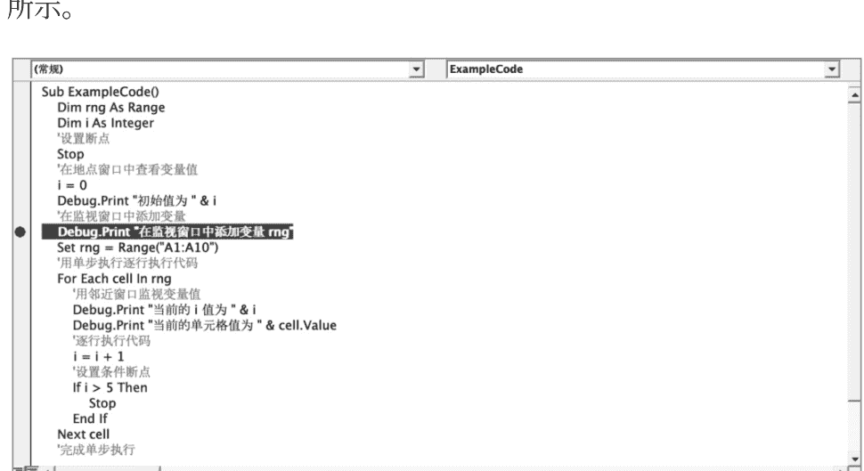

▲图7.25 VBA编辑器中添加断点的示意


▲图7.26 代码执行到断点处自动暂停

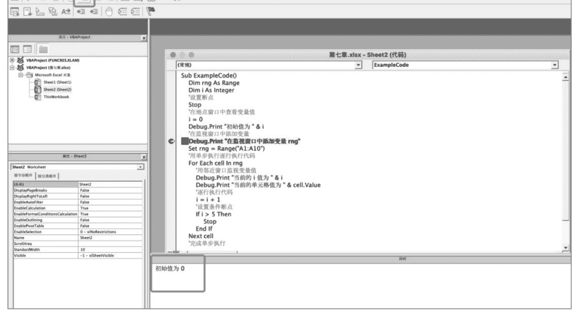

▲图7.27 单步运行后打开邻近窗口查看输出

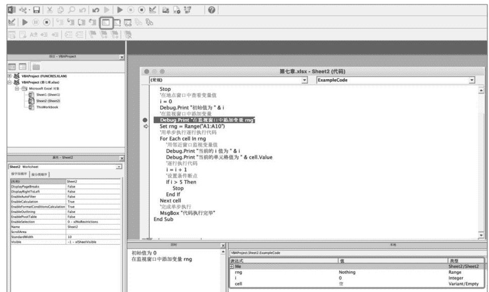

图7.28 唤出Locals窗口查看变量

## 7.5 小结

本章围绕Excel里极为关键的宏与VBA编程展开学习。思路上先把知识点拆解，梳理出一条清晰的进阶路径，每节聚焦一个环节，层层递进。过程中借助ChatGPT进行系统化解析，并配合若干学习小技巧来提升掌握效率。需要留意的是，本章涉及快捷键的部分，因系统、版本差异较大，故未给出统一按键。

整体而言，本章内容定位在基础层面，核心在于搭好知识框架，并示范如何利用ChatGPT高效学习。若希望继续深耕，可参考第10章，自行设计一条更进阶的学习路线。

# 第8章 用ChatGPT快速掌握Power Query

Power Query是Excel内置的一款强力数据获取与转换工具，能够从多种渠道拉取数据并完成清洗、转换等处理。

功能很全面，自然也意味着操作点多、知识点杂。建议先让ChatGPT帮忙梳理Power Query的知识板块，形成一条由浅入深的学习序列。本章也按此思路组织：先讲在Excel里如何调起Power Query以及它支持哪些数据源；再介绍编辑器界面和常用指令；随后通过实战案例演示常规数据处理、多表合并查询、追加查询，并涉及M语言的使用。

## 8.1 如何启动Power Query及它能连哪些数据源

本节以Windows版Excel为主线。macOS版Excel在部分数据源的连接上可能受限，演示时或会出现缺失，但以Excel文件为数据源的操作与Windows基本一致。调起方式见图8.1，从“数据”选项卡进入，可见“获取数据”“查询”连接等入口。Excel 2010与2013未自带Power Query选项卡，可从微软官网下载中心安装后启用。下面按数据源类型展开说明。


图8.1 Excel中调用Power Query的入口

初次接触Power Query时，可按以下方式向ChatGPT提问。

### 提问策略

当对某个知识点有大致背景、却不清楚具体操作与意义时，直接提问是最快的摸底方式。

针对Power Query，建议明确系统与版本，尤其是不同版本的入口与分类存在差异。让ChatGPT做讲解时一并说明建立连接的前提条件与操作步骤。

问：你现在是精通Excel的工程师，请简单介绍一下在Microsoft Excel 2013中，Power Query如何连接各类数据源。

ChatGPT回答：

在Microsoft Excel 2013中，Power Query可接入多种数据源，大致如下。

- （1）Excel文件：可连接并导入其他Excel文件的数据，可选择单张或多张工作表，并做转换与过滤。
- （2）文本与CSV文件：可导入txt、csv等文本数据。Power Query会自动识别分隔符，也可手动指定。
- （3）数据库：支持SQL Server、Access、Oracle、MySQL等。需提供连接字符串与凭据，建立连接后可执行查询或选择表。
- （4）网页数据：可从Web URL导入结构化表格，提供网址后选择所需表格并导入，同时可做转换。
- （5）目录表：支持Active Directory、SharePoint列表、Exchange邮件等属性表，需提供凭据与筛选条件导入数据。

若想了解上述未涉及的数据源，可把来源列成表格让ChatGPT补充说明。

下面通过实操来演示数据源的连接。以Excel文件为例，使用场景必须结合实际需求来看。针对Power Query连接Excel数据源的常见用途，ChatGPT的归纳如下。

在Power Query中连接Excel数据源的常见应用场景如下。

- （1）数据整合：将多个Excel文件或工作簿的数据合并成统一数据集，适合需要汇总分析与汇报的场景。
- （2）数据清洗：Excel数据常存在格式不一、重复值、空行等问题，通过Power Query可快速去重、补全缺失值、规范文本格式等。
- （3）数据筛选：面对庞大数据，可通过选择行列或属性，仅导入关注部分，提升效率。
- （4）数据转换：可添加计算列、合并列、拆分列、转换数据类型等，完成数据准备工作。

归纳起来，处理海量数据时，需要对多来源工作表进行整合、清洗、转换，Power Query就很合适。点击“数据”选项卡中的“获取数据”按钮，在下拉列表中选择“自

## 8.2 Power Query编辑器全景解析

我们下载了若干公开数据集，处理后得到不同药品在不同时段的销售情况，示例如图8.6。因为各月销售数据分散在不同表格，故利用Power Query将数月数据合并。按连接Excel文件的方式，依次加载一月、二月、三月的数据文件。

| 购药时间 | 购买人编号 | 商品编码 | 商品名称 | 销售数量 | 应收金额 | 实收金额 |

|---|---|---|---|---|---|---|

| 2018-02-17 星期三 | 11177328 | 236701 | 三九感冒灵 | 5 | 149 | 131.12 |

| 2018-02-22 星期一 | 10065687828 | 236701 | 三九感冒灵 | 1 | 29.8 | 26.22 |

| 2018-02-24 星期三 | 13389528 | 236701 | 三九感冒灵 | 4 | 119.2 | 104.89 |

| 2018-02-23 星期二 | 105391328 | 236704 | 感康 | 2 | 16.8 | 15 |

| 2018-02-25 星期四 | 103935028 | 236704 | 感康 | 4 | 33.6 | 29.56 |

| 2018-02-05 星期五 | 10052626528 | 861368 | 感康 | 2 | 17 | 14.96 |

| 2018-02-06 星期六 | 10073161228 | 861368 | 感康 | 3 | 25.5 | 22.5 |

| 2018-02-16 星期二 | 11534628 | 861368 | 感康 | 2 | 17 | 15 |

| 2018-02-23 星期二 | 10052626528 | 861368 | 感康 | 2 | 19 | 17 |

| 2018-02-05 星期五 | 10011527928 | 861375 | 醒脑降压丸 | 4 | 73.2 | 64.42 |

| 2018-02-18 星期四 | 10036729328 | 236705 | 感康 | 5 | 42 | 37.5 |

| 2018-02-02 星期二 | 10613228 | 861397 | 氨加黄敏胶囊(请报77504) | 2 | 35 | 31 |

| 2018-02-05 星期五 | 10060539228 | 861397 | 氨加黄敏胶囊(请报77504) | 2 | 35 | 30.8 |

| 2018-02-17 星期三 | 101938528 | 861397 | 氨加黄敏胶囊(请报77504) | 3 | 52.5 | 48.5 |

| 2018-02-26 星期一 | 10048367928 | 861397 | 氨加黄敏胶囊(请报77504) | 1 | 17.5 | 15.5 |

| 2018-02-06 星期六 | 10012556628 | 236706 | 阿司匹林 | 2 | 93.6 | 84 |

| 2018-02-10 星期三 | 10024724728 | 236706 | 阿司匹林 | 1 | 46.8 | 42 |

| 2018-02-12 星期五 | 103564528 | 236706 | 阿司匹林 | 2 | 93.6 | 84 |

| 2018-02-20 星期六 | 10010784828 | 236706 | 阿司匹林 | 1 | 46.8 | 42 |

| 2018-02-20 星期六 | 10070347728 | 236706 | 阿司匹林 | 3 | 140.4 | 126 |

| 2018-02-24 星期三 | 10012556628 | 236706 | 阿司匹林 | -2 | -93.6 | -84 |

| 2018-02-25 星期四 | 10028164428 | 236706 | 阿司匹林 | 1 | 46.8 | 41.18 |

图8.6 药物销售情况的部分数据

在“数据”选项卡下点开“获取数据”下拉，选择“自文件” → “Excel工作簿”，在对话框中选中文件后，于“主页”选项卡点击“转换数据”，即可进入Power Query编辑器，界面如图所示8.7。

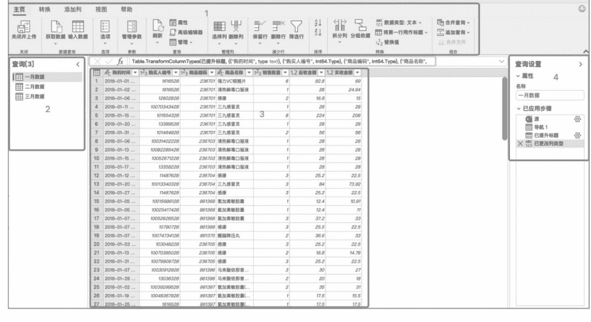

图8.7 Power Query编辑器界面

下面让ChatGPT介绍编辑器各部分的构成。

### 如何精准提问

因不同系统与版本界面存在细微差异，提问时应说明依据Excel官方文档作答，并限定版本系统，同时明确要介绍的是编辑器的页面构成而非单纯功能区，否则易被理解偏差。按此方式提问可最大程度降低误差。

问：你现在是精通Excel的工程师，请依据Excel官方文档，说明Microsoft Excel 2013中Power Query编辑器界面的各组件功能。

ChatGPT回答：

依据Excel官方Power Query学习资料，对编辑器界面各组件的功能做如下归纳。

（1）预览窗格：展示从数据源加载数据的预览，可先行浏览前几行。
（2）查询设置窗格：显示当前查询的属性与设置，可查看与修改查询步骤、数据源设置、说明等。
（3）查询面板：位于编辑器顶部，包含获取数据、编辑、应用并关闭、加载、刷新、管理查询、查询设置等按钮。
（4）查询视图：列出查询步骤，可在此查看与编辑转换、清洗、整理逻辑。
（5）数据视图：呈现经步骤处理后的表格结果，便于进一步分析。
（6）功能面板：位于左侧，罗列可用的转换与操作函数，可搜索并应用到步骤中。

即便做了限制，回答仍与实际不符。建议在官方文档中检索最准确的表述。文档路径为“帮助”→“文档”→“Power Query文档”，搜索“Power Query编辑器用户体验”，即可对照图8.7说明。

图8.7中方框1为功能区：提供导入、转换、清理、加载等命令与工具。方框2为“查询”窗格：展示所有可用查询。方框3为当前视图：默认显示查询数据的预览，可在数据预览与架构视图间切换，架构视图给出每列的整体概览，切换方式为“视图”选项卡中的“架构视图”按钮，如图8.8。

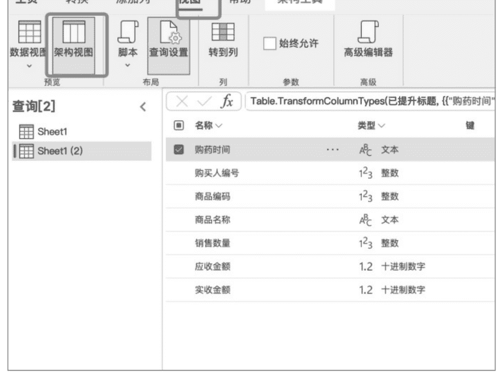

图8.8 切换视图

方框4为查询设置：展示当前选中查询的名称、步骤及相关指示器。

方框1与方框3之间为公式输入栏。可将当前公式复制给ChatGPT询问，示例回答如下。

在Power Query编辑器中，公式输入区用于指定操作与转换逻辑，本质是基于M语言的表达，用来描述数据处理步骤。

例如 Table.PromoteHeaders(#"导航 1", [Promote AllScalars = true]) 的作用是将表格首行提升为列标题。

通过此栏输入公式即可实现数据处理，同时会提供自动补全与文档提示。本节不对M语言展开，后续会学习。

数据已加载进编辑器，且各区域功能已基本明确。很多功能仅凭名称即可推断用途，可先自行探索，再通过提问深入了解具体用法。

功能区中，“主页”选项卡集中了常用转换与处理，如更改数据类型、删除行列、添加行列、填充空白等，同时提供数据导入与连接入口。合并查询与追加查询用于将多个查询或表集合并/追加。“转换”选项卡提供更高级的处理，如拆分列、合并表、重命名列、调整列顺序等。“添加列”选项卡支持基于表达式、自定义函数或条件判断创建新列。“视图”选项卡主要用于切换查询视图与数据视图，多数功能区操作在数据预览视图中右键也可完成。

查询窗格可切换编辑的查询。右键后可复制、引用、上移、下移等；空白处右键可新建查询、合并查询、新建参数、新建组，如图8.9。


▲图8.9 Power Query编辑器查询窗格探索

在数据预览视图中右键任意列，会弹出丰富的操作菜单，如图8.10。

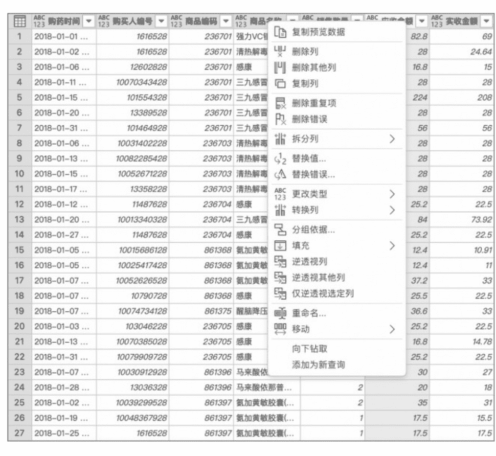

图8.10 Power Query数据预览窗格探索

功能区的大部分常用操作均能在右键菜单中找到。点击列标题下拉按钮，其筛选与排序体验与Excel单元格筛选类似。

操作步骤会在“查询设置”窗格中体现。以“按商品名称分组并统计行数”为例，确认后“已应用步骤”中会新增分组步骤。若需回退，直接点击该步骤右侧的叉号即可移除，如图8.11。

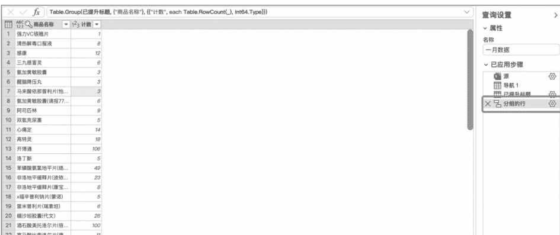

图8.11 Power Query查询设置窗格探索

## 8.3 Power Query常用数据处理实操

结合编辑器功能与实务需求，Power Query的数据处理主要围绕以下几类：拆分列、合并列、提取字符、转换表结构、单表或多表查询、单列与多列分组计算。掌握这些，可按如下方式向ChatGPT索取实例。

### 实战提问思路

基于已有药品销量数据，让ChatGPT设计一个同时使用上述操作的数据实例。

问：你是一个精通Power Query的Excel工程师，我的表包含如下信息：【复制几行数据，含全部列】。我想用Power Query编辑器完成这些操作：【列出上述常用操作】，请帮我制定一个可基于表中数据实践的示例。

ChatGPT回答：

Power Query 编辑器8大常用操作实战拆解

在 Power Query 编辑器里，绝大多数数据分析需求都能用下面这几类操作解决。

- 拆分列：把一列信息拆成多列，便于单独使用。例如把购药时间拆成日期和星期两列。
- 合并列：把多列拼成一列新字段。例如把日期和星期合并回购药日期。
- 提取字符：从某列里抠出指定文本或关键词。例如从商品名称里挑出特定关键字。
- 转换表结构：做行列互换，让分析更直观。例如把商品名称变成列头，销售数量作为对应值。
- 表格查询：按设定条件从单表里筛出符合的数据。例如挑出购药时间落在某个区间内的记录。
- 多表查询：依据共同键把多个表关联起来。例如把购买记录与购买人信息表联动，拿到更完整的分析维度。
- 单列分组计算：按单一列的值分组聚合。例如按购买人编号分组，统计每个人总销售量或实收金额。
- 多列分组计算：按多列组合分组聚合。例如按购药时间与星期同时分组，统计各时间点的销售总额。

下面按上述思路做实操演示。

(1) 将购药时间列拆分为日期和星期两列。可以自己在功能区探索拆分列，也可先让 ChatGPT 说明选项并举例。鼠标悬停在具体选项上，左侧会提示功能简介。最省事的做法是把购药时间字段原样复制给 ChatGPT，并明确需求：把时间列拆成日期和星期。

向 ChatGPT 提问后得到的参考步骤如下。

在 Power Query 编辑器中，可以按以下流程把时间列拆成日期和星期。

1. 选中时间列，右键列标题，选择拆分列 → 按字符数拆分。
2. 在弹出的设置框里把字符数设为 10。
3. 确认后会生成两列新字段，一列为日期，一列为星期。
4. 对日期列右键 → 更改类型 → 日期。
5. 对星期列如需去掉“星期”二字，右键 → 替换值，把“星期”替换为空。

复制时注意格式，格式不对或多出空格，会导致拆分结果偏差。按上述方法操作后得到的数据如下。

|  | 购药时间.1 | 购药时间.2 | 购药时间.3 | 购药时间.4 | 购药时间.5 | 购药时间.6 | 购药时间.7 |
|---|---|---|---|---|---|---|---|
| 1 | 2018-03-05 | 星期六 | null | null | null | null | null |
| 2 | 2018-03-05 | 星期六 | null | null | null | null | null |
| 3 | 2018-03-05 | 星期六 | null | null | null | null | null |
| 4 | 2018-03-07 | 星期一 | null | null | null | null | null |
| 5 | 2018-03-09 | 星期三 | null | null | null | null | null |
| 6 | 2018-03-15 | 星期二 | null | null | null | null | null |
| 7 | 2018-03-15 | 星期二 | null | null | null | null | null |
| 8 | 2018-03-15 | 星期二 | null | null | null | null | null |
| 9 | 2018-03-20 | 星期日 | null | null | null | null | null |
| 10 | 2018-03-22 | 星期二 | null | null | null | null | null |
| 11 | 2018-03-23 | 星期三 | null | null | null | null | null |
| 12 | 2018-03-24 | 星期四 | null | null | null | null | null |
| 13 | 2018-03-24 | 星期四 | null | null | null | null | null |
| 14 | 2018-03-28 | 星期一 | null | null | null | null | null |
| 15 | 2018-03-29 | 星期二 | null | null | null | null | null |
| 16 | 2018-03-19 | 星期六 | null | null | null | null | null |
| 17 | 2018-03-23 | 星期三 | null | null | null | null | null |
| 18 | 2018-03-31 | 星期四 | null | null | null | null | null |
| 19 | 2018-03-11 | 星期五 | null | null | null | null | null |
| 20 | 2018-03-17 | 星期四 | null | null | null | null | null |
| 21 | 2018-03-23 | 星期三 | null | null | null | null | null |
| 22 | 2018-03-25 | 星期五 | null | null | null | null | null |
| 23 | 2018-03-05 | 星期六 | null | null | null | null | null |
| 24 | 2018-03-13 | 星期日 | null | null | null | null | null |
| 25 | 2018-03-22 | 星期二 | null | null | null | null | null |

拆分后会多出空值列，是因为源列含有多余空格，不影响使用，直接删除空列即可。

(2) 合并列就是把刚才拆开的列重新选中合并，恢复购药时间信息。合并列提供多种连接符选项，如图8.14所示，若要还原原样就选无连接字符。注意合并后会新增一列，不会覆盖旧列。


图8.14 Power Query合并列操作选项

(3) 提取字符的场景是：从商品名称里判断是否包含“口服液”关键字，包含则标记“是”，否则“否”。借助 ChatGPT 的思路如下。

要实现关键词判断，可用添加条件列来实现。操作要点如下。

1. 在编辑器中选中“商品名称”列。
2. 顶部菜单选择“添加条件列”。
3. 设置新列名，例如“是否口服液”。
4. 逻辑填写为：若商品名称包含“口服液”则返回“是”，否则返回“否”，等价公式为 `if Text.Contains([商品名称], "口服液") then "是" else "否"`。
5. 确认生成条件列。

在“添加条件列”对话框中无需手写公式，直接做逻辑选择和填写即可，具体界面如图8.15所示。


图8.15 Power Query添加列选项

(4) 转换表结构可借助 ChatGPT 了解，提示词例如“请把商品名称作为新列头，把销售数量作为对应值，用 Power Query 的透视功能做行列转换”。得到的参考做法是：

先选中“商品名称”和“销售数量”两列，菜单中选择“转置”，即可把商品名称变为列名，销售数量填入对应行。对本案例数据意义不大，但能了解转置即行列互换的原理。处理完后导出或继续分析会更方便。

(5) 表格查询的示例是筛选购药时间在某区间内的记录。提问方式可以是“请筛选出购药时间在指定范围内的购买记录”。参考回答为：

选中“购药时间”列，顶部菜单选择筛选 → 介于，在条件框里设置开始和结束日期，例如 2018-01-01 至 2018-01-15，确认后即可应用。

筛选器的具体选项如图8.16和图8.17所示，在列筛选菜单里选择“日期筛选器”，子菜单选“介于”，不同数据类型对应的筛选器各不相同，可自行尝试。

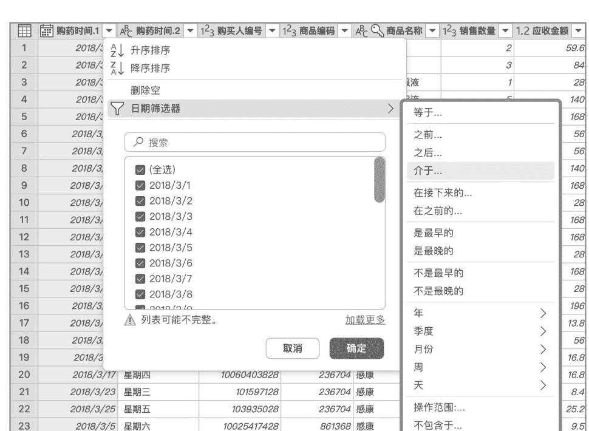

▲图8.16 Power Query筛选选项（1）


图8.17 Power Query筛选选项（2）

(6) 多表查询涉及表间关联，后续章节会详细展开。

(7) 单列分组计算的示例是“按购买人编号分组，计算每个人的总销售数量和实收金额”。参考步骤为：

选中“购买人编号”及“销售数量”“实收金额”等需要汇总的列，顶部菜单选择“转换 → 分组依据”，在分组设置里把“购买人编号”设为分组键，为每个分组选择汇总字段和聚合方式，如求和、平均值等，确认后生成分组结果。

具体填写界面如图8.18所示。

(8) 多列分组计算即按多个字段同时分组聚合。可在“主页”点击“分组依据”，在弹出的对话框选择“高级”，新增多个分组依据，如图8.19所示。


▲图8.18 Power Query分组依据选项


图8.19 Power Query多个分组依据选项

### 8.4 Power Query中的合并查询和追加查询

把合并查询和追加查询放一起讲，是因为两者都属于数据整合，操作逻辑相近，只是呈现方式不同，都能把多个查询或表格整合成更大的结果集。

### 1. 合并查询

先点开“合并查询”按钮查看选项，让 ChatGPT 解释并给出练习案例。图8.20为点击后出现的界面，默认以当前活动表为主表，再选择要关联的另一张表。合并查询支持的关联类型有左外、右外、完全外部、内部、左反、右反。

为了解释更清楚，可问 ChatGPT：“把购药记录表与另一张表合并时，有哪些关联方式？请给出实际场景和不同连接类型的例子。”得到的参考回答如下。

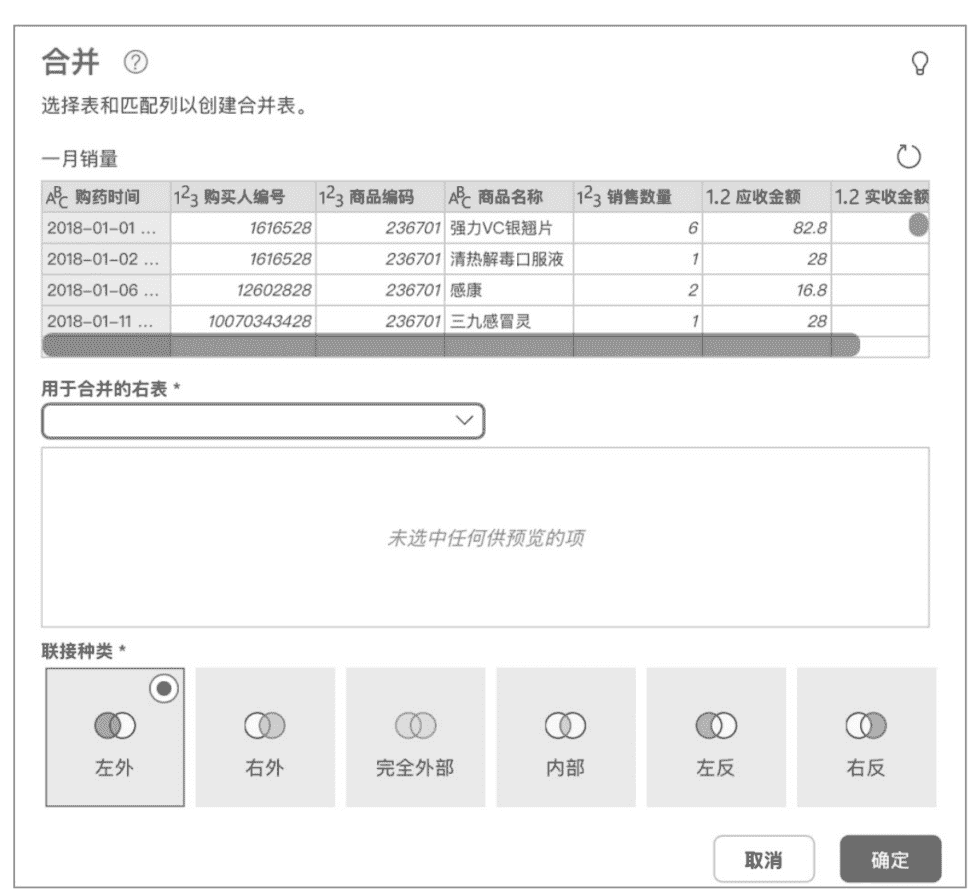

图8.20 Power Query合并查询选项

当主表需要与另一张商品信息表合并时，可选择不同连接类型。假设另一表包含商品编码、商品名称、价格等信息。

（1）左外连接：保留主表全部行，匹配到右表的行则补全信息，未匹配则为空。结果包含购药记录全部列，商品名称价格等未匹配部分为空。

（2）右外连接：保留右表全部行，匹配到主表的信息则补全，未匹配部分为空。结果以商品信息为主，购药时间、购买人编号等未匹配为空。

（3）完全外部连接：保留左右两侧所有行，匹配部分合并，未匹配部分以空值填充。结果包含两侧全部信息。

（4）内部连接：只保留左右两侧都能匹配上的行。结果仅包含匹配成功的记录。

（5）左反连接：返回主表存在但右表不存在的记录。结果为左侧独有行。

（6）右反连接：返回右表存在但主表不存在的记录。结果为右侧独有行。

为练习，我们模拟一张药品相关信息表，如表8.1所示。

### 表8.1 药品相关信息（1）

| 商品名称 | 进货价格 | 类别 | 注意事项 |
| :--- | :--- | :--- | :--- |
| 强力VC银翘片 | 12 | A | 无 |
| 清热解毒口服液 | 13 | B | 有 |
| 感康 | 14 | C | 无 |
| 三九感冒灵 | 15 | D | 有 |
| 氨加黄敏胶囊 | 16 | E | 无 |

按上述说明依次操作不同关联类型，可观察结果差异加深理解。以左外连接为例，选择主表为一月销量数据，关联表为药品相关信息，按“商品名称”映射。结果如图：

| 购药时间 | 购买人编号 | 商品编码 | 商品名称 | 销售数量 | 应收金额 | 实收金额 | 进货价格 | 类别 |
|---|---|---|---|---|---|---|---|---|
| 2018-01-01 ... | 1616528 | 236701 | 强力VC银翘片 | 6 | 82.8 | 69 | 12 | A |
| 2018-01-02 ... | 1616528 | 236701 | 清热解毒口服液 | 1 | 28 | 24.64 | 13 | B |
| 2018-01-06 ... | 12602828 | 236701 | 感康 | 2 | 16.8 | 15 | 14 | C |
| 2018-01-11 ... | 10070343428 | 236701 | 三九感冒灵 | 1 | 28 | 28 | 15 | D |
| 2018-01-15 ... | 101554328 | 236701 | 三九感冒灵 | 8 | 224 | 208 | 15 | D |
| 2018-01-20 ... | 13389528 | 236701 | 三九感冒灵 | 1 | 28 | 28 | 15 | D |
| 2018-01-31 ... | 101464928 | 236701 | 三九感冒灵 | 2 | 56 | 56 | 15 | D |
| 2018-01-06 ... | 10031402228 | 236703 | 清热解毒口服液 | 1 | 28 | 28 | 13 | B |
| 2018-01-13 ... | 10082285428 | 236703 | 清热解毒口服液 | 1 | 28 | 28 | 13 | B |
| 2018-01-15 ... | 10052671228 | 236703 | 清热解毒口服液 | 1 | 28 | 28 | 13 | B |

可见左表信息完整，右表未匹配上的字段显示为空。

PQ 连接、合并与 M 编程快速指南

| 2018-01-17 ... | 13358228 | 236703 | 清热解毒口服液 | 1 | 28 | 28 | 13 | B |

| 2018-01-12 ... | 11487628 | 236704 | 感康 | 3 | 25.2 | 22.5 | 14 | C |

| 2018-01-20 ... | 10013340328 | 236704 | 三九感冒灵 | 3 | 84 | 73.92 | 15 | D |

| 2018-01-27 ... | 11487628 | 236704 | 感康 | 3 | 25.2 | 22.5 | 14 | C |

| 2018-01-05 ... | 10015686128 | 861368 | 氨加黄敏胶囊 | 1 | 12.4 | 10.91 | 16 | E |

| 2018-01-05 ... | 10025417428 | 861368 | 氨加黄敏胶囊 | 1 | 12.4 | 11 | 16 | E |

| 2018-01-07 ... | 10052626528 | 861368 | 氨加黄敏胶囊 | 3 | 37.2 | 33 | 16 | E |

| 2018-01-07 ... | 10790728 | 861368 | 感康 | 3 | 25.5 | 22.5 | 14 | C |

| 2018-01-07 ... | 10074734128 | 861375 | 醒脑降压丸 | 2 | 36.6 | 33 | null | null |

| 2018-01-03 ... | 103046228 | 236705 | 感康 | 3 | 25.2 | 22.5 | 14 | C |

| 2018-01-13 ... | 10070385028 | 236705 | 感康 | 2 | 16.8 | 14.78 | 14 | C |

| 2018-01-31 ... | 10079909728 | 236705 | 感康 | 3 | 25.2 | 22.5 | 14 | C |

| 2018-01-07 ... | 10030912928 | 861396 | 马来酸依那普... | 3 | 30 | 27 | null | null |

| 2018-01-28 ... | 13036328 | 861396 | 马来酸依那普... | 2 | 20 | 18 | null | null |

| 2018-01-02 ... | 10039299528 | 861397 | 氨加黄敏胶囊(... | 2 | 35 | 31 | null | null |

| 2018-01-19 ... | 10048367928 | 861397 | 氨加黄敏胶囊(... | 1 | 17.5 | 15.5 | null | null |

| 2018-01-25 ... | 1616528 | 861397 | 氨加黄敏胶囊(... | 1 | 17.5 | 17.5 | null | null |

图8.21 左外连接后的部分数据结果

右外连接沿用左侧的表与商品列选择，输出见图8.22。最终保留的行数是27，右表找不到匹配的部分被全部剔除，不会出现空缺。

全外连接在当前示例里效果不明显，以销量表作左、药品表作右时结果与左外一致。只有当药品表里存在销量表没有的商品名时差异才会出来，为此重新构造了药品表，如表8.2所示。

### 2. 追加查询

追加查询适合做垂直拼接，把结构完全一致的多张表堆起来。比如一月、二月、三月的药品销量，按月拆分后列结构相同，就能合并成全月汇总表。操作上在“主页”选项卡点“追加查询”，会弹出图8.26的对话框，选择要合并的表后确认即可。

如果多表结构不一致会怎样？向ChatGPT提问得到的解释如下。

结构不一致时追加会受限。

（1）列不匹配：多表列名、列顺序或数据类型对应不上时，追加可能失败或导致结果列混乱。Power Query要求列一一对应，否则易报错。
（2）列缺失：部分表缺少其他表有的列，追加时这些列会被自动补到结果，易使结构杂乱，需要后续整理。
（3）数据类型不匹配：列类型不同时，PQ会尝试自动转换，可能导致数据丢失或错误，需要手动调整类型。

所以结构不一致时应先做预处理，统一列名、顺序与类型，再加载到Excel继续分析。

## 8.5 ChatGPT教你M语言及应用

M 是 Power Query 的脚本语言。本节介绍如何在 PQ 中使用 M，并借助ChatGPT快速建立基础认知与实操案例。

### 8.5.1 M语言基础知识

图8.7公式输入框里写的就是 M 代码，也可直接在此编写与调用。在 PQ 编辑器里调用 M 表达式主要有以下几种做法。

- 新增自定义列：在编辑器顶部菜单选择“添加列”→“自定义列”，在对话框里输入 M 表达式定义计算逻辑。
- 转换数据类型：在顶部菜单选择“转换数据类型”，在弹出的对话框指定类型，并在“自定义列设置”窗格中编写 M 表达式。
- 调内置函数：在“添加列”“转换数据类型”“分组”“过滤行”“排序”等操作中，可把内置函数作为参数，实现更复杂的计算。
- 用高级编辑器：在编辑器里打开“高级编辑器”，直接编辑 M 代码，可调用任意 M 函数完成处理与转换。

要学 M，先掌握基础概念。可借助ChatGPT加深理解。

提问思路
参考第7章 VBA 的学习路径，M 的学习内容包括数据类型与变量、运算符、控制结构、函数定义、代码基本结构。关于数据类型与变量，可让ChatGPT给出包含概念分类、类型转换与强制转换、命名规则、定义方式、作用域与生命周期的说明。

问：你现在是M语言编程专家，请给我列一份关于 M 语言中数据类型和变量的学习文档，需要包含但是不限于上述分类。

ChatGPT回答：

在 Power Query 的 M 里，可用的类型很多。常见类型与变量定义如下。

(1) 数据类型的概念和分类。
文本：表示字符串或文字。
数值：表示数字，含整数与浮点数。
逻辑：表示布尔值 True 或 False。
列：表示一列数据，可包含不同类型的元素。
记录：表示一组相关字段和值，类似对象。
表格：表示结构化的数据表。

(2) 类型转换和强制类型转换。
M 支持类型转换，常用函数有Text.From、Number.From、Logical.From等。
强制转换可用 as 操作符，忽略兼容性直接转换。

(3) 变量的命名规范。
变量名必须以字母或下划线开头，后续可含字母、数字、下划线。
大小写不敏感，习惯使用驼峰或下划线命名。

(4) 变量定义。
变量用于存数据或中间结果，可在 M 中引用。定义形式为 variableName = expression，类型由赋值表达式自动推断。

例如，以下是使用 M 语言定义变量的示例：

```
let
    customerName = "John",
    age = 30,
    isActive = true,
    salesData = [2019, 2020, 2021],
    customerRecord = [Name = customerName, Age = age, IsActive = isActive],
    customerTable = Table.FromRecords({customerRecord})
in
    customerTable
```

在上述示例中，定义了不同类型的变量，包括 customerName（文本类型）、age（数值类型）、isActive（逻辑类型）、salesData（列表类型）、customerRecord（记录类型）和 customerTable（表格类型）。

(5) 变量的作用域和生命周期。
作用域指变量在代码中可见的范围。
M 常用 let...in 定义作用域，let 子句中声明的变量仅在 let...in 块内可用。
生命周期指变量存在的时间，超出作用域即被销毁。

关于运算符，ChatGPT 的回答如下。

以下是一些常见运算符及说明。

#### (1) 算术运算符。
- 加法 +：数字相加或文本连接。
- 减法 -：数字相减。
- 乘法 *：数字相乘。
- 除法 /：数字相除。
- 取余 %：取余数。

#### (2) 关系运算符。
- 相等 =：检查是否相等。
- 不等 <>：检查是否不相等。
- 大于 >：检查是否大于。
- 小于 <：检查是否小于。
- 大于等于 >=：检查是否大于等于。
- 小于等于 <=：检查是否小于等于。

#### (3) 逻辑运算符。
- 与 and：逻辑与。
- 或 or：逻辑或。
- 非 not：取反。

#### (4) 字符串运算符。
- 连接 &：连接文本。
- 文本相等符 ==：检查文本是否相等。

#### (5) 其他运算符。
- 成员 in：检查值是否在列表或表中。
- 范围 ..：创建数值范围。

在 PQ 的 M 里，还需要掌握常见的控制结构。提示词可为：“请列出 Power Query 的 M 语言中常见的控制结构。” ChatGPT 回答如下。

在 PQ 的 M 里，常见的控制结构如下。

#### (1) if...then...else。
根据条件执行不同操作。
语法: if condition then expression1 else expression2
条件为真执行 expression1，否则执行 expression2。

#### (2) let...in。
用于定义变量和局部作用域。
语法：
let variable = expression1 [, variable = expression2, ...] in expression
let 内定义的变量仅在 in 内可见。

#### (3) each。
对列表或表格的每个元素执行相同操作。
语法：each expression

#### (4) for...in...。
对范围或列表迭代并执行操作。
语法：
```
for variable = start to end [ step stepValue ]
    expression
next variable
```

variable 为迭代变量，start 和 end 为范围起止，step 为步长，expression 为每次迭代的操作。

#### (5) while。
条件为真时重复执行。
语法：
```
while condition
    expression
```

condition 为循环条件，expression 为循环体。

关于函数定义，下面是 ChatGPT 的回答。

在 PQ 中可自定义函数以便复用。

#### （1）基本函数定义。
使用 let 与 in 定义。
语法：
```
let functionName = (parameters) => expression in functionName
```

函数体内用表达式定义逻辑。

#### （2）匿名函数定义。
不使用函数名，通常作为参数传递。
语法：(parameters) => expression

#### （3）嵌套函数定义。
在一个函数内定义另一个函数，内部函数仅在外部可见。
语法：
```
let outerFunction = (parameters) =>
    let innerFunction = (parameters) =>
        expression
    in innerFunction
in outerFunction
```

#### （4）变参函数定义。
接受可变数量参数，用 ... 标记。
语法：let functionName = (param1, param2, ...optionalParams)=> expression in functionName

#### （5）部分应用函数定义。
调用时只提供部分参数。
语法：let partialFunc = functionName(arg1)

我们还常直接调用 M 的内置函数，这里略过。下面看代码基本结构。

提问思路
我们想了解结构间的关联，以及如何组成一段可执行代码。

问：你现在是M语言编程专家，请介绍一下 M 语言中代码的基本结构，并且列举一下结构之间的关系。

ChatGPT 回答：

在 PQ 中，M 代码由一系列步骤组成，每个步骤定义一个操作，如导入、转换、筛选等。各步骤按管道顺序连接，形成完整代码。

以下是 M 代码的基本结构及相互作用示例。

#### （1）步骤。
每个步骤有名称和表达式或函数，执行特定操作，结果可以是表、列表、记录等。名称可为任意有效标识符。

示例：
```
Source = Excel.Workbook(File.Contents("data.xlsx"), true),
Table1 = Source{[Item="Sheet1",Kind="Table"]}[Data],
FilteredTable = Table.SelectRows(Table1, each [Column1] > 2),
Result = FilteredTable
```

示例中各步骤如 Source、Table1、FilteredTable、Result 依次产生结果，后续步骤可引用前面结果。

#### （2）管道。
步骤通过连续赋值串联，每个步骤的结果作为下一个步骤的输入，形成数据处理流程。

#### （3）查询。
查询由一系列步骤组成，定义转换流程。查询通过 let 关键字定义，包含查询名称和内容，可引用之前步骤或其他查询结果以获取所需数据转换。

示例：

```
let
    Source = Excel.Workbook(File.Contents("data.xlsx"), true),
    Table1 = Source{[Item="Sheet1",Kind="Table"]}[Data],
    FilteredTable = Table.SelectRows(Table1, each [Column1] > 2),
    Result = FilteredTable
in
    Result
```

前文演示了利用 let 语法构建查询的流程，包含查询名称与查询体。查询体由多条指令组成，彼此以管道符号连接，末尾以 Result 变量的内容作为最终输出。

### 8.5.2 M语言拆列实操

本小节把前面学过的常规操作在 M 语言里重新实现一次。仍然借助 AI 助手把“购药时间”这一列拆成“日期”和“星期”两列。提问时要把当前查询的结构完整提供给助手，并明确改造目的。助手给出的示范回复如下。

在 Power Query 里可以用 M 表达式把“购药时间”拆分为“日期”“星期”。先新建查询，再把下面代码粘贴到高级编辑器：

```
let
    Source = YourDataSource,  // 将 YourDataSource 替换为你的数据源
    SplitDates = Table.SplitColumn(Source, "购药时间", Splitter.SplitTextByDelimiter(" ", QuoteStyle.None), {"日期","星期"}),
    ChangedTypes = Table.TransformColumnTypes(SplitDates, {{"日期", type date}})
in
    ChangedTypes
```

记得把 YourDataSource 改成你自己的数据源名称，比如表名或文件。代码先用 Table.SplitColumn 按空格把“购药时间”切成“日期”“星期”两列并生成新表，随后调用 Table.TransformColumnTypes 把“日期”列转为日期类型，最后用 in 保留最终结果。

Power Query 会自动判断列类型，所以 Table.TransformColumnTypes 只是示例。若“购药时间”已正确识别为日期，可省略该步。

打开高级编辑器查看现有代码，如图8.27。结合已学基础，先用 File.Contents 读取指定 Excel 文件，把内容保存到名为“源”的变量里。File.Contents 负责读文件，Excel.Workbook 负责解析工作簿。再从“源”里取 Sheet1 的数据。“#”是引用符，“导航1”是步骤名，可自行修改。Table.PromoteHeaders 用来把首行提升为表头。Table.TransformColumnTypes 接收表对象和列名及类型列表，用于指定列类型。最后的“zh-Hans”表示中文格式。

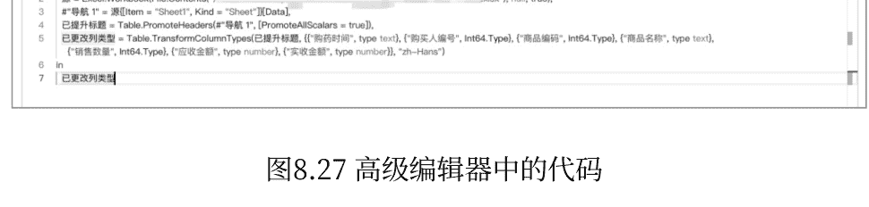
图8.27 高级编辑器中的代码

如果直接覆盖使用上面的回复，原有步骤会被清空。为了在保留既有步骤的前提下继续拆分“购药时间”，可以换一种提问方式，得到的续写回复如下。

你可以在已有代码基础上续写，把“购药时间”拆成“日期”和“星期”两列。续写后的代码如下：

```
let
    源 = Excel.Workbook(File.Contents("/XXXXX.xlsx"), null, true),
    #"导航 1" = 源{[Item = "Sheet1", Kind = "Sheet"]}[Data],
    已提升标题 = Table.PromoteHeaders(#"导航 1", [PromoteAllScalars = true]),
    已更改列类型 = Table.TransformColumnTypes(已提升标题,
        {{"购药时间", type text}, {"购买人编号", Int64.Type},
        {"商品编码", Int64.Type}, {"商品名称", type text},
        {"销售数量", Int64.Type}, {"应收金额", type number},
        {"实收金额", type number}}, "zh-Hans"),
    拆分日期 = Table.SplitColumn(已更改列类型, "购药时间",
        Splitter.SplitTextByDelimiter(" ", QuoteStyle.None),
        {"日期", "星期"}),
    修改数据类型 = Table.TransformColumnTypes(拆分日期,
        {{"日期", type date}}),
    最终结果 = 修改数据类型
in
    最终结果
```

### 最终结果
在原有代码后新增两行，实现拆分“购药时间”并转换“日期”列类型。

```
拆分日期 = Table.SplitColumn(已更改列类型, "购药时间", Splitter.SplitTextByDelimiter(" ", QuoteStyle.None), {"日期", "星期"}):
```
此行通过 Table.SplitColumn 按空格把“购药时间”拆分为“日期”“星期”两列，结果写入新表。

```
修改数据类型 = Table.TransformColumnTypes(拆分日期, {"日期", type date}):
```
此行通过 Table.TransformColumnTypes 把拆分后的“日期”列类型改为日期。

把代码复制进编辑器，注意使用英文半角标点。执行后如图8.28，右侧查询设置里出现了“拆分日期”“修改数据类型”“最终结果”三个步骤，数据表里原日期已被拆分。

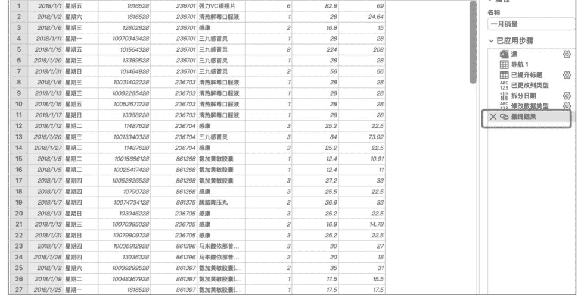
图8.28 高级编辑器中代码执行后的结果

该案例展示了如何用 AI 助手获取想要的操作及其 M 代码，后续类似任务可参照此流程。

可以自行练习，写一段代码试跑。若报错，可把错误信息和代码一起交给 AI 助手定位修正。

## 8.6 小结
本章介绍了 Excel 中功能强大的 Power Query，并借助 AI 助手把其主要功能拆解，据此规划学习内容。学习时把复杂知识点拆小，分步推进。

AI 助手给出的答案需保持审慎，最稳妥的做法是结合 Excel 实际操作验证。在学习不同知识点时，要灵活使用不同提问技巧，提问措辞要清晰，减少表述偏差带来的误导。

# 第9章 ChatGPT带你解锁Excel数据分析库
第4章我们用 AI 助手在 Excel 里做过分析报告，使用了一些基础分析手段，只能应对简单建模。当数据量变大、分析更抽象，需要更复杂的统计或工程方法时，先前内容就不够用了。因此本章学习 Excel 中的数据分析库，该工具会调用合适的统计或工程宏函数计算并把结果填入输出表。

## 9.1 调用分析工具库与统计基础
调用方式也可以请教 AI 助手，提示词限定版本并说明需求即可。例如提示：“在 Mac 版 Excel 2016 中，如何加载数据分析工具库？”得到的步骤如下：

- 打开 Excel 2016 并打开需要使用分析工具的工作簿。
- 在菜单栏选择“工具”。
- 在“工具”下拉菜单中点“加载项”。
- 在弹出的对话框中切换到“Excel 加载项”标签。
- 在右侧列表中勾选“分析工具”。
- 点“确定”关闭对话框。

按上述操作后弹出的分析工具界面如图9.1 所示。


图9.1 调用分析工具弹出界面

调用后可以看到大量分析工具，使用前最好先补充统计学基础。为提高效率，可让 AI 助手按统计方法或技术对工具包中的方法进行分类。

### 提问思路
直接让 AI 助手把工具包提供的方法按涉及的统计方法或技术进行分类。

问：你现在是资深 Excel 工程师且精通统计学，请把下面的知识点【复制工具包中提供的方法】按所涉及的统计方法或技术进行分类。

助手给出的分类为：
- 描述统计学概念。
- 方差分析。
- 变量间关系。
- 时间序列分析。
- 统计推断。
- 回归分析。

再让它给出学习顺序，得到的建议如下。

- 描述统计学概念。
  学习均值、中位数、众数的含义与计算方法。
  掌握标准差、方差、离散系数的计算与解释。
  了解频数分布和直方图的绘制方法。
- 变量间关系。
  学习相关性与协方差的概念。
  理解散点图和相关系数的计算与解释。
- 统计推断。
  学习抽样与样本统计量的概念。
- 方差分析。
  了解方差分析的基本概念和适用场景。
  学习单因素方差分析的原理、计算与结果解释。
  了解多因素方差分析的基本原理。
- 时间序列分析。
  掌握时间序列数据的基本特征与应用领域。
  学习指数平滑、移动平均、傅里叶分析等趋势与预测方法。
- 回归分析。
  了解回归分析的基本概念与适用场景。
  掌握简单线性回归和多元线性回归的计算方法。
  学习回归结果的解释与模型诊断。

按此顺序，先学习统计概念的计算方法，如均值、中位数、众数、标准差、方差、离散系数。提示助手给出概念与计算方法，会得到：

### （1）均值
均值是一组数值的总和除以个数，体现数据的集中位置。
计算：把所有数值相加再除以个数。

### （2）中位数
把数据从小到大排列后处于中间位置的数值，反映中心位置。
计算：奇数个取正中间，偶数个取中间两个数值的平均。

### （3）众数
出现频率最高的数值，用来描述集中趋势。
计算：统计频次最高的值，可能存在多个众数。

### （4）标准差
衡量数据离散程度的指标，数值越大越分散。
计算：每个值与均值的差平方求和，除以个数后开方。

### （5）方差
衡量离散程度的另一指标，是标准差的平方。
计算：每个值与均值的差平方求和，除以个数。

### （6）离散系数
标准差与均值的比值，用于比较不同数据集的变异程度。
计算：标准差除以均值，乘以100表示百分比。

再了解相关性与协方差，以及相关系数的计算与解释。

### （1）相关性与协方差
相关性衡量两个变量线性关系的强弱和方向，取值-1到1。负值表示反向，正值表示同向，0表示无线性关系。
协方差衡量两个变量的共同离散程度和线性关系强度，取值范围无限制，正值正相关，负值负相关，0表示无关系。
关系：相关系数等于协方差除以两变量标准差的乘积，消除了量纲影响，便于比较。

### （2）相关系数的计算与解释
常用的是皮尔逊相关系数，衡量线性关系强度与方向。
计算：两变量协方差除以两变量标准差之积。
取值-1到1，越接近-1负相关越强，越接近1正相关越强，接近0则无线性关系。可配合散点图判断。

再用 AI 助手解释抽样、样本统计量、参数估计、显著性检验和假设检验步骤。返回的内容如下：

（1）抽样与样本统计量
抽样是从总体中挑选部分个体或观测值，以了解总体特征并进行统计推断的过程。
样本统计量是对样本计算得到的数值，用于估计总体特征，如均值、方差、相关系数等。
特点是可以直接从样本计算得到，重复抽样可得到统计量的分布。

（2）参数估计方法
利用样本数据估计总体未知参数。
常见方法有最大似然估计、矩估计、最小二乘估计等。选择依据问题的性质、数据特征以及估计量的要求。

（3）显著性检验的基本原理与假设检验步骤
显著性检验用于判断样本数据是否提供足够证据支持或拒绝关于总体参数的假设。
基本原理是比较观察到的样本数据与假设下期望的差异。
通常包含零假设和备择假设。步骤：
1. 明确零假设与备择假设。
2. 选择合适的检验方法与显著性水平。
3. 根据样本数据计算统计量。
4. 比较统计量与临界值或计算p值，决定是否拒绝零假设，做出推断。

再了解方差分析。

（1）方差分析的基本概念与应用场景
方差分析用于比较两个或多个总体均值的差异，基于方差判断差异是否显著。
基本思想是把总方差分解为组间变异和组内变异，通过比较变异大小判断均值差异的显著性。
应用场景包括比较不同疗法效果、不同品牌销售额、不同教学法对成绩的影响等。

（2）单因素方差分析的原理、计算与结果解释
单因素方差分析研究一个自变量对因变量的影响，按因素分组。
原理是通过组内变异与组间变异的比值，即方差比，用F统计量检验。
计算包括组间平方和、组内平方和、均方以及F统计量。
解释：若F统计量大于显著性水平临界值，则认为组间均值差异有统计学意义。

（3）多因素方差分析的原理、计算与结果解释
多因素方差分析研究两个或多个因素对因变量的影响，按多因素交叉分类。
原理是把总方差分解为组间变异、组内变异和交互作用变异，通过比较判断差异是否显著。
计算与单因素类似，额外需要计算交互作用的平方和。

时间序列部分，助手介绍如下：

时间序列数据是按时间顺序排列的数据。

（1）基本特点
趋势性：长期上升、下降或平稳的变动。
季节性：周期性季节波动。
周期性：较长时间的经济或商业周期。
随机性：随机误差或不可预测波动。

（2）应用领域
经济学：宏观指标、股市数据。
金融学：股票、外汇、债券价格或收益率。
市场营销：销售额、市场份额、用户行为。
气象学：气候、天气预测。

指数平滑：用加权平均对时间序列进行平滑处理，以便更好地观察趋势并进行预测。

移动平均的核心做法是取一段窗口期的数据求平均，用平滑后的序列来削弱噪声，使长期走势和拐点更易辨识。

傅里叶分析则把时序拆解成不同频率的正弦余弦分量叠加，通过频域视角挖掘周期性规律。

接下来聚焦回归分析的基础概念、常见用途，以及单变量和多变量线性回归的建模思路，还有结果的阅读要点。ChatGPT给出的要点如下：

（1）回归分析的基本概念和应用场景
回归分析旨在量化自变量对因变量的影响程度，通过构建数学模型实现解释与预测。典型用途包括研究市场需求与价格的关联、评估广告投放对销售额的驱动作用、基于面积、区位等要素预测房价等。

（2）简单线性回归与多元线性回归的计算流程
简单线性回归用单一自变量去估计因变量，通常包含拟合回归直线、计算残差平方和、求解参数估计值等步骤。多元线性回归扩展到多个自变量，整体思路相近，但需以多元线性方程为基础进行建模与参数估计。

（3）回归结果的解读方式
解读时重点关注自变量系数，它反映自变量单位变动对因变量的边际效应；同时要留意模型的显著性水平，以判断整体拟合是否具备统计意义。

## 9.2 描述统计工具的Excel实操
本节以泰坦尼克数据集为例进行演练。该数据集记录了1912年泰坦尼克沉船事故中乘客的基础信息及生还情况，是机器学习与数据分析教学中的经典案例，可在Kaggle、天池等平台免费获取。

常见字段包括：
- PassengerId：乘客编号
- Survived：生存状态，1为幸存，0为未幸存
- Pclass：舱位等级，1为头等舱，2为二等舱，3为三等舱
- Name：姓名
- Sex：性别
- Age：年龄
- SibSp：兄弟姐妹/配偶数
- Parch：父母/子女数
- Ticket：船票号
- Fare：票价
- Cabin：舱室号
- Embarked：登船港口，C为Cherbourg，Q为Queenstown，S为Southampton

我们借助ChatGPT的指引，使用Excel分析工具库中的“描述统计”功能对泰坦尼克数据做概括性统计。描述统计用于提炼数据集的集中趋势、离散程度和分布特征。打开分析工具包后选择描述统计，会弹出如图9.2所示的对话框。

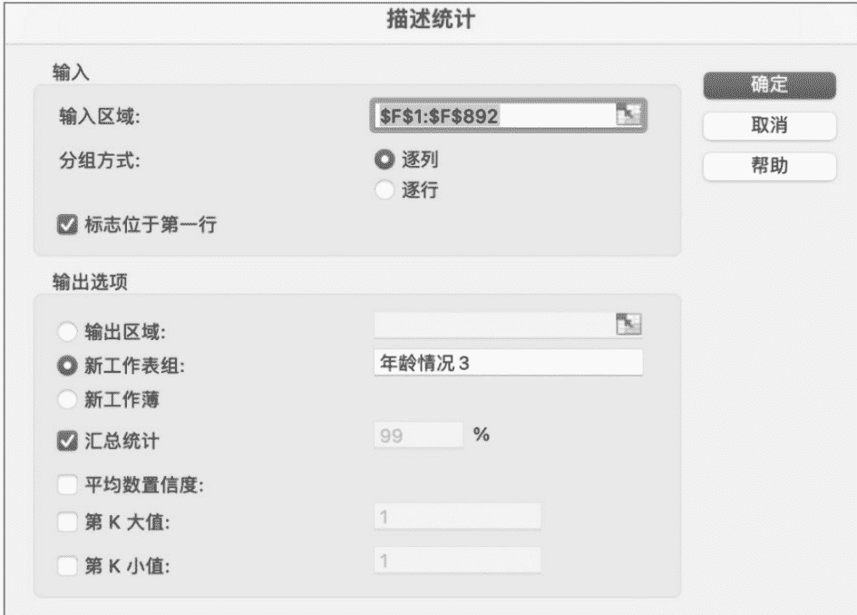

图9.2 调用描述统计方法后弹出的界面

“输入区域”需指向待分析的数据范围，本文以年龄一列为例。勾选“标志位于第一行”非常重要，否则若首行被当作数据会导致非数值错误。输出方式选“输出区域”则结果会写回当前工作表。

随后请ChatGPT说明输出选项中其他参数的含义，回答如下：

1. 汇总统计：输出均值、中位数、众数、最小值、最大值、标准差等核心指标，提供分布全貌。Excel只需勾选即可使用。
2. 平均数置信度：设定均值置信区间的置信水平，默认95%，可自行调整。
3. 第K大值和第K小值：指定要提取的第K个最大值与最小值，需在对应框内填入K。例如取第3大、第5小则分别填3和5。

基于本次局部观察的需求，仅勾选汇总统计即可，无需置信度；对极值排序也无特殊要求。输出结果见表9.1。

表9.1 描述性统计方法输出结果

| 输出指标 | 值 |
| --- | --- |
| 平均 | 29.69911765 |
| 标准误差 | 0.543640499 |
| 中位数 | 28 |
| 众数 | 24 |
| 标准差 | 14.52649733 |
| 方差 | 211.0191247 |
| 峰度 | 0.178274154 |
| 偏度 | 0.389107782 |
| 区域 | 79.58 |
| 最小值 | 0.42 |
| 最大值 | 80 |
| 求和 | 21205.17 |
| 观测数 | 714 |

其中峰度和偏度此前较少涉及，再次请ChatGPT解释。回答如下：

进行数据分析时，峰度和偏度是刻画分布形态的重要指标。

（1）峰度：反映分布曲线的陡峭与平缓程度，体现尾部厚度和峰值高低。数值越大分布越尖峭，常见阈值以3为界；数值越小则越平坦。
（2）偏度：反映分布的不对称程度。正偏即右偏，尾部向大值延伸；负偏即左偏，尾部向小值延伸。

为帮助理解，附图9.3和图9.4进行说明。


最后请ChatGPT对本次年龄统计结果做逐项解读：

- 平均值：29.69911765，观测值的平均水平。
- 标准误差：0.543640499，样本均值估计的精确度衡量。
- 中位数：28，按大小排序后的中间位置。
- 众数：24，出现频率最高的取值。
- 标准差：14.52649733，观测值离散程度。
- 方差：211.0191247，观测值偏离均值的平均平方距离。
- 峰度：0.178274154，接近正态，未出现明显尖峭或平坦。
- 偏度：0.389107782，轻微右偏但不严重。
- 区域：79.58，最大值与最小值之差。
- 最小值：0.42
- 最大值：80
- 求和：21205.17
- 观测数：714

## 9.3 变量关系度量工具：相关与协方差
反映变量关联的工具主要是相关系数与协方差。在Excel“数据分析”中选择“相关系数”会弹出如图9.5所示的对话框。

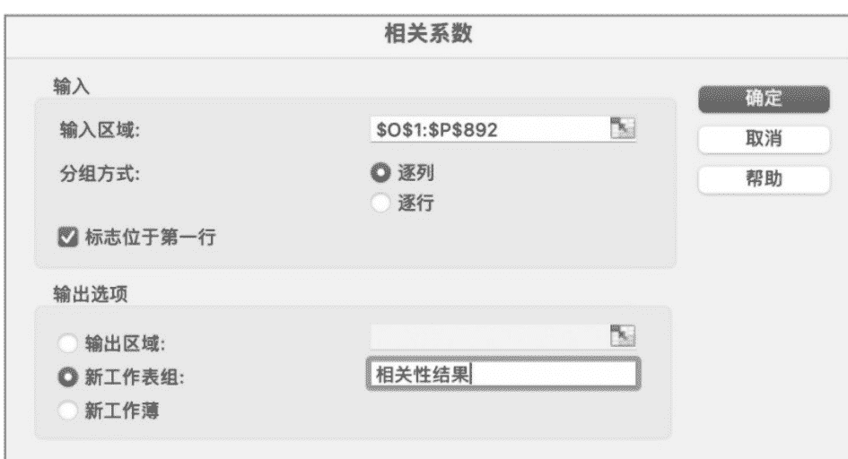

图9.5 选择“相关系数”方法后弹出的界面

输入区域必须是包含全部变量的矩形范围，各变量各占一列，第一行放变量名作标识，不参与计算。数据必须为数值，否则会提示非数值错误。

若想考察“是否生存”“年龄”“票价”三者关系，需先区分变量类型。连续变量可取任意数值，如年龄、票价；离散变量为分类或计数型，如是否生存，只能取离散值，不宜做算术运算。相关系数基于数值运算，主要用于连续变量。因此本例仅分析年龄与票价的相关性。为保证列相连，需将两列复制到相邻位置。输出结果如图9.6。

|  | Age | Fare |
|---|---|---|
| Age | 1 |  |
| Fare | 0.096066692 | 1 |

图9.6 相关系数方法的输出结果

请ChatGPT解读并提示注意事项，回答如下：

Age与Fare的相关系数约为0.096，接近0，说明两者线性关联极弱。

注意事项：
1. 相关系数仅能捕捉线性关系，对非线性无能为力。
2. 解读时需结合置信区间和显著性水平，确认关系是否具有统计意义。
3. 相关不等于因果，解释时应结合背景谨慎推断。

进一步请ChatGPT举例说明注意事项。回答要点为：

相关系数只反映线性关联。例如销量与价格的真实关系可能是U形，相关系数仅给出-0.2的弱负相关，无法体现拐点。此时需借助多项式回归或非线性模型才能更准确刻画。

## 9.4 统计推断工具：F检验、t检验与z检验
本节涉及的检验方法有：
- F-检验：双样本方差检验
- t-检验：配对样本均值检验；双样本等方差假设；双样本异方差假设
- z-检验：双样本均值差检验

先请ChatGPT概述原理：

（1）F-检验通过比较两组或多组样本方差的比值，与F分布对照，判断方差是否存在显著差异。F值接近1时方差相近，偏离1时差异可能显著。
（2）t-检验比较两样本均值差异，计算t值并与t分布比较，判断均值是否显著不同。
（3）z-检验同样比较独立样本均值差异，但假设总体方差已知或样本量大，计算z值后与标准正态分布对照。

检验前需设定原假设H0与备择假设Ha，通过计算统计量与临界值比较作出取舍。

随后请ChatGPT介绍相关分布：

（1）正态分布：对称的钟形连续分布，由均值和标准差决定形态，常见于自然现象。
（2）标准正态分布：均值为0、标准差为1的正态分布，用Z表示。
（3）F分布：用于方差比较的右偏连续分布，由两个自由度决定形状。
（4）t分布：适用于小样本或总体方差未知的情况，自由度影响尾部厚重程度，自由度增大时趋近正态。

### 提问思路
为让原理更直观，请ChatGPT结合实例从原理和使用场景解释各检验的区别。

提问：你现在是资深Excel工程师且精通统计学，请用具体实例从原理和使用场景解释上述检验方法。

ChatGPT回答：

（1）F-检验：双样本方差
原理：比较两样本方差之比，与F分布比较判断差异显著性。
使用场景：检验两组观测数据的方差是否不同，评估不同因素对离散程度的影响。

（2）t-检验：平均值的成对二样本分析
原理：对配对观测求差，基于差值的均值和标准误差计算t值，与t分布比较。
使用场景：同一对象在不同时间或条件下的差异比较。

（3）t-检验：双样本异方差假设
原理：在方差不等假设下对两均值差异进行标准化，计算t值并与t分布比较。
使用场景：比较两组均值且认为方差不相等。

（4）z-检验：双样本平均差检验
原理：计算两独立样本均值差及其标准误差，得z值后与标准正态分布比较。
使用场景：比较两独立样本均值差异是否显著。

以F-检验双样本方差为例，ChatGPT给出实践案例：

假设你是质量工程师，想比较两家供应商钢材硬度的方差是否一致。分别从两家各抽15个样本测量硬度。原假设为方差相等，备择假设为不相等，进行F-检验。

表9.2 不同供应商提供的钢材样本硬度情况

| 供应商 1 | 供应商 2 |
|---|---|
| 85 | 82 |
| 87 | 80 |
| 83 | 85 |
| 88 | 84 |
| 86 | 83 |
| 85 | 81 |
| 84 | 82 |
| 88 | 84 |
| 84 | 86 |
| 83 | 83 |
| 85 | 85 |
| 87 | 87 |
| 86 | 82 |
| 84 | 84 |
| 88 | 83 |

将数据导入Excel并选择对应工具后，界面如图9.9所示。变量1填入第一列区域，变量2填入第二列区域。显著性水平α常用0.05、0.01、0.001，表示犯第一类错误的概率。默认0.05，即接受5%的出错风险，后续示例均沿用该默认值。

Excel数据分析实战：F检验与方差、时间序列的ChatGPT协作解法

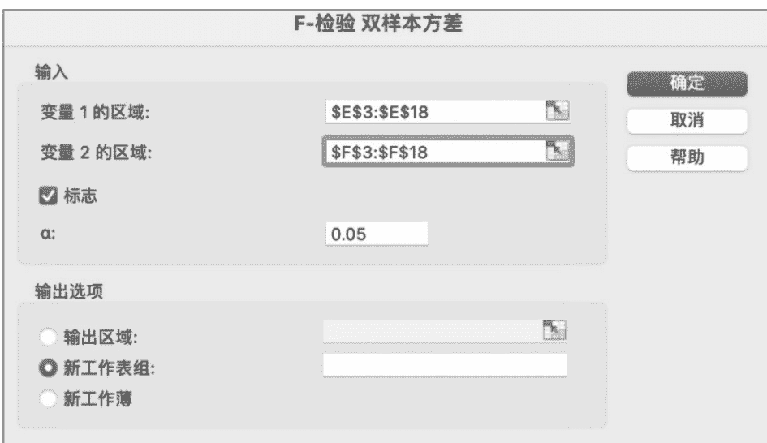
图9.9 选择 “F-检验：双样本方差” 弹出的对话框

把参数设定完毕后按确定，输出就呈现在图9.10里。这一张结果表可以自行解读，也能直接丢给ChatGPT请它帮忙说明。

| F-检验 双样本方差分析 | | |

| --- | --- | --- |

| | 供应商1 | 供应商2 |

| 平均 | 85.5333333 | 83.4 |

| 方差 | 3.12380952 | 3.54285714 |

| 观测值 | 15 | 15 |

| df | 14 | 14 |

| F | 0.88172043 | |

| P(F<=f) 单尾 | 0.40855605 | |

| F 单尾临界 | 0.40262094 | |

图9.10 选择 “F-检验：双样本方差” 的结果

把上述表格复制给ChatGPT后得到的解读大致如下。

双样本方差F检验的要点可归纳为：
平均数：供应商1样本均值85.5333333，供应商2样本均值83.4。
方差：供应商1样本方差3.12380952，供应商2样本方差3.54285714。
样本量：两组各15个观测。
自由度：观测数减1，两组均为14。
F统计量：0.88172043。
单尾P值：0.40855605。
单尾临界值：在0.05显著性水平下，自由度14对应的临界F为0.40262094。

综合来看，F统计量大于临界值，单尾P值也高于0.05。两者钢材硬度方差的差异在统计上不显著，没有足够证据认为供应商1与供应商2存在显著差别。后续其他检验的做法与此流程保持一致，自行练习即可掌握。

## 9.5 数据分析库中的方差分析工具

方差分析的原理已介绍过，下面开始动手。不同于前面直接让ChatGPT准备数据，这次改用工具箱自带的随机数发生器来构造数据。

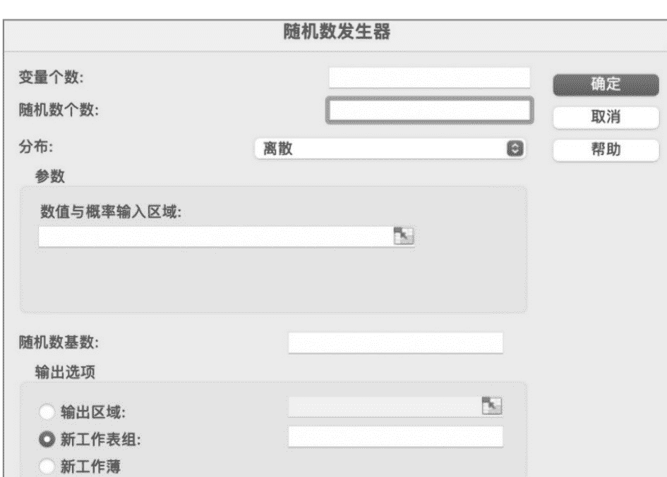
图9.11 选择“随机数发生器”后弹出的对话框

图9.11的分布选项里有均匀、正态、伯努利、二项式、泊松、模式、离散等。向ChatGPT请教该工具的作用和填写方式，得到的说明是：随机数发生器用于在Excel里批量生成符合特定分布的随机序列。可按需求挑选分布类型，并通过均值、标准差、最小值、最大值等参数控制生成范围和分布特征。

由此可知，参数的设定取决于所选分布，变量个数对应工作表的列数，随机数个数即每列要生成的记录数。

以正态分布为例，因其在自然现象和假设检验中应用最广，用它来演示最为合适。选中正态分布后对话框如图9.12。


图9.12 “随机数发生器”对话框

再请ChatGPT解释正态分布的参数含义，回答要点是：
平均值：决定分布中心的位移，数值越大整体偏大，反之偏小。
标准差：衡量离散程度，标准差越大取值越分散，越小则越集中。平均值与标准差共同影响分布的形状与范围。

按图9.12的设定生成两列基本一致的正态数据后，接下来用抽样工具抽取一部分做演示。打开抽样后界面如图9.13。


图9.13 “抽样”对话框

向ChatGPT询问常见的抽样方法，得到的列举包括：
1. 简单随机抽样：每个个体入样概率相等，最基础的方法。
2. 系统抽样：按固定间隔抽取。
3. 分层抽样：先把总体分层，再在各层内随机抽样。
4. 整群抽样：把总体分成若干群组，随机抽取整群。
5. 配额抽样：按预设比例挑选样本，保证多样性。
6. 比例抽样：样本中各类别比例与总体一致。

在图9.13里选周期抽样会按间隔从源数据抽样生成新样本；选随机抽样则相当于在已生成的正态数据中随机抽取指定数量的记录。本例采用随机抽样，对两列数据各生成30行。

数据准备好后选用工具箱里的方差分析方法。为判断数据是否满足要求，先请ChatGPT说明方差分析的前提：
1. 独立性：数据点相互独立。
2. 正态性：数据近似正态，大样本时要求可放宽。
3. 方差齐性：各组方差相近。

两组随机生成、样本量相同且服从正态分布的数据，经过随机抽样后，通常可以用于方差分析。

工具箱提供了三种方法：单因素方差分析、可重复双因素分析、无重复双因素分析。继续向ChatGPT请教三者的区别和适用场景。

### 提问思路
参考之前的提问方式，让ChatGPT用具体实例从原理和使用场景说明Excel分析工具库中方差分析方法的差异。

问：你现在是一个资深Excel工程师，且精通统计学知识，请用具体的例子和数据来解释一下Excel分析工具库中提供的方差分析方法，以及它们之间的区别。

ChatGPT回答：
以研究不同教学方法对数学成绩的影响为例。
1. 单因素方差分析
假设有A、B、C三种教学方法，每种方法下多名学生的成绩记录在表9.3中。单因素方差分析会输出F统计量和P值，用来判断教学方法是否对成绩产生显著影响。若P<0.05，则认为不同方法效果存在差异。
2. 无重复双因素分析
假设有两个因素：教学方法和学生类型A/B。每个教学方法与学生类型的组合只有一个观测值，如表9.4。此时可用无重复双因素分析比较两个因素的主效应。
3. 可重复双因素分析
除教学方法外，再引入教师因素，且每个教学方法-教师组合下有多名学生的成绩，如表9.5。可重复双因素分析可同时评估教学方法、教师及其交互效应的影响。
总结：
无重复双因素适用于每个单元格只有一个观测值的情况。
可重复双因素适用于每个单元格有多个重复观测的情况。

为保持后续分析连贯，继续沿用ChatGPT给出的例子数据。

先对表9.3做单因素方差分析，对话框如图9.14。


图9.14 “方差分析：单因素方差分析”对话框

因为分组方式选择的是列，需要把表9.3的结构调整为表9.6的形式。

表9.6 每种方法下的学生数学成绩表格结构变化

| A | B | C |

|---|---|---|

| 85 | 70 | 88 |

| 90 | 75 | 82 |

| 78 | 72 | 85 |

填写完毕后点击确定，得到如图9.15的结果。

| 方差分析：单因素方差分析 | | | | | |

|---|---|---|---|---|---|

| SUMMARY | | | | | |

| 组 | 观测数 | 求和 | 平均 | 方差 | |

| A | 3 | 253 | 84.3333333 | 36.3333333 | |

| B | 3 | 217 | 72.3333333 | 6.3333333 | |

| C | 3 | 255 | 85 | 9 | |

| | | | | | |

| 方差分析 | | | | | |

| 差异源 | SS | df | MS | F | P-value | F crit |

| 组间 | 304.888889 | 2 | 152.444444 | 8.8516129 | 0.01621927 | 5.14325285 |

| 组内 | 103.333333 | 6 | 17.2222222 | | | |

| 总计 | 408.222222 | 8 | | | | |

图9.15 选择“方差分析：单因素方差分析”后的结果

把表格信息交给ChatGPT解读，其要点为：
SUMMARY部分给出各组观测数、总和、均值、方差。
方差分析部分：组间SS为304.888889，自由度2；组内自由度6。均方MS=SS/df，组间MS为152.444444。F值=组间MS/组内MS=8.8516129。P值为0.01621927。F临界值5.14325285是按显著性水平确定的阈值。

结论：F值为8.8516129，P值为0.01621927，小于0.05，拒绝原假设，认为A、B、C三组均值存在统计上显著差异。

其余两种方法的实操步骤与单因素方差分析一致，可自行练习加深理解。

## 9.6 数据分析库时间序列分析工具

时间序列分析的用途已介绍，下面聚焦方法选择。Excel分析工具包提供了指数平滑、移动平均和傅里叶分析三种工具，请ChatGPT做对比。

1. 指数平滑
原理：通过加权平均赋予近期观测更大权重，旧数据权重递减，用于估计趋势。适合平稳或近似平稳的序列，能快速反映最新变化。
场景：短期预测、需求波动大或具季节性的数据。
2. 移动平均
原理：以固定窗口计算平均值平滑数据，窗口大小可调，小窗口捕捉短期波动，大窗口突出长期趋势，用于消除随机噪声。
场景：中期、长期预测，识别周期性波动。
3. 傅里叶分析
原理：将时域数据转换到频域，分解为不同频率的正弦余弦分量，通过频谱识别周期成分。
场景：处理含多频率成分的复杂序列，提取主周期、幅度和相位信息。

总体上，指数平滑偏短期趋势，移动平均偏噪声过滤与长期趋势，傅里叶分析偏周期识别。实际可结合使用。

接下来需要数据。向ChatGPT询问公开时间序列数据集来源，常用的有UCI机器学习库、Kaggle、天池、Yahoo Finance。本例选用天池天气预测数据集，部分内容如表9.7。

表9.7 天气观测数据

| 时间点 | 温度(℃) |

|---|---|

| 553 | 15.8 |

| 554 | 15.8 |

| 555 | 19.5 |

| 556 | 26 |

| 557 | 17.6 |

| 558 | 15.9 |

| 559 | 22.5 |

| 560 | 26.4 |

| 561 | 20.3 |


图9.16 温度变化趋势图

数据准备好后打开指数平滑工具，对话框如图9.17。


图9.17 “指数平滑”对话框

让ChatGPT说明Excel中指数平滑的使用步骤：
1. 准备数据：按时间顺序将序列输入一列。
2. 设定平滑系数：在另一列输入0到1之间的平滑系数，控制历史数据的权重。
3. 计算平滑值：使用指数平滑公式，第一期平滑值通常取第一期实际值，例如 =A2，后续按公式迭代计算。

平滑值计算可写成：=(1-B3)C2 + B3A3

提示一下，该写法默认数据从第2行起算，第1行为表头。

批量运算：把上面的公式向下复制填充，即可依次得出各期的平滑值。

进阶做法：把原始时间序列与算出的平滑值一起选定，借助Excel的折线图功能绘制平滑曲线。

不过前面的说明很容易让人误会，主要是平滑系数和阻尼系数之间的关系没讲清，实际操作界面里也找不到平滑系数的入口。此时顺势追问两者如何换算会更清晰，它们的对应关系是：阻尼系数 = 1 - 平滑系数。按照之前的结论，模型输出的预测值本质上就是平滑值本身。由图9.16的趋势来看，序列呈现出比较明显的方向性变动，适合选用偏大的阻尼系数，取值范围大约在0.6到0.9之间。这里取0.7进行演示，部分结果如图9.18所示。可以看出预测轨迹与实际轨迹整体走向基本一致，但对于局部的波动捕捉并不理想。


图9.18 选择指数平滑方法的预测结果

接下来让ChatGPT说明如何在Excel里使用移动平均工具，可用的提问方式是：“请简要介绍一下Excel中移动平均工具的使用方法。”得到的回答如下。

在Excel里使用移动平均工具的大致流程。

+   1. 准备数据：把需要做移动平均的时间序列按时间先后顺序填入一列。
+   2. 打开数据分析：切换到“数据”选项卡，点击“数据分析”。若按钮不可见，先启用Excel的数据分析工具箱。
+   3. 选择工具：在“数据分析”列表里点选“移动平均”，然后点“确定”。
(4) 设置参数：在“移动平均”对话框中填写“移动窗口”大小，即参与平均的数据个数，并决定使用简单移动平均还是加权移动平均。
(5) 指定输入范围：选定时间序列所在的单元格区域，可手工输入或用鼠标框选。
(6) 指定输出位置：选择结果存放的新工作表或指定单元格。
(7) 确认计算：点“确定”后即可完成计算并输出。

按上述步骤操作后弹出的对话框如图9.19所示。


图9.19 “移动平均”对话框

实际观察会发现图9.19里并没有步骤（4）所说的“移动窗口”选项，出现的是间隔参数的设置。针对间隔参数容易产生歧义，可以进一步请ChatGPT解释其选择逻辑。

间隔大小的选取要结合数据特征和分析目标，常见做法有：

+   （1）固定间隔：直接设定一个固定长度，比如5个点或10个点。这种方式适用于点间距较为均匀，且你对趋势变化频率有一定把握的情形。间隔偏小会更灵敏地反映短期抖动，间隔偏大则更利于抚平长期趋势。
（2）时间间隔：数据本身带时间顺序时，可按时间单位来定间隔。例如日度数据取7，即计算一周均值，有助于凸显周期性。
（3）依据采集频率：根据数据的采集周期来定间隔。如每小时采集，取24即可得到日均值，更好地呈现日内的变化规律。

需要记住，间隔大小直接影响结果。间隔小则对短期波动敏感，可能掩盖长期走势；间隔大则长期趋势更平滑，但对短期变化的响应会滞后。

结合数据实际情况和ChatGPT的解释，这里选用平均间隔7。要注意，预测值是基于一周均值推算的，前7个位置会空缺，最终的部分结果如图9.20所示。


图9.20 选择移动平均方法的预测结果

从图中可以看到，预测值与实际值的整体走向已相当接近。

## 9.7 数据分析库回归分析工具

前面已经大致掌握了回归分析的应用场景、计算思路和结果解读，本节回到泰坦尼克数据集，用它来实践Excel数据分析加载宏里的回归分析工具。先根据数据表包含的信息确定研究方向。数据集主要记录乘客各项属性以及最终是否存活，可以把乘客属性作为自变量，存活情况作为因变量，探索两者是否存在可量化的关系。

### 提问思路

确定方向后，这里以乘客年龄、性别和票价为自变量，存活情况为因变量。当然自变量也可以增减。

提问示例：你现在是一名资深Excel工程师，我们的数据如下：【复制数行数据】，请以年龄、性别和票价为自变量，存活为因变量，说明如何用Excel数据分析加载宏的回归方法建模。

ChatGPT给出的要点：

+   (1) 数据预处理：先检查缺失值，必要时填充或剔除相关行列。
(2) 数据转换：性别是分类变量，需要转成虚拟变量，常用1代表女性、0代表男性。
(3) 自变量选择：挑选与因变量相关性较强的自变量，这里可选用年龄和票价。
(4) 模型建立：基于选定自变量搭建回归模型，通常采用线性回归，因变量为存活，自变量为年龄和票价。
(5) 模型评估：用R平方、调整R平方和残差分析等指标评价拟合程度与预测能力。

这是一个基础思路，具体过程会因数据和目标而异。建模前建议先做探索性分析，更好地理解变量关系和模型假设。

按此思路先探索数据并完成预处理，可结合前面学过的数据清洗和描述性统计工具。例如先做变量转换，再用描述性统计判断后续处理。图9.21为描述性统计结果，年龄缺失占比约20%，对完整性影响有限，因此直接删除缺失行及其对应信息。存活与性别为离散型分类变量，描述性指标可忽略，主要关注年龄和票价的分布。峰度和偏度显示年龄接近正态，票价呈现右偏。这些分布也可通过直方图直观呈现。图9.22和图9.23分别是年龄和票价的分布密度图。

| Survived | | Sex | | Age | | Fare | |

|---|---|---|---|---|---|---|---|

| 平均 | 0.38383838 | 平均 | 0.35241302 | 平均 | 29.6991176 | 平均 | 32.204208 |

| 标准误差 | 0.01630146 | 标准误差 | 0.01601327 | 标准误差 | 0.5436405 | 标准误差 | 1.6647925 |

| 中位数 | 0 | 中位数 | 0 | 中位数 | 28 | 中位数 | 14.4542 |

| 众数 | 0 | 众数 | 0 | 众数 | 24 | 众数 | 8.05 |

| 标准差 | 0.48659245 | 标准差 | 0.47799007 | 标准差 | 14.5264973 | 标准差 | 49.6934286 |

| 方差 | 0.23677222 | 方差 | 0.22847451 | 方差 | 211.019125 | 方差 | 2469.43685 |

| 峰度 | -1.7750047 | 峰度 | -1.6205797 | 峰度 | 0.17827415 | 峰度 | 33.3981409 |

| 偏度 | 0.47852344 | 偏度 | 0.61892085 | 偏度 | 0.38910778 | 偏度 | 4.78731652 |

| 区域 | 1 | 区域 | 1 | 区域 | 79.58 | 区域 | 512.3292 |

| 最小值 | 0 | 最小值 | 0 | 最小值 | 0.42 | 最小值 | 0 |

| 最大值 | 1 | 最大值 | 1 | 最大值 | 80 | 最大值 | 512.3292 |

| 求和 | 342 | 求和 | 314 | 求和 | 21205.17 | 求和 | 28693.9493 |

| 观测数 | 891 | 观测数 | 891 | 观测数 | 714 | 观测数 | 891 |

▲图9.21 所选数据的描述性统计结果


▲图9.22 年龄分布图

### 船票价格分布图


图9.23 船票价格分布图

随后打开分析工具包选择回归工具，弹出“回归”对话框如图9.24所示。若X值仅有一个因变量，求解为简单一元线性回归；若选择多个，则为多元线性回归。


图9.24 选择回归方法后的弹出界面

再向ChatGPT询问Excel分析工具包回归工具的使用方法，可提问：“请问如何用Excel中的回归工具？”得到的回答如下：

使用Excel回归工具的一般步骤。

- （1）打开Excel并导入数据，确保数据整理成表格，自变量和因变量在同一列或相邻列。
- (2) 在菜单栏选择“数据”选项卡，分析分组中点击“数据分析”。
- (3) 在“数据分析”对话框中选“回归”，点“确定”。
- (4) 在“回归”对话框中填写：
    - Y值输入区域：因变量范围
    - X值输入区域：自变量范围
    - 常数为零：若模型需要截距则勾选
    - 输出选项：常用“标准残差”和“残差图”
    - 输出区域：选择结果输出位置，可为新工作表或指定位置
    - 点击“确定”开始分析

Excel会输出回归系数、R方、P值等。若勾选残差图，还会生成残差图以便评估拟合。

该说明与实际操作基本一致。按步骤操作后的结果如图9.25所示。


图9.25 选择回归方法后的结果

把结果表复制给ChatGPT解读，得到的解释如下。

（1）回归统计。

- Multiple R 为0.56742292，反映自变量与因变量线性关系的强弱，约0.57说明存在一定线性关联。
- R Square 为0.32196877，表示自变量能解释因变量变异的比例，约32%。
- Adjusted R Square 为0.31910385，已考虑自变量个数和样本量的修正值。
- 标准误差为0.40553514，表示观测值与模型预测的平均偏离。

（2）方差分析。

F值为112.383136，P值为1.50264E-59，说明模型整体显著，至少有一个自变量对因变量有统计学意义的影响。

（3）回归系数。

- Intercept 0.20937785，为全部自变量为零时的截距。
- Sex 0.51097107，性别对因变量有显著正向作用。
- Age -0.0016171，年龄影响不显著。
- Fare 0.00167249，票价对因变量有显著正向作用。

每个系数附带标准误差、t值和p值。标准误差衡量估计精度，t值越大p值越小说明越显著。p小于0.05则拒绝原假设。置信区间给出系数的估计范围，这里采用95%置信水平。

由此可得回归方程： Y = 0.21 + 0.51 * Sex - 0.0016 * Age + 0.0017 * Fare。性别和票价对存活有显著正向影响。随后让ChatGPT解释残差图。

残差图用于检验回归模型的拟合质量，可判断线性、同方差性、独立性等假设。

解读要点：

- (1) 线性：残差点随机散布、无明显曲线，则线性拟合良好。
- (2) 同方差性：残差在y轴上均匀分布、无锥形或漏斗形态，则满足同方差假设。
- (3) 独立性：残差点无聚集或规律性分布，则满足独立性假设。

理想的残差图应呈现随机、无曲线、无规律聚集等特征。若出现明显非随机模式或异常值，需重新评估模型或进一步分析数据。

将上述标准对照本例的残差图，可认为模型具备较好的线性拟合效果。

## 9.8 小结

本章演示了如何借助ChatGPT学习Excel分析工具包提供的方法。这些方法的原理根植于统计学，缺乏相关背景时学习难度较大。借助ChatGPT可以绕开繁复的数学推导和概念讲解，快速理解各方法的作用和适用场景，降低使用门槛。

# 第10章 利用ChatGPT学习Excel的方法论总结

用ChatGPT学习Excel知识主要面临两个挑战：一是如何拆解知识，ChatGPT有字数限制，问题范围过大时回答会偏笼统；二是如何提问才能让回答更贴合实际需求。本章介绍学习Excel时使用ChatGPT的方法。

## 10.1 知识拆解相关方法论

本节介绍几种可用于知识拆解的方法论，帮助在面对全新概念时快速找到切入点，把复杂内容分解为更易处理的小单元。

把知识拆解当作一个问题处理，按“锁定问题—分析问题—拆解问题—反复推敲”的顺序推进。

### 1. 锁定问题

锁定问题就是在学习生活中发现具体痛点，并以解决它为目标寻找方案。

奥斯本提出了四个思考规则：追求数量、严禁评判、自由奔放、与改善想法相结合。核心是数量产生质量。按此规则发散，偶尔会产生灵感。以学习Excel为例，核心问题可先定为“如何更好地学习Excel”，再发散出：

- (1) 如何制作更具吸引力和互动性的Excel学习资源？
- (2) 能否为不同学习风格开发个性化教程？
- (3) 如何在海量学习资源中筛选，并减少时间精力投入？

提炼核心需求：不同学习风格意味着高自定义，更具吸引力意味着强引导，筛选资源、节省精力意味着强针对性。ChatGPT这类智能工具正好契合上述需求，于是问题被锁定为“如何利用ChatGPT学习Excel”。

### 2. 分析问题

分析是将事物要素细分、厘清本质、梳理逻辑脉络，从而显现其特质或根本属性。可分为拆解和解析，即先把问题分解，再整合。拆解后的逻辑与整合后的逻辑不同，才能获得新认识。若用同一逻辑整合，则无进展。拆解与整合的关系如图10.1所示。

在此理论下探讨如何用ChatGPT学习Excel：

- （1）了解ChatGPT及应用领域：掌握其基本原理、训练数据以及在Excel学习中的潜力。
- （2）研究Excel学习需求与痛点：了解学习者的常见需求、难点，如函数理解、数据分析技巧等。
- （3）明确ChatGPT在Excel学习中的潜在作用：思考其如何解答疑问、提供教学资源、模拟实战问题等。


拆解与整合：让ChatGPT成为Excel学习加速器

### 3. 拆解问题

把难题拆小再拼起来，才是高效学习的核心思路。先把目标拆成若干个可执行的子问题，逐个攻克后再整体归纳，能更清晰地看出ChatGPT在Excel学习中的作用。

具体能做什么：
- 借助ChatGPT的对话特性，获得即时解答和学习陪伴，而不是仅靠固定教程。
- 用ChatGPT模拟真实Excel场景，在零压力环境下练习、试错，积累手感和信心。
- 把ChatGPT和在线课程、书籍、视频等资源搭配使用，形成立体化的学习组合。

为了系统化拆解，这里引入WBS工作分解结构。把它搬到学习场景，就能把大目标变成可操作的小任务。

- 1）明确学习目标，比如用ChatGPT实现交互式Excel学习，解决使用过程中的卡点。
- 2）把项目按阶段拆开，拆解深度可根据难度灵活调整。
  - 阶段一：掌握ChatGPT的基本工作方式与功能边界。
  - 阶段二：摸清Excel学习者的痛点与常见困惑。
  - 阶段三：探索两者结合的最佳切入点。
  - 阶段四：验证和优化交互学习体验。
- 3）为每个阶段细化工作包和任务。举例：
  - 阶段一任务：研究ChatGPT提问方法与Excel应用技巧。
  - 阶段二任务：调研学习者需求，梳理高频问题。
  - 阶段三任务：挖掘学习需求点，并对学习内容做拆分。
  - 阶段四任务：设计问题解答场景，搭建可交互的练习环境。
- 4）用树状图呈现WBS，顶层是项目名称，下层依次为阶段、任务、子任务。
- 5）标注任务间的依赖与关键路径，确定先后顺序和优先级。
- 6）按WBS分配人力与时间，确保进度可控。
- 7）执行过程中以WBS为对照，跟踪实际与计划的偏差，及时调整。

每个子任务仍可继续细化，比如按内容类型把Excel拆成可视化、界面操作等，再逐层下钻。

### 4. 反复推敲

好方案都是打磨出来的。拆完知识点后一定要实操检验，从初稿中揪出不足再优化。

实操中常会遇到：ChatGPT能秒回基础问题，却对专业场景的精准解答力不足，需要人工校验；有效提问本身就是一门技术，问得不清答案就走偏。

遇到问题时的调整策略：
- 重新拆解：回头检查分类是否清晰、是否覆盖全面，对颗粒度不够的板块继续细分。
- 实操验证：在真实学习中测试拆解是否可行，发现遗漏或不合理的部分立刻修正。
- 持续迭代：拆解不是一次性工作，随学习深入不断优化，保持高效。
- 换一种说法提问：用更明确具体的表达重新描述问题，提升理解度。
- 补充上下文：多提供背景信息和前提条件，帮助模型更准地定位。
- 认清边界：专业性强的问题超出能力范围时，及时引入更权威的资源。
- 多源结合：ChatGPT是工具之一，教程、书籍、视频等仍需协同使用。

## 10.2 提问技巧解读

用ChatGPT学Excel，不仅要会问ChatGPT，还要会为Excel学习而问。

### 10.2.1 ChatGPT提问技巧

常用的提问打法有三类。

第一类是用提问框架。万能公式是【专家身份】+【问题说明】+【期望结果】+【限定条件】。举例说明差异：直接问“给我一份Excel学习指南”，得到的是一份泛泛的目录，涵盖界面、函数、格式、排序、数据透视、图表、数据验证、宏、数据连接、高级功能等，面面俱到却缺乏针对性。

如果改成“你是一位精通Excel的财务专家，请为财务新手定制一份难度递进的学习指南”，回答立刻变得聚焦：基础操作、数据输入管理、公式函数、数据分析、高级技巧、财务建模、数据处理与自动化，每一级都循序渐进。

第二类是让模型模仿学习。当回答不满意又说不清原因时，找一个高质量的范文，比如某本书的章节划分，把标题结构喂给模型，让它学习这种归纳方式后再为你定制，会得到更贴合的方案。

第三类是思维链条与纠错。受限于字数或上下文，模型可能答不全。若其中部分满意，直接基于上文要求继续生成并指定修改点，就能实现平滑修正和增补。

### 10.2.2 Excel学习特点的提问技巧

针对Excel本身，有三点要特别注意。

第一，锁定系统与版本。问快捷键时不加限制，默认返回的是Windows下Excel 2010/2013/2016/2019/Office365的通用组合，如Ctrl+C复制、Ctrl+V粘贴、Ctrl+Z撤销等。做知识点讲解时加上版本限制，避免信息偏差。

第二，要求写出操作步骤。Excel是可视化工具，功能都靠菜单与按钮组合实现。直接问“怎么做”有时只得到要点，明确要求“列出完整操作步骤”会更可靠。 例如让它用VBA求平均值，直接问只会得到代码片段：

```
Sub CalculateAverage()
    Dim rng As Range
    Dim avgValue As Double
    ' 定义需要计算平均值的数据范围
    Set rng = Range("A1:A10") ' 将范围设置为你需要的数据范围
    ' 计算平均值
    avgValue = WorksheetFunction.Average(rng)
    ' 将平均值显示在单元格 B1 中
    Range("B1").Value = avgValue
End Sub
```

要求步骤时则会给出：

(1) 按 Alt+F11 打开VBA编辑器。
(2) 在项目资源管理器中右键插入模块。
(3) 粘贴代码：

```
Sub CalculateAverage()
    Dim rng As Range
    Dim avgValue As Double
    ' 定义需要计算平均值的数据范围
    Set rng = Range("A1:A10") ' 将范围设置为你需要的数据范围
    ' 计算平均值
    avgValue = WorksheetFunction.Average(rng)
    ' 将平均值显示在单元格 B1 中
    Range("B1").Value = avgValue
End Sub
```

(4) 修改数据范围为实际区域。
(5) 按F5运行宏，结果写入指定单元格。
(6) 查看输出。

最好同时加上系统版本限制。

第三，落到实践。有些答案靠阅读难以判断对错，必须在Excel里亲手跑一遍。实践能暴露模型的知识性回答不够直观的问题，通过具体案例验证、反馈、修正，形成闭环。

## 10.3 应用方法论实践

以Excel打印功能为例，先发散学习需求：
(1) 数据报表打印
(2) 图表图形打印
(3) 打印设置与预览

用提问：“你现在是Excel专家，请基于以上使用场景，把打印相关功能拆分整合，并整理成新手学习指南。”得到的框架大致如下：

(1) 打印基础认知。理解打印选项概念，学会调整页面布局、纸张尺寸、方向等参数。
(2) 数据报表打印。设置打印区域，自动适配列宽行高，添加标题行与页眉页脚，按筛选结果打印。
(3) 表格排版与格式。控制网格线与边框，重复打印行列标题，调整横向纵向与边距，应用自定义样式。
(4) 图表图形打印。将柱形图饼图等输出到纸面，调节大小位置，决定是否打印插入的图片与形状。
(5) 设置与预览。先看打印预览确认效果，再配置纸张、质量、顺序等参数，支持批量打印多张工作表或整个工作簿。

重整Excel打印笔记

最初的归类显得松散，相似的功能被拆分到不同板块。于是借助上下文追问的方式，对前一次的输出做二次校准，提示语大致是：“前面类别里重复较多，请把相关项合并，让结构更合理。”校准后形成下面这套框架。

合并后的Excel打印知识框架：
(1) 配置与预览
页面布局调整：纸张规格、版式方向等参数的设定。
选项调整：输出质量、打印顺序等。
预览并修正版面与设定。
(2) 表格输出
打印范围的设定：选取指定单元格区域或整张工作表输出。
行列标题的打印。
网格线与边框的设定。
打印样式的定制。
列宽行高的自动适配。
批量输出：多张工作表或整本工作簿的批量打印。
(3) 图表与图形输出
图表尺寸位置的调整。
图形对象的输出，如图片或形状。

整体尚可，但图表与图形输出缺乏实质内容，且图表尺寸位置的调整与打印配置关联不大，故舍弃该部分，其余仍按ChatGPT给出的框架学习。

先看Excel打印配置与预览。菜单栏点选“打印”命令后会弹出“打印”对话框，详细界面见图10.2所示。


### 图10.2 打印选项的详细设置信息界面

可点左下角问号查看对应版本Excel打印项的说明，也可把不确定的条目发给ChatGPT请其解释。在使用ChatGPT前，先思考提问方式会更高效，再据返回结果修正。我们直接提问：“你现在是Excel专家，请说明【填写系统版本】Excel中打印配置的各个选项。”ChatGPT返回如下。

在macOS版Excel 2016中，打印配置的各项操作步骤如下。
(1) 打开Excel文件，菜单栏选择“文件”-“打印”，亦可用快捷键Command+P。
(2) 弹出的打印配置窗口可见诸多选项，主要包括：
打印范围：在“设置”标签页选择输出范围，可为选定单元格区域或整张工作表，点击“设置打印区域”来自定义。
缩放：在“设置”标签页的“缩放”区，可调整输出比例，通过选择百分比实现缩放。
纸张规格：在“设置”标签页的“纸张大小”区，可选A4、Letter等规格，也可点“更多纸张尺寸”自定义。
方向：在“设置”标签页的“方向”区，可选纵向或横向。
边距：在“设置”标签页的“边距”区，可设定页面边距，通过拖动滑块或直接输入数值调整。
输出质量：在“设置”标签页的“打印质量”区，可选草图、普通、良好、最佳等。
多页处理：在“设置”标签页的“多页”区，可设定是否把多张工作表拆分为独立打印任务，或按页面顺序输出多张工作表。
高级选项：在“设置”标签页的“高级”区，可做更深入设定，如启用页码、输出批注等。
预览：在打印配置窗口右侧有预览窗格，可滚动缩放查看效果，点预览窗格中的页码可查看不同页输出。
(3) 调整完毕后点“打印”按钮执行，或使用“导出为PDF”把文件导出为PDF。

我们发现即使做了限定，回答仍与实际界面存在偏差，如真实界面并无“缩放”“打印质量”“多页设置”等选项。但不影响理解。对此建议边操作界面边提问，避免描述与实际操作脱节。后面的拆分练习会逐步掌握各项的真实配置方式。

接下来进入表格打印，让ChatGPT生成几类不同数据报表。提问方式为：“你现在是Excel专家，我想学习Excel数据表的打印方法，请生成几类数据表示例，覆盖打印的各类设定。”ChatGPT给出示例如下。
(1) 销售报表。
列出品名、销量、销售额等信息。
设定输出范围，仅输出含数据的区域。
添加页眉页脚，包含报表名称与打印日期。
设定边距与纸张规格，确保输出完整易读。
(2) 学生成绩单。
包含姓名、各科成绩等信息。
设定输出范围，仅输出含学生信息与成绩的区域。
对行列标题使用加粗和底色，提升可读性。
调整输出方向，使姓名在纵向打印中更清晰。
在页脚添加学校名称与页码。
(3) 项目进度报表。
列出项目名称、开始日期、结束日期等信息。
使用筛选，按状态筛选并输出指定状态的项目。
调整输出范围，仅输出筛选后项目的区域。
把输出质量设为最佳，保证内容清晰。
添加页眉，包含报表标题与制表人信息。
(4) 财务报表。
包含收入、支出、利润等财务数据。
设定输出范围，仅输出含财务数据的区域。
调整列宽与行高，适应纸张规格。
添加表格边框，提升外观。
设定打印预览，查看输出效果。

接下来对上述涉及的操作进行整合，我们选择“项目进度报表”，让ChatGPT依据其自身回答列出尽可能多的数据。

表10.1是一个简易的项目进度报表，包含项目名称、开始日期、结束日期和项目状态。

可按以下步骤操作。
1. 打开Excel并将上述数据复制到工作表中。
2. 使用筛选功能，在“项目状态”列设置筛选，选择特定状态进行筛选。
3. 调整打印范围，确保只打印筛选后项目的区域。
4. 在打印配置中将输出质量设为最佳，以保证内容清晰。
5. 在工作表中添加页眉，页眉中包含报表标题与制表人信息。

### 表10.1 项目进度表

| 项目名称 | 开始日期 | 结束日期 | 项目状态 |
| :--- | :--- | :--- | :--- |
| 项目 1 | 2022-01-01 | 2022-02-28 | 进行中 |
| 项目 2 | 2022-03-01 | 2022-04-30 | 已完成 |
| 项目 3 | 2022-02-15 | 2022-03-31 | 进行中 |
| 项目 4 | 2022-04-01 | 2022-06-30 | 准备中 |
| 项目 5 | 2022-03-15 | 2022-05-31 | 进行中 |

但我们发现ChatGPT给的示例信息量远少于实际使用，因此让它在原有表格基础上扩充维度，模拟真实情况。扩充后的结果即表10.2。

### 表10.2 项目进度表扩充维度后

| 项目名称 | 开始日期 | 结束日期 | 项目状态 | 负责人 | 完成百分比 | 实际成本 | 风险等级 |
| :--- | :--- | :--- | :--- | :--- | :--- | :--- | :--- |
| 项目 1 | 2022-01-01 | 2022-02-28 | 进行中 | 张三 | 50% | 100 | 低 |
| 项目 2 | 2022-03-01 | 2022-04-30 | 已完成 | 李四 | 100% | 200 | 低 |
| 项目 3 | 2022-02-15 | 2022-03-31 | 进行中 | 王五 | 40% | 250 | 中 |
| 项目 4 | 2022-04-01 | 2022-06-30 | 准备中 | 赵四 | 0% | 240 | 高 |
| 项目 5 | 2022-03-15 | 2022-05-31 | 进行中 | 刘能 | 20% | 180 | 低 |

若信息仍不足可继续增加维度，因列数会影响后续打印设定。此处直接使用表10.2，按顺序筛选未完成状态的项目，如图10.3所示。


图10.3 筛选项目状态

原始数据表格中有一条虚线，用于标识打印内容在纸张上的范围。在Excel“文件”菜单中选择“打印”命令后，会弹出“打印”对话框，打印信息的初始配置如图10.4所示。可随意修改配置，并在左侧预览图观察是否符合预期。


### 图10.4 打印初始化配置

纸张规格可随意选择，若其他配置不变，仅把纸张规格改为A3，效果如图10.5所示。


图10.5 设置为A3纸张

可以看到，预览图中的表格右侧和下侧出现了更大的空白。我们修改“打印”选项，把“活动工作表”改为“选定内容”，打印内容为空，如图10.6所示。此外，“打印”选项也可选择打印整个工作簿，若有多张工作表会批量打印。


图10.6 设置为选定内容

打印内容为空，是因为打印前未进行单元格区域选择。若不明白原因，可把问题描述清楚让ChatGPT解答。把打印信息配置恢复初始状态，设置页边距为窄边距，表格等比例放大，内容仍完整显示，如图10.7所示。若选择宽边距，则表格等比例缩小。

## 10.4 小结

面对全新知识点时，通过本章的拆分与整合方法论，可以顺利制定个人学习方案，达成理想学习效果。把知识拆解当作问题处理，通常按“锁定问题—分析问题—拆解问题—反复推敲”的顺序进行。在借助ChatGPT学习时，可结合该顺序与各类提问技巧不断实践，从而实现学习与应用。

# 第11章 国产大模型盘点与实践

全球大模型市场正快速发展，产品层出不穷，ChatGPT的出现也极大推动了自然语言处理和人工智能领域。在国内，阿里巴巴、百度、华为等企业积极参与竞争，投入大量资源研发出具有创新性和实用性的大模型产品。根据IDC最新发布的《AI大模型技术能力评估报告，2023》，百度文心大模型、阿里巴巴通义大模型、科大讯飞星火大模型、智谱AI大模型在通用能力上表现良好，因此在日常学习与生活中使用国产大模型也能满足需求，本章介绍国内大模型及其在Excel学习中的应用。

## 11.1 国内主流大模型盘点

百度的文心一言：由百度研发的大语言模型，拥有2600亿参数，是全球最大语言模型之一。它能进行对话互动、辅助创作，帮助获取信息、知识和灵感。注册官网账号即可使用，使用界面如图11.1所示。


图11.1 文心一言的使用界面

科大讯飞的讯飞星火认知大模型：简称“讯飞星火”，适用于教育、医疗、人机交互等领域。采用多模态知识图谱技术，能融合文本、图片、视频等多信息进行处理分析。还具备语言生成和对话能力，可用于智能客服、智能问答、机器翻译等。注册官网账号即可使用，使用界面如图11.2所示。


图11.2 讯飞星火认知大模型的使用界面

阿里巴巴的通义千问：国内领先的中文预训练模型之一，参数规模达100万亿。它支持问答、文本生成、情感分析等多项自然语言处理任务，适用于多种实际场景，还具备多轮对话和上下文理解能力，可根据用户反馈灵活对话。注册官网账号即可使用，使用界面如图11.3所示。


图11.3 通义千问的使用界面

## 11.2 国产模型的优势与实践

通用大模型是系统工程，算法、数据、算力三要素关键。目前国内外差距主要在数据和算力。ChatGPT的主流数据集和评估基准多以英文为主，中文较少，也缺乏对国内产业的理解。因此在场景语义理解尤其是带语气、刁钻中文句子的理解上，国内大模型与国外各有优势；逻辑推断能力上，国内大模型与ChatGPT旗鼓相当。可获得性方面，国内大模型注册后即可免费使用，对个人用户友好。

在学习Excel时，使用上述大模型均可解决问题，主要区别在于哪个模型更能扮演优秀教学者角色。

按此逻辑，设定的问题集如下。
- (1) 概念理解：请解释Excel中工作簿、工作表、单元格的概念及关系。
- (2) 原理解释：请解释Excel中数据透视表功能的工作原理。
- (3) 实际应用：请解释在Excel中如何使用VBA编程实现自动化计算，并给出适用场景示例。

针对第一个问题，讯飞星火认知大模型的回答如下。

在Excel中，工作簿、工作表、单元格是三个重要概念，存在包含关系。

工作簿可看作一个Excel文件，用户可在其中新建工作表、保存文件等。每个工作簿可包含一张或多张电子表格，即工作表。

工作表显示在工作簿窗口中，由若干行列组成，行列交叉处为单元格。单元格是表格最小单位，所有数据输入修改都在单元格进行。例如，一个工作表行号从1开始，最多1048576行；列号从A开始，最多256列。

综上，工作簿如文件夹，工作表如文件夹中的文件，单元格如文件中的小格。一个工作簿可包含多张空白或已填工作表，每张工作表又由众多单元格组成。

针对第一个问题，文心一言的回答如下。

Excel中工作簿、工作表、单元格是构成文件的基础元素，彼此有关联。
- (1) 工作簿：Excel文件以工作簿形式存在，扩展名为.xls。一个工作簿可包含一个或多个工作表，因此工作簿由工作表组成。每个工作簿工作表数为1~255。
- (2) 工作表：工作表是工作簿的基本组成单位，用于存储和处理数据。每个工作表由256列和65536行组成，单元格是行列交叉处的方框。每个工作表单元格数固定为16777216个。
- (3) 单元格：单元格是工作表最小单位，由列标与行号构成。可存储文本、数字、日期等。单元格地址由列标和行号组成，如A1表示第一列第一行。

对讯飞星火与文心一言的回答，从完整性、清晰度、技术准确性三方面分析。
(1) 完整性：星火回答更详细完整，给出定义、关系及特点用途。文心一言相对简洁，仅给出基本定义和关系。
(2) 清晰度：两者均提供明确定义并描述关系，旗鼓相当。
(3) 技术准确性：两者对定义和关系描述准确，无错误误导。但星火在功能用途解释上细节更多，有助更全面理解。综合来看，概念理解问题上星火回答更好。

针对第二个问题，讯飞星火的回答如下。

数据透视表是Excel中强大的数据分析工具，能对大量数据快速分类汇总和分析。因其能从数据背后呈现联系与趋势，故称“透视”。

创建数据透视表基本步骤如下。
首先，选择待透视的数据区域，全选或只选一个单元格作为数据源；然后，选择数据透视表位置，可放新工作表或现有工作表的指定位置。

工作原理如下。
数据透视表通过对源数据的行、列和值重新组织分类，使用户能从不同角度观察分析数据。可按需求对数据进行统计分析，如求和、计数、平均值、最大值、最小值等。对于大规模数据集或需自定义度量值，还可利用数据模型创建数据透视表。

针对第二个问题，文心一言的回答如下。

Excel中数据透视表是强大的数据分析工具，允许对大量数据分组、汇总、过滤和计算，以便更好理解数据。其工作原理可概括为：
- (1) 数据源复制：创建数据透视表时，Excel会将数据源复制到缓存中，保护原始数据不被更改，同时提高分析速度。
- (2) 动态版面布置：数据透视表可根据分析需求动态改变版面，以便按不同方式汇总分析，灵活性高。
- (3) 数据聚合与分类：可对数值数据分类聚合，通过设置求值项和汇总项实现计算统计，如平均值、总和、计数等。
- (4) 交互性：用户可通过拖放字段、调整列宽、添加筛选器等方式定制分析界面，便于快速得到结果。
- (5) 数据源更新：原始数据更改时，数据透视表会自动更新以反映更改，可实时获得分析结果，无需手动更新。

总之，Excel数据透视表通过复制数据源、动态调整版面、数据聚合分类、交互性和自动更新等机制，实现对大量数据的快速分析与理解。

对上述两种模型回答，从完整性、清晰度、技术准确性三方面分析。

AI 学习助手实测：讯飞星火 vs 文心一言

把两个模型放到教学场景里比一下，能看出明显的差异。

先看数据透视表的原理解释。
星火在内容覆盖上更扎实，概念、作用、操作流程、以及用数据模型搭建透视表的延伸情况都讲到了。文心一言也有定义和运行原理的介绍，但后面的展开就比较单薄。

表达的清晰度上，星火会先给出准确定义，然后点出“透视”这个词的含义，点明它能从数据背后挖掘联系和趋势的价值。文心一言只交代了基本的工作机制，细节支撑不足，读者容易觉得不够透彻。

技术上的严谨度，星火把创建过程、分类汇总的能力、不同场景下的用法都描述准确。文心一言提到了分组、汇总、筛选、计算等核心功能，但技术细节的补充有限。

综合来看，在需要解释原理的题型上，星火的表现更占优。

再看 Excel VBA 自动化计算的实操问题。
星火先说明 VBA 是 Excel 里用来做自动化计算和分析的编程语言，能写宏来批量执行复杂任务提升效率。示例是统计每个销售人员的总销售额。操作路径被明确列出：打开文件，按 Alt+F11 进入编辑器，插入模块新建代码区，粘贴代码。代码示例会把 A1 到 A10 的数据累加到 B1，并提示可以根据工作表名、数据范围和输出位置自行调整。

文心一言也介绍了 VBA 能通过代码实现自动计算、数据填充、格式设定等。示例换成按产品计算销售额，数据包含产品名、数量、单价，要把结果写入新列。操作上也提到了按 Alt+F11 打开编辑器、插入模块、输入代码，说明代码逻辑是把产品名称列和单价列相乘，把结果写入总销售额列，运行宏后自动完成。

从完整度看，星火给出了从打开编辑器到创建模块再到写代码的完整链路，文心一言虽然给出了示例，但对打开编辑器、创建模块等关键前置步骤的说明比较少。

清晰度方面，星火的描述配合代码更具体，步骤拆解更清楚。文心一言的案例也不错，但对代码的解释偏简略。

技术准确性上，双方的代码示例在技术层面都是可行的。星火额外给出了注释式的步骤说明，让功能和作用更易理解；文心一言在技术解释的深度上偏保守，缺少一些细节。

因此在偏实操的应用类问题上，星火同样更胜一筹。

整体来看，这轮测试里星火在教学类问题的完整性、清晰度和技术准确性上都更稳定，比较适合拿来当学习用的工具。文心一言作为备选也很可用，最终还是看个人使用习惯来选择。