# DeepSeek驱动的办公提效手册

## 推荐序

### 为智能筑基，共绘未来蓝图

当下，智能化力量正在重写社会运行的底层逻辑。量子计算、基因编辑、智慧城市、数字外交等前沿领域同时出现跃迁，智能技术既在改造产业形态，也在改变人类的认知范式。面对此轮深刻变革，需要战略性的远见，更需要扎实的理论准备。北京大学出版社策划的“人工智能与人类未来”丛书，恰逢其时，为理论与实践双翼提供了支撑。

该系列最显著的特质是溯源求本。当市场上多聚焦模型微调的即时收益时，《人工智能大模型数学基础》等著作系统梳理了支撑AI计算的线性代数、概率统计、微积分脉络，将卷积核的本质归为张量空间的变换，把损失函数的设计还原为变分法的最优控制解释。这种把工程现象拉回数学本原的写法，有助于完善认知框架，也为后续创新提供可能。书中提出的“数学考古学”视角，引导读者沿着高斯、牛顿等先贤的思路，在微分流形中理解Transformer架构，在泛函空间里体悟大模型的涌现规律。

在实践层面，系列开创了“代码即理论”的表达。《人工智能大模型：动手训练大模型基础》等实战手册摒弃概念堆砌，用PyTorch环境下的上百个代码示例把原理落地，让反向传播具体化为矩阵导数的运算，让注意力机制可视化为概率图模型。《DeepSeek源码深度解析》则细致拆解国产大模型的核心设计，从分布式训练的参数同步策略到混合专家系统的动态路由，每个要点都配有可运行的工业级实现。这种庖丁解牛式的剖析，既呈现全貌，也抓住实现精髓。

系列视野覆盖中国乃至全球的未来图景。正值算力竞争趋紧，《Python大模型优化策略：理论与实践》梳理了模型压缩、量化训练、稀疏计算等关键手段，为突破算力瓶颈提供方法论。《DeepSeek图解：大模型是怎样构建的》借助大量可视化图表，把万亿参数的训练过程转译为可理解的动力学系统，大幅降低了理解门槛。这些尝试呼应“十四五”规划对底层技术突破的部署，也为自主可控生态储备人才。

作为见证者与参与者，我看到该系列实现了三重价值：学术上贯通数学基础与技术前沿，产业上搭建理论到工程的转化通道，战略上呼应新时代科技自立自强的国家诉求。它既可作为高校培养复合型人才的立体教材，也可成为产业破解技术瓶颈的参考，还能帮助公众理解智能技术。

站在智能时代的关键节点，我们更需要兼具深度与实践的启蒙之作。愿该丛书点燃更多探索者的思想火花，共同描绘AI赋能文明的美好蓝图。

于剑

北京交通大学人工智能研究院院长

交通数据分析与挖掘北京市重点实验室主任

中国人工智能学会副秘书长兼常务理事

中国计算机学会人工智能与模式识别专委会荣誉主任

## 前言

“这是最好的时代，这是最坏的时代。”

狄更斯在《双城记》中的这句话，每一代人都会有自己的体感。

每代人都有属于自己的机遇与困境。对我们这一代而言，AI时代的到来既是机会也是考验。

从大哥大、寻呼机到诺基亚，再到智能手机普及，我们见证了通信的飞跃；
从戴鞋套进机房使用电脑，到街头网吧兴起，再到家用电脑普及，我们目睹了互联网的扩张；
从现金支付的不便，到扫码支付的便捷，再到刷脸支付的革新，我们经历了交易的变迁；
从长途汽车、绿皮火车到覆盖全国的高铁网络，我们体会到出行的质变；
……

“科技改变生活”在这代人身上的印记非常清晰。

2022年ChatGPT进入视野后，生活仿佛向科幻靠拢——ChatGPT、Sora、DeepSeek、仿生犬、“秧歌机器人”、Manus……一个个可能重塑日常的产品相继出现。电影里的场景如今唾手可得。

可技术落地如此迅速，让人措手不及，还未准备好便已置身其中。

作为普通人，难免焦虑与困惑：担心在未来社会中的位置与归属，也害怕错失窗口。

市面上AI类书籍不少，多为两极：过于专业难以阅读，或堆砌大量提示词，把简单问题复杂化，违背了用工具简化问题的初衷。

“能否有一本更适合大众学习的AI读物？”基于此，我撰写本书，力求做到：

- 更贴近大众：面向零基础新手，无技术门槛；
- 更易阅读：无冗长论述，涉及理论也只为帮助理性认知与缓解焦虑；
- 更具实操：聚焦办公场景的高效智能工具，即学即用，并讲清底层逻辑便于迁移；
- 更具通用性：剖析使用智能的底层逻辑，而非罗列零散提示词，使内容经得起迭代；
- 更通俗：把与AI的沟通类比为人际交流，形象易懂。

如果你想获得一个了解AI的入口，并将其用于工作生活，或需要一本相对全面的智能工具书，本书值得参考。

本书采用“基础知识＋案例实操”的结构。基础部分深入解析工具的底层逻辑，帮助实现“一通百通”，在技术快速迭代中降低学习成本。案例部分步骤细致，手把手帮助读者快速上手。

全书共8章，系统介绍基础及应用。

第1章为AI通识篇，用通俗语言讲述当前智能水平及其潜在风险，以科学视角把握机遇与挑战，为未来十年稳健前行奠基。

第2章梳理国内主流智能产品，勾勒国产AI生态全景，帮助读者了解产业现状与趋势。

第3章以DeepSeek为例讲解应用基础，是全书核心，揭示技术迭代中不变的逻辑，掌握后可灵活使用各类工具，应对未来变革。

第4～8章分别探讨智能在不同场景的应用，涵盖办公学习、文案写作、表格与PPT制作、短视频制作、平面设计与绘画，任务由浅入深，工具从单一使用逐步拓展到协同使用。

系统学习建议通读全书；想掌握提示词技巧可重点阅读第3～5章；已有明确场景想提升效率可直接查阅对应章节。

> 曾国藩有“物来顺应，未来不迎，当时不杂，既过不恋”十六字箴言。

面对AI发展，我们亦应保持此心态：

AI浪潮已然到来，应以开放心态积极接纳；顺应趋势、聚焦当下、持续学习，方能在变革中抢占先机。

特别说明：从撰写到出版耗时一定周期，书中软件与工具界面或功能可能更新。请以书中核心思路与方法为指引，灵活举一反三，无需拘泥细节，掌握使用方法与逻辑即可。

本书附赠价值99元的《巧用DeepSeek办公，工作效率提升10倍》网课，关注公众号并发送购书截图即可领取。


## 第1章 AI认知：科学认识人工智能，AI到来不焦虑

### 1.1 人工智能发展现状与概念

#### 1.1.1 什么是AI？从机器学习到大模型的演进

##### 1. AI的本质：让机器具备人的能力

AI是一门致力于让机器模拟人类智能行为的科学技术，核心目标是实现感知、推理、学习与决策等能力。

通俗来说，就是打造能像人一样解决问题的智能体。这个目标听起来清晰，实现却面临四大难题。

- 感知：机器需像人一样通过视觉、听觉获取环境信息。
- 推理：机器需具备分析信息、进行类似人类思维逻辑的能力。
- 学习：机器需能不断进步、举一反三，并随经验积累而提升。
- 决策：机器需做出准确判断，并能承担相应责任。

对人类而言这些能力是本能，对机器而言差距巨大，且成本高昂。

例如，儿童看几张猫的照片就能识别不同品种，而机器往往需要数万张标注数据才能达到相近准确率。再如，手表零件等精密制造仍多依赖手工，因人类手部灵活性远超当前机器。还有智能驾驶，即便“萝卜快跑”这类自动驾驶服务，车内仍需安全员就位，因现实世界变量极多，海量训练也难以完全覆盖复杂交通场景。

> 提示：“萝卜快跑”是百度旗下的自动驾驶运营平台，截至2024年10月已在北京、武汉、重庆、上海等地开展无人驾驶业务。

ChatGPT展现出接近人类水平的智能，但训练成本惊人。据估算，GPT-4训练成本约6200万美元，GPT-4.5约1.2亿美元，GPT-5预计达5亿美元。

##### 2. ANI和AGI

当下AI主要包含两个概念——ANI与AGI，如图1-1所示。

ANI即Artificial Narrow Intelligence，窄人工智能，是专注单一任务的弱AI，仅在预设领域高效，无法跨域应用，如专注图像生成的视觉大模型、专注对话的语言大模型、自动驾驶、人脸识别等，现有应用几乎皆属ANI。

AGI即Artificial General Intelligence，通用人工智能，具备与人类相当或更强的通用认知能力，可在广泛任务中自主学习、推理、适应环境、解决复杂问题，甚至产生创造力，跳脱数据驱动模式。如电影《钢铁侠》中的“贾维斯”即属AGI范畴。

AGI目前仍处探索阶段，未实现。

可以这样理解：ANI是当下，AGI是目标与未来！


AI! AI! 帮我生成一张海报，要五彩斑斓的黑。

### ANI是现在，AGI是目标和未来！


贾维斯！帮我分析对手的弱点。

图1-1 ANI和AGI

##### 3. 什么是AIGC?

常听到的AIGC指Artificial Intelligence Generated Content，即利用人工智能自动生成文本、图像、音频、视频等各类内容的新型创作方式。

简单说，用AI工具产出的文本、图像、视频乃至代码都属于AIGC。它不是技术本身，而是技术生成的结果。

AIGC已渗透多领域：

- 文本生成：自动撰写新闻、小说、营销文案，如新华社“快笔小新”。
- 图像与视频生成：电商虚拟模特、影视特效，如Synthesia的AI视频生成。
- 音频生成：音乐创作、语音助手，如DeepMind的WaveNet语音合成。
- 传媒：AI合成主播、智能新闻剪辑。
- 游戏与影视：自动生成NPC、剧本创作、人物设计，如国产武侠游戏《燕云十六声》中“听声捏脸”“上传照片生成角色”功能。
- 教育与电商：个性化教学视频、虚拟试衣、3D商品建模。

AIGC的特点是高效低成本，可大幅缩短生产周期、降低人力依赖，并能按需定制、突破常规创意。例如本书插画先由AI生成再经笔者加工，相较请人绘制或自学绘画，成本与时间均大幅降低。

对比大模型开发、行业应用等高门槛领域，AIGC更适合普通人融入日常生活，本书亦主要聚焦AIGC应用。

##### 4. AI发展史：以史为镜，洞悉规律

自1956年AI概念提出至今近70年，无数科学家致力于让机器更像人，但要实现《终结者》式的智能仍路漫漫。我们尚有充足准备时间，无需过度恐慌。

以下简述AI发展史，帮助理解主流技术脉络。

（1）故事从图灵测试开始。

英国数学家艾伦·图灵1950年提出图灵测试：测试者通过终端与人、机器对话，若无法区分则机器通过。

AI学习多靠海量数据训练，即“题海战术”——背下足够答案即可过关。但人类擅长提出创新性问题，打破常规。

若反复问同一个问题，机器标准答案不变，人类则会因不耐烦给出不同回应。如此便能分辨谁是机器。

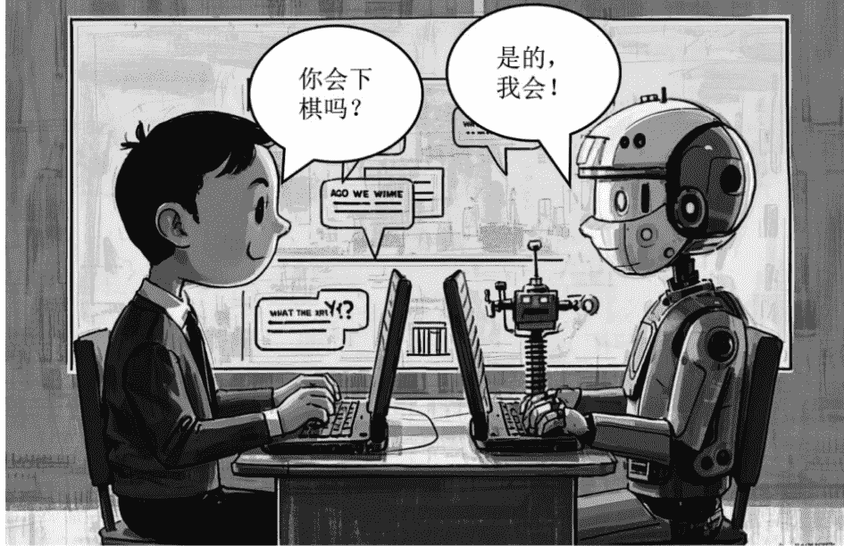

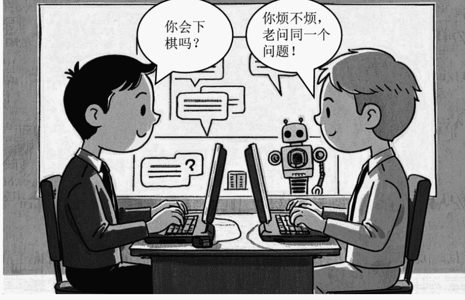

图1-2 机器和人

（2）徘徊发展的初期。

1956年美国达特茅斯学院夏季研讨会，约翰·麦卡锡首次提出“人工智能”一词，定义为“制造智能机器的科学与工程”。

20世纪60年代，AI在自然语言处理、专家系统、神经网络等方向取得进展。

- 自然语言处理：约瑟夫·魏泽堡开发聊天机器人ELIZA，可模拟医患对话。ELIZA标志人与机器的沟通从二进制算法转向自然语言。如今ChatGPT、DeepSeek、Midjourney、即梦AI等均基于NLP，自然语言处理正是普通人与AI沟通的桥梁。
- 专家系统：费根鲍姆团队开发首个专家系统DENDRAL。它通过知识库与推理引擎模拟专家决策，提供专业建议，如推断分子结构。
- 神经网络：弗兰克·罗森布拉特提出感知机模型，是一种具备学习能力的神经网络，用于模式识别与复杂数据处理。但早期感知机无法处理非线性问题。

**拓展：什么是线性问题，什么是非线性问题？**

线性问题：变量关系满足叠加与齐次，输入输出成正比，可用一次函数 $y=kx+b$ 描述。如买糖果，1颗2元、2颗4元、4颗8元，总价=数量×2，即为线性。

非线性问题：变量关系不满足叠加，比例被打破，需用高次、曲线、复杂函数描述，如 $y=ax^2+bx+c$。如买糖果，1颗2元、2颗4元，4颗因促销仅收7元，总价与数量不再成比例，受多变量影响，即为非线性。

70-80年代硬件制约AI发展。1981年IBM PC内存仅16KB，如今家用笔记本普遍8GB起，算力提升超3000万倍。1970年计算机算π到1000位需数天，如今约0.01秒完成。

受限于算力、数据与算法，AI进展缓慢，公众预期下降，资金人才流失，进入寒冬。

（3）机器学习和神经网络的复苏。

80年代AI研究集中于符号主义方法，依赖人工编写规则，即为AI准备“题库”，如“发烧且咳嗽则诊断感冒”。现实复杂，难以穷尽规则，也无法处理模糊语义与图像识别。

80-90年代机器学习兴起，局面有所改观。

机器学习是AI分支，让计算机通过数据自我改进，无需显式编程。我们无需逐条写规则，而是让模型从数据中自行学习，提升决策。

1997年IBM的“深蓝”击败国际象棋世界冠军，多人视其为机器学习胜利，实则不然。“深蓝”采用符号主义，按规则穷举搜索走法并评估局面。

另一关键事件是反向传播算法诞生。

反向传播简称BP，通过计算网络输出与目标值的误差来调整参数，使误差最小化。相比感知机，感知机纠错如同小学生做卷子，错一题重做整张，效率低且易受噪声干扰，难收敛；反向传播则像为各科配备老师，精准指出错误步骤并针对性改进，显著提升纠错效率。

简而言之，反向传播为神经网络训练提供了一次关键的升级，它让模型在学习过程中获得更细致的误差反馈，从而使输出更贴近预期，并具备处理非线性问题的能力。这项机制为神经网络与深度学习的后续扩张奠定了基础。

机器学习的发展为人工智能带来了多类基础范式，监督学习、无监督学习与强化学习即为代表，可对照图1-3。

- 监督学习：以带有标签的样本对模型进行训练，例如把已标注类别的猫狗照片输入模型，让它学会区分。

#### 1.1.2 中国智能产业现状扫描

##### 1. 本土力量追赶提速，已现领跑迹象
2023年初，ChatGPT 引发广泛讨论，身边最常被问及的便是如何上手。短短几年，本土技术追赶的步伐十分明显。

百度、阿里、腾讯、字节跳动等头部企业加大在深度学习框架、核心算法、芯片等方向的投入。华为推出昇思MindSpore，百度推出飞桨PaddlePaddle，意在打破外部技术垄断，强化自主可控。人才方面，企业以高薪吸引海外专家回流，并与高校联合开设相关课程，定向培养专业人才。

截至2024年12月31日，我国生成式人工智能服务累计完成备案302款，其中2024年新增238款。通过API调用的备案模型应用有105款，覆盖内容创作、设计、个性化服务等场景。2024年国内新增生成式人工智能专利约2.7万件，占比全球新增的六成以上。

产品层面，2025年1月20日深度求索发布大模型DeepSeek-R1，凭借出色的逻辑推理能力进入全球榜单前六，且凭借开源特性成为最受青睐的可本地部署大模型之一。百度、腾讯、360等厂商迅速接入。

2025年1月28日央视春晚，宇树科技研发的机器人舞蹈《秧BOT》引发全网热议，成为现象级作品。

##### 2. DeepSeek为何被视作战略级大模型
文心一言、讯飞星火等国产模型已先行，DeepSeek却迅速突出，被视作战略级。其主要原因可归纳为三点：强推理能力、开放策略、轻量部署。

###### （1）高性能推理模型。
通用型大模型擅长自然语言生成、多轮对话、创意写作等基础语言任务，响应快，但生成过程像黑箱。推理类模型更擅长多步逻辑推演和复杂问题的拆解，在数学、代码等强逻辑任务上优势明显。它会呈现完整的思考链路，耗时与资源消耗更高，但结果质量更可靠，更适合科研与生产场景。

推理类模型与通用大模型的对比如表1-1所示。

表1-1 推理大模型和通用大模型的对比

| 对比维度 | 推理大模型 | 通用大模型 |
| :--- | :--- | :--- |
| 核心能力 | 专精多步骤逻辑推导、复杂问题分解（如数学证明、代码生成、伦理分析） | 侧重于自然语言生成、多轮对话、创意写作等基础语言任务 |
| 输出特点 | 展示详细推理过程，增强结果可解释性 | 直接生成答案，不展示推理过程 |
| 应用场景 | STEM 学科、医疗诊断、算法设计、逻辑谜题等高复杂度任务 | 客服对话、创意写作、翻译、摘要等语言密集型任务 |
| 训练方法 | 强化学习、数学 / 代码数据集增强、神经符号推理 | 大规模通用文本预训练，无专项推理优化 |
| 运算效率 | 推理时间较长，资源消耗较多 | 响应速度快，资源消耗较少 |
| 典型模型 | DeepSeek-R1、GPT-o1、Gemini 2.0 Flash Thinking | DeepSeek-V3、GPT-3/4、BERT |
| 提示词策略 | 需简洁指令（如“证明勾股定理”），避免干扰性角色设定 | 需分步引导（如“分三步分析”），可通过角色扮演增强生成多样性 |
| 可解释性 | 高（过程透明，符合逻辑规则） | 低（依赖模式匹配，偶现“幻觉”） |
| 成本与部署 | 训练成本高（专项优化），终端部署难度较大 | 训练成本低（如 DeepSeek-V3 成本约为 GPT-4o 的 1/20），适合快速多场景部署 |
| 行业渗透趋势 | 加速向科研、工程等专业领域渗透 | 通过开源策略支撑长尾场景普及化应用 |

###### （2）开放策略。
开放型模型会公开源代码、训练数据、参数与技术文档，允许开发者自由查看、修改、分发和二次开发。

即便专利法为发明创造提供保护期，部分企业仍选择开放。深度求索本可借闭源获益，却选择公开。

安卓系统是典型案例，开放后聚集大量开发者，形成多元定制生态，最终占据主流。

DeepSeek的开放正在触发生产力变革。政务领域多地已接入；在通信、能源领域，中国移动、中国电信、中国联通及多家电力、石油央企全面接入。百度、腾讯、360等互联网公司，以及华为云、腾讯云、阿里云等云平台均已集成。超200家行业龙头完成接口部署，教育、医疗等领域也在探索。

###### （3）轻量部署。
DeepSeek的轻量化让中小企业乃至个体创作者也能低门槛使用智能化能力提升效率。提供API调用与本地部署两种路径。API成本极低，DeepSeek-R1单价仅为GPT-4o的5%~10%，处理百万tokens约2元，性价比突出。对数据保密要求高的企业，本地部署更合适。依托蒸馏技术，70B版本部署成本仅2~3万元，单张RTX 3090即可运行，高配版本控制在数十万元内。短剧行业即被预测会因低成本催生大量微型公司。DeepSeek的成功在于满足了高性能、无门槛、高性价比的市场需求。

从20世纪末到21世纪初，社会经历剧变：大哥大、BB机到诺基亚再到智能手机普及；绿皮火车到高铁飞机为主；机房穿鞋套上机到家用电脑再到移动互联网；现金到手机支付全覆盖。

每次变革都有赢家也有落伍者。2000年下岗潮中，有人下海致富，有人一蹶不振。寥寥几句背后可能是几代人的起落。

世界在加速，“闭关修炼几十年出关仗剑走天涯”或“悄悄努力惊艳所有人”的空间越来越窄。在高速旋转的时代松开扶手，掉落风险很高。

抓稳不等于病急乱投医或盲目押注，而要稳健前行。智能化浪潮下的选择可能关乎个人乃至家庭未来。正如《低风险创业》所言：“让风险变大的不是创业，而是无知、傲慢和不学习。”

下面介绍的生存建议，能帮助你在认知人工智能的过程中少走弯路。

### 1.2 面对智能化浪潮的三要三不要

#### 1.2.1 定期更新认知，别陷入追新陷阱
自2022年ChatGPT面世，人工智能产品的迭代明显加快。本书初稿完成于2023年5月，期间至少修改三次，主因是功能不断升级。

知识分层常借用“道法术器”。结合李笑来《财务自由之路》的解释：

- ● 道：规律与趋势，如经济发展规律、技术演进趋势。可迁移、不易过时，但难以直接落地。例如商业模式本质是个人成长与长期主义，属于道的提炼。
- ● 法：方法论，是做事的指导体系。例如把赚钱方式分为卖时间、一次卖多次、卖他人时间，属于法的层面，提供方向但缺操作细节。
- ● 术：具体的技术与可执行方法。如想靠讲课赚钱，如何选题、设计内容、推广销售，这些就是术，落地感强。
- ● 器：工具。如录课软件、发布平台。工具实用但迭代快，尤其在智能化工具快速更迭下，产品在技术与市场压力下不断更新，竞争激烈，用户需持续适应。

人工智能工具更新已非常快。若只追逐工具更新，容易把时间耗在即将被淘汰的知识上，忽视更持久的上层知识。

但对普通人而言，工具恰是最需要掌握的部分。建议以6个月为周期，精力充足可缩至3个月，定期学习新工具与方法。工具淘汰快但上手成本低，通常几天到一周即可掌握新内容。

#### 1.2.2 深耕专业本位，避免盲目押注
有专家指出，2024年国内人工智能专业在校生仅4万多人，而人才缺口达500万。薪酬较高，容易让人心动。

先厘清思路。人工智能工具属于器的层面，更新快、淘汰快、易学。填补500万缺口可能只是时间问题。如今培训机构遍地，学员远超500万。未来会用工具的人可能达千万甚至更多，供过于求时薪酬未必维持高位。

人工智能行业真正需要的是两类人：核心大模型研发人员和行业应用人员。

- 大模型研发人员：薪酬高，但对非编程、非计算机、非深度学习背景者门槛极高。即便系统学习，也需考虑三五年后的就业空间。
- 行业应用人员：大模型最终要落地。企业正探索用智能化能力提升效率，应立足本行业学习相关技术、解决实际问题。如培训从业者可思考如何用智能化能力优化课程设计、提升效率或帮助他人掌握新技术。

传统行业的最大冲击是被智能化能力替代。如人工智能绘画让不会画画的人也能做漫画甚至微电影。竞争者增多，但有扎实基本功和多年行业积累的人，与临时组队者有本质区别。真正的竞争力是行业洞察力，而非技术本身。

机会来自对本行业需求的深刻理解，而非盲目押注。若已在本行业积累丰富经验，再拓展深度学习等技术才更稳妥，同时保持谦逊与持续学习。

#### 1.2.3 用时间化解技术难题，别用技术堆技术
ChatGPT发布后，有人付费教学用Python把ChatGPT接入Office。四个月后，金山办公推出WPS AI，更新版本即可用。那些花时间学Python的人发现自建方案远不如官方好用。

努力不会白费，Python本身有价值。但“或许有用”不等于最佳学习策略。

学习人工智能时，若发现功能不完善，不必急着自学技术去补。很可能在你学会前厂商已推出更好方案，周期可能只需数月。需求存在，厂商同样看见。与其做半成品，不如等待成熟更新。

遇到此类技术教学，也不必急付费。应以动态眼光看待技术发展。作为普通人，要学会用时间解决技术问题，而非用技术解决技术问题。

### 1.3 智能应用的潜在风险

人工智能应用能大幅提升效率，但伴随风险，主要涉及用户短期利益。

#### 1.3.1 法律风险
绘画、写作、编程等领域，由模型生成作品的版权归属一直存疑。人类出创意，模型完成创作，而模型由软件方创造，版权归谁，法律尚无明确规定。司法实践多依据用户服务协议及智力投入判断。

人工智能法律尚不完善，存在版权归属不明风险。使用模型创作时作者可能无法获得应得收益。部分软件条款甚至规定“所有输入输出版权归本公司”，把论文交给模型润色后版权可能归属开发方。

使用前务必细读版权条款。

#### 1.3.2 信息泄露风险
OpenAI于2023年3月发生用户信息泄露事件并公开道歉，警示信息安全的重要性。

相比App索取手机管理权限，人工智能应用的信息安全风险更严峻。一方面用户深度依赖，可能毫无保留交流，导致个人信息全面暴露；另一方面热门应用易成黑客攻击目标。随着普及，犯罪分子利用人们好奇心，诱导在非法网站注册付费，窃取身份证、银行卡号及密码实施诈骗甚至违法犯罪。

#### 1.3.3 过度依赖风险
电影《夺命手机》中，主角被手机指引走上人生巅峰，最后发现背后是企图毁灭世界的智能人工智能。

现实中虽无全面控制地球的威胁，但过度依赖值得警惕。如智能手机依赖导致专注力、记忆力、方向感退化，过度依赖人工智能同样危险。

任何技能的高造诣都基于基本功。以动漫行业为例，人工智能普及后年轻人习惯用模型完成逐帧画面，降低成本却失去从基础做起的机会，限制发展上限。

作家过度依赖模型输出会丧失驾驭文字能力。若提示词都要求模仿金庸、莫言、史铁生、鲁迅，文化天花板便被定格，再难超越。

应时刻分清主次，人工智能应作为提效工具，不应成为能力发展的天花板。

## 第2章 国内主流智能产品解析

### 2.1 对话大模型
对话大模型通过文字输入提问，由模型作答。可分为通用大模型和推理大模型，二者区别见1.1.2。

简单记忆：逻辑复杂选推理大模型，无逻辑需求选通用大模型。

发展趋势是功能全面化，兼顾推理与通用。如腾讯元宝、百度搜索已接入DeepSeek-R1，豆包也开发出深度思考功能，如图2-1所示。


图2-1 豆包的深度思考按钮

表2-1所示为国内主流对话大模型的对比。

表2-1 国内主流对话大模型的对比

| 工具名称 | 开发公司/团队 | 核心功能 | 技术亮点 | 是否支持深度思考 | 典型应用场景 |
| :--- | :--- | :--- | :--- | :--- | :--- |
| DeepSeek-R1 | 深度求索 | 学术研究、商业分析、代码生成、逻辑思考 | 多模态交互，可视化结论生成，开源生态支持 | 支持 | 科研论文推理、金融数据分析 |
| 豆包 | 字节跳动 | 旅游规划、多语言翻译、口语练习 | 功能全面丰富，可以作为浏览器或浏览器插件 | 支持 | 跨国会议翻译、自媒体内容生成 |
| 腾讯元宝 | 腾讯 | 多场景对话、微信生态任务管理 | 隐私保护模式，支持语音指令唤醒 | 支持 | 日程提醒、企业内部知识问答 |
| 文心一言 | 百度 | 知识问答、垂直领域解决方案 | 中文事实准确性领先，医疗/法律知识图谱增强 | 支持 | 合同条款解析、百科问答 |
| Kimi | 月之暗面 | 长文本解析（200万字级） | 速读《三体》级内容，法律条文结构化处理 | 支持 | 法律文件检索、小说创作辅助 |

挑选对话大模型可参考三个维度：回答质量、功能丰富性、版权问题。

- 回答质量：首推DeepSeek，若服务器繁忙，可用腾讯元宝，其提供本地部署DeepSeek满血版。若有长文本写作与理解需求，如小说创作、书籍解读，推荐Kimi。
- 功能丰富性：推荐豆包，除基础对话外，还集成会议记录、AI生图、Excel处理、网页翻译、截图提问、划词搜索、视频总结等，适合工作场景。

- 版权注意：国内AI创作相关的权属规则仍在完善，部分平台条款把用户上传素材算作可用于服务的资源。若打算用AI产出需要版权保护的书籍、课程等成品，优先考虑本地部署运行。若没有条件，Kimi 的协议相对宽松，可权宜使用。注意条款会变动，像腾讯元宝就已放宽限制，使用前请核对最新版本说明。

### 2.2 图像视频创作
驱动图片和视频生成的核心是借助提示词或参考图来引导模型。绘图产品与影视类产品正加速融合，越来越多的工具同时实现制图、制片以及虚拟人呈现。为方便横向对比，本部分把图文视频数字人相关产品一并列入表2-2。

#### 2.2.1 AI图像工具
- 文图转换：输入一段文字描述即可得到对应的视觉画面，极大拓宽了创作边界。
- 智能润色：模型能自动优化画质，调节亮度、对比度与色彩；一键美颜、滤镜添加、背景替换等功能让非专业用户也能轻松美化影像。
- 修复与增强：利用算法修补受损照片，对模糊素材进行锐化，让细节更清晰。
- 创意启发：为设计师和创作者提供灵感，快速产出草图，辅助前期构思。

例如使用即梦AI进行文生图，提示词为“孤舟蓑笠翁，独钓寒江雪”，效果如图2-2所示。


图2-2 以“孤舟蓑笠翁，独钓寒江雪”为提示词生成的结果

#### 2.2.2 AI视频工具
- 生成与合成：可基于文字、图像或已有视频素材合成新片段，适用于短视频、广告宣传、特效制作、虚拟主播等场景。
- 编辑与处理：支持剪辑、拼接、转场添加等操作。如Veo能依据文本生成1080P的高质量片段，在运动控制、光照以及镜头角度上表现突出。
- 画质增强：能提升清晰度与色彩准确性，还可进行超分辨率处理。
- 效率提升：自动化与智能化功能大幅缩短制作周期，降低门槛。如快影提供一键生成视频、智能配音、自动字幕；剪映智能版能快速生成产品宣传片或广告。

表2-2所示为常见的AI视频工具。

表2-2 常见的AI视频工具

| 工具名称 | 开发公司/团队 | 核心功能 | 技术亮点 | 典型应用场景 |
| :--- | :--- | :--- | :--- | :--- |
| 堆友 | 阿里国际 | 商品主图生成 | 中英文混合关键词，千种电商风格模型 | 跨境电商产品图、Banner广告设计 |
| LibLib | 奇点星宇科技 | 精细化文生图，stable diffusion在线使用 | 可在线调教部署属于自己的stable diffusion模型，但新手上手难度较大 | 插画创作、PPT配图生成 |
| 稿定设计 | 稿定科技 | 智能海报生成 | 营销模板库+智能排版，中小商家专用 | 餐饮菜单设计、活动宣传单页 |
| 剪映 | 字节跳动 | 文生视频、智能剪口播、智能剪辑辅助、数字人 | 功能全面，操作简单 | 视频剪辑，短视频创作 |
| 秒创 | 一帧秒创 | 文生视频、智能素材匹配、数字人 | 功能全面，操作简单 | 短视频创作 |
| 腾讯智影 | 腾讯 | 文生视频，智能素材匹配、数字人 | 腾讯视频授权商用影视素材 | 短视频创作 |
| 白日梦AI | 光魔科技 | 文生视频、动态画面、AI角色生成 | 人物/场景一致性等功能 | 动态漫画 |
| 可灵AI | 快手 | 虚拟试穿、对口型视频生成 | 4K视频连贯性优化，电商场景专用 | 直播带货视频、广告营销素材 |
| Vidu AI | 清华大学与生数科技 | 文字/图片转视频 | 自研动态模型，画面一致性达影视级 | 短视频创作、影视分镜预演 |
| 即梦AI | 脸萌科技 | 动态大片生成（国风/科技特效） | 抖音爆款模板库，支持单句生成 | 社交媒体热点视频、品牌宣传片 |

### 2.3 AI办公工具
AI正深度渗透日常办公。传统的Word、Excel、PPT已实现自动化赋能，同时在会议纪要、项目规划、协作沟通、即时问答等协同场景也广泛应用。

表2-3所示为常见的AI办公工具。

表2-3 常见的AI办公工具

| 工具名称 | 开发公司/团队 | 核心功能 | 技术亮点 | 典型应用场景 |
| :--- | :--- | :--- | :--- | :--- |
| WPS AI | 金山软件 | Word、PPT、Excel自动化 | 国内最普及的办公软件，在线可同步保存，使用便捷，体验感好 | 各种办公任务处理 |
| ChatPPT | 必优科技 | PPT自动生成、一键调整 | 作为PPT插件使用，在PPT插件领域有较深积累，功能全面，适用性强 | 快速生成PPT |
| 豆包 | 字节跳动 | 文本对话、会议记录、划词、截图翻译等 | 功能丰富全面，眼里有活 | 作为浏览器或浏览器插件辅助使用 |
| 腾讯会议 | 腾讯 | 会议记录、会议总结 | 垂直于会议场景，性能更强 | 线上会议 |
| 钉钉AI | 阿里钉钉 | 智能工作助理 | 深度结合钉钉其他功能，使用便捷 | 适合企业级AI赋能 |
| 飞书AI | 字节跳动 | 智能工作助理、多维表格、协同办公 | 多维表格已接入DeepSeek，可批量完成工作 | 协同工作、企业级AI赋能 |

### 2.4 AI学习工具
对学生、职场人士和创业者而言，AI时代的学习需求并未减少，反而对深层学习能力提出更高要求。

表2-4所示为常见的AI学习工具。

表2-4 常见的AI学习工具

| 工具名称 | 开发公司/团队 | 核心功能 | 技术亮点 | 典型应用场景 |
| :--- | :--- | :--- | :--- | :--- |
| 秘塔AI | 秘塔科技 | 学术/播客定向检索 | 结构化结果输出，支持跨平台内容聚合 | 行业调研、竞品分析、论文辅助 |
| 微信AI搜索 | 腾讯 | 生态内多模态搜索（PDF/视频） | 摘要生成与关键帧提取，社交数据强化 | 课程资料整理、短视频内容检索 |
| 豆包 | 字节跳动 | 文本对话、会议记录、划词、截图翻译等 | 功能丰富全面，眼里有活 | 作为浏览器或浏览器插件辅助使用 |
| 印象笔记 | 印象笔记 | 自动生成大纲，自动生成思维导图、知识库管理 | 知识库管理、浏览器插件 | 知识管理、个人知识库建设、快速笔记 |

### 2.5 AI编程工具
AI辅助编程是国内快速普及的应用方向。据市场研究机构数据，2023年中国AI代码生成市场规模已达65亿元，预计2028年将增长至330亿元。

虽然AI编程常被调侃为“程序员造的工具裁了自己”，其更重要的价值是让非专业人士也能参与应用开发，满足行业需求并创造商业价值。

表2-5所示为常见的AI编程工具。

表2-5 常见的AI编程工具

| 工具名称 | 开发公司/团队 | 核心功能 | 技术亮点 | 典型应用场景 |
| :--- | :--- | :--- | :--- | :--- |
| 通义灵码 | 阿里云 | 代码生成与纠错 | Python全栈任务支持，数据分析代码一键生成 | 金融模型开发、自动化脚本编写 |
| Trae | 字节跳动 | 代码库上下文提取、自动化调试、自然语言对话 | 全流程辅助，支持私有代码库训练 | 微基础开发应用 |
| DeepSeek | 深度求索 | 轻量级模型训练 | 70B参数适配低配设备，支持行业模型二次开发 | 嵌入式设备开发、教育机器人编程 |

## 第3章 对话大模型：AI应用基础
本章主要使用的AI工具：DeepSeek

### 3.1 回答不满意的根源是“信息差”
很多人常问：为何与AI沟通后输出质量不理想，是技术还不够成熟吗？我也曾陷入“自己想明白却说不清”的困境。后来才意识到，问题不在模型，而在表达——心里清楚却没传达清楚。这种沟通中的信息落差，也是多数误会的根源。

举一个职场案例说明。小帅是小强的直属领导，要求小强做一份年终总结PPT用于公司汇报，并提供了部门数据。

第一天，小强交出初版，小帅觉得版式不合适，要求改成高端商务风格并加入红色体现节日气氛，小强照做。

第二天，小帅觉得版式可以，但结构要调整，小强再次修改。

第三天，小帅指出文字不够精炼；第四天，配图不理想；第五天，流程图不够清晰。小强逐项修改。

第六天，PPT终于让小帅满意，但他对小强效率不满，认为能力不足。小强则抱怨领导没一次性说清需求，导致反复返工。

问题的根源是信息传递不完整：小帅脑中的标准没有清晰传达。解决办法有两种：一是自己动手；二是先梳理大纲和重点页，再让小强负责美化，避免浪费时间和人力。

这与我们使用AI的过程相似：提出需求、得到结果、基于反馈迭代。不同的是AI不会抱怨，只会按要求执行。所以明确需求是高效协作的关键。

沟通中常见误解包括：

（1）信息不完整。
每个人对“好”的标准不同。若需求方没一次性说明标准，执行方难以一次到位。但一次性说清也不现实，标准分两类。
- 显性标准：可具体描述，如“不吃香菜”。
- 隐性标准：难以言明，如对“美”的主观感受差异。
这解释了客户常说不清需求的原因：一是缺乏专业认知，需要看到成果才感知；二是主观偏好不同。若提前梳理并明确部分标准，效率会大幅提升。

（2）抓错重点。
同一句话不同人关注点不同。如“今晚请李总吃饭，订个位置”，有人关注时间，有人关注吃饭。为避免误解，提出需求时应精简语言并突出重点。

（3）语义歧义。
语言本身多义，尤其中文。例如“苹果”可指水果或公司；“好棒棒”可能是夸奖也可能是讽刺。与AI沟通时要避免歧义，对关键词做备注。

（4）超出认知范围。
工作中常遇到不熟悉的任务或行业。AI虽参数庞大，也未必了解特定公司或行业的细节。如让AI为“李总”写公众号文章，若不提供背景、活动内容等资料，难以完成。需提供充分参考帮助AI理解上下文。

### 3.2 AI学习和使用指南：使用AI学习的四大原则
弄清信息落差后，就能掌握以下通用沟通原则，适用于对话、图像、视频、编程、学术等各类AI工具，是使用AI的底层逻辑。

#### 1. 原则1：越具体，越准确
与AI沟通的首要原则是“越具体，越准确”。这意味着要把问题想完整，明确想问什么。比如用DeepSeek做旅行规划，只问“我想去××地旅行，给我一个计划”，信息仍不足，连真人顾问也需要人数、天数、预算、偏好等细节。

更具体的提问应是：“我一个人去××地，含路程共3天，预算2000元，想多吃美食，请设计行程，每餐推荐当地特色餐厅。”

同样看AI生图。

想得到一只可爱小猫的图，在即梦AI输入“一只可爱的小猫”，如图3-1，效果如图3-2。

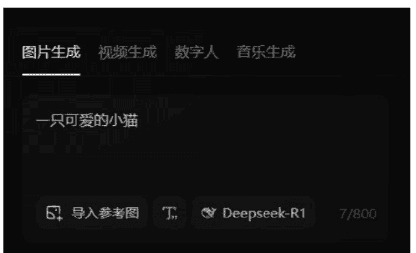

图3-1 输入画面示例


图3-2 生成效果示例

效果尚可，但未必符合预期，因为没说明品种、风格、色调、光线、动作等。描述越细，生成结果越接近预期。

再输入“卡通风格，可爱，一只美短猫，暖色调，正在吃拉面”，如图3-3，生成如图3-4。

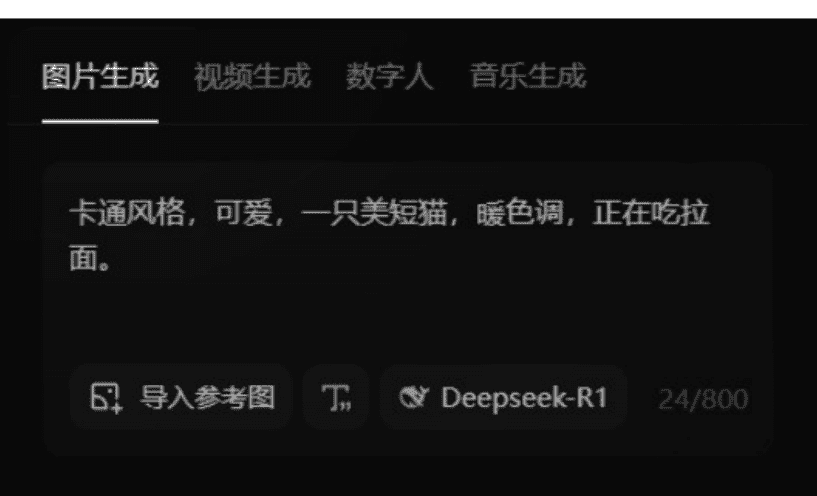

图3-3 输入细节示例


图3-4 生成效果示例

该原则适用于所有工具，提示越具体，越接近预期，调试次数越少。

如何一次说清需求？养成自我追问的习惯。对人与对AI都适用。不要只说“把事做好”，要追问“好”的具体标准。标准越具体，沟通越顺畅。

#### 2. 原则2：认知上限决定AI能力上限
AI的发挥受使用者认知限制。输出质量取决于输入质量。

“外行看热闹，内行看门道”，关键在于鉴赏能力。拿到科研结果能否辨真伪？剧本写得好不好能否判断？

武侠里同一套招式，功力不同效果不同。用AI亦然。AI是具现想象力的工具，金融专家能做量化分析，设计师能产出艺术作品，都源于使用者在领域的判断力。认知有限，就提不出有效修改意见，结果自然受限。

绘图需懂光线、风格、艺术家；做视频需懂分镜、景别、叙事；辅助编程需有基础编程能力，否则连Bug都看不出。提升自身认知是释放潜力的前提。

#### 3. 原则3：没有一步到位
AI并非万能，无法一次完美交付。新手常以为一个提示就能出成熟文章或小说，实际都需要多次迭代。

文章可能偏离深层需求，图像细节总有瑕疵，视频配图或剪辑常不达标。

本质是角色错位：想让AI包办，自己不出力。AI更像下属，核心工作仍在你，AI负责简化中间环节。

记住12字：修正拍板，及时纠偏，人工定稿。
修正拍板：前期可让AI提供建议，但最终决策自己掌握，不符预期就手动调整后再反馈。
及时纠偏：发现问题立刻解决，也包括复盘经验。如用白日梦AI做动态漫画，DeepSeek负责剧情分镜，若节奏拖沓，就分析是否分镜太粗，下次加指令“最长镜头不超过3秒，加快节奏”。
人工定稿：评估AI边界，与反复调教相比人工收尾是否更高效，也要考虑复用性。通用或推理大模型记忆有限，本地化微调后仍可能需重复调教，若隐性需求难表达，直接人工定稿再让AI学习更稳妥。

技术会进化，信息落差却始终存在，需要耐心迭代。

#### 4. 原则4：检查是必要习惯
AI会“胡说八道”，这就是“AI幻觉”，即生成看似合理实则错误的信息。

常见成因：
- 数据偏差和错误。训练数据本身有误，模型就会学偏。
- 上下文理解局限。面对复杂或模糊指令，模型靠猜测生成答案。
- 过度联想。模型强化思维链，在信息不足时强行“脑补”。
- 知识过时固化。训练数据是静态的，未及时更新就易出现过时错误。

生成式工具在撰写时往往把数值写错，在回答时也容易混进不够严谨的细节。一旦涉及数据、时间、事件等关键要素，就需要养成主动复核的习惯。经手核对可以防止张冠李戴、以假乱真，让输出更可信，也能规避因信息失误带来的风险，同时提高整体效率。

### 3.3 大模型入门：对话与提示词设计

#### 3.3.1 以 DeepSeek 为示范的账号注册与界面说明

现在国内主流对话模型的注册与使用都很方便。下面以 DeepSeek 为示范介绍开通方式和操作界面，其他同类产品逻辑相近，后文的示例也以 DeepSeek 为主。

##### 1. 注册流程

第1步：在浏览器搜索 DeepSeek 或直接打开其官方网站，如图3-5所示。页面提供“开始对话”入口，需要移动端可点“获取手机 App”。


图3-5 DeepSeek 官网

第2步：进入登录页，如图3-6所示，填入手机号点“发送验证码”，验证通过即可开始对话。也支持微信扫码登录，首次扫码需先用手机号完成一次认证，后续扫码即可直接进入。

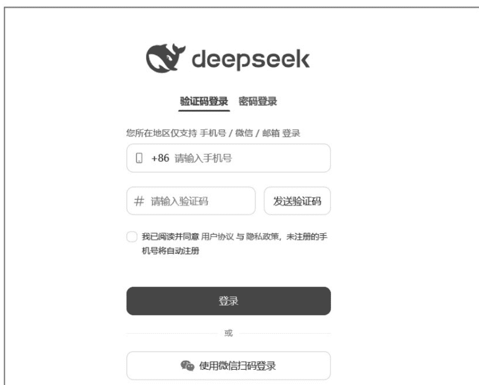

图3-6 登录界面

##### 2. 操作界面

DeepSeek 的界面如图3-7所示，整体分为三部分：历史会话、开启新会话、对话区域。

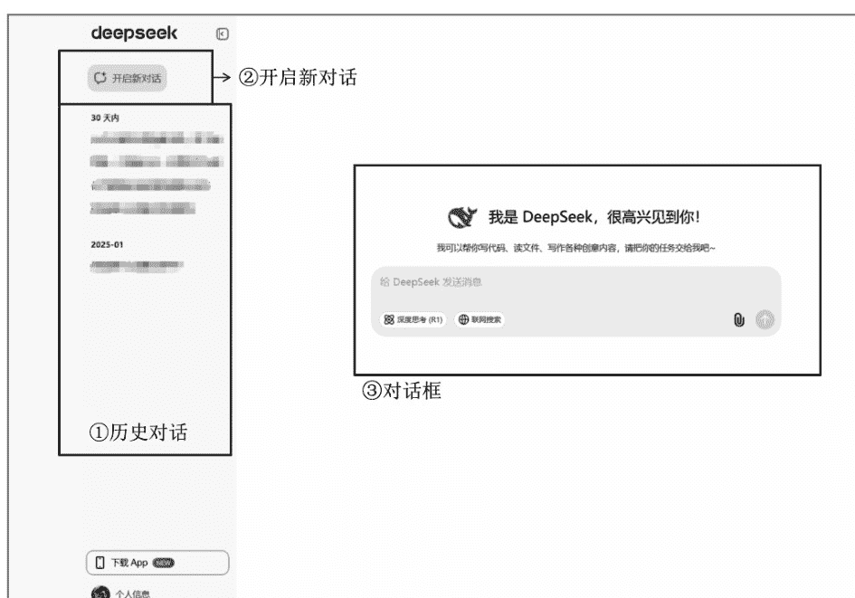

图3-7 DeepSeek 操作界面

- 历史会话：可在不同历史对话间切换。
- 开启新会话：启动一段独立的新交流。
- 对话区：主要交互区域，如图3-8所示。


图3-8 DeepSeek 的对话框

对话区内有四个交互按键：深度思考、联网搜索、上传附件、发送。

- 深度思考：开启后会调用更强的推理模型，如 DeepSeek-R1，适合复杂推理和问题求解；关闭时使用通用模型如 DeepSeek-V3，适合日常交流和基础任务。
- 联网搜索：可实时从网络抓取资料作参考，提升答案质量。该功能与上传附件互斥，只能二选一。
- 上传附件：把文件作为参考材料导入，提升答案质量。该功能与联网搜索互斥，只能二选一。
- 发送：图标为向上箭头，等同回车。

建议每个新话题单独开一个会话，因为模型对上下文记忆很强，容易把不同话题混在一起。也可为不同会话设定使用场景，如健身顾问、心理支持、文案助手等，以便更高效利用能力。

#### 3.3.2 提示词的结构：RBRP 框架

提示词就是用户输入给模型用来引导输出的文字。质量好的提示词要清晰具体，把意图说清楚，才能得到更贴合预期的结果。

按用法，提示词大致可分为指令型、问题型、情景型。

- 指令型：直接要求模型执行任务，如“写一首关于夏天的诗”“解释相对论”等。
- 问题型：以提问形式引导回答，如“人工智能的发展前景如何”“怎么学编程”等。
- 情景型：先设定场景再要求作答，如“假设你是一名医生，如何向病人解释病情”等。

无论哪类，都应遵循越具体越准确的原则。可在简单表述上补充细节，如表3-1所示。

表3-1 丰富提示词内容

| 提示词类型 | 原提示词 | 更具体的问题 |
| :--- | :--- | :--- |
| 指令型提示词 | 解释相对论 | 请用通俗易懂、小孩都能听明白的语言解释相对论 |
| 问题型提示词 | 人工智能的前景如何 | 请从经济学的角度，论述人工智能的前景如何 |
| 情景型提示词 | 假设你是一位医生，如何给患者解释病情 | 假设你是一位医生，遇到了一位有心脏病史的病人，他病情比较严重，且没有家属陪同，你该如何给患者解释病情 |

丰富提示词的目的是减少沟通中的信息差，把需求背景讲清，让模型与使用者同频，而不是让模型猜心。

一个简便的构建框架是RBRP，如图3-9所示。

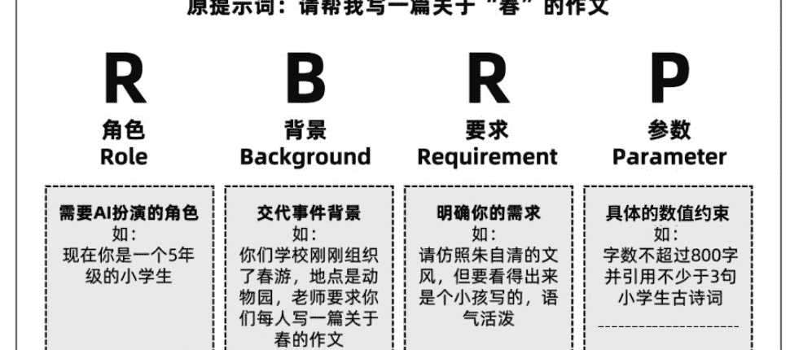

图3-9 RBRP结构

- 角色 Role：赋予模型一个身份，如导游、律师、医生。
- 背景 Background：交代当前的具体情境。
- 要求 Requirement：明确对结果的期望。
- 参数 Parameter：设定量化指标，如字数、时间、预算等。

下面以几个例子说明RBRP的应用，如表3-2所示。

表3-2 使用RBRP结构丰富提示词

| 提示词类型 | 原提示词 | 更具体的问题 |
| :--- | :--- | :--- |
| 指令型提示词 | 解释相对论 | 角色：你是一名初中老师；<br>背景：你需要在历史课上讲解爱因斯坦的贡献，因此会讲到相对论；<br>要求：用初中生能听懂的语言，简单解释什么是相对论；<br>参数：字数控制在 800 字以内 |
| 问题型提示词 | 人工智能的前景如何 | 角色：你是一个经济学专业的大学生；<br>背景：你需要写一篇文章讨论人工智能的前景；<br>要求：引用一些权威的论文、研究成果或调研报告；<br>参数：字数为 5000 字左右 |
| 情景型提示词 | 假设你是一位医生，如何给患者解释病情 | 角色：你是一位医生；<br>背景：你遇到了一位有心脏病史的病人，他病情比较严重，且没有家属陪同；<br>要求：你该如何给患者解释病情，让他能够接受；<br>参数：无 |

模型的核心特点是智能化，且会不断逼近人类解决问题能力。对话时要明白：模型并非不聪明，而是对使用者真实意图把握不足。把需求讲透，模型才能更好发挥作用。

#### 3.3.3 通用模型与推理模型的提示差异

回顾一下：逻辑要求高的任务选推理模型，日常轻量任务选通用模型。表3-3列出了大致适用范围，随着技术演进，边界可能逐渐模糊。

表3-3 通用大模型和推理大模型的适用场景

| 场景类型 | 通用大模型 | 推理大模型 |
| :--- | :--- | :--- |
| 文本生成 | 适用，能够生成连贯的文本，如新闻报道、故事创作、文案撰写等 | 不适用，其主要优势不在于生成连贯的文本 |
| 机器翻译 | 适用，能够将一种语言的文本翻译成另一种语言 | 不适用，不是其主要功能 |
| 摘要生成 | 适用，可以从长篇文本中提取关键信息，生成简洁的摘要 | 不适用，不是其主要功能 |
| 基础知识问答 | 适用，能够回答常识性问题 | 不适用，不是其主要功能 |
| 多轮对话 | 适用，能够根据上下文进行自然流畅的交流 | 不适用，其主要优势不在于自然流畅的多轮对话 |
| 创意写作 | 适用，能够生成多样化的文本，提供创意和灵感，模仿不同的写作风格，生成情节、角色设定和对话等内容 | 适用，能够帮助构建故事的逻辑和框架，确保情节发展合理且符合逻辑，推敲细节，厘清复杂情节的思路 |
| 数学建模与教育 | 不适用，不是其主要功能 | 适用，能够为学生和研究人员提供精准的数学问题解答和公式推导 |
| 代码生成与优化 | 不适用，不是其主要功能 | 适用，能够通过自然语言描述生成代码片段、优化现有代码，并提供错误诊断和修复建议 |
| 复杂逻辑推理 | 不适用，不是其主要功能 | 适用，能够通过生成中间步骤和思维链来逐步解决问题 |
| 跨文档推理和复杂决策 | 不适用，不是其主要功能 | 适用，能够从大量文档中提取关键信息并进行推理 |
| 多步骤规划任务 | 不适用，不是其主要功能 | 适用，能够将复杂任务分解为多个步骤，并确保每个步骤的执行 |

在提示词设计上，两者也有差异。

通用模型擅长各类自然语言任务，如生成、翻译、摘要。提示词需要明确目标，给出具体指引，并可借助示例引导输出。

推理模型聚焦逻辑推理、数学推导和复杂问题求解。提示词应简洁清晰，突出核心目标，避免冗余信息，鼓励模型自主推理，提供必要上下文并控制输出格式。

概括地说，对通用模型要讲技巧，对推理模型要直给。可记忆为通用模型用RBRP，推理模型用BRP，即不设定角色，如表3-4所示。

表3-4 两种大模型的提示词

| 提示词类型 | 原提示词 | 通用大模型 | 推理大模型 |
| :--- | :--- | :--- | :--- |
| 指令型提示词 | 解释相对论 | 角色：你是一名初中老师；<br>背景：你需要在历史课上讲解爱因斯坦的贡献，因此会讲到相对论；<br>要求：用初中生能听懂的语言，简单解释什么是相对论；<br>参数：字数控制在800字以内 | 用初中生能听懂的语言解释相对论，字数要求800字以内 |
| 问题型提示词 | 人工智能的前景如何 | 角色：你是一个经济学专业的大学生；<br>背景：你需要写一篇文章讨论人工智能的前景；<br>要求：引用一些权威的论文、研究成果或调研报告；<br>参数：字数为5000字左右 | 请以经济学专业的大学生的水平写一篇讨论人工智能前景的文章，字数为5000字左右 |
| 情景型提示词 | 假设你是一位医生，如何给患者解释病情 | 角色：你是一位医生；<br>背景：你遇到了一位有心脏病史的病人，他病情比较严重，且没有家属陪同；<br>要求：你该如何给患者解释病情，让他能够接受；<br>参数：无 | 假设你是一位医生，如何给有心脏病史且无家属陪同的病人解释不乐观的病情 |

#### 3.3.4 进阶：用信息差视角把握与 AI 对话的逻辑

前文提到，回答不满意的核心原因是信息差，即模型不了解使用者的评判标准和背景信息。由此延伸出对话的基本流程——喂、问、调、定，如图3-10所示。

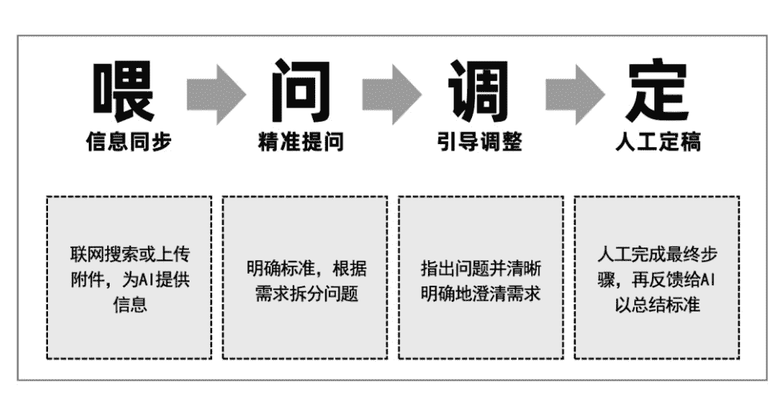

图3-10 与AI对话的基本逻辑

##### 1. 喂 信息同步：抹平任务启动时的信息差

以日常工作沟通作类比。

小帅让小强撰写部门年终总结。交付时必须提供：本年度各成员的工作任务与完成情况、年初目标与现状的对比、参考模板等。这些信息只有小帅掌握，小强仅凭“写一篇总结”无法完成。

即便小强尽力，也可能出现数据偏差，因为只能靠搜索或推测填补空白。

模型同样遵循“使命必达”，信息不足时便会靠算法硬凑，可能产生不准内容或编造数据，增加幻觉风险。

##### 2. 问 精准提问：明确标准并拆分问题

好问题能大幅提升沟通效率，关键在于把隐性标准显性化，并列出所有显性标准；隐性标准则可在看到生成结果后逐步调整。

仍以年终总结为例。

显性标准：覆盖工作任务及完成情况，对比年初目标，参考优秀报告的结构。

隐性标准：报告风格要符合上级偏好，上级可能提出的修改意见。

联网检索和上传附件不能同时使用，如何兼顾？拆分问题即可。

- 问题一：联网检索优秀年终总结报告，分析其结构和写作手法。
- 问题二：基于上传的部门数据和目标完成情况，结合上一步结论，撰写完整报告。

##### 3. 调 引导调整：指出问题并澄清需求

部分隐性标准可以提前显性化，部分只能在看到结果后感知。信息差无法完全消除，但可以尽量缩小。

对话中遇到不符预期时，需要进一步沟通。与人沟通需顾及感受，对模型则可直接指出问题，如表3-5所示。

表3-5 与人沟通和与AI沟通的差别

| 应用场景 | 与人沟通（需要技巧） | 与 AI 沟通 |
| :--- | :--- | :--- |
| 表达否定 | 我觉得你说的还是有道理的，就是不太符合当下的情况 | 你的回答不符合我的 ×× 需求 |
| 表达肯定 | 你说的太棒了 | 我觉得你的回答很好，我非常满意 |
| 有新需求 | 不好意思哈，现在有了新需求，要加上 ×× | 请重新生成一个回答，把 ×× 加进去 |
| 有遗忘的信息要补充 | 不好意思，忘了告诉你 ×× | 这次工作的背景是 ××，请把这个考虑进去 |
| 提出要求 | 能给我 3 条文案吗？谢谢 | 请给我 100 条文案 |

建议反馈结构：

我认为这个回答有以下满意之处：①……②……③……

不满意之处包括：①……②……③……

##### 4. 定 人工定稿：将成果作为案例

不要把模型当成全知主体。应明确其工具属性：它是简化工作环节的助手。要有拆分思维，把任务拆解，交给模型适合的部分，保持主控并对最终成果负责。

模型完成约 90% 后，最后一步仍需人工，因为隐性标准只有使用者清楚。与其反复微调模型，不如自己定稿后再反馈给模型总结标准。

## 第4章 AI助力提升办公效率

本章主要使用工具：

- DeepSeek
- 豆包
- 讯飞星火

### 4.1 AI助力提升学习效率

作为长期关注学习技术的观察者，笔者注意到 AI 带来了两个明显变化：

1. 不必“学成再用”；
2. 学习门槛被拉低。

学习可分为三个层次：Know知道、Knowledge知识、Skill技能，如图4-1所示。传统模式强调学成即技能转化。

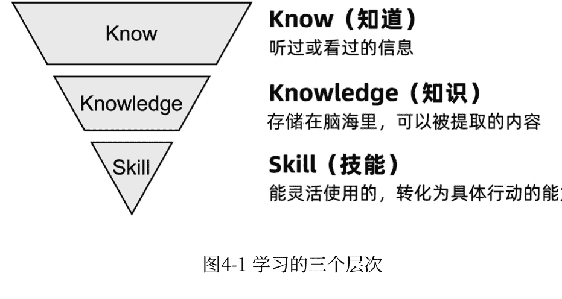

以写作为例，使用 AI 时用户只需具备鉴赏力，无需掌握专业写作技能。绘画同理，只需审美感受，无需专业绘画能力。

核心在于 AI 降低了知识应用门槛，使知识在未完全转化为技能前就能产生价值。“认知的上限决定 AI 能力的上限”，这里强调理解而非技能掌握。

AI 也极大改善了学习条件。过去课堂互动受限，现在可录音、可看全球名师课程、还能让 AI 做老师。

普及后可从以下方面提升学习效率：

- 制订学习计划：用 DeepSeek 生成完整计划并提供资源渠道；
- 在线提问：通过 DeepSeek 对话或豆包的划词、截图提问功能解决疑惑；
- 文本与网页翻译：借助 DeepSeek 对话或豆包网页翻译降低外文门槛；
- 视频总结：用豆包视频总结功能把视频转文字与思维导图；
- 加深理解：与 DeepSeek 对话实践费曼学习法。

#### 4.1.1 制订学习计划

假设是 Python 小白，想让 DeepSeek 制定一个月学习计划。可以先说明自身情况并询问所需时间。

提问：作为一个完全没有编程基础的小白，学会Python需要多长时间？

DeepSeek：

（已深度思考，为不占用篇幅，思考过程省略。）

对于零基础的小白，学习时长因目标、方式和投入而异。下面是分阶段预估：

1. 基础语法阶段 1～2 周

学习内容：变量、数据类型、运算符、控制结构、函数、模块、文件操作等。

学习目标：掌握基本语法，能写简单脚本。

学习建议：每天 1～2 小时，配合教程、书籍或视频，并多做练习。

2. 进阶应用阶段 2～4 周

学习内容：数据结构、异常处理、面向对象编程、常用标准库如 os、sys、datetime 等。

从零到上手：Python学习路线拆解

目标设定
能独立完成复杂度适中的程序开发，搞懂面向对象的设计思想，并且善用标准库去解决真实场景的问题。

学习建议
光看理论不够，要动手做。自己策划几个小而具体的练习项目，比如简易计算器、自动备份脚本之类，把知识点落到实处。

3. 项目实战阶段（4～8周）
学习内容：按自身偏好挑选一到两个方向深入，比如Web开发方向的Django或Flask、数据分析方向的Pandas/NumPy、机器学习方向的Scikit-learn/TensorFlow等。
学习目标：掌握所选方向的基础开发能力，能够从零到终完整交付一个项目。
学习建议：可以参与开源社区的贡献，也能独立孵化一个小项目来积累实战经验。过程中同步学习调试工具的使用方法和Git等版本控制系统，提升工程效率和代码质量。

4. 巩固提升阶段（持续进行）
学习内容：持续吸收Python的新技巧和代码优化思路，了解新版本的特性，适当涉猎其他领域拓宽视野。
学习目标：编程水准不断提升，能写出高效、易维护的代码，并拓展应用范围。
学习建议：多读高质量源码，加入技术交流社区，关注行业新动态，始终保持好奇心和学习热情。

**总结**
短期目标（1～2个月）：吃透Python基础语法，具备简单编程的能力。
中期目标（3～6个月）：在某个细分领域深入，交付一到两个完整项目，积累实践经验。
长期目标（6个月以上）：持续强化编程能力，拓宽知识面，成为成熟的Python开发者。

学会Python不是一蹴而就的事，需要长期积累和持续练习。保持兴趣与动力才是关键。

关于“一月内学会Python”的讨论
从DeepSeek的反馈看，一个月内入门Python是可行的，但前提条件需要明确。比如是全职投入还是业余学习，每天可投入多少小时。AI也无法预知学习者的具体诉求，比如希望达到什么水平、偏好哪种学习渠道。

因此需要先把背景信息补全，让DeepSeek据此生成一份可执行的具体计划。

**提问：** 我是零基础的初学者，想每天投入不超过2小时，希望一个月内初步掌握Python并能写一些简单程序。请按周细化每天的学习要点和练习任务，提供免费的学习渠道，最好能结合书目或网课，方便我直接执行。

**DeepSeek：**
（思考过程略。）

##### Python基础学习计划

###### 第一周：Python基础入门

####### 第一天：认识Python并搭建环境
学习内容：了解Python的应用场景和发展前景，安装解释器，完成第一个输出“Hello, World!”的程序。
练习内容：反复练习安装与卸载解释器，熟悉流程；在不同目录下创建脚本并运行，确认输出正常。
学习资源：Python官方文档

####### 第二天：基础语法概览
学习内容：掌握缩进规范与注释写法，学习变量命名规则及常见数据类型：整数、浮点数、字符串、布尔值；熟悉input()和print()的用法。
练习内容：编写程序让用户输入姓名和年龄并格式化输出；尝试混合不同类型做运算，观察结果差异。
学习资源：《Python Crash Course》在线阅读

####### 第三天：运算符与类型转换
学习内容：算术、比较、逻辑运算符的使用方式；常见类型转换函数int()、float()、str()的应用。
练习内容：编写计算两数和差积商的程序；判断大小关系；把用户输入的字符串转为数值参与计算。
学习资源：Python运算符相关资料

####### 第四天：条件判断
学习内容：if、elif、else的语法结构及适用场景；用比较和逻辑运算符构建判断表达式。
练习内容：判断一个数是正数、负数还是零；根据分数输出等级A到E。
学习资源：Python条件语句资料

####### 第五天：循环结构
学习内容：for循环与while循环的语法差异，break和continue的作用。
练习内容：用for输出1到10；用while求1到100的和；实现一个简单的猜数字小游戏。
学习资源：Python循环语句资料

####### 第六天：列表
学习内容：列表的创建、元素访问及增删改查、长度获取、切片操作。
练习内容：创建水果清单并遍历输出；对列表做增删改查练习；用切片截取部分元素。
学习资源：Python列表资料

####### 第七天：字典
学习内容：字典的构造、键值访问及增删改查、长度统计。
练习内容：建立姓名生日映射并输出；练习对字典做增删改查操作。
学习资源：Python字典资料

……第二、第三周的详细安排此处省略。

###### 第四周：扩展与提升

####### 第一天：网络爬虫基础 Requests与BeautifulSoup
学习内容：爬虫概念，Requests库安装与请求发送，BeautifulSoup库安装与HTML解析。
练习内容：抓取网页源码并解析，提取标题或段落信息。
学习资源：Requests与BeautifulSoup官方文档

####### 第二天：爬虫进阶
学习内容：带参数的GET/POST请求，设置请求头模拟浏览器，使用正则表达式提取数据。
练习内容：下载含图片的页面资源；模拟登录获取Cookie后访问受限页面。
学习资源：Python网络爬虫教程

####### 第三天：自动化办公 Excel与Word
学习内容：用openpyxl或pandas操作Excel的读写与工作表管理；用python-docx创建Word文档、添加段落表格。
练习内容：读取Excel数据做汇总计算后写入新文件；生成包含文本和表格的Word文档。
学习资源：openpyxl、python-docx官方文档

####### 第四天：GUI编程 Tkinter
学习内容：GUI基本概念，Tkinter安装与窗口创建，常用控件与事件绑定。
练习内容：做一个简易计算器界面；做一个可打开保存文本的编辑器界面。
学习资源：Tkinter官方文档

####### 第五天：多线程与多进程
学习内容：线程与进程概念，threading与multiprocessing模块的使用，启动与通信。
练习内容：两个线程分别做求和与时间输出；两个进程并行计算对比耗时。
学习资源：Python多线程多进程资料

####### 第六天：规范与优化
学习内容：命名规范、代码风格、注释与空行；高效可维护代码的写法；常见优化技巧。
练习内容：按规范重构之前的代码；尝试优化运行效率或可读性。
学习资源：Python编码规范

####### 第七天：回顾与总结
学习内容：梳理四周知识点，定位薄弱点，规划后续深入方向。
练习内容：整理笔记与代码示例，独立完成一个综合小项目。
学习资源：Python学习路线图相关视频

希望这份计划对你有帮助。保持耐心，多动手，遇到问题查阅资料或请教他人。祝学习顺利。

**提问：** 请把该计划用表格呈现。

**DeepSeek：**
好的，以下是按要求整理的学习计划表格概览：

| 周次 | 天次 | 学习内容 | 练习内容 | 学习资源 |
| :---: | :---: | :--- | :--- | :--- |
| 1 | 1 | 初识 Python 与环境搭建 | 安装卸载解释器并运行首个程序 | Python官方文档 |
| 1 | 2 | 基础语法 | 变量、数据类型、输入输出 | 输入姓名年龄并输出 |
| 1 | 3 | 运算符与类型转换 | 算术、比较、逻辑运算及转换 | 计算两数和差积商 |
| 1 | 4 | 条件语句 | if/elif/else 结构 | 判断数值正负零、分数等级 |
| 1 | 5 | 循环语句 | for 与 while 及 break/continue | 输出1-10、求和、猜数字 |
| 1 | 6 | 列表 | 创建、访问、增删改查、切片 | 水果清单操作与切片 |
| 1 | 7 | 字典 | 创建、访问、增删改查 | 姓名生日映射操作 |
| 2 | 1 | 函数 | 定义、参数、返回值 | 定义求和函数 |
| 2 | 2 | 模块与包 | 创建与导入 | 自建模块并导入使用 |
| 2 | 3 | 文件操作 | 打开、读写、关闭 | 创建读取合并文本文件 |
| 2 | 4 | 异常处理 | 异常概念与捕获 | 编写异常处理程序 |
| 2 | 5 | 面向对象编程（一） | 类、对象、属性、方法 | 定义Person类并实例化 |
| 2 | 6 | 面向对象编程（二） | 继承与多态 | 父子类设计观察多态 |
| 2 | 7 | 综合练习 | 小型项目整合 | 学生信息管理系统 |
| 3 | 1 | Web基础 Flask | Flask框架基本使用 | 搭建简易网页应用 |
| 3 | 2 | Web扩展 | 模板渲染与请求处理 | 用户登录页 |
| 3 | 3 | 数据库基础 SQLite | SQLite使用方法 | Python操作SQLite |
| 3 | 4 | Web与数据库结合 | Flask集成SQLite | 登录页增加注册功能 |
| 3 | 5 | 数据分析基础 Pandas | DataFrame创建与操作 | 数据处理练习 |
| 3 | 6 | 数据分析与可视化 | Matplotlib绘图 | 绘制图表 |
| 3 | 7 | 机器学习基础 Scikit-learn | 模型训练与预测 | 训练简单模型 |
| 4 | 1 | 爬虫基础 Requests/BeautifulSoup | 请求与解析 | 爬取网页信息 |
| 4 | 2 | 爬虫进阶 | 参数请求、请求头、正则 | 爬取登录页图片 |
| 4 | 3 | 自动化办公 Excel/Word | 文件读写操作 | Excel处理与Word生成 |
| 4 | 4 | GUI编程 Tkinter | 窗口与控件 | 计算器或编辑器界面 |
| 4 | 5 | 多线程多进程 | threading/multiprocessing | 并发任务执行 |
| 4 | 6 | 编码规范与优化 | 规范与优化技巧 | 重构优化旧代码 |
| 4 | 7 | 总结复习 | 知识梳理与项目实战 | 笔记整理与综合项目 |

通过几次追问，我们得到了一份量身定制的Python学习路线，并附带了学习渠道。若有其他需求，如书单推荐、网课筛选或计划调整，都可以继续提问。

#### 4.1.2 文本翻译

伦敦郊外惊现美洲狮的追踪记录

Pumas are big cat-like creatures native to the Americas. News reaching London Zoo about a wild puma sighting 45 miles south of London was initially dismissed. Yet as clues piled up, zoo specialists felt they had to look into it, since accounts from alleged witnesses matched remarkably. The search started in a tiny village where a woman gathering blackberries noticed a large cat just five yards away. It fled as soon as she spotted it, and specialists noted that a puma typically avoids humans unless trapped. Tracking was hard because the animal was seen in one location in the morning and up to twenty miles away by evening. It left a string of dead deer and small prey such as rabbits wherever it traveled. Tracks appeared in various spots and puma hair clung to shrubs. Residents reported cat-like sounds after dark, and a businessman fishing saw the puma in a tree. Experts were now certain it was a puma, but its origin was unclear. With no zoo reporting a missing puma, it likely belonged to a private owner and escaped. The chase lasted weeks without capture. It's unsettling that a dangerous wild predator remains free in peaceful rural areas.

**DeepSeek：**

美洲狮属于大型猫科动物，主要分布在美洲。有消息说伦敦以南约四十五英里发现野生美洲狮，伦敦动物园起初并不在意。但证据越积越多，园方专家不得不介入，因为多名自称目击者提供的描述惊人一致。

调查从一个小村落展开，一名正在采摘黑莓的女子距离约五码处瞥见一只大猫。猫见人即逃，据专家说明，美洲狮一般不会主动攻击人，除非被逼入死角。搜寻颇为棘手，这只动物清晨可能在一处，傍晚却出现在二十英里之外的另一处。它所经之地都留下死鹿和兔子等小型猎物的踪迹。多处发现爪印，灌木上还沾有美洲狮的皮毛。有人夜间听到类似猫叫的声音，一名外出钓鱼的商人更是亲眼见到美洲狮趴在树上。此时专家已确信来者不善确为美洲狮，只是来历成谜。国内各动物园均未报失，美洲狮很可能出自私人饲养，随后逃逸。数周的围捕未能成功，让人忧心的是，这头危险的野生动物仍在宁静的乡间游荡。

##### 2. 利用豆包进行文档翻译

当长篇材料保存为PDF或Word等格式时，就能直接上传到豆包完成翻译。

第一步：获取豆包桌面客户端并完成登录注册。

通过搜索引擎找到豆包，在官网打开下载页面，如图4-2所示。

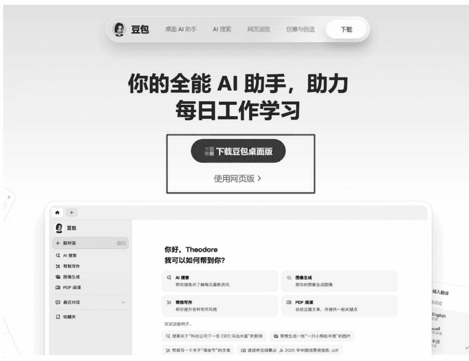

将安装包下载到本地后执行安装，完成后程序会自动启动。点击主界面右上角的“登录”进入账号登录或注册流程，如图4-3所示。

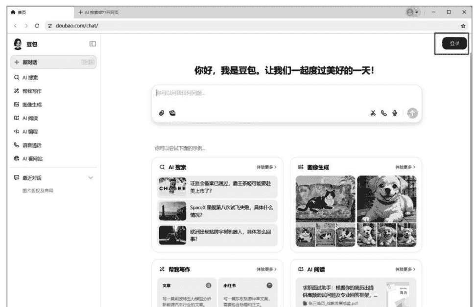

进入主界面后可见，豆包是一款功能完备的大模型应用，界面简洁，还支持截图、语音对话等交互方式，让人与AI的交流更自然。

第二步：在对话框里点按回形针图标，选择“上传文件”，如图4-4所示。

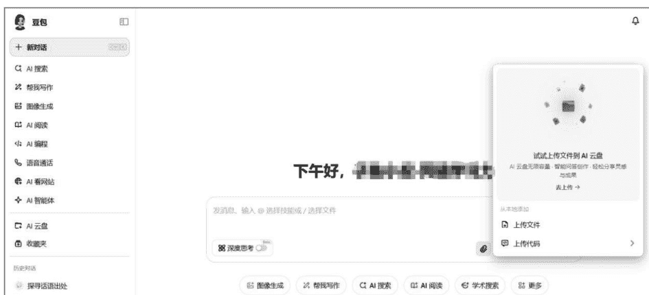

在本地找到需要翻译的文件，点击“打开”，如图4-5所示。

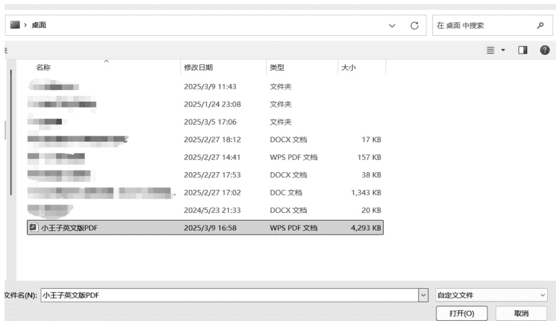

上传完成后如图4-6所示，可挑选系统推荐的提问或自行输入问题。提问后该文档会自动保存在豆包账号里。


第三步：从左侧功能栏打开“AI阅读”，如图4-7所示。

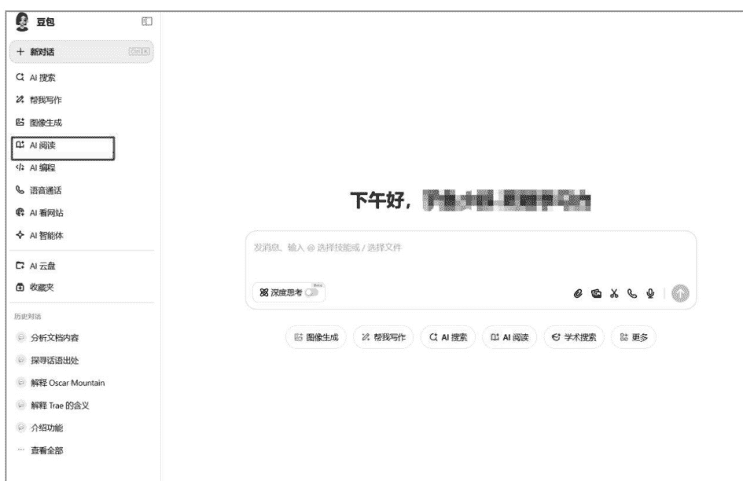

选定刚刚上传的那份文档，如图4-8所示。

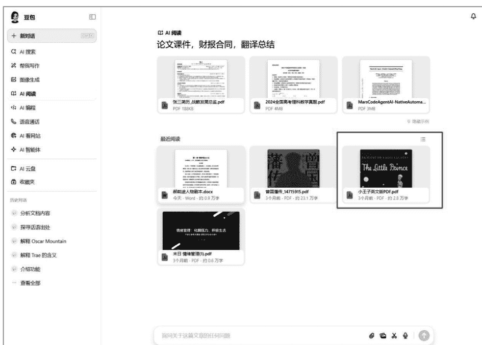

在新弹出的界面里点击“翻译全文”按钮，如图4-9所示。

- 与扳道工和商人的相遇：小王子先遇到扳道工，后者负责指挥列车运送乘客，却不明白乘客究竟在追求什么。小王子由此认为只有孩子才清楚自己在找寻什么。随后他遇见一位兜售解渴药丸的商人，商人宣称药丸能省下大把时间，小王子却表示若真有空闲，他宁可慢慢走向水源。

### 与飞行员的故事

- 飞行员坠机沙漠邂逅小王子。小王子向他倾诉自己的故事，相处间飞行员慢慢读懂了他的内心。在寻找水源的旅程中两人历经困顿，最终找到一口水井。饮水时小王子领悟到，水的甘甜不仅是生理上的解渴，更源于寻找途中付出的努力与美好的感受。

- 之后，小王子与蛇约定返回他抵达地球的地点。他觉得故乡星球离地球遥远，归途艰辛，却仍要回去照料那朵玫瑰，因为他肩负责任。飞行员心怀担忧，最后仍尊重了他的选择。小王子离去后，飞行员始终怀念他，经常仰望星空，想象他在星球上的日子，甚至担心绵羊会不会啃食玫瑰。他认为小王子带给了他诸多关于人生、友情与责任的启发。即便小王子已不在，他的印记永远留在飞行员心里。

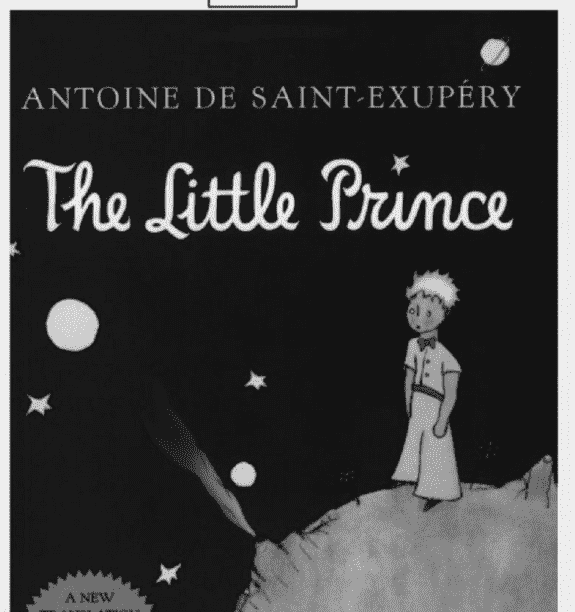

译文完成后即可查阅，也可在左侧对话窗口针对文档提出疑问，如图4-10所示。

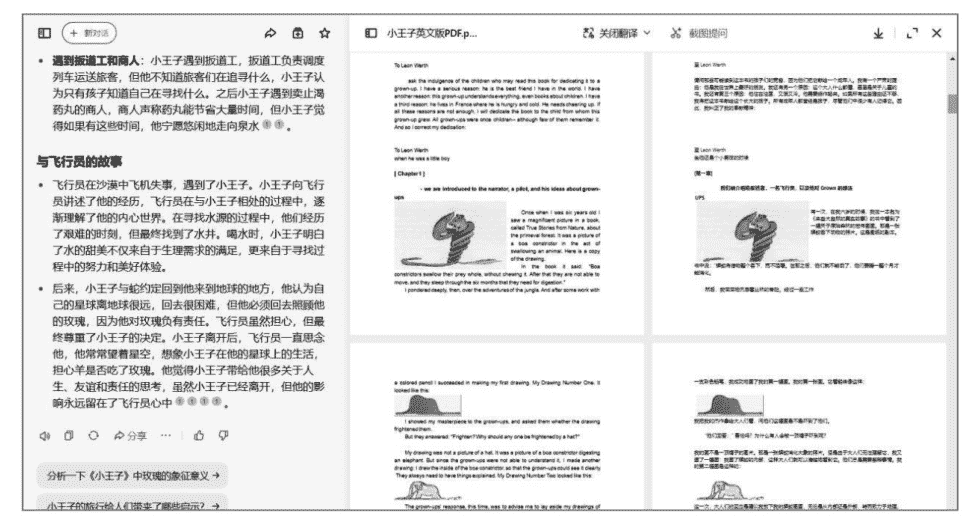

##### 3. 豆包划词即时翻译

电脑端启动豆包后，划词翻译会常驻后台运行，无论打开何种浏览器都能使用。

用鼠标左键拖拽选中需要翻译的词，弹出工具栏后点击“翻译”，即可看到如图4-12的译文。若想听发音，可点小喇叭图标朗读，也可在该界面继续追问。

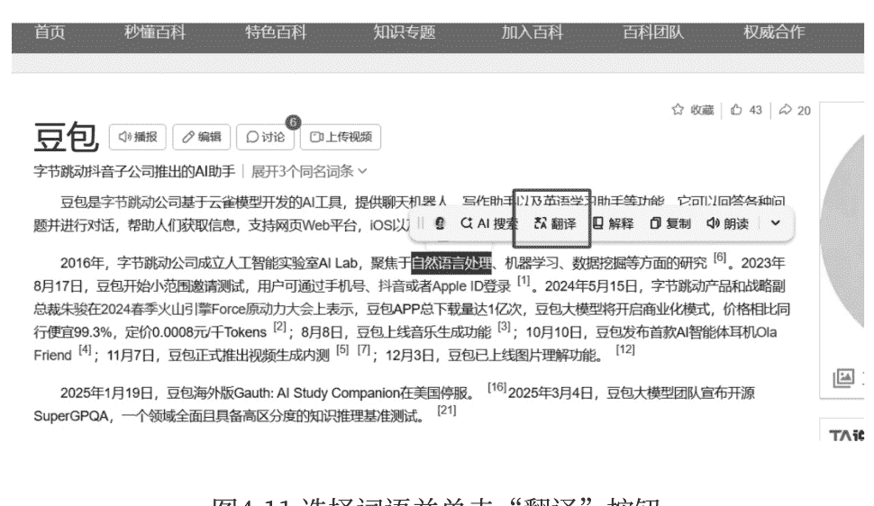

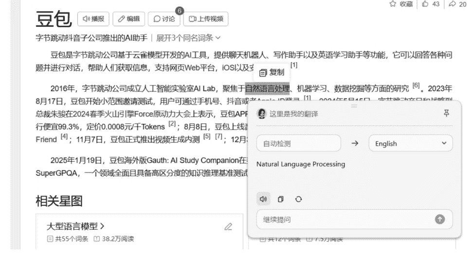

#### 4.1.3 英语学习

##### 1. 英语练习与语法修正

学习英语时善用AI工具，能有效提升语法能力。

例如，可将一篇英文作文交给DeepSeek进行语法校对。

**提问：** 你扮演一位资深英语教师，我带来一篇英文作文，请帮我指出并改正语法问题。

Hey there, guys! I want to share an awesome experience I had recently at our school's science fair. It was like stepping into a whole new world of wonders and discoveries!

First things first, the atmosphere was buzzing with excitement. The school gym was transformed into a science extravaganza, with colorful posters and impressive projects all around. The air was filled with the aroma of popcorn, which was the perfect snack for an adventure like this.

**DeepSeek：**

下面对你提供的作文做一些修正说明。

“Hey there, guys!” 作为口语化招呼没有问题，若想更正式可改为 “Hello, everyone!” 或 “Greetings, everyone!”。

“I want to share an awesome experience I had recently at our school's science fair” 表达正确。

“It was like stepping into a whole new world of wonders and discoveries!” 此处使用动名词结构即可，语义通顺。

“First things first, the atmosphere was buzzing with excitement.” 句子正确。

“The school gym was transformed into a science extravaganza, with colorful posters and impressive projects all around.” 时态上保持过去式即可。

“The air was filled with the aroma of popcorn, which was the perfect snack for an adventure like this” 表达准确。

##### 2. 英文对话练习

下面尝试与DeepSeek进行英文对话，练习自己的表达能力。

**提问：** 下面开始进行英文对话，请用英文回答我。当我出现语法错误时，请用中文提示我哪里出现了错误。

**DeepSeek：**

好的，我们开始英文对话。你可以提问或陈述，我会用英文回复；若发现语法问题，我会用中文提示错误位置。

**提问：** Ok, thanks for your help.

**DeepSeek：**

不客气！我随时待命。请继续提问或分享你的表达，我会竭力协助。

**提问：** May I have your attention, please? I would like to talk to you about our class.

**DeepSeek：**

你的句子中有拼写错误。“attion” 应为 “attention”。修正后为：

> “May I have your attention, please? I would like to talk to you about our class.” 注意单词 attention 的正确拼写。其他问题随时提出。

##### 3. 单词记忆

当我们遇到一些很难记忆的单词时，可以询问DeepSeek是否有更好的记忆方法，让它成为我们学习单词的助手。

例如，要记忆paradoxical、ambiguous、conundrum、synthesis、pseudonym这五个较为复杂的单词。

**提问：** 请你为paradoxical、ambiguous、conundrum、synthesis、pseudonym这五个单词分别提供一个有效的记忆方法。

## DeepSeek：

好的，下面给出每个词的记忆思路。

（1）paradoxical 自相矛盾的。可拆为 para- 与 dox，联想两人相对而立争论一个自相矛盾的谜团。

（2）ambiguous 模棱两可的。可拆为 ambi- 与 guous，ambi- 表双重，guous 类似 guess，想象在两种可能间猜测。

（3）conundrum 难题。可想象一个装着复杂问题的谜题盒子，需要不断破解。

（4）synthesis 综合。拆为 syn- 与 thesis，syn- 象两个图形合并，thesis 像论文，联想把不同元素合并成论点。

（5）pseudonym 假名。可以把 pseudo- 想象成戴面具，nym 像 name，联想用假名隐藏真实身份。

记忆方式因人而异，可根据自身习惯选择。

#### 4.1.4 内容辅助理解

##### 1. 对DeepSeek提问

对DeepSeek提问时，我们可以通过提示词控制回答的风格。例如，我们不理解自然语言处理是什么，就可以对DeepSeek提问“什么是自然语言处理”或“请用通俗易懂的语言解释自然语言处理的概念”。

**提问：** 什么是自然语言处理？

**DeepSeek：**

自然语言处理是计算机科学与人工智能交叉的分支，研究人与计算机用自然语言有效沟通的理论与方法。目标是让机器能理解、生成和处理人类语言，使人机交互更自然。

自然语言处理的主要任务

语言理解任务：

- 分词：将连续文本切分为有意义的词或词汇。例如中文“自然语言处理”切分为“自然/语言/处理”。
- 词性标注：为每个词标注词性，如名词、动词、形容词等。例如“跑”标注为动词。
- 命名实体识别：识别人名、地名、组织名等实体。例如“奥巴马是美国的前总统”中，“奥巴马”为人名，“美国”为地名。

自然语言处理：机器如何读懂人话

理解层面
语义解析：抓取句子背后真正想说的意思，要兼顾词与词之间的关联以及整句话的推理脉络。举例来说，遇到“我喜欢苹果”，模型得判断这里的苹果到底是指水果还是指品牌。
情绪判断：从文字里捕捉情绪倾向，分出积极、消极或中性。比如评论“这部电影太棒了，我非常喜欢”，会被判定为正向情绪。
跨语言转换：把一种自然语言自动换成另一种自然语言，最常见的就是把中文转成英文。

生成层面
内容创作：基于给定主题、关键词或上下文，自动产出连贯文字，比如新闻稿、短篇故事等。
智能提炼：从长文本里抽取出重点，形成简短概括，比如把一篇长报道压缩成一段精要。
会话交互：实现人与机器的对话能力，涵盖问答系统、聊天机器人等，Siri、小度这类语音助手就是典型代表。

落地场景
跨语种翻译：像 Google 翻译、百度翻译这类产品能迅速完成语言转换，推动全球信息互通。
情绪洞察：广泛用在营销策划、舆情监测等方向，通过解析用户点评和社媒文本把握受众态度。
智能客服：借助自然语言技术自动回复用户咨询，提升服务效率和质量，同时降低人力成本。
语音助手：苹果 Siri、亚马逊 Alexa 等，通过语音交互帮助用户设置提醒、查询信息等。
文本挖掘：在生物医学、金融等领域，从海量文本中提炼可用的知识与信息，辅助决策和研究。

**提问：** 请用通俗易懂的语言解释自然语言处理的概念。

**DeepSeek：**
自然语言处理，说白了就是教会电脑理解人类日常使用的语言。我们平时聊天、阅读文章，本质上都是在处理自然语言。这个研究方向就是探索如何让机器像人一样去理解并生成语言。

直白点讲，就是让机器听懂我们的表达，还能像人一样互动。比如用语音助手问今天天气，它能抓住你的意图给出回应；或者让它按要求帮你写段文案，它也能完成。

用提示词“什么是自然语言处理”得到的通常是偏学术、严谨的说明；用“请用通俗易懂的语言解释自然语言处理的概念”得到的则是更简化、更容易理解的表述。两种问法各有适用场景，按需选用即可。

##### 2. 用豆包划词解释

在电脑端打开豆包后，划词释义功能会一直后台运行，换浏览器同样可用。用鼠标左键拖拽选中想查询的词，点击弹出工具栏里的“解释”按钮，如图4-13所示，就能看到图4-14所示的释义界面，在此页面还能继续追问。


图4-13 选择词语并单击“解释”按钮

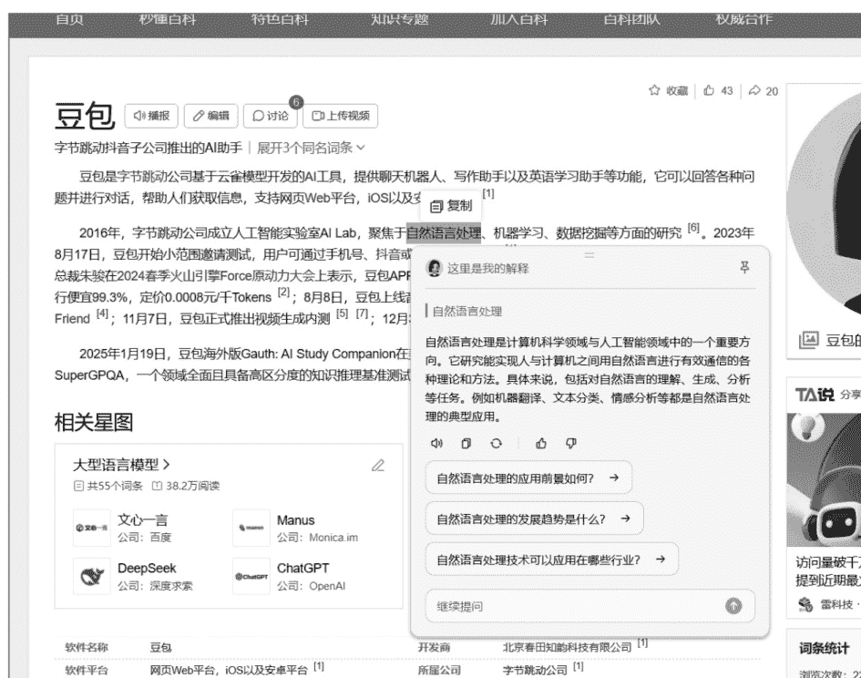

图4-14 解释效果

##### 3. 用豆包截图提问

遇到无法直接复制的文本，可以借助截图提问功能，具体操作如下。

第1步：进入豆包主界面，点击对话框下方的小剪刀图标，也就是截图入口，或使用默认快捷键Shift+Alt+A，如图4-15所示。

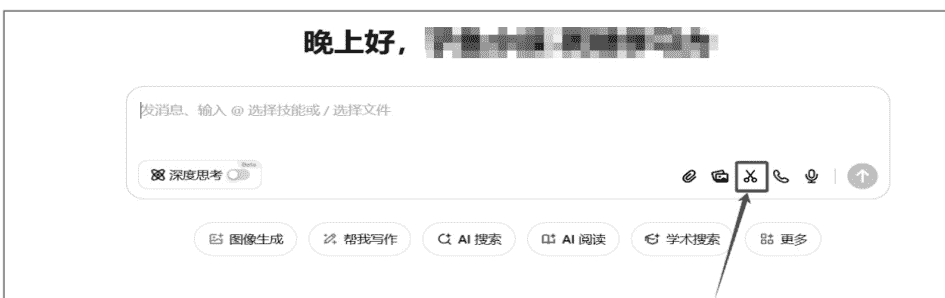

图4-15 单击对话框下方的剪刀图标

第2步：框选想提问的文本区域，在弹出的工具栏中点按“问问豆包”按钮，如图4-16所示。

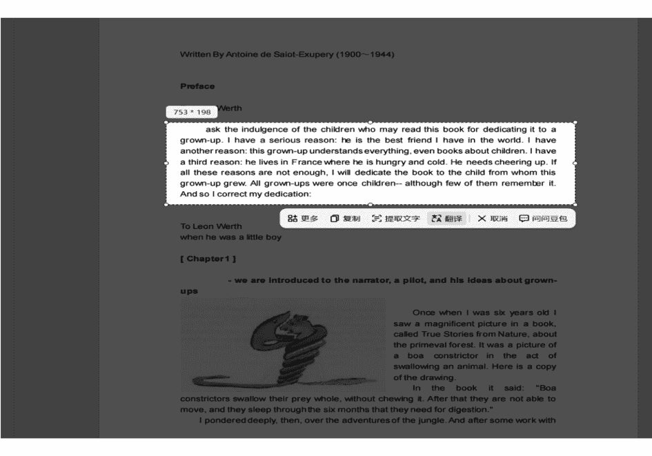

图4-16 框选要提问的文本并单击“问问豆包”按钮

第3步：回到豆包主界面后截图已上传，点击发送键“↑”，如图4-17所示。

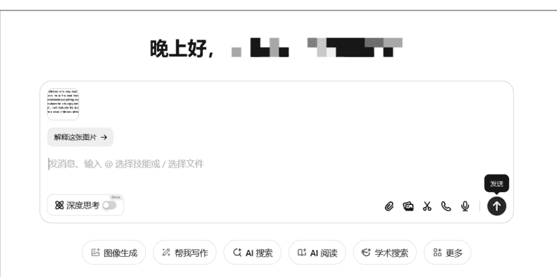

图4-17 发送截图

第4步：获取到关于该段文字的回答后，还能继续追问，如图4-18所示。

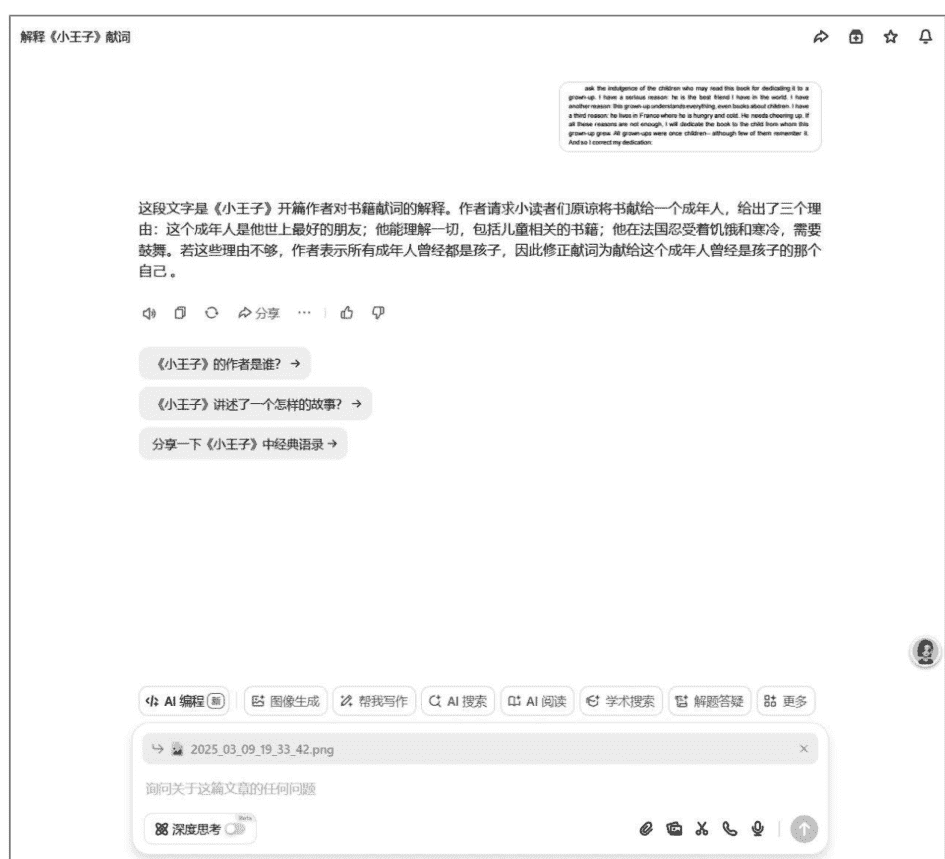

#### 4.1.5 图文及视频总结

##### 1. 视频总结

豆包可以为视频生成概要，操作流程如下。

第1步：在浏览器打开目标视频，页面右上方会看到“总结视频”按钮，点击它，如图4-19所示。

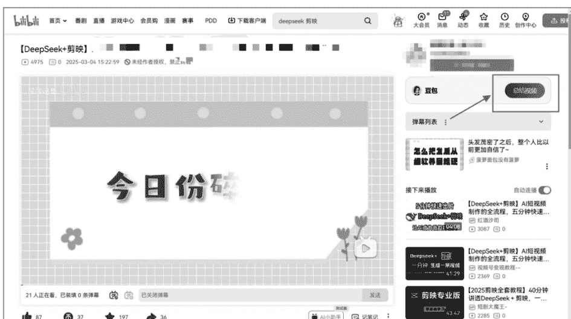

图4-19 单击“总结视频”按钮

第2步：即可浏览豆包生成的视频摘要，按需跳转观看，如图4-20所示。

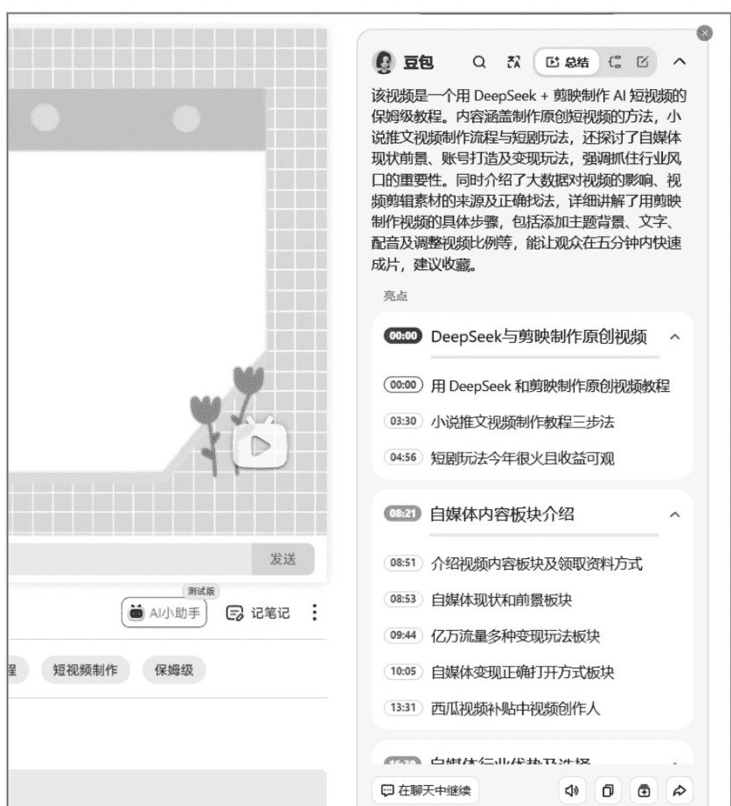

图4-20 豆包生成的视频总结

第3步：点击摘要界面上方的“脑图”按钮，如图4-21所示，可把视频摘要转为思维导图，效果见图4-22所示。


图4-21 单击“脑图”按钮

豆包


- 自媒体教程
  - 自媒体现状前景，了解行业好处。
  - 打造高收益账号，选择平台领域。
  - 亿万流量玩法多，零基础也能上手。
  - 正确打开变现方式，规划账号赚钱。
- 中视频创作补贴
  - 西瓜视频投 20 亿，补贴创作人。
  - 纯补贴不包括其他收入，探索新模式。
- 自媒体风口
  - 行业风口要抓住，错过时机难做起。
  - 站在风口猪能飞，看你愿不愿意。
- 平台选择与领域区分
  - 平台众多各不同，领域选择很关键。
  - 截图保存 30 多平台，日后都能用。
- 视频类型推荐
  - 大数据选视频，播放量才会高。
  - 推荐三类视频，剪辑解说混剪。
- 素材寻找方法
  - 多平台找素材，影视网站也可用。
  - 推广平台拿奖金，关键词找素材。
- 正确找素材方式
  - 片段十秒左右，避免搬运违规。
  - 按主题找片段，审核易通过。
- 用剪映制作视频
  - 确定主题人物，添加背景主题。
  - 选择文字模板，配音吸引用户。
- 视频比例调整
  - 横屏比例要记住，除抖音外 16:9。
  - 手动调整画面，裁剪字幕边框。
弹幕列表

图4-22 思维导图效果

第4步：点“下载”按钮，可保存图片、复制图片或复制富文本，后者可在思维导图软件中粘贴，我们这里选择“复制富文本”选项，如图4-23所示。


图4-23 选择“复制富文本”选项

第5步：打开思维导图工具如幕布、XMind，新建文件后按Ctrl+V粘贴复制的内容，如图4-24所示。

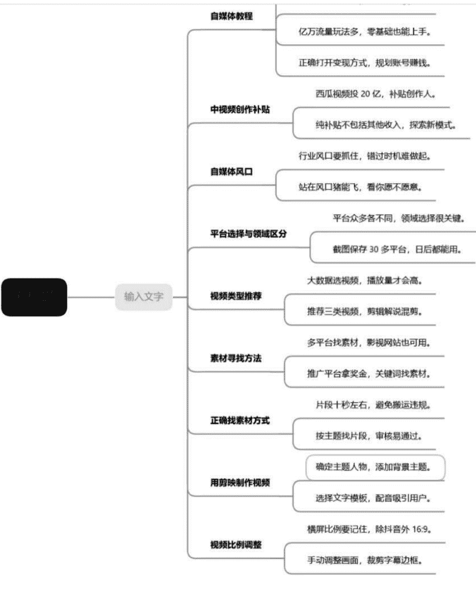

图4-24 将复制的内容直接粘贴到思维导图软件中

第6步：浏览器地址栏右侧同样提供“总结视频”“问问豆包”按钮，点击“问问豆包”如图4-25所示，就能围绕视频内容向豆包提问，如图4-26所示。


图4-25 单击“问问豆包”按钮

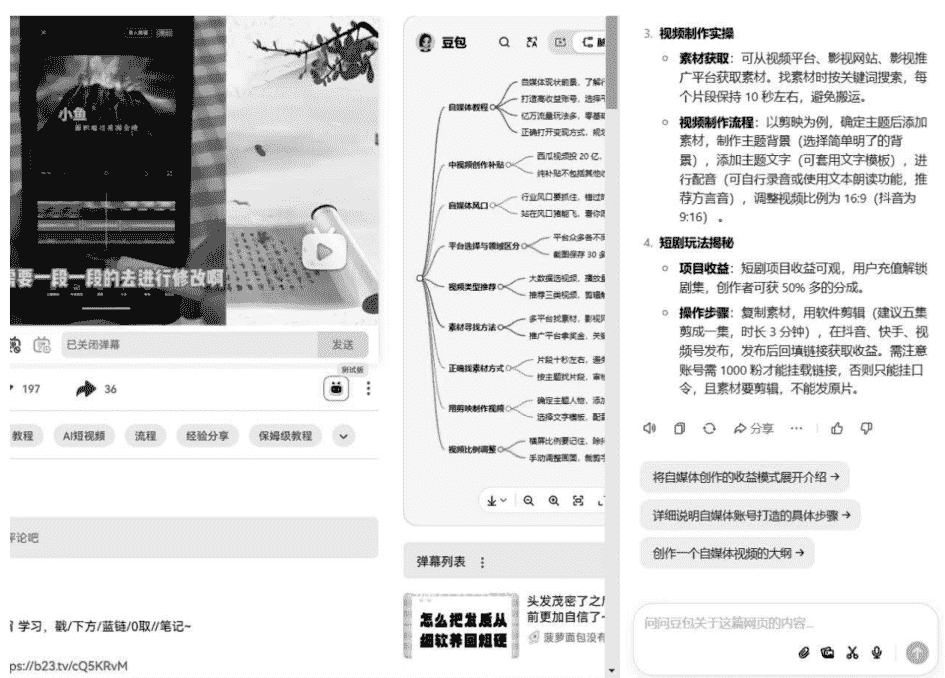

图4-26 围绕视频内容向豆包进行提问

##### 2. 图文总结

打开图文网页时可使用全文总结功能，具体步骤如下。

第1步：进入图文页面，地址栏右侧的“总结视频”会变为“总结全文”，点击“总结全文”按钮，如图4-27所示。

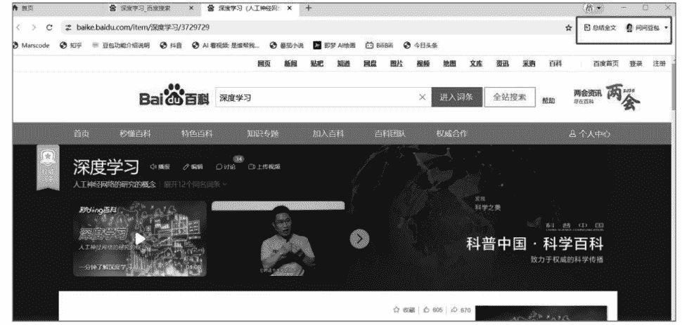

图4-27 单击“总结全文”按钮

第2步：等待豆包生成摘要后，可基于摘要继续提问，如图4-28所示。

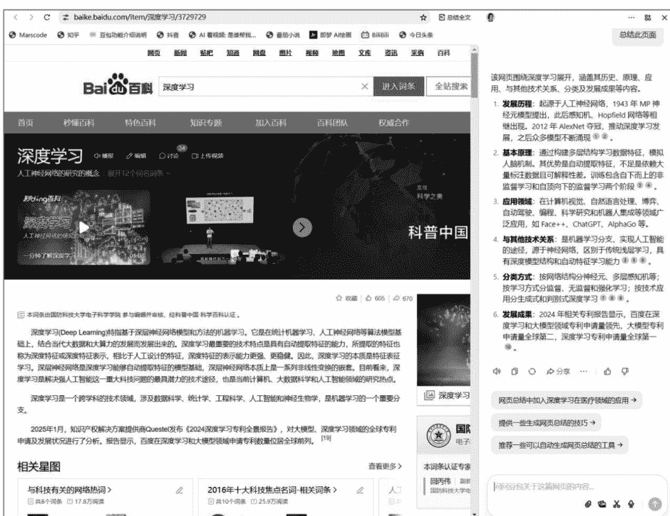

#### 4.1.6 进阶：费曼学习法实践

费曼学习法是通过用自己的话讲解复杂概念来检验和加深理解的高效学习方法。核心是把知识讲明白。AI普及后，可借助AI配合练习，具体步骤见表4-1。

表4-1 AI工具配合实践费曼学习法的步骤

| 步骤 | AI 工具可提供的帮助 | 提示词 |
| :--- | :--- | :--- |
| 学习概念本身 | 使用 AI 工具查询定义 | 请问 ×× 的定义是什么 |
| 用通俗易懂的语言解释 | · 让 AI 工具用通俗易懂的语言解释<br>· 根据自己的理解重新类比解释 | · 能不能用通俗易懂的语言解释<br>· 我是否可以这样理解…… |
| 回顾自己的解释，寻找遗漏 | 让 AI 工具评价类比是否合理 | 我是否可以这样类比…… |
| 补充遗漏，进一步简化、优化表达 | 进一步优化表达，让 AI 工具再次评价是否合理 | 那么我重新类比一下……是否合理 |

以 DeepSeek 作演示，费曼学习法可分为四步。

第1步：掌握概念本身。
向 DeepSeek 请教某个概念的定义。它会给出完整解释，阅读后尝试理解。但因定义较为专业，往往仍难以吃透。

第2步：用易懂语言复述。
让 DeepSeek 用通俗方式解释该概念。理解后尝试按自己的认识做类比说明，这是费曼法的关键，能帮助深化认知。

第3步：复盘解释找缺口。
不必自己判断类比是否恰当，直接请 DeepSeek 评估。若表述与原意有出入，它会指出问题。

第4步：完善并优化表达。
根据反馈补充遗漏，进一步精简和优化表述，必要时继续做类比并请 DeepSeek 评判合理性。

下面以“非线性问题”为例实操。

**提问：** 请问非线性问题的定义是什么？

**DeepSeek：**
非线性问题指在数学、物理、工程等领域，输入与输出不满足线性关系的一类问题。相较线性问题，非线性问题性质更复杂，行为更难以预测，通常需要数值或近似方法求解。

非线性问题的分类
数学领域
非线性方程：形如\[f(x) = 0\]的方程，其中\[f(x)\]为非线性函数。例如二次方程、三次方程等。
非线性微分方程：含未知函数及其导数的非线性关系微分方程。例如，\[ \frac{dy}{dx} = y^2 \]。
非线性偏微分方程：涉及多个自变量的非线性偏微分方程。例如非线性波动方程。
物理领域
非线性光学：研究光在非线性介质中的传播特性，如二次谐波产生、光孤子等。
非线性力学：研究物体在非线性弹性、塑性状态下的力学行为，如非线性振动、混沌运动等。
非线性动力学：研究系统在非线性相互作用下的动力学行为，包括分岔、混沌等现象。
工程领域
非线性控制理论：研究非线性系统的控制问题，如非线性控制器设计、稳定性分析等。
非线性电路理论：研究含非线性元件如二极管、晶体管的电路特性。
非线性结构工程：研究结构在非线性材料、几何非线性条件下的力学行为，如大变形、屈曲等。
非线性问题的求解方法
解析方法
摄动法：引入小参数，把非线性问题近似为一系列线性问题求解。变分法：利用变分原理把非线性问题转为优化问题求解。
积分变换法：通过积分变换把非线性微分方程化为代数方程求解。
数值方法
有限差分法：将连续非线性微分方程离散为有限差分方程组求解。
有限元法：将复杂非线性问题区域划分为有限单元进行近似求解。
谱方法：利用正交函数展开近似求解非线性微分方程。
非线性问题的应用
非线性问题在科研与工程实践中应用广泛。物理学中非线性光学为激光技术发展提供理论基础；工程中非线性控制理论被用于机器人、航天等领域；生物学中非线性动力学模型用于研究种群演化与生态系统稳定性。

**提问：** 能不能用通俗易懂的语言来解释什么是非线性问题？

**DeepSeek：**
简单说，非线性问题就是“变化不成比例”的问题。

比如水果摊苹果每斤5元。买1斤付5元，买2斤付10元，这种总价随重量等比例增长就是线性关系。

如果单价会随购买量变化，就变成非线性了。假设买1斤单价5元，买2斤单价涨到6元，买3斤单价变成7元。这时总价与重量的关系不再是固定比例，而是单价随数量一起变化。

再如开车时车速与刹车距离的关系。理想状态下车速越高刹车距离越长，但不是简单线性，车速翻倍刹车距离可能增至四倍，因为涉及动能、摩擦力等非线性因素。所以非线性问题指输入输出之间不是直线或固定比例的关系，变化更复杂、难以预测。

**提问：** 我是否可以这样理解，苹果单价5元/斤，我买了1斤是5元，2斤是10元。苹果价格永远是“5元×斤数”，这是线性问题。如果苹果5元/斤，我买了3斤，老板收了我12元，给我了打了个折，就是非线性问题。现实生活是复杂多变的，包含着很多的变量，所以现实生活中的问题绝大部分都是非线性问题。

**DeepSeek：**
是的，你的理解很准确。

线性问题可概括为“单价恒定，总价=单价×数量”这种按比例变化的关系。非线性问题则是“单价不固定，会随数量等其他因素变动”，导致总价与数量的关系不再是简单乘法，可能呈现更复杂的模式。

现实世界中变量交织、相互影响，很难用纯线性关系描述所有现象，因此非线性问题在实际生活中更为普遍。

#### 4.1.7 用AI制作思维导图

AI也能助力笔记整理。例如与 ChatGPT 交流后想记录要点，可用思维导图导出到本地。总共三步。

第1步：输入主题并给出指令。
示例指令：请为我创建一个多层次的思维导图，其内容包括至少5个分支主题。同时，为每个分支主题添加至少2个子主题，并在需要的情况下为子主题添加更多层次的子主题，不要在主题前写层级数字，内容要尽可能详细。使用Markdown格式来呈现思维导图。如图4-29所示。

## ChatGPT如何帮助我们提升学习效率

- 提供学习资源
  - 推荐学习材料
    - 书籍
    - 学术论文
    - 文章和博客
  - 分享学习链接
    - 在线教育平台
    - 学习网站和应用
- 解答问题与澄清疑惑
  - 提问关于学习的问题
    - 学科知识
    - 学习方法
  - 澄清不明确的概念和观念
    - 解释专业术语
    - 提供实例和案例分析
- 提供学习策略和建议
  - 制定学习计划
    - 目标设定
    - 时间管理
  - 探索学习方法
    - 记忆技巧
    - 阅读和笔记方法
- 鼓励自主学习和思考
  - 激发学习兴趣
    - 分享有趣的学习话题和资源
    - 推荐学科相关的书籍和电影
  - 提供启发性问题
    - 引导思考和探索
    - 促进创造性思维
- 与其他学习者交流和合作
  - 学习讨论和分享经验

## 图4-29 输入思维导图的主题和指令

第2步：在Online Markdown Editor网站导出Markdown文件。
（1）打开Online Markdown Editor网站，点击左侧输入框，按Ctrl+A全选后按Delete清空内容，如图4-30所示。

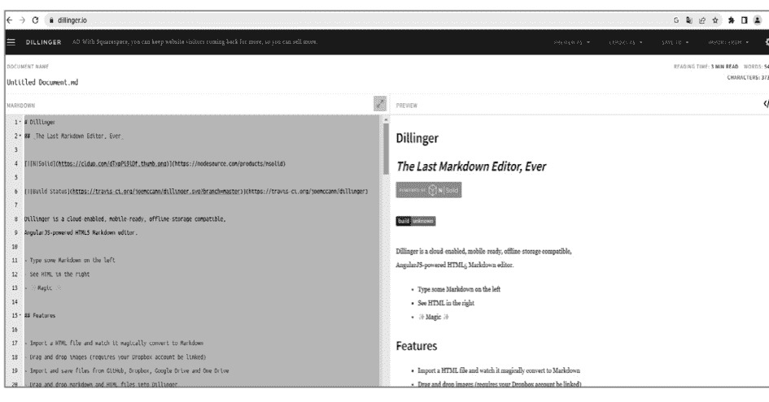

## 图4-30 在Online Markdown Editor中删除原文本

（2）在ChatGPT页面中，点击“Copy code”按钮，如图4-31所示。

下面是关于“ChatGPT如何帮助我们提升学习效率”的多层次思维导图，包括了5个分支主题和相应的子主题：

```
## ChatGPT如何帮助我们提升学习效率

- 提供学习资源
  - 推荐学习材料
    - 书籍
    - 学术论文
    - 文章和博客
  - 分享学习链接
    - 在线教育平台
    - 学习网站和应用
- 解答问题与澄清疑惑
  - 提问关于学习的问题
    - 学科知识
    - 学习方法
  - 澄清不明确的概念和观念
    - 解释专业术语
    - 提供实例和案例分析
- 提供学习策略和建议
  - 制定学习计划
    - 目标设定
    - 时间管理
  - 探索学习方法
    - 记忆技巧
    - 阅读和笔记方法
- 鼓励自主学习和思考
  - 激发学习兴趣
```

图4-31 在ChatGPT页面中单击“Copy code”按钮

(3) 按快捷键Ctrl+V，将复制的内容粘贴到Online Markdown Editor中，选择“EXPORT AS”中的“Markdown”选项，如图4-32所示。

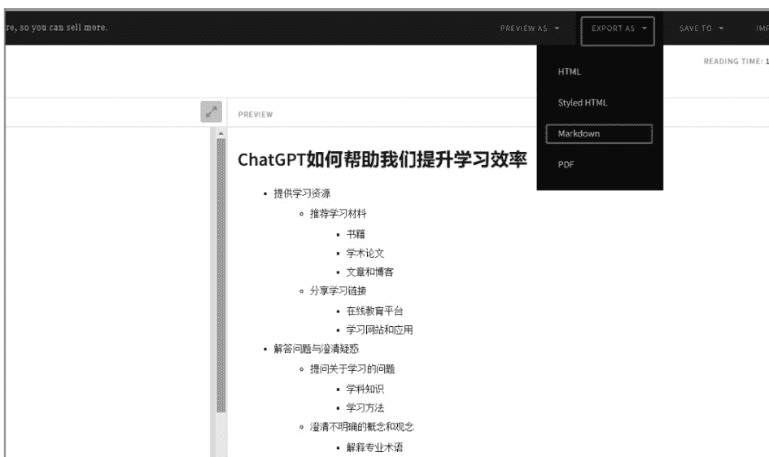

图4-32 在Online Markdown Editor中导出Markdown格式文件

第3步：在XMind中打开。
（1）启动XMind程序，新建一个思维导图文件，如图4-33所示。

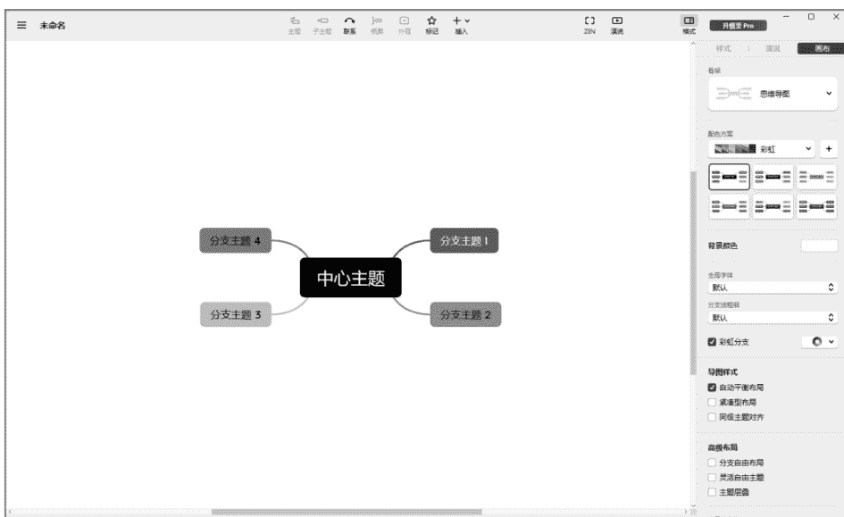

图4-33 打开XMind新建一个思维导图文件

**注意：** 目前只有2023以上版本的XMind支持导入Markdown格式文件。

第二步，打开菜单栏依次进入 文件 - 导入 - Markdown，把 Online Markdown Editor 导出的 .md 文档载入系统，操作界面可参考图4-34。


## 图4-34 Markdown文件导入界面

第三步，载入完成后，思维导图会直接展示出来，效果如图4-35。

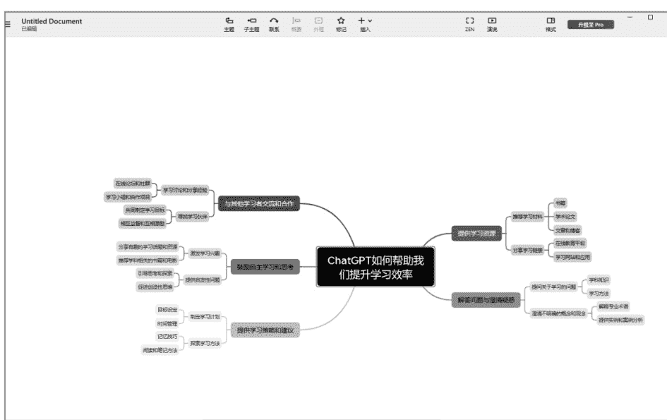

## 图4-35 思维导图展示效果

**提示：** 实际使用时可根据需要自由切换思维导图视图或大纲视图来呈现文档。

### 4.2 让AI成为目标管理的协作者

目标管理是一种系统化的方法，用来设定、追踪和最终达成个人或组织的期望结果。它强调把目标说清楚、把指标量化、通过计划执行评估等环节来持续管控达成过程。

它的核心在于让行动和期望结果保持一致，从而更高效地用好时间与资源。目标管理能帮助我们更清晰地看见想去的方向，并提供衡量进展的标尺。

举个例子，学一项技能、完成一个工作任务是个人层面的小目标；升职加薪、实现财务自由则是个人层面的大目标。完成一个团队项目是组织层面的小目标，落地公司战略则是组织层面的大目标。

它可用于个人、团队和组织三个层面，能帮助我们更好地做规划、做安排，推动个体潜能、促进协作、保持聚焦、优化资源配置，提升整体执行力。

#### 4.2.1 目标管理是怎样跑通的

想让AI在目标管理上真正发挥作用，先要搞清楚目标管理的运行路径，这样才知道AI能在哪些环节介入。

表4-2概括了目标管理的流程，下面以“如何升职加薪”作为案例来说明。

表4-2 目标管理的流程表

| 阶段 | 说明 | 举例 | AI可提供支持 |
| :--- | :--- | :--- | :--- |
| 确定目标 | 把想要达成的结果明确下来，并与组织愿景战略保持一致 | 升职加薪、提升销售额等 | 给出目标设定的思路，比如如何写具体可衡量的目标，如何与公司方向对齐等 |
| 制订计划 | 为每个目标拆解成可执行的方案，包含资源、时间线和里程碑 | 制定升职加薪方案，包含了解晋升机制、评估自身能力、安排时间表等 | 给出计划制定的方法指导，比如如何细化步骤、如何分配任务与资源 |
| 分配责任 | 把任务分给相关个人或团队，并确认职责与期望 | 将升职加薪方案的执行分给上级、同事、下属 | 给出分工沟通的建议，比如如何对齐、如何确保每个人清楚职责 |
| 跟踪进度 | 定期复盘进展，发现问题并及时纠偏 | 定期向领导汇报工作进展，及时解决执行中遇到的问题 | 给出进度管理的建议，比如如何搭建沟通机制、如何识别与解决风险 |
| 评估结果 | 目标完成后复盘成效，找出现需优化的地方 | 升职加薪未达成时重新梳理原因并调整方案 | 给出复盘建议，比如如何分析失败原因、如何制定改进计划 |

所有主流大模型的对话逻辑基本一致，只是功能略有差异。接下来用不同工具演示：用讯飞星火做个人目标管理，用DeepSeek做团队目标管理。

#### 4.2.2 个人目标管理的实操演示

1. 目标设定阶段

目标设定包含三个关键点：明确目标、确定关键结果、设定截止时间。

假设我们想在两个月内学会弹奏吉他。

第一步，先校准认知。为了确认讯飞星火对“目标管理”的理解是否到位，可以先问一句：你了解目标管理吗？

**提问：你了解目标管理吗？**

**讯飞星火：**

我知道。目标管理是通过设定、追踪和评估目标来确保个人或组织朝着既定方向前进。其基本流程如下：

1. 设定目标：目标要明确具体可衡量，且与个人或组织愿景使命战略一致。
2. 制订计划：为达成目标制定详细行动方案，包含任务、资源、截止时间及责任人。
3. 沟通与共享：把目标和计划传达给相关成员，提升共识与参与度。
4. 监测与测量：建立指标定期评估进展，及时调整行动。
5. 反馈与改进：提供正向反馈和建设性建议，识别问题并纠偏。
6. 评估与奖励：定期复盘成果，根据绩效给予相应激励。
7. 调整与迭代：根据实际情况优化目标，保持与整体方向一致。

通过目标管理，能更有效地追踪目标、合理使用资源、提升绩效。

如果理解一致就进入下一步，不一致则通过对话纠正。

第二步，设定角色，采用RBRP模型提出清晰需求。

**提问：** 从现在开始，你是一名资深的目标管理顾问，我希望你按目标管理的逻辑帮我制定目标并给出建议。我是吉他零基础小白，希望在两个月内学会基础吉他弹奏。

**讯飞星火：**

制定目标时可用SMART原则确保清晰可衡量：具体、可衡量、可实现、相关、有时限。

结合你的情况，想在两个月内学会基础吉他。按SMART原则可这样拆解：

1. 具体：明确要学会什么，比如弹唱几首简单歌曲、掌握基础和弦或简单旋律。
2. 可衡量：通过记录进展追踪，比如每周学会的歌曲数或掌握的和弦数。
3. 可实现：结合起点水平和每周可投入时间，确保目标合理。
4. 相关：目标要与个人兴趣和长期发展相关，吉他学习对你是否有意义。
5. 有时限：在两个月内完成基础弹奏。

一个可行目标是：两个月内每周练琴至少5小时，能流畅演奏5首简单歌曲，并熟悉常用和弦与基础技巧。

**建议：**

(1) 制定具体学习计划：把每周时间分配到和弦、指法、旋律、歌曲练习上，确保反复巩固。
(2) 找合适的学习资源：在线教学平台、教学视频、教材或找老师辅导都能提供系统指导。
(3) 坚持练习并及时反馈：每次练习预留时间做自我评估，保持耐心。

讯飞星火不仅给出建议和目标，还主动引入了SMART原则，并反问“你希望学会哪种具体技能”“吉他对你发展是否有意义”等问题来判断提问是否有效，说明它已进入目标管理顾问角色。

为了让目标更精准，需要补充个人情况进一步细化。

**提问：** 两个月后公司年会，我希望能在年会上弹唱一首歌。

**讯飞星火：**

很好，目标更具体了。针对年会演出，可以做如下细化：

(1) 选择合适歌曲：选一首你熟悉且两个月内能学会的曲目，难度要匹配当前水平。
(2) 设定学习目标：根据曲目难度和可用时间，制定周计划。把歌曲拆成小节逐步攻克。
(3) 每周练习时长：建议每周至少5小时专项练习，分别用于吉他部分和演唱训练。
(4) 获取专业指导：条件允许可找吉他老师或音乐教练提供技巧和反馈。
(5) 录音自评：录下练习过程，方便对照水平和发现问题。
(6) 小规模演练：学习期间争取在小型场合演练，提升实战和自信心。
(7) 持续练习与反馈：通过不断练习和他人建议持续改进。

注意达成目标需要坚持和耐心，按计划训练就能在年会展示成果。祝成功！

从提示中能看到可执行的路径，其中部分可继续请AI完善。

(1) 明确曲目：可请AI帮忙挑选。
(2) 细化学习目标：说明每周可用时间，请AI拆分曲目。
(3) 练习方式：弹奏与演唱分开训练。
(4) 反馈方式：老师指导、录音自评、实战演练。

2. 计划阶段

需要让AI生成一份可执行的日程表。

第一步，明确学习内容。本案例即确定曲目和所需和弦。

**提问：** 请推荐10首适合初学者的中文流行吉他弹唱歌曲。

**讯飞星火：**

以下10首适合入门练习：

1. 《小幸运》
2. 《演员》
3. 《岁月神偷》
4. 《成全》
5. 《说散就散》
6. 《匆匆那年》
7. 《像我这样的人》
8. 《后来》
9. 《爱情转移》
10. 《红日》

这些歌旋律好记，和弦难度低，适合新手练习。

之后可从中挑选一首作为学习目标。提问时越具体，误差越小。

第二步，进一步明确需求，让AI输出学习计划表并可调整。

**提问：** 以两个月学会《小幸运》并能登台表演为目标，帮我重新制定计划。

**讯飞星火：**

好的，以下是以两个月学会《小幸运》并上台表演为目标的计划。

**第1周：**
1. 每天练琴30分钟，重点练和弦、单音、节奏。
2. 看《小幸运》教学视频学习弹唱技巧。
3. 尝试弹唱，记录练习效果。

**第2周：**
1. 每天45分钟，加强和弦、单音、节奏掌握。
2. 继续观看教学视频深化技巧。
3. 慢速完整弹唱，注意音准与节奏。

**第3周：**
(1) 每天60分钟，加强指法与换弦练习。
(2) 学习更高阶表现技巧。
(3) 原速完整弹唱，注意情感表达与舞台表现。

**第4周：**
(1) 每天75分钟，继续强化指法与换弦。
(2) 参加一次小型演出锻炼舞台表现与信心。
(3) 复盘前三周成果，查漏补缺。

**第5～8周：**
(1) 保持每日练习，提升技能与舞台表现。
(2) 多参加演出积累经验。
(3) 最后一周全面复习，调整细节，确保能表演。

以上仅供参考，可根据个人情况微调，保持坚持。

线性表述不够直观，可要求AI用表格呈现，如图4-36所示。

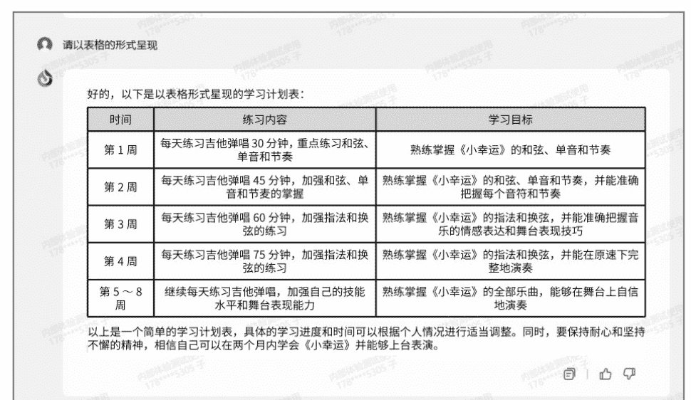

在这个过程中发现行动计划不够明确，不知道具体练哪些和弦，可以继续提出需求，如图4-37所示。

学习目标需要更细化，比如要掌握哪些和弦、单音、节奏。

好的，以下是按需求优化后的计划表：

| 时间 | 练习内容 | 学习目标 |
| :--- | :--- | :--- |
| 第 1 周 | 每天练琴30分钟，重点练和弦、单音、节奏 | 熟练掌握《小幸运》使用的C、G、Am、F四个和弦 |
| 第 2 周 | 每天45分钟，加强和弦、单音、节奏掌握 | 能准确把握每个音符与节奏，熟练使用C、G、Am、F |
| 第 3 周 | 每天60分钟，加强指法与换弦练习 | 熟练各位置换弦，掌握情感表达与舞台表现技巧 |
| 第 4 周 | 每天75分钟，加强指法与换弦练习 | 能原速完整演奏C、G、Am、F和弦变化 |
| 第 5 ～ 6 周 | 继续每日练习，提升技能与舞台表现 | 能自信演奏整曲并准确表达音乐情感 |
| 第 7 周 | 参加一次小型演出或表演活动 | 在小型场合展示演奏，获得反馈与认可 |
| 第 8 周 | 全面复习与准备，调整细节 | 完成曲目细节打磨与舞台安排，确保能表演 |


3. 执行阶段

可用日程工具如滴答清单或印象笔记提醒任务完成。

第一步，下载滴答清单。可选网页、PC或手机版，推荐手机版方便提醒。

第二步，新建清单任务。
（1）打开滴答清单新建任务清单，如图4-38所示。
(2) 新建名为“吉他学习计划”的清单并保存，如图4-39所示。
图4-38 新建任务清单
图4-39 设置清单名称为“吉他学习计划”
（3）在左侧选择新建清单，右侧输入日程安排，如图4-40所示。
图4-40 输入具体日程安排

第三步，在滴答清单中设置任务。
（1）把讯飞星火的练习内容逐项复制粘贴到滴答清单，系统会自动识别时间，如图4-41所示。
图4-41 逐项复制练习内容并粘贴到滴答清单中
（2）在清单视图中设置第一个月的学习计划，如图4-42所示。
图4-42 设置吉他学习计划（清单视图）
（3）点击左侧“日历”图标进入日历视图，可查看当月计划，如图4-43所示。
图4-43 在日历视图中查看设置好的吉他学习计划
（4）打开手机版滴答清单，可同步查看每日任务，如图4-44所示。

今天
☐ (6月1日到6月7日) 每天练习吉他弹唱30分钟，重点练习和弦、单音和节奏。
6月1日 - 6月7日 🔄 吉他学习计划（教学案例）
打卡
+   - 每天记账
- 完成3篇文章
- 每天练琴10分钟
- 每周3次运动
已完成
☑ 周一晚上贴发票处理报销
2月23日, 下午08:00 收集箱

图4-44 在滴答清单手机版中同步查看每日任务情况

第四步，及时反馈进度并调整计划。

先与讯飞星火约定会及时沟通，以便动态调整。

**提问：** 以后我会及时汇报学习进度，请你据此帮我调整计划。

**讯飞星火：**

太好了，我很乐意随时听取你的进展并帮你优化计划。请随时更新，我们一起加油！

执行中及时沟通进度，询问是否需要调整，并根据新计划更新表格。

**提问：** 今天是第三天练习，按和弦时手指很疼，要不要调整计划？

**讯飞星火：**

手指疼痛通常是肌肉尚未适应。建议先停练一段时间让手指恢复。可尝试以下方法缓解：

+   (1) 轻柔按摩手指，促进血液循环缓解疲劳。
(2) 拉伸手指至最大限度保持几秒后放松，缓解僵硬。
(3) 热敷或冷敷，肿胀用冷敷，僵硬用热敷。可考虑换更柔软的弦或更小的琴减轻压力。

同时可调整计划，减少练习时长或增加休息。不要强行练习，需结合身体状况制定合理方案。

需要注意的是，AI上下文能力强但有时效性，隔几天再聊可能“失忆”。这时可请它回顾对话内容。具体做法是告诉它回顾的时间段，它会提供相关记录。

**先限定时间窗口**
和模型对话时，先说清楚想追溯的区间，比如最近七天或三十天，让检索边界更明确。

**再给出关键词锚点**
补充几组能锁定主题的词或短语，帮助模型快速定位对话内容。
例如可以这样问：“麻烦梳理近三十天关于吉他练习方案的交流要点。”

#### 4.2.3 团队目标协同管理
团队目标与个人目标的核心差异在于参与人数与协作强度。个人目标基本一人推进，重在自我跟进；团队目标需要多人分工，沟通成本更高，必须保持步调一致。

以一个实操案例说明：和团队约定三十天内在网络上发布一套课程，并借助 DeepSeek 来做团队目标管理。

##### 1. 方向确认阶段
团队目标管理同样要完成三件事：明确目标、拆解关键结果、确定截止时间。

一般来说团队目标比较直观，比如业绩提升20%、完成100单、数据突破100万。本案例的目标是“上线一套课程”，节点是一月后，关键结果是“课程顺利上线”，目标清晰，可以进入下一步规划。

##### 2. 方案制定阶段
第1步：设定角色并提出需求
提问：从现在起你担任我的项目规划伙伴，我想用三十天在网上推出一套课，请列出需要完成的工作清单？
DeepSeek 给出了一份覆盖面较广的清单，包括目标与范围确认、排期、资源评估、教材编写、多媒体制作、互动设计、测试修订、平台选型与配置、市场推广、上线与监控等环节。

在对话中发现部分环节不适用，于是进一步说明情况要求精简。
提问：请做简化，我要的是在线微型课程，不带互动，单节控制在十分钟左右，上限十五节。
DeepSeek 回复了精简版清单，包含确认主题与受众、制定排期、编写大纲、准备文案与提纲、制作演示稿、在 线拍摄与剪辑、封面与宣传素材设计、平台选择、上传与信息设置、试看、推广、上线监控与迭代等十二项。

第2步：表格化呈现并估算工期
提问：请把任务整理成表格，列依次为序号、工作项目、工期，工期请自行判断。
DeepSeek 给出如下计划：

| 序号 | 工作项目 | 工期 |
| :--- | :--- | :--- |
| 1 | 确定课程主题和目标受众 | 2 天 |
| 2 | 制定时间表并设定上线截止日期 | 1 天 |
| 3 | 编写课程大纲，确定每节课的内容和顺序 | 2 天 |
| 4 | 课程文案编写 | 10 天 |
| 5 | 视频录制和制作 | 10 天 |
| 6 | 设计课程封面和宣传素材，吸引学员 | 2 天 |
| 7 | 选择合适的在线学习平台或视频分享平台托管和交付课程 | 2 天 |
| 8 | 上传视频和教学材料至平台，设置课程信息和价格（如有） | 1 天 |
| 9 | 进行测试观看，确保视频和材料的质量与可用性 | 1 天 |
| 10 | 进行宣传和推广，利用社交媒体和其他渠道吸引学员 | N/A |
| 11 | 上线课程并监控学员的学习进度和反馈 | N/A |
| 12 | 根据学员反馈和需要进行修订与改进 | N/A |

第10至12项属于持续性工作，工期标注为N/A。若工期不合理，可逐项说明调整，例如“第3项改为3天”。

第3步：在表中增加负责人
团队共三人：张三负责课程内容，李四负责拍摄与剪辑，王五负责宣传推广，其余工作由三人共同承担。
提问：在工期后增加“负责人”一列，并按上述分工分配。
DeepSeek 初步分配后提出修正：
提问：课程文案编写由张三负责，封面与宣传由王五负责，第3项由张三负责，第7至8项由王五负责。
修正后表格如下：

| 序号 | 工作项目 | 工期 | 负责人 |
| :--- | :--- | :--- | :--- |
| 1 | 确定课程主题和目标受众 | 2天 | 张三 |
| 2 | 制定时间表并设定上线截止日期 | 1天 | 共同 |
| 3 | 编写课程大纲，确定每节课的内容和顺序 | 2天 | 张三 |
| 4 | 课程文案编写 | 10天 | 张三 |
| 5 | 视频录制和制作 | 10天 | 李四 |
| 6 | 设计课程封面和宣传素材，吸引学员 | 2天 | 王五 |
| 7 | 选择合适的在线学习平台或视频分享平台托管和交付课程 | 2天 | 王五 |
| 8 | 上传视频和教学材料至平台，设置课程信息和价格（如有） | 1天 | 王五 |
| 9 | 进行测试观看，确保视频和材料的质量与可用性 | 1天 | 共同 |
| 10 | 进行宣传和推广，利用社交媒体和其他渠道吸引学员 | N/A | 王五 |
| 11 | 上线课程并监控学员的学习进度和反馈 | N/A | 共同 |
| 12 | 根据学员反馈和需要进行修订与改进 | N/A | 共同 |

第4步：补充开始与结束日期
提问：在工期后增加开始日期和结束日期两列，项目从2023年6月1日启动，视频录制与制作比文案编写晚三天开始，封面设计与文案编写同步开始。
DeepSeek 调整后表格如下：

| 序号 | 工作项目 | 工期 | 开始日期 | 结束日期 | 负责人 |
| :--- | :--- | :--- | :--- | :--- | :--- |
| 1 | 确定课程主题和目标受众 | 2 天 | 2023-06-01 | 2023-06-02 | 张三 |
| 2 | 制定时间表并设定上线结束日期 | 1 天 | 2023-06-03 | 2023-06-03 | 共同 |
| 3 | 编写课程大纲，确定每节课的内容和顺序 | 2 天 | 2023-06-04 | 2023-06-05 | 张三 |
| 4 | 课程文案编写 | 10 天 | 2023-06-06 | 2023-06-15 | 张三 |
| 5 | 视频录制和制作 | 10 天 | 2023-06-09 | 2023-06-18 | 李四 |
| 6 | 设计课程封面和宣传素材，吸引学员 | 2 天 | 2023-06-06 | 2023-06-07 | 王五 |
| 7 | 选择合适的在线学习平台或视频分享平台托管和交付课程 | 2 天 | 2023-06-08 | 2023-06-09 | 王五 |
| 8 | 上传视频和教学材料至平台，设置课程信息和价格（如有） | 1 天 | 2023-06-10 | 2023-06-11 | 王五 |
| 9 | 进行测试观看，确保视频和材料的质量与可用性 | 1 天 | 2023-06-12 | 2023-06-13 | 共同 |
| 10 | 进行宣传和推广，利用社交媒体和其他渠道吸引学员 | N/A | 2023-06-07 | 2023-07-05 | 王五 |
| 11 | 上线课程并监控学员的学习进度和反馈 | N/A | N/A | N/A | 共同 |
| 12 | 根据学员反馈和需要进行修订与改进 | N/A | N/A | N/A | 共同 |

##### 3. 执行阶段
把上述表格逐列粘贴到下载好的Excel甘特图模板中，即可生成可视化项目进度图。

### 4.3 AI赋能工作汇报
日报与周报用于记录工作进展，帮助管理者掌握情况并及时优化计划，也让员工对自身工作有清晰复盘。

下面以DeepSeek为示范。

#### 4.3.1 设置汇报助手机器人
准备工作：新建一个专门用于记录工作的对话。
（1）打开DeepSeek，点击“开启新对话”。
（2）提问：从今天起你是我工作的汇报助手，我提供工作内容，你帮我整理成日报、周报、月报。
DeepSeek 表示同意并等待输入。
（3）将该对话命名为“工作汇报机器人”，便于识别。

#### 4.3.2 制作日报、周报、月报
主要有两种做法。

方法一：先立总目标再拆解
先确定月或周目标，再拆到每日，适合有规划需求且非KPI考核的岗位。
第1步：给出周目标，让模型拆解。
提问：本周计划完成三门课程开发、两份售前报告，并分别与大连、广州、上海客户沟通项目。请拆分到周一至周五。
DeepSeek 给出安排示例：周一与大连客户沟通并确认需求，同时启动第一门课程规划并完成售前报告第一部分；周二与广州客户沟通，继续课程开发并完成报告第二部分；周三与上海客户沟通……

方法二：逐日累积碎片记录
任务多且碎片化时，可每日记录。
提问：2023.6.5 协助张三撰写课程文案，领导要求制作PPT未完成，协助李四剪辑视频。
DeepSeek 生成日报：
日期：2023年6月5日
工作内容：协助张三写课程文案；制作PPT（未完成）；剪辑视频。
进展情况：文案已完成并提交审核；PPT初稿完成待确认；视频剪辑完成初步后期，待李四反馈。
日报完成后，可要求模型自动汇总为周报、月报或年度总结，大幅减少整理时间。

### 4.4 AI辅助求职实操
从事职业生涯规划多年，深感AI工具的强大。会用AI相当于拥有一个免费的初级职业规划师朋友，能提供参考建议，但仍需专业人士把关。

#### 4.4.1 职业规划
AI信息来源广泛，可作为线上咨询参考。
第1步：设定角色并提问开放问题。
提问：你现在是我的求职顾问，能在哪些方面帮到我？
DeepSeek 回复可提供帮助的六个方向：职业规划、简历与求职信撰写、面试准备、行业趋势与职业发展咨询、职业网络建设、职业培训与进修建议，并提醒建议仅供参考。

第2步：针对个人情况讨论。
提问：你是一名资深职业生涯规划师，我是刚毕业的管理学专业学生，对未来行业和公司选择感到迷茫，请给我帮助。
DeepSeek 给出建议：
（1）自我评估：梳理兴趣、价值观、技能，回顾喜欢的课程、项目与实习，明确优势与待提升点。
（2）职业研究：了解行业趋势、就业前景与岗位要求，通过报告、展会、从业者交流等获取真实信息。
（3）实习与志愿：通过实践积累经验，验证兴趣是否与实际工作匹配。
（4）设定目标：制定短期与长期职业目标并规划执行路径，保持专注与持续行动。

用AI打磨职业方向与求职材料实战指南

向外求证与借力：可以主动约谈身边任教的前辈、已入行的校友、行业内的资深从业者或专业的职业规划师，听取他们的真切建议。他们往往能提供行业动向、企业特质及个人成长路线的落地观察。

经营关系网络：人脉在职业推进中起关键作用。多参加行业聚会、社交活动或加入专业社群，与同行保持交流、认识新伙伴。这些联结未来可能转化为机会来源与行动参考。

保持试探心态：不必急于拍板。可以先了解多种行业和企业的运作方式、文化取向与价值主张，从而更清晰地认识自己偏好的工作形态，最终锁定最契合的赛道与组织。

总体来看，职涯成长是一个不断演进的过程，需要周期与实践来校准方向。保持积极心态，持续学习并灵活应对变化，就能做出更理性的判断。祝顺利。

第2步：让模型把职涯规划拆解成可执行步骤

提问：能更具体一些吗，你会怎么帮我厘清职涯方向和发展路径。

DeepSeek：

在帮你梳理职涯方向和成长路径时，我会按下面顺序推进。

- （1）初次沟通：先围绕你的兴趣点、能力盘点与过往经历展开。你可以说明自己喜欢的工作形态、专业背景和经历，以及在未来职涯周期里想达成的成果。
- （2）岗位探索：在你提供的信息基础上，一起盘点不同的职涯领域和行业，并介绍与兴趣和能力相匹配的岗位，讨论其前景、成长空间和所需素养。
- （3）价值排序：共同分析你的职涯价值观和优先级。你可以思考薪酬水平、工作生活平衡、成长机会等因素的重要性，这有助于锁定更合适的方向。
- （4）信息搜集：我可以整理特定岗位的调研资料，包括薪酬区间、职责范围和任职条件，帮助你更全面地认识不同岗位，从而做出判断。
- （5）咨询与复盘：通过持续对话，我能提供职涯咨询和反馈，帮你权衡不同方向的利弊，并给出参考意见，助你做出理性决策。

需要说明的是，确定职涯方向是个高度个人化的过程，需要你对自身有清晰认知并深入思考。我的角色是提供引导和建议，最终决定权在你。

第3步：把提问主导权交给模型，由它来主导对话

提问：好的，那接下来由你来引导提问，我来回答，我们一起讨论我的职涯发展方向。

DeepSeek：

没问题，我很乐意主导讨论，帮助你明确方向。下面这些问题请你作答，我们可以逐条展开。

- （1）你目前最感兴趣的职涯领域是什么？你对哪些行业或板块比较向往？
- （2）你的专业基础和核心能力有哪些？在哪些方面拥有独特优势和实战经验？
- （3）你在职涯中希望实现怎样的成就？你对岗位职责和影响力有什么期待？
- （4）你对工作与生活平衡的重视程度如何？理想的工作环境和时间安排是怎样的？
- （5）你对长期的职涯规划有什么设想？是否想在某个行业深耕，并朝管理或专业专家方向发展？
- （6）你对薪酬福利有什么预期？你愿意为职涯发展付出怎样的代价？
- （7）过去的职涯经历中有哪些代表性成果？你如何评价自己的成长潜力和发展空间？
- （8）你是否关注某些具体岗位或职涯角色？针对这些岗位，你具备哪些匹配的技能或经历？

请按问题逐条回复，也可补充额外信息，以便我们更深入地探讨你的职涯发展方向。

后续可逐项回应，也可聚焦单一问题展开，适时引导到下一步即可。完整讨论篇幅较长且具个性化，书中不展示全部，感兴趣的读者可自行尝试。

#### 4.4.2 求职档案优化

撰写求职档案是求职环节的核心，我在求职、招聘和职涯辅导的经历中深切体会到，一份优质档案能带来极大助力。好档案主要有以下价值。

- （1）能力呈现：档案是展示技能与工作经历的主要载体。你可以通过罗列相关职场技能、项目经验、学术成果和培训经历来证明实力。一份有说服力的档案能凸显专业素养和适应力，从而提升你在用人单位心中的分量。
- （2）体现匹配度：用人单位在招聘时需要了解候选人的背景。档案可提供教育、工作、项目和志愿经历等关键细节，方便用人单位评估你的经历与岗位的契合程度，进而决定是否邀约面试。
- （3）彰显求职诚意：当能力与经验不足以脱颖而出时，一份制作精良、简洁明了、高度契合企业需求的档案就显得尤为关键。

市面上提供档案修改的求职辅导服务不少，而借助智能模型修改档案，既能提升效率，也能节约辅导成本。

以下以DeepSeek为例介绍操作流程。

用智能模型优化档案共分四步。

第1步：投喂资料，把模型培养成档案专家

制作优质档案通常要解决四件事：需要哪些模块？如何描述工作内容？如何将个人经历与目标岗位要求对齐？如何突出个人优势？

档案修改属于专业工作，若直接让模型联网搜索再生成，效果有限，因此采用直接投喂文章的方式进行训练更可靠。

提问：接下来我会给你几篇关于如何修改档案的文章，请你认真研读并提炼其中的方法论。

DeepSeek：

好的，我会认真研读并归纳这些关于档案修改文章的方法论。请你逐篇提供，我将为你做总结。

随后，将3篇优质文章依次粘贴到对话框，让模型逐篇归纳。再要求模型将三篇内容合并整合成一篇，发现不足时及时让模型补充。

第2步：岗位分析，让模型提炼同岗共性要求

从招聘平台上搜集3个以上目标岗位的招聘信息，例如平面设计师。将信息喂给模型，让它总结岗位的共同点。

提问：接下来我要提供几个平面设计师的招聘信息，请你仔细归纳共性要求，并在后续对话中据此为我提供建议（招聘信息略）。

DeepSeek：

这是3个平面设计师岗位的共性要求与职责。

岗位职责：

- 1. 参与项目创意策划会，准确把握设计风格与定位，具备审美判断力。
- 2. 配合项目执行，确保能理解不同汽车品牌画面的风格基调。
- 3. 跟踪并监控设计进程，必要时参与现场勘测。
- 4. 与文案策划沟通对接，执行创作层面的工作，及时向客户反馈意见。
- 5. 提供输出、印刷与制作的执行规范等。

任职要求：

- 1. 熟练使用Photoshop、Illustrator、CorelDRAW等平面设计软件，审美与学习能力佳者优先。
- 2. 具备活动策划、公关会展、舞美设计经验，曾在汽车类公关、会展、策划公司工作者优先。
- 3. 具备空杯心态，自我驱动，善于沟通协作，责任心强，团队配合能力好。
- 4. 对会展庆典策划执行涉及的制作工艺与材料有一定认知，能合理运用材料体现效果，汽车会展活动经验优先。
- 5. 参与新闻视觉设计与制作：信息可视化、周刊特刊封面创意、创意海报、长图设计、新媒体物料、活动视觉物料、栏目品牌VI等。

个人能力：

- （1）专业艺术院校毕业，本科学历及以上。
- （2）美术功底扎实，审美能力强，熟练使用设计软件。
- （3）具备专业设计师思维与创造力，能独立完成各类新闻包装形态。
- （4）对新闻工作有充分认识和热情，志于投身新闻事业。
- （5）具备政治素养、新闻敏感性、大局观，人品正直。
- （6）责任心强，工作细致严谨，有耐心与韧性，沟通能力强，团队协作意识好，能承受较高强度工作压力，接受非工作时间安排。

主要内容：

- （1）空间导视标识设计。
- （2）书籍设计、展览设计、海报及周边产品设计制作。
- （3）品牌设计。

工作要求：

- （1）平面设计相关专业，本科学历及以上，有工作经验者优先。
- （2）审美良好，基本功扎实，热爱设计，对品质有追求。
- （3）良好的团队沟通协作能力，责任心强，具自我驱动力。
- （4）熟练掌握Adobe相关软件、CAD软件。

许多求职专家强调档案需针对每家公司定制，但实际操作中，大多数人投递的是500人以下的中小企业，档案通常批量投递，若为每家都定制，时间成本过高。

第3步：输入个人档案，要求模型进行优化

提问：这是我的档案，请依据上面的招聘信息和已总结的档案方法，帮我改写成一份高质量档案。

姓名：张三 出生年月：1988年××月 年龄：35岁 职业目标：平面设计师 教育背景：本科：海拉鲁王国大学 设计专业，学士学位（2010年毕业） 工作经历：1. 公司名称：塞尔达设计公司，职位：平面设计师，时间：2010—2013年 工作内容：负责平面设计，包括海报设计、名片设计等。成果展示：参与多个项目的设计，其中包括：“神庙之神”品牌视觉形象设计，获得公司年度优秀设计奖，参与塞尔达设计公司产品包装设计，成功推出了新产品线并获得市场好评。2. 公司名称：旷野之息设计公司 职位：平面设计师 时间：2013—2016年 工作内容：负责公司品牌视觉形象设计、产品包装设计、广告宣传设计等相关工作。成果展示：设计了多个项目，其中包括：“哈努玛神庙”品牌视觉形象设计，获得公司年度优秀设计奖；参与旷野之息设计公司产品包装设计，成功推出了新产品线并获得市场好评。3. 公司名称：王国之泪广告公司 职位：平面设计师 时间：2016年至今 工作内容：负责客户广告宣传设计，包括海报、名片、DM单页等。成果展示：参与多个客户的广告设计项目，其中包括：“鲁塔利王国”广告海报设计，获得客户好评和广泛传播。技能与特长：熟练使用Adobe系列软件，包括Photoshop、Illustrator、InDesign等；擅长品牌视觉形象设计、包装设计、海报设计等；具备网页设计经验，熟悉HTML和CSS；良好的沟通能力和团队合作精神。个人评价：本人具备高度的工作责任感，适应能力强，能够快速适应不同的工作环境和任务要求。在设计过程中注重细节和创意，并能够为客户提供高质量的设计服务。 联系方式： 电话： 138****1234 邮箱： xxxxx@xxx.com

DeepSeek：

张三

联系方式：

电话： 138****1234

邮箱： xxxxx@xxx.com

职业目标：

平面设计师

教育背景：

本科：海拉鲁王国大学 设计专业，学士学位 （2010年毕业）

工作经历：

- 1. 公司名称：塞尔达设计公司

  职位：平面设计师

  时间：2010—2013年

  工作内容：

  负责平面设计，包括海报设计、名片设计等。

  成果展示：

  参与多个项目的设计，其中包括“神庙之神”品牌视觉形象设计，获得公司年度优秀设计奖；参与塞尔达设计公司产品包装设计，成功推出了新产品线并获得市场好评。

- 2. 公司名称：旷野之息设计公司

  职位：平面设计师

  时间：2013—2016年

  工作内容：

  负责公司品牌视觉形象设计、产品包装设计、广告宣传设计等相关工作。

  成果展示：

  设计了多个项目，其中包括“哈努玛神庙”品牌视觉形象设计，获得公司年度优秀设计奖；参与旷野之息设计公司产品包装设计，成功推出了新产品线并获得市场好评。

- 3. 公司名称：王国之泪广告公司

  职位：平面设计师

  时间：2016年至今

  工作内容：

  负责客户广告宣传设计，包括海报、名片、DM单页等。

  成果展示：

  参与多个客户的广告设计项目，其中包括“鲁塔利王国”广告海报设计，获得客户好评和广泛传播。

技能与特长：

- （1）熟练使用Adobe系列软件，包括Photoshop、Illustrator、InDesign等。
- （2）擅长品牌视觉形象设计、包装设计、海报设计等。
- （3）具备网页设计经验，熟悉HTML和CSS。
- （4）拥有良好的沟通能力和团队合作精神。

个人评价：

本人具备高度的工作责任感，适应能力强，能够快速适应不同的工作环境和任务要求。在设计过程中注重细节和创意，并能够为客户提供高质量的设计服务。

附加建议：

- （1）技能与特长部分，可具体描述项目中的应用与成果，以突出各方面能力。
- （2）强调沟通与团队合作的重要性，并给出相关经历或案例。
- （3）个人评价中可进一步突出创意能力与对细节的关注。

希望这份修改后的档案能帮你更好地展现优势，祝顺利！

得到反馈后，可据建议进一步调整，也可继续追问修改方式。

提问：根据上面总结的方法，张三的档案有哪些需要调整的地方？

DeepSeek:

依据已总结的方法，张三的档案信息较为完整，但仍有可优化之处。建议如下。

1. 职业目标：在档案开头增加一段简短的职业目标，突出作为平面设计师的定位与动力。例如，“职业目标：寻求汽车行业平面设计师岗位，聚焦品牌视觉与包装设计”。

2. 技能与特长：将技能部分前置，突出专业能力和软件熟练度。可将具体技能与软件以条目形式呈现，便于快速浏览。

3. 工作经历：在每段经历的描述中，除了罗列工作内容和成果，建议使用有力动词并量化结果。如提供项目名称、获奖情况、市场反馈等，增强说服力。

4. 教育背景：在教育部分除学校专业外，可补充校期间的成果与项目经验，特别是与平面设计相关的实践。

5. 个人评价：在强调责任感和适应力的同时，可进一步突出创意能力、细节把控和客户服务意识。

这些调整能让档案更具吸引力和说服力，展现你作为平面设计师的专业素养与经验。请注意检查拼写与语法，保持整体格式清晰易读。祝顺利！

之后可要求模型据此进行修改。注意档案需基于真实经历，不能让模型虚构，个人经历部分仍需自行填写。

最后新建一个Word文档，将模型协助优化后的档案粘贴进去。

第4步：套入模板，利用WPS稻壳一键套用模板并完善内容

（1）打开WPS稻壳，选择“AI应用”中的“简历助手”选项，如图4-48所示。

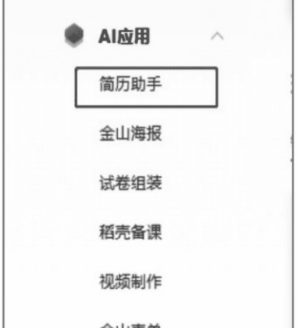

图4-48 选择“AI应用”中的“简历助手”选项

（2）在“简历助手”页面中单击“导入”按钮，导入保存的档案Word文档，如图4-49所示。

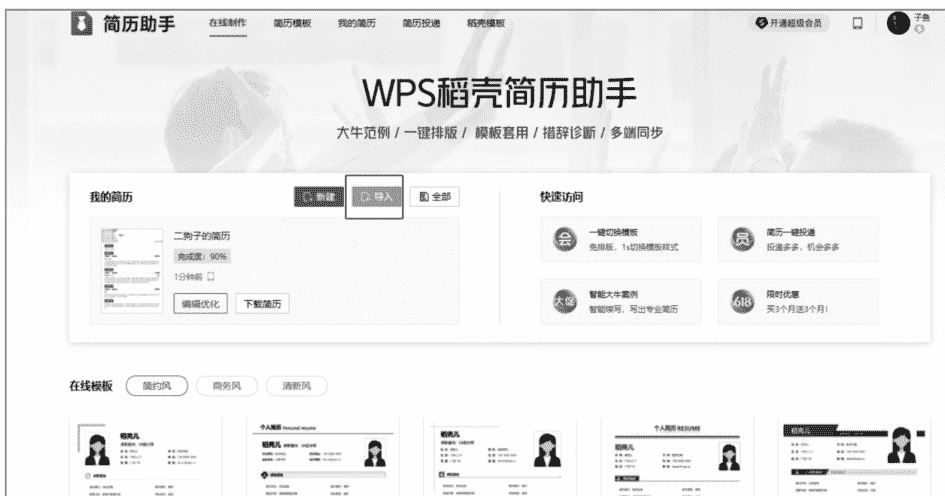

图4-49 导入文档

（3）即可将文字档案套入模板，如图4-50所示。

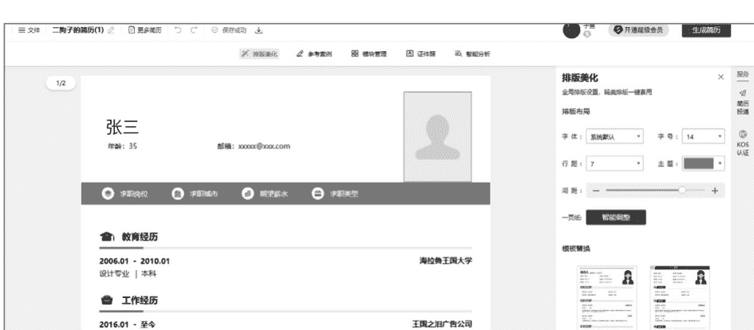

图4-50 将文字档案套入模板

（4）在每个版块中都有具体修改建议，可据建议进一步完善档案，如图4-51所示。

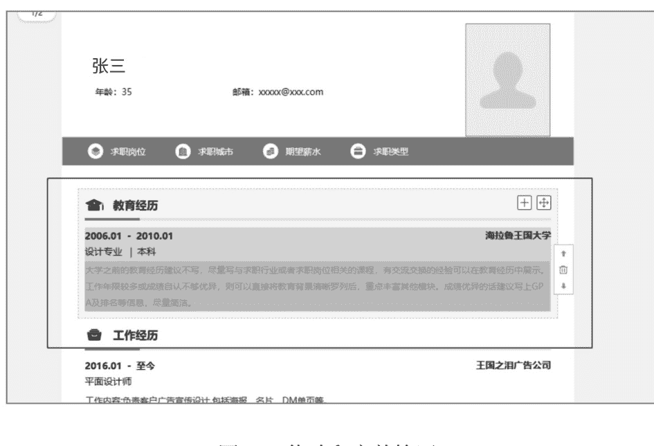

图4-51 修改和完善档案

（5）在排版美化区可实现一键排版（字体、字号、行距、间距），也可一键套用模板，如图4-52所示。

##### 排版美化

全局排版设置，精美排版一键套用

##### 排版布局

字体：系统默认

字号：14

行距：7

主题：

间距：

一页纸：智能调整

##### 模板替换


图4-52 排版美化区域

（6）在线制作证件照。单击档案上的照片位置，进入“制作证件照”页面，如图4-53所示。

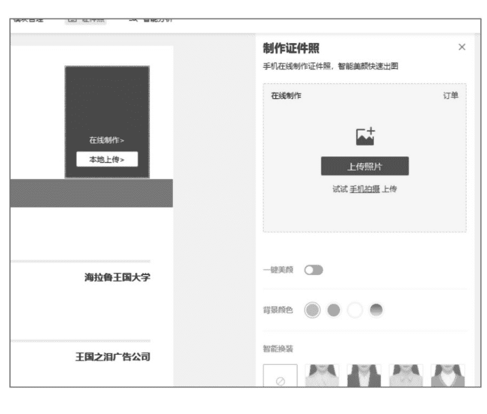

图4-53 “制作证件照”页面

（7）可单击“上传照片”按钮直接上传证件照并裁切，如图4-54所示。也可使用一键换装功能，该功能需额外付费。

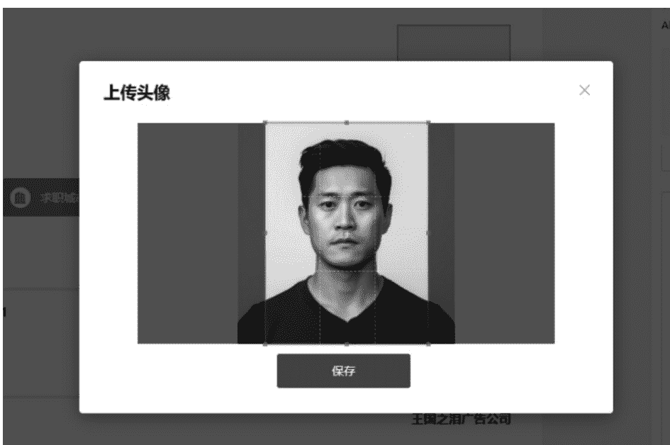

图4-54 上传证件照并裁剪（照片由AI生成，非真人）

（8）单击“参考案例”按钮，选择行业、职能、岗位，然后在文本框中输入岗位描述，系统会给出岗位话术优化建议，如图4-55所示。

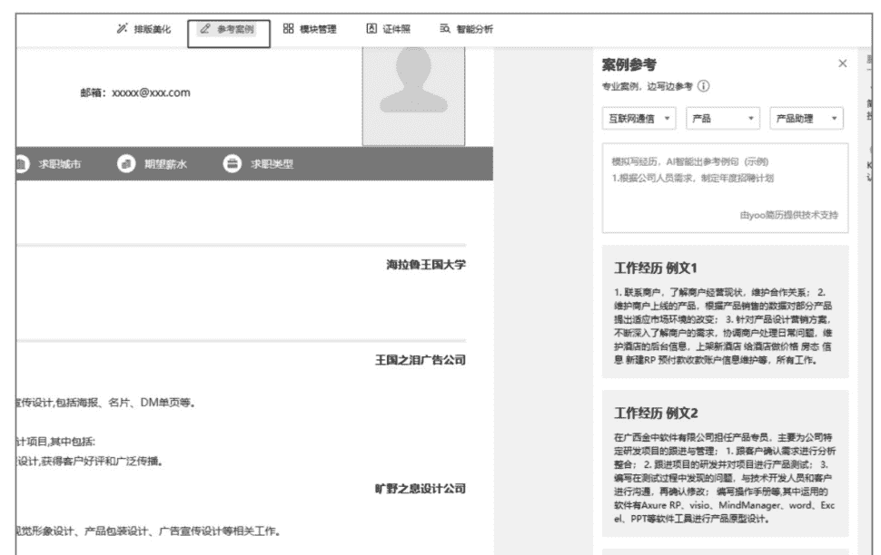

图4-55 调整话术

（9）单击“模块管理”按钮，可增减档案中的模块，如图4-56所示。

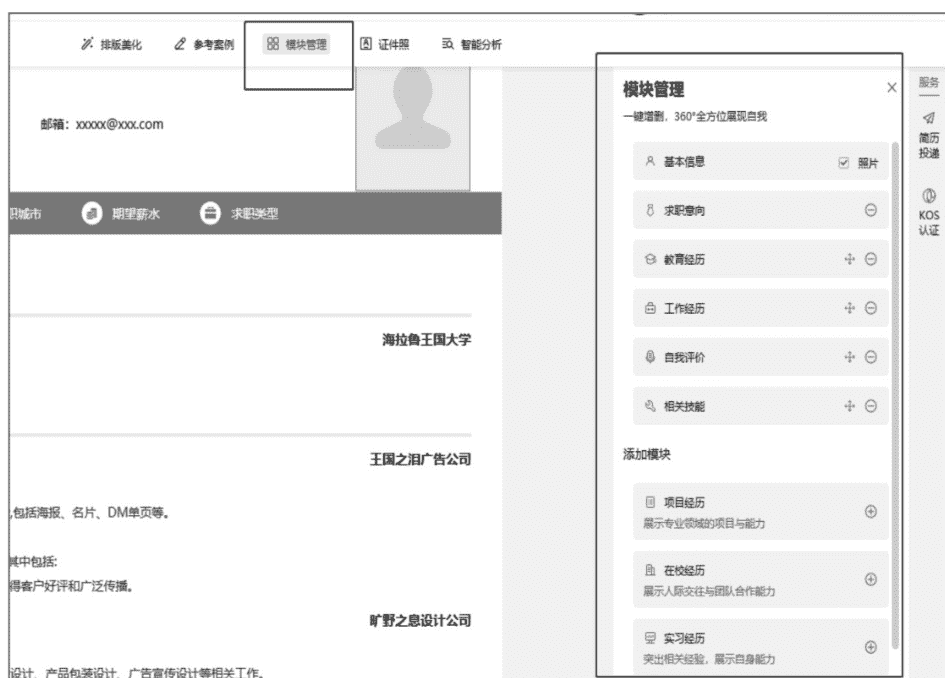

图4-56 模块管理

（10）单击“智能分析”按钮，勾选“已阅读并同意”复选框，如图4-57所示。

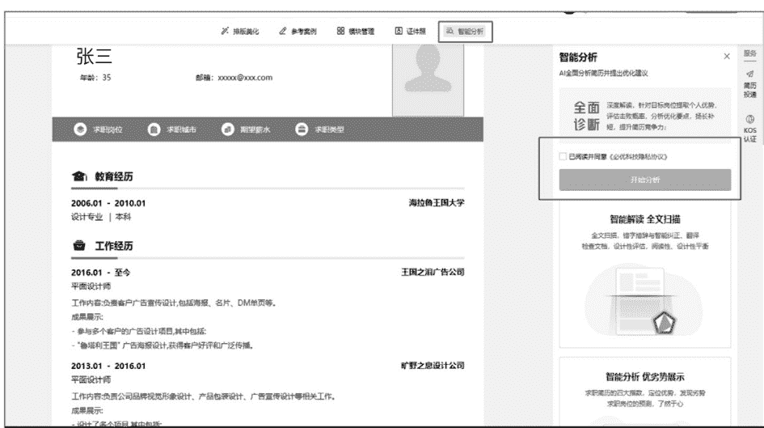

图4-57 智能分析

（11）单击“开始分析”按钮，即可得到系统对档案的智能分析结果，如图4-58所示。

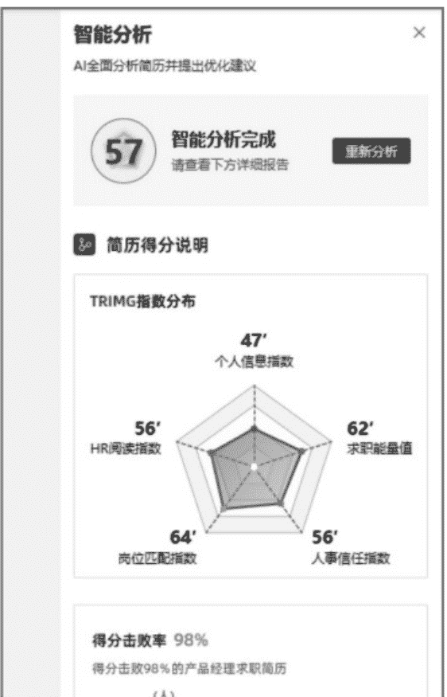

图4-58 智能分析结果

注意：评分仅对系统收录的岗位有效，若“案例参考”中无目标岗位，评分将不生效。

（12）最后，依据系统建议有针对性地修改档案，即可得到一份较为优质的档案，如图4-59所示。

## 张三

性别：男

年龄：35

电话：12345678901

邮箱：1234@nm.COM


平面设计 | 北京 | 社招

## 教育经历

2006.01 - 2010.01

设计专业 | 学士

海拉鲁王国大学 简历范本

## 工作经历

2016年1月至今
岗位：平面设计师
公司：王国之泪广告公司
工作概要：承接客户广告物料制作，品类覆盖海报、名片、DM单页等。参与多项广告执行，代表案例为鲁塔利王国海报的策划落地。

2013年1月至2016年1月
岗位：平面设计师
公司：旷野之息设计公司
工作概要：负责品牌的视觉体系搭建、产品包装以及广告宣传相关设计。参与哈努玛神庙品牌视觉与包装方案等项目，主导新品线视觉发布并获市场认可。

2010年1月至2013年1月
岗位：平面设计师
公司：塞尔达设计公司
工作概要：主导品牌视觉、产品包装、广告宣传类设计，参与神庙之神品牌视觉与包装项目。获评公司年度优秀设计奖。

## 自我评价
责任心强，适应力高，能迅速进入新环境并理解任务需求。设计兼顾细节与创意，擅长为客户输出高品质成果。

## 核心能力
精通Photoshop、Illustrator、InDesign等Adobe创作工具。擅长品牌视觉、包装、海报类设计。具备网页设计实践，掌握HTML、CSS基础。沟通顺畅，协作能力突出。

图4-59 AI辅助制作的简历成品

13 在页面右上角点按“生成简历”，即可将文档导出到本地电脑，如图4-60所示。

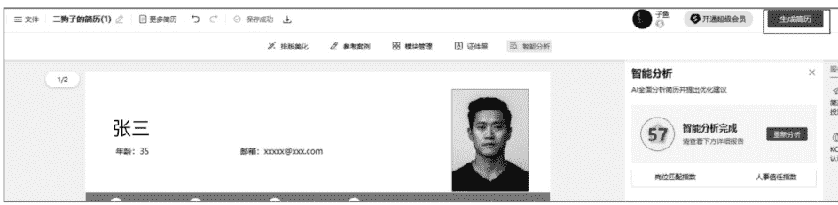

图4-60 保存简历

14 在右侧点击“简历投递”按钮，再执行“确认投递”，可将已完成的简历同步至智联招聘，如图4-61所示。

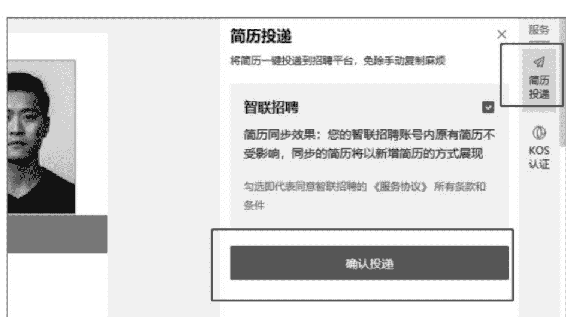

图4-61 同步到智联招聘

#### 4.4.3 模拟面试
面试时遇到HR提问答不上来是常见情况，用生成式AI可以有效降低这种压力。

先让AI梳理高频题，整体可归为两类：
1. 专业类题目，例如作为短视频编导，平常会重点关注哪些视频数据及原因。
2. 个人背景类题目，例如上一份工作的离职原因、对前任主管的看法、自身的不足等。

专业类题目建议去论坛、贴吧、知乎等平台查看同行的经验汇总。个人背景类题目则可交由AI帮助梳理表达。

HR常问的10个个人背景类问题如下：
1. 请做个自我介绍。
2. 你对我们公司的了解有多少，为什么想加入。
3. 你认为自己的最大优点和缺点是什么。
4. 过去工作中遇到过哪些挑战，如何解决。
5. 对这个岗位的理解是怎样的，能否胜任。
6. 近期的职业目标是什么，如何实现。
7. 你有哪些技能或经验能为公司创造价值。
8. 你的工作方式是怎样的，偏好什么样的工作环境。
9. 是否参与过团队项目，在团队中扮演什么角色。
10. 你希望向我提问什么。

把这10个问题交给AI，例如DeepSeek，提示词可这样写：
**提问：** 我已提供简历，请结合我的求职岗位和经历，对这10个问题逐一给出回答。

**DeepSeek：**
回答1：
您好，我是张三，平面设计师，有多年实操经验。热爱创作，坚持把设计与应用结合，为客户带来优质的视觉体验。注重细节，善于协作，在高压下仍能稳定交付。持续关注设计动向与新技术，不断提升专业水平。

回答2：
我对贵公司有所了解。贵司在汽车行业内声誉良好，以出色的设计和品牌形象著称。尤其被贵司在品牌视觉与包装设计方面的成果吸引，希望能加入优秀团队，共同产出更有创意与影响力的作品。

回答3：
我认为创意思维和审美力是优势，能独立思考并给出独特方案，同时兼顾细节与美感。沟通协作能力也不错。不足在于有时追求完美会花费较多时间，正在学习在创意与效率间更好平衡。

回答4：
以往遇到过排期紧张和客户需求变更的情况。对策是优化时间与资源安排，加强团队内部协同，并与客户保持积极沟通，及时调整计划，灵活寻找解决方案，保证项目推进。

回答5：
据我理解，该岗位需要品牌视觉和包装设计的实操经验。我在过往工作中积累了相关项目经验，熟练使用Adobe工具，具备审美、创造力与沟通协调能力，能够准确把握客户需求并转化为设计方案，相信能够胜任并创造价值。

回答6：
我的近期目标是成长为资深平面设计师。计划持续学习提升技能，跟进行业动态，参与设计比赛与项目，拓宽设计边界，通过与优秀设计师交流不断提高。

回答7：
熟练使用Photoshop、Illustrator、InDesign，拥有品牌视觉、包装、海报设计方面的丰富经验。亦有网页设计经历，熟悉HTML和CSS。能将设计理念转化为创意成果，具备良好的沟通与协作能力，可为公司提供高质量设计支持。

回答8：
工作上注重细节与创意，追求设计的完整度。喜欢有挑战的项目和创造性任务，这能激发灵感。偏好团队头脑风暴，从多元视角获取反馈，适宜积极活力的办公氛围。

回答9：
参与过多个团队项目，通常担任协调与执行角色。善于与成员保持顺畅沟通与分工协作，确保项目顺利交付，也乐于分享想法与经验，助力团队达成目标。

回答10：
想了解贵司设计团队的规模与结构，我的岗位职责范围；贵司对创新与新技术的态度，是否支持员工持续学习；以及公司发展前景与未来项目规划。这些有助于我判断匹配度。

其中部分回答仍需优化。例如回答2中，公司情况越具体越好，可以先把目标公司的详细信息提供给AI，再要求其润色话术。

### 4.5 AI审核和编写合同
合同相关事务对职场人挑战较大，从入职劳动合同到销售合同、租赁合同甚至软件使用协议，条款是否存在风险令人头疼。AI可在理解与起草上提供有效帮助。

#### 4.5.1 快速起草合同
如果被要求起草一份商品销售合同但没有经验，可借助讯飞星火完成。

第1步：打开讯飞星火，点击右侧的“助手中心”按钮，如图4-62所示。

第2步：在“星火助手中心”页面，点击“合同助手”版块中的“添加”按钮，建立合同助手，如图4-63所示。

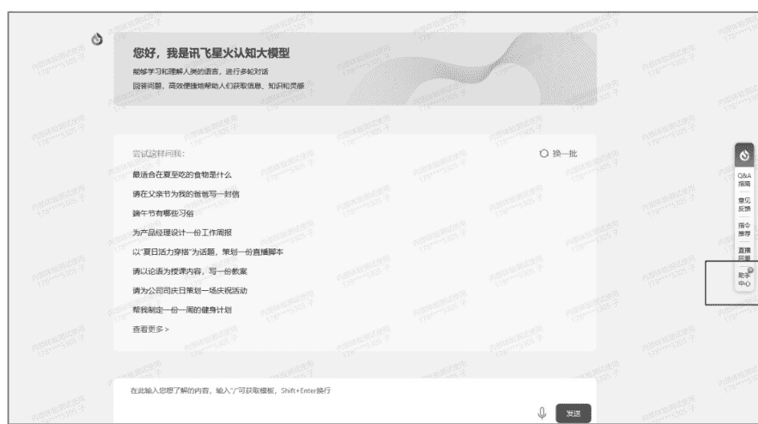

图4-62 单击“助手中心”按钮

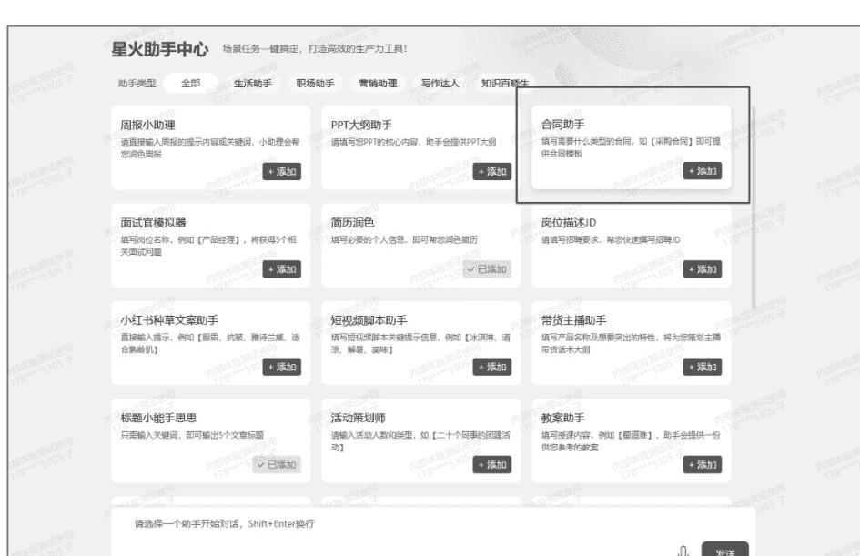

图4-63 添加合同助手

第3步：输入具体需求，例如起草催眠闹钟的销售合同。

**提问：** 请帮我起草一份催眠闹钟的销售合同。

**讯飞星火合同助手：**
请注意，我不是法律专业人士，以下模板仅供参考，实际使用请咨询专业律师以确保符合当地法规。

##### 催眠闹钟销售合同
甲方销售方：____________________ 地址：____________________
乙方购买方：____________________ 地址：____________________
鉴于双方本着平等自愿、诚信原则，就甲方向乙方销售催眠闹钟事宜达成如下协议。

###### 一、商品名称及规格
1. 商品名称：催眠闹钟。
2. 商品规格：尺寸、颜色等具体参数见附件。
3. 商品数量：__________件。
4. 商品单价：__________元/件。
5. 合计金额：__________元。

###### 二、交货方式及期限
1. 交货方式：甲方按合同约定时间地点交付乙方。
2. 交货期限：自合同签署之日起七天内完成交付。
3. 运输费用：由甲方承担，含运输、保险等。
4. 送货地址：乙方指定收货地址。
5. 收货信息：乙方需提供准确的收货人姓名、电话、地址。
6. 不可抗力导致无法按时交货，甲方应及时告知并协商解决。
7. 乙方逾期收货或拒收产生费用由乙方承担。

###### 三、付款方式及期限
1. 付款方式：按合同约定时间与方式支付货款。
2. 付款期限：自合同签署之日起七天内付清。
3. 付款金额：__________元整。
4. 乙方逾期付款，甲方有权解除合同并索赔损失。
5. 因甲方原因无法发货，甲方承担相应费用，不免除乙方付款义务。
6. 因乙方原因无法付款，乙方承担相应费用，不影响甲方交付义务。
7. 款项以RMB为单位支付，可通过银行转账、现金等方式支付。
8. 因汇率等原因导致金额差异，双方协商解决。

###### 四、保密条款
双方对合同涉及的商业秘密、技术秘密等信息予以保密，不得向第三方泄露，未经书面同意不得作他用。违约造成损失的应承担赔偿责任。

###### 五、违约责任
未按约定履约造成对方损失的，应承担赔偿责任。严重违约影响合同执行，守约方有权单方解除合同并要求赔偿，金额由双方协商。

###### 六、争议解决方式
适用中华人民共和国法律。发生争议应友好协商，协商不成可向有管辖权的人民法院起诉。

###### 七、其他事项
合同自双方签字盖章生效，至工作完成并收到款项止。期满需继续合作应另签协议。本合同一式两份，双方各执一份，效力相同。未尽事宜可另行签订补充协议，与本合同具有同等效力。

也可以直接把甲方、乙方信息和交易内容告诉AI，让其填入合同。例如：
**提问：** 这是双方基本信息和交易内容，请填入合同。
甲方：星际科技有限公司 地址：北京市东城区××街道××号
乙方：翡翠餐饮集团 地址：浙江省杭州市西湖区××街道××号
商品：催眠闹钟2000件，价格15万元
AI会据此完善合同内容。

#### 4.5.2 合同审核
不理解的合同条款可以直接复制给AI，让其学习后解答权责问题。例如进入网络游戏前需同意用户协议，可把协议内容复制到DeepSeek，让其分析后回答疑问。

**提问：** 这里有一份合同/协议，部分条款我不明白，请仔细阅读后基于条款回答我的权责问题。

**DeepSeek：**
可以，请提供协议相关内容及你的疑问，我会尽力解释。但我不是律师，仅供参考，正式建议请咨询专业律师。

上传合同有两种方式，一种是直接上传文档，一种是复制文字。复制文字时建议分段发送。

**提问：** 基于以上用户协议，请问我的账号及账号内装备归属谁。

**DeepSeek:**
根据提供的协议，账号及其中装备归属××公司。《用户协议》第10条规定：如××依据协议对账号进行封号处理，该账号及其内所有虚拟道具、游戏数据归××所有，用户无权要求返还或恢复；若虚拟道具存在有效期，有效期可能在封号期间过期，解封后已过期物品无法再用。因此，除非××同意返还，否则账号与装备归属××。

**提问：** 协议约定在哪些情况下××公司有权封号。

**DeepSeek:**
根据协议，××公司有权在以下情形封禁账号。
1. 用户违反本协议的任何规定。

### 4.6 AI记录会议
会议记录耗时且易遗漏，AI会议记录工具可自动识别发言人并将语音转文字，提升准确性与完整性，还能智能提炼要点与待办。

以豆包为例，操作如下。

第1步：安装豆包后，通过电脑进行微信语音/视频通话时，豆包会弹出是否记录会议的提示，选择“帮我记录”如图4-64所示。


图4-64 豆包询问是否需要记录会议

若未弹出提示，可打开豆包主界面，点击头像进入“设置”，如图4-65所示。

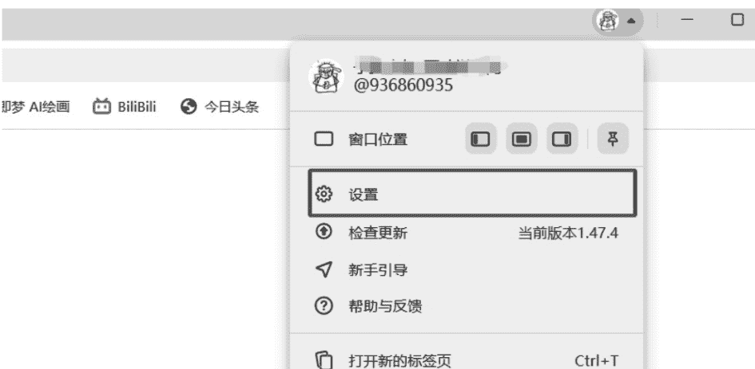

图4-65 选择“设置”选项

在设置界面选择“快捷键设置”，如图4-66所示。

##### 通用设置
- 将豆包设为默认浏览器，开启AI浏览新体验 [设为默认]
- 快捷键设置
- 声音选择 [温柔桃子]
- 默认搜索引擎 [百度]
- 开机自动启动
- 豆包推送
- 开启新手任务

##### AI工具


图4-66 选择“快捷键设置”选项

找到“会议记录”，如图4-67所示，设置不与常用快捷键冲突的组合，保存后按快捷键即可唤醒记录功能。

##### 通用


图4-67 找到“会议记录”

第2步：会议结束后，豆包会提示总结已完成，如图4-68所示，点击“查看会议总结”进入记录界面，如图4-69所示。


图4-68 弹出会议记录总结完成的提示


图4-69 进入会议记录界面

第3步：点击视频图标可查看会议详情，包含总结与待办、智能章节、文字记录，也可在左侧对话区就会议内容向豆包提问，如图4-70所示。

##### 飞书豆包纪要法
会议时间：03/10 17:22 - 17:23
- 总结和待办
- 智能章节
- 文字记录
会议讨论了如何使用飞书和豆包做会议纪要，具体如下：
- **使用豆包做会议纪要的常规流程：**
    - 安装准备：电脑需提前安装豆包。
    - 自动弹出记录询问：进行微信电话、语音或视频时，若豆包弹出是否需要会议记录询问，选择“帮我记录”，即可开始与同伴开会。
- **若记录询问未弹出的解决办法：**
    - 找到设置入口：在豆包主页，点击自己头像，选择设置。
    - 进入快捷键设置：在设置中选择快捷键设置。
    - 设置会议记录快捷键：在快捷键设置里找到会议记录功能，设置一个不与常用快捷键冲突的组合，如Ctrl + J，设置后可用该快捷键唤醒豆包开始会议记录。

## 第5章 AI助力文案写作
本章常用工具：DeepSeek、讯飞星火、彩云小梦、秘塔AI。

写作是AI应用频率最高的一类场景。DeepSeek等工具能明显提升效率，但基本无法独立产出高质量文案。其价值主要体现在：
1. 通过对话与内容输出激发灵感，压缩创意构思的准备时间；
2. 减少逐字撰写的负担，节省约60%的工作量。
例如AI生成20条文案，筛选3条合适的稍作修改即可完成，远比从零构思高效。

### 5.1 AI短文案写作
短文案在有限字数内以简洁有力的文字传递信息或激发目标受众兴趣或行动，常用于广告、宣传、社交媒体，字数一般在50～200字。

不同场景短文案的风格与目标不同。广告类需要吸引潜在客户并推动购买；朋友圈或社交媒体类需要抓住注意力、促进互动与转发；小红书类需要激发阅读兴趣并传递体验感。

## AI短文案实战：广告、朋友圈、小红书全攻略

短文案要做到的就是字数少但信息准，用有辨识度的表达方式和创意去撬动情绪，同时和目标人群的语言习惯产生共鸣。做得好的短文案能在极有限的篇幅里把要点说清并达成预期效果。

本部分围绕如何借助 DeepSeek、讯飞星火等 AI 工具来写短文案展开，重点覆盖广告文案、朋友圈文案和小红书文案三种常见形态。

### 5.1.1 广告文案

广告文案多与产品绑定，用来凸显卖点。常见投放渠道有电视、报刊、户外、广播和线上，其中前四类多由专业公司操盘，个人最容易上手的就是网络广告。

实操上主要有两种思路：直接下指令和先给标准后下指令。

#### 1. 直接要求

遵循 RBRP 原则，直接对 DeepSeek 发起任务。

提问示例：你现在是一名资深广告文案，我手头有一个产品叫催眠闹钟。原理是看到别人打哈欠会传染。闹钟到设定的就寝时间后，表盘小人会打哈欠并播放提示音，提醒用户该休息了。请给我 10 条参考文案。

DeepSeek：

(1) 哈欠一现困意来，催眠闹钟轻松入梦。
(2) 别让失眠夺走美梦，哈欠闹钟带你沉入梦乡。
(3) 深夜寂静哈欠连，催眠闹钟帮你告别疲惫。
(4) 哈欠起困意生，催眠闹钟陪你安稳一夜。
(5) 告别数羊，哈欠闹钟引你踏上甜梦之旅。
(6) 哈欠是自然催眠符，催眠闹钟让犯困不费劲。
(7) 一哈欠睡意浓，催眠闹钟助你睡到天亮。
(8) 哈欠来睡意起，催眠闹钟守护每个梦境。
(9) 哈欠现困意至，催眠闹钟让夜晚不漫长。
(10) 哈欠是身体的信号，催眠闹钟是夜晚的温柔陪伴。

向模型提需求时不用担心数量，10 条、20 条、甚至 100 条它都能处理。但数量过大时为凑数容易出现重复。

#### 2. 提供标准

想拿到更高质量的输出，需要先喂方法论。

第1步：找一篇优质广告文案写作方法论，让模型学习并提炼。

提问：接下来我会给你一篇写广告文案的方法文章，请学习后总结方法论。

DeepSeek：好的，请提供文章内容，我会学习并总结。

提问：方法举例...

DeepSeek 总结：

(1) 建立权威并借势从众：引用数据、机构背书制造信任，通过从众心理推动购买，适合有规模的品牌。
(2) 痛点劝诱：点出用户现有方案的不足，刺激痛点，呈现更优解。
(3) 对标头部品牌：关联行业领军者，快速建立实力联想。
(4) 树敌对比：与竞品做区隔，强化自身定位。
(5) 稀缺感营销：强调限量、独家等，促成即时购买。
(6) 价值观与情感共鸣：与用户价值观契合，传递品牌温度。
(7) 直述产品特性：简单清晰地传递功能价值，在餐饮品类应用广泛。

第2步：结合方法论用 RBRP 提问。

提问：你现在是资深广告文案大师，我的产品是催眠闹钟...请结合上述方法论给 10 条参考。

DeepSeek：

(1) 树立权威，利用从众。全球顶尖睡眠专家力荐，催眠效果获验证。数百万用户已把哈欠当成入睡信号。
(2) 劝诱策略。还在为失眠烦恼？让自然哈欠帮你快速入眠。告别数羊，小人哈欠带你进梦乡。
(3) 向行业领军看齐。借鉴科技巨头思路，用创新技术打造理想睡眠环境。与顶级睡眠产品并肩。
(4) 树敌策略。不必依赖药物或高价疗法，催眠闹钟是战胜失眠的新选择。忘掉无效老办法。
(5) 诉求稀缺感。限时发售，抢鲜体验革命性催眠技术。独家专利设计，仅此一家。
(6) 诉求价值观与情感认同。理解你对好睡眠的追求，我们把关每个细节。关爱健康，从每晚好眠开始。
(7) 直接阐述特性。看到哈欠就想睡，这就是它的独特魅力。简单设定自动播放，享受安宁夜晚。
(8) 制造紧迫感。别再等了，现在就改善睡眠质量。库存有限，错过需久等。
(9) 提供社会证明。看用户反馈，生活因催眠闹钟而改变。加入数万满意用户体验深度睡眠。
(10) 比喻或隐喻。如同母亲轻拍入睡，催眠闹钟给予安心陪伴。它是床边的私人睡眠顾问，准时提醒进入甜梦。

相比直接下指令，带方法论的输出明显更扎实。还可以继续细化要求，比如控制字数、做对仗。

提问：请把这些文案压缩到 12 字以内，并做成对仗形式。

DeepSeek：

(1) 哈欠催眠，自然入梦。利用自然哈欠现象配合人偶形象与音频营造轻松氛围，促进快速入睡。
(2) 催眠闹钟，助你好眠。点明功能，传达对睡眠的积极帮助，语气温馨。
(3) 见哈欠，想睡眠。把生理反应与产品关联，生活化且易共鸣。
(4) 小哈欠，大作用。对比突出小现象大效果，增强趣味与实用感。
(5) 哈欠起，睡意浓。以起因引出结果，形象描述入睡过程。
(6) 催眠神器，一哈见效。强调神奇效果与快速见效，激发好奇与购买欲。
(7) 哈欠引，梦乡近。由引子指向终点，寓意轻松进入甜梦。
(8) 小人哈欠，催你入眠。具体画面展示原理，功能一目了然。
(9) 打哈欠，好入眠。结合常识行为与效果，直观体现价值。
(10) 哈欠响，睡意长。暗示声音助眠并延长睡眠，提升质量。

### 5.1.2 朋友圈文案

朋友圈文案同样服务推广，但因基于熟人信任，转化更快。产出方式也是直接要求和先给标准两种。

#### 1. 直接要求

提问示例：你现在是资深朋友圈文案专家，我有一款美白精华液，核心效果是美白，请按方法论写 10 条参考。

DeepSeek 输出的多条文案与广告文案高度雷同，可见单纯直接要求效果有限。

#### 2. 提供标准

第1步：提供朋友圈文案写作方法文章，让模型提炼。

DeepSeek 总结为五步法：先明确中心思想并列大纲，广告可分软硬广，日常内容可涵盖健康、亲友、财富、自由、成就等建立信任；取标题先写内容再提炼核心句并植入痛点；写内容用简单语言多用“你”字，包含好标题、有价值内容和引导成交结尾；排版分段每段不超过 3 行，每句不超过 15 字；写完大声朗读并修改拗口处。

还提到三个常用公式：产品收益类=梦想展示+价值塑造+产品介绍+引导下单；产品生产过程类=尊贵头衔+工艺流程+顾客收益+购买方式；产品初心类=时间地点+意外+顾客痛点梦想+你的理想+顾客收益。

第2步：输入产品信息要求生成。

产品名称：猫仔牌美白精华液。介绍...蕴含维生素C、熊果苷、透明质酸，轻盈易吸收，提亮肤色、淡化暗沉雀斑、增强弹性、持久保湿。

DeepSeek 生成 10 条风格示例，均围绕璀璨肌肤、成分科技、日常使用体验和引导试用展开，可根据反馈做点对点修改。

### 5.1.3 小红书文案

小红书文案即种草笔记，包含商品介绍、使用心得、攻略、生活分享等。平台以社交电商为主，需要吸睛标题、清晰内容和生动图文视频，同时要符合平台规范。

写作方式有小红书种草文案助手和提供标准两种。

#### 1. 小红书种草文案助手

第1步：打开讯飞星火，点击左侧“助手中心”按钮，如图5-1所示。


图5-1 在讯飞星火中单击“助手中心”按钮

第2步：进入助手中心，右侧搜索并添加小红书种草文案助手，如图5-2所示。


图5-2 在星火助手中心搜索小红书种草文案助手

第3步：新建对话窗口，先提取关键词。


图5-3 新建一个对话窗口

提问：猫仔牌美白精华液是一款卓越美白产品...请提取为 4 个左右关键词，格式为产品类型、功效、品牌、适宜肤质。

助手输出：产品类型：美白精华液；品牌：猫仔牌；适宜肤质：所有肤质；功效：淡化暗沉、雀斑和不均匀肤色，提亮肤色，增强弹性，持久保湿。

第4步：发送关键词让助手生成文案。

提问：美白精华液；猫仔牌；所有肤质；淡化暗沉、雀斑和不均匀肤色，提亮肤色，增强肌肤弹性，持久保湿。

助手输出示例包含表情与标题，强调适用性、提亮、弹性与保湿，并以猫咪推荐口吻收尾。

随后还可尝试提供标准方式进行对比优化。

《把小红书爆款方法喂给AI，再让AI帮你写文案》

先找一篇讲小红书文案写作的优质教程丢给DeepSeek，明确学习任务。

**提问：** 接下来我会给你一篇关于小红书文案的文章，请你仔细研读，并提炼出方法论。

**DeepSeek：**
好的，能提供文章内容，我会认真阅读后梳理出可复用的写作方法。

**提问：**（文章内容此处省略。）

**DeepSeek：**
小红书是分享生活方式、种草好物、美妆护肤的热门社区，文案的好坏直接决定笔记能否被看到。下面是常用的小红书文案打法。

- （1）用数据工具找标题规律：借助千瓜数据、搜秀数据这类平台追踪爆款笔记和标题走势，锁定目标赛道后归纳高频的标题套路。
- （2）直接给套路和做法：把能快速上手的技巧拆解出来，让读者马上能用。比如：“这样画眼妆，男友的心都化了！”“丝巾的16种实用戴法！亲妈级手把手教学！”
- （3）制造好奇钩子：用反差、揭秘类表达撬动点击欲。比如：“在家用酸刷出牛奶鼻，美容院拜拜！”“揭秘！原来网红是这样拍视频的！”
- （4）标题里加数字：阿拉伯数字更醒目，有具体感。比如：“每天跟着视频练3遍，1个月练出漫画腿！”“下班后3小时，我靠当网红完成了弯道超车！”
- （5）借势热点话题：紧跟当下流行事件，把热点和自身领域结合。比如：“跟着《半是蜜糖半是伤》学穿搭！”。可参考新媒体管家、AnyKnew、新榜、今日热榜、365日历、知乎热榜、知微事见、百度指数等去捕捉热点。

除了标题，写出爆款正文也有诀窍。

- （1）结构要清晰：写作前先把想表达的点列出来，保持逻辑通顺。可以借助小标题、分段和标点把不同观点隔开。
- （2）用词要有记忆点：选用生动、有画面感的表达，避免平淡老套。比如推荐面膜时，可以写“敷一次就变嫩”“灭痘小霸王，睡一晚就能瘪掉”。

**提问：** 这是我要推广的产品，请结合上面的方法帮我出5条小红书文案。

产品名称：猫仔牌美白精华液

产品介绍：猫仔牌美白精华液，主打如璀璨明珠般的透亮肌肤。配方独特，能渗入肌底抑制黑色素生成，淡化暗沉、雀斑和肤色不均，让肌肤显出自然亮白。采用先进技术加天然植物萃取，温和有效。含维生素C、熊果苷、透明质酸等成分，可深层滋养、提升弹性并维持长效保湿。质地轻盈好吸收，迅速渗透不油腻，用起来清爽舒服。坚持使用，肤色更均匀、白皙透亮、细腻光滑，呈现健康自然的光泽。

**DeepSeek：**
有了猫仔牌美白精华液，不仅能get到明珠般的肌肤，还能收获更多惊喜。下面按小红书打法给你5个方向。

## 文案1：《30天逆袭白皮？我只靠这瓶精华》
从闷黄暗沉到通透发光，从顽固斑点到晶透白净，猫仔牌美白精华液带来了明显的提亮变化。别再犹豫，一起开启你的白肤计划吧！

## 文案2：《美白新晋爱用！一瓶告别暗沉肌》
拒绝暗沉，迎接焕新。猫仔牌美白精华液配方经过优化，有效淡化斑点，调匀肤色，带来白皙明亮的质感，让自信由内而外。

## 文案3：《科技+植萃的提亮魔法瓶》
猫仔牌美白精华液把现代科技和天然萃取结合，为肌肤持续输送养分，抑制黑色素，还原原本透亮，肌肤从此自带光。

## 文案4：《找回肌肤底气，这瓶来帮忙》
告别肤色烦恼，拥抱光采。猫仔牌美白精华液温和不刺激，提亮肤色、抚平暗沉、让触感更细腻，呈现健康动人的光泽。

## 文案5：《抗老美白双向走，时光被按下暂停》
美丽不设限，时间慢下来。猫仔牌美白精华液多重护养成分协同作用，抚平岁月痕迹，恢复弹性与光泽，焕发青春感。

以上文案可根据目标人群微调语气和风格，提升共鸣和转化。加油！

### 5.2 中长篇文案的AI助力写作

中长篇文案一般指500～4000字的体量。要让AI写好这类内容，先要了解它的构成。中长篇常包含新闻稿、商业类文章、个人公众号稿件等，下面分述。

#### 5.2.1 新闻稿写法

新闻稿是常见的新媒体体裁，特点是文风规范、结构固定。通常由事实和感受两部分组成。

事实部分，例如：“某年某月某日，某领导到某公司视察。在某总陪同下，参观了车间、办公室、食堂，并与员工交流，了解……”这类信息可直接从活动流程或行程表里提取，适合喂给AI。

感受部分，例如：“无论是否直接交流，现场员工都备受鼓舞，对岗位责任有了更深理解……”这部分需要创作者加入情绪，也可先采访收集真实反馈，再让AI生成。

不同公司要求不同，可投喂1～3篇过往新闻稿让AI学习仿写。

操作思路如下。

第1步：投喂一篇已发布的新闻稿，让DeepSeek归纳结构和写法。

**提问：** 接下来我会给你一篇新闻稿，请你认真学习，并总结其结构和写法。

**DeepSeek：**
请提供稿件，我会学习并给出结构与写法总结。

**提问：**（新闻稿内容省略。）

**DeepSeek：**
从样稿来看，新闻稿通常包含：

- （1）标题：简洁吸睛，点明活动核心或亮点。如“汉口分公司举办‘承载梦想、走向健康、践行绿色生活’新春主题徒步行活动”。
- （2）时间地点：开篇点明活动发生的时间与地点。如2月16日，汉口分公司总部。
- （3）活动概览：简述主题和参与规模。如新春主题徒步行，管理干部及队员110余人参加。
- （4）过程描述：详述路线、起止点和时长。如从公司总部出发，沿金山大道至银桥，再沿环湖东路绕湖两圈，历时1.5小时完成任务。
- （5）目的意义：解释举办原因和价值。如倡导健身理念、走出家门走向自然，提升身心健康，激发干事创业激情。
- （6）参与反馈与收尾：引用参与者感受，总结积极效果。如大家表示锻炼了身体、增进了交流，凝聚了团结力和向心力，展现了良好精神风貌。

整体结构为标题、时间地点、活动概览、过程描述、目的意义、反馈总结。写法应简明扼要，突出重点，同时传递意义和效果。

第2步：把素材交给DeepSeek，要求仿写一篇新闻稿。

以领导来访为例，可投喂行程表、会议纪要等。

**提问：** 接下来我会给你总公司王总来我司考察的行程表，请结合上述总结，模仿前文写法，写一篇新的新闻稿，未提及内容可适当发挥。

时间安排：
10:00 AM—10:30 AM：抵达目的地，与接待人员会面并办理入住
10:30 AM—11:00 AM：与公司领导会谈，地点[会议室名称]，主题[会谈主题]，目标交流公司现状与发展方向
11:00 AM—11:30 AM：参观公司食堂，地点[食堂名称]，目标了解员工伙食与食堂管理
11:30 AM—12:30 PM：视察部门/生产线，地点[部门/生产线名称]，目标了解运作情况、生产流程、员工工作环境
12:30 PM—1:30 PM：午餐，地点[用餐地点]，目标与员工共进午餐，促进沟通
1:30 PM—3:30 PM：继续视察其他部门/场所，地点[部门/场所名称]，目标深入了解各方面运作并与员工互动
3:30 PM—4:00 PM：与部门负责人总结会谈，地点[会议室名称]，目标讨论发现问题并提出建议与指导
4:00 PM：考察结束，安排返程

**DeepSeek：**
王总考察我司，共话发展现状与方向

[城市名称]，[日期] 今日，我司迎接总公司王总来访考察。王总此次行程意在与我司领导沟通、了解公司现状和发展思路，并与一线员工面对面交流。对加强内外沟通、提升效率、塑造形象具有积极意义。

王总一行上午10点准时抵达，在接待人员的陪同下完成入住。

随后，王总与我司领导在[会议室名称]进行会谈，围绕[会谈主题]展开，就公司运营状况、发展方向及未来规划进行深入交流，为双方搭建了坦诚沟通的平台。之后，王总参观了[食堂名称]，了解员工伙食标准及食堂管理情况，对员工福利有了更直观的认识。

接着，王总视察了各部门及生产线，深入了解日常运作、生产流程和员工工作环境，并与现场员工交流，听取意见建议，为改进运营提供参考。

午餐时间，王总与员工在[用餐地点]共进午餐，轻松的氛围促进了沟通，增强了团队凝聚力和归属感。

下午，王总继续考察其他部门和场所，全方位掌握公司运行情况，并与员工亲切交流，共同探讨未来发展方向。

下午3点半，王总与部门负责人进行总结会谈，在[会议室名称]围绕考察中发现的问题与改进建议展开讨论，并对后续工作提出指导方向，为各部门改进和发展提供了推动力。

下午4点，王总考察圆满结束，顺利返程。此次来访为我司带来宝贵经验与指导，也进一步增强了员工凝聚力。我们相信在王总关心支持下，公司将迈向更辉煌的明天！

[公司名称]衷心感谢总公司王总此次视察，并对全体员工的鼓励表示感谢！

我们将坚守初心、砥砺前行，为公司发展贡献力量。

（以上为模拟稿，内容仅供参考。）

信息有限的情况下，AI仍能生成可用初稿，后续稍作润色即可达到发布标准。通过投喂范文，AI能快速按主题生成文章，再人工优化即可。

#### 5.2.2 商业类文章写作

商业文的特点是结构化。成熟的商业文通常采用总分总，包含引入、小标题、论点、论据尤其是名人案例，以及金句。

引入部分常借助当下热点抓住注意力，用有趣或有争议的话题制造兴趣，为后续内容铺垫。

小标题部分用于划分重点，让读者一目了然，提升可读性和导航体验。

论点部分是核心，用来表达作者的观点和主张，必须清晰明确，能引发思考与共鸣。

论据部分为论点提供支撑，名人案例是常见形式，能增强权威性和说服力。

金句部分是对主题的凝练总结，用简洁有力的语言留下深刻印象。

总之，商业文靠结构化提升逻辑、可读性和说服力。

很多人想写商业文投稿却因笔力、精力、素材不足而放弃。AI虽不能直接产出完美稿件，但在结构搭建、金句提炼、名人案例查找等方面效率远超人工，能大幅降低写作门槛。

以DeepSeek为例，投喂流程可分为6步。下面展示前两步。

第1步：投喂一篇想模仿的作者文章。

**提问：** 接下来我会给你一篇文章，请你认真学习并分析其结构和写法。

**DeepSeek：**
好的，请提供文章，我会详细分析结构与写法。

**提问：**（文章为某公众号最新推文，此处省略。）

**DeepSeek：**
该文结构清晰，可分为3段。

首段为引言，用孔子的名言加一则小故事引入主题，点出成全他人的重要性。

主体围绕“成全”展开，通过多个具体场景进行论述，每个案例先描述情境，再分析解读，表达观点，语言简洁流畅，逻辑紧凑。

尾段用一个寓言加一句名言收束全文，强调成全他人的价值，并提醒读者保持善心，学会成全方能获得更多回报。

整体写法简洁明了，结构清晰，语言通俗易懂，适合大众阅读。

第2步：先要大纲，不要直接模仿。

直接要求模仿难度高，容易被理解为照搬内容与结构，且生成量大难以调整。更稳妥的策略是先搭建框架，再逐段填充。

先看直接要求的表现。

**提问：** 接下来，请你模仿这篇文章的写法，以延时满足为论点写一篇新文章（文章内容省略）。

**DeepSeek：**
好的，以下是生成的新文。

生活中我们常遇不如意，如迟到、错过机会，若学会延时满足，就能更从容自信。

何为延时满足？即面对诱惑或需求时先暂时克制，稍后再满足。其好处：一是帮助控制欲望冲动，避免过激行为；二是促使更理性思考，从长远看待利益与目标；三是增强耐心与毅力，坚定追梦。

例如减肥时想吃蛋糕，可先忍住，等一段时间再享用，避免冲动破坏长期计划，也能更享受美食。

延时满足不易，但只要坚持练习意志力和自控力，就能成功。

总之，延时满足是重要生活技能，能助我们掌控情绪与行为，实现目标。愿大家都能学会，让生活更美好！

结果不理想。

再用“先搭框架后填充”的方式尝试。

**提问：** 如果以“延时满足”为题，按上面文章的结果，该如何设计大纲？呈现形式可参考你对上文的分析。

**DeepSeek：**
好的，为你设计如下框架。

题目：学会延时满足，掌控情绪与行为

引言：在生活中我们常遇不如意，若学会延时满足，就能更好地应对挑战，更加从容自信。

正文：

### 一、什么是延时满足
延时满足指面对诱惑或需求时先暂时放弃或推迟满足。其好处包括更好地控制欲望冲动、更理性思考问题、增强耐心与毅力。

### 二、为什么要延时满足
能帮助控制情绪行为，避免冲动决策；有助于从长远角度审视利益与目标；可提升耐心与毅力，坚定追求梦想。

### 三、如何学会延时满足
并非易事，常见诱惑与压力会影响冷静。但只要坚持练习意志力和自控力即可。具体可从以下方面入手：
- （1）觉察自身欲望与冲动并尝试控制
- （2）制定明确目标与计划并付诸行动
- （3）坚持锻炼身体、培养良好生活习惯，提升身心素质
- （4）寻求他人支持，共同克服困难

### 四、结语
学会延时满足是重要生活技能，能帮助更好掌控情绪与行为，实现目标。愿大家都能掌握，让生活更美好充实！

结论：延时满足是一种更理性成熟的生活方式，有助于实现个人价值与目标。在现代社会，学会延时满足可获得更长远回报与更高生活品质。

等待是一种能力

你最近一次心甘情愿地等，是什么时候？

有一次跟朋友去看场电影，现场人挤人，队伍排了半天才买到票。进到厅里才发现座位挨得很紧，角度也不好，脑子里立刻蹦出两个念头：换个座位或者干脆走人去别的地方消遣。朋友却说：“都等到这份上了，不如再等等看？说不定片子很值。”听他这么一说，我把原本要起身的冲动压了回去。结果电影确实不错，过程的纠结反而成了加分项。

这就是延时满足的日常模样。不是死扛，而是先把即时的不满按下，让时间多给一点信息。延时满足的本质，是在诱惑或不顺眼前，先做一次暂停，把满足的时间后移。

延时满足为什么重要
它帮我们守住边界，不被一时的欲望和情绪带跑；让判断多一份冷静，能从更长的维度去衡量得失；同时也在锻炼耐心和定力，让目标更稳地落地。

肯尼迪那句话说得直白：我们不是因为困难才不敢做，而是因为不敢做，困难才显得更难。跨过恐惧的那一步，事情本身的难度才会被重新丈量。

1
延时满足可以拆解成三个直觉：少点即时反应，多点长远核算；先稳定情绪，再处理问题；用积累取代冲动。学会这样处理，眼前的诱惑就很难掩盖远处的风景，短暂的爽也不会把长久的幸福给赔掉。

2
情绪和行为的管理，本质上是延迟能力的体现。它能让我们不因一时的冲动做下位判断；让思维更理性，从未来回看当下；让韧性更强，目标不会轻易被打断。只有把满足推迟一点，真正的快乐才不会被瞬间快感蒙蔽。

人生就像一盒巧克力，你永不知道下一颗是什么味。《阿甘正传》里这句台词很贴切。生活里诱惑、分叉、压力接踵而来，想时刻保持理智并不容易。正是这种未知，才更需要我们调整心态和行动方式，去得更稳更踏实。

李娜的职业生涯就是一面镜子。她经历过伤病、失利和舆论的风浪，却始终不放弃对训练和比赛的投入。一次次把即时的沮丧留住，把努力推到后面去兑现，最终成为中国首位大满贯得主。她的故事说明，延迟满足不是压抑欲望，而是把欲望沉淀为积累和忍耐。放慢脚步等一等，花才会开在该开的时候。

延时满足，也不是要你放弃，而是在学会等待里，让控制力成为生活品质的底座。

从原型到反转：用AI拆解科幻叙事的方法

星球大战：反抗军的成长弧线
这一系列围绕银河帝国与反抗军的对抗展开，卢克·天行者承担主线任务，学会运用原力，与达斯·维达等强敌对峙，最终推翻帝国统治、保卫银河。整体走向契合经典英雄旅程：离开故乡、师从欧比旺·肯诺比、历经原力修炼与重重险阻、取得原力这一象征性宝物、回归并终结帝国。

阿凡达：潘多拉的归化之旅
影片主角前海军陆战队员杰克·萨利被派往潘多拉执行破坏纳米植物的任务。过程中他逐渐适应当地生态与文化，与纳美族建立信任，并在对抗敌对势力时完成转变。该线同样符合英雄旅程的框架：脱离原世界、在纳美族中获得指引、承受文化冲击与战斗考验、获得对潘多拉文化与自然力量的深层认知、最终选择守护潘多拉实现归返。

二、叙事诡计：延迟真相的手法
叙事诡计指创作者利用结构与语言技巧，有意遮掩或误导信息，直到收尾才揭露真相，从而制造强烈冲击。它常见于人物反转、性别反转、年龄反转、身份反转等形式。

影视参考：
《致命魔术》通过两名魔术师的竞争与复仇，以及各自的表演机关，构成典型的叙事诡计。
《盗梦空间》让梦境与现实边界模糊，人物在梦中与现实中的行为相互矛盾，也是该手法的经典运用。
《无间道》以警匪对立、人物关系与身份置换推动冲突，属于叙事诡计的代表作。

故事结构远不止上述两种，这里仅作示例。接下来以DeepSeek为对象，演示如何借助叙事诡计构建悬疑文本。

先交代背景，要求其基于某种结构产出提纲。

提问：假设你是一名顶级小说家，请以失落文明遗迹为主题，构思一部科幻悬疑小说，给出章节目录与各章梗概，注意运用叙事诡计，并保持起承转合。

DeepSeek输出：
小说名称：《星际遗迹》
章节目录
1. 神秘的星图
2. 失落的星球
3. 古老的密码
4. 时间的迷宫
5. 幽灵船的秘密
6. 黑暗中的光
7. 真相的碎片
8. 逆转的命运
9. 终极的选择
10. 新的起点

各章节梗概
第一章 神秘的星图
星际考古学者艾丽卡偶然得到一幅古老星图，指向早已遗忘的星球诺文达。她决定组建队伍前往探寻失落文明遗存。
第二章 失落的星球
一行人抵达诺文达，遍布神秘遗迹与废墟。在一座巨型石碑前停驻，碑面刻着未明文字与图案，似为某种密码。
第三章 古老的密码
团队尝试解读碑文，发现其关联一种早已失传的古语。经多次推敲后破解关键，线索指向一处隐蔽地下通道。
第四章 时间的迷宫
进入通道后陷入庞大迷宫，墙面布满时间标记，疑似记录一段历史。深入后遭遇首个考验：一道时间谜题。
第五章 幽灵船的秘密
解开谜题后抵达一艘废弃飞船，被称为幽灵船，传闻漂浮太空数千年。登船后获大量文明线索与惊人隐秘。
第六章 黑暗中的光
船内遭遇不明生物袭击。生死关头发现一种古老光源，既能驱散黑暗又能揭示隐藏信息，遂借此继续探索。
第七章 真相的碎片
借助光源挖掘出更多文明真相。原文明曾高度发达，却因未知原因骤然消失。获得部分文物与资料，但仅是片段。
第八章 逆转的命运
继续深入后发现可逆转时间的装置。通过它目睹文明末日景象与灭亡根源，重新审视自身使命。
第九章 终极的选择
面对遗迹，艾丽卡团队陷入抉择：公开一切还是为保护知识而永久封存。经激烈讨论后作出决定。
第十章 新的起点
无论选择如何，探险为每个人打开新大门。他们携部分遗宝返回地球，迎接新挑战。结局开放，为续作留悬念。

该提纲框架尚可，但人物塑造偏薄，仅主角清晰，故需进一步追问。

提问：该故事涉及多少人物？主角、配角、反派分别是谁？其职能与出场章节？

DeepSeek输出：
主角
- 艾丽卡：果断、睿智、勇敢。星际考古学者，发现星图并决意前往诺文达探险，是全篇核心，在关键节点推动情节并作出决策。出场第一章。
- 雷诺：冷酷、忠诚、勇敢。星际佣兵团长，对同伴忠诚，负责护卫团队，危机中展现战斗与领导力。出场第二章。
- 薇薇安：果敢、聪明、有同情心。星际调查记者，好奇心强且正义，通过报道揭示隐秘，在关键处提供线索。出场第三章。
- 伊芙琳·卡迈克尔：冷静、睿智、杀伐果断。星际海盗舰长，智慧高、处事冷酷，既是对手也是潜在盟友，增加复杂性。出场第四章。
- 阿丽亚娜：温柔、善良、勇敢。医疗官，负责团队健康，医术精湛，危急时显现勇气与牺牲精神。出场第五章。
- 塞瓦斯：神秘、强大、难以捉摸。谜样存在，力量强大背景不明，关键时刻现身又迅速消失，增添未知感。出场第六章。

反派
- 马克西姆斯：偏执、野心勃勃、不择手段。大型星际企业CEO，为获取古文明力量不惜一切，制造主要威胁，推动高潮。出场第七章。
- 伊芙琳·卢克：狡诈多变、冷酷无情，偶显温柔。星际海盗男头目，背景复杂，既敌且友，双重身份增强戏剧性。出场第八章。

人物互动构建出丰富科幻世界，兼具悬疑、冒险与人性探讨。

随后需将框架以思维导图形式记录并调整，如图5-4所示。


图5-4 故事框架思维导图

建立思维导图的原因在于，相较于结构化表达，AI更偏向线性输出。因此需自行搭建整理体系，整理中发现不合理及时修正，以保证对故事的掌控。

丰富人物后轮廓更清晰，但仍有不合理之处。例如第一章中主角团应同台亮相，故需调整登场时间。将主角团核心成员集中在第一章呈现，并在原大纲基础上细化情节。细节越饱满，AI生成的文本越符合预期。

提问：现提供第一章更具体的设定，请据此撰写第一章，要求如下。
- 艾丽卡在大学课堂讲授星际考古与失落文明诺文达，课后回办公室收到一封邮件。邮件内含恳切求助信及调查资料，资料文字为诺文达星球文字。她多年研究诺文达却始终找不到真实位置。
- 艾丽卡一夜将文字译成地球语言，发现是一则关于诺文达坐标的谜语。她不擅解谜，于是找到好友、星球日报记者兼著名谜语专家的薇薇安。
- 在薇薇安帮助下定位诺文达具体位置。作为研究十余年的学者，艾丽卡急于出发，但薇薇安敏锐提醒事件背后可能有阴谋。
- 二人为是否出发争论，细节自行发挥。最终达成共识，决定寻找佣兵团长雷诺。描写酒馆场景与雷诺出场，外形豪迈但粗中有细。
- 薇薇安与艾丽卡说明来意，雷诺作为老友同意加入，条件是发现宝藏后他与团队分走一半。雷诺召集队友，众人驶向星海，本章结束。

DeepSeek输出：
好的，以下是按要求生成的初稿。

第一章：神秘的星图
艾丽卡在讲台前用激光笔在透明屏上演示，声音清晰：“今天探讨古老神秘文明诺文达。该星球文明曾辉煌，却突然消失，只留令人费解遗迹。”
学生们全神贯注，时有惊叹。艾丽卡眼中闪着对未知的热情，长发随动作轻摆。
课后回到办公室，电脑亮起新邮件。打开后是一封恳切求助信，附带星际文明调查资料。资料文字竟是诺文达文字。
多年致力研究诺文达却无法确定位置的艾丽卡心头一震，决定用一晚时间将文字译成地球语言。
深夜办公室灯火未熄，她完成翻译，发现是一则关于诺文达坐标的谜语。对破解谜语不擅长的她，想起好友薇薇安。
薇薇安是知名星球日报记者，也是著名谜语破解专家。艾丽卡拨通电话，两人相约咖啡馆。
次日，艾丽卡早到，不久薇薇安现身。短发，眼神敏锐，干练。寒暄后艾丽卡递上资料。
薇薇安研究后自信笑道：“我可以试试。”
数小时后，薇薇安找到诺文达文明具体位置。艾丽卡激动难耐，却被薇薇安提醒：“事件背后可能存在阴谋。”
艾丽卡愣住后沉思，明白其理却难以压抑好奇与渴望。两人激烈争论去留。最终在薇薇安劝说下，决定先做准备再出发。
为求安全，她们决定寻可靠佣兵团长雷诺加入。雷诺是老友，外表豪迈，粗中有细，身材魁梧、胡须浓密，眼神却透出精明。
两人来到雷诺常去的酒馆，角落里雷诺正端着烈酒与手下谈笑。“雷诺！”艾丽卡喊道。
雷诺转头，热情笑道：“嘿，老朋友！怎么来了？”
艾丽卡简述计划并邀请加入。雷诺沉默片刻，豪爽道：“好吧，我答应！不过有个条件——若发现失落文明宝藏，我要拿走一半！”
艾丽卡与薇薇安相视一笑，点头同意。雷诺召唤队友，一行人浩浩荡荡驶向无际星海。

至此得到第一章雏形，但血肉仍需丰满，需记录待完善细节并通过提问促成完善。

待完善细节如下。
- 出场部分内容不足，需凸显艾丽卡学识丰富，学生提出问题，课堂有互动。
- 求助信内容需具体写出。
- 需描写艾丽卡对诺文达文明的热情与渊源，如其父因寻找诺文达至今下落不明，她寻找文明亦为寻找父亲。
- 各人物身形外貌描写需更细致，动作描写更丰富。
- 雷诺出场时需描写酒吧热闹非凡，他正与人比赛掰手腕，比赛中使诈获胜，体现粗中有细、视钱如命。
方法说明：可整体修改或单独补充。
方法一：用DeepSeek完成章节编写。优势：整体修改效率高。劣势：字数限制，对作者能力要求高。
第1步：要求DeepSeek按细节补充。
提问：请加入如下细节继续丰富内容：（1）出场环节内容不够，需凸显艾丽卡学识丰富，学生提问，课堂互动。（2）求助信内容要具体写出。（3）描写艾丽卡对诺文达文明的热情与渊源，如父亲因寻找诺文达至今下落不明，她寻找文明亦为寻找父亲。（4）各人物身形外貌描写更细致，动作描写更细致。（5）雷诺出场时描写酒吧热闹，雷诺正比赛掰手腕，比赛中使诈获胜，体现粗中有细、视钱如命。（6）雷诺与二人谈话要有问有答、讨价还价。

DeepSeek输出：
好的，我将在编写时加入您提供的细节，并确保故事更加丰富生动。以下是修改后的内容。

第一章 神秘的星图
艾丽卡站在讲台之上，面对一众好奇的年轻面孔。阳光透过窗户洒在她略显疲惫却坚定的面庞。她身穿深蓝色星际考古学者制服，胸前挂着闪耀徽章，是多年研究与探索的象征。
“同学们，今天我们要探讨失落文明诺文达的奥秘。”声音清晰富感染力，目光在学生间扫过，点燃求知欲。
“诺文达文明曾辉煌至极却神秘消失，其科技、艺术、文化远超想象。”她讲述中充满热爱与敬仰。
“老师，您真的相信诺文达文明还存在吗？”学生提问。
艾丽卡微笑点头：“我相信，我一直在寻找。你们知道吗？我的父亲，也是一名星际考古学者，他因寻找诺文达而失踪。对我而言，这不仅是研究，更是对父亲的思念与追寻。”
学生被深深打动，更专注聆听。
课后，艾丽卡回到办公室，刚坐下便收到邮件。邮件含一封恳切求助信及星际文明调查资料。资料文字竟是她从未亲眼见过的古老文字——诺文达文字。
心头一跳，她颤抖着打开求助信。信中写道：
“尊敬的艾丽卡教授，我是一名星际探险家。最近探险中发现这些关于诺文达文明的资料。我知您一直研究此文明，冒昧求助，望您解读这些文字。我相信它们隐藏着关于诺文达的重要线索。”
读完后，她涌起强烈冲动，决定用一夜时间翻译。夜深人静，笔在纸上飞快移动。终将文字译成地球语言，竟是一则关于诺文达星球坐标的谜语。
对破解谜语不擅长的她，想起好友薇薇安。薇薇安是知名星球日报记者，也是著名谜语破解专家。
次日清晨，艾丽卡找到薇薇安，两人在咖啡馆会面，艾丽卡将求助信与译文递给她。
“薇薇安，我需要你的帮助。这些文字是关于诺文达坐标的谜语，但我不知如何破解。”艾丽卡恳切道。
薇薇安接过资料，细看后抬头：“没问题，我来破解。不过你要有心理准备，这个谜语可能并不简单。”
在薇薇安帮助下，艾丽卡终于找到诺文达文明具体位置。作为研究诺文达十余年的学者，她控制不住想立刻出发的冲动。薇薇安敏锐提醒：“艾丽卡，这个事件背后可能存在阴谋。我们需小心行事。”
艾丽卡虽犹豫，仍决定前往。两人为去或不去展开激烈争论。最终达成共识：先去寻找佣兵团长雷诺，看他是否愿加入。
在一个热闹非凡的酒馆里，两人找到雷诺。他正与人比赛掰手腕。雷诺偷偷使诈获胜，这一幕让艾丽卡与薇薇安暗笑。
雷诺身材魁梧、肌肉发达，一头短发凌乱，眼神犀利深邃，透出不羁气质。看到两人走来，他豪爽笑道：“嘿，两位美女，找我何事？”
艾丽卡上前说明计划。雷诺听后沉默片刻，道：“听起来有趣。不过我有个条件。若我加入，发现失落文明宝藏后，我要拿走一半。”
艾丽卡与薇薇安对视后点头：“成交。”
于是雷诺召唤队友，一群身材各异性格迥异的佣兵聚集，整装待发，向无际星海驶去。

第2步：对描述不到位的细节单独提问，然后补充到文稿中。

# 用拆分提问来拼出长稿
大模型单次输出都有长度上限，想写成篇幅可观的小说文稿，就只能把细节拆成一系列有针对性的追问，分批补全。下面就用薇薇安和艾丽卡是否前往诺文达星球的争论来示范提问写法。

**提问：** 请把本章里薇薇安与艾丽卡围绕去与不去诺文达的争论，以及两人最终达成一致的过程单独补齐，不必重写整章。

**DeepSeek：**
好的，您需要的是第一章中两人就是否前往诺文达星球进行商议并达成共识的对话片段，补充如下。

薇薇安：“你真的打算去吗？”
艾丽卡点头：“当然。这不只是探险，更是解开诺文达文明谜团的关键机会。”
薇薇安皱眉：“安全怎么保证？星际航行从无十全十美，谜底背后可能藏着难以预料的危险。”
艾丽卡轻笑，眼神坚定：“我理解你的担心。作为星际考古学家，探索未知、直面挑战就是职责所在。准备到位，就没有跨不过的坎。”
薇薇安叹气：“好吧，你既然已决定，我会支持。只是我会保持警觉，随时应对突发。”
艾丽卡感激地看她：“谢谢。有你同行我更有底气。现在需要制定详细计划，确保行程顺利。”
薇薇安点头：“对。装备、路线、风险评估都要逐项落细，不容疏漏。”
艾丽卡赞同：“没错，还要考虑如何与当地势力接触沟通，避免无谓冲突。我们的目标是和平考察，不是挑起争端。”
薇薇安笑了：“有道理。我可以利用记者身份去接触，摸清当地文化与需求。这样融入会更顺畅，也能为探险创造条件。”
艾丽卡满意地点头：“好，就按这个思路来。只要我们齐心协力，就一定能揭开诺文达文明的面纱。”
薇薇安信心满满：“对。携手走下去，去迎接这趟充满挑战与机遇的星际旅程吧！”

第3步：对文稿进行人工修正，让剧情更合理。
写故事时不能幻想模型可以一键产出优质稿件。实质上模型只是提升效率的工具，无法替代人工创作。认清这个定位后就会明白，创意与创造的核心仍在人身上。模型能降低写作门槛，但无论怎么生成，最终都必须亲手修改润色，直到情节符合预期。

每完成一章的梳理，也就意味着一个故事的雏形成型了。

###### 方法二：用彩云小梦辅助写作
优势：剧情与场景描写能力突出，叙事感更强。
劣势：若不严格把控方向，情节容易偏离大纲。

第1步：登录彩云小梦。
第2步：在彩云小梦首页点按“创作故事”按钮，如图5-5所示。
第3步：输入世界观设定和故事背景，背景描述控制在300字以内，如图5-6所示。
把各章节的梗概填进故事背景。这里注意填的是单章梗概，而非全书梗概，否则范围过大，模型生成的情节容易跑偏。

第4步：在“小梦百科词条”下点击“创建一个新的词条”按钮，新建词条，如图5-7所示。

第5步：设置词条。词条指小说中的专有名词，如人物、道具等，玄幻武侠中常有屠龙刀之类的特殊名称。需要把这些专有名词讲清楚，模型才能更好地协助写作。需在其中录入人物词条的相关信息，并建立人物关系，如图5-8所示。

第6步：将模型生成的章节内容复制到彩云小梦中，选中需要改动的部分，让小梦进行扩写与改写，如图5-9所示。

关键在于写作时始终掌控情节走向，防止偏离大纲。

#### 5.3.2 AI辅助论文撰写
论文写作是围绕特定主题进行系统研究、分析与论证的学术性写作。通过合理的结构、清晰的论证和精准的表达，能提升论文的说服力与学术价值。

##### 1. 论文写作与其他类型写作的区别
论文写作与其他写作存在明显差异。以下为主要区别。
（1）目的和目标：论文通常通过研究分析来回应特定问题或提出新观点，目标是用逻辑论证和实证证据支撑论点。其他写作可能更侧重娱乐、抒情或信息传递。
（2）结构和组织：论文一般遵循引言、文献综述、方法、结果、讨论、结论等固定结构，有助清晰呈现背景、方法与结果。其他写作结构更自由，无严格要求。
（3）受众和读者：论文面向学术或专业领域人士，读者具备一定专业基础，故术语可更专业化。其他写作面向大众，需使用通俗易懂的语言。
（4）文献引用和参考文献：论文必须准确引用他人研究并列出参考文献，以体现学术脉络。其他写作对引用的要求通常不严格。
（5）研究方法和数据分析：学术论文需采用科学方法进行数据收集与分析，可能涉及实验设计、统计分析及定量或定性解读。其他写作一般无需严格遵循科学方法。
总体而言，论文写作强调逻辑、准确与可靠性，旨在为学术界贡献。其他写作更注重故事性、情感表达或信息传递，受众更广。

模型可在论文撰写过程中提供以下帮助。
- （1）激发灵感，明确选题。
- （2）搭建论文大纲。
- （3）搜集案例与数据、引用文献等，数据需自行查证。
- （4）协助起草部分段落。
- （5）优化表达，避免重复。
需注意，论文是严肃文体，尤其是科研类论文，数据来源与真实性至关重要。若完全依赖模型而不经核实，可能产生严重后果。

##### 2. 用AI明确选题
模型可帮助明确论文选题。例如需写中美国际贸易相关论文，可直接向DeepSeek提出需求。

**提问：** 我需要写一篇关于中美国际贸易的论文，请帮我列举10个选题。

**DeepSeek:**
关于中美国际贸易的论文选题，可考虑以下10个方向。
- （1）中美贸易战对全球经济的影响：分析贸易战对全球增长、贸易流与投资的影响，并探讨可能后果。
- （2）中美贸易逆差成因及影响：研究逆差形成因素，分析其对两国经济与贸易关系的影响。
- （3）中美贸易关系历史演变：梳理双边贸易政策变化、协议与框架的发展脉络。
- （4）中美贸易战中的知识产权议题：分析贸易战期间知识产权保护与技术转让争议，评估其对创新与竞争力的影响。
- （5）中美贸易合作潜力与前景：评估潜在合作领域，探讨互补性并展望未来合作。
- （6）中美自由贸易协定影响：研究如中美投资协定等对双边贸易、投资与经济关系的潜在效应。
- （7）中美贸易战对全球价值链的重塑：分析贸易战对全球价值链的影响，探讨跨国公司供应链调整与产业重组。
- （8）中美贸易争端解决机制：评估双边磋商、WTO及其他国际机构在争端解决中的作用。
- （9）中美农产品贸易：研究特点、挑战与机遇，以及对农业部门与食品安全的影响。
- （10）中美贸易关系与地区经济一体化：探讨对亚太经济一体化和区域贸易安排如APEC、RCEP的影响。

这些选题可作为起点，可根据兴趣与研究重点进一步细化。选择时需考虑研究范围、可行性与数据可得性。
也可使用印象笔记的“AI帮我写”功能，如图5-10所示。

“AI帮我写”列出的10个选题如图5-11所示。


##### 3. 用AI建立大纲
在星火助手中心选择“论文大纲助手”选项，如图5-12所示。

然后在对话框输入选题。例如输入“短视频的发展与思考”。

**提问：** 短视频的发展与思考。

**论文大纲助手：**
- 一、引言
  1. 短视频的概念与发展历程
  2. 短视频在当下社会中的重要性与影响
  3. 论文的研究目的与意义
- 二、短视频发展现状分析
  1. 短视频市场规模与增长趋势
  2. 主流平台特点与竞争格局
  3. 内容类型及其发展趋势
  4. 用户画像及行为特征分析
  5. 创作者生态与商业模式探究
- 三、短视频发展的挑战与机遇
  1. 政策法规对行业的影响
  2. 技术进步对产业的推动作用
  3. 在文化传播、教育培训等方面的应用前景
  4. 版权保护、信息安全等问题及应对策略
  5. 与其他行业的融合发展可能性及展望
- 四、短视频发展的思考与建议
  1. 政策层面促进产业健康发展
  2. 技术层面提升产品质量与服务水平
  3. 市场层面优化营销策略与推广渠道
  4. 用户层面引导健康理性使用
  5. 创作者层面完善创作环境与收益分配机制
  6. 其他有助于产业发展的建议
- 五、结论
  1. 总结发展成果与不足
  2. 对未来发展的展望与期许
  3. 针对当前问题提出解决思路与建议

##### 4. 用AI编写开题报告
开题报告是论文起步阶段，内容包括选题背景与意义、研究现状分析、研究目标与内容、研究方法与技术路线、论文框架与安排等。
采用提问方式，输入大纲与选题，要求DeepSeek生成开题报告初稿。
需注意，DeepSeek提供的初稿仅作参考，调研与论证仍需自行完成。

**提问：** 开题报告怎么写？

**DeepSeek:**
开题报告是对选题、研究内容、方法、预期结果等进行阐述论证的书面材料。以下是一份简易模板供参考。
###### 一、选题背景与意义
####### 1. 研究背景
简要介绍研究领域发展历程、现状与问题，引出本课题价值与意义。
####### 2. 研究目的
明确研究目标与预期成果，为后续研究提供指引。
###### 二、文献综述
####### 1. 国内外研究现状
梳理国内外相关研究现状，分析已有成果不足。
####### 2. 研究方法和技术路线
介绍所用研究方法与技术路线，说明合理性与可行性。
###### 三、研究内容与计划
####### 1. 研究内容
详细描述研究对象、范围、方法等。
####### 2. 研究计划
制定各阶段工作安排与时间节点。
###### 四、预期成果与创新点
####### 1. 预期成果
阐述预期研究成果及对学术与实践的贡献。
####### 2. 创新点
突出创新特色，说明与现有研究差异。
###### 五、存在的问题与解决措施
####### 1. 存在的问题
分析实施过程中可能遇到的问题与困难。
####### 2. 解决措施
提出针对性解决建议，确保研究顺利进行。
###### 六、参考文献
列出报告中引用的文献，按格式排列。
###### 七、致谢
感谢给予帮助与支持的单位与人员。

**提问：** 请你以短视频的发展与思考为题，为我写一篇开题报告。

**DeepSeek:**
# 开题报告
###### 一、选题背景与意义
短视频作为新兴媒体形式，近年来在全球迅速发展。以短小精悍著称，吸引大量用户，已成为日常生活的重要部分。本报告旨在探讨短视频的发展历程、现状与未来趋势，以及对社会、文化、经济的影响，为后续研究提供参考。
###### 二、文献综述
### 1. 短视频的发展历程
回顾从GIF动画到抖音、快手等平台的发展，技术、内容与商业模式均取得显著进步。
### 2. 短视频现状分析
调查显示短视频已成主流媒体，用户与市场规模持续扩大，同时面临版权、内容质量参差等问题。
### 3. 短视频未来趋势
预测技术创新、内容创新、商业模式创新的发展趋势，同时关注信息泛滥、隐私泄露等负面影响。
###### 三、研究内容与计划
####### 1. 研究内容
围绕发展历程、现状分析与未来趋势展开，包括技术发展、内容创新、商业模式创新；用户行为与社会影响；版权问题与监管机制等。
### 2. 研究方法
采用文献综述、案例分析、问卷调查等方法，全面论述发展现状与趋势。
###### 四、预期成果与创新点
预期成果如下。
- 1. 全面了解发展历程、现状与趋势。
- 2. 深入探讨用户行为与社会影响。
- 3. 提出针对负面影响的监管机制建议。
###### 五、存在的问题与解决措施
####### 1. 存在的问题
发展中存在内容质量参差、版权突出、信息泛滥等问题，需有效解决以保障健康发展。
####### 2. 解决措施
- (1) 加强内容审核管理，提高质量。
- (2) 完善版权保护机制，打击侵权。
- (3) 加强监管，规范市场秩序。
###### 六、参考文献
### 1. 国内文献
[1] 陈婷婷. 短视频的发展现状及未来趋势分析[J]. 现代传媒，2019(7):88-90.
[2] 李娜. 短视频平台用户行为研究——以抖音为例[J]. 新闻传播研究，2019(4):78-83.
[3] 王磊. 短视频对社会文化的影响[J]. 中国传媒大学学报，2018(6):78-83.
### 2. 国外文献
[4] Wang X, Chen Y. The impact of short video on social media and culture: A review of literature. Journal of Digital Media & Society, 2019. 14(2):1-25.
[5] Zhang Y. The evolution of short video platforms in China: A comparative analysis of Douyin and Kuaishou. Journal of Chinese Communication Research, 2018, 6(3):345-360.
###### 七、致谢
研究过程中得到导师与同学帮助与支持，在此致谢！
从结果看，这份开题报告整体尚可，但参考文献不够新，真实性需考证，注意模型幻觉；框架也与前述大纲存在差异，这些仍需人工完善。

##### 5. 用 AI 查找文献和数据
如何搜索才能保证数据可信度？可使用秘塔AI。
第1步：在浏览器搜索“秘塔AI”，进入官网并输入问题，如“《哪吒2》爆火对中国文化产业带来的影响”，如图5-13所示。

第2步：在对话框左下方选择参考内容，选择“文库”或“学术”，如图5-14所示。

第3步：打开“长思考·R1”开关，如图5-15所示，选择“研究”模式，如图5-16所示，然后发送问题。


第4步：稍后可见完整深度思考过程，以及每段结论对应的参考文献。文献图标为，鼠标悬停可查看文献出处与PDF，如图5-17所示。


## 第6章 让智能工具接手表格与演示制作

本章会涉及到的智能产品有：

- WPS AI
- DeepSeek
- 讯飞星火

### 6.1 让 AI 参与表格处理

对不少办公人群而言，Excel 的操作常被视作负担。要记公式语法、要兼顾排版美观，还要处理透视表、嵌套函数等进阶技巧，学习成本很高。

借助智能助手后，这类工作的负担明显减轻。我们无需再投入大量时间钻研技术细节，只需用自然语言描述需求即可完成大部分操作。2023年7月，金山办公发布了基于大语言模型的办公助手 WPS AI，该助手已内置于日常使用的 WPS Office 之中，无需额外安装注册，保持 WPS Office 为最新版即可启用。

本节重点介绍 WPS AI 在公式撰写与数据标注方面的用法。

使用前的准备：

- 将 WPS Office 升级到最新版本，部分内网定制版可能未开放该功能，建议在联网环境体验；
- 新建一个 Excel 工作簿并用 WPS Office 打开；
- 在顶部功能区找到 WPS AI 的入口，如图6-1所示。


#### 6.1.1 AI 辅助撰写基础公式

在 Excel 中，公式写法不熟练常常导致反复查阅与调试。WPS AI 能较快解决此类问题。

先以求中位值为例演示用法。

假设我们有一份班级成绩表，如图6-2所示，需要得到全班成绩的中间值。


步骤一：在 E2 输入“班级成绩中位值”作为标题，再选中 F2 单元格，如图6-3所示。


步骤二：点开顶部菜单的 WPS AI 入口，选择“AI 写公式”，会弹出交互窗口，如图6-4、图6-5所示。在窗口中描述需求“计算 C 列的中间值”后回车即可。提示输入指令时尽量使用 Excel 可识别的表达方式，例如“第2行”“C列”。


步骤三：稍作等待，WPS AI 会给出对应公式并算出结果。若想了解公式逻辑或调整计算范围，可在交互窗口中修改，见图6-6。


步骤四：核对无误后点击“完成”即可。

#### 6.1.2 AI 辅助撰写复杂公式

掌握基础用法后，可让 AI 帮助生成更复杂的公式，例如 VLOOKUP。

仍以图6-2 的班级成绩表为例，Sheet2 中存放了学生的身高记录，如图6-7所示。

| 姓名 | 性别 | 身高 (cm) |
|---|---|---|
| 李华 | 男 | 183 |
| 王丽 | 女 | 175 |
| 张伟 | 男 | 158 |
| … | … | … |

图6-7 学生身高数据

目标是将身高回填到成绩表分数列之后。

步骤一：在成绩表分数列后，D1 输入“身高（cm）”，选中 D2 准备写入公式，如图6-8所示。

| 姓名 | 性别 | 分数 | 身高 (cm) |
|---|---|---|---|
| 李华 | 男 | 89 |  |
| 王丽 | 女 | 76 |  |
| … | … | … |  |

图6-8 选中需要输入公式的位置

步骤二：点击 WPS AI，选择“AI 写公式”，如图6-9所示。


步骤三：交互窗口弹出后，输入需求“依据 A 列姓名在 Sheet2 中查找对应的身高数值”，如图6-10所示。


步骤四：确认公式正确后点“完成”，见图6-11所示。


步骤五：选中 D2，将光标置于右下角填充柄，向下拖动复制公式，如图6-12所示，即可完成匹配，效果如图6-13所示。


#### 6.1.3 AI 辅助数据标注

若需对满足特定条件的数据做视觉标记，WPS AI 也可协助。例如在上表中，标记分数高于80 且身高高于175的学生姓名。

步骤一：打开 WPS AI，选择“AI 条件格式”，如图6-14所示。


步骤二：在交互窗口输入自然语言指令，格式大致为“标记××且××的××为××色”，例如“将分数高于80分且身高高于175的学生姓名标为红色”，回车即可，如图6-15所示。


步骤三：确认范围、规则与样式无误后点“完成”，如图6-16所示，表格会自动标注，效果如图6-17所示。


#### 6.1.4 借助 AI 提升 Excel 能力

目前 WPS AI 在 Excel 中的能力相对基础，后续会不断扩充。若现在就需要使用数据透视、宏自动化等进阶功能，AI 能否提供帮助？答案是肯定的，主要体现在两方面：AI 可作为学习顾问制定路线，也可作为答疑伙伴即时解惑。

##### 1. 制定学习路线

可与 DeepSeek 对话，让其为你规划科学的学习计划，提前明确学习内容，避免盲目。

**提问：** 如果我要学习宏和自动化，请帮我制定一个学习计划。

**DeepSeek：**

学习宏与自动化需要循序渐进掌握基础与技能。以下是一个建议路线：

**第一阶段：入门认知**
- 了解宏的概念、用途及运行原理。
- 学会 Excel 常用函数与公式，如 IF、VLOOKUP、COUNTIF 等。
- 熟练常用功能：筛选、排序、条件格式、数据校验等。

**第二阶段：录制与编辑**
- 学会录制和执行宏，注意录制要点。
- 学会编辑录制后的宏代码，理解结构与语法。
- 练习录制并编辑简单宏，如自动筛选、格式化等。

**第三阶段：进阶应用**
- 添加用户交互，如输入框、消息框。
- 用条件语句和循环结构实现复杂操作。
- 处理多工作表和工作簿的打开、保存、复制、移动等。

**第四阶段：定制与优化**
- 创建自定义宏按钮和快捷键。
- 增加错误处理和异常处理，提升健壮性。
- 优化宏性能，减少运行时间和资源占用。

**第五阶段：实战项目**
- 选一个实际问题，用宏和自动化解决或简化。
- 练习大数据处理、自动化报表、数据清洗等场景。
- 持续练习，提升技巧与效率。

此外建议参考在线教程、视频、书籍和官方文档，多做练习，保持耐心逐步提升。

##### 2. 实时答疑解惑

制作表格时遇到不懂的工具，也可向 DeepSeek 提问。

> **提问：** 请你为我介绍一下 Excel 数据透视表是什么，以及如何使用，有什么应用场景？

**DeepSeek：**

Excel 数据透视表是快速汇总、分析和展示大量数据的利器。常用流程包括数据准备、创建透视表、配置字段、美化报表和刷新分析。典型场景有销售分析、库存管理、市场调研等。

操作方法：
- 1. 数据准备：整理好数据，去掉空行空列，每列有唯一标题。
- 2. 创建透视表：选中任意单元格，插入→数据透视表，确认数据范围和放置位置。
- 3. 配置字段：把字段拖到行、列或值区，如把“日期”拖到行区，“销售额”拖到值区，系统自动汇总。
- 4. 美化报表：调整数字格式、列宽、套用表格样式，让报表更清晰。
- 5. 分析刷新：源数据更新后，右键透视表选择刷新即可。

应用场景：
- 1. 销售业绩分析：按地区、产品、销售员汇总销售额，评估业绩。
- 2. 库存管理：按品类、入库时间统计库存变化，优化策略。
- 3. 市场调研：交叉分析不同人群购买偏好，为决策提供依据。
- 4. 财务报告：快速汇总利润表、资产负债表等数据，简化处理。
- 5. 人力资源管理：分析绩效、出勤、培训等数据，优化管理。

### 6.2 用 AI 实现 PPT 自动化

接到30分钟内完成一份汇报演示的任务时，传统做法是先找模板，再逐项填充，最后整体美化，耗时且难以保证质量。

AI 提供了更高效的方案。下面介绍两种做法：一是用讯飞星火的自然语言能力快速搭建框架并填充内容；二是用 WPS AI 深度融合办公软件，实现模板选择、智能排版、快速美化。

#### 6.2.1 讯飞星火快速出 PPT

使用讯飞星火制作演示的步骤如下。

步骤一：演示需要框架支撑，搭建结构可借助讯飞星火的“讯飞智文”。在主界面点击“讯飞智文”选项，如图6-18所示。


#### 6.2.2 WPS AI 打造更高质量的 PPT

除讯飞星火外，WPS AI 也可完成演示制作，且在办公软件内体验更流畅。注意 WPS AI 为会员功能，需付费使用。

制作流程如下。

步骤一：打开 WPS Office，点击“演示”新建一个演示文稿，如图6-30所示。


图6-30 新建一个演示文稿

步骤二：选择“智能创作”选项，如图6-31所示。


图6-31 选择“智能创作”选项

步骤三：进入内容编辑界面，提供三种生成方式：输入内容、上传文档、粘贴大纲，如图6-32所示。

# AI 生成 PPT

输入幻灯片主题，智能生成大纲，例如“人工智能的发展”

0/1500

# AI 生成 PPT

选择文档

支持Doc文档、思维导图导入 ⓘ

# AI 生成 PPT

在此处键入或粘贴大纲，内容层级尽量不超过4级，AI将为你整理获得幻灯片大纲，例如：

第一章 章节页标题

1. 正文页标题

   a. 此处为正文小标题

      • 此处为正文内容，为了效果更优，建议内容尽量精简

1. 正文页标题

   a. 此处为正文小标题

      • 此处为正文内容，为了效果更优，建议内容尽量精简

......

0/3000

图6-32 内容生成的三种模式

步骤四：选“输入内容”模式，在框内输入主题，比如“个人年度工作汇报PPT”，点“开始生成”，如图6-33所示。


图6-33 在对话框内输入PPT主题

步骤五：进入大纲界面，按需调整后点击“挑选模板”，如图6-34所示。


图6-34 根据需求调整大纲

步骤六：在模板库挑选契合主题的样式，点击“创建幻灯片”，如图6-35所示。


图6-35 选择适合PPT主题的模板

步骤七：等待片刻，WPS 演示界面即可看到生成的 PPT，如图6-36所示。


图6-36 生成的PPT

步骤八：点击上方“WPS AI”入口，可对演示进行修改，支持的功能包括AI生成PPT、文档生成PPT、AI生成单页、AI帮我写、AI帮我改，如图6-37所示。


图6-37 WPS AI的PPT相关功能

## 第7章 AI 赋能短视频创作

### 7.1 AI 加持短视频制作

短视频智能生产，重塑内容效率
短视频的爆发让创作门槛持续下探，配套的生产工具也在向轻量化智能化演进，整体效率被重新定义。下面聚焦市场反馈较好的三类代表：以剪映为代表的自动化剪辑、以秒创为代表的高品质生成、以度加创作工具为代表的分钟级出片。

#### 7.1.1 短视频制作的标准流程
一份完整的短片通常包含策划、采集、合成三个环节。

##### 1. 文本策划
脚本决定短片的上限。它要锁定主题、铺陈情节、控制节奏。好的脚本言简意赅、有趣吸睛，能抓住注意力并传递核心信息。落笔时要兼顾受众偏好、市场环境与竞争态势。

##### 2. 拍摄执行
这是把纸面想法转化为画面感的过程。开机前要确定取景地、布景、人员等要素，做好充分准备。拍摄时要兼顾构图稳定、光线充足、收音清晰，才能拿到可用素材。

##### 3. 后期合成
剪辑是把分散镜头拼成完整故事的关键。剪辑师要依据脚本与创意把镜头串联，同时完成调色、音效、字幕等提升观感的工作。后期是整个流程的收口，直接决定成片质量。

后期环节也是智能工具渗透最深的环节，自动配音、虚拟数字人成像、素材智能匹配、自动配乐等功能主要集中于此。

#### 7.1.2 智能辅助脚本创作的两种路径
把智能引入脚本环节，常见做法有两类。

第一类是直接调用现成助手生成初稿。以讯飞星火的短视频脚本助手为例，输入关键词即可获得雏形。

提问：生成式技术、智能撰写、搞笑风格。

短视频脚本助手：

短视频脚本：《智能同行记》

镜头1：（背景音乐起，画面中出现一位年轻人，正在使用手机。）

旁白：嗨，大家好，我是小李。今天我要和大家分享一个让我感到惊奇的事情。

镜头2：（切换到手机屏幕，显示智能助理的对话界面。）

旁白：你知道吗？现在我的手机里有一个神奇的小伙伴——智能助理！

镜头3：（展示智能助理在回复消息、设置提醒等方面的应用。）

旁白：它可以帮我完成各种任务，比如回复消息、设置提醒、查询天气，等等，真是太方便了！

镜头4：（画面中出现一个搞笑的场景，智能助理误发了一条搞笑的消息。）

旁白：不过，有时候它也会出错。前几天，我让智能助理帮我查一下明天的天气，结果它给我发来了一张搞笑的表情包。

镜头5：（画面回到年轻人身上。）

旁白：虽然有时候会出点小问题，但我还是很喜欢这个小伙伴。毕竟，有了它的帮助，我们的生活变得更加轻松愉快了。

镜头6：（画面中出现“感谢观看”字样。）

旁白：好了，今天的分享就到这里。如果你也喜欢这个小伙伴，记得点赞、关注哦！再见啦！

【注】本脚本以搞笑风格为主，旨在向观众展示生成式技术在日常生活中的应用。

这份脚本可用，但仍是雏形，离高质量仍需人工打磨。

第二类是投喂样例让模型模仿。想做高质量脚本，就要先给模型一个优秀范例。

操作思路如下。
第1步：挑选一个想借鉴文案的短视频，按“复制链接”按钮，参考图7-1。


图7-1 复制想要获取文案的短视频链接

第2步：在微信小程序里搜索并打开“文案提取神器”小程序，参考图7-2。

第3步：把复制的链接粘贴到“文案提取神器”的输入框，参考图7-3。

文案提取神器

小程序

文案提取神器

大V们都在推荐的正版文案提取神器小程序，短视频文案提取，语音录音视…

武汉朵宸电子商务有限公司 使用过

4.2分 (1465条) >

免费文案提取器

免费文案提取神器，支持短视频文案一键提取，短视频提取文案，正版专业文案提取…

个人 300+人最近使用

3.9分 (347条) >

轻抖

短视频营销服务平台，集文案提取、带货选品、找素材、文案提取、权重查询、提词…

杭州大焱网络科技有限公司 使用过

4.2分 (1万条) “提视频快准确无误” >

图7-2 文案提取神器


图7-3 粘贴链接

第4步：点“提取短视频文案”，稍等片刻就能在文件传输助手里查看提取结果，参考图7-4。

第5步：把提取到的文案交给模型，通过投喂的方式让它生成新稿。

三个抖音热点宝回小圈发布的视频不清晰怎么办？只要你拍的视频高清，发布的视频就是就是高清的，但需要注意的是你拍的视频不要超过 1080P，不然上传到抖音也会压缩，也会不清晰。滚啥照片让们查查自己的账号有没有标签？抖音首页搜索创作灵感如果说给你的给，如果说给你的话题跟你的赛道是相关的，就是给你打上了标签，那还有没有别的办法呢？另一个办法就是创作者服务中心，找到创作实验室，点击相似作者标签，如果说给你推荐的相似博主都是同领域的，这样你的账号不仅打上了标签，你的流量也会很精准滚打的去，一个不火的账号怎么快速起号？账号都不火了，还起什么号啊，赶紧注销吧，滚打错误，一个不火的账号怎么快速。几号找到同行爆款高潮部分，借鉴到自己的开头，不仅可以引起用户的好奇心，也能留住用户继续看下去，从而做好五秒的数据回圈。让我们模仿同行爆款视频，利用反差形式，呃，人物反差，长久反杀，表现形式反杀回朋友圈点击视频左下角或者评论区，告诉我你的行业，我来教你做好同城流量。

图7-4 在文件传输助手中查看提取的短视频文案

#### 7.1.3 剪映实现自动化剪辑
剪映自带的图文成片功能，可以把视频、文字、图片、动效等元素融合，做出有辨识度的作品。添加文字注释、表情贴纸、滤镜等操作都很直观，成片更有趣。

图文成片大幅降低制作门槛，不需要专业技巧也能快速出片，因此很受新手和非专业剪辑者欢迎。

第1步：打开剪映电脑版或手机版，点击“图文成片”图标，参考图7-5。


图7-5 单击“图文成片”图标

第2步：输入文案，选择朗读音色为“冷冽总裁”，点击“生成视频”按钮，参考图7-6。


图7-6 设置生成视频信息

第3步：生成结果参考图7-7。不满意可更换配音、画面素材或背景音乐。


图7-7 剪映自动生成的视频

#### 7.1.4 秒创打造高质量视频
秒创基于秒创 AIGC 引擎搭建的智能内容生成平台，提供文字续写、文转语音、文生图、图文转视频等服务。通过对文案、素材、语音、字幕的智能分析，实现从零到片的低门槛创作。

第1步：登录秒创。
秒创是网页版，无需下载。进入官网后点右上角“登录/注册”，用手机号收验证码即可。


图7-8 秒创官网

第2步：导入文案，设置比例。
登录后选择“图文转视频”选项，参考图7-9。


图7-9 选择“图文转视频”选项

进入图文转视频页面，把准备好的文案粘贴进去，文案还能在此润色、改写、续写。设置视频比例，竖屏 9:16、横屏 16:9，点击“下一步”开始制作，参考图7-10。


图7-10 导入文案并设置视频比例

第3步：素材微调。
生成界面会展示多条视频段落，参考图7-11。


图7-11 生成的视频界面

每段素材后有四个操作：

智能改稿：用模型对文案进行润色改写。
替换：更换视频素材，进入素材库搜索匹配内容，参考图7-12。


图7-12 素材库

提示：左侧设置栏可自动匹配音乐、配音、字幕，也能自定义 LOGO 与模板。

插入：新增文本或视频素材，可上传自己的内容。
更多：调整读音或删除素材。点击“读音调整”可设置多音字、数字读法或停顿，参考图7-13。


图7-13 读音调整

秒创的优势是素材质量高、操作简单，对零基础小白很友好；局限是暂不支持真人配音，更适合批量产出非真人出镜内容。

#### 7.1.5 度加创作工具实现分钟级出片
度加创作工具是百度推出的 AGC 创作平台，聚合百度 AGC 技术，降低创作门槛、提升效率，实现一站式内容生产。

第1步：打开度加创作工具主界面，点击“登录/注册”进入登录页，参考图7-14。


图7-14 度加创作工具的主界面

提示：登录方式包括百度账号、手机号、微信、微博、QQ 等，比较便捷。

第2步：进入首页，参考图7-15。左侧有首页、AI 成片、AI 笔记、我的作品等入口。


图7-15 进入度加创作工具的首页

第3步：点击左侧“AI 成片”，进入创作工作区，参考图7-16。


图7-16 AI成片创作界面

(1) 在右侧“热点推荐”里挑选主题，点击下方“生成文案”，系统会根据热点自动生成视频文案，出现在“输入文案成片”选项卡的文本框内，参考图7-17。


图7-17 生成文案

（2）点击“生成文案”右侧的放大镜，可跳转百度搜索了解热点详情。

第4步：修改文案，生成视频。
（1）生成的文案可手动修改，也可点击下方的“AI 润色”自动优化。
（2）修改完毕后点击“一键成片”，进入视频编辑界面，参考图7-18。

#### 7.1.6 白日梦 AI 制作动态漫画
##### 1. 动态漫画是什么
动态漫画介于传统漫画与动画之间，以漫画为底本，加入动态效果、音效和配音，让静态画面“活”起来，带来更丰富的视觉体验。

特点有三点。
成本较低：制作周期短、花费少，小团队或个人也能做。
保留漫画味：动态化后依旧保留原作绘画风格和分镜，读者既熟悉又新鲜。
传播方便：以视频形式发布，便于在各平台分发。

动态漫画在游戏、动漫领域应用广泛。过去制作门槛高，现在借助大模型，无需美术功底也能完成绘画。

##### 2. 如何制作动态漫画
第1步：搜索“白日梦 AI”进入官网，点击右上角“登录/注册”。
第2步：输入手机号收验证码登录或注册。白日梦 AI 为网页版，无需下载。
第3步：在主界面点击“AI 文生视频”里的“新建视频”。
第4步：把小说或剧本粘贴到右侧文本框。非会员单次不超过 1500 字，会员可扩至 6000 字。左侧选择视频比例和风格，点击“拆解分镜”。
第5步：进入分镜界面。提示：分镜即镜头时长，分镜越短节奏越快，建议单镜不超过 5 秒。
第6步：在分镜界面拆分镜头。把光标移至需要拆分处按 Enter，即可切分为两个分镜。
第7步：拆分完成后点击“下一步”。
第8步：在选形象页面点击“设置形象”，逐个为角色选定形象，可选用已有形象或新建。完成后点击右上角“下一步”。
第9步：检查配音和画面是否达标，不合适可在此调整。点击“重绘画面”可重新生成，点击“转动态”可将静态转为动态，需额外付费。确认后点击“下一步”。
第10步：设置封面、字幕、背景音乐，预览无误后点击“生成视频”，即可完成动态漫画制作并一键发布到短视频平台。

### 7.2 智能驱动的数字人直播

#### 7.2.1 数字人发展脉络
数字人是用数字技术构建的、接近人类形象的虚拟人物。

技术演进并非一蹴而就。1964 年波音公司研发了首个具人形特征的数字人。2000 年后，随着科幻作品兴起和技术成熟，应用开始扩散。2007 年全息投影虚拟偶像初音未来出道；2012 年基于雅马哈 VOCALOID 引擎诞生的国内虚拟偶像洛天依出现。

2019 年 12 月浦发银行数字员工小浦上岗。2021 年 6 月清华大学发布华智冰，该数字人具备持续学习能力，能随数据增长而“进化”。同年万科引入数字员工崔筱盼，并获优秀新人奖；现象级虚拟博主柳夜熙在短视频平台走红。

2023 年元宇宙和生成式技术概念升温，数字人直播、数字人短视频成为热点。随着技术普及，普通人也能用数字人为自己增效。

#### 7.2.2 数字人正在撬动的行业
数字人应用已覆盖电商直播、文化娱乐、金融、文旅、教育培训等多个领域。

##### 1. 电商直播
多数直播间已引入智能直播，数字人可 24 小时在线，避免疲劳导致的口误，保证内容稳定。

无需考虑薪酬和工时，人力成本显著下降。数字人还能介绍商品、与观众互动，提升吸引力。跨境场景下，语音合成可输出多语言，解决沟通障碍。

##### 2. 文化娱乐
主要场景有三类。

（1）虚拟偶像，如初音未来、洛天依。通过构建虚拟角色进行表演吸粉。优势是人设稳定、不易塌房，且对二次元群体吸引力强。孵化 IP 需深入研究受众并投入大量资源。

（2）虚拟主持人，如央视虚拟主持人小 C、康晓辉，湖南卫视数字主持人小漾。他们已在各大媒体平台亮相。湖南卫视《你好，星期六》就启用数字主持人小漾。

（3）虚拟 IP 代言。公众人物塌房风险高，虚拟 IP 可按品牌需求 100% 定制，零塌房风险，性价比更高，且具备话题性，容易带来一波流量。

##### 3. 金融领域
金融场景多集中于客户服务，智能理财顾问、智能客服等数字人可解答问题并推荐服务，实现人性化、智能化的服务体验。

目前更多是节省人力，未来融合生成式技术后有望延伸出量化交易辅助、投资顾问、保险咨询等数字人应用。

##### 4. 文旅导览焕新
在文旅场景中，AI虚拟形象的最大作用是替代人工讲解。博物馆、科技馆、主题乐园、名人故居等场所纷纷让虚拟向导上岗，负责路线指引、信息检索以及现场解说等智能服务，形成更沉浸的互动体验。

##### 5. 教培场景的智能陪伴
在教学培训里，虚拟形象能够实时监测学习轨迹，根据学员反馈动态调整内容与方法；同时可作为虚拟助教配合教师授课、答疑；在模拟实验中帮助学员更直观地掌握流程与知识。
比如河南开放大学就用虚拟教师河开开开展线上教学，如图7-35所示。

覆盖范围虽广，但虚拟形象在人际交流的温度上仍有局限。目前更适合作为提效降本的辅助手段，短期内难以完全取代真人完成相关活动。

#### 7.2.3 高精度虚拟人定制流程
定制高精度形象的流程较为复杂、成本也较高，主要环节如下。

（1）角色策划：确定形象的外观与性格设定，包括年龄、性别、体型、肤色、发型、声线等。
（2）建模：运用3D建模软件搭建外观模型，涵盖头部、躯干、四肢等部位，再进行贴图，如肤色、服装、瞳色等。
（3）骨骼绑定：通过绑定技术把骨架与三维模型关联，使其可做动画表现。
（4）动画制作：借助动画软件添加各种动作，也可采用动作捕捉技术。
（5）渲染输出：经渲染软件把动画导出为视频文件。
（6）程序搭建：开发交互程序，让形象依据文本进行互动，并可在直播间中使用。

上述流程适用于高度定制的场景。若要求不高，也可直接选用市面上的AI工具生成形象。下面重点介绍几款实用工具。

#### 7.2.4 云端剪辑利器 腾讯智影
腾讯智影是一款免费的云端智能视频创作产品，集素材收集、剪辑、渲染与发布于一体。平台内置AI能力，支持文本配音、虚拟形象播报、自动字幕识别、文章转视频、去水印、视频解说等，素材库丰富，能显著提升创作效率。图7-36所示为腾讯智影的主界面。

点开“文章转视频”进入文案创作区，AI可直接撰写文案，也可点击“热点榜单”按当下热搜选题，如图7-37所示。

例如以“云南小伙骑行来武大报到”为热点创作文案，可点“改写”图标或在对话框输入修改意见，如图7-38所示。

设置成片类型、视频比例、背景音乐、虚拟形象播报等参数，如图7-39所示，设置完毕后点“生成视频”即可自动合成。

进入视频编辑界面可对成片进行二次修改，如图7-40所示。

腾讯智影还支持虚拟形象定制，按自身样貌和音色打造专属形象，选择“虚拟形象库”即可进入定制页，如图7-41所示。

同时可借助虚拟形象进行直播介绍产品，点击“虚拟形象直播”按钮，如图7-42所示。

在“虚拟形象编辑”界面中输入直播文案，并设置配音、形象、动作、画面、字幕等，即可编辑直播视频，如图7-43所示。

**提示：** 还能为虚拟形象配置互动内容。

#### 7.2.5 零门槛动画与虚拟主播 来画
来画是一款专业的动画短视频制作平台，提供海量素材与模板，用户仅需简单编辑就能制作不同风格的动画短片。平台拥有丰富的场景、角色、道具素材库，可按需组合创作。也支持多种输出格式和分享方式，方便发布到社交媒体或视频网站。来画首页如图7-44所示。

来画支持虚拟形象视频制作和虚拟形象直播，优势在于：①无需下载，网页端即可操作，对电脑配置要求低；②交互设计友好，界面清爽易用；③内置大量视频模板，零门槛上手。

##### 1. 模板化制作MG动画与口播
制作MG动画和虚拟形象口播建议采用套模板方式，操作便捷，适合新手快速上手。

第1步：打开来画官网并登录。进入登录页，点击右上角的“登录/注册”，进入手机验证码登录界面，如图7-45所示。

第2步：登录后进入创作页，点击左侧的“快速创作”按钮，如图7-46所示。

**提示：** 来画除快速创作外，还支持PPT导入，适合培训场景使用。

第3步：进入制作界面，左侧可选择场景、主播、模板、上传、背景、文字、素材、音乐，这里点击“模板”按钮，如图7-47所示。

第4步：设定场景。点击左侧“场景”按钮进入场景设置，对所选场景进行调整，如图7-48所示，可移动、放大缩小素材文字，也能添加页面、背景、素材，设置文字与素材的动画等。右侧的语音栏用于填写本场景虚拟形象需要播报的台词。

**提示：** 虚拟形象也属于一种素材类型。

第5步：挑选虚拟形象。点击左侧“主播”按钮，可看到近百款虚拟形象供选择，按使用场景挑选合适的形象，如图7-49所示。

**提示：** 点击虚拟形象素材后会出现4个图标，用于调整景别，从左至右依次为圆形头像、胸部以上、腰部以上、腿部以上，效果如图7-51所示。

## 图7-51 不同景别的虚拟形象效果

第6步：配置语音。在右侧语音栏将虚拟形象台词粘贴到文本框，然后点击“保存并生成音频”按钮，如图7-52所示。


## 图7-52 单击“保存并生成音频”按钮

另外，还可对音色、停顿、多音字、数字读法等进行设置，如图7-53所示。

点击“上传语音”按钮，可把录制好的配音上传，如图7-54所示。


图7-53 设置音色、停顿、多音字、数字读法


## 图7-54 上传录制好的语音或配音

第7步：添加素材和音乐。

（1）点击“素材”按钮进入素材设置页，将搜索到的素材拖入场景中，添加后可在右侧设置属性和进出场动画效果，如图7-55所示。

（2）点击“音乐”按钮进入音乐设置页，选择合适的BGM并进行相应设置，如图7-56所示。


## 图7-55 设置素材


图7-56 设置音乐

（3）点击“音量管理”按钮，可对播报声与配乐的音量进行调节，如图7-57所示。

第8步：设置完成后，点击界面右上角的“导出”按钮即可导出视频，如图7-58所示。


图7-57 音量管理


## 图7-58 导出视频

提示：来画为付费产品，大量素材、虚拟形象、模板及导出功能均需开通会员后使用，可按需选择。

##### 2. 虚拟直播间搭建
来画的虚拟形象直播功能目前可免费试用，需联系客服获取试用权限，操作流程如下。

第1步：申请权限。

（1）进入工作台，点击“虚拟形象直播”按钮，如图7-59所示。


图7-59 单击“虚拟形象直播”按钮

（2）在虚拟形象自动化直播页点击“立即体验”按钮，通过客服获取试用权限，如图7-60所示。


图7-60 获取试用权限

第2步：创建虚拟直播间。

（1）创建虚拟直播间。勾选“24小时自动直播”选项后点击“添加虚拟直播间”按钮，在弹出的创建对话框中完成相关设置，如图7-61所示。


图7-61 创建虚拟直播间

（2）布置直播间。选择一个虚拟形象主播，对背景、插图、装饰品、音乐等进行配置，如图7-62所示。


图7-62 装饰直播间

（3）设置场景互动。开启场景互动功能，配置互动方式、话术规则，编辑具体话术内容，如图7-63所示。


图7-63 设置场景互动

（4）合成直播资源并生成直播间。点击“合成直播资源”按钮，将资源打包成直播间，如图7-64所示。


图7-64 合成直播资源

（5）开启直播。下载云渲染客户端，打开直播推流工具即可开始直播。

#### 7.2.6 虚拟短视频与直播的运营要点
以抖音为例，字节旗下剪映在2023年9月就上线了虚拟形象功能，说明对该技术是认可的，但虚拟形象短视频和直播仍会出现限流或封号的情况。

表面看矛盾，实际逻辑清晰：平台要维持用户活跃，必须有海量优质内容供给，会从中挑选更优质的内容推送流量，或由创作者付费买量实现变现。

而当下虚拟形象技术尚不成熟，低成本的虚拟形象往往表情僵硬、配音机械、场景重复；直播中24小时轮播、只介绍三五款产品、互动话术匮乏，这些都是平台判定为低质内容的表现。用户刷到这类直播间也会迅速退出，所以平台对低质虚拟形象内容限流或封禁是合理的。

如何用好虚拟形象短视频和直播？

- 1. 深入研究平台的推流机制与禁忌，避免违规导致无流量。
- 2. 适当加大投入，提升虚拟形象时长与内容丰富度。
- 3. 以内容为核心，多打磨文案质量。
- 4. 以产品为核心，提升产品竞争力。
- 5. 具备条件时，真人与虚拟形象交替直播，既能捕捉真实直播反馈优化话术，也能保留真人互动的不可替代性。

## 第8章 AI助力平面设计与绘画
本章主要涉及的AI工具：

- DeepSeek

- 即梦AI

- 稿定设计

当前热门的AI绘画工具主要有Stable Diffusion、Midjourney和即梦AI。

Stable Diffusion是一款开源绘画软件，可免费本地部署并训练专属模型。但上手门槛较高，主要问题有：

- 1. 本地部署要求较高，至少需要8G显存才能流畅运行。
- 2. 界面复杂，操作流程繁琐。
- 3. 模型需要自行调优。

Midjourney操作简便，但受网络限制国内用户难以使用。国内用户可选用即梦AI，操作便捷、功能全面，被称为国产生物Midjourney。

即梦AI由字节跳动研发，在图像生成稳定性、语义理解能力和艺术表现力方面表现突出。例如将《滕王阁序》中“层峦耸翠，上出重霄；飞阁流丹，下临无地”输入即梦AI，仅需数十秒即可生成4张图，效果如图8-1所示。


图8-1 即梦AI生成4张图

即梦AI擅长处理中国传统文化题材，偏向泼墨山水等传统风格呈现。同时具备中文文本识别与处理能力，可直接将文字融入画面构图。

### 8.1 注册并登录即梦AI
即梦AI提供网页版和手机版，以下以网页版为例。

第1步：在浏览器搜索“即梦AI”，进入官网，如图8-2所示。


图8-2 搜索“即梦AI”

第2步：点击官网右上角的“登录”按钮，如图8-3所示。


## 图8-3 单击“登录”按钮

第3步：使用抖音账号登录，如图8-4所示。


## 图8-4 登录抖音账号

### 8.2 即梦AI主界面介绍
即梦AI主界面如图8-5所示。


图8-5 即梦AI主界面

左侧为常用功能：

- 1. 首页：返回主界面。
- 2. 探索：浏览他人作品获取灵感。
- 3. 活动：查看最新活动。
- 4. 个人主页：管理个人发布作品。
- 5. 资产：查看创作图片与视频历史。
- 6. 图片生成：创作图片。
- 7. 智能画布：对生成图片进行二次编辑。
- 8. 视频生成：制作视频素材。
- 9. 故事创作：制作动态漫画，功能与白日梦AI相近。
- 10. 音乐生成：用AI生成纯音乐或流行歌曲等。
- 11. 对口型：让音频或文字与视频人物口型匹配，实现口型同步。
- 12. 动作模仿：让照片或视频中的人物模仿另一段视频动作。

顶部有AI作图、AI视频、虚拟形象三大主功能，与常用功能中的创作入口一致。

### 8.3 运用即梦AI生图
相较Midjourney，即梦AI使用了大量中文标注数据训练，能识别众多中国文化专有名词，如鲁智深、林黛玉、孙悟空、哪吒、杨戬、黑猫警长等，这是多数海外产品不具备的能力。

要玩转该工具，关键在于对画面的准确描述。

#### 8.3.1 文生图
描述画面需包含风格、背景、主体、人物、动作、色彩等要素。

例如想生成一张竹林舞剑少年的动漫风格图片，可这样描述：动漫风格，一个舞剑的少年，白色衣装，竹林背景，有竹叶飘落，中国风，武侠电影感。在图片生成页输入提示词，并设置模型、精细度、图片比例与尺寸，如图8-6所示，建议精细度调至9，设置完成后点击“立即生成”按钮。

图片生成 视频生成 虚拟形象 音乐生成

动漫风格，一个舞剑的少年，白色衣服，背景是竹林，有竹叶飘落，中国风，武侠电影。

导入参考图

39/800

## 模型

生图模型

图片 2.1

稳定的结构和更强的影视质感，支持...

精细度

9

## 比例

图片比例

21:9

16:9

3:2

4:3

1:1

3:4

2:3

9:16

图片尺寸

W

1024

H

1024

## 图8-6 图片生成设置

即可得到生成结果，如图8-7所示。


## 图8-7 生成图片

#### 8.3.2 微调图片
文生图完成后可挑选最符合需求的图片下载。若不满意可重新生成。

注意，未开通会员下载的图片会带水印且无商用权。实际使用中初次生成往往不能完全达标，建议以画面匹配度与微调难度各占50%作为评估标准。

- 画面匹配度：生成图与预期构思的吻合程度。
- 微调难度：细节修改的复杂度，尤其手部等精细部位。

以图8-8为例，可见人物左手多出一个剑柄状物体，此类瑕疵无法直接使用，需进行微调。


图8-8 需要微调的图片

先去除多余剑柄，只需两步。

第1步：在界面右侧点击“消除笔”按钮，如图8-9所示。


图8-9 单击“消除笔”按钮

第2步：用画笔涂抹多余剑柄，如图8-10所示，点击“立即生成”，去除后效果如图8-11所示。


图8-10 用画笔涂抹多余的剑柄


图8-11 去掉多余剑柄后的图片

若要把舞剑少年改为舞刀少年，也只需两步。

第1步：点击“局部重绘”按钮，如图8-12所示。


图8-12 单击“局部重绘”按钮

第2步：涂抹需要重绘的区域，输入提示词“手握长刀，刀背向上，中国风动漫风格”，如图8-13所示，点击“立即生成”，得到如图8-14所示的四张重绘结果。


图8-13 涂抹要重绘的区域并输入提示词


图8-14 局部重绘后的图片

#### 8.3.3 扩图
如需更改图片比例，可使用扩图功能，操作如下。

第1步：点击“扩图”按钮，如图8-15所示。


图8-15 单击“扩图”按钮

第二步先确定画幅比例，参照图8-16的设置方式操作，随后按下生成键，放大后的视觉呈现可参见图8-17。


图8-16 选择图片比例


图8-17 扩图效果

#### 8.3.4 参考草图辅助创作
若对画面布局已有初步设想，可通过提交手绘草图来指引AI作画，对绘画基础薄弱的用户尤其友好。比如先草拟几幢简易房屋、几棵树以及少量动物作为视觉依据，示例如图8-18所示。


图8-18 绘制参考图

第一步进入生图页面，点击导入草图的入口，操作位置见图8-19。


图8-19 单击“导入参考图”按钮

第二步在参考模式设置里，建议选用边缘线条这一选项，随后确认保存，界面示意为图8-20。


## 图8-20 选择参考模式

第三步在提示区填入描述，示例为油画笔触下辽阔草原上炊烟升起的木屋、屋旁的树以及远方吃草的牛群，具体写法见图8-21，设定好比例后启动生成，最终成图见图8-22。

图片生成 视频生成 数字人 音乐生成

参考轮廓边缘 油画风格，在一望无际的草原上，有一个木质的小屋，小屋上炊烟袅袅，屋子旁边有一棵树，而远处有几头牛正在吃草

导入参考图

54/800

生图模型

图片 2.0

更精准的描述词响应和多样的风格组...

精细度

9

比例

图片比例

21:9

16:9

3:2

4:3

1:1

3:4

2:3

9:16

图片尺寸

W

1024

H

768

图8-21 输入提示词


图8-22 生成的图片

#### 8.3.5 导出超清版本
画面产出完成后可导出超清版本。

第一步打开编辑页，将画质档位调至超清，示意图见图8-23。


图8-23 选择“超清”

第二步等待超清渲染完成，鼠标悬停在成图上点击下载符号即可保存，参考图8-24。


图8-24 单击下载图标

### 8.4 风格词如何改变成片
描述中的风格标签会显著改变最终成片。我们以“可爱小猫”作为固定主体，分别搭配不同风格标签进行试验，对比结果汇总在表8-1。

表8-1 不同风格词生成的图片效果对比

| 风格词 | 生成图片效果 |
|---|---|
| 迪士尼风格 |  |
| 皮影戏 |  |
| 中国窗花 |  |
| 中国画 |  |
| 摄影艺术 |  |
| 日式漫画 |  |
| 赛博朋克 |  |
| 像素游戏 |  |
| 乐高风格 |  |
| 油画风格 |  |

### 8.5 实战：三件套快速打造中秋海报
借助DeepSeek撰写提示、即梦AI出图、稿定设计排版，三者配合能在短时间内完成节日海报制作，下面以中秋主题为例说明流程。

第一步请DeepSeek生成一段提示词，重点交代背景与需求。

**提问：** 我现在需要做一张中秋节海报，需要用到即梦AI生图。请你帮我生成一段提示词用于描述海报的背景，我希望风格偏卡通。

**DeepSeek：**

（已深度思考，为不占用篇幅，思考过程省略。）

整体采用卡通画风做基调。天幕以深蓝铺陈，中心悬着一轮硕大明亮的满月，月辉如流水倾泻，为地面覆上一层银白轻纱。月旁点缀众多闪烁星点，像在眨眼，与主月相映。下方漂浮着几朵柔软的卡通云，色偏淡粉与淡紫，仿佛染上了月色。画面正中矗立一株古老桂树，树干粗壮皮色深褐，枝头缀满金黄花朵，微光隐现，香气若有若无。树下是青翠草坪，散落各色小花，几只卡通兔子或追逐打闹、或啃胡萝卜、或抬头赏月。远景有一座传统中式小屋，屋顶飞檐翘角，檐下挂着红灯笼，灯火温暖映亮周边。屋旁蜿蜒一条清澈小溪，水面倒映月影与周边景致，构成一幅温馨画卷。

第二步把上述描述粘贴到即梦AI的/imagine输入框，宽高比设为9:16后开始生成底图，示例见图8-25所示。

## 图8-25 将提示词复制到即梦AI中生成背景图

第三步从生成结果中挑选中意的底图，如图8-26所示，完成下载保存。

图8-26 选择一张满意的背景图

第四步启动稿定设计并完成登录，界面见图8-27所示。

图8-27 打开稿定设计并登录

第五步在搜索框里输入“中秋海报”，如图8-28所示。

图8-28 搜索“中秋海报”

第六步挑选一个合适的模板框架，如图8-29所示。

图8-29 选择一个模板

第七步点开添加→本地上传，把刚生成的底图导入，操作见图8-30所示。

## 图片/视频

- 本地上传

- 手机上传

## 文字

- H1 标题

- H2 副标题

- Aa 正文

- abc 变形文字

- @ 3D文字

## 形状

- □

- △

- ○

- ⬠

- /

- ...

## 组件

- 拼图 (New)

- 放大镜 (New)

- 表格

- 二维码

- 图表

- 图例

## 工具

- 切图

- 尺寸延展

- 批量套版

- AI工具

## 图8-30 上传背景图

第八步对导入画面右键，在快捷菜单中选择设为背景选项，如图8-31所示。

- 稳定AI

- 保存到我的空间

- 设为背景

- 设为蒙版

- 格式刷

- 复制

- 剪切

- 粘贴

- 创建副本

- 复制/粘贴样式

- 图层顺序

- 图层位置

- 选择重叠的图层

- 锁定

- 下载

- 删除

## 图8-31 选择“设为背景”选项

第九步清理多余元素，微调文字排版与配色，如图8-32所示。

## 图8-32 删除不需要的素材并调整字体位置和颜色