# 巧用DeepSeek高效办公

刘力铭 编著

AI应用4大黄金法则+
32个高频工作场景
揭秘AI底层逻辑 →
DeepSeek高效办公一学就会


## 版权信息

COPYRIGHT

书名：巧用DeepSeek高效办公

作者：刘力铭

出版社：北京大学出版社

出版时间：2025年04月

ISBN：9787301360026

字数：143千字

## 推荐序

### 夯实智能基石，共筑人类未来

人工智能正在改变当今世界。从量子计算到基因编辑，从智慧城市到数字外交，人工智能不仅重塑着产业形态，还改变着人类文明的认知范式。在这场智能革命中，我们既要有仰望星空的战略眼光，也要具备脚踏实地的理论根基。北京大学出版社策划的“人工智能与人类未来”丛书，恰如及时春雨，无论是理论还是实践，都对这次社会变革有着深远影响。

该丛书最鲜明的特色在于其能“追本溯源”。当业界普遍沉迷于模型调参的即时效益时，《人工智能大模型数学基础》等基础著作系统梳理了线性代数、概率统计、微积分等人工智能相关的计算脉络，将卷积核的本质解构为张量空间变换，将损失函数还原为变分法的最优控制原理。这种将技术现象回归数学本质的阐释方式，不仅能让读者的认知框架更完整，还为未来的创新突破提供了可能。书中独创的“数学考古学”视角，能够带读者重走高斯、牛顿等先贤的思维轨迹，在微分流形中理解Transformer模型架构，在泛函空间里参悟大模型的涌现规律。

在实践维度，该丛书开创了“代码即理论”的创作范式。《人工智能大模型：动手训练大模型基础》等实战手册摒弃了概念堆砌，直接使用PyTorch框架下的100多个代码实例，将反向传播算法具象化为矩阵导数运算，使注意力机制可视化为概率图模型。在《DeepSeek源码深度解析》中，作者团队细致剖析了国产大模型的核心架构设计，从分布式训练中的参数同步策略，到混合专家系统的动态路由机制，每个技术细节都配有工业级代码实现。这种“庖丁解牛”式的技术解密，使读者既能把握技术全貌，又能掌握关键模块的实现精髓。

该丛书着眼于中国乃至全世界人类的未来。当全球算力竞赛进入白热化阶段，《Python大模型优化策略：理论与实践》系统梳理了模型压缩、量化训练、稀疏计算等关键技术，为突破“算力围墙”提供了方法论支撑。《DeepSeek图解：大模型是怎样构建的》则使用大量的可视化图表，将万亿参数模型的训练过程转化为可理解的动力学系统，这种知识传播方式极大地降低了技术准入门槛。这些创新不仅呼应了“十四五”规划中关于人工智能底层技术突破的战略部署，还为构建自主可控的技术生态提供了人才储备。

作为人工智能发展的见证者和参与者，我非常高兴看到该丛书的三重突破：在学术层面构建了贯通数学基础与技术前沿的知识体系；在产业层面铺设了从理论创新到工程实践的转化桥梁；在战略层面响应了新时代科技自立自强的国家需求。该丛书既可作为高校培养复合型人工智能人才的立体化教材，又可成为产业界克服人工智能技术瓶颈的参考宝典，此外，还可成为现代公民了解人工智能的必要书目。

站在智能时代的关键路口，我们比任何时候都更需要这种兼具理论深度与实践智慧的启蒙之作。愿该丛书能点燃更多探索者的智慧火花，共同绘制人工智能赋能人类文明的美好蓝图。

于剑
北京交通大学人工智能研究院院长
交通数据分析与挖掘北京市重点实验室主任
中国人工智能学会副秘书长兼常务理事
中国计算机学会人工智能与模式识别专委会荣誉主任

## 前言

“这是最好的时代，这是最坏的时代。”

这是狄更斯在《双城记》中的名言，而每个时代都有人发出类似的感慨。

每一代人都有属于自己的机遇与挑战。对我们这一代人而言，AI时代的到来既是机遇，也是挑战。

从大哥大、BB机到诺基亚，再到智能手机普及，我们见证了通信技术的飞跃式发展；

从学校机房穿着鞋套使用电脑，到遍布街巷的网吧，再到家用电脑普及，我们目睹了互联网的蓬勃兴起；

从现金支付的种种不便，到扫码支付的便捷体验，再到刷脸支付的革新，我们亲历了交易方式的巨大变迁；

从长途大巴、绿皮火车到如今几乎覆盖全国的高铁网络，我们见证了出行方式的显著进步；

……

“科技改变生活”这句话，在我们这一代人身上体现得淋漓尽致。

2022年，随着ChatGPT进入我们的视野，生活似乎开始向科幻电影演变——ChatGPT、Sora、DeepSeek、机械狗、“秧歌机器人”、Manus……一个又一个可能改变我们生活的AI产品接连问世。曾经只存在于科幻电影中的画面，如今已成为我们触手可及的未来。

然而，科幻电影中的科技如此迅速地成为现实，让我们措手不及，尚未做好准备便已置身其中。

作为普通人，我们难免感到焦虑和困惑：既担忧自己在未来世界中的位置与归宿，又害怕一再错失机遇。

目前市面上不乏各类AI学习书籍，其中也有不少佳作，但多数要么过于专业，缺乏易读性，要么堆砌成百上千的提示词，将简单问题复杂化，背离了“用工具简化问题”的初衷。

“要是有一本更适合普通人学习的AI书籍就好了！”本着这样的理念，我创作了这本书。我致力于让它具备以下特点：

- 更适合普通人：面向零基础的AI小白，没有任何技术门槛；
- 更易读：没有长篇大论，即使涉及理论，也是为了帮助读者更清晰、理性地认识AI，缓解焦虑；
- 更实用：聚焦办公场景中的高效AI工具，即学即用，深入讲解底层逻辑，便于迁移到其他工具或场景；
- 更通用：深入剖析使用AI的底层逻辑，而非堆砌零散的提示词，使本书具有广泛的适用性和长期参考价值；
- 更通俗：将与AI沟通代入与人沟通的场景，形象生动，易于理解。

如果你希望找到一个了解AI的窗口，并将其应用到日常工作和生活中，或者需要一本较为全面的AI工具书，这本书将是你的不二之选。

本书内容丰富、实用性强，采用“基础知识+案例实操”的结构进行编写。基础知识部分深入解析了使用AI工具的底层逻辑，力求帮助读者实现“一通百通”，在AI技术快速迭代的背景下，降低未来的学习成本。案例实操部分详尽细致，旨在通过一步步的指导，帮助读者轻松掌握AI工具的使用方法。

本书共分为8章，旨在全面系统地介绍AI的基础知识及其在不同场景的应用。

第1章为AI通识篇，以通俗易懂的语言阐述了当前AI技术的发展水平及其潜在风险。通过科学的视角，帮助读者准确把握AI的机遇与挑战，为未来十年在AI浪潮中稳健前行奠定坚实基础。

第2章聚焦国内主流AI产品，勾勒出一幅完整的国产AI生态图谱，读者可以了解国内AI产业的现状与未来趋势。

第3章以DeepSeek为例介绍AI应用的基础。本章是全书的核心内容，揭示了AI技术更新迭代中的不变逻辑。掌握这一章的精髓，读者将能够灵活使用各类AI工具，从容地应对未来的技术变革。

第4～8章分别探讨了AI在不同场景下的具体应用，涵盖办公学习、文案写作、表格与PPT制作、短视频制作、平面设计与绘画等多个领域。任务难度循序渐进，工具使用也从单一工具的应用逐步拓展至多种工具的协同使用。

若你希望系统学习AI相关知识，建议通读全书；若你旨在掌握提示词的使用技巧，建议重点阅读第3～5章；若你已有明确的应用场景，并希望了解如何借助AI提升效率，可直接对相应章节进行针对性学习。

> 曾国藩曾有十六字箴言：“物来顺应，未来不迎，当时不杂，既过不恋。”

如今，面对AI的发展，我们同样应秉持这样的态度：

而AI的浪潮已然席卷而至，我们应以开放的心态积极接纳；

顺应趋势，专注当下，持续学习，方能在这场技术变革中把握先机。

特别说明：本书从撰写到出版历经一定周期，书中涉及的软件及工具可能在此期间发生界面或功能上的更新。建议读者在阅读时，以书中提供的核心思路和方法为指导，灵活运用，举一反三，无须过度拘泥于细节变化，重点掌握使用方法与逻辑即可。

本书附赠价值99元的《巧用DeepSeek办公，工作效率提升10倍》网课，扫描下方二维码关注公众号，发送购书截图即可获取。


## 第1章 AI认知：科学认识人工智能，AI到来不焦虑

### 1.1 人工智能发展现状与概念

#### 1.1.1 什么是AI？从机器学习到大模型的演进

##### 1. AI的本质：让机器具备人的能力

人工智能（Artificial Intelligence, AI）是一门致力于让机器模拟人类智能行为的科学与技术，其核心目标在于实现感知、推理、学习和决策等能力。

简而言之，人工智能旨在开发出能够像人类一样解决各类问题的智能体。尽管这一目标看起来简单明了，但实现起来却面临着四大难题。

- 感知：机器需要像人类一样感知周围的世界，如通过视觉或听觉来获取信息。
- 推理：机器需要具备分析信息的能力，拥有与人类相似的思维逻辑。
- 学习：机器需要像人类一样不断进步，能够举一反三，并随着经验的积累而越做越好。
- 决策：机器需要像人类一样做出准确判断，并能够承担相应的责任。

对于人类而言，这些能力似乎是自然而然的，而机器虽然能够实现类似功能，但与人类智能仍存在着巨大的差距。要让机器具备这些能力，往往需要付出高昂的成本。

例如，人类拥有机器不具备的举一反三的能力，一个儿童只需看过几次猫的照片，便能识别出不同种类的猫，而机器则需要学习数万个标注好的数据，才能达到相近的识别准确率。

又如，迄今为止，许多精密零件的生产仍然以手工为主，如手表的零件。这是因为人类的手部具有极高的灵活性，能够完成各种复杂的操作，而机器在这方面还难以企及。

再如，在日常生活中，我们时常听说智能驾驶系统出现故障导致的事故，即使在“萝卜快跑”这类自动驾驶服务中，车内仍需配备安全员坐在主驾驶位置。这是因为现实世界复杂多变，充满了各种变量，即使通过海量数据训练，机器也难以完全应对现实中交通状况的复杂性。

> 提示：“萝卜快跑”是百度旗下的自动驾驶服务平台，截至2024年10月，已在北京、武汉、重庆、上海等地开展无人驾驶运营业务。

ChatGPT虽然展现出接近人类的智能水平，但其训练成本却极为高昂。据估计，GPT-4的训练成本高达6200万美元，GPT-4.5的训练成本更是高达1.2亿美元，而GPT-5的训练成本预计将达到5亿美元。

##### 2. ANI和AGI

如今，AI其实包含两个概念——ANI和AGI，如图1-1所示。

ANI（Artificial Narrow Intelligence，窄人工智能）是专注于单一任务的弱人工智能，仅在预设领域内表现出高效能，无法跨领域应用，如专注于图片生成的视觉大模型、专注于文本对话的语言大模型、自动驾驶、人脸识别等，当下的AI应用几乎都属于ANI。

AGI（Artificial General Intelligence，通用人工智能）是一种具备与人类相当或超越人类水平的通用认知能力的人工智能系统。它能够在广泛的任务和领域中自主学习、推理、适应环境，并解决复杂问题，甚至是拥有创造力，可生成新想法、艺术创作或科学突破，突破数据驱动模式。如电影作品《钢铁侠》中的“贾维斯”这类人工智能都属于AGI。

AGI目前仍然属于探索阶段，尚未实现。

我们可以这么说：ANI是现在，AGI是目标和未来！


AI! AI! 帮我生成一张海报，要五彩斑斓的黑。

### ANI是现在，AGI是目标和未来！


贾维斯！帮我分析对手的弱点。

图1-1 ANI和AGI

##### 3. 什么是AIGC?

那么我们经常听到的AIGC又是什么呢？

AIGC（Artificial Intelligence Generated Content，人工智能生成内容）是利用人工智能技术自动生成文本、图像、音频、视频等多样化内容的新型创作方式。

简而言之，我们运用AI工具生成的各种文本、图像、视频乃至代码都是AIGC。它不是一种技术，而是用AI技术生成的内容。

如今AIGC已经能够应用到很多领域。

- 文本生成：自动撰写新闻、小说、营销文案（如新华社的“快笔小新”）。
- 图像与视频生成：电商虚拟模特、影视特效制作（如Synthesia的AI视频生成）。
- 音频生成：音乐创作、语音助手（如DeepMind的WaveNet用于生成语音）。
- 传媒：AI合成主播、智能新闻剪辑（如AI主播播报新闻）。
- 游戏与影视：自动生成NPC（意为游戏中的非玩家角色）、剧本创作、人物设计（如国产武侠游戏《燕云十六声》中人物“听声捏脸”和“上传照片生成角色”功能属于AIGC）。
- 教育与电商：个性化教学视频生成、虚拟试衣、3D商品建模。

AIGC的特点是高效和低成本，可以大幅缩短内容生产周期，降低人力依赖，且具备一定的个性化与创新能力，可以根据用户需求定制内容，甚至突破人类创意边界。例如，本书中的插画均先由AI生成，再由笔者进行简单加工，相比找人绘图或自学绘画，时间成本和经济成本都大幅降低。

相比大模型开发、行业应用这些门槛较高的AI领域，AIGC更适合普通人应用到日常生活中，本书也主要讨论AIGC的应用。

##### 4. AI发展史：以史为镜，洞悉规律

自1956年人工智能的概念被提出以来，已过去近70年，尽管无数计算机科学家致力于让机器更像人，但要实现如电影《终结者》一般的人工智能，仍有很长的路要走。因此，我们还有充足的准备时间，无须过度恐慌。

接下来，笔者将通过讲述AI发展史，简要介绍主流AI技术，帮助大家进一步理解AI。

（1）故事从图灵测试开始。

说到AI的发展史，我们不得不提到一个人——英国数学家艾伦·麦席森·图灵（Alan Mathison Turing）。1950年，他提出了著名的“图灵测试”：测试者通过终端与两个测试对象（一个是人，另一个是机器）对话，并提出一系列问题。如果测试者无法区分回答者是人还是机器，则认为机器通过了测试。

AI的学习模式主要依靠大量数据的训练，也就是我们常说的“题海战术”——只要刷的题够多，把答案背下来，就可以通过测验。然而，人类的特别之处就在于能够提出创新性问题，打破常规思维。

如果测试者多次询问同一个问题，如“你会下棋吗”，对于机器来说，标准答案就是“是的，我会”；而人类拥有情绪，被多次询问同一个问题会感到不耐烦，从而给出不同的答案。如此，谁是机器谁是人一目了然，如图1-2所示。

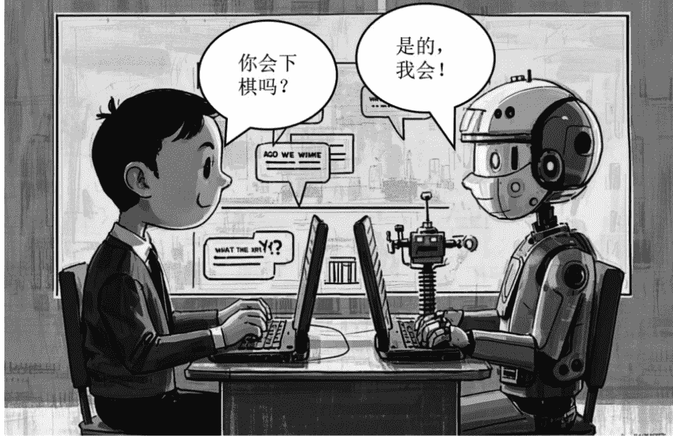

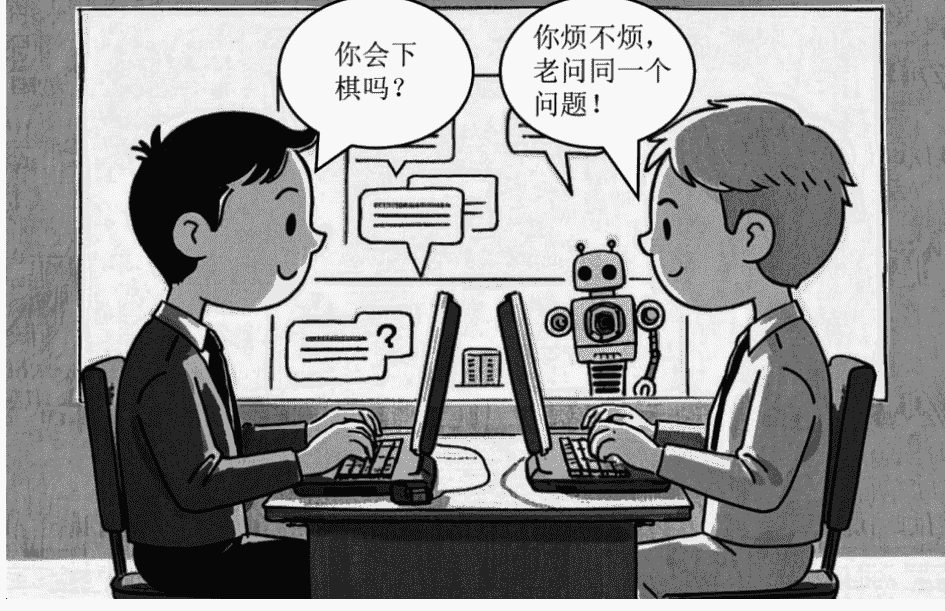

图1-2 机器和人

（2）徘徊发展的初期。

1956年，美国达特茅斯学院举办了一场夏季研讨会。在这次会议上，约翰·麦卡锡（John McCarthy）首次提出了“人工智能”这一术语，并将其定义为“制造智能机器的科学与工程”。

20世纪60年代，AI技术取得了重要进展，主要体现在自然语言处理（NLP）、专家系统、神经网络等领域。

- 自然语言处理：美国计算机科学家约瑟夫·魏泽堡（Joseph Weizenbaum）开发了一个名为ELIZA的聊天机器人，它能够模拟医生与患者之间的对话。ELIZA的出现标志着人类与机器的沟通方式不再局限于二进制算法，而是可以通过自然语言进行交互。如今，我们使用的ChatGPT、DeepSeek、Midjourney、即梦AI等AI工具都基于自然语言处理技术。可以说，自然语言处理是我们普通人与AI沟通的桥梁。

- 专家系统：由费根鲍姆（Edward Feigenbaum）领导的团队开发了历史上第一个专家系统——DENDRAL。专家系统是一种模拟人类专家决策能力的计算机程序，它通过集成特定领域的知识库和推理引擎，模拟专家的决策过程，从而在复杂问题上提供专业建议。例如，DENDRAL可以模拟化学专家推断分子结构。

- 神经网络：美国心理学家弗兰克·罗森布拉特（Frank Rosenblatt）提出了感知机模型，这是一种具有学习能力的神经网络。神经网络是一种模仿人脑神经元结构的计算模型，用于识别模式和处理复杂的数据。然而，早期的感知机存在一个巨大的问题，那就是无法处理非线性问题。

**拓展：什么是线性问题，什么是非线性问题？**

线性问题：指变量之间的关系满足叠加原理和齐次性，即输入与输出成严格的正比例关系，数学上可用一次函数或线性方程描述，即 $y=kx+b$。例如，我们去商店买糖果，1颗糖果的价格为2元，2颗糖果的价格为4元，4颗糖果的价格为8元，以此类推，糖果总价与数量的关系可以表示为总价=数量×2，这就是线性问题。

非线性问题：指变量之间的关系不满足叠加原理，输入与输出的比例关系被打破，数学上需用高次方程、曲线或复杂函数描述，如二次函数 $y=ax^2+bx+c$、指数函数等，几何上表现为曲线或曲面。同样以买糖果为例，1颗糖果的价格为2元，2颗糖果的价格为4元，但买4颗糖果时，商家因“折扣促销”“库存压力”“市场价格”等因素，仅收取7元，此时糖果总价与数量的关系不再成比例，而是受到多种变量的影响，这就是非线性问题。

20世纪70—80年代，硬件条件限制了AI的发展。1981年，IBM公司推出的IBM PC内存容量仅为16KB，而如今大多数家用笔记本的内存至少为8GB，算力更是提升了3000万倍以上。举一个简单的例子，如果用1970年的计算机计算圆周率π到1000位，需要好几天时间，而使用如今的计算机完成同样的计算，只需要约0.01秒。

由于计算机性能的限制、数据不足及当时算法的局限性，AI的研究进展缓慢，许多研究未能达到预期成果。公众对AI的期望逐渐降低，导致资金、人才流失，AI的发展进入寒冬。

（3）机器学习和神经网络的复苏。

20世纪80年代，AI的研究主要集中在符号主义（Symbolic AI）方法上，这种方法依赖人工编写规则，也就是为AI准备“题库”，如“如果发烧且咳嗽，就诊断为感冒”。然而现实世界复杂多变，我们很难穷尽所有的问题建立“题库”。同样，依靠人工编写的规则无法处理模糊语义或识别图像。

到了20世纪80—90年代，随着机器学习的兴起，这一局面有所改变。

机器学习是AI的一个分支，它使计算机系统能够通过数据自我改进，而无须进行明确的编程。运用此项技术，我们在编程时无须逐一写清楚“如果发烧且咳嗽，就诊断为感冒”这类规则，而是让算法和模型从数据中自行学习，从而提高决策能力。

1997年，IBM训练的人工智能“深蓝”战胜了国际象棋世界冠军，很多人认为这是机器学习的胜利，其实不然。“深蓝”采用了符号主义方法，实际是靠规则驱动，通过穷举和搜索所有可能的走法，并评估局面以找到最佳策略。

另一个重要事件则是反向传播算法的诞生。

反向传播算法简称BP算法，它通过计算网络输出与实际目标值之间的误差来调整网络参数，使误差最小化。与感知机相比，感知机的纠错就像小学生做试卷，做错一道题后重做整张试卷，效率低且容易受到数据噪声（如试卷上的污渍）干扰，导致反复修改却无法稳定收敛；而反向传播算法显著提升了纠错效率，如同为每个学科配备了一位老师，精准指出错误步骤并有针对性改进。

简而言之，反向传播算法是对神经网络的升级，让我们在训练AI时有了更精准的反馈，从而让它的回答更符合我们的需要，让神经网络这项技术可以解决非线性问题。这一算法为神经网络和深度学习的发展打下了基础。

机器学习的发展为AI带来了更多关键技术，如监督学习、无监督学习、强化学习，如图1-3所示。

- 监督学习：给模型输入带标签的数据进行训练，如给模型输入标记好的各类猫和狗的照片，让它学习并识别。

#### 1.1.2 国内AI发展现状

##### 1. 国产AI奋起直追，直到超越

2023年初，ChatGPT成为热议话题，笔者被问得最多的问题就是“如何使用ChatGPT”。然而，短短几年间，国内AI技术奋起直追，取得了显著进展。

百度、阿里、腾讯、字节跳动等大型互联网企业加大AI研发投入，聚焦深度学习框架、算法、芯片等核心领域。例如，华为推出昇思（MindSpore），百度推出飞桨（PaddlePaddle），努力打破国外技术垄断，提升自主可控能力。同时，企业通过高薪吸引海外AI人才回国，并与高校合作开设AI相关课程，培养符合需求的专业人才。

截至2024年12月31日，我国已有302款生成式人工智能服务完成备案，其中2024年新增238款。此外，通过API接口调用的备案模型应用达105款，覆盖内容创作、设计、个性化服务等领域。2024年，中国新增生成式AI专利2.7万件，占全球新增量的六成以上。

在核心产品方面，2025年1月20日，深度求索公司发布大模型DeepSeek-R1，以其强大的逻辑推理能力跻身世界AI排行榜第6位，并因其开源特性成为全球最受欢迎的可本地部署大模型之一。百度、腾讯、360等企业也纷纷接入DeepSeek-R1。

2025年1月28日，央视春晚中由宇树科技研发的机器人舞蹈《秧BOT》引发广泛关注，成为现象级AI产品。

##### 2. 为什么DeepSeek被称为“国运级”的大模型

此前，我国企业已推出文心一言、讯飞星火等大模型，但DeepSeek却脱颖而出，甚至被称为“国运级”的大模型。其成功原因可归结为三点：高性能推理模型、开源、轻量化部署。

###### （1）高性能推理模型。

通用大模型更擅长自然语言生成、多轮对话、创意写作等基础语言任务，响应速度快，但答案生成过程属于“黑盒”。推理大模型更擅长多步骤的逻辑推导和复杂问题分解，尤其在数学、代码等强逻辑任务中表现突出。与通用大模型不同，推理大模型展示完整的思考链路，虽然消耗的时间和资源更多，但生成回答的质量更高，更适合科研和生产领域的应用。图1-5所示是DeepSeek思考过程的展示。

推理大模型和通用大模型的对比如表1-1所示。

表1-1 推理大模型和通用大模型的对比

| 对比维度 | 推理大模型 | 通用大模型 |
| :--- | :--- | :--- |
| 核心能力 | 专精多步骤逻辑推导、复杂问题分解（如数学证明、代码生成、伦理分析） | 侧重于自然语言生成、多轮对话、创意写作等基础语言任务 |
| 输出特点 | 展示详细推理过程，增强结果可解释性 | 直接生成答案，不展示推理过程 |
| 应用场景 | STEM 学科、医疗诊断、算法设计、逻辑谜题等高复杂度任务 | 客服对话、创意写作、翻译、摘要等语言密集型任务 |
| 训练方法 | 强化学习、数学 / 代码数据集增强、神经符号推理 | 大规模通用文本预训练，无专项推理优化 |
| 运算效率 | 推理时间较长，资源消耗较多 | 响应速度快，资源消耗较少 |
| 典型模型 | DeepSeek-R1、GPT-o1、Gemini 2.0 Flash Thinking | DeepSeek-V3、GPT-3/4、BERT |
| 提示词策略 | 需简洁指令（如“证明勾股定理”），避免干扰性角色设定 | 需分步引导（如“分三步分析”），可通过角色扮演增强生成多样性 |
| 可解释性 | 高（过程透明，符合逻辑规则） | 低（依赖模式匹配，偶现“幻觉”） |
| 成本与部署 | 训练成本高（专项优化），终端部署难度较大 | 训练成本低（如 DeepSeek-V3 成本约为 GPT-4o 的 1/20），适合快速多场景部署 |
| 行业渗透趋势 | 加速向科研、工程等专业领域渗透 | 通过开源策略支撑长尾场景普及化应用 |

###### （2）开源。

开源大模型是基于深度学习技术构建的AI模型，其源代码、训练数据、模型参数及技术文档均向公众开放，允许开发者自由访问、修改、分发和二次开发。

尽管《中华人民共和国专利法》等法律为发明创造设定了保护时限，以保障创作者的利益，但一些企业仍选择开源其技术，如深度求索公司本可凭借不开源大模型获益，却选择了开源。

开源策略的一个典型案例是Android系统，其通过开源吸引了众多开发者，催生了多种基于其上的定制系统，最终在市场中占据了主导地位。

DeepSeek的开源策略正引发一场AI生产力革命。在政务领域，多地政府已宣布在政务系统中接入DeepSeek。在通信、能源领域，中国移动、中国电信、中国联通三大运营商及多家电力、石油央企也全面接入了DeepSeek。此外，百度、腾讯、360等互联网企业，以及华为云、腾讯云、阿里云等云平台均在各自产品中或平台上集成了DeepSeek。超过200家行业头部企业也完成了DeepSeek的技术接口部署，公共教育、医疗等领域亦在逐步探索应用。

###### （3）轻量化部署。

DeepSeek的轻量化部署策略凸显了其独特价值。相较于大企业，中小企业甚至自由职业者也能轻松利用AI提升生产力。DeepSeek提供两种部署方案：API接口调用与本地部署。API接口调用成本极低，DeepSeek-R1的单价仅为GPT-4o的5%～10%，处理百万tokens仅需2元左右，极具性价比。对于注重数据保密的企业，本地部署更为适宜，但传统方案成本高昂。DeepSeek-R1通过应用“蒸馏”技术，降低了开发与部署成本，如70B版本的部署成本仅需2～3万元（采用单张RTX 3090显卡），高阶版本的成本也控制在几十万元内，显著降低了门槛。这使得中小企业及自由职业者能运用AI强化生产力，如短剧行业预测，低成本将催生大量微型企业。DeepSeek的成功在于满足市场需求，提供高性能、无技术门槛、高性价比的AI产品，成为现象级出圈案例。

20世纪末至21世纪初是一个充满变革与机遇的时代，技术的飞速发展深刻改变了我们的生活方式：从大哥大、BB机到诺基亚，再到智能手机普及；从绿皮火车到高铁、飞机成为主要交通工具；从学校机房穿着鞋套使用电脑，到家用电脑普及，再到移动互联网崛起；从现金支付到手机支付全面覆盖……

然而，我们也是不幸的。每一次技术变革都伴随着机遇与挑战，有人趁势而起，也有人被时代淘汰。例如，2000年的下岗潮中，有人下海经商实现财富自由，也有人一蹶不振，生活陷入困境。正如这段文字所描述的，简单的几行话背后，可能是一个人人生的起起落落，乃至一家老小的喜怒哀乐。

我们能明显感受到，世界正在加速变化，“洞中修行几十年，出关仗剑走天涯”或“悄悄努力，惊艳所有人”的适用范围变得越来越小。在急速旋转的摩天轮上，如果不抓紧扶手，每个人都有掉下去的风险。

然而，“抓紧”并不意味着“病急乱投医”或“盲目all in”，而是需要稳健且慎重地前行。尤其是在面对AI这股浪潮时，我们的决策可能关乎个人乃至家庭的未来。正如《低风险创业》一书中所说：“让你的风险变大的绝对不是创业，而是你的无知、傲慢和不学习。”

接下来要介绍的AI时代生存建议将帮助你在了解AI的过程中少走弯路，避免不必要的损失。

### 1.2 AI时代生存建议：三要三不要

#### 1.2.1 要定期学习，不要持续追新

从2022年ChatGPT上线至今，AI产品的更新迭代速度显著加快。以本书为例，初稿于2023年5月完成，其间至少修改了3次，主要原因就是AI产品的功能不断升级和变化。

在知识学习领域，我们常借用老子“道法术器”的理论来划分知识的层级。为了帮助读者更好地把握时代机遇，我们借用李笑来《财务自由之路》中的观点，简要解析“道法术器”的内涵。

- ● 道：指规则和规律，是对事物发展趋势的总结，如经济发展规律、技术更新趋势等。其优点是具有极强的可迁移性和广泛的应用范围，且不易过时；缺点是难以直接落地，甚至可能让人觉得空洞无用。例如，李笑来在《财务自由之路》中指出，所有商业模式的本质是个人成长和长期主义。这是他对客观规律的总结，属于“道”的层面。乍一听可能觉得无用，但真正理解后，可以将其迁移到多个领域。

- ● 法：即方法论，指做事的规则体系、指导方针和思路。它通常提供一套完整的方法论，具有较强的指导性，但与实际应用仍有一定距离。例如，在《财务自由之路》中，作者将赚钱的方式分为三种：售卖自己的时间（打工或提供服务）、一次时间多次售卖（讲课或写作）、售卖他人的时间（开公司当老板）。这是从客观规律中提炼出的方法论，属于“法”的层面。很多人听课觉得老师讲得好，却难以致用，正是因为方法论虽然提供了方向，但缺乏具体的实操指引。

- ● 术：指具体的技术或可执行的操作方法。例如，当我们知道赚钱的三种方式后，仍可能不知道如何具体操作。比如，想通过讲课赚钱，该如何选择课题、设计内容、进行推广和销售？这些具体操作就是“术”。到了“术”的层面，内容会显得非常“落地”，容易让人产生获得感。然而，对学习方法缺乏理解的人，往往误以为这就是所谓的“干货”。

- ● 器：指工具。例如，讲课需要用哪些软件录制，成品在哪些平台发布？这些都属于“器”的范畴。工具层面的内容实用性极强，学了就能马上使用，但“器”的变动性和可替代性也很高。尤其是在当前AI工具快速迭代的背景下，每个产品都在技术和市场的双重压力下不断更新，以追求更便捷、更强大、更多功能。这种“大逃杀”式的竞争，使得工具的更新速度越来越快，用户需要不断适应新工具的变化。

AI产品的更新速度已不能用“很快”来形容，而是“飞快”。如果一味追逐AI工具的更新，可能会将时间浪费在即将被淘汰的知识上，而忽视了对上层应用范围更广的知识的学习，这显然不够明智。

然而，作为AI浪潮下的普通人，工具恰恰是我们最需要掌握的内容。掌握新工具能够快速提升生产力，并带来实际效益。那么，如何平衡工具学习与知识积累呢？这里提供一个建议——半年回头看。具体来说，可以以6个月为周期（精力充足的话可缩短至3个月），定期学习新工具和新方法。工具的淘汰速度快，但学习成本低，通常只需几天到一周即可掌握最新内容。

#### 1.2.2 要关注自身专业领域，不要轻易all in

有专家指出，2024年，人工智能专业的在校生仅为4万多人，而整个AI领域的人才缺口高达500万人。目前，AI行业急需大量人才，且薪资水平较高。

看到这里，你是否心动了，想要迅速入行？别急，我们先厘清思路。

前文中，我们讨论了“道法术器”的概念，并指出AI工具在“器”的层面，具有更新快、淘汰快、易学习的特点。顺着这一思路，既然AI工具更新快、淘汰快、易学习，那么填补500万的人才缺口似乎只是时间问题。如今，AI技术火热，各类培训机构更是如雨后春笋般涌现，学员数量远超500万。未来，掌握AI工具的人数可能达到1000万、2000万，甚至更多。当供过于求时，AI人才的薪资还会如此高吗？

事实上，AI行业真正需要的人才，并非仅仅粗浅掌握AI工具的人，而是分为两类：核心的大模型研发人员和行业应用人员。

- 大模型研发人员：这类人才无疑是高薪群体，但对于不懂编程、计算机或深度学习的普通人来说，门槛过高。哪怕有时间系统学习，也需要考虑三五年后这一领域是否仍有足够的就业机会。
- 行业应用人员：大模型的研究最终要落地应用。随着AI技术的普及，越来越多的企业开始探索如何利用AI工具提升效率。因此，我们应立足于本行业需求，学习和探索AI技术，解决实际问题。例如，培训行业的从业者可以思考如何利用AI工具优化课程设计、提高工作效率，或帮助更多人掌握AI技术。

在AI浪潮下，传统行业从业者面临的最大冲击是被AI工具替代。例如，AI绘画工具让不会绘画的人也能制作漫画甚至微电影。表面上看，竞争者增多了，但如果我们有扎实的基本功和多年积累的行业经验，这就是我们与“草台班子”的区别。真正的竞争力在于对行业的深刻理解，而非单纯的技术能力。

机会源于对本行业需求的深刻洞察，而非“盲目all in”。如果你已在自身行业积累了丰富经验，再去拓展学习深度学习或更深层次的AI技术，才是明智之举。但请记住，与拥有多年AI从业经验的专业人士相比，我们仍需保持谦逊和持续学习的态度。

#### 1.2.3 要用时间解决技术问题，不要用技术解决技术问题

ChatGPT发布后风靡一时，网络上有人教授如何用Python技术将ChatGPT接入Office办公软件，不少人为此付费。然而，仅四个多月后，金山办公就推出了WPS AI，用户只需将WPS Office更新到最新版本即可使用。那些花费时间和金钱学习Python的人，可能发现自己的接入方案远不如官方版本好用。

当然，努力不会白费，Python作为一种编程语言，本身具有价值，未来或许有用武之地。但“或许有用”也意味着这并不是最佳的学习策略。

通过这个例子，我想强调的是：在学习AI的过程中，如果发现某些功能不够完善，不要急于通过自学技术来解决。很可能在你掌握技术之前，已有厂商推出了更好的解决方案，而这个周期可能只需几个月。既然需求存在，与其花费时间开发一个不够成熟的半成品，不如等待大厂的技术更新。你看得到的需求，他们也看得到。

如果遇到有人教授这类技术，也不必急于付费学习。要用动态的眼光看待技术发展。作为普通人，我们应学会用时间解决技术问题，而非用技术解决技术问题。

### 1.3 AI工具的使用风险

AI工具的使用无疑能大幅提升我们的工作效率，但同时也伴随着潜在风险。这些风险主要关乎用户自身的短期利益，而非AI替代人类的长期风险。

#### 1.3.1 法律风险

在绘画、写作、编程等领域，AI创作的作品的版权归属问题一直存在争议。由人类提出创意，由AI完成创作，而AI则是由软件开发方创造的，那么创作出的作品的版权是归属创意提出者，还是归属AI或开发该AI的公司，目前法律对此尚无具体规定，但司法实践通常会依据用户服务协议及用户是否进行智力投入来判断。

AI作为新兴技术，目前在法律方面还不是特别完善，存在版权归属不明确的风险。使用AI创作时，作者可能无法享有应得收益。

部分AI软件条款甚至规定“所有输入及输出内容版权归属本公司”，这就意味着，如果我们把辛苦写好的论文交给该AI润色，上传后，版权就归属软件开发方了。

因此，使用AI工具时，一定要仔细阅读版权条款。

#### 1.3.2 信息泄露风险

OpenAI于2023年3月发生了用户信息泄露事件，最后以官方道歉告终。这一事件强烈警示我们必须高度重视信息安全问题。

相较于各类App请求手机管理权限以获取用户信息，AI工具可能带来的信息安全风险更为严峻。一方面，由于用户对AI工具的深度依赖，可能会毫无保留地与其交流，从而导致个人信息全面暴露；同时，迅速走红的AI工具也可能成为黑客的首要攻击对象。另一方面，随着AI工具的普及，犯罪分子利用人们对AI的好奇心，诱导人们在非法网站上注册、付费，进而窃取身份证、银行卡号及密码等敏感信息，实施诈骗，甚至利用这些信息进行违法犯罪活动。

#### 1.3.3 过度依赖风险

美国电影《夺命手机》讲述了这样一个故事：主角意外得到一部手机，根据手机的指引，总是好运连连，从此走上人生巅峰，最后却发现，手机的背后是高度智能化、有独立意识的AI，而这个AI则是企图毁灭世界的BOSS。

尽管现实生活中我们离AI全面控制地球的威胁还很远，但我们也需要防范过度依赖AI。正如智能手机依赖导致的专注力、记忆力、方向感等能力退化，过度依赖AI同样值得担忧。

任何技能的高造诣都基于基本功的练习。以动漫行业为例，AI工具的普及使我们习惯用AI解决基础的工作，如用AI制作动画，完成逐帧画面；这确实降低了制作成本，但也让很多年轻人没有机会，也没有耐心从基础的工作做起，缺少深刻的体悟，从而限制了发展上限。

同样，作家若过度依赖AI输出，将丧失驾驭文字的能力。大家如果在提示词里都写模仿金庸、莫言、史铁生、鲁迅的文风，那么这些前辈大师就成了人类文化的天花板，今后再也无人有机会超越。

因此，我们应时刻铭记主次之分，AI应作为提升效率的工具，而非我们能力发展的天花板。

## 第2章 国内主流AI产品解析

### 2.1 对话大模型

对话大模型是通过文字输入问题，由AI进行回答的对话工具，可以分为通用大模型和推理大模型，二者的区别如1.1.2小节所述。

我们可以简单记忆为：逻辑复杂的找推理大模型，没有逻辑需求的找通用大模型。

从发展趋势来看，多数大模型都在往功能全面的方向发展，兼顾推理和通用场景，如腾讯元宝、百度搜索都已接入DeepSeek-R1，豆包也开发出了深度思考功能，如图2-1所示。


图2-1 豆包的深度思考按钮

表2-1所示是国内主流对话大模型的对比。

表2-1 国内主流对话大模型的对比

| 工具名称 | 开发公司/团队 | 核心功能 | 技术亮点 | 是否支持深度思考 | 典型应用场景 |
| :--- | :--- | :--- | :--- | :--- | :--- |
| DeepSeek-R1 | 深度求索 | 学术研究、商业分析、代码生成、逻辑思考 | 多模态交互，可视化结论生成，开源生态支持 | 支持 | 科研论文推理、金融数据分析 |
| 豆包 | 字节跳动 | 旅游规划、多语言翻译、口语练习 | 功能全面丰富，可以作为浏览器或浏览器插件 | 支持 | 跨国会议翻译、自媒体内容生成 |
| 腾讯元宝 | 腾讯 | 多场景对话、微信生态任务管理 | 隐私保护模式，支持语音指令唤醒 | 支持 | 日程提醒、企业内部知识问答 |
| 文心一言 | 百度 | 知识问答、垂直领域解决方案 | 中文事实准确性领先，医疗/法律知识图谱增强 | 支持 | 合同条款解析、百科问答 |
| Kimi | 月之暗面 | 长文本解析（200万字级） | 速读《三体》级内容，法律条文结构化处理 | 支持 | 法律文件检索、小说创作辅助 |

在选择对话大模型时，有三个参考维度：回答质量、功能丰富性、版权问题。

- 回答质量：推荐选择DeepSeek，如果遇到DeepSeek服务器繁忙的问题，可以使用腾讯元宝，腾讯元宝有本地部署DeepSeek满血版；如果有长文本写作和理解需求，如小说创作、书籍解读，推荐选择Kimi。
- 功能丰富性：推荐使用豆包，除了基础的对话功能，豆包还集成了会议记录、AI生图、Excel高效处理、网页翻译、截图提问、划词搜索、视频总结等功能，非常适合在工作场景中使用。
- 版权问题：目前，国内AI辅助创作领域的知识产权法规尚不完善，部分公司的用户协议将用户上传的文本视为其知识产权。若需利用AI创作书籍、课程等知识产权产品，建议优先选择本地部署。若无条件，可选择Kimi，其条款相对灵活。但需注意，具体条款可能出现变动，如腾讯元宝已适度放宽限制。使用前，请仔细阅读相关版权条款。

### 2.2 图像视频创作

AI图像视频是通过“提示词”“示意图（垫图）”等方式，利用AI生成所需图片和视频的技术。当前，AI图像和视频创作工具呈现融合趋势，许多工具兼具生成图片、视频甚至数字人的功能，因而本节的工具归纳会把图片、视频、数字人工具汇总在表2-2中。

#### 2.2.1 AI图像工具

- 图像生成与创作：用户只需输入一段文本，AI图像工具就能根据文本生成对应的图像，极大地拓展了创作边界。
- 图像编辑与处理：AI图像工具能够自动优化图像质量，包括调节亮度、对比度、色彩等。一键美颜、滤镜添加、背景替换等功能也让用户无须专业技能即可轻松美化照片。
- 图像修复与增强：利用AI算法，修复受损的图像，甚至可以对模糊的图像进行增强处理，让图像细节更加清晰。
- 创意激发与辅助：对于设计师和创意工作者来说，AI图像工具可以提供灵感，快速生成设计草图，辅助进行创意构思。

例如，使用即梦AI进行文生图，提示词为“孤舟蓑笠翁，独钓寒江雪”，效果如图2-2所示。


图2-2 以“孤舟蓑笠翁，独钓寒江雪”为提示词生图

#### 2.2.2 AI视频工具

- 视频生成与合成：AI视频工具可以基于文本、图像或视频素材生成新的视频内容，适用于短视频创作、广告宣传、视频特效、虚拟主播等多个场景。
- 视频编辑与处理：AI视频工具可以帮助用户进行视频的剪辑、拼接、转场效果添加等操作。如Veo可以根据文本生成高质量的1080P视频片段，在管理运动、光照和镜头角度方面表现突出。
- 视频增强与优化：AI视频工具能够优化视频的画质，提高清晰度、色彩准确性，甚至可以通过AI算法进行超分辨率处理。
- 制作效率的提升：通过自动化和智能化的功能，AI视频工具极大地减少了视频制作所需的时间，降低了制作门槛。如快影提供一键生成视频、智能配音、自动字幕等功能，剪映智能版能快速生成产品宣传片或广告视频。

表2-2所示为常见的AI视频工具。

表2-2 常见的AI视频工具

| 工具名称 | 开发公司/团队 | 核心功能 | 技术亮点 | 典型应用场景 |
| :--- | :--- | :--- | :--- | :--- |
| 堆友 | 阿里国际 | 商品主图生成 | 中英文混合关键词，千种电商风格模型 | 跨境电商产品图、Banner广告设计 |
| LibLib | 奇点星宇科技 | 精细化文生图，stable diffusion在线使用 | 可在线调教部署属于自己的stable diffusion模型，但新手上手难度较大 | 插画创作、PPT配图生成 |
| 稿定设计 | 稿定科技 | 智能海报生成 | 营销模板库+智能排版，中小商家专用 | 餐饮菜单设计、活动宣传单页 |
| 剪映 | 字节跳动 | 文生视频、智能剪口播、智能剪辑辅助、数字人 | 功能全面，操作简单 | 视频剪辑，短视频创作 |
| 秒创 | 一帧秒创 | 文生视频、智能素材匹配、数字人 | 功能全面，操作简单 | 短视频创作 |
| 腾讯智影 | 腾讯 | 文生视频，智能素材匹配、数字人 | 腾讯视频授权商用影视素材 | 短视频创作 |
| 白日梦AI | 光魔科技 | 文生视频、动态画面、AI角色生成 | 人物/场景一致性等功能 | 动态漫画 |
| 可灵AI | 快手 | 虚拟试穿、对口型视频生成 | 4K视频连贯性优化，电商场景专用 | 直播带货视频、广告营销素材 |
| Vidu AI | 清华大学与生数科技 | 文字/图片转视频 | 自研动态模型，画面一致性达影视级 | 短视频创作、影视分镜预演 |
| 即梦AI | 脸萌科技 | 动态大片生成（国风/科技特效） | 抖音爆款模板库，支持单句生成 | 社交媒体热点视频、品牌宣传片 |

### 2.3 AI办公工具

AI工具还广泛应用于日常办公领域。例如，传统的“办公三件套”（Word、Excel、PPT）已实现自动化赋能，同时AI还深入办公协同场景，涵盖会议记录、项目计划、团队协作及即时问答等功能。

表2-3所示为常见的AI办公工具。

表2-3 常见的AI办公工具

| 工具名称 | 开发公司/团队 | 核心功能 | 技术亮点 | 典型应用场景 |
| :--- | :--- | :--- | :--- | :--- |
| WPS AI | 金山软件 | Word、PPT、Excel自动化 | 国内最普及的办公软件，在线可同步保存，使用便捷，体验感好 | 各种办公任务处理 |
| ChatPPT | 必优科技 | PPT自动生成、一键调整 | 作为PPT插件使用，在PPT插件领域有较深积累，功能全面，适用性强 | 快速生成PPT |
| 豆包 | 字节跳动 | 文本对话、会议记录、划词、截图翻译等 | 功能丰富全面，眼里有活 | 作为浏览器或浏览器插件辅助使用 |
| 腾讯会议 | 腾讯 | 会议记录、会议总结 | 垂直于会议场景，性能更强 | 线上会议 |
| 钉钉AI | 阿里钉钉 | 智能工作助理 | 深度结合钉钉其他功能，使用便捷 | 适合企业级AI赋能 |
| 飞书AI | 字节跳动 | 智能工作助理、多维表格、协同办公 | 多维表格已接入DeepSeek，可批量完成工作 | 协同工作、企业级AI赋能 |

### 2.4 AI学习工具

无论是学生、职场人士还是创业者，在AI时代，学习和自我提升依然至关重要。AI工具的普及看似让我们不用学习更多的技能，实际上对我们更深层次的学习能力提出了更高要求。

表2-4所示为常见的AI学习工具。

表2-4 常见的AI学习工具

| 工具名称 | 开发公司/团队 | 核心功能 | 技术亮点 | 典型应用场景 |
| :--- | :--- | :--- | :--- | :--- |
| 秘塔AI | 秘塔科技 | 学术/播客定向检索 | 结构化结果输出，支持跨平台内容聚合 | 行业调研、竞品分析、论文辅助 |
| 微信AI搜索 | 腾讯 | 生态内多模态搜索（PDF/视频） | 摘要生成与关键帧提取，社交数据强化 | 课程资料整理、短视频内容检索 |
| 豆包 | 字节跳动 | 文本对话、会议记录、划词、截图翻译等 | 功能丰富全面，眼里有活 | 作为浏览器或浏览器插件辅助使用 |
| 印象笔记 | 印象笔记 | 自动生成大纲，自动生成思维导图、知识库管理 | 知识库管理、浏览器插件 | 知识管理、个人知识库建设、快速笔记 |

### 2.5 AI编程工具

AI辅助编程是AI应用的重要领域，在国内正快速普及。据市场研究机构数据，2023年中国AI代码生成市场规模已达65亿元，预计2028年将增长至330亿元。

虽然AI编程工具被戏称为“程序员开发了程序，却裁掉了自己”的工具，但其更大的意义在于为普通人提供了开发应用产品的机会。通过AI编程，非专业人士也能满足行业需求，创造商业价值。

表2-5所示为常见的AI编程工具。

表2-5 常见的AI编程工具

| 工具名称 | 开发公司/团队 | 核心功能 | 技术亮点 | 典型应用场景 |
| :--- | :--- | :--- | :--- | :--- |
| 通义灵码 | 阿里云 | 代码生成与纠错 | Python全栈任务支持，数据分析代码一键生成 | 金融模型开发、自动化脚本编写 |
| Trae | 字节跳动 | 代码库上下文提取、自动化调试、自然语言对话 | 全流程辅助，支持私有代码库训练 | 微基础开发应用 |
| DeepSeek | 深度求索 | 轻量级模型训练 | 70B参数适配低配设备，支持行业模型二次开发 | 嵌入式设备开发、教育机器人编程 |

## 第3章 对话大模型：AI应用基础

本章主要使用的AI工具：DeepSeek

### 3.1 回答不满意的根源是“信息差”

许多朋友曾问我：为什么与AI沟通时，输出质量不尽如人意，是技术不够成熟吗？

我试图解答，却陷入“想清楚了但说不明白”的困境，一时无言以对。我突然意识到：原因在于我们想清楚了却未表达清楚。在沟通领域这被称为“信息差”，而大多数误会和矛盾的根源正在于此。

为便于理解，我举一个职场中的例子来说明。

小帅是小强的上级，他让小强制作一份年终总结PPT用于公司汇报，并提供了部门数据。

第一天，小强完成了初版PPT。小帅认为模板不合适，要求改为高端商务风，并加入红色元素以体现节日氛围。小强按要求修改。

第二天，小帅认为模板符合要求，但结构需要调整。小强再次修改。

第三天，小帅指出文字不够精练；第四天，小帅指出配图不够理想；第五天，小帅指出流程图不够清晰。小强逐一修改。

第六天，小帅对PPT终于满意，但对小强的工作效率表示不满，认为其能力不足。小强则抱怨小帅未一次性明确要求，导致反复修改。

问题根源在于“信息差”：小帅脑海中的标准未清晰传达给小强。解决方法有两种：一是小帅亲自完成；二是优化流程，如小帅先梳理大纲和结构，明确每页重点，再由小强负责美化，避免浪费时间和人力。

这一过程类似我们与AI的互动：我们提出需求，AI完成任务并接受反馈。区别在于，AI不会抱怨，只会保质保量地执行。因此，明确需求是高效协作的关键。

在我们与他人或AI沟通的过程中，常因以下情况产生误解。

（1）信息不完整。

每个人对“好”的标准不同。若需求方（如小帅）未一次性明确任务标准，执行方（如小强）便难以一次到位。然而，要一次性说清所有标准也不现实，因为标准分为以下两类。

- 显性标准：可具体描述的标准，如“不吃香菜”。
- 隐性标准：难以言明的标准，如对“美”的主观认知差异。

这解释了为何客户常无法清晰表达需求，导致返工：一是客户对专业领域缺乏认知，需看到成果才能感知；二是主观偏好差异，如有人喜欢香菜，有人厌恶。若需求方能提前梳理并明确部分标准，可显著提升效率。

（2）抓错重点。

不同人对同一句话的关注点不同。例如，“今晚请李总吃饭，订个位置”，有人关注“今晚”，有人关注“吃饭”。为避免误解，我们在提出需求时应做到两点：精简语言、强调重点。

（3）语义歧义。

语言本身具有多义性，尤其在中文语境中。例如，“苹果”可能指水果或公司；“好棒棒”可能是赞美或讽刺。与AI沟通时，需避免歧义，必要时对关键词进行备注。所以与AI沟通要简单直接，避免歧义，如果有存在歧义的词语，最好备注。

（4）超出认知范围。

在日常工作中，我们常会遇到一些从未接触过的任务或不熟悉的行业领域。同样，AI虽拥有海量参数，但未必了解特定公司或行业的知识。例如，让AI为“李总”撰写公众号文章，若未提供李总的背景、活动内容等详细信息，AI也难以完成任务。因此，需提供充分的参考资料，帮助AI理解上下文。

### 3.2 AI学习和使用指南：使用AI学习的四大原则

在正确理解“信息差”后，我们便能更好地掌握以下沟通原则。这些原则适用于当前所有AI工具，涵盖对话、图像、视频、编程、学术等领域，是运用AI工具的底层逻辑。掌握这些原则后，无论AI工具如何发展，我们都能从容应对，无须额外支付学习成本。

#### 1. 原则1：越具体，越准确

与AI沟通的首要原则是“越具体，越准确”。这意味着我们需要明确问题的完整性，清楚自己想问什么。例如，使用DeepSeek策划旅行计划时，如果只是提问：“我要去××地旅行，请给我一个旅行计划。”这样的问题看似提出了自己的需求，实际上还是有很多信息差存在。别说是AI，就算是面对真人旅游顾问，也需要交代清楚：几个人？去几天？预算是多少？有什么具体的偏好？是倾向于美食体验、人文景观还是自然风光？

更具体的提示词应是：“我打算一个人去××地旅行，算上路程只有3天时间，我预算总共2000元，希望更多地品尝美食，请给我设计一个旅行计划，每一餐都要推荐一个当地的特色美食餐厅。”

同样，再举一个AI生图的例子。

我们想要一只可爱小猫的图片。我们在即梦AI对话框中输入提示词“一只可爱的小猫”，如图3-1所示，得到的效果如图3-2所示。

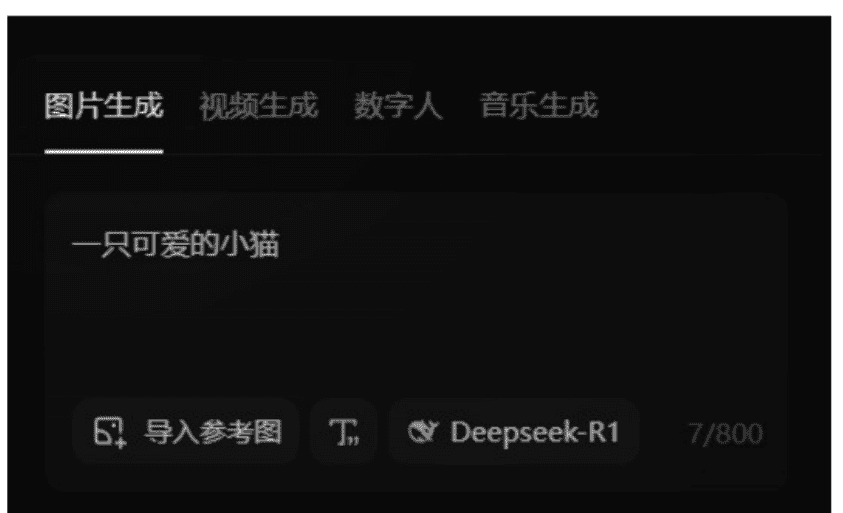

图3-1 输入提示词“一只可爱的小猫”


图3-2 提示词“一只可爱的小猫”生图效果

虽然生图效果不错，但未必符合我们的预期，因为我们没有说明我们脑海中的那张图片是什么样的：猫是什么品种，画面风格是什么，色调和光线如何，小猫在干什么……我们描述得越具体，生成的图片也就越接近我们的预期。

我们输入提示词 “卡通风格，可爱，一只美短猫，暖色调，正在吃拉面”，如图3-3所示。生成的图片如图3-4所示。

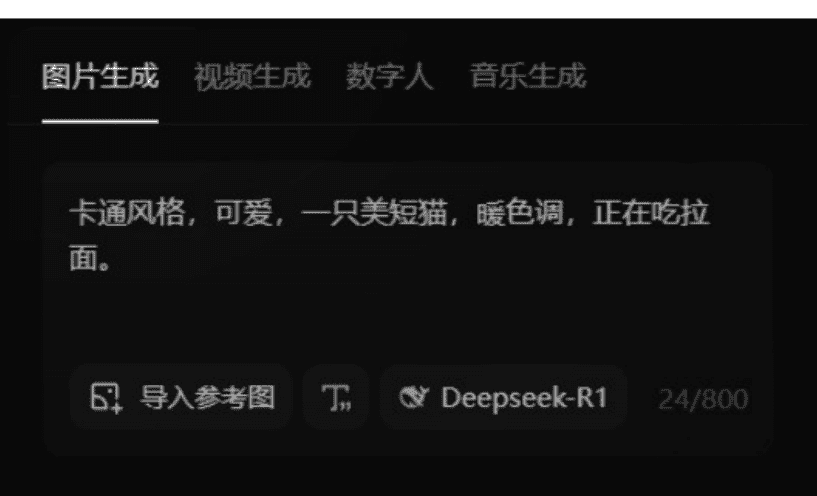

图3-3 输入提示词 “卡通风格，可爱，一只美短猫，暖色调，正在吃拉面”


图3-4 提示词 “卡通风格，可爱，一只美短猫，暖色调，正在吃拉面” 生图效果

这个原则适用于所有AI工具，提示词越具体，得到的效果越接近我们的预期，调试纠错的次数也就越少。

那么如何一次性描述清楚我们的需求呢？答案也非常简单：养成自我提问的习惯。

这一点对于与人沟通和与AI沟通都尤为重要。我们提需求不能单纯说“你把这件事做好”，“好”是一个模糊的标准，我们需要继续提问：“什么是好，有哪些具体标准？”标准越具体，沟通也就越顺畅。

#### 2. 原则2：认知上限决定AI能力上限

AI的能力发挥取决于使用者的认知水平。AI虽然具备强大的数据处理和生成能力，但其输出质量与使用者的输入质量密切相关。

俗话说“外行看热闹，内行看门道”，能否最大化利用AI工具的关键在于“识货”能力。

例如，AI给我们一份科研结果，我们是否能分辨真伪？AI给我们写了一个电影剧本，我们是否能评价优劣？

武侠小说中常有这样的桥段：年轻人和宗师使用同一套武功，威力却天差地别，根本原因在于“功力”不同。使用AI工具也是如此。虽然掌握新工具看似带来了新机会，但如果只停留在“器”的层面，所有人依然处于同一起跑线，那么比拼的就是更高层次的“道法术”。

本质上，AI是将人类想象力具现化的工具，金融专家能利用AI进行复杂的量化分析，设计师能利用AI创作高质量的艺术作品，导演能利用AI生成有价值的商业广告，职业写手能利用AI生成精彩绝伦的小说……这些成果都源于使用者在各自领域的鉴赏能力，即“识货”能力。如果使用者对某一领域的认知有限，很难提出有价值的修改意见，AI生成的结果也会受限。

这意味着，很多时候AI产出不够理想，问题在于我们的认知水平有限，我们需要提升专业领域的认知，以提高AI产出内容的质量。

用AI绘图，就需要了解光线、风格、艺术家等专业知识；用AI制作视频，就需要了解分镜、景别、电影叙事手法等专业知识；用AI辅助编程，就需要具备一定编程能力，否则连Bug都难以发现。

因此，提升自身认知水平是充分发挥AI潜力的关键。

#### 3. 原则3：没有一步到位

AI虽然强大，但并非万能工具，无法一次性完美完成任务。初学者常误以为AI能一步到位生成理想结果，如通过一个简单的提示词直接生成一篇成熟的文章，或根据大纲自动写出符合预期的小说。然而，AI生成的内容往往需要多次调整和优化。

例如，生成文章时，AI可能无法完全理解用户的深层需求，导致内容偏离预期；生成图像时，细节可能不够精准，往往有一个小瑕疵就需要反复修改；生成视频时，配图或剪辑可能不符合要求。

从根本上说，问题的核心在于“角色错位”：用户想让AI做自己的事，而自己什么也不想做。

AI就像我们的下属，这意味着使用AI的过程应以我们为主导。AI的作用是帮助我们简化某些中间环节，而非完全替代我们的角色。真正的创作仍需要我们的深度参与和指导。

使用AI要记住12个字：修正拍板，及时纠偏，人工定稿。

修正拍板：在工作初期，我们可以借助AI提供建议或训练其生成内容，但最终决策权应掌握在自己手中。如果AI的产出与预期存在差距，可直接进行人工调整，基于AI的成果手动修改后，再反馈给AI进一步优化。

及时纠偏：在使用AI的过程中，一旦发现问题要立即解决。这里的问题不仅包括不符合预期或不满意的情况，还包括使用过程中总结的经验。例如，使用白日梦AI制作动态漫画，由DeepSeek负责剧情和分镜，但成品节奏拖沓，那么就需要分析分镜是否不够细致。若是，下次创作时可以添加指令，如“加快节奏，最长的镜头不超过3秒”。

人工定稿：在使用AI的过程中，我们要考虑两个问题：一是AI的能力边界在哪里；二是与反复调教相比，人工修改定稿是否效率更高。此外，还需要考虑复用性。目前，无论是通用大模型还是推理大模型，即使经过本地化部署和微调，其记忆时长仍有限，可能每次使用都需要重新调教。如果最后一步调教过于复杂，或隐性需求难以表达，建议直接人工定稿，再将成品交由AI学习。

当然，我们要以动态的眼光看待技术，未来的AI一定会更智能，但其中的信息差不可避免。

因此，使用AI工具时，需保持耐心，通过多次迭代和反馈，逐步优化结果。

这一原则提醒我们，AI是辅助工具，而非完全替代人类创造力的解决方案。高效使用AI的关键在于明确需求、分步实施，并在过程中不断调整和完善。

#### 4. 原则4：检查是必要习惯

在使用过程中，我们有时会发现AI“胡说八道”，这就是“AI幻觉”。“AI幻觉”简单来说，即生成看似合理但实则错误的信息。这种现象就像AI在“自说自话”，生成的内容并非基于事实或真实数据。

产生AI幻觉主要有以下几个原因。

- （1）数据偏差和错误。AI的训练数据本身可能存在错误或偏差，导致模型学到不准确的内容，进而在生成回答时出现AI幻觉。
- （2）上下文理解的局限。当面对复杂问题或模糊指令时，AI可能无法准确理解上下文，只能基于猜测生成答案，而这种答案往往是错误的。
- （3）模型设计的过度联想。为了生成连贯的回答，一些AI模型强化了“思维链”能力，但在信息不足的情况下，可能会强行“脑补”答案，从而增加出现AI幻觉的风险。
- （4）知识的过时和固化。AI的知识来源于静态的训练数据，如果模型未能及时更新，面对新问题时，可能基于过时信息生成错误答案。

例如，AI可能在生成文章时引用错误的数据，或在回答问题时提供不准确的细节。因此，在使用AI工具时，尤其是涉及关键信息（如数据、时间、事件等）时，必须养成检查的习惯。通过检查，可以有效避免“以假为真”或“指鹿为马”的情况，确保AI生成内容的准确性和可靠性。这一习惯不仅能提升工作效率，还能避免因错误信息导致的潜在风险。

### 3.3 AI使用基础：文本对话与提示词

#### 3.3.1 以DeepSeek为例的对话大模型的注册流程与操作界面介绍

如今，国内对话大模型的注册和应用已非常便捷。我们以DeepSeek为例介绍注册流程和操作界面，其他类似对话大模型的使用方法大同小异，本书不再赘述。书中的对话示例也主要以DeepSeek为例。

##### 1. DeepSeek注册流程

第1步：在浏览器中使用搜索引擎搜索DeepSeek或直接输入网址，进入DeepSeek官网，如图3-5所示。选择“开始对话”，如果需要使用手机版也可以选择“获取手机App”。


图3-5 DeepSeek官网

第2步：进入登录界面，如图3-6所示，输入手机号，单击“发送验证码”按钮，输入验证码完成认证后即可开始对话。也可以通过微信扫码登录，首次使用微信扫码登录时，需输入手机号完成认证，之后只需扫描微信二维码即可直接登录。

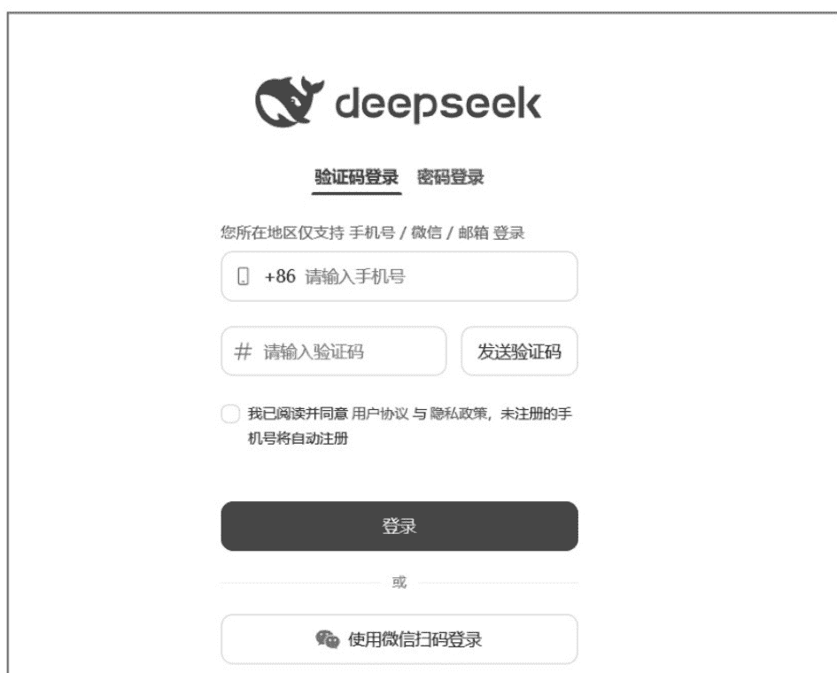

图3-6 登录界面

##### 2. 操作界面

DeepSeek操作界面如图3-7所示，分为三个区域：历史对话、开启新对话、对话框。

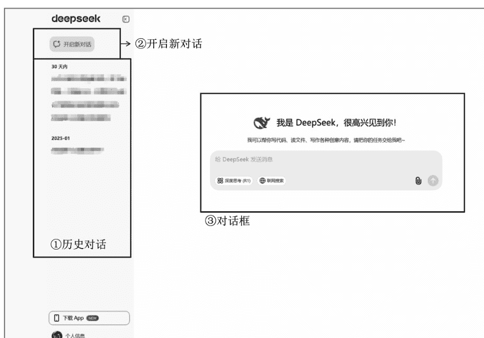

图3-7 DeepSeek操作界面

- 历史对话：切换与DeepSeek的历史对话。
- 开启新对话：与DeepSeek开启一个新对话。
- 对话框：主要的操作区域，如图3-8所示。


图3-8 DeepSeek的对话框

对话框中有四个交互按钮：深度思考、联网搜索、上传附件（回形针图标）、发送（↑）。

- 深度思考：开启时，将调用更高级的推理大模型（如DeepSeek-R1），以提供更复杂的逻辑分析和问题解决能力；未开启时，则使用通用大模型（如DeepSeek-V3），适用于日常对话和基础任务。
- 联网搜索：可即时从网络获取材料作为参考，以提高回答质量。该功能与上传附件功能不能同时使用，用户只能选择其中一种方式提供参考材料。
- 上传附件：上传文件作为参考材料，可以提高回答质量。该功能与联网搜索功能不能同时使用，用户只能选择其中一种方式提供参考材料。
- 发送：图标是一个向上箭头，效果等同于回车键。

建议每开启一个新话题时使用新的对话，因为AI对话模型的上下文关联能力较强，可能会误认为用户仍在讨论之前的话题，导致多个话题混淆。此外，可以为每个对话设定不同的使用场景，如健身顾问、心灵导师、文案助手等，以便更高效地利用AI的功能。

#### 3.3.2 提示词的设计结构：RBRP结构

提示词是我们与AI沟通的桥梁，它指的是用户输入给AI的文本内容，用于引导和控制AI的回答。好的提示词应清晰、具体，明确表达用户的意图和需求，以使AI生成更符合预期的回答。

根据不同使用场景，提示词可以简单区分为指令型提示词、问题型提示词、情景型提示词。

- 指令型提示词：明确指示AI执行特定任务，如“写一首关于夏天的诗”“解释相对论”等。
- 问题型提示词：以提出问题的形式引导AI回答，如“人工智能的发展前景如何”“如何学习编程”等。
- 情景型提示词：设定一个情景，让AI根据情景回答，如“假设你是一位医生，如何给患者解释病情”等。

无论是哪类提示词，都应遵循“越具体，越准确”的原则。我们可以在简单提示词的基础上进一步丰富内容，提出更具体的问题，如表3-1所示。

表3-1 丰富提示词内容

| 提示词类型 | 原提示词 | 更具体的问题 |
| :--- | :--- | :--- |
| 指令型提示词 | 解释相对论 | 请用通俗易懂、小孩都能听明白的语言解释相对论 |
| 问题型提示词 | 人工智能的前景如何 | 请从经济学的角度，论述人工智能的前景如何 |
| 情景型提示词 | 假设你是一位医生，如何给患者解释病情 | 假设你是一位医生，遇到了一位有心脏病史的病人，他病情比较严重，且没有家属陪同，你该如何给患者解释病情 |

无论是哪类提示词，都有进一步完善的空间。丰富提示词的目的是减少我们与AI沟通中的“信息差”，明确需求或问题背景，使其更贴合我们的期望，与我们“同频”，而不是去玩“猜心”的游戏。

给大家一个相对简单的提示词设计结构——RBRP结构，如图3-9所示。

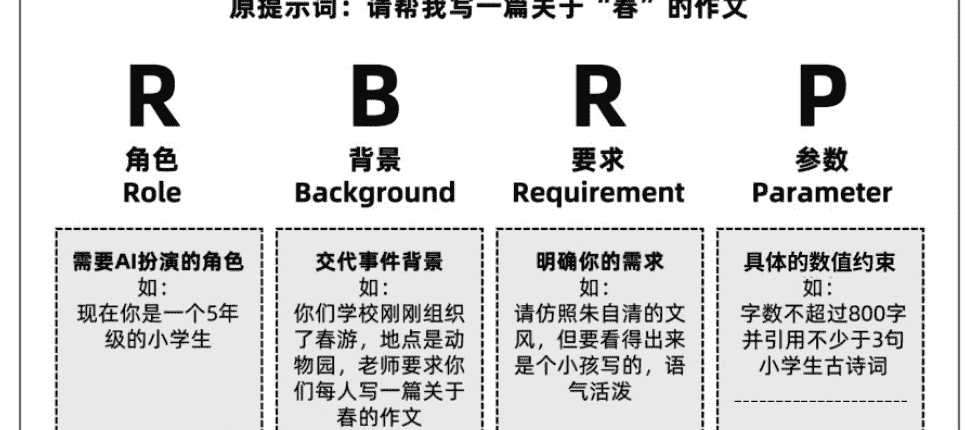

图3-9 RBRP结构

- 角色（Role）：赋予AI一个角色，如导游、律师、医生。
- 背景（Background）：描述背景，即当下的具体情况。
- 要求（Requirement）：提出具体要求，即对于结果的期望。
- 参数（Parameter）：设置参数，明确需要数值，如字数，时间、预算等。

接下来，我们列举几个使用RBRP结构丰富提示词的例子，如表3-2所示。

表3-2 使用RBRP结构丰富提示词

| 提示词类型 | 原提示词 | 更具体的问题 |
| :--- | :--- | :--- |
| 指令型提示词 | 解释相对论 | 角色：你是一名初中老师；<br>背景：你需要在历史课上讲解爱因斯坦的贡献，因此会讲到相对论；<br>要求：用初中生能听懂的语言，简单解释什么是相对论；<br>参数：字数控制在 800 字以内 |
| 问题型提示词 | 人工智能的前景如何 | 角色：你是一个经济学专业的大学生；<br>背景：你需要写一篇文章讨论人工智能的前景；<br>要求：引用一些权威的论文、研究成果或调研报告；<br>参数：字数为 5000 字左右 |
| 情景型提示词 | 假设你是一位医生，如何给患者解释病情 | 角色：你是一位医生；<br>背景：你遇到了一位有心脏病史的病人，他病情比较严重，且没有家属陪同；<br>要求：你该如何给患者解释病情，让他能够接受；<br>参数：无 |

AI的核心特点是智能化，且未来会越来越接近人类的能力，因为AI的发展目标正是像人类一样解决问题。在与AI对话时，我们需要明确一点：AI并非不够聪明，而是对我们的需求理解不足。只有充分了解我们的需求，AI才能更好地为我们服务。

#### 3.3.3 通用大模型和推理大模型的提示词区别

前面我们了解了通用大模型和推理大模型的区别，一句话回顾：逻辑复杂的找推理大模型，没有逻辑需求的找通用大模型。表3-3所示是通用大模型和推理大模型的适用场景。不过，我们需以动态的眼光看待技术发展，随着两种模型的不断演进与趋同，当前适用的场景可能在未来发生变化，这些区分或许将逐渐消失。

表3-3 通用大模型和推理大模型的适用场景

| 场景类型 | 通用大模型 | 推理大模型 |
| :--- | :--- | :--- |
| 文本生成 | 适用，能够生成连贯的文本，如新闻报道、故事创作、文案撰写等 | 不适用，其主要优势不在于生成连贯的文本 |
| 机器翻译 | 适用，能够将一种语言的文本翻译成另一种语言 | 不适用，不是其主要功能 |
| 摘要生成 | 适用，可以从长篇文本中提取关键信息，生成简洁的摘要 | 不适用，不是其主要功能 |
| 基础知识问答 | 适用，能够回答常识性问题 | 不适用，不是其主要功能 |
| 多轮对话 | 适用，能够根据上下文进行自然流畅的交流 | 不适用，其主要优势不在于自然流畅的多轮对话 |
| 创意写作 | 适用，能够生成多样化的文本，提供创意和灵感，模仿不同的写作风格，生成情节、角色设定和对话等内容 | 适用，能够帮助构建故事的逻辑和框架，确保情节发展合理且符合逻辑，推敲细节，厘清复杂情节的思路 |
| 数学建模与教育 | 不适用，不是其主要功能 | 适用，能够为学生和研究人员提供精准的数学问题解答和公式推导 |
| 代码生成与优化 | 不适用，不是其主要功能 | 适用，能够通过自然语言描述生成代码片段、优化现有代码，并提供错误诊断和修复建议 |
| 复杂逻辑推理 | 不适用，不是其主要功能 | 适用，能够通过生成中间步骤和思维链来逐步解决问题 |
| 跨文档推理和复杂决策 | 不适用，不是其主要功能 | 适用，能够从大量文档中提取关键信息并进行推理 |
| 多步骤规划任务 | 不适用，不是其主要功能 | 适用，能够将复杂任务分解为多个步骤，并确保每个步骤的执行 |

在设计提示词时，通用大模型和推理大模型也有显著的区别。

通用大模型适用于多种自然语言任务，如文本生成、翻译、摘要生成等。其提示词设计需要明确任务目标，提供具体指导，并通过示例引导模型生成符合预期的回答。

推理大模型专注于逻辑推理、数学推导和复杂问题解决，其提示词设计应简洁明了，重点在于明确任务目标，避免冗余信息，鼓励模型自主推理，提供必要上下文，控制输出格式。

简而言之，就是跟通用大模型讲技巧，跟推理大模型打直球。我们可以记忆为对通用大模型使用RBRP结构，对推理大模型使用BRP结构（即不给AI设置角色），如表3-4所示。

表3-4 两种大模型的提示词

| 提示词类型 | 原提示词 | 通用大模型 | 推理大模型 |
| :--- | :--- | :--- | :--- |
| 指令型提示词 | 解释相对论 | 角色：你是一名初中老师；<br>背景：你需要在历史课上讲解爱因斯坦的贡献，因此会讲到相对论；<br>要求：用初中生能听懂的语言，简单解释什么是相对论；<br>参数：字数控制在800字以内 | 用初中生能听懂的语言解释相对论，字数要求800字以内 |
| 问题型提示词 | 人工智能的前景如何 | 角色：你是一个经济学专业的大学生；<br>背景：你需要写一篇文章讨论人工智能的前景；<br>要求：引用一些权威的论文、研究成果或调研报告；<br>参数：字数为5000字左右 | 请以经济学专业的大学生的水平写一篇讨论人工智能前景的文章，字数为5000字左右 |
| 情景型提示词 | 假设你是一位医生，如何给患者解释病情 | 角色：你是一位医生；<br>背景：你遇到了一位有心脏病史的病人，他病情比较严重，且没有家属陪同；<br>要求：你该如何给患者解释病情，让他能够接受；<br>参数：无 | 假设你是一位医生，如何给有心脏病史且无家属陪同的病人解释不乐观的病情 |

#### 3.3.4 进阶：用“信息差”原理掌握与AI对话的逻辑

前文中我们了解到，我们对AI回答不满意的根源在于“信息差”，即AI不了解我们脑海中的评价标准和背景信息，这就延伸出了与AI对话的基本逻辑——喂、问、调、定，如图3-10所示。

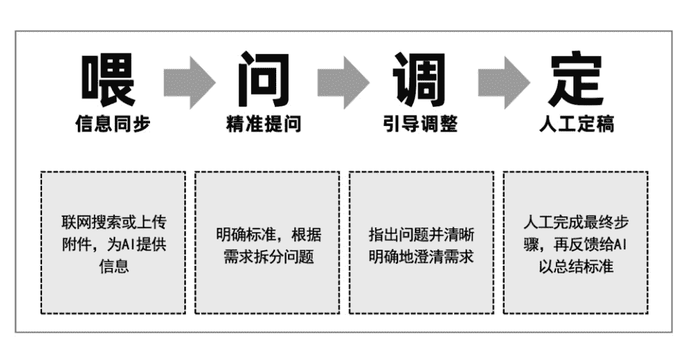

图3-10 与AI对话的基本逻辑

##### 1. 喂（信息同步）：抹平任务开始时的“信息差”

我们以日常工作中与人沟通的例子进行类比。

小帅希望小强撰写部门年终总结报告。在交代任务时，小帅需明确提供以下信息：本年度部门成员的工作任务及完成情况、年初设定的目标与当前完成情况的对比，以及报告的参考模板，如网络上的优秀报告。这些信息只有作为领导的小帅掌握，小强无法仅凭“写一篇部门总结报告”或“你是本部门的人，应该知道”这样的指令完成任务。

即使小强秉持“使命必达”的态度，最终完成的报告也可能存在数据不准确的问题，因为他只能依赖网络搜索或推测来填补信息空白。

AI同样遵循“使命必达”的原则，但在信息不足的情况下，基于算法强制完成任务，可能出现生成内容不准确或编造数据的情况，从而增加出现“AI幻觉”的概率。

##### 2. 问（精准提问）：明确标准，拆分问题

好的问题可以显著提升我们与AI沟通的效率。其中的关键在于明确“好”的标准是什么。前文介绍了标准可以分为显性标准和隐性标准。

精准提问的意义在于：将隐性标准显性化，并提供所有显性标准。而对于无法显性化的隐性标准，我们可以根据AI生成的内容进一步调整。

我们继续以小帅希望小强撰写部门年终总结报告的例子来说明。

显性标准：涵盖本年度部门成员的工作任务及完成情况，对比年初目标与当前完成情况，参考网络上优秀报告的模板和结构。

隐性标准：报告风格需符合上级偏好，上级可能提出的修改意见（初稿后明确）。

前文介绍了联网搜索和上传附件功能不能同时使用，可是现在小强同时有这两种需求，如何提问才能兼顾呢？答案是拆分问题。

- 问题一：搜索网络上优秀的年终总结报告，分析其结构和写作技巧（开启联网搜索）。
- 问题二：基于上传的附件（部门年度数据、目标完成情况），结合问题一总结，撰写一份完整的年终总结报告。

##### 3. 调（引导调整）：指出问题，澄清需求

前面我们提到了，有一些隐性标准是能显性化的，而有一些隐性标准无法显性化，只有得到AI生成的内容后才能感知。

信息差的存在是一种常态。我们可以尽量减少信息差，但无法完全避免。

在与AI对话时，难免会遇到回答不符合预期或理解出现偏差的情况，此时进一步的沟通是必要的。和与人沟通不同，我们无须考虑AI的感受或礼貌问题，而应直接指出问题并清晰明确地澄清需求，与人沟通和与AI沟通的差别如表3-5所示。

表3-5 与人沟通和与AI沟通的差别

| 应用场景 | 与人沟通（需要技巧） | 与 AI 沟通 |
| :--- | :--- | :--- |
| 表达否定 | 我觉得你说的还是有道理的，就是不太符合当下的情况 | 你的回答不符合我的 ×× 需求 |
| 表达肯定 | 你说的太棒了 | 我觉得你的回答很好，我非常满意 |
| 有新需求 | 不好意思哈，现在有了新需求，要加上 ×× | 请重新生成一个回答，把 ×× 加进去 |
| 有遗忘的信息要补充 | 不好意思，忘了告诉你 ×× | 这次工作的背景是 ××，请把这个考虑进去 |
| 提出要求 | 能给我 3 条文案吗？谢谢 | 请给我 100 条文案 |

正因为AI不是人类，我们可以摒弃不必要的人情世故，将注意力集中在任务本身。我们可以直接且随意地提出所有要求，生成内容的质量直接取决于要求的数量与准确性。

在引导AI调整的过程中，最实用的反馈结构如下。

我认为这个回答有以下满意之处：①……②……③……

不满意之处包括：①……②……③……

##### 4. 定（人工定稿）：人工修正，以成果作为案例

在使用AI时，切勿将其视为全知全能的主体，错误地认为可以完全依赖它完成任务。

我们需明确AI的工具属性：它仅是简化某些工作环节的工具。这意味着我们须具备环节拆分思维，将工作分解为独立环节，并将合适的环节交给AI处理。同时，需保持主角意识，全程掌控任务，并对最终成果负责。

AI完成90%的工作后，仍须我们完成最后一步，因为某些隐性标准只有我们自己清楚。与其反复调整AI，不如亲自完成最终步骤，再反馈给AI以总结标准。

## 第4章 AI助力提升办公效率

本章主要使用的AI工具：

- DeepSeek
- 豆包
- 讯飞星火

### 4.1 AI助力提升学习效率

作为一个学习技术的深度研究者，当AI工具出现的时候，笔者意识到两个问题：

1. AI工具的出现让我们不必“学有所成”；
2. AI工具的出现降低了学习难度。

对于第一个问题，AI时代的学习范式正在发生转变。学习可分为三个层次：Know（知道）、Knowledge（知识）、Skill（技能），如图4-1所示。传统学习强调“学有所成”，即知识必须转化为技能才能产生价值。

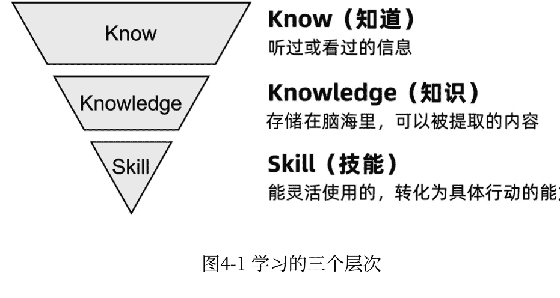

AI的出现改变了这一范式。以写作为例，使用AI工具时，用户只需具备基本的鉴赏能力（知识），无须掌握专业写作技能。同理，AI绘画也仅需用户具备基本审美能力（知识），而不必具备专业绘画技能。

这种转变的核心在于，AI降低了知识应用的门槛，使知识在转化为技能前即可产生价值。我们说“认知的上限决定AI能力的上限”，这里的“认知”强调理解而非技能掌握，体现了AI时代知识应用的新特征。

对于第二个问题，AI工具的出现极大地改善了学习条件，使得学习变得更加便捷高效。

在过去，学生和老师的互动局限于课堂，如果没有记下课堂上讲的知识，往往意味着这一堂课的学习机会被浪费了。而现在，随着技术的发展，我们可以用手机给课堂录音，也可以在网络上找到世界各地的名师的视频课程，甚至可以让AI工具成为我们的老师。

AI工具普及后，我们可以在以下几方面进行学习效率的提升：

- 制订学习计划：运用DeepSeek可以制订完整、全面的学习计划，甚至可以让其提供学习渠道；
- 在线提问：通过与DeepSeek对话或豆包的划词功能、截图提问功能，解决学习中遇到的疑惑；
- 文本翻译及网页翻译：通过与DeepSeek对话或豆包的网页翻译功能，降低外文知识的获取难度；
- 视频总结：运用豆包的视频总结功能，将视频转化为文字总结及思维导图，快速获取知识；
- 加深理解：通过与DeepSeek对话，实践费曼学习法，加深对知识的理解。

#### 4.1.1 制订学习计划

假设我们是Python初学者，希望通过DeepSeek的帮助，制订一份1个月内学会Python的学习计划。我们应该如何向DeepSeek提问呢？

我们可以向DeepSeek简要介绍自己的情况，并询问学会Python所需的时间。

**提问：** 作为一个完全没有编程基础的小白，学会Python需要多长时间？

**DeepSeek：**

（已深度思考，为不占用篇幅，思考过程省略。）

对于完全没有编程基础的小白来说，学会Python所需的时间因人而异，主要取决于学习者的学习目标、学习方式和学习时间投入等因素。以下是不同学习阶段和对应的时间预估：

1. 基础语法阶段（1～2周）

学习内容：变量、数据类型、运算符、控制结构（条件语句、循环）、函数、模块、文件操作等。

学习目标：理解并掌握Python的基本语法，能够编写简单的脚本。

学习建议：每天至少学习1～2小时，通过在线教程、书籍或视频课程进行系统学习，同时多做练习题巩固知识。

2. 进阶应用阶段（2～4周）

学习内容：数据结构（列表、字典、集合等）、异常处理、面向对象编程、常用标准库（如`os`、`sys`、`datetime`等）。

学习目标：能够独立编写具有一定复杂度的程序，理解面向对象编程的思想，并能运用标准库解决实际问题。

学习建议：除理论学习外，要注重实践，尝试自己设计一些小型项目，如简单的计算器、文件备份工具等，将所学知识应用到实际中。

3. 项目实战阶段（4～8周）

学习内容：根据个人兴趣选择一个或多个方向深入学习，如Web开发（Django/Flask）、数据分析（Pandas/NumPy）、机器学习（Scikit-learn/TensorFlow）等。

学习目标：掌握所选方向的基本开发技能，能够独立完成一个完整的项目。

学习建议：参与开源项目或自己开发一个项目，积累实际开发经验。同时，学习如何使用调试工具、版本控制系统（Git）等，提高开发效率和代码质量。

4. 巩固提升阶段（持续进行）

学习内容：不断学习新的Python技巧、优化代码、了解最新的Python版本特性，学习其他领域的知识进行拓展。

学习目标：持续提升编程水平，能够编写高效、可维护的代码，并拓展应用领域。

学习建议：阅读优秀的Python代码、参加技术社区交流、关注行业动态，保持学习的热情和好奇心。

**总结**

短期目标（1～2个月）：掌握Python基础语法，能够进行简单的编程。

中期目标（3～6个月）：深入学习某一领域，完成一个或多个项目，积累实践经验。

长期目标（6个月以上）：不断提升编程能力，拓展知识面，成为Python编程的高手。

学会Python并非一蹴而就，需要持续的学习和实践。重要的是保持学习的兴趣和动力，逐步积累经验。

根据DeepSeek的回答，“1个月内学会Python”这一目标似乎是现实的，但是我们也要清楚，其中有一些显性和隐性的标准。例如，我们是全职学习还是业余学习，每天要学习多少个小时？

同时AI也不知道我们的需求是什么。例如，我们希望达到什么水平，希望通过什么渠道学习？

所以接下来我们要完善这些背景信息，让DeepSeek为我们生成一个具体可行的学习计划。

**提问：** 我是一个完全没有编程基础的小白，请你为我设计一个Python学习计划，我希望每天学习时间为2小时以内，1个月内能够初步掌握Python技能，并能开发一些简单的程序。请以周为单位为我明确每天的学习内容和练习内容，并提供给我免费的学习渠道，最好把计划和书籍或网课结合在一起，以方便我执行。

**DeepSeek:**

（已深度思考，为不占用篇幅，思考过程省略。）

##### Python基础学习计划

###### 第一周：Python基础入门

####### 第一天：初识Python与环境搭建

学习内容：了解Python是什么、能做什么，学习Python的前景；安装Python解释器，学习如何编写并运行第一个Python程序（输出“Hello,World!”）。

练习内容：在自己的电脑上反复安装和卸载Python解释器，熟悉安装过程；尝试在不同位置创建Python文件并运行，观察输出结果是否正确。

学习资源：Python官方文档

####### 第二天：Python基础语法

学习内容：了解Python的缩进规则、注释方式；学习变量的定义、命名规则，以及Python的基本数据类型（整数、浮点数、字符串、布尔值）；掌握输入输出函数input()和print()的使用。

练习内容：写程序，让用户输入自己的名字和年龄，然后输出“我的名字是××，年龄是×岁”；尝试用不同数据类型做运算，观察结果。

学习资源：《Python Crash Course》（在线阅读）

####### 第三天：运算符与数据类型转换

学习内容：学习Python中的算术运算符、比较运算符、逻辑运算符的使用；掌握数据类型转换的方法，如int()、float()、str()等函数的使用。

练习内容：写程序，计算两个数的和、差、积、商；写程序，判断一个数是否大于另一个数；写程序，将用户输入的字符串转换为整数或浮点数进行计算。

学习资源：Python运算符

####### 第四天：条件语句

学习内容：学习if、elif、else语句的语法和使用场景；掌握如何使用比较运算符和逻辑运算符构建条件表达式。

练习内容：写程序，判断一个数是正数、负数还是零；写程序，根据用户输入的分数，输出相应的等级（A、B、C、D、E）。

学习资源：Python条件语句

####### 第五天：循环语句

学习内容：学习for循环和while循环的语法和使用场景；了解break和continue语句的作用。

练习内容：写程序，用for循环输出1到10的数字；写程序，用while循环计算1到100的和；写程序，用循环实现一个简单的猜数字游戏。

学习资源：Python循环语句

####### 第六天：列表

学习内容：学习列表的定义、创建和访问元素；掌握列表的常用操作，如添加元素、删除元素、修改元素、获取长度等；了解列表的切片操作。

练习内容：写程序，创建一个列表，包含自己喜欢的水果，然后输出每个水果；写程序，对列表进行增删改查操作；写程序，用切片获取列表的部分元素。

学习资源：Python列表

####### 第七天：字典

学习内容：学习字典的定义、创建和访问元素；掌握字典的常用操作，如添加键值对、删除键值对、修改值、获取键值对数量等。

练习内容：写程序，创建一个字典，包含自己和朋友的生日，然后输出每个人的名字和生日；写程序，对字典进行增删改查操作。

学习资源：Python字典

……（第二、第三周省略。）

###### 第四周：Python拓展与提升

####### 第一天：网络爬虫基础（Requests与BeautifulSoup）

学习内容：了解网络爬虫的基本概念；学习Requests库的安装和基本使用，掌握如何发送HTTP请求获取网页内容；学习BeautifulSoup库的安装和基本使用，掌握如何解析HTML内容提取所需数据。

练习内容：写程序，用Requests获取一个网页的HTML代码；用BeautifulSoup解析该HTML代码，提取其中的某些信息（如网页标题、某个段落的内容等）。

学习资源：Requests官方文档、BeautifulSoup官方文档

####### 第二天：网络爬虫进阶

学习内容：学习如何处理带有参数的请求（如GET请求的查询字符串、POST请求的表单数据）；了解如何设置请求头（如User-Agent）模拟浏览器访问；掌握如何使用正则表达式在爬虫中提取数据。

练习内容：写程序，爬取一个包含图片的网页，下载其中的图片；写程序，爬取一个需要登录才能访问的页面，先模拟登录获取cookies，然后访问目标页面。

学习资源：Python网络爬虫教程

####### 第三天：自动化办公（Excel与Word操作）

学习内容：学习如何用Python操作Excel文件（可使用openpyxl或pandas库）；掌握如何读取Excel文件中的数据、写入数据、创建新的工作表等操作；学习如何用Python操作Word文件（可使用python-docx库），如创建文档、添加段落、表格等。

练习内容：写程序，读取一个Excel文件中的数据，进行简单的处理（如计算总分、平均分等），然后将结果写入新的Excel文件；写程序，创建一个Word文档，添加一些文本内容和表格。

学习资源：openpyxl官方文档、python-docx官方文档

####### 第四天：图形用户界面（GUI）编程（Tkinter）

学习内容：了解GUI编程的基本概念；学习Tkinter库的安装和基本使用；掌握如何创建窗口、添加常用控件（如按钮、标签、文本框等），以及实现简单的事件绑定。

练习内容：写程序，用Tkinter创建一个简单的计算器界面，能够进行基本的加减乘除运算；写程序，创建一个文本编辑器界面，能够打开、保存文本文件。

学习资源：Tkinter官方文档

####### 第五天：多线程与多进程

学习内容：了解多线程和多进程的基本概念；学习Python中threading模块和multiprocessing模块的使用；掌握如何创建线程和进程、启动线程和进程，以及线程和进程间的通信。

练习内容：写程序，创建两个线程，分别执行不同的任务（如一个线程计算1到100的和，另一个线程输出当前时间）；写程序，创建两个进程，分别执行不同的计算任务，观察执行时间与单进程的差异。

学习资源：Python多线程与多进程

####### 第六天：Python编程规范与优化

学习内容：学习Python的编码规范，如变量命名规则、代码风格（缩进、空行、注释等）；了解如何编写高效、可维护的Python代码；掌握一些常见的Python编程技巧和优化方法。

练习内容：回顾之前编写的代码，按照Python编码规范进行修改和完善；尝试对一些代码进行优化，提高运行效率或可读性。

学习资源：Python编码规范

####### 第七天：总结与复习

学习内容：对这四周所学的Python知识进行全面的总结和复习；梳理知识体系，找出自己的薄弱环节；制订后续的学习计划，继续深入学习和实践。

练习内容：整理学习笔记，将重要的知识点和代码示例进行归纳；尝试独立完成一个综合性的Python项目，运用所学知识解决实际问题。

学习资源：可参考Python学习路线图（B站视频教程）

希望这个学习计划对你有所帮助！在学习过程中，要保持耐心和毅力，多动手实践，遇到问题可以查阅相关资料或向他人请教。祝你学习顺利，早日掌握Python技能！

接下来，我们可以让DeepSeek用更加清晰的形式呈现学习计划。

**提问：** 请以表格的形式呈现该计划。

**DeepSeek：**

（已深度思考，为不占用篇幅，思考过程省略。）

好的，以下是按照您的要求制作的Python学习计划表格：

| 周次 | 天次 | 学习内容 | 练习内容 | 学习资源 |
| :---: | :---: | :--- | :--- | :--- |
| 1 | 1 | 初识 Python 与环境搭建 | 安装和卸载 Python 解释器，运行第一个 Python 程序 | Python 官方文档 |
| 1 | 2 | Python 基础语法 | 学习变量、数据类型、输入输出函数 | 写程序，让用户输入名字和年龄并输出 |
| 1 | 3 | 运算符与数据类型转换 | 学习算术运算符、比较运算符、逻辑运算符、数据类型转换 | 写程序，计算两个数的和、差、积、商 |
| 1 | 4 | 条件语句 | 学习 if、elif、else 语句 | 写程序，判断一个数是正数、负数还是零 |
| 1 | 5 | 循环语句 | 学习 for 循环和 while 循环 | 写程序，用循环计算 1 到 100 的和 |
| 1 | 6 | 列表 | 学习列表的定义、操作 | 写程序，对列表进行增删改查操作 |
| 1 | 7 | 字典 | 学习字典的定义、操作 | 写程序，对字典进行增删改查操作 |
| 2 | 1 | 函数 | 学习函数的定义、参数传递、返回值 | 写程序，定义一个函数计算两个数的和 |
| 2 | 2 | 模块与包 | 学习模块和包的创建与导入 | 写程序，创建并导入自己编写的模块 |
| 2 | 3 | 文件操作 | 学习文件的打开、读取、写入和关闭操作 | 写程序，创建、读取、合并文本文件 |
| 2 | 4 | 异常处理 | 学习异常的概念和处理方法 | 写程序，捕获并处理异常情况 |
| 2 | 5 | 面向对象编程（一） | 学习类、对象、属性、方法 | 写程序，定义一个 Person 类并创建对象 |
| 2 | 6 | 面向对象编程（二） | 学习继承、多态 | 写程序，定义父类和子类，观察多态效果 |
| 2 | 7 | 综合练习 | 综合运用所学知识完成小型项目 | 写程序，创建学生信息管理系统 |
| 3 | 1 | Web 开发基础 (Flask) | 学习 Flask 框架的基本使用 | 写程序，创建简单的 Flask 网页应用 |

## 续表

| 周次 | 天次 | 学习内容 | 练习内容 | 学习资源 |
| :---: | :---: | :--- | :--- | :--- |
| 3 | 2 | Web 应用扩展 | 学习模板渲染、处理用户请求 | 写程序，创建用户登录页面 |
| 3 | 3 | 数据库基础 (SQLite) | 学习 SQLite 数据库的使用方法 | 写程序，用 Python 操作 SQLite 数据库 |
| 3 | 4 | Web 应用与数据库结合 | 学习在 Flask 中集成 SQLite | 完善用户登录页面，实现注册和登录功能 |
| 3 | 5 | 数据分析基础 (Pandas) | 学习 Pandas 库的基本使用 | 写程序，用 Pandas 创建 DataFrame 并操作数据 |
| 3 | 6 | 数据分析与可视化 | 学习 Matplotlib 库的基本使用 | 写程序，用 Matplotlib 绘制图表 |
| 3 | 7 | 机器学习基础 (Scikit-learn) | 学习 Scikit-learn 库的基本使用 | 写程序，用 Scikit-learn 训练模型并预测 |
| 4 | 1 | 网络爬虫基础 (Requests 与 BeautifulSoup) | 学习 Requests 和 BeautifulSoup 库的使用 | 写程序，用 Requests 和 BeautifulSoup 爬取网页 |
| 4 | 2 | 网络爬虫进阶 | 学习处理带有参数的请求、设置请求头 | 写程序，爬取需要登录才能访问的页面 |
| 4 | 3 | 自动化办公 (Excel 与 Word 操作) | 学习用 Python 操作 Excel 和 Word 文件 | 写程序，读取 Excel 数据并写入新的文件 |
| 4 | 4 | 图形用户界面 (GUI) 编程 (Tkinter) | 学习 Tkinter 库的基本使用 | 写程序，创建简单的计算器或文本编辑器界面 |

## 续表

| 周次 | 天次 | 学习内容 | 练习内容 | 学习资源 |
| :---: | :---: | :--- | :--- | :--- |
| 4 | 5 | 多线程与多进程 | 学习 Python 中多线程和多进程的使用 | 写程序，创建多线程或多进程执行任务 |
| 4 | 6 | Python 编程规范与优化 | 学习 Python 的编码规范和优化方法 | 回顾并优化之前编写的代码 |
| 4 | 7 | 总结与复习 | 全面总结和复习所学知识 | 整理学习笔记，完成一个综合性项目 |

仅通过三个问题，我们就得到了一份量身定制的Python学习计划，并且DeepSeek还为我们提供了学习的渠道。如果我们有其他需求，也可以进一步提问，如“推荐Python书单”“推荐网课”“调整计划”等。

#### 4.1.2 文本翻译

##### 1. 与DeepSeek对话翻译

DeepSeek这类对话大模型拥有极强的翻译能力，据当前测试显示，它支持至少百余种语言文字的翻译，甚至涵盖了众多冷门语言。需要注意的是，我们需要明确提示它需要翻译为哪种语言。

例如，我们让它直接翻译长文本。

提问：

翻译为中文： Pumas are large, cat-like animals which are found in America. When reports came into London Zoo that a wild puma had been spotted forty-five miles south of London, they were not taken seriously. However, as the evidence began to accumulate, experts from the Zoo felt obliged to investigate, for the descriptions given by people who claimed to have seen the puma were extraordinarily similar. The hunt for the puma began in a small village where a woman picking blackberries saw a large cat only five yards away from her. It immediately ran away when she saw it, and experts confirmed that a puma will not attack a human being unless it is cornered. The search proved difficult, for the puma was often observed at one place in the morning and at another place twenty miles away in the evening. Wherever it went, it left behind it a trail of dead deer and small animals like rabbits. Paw prints were seen in a number of places and puma fur was found clinging to bushes. Several people complained of cat-like noises at night and a businessman on a fishing trip saw the puma up a tree. The experts were now fully convinced that the animal was a puma, but where had it come from? As no pumas had been reported missing from any zoo in the country, this one must have been in the possession of a private collector and somehow managed to escape. The hunt went on for several weeks, but the puma was not caught. It is disturbing to think that a dangerous wild animal is still at large in the quiet countryside.

**DeepSeek:**

美洲狮是一种大型类似猫的动物，生活在美洲。当有报道称一只野生美洲狮在伦敦以南四十五英里的地方被目击时，伦敦动物园并未认真对待。然而，随着证据逐渐积累，动物园的专家们觉得有必要进行调查，因为声称目击过美洲狮的人们给出的描述非常相似。

追寻美洲狮的行动始于一个小村庄，一位采摘黑莓的妇女看到一只“大型猫”离她只有五码的距离。她一看到它立刻就跑掉了，专家证实，除非被逼到绝境，美洲狮是不会攻击人类的。寻找行动非常困难，因为这只美洲狮经常在早上出现在某个地方，而到了晚上却又出现在二十英里外的另一个地方。无论它走到哪里，都会留下一串死去的鹿和像兔子这样的小动物。在许多地方可以看到它的爪印，美洲狮的毛发也被发现附着在灌木丛上。几个人抱怨晚上听到猫一样的声音，一位去钓鱼的商人看到美洲狮在树上。专家们现在完全相信这个动物是一只美洲狮，但它是从哪里来的呢？因为全国各地的动物园并没有报告丢失美洲狮，所以这只美洲狮一定是私人收藏家的财产，不知何故逃脱了。追捕行动进行了几个星期，但美洲狮未能被捕获。想到一只危险的野生动物仍然在宁静的乡村中自由活动，令人不安。

##### 2. 用豆包翻译文档

如果我们将长文本保存为PDF、Word等格式的文档，可以上传到豆包让其翻译。

第1步：下载豆包桌面版，注册账号并登录。

在搜索引擎中搜索豆包，进入官网下载页面，如图4-2所示。

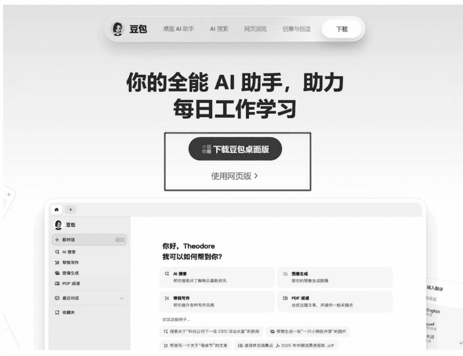

下载豆包安装文件到本地并安装，安装完成后豆包会自动打开。单击主界面右上方的“登录”按钮，登录或注册豆包账号，如图4-3所示。

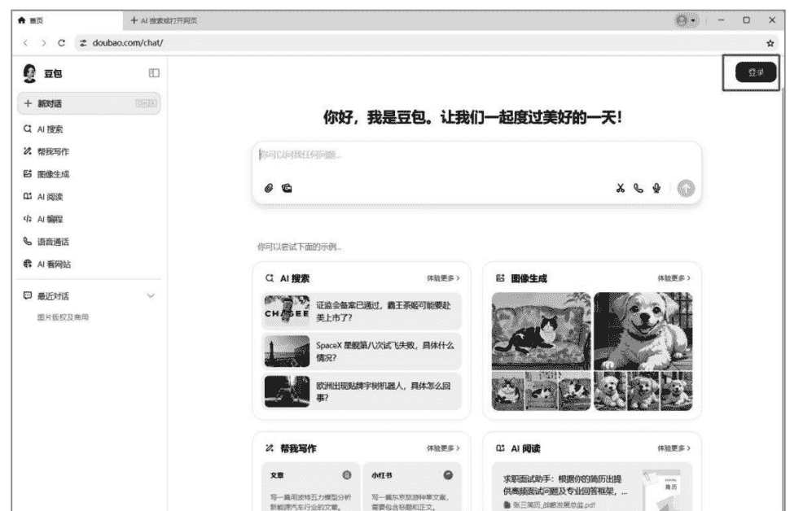

在主界面中，我们可以看到，豆包是一款功能全面的AI大模型软件，操作界面比较简单，还有截图、语音通话等功能，便于用户以更贴近真人的方式与AI进行沟通。

第2步：单击对话框中的回形针图标，选择“上传文件”选项，如图4-4所示。

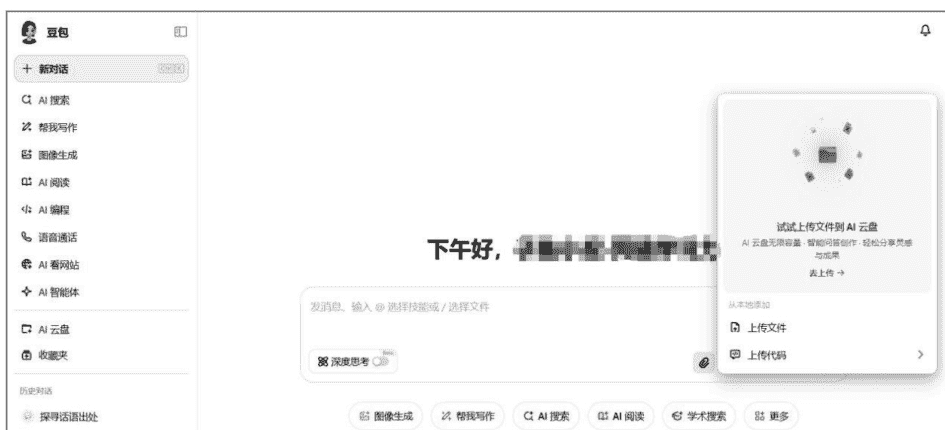

在电脑对应位置选择要翻译的文档，然后单击“打开”按钮，如图4-5所示。


上传成功后如图4-6所示，可以选择一个推荐问题进行提问，也可以自己提出一个问题。提出问题后，该文档即被保存到我们的豆包账号中。


第3步：在左侧功能栏中选择“AI阅读”功能，如图4-7所示。

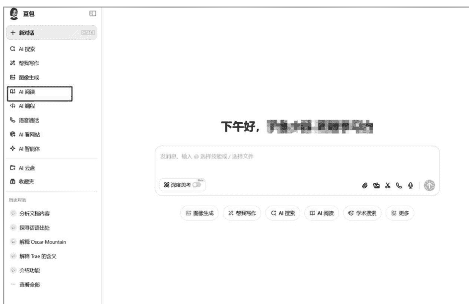

选择刚才上传的文档，如图4-8所示。

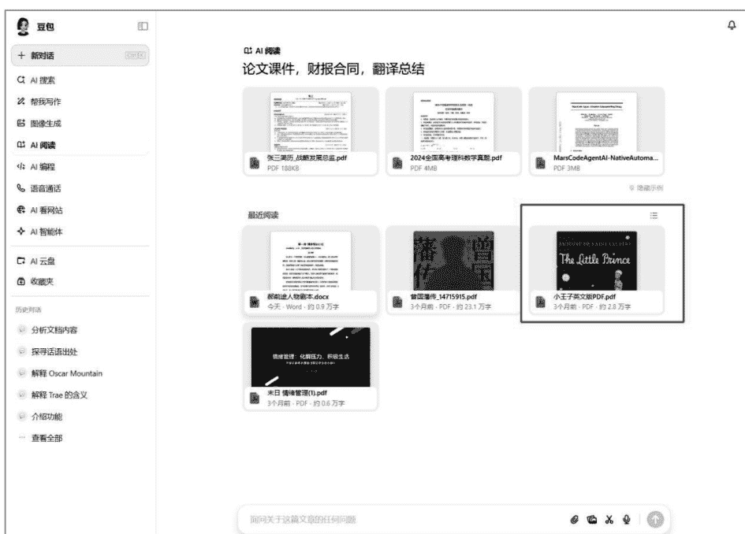

在弹出的新界面中单击“翻译全文”功能，如图4-9所示。

- 遇到扳道工和商人：小王子遇到扳道工，扳道工负责调度列车运送旅客，但他不知道旅客们在追寻什么。小王子认为只有孩子知道自己在寻找什么。之后小王子遇到卖止渴药丸的商人，商人声称药丸能节省大量时间，但小王子觉得如果有这些时间，他宁愿悠闲地走向泉水。

### 与飞行员的故事

- 飞行员在沙漠中飞机失事，遇到了小王子。小王子向飞行员讲述了他的经历。飞行员在与小王子相处的过程中，逐渐理解了他的内心世界。在寻找水源的过程中，他们经历了艰难的时刻，但最终找到了水井。喝水时，小王子明白了水的甜美不仅来自于生理需求的满足，更来自于寻找过程中的努力和美好体验。

- 后来，小王子与蛇约定回到他来到地球的地方，他认为自己的星球离地球很远，回去很困难，但他必须回去照顾他的玫瑰，因为他对玫瑰负有责任。飞行员虽然担心，但最终尊重了小王子的决定。小王子离开后，飞行员一直思念他，他常常望着星空，想象小王子在他的星球上的生活，担心羊是否吃了玫瑰。他觉得小王子带给他很多关于人生、友谊和责任的思考。虽然小王子已经离开，但他的影响永远留在了飞行员心中。

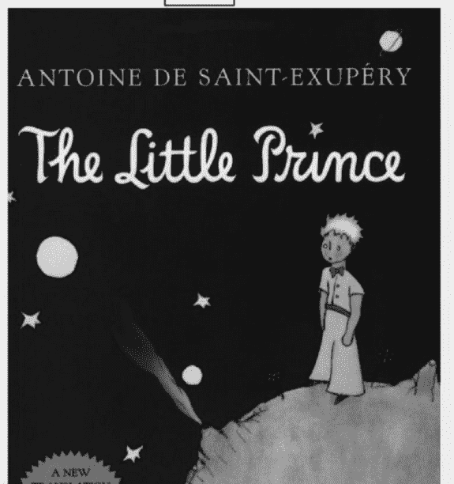

翻译完成后就可以阅读文档，也可以在左侧的对话框中针对文档进行提问，如图4-10所示。

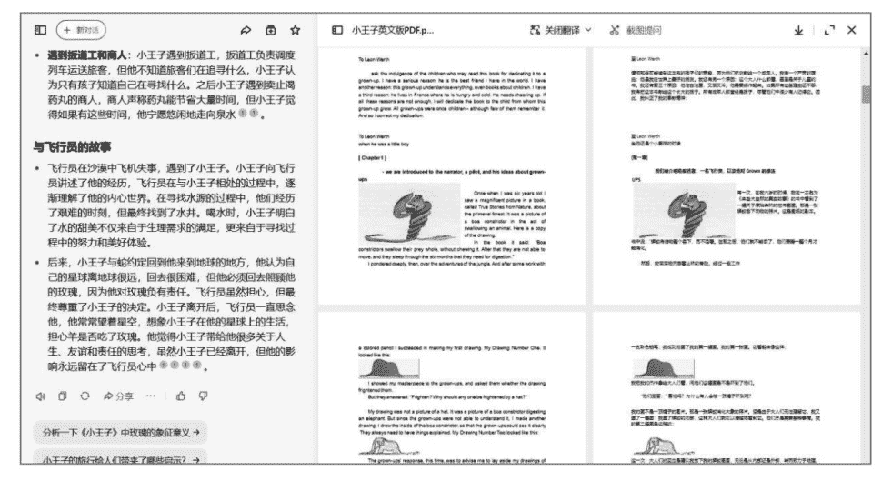

##### 3. 用豆包划词翻译

在电脑上打开豆包后，豆包的划词翻译功能会同步在后台运行，无论使用哪个浏览器都可以使用豆包的划词翻译功能。

拖曳鼠标左键选择想翻译的词语，在弹出的工具栏中单击“翻译”按钮，如图4-11所示，就可以看到图4-12所示的翻译效果，如果不会发音，可以单击小喇叭图标进行朗读，也可以在这个界面中继续提问。


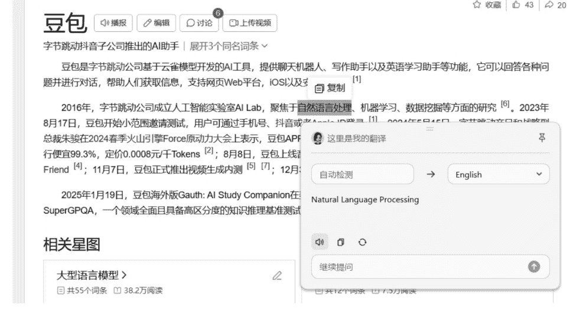

#### 4.1.3 英语学习

##### 1. 英语学习和语法纠正

在学习英语时，巧妙地运用AI工具，可以有效地提高语法水平。

例如，我们可以提供文本内容，让DeepSeek对文本进行语法纠正。

**提问：** 你是一个经验丰富的英语老师，我这里有一篇英语作文，请纠正我的语法错误。

Hey there, guys! I want to share an awesome experience I had recently at our school's science fair. It was like stepping into a whole new world of wonders and discoveries!

First things first, the atmosphere was buzzing with excitement. The school gym was transformed into a science extravaganza, with colorful posters and impressive projects all around. The air was filled with the aroma of popcorn, which was the perfect snack for an adventure like this.

**DeepSeek:**

请注意，以下是对您提供的英语作文进行的一些修正。

“Hey there, guys!” 这句口语化的问候没有错误，但是如果你想使它更正式一些，可以将其改为 “Hello, everyone!” 或 “Greetings, everyone!”。

“I want to share an awesome experience I had recently at our school's science fair” 这句话没有错误。

“It was like stepping into a whole new world of wonders and discoveries!” 这句话应该改为 “It was like stepping into a whole new world of wonders and discoveries!”，因为在这里，“step”应该使用动名词形式。

“First things first, the atmosphere was buzzing with excitement.”这句话没有错误。

“The school gym was transformed into a science extravaganza, with colorful posters and impressive projects all around.”这句话应该改为“The school gym was transformed into a science extravaganza, with colorful posters and impressive projects all around.”，因为在这里，动词“transform”应该使用过去式。

“The air was filled with the aroma of popcorn, which was the perfect snack for an adventure like this”这句话没有错误。

##### 2. 英文对话练习

下面尝试与DeepSeek进行英文对话，练习自己的表达能力。

**提问：** 下面开始进行英文对话，请用英文回答我。当我出现语法错误时，请用中文提示我哪里出现了错误。

**DeepSeek：**

Sure, let's start the English conversation. Please feel free to ask your question or provide your statement, and I'll be happy to respond. If you make any grammar errors, I'll provide you with a hint in Chinese to indicate where the mistake occurred.

**提问：** Ok, thanks for your help.

**DeepSeek：**

You're welcome! I'm here to help. Please go ahead and ask your question or share your statement, and I'll do my best to assist you.

**提问：** May I have your attention, please? I would like to talk to you about our class.

**DeepSeek:**

您的句子中有一个语法错误。 “May I have your attention, please?” 中的 “attion” 应该是 “attention” ，拼写错误。下面是纠正后的句子：

> “May I have your attention, please? I would like to talk to you about our class.” 请注意，单词 “attention” 的正确拼写。如果您有其他问题或需要进一步讨论，请随时告诉我。

##### 3. 单词记忆

当我们遇到一些很难记忆的单词时，可以询问DeepSeek是否有更好的记忆方法，让它成为我们学习单词的助手。

例如，要记忆paradoxical（悖论的，自相矛盾的）、ambiguous（模棱两可的，含混不清的）、conundrum（难题，谜题）、synthesis（综合，合成）、pseudonym（假名，笔名）这五个较为复杂的单词。

**提问：** 请你为paradoxical（悖论的，自相矛盾的）、ambiguous（模棱两可的，含混不清的）、conundrum（难题，谜题）、synthesis（综合，合成）、pseudonym（假名，笔名）这五个单词分别提供一个有效的记忆方法。

## DeepSeek:

当然，请看下面为每个单词提供的有效记忆方法。

(1) paradoxical (悖论的，自相矛盾的)。

记忆方法：将其分出两个部分，“para-”和“dox”。将“para-”想象为两个相对的人站在一起，而“dox”像是一个矛盾的谜团。这样你可以想象他们围绕着一个自相矛盾的问题进行辩论。

(2) ambiguous (模棱两可的，含混不清的)。

记忆方法：将其与“ambiguous”这个词本身的特性联系起来。将“ambiguous”分为两个部分，“ambi-”和“guous”。“ambi-”表示两个，而“guous”类似于“guess”（猜测）。所以你可以想象自己在猜测两种可能性之间的模棱两可的情况。

(3) conundrum (难题，谜题)。

记忆方法：将“conundrum”想象成一个谜题盒子。在这个盒子里，你面对着一个复杂而困难的问题，需要寻找答案。想象自己在不断解决这个谜题，寻找答案。

(4) synthesis (综合，合成)。

记忆方法：将“synthesis”分为两个部分，“syn-”和“thesis”。将“syn-”想象为合并在一起的两个图形或物体，而“thesis”类似于“thesis statement”（论文陈述）。这样你可以将合并不同元素以形成论点的过程与“synthesis”相联系。

(5) pseudonym (假名，笔名)。

记忆方法：将“pseudonym”分为两个部分，“pseudo-”和“nym”。将“pseudo-”想象为一个人戴着假面具，而“nym”类似于“name”（名字）。这样你可以将“pseudonym”想象为一个人用假名隐藏自己的真实身份。希望这些记忆方法能够帮助你更好地记忆这些单词。记住不同的记忆方法适合不同的人，你可以根据自己的喜好和学习风格选择适合你的记忆策略。如果你有更多问题或需要进一步帮助，请告诉我！

#### 4.1.4 内容辅助理解

##### 1. 对DeepSeek提问

对DeepSeek提问时，我们可以通过提示词控制回答的风格。例如，我们不理解自然语言处理是什么，就可以对DeepSeek提问“什么是自然语言处理”或“请用通俗易懂的语言解释自然语言处理的概念”。

**提问：** 什么是自然语言处理？

**DeepSeek：**

自然语言处理（Natural Language Processing, NLP）是计算机科学领域与人工智能领域中的一个重要方向。它研究能实现人与计算机之间用自然语言进行有效通信的理论和方法。自然语言处理的目标是让计算机能够理解、生成和处理人类的自然语言，从而使人机交互更加自然和便捷。

自然语言处理的主要任务

语言理解任务：

- 分词：将连续的自然语言文本切分成具有语义的单词或词汇。例如，在中文中，将“自然语言处理”切分为“自然/语言/处理”。
- 词性标注：为分词后的每个单词标注其词性，如名词、动词、形容词等。例如，“跑”被标注为动词。
- 命名实体识别：识别文本中的实体，如人名、地名、组织名等。例如，在“奥巴马是美国的前总统”中，“奥巴马”被识别为人名，“美国”被识别为地名。
- 语义理解：理解句子的语义，包括词语之间的语义关系、句子的逻辑结构等。例如，理解“我喜欢苹果”中的“苹果”是指水果还是公司。
- 情感分析：分析文本中的情感倾向，判断文本是积极的、消极的还是中性的。例如，在评论“这部电影太棒了，我非常喜欢”中，情感分析会判断为积极情感。
- 机器翻译：将一种自然语言自动翻译成另一种自然语言。例如，将中文翻译成英文。

语言生成任务：

- 文本生成：根据给定的主题、关键词或上下文，自动生成连贯的文本。例如，生成新闻报道、故事等。
- 自动文摘：从给定的文本中提取关键信息，生成简洁的摘要。例如，将一篇长文章生成一段简短的摘要。
- 对话系统：实现人机之间的对话交互，包括问答系统、聊天机器人等。例如，Siri、小度等智能语音助手。

自然语言处理的应用领域

- 机器翻译：如谷歌翻译、百度翻译等，能够快速将一种语言翻译成另一种语言，促进了全球信息的交流和传播。
- 情感分析：广泛应用于市场营销、舆情监测等领域，通过分析用户评论、社交媒体等文本数据，了解用户对产品或服务的情感倾向。
- 智能客服：利用自然语言处理技术实现自动回答用户问题，提高客服效率和质量，降低人力成本。
- 语音助手：如苹果的Siri、亚马逊的Alexa等，通过语音交互帮助用户完成各种任务，如设置提醒、查询信息等。
- 文本挖掘：在生物医学、金融等领域，从大量文本数据中提取有用的信息和知识，辅助决策和研究。

**提问：** 请用通俗易懂的语言解释自然语言处理的概念。

**DeepSeek:**

自然语言处理，就是让电脑能理解我们人类平时说话的语言。平时我们跟人聊天，或者看文章，都是在处理自然语言。自然语言处理就是研究怎么让电脑也像人一样去理解、生成这些语言。

简单来说，就是让电脑学会听懂我们说的话，还能像人一样跟我们聊天。比如你用语音助手问天气，它就能理解你的意思，然后给你回答。或者你让电脑帮你写文章，它也能按照你的要求去写。

采用第一种提示词“什么是自然语言处理”，我们得到的是相对严谨、学术化的回答。采用第二种提示词“请用通俗易懂的语言解释自然语言处理的概念”，我们得到的是经过简化、容易理解的概念。两种提示词各有适用的场景，根据需求进行选择即可。

##### 2. 用豆包划词解释

在电脑上打开豆包后，豆包的划词解释功能会同步在后台运行，无论用哪个浏览器都可以使用豆包的划词解释功能。拖曳鼠标左键选择想解释的词语，在弹出的工具栏中单击“解释”按钮，如图4-13所示，就可以看到图4-14所示的解释效果，在这个界面中还可以继续提问。


图4-13 选择词语并单击“解释”按钮


图4-14 解释效果

##### 3. 用豆包截图提问

如果我们遇到无法提取的文本，可以使用豆包的截图提问功能，操作步骤如下。

第1步：打开豆包主界面，单击对话框下方的剪刀图标，即截图功能，或按默认快捷键Shift+Alt+A，如图4-15所示。

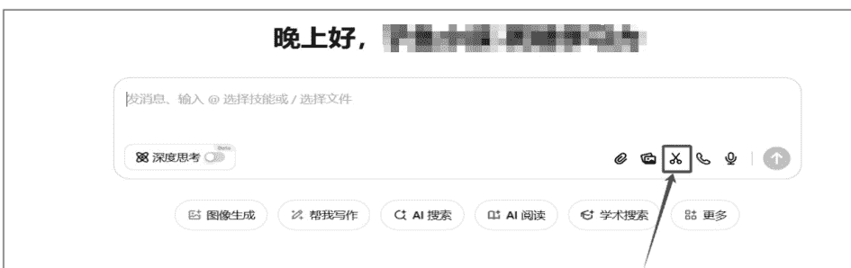

图4-15 单击对话框下方的剪刀图标

第2步：框选需要提问的文本，在弹出的工具栏中单击“问问豆包”按钮，如图4-16所示。

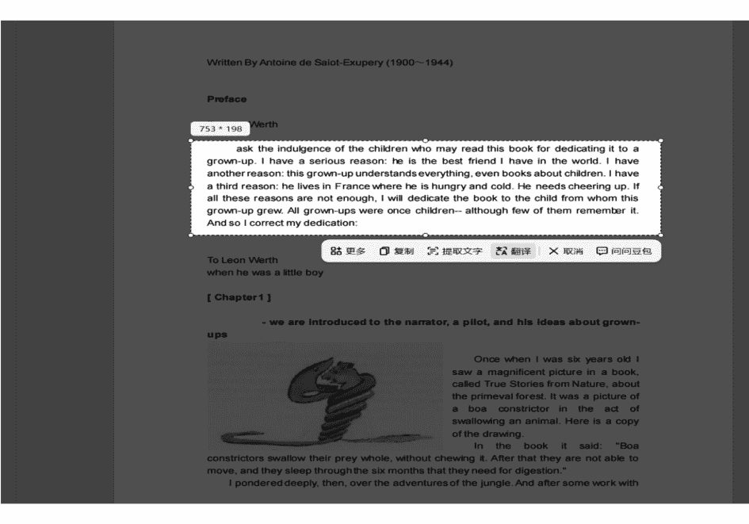

图4-16 框选要提问的文本并单击“问问豆包”按钮

第3步：返回豆包主界面后，我们会看到截图已经上传，单击发送按钮“↑”，如图4-17所示。

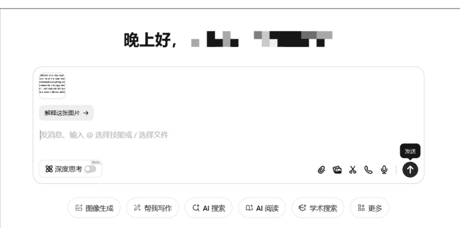

图4-17 发送截图

第4步：获得关于这段文本的回答，可以继续进行提问，如图4-18所示。

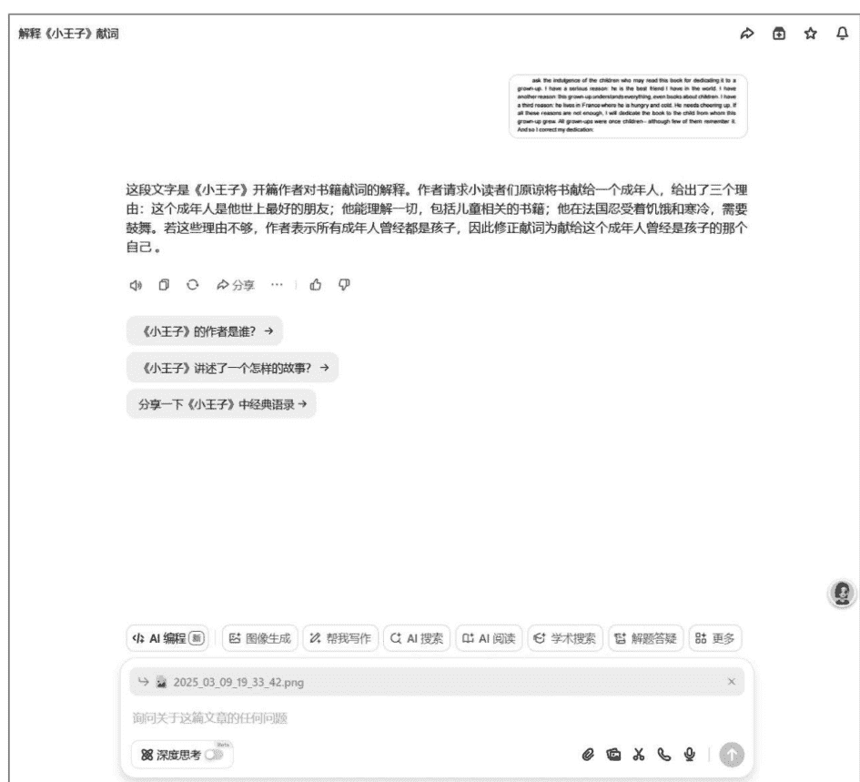

#### 4.1.5 图文及视频总结

##### 1. 视频总结

运用豆包可以总结视频的内容，具体步骤如下。

第1步：在浏览器中打开需要总结的视频，可以在视频页面右上方看到“总结视频”按钮，单击该按钮，如图4-19所示。

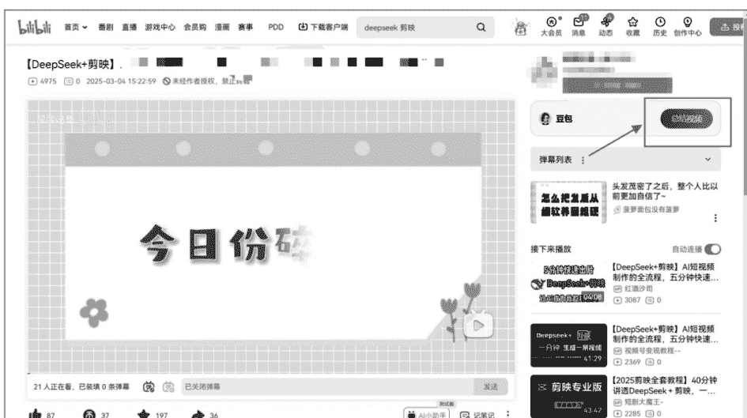

图4-19 单击“总结视频”按钮

第2步：即可看到豆包生成的视频总结，可以根据观看需求进行跳转，如图4-20所示。

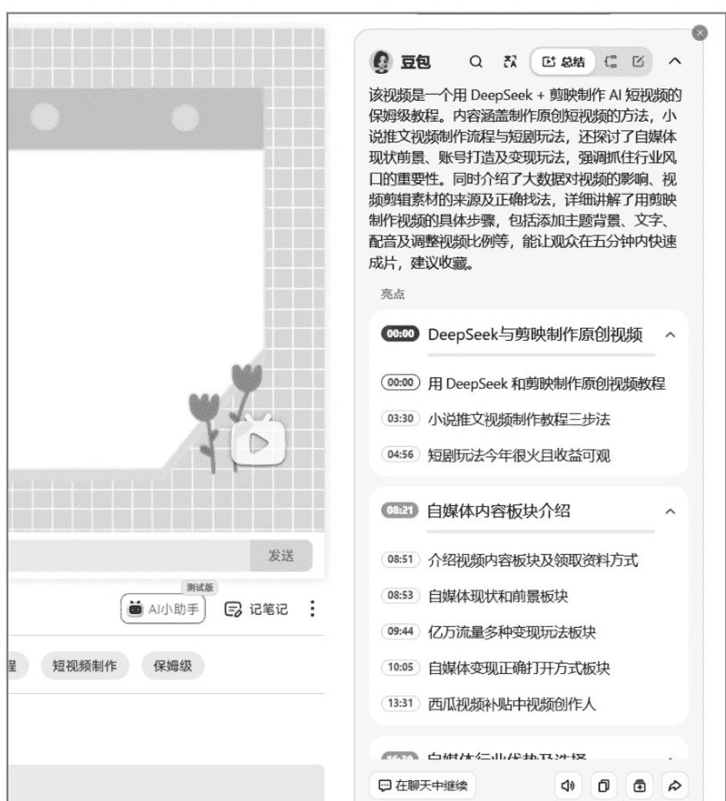

图4-20 豆包生成的视频总结

第3步：单击总结界面上方的“脑图”按钮，如图4-21所示，可以将视频总结转化为思维导图，效果如图4-22所示。


图4-21 单击“脑图”按钮

豆包


- 自媒体教程
  - 自媒体现状前景，了解行业好处。
  - 打造高收益账号，选择平台领域。
  - 亿万流量玩法多，零基础也能上手。
  - 正确打开变现方式，规划账号赚钱。
- 中视频创作补贴
  - 西瓜视频投 20 亿，补贴创作人。
  - 纯补贴不包括其他收入，探索新模式。
- 自媒体风口
  - 行业风口要抓住，错过时机难做起。
  - 站在风口猪能飞，看你愿不愿意。
- 平台选择与领域区分
  - 平台众多各不同，领域选择很关键。
  - 截图保存 30 多平台，日后都能用。
- 视频类型推荐
  - 大数据选视频，播放量才会高。
  - 推荐三类视频，剪辑解说混剪。
- 素材寻找方法
  - 多平台找素材，影视网站也可用。
  - 推广平台拿奖金，关键词找素材。
- 正确找素材方式
  - 片段十秒左右，避免搬运违规。
  - 按主题找片段，审核易通过。
- 用剪映制作视频
  - 确定主题人物，添加背景主题。
  - 选择文字模板，配音吸引用户。
- 视频比例调整
  - 横屏比例要记住，除抖音外 16:9。
  - 手动调整画面，裁剪字幕边框。

弹幕列表

图4-22 思维导图效果

第4步：单击“下载”按钮，可以下载图片、复制图片或复制富文本（思维导图软件中可粘贴的文本），我们选择“复制富文本”选项，如图4-23所示。


图4-23 选择“复制富文本”选项

第5步：打开一个思维导图软件（如幕布、XMind），新建一个文件，按快捷键Ctrl+V就可以将复制的内容直接粘贴到思维导图软件中，如图4-24所示。

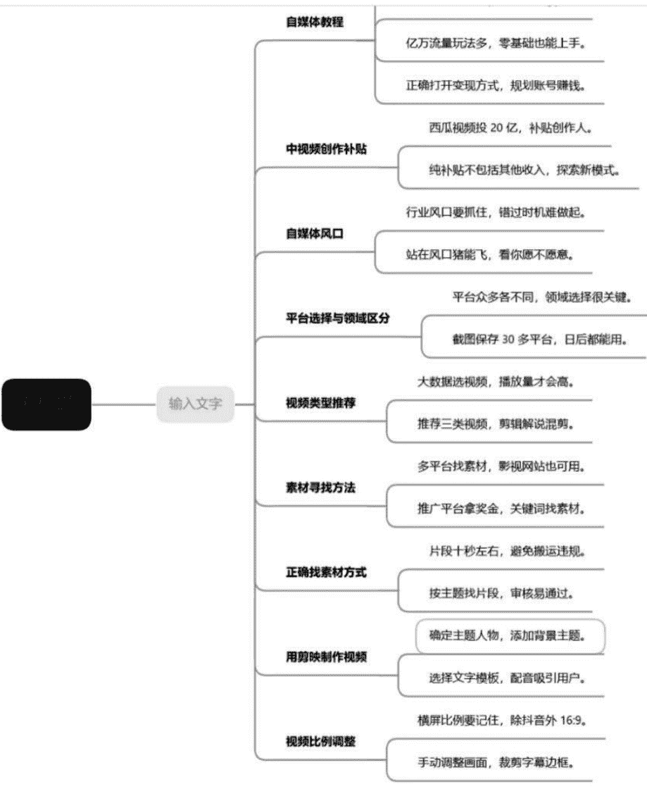

图4-24 将复制的内容直接粘贴到思维导图软件中

第6步：浏览器地址栏的右侧也有“总结视频”“问问豆包”按钮，单击“问问豆包”按钮，如图4-25所示，可以围绕视频内容向豆包进行提问，如图4-26所示。


图4-25 单击“问问豆包”按钮

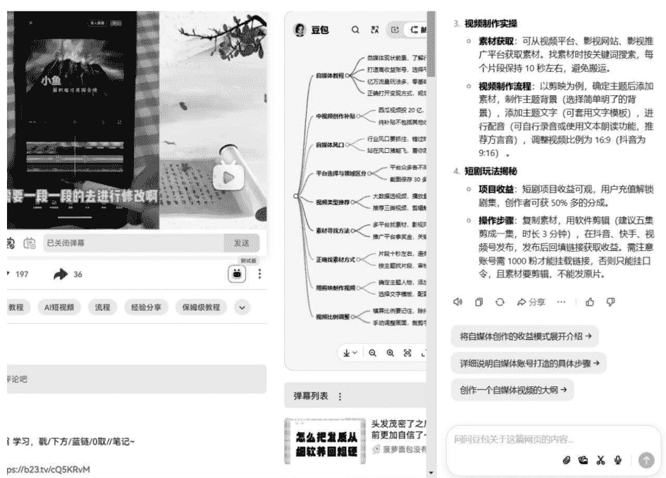

图4-26 围绕视频内容向豆包进行提问

##### 2. 图文总结

如果我们打开的是一个图文类网页，可以使用总结全文功能，具体操作步骤如下。

第1步：打开一个图文类网页，可以看到地址栏右侧的“总结视频”变成了“总结全文”，单击“总结全文”按钮，如图4-27所示。

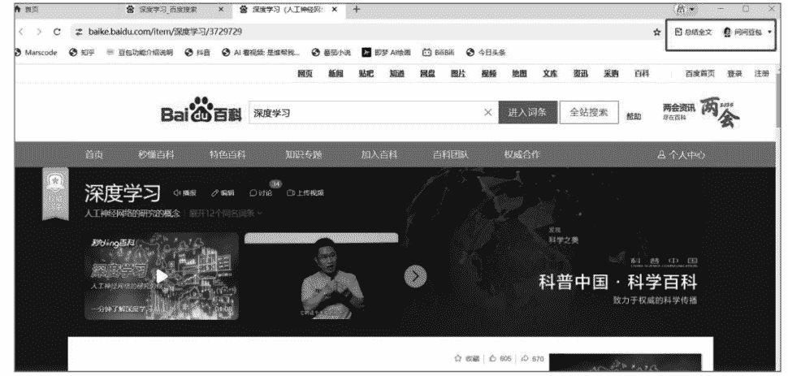

图4-27 单击“总结全文”按钮

第2步：待豆包总结完成后，可以针对总结内容继续提问，如图4-28所示。

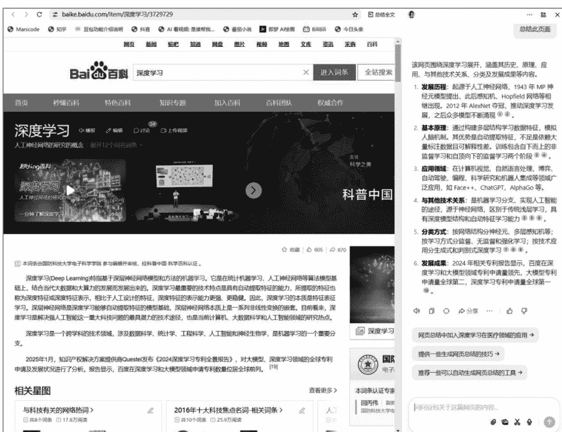

#### 4.1.6 进阶：费曼学习法实践

费曼学习法是一种高效的学习和记忆知识的方法，其核心思想是通过自己的语言解释和表达复杂概念来检验和加深自己对知识的理解。使用费曼学习法通常需要与他人配合，而AI工具普及后，我们可以让AI工具配合我们来实践费曼学习法，具体步骤如表4-1所示。

表4-1 AI工具配合实践费曼学习法的步骤

| 步骤 | AI 工具可提供的帮助 | 提示词 |
| :--- | :--- | :--- |
| 学习概念本身 | 使用 AI 工具查询定义 | 请问 ×× 的定义是什么 |
| 用通俗易懂的语言解释 | · 让 AI 工具用通俗易懂的语言解释<br>· 根据自己的理解重新类比解释 | · 能不能用通俗易懂的语言解释<br>· 我是否可以这样理解…… |
| 回顾自己的解释，寻找遗漏 | 让 AI 工具评价类比是否合理 | 我是否可以这样类比…… |
| 补充遗漏，进一步简化、优化表达 | 进一步优化表达，让 AI 工具再次评价是否合理 | 那么我重新类比一下……是否合理 |

以DeepSeek为例，实践费曼学习法共有四个步骤。

第1步：学习概念本身。

我们向DeepSeek询问一个概念的定义。DeepSeek对该概念的完整定义进行解释，我们阅读一遍DeepSeek的解释并尝试理解。然而，由于定义比较复杂，此时我们通常还是难以真正理解该概念。

第2步：用通俗易懂的语言解释。

我们让DeepSeek用通俗易懂的语言解释该概念。理解概念后，我们尝试根据自己的理解进行类比解释。这一步是使用费曼学习法的关键，可以帮助我们加深理解。

第3步：回顾自己的解释，寻找遗漏。

借助DeepSeek，我们不需要自己评价类比的合理与否，而是可以直接交给DeepSeek评价。如果我们的解释和概念存在偏差，DeepSeek就会指出。

第4步：进一步优化表达。

我们根据DeepSeek的评价，补充自己的解释的遗漏，并进一步简化、优化表达，如有需要，可以继续进行类比解释并让DeepSeek评价类比合理与否。

接下来我们以“非线性问题”的概念为例来进行实操。

**提问：** 请问非线性问题的定义是什么？

**DeepSeek：**

非线性问题是指在数学、物理、工程等领域中，其输入与输出之间不满足线性关系的问题。与线性问题相比，非线性问题具有更复杂的性质和行为，通常难以找到精确解，需要借助数值方法和近似方法来求解。

非线性问题的分类

数学领域

非线性方程：形如\[f(x) = 0\]的方程，其中\[f(x)\]是非线性函数。例如，二次方程、三次方程等。

非线性微分方程：包含未知函数及其导数的非线性关系的微分方程。例如，\[ \frac{dy}{dx} = y^2 \]。

非线性偏微分方程：涉及多个自变量的非线性偏微分方程。例如，非线性波动方程。

物理领域

非线性光学：研究光在非线性介质中的传播特性，如二次谐波生成、光孤子等现象。

非线性力学：研究物体在非线性弹性、塑性等状态下的力学行为，如非线性振动、混沌运动等。

非线性动力学：研究系统在非线性相互作用下的动力学行为，包括分岔、混沌等现象。

工程领域

非线性控制理论：研究非线性系统的控制问题，如非线性控制器设计、非线性系统稳定性分析等。

非线性电路理论：研究含有非线性元件（如二极管、晶体管等）的电路特性。

非线性结构工程：研究结构在非线性材料、几何非线性等条件下的力学行为，如大变形、屈曲等问题。

非线性问题的求解方法

解析方法

摄动法：通过引入小参数，将非线性问题近似为一系列线性问题来求解。变分法：利用变分原理将非线性问题转化为优化问题来求解。

积分变换法：通过积分变换将非线性微分方程转化为代数方程来求解。

数值方法

有限差分法：将连续的非线性微分方程离散化为有限差分方程组来求解。

有限元法：将复杂的非线性问题区域划分为有限个单元，进行近似求解。

谱方法：利用正交函数展开来近似求解非线性微分方程。

非线性问题的应用

非线性问题在科学研究和工程实践中具有广泛的应用。在物理学中，非线性光学为激光技术的发展提供了理论基础；在工程中，非线性控制理论被广泛应用于机器人、航空航天等领域；在生物学中，非线性动力学模型用于研究生物种群的演化和生态系统的稳定性。

**提问：**能不能用通俗易懂的语言来解释什么是非线性问题？

**DeepSeek:**

简单来说，非线性问题就是那些“变化不按比例”的问题。

比如，你去商店买苹果，价格是每斤5元。如果你买1斤，就是5元；买2斤，就是10元。这种情况下，总价和重量是线性的，因为它们之间的关系是固定的、按比例的。

但是，如果苹果的价格不是固定的，而是随着你买的数量增加而变化，比如买得越多，单价越高，那这就是一个非线性问题。假设买1斤时单价是5元，买2斤时单价变成6元，买3斤时单价变成7元。这时候，总价和重量之间的关系就不再是简单的按比例增加了，而是随着重量的变化，单价也在变化，导致总价的变化不再是一个固定的比例。

再比如，你开车时的速度和刹车距离的关系。在理想情况下，速度越快，刹车距离越长，但这个关系并不是简单的线性关系。比如，速度翻倍，刹车距离可能会增加四倍，因为涉及动能和摩擦力等物理因素的非线性关系。所以，非线性问题就是那些输入和输出之间的关系不是简单的直线或固定比例关系的问题，它们的变化可能更加复杂和难以预测。

**提问：** 我是否可以这样理解，苹果单价5元/斤，我买了1斤是5元，2斤是10元。苹果价格永远是“5元×斤数”，这是线性问题。如果苹果5元/斤，我买了3斤，老板收了我12元，给我了打了个折，就是非线性问题。现实生活是复杂多变的，包含着很多的变量，所以现实生活中的问题绝大部分都是非线性问题。

**DeepSeek:**

是的，你的理解很到位！

线性问题可以简单理解为“单价固定，总价=单价×数量”的这种按比例变化的关系。而非线性问题则是“单价不固定，会随着数量等其他因素变化”，导致总价和数量之间的关系不再是简单的乘积，可能呈现出更复杂的变化模式。

现实生活中，确实有太多因素相互交织、相互影响，很难用简单的线性关系去描述和解决所有问题，所以非线性问题在现实世界中更为普遍和常见。

#### 4.1.7 用AI制作思维导图

AI还可以应用到记笔记中。例如，我们与ChatGPT讨论了一些有意义的内容，我们想要记录下来，这时可以采用思维导图的形式将讨论的内容导出到我们的电脑上。

如何将与ChatGPT讨论的内容转化为思维导图呢？总共分为三步。

第1步：输入思维导图的主题，并输入相应指令。

具体的指令如下：请为我创建一个多层次的思维导图，其内容包括至少5个分支主题。同时，为每个分支主题添加至少2个子主题，并在需要的情况下为子主题添加更多层次的子主题，不要在主题前写层级数字，内容要尽可能详细。使用Markdown格式来呈现思维导图。如图4-29所示。

## ChatGPT如何帮助我们提升学习效率

- 提供学习资源
  - 推荐学习材料
    - 书籍
    - 学术论文
    - 文章和博客
  - 分享学习链接
    - 在线教育平台
    - 学习网站和应用
- 解答问题与澄清疑惑
  - 提问关于学习的问题
    - 学科知识
    - 学习方法
  - 澄清不明确的概念和观念
    - 解释专业术语
    - 提供实例和案例分析
- 提供学习策略和建议
  - 制定学习计划
    - 目标设定
    - 时间管理
  - 探索学习方法
    - 记忆技巧
    - 阅读和笔记方法
- 鼓励自主学习和思考
  - 激发学习兴趣
    - 分享有趣的学习话题和资源
    - 推荐学科相关的书籍和电影
  - 提供启发性问题
    - 引导思考和探索
    - 促进创造性思维
- 与其他学习者交流和合作
  - 学习讨论和分享经验

## 图4-29 输入思维导图的主题和指令

第2步：在Online Markdown Editor网站导出Markdown格式文件。

（1）打开Online Markdown Editor网站，单击左边的输入框，按快捷键Ctrl+A全选内容，然后按Delete键删除选中的内容，如图4-30所示。

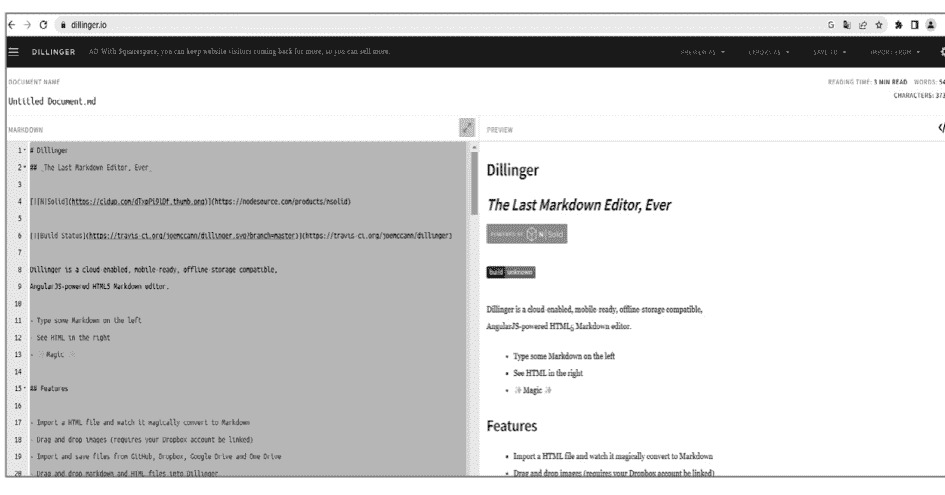

## 图4-30 在Online Markdown Editor中删除原文本

（2）在ChatGPT页面中，单击“Copy code”按钮，如图4-31所示。

下面是关于“ChatGPT如何帮助我们提升学习效率”的多层次思维导图，包括了5个分支主题和相应的子主题：

```
## ChatGPT如何帮助我们提升学习效率

- 提供学习资源
  - 推荐学习材料
    - 书籍
    - 学术论文
    - 文章和博客
  - 分享学习链接
    - 在线教育平台
    - 学习网站和应用
- 解答问题与澄清疑惑
  - 提问关于学习的问题
    - 学科知识
    - 学习方法
  - 澄清不明确的概念和观念
    - 解释专业术语
    - 提供实例和案例分析
- 提供学习策略和建议
  - 制定学习计划
    - 目标设定
    - 时间管理
  - 探索学习方法
    - 记忆技巧
    - 阅读和笔记方法
- 鼓励自主学习和思考
  - 激发学习兴趣
```

图4-31 在ChatGPT页面中单击“Copy code”按钮

(3) 按快捷键Ctrl+V，将复制的内容粘贴到Online Markdown Editor中，选择“EXPORT AS”（导出）中的“Markdown”选项，如图4-32所示。

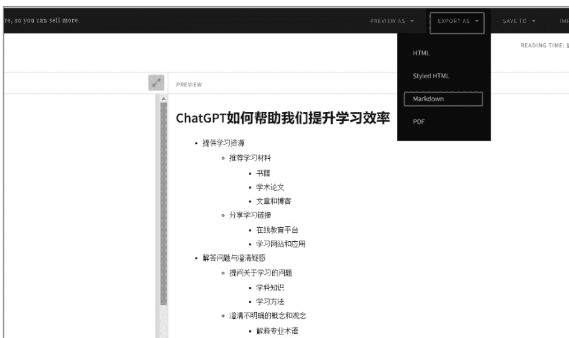

图4-32 在Online Markdown Editor中导出Markdown格式文件

第3步：在XMind中打开。

（1）打开XMind程序，新建一个思维导图文件，如图4-33所示。

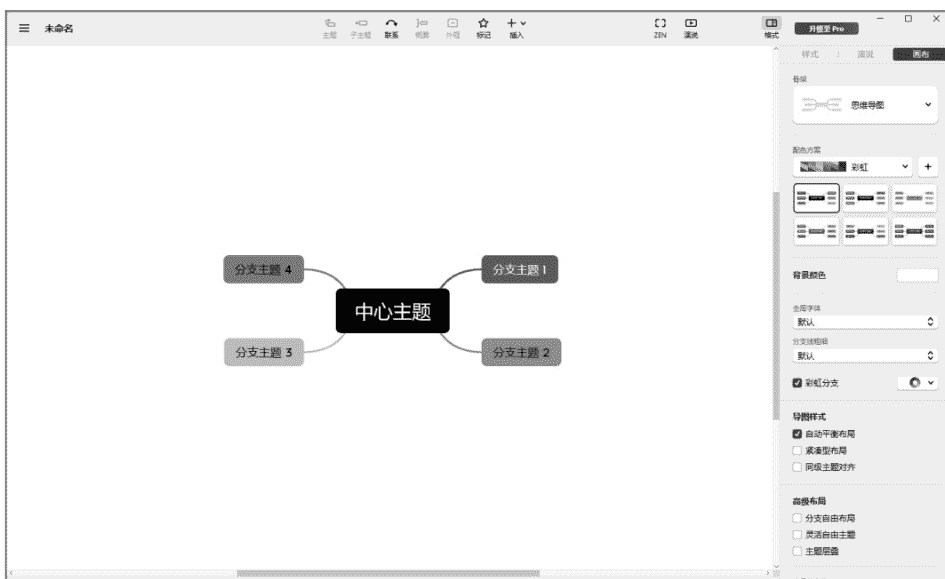

图4-33 打开XMind新建一个思维导图文件

**注意：** 目前只有2023以上版本的XMind支持导入Markdown格式文件。

（2）依次选择“菜单” → “文件” → “导入” → “Markdown”选项，导入在Online Markdown Editor中导出的Markdown格式文件，如图4-34所示。


## 图4-34 导入Markdown格式文件

(3) 导入后，就可以看到思维导图了，如图4-35所示。

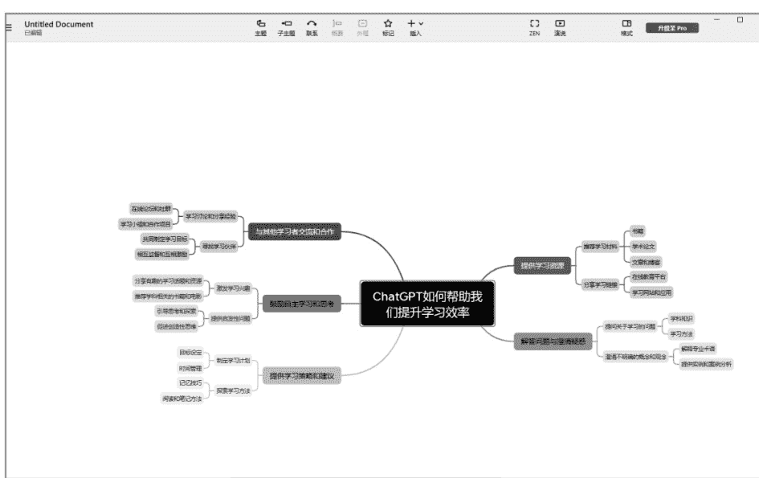

## 图4-35 思维导图效果

**注意：** 用户可以根据不同需求，选择思维导图模式/大纲模式来显示文件。

### 4.2 AI助力目标管理

目标管理是一种系统性的方法，用于设定、追踪和实现个人或组织的目标。它涉及明确目标、制定可量化的指标和关键结果，以及通过计划、执行和评估等步骤来管理与监督目标的实现过程。

目标管理的主要目的是确保个人或组织的行动与期望的结果一致，从而更加有效地管理时间、资源。目标管理能帮助人们更清楚地了解他们希望实现的结果，并提供一个框架来衡量和评估他们的进展。

简单地说，小到学习技能、完成某项工作；大到升职加薪、实现财务自由，这是个人目标；小到完成某个团队项目，大到实现公司战略目标，这是组织的目标。

目标管理可以应用于个人、团队和组织层面。它帮助人们更好地规划、组织和管理他们的工作，助力个人潜能发挥，促进团队协作，确保工作聚焦目标，优化资源配置，提升组织执行力。

#### 4.2.1 目标管理的流程

如果希望AI在目标管理上为我们提供帮助，就需要了解目标管理的流程，从而了解AI在哪些环节可以为我们提供帮助。

表4-2是目标管理的流程表，下面以“如何升职加薪”为例进行介绍。

表4-2 目标管理的流程表

| 阶段 | 介绍 | 举例 | AI 可以提供的帮助 |
| :--- | :--- | :--- | :--- |
| 确定目标 | 明确要实现的目标，并确保它们与组织的愿景和战略一致 | 升职加薪、提高销售额等 | 提供目标设定的建议和指导，如如何制定具体、可衡量的目标，如何与组织的愿景和战略保持一致等 |
| 制订计划 | 为实现每个目标制订详细的计划，包括必要的资源、时间表和里程碑 | 制订升职加薪计划，包括了解公司的晋升政策和要求、评估自己的技能和表现、制定时间表等 | 提供制订计划的指导和建议，如如何制订具体的计划，如何分配任务和资源等 |
| 分配责任 | 将任务分配给相关的个人或团队，并确保他们了解自己的职责和期望 | 将升职加薪计划分配给上级领导、同事和下属 | 提供任务分配的指导和建议，如如何与相关人员沟通和协调，如何确保每个人都清楚自己的职责和期望等 |
| 跟踪进度 | 定期检查进度，识别任何可能出现的问题，并采取必要的纠正措施 | 定期与上级领导汇报工作进展情况，及时解决工作中遇到的问题 | 提供进度跟踪的指导和建议，如如何建立有效的沟通渠道、如何识别和解决问题等 |
| 评估结果 | 在达到目标后，评估结果并确定哪些方面需要改进或加强 | 如果升职加薪计划没有成功，需要重新制订计划并采取行动来弥补缺陷 | 提供评估结果的指导和建议，如如何分析失败的原因，如何制订改进计划等 |

所有AI大模型的对话逻辑都是一致的，只是功能上略有区别。接下来我们将使用不同的工具来展示对话逻辑：用讯飞星火进行个人目标管理，用DeepSeek进行团队目标管理。

#### 4.2.2 个人目标管理

1. 目标设定阶段

目标设定阶段有三个关键任务：确定目标、确定关键结果、设置截止日期。

例如，我们希望在两个月内学会弹奏吉他。

第1步：明确认识。

为了确保讯飞星火对于“目标管理”有清晰的认识，我们可以提出问题：你了解目标管理吗？

**提问：你了解目标管理吗？**

**讯飞星火：**

是的，我了解目标管理。目标管理通过设定、追踪和评估目标，以确保组织或个人朝着既定目标的方向努力。下面是目标管理的基本流程：

1. 设定目标：确定明确、具体、可衡量的目标。这些目标应该与组织或个人的愿景、使命和战略目标相一致。
2. 制订计划：为实现目标制订详细的行动计划。计划应该包括具体的任务、分配资源、设定截止日期和指定责任人等。
3. 沟通与共享：确保目标和计划被适当地沟通给相关的团队成员或利益相关者。共享目标可以提高整个组织或团队的意识和参与度。
4. 监测与测量：建立指标和标准来评估目标的进展。定期监测和测量目标的达成程度，以便及时调整和纠正行动计划。
5. 反馈与改进：提供正向反馈和建设性的改进意见，以促进目标的实现。通过定期的评估和反馈，识别问题和挑战，并采取必要的纠正措施。
6. 评估与奖励：定期评估目标的实现情况，并根据绩效结果提供适当的奖励或激励措施。奖励可以是金钱、认可、晋升或其他形式的回报，以鼓励和激励团队成员的努力。
7. 调整与迭代：根据实际情况和反馈信息，进行必要的调整和迭代。如果目标需要修改或重新设定，应及时进行，并确保与整个组织或团队的目标保持一致。

通过目标管理，组织或个人能够有效地追踪和管理目标的实现，确保资源的有效利用，并最大限度地提高绩效和结果。

在这一步，如果它的理解和我们一致，就可以进行下一步；如果不一致，就需要通过对话去矫正它的理解。

第2步：设定角色，采用RBRP模型，提出明确的需求。

**提问：** 现在开始，你是一个经验丰富的目标管理咨询师（角色），我需要你以目标管理的逻辑帮助我制定目标，并且给出建议（要求）。我是一个吉他小白，从来没有学过吉他（背景），我希望通过两个月的时间学会基本的吉他弹奏（参数）。

**讯飞星火：**

当制定目标时，可以使用SMART目标原则来确保目标具备明确性和可衡量性。SMART目标是指具体（Specific）、可衡量（Measurable）、可实现（Achievable）、相关（Relevant）和有时限（Time-bound）。

以你现在的情况，你希望在两个月内学会基本的吉他弹奏。根据SMART目标原则来制定一个具体的目标。

1. 具体（Specific）：明确你希望学会的基本吉他弹奏技能是什么，如弹唱几首简单的歌曲、掌握和弦或弹奏一些简单的旋律等。
2. 可衡量（Measurable）：确保你的目标是可衡量的，可以通过记录你的进展来追踪。例如，每周记录你学习的歌曲数量或掌握的和弦数量。
3. 可实现（Achievable）：目标应该是可实现的，考虑你的起点水平和每周投入的学习时间，以确保目标的合理性。考虑你每周可以投入多少时间来学习吉他，并确保目标可以在两个月内实现。
4. 相关（Relevant）：确保你的目标与你的长期兴趣和目标相关。吉他弹奏对你个人的发展和兴趣是否有重要意义？
5. 有时限（Time-bound）：设定一个明确的时间限制，即在两个月内学会基本的吉他弹奏。

基于以上原则，一个可能的目标是：在两个月内，每周练习吉他至少5小时，掌握并能流畅演奏5首简单的歌曲，并熟悉常用的和弦与基本的吉他技巧。

**建议：**

(1) 制订一个具体的学习计划：将每周的学习时间分配给不同的练习内容，包括和弦、指法、旋律与歌曲练习等。确保你有足够的时间来反复练习和巩固所学内容。
(2) 寻找合适的学习资源：可以通过在线吉他教学网站、教学视频、教材或找一位吉他老师来辅导你的学习过程。这些资源可以提供指导和教学材料，帮助你系统地学习吉他技巧。
(3) 坚持练习和反馈：在每周练习的过程中，保持耐心。尽量每次练习都留出时间进行反馈和自我评估。

讯飞星火不仅提出了具体建议和目标，还提出了之前没提到的SMART目标原则，并且提出了一些有效的问题，如“明确你希望学会的基本吉他弹奏技能是什么，如弹唱几首简单的歌曲、掌握和弦或弹奏一些简单的旋律等”“吉他弹奏对你个人的发展和兴趣是否有重要意义”，以此判断，我们的提问是成功的，讯飞星火已经成功代入目标管理咨询师的角色。

面对这些问题，为了保障我们的目标更为精确，我们不能视而不见。适当地思考后，进一步说明自身情况才能获得更符合我们自身情况的建议。

**提问：** 两个月后是公司的年会，我希望能够在年会上表演一首吉他弹唱歌曲。

**讯飞星火：**

非常好！为了在年会上表演一首吉他弹唱歌曲，我可以进一步细化你的目标并提供一些建议。

(1) 选择一首适合的歌曲：考虑选择一首你熟悉并且在两个月内可以学会的歌曲。确保歌曲的难度与你的吉他技能水平相匹配。
(2) 设定学习目标：根据歌曲的难度和你的学习时间，制订每周的学习计划。将歌曲分解为小节或段落，并逐步学习和掌握吉他弹奏和歌曲演唱的技巧。
(3) 每周练习时间：为了达到你的目标，安排每周至少5小时的专门练习时间。分配时间来练习和弹奏歌曲的吉他部分及演唱技巧。
(4) 寻求指导和反馈：如果可能，考虑找一位吉他老师或音乐教练来指导你的学习过程。他们可以提供专业的指导、技巧和反馈，帮助你不断改进。
(5) 录制和自我评估：录制你的练习和演奏，以便能够了解自己的水平并进行自我评估。这有助于发现需要改进的方面，并监测你的进展。
(6) 参加演出：在学习的过程中，寻找机会参加一些小型演出或音乐会，这样可以提高实践和演出经验，同时增加自信心。
(7) 持续练习和反馈：通过持续的练习和反馈来改进你的演奏与演唱技巧。寻求他人的意见和建议，可以帮助你不断提高。

注意，目标的实现需要坚持、耐心和努力。通过有计划地学习和练习，你将能够在年会上展示你的吉他弹唱技巧。祝你成功！

根据讯飞星火的提示，我们知道了一些具体的执行路径，而其中有一些是可以让讯飞星火继续完善的。

(1) 明确学习的歌曲：可以通过提问让讯飞星火帮我们选择。
(2) 设定学习目标：明确自己每周能花多少时间，让讯飞星火将歌曲分解为小节。
(3) 练习方式：要分开练习，分成弹奏练习（分小节练习）、演唱练习。
(4) 练习的反馈方式：寻求音乐老师指导和反馈、录制自我评估、参加演出。

2. 计划阶段

我们需要让讯飞星火生成一个详细的日程表。

第1步：明确要学习的内容。在这个案例中，就是要明确学习哪一首歌曲、哪些和弦。

**提问：** 请给我推荐10首容易入门的中文吉他弹唱流行歌曲。

**讯飞星火：**

以下是10首容易入门的中文吉他弹唱流行歌曲，供你参考。

1. 《小幸运》。
2. 《演员》。
3. 《岁月神偷》。
4. 《成全》。
5. 《说散就散》。
6. 《匆匆那年》。
7. 《像我这样的人》。
8. 《后来》。
9. 《爱情转移》。
10. 《红日》。

这些歌曲旋律简单易记，和弦也不难掌握，适合初学者练习。希望能够帮助到你！

这样，讯飞星火就给我们提供了10首容易入门的歌曲，我们可以选择一首作为学习目标。

需要注意的是，提问要尽量具体，如用中文、流行歌曲这些词语进行描述，减少信息误差，避免生成的回答不符合我们的实际需求。

第2步：进一步提出要求，生成学习计划表并调整计划表。

**提问：** 请以两个月学会《小幸运》并能上台表演为目标，帮我重新制订计划表。

**讯飞星火：**

好的，以下是一个重新制订的计划表，以两个月学会《小幸运》并能上台表演为目标。

**第1周：**

1. 每天练习吉他弹唱30分钟，重点练习和弦、单音和节奏。
2. 观看《小幸运》的吉他弹唱教学视频，学习弹唱技巧和表现方法。
3. 尝试用吉他弹唱《小幸运》，记录自己的练习成果。

**第2周：**

1. 每天练习吉他弹唱45分钟，加强对和弦、单音和节奏的掌握。
2. 继续观看《小幸运》的吉他弹唱教学视频，深入学习弹唱技巧和表现方法。
3. 尝试在慢速下完整地弹唱《小幸运》，注意准确把握每个音符和节奏。

**第3周：**

(1) 每天练习吉他弹唱60分钟，加强指法和换弦的练习。
(2) 继续观看《小幸运》的吉他弹唱教学视频，学习更高级的弹唱技巧和表现方法。
(3) 尝试在原速下完整地弹唱《小幸运》，注意掌握好音乐的情感表达和舞台表现技巧。

**第4周：**

(1) 每天练习吉他弹唱75分钟，加强指法和换弦的练习。
(2) 参加一次小型演出或表演活动，锻炼自己的舞台表现能力和自信心。
(3) 总结自己在前三周的学习成果，发现不足之处并加以改进。

**第5～8周：**

(1) 继续每天练习吉他弹唱，加强自己的技能水平和舞台表现能力。
(2) 可以参加更多的演出或表演活动，积累经验并提高自己的演奏水平。
(3) 在最后一周内进行全面的复习和准备，包括乐曲的细节调整、舞台表演的细节安排等。

以上计划表仅供参考，具体的学习进度和时间可以根据个人情况进行适当调整。同时，要保持耐心和坚持不懈的精神，相信自己可以在两个月内学会《小幸运》并能够上台表演。

这样讯飞星火就设定了一个比较可行的学习计划。但是这种线性表述方式仍然不够直观、清晰，因此可以继续要求讯飞星火以表格的形式呈现，如图4-36所示。

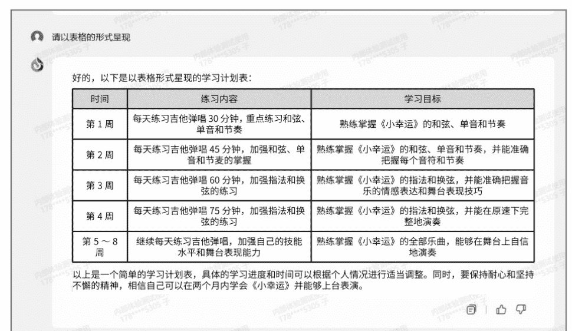

在这个过程中，我们发现行动计划并不明确，而且不知道具体需要练习哪些和弦，我们可以据此再提出要求，如图4-37所示。

学习目标需要做一些调整，再细致一些，如要掌握哪些和弦、单音、节奏

好的，以下是根据你的需求重新制订的计划表：

| 时间 | 练习内容 | 学习目标 |
| :--- | :--- | :--- |
| 第 1 周 | 每天练习吉他弹唱 30 分钟，重点练习和弦、单音和节奏 | 熟练掌握《小幸运》的和弦、单音和节奏，包括 C、G、Am、F 四个和弦 |
| 第 2 周 | 每天练习吉他弹唱 45 分钟，加强和弦、单音和节奏的掌握 | 熟练掌握《小幸运》的和弦、单音和节奏，包括 C、G、Am、F 四个和弦，并能准确把握每个音符和节奏 |
| 第 3 周 | 每天练习吉他弹唱 60 分钟，加强指法和换弦的练习 | 熟练掌握《小幸运》的指法和换弦，包括 C、G、Am、F 四个和弦在各个位置上的转换，并能准确把握音乐的情感表达和舞台表现技巧 |
| 第 4 周 | 每天练习吉他弹唱 75 分钟，加强指法和换弦的练习 | 熟练掌握《小幸运》的指法和换弦，包括 C、G、Am、F 四个和弦在各个位置上的转换，并能在原速下完整地演奏 C、G、Am、F 四个和弦的变化 |
| 第 5 ～ 6 周 | 继续每天练习吉他弹唱，加强自己的技能水平和舞台表现能力 | 熟练掌握《小幸运》的全部乐曲，能够在舞台上自信地演奏 C、G、Am、F 四个和弦的变化，并准确表达音乐的情感 |
| 第 7 周 | 参加一次小型演出或表演活动，锻炼自己的舞台表现能力和自信心 | 在小型演出或表演活动中展示自己的演奏水平，获得观众的认可和赞赏 |
| 第 8 周 | 进行全面的复习和准备，包括乐曲的细节调整、舞台表演的细节安排等 | 在最后的一周内进行全面的复习和准备，包括乐曲的细节调整、舞台表演的细节安排等，以确保能够在两个月内学会《小幸运》并能够上台表演 |


3. 执行阶段

我们可以使用日程安排工具，如滴答清单或印象笔记，及时提醒我们完成任务。

第1步：下载滴答清单。

这里以滴答清单为例，这款工具有网页版、PC版、手机版，如果我们决定用它作为日程提醒工具，最好下载手机版，便于接收提醒。

第2步：新建清单任务。

（1）打开滴答清单，新建一个任务清单，如图4-38所示。

(2) 新建一个名为“吉他学习计划”的清单，保存清单，如图4-39所示。

图4-38 新建任务清单

图4-39 设置清单名称为“吉他学习计划”

（3）在左侧选择已经建立好的新清单，在右侧输入具体日程安排，如图4-40所示。

图4-40 输入具体日程安排

第3步：在滴答清单中设置清单任务。

（1）从讯飞星火窗口中逐项复制练习内容并粘贴到滴答清单中，滴答清单会自动识别任务时间，如图4-41所示。

图4-41 逐项复制练习内容并粘贴到滴答清单中

（2）在清单视图中，设置第一个月的吉他学习计划，如图4-42所示。

图4-42 设置吉他学习计划（清单视图）

（3）单击左侧“日历”图标，进入日历视图，可以看到该月的学习计划，如图4-43所示。

图4-43 在日历视图中查看设置好的吉他学习计划

（4）打开滴答清单手机版，即可在手机上同步查看每日任务情况，如图4-44所示。

今天

☐ (6月1日到6月7日) 每天练习吉他弹唱30分钟，重点练习和弦、单音和节奏。
6月1日 - 6月7日 🔄 吉他学习计划（教学案例）

打卡

+   - 每天记账
- 完成3篇文章
- 每天练琴10分钟
- 每周3次运动

已完成

☑ 周一晚上贴发票处理报销
2月23日, 下午08:00 收集箱

图4-44 在滴答清单手机版中同步查看每日任务情况

第4步：及时反馈进度，调整计划。

我们先与讯飞星火建立约定，表明会及时沟通，以便它帮助我们调整计划。

**提问：** 以后我会及时告诉你吉他的学习进度，以便你更好地帮助我调整计划。

**讯飞星火：**

非常好的想法，我会很乐意听取你的学习进度和进展情况，以便更好地帮助你调整学习计划。请随时告诉我你的进展情况，我们一起努力学习吉他吧！

在项目执行的过程中及时与讯飞星火沟通进度，询问是否要调整计划，并且根据最新计划调整表格。

**提问：** 今天是练习的第三天，我练习按和弦的时候手指很疼，怎么办，是不是需要调整计划？

**讯飞星火：**

如果你在练习按和弦的时候手指感到疼痛，这可能是由于你的手指肌肉还没有适应这种动作所导致的。建议你先停止练习一段时间，让手指得到充分的休息和恢复。同时，你可以尝试以下方法来缓解手指疼痛。

+   (1) 轻轻按摩手指：用另一只手轻轻按摩疼痛的手指，以促进血液循环和缓解肌肉疲劳。

(2) 拉伸手指：将手指缓慢地拉伸至最大限度，并保持几秒钟，然后放松。这有助于缓解手指僵硬和紧张。

(3) 热敷或冷敷：你可以使用热水袋或冰袋来缓解手指疼痛。如果手指肿胀或受伤，就使用冰袋冷敷；如果手指僵硬或紧张，就使用热水袋热敷。此外，你可以考虑调整你的练习计划。例如，可以减少每天练习的时间或增加休息时间，以便让你的手指得到充分的休息和恢复。另外，你也可以尝试使用更轻柔的弦或更小的吉他来减轻手指的压力。最重要的是，不要过度练习或强迫自己使用不适合自己的练习方式，要根据自己的身体状况和实际情况来制订合理的学习计划。

需要注意的是，AI虽然有很强的联系上下文的能力，但是它也有时效性，所以我们经常会发现过了几天再与它对话，它似乎“失忆”了。这个时候，我们就要求它对对话内容进行回顾。

如果需要回顾之前的对话内容，就需要告诉它我们想回顾的时间段，它会为我们提供相关的文字记录。具体方法如下。

(1) 告诉它我们想回顾的时间范围，如最近的一周或一个月。

(2) 提供一些关键词或短语，这些关键词将帮助它确定我们需要回顾的具体内容。

例如，“请回顾一个月内我们关于吉他学习计划的对话内容”。

#### 4.2.3 团队目标管理

团队目标和个人目标的区别主要在于参与者和协助者的数量不同。个人目标的参与者只有自己，因此在工作中不需要团队协作，只需要准确跟进进度即可。而团队目标需要多人分工和协作，因此需要安排大量的沟通环节，确保团队成员步调一致。

例如，我们计划在一个月内和我们的团队在网络上上线一套课程，让DeepSeek协助我们进行团队目标管理。

##### 1. 目标设定阶段

团队目标管理同样需要完成三个关键任务：确定目标、确定关键结果、设置截止日期。

在一般情况下，团队目标可能会比较清晰，如业绩增加20%、完成100个订单、数据突破100万等。

在这个案例中，目标是“上线一套课程”，截止日期是一个月后，而关键结果则为“课程顺利上线”，目标是比较清晰的，我们可以直接进入下一步。

##### 2. 计划阶段

第1步：设定角色，告知DeepSeek我们的诉求，并提出问题。

**提问：** 现在开始，你是我的项目计划管理助手，我希望用一个月的时间在网络上上线一套课程，具体需要完成哪些工作内容？

**DeepSeek:**

作为你的项目计划管理助手，我可以帮助你规划上线课程所需的工作内容。以下是一个基本的工作内容清单，你可以根据你的具体需求进行调整和补充。确定目标和范围：

+   (1) 确定课程的主题和目标受众。
(2) 定义课程的范围和内容，包括教学目标和大纲。

制定时间表：

+   (1) 设定一个上线截止日期，并基于这个日期制定一个详细的时间表。
(2) 将整个过程分解为可管理的任务和里程碑，为每个任务分配时间和优先级。

确定资源需求：

+   (1) 确定需要的人力资源，如讲师、编辑、设计师等。
(2) 确定需要的技术资源，如计算机设备、软件工具等。

编写教学材料：

+   (1) 根据课程大纲编写课程教学材料，包括讲义、PPT、案例研究等。
(2) 考虑以文字、图片、视频等多种形式呈现教学内容，提高学习体验。

制作多媒体素材：

+   (1) 创建演示文稿、图表、动画或视频来支持教学。
(2) 使用专业工具或软件进行录制、编辑和制作。

开发互动元素：

+   (1) 设计和开发与学员互动的元素，如练习题、测验、讨论论坛等。
(2) 确保学员可以参与其中并巩固所学内容。

测试和修订：

+   (1) 进行内部测试和评估，找出教学材料中的错误或可改进之处。
(2) 邀请一些测试学员参与，收集他们的反馈并根据需要进行修订。

平台选择和设置：

+   (1) 选择一个合适的在线学习平台或课程管理系统来托管和交付课程。
(2) 配置课程设置，如注册、付款、学习进度跟踪等功能。

市场推广：

+   (1) 制订并执行市场推广计划，以吸引潜在学员。
(2) 利用社交媒体、邮件、SEO等工具和策略来推广课程。

上线和监控：

+   (1) 在截止日期前完成所有准备工作，将课程上线。
(2) 监控学员的学习进度和反馈，及时解答问题和提供支持。

在对话过程中，我们发现它提供的流程比较全面，但是有一些环节是我们不需要的，我们可以表述清楚自身情况，并要求它进行修正。

**提问：** 简化一些，我要上线的是一套线上微课，不需要互动，以10分钟以内的视频为主，最多15节。

**DeepSeek：**

明白了，下面是简化后的工作内容清单，以帮助你上线一套线上微课。

+   1. 确定课程主题和目标受众。
2. 制定时间表并设定上线截止日期。
3. 编写课程大纲，确定每节课的内容和顺序。
4. 准备教学材料。
   1. 编写脚本或提纲，用于视频录制。
   2. 制作幻灯片或图表，用于辅助讲解。
   3. 准备其他必要的教学资料。
5. 视频录制和制作。
   1. 搭建适合录制的环境，准备所需的设备和工具。
   2. 录制课程视频，确保内容简洁明了。
   3. 进行视频剪辑和后期制作，添加必要的效果和字幕。
6. 设计课程封面和宣传素材，以吸引学员。
7. 选择合适的在线学习平台或视频分享平台来托管和交付课程。
8. 上传视频和教学材料至平台，设置课程信息和价格（如有）。
9. 进行测试观看，确保视频和材料的质量与可用性。
10. 进行宣传和推广，利用社交媒体和其他渠道吸引学员。
11. 上线课程并监控学员的学习进度和反馈。
12. 根据学员反馈和需要进行修订与改进。

这个简化的工作内容清单适用于一个包含最多15节，每节时长在10分钟以内的线上微课。你可以根据实际情况进行调整和补充。祝你的课程顺利上线！

第2步：以表格形式呈现，并评估工期。

**提问：** 请以表格的形式呈现，从左到右依次是序号、工作项目、工期，工期你可以根据对内容的理解自行评估。

**DeepSeek:**

以下是根据你提供的任务列表以表格形式呈现的更新后的项目计划。

| 序号 | 工作项目 | 工期 |
| :--- | :--- | :--- |
| 1 | 确定课程主题和目标受众 | 2 天 |
| 2 | 制定时间表并设定上线截止日期 | 1 天 |
| 3 | 编写课程大纲，确定每节课的内容和顺序 | 2 天 |
| 4 | 课程文案编写 | 10 天 |
| 5 | 视频录制和制作 | 10 天 |
| 6 | 设计课程封面和宣传素材，吸引学员 | 2 天 |
| 7 | 选择合适的在线学习平台或视频分享平台托管和交付课程 | 2 天 |
| 8 | 上传视频和教学材料至平台，设置课程信息和价格（如有） | 1 天 |
| 9 | 进行测试观看，确保视频和材料的质量与可用性 | 1 天 |
| 10 | 进行宣传和推广，利用社交媒体和其他渠道吸引学员 | N/A |
| 11 | 上线课程并监控学员的学习进度和反馈 | N/A |
| 12 | 根据学员反馈和需要进行修订与改进 | N/A |

这个表格清晰地列出了每个工作项目的序号、工作内容及预计的工期。注意，项目10～12的工期标记为N/A，因为它们是持续性的任务，需要根据实际情况进行管理和改进。

如果工期有问题，就需要明确说明，一一告诉DeepSeek需要修改的内容，如“第3项工作项目的工期应该为3天”。如果没有，继续下一步。

第3步：描述团队情况，并在表格中加入负责人。

**提问：** 团队成员有3个人：张三，负责课程内容；李四，负责拍摄和剪辑；王五，负责宣传推广相关工作。其他工作由3个人共同负责，请在工期后再增加一列“负责人”，并为这3个人分配工作项目。

**DeepSeek:**

以下是添加了负责人列的更新后的项目计划表格。

| 序号 | 工作项目 | 工期 | 负责人 |
| :--- | :--- | :--- | :--- |
| 1 | 确定课程主题和目标受众 | 2 天 | 张三 |
| 2 | 制定时间表并设定上线截止日期 | 1 天 | 共同 |
| 3 | 编写课程大纲，确定每节课的内容和顺序 | 2 天 | 共同 |
| 4 | 课程文案编写 | 10 天 | 共同 |
| 5 | 视频录制和制作 | 10 天 | 李四 |
| 6 | 设计课程封面和宣传素材，吸引学员 | 2 天 | 共同 |
| 7 | 选择合适的在线学习平台或视频分享平台托管和交付课程 | 2 天 | 共同 |
| 8 | 上传视频和教学材料至平台，设置课程信息和价格（如有） | 1 天 | 共同 |
| 9 | 进行测试观看，确保视频和材料的质量与可用性 | 1 天 | 共同 |
| 10 | 进行宣传和推广，利用社交媒体和其他渠道吸引学员 | N/A | 王五 |
| 11 | 上线课程并监控学员的学习进度和反馈 | N/A | 共同 |
| 12 | 根据学员反馈和需要进行修订与改进 | N/A | 共同 |

这样，每个工作项目都与负责人对应起来，以便清楚地展示每个团队成员的职责。

DeepSeek对于工作项目理解有误的地方，我们要求其进行调整。

**提问：** 课程文案编写是张三的工作，设计课程封面和宣传是王五的工作，第3项是张三的工作，第7～8项是王五的工作。

**DeepSeek：**

根据你的指示，以下是经过修正的项目计划表格，包括负责人的分配

| 序号 | 工作项目 | 工期 | 负责人 |
| :--- | :--- | :--- | :--- |
| 1 | 确定课程主题和目标受众 | 2天 | 张三 |
| 2 | 制定时间表并设定上线截止日期 | 1天 | 共同 |
| 3 | 编写课程大纲，确定每节课的内容和顺序 | 2天 | 张三 |
| 4 | 课程文案编写 | 10天 | 张三 |
| 5 | 视频录制和制作 | 10天 | 李四 |
| 6 | 设计课程封面和宣传素材，吸引学员 | 2天 | 王五 |
| 7 | 选择合适的在线学习平台或视频分享平台托管和交付课程 | 2天 | 王五 |
| 8 | 上传视频和教学材料至平台，设置课程信息和价格（如有） | 1天 | 王五 |
| 9 | 进行测试观看，确保视频和材料的质量与可用性 | 1天 | 共同 |
| 10 | 进行宣传和推广，利用社交媒体和其他渠道吸引学员 | N/A | 王五 |
| 11 | 上线课程并监控学员的学习进度和反馈 | N/A | 共同 |
| 12 | 根据学员反馈和需要进行修订与改进 | N/A | 共同 |

非常抱歉给你带来的困扰，并感谢你的耐心。现在已经修正了工作项目分配的错误。

第4步：增加开始日期和结束日期。

**提问：** 在工期后增加开始日期和结束日期两列。整个项目的开始日期为2023年6月1日，视频录制和制作可以比文案编写晚3天。设计课程封面和宣传素材与课程文案编写同时开始。

**DeepSeek:**

好的，以下是经过调整的项目计划表格，包括开始日期和结束日期两列。

续表

| 序号 | 工作项目 | 工期 | 开始日期 | 结束日期 | 负责人 |
| :--- | :--- | :--- | :--- | :--- | :--- |
| 1 | 确定课程主题和目标受众 | 2 天 | 2023-06-01 | 2023-06-02 | 张三 |
| 2 | 制定时间表并设定上线结束日期 | 1 天 | 2023-06-03 | 2023-06-03 | 共同 |
| 3 | 编写课程大纲，确定每节课的内容和顺序 | 2 天 | 2023-06-04 | 2023-06-05 | 张三 |
| 4 | 课程文案编写 | 10 天 | 2023-06-06 | 2023-06-15 | 张三 |
| 5 | 视频录制和制作 | 10 天 | 2023-06-09 | 2023-06-18 | 李四 |
| 6 | 设计课程封面和宣传素材，吸引学员 | 2 天 | 2023-06-06 | 2023-06-07 | 王五 |
| 7 | 选择合适的在线学习平台或视频分享平台托管和交付课程 | 2 天 | 2023-06-08 | 2023-06-09 | 王五 |
| 8 | 上传视频和教学材料至平台，设置课程信息和价格（如有） | 1 天 | 2023-06-10 | 2023-06-11 | 王五 |
| 9 | 进行测试观看，确保视频和材料的质量与可用性 | 1 天 | 2023-06-12 | 2023-06-13 | 共同 |
| 10 | 进行宣传和推广，利用社交媒体和其他渠道吸引学员 | N/A | 2023-06-07 | 2023-07-05 | 王五 |
| 11 | 上线课程并监控学员的学习进度和反馈 | N/A | N/A | N/A | 共同 |
| 12 | 根据学员反馈和需要进行修订与改进 | N/A | N/A | N/A | 共同 |

感谢你的指导，现在项目计划表已经根据要求进行了调整，并添加了开始日期和结束日期两列。

##### 3. 执行阶段

使用下载好的Excel甘特图模板，将表格内容逐列粘贴到甘特图中（AI制作的表格可以直接粘贴到Excel中），如图4-45所示。

图4-45 借助AI生成的项目管理甘特图

### 4.3 AI助力工作汇报

在日常工作中，日报和周报是一种记录员工工作进展的工具，可以帮助管理者及时掌握工作情况，了解员工的工作进展，及时调整和优化工作计划。同时，填写日报、周报可以让员工对自己的工作有一个全面的了解，从而更好地规划下一步的工作安排。

下面以DeepSeek为例进行演示。

#### 4.3.1 设置汇报助手机器人

准备工作：我们需要新建一个对话，专门用于记录工作。

（1）打开DeepSeek，单击“开启新对话”按钮，如图4-46所示。

图4-46 开启新对话

（2）提出问题。

**提问：** 今天开始，你是我的工作汇报助手，我告诉你工作内容，你帮我整理成日报、周报、月报。

**DeepSeek：**

好的，我非常乐意成为你的工作汇报助手。请你告诉我工作内容和进展情况，我会帮你整理成日报、周报和月报。

（3）将对话的名称改为“工作汇报机器人”，便于辨识，如图4-47所示。

图4-47 将对话的名称改为“工作汇报机器人”

#### 4.3.2 制作日报、周报、月报

制作日报、周报、月报有两种方式。

+   1. 以终为始，由大到小

通过分解一个月、一周的目标，完成周报、日报。这种方式比较适合一些非KPI考核的岗位，而且有规划工作的作用。

操作方法如下。

第1步：给出周目标，让DeepSeek分解到每天。

**提问：** 本周我的计划是完成三门课程的开发，完成两份售前报告，并且分别与大连、广州、上海的客户沟通项目事宜。请帮我分解到周一至周五的每天。

**DeepSeek：**

好的，以下是根据你的计划分解到周一至周五每天的工作内容。

周一：

+   1. 与大连客户沟通并确认项目需求和目标。
2. 开始开发第一门课程，制订教学计划和大纲
3. 完成售前报告的第一部分。

周二：

+   1. 与广州客户沟通并确认项目需求和目标。
2. 继续开发第一门课程，完善教学计划和大纲。
3. 完成售前报告的第二部分。

周三：

+   1. 与上海客户沟通并确认项目需求和目标。

##### 2. 逐日记录零碎的工作事项

如果我们工作中零碎事项比较多，可以采用第二种方式制作日报、周报。每当我们接到新的工作任务时就可以记录到工作汇报机器人中。

**提问：** 2023.6.5 帮助张三写课程文案，领导要求做一个PPT，但是还没做完，帮助李四剪辑了一个视频。

**DeepSeek：**

好的，以下是您的日报。

日期：2023年6月5日

工作内容：

- 1. 帮助张三写课程文案。
- 2. 制作PPT（未完成）。
- 3. 剪辑视频。

进展情况：

- 1. 完成了帮助张三写课程文案的工作，并提交给领导审核。
- 2. 制作了一份符合要求的PPT初稿，已发送给张三进行确认和修改意见。
- 3. 剪辑了一个视频，并进行了初步的后期处理，等待李四的反馈后继续完善。

以上是今天的工作汇报，如果有不足之处请多多指教。

当日报完成后，就可以要求DeepSeek自行总结周报，甚至是月报、年度总结。这样就极大地减少了我们的工作量，我们只需进行一些修改即可。

### 4.4 AI辅助求职

作为一个已经从业5年的职业生涯规划师，我不得不感叹科技的强大：在AI技术的推动下，会用AI工具相当于认识一个不收费的职业生涯规划师朋友。虽然这位朋友还比较“初级”，但依旧可以给我们提供很多参考意见，但意见仅限于参考。如果希望获得更为精准的规划，还是需要咨询专业人士。

#### 4.4.1 职业规划

AI的数据来源于网络，对信息的了解比较全面，可以作为我们的线上咨询师。下面以DeepSeek为例介绍具体步骤。

第1步：设定角色，询问一个开放式问题。

**提问：** 你现在是我的求职顾问，在哪些方面可以帮助我？

**DeepSeek：**

作为你的求职顾问，我可以在以下方面帮助你。

- 1. **职业规划：** 我可以与你一起讨论你的职业目标和兴趣，并提供指导，帮助你确定适合你的职业方向。
- 2. **简历和求职信撰写：** 我可以帮你撰写专业的简历和求职信，以突出你的技能、经验和成就，并使其符合特定的职位要求。
- 3. **面试准备：** 我可以提供面试技巧和建议，包括常见面试问题的回答方式、如何展示自己的优势及如何应对挑战性的面试。
- 4. **职业咨询：** 我可以与你讨论行业趋势、职业发展机会和潜在的职业道路，帮助你做出明智的职业决策。
- 5. **职业网络：** 我可以分享一些关于建立职业网络和利用社交媒体平台寻找职业机会的建议。
- 6. **职业培训和进修：** 如果你有兴趣进一步提升自己的技能，我可以提供关于职业培训和进修课程的建议，以帮助你在求职中脱颖而出。

注意，我是一个语言模型，我的建议仅供参考。在实际求职过程中，你可能还需要借助其他资源，如专业人士的意见、招聘网站和就业服务中心等。

这里没有使用RBRP模型进行提问，原因在于涉及职业生涯类的问题，采用RBRP模型会使AI倾向于直接给出答案，而不是和我们讨论探究。

**提问：** 你现在是一个经验丰富的职业生涯规划师，我是一个刚毕业的管理学专业的大学生，我现在对未来比较迷茫，不知道该如何选择行业和公司。请你为我提供帮助。

**DeepSeek：**

当面对毕业后的职业选择时，感到迷茫是非常正常的。下面是一些建议，可以帮助你制定个人生涯规划和做出明智的决策。

- (1) 自我评估：了解自己的兴趣、价值观和技能是非常重要的。考虑你在学习期间所喜欢的课程、项目或实习经历，思考你的优势和弱点，并确定你想要发展的技能和兴趣领域。
- (2) 职业研究：花时间研究不同的行业和公司。了解行业的趋势、就业前景和相关职位的要求。阅读行业报告、参加职业展览会、与从业者交流或寻求导师的建议，可以帮助你更好地了解行业内部的工作环境和机会。
- (3) 实习和志愿者工作：通过实习或志愿者工作，你可以获得宝贵的经验，并更好地了解不同行业的实际工作内容。这也可以帮助你确定自己对某个行业或公司的兴趣是否与实际情况相符。
- (4) 设置短期和长期目标：考虑你的职业目标，并为之制订一个合理的计划。确定你想要在短期和长期内实现的目标，并设计相应的步骤和时间表。这将帮助你保持专注并朝着目标努力。
- (5) 寻求建议：与身边的老师、校友、行业专家或职业规划顾问交流，听取他们的建议。他们可以为你提供有关行业、公司和职业发展的有价值的见解与建议。
- (6) 扩展人际网络：建立和扩展你的人际网络是职业发展中的关键。参加行业活动、社交聚会或专业组织，与同行交流并结识新的人脉。这些人际关系可能为你提供就业机会和职业建议。
- (7) 探索不同选项：不要急于做出决定。尝试探索不同的行业和公司，了解它们的文化和价值观。这将有助于你更好地了解自己想要从事的工作类型，并找到最适合你的行业和公司。

最重要的是，记住职业发展是一个持续的过程，可能需要时间和实践来找到最适合你的道路。保持积极的心态，不断学习和适应变化，你将能够做出明智的职业选择。祝你好运！

第2步：引导AI具体说明职业规划方法。

**提问：** 能具体一点吗，如你要怎么做，来帮我确定职业目标和发展方向。

**DeepSeek：**

当帮助你确定职业目标和发展方向时，我可以采取以下步骤。

- (1) 初步讨论：我们可以开始通过对你的兴趣、技能和经验进行初步讨论。你可以告诉我你喜欢什么样的工作、你的专业背景和职业经历，以及你希望在未来的职业生涯中实现什么样的目标。
- (2) 职业探索：基于你提供的信息，我可以与你一起探讨不同的职业领域和行业。我可以介绍一些与你的兴趣和技能相关的职业，讨论它们的前景、发展机会和所需的技能。
- (3) 职业价值观和优先级：我们可以探讨你的职业价值观和优先级。你可以考虑你认为重要的因素，如薪资、工作与生活平衡、职业成长和发展机会等。这有助于我们更好地确定适合你的职业目标。
- (4) 职业调研：我可以提供一些关于特定职业的调研资料，包括薪资范围、职责和要求等。这些信息可以帮助你更好地了解不同职业的特点，从而更好地做出决策。
- (5) 职业咨询和反馈：通过讨论和交流，我可以为你提供职业咨询和反馈。我可以帮助你评估不同职业目标的优势和劣势，并提供建议和观点，以便你做出明智的决策。

需要注意的是，确定职业目标和发展方向是一个个人化的过程，需要你对自己有清晰的认知和深入的思考。我的角色是提供指导和建议，但最终的决策取决于你自己。

第3步：表明具体需求，把主动权交给AI，让AI提出问题。

**提问：** 好的，接下来你来引导，提出问题，我来回答，我们讨论一下我的职业发展方向。

**DeepSeek：**

当然，我很乐意引导你进行讨论，以帮助你确定职业发展方向。以下是一些问题，你可以回答它们，我们可以在每个问题上展开讨论。

- (1) 你目前的职业兴趣是什么？你对哪些领域或行业特别感兴趣？
- (2) 你的专业背景和技能是什么？你在哪些方面具有独特的优势和经验？
- (3) 你希望在职业生涯中取得什么样的成就？你对于职位的责任和影响力有何期望？
- (4) 你对于工作与生活平衡的重视程度如何？你希望拥有怎样的工作环境和工作时间安排？
- (5) 你对于职业发展的长期规划有何想法？你是否希望在特定行业或领域中深耕，并朝着管理职位或专业专家的方向发展？
- (6) 你对于薪资和福利方面有何期望？你愿意为了职业发展做出一定的牺牲吗？
- (7) 你在过去的职业经历中取得的成就是什么？你如何评估自己的职业成长和发展潜力？
- (8) 你有没有感兴趣的职业角色或职位？对于这些职位，你有哪些特定的技能或经验？

根据每个问题给出你的回答，并随时提供任何额外的信息，以便我们能够更深入地讨论你的职业发展方向。

下面可以逐项回复AI的问题，也可以就单一问题展开讨论，适当的时候，诱导进入下一个环节即可。讨论过程很长，由于篇幅问题，且讨论内容比较个性化，书中不展示全部内容，感兴趣的读者可以自行尝试。

#### 4.4.2 简历修改

写简历是求职过程中最重要的一个环节，我在这些年的求职、招聘、职业辅导经历中，深刻地体会到一份好的简历可以为求职提供极大的助力，一份好的简历拥有以下作用。

- (1) 展示自己的能力：简历是你展示自己技能和工作经历的关键途径。你可以通过列出相关的职业技能、项目经验、学术成就和培训经历来证明自己的能力。一份有说服力和令人信服的简历能够突出你的专业知识和适应能力，从而增加你在雇主心中的价值。
- (2) 表明自身工作经历与岗位的匹配度：雇主在招聘过程中通常需要了解很多关于申请者的背景信息。简历可以提供你的教育背景、工作经历、项目经历和志愿者工作等方面的重要细节。这些信息可以帮助雇主评估你的经历与岗位的匹配度，以便决定是否邀请你参加面试。
- (3) 展示自身求职诚意：在自身能力和经验都不足以在竞争者中脱颖而出时，一份制作精良、简明扼要、与企业要求更加匹配的简历就显得尤为重要了。

目前，市场上有很多帮助修改简历的求职辅导服务，而使用AI帮我们修改简历，不但可以提高求职效率，也可以节省一部分求职辅导的花费。

下面以DeepSeek为例介绍具体步骤。

用AI修改简历总共分为四个步骤。

第1步：投喂信息，将AI训练成简历专家。

制作一份好的简历一般要解决4个问题：需要哪些模块？如何描写工作内容？如何将自身的经验和目标岗位的要求进行匹配？如何凸显个人优势？

修改简历是一项比较专业的工作，AI从网络上直接搜索再生成答案可能效果不太好，因此我们选择以直接投喂文章的方式进行训练。

**提问：** 接下来我会给你几篇关于如何修改简历的文章，请你认真学习其中内容，总结文章中的方法论。

**DeepSeek：**

当然，我会认真学习并总结这些关于如何修改简历的文章的内容。请您逐篇提供这些文章，然后我将为您进行总结。

接着，直接粘贴3篇优质文章到对话框中，让AI依次总结。

再要求AI将3篇文章总结合并为一篇，如果发现不足，及时让AI进行补充。

第2步：岗位分析，让AI分析不同公司同一岗位的相似要求。

从求职平台上搜索3个以上想要求职的目标岗位的招聘信息，如平面设计师。将招聘信息投喂给AI，让它总结3个岗位的共同要求。

**提问：** 接下来我要给你提供几个平面设计师的招聘信息，我需要你认真总结共同要求，并根据这些内容在之后的对话中为我提供建议（招聘信息省略）。

**DeepSeek：**

这是3个平面设计师的岗位要求和职责。

**岗位职责：**

- 1. 参与项目创意策划会，准确理解设计的风格和定位，具备审美能力。
- 2. 配合项目完成工作；能够理解不同汽车品牌画面风格的基调。
- 3. 跟踪、监控项目设计过程，有必要可参与现场勘测。
- 4. 与文案策划指导协调创作执行层面的工作，及时跟进客户并反馈意见。
- 5. 提供输出、印刷和制作的执行要求等。

**任职要求：**

- 1. 熟练运用Photoshop、Illustrator、CorelDRAW等平面设计软件，多多益善，具备审美能力、学习能力。
- 2. 活动策划、公关会展、舞美行业设计经验，曾在（汽车类）公关、会展、策划公司工作者优先考虑。
- 3. 拥有空杯心态，自我驱动型人格，善于沟通协作，有责任心，有良好的沟通和团队配合能力。
- 4. 对会展庆典策划执行活动所涉及的相关制作工艺和材料有一定的了解，对材料的合理运用及效果有一定的了解，汽车会展活动优先。
- 5. 参与新闻视觉工作的设计与制作：信息可视化、周刊特刊创意封面设计、创意海报设计、长图设计、新媒体传播物料、活动视觉物料、栏目品牌VI等。

**个人能力：**

- (1) 专业艺术院校毕业，本科及以上学历。
- (2) 有较强的美术功底及审美能力，熟练使用设计软件。
- (3) 具有专业设计师的思维与创造力，能够独立创作完成各种新闻包装样态。
- (4) 对新闻工作有充分认识和热忱，并立志投身新闻事业。
- (5) 有政治素养、新闻敏感性、大局观，具备优秀的人格品质，为人正直品行端正。
- (6) 责任心强，工作细致严谨，有耐心、有韧劲，拥有较强的沟通能力，具备良好的团队合作精神，能够适应较高强度的工作压力，能承受非工作时间的工作安排。

**主要内容：**

- (1) 空间导视标识设计。
- (2) 书籍设计、展览设计、海报及周边产品设计与制作。
- (3) 品牌设计。

**工作要求：**

- (1) 平面设计类专业，本科及以上学历，有工作经验者优先。
- (2) 审美良好，基本功扎实，热爱设计，对品质有追求。
- (3) 具有良好的团队沟通和协作能力，有责任心及自我驱动力。
- (4) 熟练掌握Adobe相关软件、CAD软件。

很多求职专家都会告诉我们简历需要定制化设计，以匹配每家公司的岗位需求，但根据我的实际操作经验，其实没有这个必要，因为实际生活中大多数人面对的可能是500人以下的中小型企业，简历通常需要批量投递，如果为每家企业都定制一份简历，时间和精力成本过高。

第3步：输入自己的简历，并要求AI修改简历。

**提问：** 这是我的简历，请根据上面的招聘信息和已经总结的改简历的方法，帮我修改一份高质量简历。

姓名：张三 出生年月：1988年××月 年龄：35岁 职业目标：平面设计师 教育背景：本科：海拉鲁王国大学 设计专业，学士学位（2010年毕业） 工作经历：1. 公司名称：塞尔达设计公司，职位：平面设计师，时间：2010—2013年 工作内容：负责平面设计，包括海报设计、名片设计等。成果展示：参与多个项目的设计，其中包括：“神庙之神”品牌视觉形象设计，获得公司年度优秀设计奖，参与塞尔达设计公司产品包装设计，成功推出了新产品线并获得市场好评。2. 公司名称：旷野之息设计公司 职位：平面设计师 时间：2013—2016年 工作内容：负责公司品牌视觉形象设计、产品包装设计、广告宣传设计等相关工作。成果展示：设计了多个项目，其中包括：“哈努玛神庙”品牌视觉形象设计，获得公司年度优秀设计奖；参与旷野之息设计公司产品包装设计，成功推出了新产品线并获得市场好评。3. 公司名称：王国之泪广告公司 职位：平面设计师 时间：2016年至今 工作内容：负责客户广告宣传设计，包括海报、名片、DM单页等。成果展示：参与多个客户的广告设计项目，其中包括：“鲁塔利王国”广告海报设计，获得客户好评和广泛传播。技能与特长：熟练使用Adobe系列软件，包括Photoshop、Illustrator、InDesign等；擅长品牌视觉形象设计、包装设计、海报设计等；具备网页设计经验，熟悉HTML和CSS；良好的沟通能力和团队合作精神。个人评价：本人具备高度的工作责任感，适应能力强，能够快速适应不同的工作环境和任务要求。在设计过程中注重细节和创意，并能够为客户提供高质量的设计服务。 联系方式： 电话： 138****1234 邮箱： xxxxx@xxx.com

**DeepSeek：**

张三

联系方式：

电话： 138****1234

邮箱： xxxxx@xxx.com

职业目标：

平面设计师

教育背景：

本科：海拉鲁王国大学 设计专业，学士学位 （2010年毕业）

工作经历：

- 1. 公司名称：塞尔达设计公司
  职位：平面设计师
  时间：2010—2013年
  工作内容：
  负责平面设计，包括海报设计、名片设计等。
  成果展示：
  参与多个项目的设计，其中包括“神庙之神”品牌视觉形象设计，获得公司年度优秀设计奖；参与塞尔达设计公司产品包装设计，成功推出了新产品线并获得市场好评。
- 2. 公司名称：旷野之息设计公司
  职位：平面设计师
  时间：2013—2016年
  工作内容：
  负责公司品牌视觉形象设计、产品包装设计、广告宣传设计等相关工作。
  成果展示：
  设计了多个项目，其中包括“哈努玛神庙”品牌视觉形象设计，获得公司年度优秀设计奖；参与旷野之息设计公司产品包装设计，成功推出了新产品线并获得市场好评。
- 3. 公司名称：王国之泪广告公司
  职位：平面设计师
  时间：2016年至今
  工作内容：
  负责客户广告宣传设计，包括海报、名片、DM单页等。
  成果展示：
  参与多个客户的广告设计项目，其中包括“鲁塔利王国”广告海报设计，获得客户好评和广泛传播。

**技能与特长：**

- (1) 熟练使用Adobe系列软件，包括Photoshop、Illustrator、InDesign等。
- (2) 擅长品牌视觉形象设计、包装设计、海报设计等。
- (3) 具备网页设计经验，熟悉HTML和CSS。
- (4) 拥有良好的沟通能力和团队合作精神。

**个人评价：**

本人具备高度的工作责任感，适应能力强，能够快速适应不同的工作环境和任务要求。在设计过程中注重细节和创意，并能够为客户提供高质量的设计服务。

**附加建议：**

- (1) 在技能与特长部分，可以具体描述一些项目中的应用和成就，以突出你在各方面的能力。
- (2) 强调沟通能力和团队合作精神的重要性，并提供相关经历或项目。
- (3) 在个人评价中，可以进一步强调你的创意能力和对细节的关注。

希望这份修改后的简历能够帮助你突出自己的优势，祝你好运！

在得到AI的反馈后，我们可以根据AI的建议进一步调整，当然也可以进一步追问该如何修改。

**提问：** 根据上面总结的方法，张三的简历有什么需要调整的地方吗？

**DeepSeek:**

根据上面总结的方法，张三的简历已经包含了许多重要信息，但还有一些地方可以进行调整和改进。以下是我提供的建议。

1.  **职业目标：** 在简历开头添加一段简短的职业目标，突出你作为平面设计师的目标和动力。例如，“职业目标：寻求在汽车行业中发展的平面设计师，专注于品牌视觉形象设计和包装设计”。
2.  **技能与特长：** 将技能与特长部分放在工作经历之前，突出你的专业能力和熟练使用的设计软件。可以将具体的技能和软件列成项目格式，更清晰地展示你的能力。
3.  **工作经历：** 在每个工作经历的描述中，除了列举你的工作内容和成果，尽量使用有力的动词和量化的结果来说明你的贡献。例如，你可以提供具体的项目名称、奖项、市场反馈等，以更具说服力地展示你的工作能力。
4.  **教育背景：** 在教育背景中，除了列出学校和专业，还可以添加你在学校期间的成就和项目经验，特别是与平面设计相关的项目。
5.  **个人评价：** 在个人评价中，除了强调适应能力和工作责任感，还可以进一步突出你的创意能力、注重细节和客户服务的态度。

这些调整可以使你的简历更具吸引力和说服力，展示出你作为平面设计师的专业能力和经验。记得仔细检查拼写和语法，确保简历的整体格式清晰易读。祝你好运！

接下来就可以要求AI进行修改了。需要注意的是，简历一定是基于我们自身经历的，不能让AI为我们捏造。所以，其中关于个人经历的部分还是需要自己填充。

最后，新建一个Word文档，将AI协助我们改好的简历粘贴到这个文档中。

第4步：套入模板，应用WPS稻壳一键套用模板并调整内容。

（1）打开WPS稻壳，选择“AI应用”中的“简历助手”选项，如图4-48所示。

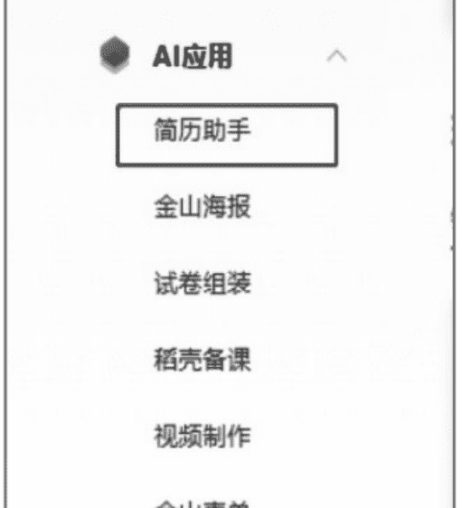

图4-48 选择“AI应用”中的“简历助手”选项

（2）在“简历助手”页面中单击“导入”按钮，导入保存的简历Word文档，如图4-49所示。

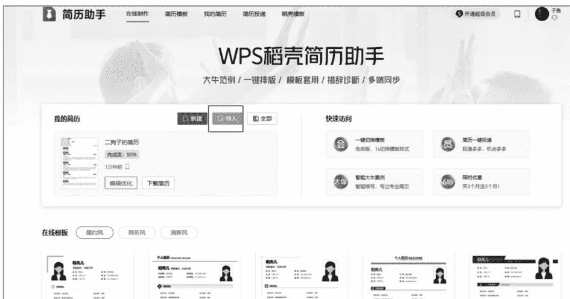

图4-49 导入文档

（3）这样即可将文字简历套入模板，如图4-50所示。

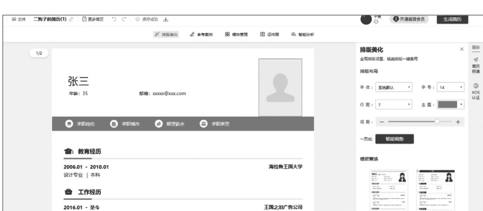

图4-50 将文字简历套入模板

（4）在每个版块中，都有具体的修改建议，我们可以根据建议进一步修改和完善简历，如图4-51所示。

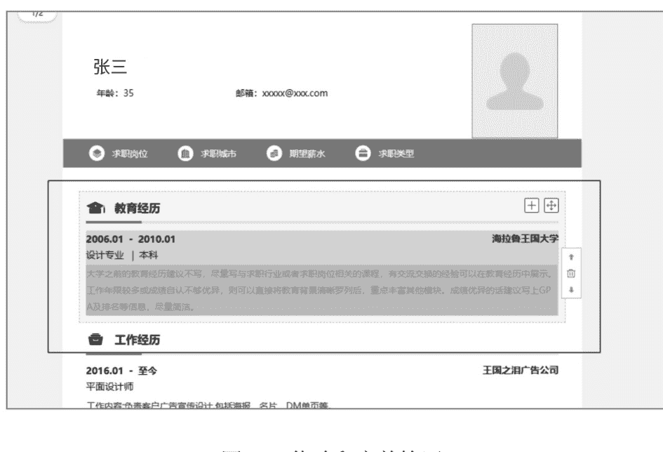

图4-51 修改和完善简历

（5）在排版美化区域中可以实现一键排版（字体、字号、行距、间距等），也可以一键套用模板，如图4-52所示。

##### 排版美化

全局排版设置，精美排版一键套用

##### 排版布局

字体：系统默认

字号：14

行距：7

主题：

间距：

一页纸：智能调整

##### 模板替换


图4-52 排版美化区域

（6）在线制作证件照。单击简历上的照片位置，进入“制作证件照”页面，如图4-53所示。

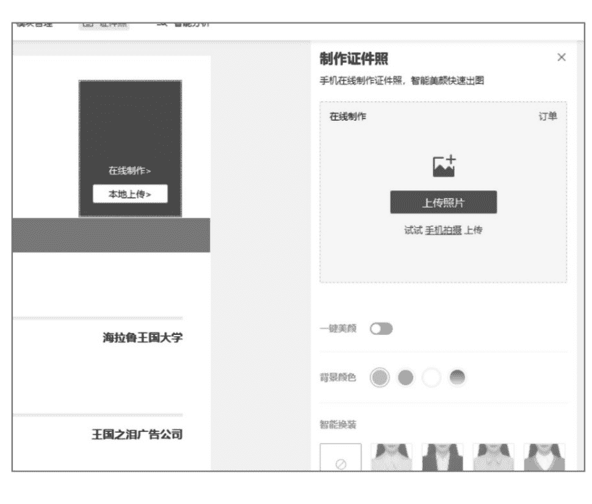

图4-53 “制作证件照”页面

（7）可以单击“上传照片”按钮直接上传证件照并裁切，如图4-54所示。也可以使用一键换装功能，该功能需要额外付费。


图4-54 上传证件照并裁剪（照片由AI生成，非真人）

（8）单击“参考案例”按钮，选择行业、职能、岗位，然后在文本框中输入岗位描述，系统会给出有关岗位话术的优化建议，如图4-55所示。

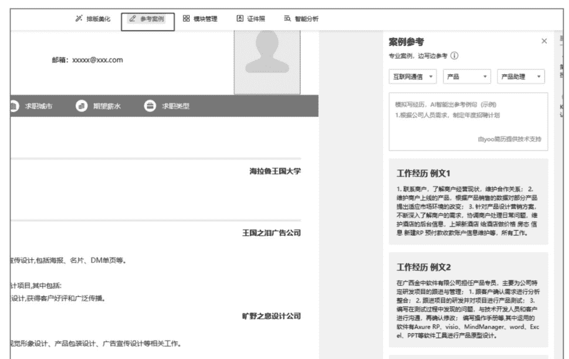

图4-55 调整话术

（9）单击“模块管理”按钮，可以增减简历中的模块，如图4-56所示。

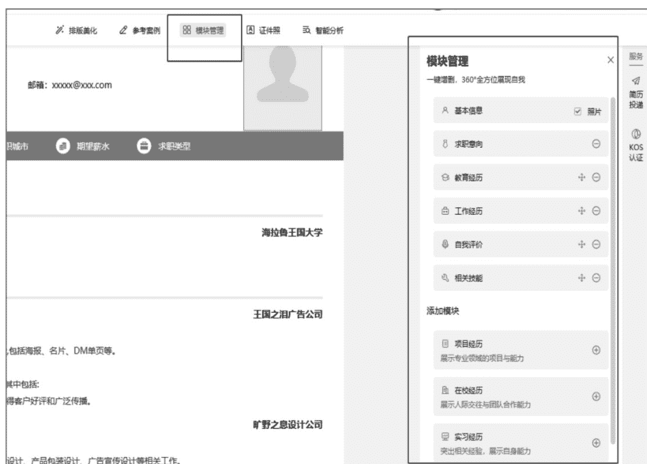

图4-56 模块管理

（10）单击“智能分析”按钮，勾选“已阅读并同意”复选框，如图4-57所示。

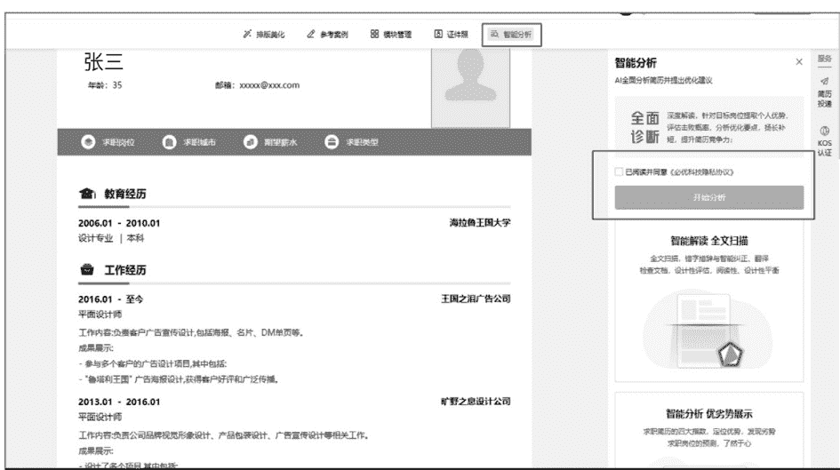

图4-57 智能分析

（11）单击“开始分析”按钮，就可以得到系统对简历的智能分析结果，如图4-58所示。


图4-58 智能分析结果

**注意：** 评分只对系统收录的岗位有效，如果“案例参考”中的岗位设置中没有目标岗位，评分就没有效果。

（12）最后，我们可以根据系统的建议，有针对性地修改简历。这样，就得到了一份相对优质的简历，如图4-59所示。

## 张三

性别：男
年龄：35
电话：12345678901
邮箱：1234@nm.COM


平面设计 | 北京 | 社招

## 教育经历

2006.01 - 2010.01
设计专业 | 学士
海拉鲁王国大学

## 工作经历

2016.01 - 至今
平面设计师
王国之泪广告公司
负责客户广告宣传设计,包括海报、名片、DM单页等。
参与多个客户的广告设计项目,其中包括“鲁塔利王国”广告海报设计等。

2013.01 - 2016.01
平面设计师
旷野之息设计公司
负责公司品牌视觉形象设计、产品包装设计、广告宣传设计等相关工作。
参与多个项目的设计,其中包括“哈努玛神庙”品牌视觉形象设计和产品包装设计等。
成功推出了新产品线并获得市场好评。

2010.01 - 2013.01
平面设计师
塞尔达设计公司
负责品牌视觉形象设计、产品包装设计、广告宣传设计等相关工作。
参与多个项目的设计,其中包括“神庙之神”品牌视觉形象设计和产品包装设计等。
获得公司年度优秀设计奖。

## 自我评价

本人具备高度的工作责任感,适应能力强,能够快速适应不同的工作环境和任务要求。在设计过程中注重细节和创意,并能够为客户提供高质量的设计服务。

## 相关技能

熟练使用Adobe系列软件,包括Photoshop、Illustrator、InDesign等。
擅长品牌视觉形象设计、包装设计、海报设计等。
具有网页设计经验,熟悉HTML和CSS。
拥有良好的沟通能力和团队合作精神。

图4-59 AI辅助制作的简历成品

（13）单击右上角的“生成简历”按钮，即可将简历保存到计算机上，如图4-60所示。


图4-60 保存简历

（14）单击右侧的“简历投递”按钮，再单击“确认投递”按钮，即可将做好的简历同步到智联招聘中，如图4-61所示。

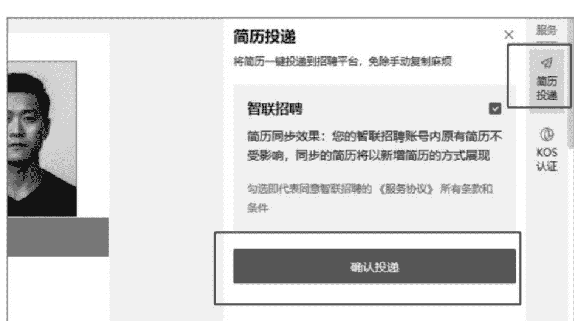

图4-61 同步到智联招聘

#### 4.4.3 模拟面试

在面试过程中，你是不是有过回答不上来HR的问题的情况？运用AI就可以很好地解决这个问题。

首先，我们可以运用AI查询面试常问的问题。这些问题分为以下两类。

1.  专业类问题，如作为一名短视频编导，视频的哪几个数据是你平时会重点关注的，为什么？
2.  个人情况类问题，如你上一份工作的离职原因是什么？你怎么评价你的前任领导？你觉得你的缺点是什么？

专业类问题建议大家去论坛、贴吧、知乎等社交平台看看同行业的前辈总结的经验。个人情况类问题则可以交给AI，由它来帮助我们进行回复。

以下是HR在面试时通常会问的10个个人情况类问题。

1.  请介绍一下自己。
2.  你对我们公司的了解有多少？你为什么想来我们公司工作？
3.  你认为你最大的优点是什么，最大的缺点是什么？
4.  你在过去的工作中遇到过哪些挑战？你是如何解决的？
5.  你对这个职位有什么了解？你觉得你能胜任吗？
6.  你最近的职业目标是什么？你打算怎样实现它们？
7.  你有哪些技能或经验可以为公司带来价值？
8.  你的工作风格是怎样的？你喜欢什么样的工作环境？
9.  你有没有参加过团队项目？你在团队中扮演什么角色？
10. 你有什么问题想要问我吗？

把这10个问题抛给AI，如DeepSeek，话术如下。

**提问：** 现在你已经得到了我的简历，请你根据我的求职岗位和个人经历，针对这10个问题分别作答（问题省略）。

**DeepSeek:**

回答1：

您好，我是张三。作为一名平面设计师，我拥有多年的设计经验和技能。我热爱创造，并追求将设计与实际应用相结合，为客户带来卓越的视觉体验。我注重细节，善于与团队合作，并能在高压环境下保持良好的工作表现。我对新的设计趋势和技术保持关注，不断提升自己的专业能力。

回答2：

我对贵公司有一定的了解。贵公司在汽车行业中享有很高的声誉，以卓越的设计和品牌形象而闻名。我被贵公司在设计领域的卓越成就所吸引，尤其是贵公司在品牌视觉形象设计和包装设计方面的突出表现。我希望能够加入贵公司，与优秀的团队合作，共同创造出独具创意和影响力的设计作品。

回答3：

我认为我最大的优点是创意思维和审美能力。我能够独立思考并提供独特的设计解决方案，注重细节和美学。此外，我具备良好的沟通能力和团队合作精神，能够有效地与客户和团队成员合作。然而，我的一个缺点是有时候过于追求完美，可能会花费过多时间在细节上。我在努力平衡创意和工作效率，以提高自己的工作效率和交付质量。

回答4：

在过去的工作中，我遇到过工期紧张和客户要求变更的挑战。为了解决这些问题，我学会了更好地组织时间和资源，与团队密切合作，并与客户进行积极的沟通。我会及时调整工作计划，并寻求灵活的解决方案，以确保项目的顺利进行。

回答5：

根据我对这个职位的了解，我知道这个职位要求平面设计师具备品牌视觉形象设计和包装设计的经验。我在过去的工作中积累了丰富的相关经验，并熟练运用Adobe系列软件。我具备审美能力、创造力和良好的沟通协调能力，能够准确理解客户需求并将其转化为具体的设计作品。我相信我能够胜任这个职位，并为贵公司带来价值。

回答6：

我最近的职业目标是成为一名资深的平面设计师，在设计领域中取得更高的成就。为了实现这个目标，我计划持续学习和提升自己的设计技能，紧跟行业的最新趋势和技术。我还计划积极参与各类设计比赛和项目，扩展自己的设计领域和影响力，并通过与优秀的设计师交流学习，不断提升自己的设计水平。

回答7：

我具备熟练使用Adobe系列软件的技能，包括Photoshop、Illustrator和InDesign。我在品牌视觉形象设计、包装设计和海报设计方面有丰富的经验。此外，我还具备网页设计经验，熟悉HTML和CSS。我能够将设计理念转化为创造性的作品，并具备良好的沟通能力和团队合作精神，能够与客户和团队紧密合作，为公司提供高质量的设计服务。

回答8：

我的工作风格是注重细节和创意，追求设计的完美性。我喜欢有挑战性的项目和创造性的任务，能够激发我的设计灵感和潜力。我喜欢与团队合作共同探讨和分享创意，从不同的角度获得灵感和反馈。我喜欢积极而富有活力的工作环境，能够激发我的创造力和工作动力。

回答9：

我曾经参加过多个团队项目，我在团队中扮演着协调者和执行者的角色。我善于与团队成员合作，与他们保持良好的沟通和协调，确保项目的顺利进行。我也乐于分享我的设计想法和经验，为团队提供帮助和支持，以达到共同的目标。

回答10：

我对贵公司有一些问题想要了解。首先，我想了解贵公司目前的设计团队规模和结构，以及我在团队中的角色和职责。其次，我希望了解贵公司对于创新和新技术的态度，以及是否鼓励团队成员不断学习和发展。最后，我想了解贵公司的发展前景和未来的项目计划。这些问题可以帮助我更好地了解贵公司，并决定我是否适合在贵公司工作。

其中，有一些回答还是需要优化的。例如，在回答2中，我们更应该说到对方公司的具体情况，所以我们可以告诉AI对方公司的具体情况，并让它为我们进一步优化话术。

### 4.5 AI审核和编写合同

与合同相关的工作对于职场人来说存在一定的挑战，从日常的入职签订劳动合同到商品销售合同，再到房屋租赁合同，甚至是各种软件的使用协议，这些合同或协议中有没有隐患，令我们头痛。而AI的出现就可以帮我们很好地解决这个问题。

#### 4.5.1 快速起草合同

如果领导要求我们做一份商品销售合同，但我们以前没有做过，这时就可以借助讯飞星火完成。具体操作步骤如下。

第1步：打开讯飞星火，单击右侧的“助手中心”按钮，如图4-62所示。

第2步：在“星火助手中心”页面，单击“合同助手”版块中的“添加”按钮，添加合同助手，如图4-63所示。


图4-62 单击“助手中心”按钮

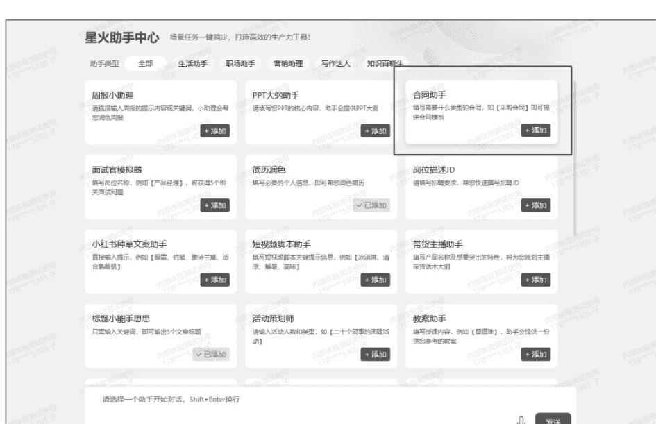

图4-63 添加合同助手

第3步：输入具体要求，如起草一份“催眠闹钟”的销售合同。

**提问：** 请帮我起草一份催眠闹钟的销售合同。

**讯飞星火合同助手：**

请注意，我不是律师，以下提供的模板仅供参考。在实际使用时，请务必咨询专业律师的意见，以确保符合您所在地的法律法规。

##### 催眠闹钟销售合同

甲方（销售方）：____________________ 地址：____________________

乙方（购买方）：____________________ 地址：____________________

鉴于甲、乙双方本着平等自愿、诚实信用的原则，就甲方销售乙方催眠闹钟事宜达成如下协议。

###### 一、商品名称及规格

1.  商品名称：催眠闹钟。
2.  商品规格：尺寸、颜色等具体规格详见附件。
3.  商品数量：__________件。
4.  商品单价：人民币__________元/件。
5.  总价款：人民币__________元。

###### 二、交货方式及期限

1.  交货方式：甲方应按照本合同约定的时间和地点将商品交付给乙方。
2.  交货期限：自本合同签订之日起七日内完成交货。
3.  运输费用：由甲方承担，包括但不限于商品运输费、保险费等。
4.  送货地址：乙方指定的收货地址。
5.  收货人信息：乙方应提供准确的收货人姓名、电话、地址等信息，以便甲方及时送达商品。
6.  如因不可抗力因素导致无法按时交货，甲方应及时通知乙方，并协商解决办法。
7.  如乙方未按约定时间收货或拒收商品，由此产生的一切费用由乙方承担。

###### 三、付款方式及期限

1.  付款方式：乙方应按照本合同约定的时间和方式支付货款。
2.  付款期限：自本合同签订之日起七日内完成付款。
3.  付款金额：人民币__________元整。
4.  如乙方未按约定时间支付货款，甲方有权解除本合同并要求乙方赔偿损失。
5.  如因甲方原因导致无法按时发货或交货，甲方应承担因此产生的一切费用，并不影响乙方的付款义务。
6.  如因乙方原因导致无法按时付款，乙方应承担因此产生的一切费用，并不影响甲方的发货或交货义务。
7.  本合同所涉及的所有款项均应以人民币为单位支付。如有需要，可以采用银行转账、现金等方式支付。
8.  如因汇率变动等原因导致实际支付金额与本合同约定不符，双方应协商解决办法。

###### 四、保密条款

1.  本合同签订后，双方应对其中涉及的商业机密、技术秘密等保密信息予以严格保密，不得向任何第三方泄露或披露。未经对方书面同意，任何一方不得将相关信息用于其他目的。
2.  如因一方违反保密条款造成损失的，应承担相应的赔偿责任。

###### 五、违约责任

1.  如一方未按照本合同约定履行义务，给另一方造成损失的，应承担相应的赔偿责任。
2.  如一方严重违约影响本合同的顺利执行，另一方有权单方面解除本合同并要求赔偿损失。具体赔偿金额由双方协商确定。

###### 六、争议解决方式

1.  本合同的解释、执行及争议的解决均适用中华人民共和国法律。如双方因本合同发生争议，应友好协商解决；如协商不成，任何一方均有权向有管辖权的人民法院提起诉讼。

###### 七、其他事项

1.  本合同自双方签字盖章之日起生效，至工作完成并收到甲方付款之日止。期满后如需继续合作，应另行签订新的协议。本合同一式两份，甲乙双方各执一份，具有同等法律效力。
2.  本合同未尽事宜，由双方协商确定并签订补充协议。补充协议与本合同具有同等法律效力。

此外，也可以直接告诉AI甲方、乙方的信息。

**提问：** 这是两家公司的基本信息和交易内容，请帮我填入合同里。

甲方：星际科技有限公司

地址：北京市东城区××街道××号

乙方：翡翠餐饮集团

地址：浙江省杭州市西湖区××街道××号

商品名称：催眠闹钟2000件，价格15万元人民币

AI会帮助我们填入相关信息，完善合同。为了节省篇幅，制作好的合同就不在书中展示了。

#### 4.5.2 合同审核

对于一些我们不理解的合同，也可以直接投喂给AI，并询问我们所需要的关键信息。例如，在进入某网络游戏前，需要同意用户协议。我们就可以把用户协议复制到DeepSeek的对话框中，让它充分学习和理解后，帮我们解答。

**提问：** 这里有一份合同/协议，但对于里面的一些条款我不太清楚，现在发送给你，请你仔细阅读后基于条款回答我一些权责问题。

**DeepSeek：**

当然可以，请您提供合同或协议的相关内容及您对其中条款的疑问。我会尽力帮助您理解这些条款并回答您的问题。但请注意，我不是律师，所提供的信息仅供参考，如有需要，请咨询专业律师以获取正式的法律建议。

输入合同有两种方式，第一种是直接上传文档（适合已保存为文档的合同或协议），第二种是直接复制文字（如网络上无法下载的协议条款）。需要注意的是，如果选择第二种方式，建议将合同内容分段发送。

**提问：** 基于以上所有给你的用户协议，我想知道，根据协议约定，我的账号及账号里的装备归属于谁。

**DeepSeek:**

根据您所提供的协议，您的账号和账号里的装备归属于××公司。具体来说，在《用户协议》的第10条中规定：“您知悉并同意：（1）如××依据本协议对您的游戏账号采取封号处理措施的，该游戏账号及其内的所有游戏虚拟道具、游戏数据等均归××所有，且您无权要求返还或恢复该财产；（2）如前述游戏虚拟道具及游戏数据存在一定有效期，该有效期可能会在封号期间过期，您游戏账号解封后，您将无法使用该已过期的游戏虚拟道具及游戏数据。”

因此，根据协议约定，您的账号和账号里的装备归属于××公司，除非××公司同意将其返还给您或恢复其财产价值。

**提问：** 根据协议约定，出现哪些情况，××公司有权封我的号。

**DeepSeek:**

根据您所提供的协议，××公司有权在以下情况下封禁您的游戏账号。

1.  您违反了本协议的任何规定。

### 4.6 AI记录会议

在现代办公环境中，会议记录是一项烦琐且耗时的工作，且容易出现遗漏和错误。然而，随着AI技术的飞速发展，这一状况得到了显著的改善。AI会议记录工具能够自动识别会议中的发言者身份，精准地将语音内容转换为文字，大大提高了会议记录的准确性和完整性。同时，AI会议记录工具还具备智能总结功能，能够从大量的会议内容中提炼出关键信息和决策要点。

我们以豆包为例，具体操作步骤如下。

第1步：安装豆包后，当我们通过电脑进行微信语音/视频通话时，豆包会弹出提示，询问是否需要记录会议，选择“帮我记录”如图4-64所示。


图4-64 豆包询问是否需要记录会议

如果豆包没有弹出提示，可以打开豆包主界面，单击自己的头像，选择“设置”选项，如图4-65所示。

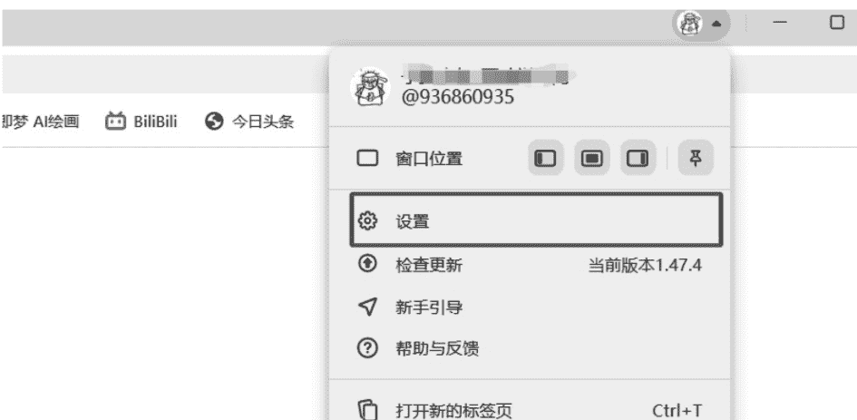

图4-65 选择“设置”选项

在设置界面中选择“快捷键设置”选项，如图4-66所示。

##### 通用设置

- 将豆包设为默认浏览器，开启 AI 浏览新体验 [设为默认]
- 快捷键设置
- 声音选择 [温柔桃子]
- 默认搜索引擎 [百度]
- 开机自动启动
- 豆包推送
- 开启新手任务

##### AI 工具

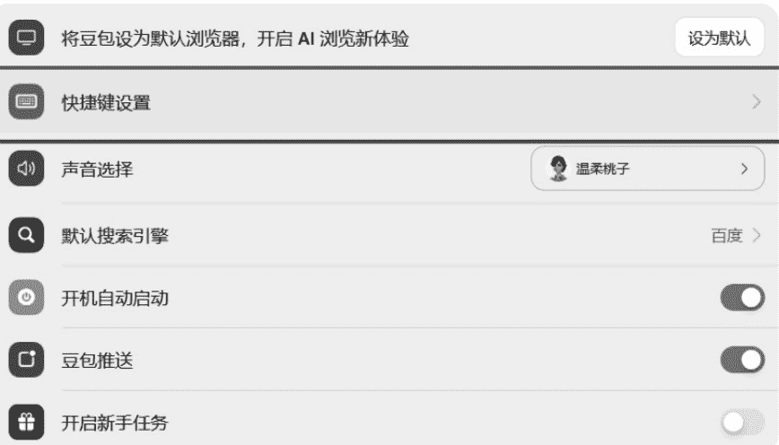

图4-66 选择“快捷键设置”选项

找到“会议记录”，如图4-67所示，设置快捷键，保存后按快捷键即可唤醒会议记录功能。

##### 通用

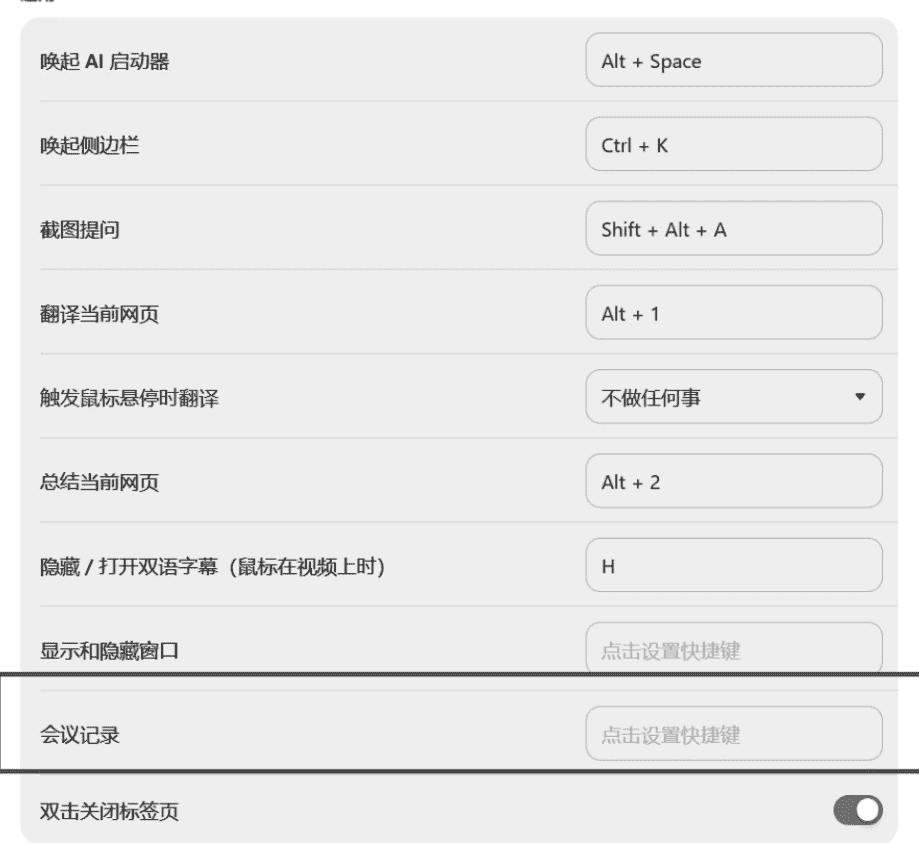

图4-67 找到“会议记录”

第2步：会议结束后，豆包会弹出会议记录总结完成的提示，如图4-68所示，选择“查看会议总结”，进入会议记录界面，如图4-69所示。


图4-68 弹出会议记录总结完成的提示

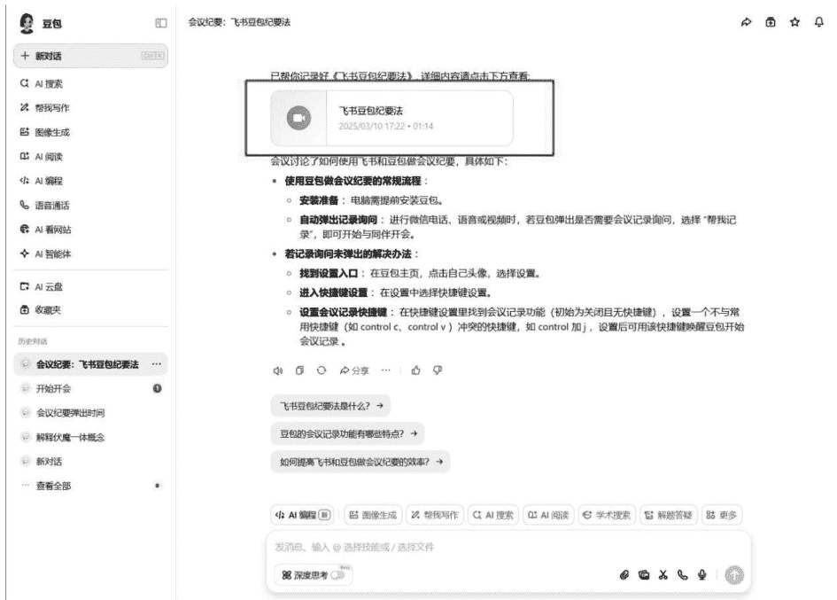

图4-69 进入会议记录界面

第3步：单击视频图标，即可查看会议详情，包括总结和待办、智能章节、文字记录，也可以在左侧对话框中就会议内容对豆包进行提问，如图4-70所示。

##### 飞书豆包纪要法

会议时间：03/10 17:22 - 17:23

- 总结和待办
- 智能章节
- 文字记录

会议讨论了如何使用飞书和豆包做会议纪要，具体如下：

- **使用豆包做会议纪要的常规流程：**
    - 安装准备：电脑需提前安装豆包。
    - 自动弹出记录询问：进行微信电话、语音或视频时，若豆包弹出是否需要会议记录询问，选择“帮我记录”，即可开始与同伴开会。
- **若记录询问未弹出的解决办法：**
    - 找到设置入口：在豆包主页，点击自己头像，选择设置。
    - 进入快捷键设置：在设置中选择快捷键设置。
    - 设置会议记录快捷键：在快捷键设置里找到会议记录功能（初始为关闭且无快捷键），设置一个不与常用快捷键（如 control c, control v）冲突的快捷键，如 control 加 j，设置后可用该快捷键唤醒豆包开始会议记录。

图4-70 查看会议详情

## 第5章 AI助力文案写作

本章主要使用的AI工具：

- DeepSeek
- 讯飞星火
- 彩云小梦
- 秘塔AI

写作是我们运用AI工具最为频繁的场景之一。尽管DeepSeek等AI工具能够显著提升我们的工作效率，但它们几乎无法独立生成高质量的文案。

这并非意味着AI工具不够实用，其价值主要体现在以下两方面：

1. 通过对话与内容输出激发灵感，缩短创意构思的“准备时间”；
2. 减少逐字撰写的过程，节省至少60%的工作量。

例如，AI生成了20条文案，我们从中筛选出3条较为合适的，稍作修改即可完成任务。这种方式远比从零开始苦思冥想要高效得多。

### 5.1 AI短文案写作

短文案可以在有限的字数内，通过简洁明了的文字表达，传达特定信息或刺激目标受众对某事物的兴趣或行动。它通常用于广告、宣传、社交媒体等场景中，一般为50～200字。

在不同的场景中，短文案具有不同的风格和目的。比如在广告中，短文案需要引起潜在客户的关注并推动购买决策；在朋友圈或社交媒体中，短文案应该吸引读者的注意力、促进互动和转发；在小红书等平台上，短文案需要吸引读者的阅读兴趣并传达某种体验。

短文案的撰写需要注意文字的精练性、灵活运用个性化的表达手法和创造力，以及与目标受众的语言和情感连接等方面。一个好的短文案能够在有限的字数内，准确地传递信息并产生预期效果。

本节主要讲解运用AI工具（DeepSeek、讯飞星火）进行短文案写作，包括广告文案、朋友圈文案、小红书文案。

#### 5.1.1 广告文案

广告文案常与产品挂钩，主要用于介绍产品特点。广告文案的应用场景包括电视广告、报刊广告、户外广告、广播广告、网络广告，通常前面四种形式的广告由专业的广告公司制作，而我们普通人制作的最多的是网络广告。

下面我们使用直接要求和提供标准两种方法来编写广告文案（如果使用深度思考模式，无须设置角色）。

##### 1. 直接要求

采用RBRP原则，直接向DeepSeek提出要求。

提问：你现在是一个资深的广告文案大师，我现在有一个产品：催眠闹钟。它的功能描述如下：如果你看到一个人正在打哈欠，那你也会忍不住打哈欠。这款催眠闹钟正是利用这个现象，当到了设定的睡眠时间后，表盘上的小人便会进入打哈欠状态，同时播放音频，催促你快休息。请写10个广告文案给我参考。

**DeepSeek：**

(1) 打哈欠，睡意浓。催眠闹钟，梦乡轻松入。
(2) 别让失眠偷走你的美梦，催眠闹钟，打哈欠带你进入梦乡深处。
(3) 夜深人静，哈欠连连，催眠闹钟，让你与疲惫说再见。
(4) 打哈欠，睡意来，催眠闹钟，伴你一夜好眠。
(5) 告别数羊的日子，催眠闹钟，打哈欠引领甜梦之旅。
(6) 打哈欠，是自然的催眠符，催眠闹钟，让困倦不再难缠。
(7) 打哈欠，睡意浓，催眠闹钟，让你一觉到天亮。
(8) 打哈欠，睡意生，催眠闹钟，守护你的每一个梦境。
(9) 打哈欠，睡意来，催眠闹钟，让你的夜晚不再漫长。
(10) 打哈欠，是身体的呼唤，催眠闹钟，是夜晚的温柔伴侣。

向DeepSeek提出需求时，无须顾虑数量问题。AI没有情绪，无论我们提出10条、20条还是100条需求，它都能处理。但也要注意，数量过多，为了凑数，AI可能会重复生成一些内容。

##### 2. 提供标准

如果我们想要生成更为优质的文案，就需要为其提供标准。

第1步：从网络上选取一篇优质广告文案撰写的方法论，提供给DeepSeek学习，并要求其总结。

**提问：** 接下来我会给你一篇优质的写广告文案的文章，请你认真学习，并总结其中的方法论。

**DeepSeek：**

当然，我很愿意学习和总结优质的写广告文案的方法论。请将文章内容提供给我，我会尽力学习并提供有关的总结。

**提问：** （1）树立权威，利用从众心理。

例如：香飘飘奶茶，杯子连起来可绕地球3圈。基于权威、数据、行业影响力，制造信任状，利用消费者从众心理达到销售目的。

这种广告文案，可以让消费者放下戒备心，优点在于具体且出处明确，比如具体的明星、具体的机构、具体的典籍、历史数据等。这种广告文案只适合一些有一定影响力和规模的品牌。

（2）劝诱策略。

例如：头皮好，头发才好。（滋源洗头水）

好的生活，没有那么贵。（网易严选）

这种广告文案，适合新品牌拓展市场时使用，因为消费者的消费行为是有惯性的，消费者只会关注自己，所以，你的广告策略需要刺激消费者的痛点，让他意识到以前的解决方案不够好，而你有更好的解决方案。

……

（7）直接阐述自身特性。

例如：酸菜比鱼更好吃。

厨邦酱油美味鲜，晒足180天

这是餐饮行业用得最多的方法，直接向消费者传递产品价值，简单、高效

**DeepSeek：**

总结上述优质广告文案的方法论，可以得出以下几点。

（1）树立权威和利用从众心理：通过引用具体的数据等来制造信任感，同时利用消费者从众心理来推动购买行为。
（2）劝诱策略：通过刺激消费者的痛点，让其意识到以前的解决方案不够好，从而体现出自己的产品或解决方案更好。
（3）向行业领军品牌看齐：通过与行业领军品牌产生联系，迅速获得更多关注，树立实力仅次于第一品牌的形象。
（4）树敌策略：通过与竞争对手产生对比，让消费者将品牌与特定竞争对手联系在一起，从而提升自身品牌形象。
（5）诉求稀缺感：通过传达产品或服务的稀缺性，引发消费者的购买欲望。
（6）诉求价值观和情感层面的认同感：与消费者的价值观和情感层面产生共鸣，满足其需求，并传递品牌正能量。
（7）直接阐述自身特性：直接向消费者传递产品或服务的特性和价值，简洁明了。

这些方法论可用于广告语的撰写，帮助品牌吸引目标消费者、塑造品牌形象，并促进销售目标的实现。

第2步：采用RBRP原则进行提问，要求DeepSeek提供文案。

**提问：** 你现在是一个资深的广告文案大师，我现在有一个产品：催眠闹钟。它的功能描述如下：如果你看到一个人正在打哈欠，那你也会忍不住打哈欠。这款催眠闹钟正是利用这个现象，当到了设定的睡眠时间后，表盘上的小人便会进入打哈欠状态，同时播放音频，催促你快休息。请结合以上方法论写10个广告文案给我参考。

**DeepSeek：**

好的，以下是结合文章中的方法论，为您生成的10个广告文案。

（1）树立权威，利用从众心理。

全球顶尖睡眠专家推荐，催眠效果显著！

数百万用户选择，让打哈欠成为你的最佳入睡信号。

（2）劝诱策略。

还在为失眠烦恼？试试我们的催眠闹钟，让自然哈欠帮你快速入眠。

告别数羊的日子，让小人哈欠带你进入梦乡。

（3）向行业领军品牌看齐。

跟随科技巨头的脚步，我们用创新技术为你打造完美的睡眠环境。

与世界顶级睡眠产品并肩，让你的夜晚更加宁静。

（4）树敌策略。

不再需要依赖药物或昂贵的治疗，我们的催眠闹钟是你战胜失眠的新武器。

忘掉那些无效的传统方法，让我们的技术助你一夜好眠。

（5）诉求稀缺感。

限时发售，抢先体验革命性的催眠技术！

独家专利设计，只此一家，别无分店。

（6）诉求价值观和情感层面的认同感。

理解你对高质量睡眠的追求，我们用心创造每一个细节。

关爱健康，从每晚的好眠开始。

（7）直接阐述自身特性。

看到哈欠就想睡？没错，这就是我们的独特魅力。

简单设置，自动播放，让你轻松享受宁静夜晚。

（8）制造紧迫感。

别等了！现在就开始改善你的睡眠质量吧！

库存有限，错过今天可能就要等很久！

（9）提供社会证明。

看看这些用户的反馈，他们的生活已经因我们的催眠闹钟而改变。

加入成千上万满意顾客的行列，体验前所未有的深度睡眠。

（10）使用比喻或隐喻。

就像温柔的母亲轻拍你入睡，我们的催眠闹钟给你最安心的陪伴。

它是你床边的私人睡眠顾问，每晚准时提醒你进入甜美梦乡。

这样得到的广告文案就比直接要求生成的要好得多。我们还可以在此基础上进一步提出要求，让广告文案更符合我们的预期，如控制字数、文本对仗。

**提问：** 请把这些广告文案控制在12字以内，并且采用对仗形式

**DeepSeek:**

好的，以下是10个符合要求的广告文案。

（1）哈欠催眠，自然入梦：利用“哈欠催眠”这一自然现象，通过小人打哈欠的形象和音频，营造出一种轻松、自然的睡眠氛围，帮助用户更快地进入梦乡。

（2）催眠闹钟，助你好眠：“催眠闹钟”直接点明了产品的功能，即帮助用户改善睡眠质量。同时，“助你好眠”表达了产品对用户睡眠的积极影响，传递出温馨、关怀的信息。

（3）见哈欠，想睡眠：利用“见哈欠，想睡眠”这一自然反应，将产品与用户的生理需求相结合，使得广告语更加贴近生活，易于引发共鸣。

（4）小哈欠，大作用：通过对比“小哈欠”和“大作用”，突出了产品虽小却能发挥巨大作用的特点，既体现了产品的实用性，又增加了趣味性。

（5）哈欠起，睡意浓：以“哈欠起”作为引子，引出“睡意浓”的结果，形象地描述了产品如何通过哈欠的方式帮助用户快速产生睡意，进而改善睡眠质量。

（6）催眠神器，一哈见效：“催眠神器”强调了产品的神奇效果，而“一哈见效”则进一步突出了其快速有效的特点，使用户对产品产生强烈的好奇心和购买欲望。

（7）哈欠引，梦乡近：以“哈欠引”作为起点，引导用户走向“梦乡近”的终点，寓意着产品能够帮助用户轻松进入甜美的梦境，享受高质量的睡眠。

（8）小人哈欠，催你入眠：通过“小人哈欠”这一具体形象，生动地展示了产品的工作原理和方式。同时，“催你入眠”直接传达了产品的功能和目的，使用户一目了然。

（9）打哈欠，好入眠：“打哈欠”是人们日常生活中常见的行为，将其与“好入眠”相结合，既符合人们的常识认知，又能够直观地展示产品的效果。

（10）哈欠响，睡意长：“哈欠响”不仅指代了产品发出的哈欠声，还暗示了这种声音能够有效地帮助用户产生睡意。而“睡意长”则进一步强调了产品对于延长用户睡眠时间、提高睡眠质量的积极作用。

#### 5.1.2 朋友圈文案

朋友圈文案一般也是用于产品推广和营销的。无论是朋友圈文案还是广告文案，都是为了吸引客户，引发其对产品的好奇。不同的是，朋友圈文案相比广告文案，还存在基于“朋友”的信任，可以更快地让客户建立信任。

朋友圈文案的产出方式也有两种：直接要求和提供标准。

##### 1. 直接要求

我们先来看看使用直接要求方式的效果。

**提问：** 现在你是一个资深的朋友圈文案专家，我有一个美白精华液，效果是美白，请根据文章里的方法论写10个朋友圈文案给我参考。

**DeepSeek：**

好的，以下是10个朋友圈文案的参考。

(1) 想要拥有白皙肌肤？试试我们的美白精华液吧！它能有效淡化色斑，让你的肌肤焕发光彩。
(2) 无论你是要上班还是要约会，我们的美白精华液都能让你保持自信和美丽。
(3) 想要告别暗沉无光的肌肤？试试我们的美白精华液吧！它能深层滋养肌肤，让你的肌肤变得更加明亮有光泽。
(4) 无论是在户外还是在室内，我们的美白精华液都能让你保持清爽自然的状态。
(5) 想要拥有健康美丽的肌肤？试试我们的美白精华液吧！它能有效修复肌肤，让你的肌肤更加健康有弹性。
(6) 无论你是在运动还是在旅行，我们的美白精华液都能让你保持舒适自在的状态。
(7) 想要告别肤色不均的问题？试试我们的美白精华液吧！它能淡化色斑，让你的肌肤变得更加均匀有光泽。
(8) 想要拥有水润嫩滑的肌肤？试试我们的美白精华液吧！它能深层滋润肌肤，让你的肌肤变得更加水润有弹性。
(9) 无论你是在家里还是在外面，我们的美白精华液都能让你保持自信和美丽。

我们可以看到，这些朋友圈文案几乎和广告文案一致，因此，使用直接要求的方式是行不通的，我们需要采用第二种方式——提供标准。

##### 2. 提供标准

第1步：提供包含朋友圈文案写作的文章，并要求DeepSeek进行总结。

**提问：** 接下来我会给你一篇关于如何写朋友圈文案的文章，请你认真学习，并总结里面的方法论。

**DeepSeek：**

当然，请您给我提供文章的内容，我将认真学习并为您总结其中的方法论。

**提问：** （文章内容省略。）

**DeepSeek：**

这篇文章总结了5个步骤的朋友圈文案写作法，可以帮助你快速写出好的文案。以下是每个步骤的概要。

第一步：做准备。

在写朋友圈文案之前，明确中心思想，列出大纲，并提出你的建议。朋友圈文案一般分为广告和日常两种，广告又分为软广和硬广。日常内容主要涵盖健康、亲人、朋友、财富、自由和成就6个方面，这也是建立个人IP和信任的方式。

第二步：取标题。

先写内容，再选择核心语句作为标题，并在标题中植入痛点，以吸引用户继续阅读。

第三步：写内容。

使用简单的语言，多使用“你”字，使文案更贴近用户。注意，文案应包含好的标题、有价值的内容和能引导成交的结尾。

第四步：定排版。

将长文案分段，每段尽量不超过3行。每句话尽量简短，不超过15个字。

第五步：念出来，再修改。

写完文案后，大声念出来，修改拗口的地方，直到改出完美的文案。

此外，文章还提到了以下几个朋友圈文案公式，可以用于产品推广。

(1) 产品收益类公式：展示梦想+价值塑造+产品介绍+引导下单。
(2) 产品生产过程类公式：尊贵头衔+生产工艺/流程+顾客收益+购买方式。
(3) 产品初心类公式：（时间/地点）+意外+顾客痛点/梦想+你的理想+顾客收益。

希望这些步骤和公式对你写出好的朋友圈文案有所帮助！

第2步：提出要求，让DeepSeek帮我们生成文案。

接下来，输入一个虚构的产品介绍，让DeepSeek为我们构思10个文案。

**提问：** 以下是我的产品介绍，请你根据这个产品介绍和文章中的方法，帮我构思10个朋友圈文案。

产品名称：猫仔牌美白精华液

产品介绍：猫仔牌美白精华液，让您拥有如璀璨明珠般的肌肤。这款卓越的美白精华液蕴含了独特的配方，为您带来出色的美白效果。它能渗透到肌肤深层，减少黑色素的生成，淡化暗沉、雀斑和不均匀肤色，使您的肌肤焕发出自然亮白的光彩。猫仔牌美白精华液采用先进的科技和天然植物提取物，为您的肌肤提供温和而有效的护理。它富含维生素C、熊果苷和透明质酸等多种护肤成分，能够深层滋养肌肤，增强肌肤弹性，并提供持久的保湿效果。这款精华液的质地轻盈易吸收，能够迅速渗透肌肤，不留油腻感，为您带来清爽舒适的使用体验。每天使用猫仔牌美白精华液，您将逐渐感受到肌肤的明显变化：肤色均匀、白皙明亮，细腻光滑，焕发出自然健康的光泽。让猫仔牌美白精华液成为您肌肤美白护理的首选，让您的美丽从内而外散发！

**DeepSeek:**

(1) 拥有璀璨明珠般肌肤，尽在猫仔牌美白精华液！它的卓越配方能淡化暗沉、雀斑和不均匀肤色，让你焕发自然亮白的光彩！快来感受肌肤的明显变化吧！

(2) 猫仔牌美白精华液，天然植物提取物+先进科技的完美结合！它渗透肌肤深层，减少黑色素生成，为你带来持久的美白效果！让你的肌肤细腻光滑，焕发自然健康的光泽！

（3）美白护理的首选！我最近迷上了猫仔牌美白精华液！它富含维生素C、熊果苷和透明质酸等多种护肤成分，滋养肌肤，增强弹性，让肤色均匀白皙！一试成主宰，你也来试试吧！

（4）想要拥有明亮白皙的肌肤吗？别错过猫仔牌美白精华液！它的质地轻盈易吸收，迅速渗透肌肤，不留油腻感，给你清爽舒适的使用体验！让你的美丽从内而外散发！

（5）朋友们，分享一个美白宝贝给你们！猫仔牌美白精华液真的太棒了！每天用它，你会发现肌肤逐渐变得均匀、白皙明亮、细腻光滑，简直就是自然健康的光泽！快试试看，绝对不会让你失望！

（6）在繁忙的生活中，给肌肤一点特别的关怀吧！猫仔牌美白精华液温和而有效，能减少黑色素生成，淡化暗沉和雀斑，为你带来自然亮白的肌肤！一款好产品，不容错过！

（7）想要迎接夏日的到来，就从猫仔牌美白精华液开始！它的护肤成分让肌肤深层滋养，增强弹性，并提供持久的保湿效果！让你的肌肤焕发健康的光泽，自信满满迎接每一天！

（8）夏天的阳光照亮你的肌肤！猫仔牌美白精华液是你必备的美白利器！它能减少黑色素生成，淡化暗沉和不均匀肤色，让你拥有明亮白皙的肌肤，自信满满出门！赶快试试吧！

（9）想寻找一款轻盈易吸收的美白精华液？猫仔牌美白精华液是你的答案！它迅速渗透肌肤，不留油腻感，给你清爽舒适的护肤体验！让你的肌肤焕发自然亮白的光彩！

（10）美白有妙招！猫仔牌美白精华液就是秘密武器！它的卓越配方和天然植物提取物，能够深层滋养肌肤，减少黑色素生成，让你的肌肤绽放出自然健康的美丽！不信就试试看！

希望以上文案可以帮助你在朋友圈中宣传猫仔牌美白精华液！你可以根据需要进行调整或添加自己的创意。祝你成功推广产品！

在这些文案的基础上，如果我们有不满意的地方，可以点对点地提出修改建议，让DeepSeek再次为我们修改。

#### 5.1.3 小红书文案

小红书文案又称种草文，是指在小红书平台上发布的文本内容，包括但不限于商品介绍、使用心得、购物攻略、生活分享等。小红书是一个以社交电商为主的平台，用户可以在上面发布笔记和短视频，分享自己的生活经验和购物心得，也可以购买其他用户分享的商品。因此，小红书文案需要具备吸引人的标题、简洁明了的内容和生动有趣的图片或视频等多种元素，以增加用户的阅读兴趣和购买欲望。同时，小红书文案也需要遵循平台的规定和法律法规，不得涉及违法违规内容。

小红书文案的写作方式有两种：小红书种草文案助手和提供标准，下面分别介绍。

##### 1. 小红书种草文案助手

使用小红书种草文案助手编写文案的方法如下。

第1步：打开讯飞星火，单击页面左侧的“助手中心”按钮，如图5-1所示。

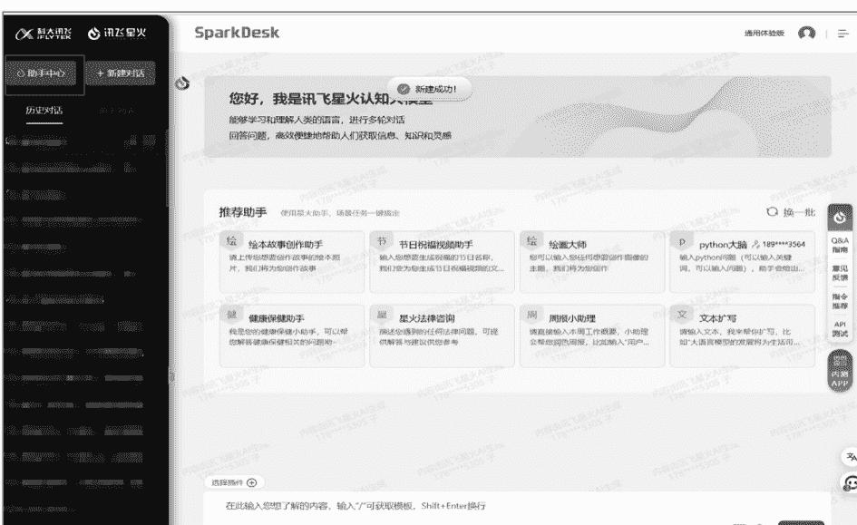

图5-1 在讯飞星火中单击“助手中心”按钮

第2步：进入星火助手中心，在页面右侧单击搜索按钮，如图5-2所示，搜索并添加小红书种草文案助手。

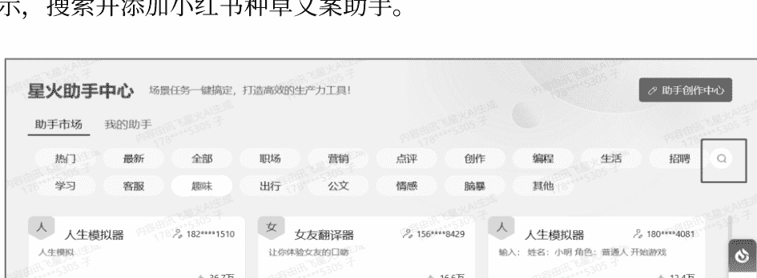

图5-2 在星火助手中心搜索小红书种草文案助手

第3步：新建一个对话窗口，提取产品关键词。

小红书种草文案助手需要提取关键词，因此我们新建一个对话窗口，要求小红书种草文案助手把产品介绍提取为关键词，如图5-3所示。


图5-3 新建一个对话窗口

**提问：** 猫仔牌美白精华液是一款卓越的美白产品，采用先进的科技和天然植物提取物，为您的肌肤提供温和而有效的护理。它富含维生素C、熊果苷和透明质酸等多种护肤成分，能够深层滋养肌肤，增强肌肤弹性，并提供持久的保湿效果。这款精华液的质地轻盈易吸收，能够迅速渗透到肌肤，不留油腻感，为您带来清爽舒适的使用体验。每天使用猫仔牌美白精华液，您将逐渐感受到肌肤的明显变化：肤色均匀、白皙明亮，细腻光滑，焕发出自然健康的光泽。让猫仔牌美白精华液成为您肌肤美白护理的首选，让您的美丽从内而外散发！

请你把它提取为4个左右的关键词，格式为：产品类型、功效、品牌、适宜肤质。例如，眼霜、抗皱、雅诗兰黛、适合熟龄肌。

**小红书种草文案助手：**

产品类型：美白精华液

品牌：猫仔牌

适宜肤质：所有肤质

功效：淡化暗沉、雀斑和不均匀肤色，提亮肤色，增强肌肤弹性，持久保湿

第4步：让小红书种草文案助手生成文案。

将关键词发送给小红书种草文案助手，让它生成小红书文案。

**提问：** 美白精华液；猫仔牌；所有肤质；淡化暗沉、雀斑和不均匀肤色，提亮肤色，增强肌肤弹性，持久保湿。

**小红书种草文案助手：**

（表情）【猫咪的秘密武器（表情）】美白精华液

（表情）所有肤质都适用，让你的肌肤焕发亮白光芒！（表情）

淡化暗沉、雀斑和不均匀肤色，提亮肤色，让你的肌肤看起来更加白皙透亮。

（表情）增强肌肤弹性，让你的肌肤更加紧致有弹性。（表情）

（表情）持久保湿，让你的肌肤水润饱满，不再干燥紧绷。（表情）

快来试试这款猫咪推荐的美白精华液吧！让你的肌肤变得更加美丽动人！（表情）

接着我们再看看用提供标准的方式效果如何。

##### 2. 提供标准

找到一篇优质小红书文案写作方法的文章，提供给DeepSeek，并提出要求。

**提问：** 接下来我会给你一篇如何写小红书文案的文章，请你认真学习，并总结里面的方法论。

**DeepSeek：**

当然，我很愿意学习如何写小红书文案。请您提供这篇文章，我将仔细阅读并总结其中的方法论。

**提问：**（文章内容省略。）

**DeepSeek：**

小红书是一个流行的社交平台，用于分享生活、购物心得、美妆技巧等内容。在小红书上，撰写引人注目的文案非常重要。下面是几种小红书文案写作技巧。

- （1）利用数据分析标题趋势：可以使用数据分析工具（如千瓜数据或搜秀数据）来了解热门笔记和标题趋势。选择自己想了解的领域，在热门笔记中找到一些常用的标题套路。

- （2）教套路和方法：分享一些实用的技巧和方法，让读者快速上手。例如：“这样画眼妆，男友的心都化了！”“丝巾的16种实用戴法！亲妈般教学！”

- （3）激发好奇心：使用一些引人注目的标题来吸引读者的注意。例如：“在家用酸刷出牛奶鼻，美容院拜拜！”“揭秘！原来网红是这样拍视频的！”

- （4）使用数字抢眼：在标题中使用阿拉伯数字可以吸引读者的注意。例如：“每天对着视频练3遍，1个月瘦出漫画腿！”“下班后3小时，我靠当网红实现了弯道超车！”

- （5）蹭热点：关注热门话题或流行事件，结合自己的领域写相关内容。例如：“跟着《半是蜜糖半是伤》学穿搭！”。可以使用类似的工具如新媒体管家、AnyKnew、新榜、今日热榜、365日历、知乎热榜、知微事见、百度指数来找到热点话题。

除了标题，以下是一些写出爆款文章的技巧。

- （1）条理清晰：在写作前构思好要表达的内容，并分点陈列观点。确保文章有逻辑性和清晰的结构，让读者易于理解。可以使用标题、段落和标点来分隔不同的观点。

- （2）用词吸睛：使用吸引人的词汇和表达方式，避免使用过于常见或平庸的词汇。例如，在推荐面膜时，可以使用一些生动有趣的描述，如“敷一次就变嫩”“灭痘小霸王，睡一晚就能瘪掉”。

**提问：** 这是我的产品介绍，请你根据这个产品介绍和文章中的方法，帮我构思5个小红书文案。

产品名称：猫仔牌美白精华液

产品介绍：猫仔牌美白精华液，让您拥有如璀璨明珠般的肌肤。这款卓越的美白精华液蕴含了独特的配方，为您带来出色的美白效果。它能渗透到肌肤深层，减少黑色素的生成，淡化暗沉、雀斑和不均匀肤色，使您的肌肤焕发出自然亮白的光彩。猫仔牌美白精华液采用先进的科技和天然植物提取物，为您的肌肤提供温和而有效的护理。它富含维生素C、熊果苷和透明质酸等多种护肤成分，能够深层滋养肌肤，增强肌肤弹性，并提供持久的保湿效果。这款精华液的质地轻盈易吸收，能够迅速渗透到肌肤，不留油腻感，为您带来清爽舒适的使用体验。每天使用猫仔牌美白精华液，您将逐渐感受到肌肤的明显变化：肤色均匀、白皙明亮，细腻光滑，焕发出自然健康的光泽。让猫仔牌美白精华液成为您肌肤美白护理的首选，让您的美丽从内而外散发！

**DeepSeek:**

当你拥有猫仔牌美白精华液时，不仅可以拥有璀璨明珠般的肌肤，还能享受到更多美丽的惊喜。让我为您构思5个小红书文案，帮助您吸引读者的注意力。

## 文案1: 《揭秘！如何在30天内拥有白皙透亮的肌肤？》

从暗沉到焕亮，从雀斑到晶透，猫仔牌美白精华液为你带来肌肤美白的奇迹！别再等待，一起加入我们的美白之旅吧！

## 文案2: 《美白新宠！猫仔牌美白精华液，轻松告别暗沉肌》

告别暗沉，迎接肌肤焕发新生！猫仔牌美白精华液，配方独特，有效淡化雀斑，均匀肤色，还你白皙明亮的肌肤，让自信散发光芒！

## 文案3: 《一瓶赋予肌肤光彩的魔法精华液！》

猫仔牌美白精华液，科技与天然的完美结合，给肌肤注入持久的养分，减少黑色素生成，还原肌肤原本的光彩，让你的肌肤绽放光芒！

## 文案4: 《重拾肌肤自信，猫仔牌美白精华液来帮忙！》

告别肌肤烦恼，迎接自信美丽！猫仔牌美白精华液，温和而有效，淡化暗沉，提亮肤色，细腻光滑，让你的肌肤散发健康动人的光泽！

## 文案5: 《冻龄护肤必备！猫仔牌美白精华液为你逆转时光》

时间停滞，美丽不老！猫仔牌美白精华液，多重护理成分，抚平岁月痕迹，恢复肌肤弹性与光彩，让你的肌肤闪耀青春光芒！

希望以上文案能为您的猫仔牌美白精华液带来更多关注，吸引读者的眼球并激发他们购买的欲望。记得根据你的目标读者群体，调整文案的语气和风格，让他们产生共鸣并认同你的产品。加油！

### 5.2 AI中文案写作

中文案即中等长度的文案，一般字数为500～4000字。要想依靠AI解决写中文案的问题，我们就需要对中文案先有一个基本的了解。

中文案通常包括新闻稿、商业文、个人公众号文章等，下面分别介绍。

#### 5.2.1 新闻稿

新闻稿是一种常见的新闻报道形式，因其固定的文风和清晰的结构而被广泛应用。一般而言，新闻稿包含事实和感受两个组成部分。

事实，例如：“某年某月某日，某领导到某公司访问。在公司某总的陪同下，某领导访问了车间、办公室、食堂三个地方，亲切地与工作人员交流，询问了……”事实部分主要可以参考活动流程或领导行程表，可以直接投喂给AI。

感受，例如：“无论是否有机会与某领导交流，公司的工作人员都纷纷感到振奋，深刻理解到岗位的重要性及身上的责任……”感受部分主要靠作者创作，当然，也可以采访大家的真实感受。感受部分可以让AI直接创作。

各公司要求不同，可以投喂1～3篇公司以往的新闻稿，让AI进行仿写。

接下来给大家讲解具体的操作步骤。

第1步：投喂一篇已经发布的新闻稿文案，让DeepSeek总结结构和写法。

**提问：** 接下来我会给你一篇新闻稿，请你认真学习，并总结新闻稿的结构和写法。

**DeepSeek：**

当然，请提供你的新闻稿，我将尽力学习并给出新闻稿的结构和写法总结。

**提问：**（新闻稿内容省略。）

**DeepSeek：**

根据提供的新闻稿，以下是对新闻稿结构和写法的总结。

- （1）标题：新闻稿通常以一个简洁而具有吸引力的标题开始，用来概括活动的主要内容或亮点。在这个例子中，标题可以是“汉口分公司举办‘承载梦想、走向健康、践行绿色生活’新春主题徒步行活动”。

- （2）时间和地点：新闻稿在开篇部分通常会提及活动的时间和地点。在这个例子中，明确指出了活动的日期是2月16日，活动的地点是汉口分公司总部。

- （3）活动概述：接下来，新闻稿会简要介绍活动的内容和参与人数。在这个例子中，指出了活动的主题是新春主题徒步行，汉口分公司管理干部及队员共有110余人参加。

- （4）活动过程描述：新闻稿会详细描述活动的过程和行进路线，包括出发地点、途径景点和道路，以及活动的持续时间。在这个例子中，描述了徒步团队从公司总部出发，沿金山大道至银桥，再沿环湖东路绕湖两圈，历时1.5小时，完成了徒步行走规定任务。

- （5）活动目的和意义：新闻稿会解释活动的目的和意义，以及为什么组织这样的活动。在这个例子中，指出了汉口分公司在春节期间开展徒步行活动的目的是倡导健身理念、推荐健身方式，并鼓励员工走出家门、走进大自然、走到阳光下，以提升身心健康、增强个人素质，同时激发干事创业的激情和斗志。

- （6）参与者反馈和总结：在新闻稿的结尾，通常会包含参与者的反馈和总结，以展示活动的积极效果和对参与者的影响。在这个例子中，提到大家表示通过这次徒步活动不仅锻炼了身体，还提供了一个交流和增进友谊的平台，凝聚了汉口分公司的团结力和向心力，并展现了公司员工的积极精神和良好形象。

总的来说，新闻稿的结构包括标题、时间和地点、活动概述、活动过程描述、活动目的和意义及参与者反馈和总结。新闻稿的写作风格应该简明扼要，突出活动的亮点和重要信息，同时传达活动的意义和效果。

第2步：将素材提供给DeepSeek，要求其为我们写一篇新闻稿。

如果我们要写一篇领导来访的新闻稿，我们可以投喂的内容包括领导行程表、会议记录等。

我们以领导行程表为例。

**提问：** 接下来我会给你一个总公司王总来我司视察的时间安排表，我需要你结合上面的总结，模仿上面新闻稿的写法，写一篇新的新闻稿，没有提到的，你可以自行发挥。

时间安排：

10:00 AM—10:30 AM：抵达目的地，与接待人员会面并完成入住手续

10:30 AM—11:00 AM：与公司领导会谈，场地：[会议室名称]，主题：[会谈主题]，目标：与领导交流并了解公司现状、发展方向等

11:00 AM—11:30 AM：参观公司食堂，场地：[食堂名称]，目标：考察员工的伙食情况、了解食堂管理等

11:30 AM—12:30 PM：视察公司部门/生产线，场地：[部门/生产线名称]，目标：了解部门/生产线的运作情况、生产流程、员工工作环境等

12:30 PM—1:30 PM：午餐时间，场地：[用餐地点]，目标：与员工一起用餐，促进沟通与交流

1:30 PM—3:30 PM：继续视察公司其他部门/场所，场地：[部门/场所名称]，目标：深入了解公司各个方面的运作和工作情况，与员工互动交流

3:30 PM—4:00 PM：与部门负责人进行总结会谈，场地：[会议室名称]，目标：与部门负责人讨论视察中的发现和问题，并提出建议和指导

4:00 PM：视察结束，安排回程

**DeepSeek:**

王总视察我司，了解公司现状和发展方向

[城市名称],[日期] 今天，我司有幸迎接总公司的王总莅临视察。王总此次视察旨在与我司领导交流，了解公司的现状、发展方向及与员工进行面对面的互动交流。这次视察对于加强公司内外沟通、提升工作效率和企业形象具有重要意义。

王总一行于上午10点准时抵达目的地，在接待人员的陪同下完成了入住手续。

随后，王总与我司领导进行了会谈，地点设在[会议室名称]。会谈的主题是[会谈主题]，旨在与领导交流并深入了解公司的运营状况、发展方向及未来计划。这次会谈为双方搭建了一个互相交流、共同探讨的平台。紧接着，王总参观了我司食堂，地点位于[食堂名称]。此次参观的目标是考察员工的伙食情况及了解食堂的管理情况。通过参观食堂，王总对员工的福利有了更深入的了解。

随后的时间里，王总继续视察了我司的各个部门和生产线，目的是了解各个部门的运作情况、生产流程及员工的工作环境。在这个过程中，王总与员工进行了互动交流，听取了他们的意见和建议，为进一步改进和提升公司的运作质量提供了宝贵的参考。

午餐时间，王总与员工一同用餐，地点设在[用餐地点]。这段轻松而愉快的午餐时光促进了王总与员工之间的沟通与交流，增强了团队凝聚力和归属感。

下午，王总继续视察了公司的其他部门和场所，以深入了解公司各个方面的运作和工作情况。这一系列的视察活动使王总更全面地了解了公司的现状和运营状况，并与员工亲密交流，共同探讨公司未来的发展方向。

下午3点半，王总与各部门负责人进行了总结会谈，地点设在[会议室名称]。会议讨论了王总在视察中发现的问题和改进的建议，并为未来的发展提出了指导和方向。这次会谈为各部门提供了一个交流思想和经验的平台，推动了公司内部的进一步改进和发展。

下午4点，王总的视察圆满结束，王总一行顺利回程。这次视察为我司带来了宝贵的经验和指导，也进一步增强了员工的凝聚力和向心力。我们相信，在王总的关心和支持下，我司将不断迈向更加辉煌的明天！

[公司名称]衷心感谢总公司王总此次视察，并对全体员工的鼓励和嘉奖！

我们将不忘初心、砥砺前行，为公司的发展做出更大的贡献。

（以上仅为模拟新闻稿，内容与实际情况无关。）

虽然我们提供的信息不是很全面，但是我们还是看到DeepSeek可以生成一篇质量不错的新闻稿，在这个基础上我们稍作调整，就能基本达到发布要求。运用投喂参考范文的方式，我们可以根据相关主题选择范文，并且快速使用AI生成文章，如果有更高要求，还可以在此基础上修改提升。

#### 5.2.2 商业文

商业文是一种常见的文体，它的特点之一是结构化。一篇成熟的商业文通常采用总分总的结构，主要包括引入、小标题、论点、论据（尤其是名人案例）和金句。

首先是引入部分，商业文常常喜欢运用当下热点吸引读者的注意力。通过引入有趣或具有争议性的话题，激发读者的兴趣，并为接下来的内容做铺垫。

其次是小标题部分，这一部分用于划分文章的重点内容，可以让读者一目了然地知道每个部分的核心议题。小标题的使用可以提高文章的可读性和导航性，使读者更易于阅读和理解。

再次是论点部分，论点是商业文的关键部分，用于阐述作者的观点、看法或主张。论点应该具备明确性和可辨识性，能够清晰地表达作者的意图，并能引起读者的思考和共鸣。

接着是论据部分，论据部分是为论点提供支持或证明的具体依据，其中名人案例是常用的论据形式。通过引用名人的观点、经验或成功案例，增加了文章的权威性和可信度，同时加强了论点的说服力。

最后是金句部分，这一部分通常是对文章主题或关键观点的总结和概括。通过简洁有力的语言表达出文章的核心思想，让读者能够对整篇文章留下深刻的印象。

总之，商业文具有结构化的特点，其中总分总结构被广泛采用。引入部分用于吸引读者关注，小标题部分划分文章内容，论点和论据部分构建观点支撑，名人案例是常用的论据形式，金句部分用于总结文章主题。这些结构化的元素有助于提高商业文的逻辑性、可读性和说服力。

很多人都想过写商业文投稿赚钱，却因为笔力有限、精力不足、缺乏素材而放弃。写商业文需要进行大量的练习和素材累积，但是如果运用AI进行写作，难度就会大大降低，因为对于结构化写作、写金句、找名人案例，AI比人更加擅长。它可能没有办法直接写出好的文章，但是它可以极大降低我们写文章的难度。

接下来还是以DeepSeek为例，投喂方法总共分为6步。

第1步：投喂一篇你想模仿的作者的文章。

**提问：** 接下来我会给你一篇文章，请你认真学习，并分析它的结构和写法。

**DeepSeek：**

当然，我会非常乐意帮助你分析文章的结构和写法。请提供文章内容，我将尽力为你提供详细的分析。

**提问：**（文章为某篇公众号最新文章，此处省略。）

## DeepSeek:

这篇文章的结构比较清晰，分为3个部分。

第一部分是引言，通过孔子的名言和一则故事引入主题，说明了成全别人的重要性。

第二部分是正文，主要围绕“成全”这个主题展开，通过多个例子来说明成全别人的价值和意义。其中，每个例子都以一个具体的场景或事件作为引子，然后通过分析和解读来表达作者的观点和思考。整篇文章的语言简洁明了，逻辑性强，结构紧凑，读起来十分流畅。

第三部分是结尾，通过一个寓言和一句名言来总结全文，强调了成全别人的重要性和价值。同时，也提醒读者要时刻保持一颗善良的心，学会成全别人，才能得到更多的回报和成就。

总体来说，这篇文章写法简洁明了，结构清晰，语言通俗易懂，非常适合广大读者阅读和学习。

**第2步：提出要求，写出文章大纲。**

或许有人会问：为什么不直接让AI模仿？原因有两个：第一，直接模仿难度过高，由于“信息差”的存在，我们理想中的模仿是借鉴结构，而AI可能理解为对内容和结构的完全照搬；第二，直接生成的内容越多，越难以调整。因此，我们需要按照“搭建框架，逐一填充”的策略进行提问。

我们先来看看直接要求的效果。

**提问：** 接下来，请你模仿这篇文章的写法，以延时满足为论点，写一篇新文章（文章内容省略）。

**DeepSeek：**

好的，以下是我写的新文章。

在生活中，我们经常会遇到一些不如意的事情，如迟到、错过机会等。但是，如果我们能够学会延时满足，就能更好地应对这些挑战，让自己更加从容和自信。

什么是延时满足呢？简单来说，就是指在面对某些诱惑或需求时，先暂时放弃或推迟满足，等待一段时间后再去做。这样做的好处是什么呢？首先，它可以帮助我们更好地控制自己的欲望和冲动，避免做出过激的行为。其次，它可以让我们更加理性地思考问题，从长远的角度来考虑自己的利益和目标。最后，它还可以增强我们的耐心和毅力，让我们更加坚定地追求自己的梦想和目标。

举个例子来说，如果你正在减肥，但又非常想吃一块巧克力蛋糕，那么你可以选择延时满足，先忍住不吃，等一段时间后再去享用。这样做的好处是，你可以避免因为一时的冲动而放弃长期的减肥计划，同时可以让自己更加享受美食的味道。

当然，延时满足并不是一件容易的事情。在现实生活中，我们经常会遇到各种各样的诱惑和压力，很难保持冷静和理智。但是，只要我们能够坚持下去，不断地练习和提高自己的意志力和自控能力，就一定能够取得成功。

总之，延时满足是一种非常重要的生活技能，它可以帮助我们更好地掌控自己的情绪和行为，从而实现自己的目标和梦想。希望大家都能学会这种技能，让自己的生活更加美好和充实！

从结果来看，这种方式达不到我们的预期。

我们再采用“搭建框架，逐一填充”的策略试试。

**提问：** 如果我以“延时满足”为题目，按照上面文章的结果，应该如何设计？呈现形式可以参照你自己对上面这篇文章的分析。

**DeepSeek:**

好的，以下是我为你设计的一篇文章。

题目：学会延时满足，掌控自己的情绪和行为

引言：在生活中，我们经常会遇到一些不如意的事情，如迟到、错过机会等。但是，如果我们能够学会延时满足，就能更好地应对这些挑战，让自己更加从容和自信。

正文：

### 一、什么是延时满足

延时满足是指在面对某些诱惑或需求时，先暂时放弃或推迟满足，等待一段时间后再去做。这样做的好处是什么呢？首先，它可以帮助我们更好地控制自己的欲望和冲动，避免做出过激的行为。其次，它可以让我们更加理性地思考问题，从长远的角度来考虑自己的利益和目标。最后，它还可以增强我们的耐心和毅力，让我们更加坚定地追求自己的梦想和目标。

### 二、为什么要延时满足

学会延时满足有很多好处。首先，它可以帮助我们更好地控制自己的情绪和行为，避免因为一时的冲动而做出错误的决定。其次，它可以让我们更加理性地思考问题，从长远的角度来考虑自己的利益和目标。最后，它还可以提高我们的耐心和毅力，让我们更加坚定地追求自己的梦想和目标。

### 三、如何学会延时满足

学会延时满足并不是一件容易的事情。在现实生活中，我们经常会遇到各种各样的诱惑和压力，很难保持冷静和理智。但是，只要我们能够坚持下去，不断地练习和提高自己的意志力和自控能力，就一定能够取得成功。具体来说，我们可以通过以下几个方面来学会延时满足。

- (1) 意识到自己的欲望和冲动，并尝试控制它们。
- (2) 制定明确的目标和计划，并为之付出努力。
- (3) 坚持锻炼身体和培养良好的生活习惯，提高自己的身体素质和心理素质。
- (4) 寻求他人的支持和帮助，共同克服困难和挑战。

### 四、结语

学会延时满足是一种非常重要的生活技能，它可以帮助我们更好地掌控自己的情绪和行为，从而实现自己的目标和梦想。希望大家都能学会这种技能，让自己的生活更加美好和充实！

结论：延时满足是一种更加理性和成熟的生活方式，它能帮助我们更好地实现自己的价值和目标。在现代社会中，我们应该学会延时满足，以获得更长远的收益和更高的生活质量。

这样，我们就获得了一篇结构比较不错的文章。但这样是远远不够的，我们还需要为文章增加案例和金句。

第3步：丰富文章案例。

**提问：** 好的，我们可以继续，首先，引言部分用一个生活化的小案例引入。正文的第一部分用一个名人案例引入；正文的第二部分用一句名言作为开头；正文的第三部分用一句电影台词开头，后面再引入一个案例。

**DeepSeek：**

好的，以下是我为你设计的一篇文章。

题目：学会延时满足，掌控自己的情绪和行为

引言：在生活中，我们经常会遇到一些不如意的事情，如迟到、错过机会等。但是，如果我们能够学会延时满足，就能更好地应对这些挑战，让自己更加从容和自信。下面，我将通过一个生活化的小案例、一个名人案例及一句名言和一句电影台词来阐述这个观点。

正文：

一、生活化小案例

有一次，我和朋友一起去看电影。电影院里人很多，我们排队等了很久才买到票。当我们进入影厅后，发现座位很挤，而且离屏幕很远。于是，我开始想要不要换个位置，或者干脆离开电影院去别的地方玩。但是，我的朋友告诉我：“我们已经排了这么久的队，为什么不再坚持一下呢？也许电影非常好！”听了朋友的话，我决定继续等待电影开场，最终我们也确实看到了一部非常棒的电影。

这个小案例告诉我们，有时候我们需要学会延时满足，不要因为一时的困难或不如意而放弃自己的目标和计划。只有坚持下去，才能获得更好的结果。

### 二、名人案例

美国前总统肯尼迪曾经说过：“我们不是因为事情难而不敢去做，而是因为我们不敢去做才让事情变得难。”这句话告诉我们，要想成功，就必须克服自己的恐惧和不安，勇敢地面对挑战和困难。只有这样，才能取得真正的成就。

### 三、开场白

“人生就像一盒巧克力，你永远不知道下一个是什么味道。”这是电影《阿甘正传》中的经典台词。这句话告诉我们，人生充满了未知和变数，我们需要学会适应和调整自己的心态和行为方式。只有这样，才能在人生的道路上走得更加坚定和自信。

### 四、案例

有一位名叫李娜的网球选手，她在职业生涯中经历了很多挫折和困难。但是，她从不放弃自己的梦想和目标，坚持不懈地努力训练和比赛。最终，她成为中国第一位“大满贯”得主，也成为全世界瞩目的体育偶像。她的成功告诉我们，只要我们学会延时满足，坚持不懈地追求自己的梦想和目标，就一定能够实现自己的人生价值。

第4步：增加总结金句。

**提问：**请你为“什么是延时满足、为什么要延时满足、如何学会延时满足”3个版块每个增加一句金句作为结尾。要发人深省，最好还要押韵。

### DeepSeek:

### 一、什么是延时满足

不要让眼前的诱惑掩盖了远方的美景，不要让短暂的享受毁掉了长久的幸福。

### 二、为什么要延时满足

只有学会延时满足，才能拥有真正的快乐和满足，不被瞬间的快感所迷惑。

### 三、如何学会延时满足

学会控制自己的欲望，珍惜当下的生活，坚持自己的信念，才能真正地学会延时满足。

第5步：运用标题小能手，确定一个文章名称。

打开讯飞星火的助手中心，选择标题小能手思思，输入文章的主题。

**提问：** 学会延时满足，掌控自己的情绪和行为。

### 标题小能手思思：

- 1. 掌控情绪，学会延时满足：提升生活品质的秘密武器。
- 2. 从情绪到行为：如何通过延时满足实现自我管理？
- 3. 学会延时满足，让内心更加平静，生活更加美好！
- 4. 如何掌握自己的情绪和行为？延时满足是关键！
- 5. 延时满足：一种强大的自我控制技巧，让你的生活更精彩。

第6步：人工将所有素材拼接到一起并根据需要进行调整，得到成品文章（其中加下划线的内容为AI生成）。

## 深度好文：提升生活品质的秘密武器

——掌控情绪，学会延时满足

你有多久没体会过等待的滋味了？

有一次，我和朋友一起去看电影。电影院里人很多，我们排队等了很久才买到票。

当我们进入影厅后，发现座位很挤，而且离屏幕很远。

于是，我开始想要不要换个位置，或者干脆离开电影院去别的地方玩。

> 我的朋友却告诉我：“我们已经排了这么久的队，为什么不再坚持一下呢？也许电影非常好！”

听了朋友的话，我决定继续等待电影开场，最终我们也确实看到了一部非常棒的电影。

是呀，为什么不再坚持一下呢？在快节奏的生活里，好像大家都越来越急躁，甚至都快忘了等待是什么滋味了。

### 1

有一个老生常谈的词叫作“延时满足”。

延时满足是指在面对某些诱惑或需求时，先暂时放弃或推迟满足，等待一段时间后再去做。

这样做的好处是什么呢？

首先，它可以帮助我们更好地控制自己的欲望和冲动，避免做出过激的行为。

其次，它可以让我们更加理性地思考问题，从长远的角度来考虑自己的利益和目标。

最后，它还可以增强我们的耐心和毅力，让我们更加坚定地追求自己的梦想和目标。

> 美国前总统肯尼迪曾经说过：“我们不是因为事情难而不敢去做，而是因为我们不敢去做才让事情变得难。”

这句话告诉我们，要想成功，就必须克服自己的恐惧和不安，勇敢地面对挑战和困难。只有这样，才能取得真正的成就。

### 2

学会延时满足的意义在于：

它可以帮助我们更好地控制自己的情绪和行为，避免因为一时的冲动而做出错误的决定；

它可以让我们更加理性地思考问题，从长远的角度来考虑自己的利益和目标；

它还可以增强我们的耐心和毅力，让我们更加坚定地追求自己的梦想和目标。

不要让眼前的诱惑掩盖了远方的美景，不要让短暂的享受毁掉了长久的幸福。

### 3

> “人生就像一盒巧克力，你永远不知道下一个是什么味道。”

这是电影《阿甘正传》中的经典台词。

在现实生活中，我们经常会遇到各种各样的诱惑和压力，很难保持冷静和理智。因此，学会延时满足并不是一件容易的事情。

也正因为人生充满了未知和变数，我们才需要学会适应和调整自己的心态和行为方式。只有这样，才能在人生的道路上走得更加坚定和自信。

李娜作为中国第一个获得“大满贯”的网球选手，她在职业生涯中经历了很多挫折和困难，但是她从不放弃自己的梦想和目标，坚持不懈地努力训练和比赛。最终，她成为全世界瞩目的体育偶像。

延时满足不是放弃欲望，而是学会累积和忍耐！

让自己走慢一些，等待才会看见花开。

当然，这只是简单拼接后的效果，真正的好文章还需要进一步打磨。要使用AI写成好文章，我们自身也要具备较高的写作能力，这样才可以利用好AI为我们提升工作效率。

#### 5.2.3 个人公众号文章

个人公众号文章指的是由个人在微信公众号平台上发布的文章。微信公众号是一个开放的平台，用户可以注册并创建自己的公众号，用于发布内容、传播思想和与读者互动。

个人公众号文章通常由个人创作者撰写，涵盖各种主题和领域，如生活、科技、时事、健康、教育等。这些文章可以是作者个人的观点、经验分享、专业知识、评论分析或其他形式的内容。

对于个人公众号文章，每个人的写作风格和习惯有所不同。首先，我们需要明确自己的写作风格，找到适合自己的方式。例如，有人喜欢清单式写作，擅长总结一些小规律和小道理；有人喜欢用评论文的方式写作；有人有自己的写作结构，如笔者喜欢用“观点、案例、行动”的模型进行思考和写作。只有明确自己写作的套路，才能明确地提出要求。

在这里需要说明的是，个人公众号的更新，并不能把目标定义为增加粉丝数量，而是自我经验的沉淀。公众号已经过了增加粉丝数量最好的时代，我们可以问问自己和身边的朋友，平时还有打开公众号看文章的习惯吗？一旦我们抱着某种功利心去学习写作，AI就变成了纯粹的工具，只能增加使用AI的熟练度，对自己思维模式的建立和提升毫无帮助。沉淀经验，培养自己的思考模式，把自己变得更厉害才是更为重要的。

因此，我们不应该过分依赖AI，要把AI当作工具和老师。一方面借助AI厘清自己的想法，另一方面学习AI结构化的思考模式。以DeepSeek辅助提升写作能力为前提，AI可以帮助我们做以下三件事。

##### 1. 点评文章，提出修改建议

**提问：** 我这里有一篇文章，请你给我一些修改建议。

今天又是充满挑战的一天。早上起床，感觉整个人都还没完全清醒过来，就已经被闹钟吵醒了。匆匆洗漱完毕，我赶着去上班。到了公司，发现今天的任务比平常还要多，而且还有一些紧急的事情需要处理。

一天下来，我的头快要爆炸了。中午吃饭的时候，同事们聚在一起聊天，谈论着最近流行的电视剧和综艺节目。我只能默默地吃着饭，心里却在想还有多少工作没完成。下班后，我回到家中，感觉整个人都已经疲惫不堪了。尽管今天的工作很辛苦，但我还是学到了一些东西。第一，我意识到自己的时间管理能力还需要提高。有时候我会因为拖延而浪费很多时间，导致最后赶工完成任务。第二，我也明白了团队合作的重要性。在工作中遇到问题时，我们需要相互帮助、团结协作才能更好地完成任务。

总的来说，今天的工作让我感受到了工作的艰辛和挑战。但是，通过这次经历，我也学到了很多东西，这对我以后的工作会有很大的帮助。希望明天能够更加顺利地完成任务！

### DeepSeek:

当然可以！以下是一些改进建议。

- (1) 增加段落结构和过渡句。文章中每个段落都应该有一个主题，并通过过渡句将它们连接起来，以使文章更加连贯。
- (2) 更具体地描述日常生活中的事件。在文章中加入更多的细节和描述，可以让读者更好地感受到你所经历的事情。例如，你可以描述你在超市购物时看到了什么、品尝了什么食物，等等。
- (3) 使用更生动的语言。尝试使用形象的比喻、生动的形容词和动词来描述你的经历，这可以让文章更加有趣和吸引人。
- (4) 加入个人感受和思考。除了描述日常生活中的事件，也可以加入自己的感受和思考，比如对工作的看法、对自己的期望，等等。这样可以让文章更加有深度和意义。
- (5) 注意语法和拼写错误。在修改文章时，一定要仔细检查语法和拼写错误，以确保文章的准确性和流畅性。

希望这些建议能够帮助你改进文章。

##### 2. 固化结构，帮助输出

**提问：** 我给你提供写作结构：观点（文章论点）、案例（具体说明这个论点）、行动（我们应该怎么做，对我们的启示是什么）。我这里有一篇没写完的文章，请你按照这个结构，完成这篇文章。

我经常说：要警惕“路口机会成本”。所谓路口机会成本，就是在你犹豫困惑的时候所消耗的时间造成的额外损失。很多人遇到十字路口，会停下来思考：我该往左还是往右？如果想不出来，宁可在路上干等着，也没有想过，是不是随便往一个方向稍微走两步，就能识别出那是否为正确的路。人生中也有很多路口，很多人喜欢问“我适合做什么”或“这件事我该不该做”，停在那里一想就是好几个月，甚至好几年，反而错过了选择的最佳时机。谁年少时没几个梦想没有去实现，最后成了人生遗憾。

要以一个真实的故事作为案例，行动至少3条。原文内容要保留。

### DeepSeek:

观点：警惕“路口机会成本”，即在犹豫困惑时所消耗的时间造成的额外损失。

案例：有一位年轻人名叫艾丽，她毕业后面临着选择进入公务员系统还是追求自己的创业梦想的难题。她陷入了长时间的思考和犹豫中，担心做出错误的决定。在这段时间里，她错过了很多机会，无法抓住创业的黄金时机。最终，她决定进入公务员系统。然而，她在公务员工作中渐渐失去了对创业的激情和兴趣，因为她没有追随自己真正的梦想。这段经历让她意识到，她在犹豫和思考中浪费了宝贵的时间，给自己带来了额外的损失。

行动：

- (1) 识别并认识自己的犹豫：我们应该意识到自己在做决策时是否经常陷入犹豫和困惑的状态。当我们发现自己在某个问题上思考过久、拖延不决时，就要提高警惕，意识到这种犹豫会带来额外的损失。
- (2) 探索和试错：有时候，为了避免路口机会成本，我们需要勇于尝试和探索不同的选择，而不是一味地陷入思考和犹豫中。试着往一个方向前进几步，探索其中的可能性和机会。通过实践和经验，我们可以更快地了解哪个方向适合我们，而不是在原地徘徊。
- (3) 制定决策时间限制：为了避免长时间的犹豫，我们可以给自己设定决策的时间限制。在面对重要的决策时，合理地安排时间来收集信息、权衡利弊，但也要避免过度的拖延。设定一个合理的截止日期，迫使自己做出决定，以避免额外的损失和后悔。

行动起来，避免路口机会成本，才能更好地抓住机遇和实现自己的梦想。毕竟，人生短暂，我们不能让犹豫和困惑阻碍我们前进的步伐。通过识别犹豫、探索试错和制定时间限制，我们可以更加果断和坚定地做出决策，迈向成功。让我们珍惜每个机会，勇敢地迈出决策的一步，活出自己精彩的人生。

**提问：把观点、案例、行动3个标题删掉。**

### DeepSeek:

所谓路口机会成本，也就是在你犹豫困惑的时候所消耗的时间造成的额外损失。

很多人遇到十字路口，会停下来思考：我该往左还是往右？如果想不出来宁可在路上干等着，也没有想过，是不是随便往一个方向稍微多走两步，就能识别出那是否为正确的路。

人生中也有很多路口，很多人喜欢问“我适合做什么”或“这件事我该不该做”，停在那里一想就是好几个月，甚至好几年，反而错过了选择的最佳时机。

谁年少时没几个梦想没有去实现，最后成了人生遗憾。

要警惕路口机会成本，不要让犹豫困惑阻碍我们前进的步伐。

我们应该怎么做呢？

- (1) 激发行动力：意识到犹豫和思考的时间也是一种成本，激发自己的行动力。明确自己的目标和梦想，相信自己的能力，积极主动地追求和实现。
- (2) 探索试错：不要害怕犯错，通过试错来积累经验和学习。在面对选择时，勇于尝试不同的方向，而不是陷入无休止的思考和犹豫。通过实践，我们可以更快地找到适合自己的道路。
- (3) 设定决策时间限制：为了避免长时间的犹豫，给自己设定决策的时间限制。合理安排时间来收集信息、权衡利弊，但同时要避免过度拖延。设定一个合理的截止日期，迫使自己做出决定，以避免额外的损失和后悔。行动起来，抓住机遇，实现自己的梦想。不要让犹豫。

##### 3. 搜集素材，节省时间

**提问：** 我给你解释一个概念，我需要你为这个概念找3个真实的案例，最好是名人的成长经历。

我经常说：要警惕“路口机会成本”。所谓路口机会成本，也就是在你犹豫困惑的时候所消耗的时间造成的额外损失。很多人遇到十字路口，会停下来思考：我该往左还是往右？如果想不出来，宁可在路上干等着，也没有想过，是不是随便往一个方向稍微走两步，就能识别出那是否为正确的路。人生中也有很多路口，很多人喜欢问“我适合做什么”或“这件事我该不该做”，停在那里一想就是好几个月，甚至好几年，反而错过了选择的最佳时机。谁年少时没几个梦想没有去实现，最后成了人生遗憾。

**DeepSeek:**

概念：路口机会成本。

- 1. 名人案例一：乔布斯

乔布斯是苹果公司的创始人之一，他在年轻时曾经面临一个重要的选择。当时，他正在读大学，但他对计算机科学产生了浓厚的兴趣。他可以选择继续学习其他专业，也可以选择辍学，全身心地投入计算机行业中。最终，他选择了后者，并创立了苹果公司。这个决定让他成为了一位伟大的企业家和创新者，但如果他当时选择了另一条路，他可能会错过成为一个成功人士的机会。

- 2. 名人案例二：李嘉诚

李嘉诚是香港开埠后第三任首富和长江实业集团的创始人之一。他年轻时曾经面临一个非常重要的选择。当时，他在香港经营一个小生意，但他看到了内地的巨大商机。他可以选择留在香港，也可以选择前往内地发展。最终，他选择了后者，并在内地创立了长江实业集团。这个决定让他成为一位成功的企业家和慈善家，但如果他当时选择留在香港，他可能会错过成为一个全球商业巨头的机会。

- 3. 名人案例三：马云

马云是阿里巴巴集团的创始人之一。他年轻时曾经面临一个非常重要的选择。当时，他在美国旅游时遇到了一位美国商人，对方对他说：“你长得像个骗子！”这句话让马云非常受伤，但也让他意识到了自己需要改变形象和思维方式。他回到中国，创立了阿里巴巴集团。这个决定让他成为一位成功的企业家和社会活动家，但如果他当时没有受到那个美国商人的启发，他可能会错过成为一个成功人士的机会。

### 5.3 AI长文案写作

长文案是指篇幅较长、内容丰富、文字组织严谨、逻辑性强的文字广告或宣传文案。长文案通常包含更多的细节和论证，能够为读者提供更全面的信息，以及更深入的情感引导。长文案常用于产品推广、品牌塑造、创意宣传等领域，在文字的叙述和演绎上注重问题的阐述、解决方案的说明、证据的支持等多方面的细化与展示。长文案不同于简短的标题或口号，它要通过更多的篇幅和内容来准确传达信息，并且引发读者的兴趣和共鸣，从而达到引导消费、促进销售的效果。

#### 5.3.1 AI助力故事创作

故事创作可以说是AI最擅长的领域之一，正如大家戏说的“AI最擅长胡说八道”，也就是“AI幻觉”。AI在回答一些真实的事件时可能会有一些错误，如地址错误、人物经历错误等，而故事创作完全不会有这方面的限制。AI会根据目前市面上主流的故事情节为我们助力。

但是，我们不可能完全依靠AI直接生成小说或长篇故事，它只会在前人的基础上模仿，做不了创意类的工作，要想真正写出好的作品，还是需要由人去创作。

AI可以在以下三个方面助力我们进行故事创作。

- 故事大纲：通过提问完成故事脉络的设计。
- 人物设计：通过提问完成人物小传。
- 丰富细节：完成具体内容的描写。

需要注意的是，以上三个环节，都需要人共同参与改稿，否则可能会出现严重的逻辑错误或产出低水平作品。

##### 1. 搭框架：如何通过提问建立故事框架

如果我们想创作一个故事，就必须了解故事的结构。在这里，给大家分享两种结构。

（1）英雄之旅。

英雄之旅是一种常见的文学和神话故事结构，通常用于描述主人公的成长和冒险。它包括以下几个阶段。

- ①离开故乡：主人公离开了自己的故乡，开始了他的旅程。
- ②遇到导师：在旅途中，主人公遇到了一个导师，他会帮助主人公了解世界和自我。
- ③挑战考验：主人公必须面对一系列的考验和障碍，这些考验可能是身体上的、心理上的或精神上的。
- ④获得宝物：在通过了所有的考验之后，主人公会获得一件宝物，这件宝物可能是智慧、力量、爱情或其他形式的奖励。
- ⑤面对敌人：主人公可能会遇到一个强大的敌人，他必须与敌人进行战斗，以保护自己和他所珍视的东西。
- ⑥回到故乡：最终，主人公回到了他的故乡，他已经成长为一个更加强大和成熟的人，可以更好地面对未来的挑战。

这种结构被广泛应用于许多神话故事中，包括希腊神话、北欧神话、印度神话和中国神话等，也被广泛应用于好莱坞电影中。

以下是一些影视作品的案例。

《指环王》三部曲：这系列电影讲述了一个名叫弗罗多的霍比特人必须带着一枚神秘的魔戒前往末日山，摧毁它以拯救中土大陆。整个故事可以被视为一段英雄之旅，包括离开故乡、遇到导师（甘道夫）、挑战考验（面对各种危险和敌人）、获得宝物（魔戒）和回到故乡（摧毁魔戒）。

《星球大战》系列：这系列电影讲述了反抗军与帝国之间的战争，主人公卢克·天行者必须学习原力、与达斯维达等强大的敌人战斗，最终击败帝国并保卫银河系。整个故事也可以被视为一段英雄之旅，包括离开故乡、遇到导师（欧比旺·克诺比）、挑战考验（学习原力及面对各种危险和敌人）、获得宝物（原力）和回到故乡（击败帝国）。

《阿凡达》：这部电影讲述了一个名叫杰克·萨利的前海军陆战队员被派往潘多拉星球摧毁一种名为“神经元”的植物的故事。在整个故事中，杰克必须适应潘多拉星球的文化和环境，与当地的纳美族人建立联系，并与敌对势力作战。整个故事也可以被视为一段英雄之旅，包括离开故乡、遇到导师（纳美族人）、挑战考验（适应文化和环境，面对各种危险和敌人）、获得宝物（理解潘多拉星球的文化和自然力量）和回到故乡（保护潘多拉星球）。

（2）叙述性诡计。

叙述性诡计是指作者利用文章结构或文字技巧，把某些事实刻意地隐瞒或误导，直到最后才揭露出真相，让读者感受到难以形容的惊愕。

叙述性诡计包括人物叙诡、性别叙诡、年龄叙诡、身份叙诡等。

以下是一些影视作品的案例。

《致命魔术》：这部电影中，两位魔术师之间的竞争和复仇情节，以及他们各自的表演技巧和诡计，都是叙述性诡计的经典案例。

《盗梦空间》：这部电影中，梦境和现实之间的界限变得模糊，人物在梦境中的行为和现实中的行为也变得不一致，这些都是叙述性诡计的经典案例。

《无间道》：这部电影中，警方和黑帮之间的斗争、人物之间的关系和身份转换等情节，都是叙述性诡计的经典案例。

当然，故事的结构还有很多，感兴趣的读者可以找相关的课程学习。在这里我们仅提供两种作为参考。接下来，我们将以DeepSeek为例，应用叙述性诡计的结构创作一个悬疑故事。

简要阐述故事背景。要求DeepSeek用某种结构写一个故事大纲。

**提问：** 现在你是一个顶级小说家，请你以失落文明的遗迹为主题，构思一篇科幻悬疑小说，请给出章节目录和每一章的概述，注意要用到叙述性诡计，小说要有起承转合。

**DeepSeek：**

小说名字：《星际遗迹》

章节目录

- 1. 神秘的星图
- 2. 失落的星球
- 3. 古老的密码
- 4. 时间的迷宫
- 5. 幽灵船的秘密
- 6. 黑暗中的光
- 7. 真相的碎片
- 8. 逆转的命运
- 9. 终极的选择
- 10. 新的起点

###### 各章节概述

####### 1. 神秘的星图

主角艾丽卡是一位星际考古学家，她在一次偶然的机会中发现了一幅古老的星图。这幅星图似乎指向一个早已被遗忘的星球——诺文达。艾丽卡决定组队前往探索这个神秘的星球，寻找失落文明的遗迹。

####### 2. 失落的星球

艾丽卡和她的队伍到达了诺文达，发现这里充满了神秘的遗迹和废墟。他们在一座巨大的石碑前停下，石碑上刻满了未知的文字和图案，似乎是某种密码。

####### 3. 古老的密码

艾丽卡和她的团队开始解读石碑上的密码。他们发现这些密码与一种古老的语言有关，这种语言早已失传。在多次尝试后，他们终于找到了破解密码的关键，并发现密码指向一处隐秘的地下通道。

####### 4. 时间的迷宫

进入地下通道后，他们发现自己置身于一个巨大的迷宫中。迷宫的墙壁上刻满了时间的标志，似乎在记录着某种历史。在迷宫深处，他们遇到了第一个挑战：一道需要解开的时间谜题。

####### 5. 幽灵船的秘密

解开时间谜题后，他们来到了一座废弃的飞船前。这艘飞船被称为“幽灵船”，因为它已经漂浮在太空中数千年。登上飞船后，他们发现了许多关于失落文明的线索，以及一些令人震惊的秘密。

####### 6. 黑暗中的光

在幽灵船上，艾丽卡和她的团队遭遇了不明生物的袭击。在生死关头，他们发现了一种古老的光源，这种光源不仅能驱散黑暗，还能揭示隐藏的真相。他们决定利用这种光源继续深入探索。

####### 7. 真相的碎片

利用古老光源，他们发现了更多关于失落文明的真相。原来，这个文明曾经非常发达，但由于某种原因突然消失。他们找到了一些关键的文物和资料，但这些只是真相的一部分。

####### 8. 逆转的命运

当他们继续探索时，发现了一种可以逆转时间的装置。通过这个装置，他们看到了失落文明的最后时刻，以及导致其灭亡的真正原因。这一发现让他们重新思考自己的使命和目标。

####### 9. 终极的选择

面对失落文明的遗迹，艾丽卡和她的团队面临一个艰难的选择：是将这一切公之于众，还是为了保护这些知识而将其永远封存？经过激烈的讨论，他们最终做出了决定。

####### 10. 新的起点

无论他们的选择是什么，这次探险都为他们打开了新的大门。他们带着失落文明的部分宝藏回到了地球，准备迎接新的挑战和冒险。故事以开放的结局结束，为可能的续集留下悬念。

我们可以看到DeepSeek为我们设置了一个看上去不错的故事大纲，但是这仍然不够。对于剧情里出现的人物，除了主角我们一无所知，所以还需要进一步提问。

**提问：** 这个故事里有几个人物？主角、配角、反派分别是谁？他们对剧情有什么作用，在哪一章出场？

**DeepSeek:**

主角

- 1. 艾丽卡

性格特点：果断、睿智、勇敢。

作用：作为星际考古学家，她发现了神秘的星图并决定前往诺文达星球探索失落文明的遗迹。她是整个故事的核心人物，推动情节发展，并在面对各种挑战时展现出非凡的智慧和勇气。她在关键时刻做出重要决策，带领团队走向成功。

出场章节：第一章

- 2. 雷诺

性格特点：冷酷、忠诚、勇敢。

作用：他是星际雇佣兵团长，对兄弟绝对忠诚，行动力极强。他负责保护艾丽卡及其团队的安全，在多次危机中展现出卓越的战斗技能和领导力。他的出现为团队提供了强有力的支持。

出场章节：第二章

- 3. 薇薇安

性格特点：果敢、聪明、富有同情心。

作用：作为一名星际调查记者，她充满好奇心和正义感，追寻真相不遗余力。她的报道揭示了许多隐藏的秘密，推动了故事的发展。她在关键时刻提供重要的线索和支持。

出场章节：第三章

- 4. 伊芙琳·卡迈克尔

性格特点：冷静、睿智、杀伐果断。

作用：作为星际海盗船长，她拥有过人的智慧和冷酷无情的行事风格。她既是对手又是潜在的盟友，在故事中制造了许多障碍，但也提供了关键的帮助。她的存在增加了故事的复杂性和紧张感。

出场章节：第四章

- 5. 阿丽亚娜

性格特点：温柔、善良、勇敢。

作用：作为医疗官，她负责团队成员的健康和安全。她的医术高超，富有同情心，总是尽力帮助受伤的队友。她在危急时刻展现出了巨大的勇气和牺牲精神。

出场章节：第五章

- 6. 塞瓦斯

性格特点：神秘、强大、难以捉摸。

作用：他是一个谜一样的存在，拥有强大的力量和神秘的背景。他偶尔出现在关键时刻，影响事件的发展，但总是很快消失，留下更多的谜团。他的存在为故事增添了神秘色彩和未知因素。

出场章节：第六章

反派角色

- 1. 马克西姆斯

性格特点：偏执、野心勃勃、不择手段。

作用：作为大型星际企业的CEO，他为了获取古代文明的力量不择手段。他的阴谋和计划给主角团队带来了巨大的威胁和挑战，推动了故事的高潮和转折。

出场章节：第七章

- 2. 伊芙琳·卢克

性格特点：狡诈多变、冷酷无情，但偶尔展现出惊人的温柔和同情心。

作用：作为星际海盗男头目，他有着复杂的背景和动机。他既是敌人也是潜在的盟友，在关键时刻展现出双重身份的特质，增加了故事的复杂性和戏剧性。

出场章节：第八章

通过这些主要角色的互动和发展，《星际遗迹》构建了一个丰富多彩的科幻世界，充满了悬疑、冒险和深刻的人性探讨。每个角色都在推动情节的发展中扮演着不可或缺的角色，共同构成了这个引人入胜的故事。

这样我们就得到了一个基本的故事框架。我们需要将故事框架以思维导图的形式记录下来，并在思维导图上进行调整，如图5-4所示。

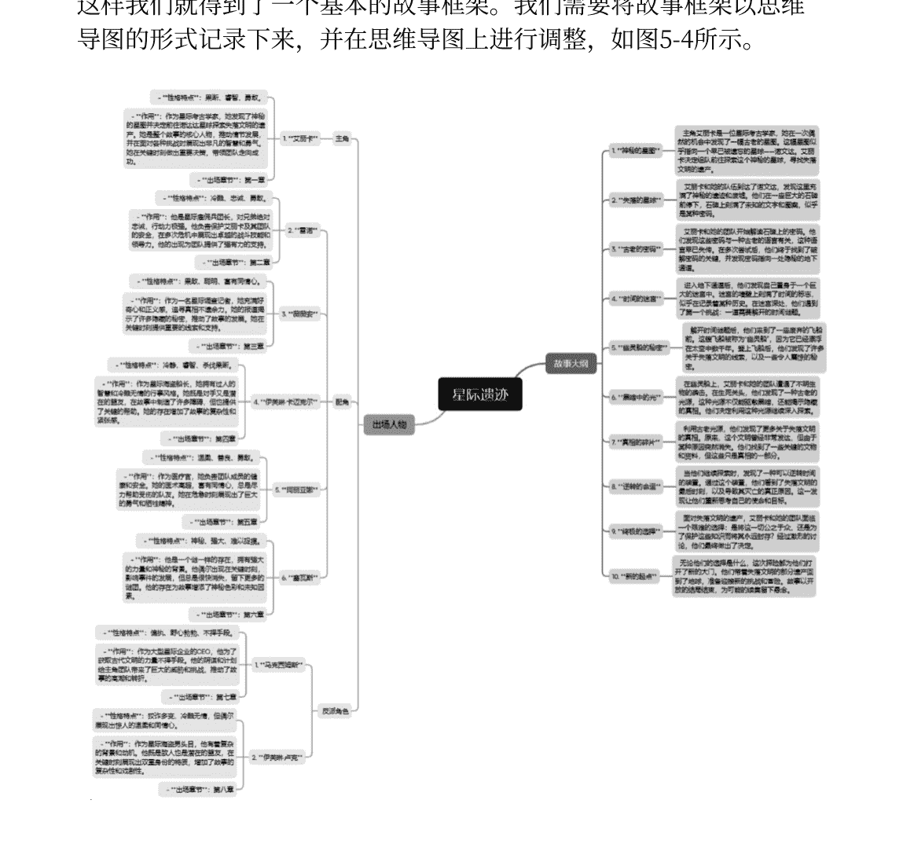

图5-4 故事框架思维导图

这里之所以要建立思维导图，是因为相较于结构性的思维，AI更倾向于展现出线性思维的特点。因此，我们需要自己建立一套系统，对内容进行整理。在整理过程中如果发现不合理的地方，我们要及时进行修正，确保自己对于故事内容有足够的把控。

在丰富人物之后，已经可以看到故事的轮廓了，但是其中仍然有一些不合理的地方。例如，第一章中，主角团的人物都需要出场，所以我们要对人物出场时间进行调整。我们将主角团的几个人物的出场时间设定在第一章，并且在DeepSeek提供的大纲的基础上进行细节完善。我们想到的细节越丰富，DeepSeek写的故事就越完善，也越符合我们的预期。

**提问：** 现在我提供给你第一章更为具体的内容，请在这个基础上进行第一章的编写。要求如下。

- (1) 艾丽卡出场是在一所大学的课堂上，她正在讲授星际考古学的相关知识——失落文明诺文达。她回到办公室后，收到了一封邮件。邮件里是一封言辞诚恳的求助信和一些星际文明的调查资料，资料中的文字是失落文明诺文达星球的文字。艾丽卡这些年一直在研究诺文达文明，然而却一直找不到它真正的位置。
- (2) 艾丽卡用一晚上的时间将文字翻译成了地球语言，发现这是一则关于诺文达星球坐标的谜语。然而对于破解谜语，艾丽卡却并不擅长，于是艾丽卡找到了自己的好朋友——星球日报的记者薇薇安，她除了一名知名的记者，还是一个著名谜语破解专家。
- (3) 在薇薇安的帮助下，艾丽卡终于找到了诺文达文明的具体位置。作为一个研究诺文达超过10年的星际考古学家，艾丽卡控制不住自己想要马上前去探索文明，然而薇薇安敏锐地告诉她，这个事件背后可能存在着阴谋。
- (4) 二人为去或不去展开了一番争论。这个部分你自行发挥。最后二人达成共识。去寻找雇佣兵团长雷诺，这个地方要对雷诺的外形和出场有一定的描写。出场场地是一个酒馆，突出雷诺豪迈外表下，粗中有细的性格特征。
- (5) 薇薇安和艾丽卡表明了来意。雷诺作为她们的老朋友，同意加入团队但是条件是发现失落文明的宝藏后，雷诺和他的团队要拿走一半。于是雷诺召唤了他的队友，众人向一望无际的星海驶去，本章节结束。

**DeepSeek:**

好的，以下是按照您的要求生成的第一章内容。

####### 第一章：神秘的星图

艾丽卡站在讲台前，手中握着激光笔，在透明的屏幕上划出一道道光线。她的声音清晰而富有感染力，回荡在宽敞的讲堂里：“今天，我们将探讨一个古老而神秘的文明——诺文达。这个星球上的文明曾经繁荣一时，但突然之间，它们消失了，只留下了一些令人费解的遗迹。”

学生们聚精会神地听着，偶尔发出惊叹声。艾丽卡的眼中闪烁着对未知的热情，她的长发随着动作轻轻摆动，显得格外迷人。

课后，艾丽卡回到了自己的办公室，那里摆满了各种星际文物和书籍。她刚坐下，电脑屏幕就亮了起来，一封新邮件出现在收件箱中。她点开邮件，发现是一封言辞诚恳的求助信，附带了一些星际文明的调查资料。更让艾丽卡惊讶的是，这些资料上的文字居然是诺文达星球的文字！

多年来，艾丽卡一直致力于研究诺文达文明，但她一直无法确定这个星球的具体位置。现在，这些资料似乎为她提供了新的线索。她决定用一晚上的时间将文字翻译成地球语言。

夜深了，艾丽卡的办公室里还亮着灯。她终于翻译完了那些文字，发现是一则关于诺文达星球坐标的谜语。然而，对于破解谜语，艾丽卡并不擅长。于是，她想到了自己的好朋友薇薇安。

薇薇安是一名知名的星球日报记者，同时也是一个著名的谜语破解专家。艾丽卡拨通了薇薇安的电话，两人约定在一家咖啡馆见面。

第二天，艾丽卡早早地来到了咖啡馆。不久后，薇薇安也出现了。她一头短发，眼神敏锐，给人一种干练的感觉。两人寒暄了几句后，艾丽卡将资料递给了薇薇安。

薇薇安仔细研究了一番后，露出了自信的笑容：“我可以试试破解这个谜语。”

经过几个小时的努力，薇薇安终于找到了诺文达文明的具体位置。艾丽卡激动不已，她控制不住自己想要马上前去探索文明真相。然而，薇薇安敏锐地告诉她：“这个事件背后可能存在着阴谋。”

艾丽卡一愣，随即陷入了沉思。她明白薇薇安的话有道理，但内心的好奇和渴望让她难以抉择。两人为去或不去展开了激烈的争论。最终，在薇薇安的劝说下，艾丽卡决定先做一些准备再出发。

为了确保安全，她们决定寻找一位可靠的雇佣兵团长雷诺来加入团队。雷诺是她们的老朋友，以豪迈的外表和粗中有细的性格著称。他身材魁梧，留着浓密的胡须，但眼神中却透露出精明的光芒。

两人来到了一家酒馆，那里是雷诺经常出没的地方。果然，她们在角落里发现了雷诺的身影。他正端着一杯烈酒，与几个手下谈笑风生。

“雷诺！”艾丽卡大声喊道。

雷诺转过头来，看到是艾丽卡和薇薇安，露出了热情的笑容：“嘿，我的老朋友！你们怎么来了？”

艾丽卡简要地说明了情况，并邀请雷诺加入团队。雷诺听完后，沉默了一会儿，然后豪爽地说道：“好吧，我答应你们！不过有个条件——如果发现了失落文明的宝藏，我要拿走一半！”

艾丽卡和薇薇安相视一笑，表示同意。于是，雷诺召唤了他的队友们，一行人浩浩荡荡地向一望无际的星海驶去。

这样我们就得到了第一章的故事雏形，然而要使故事的血肉更加丰满，仍然有很多细节需要我们完善。所以这里我们需要把待完善的细节逐一记录下来，并且通过提问的方式交给DeepSeek完善。

我们需要完善的细节如下。

- (1) 出场环节的内容还不够多，要凸显出艾丽卡丰富的学识，学生也要进行提问，课堂中要有互动。
- (2) 求助信的内容要具体写出来。
- (3) 要描述艾丽卡对于诺文达文明的热情和渊源，如她的父亲因为寻找诺文达文明至今生死未卜，她一直寻找诺文达文明也是为了寻找父亲的下落。
- (4) 每个人物身形外貌的描写要更为细致，人物动作的描写也要更加细致。
- (5) 雷诺出场时，要描写出酒吧里热闹非凡，雷诺正在和一个人比赛掰手腕。雷诺在比赛过程中使诈而获得了胜利，体现出雷诺的粗中有细、视钱如命。

##### 2. 填细节：加入具体描写

接下来为大家介绍填写故事剧情细节的两种方法，两种方法各有所长，大家可以根据实际情况整合使用。

###### 方法一：用DeepSeek完成章节编写。

优势：可整体修改，效率更高。

劣势：有字数限制，对作者能力有要求。

第1步：要求DeepSeek根据给出的细节进行补充。

**提问：** 请加入如下细节继续丰富内容：（1）出场环节的内容还不够多，要凸显出艾丽卡丰富的学识，学生也要进行提问，课堂中要有互动。

（2）求助信的内容要具体写出来。

（3）要描述艾丽卡对于诺文达文明的热情和渊源，如她的父亲因为寻找诺文达文明至今生死未卜，她一直寻找诺文达文明也是为了寻找父亲的下落。

（4）各个人物身形外貌的描写要更为细致，人物动作的描写也要更加细致。

（5）雷诺出场时，要描写出酒吧里热闹非凡，雷诺正在和一个人比赛掰手腕。雷诺在比赛过程中使诈而获得了胜利，体现出雷诺的粗中有细、视钱如命。

（6）雷诺和二人的谈话要有问有答、讨价还价。

**DeepSeek:**

好的，我将在编写时加入您提供的细节，并确保故事更加丰富和生动。以下是修改后的内容。

####### 第一章 神秘的星图

艾丽卡站在讲台上，面对着一众充满好奇的年轻面孔。阳光透过教室的窗户，洒在她那略显疲惫但依然坚定的脸庞上。她身穿一件深蓝色的星际考古学家制服，胸前挂着一枚闪耀着光芒的徽章，那是她多年研究与探索的象征。

“同学们，今天我们要探讨的是关于失落文明诺文达的奥秘。”艾丽卡的声音清晰而富有感染力，她的目光在学生们之间扫过，仿佛能点燃他们内心的求知欲。

“诺文达文明，一个曾经辉煌至极却又神秘消失的文明。他们的科技、艺术、文化，都远远超出了我们的想象。”艾丽卡开始了她的讲述，她的话语中充满了对诺文达文明的热爱与敬仰。

“老师，您真的相信诺文达文明还存在吗？”一名学生忍不住提问。

艾丽卡微笑着点了点头：“是的，我相信。而且，我一直在寻找他们的踪迹。你们知道吗？我的父亲，也是一位星际考古学家，他就是因为寻找诺文达文明而失踪的。所以，对我来说，这不仅是一项研究，更是一份对父亲的思念和追寻。”

学生们被艾丽卡的话深深打动，他们更加专注地听着她的讲述。

课后，艾丽卡回到自己的办公室。她刚刚坐下，就收到了一封邮件。邮件里是一封言辞诚恳的求助信和一些星际文明的调查资料。资料上的文字，竟然是一种她从未亲眼见过的古老文字——诺文达星球的文字。

艾丽卡的心猛地跳了一下，她颤抖着手打开了求助信。信中写道：

> “尊敬的艾丽卡教授，我是一名星际探险家。在最近的一次探险中，我发现了这些关于诺文达文明的资料。我知道您一直在研究这个文明，所以我冒昧地向您求助，希望您能帮我解读这些文字。我相信，它们一定隐藏着关于诺文达文明的重要线索。”

艾丽卡读完信后，心中涌起一股强烈的冲动。她决定用一晚上的时间来翻译这些文字。夜深人静，艾丽卡坐在桌前，手中的笔在纸上飞快地移动。经过一夜的努力，她终于将这些文字翻译成了地球语言。这是一则关于诺文达星球坐标的谜语。

然而，对于破解谜语，艾丽卡并不擅长。于是，她想到了自己的好朋友薇薇安。薇薇安是一名知名的星球日报的记者，同时也是一个著名的谜语破解专家。

第二天一早，艾丽卡就找到了薇薇安。两人在咖啡馆里见面，艾丽卡将求助信和翻译好的文字交给了薇薇安。

> “薇薇安，我需要你的帮助。这些文字是关于诺文达星球坐标的谜语，但我不知道怎么破解它。”艾丽卡恳切地说道。

薇薇安接过资料，仔细看了看，然后抬起头看着艾丽卡：“没问题，我帮你破解这个谜语。不过，你要做好心理准备，这个谜语可能并不简单。”

在薇薇安的帮助下，艾丽卡终于找到了诺文达文明的具体位置。作为一个研究诺文达超过10年的星际考古学家，艾丽卡控制不住自己想要马上前去探索文明真相的冲动。然而，薇薇安敏锐地告诉她：“艾丽卡，这个事件背后可能存在着阴谋。我们需要小心行事。”

艾丽卡虽然心中有些犹豫，但她还是决定前往诺文达星球。她和薇薇安为去或不去展开了激烈的争论。最终，二人达成共识：先去寻找雇佣兵团长雷诺，看看他是否愿意加入团队。

在一个热闹非凡的酒馆里，艾丽卡和薇薇安找到了雷诺。他正和一个人比赛掰手腕。雷诺在比赛过程中偷偷使诈获得了胜利，这一幕让艾丽卡和薇薇安不禁暗自发笑。

雷诺身材魁梧，肌肉发达，一头短发凌乱不堪。他的眼神犀利而深邃，透露出一种不羁的气质。看到艾丽卡和薇薇安走来，他豪爽地笑了笑：“嘿，两位美女，找我有什么事吗？”

艾丽卡上前一步，将自己的计划告诉了雷诺。雷诺听后沉默了一会儿，然后说道：“听起来很有趣。不过，我得有个条件。如果我加入你们的队伍，发现失落文明的宝藏后，我要拿走一半。”

艾丽卡和薇薇安对视一眼，然后点了点头：“成交。”

于是，雷诺召唤了他的队友们。一群身材各异、性格迥异的佣兵聚集在一起，他们整装待发，准备向一望无际的星海驶去。

第2步：对描述不到位的细节单独提问，然后补充到文稿中。

AI在回答时有一定的字数限制，如果我们需要生成一篇较长的小说文稿，就需要对一些细节逐一进行针对性的提问。我们以二人的争吵为例进行提问。

**提问：** 在这个章节里，薇薇安和艾丽卡是如何对“去或不去”展开争吵的？二人又是如何达成共识的？请还原整个对话的过程，注意，不用再重新写一遍，单独把这个部分补充好就行。

**DeepSeek:**

明白，您的需求是补充第一章中关于薇薇安和艾丽卡对去或不去诺文达星球展开讨论并达成共识的对话部分，以下是修改后的内容。

“艾丽卡，你真的打算去吗？”薇薇安的声音中带着一丝不安。

艾丽卡坚定地点了点头：“当然。这不仅仅是一个探险的机会，更是解开诺文达文明之谜的关键。”

薇薇安皱了皱眉，担忧地说：“但你觉得这真的安全吗？你也知道，星际旅行从来不是一帆风顺的。而且，这个谜语背后可能隐藏着我们无法预料的危险。”

艾丽卡微微一笑，眼中闪烁着智慧的光芒：“我理解你的担忧，薇薇安。但是，作为一名星际考古学家，探索未知、面对挑战是我的使命。我相信只要我们准备充分，就没有什么能够阻挡我们前进的步伐。”

薇薇安叹了口气，语气中透露出几分无奈：“好吧，既然你已经决定了，我也只能支持你。不过，我还是会保持警惕，随时准备应对可能出现的紧急情况。”

艾丽卡感激地看了薇薇安一眼，然后说：“谢谢你，薇薇安。有你在我身边，我就更有信心了。现在，我们需要制订详细的计划，确保这次探险能够顺利进行。”

薇薇安点了点头，眼中闪烁着坚定的光芒：“没错。我们要从装备准备、路线规划、风险评估等方面入手，确保每一个细节都不出差错。”

艾丽卡赞同地点了点头：“是的，我们还需要考虑与当地势力的接触和沟通，避免不必要的冲突。毕竟，我们的目的是和平探索，而不是挑起战争。”

薇薇安微笑着回应：“你说得对。我们可以利用我作为记者的身份，尝试与他们建立联系，了解他们的文化背景和需求。这样，我们就能更好地融入当地社会，为探险创造有利条件。”

艾丽卡满意地点了点头：“很好，那我们就按照这个思路来制订计划吧。我相信，只要我们齐心协力，就一定能够成功揭开诺文达文明的神秘面纱。”

薇薇安也充满了信心：“没错。让我们携手共进，共同迎接这场充满挑战与机遇的星际之旅吧！”

第3步：对文稿进行手动修改，使剧情更加合理。

在编写故事的过程中，我们必须摒弃依赖AI一键生成优质故事的幻想。从本质上讲，AI仅是提高我们创作效率的工具，而非能够替代人类工作的劳动力。明确了这一角色定位后，我们便能认识到，创意与创造的本质仍然需要依靠人类自身。AI的作用在于降低创作故事的门槛，但无论采用何种方式，最终仍需我们亲自动手修改文稿，直至将故事调整至符合预期的状态。

当我们逐一完成每一个章节后，也就意味着我们完成了一个故事的创作。

###### 方法二：通过彩云小梦完成写作。

优势：擅长剧情和场景描写，有更好的叙事感。

劣势：需要严格控制方向，否则剧情容易偏离大纲。

第1步：登录彩云小梦。

第2步：在彩云小梦主页中单击“创作故事”按钮，如图5-5所示。

第3步：输入世界设定和故事背景，故事背景要求300字以内，如图5-6所示。

把每一章的梗概放入故事背景中。这里需要注意放入的是每一章的梗概，而不是整个故事的梗概，否则范围太大，AI生成的剧情容易偏离主题。

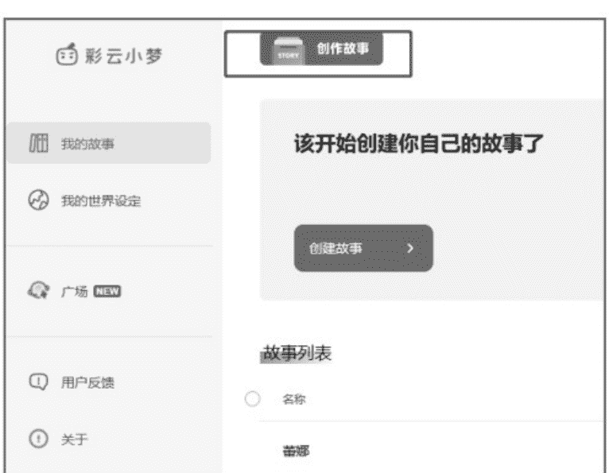

第4步：在“小梦百科词条”下单击“创建一个新的词条”按钮，新建一个词条，如图5-7所示。


第5步：设置词条。词条是指小说里的特殊名词，如人物、道具（玄幻、武侠小说中会有一些特殊道具名称，如屠龙刀）等。我们需要在词条中把这些特殊名词介绍清楚，AI才能更好地帮助我们写作。我们需要在其中设置人物词条的相关内容，并且建立人物之间的关系，如图5-8所示。


第6步：将AI生成的章节内容复制到彩云小梦中，选中要修改的内容，让彩云小梦进行扩写和改写，如图5-9所示。


我们需要做的，就是在写作的过程中控制剧情走向，使其不偏离大纲。

#### 5.3.2 AI助力论文写作

论文写作是一种系统性的学术写作，旨在就某个特定的主题进行深入研究、分析和论证。通过合理的组织、清晰的论证和精确的语言表达，可以使论文更具说服力和学术价值。

##### 1. 论文写作与其他类型写作的区别

论文写作和其他类型写作之间存在一些明显的区别。下面是一些主要区别。

（1）目的和目标：论文写作的目的通常是通过研究和分析来回答一个特定的问题或提出新的观点。它的目标是通过有逻辑的论证和提供实证证据来支持论点。其他类型的写作可能更多地关注娱乐、表达情感或传达信息。

（2）结构和组织：论文通常具有特定的结构和组织方式，如引言、文献综述、方法、结果、讨论和结论。这种结构有助于清晰地呈现研究的背景、方法和结果，并对其进行评估和解释。其他类型的写作可能更加自由，没有严格的结构要求。

（3）受众和读者：论文通常是学术界或专业领域的人士撰写的，读者具有一定的专业背景和知识。因此，论文中的术语和概念可以更加专业化和技术化。其他类型的写作可能面向更广泛的人群，包括一般读者，因此需要使用更简单易懂的语言。

（4）文献引用和参考文献：在论文中，引用其他研究、理论或观点是非常重要的。学术论文通常要求准确地引用使用的文献，并列出参考文献清单。这有助于读者了解当前研究与之前的研究之间的联系。其他类型的写作中，文献引用通常没有那么严格的要求。

（5）研究方法和数据分析：学术论文通常需要使用科学的研究方法进行数据收集和分析。这可能涉及实验设计、统计分析及定量或定性数据的解释。其他类型的写作可能不需要严格遵循此类科学方法。

总的来说，论文写作注重逻辑性、准确性和可靠性，旨在为学术界做出贡献。而其他类型的写作可能更注重故事性、表达情感或传达信息，受众更广泛。

AI可以在写论文的过程中给我们提供以下帮助。

- （1）激发创意，明确选题。
- （2）建立论文大纲。
- （3）搜集案例和数据，引用文献等（数据需要自己查找并验证）。
- （4）某些段落的编写。
- （5）优化表达方式，防止重复。

需要注意的是，论文是一种严肃的文体，尤其是科研类论文，数据的来源与真实性非常重要，我们写的论文也可能会被别人引用，如果完全依赖AI写作而不经核实，可能会产生严重的后果。

##### 2. 用AI明确选题

AI可以帮助我们明确论文的选题。例如，我们需要写中美国际贸易相关论文，可以直接向DeepSeek提出需求。

**提问：** 我需要写一篇关于中美国际贸易的论文，请帮我列举10个选题。

**DeepSeek:**

关于中美国际贸易的论文选题，您可以考虑以下10个选题。

- （1）中美贸易战对全球经济的影响：分析中美贸易战对全球经济增长、贸易流量和投资的影响，并探讨可能的后果。
- （2）中美贸易逆差的原因及影响：研究导致中美贸易逆差的因素，分析其对两国经济和贸易关系的影响。
- （3）中美贸易关系的历史演变：探讨中美贸易关系的历史发展，重点关注双边贸易政策的变化、协议和贸易框架。
- （4）中美贸易战中的知识产权问题：分析中美贸易战期间涉及知识产权保护和技术转让的争议，并评估其对两国创新能力和竞争力的影响。
- （5）中美贸易合作的潜力与前景：评估中美贸易合作的潜在领域，探讨两国在贸易和投资方面的互补性，并提出未来合作的前景。
- （6）中美自由贸易协定的影响：研究中美自由贸易协定（如中美投资协定）对双边贸易、投资和经济关系的潜在影响。
- （7）中美贸易战对全球价值链的重塑：分析中美贸易战对全球价值链的影响，探讨跨国公司的供应链调整和产业重组。
- （8）中美贸易争端的解决机制：评估中美贸易争端解决的机制和途径，包括双边磋商、世界贸易组织和其他国际机构的作用。
- （9）中美农产品贸易：研究中美农产品贸易的特点、挑战和机会，以及对农业部门和食品安全的影响。
- （10）中美贸易关系与地区经济一体化：探讨中美贸易关系对亚太地区经济一体化和区域贸易安排（如亚太经合组织和区域全面经济伙伴关系）的影响。

这些选题可以作为起点，您可以根据自己的兴趣和研究重点来进一步细化和扩展。记得在选择选题时，考虑到您的研究范围、可行性和可获得的数据资源。

也可以使用印象笔记的“AI帮我写”功能，如图5-10所示。


“AI帮我写”列出的10个选题如图5-11所示。


##### 3. 用AI建立大纲

在星火助手中心选择“论文大纲助手”选项，如图5-12所示。


然后在对话框中输入选题。例如，输入选题“短视频的发展与思考”。

**提问：** 短视频的发展与思考。

**论文大纲助手：**

- 一、引言
  1. 短视频的定义和发展历程
  2. 短视频在当今社会中的重要性和影响
  3. 论文的研究目的和意义
- 二、短视频的发展现状分析
  1. 短视频市场的规模和增长趋势
  2. 主要短视频平台的特点和竞争格局
  3. 短视频内容类型及其发展趋势
  4. 短视频用户画像及行为特征分析
  5. 短视频创作者生态与商业模式探究
- 三、短视频发展的挑战与机遇
  1. 政策法规对短视频行业的影响
  2. 技术进步对短视频产业的推动作用
  3. 短视频在文化传播、教育培训等方面的应用前景
  4. 短视频产业面临的版权保护、信息安全等问题及应对策略
  5. 短视频产业与其他行业的融合发展可能性及前景展望
- 四、短视频发展的思考与建议
  1. 从政策层面出发，促进短视频产业健康发展
  2. 从技术层面出发，提升短视频产品质量和服务水平
  3. 从市场层面出发，优化短视频营销策略和推广渠道
  4. 从用户层面出发，引导健康理性使用短视频产品
  5. 从创作者层面出发，完善短视频创作环境和收益分配机制
  6. 其他可能有助于短视频产业发展的建议和措施
- 五、结论
  1. 总结短视频发展的主要成果和不足之处
  2. 对未来短视频发展的展望和期许
  3. 针对当前面临的问题提出相应的解决思路和建议

##### 4. 用AI编写开题报告

开题报告是论文的起步阶段，内容包括选题背景与意义、研究现状分析、研究目标与研究内容、研究方法与技术路线、论文框架与安排等。

采用提问的方式，输入大纲和选题，并要求DeepSeek生成开题报告的初稿。

需要注意的是，DeepSeek给我们提供的初稿仅供参考，我们还是要自己进行调研和论证。

**提问：** 开题报告怎么写？

**DeepSeek:**

开题报告是对论文选题、研究内容、研究方法、预期结果等进行详细阐述和论证的书面材料。以下是一份简单的开题报告模板，供您参考。

###### 一、选题背景与意义

####### 1. 研究背景

简要介绍研究领域的发展历程、现状和存在的问题，引出本课题的研究价值和意义。

####### 2. 研究目的

明确本课题的研究目标和预期成果，为后续研究提供指导。

###### 二、文献综述

####### 1. 国内外研究现状

对国内外相关领域的研究现状进行梳理，分析已有研究成果的不足之处。

####### 2. 研究方法和技术路线

介绍本课题所采用的研究方法和技术路线，说明其合理性和可行性。

###### 三、研究内容与计划

####### 1. 研究内容

详细描述本课题的研究内容，包括研究对象、研究范围、研究方法等。

####### 2. 研究计划

制订本课题的研究计划，包括各阶段的工作安排、时间节点等。

###### 四、预期成果与创新点

####### 1. 预期成果

阐述本课题预期达到的研究成果，以及对学术界和实践的贡献。

####### 2. 创新点

突出本课题的创新点和特色，说明与现有研究的不同之处。

###### 五、存在的问题与解决措施

####### 1. 存在的问题

分析在实施本课题的过程中可能遇到的问题和困难。

####### 2. 解决措施

提出针对这些问题和困难的解决措施和建议，以确保研究工作的顺利进行。

###### 六、参考文献

列出本报告中引用的参考文献，按照一定的格式排列。

###### 七、致谢

感谢在本课题研究过程中给予帮助和支持的单位和人员。

**提问：** 请你以短视频的发展与思考为题，为我写一篇开题报告。

**DeepSeek:**

# 开题报告

###### 一、选题背景与意义

短视频作为一种新兴的媒体形式，近年来在全球范围内迅速发展。短视频以其短小精悍的特点，吸引了越来越多的用户，成为人们日常生活中不可或缺的一部分。本报告旨在探讨短视频的发展历程、现状和未来趋势，以及短视频对社会、文化和经济的影响，为进一步研究短视频提供参考。

###### 二、文献综述

### 1. 短视频的发展历程

回顾短视频的发展历程，从最初的GIF动画到如今的抖音、快手等平台，短视频在技术、内容和商业模式等方面都取得了显著的进步。

### 2. 短视频的现状分析

通过对国内外短视频市场的调查和分析，发现短视频已经成为一种主流的媒体形式，其用户规模和市场规模不断扩大。同时，短视频也面临着版权、内容质量参差不齐等问题。

### 3. 短视频的未来趋势

预测短视频未来的发展趋势，包括技术创新、内容创新、商业模式创新等方面。同时，也需要关注短视频可能带来的负面影响，如信息泛滥、隐私泄露等。

###### 三、研究内容与计划

####### 1. 研究内容

本报告将围绕短视频的发展历程、现状分析和未来趋势展开研究。具体内容包括：短视频的技术发展、内容创新和商业模式创新；短视频的用户行为和社会影响；短视频的版权问题和监管机制等。

### 2. 研究方法

本报告将采用文献综述法、案例分析法和问卷调查法等多种研究方法，以全面深入地论述短视频的发展现状和未来趋势。

###### 四、预期成果与创新点

通过本报告的研究，预期可以得出以下成果。

- 1. 全面了解短视频的发展历程、现状分析和未来趋势。
- 2. 深入探讨短视频的用户行为和社会影响。
- 3. 提出针对短视频可能带来的负面影响的监管机制建议。

###### 五、存在的问题与解决措施

####### 1. 存在的问题

短视频在发展过程中也存在一些问题，如内容质量参差不齐、版权问题突出、信息泛滥等。这些问题需要得到有效解决，以保障短视频的健康发展。

####### 2. 解决措施

针对上述问题，本报告提出以下解决措施。

- (1) 加强短视频内容的审核和管理，提高内容质量。
- (2) 完善短视频版权保护机制，打击侵权行为。
- (3) 加强监管力度，规范短视频市场秩序。

###### 六、参考文献

### 1. 国内文献

[1] 陈婷婷. 短视频的发展现状及未来趋势分析[J]. 现代传媒，2019(7):88-90.

[2] 李娜. 短视频平台用户行为研究——以抖音为例[J]. 新闻传播研究，2019(4):78-83.

[3] 王磊. 短视频对社会文化的影响[J]. 中国传媒大学学报，2018(6):78-83.

### 2. 国外文献

[4] Wang X, Chen Y. The impact of short video on social media and culture: A review of literature. Journal of Digital Media & Society, 2019. 14(2): 1-25.

[5] Zhang Y. The evolution of short video platforms in China: A comparative analysis of Douyin and Kuaishou. Journal of Chinese Communication Research, 2018, 6(3):345-360.

###### 七、致谢

在本报告的研究过程中，得到了导师和同学们的帮助和支持，在此表示衷心的感谢！

从最后的结果来看，这算是一个比较不错的开题报告，但是也存在着一些问题。例如，参考文献不够新，而且真实性也需要考证（谨防AI幻觉）；框架也和前面的大纲有些区别，这些都是需要人工完成的部分。

##### 5. 用 AI 查找文献和数据

怎样搜索才能保障我们的数据拥有较高的可信度？这里我们要用到的工具是秘塔AI。

第1步：在浏览器中打开搜索引擎，搜索“秘塔AI”，进入秘塔AI官网并输入问题，如“《哪吒2》爆火对中国文化产业带来的影响”，如图5-13所示。


第2步：在对话框左下方选择参考内容，这里选择“文库”或“学术”，如图5-14所示。


第3步：打开“长思考·R1”开关，如图5-15所示，选择“研究”模式，如图5-16所示，然后发送问题。


第4步：稍后，我们就可以看到完整的深度思考过程，以及每一段结论和对应的参考文献。文献图标为，意思是“文献编号|格式”，将鼠标指针放置在文献图标上，就可以看到文献出处，并可以查看PDF，如图5-17所示。


## 第6章 AI 助力表格与PPT制作

本章主要使用的AI工具：

- WPS AI
- DeepSeek
- 讯飞星火

### 6.1 用AI作为表格助手

对于很多职场人士来说，制作Excel表格可以说是最痛苦的工作之一，不但要学习各种公式的规则，还要考虑表格的美观，甚至还需要学习数据透视表、嵌入式函数等更为复杂的工具的用法。

然而，AI工具的出现大大降低了这方面的工作量。我们不再需要花费大量的时间学习相关技术，只需要向AI提出要求就可以完成大部分工作。2023年7月，金山办公正式推出基于大语言模型的智能办公助手WPS AI，这个AI工具的方便之处在于它直接嵌入我们日常办公中经常使用的WPS Office中，无须下载和注册，只需要将WPS Office更新到最新版本即可。

本章主要讲解WPS AI在公式编写和数据标记方面的应用。

在学习本章的前置准备工作：

- 下载WPS Office或更新到最新版本（部分内网专供版本的WPS Office可能没有更新该功能，请在互联网环境下进行功能体验）；
- 新建一个Excel表格，用WPS Office打开；
- 找到WPS AI的位置，如图6-1所示，在工具栏上方。


#### 6.1.1 AI助力简单公式编写

我们在使用Excel时经常遇到不会编写公式的问题，公式不会用，往往就要花费大量时间去学习，甚至学会了还要花费大量时间去调整。应用WPS AI就可以快速解决这个问题。

下面先介绍一个较为简单的公式——计算中位数，帮助大家理解这个工具的使用方法。

例如，我们有一份班级学生成绩表，如图6-2所示，我们需要计算该班级成绩的中位数。


第1步：在E2单元格中输入“班级成绩中位数”，选中F2单元格，如图6-3所示。


第2步：单击“WPS AI”按钮，选择“AI写公式”选项，如图6-4所示，将会弹出一个对话框，如图6-5所示，在对话框中输入我们的需求“计算C列的中位数”后按Enter键即可。需要注意的是，输入指令时尽量使用Excel能“听”懂的语言，如在描述行和列时使用“2行”“C列”等。


第3步：稍作等待后，WPS AI就为我们生成了对应公式，并计算出了该班级成绩的中位数。在这一步，如果我们想要学习该公式或调整公式计算范围，可以在对话框中进行设置，如图6-6所示。


第4步：确认无误后单击“完成”按钮即可。

#### 6.1.2 AI助力复杂公式编写

通过上面的例子，我们理解了WPS AI如何帮助我们编写公式，接下来让AI助力我们编写一个更为复杂的公式——VLOOKUP。

还是以图6-2中的班级学生成绩表为例，该表格的“Sheet2”标签中有一组学生身高数据，如图6-7所示。

| 姓名 | 性别 | 身高 (cm) |
|---|---|---|
| 李华 | 男 | 183 |
| 王丽 | 女 | 175 |
| 张伟 | 男 | 158 |
| 赵敏 | 女 | 169 |
| 钱强 | 男 | 182 |
| 孙丽 | 女 | 177 |
| 周伟 | 男 | 153 |
| 吴敏 | 女 | 164 |
| 郑强 | 男 | 185 |
| 冯丽 | 女 | 172 |
| 陈伟 | 男 | 156 |
| 褚敏 | 女 | 160 |
| 卫强 | 男 | 187 |
| 吕伟 | 男 | 174 |
| 施敏 | 女 | 159 |
| 张强 | 男 | 168 |
| 金丽 | 女 | 184 |
| 顾伟 | 男 | 176 |
| 胡丽 | 女 | 152 |
| 钟伟 | 男 | 165 |
| 高敏 | 女 | 186 |
| 叶强 | 男 | 173 |
| 孔丽 | 女 | 157 |
| 江伟 | 男 | 166 |
| 白敏 | 女 | 181 |
| 严强 | 男 | 178 |
| 司马丽 | 女 | 154 |
| 夏侯伟 | 男 | 163 |
| 诸葛敏 | 女 | 188 |

图6-7 学生身高数据

我们要将学生的身高匹配到班级学生成绩表中分数后的列，操作流程如下。

第1步：在班级学生成绩表中分数后的列的D1单元格中输入“身高（cm）”，然后选中需要输入公式的位置，即D2单元格，如图6-8所示。

| 姓名 | 性别 | 分数 | 身高 (cm) |
|---|---|---|---|
| 李华 | 男 | 89 | |
| 王丽 | 女 | 76 | |
| 张伟 | 男 | 95 | |
| 赵敏 | 女 | 82 | |
| 钱强 | 男 | 78 | |
| 孙丽 | 女 | 90 | |
| 周伟 | 男 | 85 | |
| 吴敏 | 女 | 77 | |
| 郑强 | 男 | 92 | |
| 冯丽 | 女 | 80 | |
| 陈伟 | 男 | 96 | |
| 褚敏 | 女 | 88 | |
| 卫强 | 男 | 75 | |
| 蒋丽 | 女 | 79 | |
| 沈伟 | 男 | 87 | |
| 韩敏 | 女 | 91 | |
| 杨强 | 男 | 83 | |
| 朱丽 | 女 | 72 | |
| 秦伟 | 男 | 94 | |
| 尤敏 | 女 | 86 | |
| 许强 | 男 | 73 | |
| 何丽 | 女 | 97 | |
| 吕伟 | 男 | 81 | |
| 施敏 | 女 | 74 | |
| 张强 | 男 | 93 | |
| 金丽 | 女 | 89 | |
| 顾伟 | 男 | 70 | |

图6-8 选中需要输入公式的位置

第2步：单击“WPS AI”按钮，选择“AI写公式”选项，如图6-9所示。


第3步：弹出对话框，输入我们的需求“根据A列的姓名匹配到Sheet2中C列对应的身高数据”，如图6-10所示。


第4步：确认公式无误后单击“完成”按钮即可，如图6-11所示。


第5步：选中D2单元格并将鼠标指针放置在右下角，按住鼠标左键向下拖曳，如图6-12所示，即可将公式向下填充，使学生的身高匹配到对应姓名，效果如图6-13所示。


#### 6.1.3 AI助力数据标记

如果我们需要为符合特定条件的数据设置标记，应该如何借助WPS AI进行操作呢？例如，在图6-12所示的表格中，我们需要标记出分数高于80分且身高高于175cm的学生，操作流程如下。

第1步：单击“WPS AI”按钮，选择“AI条件格式”选项，如图6-14所示。


第2步：在弹出的对话框中输入需求，格式为“标记××且××的××为××色”，如“标记分数高于80分且身高高于175的学生姓名为红色”，然后按Enter键，如图6-15所示。


第3步：确认区域、规则、格式无误后单击“完成”按钮，如图6-16所示，即可得到设置标记后的表格，效果如图6-17所示。


#### 6.1.4 AI助力Excel学习

目前WPS AI在Excel中仅有比价基础的功能。随着AI技术的发展，今后必然会有更为丰富的功能。但如果我们当下就需要应用一些更为深入的工具，如数据透视表、宏和自动化等，AI是否能帮助我们呢？

答案是肯定的，AI可以加快我们的学习速度，主要体现在两方面：一方面，AI可以作为我们的学习顾问，为我们制订一个科学的学习计划；另一方面，AI可以作为我们的答疑老师，解答使用过程中的疑惑。

##### 1. 制订学习计划

我们可以通过与DeepSeek对话，让它为我们制订一个科学的学习计划，了解即将学习的知识，避免在学习时因内容太多而无从下手。

**提问：** 如果我要学习宏和自动化，请帮我制订一个学习计划。

**DeepSeek：**

学习宏和自动化需要逐步掌握基础知识和技能。以下是一个学习宏和自动化的建议计划：

**阶段一：基础知识**

- 1. 学习宏的基本概念和用途，了解宏的工作原理。
- 2. 学习Excel的基本函数和公式，包括IF函数、VLOOKUP函数、COUNTIF函数等。
- 3. 掌握Excel的常用功能，如筛选、排序、条件格式、数据验证等。

**阶段二：宏录制与编辑**

- 1. 学习如何录制和执行宏，了解录制宏的步骤和注意事项。
- 2. 学习如何编辑和修改录制的宏代码，了解宏代码的结构和语法。
- 3. 练习录制和编辑一些简单的宏，如对数据进行自动筛选、格式化等。

**阶段三：宏的进阶应用**

- 1. 学习如何添加用户交互功能，如输入框和消息框。
- 2. 学习如何使用条件语句和循环结构来实现更复杂的宏操作。
- 3. 学习如何处理多个工作表和工作簿，包括打开、保存、复制、移动等操作。

**阶段四：宏的自定义和优化**

- 1. 学习如何创建自定义的宏按钮和快捷键，以便于宏的执行。
- 2. 学习如何添加错误处理和异常处理机制，提高宏的健壮性。
- 3. 学习如何优化宏的性能，减少执行时间和资源消耗。

**阶段五：实际应用和项目**

- 1. 选择一个实际的问题或任务，尝试使用宏和自动化来解决或简化该问题。
- 2. 练习处理大量数据、自动化报告生成、数据清洗等常见场景。
- 3. 持续练习和实践，不断提升宏和自动化的技巧和效率。

此外，还建议参考相关的学习资源，如在线教程、视频教程、书籍和官方文档。不断练习和尝试不同的宏任务，将有助于您熟练掌握宏和自动化的技能。记得保持耐心和持续学习的态度，逐步提升您的宏和自动化使用能力。

##### 2. 问题答疑

如果我们在制作表格时，发现对于某些工具不太理解，也可以向DeepSeek提问。

> **提问：** 请你为我介绍一下Excel数据透视表是什么，以及如何使用，有什么应用场景？

**DeepSeek：**

Excel数据透视表是一种功能强大的工具，用于快速汇总、分析和呈现大量数据。使用方法通常包括数据准备、创建透视表、配置字段、美化报表和分析刷新。其应用场景多样，包括销售业绩分析、库存管理、市场调研等。

操作方法：

- 1. 数据准备：准备好需要分析的数据，确保没有空行或空列，并且每一列都有唯一的标题。
- 2. 创建透视表：选中原始数据的任意一个单元格，单击“插入”→“数据透视表”。在弹出的对话框中，Excel通常会自动选择正确的数据范围，只需要确定放置透视表的位置即可。
- 3. 配置字段：在数据透视表字段列表中，将需要分析的字段拖曳到行、列或值区域。例如，将“日期”字段拖曳到行区域，将“销售额”字段拖到值区域，Excel会自动进行汇总计算。
- 4. 美化报表：可以根据需要调整数据透视表的样式和布局，使其更直观易懂。例如，可以更改数字格式、调整列宽或应用不同的表格样式。
- 5. 分析刷新：分析完成后，如果原始数据有更新，只需右击数据透视表区域，选择“刷新”来更新结果显示。

应用场景：

- 1. 销售业绩分析：可以按地区、产品或销售人员分类汇总销售数据，快速得出各个维度的销售总额和平均值，从而评估销售业绩。
- 2. 库存管理：通过数据透视表，可以对库存商品进行分类统计，比如按照商品类别、入库时间等维度分析库存变动情况，及时调整库存策略。
- 3. 市场调研：对市场调研得到的大量调查数据进行交叉分析，比如分析不同消费者群体的购买偏好，为市场战略提供依据。
- 4. 财务报告：财务部门可以利用数据透视表快速汇总和计算财务报表中的各项数据，如利润表、资产负债表等，简化会计处理过程。
- 5. 人力资源管理：在人力资源部门，数据透视表可以用来分析员工绩效、出勤记录和培训效果等数据，帮助优化人力资源管理。

### 6.2 用AI实现PPT自动化

如果我们接到任务，用30分钟制作一个汇报PPT，应该怎么办？

我们通常会遵循一套较为传统的流程制作PPT：第1步，在网络上搜寻合适的模板；第2步，逐项填充内容；第3步，进行整体优化和美化。这一流程往往耗时且费力，显然，按照这一流程，在短短30分钟内制作一份高质量的PPT几乎是不可能完成的任务。然而，随着AI技术的飞速发展，我们拥有了更为高效、快捷的解决方案。

下面将详细介绍两种利用AI工具快速且高效地制作PPT的方法：一是借助讯飞星火这一智能平台，其强大的自然语言处理与生成能力能够辅助用户迅速构建PPT框架并填充内容；二是利用WPS AI功能，该功能深度融合了AI技术，使得用户能够轻松选择模板、智能排版，并在极短时间内完成PPT的制作与美化。

#### 6.2.1 用讯飞星火快速制作PPT

用讯飞星火制作PPT的操作步骤如下。

第1步：结构是PPT的基础，因此我们需要快速搭建PPT的框架结构，这里用到的工具是讯飞星火的“讯飞智文”。在讯飞星火主界面中单击“讯飞智文”选项，如图6-18所示。


#### 6.2.2 用WPS AI制作更高质量的PPT

除了讯飞星火，WPS AI也可以完成PPT制作工作，而且因为WPS本身就是办公软件，所以通常使用效果更好。但WPS AI是会员功能，需要付费才能使用。

接下来介绍如何用WPS AI制作更高质量的PPT。

第1步：打开WPS Office，单击“演示”按钮，新建一个演示文稿，如图6-30所示。


图6-30 新建一个演示文稿

第2步：选择“智能创作”选项，如图6-31所示。


图6-31 选择“智能创作”选项

第3步：进入PPT内容编辑界面，这里有三种内容生成模式：输入内容、上传文档、粘贴大纲，如图6-32所示。

# AI 生成 PPT

输入幻灯片主题，智能生成大纲，例如“人工智能的发展”

0/1500

# AI 生成 PPT

选择文档

支持Doc文档、思维导图导入 ⓘ

# AI 生成 PPT

在此处键入或粘贴大纲，内容层级尽量不超过4级，AI将为你整理获得幻灯片大纲，例如：
第一章 章节页标题
1. 正文页标题
   a. 此处为正文小标题
      • 此处为正文内容，为了效果更优，建议内容尽量精简
1. 正文页标题
   a. 此处为正文小标题
      • 此处为正文内容，为了效果更优，建议内容尽量精简
......

0/3000

图6-32 内容生成的三种模式

第4步：这里我们选择“输入内容”模式，在对话框内输入PPT主题，如“个人年度工作汇报PPT”，单击“开始生成”按钮，如图6-33所示。


图6-33 在对话框内输入PPT主题

第5步：进入幻灯片大纲界面，根据需求调整大纲后单击“挑选模板”按钮，如图6-34所示。


图6-34 根据需求调整大纲

第6步：在选择幻灯片模板界面中选择一个适合PPT主题的模板，单击“创建幻灯片”按钮，如图6-35所示。


图6-35 选择适合PPT主题的模板

第7步：稍作等待，我们就可以在WPS演示界面中看到生成的PPT，如图6-36所示。


图6-36 生成的PPT

第8步：单击上方的“WPS AI”按钮，可以运用AI对PPT进行修改和调整，可以使用的功能包括AI生成PPT、文档生成PPT、AI生成单页、AI帮我写、AI帮我改，如图6-37所示。


图6-37 WPS AI的PPT相关功能

## 第7章 AI助力短视频制作

### 7.1 AI助力短视频制作

随着短视频的普及和发展，越来越多的人开始尝试创作短视频作品。为了帮助这些创作者更好地完成剪辑工作，剪辑工具也越来越丰富和易用，使得短视频进入一个新的时代——AI时代。在这个时代，人们可以使用AI技术来辅助剪辑、生成内容和提高视频质量，从而让短视频的创作更加高效和便捷。

本节重点介绍以下几个短视频制作工具。

- (1) 自动剪辑：剪映。
- (2) 高质量视频制作：秒创。
- (3) 一分钟成片利器：度加创作工具。

#### 7.1.1 短视频制作的基本流程

通常，短视频制作包括三个环节：脚本编写、拍摄制作、后期剪辑。

##### 1. 脚本编写

在短视频制作中，脚本编写是非常重要的一环。脚本是短视频内容的核心，它决定了短视频的主题、情节和节奏等。脚本需要简洁明了、生动有趣，能够吸引观众的注意力并传递想要表达的信息。在编写脚本时，需要考虑到目标受众的特点和喜好，以及所处的市场环境和竞争情况等因素。

##### 2. 拍摄制作

拍摄制作是将脚本转化为可视化内容的过程。拍摄前需要确定好拍摄地点、场景布置、角色选定等事项，并进行相应的准备工作。在实际拍摄过程中，需要注意画面的稳定性、光线的质量、声音的清晰度等，确保拍摄出高质量的素材。

##### 3. 后期剪辑

后期剪辑是将拍摄的素材进行整合和编辑的过程。剪辑师需要根据脚本的要求和创意构思，将各个镜头进行组合和拼接，形成一个连贯的故事线。同时，还需要进行色彩校正、音效处理、字幕添加等工作，以提高短视频的整体质量和观感。后期剪辑是短视频制作的最后一步，也是最为关键的一环，它直接影响短视频的质量。

后期剪辑环节是AI工具应用最广泛的环节，如自动配音、虚拟数字人成像、自动匹配素材、自动配乐等。

#### 7.1.2 AI助力短视频脚本创作

将AI引入脚本创作中，大致有两种方式。

第一种方式是直接在讯飞星火的短视频脚本助手中输入关键词进行创作。

**提问：** AI技术、AI文案、搞笑风格。

**短视频脚本助手：**

短视频脚本：《AI与我同行》

镜头1：（背景音乐起，画面中出现一位年轻人，正在使用手机。）

旁白：嗨，大家好，我是小李。今天我要和大家分享一个让我感到惊奇的事情。

镜头2：（切换到手机屏幕，显示AI助手的对话界面。）

旁白：你知道吗？现在我的手机里有一个神奇的小伙伴——AI助手！

镜头3：（展示AI助手在回复消息、设置提醒等方面的应用。）

旁白：它可以帮我完成各种任务，比如回复消息、设置提醒、查询天气，等等，真是太方便了！

镜头4：（画面中出现一个搞笑的场景，AI助手误发了一条搞笑的消息。）

旁白：不过，有时候它也会出错。前几天，我让AI助手帮我查一下明天的天气，结果它给我发来了一张搞笑的表情包。

镜头5：（画面回到年轻人身上。）

旁白：虽然有时候会出点小问题，但我还是很喜欢这个小伙伴。毕竟，有了它的帮助，我们的生活变得更加轻松愉快了。

镜头6：（画面中出现“感谢观看”字样。）

旁白：好了，今天的分享就到这里。如果你也喜欢这个小伙伴，记得点赞、关注哦！再见啦！

【注】本脚本以搞笑风格为主，旨在向观众展示AI技术在日常生活中的应用。

这样的脚本看上去不错，但只是一个雏形，如果需要高质量的脚本，还需要在这个基础上进行修改。

第二种方式是通过投喂让AI进行创作。

如果想要创作高质量的脚本，就需要为AI投喂一个优秀脚本，让它模仿这个脚本进行创作。

例如，我们想要模仿某个短视频的文案，就需要先获取它的文案。

第1步：选择想要获取文案的短视频，单击“复制链接”按钮，如图7-1所示。


图7-1 复制想要获取文案的短视频链接

第2步：在微信小程序中搜索并打开“文案提取神器”小程序，如图7-2所示。

第3步：将复制的链接粘贴在“文案提取神器”的文本框中，如图7-3所示。

文案提取神器

小程序

文案提取神器
大V们都在推荐的正版文案提取神器小程序，短视频文案提取，语音录音视…
武汉朵宸电子商务有限公司 使用过
4.2分 (1465条) >

免费文案提取器
免费文案提取神器，支持短视频文案一键提取，短视频提取文案，正版专业文案提取…
个人 300+人最近使用
3.9分 (347条) >

轻抖
短视频营销服务平台，集文案提取、带货选品、找素材、文案提取、权重查询、提词…
杭州大焱网络科技有限公司 使用过
4.2分 (1万条) “提视频快准确无误” >

图7-2 文案提取神器


图7-3 粘贴链接

第4步：单击“提取短视频文案”按钮，稍等片刻，就可以在文件传输助手中查看提取的短视频文案，如图7-4所示。

第5步：将提取的文案交给AI，通过投喂让其创作短视频文案。

三个抖音热点宝回小圈发布的视频不清晰怎么办？只要你拍的视频高清，发布的视频就是就是高清的，但需要注意的是你拍的视频不要超过 1080P，不然上传到抖音也会压缩，也会不清晰。滚啥照片让们查查自己的账号有没有标签？抖音首页搜索创作灵感如果说给你的给，如果说给你的话题跟你的赛道是相关的，就是给你打上了标签，那还有没有别的办法呢？另一个办法就是创作者服务中心，找到创作实验室，点击相似作者标签，如果说给你推荐的相似博主都是同领域的，这样你的账号不仅打上了标签，你的流量也会很精准滚打的去，一个不火的账号怎么快速起号？账号都不火了，还起什么号啊，赶紧注销吧，滚打错误，一个不火的账号怎么快速。几号找到同行爆款高潮部分，借鉴到自己的开头，不仅可以引起用户的好奇心，也能留住用户继续看下去，从而做好五秒的数据回圈。让我们模仿同行爆款视频，利用反差形式，呃，人物反差，长久反杀，表现形式反杀回朋友圈点击视频左下角或者评论区，告诉我你的行业，我来教你做好同城流量。

图7-4 在文件传输助手中查看提取的短视频文案

#### 7.1.3 剪映：助力自动剪辑

剪映是一款视频编辑软件，具有图文成片功能，可以帮助用户将视频与文字、图片、动画等元素进行组合，创作出独特而富有创意的视频作品。用户可以在视频中添加文字注释、表情贴纸、滤镜效果等，使视频更加生动有趣。

剪映的图文成片功能大大简化了视频制作的过程，使用户无须烦琐的操作和专业的技能，就能快速制作出高质量的视频作品，这使得剪映成为视频制作初学者和非专业视频编辑者的首选软件之一。

第1步：打开剪映电脑版或手机版，单击“图文成片”图标，如图7-5所示。


图7-5 单击“图文成片”图标

第2步：输入文案，选择朗读音色为“冷冽总裁”，单击“生成视频”按钮，如图7-6所示。


图7-6 设置生成视频信息

第3步：生成的视频如图7-7所示。如果对生成的视频不满意，可以替换配音、画面素材和背景音乐等。


图7-7 剪映自动生成的视频

#### 7.1.4 高质量视频制作工具：秒创

秒创是一个基于秒创AIGC引擎的智能AI内容生成平台，为创作者和机构提供AI生成服务，包括文字续写、文字转语音、文生图、图文转视频等。秒创通过对文案、素材、语音、字幕等进行智能分析，快速成片，实现零门槛创作视频。

第1步：登录秒创。

秒创是网页版，无须下载软件，进入秒创官网，单击右上角的“登录/注册”按钮，如图7-8所示。在打开的界面中输入手机号并发送验证码即可。


图7-8 秒创官网

第2步：导入文案，设置视频比例。

登录之后，选择“图文转视频”选项，如图7-9所示。


图7-9 选择“图文转视频”选项

进入“图文转视频”界面，在文本框内粘贴准备好的文案内容，在该界面中还可以对文案进行润色、改写、续写等。设置“视频比例”参数（竖屏为9：16，横屏为16：9），单击“下一步”按钮，即可开始制作视频，如图7-10所示。


图7-10 导入文案并设置视频比例

第3步：素材修改。

来到生成的视频界面，可以看到根据文案内容生成的几段视频，如图7-11所示。


图7-11 生成的视频界面

在这里可以对生成的视频进行修改，每段视频素材后面都有4个选项。

- AI帮写：利用AI修改文案，进行润色、改写等。
- 替换：替换视频素材。单击“替换”选项，进入素材库搜索想要的素材，以匹配文本，如图7-12所示。


图7-12 素材库

**提示：** 在左边设置栏中，可以设置系统自动匹配音乐、配音、字幕，还可以设置自己需要的logo和模板等。

- 插入：插入新的文本或视频素材（可以选择自己的素材）。
- 更多：调整读音或删除此视频素材。单击“读音调整”选项，可以设置多音字、数字读法，或者安插停顿，如图7-13所示。


图7-13 读音调整

秒创的优势在于素材质量高，操作便捷，非常适合没有任何剪辑基础的小白使用；缺点是不能自己配音，适合需要大量产出非真人出镜的短视频。

#### 7.1.5 1分钟成片利器：度加创作工具

度加创作工具是百度出品的AIGC创作平台。它致力于通过AI降低内容生成门槛，提升创作效率，一站式聚合百度AIGC技术，引领跨时代的内容生产方式。

下面介绍度加创作工具的使用方法。

第1步：打开度加创作工具的主界面，单击“登录/注册”按钮，如图7-14所示，即可打开登录界面进行登录。


图7-14 度加创作工具的主界面

**提示：** 在登录界面中选择登录方式，可以选择百度账号、手机号、微信、微博、QQ等登录方式，十分便捷。

第2步：进入度加创作工具的首页，如图7-15所示。界面左侧有首页、AI成片、AI笔记、我的作品选项可以选择。


图7-15 进入度加创作工具的首页

第3步：选择界面左侧的 “AI成片” 选项，进入 “AI成片” 创作界面，如图7-16所示。


图7-16 AI成片创作界面

(1) 在界面右侧的“热点推荐”列表中选择相应的热点内容，然后单击下方的“生成文案”按钮，即可在“输入文案成片”选项卡下的文本框内生成由AI根据选择的热点内容创作的视频文案，如图7-17所示。


图7-17 生成文案

（2）单击“生成文案”按钮右侧的“放大镜”按钮，即可进入百度搜索界面，了解热点的具体信息。

第4步：修改文案，生成视频。

（1）对于生成的文案，可以选择手动修改，也可以单击界面下方的“AI润色”按钮自动进行润色。

（2）修改完成后，单击“一键成片”按钮，即可进入视频编辑界面，如图7-18所示。

#### 7.1.6 用白日梦AI做动态漫画

##### 1. 什么是动态漫画

动态漫画是一种介于传统漫画和动画之间的新型艺术形式，它以漫画为蓝本，通过添加动态效果、音效和配音等元素，使静态漫画的画面动起来，为观众带来更加生动和丰富的视觉体验。

动态漫画具有以下特点。

- 成本较低：相较于传统动画，动态漫画的制作周期更短，成本也相对较低，这使得一些小型工作室或个人创作者也能够将自己的漫画作品以动态的形式呈现给观众。
- 保留漫画风格：动态漫画在动态化的过程中，依然保留了漫画原有的绘画风格和分镜设计，对于漫画读者来说，这种形式既熟悉又新颖，能够以一种新的方式重温喜爱的故事。
- 传播便捷：动态漫画通常以视频的形式发布，便于在各个网络平台上传播和分享，进一步扩大了漫画作品的影响力和受众范围。

目前动态漫画被广泛应用在游戏、动漫领域，以往我们要制作动态漫画，通常有一些技术门槛，如需要有一定的绘画水平，而且费时费力。现在随着AI技术的普及，无须美术功底就可以调用大模型进行绘画。

##### 2. 如何制作动态漫画

第1步：使用搜索引擎搜索“白日梦AI”并进入官网，单击右上角的“登录/注册”按钮，如图7-20所示。

第2步：输入手机号并发送验证码，进行登录或注册，如图7-21所示。白日梦AI是网页版，无须下载软件就可以使用。

第3步：在主界面中单击“AI文生视频”中的“新建视频”按钮，如图7-22所示。

第4步：将小说或剧本内容粘贴到界面右侧的文本框内。注意，如果是非会员用户，一次制作的文本长度不能超过1500字，开通会员后可以扩充到6000字。在界面左侧选择视频比例，然后根据文本的题材选择风格，单击“拆解分镜”按钮，如图7-23所示。

第5步：进入分镜界面，如图7-24所示。

**提示：** 分镜即一个镜头的长度，分镜越短，视频节奏越快，建议一个分镜不超过5秒。

第6步：在分镜界面拆分分镜。将光标移动到需要拆分的位置，按Enter键，即可拆分出两个分镜，拆分前后的效果如图7-25、图7-26所示。

第7步：分镜拆分完成后，单击“下一步”按钮，如图7-27所示。

第8步：在选形象界面中单击“设置形象”，逐一为角色选择形象，如图7-28所示，可以选择创建好的形象，也可以新建一个形象，如图7-29所示。选择完成后单击界面右上方的“下一步”按钮。

第9步：检查配音和画面是否符合预期，若不符合可以在此界面中进行调整。单击“重绘画面”按钮，可以重新生成画面；单击“转动态”按钮，可以将画面转为动态，但需要额外付费。调整完成后单击界面右上方的“下一步”按钮，如图7-30所示。

第10步：设置视频的封面、字幕、背景音乐，如图7-31所示。预览并确认无误后单击“生成视频”按钮，就完成了一个动态漫画的制作，可以一键上传到短视频平台。

### 7.2 AI助力数字人直播

#### 7.2.1 数字人技术概述

数字人（Digital Human/Meta Human）是运用数字技术创造出来的、与人类形象接近的数字化人物形象。

任何技术的成熟都不是一蹴而就的，数字人技术也是如此。据已搜集到的资料，最早的数字人要追溯到1964年，波音公司研发了第一个具有人的形象的数字人。2000年以后，随着各类科幻影视作品的播出和技术日益成熟，数字人的应用也逐渐丰富：2007年，世界上第一个使用全息投影技术举办演唱会的虚拟偶像初音未来出道；2012年，基于日本雅马哈公司开发的VOCALOID歌声合成引擎制作的我国本土虚拟偶像洛天依诞生，如图7-32所示。

2019年12月13日，浦发银行数字员工小浦上岗。

2021年6月15日，清华大学计算机系举行华智冰成果发布会，宣布华智冰正式“入学”。与一般的数字人不同，华智冰拥有持续的学习能力，能够逐渐“长大”，不断学习数据中隐含的模式，随着时间的推移，华智冰针对新场景学到的新能力将有机地融入自己的模型中，从而变得越来越聪明。

同年，万科集团引进首个数字员工——崔筱盼，崔筱盼工作业绩突出，斩获万科集团2021年优秀新人奖。

同样在2021年，被称为“2021年现象级虚拟人博主”的柳夜熙在短视频平台发布视频，从此虚拟人柳夜熙进入大众视野，如图7-33所示。

2023年，随着“元宇宙”“AI”概念爆火，以各类长短视频平台为渠道，数字人技术再次进入大众视野，数字人直播、数字人短视频成为热点。

由于AI技术的日渐成熟，数字人的制作也变得越来越简单了，普通人也可以运用数字人为自己提供便利。

#### 7.2.2 数字人的应用领域

随着技术的发展，数字人的应用领域已经覆盖电商直播、文化娱乐、金融、文化旅游、教育培训等多个领域。

##### 1. 电商直播

目前很多直播间已经使用AI直播，数字人参与直播带货，可以24小时在线，不会因疲劳出现口误、失误，保证直播内容的稳定性，图7-34所示为京东直播间里的数字人。

使用数字人直播不需要考虑工资、工作时间等问题，降低了人力成本。另外，数字人可以介绍商品特点，与观众互动交流，让直播更有吸引力。在跨境电商方面，还可以利用语音合成技术，为数字人生成各种语言输出，克服语言障碍，为海外用户提供便利。

##### 2. 文化娱乐

在文化娱乐领域，数字人的主要应用场景有3个：虚拟偶像、虚拟主持人、虚拟IP代言。

（1）虚拟偶像（如初音未来、洛天依）：通过构建一个虚拟角色，让他们进行表演，吸引粉丝和流量。虚拟偶像的优势在于人设稳定且不会“塌房”，同时对于喜欢二次元的人群也有着极高的吸引力。当然，要孵化一个虚拟偶像的IP是十分不易的，除了要深入了解二次元爱好者的喜恶，还要投入大量的人力、物力、财力进行推广。

（2）虚拟主持人（如央视虚拟主持人小C、康晓辉，湖南卫视数字主持人小漾）：他们以主持人的身份出现在各大媒体平台上。例如，湖南卫视综艺《你好，星期六》中，就应用了数字主持人小漾主持节目。

（3）虚拟IP代言：近年来，公众人物“塌房”事件屡见不鲜，对于品牌方而言，很可能因为代言人选择不慎而遭受牵连，虚拟IP代言也就有了发展的土壤。首先，虚拟IP人物可以根据品牌方量身定制，契合度可以达到100%；其次，虚拟IP代言没有“塌房”风险，对于品牌方而言相对安全；再次，虚拟IP代言与动辄几百万元甚至上千万元的代言费相比性价比比较高；最后，在现阶段，运用虚拟IP代言，也有着一定的话题性，可以获取一波流量。因此，对于品牌方而言，虚拟IP代言也不失为一个明智之举。

##### 3. 金融领域

金融领域的数字人主要应用在客户服务相关场景：智能理财顾问、智能客服等数字人，不仅能够回答客户提出的各种问题，还能根据客户需求推荐服务，实现以客户为中心、智能高效的人性化服务。

虽然目前数字人技术在金融领域只能在客户服务方面节省一些人力成本，但是在不远的未来，数字人也会和AI技术进行融合，产生如量化交易辅助数字人、投资顾问数字人、保险咨询数字人等应用。

##### 4. 文化旅游

在文化旅游领域，数字人技术的应用更多的是数字讲解员，博物馆、科技馆、主题公园、名人故居等场所纷纷让数字人扮演向导的角色，为游客提供路线规划、信息查询、导览讲解等智能服务，打造了沉浸式的交互体验。

##### 5. 教育培训

在教育培训领域，数字人可以实时监控学生学习过程，针对学生的问题，定制教学内容和方法；数字人还可以作为虚拟助手，协助老师进行授课、答疑等；数字人在模拟实验中可以帮助学生更好地理解和掌握实验过程和知识。

例如，河南开放大学就应用数字人进行授课，开发了数字老师河开开，如图7-35所示。

虽然数字人有很多的应用场景和领域，但是在人与人之间的交流感上，数字人也有一定的局限性。它可以作为一种提高效率、节约成本的辅助工具，但是短期内无法完全替代人类进行这些活动。

#### 7.2.3 如何制作一个数字人

如果要定制一个高精度的数字人，流程相对复杂，成本相对较高。主要流程如下。

（1）角色设计：设计数字人的外观、性格等特点，包括年龄、性别、体型、肤色、发型、声音等。
（2）模型建立：通过3D建模软件，将数字人的外观建立成一个3D模型，包括头部、身体、四肢等部分。然后为模型贴图，包括肤色、衣服、瞳色等。
（3）骨骼绑定：通过骨骼绑定技术，将数字人的骨骼与3D模型绑定，使其能够进行动画表现。
（4）动画制作：通过动画制作软件，为数字人添加各种动作。这个环节可以使用动作捕捉技术。
（5）渲染输出：通过渲染软件将数字人的动画输出为视频文件。
（6）程序搭建：开发一套程序，让数字人根据文本内容进行互动，并且能在直播间中使用。

以上流程针对一些需要高度定制的场景，如果要求没有那么高，就可以使用市面上现成的AI工具制作数字人。接下来重点介绍几款实用的数字人制作工具。

#### 7.2.4 视频创作工具——腾讯智影

腾讯智影是一款免费的云端智能视频创作工具，它是一个集素材搜集、视频剪辑、渲染导出和发布于一体的在线剪辑平台。它拥有强大的AI智能工具，支持文本配音、数字人播报、自动识别字幕、文章转视频、去水印、视频解说等功能，拥有丰富的素材库，可以极大地提升创作效率，帮助用户更好地进行视频内容创作。图7-36所示为腾讯智影的主界面。

单击“文章转视频”按钮，进入文案创作界面，这里可以让AI直接写文案，也可以单击文案创作界面中的“热点榜单”按钮，进入热点榜单界面，根据当下热点直接进行文案创作，如图7-37所示。

例如，用“云南小伙骑行来武大报到”热点新闻进行文案创作，单击“改写”图标或直接在对话框中输入修改意见，如图7-38所示。

设置视频的成片类型、视频比例、背景音乐、数字人播报，如图7-39所示，设置完成后单击“生成视频”按钮，自动生成视频。

进入视频编辑界面，在这里可以对视频进行修改，如图7-40所示。

腾讯智影还支持数字人定制，可以根据自身形象和音色定制数字人，选择“数字人库”选项，即可进入数字人定制界面，如图7-41所示。

同时，还可以利用数字人进行直播，介绍自己的产品，单击“数字人直播”按钮，如图7-42所示。

在“数字人编辑”界面中，输入直播的文案，设置配音、形象及动作、画面、字幕等，即可对数字人直播视频进行编辑，如图7-43所示。

**提示：** 还可以为数字人设置互动内容。

#### 7.2.5 快速制作数字人与MG动画——来画

来画是一个专业的动画短视频制作平台，提供了海量的素材和模板，用户可以通过简单的编辑操作，轻松地制作出各种风格的动画短视频。来画提供了丰富的场景、角色、道具等素材库，用户可以从中选择自己喜欢的元素进行创作。同时，来画还支持多种输出格式和分享方式，方便用户将作品分享到社交媒体或视频网站中。来画首页如图7-44所示。

来画支持数字人视频制作和数字人直播，其优势有3个：①无须下载软件，在网页上即可使用，不考验计算机配置，有一定的便利性；②来画在交互设计上下了相当多的功夫，操作界面看着十分清爽，便于操作；③来画内置了很多视频模板，可以零门槛使用。

##### 1. MG动画和数字人口播视频制作

制作MG动画和数字人口播视频都建议采用套模板的方式来完成，这种方式更为便捷，适合初学者快速应用。

第1步：打开来画官网并登录。进入来画登录界面，单击界面右上方的“登录/注册”按钮，进入手机验证码注册登录界面，如图7-45所示。

第2步：登录后进入来画创作界面，单击界面左侧的“快速创作”按钮，如图7-46所示。

**提示：** 来画除了支持快速创作，也支持PPT导入，适合在培训场景中使用。

第3步：进入制作界面，可以在界面左侧选择场景、主播、模板、上传、背景、文字、素材、音乐，这里单击“模板”按钮，如图7-47所示。

第4步：设置场景。单击界面左侧的“场景”按钮，进入场景设置界面，在这里对选择的场景进行设置，如图7-48所示，可以移动、放大、缩小其中的素材文字，也可以在其中添加页面、背景、素材，设置文字和素材的动画，等等。右侧的语音栏用于设置每个场景中数字人需要说的台词。

**提示：** 数字人也是一类素材。

第5步：选择合适的数字人。单击界面左侧的“主播”按钮，可以看到有近百款数字人可以选择，选择一款适合使用场景的数字人，如图7-49所示。

**提示：** 单击数字人素材后，会出现如图7-50所示的4个图标，用于设置数字人的景别，从左到右依次是圆形头像、胸部以上、腰部以上、腿部以上，效果如图7-51所示。

## 图7-51 不同景别的数字人效果

第6步：设置语音。在右侧的语音栏中，将数字人的台词粘贴到文本框中，然后单击“保存并生成音频”按钮，如图7-52所示。


## 图7-52 单击“保存并生成音频”按钮

另外，还可以对音色、停顿、多音字、数字读法进行设置，如图7-53所示。

单击“上传语音”按钮，可以将录制好的语音或配音上传，如图7-54所示。


图7-53 设置音色、停顿、多音字、数字读法


## 图7-54 上传录制好的语音或配音

第7步：添加素材和音乐。

（1）单击“素材”按钮，进入素材设置界面，将搜索到的素材添加到场景中，添加后可以在右侧设置素材的属性和进入、退出动画效果，如图7-55所示。

（2）单击“音乐”按钮，进入音乐设置界面，选择合适的音乐并进行相应设置，如图7-56所示。


## 图7-55 设置素材


图7-56 设置音乐

（3）单击“音量管理”按钮，可以对播报和配乐的音量进行调整，如图7-57所示。

第8步：设置完成后，单击界面右上方的“导出”按钮，即可导出视频，如图7-58所示。


图7-57 音量管理


## 图7-58 导出视频

提示：来画作为一个付费软件，其中大量的素材、数字人、模板，包括导出功能都需要开通会员后才能使用，可以根据需求选择是否开通。

##### 2. 数字人直播

来画的数字人直播功能目前可以免费试用，需要咨询客服获取试用权限，以下为操作流程。

第1步：申请权限。

（1）进入工作台，单击“数字人直播”按钮，如图7-59所示。


图7-59 单击“数字人直播”按钮

（2）在数字人自动化直播页面中单击“立即体验”按钮，咨询客服获取试用权限，如图7-60所示。


图7-60 获取试用权限

第2步：创建虚拟直播间。

（1）创建虚拟直播间。选择“24小时自动直播”选项，然后单击“添加虚拟直播间”按钮，在弹出的“创建虚拟直播间”对话框中进行相应的设置，如图7-61所示。


图7-61 创建虚拟直播间

（2）装饰直播间。选择一个数字人主播，对背景、插图、装饰品、音乐等进行设置，如图7-62所示。


图7-62 装饰直播间

（3）设置场景互动。开启场景互动，设置互动方式、话术配置，编辑话术内容等，如图7-63所示。


图7-63 设置场景互动

（4）合成直播资源，生成直播间。单击“合成直播资源”按钮，将直播资源合成直播间，如图7-64所示。


图7-64 合成直播资源

（5）开启直播。下载云渲染客户端，打开直播推流软件，即可开播。

#### 7.2.6 数字人短视频和直播的使用建议

以抖音平台为例，虽然字节跳动旗下剪辑软件剪映在2023年9月就上线了数字人功能，说明字节跳动对于数字人技术是支持的，但是无论是数字人短视频还是直播，都曾经出现过封号或不给流量的情况。

表面上看这种行为自相矛盾，其实背后也有一套逻辑：对于平台而言，要保障用户活跃度，就需要大量的优质内容，因此，平台要求创作者创作大量优质的内容来吸引用户的注意力，再从中选择更为优质的内容推送流量；或者创作者直接购买流量，达到变现的目的。

而在数字人技术还不完善的今天，廉价的数字人意味着僵硬的表情、机械的配音、重复的场景；在直播当中，24小时不间断直播，只介绍三五个产品，且互动话术较少……这些无疑是平台不喜欢的低质量内容，试问，如果我们自己刷到低质量的数字人直播间是不是也会直接退出？因此，为了保障平台有大量的优质内容，对于数字人采取不给流量或封禁部分低质量直播间的措施也是情理之中。

那么，我们该如何更好地应用数字人短视频和直播呢？

- 1. 深入研究平台推流规则，了解平台禁忌，避免因触犯规则而没有流量。
- 2. 尽可能投入更多的成本，增加数字人时长，提升内容的丰富性。
- 3. 从内容出发，多打磨文本内容。
- 4. 从产品出发，增加产品的竞争力。
- 5. 有条件的情况下，真人和数字人交替直播，一方面可以感受真实直播状态，方便我们调整话术，另一方面真人的互动性也是数字人无法替代的。

## 第8章 AI助力平面设计与绘画

本章主要使用的AI工具：

- DeepSeek
- 即梦AI
- 稿定设计

目前热门的AI绘画工具主要有Stable Diffusion、Midjourney和即梦AI。

Stable Diffusion是目前非常流行的开源绘画软件，免费且可本地化部署，通俗地说就是可以根据自己的需求来训练一个属于自己的AI绘画模型。Stable Diffusion比较难上手，问题主要有以下几个。

- 1. 需要本地化部署，对配置有要求，至少需要8G的GPU才能流畅使用。
- 2. 操作界面复杂，流程烦琐。
- 3. 合适的模型需要自行调教。

Midjourney虽然操作简便，但由于网络限制，国内用户无法使用。对于国内用户，推荐使用即梦AI，其操作便捷、功能丰富，被称为国内版Midjourney。

即梦AI是字节跳动开发的AI工具，以其出色的图像生成稳定性、精准的语义理解能力和卓越的艺术表现力而著称。例如，把《滕王阁序》中的一句“层峦耸翠，上出重霄；飞阁流丹，下临无地”输入即梦AI中，只需数十秒，即梦AI就可以根据输入内容生成4张图，效果如图8-1所示。


图8-1 即梦AI生成4张图

即梦AI作为本土开发的AI绘画工具，擅长处理中国传统文化题材，并倾向于采用泼墨山水等传统绘画风格进行艺术呈现。此外，即梦AI具备中文文本识别与处理能力，可直接将文字元素融入设计构图。

### 8.1 注册并登录即梦AI

即梦AI有网页版和手机版，我们以网页版为例进行介绍。

第1步：在浏览器中用搜索引擎搜索“即梦AI”，进入官网，如图8-2所示。


图8-2 搜索“即梦AI”

第2步：单击官网右上方的“登录”按钮，如图8-3所示。


## 图8-3 单击“登录”按钮

第3步：登录抖音账号，如图8-4所示。


## 图8-4 登录抖音账号

### 8.2 即梦AI主界面介绍

即梦AI主界面如图8-5所示。


图8-5 即梦AI主界面

主界面左侧为常用功能：

- 1. 首页：回到主界面。
- 2. 探索：查看他人上传的作品，获取灵感。
- 3. 活动：最新活动介绍。
- 4. 个人主页：个人发布的作品管理。
- 5. 资产：创作图片及视频历史。
- 6. 图片生成：创作图片。
- 7. 智能画布：对生成的图片二次编辑。
- 8. 视频生成：制作视频素材。
- 9. 故事创作：与白日梦AI功能相近，制作动态漫画。
- 10. 音乐生成：可以用AI制作音乐，如纯音乐、流行歌曲等。
- 11. 对口型：将音频或文字与视频中人物口型进行匹配，使人物的口型与声音同步。
- 12. 动作模仿：让照片或视频中的人物模仿另一段视频中的人物。

主界面上方有AI作图、AI视频、数字人三个主要功能，与常用功能中AI创作功能一致。

### 8.3 运用即梦AI生图

与Midjourney相比，即梦AI采用了大量中文标注数据集进行训练，能够识别很多具有中国文化特色的专有名词，如鲁智深、林黛玉、孙悟空、哪吒、杨戬、黑猫警长等，这一能力是很多国外同类产品所不具备的。

要想用好这个工具，需要掌握一定的技巧，其中最关键的是准确描述出画面。

#### 8.3.1 文生图

描述画面的关键元素包括风格、背景、主体、人物、动作、色彩等。

如果我们想要生成一张在竹林里舞剑的少年的动漫风格图片，我们可以这样描述：动漫风格，一个舞剑的少年，白色衣服，背景是竹林，有竹叶飘落，中国风，武侠电影。在图片生成界面中输入提示词，并设置模型、精细度（建议设置到9）、图片比例和尺寸，如图8-6所示，设置完成后单击“立即生成”按钮。

图片生成 视频生成 数字人 音乐生成

动漫风格，一个舞剑的少年，白色衣服，背景是竹林，有竹叶飘落，中国风，武侠电影。

导入参考图

39/800

## 模型

生图模型

图片 2.1

稳定的结构和更强的影视质感，支持...

精细度

9

## 比例

图片比例

21:9

16:9

3:2

4:3

1:1

3:4

2:3

9:16

图片尺寸

W

1024

H

1024

## 图8-6 图片生成设置

即可生成图片，如图8-7所示。


## 图8-7 生成图片

#### 8.3.2 微调图片

完成文生图后，我们就可以选择最符合我们需求的图片进行下载。如果生成的图片不符合需求，可以再次生成。

需要注意的是，如果没有开通会员，下载的图片会带水印且没有商用权利。在实际使用过程中，AI初次生成的图片可能无法完全满足用户需求。建议采用以下评估原则：画面匹配度与微调难度各占50%的权重。

- 画面匹配度：指生成图片与用户预期构思的吻合程度。
- 微调难度：主要指图片细节的修改复杂度，特别是手部等精细部位的调整难度。

以图8-8所示的图片为例，仔细观察会发现图片中有瑕疵——人物左手手持一个剑柄状物体，这样的图片是无法直接使用的，我们需要对其进行微调。


图8-8 需要微调的图片

先去掉多余的剑柄，只需要两步操作。

第1步：在界面右侧单击“消除笔”按钮，如图8-9所示。


图8-9 单击“消除笔”按钮

第2步：在图片上用画笔涂抹多余的剑柄，如图8-10所示，单击“立即生成”按钮，去掉多余剑柄后的图片如图8-11所示。


图8-10 用画笔涂抹多余的剑柄


图8-11 去掉多余剑柄后的图片

那么如果我们想让舞剑少年变成舞刀少年，该如何调整呢？也只需要两步。

第1步：单击“局部重绘”按钮，如图8-12所示。


图8-12 单击“局部重绘”按钮

第2步：涂抹要重绘的区域，并输入提示词“手握长刀，刀背向上，中国风动漫风格”，如图8-13所示，单击“立即生成”按钮，得到如图8-14所示的四张局部重绘后的图片。


图8-13 涂抹要重绘的区域并输入提示词


图8-14 局部重绘后的图片

#### 8.3.3 扩图

如果我们要更改图片比例，可以使用扩图功能，操作步骤如下。

第1步：单击“扩图”按钮，如图8-15所示。


图8-15 单击“扩图”按钮

第2步：选择图片比例，如图8-16所示，单击“立即生成”按钮，扩图效果如图8-17所示。


图8-16 选择图片比例


图8-17 扩图效果

#### 8.3.4 上传参考图

如果我们对构图有一些想法，可以采用上传参考图的方式进行创作，这个功能可以说是“灵魂画手”的福音。例如，我们画一些简单的房子、树木和动物作为参考图，如图8-18所示。


图8-18 绘制参考图

第1步：在图片生成界面中单击“导入参考图”按钮，如图8-19所示。


图8-19 单击“导入参考图”按钮

第2步：选择参考模式，建议选择“边缘轮廓”，然后单击“保存”按钮，如图8-20所示。


## 图8-20 选择参考模式

第3步：输入提示词“油画风格，在一望无际的草原上，有一个木质的小屋，小屋上炊烟袅袅，屋子旁边有一棵树，而远处有几头牛正在吃草”，如图8-21所示，选择图片比例，单击“立即生成”按钮，生成的图片如图8-22所示。

图片生成 视频生成 数字人 音乐生成

参考轮廓边缘 油画风格，在一望无际的草原上，有一个木质的小屋，小屋上炊烟袅袅，屋子旁边有一棵树，而远处有几头牛正在吃草

导入参考图

54/800

生图模型

图片 2.0

更精准的描述词响应和多样的风格组...

精细度

9

比例

图片比例

21:9

16:9

3:2

4:3

1:1

3:4

2:3

9:16

图片尺寸

W

1024

H

768

图8-21 输入提示词


图8-22 生成的图片

#### 8.3.5 下载超清图片

生成图片后，可以下载超清图片。

第1步：在图片编辑界面中选择“超清”，如图8-23所示。


图8-23 选择“超清”

第2步：生成超清图片后，将鼠标指针放置在图片上，单击下载图标，如图8-24所示。


图8-24 单击下载图标

### 8.4 风格词的影响

风格词对图片生成效果具有很大影响。我们以“一只可爱的小猫”为共用提示词，搭配不同风格词进行图片生成，具体效果对比如表8-1所示。

表8-1 不同风格词生成的图片效果对比

| 风格词 | 生成图片效果 |
|---|---|
| 迪士尼风格 |  |
| 皮影戏 |  |
| 中国窗花 |  |
| 中国画 |  |
| 摄影艺术 |  |
| 日式漫画 |  |
| 赛博朋克 |  |
| 像素游戏 |  |
| 乐高风格 |  |
| 油画风格 |  |

### 8.5 实战案例：DeepSeek+即梦AI+稿定设计快速生成海报

使用DeepSeek+即梦AI+稿定设计，可以快速设计出一张节日海报，我们以中秋节海报为例，具体操作步骤如下。

第1步：用DeepSeek生成一段提示词，注意交代清楚背景和需求。

**提问：** 我现在需要做一张中秋节海报，需要用到即梦AI生图。请你帮我生成一段提示词用于描述海报的背景，我希望风格偏卡通。

**DeepSeek：**

（已深度思考，为不占用篇幅，思考过程省略。）

画面风格整体走卡通路线，背景是一片宁静美好的夜空，深蓝色的天空中挂着一轮巨大而明亮的圆月，月光如水般倾泻而下，给大地披上一层银色的薄纱。月亮周围有许多闪烁的小星星，它们像是在眨着眼睛，与圆月相互映衬。在夜空下方，是一些卡通风格的云朵，它们有着蓬松柔软的外形，呈现出淡淡的粉色和紫色，仿佛是被月光染上了颜色。画面中央，有一棵古老的桂花树，树干粗壮，树皮呈现出深褐色，树枝上开满了金黄色的小花，散发着淡淡的光芒，仿佛能闻到桂花的香气。树下是一片绿油油的草地，草地上点缀着一些五颜六色的小花，还有一些卡通的小兔子在嬉戏玩耍，它们有的在追逐打闹，有的在吃胡萝卜，还有的在欣赏月光。远处是一座传统的中式小屋，屋顶是飞檐翘角的设计，屋檐下挂着红灯笼，灯笼里透出温暖的光，照亮了小屋周围的区域。小屋旁边有一条清澈的小溪，溪水潺潺流淌，溪面上倒映着圆月和周围的景色，形成一幅美丽的画卷。

第2步：将提示词复制到即梦AI“/imagine”的“prompt”中，并设置图片比例为9：16，生成背景图，如图8-25所示。

## 图8-25 将提示词复制到即梦AI中生成背景图

第3步：选择一张满意的背景图，如图8-26所示，下载该图片。

图8-26 选择一张满意的背景图

第4步：打开稿定设计并登录，如图8-27所示。

图8-27 打开稿定设计并登录

第5步：在搜索栏中搜索“中秋海报”，如图8-28所示。

图8-28 搜索“中秋海报”

第6步：选择一个模板，如图8-29所示。

图8-29 选择一个模板

第7步：单击“添加”→“本地上传”按钮，上传生成的背景图，如图8-30所示。

## 图片/视频

- 本地上传
- 手机上传

## 文字

- H1 标题
- H2 副标题
- Aa 正文
- abc 变形文字
- @ 3D文字

## 形状

- □
- △
- ○
- ⬠
- /
- ...

## 组件

- 拼图 (New)
- 放大镜 (New)
- 表格
- 二维码
- 图表
- 图例

## 工具

- 切图
- 尺寸延展
- 批量套版
- AI工具

## 图8-30 上传背景图

第8步：右击图片，在弹出的快捷菜单中选择“设为背景”选项，如图8-31所示。

- 稳定AI
- 保存到我的空间
- 设为背景
- 设为蒙版
- 格式刷
- 复制
- 剪切
- 粘贴
- 创建副本
- 复制/粘贴样式
- 图层顺序
- 图层位置
- 选择重叠的图层
- 锁定
- 下载
- 删除

## 图8-31 选择“设为背景”选项

第9步：删除不需要的素材，调整字体位置和颜色，如图8-32所示。

## 图8-32 删除不需要的素材并调整字体位置和颜色