# 巧用ChatGPT快速搞定数据分析

# Preface

## Author's Experience

With the advent of the big data era, data analysis and artificial intelligence technologies are rapidly changing the operating modes of various industries. As an advanced AI model based on the `GPT` architecture, `ChatGPT` not only has extensive applications in the field of natural language processing but also demonstrates enormous potential in data analysis, image recognition, recommendation systems, and many other aspects. With the continuous progress and development of technology, `ChatGPT` is expected to provide us with more intelligent and personalized services in the future, becoming an indispensable tool for enterprises and individuals in data-driven decision-making.

In addition, the successful application of `ChatGPT` will bring new breakthroughs to the field of artificial intelligence, promoting the deep integration of AI with various industries. As more and more enterprises and individuals recognize the value of `ChatGPT`, this technology will create huge social benefits and economic value for human society, becoming one of the important engines of future technological development.

During the use of `ChatGPT`, the author deeply feels the power and convenience of this technology. By leveraging `ChatGPT` for practical operations in various stages of the data analysis process, we can greatly improve work efficiency, reduce labor costs, thereby bringing higher return on investment for enterprises and individuals. At the same time, `ChatGPT`'s intelligent generation capabilities enable non-professionals to get started quickly, lowering the threshold for data analysis and the field of artificial intelligence.

In the process of writing this book, the author personally experienced the practical application of `ChatGPT` in data collection, cleaning, feature extraction, modeling, visualization, and other aspects. This process not only helped me understand the various stages of data analysis more deeply but also filled me with confidence in the powerful functions and broad application prospects of `ChatGPT`. I believe that through reading this book, readers will also be able to appreciate the charm of `ChatGPT`, thereby better utilizing this technology to solve practical problems.

## Features of This Book

- **Strong Practicality**: Through practical cases and operational skills, this book enables readers to quickly get started and flexibly apply data analysis and `ChatGPT` technologies.
- **Accessible and In-depth**: This book explains the principles and applications of data analysis and `ChatGPT` in easy-to-understand language, allowing workplace novices to easily master them.
- **Efficient Learning**: The book has a compact structure and concise content, facilitating readers' quick absorption and understanding without spending excessive time.
- **Integration of Industry Experience**: This book combines the author's years of workplace experience, providing readers with unique insights and practical advice.
- **Wide Applicability**: Whether you are a workplace novice, manager, developer, or a reader interested in data analysis and AI technology, this book can provide beneficial inspiration and guidance.

Through this book, I hope to provide readers with a comprehensive and practical guide to data analysis and `ChatGPT` applications, helping workplace professionals stand out in a competitive environment.

## Contents of This Book

The content of this book can be divided into three main parts.

The first part (Chapter 1) aims to lay the foundation of data analysis for readers, detailing the definition, importance, process, and common statistical methods and tools of data analysis. At the same time, the core concepts and applications of `ChatGPT` are elaborated in detail.

The second part (Chapters 2-5) demonstrates through examples the use of `ChatGPT` to write data collection scripts, generate data samples, handle data quality and structural issues, and perform feature engineering and data visualization. This part will help readers skillfully use `ChatGPT` to solve practical data analysis problems.

The third part (Chapters 6-8) combines cases to show readers how to use `ChatGPT` for regression analysis and predictive modeling, classification and clustering analysis, as well as deep learning and big data analysis. Through the study of this part, readers will be able to flexibly use `ChatGPT` technology to solve complex data analysis problems.

If readers encounter any problems while reading this book, they can contact the author via email. The author's email is `xyzhuning@126.com`.

## Target Audience

- **Data Analysts**: Professionals who hope to enhance their capabilities in data analysis, predictive modeling, and report presentation by mastering `ChatGPT` technology.
- **Project Managers**: Managers who expect to use `ChatGPT` technology to improve project execution efficiency, reduce communication costs, and promote team collaboration.
- **R&D Engineers**: Technical personnel interested in `ChatGPT` technology, hoping to understand its principles and application methods, and apply it to actual development projects.
- **Enterprise Managers**: Leaders seeking to use `ChatGPT` technology to enhance enterprise data analysis capabilities and provide more accurate basis for decision-making.
- **Students**: Students majoring in data analysis, artificial intelligence, and related fields who hope to understand `ChatGPT` technology and its value in practical applications.
- **Readers Interested in AI and Data Analysis**: General readers who hope to understand the principles, application scenarios, and practical methods of `ChatGPT` technology and explore its application in various industries.

## Acknowledgments

Upon the completion of this manuscript, I would like to express my sincere gratitude to my family and friends, who have given me endless support and encouragement during this process. It is their trust and understanding that allowed me to find time to complete the creation of this book amidst busy work and life. At the same time, thank you to Editor Luo Yulu and the reviewers for their hard work; their professional opinions and suggestions have been very helpful in improving the quality of this book. Finally, thank you to all readers who care about, support, and read this book. I hope this book can provide beneficial help for your career development, and I welcome everyone to put forward valuable opinions and suggestions so that we can make progress together.

## Resource Download Code

Resource Download Code: 71025

Note: The source code involved in this book has been uploaded to Baidu Netdisk for readers to download. Please follow the "Boya Reading Club" WeChat public account on the back cover, find the "Resource Download" column, enter the resource download code on page 77 of the book, and obtain the resources according to the prompts.

# Chapter 1 Fundamentals of Data Analysis and Introduction to ChatGPT

Data analysis holds a crucial position in today's society, with a wide range of applications involving numerous industries. With the continuous development of technology and the explosive growth of data volume, extracting valuable information from massive amounts of data has become particularly critical. Therefore, mastering efficient and intelligent data analysis methods is essential for coping with increasingly severe data challenges. As an advanced language model, `ChatGPT` can help readers conduct data analysis more efficiently to better meet the needs of data analysis.

This chapter mainly introduces the fundamentals of data analysis and an introduction to `ChatGPT`, focusing on the following key points:

- Definition and Importance of Data Analysis
- Data Analysis Process
- Common Statistical Methods
- Data Analysis and Machine Learning Methods
- Common Data Analysis Tools
- Introduction to `ChatGPT`

Through the study of this chapter, readers will gain an in-depth understanding of the basic concepts, importance, and practical application scenarios of data analysis. At the same time, they will master the methods and skills required at each stage of the data analysis process and become familiar with the basic content of `ChatGPT`, laying a solid foundation for using `ChatGPT` for data analysis in subsequent chapters.

## 1.1 Definition and Importance of Data Analysis

With the arrival of the digital age, data has become a valuable resource. Data analysis is an important means to fully utilize this resource. It extracts hidden patterns and values behind the data through in-depth analysis, thereby helping people make better judgments. Data analysis can not only help enterprises optimize operations and management but also provide support for scientific research, social governance, healthcare, and other fields. Therefore, data analysis has become an indispensable skill in today's society.

### 1.1.1 Definition of Data Analysis

Data analysis refers to the process of systematic collection, cleaning, analysis, interpretation, and presentation of data, aiming to discover useful information and knowledge from data. The purpose of data analysis is to reveal the patterns, trends, and associations behind the data, thereby helping people make better decisions and actions.

Data analysis usually includes the following steps.

1. **Data Collection**: Collecting the data required for analysis, including structured data (e.g., data in databases) and unstructured data (e.g., text, images, and videos).
2. **Data Cleaning**: Cleaning, transforming, and organizing data to ensure its accuracy, completeness, and consistency.
3. **Data Analysis**: Using statistics, machine learning, and other methods to analyze and explore data, discovering patterns, trends, and associations in the data.
4. **Data Interpretation**: Converting the results of data analysis into an understandable form and explaining their meaning and impact.
5. **Data Presentation**: Presenting the results of data analysis in the form of charts, reports, etc., to better communicate and convey the meaning and value of the data.

### 1.1.2 Importance of Data Analysis

Data analysis occupies a pivotal position in today's digital age and has enormous value. It can not only help people deeply understand business and problems but also improve work efficiency, enhance customer experience, drive innovation, and strengthen enterprise competitiveness. Through data analysis, people can identify successful trends, tap potential opportunities, and find the root causes of problems, thereby making wiser decisions. In addition, automating the analysis process can accelerate the discovery of problems and taking action, further improving work efficiency and productivity.

By utilizing data analysis, people can better understand customer needs and behaviors, optimize products and services, and improve customer satisfaction and loyalty. Data analysis can also reveal new trends and opportunities, driving innovation and development. Through the analysis and interpretation of data, new ideas, methods, and models are born, giving rise to new business models and values. Furthermore, data analysis can help enterprises better insight into the market and competitive environment, optimize strategies and decisions, and enhance competitiveness. Data analysis also has significant value in scientific research, social governance, healthcare, and other fields; it helps people better understand social and natural phenomena, optimize policies and governance, and improve service quality and efficiency.

In short, as a powerful tool, data analysis provides huge opportunities for individuals and organizations. Through in-depth study and practice of data analysis, readers will be able to better cope with challenges, seize opportunities, and make full preparations for future development.

## 1.2 Data Analysis Process

The data analysis process usually includes the following 8 stages. Each stage aims to achieve the transformation from raw data to useful information and knowledge, as shown in Figure 1.1. The following is the specific data analysis process.

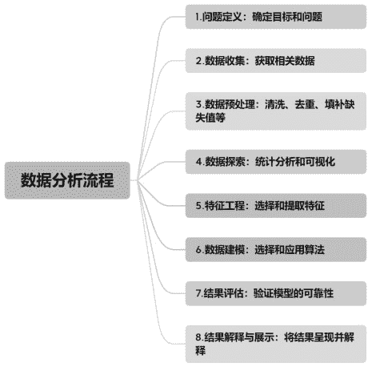

Figure 1.1 Data Analysis Process

### 1.2.1 Problem Definition

Before starting data analysis, the first step is to clarify the analysis purpose and requirements, including determining the problem to be solved, setting goals, and expected results. This stage is crucial to the entire data analysis process because it ensures the direction and effectiveness of the analysis work.

### 1.2.2 Data Collection

After clarifying the problem definition, it is necessary to collect data related to the problem, including extracting data from databases, obtaining online data through web crawlers, collecting real-time data using sensors, or obtaining user feedback through questionnaires. The data collection process needs to ensure data completeness and relevance.

### 1.2.3 Data Preprocessing

After data collection is completed, the data needs to be preprocessed, including cleaning data, removing duplicates, filling missing values, handling outliers, etc. This stage ensures data quality and consistency, providing accurate input for subsequent analysis.

### 1.2.4 Data Exploration

After data preprocessing is completed, preliminary data exploration can be conducted. Through statistical analysis and data visualization, understand the basic situation, feature distribution, correlation, etc., of the data. This helps to better understand the data and provide guidance for further analysis.

### 1.2.5 Feature Engineering

Based on the results of data exploration, further analyze data features, including feature selection, feature extraction, feature dimensionality reduction, etc. This stage can improve model performance and interpretability and reduce the risk of overfitting.

### 1.2.6 Data Modeling

After feature engineering is completed, select appropriate algorithms and models to model and analyze the data. Depending on the specific problem and data type, supervised learning, unsupervised learning, or reinforcement learning methods can be used. The goal of this stage is to discover patterns and regularities in the data.

### 1.2.7 Result Evaluation

After data modeling is completed, the model results need to be evaluated and verified, including calculating evaluation indicators such as model accuracy, recall rate, `F1` score, and using cross-validation, leave-one-out, and other methods for model verification. The purpose of this stage is to ensure the effectiveness and reliability of the model.

### 1.2.8 Result Interpretation and Presentation

The ultimate goal of data analysis is to effectively convey analysis results to decision-makers to help them make informed decisions. To achieve this goal, data analysts need to create visual elements such as charts, reports, and dashboards, and clearly articulate the meaning, key findings, and recommended actions of the data analysis results. This process needs to make full use of data while adjusting and optimizing according to specific needs and scenarios to adapt to different data types and problems. Therefore, following this data analysis process can ensure that data is fully utilized throughout the process and provide strong support for solving practical problems.

```xml
?.xml version="1.0" encoding="utf-8"?
```

## 1.3 Common Statistical Methods

In the data analysis process, statistical methods are indispensable. Statistical methods can help us describe data characteristics, analyze data relationships, estimate parameters, and test hypotheses. The following are some commonly used statistical methods.

### 1.3.1 Descriptive Statistical Analysis

Descriptive statistics are used to summarize and describe the basic characteristics of data. Common descriptive statistical indicators are as follows.

1. **Mean**: Represents the average value of the data, calculated by summing all data and dividing by the number of data points.
2. **Median**: Represents the middle value of the data; the value located in the middle position after sorting the data from smallest to largest.
3. **Mode**: Represents the value that appears most frequently in the data.
4. **Standard Deviation**: Represents the degree of dispersion of the data, calculated by taking the square root of the sum of squared differences between each data point and the mean divided by the number of data points.
5. **Variance**: Represents the degree of dispersion of the data, calculated similarly to standard deviation but without taking the square root.
6. **Quartile**: Represents the four equal division points of the data, i.e., the values at the 25%, 50%, and 75% positions.

These indicators can help us understand the central tendency, dispersion, and distribution of the data.

### 1.3.2 Exploratory Data Analysis

Exploratory Data Analysis (`EDA`) is a data analysis method that explores data structure, relationships, and anomalies through visualization and statistical methods. `EDA` can help us discover patterns, trends, and anomalies in the data, providing direction for subsequent analysis and modeling. Common `EDA` methods are as follows.

1. **Histogram**: Represents the frequency distribution of data, dividing the data into several groups and using a bar chart to represent the frequency of each group.
2. **Scatter Plot**: Represents the relationship between two variables, with the horizontal axis representing the value of one variable and the vertical axis representing the value of the other variable.
3. **Box Plot**: Represents the five-number summary of the data (minimum, first quartile, median, third quartile, and maximum), which can intuitively display the distribution and outliers of the data.


## 1.3 统计分析方法

### 1.3.2 描述性统计分析

4. **相关性分析（Correlation Analysis）**：表示两个变量之间的线性关系，常用**皮尔逊相关系数（Pearson Correlation Coefficient）**进行度量。

### 1.3.3 推断统计分析

推断统计是一种通过样本数据推断总体特性的方法。其中，常用的推断统计方法如下。

1. **置信区间（Confidence Interval）**：在一定置信水平下，对总体参数（如均值、比率、差值等）可能取值范围的估计。例如，95%的置信区间表示有 95%的概率，总体参数位于此区间内。
2. **假设检验（Hypothesis Testing）**：通过检验样本数据来推断总体参数是否满足某个假设。例如，T 检验、卡方检验和 F 检验等。
3. **参数估计（Parameter Estimation）**：利用样本数据对总体参数进行估计。例如，最大似然估计（MLE）、矩估计（MOM）和贝叶斯估计等。

推断统计是统计学的重要部分，为我们提供了从样本数据推断总体特性的科学方法。在实际应用中，推断统计可以帮助我们从有限的样本数据中获取对总体的理解，并进行合理的决策。

### 1.3.4 参数估计分析

参数估计是根据样本数据推断总体参数的方法。常用的参数估计方法如下。

1. **最大似然估计（Maximum Likelihood Estimation, MLE）**：寻找使观测到的样本数据概率最大的参数值。
2. **矩估计（Method of Moments, MOM）**：根据样本矩（如均值、方差）与总体矩相等的原则，求解总体参数。
3. **贝叶斯估计（Bayesian Estimation）**：结合先验信息和样本数据，利用贝叶斯定理求解参数的后验分布。

参数估计可以帮助我们了解总体特征，并为后续的推断统计提供依据。

### 1.3.5 假设检验分析

假设检验是一种基于样本数据对总体参数进行推断的方法。常见的假设检验方法如下。

1. **T 检验（T-Test）**：用于比较两个总体的均值差异，适用于小样本和总体标准差未知的情况。
2. **卡方检验（Chi-Square Test）**：用于检验分类变量的分布情况和关联性。
3. **F 检验（F-Test）**：用于比较两个总体的方差差异，适用于正态分布数据。
4. **方差分析（Analysis of Variance, ANOVA）**：用于比较 3 个或更多总体的均值差异。

假设检验可以帮助我们检验数据中的规律和关系，以支持或反驳某些假设。

### 1.3.6 回归分析

回归分析是一种通过建立因变量与自变量之间的数学关系来分析数据的方法。常见的回归分析方法如下。

1. **线性回归（Linear Regression）**：建立因变量与一个或多个自变量之间的线性关系。线性回归可以用于预测和解释变量之间的关系，适用于数据呈现线性关系的情况。
2. **多项式回归（Polynomial Regression）**：建立因变量与自变量的高次多项式关系。多项式回归可以捕捉非线性关系，但需要注意过拟合的风险。
3. **逻辑回归（Logistic Regression）**：建立因变量（通常为二分类变量）与自变量之间的关系，通过 sigmoid 函数将线性关系映射到概率空间。逻辑回归常用于分类和概率预测问题。
4. **非线性回归（Nonlinear Regression）**：建立因变量与自变量之间的非线性关系。非线性回归可以捕捉复杂的数据模式，但模型的选择和参数估计较为困难。

通过运用这些统计学方法，我们可以从数据中提取有价值的信息，为研究、规划、评估、监测、预测等提供依据。在实际数据分析应用中，数据分析师通常需要根据问题类型和数据特征的不同，选择并结合使用不同的统计学方法，以实现更加全面、准确和有效的数据分析，并给出解决方案。

## 1.4 数据分析与机器学习方法

机器学习是一种基于数据的智能决策方法，利用算法自动从数据中学习和提取规律，以完成特定任务或解决特定问题。与传统的统计学方法相比，机器学习具有更强的自适应性和泛化能力，可以处理大规模、高维度和复杂的数据。机器学习方法通常分为四类：**监督学习（Supervised Learning）**、**无监督学习（Unsupervised Learning）**、**强化学习（Reinforcement Learning）**和**半监督学习（Semi-supervised Learning）**。

### 1.4.1 监督学习

监督学习是一种基于已知输入—输出对的训练数据进行学习的方法，主要用于回归和分类任务。常见的监督学习算法如下。

1. **支持向量机（Support Vector Machine, SVM）**：一种基于最大间隔原则的分类和回归方法，可以处理线性和非线性问题。
2. **决策树（Decision Tree）**：一种基于树结构的分类和回归方法，直观易懂，可解释性强。
3. **随机森林（Random Forest）**：一种基于多个决策树的集成方法，具有较好的泛化能力和抗过拟合性能。
4. **深度学习（Deep Learning）**：一种基于多层神经网络的机器学习方法，适用于处理复杂的非线性关系和高维数据。

### 1.4.2 无监督学习

无监督学习是一种在没有标签数据的情况下对数据进行学习的方法，主要用于聚类、降维和特征提取任务。常见的无监督学习算法如下。

1. **K-均值聚类（K-means Clustering）**：一种基于距离的聚类方法，将数据划分为 K 个簇以最小化簇内距离。
2. **层次聚类（Hierarchical Clustering）**：一种基于树结构的聚类方法，可以生成多层次的簇结构。
3. **主成分分析（Principal Component Analysis, PCA）**：一种线性降维方法，通过提取数据的主要成分来降低数据维度。
4. **自编码器（Autoencoder）**：一种基于神经网络的降维和特征提取方法，通过重构输入数据来学习数据的低维表示。

### 1.4.3 强化学习

强化学习是一种基于智能体与环境交互的学习方法，其目标是学习一个策略，使智能体在给定的任务中获得最大的累积奖励。强化学习具有许多实际应用，如机器人控制、游戏 AI 和资源优化等。常见的强化学习算法如下。

1. **Q-学习（Q-learning）**：一种基于值函数的离线强化学习方法，通过估计行为-状态值（Q 值）来选择最佳行动。
2. **深度 Q 网络（Deep Q-network, DQN）**：一种将深度学习与 Q-学习相结合的方法，利用神经网络作为值函数近似器来处理高维输入状态空间。
3. **策略梯度方法（Policy Gradient）**：一种基于策略的在线强化学习方法，直接对策略进行优化，适用于处理连续动作空间。
4. **演员-评论家方法（Actor-Critic）**：一种结合了值函数和策略方法的强化学习算法，使用两个网络分别学习策略和值函数，以实现更稳定的学习过程。

### 1.4.4 半监督学习

半监督学习是一种介于监督学习和无监督学习之间的学习方法，它利用标记数据和未标记数据共同学习数据的表示和结构。半监督学习旨在利用未标记数据的结构信息来提高模型的泛化能力和性能。常见的半监督学习算法如下。

1. **标签传播算法（Label Propagation）**：一种基于图论的半监督学习方法，通过将标签从已标记数据传播到未标记数据来完成分类。
2. **生成对抗网络（Generative Adversarial Network, GAN）**：一种基于生成模型与判别模型对抗学习的深度学习方法，可以同时学习数据生成和分类。
3. **半监督支持向量机（Semi-supervised Support Vector Machine, S3VM）**：一种结合了监督学习和无监督学习的支持向量机方法，利用未标记数据提高分类边界的稳定性。
4. **自训练（Self-training）**：一种简单的半监督学习方法，通过将模型对未标记数据的预测结果作为伪标签来扩展训练数据集。

数据分析和机器学习在实际应用中往往紧密结合。数据分析可以帮助人们了解数据的特点、关联和分布，为机器学习模型的建立和优化提供有价值的信息。反过来，机器学习可以从数据中挖掘更深层次的规律和知识，提高数据分析的效果和准确性。

在实际应用中，数据分析和机器学习的结合主要体现在以下几个方面。

1. **特征工程**：通过数据分析发现数据的重要特征和关联，为机器学习模型提供有用的输入特征。
2. **模型选择**：根据数据的特点和需求，选择合适的机器学习算法和模型。
3. **模型评估**：利用统计学方法和评估指标，对机器学习模型的性能和效果进行评估和比较。
4. **结果解释**：将机器学习模型的预测结果与实际数据相结合，解释模型的意义和影响。

## 1.5 常见的数据分析工具

为了更好地应用数据分析方法，需要掌握相关的编程工具（如`Python`、`R`语言）和软件（如**Microsoft Excel**、**SPSS**、**SAS**等），并在实践中不断积累经验和技巧。数据分析工具可以帮助人们更高效、方便地完成数据处理、分析和可视化等任务。

### 1.5.1 编程语言和库

数据分析中，主流的编程语言是`Python`和`R`语言，其中`Python`是一种广泛应用于数据分析和机器学习的编程语言，如图 1.2 所示。

`Python`拥有如下丰富的库。

1. **`Numpy`**：用于高效处理多维数组和矩阵运算的库。
2. **`Pandas`**：用于数据处理和分析的库，提供了`DataFrame`等数据结构。
3. **`Scikit-learn`**：用于机器学习和数据挖掘的库，包含了许多常用的机器学习算法。
4. **`Matplotlib`**：用于绘制二维图形的库，提供了各种图表和绘图功能。
5. **`Seaborn`**：基于`Matplotlib`的高级数据可视化库，提供了更美观的图表和更简洁的接口。
6. **`Tensorflow`**：Google 开发的用于机器学习和深度学习的库，提供了丰富的模型和算法。

`R`语言是一种专门针对统计计算和图形绘制的编程语言，如图 1.3 所示。


图 1.2 Python 语言


图 1.3 R 语言

`R`语言具有丰富的包和函数，可以方便地进行数据分析、统计建模和可视化。主要的`R`包如下。

1. **`Dplyr`**：用于数据处理和转换的包。
2. **`Ggplot2`**：用于创建优美的图形和可视化的包。
3. **`Tidyr`**：用于整理和清洗数据的包。
4. **`Lubridate`**：用于处理和分析日期和时间数据的包。
5. **`Randomforest`**：用于实现随机森林算法的包。

### 1.5.2 数据分析软件

数据分析软件的选择取决于具体需求和场景。对于中小规模数据的日常分析，**Microsoft Excel** 就足够了；对于专业的数据可视化需求，**Tableau** 是一个很好的选择；而对于大规模的数据分析和业务智能应用，**Power BI** 可以提供更多功能。这些软件都有各自的优势和适用范围，用户可以根据自己的需求和技能水平选择合适的数据分析软件，具体如下。

**Microsoft Excel**是一款功能强大的电子表格软件，如图 1.4 所示，适用于处理、分析和可视化中小规模数据。Excel 提供了各种函数和工具，如数据排序、筛选、公式计算、条件格式化、数据透视表等，可以满足日常数据分析的需求。

**Tableau**是一款专门用于数据可视化的软件，如图 1.5 所示，可以轻松地创建各种图表和仪表板，实现数据的直观展示。Tableau 支持多种数据源，如 Excel、数据库和云平台等。它提供了丰富的图表类型和自定义选项，可以满足各种数据可视化需求。


图 1.4 Microsoft Excel


图 1.5 Tableau

**Power BI**是一款由微软推出的业务智能和数据可视化工具，如图 1.6 所示，适用于处理、分析和可视化大规模数据。Power BI 提供了数据连接、数据建模、数据转换和数据可视化等功能，可以快速地生成报告和仪表板。它与其他微软产品（如 Excel 和 SQL Server）具有良好的兼容性，并支持多种数据源，如数据库、云平台和文件等。Power BI 适用于企业和个人用户，可以满足从基本到高级的数据分析需求。


图 1.6 Power BI

### 1.5.3 大数据处理框架

随着数据量的不断增长，大数据处理框架在数据挖掘、分析和处理方面发挥着越来越重要的作用。`Apache Hadoop`和`Apache Spark`是目前市场上两个应用最为广泛的大数据处理框架。

`Apache Hadoop`是一种基于分布式文件系统（`HDFS`）的大数据处理框架，如图 1.7 所示，适用于处理大规模、分布式数据。Hadoop 提供了`MapReduce`编程模型，可以实现分布式计算和数据处理。Hadoop 生态系统还包括了如下许多其他组件。

1. **`Hive`**：一种基于 Hadoop 的数据仓库工具，提供了类似于 SQL 的查询语言`HiveQL`，可以方便地进行大数据查询和分析。
2. **`Pig`**：一个基于 Hadoop 的大数据处理平台，提供了一种高级脚本语言`Pig Latin`，用于处理和分析大规模数据。
3. **`Hbase`**：一个基于 Hadoop 的分布式列式存储系统，适用于实时读写大量数据。
4. **`Sqoop`**：一个用于在 Hadoop 和关系型数据库之间传输数据的工具。

`Apache Spark`是一种基于内存计算的大数据处理框架，如图 1.8 所示，适用于高速处理大规模数据。Spark 提供了多种编程语言接口，如`Scala`、`Java`和`Python`。Spark 生态系统包括以下组件。

1. **`Spark Core`**：Spark 的基本功能组件，提供了基于内存的分布式计算功能。
2. **`Spark SQL`**：用于处理结构化数据的组件，支持`SQL`查询和`DataFrame` API。
3. **`Spark Streaming`**：用于实时数据处理的组件，支持将实时数据流处理为批处理作业。
4. **`MLlib`**：Spark 的机器学习库，提供了多种常用的机器学习算法。
5. **`GraphX`**：Spark 的图计算库，用于处理图形数据和执行图算法。

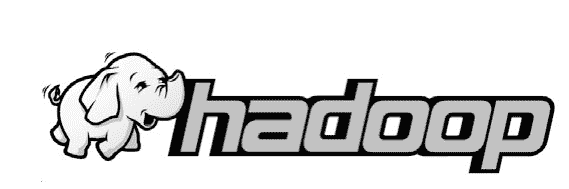

图 1.7 Hadoop

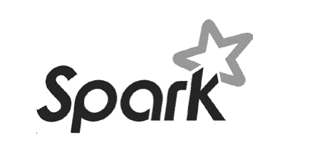

图 1.8 Spark

大数据处理框架的发展和应用推动了数据科学、机器学习等领域的进步，使处理大规模数据变得更加高效、灵活和可扩展。

### 1.5.4 云平台和数据分析服务

随着云计算技术的不断发展，越来越多的云平台和数据分析服务应运而生。这些服务为用户提供了便捷的数据处理、存储、分析和可视化等功能，同时还具备高可用性、弹性伸缩和按需付费等优势。以下是一些常见的云平台和数据分析服务。

1. **`Amazon Web Services (AWS)`**：亚马逊的云计算平台，提供了多种数据分析相关的服务，如`Amazon S3`（分布式存储服务）、`Amazon Redshift`（数据仓库服务）和`Amazon Sagemaker`（机器学习服务）等。
2. **`Google Cloud Platform (GCP)`**：谷歌的云计算平台，提供了多种数据分析相关的服务，如`Google Bigquery`（大数据查询服务）、`Google Cloud Storage`（分布式存储服务）和`Google Cloud ML Engine`（机器学习服务）等。
3. **`Microsoft Azure`**：微软的云计算平台，提供了多种数据分析相关的服务，如`Azure Blob Storage`（分布式存储服务）、`Azure Synapse Analytics`（数据仓库服务）和`Azure Machine Learning`（机器学习服务）等。

云计算在数据分析领域的应用优势主要体现在低成本、高可用性、弹性伸缩、快速部署和全球访问等方面。利用云平台和数据分析服务，企业和个人用户可以更加便捷、高效地进行数据分析工作，从而实现业务目标和提升竞争力。

## 1.6 ChatGPT 简介

`ChatGPT`，是一种革新性的人工智能（AI）技术，能够理解并生成类似人类的自然语言。这款基于生成预训练 Transformer（`GPT`）的大型语言模型（`LLM`）利用数百亿参数的强大模型，在对话体验方面实现了高度精确和流畅的表现。在众多领域，`ChatGPT`都有着广泛应用，诸如文本生成、机器翻译、文本摘要和情感分析等。通过学习大量文本数据，`ChatGPT`能够掌握语言的语法、语义和一定程度的上下文信息，这使它在回答问题、创作文章和与人类进行自然对话等任务上表现卓越。随着版本不断升级，未来的`ChatGPT`有望具备处理图片等多模态信息的能力，为用户提供更加丰富的交互体验。`ChatGPT`的 Logo 如图 1.9 所示。


图 1.9 ChatGPT

### 1.6.1 如何使用 ChatGPT

用户进入`ChatGPT`的聊天界面后，点击`+New chat`按钮以创建一个新的聊天窗口。接下来，用户可在输入框中输入文字并点击发送，即可开始与`ChatGPT`进行互动，如图 1.10 所示。值得一提的是，`ChatGPT`具有上下文信息理解和处理能力，它会记录当前聊天窗口中的所有对话内容，并根据之前的聊天内容进行回应。这一特性赋予了`ChatGPT`极大的灵活性。在后续章节中，我们将深入探讨这一特性的具体细节。

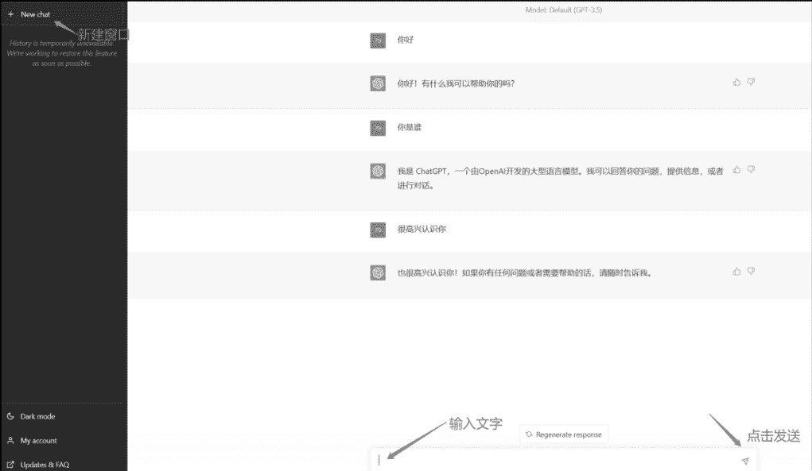

图 1.10 ChatGPT 聊天界面

> **说明**：本书不会详细介绍申请`ChatGPT`账号的过程。然而，值得一提的是，如果读者已经拥有`ChatGPT`账户并将其升级至`ChatGPT Plus`，那么除了能更快地使用`GPT-3.5`模型，还可以体验性能更强大的`GPT-4`模型，如图 1.11 所示。

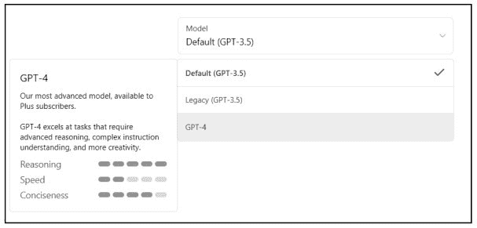

图 1.11 ChatGPT Plus 的 GPT-4

除了在聊天界面与`ChatGPT`直接交互，用户还可以通过调用`API`来使用`ChatGPT`服务。需要注意的是，OpenAI 会根据用户使用的`Token`数量进行收费。因此，用户需要访问创建一个专属的`API keys`，如图 1.12 所示。

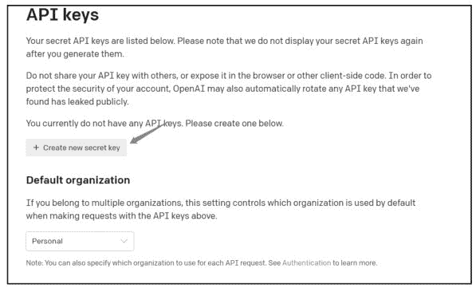

图 1.12 获取 ChatGPT API keys

### 1.6.2 ChatGPT 的核心理念


ChatGPT 的核心理念是利用大量文本数据训练深度学习模型，从而实现对自然语言的理解和生成。它采用了基于 `GPT 架构` 的模型，结合自注意力机制和 `Transformer` 网络，以捕获文本中的长距离依赖关系。

具体来说，ChatGPT 通过自回归语言建模来预测给定上下文中下一个词的概率分布。在训练阶段，大量文本数据用于预训练模型，使其学会词汇、语法、语义及各类知识。预训练完成后，模型会针对特定任务（如问题回答和对话生成）进行微调。为生成高质量的语言输出，ChatGPT 利用了一种称为束搜索的方法。在此过程中，模型根据当前上下文和概率分布选择几个最可能的词汇，然后继续生成后续词汇。这会产生多个候选序列，最后选取整体概率最高的序列作为输出。

值得强调的是，ChatGPT 不仅依赖规则和模板生成答案，还具有一定程度的推理能力。它能结合自身所学知识，针对输入的问题生成相关且有意义的回答。尽管仍存在局限性（如生成不一致或错误答案，或对某些问题缺乏深入理解），但 `OpenAI` 通过采用人类反馈强化学习（`RLHF`）训练方法，如图 1.13 所示，可以有效减少无益、失真或偏见输出。借助 `RLHF`，ChatGPT 能更好地利用内部知识，实现与人类偏好的同步与协调，提升通用性和便利性。因此，ChatGPT 在短时间内吸引了众多用户，并在自然语言处理领域取得了显著成功。

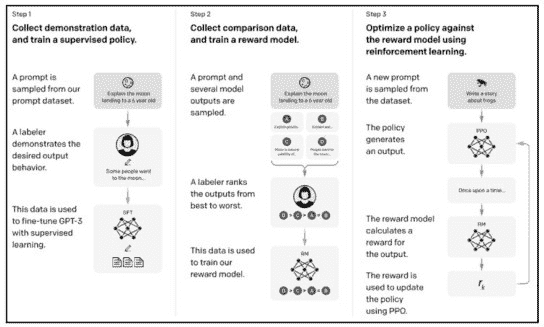

图 1.13 ChatGPT 的核心思想

### 1.6.3 ChatGPT 在数据分析中的应用

ChatGPT 在数据分析领域具有广泛的应用潜力，可以帮助企业和个人用户更高效地处理和分析数据。在数据预处理阶段，ChatGPT 可以辅助完成数据清洗和转换，自动识别数据中的异常值、缺失值和不一致。在描述性统计方面，ChatGPT 可以根据输入的数据集自动生成统计报告，快速呈现数据的基本情况。此外，ChatGPT 还能够生成符合用户需求的数据可视化图表，发现数据中的模式和关联规则，进行预测分析，以及分析文本数据中的情感倾向。

ChatGPT 在文本挖掘与分析、自动生成数据报告、自然语言查询、数据可视化、预测分析、机器学习模型优化等方面都具有广泛的应用前景。通过将自然语言转换为数据库查询语言，ChatGPT 能够简化用户访问和分析大型数据集的过程。同时，根据用户需求生成数据可视化图表，以直观地展示数据分析结果。在预测分析方面，ChatGPT 利用学到的知识为用户提供关于未来趋势和市场预测的建议，以辅助决策。此外，ChatGPT 还可以为数据科学家和工程师提供关于模型调优、特征选择和超参数优化等方面的建议，从而提高模型性能。

关于如何使用 ChatGPT 来完成数据分析任务，我们将在后续的章节中进行介绍。通过充分利用 ChatGPT，数据分析师和数据科学家可以更高效地完成各类数据分析任务，为企业和个人用户创造价值。

## 1.7 小结

本章介绍了数据分析的基础知识，以及 ChatGPT 的概述。数据分析涉及问题定义、数据收集、数据预处理、数据探索、特征工程、数据建模、结束评估及结果解释与展示等一系列步骤。在数据分析过程中，我们需要掌握常见的统计学方法和机器学习方法。同时，熟悉各种数据分析工具也是十分重要的，包括编程语言和库、数据分析软件、大数据处理框架及云平台和数据分析服务等。

在本章的最后部分，我们对 ChatGPT 进行了简要介绍。ChatGPT 是一款强大的自然语言处理工具，可以辅助数据分析师在数据分析过程中获取有价值的信息。通过了解如何使用 ChatGPT 及其核心理念，我们能够更好地利用这一工具为我们的数据分析任务提供支持。

# 第 2 章 使用 ChatGPT 准备数据

数据收集在数据分析领域中具有至关重要的地位。高质量的数据是进行有效数据分析的基础，而获取这些数据的过程往往需要耗费大量的时间和精力。随着大数据和人工智能技术的不断发展，自动化数据收集工具逐渐受到了广泛关注。其中，ChatGPT 以其强大的自然语言处理能力和机器学习技术，成为数据收集和生成领域的一大利器。

本章主要介绍如何使用 ChatGPT 准备数据，重点涉及以下知识点：

• 使用 ChatGPT 编写各种类型的数据收集脚本，包括新闻、电影评论、股票、天气、商品价格和社交媒体等数据
• 利用 ChatGPT 生成各类数据样本，如电影评论、对话、新闻标题、产品描述和图像等

在本章的学习过程中，你将深入了解如何利用 ChatGPT 编写各种类型的数据收集脚本，以便快速获取海量的数据。同时，本章还将探讨如何使用 ChatGPT 生成各种类型的数据样本。这些数据样本可以用于数据分析、机器学习模型训练和验证等多种应用场景。通过本章的学习，你将充分掌握 ChatGPT 在数据准备阶段的强大功能，为数据分析工作提供坚实的基础。

## 2.1 使用 ChatGPT 编写数据收集脚本

在数据分析过程中，数据收集是至关重要的第一步。为了更高效地收集数据，本节将介绍如何使用 ChatGPT 编写各种类型的数据收集脚本。这些脚本可以帮助我们自动化地从不同来源获取新闻、电影评论、股票、天气、商品价格和社交媒体等数据。通过学习本节内容，你将掌握使用 ChatGPT 为数据分析项目准备所需数据的方法和技巧。

### 2.1.1 使用 ChatGPT 编写抓取新闻数据脚本

抓取新闻数据是一种常见的数据收集任务，可以用于文本挖掘、自然语言处理、情感分析等领域。我们可以使用 ChatGPT 编写 `Python` 脚本来自动化地从新闻网站获取新闻数据。

假设我们现在需要抓取新浪新闻中最近一天的新闻主题数据，我们可以直接通过 ChatGPT 来编写抓取脚本，提示语如 2-1 所示。

#### 2-1 抓取新闻数据提示语

你是网络数据抓取的高手，熟练掌握 `Python` 编程语言，具有良好的网络编程基础，能够熟练使用网络爬虫框架，具备数据处理和分析能力，以及自我学习和解决问题的能力。这些技能使你能够快速、准确地抓取网络数据，并从中提取出有用的信息，为数据分析和其他领域的应用提供支持。

现在我需要抓取新浪最近一天的新闻数据，包括新闻主题、时间、摘要。抓取到对应的信息后，将这些信息存到一个 `CSV` 文件中。

请直接给我完整的 `Python` 代码，以代码块的格式输出。

#### 2-2 ChatGPT 给出的新闻抓取脚本

以下是一个 `Python` 代码示例，使用 `Requests` 和 `BeautifulSoup` 库来抓取新浪最近一天的新闻数据，并将结果存储到 `CSV` 文件中。请确保已安装这两个库，如果没有安装，请运行以下命令安装。

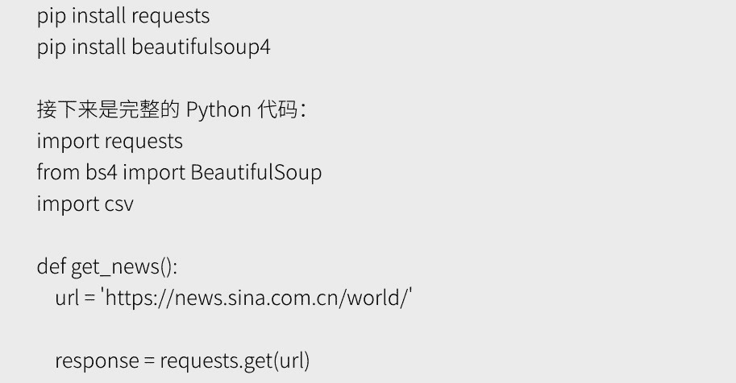
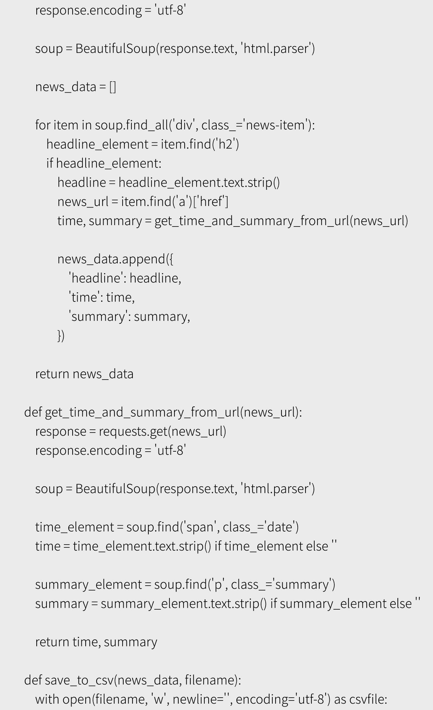
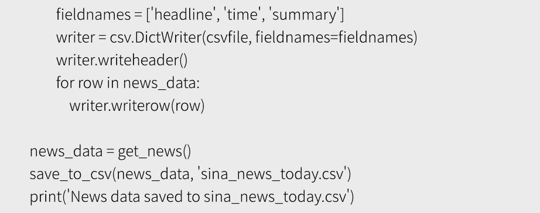

将以上代码复制到 `PyCharm` 中运行，就可以成功抓取到对应的新闻数据，部分内容如 2-3 所示。

#### 2-3 ChatGPT 抓取到的新闻数据

英媒：特朗普在法庭上做无罪辩护，2023 年 04 月 05 日 02:56

美媒：特朗普妻子梅拉尼娅将不会出庭，2023 年 04 月 05 日 01:27

“瓦格纳”负责人称已攻克巴赫穆特，乌方否认，2023 年 04 月 04 日 06:31

时隔十余年！叙利亚外长首访埃及，释放什么信号，2023 年 04 月 02 日 10:00

意大利要求禁用 ChatGPT 人工智能安全威胁被夸大了吗，2023 年 04 月 01 日 16:08

美国举办所谓第二届“民主峰会”何以闹剧收场，2023 年 04 月 01 日 13:26

特朗普受刑事指控，什么情况，2023 年 04 月 01 日 10:26

外媒：特朗普将于 4 月 4 日自首 预计不会戴手铐，2023 年 04 月 01 日 08:51

特朗普或于下周二出庭，律师透露多个细节，2023 年 04 月 01 日 08:19

短短 72 小时 全球“去美元化”战线悄然形成，2023 年 04 月 01 日 08:11

泰国 45 天免签和 30 天落地签临时政策已于 3 月 31 日截止，2023 年 04 月 01 日 04:56

特朗普将被起诉，创美国历史，2023 年 03 月 31 日 09:56

以色列与美国，就这么杠上了，2023 年 03 月 31 日 08:30

20 年后，美国参议院表决废除“伊拉克战争授权法”,2023 年 03 月 30 日 21:07

以上 ChatGPT 所生成的脚本展示了 `Python` 网络爬虫的实用性和高效性。这个脚本采用了清晰的模块化结构，并利用了成熟的第三方库进行数据爬取和解析，轻松实现了对新浪新闻数据的抓取、筛选和存储，展现了网络爬虫在数据获取方面的强大能力。

网络爬虫技术在新闻数据采集领域中具有重要的应用价值。使用 ChatGPT 编写的抓取新闻数据脚本，可以快速准确地获取目标网站的新闻信息，并对其进行处理和存储。该脚本具有高度的灵活性和可扩展性，可以适应不同网站的数据结构和需求。通过结合实时网络数据抓取和高效的数据处理技术，为相关领域的研究工作提供了及时、可靠的数据支持，具有广泛的应用前景。

### 2.1.2 使用 ChatGPT 编写抓取电影评论数据脚本

抓取电影评论数据是一种常见的数据收集任务，可以用于电影推荐、情感分析、文本挖掘等领域。我们可以使用 ChatGPT 编写 `Python` 脚本来自动化地从电影网站中获取电影评论数据。

假设我们现在需要抓取豆瓣网站上《泰坦尼克号》电影的评论数据，我们可以直接通过 ChatGPT 来编写抓取脚本，提示语如 2-4 所示。

#### 2-4 抓取电影评论数据提示语

你是网络数据抓取的高手，熟练掌握 `Python` 编程语言，具有良好的网络编程基础，能够熟练使用网络爬虫框架，具备数据处理和分析能力，以及自我学习和解决问题的能力。这些技能使你能够快速、准确地抓取网络数据，并从中提取出有用的信息，为数据分析和其他领域的应用提供支持。

现在我需要抓取豆瓣网站上《泰坦尼克号》电影的评论数据，包括评论者、评分、评论内容。在抓取到对应的信息后，将这些信息存到一个 `CSV` 文件中。

请直接给我完整的 `Python` 代码，以代码块的格式输出。

#### 2-5 ChatGPT 给出的电影评论抓取脚本

以下是一个 `Python` 代码示例，使用 `Requests` 和 `BeautifulSoup` 库来抓取豆瓣网站上某部电影的评论数据，并将结果存储到 `CSV` 文件中。请确保已安装这两个库，如果没有安装，请运行以下命令安装。


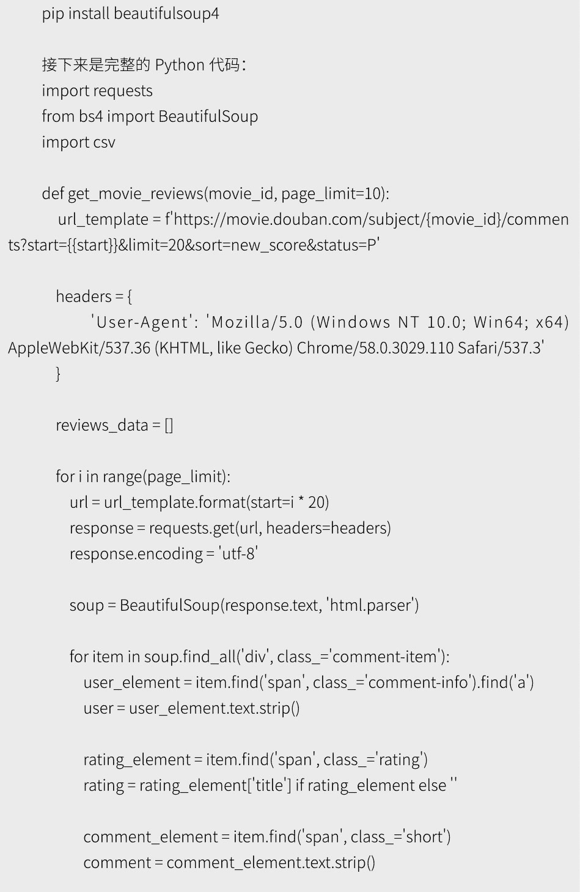
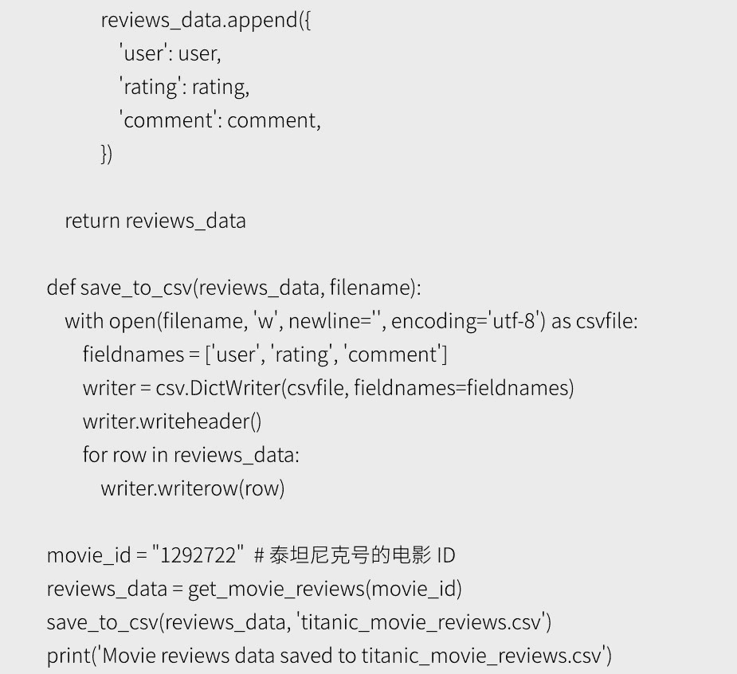

将以上代码复制到 `PyCharm` 中运行，就可以成功抓取到对应的电影评论数据，部分内容如 2-6 所示。

#### 2-6 ChatGPT 抓取到的电影评论数据

沉歌，推荐，爱你原本只是一瞬间，却在时间的洪流中成了永恒。

Doublebitch，力荐，将永远是我在电影院看过次数最多、最感动，也是最好的电影。

孔雀鱼，力荐，学校组织放映的影片，大家都好像对 Rose 和 Jack 恋爱过程感兴趣，但是让我感动的一幕是轮船将要沉没，海上乐队的绅士们整理领结，肃穆庄严地弹奏最后一曲，那一瞬间，仿佛听见一首镇魂曲在响彻。

高歌，力荐，“十年生死两茫茫，不思量，自难忘。”

琦殿，力荐，有些片子，必须得等经历过再去看。没有为爱情放弃过什么的人，不会在 Rose 从救生船上跳回大船的那一刻落泪。

宋阿慕，力荐，一部应该被记住的电影。

安獭獭，力荐，时隔那么多年依然无法忘记当初的感动。

白日梦小姐，力荐，失去的才是永恒的。

峰峰峰峰，推荐，当老年的 Rose 午夜梦回，一个长镜头穿过大堂，摇上楼梯，站在钟表前的 Jack 转过身来，意气风发，潇洒倜傥，宛如昨日。

以上 ChatGPT 生成的脚本向我们展示了 `Python` 网络爬虫的优越性和便捷性。该脚本结构清晰、模块化，并且使用了成熟的第三方库进行高效的数据爬取和解析。通过该脚本轻松实现了对豆瓣电影评论数据的抓取、筛选和存储，再次证明了网络爬虫在数据获取方面的不可或缺性。

电影评论数据是电影分析领域的重要数据源之一。使用 ChatGPT 编写的抓取电影评论数据脚本，能够有效地获取豆瓣等网站的电影评论信息，并对其进行筛选和存储。该脚本具有高度的灵活性和可扩展性，能够应对不同网站的数据结构和需求。通过结合实时网络数据抓取和高效的数据处理技术，为相关领域的研究工作提供了及时、可靠的数据支持，有助于深入挖掘电影的社会文化背景和观众心理，为电影产业的发展提供有力的支持。

### 2.1.3 使用 ChatGPT 编写抓取股票数据脚本

抓取股票数据是金融领域数据分析的一个关键环节，可以用于股票预测、量化投资、风险管理等领域。我们可以使用 ChatGPT 编写 `Python` 脚本来自动化地从金融网站获取股票数据。

假设我们现在需要抓取雅虎财经网站上的某只股票的历史数据，我们可以直接通过 ChatGPT 来编写抓取脚本，提示语如 2-7 所示。

#### 2-7 抓取股票数据提示语

你是金融数据抓取的高手，熟练掌握 `Python` 编程语言，具有良好的网络编程基础，能够熟练使用网络爬虫框架，具备数据处理和分析能力，以及自我学习和解决问题的能力。这些技能使你能够快速、准确地抓取网络数据，并从中提取出有用的信息，为金融领域的数据分析和其他应用提供支持。

现在我需要抓取雅虎财经网站上苹果公司（`AAPL`）股票的历史数据，包括日期、开盘价、最高价、最低价、收盘价。在抓取到对应的信息后，将这些信息存到一个 `CSV` 文件中。

请直接给我完整的 `Python` 代码，以代码块的格式输出。

#### 2-8 ChatGPT 给出的股票数据抓取脚本

以下是一个 `Python` 代码示例，使用 `Pandas` 和 `yfinance` 库来抓取雅虎财经网站上苹果公司（`AAPL`）的历史股票数据，并将结果存储到 `CSV` 文件中。请确保已安装这两个库，如果没有安装，请运行以下命令安装。

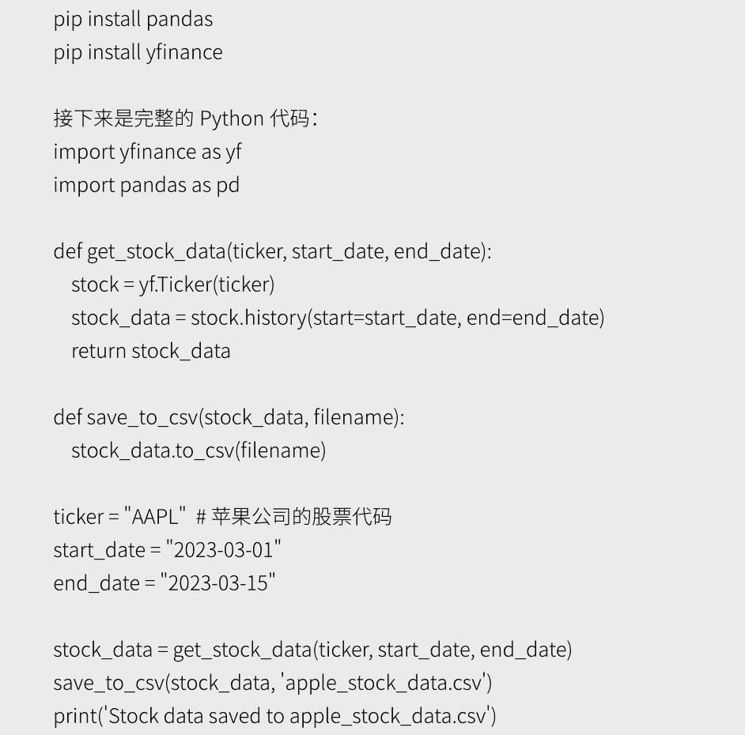

将以上代码复制到 `PyCharm` 中运行，就可以成功抓取到对应的股票历史数据，部分内容如 2-9 所示。

#### 2-9 ChatGPT 抓取到的股票数据

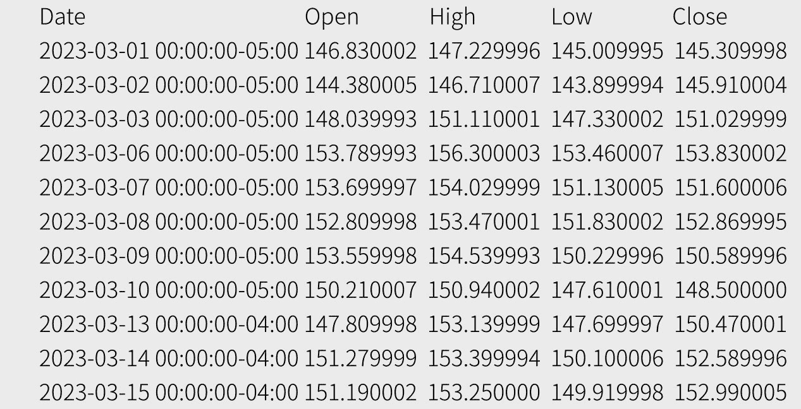

以上 ChatGPT 生成的股票数据脚本向我们展示了 `Python` 网络爬虫在金融领域的实用性和强大功能。脚本设计紧凑、模块化，且采用了优秀的第三方库以提高数据抓取和解析的效率。这个脚本能够轻松地抓取、筛选和存储股票数据，再次验证了网络爬虫在金融数据分析中的关键作用。

股票数据是金融分析的重要基础。ChatGPT 编写的股票数据抓取脚本能够准确地获取股票交易网站的数据，并进行精确的筛选和存储。此脚本具有出色的适应性和可拓展性，可应对不同数据源和需求的挑战，结合实时网络数据抓取和高效的数据处理技术，为金融领域的研究提供了可靠、实时的数据支持，可以助力深入研究股票市场的运作机制和投资者行为，对推动金融市场的稳定和发展具有重大的实践意义。

### 2.1.4 使用 ChatGPT 编写抓取天气数据脚本

抓取天气数据是一种常见的数据收集任务，可以用于气象预报、气候研究、农业生产等领域。我们可以使用 ChatGPT 编写 `Python` 脚本来自动化地从天气网站获取天气数据。

假设我们现在需要抓取中国天气网上杭州未来一周的天气数据，我们可以直接通过 ChatGPT 来编写抓取脚本，提示语如 2-10 所示。

#### 2-10 抓取未来一周杭州天气数据提示语

你是天气数据抓取的专家，熟练掌握 `Python` 编程语言，具有良好的网络编程基础，能够熟练使用网络爬虫框架，具备数据处理和分析能力，以及自我学习和解决问题的能力。这些技能使你能够快速、准确地抓取网络数据，并从中提取出有用的信息，为气象领域的数据分析和其他应用提供支持。

现在我需要抓取中国天气网上杭州未来一周的天气数据，包括日期、天气状况、最高温度、最低温度、风向和风力。抓取到对应的信息后，将这些信息存到一个 `CSV` 文件中。

请直接给我完整的 `Python` 代码，以代码块的格式输出。

#### 2-11 ChatGPT 给出的未来一周杭州天气数据抓取脚本

以下是一个 `Python` 代码示例，使用 `Requests` 和 `BeautifulSoup` 库来抓取中国天气网上杭州未来一周的天气数据，并将结果存储到 `CSV` 文件中。请确保已安装这两个库，如果没有安装，请运行以下命令安装。

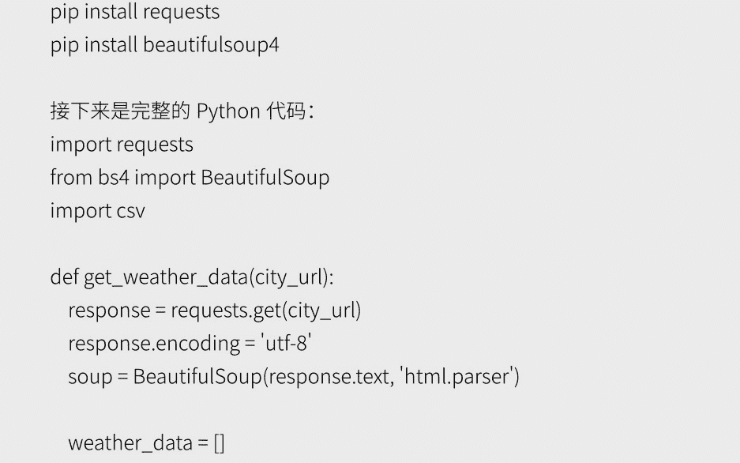
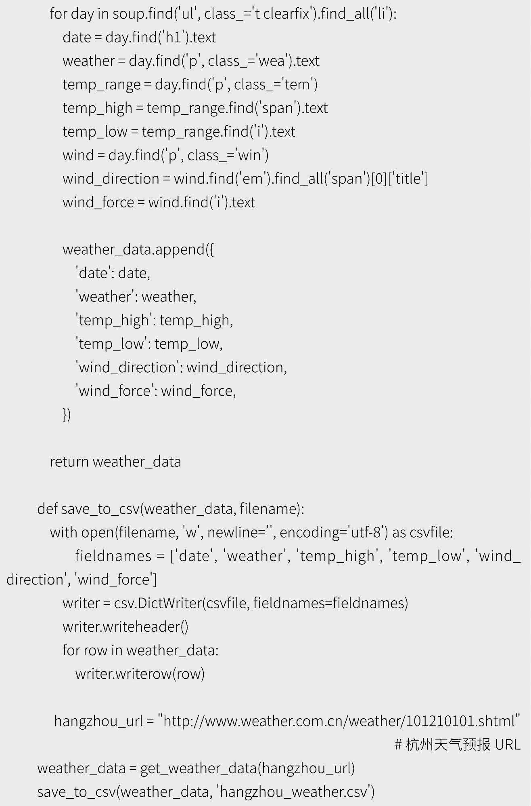
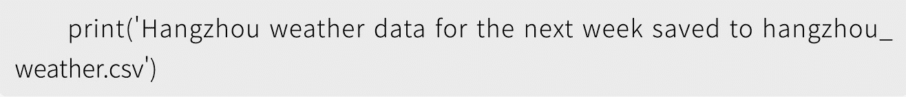

将以上代码复制到 `PyCharm` 中运行，就可以成功抓取到对应的未来一周杭州天气数据，部分内容如 2-12 所示。

#### 2-12 ChatGPT 抓取到的未来一周杭州天气数据

2023-04-07，小雨，13℃,8℃，东风，3-4 级

2023-04-08，小雨，16℃,10℃，东风，3-4 级

2023-04-09，多云，20℃,12℃，东南风，3-4 级

2023-04-10，多云，23℃,14℃，西南风，3-4 级

2023-04-11，阵雨，22℃,15℃，东风，3-4 级

2023-04-12，小雨，20℃,15℃，东北风，3-4 级

2023-04-13，多云，21℃,13℃，东北风，3-4 级

以上 ChatGPT 生成的天气数据脚本展示了 `Python` 网络爬虫在环境领域的实际应用和高效性能。脚本逻辑严谨、分层清晰，同时利用了成熟的第三方库来提高数据获取和解析的速度。通过这个脚本，我们可以轻松地抓取、筛选和存储来自天气网站的天气数据，进一步显示了网络爬虫在环境数据分析中的重要地位。

天气数据在气候变化研究、灾害预防和环境保护等领域具有重要意义。利用 ChatGPT 编写的天气数据抓取脚本，我们能够迅速地获取气象观测站的实时数据，并进行有针对性的筛选和存储。这个脚本具备优良的灵活性和可扩展性，可以适应不同天气网站的数据格式和需求。借助实时网络数据抓取和高效的数据处理技术，为环境领域的研究提供了宝贵、准确的数据支持，有助于分析气候变化趋势，制定科学的环境保护政策。

### 2.1.5 使用 ChatGPT 编写抓取商品价格数据脚本

抓取商品价格数据是一种常见的数据收集任务，可以用于价格监测、市场分析、竞争对手研究等领域。我们可以使用 ChatGPT 编写 `Python` 脚本来自动化地从电商网站获取商品价格数据。

假设我们现在需要抓取某电商网站（如京东）上的某类商品（如手机）的价格数据，我们可以直接通过 ChatGPT 来构建抓取脚本，提示语如 2-13 所示。


### 2.1.6 Using ChatGPT to Write Scripts for Scraping Social Media Data

#### 2-13 Prompt for Scraping Mobile Phone Price Data from an E-commerce Site

You are an expert in scraping product price data, proficient in the `Python` programming language, with a solid foundation in network programming, skilled in using web crawling frameworks, possessing data processing and analysis capabilities, as well as self-learning and problem-solving abilities. These skills enable you to quickly and accurately scrape web data and extract useful information from it, providing support for data analysis and other applications in the e-commerce field.

Now I need to scrape price data for mobile phone products on an e-commerce website, including product name and product price. After scraping the corresponding information, store this information in a `CSV` file.

Please provide the complete `Python` code directly, output in code block format.

ChatGPT provided the response shown in 2-14 based on the requirements.

#### 2-14 Mobile Phone Price Data Scraping Script Provided by ChatGPT

The following is a `Python` code example using the `Requests` and `BeautifulSoup` libraries to scrape mobile phone product price data from an e-commerce website and store the results in a `CSV` file. Please ensure these two libraries are installed; if not, please run the following command to install them.

`pip install requests`

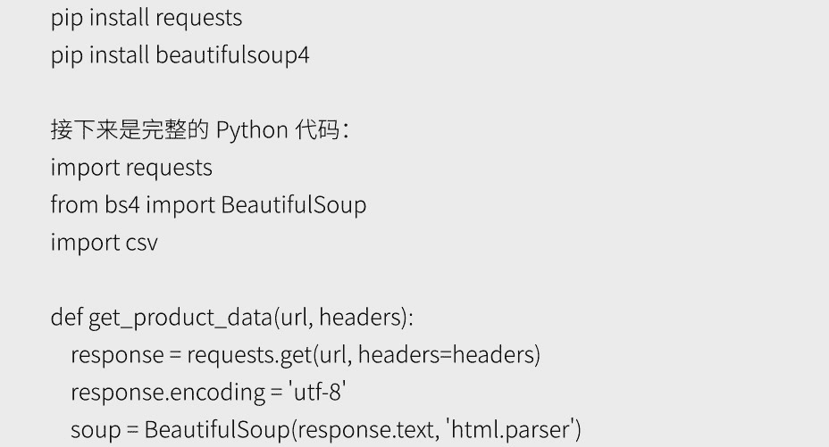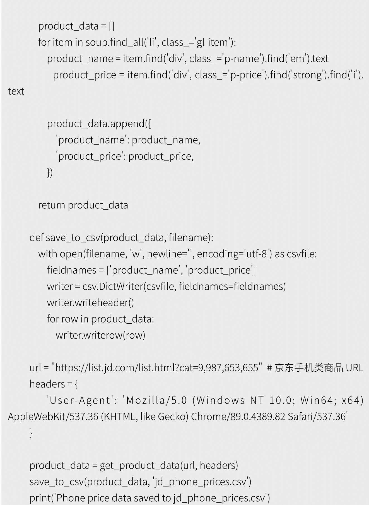

Copy the above code into PyCharm and run it to successfully scrape the corresponding mobile phone product price data. Partial content is shown in 2-15.

#### 2-15 Mobile Phone Price Data Scraped by ChatGPT

```
product_name,product_price
Redmi Note 12 Turbo 5G Snapdragon 7+ Gen 2 Ultra-narrow Four-sided OLED Straight Screen 64MP 8GB+256GB Carbon Fiber Black Smartphone Xiaomi Redmi，1999.00
Xiaomi 13 Leica Optical Lens Snapdragon 8 Gen 2 Ultra-narrow Screen 120Hz High Refresh 67W Fast Charge 12+256GB Distant Mountain Blue 5G Phone，4599.00
Redmi K50 Ultra Snapdragon 8+ Flagship Processor 100MP OIS 120W+5,000mAh 12GB+256GB Silver Trace Xiaomi Redmi K50 Ultra,2609.00
Meizu 20 PRO 12GB+256GB Dawn Silver Snapdragon 8 Gen 2 Flagship Chip 5,000mAh Battery Supports 50W Wireless Fast Charge Ultra-thin Body Design 5G Phone，4,399.00
OPPO Find X6 Pro 16GB+512GB Flying Spring Green Triple Main Cameras Hasselblad Imaging 100W Flash Charge Snapdragon 8 Gen 2 Flagship Chip 5G Camera Phone，6,999.00
realme GT Neo5 240W Light-speed Charge Awakening Halo System 144Hz 1.5K Straight Screen Snapdragon 8+ 5G Chip 16+1TB Holy Land White 5G Phone，3,499.00
Meizu 20 12GB+512GB Pioneer Gray Snapdragon 8 Gen 2 Flagship Chip 144Hz Esports Straight Screen Supports 67W Fast Charge Ultra-thin Body Design 5G Phone，3,799.00
Redmi K60 Snapdragon 8+ Processor 2K High-brightness Screen 64MP Ultra-clear Camera 5500mAh Long Battery Life 12GB+256GB Ink Feather Xiaomi Redmi 5G,2,699.00
Apple iPhone 14 Pro (A2892) 256GB Deep Purple Supports Mobile/Unicom/Telecom 5G Dual SIM Phone [King Card],8,809.00
Redmi Note11T Pro 5G Dimensity 8100 144Hz LCD Flagship Straight Screen 67W Fast Charge 6GB+128GB Midnight Black 5G Smartphone Xiaomi Redmi，1499.00
Redmi Note12 5G 120Hz OLED Screen Snapdragon 4 Mobile Platform 5000mAh Long Battery Life 6GB+128GB Midnight Black Smartphone Xiaomi Redmi，1,199.00
```

The above mobile phone price data scraping script generated by ChatGPT demonstrates the practical application and high efficiency of `Python` web crawlers in the e-commerce field. The script logic is rigorous and clearly layered, while utilizing mature third-party libraries to improve the speed of data acquisition and parsing. Through this script, we can easily scrape, filter, and store product price data from e-commerce websites, further demonstrating the important position of web crawlers in e-commerce data analysis.

Product price data is of great significance in market competition analysis, price monitoring, and product promotion. Using the product price data scraping script written by ChatGPT, we can quickly obtain real-time price data from e-commerce websites and perform targeted filtering and storage. This script has excellent flexibility and scalability, adapting to different data formats and requirements of e-commerce websites. With real-time web data scraping and efficient data processing technology, it provides valuable and accurate data support for research in the e-commerce field, helping to formulate scientific market strategies and conduct competitor research.

#### 2-16 Prompt for Scraping Douyin Toutiao (Headlines) Data

You have extensive `Python` programming experience and web crawling knowledge, enabling you to efficiently scrape data from social media websites and process it effectively. Through the analysis of real-time hot spots and popular topics, you can provide strong support for public opinion monitoring and marketing.

Now I need to scrape Douyin Toutiao data, including title and click count (hot value). After scraping the corresponding information, store this information in a `CSV` file.

Please provide the complete `Python` code directly, output in code block format.

ChatGPT provided the response shown in 2-17 based on the requirements.

#### 2-17 Douyin Toutiao Data Scraping Script Provided by ChatGPT

Douyin uses dynamic loading to obtain Toutiao data, so using `Requests` to directly get static pages cannot find the relevant data. Here we can use `Selenium` to simulate browser operations, allowing it to load the data we need. You need to install the `Selenium` library and the corresponding browser driver (e.g., `ChromeDriver`).

The following is a `Python` code example using `Requests` and `BeautifulSoup` libraries to scrape Douyin Toutiao data and store the results in a `CSV` file. Please ensure these two libraries are installed; if not, please run the following command to install them.

`pip install requests`

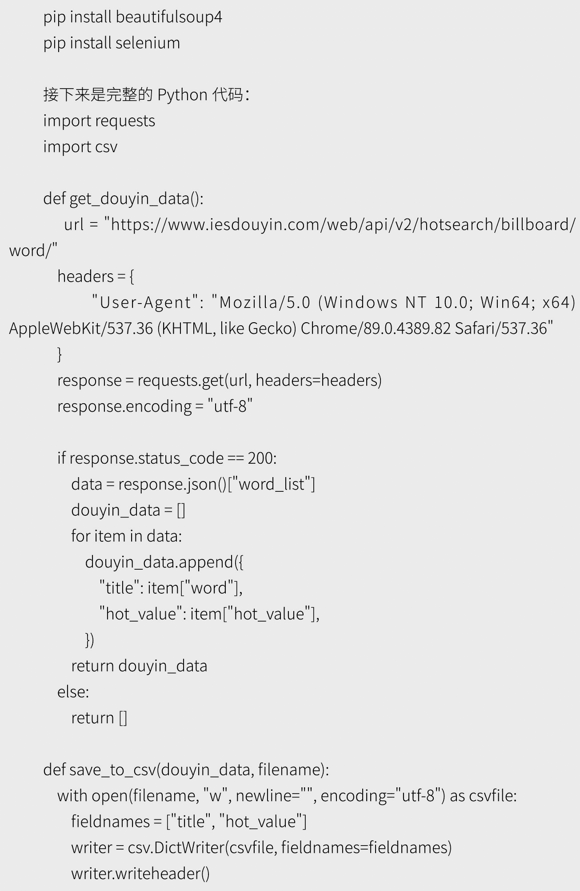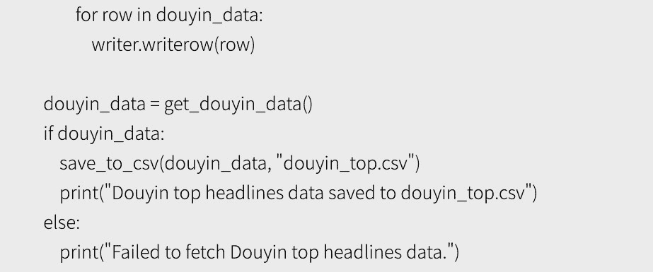

Copy the above code into PyCharm and run it to successfully scrape the corresponding Douyin Toutiao data. Partial content is shown in 2-18.

#### 2-18 Douyin Toutiao Data Scraped by ChatGPT

```
title,hot_value
Court rules Shen Na and Zhang Jie house purchase did not involve order jumping，11,302,000
Bank responds to man's 0.94 yuan withdrawal rounded to zero，10,939,924
Saudi and Iranian Foreign Ministers meet in Beijing for first time，9,921,444
Zhang Lei posts suspected farewell to hosting stage，9,898,802
Painting Jianghu: The Bad People Episode 7，9,888,518
Procuratorial Storm: Bao Bei'er plays villain again，9,694,277
Macron interacts with Huang Bo handshake，9,581,863
Fan Chengcheng's contract with Yuehua expires, not renewed，9,552,874
Jisoo FLOWER Dance Version，9,522,749
Liu Guoliang re-elected as Chinese Table Tennis Association Chairman，9,474,615
```

The above Douyin Toutiao data scraping script generated by ChatGPT demonstrates the practical application and high efficiency of `Python` web crawlers in the social media field. The script logic is clear and structure concise, while utilizing mature third-party libraries to improve the speed of data acquisition and parsing. Through this script, we can easily scrape, filter, and store real-time data from Douyin Toutiao, further demonstrating the key role of web crawlers in public opinion analysis and hot spot mining.

Douyin Toutiao data is of great significance in understanding social hot spots, analyzing public attention, and formulating marketing strategies. Using the Douyin Toutiao data scraping script written by ChatGPT, we can quickly obtain real-time headline data from social media websites and perform targeted filtering and storage. This script has good adaptability and scalability, adapting to the data formats of different social media websites.

## 2.2 Generating Data with ChatGPT

In the field of data analysis, obtaining high-quality data is crucial. Besides collecting data from existing data sources, we can also use ChatGPT to generate various types of data samples. This method can significantly shorten the time for data acquisition and preprocessing, thereby accelerating the speed of data analysis. In this section, we will introduce how to use ChatGPT to generate various types of data samples, including movie reviews, dialogues, news headlines, product descriptions, and images. Next, we will introduce the generation methods for each type of data one by one.

### 2.2.1 Using ChatGPT to Generate Movie Review Data Samples

We can use ChatGPT to generate various types of movie reviews, such as positive reviews, negative reviews, neutral reviews, etc. Below, we will introduce how to use ChatGPT to generate movie review data samples.

To generate review data that meets requirements, first determine the type of reviews needed, such as positive, negative, or neutral reviews. Next, determine the length and format of the reviews. Once these elements are determined, we can directly interact with ChatGPT to let it generate the required data samples for us.

For example, if we want to generate some data for the sci-fi movie *Interstellar*, we can use the following prompt to interact with ChatGPT to generate suitable review data, as shown in 2-19.

#### 2-19 Prompt for Generating Movie Reviews

You are a movie review expert, possessing keen observation and profound understanding of movies, able to accurately evaluate various aspects of a movie, including plot, acting, sound effects, cinematography, art, etc., and integrate these aspects to form reviews with unique insights and in-depth analysis. In addition, you have a solid reserve of movie knowledge and high cultural literacy, able to connect movie works with history, society, culture, and other aspects, providing the audience with more comprehensive and in-depth interpretations.

Now please generate 3 positive reviews, 3 negative reviews, and 3 neutral reviews for *Interstellar*. Each review must not exceed 100 words. The format is as follows.

【Review 1】：
【Review 2】：

ChatGPT generated the review data samples as shown in 2-20 based on the requirements.

#### 2-20 Review Data Samples Generated by ChatGPT

**Positive Reviews**

【Review 1】：*Interstellar* profoundly explores the mysteries of time and space, complemented by exquisite visuals and a tense plot, making it a sci-fi masterpiece.

【Review 2】: The film excels in portraying the father-daughter relationship, combining it with the future prospects of human civilization, creating a shocking emotional experience.

【Review 3】: The sound effects and music are excellent, matching various scene transitions, making one feel shocked and boiling with excitement.

**Negative Reviews**

【Review 1】: Although *Interstellar* has exquisite visuals, its plot development is tedious and lengthy, making people feel bored.

【Review 2】: The film's settings regarding the concept of time are relatively complex, making it difficult for the audience to understand and accept, affecting the overall viewing experience.

【Review 3】: The ending of the film seems slightly far-fetched, lacking a certain logic, making people feel incomplete.

**Neutral Reviews**

【Review 1】: The film is exquisite in production and special effects, but the plot is relatively plain, lacking outstanding highlights.

【Review 2】: The character portrayal in the film is relatively singular, lacking in-depth exploration and expression, appearing somewhat thin.

【Review 3】: The film's thematic ideas are worth exploring in depth, but the narrative technique has issues, affecting the profound expression of the theme.

When a large amount of data needs to be generated (e.g., 1,000 entries), we can request the corresponding quantity in the prompt, and then continuously input "Continue" to obtain the subsequent content.

Note: The output document length limit of ChatGPT varies depending on the API or platform used. Generally, APIs and platforms have their own text length limits. For example, the maximum text length of `OpenAI GPT-3` is 4,096 characters, while some chat applications may set smaller text length limits. Therefore, if you need to use ChatGPT's output text on a specific platform or application, please check the text length limit of that platform or application first.

Of course, besides the above tedious operation, we can also achieve fast, automated generation by calling the API. For movie reviews, we can automatically generate a large number of reviews related to the movie by inputting movie-related information (such as movie name, genre, actors, director, etc.) through the API interface. In addition, for the convenience of user operation, parameters for the number of generated reviews can be set in the API interface to generate a specified number of reviews at once. At the same time, according to user needs, the length and content style of generated reviews can be customized to meet the needs of different users. For example, parameters such as the length and language style of generated reviews can be set to generate diversified reviews that meet user requirements.

Then obtain ChatGPT's answers by calling the API, as shown in code 2-21.

#### 2-21 Calling ChatGPT API to Generate Reviews

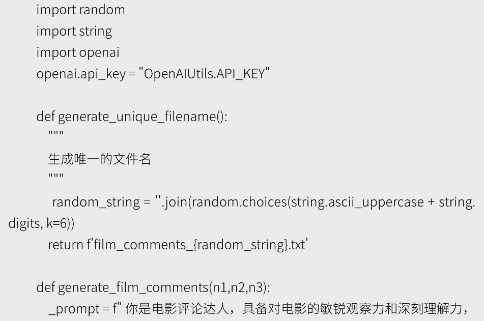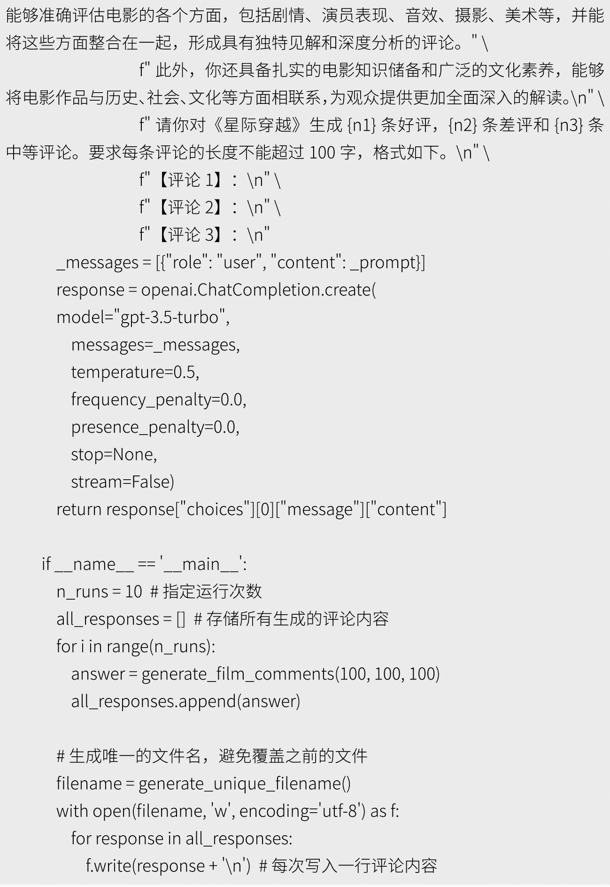

The above code implements calling the `OpenAI GPT-3.5` model to generate multiple reviews about the movie *Interstellar*, including positive, negative, and neutral reviews. After each review generation, all reviews are saved in different files to avoid overwriting previous files. The implementation of this code uses `Python`'s random string generator and `OpenAI`'s `API` for automatic review generation, allowing multiple reviews to be generated at once, improving efficiency and accuracy.

The `OpenAIUtils.API_KEY` in the above code needs to be manually filled in by the user with their own account Key, and `OpenAI` charges based on the number of `Token`s requested by the user.

In summary, using ChatGPT to generate movie review data samples can help us quickly generate a large amount of movie review data, which is very useful for movie review analysis, recommendation systems, and market research. At the same time, because ChatGPT uses advanced technologies such as neural networks, its generated reviews can be very close to human language and thinking patterns, thereby enhancing the readability and accuracy of the reviews.

Note: The reviews generated by ChatGPT are not perfect; some reviews may have grammatical or logical errors, or may not be entirely consistent with human views. Therefore, when using ChatGPT to generate review data, we need to screen and verify the generated data to ensure data quality and accuracy. At the same time, we also need to perform certain post-processing and analysis on the generated data to extract useful information, mine potential patterns and trends, to support related business applications.

### 2.2.2 Using ChatGPT to Generate Dialogue Data Samples

In dialogue data generation, we can use ChatGPT to generate various types of dialogue scenarios. For example, daily conversations, customer service, technical support, etc. Below, we will introduce how to use ChatGPT to generate dialogue data samples.

To generate dialogue data that meets requirements, first determine the required dialogue scenario and roles. Next, determine the length and format of the dialogue. Once these elements are determined, we can directly interact with ChatGPT to let it generate the required data samples for us.

For example, if we want to generate some data applicable to technical support scenarios, we can use the following prompt to interact with ChatGPT to generate suitable dialogue data, as shown in 2-22.

#### 2-22 Prompt for Generating Dialogue Data

You are a technical support expert with rich technical knowledge and problem-solving abilities. Now, please conduct a dialogue with a user on how to solve Wi-Fi connection issues. The dialogue content should be concise and clear, with a total of 4 rounds of dialogue. The dialogue format is as follows.

User: [Problem Description]
Technical Support: [Answer]
...

ChatGPT generated the dialogue data samples as shown in 2-23 based on the requirements.

#### 2-23 Dialogue Data Samples Generated by ChatGPT

User: My computer cannot connect to Wi-Fi, but other devices can connect successfully.
Technical Support: Please first check if Wi-Fi is turned on on the computer, try turning it off and on again.
User: Already tried, but still cannot connect.
Technical Support: Please try restarting the computer and router, and ensure the distance between the computer and router does not exceed 10 meters.
User: Still cannot connect after restarting computer and router, distance is not the issue.
Technical Support: Try forgetting the Wi-Fi network and reconnecting. If that doesn't work, you may need to update the computer's wireless network card driver.
User: Tried forgetting and reconnecting Wi-Fi, still cannot connect.
Technical Support: Please go to Device Manager, find the wireless network card, right-click and select Update Driver. If it still cannot connect to Wi-Fi after updating, you may need to contact the computer manufacturer or network service provider for more help.

When a large amount of data needs to be generated (e.g., 1,000 entries), we can request the corresponding quantity in the prompt, and then continuously input "Continue" to obtain the subsequent content. At the same time, fast, automated generation can be achieved by calling the API, as shown in 2-24.

#### 2-24 Calling ChatGPT API to Generate Dialogue Data

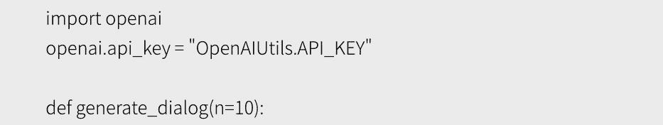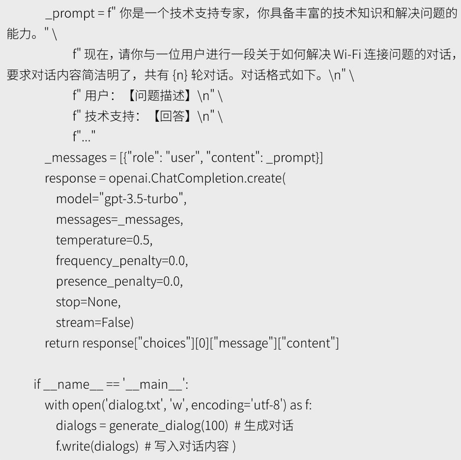

The above code defines a function `generate_dialog`, whose purpose is to generate a dialogue between a user and a technical support person on how to solve Wi-Fi connection issues. This function uses `OpenAI`'s `GPT-3.5` language model to generate new dialogue content based on given prompts and historical dialogue. The number of dialogue rounds can be freely controlled, and the dialogue content will be saved to a file named `dialog.txt`.

In summary, using ChatGPT to generate dialogue data samples can help us quickly generate a large amount of dialogue data, which is very useful in fields such as chatbots, dialogue systems, natural language understanding, and processing. At the same time, because ChatGPT uses advanced technologies such as neural networks, its generated dialogues can be very close to human language and thinking patterns, thereby enhancing the readability and accuracy of the dialogues.

In addition, we can set more parameters for the dialogue data generated by ChatGPT to meet the needs of different scenarios. For example, the emotion and language style of the dialogue can be set to adapt to different scenarios such as commercial customer service, psychological counseling, and leisure entertainment. At the same time, we can also adjust the complexity and depth of the dialogue according to needs to generate dialogue data that is more in line with actual applications.

### 2.2.3 Using ChatGPT to Generate News Headline Data Samples

In news headline generation, we can use ChatGPT to generate various types of news headlines, such as politics, technology, entertainment, etc. Below, we will introduce how to use ChatGPT to generate news headline data samples.

To generate news headline data that meets requirements, first determine the theme and type of the news. Next, determine the number of headlines needed. Once these elements are determined, we can directly interact with ChatGPT to let it generate the required data samples for us.

For example, if we want to generate some technology news headlines, we can use the following prompt to interact with ChatGPT to generate suitable headline data, as shown in 2-25.

#### 2-25 Prompt for Generating News Headline Data

Now you are a news editor-in-chief, possessing good news literacy, accurate language expression ability, keen observation, quick reaction and processing ability, and excellent editing ability. The comprehensive application of these abilities enables you to write attractive news headlines that attract more readers to pay attention to your reports. Please generate headlines for the following 10 technology-related news events from a professional perspective. Headlines should be concise and attractive. News events are as follows.

Apple releases brand new iPhone
Breakthrough research in the field of artificial intelligence
Tesla launches new electric vehicle
Amazon launches new generation of delivery drones
Cybersecurity summit focuses on privacy protection
Facebook launches virtual reality social platform
SpaceX successfully achieves Mars landing
Microsoft releases brand new operating system
5G technology empowers smart city construction
Biotechnology breakthrough achieves early cancer diagnosis

ChatGPT generated the news headline data samples as shown in 2-26 based on the requirements.

#### 2-26 News Headline Data Samples Generated by ChatGPT

Brand New iPhone: Apple Unveils Annual Flagship Product
AI Innovation: Breakthrough Research Leads Future Tech Trends
Tesla New Product Debut: Disrupting Traditional EV Market
Amazon Drones: Delivery Services Usher in Revolutionary Innovation
Cybersecurity Summit: Focus on Personal Privacy, Guarding the Digital World
Facebook Virtual Reality: A New Era of Social Networking Connecting Real and Virtual
SpaceX Mars Journey: Humanity's First Successful Landing on Mars
Microsoft Brings Brand New OS, Redefining Desktop Experience
Smart City Construction: 5G Technology Empowers Future Urban Life
Biotech New Breakthrough: Major Breakthrough in Early Cancer Diagnosis

We can also directly ask ChatGPT to generate headlines around a single theme. For example, below we continue the dialogue, asking ChatGPT to generate 10 headlines around the iPhone. The generated headlines are shown in 2-27.

#### 2-27 Headlines About iPhone Generated by ChatGPT

iPhone New Release: Larger Screen, Faster Speed, Stronger Camera
New iPhone Equipped with A15 Chip, Performance Improved by 70%
iPhone New Design: Curved Edges, Matte Black Color


### 2.2.3 使用 ChatGPT 生成新闻标题数据样本

- iPhone 首次采用 120Hz 刷新率屏幕，流畅度大幅提升
- iPhone 搭载全新的`LiDAR`扫描技术，`AR`应用更强大
- iPhone 全系列支持`5G`网络，下载速度飞快
- iPhone 多任务处理能力大幅提升，同时打开多个`App`无压力
- iPhone 新款摄像头：光学变焦、夜景模式全面升级
- iPhone 新增`MagSafe`磁吸充电技术，充电更方便
- iPhone 全新发布：保护用户隐私的重大升级

当需要生成大量的新闻标题时，我们可以在提示语中要求生成对应的数量，再通过不断输入“继续”，获取到后面的内容。同时，可以通过调用`API`的方式，实现快速、自动化的生成，如 2-28 所示。

**2-28 调用 ChatGPT API 生成新闻标题数据**

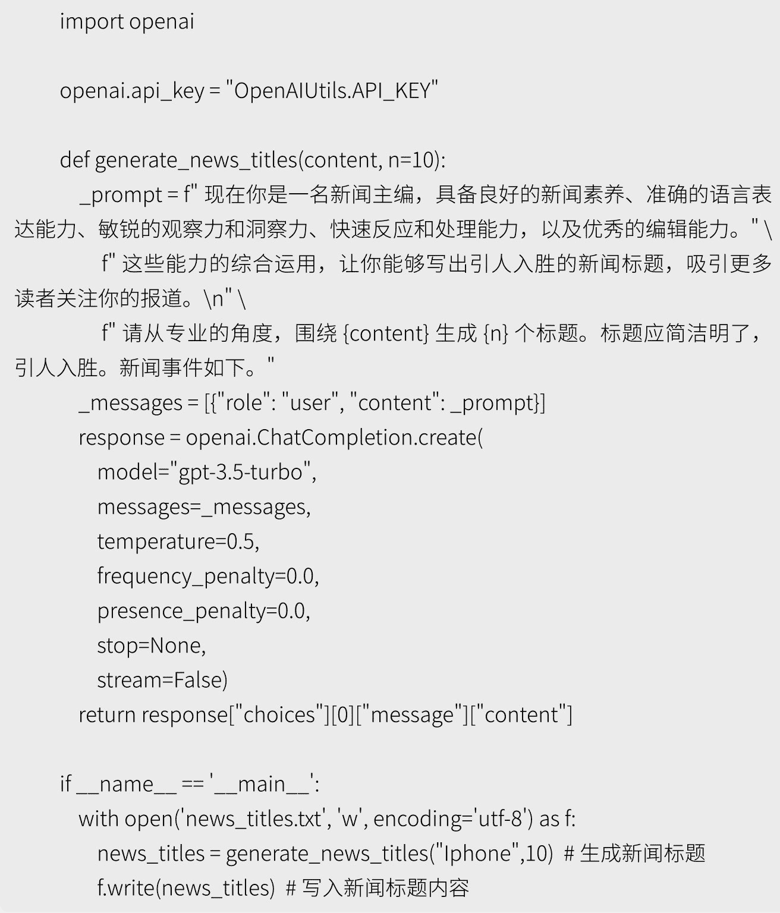

这段`Python`代码定义了一个函数 `generate_news_titles`，它使用`OpenAI API`中的 `GPT-3.5`语言模型，生成围绕给定的新闻事件内容的新闻标题。函数的输出是一个字符串，包含了 `n`个生成的新闻标题。代码还创建了一个文本文件 `news_titles.txt`，并将生成的新闻标题写入该文件中。

综上所述，使用`ChatGPT`生成新闻标题数据样本可以帮助我们快速生成大量的新闻标题，这在新闻推荐系统、新闻编辑和排版等领域非常有用。同时，由于`ChatGPT`使用了神经网络等先进技术，其生成的新闻标题可以非常贴近人类语言和思维方式，从而增强了标题的吸引力和可读性。

此外，我们还可以为`ChatGPT`生成的新闻标题设定更多的参数，以满足不同场景的需求。例如，可以设置标题的情感和语言风格，以适应正式、幽默、紧张等不同类型的新闻。同时，我们也可以根据需求调整标题的复杂性和深度，以便生成更符合实际应用的新闻标题数据。

### 2.2.4 使用 ChatGPT 生成产品描述数据集

在电商平台或线上商城中，产品描述是吸引消费者购买的关键因素之一。通过使用`ChatGPT`生成产品描述数据集，我们可以快速创建各种类型的产品描述，从而提升产品的吸引力和销量。在本小节中，我们将介绍如何使用`ChatGPT`生成产品描述数据集。

首先，确定要生成描述的产品类型和所需描述的数量。接着，根据这些要素，我们可以与`ChatGPT`进行交互，让它为我们生成相应的数据集。例如，如果我们想要生成一些关于智能手机的产品描述，可以使用以下提示语与`ChatGPT`交互，以生成合适的描述数据，提示语如 2-29 所示。

**2-29 生成产品描述数据提示语**

```
你是一名电商平台的文案策划专家，具备深厚的写作功底、理解产品的能力、对市场营销策略的敏感度，以及对目标受众的了解。你能够通过生动有趣的语言描述商品特点、优点和使用方法，吸引潜在客户并促进销售。

现在给你以下 3 款产品。

品牌：苹果；型号：iPhone 14；特点：超高清屏幕、强大的性能、全新设计。
品牌：三星；型号：Galaxy S23；特点：顶级屏幕、强大的摄像头、出色的续航。
品牌：华为；型号：Mate 50；特点：高性能芯片、出色的摄像头、快速充电。

你需要为这 3 款产品撰写各自的产品描述。描述应详细介绍产品特点、优势和适用场景，有利于吸引消费者购买。

每个产品给我 3 个不同风格的描述，输出格式如下：

【产品 1】
【描述 1】：
【描述 2】：
【描述 3】：
```

`ChatGPT`根据需求，生成的产品描述，如 2-30 所示。

**2-30 ChatGPT 生成的产品描述**

【产品 1】

【描述 1】：`iPhone 14`拥有超高清屏幕和强大的性能，带给你更流畅的使用体验，让你的手机操作更为顺畅。全新设计还带来了更出色的外观，你可以在购买后获得更多高品质的使用体验。

【描述 2】：`iPhone 14`是苹果公司最新推出的一款手机，拥有高品质的超高清屏幕，带给你更为舒适的使用体验和视觉上的享受。其强大的性能还让你在使用时不再卡顿，获得更为畅快的使用感受。

【描述 3】：想要一部出色的手机，`iPhone 14`是你不错的选择。它采用全新设计，带来更为出色的外观和使用体验。超高清屏幕和强大的性能让你可以畅快地使用各种`App`，记录生活中的点点滴滴。

【产品 2】

【描述 1】：`Galaxy S23`采用顶级屏幕和强大的摄像头，带给你更清晰、更生动的视觉体验。出色的续航还让你在日常使用时不必担心电量的问题。你可以在购买后，享受更为出色的使用体验。

【描述 2】：`Galaxy S23`是三星公司的旗舰手机，拥有顶级屏幕和强大的摄像头，让你在拍照和视频时，拥有更为清晰、生动的视觉体验。出色的续航还让你在使用时不必担心电量的问题。

【描述 3】：`Galaxy S23`是一款非常出色的手机，拥有顶级屏幕和强大的摄像头。它适用于各种场景，无论是拍照还是视频，都能够带给你出色的体验和满意的效果。

【产品 3】

【描述 1】：华为`Mate 50`采用高性能芯片和出色的摄像头，让你在拍照、视频时拥有更为清晰、流畅的使用体验。快速充电功能让你在使用时，无须担心电量问题。你可以在购买后享受更为出色的使用体验。

【描述 2】：华为`Mate 50`是一款非常出色的手机，采用高性能芯片和出色的摄像头。你在使用时，可以拥有更为清晰、流畅的拍照、视频体验。快速充电功能让你在使用时更加放心。

【描述 3】：华为`Mate 50`是一款非常出色的手机，适用于各种场景。高性能芯片和出色的摄像头让你在各种场景中，拥有更为清晰、流畅的使用体验。快速充电功能还能让手机在短时间内充满电，为你提供更多的便利。

当需要大量产品描述时，读者可以在提示语中设置更多的需求，通过不断要求`ChatGPT`“继续”的方式来获取更多的描述。同时，还可以通过使用`API`的方式来批量生成产品描述，从而提高效率，如 2-31 所示。

**2-31 调用 ChatGPT API 生成产品描述数据**

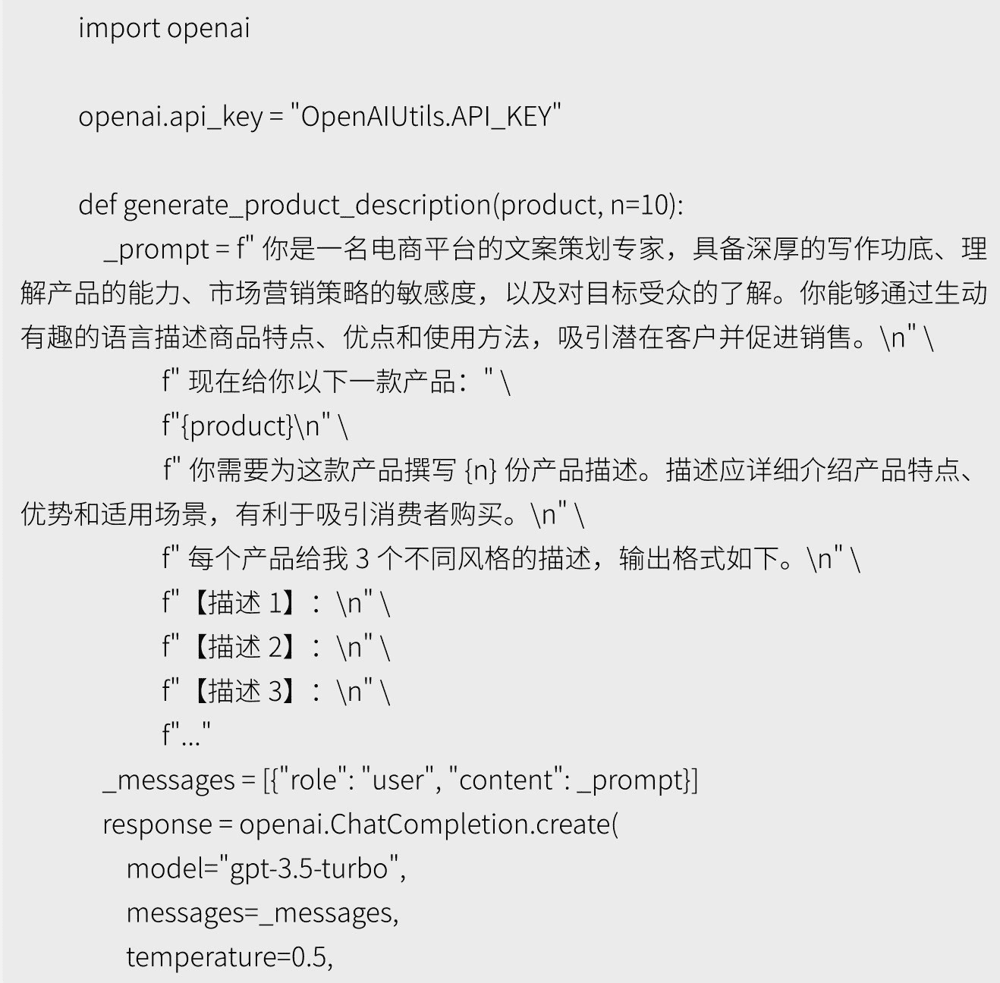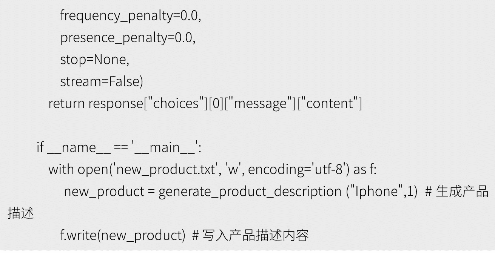

以上代码定义了一个名为`generate_product_description`的函数，通过调用`OpenAI`的`GPT-3.5`模型，实现了自动生成电商产品描述的功能。函数需要输入产品名称和需要生成的描述数量，输出符合格式要求的产品描述文本。主程序调用该函数，并将生成的产品描述文本保存到指定文件中。

综上所述，使用`ChatGPT`生成产品描述数据集的方法可以大大提高电商平台撰写商品描述的效率。通过设置相关提示语和调用`OpenAI`的`GPT-3.5`模型，可以自动生成符合要求的产品描述文本。这样的自动生成方式不仅可以减少人工撰写的工作量，还可以提高产品描述的质量和效率，为电商平台的运营带来便利。将生成的数据集应用于电商平台的产品描述中，可以帮助消费者更全面、准确地了解产品的特点和优势，提升消费者购买体验和忠诚度。

### 2.2.5 使用 ChatGPT 生成图像数据集

在计算机视觉和深度学习领域，图像数据集是训练模型的重要资源。通过使用`ChatGPT`生成图像数据集，我们可以快速创建各种类型的图像数据集，从而为计算机视觉任务提供丰富的数据来源。在本小节中，我们将介绍如何使用`ChatGPT`生成图像数据集。

首先，需要明确要生成的图像类型和所需图像的数量。接着，我们可以与`ChatGPT`进行交互，让它为我们生成相应的数据集。需要注意的是， `ChatGPT` 网页本身无法生成图像，但可以利用其文本生成能力，提供描述图像的详细文本，进而利用这些文本构建`Prompt`，再通过`Midjourney`来制作图片。

`Midjourney`是一个由`Midjourney`研究实验室开发的人工智能程序，可根据文本生成图像。`Midjourney`与`DALL·E`相似，专长生成图像。用户可以通过在聊天应用程序`Discord`中向机器人发送消息来使用它，它不是`Web`应用程序，不需要任何编程。`Midjourney`的使用场景包括但不限于创作、设计、艺术、科学等领域。

例如，如果我们想要生成一些猫的图像，可以直接利用`ChatGPT`生成合适的`Prompt`，提示语如 2-32 所示。

**2-32 使用 ChatGPT 生成图片提示语**

```
现在我在使用一个名叫 Midjourney 的 AI 图像生成器，Midjourney 和 DALL·E2 类似，需要 Prompt。它的 Prompt 是以一个个关键词的形式，相互之间以逗号隔开的，包括图像描述、风格等。你要充当我的关键词生成器，帮我按照上面的格式生成英文的 Prompt。以下是已有的 Prompt，你可以参考。

----
Prompt1:a dynamic, busy, futuristic utopian space city, 1950s science fiction, complex, detailed, exciting, electric, daylight, blue sky, hyper realistic, 8k, cinematic, --ar 16:9
Prompt2:young female, cat girl, ethereal, dark druid clothing, white hair, ghostly white fur on face and body, glowing blue eyes with black sclera, cat tail, full body standing, Forrest, night, starlight, realistic, hyperdetailed, unreal engine render, 4k unreal engine --ar 6:4 --iw . 5 --test --upbeta
Prompt3:cat surfing on a surfboard, high waves, cat wearing sunglasses, cat has mouth open, polaroid photo --ar 2:3
Prompt4:vicious sea snakes crawling through a large cracked leaking brass porthole undersea, horror, hyper realistic, 8k, --ar 16:9
Prompt5:steampunk industrial pittsburgh football game, hyper realistic,8k, --ar 16:9
----

参考上面的 Prompt，我现在需要一个现实中可爱的猫咪的图片，给我生成对应的 Prompt。
```

`ChatGPT`根据需求，生成的`Midjourney`的`Prompt`，如 2-33 所示。

**2-33 ChatGPT 生成的 Midjourney 的 Prompt**

```
Sure, here's a prompt for a cute cat image:

"A fluffy, adorable, domestic shorthair cat, sitting on a windowsill, surrounded by plants, natural light, cozy atmosphere, relaxed expression, high-resolution, photo-realistic, --ar 4:3."
```

在`Midjourney`输入`Prompt`之前，需要配置对应的属性，如图 2.1 所示。

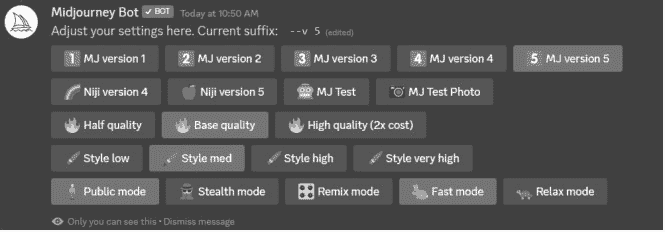

图 2.1 配置 Midjourney

随后，在`Midjourney`中通过`/imagine`命令输入`Prompt`，如图 2.2 所示。


图 2.2 在 Midjourney 中输入 Prompt

> **注意**： 现在`Midjourney`已经没有免费额度，因此读者需要通过订阅的方式，自己购买额度。

在经过一段时间的等待后，`Midjourney`会生成 4 幅图。读者可以从中选取喜欢的，作为图片数据，也可以继续修改`Prompt`，直到生成满意的图片，如图 2.3 所示。


图 2.3 Midjourney 生成的图

除了以上通过相对比较烦琐的方式来生成图片，我们还可以直接通过调用`OpenAI DALL·E2 API`的方式来批量生成图片。`DALL·E`是一款由`OpenAI`开发的先进人工智能模型，基于强大的`GPT-3`架构开发。作为`DALL·E`的升级版，`DALL·E2`能够根据给定的文本描述生成具有高度创意和精细度的图像。它将自然语言处理和计算机视觉技术融合在一起，为设计师、艺术家和各行各业的用户带来了全新的视觉创作体验。批量化自动生成图片的代码如 2-34 所示。

**2-34 批量化自动生成图片代码**

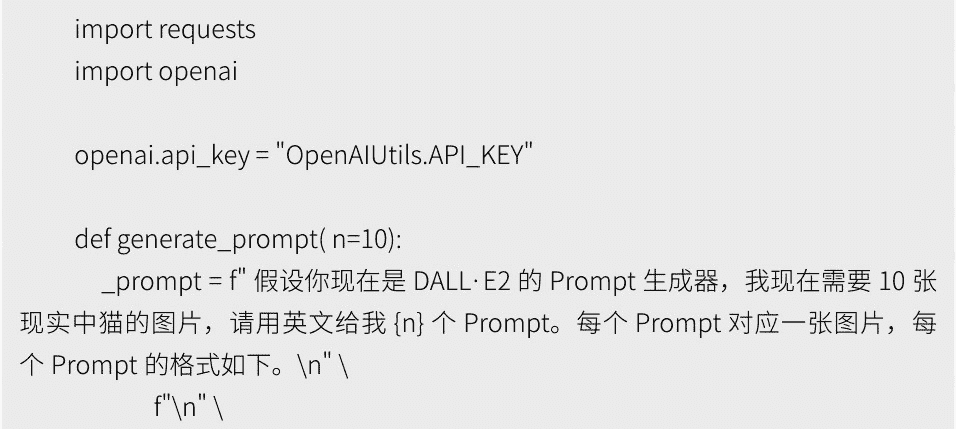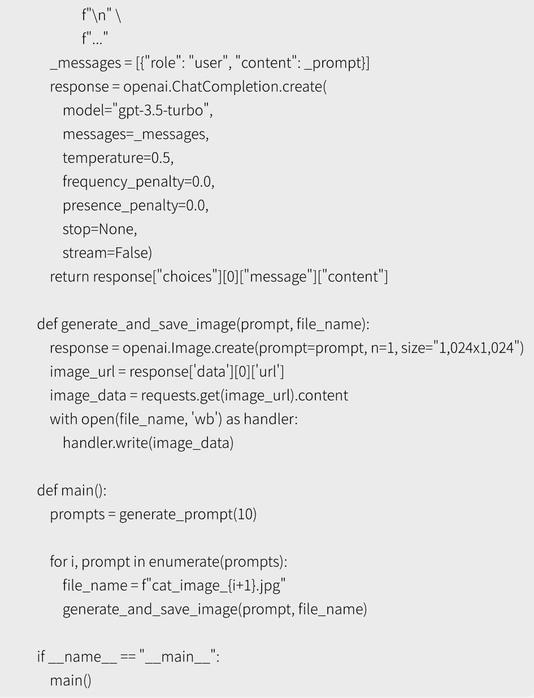

这段代码利用了 `OpenAI` 的 `API`，使用 `GPT-3.5`语言模型来生成 10 个`Prompt`，每个 `Prompt` 描述了一个要生成的猫的图片，然后使用 `OpenAI` 的`DALL·E2 API` 生成对应的图片，并将每张图片保存到当前目录下的文件中。这段代码还包含了一个 `generate_prompt` 函数，用于生成 `Prompt` 的文本内容。最终，这段代码生成了 10 张猫的图片。部分猫的图片如图 2.4 所示。


图 2.4 ChatGPT 和 DALL·E2 自动生成的图

综上所述，使用 `ChatGPT` 和 `DALL·E2 API` 可以批量生成丰富多样的图像数据集。这些数据集可以用于训练数据分析模型、测试算法的准确性等。通过这种方式，我们可以获取大量高质量的数据，从而提高模型的准确性和鲁棒性，为数据分析和机器学习领域带来诸多好处。

> **注意**： 这些图像数据的版权归原创作者所有。如果要将它们用于商业用途或发布在公共平台上，需要先获得相应的许可或授权。此外，为确保数据集的质量和准确性，需要谨慎选择生成 `Prompt` 和处理生成的图像，以避免噪点和其他质量问题的出现。只有质量良好的数据集才能有效地用于数据分析模型的训练和验证。

## 2.3 小结

本章介绍了如何使用`ChatGPT`进行数据准备工作，主要包括编写数据收集脚本和利用`ChatGPT`生成数据。在编写数据收集脚本方面，我们介绍了如何使用`ChatGPT`编写不同类型的数据收集脚本，包括新闻、电影评论、股票、天气、商品价格和社交媒体等数据。这些脚本可以方便地自动化数据收集过程，提高数据收集效率。在利用`ChatGPT`生成数据方面，我们介绍了如何使用`ChatGPT`生成电影评论数据样本、对话数据样本、新闻标题数据样本、产品描述数据集和图像数据集。这些生成的数据可以用于训练模型或者做其他分析工作。

本章内容可以帮助读者更好地理解数据准备的流程和方法。在实际应用中，合理的数据准备是保证分析结果准确性和可信度的关键步骤。通过本章的学习，读者可以更好地掌握如何使用`ChatGPT`进行数据准备，提高数据分析的效率和质量。

# 第 3 章 使用 ChatGPT 清洗数据

在当今数据驱动的世界中，数据分析成为一个越来越重要的领域。随着大量数据的涌现，数据处理和清洗变得至关重要。正确清洗和处理数据可以确保数据质量和完整性，从而提高数据分析的准确性和可靠性。

本章主要介绍如何使用`ChatGPT`清洗数据，重点涉及以下知识点：

- 使用`ChatGPT`处理数据质量问题，包括处理缺失值、检测和处理异常值、检测和删除重复数据
- 利用`ChatGPT`处理数据结构问题，涉及数据格式化转换、合并不同数据源的数据

通过学习本章内容，读者将了解如何运用`ChatGPT`技术处理实际数据分析过程中遇到的常见问题。这将有助于提高数据处理和分析的效率，从而帮助决策者更加迅速地获取有价值的信息。

## 3.1 使用 ChatGPT 处理数据质量问题

数据质量问题通常包括缺失值、异常值和重复数据等。处理这些问题是数据分析前的关键步骤，因为它们会影响分析结果的可靠性和准确性。在本节中，我们将介绍如何使用`ChatGPT`处理数据质量问题。

### 3.1.1 使用 ChatGPT 处理缺失值

缺失值是数据集中的一个常见问题。缺失值可能是数据收集过程中的错误、遗漏或其他原因导致的。处理缺失值的方法有很多，包括删除含有缺失值的行、填充缺失值，以及使用模型预测缺失值等。以下是使用`ChatGPT`处理缺失值的详细示例。

小丽是公司`HR`，她现在要统计公司员工的收入和年龄分布，发现收集的数据有部分缺失，如表 3.1 所示。

**表 3.1 公司员工收入表**

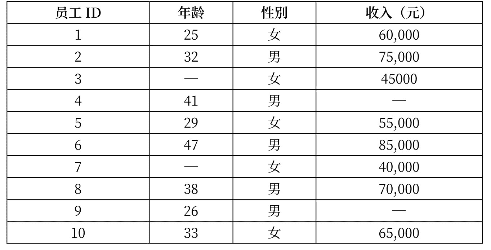

为了避免分析出现偏差，小丽通过借助`ChatGPT`来清洗数据，提示语如 3-1 所示。

**3-1 处理工资缺失值提示语**

```
你是一个资深数据分析师，具备专业的数据分析技能和丰富的行业经验。你擅长运用各种数据分析工具和技术，对大量数据进行挖掘、整合、分析和解释。你熟练掌握统计学、机器学习、人工智能等领域的理论和应用，能够从数据中发现有价值的信息，为企业决策提供有力的支持。此外，你还拥有出色的沟通和演示能力，能够将复杂的数据分析结果以简洁、清晰的方式呈现给各级别的管理者和团队成员，帮助他们做出更明智的决策。

我是公司的 HR，现在我要统计公司员工的收入和年龄等数据，收集到的数据如下。

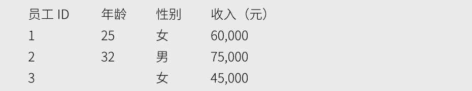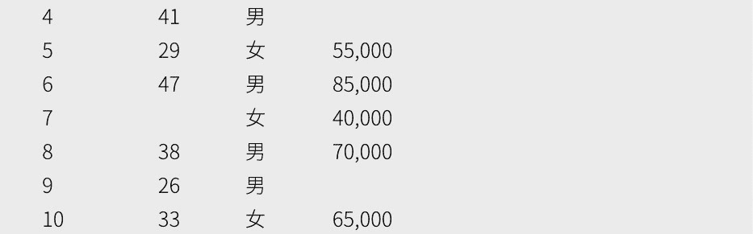

请你从专业的角度，帮我处理缺失的部分。

直接用表格的形式输出你处理好的数据，并告诉我你做了哪些处理，以及这么做的原因。

格式如下。

处理后的数据表格：
所做的操作及原因：
```

`ChatGPT`处理完缺失值后，数据如表 3.2 所示。

**表 3.2 ChatGPT 处理完缺失值后的收入表**

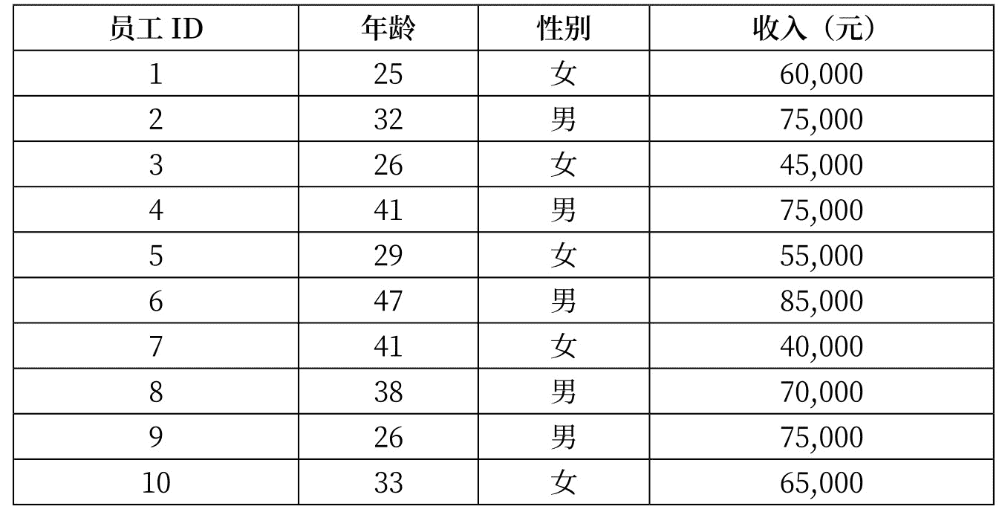

`ChatGPT`并给出了对应的处理逻辑和解释，如 3-2 所示。

**3-2 ChatGPT 处理缺失值的逻辑**

所做的操作及原因：

1. **填充年龄的缺失值**

   在面对年龄数据缺失的情况下，我们选择了使用已有的年龄数据的中位数进行填充。因为中位数对异常值不敏感，并在数据分布不均衡时仍能反映出整体数据的特征。不过，为了避免所有缺失年龄都被填充为同一值，我们使用了两个相邻的值，即已有年龄数据的下四分位数值 `26` 和上四分位数值 `41` 来填充。

2. **填充收入的缺失值**：


## 3.1 Using ChatGPT to Handle Data Quality Issues

### 3.1.1 Using ChatGPT to Handle Missing Values

For missing income data, we chose to fill in the corresponding income median based on gender. This is based on our assumption that the income of employees of the same gender has a high correlation. We chose to use the median `75,000` to fill the missing income data, which better preserves the overall distribution of the data.

Of course, besides the simple dataset above, ChatGPT can also easily handle complex datasets. Let's take the Kaggle Titanic dataset as an example. This is a very famous dataset recording passenger information from the 1912 Titanic sinking, including their gender, age, ticket class, cabin number, fare, etc. The dataset contains 891 samples, including 314 females, 577 males, 342 survivors, and 549 non-survivors. In this dataset, the Age and Cabin columns contain missing values, accounting for approximately 20% and 77% of the total samples, respectively. The goal of the Titanic dataset is to predict whether a passenger survived the sinking based on known passenger information. Therefore, this dataset is widely used for introductory machine learning and data analysis practice, particularly for binary classification problems and the application of feature engineering techniques.

There are two columns with missing values in the Titanic dataset: Age and Cabin. The Age column contains passenger age information. Due to reasons such as recording errors or omissions, this column has 177 missing values, accounting for about 20% of the total passengers. The Cabin column contains passenger cabin number information. Due to reasons such as recording errors or omissions, this column has 687 missing values, accounting for about 77% of the total passengers.

For the above dataset, we can use ChatGPT to handle missing values. The prompt is shown in 3-3.

#### 3-3 Prompt for Handling Titanic Missing Values

> You are a senior data analyst with professional data analysis skills and extensive industry experience. You are proficient in using various data analysis tools and technologies to mine, integrate, analyze, and interpret large amounts of data. You have a solid grasp of theories and applications in statistics, machine learning, artificial intelligence, and other fields, capable of discovering valuable insights from data to provide strong support for enterprise decisions. In addition, you possess excellent communication and presentation skills, able to present complex data analysis results in a concise and clear manner to managers and team members at all levels, helping them make wiser decisions.
>
> Now I need to handle missing values in the Age and Cabin columns of the Titanic dataset.
>
> Requirements: Provide Python code directly in a code block format, and output the processed partial table in a table format.

The Python code generated by ChatGPT to handle missing values in the Age and Cabin columns of the Titanic dataset is shown in 3-4.

#### 3-4 ChatGPT Code for Handling Titanic Missing Values

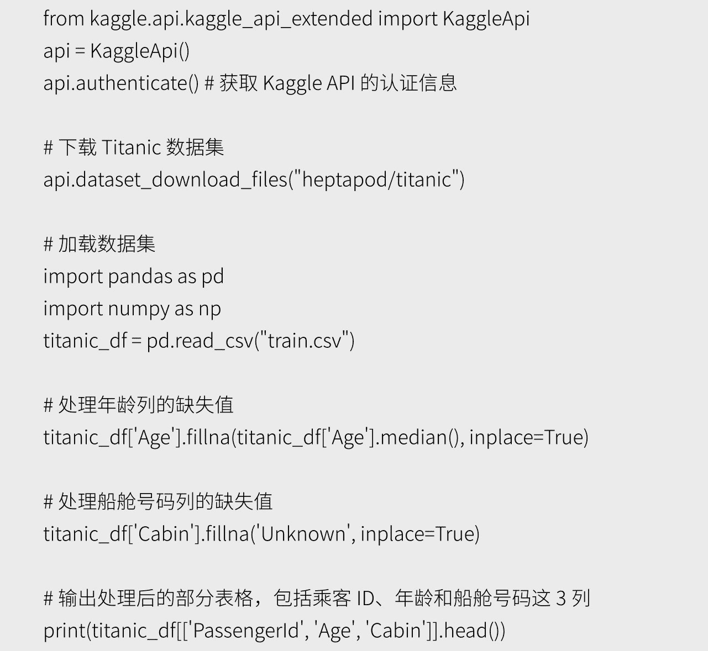

Before executing this code, you need to download the Titanic dataset and decompress it using the following two commands.


After executing the above code, the Age and Cabin columns in the Titanic dataset will be processed for missing values, where the Age column uses the median to fill missing values, and the Cabin column uses "Unknown" to fill missing values. The processed partial table is shown in Table 3.3.

#### Table 3.3 Partial Table After ChatGPT Processed Titanic Missing Values

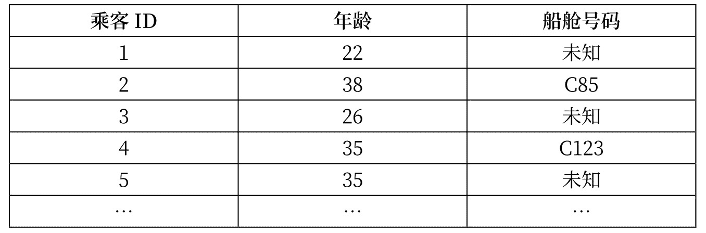

When readers need to handle missing values in their own local data, besides the tedious copy-pasting into the ChatGPT chat interface, we can also quickly process complex data by directly calling the OpenAI API. The code is shown in 3-5.

#### 3-5 Calling ChatGPT API to Handle Missing Values

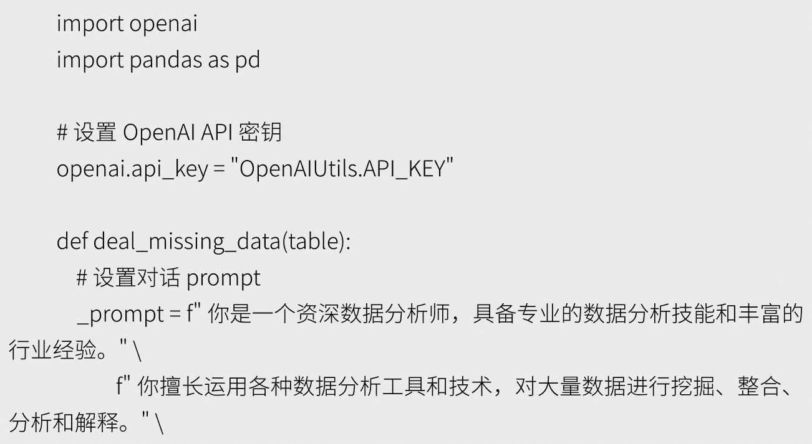
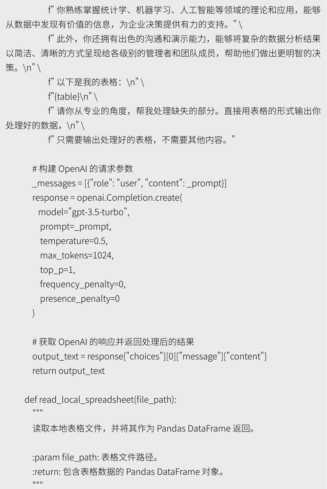
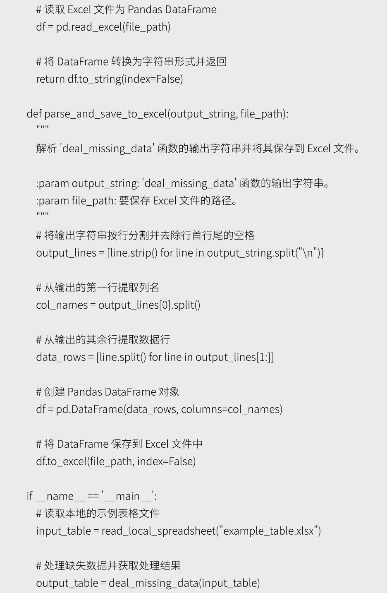


The above code is an automated data analysis tool. It calls the OpenAI API via a Python script to automatically handle missing values in the input tabular data and save the processed results to a local Excel file. The program contains three functions for reading local Excel files, processing missing data, and saving results to Excel files. The entire process is automated, requiring no manual intervention, improving the efficiency and accuracy of data analysis.

The `OpenAIUtils.API_KEY` in the code above needs to be manually filled in with the user's own account Key, and OpenAI charges based on the number of Tokens requested by the user.

In summary, using ChatGPT to handle missing values can greatly improve the efficiency and accuracy of data processing. As a powerful natural language processing technology, ChatGPT can analyze the semantics and context in text data to fill missing values in the data, reducing data processing errors. In addition, ChatGPT can continuously optimize the model through self-learning, making the effect of handling missing values more stable and reliable. Therefore, using ChatGPT to handle missing values is an efficient and intelligent data processing method worth wide application and promotion.

### 3.1.2 Using ChatGPT to Detect and Handle Outliers

Outliers refer to values in a measurement where the deviation from the mean exceeds two times the standard deviation. The appearance of outliers may be caused by data entry errors, measurement errors, or other reasons. There are many methods for handling outliers, including deleting outliers, correcting outliers, and using models to predict outliers. The following are detailed examples of using ChatGPT to detect and handle outliers.

Company HR Xiaoli was analyzing the distribution of employee working hours and found some outliers in the collected data, as shown in Table 3.4.

#### Table 3.4 Company Employee Working Hours Table

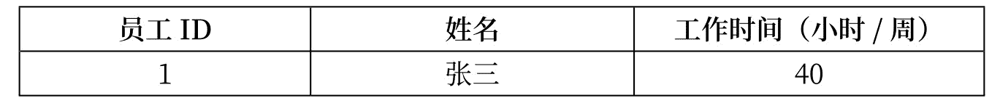

Continued Table

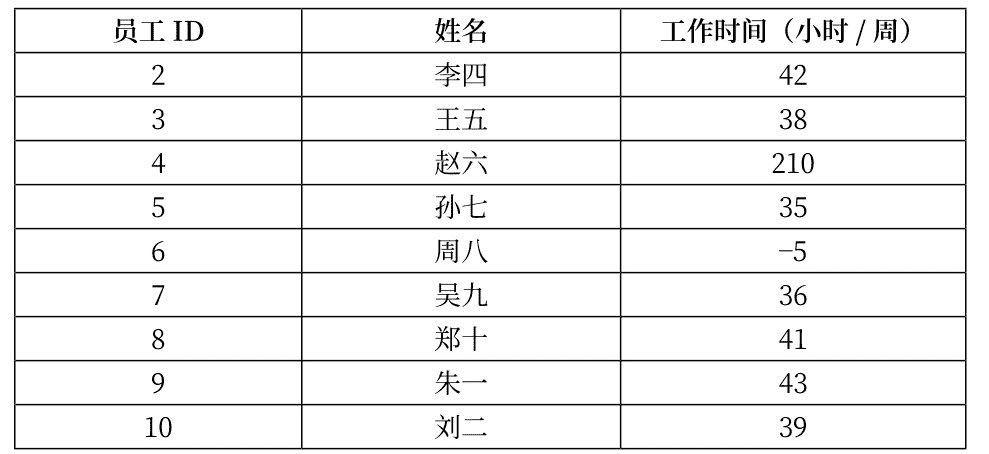

To avoid analysis bias, Xiaoli hoped to use ChatGPT to detect and handle outliers. The prompt is shown in 3-6.

#### 3-6 Prompt for Detecting and Handling Outliers

> You are a senior data analyst with professional data analysis skills and extensive industry experience. You are proficient in using various data analysis tools and technologies to mine, integrate, analyze, and interpret large amounts of data. You have a solid grasp of theories and applications in statistics, machine learning, artificial intelligence, and other fields, capable of discovering valuable insights from data to provide strong support for enterprise decisions. In addition, you possess excellent communication and presentation skills, able to present complex data analysis results in a concise and clear manner to managers and team members at all levels, helping them make wiser decisions.
>
> Now I want to analyze the distribution of company employee working hours. The collected data is as follows.
>
> 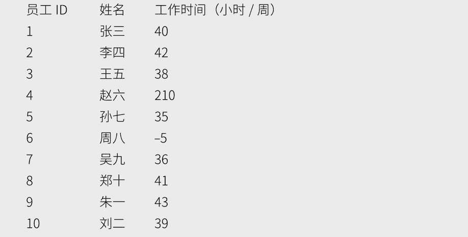
>
> Please help me detect and handle outliers from a professional perspective.
>
> Output your processed data directly in a table format, and tell me what processing you did and the reasons for doing so.

ChatGPT's analysis of the data logic is shown in 3-7.

#### 3-7 ChatGPT Analysis Logic for Outliers

To detect and handle outliers, we need to analyze working hours. Generally, we can handle outliers through the following steps.

1. Calculate statistical measures such as the mean and standard deviation of working hours to understand the distribution of working hours.
2. Draw a box plot to detect outliers. If outliers exist, further analysis is needed.
3. Depending on the specific situation, methods such as deleting outliers, replacing with missing values, or replacing with the mean can be used to handle outliers.

For the given data, we process as follows.

1. The average working hours are calculated as `51.9` hours/week, the minimum value is `—5` hours/week, and the maximum value is `210` hours/week.
2. A box plot is drawn, revealing outliers at `—5` hours/week and `210` hours/week.
3. Since working hours cannot be negative, data with negative working hours is deleted; simultaneously, data with working hours greater than the mean plus two times the standard deviation is considered outliers and deleted.

The processed data is shown in Table 3.5.

#### Table 3.5 Working Hours Table Processed by ChatGPT

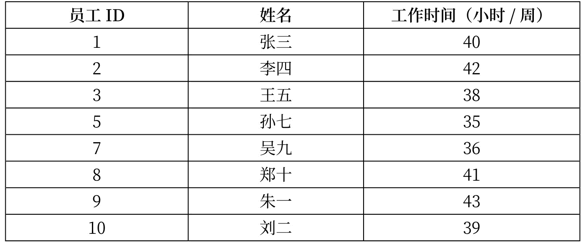

By deleting outliers, we obtained more accurate and reliable data, facilitating subsequent data analysis and decision-making.

Besides simple datasets, we can also use ChatGPT to handle complex datasets. For example, the Kaggle House Price Prediction competition dataset (Ames Housing Dataset) contains housing information from Ames, Iowa, USA, including 79 feature columns such as house area, number of rooms, year built, garage area, etc. This dataset aims to let data scientists and machine learning engineers use housing features to predict house prices, assisting the real estate industry in market analysis and investment decisions. The dataset contains some common outliers that need handling, such as outliers in area, distance, and price, which need appropriate processing to ensure model accuracy and reliability. Some examples of outliers in this dataset are shown in Table 3.6.

#### Table 3.6 Partial Outliers in House Price Prediction Competition Dataset

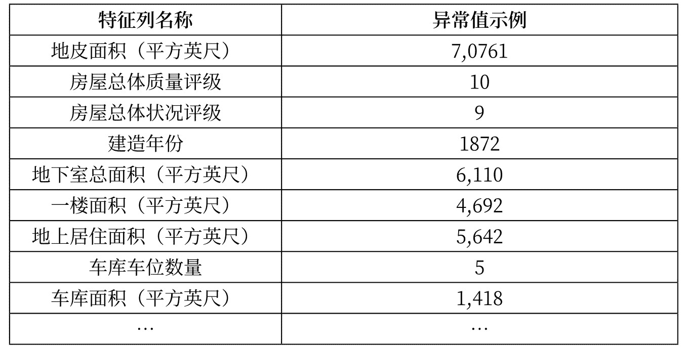

For the above dataset, we can use ChatGPT to handle outliers. The prompt is shown in 3-8.

#### 3-8 Prompt for Handling Ames Housing Dataset Outliers

> You are a senior data analyst with professional data analysis skills and extensive industry experience. You are proficient in using various data analysis tools and technologies to mine, integrate, analyze, and interpret large amounts of data. You have a solid grasp of theories and applications in statistics, machine learning, artificial intelligence, and other fields, capable of discovering valuable insights from data to provide strong support for enterprise decisions. In addition, you possess excellent communication and presentation skills, able to present complex data analysis results in a concise and clear manner to managers and team members at all levels, helping them make wiser decisions.
>
> Now I need to handle outliers in the Ames Housing Dataset.
>
> Requirements: Provide Python code directly in a code block format, and output the processed partial table in a table format.

The code generated by ChatGPT to handle outliers is shown in 3-9.

#### 3-9 ChatGPT Handling Ames Housing Dataset Outliers

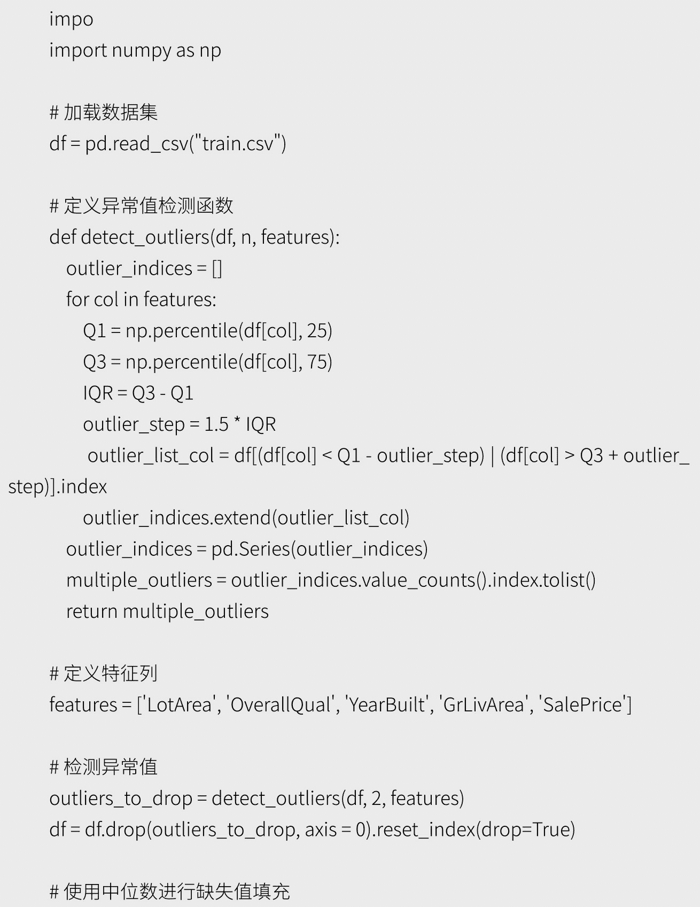


Note: The above code assumes the reader has successfully downloaded the Kaggle dataset locally.

After running the above code, the partial table of the processed dataset will be obtained, as shown in Table 3.7.

#### Table 3.7 Partial Competition Data After House Price Prediction Processing

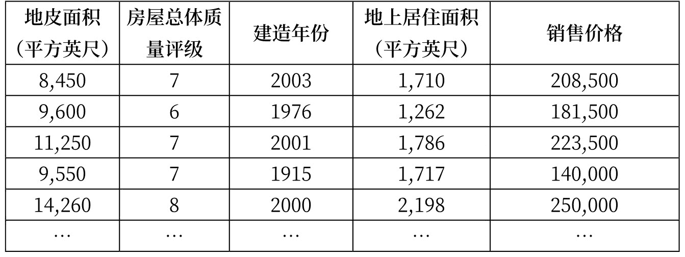

Note that here only some feature columns were selected for processing, and outliers were merely deleted and filled with medians. Specific processing methods may vary depending on the actual situation.

Of course, if readers need to handle outliers in their own local data, besides the tedious copy-pasting into the ChatGPT chat interface, we can also quickly process complex data by directly calling the OpenAI API. The code is shown in 3-10.

#### 3-10 Calling ChatGPT API to Handle Outliers

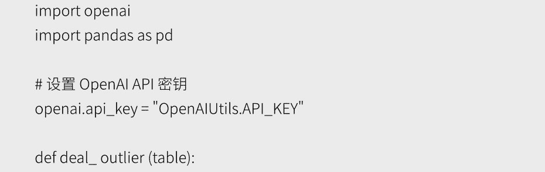
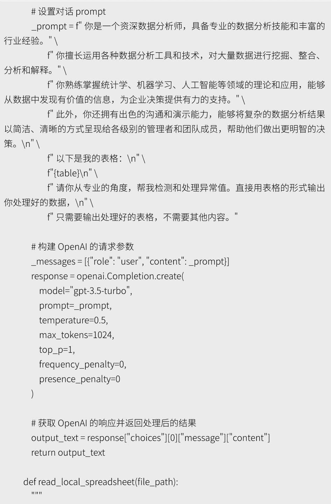
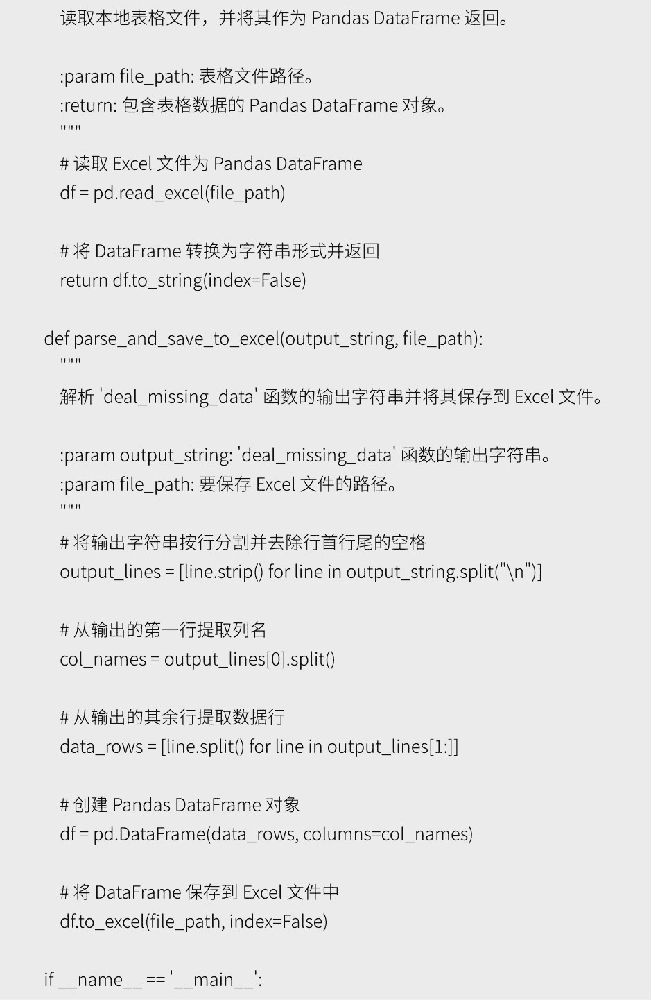


This code implements automated outlier detection and processing via the OpenAI API. First, it reads a local Excel file, then passes the tabular data as input to the `deal_outlier` function. This function delegates the outlier detection and processing task to the OpenAI API and returns the processed tabular data. Finally, the processing results are saved as a new Excel file.

Using ChatGPT to detect and handle outliers is an effective method that can help people better understand datasets and improve the accuracy and reliability of data analysis. In the data analysis process, outliers are a common problem that can lead to errors in analysis results, affecting business decisions. Therefore, using powerful machine learning tools like ChatGPT to detect and handle outliers can greatly improve the quality and efficiency of data analysis, providing more accurate and reliable basis for business decisions.

### 3.1.3 Using ChatGPT to Detect and Delete Duplicate Data

Duplicate data refers to identical or nearly identical data records existing in a dataset. These data may be caused by data entry errors, duplication during data merging, or other reasons. The main method for handling duplicate data is to detect and delete duplicate records, which ensures the quality and accuracy of the dataset. The following are detailed examples of using ChatGPT to detect and delete duplicate data.

Company HR Xiaoli was analyzing the age distribution of company employees. The collected data contained some duplicate values, as shown in Table 3.8.

#### Table 3.8 Company Employee Age Table


To avoid analysis bias, Xiaoli hoped to use ChatGPT to detect and delete duplicate data. The prompt is shown in 3-11.

#### 3-11 Prompt for Handling Age Outliers

> You are a senior data analyst with professional data analysis skills and extensive industry experience. You are proficient in using various data analysis tools and technologies to mine, integrate, analyze, and interpret large amounts of data. You have a solid grasp of theories and applications in statistics, machine learning, artificial intelligence, and other fields, capable of discovering valuable insights from data to provide strong support for enterprise decisions. In addition, you possess excellent communication and presentation skills, able to present complex data analysis results in a concise and clear manner to managers and team members at all levels, helping them make wiser decisions.
>
> Now I want to analyze the age distribution of company employees. The collected data is as follows.
>
> 
> 
>
> Please help me detect and delete duplicate data from a professional perspective. Output your processed data directly in a table format.

The table modified by ChatGPT according to the requirements is shown in Table 3.9.

#### Table 3.9 Age Table After ChatGPT Deleted Duplicate Values


In the above table, duplicate data has been deleted. This will help ensure the accuracy and credibility of data analysis.

Besides the simple cases above, ChatGPT can also easily handle complex datasets. For example, a bank or telecom company's customer dataset may contain personal information such as name, address, phone number, email address, etc. Since customers may use multiple accounts or purchase multiple products, duplicate values may exist in the dataset. We can directly generate processing code through ChatGPT. The prompt is shown in 3-12.

#### 3-12 Prompt for Handling Complex Data Duplicate Values

> You are a senior data analyst with professional data analysis skills and extensive industry experience. You are proficient in using various data analysis tools and technologies to mine, integrate, analyze, and interpret large amounts of data. You have a solid grasp of theories and applications in statistics, machine learning, artificial intelligence, and other fields, capable of discovering valuable insights from data to provide strong support for enterprise decisions. In addition, you possess excellent communication and presentation skills, able to present complex data analysis results in a concise and clear manner to managers and team members at all levels, helping them make wiser decisions.
>
> Now I have a local telecom company's customer dataset, which may contain customer personal information such as name, address, phone number, email address, etc. Since customers may use multiple accounts or purchase multiple products, duplicate values may exist in the dataset.
>
> Give me Python code directly. Requirement: Read `data.xlsx` from the local directory, clean this data, save to a new file, and output in code block format.

The code output by ChatGPT according to the requirements is shown in 3-13.

#### 3-13 Code for Handling Complex Data Duplicate Values


In this example, we used the Pandas library to read the Excel file, delete duplicate values, and save the cleaned data to a new Excel file. When reading data, we can use the `read_csv` or `read_excel` function, depending on the data file format. Deleting duplicates can use Pandas' `drop_duplicates` function, which by default checks if all column values are the same. Finally, we use the `to_excel` function to save the cleaned data to a new Excel file, where `index=False` means the row index is not written to the file.

Note: Since duplicate values can be implemented directly with a few simple lines of code, the usage of OpenAI API for processing is not elaborated here. Interested readers can refer to previous chapters.

In summary, using ChatGPT to detect and delete duplicate data is an efficient method that can help us improve data quality and reduce the amount of redundant information when processing large amounts of text data. With the advent of the big data era, the volume of text data we need to process continues to increase, and data quality has become an increasingly important issue. Therefore, using ChatGPT to detect and delete duplicate data can help us save time and resources, and improve the value and reliability of data.

## 3.2 Using ChatGPT to Handle Data Structure Issues

Data structure issues affect data integrity, consistency, and readability. To solve these problems, this section will introduce how to use ChatGPT for data format conversion and merging data from different sources.

### 3.2.1 Using ChatGPT for Data Format Conversion

Data formatting refers to converting raw data into a format usable for data analysis. Common formats include CSV, JSON, XML, etc. In data cleaning, common data formatting conversion operations are as follows.

1. **String Operations**: Convert strings to lowercase or uppercase, remove extra spaces or characters, extract specific substrings, etc.
2. **Date/Time Format Conversion**: Convert different date/time formats into a unified format, such as ISO 8601 standard format, or convert timestamps to readable datetime formats.
3. **Numeric Type Conversion**: Convert numeric data into different data types, such as integer, float, boolean, etc.
4. **Data Normalization**: Scale data to a specific range. For example, scale data between 0 and 1.
5. **Encoding Conversion**: Convert different encoding formats into a unified encoding format. For example, convert Unicode encoding to ASCII encoding.
6. **Data Structure Conversion**: Convert data from one data structure to another. For example, convert JSON format data to CSV format.

These operations are common data formatting conversions in data cleaning, which can convert data of different formats into a consistent format for subsequent data processing and analysis. Using ChatGPT can format data into the required format, reducing the complexity and error rate of manual operations. The following is an example.

Xiaoming is a salesperson in the company. He now has a sales dataset in JSON format, as shown in 3-14.

#### 3-14 Sales Data in JSON Format


Now Xiaoming needs to process this data to facilitate organization and analysis. He directly uses ChatGPT to format this data. The prompt is shown in 3-15.

#### 3-15 ChatGPT Data Formatting Prompt

> You are a senior data analyst with professional data analysis skills and extensive industry experience. You are proficient in using various data analysis tools and technologies to mine, integrate, analyze, and interpret large amounts of data. You have a solid grasp of theories and applications in statistics, machine learning, artificial intelligence, and other fields, capable of discovering valuable insights from data to provide strong support for enterprise decisions. In addition, you possess excellent communication and presentation skills, able to present complex data analysis results in a concise and clear manner to managers and team members at all levels, helping them make wiser decisions. Now I have a sales dataset in JSON format, as follows.


# Chapter 3 Data Cleaning and Integration

## 3.2 Using ChatGPT for Data Format Conversion and Merging

### 3.2.1 Data Format Conversion


The table processed and output by ChatGPT according to requirements is shown in Table 3.10.

**Table 3.10 Table after Data Format Conversion**


The above table was obtained by performing data cleaning and normalization operations on the original `JSON` data. The following operations were performed on the data: converting the `Order Date` column to datetime format; converting the `Total Amount`, `Price`, and `Quantity` columns to numeric format; converting all characters in the `State` column to uppercase; and using the `str.title()` method to convert all strings in the `Customer Name` and `Shipping Address` columns to title case (first letter capitalized). Through these operations, the data was cleaned and standardized, making it easier to analyze and understand. Finally, the processed results were saved as an `Excel` file.

Since ChatGPT supports continuous dialogue, we can continue to ask ChatGPT to generate batch processing code. The prompt is shown in 3-16.

#### 3-16 Batch Data Formatting Prompt

```
If there are n JSON files with the same format in a local folder, please help me write a Python function to read all JSON files in this folder, format them, and consolidate them into Excel.

Output the code directly in code block format.
```

The processing code provided by ChatGPT according to the requirements is shown in 3-17.

#### 3-17 Batch Formatting Code Generated by ChatGPT


This function implements the functionality of reading multiple `JSON` files with the same format from a folder and converting them into a single `Excel` file. The specific implementation is: traversing all `JSON` files in the folder, reading them into `DataFrame` format, then performing data cleaning and normalization operations, consolidating all data into a total `DataFrame`, and finally saving the result as an `Excel` file.

At the same time, we can also quickly format data by directly calling the ChatGPT API format, as shown in 3-18.

#### 3-18 Calling ChatGPT API to Format Data


This code implements reading all `JSON` files in a specified folder and consolidating them into a single `Pandas DataFrame`. Then, it uses the `OpenAI API` to normalize the data in the `DataFrame` and writes the processed results into an `Excel` file.

> **Note**: The `OpenAIUtils.API_KEY` in the above code needs to be manually filled in with the user's own account Key, and OpenAI charges based on the number of `Token`s requested by the user. At the same time, the `GPT-3.5` language model has a limit of 4K for the input `Prompt` count. If this limit is exceeded, batch processing can be adopted, or the `GPT-4` model with a 32K limit can be called directly.

Using ChatGPT for data format conversion can improve the efficiency and accuracy of data processing, especially when a large amount of data needs to be normalized. By using `OpenAI API` and ChatGPT, complex data conversion and normalization operations can be completed in a short time, avoiding the tediousness and risk of errors in manual data processing, and improving the efficiency and accuracy of data analysis.

### 3.2.2 Using ChatGPT to Merge Data from Different Sources

In data analysis, merging data from different sources is a very common operation. The following are some common methods for merging data.

1.  **Inner Join (`Inner Join`)**: Joins matching records from two data sources, i.e., only retains data present in both data sources.
2.  **Left Join (`Left Join`)**: Retains all records from the left data source and adds matching data from the right data source to the result set. If there is no matching data in the right data source, it is filled with `NULL`.
3.  **Right Join (`Right Join`)**: Retains all records from the right data source and adds matching data from the left data source to the result set. If there is no matching data in the left data source, it is filled with `NULL`.
4.  **Full Outer Join (`Full Outer Join`)**: Retains all records from both data sources and joins matching records together. If there are no matching records, they are filled with `NULL`.
5.  **Cross Join (`Cross Join`)**: Matches each record from one data source with all records from the other data source. The resulting result set is the Cartesian product of the records from the two data sources.
6.  **Natural Join (`Natural Join`)**: Finds columns with the same name in two data sources and uses these column names as join conditions to perform the join, which is equivalent to performing an inner join operation.
7.  **Append (`Append`)**: Combines records from two data sources together. The resulting result set is the collection of all records from both data sources. Append is typically used to add new records to the bottom of a data source.
8.  **Stacking (`Stacking`)**: Stacks records from two data sources vertically together. The resulting result set contains all records, with records from the two data sources stacked together.

Among these methods, Inner Join, Left Join, Right Join, and Full Outer Join are the most common methods used for merging data. They can help analysts better understand the relationships between different data sources and the connections between data. The following is a common example.

Xiao Li is a data analyst at a company. Regarding recent orders, he collected several tables from multiple dimensions. Among them, the Order Table records detailed order information, including Order ID, Order Time, and Order Status, as shown in Table 3.11.

**Table 3.11 Order Table**


The Order Detail Table records the product details for each order, including Order ID, Product ID, Product Name, Unit Price, and Quantity, as shown in Table 3.12.

**Table 3.12 Order Detail Table**


The Product Table records information for all products, including Product ID, Product Name, and Product Category, as shown in Table 3.13.

**Table 3.13 Product Table**


Continued Table


The User Table records information for all users, including User ID, Username, and Phone Number, as shown in Table 3.14.

**Table 3.14 User Table**


Now these tables need to be merged to facilitate analysis of order sales, product sales, user purchasing behavior, etc. Therefore, Xiao Li directly uses ChatGPT to integrate them. The prompt is shown in 3-19.

#### 3-19 Data Merging Prompt

```
You are a senior data analyst with professional data analysis skills and rich industry experience. You are proficient in using various data analysis tools and technologies to mine, integrate, analyze, and interpret large amounts of data. You have a solid grasp of theories and applications in statistics, machine learning, artificial intelligence, and other fields, and can discover valuable information from data to provide strong support for enterprise decisions. In addition, you have excellent communication and presentation skills, able to present complex data analysis results in a concise and clear manner to managers and team members at all levels, helping them make wiser decisions.

Now I have N tables, the specific contents are as follows.

---

Order Table: Records detailed order information, including Order ID, Order Time, Order Status.


```

Based on the provided table information, ChatGPT associates and merges them into a complete table across four dimensions: Orders, Order Details, Products, and Users, as shown in Table 3.15.

**Table 3.15 Table Merged by ChatGPT**


The final merged table contains detailed order information, product details in orders, product category information, and ordering user information. This table can help enterprises conduct order analysis, product sales analysis, and user behavior analysis, providing strong decision support.

When there are many data tables, we can utilize ChatGPT's continuous dialogue feature to ask ChatGPT to generate automatic merging code. The prompt is shown in 3-20.

#### 3-20 Automatic Data Merging Prompt

```
From your professional perspective, give me a Python code with functionality similar to the above. It needs to read all Excel tables in a folder, then merge them into one table, and save it to a new file.

Output directly in code block format.
```

The automatic merging code provided by ChatGPT according to the requirements is shown in 3-21.

#### 3-21 Automatic Merging Code Generated by ChatGPT


The above `Python` code implements reading all `Excel` tables in a specified folder and merging them into one table. Specifically, the code uses the `Pandas` library to read data from all `Excel` files in the specified folder, then merges them into a single DataFrame, and finally writes the merged DataFrame into a new `Excel` file. Through this function, we can conveniently integrate data from multiple `Excel` tables into one table for subsequent data analysis and processing.

Of course, we can also merge data directly by calling the OpenAI API, as shown in 3-22.

#### 3-22 Calling ChatGPT API to Merge Data


The above code implements merging multiple `Excel` tables into a complete table. Specifically, the code reads `Excel` tables into string format, then calls the `OpenAI API` to merge all tables. The merged table includes order information, product information, and user information, and stores it in an `Excel` file. During the merging process, the code uses the `Pandas` library to process and transform data, and uses the `OpenAI GPT-3 API` to generate the merged table.

> **Note**: The `OpenAIUtils.API_KEY` in the above code needs to be manually filled in with the user's own account Key, and OpenAI charges based on the number of `Token`s requested by the user.

In summary, using ChatGPT can easily merge data from different sources, thereby achieving more comprehensive and accurate data analysis and prediction. ChatGPT is a natural language processing model based on deep learning, with powerful semantic understanding and generation capabilities, capable of efficient, automated processing and analysis of text data. Compared with traditional data merging methods, using ChatGPT not only avoids the tedious process of manual data processing but also fully utilizes diverse data sources, improving the efficiency and accuracy of data processing.

## 3.3 Summary

In the data analysis process, data cleaning is a crucial step. Using ChatGPT can effectively handle data quality issues and data structure issues. In this chapter, we introduced using ChatGPT to handle missing values, detect and handle outliers, detect and delete duplicate data, perform data format conversion, and merge data from different sources.

Regarding data quality issues, ChatGPT provides a new method to handle missing values and outliers more efficiently and accurately. At the same time, using ChatGPT can automatically identify and delete duplicate data, avoiding errors in the data analysis process. For data structure issues, ChatGPT also provides good solutions. Using ChatGPT for data format conversion can also make data more standardized, easy to analyze and process. At the same time, ChatGPT can automatically merge data from different sources, making data analysis more comprehensive and accurate.

# Chapter 4 Feature Extraction Using ChatGPT

With the widespread application of data analysis in various industries, feature extraction has become a key link in the data analysis process. Feature extraction mainly includes feature engineering and feature dimensionality reduction, which are responsible for extracting useful information from raw data and reducing data dimensions to lower computational complexity, respectively. As an advanced artificial intelligence language model, ChatGPT has the ability to assist data analysis experts in completing feature extraction, thereby improving the efficiency and accuracy of data analysis.

This chapter mainly introduces how to use ChatGPT for feature extraction, focusing on the following knowledge points:

*   Using ChatGPT for feature engineering, including feature selection and creating derived features.
*   Using ChatGPT for feature dimensionality reduction, including techniques such as Principal Component Analysis (`PCA`) and Linear Discriminant Analysis (`LDA`).

In this chapter, we will demonstrate through examples the application of ChatGPT in various scenarios to complete feature extraction. By studying this chapter, readers will be able to better apply ChatGPT in data analysis projects to improve work efficiency. At the same time, this chapter will provide readers with some tips and experience to more flexibly use ChatGPT for feature extraction in actual work.

## 4.1 Using ChatGPT for Feature Engineering

Feature engineering is an important part of data preprocessing. It involves extracting, constructing, selecting, and transforming features from raw data to better present the potential patterns behind the data. This section will explain in detail the use of ChatGPT for feature engineering, including feature selection, creating derived features, and other aspects. In this process, we will help readers deeply understand each link of feature engineering through actual cases.

### 4.1.1 Using ChatGPT for Feature Selection

Feature selection algorithms select a portion of important features from raw data for building machine learning models, aiming to reduce dimensionality, improve model performance, and avoid overfitting. Common feature selection algorithms are as follows.

1.  **Filter Methods**: Evaluate each feature based on statistical tests or correlation analysis and other methods, selecting the optimal features from them. Common methods include Pearson Correlation Coefficient, Mutual Information, Chi-Square Test, etc.
2.  **Wrapper Methods**: Select a group of features, train a model, and evaluate model performance, iterating continuously until the best feature subset is found. Common methods include Recursive Feature Elimination (`RFE`) and Sequential Forward Selection (`SFS`).
3.  **Embedded Methods**: Fuse feature selection algorithms with machine learning algorithms to perform feature selection and model training simultaneously. Common methods include `LASSO` (Least Absolute Shrinkage and Selection Operator), Ridge Regression, Decision Trees, Random Forests, etc.
4.  **Ensemble/Hybrid Methods**: Combine multiple feature selection algorithms to achieve better feature selection results. Common methods include Stability Selection and Tree-based Feature Selection, etc.

Typically, feature selection algorithms can be divided into three types: Filter, Wrapper, and Embedded. Filter feature selection algorithms usually do not require building a model but evaluate and rank features to select the most relevant ones. Wrapper feature selection algorithms treat the feature selection problem as a process of searching for the best feature subset, requiring building multiple models to evaluate the performance of feature subsets. Embedded feature selection algorithms fuse the feature selection process into model training, selecting the best features by optimizing the objective function. Data analysts need to comprehensively consider actual scenarios and requirements when performing feature selection, choosing the most suitable algorithm for feature screening to reduce model complexity, improve model generalization ability, and save computational resources and time costs. This requires data analysts to have rich data analysis experience and broad knowledge domains.

ChatGPT can help data analysts perform feature selection more efficiently. It can automatically recommend the most suitable feature selection algorithm based on given data and requirements. The following is an example.

Eric is a salesperson at an insurance company. He wants to count user data from the past month to predict the features most relevant to whether a user will purchase a certain product based on this data, in order to better target the target group. The dataset includes the following features: User Age, ranging from 18 to 65; User Gender, Male or Female; User Income Level, unit: 10,000 yuan; User Education, including Primary School, Middle School, High School, Bachelor's, or Master's; User Marital Status, Married or Unmarried; Whether User Owns a Vehicle, Yes or No; Whether User Owns Housing, Yes or No; User Purchasing Power, unit: Yuan; Whether User Purchased, Yes or No. Specific data is shown in Table 4.1.

**Table 4.1 User Data**


Based on the above data, Eric can directly seek help from ChatGPT. The prompt is shown in 4-1.

#### 4-1 Feature Extraction Prompt

```
You are now acting as a data analysis expert with the following capabilities.

Data Processing Capability: Proficient in data collection, cleaning, integration, processing, and other operations, able to use tools (such as `SQL`, `Python`, etc.) to operate and analyze large amounts of data.

Data Visualization Capability: Able to use visualization tools (such as `Tableau`, `Power BI`, etc.) to present data in the form of charts, reports, etc., for better understanding and communication of data analysis results.

Statistical Knowledge: Proficient in basic statistical concepts and methods, including probability theory, hypothesis testing, analysis of variance, etc., able to use statistical methods to analyze data.

Business Understanding Capability: Possess a deep understanding of business and industry, able to transform data analysis results into practical business applications and solutions.

Programming Capability: Possess programming ability, able to use `Python`, `R Language`, etc. for data analysis, and use `Shell`, `Python`, etc. for automation script writing.

Communication Capability: Able to communicate with business departments, understand their needs and problems, and clearly express data analysis results and suggestions.

Learning Capability: Possess the ability to continuously learn and update knowledge, able to master new data analysis methods, tools, and skills.

I am a salesperson at an insurance company. I want to count user data from the past month to predict the features most relevant to whether a user will purchase a certain product based on this data, in order to better target the target group.

Data content is as follows.


Please help me extract features from a professional perspective based on the above data content, and tell me which features are most relevant to the purchase data.

Output format is as follows.

Feature Extraction Method Used:

Calculation Process:

Features Most Relevant to Whether Purchased:

Sales Suggestions:
```

The conclusions and suggestions derived by ChatGPT according to the requirements are shown in 4-2.

#### 4-2 Features and Suggestions Extracted by ChatGPT

```
Feature Extraction Method Used: In this task, we can use the Correlation Coefficient Method to extract features. This method can calculate the correlation between each feature and whether a purchase was made, determining which features are most relevant to the purchase data.

Calculation Process: First, we load the data into a Python Pandas DataFrame and convert text data into numerical data to facilitate correlation coefficient calculation; then, we can use Pandas' `corr()` function to calculate the correlation coefficients between each feature and whether a purchase was made. The correlation coefficient ranges from -1 to 1; the larger the absolute value, the stronger the correlation.

Features Most Relevant to Whether Purchased: According to the calculation results, we found that Income, Purchasing Power, Vehicle Ownership, and Housing Ownership have strong correlations with Whether Purchased; among them, Purchasing Power has the highest correlation coefficient with Whether Purchased at 0.89; followed by Income and Vehicle Ownership, with correlation coefficients of 0.83 and 0.67 respectively; therefore, these features can be used as key features for predicting whether a user will purchase a certain product.

Sales Suggestions: Based on the above analysis results, we can focus sales efforts on users with higher income, stronger purchasing power, and who own vehicles or housing; at the same time, we can formulate different marketing strategies for users with different features, for example, launching high-end products for users with higher income, launching auto insurance for users with vehicles, etc.; in addition, we can also combine other data and market research to further improve and optimize sales strategies.
```


# 4 Feature Engineering with ChatGPT

## 4.1 Feature Extraction with ChatGPT

### 4.1.1 Feature Extraction via Code Generation and API

When there is a large amount of data, we can also use ChatGPT to generate code to read local data. For example, we store the above data locally, and utilizing ChatGPT's continuous dialogue feature, we can generate code via Prompt 4-3.

#### Prompt 4-3: Prompt for Generating Feature Extraction Code

> Please continue from a professional perspective and provide `Python` code to extract important features from the above data and plot the relationships between features. (Data can be pre-stored in a table)

The code generated by ChatGPT according to the requirements is shown in 4-4.

#### 4-4: Feature Extraction Code Generated by ChatGPT


Copy the above code into `PyCharm`, and the running result is shown in 4-5.

#### 4-5: Feature Extraction Code Execution Result

Feature extraction method used: Correlation Coefficient Method

Features most correlated with Purchase Decision:

```text
Marital Status  0.829156
Car Ownership   0.829156
Purchasing Power 0.665237
Age             0.617263
Income          0.616336
```

The above code uses the `Pandas` library to read `xlsx` format data files, processes and standardizes the data, and uses the correlation coefficient method to extract features most relevant to predicting whether a user purchases a certain product. At the same time, it uses the `Seaborn` and `Matplotlib` libraries to plot feature relationship graphs, and ensures the charts display in Chinese by setting Chinese fonts. The feature correlation heatmap drawn by the program is shown in Figure 4.1.


**Figure 4.1 Feature Correlation Heatmap**

In addition to indirectly generating code via ChatGPT, we can also extract data features by directly calling the `OpenAI API`, as shown in 4-6.

#### 4-6: Calling ChatGPT API for Feature Extraction


This code defines two functions: one for reading a local `Excel` file and converting it into a `Markdown` format table string, and the other for using the `OpenAI API` to generate a prompt and provide feature extraction results. The main function calls these two functions and outputs the results. Specifically, the `read_data()` function reads the local `Excel` file and converts it into a `Markdown` format table string, which is then passed as a parameter to the `feature_extract()` function. This function uses the `OpenAI API` to generate a prompt asking the user to extract features based on the data and return the feature extraction results. Finally, the main function outputs the results to the console.

> **Note:** The `OpenAIUtils.API_KEY` in the above code needs to be manually filled in with the user's own account Key, and `OpenAI` charges based on the number of `Tokens` requested by the user. Meanwhile, the `GPT-3.5` language model has a limit of 4K for the number of input `Prompt` tokens. If this limit is exceeded, batch processing can be used, or the `GPT-4` model with a 32K limit can be called directly.

The above code yields similar results, as shown in 4-7.

#### 4-7: Results Obtained After Calling ChatGPT API

Feature extraction method used: Feature selection method based on correlation analysis and feature importance ranking.

**Calculation Process**

1.  First, numerical processing is performed on text data in the data (such as gender, education, marital status, car ownership, house ownership, purchase decision), e.g., converting "Female" to 0, "Male" to 1, "Yes" to 1, "No" to 0, etc.
2.  Calculate the correlation coefficients between each feature and the purchase decision, and screen out features with an absolute correlation coefficient greater than 0.3.
3.  Use the Random Forest algorithm to calculate the importance of each feature, and screen out the top 5 features by importance.
4.  Merge the above two results to obtain the final feature list.

**Features Most Correlated with Purchase Decision**

1.  Purchasing Power.
2.  Age.
3.  House Ownership.
4.  Income.
5.  Marital Status.

**Sales Recommendations**

1.  For users with high purchasing power, older age, and house ownership, high-end insurance products such as annuity insurance and critical illness insurance can be recommended.
2.  For users with low purchasing power, younger age, and no house ownership, low-priced insurance products such as accident insurance and medical insurance can be recommended.
3.  For users with high income and married, family insurance, education insurance, and other family-related insurance products can be recommended.
4.  For users with low income and unmarried, personal insurance, travel insurance, and other personal life-related insurance products can be recommended.
5.  Factors such as gender and education can be analyzed and recommended based on specific situations.

In summary, using ChatGPT for feature selection is an efficient method. As a model based on natural language processing technology, ChatGPT has the ability to deeply understand and reason about language text. In feature selection, ChatGPT can screen out features that play an important role in model prediction by analyzing and processing text data. Compared with traditional feature selection methods, ChatGPT can more comprehensively capture key information in text data, improving the model's prediction capability and accuracy.

### 4.1.2 Creating Derived Features with ChatGPT

Creating derived features refers to creating new features on the basis of raw data through combination, transformation, or statistical analysis methods to better describe the characteristics of the data and improve the predictive performance of the model. The creation of derived features is a very important step in the fields of machine learning and data mining because it allows the model to better utilize hidden information in the data, improving the model's accuracy and generalization ability.

Common algorithms used for creating derived features are as follows.

1.  **Polynomial Features**: New features can be created by performing power expansion on original features. This method is suitable for algorithms such as linear models and kernel methods.
2.  **Logarithmic Transformation**: Logarithmic transformation can convert non-linear relationships into linear relationships, making original features more compliant with the assumptions of linear models.
3.  **Exponential Transformation**: Exponential transformation can enhance the influence of certain features, enabling the model to pay more attention to these features.
4.  **One-Hot Encoding**: One-hot encoding can convert discrete features into continuous features for better use in models.
5.  **Feature Crossing**: Feature crossing can create new features by combining multiple features to capture non-linear relationships between features.
6.  **Feature Dimensionality Reduction**: Through dimensionality reduction algorithms such as `PCA`, high-dimensional data can be converted into low-dimensional data for better visualization and modeling.
7.  **Time Series Features**: For time series data, temporal features can be extracted by creating lag features, statistical features, periodic features, etc., to facilitate better analysis and prediction.

Creating appropriate derived features is a crucial step in machine learning and data mining. To create effective derived features, a deep understanding of the data is required, along with the application of appropriate feature engineering methods. Specifically, one needs to consider the characteristics of the data, the problem, and the objectives, and select suitable feature processing methods. In addition, steps such as feature selection and model tuning are needed to achieve better predictive performance and generalization ability. Ultimately, creating suitable derived features helps improve the model's accuracy and interpretability, yielding better machine learning results.

With the help of ChatGPT, we can quickly and accurately create the required derived features. The following is an example.

Xiao Li is a real estate salesperson. He collected partial property information from surrounding communities, as shown in Table 4.2.

**Table 4.2 Property Information**


> **Note:** In the above table, locations are represented by letters, such as A, B, C, D, E, representing different streets or areas.

Based on the existing information, generate appropriate derived features through ChatGPT. The prompt is shown in 4-8.

#### Prompt 4-8: Prompt for Generating Derived Features

> You are a senior data analyst in the real estate industry with the following capabilities.
>
> - **Data Analysis Capability**: Master the basic theories, methods, and tools of data analysis, proficient in data cleaning, data modeling, data analysis, and data visualization skills, able to independently complete data analysis work.
> - **Industry Knowledge**: Possess professional knowledge and industry background in real estate, understand market laws and development trends, able to reasonably interpret data results and propose corresponding suggestions and strategies.
> - **Statistical Knowledge**: Master basic statistical theories and methods, including hypothesis testing, regression analysis, analysis of variance, etc., able to apply statistical methods for data analysis and model building.
> - **Data Mining and Machine Learning Skills**: Familiar with basic theories and methods of data mining and machine learning, able to apply common machine learning algorithms for data analysis and prediction.
> - **Programming Ability**: Proficient in at least one programming language, such as `Python`, `R`, etc., able to use programming skills for data processing and analysis.
> - **Communication Skills**: Possess good communication skills and teamwork spirit, able to effectively communicate and collaborate with business personnel and other team members, understand business needs and provide corresponding data support and solutions.
> - **Innovative Thinking**: Possess innovative thinking ability, able to propose new data analysis methods and ideas, driving data-driven business innovation and development.
>
> I am a real estate salesperson. I have collected partial property information from surrounding communities, as shown in the table below.
>
> 
>
> Please help me generate the required derived features from a professional perspective based on the content of the above table. The output format is as follows.
>
> - Generated Derived Features:
> - Reasons for Generating These Features:
> - Calculation Methods for These Derived Features:
> - Finally, output a new table containing the derived features in a tabular format.

The derived features and explanations generated by ChatGPT according to the requirements are shown in 4-9.

#### 4-9: Derived Features and Explanations Generated by ChatGPT

**Generated Derived Features**

- Unit Price (USD/sq meter)
- House Age (Years)
- Bedroom-to-Bathroom Ratio
- Garage-to-Bedroom Ratio
- One-Hot Encoding of Location (A, B, C, D, E)

**Reasons for Generating These Features**

- Unit price can better reflect the value of the house, helping clients choose a house that suits them;
- House age can reflect the newness of the house, helping clients choose a house that meets their needs;
- Bedroom-to-bathroom ratio can reflect the practicality of the house, helping clients choose a house that suits them;
- Garage-to-bedroom ratio can reflect the practicality and comfort of the house, helping clients choose a house that meets their needs;
- Location can affect house price and sales speed; one-hot encoding can convert location into numerical variables usable for modeling.

**Calculation Methods for These Derived Features**

```
Unit Price = Historical Sale Price / House Area
House Age = 2023 − Year Built
Bedroom-to-Bathroom Ratio = Number of Bedrooms / Number of Bathrooms
Garage-to-Bedroom Ratio = Number of Garages / Number of Bedrooms
One-Hot Encoding of Location (A, B, C, D, E):
A: 1 0 0 0 0
B: 0 1 0 0 0
C: 0 0 1 0 0
D: 0 0 0 1 0
E: 0 0 0 0 1
```

Finally, ChatGPT outputs a new table containing the derived features in a tabular format, as shown in Table 4.3.

**Table 4.3 New Table Containing Derived Features**


The above derived features include unit price, house age, bedroom-to-bathroom ratio, garage-to-bedroom ratio, and one-hot encoding of location (A, B, C, D, E), etc. These features can more comprehensively describe the actual situation and value of the house, helping clients choose a house that meets their needs, and are also very useful for data analysis and modeling in the real estate industry.

When local data is large, we can automatically generate processing code through ChatGPT to construct the required derived features. The prompt is shown in 4-10.

#### Prompt 4-10: Prompt for Creating Derived Feature Code

> You are a senior data analyst in the real estate industry with the following capabilities.
>
> - **Data Analysis Capability**: Master the basic theories, methods, and tools of data analysis, proficient in data cleaning, data modeling, data analysis, and data visualization skills, able to independently complete data analysis work.
> - **Industry Knowledge**: Possess professional knowledge and industry background in real estate, understand market laws and development trends, able to reasonably interpret data results and propose corresponding suggestions and strategies.
> - **Statistical Knowledge**: Master basic statistical theories and methods, including hypothesis testing, regression analysis, analysis of variance, etc., able to apply statistical methods for data analysis and model building.
> - **Data Mining and Machine Learning Skills**: Familiar with basic theories and methods of data mining and machine learning, able to apply common machine learning algorithms for data analysis and prediction.
> - **Programming Ability**: Proficient in at least one programming language, such as `Python`, `R`, etc., able to use programming skills for data processing and analysis.
> - **Communication Skills**: Possess good communication skills and teamwork spirit, able to effectively communicate and collaborate with business personnel and other team members, understand business needs and provide corresponding data support and solutions.
> - **Innovative Thinking**: Possess innovative thinking ability, able to propose new data analysis methods and ideas, driving data-driven business innovation and development.
>
> I am a real estate salesperson, and I have collected partial property information from surrounding communities, stored locally.
>
> Please help me generate the required derived features from a professional perspective.
>
> You need to give me a piece of `Python` code to read this `Excel`, add the derived features, generate a new table, save it locally, and finally plot the feature relationship graph.

The code generated by ChatGPT according to the requirements is shown in 4-11.

#### 4-11: Derived Feature Code Generated by ChatGPT


This code reads an `Excel` file of property information, adds 2 derived features by calculation: Unit Price and House Age. Then, using code to set Chinese fonts, it draws a scatter plot of House Area vs. Historical Sale Price, where color represents House Age to show the impact of house age on price. Finally, the new data with derived features is stored in a local `Excel` file.

Copy the above code into `PyCharm` to obtain the newly derived feature table, as shown in Table 4.4.

**Table 4.4 Newly Generated Property Derived Features**


Through `Matplotlib`, the relationship graph between Historical Sale Price, House Age, and House Area can be seen very intuitively, as shown in Figure 4.2.


**Figure 4.2 Relationship Graph of House Area vs. Historical Sale Price**

Similarly, we can also derive features by directly calling the `OpenAI API`, as shown in 4-12.

#### 4-12: Calling ChatGPT API to Derive Features


The above code implements the generation of derived features using `OpenAI`'s `GPT-3.5` language model. Specifically, the code first reads `Excel` table data via `Pandas`, then converts the data into `Markdown` table format. Next, using the `OpenAI` `API` interface, the table is input into the `GPT-3.5` language model, which returns a text description with derived features, including the reasons for generating these features, calculation methods, and a new table containing derived features. Finally, the text description is output. The function of this code is to help real estate salespeople generate more detailed and comprehensive data feature descriptions, thereby better guiding business decisions.

> **Note:** Feature derivation requires deep industry insight; therefore, if it is another industry, the `Prompt` in the above code needs to be modified.

In summary, using ChatGPT to create derived features can help us discover patterns and trends hidden in the data. ChatGPT is a natural language processing model based on deep learning; it can process natural language input and generate high-quality natural language output. Using ChatGPT, we can convert input data into vector representations, and then use these vectors to create derived features. These features can help us better understand the data, identify patterns, and predict future trends. Using ChatGPT to create derived features is a very useful technique that can be applied in various fields, including natural language processing, text analysis, sentiment analysis, etc.

## 4.2 Feature Dimensionality Reduction with ChatGPT

Feature dimensionality reduction is a technique for reducing data dimensions by retaining the main information in the data, lowering computational complexity and noise impact, thereby improving the efficiency and accuracy of data analysis. This section will introduce how to use ChatGPT for feature dimensionality reduction, including techniques such as Principal Component Analysis (`PCA`), Linear Discriminant Analysis (`LDA`), t-Distributed Stochastic Neighbor Embedding (`t-SNE`), Independent Component Analysis (`ICA`), and Autoencoders (`Autoencoder`).

### 4.2.1 Implementing Principal Component Analysis with ChatGPT

Principal Component Analysis (`PCA`) is a commonly used unsupervised learning algorithm for dimensionality reduction, feature extraction, and data visualization. The core idea of `PCA` is to map original high-dimensional data to a low-dimensional space through linear transformation while retaining as much information from the original data as possible. This linear transformation is achieved by selecting eigenvectors corresponding to larger eigenvalues; these eigenvectors form an orthogonal basis, known as principal components.

The basic idea of `PCA` is to rotate the coordinate system of the original data to find the best directions that explain the data variance. Principal Component Analysis involves the following steps.

1.  Calculate the `Covariance Matrix` of the dataset.
2.  Calculate the `Eigenvalues` and `Eigenvectors` of the covariance matrix.
3.  Select the eigenvectors corresponding to the first `k` largest eigenvalues (`k` is usually much smaller than the dimensionality of the original data).
4.  Project the original data onto the new space constructed by these `k` eigenvectors.

The following is the formula representation of `PCA`.

Assume the original dataset `X` is an `n×p` matrix, where `n` is the number of samples and `p` is the number of features.

1.  Perform `centering` on the dataset `X`, i.e., subtract the mean of each feature:

   

2.  Calculate the `Covariance Matrix` `C`:

   

   Calculate the `Eigenvalues` `λ` and `Eigenvectors` `V` of the covariance matrix `C`:

   

   Select the eigenvectors corresponding to the first `k` largest eigenvalues to form a `p×k` matrix `W`:

   

3.  Project the original dataset `X` onto the new `k`-dimensional space:

   

   Here, `X_reduced` is an `n×k` matrix representing the result of dimensionality reduction of the original dataset `X`.

Among them, the `PCA` formulas mainly include the calculation of the covariance matrix and the solution of eigenvalues and eigenvectors. These formulas can be used to implement the `PCA` algorithm to reduce high-dimensional data to a low-dimensional space. However, performing Principal Component Analysis on data requires a relatively solid mathematical foundation. Now, with the help of ChatGPT, we can quickly perform data dimensionality reduction. The following is an example.

Leo is a data analyst at a financial company. The company needs to assess clients' credit risk when making investment decisions. He needs to use the `PCA` algorithm to reduce the dimensionality of the data to better assess clients' credit risk. Partial client data is shown in Table 4.5.

**Table 4.5 Initial Financial Data of Clients**


Leo leverages ChatGPT's powerful algorithmic capabilities to perform Principal Component Analysis directly on the above data. The prompt is shown in 4-13.

#### Prompt 4-13: Principal Component Analysis Prompt

> You are a Senior Data Analyst in the financial industry with the following capabilities.
>
> - **Data Analysis and Data Mining Capability**: Able to use data mining and analysis tools, such as `Python`, `R`, and `SQL`, to process and analyze large amounts of data to obtain valuable information.
> - **Financial Knowledge**: Have an in-depth understanding and awareness of financial products, markets, and industries; understand the meaning of financial indicators and statistical data; familiar with rules and laws/regulations in the financial industry.
> - **Statistical Knowledge**: Master basic statistical knowledge, such as hypothesis testing, regression analysis, time series analysis, etc., able to perform statistical analysis on financial data.
> - **Programming Ability**: Able to proficiently use programming languages, such as `Python` and `R`, for data processing, model building, and visualization operations.
> - **Modeling and Prediction Capability**: Able to use machine learning and deep learning algorithms to build financial models and perform prediction and optimization.
> - **Data Visualization Capability**: Able to use data visualization tools, such as `Tableau` and `Power BI`, to transform data into intuitive, easy-to-understand charts and reports, facilitating decision-making by management and business departments.
> - **Communication and Expression Capability**: Able to clearly and concisely explain complex data analysis results to non-technical personnel, helping business departments formulate strategies and decisions.


# Chapter 5 Data Visualization with ChatGPT

### 4.3 Summary

In this chapter, we delved into feature engineering and feature dimensionality reduction using `ChatGPT`. Feature engineering is a crucial step in machine learning that directly impacts model performance. We learned how to use `ChatGPT` for feature selection and creating derived features, and how to apply them to real-world problems. These techniques help us extract the most useful information from massive datasets while reducing redundant features and noise.

Additionally, we introduced feature dimensionality reduction using `ChatGPT`. In practical problems, we often face high-dimensional data, which can lead to overfitting and increased computational overhead. By implementing Principal Component Analysis (`PCA`) and Linear Discriminant Analysis (`LDA`) using `ChatGPT`, we can transform high-dimensional data into low-dimensional data, thereby better understanding the data and improving model performance.

In summary, using `ChatGPT` for feature engineering and dimensionality reduction is a vital step in machine learning, helping us improve model performance and better understand data. In practice, we need to continuously experiment and optimize to obtain the optimal feature set and dimensionality reduction scheme, thereby better solving practical problems.

---

### 4.2.2 Implementing Linear Discriminant Analysis with ChatGPT

Linear Discriminant Analysis (`LDA`) is a supervised learning algorithm primarily used for dimensionality reduction, feature extraction, and classification tasks. The core idea of `LDA` is to map original high-dimensional data to a low-dimensional space through linear transformation, while maximizing the distance between different classes and minimizing the distance within the same class. Unlike `PCA`, `LDA` considers class information, making it suitable for classification tasks.

`LDA` involves the following steps.

1.  Calculate the mean vector for each class.
2.  Calculate the Within-Class Scatter Matrix.
3.  Calculate the Between-Class Scatter Matrix.
4.  Calculate the eigenvalues and eigenvectors of the product of the inverse of the within-class scatter matrix and the between-class scatter matrix.
5.  Select the eigenvectors corresponding to the top `k` largest eigenvalues to form a `p×k` matrix `W`.
6.  Project the original data onto the new space constructed by these `k` eigenvectors.

Below is the mathematical representation of `LDA`.

Assume the original dataset `X` consists of `n` samples, where the `i`-th sample `xi` belongs to a class, and each sample has `p` features.

1.  Calculate the mean vector `mi` for each class, averaging all samples `xi` belonging to class `i`:
    
2.  Calculate the global mean vector `m`, averaging all samples `xi`:
    
3.  Calculate the within-class scatter matrix `Sw` and between-class scatter matrix `Sb`:
    
4.  Calculate the eigenvalues `λ` and eigenvectors `V` of the inverse matrix of `Sw`:
    
5.  Select the eigenvectors corresponding to the top `k` largest eigenvalues to form the new matrix `W`:
    
6.  Project the original dataset `X` onto the new `k`-dimensional space:
    

Here, `X_reduced` is an `n×k` matrix representing the dimensionality reduction result of the original dataset `X`.

`LDA` is a supervised dimensionality reduction method. Unlike `PCA`, its purpose is to enable the reduced data to better distinguish different classes. The following is a simple example.

`Sara` is a biologist studying 3 different species of Iris flowers (Setosa, Versicolor, Virginica). She collected data on these irises, including features such as petal length and petal width. She hopes to use `LDA` to reduce data dimensionality and classify these 3 iris species. Partial iris data is shown in Table 4.6.

**Table 4.6 Initial Iris Data**


> **Note**: The Iris dataset is a classic machine learning dataset containing 4 features (sepal length, sepal width, petal length, petal width) for 3 different iris species (Setosa, Versicolor, Virginica). The dataset contains 150 samples total, with 50 samples per species. This dataset is commonly used for training and evaluating classification problems and is one of the classic introductory cases in machine learning.

`Sara` leveraged `ChatGPT`'s powerful algorithmic capabilities to perform Linear Discriminant Analysis directly on the above data, with the prompt shown in 4-17.

#### 4-17 Iris LDA Prompt

> You act as a data analysis expert with the following skills.
>
> - Data processing and cleaning capabilities: Able to use `SQL`, `Python`, `R` language, or other tools for data cleaning, preprocessing, and transformation.
> - Data analysis capabilities: Able to apply statistical and data modeling techniques to analyze data, understand relationships between data, identify patterns and trends, and extract useful information.
> - Data visualization capabilities: Able to use visualization tools (such as `Tableau`, `Power BI`, etc.) to present data as easy-to-understand and analyzable charts and visualizations.
> - Business understanding and problem-solving capabilities: Possess industry and business domain knowledge, able to understand business needs, solve practical problems, and provide data-driven suggestions and solutions.
> - Machine learning and AI skills: Able to apply machine learning and AI technologies for data prediction and classification, and develop intelligent applications.
> - Communication and expression capabilities: Able to present complex data analysis results and conclusions in a simple, understandable way to non-technical personnel, and communicate and collaborate effectively with team members and business personnel.
> - Continuous learning and innovation capabilities: Able to keep up with technology and industry developments, learn new tools and technologies, and continuously innovate and improve data analysis methods and techniques.
>
> Now, I need to perform `LDA` on the iris data for better separation.
>
> Partial data is as follows. (Unit: cm)
>
> 
>
> Please implement Linear Discriminant Analysis (`LDA`) on the above data from a professional perspective, with the output format as follows.
>
> 【LDA Operation Steps】
>
> 【LDA Processed Data】
>
> Output the processed data in a table format.

`ChatGPT` implemented Linear Discriminant Analysis on the sample data as required, shown in 4-18.

#### 4-18 ChatGPT Linear Discriminant Analysis Output

**【LDA Operation Steps】**

- Import necessary `Python` libraries: `Numpy`, `Pandas`, `LDA` and `train_test_split()` function from `Sklearn`.
- Load iris data and split it into training and testing data.
- Perform `LDA` dimensionality reduction, reducing original data to 2 dimensions while specifying classification labels.
- Convert the reduced data to `DataFrame` format for easy output.

The data processed by `ChatGPT`'s `LDA` is shown in Table 4.7.

**Table 4.7 LDA Processed Data Table**


Here, `LDA1` and `LDA2` are the 2 principal components obtained after `LDA`.

Meanwhile, we can continue to ask `ChatGPT` to perform Linear Discriminant Analysis on the complete iris dataset, with the prompt shown in 4-19.

#### 4-19 Complete Processing Prompt

> Please perform `LDA` on the complete iris dataset from a professional perspective, and give me the complete `Python` code directly.
>
> Requirement: After performing Linear Discriminant Analysis on the data, plot a feature scatter plot.
>
> The two charts are displayed in a one-row, two-column format; the left one is the original data, the right one is the `LDA` feature data.

`ChatGPT` provided the code as shown in 4-20.

#### 4-20 Iris Data Processing Code


Copy the above code into `PyCharm` and run it to obtain the new and old feature plots, as shown in Figure 4.4.


**Figure 4.4 Feature Plots Before and After LDA Processing**

As can be seen from the figure, after Linear Discriminant Analysis, the boundaries between data features are more distinct.

In summary, implementing Linear Discriminant Analysis (`LDA`) with `ChatGPT` can find the optimal classification decision boundaries in high-dimensional datasets, thereby classifying new data more accurately. `LDA` is a supervised learning algorithm typically used for multi-class classification problems, with strong interpretability and stability. By combining `ChatGPT` with `LDA`, we can leverage `ChatGPT`'s powerful language generation and reasoning capabilities to process large-scale high-dimensional data and extract useful features, thereby improving classification accuracy and efficiency.

Dimensionality reduction transforms high-dimensional data into low-dimensional data while preserving data information. Besides `PCA` and `LDA`, there are many other common dimensionality reduction methods in data analysis.

1.  **t-Distributed Stochastic Neighbor Embedding (`t-SNE`)**: Suitable for visualizing high-dimensional data, mapping high-dimensional data to 2D or 3D space.
2.  **Independent Component Analysis (`ICA`)**: Achieves dimensionality reduction by finding mutually independent components in the data, extracting potential signal sources.
3.  **Autoencoder**: Learns the latent structure and feature representation of data by compressing high-dimensional data into a low-dimensional space and then reconstructing it.
4.  **Factor Analysis (`FA`)**: Achieves dimensionality reduction by finding latent factors in the data, reducing redundant information, and improving data interpretability and visualization effects.
5.  **Non-negative Matrix Factorization (`NMF`)**: Suitable for datasets with non-negative features, achieving dimensionality reduction by finding sparse representations of data.
6.  **Kernel Principal Component Analysis (`KPCA`)**: Achieves dimensionality reduction by mapping high-dimensional data to a kernel space in a low-dimensional space, improving classification accuracy and generalization ability.
7.  **Manifold Learning**: Utilizes the geometric structure of data to achieve dimensionality reduction, better reflecting the intrinsic relationships within the data.

The methods for implementing these algorithms using `ChatGPT` are similar to the `PCA` and `LDA` introduced earlier. Specifically, one can use the code generated by `ChatGPT` to implement these algorithms, or perform data preprocessing and feature engineering directly in `ChatGPT`. `ChatGPT`'s powerful language generation and reasoning capabilities can process large-scale high-dimensional data more efficiently and extract useful information from it. If readers are interested in these algorithms, they can try using `ChatGPT` to explore more dimensionality reduction techniques.

---

## 5.1 Creating Basic Charts with ChatGPT

Basic charts are the foundation of data visualization; they can intuitively display data distribution, relationships, and trends. By creating basic charts with `ChatGPT`, readers can quickly transform data into easy-to-understand graphics, providing strong support for data analysis. This section introduces how to use `ChatGPT` to create basic charts, including line charts, trend charts, bar charts, column charts, pie charts, donut charts, scatter plots, and bubble charts. These chart types have a wide range of application scenarios, such as showing changes in time series data, comparing data across different categories, describing proportional relationships in data, etc. By mastering the drawing methods of these basic charts, readers will be able to better utilize `ChatGPT` for data visualization.

### 5.1.1 Drawing Line Charts and Trend Charts with ChatGPT

A line chart is a common data visualization method suitable for showing the changing trends of time series data. By connecting data points, a line chart can clearly present data fluctuations and trends. A trend chart smooths the line chart to show the overall trend of the data. Drawing line charts and trend charts with `ChatGPT` can quickly reveal data change patterns, providing strong support for data analysis. Below are two examples.

#### Example 1: Drawing a Line Chart

`Xiao Ming` is a sales data analyst at a fresh food supermarket. He is responsible for analyzing the supermarket's sales data and providing decision support. Table 5.1 is the sales data table for the supermarket from January to April 2023 organized by `Xiao Ming`, including 3 indicators: `Sales Revenue`, `Sales Volume`, and `Profit`.

**Table 5.1 Supermarket Sales Table**


**Continued Table**


From the above data table, we can see the sales situation of the fresh food supermarket from January to April 2023, and `Sales Revenue`, `Sales Volume`, and `Profit` are all gradually increasing, but the specific trends need to be analyzed through a line chart. Now, `Xiao Ming` uses `ChatGPT` to draw a line chart to better present the supermarket's sales situation from January to April 2023, with the prompt shown in 5-1.

#### 5-1 Supermarket Sales Line Chart Prompt

> You are a Senior Data Analyst with the following capabilities.
>
> - Data analysis skills: Possess the ability to deeply understand data, effectively interpret and analyze data, and draw valuable conclusions.
> - Statistical knowledge: Possess basic statistical knowledge, able to use statistical methods to analyze data, conduct data modeling and prediction.
> - Data visualization: Able to use various data visualization tools to present data, making it easier to understand and communicate.
> - Programming ability: Possess programming skills, able to use programming languages such as `Python`, `R` for data analysis and processing.
> - Business understanding ability: Understand business background and goals, able to combine data analysis results with business needs to provide practical solutions.
> - Communication and expression ability: Able to clearly express data analysis results, transform complex data analysis results into concise reports and presentations, and communicate effectively with the business side.
> - Innovation ability: Possess innovative thinking, able to find new data analysis methods and technologies, continuously improve data analysis methods, and improve data analysis efficiency and accuracy.
>
> I am a sales data analyst at a fresh food supermarket, responsible for analyzing the supermarket's sales data and providing decision support. Now, the sales data for the past few months has been collected, and I need to analyze this data to draw valuable conclusions and provide decision support for the supermarket's operations.
>
> The data has been saved by me in an `Excel` file named "`Supermarket Sales Data.xlsx`", which contains the supermarket's sales data for the past few months.
>
> Please analyze this data from a professional perspective, draw a line chart, and present the analysis results.
>
> Provide the `Python` code directly in a code block format.

`ChatGPT` generated the line chart code as shown in 5-2.

#### 5-2 ChatGPT Generated Line Chart Code


The above code reads an `Excel` file of supermarket sales data, analyzes the `Sales Revenue` data, and draws a line chart of the sales revenue trend. In the line chart, the date corresponding to the maximum `Sales Revenue` is highlighted to show the peak growth of `Sales Revenue`.

Copy the above code into `PyCharm` and run it to obtain the final statistical data as shown in 5-3.

#### 5-3 Supermarket Sales Statistical Data

```
Total Sales Revenue: 3,290,000
Total Sales Volume: 267,200
Total Profit: 632,000
```

At the same time, the line chart drawn by the program is shown in Figure 5.1.


### 5.1.1 Line Charts and Trend Charts

The plotted line chart presents the trend of sales revenue and the date corresponding to the maximum sales revenue in the entire dataset. According to the line chart, sales revenue shows a steady upward trend over time.


Figure 5.1 Line Chart of Sales Revenue

**Note:** Since `ChatGPT` usually outputs in text form, using `Python` plotting tools makes data visualization more convenient. Therefore, this section does not discuss how to call the `ChatGPT API` to achieve this purpose.

#### Example 2: Plotting a Trend Chart

Xiao Li is a marketing manager at an e-commerce company. Recently, they launched a new marketing plan to increase their sales revenue. The promotion performance for the past few months is shown in Table 5.2.

Table 5.2 Electronic Sales Promotion Table (Unit: Yuan)


Continued Table


To verify the effectiveness of the marketing plan, Xiao Li used `ChatGPT` to generate a trend chart. The prompt is shown in 5-4.

#### 5-4 Prompt for Electronic Sales Trend Chart

> You are a Senior Data Analyst with the following capabilities.
>
> - Data Analysis Skills: Ability to deeply understand data, effectively interpret and analyze data, and draw valuable conclusions.
> - Statistical Knowledge: Possess basic statistical knowledge, able to use statistical methods to analyze data, conduct data modeling and prediction.
> - Data Visualization: Able to use various data visualization tools to present data, making it easier to understand and communicate.
> - Programming Ability: Possess programming skills, able to use programming languages such as `Python`, `R Language`, etc., for data analysis and processing.
> - Business Understanding: Understand business background and goals, able to combine data analysis results with business needs to provide practical solutions.
> - Communication and Expression Skills: Able to clearly express data analysis results, transform complex data analysis results into concise reports and presentations, and communicate effectively with business stakeholders.
> - Innovation Ability: Possess innovative thinking, able to explore new data analysis methods and technologies, continuously improve data analysis methods, and enhance efficiency and accuracy.
>
> I am a marketing manager at an e-commerce company. Recently, we launched a new marketing plan to increase product sales revenue. I need to verify the effectiveness of this marketing plan.
>
> The data has been saved by me in an `Excel` file named "Electronic Sales Data.xlsx". The file contains the supermarket's sales revenue and promotion costs for the past few months.
>
> Please analyze this data from a professional perspective, plot a trend chart, and present the analysis results.
>
> Provide the `Python` code directly in a code block.

The trend chart code generated by `ChatGPT` according to the requirements is shown in 5-5.

#### 5-5 Trend Chart Code Generated by ChatGPT


The above code uses the `Pandas` library to read the data and converts dates into months. Then, it groups `Sales Revenue` and `Promotion Cost` by month and calculates the monthly totals. It uses the `Matplotlib` library to plot the trend charts for `Sales Revenue` and `Promotion Cost`, and calculates the correlation coefficient between `Sales Revenue` and `Promotion Cost`.

Copy the code into `PyCharm` and run it. The resulting trend chart for sales revenue and promotion cost is shown in Figure 5.2.


Figure 5.2 Trend Chart of Sales Revenue and Promotion Cost

According to the trend chart, we can see that `Sales Revenue` and `Promotion Cost` show similar changing trends, indicating a possible correlation between `Promotion Cost` and `Sales Revenue`. The calculated correlation coefficient between `Sales Revenue` and `Promotion Cost` is 0.99, very close to 1, indicating a strong positive correlation between `Promotion Cost` and `Sales Revenue`. Therefore, we can conclude that increasing `Promotion Cost` can effectively promote product sales and increase `Sales Revenue`.

In summary, using `ChatGPT` to draw line charts and trend charts brings great convenience to data analysis and visualization. A line chart is a common data visualization method; by connecting data points, it can clearly show data trends and changes. A trend chart can more intuitively show the trend and direction of data development, making it clear at a glance. In today's data era, data visualization not only allows people to understand the data itself more deeply but also provides decision-makers with more comprehensive and accurate references. Therefore, using `ChatGPT` to draw line charts and trend charts can not only improve the efficiency of data analysis but also enhance the quality and level of data visualization.

### 5.1.2 Creating Bar Charts and Horizontal Bar Charts with ChatGPT

Bar charts and horizontal bar charts are common data visualization methods suitable for comparing the magnitude of categorical data. Bar charts represent data with vertical bars, while horizontal bar charts represent data with horizontal bars (or vertical bars). Bar charts are suitable for representing time-series data or comparing data from a few categories. When there are many categories or category names are long, horizontal bar charts usually provide better visualization effects, especially horizontal bar charts which can effectively solve the problem of long labels. Using `ChatGPT` to create bar charts and horizontal bar charts can intuitively compare the data sizes of different categories, helping to discover differences and characteristics in the data.

#### Example 1: Plotting a Bar Chart

Xiao Chen is a salesperson at a company that sells various types of products. The sales data for the past year is shown in Table 5.3. The data is divided into 4 quarters, with sales revenue for each quarter categorized by product type.

Table 5.3 Multi-Product Sales Data (Unit: Yuan)


From the table above, it can be seen that the company's sales revenue has increased quarter by quarter over the past year, but the relationships between products cannot be seen intuitively. Therefore, Xiao Chen decided to generate a bar chart via `ChatGPT`. The prompt is shown in 5-6.

#### 5-6 Prompt for Generating a Bar Chart

> You are a Senior Data Analyst with the following capabilities.
>
> - Data Analysis Skills: Ability to deeply understand data, effectively interpret and analyze data, and draw valuable conclusions.
> - Statistical Knowledge: Possess basic statistical knowledge, able to use statistical methods to analyze data, conduct data modeling and prediction.
> - Data Visualization: Able to use various data visualization tools to present data, making it easier to understand and communicate.
> - Programming Ability: Possess programming skills, able to use programming languages such as `Python`, `R Language`, etc., for data analysis and processing.
> - Business Understanding: Understand business background and goals, able to combine data analysis results with business needs to provide practical solutions.
> - Communication and Expression Skills: Able to clearly express data analysis results, transform complex data analysis results into concise reports and presentations, and communicate effectively with business stakeholders.
> - Innovation Ability: Possess innovative thinking, able to explore new data analysis methods and technologies, continuously improve data analysis methods, and enhance efficiency and accuracy.
>
> I am a salesperson at a company that sells various types of products. Now, we have sales data for the past year. The data is divided into 4 quarters, with sales revenue for each quarter categorized by product type.
>
> The data has been saved by me in an `Excel` file named "Multi-Category Sales Data.xlsx". The beginning of the data is as follows.
>
> `Quarter` `Product Type A Sales` `Product Type B Sales` `Product Type C Sales` `Product Type D Sales`
>
> Please analyze this data from a professional perspective, plot a bar chart, and present the analysis results.
>
> Provide the `Python` code directly in a code block.

The bar chart code generated by `ChatGPT` according to the requirements is shown in 5-7.

#### 5-7 Bar Chart Code Generated by ChatGPT


The above code first reads an `Excel` file containing sales data for 4 quarters, and cleans and formats the data. It then calculates the total sales revenue for each quarter. The code uses a bar chart to display the sales revenue of 4 product types for each quarter respectively, adjusting bar width and position to display bars side-by-side.

Copy the above code into `PyCharm` and run it. The resulting bar chart is shown in Figure 5.3.


Figure 5.3 Bar Chart of Sales Revenue for Each Product Type per Quarter

According to the analysis results of the bar chart, the sales revenue of all 4 product types shows an upward trend in each quarter. `Product Type A` has the highest sales revenue, while `Product Type D` has the lowest. This indicates that `Product Type A` is more popular in the market, while `Product Type D` has relatively weaker market performance.

#### Example 2: Plotting a Horizontal Bar Chart

Xiao Gang is a data analyst at a global automobile company. His task is to analyze the company's sales of different car models in different regions. The data he has collected is shown in Table 5.4.

Table 5.4 Automobile Sales Data


Xiao Gang directly used `ChatGPT` to generate a horizontal bar chart to compare sales between different regions and models. The prompt is shown in 5-8.

#### 5-8 Prompt for Generating a Horizontal Bar Chart

> You are a Senior Data Analyst with the following capabilities.
>
> - Data Analysis Skills: Ability to deeply understand data, effectively interpret and analyze data, and draw valuable conclusions.
> - Statistical Knowledge: Possess basic statistical knowledge, able to use statistical methods to analyze data, conduct data modeling and prediction.
> - Data Visualization: Able to use various data visualization tools to present data, making it easier to understand and communicate.
> - Programming Ability: Possess programming skills, able to use programming languages such as `Python`, `R Language`, etc., for data analysis and processing.
> - Business Understanding: Understand business background and goals, able to combine data analysis results with business needs to provide practical solutions.
> - Communication and Expression Skills: Able to clearly express data analysis results, transform complex data analysis results into concise reports and presentations, and communicate effectively with business stakeholders.
> - Innovation Ability: Possess innovative thinking, able to explore new data analysis methods and technologies, continuously improve data analysis methods, and enhance efficiency and accuracy.
>
> I am a data analyst at a global automobile company. My task is to analyze the company's sales of different car models in different regions. There is a set of sales data.
>
> The data has been saved by me in an `Excel` file named "Automobile Sales Data.xlsx". The beginning of the data is as follows.
>
> `Region` `Model` `Sales Volume`
>
> Please analyze this data from a professional perspective, plot a horizontal bar chart, and present the analysis results.
>
> Provide the `Python` code directly in a code block.

The horizontal bar chart code generated by `ChatGPT` according to the requirements is shown in 5-9.

#### 5-9 Horizontal Bar Chart Code Generated by ChatGPT


The above code implements analysis and visualization of automobile sales data. First, it uses `Pandas` to read the `Excel` file. Then, it groups and summarizes the data, grouping by `Region` and `Model` and calculating the sum of `Sales Volume`. Next, it uses the `Matplotlib` library to plot a horizontal bar chart, showing the sales of different car models in different regions. The chart style uses the `ggplot` style. The chart's x-axis label is set to "Sales Volume", the title is "Sales of Different Car Models in Different Regions", and data labels are displayed.

Copy the code into `PyCharm` and run it. The resulting horizontal bar chart is shown in Figure 5.4.

According to the analysis results of the horizontal bar chart, `Sedan A` performs relatively well in all regions, while `Sedan C` performs poorly across the board. `SUV A` and `SUV B` have varying sales across regions, with overall decent performance. In the North America region, `Sedan A` has the highest sales revenue; in the Europe region, `Sedan A` is also the highest-selling model; in the Asia region, `Sedan B` has the highest sales revenue.


Figure 5.4 Sales of Different Car Models in Different Regions

In summary, using `ChatGPT` to create bar charts and horizontal bar charts is a convenient and fast data visualization method. This tool can help users convert large amounts of data into easy-to-understand graphics and quickly compare differences between different datasets.

### 5.1.3 Generating Pie Charts and Donut Charts with ChatGPT

Pie charts and donut charts are common chart types used to display proportional relationships in data. Pie charts represent the proportion of each category by the size of sectors, while donut charts are a variant of pie charts with a hollow center. Using `ChatGPT` to generate pie charts and donut charts can intuitively present the composition and proportional relationships of data. The following is an example.

Lao Li is a data analyst at a food company, responsible for analyzing the sales of different types of dishes in different regions. Detailed data is shown in Table 5.5.

Table 5.5 Dish Sales Volume


Continued Table


Lao Li used `ChatGPT` to directly generate pie charts and donut charts to visualize the data. The prompt is shown in 5-10.

#### 5-10 Prompt for Generating Pie Charts and Donut Charts

> You are a Senior Data Analyst with the following capabilities.
>
> - Data Analysis Skills: Ability to deeply understand data, effectively interpret and analyze data, and draw valuable conclusions.
> - Statistical Knowledge: Possess basic statistical knowledge, able to use statistical methods to analyze data, conduct data modeling and prediction.
> - Data Visualization: Able to use various data visualization tools to present data, making it easier to understand and communicate.
> - Programming Ability: Possess programming skills, able to use programming languages such as `Python`, `R Language`, etc., for data analysis and processing.
> - Business Understanding: Understand business background and goals, able to combine data analysis results with business needs to provide practical solutions.
> - Communication and Expression Skills: Able to clearly express data analysis results, transform complex data analysis results into concise reports and presentations, and communicate effectively with business stakeholders.
> - Innovation Ability: Possess innovative thinking, able to explore new data analysis methods and technologies, continuously improve data analysis methods, and enhance efficiency and accuracy.
>
> I am a data analyst at a food company, responsible for analyzing the sales of different types of dishes in different regions.
>
> There is a set of sales data.
>
> The data has been saved by me in an `Excel` file named "Dish Sales Volume.xlsx". The beginning of the data is as follows.
>
> `Dish Type` `Beijing Sales` `Shanghai Sales` `Guangzhou Sales` `Chengdu Sales` `Total Sales`
>
> Please analyze this data from a professional perspective, plot pie charts and donut charts, and present the analysis results.
>
> Provide the `Python` code directly in a code block.

The pie chart and donut chart code generated by `ChatGPT` according to the requirements is shown in 5-11.

#### 5-11 Pie Chart and Donut Chart Code Generated by ChatGPT


The above code uses `Python`'s `Pandas`, `Matplotlib`, and `Seaborn` libraries to visually process the dish sales volume data. First, it reads the `Excel` file data and calculates the sales proportion of each `Dish Type`. Then, it creates a canvas and plots pie charts and donut charts to show the sales proportions of different `Dish Types`. The charts use custom Chinese fonts and color schemes, set titles and labels, and display on screen.

Copy the above code into `PyCharm` and run it. The resulting dish pie chart and donut chart are shown in Figure 5.5.


Figure 5.5 Pie Chart and Donut Chart

From the pie chart and donut chart, we can see that `Cantonese Cuisine` accounts for the largest share of total sales, approximately 35.5%; followed by `Sichuan Cuisine`, approximately 24.6%; `Hunan Cuisine` and `Shandong Cuisine` account for 18.0% and 14.2% respectively; `Northeastern Cuisine` has the lowest sales proportion, approximately 7.7%. The charts show the performance and market share of different dish types in total sales, helping us understand consumer preferences and demands.

### 5.1.4 Plotting Scatter Plots and Bubble Charts with ChatGPT

Scatter plots and bubble charts are common chart types used to display relationships between two or more variables. Scatter plots represent data with points in a planar coordinate system, while bubble charts are an extension of scatter plots, using circles of different sizes to represent the value of a third variable. Using `ChatGPT` to plot scatter plots and bubble charts can help users discover characteristics such as correlations and clustering phenomena between variables, providing strong support for data analysis. The following is an example.

Xiao Yang is an analyst at a candy manufacturing company. The company wants to understand the sales performance of its salespeople in different regions to make better sales decisions. There is a table containing a large amount of data, as shown in Table 5.6.

Table 5.6 Candy Sales Volume


The table contains sales revenue, customer count, per capita sales revenue, and average unit price for the candy manufacturing company's salespeople in different regions. Now, the candy manufacturing company wants to understand the sales performance of different salespeople in different regions and identify outstanding salespeople and regions. Xiao Yang directly used `ChatGPT` to generate scatter plots and bubble charts. The prompt is shown in 5-12.

#### 5-12 Prompt for Generating Scatter Plots and Bubble Charts

> You are a Senior Data Analyst with the following capabilities.
>
> - Data Analysis Skills: Ability to deeply understand data, effectively interpret and analyze data, and draw valuable conclusions.
> - Statistical Knowledge: Possess basic statistical knowledge, able to use statistical methods to analyze data, conduct data modeling and prediction.
> - Data Visualization: Able to use various data visualization tools to present data, making it easier to understand and communicate.
> - Programming Ability: Possess programming skills, able to use programming languages such as `Python`, `R Language`, etc., for data analysis and processing.
> - Business Understanding: Understand business background and goals, able to combine data analysis results with business needs to provide practical solutions.
> - Communication and Expression Skills: Able to clearly express data analysis results, transform complex data analysis results into concise reports and presentations, and communicate effectively with business stakeholders.
> - Innovation Ability: Possess innovative thinking, able to explore new data analysis methods and technologies, continuously improve data analysis methods, and enhance efficiency and accuracy.
>
> I am an analyst at a candy manufacturing company. The company wants to understand the sales performance of salespeople in different regions to make better sales decisions. There is a table containing a large amount of data. The table contains sales revenue, customer count, per capita sales revenue, and average unit price data for the candy manufacturing company's salespeople in different regions.
>
> The data has been saved by me in an `Excel` file named "Candy Sales Volume.xlsx". The beginning of the data is as follows.
>
> `Salesperson` `Region` `Sales Revenue (Yuan)` `Customer Count` `Per Capita Sales (Yuan)` `Average Unit Price (Yuan)`
>
> Please analyze this data from a professional perspective, plot scatter plots and bubble charts, and present the analysis results.
>
> Provide the `Python` code directly in a code block.

The scatter plot and bubble chart code generated by `ChatGPT` according to the requirements is shown in 5-13.

#### 5-13 Scatter Plot and Bubble Chart Code Generated by ChatGPT


The above code uses `Python`'s `Pandas`, `Matplotlib`, and `Seaborn` libraries to visually analyze the data in the `Excel` file. First, it sets the style for the charts by setting Chinese fonts and the `Seaborn` theme. Next, it creates a canvas containing two subplots. The first subplot plots a scatter plot of `Customer Count` vs. `Sales Revenue`, distinguishing different `Regions` with different colored points. The second subplot plots a bubble chart of `Per Capita Sales` vs. `Average Unit Price`, distinguishing by the size of `Sales Revenue` and `Region` using bubbles of different colors and sizes. Finally, it removes the top and right borders of the image and displays the generated charts.

Copy the above code into `PyCharm` and run it. The resulting scatter plot and bubble chart are shown in Figure 5.6.


Figure 5.6 Scatter Plot and Bubble Chart

The scatter plot and bubble chart display the visualization analysis results of the candy sales data. From the scatter plot, it can be seen that there is a strong positive correlation between `Customer Count` and `Sales Revenue`, and there are differences in `Sales Revenue` and `Customer Count` across different `Regions`; from the bubble chart, it can be seen that `Sales Revenue` varies across different `Regions`, with the Beijing and Shanghai regions having the highest `Sales Revenue`, while the Guangzhou and Shenzhen regions have the lowest. In addition, `Per Capita Sales` and `Average Unit Price` vary significantly between regions. The Shenzhen region has the highest `Per Capita Sales` and `Average Unit Price`, while the Guangzhou region has the lowest. There is no obvious correlation between the two.


In summary, using ChatGPT to create scatter plots and bubble charts helps users better understand and analyze data. Scatter plots display the relationships and trends between data by plotting data points on a two-dimensional plane according to different coordinate values, serving as a common data visualization method. Bubble charts, building upon scatter plots, adjust attributes such as the size and color of data points to more intuitively present data differences and characteristics, making data easier to understand and compare. Whether in academic research, business analysis, or other fields, using ChatGPT to draw scatter plots and bubble charts is an efficient, simple, and practical data analysis method.

Note: In addition to the charts mentioned above, data analysis includes a variety of basic charts, such as area charts, stacked charts, box plots, histograms, and heatmaps. These basic charts can be selected and used according to data types and requirements to better present data distribution and relationships.

## 5.2 Advanced Data Visualization with ChatGPT

Beyond basic data visualization charts, ChatGPT can also help users create more complex and insightful advanced data charts. These advanced charts can further mine information in data, reveal relationships between data, and help users better understand and analyze data. This section introduces how to perform advanced data visualization with ChatGPT, including heatmaps, correlation plots, parallel coordinates plots, radar charts, tree diagrams, hierarchy charts, and other chart types, providing users with richer data analysis tools.

### 5.2.1 Creating Heatmaps and Correlation Plots with ChatGPT

A heatmap is a two-dimensional chart that uses colors to represent data magnitude, intuitively presenting the value sizes and their distribution in matrix data. A correlation plot is a special application of a heatmap, used to display correlation coefficients between multiple variables. By creating heatmaps and correlation plots with ChatGPT, users can quickly understand patterns and relationships in data. Below, we explore heatmaps and correlation plots through a case study.

Xiaoming is a data analyst at an e-commerce company, analyzing the company's sales data to better understand its sales performance. He obtained 3 days of sales revenue data, as shown in Table 5.7.

**Table 5.7 E-commerce Sales Revenue**


Since data can be analyzed from multiple dimensions such as region and product category, to accurately determine data distribution patterns, Xiaoming generated heatmaps and correlation plots via ChatGPT, with the prompt shown in 5-14.

**5-14 Prompt for Generating Heatmaps and Correlation Plots**

> You are a senior data analyst with the following capabilities.
>
> - Data Analysis Skills: Ability to deeply understand data, effectively interpret and analyze data, and draw valuable conclusions.
> - Statistical Knowledge: Possess basic statistical knowledge, able to apply statistical methods to analyze data, perform data modeling and prediction.
> - Data Visualization: Able to use various data visualization tools to present data, making it easier to understand and communicate.
> - Programming Skills: Possess programming skills, able to use programming languages such as `Python`, `R` for data analysis and processing.
> - Business Understanding: Understand business context and goals, able to combine data analysis results with business needs to provide practical solutions.
> - Communication and Presentation Skills: Able to clearly express data analysis results, transform complex results into concise reports and presentations, and communicate effectively with business stakeholders.
> - Innovation Ability: Possess innovative thinking, able to explore new data analysis methods and technologies, continuously improve analysis methods, and enhance efficiency and accuracy.
>
> I am a data analyst at an e-commerce company, analyzing the company's sales data to better understand sales performance. I have obtained 3 days of company sales revenue data.
>
> The data has been saved in an Excel file named "E-commerce Sales Revenue.xlsx", with the data header as follows.
>
> `Date Sales (USD) Clicks Orders Product Category Region`
>
> Please analyze this data from a professional perspective and draw heatmaps and correlation plots to present the analysis results.
>
> I need the heatmap and correlation plot distributed on the left and right sides of the same canvas.
>
> Provide the Python code directly in a code block.

ChatGPT generated the heatmap and correlation plot code as shown in 5-15 based on the requirements.

**5-15 ChatGPT Generated Heatmap and Correlation Plot Code**


The above code uses `Python`'s data analysis library `Pandas` and visualization libraries `Matplotlib` and `Seaborn` to analyze and visualize the e-commerce sales data. Specifically, the code reads an Excel file, calculates the correlation matrix of the data, and then plots a heatmap of sales revenue by product category and region, and a correlation matrix plot, used to analyze the distribution of sales revenue and correlations between different factors. During plotting, the code also performs some beautification, such as setting Chinese fonts, adding titles, setting axis labels, etc. Finally, the code displays the generated figures for user observation and analysis.

Copy the above code into `PyCharm` and run it to obtain the heatmap and correlation plot as shown in Figure 5.7.

According to the heatmap, different sales revenue distributions exist between different regions and product categories. Among them, Product A has the highest sales revenue across all regions, while Product C has relatively high sales revenue in Shanghai. According to the correlation plot, there is a strong positive correlation between sales revenue and clicks, orders, indicating a strong linear relationship between these variables. Meanwhile, there is no significant correlation between sales revenue and date.


**Figure 5.7 Heatmap and Correlation Plot**

Creating heatmaps and correlation plots with ChatGPT is an effective data visualization method that helps people better understand relationships between data. Heatmaps can present different colors based on value magnitude, clearly showing data distribution and trends. Correlation plots can represent the degree of correlation between data, helping analyze connections and influences. When processing large amounts of data, using ChatGPT to create heatmaps and correlation plots not only improves data analysis efficiency but also makes results more intuitive and understandable.

### 5.2.2 Generating Parallel Coordinates Plots and Radar Charts with ChatGPT

Parallel coordinates plots and radar charts are used to visualize multi-dimensional data. Parallel coordinates plots represent each dimension with parallel axes and connect data points across dimensions with polylines; radar charts arrange multiple axes radially at equal angles on a circumference, using closed polylines to represent multi-dimensional data. Creating parallel coordinates plots and radar charts with ChatGPT helps users discover connections and differences in multi-dimensional data analysis. Below, we familiarize ourselves with coordinates plots and radar charts through a case study.

Xiaoming is a market sales manager at a pharmaceutical company, responsible for managing the company's sales performance across provinces and cities nationwide. The following is the company's 2022 sales data, including sales revenue, order quantity, customer count, and other information for each province and city, as shown in Table 5.8.

**Table 5.8 Drug Sales Performance**


To better understand the sales data, Xiaoming generated coordinates plots and radar charts via ChatGPT, with the prompt shown in 5-16.

**5-16 Prompt for Generating Coordinates Plots and Radar Charts**

> You are a senior data analyst with the following capabilities.
>
> - Data Analysis Skills: Ability to deeply understand data, effectively interpret and analyze data, and draw valuable conclusions.
> - Statistical Knowledge: Possess basic statistical knowledge, able to apply statistical methods to analyze data, perform data modeling and prediction.
> - Data Visualization: Able to use various data visualization tools to present data, making it easier to understand and communicate.
> - Programming Skills: Possess programming skills, able to use programming languages such as `Python`, `R` for data analysis and processing.
> - Business Understanding: Understand business context and goals, able to combine data analysis results with business needs to provide practical solutions.
> - Communication and Presentation Skills: Able to clearly express data analysis results, transform complex results into concise reports and presentations, and communicate effectively with business stakeholders.
> - Innovation Ability: Possess innovative thinking, able to explore new data analysis methods and technologies, continuously improve analysis methods, and enhance efficiency and accuracy.
>
> I am a market sales manager at a pharmaceutical company, responsible for managing the company's sales performance across provinces and cities nationwide. I have the company's 2022 sales data, including sales revenue, order quantity, customer count, and average transaction value for each province and city.
>
> The data has been saved in an Excel file named "Drug Sales Performance.xlsx", with the data header as follows.
>
> `Province City Sales (10k CNY) Order Quantity Customer Count Average Transaction Value (CNY)`
>
> Please analyze this data from a professional perspective and draw coordinates plots and radar charts to present the analysis results.
>
> I need the coordinates plot and radar chart distributed on the left and right sides of the same canvas.
>
> Provide the Python code directly in a code block.

ChatGPT generated the coordinates plot and radar chart code as shown in 5-17 based on the requirements.

**5-17 ChatGPT Generated Coordinates Plot and Radar Chart Code**


The above code uses `Pandas`, `Matplotlib`, and `Seaborn` libraries in `Python` to analyze and visualize the drug sales performance data. First, it reads data from an Excel file and processes it, calculating sales revenue, order quantity, customer count, and average transaction value for each province and city. Next, it uses the `Seaborn` library to draw a coordinates plot showing the relationship between order quantity and sales revenue, visualizing the data. Then, it uses the `Matplotlib` library to draw a radar chart showing the sales performance of each province and city, where each vertex represents a variable, such as sales revenue, order quantity, etc., and each line segment between a vertex and the center represents the data of that province/city on that variable. Finally, grid lines are added to increase readability, and the layout is adjusted before displaying the image.

Copy the above code into `PyCharm` and run it to obtain the coordinates plot and radar chart as shown in Figure 5.8.


**Figure 5.8 Coordinates Plot and Radar Chart**

From the drawn coordinates plot, it can be seen that order quantity and sales revenue show a certain positive correlation, i.e., the more orders, the higher the sales revenue, but there are some outliers. From the radar chart, it can be seen that provinces and cities have large score differences across variables, with Shanghai and Zhejiang scoring higher on sales revenue, order quantity, and customer count, while Liaoning and Shanxi score higher on average transaction value. These results help us understand the sales performance of each province and city, thereby formulating more targeted sales strategies.

ChatGPT can easily generate coordinates plots and radar charts, which are commonly used in data visualization. Parallel coordinates plots can simultaneously display relationships between multiple variables, helping us quickly understand interactions between different factors. Radar charts can conveniently compare the performance of different projects or schemes across multiple indicators, helping us make more accurate decisions. ChatGPT not only generates these charts but also allows custom design and optimization based on input data and parameters, making charts clearer, more readable, and aesthetically pleasing.

### 5.2.3 Building Tree Diagrams and Hierarchy Charts with ChatGPT

Tree diagrams and hierarchy charts are used to represent hierarchical data and organizational structures. Tree diagrams display data in a tree structure, where each node represents a category or entity, and edges represent superior-subordinate relationships; hierarchy charts use a similar approach but emphasize connections and flow relationships between layers. By building tree diagrams and hierarchy charts with ChatGPT, users can intuitively understand hierarchical relationships and organizational structures in data. Below, we understand tree diagrams and hierarchy charts through a case study.

Xiaowang is the marketing department manager of a home appliance company, responsible for analyzing the company's product sales data and proposing improvement strategies. There is a set of sales data, as shown in Table 5.9.

**Table 5.9 Home Appliance Sales Data**


Continued Table


Unlike the previous code generation method, Xiaowang can directly generate tree diagrams and hierarchy charts through ChatGPT, with the prompt shown in 5-18.

**5-18 Prompt for Generating Tree Diagrams and Hierarchy Charts**

> You are a senior data analyst with the following capabilities.
>
> - Data Analysis Skills: Ability to deeply understand data, effectively interpret and analyze data, and draw valuable conclusions.
> - Statistical Knowledge: Possess basic statistical knowledge, able to apply statistical methods to analyze data, perform data modeling and prediction.
> - Data Visualization: Able to use various data visualization tools to present data, making it easier to understand and communicate.
> - Programming Skills: Possess programming skills, able to use programming languages such as `Python`, `R` for data analysis and processing.
> - Business Understanding: Understand business context and goals, able to combine data analysis results with business needs to provide practical solutions.
> - Communication and Presentation Skills: Able to clearly express data analysis results, transform complex results into concise reports and presentations, and communicate effectively with business stakeholders.
> - Innovation Ability: Possess innovative thinking, able to explore new data analysis methods and technologies, continuously improve analysis methods, and enhance efficiency and accuracy.
>
> I am the marketing department manager of a home appliance company, responsible for analyzing the company's product sales data and proposing improvement strategies. Here is a set of sales data as follows.
>
> 
>
> Directly output the tree diagram and hierarchy chart of the above data in Markdown format.
>
> Use `##` in Markdown to represent hierarchical relationships between data.
> Output in code block format.

ChatGPT generated the tree diagram and hierarchy chart as shown in 5-19 based on the requirements.

**5-19 ChatGPT Generated Tree Diagram and Hierarchy Chart**


Through mind mapping software, the above tree diagram can be better visualized, as shown in Figure 5.9, and the hierarchy chart as shown in Figure 5.10.


**Figure 5.9 Sales Tree Diagram**


**Figure 5.10 Sales Hierarchy Chart**

From the above tree diagram and hierarchy chart, the product models of the 4 products (TV, Refrigerator, Air Conditioner, Washing Machine) sold by the home appliance company and their sales situations in different sales channels (Online, Offline) can be clearly seen. Meanwhile, the sales data includes sales quantity and date for each sale, which can be used to further analyze product sales trends and changes. Based on this data, the company can formulate corresponding sales strategies for different products and channels to increase sales volume and market share.

ChatGPT can easily build tree diagrams and hierarchy charts. This graphical representation helps us more clearly display complex concepts and relationships, thereby better understanding and explaining various information. It is very useful in academic research, business analysis, education, and teaching. By using ChatGPT's natural language processing capabilities, we can easily convert text data into tree diagrams or hierarchy charts, greatly simplifying our workflow and improving work efficiency.

## 5.3 Summary

This chapter introduced data visualization with ChatGPT, including basic charts and advanced data visualization. In the basic charts section, we learned how to use ChatGPT to draw line charts, trend charts, bar charts, column charts, pie charts, donut charts, scatter plots, and bubble charts. These basic charts help us better understand and display data distribution, trends, and relationships.

In the advanced data visualization section, we delved into heatmaps, correlation plots, parallel coordinates plots, radar charts, tree diagrams, and hierarchy charts. These advanced data visualization techniques help us mine deeper patterns and relationships behind data, and more intuitively display complex data structures and relationships.

Through this chapter, readers can understand methods for data visualization with ChatGPT, master common basic charts and advanced data visualization techniques, thereby better presenting and interpreting data.

# Chapter 6 Regression Analysis and Predictive Modeling with ChatGPT

In today's data-driven era, data analysis has become a key factor for enterprises and organizations to gain competitive advantage. Although many data analysis and machine learning tools can implement various types of regression analysis and predictive modeling, ChatGPT, with its powerful natural language processing and generation capabilities, provides data analysts with a more intuitive and easy-to-use way to process data and build models.

This chapter mainly introduces how to perform regression analysis and predictive modeling with ChatGPT, focusing on the following knowledge points:

- Implementing Linear Regression, Polynomial Regression, Ridge Regression, and Lasso Regression with ChatGPT
- Building Neural Network Prediction Models, Decision Tree and Random Forest Predictions with ChatGPT

This chapter will explain the above knowledge points in depth one by one, including theoretical background and practical operation guides. By learning this chapter, readers will be able to proficiently use ChatGPT for various types of regression analysis and predictive modeling, providing strong support for business decisions.

## 6.1 Regression Analysis with ChatGPT

Regression analysis is a powerful statistical method aimed at studying the relationship between independent and dependent variables. Through regression analysis, we can predict and estimate the values of dependent variables, providing strong support for business decisions. In this section, we will explore how to perform various types of regression analysis with ChatGPT, including linear regression, polynomial regression, ridge regression, and lasso regression.

### 6.1.1 Implementing Linear Regression with ChatGPT

Linear regression is a basic prediction and analysis method that attempts to establish a linear relationship between a dependent variable (response variable) and one or more independent variables (predictor variables). There are two types of linear regression: simple linear regression and multiple linear regression. Simple linear regression has only one independent variable, while multiple linear regression has multiple independent variables. The goal of linear regression is to find a line (a hyperplane for multiple linear regression) that best fits the data points. In this process, linear regression attempts to minimize the difference between predicted and actual values. This difference is usually measured by squared error (or other loss functions). Linear regression solves for optimal parameters through optimization methods such as gradient descent.

For simple linear regression, the model can be expressed as


Where `y` is the dependent variable, `x` is the independent variable, `β0` is the intercept term, `β1` is the slope, and `ε` is the error term.

For multiple linear regression, the model can be expressed as


Where `x1, x2, ..., xn` are independent variables, and `β1, β2, ..., βn` are the weights of each independent variable.

The goal of linear regression is to find a set of parameters `β` that minimizes the sum of squared errors between predicted and actual values, i.e., minimizes the loss function:


Linear regression is widely used in various fields, including economics, finance, medicine, and social sciences. Specific application examples include house price prediction (predicting house prices based on factors such as area, location, decoration), sales forecasting (predicting product sales based on advertising investment, product features, competitors), supply chain management (predicting inventory needs based on historical data, market demand), and marketing campaign evaluation (evaluating the impact of different marketing strategies, channels, and budgets on sales).

Note: Although linear regression is a simple and powerful method, it has some limitations. Linear regression assumes a linear relationship between dependent and independent variables, which is not always true in practice. Additionally, linear regression may be affected by issues such as outliers and multicollinearity.

Implementing linear regression with ChatGPT can quickly and accurately predict relationships between continuous variables. By using ChatGPT's linear regression model, we can predict future trends more precisely and process large amounts of data quickly. Below, we introduce how to implement linear regression with ChatGPT through some examples.

Lisa is a data analyst at an e-commerce company. Her goal is to find the relationship between advertising expenditure and sales revenue and build a linear regression model to predict future sales revenue. There is an advertising expenditure and sales revenue data table, as shown in Table 6.1.

**Table 6.1 Advertising Expenditure Sales Table (Unit: 10k CNY)**


## 6.1 Implementing Regression Analysis with ChatGPT

### 6.1.1 Implementing Linear Regression with ChatGPT

Lisa implements linear analysis directly via `ChatGPT`, with the prompt shown in 6-1.

#### 6-1 Advertising Linear Regression Prompt

```text
You are a Senior Data Analyst with the following capabilities.

Data Analysis Skills: Possess the ability to deeply understand data, effectively interpret and analyze data, and draw valuable conclusions.

Statistical Knowledge: Possess basic statistical knowledge, able to use statistical methods to analyze data, perform data modeling and prediction.

Data Visualization: Able to use various data visualization tools to present data, making it easier to understand and communicate.

Programming Ability: Possess programming skills, able to use programming languages such as Python, R, etc., for data analysis and processing.

Business Understanding: Understand business background and goals, able to combine data analysis results with business needs to provide practical solutions.

Communication and Expression: Able to clearly express data analysis results, transform complex data analysis results into concise reports and presentations, and communicate effectively with business stakeholders.

Innovation Ability: Possess innovative thinking, able to explore new data analysis methods and technologies, continuously improve data analysis methods, and enhance efficiency and accuracy.

I am a data analyst at an e-commerce company. My goal is to find the relationship between advertising expenditure and sales revenue, and build a linear regression model to predict future sales.

There is an advertising expenditure and sales data table saved locally in Excel, named "Advertising Sales Table".

Please, from a professional perspective, construct a linear analysis function to process the above data and plot the curve.

Meanwhile, based on the linear analysis results, if my advertising expenditure is 2 million yuan, what is the predicted sales revenue?

Provide the Python code directly in a code block format.
```

`ChatGPT` generated the linear regression code as shown in 6-2 based on the requirements.

#### 6-2 Advertising Linear Regression Code


The above code uses `Python`'s `Pandas`, `Numpy`, `Matplotlib`, and `Sklearn` libraries to build a linear regression model to analyze the relationship between advertising expenditure and sales revenue, and predict future sales. Specifically, the code first reads data from an Excel spreadsheet named "Advertising Sales Table", converts it into a `Pandas` DataFrame, and uses the `Matplotlib` library to plot a scatter plot showing the relationship between advertising expenditure and sales. Then, it uses the `LinearRegression` method from the `Sklearn` library to fit a linear regression model and uses this model to predict future sales. Finally, it uses the `Matplotlib` library to plot the fitted curve of the linear regression model and displays the predicted sales when advertising expenditure is 2 million yuan.

Copy the above code into `PyCharm` to run; the predicted sales for an advertising expenditure of 2 million yuan is 2012.15 million yuan, and the plotted linear relationship graph is shown in Figure 6.1.


**Figure 6.1 Linear Relationship between Advertising Expenditure and Sales**

The linear regression algorithm is a machine learning algorithm used to establish and predict linear relationships between continuous variables. There are several general datasets available for this algorithm, such as `Boston Housing`, `California Housing`, `Advertising`, `Diabetes`, and `Wine Quality` datasets. These datasets have good quality and linear relationships, so they are widely used for linear regression. Taking the `Boston Housing` dataset as an example, this is a classic dataset for regression analysis, containing prices of different houses in the Boston area and other relevant information, such as crime rate, tax rate, etc. The dataset consists of 506 samples, including 404 training samples and 102 test samples.

Below are some samples from the `Boston Housing` dataset. Each sample contains 13 features and 1 target variable (`MEDV`), which is the median house price (unit: $1000s). The 13 features of the samples are shown in Table 6.2.

**Table 6.2 Boston Housing Data Features**


Continued Table


The data for the first few samples are shown in Table 6.3.

**Table 6.3 Boston Housing Data Samples**


When performing linear regression analysis, we should select features most correlated with the target variable (median house price) to train the model. Therefore, in the `Boston Housing` dataset, the following features can be used.

1.  **`RM`**: Average number of rooms per dwelling. This feature has the strongest positive correlation with house prices, making it a good choice for linear regression analysis.
2.  **`LSTAT`**: Percentage of lower status population. This feature has the strongest negative correlation with house prices, making it another good choice for linear regression analysis.
3.  **`PTRATIO`**: Pupil-teacher ratio by town. This feature has a relatively strong negative correlation with house prices and can also be considered for inclusion in the model.
4.  **`INDUS`**: Proportion of non-retail business acres per town. This feature has a relatively strong negative correlation with house prices and can also be considered for inclusion in the model.

> **Note**: Other features can also be used as candidate features to train the model, but their correlation with the target variable may not be as strong as the above features, so they may not be the best choices for linear regression analysis.

We can directly perform linear regression on this general dataset via `ChatGPT`, with the prompt shown in 6-3.

#### 6-3 Boston Housing Linear Regression Prompt

```text
You are a Senior Data Analyst with the following capabilities.

Data Analysis Skills: Possess the ability to deeply understand data, effectively interpret and analyze data, and draw valuable conclusions.

Statistical Knowledge: Possess basic statistical knowledge, able to use statistical methods to analyze data, perform data modeling and prediction.

Data Visualization: Able to use various data visualization tools to present data, making it easier to understand and communicate.

Programming Ability: Possess programming skills, able to use programming languages such as Python, R, etc., for data analysis and processing.

Business Understanding: Understand business background and goals, able to combine data analysis results with business needs to provide practical solutions.

Communication and Expression: Able to clearly express data analysis results, transform complex data analysis results into concise reports and presentations, and communicate effectively with business stakeholders.

Innovation Ability: Possess innovative thinking, able to explore new data analysis methods and technologies, continuously improve data analysis methods, and enhance efficiency and accuracy.

Please, from a professional perspective, construct a linear analysis function to process the Boston Housing dataset and plot the curve.

The function needs to be constructed based on the 4 features "RM", "LSTAT", "PTRATIO", "INDUS" from the dataset. When plotting, all graphs need to be integrated into a single figure.

Provide the Python code directly in a code block format.
```

`ChatGPT` generated the linear regression code as shown in 6-4 based on the requirements.

#### 6-4 Boston Housing Linear Regression Code


The above code loads the `Boston Housing` dataset, extracts 4 features (average number of rooms per dwelling, percentage of lower status population, pupil-teacher ratio, and proportion of non-retail business acres), and then uses a linear regression model to fit the relationship between these features and house prices. Next, the code plots a scatter plot of predicted values vs. actual values, highlighting the accuracy of the linear regression model, and uses a gray area to show the possible error range of the predictions. Finally, the code displays this figure.

Copy the above code into `PyCharm` to run; the resulting linear regression graph is shown in Figure 6.2.


**Figure 6.2 Boston Housing Linear Regression Analysis Graph**

From the linear regression graph above, it can be seen that the scatter points of predicted values vs. actual values are distributed along an approximate straight line, indicating that the linear regression model can predict house prices relatively accurately. Additionally, since the gray area is small, the error range of the predictions is small, which further validates the model's accuracy.

In summary, using `ChatGPT` to implement linear regression is a fast and efficient method. Linear regression is a basic machine learning algorithm often used for prediction and modeling. In practice, using linear regression requires data preprocessing and feature engineering, which consume significant time and effort. However, using `ChatGPT` can simplify this process, making linear regression easier to implement.

### 6.1.2 Performing Polynomial Regression with ChatGPT

Polynomial regression is an extension of linear regression that allows for non-linear relationships between the dependent and independent variables. Polynomial regression fits data by introducing higher-order terms of the independent variable, thereby capturing non-linear relationships in the data. The polynomial regression model can be expressed as follows:


Where `y` is the dependent variable, `x` is the independent variable, `β0, β1, ..., βn` are the coefficients of each term, and `ε` is the error term.

The goal of polynomial regression is to find a set of parameters `β` that minimizes the sum of squared errors between predicted and actual values, i.e., minimizes the loss function:


Where `L(β)` represents the loss function, `y` represents actual values, `x` represents the independent variable, and `β0, β1, ..., βn` represent the coefficients of each term.

Similarly, polynomial regression can be widely applied in various fields, including economics, finance, medicine, and social sciences. It can be used for house price prediction, sales forecasting, supply chain management, marketing campaign evaluation, etc., especially when there is a non-linear relationship between the dependent and independent variables.

Implementing polynomial regression via `ChatGPT` can better capture non-linear relationships, thereby improving prediction accuracy. Below we introduce how to use `ChatGPT` to implement polynomial regression through an example.

Tom is a data analyst at an automobile manufacturing company. His goal is to study the relationship between vehicle mileage and fuel consumption, and build a polynomial regression model to predict future fuel consumption. There is a vehicle mileage and fuel consumption data table, as shown in Table 6.4.

**Table 6.4 Vehicle Mileage and Fuel Consumption Table**


Because the relationship between mileage and fuel consumption is not a simple linear relationship but a more complex curve relationship, Tom uses `ChatGPT` to implement polynomial regression, with the prompt shown in 6-5.

#### 6-5 Vehicle Fuel Consumption Polynomial Regression Prompt

```text
You are a Senior Data Analyst with the following capabilities.

Data Analysis Skills: Possess the ability to deeply understand data, effectively interpret and analyze data, and draw valuable conclusions.

Statistical Knowledge: Possess basic statistical knowledge, able to use statistical methods to analyze data, perform data modeling and prediction.

Data Visualization: Able to use various data visualization tools to present data, making it easier to understand and communicate.

Programming Ability: Possess programming skills, able to use programming languages such as Python, R, etc., for data analysis and processing.

Business Understanding: Understand business background and goals, able to combine data analysis results with business needs to provide practical solutions.

Communication and Expression: Able to clearly express data analysis results, transform complex data analysis results into concise reports and presentations, and communicate effectively with business stakeholders.

Innovation Ability: Possess innovative thinking, able to explore new data analysis methods and technologies, continuously improve data analysis methods, and enhance efficiency and accuracy.

I am a data analyst at an automobile manufacturing company. My goal is to study the relationship between vehicle mileage and fuel consumption, and build a polynomial regression model to predict future fuel consumption.

There is a vehicle mileage and fuel consumption data table saved locally in Excel, named "Vehicle Mileage Fuel Consumption Table".

Please, from a professional perspective, construct a polynomial analysis function to process the above data and plot the curve.

Provide the Python code directly in a code block format.
```

`ChatGPT` generated the polynomial regression code as shown in 6-6 based on the requirements.

#### 6-6 Vehicle Fuel Consumption Polynomial Regression Code


The above code uses `Pandas` to read the local `Excel` file and extract features and target variables, then uses `PolynomialFeatures` and `LinearRegression` methods from the `Sklearn` library for polynomial regression model training and prediction, and finally uses the `Matplotlib` library to plot the polynomial regression curve with Chinese labels to visualize the relationship between vehicle mileage and fuel consumption, and predict future fuel consumption.

Copy the above code into `PyCharm` to run; the resulting polynomial regression graph for vehicle mileage and fuel consumption is shown in Figure 6.3.


**Figure 6.3 Polynomial Regression of Vehicle Mileage and Fuel Consumption**

From the polynomial regression graph above, it can be seen that there is a certain non-linear relationship between mileage and fuel consumption. By using a polynomial regression model, we can better capture this non-linear relationship and predict future fuel consumption. In this graph, `ChatGPT` used a 3rd-degree polynomial regression model to fit the data and achieved a good fitting effect.

> **Note**: Polynomial regression models can reduce fitting errors to a certain extent, but if the polynomial degree is too high, the model may overfit the data, leading to reduced generalization ability. Therefore, when using polynomial regression models, an appropriate polynomial degree should be selected based on the actual situation to ensure the model's prediction and generalization capabilities.

Polynomial regression is a machine learning algorithm used to establish and predict non-linear relationships. Machine learning tools and competition platforms usually provide some preprocessed datasets, some of which are suitable for modeling with polynomial regression. For example, `Boston Housing`, `California Housing`, `Wine Quality`, and `Bike Sharing` datasets all involve features with certain non-linear relationships. Additionally, the `House Prices: Advanced Regression Techniques` competition dataset can also be modeled using polynomial regression. Modeling these datasets can help developers and data scientists achieve more accurate predictions and analyses.

Among them, the `Wine Quality` dataset is a dataset about the chemical properties and quality scores of red and white wines. The dataset contains measured values of various chemical properties, such as alcohol content, volatile acidity, citric acid content, residual sugar, etc., and each wine has a quality score from 0 to 10. The dataset contains 1,599 red wine and 4,898 white wine samples, totaling 6,497 samples. The features of this dataset are introduced in Table 6.5.

**Table 6.5 Wine Quality Dataset Features**


Partial `Wine Quality` data is shown in Table 6.6.

**Table 6.6 Partial Wine Quality Data**


Each row represents a wine sample, containing the chemical properties and quality score of that sample.

Performing polynomial regression on the above partial data (alcohol content, quality score) via `ChatGPT`, with the prompt shown in 6-7.

#### 6-7 Wine Quality Polynomial Regression Prompt

```text
You are a Senior Data Analyst with the following capabilities.

Data Analysis Skills: Possess the ability to deeply understand data, effectively interpret and analyze data, and draw valuable conclusions.

Statistical Knowledge: Possess basic statistical knowledge, able to use statistical methods to analyze data, perform data modeling and prediction.

Data Visualization: Able to use various data visualization tools to present data, making it easier to understand and communicate.

Programming Ability: Possess programming skills, able to use programming languages such as Python, R, etc., for data analysis and processing.

Business Understanding: Understand business background and goals, able to combine data analysis results with business needs to provide practical solutions.

Communication and Expression: Able to clearly express data analysis results, transform complex data analysis results into concise reports and presentations, and communicate effectively with business stakeholders.

Innovation Ability: Possess innovative thinking, able to explore new data analysis methods and technologies, continuously improve data analysis methods, and enhance efficiency and accuracy.

Please, from a professional perspective, construct a polynomial regression analysis function to process the Wine Quality dataset and plot the curve.

When plotting, all graphs need to be integrated into a single figure. Provide the Python code directly in a code block format.
```

`ChatGPT` generated the polynomial regression code as shown in 6-8 based on the requirements.

#### 6-8 Wine Quality Polynomial Regression Code


The above code implements the process of polynomial regression analysis on the wine quality dataset. First, it reads the dataset and extracts features and target variables, splitting the dataset into training and test sets. Then, it creates polynomial regression models using `Pipeline` and `PolynomialFeatures` methods from the `Scikit-learn` library, setting polynomial degrees to 1, 2, 3, and 4 for training and prediction, and calculates the Mean Squared Error (MSE) for each model. Next, it uses the `Matplotlib` library to visually display the prediction results and true results of each model, while plotting the fitting curve of each model and showing the MSE of each model in the legend. Finally, it adjusts the subplot layout using the `tight_layout()` method and displays the image using the `show()` method.

Copy the above code into `PyCharm` to run; the resulting polynomial fitting curves are shown in Figure 6.4.


**Figure 6.4 Wine Quality Polynomial Regression Graph**

In summary, using `ChatGPT` for polynomial regression is an efficient and accurate method. Polynomial regression is a very common data fitting method used to predict relationships between continuous variables. Its principle is to fit data into a polynomial equation; by selecting an appropriate polynomial degree, it can accurately fit the potential relationships in the data while avoiding overfitting and underfitting. Using `ChatGPT` for polynomial regression allows automatic fitting of polynomial equations and output of prediction results by inputting the dataset and the variable to be predicted. Compared to traditional manual selection of polynomial degrees and coefficients, using `ChatGPT` can greatly improve fitting accuracy and efficiency while reducing human error.

### 6.1.3 Implementing Ridge Regression and Lasso Regression with ChatGPT

Ridge Regression and Lasso Regression are two regularization methods used to address multicollinearity issues in linear regression. Multicollinearity refers to high correlations among independent variables, which can lead to instability and overfitting in linear regression models. By adding regularization terms, Ridge and Lasso regression can reduce model complexity and improve prediction accuracy.

Ridge Regression adds an L2 regularization term to the loss function:


Where `L(β)` represents the loss function, `y` represents actual values, `x1, x2, ..., xn` represent independent variables, `β0, β1, ..., βn` represent coefficients, and `λ` is the regularization parameter controlling the strength of the regularization term.

Lasso Regression adds an L1 regularization term to the loss function:


Similar to Ridge Regression, `L(β)` represents the loss function, `y` represents actual values, `x1, x2, ..., xn` represent independent variables, `β0, β1, ..., βn` represent coefficients, and `λ` is the regularization parameter.

Below we introduce how to use `ChatGPT` to implement Ridge and Lasso regression through an example.

Lucy is a data analyst at a real estate company. Her goal is to study the relationship between house prices and various factors (such as area, location, transportation, school district, etc.), and build Ridge and Lasso regression models to predict future house prices. There is a data table of house prices and various factors, as shown in Table 6.7.

**Table 6.7 House Information Table**


## 使用 ChatGPT 进行预测建模

除了回归分析，预测建模也是数据分析中常见的任务之一。预测建模旨在通过历史数据来预测未来的趋势和结果。在本节中，我们将介绍如何使用`ChatGPT`进行预测建模，包括神经网络预测模型、决策树和随机森林预测。

### 6.2.1 使用 ChatGPT 构建神经网络预测模型

神经网络（`Neural Networks`）是一种基于人工神经元的计算模型，用于机器学习和深度学习任务。其基本原理是通过模拟神经元之间的连接和信息传递，实现输入数据到输出数据的映射。神经网络由多个层次组成，每个层次包含多个神经元。每个神经元接收输入数据，执行一些数学运算，然后将结果传递给下一层神经元。训练神经网络的过程就是通过调整每个神经元之间的连接权重，使网络的输出结果能够与标准答案尽可能接近。


图 6.6 神经网络

一个典型的神经网络包含输入层、隐藏层和输出层。这里我们以一个单一隐藏层的神经网络为例，给出它的公式和简单推导过程。

#### （1） 神经元激活

设输入向量为`x`，权重矩阵为`W1`，偏置向量为`b1`，激活函数为`f`，隐藏层输出值为`h`：


#### （2） 输出层计算

设输出层权重矩阵为`W2`，偏置向量为`b2`，激活函数为`g`，输出值为`ŷ`：


常用的激活函数有`sigmoid`、`tanh`、`ReLU`等。

#### （3） 损失函数

设损失函数为`L`，真实值为`y`：


#### （4） 反向传播与参数更新

计算损失函数关于权重矩阵和偏置向量的梯度，使用梯度下降法更新权重和偏置：


其中，`η`是学习率。这个过程在训练数据上迭代进行，直至收敛。

对于回归预测任务，我们可以使用神经网络来预测连续变量的值。下面我们通过一个实例来介绍如何使用`ChatGPT`构建神经网络预测模型。

适合神经网络回归的通用数据集因任务而异。在选择数据集时，需要考虑数据量、数据分布、数据质量和数据标签等因素。数据集应具有足够的样本数量和多样性，以使神经网络能够从数据中学习到泛化模式；同时数据集也应该具有代表性，以覆盖整个输入空间，防止神经网络出现过拟合的问题。此外，数据集应该是经过仔细筛选和清理的，避免低质量的数据影响神经网络性能，并且应该有准确的标签或目标值，以便神经网络可以进行监督学习。具体的选择取决于特定的应用场景。以下是适合神经网络回归的一些通用数据集。

1. **Boston Housing 数据集**：用于回归问题，包含 506 个样本，13 个输入特征和 1 个连续的目标变量。
2. **Energy Efficiency 数据集**：用于回归问题，包含 768 个样本，8 个输入特征和 2 个连续的目标变量。
3. **Concrete Compressive Strength 数据集**：用于回归问题，包含 1,030 个样本，8 个输入特征和 1 个连续的目标变量。
4. **Air Quality 数据集**：用于回归问题，包含 9,358 个样本，14 个输入特征和 2 个连续的目标变量。
5. **Wine Quality 数据集**：用于回归问题，包含 1,599 个样本，11 个输入特征和 1 个连续的目标变量。
6. **Abalone 数据集**：用于回归问题，包含 4,177 个样本，8 个输入特征和 1 个连续的目标变量。

以`Abalone 数据集`为例，该数据集的目标是预测鲍鱼的年龄，根据 8 个特征对其进行回归分析，其特征如表 6.8 所示。

表 6.8 Abalone 数据集特征


其中部分数据如表 6.9 所示。

表 6.9 Abalone 数据集部分数据


我们可以直接通过`ChatGPT`对`Abalone 数据集`构建神经网络预测模型，提示语如 6-11 所示。

#### 6-11 Abalone 数据集构建神经网络预测模型提示语

> 你是高级数据分析师，具备以下能力。
>
> - **数据分析技能**：具备深入理解数据的能力，能够对数据进行有效的解读和分析，并得出有价值的结论。
> - **统计学知识**：具备基本的统计学知识，能够运用统计学方法分析数据，进行数据建模和预测。
> - **数据可视化**：能够使用各种数据可视化工具将数据呈现出来，使数据更加易于理解和传达。
> - **编程能力**：具备编程技能，能够使用编程语言如`Python`、`R 语言`等进行数据分析和处理。
> - **业务理解能力**：理解业务背景和目标，能够将数据分析结果与业务需求相结合，提供有实际意义的解决方案。
> - **沟通和表达能力**：能够清晰地表达数据分析结果，将复杂的数据分析结果转化为简洁明了的报告和演示文稿，与业务方进行有效的沟通。
> - **创新能力**：具备创新思维，能够寻找新的数据分析方法和技术，不断改进数据分析方法，提高数据分析效率和准确性。
>
> 请你从专业的角度，构建 1 个神经网络回归分析的预测模型，对`Abalone 数据集`进行处理，并绘制曲线。
>
> 绘图时需要将所有的图整合到 1 张图中，直接以代码块的形式给我`Python`代码。

`ChatGPT`根据需求，生成的神经网络预测模型代码如 6-12 所示。

#### 6-12 Abalone 数据集构建神经网络预测模型代码


上面的代码使用了一个多层感知器（`MLP`）神经网络模型，对`Abalone 数据集`进行了回归分析，目标是预测鲍鱼的年龄（`Rings`）。首先，从`UCI`机器学习库加载了`Abalone 数据集`，并将其转化为`Pandas`数据框格式。对于数据中的性别信息，使用字典映射将其转化为数字编码。其次，将数据集划分为训练集和测试集，比例为 8:2。接着，使用`MLPRegressor`类创建了 1 个`MLP`模型，其中包含了 2 个隐藏层，每层包含了 50 个神经元，激活函数为`ReLU`，优化算法为`Adam`，并进行了 500 次迭代。使用`Fit`方法拟合训练集数据。然后，使用`Predict`方法进行测试集预测，计算了模型的均方误差（`MSE`）和`R2`得分，用于评估模型性能。最后，绘制了 1 个散点图和 1 条对角线，比较测试集的实际年龄和预测年龄的一致性。

将以上代码复制到`PyCharm`中运行，输出结果如 6-13 所示。

#### 6-13 神经网络的 MSE 和 R2

```
MSE: 4.474645720397838
R2: 0.5866458293588366
```

程序绘制了`Abalone 数据集`神经网络预测与真实数据的关系图，如图 6.7 所示。


图 6.7 Abalone 数据集神经网络预测与真实数据的关系图

从上面`Abalone 数据集`实际值和预测值的关系可以看出，模型的预测表现相对较好。散点图中的大部分点都分布在对角线附近，说明预测值与实际值相当一致。此外，根据输出的`MSE`和`R2`得分，可以发现模型的预测误差相对较小，`R2`得分也较高，表明模型的解释能力较强，能够较好地解释数据中目标变量的变化。因此，该`MLP`神经网络模型对于`Abalone 数据集`的回归分析表现较为良好。

综上所述，使用`ChatGPT`构建神经网络预测模型具有显著的优势。借助这种先进的技术，我们能够实现高准确度的预测、快速的训练过程和优秀的自适应能力。通过将大量数据输入该模型中，能够自动学习并发现潜在的规律，从而为各种复杂问题提供可靠的解决方案。因此，`ChatGPT`作为神经网络预测模型具有巨大的潜力和广泛的应用前景，值得在多个领域进行进一步研究和探索。

### 6.2.2 使用 ChatGPT 进行决策树和随机森林预测

决策树是一种基于树形结构的分类和回归模型，它通过对数据进行分裂和判断来预测目标变量。决策树是一种非常直观和易于理解的模型，因为它可以用图形化的方式展现出来。

决策树的建立过程可以分为两个主要步骤：树的构建和树的剪枝。在构建树的过程中，我们从根节点开始，根据数据的特征进行分裂，然后继续分裂每个子节点，直到达到停止条件为止。在剪枝过程中，我们通过控制决策树的复杂度来避免过拟合。

随机森林是一种集成学习方法，它基于多个决策树来进行预测。随机森林的基本思想是通过随机抽样和随机特征选择来降低模型的方差，从而提高模型的泛化能力。随机森林的预测结果是由多个决策树的结果进行加权平均得到的。

随机森林的建立过程可以分为以下几个步骤。

1. **随机抽样**：从原始数据集中随机选择一部分样本用于训练每个决策树。
2. **随机特征选择**：对于每个决策树，在构建每个节点时，随机选择一部分特征进行分裂，从而增加每个决策树之间的差异性。
3. **树的构建**：对于每个决策树，按照决策树的构建方法来构建决策树。
4. **预测结果**：对于每个新样本，将它输入每个决策树中，得到每个决策树的预测结果，然后对所有决策树的预测结果进行加权平均，得到最终的预测结果。

决策树的预测公式：


其中，`K`是叶节点的个数，`Ri`表示第`i`个叶节点的区域，`ci`表示第`i`个叶节点的输出值，`I(x ∈ Ri)`表示如果`x`属于`Ri`则为 1，否则为 0。

随机森林的预测公式：


其中，`T`是决策树的个数，`ft(x)`表示第`t`个决策树的预测结果，即`T`个决策树的加权平均值。在随机森林中，每个决策树的权重都是相等的。

随机森林的优点是能够有效地处理高维数据，具有很好的泛化能力，并且能够处理缺失值和异常值。同时，随机森林的计算速度相对于其他复杂模型较快。但是，随机森林也有一些缺点。例如，对于一些复杂的关系，随机森林可能无法表达出来。

> **注意**：上述公式只是决策树和随机森林的预测公式之一，实际应用中可能会有不同的变形和调整。此外，决策树和随机森林的算法有多种实现方法，不同实现方法的具体细节和参数设置也会影响模型的性能和表现。

下面我们通过一个实例来介绍如何使用`ChatGPT`进行决策树和随机森林预测。

以`Concrete Compressive Strength 数据集`为例，该数据集是用来预测混凝土的抗压强度的。该数据集由 8 个输入变量和 1 个输出变量组成，共计 1,030 个样本。该数据集由`Yeh`收集整理，可以在`UCI Machine Learning Repository`中获取。

`Concrete Compressive Strength 数据集`的特征如表 6.10 所示。

表 6.10 Concrete Compressive Strength 数据集的特征


续表


其中，`Concrete Compressive Strength 数据集`的部分数据如表 6.11 所示。

表 6.11 Concrete Compressive Strength 数据集的部分数据


我们可以直接通过`ChatGPT`对`Concrete Compressive Strength 数据集`构建决策树和随机森林预测模型，提示语如 6-14 所示。

#### 6-14 Concrete Compressive Strength 数据集构建决策树和随机森林预测模型提示语

> 你是高级数据分析师，具备以下能力。
>
> - **数据分析技能**：具备深入理解数据的能力，能够对数据进行有效的解读和分析，并得出有价值的结论。
> - **统计学知识**：具备基本的统计学知识，能够运用统计学方法分析数据，进行数据建模和预测。
> - **数据可视化**：能够使用各种数据可视化工具将数据呈现出来，使数据更加易于理解和传达。
> - **编程能力**：具备编程技能，能够使用编程语言如`Python`、`R 语言`等进行数据分析和处理。
> - **业务理解能力**：理解业务背景和目标，能够将数据分析结果与业务需求相结合，提供有实际意义的解决方案。
> - **沟通和表达能力**：能够清晰地表达数据分析结果，将复杂的数据分析结果转化为简洁明了的报告和演示文稿，与业务方进行有效的沟通。
> - **创新能力**：具备创新思维，能够寻找新的数据分析方法和技术，不断改进数据分析方法，提高数据分析效率和准确性。
>
> 请你从专业的角度，构建 1 个决策树和随机森林预测模型，对`Concrete Compressive Strength 数据集`进行处理，并绘制曲线。
>
> 绘图时需要将所有的图整合到 1 张图中，直接以代码块的形式给我`Python`代码。

`ChatGPT`根据需求，生成的`Concrete Compressive Strength 数据集`构建决策树和随机森林预测模型代码如 6-15 所示。


# Chapter 6 Using ChatGPT for Regression Analysis and Predictive Modeling

#### 6-15 Code for Building Decision Tree and Random Forest Prediction Models on Concrete Compressive Strength Dataset

```python
#### Code Screenshot: Images/9787301342022_Figure-0225-0238.jpg
#### Code Screenshot: Images/9787301342022_Figure-0226-0239.jpg
#### Code Screenshot: Images/9787301342022_Figure-0227-0240.jpg
```

The code above first retrieves the `Concrete Compressive Strength` dataset from the web and preprocesses it. Then, Decision Tree and Random Forest regression models are used to fit and predict on the dataset respectively. Finally, the predicted results and actual values are plotted as a scatter plot to visually compare the performance of these two regression models.

Copy the above code into `PyCharm` and run it; the output results are shown in 6-16.

#### 6-16 Mean Squared Errors of Decision Tree and Random Forest

- Decision Tree Model MSE: `53.673239708459036`
- Random Forest Model MSE: `30.358062374809062`

The program plotted the relationship between predicted and actual data for Decision Tree and Random Forest on the `Concrete Compressive Strength` dataset, as shown in Figure 6.8.

```python
#### Chart Screenshot: Images/9787301342022_Figure-0228-0241.jpg
```

**Figure 6.8** Relationship between Decision Tree and Random Forest Predictions and Actual Data for Concrete Compressive Strength Dataset

From the plotted Decision Tree and Random Forest prediction graphs, we can see that the Random Forest prediction scatter points are distributed more tightly around the reference line of actual vs. predicted values compared to the Decision Tree predictions. This indicates that the Random Forest model has better performance in predicting concrete compressive strength.

In summary, using `ChatGPT` for Decision Tree and Random Forest prediction is a highly effective method. `ChatGPT` is a large language model based on the `GPT` architecture, possessing powerful natural language understanding and generation capabilities. It can deeply analyze and understand data, thereby providing more accurate results for Decision Tree and Random Forest predictions. Additionally, `ChatGPT` can automatically extract features and identify patterns, further improving prediction accuracy. Therefore, using `ChatGPT` for Decision Tree and Random Forest prediction is an efficient, accurate, and reliable method that can help people better understand and utilize large amounts of data.

## 6.3 Summary

This chapter mainly introduces the use of `ChatGPT` for regression analysis and predictive modeling.

In terms of regression analysis, it first introduces the implementation of linear regression, including parameter estimation and prediction using `ChatGPT`. Next, it explains the principles and implementation of polynomial regression, as well as building polynomial regression models using `ChatGPT`. In addition, this chapter introduces the principles and implementation of Ridge Regression and Lasso Regression, and provides examples of implementing these two methods using `ChatGPT`.

In terms of predictive modeling, it first introduces the method of building neural network prediction models using `ChatGPT`, including setting the structure and hyperparameters of the neural network, and training and testing with data. Next, it explains the principles and implementation of Decision Trees and Random Forests, and provides examples of using `ChatGPT` for Decision Tree and Random Forest predictions.

Through the study of this chapter, readers can master the methods and techniques of using `ChatGPT` for regression analysis and predictive modeling, providing more options and ideas for data analysis.

# Chapter 7 Using ChatGPT for Classification and Clustering Analysis

In the field of data analysis, classification and clustering are two highly valuable techniques. Classification is mainly used to predict the category to which an object belongs, while clustering serves as an exploratory analysis method to uncover potential structures in datasets. With the rapid development of artificial intelligence and natural language processing technologies, advanced language models like `ChatGPT` have shown tremendous potential in the field of data analysis.

This chapter mainly introduces how to use `ChatGPT` for classification and clustering analysis, focusing on the following key points:

- Directly using `ChatGPT` for sentiment classification analysis, implementing K-Nearest Neighbors classification, Naive Bayes classification, and Support Vector Machine classification using `ChatGPT`
- Using `ChatGPT` for K-Means clustering and Hierarchical clustering analysis

In the following content, we will explore each classification and clustering method in detail, providing readers with specific operational guides, including data preprocessing, model training, result analysis, and visualization using `ChatGPT`. By studying this chapter, readers will be able to fully understand the principles and applications of these methods and learn to use `ChatGPT` to solve practical problems. In actual practice, readers can try to apply the methods in this chapter to their own datasets and problems of interest, thereby better understanding and mastering these techniques.

## 7.1 Using ChatGPT for Classification Analysis

Classification analysis is an important task in data analysis, aiming to predict the category to which a data point belongs. There are many classic classification algorithms, such as K-Nearest Neighbors classification, Naive Bayes classification, and Support Vector Machine classification. In this section, we will introduce directly using `ChatGPT` for sentiment classification, as well as implementing classic classification algorithms using `ChatGPT` and applying them to practical problems.

### 7.1.1 Directly Using ChatGPT for Sentiment Classification Analysis

Although `ChatGPT` is primarily designed to generate natural language text, it can also be used for classification tasks to a certain extent, such as sentiment classification. Sentiment classification is a sub-field of Natural Language Processing (`NLP`) that attempts to determine the sentiment polarity (positive, negative, or neutral) of a given text.

To use `ChatGPT` for sentiment classification, the prediction problem can be provided as input, and the sentiment can be determined based on the model's generated response. The following are some specific steps.

1. **Data Preparation**: Collect text data containing various sentiment opinions, such as reviews, tweets, or blog posts. Ensure the dataset is balanced and diverse to capture various sentiments during the training process.
2. **Data Preprocessing**: Preprocess the data, including text cleaning, stop word removal, stemming, etc. This helps improve model performance and reduce training time.
3. **Constructing the Prompt**: To use `ChatGPT` for sentiment classification, the problem needs to be clearly described. For example, a question like "Is the sentiment of this text positive, negative, or neutral?" can help the model focus on the sentiment information in the text.
4. **Calling ChatGPT**: When performing sentiment classification analysis, `ChatGPT` can be called in two ways. One is to directly input the text to be analyzed into the `ChatGPT` dialog box for classification; the other is to call the `ChatGPT API`, use a prepared input string to call the `API`, and receive the model's generated response. Below we introduce how to use `ChatGPT` for sentiment classification analysis through an example.

We now want to classify movie reviews from the web, some of which are shown in Table 7.1.

**Table 7.1** Movie Reviews

```python
#### Table Screenshot: Images/9787301342022_Figure-0231-0242.jpg
#### Continued Table Screenshot: Images/9787301342022_Figure-0232-0243.jpg
```

We can directly use `ChatGPT` for sentiment classification by creating reasonable criteria, with the prompt as shown in 7-1.

#### 7-1 Prompt for Directly Using ChatGPT for Sentiment Classification

> You are the Comment Analysis Bot CAT, with the following capabilities.
>
> 1. Sentiment Analysis Skills: Master relevant theories, methods, and tools of sentiment analysis, able to accurately analyze sentiment information in text, speech, images, and other information, and understand the causes and impacts behind different sentiments.
> 2. Movie Knowledge and Experience: Have a deep understanding of movies, possessing knowledge of film history, film genres, directors, actors, screenwriters, etc., as well as experience in film production and criticism.
> 3. Professional Criticism Skills: Possess critical thinking and analytical skills, able to conduct in-depth evaluation and analysis of movies, discover problems and strengths in movies, and express views clearly and accurately.
> 4. Cross-disciplinary Ability: Able to cross different fields, combining sentiment analysis skills, movie knowledge, and professional criticism skills to analyze and evaluate movies from different angles, providing more comprehensive and in-depth evaluations.
> 5. Communication Skills: Able to communicate with filmmakers, film critics, audiences, and other groups to collect and convey information and opinions about movies.
> 6. Continuous Learning Ability: Due to the continuous development of the film industry and technology, need to possess continuous learning ability, maintain attention to new technologies and trends, and constantly update knowledge and skills.
>
> From the perspective of sentiment, we can divide movie evaluations into the following categories.
>
> 1. **Like**: The audience or critic generates positive emotions and preference for the movie, possibly due to the movie's content, characters, audio-visual effects, etc.
> 2. **Sadness**: The movie's plot or character portrayal makes the audience or critic feel sad.
> 3. **Anger**: The movie's content, characters, or themes make the audience or critic feel angry.
> 4. **Fear**: The movie's plot, characters, or atmosphere make the audience or critic feel fear.
> 5. **Indifferent**: The audience or critic has no obvious emotional reaction to the movie, neither liking nor disliking it.
> 6. **Disgust**: The audience or critic generates disgust towards the movie, possibly due to the movie's content, characters, audio-visual effects, etc.
>
> Each time I give you a movie review, you just tell me which of the above categories it belongs to, without saying anything else. I will give you some dialogue examples for your reference.
>
> For example, now I have some reviews about the movie *Titanic*, and I want to know the sentiment tendency of these reviews. Below are some review examples.
>
> ***************
>
> ---
>
> Review: A great romantic love story with a tear-jerking ending, the movie leaves a profound impression.
>
> CAT: Like
>
> ---
>
> Review: This is a movie that makes one feel very sad and heavy, especially that tragic shipwreck scene.
>
> CAT: Sadness
>
> ---
>
> Review: The realistic shipwreck scenes and the tense atmosphere of life and death in the movie make people particularly scared.
>
> CAT: Fear
>
> ---
>
> Review: Although the movie's audio-visual effects are good, for me, the story and character portrayal lack resonance, I fell asleep watching it.
>
> CAT: Indifferent
>
> ---
>
> Review: The romanticism and emotional handling in this movie are too excessive, don't you think it's very fake?
>
> CAT: Disgust
>
> ---
>
> Review: The love story and character portrayal in the movie are excellent, unforgettable.
>
> CAT: Like
>
> ---
>
> Review: The portrayal of female characters in the movie is too singular and stereotypical, making me feel dissatisfied and disappointed.
>
> CAT: Disgust
>
> ---
> Review: Although the movie has some shortcomings and flaws, overall it is still an excellent movie work.
>
> CAT: Like
>
> ********************
>
> Okay, CAT, you have mastered the above knowledge. Now I have many movie reviews, please classify them directly based on your knowledge.
>
> ---
>
> No. Movie Review
>
> 1. This movie is thought-provoking, presenting the most real side of human nature through delicate depiction. The production is exquisite, special effects are shocking, but the plot is slightly plain, causing some disappointment.
>
> 2. This horror film is full of tense atmosphere, every scene makes one's hair stand on end. The character portrayal is excellent, especially the heroine, whose performance is real and moving; it is a successful horror film.
>
> 3. A warm and touching family movie, despite lacking special effects and gorgeous scenes, the simple story and sincere emotions touch the audience's heartstrings.
>
> 4. This movie presents a magnificent history, the tense and suspenseful plot lets the audience search for the truth in the film. Although the plot is slightly dragging, the film as a whole is still fascinating.
>
> 5. The tense and exciting fight scenes in the action movie make the blood boil, but the character building is slightly thin, resulting in insufficient emotional depth.
>
> 6. An artistic film with endless aftertaste, presenting a fascinating world through unique narrative techniques and visual expression, making one intoxicated.
>
> 7. This comedy is relaxed and humorous, making people laugh out loud. The actors' performances are all outstanding, bringing a happy audio-visual feast to the audience.
>
> 8. The music in this movie is beautiful, bringing an audio-visual feast to the audience. However, the plot is slightly dull, character development is insufficient, which is regrettable.
>
> 9. The love story in the movie is touching, the actors perform well. However, the film is slightly lacking in plot advancement and character building, resulting in insufficient emotional depth.
>
> 10. Although this movie has a limited production budget, the director fully utilizes resources, bringing a stunning masterpiece to the audience through creative and charming presentation.
>
> ---
>
> Remember, you only need to give me the sentiment category directly like above, nothing else.
>
> Output your classification results directly in table format.

`ChatGPT` gives the classification results for the movie reviews directly according to the requirements in the prompt, as shown in Table 7.2.

**Table 7.2** ChatGPT Direct Classification Reviews

```python
#### Table Screenshot: Images/9787301342022_Figure-0235-0244.jpg
```

From the above results, it can be seen that through this method, we can use `ChatGPT` to quickly perform sentiment classification on movie reviews. This not only improves classification efficiency but also ensures the accuracy of results. In addition, we can simplify the above classification into three categories: positive, neutral, and negative. This will make the classification simpler and clearer, allowing users to quickly understand the sentiment tendency of movie reviews.

When the data volume is large, we do not need to copy the table into the `ChatGPT` dialog box like above; we can batch process by directly calling the `ChatGPT API`, with the code shown in 7-2.

#### 7-2 Calling ChatGPT API for Sentiment Classification

```python
#### Code Screenshot: Images/9787301342022_Figure-0235-0245.jpg
#### Code Screenshot: Images/9787301342022_Figure-0236-0246.jpg
#### Code Screenshot: Images/9787301342022_Figure-0237-0247.jpg
#### Code Screenshot: Images/9787301342022_Figure-0238-0248.jpg
#### Code Screenshot: Images/9787301342022_Figure-0239-0249.jpg
```

This code implements a sentiment analysis bot based on the `OpenAI` natural language processing model, which can classify movie reviews based on input and save the results as an `Excel` file. The code reads movie reviews from an `Excel` file, uses the `OpenAI` model for sentiment analysis, and then saves the sentiment classification results as an `Excel` file. The bot can identify 6 sentiment types: Like, Sadness, Anger, Fear, Indifferent, Disgust. Users can refer to the dialogue examples given by the bot to input movie reviews, and the bot will automatically classify and output results.

> **Note**: The `OpenAIUtils.API_KEY` in the above code needs to be manually filled in with the user's own account `Key`, and `OpenAI` charges based on the number of `Tokens` requested by the user. At the same time, the `GPT-3.5` language model has an input `Prompt` limit of `4K`. If this limit is exceeded, batch processing can be adopted, or the `GPT-4` model with a `32K` limit can be called directly.

In summary, using `ChatGPT` for sentiment classification analysis is an efficient and convenient method. In sentiment classification tasks, `ChatGPT` can automatically identify sentiment information and classify it without manually writing rules and features. This makes the sentiment classification process simpler and more intelligent, greatly improving the accuracy and efficiency of sentiment classification.

> **Note**: Although `ChatGPT` can be used for sentiment classification, it has not been specifically optimized for this task, so its performance may not be as good as models specifically designed for sentiment classification. To improve performance, one can try using models specifically designed for classification tasks, which we will introduce in later chapters.

### 7.1.2 Using ChatGPT to Implement K-Nearest Neighbors Classification

The K-Nearest Neighbors (`K-Nearest Neighbor`, `KNN`) algorithm is a supervised learning algorithm mainly used for classification tasks. The `KNN` algorithm is simple and intuitive, easy to implement. Its basic idea is: for a data point to be classified, determine the category of the data point based on the categories of its `K` nearest neighbors in the feature space.

The core idea of the `KNN` algorithm is to calculate the distance between the data point to be classified and all data points in the training dataset, select the `K` nearest neighbors, and then vote based on the categories of these `K` neighbors to obtain the category of the data point to be classified. Distance measurement usually adopts Euclidean distance:

```python
#### Formula Screenshot: Images/9787301342022_Figure-0240-0250.jpg
#### Formula: d(x, y) = sqrt(Σ(x_i - y_i)²) where x and y represent two data points respectively, n represents feature dimension
```

Where `x` and `y` represent two data points respectively, and `n` represents the feature dimension.

The application of the K-Nearest Neighbors algorithm requires a lot of experience, but with the help of the `ChatGPT` model, this classification algorithm can be quickly implemented. Next, we will introduce the K-Nearest Neighbors algorithm through some examples.

Xiaoming is a medical researcher studying methods to predict whether a person has heart disease. He has now collected a portion of data, as shown in Table 7.3.

**Table 7.3** Heart Disease Data Table

```python
#### Table Screenshot: Images/9787301342022_Figure-0240-0251.jpg
#### Continued Table Screenshot: Images/9787301342022_Figure-0241-0252.jpg
```

Xiaoming directly builds the K-Nearest Neighbors algorithm quickly through `ChatGPT`, with the prompt as shown in 7-3.

#### 7-3 Prompt for Heart Disease K-Nearest Neighbors Classification Prediction

> You are a Senior Data Analyst with the following capabilities.
>
> - Data Analysis Skills: Possess the ability to deeply understand data, able to effectively interpret and analyze data, and draw valuable conclusions.
> - Statistical Knowledge: Possess basic statistical knowledge, able to use statistical methods to analyze data, conduct data modeling and prediction.
> - Data Visualization: Able to use various data visualization tools to present data, making data easier to understand and convey.
> - Programming Ability: Possess programming skills, able to use programming languages such as `Python`, `R` for data analysis and processing.
> - Business Understanding Ability: Understand business background and goals, able to combine data analysis results with business needs, providing practical solutions.
> - Communication and Expression Skills: Able to clearly express data analysis results, transform complex data analysis results into concise reports and presentations, and communicate effectively with business parties.
> - Innovation Ability: Possess innovative thinking, able to find new data analysis methods and technologies, continuously improve data analysis methods, and enhance data analysis efficiency and accuracy.
>
> Xiaoming is a medical researcher studying methods to predict whether a person has heart disease.
>
> There is a data table saved locally in `Excel`, named "Heart Disease Data Table".
>
> Please, from a professional perspective, build a K-Nearest Neighbors classification function to process the above data and plot curves.
>
> At the same time, according to your classifier, if I have the following data:
>
> ```python
> # Data Screenshot: Images/9787301342022_Figure-0242-0253.jpg
> ```
>
> Tell me, does this person possibly have heart disease?
>
> Give me the `Python` code directly in code block format.

`ChatGPT` generates the K-Nearest Neighbors classification code as shown in 7-4 according to the requirements.

#### 7-4 Heart Disease K-Nearest Neighbors Classification Code

```python
#### Code Screenshot: Images/9787301342022_Figure-0242-0254.jpg
#### Code Screenshot: Images/9787301342022_Figure-0243-0255.jpg
#### Code Screenshot: Images/9787301342022_Figure-0244-0256.jpg
```

The above code first reads heart disease data from the `Excel` file, converting the gender column (Male/Female) into numerical representation. Then it divides the data into features and labels, and splits them into training and test sets. Next, it standardizes the data and uses the K-Nearest Neighbors algorithm to train a classifier. The classifier predicts on the test set and calculates the prediction accuracy. Then, it predicts the given new data and outputs the prediction result (whether they have heart disease). Finally, it uses the `Matplotlib` library to plot a heart disease classification chart, containing training data and the given new data.

Copy the above code into `PyCharm` and run it to get the accuracy and prediction values as shown in 7-5.

#### 7-5 Heart Disease Accuracy and Prediction Values

```
Accuracy: 0.6
Prediction Result: No Heart Disease
```

At the same time, the plotted heart disease classification chart is shown in Figure 7.1.

```python
#### Chart Screenshot: Images/9787301342022_Figure-0245-0257.jpg
```

**Figure 7.1** Heart Disease Classification Chart

After classifying the heart disease data using the K-Nearest Neighbors classifier, we can observe that age and blood pressure are related to whether a patient has heart disease to some extent. The classification chart shows the distribution of data points, helping us understand the relationships between different features.

The K-Nearest Neighbors algorithm is a non-parametric classification algorithm based on instance learning. Its advantages include being simple and easy to understand, easy to implement, suitable for multi-class problems; it also has good scalability and generalization ability. However, the K-Nearest Neighbors algorithm also has some disadvantages. For example, it needs to store a large amount of sample data, has a large computational complexity, is sensitive to outliers, requires selecting a suitable `K` value, and performs poorly on high-dimensional datasets. Therefore, in practical applications, one needs to choose whether to adopt the K-Nearest Neighbors algorithm based on specific circumstances. The K-Nearest Neighbors algorithm is suitable for various types of datasets, including numerical data, categorical data, and mixed data. Usually, the K-Nearest Neighbors algorithm performs better when processing small-scale datasets and is suitable for solving multi-class problems.

Below, we will take the commonly used `Iris` dataset as an example to introduce how to use `ChatGPT` to implement the K-Nearest Neighbors algorithm, and explain how to apply this algorithm to process larger datasets.

The `Iris` dataset is a commonly used multivariate dataset proposed by the British statistician `Ronald Fisher` in 1936 to describe the morphological characteristics of 3 different types of Iris flowers (Setosa, Versicolor, Virginica). The dataset contains 150 samples, each with 4 features and 1 class label, and is one of the classic datasets in the field of machine learning. The features of this dataset are shown in Table 7.4.

**Table 7.4** Iris Dataset Features


### 7.1.2 K-Nearest Neighbors Classification with ChatGPT


Below is a sample of the `Iris` dataset, as shown in Table 7.5. The Species column represents the category of iris to which the sample belongs, namely Setosa, Versicolor, or Virginica.

**Table 7.5 Partial Sample Data of the Iris Dataset**


We can quickly build a `K-Nearest Neighbors` algorithm for the `Iris` dataset directly via `ChatGPT`, with the prompt shown in 7-6.

**7-6 Prompt for K-Nearest Neighbors Classification Prediction on Iris Dataset**

> You are a Senior Data Analyst with the following capabilities.
>
> Data Analysis Skills: Ability to deeply understand data, effectively interpret and analyze data, and draw valuable conclusions.
>
> Statistical Knowledge: Possess basic statistical knowledge, able to use statistical methods to analyze data, perform data modeling and prediction.
>
> Data Visualization: Able to use various data visualization tools to present data, making it easier to understand and communicate.
>
> Programming Ability: Possess programming skills, able to use programming languages such as `Python`, `R`, etc., for data analysis and processing.
>
> Business Understanding: Understand business background and goals, able to combine data analysis results with business needs to provide practical solutions.
>
> Communication and Expression: Able to clearly express data analysis results, transform complex results into concise reports and presentations, and communicate effectively with business stakeholders.
>
> Innovation: Possess innovative thinking, able to explore new data analysis methods and technologies, continuously improve analysis methods, and enhance efficiency and accuracy.
>
> Please, from a professional perspective, build a `K-Nearest Neighbors` classification function for the general `Iris` dataset and plot the curves.
>
> Provide the `Python` code directly in a code block.

The `K-Nearest Neighbors` classification code generated by `ChatGPT` according to the requirements is shown in 7-7.

**7-7 K-Nearest Neighbors Classification Code for Iris Dataset**


This code first loads the `Iris` dataset and trains it using a `K-Nearest Neighbors` classifier. Then, it evaluates the model's performance by calculating the classification report and confusion matrix. Next, the code creates a `pairplot` showing the pairwise relationships among the 4 features of the `Iris` dataset, distinguishing the 3 iris species by different colors and markers.

Before statistics, let's briefly introduce a few basic concepts.

1.  **Accuracy**: Accuracy is the ratio of correctly classified samples to the total number of samples. It represents the overall performance of the classifier on all samples.
    
2.  **Precision**: Precision refers to the proportion of samples predicted as positive that are actually positive. It reflects the accuracy of the classifier's positive predictions.
    
3.  **Recall**: Recall refers to the proportion of actual positive samples that are correctly predicted as positive. It reflects the classifier's ability to identify positive samples.
    
4.  **F1-Score**: The F1-Score is the harmonic mean of Precision and Recall, used to evaluate the trade-off between them. The F1-Score is high only when both Precision and Recall are high.
    
5.  **Confusion Matrix**: A Confusion Matrix is a two-dimensional table used to describe the relationship between the classifier's predicted results and actual results. Each cell represents a specific prediction-actual combination. For binary classification, the form of the confusion matrix is shown in Table 7.6.

**Table 7.6 Confusion Matrix**


Where `TP` (True Positive) represents the number of samples actually positive and predicted positive; `TN` (True Negative) represents the number of samples actually negative and predicted negative; `FP` (False Positive) represents the number of samples actually negative but predicted positive; `FN` (False Negative) represents the number of samples actually positive but predicted negative.

Copy the above code into `PyCharm` and run it to obtain the Precision, Recall, F1-Score, and Confusion Matrix for `K-Nearest Neighbors`, as shown in 7-8.

**7-8 Precision, Recall, F1-Score, and Confusion Matrix of K-Nearest Neighbors Algorithm on Iris Dataset**


Meanwhile, the plotted Iris classification chart is shown in Figure 7.2.


**Figure 7.2 Iris Classification Chart**

From the `K-Nearest Neighbors` classification chart, we can observe the distribution of the 3 iris species in the feature space. Setosa is clearly separated from the other two species in terms of petal length and petal width features, while Versicolor and Virginica overlap to some extent in certain feature combinations, which may lead to classification errors. However, according to the classification report and confusion matrix, the `K-Nearest Neighbors` classifier performs very well in this case.

> **Note**: The accuracy of 1 is due to the test set data having similar features to the training set, allowing the `K-Nearest Neighbors` algorithm to predict the test set data very well. However, in real scenarios, accuracy is unlikely to always reach 1. If model stability needs to be evaluated, one can try using **Cross-Validation** methods.

In summary, using `ChatGPT` to implement `K-Nearest Neighbors` classification is an effective method. It leverages `ChatGPT`'s advantages in natural language processing to directly use the `K-Nearest Neighbors` algorithm for classification. This method does not require prior feature extraction and selection, can adapt to different data types and scales, and has good flexibility and robustness.

### 7.1.3 Naive Bayes Classification with ChatGPT

The **Naive Bayes Classifier** is a classification algorithm based on probability theory. It is based on Bayes' theorem and simplifies the assumption of conditional independence between features. The Naive Bayes Classifier is widely used in many fields, such as text classification, spam filtering, etc.

The basic idea of the Naive Bayes Classifier is to calculate the probability of a certain category based on the conditional probabilities of features. The "Naive" in Naive Bayes comes from the assumption of conditional independence between features, i.e., assuming each feature is independent of others. Although this assumption does not necessarily hold in reality, the Naive Bayes Classifier still performs well in many practical problems.

The Naive Bayes Classifier is based on Bayes' theorem, with the formula as follows:


Where  represents the posterior probability of class  given feature X,  represents the likelihood probability of feature X given class ,  represents the prior probability of class , and  represents the marginal probability of feature X.

In classification problems, we need to find the class  that maximizes . Since  is the same for all classes, we only need to focus on the numerator, i.e.:


The Naive Bayes algorithm has advantages such as good classification effect, fast training speed, and high interpretability, but the assumption of feature independence is oversimplified, and it cannot handle missing values and continuous features well. To make good use of this algorithm, one needs to master the basic concepts of Bayes' theorem and conditional probability, basic statistical knowledge, data preprocessing, basic machine learning theories and algorithms, programming ability, and rich practical experience.

Through `ChatGPT`, Naive Bayes can be quickly utilized for classification. Below we introduce how to use `ChatGPT` for Naive Bayes classification via the classic News dataset.

The **20 Newsgroups Dataset** is a widely used dataset for text classification tasks, provided by C. Apte, D. Newman, and S. H. Rowe. It contains newsgroup articles on 20 different topics. These articles come from Usenet newsgroups, covering topics such as computer technology, sports, politics, etc. Each topic contains at least hundreds of articles, totaling 18,846 articles, divided into training and test sets. This dataset has been widely used in research and practice in text classification and information retrieval. The features of this dataset are shown in Table 7.7.

**Table 7.7 Features of the 20 Newsgroups Dataset**


Partial data of this dataset is shown in Table 7.8.

**Table 7.8 Partial Data of the 20 Newsgroups Dataset**


Continued Table


We can quickly build a Naive Bayes algorithm for the `20 Newsgroups` dataset directly via `ChatGPT`, with the prompt shown in 7-9.

**7-9 Prompt for Naive Bayes Algorithm on 20 Newsgroups Dataset**

> You are a Senior Data Analyst with the following capabilities.
>
> Data Analysis Skills: Ability to deeply understand data, effectively interpret and analyze data, and draw valuable conclusions.
>
> Statistical Knowledge: Possess basic statistical knowledge, able to use statistical methods to analyze data, perform data modeling and prediction.
>
> Data Visualization: Able to use various data visualization tools to present data, making it easier to understand and communicate.
>
> Programming Ability: Possess programming skills, able to use programming languages such as `Python`, `R`, etc., for data analysis and processing.
>
> Business Understanding: Understand business background and goals, able to combine data analysis results with business needs to provide practical solutions.
>
> Communication and Expression: Able to clearly express data analysis results, transform complex results into concise reports and presentations, and communicate effectively with business stakeholders.
>
> Innovation: Possess innovative thinking, able to explore new data analysis methods and technologies, continuously improve analysis methods, and enhance efficiency and accuracy.
>
> Please, from a professional perspective, build a Naive Bayes classification function for the general dataset `20 Newsgroups` and plot the curves.
>
> Provide the `Python` code directly in a code block.

The Naive Bayes classification code generated by `ChatGPT` according to the requirements is shown in 7-10.

**7-10 Naive Bayes Classification Code for 20 Newsgroups Dataset**


This code first preprocesses the `20 Newsgroups` dataset, then trains the model using a Naive Bayes classifier and makes predictions on the test set. Next, the code outputs the classification report and plots the confusion matrix heatmap and the bar chart of prediction accuracy for each category.

Copy the above code into `PyCharm` and run it to obtain the Precision, Recall, F1-Score, and sample counts (Support) for the `20 Newsgroups` dataset after Naive Bayes classification, as shown in 7-11.

**7-11 Precision, Recall, F1-Score, and Sample Counts for 20 Newsgroups Dataset after Naive Bayes Classification**


> **Note**: "Support" in this context refers to the number of samples for each category (label) in the test set. When the sample distribution among categories is imbalanced, "Support" becomes particularly important because certain metrics may be biased towards categories with more samples due to the imbalance. At this time, "Support" can be used to explain and understand this bias.

The plotted prediction accuracy chart for each category of the `20 Newsgroups` dataset is shown in Figure 7.3.


**Figure 7.3 Prediction Accuracy for Each Category of 20 Newsgroups Dataset**

The classification chart after dimensionality reduction of the `20 Newsgroups` dataset is shown in Figure 7.4.


**Figure 7.4 Classification Chart of 20 Newsgroups after Dimensionality Reduction**

From the charts plotted by Naive Bayes, it can be seen that the classifier has high prediction accuracy on certain categories but performs poorly on others. This may be due to uneven feature distribution of different categories in the dataset, causing a certain degree of bias in the classifier's predictions.

In summary, using `ChatGPT` for Naive Bayes classification is an efficient and accurate method. By leveraging `ChatGPT` to model and predict text, accurate classification can be achieved in various fields. Naive Bayes classification is a probability-based classification method that simplifies the computation process by assuming features are independent. Using `ChatGPT` can better address the limitations brought by this assumption and model and predict text classification tasks more accurately. In practice, using `ChatGPT` for Naive Bayes classification can help people better understand and utilize text data, and improve prediction accuracy and efficiency in various application scenarios.

### 7.1.4 Support Vector Machine Classification with ChatGPT

**Support Vector Machine (SVM)** is a very popular supervised learning algorithm used to solve classification and regression problems. `SVM` is based on the principle of Structural Risk Minimization, attempting to find an optimal hyperplane that separates data of different categories in the feature space. `SVM` has excellent generalization ability and performs well on high-dimensional data and small sample problems. `SVM` is often applied in image recognition, text classification, bioinformatics, and other fields.

The core idea of Support Vector Machines is to find an optimal hyperplane that separates data of different categories in the feature space as much as possible. To understand the `SVM` formula, we first introduce the Linearly Separable `SVM`, then the Soft Margin `SVM` for linearly inseparable cases, and the Kernel Trick.

#### 1. Linearly Separable SVM

For a binary classification problem, given a training dataset:


Where `xn` represents the feature vector of the n-th sample, `yn`  represents the corresponding class label. The Linearly Separable `SVM` attempts to find a separating hyperplane:


Where `w` is the normal vector determining the direction of the hyperplane; `b` is the bias term determining the position of the hyperplane. We need to find the optimal `w` and `b` to maximize the margin between different classes. The margin can be expressed by the following formula:


To maximize the margin, it is equivalent to solving the following optimization problem:


This is a convex quadratic programming problem, which can be solved using the Lagrange Multiplier method and `KKT` conditions.

#### 2. Linearly Inseparable SVM (Soft Margin SVM)

For linearly inseparable cases, we introduce slack variables , allowing some sample points to violate the constraints. At this point, we need to maximize the margin while minimizing misclassified points. The optimization problem becomes:


Where `C` > 0 is a hyperparameter controlling the trade-off between margin and misclassified points.

#### 3. Kernel Trick

In non-linear classification problems, `SVM` maps the original feature space to a higher-dimensional space via the Kernel Trick to find a separating hyperplane in the high-dimensional space. The kernel function `K(xi, xj)` is used to compute the inner product of the mapped feature vectors. Common kernel functions include Linear Kernel, Polynomial Kernel, Radial Basis Function (`RBF`) Kernel, etc. At this point, the solution to the optimization problem can be expressed as follows:


Where  are Lagrange Multipliers, obtained by solving the optimization problem.

The `SVM` algorithm has excellent performance, suitable for handling high-dimensional data and small sample problems, and can be applied to various scenarios. To maximize the potential of `SVM`, one needs to master the principles of Linear Algebra, Optimization Methods, and Kernel Functions, while possessing certain programming skills and practical experience. By using `ChatGPT`, we can quickly and accurately implement the `SVM` algorithm. Below we demonstrate this process with an example.

`MNIST` is a handwritten digit dataset constructed by two researchers from the National Institute of Standards and Technology (NIST), USA. The dataset contains 60,000 training images and 10,000 test images. Each image is a 28×28 pixel grayscale image representing digits from 0 to 9. This dataset is widely used in the field of machine learning, particularly suitable for image classification and digit recognition tasks.

As a classic image classification dataset, partial data of `MNIST` can be downloaded and displayed via the code in 7-12.

**7-12 Plotting Partial MNIST Data**


Running the above code visualizes partial `MNIST` data, as shown in Figure 7.5.


**Figure 7.5 Partial MNIST Dataset Examples**

We can directly use `ChatGPT` to build a Support Vector Machine for classification on the `MNIST` dataset, with the prompt shown in 7-13.

**7-13 Prompt for SVM Algorithm on MNIST Dataset**

> You are a Senior Data Analyst with the following capabilities.
>
> Data Analysis Skills: Ability to deeply understand data, effectively interpret and analyze data, and draw valuable conclusions.
>
> Statistical Knowledge: Possess basic statistical knowledge, able to use statistical methods to analyze data, perform data modeling and prediction.
>
> Data Visualization: Able to use various data visualization tools to present data, making it easier to understand and communicate.
>
> Programming Ability: Possess programming skills, able to use programming languages such as `Python`, `R`, etc., for data analysis and processing.
>
> Business Understanding: Understand business background and goals, able to combine data analysis results with business needs to provide practical solutions.
>
> Communication and Expression: Able to clearly express data analysis results, transform complex results into concise reports and presentations, and communicate effectively with business stakeholders.
>
> Innovation: Possess innovative thinking, able to explore new data analysis methods and technologies, continuously improve analysis methods, and enhance efficiency and accuracy.
>
> Please, from a professional perspective, build an `SVM` classification function for the general dataset `MNIST` and plot the curves.
>
> Provide the `Python` code directly in a code block.


## 7.1 Support Vector Machine Classification

`ChatGPT` generates the `SVM` classification code as shown in 7-14 based on requirements.

**7-14 `SVM` Classification Code for MNIST**


The code above first loads the `MNIST` dataset, splits it into training and test sets, then preprocesses the data using standardization. Next, it creates and trains an `SVM` classifier based on the `RBF` kernel. After the classifier training is complete, it makes predictions on the test set and calculates the classifier's accuracy. Finally, it plots a confusion matrix to visualize the classifier's prediction performance across categories.

Copy the above code into `PyCharm` to run, and the accuracy of the `MNIST` dataset after `SVM` classification is 0.97. Meanwhile, the plotted confusion matrix is shown in Figure 7.6.


**Figure 7.6 Confusion Matrix of `MNIST` Dataset**

From the confusion matrix, we can see that the `SVM` classifier performs well on the `MNIST` dataset, with most digits accurately classified. Simultaneously, by observing the off-diagonal elements in the confusion matrix, we can understand which digits are easily misclassified as other digits, thereby drawing conclusions about the `SVM` classifier's classification effect and performance on the `MNIST` dataset.

**Note:** Besides the confusion matrix, other types of charts can be plotted to demonstrate classifier performance. For example, plotting the `ROC` curve to show the trade-off between the True Positive Rate (Recall) and False Positive Rate at different thresholds. Simultaneously, calculate the `AUC` value to quantify classifier performance. Or plot the `Precision-Recall` curve to show the trade-off between precision and recall at different thresholds. However, it is important to note that because `MNIST` is a multi-class problem, it needs to be converted into a binary classification problem to plot `ROC` curves and `Precision-Recall` curves.

In summary, using `ChatGPT` for Support Vector Machine classification is an effective method. Support Vector Machine is a machine learning algorithm widely used in classification problems, while `ChatGPT` is a natural language processing technology based on deep learning. By combining these two technologies, more accurate and efficient text and image classification can be achieved.

Besides `KNN` (`K-Nearest Neighbor`), `Naive Bayes`, and `SVM` (`Support Vector Machine`), there are the following common classification algorithms.

1.  **Decision Tree (`Decision Tree`)**: Such as `ID3`, `C4.5`, and `CART` algorithms, which partition data based on attribute values to form a tree structure.
2.  **Random Forest (`Random Forest`)**: An ensemble learning method based on multiple decision trees, deriving the final classification result by voting on the results of multiple decision trees.
3.  **Gradient Boosting Tree (`Gradient Boosting Tree, GBT`)**: Improves classification performance by building and combining multiple decision trees, optimizing the loss function according to the gradient boosting method.
4.  **Logistic Regression (`Logistic Regression`)**: A linear classifier that obtains a probability value between 0 and 1 by weighted summation of feature data and then mapping the result through the `sigmoid` function.
5.  **Neural Network (`Neural Network`)**: Forms complex models by simulating the working principles of human brain neurons and combining multiple layers of neurons, capable of handling various types of classification tasks.
6.  **Deep Learning (`Deep Learning`)**: An extension based on neural networks, including Convolutional Neural Networks (`CNN`), Recurrent Neural Networks (`RNN`), Long Short-Term Memory Networks (`LSTM`), etc.
7.  **`AdaBoost`**: An ensemble learning algorithm based on weights, which improves classification performance by combining multiple weak classifiers into a strong classifier.

These classification algorithms each have their own advantages, disadvantages, and applicable scenarios; therefore, choosing an algorithm suitable for the specific problem and data characteristics is very important. Readers can refer to the previous methods to quickly implement these algorithms using `ChatGPT`, or let `ChatGPT` automatically select the most suitable algorithm based on the data. When selecting an algorithm, judgment must be made based on the specific situation; this section will not elaborate further. Interested readers can try it themselves.

## 7.2 Using `ChatGPT` for Cluster Analysis

Cluster analysis is an unsupervised learning method that groups similar data points or assigns them to similar clusters or groups. In cluster analysis, data points are usually represented as vectors, and clustering algorithms can calculate the similarity or distance between data points based on criteria such as similarity or distance to discover relationships between data points and cluster them. This section will introduce how to use `ChatGPT` to implement two common clustering algorithms: `K-Means` clustering and Hierarchical Clustering Analysis.

### 7.2.1 Implementing `K-Means` Clustering with `ChatGPT`

`K-Means` is an unsupervised learning algorithm mainly used to solve clustering problems. It divides data into `K` clusters, making data points within the same cluster close to each other, while data points in different clusters are as far apart as possible. The `K-Means` algorithm is widely used in market segmentation, image segmentation, anomaly detection, and other fields.

The core idea of `K-Means` clustering is to minimize the sum of distances between samples within each cluster and their cluster center. To understand the principle of `K-Means`, we need to understand the algorithm's process.

1.  **Initialization**
    Select `K` data points as initial cluster centers, denoted as:
    

2.  **Assignment**
    Assign each data point to the nearest cluster center. Calculate the distance between data point `x_i` (`i` from 1 to `N`) and cluster center `c_j` (`j` from 1 to `K`), then assign `x_i` to the nearest cluster center. This step can use the `Euclidean Distance` metric for calculation:
    

3.  **Update**
    Update the center of each cluster to be the mean of all data points within the cluster:
    
    Where `S_j` is the set of data points assigned to cluster center `c_j`, and `|S_j|` represents the number of data points in `S_j`.

4.  **Iteration**
    Repeat steps 2 and 3 until the cluster centers no longer change or the maximum number of iterations is reached.

The goal of the `K-Means` algorithm is to minimize a cost function called `Inertia`, which is the sum of squared distances from each data point in a cluster to its cluster center:

Where the first summation sums over all clusters, the second summation sums over all data points within the cluster, and `d` is the dimensionality of the data points.

**Note:** The `K-Means` algorithm does not guarantee finding the global optimal solution because it easily falls into local optima. To obtain better results, multiple random initializations are usually performed, and the clustering result with the lowest inertia value is selected.

`K-Means` is used for cluster analysis and requires the dataset to meet the following conditions.

1.  **Numerical Data**: The `K-Means` algorithm requires features in the dataset to be numerical data because distances need to be calculated.
2.  **Independent and Identically Distributed (IID)**: `K-Means` assumes samples in the dataset are independent and identically distributed, meaning each sample is independent of others.
3.  **Similar Distribution Across Categories**: The `K-Means` algorithm assumes data distributions of different categories are similar, i.e., the variances between different categories of data in the dataset are similar.

By using `ChatGPT`, we can quickly and accurately implement the `K-Means` clustering algorithm. Below we demonstrate this process through an example.

Xiaoming is a data analyst at a mobile phone manufacturer who needs to analyze user purchasing behavior to classify users. The user information and behavior are shown in Table 7.9.

**Table 7.9 User Information and Behavior**


**Continued Table**


Xiaoming can use `ChatGPT` to directly perform `K-Means` clustering analysis on the above data. The prompt is shown in 7-15.

**7-15 `K-Means` Clustering Algorithm Prompt**

> You are a Senior Data Analyst with the following capabilities.
>
> Data Analysis Skills: Possess the ability to deeply understand data, effectively interpret and analyze data, and draw valuable conclusions.
>
> Statistical Knowledge: Possess basic statistical knowledge, able to use statistical methods to analyze data, perform data modeling and prediction.
>
> Data Visualization: Able to use various data visualization tools to present data, making it easier to understand and communicate.
>
> Programming Ability: Possess programming skills, able to use programming languages such as `Python`, `R`, etc., for data analysis and processing.
>
> Business Understanding: Understand business background and goals, able to combine data analysis results with business needs to provide practical solutions.
>
> Communication and Expression: Able to clearly express data analysis results, transform complex data analysis results into concise reports and presentations, and communicate effectively with business stakeholders.
>
> Innovation Ability: Possess innovative thinking, able to find new data analysis methods and technologies, continuously improve data analysis methods, and enhance efficiency and accuracy.
>
> I am a data analyst at a mobile phone manufacturer, needing to analyze user purchasing behavior to classify users.
>
> The data has been saved by me in an `Excel` file named "User Information and Behavior.xlsx". The beginning of the data is as follows.
>
> User ID Age Gender Income (Yuan) Location Purchase Behavior
>
> Please, from a professional perspective, build a `K-Means` clustering function for this data and plot curves.
>
> Provide the `Python` code directly in code block format.

`ChatGPT` generates the `K-Means` clustering algorithm code as shown in 7-16 based on requirements.

**7-16 `K-Means` Clustering Code Generated by `ChatGPT`**


This code first preprocesses and scales the raw data, then finds the optimal number of clusters through the `Elbow Method` and `Silhouette Coefficient`. Next, it performs `K-Means` clustering on the data using the optimal number of clusters and adds the clustering results to the original data. Finally, it plots a 3-row-1-column canvas showing the `Elbow Method` curve, `Silhouette Coefficient` curve, and the clustering scatter plot of Age vs. Income. In the clustering scatter plot, customers are clustered based on Age and Income, with different categories represented by different colors.

Copy the above code into `PyCharm` to run, and the obtained number of clusters and clustered data are shown in 7-17.

**7-17 Number of Clusters and Clustered Data Obtained by `ChatGPT`**


Meanwhile, the plotted `Elbow Method` curve, `Silhouette Coefficient` curve, and Age vs. Income clustering scatter plot are shown in Figure 7.7.


**Figure 7.7 `K-Means` Elbow Method Curve, Silhouette Coefficient Curve, and Age vs. Income Clustering Scatter Plot**

**Note:** The `Elbow Method Curve` is a method to determine the optimal number of clusters by observing the curve of the Sum of Squared Errors (`SSE`) changing with the number of clusters. In this curve, as the number of clusters increases, the SSE gradually decreases. When a certain number of clusters causes the decrease in SSE to become insignificant, this number is the elbow point and can be used as the optimal number of clusters. The core idea of this method is to find a balance point that ensures clustering effectiveness while avoiding overfitting.

The `Silhouette Coefficient Curve` is an indicator used to evaluate clustering effectiveness, ranging from -1 to 1. The closer the Silhouette Coefficient is to 1, the better the clustering effect; the closer to -1, the worse. In the Silhouette Coefficient curve, we can observe the change of the Silhouette Coefficient with the number of clusters. By finding the number of clusters with the maximum Silhouette Coefficient, we can obtain the best clustering effect. The core idea of this method is to find a set of clustering results where samples within the same cluster have high similarity, and samples between different clusters have low similarity.

From the curves plotted by `K-Means`, we can see the change of SSE with the number of clusters (`Elbow Method` curve) and the change of the Silhouette Coefficient with the number of clusters. By observing these curves, we can find the optimal number of clusters, thereby classifying users more reasonably. In the clustering scatter plot, we can clearly see the distribution of different categories of users in terms of Age and Income, thus better understanding the characteristics of different user categories and providing a basis for further business decisions.

In summary, using `ChatGPT` to implement `K-Means` clustering is an efficient and accurate method. By leveraging `ChatGPT`'s powerful natural language processing capabilities and the `K-Means` algorithm's data clustering capabilities, we can effectively achieve data classification and analysis, thereby better understanding and utilizing data.

### 7.2.2 Performing Hierarchical Clustering Analysis with `ChatGPT`

Hierarchical clustering is another unsupervised learning method used to partition a dataset into a hierarchy of clusters. Compared to `K-Means` clustering, hierarchical clustering does not require pre-specifying the number of clusters. There are two main methods of hierarchical clustering: Agglomerative Hierarchical Clustering and Divisive Hierarchical Clustering. In this section, we will focus on Agglomerative Hierarchical Clustering.

The basic idea of Agglomerative Hierarchical Clustering is to treat each data point as an independent cluster initially, then gradually merge the most similar clusters into larger clusters by calculating the similarity between clusters. This process continues until a stopping condition is reached, such as the number of clusters reaching a preset threshold. The following are the basic steps of Agglomerative Hierarchical Clustering.

1.  **Initialization**
    Treat each data point as an independent cluster. Initially, the number of clusters equals the number of data points `N`.

2.  **Calculate Similarity Matrix**
    Calculate the similarity (or distance) between all clusters. Similarity metrics can be `Euclidean Distance`, `Manhattan Distance`, or other custom distance metrics. The similarity matrix `D` is of size `N×N`, where `D(i, j)` represents the similarity between cluster `i` and cluster `j`.

    In Agglomerative Hierarchical Clustering, we need to calculate the distance between clusters. Different distance metrics and inter-cluster distance metrics will affect algorithm performance. Common distance metrics are as follows.

    1.  **Euclidean Distance**
        For data points `x` and `y`, the Euclidean distance is:
        

    2.  **Manhattan Distance**
        For data points `x` and `y`, the Manhattan distance is:
        

3.  **Merge Clusters**
    Find the two clusters `i` and `j` with the minimum distance (or maximum similarity) in the similarity matrix `D`, and merge them into a new cluster. The number of clusters decreases by 1.

    In hierarchical clustering, common linkage strategies include the following.

    1.  **Single Linkage (Minimum Distance)**
        The distance between the new cluster and other clusters is defined as the distance between the closest data points in the original clusters.
        

    2.  **Complete Linkage (Maximum Distance)**
        The distance between the new cluster and other clusters is defined as the distance between the farthest data points in the original clusters.
        

    3.  **Average Linkage (Average Distance)**
        The distance between the new cluster and other clusters is defined as the average distance between all data points in the original clusters and data points in other clusters.
        
        Here, `A` and `B` are the clusters to be merged, `C` is another cluster, and `d(a, c)` represents the distance between data points `a` and `c`. Note that in these formulas, we use distance as the similarity metric. Of course, other similarity metrics can also be chosen to calculate the similarity matrix.

4.  **Update Similarity Matrix**
    Update the similarity matrix `D` to reflect the merged new cluster. Based on the selected linkage strategy (e.g., `Single Linkage`, `Complete Linkage`, or `Average Linkage`), recalculate the similarity between the new cluster and other clusters.

5.  **Iteration**
    Repeat steps 3 and 4 until a stopping condition is reached, such as the number of clusters reaching a preset threshold.

6.  **Plot Dendrogram**
    A `Dendrogram` is a visual representation of the hierarchical clustering process, showing the cluster merging process in a tree structure. In a `Dendrogram`, the horizontal axis represents data points, and the vertical axis represents inter-cluster distance. Whenever two clusters merge, a new branch forms on the `Dendrogram`. By observing the `Dendrogram`, we can determine the appropriate number of clusters.

To reasonably use Hierarchical Clustering Analysis, one needs to understand its basic principles and methods, and select appropriate distance metrics and clustering algorithms. Additionally, missing values and outliers in the dataset need to be handled, appropriate cluster numbers and cut-off points selected, and clustering results visualized and interpreted. Finally, clustering results need to be evaluated and validated to ensure their reliability and stability. Therefore, reasonable use of Hierarchical Clustering Analysis requires a certain understanding of its various aspects.

`ChatGPT` is a large language model based on the `GPT` architecture, which can quickly and accurately implement hierarchical clustering for data analysis. Below we will demonstrate using `ChatGPT` for Hierarchical Clustering Analysis through a general dataset example.

The `Mall Customer Segmentation` dataset is a dataset about mall customers, aimed at helping merchants understand customer groups to formulate more effective marketing strategies. This dataset contains information such as customer Gender, Age, Annual Income, and Spending Score for customer segmentation. The following is the feature description of the dataset, as shown in Table 7.10.

**Table 7.10 Features of `Mall Customer Segmentation` Dataset**


Partial sample data of the `Mall Customer Segmentation` dataset is shown in Table 7.11.

**Table 7.11 Partial Sample Data of `Mall Customer Segmentation` Dataset**


By performing Hierarchical Clustering Analysis on these features, different customer segments can be discovered. We can directly use `ChatGPT` to build Hierarchical Clustering for `Mall Customer Segmentation`. The prompt is shown in 7-18.

**7-18 Hierarchical Clustering Prompt for `Mall Customer Segmentation` Dataset**

> You are a Senior Data Analyst with the following capabilities.
>
> Data Analysis Skills: Possess the ability to deeply understand data, effectively interpret and analyze data, and draw valuable conclusions.
>
> Statistical Knowledge: Possess basic statistical knowledge, able to use statistical methods to analyze data, perform data modeling and prediction.
>
> Data Visualization: Able to use various data visualization tools to present data, making it easier to understand and communicate.
>
> Programming Ability: Possess programming skills, able to use programming languages such as `Python`, `R`, etc., for data analysis and processing.
>
> Business Understanding: Understand business background and goals, able to combine data analysis results with business needs to provide practical solutions.
>
> Communication and Expression: Able to clearly express data analysis results, transform complex data analysis results into concise reports and presentations, and communicate effectively with business stakeholders.
>
> Innovation Ability: Possess innovative thinking, able to find new data analysis methods and technologies, continuously improve data analysis methods, and enhance efficiency and accuracy.
>
> Please, from a professional perspective, build a Hierarchical Clustering function for the general dataset `Mall Customer Segmentation`, and plot the Dendrogram and curves.
>
> Provide the `Python` code directly in code block format.

`ChatGPT` generates the Hierarchical Clustering code as shown in 7-19 based on requirements.

**7-19 Hierarchical Clustering Code for `Mall Customer Segmentation` Dataset**


The code above first imports the required libraries and sets the font for Chinese display. Then it reads data from the `Mall_Customers.csv` file and defines two functions `hierarchical_clustering()` and `plot_elbow_curve()` for performing Hierarchical Clustering and plotting the Dendrogram and Elbow Method curve, respectively. Finally, it selects Annual Income and Spending Score as clustering features, performs Hierarchical Clustering, and plots the corresponding Dendrogram and Elbow Method curve.


Copy the code above into `PyCharm` to run; the plotted hierarchical clustering dendrogram is shown in Figure 7.8.


Figure 7.8 Hierarchical Clustering Dendrogram

The plotted Elbow Method curve is shown in Figure 7.9.


Figure 7.9 Elbow Method Curve

By observing the plotted dendrogram and Elbow Method curve, we can draw conclusions from the hierarchical clustering analysis. The dendrogram shows the hierarchical clustering relationships among different samples; we can select an appropriate number of clusters based on distance. The Elbow Method curve displays the silhouette coefficients for different numbers of clusters, helping us find the optimal number of clusters. When the silhouette coefficient reaches its maximum, the corresponding number of clusters is the optimal one. From this, we can obtain the following information: younger people may focus more on fashion consumption, while high-income groups may pay more attention to quality and service. This information helps merchants formulate targeted marketing strategies to improve customer satisfaction and sales.

Note: Hierarchical clustering algorithms are computationally complex on large-scale datasets; therefore, for large-scale datasets, other more efficient clustering methods (such as `K-Means`, `DBSCAN`, etc.) are recommended. In practical applications, it is very important to choose a suitable clustering method based on the characteristics and requirements of the dataset.

In summary, using `ChatGPT` for hierarchical clustering analysis is an effective method. By using `ChatGPT` for hierarchical clustering analysis, we can more accurately understand the relationships between data and discover hidden patterns and regularities. This method can be used not only for text data analysis but also for various types of data analysis such as images and audio, making it a very practical data analysis tool.

Besides `K-Means` and hierarchical clustering, there are several other common clustering methods in data analysis.

(1) `DBSCAN` (Density-Based Spatial Clustering of Applications with Noise): A density-based clustering algorithm that categorizes data points into core points, border points, and noise points, and can automatically determine the number of clusters.

(2) Locality Sensitive Hashing (`LSH`): A hash-based clustering algorithm capable of quickly retrieving similar data points in high-dimensional spaces.

(3) Spectral Clustering: Clusters based on the similarity matrix of data points; it can handle non-convex cluster structures.

(4) Density-Based Clustering: Similar to `DBSCAN`, it is also a density-based clustering algorithm but does not require a predefined radius parameter, making it more flexible.

(5) Gaussian Mixture Model Clustering: A statistical model-based clustering algorithm that assigns data points to multiple Gaussian distributions.

(6) `SOM` Clustering (Self-Organizing Map Clustering): A competitive learning-based clustering algorithm that maps data points to a low-dimensional topological structure to achieve clustering.

These clustering algorithms all possess unique characteristics and applicable scenarios. Readers can refer to the algorithms mentioned in this section and try invoking them using `ChatGPT` on their own. Since each algorithm has different parameter settings and data preprocessing requirements, it is recommended that readers carefully study relevant literature before applying these algorithms to ensure their correct usage.

## 7.3 Summary

This chapter mainly introduces classification and clustering analysis using `ChatGPT`. Regarding classification analysis, this chapter details direct sentiment classification using `ChatGPT`, and implementing `K-Nearest Neighbors` (KNN), `Naive Bayes`, and `Support Vector Machine` (SVM) classification using `ChatGPT`. Through the introduction of these algorithms, readers can understand methods for different types of classification analysis using `ChatGPT` and select suitable algorithms for application.

In terms of clustering analysis, this chapter introduces `K-Means` clustering and hierarchical clustering analysis using `ChatGPT`. These algorithms can help readers perform clustering analysis on data, discover intrinsic patterns and features of the data, and thus better conduct data processing and application.

This chapter provides some basic methods for classification and clustering analysis using `ChatGPT`, helping readers master the application principles and implementation methods of these algorithms. Meanwhile, readers can also combine actual problems and application scenarios to select suitable algorithms for application and optimization to achieve better analysis results.

# Chapter 8 Using ChatGPT for Deep Learning and Big Data Analysis

With the rapid development of artificial intelligence and big data technologies, deep learning and big data analysis have become hot topics in the field of data analysis. More and more enterprises and individuals are paying attention to how these technologies can help them solve practical problems. In the previous chapters of this book, we have introduced basic data processing and analysis using `ChatGPT`. In this chapter, we will focus on exploring the use of `ChatGPT` for more advanced deep learning and big data analysis, helping readers further improve their skill levels in the field of data analysis.

This chapter mainly introduces how to use `ChatGPT` for deep learning and big data analysis, focusing on the following key points:

- Building deep learning models such as Convolutional Neural Networks (`CNN`), Recurrent Neural Networks (`RNN`), and Long Short-Term Memory Networks (`LSTM`) using `ChatGPT`
- How to integrate `ChatGPT` with `Hadoop` and `Spark` to achieve big data storage, processing, and analysis

The goal of this chapter is to help readers master the basic methods and techniques of using `ChatGPT` for deep learning and big data analysis. In the process of discussing these knowledge points, we will combine actual cases to demonstrate how to apply these technologies to different business scenarios, thereby providing more effective decision support for enterprises and individuals. It is hoped that through reading this chapter, readers will be able to better understand the principles and practices of deep learning and big data analysis, bringing more innovation and value to their data analysis work.

## 8.1 Using ChatGPT for Deep Learning

As an important branch in the field of artificial intelligence, deep learning has achieved significant results in multiple fields such as image recognition, natural language processing, and speech recognition in recent years. By utilizing complex neural network structures, deep learning technology can automatically learn useful features from large amounts of data, thereby achieving efficient representation and processing of data. In this section, we will introduce how to build and apply different types of deep learning models using `ChatGPT`, including Convolutional Neural Networks (`CNN`), Recurrent Neural Networks (`RNN`), Long Short-Term Memory Networks (`LSTM`), etc. Through these models, readers will be able to achieve more efficient and accurate prediction and classification in various data analysis tasks.

Deep learning is an advanced data analysis method and a subset of the field of machine learning. By using multi-layer neural networks to gradually extract features and update weights, deep learning algorithms can be used for data classification. Compared to traditional data analysis, the greatest advantage of deep learning lies in its ability to directly extract high-level features from data, reducing reliance on domain expertise and feature engineering, as shown in Figure 8.1. Deep learning has demonstrated powerful performance in complex fields such as image classification, natural language processing, and speech recognition.


Figure 8.1 Deep Learning vs. Traditional Data Analysis

In traditional data analysis, features usually need to be manually extracted first to reduce data complexity, and then data analysis methods are applied for classification. There are the following significant differences between deep learning and traditional data analysis.

(1) Problem-solving approach: Traditional data analysis methods usually require decomposing the problem into several sub-problems, then integrating the results of each sub-problem in the final stage; while deep learning methods tend to solve problems end-to-end.

(2) Training resource requirements: Traditional data analysis methods have relatively low computational resource requirements during training, usually taking only a few seconds to a few hours; while deep learning algorithms require higher computational resources, needing high-performance hardware and massive computing power. `GPU` has become an important component for executing deep learning algorithms. Since deep learning relies on big data, the training process usually takes a long time. With the rise of large models, the demand for computing power is growing daily.

(3) Interpretability: Traditional data analysis methods have strong interpretability because they are built on solid mathematical theoretical foundations; while deep learning algorithms, despite being based on gradient descent methods, overall exhibit a high degree of black-box nature, and relatively speaking, have poorer interpretability.

After comparing deep learning with traditional data analysis methods, we can gain a deeper understanding of the algorithmic principles of deep learning. Deep learning algorithms usually adopt neural networks as the basic structure, among which the fully connected neural network is a common network type, as shown in Figure 8.2. In a fully connected neural network, neurons in each layer are interconnected with all neurons in the previous and next layers to capture complex relationships in the data and achieve more precise classification.


Figure 8.2 Schematic Diagram of Fully Connected Neural Network

Deep learning algorithms can be divided into two processes: forward propagation and backpropagation. During forward propagation, input data passes through the multi-layer structure of the neural network to finally obtain prediction results. During backpropagation, by calculating the error between the prediction results and true labels, the weights of the neural network are updated in reverse to optimize network performance.

The following are some basic computational processes in a fully connected neural network.

1. Weighted Input of Neurons (Linear Combination)


Where `x` is the input vector, `W` is the weight matrix, `b` is the bias vector, and `z` is the weighted input.

2. Activation Function


Where `f(z)` is the activation function, such as `ReLU`, `sigmoid`, or `tanh`, etc., and `a` is the activation value of the neuron.

3. Loss Function (Objective Function)


Where `y` is the true label, `y_pred` is the predicted value of the neural network, and `L` is the loss function, used to measure the difference between the predicted value and the true value.

4. Backpropagation Algorithm (Based on Gradient Descent), Update Weights and Biases


Where `learning_rate` is the learning rate, used to control the optimization speed; `∂L/∂W` and `∂L/∂b` are the gradients of the loss function with respect to weights and biases.

Through the above formulas, we can implement the training process of a fully connected neural network. In each iteration, the neural network first performs forward propagation, then calculates the loss function, and then updates weights and biases through backpropagation. After multiple iterations, the neural network will gradually converge to a better weight configuration, thereby improving analysis and prediction performance.

Next, we introduce some basic concepts of deep learning.

(1) Training Set and Test Set: In machine learning and deep learning, we usually divide the dataset into a training set and a test set. The training set is used to train the neural network and adjust network weights. The test set is used to evaluate the generalization ability of the trained model on unseen data. Usually, the dataset is split by proportion, e.g., 80% as the training set and 20% as the test set.

(2) Validation Set: Besides the training set and test set, a validation set can also be split. The validation set is mainly used to evaluate the model during training to adjust hyperparameters. The validation set helps avoid overfitting and improves model generalization ability.

(3) `Epoch`: One `Epoch` refers to the process of traversing the entire training set once. When training a neural network, we usually need multiple `Epochs`. Each `Epoch` includes forward propagation, backpropagation, and updates of weights and biases. During training, the loss function value usually gradually decreases, and model performance gradually improves.

(4) Batch Size: Batch size refers to the number of data samples used in each training iteration. A larger batch size can speed up training but may require more memory; a smaller batch size may slow down the training process but may help model convergence.

(5) Accuracy: Accuracy is a commonly used evaluation metric in classification problems, representing the proportion of correctly predicted samples to the total number of samples.

### 8.1.1 Building Convolutional Neural Networks with ChatGPT

Convolutional Neural Network (`CNN`) is a deep learning model with local connectivity characteristics, widely used in computer vision, natural language processing, speech recognition, and other fields. The core idea of `CNN` is to automatically extract local features of input data through components such as convolutional layers, pooling layers, and fully connected layers, as shown in Figure 8.3.


Figure 8.3 Schematic Diagram of Convolutional Neural Network

`CNN` mainly consists of the following types of layers.

1. Convolutional Layer

The convolutional layer is responsible for extracting local features from input data. By sliding small-sized filters (also called kernels) over the input data, the convolutional layer can capture local information of the input data. The convolution operation can be expressed by the following formula:


Where `input` is the input data, `kernel` is the convolution kernel, and `output` is the convolved feature map.

2. Activation Layer

The activation layer applies a non-linear mapping to the output of the convolutional layer, enhancing the network's expressive power. Common activation functions include `ReLU`, `sigmoid`, and `tanh`, etc.

3. Pooling Layer

The pooling layer is used to reduce the spatial dimensions of the feature map, reduce computational cost, and enhance feature stability. Common pooling methods include Max Pooling and Average Pooling.

4. Fully Connected Layer

The fully connected layer flattens the output of the previous layer into a 1D vector and maps high-dimensional features to the target space through linear transformation. In classification tasks, the output of the fully connected layer is usually followed by a `Softmax` layer to convert results into a probability distribution.

Although Convolutional Neural Networks have powerful capabilities for processing images and other data types, building a `CNN` requires certain experience and understanding of specific problems. In many practical applications, deep learning engineers need to adjust the `CNN` structure, hyperparameters, and training methods based on experience and experiments. Using `ChatGPT` can implement `CNN` more quickly without manually designing network structures and parameters. Next, we will detail how to use `ChatGPT` to build a simple `CNN` and apply it to the `CIFAR-10` dataset classification task.

`CIFAR-10` is a commonly used computer vision dataset containing 60,000 32x32 color images in 10 classes. Each class contains 6,000 images, with 5,000 for training and 1,000 for testing. These images were collected and labeled by Canadian computer scientists `Alex Krizhevsky`, `Vinod Nair`, and `Geoffrey Hinton`.

The classes of the `CIFAR-10` dataset are as follows, shown in Table 8.1.

Table 8.1 CIFAR-10 Dataset Classes


Each image has a label indicating its class. The dataset has been divided into training and test sets and can be downloaded from the official website. We can use the following code to display part of the data in `CIFAR-10`, as shown in Listing 8-1.

Listing 8-1 Code for Displaying Partial CIFAR-10 Data


The plotted partial dataset is shown in Figure 8.4.


Figure 8.4 Partial CIFAR-10 Data

Since the `CIFAR-10` dataset is relatively large and each image contains rich information, we can directly use `ChatGPT` to build a `CNN` classification algorithm. The prompt is shown in Listing 8-2.

Listing 8-2 ChatGPT Prompt for Building CNN Classification

> You are a data analysis and AI expert with the following capabilities.
>
> Programming Skills: Programming skills are essential in data analysis and AI. Proficient in at least one programming language, such as `Python` or `R`.
>
> Mathematical and Statistical Knowledge: Data analysis and AI require extensive mathematical and statistical knowledge. Possess a good mathematical foundation and statistical knowledge, such as linear algebra, probability theory, and statistical inference.
>
> Data Processing and Management Skills: Understand data processing and management technologies, able to acquire data from different sources, clean, transform, and integrate data.
>
> Machine Learning and Deep Learning Knowledge: Machine learning and deep learning are core technologies in AI. Understand various algorithms and techniques, such as decision trees, neural networks, convolutional neural networks, recurrent neural networks, etc.
>
> Problem-Solving Ability: Possess independent thinking and problem-solving abilities, able to use technology and tools to solve various practical problems.
>
> Now, from a professional perspective, please use the `CNN` algorithm to classify `CIFAR-10`.
>
> Output final accuracy and other information, and plot curves.
>
> Output code directly in code block format.

`ChatGPT` generated the `CNN` classification code as shown in Listing 8-3 based on the requirements.

Listing 8-3 CNN Classification Code Generated by ChatGPT


This code first loads the `CIFAR-10` dataset and performs preprocessing. Then, it builds a Convolutional Neural Network (`CNN`) model containing multiple convolutional layers, pooling layers, and fully connected layers, and compiles it using the `Adam` optimizer. Next, the model is trained using training data while validating on test data. Finally, the code evaluates the model's performance on test data and plots curves of training loss and validation loss changing with iterations.

Running the above code yields the training process, final test loss, and test accuracy as shown in Listing 8-4.

Listing 8-4 CNN Training Process, Test Loss, and Test Accuracy


From the `Log` above, it can be seen that as training progresses, the loss on the test set gets smaller, and the final test accuracy is 70.3%. The loss function and accuracy curves for the training and test sets are plotted, as shown in Figure 8.5.


Figure 8.5 CIFAR-10 CNN Classification Loss and Accuracy Curves

From the loss curve perspective, training loss and validation loss gradually decrease with increasing iterations; from the accuracy curve perspective, training accuracy and validation accuracy gradually increase with increasing iterations. This indicates that the `CNN` model performs well on the `CIFAR-10` classification task and has learned effective feature representations.

The `CNN` training process requires a large number of matrix operations and convolution operations, which are very time-consuming and computationally intensive. Traditional `CPU` (Central Processing Unit) struggles to meet the demands of the training process. Therefore, to improve training efficiency, using `GPU` (Graphics Processing Unit) for acceleration has become a very popular practice. `GPU` has high parallelism and a large number of cores, allowing it to process multiple tasks simultaneously. Therefore, using `GPU` when training `CNN` can significantly shorten training time and handle larger-scale datasets, thereby improving model accuracy and generalization ability. We can utilize `ChatGPT`'s continuous dialogue feature to directly generate `GPU` version `CNN` classification code. The prompt is shown in Listing 8-5.

Listing 8-5 Prompt for GPU Version CNN Classification

> I need `CUDA` acceleration for the above code. Please generate `PyTorch` `GPU` version code.
>
> Output directly in code block format.

`ChatGPT` generated the code as shown in Listing 8-6 based on the requirements.

Listing 8-6 GPU Version CNN Classification Code


This code first iteratively trains on the training set, then evaluates model performance on the validation set. At the end of each `Epoch`, it calculates and records training loss, validation loss, training accuracy, and validation accuracy. Finally, it uses subplots to plot loss curves and accuracy curves to observe model performance changes during training. Through `GPU` acceleration, the efficiency of training neural networks can be greatly improved.


### In Conclusion

Using ChatGPT to build CNNs for data analysis is an efficient and reliable method. CNNs can automatically learn features from data, enabling the model to better capture key information within the data. Simultaneously, using Large Language Models (LLMs) like ChatGPT can help us better process natural language data, further improving model performance. Therefore, combining ChatGPT with CNNs can significantly enhance the efficiency and accuracy of data analysis, offering broad application prospects.

### Classic CNN Architectures

Besides the Convolutional Neural Networks (CNNs) constructed above, in the field of data analysis, particularly computer vision, there are many famous CNN architectures that have achieved significant results on various tasks. The following are some classic CNN architectures.

#### LeNet-5

**LeNet-5** is a convolutional neural network architecture proposed by Yann LeCun in 1998, primarily used for handwritten digit recognition tasks. This is one of the earliest architectures in CNN history, laying the foundation for the subsequent field of deep learning.

#### AlexNet

**AlexNet** is a CNN architecture proposed by Alex Krizhevsky, Ilya Sutskever, and Geoffrey Hinton in 2012. It achieved breakthrough results in the ImageNet image classification competition that year, bringing widespread attention to CNNs in the field of computer vision.

#### VGGNet

**VGGNet** is a CNN architecture proposed by the Visual Geometry Group (VGG) at the University of Oxford in 2014. It effectively improved the network's representational capacity by using smaller convolution kernels (e.g., `3×3`) and stacking multiple layers. VGGNet has multiple versions, such as `VGG-16` and `VGG-19`, containing 16 and 19 layers respectively.

#### Inception (GoogLeNet)

The **Inception** series of network architectures is a CNN structure proposed by Google researchers in 2014, with its initial version known as **GoogLeNet**. The core idea of the Inception structure is to stack multiple convolution kernels of different sizes in parallel, thereby enhancing the network's representational capacity. The Inception series has multiple versions, such as `Inception V1`, `Inception V2`, and `Inception V3`, etc.

#### ResNet (Residual Network)

**ResNet** is a CNN architecture proposed by researchers at Microsoft Research in 2015. Through the use of skip connections and residual blocks, ResNet successfully trained deep neural networks with over 1,000 layers. ResNet achieved the best results at the time on the ImageNet image classification task and has now become an important benchmark in the field of computer vision.

#### DenseNet (Densely Connected Network)

**DenseNet** is a CNN architecture proposed in 2017, characterized by each layer in the network being connected to all preceding layers. Through this dense connectivity pattern, DenseNet demonstrated superiority in parameter efficiency and feature reuse.

#### EfficientNet

**EfficientNet** is a CNN architecture proposed in 2019, achieving efficient performance through balanced scaling of network width, depth, and input resolution. EfficientNet obtained a baseline model (`EfficientNet-B0`) through Neural Architecture Search (NAS) technology, and then generated a series of larger models (e.g., `EfficientNet-B1` to `EfficientNet-B7`) through a Compound Scaling method. EfficientNet demonstrates superior performance on multiple computer vision tasks with relatively fewer parameters and lower computational complexity.

#### MobileNet

**MobileNet** is a lightweight CNN architecture proposed by Google researchers in 2017, primarily aimed at achieving efficient computation on mobile devices and edge computing scenarios. MobileNet employs Depthwise Separable Convolution technology, effectively reducing the number of parameters and computational cost in the network. MobileNet has multiple versions, such as `MobileNet V1`, `MobileNet V2`, and `MobileNet V3`.

#### Transformer-based Vision Models

In recent years, vision models based on the Transformer architecture have made significant progress in computer vision, such as **ViT** (Vision Transformer) and **DeiT** (Data-Efficient Image Transformer). These models process images by dividing them into patches and treating them as sequences, thereby transforming image classification tasks into natural language processing tasks, achieving excellent performance on various vision tasks.

#### Swin Transformer

**Swin Transformer** is a vision model based on Transformer proposed in 2021. It improves the traditional Transformer structure to make it more suitable for computer vision tasks. Swin Transformer processes images into a sequence with local perception through hierarchical partitioning and shifted window methods, improving model performance on computer vision tasks.

These classic CNN architectures hold important positions in the field of computer vision. In practical applications, readers can select appropriate network architectures based on specific task requirements and hardware conditions to achieve optimal performance.

### 8.1.2 Building Recurrent Neural Networks and Long Short-Term Memory Networks with ChatGPT

Recurrent Neural Networks (RNNs) and Long Short-Term Memory Networks (LSTMs) are two common deep learning models primarily used for sequential data processing. These models are used to handle data with temporal or sequential characteristics, such as text, time series data, and speech recognition.

#### Basic Principles of RNN

The core idea of RNN is to model the relationships between preceding and succeeding elements in sequential data through the network structure. The basic structure of an RNN is a neural network unit with recurrent connections, which allows the network to save information from previous time steps and use it for calculations at the current time step, as shown in Figure 8.6. The basic formulas of RNN are as follows.

##### Hidden State h(t)


##### Output State o(t)


Where `x(t)` represents the input at the current time step, `h(t−1)` represents the hidden state at the previous time step, `W_hh`, `W_xh`, `W_ho` are weight matrices respectively, `b_h` and `b_o` are bias terms respectively, and `Activation` is usually an activation function, such as `tanh` or `ReLU`, etc.


Figure 8.6 Schematic Diagram of RNN

However, traditional RNNs have a problem known as the long-term dependency problem. When sequences are long, RNNs struggle to capture relationships between elements that are far apart in the sequence. To solve this problem, the LSTM model was developed.

#### Basic Principles of LSTM

LSTM is a variant of RNN that solves the long-term dependency problem by introducing a mechanism called "gates", as shown in Figure 8.7. LSTM has three gates: the input gate, the forget gate, and the output gate. The role of these gates is to control the flow of information between different time steps. The basic formulas for the three gates are as follows.

##### Forget Gate f(t)


##### Input Gate i(t)


##### Cell State Input


##### Cell State C(t)


##### Output Gate o(t)


##### Hidden State h(t)


Here, `sigmoid` and `tanh` are two commonly used activation functions, `[h(t—1), x(t)]` represents the concatenation of the hidden state from the previous time step and the input at the current time step, `W_f`, `W_i`, `W_C`, and `W_o` are weight matrices for different gates and cell state inputs respectively, and `b_f`, `b_i`, `b_C`, and `b_o` are bias terms respectively.


Figure 8.7 Schematic Diagram of LSTM

#### Functional Interpretation of Gates

##### Forget Gate f(t)

Controls whether information in the previous cell state `C(t—1)` is retained. If the forget gate output is close to 0, it indicates discarding the previous information; if the output is close to 1, it indicates retaining the previous information.

##### Input Gate i(t)

Controls the influence of the current input `x(t)` and the previous hidden state `h(t—1)` on the current cell state `C(t)`. The larger the input gate output, the greater the influence of the current input and previous hidden state on the cell state.

##### Output Gate o(t)

Controls the influence of the current cell state `C(t)` on the current hidden state `h(t)`. The larger the output gate output, the greater the influence of the current cell state on the hidden state.

Through the synergistic action of these three gates, LSTM can better capture long-term dependencies in sequences, avoiding the long-term dependency problem in traditional RNNs. In many sequence processing tasks, LSTM has demonstrated superior performance, such as in natural language processing, time series prediction, and other fields.

#### Application Areas of RNN and LSTM

RNN and LSTM models are very powerful tools for processing temporal data, such as speech, text, and time series data. They can be used for various data analysis tasks, including language modeling, time series forecasting, image captioning, speech recognition, and sentiment analysis, capable of learning useful information from temporal data to support decision-making.

However, to proficiently use these two tools, one still needs a deep understanding of their basic principles and architectures, and master the methods of building and training models using common deep learning frameworks (such as `TensorFlow`, `PyTorch`, etc.). In addition, one needs to master techniques such as data preprocessing, model optimization, and hyperparameter tuning, and possess good programming and data analysis skills. Most importantly, sufficient practical experience is needed to continuously optimize models and improve their accuracy and efficiency through constant practice and debugging.

Using ChatGPT can efficiently and accurately implement RNN and LSTM algorithms. The following examples will introduce how to use ChatGPT to apply these algorithms.

#### New York Stock Exchange (NYSE) Dataset

The New York Stock Exchange (NYSE) dataset is a public financial time series dataset containing US stock market trading data since 1980. The dataset includes open, close, high, low prices, and volume for many stocks, all recorded on a daily basis. This dataset is a classic dataset for time series data analysis and prediction, often used to test and validate new time series analysis algorithms and models.

The following are the features of the NYSE dataset, as shown in Table 8.2.

**Table 8.2 NYSE Dataset Features**


The following is a portion of the data in the NYSE dataset, containing stock price and volume data for Amazon (ticker "AMZN") from January 2016 to December 2017. This portion contains 505 rows of data (each row represents one day of trading data), as shown in Table 8.3.

**Table 8.3 Partial Data of NYSE Dataset**


The above table shows partial data from the NYSE dataset, including Date, Ticker, Open, High, Low, Close, and Volume.

> **Note**: Financial time series data analysis and prediction are very complex and influenced by many factors, such as market sentiment, political events, and macroeconomic indicators. When using the NYSE dataset for analysis and prediction, it is necessary to carefully evaluate model performance and consider the impact of multiple factors.

#### Data Acquisition and Preparation

Since the NYSE data is very large, we can select one company to download the data locally. We can download data from Alpha Vantage, which requires registering for a free API key first, and then installing the `Alpha_vantage` library, as shown in Code 8-7.

**Code 8-7 Installing Alpha_vantage Library**

```bash
pip install alpha_vantage
```

Download the stock information locally through the following code, as shown in Code 8-8.

**Code 8-8 Code for Downloading Microsoft Stock Information**


> **Note**: `MSFT` is Microsoft's stock ticker; readers can register for a free API key on Alpha Vantage.

#### ChatGPT Prompts for Building RNN and LSTM

We can use ChatGPT to generate RNN and LSTM for stock price prediction and trend analysis on the NYSE dataset. The prompt is shown in 8-9.

**Prompt 8-9 ChatGPT Prompt for Building RNN and LSTM**

> You are a data analysis and AI expert with the following capabilities.
>
> **Programming Skills**: Programming skills are essential in data analysis and AI. Proficient in at least one programming language, such as Python or R.
>
> **Mathematics and Statistics Knowledge**: Data analysis and AI require extensive mathematics and statistics knowledge. Possess a good mathematical foundation and statistics knowledge, such as linear algebra, probability theory, and statistical inference.
>
> **Data Processing and Management Skills**: Understand data processing and management technologies, able to acquire data from different sources, clean, transform, and integrate data.
>
> **Machine Learning and Deep Learning Knowledge**: Machine learning and deep learning are core technologies in AI. Understand various algorithms and techniques, such as decision trees, neural networks, CNNs, RNNs, etc.
>
> **Problem-Solving Ability**: Possess independent thinking and problem-solving skills, able to use technology and tools to solve various practical problems.
>
> Now, from a professional perspective, please use RNN and LSTM algorithms to perform classification on the NYSE dataset.
>
> Please take one company as an example (e.g., Microsoft) to build a stock price prediction and trend analysis model for this company. I have already downloaded this company's data via Alpha Vantage and saved it to a `msft_stock_data.csv` file locally.
>
> Please select steps such as data cleaning, data normalization, data splitting, data sequencing, sliding window, target variable selection, model training, and testing on your own. Output final accuracy information and plot curves.
>
> Output the code directly in code block format.

ChatGPT generated the RNN and LSTM stock analysis code as shown in 8-10 based on the requirements.

**Code 8-10 ChatGPT Generated RNN and LSTM Stock Analysis Code**


The code above first imports necessary libraries, then reads Microsoft's historical stock data, normalizes the closing prices, and splits the data into training and test sets. Next, it sequences the data and reshapes it into the input format required by the LSTM model. Then it constructs a two-layer LSTM neural network model, compiles and trains the model. Finally, it uses the trained model to predict on the training and test sets, calculates the RMSE of the prediction results, and plots the original data and test set prediction graphs.

Running the above code yields the error data shown in 8-11.

**8-11 Stock Prediction Errors**

```
Training Set RMSE: 147.08698633031727
Test Set RMSE: 27.629218447064048
```

> **Note**: RMSE stands for Root Mean Squared Error, a metric used to measure the difference between predicted values and true values. RMSE is the square root of the average of the squared prediction errors. RMSE is commonly used to evaluate the performance of regression models; the smaller its value, the higher the prediction accuracy of the model.

At the same time, the prediction curve for the test set is obtained as shown in Figure 8.8.

From the fitting curve, the LSTM model captured a certain degree of trend changes when predicting Microsoft stock prices, but the prediction results still have certain errors. Although the LSTM performs well on the test set, it cannot guarantee precise prediction of future stock prices. This indicates that LSTM has certain reference value in analyzing stock prices, but investors still need to combine other factors and methods for decision-making.


Figure 8.8 Microsoft Stock Prediction Curve

#### Other Application Areas of RNN and LSTM

Recurrent Neural Networks (RNN) and Long Short-Term Memory Networks (LSTM) are two powerful deep learning technologies that can handle data with temporal or sequential dependencies. Besides time series analysis, they can also be applied in the following fields.

1. **Natural Language Processing (NLP)**: RNN and LSTM are well-suited for NLP tasks, such as text classification, sentiment analysis, named entity recognition, machine translation, speech recognition, and text generation.
2. **Video Analysis**: RNN and LSTM can be used for video analysis tasks, such as action recognition, video captioning, video classification, and video generation.
3. **Bioinformatics**: In bioinformatics, RNN and LSTM can be used for gene sequence classification, protein structure prediction, and biological sequence generation.
4. **Finance**: RNN and LSTM can be used for stock market prediction, credit scoring, financial fraud detection, and algorithmic trading.
5. **Chatbots and Q&A Systems**: RNN and LSTM can be used to develop intelligent chatbots and Q&A systems to better understand and process user input.
6. **Music Generation**: RNN and LSTM can be used to learn the structure and patterns of music to generate new musical works.
7. **Handwriting Recognition**: RNN and LSTM can be used for recognition of handwritten characters and digits, parsing handwritten text.
8. **Speech Synthesis**: RNN and LSTM can be used to generate realistic human speech for speech synthesis tasks.

In conclusion, implementing RNN and LSTM with ChatGPT can significantly enhance the performance of sequence modeling and NLP tasks. By combining these advanced neural network architectures, we can more accurately capture long-term dependencies and contextual information, thereby achieving more powerful prediction and generation capabilities.

> **Note**: In the fields of data analysis and deep learning, besides CNN, RNN, and LSTM, there are other important algorithms. Among them, Autoencoder is an unsupervised learning algorithm that can encode input data into low-dimensional representations and use these representations to reconstruct the original data. Generative Adversarial Network (GAN) is another unsupervised learning algorithm capable of generating realistic samples. Transformers are models for NLP that use self-attention mechanisms to process sequential data and perform excellently in tasks such as text classification, language translation, and Q&A. If readers are interested in these technologies, they can refer to previous chapters and use ChatGPT to explore more interesting deep learning and data analysis techniques.

## 8.2 Using ChatGPT for Big Data Analysis

Big data analysis has become one of the key technologies for enterprises and research institutions in recent years. It helps people extract valuable information from massive amounts of data to support decision-making and research. In this section, we will explore integrating ChatGPT with big data processing frameworks (such as Hadoop and Spark) for large-scale data analysis. We will discuss using these frameworks to store and process data, combined with ChatGPT's capabilities for efficient data mining and machine learning tasks. Through this section, readers will learn methods for applying ChatGPT to big data analysis scenarios, providing more powerful analysis and prediction capabilities for solving practical problems in different fields.

### 8.2.1 Integrating ChatGPT with Hadoop for Data Storage and Processing

Hadoop is an open-source distributed storage and distributed computing framework, mainly used for processing large amounts of unstructured or semi-structured data. It was originally developed by the Apache Foundation, inspired by Google's MapReduce and GFS (Google File System) papers. The core of Hadoop is the Hadoop Distributed File System (HDFS) and the MapReduce programming model architecture, as shown in Figure 8.9.


### 8.2.1 Data Storage and Processing with ChatGPT and Hadoop Integration

#### Hadoop Architecture


Figure 8.9 Hadoop Architecture

`HDFS` is a distributed file system that can store and manage large amounts of data across multiple machines. It features high fault tolerance, high throughput, and scalability. `HDFS` adopts a master-slave architecture, consisting of `NameNode` (master node) and `DataNode` (data nodes). The `NameNode` manages the file system metadata (such as file names, directory structure, etc.), while `DataNode` stores the actual data of files. `MapReduce` is a programming model for processing and generating large datasets. It consists of two phases: the `Map` phase and the `Reduce` phase. The `Map` phase processes input data and generates key-value pairs (`Key-Value Pair`), while the `Reduce` phase aggregates and computes the key-value pairs generated by the `Map` phase. This model allows parallel processing of large amounts of data across multiple machines.

#### HDFS Data Blocks and Fault Tolerance Mechanism

In `Hadoop`, files are split into multiple fixed-size data blocks (default `128MB` or `64MB`), distributed across different `DataNodes`. This splitting method improves parallel data processing capabilities. To ensure data reliability and fault tolerance, `Hadoop` replicates each data block multiple times (default 3 replicas) and stores them on different `DataNodes`. When a `DataNode` fails, data can be recovered from replicas on other `DataNodes`.

#### YARN Resource Scheduling

Meanwhile, in terms of task scheduling, `Hadoop` uses `YARN` (`Yet Another Resource Negotiator`) for resource scheduling and task management. `YARN` consists of `ResourceManager` and `NodeManager`. The `ResourceManager` manages resources for the entire cluster, while the `NodeManager` manages resources and task execution on individual nodes.

#### Hadoop Application Scenarios

`Hadoop` is widely used in the following scenarios.

1. **Log Analysis**: Processing and analyzing large volumes of log data, such as `Web` server logs, system logs, etc.
2. **Text Mining**: Analyzing and mining large amounts of text data, such as news articles, social media content, etc., to extract valuable information, such as sentiment analysis, keyword extraction, etc.
3. **Recommendation Systems**: Based on user behavior and preference analysis, providing personalized recommendations to users, such as product recommendations on e-commerce sites, song recommendations on music platforms, etc.
4. **Data Warehousing**: `Hadoop` can serve as a large-scale data warehouse, storing and analyzing various business data within an enterprise, such as sales data, user data, etc.
5. **Machine Learning**: `Hadoop` can be used to train large-scale machine learning models, such as classification, clustering, regression, and other tasks.
6. **Web Crawlers**: Leveraging `Hadoop`'s distributed nature to implement large-scale web crawler systems for fetching and analyzing data on the Internet.

As a big data processing framework, `Hadoop` is suitable for various scenarios requiring processing and analysis of massive data. Its distributed computing and storage characteristics make handling large-scale data more efficient and easier. To proficiently use `Hadoop` for big data analysis, one needs to master the components of the `Hadoop` ecosystem and their collaboration methods, possess skills in programming, data processing, databases, algorithms, and data structures, have systemic thinking, and simultaneously require practical experience. Leveraging the powerful capabilities of `ChatGPT`, we can quickly and conveniently implement `Hadoop` data analysis. The following examples will demonstrate the specific implementation process.

#### Case: NASA Apache Web Server Log Analysis

##### Dataset Introduction

The `NASA Apache Web Server` log file dataset is a public dataset provided by `NASA`'s `Jet Propulsion Laboratory`. This dataset is extracted from `NASA`'s `Web` server log files, widely used in distributed computing and big data analysis, and has become the basis for many practical applications.

The dataset file format is `TXT`, with each record containing multiple fields separated by spaces. The file size is `22.3 GB`, containing nearly `10 million` records, recording access to the `NASA` website from July 1995 to December 1995. Each record contains important information such as the access `IP` address, timestamp, `HTTP` method, `URL` path, `HTTP` status code, bytes transferred, referrer, and user agent, with features as shown in Table 8.4.

##### Data Characteristics

Table 8.4 NASA Apache Web Server Data Characteristics


##### Partial Data

Table 8.5 NASA Apache Web Server Partial Data


##### Processing Tasks

Using `Hadoop`, many processing tasks can be performed on the `NASA Apache Web Server` log file dataset, including but not limited to the following aspects.

1. **Calculate Access Count per IP Address**: Through the `MapReduce` programming model, using the `Hadoop` distributed computing framework, programs can be written to process the entire dataset, calculate the access count for each `IP` address, and analyze website traffic information accordingly.
2. **Find Most Frequently Accessed URL Paths**: `MapReduce` programs can be written to calculate the access count for each `URL` path and find the most frequently accessed `URL` paths.
3. **Filter Malicious IP Addresses**: Using the `Hadoop` distributed computing framework, programs can be written to analyze `IP` addresses, detect malicious access (e.g., sending excessive requests in a short period), and then filter out access requests from these `IP` addresses.
4. **Time Series Analysis**: `Hadoop` and `Python` tools can be used to perform time series analysis on log data, such as traffic changes over time, changes in user access patterns, etc., to identify periodic changes in access patterns.

##### ChatGPT Prompt

`Hadoop` services can be built directly via `ChatGPT` to implement the complex functions above. The prompt is shown in 8-12.

**8-12 Prompt for Building Complex Hadoop Services**

> You are a data analysis expert proficient in big data, possessing the following capabilities and knowledge.
>
> - **Statistics and Data Analysis**: Familiar with basic statistical principles and methods, able to use statistical and data analysis tools (such as `R` language, `Python`, `SAS`, etc.) to process big data.
> - **Data Processing and Cleaning**: Master data preprocessing and cleaning techniques, including data cleaning, deduplication, filling missing values, handling outliers, etc.
> - **Data Storage and Management**: Understand the working principles and usage of various database management systems, familiar with concepts and design methods of data warehouses and data marts.
> - **Big Data Platforms and Technologies**: Understand the basic principles and usage of big data platforms and technologies such as `Hadoop`, `Spark`, `Flink`, etc.
> - **Machine Learning and Deep Learning**: Understand basic concepts, algorithms, and tools of machine learning and deep learning, able to use these techniques for data analysis and prediction.
> - **Data Visualization and Presentation**: Master data visualization and presentation techniques and tools, able to visualize analysis results using charts, graphs, etc.
> - **Domain Knowledge**: Understand the domain background of the analyzed data, master relevant professional terminology and knowledge.
>
> ----
>
> Now, from a professional perspective, please use `Hadoop` to process the `NASA Apache Web Server` log file dataset for big data processing, with the following requirements.
>
> 1. Calculate the access count for each `IP` address.
> 2. Find the most frequently accessed `URL` paths.
> 3. Filter malicious `IP` addresses.
> 4. Use `Hadoop` and `Python` tools to perform time series analysis on log data, such as traffic changes over time.
>
> ----
>
> You need to tell me your deployment strategy first, then provide the `Python` code for each node in code blocks.

##### Deployment Strategy

The deployment strategy generated by `ChatGPT` based on the requirements is shown in 8-13.

**8-13 ChatGPT-Generated Hadoop Deployment Strategy**

To use `Hadoop` to process the `NASA Apache Web Server` log file dataset, we need to configure the `Hadoop` cluster and upload the log files to the `Hadoop` Distributed File System (`HDFS`). The following are the analysis steps and deployment strategy.

1. Deploy a `Python MapReduce` job on the `Hadoop` cluster to count the access frequency of each `IP` address.
2. Deploy a `Python MapReduce` job on the `Hadoop` cluster to find the most frequently accessed `URL` paths.
3. Deploy a `Python MapReduce` job on the `Hadoop` cluster to filter malicious `IP` addresses.
4. Deploy a `Python MapReduce` job on the `Hadoop` cluster to analyze the time series of log data, such as traffic changes over time.

##### Code Examples

The following is the `Python` code corresponding to each node.

**8-14 Code for Calculating Access Count per IP Address**


**8-15 Code for Finding Most Frequently Accessed URL Paths**


**8-16 Code for Filtering Malicious IP Addresses**


**8-17 Code for Traffic Change Patterns Over Time**


The above code uses `Python` and `Hadoop`'s `MapReduce` framework to perform big data processing on the `NASA Apache Web Server` log file dataset, implementing the following 4 functions: calculating the access count for each `IP` address; finding the most frequently accessed `URL` paths; filtering malicious `IP` addresses; performing time series analysis on log data to show traffic changes over time. Through these codes, we can conduct in-depth analysis of `Web` server logs, thereby providing insights into traffic, user behavior, and security.

> **Note**: These code blocks are for demonstration only and may need adjustments based on the actual dataset and environment. In actual deployment, factors such as error handling, logging, and optimization also need to be considered. Once these steps are completed, `Hadoop` can be used to process the `NASA Apache Web Server` log file dataset for big data processing.

#### Summary

In summary, using `ChatGPT` integrated with `Hadoop` for data storage and processing enables rapid and efficient analysis and mining of large-scale data. By combining `ChatGPT`'s powerful natural language processing capabilities with `Hadoop`'s distributed computing characteristics, complex data analysis problems can be easily solved, achieving fast data processing, real-time analysis, and intelligent decision-making. Furthermore, leveraging `Hadoop`'s scalability and stability, growing data volumes and processing demands can be handled without sacrificing performance.

---

### 8.2.2 Data Analysis and Machine Learning with ChatGPT and Spark Integration

#### Spark Architecture

`Spark` is an open-source big data processing framework that allows for more convenient and efficient data processing and analysis compared to `Hadoop`. `Spark` was developed by `UC Berkeley AMPLab` and later became part of the `Apache` project.

A `Spark` application running in a cluster consists of two main parts: the `Driver Program` and `Executors`, as shown in Figure 8.10. The `Driver Program` is the main controller of the `Spark` application, responsible for converting application code into a series of tasks and coordinating the execution of these tasks across the cluster. The `Driver Program` typically launches a `SparkContext`, which connects to the cluster manager (such as `Yarn`, `Mesos`, or `Standalone`) and requests resources to execute the application. `Executors` are processes running distributed in the cluster, responsible for actually executing tasks. Each `Executor` launches a `JVM` process and executes the application's tasks within that process. `Executors` maintain and manage data partitions during application execution and store data in memory for fast access. The `Driver Program` sends tasks to `Executors` for execution via `SparkContext` and receives task execution results. In summary, the `Driver Program` and `Executors` are the core components of a `Spark` application, working collaboratively to execute `Spark` jobs on the cluster.


Figure 8.10 Spark Architecture

#### Spark Ecosystem Libraries

`Spark` provides rich `APIs` and libraries, including `Spark SQL` for processing structured data, supporting `SQL` queries and `DataFrame` operations; `Spark Streaming` for processing real-time data streams, capable of fetching data from various sources for real-time analysis; `Spark`'s machine learning library `MLlib`, providing rich machine learning algorithms and tools, including classification, regression, clustering, recommendation, etc.; `Spark`'s graph computing library `GraphX`, providing graph data processing and analysis functions.

#### Usage Steps

To use `Spark` for data analysis and machine learning, you can follow these steps.

1. **Prepare Data**: First, obtain and clean data, such as deleting missing values, removing outliers, normalization, etc.
2. **Create Spark Application**: Use `Spark API` to create an application, including defining inputs/outputs, data processing logic, and algorithms.
3. **Debug and Optimize**: Run the `Spark` application locally or on a cluster for debugging and optimization to improve performance and accuracy.
4. **Deploy Application**: Deploy the `Spark` application to a cluster environment. For example, use `Yarn`, `Mesos`, or `Kubernetes` for resource scheduling and management.
5. **Monitor and Evaluate**: During operation, use monitoring tools provided by `Spark` to monitor and evaluate the application, ensuring its stability and reliability.

#### Spark Application Scenarios

`Spark` is widely used in the following scenarios.

1. **Data Mining**: Analyzing and mining large amounts of data to obtain valuable information, such as association rules, anomaly detection, etc.
2. **Machine Learning**: Utilizing `Spark`'s `MLlib` library for large-scale machine learning tasks, such as classification, clustering, regression, etc.
3. **Real-time Analysis**: Using `Spark Streaming` for real-time data processing and analysis, such as financial transactions, social media analysis, etc.
4. **Graph Data Analysis**: Using `GraphX` for graph data processing and analysis, such as social network analysis, network topology analysis, etc.
5. **ETL**: Using `Spark` for large-scale data transformation, extraction, and loading tasks, such as data integration in data warehouses and data migration, etc.

As a powerful big data processing framework, `Spark` is suitable for various scenarios requiring processing and analysis of massive data. To proficiently use `Spark` for big data analysis, one needs to master the components of the `Spark` ecosystem and their collaboration methods, possess skills in programming, data processing, databases, algorithms, and data structures, have systemic thinking, and simultaneously require practical experience.

Leveraging the powerful capabilities of `ChatGPT`, we can quickly and conveniently implement `Spark` data analysis. The following example will demonstrate the specific implementation process.

#### Case: MovieLens 100K Dataset Analysis

##### Dataset Introduction

The `MovieLens` dataset is a movie rating dataset provided by `GroupLens`, containing multiple versions of different sizes. Here, we introduce a smaller version called the `MovieLens 100K` dataset. This dataset contains `100,000` movie rating records, involving `943` users rating `1,682` movies. The dataset mainly includes 3 files: user information file, movie information file, and rating file.

##### 1. User Information File

This file contains basic user information, including User `ID`, age, gender, occupation, and zip code. Each record in the file corresponds to a user, with fields separated by `'|'`, as shown in Table 8.6.

Table 8.6 User Information File


##### 2. Movie Information File

This file contains basic movie information, including Movie `ID`, movie title, release date, `IMDb URL`, and movie genres. Each record in the file corresponds to a movie, with fields separated by `'|'`, as shown in Table 8.7.

Table 8.7 Movie Information File


##### 3. Rating File

This file contains user rating data for movies. Each record in the file corresponds to a rating record, with fields separated by tabs (`'\t'`), as shown in Table 8.8.

Table 8.8 Rating File


##### Analysis Tasks

Using `Apache Spark` to process the `MovieLens 100K` dataset allows for the following analyses.

1. **Calculate Average Rating per Movie**: Using `Spark`'s `DataFrame` or `RDD API`, the average rating for each movie can be easily calculated to understand audience preference for different movies.
2. **Calculate Average Rating per User**: Using `Spark`, the average rating for each user can also be calculated to analyze user rating habits and differences.
3. **Find Most Popular Movie Genres**: By aggregating rating data by movie genre, the most popular movie genres among audiences can be found.
4. **User-based Collaborative Filtering Recommendation**: Using the `Spark ML` library (`Spark Machine Learning Library`), a user-based collaborative filtering recommendation algorithm can be implemented to recommend movies users might like based on similarity between users.
5. **Item-based Collaborative Filtering Recommendation**: Similarly, the `Spark ML` library can be used to implement an item-based collaborative filtering recommendation algorithm, recommending movies users might like based on similarity between movies.
6. **Analyze Movie Preferences of Users by Age, Gender, and Occupation**: Combined with the user information file, the movie preferences of users of different ages, genders, and occupations can be analyzed to further understand the needs of different types of audiences for movies.
7. **Time Series Analysis**: `Spark` and `Python` tools can be used for time series analysis of rating data. For example, analyzing changes in movie ratings over time, rating peak periods, etc., to understand audience rating behavior for movies.
8. **Movie Metadata Analysis**: Through metadata in the movie information file such as release date, `IMDb URL`, and movie genres, movies can be analyzed by category. For example, studying which era of movies is more popular, or analyzing which genres of movies have higher ratings on `IMDb`.

##### ChatGPT Prompt

We can directly build `Spark` services via `ChatGPT` to implement the complex functions above. The prompt is shown in 8-18.

**8-18 Prompt for Building Complex Spark Services**

> You are an expert proficient in big data analysis, possessing the following capabilities and knowledge.
>
> - **Statistics and Data Analysis**: Familiar with basic statistical principles and methods, able to use statistical and data analysis tools (such as `R` language, `Python`, `SAS`, etc.) to process big data.
> - **Data Processing and Cleaning**: Master data preprocessing and cleaning techniques, including data cleaning, deduplication, filling missing values, handling outliers, etc.
> - **Data Storage and Management**: Understand the working principles and usage of various database management systems, familiar with concepts and design methods of databases and data marts.
> - **Big Data Platforms and Technologies**: Understand the basic principles and usage of big data platforms and technologies such as `Hadoop`, `Spark`, `Flink`, etc.
> - **Machine Learning and Deep Learning**: Understand basic concepts, algorithms, and tools of machine learning and deep learning, able to use these techniques for data analysis and prediction.
> - **Data Visualization and Presentation**: Master data visualization and presentation techniques and tools, able to visualize analysis results using charts, graphs, etc.
> - **Domain Knowledge**: Understand the domain background of the analyzed data, master relevant professional terminology and knowledge.
>
> ----
>
> Now, from a professional perspective, please use `Spark` to process the `MovieLens 100K` dataset for big data processing, with the following requirements.
>
> 1. Calculate the average rating for each movie.
> 2. Calculate the average rating for each user.
> 3. Find the most popular movie genres.
> 4. User-based collaborative filtering recommendation.
>
> ----
>
> Please provide the `Python` code corresponding to each node in code blocks.

##### Processing Code

The `Spark` code generated by `ChatGPT` based on the requirements is shown in 8-19.

**8-19 ChatGPT-Generated Spark Processing Code**


The above code uses `Spark` to process and analyze the `MovieLens 100K` dataset, including calculating the average rating for each movie and each user, finding the most popular movie genres, and performing movie recommendations using a user-based collaborative filtering method.


In summary, using ChatGPT integrated with Spark for data analysis and machine learning enables rapid and efficient processing and analysis of large volumes of data. This integration leverages ChatGPT's deep learning capabilities and Spark's distributed computing power, providing robust support for various complex data mining and analysis tasks. Whether it is data preprocessing, visualization, statistical analysis, or machine learning, the combination of ChatGPT and Spark brings great convenience and efficiency improvements to data analysts.

## 8.3 Summary

In this chapter, we discussed in detail the role of ChatGPT in deep learning and big data analytics. First, we introduced using ChatGPT to build Convolutional Neural Networks (CNNs), Recurrent Neural Networks (RNNs), and Long Short-Term Memory networks (LSTMs) for deep learning analysis. These methods enable efficient model training and inference in various tasks, such as image recognition, natural language processing, and time series forecasting.

Next, we discussed integrating ChatGPT with Hadoop and Spark in the big data ecosystem for data storage, processing, analysis, and machine learning. Through these integration solutions, users can fully leverage the powerful capabilities of big data platforms to achieve distributed computing and efficient data processing, while employing ChatGPT as a powerful assistant tool to optimize analysis processes and improve work efficiency.

This chapter demonstrates to readers the methodology of combining ChatGPT with deep learning and big data technologies, pioneering a novel approach to data analysis. By mastering the skills described in this chapter, readers will be better equipped to utilize ChatGPT to address various data-driven scenarios. Simultaneously, this lays a solid foundation for future research and applications in this field.


