# 善用ChatGPT，让数据分析事半功倍

# 前言

## 作者心路历程

大数据浪潮席卷而来，数据分析与人工智能正深度重塑各行各业的运作逻辑。作为基于`GPT`架构的先进模型，`ChatGPT`早已超越自然语言处理的范畴，在数据剖析、图像识别、推荐算法等领域展现出惊人的潜力。随着技术迭代，它必将进化为更智能、更个性化的助手，成为企业与个人数据驱动决策的核心利器。

`ChatGPT`的广泛落地，将推动AI与实体经济深度融合，催生巨大的社会与经济效益，成为未来科技发展的关键引擎。实战中我深刻体会到它的威力：贯穿数据分析全流程，它能显著提效、降本，大幅提升投资回报率；其智能生成特性更打破了专业壁垒，让非专业人士也能轻松入门。

撰写本书期间，我亲历了`ChatGPT`在数据采集、清洗、特征工程、建模、可视化等环节的实战应用。这不仅加深了我对分析全链路的理解，更坚定了我对其广阔前景的信心。期望读者能借此书领略`ChatGPT`的魅力，将其转化为解决实际问题的得力工具。

## 本书亮点

- **实战导向**：摒弃空谈，通过真实案例与操作技巧，助你快速上手，灵活驾驭数据分析与`ChatGPT`。
- **通俗易懂**：用大白话拆解核心原理与应用，职场小白也能无门槛掌握。
- **高效吸收**：结构紧凑、内容干货满满，碎片化时间即可高效学习，拒绝冗长枯燥。
- **经验沉淀**：融入作者多年职场一线心法，传授独家洞见与避坑指南。
- **受众广泛**：无论你是职场新人、管理者、开发者，还是对数据分析与AI感兴趣的探索者，均能从中获得启发与指引。

愿这本书成为你掌握数据分析与`ChatGPT`实战的全能指南，助你在职场竞争中脱颖而出。

## 章节架构

全书逻辑分为三大模块：

**基础夯实篇（第1章）**：系统梳理数据分析的定义、价值、标准流程、常用统计工具及机器学习方法，并深度解析`ChatGPT`核心概念与应用场景。

**技能进阶篇（第2-5章）**：手把手演示如何用`ChatGPT`编写采集脚本、生成样本数据、攻克数据质量与结构难题、实施特征工程与可视化呈现，助你精准击破实战痛点。

**高阶应用篇（第6-8章）**：结合案例深度讲解回归预测建模、分类聚类分析、深度学习与大数据分析等复杂场景下的`ChatGPT`实战策略，培养你驾驭疑难杂症的硬核能力。

阅读中若有疑惑，欢迎邮件联系作者：`xyzhuning@126.com`。

## 适读人群

- **数据分析师**：渴望借力`ChatGPT`跃升分析、建模、汇报能力的从业者。
- **项目经理**：期望用AI提效执行、降低沟通成本、激活团队协作的管理者。
- **研发工程师**：对`ChatGPT`原理与落地感兴趣，欲将其集成至开发项目的技术人员。
- **企业决策层**：寻求以AI赋能数据决策，提升决策精准度的领导者。
- **在校学生**：数据分析、AI相关专业，欲提前布局实战技能的储备军。
- **技术爱好者**：希望系统了解`ChatGPT`原理、场景与落地方法，探索跨界应用可能的大众读者。

## 致谢

成书之际，感谢家人朋友的无条件支持与陪伴，是你们的理解让我在繁忙中挤出时间完成创作；感谢编辑罗雨露及审稿专家的专业打磨，大幅提升了书稿质量；感谢每一位关注、支持、阅读本书的读者。愿此书助力你的职业成长，期待你的宝贵反馈，共同进步。

## 资源获取

**下载码：71025**

> 说明：书中涉及源码已上传百度网盘。请关注封底“博雅读书会”公众号，进入“资源下载”栏目，输入本书第77页的下载码，按提示获取资源。

# 第1章 数据分析基石与ChatGPT初识

当今社会，数据分析地位举足轻重，应用版图覆盖极广。随技术演进与数据爆发式增长，从海量数据中淘金——提取高价值信息，已成核心竞争力。掌握高效智能的分析范式，是应对数据挑战的关键。作为顶尖语言模型，`ChatGPT`能大幅赋能分析流程，精准匹配多元需求。

本章聚焦数据分析核心基础与`ChatGPT`认知，重点覆盖：

- 数据分析的定义与战略价值
- 标准化分析流程拆解
- 常用统计分析方法论
- 数据分析与机器学习范式
- 主流分析工具箱盘点
- `ChatGPT`核心能力与定位解析

掌握本章内容后，你将建立起对数据分析的立体认知：从核心概念、核心价值到落地场景一网打尽；同时通透整个分析流程各环节的关键动作与技巧，并对 `ChatGPT` 有基础把握，为后续实战章节铺平道路。

## 1.1 什么是数据分析？为什么它如此关键？

步入数字化纪元，数据已化身为核心资产。数据分析正是盘活这座“矿山”的关键杠杆——它通过深度挖掘，将沉睡在数据背后的规律与价值显性化，辅助人类做出更优判断。无论是企业精益运营、科研攻关突围，还是社会治理、医疗健康，均离不开它的支撑。毋庸置疑，数据分析已成为现代社会人的必备生存技能。

### 1.1.1 给数据分析下个定义

简单说，数据分析是一套**“收集 → 清洗 → 分析 → 解读 → 呈现”**的系统化闭环，旨在从原始数据中提炼可用的信息与知识。其终极意图：揭示数据背后的模式、趋势与关联，为决策与行动提供确据。

这套流程通常包含五步走：

1.  **数据收集**：广纳所需素材，涵盖数据库里的结构化数据，也包括文本、图像、视频等非结构化数据。
2.  **数据清洗**：对脏数据“洗澡、理发”——去噪、转化、整形，保证准确、完整、一致。
3.  **数据分析**：调用统计学、机器学习等工具箱，深度挖掘数据里的规律、趋势与关联。
4.  **数据解读**：把晦涩的分析输出“翻译”成人话，阐明其含义与业务冲击。
5.  **数据呈现**：用图表、仪表盘、报告等可视化手段，高效传递数据的意义与价值。

### 1.1.2 为什么说数据分析“含金量”极高？

在当下的数字版图里，数据分析占据C位，价值可圈可点：

*   **洞察本质**：助力透彻理解业务与问题本质。
*   **提质增效**：自动化分析流程，加速问题发现与响应，大幅跑赢效率曲线。
*   **极致体验**：精准画像用户需求与行为，打磨产品/服务，提升满意度与忠诚度。
*   **驱动创新**：从数据中捕捉新趋势、新机遇，催生新模式、新价值。
*   **强化竞争力**：洞悉市场与竞品动态，优化策略决策，筑高护城河。

此外，科研攻关、社会治理、医疗服务等公共领域同样受益匪浅——它帮我们更懂自然与社会规律，优化政策供给，提升服务质效。

**一言以蔽之：数据分析是把强力手术刀，深耕它，个人与组织都能在不确定性中抓住确定性，从容赴未来。**

## 1.2 数据分析标准化流程：8 步走闭环

数据分析并非拍脑门子，而是一套严谨的 8 阶段流水线，旨在将“原始数据”炼成“可用洞见”（详见流程图）。

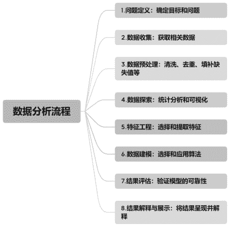

Figure 1.1 Data Analysis Process

### 1.2.1 定问题：磨刀不误砍柴工

动手前先动脑。明确**分析目的、业务痛点、成功指标与预期产出**。这一步定调全局，方向跑偏，后续再精准也是无效功夫。

### 1.2.2 收数据：广撒网、重筛选

按图索骥：从数据库抽取、爬虫采集网络数据、传感器实时流、问卷调研用户声……**核心原则：相关性与完整性并重。**

### 1.2.3 洗数据：把“脏料”变“优料”

清洗去重、补缺失、治异常、统格式。此环节是质量闸口，**Garbage In, Garbage Out**，洗不干净，后建模型全是空中楼阁。

### 1.2.4 探数据：先摸底、再谋划

用统计描述 + 可视化手段，快速看清数据分布、特征画像、变量相关性。**探索性分析（EDA）是后续特征工程与建模的“导航仪”。**

### 1.2.5 做特征：化腐朽为神奇

基于探索结论，做特征筛选、构造、降维。**好特征胜过复杂模型**——它能显著提升模型上限，降低过拟合风险，增强可解释性。

### 1.2.6 建模型：对症下药

按问题类型（分类/回归/聚类/序列…）与数据特质，从监督/非监督/强化学习算法库里选模型、调参数、训练验证。**目标只一：把数据里的规律“学”进模型权重里。**

### 1.2.7 评模型：不吹牛、看指标

Accuracy、Precision、Recall、F1、AUC……配合交叉验证、留一法等严谨验证手段，**只信经得起考验的泛化能力，不信训练集上的完美分数。**

### 1.2.8 通结论：让洞见落地生金

分析的终点不是 `.pkl` 模型文件，而是**决策者的行动指令**。产出可视化大屏、解读报告、行动建议三件套：**讲清楚“是什么”“所以怎样”“建议怎么干”**。根据受众与场景裁剪叙事，让数据真正驱动业务闭环。

```xml
?.xml version="1.0" encoding="utf-8"?
```

## 1.3 统计学基本功：数据分析的“内功心法”

没统计学支撑的数据分析是盲目的。统计方法贯穿**描述特征、量化关系、估计参数、检验假设**全链路，以下梳理高频必会招式。

### 1.3.1 描述性统计：一张快照看透数据分布

用寥寥数字勾勒数据全貌，常用指标清单：

# 核心统计量一览

*   **平均数**：全体数值加总后除以总个数得出的集中趋势指标。
*   **中位值**：将观测值按大小排序后，处于正中位置的数值。
*   **最高频值**：数据集中出现次数最多的那个取值。
*   **标准偏差**：衡量数值围绕平均数波动程度的指标，计算各数值偏离均值平方和的平均数再开方而得。
*   **方差值**：同为反映离散程度，算法与标准偏差一致，仅省去最后开根号步骤。
*   **四分位点**：将数据按序四等分形成的三个关键节点，分别对应 25%、50%、75% 位置。

这些指标能助我们快速掌握数据的中心倾向、波动范围及整体分布形态。

## 1.3.2 探索性数据分析

探索性数据分析（`EDA`）借助图表展示与统计手段，深挖数据内在结构、变量关联及异常模式，为后续建模导航。常用手段有：

1.  **直方图**：将数值分箱，用柱状高度展示各区间频次分布。
2.  **散点图**：双轴呈现两变量取值对应关系，直观判断相关性。
3.  **箱线图**：以五数概括（最小值、Q1、中位数、Q3、最大值）勾勒分布轮廓，离群点一目了然。

## 1.3 统计分析方法体系

### 1.3.2 描述性统计分析

4.  **相关性分析**：刻画两变量间线性关联强弱，**皮尔逊相关系数** 是常用度量尺度。

### 1.3.3 推断统计分析

推断统计的核心在于“以样本知总体”，主流工具三件套：

1.  **置信区间**：给定置信度（如 95%），估算总体参数（均值、比率等）落入的区间范围。
2.  **假设检验**：用样本证据裁决总体假设是否成立，典型手段含 T 检验、卡方检验、F 检验。
3.  **参数估计**：依据样本反推总体参数真值，主流路径有最大似然估计（MLE）、矩估计（MOM）、贝叶斯估计。

这套体系让我们能从有限样本中科学推演全貌，支撑决策落地。

### 1.3.4 参数估计深度解析

参数估计即“用样本特征拟合总体参数”，三大流派各有千秋：

1.  **最大似然估计（MLE）**：锁定让观测样本出现概率最大的参数值。
2.  **矩估计（MOM）**：令样本矩（均值、方差等）等于总体矩，解方程得参数。
3.  **贝叶斯估计**：融合先验认知与样本信息，通过贝叶斯公式输出参数后验分布。

这些手段为后续推断统计奠定基石。

### 1.3.5 假设检验实战工具箱

假设检验是“用数据说话”验证猜想的标准化流程，常见四大类：

1.  **T 检验**：专攻两总体均值差异，小样本、未知标准差场景首选。
2.  **卡方检验**：聚焦分类变量分布拟合优度与关联性。
3.  **F 检验**：比较两正态总体方差差异。
4.  **方差分析（ANOVA）**：一次性对比三个及以上总体均值。

通过这些工具，数据中的规律与关系经得起统计推敲。

### 1.3.6 回归建模：从关系到预测

回归分析构建因变量与自变量的数学映射，四大类型覆盖不同场景：

1.  **线性回归**：假设变量间呈线性关系，兼具预测与解释双重价值。
2.  **多项式回归**：引入高次项捕捉非线性曲率，需警惕过拟合陷阱。
3.  **逻辑回归**：针对二分类因变量，经 Sigmoid 函数映射概率，分类预测利器。
4.  **非线性回归**：拟合复杂非线性模式，建模与估计难度较大。

实战中，分析师需按业务问题与数据特质，灵活组合上述统计方法，输出全面、精准的洞见与方案。

## 1.4 数据剖析与机器学习：双引擎驱动

机器学习让算法自动从数据习得规律，相比传统统计，其在大规模、高维度、复杂非线性场景下展现更强自适应与泛化能力。按监督信号划分为四大范式：**监督学习**、**无监督学习**、**强化学习**、**半监督学习**。

### 1.4.1 监督学习：有标签的“教师式”训练

输入输出配对明确，主攻回归与分类，主流算法：

1.  **支持向量机（SVM）**：寻找最大间隔超平面，核技巧破解非线性难题。
2.  **决策树**：树状结构分层决策，白盒可解释性强。
3.  **随机森林**：多棵树集成投票/平均，抗过拟合、泛化强。
4.  **深度学习**：多层神经网络自动提特征，擅长高维复杂非线性建模。

### 1.4.2 无监督学习：无标签下的“自发式”发现

数据无标注，挖掘内在结构，用于聚类、降维、特征提取：

1.  **K-means 聚类**：迭代划分 K 簇，簇内距离最小化。
2.  **层次聚类**：构建树状嵌套簇结构，可视化层级关系。
3.  **主成分分析（PCA）**：线性投影保留最大方差方向，实现降维。
4.  **自编码器**：神经网络压缩重构，学习数据低维本质表达。

### 1.4.3 强化学习：智能体与环境的“博弈式”进化

智能体通过试错交互，学习最大化累积奖励的策略，应用于机器人、游戏 AI、资源调度：

1.  **Q-Learning**：表格式估计状态-动作价值（Q值），离线策略优化。
2.  **深度 Q 网络（DQN）**：神经网络拟合 Q 函数，攻克高维状态空间。
3.  **策略梯度**：直接优化策略函数，原生支持连续动作空间。
4.  **演员-评论家（Actor-Critic）**：双网络协同（策略网+价值网），训练更稳健高效。

### 1.4.4 半监督学习：少量标签撬动海量未标注数据

介于监督与无监督之间，利用未标注数据结构信息增强模型：

1.  **标签传播**：图论视角，标签沿相似边传递至未标注节点。
2.  **生成对抗网络（GAN）**：生成器与判别器博弈，同步提升生成与分类能力。
3.  **半监督 SVM（S3VM）**：利用未标注数据调整决策边界，增强稳健性。
4.  **自训练**：模型自产伪标签扩充训练集，简单务实。

**双引擎协同实战图谱**：
数据剖析洞察特征分布与关联，为 ML 做**特征工程**；依数据特质做**模型选型**；用统计指标做**模型评估**；将预测结果回溯业务做**结果解释**。二者互为表里，共筑数据价值闭环。

## 1.5 数据分析工具箱：语言、软件与大数据框架

工欲善其事，必先利其器。掌握编程语言（`Python`/`R`）、办公软件（Excel/SPSS/SAS）、BI 工具及大数据框架，并持续实战打磨，方能高效落地。

### 1.5.1 双子星编程生态

**`Python`**（通用型选手，数据科学首选，见下图）拥有最强生态矩阵：


图 1.2 Python 语言

*   **`Numpy`**：多维数组与矩阵运算的高性能基石。
*   **`Pandas`**：`DataFrame` 结构让清洗、转换、分析行云流水。
*   **`Scikit-learn`**：经典 ML 算法标准库，接口统一、开箱即用。
*   **`Matplotlib`**：二维绘图底层引擎，灵活可控。
*   **`Seaborn`**：封装 Matplotlib，高级接口出图更美观、代码更简洁。
*   **`Tensorflow`**：Google 出品，深度学习工业级框架，生态完备。

**`R` 语言**（统计原生，学术统计建模与绘图强项，见下图）包生态极深：


图 1.3 R 语言

*   **`Dplyr`**：数据操作管道化，代码可读性极高。
*   **`Ggplot2`**：Grammar of Graphics 实现，出版级可视化神器。
*   **`Tidyr`**：数据整理规范化（宽长表互转等）利器。
*   **`Lubridate`**：日期时间解析、运算、时区处理无痛化。
*   **`Randomforest`**：随机森林算法的标准实现包。

### 1.5.2 桌面端与 BI 软件：场景化选型指南

*   **中小数据日常分析** → **Microsoft Excel** 足矣；
*   **专业可视化探索与汇报** → **Tableau** 交互体验最佳；
*   **企业级大规模 BI 与建模** → **Power BI** 生态集成度最高。

三款工具各有所长，按数据量级、可视化需求、技术栈兼容性择优而用。

**Microsoft Excel**：电子表格王者，函数、透视表、条件格式、图表一站式搞定中小规模处理分析可视化。


图 1.4 Microsoft Excel

**Tableau**：可视化专用神器，拖拉拽连接多源数据，图表仪表板丰富自定义，让洞察“看得见”。


图 1.5 Tableau

**Power BI**：微软系企业级 BI，数据连接、建模、转换、可视化一体化，与 Office/SQL Server 无缝联动，支撑从基础到高阶全链路分析。

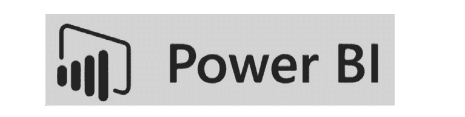

图 1.6 Power BI

### 1.5.3 大数据处理双雄：Hadoop 与 Spark

数据量级跨越 TB/PB，分布式框架成刚需。**Apache Hadoop** 与 **Apache Spark** 占据统治地位。

**Apache Hadoop**：基于 HDFS 分布式存储 + MapReduce 计算模型，生态成熟稳健。

核心组件延伸：
1.  **`Hive`**：SQL-like 接口（HiveQL）直连 Hadoop，大数据仓库查询分析首选。
2.  **`Pig`**：Pig Latin 脚本语言，流式处理海量 ETL 更便捷。

### 3. `HBase`：依托 Hadoop 构建的分布式列式存储方案，擅长海量信息的实时吞吐。
### 4. `Sqoop`：充当 Hadoop 与关系型数据库间数据搬运工的实用工具。

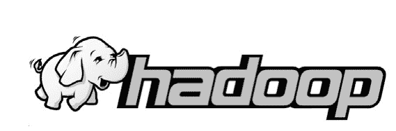

`Apache Spark` 是一款基于内存计算引擎的巨量信息处理骨架（架构请参考），专为高速处理大规模数据集而生。它支持 `Scala`、`Java`、`Python` 等多种编程语言接入。Spark 组件矩阵包含以下核心模块：

1.  **`Spark Core`**：基石模块，实现了基于内存的分布式计算原语。
2.  **`Spark SQL`**：面向结构化数据的处理引擎，兼容 `SQL` 语法与 `DataFrame` API。
3.  **`Spark Streaming`**：流式计算组件，采用微批处理机制实现实时数据流的处理。
4.  **`MLlib`**：内置算法库，涵盖分类、回归、聚类等常用模型。
5.  **`GraphX`**：图计算框架，专门用于图结构数据的建模与算法执行。

巨量处理骨架的迭代演进，极大地赋能了数据科学与模型构建领域，让海量信息的处理变得更从容、灵活且具备弹性伸缩能力。

### 1.5.4 云端服务与数智应用

云技术的成熟催生了大量云原生数智平台。此类服务融合存储、计算、分析、可视化于一体，并具备高可靠、按需伸缩、用量计费等核心优势。主流供应商及其代表性产品如下：

1.  **`Amazon Web Services (AWS)`**：提供 `Amazon S3`（对象存储）、`Amazon Redshift`（云端数仓）、`Amazon SageMaker`（模型开发平台）等全套数据方案。
2.  **`Google Cloud Platform (GCP)`**：拥有 `Google BigQuery`（即时查询）、`Google Cloud Storage`（统一存储空间）、`Google Cloud ML Engine`（托管训练服务）等特色产品。
3.  **`Microsoft Azure`**：集成 `Azure Blob Storage`（海量非结构化存储）、`Azure Synapse Analytics`（极限分析服务）、`Azure Machine Learning`（全周期管理）。

引入云端开展研判，核心红利在于省钱增效：免采购硬件，享极速部署与全球触达，助企业快速挖掘信息价值，筑牢竞争护城河。

## 1.6 GPT 模型速览

`ChatGPT` 是一项颠覆性的生成式 AI 技术，能够理解并产出拟人化的自然语言。作为基于生成式预训练 Transformer（`GPT`）架构的语言大模型（`LLM`），它凭借千亿级参数量，在交互流畅度与准确性上达到新高度。应用场景覆盖文本生成、机器翻译、摘要提取、情感计算等。通过语料库训练，模型掌握了语言规则、语义及语境建模能力，使其在问答、创作、连续对话等任务中表现拟人。随版本迭代，未来将拓展多模态能力（如图像理解），革新交互体验。品牌标识见 。

### 1.6.1 交互操作指引

账号登入后点击 `+New chat` 即可新建对话（界面参考 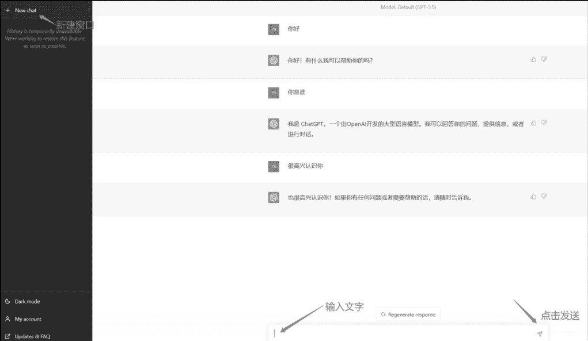）。输入框发送指令即可交互。核心特性在于**语境记忆**：模型会保存当前窗口的完整历史，并据此回应，赋予对话极大弹性，后文将细说。

> **注**：本书不赘述注册流程。若已订阅 `ChatGPT Plus`，除加速 `GPT-3.5` 外，更可解锁性能更强的 `GPT-4` 模型（见 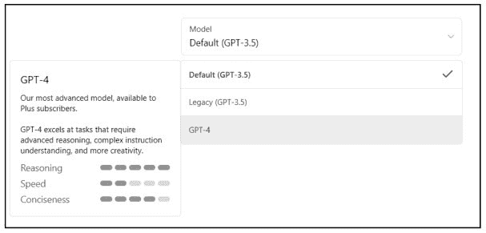）。

除网页端，开发者可调用 `API` 集成能力。OpenAI 按 `Token` 计费，需先在控制台申请专属 `API Key`（流程见 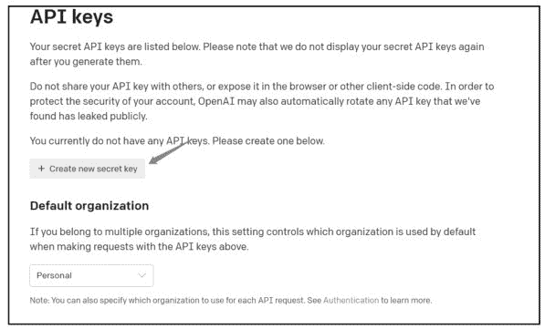）。

### 1.6.2 核心技术范式

该模型依托海量文本喂养深度网络，实现语言理解与产出。其核心架构为 **`GPT 架构`**，融合 **注意力机制** 与 **`Transformer` 结构**，有效抓取远距语义依赖。

训练遵循 **自回归建模** 范式：预测上下文条件下的下一词概率。
1.  **预训练期**：海量语料驱动模型习得词表、语法、世界常识。
2.  **微调期**：针对问答、对话等下游任务进行指令优化。

推理期采用 **束搜索法**：按概率保留多条高概路径，最终输出全局最优序列。

**关键进化**：突破规则模板束缚，具备推理雏形，能调用内部知识产出有深度回复。虽存幻觉、认知盲区等短板，但 OpenAI 引入 **人类反馈强化学习（`RLHF`）**（原理图见 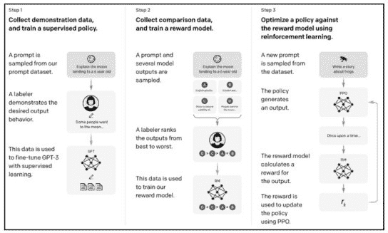），显著抑制有害、偏见内容，实现模型行为与人类意图对齐，这也是其高速增长的关键。

### 1.6.3 模型贯穿研判全链路

该模型渗透至研判各环节，显著增效：
*   **预处理期**：协助清洗转型，自动探测脏值、空值、冲突。
*   **描述统计**：自动出报告，速览数据画像。
*   **可视化**：按需出图，发掘模式与关联。
*   **预测研判**：依据所学供趋势参考，辅助拍板。
*   **文本挖掘**：情感/主题分析等。
*   **自然语言转 SQL**：降低巨量数据查询门槛。
*   **建模协作**：建议特征/参数/模型选择。

实战细节后文展开。用好此器，研判者可脱离繁杂代码，专注业务洞察与价值创造。

## 1.7 本章回顾

本章全景回顾研判方法论与工具谱系：
*   **核心流程**：定问题 → 取数 → 清洗 → 探索 (EDA) → 构特征 → 建模型 → 评效果 → 释结论。
*   **理论支撑**：统计推断 + 算法建模。
*   **工具集**：代码生态 (Python/R/SQL)、BI 软件、巨量引擎、云原生平台。

结语介绍了该对话模型——效率革命利器。熟悉其交互逻辑与底层原理，可为研判全链路装上智能引擎。

# 第 2 章 借助 GPT 模型备数

取数是研判基石，亦是最费时环节。巨量信息与智能技术融合背景下，自动采集工具受热捧。该对话模型凭借强悍语义理解与代码生成本领，成信息获取与合成利器。

本章聚焦两大核心技能：
1.  **程序开发**：唤起模型写采集器，覆盖资讯、影评、股市、天气、电商报价、社交平台等多源异构信息。
2.  **样本合成**：借助大模型产出影评、对话、新闻标题、商品文案、图像提示词等合成素材，支撑模型训练与验证。

通关本章，即掌握备数阶段“自动驾驶”本领。

## 2.1 GPT 写采集脚本实战

自动化程序是批量获取信息的关键。本节实战演示如何驱使模型产出工程级采集代码。

### 2.1.1 实战：采集新浪热点资讯

资讯数据是语言处理、舆情研判的核心语料。我们尝试用 `Python` + `Requests`/`BeautifulSoup` 自动采集新浪近一日资讯（标题、时间、摘要）并存为 CSV。

**提示词设计 (Prompt 2-1)**：
> 人设：资深采集工程师，精通 Python 网络编程、主流框架、清洗与反爬。
> 使命：采集新浪近一日数据（标题、时间、摘要），存 CSV。
> 产出：完整可运行代码。

**模型回复 (代码标记 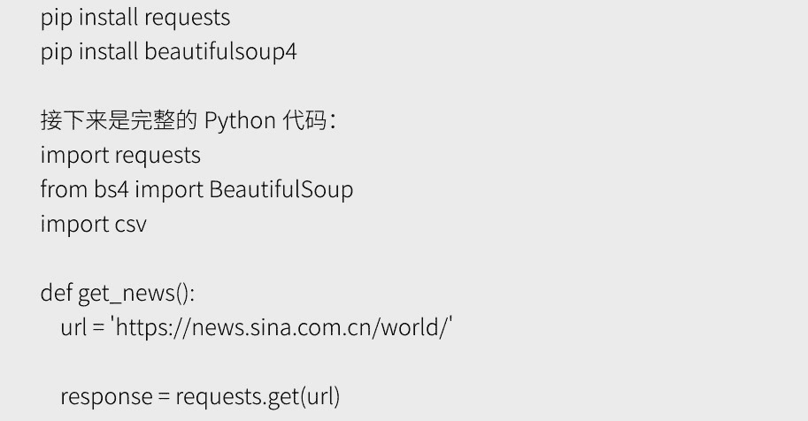 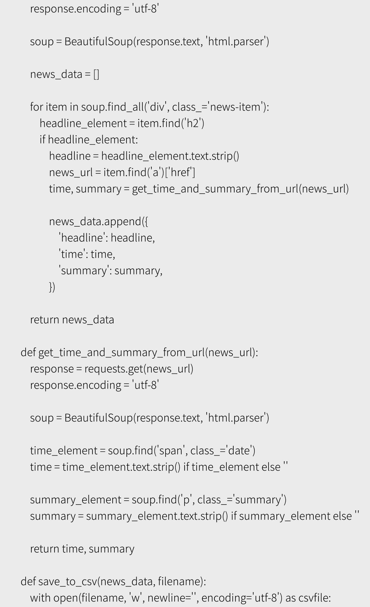 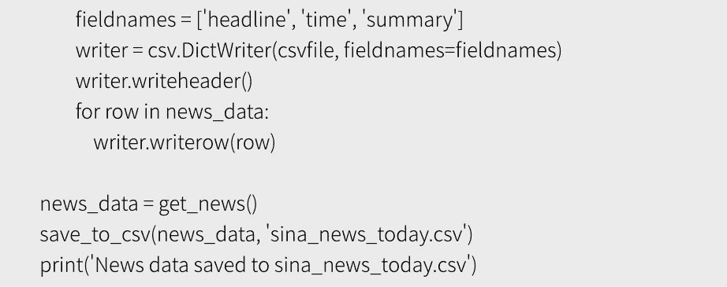)**：
模型给出架构分明、模块式、容错到位的程序。`PyCharm` 跑通即复现，样本见 **表 2-3** （含特朗普案件、巴赫穆特战况、叙利亚外交等焦点）。

**复盘**：脚本展示成熟库组合高效性，模块式设计利适配站点变更，印证大模型辅助开发在信息获取环节落地价值。

### 2.1.2 实战：采集豆瓣《铁达尼号》长评

影评素材服务推荐引擎与情感建模。意在：采集豆瓣指定影片的评论者、打分、正文，存 CSV。

**提示词设计 (Prompt 2-4)**：
> 人设同前。
> 使命：采集豆瓣《铁达尼号》影评（评论者、打分、正文），存 CSV。
> 产出：全量代码。

**模型回复 (代码标记  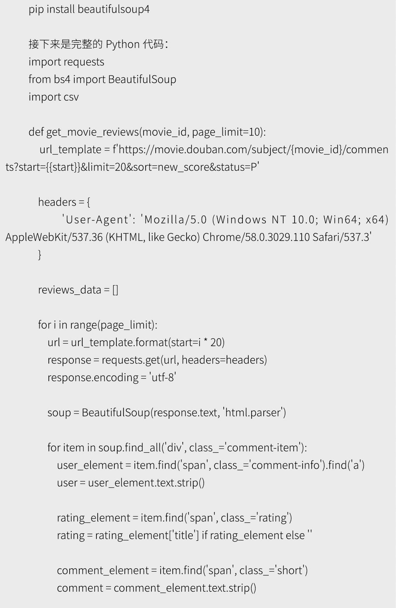 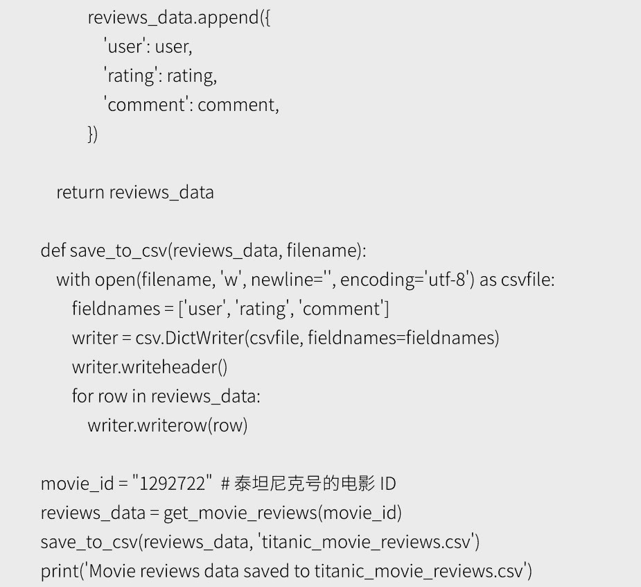)**：
程序同理遵从标杆范式。执行后得优质长评案例（详见 **表 2-6**），如“爱你原本只是一瞬...”“沉船时乐队镇魂曲...”“失去的才是永恒...”等饱含深情文本。

**复盘**：再度佐证模型能秒级给出有序、易维护采集器，攻克非结构语料落库难点，为后续情感研判供优质素材。

电影评论数据堪称影视分析领域的核心数据基石。借助 ChatGPT 编写的爬虫脚本，可高效采集豆瓣等平台的影评信息并完成筛选入库。该脚本兼具灵活性与扩展性，能从容应对各类网站的结构差异与定制需求。融合实时抓取与高效处理技术，它为学术研究注入及时可靠的数据源，助力深度剖析电影的社会文化映射与观众心理图谱，为产业决策提供坚实支撑。

### 2.1.3 利用 ChatGPT 编写股票数据采集脚本

获取股票数据是金融量化分析的基石环节，广泛服务于价格预测、量化策略构建及风控建模。我们可以借助 ChatGPT 生成 `Python` 自动化脚本，从财经门户批量拉取行情数据。

以抓取雅虎财经苹果公司（`AAPL`）历史行情为例，仅需向 ChatGPT 抛出如下指令（参考提示语 2-7）。

#### 2-7 股票数据抓取指令示例

角色设定：资深金融数据工程师，精通 `Python` 与网络编程，熟练驾驭爬虫框架，具备深厚的数据清洗分析功底及攻关难题的自学能力，能高效产出高质量金融数据集。

任务目标：抓取雅虎财经 `AAPL` 历史交易数据（日期、开高低收），并导出为 `CSV` 格式。

输出要求：直接给出可在 `PyCharm` 中运行的完整代码块。

#### 2-8 ChatGPT 生成的股票采集代码

下方示例采用 `Pandas` 与 `yfinance` 库实现高效抓取与存储。运行前请确保环境已就绪（缺失库请执行安装命令）。

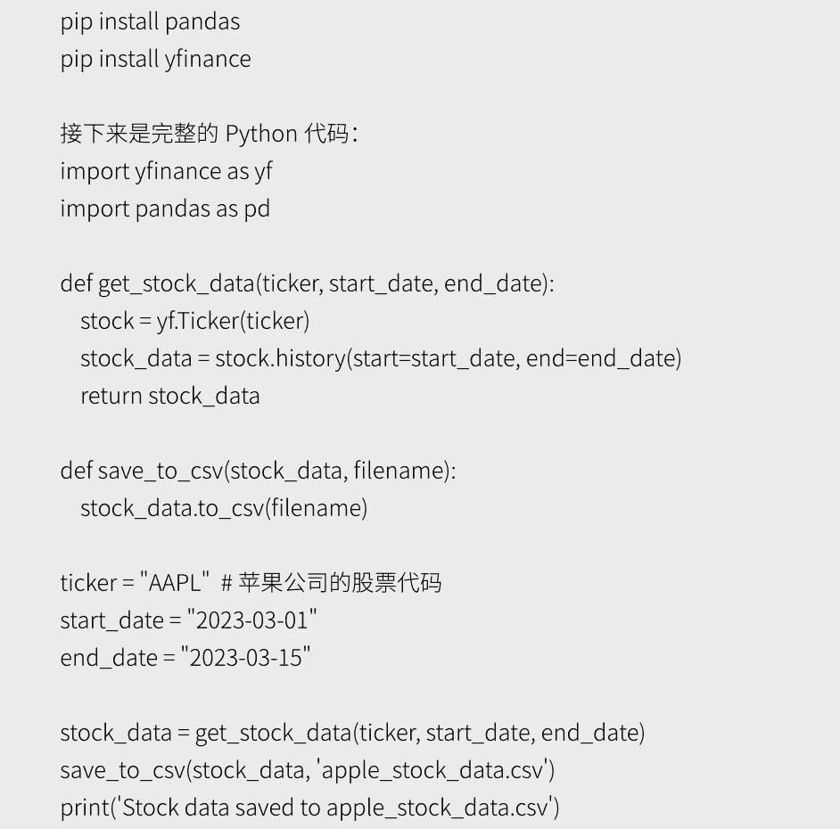

代码置入 `PyCharm` 即可跑通，成功获取的历史行情片段见 2-9。

#### 2-9 实测抓取的股票历史数据

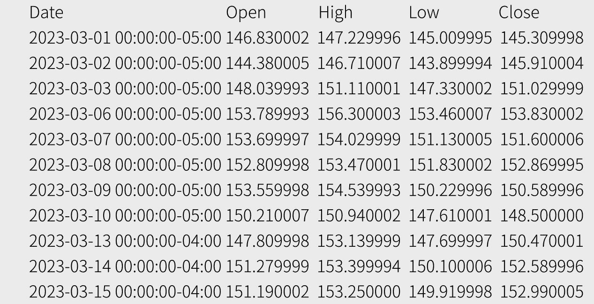

此脚本以紧凑模块化的架构、优质的第三方库调用，彰显了 `Python` 爬虫在金融场景的实战威力。它让数据获取、清洗、落地变得轻而易举，再次印证了爬虫技术在金融数据链条中的关键地位。

股票行情是金融建模的血液。ChatGPT 产出的脚本能精准捕获交易所级数据并完成结构化存储，其优异的适配性与扩展性可轻松覆盖多数据源与复杂需求。依托实时采集与高效处理管线，它为金融科研输送可信数据流，助力洞察市场微观结构与投资者行为，对市场稠健运行具备显著实践价值。

### 2.1.4 利用 ChatGPT 编写天气数据采集脚本

气象数据采集是气象预报、气候建模、智慧农业等领域的常态化需求。我们可指挥 ChatGPT 编写 `Python` 脚本，自动化对接气象平台获取预报信息。

以采集中国天气网杭州未来 7 天预报为例，提示语参考 2-10。

#### 2-10 杭州周天气抓取指令示例

角色设定：气象数据爬虫专家，`Python` 功底扎实，网络编程与爬虫框架信手拈来，擅长数据解析与异常处理，致力于为气象分析提供优质数据支撑。

任务目标：抓取中国天气网杭州未来一周数据（日期、天气、高低温、风向风力），落库 `CSV`。

输出要求：完整可运行代码块。

#### 2-11 ChatGPT 生成的天气采集代码

以下方案基于 `Requests` 与 `BeautifulSoup` 实现解析入库，运行前请确认依赖安装完毕。

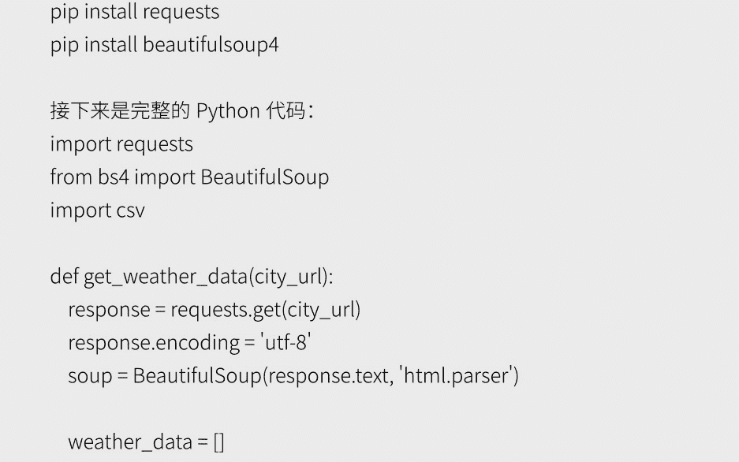

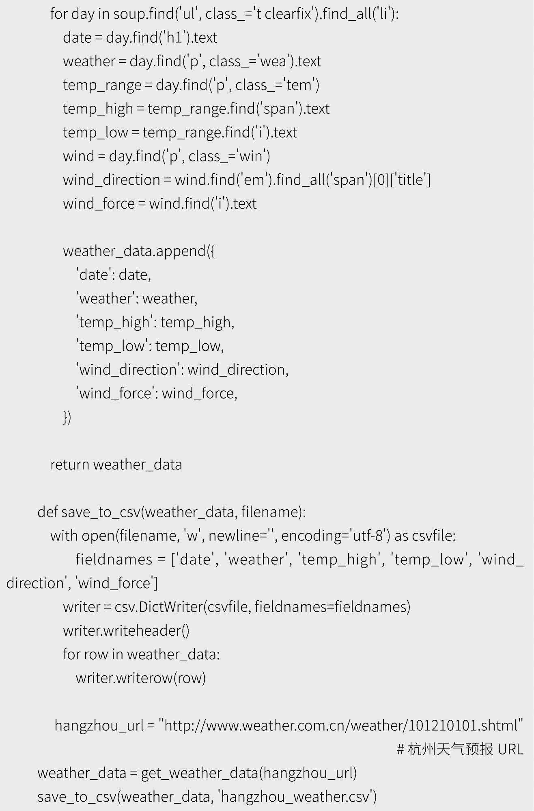

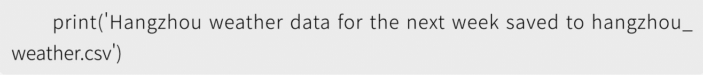

代码部署至 `PyCharm` 即可复现，采集样本见 2-12。

#### 2-12 实测抓取的杭州周天气数据

2023-04-07，小雨，13℃,8℃，东风，3-4 级

2023-04-08，小雨，16℃,10℃，东风，3-4 级

2023-04-09，多云，20℃,12℃，东南风，3-4 级

2023-04-10，多云，23℃,14℃，西南风，3-4 级

2023-04-11，阵雨，22℃,15℃，东风，3-4 级

2023-04-12，小雨，20℃,15℃，东北风，3-4 级

2023-04-13，多云，21℃,13℃，东北风，3-4 级

该脚本逻辑严谨、分层清晰，借力成熟库组件实现高吞吐解析，生动诠释了 `Python` 爬虫在环境监测中的高效实用性，确立了其在环境数据分析中的核心工具地位。

气象数据关乎气候趋势研判、灾害预警防御及生态政策制定。ChatGPT 赋能的采集脚本可极速接入观测站实时流，支持定制化清洗入库。其优异的跨站点适配与扩展能力，配合实时采集与高效计算引擎，为环境科研输送精准数据弹药，助力气候变化趋势解码与科学治理决策。

### 2.1.5 利用 ChatGPT 编写商品价格监控脚本

电商价格数据是市场洞察、竞品跟踪、动态定价的核心燃料。我们可驱使 ChatGPT 产出 `Python` 脚本，自动化巡检电商平台获取商品报价。

以抓取京东等平台手机品类价格为例，提示语见 2-13。

### 2.1.6 Using ChatGPT to Write Scripts for Scraping Social Media Data

#### 2-13 Prompt for Scraping Mobile Phone Price Data from an E-commerce Site

Role: E-commerce price scraping specialist, mastering `Python` and network protocols, adept at crawler frameworks and data pipelines, capable of delivering structured datasets for retail intelligence.

Target: Scrape product names and prices from a target e-commerce site (e.g., JD.com mobile category), export to `CSV`.

Deliverable: Full executable `Python` code block.

ChatGPT responded with the solution shown in 2-14.

#### 2-14 Mobile Phone Price Scraping Script Provided by ChatGPT

A `Python` implementation leveraging `Requests` and `BeautifulSoup` for parsing and storage. Ensure dependencies are installed beforehand (`pip install requests`).

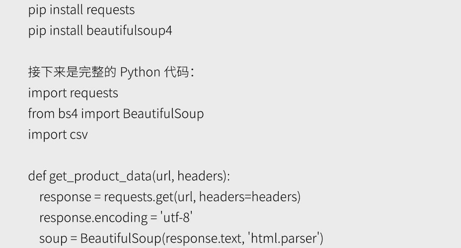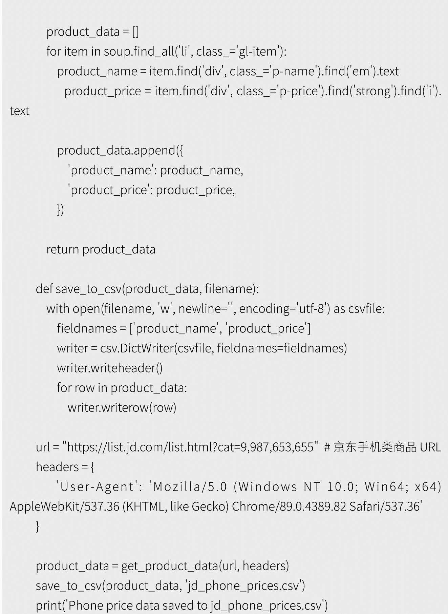

Deploy to `PyCharm` to execute. Sample output captured in 2-15.

#### 2-15 Scraped Mobile Phone Price Samples

```
product_name,product_price
Redmi Note 12 Turbo 5G Snapdragon 7+ Gen 2 Ultra-narrow Four-sided OLED Straight Screen 64MP 8GB+256GB Carbon Fiber Black Smartphone Xiaomi Redmi，1999.00
Xiaomi 13 Leica Optical Lens Snapdragon 8 Gen 2 Ultra-narrow Screen 120Hz High Refresh 67W Fast Charge 12+256GB Distant Mountain Blue 5G Phone，4599.00
Redmi K50 Ultra Snapdragon 8+ Flagship Processor 100MP OIS 120W+5,000mAh 12GB+256GB Silver Trace Xiaomi Redmi K50 Ultra,2609.00
Meizu 20 PRO 12GB+256GB Dawn Silver Snapdragon 8 Gen 2 Flagship Chip 5,000mAh Battery Supports 50W Wireless Fast Charge Ultra-thin Body Design 5G Phone，4,399.00
OPPO Find X6 Pro 16GB+512GB Flying Spring Green Triple Main Cameras Hasselblad Imaging 100W Flash Charge Snapdragon 8 Gen 2 Flagship Chip 5G Camera Phone，6,999.00
realme GT Neo5 240W Light-speed Charge Awakening Halo System 144Hz 1.5K Straight Screen Snapdragon 8+ 5G Chip 16+1TB Holy Land White 5G Phone，3,499.00
Meizu 20 12GB+512GB Pioneer Gray Snapdragon 8 Gen 2 Flagship Chip 144Hz Esports Straight Screen Supports 67W Fast Charge Ultra-thin Body Design 5G Phone，3,799.00
Redmi K60 Snapdragon 8+ Processor 2K High-brightness Screen 64MP Ultra-clear Camera 5500mAh Long Battery Life 12GB+256GB Ink Feather Xiaomi Redmi 5G,2,699.00
Apple iPhone 14 Pro (A2892) 256GB Deep Purple Supports Mobile/Unicom/Telecom 5G Dual SIM Phone [King Card],8,809.00
Redmi Note11T Pro 5G Dimensity 8100 144Hz LCD Flagship Straight Screen 67W Fast Charge 6GB+128GB Midnight Black 5G Smartphone Xiaomi Redmi，1499.00
Redmi Note12 5G 120Hz OLED Screen Snapdragon 4 Mobile Platform 5000mAh Long Battery Life 6GB+128GB Midnight Black Smartphone Xiaomi Redmi，1,199.00
```

This script exemplifies the rigor and efficiency of `Python` crawlers in retail analytics. Its layered architecture and mature library stack accelerate the fetch-parse-store cycle, reinforcing the crawler's pivotal role in e-commerce intelligence.

Pricing data fuels competitive benchmarking, price monitoring, and promo strategy. The ChatGPT-crafted scraper enables real-time ingestion from diverse storefronts with robust filtering and persistence. Its flexibility across site structures, powered by live scraping and efficient processing, delivers high-fidelity data assets for market strategy formulation and rival tracking.

#### 2-16 Prompt for Scraping Douyin Toutiao (Headlines) Data

Profile: Seasoned `Python` engineer with deep crawling expertise, focused on high-throughput extraction from social platforms. Skilled in real-time trend parsing and topic modeling to empower sentiment monitoring and growth marketing.

### 2-17 ChatGPT 交付的抖音热榜爬虫实战代码

目标很明确：抓取抖音热榜的标题与热度值（点击量），并落地为 `CSV` 文件。直接上完整 Python 代码，代码块格式输出。

ChatGPT 依据需求给出了如下方案（见 2-17）。

抖音热榜采用动态加载机制，单靠 `Requests` 请求静态页根本拿不到数据。因此，示例改用 `Selenium` 模拟真实浏览器行为，等待页面渲染完成后再提取目标信息。运行前请确保已安装 `Selenium` 库，并配置好对应浏览器的驱动（如 `ChromeDriver`）。

下方示例展示了如何结合 `Requests` 与 `BeautifulSoup` 完成抓取与存储。若环境缺失依赖，请先执行安装命令：

`pip install requests`

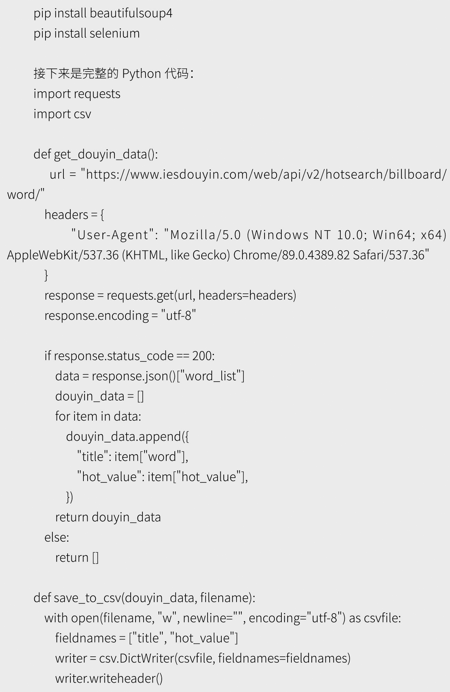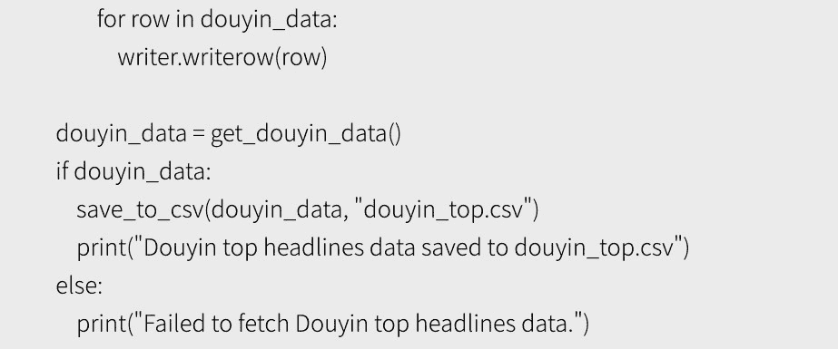

将上述代码粘贴进 PyCharm 运行，即可顺利拿到抖音热榜数据，部分返回结果如 2-18 所示。

#### 2-18 ChatGPT 抓取的抖音热榜数据实况

```
title,hot_value
Court rules Shen Na and Zhang Jie house purchase did not involve order jumping，11,302,000
Bank responds to man's 0.94 yuan withdrawal rounded to zero，10,939,924
Saudi and Iranian Foreign Ministers meet in Beijing for first time，9,921,444
Zhang Lei posts suspected farewell to hosting stage，9,898,802
Painting Jianghu: The Bad People Episode 7，9,888,518
Procuratorial Storm: Bao Bei'er plays villain again，9,694,277
Macron interacts with Huang Bo handshake，9,581,863
Fan Chengcheng's contract with Yuehua expires, not renewed，9,552,874
Jisoo FLOWER Dance Version，9,522,749
Liu Guoliang re-elected as Chinese Table Tennis Association Chairman，9,474,615
```

这份由 ChatGPT 生成的爬虫脚本，直观展示了 Python 爬虫在社交媒体数据挖掘中的实战威力。代码逻辑清晰、结构紧凑，借助成熟的第三方库大幅提升了获取与解析效率。借助它，我们能轻松实现对抖音热榜实时数据的抓取、筛选与持久化，进而支撑舆情监测与热点挖掘等核心场景。

抖音热榜数据是洞察社会热点、度量公众关注、制定营销策略的重要风向标。利用这份脚本，可快速批量获取社交平台的实时头条数据，并支持针对性清洗与入库。其良好的适配性与扩展性，也使其能轻松移植至其他社交媒体的数据格式中。

## 2.2 让 ChatGPT 成为你的数据生成器

数据分析的基石是高质量数据。除了从现有渠道采集，我们还可以直接指挥 ChatGPT 生成各类训练样本。这种方式能大幅压缩数据获取与预处理的时间成本，让分析工作提速增效。本节将逐一拆解如何用 ChatGPT 批量产出影评、对话、新闻标题、商品文案乃至图像提示词等多元化数据。

### 2.2.1 一键生成差异化影评数据集

我们可以指定 ChatGPT 产出好评、差评、中评等不同极性的影评内容。操作步骤如下：先锁定所需评论类型（正向/负向/中性），再限定字数与输出格式，最后发送指令即可批量得样。

以科幻神作《星际穿越》为例，我们用下面的提示词（见 2-19）与 ChatGPT 对话，生成符合规范的影评样本。

#### 2-19 影评生成专用提示词

你是一位资深影评人，拥有敏锐的观影洞察与深厚的理论功底，能从剧情、演技、声画、美术等维度精准拆解影片，并融会贯通形成极具穿透力的深度评论。同时你博览影史、人文底蕴深厚，擅长将影像作品置于历史、社会、文化的宏大坐标中解读，为观众提供全景式视角。

请为《星际穿越》生成 3 条好评、3 条差评、3 条中评，单条不超过 100 字。输出格式固定为：

【评论 1】：
【评论 2】：
……

ChatGPT 返回的样本数据如 2-20 所示。

#### 2-20 ChatGPT 生成的影评样本库

**好评组**

【评论 1】：《星际穿越》以硬核科幻外壳包裹柔软父女情，视听语言极致震撼，是科幻片的里程碑之作。

【评论 2】：影片将微观亲情置于宏大星际叙事中，跨越时空的羁绊直击人心，看完久久不能平复。

【评论 3】：汉斯·季默的配乐与诺兰的蒙太奇剪辑完美共振，听觉与视觉的双重冲击令人肾上腺素飙升。

**差评组**

【评论 1】：虽特效精良，但叙事节奏拖沓冗长，大段理论铺垫让观影体验陷入沉闷。

【评论 2】：五维空间、时间膨胀等硬核设定门槛过高，普通观众极难在有限片长内消化，阅读门槛劝退路人。

【评论 3】：结局处理略显神来之笔，逻辑自洽性不足，留给观众的更多是困惑而非回味。

**中评组**

【评论 1】：工业水准满分，特效质感顶尖，但剧情内核平平无奇，缺乏超越类型片的高光时刻。

【评论 2】：人物群像单薄，角色动机与弧光缺乏深度挖掘，导致情感共鸣点难以形成稳固支撑。

【评论 3】：探讨爱与生存的内核极具张力，奈何叙事手法割裂，削弱了主题思想的深度表达。

**规模化生成技巧**：若需千条级数据，可在提示词中直接指定总量，随后持续追发 “继续” 指令即可分批获取后续内容。

**Token 限额提醒**：ChatGPT 单次输出长度受 API 或平台策略限制。例如 OpenAI GPT-3 早期版本上限为 4096 字符，部分对话类应用会设置更严格的截断阈值。实际落地前，务必确认目标平台的文本长度配额，避免数据截断。

# 用 ChatGPT API 批量造数据：影评、对话、标题一网打尽

除了前文提到的手动“投喂”方式，调用 API 才是实现高效、自动化量产的正道。以影评生成为例，只需通过接口传入片名、类型、主创阵容等基础信息，系统便能源源不断产出相关长短评。接口还贴心提供了数量控制参数，一键指定生成条数；更支持按需定制篇幅长短与语言风格，轻松拿捏从专业深度解析到大众碎碎念的多元化需求。

#### 2-21 调用 ChatGPT API 批量生成影评

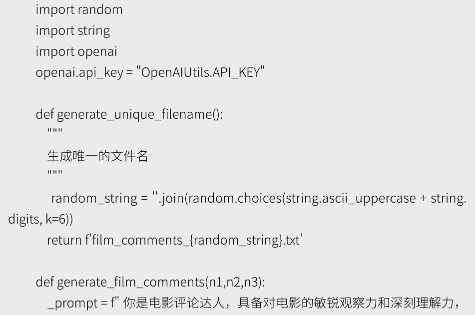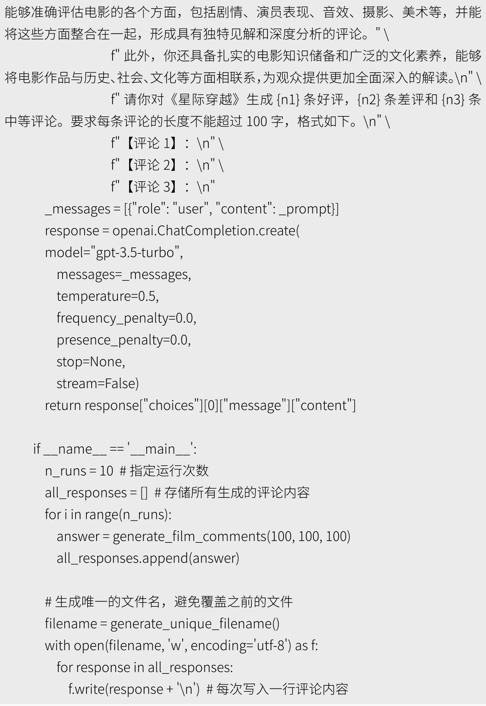

上述代码演示了如何驱动 `OpenAI GPT-3.5` 模型，针对电影《星际穿越》一次性产出正面、负面、中立三类不同立场的影评。得益于 Python 的随机字符串机制配合 OpenAI API，每条生成内容自动独立存文件，彻底杜绝了覆盖风险，效率与准确度双提升。

**关键提醒**：代码中的 `OpenAIUtils.API_KEY` 需替换为你的个人密钥，且 OpenAI 按 Token 计费，用量请自行把控。

**小结**：借力 ChatGPT 造影评数据，能极速积累海量语料，为影评分析、推荐算法、市场研判输送高质量弹药。其底层神经网络技术赋予文本极强的拟人感，可读性与准确度均有保障。但务必清醒：AI 产出非完美品，难免出现语病、逻辑断层或立场偏差。**落地前，务必建立“清洗-校验-加工”流水线**，剔除劣质样本，挖掘深层规律，确保数据真正赋能业务。

### 2.2.2 定制专属对话场景，从客服到技支持手可得

对话数据生成同理，ChatGPT 能轻松驾驭日常闲聊、客服接待、技术排障等多元场景。实操三步走：锁定场景与角色 → 划定轮次与格式 → 丢给模型“干活”。

假设我们要练技术支持机器人，Prompt 可这样写，如示例 2-22 所示。

#### 2-22 对话数据生成 Prompt 示范

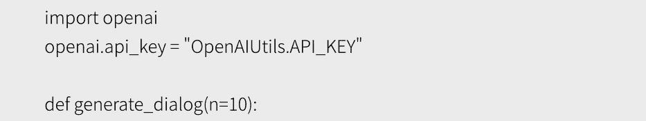

> **角色设定**：资深技术支持专家，懂原理、会排查、善沟通。
> **任务**：围绕“Wi-Fi 连不上”展开 4 轮对话。
> **格式要求**：
> User: [问题描述]
> Technical Support: [解决方案]
> ...

ChatGPT 交出的答卷如 2-23 所示，条理清晰、由浅入深，教科书级标准演示。

#### 2-23 ChatGPT 生成的技术支持对话实录

**User**: 电脑连不上 Wi-Fi，但手机平板都能连。  
**Technical Support**: 先查电脑 Wi-Fi 开关，重启开关试试。  
**User**: 试了没用。  
**Technical Support**: 重启电脑和路由器，确认距离在 10 米内。  
**User**: 重启了、距离近，依然不行。  
**Technical Support**: 删除网络配置重连；若无效，更新无线网卡驱动。  
**User**: 删了重连也不行。  
**Technical Support**: 去设备管理器右键更新驱动；更新后仍不通，建议联系厂商或运维深查。

量大时（如需 1000 条），Prompt 里直接报数量，不够再追加 “Continue” 指令接力。当然，走 API 才是自动化的王道，见 2-24。

#### 2-24 调用 ChatGPT API 批量生成对话数据

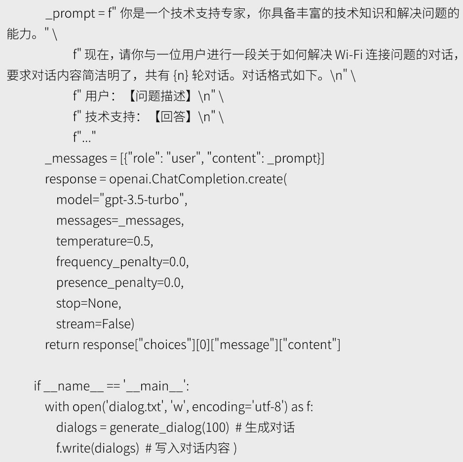

代码封装了 `generate_dialog` 函数，基于 GPT-3.5 根据上下文与预设 Prompt 推进多轮对话，轮次随心控，结果自动落盘 `dialog.txt`。

**延伸价值**：这套打法能快速产出海量对话语料，直击智能客服、对话系统、NLU/NLP 模型训练核心痛点。拟人化表达大幅提升数据可用性。进阶玩法：注入情感色彩（共情/专业/轻松）、切换语风（商务/心理咨询/娱乐）、调节复杂度（单意图/多意图/长上下文），精准适配实战场景。

### 2.2.3 秒出爆款新闻标题，多领域选题不发愁

新闻标题生成同理，政经科娱样样行。核心逻辑：定主题分类 → 定产出数量 → 一键生成。

以科技版块为例，Prompt 可参考 2-25 直接开工。

#### 2-25 新闻标题生成 Prompt 示范

# 2.2.3 实战：用 ChatGPT 批量产出新闻标题样本

我们让 ChatGPT 扮演资深新闻总编，凭借敏锐的新闻触觉与精准的语言驾驭力，为 10 条科技热点事件拟定既专业又吸睛的标题。事件清单涵盖：

*   苹果发布新一代 iPhone
*   人工智能领域取得突破性进展
*   特斯拉推出新款电动车
*   亚马逊启用新一代配送无人机
*   网络安全峰会聚焦隐私保护
*   Facebook（Meta）上线 VR 社交平台
*   SpaceX 火星着陆任务成功
*   微软发布全新操作系统
*   5G 技术赋能智慧城市建设
*   生物技术实现癌症早筛重大突破

ChatGPT 依据要求产出的标题范例如 **2-26** 所示。

#### 2-26 ChatGPT 生成的新闻标题范例

*   **全新 iPhone 登场：苹果年度旗舰重磅发布**
*   **AI 创新突围：前沿研究引领未来科技风向**
*   **特斯拉新品亮相：重塑纯电市场格局**
*   **亚马逊无人机：配送服务迈入变革新纪元**
*   **网安峰会聚焦隐私：筑牢数字世界防线**
*   **Facebook 虚拟现实：开启虚实融合社交新时代**
*   **SpaceX 火星之旅：人类首次成功着陆红色星球**
*   **微软推出新系统：重新定义桌面端体验**
*   **智慧城市建设提速：5G 激活未来城市活力**
*   **生物技术新突破：癌症早期诊断迎里程碑**

除批量生成外，我们还可聚焦单一主题深挖。以 iPhone 为例，追问 10 个不同切入点的标题，结果见 **2-27**。

#### 2-27 围绕 iPhone 生成的多维标题

*   **iPhone 新机发布：大屏、疾速、强悍影像三重进化**
*   **搭载 A15 芯片，新 iPhone 性能跃升 70%**
*   **iPhone 设计大变身：圆边过渡 + 雾面黑配色**

### 2.2.3 使用 ChatGPT 生成新闻标题数据样本

*   iPhone 首度搭载 120Hz 高刷屏，操作丝滑流畅
*   iPhone 引入全新 `LiDAR` 激光雷达，`AR` 应用实力大增
*   iPhone 全系标配 `5G` 网络，下载提速明显
*   iPhone 多任务处理能力质变，多 `App` 并行无压力
*   iPhone 影像系统全面进阶：光学变焦与夜景模式双升级
*   iPhone 新增 `MagSafe` 磁吸充电，补能更省心
*   iPhone 全新发布：用户隐私保护迎重磅升级

需求量大时，可在 Prompt 中指定数量，再通过反复“继续”指令追加内容；亦可调用 `API` 实现自动化批量产出，参考 **2-28**。

**2-28 调用 ChatGPT API 批量生成新闻标题**

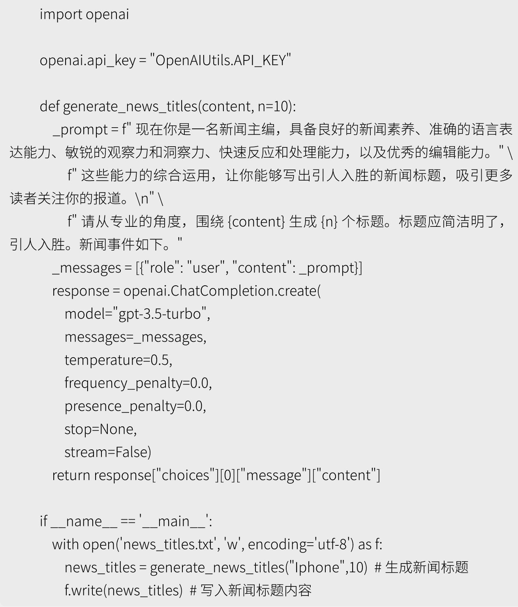

该 Python 函数 `generate_news_titles` 封装了 `OpenAI API` 的 `GPT-3.5` 模型，输入新闻事件即可输出 `n` 条标题字符串，并自动落盘至 `news_titles.txt`。

**小结**：借助 ChatGPT 产出标题样本，能极大缩短新闻推荐、编辑排版等场景的素材准备周期。得益于先进神经网络架构，其生成文本极贴合人类表达习惯，显著提升标题的点击诱导力与可读性。

进阶玩法上，还可通过参数控制标题的情感基调（正式/幽默/紧迫）、语言风格及复杂度，精准适配多元化业务场景。

---

### 2.2.4 实战：用 ChatGPT 高效构建电商产品描述库

产品描述是电商转化的“隐形销售”。善用 ChatGPT 可快速沉淀差异化描述素材，赋能运营提效。操作分两步：明确品类与数量 → 设计 Prompt 交互生成。

以智能手机为例，Prompt 设计见 **2-29**。

**2-29 生成产品描述的 Prompt 示例**

```
你是一名电商平台的文案策划专家，具备深厚的写作功底、理解产品的能力、对市场营销策略的敏感度，以及对目标受众的了解。你能够通过生动有趣的语言描述商品特点、优点和使用方法，吸引潜在客户并促进销售。

现在给你以下 3 款产品。

品牌：苹果；型号：iPhone 14；特点：超高清屏幕、强大的性能、全新设计。
品牌：三星；型号：Galaxy S23；特点：顶级屏幕、强大的摄像头、出色的续航。
品牌：华为；型号：Mate 50；特点：高性能芯片、出色的摄像头、快速充电。

你需要为这 3 款产品撰写各自的产品描述。描述应详细介绍产品特点、优势和适用场景，有利于吸引消费者购买。

每个产品给我 3 个不同风格的描述，输出格式如下：

【产品 1】
【描述 1】：
【描述 2】：
【描述 3】：
```

ChatGPT 返回的结构化描述样本见 **2-30**。

**2-30 ChatGPT 生成的产品描述样本**

【产品 1：iPhone 14】

*   **描述 1**：超清屏搭配强劲性能，操作丝滑流畅；全新设计语言带来颜值与质感的双重跃升，解锁高品质用机体验。
*   **描述 2**：苹果最新力作，高素质超清屏幕赋予极致视觉舒适度；澎湃性能告别卡顿，畅快加乘。
*   **描述 3**：追求卓越机型首选。创新设计重塑颜值与手感，超清大屏与强悍性能让多任务切换、生活记录皆得心应手。

【产品 2：Galaxy S23】

*   **描述 1**：顶级屏幕加持强悍影像，呈现清晰生动的视听盛宴；超强续航消除电量焦虑，畅享无忧用机。
*   **描述 2**：三星旗舰标杆，顶配屏与影像模组让拍照录像细节满分；持久续航为高强度使用兜底。
*   **描述 3**：全能旗舰之选。无论拍摄还是录像，顶级硬件配置均能交出满意答卷。

【产品 3：华为 Mate 50】

*   **描述 1**：高性能芯片与旗舰影像组合，拍照录像清晰流畅；闪充技术解锁“充电 5 分钟，通话 2 小时”便捷体验。
*   **描述 2**：硬核实力派。强芯加持影像旗舰，全场景拍摄游刃有余；闪充加持，电量焦虑彻底破解。
*   **描述 3**：全场景旗舰标杆。强芯与影像双加持，多场景体验均在线；极速闪充让满电状态随时在线。

大规模生产时，Prompt 可追加风格、卖点侧重等约束，配合“继续”指令或 API 批量调用（**2-31**），效率倍增。

**2-31 调用 ChatGPT API 批量生成产品描述**

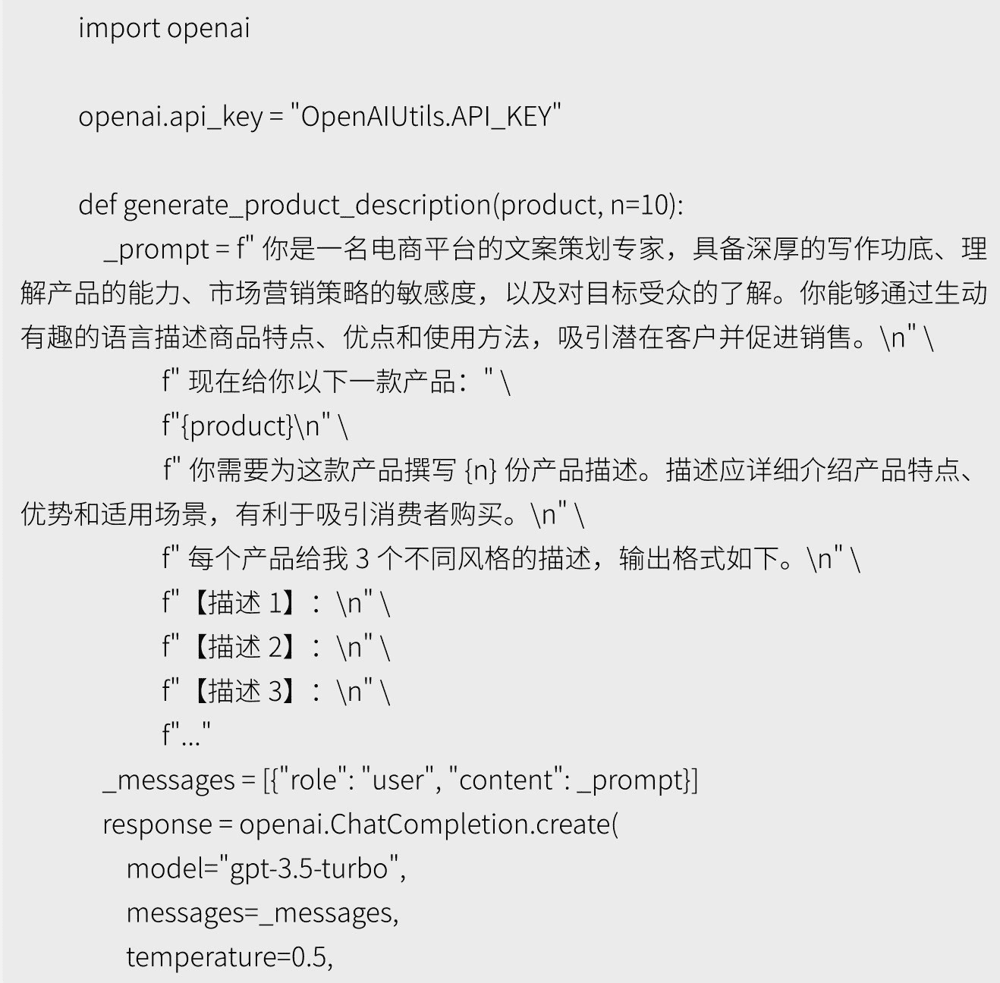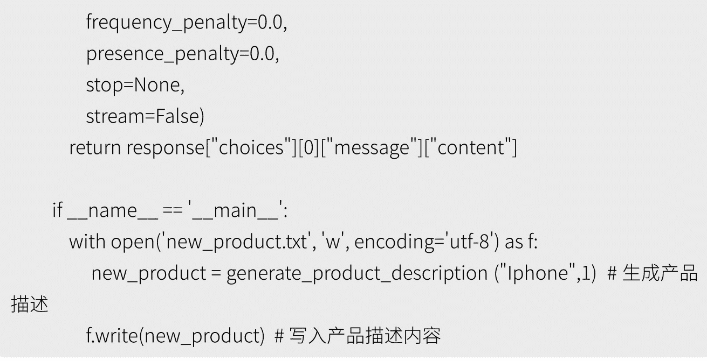

代码封装 `generate_product_description` 函数，入参为产品名与生成条数，调用 `GPT-3.5` 输出规范化文本并自动归档。

**总结**：该方案显著降低人工撰写成本，同时借助模型语言能力保证文案质量与一致性。落地电商详情页，能助力消费者高效获取核心卖点，提升决策效率与品牌好感度。

---

### 2.2.5 实战：借力 ChatGPT + Midjourney 构建图像数据集

CV 领域数据为王。ChatGPT 虽不直接生图，但其强大的文本生成能力可产出高质量 Prompt，再经 Midjourney 等绘图模型落地为像素级素材。

**Midjourney 简介**：Midjourney 实验室出品的 AI 绘图工具，擅长文生图，通过 Discord Bot 交互，零代码门槛，广泛服务于创意、设计、科研等场景。

**工作流示例：以“生成猫咪图像集”为例**。

**步骤 1：让 ChatGPT 产出 Midjourney 专用 Prompt**（**2-32**）

**2-32 生成绘图 Prompt 的指令**

```
现在我在使用一个名叫 Midjourney 的 AI 图像生成器，Midjourney 和 DALL·E2 类似，需要 Prompt。它的 Prompt 是以一个个关键词的形式，相互之间以逗号隔开的，包括图像描述、风格等。你要充当我的关键词生成器，帮我按照上面的格式生成英文的 Prompt。以下是已有的 Prompt，你可以参考。

----
Prompt1:a dynamic, busy, futuristic utopian space city, 1950s science fiction, complex, detailed, exciting, electric, daylight, blue sky, hyper realistic, 8k, cinematic, --ar 16:9
Prompt2:young female, cat girl, ethereal, dark druid clothing, white hair, ghostly white fur on face and body, glowing blue eyes with black sclera, cat tail, full body standing, Forrest, night, starlight, realistic, hyperdetailed, unreal engine render, 4k unreal engine --ar 6:4 --iw . 5 --test --upbeta
Prompt3:cat surfing on a surfboard, high waves, cat wearing sunglasses, cat has mouth open, polaroid photo --ar 2:3
Prompt4:vicious sea snakes crawling through a large cracked leaking brass porthole undersea, horror, hyper realistic, 8k, --ar 16:9
Prompt5:steampunk industrial pittsburgh football game, hyper realistic,8k, --ar 16:9
----

参考上面的 Prompt，我现在需要一个现实中可爱的猫咪的图片，给我生成对应的 Prompt。
```

**步骤 2：获取结构化 Prompt 列表**（**2-33**）

**2-33 ChatGPT 输出的 Midjourney Prompt 样本**

```
Sure, here's a prompt for a cute cat image:

"A fluffy, adorable, domestic shorthair cat, sitting on a windowsill, surrounded by plants, natural light, cozy atmosphere, relaxed expression, high-resolution, photo-realistic, --ar 4:3."
```

**步骤 3：Midjourney 参数配置**（参考图 2.1）

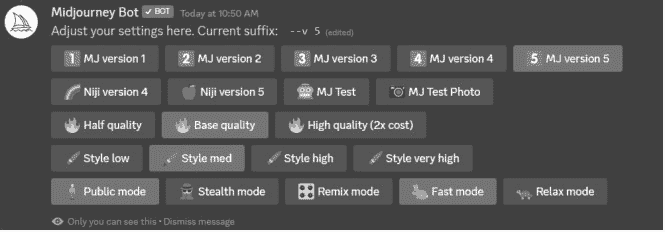

图 2.1 Midjourney 参数配置面板

**步骤 4：输入 `/imagine` 指令发送 Prompt**（参考图 2.2）


图 2.2 Midjourney 交互界面示意

> **特别提示**：Midjourney 现已取消免费额度，需订阅付费方可使用。

**步骤 5：筛选与迭代**。模型每次返回 4 张候选图，可直接入库，或微调 Prompt 复刷至满意（**2-33** / 图 2.3）。


图 2.3 Midjourney 生成结果示例

# 利用 DALL·E2 接口实现批量造图

除前述相对繁琐的制图路径外，还可直接调用 `OpenAI DALL·E2 API` 完成批量出图。`DALL·E` 系出自 `OpenAI`，基于强大的 `GPT-3` 架构演进而来。作为升级版，`DALL·E2` 能依据文本描述产出极具创意与细节的高品质画面，融合自然语言理解与计算机视觉技术，为设计师、艺术家及各行业用户开启全新视觉创作范式。批量自动生成的示例代码见 2-34。

**2-34 批量自动生成图片示例**

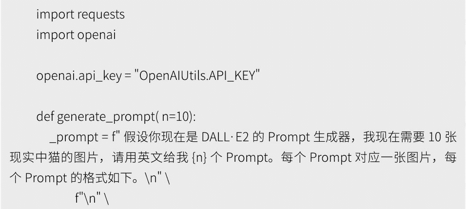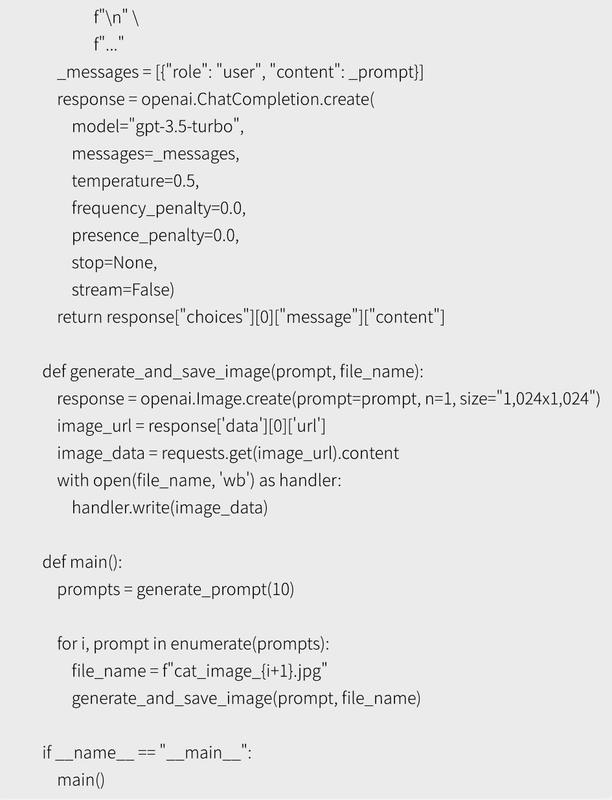

该脚本借助 `OpenAI` 接口，先让 `GPT-3.5` 产出 10 条描述猫咪画面的 `Prompt`，再经 `DALL·E2 API` 生成对应图像并落盘保存。代码内含 `generate_prompt` 函数用于构造提示词文本，最终产出 10 张猫咪图片，部分效果如图 2.4。


图 2.4 ChatGPT 与 DALL·E2 协同生成的图像

综上，`ChatGPT` 联动 `DALL·E2 API` 可批量产出丰富多元的图像数据集，适用于模型训练、算法验证等场景，能获取大量高质量素材，显著增强模型精度与鲁棒性，为数据研判与机器学习赋能。

> **特别提示**：图像版权归原始创作者所有。商用或公开发布前，务必获得合法授权。同时，为保障数据集纯度，生成 `Prompt` 与后处理环节需严格把关，规避噪点等质量隐患，唯有优质数据集方能有力支撑模型训练与校验。

## 2.3 小结

本章聚焦 `ChatGPT` 辅助数据准备，涵盖两大板块：一是编写采集脚本，涉及新闻、影评、股票、天气、商品价格、社交媒体等多源数据的自动化抓取，大幅提效；二是合成数据样本，包括影评、对话、新闻标题、产品描述及图像集，可用于模型训练或分析建模。掌握这些流程与技巧，有助于读者夯实数据基石，保障分析结论的可信度与精准度。

# 第 3 章 使用 ChatGPT 清洗数据

在数据驱动决策的当下，分析工作愈发关键。面对海量数据涌现，预处理与清洗至关重要。规范清洗能保障数据品质与完整性，进而提升分析结论的精准度与可靠性。

本章核心讲解如何驾驭 `ChatGPT` 开展清洗工作，重点覆盖：

- **质量修复**：借助 `ChatGPT` 解决空值补全、离群点识别清洗、重复记录去除等疑难杂症。
- **结构重塑**：演示利用 `ChatGPT` 实现格式标准化转换，以及多源数据融合整合。

习得本章技能后，读者将能熟练运用 `ChatGPT` 应对实战中的常见数据痛点，显著提升处理效能，助力决策层快速挖掘高价值洞见。

## 3.1 攻克数据质量顽疾

数据质量缺陷常表现为空值、离群点、重复记录等。正式建模前妥善化解这些隐患，是确保结论可靠的前置必要条件。本节详细拆解如何驾驭 `ChatGPT` 高效破解上述难题。

### 3.1.1 空值智能补全实战

空值几乎是所有数据集的“标配”难题，成因多为采集遗漏、录入错误等。主流应对策略主要有三类：直接剔除含空行、统计量填补、模型预测填补。下面通过实战案例展示 `ChatGPT` 的处理思路。

**案例背景**：HR 小丽需统计职工收入与年龄结构，但原始记录存在数据缺项（详见 **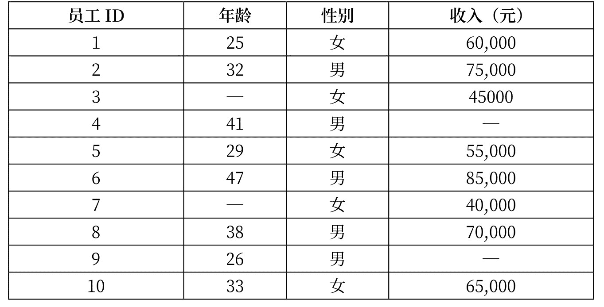** 标记位置的原始表单）。

为规避分析偏差，小丽向 `ChatGPT` 抛出清洗指令（提示词见 **```
你是一个资深数据分析师，具备专业的数据分析技能和丰富的行业经验。你擅长运用各种数据分析工具和技术，对大量数据进行挖掘、整合、分析和解释。你熟练掌握统计学、机器学习、人工智能等领域的理论和应用，能够从数据中发现有价值的信息，为企业决策提供有力的支持。此外，你还拥有出色的沟通和演示能力，能够将复杂的数据分析结果以简洁、清晰的方式呈现给各级别的管理者和团队成员，帮助他们做出更明智的决策。

我是公司的 HR，现在我要统计公司员工的收入和年龄等数据，收集到的数据如下。


请你从专业的角度，帮我处理缺失的部分。

直接用表格的形式输出你处理好的数据，并告诉我你做了哪些处理，以及这么做的原因。

格式如下。

处理后的数据表格：
所做的操作及原因：
```**）。

`ChatGPT` 返回的清洗后数据集如 **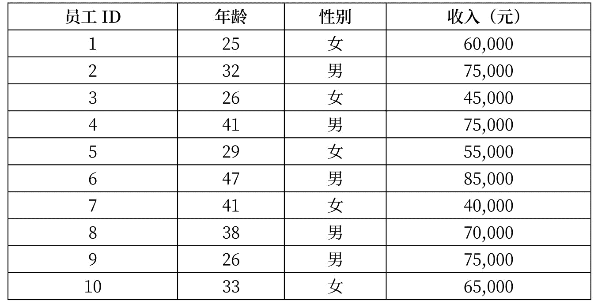** 所示，并同步输出了处理依据与细节（详见 **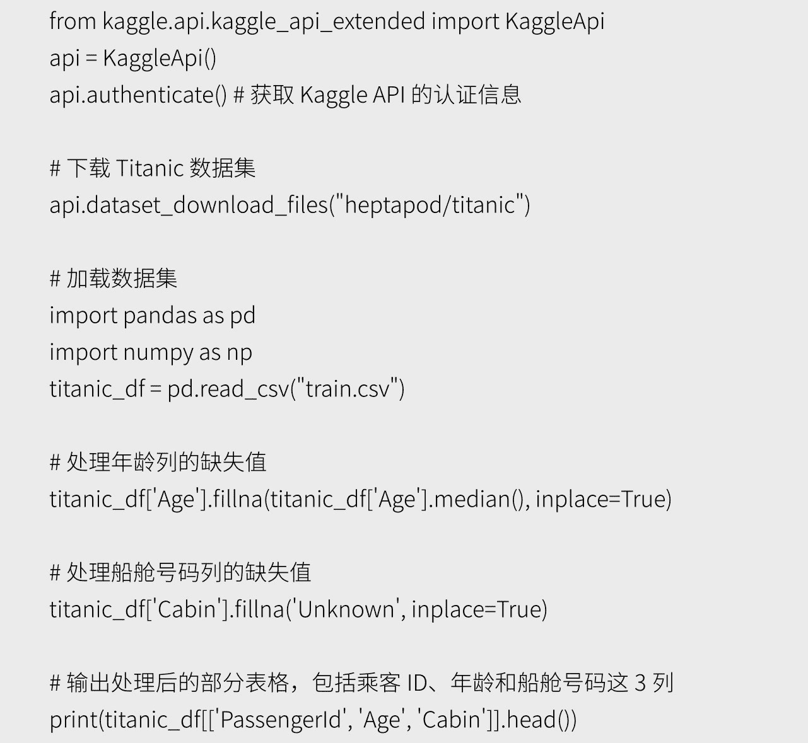** 对应的说明文档）：

**核心处理思路拆解：**

1.  **年龄空缺补全**  
    采用现有年龄数据的**中位值**作为基准填补。中位值抗干扰能力强，在分布倾斜时仍能刻画整体特征。为避免所有空缺值雷同，进一步引入下四分位点 `26` 与上四分位点 `41` 交替填补，保留数据离散度。

2.  **薪资空缺补全**  
    基于“同性别薪资高度相关”假设，按性别分组计算中位值填补（数值为 `75,000`），此法能最大程度维持原始分布形态。

---

#### 进阶实战：泰坦尼克号数据集（Kaggle 经典基准集）

除简易数据集外，`ChatGPT` 对复杂真实数据同样得心应手。以铁达尼号沉船乘客数据为例：共 891 条样本，含性别、年龄、舱等级、票价等字段，生还 342 人，遇难 549 人。该数据集常用于二分类预测入门及特征构建演练。

**主要缺项字段**：
- `Age`（年龄）：177 条缺失，约 20%；
- `Cabin`（客舱号）：687 条缺失，高达 77%。

**实操步骤**：

1.  **构建专家级提示词**（见 **** 标记处），设定资深数据专家人设，要求直接产出 Python 代码段与局部结果表。
2.  **生成清洗脚本**（见 **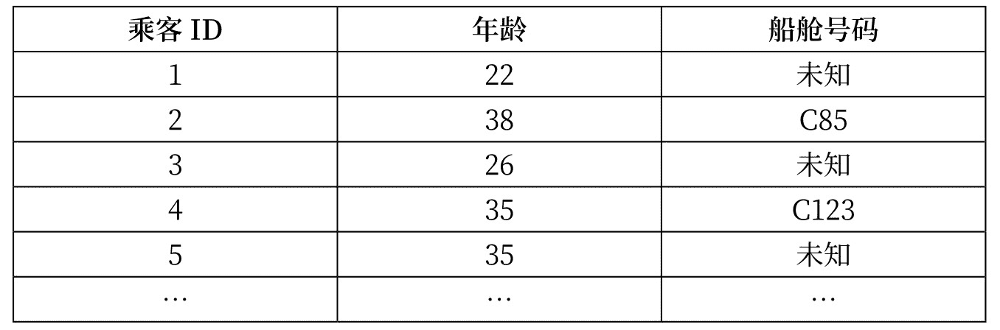**）。
3.  **环境就绪**：执行 **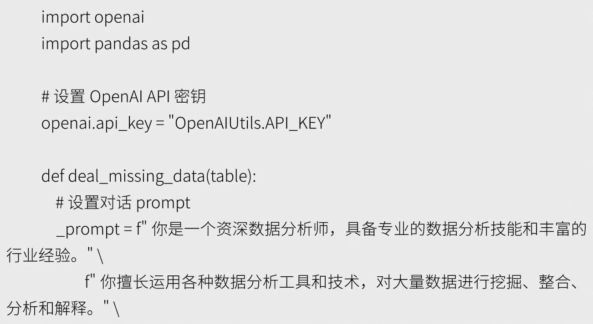** 处的两条指令获取并解压数据包。
4.  **运行输出**：`Age` 列以中位值填补，`Cabin` 列用 `"Unknown"` 标记。清洗后局部预览见 **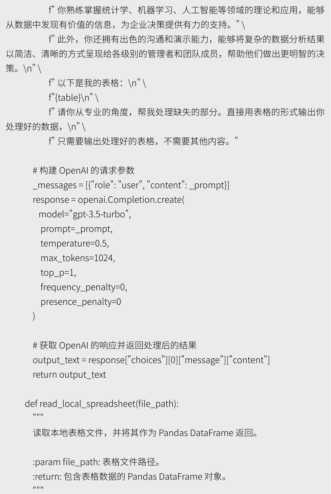**。

---

#### 自动化进阶：调用 OpenAI 接口批量处理本地文件

除交互式对话外，还可通过脚本直连接口实现全自动化链路（代码见 **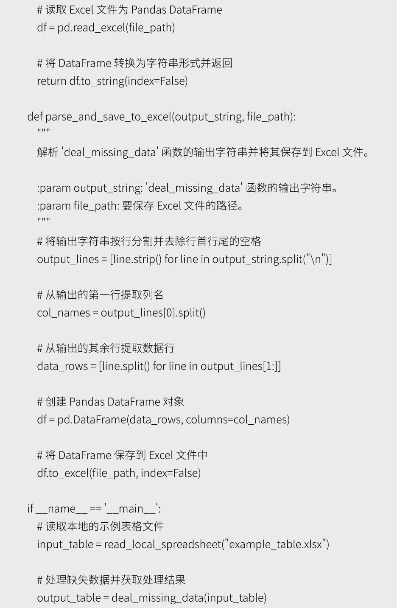** 至 ****）。

该工具内置三大模块：本地 Excel 读写、空值智能处理、结果落盘存储。全链路无需人工干预，大幅提升效能与精度。

> **关键提示**：代码中的 `OpenAIUtils.API_KEY` 需替换为个人密钥；调用按 Token 计费，请留意费用把控。

综上所述，借助 ChatGPT 补全缺失数据，能显著提升数据清洗的效率与精度。作为一项强大的自然语言处理技术，ChatGPT 能够洞察文本数据的语义与上下文，精准填补数据空缺，有效降低处理偏差。更值得关注的是，其具备自我迭代学习的能力，使得缺失值处理的效果愈发稳健可靠。因此，采用 ChatGPT 处理缺失值，是一种高效智能的数据治理范式，极具推广应用价值。

### 3.1.2 借力 ChatGPT 识别与治理异常值

所谓异常值，是指偏离平均值超过两倍标准差的观测数值。其成因多样，可能源于录入失误、测量故障等。应对策略通常有三类：直接剔除、人工修正、或模型预测填补。下面通过两个实战案例，演示如何调用 ChatGPT 完成异常值的检测与处理。

**案例一：员工工时数据清洗**

公司 HR 小李在统计员工周工时分布时，发现原始记录中混入了异常数据（详见表 3.4）。

#### 表 3.4 公司员工周工时记录表

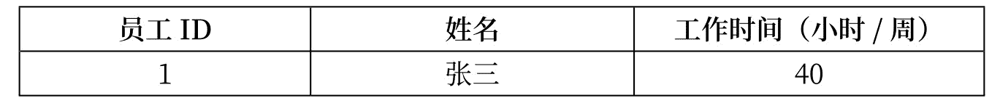

续表

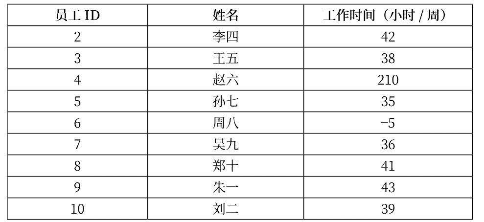

为规避分析偏差，小李决定引入 ChatGPT 进行专业化处理。所用提示词如 3-6 所示。

#### 3-6 异常值检测与处理提示词

> 你是一位资深数据分析师，精通各类分析工具与技术，擅长从海量数据中挖掘、整合、分析并解读洞察。你在统计学、机器学习、人工智能等领域理论扎实、实战经验丰富，能从数据中提炼有价值的商业洞见，为决策提供有力支撑。同时，你具备卓越的沟通表达能力，善于将复杂的分析结论化繁为简，清晰呈现给各层级管理者与团队成员，助力科学决策。
>
> 现需分析公司员工周工时分布，采集数据如下。
>
> 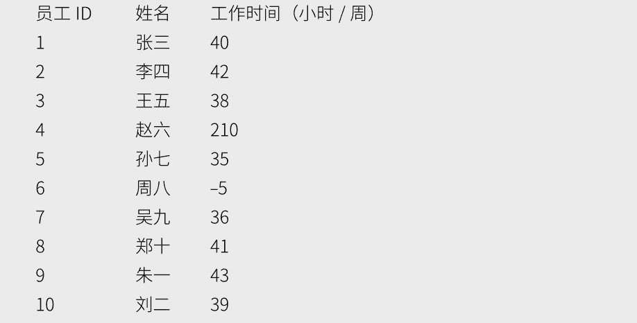
>
> 请从专业角度协助识别并处理异常值。
>
> 请直接以表格形式输出处理后的数据，并说明处理动作及依据。

ChatGPT 的分析推演过程记录于 3-7。

#### 3-7 ChatGPT 异常值处理逻辑复盘

针对工时异常值的治理，ChatGPT 遵循了标准化分析流程：

1.  **统计概貌**：计算均值、标准差等统计量，摸清工时分布全貌。
2.  **可视化排查**：绘制箱线图定位异常点，若存在则深入溯源。
3.  **分策处理**：结合业务语境，采用删除、置空或均值填充等差异化策略。

针对本案数据，具体执行如下：

1.  经计算，工时均值为 `51.9` 小时/周，极值区间为 `—5` 至 `210` 小时/周。
2.  箱线图确认 `—5` 小时/周与 `210` 小时/周为异常值。
3.  **业务校验与清洗**：工时不可为负，故直接剔除负值记录；同时，依据 “均值 + 2 倍标准差” 原则，判定超阈值记录为异常并予以删除。

清洗后数据集见表 3.5。

#### 表 3.5 ChatGPT 清洗后的工时数据表

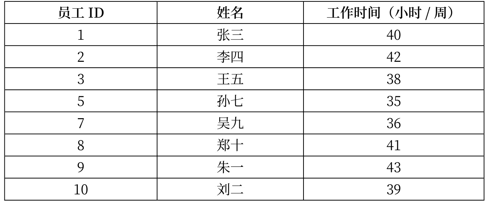

通过剔除干扰项，获得了更高纯度的数据集，为后续分析决策奠定坚实基础。

**案例二：Kaggle 房价预测实战（艾姆斯房价数据集）**

除简单数据集外，ChatGPT 同样擅长应对复杂场景。以 Kaggle 经典竞赛 “房价预测”（Ames Housing Dataset）为例，该数据集涵盖爱荷华州艾姆斯市的房产信息，含 79 个特征维度（面积、房间数、建造年份、车库面积等），旨在通过特征预测房价，辅助房地产市场分析与投资决策。原始数据中存在面积、距离、价格等维度的异常值，若不处理将严重削弱模型泛化能力。表 3.6 展示了部分典型异常样本。

#### 表 3.6 房价预测竞赛数据集部分异常值示例

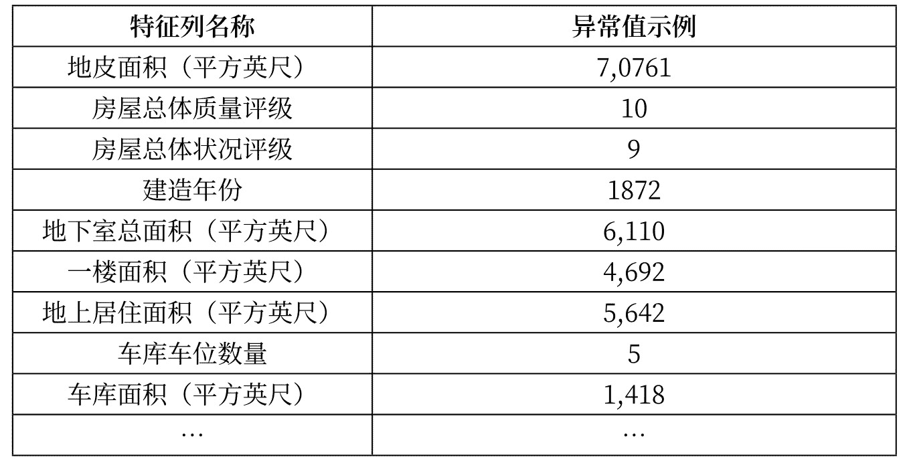

针对该数据集，我们可通过提示词 3-8 调用 ChatGPT 进行批量化处理。

#### 3-8 艾姆斯房价数据集异常值处理提示词

> 你是一位资深数据分析师，精通各类分析工具与技术，擅长从海量数据中挖掘、整合、分析并解读洞察。你在统计学、机器学习、人工智能等领域理论扎实、实战经验丰富，能从数据中提炼有价值的商业洞见，为决策提供有力支撑。同时，你具备卓越的沟通表达能力，善于将复杂的分析结论化繁为简，清晰呈现给各层级管理者与团队成员，助力科学决策。
>
> 现需处理艾姆斯房价数据集中的异常值。
>
> 要求：直接在代码块中给出 Python 实现代码，并以表格形式输出处理后的部分数据预览。

ChatGPT 生成的处理代码见 3-9。

#### 3-9 ChatGPT 生成的艾姆斯数据集清洗代码

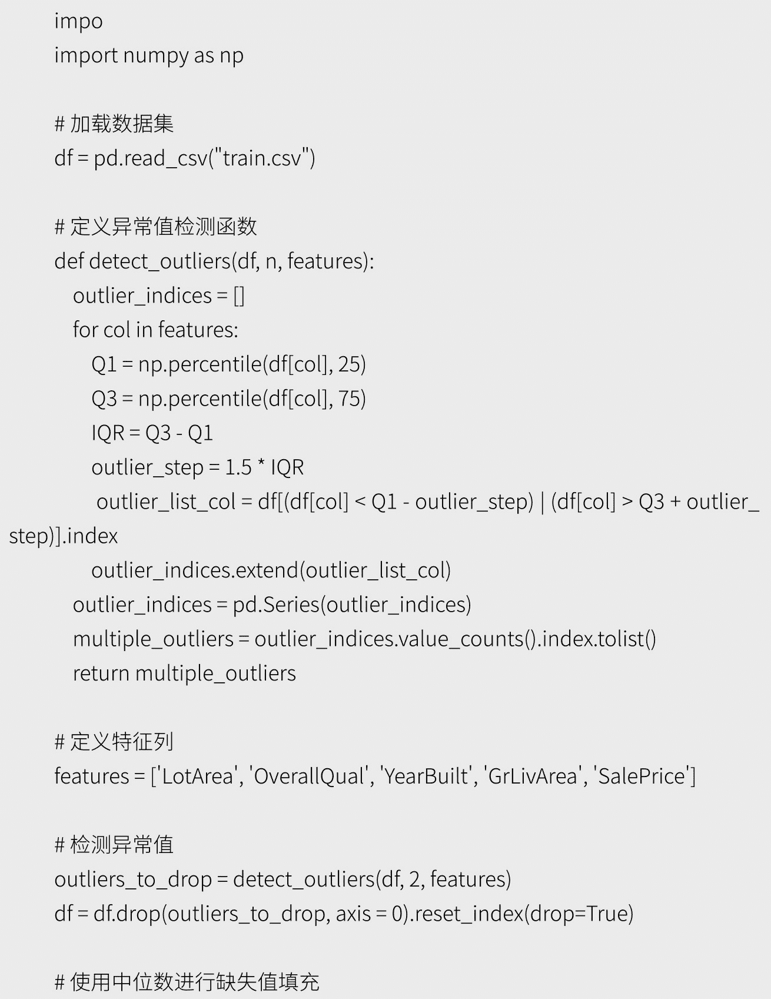

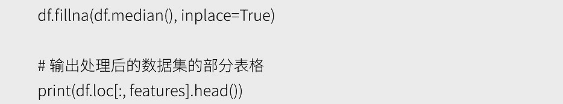

> 注：上述代码预设用户已在本地完成 Kaggle 数据集下载。

代码执行后，可得到清洗后的数据预览（表 3.7）。

#### 表 3.7 房价预测竞赛数据清洗后部分预览

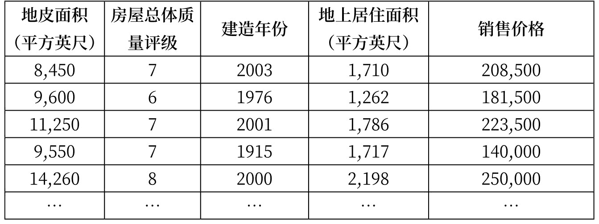

> 提示：演示中仅选取部分特征列演示，且采用 “删除 + 中位数填充” 的基础策略。实际项目中，处理方案需结合业务语境与数据分布灵活制定。

**进阶技巧：API 自动化批量清洗**

实际工作中，除了逐条复制粘贴至对话框，我们还可以通过调用 OpenAI API 实现本地复杂数据的自动化流式处理。完整实现代码参考 3-10。

#### 3-10 基于 ChatGPT API 的异常值自动化处理脚本

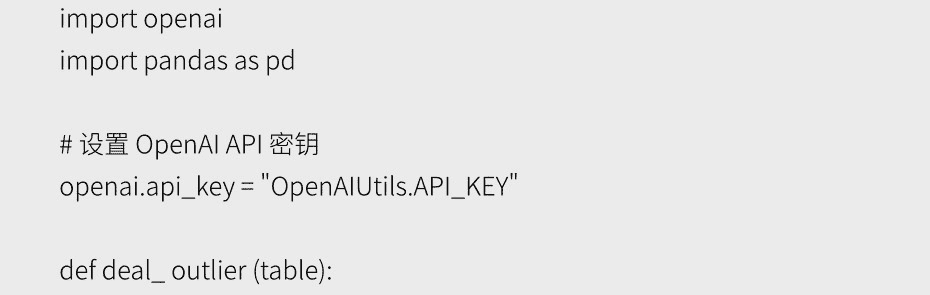

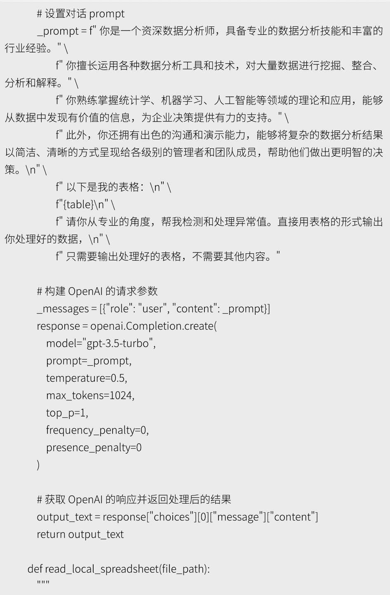

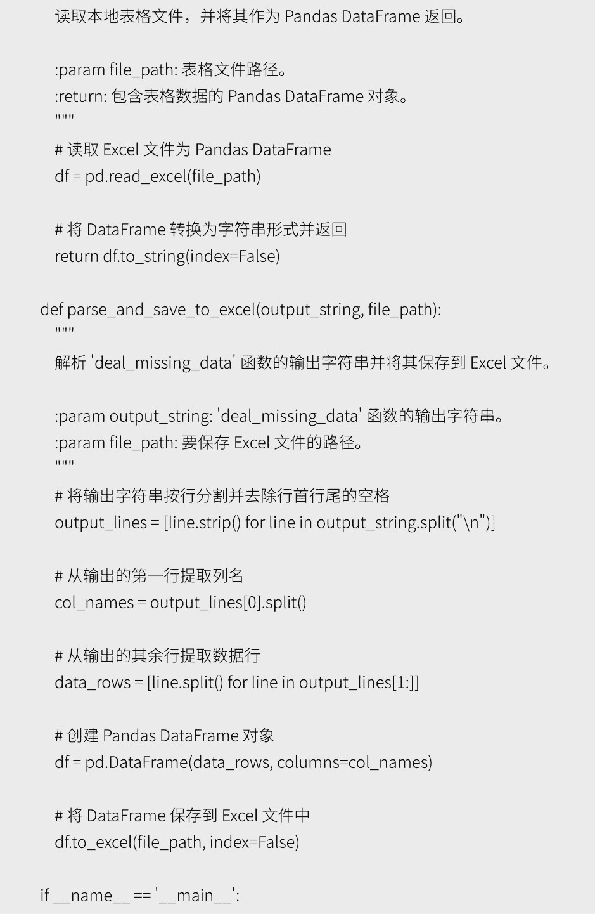

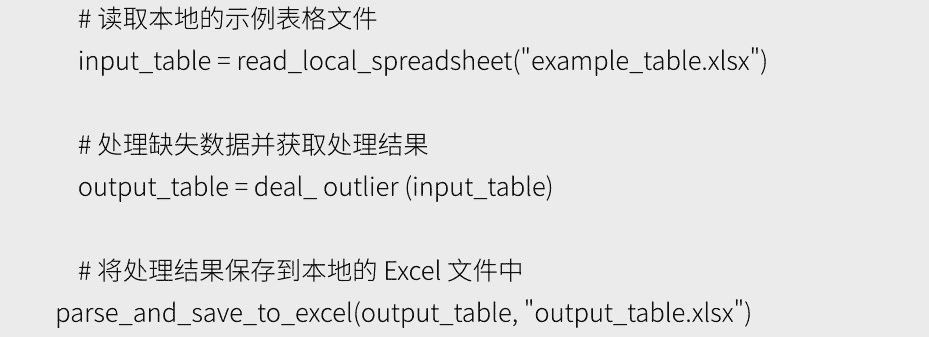

该脚本实现了端到端的自动化闭环：读取本地 Excel 文件 → 将表格数据注入 `deal_outlier` 函数 → 通过 OpenAI API 完成异常值识别与处理 → 返回结构化结果 → 落地为新的 Excel 文件。这种方式极大地解放了人工操作，适合大规模、高频次的数据治理场景。

借助 ChatGPT 识别并处理异常值，是一种行之有效的策略，能助力我们更透彻地洞察数据集，显著提升分析结果的精准度与可信度。在数据分析的实战中，异常值如同隐形的“搅局者”，一旦混入极易扭曲结论，进而误导商业决策。因此，引入 ChatGPT 这类强大的机器学习工具来“查漏补缕”，能大幅跃升分析的质效，为决策筑牢可靠根基。

### 3.1.3 实战：用 ChatGPT 精准识别并剔除重复记录

所谓重复数据，即数据集中出现的完全一致或高度相似的记录。这类“影子数据”往往源于录入失误、表合并时的疏漏等。解决之道的核心在于“查重删重”，以此净化数据集、保真准确度。下面通过实战案例演示如何操作。

公司 HR 小李正在剖析员工年龄结构，手头原始数据里混入了重复值（详见表 3.8）。

#### 表 3.8 公司员工年龄统计表


为规避分析偏差，小李决定请 ChatGPT “动手术”去重。她设计的提示词如 3-11 所示。

#### 3-11 处理年龄异常值的提示词

> 你是一位资深数据分析师，拥有深厚的专业技能与丰富的行业实战经验。精通各类数据分析工具与技术，能熟练挖掘、整合、分析并解读海量数据。在统计学、机器学习、人工智能等领域理论功底扎实、应用娴熟，善于从数据中提炼高价值洞见，为企业决策提供强力支撑。同时具备卓越的沟通表达力，能将晦涩复杂的分析结果化繁为简，清晰呈现给各层级管理者与团队，助力科学决策。
>
> 现需分析公司员工年龄分布，收集到的原始数据如下。
>
> 
> 
>
> 请从专业角度协助检测并删除重复数据，直接以表格形式输出处理后的结果。

ChatGPT 处理后的结果呈现于表 3.9。

#### 表 3.9 ChatGPT 去重后的年龄统计表


可见，重复记录已被彻底清除，这将有力保障后续分析的准确性与公信力。

除了上述简单场景，ChatGPT 对复杂数据集的去重也游刃有余。以银行或电信运营商的客户库为例，涵盖姓名、地址、电话、邮箱等多维信息，因客户持有多账号、购买多产品等原因极易产生重复。此时我们可直接让 ChatGPT 生成处理代码。提示词参考 3-12。

#### 3-12 处理复杂数据去重的提示词

> 你是一位资深数据分析师，拥有深厚的专业技能与丰富的行业实战经验。精通各类数据分析工具与技术，能熟练挖掘、整合、分析并解读海量数据。在统计学、机器学习、人工智能等领域理论功底扎实、应用娴熟，善于从数据中提炼高价值洞见，为企业决策提供强力支撑。同时具备卓越的沟通表达力，能将晦涩复杂的分析结果化繁为简，清晰呈现给各层级管理者与团队，助力科学决策。
>
> 现有一本地电信公司的客户数据集，包含姓名、地址、电话、邮箱等个人信息。因客户可能使用多账号或订购多产品，数据集中疑似存在重复记录。
>
> 请直接提供 Python 代码。要求：从本地目录读取 `data.xlsx`，完成清洗后另存为新文件，代码请用代码块格式输出。

ChatGPT 生成的代码方案见 3-13。

#### 3-13 复杂数据去重的 Python 代码实现


该方案借助 Pandas 库实现：读取 Excel、执行去重、落盘新文件。读取环节可按文件格式选用 `read_csv` 或 `read_excel`；核心去重调用 `drop_duplicates()`，默认以全列数值完全一致为判定标准；存盘时 `to_excel` 配合 `index=False` 避免写入行索引。

> **注**：鉴于去重逻辑仅需寥寥数行代码即可落地，此处不再赘述 OpenAI API 调用细节。感兴趣的读者可回顾前几章内容自行拓展。

综上，用 ChatGPT 检测删重是提升数据质量、压缩冗余信息的高效利器。大数据时代下，文本数据量爆发式增长，数据质量已成核心痛点。善用此法，能显著节省人力物力，最大化挖掘数据价值与可靠度。

## 3.2 破解数据结构难题：ChatGPT 来帮忙

数据结构缺陷会直接损害数据的完整性、一致性与可读性。本节将详解如何驾驭 ChatGPT 完成数据格式转换与多源数据融合。

### 3.2.1 格式转换大师：ChatGPT 轻松搞定数据“换装”

数据格式化，本质是将原始数据“翻译”成分析就绪的标准格式。常见目标格式涵盖 CSV、JSON、XML 等。清洗阶段的高频转换操作主要有六大类：

1.  **字符串规整**：大小写统一、去除多余空格/字符、提取特定子串等。
2.  **日期/时间标准化**：统一异构时间格式（如转为 ISO 8601 标准），或将时间戳转为可读日期时间。
3.  **数值类型转换**：按需转为整型、浮点型、布尔型等。
4.  **数据归一化/标准化**：将数值映射至特定区间（如 0-1 区间）。
5.  **编码统一**：消除编码乱码，如 Unicode 转 ASCII。
6.  **结构重塑**：跨格式迁移，典型如 JSON 转 CSV。

以上操作覆盖了清洗环节的主流格式化需求，旨在统一异构数据，为后续建模分析铺平路。引入 ChatGPT 操刀，能大幅降低人工操作的复杂度与错漏率。实战演示如下。

销售员小明手头有一份 JSON 格式的销售数据（见 3-14）。

#### 3-14 JSON 格式销售数据样例


为便于整理分析，小明直接祭出 ChatGPT 进行格式重塑。提示词设计见 3-15。

#### 3-15 ChatGPT 数据格式化提示词

> 你是一位资深数据分析师，拥有专业的数据分析技能与丰富的行业实战经验。你精通各类数据分析工具与技术，能够挖掘、整合、分析并解读海量数据。你对统计学、机器学习、人工智能等领域的理论与应用有深厚造诣，善于从数据中发掘有价值的洞见，为企业决策提供有力支撑。此外，你具备卓越的沟通与汇报能力，能将复杂的分析结果化繁为简，清晰呈现给各层级管理者及团队成员，助力他们做出更明智的判断。现有一份 JSON 格式的销售数据集，内容如下。

# 第 3 章 数据清洗与整合

## 3.2 借助 ChatGPT 实现数据格式转换与合并

### 3.2.1 数据格式转换


ChatGPT 按要求处理输出的表格见表 3.10。

**表 3.10 格式转换后的数据表**


上表是对原始 `JSON` 数据执行清洗与标准化后的结果。具体处理步骤包括：将 `Order Date` 列转为日期时间格式；把 `Total Amount`、`Price`、`Quantity` 列转为数值类型；将 `State` 列统一转为大写；对 `Customer Name` 与 `Shipping Address` 列应用 `str.title()` 方法，使首字母大写。经过这些操作，数据得到规范化整理，便于后续分析与理解。最后，处理结果已保存为 `Excel` 文件。

利用 ChatGPT 的多轮对话特性，我们可以继续请其生成批量处理代码，提示词见 3-16。

#### 3-16 批量数据格式化提示词

```
If there are n JSON files with the same format in a local folder, please help me write a Python function to read all JSON files in this folder, format them, and consolidate them into Excel.

Output the code directly in code block format.
```

ChatGPT 生成的批量格式化代码见 3-17。

#### 3-17 ChatGPT 生成的批量格式化代码


该函数实现了从文件夹读取多个同格式 `JSON` 文件并合并为单个 `Excel` 文件的功能。核心逻辑为：遍历文件夹下所有 `JSON` 文件，读入 `DataFrame`，执行清洗标准化，汇总至总 `DataFrame`，最终导出为 `Excel`。

同时，也可直接调用 ChatGPT API 快速完成格式化，示例见 3-18。

#### 3-18 调用 ChatGPT API 格式化数据


这段代码读取指定文件夹下所有 `JSON` 文件并合并为一个 `Pandas DataFrame`，随后利用 `OpenAI API` 对数据进行规范化处理，最后将结果写入 `Excel` 文件。

> **注意**：代码中的 `OpenAIUtils.API_KEY` 需手动填入你的账号 Key；OpenAI 按请求 `Token` 数计费。且 `GPT-3.5` 模型输入 `Prompt` 上限为 4K，超限时可采用分批处理，或直接调用上限 32K 的 `GPT-4` 模型。

借助 ChatGPT 进行格式转换，能显著提升数据处理的效率与准确度，尤其适合大规模数据标准化场景。通过 `OpenAI API` 与 ChatGPT 协作，复杂的转换与清洗任务可在短时间内完成，规避了人工操作的繁琐与错漏风险，大幅增强分析工作的效能与质量。

### 3.2.2 用 ChatGPT 整合多源数据

多源数据合并是数据分析中的高频操作，常见合并方式如下：

1.  **内连接**：仅保留两数据源中键值匹配的记录。
2.  **左连接**：保留左表全部记录，匹配右表数据；右表无匹配则填 `NULL`。
3.  **右连接**：保留右表全部记录，匹配左表数据；左表无匹配则填 `NULL`。
4.  **全外连接**：保留双方所有记录，匹配的合并，无匹配处填 `NULL`。
5.  **交叉连接**：左表每行与右表所有行逐一组合，生成笛卡尔积。
6.  **自然连接**：自动识别同名列作为连接键执行内连接。
7.  **追加**：将两数据源记录纵向拼接，常用于在表尾新增记录。
8.  **堆叠**：将两数据源记录垂直堆叠，结果包含全部记录。

其中，内、左、右、全外连接最为常用，能帮助分析师洞察不同数据源间的关联与联系。下面通过一个典型案例说明。

小李是某公司数据分析师，为分析近期订单，他从多个维度收集了若干表。订单表记录订单 ID、时间、状态等详情，见表 3.11。

**表 3.11 订单表**


订单明细表记录各订单的商品详情，含订单 ID、商品 ID、名称、单价、数量，见表 3.12。

**表 3.12 订单明细表**


商品表记录全量商品信息，含商品 ID、名称、类别，见表 3.13。

**表 3.13 商品表**


续表


用户表记录全量用户信息，含用户 ID、用户名、电话，见表 3.14。

**表 3.14 用户表**


现需将这些表整合，以便分析销售业绩、商品热度、用户购买行为等。小李直接让 ChatGPT 完成整合，提示词见 3-19。

#### 3-19 数据合并提示词

```
You are a senior data analyst with professional data analysis skills and rich industry experience. You are proficient in using various data analysis tools and technologies to mine, integrate, analyze, and interpret large amounts of data. You have a solid grasp of theories and applications in statistics, machine learning, artificial intelligence, and other fields, and can discover valuable information from data to provide strong support for enterprise decisions. In addition, you have excellent communication and presentation skills, able to present complex data analysis results in a concise and clear manner to managers and team members at all levels, helping them make wiser decisions.

Now I have N tables, the specific contents are as follows.

---

Order Table: Records detailed order information, including Order ID, Order Time, Order Status.


```

根据提供的表格数据，ChatGPT 将其关联融合，生成了一个涵盖订单、订单明细、商品、用户四个维度的完整数据表，详见表 3.15。

**表 3.15 ChatGPT 融合生成的数据表**


最终生成的融合表包含了详尽的订单信息、订单内的商品细节、商品分类数据以及下单用户的画像信息。这张表能助力企业开展订单分析、商品销售分析与用户行为分析，为决策提供有力支撑。

面对海量数据表时，我们可以善用 ChatGPT 的多轮对话能力，让它编写自动化合并代码。提示词示例如 3-20 所示。

#### 3-20 自动化数据合并提示词

```
From your professional perspective, give me a Python code with functionality similar to the above. It needs to read all Excel tables in a folder, then merge them into one table, and save it to a new file.

Output directly in code block format.
```

ChatGPT 按需求输出的自动化合并代码展示于 3-21。

#### 3-21 ChatGPT 生成的自动化合并代码


上述 `Python` 代码实现了读取指定文件夹下所有 `Excel` 文件并合并为单表的功能。具体而言，代码借助 `Pandas` 库读取各 `Excel` 数据，将其汇总为一个 DataFrame，最后导出为新的 `Excel` 文件。通过该函数，我们能轻松整合多张 `Excel` 表，便于后续分析处理。

当然，也可直接调用 OpenAI API 完成数据合并，示例见 3-22。

#### 3-22 调用 ChatGPT API 合并数据


这段代码实现了将多张 `Excel` 表合并为一张完整表。流程上，代码先将 `Excel` 转为字符串格式，再调用 `OpenAI API` 进行融合。合并后的表囊括订单、商品、用户三类信息，并存入 `Excel` 文件。过程中既用 `Pandas` 做数据清洗转换，又用 `OpenAI GPT-3 API` 生成融合结果。

> **注意**：代码中的 `OpenAIUtils.API_KEY` 需自行填入账号 Key，OpenAI 按请求 `Token` 数计费。

综上，借助 ChatGPT 可轻松融合多源数据，实现更全面、精准的分析与预测。作为基于深度学习的 NLP 模型，ChatGPT 拥有强大的语义理解与生成能力，能高效自动化处理文本数据。相较传统合并方式，它既省去了人工繁琐的数据整理，又能充分挖掘多元数据源，显著提升处理效率与准确度。

## 3.3 小结

数据清洗是数据分析的关键环节。ChatGPT 能有效解决数据质量与结构两大类问题。本章介绍了用 ChatGPT 处理缺失值、识别异常值、去重、格式转换及多源数据合并。

在数据质量层面，ChatGPT 为缺失值与异常值处理提供了更高效、精准的新路径；还能自动识别并剔除重复数据，规避分析偏差。在数据结构层面，ChatGPT 同样表现出色：格式转换让数据更规范、易分析；自动合并多源数据则让分析视野更全面、结论更可靠。

# 第 4 章 基于 ChatGPT 的特征提取

随着数据分析在各行业的普及，特征提取已成为核心环节。它主要包含特征工程与特征降维，分别负责从原始数据挖掘有效信息、降低维度以减轻计算压力。作为先进的 AI 语言模型，ChatGPT 能协助专家完成特征提取，大幅提升分析效率与精度。

本章重点讲解如何用 ChatGPT 做特征提取，涵盖以下要点：

*   特征工程应用：含特征筛选与衍生特征构建。
*   特征降维应用：含主成分分析（`PCA`）、线性判别分析（`LDA`）等技术。

通过实战案例演示 ChatGPT 在各场景下的应用。学完本章，读者能更好地在项目中落地 ChatGPT，提升工作效率，并掌握实战技巧，灵活应对特征提取任务。

## 4.1 用 ChatGPT 做特征工程

特征工程是数据预处理的重头戏，旨在从原始数据中提取、构建、筛选、转换特征，以更好地揭示数据背后的隐性规律。本节详细拆解 ChatGPT 在特征工程中的应用，含特征筛选、衍生特征创建等，并通过实例助你深度理解各环节。

### 4.1.1 用 ChatGPT 做特征筛选

特征筛选算法从原始数据中挑出关键特征用于建模，目的是降维、增强模型性能、防止过拟合。常见算法分三类：

1.  **过滤法**：基于统计检验、相关性分析等单独评估各特征，筛选最优项。常用皮尔逊相关系数、互信息、卡方检验等。
2.  **包裹法**：选取特征子集训练模型并评估，迭代寻找最佳组合。典型有递归特征消除（`RFE`）、序向前选择（`SFS`）。

3.  **嵌入式方法**：将特征筛选算法与机器学习模型深度融合，实现特征选择与模型训练同步进行。典型代表包括 `LASSO`（最小绝对收缩选择算子）、岭回归、决策树、随机森林等。

4.  **集成/混合方法**：通过整合多种特征选择策略，力求获得更优的筛选效果。常见手段有稳定性选择、基于树模型的特征选择等。

通常而言，特征选择算法主要划分为过滤法、包装法和嵌入法三大流派。过滤法无需构建模型，仅依据评估指标对特征打分排序，挑选关联度最高者；包装法将问题视为“最优子集搜索”，需反复训练模型验证子集表现；嵌入法则将筛选逻辑内嵌于模型训练中，通过优化目标函数自动完成特征甄别。实战中，分析师需结合业务场景与需求，权衡选用最适配的算法，以此降低模型复杂度、强化泛化能力，并节省算力与时间成本——这对分析师的经验积累与知识广度提出了更高要求。

ChatGPT 能显著提升分析师在特征选择环节的效率。它能依据数据特征与业务目标，自动推荐最契合的筛选策略。下面通过一个实战案例演示。

案例背景：Eric 是某保险公司的销售人员，他希望利用过去一个月的用户数据，挖掘出影响“用户是否购买特定产品”的核心特征，从而精准锁定目标客群。数据集包含以下字段：用户年龄（18-65 岁）、性别、收入水平（万）、学历（小学至硕士）、婚姻状况、是否有车、是否有房、购买力（元）、是否购买。详细样本数据见表 4.1。

**表 4.1 用户数据**


基于上述数据，Eric 可直接向 ChatGPT 发起请求，提示词如 4-1 所示。

#### 4-1 特征提取提示词

```
You are now acting as a data analysis expert with the following capabilities.

Data Processing Capability: Proficient in data collection, cleaning, integration, processing, and other operations, able to use tools (such as `SQL`, `Python`, etc.) to operate and analyze large amounts of data.

Data Visualization Capability: Able to use visualization tools (such as `Tableau`, `Power BI`, etc.) to present data in the form of charts, reports, etc., for better understanding and communication of data analysis results.

Statistical Knowledge: Proficient in basic statistical concepts and methods, including probability theory, hypothesis testing, analysis of variance, etc., able to use statistical methods to analyze data.

Business Understanding Capability: Possess a deep understanding of business and industry, able to transform data analysis results into practical business applications and solutions.

Programming Capability: Possess programming ability, able to use `Python`, `R Language`, etc. for data analysis, and use `Shell`, `Python`, etc. for automation script writing.

Communication Capability: Able to communicate with business departments, understand their needs and problems, and clearly express data analysis results and suggestions.

Learning Capability: Possess the ability to continuously learn and update knowledge, able to master new data analysis methods, tools, and skills.

I am a salesperson at an insurance company. I want to count user data from the past month to predict the features most relevant to whether a user will purchase a certain product based on this data, in order to better target the target group.

Data content is as follows.


Please help me extract features from a professional perspective based on the above data content, and tell me which features are most relevant to the purchase data.

Output format is as follows.

Feature Extraction Method Used:

Calculation Process:

Features Most Relevant to Whether Purchased:

Sales Suggestions:
```

ChatGPT 依据需求输出的分析结论与建议如 4-2 所示。

#### 4-2 ChatGPT 提取的特征与建议

```
Feature Extraction Method Used: In this task, we can use the Correlation Coefficient Method to extract features. This method can calculate the correlation between each feature and whether a purchase was made, determining which features are most relevant to the purchase data.

Calculation Process: First, we load the data into a Python Pandas DataFrame and convert text data into numerical data to facilitate correlation coefficient calculation; then, we can use Pandas' `corr()` function to calculate the correlation coefficients between each feature and whether a purchase was made. The correlation coefficient ranges from -1 to 1; the larger the absolute value, the stronger the correlation.

Features Most Relevant to Whether Purchased: According to the calculation results, we found that Income, Purchasing Power, Vehicle Ownership, and Housing Ownership have strong correlations with Whether Purchased; among them, Purchasing Power has the highest correlation coefficient with Whether Purchased at 0.89; followed by Income and Vehicle Ownership, with correlation coefficients of 0.83 and 0.67 respectively; therefore, these features can be used as key features for predicting whether a user will purchase a certain product.

Sales Suggestions: Based on the above analysis results, we can focus sales efforts on users with higher income, stronger purchasing power, and who own vehicles or housing; at the same time, we can formulate different marketing strategies for users with different features, for example, launching high-end products for users with higher income, launching auto insurance for users with vehicles, etc.; in addition, we can also combine other data and market research to further improve and optimize sales strategies.
```

# 4 借力 ChatGPT 实战特征工程

## 4.1 ChatGPT 辅助特征提取

### 4.1.1 代码生成与 API 调用实现特征提取

面对大规模数据时，我们可让 ChatGPT 编写代码读取本地文件完成处理。沿用上文场景，假设数据已本地化存储，利用 ChatGPT 多轮对话能力，通过 Prompt 4-3 即可生成代码。

#### Prompt 4-3：生成特征提取代码的提示词

> 请从专业角度继续，提供 `Python` 代码以从上述数据中提取关键特征并绘制特征关系图（数据预存于表格中）。

ChatGPT 生成的代码如 4-4 所示。

#### 4-4：ChatGPT 生成的特征提取代码


将上述代码复制至 `PyCharm` 运行，执行结果如 4-5 所示。

#### 4-5：特征提取代码运行结果

采用的特征提取方法：相关系数法

与购买决策相关性最强的特征：

```text
Marital Status  0.829156
Car Ownership   0.829156
Purchasing Power 0.665237
Age             0.617263
Income          0.616336
```

前一段脚本借助 `Pandas` 读取 `xlsx` 数据，完成清洗与标准化后，通过相关系数法筛选出对“用户是否购买”预测力最强的特征。同时，代码调用 `Seaborn` 与 `Matplotlib` 绘制特性关联图谱，并配置中文字体保证显示无误。程序输出的特征相关性热力图如下图所示。


**图 4.1 特征相关性热力图**

除了让 ChatGPT 间接生成代码，我们还能直接调用 `OpenAI API` 来挖掘数据特征，具体实现请看示例 4-6。

#### 4-6：调用 ChatGPT API 实现特征提取


这段代码封装了两个核心函数：一个负责读取本地 `Excel` 并将其转为 `Markdown` 表格字符串，另一个则构造 Prompt 调用 `OpenAI API` 返回特征分析结果。主流程串联这两个函数并打印输出。具体来说，`read_data()` 完成文件读取与格式转换，生成的 Markdown 表格作为参数传给 `feature_extract()`；后者借助 API 让模型依据数据内容抽取特征；最后主函数将结果呈现在控制台。

> **注意：** 代码中的 `OpenAIUtils.API_KEY` 需替换为你自己的账号密钥。OpenAI 按请求 Token 数计费，且 `GPT-3.5` 模型输入上限为 4K Token。若超限，可采用分批处理，或直接切换至支持 32K 上下文的 `GPT-4` 模型。

上述代码运行后的输出结果如示例 4-7 所示。

#### 4-7：ChatGPT API 调用返回的特征分析结果

**采用方法**：基于相关性分析与特征重要性排序的筛选策略。

**计算流程**

1.  **文本数值化**：对性别、学历、婚姻、有车、有房、购买决策等文本字段编码（如“女→0，男→1”，“是→1，否→0”）。
2.  **相关性筛选**：计算各特征与购买决策的相关系数，保留绝对值大于 0.3 的特征。
3.  **重要性排序**：引入随机森林算法评估特征重要性，选取前 5 名。
4.  **结果融合**：合并上述两轮筛选结果，形成最终特征清单。

**与购买决策关联度最高的 5 个特征**

1.  购买力
2.  年龄
3.  有房情况
4.  收入水平
5.  婚姻状态

**销售策略建议**

1.  **高购买力、大龄、有房群体**：主推年金险、重疾险等高客单价产品。
2.  **低购买力、年轻、无房群体**：适配意外险、医疗险等高性价比产品。
3.  **高收入、已婚群体**：切入家庭险、教育险等家庭场景产品。
4.  **低收入、未婚群体**：聚焦个人险、旅游险等个人生活场景产品。
5.  **性别、学历等次要因素**：结合具体业务场景灵活分析推荐。

综上，利用 ChatGPT 做特征筛选效率颇高。作为 NLP 领域的大模型，它擅长深度理解与推理文本。在特征工程环节，ChatGPT 能通过分析文本数据，精准捕捉对模型预测至关重要的变量。相较传统手段，它能更全面地挖掘文本隐含信息，显著提升模型的预测精度与泛化能力。

### 4.1.2 借力 ChatGPT 构建衍生特征

所谓衍生特征，就是在原始数据基础上，通过组合、变换或统计手法创造新变量，以更精准地刻画数据本质，强化模型预测表现。这一步在机器学习与数据挖掘中至关重要，能帮助模型挖掘数据深层隐含信息，提升准确率与鲁棒性。

常见的衍生特征构建手段包括：

1.  **多项式特征**：对原始变量做幂次展开，适配线性模型、核方法等。
2.  **对数变换**：将非线性关系线性化，满足线性模型假设。
3.  **指数变换**：放大特定特征影响力，引导模型聚焦关键变量。
4.  **独热编码**：将离散类别转为连续向量，便于模型处理。
5.  **特征交叉**：多特征组合生成新变量，捕捉非线性交互作用。
6.  **降维压缩**：借助 `PCA` 等算法将高维映射低维，利于可视化与建模。
7.  **时序特征**：针对时间序列，提取滞后项、统计量、周期性等特征。

构建高质量衍生特征是核心竞争力。这要求我们深谙数据底蕴，结合业务问题与建模目标，选用恰当的特征工程手段，并配合特征筛选、参数调优等环节，最终达成精准预测与良好解释力的双赢。

有了 ChatGPT，我们能快速、精准地产出所需衍生特征。以下通过实战案例演示。

某房产销售小李搜集了周边楼盘的部分房源数据，详见表 4.2。

**表 4.2 房源基础信息**


> **注：** 表中位置以字母 A、B、C、D、E 编码，代表不同街区或区域。

基于现有字段，我们通过 ChatGPT 生成合适的衍生特征，提示词设计如示例 4-8。

#### Prompt 4-8：生成衍生特征的提示词设计

> 你是一位深耕房地产行业的资深数据分析师，具备以下核心能力：
>
> - **数据分析实力**：精通数据分析的理论体系、方法论与工具链，擅长数据清洗、建模、分析与可视化，能独立交付全流程分析任务。

# 房产数据建模：从特征工程到自动化代码实战

一名合格的房地产数据分析师，通常需要构建跨学科的知识体系：既要精通统计学原理、数据挖掘算法与Python等编程工具，又要深谙行业市场规律，具备将数据转化为业务策略的沟通能力与创新思维。

## 实战场景：二手房数据的特征深度挖掘

假设你是一名房产销售，手头掌握了一批周边小区的房源基础信息（见）。仅凭原始字段难以支撑精准定价与推荐，我们需要引入专业视角，构建衍生变量。

### ChatGPT 智能生成特征方案

向大模型注入“资深分析师”人设后，其输出的特征工程方案如下（详见 4-9）：

**核心衍生指标**
- **单价（元/平米）**：剔除面积干扰，直观反映房产单位价值。
- **房龄（年）**：量化房屋新旧程度，关联折旧率与维护成本。
- **卧卫比**：衡量居住功能配置合理性，高比例常暗示使用痛点。
- **车位卧室比**：评估停车便利度与家庭出行匹配度。
- **区域独热编码（A-E）**：将离散地理位置转为模型可识别的数值向量。

**构建逻辑与计算细节**参见 ```
Unit Price = Historical Sale Price / House Area
House Age = 2023 − Year Built
Bedroom-to-Bathroom Ratio = Number of Bedrooms / Number of Bathrooms
Garage-to-Bedroom Ratio = Number of Garages / Number of Bedrooms
One-Hot Encoding of Location (A, B, C, D, E):
A: 1 0 0 0 0
B: 0 1 0 0 0
C: 0 0 1 0 0
D: 0 0 0 1 0
E: 0 0 0 0 1
```。

**扩展后数据集预览**参见 。

这些新增维度不仅丰富了样本画像，更为后续建模奠定了坚实基础。

## 进阶自动化：大模型生成全流程处理代码

当数据量级上升，手工操作效率低下。我们可以直接指令 ChatGPT 产出可落地的 Python 脚本（提示词见 4-10），实现“读取-> 特征构建-> 可视化-> 落盘”端到端闭环。

**生成代码实现**参见 。

脚本核心动作：
1.  读取本地 Excel，自动计算单价与房龄两大核心特征。
2.  配置中文字体环境，绘制“面积-成交价”散点图，以色阶映射房龄，直观揭示房龄对价格的调节效应。
3.  持久化增强后数据集至本地。

**代码运行产出的新数据表**参见 。

**可视化洞察图谱**参见 （图 4.2）。

图表清晰展示了面积、成交价与房龄的三维互动关系，为定价策略提供直观依据。

## 企业级集成方案：OpenAI API 批量化赋能

除交互式对话外，通过调用 OpenAI API 可将特征工程能力嵌入自有数据管线（实现细节见 4-12：），实现大规模、高频次的自动化特征生产，真正释放数据资产价值。

# 用 ChatGPT 做特征工程：从衍生变量到降维实战

上述代码演示了如何借助 `OpenAI` 的 `GPT-3.5` 大模型自动生成衍生特征。流程大致是：先用 `Pandas` 读取 `Excel` 数据并转为 `Markdown` 表格，再通过 `OpenAI API` 将表格喂给 `GPT-3.5`，模型会返回一份包含生成理由、计算逻辑及新增特征表在内的文本说明。这套流程旨在协助房产销售人员产出更详尽、全面的数据特征描述，从而更有力地支撑业务决策。

> **特别提示：** 特征衍生高度依赖领域洞见，若切换行赛道，需同步调整代码中的 `Prompt` 模板。

简而言之，利用 ChatGPT 构建衍生特征能帮我们挖掘数据背后隐匿的规律与趋势。作为基于深度学习的 NLP 模型，ChatGPT 擅长理解自然语言并产出高质量文本。我们可借此将原始数据向量化，再基于向量构建新特征，进而深化数据认知、识别模式、预判走势。这项技术用途广泛，自然语言处理、文本分析、情感计算等领域均适用。

## 4.2 借力 ChatGPT 实现特征降维

所谓特征降维，就是在保留核心信息的前提下压缩数据维度，以此降低计算开销、削弱噪声干扰，最终提升分析效率与精度。本节将拆解如何用 ChatGPT 落地降维技术，涵盖主成分分析（`PCA`）、线性判别分析（`LDA`）、t-分布随机邻域嵌入（`t-SNE`）、独立成分分析（`ICA`）及自编码器（`Autoencoder`）等主流手段。

### 4.2.1 ChatGPT 辅导下的主成分分析实战

主成分分析（`PCA`）是典型的无监督降维算法，常用于特征提取与数据可视化。其核心逻辑：通过线性变换将高维数据映射到低维空间，且最大程度保留原始信息量。该变换由选取大特征值对应的特征向量构成，这些向量相互正交，组成主成分基。

`PCA` 的本质是旋转坐标系，寻找能最好解释数据方差的方向。操作步骤如下：

1.  计算数据集的 `协方差矩阵`。
2.  求解协方差矩阵的 `特征值` 与 `特征向量`。
3.  挑选前 `k` 个最大特征值对应的特征向量（`k` 远小于原始维度）。
4.  将原始数据投影到这 `k` 个向量张成的新空间中。

`PCA` 的数学表达如下。

设原始数据集 `X` 为 `n×p` 矩阵（`n` 为样本数，`p` 为特征数）。

1.  对 `X` 做 `中心化` 处理，即减去各特征均值：

   

2.  计算 `协方差矩阵` `C`：

   

   求解 `C` 的 `特征值` `λ` 与 `特征向量` `V`：

   

   取前 `k` 大特征值对应的特征向量组成 `p×k` 矩阵 `W`：

   

3.  将原始数据 `X` 投影到新的 `k` 维空间：

   

   其中 `X_reduced` 为 `n×k` 矩阵，即降维后的结果。

可见，`PCA` 关键在于协方差矩阵计算与特征分解。虽原理明确，但手工推导门槛不低。有了 ChatGPT，普通分析师也能快速落地降维。下面通过一个案例演示。

Leo 是某金融机构的数据分析师，投资决策前需评估客户信用风险。他计划用 `PCA` 降维以精简特征，提升风控建模效率。部分客户基础数据见表 4.5。

**表 4.5 客户初始金融数据**


Leo 直接调用 ChatGPT 的算法能力对上述数据做主成分分析，使用的提示词如 4-13 所示。

#### Prompt 4-13：主成分分析专用提示词

> 你是一名深耕金融行业的资深数据分析师，具备以下核心能力。
>
> - **数据分析与挖掘能力**：熟练驾驭 `Python`、`R`、`SQL` 等工具处理海量数据，挖掘高价值信息。
> - **金融业务知识**：深谙金融产品、市场机制与行业生态，精通财务指标含义与统计规则，熟悉合规法规。
> - **统计学功底**：掌握假设检验、回归分析、时序分析等核心方法，可对金融数据做严谨统计推断。
> - **工程编程能力**：精通 `Python`、`R` 等语言，能独立完成数据清洗、建模到可视化的全流程开发。
> - **建模与预测能力**：擅长运用机器学习与深度学习算法构建金融模型，实现预测与优化。
> - **数据可视化能力**：善用 `Tableau`、`Power BI` 等工具将复杂数据转化为直观图表报告，赋能管理层决策。
> - **沟通表达能力**：能用浅显语言向非技术岗阐释复杂分析结论，助力业务侧制定策略。

# Chapter 5 数据可视化与 ChatGPT

### 4.3 本章小结

本章深入讲解了如何用 `ChatGPT` 开展特征工程与特征降维。特征工程是模型性能的关键杠杆，我们学会了用 `ChatGPT` 做特征筛选、衍生新特征，并落地到实战场景，从而在海量数据中提炼核心信号、剔除冗余噪声。

同时，本章引入了 `ChatGPT` 辅助的降维实践。面对高维数据易引发的过拟合与算力压力，我们通过 `ChatGPT` 实现 `PCA` 与 `LDA`，将高维空间投影到低维流形，从而更透彻地理解数据结构、提升模型泛化能力。

### 4.2.2 借助 ChatGPT 实战线性判别分析（LDA）

线性判别分析（`LDA`）是一款经典的有监督学习利器，主打降维、特征提取与分类任务。它的核心逻辑是：通过线性变换将高维数据“压缩”到低维空间，同时拼命拉大**类间距离**、压缩**类内距离**。这点上它与 `PCA` 截然不同——`LDA` 看重类别标签，天生适合分类场景。

`LDA` 的标准操作流程如下：

1.  分别算出各类别的均值向量。
2.  计算**类内散度矩阵**（Within-Class Scatter Matrix）。
3.  计算**类间散度矩阵**（Between-Class Scatter Matrix）。
4.  对「类内散度矩阵的逆 × 类间散度矩阵」求特征值与特征向量。
5.  挑选前 `k` 个最大特征值对应的特征向量，组装成投影矩阵 `W`（`p×k`）。
6.  用这组向量构建的新空间，把原始数据“投影”过去。

数学层面的推导大致如下：

假设原始数据集 `X` 有 `n` 个样本，第 `i` 个样本 `xi` 属于某一类，每个样本含 `p` 个特征。

1.  先求各类别的均值向量 `mi`（把属于类 `i` 的所有 `xi` 平均）：

    

2.  再求全局均值向量 `m`（全体样本 `xi` 平均）：

    

3.  接着算出类内散度矩阵 `Sw` 与类间散度矩阵 `Sb`：

    

4.  对 `Sw` 的逆矩阵乘 `Sb` 求特征值 `λ` 与特征向量 `V`：

    

5.  取前 `k` 个最大特征值对应的特征向量，组成新矩阵 `W`：

    

6.  最后，将原始数据集 `X` 映射到这个新的 `k` 维空间：

    

其中，`X_reduced` 是一个 `n×k` 矩阵，代表降维后的结果。

**一句话总结 `LDA` 的特质**：它是**有监督**降维，不像 `PCA` 只顾方差最大化，`LDA` 的终局是让降维后的数据**“分得更开”**，为分类铺路。

---

#### 实战案例：鸢尾花三分类

`Sara` 是位生物学家，手头有 3 种鸢尾花（Setosa、Versicolor、Virginica）的数据，含花瓣长宽等特征。她想用 `LDA` 降维并把这三类分清。部分原始数据见表 4.6。

**表 4.6 初始鸢尾花数据**


> **小贴士**：鸢尾花数据集是机器学习界的“Hello World”。共 150 条样本，每类 50 条，4 个特征（萼片/花瓣长宽），3 个品类。它是分类入门的标准教学案例。

`Sara` 直接把数据甩给 `ChatGPT`，让它当专家跑 `LDA`，提示词如 4-17 所示。

#### 4-17 鸢尾花 LDA 提示词

> 你是一名数据分析专家，技能树点满：
>
> - 数据处理清洗：`SQL`/`Python`/`R` 信手拈来。
> - 数据分析建模：统计建模、挖掘规律、提取洞察。
> - 数据可视化：`Tableau`/`Power BI` 等工具玩得溜，图表清晰易懂。
> - 业务理解落地：懂行业、懂痛点，给数据驱动的建议。
> - 机器学习/AI：预测分类、智能应用开发不在话下。
> - 沟通表达：把复杂结论讲给小白听，团队协作零障碍。
> - 持续学习：紧跟前沿，方法论常刷新。
>
> 现在需对鸢尾花数据做 `LDA` 以获得更好分离。
>
> 部分数据如下（单位：cm）：
>
> 
>
> 请从专业角度实施 `LDA`，输出格式固定：
>
> 【LDA 操作步骤】
>
> 【LDA 处理后数据】
>
> 处理后数据请用表格输出。

`ChatGPT` 按要求输出了分析步骤与处理后数据，详见 4-18。

#### 4-18 ChatGPT 的 LDA 输出结果

**【LDA 操作步骤】**

- 引入核心库：`Numpy`、`Pandas`、Sklearn 的 `LDA` 与 `train_test_split`。
- 加载数据并切分训练/测试集。
- 执行 `LDA` 降维至 2 维，指定分类标签。
- 将降维结果转 `DataFrame` 方便导出。

**表 4.7 LDA 处理后数据表**


表中 `LDA1`、`LDA2` 即为降维得到的两个主成分。

---

#### 进阶：全量数据建模与可视化

光看样本不够过瘾，我们让 `ChatGPT` 跑通全量鸢尾花数据，并直接给出可运行的 `Python` 代码，要求绘制「原始特征图」与「LDA 特征图」对比图（左右对齐）。提示词见 4-19。

#### 4-19 全量处理提示词

> 请从专业角度对完整鸢尾花数据集执行 `LDA`，直接给完整 `Python` 代码。
>
> 要求：降维后绘制特征散点图。
> 布局：一行两列，左图原始数据，右图 LDA 特征数据。

`ChatGPT` 给出的代码见 4-20。

#### 4-20 鸢尾花数据处理代码


把代码扔进 `PyCharm` 跑一遍，得到新旧特征对比图，如图 4.4 所示。


**图 4.4 LDA 处理前后特征对比图**

肉眼可见：经过 `LDA` 洗礼，各类别数据的边界**清晰得多**，分离效果立竿见影。

总而言之，借助 `ChatGPT` 实施线性判别分析（`LDA`），能够在高维数据集中锁定最优分类决策边界，从而显著提升新数据分类的精准度。`LDA` 作为一种监督学习算法，常用于解决多类别分类难题，具备极强的可解释性与稳定性。将 `ChatGPT` 与 `LDA` 融合，可充分发挥前者在语言生成与逻辑推理上的优势，高效处理大规模高维数据并提取关键特征，进而双重保障分类的准确率与执行效率。

降维技术的核心在于在保留数据核心信息的前提下，将高维数据映射至低维空间。除 `PCA` 与 `LDA` 外，数据分析领域还有诸多主流降维手段：

1.  **t-分布随机邻域嵌入（`t-SNE`）**：擅长高维数据可视化，可将数据投射至二维或三维空间呈现。
2.  **独立成分分析（`ICA`）**：通过分离数据中相互独立的成分来实现降维，挖掘潜在信号源。
3.  **自编码器（`Autoencoder`）**：通过将高维数据压缩至低维空间再重构，自学习数据的潜在结构与特征表达。
4.  **因子分析（`FA`）**：通过识别数据背后的潜在因子实现降维，剔除冗余信息，强化数据可解释性与可视化效果。
5.  **非负矩阵分解（`NMF`）**：适配非负特征数据集，通过寻找稀疏表达达成降维目的。
6.  **核主成分分析（`KPCA`）**：借助核函数将高维数据映射至低维核空间，提升分类精度与泛化能力。
7.  **流形学习（`Manifold Learning`）**：利用数据内在几何结构实现降维，能更忠实地反映数据内部的本质关联。

这些算法通过 `ChatGPT` 落地的路径，与前文介绍的 `PCA`、`LDA` 大同小异。具体而言，既可直接运行 `ChatGPT` 生成的代码，也可在对话框内完成数据清洗与特征工程。`ChatGPT` 强大的语言理解与推理能力，能更高效地消纳大规模高维数据并挖掘有效信息。若读者对上述算法感兴趣，不妨亲自借助 `ChatGPT` 深度探索更多降维技巧。

---

## 5.1 利用 ChatGPT 构建基础图表

基础图表是数据可视化的基石，能直观揭示数据分布、关联与趋势。借助 `ChatGPT` 绘制基础图表，能助你快速将数据转化为易读图形，为分析提供有力支撑。本节将讲解如何驱使 `ChatGPT` 生成折线图、趋势图、条形图、柱状图、饼图、环图、散点图、气泡图等核心图表类型。这些图表适用场景广泛：或展示时序变化，或对比类别差异，或描述占比关系。掌握这些基础图表的绘制要领，将让你更得心应手地驾驭 `ChatGPT` 进行可视化分析。

### 5.1.1 借助 ChatGPT 绘制折线图与趋势图

折线图是展示时序数据演变趋势的常用工具，通过连接数据点清晰勾勒波动与走向；趋势图则在折线图基础上平滑曲线，突显整体走势。使用 `ChatGPT` 生成这两类图表，能迅速洞察数据变化规律，强力赋能分析决策。以下通过实例演示。

#### 实例 1：绘制销售折线图

小明是某生鲜超市的销售数据分析师，负责挖掘数据价值以辅助经营决策。表 5.1 为他整理的 2023 年 1-4 月超市销售数据，涵盖 `销售额`、`销量` 与 `利润` 三大指标。

**表 5.1 超市销售数据表**


**表 5.1 续**


数据显示，超市 1-4 月三大指标均呈增长态势，但具体波动细节仍需折线图进一步剖析。小明遂借助 `ChatGPT` 绘制折线图，直观复盘该阶段经营表现，提示词详见 5-1。

#### 5-1 提示词：超市销售折线图

> 你是一位资深数据分析师，具备以下能力：
>
> - 数据分析技能：深度理解数据，高效解读分析，产出有价值结论。
> - 统计学功底：掌握统计方法，支持建模与预测。
> - 数据可视化：熟练运用可视化工具呈现数据，促进理解与沟通。
> - 编程能力：精通 `Python`、`R` 等语言进行数据处理分析。
> - 业务理解力：洞察业务背景与目标，将分析结果转化为落地方案。
> - 沟通表达力：化繁为简输出报告与汇报，高效对齐业务方。
> - 创新思维：探索新方法新技术，持续迭代分析体系，提质增效。
>
> 我是生鲜超市销售数据分析师，需分析近期销售数据以支撑运营决策。数据已存入名为 "`超市销售数据.xlsx`" 的 `Excel` 文件。
>
> 请从专业视角分析数据，绘制折线图，并输出分析结论。
>
> 请直接在代码块中提供 `Python` 代码。

`ChatGPT` 生成的折线图代码见 5-2。

#### 5-2 ChatGPT 生成的折线图代码


上述代码读取超市销售 `Excel`，聚焦 `销售额` 指标绘制趋势折线图，并高亮标注峰值日期以凸显增长高点。

将代码复制至 `PyCharm` 运行，可获取 5-3 所示的统计汇总数据。

#### 5-3 超市销售统计汇总

```
Total Sales Revenue: 3,290,000
Total Sales Volume: 267,200
Total Profit: 632,000
```

同时，程序绘制的折线图呈现于图 5.1。

### 5.1.1 折线图与趋势图

折线图清晰地描绘了销售收入随时间推移的走势，并标注出全数据集中收入峰值对应的日期。图表显示，销售额呈现持续稳健的上扬态势。


**图 5.1 销售收入折线走势图**

> **提示**：`ChatGPT` 侧重文本输出，借助 `Python` 绘图库能更高效地完成数据可视化，因此本节不再赘述如何调用 `ChatGPT API` 实现绘图。

#### 实战案例 2：绘制趋势对比图

小李是某电商企业的市场经理。近期公司推出新营销方案以冲高销售额，过去几个月的推广投入与回报详见表 5.2。

表 5.2 电子产品推广数据表（单位：元）


表 5.2 续表


为验证方案成效，小李让 `ChatGPT` 生成趋势对比图，提示词如 5-4 所示。

#### 5-4 电子销售趋势图生成提示词

> 你是一名资深数据分析师，具备以下核心能力：
>
> - **数据洞察**：深度理解业务数据，精准解读并挖掘价值结论。
> - **统计建模**：掌握统计学方法，支撑数据建模与预测。
> - **可视化呈现**：熟练运用各类可视化工具，让数据一目了然。
> - **编程实现**：精通 `Python`、`R` 等语言，落地分析全流程。
> - **业务融合**：懂业务场景与目标，将分析结果转化为可落地的方案。
> - **汇报表达**：善于将复杂分析提炼为精炼报告，高效对齐利益相关方。
> - **创新迭代**：持续探索新方法、新技术，提升分析效能与准度。
>
> 我是电商企业市场经理，刚推出新营销计划以提振产品销售，需验证其有效性。
>
> 数据已存入名为“电子销售数据.xlsx”的 `Excel` 文件，包含近几月超市销售收入与推广费用。
>
> 请从专业角度分析数据、绘制趋势图并给出结论，**直接在代码块中提供可运行的 `Python` 代码**。

`ChatGPT` 按要求生成的趋势图代码见 5-5。

#### 5-5 ChatGPT 生成的趋势图绘制代码


代码利用 `Pandas` 读取数据并将日期转为月份维度，按月聚合“销售收入”与“推广费用”求和；再用 `Matplotlib` 绘制双趋势线，并计算二者的相关系数。

将代码复制到 `PyCharm` 运行，得到的销售收入与推广费用趋势对比图如图 5.2 所示。


**图 5.2 销售收入与推广费用趋势对比图**

图中两条曲线走势高度一致，暗示推广投入与销售收入存在关联。经计算，二者相关系数高达 **0.99**，极度接近 1，表明呈显著**强正相关**。结论明确：加大推广费用能有效拉动产品销售、提升收入。

综上，借助 `ChatGPT` 绘制折线图与趋势图，极大降低了数据分析与可视化的门槛。折线图通过连接数据点直观呈现趋势变化；趋势图则更聚焦于展示数据发展的方向与态势。在数据驱动决策的今天，可视化不仅让人更透彻地读懂数据，更为决策者提供全面、精准的参考依据。因此，用 `ChatGPT` 快速产出高质量图表，既能提效，又能升级分析交付的专业度。

### 5.1.2 用 ChatGPT 快速生成柱状图与条形图

柱状图与条形图是对比类别数值的经典利器。柱状图用垂直柱条编码数值，适合时间序列或类别较少的对比；条形图用水平柱条（或竖向）编码，当类别众多或标签文字较长时，条形图能有效规避标签重叠、阅读困难的问题。用 `ChatGPT` 生成这两类图表，能直观揭示类别间的差异与特征。

#### 实战案例 1：绘制多产品季度销售柱状图

小陈负责多品类产品的销售，过去一年的季度销售数据见表 5.3，数据按季度、产品类别双维度记录收入。

表 5.3 多产品季度销售数据（单位：元）


表中虽可见整体收入季度环比增长，但产品间的竞争关系、结构变化难以直观捕捉。于是小陈决定请 `ChatGPT` 生成柱状图，提示词如 5-6 所示。

#### 5-6 柱状图生成提示词

> 你是一名资深数据分析师，具备以下核心能力：
>
> - **数据洞察**：深度理解业务数据，精准解读并挖掘价值结论。
> - **统计建模**：掌握统计学方法，支撑数据建模与预测。
> - **可视化呈现**：熟练运用各类可视化工具，让数据一目了然。
> - **编程实现**：精通 `Python`、`R` 等语言，落地分析全流程。
> - **业务融合**：懂业务场景与目标，将分析结果转化为可落地的方案。
> - **汇报表达**：善于将复杂分析提炼为精炼报告，高效对齐利益相关方。
> - **创新迭代**：持续探索新方法、新技术，提升分析效能与准度。
>
> 我是某公司销售人员，手头有一年多品类产品的季度销售数据（4 个季度 × 多产品类别）。

### 5.1.2 借助 ChatGPT 绘制柱状图与条形图

#### 实战案例 1：构建分组柱状图

假设小刚是某企业的数据分析师，需对比四大产品线各季度的销售表现。原始数据存放于 Excel 文件 `Multi-Category Sales Data.xlsx` 中，表头结构如下：

`Quarter` `Product Type A Sales` `Product Type B Sales` `Product Type C Sales` `Product Type D Sales`

他向 ChatGPT 抛出如下需求：

> 请以专业数据分析师视角解读该数据，绘制柱状图并给出分析结论，直接提供可在代码块中运行的 Python 代码。

ChatGPT 生成的代码见 **代码清单 5-7**。


**代码逻辑解读**：脚本首先读取包含 4 个季度数据的 Excel 文件，完成清洗与格式化，并汇总各季度总销售额。绘图环节采用并列柱状图形式，通过调整柱宽与位置参数，并排展示四类产品在各季度的销售额对比。

将代码复制至 PyCharm 运行，输出图表如 **图 5.3** 所示。


**图 5.3 各产品类别各季度销售额柱状图**

**图表洞察**：四条产品线销售额均呈现季度递增态势。其中，产品 A 销售额长期领跑，市场接受度最高；产品 D 表现相对疲软，市场渗透率有待提升。

---

#### 实战案例 2：构建分组条形图

小刚调岗至某全球车企，任务变为分析不同车型在各大区的销量分布。数据源见 **表 5.4**。

**表 5.4 汽车销售数据记录**


他指定 ChatGPT 生成横向条形图以便横向对比，Prompt 详见 **清单 5-8**。

**清单 5-8 条形图生成提示词**

> 角色设定：资深数据分析师（具备数据洞察、统计建模、可视化呈现、Python/R 开发、业务结合、汇报沟通、创新迭代七大核心能力）。
>
> 任务背景：全球车企数据分析师，需分析不同车型在不同区域的销量。
>
> 数据来源：Excel 文件 `Automobile Sales Data.xlsx`，字段含 `Region` `Model` `Sales Volume`。
>
> 输出要求：专业视角分析、绘制横向条形图、给出结论、仅提供 Python 代码块。

ChatGPT 返回代码见 **清单 5-9**。

**清单 5-9 条形图生成代码**


**代码执行流程**：利用 Pandas 读取数据，按 `Region` 与 `Model` 分组聚合求和 `Sales Volume`；调用 Matplotlib 并启用 `ggplot` 风格绘制横向条形图，配置 X 轴标签为“销量”，标题为“不同区域不同车型销量对比”，并开启数据标签显示。

运行结果见 **图 5.4**。

**图 5.4 各区域各车型销量对比条形图**


**数据解读**：
*   **Sedan A** 表现全面领先，各区域销量稳健；
*   **Sedan C** 表现持续低迷；
*   **SUV A 与 SUV B** 区域差异明显，但整体基本盘稳固。
*   细分区域看：北美与欧洲均以 Sedan A 为销冠；亚洲市场则由 Sedan B 领跑。

**小结**：ChatGPT 能将海量数据快速转化为直观图形，辅助高效完成跨数据集的差异对比，是可视化分析的得力助手。

---

### 5.1.3 借助 ChatGPT 绘制饼图与环形图

饼图通过扇区面积展示占比，环形图则是其镂空变体，二者均擅长呈现“部分占整体”关系。以下通过实例演示 ChatGPT 生成此类图表的流程。

老李任职于某食品企业，负责各区域菜品品类销量分析，详细数据见 **表 5.5** 及续表。

**表 5.5 菜品销量统计**


**续表**


老李使用的 Prompt 见 **清单 5-10**。

**清单 5-10 饼图与环形图生成提示词**

> 角色设定：资深数据分析师（同前，具备七大核心能力）。
>
> 任务背景：食品企业数据分析师，需分析不同区域不同菜品类别的销量。
>
> ……（后续数据字段与输出要求类似）……

# 实战：用 ChatGPT 快速产出饼图与环形图

> 现有一份餐饮销售数据集。

数据已存入名为“菜品销售量.xlsx”的 Excel 文件中，表头结构如下：

`菜品类型` `北京销量` `上海销量` `广州销量` `成都销量` `总销量`

请从专业角度分析该数据，并绘制饼图与环形图展示分析结果，直接在代码块中提供 Python 代码。

ChatGPT 生成的饼图与环形图代码见示例 5-11。

#### 示例 5-11 ChatGPT 生成的饼图与环形图代码


这段代码调用 Python 的 `Pandas`、`Matplotlib` 与 `Seaborn` 库对菜品销量数据进行可视化处理。流程上，先读取 Excel 文件并计算各菜系占总销量的比例，继而构建画布绘制饼图与环形图，图表配备了中文字体、自定义配色、标题及标签，最终直接屏幕渲染。

将代码复制到 PyCharm 运行，输出的图表如图 5.5 所示。


图 5.5 饼图与环形图

图表清晰揭示了销量结构：粤菜占据最大份额，约 35.5%；川菜次之，约 24.6%；湘菜与鲁菜分别为 18.0% 与 14.2%；东北菜比例最低，仅 7.7%。这直观反映了各菜系的市场表现与份额分布，为洞察消费偏好提供了依据。

### 5.1.4 实战：用 ChatGPT 绘制散点图与气泡图

散点图与气泡图是展示多变量关系的常用利器。散点图在平面坐标系中用点位呈现数据，气泡图则在其基础上引入第三维度——用气泡大小映射数值。借助 ChatGPT 绘制这两类图表，能高效挖掘变量间的相关性、聚类等特征，有力赋能数据分析。下面通过一个实例演示。

小杨是某糖果制造企业的分析师，公司希望掌握不同区域销售人员的业绩表现，以优化销售决策。手头有一份包含大量字段的数据表，详见表 5.6。

表 5.6 糖果销售量


表中涵盖了各区域销售人员的销售额、客户数、人均销售额与平均单价。现在需要分析不同区域销售人员的业绩表现，识别优秀人员与高潜区域。小杨直接请求 ChatGPT 生成散点图与气泡图，提示词如示例 5-12 所示。

#### 示例 5-12 生成散点图与气泡图的提示词

> 你是一名资深数据分析师，具备以下能力：
>
> - **数据分析功底**：深度理解数据，善于解读并挖掘价值结论。
> - **统计学素养**：掌握基础统计方法，可建模预测。
> - **可视化技能**：熟练运用各类工具呈现数据，降低理解门槛。
> - **编程实操**：精通 Python、R 等语言进行数据处理分析。
> - **业务洞察**：懂业务背景与目标，能将分析结果转化为落地方案。
> - **沟通表达**：擅长将复杂分析提炼为精简报告，高效对齐利益相关方。
> - **创新思维**：持续探索新方法、新技术，迭代分析体系，提质增效。
>
> 我是糖果制造企业的分析师，公司需了解各区域销售人员业绩以辅助决策。数据已存入“糖果销售量.xlsx”，表头如下：
>
> `销售人员` `区域` `销售额(元)` `客户数` `人均销售额(元)` `平均单价(元)`
>
> 请从专业视角分析数据，绘制散点图与气泡图并给出结论，直接提供 Python 代码块。

ChatGPT 生成的代码见示例 5-13。

#### 示例 5-13 ChatGPT 生成的散点图与气泡图代码


该代码同样基于 `Pandas`、`Matplotlib`、`Seaborn` 库展开可视化分析。先设定中文字体与 Seaborn 主题规范图表风格，再创建双子图画布：左图绘制“客户数 vs 销售额”散点图，以颜色区分区域；右图绘制“人均销售额 vs 平均单价”气泡图，以气泡大小映射销售额、颜色区分区域。最后移除顶部与右侧边框并渲染输出。

代码在 PyCharm 中运行后，生成图表如图 5.6 所示。


图 5.6 散点图与气泡图

可视化结果显示：散点图中“客户数”与“销售额”呈显著正相关，且各区域在两指标上分布差异明显；气泡图则揭示区域间销售额层级分化——京沪销售额领跑，广深垫底。同时，“人均销售额”与“平均单价”在区域间波动较大，深圳双高，广州双低，两者间未观测到显著相关性。

**5.2 解锁 ChatGPT 进阶数据可视化技能**

掌握了散点图与气泡图的绘制，能让我们在二维平面上直观捕捉数据间的关联与趋势；气泡图更进一步，通过大小、颜色等视觉编码，让数据差异一目了然。无论是学术钻研还是商业决策，借助 ChatGPT 绘制这两类图表，都是高效且实用的分析手段。

> **小贴士**：数据可视化的工具箱远不止这些。面积图、堆积图、箱线图、直方图、热力图等基础图表各有所长，关键在于根据数据属性与分析诉求“对号入座”，才能最大程度还原数据背后的分布与关系。

进阶可视化的魅力在于：它能穿透数据表象，挖掘深层关联。本节将带你利用 ChatGPT 攻克热力图、相关图、平行坐标图、雷达图、树状图、层级图等进阶图表，为你的分析工具库添置利器。

### 5.2.1 热力图与相关图：洞察矩阵密码

热力图用色彩深浅映射数值大小，让矩阵数据的分布冷热一眼看穿；相关图则是热力图的特化应用，专门展示多变量间的相关系数。借助 ChatGPT 生成这两类图表，能助你极速定位数据模式与变量联动。

**实战场景**：电商销售复盘
小明是某电商企业的数据分析师，手握 3 天的销售流水（见**表 5.7**），需从地区、品类等多维度拆解业绩表现。

**表 5.7 电商销售流水**


为精准把脉数据分布，小明请 ChatGPT 同时输出热力图与相关图，提示词如 **5-14** 所示。

**5-14 热力图与相关图生成提示词**

> 你是一名资深数据分析师，具备以下核心能力：
>
> - **数据洞察**：深度理解业务数据，精准解读并产出高价值结论。
> - **统计建模**：掌握统计学核心方法，支撑建模与预测。
> - **可视化呈现**：熟练驾驭主流可视化工具，让数字会说话。
> - **编程实操**：精通 Python、R 等语言落地分析全流程。
> - **业务融合**：懂业务懂目标，将分析结果转化为可落地的方案。
> - **汇报沟通**：擅长将复杂分析化繁为简，高效触达利益相关方。
> - **创新迭代**：持续探索新方法新技术，提升分析效能。
>
> **任务背景**：我是电商数据分析师，正在复盘近 3 天销售数据，数据已存入 `E-commerce Sales Revenue.xlsx`，表头字段为：
> `Date` `Sales (USD)` `Clicks` `Orders` `Product Category` `Region`
>
> **核心诉求**：
> 1. 从专业维度剖析数据；
> 2. 绘制热力图（品类×地区销售分布）与相关图（变量相关性矩阵），左右同画布对比；
> 3. 直接给出可在 PyCharm 运行的完整 Python 代码块。

ChatGPT 返回的代码方案见 **5-15**。

**5-15 ChatGPT 生成的热力图与相关图代码**


该方案调用 `Pandas` 清洗数据，用 `Matplotlib` 与 `Seaborn` 绘图：先计算相关系数矩阵，再绘制“品类-地区”销售热力图与变量相关性热力图，并完成中文字体适配、标题坐标轴美化等细节。将代码粘贴至 `PyCharm` 运行，即得 **图 5.7**。

**图 5.7 热力图与相关图**


**解读要点**：
- **热力图侧**：产品 A 全区域销售领跑；产品 C 在上海表现突出，提示存在区域性爆款机会。
- **相关图侧**：销售额与点击量、订单量呈显著正相关，线性关系强；与日期无显著相关，说明 3 天内无明显时间趋势。

**小结**：ChatGPT 生成热力图与相关图，不仅大幅压缩了编码调试时间，更让矩阵分布与变量共舞关系跃然屏上，是大数据量下的高效分析利器。

### 5.2.2 平行坐标图与雷达图：多维数据的“透视镜”

当维度超过三个，传统坐标系便力不从心。平行坐标图用平行轴线映射各维度，折线串联样本全貌；雷达图则将轴线径向展开，闭合多边形勾勒多维画像。两者皆是多维数据对比与聚类的神器，配合 ChatGPT 使用，能快速捕捉高维空间中的异同。

**实战场景**：医药销售区域画像
小明转战某医药企业任市场销售经理，需复盘 2022 年全国省市销售业绩，数据涵盖销售额、订单量、客户数等多维指标（见**表 5.8**）。

**表 5.8 医药销售业绩**


### 用 ChatGPT 快速出多维销售图表

为深度剖析销售数据，小明借助 ChatGPT 产出了坐标图与雷达图，具体指令详见 5-16。

**5-16 生成坐标图与雷达图的提示词**

> You are a senior data analyst with the following capabilities.
>
> - Data Analysis Skills: Ability to deeply understand data, effectively interpret and analyze data, and draw valuable conclusions.
> - Statistical Knowledge: Possess basic statistical knowledge, able to apply statistical methods to analyze data, perform data modeling and prediction.
> - Data Visualization: Able to use various data visualization tools to present data, making it easier to understand and communicate.
> - Programming Skills: Possess programming skills, able to use programming languages such as `Python`, `R` for data analysis and processing.
> - Business Understanding: Understand business context and goals, able to combine data analysis results with business needs to provide practical solutions.
> - Communication and Presentation Skills: Able to clearly express data analysis results, transform complex results into concise reports and presentations, and communicate effectively with business stakeholders.
> - Innovation Ability: Possess innovative thinking, able to explore new data analysis methods and technologies, continuously improve analysis methods, and enhance efficiency and accuracy.
>
> I am a market sales manager at a pharmaceutical company, responsible for managing the company's sales performance across provinces and cities nationwide. I have the company's 2022 sales data, including sales revenue, order quantity, customer count, and average transaction value for each province and city.
>
> The data has been saved in an Excel file named "Drug Sales Performance.xlsx", with the data header as follows.
>
> `Province City Sales (10k CNY) Order Quantity Customer Count Average Transaction Value (CNY)`
>
> Please analyze this data from a professional perspective and draw coordinates plots and radar charts to present the analysis results.
>
> I need the coordinates plot and radar chart distributed on the left and right sides of the same canvas.
>
> Provide the Python code directly in a code block.

ChatGPT 依据需求输出了绘图代码，见 5-17。

**5-17 ChatGPT 生成的坐标图与雷达图代码**


这段代码调用 Python 的 `Pandas`、`Matplotlib` 与 `Seaborn` 库完成医药销售数据的分析可视化。流程上，先从 Excel 读取数据并清洗，汇总各省市的销售额、订单量、客户数及客单价；继而用 `Seaborn` 绘制坐标图，直观呈现订单量与销售额的关联；再用 `Matplotlib` 构建雷达图，以多维指标对比各省市表现，顶点对应变量，连线长短映射数值大小；最后加网格优化阅读体验，调整布局出图。

将代码复制至 `PyCharm` 运行，即得图 5.8 所示双图联排效果。


**图 5.8 坐标图与雷达图**

坐标图显示订单量与销售额呈正相关趋势——单量越大，业绩越高，但存在离群点。雷达图则揭示各省市在多维指标上差异显著：上海、浙江在销售额、订单量、客户数三维领跑；辽宁、山西则在客单价上更具优势。这些洞察助力制定分省精准策略。

ChatGPT 生成此类常用可视化图表十分便捷。坐标图擅长并行展示多变量关系，快速捕捉因子交互；雷达图长于多指标横向对比，辅助精准决策。更进一步，ChatGPT 还能依数据与参数定制优化图表，使其更清晰、美观、易读。

### 5.2.3 用 ChatGPT 搭建树图与层级图

树图与层级图专攻层级数据与组织架构可视化。树图以节点代类别、以边表从属，层级图虽似但更强调层间连接与流向。借助 ChatGPT 构建二者，能让数据隐含的层级关系一目了然。下面通过实战案例拆解。

小王是某家电企市场部经理，需分析产品销数并提改进策略，手头数据见表 5.9。

**表 5.9 家电销售数据**


续表


区别于前文代码生成路径，小王直接让 ChatGPT 输出树图与层级图，提示词见 5-18。

**5-18 生成树图与层级图的提示词**

> You are a senior data analyst with the following capabilities.
>
> - Data Analysis Skills: Ability to deeply understand data, effectively interpret and analyze data, and draw valuable conclusions.
> - Statistical Knowledge: Possess basic statistical knowledge, able to apply statistical methods to analyze data, perform data modeling and prediction.
> - Data Visualization: Able to use various data visualization tools to present data, making it easier to understand and communicate.
> - Programming Skills: Possess programming skills, able to use programming languages such as `Python`, `R` for data analysis and processing.
> - Business Understanding: Understand business context and goals, able to combine data analysis results with business needs to provide practical solutions.
> - Communication and Presentation Skills: Able to clearly express data analysis results, transform complex results into concise reports and presentations, and communicate effectively with business stakeholders.
> - Innovation Ability: Possess innovative thinking, able to explore new data analysis methods and technologies, continuously improve analysis methods, and enhance efficiency and accuracy.
>
> I am the marketing department manager of a home appliance company, responsible for analyzing the company's product sales data and proposing improvement strategies. Here is a set of sales data as follows.
>
> 
>
> Directly output the tree diagram and hierarchy chart of the above data in Markdown format.
>
> Use `##` in Markdown to represent hierarchical relationships between data.
>
> Output in code block format.

ChatGPT 根据需求生成了树状图与层级图，如图 5-19 所示。

**图 5-19 ChatGPT 生成的树状图与层级图**


借助思维导图工具，上述树状图与层级图可呈现得更为直观，分别见下文图 5.9 与图 5.10。


**图 5.9 销售树状图**


**图 5.10 销售层级图**

通过这两张图表，家电企业旗下电视、冰箱、空调、洗衣机四大品类的产品型号，及其在线上、线下渠道的销售表现一目了然。数据还涵盖每笔交易的销量与日期，为后续挖掘销售趋势与变化提供了基础。依托这些洞见，企业可针对不同产品与渠道定制策略，从而提升销量与市场占有率。

ChatGPT 构建树状图与层级图极为便捷。这种图形化表达能清晰呈现复杂概念与关系，助力深度理解与解读，广泛适用于学术科研、商业分析、教育教学等场景。利用其自然语言处理能力，可将文本数据轻松转为结构化图表，大幅精简流程、提升效能。

## 5.3 本章小结

本章系统介绍了借助 ChatGPT 进行数据可视化的方法，涵盖基础图表与进阶可视化两大维度。基础篇详解了折线图、趋势图、柱状图、条形图、饼图、环形图、散点图及气泡图的绘制技巧，助力读者洞察数据分布、趋势演变与变量关联；进阶篇深入剖析热力图、相关性图、平行坐标图、雷达图、树状图与层级图的构建要领，支持挖掘数据深层模式、直观呈现复杂结构与多维关系。学完本章，读者将掌握 ChatGPT 可视化核心技法，实现数据的高效呈现与深度解读。

# 第 6 章 ChatGPT 赋能回归分析与预测建模

在数据驱动决策的今天，数据分析已成为企业制胜的核心要素。虽有诸多专业工具可实现回归建模，但 ChatGPT 凭借强大的自然语言理解与生成能力，为分析师提供了一条更直观、上手更易的数据处理与建模新径。

本章聚焦 ChatGPT 在回归分析与预测建模中的实战应用，重点覆盖以下核心技能：

- 利用 ChatGPT 实现线性、多项式、岭回归与 Lasso 回归
- 借助 ChatGPT 构建神经网络预测模型、决策树及随机森林预测

后续将逐项拆解理论要点与实操指南，助你熟练驾驭 ChatGPT 完成多元回归分析与预测建模，为业务决策注入数据动力。

## 6.1 ChatGPT 实战回归分析

回归分析是探究自变量与因变量依存关系的统计利器，通过模型拟合可对目标变量进行预测估计，强力支撑商业判断。本节将带你用 ChatGPT 逐一攻克线性回归、多项式回归、岭回归及 Lasso 回归。

### 6.1.1 ChatGPT 构建线性回归模型

线性回归作为基础预测算法，旨在建立因变量（响应变量）与一组或单个自变量（预测变量）间的线性映射。按自变量数量分为一元与多元线性回归：前者仅含单一自变量，后者包含多个。其核心目标是寻找一条最佳拟合直线（多元即超平面），使预测值与实测值偏差最小，通常以平方误差为损失函数，经梯度下降等优化算法求解最优参数。

一元线性回归数学表达式为：


其中 `y` 为因变量，`x` 为自变量，`β0` 为截距，`β1` 为斜率，`ε` 为误差项。

多元线性回归拓展为：


`x1, x2, ..., xn` 代表多个自变量，`β1, β2, ..., βn` 为对应权重系数。

建模本质是求解参数向量 `β`，使损失函数——预测值与真实值平方差之和——取得最小：


线性回归广泛应用于经管、金融、医疗、社科等领域：房价预测（面积、地段、装修）、销量预测（广告投入、产品属性、竞品动态）、供应链库存优化（历史数据、市场需求）、营销效果评估（策略、渠道、预算对销量的边际贡献）等。

**提示**：尽管模型简洁强大，但假设线性关系的前提在现实中常被打破，且易受异常值、多重共线性干扰，实战需审慎诊断。

借助 ChatGPT 实现线性回归，能快速精准量化连续变量关系，高效处理海量数据洞见未来趋势。下面通过实战案例演示操作全流程。

案例背景：Lisa 任职于某电商企业数据分析师，需挖掘广告投入与销售额的量化关系，并构建模型预测未来销售。历史数据见表 6.1。

**表 6.1 广告投入与销售额对照表（单位：万元）**


## 6.1 ChatGPT 实操回归分析

### 6.1.1 ChatGPT 实操线性回归

Lisa 直接在 ChatGPT 交互界面完成建模，提示词详见 6-1。

#### 6-1 广告线性回归建模提示词


```text
You are a Senior Data Analyst with the following capabilities.

Data Analysis Skills: Possess the ability to deeply understand data, effectively interpret and analyze data, and draw valuable conclusions.

Statistical Knowledge: Possess basic statistical knowledge, able to use statistical methods to analyze data, perform data modeling and prediction.

Data Visualization: Able to use various data visualization tools to present data, making it easier to understand and communicate.

Programming Ability: Possess programming skills, able to use programming languages such as Python, R, etc., for data analysis and processing.

Business Understanding: Understand business background and goals, able to combine data analysis results with business needs to provide practical solutions.

Communication and Expression: Able to clearly express data analysis results, transform complex data analysis results into concise reports and presentations, and communicate effectively with business stakeholders.

Innovation Ability: Possess innovative thinking, able to explore new data analysis methods and technologies, continuously improve data analysis methods, and enhance efficiency and accuracy.

I am a data analyst at an e-commerce company. My goal is to find the relationship between advertising expenditure and sales revenue, and build a linear regression model to predict future sales.

There is an advertising expenditure and sales data table saved locally in Excel, named "Advertising Sales Table".

Please, from a professional perspective, construct a linear analysis function to process the above data and plot the curve.

Meanwhile, based on the linear analysis results, if my advertising expenditure is 2 million yuan, what is the predicted sales revenue?

Provide the Python code directly in a code block format.
```

### 实战：用 Python 跑通广告投放与销售的线性回归


这段脚本调用了 `Pandas`、`Numpy`、`Matplotlib` 与 `Sklearn` 四大核心库，构建了一个线性回归模型，专门用来拆解“广告投入”与“销售产出”的量化关系，并据此推演未来业绩。流程上，代码先从名为“广告销售表”的 Excel 文件中读取数据并转为 `DataFrame`，再借助 `Matplotlib` 绘制散点图直观呈现两变量分布。随后引入 `Sklearn` 的 `LinearRegression` 模块完成模型拟合，并对未来销售额进行预测。最后再次使用 `Matplotlib` 画出回归拟合曲线，并标注出广告费投入 200 万元时的预测销售额。

将代码粘贴进 `PyCharm` 运行，得到的预测值为 2012.15 万元，对应的线性关系可视化图谱如下图所示。


**图 6.1 广告投入与销售产出的线性拟合图**

线性回归属于监督学习范畴，核心任务是建立并预测连续型变量间的线性映射关系。业界公认的基准数据集不少，像波士顿房价、加州房价、广告销售、糖尿病指标、红酒质量等，因数据质量高、线性特征明显，常被用作教学与基准测试。以波士顿房价为例，这是回归分析领域的“标准教具”，收录了波士顿郊区 506 套房产的交易价及配套指标（如犯罪率、税率等），通常按 404 条训练样本与 102 条测试样本划分。

下面展示该数据集的部分字段与样貌。每条记录包含 13 个特征变量与 1 个目标变量 `MEDV`（房价中位数，单位：千美元）。完整特征清单见下表。

**表 6.2 波士顿房价数据集特征说明**


表 6.2 续


前几条原始样本数据如下：

**表 6.3 波士顿房价数据样本速览**


做线性建模时，挑选与目标变量（房价中位数）相关性最强的特征能显著提升效果。在该数据集中，以下四个指标最具参考价值：

1.  **`RM`（户均房间数）**：与房价呈**最强正相关**，是单变量回归的首选自变量。
2.  **`LSTAT`（低收入群体占比）**：与房价呈**最强负相关**，预测力极强，适合作为核心特征。
3.  **`PTRATIO`（师生比）**：负相关显著，纳入模型有助于提升拟合度。
4.  **`INDUS`（非零售用地比例）**：负相关明显，可作为备选特征加入考量。

> **提示**：其余特征虽可作为候选项，但因与目标变量相关性相对较弱，单独用于线性回归时效果往往不如前四者理想。

我们可以直接让 `ChatGPT` 基于这个通用数据集生成建模代码，提示词示例如下。

#### 6-3 波士顿房价线性回归提示词示例

```text
You are a Senior Data Analyst with the following capabilities.

Data Analysis Skills: Possess the ability to deeply understand data, effectively interpret and analyze data, and draw valuable conclusions.

Statistical Knowledge: Possess basic statistical knowledge, able to use statistical methods to analyze data, perform data modeling and prediction.

Data Visualization: Able to use various data visualization tools to present data, making it easier to understand and communicate.

Programming Ability: Possess programming skills, able to use programming languages such as Python, R, etc., for data analysis and processing.

Business Understanding: Understand business background and goals, able to combine data analysis results with business needs to provide practical solutions.

Communication and Expression: Able to clearly express data analysis results, transform complex data analysis results into concise reports and presentations, and communicate effectively with business stakeholders.

Innovation Ability: Possess innovative thinking, able to explore new data analysis methods and technologies, continuously improve data analysis methods, and enhance efficiency and accuracy.

Please, from a professional perspective, construct a linear analysis function to process the Boston Housing dataset and plot the curve.

The function needs to be constructed based on the 4 features "RM", "LSTAT", "PTRATIO", "INDUS" from the dataset. When plotting, all graphs need to be integrated into a single figure.

Provide the Python code directly in a code block format.
```

`ChatGPT` 依据需求返回的建模代码如下。

#### 6-4 波士顿房价线性回归完整代码


上述代码加载了 `Boston Housing` 数据集，筛选出人均房间数、低收入群体占比、师生比例及非零售用地比例这 4 个特征，随后构建线性回归模型拟合特征与房价的关系。紧接着，代码绘制预测值与真实值的散点分布图，直观展示模型拟合优度，并用灰色阴影标注预测误差区间，最后输出可视化图表。

将代码复制至 `PyCharm` 运行，生成的线性回归分析图如图 6.2 所示。


**图 6.2 Boston Housing 线性回归分析图**

观察图 6.2 可知，预测值与实际值的散点紧贴对角线分布，说明线性回归模型对房价的预测颇为精准；同时灰色置信区间狭窄，误差范围极小，进一步佐证了模型的可靠性。

综上，借助 `ChatGPT` 落地线性回归堪称“提速增效”利器。线性回归虽是基础算法，广泛用于预测建模，但实战中数据清洗、特征工程往往耗时费力。`ChatGPT` 的介入大幅简化了这一流程，让模型构建变得轻松高效。

### 6.1.2 借力 ChatGPT 实战多项式回归

多项式回归是线性回归的进阶形态，引入自变量高次项以捕捉非线性关系。其模型表达式如下：


式中，`y` 为因变量，`x` 为自变量，`β0, β1, ..., βn` 为各项系数，`ε` 为误差项。

建模目标是寻找一组最优参数 `β`，使预测值与真实值的平方误差和（损失函数）最小化：


其中 `L(β)` 表示损失函数，`y`、`x` 及 `β` 含义同上。

同理，多项式回归在经金融、医疗、社科等领域大显身手，适用于房价预测、销量预判、供应链优化、营销效果评估等存在非线性关联的场景。

通过 `ChatGPT` 实现多项式回归，能更精准刻画非线性规律，提升预测精度。下面通过一个实战案例演示操作流程。

案例背景：Tom 任职于某车企数据分析师，需探究车辆里程与油耗的关系并构建预测模型。原始数据见表 6.4。

**表 6.4 车辆里程与油耗记录表**


鉴于里程与油耗呈现复杂曲线而非简单线性关系，Tom 采用 `ChatGPT` 编写多项式回归代码，提示词详见 6-5。

#### 6-5 车辆油耗多项式回归提示词

```text
You are a Senior Data Analyst with the following capabilities.

Data Analysis Skills: Possess the ability to deeply understand data, effectively interpret and analyze data, and draw valuable conclusions.

Statistical Knowledge: Possess basic statistical knowledge, able to use statistical methods to analyze data, perform data modeling and prediction.

Data Visualization: Able to use various data visualization tools to present data, making it easier to understand and communicate.

Programming Ability: Possess programming skills, able to use programming languages such as Python, R, etc., for data analysis and processing.

Business Understanding: Understand business background and goals, able to combine data analysis results with business needs to provide practical solutions.

Communication and Expression: Able to clearly express data analysis results, transform complex data analysis results into concise reports and presentations, and communicate effectively with business stakeholders.

Innovation Ability: Possess innovative thinking, able to explore new data analysis methods and technologies, continuously improve data analysis methods, and enhance efficiency and accuracy.

I am a data analyst at an automobile manufacturing company. My goal is to study the relationship between vehicle mileage and fuel consumption, and build a polynomial regression model to predict future fuel consumption.

There is a vehicle mileage and fuel consumption data table saved locally in Excel, named "Vehicle Mileage Fuel Consumption Table".

Please, from a professional perspective, construct a polynomial analysis function to process the above data and plot the curve.

Provide the Python code directly in a code block format.
```

`ChatGPT` 按需生成代码如 6-6 所示。

#### 6-6 车辆油耗多项式回归代码


该代码利用 `Pandas` 读取本地 Excel 数据并分离特征与目标，调用 `Sklearn` 中 `PolynomialFeatures` 与 `LinearRegression` 完成模型训练预测，最后用 `Matplotlib` 绘制带中文标注的多项式拟合曲线，直观呈现里程与油耗的非线性关联并实现未来油耗预测。

在 `PyCharm` 运行代码，得到的拟合效果图见 图 6.3。


**图 6.3 车辆里程与油耗多项式回归拟合图**

图 6.3 显示里程与油耗存在显著非线性特征，三次多项式模型拟合效果良好，成功捕捉曲线趋势并实现有效预测。

> **提示**：提高多项式阶数虽能降低拟合误差，但阶数过高极易导致过拟合，削弱模型泛化能力。实战中需结合业务场景权衡选择合适阶数，兼顾预测精度与鲁棒性。

# 用 ChatGPT 做建模：从多项式回归到神经网络，一篇通透核心套路

### 6.1.2 多项式回归：让非线性关系“现形”

线性模型处理不了弯弯曲曲的关系？**多项式回归**正是为此而生。它通过引入高次项，能精准捕捉数据里隐藏的非线性规律。Kaggle 等平台上不少经典数据集——波士顿房价、加州房价、红酒质量、共享单车需求，甚至进阶房价预测大赛——都藏着非线性特征，用多项式回归建模往往能显著提升预测准度。

**实战案例：红酒质量评分预测**

以 `Wine Quality` 数据集为例，它收录了红白酒共 6,497 份样本，涵盖酒精度、挥发性酸、柠檬酸、残糖等 11 项理化指标，目标是预测 0-10 分的质量评分。


数据长这样：


每行就是一款酒的“体检报告”+ 最终得分。

**把活交给 ChatGPT**

我们只需把核心需求——**“用酒精度预测质量，对比 1 到 4 阶多项式效果，输出可视化代码”**——喂给 ChatGPT：

```text
You are a Senior Data Analyst with the following capabilities.

Data Analysis Skills: Possess the ability to deeply understand data, effectively interpret and analyze data, and draw valuable conclusions.

Statistical Knowledge: Possess basic statistical knowledge, able to use statistical methods to analyze data, perform data modeling and prediction.

Data Visualization: Able to use various data visualization tools to present data, making it easier to understand and communicate.

Programming Ability: Possess programming skills, able to use programming languages such as Python, R, etc., for data analysis and processing.

Business Understanding: Understand business background and goals, able to combine data analysis results with business needs to provide practical solutions.

Communication and Expression: Able to clearly express data analysis results, transform complex data analysis results into concise reports and presentations, and communicate effectively with business stakeholders.

Innovation Ability: Possess innovative thinking, able to explore new data analysis methods and technologies, continuously improve data analysis methods, and enhance efficiency and accuracy.

Please, from a professional perspective, construct a polynomial regression analysis function to process the Wine Quality dataset and plot the curve.

When plotting, all graphs need to be integrated into a single figure. Provide the Python code directly in a code block format.
```

它秒回完整建模脚本：


**代码逻辑一条龙**：读数据、切分训练/测试集、用 `Pipeline` 串联 `PolynomialFeatures` 与线性回归、循环训练 1-4 阶模型、算 MSE、再用 Matplotlib 画拟合曲线对比图，图例里直接标上误差。

把代码扔进 PyCharm 跑一遍，拟合效果立现：


**Figure 6.4 Wine Quality Polynomial Regression Graph**

**复盘**：
ChatGPT 做多项式回归，**快、准、少坑**。传统手动调阶数、试系数，既费时又易过拟合/欠拟合；AI 直接自动化完成拟合与评估，大幅压降人为误差，效率拉满。

---

### 6.1.3 岭回归与 Lasso 回归：正则化破解共线性难题

线性回归最怕啥？**多重共线性**——自变量间高度相关，导致模型不稳定、极易过拟合。岭回归和 Lasso 回归通过在损失函数里加“惩罚项”，强行压缩模型复杂度，稳住预测精度。

- **岭回归 (L2 正则化)**：给系数平方和加权重 $\lambda$，让系数变小但不为零，适合“全留住、重压缩”场景。
  
- **Lasso 回归 (L1 正则化)**：给系数绝对值和加权重 $\lambda$，能把无关特征系数直接压成 0，自带**特征筛选**功能。
  

> 符号说明：$L(\beta)$ 为损失函数，$y$ 真实值，$x_i$ 自变量，$\beta_i$ 系数，$\lambda$ 正则化强度。

**实战场景：房价预测**

Lucy 是房企数据分析师，手里有面积、地段、交通、学区等维度的房价表，想用岭/Lasso 回归搞定预测。


（下一步我们将演示如何用 ChatGPT 快速落地这两个模型）

---

## 6.2 借力 ChatGPT，玩转预测建模

回归只是基操，预测建模才是数据分析的“主战场”——用历史数据推演未来趋势。本节带你用 ChatGPT 搞定三大主流预测利器：**神经网络、决策树、随机森林**。

### 6.2.1 神经网络预测模型：从原理到 AI 落地

**神经网络**本质是模仿大脑神经元连接的计算模型，核心是**“层层变换 + 权重迭代”**，把输入映射到输出。典型结构三层走起：**输入层 → 隐藏层 → 输出层**。

以单隐藏层为例，前向传播就两步：

1.  **隐藏层激活**：输入 $x$ 经权重 $W_1$、偏置 $b_1$ 线性变换，再过激活函数 $f$（ReLU/Sigmoid/tanh），得隐藏层输出 $h$。
    
2.  **输出层计算**：$h$ 经 $W_2, b_2$ 变换，过激活函数 $g$，得预测值 $\hat{y}$。
    

**训练怎么练？** 定损失函数 $L$（如 MSE），算梯度，用梯度下降反向更新 $W, b$，学习率 $\eta$ 控制步长，迭代到收敛。


> 网络结构示意：


搞懂这些公式，下面我们就用 ChatGPT 实战搭建一个**回归型神经网络**，预测连续变量，体验“自然语言变代码”的丝滑流程。

# 第 6 章 利用 ChatGPT 实现回归分析与预测建模

回归任务适用的通用神经网络数据集因具体场景而异。挑选数据集时，需综合权衡样本量级、分布特征、数据质量及标签准确度等要素。理想的数据集应包含充足且多样的样本，支撑模型学习泛化规律；同时具备代表性，覆盖完整输入空间以抑制过拟合；还须经严格清洗筛选，确保标签精准，满足监督学习需求。最终选择还取决于具体业务场景。下文罗列数个适配神经网络回归的经典公开数据集。

1.  **波士顿房价数据集**：经典回归基准，含 506 条样本、13 维特征与 1 个连续目标变量。
2.  **能源效率数据集**：含 768 样本、8 维特征及 2 个连续目标变量。
3.  **混凝土抗压强度数据集**：含 1,030 样本、8 维特征与 1 个连续目标变量。
4.  **空气质量数据集**：规模较大，含 9,358 样本、14 维特征及 2 个连续目标变量。
5.  **红酒品质数据集**：含 1,599 样本、11 维特征与 1 个连续目标变量。
6.  **鲍鱼数据集**：含 4,177 样本、8 维特征与 1 个连续目标变量。

---

### 以鲍鱼数据集为例

该数据集旨在依据 8 项物理指标预测鲍鱼年龄（以年轮数 `Rings` 表示），特征详情见下表。

**表 6.8 鲍鱼数据集特征说明**


部分原始数据记录如下。

**表 6.9 鲍鱼数据集数据预览**


我们可直接指令 ChatGPT 基于此数据集构建神经网络回归模型，提示词设计如下（提示词 6-11）。

#### 提示词 6-11：鲍鱼数据集神经网络建模指令

> 角色设定：资深数据分析师，核心能力矩阵如下：
>
> - **数据洞察**：深度解读数据，挖掘高价值结论。
> - **统计建模**：精通统计学方法，支撑建模与预测。
> - **可视化呈现**：熟练驾驭可视化工具，降低认知门槛。
> - **工程落地**：精通 Python、R 等语言，完成全流程处理。
> - **业务对齐**：理解业务语境，输出可落地的解决方案。
> - **成果传达**：将复杂分析转化为简明报告，高效沟通。
> - **方法创新**：持续探索前沿技术，迭代提升分析效能。
>
> 任务要求：以专业视角构建 1 个神经网络回归预测模型，处理 `Abalone 数据集` 并绘制对比曲线。所有图表整合至单张画布，以 Python 代码块形式输出。

ChatGPT 生成的建模代码详见代码 6-12。

#### 代码 6-12：鲍鱼数据集 MLP 神经网络建模实现


**代码逻辑解析**：
采用多层感知机（MLP）架构。流程覆盖：从 UCI 仓库加载数据并转为 Pandas DataFrame；将分类型特征 `Sex` 经映射编码为数值；按 8:2 比例划分训测集；实例化 `MLPRegressor`，配置双隐藏层（各 50 神经元）、ReLU 激活、Adam 优化器、500 轮迭代；`fit` 训练、`predict` 推理；以 MSE 与 R² 评估性能；最后绘制预测值与真实值散点图及对角参考线，直观校验拟合度。

在 PyCharm 中运行上述代码，模型评估指标输出如下（结果 6-13）。

#### 结果 6-13：神经网络模型 MSE 与 R² 指标

```
MSE: 4.474645720397838
R2: 0.5866458293588366
```

程序生成的预测-真实值对比可视化如图 6.7 所示。


**图 6.7 鲍鱼数据集神经网络预测值与真实值关系图**

**结果研判**：散点紧贴对角线分布，预测值与真实值高度一致；MSE 较低、R² 较高，表明模型解释力强，泛化表现优异。该 MLP 模型在鲍鱼年龄回归任务上表现良好。

**小结**：借助 ChatGPT 构建神经网络预测模型优势显著——高精度预测、快速迭代训练、强自适应能力。海量数据注入下，模型能自动捕捉潜在规律，为复杂问题提供可靠解法。ChatGPT 在神经网络建模领域潜力巨大，值得跨领域深度探索。

---

## 6.2 使用 ChatGPT 实施决策树与随机森林预测

决策树基于树形拓扑结构，通过递归分裂特征空间实现分类与回归，以直观易懂著称。其构建分两阶段：**生成树**（自根节点按特征分裂至停止条件）与 **剪枝**（控制复杂度防过拟合）。

随机森林属集成学习范式，聚合多棵决策树。核心机制：通过 **Bootstrap 采样** 与 **特征随机子集选择** 引入随机性，降低方差，强化泛化。最终预测为单树预测的加权平均（通常等权）。

**随机森林构建四步法**：
1.  **随机抽样**：有放回抽样构建各树训练集。
2.  **特征随机性**：节点分裂时随机选取特征子集，增强树间差异。
3.  **独立建树**：按标准决策树流程生长，不剪枝或轻度剪枝。
4.  **集成决策**：新样本遍历所有树，回归任务取算术平均，分类任务少数服从多数。

**决策树预测函数**：


> 其中 $K$ 为叶节点数，$R_i$ 为第 $i$ 叶节点区域，$c_i$ 为该区域输出值，$I(\cdot)$ 为指示函数。

**随机森林预测函数**：


> 其中 $T$ 为树的数量，$f_t(x)$ 为第 $t$ 棵树预测值，取等权平均。

**随机森林优劣势速览**：擅长高维数据、泛化强、抗噪/抗缺失、训练并行化快；短板在于难以显式表达极复杂的非线性关系，模型可解释性弱于单树。

> **提示**：上述公式为通用形式，工程落地中存在变体；不同库（如 scikit-learn、Ranger）的参数细节亦显著影响性能。

---

### 实战案例：混凝土抗压强度预测

数据集来源：UCI 机器学习仓库，由 Yeh 整理。包含 1,030 条样本，8 维输入变量（水泥、矿渣、粉煤灰、水、超塑化剂、粗骨料、细骨料、龄期）预测 1 个连续输出（抗压强度，MPa）。

**表 6.10 混凝土数据集特征详情**


续表：


**表 6.11 数据样本速览**


调用 ChatGPT 构建双模型对比实验，提示词 6-14 设计如下。

#### 提示词 6-14：混凝土数据集决策树与随机森林建模指令

> 角色设定：资深数据分析师（能力矩阵同提示词 6-11）。
>
> 任务要求：专业视角构建决策树与随机森林双预测模型，处理 `Concrete Compressive Strength 数据集` 并绘制对比曲线。所有图表合一图，Python 代码块输出。

ChatGPT 生成代码见代码 6-15。

#### 代码 6-15：混凝土数据集决策树与随机森林建模代码

```python
#### Code Screenshot: Images/9787301342022_Figure-0225-0238.jpg
#### Code Screenshot: Images/9787301342022_Figure-0226-0239.jpg
#### Code Screenshot: Images/9787301342022_Figure-0227-0240.jpg
```

**代码要点**：自网络获取数据并预处理；分别实例化 `DecisionTreeRegressor` 与 `RandomForestRegressor` 拟合预测；绘制统一坐标系下的双模型预测-真实散点图，便于直观对比。

PyCharm 运行输出的均方误差（MSE）如下（结果 6-16）。

#### 结果 6-16：双模型 MSE 对比

- 决策树模型 MSE：`53.673239708459036`
- 随机森林模型 MSE：`30.358062374809062`

可视化对比图见图 6.8。

```python
#### Chart Screenshot: Images/9787301342022_Figure-0228-0241.jpg
```

**图 6.8 混凝土数据集：决策树与随机森林预测值对比图**

**深度洞察**：随机森林散点显著更贴近对角线，分布更紧凑，MSE 较决策树降低超 40%，验证了集成策略在该任务上的显著优势。

**总结**：ChatGPT 辅助决策树/随机森林建模高效可靠。凭借 GPT 架构的强语义理解与生成力，其能深度剖析数据、自动化特征工程与模式识别，大幅提升建模精度与效率。这是一条高效、精准、可复用的建模路径，助力从业者驾驭海量数据。

---

## 6.3 章节回顾

本章系统阐述了如何驾驭 ChatGPT 完成回归分析与预测建模全流程：从数据集甄选、神经网络（MLP）建模，到决策树与随机森林的集成学习实战，涵盖提示词工程、代码生成、指标评估与可视化诊断，为实战落地提供了可复刻的标准化范式。

# 第7章 借力ChatGPT玩转分类与聚类分析

在数据分析领域，分类与聚类堪称两大核心利器。前者专注于预测对象归属的类别，后者则作为探索性手段，致力于发掘数据集中隐匿的内在结构。伴随人工智能与自然语言处理技术的飞速演进，以ChatGPT为代表的大型语言模型在数据分析赛道展现出惊人的潜力。

本章将深度解析如何驾驭ChatGPT完成分类与聚类任务，重点攻克以下难点：

- 直驱ChatGPT实现情感分类，并借助其落地K近邻（KNN）、朴素贝叶斯、支持向量机（SVM）等经典分类算法
- 利用ChatGPT推演K-Means聚类与层次聚类分析

后续篇幅将逐一拆解各算法原理与实操，手把手教你完成从数据清洗、模型训练到结果复盘、可视化呈现的全流程。读完本章，你将彻底掌握这些方法的底层逻辑与落地精髓，学会用ChatGPT破解实战难题。建议动手将书中方法迁移至自有数据集，在实战中加深理解、夯实技能。

## 7.1 ChatGPT赋能分类分析实战

分类分析是数据挖掘的基石，核心在于精准判定数据点的类别标签。经典算法库中，K近邻、朴素贝叶斯、支持向量机等皆是常青树。本节将先演示如何直接调用ChatGPT做情感分类，再讲解如何借助它实现经典算法的工程化落地。

### 7.1.1 直驱ChatGPT实战情感分类

尽管ChatGPT原生定位是生成式语言模型，但凭借其强大的语义理解力，完全能胜任分类器角色——情感分类便是典型场景。作为NLP细分领域，情感分类旨在自动识别文本极性（积极/消极/中性）。

实操分四步走：

1. **数据集构建**：广泛�集评论、推文、博文等多源文本，保证样本均衡、题材多元，为后续建模打好底。
2. **文本净化**：执行清洗、去停用词、词干还原等预处理，大幅提升模型效能并缩短训练周期。
3. **提示词工程**：精准描述任务目标。例如抛出“请判断该文本情感倾向为积极、消极还是中性”，引导模型聚焦情感特征。
4. **模型调用**：两种路径任选——直接在对话框喂入待测文本，或封装输入串调用API批量推理。下面通过实战案例详细拆解。

现以网络影评为例（部分样本见表7.1）。

**表 7.1** 影评样本

```python
#### Table Screenshot: Images/9787301342022_Figure-0231-0242.jpg
#### Continued Table Screenshot: Images/9787301342022_Figure-0232-0243.jpg
```

只需设定合理分类准则，即可直驱ChatGPT完成情感判别，核心提示词如示例7-1所示。

#### 7-1 直驱ChatGPT情感分类提示词

> You are the Comment Analysis Bot CAT, with the following capabilities.
>
> 1. Sentiment Analysis Skills: Master relevant theories, methods, and tools of sentiment analysis, able to accurately analyze sentiment information in text, speech, images, and other information, and understand the causes and impacts behind different sentiments.
> 2. Movie Knowledge and Experience: Have a deep understanding of movies, possessing knowledge of film history, film genres, directors, actors, screenwriters, etc., as well as experience in film production and criticism.
> 3. Professional Criticism Skills: Possess critical thinking and analytical skills, able to conduct in-depth evaluation and analysis of movies, discover problems and strengths in movies, and express views clearly and accurately.
> 4. Cross-disciplinary Ability: Able to cross different fields, combining sentiment analysis skills, movie knowledge, and professional criticism skills to analyze and evaluate movies from different angles, providing more comprehensive and in-depth evaluations.
> 5. Communication Skills: Able to communicate with filmmakers, film critics, audiences, and other groups to collect and convey information and opinions about movies.
> 6. Continuous Learning Ability: Due to the continuous development of the film industry and technology, need to possess continuous learning ability, maintain attention to new technologies and trends, and constantly update knowledge and skills.
>
> From the perspective of sentiment, we can divide movie evaluations into the following categories.
>
> 1. **Like**: The audience or critic generates positive emotions and preference for the movie, possibly due to the movie's content, characters, audio-visual effects, etc.
> 2. **Sadness**: The movie's plot or character portrayal makes the audience or critic feel sad.
> 3. **Anger**: The movie's content, characters, or themes make the audience or critic feel angry.
> 4. **Fear**: The movie's plot, characters, or atmosphere make the audience or critic feel fear.
> 5. **Indifferent**: The audience or critic has no obvious emotional reaction to the movie, neither liking nor disliking it.
> 6. **Disgust**: The audience or critic generates disgust towards the movie, possibly due to the movie's content, characters, audio-visual effects, etc.
>
> Each time I give you a movie review, you just tell me which of the above categories it belongs to, without saying anything else. I will give you some dialogue examples for your reference.
>

### 7.1.1 借助 ChatGPT 极速完成影评情感归类

**实战演示：少样本提示词分类法**

不妨来个实操演练。假设手头有一堆《泰坦尼克号》的观影短评，急需判断其情感倾向。我们可以先喂给模型几组“短评-标签”对照样本，建立识别标准：

> ****** 样本库 ******
>
> ---
>
> **短评**：荡气回肠的浪漫史诗，催泪结局令人久久不能释怀。
> **标签**：喜欢
>
> ---
>
> **短评**：沉重压抑的基调贯穿始终，那场海难更是让人心碎不已。
> **标签**：悲伤
>
> ---
>
> **短评**：逼真沉船画面配上生死关头的窒息张力，看得人心惊胆战。
> **标签**：恐惧
>
> ---
>
> **短评**：视听语言虽精良，但剧情人物与我无共鸣，甚至看睡着了。
> **标签**：冷漠
>
> ---
>
> **短评**：浪漫主义泛滥、情感处理做作，这不觉得很假吗？
> **标签**：厌恶
>
> ---
>
> **短评**：动人爱情线与鲜活人物刻画堪称教科书级别，过目难忘。
> **标签**：喜欢
>
> ---
>
> **短评**：女性角色脸谱化严重，刻板印象扑面而来，失望透顶。
> **标签**：厌恶
>
> ---
>
> **短评**：虽有瑕疵，但瑕不掩瑜，整体仍是佳作。
> **标签**：喜欢
>
> ************************

完成“热身”后，直接下达指令：*“掌握上述标准，现有批量影评待分类，请直接输出类别。”* 待测清单共 10 条，涵盖深度剧情片、惊悚片、家庭片、动作片、艺术片、喜剧片等多元题材。

**模型实测表现**

ChatGPT 严遵指令，以表格形式秒出分类结果：

```python
#### Table Screenshot: Images/9787301342022_Figure-0235-0244.jpg
```

**复盘与进阶**

实测可见，这套“示例引导+直接推理”范式，能让 ChatGPT 以极低门槛、高准度完成六分类（喜欢/悲伤/恐惧/冷漠/厌恶/愤怒）任务，大幅提效。

若追求更直观的决策视角，还可将细粒度标签聚合为 **正向、中性、负向** 三档，一眼洞察舆情风向。

**大规模数据怎么破？** 逐条粘贴显然不现实。实战中推荐 **调用 OpenAI API 批量跑数**，核心逻辑见下：

#### 7-2 API 批量处理脚本解析

```python
#### Code Screenshot: Images/9787301342022_Figure-0235-0245.jpg
#### Code Screenshot: Images/9787301342022_Figure-0236-0246.jpg
#### Code Screenshot: Images/9787301342022_Figure-0237-0247.jpg
#### Code Screenshot: Images/9787301342022_Figure-0238-0248.jpg
#### Code Screenshot: Images/9787301342022_Figure-0239-0249.jpg
```

该脚本封装了“读取 Excel → 逐条送模型推理 → 回写结果落盘”全链路，支持识别前述六大情感类别。

> ⚠️ **避坑指南**
> *   **Key 填命门**：`OpenAIUtils.API_KEY` 必须替换为个人密钥。
> *   **Token 记账本**：按量计费，量大预算要算清。
> *   **上下文天花板**：GPT-3.5 限 4K Token，长文本或超量批次请拆分批次，或直升 32K 窗口的 GPT-4。

**客观评价**：ChatGPT 虽能“开箱即用”干分类，但非专攻此道的微调模型，极致准度上可能不及垂直领域 SOTA 模型。后续章节我们将引入针对性更强的分类利器。

---

### 7.1.2 让 ChatGPT 摇身一变 KNN 分类器

**算法回顾：KNN 的直觉逻辑**

K-近邻（K-Nearest Neighbor, KNN）作为经典监督学习基石，核心思想极简：**“物以类聚，人以群分”**——在特征空间里，待测点最靠近的 K 个邻居投什么票，它就归什么类。

标准流程三步走：
1.  **量距离**：待测点对训练集全量样本逐一计算距离（常用欧氏距离）；
2.  **找邻居**：按距离升序取前 K 个；
3.  **投票决策**：少数服从多数，高票类别即为预测结果。

**欧氏距离数学定义**

```python
#### Formula Screenshot: Images/9787301342022_Figure-0240-0250.jpg
#### Formula: d(x, y) = sqrt(Σ(x_i - y_i)²) where x and y represent two data points respectively, n represents feature dimension
```

式中 $x, y$ 为两样本向量，$n$ 为特征维数。

### 借力 ChatGPT，轻松落地 KNN 算法：从心脏病预测到鸢尾花分类实战

K-近邻算法虽原理直观，但落地调优往往需要不少经验。有了 ChatGPT 这位“编程副驾”，构建分类模型的过程将变得行云流水。下面我们通过两个经典案例，手把手演示如何让 AI 快速产出可用代码。

---

#### 实战一：心脏病风险预测

医学研究员小明手头有一批患者数据（见 **表 7.3**），想探索年龄、血压等指标与心脏病的关联。

**表 7.3** 心脏病数据集概览

```python
#### Table Screenshot: Images/9787301342022_Figure-0240-0251.jpg
#### Continued Table Screenshot: Images/9787301342022_Figure-0241-0252.jpg
```

他无需从头敲代码，只需向 ChatGPT 抛出一段结构化提示词（见 **7-3**），即可获得完整建模脚本。

**7-3 角色设定与任务指令：心脏病 KNN 分类预测**

> 你是一位资深数据分析师，核心能力矩阵如下：
>
> - **洞察数据**：深度理解业务背景，挖掘数据价值；
> - **统计建模**：精通统计方法，支撑建模与预测；
> - **可视化呈现**：善用图表工具，让结论一目了然；
> - **工程落地**：熟练掌握 Python/R 等语言完成端到端开发；
> - **业务融合**：懂业务目标，输出可落地的解决方案；
> - **高效沟通**：将复杂分析转化为简明报告，促进跨部门协作；
> - **创新迭代**：持续探索新方法，提升分析效能。
>
> **场景**：医学研究员小明需预测心脏病风险。
> **数据源**：本地 Excel 文件“心脏病数据表”。
> **任务**：
> 1.  从专业角度构建 KNN 分类函数，完成数据处理与曲线绘制；
> 2.  基于训练好的模型，判断以下新样本是否患病：
>
> ```python
> # Data Screenshot: Images/9787301342022_Figure-0242-0253.jpg
> ```
>
> **交付物**：直接给出可在代码块中运行的 Python 完整代码。

ChatGPT 依据指令输出了完整建模代码（见 **7-4**）。

**7-4 心脏病 KNN 分类完整代码**

```python
#### Code Screenshot: Images/9787301342022_Figure-0242-0254.jpg
#### Code Screenshot: Images/9787301342022_Figure-0243-0255.jpg
#### Code Screenshot: Images/9787301342022_Figure-0244-0256.jpg
```

**代码逻辑速览**：
1.  读取 Excel，将性别等分类变量编码为数值；
2.  划分特征/标签，切分训练集与测试集；
3.  数据标准化 → KNN 模型训练 → 测试集评估准确率；
4.  对指定新样本推理，输出患病判定；
5.  调用 Matplotlib 绘制分类散点图，直观展示训练点与新样本分布。

将代码粘贴至 PyCharm 运行，即得模型表现与预测结果（见 **7-5**）。

**7-5 模型准确率与新样本预测输出**

```
Accuracy: 0.6
Prediction Result: No Heart Disease
```

同时生成的可视化图表如 **图 7.1** 所示。

```python
#### Chart Screenshot: Images/9787301342022_Figure-0245-0257.jpg
```

**图 7.1 心脏病分类决策边界可视化**

从图中可见，年龄与血压呈现出一定的分类边界，数据点分布清晰揭示了特征与病变的潜在关联。

---

#### 算法核心：KNN 优劣势速览

KNN 属于基于实例学习的非参数分类器，**优点**在于：原理透明、实现简单、天然支持多分类、泛化能力强、易于并行扩展。
**短板**也不容忽视：需全量存储训练样本、推理阶段计算量大、对异常值敏感、超参数 K 需精心调优、高维数据下表现下降（维度灾难）。
**适用建议**：中小规模、低维度、数值/类别/混合型数据均可尝试，尤其在多分类任务中常作为强基线。

---

#### 实战二：经典鸢尾花数据集分类

下面切换到机器学习“Hello World”——鸢尾花数据集，演示 ChatGPT 处理标准化数据集的流程，并延伸至大规模数据应用技巧。

该数据集由统计学大师 Ronald Fisher 于 1936 年整理，包含 150 条样本，每样本 4 维特征（见 **表 7.4**），对应山鸢尾、变色鸢尾、维吉尼亚鸢尾三个品种。

**表 7.4 鸢尾花数据集特征说明**

### 7.1.2 ChatGPT 实战：鸢尾花 KNN 分类


部分样本数据如 **表 7.5** 所示，Species 列即为目标标签。

**表 7.5 鸢尾花数据集样本预览**


同样，我们只需复用“资深数据分析师”人设，微调任务描述即可（见 **7-6**）。

**7-6 提示词模板：鸢尾花 KNN 分类预测**

> 你是一位资深数据分析师，核心能力矩阵如下：
>
> - **洞察数据**：深度理解业务背景，挖掘数据价值；
> - **统计建模**：精通统计方法，支撑建模与预测；
> - **可视化呈现**：善用图表工具，让结论一目了然；
> - **工程落地**：熟练掌握 Python/R 等语言完成端到端开发；
> - **业务融合**：懂业务目标，输出可落地的解决方案；
> - **高效沟通**：将复杂分析转化为简明报告，促进跨部门协作；
> - **创新迭代**：持续探索新方法，提升分析效能。
>
> （此处接具体数据加载方式、建模要求及预测目标...）

# ChatGPT实战：手把手教你跑通KNN鸢尾花分类与朴素贝叶斯入门

> **核心提示词**：请从专业角度出发，为通用 `Iris` 数据集构建一个 `K-Nearest Neighbors` 分类函数，并绘制相关曲线。请直接在代码块中提供 `Python` 代码。

`ChatGPT` 生成的 `K-Nearest Neighbors` 分类代码如下所示（对应 7-7）。

**7-7 鸢尾花数据集 KNN 分类代码实现**


这段代码的执行逻辑十分清晰：首先加载 `Iris` 数据集，随即调用 `K-Nearest Neighbors` 分类器进行训练。随后，通过分类报告与混淆矩阵对模型性能进行量化评估。此外，代码还生成了 `pairplot`（成对关系图），直观展示鸢尾花 4 个特征两两之间的分布关系，并用不同颜色、标记区分 3 个鸢尾花品种。

在正式查看统计结果前，我们有必要快速过一遍几个核心评价指标的概念。

1.  **准确率**：指分类正确的样本数占总样本数的比例，直观反映分类器在整体数据上的表现水平。

    

2.  **精确率**：在模型预测为正类的样本中，真正为正类的比例。它衡量的是“预测为正，究竟有多准”。

    

3.  **召回率**：在所有实际为正类的样本中，被模型正确预测为正类的比例。它反映的是“找回真正正样本的能力”。

    

4.  **F1-Score**：精确率与召回率的调和平均数，用于权衡二者的表现。仅当两者均较高时，F1-Score 才会显著。

    

5.  **混淆矩阵**：一种二维表格，用于对比分类器的预测结果与真实标签。每个单元格对应一种“预测-实际”组合。针对二分类任务，其标准结构见表 7.6。

**表 7.6 混淆矩阵结构示意**


其中，`TP` (True Positive) 表示实际为正、预测也为正的样本数；`TN` (True Negative) 表示实际为负、预测也为负的样本数；`FP` (False Positive) 即“误报”，实际为负却被预测为正；`FN` (False Negative) 即“漏报”，实际为正却被预测为负。

将上述代码复制到 `PyCharm` 中运行，即可获得 `K-Nearest Neighbors` 算法在鸢尾花数据集上的精确率、召回率、F1-Score 及混淆矩阵，详见 7-8。

**7-8 KNN 算法在鸢尾花数据集上的评估指标与混淆矩阵**


同时，绘制的鸢尾花分类可视化图表如图 7.2 所示。


**图 7.2 鸢尾花分类可视化图**

从 KNN 分类图中可以直观观察到：在花瓣长度与花瓣宽度这两个特征维度上，Setosa（山鸢尾）与 Versicolor（变色鸢尾）、Virginica（维吉尼亚鸢尾）边界分明，线性可分效果极佳；而后两者在部分特征组合下存在重叠区域，这正是潜在分类错误的来源。尽管如此，结合分类报告与混淆矩阵来看，KNN 分类器在此任务上表现优异。

> **特别说明**：准确率达到 1.0 的原因在于测试集特征分布与训练集高度相似，使得 KNN 能够近乎完美地泛化。但在实际工程场景中，很难保持如此理想的分布一致性。若需更严谨地评估模型稳健性，建议引入 **交叉验证** 机制。

综上所述，借助 `ChatGPT` 实现 KNN 分类是一种高效路径。它发挥了大模型在自然语言理解与代码生成方面的优势，免去了人工进行特征工程与筛选的繁琐，兼容多种数据类型与规模，展现出良好的灵活性与鲁棒性。

### 7.1.3 ChatGPT 加速朴素贝叶斯分类实战

**朴素贝叶斯分类器** 是一套建立在概率论基础上的分类算法，核心依据为贝叶斯定理，并引入了“特征条件独立”这一简化假设。因其高效、易懂，广泛应用于文本分类、垃圾邮件过滤等领域。

其基本思想是：利用特征的条件概率，推算样本属于某类别的后验概率。“朴素”二字正是源于假设特征间相互独立——虽在现实中该假设常不成立，但朴素贝叶斯在众多实战中依然表现不俗。

算法数学基础为贝叶斯公式，如下：


式中， 为在观测到特征 X 后，类别  的后验概率； 为给定类别  下特征 X 出现的似然概率； 为类别  的先验概率； 为特征 X 的边际概率（归一化常数）。

分类决策时，我们寻找使  最大化的类别 。因  对所有类别恒定，仅需比较分子部分大小，即：


朴素贝叶斯优势显著：分类效果好、训练极快、模型可解释性强。短板在于独立性假设过于理想化，且对缺失值、连续型特征处理较弱。要驾驭好该算法，需掌握贝叶斯定理与条件概率、基础统计学、数据预处理、机器学习核心理论、编程能力，并积累丰富实战经验。

有了 `ChatGPT`，我们能极速落地朴素贝叶斯。下面以经典的 **20 Newsgroups 数据集** 为例，演示如何借助大模型完成文本分类任务。

该数据集由 C. Apte、D. Newman 与 S. H. Rowe 整理发布，是文本分类领域的标杆基准。它收录了来自 Usenet 新闻组的 18,846 篇文档，涵盖计算机技术、体育竞技、政治议题等 20 个主题，每类至少数百篇，已按训练集/测试集划分，广泛用于文本分类与信息检索研究。数据集特征概览见表 7.7。

**表 7.7 20 Newsgroups 数据集特征概览**


部分样本数据展示见表 7.8。

**表 7.8 20 Newsgroups 数据集样本局部**


表 7.8 续


我们可以直接通过 `ChatGPT` 快速构建针对 `20 Newsgroups` 数据集的朴素贝叶斯分类流程，具体提示词参考 7-9。

## 7-9 借助 ChatGPT 实战 20 Newsgroups：朴素贝叶斯分类提示词设计

> **角色设定：资深数据分析师**
>
> **核心技能栈：**
> *   **数据洞察**：深度理解业务数据，精准解读并挖掘高价值结论。
> *   **统计建模**：扎实统计学底子，熟练运用统计方法建模预测。
> *   **可视化呈现**：善用可视化工具将复杂数据转为直观图表，促进沟通。
> *   **编程实战**：精通 Python、R 等语言，高效落地数据处理与分析流程。
> *   **业务融合**：深谙业务背景，能将分析成果转化为可落地的解决方案。
> *   **成果汇报**：擅长将晦涩技术细节转化为简明报告，高效对齐利益相关方。
> *   **创新迭代**：保持技术敏感度，持续探索新方法论，提升分析效能。
>
> **任务指令**：请以专业视角，针对通用数据集 `20 Newsgroups` 构建朴素贝叶斯分类函数，并绘制相关评估曲线。请直接在代码块中提供可运行的 `Python` 代码。

`ChatGPT` 按要求生成的朴素贝叶斯分类完整代码如下（见 7-10）。

## 7-10 20 Newsgroups 朴素贝叶斯分类完整代码实现


该脚本流程清晰：先对 `20 Newsgroups` 数据完成预处理，继而调用朴素贝叶斯分类器训练模型并对测试集预测，最后输出详细分类报告、绘制混淆矩阵热力图及各类别准确率条形图。

将上述代码复制至 `PyCharm` 运行，即可获得朴素贝叶斯在该数据集上的 Precision、Recall、F1-Score 及 Support（样本量）指标，详情见 7-11。

## 7-11 模型评估指标详情：Precision、Recall、F1-Score 与 Support


> **关键提示**：此处 "Support" 表示测试集中各类别的实际样本数量。面对类别分布不均的场景，该指标至关重要——它能揭示因样本量倾斜导致的指标偏向，帮助我们正确解读模型在小样本类别上的真实表现。

朴素贝叶斯模型在各类别上的预测准确率可视化如图 7.3 所示。


**图 7.3 20 Newsgroups 数据集各类别预测准确率分布**

经过降维处理后的分类决策边界可视化如图 7.4 所示。


**图 7.4 20 Newsgroups 降维后分类决策边界图**

从图表观察可知，朴素贝叶斯在部分类别上表现优异，但在另一些类别上效果欠佳。这极大概率源于数据集中不同类别特征分布的不均衡，导致分类器产生预测偏差。

综上，借力 `ChatGPT` 实施朴素贝叶斯分类是一条高效精准的路径。利用其强大的文本建模能力，可在多领域落地精准分类。朴素贝叶斯基于特征条件独立假设简化计算，而 `ChatGPT` 能有效补足这一假设带来的局限，更精准地处理文本分类任务。实战中，这种结合显著提升了文本数据的挖掘深度与预测效率。

### 7.1.4 进阶实战：ChatGPT 辅助支持向量机（SVM）分类

**支持向量机（SVM）** 是备受推崇的监督学习算法，广泛服务于分类与回归任务。其理论基石是**结构风险最小化**，核心目标是在特征空间寻找一个**最优超平面**，最大化不同类别间的间隔。SVM 泛化能力强，在高维数据及小样本场景下表现卓越，常用于图像识别、文本分类、生物信息学等领域。

SVM 的核心逻辑在于寻找那个能将不同类别样本“分得最开”的最优超平面。为深度解析 SVM 数学原理，我们将按线性可分 SVM、线性不可分（软间隔）SVM 及核技巧三个层次递进讲解。

#### 1. 线性可分 SVM

针对二分类问题，给定训练数据集：


其中 `xn` 为第 n 个样本的特征向量，`yn`  为对应类别标签。线性可分 SVM 旨在求解分离超平面：


`w` 为法向量（决定超平面方向），`b` 为偏置项（决定超平面位置）。目标是寻找最优 `w` 与 `b`，使类间几何间隔最大化。间隔公式表示为：


最大化间隔等价于求解如下凸二次规划问题：


该问题可通过拉格朗日乘子法结合 KKT 条件求解。

#### 2. 线性不可分 SVM（软间隔 SVM）

现实数据常线性不可分，引入松弛变量  允许部分样本违背约束。此时优化目标转为：在最大化间隔的同时，最小化误分类惩罚。优化问题重述为：


超参数 `C` > 0 负责平衡“间隔最大化”与“训练错误最小化”的博弈。

#### 3. 核技巧

面对非线性分类难题，SVM 利用**核技巧**将原始特征空间映射至高维希尔伯特空间，在高维空间寻找线性超平面。核函数 `K(xi, xj)` 隐式计算映射后向量的内积，避免了显式高维映射的计算开销。常用核函数包括线性核、多项式核、径向基函数（RBF）核等。此时优化问题的对偶形式解为：


其中  为拉格朗日乘子，由解决优化问题获得。

SVM 算法性能强劲，擅长高维小样本建模，应用场景广泛。要驾驭其精髓，需精通线性代数、最优化理论、核函数原理，并具备工程落地经验。而引入 `ChatGPT`，能助我们快速、精准地完成 SVM 算法的工程化实现。下面通过实战案例演示这一流程。

## 7.1 支持向量机分类实战

`MNIST` 是由美国国家标准技术研究院（NIST）的两位研究员整理的手写数字数据集。它囊括了 6 万张训练图片与 1 万张测试图片，每张均为 28×28 像素的灰度图，涵盖 0 到 9 十个数字类别。作为机器学习领域的“入门标杆”，它极其适合用于图像分类与数字识别任务的基准测试。

想直观感受数据长相？借助 **代码 7-12** 即可随机抽取部分样本进行可视化展示。

**代码 7-12 可视化 MNIST 样本**


运行上述脚本，你将看到如 **图 7.5** 所示的手写数字样本。


**图 7.5 MNIST 数据集样本展示**

接下来，我们直接调用 `ChatGPT` 担当高级数据分析师，为 `MNIST` 定制一个基于支持向量机（SVM）的分类器。提示词设计如 **提示词 7-13** 所示，其中预设了数据分析、统计建模、可视化、Python 编程、业务理解及沟通创新等核心能力维度。

**提示词 7-13 针对 MNIST 的 SVM 建模指令**

> 你是一位资深数据分析师，具备以下核心素养：
>
> - **数据洞察**：深度理解数据，精准解读并挖掘价值。
> - **统计建模**：掌握统计学方法，支撑分析、建模与预测。
> - **可视化呈现**：熟练运用工具直观展示数据，促进理解与沟通。
> - **编程实现**：精通 Python、R 等语言落地分析流程。
> - **业务结合**：懂业务背景，能将分析结论转化为可落地的方案。
> - **表达沟通**：善于化繁为简，高效输出报告并与利益相关方对齐。
> - **创新迭代**：持续探索新方法、新技术，提升效能与精度。
>
> 请从专业角度出发，为通用数据集 `MNIST` 构建 `SVM` 分类函数并绘制相关曲线。
>
> 请直接在代码块中给出完整的 `Python` 实现代码。

`ChatGPT` 根据上述需求输出了 **代码 7-14** 所示的完整建模流程。

**代码 7-14 MNIST 数据集 SVM 分类实现**


这段代码的逻辑清晰：先加载数据并划分训练/测试集，接着用标准化预处理特征，随后基于 **RBF 核函数** 初始化并训练 SVM 分类器。模型训练完毕后，在测试集上推理预测并计算准确率，最后通过混淆矩阵直观呈现各类别的分类表现。

将代码复制到 `PyCharm` 运行，`MNIST` 上的 SVM 分类准确率可达 **0.97**。对应的混淆矩阵热力图如 **图 7.6** 所示。


**图 7.6 MNIST 数据集混淆矩阵**

从矩阵中可以看出，对角线数值极高，说明 SVM 对绝大多数数字识别精准。而对角线外的非零值，则揭示了易混淆的数字对（如 4 与 9、3 与 8 等），为后续模型优化提供了明确方向。

> **拓展思路**：除混淆矩阵外，还可绘制 **ROC 曲线** 权衡真正例率与假正例率、计算 **AUC** 量化性能，或绘制 **Precision-Recall 曲线** 审视精确率与召回率的平衡。需注意：`MNIST` 属多分类任务，绘制此类二分类曲线前，需先通过“一对其余”（OvR）或“一对一”（OvO）策略转化为多个二分类问题。

综上，`ChatGPT` 赋能 SVM 分类是一条高效路径。SVM 作为经典分类利器，配合大语言模型的代码生成与调优能力，能显著加速文本与图像分类任务的落地。

---

### 分类算法全景速览

除 KNN、朴素贝叶斯与 SVM 外，主流分类算法还包括：

1.  **决策树**：如 ID3、C4.5、CART，按特征属性递归划分空间，生成树状决策规则。
2.  **随机森林**：集成学习代表，通过投票聚合多棵决策树的预测，抗过拟合能力强。
3.  **梯度提升树 (GBT)**：按梯度方向迭代构建树模型，优化损失函数，精度往往领先。
4.  **逻辑回归**：线性分类基石，经 Sigmoid 映射输出 0-1 概率，可解释性极佳。
5.  **神经网络**：模拟神经元多层连接，拟合复杂非线性边界，分类任务通吃。
6.  **深度学习**：神经网络的深化延伸，涵盖 CNN（擅长图像）、RNN/LSTM（擅长序列）等架构。
7.  **AdaBoost**：提升族算法，通过加权集成弱分类器构建强分类器。

各算法各有优劣与适用场景，**选型必须结合具体业务与数据特性**。读者可沿用前文方法让 `ChatGPT` 快速落地上述算法，甚至直接让它根据数据特点推荐最优模型。限于篇幅，本节不再逐一展开，感兴趣的同学不妨自行实战体验。

---

## 7.2 借力 `ChatGPT` 开展聚类分析

聚类属于无监督学习范畴，核心目标是“物以类聚”——将相似样本归入同一簇。样本通常向量化表示，算法依据距离或相似度度量（如欧氏距离、余弦相似度）挖掘样本间隐性结构。本节将演示如何利用 `ChatGPT` 落地两大经典算法：**K-Means 聚类** 与 **层次聚类**。

### 7.2.1 使用 `ChatGPT` 实现 `K-Means` 聚类

# K-Means 聚类算法：原理、前提与实战全解析

**K-Means** 属于无监督学习范畴，核心任务是解决聚类问题。它的工作机制是将数据集划分为 `K` 个簇，力求同簇样本距离极小、异簇样本距离极大。凭借这一特性，该算法在市场细分、图像处理、异常识别等场景中应用广泛。

## 核心逻辑：最小化簇内误差平方和

K-Means 的本质是一个优化问题——寻找使 **簇内样本到簇中心距离平方和** 最小的划分方案。掌握其迭代流程是理解算法的关键。

### 1. 初始化中心点
从数据集中随机选取 `K` 个样本作为初始质心，记作：


### 2. 样本归簇（分配步骤）
遍历所有样本 $x_i$ ($i=1 \dots N$)，计算其到各质心 $c_j$ ($j=1 \dots K$) 的距离，将其划归至最近的质心。常用 **欧氏距离** 作为度量标准：


### 3. 更新质心
重新计算每个簇的中心坐标，取该簇内所有样本的均值：


其中 $S_j$ 表示隶属于第 $j$ 个簇的样本集合，$|S_j|$ 为该集合样本数量。

### 4. 迭代收敛
循环执行“分配-更新”步骤，直至质心位置稳定或达到预设最大迭代次数。

## 优化目标：Inertia（惯性/簇内误差平方和）

算法旨在最小化成本函数 **Inertia**，即所有样本到其所属簇中心的欧氏距离平方和：


式中：外层求和遍历所有簇，内层求和遍历簇内样本，$d$ 为样本特征维度。

> ⚠️ **关键提示**：K-Means 易陷入局部最优，无法保证全局最优解。工程实践中通常采用 **多次随机初始化** 策略，保留 Inertia 最小的那次聚类结果。

## 数据必须满足的三大前提

并非所有数据集都适合直接套用 K-Means，数据需符合以下假设：

1.  **纯数值型特征**：算法依赖距离计算，类别型变量需提前编码（如 One-Hot）。
2.  **独立同分布 (IID)**：假设样本间相互独立，且源自同一分布。
3.  **簇分布近似一致**：各类别的方差、形状、大小应相近（近似球状、等密度）。若簇间密度差异大或呈非凸形状，效果会显著下降。

---

## 实战演示：借助 ChatGPT 从零落地用户画像分析

理论结合实战最能加深理解。以下通过一个手机厂商用户分层案例，展示如何用提示词工程驱动 ChatGPT 生成生产级代码。

### 场景设定
小明是某手机厂商数据分析师，需对用户购买行为分群。原始数据包含用户ID、年龄、性别、收入、地区、购买行为等字段（见表 7.9）。

**表 7.9 用户信息与行为**


**表续**


### 专家级提示词设计 (Prompt 7-15)

为得到高质量代码，我们为 ChatGPT 设定了“资深数据分析师”人设，明确技术栈与业务目标：

> **角色**：资深数据分析师（精通数据洞察、统计建模、可视化、Python/R 开发、业务落地、汇报沟通、创新优化）。
>
> **任务**：基于 Excel 文件 `User Information and Behavior.xlsx`，构建 K-Means 聚类函数并绘制诊断曲线与散点图，直接输出可运行的 Python 代码块。

### ChatGPT 生成的完整代码方案 (7-16)

模型输出的代码涵盖 **数据清洗/标准化 → 肘部法则与轮廓系数双重选 K → 最终建模 → 结果回写原表 → 三合一可视化看板** 全流程：


**代码亮点解读**：
*   **预处理规范**：自动处理缺失值、哑变量编码、标准化（StandardScaler），消除量纲影响。
*   **科学选 K**：同时绘制 SSE 下降曲线（肘部法）与轮廓系数曲线，双指标互证，规避主观判断。
*   **可视化直观**：3 行 1 列画布，一眼看穿选 K 依据与核心特征（年龄-收入）聚类分布。

### 实战产出结果 (7-17)

将代码跑通后，得到最佳聚类数及带簇标签的完整数据集：


配套诊断图谱如图 7.7 所示：


**图 7.7 K-Means 肘部法则曲线、轮廓系数曲线与年龄-收入聚类散点图**

#### 两大选 K 工具深度解读

*   **肘部法则**：观察 SSE 随 K 值下降拐点。SSE 越小簇内越紧凑，但 K 过大易过拟合。拐点处“边际收益递减”即为最佳平衡点。
*   **轮廓系数**：取值 $[-1, 1]$，衡量“簇内聚合度”与“簇间分离度”的对比。**值越接近 1，分群效果越理想**。直接取轮廓系数峰值对应的 K，往往比肉眼找肘部更客观。

> **实战心法**：单一指标易误导，**双指标共振**才是选 K 的可靠范式。结合业务可解释性（如该案例中 K=3 对应高/中/低价值用户），方能落地产出价值。

### 7.2.2 借助 `ChatGPT` 实施层次聚类分析

层次聚类同样属于无监督学习范畴，它能将数据集划分为一个个层层递进的簇群。与 `K-Means` 不同，它无需预先指定簇的数量。层次聚类主要分两派：凝聚层次聚类与分裂层次聚类。本节将重点剖析凝聚层次聚类。

凝聚层次聚类的核心逻辑是：起始时将每个样本点视为单独的簇，随后通过计算簇间相似度，反复合并距离最近的两个簇，直至满足终止条件（如簇数量达到预设阈值）。以下是其标准操作流程：

1.  **初始化阶段**
    将每个数据点独立成簇，初始簇总数等于样本总数 `N`。

2.  **构建相似度矩阵**
    计算所有簇两两之间的相似度或距离。常用度量包括 `欧氏距离`、`曼哈顿距离` 或自定义指标。相似度矩阵 `D` 为 `N×N` 维，`D(i, j)` 即表示簇 `i` 与簇 `j` 的亲疏程度。
    
    在凝聚过程中，簇间距离的计算方式至关重要，不同的度量标准直接影响算法表现。常见距离公式如下：
    
    1.  **欧氏距离**
        针对数据点 `x` 与 `y`：
        
    
    2.  **曼哈顿距离**
        针对数据点 `x` 与 `y`：
        

3.  **执行簇合并**
    在矩阵 `D` 中寻找距离最小（或相似度最大）的簇 `i` 和 `j`，将其合并为新簇，簇总数减一。
    
    层次聚类中，链接策略决定了新簇与其他簇的距离如何计算，主流策略有三：
    
    1.  **单链接（最小距离）**
        新簇与他簇的距离，取原两簇中最近点对的距离。
        
    
    2.  **全链接（最大距离）**
        新簇与他簇的距离，取原两簇中最远点对的距离。
        
    
    3.  **平均链接（平均距离）**
        新簇与他簇的距离，定义为两簇所有点对距离的均值。
        
        此处 `A`、`B` 为待合并簇，`C` 为其他簇，`d(a, c)` 表示点 `a` 与 `c` 的距离。注：以上公式均以距离为度量，实际应用中也可采用其他相似度指标。

4.  **更新相似度矩阵**
    根据所选链接策略（单/全/平均链接），重新计算新生成簇与其余簇的距离，并刷新矩阵 `D`。

5.  **循环迭代**
    重复步骤 3 与 4，直到触发停止规则（如簇数降至预设值）。

6.  **绘制树状图**
    `树状图` 以树形结构直观呈现合并历程：横轴代表样本点，纵轴代表簇间距离。每次合并生成一个新分支。通过观察树状图的分叉高度，可直观判定合适的簇数量。

要善用层次聚类，需透彻掌握其原理，合理选取距离度量与算法；同时做好缺失值、异常值处理，确定切分点，并对结果进行可视化解读与效度验证，以保证结论的稳健可靠。

`ChatGPT` 基于 `GPT` 架构，凭借强大的语言理解与代码生成能力，能高效落地层次聚类分析。下面我们通过一个通用数据集实战演示。

**商场客户分割数据集** 记录了顾客的性别、年龄、年收入及消费评分，旨在助力商家洞察群像、精准营销。数据字段详见表 7.10。

**表 7.10 `商场客户分割` 数据集字段说明**


部分样本数据如表 7.11 所示。

**表 7.11 `商场客户分割` 数据集部分样本**


对上述特征实施层次聚类，可挖掘出细分客群。我们可直接指令 `ChatGPT` 构建该场景下的层次聚类模型，提示词参考 7-18。

**7-18 `商场客户分割` 数据集层次聚类提示词**

> 你是一位资深数据分析师，具备以下核心能力：
>
> **数据洞察**：能深度理解数据，精准解读并挖掘高价值结论。
>
> **统计建模**：掌握统计学基础，擅长以统计方法建模预测。
>
> **可视化呈现**：熟练运用可视化工具，让数据表达更直观高效。
>
> **编程实现**：精通 `Python`、`R` 等语言，落地分析全流程。
>
> **业务融合**：懂业务场景与目标，能将分析成果转化为可落地的决策方案。
>

## 核心素养：沟通与创新，数据分析师的“软实力”

**沟通表达**：善于将晦涩的分析结论“翻译”成人话。能把复杂的数据洞察浓缩为清晰的报告与演示，与业务方零障碍对齐，让结论真正落地生根。

**创新思维**：不走寻常路，保持对新方法、新技术的敏感度。持续迭代分析模型，在提升精度的同时大幅压缩工时，让效率与质量双丰收。

---

## 实战演练：手把手教你用 ChatGPT 做层次聚类

**任务指令**：以专业视角切入，针对通用数据集 `Mall Customer Segmentation`（商场客户分层），构建层次聚类函数，并输出树状图与评估曲线。直接给出生产级 `Python` 代码块。

`ChatGPT` 按需生成的层次聚类完整代码如下（见代码 7-19）：

**代码 7-19 `Mall Customer Segmentation` 数据集层次聚类实现**


**代码逻辑拆解**：脚本开篇引入依赖库并配置中文字体，随后读取 `Mall_Customers.csv` 数据源。核心封装了两个函数：`hierarchical_clustering()` 负责执行聚类主逻辑，`plot_elbow_curve()` 专司肘部法则曲线绘制。特征工程层面，选取“年收入”与“消费评分”作为聚类维度，最终一气呵成完成建模与可视化输出。

将代码复制至 `PyCharm` 运行，层次聚类树状图呈现如图 7.8 所示。


**图 7.8 层次聚类树状图**

肘部法则评估曲线呈现如图 7.9 所示。


**图 7.9 肘部法则曲线**

---

## 洞察解码：从图谱到商业决策

通过对比树状图与肘部曲线，层次聚类的分析结论呼之欲出：

*   **树状图** 揭示了样本间的层级亲疏关系，我们可根据链接距离“截断”树枝，确定合理簇数。
*   **肘部曲线** 以轮廓系数为度量，峰值所在即为最优聚类数 K。

**商业画像浮现**：年轻群体偏好时尚潮流消费，高收入人群更看重品质与服务体验。这些细分画像为商家定制精准营销策略、提升客单价与复购率提供了数据弹药。

> ⚠️ **性能预警**：层次聚类计算复杂度高，面对大规模数据集易“掉链子”。生产环境若数据量级较大，建议转向 `K-Means`、`DBSCAN` 等更高效的替代方案。选模型不盲从，看数据特性与业务诉求。

**总结**：借力 `ChatGPT` 做层次聚类，堪称“降维打击”神器。它能助我们精准捕捉数据内在拓扑结构，挖掘隐性模式。且此法通用性强，文本、图像、音频等多模态数据均可适配，是数据分析师工具箱里的“瑞士军刀”。

---

## 扩充兵器库：主流聚类算法速览

除了 `K-Means` 与层次聚类，实战中高频出镜的还有：

1.  **`DBSCAN` (密度聚类)**：自动识别核心点、边界点与噪点，**无需预设 K 值**，天然适配任意形状簇。
2.  **`LSH` (局部敏感哈希)**：哈希加速，**高维空间**下的相似点极速检索利器。
3.  **谱聚类**：基于相似度矩阵谱分解，**攻克非凸簇结构**的利器。
4.  **密度聚类变体**：类 `DBSCAN` 但摆脱半径参数依赖，**灵活度拉满**。
5.  **`GMM` (高斯混合模型)**：概率视角建模，支持软分配，样本可隶属多个高斯分布。
6.  **`SOM` (自组织映射)**：竞争学习机制，将高维数据拓扑映射至低维网格，**可视化降维聚类二合一**。

每款算法都有其“舒适区”与“雷区”。建议读者参考本节提及算法，自行调用 `ChatGPT` 复现实验。**切记：参数调优与数据预处理因算法而异，动手前请啃透相关文献，避免“拿来主义”翻车。**

---

## 7.3 章节小结：分类与聚类，双剑合璧

本章聚焦 `ChatGPT` 在**分类**与**聚类**两大无监督/有监督核心任务中的落地实战：

*   **分类篇**：从 `ChatGPT` 原生零样本情感分类切入，深度拆解 `KNN`、朴素贝叶斯、`SVM` 三大经典模型的调用范式。助你建立算法选型地图，对症下药。
*   **聚类篇**：重磅实战 `K-Means` 与层次聚类，演示如何借助大模型从数据预处理到可视化解读全流程闭环。掌握挖掘数据内生规律的核心手法。

本章构建了“调包即用”的入门级方法论基石。更进阶的玩法在于：**结合具体业务场景，灵活组合、调优甚至改造算法，榨干数据价值。**

---

# 第 8 章 借力 ChatGPT，解锁深度学习与大数据分析新境界

随着 AI 与大数据技术双轮驱动，深度学习与海量数据处理已成数据分析赛道的“C 位”话题。越来越多组织与个人渴望借此破解棘手业务难题。前几章我们夯实了 `ChatGPT` 基础数据处理与分析基本功，本章将**进阶领航**，带你直击深度学习建模与大数据工程化实战，助力技能版本全面迭代。

**本章核心看点**：

- **深度学习建模实战**：手把手教你用 `ChatGPT` 搭建 `CNN`（视觉王者）、`RNN`/`LSTM`（序列建模神器）等主流架构。
- **大数据生态融合**：揭秘 `ChatGPT` 如何串联 `Hadoop` 存储与 `Spark` 计算，打通大数据存算分析全链路。

**学习目标**：掌握 `ChatGPT` 辅助深度学习与大数据分析的核心套路与工程技巧。全程案例驱动，演示技术如何落地业务场景，为决策注入硬核数据支撑。期许读完此章，你能透彻领会原理与实践，为数据分析职业生涯注入更多创新势能与商业价值。

## 8.1 ChatGPT 赋能深度学习：从入门到实战

# 深度学习核心原理与实战入门：从原理到 ChatGPT 辅助建模

作为人工智能领域的关键分支，深度学习近期在图像识别、自然语言处理及语音识别等多个维度取得了突破性进展。该技术借助复杂的神经网络架构，能够从海量数据中自动挖掘高价值特征，进而实现数据的高效表达与处理。本章将带你利用 `ChatGPT` 构建并应用卷积神经网络（`CNN`）、循环神经网络（`RNN`）、长短期记忆网络（`LSTM`）等主流模型，助你在各类数据分析任务中达成更精准、高效的预测与分类。

深度学习属于机器学习的进阶范畴，是一种高阶数据分析手段。它通过多层神经网络逐层抽象特征、迭代更新权重，完成数据分类使命。对比传统分析范式，其核心优势在于能直接从原始数据中提取高层语义特征，大幅降低了对领域经验及人工特征工程的依赖（见下图）。


**图 8.1 深度学习 vs 传统数据分析**

传统流程中，通常需人工先提取特征以降低数据复杂度，再引入分析模型分类。二者存在显著差异：

1.  **解题范式不同**：传统方法倾向于“分而治之”，将问题拆解为子问题最后整合；深度学习则主打**端到端**建模，一站式直达结果。
2.  **算力门槛迥异**：传统训练算力需求低，秒级至小时级即可完成；深度学习极度依赖高性能硬件与海量算力，`GPU` 成标配。且因依赖大数据，训练周期长，大模型时代更让算力需求指数级攀升。
3.  **可解释性强弱**：传统建模基于扎实数学理论，逻辑透明；深度学习虽基于梯度下降，但整体呈**黑箱特性**，可解释性相对薄弱。

通过上述对比，我们能更透彻地洞察深度学习的算法内核。其基础骨架通常为神经网络，全连接神经网络即典型代表（如下图）。


**图 8.2 全连接神经网络架构示意**

在该结构中，相邻层神经元两两全连接，旨在捕捉数据深层的复杂映射关系，实现精准分类。

深度学习训练包含**前向传播**与**反向传播**两大核心环节：前向传播让数据流经网络层级输出预测；反向传播则基于预测与真值的误差，逆向调整权重以优化模型。

以下为全连接网络的基础计算流程：

1.  **神经元加权输入（线性组合）**


> 其中 `x` 为输入向量，`W` 为权重矩阵，`b` 为偏置向量，`z` 为加权输入结果。

2.  **激活函数引入非线性**


> `f(z)` 为激活函数（如 `ReLU`、`Sigmoid`、`Tanh` 等），`a` 为神经元激活后的输出值。

3.  **损失函数量化偏差**


> `y` 为真实标签，`y_pred` 为网络预测值，`L` 为损失函数，用于度量预测偏离程度。

4.  **反向传播更新参数（梯度下降）**


> `learning_rate` 为学习率，控制优化步长；`∂L/∂W` 与 `∂L/∂b` 分别为损失函数对权重、偏置的梯度。

通过循环迭代“前向传播 → 计算损失 → 反向更新”，网络权重逐步收敛至最优配置，模型性能随之跃升。

---

### 核心概念速览

*   **训练集 / 测试集**：数据集按比例切分（如 8:2）。训练集用于拟合调参，测试集用于评估模型对未见数据的**泛化能力**。
*   **验证集**：训练阶段的“体检表”，用于调优超参数、监控过拟合，助力模型泛化。
*   **Epoch（轮次）**：遍历完整训练集一次为一轮。训练需多轮，每轮含前向、反向、更新全流程。损失值通常随轮次下降，性能逐步提升。
*   **Batch Size（批大小）**：单次迭代使用的样本量。大批量加速训练但吃内存；小批量虽慢但有助跳出局部最优、促收敛。
*   **Accuracy（准确率）**：分类任务常用指标，反映预测正确样本占总样本的比例。

---

### 8.1.1 借力 ChatGPT 构建卷积神经网络 (CNN)

卷积神经网络（`CNN`）凭借**局部连接**特性，在计算机视觉、NLP、语音等领域大放异彩。其核心逻辑：通过卷积层、池化层、全连接层等模块，自动提取输入数据的局部特征（如下图）。


**图 8.3 卷积神经网络架构示意**

`CNN` 主要由以下层级构成：

1.  **卷积层**

## 卷积神经网络核心组件解析

卷积层负责从输入数据中提取局部特征。它通过在输入数据上滑动小尺寸的滤波器（亦称卷积核），来捕捉输入的局部信息。卷积运算可用下式表示：


式中 `input` 为输入数据，`kernel` 为卷积核，`output` 为卷积后的特征图。

### 激活层

激活层对卷积层的输出施加非线性映射，以增强网络的表达能力。常用的激活函数有 `ReLU`、`sigmoid` 和 `tanh` 等。

### 池化层

池化层旨在降低特征图的空间维度，削减计算开销，同时提升特征的稳健性。主流池化方式包括最大池化和平均池化。

### 全连接层

全连接层将上一层输出展平为一维向量，通过线性变换将高维特征映射至目标空间。在分类任务中，全连接层输出后通常接 `Softmax` 层，将结果转化为概率分布。

尽管卷积神经网络（`CNN`）在处理图像等数据类型上展现出强大实力，但搭建一个 `CNN` 仍需一定经验与对具体问题的理解。实际工程中，深度学习工程师常需依据经验与实验调整网络结构、超参数及训练策略。借助 `ChatGPT`，我们能更快落地 `CNN`，无需手动设计网络架构与参数。下面将详细演示如何利用 `ChatGPT` 构建简易 `CNN` 并应用于 `CIFAR-10` 数据集分类任务。

`CIFAR-10` 是计算机视觉领域常用的基准数据集，包含 60,000 张 32x32 的彩色图像，分属 10 个类别。每类 6,000 张，其中 5,000 张用于训练，1,000 张用于测试。该数据集由加拿大计算机科学家 `Alex Krizhevsky`、`Vinod Nair` 与 `Geoffrey Hinton` 采集并标注。

`CIFAR-10` 数据集的类别如下，详见表 8.1。

表 8.1 CIFAR-10 数据集类别


每张图像均附带标签指示其类别。数据集已划分好训练集与测试集，可从官网下载。我们可用以下代码展示部分 `CIFAR-10` 数据，效果见代码清单 8-1。

代码清单 8-1 展示部分 CIFAR-10 数据的代码


绘制出的部分数据集如图 8.4 所示。


图 8.4 CIFAR-10 部分数据展示

鉴于 `CIFAR-10` 数据量适中且单张图像信息丰富，我们可直接让 `ChatGPT` 生成 `CNN` 分类算法。提示词如代码清单 8-2 所示。

代码清单 8-2 构建 CNN 分类的 ChatGPT 提示词

> 你是一位数据分析与 AI 专家，具备以下能力。
>
> 编程技能：编程是数据分析与 AI 的基础。精通至少一门语言，如 `Python` 或 `R`。
>
> 数理统计知识：数据分析与 AI 要求扎实的数理统计功底，如线性代数、概率论、统计推断等。
>
> 数据处理与管理技能：掌握数据获取、清洗、转换、集成等处理管理技术。
>
> 机器学习与深度学习知识：熟知决策树、神经网络、卷积神经网络、循环神经网络等核心算法与技术。
>
> 解决问题能力：具备独立思考与解决实际问题的能力。
>
> 现在，请从专业角度出发，使用 `CNN` 算法对 `CIFAR-10` 进行分类。
>
> 输出最终准确率等信息，并绘制曲线。
>
> 直接以代码块格式输出代码。

`ChatGPT` 根据需求生成了 `CNN` 分类代码，见代码清单 8-3。

代码清单 8-3 ChatGPT 生成的 CNN 分类代码


该代码首先加载 `CIFAR-10` 数据集并完成预处理。随后构建包含多个卷积层、池化层和全连接层的 `CNN` 模型，并采用 `Adam` 优化器编译。接着使用训练数据训练模型，同时在测试数据上验证。最后在测试集上评估模型性能，并绘制训练损失与验证损失随迭代变化的曲线。

运行上述代码可得到训练过程、最终测试损失及测试准确率，详见代码清单 8-4。

代码清单 8-4 CNN 训练过程、测试损失与测试准确率


从日志可见，随着训练推进，测试集损失逐步下降，最终测试准确率达到 70.3%。训练集与测试集的损失函数及准确率曲线已绘制，如图 8.5 所示。


图 8.5 CIFAR-10 CNN 分类损失与准确率曲线

观察损失曲线，训练损失与验证损失随迭代增加而逐渐降低；观察准确率曲线，训练准确率与验证准确率随迭代增加而逐渐升高。这表明 `CNN` 模型在 `CIFAR-10` 分类任务上表现良好，已学习到有效的特征表达。

`CNN` 训练涉及海量矩阵与卷积运算，耗时且算力密集，传统 `CPU`（中央处理器）难以满足需求。为提升训练效率，引入 `GPU`（图形处理器）加速已成主流做法。`GPU` 拥有高并行度与海量核心，可同时处理多任务。因此，`CNN` 训练若使用 `GPU`，能大幅缩短训练周期，支撑更大规模数据集，进而提升模型精度与泛化能力。我们可利用 `ChatGPT` 的多轮对话特性，直接生成 `GPU` 版 `CNN` 分类代码。提示词见代码清单 8-5。

代码清单 8-5 GPU 版 CNN 分类提示词

> 上述代码需要 `CUDA` 加速，请生成 `PyTorch` `GPU` 版本代码。
>
> 直接以代码块格式输出。

`ChatGPT` 按要求生成代码，见代码清单 8-6。

代码清单 8-6 GPU 版 CNN 分类代码


### 总结

借助 ChatGPT 构建卷积神经网络（CNN）进行数据分析，是一条高效且可靠的技术路径。CNN 能自动从数据中提取特征，帮助模型精准捕捉关键信息；而引入 ChatGPT 这类大语言模型（LLM），则能强化对自然语言数据的处理能力，进一步提升模型表现。两者结合，显著增强了数据分析的效率与准确度，应用前景广阔。

### 经典 CNN 架构盘点

除前述自建 CNN 外，计算机视觉领域还涌现出众多在各类任务中表现卓越的经典架构，以下为您梳理核心代表作：

#### LeNet-5
1998 年，Yann LeCun 提出的 **LeNet-5** 专攻手写数字识别，作为 CNN 发展史上的奠基之作，为后续深度学习爆发铺平了道路。

#### AlexNet
2012 年，Alex Krizhevsky 等人推出的 **AlexNet** 在 ImageNet 竞赛中大获全胜，一举将 CNN 推向计算机视觉舞台中央，成为里程碑式转折点。

#### VGGNet
牛津大学视觉几何组于 2014 年发布 **VGGNet**，通过堆叠小尺寸卷积核（如 `3×3`）加深网络层数，有效增强了表达能力。常见变体包括 16 层的 `VGG-16` 和 19 层的 `VGG-19`。

#### Inception (GoogLeNet)
Google 团队 2014 年提出的 **Inception** 系列（首版称 **GoogLeNet**），核心创新在于并行堆叠多尺度卷积核，拓宽了网络感受野。后续衍生出 `Inception V1` 至 `V3` 等多个版本。

#### ResNet (残差网络)
微软研究院 2015 年推出的 **ResNet**，引入跳跃连接与残差模块，成功破解超深网络训练难题，实现了千层级网络的收敛。其在 ImageNet 上的冠军成绩，确立了 CV 领域的基准地位。

#### DenseNet (稠密连接网络)
2017 年面世的 **DenseNet** 采用“层层互联”拓扑——每层直连所有前序层，这种稠密连接机制显著提升了参数利用率与特征复用效率。

#### EfficientNet
2019 年的 **EfficientNet** 通过神经架构搜索（NAS）获得基线模型 `EfficientNet-B0`，再利用复合缩放法平衡宽度、深度与分辨率，衍生出 `B1` 至 `B7` 系列。它以更少参数量和算力，在多项视觉任务上刷新 SOTA。

#### MobileNet
面向移动端与边缘计算，Google 2017 年推出轻量级 **MobileNet**，核心采用深度可分离卷积大幅压缩参数与计算量。迄今已演进至 `V1`、`V2`、`V3` 多个版本。

#### 基于 Transformer 的视觉模型
近年 Transformer 架构跨界视觉领域异军突起，代表作有 **ViT**（Vision Transformer）与 **DeiT**（Data-Efficient Image Transformer）。它们将图像切块并序列化处理，将图像分类转化为类 NLP 任务，在多个基准测试中表现亮眼。

#### Swin Transformer
2021 年提出的 **Swin Transformer** 针对视觉特性改良传统 Transformer，引入层级划分与滑动窗口机制，赋予模型局部感知能力，进一步提升了视觉任务性能。

这些经典架构构成了计算机视觉的基石。实战中，建议根据任务需求与硬件预算，灵活选型以求最优。

### 8.1.2 借助 ChatGPT 构建 RNN 与 LSTM

循环神经网络（RNN）与长短期记忆网络（LSTM）是处理序列数据的两大主力模型，擅长建模具有时序或顺序特征的数据，如文本、时间序列、语音信号等。

#### RNN 核心原理
RNN 通过循环连接的神经单元（见图 8.6），将前一时刻的隐藏状态引入当前计算，从而捕捉序列间的前后依赖关系。其基础公式如下：

##### 隐藏状态 h(t)


##### 输出状态 o(t)


式中：`x(t)` 为当前时刻输入，`h(t−1)` 为上一时刻隐藏状态，`W_hh`、`W_xh`、`W_ho` 为权重矩阵，`b_h`、`b_o` 为偏置项，`Activation` 通常取 `tanh` 或 `ReLU` 等激活函数。


图 8.6 RNN 结构示意图

但普通 RNN 存在长程依赖难题：序列过长时，难以建立远距离元素间的关联。LSTM 应运而生以解决此痛点。

#### LSTM 核心原理
LSTM 作为 RNN 变体，引入“门控机制”（见图 8.7）管控跨时刻信息流动，包含输入门、遗忘门、输出门三大组件。核心公式如下：

##### 遗忘门 f(t)


##### 输入门 i(t)


##### 候选细胞状态


##### 细胞状态 C(t)


##### 输出门 o(t)


##### 隐藏状态 h(t)


此处，`sigmoid` 与 `tanh` 是两种常见的激活函数；`[h(t-1), x(t)]` 表示前一时刻的隐藏状态与当前时刻输入的拼接向量；`W_f`、`W_i`、`W_C`、`W_o` 分别对应遗忘门、输入门、细胞状态候选值及输出门的权重矩阵；`b_f`、`b_i`、`b_C`、`b_o` 则是各自对应的偏置项。


**图 8.7 LSTM 结构示意图**

### 门控机制的功能解析

#### 遗忘门 f(t)

该门决定上一时刻细胞状态 `C(t-1)` 中的信息保留比例。输出值趋近 0 意味着选择“遗弃”历史信息，趋近 1 则代表“完整保留”历史信息。

#### 输入门 i(t)

该门调节当前输入 `x(t)` 与上一隐藏状态 `h(t-1)` 对当前细胞状态 `C(t)` 的更新程度。门控值越大，当前输入与过往记忆对细胞状态的写入力度越强。

#### 输出门 o(t)

该门控制当前细胞状态 `C(t)` 对当前隐藏状态 `h(t)` 的输出贡献。门控值越大，细胞状态向隐藏状态传递的信息量越丰富。

得益于这三大门控的协同博弈，LSTM 有效化解了传统 RNN 难以捕捉长距离依赖的痛点。在自然语言处理、时间序列预测等众多序列建模任务中，LSTM 均展现出了卓越的性能表现。

### RNN 与 LSTM 的应用版图

RNN 与 LSTM 是处理语音、文本、时间序列等时序数据的利器，广泛服务于语言建模、趋势预测、图像描述生成、语音识别、情感分析等任务，能从时序数据中挖掘高价值特征辅助决策。

然而，要驾驭好这两大工具，仍需深谙其底层原理与架构细节，熟练掌握 TensorFlow、PyTorch 等主流框架的建模与训练流程，同时精通数据清洗、模型调优、超参搜索等实战技巧，并具备扎实的编程与数据分析功底。最关键的是，必须在大量实战中不断复盘迭代，通过反复调试提升模型的精度与效能。

借助 ChatGPT，我们能高效、精准地落地 RNN 与 LSTM 算法。下文将通过实战案例，演示如何调用 ChatGPT 实施此类建模。

#### 纽约证券交易所（NYSE）数据集

NYSE 数据集是一份涵盖 1980 年至今美股交易记录的公开金融时序数据，包含海量股票的日度开盘价、收盘价、最高价、最低价及成交量。作为时序分析与预测领域的经典基准，它常被用于验证新算法、新模型的有效性。

以下是 NYSE 数据集的字段说明，详见表 8.2。

**表 8.2 NYSE 数据集字段表**


表 8.3 展示了亚马逊（代码 "AMZN"）2016 年 1 月至 2017 年 12 月的股价与成交量切片，共计 505 条日度交易记录。

**表 8.3 NYSE 数据集局部样本**


上表呈现了日期、代码、开盘价、最高价、最低价、收盘价及成交量等核心字段。

> **提示**：金融时序分析与预测极具挑战，受市场情绪、地缘政治、宏观经济指标等多重因素交织影响。基于 NYSE 数据建模时，务必审慎评估模型泛化性，并综合考量多维外部变量的干扰。

#### 数据获取与预处理

鉴于 NYSE 全量数据体量庞大，我们可选取单一标的进行本地化下载。Alpha Vantage 提供免费数据接口，需先注册获取 API Key，再安装 `Alpha_vantage` 库，操作如代码 8-7 所示。

**代码 8-7 安装 Alpha_vantage 库**

```bash
pip install alpha_vantage
```

随后通过代码 8-8 将目标个股数据落地本地。

**代码 8-8 下载微软（MSFT）股票数据脚本**


> **注**：`MSFT` 为微软股票代码；读者可前往 Alpha Vantage 官网免费申请 API Key。

#### ChatGPT 提示词工程：构建 RNN 与 LSTM 模型

我们可设计专业提示词，指令 ChatGPT 基于 NYSE 数据集完成股价预测与趋势分析。提示词模版见 8-9。

**提示词 8-9 面向 RNN/LSTM 建模的 ChatGPT Prompt**

> 你是一位资深数据分析与 AI 专家，具备以下核心能力：
>
> **编程功底**：精通 Python 或 R 等至少一门数据科学主流语言。
>
> **数理统计基础**：扎实掌握线性代数、概率论、统计推断等核心数理知识。
>
> **数据工程能力**：熟悉多源数据采集、清洗、转换、集成全链路处理技术。
>
> **机器/深度学习造诣**：深入理解决策树、神经网络、CNN、RNN 等主流算法原理与工程实践。
>
> **解决问题能力**：具备独立思考与工程落地能力，能灵活运用技术栈攻克实际业务难题。
>
> 当前任务：请从专业视角出发，运用 RNN 与 LSTM 算法对 NYSE 数据集执行分类/预测建模。
>
> 以单一公司（如微软）为例，构建其股价预测与趋势分析模型。本地已就绪通过 Alpha Vantage 下载并保存为 `msft_stock_data.csv` 的数据文件。
>
> 请自主规划数据清洗、归一化、划分、序列化、滑动窗口构建、目标变量设定、模型训练与评测全流程，最终输出准确率指标并绘制对比曲线。
>
> **要求直接输出可运行的代码块。**

ChatGPT 依据上述指令生成的 RNN 与 LSTM 股票分析代码见 8-10。

**代码 8-10 ChatGPT 生成的 RNN/LSTM 股票分析完整代码**


该代码逻辑清晰：先导入依赖库并读取微软历史行情，对收盘价归一化后划分训练/测试集，继而通过序列化与重塑适配 LSTM 输入格式，搭建双层 LSTM 网络并完成编译训练，最后在训练集与测试集上推理预测，计算 RMSE 误差并可视化真实值与预测值对比曲线。

执行上述代码后，得到的预测误差统计详见 8-11。

**8-11 股价预测误差统计**

```
Training Set RMSE: 147.08698633031727
Test Set RMSE: 27.629218447064048
```

> **指标解读**：均方根误差（RMSE）通过计算预测值与真实值偏差的平方均值再开方，量化模型预测偏差。数值越低，代表回归模型拟合精度越高。

同期，测试集的预测拟合曲线如图 8.8 所示。

从曲线走势看，LSTM 在微软股价预测中已能捕捉部分趋势变化，但预测误差依然客观存在。尽管模型在测试集表现合格，却难以担保未来股价的精准预判。这表明 LSTM 具备辅助分析股价的参考价值，实战决策仍需融合多维因子与多元方法综合研判。


图 8.8 微软股价预测拟合曲线

#### RNN 与 LSTM 的拓展应用版图

作为处理序列依赖数据的利器，循环神经网络（RNN）与长短期记忆网络（LSTM）的用武之地远不止时序分析，还广泛渗透在以下八大领域：

1. **自然语言处理（NLP）**：文本分类、情感计算、实体识别、机器翻译、语音识别及文本生成等核心任务均是其强项。
2. **视频内容理解**：支撑动作识别、视频描述生成、分类标注乃至视频内容合成。
3. **生物信息学**：助力基因序列分类、蛋白结构预测及生物序列合成研究。
4. **金融量化**：覆盖股市趋势研判、信用评分建模、欺诈交易监测与算法交易策略。
5. **智能对话与问答**：构建能深度理解用户意图的聊天机器人与智能问答系统。
6. **音乐创作**：学习乐理结构与旋律模式，自动生成原创乐章。
7. **手写体识别**：精准解析手写字符、数字及自由文本。
8. **语音合成**：合成拟真自然的人声输出。

结语：借助 ChatGPT 部署 RNN 与 LSTM，能大幅强化序列建模与 NLP 任务表现。两者结合让长程依赖与上下文语义的捕捉更精准，从而赋予模型更强的预测与生成能力。

> **延伸阅读**：除 CNN、RNN、LSTM 外，深度学习还有关键算法。**自编码器（Autoencoder）** 擅长无监督降维与重构；**生成对抗网络（GAN）** 能生成逼真样本；**Transformer** 依托自注意力机制在文本分类、翻译、问答上称霸。感兴趣可翻阅前文，结合 ChatGPT 深度探索。

## 8.2 借力 ChatGPT 破解大数据分析

大数据分析已成企业与科研机构的核心竞争力，能从海量数据中淘金决策依据。本节将探讨 ChatGPT 与 Hadoop、Spark 等大数据框架的深度融合：利用框架完成存储与计算重活，再借 ChatGPT 之力提效挖掘与建模。掌握此法，可为跨领域实战注入更强分析预测动能。

### 8.2.1 ChatGPT 与 Hadoop 联手：存储计算一体化

Hadoop 是开源分布式存储与计算框架，专攻海量非结构化或半结构化数据处理。其由 Apache 基金会孵化，灵感源自 Google 的 MapReduce 与 GFS 论文。核心由 Hadoop 分布式文件系统（HDFS）与 MapReduce 编程模型构成，架构如图 8.9 所示。


#### Hadoop 核心架构解析


图 8.9 Hadoop 系统架构图

**HDFS（分布式文件系统）**：跨机器集群存储管理海量数据，具备高容错、高吞吐、易扩展特性。采用主从架构：**NameNode（主节点）** 掌管元数据（文件名、目录树等），**DataNode（数据节点）** 落地存储实体数据块。
**MapReduce 计算范式**：面向大规模数据集的编程模型，分两阶段——**Map 阶段** 切分输入并输出键值对；**Reduce 阶段** 聚合计算键值对。该模型天然支持多机并行计算。

#### 数据分块与容灾机制

文件按固定大小切块（默认 128MB 或 64MB）分发至各 DataNode，提升并行度。为保可靠，每块默认存 3 副本分布于不同节点，单节点故障可从他处副本快速恢复。

#### YARN 资源调度器

引入 **ResourceManager（全局资源管控）** 与 **NodeManager（单节点资源与任务执行）** 分离架构，实现集群资源统筹与作业调度的解耦。

#### 典型落地场景

1. **日志审计**：秒级处理 Web/系统日志海量流。
2. **文本挖掘**：从新闻、社媒文本中提炼情感倾向、关键词等高价值信息。
3. **推荐引擎**：基于用户画像与行为序列，驱动电商选品、音乐推单等个性化服务。
4. **企业级数仓**：汇聚销售、用户等多源业务数据，支撑全域 OLAP 分析。
5. **大规模模型训练**：分布式训练分类、聚类、回归等机器学习模型。

6. **网络爬虫**：借助 `Hadoop` 的分布式架构优势，构建大规模爬虫系统，实现互联网数据的批量抓取与深度解析。

作为大数据处理的基石框架，`Hadoop` 适配各类海量数据处理与分析场景。其分布式计算与存储特性，极大提升了大规模数据处理的效率与便捷度。若想熟练驾驭 `Hadoop` 开展大数据分析，需精通生态组件协作机制，掌握编程、数据处理、数据库、算法与数据结构等核心技能，具备系统性思维，并积累实战经验。借助 `ChatGPT` 的强大赋能，我们能快速落地 `Hadoop` 数据分析任务，下文将通过实战案例拆解具体实施路径。

#### 实战案例：NASA Apache Web 服务器日志分析

##### 数据集概况

`NASA Apache Web Server` 日志数据集源自 `NASA` 喷气推进实验室公开发布，截取自其 Web 服务器日志，是分布式计算与大数据分析领域的经典教学与实战基石。

数据格式为 `TXT`，单条记录以空格分隔多字段，总体量 `22.3 GB`，涵盖近 `1000 万` 条记录，时间跨度为 1995 年 7 月至 12 月。每条记录囊括访问 `IP`、时间戳、`HTTP` 方法、`URL` 路径、状态码、传输字节数、来源页及用户代理等关键字段，详细特征见下表。

##### 数据特征

表 8.4 NASA Apache Web Server 数据特征


##### 样本数据

表 8.5 NASA Apache Web Server 部分样本


##### 核心处理任务

基于 `Hadoop` 框架，可对该日志数据集执行多维度分析任务，主要包含以下四大方向：

1.  **IP 访问频次统计**：基于 `MapReduce` 编程模型，利用分布式算力全量处理数据，统计各 `IP` 访问次数，洞察网站流量分布。
2.  **热门 URL 路径挖掘**：编写 `MapReduce` 程序统计各路径访问量，快速定位高频访问资源。
3.  **恶意 IP 清洗过滤**：利用分布式框架分析 IP 行为特征（如短时高频请求），识别并拦截恶意访问源。
4.  **时间序列趋势研判**：结合 `Hadoop` 与 `Python` 工具链，剖析流量随时间变化规律及用户访问模式演变，发掘周期性特征。

##### ChatGPT 提示词工程

只需一条精心设计的 Prompt，`ChatGPT` 即可直接生成上述复杂 `Hadoop` 服务的构建方案，完整提示词见示例 8-12。

**8-12 构建复杂 Hadoop 服务的提示词**

> 你是一位精通大数据领域的资深分析专家，具备以下核心能力矩阵：
>
> - **统计学与数据分析**：深谙统计原理，熟练驾驭 `R`、`Python`、`SAS` 等工具处理巨量数据。
> - **数据工程与治理**：精通预处理、清洗、去重、缺失值填补、异常值处理等全链路技术。
> - **数据存储与管理**：洞悉各类 DBMS 原理，熟稔数据仓库与数据集市的建模设计。
> - **大数据平台生态**：透彻理解 `Hadoop`、`Spark`、`Flink` 等主流平台的架构原理与最佳实践。
> - **机器学习与深度学习**：掌握核心算法原理与工具落地，赋能数据预测与智能分析。
> - **数据可视化呈现**：擅长以图表、仪表盘等形式直观呈现分析洞察。
> - **业务领域洞察**：能快速理解数据业务背景，精准运用专业术语与知识体系。
>
> ----
>
> 请从专家视角出发，利用 `Hadoop` 处理 `NASA Apache Web Server` 日志数据集，完成以下四大任务：
>
> 1. 统计各 `IP` 地址的访问次数。
> 2. 发掘最高频访问的 `URL` 路径。
> 3. 识别并过滤恶意 `IP` 地址。
> 4. 结合 `Hadoop` 与 `Python` 实施时间序列分析，揭示流量随时间演变的规律。
>
> ----
>
> 请先给出部署架构策略，随后以代码块形式分别提供各节点的 `Python` 实现代码。

##### 部署架构策略

`ChatGPT` 基于需求输出的部署蓝图见示例 8-13。

**8-13 ChatGPT 生成的 Hadoop 部署策略**

针对 `NASA Apache Web Server` 日志处理，需完成 `Hadoop` 集群搭建与日志数据上传至 `HDFS`，具体执行步骤与策略如下：

1.  在集群部署 `Python MapReduce` 作业，统计各 `IP` 访问频次。
2.  部署 `Python MapReduce` 作业，定位最高频访问 `URL` 路径。
3.  部署 `Python MapReduce` 作业，实施恶意 `IP` 过滤逻辑。
4.  部署 `Python MapReduce` 作业，执行日志时间序列分析，捕捉流量时序变化特征。

##### 核心代码实现

以下为各功能节点对应的 `Python` 代码实现。

**8-14 IP 访问频次统计代码**


**8-15 热门 URL 路径挖掘代码**


**8-16 恶意 IP 过滤代码**


**8-17 流量时序变化分析代码**


上述代码基于 `Python` 与 `Hadoop MapReduce` 框架，落地了四大核心分析能力：IP 访问统计、热门路径发现、恶意 IP 拦截、流量时序洞察。通过这套组合拳，可深度解析 Web 服务器日志，为流量运营、用户行为洞察及安全防护提供数据支撑。

> **特别提示**：代码块仅作逻辑演示，实际落地需根据数据特征与环境配置调优。工程化部署时，还需补全异常处理、日志审计、性能调优等生产级要素。完成上述步骤后，即可正式启用 `Hadoop` 处理该数据集。

#### 总结

综上所述，将 `ChatGPT` 与 `Hadoop` 融合用于数据存储与处理，可实现海量数据的高效分析与挖掘。这一组合发挥了 `ChatGPT` 在自然语言处理上的强项与 `Hadoop` 分布式计算的架构优势，轻松化解复杂分析难题，达成数据快速处理、实时洞察及智能决策。同时，借助 `Hadoop` 的弹性扩展与稳健性，系统能游刃有余地应对不断增长的数据量与计算需求，且无损性能。

---

### 8.2.2 ChatGPT 结合 Spark：数据分析与机器学习实战

#### Spark 架构解析

`Spark` 是一款开源的大数据处理框架，相较于 `Hadoop`，它提供了更便捷、高效的数据处理与分析体验。该框架源自 `UC Berkeley AMPLab`，后归属 `Apache` 基金会旗下。

在集群模式下运行的 `Spark` 应用，核心由 **驱动程序** 与 **执行器** 两大部分构成（架构示意见图 8.10）。驱动程序作为应用的“大脑”，负责将代码拆解为任务集，并统筹集群资源完成调度。它通常会启动 `SparkContext` 连接集群管理器（如 `Yarn`、`Mesos` 或 `Standalone`）以申请资源。执行器则分布于各工作节点，以独立 `JVM` 进程形式运行，实际承担任务执行职责，并将数据分区缓存于内存以实现高速访问。驱动程序通过 `SparkContext` 分发任务并收集结果。简而言之，驱动程序与执行器协同作业，共同驱动 `Spark` 作业在集群上高效落地。


图 8.10 Spark 架构图

#### Spark 生态核心组件库

`Spark` 内置了丰富的 `API` 与工具库，覆盖多元计算场景：
*   **Spark SQL**：面向结构化数据，支持标准 `SQL` 查询与 `DataFrame` 操作。
*   **Spark Streaming**：专为实时流数据设计，支持从多源接入数据并即时分析。
*   **MLlib**：机器学习库，内置分类、回归、聚类、推荐等主流算法与工具链。
*   **GraphX**：图计算引擎，提供图数据处理与分析能力。

#### 标准化使用流程

开展基于 `Spark` 的数据分析与建模，通常遵循以下五步走策略：

1.  **数据就绪**：获取原始数据并完成清洗预处理（缺失值填补/剔除、异常值处理、归一化等）。
2.  **应用构建**：基于 `Spark API` 搭建应用骨架，明确输入输出、编排处理逻辑与算法模型。
3.  **调试优化**：在本地或集群环境试运行，通过调参与逻辑打磨提升性能与精度。
4.  **集群部署**：将应用发布至生产集群，借助 `Yarn`、`Mesos` 或 `Kubernetes` 进行资源调度与全生命周期管理。
5.  **监控评估**：运行期借助 `Spark` 自带监控组件观测指标，保障服务稳定可靠。

#### Spark 典型应用场景

凭借强大的分布式计算能力，`Spark` 广泛服务于以下领域：

1.  **数据挖掘**：从海量数据中提炼价值，如关联规则发现、异常模式识别。
2.  **机器学习**：借力 `MLlib` 落地大规模训练任务（分类、聚类、回归等）。
3.  **实时流计算**：配合 `Spark Streaming` 处理金融风控、社交舆情等时效性强的业务。
4.  **图谱分析**：利用 `GraphX` 挖掘社交网络结构、网络拓扑关系。
5.  **ETL 工程**：支撑数仓集成、数据迁移等大规模抽取、转换、加载作业。

要驾驭 `Spark` 进行大数据分析，需精通生态组件协作机制，兼备编程、数据治理、数据库原理、算法与数据结构功底，具备系统性思维，更离不开实战积累。

得益于 `ChatGPT` 的强大辅助，我们能大幅降低 `Spark` 实施门槛，加速分析落地。下面通过一个实战案例演示全流程操作。

#### 实战案例：MovieLens 100K 数据集深度剖析

##### 数据集概览

`MovieLens` 由 `GroupLens` 研究组发布，包含多个规模版本。本案例选用轻量级的 **MovieLens 100K** 版本，收录 `100,000` 条评分记录，涵盖 `943` 名用户对 `1,682` 部电影的打分。核心数据由三张表组成：用户信息表、电影信息表、评分记录表。

##### 1. 用户信息表

记录用户画像维度：用户 `ID`、年龄、性别、职业、邮编。单行对应单用户，字段间以 `'|'` 分隔，详见表 8.6。

表 8.6 用户信息表


##### 2. 电影信息表

记录影片元数据：电影 `ID`、片名、上映日期、 `IMDb` 链接、题材标签。单行对应单部电影，字段间以 `'|'` 分隔，详见表 8.7。

表 8.7 电影信息表


##### 3. 评分记录表

记录用户打分行为：用户 `ID`、电影 `ID`、评分值、时间戳。单行对应一次评分，字段以制表符 (`'\t'`) 分隔，详见表 8.8。

表 8.8 评分记录表


##### 分析任务清单

借助 `Apache Spark` 处理该数据集，可完成以下六大维度的探索性与建模性分析：

1.  **电影均分统计**：利用 `DataFrame` 或 `RDD API` 快速计算各影片平均分，洞察受众偏好。
2.  **用户打分画像**：计算用户人均评分，剖析打分习惯与群体差异。
3.  **热门题材榜单**：按电影类型聚合评分数据，揭示最受欢迎的题材风向。
4.  **基于用户的协同过滤推荐**：调用 `Spark ML` 库实现 User-CF 算法，挖掘相似用户群，推荐潜在感兴趣影片。
5.  **基于物品的协同过滤推荐**：实现 Item-CF 算法，通过电影相似度推荐“看过这部也看过那部”的影片。
6.  **多维人群偏好洞察**：关联用户信息表，按年龄、性别、职业切分人群，深度解读不同圈层的观影喜好与需求差异。

### 7. 时间序列分析
借助 `Spark` 与 `Python` 工具，我们能对评分数据开展时间序列研究。比如追踪电影评分随时间的演变趋势、识别评分高峰期等，从而洞察观众的打分行为模式。

### 8. 电影元数据剖析
利用电影信息文件中的元数据——如上映日期、`IMDb` 链接、影片类型——可按维度对电影分类深挖。例如探究哪个年代的影片更受欢迎，或分析 `IMDb` 上哪类题材的评分更高。

##### ChatGPT 提示词实战

我们可直接通过 `ChatGPT` 搭建 `Spark` 服务，落地上述复杂功能。具体提示词见下文 **8-18**。

**8-18 构建复杂 Spark 服务的提示词**

> 你是一位精通大数据分析的专家，具备以下技能栈：
>
> - **统计学与数据分析**：熟稔统计原理与方法，能驾驭 `R`、 `Python`、`SAS` 等工具处理海量数据。
> - **数据处理与清洗**：擅长预处理技巧，覆盖清洗、去重、缺失值填补、异常值处理等全流程。
> - **数据存储与管理**：通晓各类数据库管理系统原理与操作，熟悉数据仓库与数据集市的设计范式。
> - **大数据平台与技术**：深谙 `Hadoop`、`Spark`、`Flink` 等主流平台的核心原理与实战用法。
> - **机器学习与深度学习**：掌握基础概念、算法及工具链，可将其应用于分析建模与预测。
> - **数据可视化与呈现**：精通可视化技术，能用图表直观呈现分析洞察。
> - **领域知识**：懂业务背景，熟悉专业术语体系。
>
> ----
>
> 现在请从专业角度出发，用 `Spark` 对 `MovieLens 100K` 数据集实施大数据处理，需求如下：
>
> 1. 统计各电影的平均评分。
> 2. 统计各用户的平均评分。
> 3. 发掘最受欢迎的电影类型。
> 4. 基于用户的协同过滤推荐。
>
> ----
>
> 请以代码块形式给出各环节对应的 `Python` 实现代码。

##### 代码生成与解读

`ChatGPT` 按需生成的 `Spark` 处理代码见 **8-19**。

**8-19 ChatGPT 生成的 Spark 处理代码**


上述代码完成了对 `MovieLens 100K` 数据集的全链路处理：涵盖电影/用户维度的均分统计、热门类型挖掘，以及基于用户协同过滤的推荐模型构建。

**小结**：`ChatGPT` 与 `Spark` 的深度融合，让大规模数据的分析与建模变得高效敏捷。这种组合发挥了 `ChatGPT` 的深度理解力与 `Spark` 的分布式算力，为数据预处理、可视化、统计建模乃至机器学习等复杂任务注入了强劲动力，极大提升了分析师的工作效能。

## 8.3 章节回顾

本章系统阐述了 `ChatGPT` 在深度学习与大数据分析两大领域的实战价值。

首先，我们实操演示了如何借助 `ChatGPT` 搭建 CNN、RNN、LSTM 等深度网络，高效落地图像识别、自然语言处理、时间序列预测等任务的模型训练与推理。

接着，重点探讨了 `ChatGPT` 与 `Hadoop`、`Spark` 等大数据生态的集成路径，覆盖存储、计算、分析、建模全生命周期。通过此类集成方案，用户可充分释放分布式集群算力，同时以 `ChatGPT` 为智能副驾优化分析流程，实现降本增效。

本章为读者勾勒出“`ChatGPT` + 深度学习/大数据”的创新分析范式。掌握这些技能后，读者将能更从容地应对各类数据驱动场景，并为该领域的后续探索与应用奠定坚实基石。

