# 智启新篇：深度解析智能系统核心教材与实战指南

## 内容梗概

这本教材是面向高阶AI人才培养的高校精品系列丛书中的关键一环。它以信息物理系统、模糊逻辑、自主无人系统、群体智能、多智能体协作、人机协同、工业智能控制及机器人系统等八大经典案例为切入点，系统拆解了人工智能综合应用的体系架构。全书脉络清晰：先溯源智能系统的演进历程、核心概念与分类，展望发展前景；再深入感知、计算、执行等信息处理核心环节；最后聚焦八大典型系统的架构落地。配套资源丰富，PPT课件、实验指导、应用案例均免费开放。

本书坚持“基础、系统、实用”三位一体编写理念。既是智能系统研究者的案头必备，也是跨学科应用者的进阶指南。适用于人工智能、计算机、自动化等专业的本研教学，高职院校亦可选用部分章节。


## 刘鹏：从“计算池”先驱到云创掌舵人

清华大学博士毕业，教授级高工，现任南京大数据研究院院长、中国大数据应用联盟AI专委会主任。曾任第45届世界技能大赛云计算专家组组长、2019年全国大学生数学建模竞赛命题人。

战绩彪炳：率队夺得2002年PennySort国际排序赛冠军（中国大数据赛事首个世界冠军）；两获全国高校科技最高奖、三获清华大学科技最高奖。主持科研项目25项，发表论文80余篇，出版专著20部，获部级科技进步奖8项。

洞见未来：2002年首倡“计算池”模式，预判云计算雏形；2003年创立“反垃圾邮件网格”，奠定云安全基石。荣获“全军十大学习成才标兵”首位、南京“十大杰出青年”、江苏省中青年科技带头人、清华“学术新秀”等殊荣。


“刘鹏看未来”微信公众号

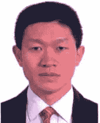

## 刘河：教研一线的跨界实战派

重庆市教育科学研究院研究员，CCF会员，重庆市教育信息化专家委员会成员。深耕大数据与人工智能领域，独立开发10余套软件系统，主持多项省部级重点课题，编著多部教材，持有多项软著证书。


## 杨艺：智能计算与电商技术的探索者

重庆工商大学副教授，专注大数据分析、智能计算及电子商务技术。主持十余项科研教改项目，发表数十篇高质量论文。

## 编写阵容

丛书主编：刘鹏  
主编：刘河、杨艺  
副主编：覃焕昌、王海涛  
编委：程国建、何茂松、刘林山、陈天伟、王潇潇、刘姬  

## 基金支撑

- 2017年河南省科技攻关计划（172102210050）
- 华北水利水电大学高层次人才启动基金（201608）
- 国家自然科学基金（61540069）
- 江苏省机电产品循环利用重点实验室开放基金（2018）
- 重庆市教育科学规划课题（2019-00-208）

## 编前语：破局AI人才荒，我们这样做

行业爆发、资本涌入、巨头抢人……人工智能正站在“黄金风口”。但放眼全球，人才缺口巨大，仅国内缺口即超500万，《人民日报》曾披露供求比高达1:10。补齐短板，刻不容缓。

政策强音接连吹响：2017年国务院《新一代人工智能发展规划》锚定2030年全球制高点；2018年教育部《创新行动计划》要求对接产业布局专业；2019年国家主席贺信智博会，强调数实融合。高校响应迅速：2019年35校获批AI本科新专业，96校新增“智能科学与技术”，187校累计获批“机器人工程”；2020年新增AI专业180个，占比居首，相关智能专业占新增总量超23%。趋势已成，不可逆转。

**痛点何在？** 多数院校仍处探索期：课程体系未立、配套资源缺位；教材陈旧晦涩、门槛过高；重理论轻实践，人才“下地难”。

**破局之道：** AI是综合实践学科，教材须具“易学、实战、系统”三性。本丛书应运而生——

**易学：** 好书须“读得懂”。全员视角切换至读者端，贴近热点与前沿，重构知识体系，赋予术语生命力，让AI学习不再“劝退”。

**实战：** 拒绝“纸上谈兵”。由一线名师与实战团队联袂打造，内容贴近工程落地，保持行业敏感度。近乎逐章配套实战实验，理论即练、练以俟学。云创大数据即以书中技术，在模糊人脸识别、超大规模比对、智能医疗、城市交通优化、污染预测等硬核场景取得突破。2020年初，我受邀率团队驰援钟南山院士组，用大数据与AI对疫情趋势作出精准预判，区别于国际主流预测，有力支撑国家决策，并产出高水平成果。

**系统：** 免费教学PPT全覆盖，教学演示直观高效。云创自研AI实验平台与专业教学平台，内容与教材逐章对齐，工欲善其事，必先利其器。

本书适配“智能科学与技术”、“人工智能”核心专业，亦适配“智能制造”、“机器人工程”、“智能建造”、“智能医学工程”等交叉专业选用。

致谢恩师谢希仁教授（《计算机网络》7版常青典范）与李三立院士（国家攀登计划首席科学家），治学严谨、桃李满天下，是楷模。书成集体智慧结晶，感谢全体作者倾力付出。疏漏在所难免，恳请指正。联系邮箱：gloud@126.com，公众号：刘鹏看未来（lpoutlook）。

刘鹏  
2020年3月

## 第1章 绪论：读懂智能系统的“前世今生”

智能系统，本质上是具备专家级解题能力的计算机程序群。它调用海量领域知识与经验，模拟专家思维推理判断，高效破解复杂难题。智能以知为基，信息有序化成知识；智能寓于系统，系统有序整体由部件构成。因此，智能系统研究的核心在于：知识的表示、获取、发现、存储、传播、应用方法论，以及系统结构、组织原则、协同策略、进化机制、性能评价体系。

本章将带你梳理智能系统的演进脉络，建立概念模型与分类谱系，剖析核心特征与类型，拓宽视野，建立全局认知。

### 1.1 智能系统的演进史诗

“智能”内涵博大，本质待探，难下完美定义。但公认而言，智能是人脑高级活动的映射，至少包含：自主获取应用知识、思维推理、问题求解、自动学习四大核心能力。

人工智能（AI）作为计算机分支，自70年代起跻身世界三大尖端技术（与空间、能源技术并列），也被视为21世纪三大尖端（与基因工程、纳米科学并列）。近30年飞速演进，广泛渗透各学科，硕果累累，已成理论实践自成体系的独立学科。其终极图景：洞悉智能本质，造出能以类人方式反应的智能机器，涵盖机器人、语音/图像识别、自然语言处理、专家系统等。未来AI科技产品，将成为人类智慧的“外部容器”。

AI模拟的是人类意识思维的信息过程。它非人智，却能拟人思考，甚至超越人智。作为严谨科学，AI专注设计智能系统与机器，算法技术借鉴脑科学认知。现代AI系统多基于人工神经网络与代码，构建类脑神经元连接的简单单元网络。通过修改单元连接权重实现经验学习，类似生物突触可塑性。现代网络能模式识别、语言翻译、逻辑推理、甚至生成图像与创造新想法。其中，**模式识别尤为关键**——AI擅长从海量数据中捕捉模式，这正是人类短板。亿级单元、百亿级连接，在编码程序驱动下极速运转，智能便从海量简单元件的交互中涌现。

#### 1.1.1 智能系统鸟瞰

人类史经百万年，从旧石器到新石器，完成“用工具”到“造工具”跨越（虽仅石刀石斧）。5000年前文字城邦现，绘画雕刻载行为礼仪。人类史即智能进化史，人类自身即超级智能系统。

#### 1.1.2 智能系统的“前世”：从木牛流马到蒸汽巨兽

远古智能系统，仅是具简单自动化能力的工具。三国诸葛亮“木牛流马”，木制牛马能行走负重，在当时堪称“智能巅峰”。

仿生学驱动智能进化。自然是师，人类观自然、仿生物、悟奥秘、应生活。
- 飞机外形酷似蜻蜓；
- 蝙蝠声呐导航启发雷达诞生；
- 蜂巢六角柱加菱形底，极致坚固省料，古建筑楼台亭榭尽得其法。

18世纪蒸汽机推动航海，汽车飞机展活动半径。精密机械自动运转，亦属“智能”雏形。

**真正的智能时代，始于计算机。**

1946年，ENIAC问世。初为军科运算工，随技术跃迁，计算处理转为信息处理：财务、文字、排版、声像视频、多媒体应用层出。计算机系统化身“无所不能”的智能中枢。形态亦持续演化：占室巨兽 → 机柜 → 桌面 → 膝上 → 口袋。

#### 1.1.3 智能系统的“今生”：无处不在的新常态

百年发明，重塑生活图景。

日常已深度依赖：“秀才不出门，便知天下事”，滑动智机即览天下新闻。出行陌路，车载导航/手机端实时掌握路况、拥堵、耗时。居家智能音箱（天猫精灵、小度、小爱）成儿童“万事通”：数理科普、天气故事、英语方言，声控即得。

全行业智能化浪潮汹涌：智能家居、智能交通、智能制造、智慧校园、智慧城市……智能系统渗透肌理。

- **智能家居**：空调洗衣净水电视灯光，感知预判、自启停、自调节，舒适安防双升级。
- **智能交通**：车流引导预警、时空精准预估。
- **智能制造**：机器人接管高重复作业。
- **智慧校园**：业务数据融合分析，精准推送提醒，人少跑路、数据多跑路。
- **智慧城市**：5G、云算、泛感知、海量数据融合，覆盖环境、交通、生活、商业、生产，联动感知，极大提升城市整体效能与民生便捷度。

#### 1.1.4 智能系统的核心特征画像

1.  **处理对象跨越“数据-知识”双维**  
    既处理数据，更处理知识。知识表示、获取、存取、处理能力，是智能系统区别于传统系统的关键分水岭。故智能系统实为基于知识处理系统，需知识表示语言、组织工具、库建维查方法环境，支持存量知识复用。

2.  **问题求解模式独具三大特质**  
    采用AI求解模式，区别于传统模式：
    - 算法多为非确定性/启发式；
    - 求解强依赖知识库；
    - 问题常呈指数级计算复杂度。  
    主流求解路径：搜索、推理、规划三大范式。

3.  **具备“现场感应”与环境适应性**  
    这是与传统系统的另一核心分野。现场感应即：与环境持续交互并适应。交互链路含感知、学习、推理、判断、行动。通俗称“自组织”与“自适应”能力。

4.  **软硬协同的实现原理**  
    硬件层：CPU、存储、显示、输入、传感/扫描等，可按需定制（工控机、智能终端常见形态）。  
    软件层：C/C++、Java、VB、Delphi等均可开发应用，植入硬件测试调优，软硬结合落地功能。

### 1.2 概念模型与类谱体系

“智能”基于“信息”而生，寓于“系统”内；“系统”基于“物质”而立，受“信息”而控。系统是有序部件整体，相对环境存在，可与环境/他系统组成超系统。基于此，构建广义智能概念模型与类谱表，支撑现有系统分类聚类，指导新系统研发。

- **1. 概念模型**  
  广义智能具备多种类、多层次、多阶段、多模式、多特征、多范畴特性。模型表达式如下：

```
GI={MKI, MLI, MPI, MCI, MSI, MDI} (1-1)
```

式中：GI=广义智能；MKI=多种类智能；MLI=多层次智能；MPI=多模式智能；MCI=多特征智能；MSI=多阶段智能；MDI=多范畴智能。

- **2. 类谱表**  
  依模型建立广义智能类谱图，见图1-1。

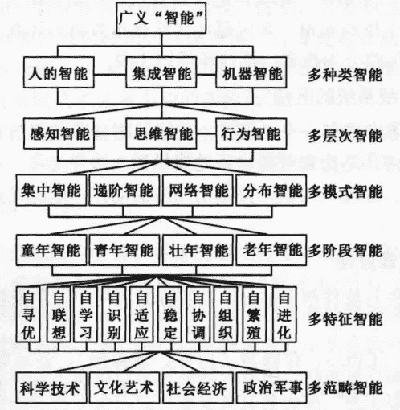

图 1-1 类谱图

### 1.3 核心特征与类型谱系

自寻优、自联想、自繁殖、自组织、自进化、自协调……是智能系统的关键基因。随信息社会演进，智能手机渗透生活，智能概念泛化，可归纳出自动化、智能化、人工智能三大递进类型：

- **自动化**：借机器之力，完成规律性、重复性作业。如产线包装、焊接、物流分拣、装卸，及高温高压、有毒环境作业。通过预设程序步骤、时间触发或按钮控制，实现生产自动化。

- **智能化**：在自动化基础上，系统能感知环境变化，实现初级自治：自适应、自反应、多功能、自监控、自修复、自维护、自操作、拟人交互，并具备协同作业能力。

# 智能系统演进全景：从专家系统到智慧城市

人工智能的本质，是让机器具备类人的认知、思考与学习能力。当下，它已渗透至定理证明、机器翻译、专家系统、博弈对弈、模式识别、机器人控制、深度学习及自适应环境等核心领域。放眼更广阔的视野，广义智能系统涵盖了多类型、多层次、多模式的复杂体系，囊括了各式各样的结构、参数与功能形态。本文将深度解析智能系统在专家系统、智能机器、智能社会三大维度的演进图谱。

## 1.4 智能系统发展前景

### 1.4.1 专家系统：知识赋能的先锋

作为智能系统早期最具代表性的落地成果，专家系统利用AI技术将领域专家的经验知识“数字化”，模拟人类推理决策，攻克原本仅靠人力难以高效解决的专业难题。1965年，斯坦福大学诞生的化学分析系统DENDRAL拉开了序幕，此后此类系统遍布各行各业，成为应用最广、最成熟、实效最强的智能形态。

**核心优势显著：**
*   **知识下放：** 将专家经验转化为可复用的推理能力，让非专业人士也能跨界胜任专业工作。
*   **白箱透明：** 不仅给出结论，更提供完整推导路径，比咨询性格难测的人类专家更可信、更便捷。
*   **敏捷迭代：** 知识库独立于程序，维护更新灵活高效，随时响应需求变化；这与传统软件“知识硬编码、修改需重构”的死板模式形成鲜明对比。

**七大功能图谱覆盖全场景：**
1.  **解释型：** 深度解析已知数据含义（语音、图像、电路、化学结构、卫星云图、数据挖掘等）。
2.  **诊断型：** 依据症状反推故障病因（医疗、设备故障、软件测试、材料失效）。
3.  **预测型：** 以史为鉴推演未来走势（气象、股市、人口、经济、交通、军事政局）。
4.  **设计型：** 依据目标约束输出方案蓝图（芯片、建筑、机械、工艺、艺术图案）。
5.  **规划型：** 寻找达成目标的动作序列（机器人物流调度、工程论证、生产排程、军事指挥、财务预算）。
6.  **监视型：** 实时感知动态异常并预警（生产安全、疫情、财政运行、公共安全、边防）。
7.  **控制型：** 全托管受控对象行为（空管、流程工业、无人机）。

此外，调试、教学、修理等细分类型亦不胜枚举。综上，专家系统集知识存储、过程描述、逻辑推理、结果解释、自主学习、人机交互于一体，自70年代问世以来，已在科技、工程、医疗、军工、教育、工农业及交通等领域创造巨大经济社会效益。

### 1.4.2 智能机器：软硬融合的物理智能体

区别于纯软件的专家系统，智能机器是“智能大脑”与专用硬件躯体的深度融合。智能机床、航天器、无人机、智能汽车、先进武器等均属此列。它们具备高度自治性、环境适应性与任务执行力。

**架构解析：**
*   **大脑（智能软件）：** 负责推理、记忆、学习、决策、控制。
*   **感官（传感器）：** 捕获视听触嗅平衡等多模态信息。
*   **四肢（效应器）：** 执行动作，驱动电机、扬声器、控制电路等。
*   **躯干（支架）：** 承载本体，形态随任务千差万别。

聚焦**智能机器人**，其“智能”核心在于中央处理器与人机交互协同。移动机器人还需攻克导航与路径规划难题。当前，美日德等强国引领研发热潮，机器人身影遍布医疗、餐饮、军事、玩具、深海、太空、体育、社区、工业、农业等全域。

**三大核心机能缺一不可：**
1.  **感知：** 遥感（视觉/听觉/距离）+ 接触感（压力/触觉/温度），全方位认知环境。
2.  **运动：** 自主行为反应 + 无轨自由移动 + 作业机械手操作。
3.  **思维：** 信息分析、推理决策、指令下发——这是区分于普通机器人的关键分水岭。

**按智能化程度分级：**
*   **传感型（外部受控）：** 无自主大脑，仅执行外部指令。
*   **交互型（半自主）：** 具备对话交互与部分决策（如避障、轨迹规划），仍受外部监管。
*   **自主型（全自主）：** 无需人为干预，感知-决策-执行闭环完备，如独立个体般行动。

**军事需求催生巅峰形态——智能武器。** 集杀伤力与信息采集、知识利用、智能决策、自主跟踪于一体，涵盖精确制导武器、无人机、智能坦克/火炮/鱼雷、多用途作战机器人。展望未来，脑机接口、意识机器人研究将推动智能机器实现质变飞跃。

### 1.4.3 智能社会：从智能家居到智慧城市的跃迁

心智延展论与分布式认知论均指出：智能具有内在社会属性。智能科技应用自然延伸至社会生活肌理，构建智能社会，起点是**智能家居**，终极形态是**智慧城市**。

#### 智能家居：数字化网络化基石上的智能化跃升
作为社会基本细胞，家庭智能化提供安全、便捷、舒适、环保、娱乐、健康的全维体验。技术栈涵盖综合布线、网络通信、自控、安防、视听、娱乐、健康、家政等。

**六大子系统构建全栈服务：**
1.  **布线系统：** 承载语音、数据、多媒体、家电自控、安防的物理底座。
2.  **安防系统：** 门磁、烟感、燃气、红外、视频监控构建立体防护，手机远程随时掌控。
3.  **娱乐系统：** 人机互动、智能点歌、AI填词谱曲，高阶AI重塑家庭娱乐。
4.  **健康系统：** 咨询、体检、饮食指导、辅助诊断，融合中医专家系统提升品质。
5.  **家政系统：** 事务管理、家电联动（自动烹饪/洗碗）、扫地机器人至家政服务机器人。
6.  **中央控制：** 统筹调度上述子系统协同运作。

**五大核心价值：**
*   **全天候在线：** 互联网常驻，赋能居家办公。
*   **主动安防：** 入侵/火灾/泄漏/求救实时感知，联动家电应急处置，事前预防胜于事后补救。
*   **交互控家：** 语音/远程全屋家电智控，效率跃升，告别等待。
*   **沉浸娱乐：** 从影院背景音乐进阶至声控点歌、AI创作、歌舞仿真。
*   **信息全管：** 健康、理财、事务、物业通知一站式数字化管理。

虽目前仍属个案，但房地产开发必须预留智能化接口，因它是通向智能社区、智慧城市的必经之路。

#### 智慧城市：三网融合驱动的城市智能操作系统
智慧城市借力物联网、无线网、互联网“三网合一”，以先进智能技术构建城市发展新生态。其架构映射清晰：
*   **三网融合** ≈ 智能家居的**基础布线**；
*   **智能家居** ≈ 智慧城市的**最小单元**；
*   **智能交通/医疗/楼宇/教育/能源/环境** ≈ **功能应用层**；
*   **智能识云/移动计算/信息融合/云计算** ≈ **关键技术支撑**。

**目标直指：** 感知、识别、分析、融合城市核心系统关键信息，提升民生、环保、安全、服务、商务质量，创造美好城市生活。

**四大技术特征：**
1.  传感器与智能终端织就全城物联感知网，核心系统全景监控分析。
2.  三网融合打通信息流通大动脉。
3.  智能设施底座上，政务、经营、生活创新应用全面开花。
4.  核心系统高效协同，城市运行达最优态。

**十二大建设工程落地宏图：**
1.  **智能公共服务：** 就医、就业、文化、安居系统专业化建设，资源全域共享，人流物流信息流资金流协同高效。
2.  **智能社会管理：** 多渠道市民服务中心（语音/传真/邮件/人工），法律援助、维权平台专业化，打造全覆盖、高时效、高满意度服务体。
3.  **智能企业服务：** 政务“一网通办”，信息公开透明；税务、工商、海关、环保、银行、法院事项网办；中小企业全链路效能提升平台。
4.  **智能安居服务：** 智慧社区试点先行，政务/家居/楼宇/服务/监控/安防/办公多系统融合，居民生活“智能化发展”。
5.  **智能教育服务：** 城域网/校园网双网建设，资源库/共享平台/虚拟图书馆/远程教学/管理系统一体化，建设学习型社会。
6.  **智能文化服务：** “文化共享”工程深化，网络文化繁荣，资源整合服务体系完善，旅游公共信息平台便民惠民。
7.  **智能商务管理：** 智慧服务业试点示范，传统服务业向智慧物流/贸易/服务转型，信息化重塑经营管理模式。
8.  **智能医疗保障：** “数字卫生”核心，区域卫生信息平台互联互通，全民电子健康档案建档，远程挂号/收费/远程医疗/图文诊断智慧就医闭环。
9.  **智能交通系统：** “数字交通”工程，多部门监控网络统一，引导/应急/出行/两客一危管理一体化，信息共享、实时监控、动态管控、安全畅通。
10. **智能农村服务：** “数字乡村”建设，三农公共信息平台，综合信息服务站为载体，就业/技术/教育/气象/社保/医疗/村务“七大服务”直达田间地头。
*(素材此处截断，后续建设项目延续上述逻辑推进)*

---

智能系统的演进，是一场从“知识模拟”到“物理具身”，再到“社会嵌入”的宏大叙事。专家系统沉淀了知识范式，智能机器打通了物理边界，智能家居与智慧城市则将智能渗透进生活毛细血管。这不仅是技术的迭代，更是人类文明形态的深度重构。

# 智慧城市：建设蓝图与技术基石

#### 1.4.3 智慧城市建设工程与核心支撑

**筑牢智能安防防线**  
借助信息技术之力，全面深化“平安城市”建设，推动社会治安视频监控系统向智能化迈进，挖掘动态视频数据价值。打破公安监控与社会监控的数据壁垒，实现资源整合共享，搭建基层社会治安综合治理信息平台。同步推进市级应急指挥、突发公共事件预警发布、自然灾害防汛调度、安全生产重点防控等体系建设。健全公共安全应急联动机制，构建多部门协同的综合指挥中枢，显著增强对事故、灾害、疫情、案件及各类突发事件的防范化解与应急处置能力。

**提升智慧政务效能**  
致力于提高政府综合管理数字化水平。巩固深化“金土”、“金关”、“金财”、“金税”等专项信息工程，强化土地、海关、财政、税收等垂直领域治理效能。加强工商、税务、质监等核心系统建设与集成，打造经济管理综合平台，优化经济调度与服务供给。推行食品、药品、医疗器械、保健品、化妆品全链条电子化监管，建立动态信用评价机制，落实数字化“放心工程”[26]。

上述工程的落地实施，均需智能技术等核心支撑。归纳来看，智慧城市建设涉及的关键核心技术主要集中在三大维度：

**一、 感知识别体系**：物联网海量感知数据的解析依赖智能识别，涵盖射频识别、条码扫描、专用传感器探测、视频图像智能分析、无线定位等多元技术路线。

**二、 移动计算架构**：智慧城市本质属于无线城市，无线移动计算的智能化跃升是下一代演进方向。亟待攻克移动智能终端研发、身份认证、远程支付、移动监控等智能软件开发等关键难题。

**三、 信息融合框架**：面对多源、异构、多时态、多尺度、跨专业的海量数据，需在统一框架内实现高效处理。该技术覆盖底层原始数据融合、中层特征数据融合、高层决策数据融合三大层级。

鉴于数据规模庞大、关联复杂、交互频繁，建设云计算数据中心成为保障各功能系统有效运行的基石。以此为底座，构建信息网络、公用信息、专题信息、决策支持、空间信息“五大平台”，并配套建设智能网络互联、身份认证、信息资源管理、智能服务、互联网数据、智能决策支持等核心处理中心，共同编织起智慧城市的数据处理体系。

目前，北京、上海、广州、无锡、杭州、南京、沈阳、武汉、合肥、昆明、昆山、成都等城市已相继启动建设，呈现全域推进、重点突破、小范围试点并行态势。展望未来，随智能网络、智能物联、智能决策等前沿技术加速突围，城市生活必将迈向更舒适、便捷、智慧的新境界。

智能社会建设任重道远，却是社会发展的必然趋势。智能社会可视为信息社会的高阶形态。除转变观念、重塑制度外，攻关成熟智能技术乃夯实基础之关键举措。

#### 1.4.4 智能产业：重塑经济增长新引擎

智能化汇聚现代通信、计算机网络、行业工艺及智能控制等技术，形成面向特定场景的智能集成体系。随技术迭代，内涵日益丰富复杂，渗透至千行百业与生活肌理，催生出智能社区、智能医院等新形态。

智能系统将加速融入人类衣食住行。以无人驾驶为例：清晨出门，仅需对家中智能管家下达语音指令“我要出发”，管家即预约无人驾驶车辆至楼下待命。上车告知目的地，车辆自动驶达；抵达后车辆自动离场。出行由此化繁为简，大众无需置办私车，亦可规避保养、保险、拥堵、驾驶技术、停车难等痛点。

智能产业生态由芯片、软件、大数据、通信、云技术五大支柱支撑：

*   **芯片产业**：聚焦CPU、存储芯片、GPU图形处理器等核心硬件。
*   **软件产业**：深耕垂直领域，基于需求分析、业务流程梳理与问题解决方案设计打造行业软件。
*   **大数据产业**：智能决策建立在历史方案与未知问题分析之上，数据越丰富越详尽，分析精度越高。
*   **通信技术**：朝向无线化、大带宽、低时延演进。
*   **云技术**：提供云计算与云存储的弹性算力底座。

智能系统演进呈现“创造性破坏”双重效应：在催生新业态的同时，淘汰落后产能。智能手机的崛起，便让卡片相机、随身听乃至纸质报纸等看似无关产业相继退出历史舞台。

智能系统正深度重塑工业、农业、金融、医疗、无人驾驶、安防、教育、家居等版图：

*   **农业领域**：天地一体化遥感监测网实现农田全覆盖，智能牧场、农场、渔场、果园、加工车间与供应链集成应用落地生根。
*   **工业领域**：依托智能制造核心软件、关键装备、工业互联网，流程与离散智能制造、网络化协同制造、远程诊断服务等新模式破茧成蝶，企业智能供给能力跃升。
*   **物流领域**：搬运装卸、包装分拣、配送加工等深度感知智能物流系统推广，智能仓储体系建立，仓储运营效率有望实现数十倍跃升。

人工智能作为产业升级新引擎，驱动结构优化，深度赋能经济转型。其核心动力在于提升要素配置效率，推动经济向创新驱动、资源再生、内涵发展模式跨越。

### 思考与实践

1.  结合亲身经历，列举日常接触的智能系统，剖析不足，并从设计者角度提出优化方案。
2.  勾勒理想智能系统蓝图，畅想20年后的智能生活图景。
3.  探讨智能系统演进趋势，辩证分析其对人类利弊，回应“威胁论”。
4.  阐述智能系统概念模型架构。
5.  若由你设计智能机器人，明确应用领域、核心功能及成熟技术落地路径。
6.  谈谈智能化如何重塑生活方式。
7.  描摹智能产业现状与未来趋势。
8.  发挥想象，从日常维度预测未来50年智能社会发展高度。

### 参考文献

- [1] 史忠植，王文杰. 人工智能[M]. 北京：国防工业出版社，2007.
- [2] 王万良. 人工智能导论[M]. 3 版. 北京：高等教育出版社，2015.
- [3] 周昌乐. 智能科学技术导论[M]. 北京：机械工业出版社，2015.
- [4] 曾毅，刘成林，谭铁牛. 类脑智能研究的回顾与展望[J]. 计算机学报，2016(1): 213-221.
- [5] 毛博，徐恪，金跃辉，等. DeepHome:一种基于深度学习的智能家居管控模型[J]. 计算机学报，2018, 41(12):55-67.
- [6] Lu X, Wang H, Xu X. Human Activity Recognition Based on Acceleration Signal and Evolutionary RBF Neural Network[J]. Pattern Recognition and Artificial Intelligence, 2015, 28(12):1127-1136.
- [7] Turing A M. Computing Machinery and Intelligence[J]. Mind, 1950, LIX: 433-460.
- [8] Tom M M. Machine Learning[M]. Mc Grow-Hin, 1997.
- [9] Chen Y J, Luo T, Liu S L, et al. DaDianNao:A machinelearning supercomputer[C]. Proceedings of the 47th Annual IEEE/ACM International Symposium on Microarchitecture (MICRO), 2014.
- [10] Mnih V, Kavukcuoglu K, Silver D, et al. Human-level control through deep reinforcement learning[J]. Nature , 2015, 518(7540): 529-533.
- [11] 涂序彦. 广义智能系统的概念、模型和类谱[J]. 智能系统学报, 2006, 1(2):7-10.
- [12] 徐志磊. 谈智能系统与创新设计的概念问题[J]. 装饰, 2016(11):12-13.
- [13] 李玉环. 人工智能综述[J]. 科技创新导报, 2016, 13(16):77-78.
- [14] 骆祥峰，高隽，汪荣贵，等. 认知图研究现状与发展趋势[J]. 模式识别与人工智能, 2003, 16(3):315-322.
- [15] Bahrammirzaee A. A comparative survey of artificial intelligence applications in finance: artificial neural networks, expert system and hybrid intelligent systems[J]. Neural Computing & Applications, 2010, 19(8):1165-1195.
- [16] Fishwick P A. An Integrated Approach to System Modelling using a Synthesis of Artificial Intelligence, Software Engineering and Simulation Methodologies[J]. Acm Transactions on Modeling & Computer Simulation, 1992, 2(4):307-330.
- [17] 魏金河. 人工智能系统在未来载人航天中的应用展望[J]. 航天医学与医学工程, 2003, 16(s1):482-485.
- [18] 于会，李伟华. 飞机驾驶员辅助人工智能系统框架设计[J]. 火力与指挥控制, 2008, 33(8):121-123.
- [19] 郭亚军. 实时人工智能系统的构成[J]. 小型微型计算机系统, 2003, 24(3):513-516.
- [20] 蒋新松. 人工智能及智能控制系统概述[J]. 自动化学报, 1981, 7(2):148-156.
- [21] 王志宏，杨震. 人工智能技术的哲学及系统性思考[J]. 电信科学, 2018, 34(4):12-21.
- [22] 李伯虎，柴旭东，张霖，等. 新一代人工智能技术引领下加快发展智能制造技术、产业与应用[J]. 中国工程科学, 2018, 20(4):81-86.
- [23] Brahan J W, Kai P L, Chan H, et al. AICAMS: artificial intelligence crime analysis and management system[J]. Knowledge-Based Systems, 1998, 11(5-6):355-361.
- [24] Passino K M, Antsaklis P J. A system and control theoretic perspective on artificial intelligence planning systems.[J]. Applied Artificial Intelligence, 1989, 3(1):1-32.
- [25] Shiratori N, Takahashi K, Sugawara K, et al. Using Artificial Intelligence in Communication System Design[J]. IEEE Software, 1992, 9(1):38-46.
- [26] 周昌乐. 智能科学技术导论[M]. 北京: 机械工业出版社, 2015.

## 第 2 章 智能感知：赋予机器“感知力”

2017年7月，中国发布《新一代人工智能发展规划》，新技术浪潮滚滚向前，智能感知技术乘势而起。人类除拥有视、听、味、触、嗅五感外，更借助各类传感器这副“机械触角”探知自然奥秘。自工业革命以来，尤以信息革命及当下数据革命为烈，“人造感官”应用日益广泛，其背后运作机理究竟为何？本章将从基础认知、感知系统、多传感器数据融合、网络化协作感知及应用实践五大维度深度解析。

### 2.1 智能感知概述

#### 2.1.1 传感器与智能传感器

##### 1. 核心概念辨析

###### 1) 传感器：物理世界的“翻译官”

传感器能感受特定被测量，按规律转化为可用输出信号的器件，典型结构包含敏感元件、转换元件、调节转换电路[1]。简言之，它是物理检测装置，能捕捉被测物信息与状态，将自然界的物理量、化学量、生物量转化为可测电信号，作为信息采集的“排头兵”，酷似人类感官。

自20世纪80年代起，传感技术突飞猛进，广泛渗透国防、航天、交通、能源、机械、石化等领域，以及环保、生物医学、防灾减灾等方方面面，深度嵌入日常生活。例如：“玉兔号”月球车搭载多类传感器采集月面数据；汽车安全带压力传感器监测系带状态；酒店烟雾传感器触发自动灭火；楼道声控灯借声音传感器实现智控；户外机械温度传感器预警过热故障；形影不离的智能手机，更是融合多种传感器的微型系统。图 2-1 所示为火灾传感器。

###### 2) 智能传感器：进化的“智慧感官”

普通传感器多为单一感知输出，故障难以及时判别，日益制约信息化与自动化进程，难满足差异化需求。智能传感器应运而生，集感知、处理、通信于一体，支持数字化传播具备知识级别的信息，是传感器集成化与微处理技术深度融合的产物。其具备高精度、高分辨率、高稳定性、高可靠性、强适应性及极高性价比。

目前智能传感器尚无统一科学定义。综合学界观点，可定义为：基于人工智能理论，利用微处理器实现智能处理功能的传感器[2]。图 2-2 所示为温湿度智能传感器。

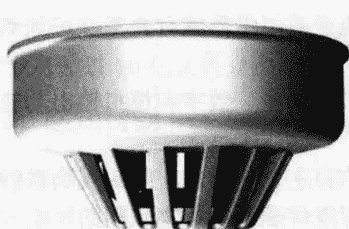


图 2-1 火灾传感器

图 2-2 温湿度智能传感器

美国国家航空航天局（NASA）于1978年首次提出该概念。缘由在于：航天器海量传感器持续回传温度、位置、速度、姿态数据，单一大型计算机难以并行处理且成本高昂。若想不丢数据、降成本，必须采用传感器与计算机一体化的智能传感器，核心思想是赋予传感器智能处理力，分担中央处理器压力。发展脉络如下：

*   **1983年**：美国霍尼韦尔推出全球首个智能传感器——ST3000系列。
*   **1993年**：IEEE与NIST发布“智能传感器接口标准”。
*   **2000年起**：MEMS技术大规模应用，驱动传感器向智能化、微型化、集成化迈进。
*   **2010年**：机械工业仪器仪表综合技术经济研究所牵头建立智能传感器系统标准体系架构，规范市场，服务应用，奠定物联网体系基石。
*   **2010年后**：物联网与智能制造兴起，智能传感器迎来广泛关注与爆发式增长[3]。

##### 2. 核心功能与应用版图

智能传感器主要智能处理功能涵盖：

*   **自补偿功能**：依托先验知识，处理器以数字计算法自动修正硬件非线性、漂移及环境干扰导致的信号失真，以软件补偿硬件缺陷，最佳复原被测信号。
*   **自计算与处理功能**：基于间接测量数学模型，利用补偿数据推算不可直接测量的物理量；依统计模型计算总体统计特性；凭电子数据表重新标定特性。
*   **自学习与自适应功能**：通过样本学习，利用近似公式与迭代算法认知新量值（再学习能力）；通过学习被测量与影响量，依判断准则自适应重构结构、重置参数（如自选量程、通道，自动触发、滤波切换、温度补偿）。
*   **自诊断功能**：针对内外因导致的性能下降（软故障）或失效（硬故障），处理器利用补偿后状态数据，借电子故障字典或算法实现故障预测、检测与定位。

其他常用功能还包括数据交换通信接口、数模输出、备用电源断电保护等。

智能传感器作为网络化、智能化、系统化的自主感知器件，是物联网与智能制造的基石，亦是新人工智能落地应用的基座。它属于物联网的“神经末梢”，是人类全面感知自然的核心元件。各类智能传感器的大规模部署，构成了物联网不可或缺的基础条件。应用版图覆盖智能制造、智慧城市、智能安保、智能家居、智能运输、智能医疗等全域。

#### 2.1.2 感知智能：AI的“五感”延伸

自动驾驶汽车要想安全上路，感知系统是“标配”中的“重中之重”。一辆车往往搭载三大传感器阵列——摄像头、毫米波雷达与激光雷达，单车传感器数量动辄上千，唯有如此，才能全天候、全方位采集路况环境数据，支撑智能驾驶决策。汽车智能化的跃升，不仅解放了驾驶员的双手双脚，更重构了车内娱乐与交互体验。图 2-3 展示了 Google 无人驾驶汽车的真容。

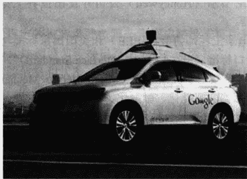

图 2-3 Google 无人驾驶汽车

智能传感器早已走出实验室，渗透进柴米油盐的生活细节。咖啡机凭借它实现智能配料与精准称重，智能水杯靠它实时监测水温，电饭煲、智能奶瓶、重力感应柜等产品更是批量上市，成为市场主流。

工业生产线上，智能传感器扮演着“质量预言家”的角色。它直接监测温度、压力、流量等与产品质量强相关的工艺参数，再借助神经网络或专家系统构建的数学模型反演计算，精准推断产品优劣。

医疗领域的突破同样令人振奋。美国 Cygnus 公司推出的“葡萄糖手表”，外观酷似普通腕表，却能实现无痛、无创、连续的血糖监测。核心奥秘在于表背贴合皮肤的试剂垫：葡萄糖分子渗透吸附后发生电化学反应产生微弱电流，传感器捕获信号，处理器瞬间换算出血糖浓度并数字化显示。

为落实国家智能制造战略，工信部于 2017 年底印发《智能传感器产业三年行动指南（2017—2019）》。指南锚定 2019 年目标：产业实现显性突破，规模破 260 亿元，且培育出 5 家营收超 10 亿元、20 家营收超 1 亿元的龙头企业。

运算智能、感知智能、认知智能，构成了人工智能演进的“铁三角”，业界对此已达成广泛共识。作为 AI 体系的信息入口，感知智能的地位举足轻重。

感知是人类认知世界的原始通道。视觉、听觉、嗅觉、触觉将外界信号汇聚大脑加工，构建起我们的世界图景。但人类感官有生理极限，智能传感器正是这一生理边界的“数字化延伸”。感知智能的本质，是借助摄像头、麦克风等硬件采集物理信号，经由语音识别、图像识别、自然语言处理等算法映射为数字信息，并将其提升至可记忆、可理解、可规划、可决策的认知维度。

搭载智能传感器的机器，由此获得了与物理世界深度交互的能力。前文提到的自动驾驶车，即是融合激光雷达与 AI 算法实现感知智能的典范；城市智慧路灯能依据移动目标距离自适应调光；波士顿动力为美军研制的“大狗”机器人，内置传感器群让它能在复杂地形动态调整步态，同时保障操作员实时追踪定位与系统监测。此类移动机器人通过自带传感器获取环境信息、提取特征、建立模型，实现对周围世界的“理解”。得益于深度神经网络（DNN）与大数据红利，机器感知在主动性、灵敏度、精准度上已逼近甚至超越人类。

传统键盘鼠标式的人机交互，终将让位于语音、视觉、手势乃至表情识别等自然感知方式，这一变革指日可待。

#### 2.1.3 智能感知系统：数据生成的“源头活水”

俗话说“巧妇难为无米之炊”，算法再强、算力再猛，无数据则无智能。感知的本质是解决“信息从哪来”的问题，属于测试检测技术范畴。它是“信息获取—处理—传输—应用”全链条的源头技术，核心任务是攻克信息获取技术与物理量测量方法，保证信号准确采集与预处理，为后续传输奠基；同时针对信号产生、目标跟踪、状态反馈、传输控制、动作执行、结果输出等环节，研究配套控制技术。

智能感知系统是测量控制物质世界信息的基石设备。传感器、信号采集模块是落地执行的具体器件。若信息获取失真或缺失，后续存储、计算、通信皆成无源之水。

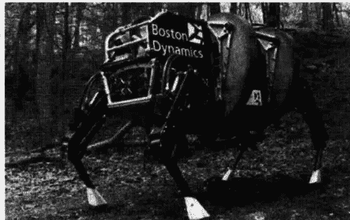

图 2-4 “大狗”机器人

一般而言，智能感知系统由传感器、中间变换装置、记录存储装置三大模块构成（见图 2-5）。

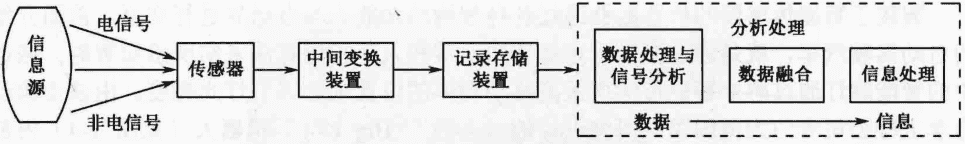

图 2-5 智能感知系统的组成

传感器是系统的“触角”，直接感受被测信息，输出与之成比例的物理量信号，满足传输、处理、记录、显示、控制等全链路需求。

信号是信息的载体。按物理性质分为非电信号（温度、位移、速度等随时间变化的物理量）与电信号（电压、电流、电荷等）。两者可互换，工程上常将非电信号转为电信号，便于传输、存储与计算。

记录存储装置以计算机为核心。数据处理前需信号分析，常用手段包括快速傅里叶变换（FFT）、频谱分析、小波分析等。面对多传感器并行数据，系统需实施数据融合深度挖掘，再引入智能计算方法处理，最终达成测量目标。

### 2.2 多传感器数据融合：让“碎片”拼成“全景”

随着传感器普及，多传感器数据融合技术应运而生。单一传感器受限于视角与原理，难以独立刻画环境全貌，往往只能获取局部、破碎、不完整的观测量。必须多传感器协同采集、融合分析，方能实现高可靠的分类识别与决策。这极似人脑整合多感官信息的过程：感知系统汇聚分布式传感器的实时数据，经智能计算提取有效特征，输出对观测场景相对完整一致的解释。这一过程充分释放多源数据价值，发挥协同优势，大幅跃升系统智能化水平。

#### 2.2.1 数据融合的概念：从“多源”到“最优”

数据融合是专攻多传感器数据处理的核心技术，随 AI 飞跃已成人类智能活动基石。虽无绝对统一定义，但内核可概括为：综合时空维度的多传感器观测量，利用其互补性与冗余性，化解单传感器的不确定性与局限，形成对被测对象相对完整一致的描述，提升测量精度与可靠性，进而强化智能系统识别、判断、决策、规划、反应的速度与准度。

数据融合流程见图 2-6，内涵包含三层递进含义：

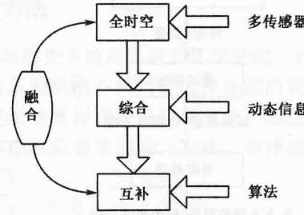

图 2-6 数据融合的过程

1.  **处理对象复杂多元**：涵盖多源、多维、全时空信息。数据可能确定或不确定、同步或异步、同构或异构、数字或模拟。
2.  **融合视野全域覆盖**：不限于传感器数据（自然环境信息），还纳入社会信息，要求对感知系统动态过程中的全量信息有效综合。
3.  **互补机制层层深化**：覆盖信息表达、结构、功能等多层次互补。通过关联、分类、估值、预测等算法运算，使信息愈发清晰丰富，实现信息再生与升华，触达最优。

#### 2.2.2 数据融合的目标、原理与层次

##### 1. 核心目标：破局“盲人摸象”

单传感器受功能边界、器件质量、噪声干扰制约，输出信息往往片面、不确甚至错误。融合多源信息，旨在以较低代价、较短时延，获取超越单一传感器的精准特征。终极目标：协同测量、深度融合、全景认知、最优估值与辨识。

##### 2. 运作原理：从观测到解释

原理示意见图 2-7。流程四步走：N 类传感器采集观测量 → 特征提取变换得特征向量 → 模式识别生成各传感器描述 → 同目标描述分组融合 → 输出一致性解释描述。

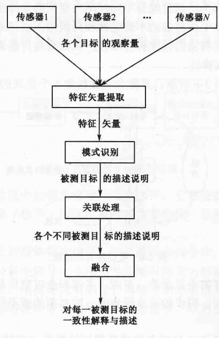

图 2-7 数据融合的原理示意

##### 3. 融合层次：三级阶梯与新动向

按信息处理抽象程度，主流划分为数据级、特征级、决策级三大层次：

*   **数据级融合（像素级）**：直接融合同质传感器（观测同一物理量）的原始观测数据，再提特征识别。异质传感器无法在此层融合。
    *   *优*：信息零损耗，保留细节最全，结果最准。
    *   *劣*：数据量巨大，算力通信压力大，实时性弱。
*   **特征级融合（中间层）**：各传感器先提特征，汇聚成单一特征向量，再经模式识别支撑决策。
    *   *优*：计算量与带宽需求大降，利于实时化。
    *   *劣*：特征提取环节丢弃原始信息，精度有所折损。
*   **决策级融合（高层）**：各传感器独立完成识别决策，再按准则融合判断结果输出最终决策。
    *   *优*：算力带宽占用最低，实时性最强。
    *   *劣*：信息高度压缩，结果相对粗糙。

近年涌现**监视动态融合**新范式：通过动态监控融合过程，优化资源调度与传感器管理，实时反馈结果赋予自适应能力，追求全局最优融合效果。

工程落地无标准答案，需综合权衡传感器性能、算力预算、带宽上限、精度指标、成本红线，择优选层；单系统内亦可多层级并行融合。

#### 2.2.3 数据融合的方法论图谱

融合方法是释放多传感器价值的关键，也是多传感器系统的核心命题。虽未形成统一完备理论体系，但各垂直领域已沉淀大量成熟有效方案。常用方法谱系见图 2-8。

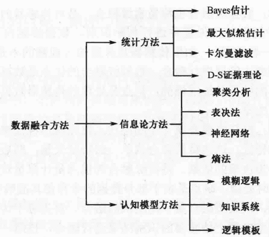

图 2-8 数据融合的常用方法

##### 1. 统计方法：量化不确定性的经典兵器

核心逻辑：用概率分布或密度函数描述不确定性，从冗余低质数据中淘金提特征。

*   **Bayes 估计**：融合静态环境高层信息的常用手段。通过先验概率递归更新系统状态概率分布。WA Abdulhafiz 等提出的改进 Bayes 算法（MB），引入不一致性度量机制，结合卡尔曼滤波，显著提升估计精度与后验确定性。
*   **最大似然估计 (MLE)**：一言以蔽之——“模型已定，求参最优”。在给定模型与样本下，寻找让模型最大程度拟合样本的参数。
*   **卡尔曼滤波**：融合低层实时动态冗余数据的主力。利用测量模型统计特性，递归更新预测协方差，实时输出最优滤波估计。
*   **D-S 证据理论**：哈佛数学家 Dempster 创立，学生 Shafer 完善引入信任函数。它从“结果（证据）”反推“原因（假设）”，各证据独立判断所有假设得基本概率分配，再融合组合得综合概率，概率最大者为判决。Mass 函数可主观给定，也可结合他法客观求解。

*统计流派小结*：数学基础扎实，擅长不确定性融合，但抗异常数据能力（鲁棒性）偏弱。

##### 2. 信息论方法：挖掘相似性的几何视角

*   **聚类分析**：免先验、直观简洁，广泛应用。按空间相似性划分目标空间，使聚类质量准则函数最优。常用距离度量相似性，划分区域即类别。受限于聚类变量选择与距离参数敏感性，应用有边界。
*   **表决法**：最朴素的“少数服从多数”。各传感器给判断，表决算法搜索过半同意的结论（或其他简单规则）作为结果。
*   **神经网络**：强容错、自学习、自组织、自适应，非线性映射能力强。多源不确定信息融合本质是不确定性推理，神经网络凭借信号处理与自动推理特质，天然契合此道。
*   **熵法**：以事件概率反映信息重要度。常发生事熵小、罕见事熵大。融合中寻使信息熵函数值最大化。

*信息论流派小结*：基于观测空间参数相似性融合，难直接建立数据各维度的显式识别函数。

##### 3. 认知模型方法：贴近人类思维的高阶智慧

*   **模糊逻辑**：多值逻辑体系，用隶属度模糊表达真值，将融合不确定性显性化嵌入推理链路。经模糊概率计算输出判断。因推理含主观成分，客观性稍弱。
*   **知识系统**：整合规则与专家知识自动识别。人工推理失效时，专家系统接管辅助。架构含知识库、全局数据库、推理机、人机界面四核心。
*   **逻辑模板**：本质是匹配识别。预置模式（含逻辑条件、模糊概念、观测数据、不确定关系）与实测数据匹配，判定条件满足与否以推进推理。是一种综合参数模式匹配方法。

*认知模型小结*：表达处理最拟人，适配高层融合场景。

随着传感器、数据处理、计算机、通网、AI、并行计算等底层技术迭代跃升，尤其是 AI 突围，新一代更高效融合算法将层出不穷。多传感器数据融合，必将成为未来复杂工业系统智能检测与数据处理的核心引擎。

### 2.3 网络化智能协作感知：从“单点”走向“群智”

多传感器系统在民用服务、工业制造、军事国防全面铺开，倒逼 AI 对协作感知技术与策略提出新要求。构建网络协作感知体系，深度优化异构传感器数据融合，获取更精准完备的信息图谱，是满足未来智能数据处理与控制系统进化的关键一跃。

#### 2.3.1 传感网络与无线传感网络（WSN）

**1. 概念溯源与定义**

传感网络由空间离散分布的集成节点（传感+处理+通信）组网，采集环境信息，依融合反馈响应。自 70 年代诞生历经四代演进，终至第四代——无线传感网络（WSN）。

WSN 定义众说纷纭，两大代表性视角：

*   **视角一**：大规模、无线、自组织、多跳、无分区、无基建。节点同构、低成本、微尺寸、多为静态、随机部署，追求极致网络寿命。
*   **视角二**：海量廉价微型节点无线自组多跳网。核心使命：协同感知、采集、处理覆盖区目标信息，回传观察者。传感器、感知对象、观察者构成 WSN 三要素。

**2. 体系架构：分层解耦与横向管理**

WSN 架构借鉴 TCP/IP 与 OSI/RM，自下而上分物理层、数据链路层、网络层、传输层、应用层（见图 2-9）。各层横向植入电源管理、移动管理、任务管理三大专用模块。这三大管理器让节点能按能效最优协同、移动场景下路由转发、支持多任务与资源共享。

无线传感网络（WSN）的数据传送主要依赖多种短距无线通讯手段，常见的有 ZigBee、6LoWPAN、蓝牙及 Wi-Fi 等。

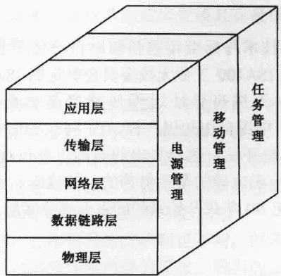
图 2-9 无线传感网络架构图

**ZigBee**
作为新兴的典型短距无线技术，ZigBee 凭借低功耗、低成本、低时延、网络容量大、可靠性与安全性高等优势，迅速成为 WSN 领域的首选方案。其架构基于 OSI/RM 简化而成，涵盖物理层、MAC 层、网络层及应用层四层结构。

**6LoWPAN**
传统 IP 协议因对内存和带宽要求高，难以适配微控制器及低功耗无线环境，导致无线网络长期依赖专用协议。基于 IEEE 802.15.4 标准的 6LoWPAN 打破了这一限制，实现了 IPv6 通信，其低功耗特性使其适合构建 WSN。其协议栈模型与 TCP/IP 相似，核心差别在于底层采用 IEEE 802.15.4 标准。

**蓝牙**
这是一种典型的短距无线电技术（通讯距离通常在 10 米内）。它能有效简化移动终端间及终端与互联网的通讯，提升数据传输效率。蓝牙规范含核心规范与配置文件两大部分，独立于操作系统和协议，移植性强，广泛应用于手机、耳机、笔记本等设备间的无线数据交换。

**Wi-Fi**
即“无线保真”，可在数十米范围内为 PC、手持设备提供高速无线接入，并通过 AP 热点实现宽带上网，是当前无线局域网及高速设备互联的主流之选。Wi-Fi 支持 IEEE 802.11 系列标准并持续迭代更新。

**其他技术与标准**
此外，还有 ISA100.11a（工业无线）、HART（首个开放互操作标准）、中国自主知识产权的工业无线网络标准、Z-Wave（低成本低功耗高可靠）、RFID（射频识别）等多种短距无线技术与标准。

#### 4. 核心应用场景
WSN 应用系统大量部署具备智能感测与无线传输功能的微型传感器，实时监测温湿度、压力、光照、气体浓度、电磁辐射及振动等物理量，并将数据无线回传至监控端。如今，WSN 已成军事侦察、建筑监测、生态环保、工控自动化、交通管制、医疗看护及智能家居等领域的关键支撑技术。

#### 2.3.2 协同感知机制
受限于感知信息形式不一、采样量化精度差异、感知域局限导致信息不全及时空相关性等因素，原始感知数据呈现不确定性与高冗余特征。因此，亟需探索网络化信息协同感知的有效路径。

**1. 传感网络协同测量**
此领域涵盖网络部署、通讯机制、数据融合等多维度。随节点成本降低，“以量换质”大规模部署成行。如何利用海量节点协同处理感知数据完成任务成核心课题，拓扑结构、通讯延迟能耗、融合算法设计均为关键考量。
**网络拓扑方面**，主流为扁平化与层次化两类。扁平结构下节点自治互联，信息最大程度共享；层次结构按级通信，逐级融合上报。工程实践常采用混合拓扑扬长避短。
针对大数据量、低带宽、不可靠等痛点，引入**移动代理路由**机制，通过最优路径规划提升网络整体性能。
**信息融合层面**，基于全节点数据构建最优分辨率交迭函数，再经多重分辨分析求取期望分辨率下的最优解。

**2. 协同信号处理**
通过协调节点测量传输时序，依据资源分布与目标实现节点自主协同，在满足高精度测量前提下降低能耗、达成信息融合。能耗、带宽、算力是三大约束，处理方法需统筹节点通讯负载、计算力及剩余能量，实现精度达标下的通讯计算能耗最小化。
按融合机制分为**集中式**与**分布式**。集中式汇聚决策信息至中心节点融合，虽应用广但缺陷明显：中心节点能耗大、带宽占用高、可靠性低、寿命短，且难动态控制融合精度。分布式则按位置能力划分簇群，簇内融合后上报簇首，再汇总至中心，利于动态平衡能耗与精度。
**渐进式分布式机制**为新探索：中心节点按指标选最优节点激活下发指令，节点再选下一激活节点融合传递，循环迭代直至精度达标，有效实现能耗与精度的优化平衡。

### 2.4 智能感知典型应用
人与高等动物依靠五官感知世界，智能系统则通过传感器感知环境。主流智能感知涵盖视觉、听觉、触觉等维度。

#### 2.4.1 视觉感知技术
视觉传感器以图像呈现环境信息，核心是光电转换。常见采集设备包括红外热像仪、可见光相机、TOF 深度相机、近红外相机。
**红外热像仪**靠温差成像，不惧光照阴影，穿云雾能力强，适合低能见度环境；但时空分辨率低、边缘模糊、缺几何纹理细节。
**可见光相机**分辨率高、色彩纹理丰富；但怕强光、遮挡、阴影干扰。
**TOF 深度相机**通过光飞行时间测距，精度随距离衰减不敏感，需主动光源，分辨率较低，强环境光影响稳定性。
**近红外相机**在无光/微光下主动投射红外实现夜视；但夜视效果欠佳，易色失真、发热大。
尽管各有短板，视觉感知因信息量大、采样快、抗干扰强、轻量低耗，备受智能系统青睐。以下列举典型应用。

**1. 智能汽车视觉感知**
核心任务是识别行车中的人、车、路信息。以**交通标志检测识别**为例，流程含色彩分割、形状检测验证、图形识别。
**色彩分割** ：标志色彩固定（黄/白/蓝/绿/棕底，黑边/红圈/白图案等）。光照佳时，利用 HSV 空间色度饱和度滤除干扰色，经大量采样确定阈值。
**形状检测验证与图形识别** ：标志形状固定（正三角、圆、长方、正方）。锁定候选区后计算长宽比与边界，模板匹配验证形状初步分类，再经图像识别算法在线精准识别内部图形。

**2. 消防机器人视觉感知**
主要融合可见光相机与/或红外热像仪构建视觉系统。架构分**单目**（单摄像头，结构简单）与**立体视觉**（双目/多目，多视点拍摄利用视差获取深度重建 3D）两大类。立体视觉需解决标定、匹配、重建三大难题，复杂度随摄像头数增高，工程多采用双目。
**火焰定位**是基本功，双目/多目因定位精度高获广泛应用，但安装调试难、多摄像头标定复杂。故有研究尝试利用图像传感器特性或融合紫外/温度等非图像传感器，推动单目高精度定位火焰。

**3. 空间机械臂在轨作业视觉感知**
随机器人遥操作技术进步，空间机械臂替代航天员在轨服务成趋势，视觉系统作为“眼睛”地位关键。
**加拿大 MDA 公司**设计的对接环抓捕工具（含双门锁抓捕机构）视觉系统分两组：监视组（黑白相机+LED补光，供人工操作监视）；自动组（双相机+双激光发射器，构成两套结构光测量系统），辅助机械臂完成在轨作业。
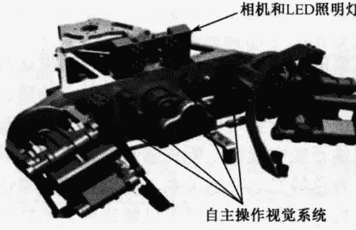
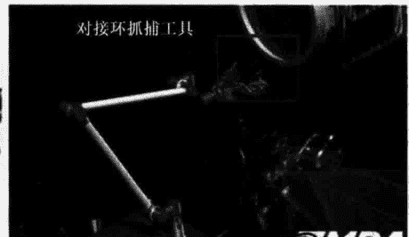
(a) 对接环抓捕工具
(b) 机械臂作业概念图
图 2-10 对接环抓捕工具和机械臂作业
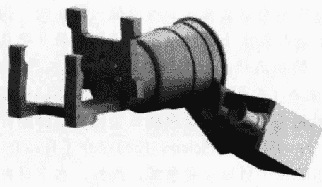
**德国 OHB 公司**方案采用双目视觉配合机械手实现对接环抓捕。
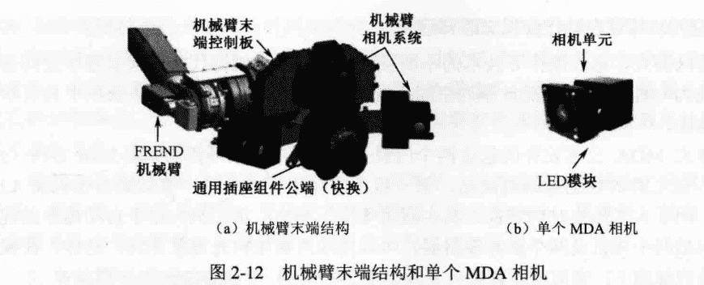
**美国 RSGS 计划**采用双 FREND 机械臂：一捕获握紧，一取工具维修。末端集成控制板、换装装置、相机系统及光源。相机系统为三目 MDA 相机（带照明），双目测量位姿引导抓捕，单目作备份，支撑在轨维护任务。

#### 2.4.2 听觉感知技术
听觉是智能系统认知环境的关键能力。虽定位精度不及视觉，但优势独特：全向接收空间任意方向声波；能在黑暗/弱光下实现声源定位与语音识别（视觉无能为力）；将数据特征映射为音高、响度、音色等声学量，辅助监控分析，分担视觉负荷；视听融合增强临场感，VR 领域应用广泛；军事等领域亦成效显著。

**1. 水下目标自动识别**
各国海军重点发展技术。声波在水介质中传播损耗最小，声呐是远程探测利器。声呐接收目标辐射噪声，经特征提取、选择、分类实现精准辨识。
典型系统：美军 80 年代装备的斯坦福 HASP/SIAP 系统；加拿大大西洋防务机构的 INTERSENSOR 专家系统；英国 SD-Scicon 基于神经网络（融合有监督/无监督学习）的分类系统；印度 RECTSENSOR 专家系统；日本 SK-8 海岸预警系统。

**2. 无人平台应用**
无人平台集感知、控制、智能决策于一体，可自主驾驶。无人车/机交互信息多基于声音（枪炮声识别定位、语音指令、环境音），听觉感知对智能决策至关重要。
包含**声学事件检测**（采集声信号分析得开始/持续时间、场景类别，转为事件符号，仿真人耳）与**音频场景分析**（基于事件判断场景）。如：识别枪炮声甚至按炮声判别武器装备；鸟鸣声判断丛林环境；雷雨声辅助判断天气。

#### 2.4.3 触觉感知技术
触觉是智能系统获取环境信息仅次于视觉的重要知觉，是直接作用环境的必需媒介。不同于视觉，触觉敏感度高，可直接测量对象多物理特性。任务为检测交互过程中的物理特征量。广义触觉含接触、压迫、滑动、温湿度等；狭义指接触面力觉（接触觉、压觉、滑觉）。触觉许多功能独有难替代，触觉融合视觉可构建稳健感知体系。
触觉感知源于传感器采集被接触物体特征，经算法提取分类融合后决策识别。以 iPad 为代表的触控设备，凭友好 UI、稳定系统极致提升用户体验，让用户不仅能看还能触摸操控，带来沉浸感，成人机交互最新技术，深远影响信息沟通方式。

**1. 视障辅助产品**
触觉技术赋能视障产品，带来实质便利。如：带浮动杠杆水位提示的水杯（水位达标杠杆触碰拇指）；增强手部触觉反馈的盲杖（指尖触感变化感知环境）；内置蓝牙/GPS/振动模块的导航鞋（鞋底四向振动器指示方向）。


#### 2. 智能假手产品
假手是典型人机交互设备，助力截肢者恢复手功能。现代智能假手除外观修饰外，还通过肌电控制与力触觉反馈实现运动感知。
图 2-14 展示全国第十二届“挑战杯”优秀作品“具力触觉新型人机交互智能肌电假手”。安装于残肢，双肌电电极采集体表信号控制张合；应变片与力传感器采集实时力信号联合肌电控制动作；末端三维腕力传感器测三向力，残肢佩戴 6 微型振动器反馈信号。检测到外力干预时，通过特定振动器刺激肌肉，以触觉反馈完成外界探知。
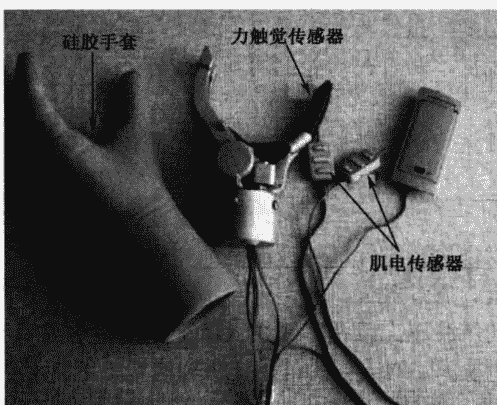
图 2-14 智能肌电假手

#### 3. 博物馆虚拟体验增强
VR 技术虽能构建逼真三维视觉环境，仍难满足观众高涨的互动需求。观众渴望在观展时同步触摸感知藏品软硬、纹理、粗糙度、柔韧性等非视觉信息。触觉对 VR 临场感与交互性构建至关重要。

# 触觉感知数字图像系统：让虚拟触感触手可及

浙江理工大学牵头，携手杭州师范大学与上海尚特文化传播有限公司，联合攻关推出一套拥有完全自主知识产权的触觉感知数字图像系统。该成果打破了数字图像“只可远观”的局限，实现了指尖与虚拟世界的“零距离”交互。其核心技术体系涵盖：采用质点弹簧模型构建柔性纹理力触觉合成算法、基于区域划分的纹理三维重构技术、双触点交互式力触觉生成机制，以及依托五要素模型的刚性纹理力触觉渲染方法。以虚拟织物交互为例（如下图），用户仅凭双指即可操作并感知：触摸、按压、拉扯织物时，不仅能目睹材质实时形变，更能切实捕捉真实手感，还原沉浸式触觉体验。


图 2-15 触觉感知数字图像系统

感知是人类认知环境的基石，本质上是感觉器官、神经网络与大脑协同完成的一系列生理电化学过程：接收刺激、转换信号、重构认知。若要赋予机器媲美人类的智能感知与决策能力，仅开发仿生智能传感器远不够，必须在环境多源信息融合的算法架构与底层机理上实现深度突破。

### 2.5 实验：WSN 节点分簇聚合仿真

#### 2.5.1 实验旨在

- (1) 掌握 Python 基础开发环境的搭建与操作。
- (2) 理解 Python 程序的核心架构体系。
- (3) 建立利用 Python 落地 WSN 节点分簇聚合的整体技术认知。
- (4) 通过代码运行，直观验证仿真效果。

#### 2.5.2 实验任务

- (1) 熟练使用 Python 编程环境。
- (2) 编程实现 WSN 节点分簇聚合核心功能。

#### 2.5.3 理论基础

- (1) **仿真场景**：设定节点总量，节点随机部署于监测区域，依据 LEACH 协议周期性执行网络聚类。
- (2) **记录规范**：记录前 k 轮（本实验 k=10）聚类演变过程，或绘制第 k 轮网络拓扑，明确标识各节点身份（簇首/簇内节点）及从属关系，簇内节点需标注归属簇首。
- (3) **关键设定**：节点规模设为 100（避免过小失真）；聚焦聚类逻辑，暂不模拟通信细节；轮次终止可由定时器触发，亦可由聚类完成标志决定。
- (4) **选举机制**：簇内节点依据距离远近（映射信号强度）寻找簇首；当选簇首的节点在随后数轮丧失竞选资格。

#### 2.5.4 操作流程

实验环境基于 Python 2.7 构建，核心代码模块如下。

##### 1. 主控模块

```python
import numpy as np
import matplotlib.pyplot as plt
def run():
    """
    1. 输入节点个数 N
    2. node_factory(N): 生成 N 个节点的列表
    3. classify(nodes,flag,k=10): 进行 k 轮簇分类, flag 已标记的节点不再成为簇头，返回所有簇
    的列表
    4. show_plt(classes): 迭代每次聚类结果，显示连线图
    :return:
    """
    N = 100
    # N = int(input("请输入节点个数:"))
    # 获取初始节点列表，选择标志列表
    nodes, flag = node_factory(N)
    # 对节点列表进行簇分类，k 为迭代轮数
    iter_classes = claasify(nodes, flag, k=10)
    for classes in iter_classes:
        # 显示分类结果
        show_plt(classes)
```

##### 2. 测距计算模块

```python
##### 判断距离函数
def dist(v_A, v_B):
    """
    判断两个节点之间的一维距离
    :param v_A: A 二维向量
    :param v_B: B 二维向量
    :return: 一维距离
    """
    return np.sqrt(np.power((v_A[0] - v_B[0]), 2) + np.power((v_A[1] - v_B[1]), 2))
```

##### 3. 节点随机部署模块

```python
def node_factory(N):
    """
    生成 N 个节点的集合
    :param N: 节点的数目
    :param nodes: 节点的集合
    :param selected_flag: 标志:是否被选择为簇头-->初始化为 0
    :return: 节点集合 nodes=[[x,y],[x,y]...] + 标志 flag
    """
    nodes = []
    selected_flag = []
    for i in range(0, N):
        # 在 1×1 矩阵生成[x,y]坐标
        node = [np.random.random(), np.random.random()]
        # print("生成的节点为:", node)
        nodes.append(node)
        # 对应的选择标志初始化为 0
        selected_flag.append(0)
    # print("生成:", len(nodes), "个节点")
    # print("初始化标志列表为", selected_flag)
    return nodes, selected_flag
```

##### 4. 基于 LEACH 协议的簇首选择逻辑

```python
def sel_heads(r, nodes, flags):
    """
    根据阈值选取簇头节点
    :param r: 轮数
    :param nodes: 节点列表
    :param flags: 选择标志
    :param P: 比例因子
    :return: 簇头列表 heads, 簇成员列表 members
    """
    # 阈值函数 Tn 使用 LEACH 计算
    P = 0.05 * (100 / len(nodes))
    Tn = P / (1 - P * (r % (1 / P)))
    # print("阈值为:", Tn)
    # 簇头列表
    heads = []
    # 簇成员列表
    members = []
    # 本轮簇头数
    n_head = 0
    # 对每个节点生成对应的随机数
    rands = [np.random.random() for _ in range(len(nodes))]
    # print("随机数为:", rands)
    # 遍历随机数列表，选取簇头
    for i in range(len(nodes)):
        # 若此节点未被选为簇头
        if flags[i] == 0:
            # 随机数低于阈值->选为簇头
            if rands[i] <= Tn:
                flags[i] = 1
                heads.append(nodes[i])
                n_head += 1
                # print(nodes[i], "被选为第", n_head, "个簇头")
        # 随机数高于阈值
        else:
            members.append(nodes[i])
    print("簇头为:", len(heads), "个")
    print("簇成员为:", len(members), "个")
    return heads, members
```

##### 5. 非簇首节点归属划分算法

```python
def claasify(nodes, flag, k=1):
    """
    进行簇分类
    :param nodes: 节点列表
    :param flag: 节点标记
    :param k: 轮数
    :return: 簇分类结果列表 classes[[类 1..],[类 2...],......] [类 1...簇头...簇成员]
    """
    # k 轮的集合
    iter_classes = []
    # 迭代 r 轮
    for r in range(k):
        # 获取簇头列表，簇成员列表
        heads, members = sel_heads(r, nodes, flag)
        # 建立簇类的列表
        classes = [[] for _ in range(len(heads))]
        # 将簇头作为头节点添加到聚类列表中
        for i in range(len(heads)):
            # print("第", i + 1, "个簇头为", heads[i])
            classes[i].append(heads[i])
        # print("簇头集合:", classes)
        # 簇分类:遍历节点 node
        for n in range(len(members)):
            # 选取距离最小的节点
            dist_min = 1
            for i in range(len(heads)):
                dist_heads = dist(members[n], heads[i])
                # 找到距离最小的簇头对应的 heads 下标 i
                if dist_heads < dist_min:
                    dist_min = dist_heads
                    head_cla = i
            # 添加到距离最小的簇头对应的聚类列表中
            classes[head_cla].append(members[n])
        # 将簇头作为头节点添加到聚类列表中
        iter_classes.append(classes)
        # 0 个簇头的情况
        if dist_min == 1:
            print("本轮没有簇头!")
            break

    return iter_classes
```

##### 6. 聚类拓扑可视化模块

```python
def show_plt(classes):
    """
    显示分类图
    :param classes: [[类 1...],[类 2...]...]->[簇头,成员,成员...]
    :return:
    """
    fig = plt.figure()
    ax1 = plt.gca()
    # 设置标题
    ax1.set_title('WSN1')
    # 设置 X 轴标签
    plt.xlabel('X')
    # 设置 Y 轴标签
    plt.ylabel('Y')
    icon = ['o', '*', ',', 'x', '+', 's']
    color = ['r', 'b', 'g', 'c', 'y', 'm']
    # 对每个簇分类列表进行显示
    for i in range(len(classes)):
        centor = classes[i][0]
        for point in classes[i]:
            ax1.plot([centor[0], point[0]], [centor[1], point[1]], c=color[i % 6], marker=icon[i % 5],
                     alpha=0.4)
    # 显示所画的图
    plt.show()
```

#### 2.5.5 运行成果

程序执行输出界面如图 2-16 所示。

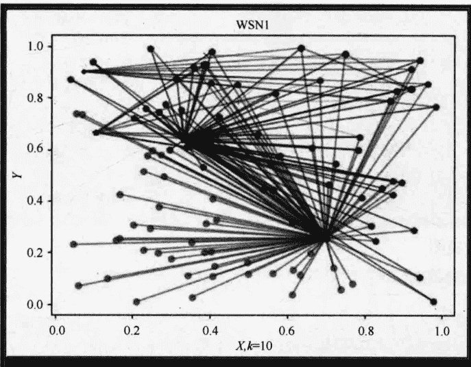

图 2-16 实验运行结果

### 思考题

1.  对比传感器与智能传感器的定义，辨析二者核心差异。
2.  列举智能传感器具备的主要智能化处理能力。
3.  请阐述“感知智能”的概念内涵。
4.  简述数据融合的基本定义。
5.  数据融合处理通常包含哪三个层级？
6.  数据融合技术主要分为哪几大流派？各流派下有哪些典型方法？
7.  什么是无线传感网络（WSN）？
8.  无线传感网络常用的数据通信手段有哪些？
9.  视觉传感器主要涵盖哪些类型？
10. 盲人防溢水杯采用了哪类智能感知技术？请简述其工作机理。

### 引用文献

1. 刘爱华, 满宝元 (2006). 传感器原理与应用技术. 北京: 人民邮电出版社.
2. 沙占友 (2004). 集成化智能传感器原理与应用. 北京: 电子工业出版社.
3. 搜狐科技 (2017). 智能传感器：一切从感知开始 [EB/OL]. https://www.sohu.com/a/202760523_468626.
4. 王雪 (2018). 人工智能与信息感知. 北京: 清华大学出版社.
5. 祁友杰, 王琦 (2017). 多源数据融合算法综述. 航空电子对抗, 33(6), 37-41.
6. Zhang Z, Li J X, Liu L (2016). Distributed state estimation and data fusion in wireless sensor networks using multi-level quantized innovation. Science China Information Sciences, 59(2), 1-15.
7. Abdulhafiz W A, Khamis A (2013). Bayesian approach to multisensor data fusion with Pre- and Post-Filtering. IEEE International Conference on Networking, 373-378.
8. 徐小琴 (2006). 多传感器数据融合目标识别算法综述. 红外与激光工程, 35, 321-328.
9. 杨应雷, 周金和, 王川潮 (2015). 加权决策模板业务感知算法. 计算机工程与应用, 53(2), 118-123.
10. 李晓维 (2007). 无线传感器网络技术. 北京: 北京理工大学出版社.
11. 孙利民, 李建中, 陈渝 等 (2005). 无线传感器网络. 北京: 清华大学出版社.
12. 杨博雄, 倪玉华 (2015). 无线传感网络. 北京: 人民邮电出版社.
13. 王雪 (2007). 无线传感网络测量系统. 北京: 机械工业出版社.
14. 梁天, 周晖 (2012). 无线感知执行网的智能协作机制研究. 传感技术学报, 25(5), 665-672.
15. 王雪, 王晨, 毕道伟 (2008). 无线传感网络测量系统关键技术. 中国仪器仪表, 64-72.
16. 谭勇 (2018). 消防机器人视觉感知技术研究综述. 绵阳师范学院学报, 37(2), 40-45.
17. 马要娟 (2018). 面向智能车的前方车辆识别技术研究及视觉感知系统设计 [D]. 淄博: 山东理工大学.
18. Wu H B, Li Z J, Ye J H 等 (2016). Firefighting robot with video full-closed loop control. Optical Engineering, 6(2), 254-269.
19. Rangan M K, Rakesh S M, Sandeep G S P 等 (2013). A computer vision based approach for detection of fire and direction control for enhanced operation of fire fighting robot. Control, Automation, Robotics and Embedded Systems, 1-6.
20. Velasquez A J G, Granados C M, Ramirez A A 等 (2015). Hybrid object detection vision – based applied on mobile robot navigation. IEEE International Conference on Mechatronics, Electronics and Automotive Engineering, Prague, Czech Republic: IEEE, 51-56.
21. Li G, Lu G, Yan Y (2014). Fire detection using stereoscopic imaging and image processing techniques. IEEE International Conference on Imaging Systems and Techniques, Santorini, Greece: IEEE, 28-32.
22. Castro J L E, Martínez-García E A (2016). Thermal image sensing model for robotic planning and search. Sensors, 16(8), 1-27.

- [23] Memon S F, Kalwar I H, Grout I, et al. Prototype for localization of multiple fire detecting mobile robots in a dynamic environment: 2016 3rd International Conference on Computing for Sustainable Global Development (INDIACom) [C]. New Delhi:IEEE, 2016: 395-400.

- [24] Castro J L E, Martínez-García E A. Thermal image sensing model for robotic planning and search[J]. Sensors, 2016, 16(8) : 1-27.

- [25] 郭筱曦. 国外载人航天在轨服务技术发展现状和趋势分析[J]. 国际太空, 2016(7): 27-32.

- [26] Stéphane E, Jürgen T, et al, Definition of an Automated Vehicle with Autonomous Fail-Safe Reaction Behavior to Capture and Deorbit Envisat[C]. Proc.7th European Conference on Space Debris.

- [27] 郝颖明, 付双飞, 范晓鹏, 等. 面向空间机械臂在轨服务操作的视觉感知技术[J]. 无人系统技术, 2018(1): 54-65.

- [28] Wieser M, Richard H, Hausmann G, et al. e.Deorbit Mission: OHB Debris Removal Concepts[C]. 13th Symposium on Advanced Space Technologies in Robotics and Automation, 2015.

- [29] Gordon Roesler. Robotic Servicing of Geosynchronous Satellites (RSGS) Proposers Day, 2016.

- [30] 张琼, 石教英. 分布式虚拟环境中的三维音频支持[J]. 计算机辅助设计与图形学学报, 2002, 14(12): 1152-1155.

- [31] 杨立学. 基于听觉感知原理的水下目标识别方法研究[D]. 西安: 西北工业大学, 2016.

- [32] 刘文举, 杨宏斌, 胡鹏飞. 声音感知在地面无人平台中的应用展望[C]. 中国指挥控制大会论文集, 2013: 924-927.

- [33] Salisbury K. Haptics: The Technology of Touch[N]. HPCwire Special, 1995-11-10.

## 第 3 章 智能计算：赋能机器认知新范式

智能计算指代一类具备自学习与适应新环境能力的计算范式，此类系统通常展现出泛化、发现、协同及抽象等核心推理特质。其架构多采用混合范式，融合人工神经网络、模糊系统、进化算法等技术。应用智能计算本质上是一套系统化方法论与基础设施：它通过学习挖掘复杂动态环境中的隐含模式、关联与结构，以增强人类智力、攻克现实难题。三大核心驱动力催生了该领域的蓬勃发展：经典人工智能遗留的棘手难题、计算机算力的指数级跃升、以及数据科学的井喷式繁荣。网络技术大幅推进了数据驱动决策的进程，新一代无线通信更将推波助澜。智能计算借势数据红利，正成为将原始数据炼化为知识、进而创造价值的核心引擎。本章将系统梳理神经计算、进化计算、模糊计算、免疫计算及混合计算等主流技术路线。

### 3.1 神经计算：从生物启发到工程实现

本节将揭示人脑生物神经元与人工神经网络节点的映射关系，剖析 MP 模型原理，考察感知器的学习边界；深入多层网络架构，详解监督学习利器——反向传播算法；并借助自组织映射，解锁无监督学习的奥秘[1-3]。

#### 3.1.1 仿生起源：生物神经元如何映射为人工节点

人脑内部拥有百亿级神经元，单个神经元平均与数千同类相连，构建起约 60 万亿个突触连接的庞大网络。

单个神经元虽是简单处理单元，却分工精细：细胞体负责信息整合与传出；突起分为树突与轴突——树突短而多枝，专司接收信号传递给细胞体；轴突长而少枝，末梢分叉，负责将动作电位传向下游神经元。生物神经元结构示意见图 3-1。

工作机制上，神经元经树突汇聚输入，一旦信号累积超阈值，即被“激发”，动作电位顺轴突传播至下游树突。虽单元简陋，但网络协作下实现了极速、高维的信息处理，其复杂度远超人类造物乃至自然天成。

大脑核心特质在于“可塑性”：神经元能依经历重塑连接的数量与性质，完成学习。大脑通过类“信用分配”机制，强化通向正确解的连接，削弱导致错误的路径。突触强度直接决定对下游神经元的影响力，连接弱化即意味着话语权下降。

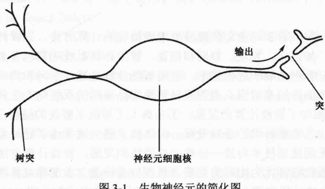

人工神经网络（ANN）以此为蓝本，由海量人工神经元堆叠而成。但现实差距显著：人工神经元连接数远少于生物对应物，网络规模（神经元数量）亦远不及人脑。

本章聚焦的神经元模型源自 McCulloch 与 Pitts（简称 MP 模型）。网络中每个节点接收多路输入，经激活函数加工输出激活程度。常用激活函数特性见图 3-2，横轴为输入，纵轴为输出激活值。

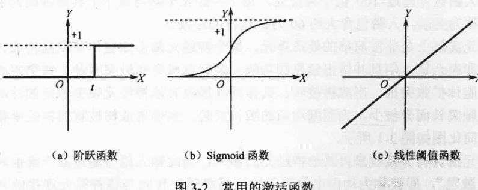

主流激活函数非阶跃函数或线性阈值函数莫属。二者逻辑一致：对加权输入求和 $\sum w_i x_i$，与阈值 $t$ 比较。若总和大于 $t$，神经元激发输出 +1；反之抑制输出 0。神经元行为可形式化为：

$X=\sum_{i=1}^{n} w_i x_i$

其中 $X$ 为 $n$ 个输入的加权和，$x_i$ 为输入，$w_i$ 为对应权重。例如双输入神经元，$w_1=0.8, w_2=0.4$，输入 $x_1=0.7, x_2=0.9$，加权和为 $0.92$。激活输出 $Y$ 定义为：

\(Y = \begin{cases} +1 & \text{for } X > t \\ 0 & \text{for } X \leqslant t \end{cases}\)

若阈值 $t=0.92$，加权和超阈值则激活，否则静默。线性激活函数直接以加权和表征激活度；Sigmoid 函数则将 $(-\infty, +\infty)$ 域映射至 $(0, 1)$ 区间。

ANN 由加权连接的神经元群组成，信号经激活函数处理在层间流动，无中央控制器，全网协同完成输入到输出的映射。

#### 3.1.2 进阶之路：单层感知器为何进化成多层网络

##### 1. 单层感知器：起点与天花板

1958 年 Rosenblatt 提出感知器，旨在用简单神经元模型实现二分类。输入可任意数量，常排布成网格处理图像/视野信号，适配简单识别任务。

感知器采用阶跃函数 $Step(X)$，激活逻辑同上。引入偏置技巧：令索引 $i$ 从 0 开始，引入 $x_0=1, w_0=t$，将阈值吸收进权重向量。

```
Y = Step\left(\sum_{i=0}^{n} w_i x_i\right)
```

单感知器可学习线性可分任务（如逻辑 AND、OR），将输入映射为 0/1（假/真）。学习流程为：
1.  **初始化**：权重随机赋值（如 -0.5 到 +0.5）。
2.  **试错修正**：喂入训练样本，若分类错误，调整权重。正样本被误判为负，则增加对应输入权重（负输入加正值，正输入减正值），反之亦然。
3.  **更新规则**：Rosenblatt (1960) 给出公式：

```
w_i \leftarrow w_i + (\alpha \times x_i \times e)
```

$e$ 为误差（正确为 0，漏报为正，误报为负），$\alpha$ 为学习率 ($0<\alpha<1$)。此即“感知器训练规则”。
4.  **迭代收敛**：遍历全量样本为一“迭代周期”，循环直至全对、误差归零。

以学习逻辑“或”为例（阈值 0，学习率 0.2），权重初始化随机值：

```
w_1 = -0.2
```
```
w_2 = 0.4
```

遍历 4 种输入组合：
- $(0,0)$ 目标 0，输出正确，权重不变。
- $(0,1)$ 目标 1，输出正确，权重不变。
- $(1,0)$ 目标 1，输出 0，**错误**。按规则更新 $w_1, w_2$：

```
x_1 = 0
```
```
x_2 = 0
```
```
Y = Step\left(\sum_{i=0}^{n} w_i x_i\right)
= Step(0 \times (-0.2) + 0 \times 0.4)
= 0
```
```
Y = Step(0×(-0.2)+1×0.4)
= Step(0.4)
=1
```
```
Y = Step(1×(-0.2)+0×0.4)
= Step(-0.2)
= 0
```
```
wi <- wi + (α × xi × e)
```
```
w1 = -0.2 + (0.2×1×1)
= -0.2 + (0.2)
= 0
```
```
w2 = 0.4 + (0.2×0×1)
= 0.4
```

- $(1,1)$ 目标 1，输出正确，权重不变。

```
Y = Step(0×1+0.4×1)
= Step(0+0.4)
= Step(0.4)
=1
```

首周期结束。表 3-1 记录完整演化：仅 **3 个周期**，感知器完美掌握逻辑“或”。同理可习“与”，但**“异或” (XOR) 无法习得**。根因在于感知器仅能建模**线性可分函数**——二维平面上能用一条直线将两类样本完美切分。

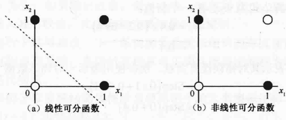

图 3-3 直观对比：实心/空心点代表真/假，“或”可线性分割，“异或”则无法用单一直线分离。

决策边界 $X=t$ 本质是线性超平面。双输入感知器分类线方程为：

```
X=\sum_{i=1}^{n}w_ix_i
Y=\begin{cases} +1 \text{ for } X > t \\ -1 \text{ for } X \leqslant t \end{cases}
```
```
w_1 x_1 + w_2 x_2 = t
```

感知器通过寻找权重 $w_i$ 定位这条线；若线性边界不存在，感知器必败。

##### 2. 多层神经网络：破解非线性困局

现实问题多非线性可分，单层感知器虽具教学价值，实战乏力。多层感知器（MLP）通过层级堆叠，获得建模任意复杂函数（含 XOR 等非线性可分）的能力。

既然“或”与“与非”可由单感知器实现，且二者组合可生成任意布尔函数，两层感知器即可表达所有二元二输入函数。典型三层前馈网络见图 3-4。

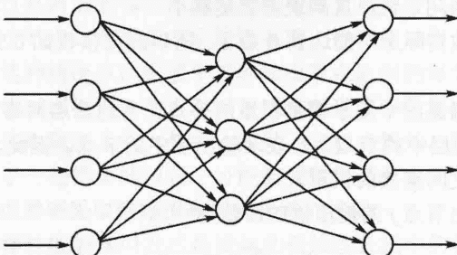

架构解析：
- **输入层**：节点非神经元，仅作信号分发，转发至隐层。
- **隐层**（可多层）：核心计算单元，全连接接收上层信号，输出传递至下层。
- **输出层**：产出最终预测。
- **前馈机制**：数据单向流动（输入→隐层→输出），无反馈回路。典型规模：输入/隐/输出层各 10~1000 节点。

#### 3.1.3 核心引擎：反向传播算法如何破解多层训练难题

多层网络学习逻辑与感知器同源，难点在于**误差归因**：海量权重中，谁该为错误买单？如何精准增减各权重？**反向传播算法** 是标准答案。

BP 网络通常弃用不可导的阶跃函数，改用 **Sigmoid 函数**，因其平滑可导，利于梯度计算。

Sigmoid 定义：

```
$$\sigma(x) = \frac{1}{1+e^{-x}}$$
```

求导极简，完美契合链式法则：

```
\frac{d\sigma(x)}{dx} = \sigma(x)(1-\sigma(x))
```

这与阶跃函数无导数、难以优化形成鲜明对比。

### 3.1.4 无监督学习网络

前文详述了有监督学习——即依赖带标签样本训练模型。接下来介绍**无监督学习**，其核心在于直接从无标签数据中挖掘内在结构。

#### 1. Kohonen 映射：自组织的竞争者

Kohonen 映射（自组织特征映射，SOM）是 20 世纪 80 年代提出的经典无监督模型。它采用 **Winner-take-all（赢家通吃）** 机制，催生出**竞争性学习**范式：面对同一输入，仅激活程度最高的神经元（获胜元）输出响应，且仅更新与之相连的权重。

**核心使命**：将输入数据自动聚类。例如自动将新闻按主题归类，且无需预先告知类别数量，特别适合**类簇数未知**的探索性分析。

**网络拓扑**：两层结构——输入层与聚类层（兼作输出层），全连接。聚类层神经元常排布为二维网格（非强制），以体现拓扑邻近关系。

**训练流程**：
1.  **初始化**：权重赋小随机值，学习率 $\alpha$ 设为小正数。
2.  **竞争**：输入向量 $x$ 送入，计算各聚类神经元权重向量 $w_i$ 与 $x$ 的**欧氏距离** $d_i$：
    $$d_i = \sqrt{\sum_{j=1}^{n}(w_{ij} - x_j)^2}$$
    距离最小者胜出。
    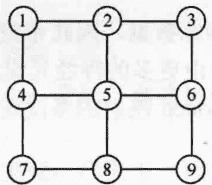
3.  **更新**：获胜元及其**邻域内**神经元权重向输入向量靠拢：
    $$w_{ij} \leftarrow w_{ij} + \alpha(x_j - w_{ij})$$
    邻域半径与学习率随训练逐步收缩，最终固定。
4.  **终止**：权重修正量极小时停止。此时网络形成拓扑有序的类簇图谱：相似样本归同类，相近类簇空间相邻。

#### 2. 直观演示：2输入·9神经元的自组织过程

设定：2维输入，聚类层 3×3 网格（9神经元）。
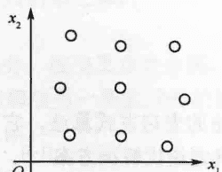
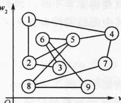

- **初始态**：权重向量随机分布于二维平面。
- **训练集**：9 个均匀覆盖空间的随机点（代表全输入空间分布）。
- **演化**：迭代后，权重向量逐渐贴合训练点位置，呈现有序的空间填充形态。
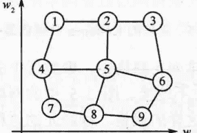

**关键洞见**：
- **在线学习能力**：新输入到来时，最近神经元微调权重靠近新样本，配合逐步衰减的学习率，网络可持续适应、最终稳定。
- **拓扑保持**：输入空间的邻近关系在输出网格中得以保留，这是 SOM 区别于 K-means 等传统聚类的独特优势。

---

### 反向传播算法（BP）深度解析

#### 核心流程：正向传播误差，反向归因调权

与感知机同源，BP 算法首将权重初始化为小随机值（如 $[-0.5, 0.5]$ 或 $[-2.4/n, 2.4/n]$，$n$ 为输入维度）。每轮迭代分两程：
1.  **前向传播**：输入 $\to$ 隐层 $\to$ 输出，得预测值。
2.  **反向传播**：输出误差 $\to$ 隐层 $\to$ 输入层，沿路径修正权重。
循环往复，直至输出逼近目标（误差充分小）。

**激活函数细节**：Sigmoid 取值区间 $(0,1)$，工程上常视 $y \ge 0.9$ 为 1，$y \le 0.1$ 为 0。

#### 梯度推导与权重更新（三层网络为例）

记法：$i$ 输入节点，$j$ 隐节点，$k$ 输出节点，$w_{ij}$/$w_{jk}$ 连接权重。

**节点输出**：
$$y_j = f\left(\sum_i w_{ij}x_i - \theta_j\right) \quad \text{(Sigmoid函数)}$$
```
X_j = \sum_{i=1}^{n} x_i w_{ij} - \theta_j

Y_j = \frac{1}{1 + e^{-X_j}}
```

**输出层误差梯度**：
误差信号 $\delta_k = d_k - y_k$（目标-实际）。
梯度 $g_k = \delta_k \cdot f'(x_k)$，利用 Sigmoid 导数性质 $f'=y(1-y)$ 得：
```
e_k = d_k - y_k
``````
\delta_k = \frac{\partial y_k}{\partial x_k} \cdot e_k
``````
\delta_k = y_k (1 - y_k) e_k
```

**隐层误差梯度**：无直接目标值，按**责任分担**原则反向传播：
$$g_j = y_j(1-y_j) \sum_k g_k w_{jk}$$
```
\delta_j = y_j (1 - y_j) \sum_{k=1}^{n} w_{jk} \delta_k
```

**权重更新（梯度下降）**：
$$\Delta w = \alpha \cdot g \cdot x \quad (\alpha<1 \text{ 为学习率})$$
```
$w_{ij} \leftarrow w_{ij} + \alpha x_i \delta_j$
$w_{jk} \leftarrow w_{jk} + \alpha y_j \delta_k$
```
本质沿误差曲面最陡方向下降，寻找全局/局部极小值。

**停止判据**：全训练集输出误差平方和 $< \epsilon$（如 0.001）。

#### BP 的困境与三大加速策略

**痛点**：
- 非生物学合理（大脑无反向传播机制）。
- 收敛慢：简易问题亦需百/千轮；易陷局部极小、跨平坦区缓慢。

**破局三板斧**：

| 策略 | 核心机制 | 关键公式/参数 |
| :--- | :--- | :--- |
| **1. 动量法（广义 Delta 规则）** | 引入惯性项，融合上一轮更新方向，跨越局部极小、加速平坦区通过。 | $\Delta w(t) = \alpha g x + \beta \Delta w(t-1)$<br>$\beta \in [0,1]$，典型值 0.95。<br>```
$\Delta w_{ij}(t) = \alpha x_i \delta_j + \beta \Delta w_{ij}(t-1)$
$\Delta w_{jk}(t) = \alpha y_j \delta_k + \beta \Delta w_{jk}(t-1)$
``` |
| **2. 改用 tanh 激活** | 输出零中心化，梯度更陡，收敛显著加快。 | $f(x) = a \tanh(b x)$<br>典型 $a=1.7, b=0.7$。<br>```
$\tanh(x) = \frac{2a}{1+e^{-bx}} - a$
``` |
| **3. 自适应学习率 (Jacobs 启发式)** | 监测误差平方和变化趋势：<br>• 连续同向下降 $\to$ 增大学习率；<br>• 震荡反向 $\to$ 减小学习率。 | 配合广义 Delta 规则，性能大幅跃升。 |

---

### 3.2 遗传算法：进化计算的基石

#### 3.2.1 编码：从生物基因到比特串

Holland 奠基性设定：
- **染色体** = 一串比特（候选解完整编码）。
- **基因** = 单个比特（解的特征维度）。
- **种群** = 染色体集合（规模通常固定）。

> 映射视角：染色体可直接代表完整个体（主流），或组合成多染色体生物（更拟真但复杂）。

#### 3.2.2 标准遗传算法循环

```text
初始化随机种群 (第1代)
循环:
    若满足终止条件: 结束
    计算全体适应度
    选择/交叉/变异 → 生成下一代
    种群替代 (保留精英可选)
```

##### 1. 适应度函数：进化的指挥棒
将问题目标量化为标量。例：排序问题中，“位置正确的数字数”可为基础适应度，“错位距离之和的倒数”则更精细。

##### 2. 交叉算子：基因重组的艺术
作用于等长染色体对，模拟 DNA 重组。

| 类型 | 机制 | 特点 |
| :--- | :--- | :--- |
| **单点交叉** | 选 1 断点，交换尾部。 | 最经典，保留建块。 |
| **两点交叉** | 选 2 断点，交换中段（环状拓扑）。 | 保护染色体两端关联。 |
| **均匀交叉** | 每位以概率 $p$ 来自父代 1，否则父代 2。 | 混合度最高，常单亲生单后代。 |
| **克隆** | 完全复制父代。 | 保留精英，零交叉。 |

```
110100110001001
010101000111101
``````
父代 1: 10001101
父代 2: 00110110
```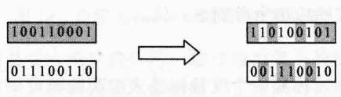

##### 3. 变异算子：跳出局部最优的钥匙
- **本质**：单基因位翻转（0↔1），概率极低（$0.001\sim0.01$）。
- **角色**：类比爬山法的“随机跳跃”，防早熟陷入局部峰值。
```
010101110001001
          ↓
010101110101001
```

##### 4. 终止准则
- 硬性代数上限。
- 达已知最优解 / 种群最优适应度达标。

#### 3.2.3 实战演示：寻找 $f(x)=x+\sin x \cdot \cos 2x$ 在 $x\in[0,15]$ 的最大值

- **编码**：4 位二进制串 $\to$ 离散化 $x$ 值（分辨率 $15/15=1$）。
- **目标函数曲面**：
```
f(x)=sin(x)
```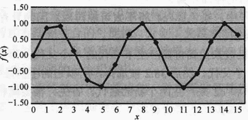
- **初始种群 (4条染色体)**：
```
c1 = 1001
c2 = 0011
c3 = 1010
c4 = 0101
```

> 后续将演示选择、交叉、变异如何驱动种群向全局最优聚集……

# 遗传算法实战：从适应度计算到轮盘赌选择

要评估染色体的优劣，首先得把二进制基因串解码成十进制整数，再代入目标函数 $f(x)$ 求值。

我们把适应度划分在 0~100 区间：0 代表完全不适应，100 代表完美适应。目标函数 $f(x)$ 输出 -1 到 1 之间的实数。规定 $f(x)=1$ 对应适应度 100，$f(x)=-1$ 对应 0，$f(x)=0$ 对应 50。由此推导出适应度换算公式：

$$f'(x) = 50 \times (f(x) + 1) = 50 \times (\sin(x) + 1)$$

染色体的适应度比例，即单个适应度在总和中的占比，是后续选择操作的关键依据。表 3-2 记录了初代种群的详细测算数据。

##### 表 3-2 初代种群适应度测算表

| 个体编号 | 基因编码 | 十进制值 | f(x)值 | 适应度 f'(x) | 适应度占比/% |
|---|---|---|---|---|---|
| c1 | 1001 | 9 | 0.41 | 70.61 | 46.3 |
| c2 | 0011 | 3 | 0.14 | 57.06 | 37.4 |
| c3 | 1010 | 10 | -0.54 | 22.80 | 14.9 |
| c4 | 0101 | 5 | -0.96 | 2.05 | 1.34 |

根据占比在 0~100 的数轴上划分区间：c1 占据 0~46.3，c2 占据 46.3~83.7，c3 占据 83.7~98.6，c4 占据 98.6~100。

接下来生成 0~100 的随机数，落在哪个区间就选中对应染色体作为父代。生成两个随机数即可确定一对配偶。显然，适应度越高，区间越宽，被选中的概率越大。

**关键点在于**：这种机制并未完全淘汰低适应度个体（如 c4 仍有 1.34% 机会），这有助于维持种群多样性，防止陷入局部最优停滞。

本例需生成 4 个随机数以选出 4 个父代。首个随机数 56.7 落在 c2 区间，第二个 38.2 落在 c1 区间，由此 c2 与 c1 结成第一对父母。

随后对 c1、c2 实施交叉操作。随机选定交叉点位于第 2、3 号基因之间。

```
10 | 01
00 | 11
```

交叉产生两个子代：c5、c6。

```
c5 = 1011
c6 = 0001
```

同理，c1 与 c3 配对，交叉点设在第 3、4 号基因间，生成 c7、c8。

```
c7 = 1000
c8 = 1011
```

至此，初代种群 c1~c4 完成历史使命，由子代 c5~c8 接棒组成第二代。c4 未获繁殖机会，其基因随之消失。而表现最优的 c1 繁殖两次，将其优势基因广泛传递给下一代全体成员。

第二代适应度测算见表 3-3。

##### 表 3-3 二代种群适应度测算表

| 个体编号 | 基因编码 | 十进制值 | f(x)值 | 适应度 f'(x) | 适应度占比/% |
|---|---|---|---|---|---|
| c5 | 1011 | 11 | -1 | 0 | 0 |
| c6 | 0001 | 1 | 0.84 | 92.07 | 48.1 |
| c7 | 1000 | 8 | 0.99 | 99.47 | 51.9 |
| c8 | 1011 | 11 | -1 | 0 | 0 |

新一代呈现“两极分化”：c6、c7 适应度极高（c7 已达理论最优），c5、c8 则完全不适应。若终止条件允许，算法可在此停止；否则将继续迭代但难有突破。本例仅用一步便从随机初始化抵达最优解，实属简化演示。实际工程中，种群规模通常 100~500，染色体长度远超 4 位，但遗传算法依然能高效求出组合优化问题的最优或近似最优解。

---

### 3.3 免疫计算：生物防御机制的算法映射

1958 年，澳洲学者 Burnet 提出克隆选择理论，1960 年获诺贝尔奖。1986 年 Farmer 基于免疫网络理论建立动态模型，揭示免疫系统与 AI 融合潜力。1996 年日本国际研讨会正式确立“免疫计算”概念，1997 年 IEEE SMC 设立专门分会。

免疫算法模拟生物免疫应答过程：抗原入侵 → 淋巴细胞受刺激分泌抗体 → 维持机能稳定并生成记忆细胞 → 二次应答更快。工程界引入该机制解决复杂优化问题，成效显著。

#### 3.3.1 核心框架

免疫算法 = 免疫机制模拟 + 基因进化原理。标准流程：**初始化种群 → 适应度评价 → 选择/交叉/变异 → 生成新种群 → 迭代**。其核心优势在于自带多样性维持机制，有效规避多峰优化中常见的“早熟”陷阱，大概率锁定全局最优。研究表明，免疫算法收敛速度快，迭代次数少。

应用领域已延伸至函数优化、神经网络设计、智能控制等。因其鲁棒性强、擅长动态平衡，常与遗传算法、粒子群算法融合（免疫遗传、免疫粒子群），灵活性极高。主流应用覆盖机器学习、故障诊断、网络安全、优化设计。国内起步虽晚，但成果丰硕。按机理可分三类：
1.  **基本免疫算法**：模拟抗原抗体结合；
2.  **特殊机制衍生算法**：如克隆选择算法；
3.  **混合型算法**：如免疫遗传算法。

#### 3.3.2 基本免疫算法详解

该算法深度模拟体液免疫与网络理论。成熟 B 细胞（骨髓源）分泌抗体，每种 B 细胞仅产一种抗体；T 细胞（胸腺源）直接攻击抗原并调控 B 细胞。两者克隆增殖、分化、相互制约，构建动态免疫网络。

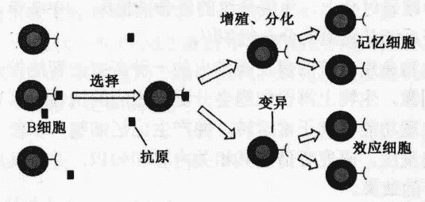

**图 3-12 生物免疫系统机理图**

**核心概念映射（表 3-4）：**

| 生物免疫术语 | 算法对应术语 |
|---|---|
| 抗原 | 目标函数/优化目标 |
| 抗体 | 候选解 |
| 抗原识别 | 问题建模/目标识别 |
| 记忆细胞产生抗体 | 利用先验经验生成初始解 |
| 淋巴细胞分化 | 保留精英解 |
| 抗体抑制 | 清除冗余/劣质候选解 |
| 抗体促进 | 遗传算子生成新候选解 |

**关键定义：**
*   **抗原（算法层面）**：非最优基因片段或错误编码。
*   **抗体**：候选解个体。
*   **疫苗**：基于先验知识提炼的最优基因片段估计。
*   **免疫算子**：分**全免疫**（非特异性，广谱搜索）与**目的免疫**（特异性，定向优化）。
*   **免疫调节**：亲和力驱动繁殖，浓度抑制防止过度聚集，维持动态平衡。
*   **免疫记忆**：高亲和力抗体转化为记忆细胞，二次遇同类抗原极速响应。

**算法七步走：**
1.  **识别抗原**：建模目标函数与约束。
2.  **初始抗体群**：实数编码随机生成向量群（免转换，效率高）。
3.  **多样性评价**：计算亲和力（与抗原匹配度）与排斥力（抗体间相似度），以期望繁殖概率为准则。
4.  **形成父代群**：精英保留入记忆库，利用排斥力淘汰高度相似个体。
5.  **终止判断**：命中最优解或达迭代上限则停。
6.  **免疫算子繁衍**：选择（亲和力高优先）、交叉、变异生成新群。
7.  **循环回步骤 3**。

#### 3.3.3 实战：免疫算法解 TSP 问题

TSP（旅行商问题）：寻找遍历 n 座城市的最短回路。即求排列 $\{V_1...V_n\}$ 最小化 $Td = \sum d(V_i, V_{i+1}) + d(V_n, V_1)$。它是组合优化基准测试问题，工程应用极广。

**1. 编码与适应度**
*   **编码**：一维数组 $A(N)$，元素为城市编号 $1\sim N$，无重复。如 $[3, 1, 4, 2]$ 表示访问顺序。
*   **适应度**：$Fitness = 1/Td$，路径越短适应度越高。

**2. 初始群生成**
随机生成 $I$ 个抗体。若记忆库有匹配抗原的记忆细胞，优先注入，不足再随机补齐。

**3. 免疫算子（新抗体生成四大招）**
*   **字符换位**：随机选两位互换（单对/多对），概率 $P$。
*   **字符串移位**：截取子串整体左/右循环平移（单/多串），概率 $P$。
*   **字符串逆转**：截取子串倒序排列（单/多串），概率 $P$。
*   **字符重组**：截取子串内部随机打乱重排，旨在提升亲和力，概率 $P$。

**4. 免疫记忆机制（核心竞争力）**
每代保留适应度前 $M$ 名入记忆库，去重保证多样性。再次遇同类问题，记忆细胞作初始群，实现“二次应答”加速收敛。

**5. 仿真实测**
42 城市最短路径求解。参数设定：
*   换位概率 1.0，移位/逆转/重组概率 0.4
*   最大迭代 1500 次
**结果**：约 1500 代稳定找到最短路径 ~1300。

---

### 3.4 模糊逻辑与推理系统：让机器懂“模棱两可”

1965 年，加州伯克利 Lotfi A. Zadeh 教授创立模糊逻辑（FL）。本质是**多值逻辑**，打破非黑即白（真/假、高/低），允许“很高”、“较快”等中间态量化建模，让计算机推理更接近人类思维。广泛用于工业控制、消费电子、专家系统、SAR 图像分类等。

#### 3.4.1 模糊集 vs 清晰集

经典数学用**清晰集**：定义域 $X=[0,1]$，子集 $A$ 的特征函数仅取 0 或 1（属于/不属于）。见图 3-13。

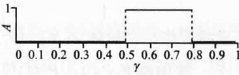

**图 3-13 清晰集特征函数示意**

这种硬边界在很多场景失效。例：SAR 图像中水体相干系数 $\gamma$ 低。若硬设阈值 $B=[0, 0.20]$，则 $\gamma=0.20$ 判“水”，$\gamma=0.21$ 判“非水”，物理意义断裂。无论阈值推到哪里，都存在这个“结构性割裂”。

**模糊集**引入**隶属度函数**，取值连续分布于 $[0,1]$。元素不再是“在/不在”，而是“属于的程度”。例如 $\gamma=0.20$ 隶属度 0.8，“挺像水”；$\gamma=0.30$ 隶属度 0.3，“有点像水但不典型”。这种软过渡完美契合自然语言语义，赋予机器处理模糊概念的能力。

### 解读隶属度：从二元对立到渐变过渡

理解分配给各元素数值含义的难度显著上升。数值 1 依旧代表元素属于集合 B，0 则意味着绝对不属于。而介于两者之间的一切数值，都表征着对集合 B 的**逐级隶属程度**。以图 3-14 为例，隶属函数量化了每个输入的参与深度：它为处理过的输入分配权重，界定输入间的功能重叠区域，并以此推导最终的输出响应。推理规则引入输入隶属值作为加权系数，以此衡量各输入对最终模糊输出集合的影响力。

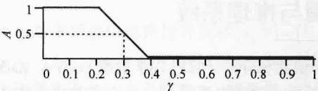

在此场景下，作用于干涉测量相干模糊集的隶属函数输出区间为 [0, 1.0]。举例而言，干涉相干值 γ = 0.3，在“低相干”这一模糊集上的隶属度为 0.5（参考图 3-14）。

必须明确**模糊逻辑与概率论的本质区别**。虽二者均在 [0, 1] 数值域内运作，且 0/1 的边界含义相近（假/非隶属 vs 真/完全隶属），但语义截然不同：针对 γ=0.3 的情形，概率视角阐述为“有 50% 的几率属于低相干”，暗示真实状态非黑即白，仅因认知局限导致不确定；而模糊逻辑断言其隶属度为 0.5，意指 γ **“或多或少”呈现低相干特性**，即客观存在于模糊边界之中。

#### 3.4.2 模糊集运算法则

同经典集合一样，模糊集亦定义了交、并、补运算。Zadeh 教授在奠基性论文中提出了**最小算子（交）**与**最大算子（并）**。当隶属度仅取 0、1 时，这两算子退化为经典集合的交并运算。设 A 为模糊区间 [5, 8]，B 为模糊数“约等于 4”，如图 3-15 所示。

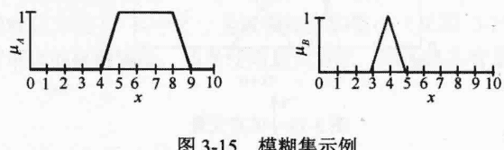

此时 A 与 B 的交集呈现如图 3-16 形态。

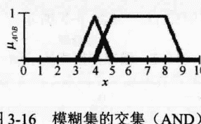

二者的并集如图 3-17 所示。

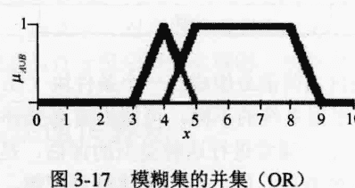

A 的补集如图 3-18 所示。

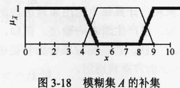

#### 3.4.3 模糊分类实战

模糊分类器是模糊理论的典型落地。它借助专家经验，用**语言变量**自然表达认知，再由模糊集完成量化建模。例如极化参数 Entropy H 与 α 角，其语言模型见图 3-19。

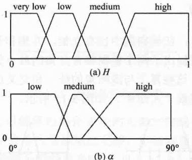

专家规则可自然表述为：“若 H 偏高 **且** α 偏高，则判定为 Class 4”。

规则集可汇总成决策表（表 3-5）。

**表 3-5 模糊规则库示例**

| H | α | Class |
|---|---|---|
| 极低 | 低 | Class 1 |
| 低 | 中 | Class 2 |
| 中 | 高 | Class 3 |
| 高 | 高 | Class 4 |

控制规则由**前件（IF...AND...）**与**后件（THEN...）**构成。实践中无需穷举所有输入组合，低概率工况可忽略。资深操作员常仅评估关键规则，从而精简逻辑、提升性能。

推理引擎以 AND 逻辑融合输入，得出各规则的输出隶属函数，再将有效结论按隶属函数求逻辑和（聚合），计算输出强度。最后经**去模糊化**输出确值。例如 H=0.35、α=30° 时，单规则推理（min-max 推理）示意图 3-20。

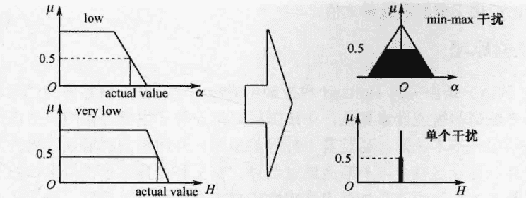

全体规则的模糊输出聚合为单一模糊集，去模糊化需选取代表值。常用启发式策略包括：**重心法**（广泛适用，见图 3-21）与**最大隶属度法**（适用于离散单峰情况）。

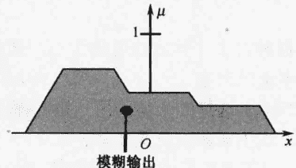

**模糊逻辑的核心价值**：它转变了问题求解范式——**关注“系统该做什么”，而非“系统如何工作”**。这使工程师聚焦问题本身，规避复杂数学建模。前提是拥有足够专业知识以构建规则库、定义集合组合与去模糊化策略。对于**无简易数学模型、高度非线性、或需嵌入专家经验**的复杂过程，模糊逻辑极具优势。

---

### 3.5 实战篇：遗传算法 Python 实现

#### 3.5.1 实验目标
- 掌握遗传算法（GA）核心原理。
- 具备用 GA 求解工程优化问题的能力。

#### 3.5.2 任务要求
- 熟悉 GA 标准流程。
- 基于 Python 落地算法。
- 实战求解函数极值问题。

#### 3.5.3 算法溯源与流程

GA 由 Holland 教授借鉴达尔文“自然选择、适者生存”演化法则创立。算法将候选解编码为染色体个体，构建初始种群，经**选择、交叉、变异**算子迭代进化，保留高适应度个体繁衍后代，终至全局最优或达代数上限。

**标准六步走：**

1.  **种群初始化**：选定编码方案，在解空间随机生成 N 个个体。
2.  **适应度评估**：解码个体，计算目标函数值（本例即利用率/函数值），记录历代最优。
3.  **选择操作**：按适应度比例（轮盘赌法或期望值法）筛选优质个体进入交配池。
4.  **交叉操作**：以概率 $P_c$ 对选中个体实施单点/多点交叉，生成子代。
5.  **变异操作**：以概率 $P_m$ 对子代基因位点实施单点/多点翻转，维持多样性。
6.  **终止判断**：满足收敛条件或达最大代数则停止，否则回步骤 2。

#### 3.5.4 案例复现：求解 $y = 10 \sin(5x) + 7 \cos(4x)$ 最大值

**(1) 种群初始化与编码**
采用 10 位二进制串编码变量 x，随机生成 n 个个体。

```
import random
def geneEncoding(pop_size, chrom_length):
    pop = [[]]
    for i in range(pop_size):
        temp = []
        for j in range(chrom_length):
            temp.append(random.randint(0, 1))
        pop.append(temp)
    return pop[1:]
```

**(2) 解码与适应度计算**
二进制转十进制，代入目标函数求值，函数值即适应度。

```
import math
def decodechrom(pop, chrom_length):
    temp = []
    for i in range(len(pop)):
        t = 0
        for j in range(chrom_length):
            t += pop[i][j] * (math.pow(2, j))
        temp.append(t)
    return temp
def calobjValue(pop, chrom_length, max_value):
    temp1 = []
    obj_value = []
    temp1 = decodechrom(pop, chrom_length)
    for i in range(len(temp1)):
        x = temp1[i] * max_value / (math.pow(2, chrom_length) - 1)
        obj_value.append(10 * math.sin(5 * x) + 7 * math.cos(4 * x))
    return obj_value
```

**(3) 负值淘汰机制**
剔除适应度为负的劣质个体。

```
def calfitValue(obj_value):
    fit_value = []
    c_min = 0
    for i in range(len(obj_value)):
        if(obj_value[i] + c_min > 0):
            temp = c_min + obj_value[i]
        else:
            temp = 0.0
        fit_value.append(temp)
    return fit_value
```

**(4) 精英保留策略**
记录当前代最优解（最大值）存入历史最优列表。

```
def best(pop, fit_value):
    px = len(pop)
    best_individual = []
    best_fit = fit_value[0]
    for i in range(1, px):
        if(fit_value[i] > best_fit):
            best_fit = fit_value[i]
            best_individual = pop[i]
    return [best_individual, best_fit]
```

**(5) 轮盘赌选择**
计算个体选中概率（适应度/总和），执行比例选择。

```
import random
def sum(fit_value):
    total = 0
    for i in range(len(fit_value)):
        total += fit_value[i]
    return total

def cumsum(fit_value):
    for i in range(len(fit_value)-2, -1, -1):
        t = 0
        j = 0
        while(j <= i):
            t += fit_value[j]
            j += 1
        fit_value[i] = t
    fit_value[len(fit_value)-1] = 1

def selection(pop, fit_value):
    newfit_value = []
    total_fit = sum(fit_value)
    for i in range(len(fit_value)):
        newfit_value.append(fit_value[i] / total_fit)
    cumsum(newfit_value)
    ms = []
    pop_len = len(pop)
    for i in range(pop_len):
        ms.append(random.random())
    ms.sort()
    fitin = 0
    newin = 0
    newpop = pop
    # 转轮盘选择法
    while newin < pop_len:
        if(ms[newin] < newfit_value[fitin]):
            newpop[newin] = pop[fitin]
            newin = newin + 1
        else:
            fitin = fitin + 1
    pop = newpop
```

**(6) 遗传算子执行**
按设定概率实施交叉与变异。

```
import random
def crossover(pop, pc):
    pop_len = len(pop)
    for i in range(pop_len - 1):
        if(random.random() < pc):
            cpoint = random.randint(0,len(pop[0]))
            temp1 = []
            temp2 = []
            temp1.extend(pop[i][0:cpoint])
            temp1.extend(pop[i+1][cpoint:len(pop[i])])
            temp2.extend(pop[i+1][0:cpoint])
            temp2.extend(pop[i][cpoint:len(pop[i])])
            pop[i] = temp1
            pop[i+1] = temp2

def mutation(pop, pm):
    px = len(pop)
    py = len(pop[0])
    for i in range(px):
        if(random.random() < pm):
            mpoint = random.randint(0, py-1)
            if(pop[i][mpoint] == 1):
                pop[i][mpoint] = 0
            else:
                pop[i][mpoint] = 1
```

**(7) 主程序调度与结果**
整合变量，驱动迭代循环。

```
##### 计算二进制序列代表的数值
def b2d(b, max_value, chrom_length):
    t = 0
    for j in range(len(b)):
        t += b[j] * (math.pow(2, j))
    t = t * max_value / (math.pow(2, chrom_length) - 1)
    return t

pop_size = 500 # 种群数量
max_value = 10 # 基因中允许出现的最大值
chrom_length = 10 # 染色体长度
pc = 0.6 # 交配概率
pm = 0.01 # 变异概率
results = [[]] # 存储每代的最优解，N 个二元组
fit_value = [] # 个体适应度
fit_mean = [] # 平均适应度

pop = geneEncoding(pop_size, chrom_length)
for i in range(pop_size):
    obj_value = calobjValue(pop, chrom_length, max_value) # 个体评价
    fit_value = calfitValue(obj_value) # 淘汰
    best_individual, best_fit = best(pop, fit_value) # 第一个存储最优的解，第二个存储最优基因
    results.append([best_fit, b2d(best_individual, max_value, chrom_length)])
    selection(pop, fit_value) # 新种群复制
    crossover(pop, pc) # 交配
    mutation(pop, pm) # 变异

results = results[1:]
results.sort()

print(results[-1])
print(best_individual)
print(best_fit)
print(obj_value[1])
print (results)
print ("y = %f, x = %f" % (results[-1][0], results[-1][1]))
X = []
Y = []
for i in range(500):
    X.append(i)
    t = results[i][0]
    Y.append(t)
plt.plot(X, Y)
plt.show()
```

**最终收敛最优解：**
> **y = 16.998364, x = 1.573803**

**(8) 进化曲线可视化**
图 3-22 展示了 0~500 代最优适应度演变轨迹。

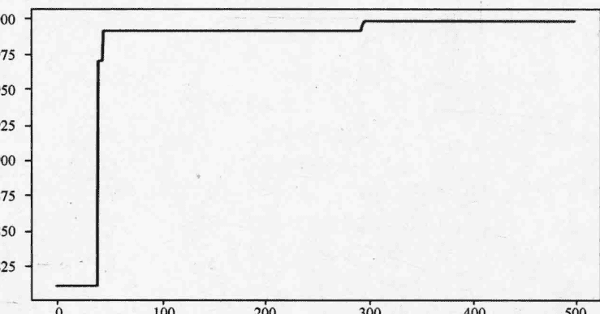

# 第 4 章 执行系统：从机械臂到智能大脑的进化

远古先民用杠杆撬石、用滚木移重、以弓钻取火，这些朴素的工具是执行系统的雏形——它们帮人类完成力所不能及的劳动。时代演进至今，单一工具组合成装置，装置又融入了信息技术，昔日“只会干活”的机械臂，摇身一变成为懂决策、会优化的“智能中枢”。本章将层层剖析执行系统的进化逻辑，从核心定义、MES 变革、组件化架构，到智能化流程管理的实战路径。

---

### 4.1 执行系统概述：不只是“干活”的工具

#### 4.1.1 核心定义：系统末端的“执行者”
简单说，执行系统是机械系统末端直接与作业对象“接触”的输出单元。它利用机械能改变对象的性质、形状、位置，或完成检测、度量任务。结构上，它由**执行构件**（直接干活的“手脚”，如夹爪、钻头）和**执行机构**（驱动“手脚”运动、传递动力的“肌肉骨骼”，如液压缸、连杆）组成。

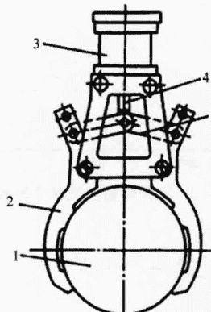

> **实例速览**：液压连杆式夹持器中，液压缸驱动连杆带动手指闭合夹持工件，完美诠释了“机构驱动构件、构件完成任务”的协作关系。

#### 4.1.2 MES：车间层的“数字指挥官”
随着计算机技术介入生产，传统管理演变为**制造执行系统（MES）**。它不再是单纯的机械动作执行者，而是连接上层计划（MRP）与底层控制（PLC、数据采集、机械手）的**中间层枢纽**。

**MES 的三重身份：**
1.  **优化者**：依靠实时精准数据，引导、发起、响应生产活动，剔除无增值环节。
2.  **响应者**：面对工厂实时事件即时反应、报告、处理，提升交付准时率与物料流转率。
3.  **连接者**：通过双向通信，打通企业内部与供应链的关键任务信息流。

**MESA 定义的 11 大功能模块**涵盖资源、工序、单元、跟踪、性能、文档、人力、维护、过程、质量、数据采集，构建起精益生产的数字底座。

**六大核心作用场景：**
*   **质量管控**：实时分析工序指标，预警异常，推送纠正措施。
*   **过程管控**：监视生产、自动纠偏或辅助决策。
*   **维护管理**：跟踪设备保养、预警故障、积累历史数据支撑预测性维护。
*   **产品追溯**：全链路可视——谁在操作、用的什么料、有无返工预警。
*   **绩效分析**：多维对比（利用率、周期、达标率），产出最新运营报告。
*   **物料管理**：管控原料、零件、工具的移动、缓冲与存储。

> **业务价值一句话总结**：MES 以实时掌控为基石，优化流程、均衡资源、快速应变，最终降本增效、提升核心竞争力。

---

### 4.2 组件化：把大系统“拆”成可复用的积木

#### 4.2.1 核心思想：分治法的工程实践
面对淘宝、微信级别的超大型应用，单体架构（MVC）早已力不从心——代码边界模糊、牵一发动全身、编译缓慢、新人上手难。组件化应运而生：**将大工程拆解为高内聚、低耦合的独立模块**，各司其职、通过接口通信。

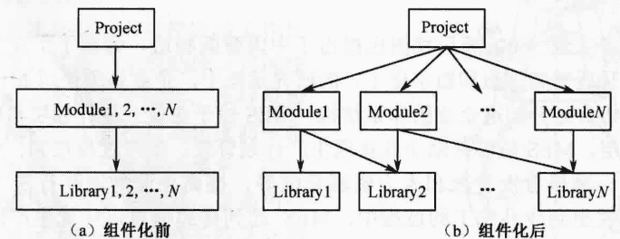

> **架构演进**：单工程 $\rightarrow$ 多工程 + 多模块。主工程负责集成，子工程独立开发、独立仓库管理。

#### 4.2.2 组件分层：业务与基础“双轨并行”
*   **业务组件**：贴近场景，如电商的“搜索、订单、购物车、支付”。
*   **基础组件**：沉淀通用能力，提供网络、数据、资源等底层服务支撑业务。

**核心收益**：并行开发互不干扰，新人仅聚焦单模块；需求变更只改受影响组件，新增功能只加新组件，核心层稳如磐石。

#### 4.2.3 实战范本：组件化 MES 的“搭积木”逻辑
流程企业大型化、敏捷化，高度定制化方案面临扩展难、适应性差的痛点。组件化 MES 通过**体系分解 + 灵活组装**破局。

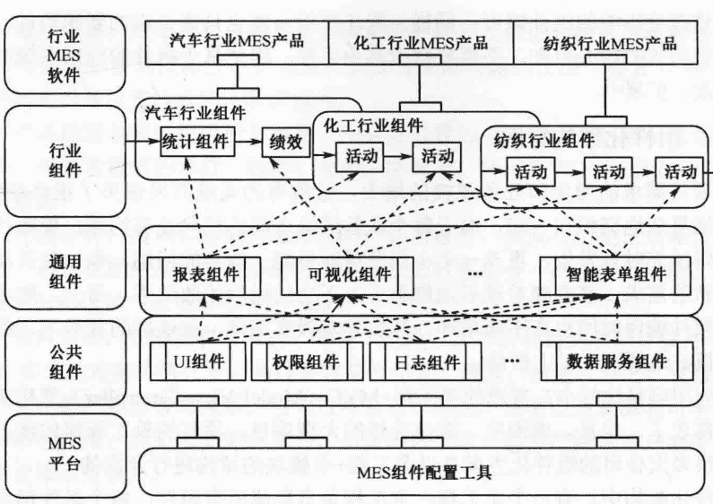

**三层组件库矩阵：**
1.  **公共组件**：UI、日志、数据服务等通用底座。
2.  **通用组件**：报表、可视化等跨业务功能件。
3.  **行业组件**：汽车统计、化工配方等强垂直领域能力。

**构建案例——汽车生产统计模块**：
调用「行业统计组件」 $\rightarrow$ 依赖「通用报表/可视化组件」 $\rightarrow$ 落地于「公共 UI/日志/数据服务」。
像搭积木一样快速装配，大幅提升实施效率与 IT 资产复用率。

---

### 4.3 智能化流程管理：让流程“长脑子、会进化”

自动化、电子化、集成化成熟后，**“智能化”成为下一个必争高地**。核心逻辑：**从运行数据中发现规律 $\rightarrow$ 指导优化 $\rightarrow$ 形成闭环**。

#### 4.3.1 内涵三部曲：数据驱动、全周期、全方位

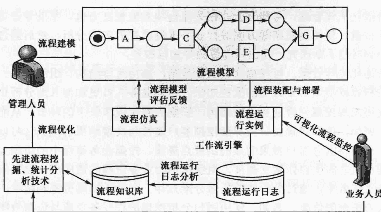

**1. 数据驱动流程控制**
海量运行数据蕴藏知识规律。挖掘分析 $\rightarrow$ 转化为流程知识 $\rightarrow$ 管理者及时发现问题、优化流程、指导决策，让数据资产“变现”。

**2. 全生命周期智能化贯穿**
*   **建模仿真期**：可视化工具提质增效。
*   **装配部署期**：监控点实时洞察异常，BI 技术自动分析赋能洞察。
*   **运行优化期**：柔性管理应对偏差，利用日志分析瓶颈缺陷，调整改进，**形成闭环持续提升**。

**3. 全方位分析支撑实时决策**
*   **社会网络分析 (SNA)**：挖掘协作关系，识别高效模式，重塑组织结构。
*   **流程漂移挖掘**：捕捉外部环境（市场、政策、季节）导致的流程隐性调整。
*   **统计分析定位变化**：锁定变化时间、位置、类型，量化影响，灵活应变。

#### 4.3.2 五大核心功能：从“看见”到“预见”

| 功能维度 | 关键动作 | 典型算法/手段 | 业务产出 |
| :--- | :--- | :--- | :--- |
| **多维流程分析** | 建立绩效数据立方，成本/时间/质量/资源多维钻研；挖掘结构/组织/资源/复杂度知识 | 决策树（评估决策点效率、提前关键节点）、回归分析（任务负荷-资源效率曲线、指导合理分工） | 根因定位、结构调优、资源效率最大化 |
| **异常风险监控** | 多层级监控点 + 可视化仪表盘；真实模型 vs 标准模型对比；故障概率估计 + 风险阈值 | 关联规则、决策树（异常模型匹配报警）、流程日志分析（风险模型自动化监控） | 实时预警、风险前置、执行保障 |
| **全面流程优化** | 组织视图挖掘（结构-效率关联、高效团队画像）；仿真迭代（低成本试错、多情景选优） | 组织挖掘、流程仿真技术 | 组织重塑、持续迭代、效能跃升 |
| **流程预测** | 历史数据建模 $\rightarrow$ 环境聚类 $\rightarrow$ 场景化预测模型 $\rightarrow$ 新实例映射预测 | 聚类算法（划分业务环境类型）、回归分析（生成预测模型） | 洞察走势、指导资源调度、提升服务质量（如集装箱搬运剩余时间预估） |
| **智能推荐** | 沉淀最佳实践、构建优化模型、辅助管理者决策 | 优化建模、知识图谱等 | 降低设计难度、赋能科学决策 |

---

### 📚 章末回顾与延伸

**思考题：**
1.  试述生物神经元与人工神经元的映射关系。
2.  梳理简单遗传算法的核心流程步骤。
3.  概括免疫算法的基本运作机制。
4.  如何基于免疫算法求解 TSP（旅行商）问题？

**参考文献：**
[1] [瑞士]达里奥·弗罗米若 等. *仿生人工智能*. 国防工业出版社, 2017.
[2] Richard E N, Xia J. *Artificial Intelligence: With an Introduction to Machine Learning*. Chapman and Hall/CRC, 2018.
[3] Ben C. *Artificial Intelligence Illuminated*. Jones and Bartlett Publishers, 2004.
[4] Martin H. *Fuzzy Logic Introduction* [EB/OL]. 2001.

### 4.3.3 发展趋势：技术赋能，流程管理迈向智能新境

得益于大数据、云计算、物联网等前沿技术的深度落地，企业对流程应用数据的挖掘与分析能力实现了质的飞跃，数据资产价值被充分激活，流程管理正加速向智能化、实时化、柔性化、高效化转型。

**典型实践一：中国移动——以大数据构筑智慧流程大脑。**  
依托分布式云存储融合多源异构海量业务数据，基于 Hadoop 生态搭建分析平台。引入时序模型回溯历史演变规律，精准预测核心经营指标；结合关联算法与社会网络分析（SNA），洞察用户社交画像与偏好，实现精准产品触达。

**典型实践二：华为携手天猫——大数据重塑 C2B 定制模式。**  
双方联手利用数据分析反向驱动研发制造，打破传统“推式”生产逻辑，成功落地大规模个性化定制手机，标志着流程管理步入智能化新阶段。

**云计算打通数据“任督二脉”，促跨组织协同。**  
云平台整合全企业算力资源，打破数据孤岛，让流程运行数据在全域范围内高效流转。依托云端强算力，管理者能获取更穿透的业务洞察，显著提升跨企业流程协同水平与管理效能。

**移动智能终端推动管理“随身化”。**  
管理者不再受限于工位，可随时随地监控流程脉搏，掌握实时动态。结合云端分析能力，实现对流程质量的即时诊断与全景研判。中国人寿即通过大数据与移动商业技术融合，重构车险理赔流程，大幅跃升理赔时效与服务体验。

---

### 4.4 信息加工：从原始素材到决策智慧的炼金术

在计算机科学视域下，信息加工是对采集信息“去伪存真、去粗取精、由表及里、由此及彼”的深度提炼过程。它以原始信息为原料，产出高附加值、高可用性的二级信息产品。

#### 4.4.1 核心认知：广义与狭义的双重视角

**广义视角：增值处理的全链路。**  
指按规范流程对原始信息实施分类、分析、整理、编制、存储、融合等操作，旨在产出辅助决策的有效知识。原始信息往往呈初始、离散、无序、孤立态，难以直接分析传递；加工使其转化为易观测、易传播、易分析、易应用的形态。统计建模、模式编制、文本阐释等手段能产出决策杠杆作用更强的新知。

**狭义视角：认知心理学的计算隐喻。**  
作为认知心理学基石，该理论借计算机科学、语言学、信息论概念，以计算机处理流程类比人脑机制，模拟人类注意筛选、编码存储、提取决策、指导行为的完整认知链条。

**加工核心工序五部曲：**

1.  **筛选与甄别：** 清洗噪音，辨别真伪，留存有效成分。
2.  **分类与排序：** 依标准体系理清类目，按规律重构序列结构。
3.  **计算与研究：** 对结构化数据统计、建模、对比、挖掘，产出系统性、深层次的高价值新知。
4.  **著录与标引：** 规范描述外部特征（题名、来源、责任者等）与物理属性（载体形态），并依规则打标索引。
5.  **编目与组织：** 将著录标引结果汇编成简明检索工具，服务信息定位需求。

**提升加工成果价值的四大准则：**

- **系统全局观：** 洞察表象下的共性规律，最大化信息效能。
- **标准合规性：** 遵循国内外标准，保障利用价值与跨平台互操作。
- **实事求是性：** 坚守真实底线，杜绝失真变形；唯准确信息能领航决策，谬误数据必酿成重大损失。
- **通俗易懂性：** 降低认知门槛，便于推广普及；唯有看得懂的信息，才能转化为实效。

#### 4.4.2 方法工具箱：五大流派各显神通

针对异构处理目标，方法谱系可归纳为五大类：传统统计学习、机器学习、不确定性理论、可视化技术、数据库/数据仓库技术。

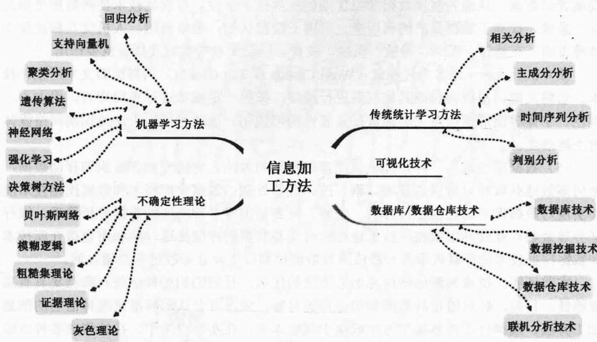

> **图 4-5 信息加工方法体系**

1.  **传统统计学习：从参数估计迈向模型选择。**  
    立足概率模型，重心从假设检验、拟合估计转移至“寻优模型结构”，高度契合信息处理探索未知规律的本质。  
    *场景：* 相关分析量化广告曝光与成本联动；时间序列捕捉电商销售季节周期波动。

2.  **机器学习：让机器具备“进化”能力的跨学科前沿。**  
    近 20 年崛起，核心是设计自学习算法，从数据自动提取规律泛化预测。广泛赋能计算机视觉、NLP、生物识别、搜索推荐、医疗诊断等。  
    *里程碑：* AlphaGo 融合 3000 万棋谱预训练策略网络、自我对弈强化学习价值网络、蒙特卡洛树搜索（MCTS）实现深度博弈推演。

3.  **不确定性理论：在迷雾中寻找确定性的推演逻辑。**  
    基于不完备证据与模糊知识，推导出“合理近似”结论。模糊逻辑、证据理论、灰色系统擅长表征不精确、不完全、不可靠知识，军事目标识别（破解伪装、干扰、隐蔽、欺骗）是强项应用场。

4.  **可视化技术：让数据“会说话”的直觉界面。**  
    以图形语义映射数据内涵，降维认知门槛，挖掘隐性模式。服务数据认知、表达、交互、决策支撑，广泛渗透建筑、医疗、导航、机械、教育、社交网络分析等领域。  
    *经典形态——标签云：* 依词频/权重排序布局，用字号、色相、字体编码关键词重要性，快速定位舆情热点。

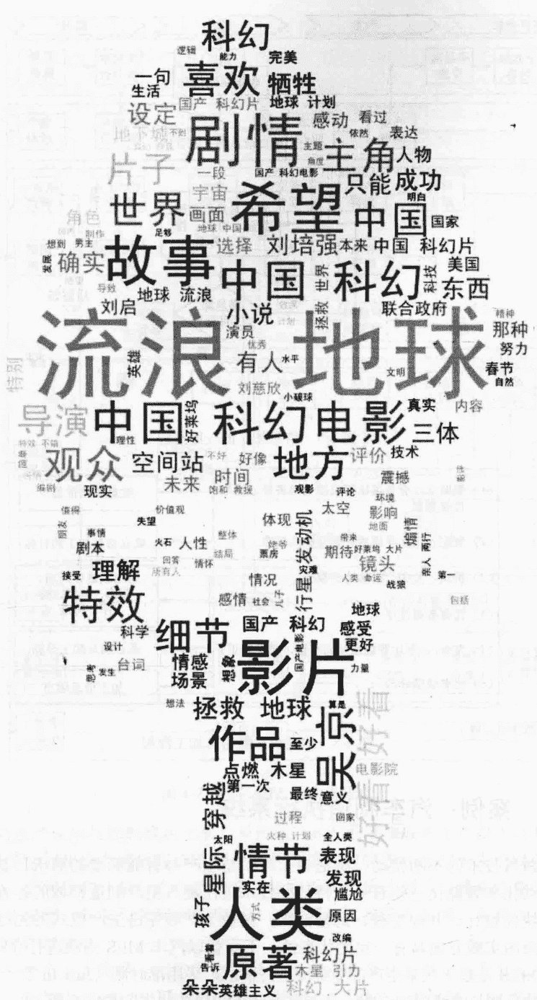

> **图 4-6 文本可视化典范——标签云**

5.  **数据库/数据仓库技术：数据资产的“仓储与炼化”中枢。**  
    数据库解决组织、存储、CRUD 高效存取；数据仓库与挖掘支撑 OLAP 多维分析、报表输出、离线建模。金融业实时交易依库存储，仓库/挖掘驱动业务优化与战略决策。

**实战启示：** 方法无绝对优劣，强依赖数据集特性；当前无通用选型标准，**“问题导向、集成组拳”**是工程落地常态。

#### 4.4.3 通用流程：闭环迭代的价值生产线

目标：挖掘高阶价值，赋能高效用。流程遵循 **收集原料 → 设靶定向 → 精炼加工 → 评估验收 → 迭代优化 → 交付产出** 闭环。

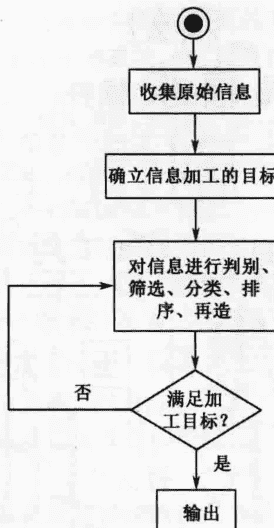

> **图 4-7 信息加工通用流程模型**

**实景演示：运动会成绩管理数字化流水线**  

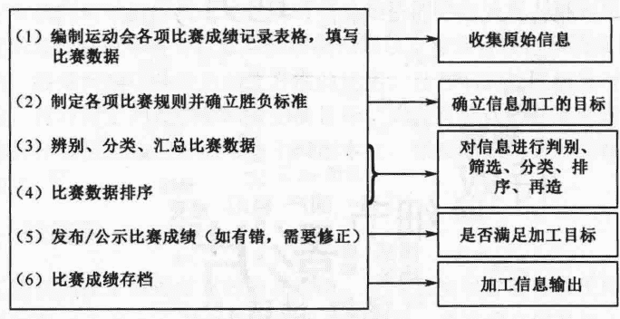

> **图 4-8 运动会信息加工作业流**

1.  **选型配置：** 匹配赛制需求，部署专用软件或定制开发。
2.  **多源采集：** 采集点自动感知/人工录入原始比赛数据。
3.  **计算加工：** 程序执行排序、统计、判罚逻辑。
4.  **榜单发布：** 实时输出排名成绩单。
5.  **归档入库：** 历史数据沉淀资产库。

**智能化进阶：** 积累多年海量赛事数据后，可引入机器学习训练预测模型，实现赛果推演、异常预警等“智能加工”跃迁。

---

### 4.5 标杆案例：汽车 MES——离散制造数字化转型的教科书级实践

新技术浪潮倒逼制造业向“信息化、自动化、智能化”三位一体进阶。汽车行业作为模块化设计、并行工程、批量定制、精益生产的排头兵，其 MES（制造执行系统）实践极具范式意义。

**系统定位：**  
植根汽车业务流与 JIT（准时制）哲学，长期沉淀形成的紧贴产线的执行中枢。以生产制造为主线，物流配套与质量管控为双翼，覆盖**生产计划、生产控制、物料计划、现场物流、质量管理**五大核心业务域。

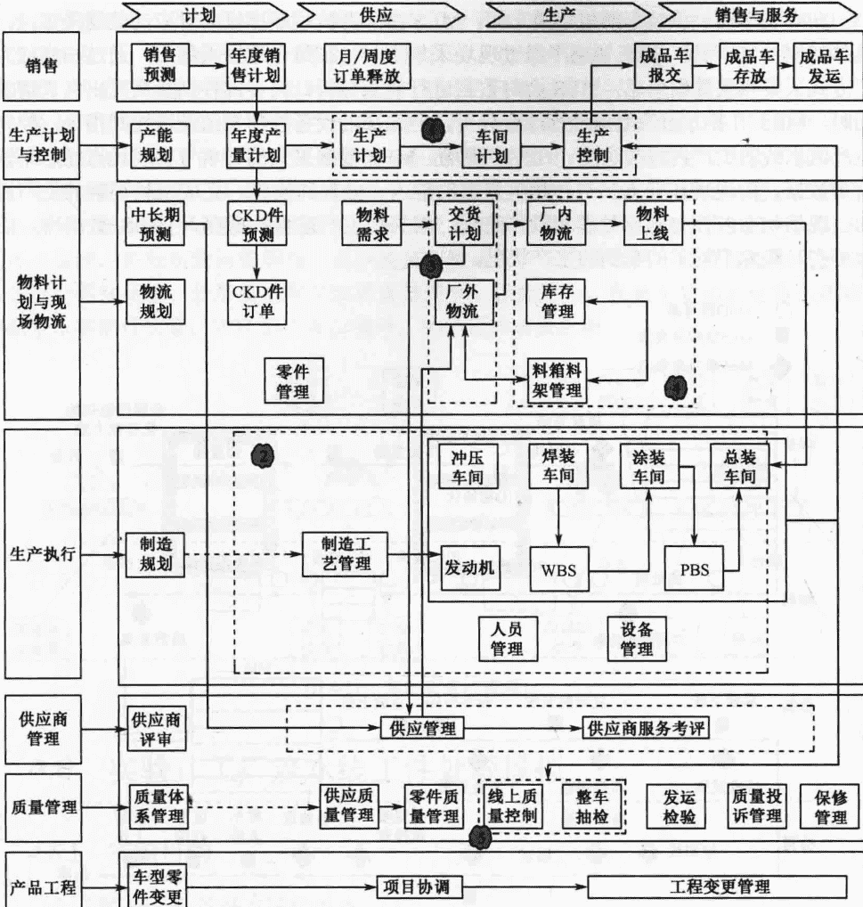

> **图 4-9 汽车 MES 业务功能全景**

#### 计划与控制：从 ERP 订单到车间排程的精准解码
计划模块接收 ERP 投入计划，结合顺序计划与实绩，注入时间维度生成车间级排程。支撑**年/周/日**三级计划体系，以整车订单为原子单元，实现车间-车型-周次、车间-班次-工位的多粒度管控。

#### VIN 码贯穿全生命周期的“数字身份证”
计划下发后，MES 为每车身分配唯一 VIN，打印条码随流程卡流转焊装、涂装、总装。流程卡搭载 VIN 成为物理实体的数字影子，实时定位车辆位置与进度。

#### 数据采集点：织就车间感知神经网络
三大车间按工艺节拍部署采集点。车辆到站触发扫码/人工录入，MES 即时执行：需求解析→拉动供应商备货；多维融合分析→下发底层设备控制指令（内容/节拍）；现场看板渲染车辆工艺参数→指导作业/录入/异常处理；全链路数据入库→后台全景追踪跨车间生产态势。

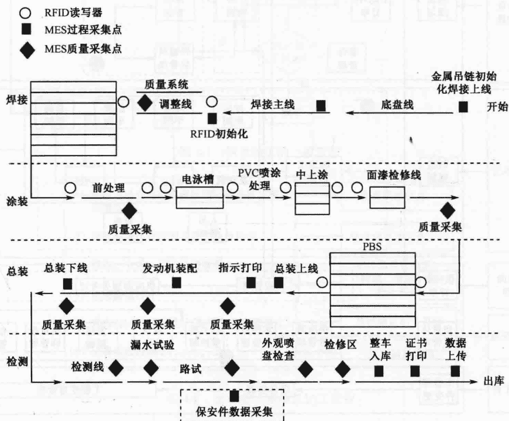

> **图 4-10 汽车制造数据采集点位分布**

#### 精益物料：JIT 零库存下的供应链协同闭环
整车涉料品类繁、在制品杂。MES 基于 JIT 理念，协同焊/涂/分/总四大工序在制库存向零趋近。
- **消耗驱动拉动：** 实测线边库存与消耗率，不足即触发配送指令。
- **分类精准供给：** 通用件按实时库存拉动；排序件依上线序列与 BOM 生成序列拉动单；信息同步推送供应商协同平台。
- **线边柔性补给：** 安灯/看板人工拉动，或依序列/BOM 自动生成料架配送单，物流部门执行上线。

#### 质量管控：全流程闭环与强制性拦截机制
- **工序报交点：** 按工艺设检测节点，质保员验收报交。
- **安灯强制拦截：** 发现缺陷触发质量安灯，锁定输送线；车辆到站自动停线，待问题解除复线——**以“止损”换“零缺陷”流出**。
- **下线三维抽检：** 感知质量、外观质量、功能质量量化评分。
- **全链路追溯：** 发动机舱盖粘贴零部件清单、VIN、订单号，构建事后溯源铁证链。

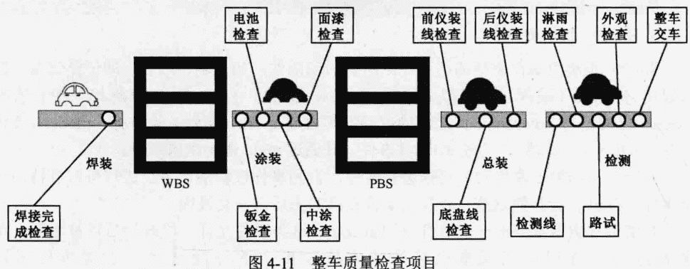

> **图 4-11 整车质量报交点与追溯体系**

---

### 4.6 实战演练：基于 Python+SimPy 的工厂流水线离散事件仿真

#### 4.6.1 实验使命
- 熔炼 Python 编程生态认知。
- 掌握 SimPy 离散事件仿真框架核心范式。
- 构建“工件加工-物流传送”数字孪生最小闭环。
- 运行调试，解读仿真输出。

#### 4.6.2 实验达标线
- 驾驭 Python 基础开发环境。
- 精通 SimPy 组件建模，能映射真实业务场景设计仿真方案。
- 代码落地工件处理与物流传送全过程。

#### 4.6.3 仿真场景建模
**原型：** 多工件流经多机台的流水线。  
**逻辑：** 机台加工完工件→放入传送带→机台空闲取次件；传送带运送延时后→工件到达下游机台。

#### 4.6.4 实施路径

##### 1. 环境就绪：SimPy 安装
兼容 Python 2.7+ / 3.2+，`pip install simpy` 一键部署。

```
$ pip install simpy
```

> *若装有 pytest，可在安装目录执行测试套件验证可用性。*

```
$ pytest --pyargs simpy
```

##### 2. 核心范式解构：SimPy 三大基石
SimPy 是**离散事件驱动**内核。万物皆 **Process（进程）**，驻留于 **Environment（环境）**；交互仅靠 **Event（事件）**。进程本质是 **Generator（生成器）**，通过 `yield` 抛出事件挂起自我，事件触发唤醒调度。

- **Timeout 事件：** 核心时间推进机制，`env.timeout(delay)` 表达“休眠/保持状态 N 时间单位”。
- **Environment API：** `.process()` 注册进程、`.event()` 造事件、`.timeout()` 延时、`.run(until=...)` 启动推演至终止条件。
- **资源与存储抽象：**
  - **Resource：** 竞争型资源池（工人、机床工位），`request()` 申请占用。
  - **Store：** 先进先出缓冲队列（物料缓存、工单池），`put()`/`get()` 驱动流转。

##### 3. 代码实战环境
实验基于 Python 3 环境，完整代码实现如下：

```
##### python 3.6 with SimPy
"""
模拟场景： [last_q][machine1] -----[con_belt]-----> [next_q][machine2]
"""
import simpy
import random
PROCESS_TIME = 0.5 # 处理时间
CON_BELT_TIME = 3 # 传送带时间
WORKER_NUM = 2 # 每个机器的工人数/资源数
MACHINE_NUM = 2 # 机器数
MEAN_TIME = 0.2 # 平均每个物件的到达时间间隔
def con_belt_process(env,
    con_belt_time,
    package,
    next_q):
    """模拟传送带的行为"""
    while True:
        print(f'{round(env.now, 2)} - item: {package} - start moving ')
        yield env.timeout(con_belt_time) # 传送带传送时间
        next_q.put(package)
        print(f'{round(env.now, 2)} - item: {package} - end moving')
        env.exit()

def machine(env: simpy.Environment,
    last_q: simpy.Store,
    next_q: simpy.Store,
    machine_id: str):
    """模拟一个机器，一个机器可以同时处理物件的数量取决于资源数(工人数)"""
    workers = simpy.Resource(env, capacity=WORKER_NUM)
    def process(item):
        """模拟一个工人的工作进程"""
        with workers.request() as req:
            yield req
            yield env.timeout(PROCESS_TIME)
            env.process(con_belt_process(env, CON_BELT_TIME, item, next_q))
            print(f'{round(env.now, 2)} - item: {item} - machine: {machine_id} - processed')
    while True:
        item = yield last_q.get()
        env.process(process(item))

def generate_item(env,
    item_num: int=8):
    """模拟物件的到达"""
    for i in range(item_num):
        print(f'{round(env.now, 2)} - item: item_{i} - created')
        last_q.put(f'item_{i}')
        t = random.expovariate(1 / MEAN_TIME)
        yield env.timeout(round(t, 1))

if __name__ == '__main__':

    # 实例环境
    env = simpy.Environment()
    # 设备前的物件队列
    last_q = simpy.Store(env)
    next_q = simpy.Store(env)

    env.process(generate_item(env, last_q))
    for i in range(MACHINE_NUM):
        env.process(machine(env, last_q, next_q, machine_id=f'm_{i}'))
    env.run()
```

机器数为 2 时的工序结果如图 4-12 所示。

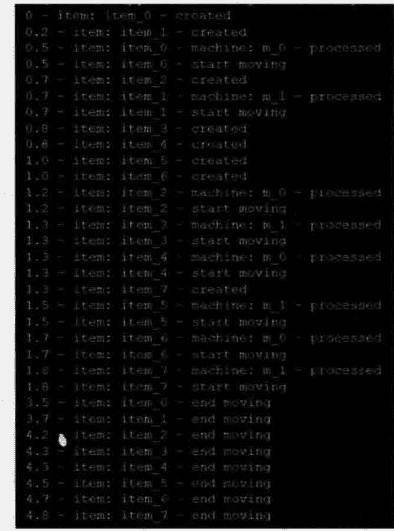

图 4-12 机器数为 2 时的工序结果

图 4-12 所示的程序结果是两台机器处理 8 个物件的工序模拟。读者也可以自行调节机器数量和物件数量，如将机器数设置为 3，即相关代码修改如下。

```
MACHINE_NUM = 3
```

机器数为 3 时的工序结果如图 4-13 所示。

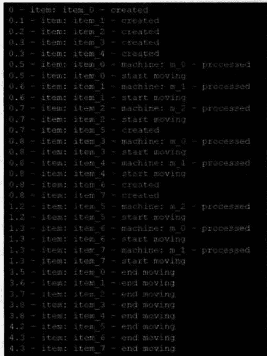

图 4-13 机器数为 3 时的工序结果

### 章末研讨题

1. 请定义何为执行系统。
2. 概括制造执行系统（MES）的核心内涵。
3. 简述组件化设计的基本思想。
4. 智能化流程管理包含哪些核心要素？
5. 智能化流程管理主要提供哪些功能支撑？
6. 信息加工的基础方法可归纳为哪几大类？
7. 梳理信息加工的通用处理流程。

### 引用文献目录

[1] 曹毅杰, 宗望远, 张燕. 机械原理及设计方法研究[M]. 北京: 中国水利水电出版社, 2015.
[2] [德]雷纳尔·戴森罗特. HYDRA 制造执行系统指南——完美的 MES 解决方案[M]. 沈斌, 王家海, 译. 北京: 电子工业出版社, 2017.
[3] 刘培林. 基于组件化思想的载人潜水器操纵模拟器训练评价软件系统开发[J]. 计算机工程应用技术, 2008,6(3):1341-1343.
[4] 荣冈, 冯毅萍, 赵路军. 流程工业组件化生产执行系统[M]. 北京: 科学出版社, 2014.
[5] 赵卫东. 智能化的流程管理[M]. 上海: 复旦大学出版社, 2014.
[6] 赵卫东. 流程智能[M]. 北京: 清华大学出版社, 2012.
[7] Song M, Van der Aalst W M P. Towards comprehensive support for organizational mining[J]. Decision Support Systems, 2008, 46(1):300-317.
[8] Bose R P J C, Van der Aalst W M P, Zliobait˙e I, et al. Handling concept drift in process mining[C]. Proceedings of the 23rd international conference on Advanced information systems engineering, London, UK, 2011:391-405.
[9] Nakatumba J, Van der Aalst W M P. Analyzing resource behavior using process mining[C]. Proceedings of the International Conference on Business Process Management, Ulm, Germany, 2010, 43:69-80.
[10] Conforti R, Fortino G, La Rosa M, et al. History-aware, real-time risk detection in business processes[C]. Proceedings of the Confederated International Conferences on the Move to Meaningful Internet Systems, Crete, Greece, 2011:100-118.
[11] Folino F, Guarascio M, Pontieri L. Discovering context-aware models for predicting business process performances[C]. Proceedings of the Confederated International Conferences on the Move to Meaningful Internet Systems, Rome, Italy, 2012:287-304.
[12] Hang Z, Lu X, Duan H. Mining association rules to support resource allocation in business process management[J]. Expert Systems with Applications, 2011, 38(8):9483-9490.
[13] Gao X. Towards the next generation intelligent BPM-in the era of big data[C]. Proceedings of the 11th International Conference on Business Process Management, Beijing, China, 2013, 8094:4-9.
[14] 石少勇, 王精业, 陈启宏, 等. 基于信息加工理论的指挥决策行为建模研究[J]. 2012,9(24):1988-1992.
[15] 何克抗, 李文光. 教育技术学[M]. 北京: 北京师范大学出版社, 2009.
[16] 王悦. 企业信息管理与知识管理系统构建研究[M]. 北京: 中国人民大学出版社, 2014.
[17] 王万森. 人工智能[M]. 北京: 人民邮电出版社, 2011.
[18] 江支柱, 董宝力. 汽车智能生产执行系统实物[M]. 北京: 机械工业出版社, 2018.

## 第 5 章 CPS：数实融合的智能新基建

信息物理系统（Cyber-Physical Systems，CPS）是一种多维度的复杂巨系统，它将计算、网络与物理环境深度融为一体。通过计算机、通信与控制技术的协同耦合，赋予工程体系实时感知、动态调控与信息服务能力。CPS 在设计之初即采用计算、通信、物理“三位一体”的一体化建模范式，显著提升了系统的可靠性、运行效能与实时协同水平，应用前景极为广阔。本章将围绕 CPS 的核心内涵、典型特质、设计实现路径及行业落地实践展开详述。

### 5.1 CPS 核心认知

#### 5.1.1 CPS 定义：构建“感知-决策-执行”智能闭环

CPS 融汇计算、通信、控制于一身，构成智能系统。它通过人机交互界面对接物理进程，借助网络空间以远程化、高可靠、强实时、高安全、可协作的模式，实现对物理实体的精准管控。在实际落地中，CPS 构建起连接网络空间与物理空间的桥梁，基于数据自动流转，形成“状态感知 → 实时分析 → 科学决策 → 精准执行”的闭环体系。该体系能有效化解生产制造中的复杂性与不确定性难题，提升资源配置效能，实现资源最优配置，进而增强生产效率与产能。

这一闭环包含四大关键环节：状态感知依托传感器捕捉设备运行态势；实时分析借助软件系统实现数据可视化呈现；科学决策通过大数据平台打通异构数据流转并支撑决策判断；精准执行则由控制器、执行器等硬件响应指令动作。这一切的运行基石，是一个实时性高、可靠性强、安全性好的网络。业界常将这一架构概括为 **“感知与控制（一硬）、工业软件（一软）、工业网络（一网）、工业云平台（一平台）”**——

*   **一硬（感知与自动控制）：数据流转的源头与归宿**  
    感知本质上是物理世界的数字化进程。通过传感器等智能硬件，将生产全流程中人、设备、物料、环境等隐性信息显性化，为后续分析与决策奠基，是数据流转的**起点**。自动控制则建立在数据采集、传输、存储、分析挖掘之上，体现为作用于人、机、料、环的一系列精准动作（如 DCS、PLC、SCADA 系统），是数据流转的**终点**。

*   **一软（工业软件）：定义系统的核心逻辑**  
    工业软件大致分为嵌入式与非嵌入式两大类。前者内嵌于控制器、通信模块、传感器中，承担控制、通信、采集职能；后者部署于通用或工控计算机上，实现设计、编程、工艺、监控、管理等功能。应用于军工电子、工控等领域的嵌入式软件，对可靠性、安全性、实时性有着极高要求，需经严格检测评估。简而言之，**工业软件定义了 CPS**，其核心在于打造数据闭环、构筑自动流转规则体系，以应对制造不确定性、实现资源高效配置。

*   **一网（工业网络）：数据流转的高速通道**  
    工业网络是部署于生产现场的全数字化、双向、多站通信系统。它综合运用工业现场总线、工业以太网、无线网络及异构网络集成技术，连接生产系统与产品各要素，打通装备、控制系统与信息系统的互联互通壁垒。它主要支撑工业数据的采集交换、集成处理、建模分析与反馈执行，是从单机、产线、车间到工厂全系统贯通的关键基建。

*   **一平台（工业云与智能服务平台）：跨域融合的数据中枢**  
    工业云以云计算为核心，融合物联网、移动互联、协同创新设计制造等技术，为企业提供产品创新服务平台。用户可在此实现设备联网、数据可视、流程数字化，达成纵向与横向深度融合。  
    工业云及智能服务平台更是跨系统、跨平台、跨领域的数据存储、分析与交互中心。基于云平台，它推动专业软件库、应用模型库、产品知识库、测试评估库、案例专家库等基础资源的开发集成与开放共享，实现生产全要素、全流程、全产业链、全生命周期的资源配置优化，提效增效、创新模式、重塑生态。这将重构信息流、物流、资金流运行模式，重塑产业价值链与竞争格局。

#### 5.1.2 CPS 八大核心特质解析

CPS 作为支撑“工业化与信息化深度融合”的综合技术体系，打通了物理空间与信息空间，驱动数据自动流转，实现资源优化配置的智能化。系统以**数据为核心**，在有机运行中通过数据流转对物理实体持续“赋能”，达成特定目标下的资源最优配置。其在不同层级呈现出 **八大典型特质**：海量运算、感知泛在、数据驱动、软件定义、泛在连接、虚实映射、异构集成、系统自治。

##### 1. 海量运算：接入设备的底座算力
海量运算是 CPS 接入设备的基础特质，意味着设备需具备强劲算力。从算力维度看，高端 CPS 应用对计算性能要求极高。相比之下，物联网终端多缺乏自主控制与自治能力，通信多发生在终端与服务器之间，终端间难以协同，可视为 CPS 的一种**轻量化应用形态**。物联网中，终端与平台常通过蓝牙等短距或 NB-IoT 等远距通信技术联网。

##### 2. 感知泛在：跨越物理与数字的桥梁
感知在 CPS 中举足轻重。自然界物理量变化连续（模拟量），而信息空间数据离散。物理至信息的流转，必经传感器将物理量转模拟量，再经 A/D 转换器化为数字量，成为信息空间可识别格式。在此基础上，传感器网络亦成为 CPS 的有机组成部分。

##### 3. 数据驱动：核心引擎与价值变现
生产制造各领域蕴藏海量数据，却多处隐性未被充分释放价值。CPS 构建“感知—分析—决策—执行”数据自动流转闭环赋能体系，将物理空间隐性数据转化为信息空间显性资产，持续迭代优化形成知识库。在此过程中，感知结果、分析对象、决策依据、执行输出均为数据。**数据是 CPS 的核心**，它在自动生成、流转、分析、执行及迭代中累积进化，持续产出更优数据，最终实现外部环境资源的优化配置。

##### 4. 软件定义：从 IT 向 OT 渗透的定义权
软件正携手芯片、传感控制设备，重新定义传统网络、存储、设备，并从 IT 领域向工业领域（OT）延伸。工业软件将生产规律代码化，支撑绝大多数制造过程。对面向制造业的 CPS 而言，软件是功能实现的核心载体。  
*生产流程视角*：CPS 覆盖研发设计、生产制造、管理服务全链条，通过对人、机、料、法、环全维感知控制，实现资源最优配置，依赖工业技术模块化、代码化、数字化及软件化普及。  
*产品装备视角*：产品装备本身即 CPS。软件不只控制运行、实时呈现状态，更能经分析优化反作用于运行甚至设计环节，驱动迭代进化。

##### 5. 泛在连接：互联互通的神经网络
网络通信是 CPS 的基石保障，支撑系统内部单元间及系统间的互联互通。工业场景下，CPS 对网络时延、可靠性、组网灵活性、功耗有特殊要求，还需攻克异构融合、业务高效智能支撑等难关。随无线宽带、RFID、信息感知及网络业务技术演进，通信将更深度融合物理与信息空间，呈现**泛在连接**特质——任意时间、地点、人、物皆可顺畅通信。CPS 构成实体（器件、模块、单元、企业）均需具备泛在连接能力，实现跨网络、跨行业、异构多技术融合协同，保障数据系统内自由流动。泛在连接通过物理状态实时采集传输、控制指令实时反馈下达，提供无处不在的优化决策与智能服务。

##### 6. 虚实映射：数字孪生的交互联动
CPS 构筑信息与物理空间数据交互闭环通道，实现信息虚体与物理实体交互联动。以物理实体建模静态模型为基座，经实时数据采集、集成监控，动态追踪实体状态进展（如测量采集、追溯信息），在信息空间全要素重建物理实体，形成具备感知、分析、决策、执行能力的**数字孪生体**（亦称数字化映射、数字镜像、数字双胞胎）；同时借助信息空间分析处理能力，生成应对复杂环境变化的有效决策，通过“虚控实”方式作用物理实体。此过程中，物理实体与信息虚体交互映射，协同提升资源优化配置效能。

##### 7. 异构集成

# CPS：虚实共生的工业新基建——架构、演进与核心支柱

软硬结合、网络通达、云端赋能，诸多技术交织成网，在信息域与物理域间架起数据自动流转的闭环桥梁，构筑起“赋能”新体系。放眼高阶形态——如超大规模集成（SoS）层面，面对指令集各异的算力芯片（CISC/RISC/FPGA）、功能迥异的管理软件（PLM/MES/PDM/SCM）、多模态数据流（模拟/数字/开关/音视频/专有格式）及复杂通信环境（现场总线/工业以太网），CPS展现出强大的聚合力。它消弭异质壁垒，贯通交互径路，推动信息技（IT）与运营技（OT）深度交融，奠定多元异构融合大平台的基石。

## 八、自主进化：从感知响应到群智自治

CPS的灵魂在于“自治”。系统捕捉环境变迁，于信息域完成解析研判，随即自适应输出高效应答。
进阶至集群与超大规模层级，经由总线或智能中枢互联，多单元实现**自组织**协同：
*   **基元协同：** 统筹调度编队，在作业运行、物料配送、订单变更间动态自适配、自我优化，双增效能与响速。
*   **全域统筹：** 跨系统联网，支撑产能调度、经营治理、供给韧性等宏观自治。

此过程伴随海量现场参数与运行数据的沉淀，筑起知识库、模型库、资源库，驱动系统持续自我迭代，强化应对复杂环境的鲁棒性。

---

## 5.1 网络体系演进：从孤岛走向开放融合

### 1. 嵌入式体系：萌芽期
软硬机一体，赋能传统装备新机能，然本质为**封闭孤岛**。虽引入工控总线，通信力仍薄，难借开放总线或互联网实现互联。

### 2. 物联网：连接延伸
以射频、红外、定位、激光等感知入口，按约定协议接万物入网，达成智能识别、定位、追踪、监管。**内核仍是互联网延伸**，用户端下沉至终端间。

### 3. 传感网：专网感知
节点自组无线网，聚焦温湿噪光压、土壤成分、移动体速向等物理量，实现特定区域**专项监测覆盖**。

### 4. CPS：质变跃迁
**定位：** 开放嵌入式体系 + 网络 + 调控功能。**核心：** 算力、通力、控力三位一体融合，自主适配物理环境。
**关键区隔：** 网络服务于控制，非单纯通联。
**能力跨越：** 物联网/传感网擅“无线连+感知”；CPS进阶为**“感控合一”**——不止感知，更重控制，对端侧算力提出远超前者的要求。

## 5.1.4 发展脉络与战略高度

*   **技术渊源：** 植根嵌入式、传感、网络技术融合土壤。
*   **战略认可：** 
    *   2006年 美《竞争力计划》列入重点。
    *   2007年 总统科技顾问委报告列八大关键IT之首；欧盟启动ARTEMIS/EPoSS，投入超70亿美元；2015年发布《CyPhERS路线图》争取国际话语权。
*   **本质内涵：** 让物理装备“触网”，赋能**算力、通力、精控、远程协同、自治**五大核心机能。
*   **本质属性：** **带控制属性的网络**，区别于传统控体系。
*   **代际差异：** 传统控制（数控/PLC/家电）多为封闭孤岛，工控总线难通开放互联，通信弱。CPS将通信提至与算控同等战略高度，支撑分布式协同。
*   **规模跨越：** 远程协同、自治能力、控制对象规模、网络广度全面超越工控网。
*   **愿景：** 科基会（NSF）预言“让世界互联”；继承泛在通信模式，强化感知交互与虚实闭环，连接地理分布异构设备，实现资源共享与协同控制——**未来网络演进的必由之路**。

---

## 5.2 CPS落地实现路径

### 5.2.1 分层架构：从原子单元到超大规模集群

#### 1. 基元层（单元级）：不可再分的原子单元
**定义：** 构建基础“感知-运算-调控”闭环的最小实体（如智能部件、机器人、智能机床）。
**五大内生机能：** 可感知、可运算、可交互、可延展、自决策。
**架构双支柱：**
*   **物理实体装置：** 人机物实体 + 传感/执行/交互器件。承担物理过程实操、信号监测、指令落地。
*   **虚实交互接口：** 感知/运算/调控/通信功能集成。**核心使命：** 物理实体“数字化”入口，信息域“以虚控实”出口，虚实融合的桥梁。


图 5-1 单元级信息物理系统体系架构

#### 2. 集群层（系统级）：协同作战的编队单元
**场景：** 制造工序多设备协作（如传送带+机器人+冲压机）。
**形成机制：** 多基元经工业联网（现场总线/工业以太网）互联互通互操作，拓宽资源优化配置的广度深度精度。
**核心突破：** 基于基元状态感知与实时解析，实现局部制造资源的**自组织、自适配、自决策、自我优化**。
**增量功能包：**
*   **异构融合基座：** 互联互通、边缘侧网关、数据协同。
*   **组件全生命周期：** 免配置接入（识别、配置、更新、退役）。
*   **协同大脑：** 多基元联动与联合调控。
*   **运维保障：** 状态监测与故障研判（实时监控）。


图 5-2 系统级信息物理系统体系架构

#### 3. 超大规模层（SoS级）：企业级数字中枢
**构成：** 多集群有机组合（如多工序成车间、全厂级CPS），或基元与集群混合编组。
**核心使命：** **数据聚合** → 内优资产效能、外拓运营赋能服务。
**关键能力矩阵：**
*   **数据服务层：** 存储、融合、分布式算力、海量解析 → 支撑全域感知、深度研判、科学决策、精准落地。数据分布于智能中枢与各组件，统一治理融合是基石。
*   **资产效能管理：** 企业资产优化、预防性养护、环安管控、远程监测研判。
*   **运营效能提升：** 个性化定制、供给协同、数字化制造治理、远程运维。
*   **管控闭环：** 经智能中枢对全要素操控、取数、协同优化，达成资产资源最优配置。


图 5-3 SoS 级信息物理系统体系架构

### 5.2.2 分层技术诉求：阶梯式能力跃升

| 层级 | 核心技术诉求聚焦 | 关键词 |
| :--- | :--- | :--- |
| **基元层** | 筑基础闭环：状态察觉、调控执行、运算处理、交互联络 | **“造原子”** |
| **集群层** | 强化协同：网络贯通、组件管控、联合调控 | **“成编队”** |
| **超大规模层** | 面对海量真实多源数据：存储分布式处理、对外数据智能赋能 | **“建生态”** |

### 5.2.3 技术全景图：三层架构与“四大支柱”

**三层技术栈：**
1.  **整体技术（顶层设计）：** 体系框架、多源融合、安防、测试验证。
2.  **基础技术（中间件/底座）：** 智能感知、嵌入式程序、数据仓库、人机互动、中间件、SDN、万物互联、海量数据。
3.  **关键技术（业务落地）：** 虚实协同调控、智能装备、MBD、数字映射、CAX/MES/ERP/PLM/CRM/SCM、现场总线、工业以太网。


图 5-4 信息物理系统技术体系

**提炼“四大关键技术支柱”（1硬+1软+1网+1平台）：**
*   **硬件层（感知与自动调控）：** 物理层触手，硬件底座。
*   **软件层（工业应用软件）：** 内化运算法则与数据流转，**核心中的核心**。
*   **网络层（工业通信网）：** 互联互通与数据传递的高速公路。
*   **平台层（工业云/智能服务中枢）：** 数据集聚高地，上层方案基座，对外输出统筹与赋能。

---

### 5.2.4 核心支柱深度拆解

#### 1. 感知与自动调控：虚实协同的“四层调控塔”


图 5-5 感知和自动控制

*   **智能感知工艺：** 传感器为主力。RFID为典型代表（电子标签/读写器/中间件三件套），实现非接触式识别与采集。
*   **虚实协同调控工艺：** 多层“察觉-研判-决策-执行”闭环，实时感知、即时反馈，包含四大层次：


图 5-6 虚实融合控制技术

| 调控层次 | 核心对象 | 关键机制 | 典型价值 |
| :--- | :--- | :--- | :--- |
| **内嵌调控** | 物理实体 | 嵌入式程序就地闭环：采参数→研判状况→模型决策→下指令 | 基础执行层，就地快速响应 |
| **虚拟体调控** | 信息虚拟体 | 云端/大算力环境建模运算→同步追踪物理状态→下指令至内嵌层 | 复杂运算下沉，性价比高；数字映射核心支撑 |
| **集中管控** | 虚拟体群 | CPS总线集成多虚拟体→协同编排 | 解决产线多实体物流/能流耦合下的协同难题 |
| **目标管控** | 产品/任务目标 | 数字映射工程数据下发参数/指令→实测数据回溯即时比对 | 闭环质量管控，确保“所造即所设” |

#### 2. 工业应用软件：赋能全生命周期的“数字大脑”

**定位：** 面向研发制造服管全链路，赋予机电体系“数网智”特征，构建开放协同环境。
**三大技术基石：**

*   **嵌入式程序技术：** **CPS功能承载体**。含操作系统、嵌入式数据库、开发工具、应用程序。植入装备产品，贯穿调控、通讯、运算、感知全链路，实现采集、调控、通讯、显示一体化。
*   **MBD（基于模型定义）：** **数据流转主线**。以一体化三维数字化描述替代传统二维图纸，覆盖结构、几何、尺寸、工艺。**唯一数据源**贯穿制造全流程，打通环节壁垒。
*   **CAX/MES/ERP/PLM/CRM/SCM群：** **企业级应用矩阵**。支撑设计、制造、经营、供应链、客户管理全价值链协同。

---
**结语：**
CPS非单一技术创新，乃是**架构重构、分层演进、要素融合**的系统工程。从基元层的“原子闭环”，到集群层的“编队协同”，再到超大规模层的“生态自治”，技术诉求层层递进，最终汇聚成“感知调控、工业软件、工业通信网、工业云平台”四大支柱。虚实协同调控的四层塔与工业软件的三大基石，共同支撑起工业数字化转型的宏伟大厦。这不仅是技术范式的跃迁，更是工业生产力重塑的核心引擎。

### MBD 模式重塑制造数据流

在基于模型定义（MBD）的制造范式下，产品工艺与检验检测数据的形态、类别均经历了深度变革。MBD 让产品模型成为串联各类工业软件的核心枢纽。工艺部门借助三维数字化设计与仿真手段，以 MBD 三维设计数据为依托构建工艺模型，进而产出零件加工、部件装配动画等多媒体工艺资源。质检部门则依据三维产品模型及工艺模型，建立三维检验模型与计划，实现检验流程的数字化闭环，如  所示。


图 5-7 嵌入式软件技术在单元级信息物理系统的作用


图 5-8 MBD 在制造业的应用

#### 核心软件矩阵：CAX、MES 与 ERP 的协同定位

**CAX：虚体载体与全生命周期管控中枢**
CAX 涵盖 CAD、CAM、CAE、CAPP 等计算机辅助技术集合，实现了多元技术的集成协同。它贯穿研发、设计、生产、流通全环节，对产品全生命周期实施管理，推动生产管控向智能化、网络化迈进。作为信息物理系统（CPS）中“信息虚体”的承载体，CAX 软件完成了虚体原始要素及接口的定义，将虚体渗透至制造全流程，从供应链、设计、生产到企业管理多维赋能，显著提升物理工厂的效能与工程优化水平。

**MES：柔性排程与执行层的“大脑”**
面对大规模个性化定制需求，MES 是落地柔性排程、调度的关键。其核心操作对象是 CPS 的信息虚体。通过对虚体的管控，MES 以扁平化、网络化模式对生产计划进行“二次规划”，指挥设备协同或同步作业，基于实时数据对生产过程实施动态响应、调整与干预。同时，MES 汇聚虚体数据形成业务数据资产，配合工业大数据分析实现全产业链可视，最终达成生产最优、流程最简、效率最高、成本最低、质量最优的“五最”目标。

**ERP：资源优化配置的战略指挥系统**
ERP 以市场与客户需求为导向，致力于消除无效劳动与资源浪费，实现信息流、物流、资金流、价值流及业务流的有机融合，提升客户满意度。它以计划控制为主线，依托网络与信息技术平台，集成客户、市场、销售、采购、生产、财务、质量、服务等职能，覆盖供应链管理，是现代企业管理思想与方法的集大成者。

---

### 工业网络：从金字塔塔楼走向扁平化网状互联

#### 打破层级壁垒，重构连接范式
传统工业网络遵循金字塔分层模型，信息自底向上逐级汇聚。虽结构清晰，但层级间因功能差异采用异构网络技术，兼容性差、数据流动不畅，难以满足 CPS 对开放互联与灵活性的苛刻要求。CPS 网络技术正颠覆这一模式，确立基于分布式的全新范式（见 ）。智能设备互联成网，各层级内嵌更多智能与预测分析能力，云计算虚拟化控制下沉至各层。高层 CPS 由低层 CPS 灵活组合、互联集成而成，彻底告别了传统控制系统的刚性分层架构。


图 5-9 信息物理系统的网状互联网络

#### 异构融合与柔性接入的关键技术支撑
CPS 网络的核心挑战在于异构异质网络的互联互通与即插即用。面对传输速率、协议、数据格式的多重差异，边缘网关扮演关键角色，融合异构数据至 IP 网络传输；统一通信机制与数据互操作规范则保障跨网数据交换与设备互通。为适应柔性制造与小批量定制，网络本身必须具备柔性、即插即用特性，以实现资源最优配置与效率跃升。接入层面涵盖有线、无线及混合组网；网络类型上既包含专用协议局域网，也涵盖基于 TCP/IP 的公共互联。

*   **现场总线：** 融合计算机、通信、集成电路等高新技术成果，解决现场智能仪表、控制器、执行机构间的数字通信及上位系统联络。作为工厂数字网络基石，其内涵早超越单一通信线缆或标准。全数字化通信、开放互联、互操作性、设备智能化、结构高度分散、环境适应性强是其核心特征，推动自控技术向智能化、网络化、集成化演进。
*   **工业以太网：** 涵盖 EtherCAT、Ethernet PowerLink 等十余种主流技术，多基于 IEEE 802.3 百兆以太网增强实时性而来。它打通了多媒体世界无缝集成的路径。IEEE 802 正推进 TSN（时间敏感网络）标准化，构建开放标准网络基建，支撑多厂商设备互操作与集成，驱动企业信息系统与生产控制网络深度融合，降低部件成本，加速普及应用。
*   **无线技术：** 凭借免布线、低维护、自组网、不受线长节点限制等优势切入工业场景。WirelessHART、ISA100.11a（基于 IEEE 802.15.4）已用于资产管理、过程测控、HMI 等，在高温腐蚀等恶劣环境成唯一选项。Wi-Fi 侧重高速率，ZigBee 侧重低功耗，服务于非生产区。LTE/eLTE、NB-IoT、LoRa 等移动宽带与低功耗广域技术亦在企业落地生根。
*   **SDN（软件定义网络）：** 为支撑单元级 CPS 灵活重构、智能设备跨系统迁移即插即用，工厂网络需具备敏捷编排能力。SDN 实现管理平面与业务平面分离，基于 MES 需求，经控制器调度网络资源与业务分发，实现快速重组，有力支撑柔性制造与生产自组织。

---

### 工业云与智能服务平台：算力下沉，数据增值

平台融合边缘计算、雾计算、大数据分析等技术，完成数据加工处理，构建对外数据服务能力，进而输出个性化、专业化智能服务（架构见 ）。


图 5-10 构建信息物理系统平台需要的计算技术

*   **边缘计算：实时智能的“前哨站”**
    部署于靠近物/数据源的网络边缘，融合网络、计算、存储、应用核心能力，就近提供智能服务。针对 SoS 级 CPS，各组成单元自带算力与通信，边缘侧即时处理数据，契合实时分析与智能处理需求。聚焦实时、短周期数据，具备安全、低延迟、易管理优势，支撑单元级实时执行，有效利用算力资源。同时，边缘节点也是云端高价值数据的采集入口，反哺云端智能服务。
*   **雾计算：协同控制的“中枢神经”**
    CPS 属复杂控制系统，局域 CPS 内部协同计算不可或缺。雾计算将数据、处理逻辑、应用下沉至网络边缘设备，依赖本地设备而非中心服务器。作为新一代分布式计算范式，它借助智能路由器等构建设备间数据传输通道，有效削减网络流量、减轻数据中心负载。适用于产品级或系统级 CPS，通过预处理提升海量数据使用价值，不仅解决联网设备自动化难题，更以极低传输带宽需求见长。
*   **大数据分析：洞察驱动的“价值引擎”**
    重塑全球工业创新版图，加速研发、生产、运营、营销、管理变革。典型场景涵盖产品创新、故障诊断预测、供应链优化、精准营销。平台支撑的 CPS 可借此实现创新：收集研发数据建模优化产品质量；分析高频运维数据实现从“事后修”到“事前防”的预测性维护；挖掘社交商业大数据洞察用户行为偏好，反哺产品迭代与服务升级。

---

### CPS 标准化：标准引领创新，聚焦五大重点方向

标准与技术创新同步已成产业发展高效模式。CPS 领域创新潜力大、社会影响深，技术体系与应用方案待完善，标准化助推势在必行。借鉴国内外经验，聚焦现实需求，现阶段标准化工作锚定关键方向。

#### 全球标准化探索先行者
*   **美国 NIST：** 2014 年成立 CPS 公共工作组（PWG），联合产学研攻关，2016 年发布《CPS 框架》，从概念、实现、运维三视角剖析功能、商业、安全、数据、实时、生命周期等特征。
*   **美国 IEEE：** 2008 年设立 TC-CPS 技术委员会，推动跨学科研究与教育，常年主办 CPS Weeks 等高水平学术活动。
*   **中国 EST：** 2016 年牵头百余家单位成立 CPS 发展论坛，联合攻关发展战略、核心技术与标准体系。

#### 亟待破解的五大标准化难题
1.  **统筹布局：** 覆盖设计、实现、应用全链条，整体谋划、分步落地。
2.  **语言统一：** 统一术语概念，消除认知偏差。
3.  **技术攻坚：** 破解互联互通、异构集成、互操作等硬骨头。
4.  **应用规范：** 规范部署模式，营造良性生态。
5.  **安全筑基：** 构建安全环境，强化工控防控能力。

#### 标准化攻关“五维矩阵”
针对上述痛点，从五个维度展开研究：
1.  **顶层设计：** 总纲与参考，界定范围、明确标准清单及关联关系，输出体系框架与实施指南。
2.  **基础共性标准：** 统一术语、概念、框架模型及评估规范，奠定认知与实现基石，支撑后续标准制定。
3.  **关键技术标准：** 规范 MBD 建模、异构集成、数据互操作、数据分析等核心技术要素及测试规范，指导研发验证与工程落地。
4.  **应用标准：** 面向多场景、多行业，提供用例、解决方案、实施指南，指导部署集成测试。
5.  **安全标准：** 规范工控与信息安全管理，涵盖管理体系、风险评估、防护能力评估，筑牢安全防线。

---

### 研究展望：全球竞逐与中国机遇

自 2006 年起，CPS 获多国政府重磅扶持，成学术、科技、产业界竞相角逐的战略高地，吸引计算机、通信、控制、生物、船舶、交通、军事、基建等跨域机构入局，蕴含广阔应用前景与商业价值。

#### 国际研究版图速览（见表 5-1）
| 核心机构 | 聚焦领域 | 标志性成果 |
| :--- | :--- | :--- |
| **美 NIST** | 理论标准：参考架构、用例、时间同步、安全、数据交换 | 成立 PWG；发布《CPS 框架》；设计测试平台概念 |
| **美 IEEE** | 标准研究：CPS 相关标准 | 成立 TC-CPS；定期举办学术盛会 |
| **欧盟委员会** | 战略理论：智能设备、嵌入式系统、感知控制、复杂系统 | 设立研究组；启动 ARTEMIS；发布《CyPhERS 路线图》 |
| **德 acatech** | 国家战略：CPS 特征、应用、智能制造 (CPPS) | 工业 4.0 以 CPS 为核心；发布《网络世界的生活》；建全球首个 CPPS 实验室 |
| **中 EST** | 标准、技术、应用：参考架构、核心技术、标准需求、案例 | 成立发展论坛；承担共性关键技术测试验证平台建设 |

##### 美国：全链路领跑，标准与应用双驱动
早早将 CPS 列入国家竞争力计划与重点科研领域（2006），总统科顾委更将其置于八大关键 IT 之首（2007），覆盖交通、农业、医疗、能源、国防等关键领域。NIST 牵头 PWG 推动跨“智能”领域应用，发布框架与测试平台概念。NSF 投入超 3 亿美元支撑基础研究，IEEE/ACM 主办 CPS Weeks 汇聚全球五大会议。美国借产业链优势，在标准、学术、工业应用三维领跑，我国需在标准研究与应用落地上加速追赶。

##### 德国：制造强国底色，聚焦 CPPS 与工业 4.0
嵌入式系统路线图（2009）确立 CPS 为未来制造技术基石。汉诺威展发布工业 4.0（2013），提议建设“基于服务与实时保障的 CPS 平台”。acatech 发布《网络世界的生活》（2015）深度剖析挑战机遇，依托 DFKI 建成全球首个 CPPS 实验室。德国发挥制造优势，深耕制造业与嵌入式应用，我国实施制造强国战略，须重点把握 CPS 对制造业的赋能路径。

##### 欧盟：战略协同，聚焦复杂系统与嵌入式智能

### 欧盟推进CPS战略布局

欧盟将网络物理系统（CPS）纳入“单一数字市场”战略核心版图，给予政策与资金双重强力扶持。其通信网络、内容和技术理事会专门组建了CPS研究工作组；早在2007年即启动ARTEMIS计划，拟投入超70亿美元聚焦嵌入式智能系统研究，确立CPS为智能系统演进关键赛道。2015年7月，《CyPhERS CPS欧洲路线图和战略》正式发布，进一步界定了CPS的战略地位与重点应用疆域。

欧盟善用跨国协同优势，聚力战略研判与理论奠基。我国亦应拓展国际合作广度与深度，推动CPS理论创新与应用落地协同发力。

##### 4. 日本和韩国

日韩自2008年前后起密集布局CPS领域。韩国以KAIST等高校科研院所为主阵地，开设专门课程，立足自动化研发视角，深耕计算装置、通信网络与嵌入式实体的跨平台融合研究。日本则依托东京大学、东京工业大学等顶尖学府，集中优势兵力攻坚智能医疗器械、机器人开发等CPS应用前沿。

作为后起发达国家，日韩紧随CPS技术浪潮，其加速布局既构成竞争倒逼，也提供参照借鉴，倒逼我国必须加大CPS领域研发投入力度。

#### 5.3.2 国内研究发展脉络

在CPS概念正式提出前，国内已开展相关前瞻探索，且与国家工业政策紧密绑定。2016年，中央明确深化制造业与互联网融合发展，在夯实融合基础支撑专章对CPS未来演进提出进阶要求。政策连续性与力度为我国CPS发展按下“快进键”。

高校与科研机构群策群力。2010年科技部部署“面向信息—物理融合的系统平台”项目；2012年浙大、清华、上交大联合牵头组建赛博协同创新中心，聚焦工业信息物理融合系统（iCPS）基础理论与关键技术攻关；2016年3月中山大学设立信息物理系统研究所，专攻核心技术与特色应用；同年9月，在工信部指导下，中国电子技术标准化研究院联动百余家单位发起成立信息物理系统发展论坛，统筹推进战略谋划、技术攻关、标准制定、试点示范及成果推广。此外，依托工信部支持，该院还主导建设CPS共性关键技术测试验证平台并推动应用落地。

应用实践层面，探索成果丰硕。2013年中船集团携手美国NSF-IMS中心共建海洋智能技术中心（OITC），深耕CPS工业落地。其自研的CPS智能信息平台与智能船舶运行维护系统（SOMS）作为国产智能船舶“双核”，已大规模装机散货船、集装箱船及VLCC巨轮。广东工业大学2015年5月获批广东省信息物理融合系统重点实验室，次年6月升级建成智能制造信息物理融合系统集成技术国家地方联合工程研究中心，初步构建集成应用体系架构，并在船舶制造、汽车零部件等领域落地示范[1]。

#### 5.3.3 CPS网络研究前瞻

CPS网络呈现“局部操控、全局协同、多学科交叉”的混合网络新形态。作为创新组网范式，其在个人医疗救助、智能交通、环境监测等场景蕴含巨大应用势能，将深度重塑未来生活图景。未来一段时期，研究聚焦将锁定五大维度：

- (1) 网络控制与中间件技术攻关。
- (2) 网络连接向多层次架构演进。
- (3) 网络分层模型多元化构建。
- (4) 可落地实验的完整网络实验平台搭建。
- (5) 完整可交付的CPS系统工程化实现[1]。

### 5.4 标杆案例[1]

#### 5.4.1 项目概览

**案例名称**：中国船舶工业系统工程研究院CPS应用探索  
**项目规模**：SoS（超大规模系统）级CPS

#### 5.4.2 破局背景

船舶工业作为航运、海洋开发、国防装备的基石，对钢铁、石化、装备制造、电子信息等产业链具有强牵引力。然而全球经济疲软、航运市场持续低迷，单纯在设计制造端堆砌性能参数已难打动船东。亟需重塑产业协作范式，引入上下游共同参与价值共创，开辟用户价值新增长极。

中国船舶工业系统工程研究院凭借系统工程理论积淀与海军体系工程底蕴，2010年率先成立海洋智能技术中心——国内船舶领域首家CPS专业研究机构。中心以工业智能为突破口，化解造船厂、船东、船员三方博弈痛点，首创基于CPS的船舶产业SoS解决方案，并推进实船验证，共创“无忧船舶”与“无忧运营”新模式。

#### 5.4.3 落地实施架构

海洋智能技术中心针对SoS级CPS体系架构，结合国情海洋装备特质，国内首创以装备全生命周期“视情使用、视情管理、视情维护”为核心的智能船舶运行维护系统（SOMS），并向船舶（个体）、船队（群体）、产业链（社区）三大维度延伸，构建面向环境、状态、集群、任务的全链路智能能力底座。

**双中枢协同布局**：
- **北京工业大数据认知中心与智能信息服务平台**：搭载自主知识产权CPS认知决策系统（CCDS），实现异构工业数据融合映射，在机器自主学习环境中完成设计-制造-运营全流程知识发现与行为预测，以数据驱动模型训练输出视情决策支持。
- **船舶智能Agent**：双模驱动——端侧以模型算法为载体，通过模型移植实现自主成长，接入千量级传感器数据提供实时决策；云侧与认知中心知识交互，借助群体认知学习输出深度决策并支撑Agent持续进化。

**三层级解决方案矩阵**：

- **(1) 船舶层次——个体CPS体系**：聚焦核心装备智能化跃升。设计“感知-分析-决策-控制”四模块智能控制单元，首批主力船型加装感知分析系统，借北京认知中心算力与数据科学家团队训练优化模型，以点带面推动全队智能化。核心模型算法封装为“CPS胶囊”，姊妹船仅需植入胶囊接入关键数据即可复用核心能力，避免感知网重复建设，实现高效率、低成本规模化推广。

- **(2) 船队层次——群体CPS体系**：直击船东集群协同痛点。设计“感知-分析-决策-管理”四模块智能管理单元，基于船舶智能化基座，结合国情采用模型化传输打通岸海一体决策链路，为船东提供群体认知学习环境与视情使用/管理服务，在安全、经济、环保三维度赋能自主成长。

- **(3) 产业链层次——社区CPS体系**：遵循“数据驱动、融合创新”理念，面向全产业链提供全维感知、综合分析、定制服务。覆盖商船、渔船、执法船及关键设备，输出全生命周期信息服务、智慧航运、货物产业链服务、智慧渔业管理等智能场景。以船端/岸端分布式数据中心为源，北京认知中心为认知决策中枢，CCDS为核心引擎，以知识连接跨域用户，构建信息物理深度融合的船舶工业共同体。

三层方案阶跃递进、互为支撑。面对海量装备、复杂工况，SOMS兼具装备建设、系统工程、体系工程三重属性，实施遵循“互依互促、循序渐进”原则，分三期推演：

- **第一期·夯基**：构建“工业软件+感知控制硬件+船舶互联网+认知决策中心+信息服务中心”五位一体框架，重点攻关CCDS，同步开展主力船型/重点企业实战验证，沉淀技术底座与标杆案例。
- **第二期·铺开**：以标杆示范带动产业链上下游渗透，由使用端向设计制造端反哺，完成SOMS技术体系产业化全景布局，奠定深度融合基石。
- **第三期·生态**：实现船舶/船队/产业链对象全覆盖，深度嵌入设计-制造-使用全流程，构建完整CPS工业体系化应用生态，整体跃升产业工业智能化水位。

#### 5.4.4 实证成效

##### 1. SOMS赋能智能船舶
个体CPS方案在军民两用赛道同步实战。截至目前已落地三大主力船型。全球首搭定制版SOMS的远洋巨轮“明勇轮”，自2015年起累计运营10080小时、18个航段，采集航行数据5.79GB。健康管理与能效管理双模块实现显著节油与“近零故障”（Near-Zero Breakdown），获市场用户与专家权威背书。

##### 2. SOMS重塑智能管理
招商轮船作为国内最早布局CPS的船东，在劳氏船级社见证下与中船集团战略绑定，三大智能化维度全面合作，推进群体CPS方案实船试装测试，已在VLOC、VLCC主力船型取得阶段性突破。

##### 3. SOMS支撑智慧海洋
对接国家“智慧海洋”工程，构建“装备端-CPS云端-用户端”三位一体知识体系，闭环知识挖掘-积累-组织-成长-应用全链路，推动CPS在船舶产业链深度广度融合，加速产业智能化进程。

### 5.5 实战演练：基于SimPy的加油站运行仿真

#### 5.5.1 实验靶向

- (1) 精通Python仿真框架SimPy核心用法。
- (2) 掌握Python在信息物理系统建模仿真中的工程化应用范式。
- (3) 还原加油站与来访车辆交互的动态运行过程。

#### 5.5.2 交付标准

- (1) 基于SimPy框架完整建模加油站加油业务流程。
- (2) 代码逻辑闭环，输出结果符合预期基准。

#### 5.5.3 仿真建模逻辑

- (1) **资源建模**：加油机数量有限且共享地下油罐，抽象为`Resource`受限资源；地下油罐抽象为`Container`容量容器。
- (2) **车辆行为**：车辆到达→请求加油机→获取许可→申请所需油量→加油完成→释放加油机→离场。
- (3) **油罐监控**：管理方定期巡检油位，跌破阈值触发油罐车补给调度。

#### 5.5.4 关键步骤与API详解

##### 1. 资源模块：`simpy.resources.resource`

管控共享资源访问优先权，资源容量上限约束并发进程数。进程需显式申请（`request`）与释放（`release`）。加油站即典型有限加油机资源池：车辆申请占用，满员则排队等待释放。本质上“申请=放入令牌”，“释放=取出令牌”，`request()/release()`等价于`put()/get()`。释放操作无条件即时生效。除基础`Resource`外，提供`PriorityResource`（支持优先级排队）与`PreemptiveResource`（支持高优先级抢占）。

核心子类用法速查：

- (1) 创建固定容量资源池（插槽满则请求入队，释放即触发唤醒）：

```
class simpy.resources.resource.Resource(env, capacity=1)
```

- (2) 创建支持优先级排队的资源（挂起请求按优先级值升序，值越小优先级越高）：

```
class simpy.resources.resource.PriorityResource(env, capacity=1)
```

- (3) 创建支持抢占的优先级资源（被抢占进程收到中断，携带抢占实例为由）：

```
class simpy.resources.resource.PreemptiveResource(env, capacity=1)
```

- (4) 抢占中断携带的上下文信息结构：

```
class simpy.resources.resource.Preempted(by, usage_since, resource)
```

- (5) 申请资源使用权（授权即触发事件，继承自`simpy.resources.base.put`；满员则等待释放；支持`with`语句上下文管理自动释放）：

```
class simpy.resources.resource.Request(resource)
```

- (6) 带优先级/抢占参数的资源申请（若资源支持抢占且`preempt=True`，可挤占低优先级占用者；继承自`Request`并扩展属性）：

```
class simpy.resources.resource.PriorityRequest(resource, priority=0, preempt=True)
```

- (7) 释放资源使用权（即时触发事件，继承自`simpy.resources.base.get`）：

```
class simpy.resources.resource.Release(resource, request)
```

- (8) 获取按事件键属性排序的等待队列快照：

```
class simpy.resources.resource.SortedQueue(maxlen=None)
```

##### 2. 容器模块：`simpy.resources.container`

用于建模连续介质（如燃油）或离散实体（如物料）的均质共享池。加油站地下油罐即典型容器：车辆取油持续消耗库存。

容器初始化语法：

```
class simpy.resources.container.Container(env, capacity=inf, init=0)
```

> 参数解析：`env`绑定仿真环境；`capacity`定义上限（默认无界）；`init`设定初始量（默认0）；校验规则：`capacity<=0`或`init<0`或`init>capacity`抛`ValueError`。

核心属性与方法：

- `level`：当前库存实时量。
- `put(amount)`：申请入库。库存空间满足即触发；`amount<=0`报错。

入库调用形式：

```
amount = None
```

```
class simpy.resources.container.ContainerPut(container, amount)
```

- `get(amount)`：申请出库。库存量满足即触发；`amount<=0`报错。

出库调用形式：

```
amount = None
```

```
class simpy.resources.container.ContainerGet(container, amount)
```

### 3. 完整工程代码清单

核心代码实现如下（详见预留代码块）：

```
"""
加油站加油实例
封面:
-资源: Resource
-资源: Container
-等待其他进程
脚本:
加油站的燃油泵数量有限，共用一个燃料库的加油泵。汽车随机到达加油站，请求其中一个燃油泵，然后从油箱开始加油
加油站控制过程观察加油站的燃油油位，如果加油站的油位低于临界值，则呼叫油罐车加油
"""
import itertools
import random
import simpy

RANDOM_SEED = 42
GAS_STATION_SIZE = 200    # 单位: 升
THRESHOLD = 10    # 调用油罐车的阈值(单位: %)
FUEL_TANK_SIZE = 50    # 单位: 升
FUEL_TANK_LEVEL = [5, 25]    # 油箱最低/最高液位(单位: 升)
REFUELING_SPEED = 2    # 升/秒
TANK_TRUCK_TIME = 300    # 油罐车到达的时间(秒)
T_INTER = [30, 300]    # 每隔[min, max]秒创建一辆车
SIM_TIME = 1000    # 模拟时间(秒)
```

```python
def car(name, env, gas_station, fuel_pump):
    """模块的功能是： 一辆汽车到加油站加油。它要求加油站的一个燃油泵，并试图从中获得
所需的油量。如果加油站油箱的油用完了，汽车必须等油罐车来
    """
    fuel_tank_level = random.randint(*FUEL_TANK_LEVEL)
    print("%s arriving at gas station at %.1f" % (name, env.now))
    with gas_station.request() as req:
        start = env.now
        #请求一个燃油泵
        yield req
        #获得所需的燃油量
        liters_required = FUEL_TANK_SIZE - fuel_tank_level
        yield fuel_pump.get(liters_required)
        # “实际” 加油过程需要的时间
        yield env.timeout(liters_required / REFUELING_SPEED)
        print("%s finished refueling in %.1f seconds." % (name, env.now - start))

def gas_station_control(env, fuel_pump):
    #定期检查*燃油泵*的油位，如果油位低于临界值，请致电油罐车
    while True:
        if fuel_pump.level / fuel_pump.capacity * 100 < THRESHOLD:
            #我们现在要叫油罐车
            print('Calling tank truck at %d' % env.now)
            #等待油罐车到达加油站
            yield env.process(tank_truck(env, fuel_pump))
        yield env.timeout(10) # Check every 10 seconds

def tank_truck(env, fuel_pump):
    #延误一段时间后到达加油站加油
    yield env.timeout(TANK_TRUCK_TIME)
    print("Tank truck arriving at time %d" % env.now)
    amount = fuel_pump.capacity - fuel_pump.level
    print("Tank truck refuelling %.1f liters." % amount)
    yield fuel_pump.put(amount)

def car_generator(env, gas_station, fuel_pump):
    #调度到达加油站的新车
    for i in itertools.count():
        yield env.timeout(random.randint(*T_INTER))
        env.process(car('Car %d' % i, env, gas_station, fuel_pump))
#设置并启动模拟
```

```python
print("Gas Station refuelling")
random.seed(RANDOM_SEED)

#创建环境并启动进程
env = simpy.Environment()
gas_station = simpy.Resource(env, 2)
fuel_pump = simpy.Container(env, GAS_STATION_SIZE, init=GAS_STATION_SIZE)
env.process(gas_station_control(env, fuel_pump))
env.process(car_generator(env, gas_station, fuel_pump))

#执行
env.run(until=SIM_TIME)
```

### 4. 仿真运行日志实录

```text
Gas Station refuelling

Car 0 arriving at gas station at 87.0
Car 0 finished refueling in 18.5 seconds.

Car 1 arriving at gas station at 129.0
Car 1 finished refueling in 19.0 seconds.

Car 2 arriving at gas station at 284.0
Car 2 finished refueling in 21.0 seconds.

Car 3 arriving at gas station at 385.0
Car 3 finished refueling in 13.5 seconds.

Car 4 arriving at gas station at 459.0
Calling tank truck at 460
Car 4 finished refueling in 22.0 seconds.

Car 5 arriving at gas station at 705.0
Car 6 arriving at gas station at 750.0

Tank truck arriving at time 760
Tank truck refuelling 188.0 liters.

Car 6 finished refueling in 29.0 seconds.
Car 5 finished refueling in 76.5 seconds.

Car 7 arriving at gas station at 891.0
Car 7 finished refueling in 13.0 seconds.
```

### 章末思考题

1.  请定义信息物理系统（CPS）的核心内涵。
2.  信息物理系统具有哪些显著特征？
3.  简述信息物理系统的体系架构组成。
4.  概括信息物理系统的核心技术要素。
5.  简评信息物理系统国内外的研究现状与发展趋势。

### 权威参考文献

- [1] 中国信息物理系统发展论坛. 信息物理系统白皮书（2017）[EB/OL]. http://www.cesi.cn/201703/2251.html, 2017.

## 第 6 章 模糊逻辑系统：从理论到实践的核心指南

1965 年，美国控制理论大师扎德（L.A. Zadeh）教授奠基模糊集合理论，随后半个多世纪里，相关学者持续深耕，使模糊理论与技术成为解决现实世界复杂问题的关键利器。模糊逻辑系统作为智能系统的重要分支，本质上是对人脑左半球模糊思维形态与推理机制的符号化建模，其核心在于通过“若……则……”规则形式将专家经验知识显性化，从而在符号层面实现智能表达。这种符号的最小单元即描述模糊概念的模糊集合，而模糊集合、模糊关系与模糊逻辑推理三者共同构筑了模糊控制的数学基石。

本章编排循序渐进：先夯实基础认知，再剖析系统原理、架构及开发流程，继而借多实战案例验证其可控性与鲁棒性，最后落地实验细节。

### 6.1 核心认知：模糊逻辑系统全景扫描

模糊逻辑堪称智能控制的主流范式之一。其“智能”源于计算机对人类左脑模糊决策思维的仿真，属于符号主义流派的模拟智能。本节将梳理支撑模糊控制的数学基石，为后续原理解析铺路。

#### 6.1.1 奠基之作：模糊逻辑系统的严格定义

简而言之，模糊逻辑系统依托模糊集合论，利用计算机（工控机、模糊芯片等）模拟人类用语言变量刻画模糊概念、用经验规则构建输入输出模糊关系、进而执行模糊推理的数学控制过程。下面逐一拆解模糊集合、运算规则及推理机制的关键定义。

**1. 模糊集合：处理“模糊边界”的数学语言**

设论域 $U$ 为研究对象的全体元素（可连续、可离散），$u$ 为其元素。

**定义 6-1（模糊集合）**：任意映射 $\mu_F: U \to [0,1]$ 皆定义了 $U$ 上的一个模糊集合 $F$，$\mu_F$ 称作隶属函数或隶属度。$\mu_F(u)$ 量化了 $u$ 属于 $F$ 的程度：值逼近 1 表强从属，逼近 0 表弱从属。

**多形态表示**：
- **统一序偶式**：$F = \{ (u, \mu_F(u)) \mid u \in U\}$
- **连续域借积分符号**：$F=\int_U \mu_F(u)/u$（符号不含积分含义，仅表集合构造）
- **离散域借求和符号**：$F = \sum_{i=1}^n \mu_F(u_i)/u_i$（$\Sigma$ 非加法，“/” 非除法，“+” 非加法，均为集合记号约定）

**核心洞察**：构造模糊集合取决于论域选取与隶属函数设计。隶属函数带主观性，同一概念因人而异，根源在于个体感知与抽象认知差异。**这正是模糊集合区别于概率论的关键——主观性与非随机性。**

**2. 模糊集合运算及基本性质：经典逻辑的“模糊化”延伸**

设 $A、B、C$ 为同域 $U$ 上的模糊集合，运算对应经典并、交、补：

- **等价**：$\forall u, \mu_A=\mu_B \iff A=B$
- **包含**：$\forall u, \mu_A \le \mu_B \iff A \subseteq B$
- **补集**：$\mu_{\bar{A}}(u) = 1 - \mu_A(u)$
- **并集**：$\mu_{A \cup B} = \max(\mu_A, \mu_B) = \mu_A \lor \mu_B$
- **交集**：$\mu_{A \cap B} = \min(\mu_A, \mu_B) = \mu_A \land \mu_B$

**经典性质延伸**（均成立）：
- 幂等律、交换律、结合律、分配律、吸收律
- 同一律（$E$ 为全集，$\varnothing$ 为空集）
- 德·摩根律、复原律、对偶律

**关键差异——排中律与矛盾律失效**：
- $\bar{A} \cup A \neq E$
- $\bar{A} \cap A \neq \varnothing$
> 这一特性正是模糊集合能精准描述“过渡地带”、区别于经典集合的数学体现。

**拓展代数运算**（基于隶属函数直接运算）：
- 代数积：$\mu_{A*B}(u) = \mu_A(u)\mu_B(u)$
- 代数和：$\mu_{A+B}(u) = \mu_A(u) + \mu_B(u) - \mu_A(u)\mu_B(u)$
- 有界和：$\mu_{A \oplus B}(u) = [\mu_A(u) + \mu_B(u)] \land 1$
- 有界差：$\mu_{A \ominus B}(u) = [\mu_A(u) - \mu_B(u)] \lor 0$
- 有界积：$\mu_{A \odot B}(u) = [\mu_A(u) + \mu_B(u) - 1] \lor 0$

**3. 语言变量与推理引擎：从自然语言到可计算模型**

人类思维依赖自然语言（语义丰富、灵活但模糊），计算机运行依赖形式语言（语法严格、无歧义）。**语言变量**架起桥梁：其取值是模糊集合而非数值。

**定义 6-7（语言变量）**：五元组 $(x, T(x), U, G, M)$，涵盖变量名 $x$、词集 $T(x)$、论域 $U$、句法规则 $G$、语义规则 $M$。词集中的每个语言值对应论域中一个模糊数，实现定性概念量化与定量数据模糊化的双向转换。

**模糊逻辑推理**是建立在模糊逻辑上的不确定性推理，源于二值逻辑三段论演进。主流流派有 Zadeh 法、Mamdani 法、Mizumoto 法。按模型分类，三大通用范式为：模糊近似推理、单输入推理、多输入推理。

**（1）模糊近似推理：核心为广义假言推理**
- **广义前向推理（广义取式/肯定前提）**：
  前提 1：$x$ 为 $A'$；前提 2：若 $x$ 为 $A$ 则 $y$ 为 $B$；
  结论：$y$ 为 $B' = A' \circ (A \to B)$，隶属函数 $\mu_{B'}(y) = \vee_{x \in X} \{ \mu_{A'}(x) \wedge \mu_{A \to B}(x,y) \}$。
- **广义后向推理（广义拒式/否定结论）**：
  （原理对偶，由结论反推前提条件，此处略）。

### 6.1.2 模糊逻辑系统运作机制解析

#### 1. 核心原理深度剖析

从理论层面看，模糊系统本质上由一个 N 维关系 $R$ 来刻画，不妨将其视为受限于 $[0,1]$ 区间内的 N 个变量函数。该关系 $R$ 实则是由若干 N 维子关系 $R_i$ 组合而成，每个 $R_i$ 都对应一条形如 “IF → THEN” 的规则 $r_i$。系统接收的输入 $x$ 会被模糊化转化为关系 $X$；针对多输入单输出（MISO）结构，控制关系 $X$ 的维度为（N-1）。随后，通过合成推理规则即可运算得出模糊输出 $Y$。最后，对 $Y$ 实施模糊判决（即解模糊处理），便能获得精确的数值输出 $y$。图 6-1 直观展示了这一具有输入输出结构的模糊系统原理。鉴于采用多维函数描述 $X$、$Y$ 与 $R$，该系统在离散逼近实现上往往需要大量存储资源。


图 6-1 具有输入和输出的模糊系统原理示意

图 6-2 则揭示了模糊系统的通用原理框架架构。该框架由输入定标、输出定标、模糊化、模糊决策及模糊判决五大板块构成。比例系数（亦称标度因子）负责建立系统输入输出与模糊逻辑推理所用标准论域间的映射关系。模糊化（量化）环节使实测系统输入在量纲上与前件信号（LHS）保持一致，且该过程无信息损耗。模糊决策由推理机执行：它将所有 LHS 与输入匹配，考核各规则匹配程度，汇聚加权输出，形成输出空间的概率分布。最终，模糊判决将该分布聚合为单一点值，经执行器定标后投入使用。


图 6-2 模糊系统的一般原理框架

#### 2. 三大基本范式

依据模糊控制器的基础原理，其基本形态可归纳为三类：经典 Mamdani 型、T-S 型以及自适应模糊控制器。

**1) 经典 Mamdani 型模糊控制器**

此类控制器植根于 Mamdani 模糊推理体系。若选取不同的模糊关系合成算子、模糊化与精确化手段，控制算法与系统性能均会随之变化。其中，在线推理型控制器规则与隶属函数等参数设计灵活，但推理速度往往难以满足实时控制需求；查表型控制器规则固化，调整不便，却胜在使用简便、实时性优异；解析式控制器则通过解析表达式逼近查表规则，虽保留模糊语言变量与非线性控制形式，却兼具运行迅捷之长处，且规则可引入加权因子自调节，利于实现自适应控制，展现出良好的自适应潜力。

**2) T-S 型模糊控制器**

T-S 模型由日本学者 Takagi 与 Sugeno 于 1985 年提出，是一种描述动态系统的模糊关系模型。其特色在于：规则前件变量用模糊集隶属函数表达，而后件则采用系统状态变化量或输入变量的函数（分段线性函数）表示。这不仅适用于描述模糊控制器，也能刻画被控对象动态模型，极大便利了线性系统控制理论与模糊控制的融合应用。

**3) 自适应模糊控制器**

自适应模糊控制在基础控制器之上增设了自适应机构，通过对控制器自身性能实施负反馈调节，持续优化控制效能。按结构可分为直接自适应与间接自适应。间接自适应又细分为模型参考自适应与自校正模糊控制。前者要求系统输出跟踪参考模型期望输出，通常在控制子系统基础上增设参考模型与自适应机构两环节；后者则在原控制子系统上叠加参数估计器（辨识）与参数校正环节。参数估计器在线持续辨识被控对象参数，反馈至校正环节，借负反馈不断修正控制器参数，使系统逼近期望控制性能。

### 6.2 模糊逻辑系统架构详解

构建模糊逻辑系统需攻克四大核心课题：模糊化模块定义、知识库表征、推理机制选型及清晰化计算（解模糊）。这与基于知识的应用系统开发流程相似：在明确设计指标、完成系统辨识后，建立知识库（KB），涵盖规则库、结构框架、条件集定义及比例系数等。领域专家提供的知识多为定性描述，“if → then”规则格式堪称表达此类专家控制知识的最佳范式之一。因该表达内含不确定性，知识表征与推理必然是近似的，近似推理机制恰好解决了这一需求。工程落地时，规则需数值化，隶属函数与近似推理为用数值表达集合模糊蕴含提供了有力工具。

为深入洞察系统结构与作用原理，以下结合图 6-3 详细阐释。模糊逻辑系统由模糊化模块、知识库、推理机制及模糊判决接口（去模糊化模块）四大基础单元组成，其功能与工作流程如下。


图 6-3 模糊逻辑系统的结构

#### 6.2.1 模糊化模块

模糊化模块（亦称模糊化接口）的核心职能是：在控制器输入输出论域上定义语言变量，将精确数值转化为模糊量。因此，模糊化接口设计实质上就是语言变量的定义过程，分四步走：确定语言变量、设计论域、定义语言值、定义隶属函数。具体操作流程如下：

- **步骤 1：输入预处理。** 将原始输入转换为控制器所需格式。典型场景为计算误差 $e = r - y$ 与误差变化率 $\dot{e} = de/dt$（$r$ 为给定值，$y$ 为系统输出）。为抑制噪声干扰，$\dot{e}$ 常经滤波后使用，如 $\dot{e} = [s / (Ts + 1)] e$。

- **步骤 2：尺度变换。** 对预处理后的输入施加比例变换，映射至各自论域。

- **步骤 3：模糊处理。** 将落入论域的精确量模糊化，用相应模糊集表征。

#### 6.2.2 知识库

知识库承载特定应用领域知识与控制目标，由数据库与规则库两部分构成。

- **数据库：** 存储语言控制规则论域的离散化、量化、正规化数据，输入空间分区方案，隶属函数定义等。所有输入输出变量论域及规则库所用全部模糊子集定义均驻留于此。同时，它为模糊推理、模糊化/判决接口提供必要论域数据。语言控制规则则标记了控制目标与专家策略。

- **规则库：** 收录用模糊语言变量表达的一系列控制规则，浓缩了专家经验与知识。规则源于人类专家经验总结，遵循 “if...is...and...is...then...is...” 格式，极易通过模糊条件语句实现模糊推理。模糊控制规则本质上是依据控制目的与策略，由专家或自学习机制生成的、以语言变量描述的规则集合。

#### 6.2.3 推理机制

推理机制是模糊控制器的“大脑”。它依据特定推理方法，结合采样时刻输入与规则库蕴含的输入输出映射，通过模糊逻辑推演输出模糊控制量。换言之，模糊控制信息经模糊蕴含与推理规则获得。基于模糊输入与规则，求解模糊判决关系方程，得出模糊输出。推理算法受模糊蕴含规则、合成规则、前件连接词及语句间连接词定义等多因素影响，因这些因素定义多样，可组合出大量推理算法变体。

#### 6.2.4 去模糊化模块

去模糊化模块别称模糊判决接口、清晰化模块。推理得出的模糊输出 $C$ 是输出论域上的模糊子集，必须转化为精确控制量 $u$ 方能作用于被控对象。故该模块功能是将模糊控制量转换为非模糊精确量，包含双重变换：① 模糊量经清晰化变换为论域上的精确量；② 精确量经尺度变换为实际物理控制量。

### 6.3 逻辑系统开发全流程

#### 6.3.1 语言变量与术语定义

模糊规则由多个语言变量构成的模糊条件语句组成，反映人类模糊判断与思维。依定义，模糊语言包含语法规则、语言值、语义规则（句法规则）与论域四要素。故而，模糊语言变量是由简单词汇或语句构成的输入输出变量。确定变量时，首要任务是锚定基本语言值（元值）。例如描述温度，先定 “高、中、低” 三元值；再按需衍生 “很高、略高、稍低、极低” 等子值。再如描述误差变化，元值为 “正、负、零”，可扩展为 “正大、正中、正小、零、负小、负中、负大” 等。一般而言，语言值越丰富，描述越精准，控制潜力越大，但过度细分会导致规则膨胀，需结合实际权衡。工程常用误差、误差变化率语言值集合有三种典型划分：{NB、NS、ZE、PS、PB}、{NB、NM、NS、ZE、PS、PM、PB} 或 {NB、NM、NS、NZ、PZ、PS、PM、PB}。无论如何划分，所有语言值对应的模糊子集必构成该模糊变量的一个模糊划分。

#### 6.3.2 隶属函数构建

语言值实质是模糊子集，最终靠隶属函数（即语义规则）描述。隶属函数或以连续函数形式现身，或以离散量化等级呈现，各有千秋：连续型描述精准，离散型表达简洁。模糊逻辑系统常见两大隶属函数类型：

**1. 三角形函数**

其形状分布由三参数（如 $a,b,c$）确定，见图 6-4(a)。

$$

\begin{cases}

\mu(x) = (x-a)/(b-a), a < x < b \\

\mu(x) = (x-c)/(b-c), b < x < c

\end{cases}

$$

图 6-4(b) 展示最常用的三角隶属函数，7 个模糊子集分别对应 {NB、NM、NS、ZE、PS、PM、PB}；图 6-4(d) 为其变体，属混合型；图 6-4(c) 为控制器输出量常用型，因形状仅取决于直线斜率，极适合需在线调整隶属函数的自适应控制器。


**2. 高斯型函数**

高斯隶属函数 $\mu(x) = \exp[-(x-c)^2 / \sigma^2]$ 由两参数描述，是表征模糊子集的合适形式（概率统计中已有体现）。其连续且全阶可导，非常契合自适应、自学习控制器隶属函数的在线修正需求。

须知，隶属函数多基于经验给定，主观随意性大。这意味着设计者虽可能获得满意性能，但设计过程充满主观色彩。

量化隶属函数也是控制器设计常用手段。假设误差 $e$ 论域为 $X$，语言值取 {NB、NS、ZE、PS、PB}，用 -3 至 3 七个整数（等级）量化，即 $X = \{-3,-2,-1,0,1,2,3\}$，量化对照见表 6-1。

**表 6-1 模糊子集量化对照表**

| 变量\等级 | -3 | -2 | -1 | 0 | 1 | 2 | 3 |
|---|---|---|---|---|---|---|---|
| PB | 0 | 0 | 0 | 0 | 0.2 | 0.5 | 1 |
| PS | 0 | 0 | 0.1 | 0.5 | 1 | 0.5 | 0.1 |
| ZE | 0 | 0 | 0.3 | 1 | 0.3 | 0 | 0 |
| NS | 0.1 | 0.5 | 1 | 0.5 | 0.1 | 0 | 0 |
| NB | 1 | 0.5 | 0.2 | 0 | 0 | 0 | 0 |

在论域 $[-3,+3]$ 上，离散精确量与语言变量建立了模糊关系。如 $e=-3$ 可用 NB 表示（隶属度 1）；$e=2$ 则由 PB(0.5) 与 PS(0.5) 共同表征。若精确量实际范围为 $[a,b]$，需映射至 $[-3,+3]$ 得 $e^*$，公式为：
$$e^* = 6 \times [e - (a+b)/2] / (b-a)$$
若 $e^*$ 非整数，取最接近整数。例：$e\in[-6,6]$，若 $e=5.4$，则 $e^*=2.7$，取整为 3。

#### 6.3.3 知识库构建

知识库由数据库与规则库组成。

**1. 数据库**

存放所有输入输出变量的全部模糊子集隶属度矢量值（论域离散化后的矢量表示，连续域则为隶属函数）。推理时向推理机提供数据。注意：输入输出变量数据集不属于数据库存储范畴。

**2. 规则库**

规则源于专家知识或熟练操作员长期经验，是人类直觉推理的语言化表达。规则由关系词串联（if→then、else、also、and、or 等），数值化需“翻译”。最常用关系词为 if→then、also（或 or），多变量场景下常用 and。

设输入为误差 $e$ 与误差变化率 $ec$，对应语言变量 $E、EC$，模糊子集划分见下图。


图 6-5 e 的模糊化等级与模糊子集

针对控制变量 $U$，给出如下规则集（表 6-2 为表格形式）：

- $R_1$: if E is NB and EC is NB then U is PB
- $R_2$: if E is NB and EC is NM then U is PB
- $R_3$: if E is NB and EC is NS then U is PM
- $R_4$: if E is NB and EC is NZ then U is PM
- $R_5$: if E is NM and EC is NB then U is PB
- $R_6$: if E is NM and EC is NM then U is PB
- ⋮

**表 6-2 二维模糊控制器规则表**

| E \ EC | NB | NM | NS | NZ | PZ | PS | PM | PB |
|---|---|---|---|---|---|---|---|---|
| NB | PB | | PM | | | PS | | PZ |
| NM | | | | | | | | |
| NS | | | | | | | | |
| NZ | | | | | | | | |
| PZ | | | | PZ | NZ | | | |
| PS | NZ | | | | | | | |
| PM | | | | | | | | |
| PB | | | | | NM | | | |

if 部分称前提，then 部分称结论。$E、EC$ 为输入，$U$ 为输出。针对 $E、EC$ 取 PZ、PS、PM、PB 的其余组合，可列 48 条规则，共 $n^2 = 8^2 = 64$ 条。逐条罗列繁琐，表 6-2 矩阵形式呈现轴中心对称性，一目了然。但注意：**并非所有控制器规则表皆对称**。

规则库存放全部控制规则，推理时供“推理机”调用。规则条数取决于语言变量模糊子集划分粒度：划分越细规则越多，但这不等于知识准确度越高，规则库“准确性”还取决于专家知识质量。

#### 6.3.4 模糊逻辑推理

# 解锁模糊控制核心：从推理机制到解模糊策略，再到经典落地实战

构建完知识库后，接下来的关键步骤是模糊逻辑推理，亦称似然推理。它模拟了人类思维的模糊特质，打破了传统布尔逻辑“非黑即白”的局限。虽然其通用形式适用于模糊集合前提，但在工程控制中，输入往往是精确的单点值（孤点），因此推理机制需做相应调整。针对双输入单输出的典型规则库，主流存在三大推理范式。

## 1. 一维形式
```
if X is A then Y is B
if X is A'
then Y is ?
```

```
if X1 is A and X2 is B then Y is C
if X1 is A' and X2 is B'
then Y is ?
```

## 2. 二维形式
```
R1: if X is A1 and Y is B1 then Z is C1
R2: if X is A2 and Y is B2 then Z is C2
```

### 三大主流推理算法解析

**范式一：Mamdani 极小运算法（最小推理法）**
作为模糊控制领域的“鼻祖”级算法，其核心逻辑是：若输入 x=x₀, y=y₀，则规则输出隶属度遭遇“截断”操作。
```
μ_C(z) = [σ1 ∧ μ_C1(z)] ∨ [σ2 ∧ μ_C2(z)]
```
式中激发强度 σ₁、σ₂ 取前件隶属度的最小值。合成时采用极大极小运算，计算轻量、工程落地最广，但因“截断”导致信息损耗，催生了改进算法。

**范式二：Larsen 乘积推理法（乘积推理法）**
为弥补 Mamdani 信息丢失之憾，Larsen 提出用“缩放”替代“截断”。
```
μ_C(z) = [σ1 μ_C1(z)] ∨ [σ2 μ_C2(z)]
```
激发强度计算同 Mamdani，但输出隶属函数整体按 σ 缩放，保留了更完整的前件信息特征。

**范式三：Tsukamoto 推理法（单调函数专用）**
针对后件隶属函数为单调函数的场景，日本学者 Tsukamoto 给出了直接求解精确输出的路径。
```
z0 = (σ1 z1 + σ2 z2) / (σ1 + σ2)
```
其中 z₁、z₂ 为逆隶属函数解，σ 计算同前两类。该法可直接输出清晰量，省去解模糊环节，但受限于单调性假设。

---

#### 6.3.5 解模糊化：从模糊决策到精确执行

推理输出通常是模糊集，执行机构只认精确值，因此必须跨越“模糊-清晰”鸿沟。此过程无统一理论，工程上常采用三大策略：

**策略一：最大隶属度法（MOM）—— 简单直接**
取输出隶属函数峰值对应的论域值。单峰取峰，多峰取几何中心。
$$

\mu_{U'}(u_0) \geqslant \mu_{U'}(u), u \in U

$$
$$

\mu(u_0^1) = \mu(u_0^2) = \cdots = \mu(u_0^P)

$$
$$

u_0 = \frac{1}{p} \sum_{i=1}^p u_0^i \quad \text{或} \quad u_0 = \frac{u_0^1 + u_0^p}{2}

$$
优点是算力极低；缺点是仅利用峰值信息，忽略整体分布，动态响应易震荡。

**策略二：重心法（COG/COA）—— 信息全面但算力重**
计算隶属函数曲线下面积的几何重心横坐标。
$$

u_0 = \frac{\int_u u \mu_U(u) du}{\int_u \mu_U(u) du}

$$
离散化实现为：
$$

u_0 = \frac{\sum_{i=1}^n u_i \times \mu_U(u_i)}{\sum_{i=1}^n \mu_U(u_i)}

$$
该法综合了全域信息，控制平滑，但连续域积分、离散域大量加权求和，实时性压力大，工程上不如加权平均法普及。

**策略三：加权平均法（WAM）—— 工程甜点，灵活可调**
以隶属度或自定义系数为权重，加权求和。
$$

u_0 = \frac{\sum_{i=1}^n k_i \times u_i}{\sum_{i=1}^n k_i}

$$
当权重 kᵢ 取隶属度 μᵢ 时退化为重心法。通过调整 kᵢ 可塑造系统动静态特性：研究显示，加权平均法综合性能略优、静态特性更强（类 PI 控制）；重心法动态响应更优（类多级继电器）；两者均显著优于最大隶属度法。选型需结合具体工况权衡。

---

### 6.4 实战案例：模糊控制的两大经典落地

模糊控制作为智能控制的“主力军”，已在汽车电子、家电消费等领域大放异彩。

#### 6.4.1 汽车 ABS 系统：自适应模糊 PID 的教科书级应用

ABS 核心在于极限制动中兼顾“最短距离”与“方向稳定”。传统 PID 参数难匹配工况多变、轮胎非线性；纯模糊控制又难消稳态误差。**自适应模糊 PID** 融合双长：PID 保精度，模糊在线调参应对非线性。

**控制器架构：** 双输入（误差 e、误差变化率 ec），三输出（ΔKp、ΔKi、ΔKd）。输入输出论域均映射至 [-6,6]，语言值集 {NB, NM, NS, ZE, PS, PM, PB}，隶属函数选用高灵敏度 trimf（三角函数）。


**参数在线整定公式：**
```
K_p = K'_p + \Delta K_p
K_i = K'_i + \Delta K_i
K_d = K'_d + \Delta K_d
```
K'p、K'i、K'd 为基准 PID 参数。

**调参策略逻辑（核心经验）：**
- **制动初期（e 大）**：大 Kp 快速跟踪，小 Kd 抑制超调，Ki 置零弱化积分。
- **中间过渡（e、ec 中等）**：小 Ki 减超调，Kp、Kd 适中保速度。
- **末端稳态（e 小）**：大 Kp、Ki 消稳态差，Kd 适中。

三大参数修正规则表（ΔKp、ΔKi、ΔKd）分别见表 6-3~6-5，规则库凝练了专家经验与仿真优化成果。最终经**重心法解模糊**输出精确修正量，完成闭环。

> **表 6-3 ΔKp 模糊规则表** / **表 6-4 ΔKi 模糊规则表** / **表 6-5 ΔKd 模糊规则表**  
> （规则矩阵保留原结构，体现对称性与专家知识分布）

#### 6.4.2 智能微波炉：让“加热不靠谱”成为历史

传统微波炉靠人工估时间，要么夹生要么焦糊。智能微波炉引入模糊控制，**全自动推断食物质量 → 精确计算烹饪时间**，实现“放进去就不管”的极致体验。

**系统架构：** 红外/温度/湿度/按键/炉门多传感器融合，单片机驱动磁控管、加热丝、照明、报警等执行回路。


**核心推理链路：**
1.  **质量辨识**：输入食物温升 ΔT、比热 C，功率 P、效率 η、初始加热时长 t₀(默认20s) 为常数。物理关系：m ∝ (t₀·P·η)/(C·ΔT)。依此建立 ΔT-C → m 规则表（表 6-6）。
2.  **时间推理**：输入辨识出的质量 m、比热 C、目标温升 ΔT(定100℃)、功率 P、效率 η。物理关系：t ∝ (m·C·ΔT)/(P·η)。固定功率 P=1000W，建立 C-m → t 规则表（表 6-7）。解冻时间约为加热 1/4，同理推理。

**变量论域与语言值设定：**
- ΔT: [-5,5] → {VS,S,MS,M,ML,L,VL}
- C: [-3,3] → {S,MS,M,MB,B}
- m: [-4,4] → {VL,L,M,H,VH}
- t: [-4,4] → {VS,S,MS,M,ML,L,VL}
隶属函数混合梯形与三角型，兼顾边界平滑与计算效率。


**规则库构建：** 采用标准双输入单输出格式 If Aᵢ and Bⱼ then Cᵢⱼ。表 6-6、6-7 分别编码了“温升-比热→质量”、“比热-质量→时间”的因果映射，将热力学物理约束显性化为模糊逻辑规则。

---

**结语**
从 Mamdani/Larsen/Tsukamoto 三大推理范式的权衡，到 MOM/COG/WAM 三种解模糊策略的工程取舍；从 ABS 自适应模糊 PID 攻克非线性强耦合，到智能微波炉重构用户交互范式——模糊控制正以“数学严谨性+工程落地性”的双重优势，持续拓展智能系统的边界。掌握其核心机制与建模范式，是控制工程师通往智能化设计的必经之路。

##### 表 6-7 P=1000W 工况下加热时长 t 的模糊决策矩阵

| t | C | S | MS | M | MB | B |
|---|---|---|---|---|---|---|
| m | VL | VS | VS | VS | VS | VS |
| | L | VS | VS | VS | VS | VS |
| | M | VS | VS | VS | VS | VS |
| | H | VS | S | MS | MS | MS |
| | VH | S | MS | M | M | ML |

表 6-6 与表 6-7 所载规则可整合为统一的模糊关系 $R$，定义为 $R = \bigcup_{ij}(A_i \times B_j \times C_{ij})$。其隶属函数表达为 $\mu_R(x,y,z) = \bigvee_{i=1}^{n} \bigvee_{j=1}^{m} (\mu_{A_i}(x) \wedge \mu_{B_j}(y) \wedge \mu_{C_{ij}}(z))$。若输入变量落入模糊集 $A_i$、$B_j$，依据合成推理规则 $C_{ij} = (A_i \times B_j) \circ R$，输出 $C$ 的隶属度为 $\mu_C(z) = \bigvee_{x \in X, y \in Y} (\mu_R(x,y,z) \wedge \mu_A(x) \wedge \mu_B(y))$。获得输出隶属函数后，通过加权平均法解模糊，求得最终精确控制量 $m$ 与 $t$。

```
\(m = \sum (\mu_m(m_i)m_i) / \sum \mu_m(m_i)\)
\(t = \sum (\mu_t(t_i)t_i) / \sum \mu_t(t_i)\)
```

模糊调节算法包含两大环节：离线阶段由计算机生成决策查询表（参考表 6-8），本质是模糊矩阵运算；在线阶段实时采集输入变量（温升、比热、质量），经模糊化映射后检索决策表得出控制动作，最后解模糊输出。

**表 6-8 P=1000W 时的时间决策查询表**

| | -4 | -3 | -2 | -1 | 0 | 1 | 2 | 3 | 4 |
|---|---|---|---|---|---|---|---|---|---|
| -3 | -4 | -4 | -4 | -3 | -3 | -3 | -3 | -2 | -2 |
| -2 | -4 | -3 | -3 | -3 | -2 | -2 | -2 | -1 | -1 |
| -1 | -4 | -3 | -3 | -2 | -2 | -1 | -1 | 0 | 1 |
| 0 | -3 | -3 | -2 | -2 | -1 | 0 | 0 | 1 | 2 |
| 1 | -3 | -3 | -2 | -1 | 0 | 1 | 1 | 2 | 3 |
| 2 | -3 | -2 | -2 | -1 | 0 | 1 | 2 | 3 | 4 |
| 3 | -3 | -2 | -1 | 0 | 1 | 2 | 3 | 4 | 4 |

#### 6.4.3 温室环境调控策略

构建温室环境的精确数学模型难度极大，且受控因子众多，常规控制手段往往力不从心。主流温度调节器多采用 PID 算法，该算法虽对固定参数的线性定常系统成效显著，但面对非线性、时变且难以精确建模的对象时调节效果欠佳。引入模糊逻辑控制，核心在于只关注最终调节效果而非系统模型，研究重心转移至控制器设计本身。这使得系统对参数波动不敏感，具备强鲁棒性与广泛通用性，可适配不同类型温室的温控需求。系统依据室内温度实时变化驱动执行机构动作，实现升降温目的。实时采样值与设定值的偏差 $E$ 可正可负，经模糊化处理后即可驱动温控逻辑。

模糊控制器运作流程包含三环节：
1.  **模糊化**：将精确采样量转化为以模糊集隶属函数为表征的语言变量。
2.  **推理计算**：依据 "if→then" 规则库处理模糊输入，聚合各规则输出形成模糊输出集合。
3.  **解模糊化**：在输出域内寻找最具代表性的确确切量值，直接驱动执行机构。

鉴于温室系统惯性大、缓变特性明显，实施模糊控制时可忽略误差变化率，仅聚焦温度偏差 $E$。为便于工程落地，将 $E$ 划分为 7 个模糊子集：mf1（负特大）、mf2（负大）、mf3（负中）、mf4（零/适中）、mf5（正中）、mf6（正大）、mf7（正特大），隶属函数均采用对称三角型分布（见图 6-11）。设定值附近 ±3℃ 区间内的采样值均能映射至对应子集隶属度，完成精确量向模糊量的转换。

输出论域同理划分为 7 级：G（关断）、TR（极弱）、JR（弱）、M（中）、JD（强）、Q（较强）、TQ（极强），隶属函数亦为对称三角型（见图 6-12）。


依据图 6-11、6-12 制定规则，输出域 7 子集记为 $U$。输入 $E$ 有 7 个取值，故规则库含 7 条规则（见表 6-9）。

**表 6-9 模糊逻辑控制规则库**

| E | mf1 | mf2 | mf3 | mf4 | mf5 | mf6 | mf7 |
|---|---|---|---|---|---|---|---|
| U | TQ | Q | JD | M | JR | TR | G |

通过查表、采用 Mamdani 推理（第一类推理）获得模糊输出。这是典型的单输入单输出模糊控制器，规则形式为：`if (E is X) then (U is Y)`。

以夏季温室为例，植物适宜生长温度约 28℃。部分机构常开，其余动态控制，输出变量为 0/1（0 关、1 开）。7 条规则映射 6 个执行机构（U1 天窗、U2 东西卷帘、U3 南北卷帘、U4 外遮阳、U5 风机、U6 喷淋）动作如下：

1.  **E=mf1(负特大)**：全关。
2.  **E=mf2(负大)**：仅开 U1。
3.  **E=mf3(负中)**：开 U1、U2。
4.  **E=mf4(适中)**：开 U1、U2、U3。
5.  **E=mf5(正中)**：开 U1-U4。
6.  **E=mf6(正大)**：开 U1-U5。
7.  **E=mf7(正特大)**：全开 U1-U6。

规则含义：偏差为负特大（温度远低于设定）时保温关闭所有散热/遮阳设施；偏差增大逐步开启通风、遮阳、强制对流及喷淋降温。

---

### 6.5 实战演练：基于 skfuzzy 构建模糊逻辑系统

#### 6.5.1 实验目标
- 掌握模糊逻辑系统核心概念。
- 理解模糊集与隶属函数定义。
- 熟悉 Python 3 下模糊系统开发全流程。

#### 6.5.2 实验要求
- 透彻理解模糊逻辑工作机理。
- 熟练使用 `skfuzzy` 及 `numpy` 等依赖库。
- 读懂核心源码并自主实现系统。

#### 6.5.3 原理剖析：经典“小费计算”案例
模糊系统通过规则描述变量间映射。本实验基于双输入（服务、食品）、单输出（小费）的经典场景（美式小费习惯）。输入均为 0-10 整数评分（10 最高）。输出小费率 0%-25%，分低(5%)、中(15%)、高(25%)三档。

**1. 输入变量**
- **服务质量**：论域 0-10，模糊集 {差, 适中, 好}。
- **食品质量**：论域 0-10，模糊集 {差, 适中, 好}。

**2. 输出变量**
- **小费比例**：论域 0-25%，模糊集 {低, 中等, 高}。

**3. 规则库定义**
1. 服务差 **或** 食品差 → 小费低。
2. 服务适中 → 小费中等。
3. 服务好 **或** 食品好 → 小费高。

#### 6.5.4 代码实施步骤

环境准备：Python 3 + `numpy` + `skfuzzy`。

```
pip install numpy
pip install matplotlib
pip install scikit-fuzzy==0.4.1
```

新建 `test.py`，导入包并定义变量。利用 `automf()` 自动生成隶属函数，或用 Pythonic API 手动定制。

```
import numpy as np
import skfuzzy as fuzz
from skfuzzy import control as ctrl
import matplotlib.pyplot as plt
quality = ctrl.Antecedent(np.arange(0, 11, 1), 'quality') # 食品质量
service = ctrl.Antecedent(np.arange(0, 11, 1), 'service') # 服务品质
tip = ctrl.Consequent(np.arange(0, 26, 1), 'tip') # 小费
##### 使用.automf (3,5 或 7) 可以实现自动成员函数填充
quality.automf(3)
service.automf(3)
##### 可以使用熟悉的 Pythonic API 以交互方式构建自定义成员函数
tip['low'] = fuzz.trimf(tip.universe, [0, 0, 13])
tip['medium'] = fuzz.trimf(tip.universe, [0, 13, 25])
tip['high'] = fuzz.trimf(tip.universe, [13, 25, 25])
```

调用 `view()` 可视化隶属函数曲线并保存（见图 6-13）。

```
quality['average'].view()
plt.savefig('quality.png')
service.view()
plt.savefig('service.png')
tip.view()
plt.savefig('tip.png')
```

定义输入输出映射关系（3 条核心规则），并可视化规则推理过程（见图 6-14）。

```
#3 个模糊规则的定义
rule1 = ctrl.Rule(quality['poor']|service['poor'], tip['low'])
rule2 = ctrl.Rule(service['average'], tip['medium'])
rule3 = ctrl.Rule(service['good']|quality['good'], tip['high'])
rule1.view()
plt.savefig('rule1.png')
```

调用 `ControlSystem()` 创建控制器实例，再建 `ControlSystemSimulation` 对象模拟特定场景（如餐厅/咖啡馆），因输入不同而异。

```
tipping_ctrl = ctrl.ControlSystem([rule1,rule2,rule3])
tipping_ctrl = ctrl.ControlSystem(tipping_ctrl)
```

指定输入值（如服务 9.8 分，食品 6.5 分），执行 `compute()` 仿真，获取建议小费数值及可视化结果（见图 6-15）。

```
#注意：如果想同时传递多个输入，则使用 inputs(dict_of_data)
tipping.input['quality'] = 6.5
tipping.input['service'] = 9.8
tipping.compute() #通过该方法来模拟控制系统
#调用 compute()方法后，就可以可视化结果了
print(tipping.output['tip'])
tip.view(sim=tipping)
plt.savefig('result.png')
```

#### 6.5.5 结果呈现
系统采用三角隶属函数，变量隶属度分布见下图。


**图 6-13 各模糊变量隶属函数分布**

模糊规则推理示意图如下。


**图 6-14 模糊规则推理示例**

最终计算输出的小费结果及可视化效果如下。

```
##### python3 test.py
19.847607361963192
```

**图 6-15 小费计算结果可视化**

---

### 课后思考题

1.  模糊系统的理论基石是什么？何为模糊逻辑？它与二值逻辑有何渊源与区别？
2.  请阐述模糊集与隶属函数的定义，列举基本运算及其满足的运算律。
3.  模糊逻辑系统架构包含哪些模块？各模块功能与工作机制为何？
4.  模糊逻辑系统有哪几类主流设计方法论？
5.  何为模糊判决？常用判决方法有哪些？
6.  对比模糊控制器与专家系统的异同点。
7.  **设计仿真任务**：针对以下两系统设计基础模糊控制器并仿真，要求超调量 ≤1%、稳态误差为 0。
    - $G_1(s) = \frac{e^{-0.5s}}{(s+1)^2}$
    - $G_2(s) = \frac{4.2}{(s+0.5)(s^2+1.6s+8.5)}$
8.  结合实际案例，论述模糊逻辑系统在各领域的应用前景。

---

### 参考文献
- [1] 蔡自兴，王勇. 智能系统原理、算法与应用[M]. 北京：机械工业出版社，2014.
- [2] 崔胜民. 现代汽车系统控制技术[M]. 北京：北京大学出版社，2008.
- [3] 包套图. 基于模糊控制 PID 控制算法的汽车制动系统[J]. 应用科技，2012,39(5):71-72.
- [4] 周鲜成. 智能微波炉模糊控制器的设计[J]. 湖南城市学院学报，2000,17(6):44-47.

## 第 7 章 自主无人系统：智能时代的新引擎

自主无人系统是人工智能落地应用的核心赛道之一，其研发进程能有力倒逼 AI 技术的创新与工程化。在政策红利与机构扶持的双重驱动下，我国 AI 正稳步跨越“弱智能”门槛，向“强智能”纵深挺进，誓要在全球前沿版图中占据一席之地[1]。打造自主无人系统，已成为衡量人工智能成熟度的标志性里程碑；其智能化水平的跃升，将显著加速科技与经济的双轮驱动，进而全面跃升民众生活品质。展望未来，自主无人系统产业必将化身为世界经济腾飞的新引擎，领航智能产业生态的重构与演进。

本章将系统梳理自主无人系统的核心内涵、架构组成、发展脉络及代表性成果：先界定基本概念与关键特质，剖析通用系统架构与模型范式；继而全景式复盘研究现状与演进趋势；最后聚焦自组织网络、无人飞行器、无人驾驶汽车三大典型形态，深度解析其技术图谱。

### 7.1 自主无人系统的核心内涵与关键特质

#### 7.1.1 基本概念：从“自动执行”到“自主决策”的跨越

自主无人系统并非新生事物，其渊源可上溯至远古。自古以来，人类为达成多元目的，创造了大量无需人工干预的自动装置：军事指挥用的指南车、水利灌溉的翻车、计时器具漏壶、自动记程的鼓车、监测地震的候风地动仪等。步入近代，面向各行各业的自动控制系统爆发式涌现，如辅助飞行的陀螺自动驾驶仪、支撑工业生产的流水线控制系统。随着科技迭代，无人系统技术水准节节攀升，尤以人工智能突飞猛进为催化剂，推动自主无人系统跨越至新高度，空中的无人机、地面的无人车、海上的无人船等多元形态竞相涌现，深度重塑人类社会图景[2]。

传统自动化系统的教科书式定义是：“在无人或少人参与下，完成特定作业、达成预设目标的装置或系统”，其核心特征是在特定场景下执行可靠、可预测的动作[3]。而自主无人系统，实则是融合人工智能、机电控制、计算机、通信、新材料等前沿技术，实现无人值守、自主运管的人造系统。其本质在于将 AI 注入传统无人自动化体系，赋予系统“智能自主性”。所谓自主性，指实体基于自我认知与环境理解，独立筛选、执行行动路径以达成目标的能力[4]。

得益于 AI 技术的深度赋能，自主无人系统能应对非程序化、非预设场景，具备自我管理与自我导引能力。相较于传统自动化装置，其显著优势在于：能驾驭复杂多变的环境，执行更广谱的作业与控制任务，应用潜力极其广阔。如果说自动化解放了人的“体力”，自主无人系统则进一步解放了人的“脑力”。要实现真正的自主，系统必须具备敏锐的感知力与环境理解力，能完成目标识别、分类、判定，并能从容应对突发态势[5]。概言之，自主化是指借助传感器与复杂软件，使系统在长周期内无需外部介入即可独立履职，能在未知环境中自适应调节并维持良性运行。自主化可视为自动化的外延与升华，是智能化与高阶自动化的同义词。从此视角审视，自主无人系统即为：持续监测自我状态，依据内外部事件自动调整姿态与操作，以满足预设目标的系统。

对比人类与系统：人在目标把控、态势研判、方案谋划、特殊情况处置上更具优势；但人难以高速持续处理海量数据，亦难长时间维持高度专注，自主无人系统恰能补齐这些短板。自主无人系统的演进应用，推动 AI 研究范式从“制造仿生机器”拓展至“赋能存量机器自主化、智能化改造”[6]。

#### 7.1.2 关键特质：自主与智能的双螺旋共舞

自主性与智能性，构成自主无人系统最核心的双基因。图像识别、人机交互、智能决策、推理学习等 AI 技术矩阵，是落地并持续进化这两大基因的最优路径[7]。

从本质看，自主与智能属于不同范畴：自主强调“行为主体性”，即依靠自我决策行动；智能聚焦“能力质量”，即方法策略是否符合自然规律或人类逻辑。二者关系可概括为：自主在先、智能在后，相辅相成；自主不等于智能，但自主渴望智能；智能依托自主，智能等级取决于自主权上限，智能是自主、知识与知识运用的耦合体[8]。故而，系统设计须遵循此准则，赋予系统匹配的自主与智能阶位，以实现系统特性与人类需求的双重满足。

显而易见，自主与智能均分层级[9]。当前主流无人系统多处于“部分自动化”阶段，如无人机、无人车在诸多场景仍依赖人工遥控或协同操作。未来，这些设备将内置更多自主功能，形态涵盖遥控、半自主至全自主的完整光谱。

传统自动化系统遵循刚性规则，零容差；自主无人系统则在宽松规则框架下运行，允许偏离基线。系统自主权受制于人（授权者）、自身能力边界及环境约束（地理气象、任务指标）三重因素。因系统在人类授权下运行，赋智过程中难免引入不可控干扰，导致系统出现超预期、不可控的失控态势，或暂时、或持久[5]。但随 AI 技术突围，更高自主阶位的系统（从遥控/自动化跨越至近乎全自主）将接续涌现，支撑多元任务诉求。

### 7.2 系统架构解剖与模型构筑

#### 7.2.1 系统组成：智能化的“四大金刚”结构

自主无人系统本质上是智能化的自动控制系统。借鉴传统自动化架构[3]，其骨架由控制器、被控对象、执行装置、测量装置四大模块构成，如图 7-1 所示。


图 7-1 自主无人系统组成框图

- **控制器（大脑中枢）**：传统上指按预设逻辑改变电路接线或参数以控制电机启停、调速、制动的主令装置，或按工艺调节给定信号的元件。在自主无人系统中，控制器进化为**智能控制器**，内核植入高阶自主性与智能性。
- **被控对象（躯干本体）**：泛指需控制工艺参数的生产设备或机器（如加热器、料斗、电机等）。从建模设计视角看，仅指影响输入输出参数的关键因子集合，而非设备全体。
- **测量装置（感官系统）**：检测工艺参数并转化为标准信号输出，支撑显示、调节。其在控制回路中实时监控运行态势，输出信号是控制决策的依据，故需高精度、高实时、高灵敏。例如将温度、压力、流量、液位、成分等物理量统一转换为标准信号，送至调节器与记录仪。
- **执行装置（四肢效应器）**：接收放大后的偏差信号，直接驱动被控对象，使被控变量变化以消减偏差，达成控制指标。典型如利用液压、气压、电力驱动电机、气缸等机构。

除四大核心，系统通常还需比较元件与放大元件。前者对比反馈信号与给定信号，输出偏差大小与方向；后者对微弱偏差信号进行电压/功率放大以驱动执行机构。二者常合体为调节器。

**按控制原理分类**[10]：
- **开环控制系统**：输出仅受输入支配，精度与抗干扰性较弱。其中按时序逻辑控制者称顺序控制系统，由顺序控制器、检测元件、执行机构、被控对象组成，广泛用于机械、化工、物流搬运及机械手、自动生产线。
- **闭环控制系统（反馈控制系统）**：基于反馈原理，利用输出与期望偏差进行控制，性能优越。自主无人系统通常采用闭环形式驾驭动态行为，涵盖环境外部激励与内部反馈调节。自主控制行为遵循闭环：实时环境监控 → 信息分析 → 行为谋划 → 依据高层目标执行操作计划。

**按给定信号分类**[10]：
- **恒值控制系统**：给定值恒定，要求输出高精度跟踪目标值（如温度、压力、流量、液位、转速控制）。
- **随动控制系统**：给定值按未知函数变化，要求输出实时跟随（如跟踪卫星的雷达天线）。
- **程序控制系统**：给定值按已知时间函数变化（如程控机床）。

#### 7.2.2 系统模型：分层架构、评价体系与设计要素

##### 1. 体系架构：感知-认知-决策的四层塔

自主无人系统架构包含双核心：一是基于数据的实时感知与处理获取环境信息；二是基于态势认知的自主调度与控制，强调“人-机-环”三元共生与协同[5]。自下而上划分为四大层级：智能感知层、信息处理层、态势认知层、自主配置层，如图 7-2 所示。


图 7-2 自主无人系统的分层体系架构

- **智能感知层（底座）**：系统与物理世界交互的入口。核心使命是高质量数据采集与高效特征传输共享。典型范式为：本地代理采集数据 → 轻量级边缘分析提特征 → 标准协议传输至强算力平台。值得注意的是，受限于实时性苛求、原始数据体量巨大、传输成本高昂，直传云端分析既不经济又高风险。特征信息维度极低，经处理后在保留核心信息前提下极致压缩传输开销。
- **信息处理层（炼油厂）**：对入库数据预处理，转化为系统可执行的信息单元。依场景差异，引入机器学习与统计建模算法，将高维数据流降维为低维实时可执行信息，为秒级决策注入燃料。该层效能关键在于算法对环境变化的**鲁棒性**。
- **态势认知层（雷达图）**：融合前两层信息，输出环境与系统自态势的全景图。基于学习与推理的预诊断技术，对多源信息分类聚类，支撑故障检测、分类与性能预测。向上游自主配置层输出可执行的维护与配置指令。
- **自主配置层（指挥部）**：基于认知层情报，控制引擎将环境变化与自我演化视为应激信号，实施组件重构与参数调优，赋予系统自组织与环境适应能力，锁定性能在可接受区间，规避非预期停机。

##### 2. 评价指标体系：三维立体画像

自主无人系统性能表现锚定在**自主认知、自主控制、群体智能**三大一级指标，各自下辖多个二级指标，构成立体评价体系，如图 7-3 所示[2]。
- **自主认知**：数据采集、避障、对象分类/识别、推理、语义理解等。
- **自主控制**：载人能力、远程控制、故障诊断、预设设计、仿生机制、自主作业等。
- **群体智能**：结构控制、任务规划、协同合作、任务重规划、协同探究、职责分配等。


图 7-3 自主无人系统的评价指标体系

##### 3. 系统设计五大核心要素

###### 1）信任度：人机协作的基石

人对系统的信任，是自主化成败的关键变量[11]。以战场协同为例，作战人员必须量化对自主作战系统任务执行力的信任度。这不仅关乎系统可靠性，更是评价任务优劣的核心标尺。作战人员需建立**可校准的信任机制**——明确何时、以何程度信任系统，何时必须介入。信任评估基于系统、人员、态势三维判断：
- **系统因素**：有效性/可靠性、主观可信度判断、因信任缺失导致的性能衰退频次、理解预测能力、时效性与完整性。
- **人员因素**：感知力、信任意愿、个体差异。
- **态势因素**：时间窗口、工作负荷、竞争性任务介入等。

信任不可盲从亦不可弃用，**适度信任**是高可靠性的前提，如图 7-4 所示[2]。当前 AI 在道德推理上的短板，制约了公众对自主系统的信任基线。引导使用者建立科学信任至关重要。未来系统或将具备“反向感知使用者信任度”的能力。信任复杂且多维，必须贯穿系统全生命周期，通过关键行为与功能指标的持续评估来构建。若信任赤字存在，即便高度协同，系统价值也将归零。


图 7-4 自主无人系统可靠性和信任度的关系

###### 2）自动化：警惕“自动化悖论”

自主无人系统的自动化程度提升，未必能降低人员负荷，低负荷段甚至可能**反增负荷**。即：自动化程度高 ≠ 智能性强[8]。随对自动系统理解加深及协作要求提升，负荷从显性体力劳动转向隐性感知认知任务。未来亟需构建**易理解、易协作**的系统，遵循“以人为本”原则甄别自动化任务清单，打造最优“人-自主”混合行动体系。

系统旨在辅助人类决策，但有效决策支持极难落地。因系统不完美，其决策准度与时效难以有效兑现。实践发现，**“否定性建议型”决策支持**（如指出方案隐患）效果更优，人员可结合态势研判确认短板与僵局。未来智能软件与决策系统将深度介入，必须聚焦认知协作设计，确保其**增强而非削弱**人类决策力。同时，须基于“人-自主”联合实战效能实测系统应用价值。

###### 3）自主化级别：按需定制，动态博弈

任务与场景的差异性，决定了自主级别的多样性。**“按需灵活性”**是架构核心原则——无万能自动化系统，特定功能需在实战中迭代或依赖人工兜底。自主级别与系统能力强绑定，能力跃升倒逼级别跃迁。提升自主性虽增加设计复杂度与成本，但能极大压缩决策延迟，使系统胜任超越人类反应极限的任务。

依据任务执行力、环境评估与数据融合力、决策与方案生成力的差异，系统呈现多元自主阶位。自主程度取决于环境与任务复杂度，可能涉及人类活动与非人类主体的干预[12]。功能选择与级别匹配是动态决策问题。通常人员依据系统性能、风险敞口、可信度、任务诉求、协作关系等维度动态选型。

###### 4）人机协同：长期共存的必由之路

在漫长的未来窗口期内，**“人机协同”**而非“全自主替代”将是主流范式。双重原因：一、受限于技术天花板，可预见未来系统难达完全自主，亦难独抗多任务复杂环境；二、人类必须保留控制权，主导任务评估与多方力量协同。

高效协作的前提是**基于信任的态势感知共享**，如图 7-5 所示[13]。共享内容分三级：一级 SA（原始数据）、二级 SA（融合任务目标权重的理解数据）、三级 SA（预判近期可能发生的事件数据），三级对前瞻性决策至关重要。共享不仅限于底层数据流，更包含目标导向的理解与预测。除自主级别，系统**稳健性、控制广度、控制力度**深度影响协同质量。稳健性涵盖感知力、理解力、控制力。传统自动化脆弱且仅能处理预设场景；健壮的自主系统能兼容多态势、快速适应环境变迁、输出更兼容的联合方案。控制广度越宽，自主程度越高，对高效人机通信带宽的要求也随之指数级上升。


图 7-5 自主无人系统和使用人员之间共享态势感知信息

###### 5）其他关键考量

- **机器学习/深度学习赋能**：深度学习作为前沿高地，借助 GPU、CPU 及神经形态芯片挖掘数据模式与模型[14]，具备推动自主系统进化的巨大势能。AI 与学习机制将催生自主学习、高质量决策的系统。ML 支撑自主系统双路径：一、提供类人感知-控制闭环（接收→分析→控制）；二、实现信息多层抽象建模环境。系统获取外部信息后，通过环境交互与策略博弈，引入强化学习机制自我调控。这些路径赋予系统从数据中学习特定任务的能力，推动更高自主性的无人操作系统诞生。
- **SWaP 约束（尺寸、重量、功耗）**：自主系统面临独特的工程红线。当前多 AI 平台依赖云算力，不适配无通信环境下的无人作业。但随着工业界推进可嵌入式云方案，此瓶颈有望缓解[4]。
- **数据质量**：高质量数据是自动化分析的基石，亦是提升自动化程度、迈向完全自主的必要条件。未来数十年，自主系统能力边界的拓展，很大程度上取决于**人机有效协作能力的上限**[15]。
- **演进路线图**：近期聚焦**操作安全与效率**（如无人机空中防撞、地面车辆主动安全）；中期靠自主算法、传感器升级、算力跃升，将人机协作从“任务级支撑”推进至“作战级/操作级支撑”，实现机器直接辅助人类操作（如无人驾驶中的领航-跟随模式）。

### 7.3 研究全景与演进趋势

#### 7.3.1 研究现状速览

##### 1. 总述

##### 21世纪自主无人系统崛起概览

步入21世纪，微电子、生命科学、自动化及人工智能等多学科交叉融合，合力催生了自主无人系统产业的爆发式增长。近十年来，得益于先进算法模型涌现、算力硬件跃升，尤其是深度学习技术的突围，无人车、无人机、无人船及服务型机器人接连问世，广泛渗透至环保监测、地理测绘、环卫作业、安防军事等民用与军用领域[16]。此类系统凭借在枯燥、恶劣、高危“三大场景”下的比肩优势，正在军事、科技、经济及社会生活中扮演关键角色。军事上，海空智能平台可执行立体侦察打击，无人机已成战术侦查、对地攻击、防空压制的主力；民用端，智能平台承担资源勘测、环境监测等高重复任务，亦能介入抢险救灾等高风险作业。数据显示，全美近1700家企业研制出约4000款空天地海无人系统[17]，规模效应正引发质变，成为重塑生产生活方式的革命性力量。

##### 2. 空中无人系统

空中无人系统当前发展最成熟、装备量最大、实战最频繁、应用最广泛，已构建“大中小型协同、远中近程互补”的体系架构，应用版图持续外拓[18]。军用侧，情报监视侦察（ISR）仍是核心基本盘，美军反恐作战中超80%侦察任务由无人机承担；侦打一体机型诞生推动其向主战平台转型；货运无人机阿富汗实战成功，更打开了后勤保障新赛道。民用侧，农林植保、治安巡防、测绘摄影、应急救援、气象探测等需求井喷，中小型无人机掀起全球发展热潮。

装备规模持续膨胀。美军列装无人机超万架，“捕食者”、“死神”、“全球鹰”等中高端机型超400架；俄、以、英等国高端装备扩容加速；我国“翼龙”、“彩虹”、“利剑”系列化列装部队[19]。前沿技术验证同步推进[20]：美X-47B攻克舰载起降、自主空中加油；“忠诚僚机”项目推进有人无人协同编队、空中投放回收、蜂群作战；欧俄等在中高空长航时、无人战机领域频获飞验突破。产业端，2020年全球民用无人机销量预计破400万架、市场超260亿美元；全球研制企业超500家，我国超130家，出口额从2017年近80亿跃升至2018年超百亿[21]。

##### 3. 地面无人系统

地面无人系统已大规模列装实战。军用领域，国外研制超300型、列装200余型[22]。便携式占比85%主攻侦察辅助；车载式约10%担纲探测、清障；自行机动式稀缺，聚焦班组支援、排雷处理。美军装备超万套占全球80%，阿伊战场实战检验；以色列装备“前卫”“守护者”；英法多型装备并研发；俄自2011年起装备量增3倍，追赶态势明显。

美欧聚焦模式识别、自主传感器、自适应防护、威胁识别响应、越障机动、集群协同等自主技术攻关。以“先锋哨兵”无人车为代表，已具备自主规划航线、避障、网络协同、自主跟随等高阶能力。

实战化进程加速[20]。2016年地面武装机器人首战告捷，重塑未来陆战模式。俄在叙利亚首投多型武装机器人协同无人机实战，无人机担纲监视，指挥员通过自动化系统遥控打击，开创先例。

军民融合加速渗透[21]。无人驾驶汽车成科技巨头必争高地，谷歌、特斯拉、Uber接力布局。谷歌测试超200万英里（约322万公里），原拟2020年商业化；百度等跨界玩家强势入局。此外，救援、消防、农用拖拉机、家庭服务机器人已落地应用，深度重塑作业与生活范式。

##### 4. 海上无人系统

长期沉寂的海上无人系统迎来高光时刻。水面/水下平台主攻反水雷、情监侦、反潜、港口安保、科考探测，服役进程加速，列强关注度攀升[22]。

**无人水面艇：** 美、以、法领跑研制[23]。美“浮潜”级遥控猎雷、“舰队”级“斯巴达侦察兵”反潜艇已服役，“X”级、“港口”级研发中。近期美“海上猎手”反潜跟踪艇取得阶段性突破，可对静音潜艇实施长距贴身跟踪；蜂群技术验证多艇自主巡航、敌我识别、探测跟踪等复杂协同能力。

**无人潜航器：** 美、俄、以、挪等多型装备交付部署，大直径、多用途型号探索中[24]。现役主攻反水雷，兼顾海洋调查、潜艇搜索、通信中继；在研转向侦打一体。列强已攻克单体技术，转攻多体系自主集群及海陆空跨域协同，体系化、集群化、新概念成未来主攻向。我国取得突出进展，中科院、哈工大等攻坚“探索者”、“潜龙”等标志性系统。

##### 5. 有人/无人自主协同

美军视有人/无人自主协同（MUM-T）为关键颠覆性技术。依据《2011-2036无人系统路线图》，该模式正成地面作战主流[25]；《2013-2038路线图》明确：全球战略重心东移下，建立MUM-T成必然使命，未来将实现无人介入自主择标打击，催生自主作战概念[26]。美军在试验鉴定评估领域先行十余年，积淀深厚经验体系。

对我而言，无人装备成武器发展核心增长极，已用于反恐、维稳、排爆、侦察[21]。随装备投用，体系对抗下有人/无人协同作战模式成型。协同技术演进分三级：遥控模式下无人平台零自主，全赖人控；半自主模式下无人执行行为、人掌决策；高阶自主模式下功能对等，协同关系自发涌现、强度动态可调。

#### 7.3.2 发展趋势：多维跃升，重塑未来

展望未来，自主无人系统将在性能、任务、智能、协同、集群五大维度实现质变[2]：

- **(1) 系统性能指数级跃升。** 新型动力能源、多模态感知识别、先进通控技术赋能，续航、感知、传输、自控能力大幅强化，“更高更远更大更小更快”新品迭出。
- **(2) 使命版图全域拓展。** 军用端向对地/海/空、反导、网电攻防全谱系渗透；民用端在农林牧渔、文娱、物流、应急、公共服务释放万亿级市场红利。
- **(3) 智能自主向“纵深”进化。** 自主性是终极目标。人工干预渐退，系统将具备自主学习、环境适应、自主决策及建议人类能力，跨越“人在回路”迈向“人在回路外”高阶形态。群智涌现、鲁棒架构、高效费比成技术主攻向。
- **(4) 协同能力成体系建构。** 人无协同、无无协同成核心指标。美新版路线图强调联合应用；陆军建有人无人混编部队；空军验证编组自主打击；海军推进空天海跨域协同，已验证水下-水面-空中跨域编组作战，谋划高效新型海战体系。
- **(5) 集群优势加速显现。** “蜂群”式百机协同，局部速聚形成规模优势，具备“以群替动、以量提质、以价换优”特征。美开展数十次机/艇群测试；中美近两年四刷群飞纪录，我2017年119架固定翼集群飞行再破世界纪录。

#### 7.3.3 未来挑战：机遇与风险并存

自主无人系统深度渗透工业、治理、战场，重塑作战与生产范式，在军事、产业、监管、伦理层面构建新挑战[19]：

- **(1) 重塑战争形态。** 无人装备突破生理极限，颠覆传统作战样式，催生新理论。战场从“单纯人控装备、人人肉搏”转向无人化，武器智能化、隐身化推动战争呈现“零伤亡、非接触、小型化”特征，作战目标转向节点摧毁、体系瘫痪。全天候、全方位渗透使战争成智能博弈，对力量体系构建与装备建设模式提出新课题。
- **(2) 催生反恐新威胁。** 小型无人系统获取易、门槛低、模式多，契合极端组织需求。恐恐犯罪团伙利用无人机/车侦察袭击，威胁军政设施情报窃取、密集人群制造恐慌实施爆炸/投毒、边境走私违禁。2017年“伊斯兰国”摩苏尔用商用无人机投弹伤民即为铁证。强化防御成各国维稳新课题。
- **(3) 冲击航空安全秩序。** 管控缺位下，小型无人机扰航事件高发，破坏力不容小觑。美、英、法、中均遭数十起侵扰，挑衅执法常态化。2015年汉莎航班华沙上空擦肩无人机致20架次改航；加拿大年82起相关事件；我国2014年京某公司违规航测致民航延误，成都2017年以来8起扰航致138架次备降返航。
- **(4) 法律监管面临“灰色地带”。** 特殊属性导致规范运行、责任归属、监管执法成全球共性难题。监管缺位致损害事件频发，暴露法律漏洞；违法赔偿、责任主体、主体资格等新法理问题涌现。2016年谷歌无人车剐蹭公交引发刑责归属争议。随自主性跃升，传统法学体系面临冲击重构。
- **(5) 社会伦理遭遇“未知区”。** 智能失控风险、技术故障误伤、战争门槛降低三大伦理困境凸显：超越规则设定伤人；判断失误致误伤误杀；战场“损耗”变为可复制机器，降低用武门槛，诱发武力滥用。

### 7.4 自组织网络

#### 7.4.1 核心内涵与双重意涵

自组织网络（SON）虽无统一定义，但作为移动通信演进催生的新范式与规范，已成共识。SON源于运营商诉求，核心在于赋予无线网络自配置、自优化、自诊断、自保护“四大自主机能”，削减人工干预、压降运维成本[32]。

- **自配置：** 覆盖设备上电至用户正常接入全流程，极少或零工程介入。简化开通测试、降低人员技能门槛，追求“即插即用”，根本性降低开站难度与运维成本。
- **自优化：** 基于终端与核心网性能测量数据，自动调优网络参数，双重提升网络质量与优化效能。
- **自诊断：** 网络故障自愈闭环。通过告警性能监测快速发现定位问题，部分或全量消除隐患，将对业务体验影响压至最低。
- **自保护：** 管理系统主动防御外部侵害。如配置边缘路由器准入控制，阻断未授权流量入网。

除上述管理层面定义，移动通信领域常将Ad Hoc网络（无线自组网/移动自组网）亦称为自组织网络[33]。Ad Hoc网络系多跳临时自治系统，源于1968年Aloha网与1973年包无线电网，IEEE 802.11标准化时定名沿用至今。其融合移动通信与计算机网络技术，终端随意移动保持通联，凭借多跳自治特性在军民商领域展现独特价值。随移动技术迭代与自由通信需求激增，Ad Hoc网络迎来高速发展普及期。

### 重新认识自组织网络：无基建、自愈合、强韧性的通信新范式

自组织网络属于分布式网络范畴，是一种具备自治能力的多跳网络。它摆脱了固定基础设施的依赖，在基站、AP等传统设施缺失或难以部署的环境中，依然能实现终端间的互联互通。但这并不代表它能取代传统网络。受限于终端发射功率与无线覆盖半径，远距离通信必须依赖中间节点接力转发。因此，自组织网络定位为传统移动网络的关键补充与延伸，在军事指挥、应急抢险等极端场景下价值凸显，并将与蜂窝网、Wi-Fi协同构筑未来5G底座，支撑物联网、车联网及智慧城市等上层应用。


#### 7.4.2 核心特质解析

在Ad Hoc网络中，节点间链路常由多段无线跳组成。因单节点直达距离有限，通信双方往往需经多个中转节点才能建联，故亦称“多跳无线网”、“无固定设施网络”或“对等网络”。它融合了移动通信与计算机网络特性，可视为一种特殊的移动计算通信网。图7-6展示了典型的物理与逻辑拓扑：节点A与I虽无法直连，却可经由A—B—G—I路径通信。


图 7-6 Ad Hoc 网络的物理网络结构和逻辑结构

对比传统通信网，Ad Hoc网络呈现六大鲜明特征：

*   **去中心化与自组网能力：** 网络无控制中心，节点靠分布式协议自主协作，零人工干预、零预设设施，随时随地快速成网。
*   **拓扑动态演变：** 节点移动自如、功率可调、甚至关机，叠加无线信道波动，导致网络拓扑时刻处于重构之中。
*   **无线带宽受限：** 受制于无线物理特性，理论带宽上限不高；信道争用冲突、衰落、噪声及干扰更令实际吞吐远低于理论值。
*   **终端资源短板：** 移动节点普遍面临能源匮乏、存算能力弱、成本高昂、外设尺寸受限等硬伤，制约复杂业务开发与部署。
*   **安全防线脆弱：** 无线明文传输、有限能源、分布式管控等特性，使其易遭窃听、入侵、拒绝服务、剥夺休眠等多维攻击。
*   **多跳转发本质：** 单跳覆盖不足时，必须借助中间节点接力，形成天然的多跳通信模型。

表7-1直观对比了Ad Hoc网络与传统无线网络的核心差异。

##### 表 7-1 Ad Hoc 网络与传统无线网络的主要区别

| 比较维度 | 传统无线网络 | Ad Hoc 网络 |
|---|---|---|
| 网络结构模式 | 单跳接入 | 多跳接力 |
| 拓扑形态 | 固定静态 | 动态构建、灵活重构 |
| 基础设施依赖 | 强依赖 | 零依赖 |
| 安全性与QoS | 相对优越 | 相对薄弱 |
| 组网部署速度 | 缓慢 | 极快 |
| 建设维护成本 | 高昂 | 低廉 |
| 网络生命周期 | 长期稳定 | 短暂临时 |
| 路由运维难度 | 简单易行 | 复杂棘手 |
| 网络韧性/健壮性 | 单点故障风险高 | 抗毁性强 |
| 中继骨干设备 | 基站+有线骨干 | 无线节点+无线骨干 |
| 控制管理模式 | 基站集中管控 | 节点分布式自治 |

#### 7.4.3 网络架构拓扑

拓扑可变网络涵盖四种基础架构：中心控制、分层中心控制、完全分布式控制、分层分布式控制。前两者属集中式，普通节点简易，中心节点算力强、负责选路与流控。但Ad Hoc节点能力对等，且中心节点易暴露、易被摧毁，军事场景下集中式结构不适用。完全分布式即“平面结构”（图7-7），全节点平等参与控制、选路、流管，无瓶颈、多路径、利于负载均衡与最优选路，覆盖半径小相对隐蔽。但大规模移动场景下，控制开销大、路由频繁断裂、难以集中管理，适用中小规模网络。


分层分布式即“分级结构”，融合平面与分层中心优势。网络划分为簇，簇头负责簇间转发。按硬件配置分单频与多频分级。单频结构（图7-8）全网同频，簇间通信需网关节点协助，簇头与网关构成虚拟骨干网。多频结构（图7-9）分级分频，低层覆盖小、高层覆盖大，高层节点多频工作。军用大规模Ad Hoc常采用分级制，簇划分对应作战编制（如连级为簇），跨簇通信经营级网关转发。


平面结构短板在于规模受限：全节点维护全网路由，动态更新消耗海量控制报文，规模增大时带宽易被路由协议耗尽，扩展性差。分级结构大幅压降路由开销，打破规模瓶颈，可通过增簇、增级扩容。但分级引入簇头选举/维护机制，簇头易成瓶颈，簇间路由未必最优，设计需重点攻克。分级后各簇相对独立且有中心，TDMA/CDMA/轮询等中心化接入技术、路由、功控、移管、网管技术均可移植。**决策建议：小规模选平面结构简易高效；大规模且需QoS保障，选分级结构。**

#### 7.4.4 路由协议体系

Ad Hoc路由核心任务：快速精准计算路径，并实时感知拓扑变更以维护路由。常规RIP/OSPF因拓扑剧变难收敛、无法利用单向链路、周期广播耗能耗带宽而失效。Ad Hoc路由追求“快、准、省、扩”：快速响应拓扑变化、精准支持单向链路且防环、控制开销低且支持节点休眠、适应网络规模增长。

**分类视角一：路由信息获取机制**
*   **主动式（如DSDV、WRP、GSR）：** 节点维护全网路由表，拓扑变更触发泛洪更新，保持路由一致。发包即查即用，时延低，但维护开销大。
*   **按需式（如AODV、DSR、TORA）：** 平时不维护路由，发数时才发起发现。开销小，但首包时延高。
*   **混合式（如ZRP）：** 局域内主动维护、远程按需发现，兼顾开销与时延，折中之选。

**分类视角二：拓扑组织形式**
*   **平面路由：** 节点地位等同，流量均摊，鲁棒性强。但大网下路由表膨胀、控制报文泛滥、收敛慢、扩展性差，限用于小网。
*   **分级路由：** 引入层级，开销小、扩展性好，适配大网。代价是需维护层级结构，骨干网稳定性成全网命门，路由往往非全局最优。

#### 7.4.5 网络管理体系

Ad Hoc网络高度动态、多跳、自组、无中心、无基建，传统集中式管理失效。组网、定位、服务分发复杂度随规模指数级上升。业界提出**自治网络管理系统（ANMS）**，目标：零或最小人工干预下，自主预测、诊断、修复网络故障，自适应规模与业务变化。

*   **拓扑管理：** 自适应互联成网。利用节点交换位置/速度/方向计算“相对移动性”，应对高速拓扑变化；据此划分节点功能（如高速节点仅提供数据报服务）。
*   **移动管理：** 维护静态标识与动态地址映射。平面网借路由协议简易解决；大网采用分级管理，高层节点维护位置目录，查询自底向上逐级递进。

针对实战需求，ANMS采用**基于智能代理的自主管理架构**（图7-10），含自主管理、拓扑发现、位置定位、性能监控、故障分析五大子系统，辅以策略库与目录服务支撑环境。


图 7-10 基于智能代理的自组织网络自主管理系统架构

为驾驭系统复杂性、异构性、动态性，必须引入智能实现自主管理，降本增效、提精度、适应业务变迁。节点智能代理（IA）作为标准服务构件，对外供XML策略接口，对内兼容多工具、可调参数，支持远程策略推送与工具升级，强化测量精度与扩展性。

集中式不适应多级管控，纯分布式效率低。故引入**管理域与任务域双域模型**：按机构/簇划分静态管理域，域代理掌权限；按监控任务动态划分任务域（跨域、节点可多属），便于状态感知与交互。静态管理域+动态任务域协同，高效编排节点与代理上的管理任务。

#### 7.4.6 实战应用图谱

地震、水火灾害中，固网设施瘫痪，Ad Hoc网络成指挥中枢与一线救援的“生命线”。组网方案（图7-11）：现场部署指挥车与救援单元（车载/便携/个兵背负），无线自组成Ad Hoc网。单元既是通信端点也是转发中继。指挥车经蜂窝网/卫星链路回传远程指挥中心。


图 7-11 基于 Ad Hoc 网络的应急通信网络组网方案

NEC基于PHS分组交换的Ad Hoc系统，支持无设施依赖按需自组、用户自由加退、TCP/IP协议栈与组播。典型场景：
*   **警消应急：** 事发现场秒级部署指挥网。
*   **边远野外：** 无固网覆盖区临时组网。
*   **大型聚会：** 作固网补充，免布线快速通信。
*   **危险区域：** 机器人群自组网协同作业。
*   **智能交通/工业远控：** AHS车路协同、工业流程远程管控。

---

### 7.5 无人飞行器（UAV）深度解析

#### 7.5.1 基础认知框架

##### 1. 定义演进与系统内涵

无人飞行器（UAV），亦称无人飞行系统（UAS）或无人驾驶飞机。早期定义聚焦“机上无飞行员”的物理事实，称“Pilotless Aircraft”。随遥控技术成熟，出现RPAV/RPAS概念。UAS术语源自美军《无人机路线图2005-2030》，定义为：无人驾驶、空气动力升力、自主/遥控飞行、可消耗/可回收、携带致死/非致死载荷的有动力飞行器。

**狭义看：** 自带动力、遥控或自主、多任务、可复用的无人驾驶飞行器。
**广义/系统看（UAS）：** 单靠飞机不够，还需地面站、数传链路、维保体系、指控人员，大型机型含发射回收装置。UAS是飞机+配套站设+保障体系的系统集成。

##### 2. 核心内涵三要素与边界界定

按UAS定义，无人机本质包含三点：①机上无人；②能完成特定使命；③可重复使用。
**边界排除：** 弹道/巡航导弹、炮弹——不可回收，非无人机；遥控航模——争议大，多视为视距内娱乐表演工具，不具备使命属性，通常不纳入无人机范畴。
**术语深义：** “Unmanned”双重意涵：人不在机上、人不直接操控（全程自主：起飞准备-滑行-起飞-巡航-返场-着陆-关停）。这才是“真无人机”内核。
**现阶段技术态势：** 飞行可与人解耦，人机隔离；广义上人是主宰，但受限于精力与精度，无法全时管控，**自主决策能力是刚需**。

##### 3. 分类体系现状

百余年发展，无人机家族形态繁杂（图7-12）。目前**尚无统一权威分类标准**。传统分法多维并存：按重量/尺寸、按航程/航时、按用途/操控方式/飞行模式等。


无人机演变的核心动力，在于飞行操控模式的迭代升级。依据飞行控制手段的差异，无人机大体可划分为五个层级：纯遥控飞行、遥控辅以局域自动、全自动飞行、全自动融合局域自主、以及完全自主飞行。放眼全球，当前顶尖水平处于“全自动加局域自主”阶段，至于全自主飞行，尚处于实验攻关期。


图 7-12 多种无人机实例照片

若按任务属性与功能用途区分，无人机主要落入军用与民用两大阵营。军用无人机凭借隐蔽性强、环境适应性好、生存率高、规避人员伤亡等优势，已深度嵌入现代战争与日常军事行动。细分来看，涵盖靶机、侦察机、通信中继机、诱饵机、电子干扰机、特种机、对地攻击机乃至无人作战飞机等多元形态。民用端则细化为工业级与消费级，广泛服务于航拍、电力巡检、资源勘探测绘等通用航空场景。此种分类虽凸显任务特性，但现实中同一平台因任务切换而身份转换的情况屡见不鲜。

若以平台体量与起飞重量为标尺，无人机可分为大、中、小、微四型。通常定义中，起飞重量超500公斤属大型，200至500公斤为中型，200公斤以下为小型；翼展不足15厘米则归类为微型。但此标准弊端显现：随着技术跃进，大型机起飞重量动辄数吨，中小型机也屡突破500公斤大关，原有界限已难适应发展现状。

若依飞行原理与姿态分类，谱系则更为丰富：固定翼、旋翼、扑翼、动力飞艇、近空间飞行器、空天两栖飞行器等。扑翼机模拟鸟虫振翼生力，多用于微小型平台；近空间飞行器因稀薄大气环境，必须革新飞行原理以维持巡航；空天两栖飞行器则打通了航空与航天领域，集大成于航空航天融合创新之大成。

#### 7.5.2 发展状况

##### 1. 发展简史

人类渴望翱翔蓝天的梦想由来已久，风筝、火箭、飞车、热气球、滑翔机……无数尝试铺垫了航空史。1903年，莱特兄弟缔造首次动力载人飞行，圆梦之际，“无人驾驶飞行”的构想随之萌芽。

现代无人机史可溯源至1914年。一战烽火中，英军将领提议研制无线电遥控小型机投弹，以减少飞行员伤亡并实现远程打击，即“AT计划”。1917年，洛教授团队诞生英军首架无人机；1927年，“喉”式单翼无人机在“堡垒”号舰试飞成功。此后军用无人机加速演进。30年代，英研制“德·哈维兰灯蛾”双翼靶机（后更名“蜂王”），二战期间量产420架。

美军同步跟进。1915年斯佩里与德尔科研制首架有动力无人机；1918年“凯特林飞虫”试飞；30年代推出遥控靶机，二战太平洋战场建功立业；美海军虽研制3款喷气式无人机，终因故未装备部队。

二战后，航空技术爆发，无人机从单纯遥控迈入自动/自主时代，家族规模扩至近百型。军事应用日益深广，誉满“空中多面手”。1982年黎巴嫩战争，以军用无人机实现侦察、干扰、诱饵立体运用；1991年海湾战争，6套“先锋”系统提供准实时全天候侦察监视；阿富汗战争，“捕食者”发射“海尔法”导弹完成实战定点清除，开启无人化战争新纪元。2010年，“猎鹰HTV-2”以20马赫刷新亚轨道飞行纪录，为超级武器雏形奠基。

中国无人机事业起步于五六十年代，自主形成“长空一号”靶机、“无侦5”高空侦察机等系列，具备设计量产实力。秉持军民协同传统，先后攻关WZ-2000隐身机、“蜂王”、“翔鸟”直升机等，构建起品类繁多、用途多元的研产体系。统计显示，国内无人机企业已超400家。

市场格局上，2012年以来美占全球交易额65%，中国居次（5%），澳、加、英并列（4%），法不足3%。2018年中航工业《白皮书》披露：全球产业投资较20年前增30倍，年产值约150亿美元。美机构预测：2024年市场规模将达600亿美元，未来十年增3-4倍，累计产值超4000亿美元，并将撬动万亿级配套与服务生态。

##### 2. 发展趋势

技术红利与资本涌入驱动下，无人机呈现多元化爆发态势。军民两用领域均锚定“高自主、低干预、高智能”三大方向，具体演进路径如下：

- **自主控制跃级**
  美军曾将军用自主控制分为10级，通俗可归纳为远程遥控、自动控制、自主控制三级。主流机型目前处于“自动控制”段：高度、航速、航迹虽可自动保持，但皆为预置程序，缺乏主观能动性。传感器革新与嵌入式算力跃升，将推动自主能力质变。未来自主级无人机将呈现“飞行不确定性”特征——即安全性与灵活性大幅提升。攻克周围障碍物感知规避这一“拦路虎”，实现自主防撞，是市场迫切刚需。

- **人机关系重构**
  早期为“人在回路”，全程需人介入；现正过渡至“人在回路上”，人退居监管者，仅监控状态异常；硬软可靠性成熟后，将迈入“人在回路外”模式——人仅下达任务指令，无需实时盯控。此模式对系统安全冗余与可靠性提出极致要求。

- **信息感知融合**
  环境感知层面，多源图像信息融合是核心。机载传感器已具备像素级成像融合力，但图像理解技术不成熟，难以直译环境语义。需深化多平台/单平台多源传感器融合理论与工程验证，打通全源情报融合链路，呈现直观全息态势图。

- **智能化纵深**
  智能内核聚焦三维：自主航迹规划、自主任务决策、自主协同作战。航迹规划为重中之重——打破人工预设航线的低效僵化，实现依据任务约束自主规划、动态调整。任务层面，需具备复杂场景下的独立理解分析与执行力。前沿端，群体智能融合将成标配：异构集群在保持个体自主基础上，通过自主协作激发集体涌现智能，最大化团队效能。

#### 7.5.3 系统工作机理

##### 1. 系统构成

无人机是典型的自主无人系统，由飞行平台、地面控制站、通信站、发射回收装置四大板块构成（见图 7-13）。平台集成机体、飞控、导航、动力、任务载荷、电气、通信七大子系；控制站负责显控、操纵、保障维修；通信站灵活部署（地面/车载/舰载），双向支撑情报回传、指令下发、状态测试与维修；发射回收装置守护全程升降安全。起飞方式多元：滑跑、导轨、空投、弹射/火箭（小型）、起落架/发射车（大型）；回收手段涵盖自动着陆、伞降、拦截网等。


图 7-13 无人机系统组成部件

飞控系统是无人机的“大脑”，统领起飞、巡飞、任务、返场全周期。硬件上由传感器、机载计算机、伺服执行机构三件套组成；功能上掌管姿态稳控、任务设备调度、应急处置。机身密布的角速率、姿态、位置、加速度、高度、空速等传感器矩阵，是控制精度的基石。高端机型大量导入高光谱成像、合成孔径雷达、超高频穿透等前沿感知技术。

导航系统是无人机的“眼睛”，输出位置、速度、姿态基准，领航既定航线。主流技术栈含惯导、卫星导航、地形匹配、地磁、多普勒等。为突破避障、投送、自动着陆瓶颈，未来架构将演进为“惯性+多传感器+GNSS+光电导航”融合模式。

动力系统供给全程能源。工业级主油动，消费级主电动。低速中低空小型机倾向活塞发动机；低速短程垂起机倾向涡轴/涡桨；小型民用机多用电机、内燃机或微型喷气发动机。光伏、氢能等新能源动力有望赋能小型平台长航时。

通信系统（数据链）是地空桥梁，保障指令上行与遥测/图传下行准确无误。视距链路适配常规机型，超视距卫星链路支撑中高空长航时平台。

##### 2. 工作模式

虽具备独立作业力，但“无人不等于无人管”，人始终是“主人”，授权边界由人设定。标准系统预置三种模式（见图 7-13 逻辑），由操作员按环境动态选用：

- **自主（自动）模式**：默认态。按人设规则/策略自主管控飞行。
- **人工干预模式**：自主基础上，人主动修正偏差，实施微调。
- **人工操纵模式**：控制系统失效等极端应急下，人直接接管飞机。

三模式明确了“权责边界”：人制定规则策略管控，机按规则自主生成指令；结果偏离预期，人修正；险象环生，人接管（最后手段）。鉴于不同飞行阶段使命各异，系统逻辑构建遵循“因势利导”原则——先识别飞行阶段，再匹配适配模式。

##### 3. 智能等级

人是最高级的自主智能体，无人机设计当遵循人体架构与认知逻辑。人类智能分层分级，机智同理。研究界将无人机智能分三级：

- **L1 安全飞行级**：高可靠飞行基石——高度/速度/姿态安全、防撞避障、特情安全着陆。
- **L2 高品质作业级**：态势感知认知、任务/轨迹规划与重规划、故障自愈。
- **L3 群体协同级**：编队飞行、有人无人协同作战、群体感知与态势共享。

要达成三级跃升，无人机须具备“独立获取-独立决策-独立执行”闭环自主力。独立获取是基：信息源须为自然属性、感知自主完成、特征自主提取，拒绝人为设标、外部辅助、外挂特征，保障多样性、可信度与安全性。独立决策是核，独立执行意为依能力自决行动，而非机械执令。

##### 4. 性能指标

衡量机型优劣的关键指标体系包含：

- **航程**：翼型、结构、动力共同定夺；美军攻关空中加油技术以破航程天花板。
- **续航时间**：任务持久力核心指标；不同系统对指标要求一致；耗尽可用燃料的持续飞行时长即最大续航。
- **升限**：平飞极限高度，分理论/实用升限；军机作战任务完成的关键门槛。
- **飞行速度**：突防攻击性能风向标，含巡航/最大速度；巡航速度通常为最大速度70%-80%。
- **爬升率**：定重定功率下单位时间增高，或爬升定高所需时间倒表示。

#### 7.5.4 关键技术分析

##### 1. 自主控制技术

自主控制以知识/信息驱动为基，弱化人直接介入，强调自控自决，要求高智能化应对新任务与意外。核心在于：零人工干预下，融合信息处理与在线感知，自主生成最优控制策略，高效闭环战术/战略任务。

任务智能化将重塑“地面站中心”旧架构。基于模式识别（语音/文本/图像）的学习控制，是无人机理解任务、感知环境、自主决策的技术基座。大数据云计算与深度学习赋能多源多粒度数据挖掘，揭示决策要素深层关联，筑牢自主决策地基。随着自主力与智能度跃升，“平台无人、系统有人”将经由人机智能融合、集群自适应学习，进化为有人/无人高效协同作战体。关键支撑技术涵盖：人机交互、功能动态分配、综合显控、自主学习/推理增强、平台态势/战术态势/任务协同三位一体显示等。

直面短板：国内外自主控制仍处低级段。面对复杂不确定环境，感知判断处理乏力，多局限于确定环境下的半自主/自主，离真正自主控制有距离。好在技术演进未止，正稳步向“人在回路上”监督控制迈进，奔赴全自主终局。

##### 2. 集群协作技术

智能集群需在复杂战场同步完成情报监视侦察（ISR）与多目标打击，科学高效的协同任务规划是作战基石。合理任务分配能激发单机效能、释放集群智能化优势，显著提升任务成功率与效率，压降风险成本。

### 无人机集群协同与核心感知技术解析

无人机集群执行任务分配时，遵循效益最大化与负载均衡原则，兼顾任务空间聚类、单机运动连贯性及环境适应性，规避个体资源争用，力求以编队整体最优效能完成最大任务量，彰显协同作战效能。主流分配算法涵盖市场竞价机制、匈牙利算法、蚁群、粒子群、遗传算法及一致性集束算法等，但当前多数尚不成熟，难胜任大规模复杂场景下的自主规划。

智能集群需在高危复杂环境中作业，这要求系统具备全域感知、集群内信息共享交互及辅助决策能力，这是迈向高阶自主控制的基石。环境感知核心技术聚焦数据采集、数学建模与信息融合共享，业界正借助仿生视觉认知机制、复杂环境感知算法及非结构化感知手段，攻关适配集群系统的感知技术。


#### 核心感知：机器视觉三大流派

赋予无人机“慧眼”的关键在于机器视觉，它能将环境感知转化为可计算数据供上层应用调用。主流技术路线主要有三条：

*   **双目立体视觉：** 仿生人眼三角测距原理，通过比较双摄像头视角差还原三维模型。硬件门槛低（仅需双摄），但对算力要求极高。
*   **红外激光视觉：** 为降算力、增精度，英特尔等厂商推崇此路线。原理类双目，但将识别对象替换为投射在物体表面的激光点，省去物体识别开销。优势在于弱光/夜间可用、测距更精准，代价是需增加红外相机与激光扫描器，硬件成本上升。
*   **超声波辅助探测：** 成熟度高，军民两用。擅长识别玻璃、电线等光学视觉盲区，短板是精度有限，仅能判断障碍物存否，无法提取精细空间信息用于规划。

#### 飞行基石：悬停定位三板斧

消费级无人机核心场景为航拍，稳定性是命门，悬停定位技术由此至关重要：

1.  **GPS/IMU 融合定位：** 传统成熟方案。GPS 提供平面与高程，飞控按偏差补偿。针对 GPS 易干扰痛点，工程上引入惯性测量单元（IMU）滤波融合，输出更鲁棒的位姿。
2.  **超声波辅助定高：** 利用声波时差测地距，精准辅助高度锁定，但对水平漂移无能为力。
3.  **光流定位：** 通过图像序列像素时域变化及帧间相关性计算自身高度信息。无论是前景移动、相机运动还是两者叠加产生的光流，均可用于自身定位，配合通用控制算法实现水平面与高度双定点。

#### 智能跟拍：从 GPS 向视觉进阶

跟踪拍摄是航拍智能化新趋势，技术分两代：

*   **GPS 跟踪（初级）：** 目标端需持遥控器回传卫星坐标，无人机按坐标领航。普及度高，但依赖外设，智能度低。
*   **图像跟踪（进阶）：** 无人机依靠目标图像特征自主锁定跟踪。涉及运动场景下的目标识别，面对背景杂乱、形变大等挑战，必须引入深度学习，这是当前 AI 研究热点。

#### 安全红线：自动避障四大技术路线

飞行安全关乎商业化落地，感知与自主规避是前沿课题：

1.  **超声波避障：** 类倒车雷达，成熟易用，但探测距离近、视野窄。
2.  **双目视觉避障：** 基于景深重构判断障碍，探测远、视野广、安全性高，难点在于算法复杂度大且怕光照剧变。
3.  **激光雷达避障：** 借鉴无人驾驶成熟方案，扫描建图，精度高、抗干扰强，但体积、功耗、成本是上机难题。
4.  **RealSense 单目 + 结构光：** 英特尔主动立体成像方案，有效测距 10m。融合深度传感器与 1080P 彩色镜头，能精准识别手势、面部、前背景分离，让设备“读懂”人机交互意图。

#### 成像稳定器：三轴云台的隔震艺术

云台是抵消机身姿态扰动、保证画面稳如泰山的关键。主流三轴云台（俯仰、偏航、横滚三自由度）通过电机驱动摄像头反向补偿，实现物理隔离。核心在于**运动敏感**（内层摄像头实时感知姿态偏差）与**抵消控制**（施加反向力矩抵消偏移）的闭环协同。

---

### 7.6 无人驾驶汽车：定义、分类与分级全景图

#### 7.6.1 概念辨析：无人驾驶 ≠ 自动驾驶

无人驾驶汽车（Pilotless Automobile / Driverless Cars），即轮式移动机器人，靠车载 AI 与通信系统实现智能驾驶。百度百科定义其为：感知环境、规划路径、控制转向速度，安全可靠达成目标的智能汽车。科幻照进现实，已成可触可感的实体。

**严格区分二者：** 自动驾驶保留人工接管机制，支持人机实时切换；无人驾驶具备更强主动智能，完全摆脱人类意志，紧急情况下自主处理。本质上，无人驾驶对综合判决能力要求更高。当然，L4/L5 级别下二者界限模糊。

无人车是典型高新技术集大成者：融合计算机、传感、融合、通信、AI、自控。优势显著——更安全、舒适，缓解拥堵、减少污染。同时也是验证视听认知与 AI 的通用平台。当前，它已成衡量国家科工实力的标尺，国防民生前景广阔。

#### 7.6.2 分类体系：按自动化程度与应用场景双维度

**维度一：自动化程度（四大类）**
1.  **驾驶辅助：** 信息提示、危险预警，人主机辅。
2.  **部分自动化：** 驾驶员忽视预警时系统介入，人主机辅。
3.  **高度自动化：** 特定时段全权接管驾驶，仍需人类监督，机主人辅。
4.  **完全自动化：** 全程无人，乘员无需监控可从事他事。

*现状：* 大规模量产车多停留在前两类（如 ABS、ESP、ACC、APA）。真无人车仍在实验/路测阶段。

**经典案例溯源：**
*   **ABS 防抱死：** 低阶无人驾驶雏形。监控轮速、超人类反应防锁死，比人脚更精准，引领工业向无人化演进。
*   **定速巡航 (ACC)：** 中高端标配。计算机按路况阻力调喷油，锁定设定车速。适用高速/封闭路，复杂路况、频繁刹车易失效。
*   **牵引/稳定控制 (TCS/ESC)：** 隐形守护神。读取航向、速度、附着状态，千分秒级干预，支持单轮独立制动/分配扭矩，效果优于四轮同动。
*   **自动泊车 (APA)：** 低危场景解放双手。传感器引导入库，驾驶员仅需车辆就位并指定车位。

**维度二：应用场景（三大类）**
*   **高速公路型：** 结构化好、标识清晰。聚焦车道线跟踪、车辆识别，解决高速长距离枯燥/高危驾驶。局限性明确但价值确定。
*   **城市道路型：** 低速相对安全、前景广（园区、机场、公园等）。但环境非结构化、动静态障碍物多、交互复杂，对感知决策要求指数级上升。已进入小范围推广，大规模落地仍受可靠性、调度协同、交互博弈、成本掣肘。
*   **特殊环境型：** 军事/极端工况。核心技术同源，但指标侧重不同——可靠性、环境适应性（极寒、高尘、复杂地形）成首要考核指标。

#### 7.6.3 分级标准：SAE J3016 六级制（L0-L5）详解

2013 NHTSA 发布 0-4 级；2014 SAE 细化为 0-5 级（见表 7-2）。核心概念 **DDT（动态驾驶任务）**：指实时操控与策略，不含路线规划等战略任务。

| 级别 | 名称 | 核心定义 | 执行主体 | 环境监控 | 故障兜底 | 适用场景 |
| :--- | :--- | :--- | :--- | :--- | :--- | :--- |
| **L0** | **无自动化** | 人全权驾驶，预警系统不改变本质 | 人 | 人 | 人 | N/A |
| **L1** | **驾驶辅助** | 单一功能自动（转向**或**加减速），如 ACC、AEB、LKS | 人+系统 | 人 | 人 | 部分模式 |
| **L2** | **部分自动化** | 组合功能自动（转向**且**加减速），手脚可离开，但人须随时接管 | 系统 | 人 | 人 | 部分模式 |
| **L3** | **有条件自动化** | 特定场景（如高速）系统全包，应急需人接管但有缓冲时间 | 系统 | 系统 | 人(响应请求) | 特定模式 |
| **L4** | **高度自动化** | 特定区域/路况（园区、高速、固定线路）系统全包，**无需人兜底** | 系统 | 系统 | 系统 | 更多特定模式 |
| **L5** | **全自动化** | **全域、全天候、全路况**系统全包，零人类干预 | 系统 | 系统 | 系统 | 全驾驶模式 |

**关键分水岭：**
*   **L0-L2：** 人是主角，对安全负责。**L2 核心 = 手脚可离开，但心不能走。**
*   **L3：** 分水岭。特定条件下**人不再盯着路**，安全责任转移给系统（有条件）。
*   **L4：** **特定域内无人化**。封闭园区、高速干线等 ODD（运行设计域）内，系统兜底，人可彻底甩手。
*   **L5：** **终极形态**。无 ODD 限制，像老司机一样应对一切开放道路复杂博弈。

SAE 与 NHTSA 前四级对齐，差异在于 SAE 拆分了“完全自动化”：**L4 强调“特定条件下的高度自动化”，L5 才是“无条件的全自动化”。**

### L5级自动驾驶：彻底解放双手的终极形态

L5级代表全自动化的最高水平。此模式下，车辆不再受限于特定运行设计域（ODD），能够自主应对所有复杂路况与交通环境。用户仅需输入起止点，全程行车安全由系统全权接管，零人工干预，真正实现“上车即睡，醒来即达”。

---

#### 7.6.3 全球研发版图与进展回顾

##### 1. 海外发展脉络：从实验室走向商业化试点

无人驾驶探索可追溯至上世纪20年代。1925年，Francis P. Houdina在纽约街头遥控“American Wonder”亮相，拉开了无人驾驶序幕。1956年通用Firebird II概念车问世，首度植入自动导航雏形。70年代起，欧美日等国在军用、高速、城市三大场景同步发力，历经数十载技术迭代，可行性与工程化均实现质变。

*   **英国：** 从90年代立项到2010年ULTra无人巴士落地（4座、电驱、40km/h、触屏选点），再到2015年Lutz Pathfinder实测（续航40英里、限速15mph），英国同步修订法规、放开公开道路测试，但强制要求远程监管与人工接管冗余。民众接受度尚低，购买意愿仅两成。
*   **法国：** INRIA耗时十年打造“赛卡博”（Cycab），外观似高尔夫球车，搭载厘米级GPS、激光避障、双目视觉，支持手机远程召唤、车队协同编队及实时路况规避拥堵。
*   **德国：** 1985年VaMoRs原型车高速100km/h验证机器视觉横纵向控制；2015年Ibeo改装量产车，搭载6颗LUX激光雷达，融合高精定位与三维建模，实现复杂城市道路全栈自主驾驶，能识标志、避行人、动态调速。
*   **美国：** 早期军方主导（Barrett电子导引车、DARPA大赛催化技术爆发），战场实测超8000辆无人车。近年特斯拉积累近8亿英里实测数据（每10小时增100万英里），Waymo测试超300万英里并率先在亚利桑那州开启商业化收费Robotaxi。加州等至少4州立法放行无方向盘车辆测试，监管逐步向L4/L5放开。
*   **全球城市落地：** 欧洲多国开放测试/运营，新加坡2016年全球首创nuTonomy无人出租车实载混行测试，并同步推进无人巴士编队。

##### 2. 国内自主突围：从高校攻关到产业化落地

中国80年代起步，里程碑式成果密集涌现：
*   **早期奠基：** 1992年国防科大首辆真无人车；清华THMR系列、贺汉根团队76km/h及170km/h高速车、THMR-V百公里结构化巡线。
*   **城市复杂场景：** 2005年交大首辆城市无人车；2006年红旗HQ3突破可靠性与小型化，2011年长沙-武汉286km高速全程无人驾驶，标志达世界先进级。
*   **国家队推手：** 自然科学基金委连办7届智能车挑战赛（2008-2015），北京-天津、北京-深圳万里长测，政策列入“七大战略新兴产业”，瞄准高密度城市窄路、拥堵、能耗痛点，预期节省万亿级社会成本。
*   **科技巨头领跑：** 百度2014年切入，深度学习院主导视听融合感知。2016年联手芜湖建全国首个全无人运营区；2018年清洁车队、外卖配送、与一汽合推L4乘用车（规划2020年量产，首批开放京/长/琼），商业化闭环加速形成。

##### 3. 争议焦点：光环下的“成长烦恼”

尽管技术就绪、优势显性，但Uber 2018年致死事故敲响警钟，行业仍处“小范围试运行”阶段，核心痛点四大维度：

**✅ 正向红利**
1.  **经济账：** 物流、网约、危化、园区、巡逻全场景24h在线，人力成本归零，运力跃升。世经论坛测算：数字化转型创造670亿直接价值+3.1万亿社会效益。
2.  **安全账：** 360°无死角感知+规则绝对服从+零疲劳/酒驾/盲区/误操作。专家预判：成熟后可规避90%+人为事故。
3.  **效率账：** 30%拥堵源于找车位，23%-45%卡在路口信号失效。V2X协同感知+动态最优路径规划，可大幅疏解城市动脉硬化。
4.  **绿色账：** 平滑加减速提升4%-10%燃油效率；拥堵污染比畅行高40%。共享+电驱+智驾三位一体，削峰填谷减排。

**⚠️ 负面挑战**
1.  **就业冲击波：** 网约/货运/公交司机、快递员、理赔/维修/交管岗位面临结构性失业风险。
2.  **数据与网安：** 多传感器+V2V/V2I高频上云，隐私泄露、黑客劫持、恐怖袭击风险随连接密度指数级上升。
3.  **责任归属灰区：** 事故牵涉车企、感知供应商、软件商、运营方多方博弈，法律界定尚无统一标准。
4.  **伦理困境：** 算法难以量化“撞大巴还是自毁”类两难选择。人类决策具情境性、非确定性，概率统计模型输出黑箱化，难以通过统一规则预设与事后审计。

---

#### 7.6.4 系统架构深度解析

##### 1. 三大架构范式对比

架构本质是定义“感知-决策-控制”如何组织协作：
*   **分层递进式（串行）：** 感知→规划→控制→执行，链路清晰但脆弱，单点故障导致全链路崩塌，灵活性差。
*   **并行反应式（并联）：** 行为模块并行竞争，各层独立决策，响应快、鲁棒强，但顶层协调复杂。
*   **混合式（工程主流）：** 按任务层级灵活组合，关键路径串行保确定性，边缘场景并行提鲁棒，兼顾成本与性能。

##### 2. 核心三层架构：感知-决策-控制


**图 7-15 无人驾驶汽车核心组成结构**

###### (1) 感知层：构建“数字孪生”世界模型
核心任务：多源融合定位（<10cm误差）+ 语义级物体识别。
*   **定位融合：** GPS/惯导/激光雷达/高精地图多源耦合，SLAM（同步定位与建图）利用历史经验修正当前观测。
*   **视觉感知：** 车道线多项式拟合/语义分割（可行驶区域）、目标检测（行人/标志/信号/车辆）。
*   **传感器互补策略：** 激光雷达主测距/建模（雨雾失效），相机主分类/语义（高分辨），双目/红外补盲，**多模态融合成标配**。

###### (2) 决策层：大脑中的“导航+副驾+动作教练”
输入：感知环境模型 + 乘客意图 + 底层反馈；核心算法：深度学习/强化学习。
*   **任务规划（路径级）：** 有向加权图搜索，解决“从A到B走哪条路”（宏观导航）。
*   **行为规划（战术级）：** 有限状态机（FSM）建模停车/跟车/变道/超车，需防死锁，相当于“副驾指挥”。
*   **动作规划（执行级）：** 配置空间搜索，给定初始/目标状态及约束（动力学/碰撞/舒适性），输出连续轨迹点序列。考核指标：计算实时性（受配置空间维度制约）与完整性（能否找到可行解）。

###### (3) 控制层：精准执行的“手脚”
最底层、最高频（百毫秒级闭环）。接收规划轨迹，输出方向盘转角、油门/刹车开度、挡位、空调等底层执行指令，保证车辆动态跟随规划轨迹，是安全兜底的最后一道防线。

深入剖析驾驶员操作模式可知，车辆驾驶本质上属于预视控制范畴：驾驶员锁定路况下的预视点，据此指挥车辆动态。控制层的核心考量在于精准度。该层级内嵌测量单元，通过对比实测值与期望状态生成控制指令，即反馈控制机制。PID控制器虽为典型代表，但在自动驾驶场景下短板明显。其仅依赖瞬时误差反馈，受制于制动机构滞后，控制响应必然延迟，且因缺乏内部系统模型，无法对滞后性建模。为破局，模型预测控制（MPC）应运而生。MPC依托运动模型优化决策，建模时可显式纳入PID滞后因素，故在自动驾驶控制中极具应用潜力。

#### 7.6.5 无人驾驶核心研发全景

相较于传统人驾车辆，自动驾驶汽车在信息化、数字化与智能化维度实现跨代升级。其核心逻辑是：融合车载知识库与实时环境感知，自主完成全局/局部路径规划，自动执行行为决策与控制指令，保障车辆安全可靠抵达终点。这属于计算机、AI、微电子、机械、通信、网络、控制论与决策理论等多学科深度交叉的前沿高地。宏观来看，研究版图涵盖标准体系、车辆控制、信息通信、决策规划与显示、导航定位、环境感知六大板块。

##### 1. 标准体系建设：产业规范的基石

作为颠覆性的汽车新物种，自动驾驶汽车必将主导未来市场。为规范研发、设计、生产至销售的全生命周期，防范潜在乱象，必须在大规模商用前抢抓标准制定先机。标准化攻关应覆盖：系统功能与架构规范、质量可靠性指标、信控数据库标准、信息采集处理传输协议、导航定位与通信技术规范、应用软件规范、安全/舒适/环保/能耗指标、人机交互界面标准，以及与现行汽车标准体系的衔接适配。

##### 2. 车辆控制核心：智能化的“大脑”与“小脑”

控制系统是整车电控架构的中枢，兼任智能决策者与精准执行者。面对驾驶任务的繁复性，车载智能控制器须具备极高的操纵响应速度与紧急避险能力。鉴于交通环境的复杂性、信息源的多元性与任务的多样性，攻克智能控制系统极具挑战。它既要拥有自学习、自适应、自组织等拟人智能特质，又要规避人类驾驶员的固有短板。当前智能控制理论成果丰硕，涌现出模糊控制、神经网络控制、专家系统控制、粗糙集控制等流派，核心理念均为“模拟人类思维与行动”，攻克唯有人类能完成的控制难题。车载智能控制系统必须将“安全”置于首位，通过整合多功能控制子系统，达成安全、平稳、舒适的驾驶目标。现阶段主流配置涵盖：紧急制动辅助（EBA）、自适应巡航（ACC）、限速识别、并线盲区预警、泊车辅助、夜视系统、环境感知融合及车身综合稳定控制（ESP）等。

##### 3. 信息通信技术：车辆的“神经中枢”

行车过程中，车辆需实时摄取自车状态、乘客货物、路况、周边车辆及导航定位等多模态信息（语音、图像、文本、数据）。自动驾驶必将深度依赖前沿通信技术，构建高效实时的信息交互闭环，驱动车辆安全平稳运行。深入研究信息环境建模、信息源特性、采集处理传输技术至关重要。

此外，车车（V2V）、车路（V2I）、车云（V2C）及车与外部系统间存在海量实时交互需求。通信系统作为神经中枢，须保障车内模块间及车云间的高质量联接，亟待攻克适配自动驾驶场景的通信机制、编码纠错与信息安全加密技术。

##### 4. 决策规划与显示：策略大脑与交互窗口

**决策规划系统**是车辆的“战略部”，职责涵盖：基于任务与环境信息输出最优行为或任务分配，包括车辆调度优化、路径规划、纵向加减速、超车、停车等。系统须具备强实时性与容错性，即便部分传感器失效仍能有效运行。决策策略源于经验萃取与主动学习，沉淀于策略知识库。

**显示系统**构建多层级交互视野：
- **底视子系统**：聚焦车辆基础状态（车速、转速、发动机/车门/燃油状态、方向盘按键状态）。
- **顶视子系统**：呈现路况、卫星导航等宏观导航信息。
- **控制中心子系统**：集成通讯、娱乐、车辆状态、移动办公、导航、网络等综合信息服务。

##### 5. 导航定位：精准定位的时空坐标

导航定位系统融合计算机网络、通信信息、传感器及自动定位技术，核心硬件包括车载计算机、显示终端、存储介质、数字地图与定位模块。其使命是实现行驶中实时导航定位、实况地图显示、车辆位置确认与最优路径生成。主流定位装备涵盖惯性导航、无线电导航、GPS单独定位、GPS/DR/GIS组合导航，并配套电子地图数据库或GIS系统。必要时通过与交通监控中心实时通信，实现车辆与道路信息的云端双向同步。

##### 6. 行车环境感知：感知系统的“千里眼”与“顺风耳”

环境监测由**环境探测**与**车况探测**双模块构成。
- **环境探测**：部署毫米波雷达、激光雷达、CCD摄像头测量车距车位，配合路面传感器感知路况。车身周边感知是防撞关键，传感器性能直决定系统上限。考量性价比，毫米波雷达常任主传感器，辅以视觉与路面传感器实现前向障碍物精准探测。布局上，毫米波雷达居中前置，激光雷达两侧分列，协同输出相对距离与方位数据至防撞判断单元。CCD捕获前向图像语义，路面传感器采集附着系数等状态量。
- **车况探测**：实时监测自车速度、加速度等动态参数。
- **防撞判断系统**：作为终端决策大脑，运用多传感器融合技术，解析前向目标与自车状态，评估碰撞风险。一旦实测车距触发临界阈值，即刻激活制动控制装置介入。

### 7.7 实战演练：Python 仿真自动反馈控制系统

#### 7.7.1 实验使命

- 掌握自动反馈控制系统的核心运作逻辑。
- 熟悉 Python 基础开发环境，习得代码仿真反馈控制系统的实战技法。
- 独立编写代码、运行调试、复盘分析实验数据。

#### 7.7.2 实验达标标准

- 精通 Python 环境部署，掌握编码、调试、运行的标准化流程。
- 深度理解反馈控制系统如何依据预设约束，通过反馈学习自调节参数以优化系统目标的原理与全过程。
- 落地实现一套轻量级自动反馈控制系统原型程序。

#### 7.7.3 实验原理剖析

本实验旨在还原自动反馈控制系统的运作机理，简易系统架构如图 7-16 所示，由鼓风机、阀门、杠杆、风轮四大部件耦合而成。鼓风机通电持续出风，气流经阀门抵达风轮；风轮转速驱动杠杆位移，进而调节阀门开度，最终反作用于鼓风机风力。其中，鼓风机输入为正向激励（正反馈），风轮与阀门构成负向制约（负反馈），正负反馈博弈协同，成就系统自动调节闭环。


#### 7.7.4 实验操作指引

实验环境锁定为 Python 3.6 IDE。核心源码如下（读者可按需扩展功能模块）。

```python
#coding=utf-8
#系统参数
a=0.1
b=1.0
#系统结构，F: 风力; F1: 实际输入风力; W: 风轮转速
def WW(): return a*F1    #每次输入的风力
def FF1(): return F-b*W   #杠杆所得到的力
#初始条件
F1=2    #实际输入风力为 2
W=0.2    #风轮转速为每秒 0.2 转
print("F1= %f, W is %f" %(F1,W))    #输入实际风力和转速

#鼓风机风力正常
F=2.2    #鼓风机的风力为 2.2
print("鼓风机风力= %f" % F)
#输出鼓风机的风力

#随着时间增加
for t in range(20):    #返回一个迭代序列
    F1,W=FF1(),WW()    #将风力和转速进行更新
    print("F1= %f, W is %f" %(F1,W))    #输出更新后的风力和转速
#鼓风机风力偏大
F=2.3    #当鼓风机的风力为 2.3 时
print("鼓风机风力= %f" % F)
#随着时间增加
for t in range(20):    #返回迭代列表 20 次
    F1,W=FF1(),WW()    #再次更新
    print("F1= %f, W is %f" %(F1,W))    #输出实际风力和转速
#鼓风机风力偏小
F=2.1    #当风力为 2.1 时
print("鼓风机风力= %f" % F)
#随着时间增加
for t in range(20):    #在 F=2.1 时，再次迭代
    F1,W=FF1(),WW()
    print("F1= %f, W is %f" %(F1,W))
```

#### 7.7.5 实验现象与深度复盘

按既定代码运行，输出结果见图 7-17。可见风轮转速为鼓风机风力 $F$ 的函数。转速变化触发杠杆联动，调节阀门开度，最终修正实际输出风力，形成典型闭环反馈结构。

- **稳态工况**：鼓风机风力适配时，输出风力与转速收敛恒定，系统平稳运行。
- **扰动工况（风力偏大）**：转速骤增 $\rightarrow$ 杠杆驱动阀门缩开 $\rightarrow$ 反馈调节风力下降 $\rightarrow$ 转速随之回落 $\rightarrow$ 重归稳态。
- **扰动工况（风力偏小）**：转速骤降 $\rightarrow$ 杠杆驱动阀门扩开 $\rightarrow$ 反馈调节风力上升 $\rightarrow$ 转速随之回升 $\rightarrow$ 重归稳态。


图 7-17 基准参数下程序运行波形


图 7-18 变更参数后程序运行波形

参数敏感性验证：将系统参数调整为 $a=0.15, b=0.95$，运行结果见图 7-18。系统虽保持相似调节规律，但调节效能显著衰退，印证**参数选型对系统性能具有决定性影响**。

## 思维训练场：章末习题

1. 界定“自主无人系统”内涵，辨析其与“自动化系统”的本质边界。
2. 列举自主无人系统核心特征，并阐释你对这些特征的深度认知。
3. 梳理自主无人系统的关键评价指标体系。
4. 设计自主无人系统时，必须权衡哪些关键要素？
5. 自主无人系统主要分哪几大类？当前发展面临的核心挑战是什么？
6. 解析自组织网络的典型特质，对比其与传统网络的核心差异。
7. 罗列自组织网络的主要研究热点与应用疆域。
8. 如何把握无人机概念的内核与外延？
9. 回顾无人机发展脉络，概括其主流分类谱系。
10. 如何研判无人机未来的演进趋势？
11. 举例详解无人机的若干关键支撑技术。
12. 对比无人驾驶汽车与无人轨道交通工具的同构与异构特性。
13. 当前无人驾驶汽车主流落地了哪些人工智能前沿技术？
14. 阻碍无人驾驶汽车规模化商用的核心难点有哪些？
15. 基于你的认知模型，预测无人驾驶汽车的未来前景。

## 参考文献

- [1] 国务院. 新一代人工智能发展规划[J]. 中国信息化，2017(8):12-13.
- [2] 张涛，李清，张长水，等. 智能无人自主系统的发展趋势[J]. 无人系统技术，2018(6):11-22.
- [3] 肖安昆. 自动控制系统及应用[M]. 北京：清华大学出版社，2007.
- [4] 梁晓龙，孙强，尹忠海，等. 大规模无人系统集群智能控制方法综述[J]. 计算机应用研究，2015, 32(1):11-16.
- [5] 朱华勇，牛轶峰，沈林成，等. 无人系统自主控制技术研究现状与发展趋势[J]. 国防科技大学学报，2010, 32(3):115-120.
- [6] 王志宏，杨震. 人工智能技术研究及未来智能化信息服务体系的思考[J]. 电信科学，2017, 33(5):1-11.
- [7] 吕伟，钟臻怡，张伟. 人工智能技术综述[J]. 上海电气技术，2018, 11(1):62-66.
- [8] Kenzo Nonami. 自主控制系统与平台——智能无人系统[M]. 龚立，译. 北京：国防工业出版社，2017.
- [9] 陈宗基，魏金钟，王英勋，等. 无人机自主控制等级及其系统结构研究[J]. 航空学报，2011 (6):1075-1083.
- [10] 郭小勤. 自动控制原理[M]. 广州：华南理工大学出版社，2012.
- [11] 李琦，张文玉. 无人作战平台指挥控制技术[J]. 指挥信息系统与技术，2011(6):27-32.
- [12] Durst P J, Gray W. Levels of Autonomy and Autonomous System Performance Assessment for Intelligent Unmanned Systems[R]. The US Army Engineer Research and Development Center, 2014.
- [13] 陈安, 王晗. 基于物理人机交互的智能助行器实时控制研究[J]. 计算机应用研究, 2017, 34(5):1362-1366.
- [14] 余凯, 贾磊, 陈雨强, 等. 深度学习的昨天，今天和明天[J]. 计算机研究与发展, 2013, 50(9):1799-1804.
- [15] Kolling A, Walker P, Chakraborty N, et al. Human interaction with robot swarms: a survey[J]. IEEE Trans Human-Mach Syst, 2016, 4(6): 9-26.
- [16] 艾媒咨询. 2017 年中国人工智能行业白皮书 [EB/OL]. http://www.iimedia.cn/59710.html, 2017.
- [17] Gertler J U S. Unmanned Aerial Systems[R]. Congressional Research Service Reports, 2014.
- [18] 秦博, 王蕾. 无人机发展综述[J]. 飞航导弹, 2002(8):4-10.
- [19] 陶于金, 李沛峰. 无人机系统发展与关键技术综述[J]. 航空制造技术, 2014, 464(20):34-39.
- [20] 编辑部. 美军无人自主系统试验鉴定挑战、做法及启示[J]. 中国科学：技术科学, 2017, 47(3):221-229.
- [21] 编辑部. 中国自主无人系统智能应用的畅想[N]. 光明日报, 2017-07-13.
- [22] 王桂芝, 沈卫. 国外自主地面无人系统发展综述[J]. 机器人技术与应用, 2017(6):23-29.
- [23] 万接喜. 外军无人水面艇发展现状与趋势[J]. 国防科技, 2014, 35(5):91-96.
- [24] 潘光, 宋保维, 黄桥高, 等. 水下无人系统发展现状及其关键技术[J]. 水下无人系统学报, 2017, 25(2):44-51.
- [25] Weatherington D. Unmanned Aircraft Systems Roadmap 2005 - 2030[R]. US Department of Defense Report, 2005.
- [26] International Civil Aviation Organization. Unmanned Aircraft Systems (UAS)[R]. ICAO Report, 2011.
- [27] Nancy S, Ahmed K. Towards Autonomic Network Management: an Analysis of Current and Future Research Directions[J]. IEEE Communications Surveys & Tutorials, 2009, 11(3): 22-36.
- [28] Chen W, Jain N, Singh S, ANMP: Ad Hoc Network Management protocol[J]. IEEE Journal on Selected Areas in Communications, 1999, 17(8):1506-1531.
- [29] 王海涛. 自治网络管理——网络管理发展的新方向, 数据通信, 2010(12):8-11.
- [30] Chen J Y C, Barnes M J. Human-agent teaming for multirobot control: a review of human factors issues[J]. IEEE Trans Human-Mach Syst, 2014, 44:13-29.
- [31] 廖备水, 李石坚, 姚远, 等. 自主计算概念模型与实现方法[J]. 软件学报, 2008, 19(4):231-237.

## 第 8 章 群体智能：个体微弱，合力无穷

在自然界中，不少物种虽单体智力有限，群体协作却能攻克复杂任务。蚁群无需指挥，能精准锁定巢穴与食源间的最短路径；鸟群、鱼群无总指挥，却能整齐划一地转向、迁徙。这种“群体智能”，源于自主、非智能个体间的局部互动与自组织。群体汇聚的信息优势，让个体能更高效地适应环境。为模拟这类涌现行为，群体智能算法遵循接近性、质量导向、多样响应、稳定性与适应性等核心准则。本章将系统梳理蚁群优化（ACO）、粒子群优化（PSO）、蜂群优化及细胞自动机等经典算法。

### 8.1 蚁群优化算法：仿生寻径的智慧

蚂蚁觅食是群体智能的教科书级案例。蚁群从巢穴随机出发搜寻食物，发现食源后返巢并在路径释放信息素。后续蚂蚁感知信息素浓度跟随前行，且因信息素随时间挥发，短路径单位时间积累浓度更高、抗挥发能力更强，最终全群汇聚于最优路径[1-4]，过程如下图所示。


(a) 蚂蚁往返蚁穴与食源间的直线路径


(b) 路径中间出现障碍物


(c) 蚂蚁分两批分别绕行上下两侧


(d) 短路径信息素积累更快，最终全群收敛至上侧捷径

图 8-1 蚂蚁绕过障碍物寻找最短路径的动态演示

蚁群优化（ACO）算法正是复刻这一机制：人工蚂蚁在图的边上行走并释放虚拟信息素。在规定时间内，短路径被高频遍历、信息素浓度升高，正反馈吸引更多蚂蚁；引入信息素挥发机制，抑制长路径被误选概率。


图 8-2 节点连接拓扑与信息素分布示意

算法初始化时，M 只蚂蚁（通常 M=N，节点数）随机落点，所有边预置微量信息素。蚂蚁 k 从节点 i 转移至 j 的概率 $P_{ij}^k$ 由信息素浓度 $\tau_{ij}$ 与启发式能见度 $\eta_{ij}=1/l_{ij}$ 加权决定：

$$P_{ij}^k = \frac{\tau_{ij}^a \eta_{ij}^b}{\sum_{h \in J^k} \tau_{ih}^a \eta_{ih}^b}$$

参数 $a,b$ 平衡“经验积累”与“贪婪启发”：$a=0$ 退化为贪婪最近邻，$b=0$ 退化为纯信息素跟随。分母累加集合 $J^k$ 为蚂蚁 k 尚未访问的可达节点。

完成一轮遍历后，蚂蚁 k 在走过边上沉积 $\Delta \tau_{ij}^k = Q / L^k$（$L^k$ 为路径总长，Q 为常数）。全群沉积量 $\Delta \tau_{ij} = \sum_{k=1}^M \Delta \tau_{ij}^k$。迭代更新前，全图信息素按挥发系数 $\rho$ 衰减：

$$\tau_{ij}^{t+1} = (1-\rho)\tau_{ij}^t + \Delta \tau_{ij}$$

重复数百轮迭代直至收敛。虽无法严格保证全局最优，但对中等规模图（~30 节点）往往优于传统精确算法。工程上常让找到当前最优路径的蚂蚁加强沉积以加速收敛。


图 8-3 蚂蚁寻路过程与信息素动态分布：(a) 多条备选短路径并存 (b) 主路径受阻时快速切换至次优路径

ACO 核心优势在于**概率式多路径保留**：常规算法拓扑变动需全局重算，ACO 仅需强化次优路径信息素即可秒级切换，极适合动态路由、实时调度等强时效场景。

ACO 元启发式框架包含三阶段[2]：

```
初始化
while 没有终止 do
    解决方案构造;
    使用人工蚂蚁本地搜索;
    更新信息素;
end
```
图 8-4 ACO 元启发式流程：解构造 → 可选局部搜索 → 信息素更新

1. **解构造**：m 只蚂蚁在构造图 $G_c(V,E)$ 上随机游走，生成满足约束 $\Omega$ 的候选解 $C=\{c_{ij}\}$。
2. **局部搜索**：针对具体问题设计的改进算子（可选），提升解质量。
3. **信息素更新**：优质解对应边增强信息素，劣质解随挥发淡化，引导后续搜索聚焦高潜力区域。

分配、调度等 NP-Hard 问题均适用 ACO，性能关键在于能否设计出高效的问题专用局部搜索。

### 8.2 粒子群优化算法：鸟群觅食的几何映射

1995 年，Kennedy 与 Eberhart 受鸟群觅食启发提出 PSO。设想鸟群中鸟鸣响度表征当前位置食物丰度，每鸟感知邻伴位置并识别“最响鸣”方向。鸟的飞行轨迹由三分量合成：惯性延续、回溯个体历史最优、向邻域群体最优靠拢[1-4]。


图 8-5 五粒子群在一维实数域搜索全局极小值

粒子群初始随机散布于搜索空间，各粒子维护位置 $x_i$ 与适应度值。迭代中，粒子与邻域通信，记录个体历史最优 $pbest$ 与邻域最优 $lbest$（或全局最优 $gbest$）。位置更新公式：

$$x_i^{t+1} = x_i^t + v_i^{t+1}$$

速度 $v_i^{t+1}$ 融合三个方向分量：


图 8-6 速度合成三分量：惯性延续（实心圆）→ 个体最优方向（灰实心圆）→ 邻域最优方向（灰空心圆）

$$v_i^{t+1} = a v_i^t + b (x_i^p - x_i^t) + c (x_j^t - x_i^t)$$

权重 $a,b,c$ 分别调控惯性、认知、社会分量。$x_i^p$ 为个体历史最优位，$x_j^t$ 为邻域当前最优位。

$$

v_i^{t+1} = av_i^t + b(x_i^p - x_i^t) + c(x_j^t - x_i^t)

$$
图 8-7 邻域拓扑对比：(a) 几何邻域——空间邻近通信 (b) 社会邻域——按标签序列拓扑通信

邻域定义两大流派：**几何邻域**限于空间跨度小的局部优化；**社会邻域**按预设拓扑（环、星、随机图）连接，粒子无论身处何处均与固定社交圈通信。为跳出局部最优，引入随机扰动，在 $pbest$ 与 $lbest$ 周围构建不确定性搜索带：

$$

v_i^{t+1} = av_i^t + br_s(x_i^p - x_i^t) + cr_t(x_j^t - x_i^t)

$$
$$v_i^{t+1} = a v_i^t + b r_s (x_i^p - x_i^t) + c r_t (x_j^t - x_i^t)$$

$r_s \in [0,s], r_t \in [0,t]$ 为随机因子，赋予算法探索未知区域的随机性。

---

### 参考文献

[32] Movahedi Z, Ayari M, Langar R. Autonomic Network Architectures and Evaluation Criteria: A Survey[J]. IEEE Commun. Surveys & Tutorials, 2011, 13(5):1-27.

[33] 郑少仁, 王海涛, 赵志峰, 等. Ad Hoc 网络技术[M]. 北京: 人民邮电出版社, 2005.

[34] 沈斌. 移动 Ad Hoc 网络与 Internet 互联关键技术研究[D]. 武汉: 华中科技大学, 2007.

[35] 王海涛, 郑少仁, 宋丽华. Ad hoc 网络 QoS 保障机制研究[J]. 通信学报, 2002, 23(10):114-121.

[36] 王海涛, 郑少仁. 移动 Ad hoc 网络路由协议性能比较[J]. 数据通信, 2003(1):5-8.

[37] Martin B, Remi B, Olivier F. Vulnerability Assessment in Autonomic Networks and Services: A Survey[J]. IEEE Communications Surveys & Tutorials, 2014, 16(2):988-1011.

[38] 王海涛, 张学平, 陈晖, 等. 基于无线自组网的应急通信技术[M]. 北京: 电子工业出版社, 2015.

[39] 申超, 武坤琳, 宋怡然. 无人机集群作战发展动态[J]. 飞行导弹, 2016(11):28-33.

[40] 中国航空工业集团公司. 无人机系统发展白皮书（2018）[R]. 2018.

[41] 张立珍. 无人机自主飞行控制系统设计[D]. 南京: 南京航空航天大学, 2011.

[42] 韩泉泉, 席庆彪, 刘慧霞, 等. 基于飞行安全的无人机控制技术趋势[J]. 现代电子技术, 2014(13):22-25.

[43] 朱华勇, 牛轶峰, 沈林成, 等. 无人机自主控制技术现状与趋势[J]. 国防科技大学学报, 2010, 32(3):115-120.

[44] Barnwell W G. Distributed Actuation and Sensing on an Uninhabited Aerial Vehicle[D]. Raleigh: North Carolina State University, 2003.

[45] 韩泉泉, 刘洋, 刘磊. 小型无人机自主飞行控制技术研究[J]. 计算机光盘软件与应用, 2014(6):35-36.

[46] 王强. UAV 集群自主协同决策控制关键技术研究[D]. 西安: 西北工业大学, 2015.

[47] 卞正岗. 机器视觉技术发展综述[J]. 中国仪器仪表, 2015(6):40-46.

[48] 甄红涛, 齐晓慧, 夏明旗. 四旋翼无人机鲁棒自适应姿态控制[J]. 控制工程, 2013, 20(5):915-919.

[49] 李丽丽, 王道波, 盛守照, 等. 低速无人机自主着陆控制技术研究[J]. 伺服控制, 2012(1):34-37.

[50] 魏星. 基于粒子群算法的飞行控制律参数设计[J]. 西安航空学院学报, 2017, 35(1):3-7.

[51] Long L N, Hanford S D. Evaluating Cognitive Architectures for Intelligent Autonomous Unmanned Vehicles[R]. AAAI Workshop, University Park, 2007.

[52] Advisory Group for Aerospace Research & Development. Integrated Vehicle Management Systems[R]. AGARD Advisory Report 343, 1986.

[53] 王曰凡. 全自动无人驾驶系统：城市轨道交通新模式[J]. 城市轨道交通研究, 2006(8):1-5.

[54] 蒋历正, 邓红元. 无人驾驶系统浅析[J]. 铁路通信信号工程技术, 2006(2):55-57.

[55] Hod Lipson. 无人驾驶[M]. 林露茵译. 上海: 文汇出版社, 2017.

[56] 孙健, 全兴. 无人驾驶汽车现状与建议[J]. 科技视界, 2017(6):25-29.

[57] 张津平. 无人驾驶技术应用综述[J]. 信息系统工程, 2017(4):12-13.

[58] 陈延寿. 无人驾驶汽车研究动向[J]. 汽车与配件, 2017(6):44-48.

[59] 陈慧岩, 熊光明, 龚建伟. 无人驾驶汽车概论[M]. 北京: 北京理工大学出版社, 2014.

[60] 吴毅华. 基于激光雷达回波的车道线检测方法[D]. 合肥: 中国科学技术大学, 2015.

[61] 辛烃. 无人驾驶车辆动态障碍物检测预测与避撞研究[D]. 合肥: 中国科学技术大学, 2014.

[62] 勾文婷, 赵同. 无人驾驶汽车关键技术及商业化前景[J]. 汽车与配件, 2017(2):34-39.

### 群智能与时空动力学：PSO、蜂群算法及元胞自动机核心原理解析

在粒子群算法里，个体交互网络的构建方式直接影响搜索效能。拓扑结构主要分两派：一类依据空间坐标划分，称作**几何邻域**，如图 8-7(a) 所示；另一类在种群稳定后固化连接关系，不再随坐标漂移，称作**社会拓扑**，典型如环状结构（图 8-7(b)）。采用社会拓扑时，个体仅在圈层内传递信息。种群内部状态刷新支持同步与异步两种节奏，这与霍普菲尔德网络中神经元的更新逻辑一脉相承。


图 8-7 几何邻域与社会拓扑对比

种群规模通常落在 20 到 200 之间，单个个体的交互范围约占总数的十分之一。针对低维连续空间问题，几个关键系数与不确定区间可简化设定在 0.1 至 1 之间。该算法已在电厂调度、旅行商等工程落地。实测显示，处理连续变量函数（如神经网络参数训练）时表现优于多数传统手段。但面对高维、离散或欧氏空间定义的目标，必须精心设计速度与朝向的更新法则，以保证收敛。这种映射选择极为关键，它将问题空间的临近关系投射到粒子空间，直接决定搜索能否奏效。

同进化计算一样，粒子群也是基于种群的并行求解框架。核心分歧在于：进化算法靠个体间竞争（选择、交叉、变异）推进，而粒子群靠群体协作（信息共享）引导。前者的编码与算子设计，对应后者的位置与速度公式设定。简单函数优化两者调参难度相当；但面对复杂非连续问题，编码映射与算子的微小差别往往导致天壤之别。

---

### 8.3 蜂群优化算法：基于舞语的协同寻优范式

蜜蜂虽无蚂蚁的信息素机制，却演化出独特的“振翅舞”沟通体系。流程分两程：先遣蜂四散搜寻优质花源；寻获后返巢通过舞蹈传递**距离、朝向、品质**三要素（如图 8-8）。花源越优，舞姿越烈，招募的跟随者越多，形成正向循环，使最优花源自然浮现。


图 8-8 蜜蜂花源搜寻与信息传递示意

将这一行为抽象为元启发式框架（BCO），可攻克组合优化与全局极值问题。标准流程含四阶段（如图 8-9）：

```
初始化；
while 没有终止 do
    雇佣蜜蜂期；
    旁观蜜蜂期；
    侦察蜜蜂期；
    记住最佳解决方案；
end
```

图 8-9 BCO 元启发式流程图

1.  **初始化**：生成 N 个初始花源 $F_m$，每个对应一组候选解，旨在优化目标函数 $f$。
2.  **采集蜂阶段**：采集蜂在现有花源 $F_m$ 周边按随机向量 $R_m$ 探索。引入适应度函数 $T$ 评估新解优劣：
    $$ T(x_m) = \begin{cases} \frac{1}{1+f(x_m)}, & f(x_m) \ge 0 \\ 1+|f(x_m)|, & f(x_m) < 0 \end{cases} $$
3.  **观察蜂阶段**：观察蜂依据采集蜂分享的适应度概率选定目标。选择概率 $p_m$ 与适应度成正比：
    $$ p_m = \frac{T(x_m)}{\sum_{m=1}^N T(x_m)} $$
    优质花源吸引更多观察蜂，形成**正向反馈**，加速聚焦全局最优。
4.  **搜寻蜂阶段**：长期无法改良的花源被废弃，对应采集蜂转为搜寻蜂，随机重启探索。这一**负向反馈**机制防止陷入局部最优。

BCO 在数值优化、车间排程、神经网络参数调整、图像处理等领域均展现出寻获全局最优的潜力。

---

### 8.4 元胞自动机：从“生命游戏”到复杂系统建模

#### 起源与演进
1950 年，冯·诺依曼为模拟细胞自我复制首创此模型，早期鲜被问津。1970 年，康威的“生命游戏”经《科学美国人》推广引爆学界。随后，沃尔夫勒姆系统研究了 256 条初等规则，引入熵描述演化动态，将其分为**平稳、周期、混沌、复杂**四大类。

**核心洞见**：生命系统虽以单细胞为基，但高级形态源于多细胞协作。细胞虽同源（基因一致），却因**初始状态差异**与**历史环境塑造**分化出迥异形态功能。这揭示：宏观复杂行为可由微观简单单元的局部交互涌现。元胞自动机正是研究此类“简单规则生成复杂行为”现象的理想抽象工具，广泛服务于计算理论、人工生命、物理仿真及复杂系统建模。

#### 8.4.1 细胞系统的七大基础构件
构建抽象系统需界定以下核心要素：


1.  **离散空间**：系统由 d 维规则网格构成（理论设为无限，工程落地为有限）。高维因单元数指数级暴增，实战罕见三维以上。
2.  **时间轴**：动态演化可沿离散步进或连续流逝推进。
3.  **状态与状态集**：单元当前的“记忆变量”，取值于集合 S。常设静止态 $s_0$ 标识非活跃。状态可用标量或 n 元组表征，后者便于建模多维特征及简化转移法则。
4.  **邻域结构**：直接影响单元下一状态的单元集合（含自身）。核心假设为**局部交互**。常用半径 $r$ 划定范围。一维按半径展开；二维经典模式为**冯·诺依曼邻域**（十字型）与**摩尔邻域**（九宫格）。全系统结构一致称**齐次性**。
5.  **状态迁移函数（局部规则）**：决定下一时刻状态 $s_i(t+1) = \phi(\{s_j(t) | j \in N_i\})$。若规则不随位置、时间漂移，则具备时空齐次性。离散时间、有限状态、小邻域下，可用查表法高效实现。


6.  **边界条件**：处理边缘单元邻域不全的对策。六大主流策略：
    *   **周期型**：首尾相连构成环面，消除边界。
    *   **赋值型**：虚拟邻域赋固定值、随机值或外部模型量。
    *   **复制型**：复制边界态（隔热/零梯度）、镜像态或对侧边界态（等效周期）。
    *   **反射型**：模拟粒子/波碰撞反弹。
    *   **吸收型/开放型**：允许信息流出，模拟无限空间；或动态扩展空间规避边界效应。
    *   *注：工程中常组合使用，如粒子模拟中固定虚拟单元占用态实现反射/吸收。*
7.  **初始条件（种子）**：全空间初始状态配置。
8.  **停止条件**：达到步数上限、进入循环态或稳定态时终止。


#### 8.4.2 元胞自动机（CA）的严格定义与特性
CA 是最经典的细胞系统：**离散时间 + 有限状态集 + 有限邻域 + 同步更新**。
*   状态集常设为整数集 $S=\{0,...,k-1\}$，0 为静止态。
*   每个单元本质是一个**自动机**：以邻域状态为输入，自身状态为输出，迁移函数 $\phi$ 为确定性法则。

**规则空间的天文级爆炸**：
若状态数 $k$，邻域规模 $n$，邻域组合数 $k^n$，可能规则数 $k^{k^n}$。
*   二态 ($k=2$)、三邻域 ($n=3$)：$2^{2^3}=256$ 条（可枚举）。
*   三态 ($k=3$)、三邻域 ($n=3$)：$3^{3^3} \approx 7.6 \times 10^{12}$ 条（不可穷举）。

因此，必须引入约束筛选有价值的规则类：


##### 1. 特殊规则
**全总和型规则**：新状态仅取决于邻域状态值**总和**。规则数从 $k^{k^n}$ 暴降至 $k^{n(k-1)+1}$。例：二态三邻域仅 16 条全总和规则。

```
s_i(t+1) = \varphi(\sum_{j \in N_i} s_j(t))
```

**外总和型规则**：新状态仅取决于**中心单元状态**与**其余邻域状态之和**。进一步降低复杂度，保留核心非线性。

```
s_i(t+1) = \varphi(s_i(t), \sum_{j \in N_i, j \neq i} s_j(t))
```

##### 2. 时空演化图
一维 CA 演化可绘制为二维时空演化图（横向空间、纵向时间、色彩/灰度表状态）。二维 CA 可用三维堆叠图或时序切片展示。经典案例：摩尔邻域二态 CA 的“外部奇偶校验规则”——外邻域状态 1 的个数为奇则变 1，偶则变 0，生成极具分形特征的复杂图案。


#### 8.4.3 细胞系统建模标准化流程（9 步法）
将现实问题映射为 CA 模型，遵循标准化管线：

1.  确定**离散空间**拓扑与维度。
2.  设定**时间轴**离散/连续步长。
3.  设计**邻域结构**与半径。
4.  定义**状态集**与物理含义。
5.  制定**迁移规则**（核心创新点）。
6.  选取**边界策略**。
7.  配置**种子模式**。
8.  设定**终止判定**（收敛/步数/循环检测）。
9.  **迭代演化**至终止。

> **专家视角**：群智能算法（PSO/BCO）与元胞自动机虽源起不同——前者模拟群体协作优化，后者模拟时空动力学演化——但内核同构：**基于局部交互的简单个体，通过并行迭代涌现全局智能或复杂结构**。掌握邻域拓扑、信息反馈机制（正/负反馈）、状态空间映射这三大设计自由度，即掌握了这类算法的通用设计密码。

# 实战演示：构建简易交通细胞自动机模型

为了直观展示前文建模流程的落地操作，我们以搭建一个基础的交通 CA 模型为例。设想一条有限长、单向单车道的道路 [见图 8-16 (a)]，我们将其离散化为有限数量的格子单元，从而形成一个一维有限细胞网格空间，如图 8-16 (b) 所示。

在 CA 体系里，时间轴是离散推进的，车辆的位移也是在离散的时间步长内完成。因此，现实中的交通流参数只能通过对多个时间步或多个细胞取平均来估算。为简化模型，假设单元格状态仅受紧邻邻居影响，即邻域范围设定为 3 个细胞（自身加左右各一），如图 8-16 (c) 所示。状态空间仅含两种取值：有车（占用）或无车（空闲），如图 8-16 (d) 所示。这一设定隐含了单元格物理长度的约束：需足以容纳一辆车，又不宜过大以免容纳多车。

迁移规则模拟车辆自左向右行驶：当目标格为空时，车辆必须前进一格。该逻辑可通过迁移表直观呈现，见图 8-16 (e)。边界条件采用周期性设定，即车辆驶出右侧边界后即刻从左侧重新进入，构成闭环，如图 8-16 (f) 所示。

启动模拟前，需指定初始配置。此处引入随机车辆密度 ρ 作为初值，取值区间 [0, 1]（0 代表全空路况，1 代表满路况）。值得注意，迁移规则保证了车辆数守恒（不生不灭），因此初始密度将在演化全程维持不变。


##### 图 8-16 细胞自动机流通模型核心要素


##### 图 8-17 不同密度下的 CA 时空演化图

运行模型可观察到：经初始过渡期后，车流量趋于稳定并呈现周期性复现。图 8-17 展示了两种密度下的时空图谱——黑色格代表有车，白色格代表空闲。两图呈现截然不同的质态特征：
- **低密度场景 (ρ=0.3)**：瞬态过后，时空图仅残留对角线分布的白色格，对应道路上同方向行驶的空闲间距。
- **高密度场景 (ρ=0.7)**：瞬态结束后，对角线被黑色格填满，标志着该方向交通流处于拥堵阻滞状态。

图 8-17（a）直观呈现 30% 道路占有率；图 8-17（b）则对应 70% 的高占有率。

---

#### 8.4.4 经典复现：康威生命游戏

康威生命游戏，又称“生命棋”，由英国数学家约翰·霍顿·康威于 1970 年创立，是细胞自动机领域的里程碑式作品。

游戏舞台设定为二维矩形网格，每个格点承载一个“生”或“死”的二态细胞。细胞下一时刻的命运，由其周围 8 邻域（Moore 邻域）中存活细胞的数量决定，遵循全同型规则。核心逻辑映射生存法则：邻居过多导致资源竞争而死，邻居过少因孤立而亡。玩家可调节“适宜生存的邻居数”阈值：设得太高，世界走向灭绝；设得太低，世界陷入静止的过度拥挤。经验证，**阈值设为 2 或 3 时，系统能涌现动态平衡的丰富图景**。

此时规则具体化为：
1.  存活细胞若邻居为 2 或 3 个，下一代继续存活；
2.  空白格若恰有 3 个存活邻居，下一代“诞生”新细胞。

进阶玩法中，规则可引入“祖父代”状态增加记忆深度，玩家亦可化身“造物主”手动干预特定格点，观察蝴蝶效应。

演化过程中，初始混沌逐渐孕育出秩序：对称精美的结构不断变形更迭。部分结构锁定为静态（静物），部分在有限形态间周期震荡（振荡子），更有“滑翔机”、“宇宙飞船”这类能整体位移的结构穿梭其中。混乱中秩序不断涌现，毁灭中新生不断诞生。

**康威生命游戏的深层启示**：极简的局部逻辑足以涌现宏观的复杂与美感，印证了“简单规则生成复杂行为”的宇宙观。其网格博弈酷似围棋，填充即“有”、空白即“无”，暗合道家“有无相生”哲学。

**核心四大法则速记版**：
- **孤独死**：邻居 ≤1 个，存活→死亡；
- **维持/诞生**：邻居 =2 个，维持原状；邻居 =3 个，空白→诞生、存活→维持；
- **拥挤死**：邻居 ≥4 个，存活→死亡。

这四条规则精准隐喻宇宙生存律：种子开花、花落留种，完美诠释冯·诺依曼“机器自我复制/进化”思想。典型涌现结构涵盖：静物类（方块、蜂巢、吐司、小船、浴缸）、振荡子类，及具位移能力的滑翔机、太空船等。

从原版到衍生变体，本质规则未变，仅参数量变。其本质是模拟**种群数量与环境承载力的博弈**，揭示“过犹不及”的宇宙生存铁律。有兴趣深挖者，可自行检索海量社区资源。

---

### 8.5 实战训练：遗传算法攻克 TSP 旅行商问题

#### 8.5.1 训练目标
- 熟练掌握 Python 3.x 基础开发环境；
- 深度理解 TSP（旅行商问题）的数学建模与难点；
- 透彻掌握遗传算法（GA）核心原理与流程；
- 通过代码实战，直观验证算法求解效果。

#### 8.5.2 能力要求
- 能独立阐述 TSP 问题特性与建模方法；
- 能清晰表达 GA 选择、交叉、变异等核心算子机制；
- 能完整实现 GA 求解 TSP 的工程化代码。

#### 8.5.3 算法核心原理：GA 标准演化流程
1.  **初始化**：设代数计数器 `t=0`，最大迭代代数 `T`，随机生成 `M` 个个体构建初始种群 `P(0)`。
2.  **适应度评估**：计算种群 `P(t)` 中每个个体的适应度值（TSP 中通常为路径总长度的倒数）。
3.  **选择算子**：基于适应度优劣，选出优秀个体直传下一代，或配对交叉生成子代，实现“优胜劣汰”。
4.  **交叉算子**：**GA 核心搜索引擎**，通过染色体片段交换生成新解，拓展搜索空间。
5.  **变异算子**：以低概率随机扰动个体基因，维持种群多样性，防止早熟收敛。经选择、交叉、变异后得到新种群 `P(t+1)`。
6.  **终止判断**：若 `t=T`，输出历代全局最优个体作为最优解，结束进化。

#### 8.5.4 代码实战步骤（Python 3.3.2+ 环境）

以下模块化构建 GA 求解器，涵盖种群初始化、适应度计算、遗传算子、个体封装及主循环流程，最终实测中国 34 省会城市最短路径。

**1. 遗传算法主类框架**
```
import random
from Life import Life
class GA(object):
    def __init__(self, aCrossRate, aMutationRate, aLifeCount, aGeneLength, aMatchFun = lambda life : 1):
        self.crossRate = aCrossRate
        self.mutationRate = aMutationRate
        self.lifeCount = aLifeCount
        self.geneLength = aGeneLength
        self.matchFun = aMatchFun    # 适配函数
        self.lives = []    # 种群
        self.best = None    # 保存这一代中最好的个体
        self.generation = 1
        self.crossCount = 0
        self.mutationCount = 0
        self.bounds = 0.0    # 适配值之和
        self.initPopulation()
```

**2. 种群初始化模块**
```
def initPopulation(self):
    self.lives = []
    for i in range(self.lifeCount):
        gene = [x for x in range(self.geneLength)]
        random.shuffle(gene)
        life = Life(gene)
        self.lives.append(life)
```

**3. 个体适应度评价函数（计算路径总长/适配度）**
```
def judge(self):
    self.bounds = 0.0
    self.best = self.lives[0]
    for life in self.lives:
        life.score = self.matchFun(life)
        self.bounds += life.score
        if self.best.score < life.score:
            self.best = life
```

**4. 交叉算子实现（如顺序交叉 OX / 部分映射交叉 PMX 等）**
```
def cross(self, parent1, parent2):
    index1 = random.randint(0, self.geneLength - 1)
    index2 = random.randint(index1, self.geneLength - 1)
    tempGene = parent2.gene[index1:index2]    # 交叉的基因片段
    newGene = []
    fillen = 0
    for g in parent1.gene:
        if fillen == index1:
            newGene.extend(tempGene) # 插入基因片段
            fillen += 1
        if g not in tempGene:
            newGene.append(g)
            fillen += 1
    self.crossCount += 1
    return newGene
```

**5. 变异算子实现（如逆序变异 / 交换变异等）**
```
def mutation(self, gene):
    index1 = random.randint(0, self.geneLength - 1)
    index2 = random.randint(0, self.geneLength - 1)
    newGene = gene[:] # 产生一个新的基因序列，以免变异的时候影响父种群
    newGene[index1], newGene[index2] = newGene[index2], newGene[index1]
    self.mutationCount += 1
    return newGene
```

**6. 选择策略函数（轮盘赌 / 锦标赛选择等）**
```
def getOne(self):
    r = random.uniform(0, self.bounds)
    for life in self.lives:
        r -= life.score
        if r <= 0:
            return life
    raise Exception("选择错误", self.bounds)
```

**7. 后代生成逻辑（整合选择、交叉、变异）**
```
def newChild(self):
    parent1 = self.getOne()
    rate = random.random()
    # 按概率交叉
    if rate < self.crossRate:
        # 交叉
        parent2 = self.getOne()
        gene = self.cross(parent1, parent2)
    else:
        gene = parent1.gene
    # 按概率突变
    rate = random.random()
    if rate < self.mutationRate:
        gene = self.mutation(gene)
    return Life(gene)
```

**8. 迭代更新：产生下一代种群**
```
def next(self):
    self.judge()
    newLives = []
    newLives.append(self.best) #把最好的个体加入下一代
    while len(newLives) < self.lifeCount:
        newLives.append(self.newChild())
    self.lives = newLives
    self.generation += 1
```

**9. 个体类定义（基因编码、路径解码、适应度缓存等）**
```
SCORE_NONE = -1
class Life(object):
    def __init__(self, aGene = None):
        self.gene = aGene
        self.score = SCORE_NONE
```

**10. 实战案例：中国 34 城 TSP 最优路径求解**
输入 34 省会城市经纬度坐标，运行 GA 求解最短巡回路径长度。

```
import random
import math
import sys
if sys.version_info.major < 3:
    import Tkinter
else:
    import tkinter as Tkinter

from GA import GA

class TSP_WIN(object):
    def __init__(self, aRoot, aLifeCount = 100, aWidth = 560, aHeight = 330):
        self.root = aRoot
        self.lifeCount = aLifeCount
        self.width = aWidth
        self.height = aHeight
        self.canvas = Tkinter.Canvas(
            self.root,
            width = self.width,
            height = self.height,
        )
        self.canvas.pack(expand = Tkinter.YES, fill = Tkinter.BOTH)
        self.bindEvents()
        self.initCitys()
        self.new()
        self.title("TSP")

    def initCitys(self):
        self.citys = []
        #中国 34 个城市的经纬度
        self.citys.append((116.46, 39.92))
        self.citys.append((117.2,39.13))
        self.citys.append((121.48, 31.22))
        self.citys.append((106.54, 29.59))
        self.citys.append((91.11, 29.97))
        self.citys.append((87.68, 43.77))
        self.citys.append((106.27, 38.47))
        self.citys.append((111.65, 40.82))
        self.citys.append((108.33, 22.84))
        self.citys.append((126.63, 45.75))
        self.citys.append((125.35, 43.88))
        self.citys.append((123.38, 41.8))
        self.citys.append((114.48, 38.03))
        self.citys.append((112.53, 37.87))
        self.citys.append((101.74, 36.56))
        self.citys.append((117.36,65))
        self.citys.append((113.6,34.76))
        self.citys.append((118.78, 32.04))
        self.citys.append((117.27, 31.86))
        self.citys.append((120.19, 30.26))
        self.citys.append((119.3, 26.08))
        self.citys.append((115.89, 28.68))
        self.citys.append((113, 28.21))
        self.citys.append((114.31, 30.52))
        self.citys.append((113.23, 23.16))
        self.citys.append((121.5, 25.05))
        self.citys.append((110.35, 20.02))
        self.citys.append((103.73, 36.03))
        self.citys.append((108.95, 34.27))
        self.citys.append((104.06, 30.67))
        self.citys.append((106.71, 26.57))
        self.citys.append((102.73, 25.04))
        self.citys.append((114.1, 22.2))
        self.citys.append((113.33, 22.13))
        #坐标变换
        minX, minY = self.citys[0][0], self.citys[0][1]
        maxX, maxY = minX, minY
        for city in self.citys[1:]:
            if minX > city[0]:
                minX = city[0]
            if minY > city[1]:
                minY = city[1]
            if maxX < city[0]:
```

```python
# 初始化坐标边界
max_x = cities[0][0]
max_y = cities[0][1]

# 计算坐标范围
width = max_x - min_x
height = max_y - min_y

# 画布边距与可绘制区域
margin = 30
draw_w = canvas_width - 2 * margin
draw_h = canvas_height - 2 * margin

# 缩放比例
scale_x = draw_w / float(width)
scale_y = draw_h / float(height)
node_r = 5

# 清空旧节点
self.coords = []
self.node_ids = []

# 映射城市坐标到画布
for cx, cy in self.cities:
    x = (cx - min_x) * scale_x + margin
    y = draw_h - (cy - min_y) * scale_y + margin
    self.coords.append((x, y))
    nid = self.canvas.create_oval(
        x - node_r, y - node_r, x + node_r, y + node_r,
        fill="#ff0000", outline="#000000", tags="node"
    )
    self.node_ids.append(nid)

def total_distance(self, route):
    """计算路径总长度"""
    dist = 0.0
    n = len(self.cities)
    for i in range(n):
        c1 = self.cities[route[i - 1]]
        c2 = self.cities[route[i]]
        dist += math.hypot(c1[0] - c2[0], c1[1] - c2[1])
    return dist

def fitness_func(self):
    """适应度函数：路径越短适应度越高"""
    return lambda ind: 1.0 / self.total_distance(ind.gene)

def set_title(self, txt):
    self.root.title(txt)

def draw_route(self, route):
    """在画布上绘制路径"""
    self.canvas.delete("line")
    n = len(route)
    for i in range(n):
        p1 = self.coords[route[i - 1]]
        p2 = self.coords[route[i]]
        self.canvas.create_line(p1, p2, fill="#000000", tags="line")

def bind_keys(self):
    self.root.bind("n", self.reset)
    self.root.bind("g", self.run)
    self.root.bind("s", self.pause)

def reset(self, _=None):
    """重新初始化种群与画面"""
    self.running = False
    init_order = list(range(len(self.cities)))
    self.draw_route(init_order)
    self.ga = GA(
        aCrossRate=0.7,
        aMutationRate=0.02,
        aLifeCount=self.life_count,
        aGeneLength=len(self.cities),
        aMatchFun=self.fitness_func()
    )

def run(self, _=None):
    """开始迭代优化"""
    self.running = True
    while self.running:
        self.ga.next()
        best = self.ga.best.gene
        d = self.total_distance(best)
        self.draw_route(best)
        self.set_title(f"TSP-gen: {self.ga.generation}  距离: {d:.1f}")
        self.canvas.update()

def pause(self, _=None):
    self.running = False

def mainloop(self):
    self.root.mainloop()

def main():
    app = TSPWindow(tk.Tk())
    app.mainloop()

if __name__ == "__main__":
    main()
```

#### 8.5.5 实验结果


**图 8-18** 初始随机路径


**图 8-19** 迭代 1005 代后路径


**图 8-20** 迭代 5007 代后路径，已逼近最优解

### 思考题

1. 简述蚁群优化算法的核心思想。
2. 粒子群优化算法如何通过群体协作寻优？
3. 蜂群优化算法模拟了蜜蜂的哪些觅食行为？
4. 细胞自动机的基本组成要素有哪些？

### 参考文献

- [1] Dario Floreano, Claudio Mattiussi. *Bio-Inspired Artificial Intelligence*. 程国建等译. 北京：国防工业出版社，2017.
- [2] Richard E. Neapolitan, Xia Jiang. *Artificial Intelligence: With an Introduction to Machine Learning* (2nd ed.). Chapman and Hall/CRC, 2018.
- [3] Ben Coppin. *Artificial Intelligence Illuminated*. Jones and Bartlett Publishers, 2004.
- [4] Martin Hellmann. *Fuzzy Logic Introduction* [EB/OL]. https://www.ece.uic.edu/~cpress, 2001.

## 第 9 章 多 Agent 系统

随着算力与网络技术的飞跃，传统集中式架构逐渐暴露瓶颈，难以满足智能化、实时性、分布式响应的多元需求。并行计算、分布式处理应运而生，推动分布式人工智能成为新增长极。Agent 技术正是在该背景下孵化的关键范式，当前 Agent 与多 Agent 系统已成分布式 AI 研究的核心热点。本章将从定义特征、协调协作、建模仿真三个维度系统展开。

### 9.1 多 Agent 系统概览

自 20 世纪 90 年代起，Agent 凭借独特研究价值与应用前景，跃居计算机科学与 AI 领域前沿。

#### 9.1.1 核心概念解析

**1. 什么是 Agent**

回溯 1977 年，Carl Hewitt 在《Viewing Control Structures as Patterns of passing Messages》中提出 “Actor” 模型：具备封闭内部状态、能并发收发消息的对象，这是 Agent 的雏形。随后 Marvin Minsky 在《思维的社会》(1986) 中指出：通过协商求解问题的个体即 Agent，并强调其 **社会交互性** 与 **智能性**。自此，Agent 概念正式进入 AI 与计算机学术视野。

学术界曾尝试译为 “智能体”“代理”，但均难涵盖其完整内涵，故沿用原文 “Agent” 以避免语义损耗。

给 Agent 下统一定义颇具挑战，学界多依研究视角自行界定。最具权威且被广泛引用的是 Wooldridge 与 Jennings (1995) 的 **弱定义** 与 **强定义**：

| 维度 | 弱定义 | 强定义 |
|------|--------|--------|
| 核心特性 | 自治性、社会性、反应性、能动性 | 在弱定义基础上，具备知识、信念、义务、意图等 **心智态** |
| 侧重 | 系统工程属性 | 类人认知架构 |

通俗理解：**Agent 是能感知动态环境、自主决策行动、以达成设计目标的自治系统。** 它善于利用环境中的数据、知识、算力资源，精准理解用户意图，提供高效、精准、满意的服务。

**2. 多 Agent 系统 (MAS)**

人类智能本质是社会性的——组织协作能攻克个体无法解决的难题。面对大规模、动态、开放的复杂系统，单一 Agent 力有不逮。MAS 将多个 **分散控制** 的 Agent 整合为整体，支持 Agent 与 Agent（或人）交互，通过协同攻克超越个体能力边界的问题。

百度百科定义：MAS 由多 Agent 组成，成员间相互协调、服务，共同完成任务，旨在将庞大复杂系统拆解为 **小规模、可通信、可协调、易管理** 的模块。

MAS 的优势在于：
- 借力 **并行分布式处理** 与 **模块化设计**
- 将复杂系统拆解为相对独立的 Agent 子系统
- 通过协作完成求解

**MAS 关键特征**：
- **自主性**：各 Agent 目标与行为不受他者约束
- **异构性**：可采用不同设计方法、编程语言开发
- **无全局控制/数据**：开放系统，Agent 自由加入/退出

#### 9.1.2 MAS 体系架构

体系架构刻画 Agent 间的 **信息/控制关系** 与 **求解能力分布**，规定交互框架，决定通信方式与信息存储共享模式。从运行控制视角，主流架构分三类（见图 9-1）：

| 架构类型 | 核心机制 | 优势 | 劣势 |
|----------|----------|------|------|
| **集中式** | 系统分组，每组设全局控制 Agent 负责局部任务规划/分配，消息传递 Agent 专司通信；顶层同机制管理各组 | 信息一致性强，管理调度便捷 | 控制瓶颈随复杂度加剧；管理 Agent 失效引发区域/全系统崩溃 |
| **分布式** | *（后续小节展开）* | *（后续小节展开）* | *（后续小节展开）* |
| **混合式** | *（后续小节展开）* | *（后续小节展开）* | *（后续小节展开）* |

> **集中式结构示意**：各组内部由 “控制 Agent” 统筹，“消息 Agent” 传递，组间再由上层同构管理。适合规模可控、一致性要求高的场景；但单点故障风险随系统膨胀显著上升。

#### 9.1.3 MAS 核心架构与分类体系

**去中心化的分布式架构**  
在此架构下，Agent 群组之间、组内个体之间均呈扁平化分布，不存在主从层级，地位完全对等。Agent 的激活与否、激活后的行为模式，完全由系统运行状态、外部环境感知、自身条件及当前掌握的数据共同决定。系统中可引入多个中介服务机构，辅助 Agent 寻找协作伙伴。这种模式极大地增强了系统的灵活度与稳健性，有效化解了控制层面的瓶颈；但其短板在于，单个 Agent 或群组仅能基于局部、不完整的信息运作，难以达成全局层面的一致性行动。

**融合优势的混合式架构**  
该架构融合了集中式与分布式双重特性，设有一个或多个管理服务机构，仅对部分成员实施统筹管理，介入任务拆分、资源调度、冲突调停等核心环节。其余成员保持平等自主，行为决策源于内部判断。此种设计在平衡两类架构优劣的同时，契合了分布式 MAS 复杂、开放的本质，成为当前主流采纳的系统范式。


图 9-1 MAS 的结构形式

●表示管理控制 Agent；○表示受控 Agent

#### 9.1.3 MAS 核心特征与分类体系

##### 1. 核心特征

MAS 旨在攻克现实难题，其特质随应用领域差异而呈现多样性，主要体现在以下五个维度：

*   **异质与分布并存**：Agent 可能源于不同主体、基于异构技术栈开发，天然具备完全异质与分布式特性。
*   **自治异步运行**：每个 Agent 均为自治实体，依循自身逻辑异步执行进程，自主完成推理、规划与策略选择，并以特定方式作用于环境。
*   **模块化与低复杂度**：支持分布式部署，模块边界清晰，扩展便捷，设计理念简约。实施时摒弃单一巨型系统，转而采用面向对象思想构建多层级、多元化的 Agent 矩阵，通过拆解个体求解难度，降低整体系统复杂度。
*   **并行协同求解**：作为集成系统，Agent 间通过通信协调实现并行作业，显著提升问题求解效能。
*   **突破单一专家瓶颈**：打破传统 AI 依赖单一专家系统的局限，汇聚跨领域专家协同攻关，破解个体专家无法或难以高效解决的问题，整体提升系统智力水平。

##### 2. 多维分类视角

###### 1) 依据自主性划分

*   **强控制型系统**：Agent 间存在显著控制从属关系，个体或支配他者、或受制于权威方，受控方自主空间受限。
*   **全自主型系统**：Agent 独立决策、规划、行动，联系呈松散社会性。通过环境交互感知变迁、经验学习进化，构建互惠协作网络；目标冲突时通过协商机制化解。
*   **半自主/灵活型系统**：决策时部分事项受制于他 Agent，大多情境下完全自主。Agent 间松散耦合，具备组织雏形，靠承诺与规范约束维系关联。

###### 2) 依据动态适应策略划分

*   **拓扑固定型**：Agent 数量与社会关系恒定。
    *   *内核不变，重构策略*：基础技能固化，通过调整求解路径适应环境。
    *   *自重组适应*：通过修正知识结构、目标集、选项集实现自我进化。
*   **拓扑演变型**：系统结构动态变化。
    *   *关系重塑*：Agent 数量不变、微观结构稳定，支持调整组织形态与关联网络。
    *   *成员动态增减*：支持 Agent 运行时动态创建与销毁。

###### 3) 依据功能结构划分

*   **同构系统**：全体 Agent 共享一致的功能架构。
*   **异构系统**：Agent 在结构、功能、目标上均可差异化，依靠通信协议保障协调协作落地。

###### 4) 依据世界知识存储模式划分

*   反应式多 Agent 系统
*   黑板模式多 Agent 系统
*   分布式存储多 Agent 系统

###### 5) 依据控制结构划分

*   **集中控制**：单一核心 Agent 统揽全局控制与协调。
*   **层次控制**：形成控制链条，上层管辖下层，下层受制于上层。
*   **网络控制**：基于信息流动的动态控制拓扑，支持灵活的控制权转移。

### 9.2 多 Agent 协同机制：通信、协调与协作

多 Agent 系统本质上构成一个“社会整体”。面对开放、动态、未知环境下的求解需求，系统内拥有不同目标的多个 Agent 必须对目标指向、资源占用实施协调，并借助知识迭代修正各自的认知、意愿、意图等心智状态，从而提升个体与整体绩效，强化系统解难能力。这要求攻克 MAS 内部通信、协调、协商、合作等核心课题。

#### 1. 通信基石

MAS 内 Agent 相对独立，交互关系错综复杂。计算生态学视角下，Agent 未必具备强推理力，却能在开放动态环境中通过持续交互，逐步协调内外关系，使系统呈现类自然生态的进化特质。在分布式 AI 领域，实现高效交互需三位一体：统一的通信语言、落地的通信机制、高层的交互协议。


图 9-2 多 Agent 交互协作

##### 1) 通信语言：对齐语义的桥梁

借鉴人类语言交互范式，Agent 间亟需专用通信语言——即用于表达交互意图的描述性语言，规约消息语法与语义。当前主流为 **KQML（知识查询处理语言）**，它既是消息格式规范，也是信息操作协议，支撑 Agent 间实时知识共享。KQML 消息由执行原语与多参数构成。例如，`ask-one` 原语发起单次查询，冒号前缀参数构成“属性/值”对，直观体现如“向股票服务询问 IBM 报价”这类语义。


图 9-3 一个 KQML 消息结构

##### 2) 通信机制：可靠触达的管道

消息是交互原子单元。MTS（消息传输系统）承担消息路由重任，确保消息及时、可靠送达目标 Agent，并完成逻辑名与物理地址的映射。其参考模型分三层：
1.  **MTP（消息传输协议）**：管控物理通道传输。
2.  **MTS（消息传输服务）**：平台级服务，支撑跨平台消息流转。
3.  **ACL（Agent 通信语言）**：承载消息实体语义内容。

无论部署平台，MTS 均依托 Agent 通信通道。消息分为信封（路由元数据）与主体（业务载荷）。通信通道解析信封路由消息：同平台直达，跨平台则级联转发，过程中会查询本地 AMS（Agent 管理系统）与目录服务获取路由信息。


图 9-4 MAS 消息传输参考模型

##### 3) 交互协议：结构化的对话范式

完成任务往往需多轮对话。针对特定任务，Agent 间遵循固定交互模式，消息收发具备确定时序（如请求-应答模式）。**FIPA（智能物理 Agent 基金会）** 制定了一系列标准协议，涵盖请求、查询、建议、征募、代理、订阅、**合同网** 等核心交互范式，为互操作奠基。


图 9-5 查询交互协议

#### 2. 协调与协作：从避冲突到谋共赢

##### 1) 概念辨析与关联

*   **协调**：侧重资源与目标的合理调度，调整个体行为以规避资源冲突、死锁，在资源高效利用前提下达成各自任务。
*   **协作**：聚焦异质目标 Agent 群体，构建协作架构、确立伙伴关系，在协调机制护航下协同攻克共同目标。

二者相辅相成：协调为协作扫清障碍，协作赋予协调更高维度的意义。

##### 2) 实现路径与主流模型

**博弈论** 作为人类交互研究的利器，自然延伸为 MAS 协同的核心数学工具。协同实现三大路径：① 无通信协调（近似经典博弈）；② 中心控制型通信协调（类传统 OS 调度）；③ **协商机制**（主流），涵盖基于 Nash 合作/非合作博弈、Rubinstein 协商模型等多元求解器。

工程落地中，四大协作模型应用最广：

*   **组织协作模型（Master/Slave 或 C/S 架构）**：最直观范式。核心 Master 统筹资源任务分配、信息汇聚、方案生成、任务分派与监控，保障一致性。常借助共享空间（如**黑板结构**，典型系统有 Workman DFI、Kearney SMAK）落地。痛点在于维护成本高、中心通信压力大、鲁棒性弱。
*   **合同网市场协作模型**：映射现实市场机制。Agent 双角色切换：接任务为“协作者”，分包任务转为“管理者”。基于**合同网协议 (CNP)**，引入招投标、立合同流程，以契约关系规范协作（如 R. Zlot 招标分配体系）。短板为对通信质量敏感，高负载下容错率下降。
*   **多方规划协作模型**：将协作转化为规划问题，核心在于“预防冲突”。Agent 行动前预设计划、行动方案、交互策略，定型后不再更迭，规划期通过重通信消除冲突。需共享处理海量信息，通信计算开销巨大（Lesser FA/C 协议即此类代表）。
*   **社会规则协作模型**：强调“规则内化”。通过知识共享与学习，将陌生事务转化为熟稔模式。Agent 行为由预存模式（例程与规则）驱动；遇未知模式则自学习、确认入库。对 Agent 分析推理与知识获取能力要求极高。

### 9.3 多 Agent 系统建模：从思想到实践

研究或应用需对系统进行必要化简，用合适形式规则捕捉核心特征，此即建模过程。前提是洞悉目标系统本质与特点。

#### 9.3.1 核心建模思想：社会属性与五大任务

**1. MAS 的本质：显性的社会属性**  
如同个体嵌入人类社会，单 Agent 惯常存在于 MAS 群体中。Agent 通过灵活多样的交互高效合作，完成个体使命或共同愿景。个体行为具备社会性——不仅影响自我，更辐射他体乃至整个系统。**“社会属性”正是 MAS 与普通软件系统的本质分野。**

置于公共开放环境中，MAS 面临三大挑战：
*   **不可预测性**：自治性与交互灵活性导致交互模式与结果无法预判；并发交互组合爆炸引发非预期集体涌现。作为目标系统期望的“可预测性”受损，建模需致力抑制失控涌现。
*   **开放性**：Agent 动态进出，可能需与未知外部 Agent 交互，缺乏预设协议。建模方法必须内化开放性处理机制。
*   **自私性风险**：Agent 逐利竞争易生自私行为，破坏整体任务。需引入组织规则、社会法则等治理机制规避失控。

**2. MAS 建模五大核心任务**  

1.  **需求获取与表达**：明确系统组织架构与功能边界。Agent 自治特性催生区别于传统系统的需求形态——大量原需人工介入的功能转由 Agent 代理，人机智能转化过程中衍生出新需求。
2.  **Agent 识别与定义**：以功能实体为切入，围绕系统目标抽象。原则上“一实体一 Agent”，并设计辅助型 Agent 为实体 Agent 提供公共服务。
3.  **个体功能建模**：Agent 通过内部感知器感知环境与同伴，经效应器施加行为。基于“感知-行为”基础模型或高阶智能模型，完成个体功能建模。
4.  **环境建模**：涵盖物理环境与通信环境。环境是感知作用对象，提供交互所需条件（协议、流程等）。
5.  **交互机制建模**：涵盖 Agent 间及 Agent 与对象、人类的交互。这是社会性的核心外化，也是化解依赖、冲突、竞争的关键路径。

#### 9.3.2 Agent 模型分层构建：真实、概念与可操作

Agent 建模跨越三个抽象层级：**领域模型（真实 Agent 模型）**、**设计模型（概念 Agent 模型）**、**可操作模型（计算 Agent 模型）**。

##### 1. 真实 Agent 模型的建立

领域专家通过微观观察、抽象、分析，构建目标系统个体的领域模型。核心在于描绘 Agent 行为、规则、状态及其与环境、同伴的交互拓扑，以此为切片还原全貌。表达手段多为自然语言或领域特定语言（DSL），辅以公式、规则、直观推演等非形式化描述。

##### 2. 概念 Agent 模型的建立

#### 9.3.3 智能体模型的形式化表达

##### 1. 形式化描述语言：精准的“设计蓝图”

在建模与仿真研究中，形式化描述是核心手段之一。相较于自然语言易产生歧义、边界模糊的短板，借助数理逻辑等严谨规范，能为描述对象赋予精确的语义含义[15]。形式化语言种类繁多，其中 Z 语言凭借在工业界与学术界的广泛应用，正逐步被人工智能领域接纳。Z 语言的模式及其包含项提供了结构化规范，支持从不同抽象层级刻画系统。作为一种基于集合论与一阶谓词演算的规范语言，Z 语言由两大部分构成：上半部的**声明部分**，负责定义变量及其类型；下半部的**谓词部分**，规定变量间的关联与约束条件，具体结构如式（9.1）所示[16]。

```
SchemaName ≜ [声明部分|谓词部分]
```

##### 2. 基于控制论视角的 Agent 结构形式化建模

本节以图 9-6 所示的 Agent 控制论模型结构为例，展开其形式化描述过程。


**图 9-6 Agent 控制论模型结构**

- **（1）交互接口：感知器与效应器**
  这两个部件是 Agent 与外部环境交互的桥梁。感知器负责采集环境状态信息，效应器则执行改变环境的动作。由二者构成的交互机制 Schema 定义如下：

```
Mechanism ≜ [Perceiver : AgentPerception
Effector : (COMMAND × AgentState ↦ AgentInteracts)]
```

> 其中，`Perceiver` 代表感知器，实现 Agent 的感知行为与能力；`Effector` 代表效应器，完成从控制器指令 `Command` 与当前 `AgentState` 到交互行为的映射。

感知器可产生的感知范围 `Percepts` 由下式确定：

```
mechmPercepts ≜ [mechanism : Mechanism;
Result! : P Perceiver |
Result! = ran(Perceiver) ]
```
(9.3)

效应器可接收的控制指令 `Command` 范围由下式确定：

```
mechmCommand ≜ [mechanism: Mechanism;
Result! : P COMMAND |
Result! = dom(dom(effector)) ]
```
(9.4)

- **（2）核心大脑：控制器**
  控制器是 Agent 的中枢，可抽象为包含控制函数与内部状态的有限状态机。控制函数实现从感知结果 `Percepts`、当前状态 `AgentState`、控制规则 `RULES` 及时钟 `T` 到输出指令 `Command` 与下一状态的映射。Agent 的体系结构与实现方式决定了控制策略的选择及状态的表达形式。

控制器的 Schema 定义如下：

```
Controller[S] ≜ [S : PAgentState
Control : P ( (percepts x S x T x RULES) -> (COMMAND x S) ) |
Vctr : Controller[S] . (ran(ran ctr)) = (ran(dom ctr)) ]
```
(9.5)

式 (9.5) 给出了状态控制转换的通用函数形式，参数 `S` 代表状态。通过状态 `S` 的传递，使得不同内部状态组织的控制器能从通用表示落地为具体操作。控制函数的完整性约束要求：其输出状态必须能再次作为输入被其他部件接收。此外，还需定义操作 Schema 以获取控制器信息。控制器所有可能状态的集合、可执行命令的集合、以及可接收的 `Percepts` 输入集合，分别形式化定义如下：

```
ctrState ≜ [ctr? : Controller[S];
result! : P S |
result! = ran(dom (ctr)) ]
```
(9.6)

```
ctrCommand ≜ [ctr? : Controller[S];
result! : P percepts |
result! = dom(dom(ctr)) ]
```
(9.7)

```
ctrPercepts ≜ [ctr? : Controller[S];
result! : P percepts |
result! = dom(ran (ctr)) ]
```
(9.8)

- **（3）整体装配：控制论 Agent 模型结构**
  在明确交互机制（含感知器、效应器）与控制器定义的基础上，即可构建完整的控制论 Agent 模型结构。该结构包含交互机制、控制器及初始内部状态的交互。关键在于**匹配性约束**：控制器必须能处理交互机制产生的 `Percepts`，交互机制必须能执行控制器发出的 `Command`。初始状态由设计者预置，赋予 Agent 先验知识。完整结构的 Schema 表示为：

```
Controller Agent ≜ [controller : Controller[S]
mechanism : Mechanism
initialInternalState: S |
ctrCommand(controller) ⊑ mechmCommand(mechanism)
mechmPercepts(mechanism) ⊑ ctrPercepts(controller)
initialInternalState ∈ ctrState(controller) ]			(9.9)
```

- **（4）协作机制的形式化刻画**
  当一个 Agent 采纳另一个 Agent 的目标时，即发生协作。协作模型描述了目标本身、产生目标的 Agent 与采纳目标的 Agent 三者关系。其 Schema 表示为：

```
Cooperation ≜ [goal : Goal
GenerateAgent : Agent
CooperationAgents: ℙ Agent |
#CooperationAgents ≥ 1
∀ Coo : CooperationAgents · goal ∈ Coo.goals
goal ∈ GenerateAgent.goals ]			(9.10)
```

### 9.4 多 Agent 系统仿真：从理论到落地

研究目标系统，建模与仿真如车两轮、鸟双翼，缺一不可。计算机仿真是剖析复杂系统的利器。在仿真环境中，我们能清晰刻画目标系统，快速搭建专用仿真应用，实现深度仿真分析[17]。

#### 9.4.1 基于 Agent 的系统仿真范式

为提升建模效力与模型复用度，指导领域专家开展分析，亟需确立基于 Agent 的系统仿真方法。其与传统仿真的本质区别在于：**以 Agent 思想建模各仿真实体，通过规定 Agent 间交互规则，观察 Agent 群体层面涌现的整体特性**。在仿真运行中，单个 Agent 从环境或同伴获取信息，依据信息更新自身状态与规则，再向外发送信息交互。正是这种持续交互，让单个 Agent 不具备的**整体涌现行为**浮现出来。

- **1. 仿真技术演进：并行化与分布式成主流**

传统串行仿真单位时间内处理 Agent 数量有限。而基于 Agent 的系统仿真面对的目标系统往往极其复杂，由海量 Agent 组成，且单个 Agent 内部可能也是复杂系统。计算量远超单处理器上限，因此多处理器或计算机集群成为标配，**多 Agent 系统并行化仿真逐渐成为主流**[18]。伴随网络普及与算力提升，网络计算机集群凭借高性价比、强扩展性、资源利用率高等优势，**基于网络集群的 Agent 分布式仿真成为近年研究热点**[19]。在分布式仿真中，通常将 Agent 视为并发的逻辑进程，每个 LP 维护处理一系列事件以仿真系统局部；LP 常被分发至多个物理进程，以实现并行分布处理、提升效率。

- **2. 经典平台：Swarm**

Swarm 平台由美国圣塔菲研究所于 1995 年基于复杂适应系统理论开发，是标准的多 Agent 仿真软件工具集。其核心宗旨是**将建模者从繁琐编程中解放**，聚焦专业领域研究。Swarm 支持多 Agent 模拟复杂适应系统，建模思想是构建一系列独立个体，通过个体间交互考察系统行为演化规律。凭借功能完备的模型库、强大功能及开源特性，它在经济、社会、交通、电力等领域广泛应用，是当之无愧的主流平台之一[13]。

- **3. 面向分布式仿真的 Agent 软件框架设计**

随着分布式仿真与 AI 技术发展，Swarm 等现有平台在仿真规模与智能体现上暴露短板。亟需开发适配网络环境的分布式仿真平台，提供底层通信、仿真调度、时间管理、Agent 通信等基础设施，让领域开发者专注于上层业务逻辑构建。平台主体架构分为两大层：**仿真基础服务 Agent 模型**与 **Agent 仿真模型**[14]。


**图 9-7 基于 Agent 的分布仿真通信支撑系统结构**

**##### 1）仿真基础服务 Agent 模型：底座引擎**

该模型涵盖通信、时间、人机交互、结果统计等服务，是分布仿真稳定运行的基石。每个仿真节点均配备底层网络支撑，并设立**全局服务 Agent**与若干**局部服务 Agent**协同保障高效运行。

**###### （1）仿真运行服务模型：核心调度中枢**
提供与具体业务无关的控制逻辑、通信、时间推进、注册管理等基础能力。实际部署中，通过全局 Agent 与局部 Agent 配合完成：
- **全局 Agent（单例）**：分配全局唯一标识；提供注册与查询服务；监控全域节点状态。
- **局部 Agent（每节点一个）**：为节点内 Agent 提供通信服务、时间推进等本地支撑。

全局与局部 Agent 协同构成的通信支撑结构见上图 9-7。

**###### （2）人机接口与结果统计 Agent：观测窗口**
- **人机接口 Agent（每节点最多一个）**：负责本节点或全系统信息展示、参数配置、运行控制。
- **结果统计 Agent（每节点最多一个）**：负责数据采集、结果统计与多维展示。

**##### 2）Agent 仿真模型：业务逻辑载体**

该模型通过描述 Agent 及其交互关系建立，涵盖状态、行为、通信接口。既可作为单一实体的描述模型，也可聚合为组合 Agent，具备可执行的内部结构，直接参与仿真计算。


**图 9-8 认知/反应型混合 Agent 仿真模型结构**

**###### (1) 模型内部架构：双驱动机制**

图 9-8 展示了认知/反应型混合结构。通信接口连接 Agent 内核与通信系统。Agent 通过感知器获取外部信息，先经**控制层**处理：
- **简单场景**：直接依据规则输出指令，驱动效应器反应（反应式）。
- **复杂场景**：控制层启动**规划层**，结合规则、知识库、历史与现状生成方案，提交**决策层**寻优，形成最终指令序列，由控制层下发驱动效应器。

规划层负责“生成方案”，决策层负责“方案寻优”，两层集成大量智能与优化算法，赋予 Agent 智能模拟能力。此架构具有通用性，与具体实体类型无关；不同实体对应的 Agent 通过差异化的规则、知识与能力加以区分。

**###### (2) 标准化工作流程：接口驱动开发**

Agent 仿真模型需设计通用接口：获取全局标识、消息收发处理、时钟推进、规则库修改与生成等。设计人员构建具体领域 Agent 时，仅需继承并实现对应接口。标准工作流程如图 9-9 所示。


#### 9.4.2 实战案例：军事侦察预警系统多 Agent 仿真

军事侦察预警涉及天空海岸多平台兵力，及情报、指控、通信、数据融合等电子信息体系。要素多、耦合强、制约深，是构建有效体系仿真环境的难点。采用多 Agent 建模仿真，建立精准物理与行为模型，可为作战推演提供有力支撑[20,21]。

**##### 1. Agent 模型结构设计：五大功能模块**

仿真中 Agent 通过感知器感知环境，经决策器规则分析反应，再由执行器根据反馈调整行为规则。结合任务分配、行为协同、通信交互等要素，构建 Agent 结构模型（如图 9-10）。

[图 9-10 Agent 结构模型]

- **感知器**：探测战场实体信号，实时感知态势，推送信息至处理模块。
- **信息处理模块**：融合感知器传来的点迹、轨迹数据，输出情报至决策器或经通信网络发送至其他 Agent。
- **决策器**：核心大脑。依据战术表，对战场信息执行“接收→判断匹配→输出方案”流程。指挥节点输出指挥命令，非指挥节点输出战术动作。
- **执行器**：接收决策指令，输出基本战术动作或协同动作。
- **通信节点**：外部网络通信终端。链路通畅且模式一致时，经网络实现节点间信息传输。

**##### 2. 基于战术表的决策模型： “刺激-响应”驱动**

仿真采用战术表驱动 Agent 行为，遵循“刺激-响应”模式：Agent 受外部条件刺激，在约束下完成任务，模拟实战过程。为提效，设置双层战术表体系：
- **作战指挥 Agent 战术表**：部署于指挥节点，依据敌我态势与环境统筹指挥其他 Agent，充当全局决策者。
- **平台 Agent 战术表**：部署于作战平台，仅控制自身战术行为。

**战术表处理主流程**：
`输入触发条件检查` → `战术使用限制条件检查` → `输出行为控制条件检查` → `决策输出检查`。
同一战术表可配置多个应对战术，经决策输出检查按优先级裁决，选取最高者作为本次输出。

**详细检查环节：**

- **(1) 输入触发条件检查**
  仿真运行中，平台传感器获取目标运动/轨迹信息，经网络传至指定节点。节点依据**目标轨迹类型**（空/陆/水面/水下）、**威胁分类**（友/敌/中立/未知）、**平台属性类型**（战机/舰船等）触发战术响应。

- **(2) 战术使用限制条件检查**
  触发响应后，需通过以下约束判断战术可行性：
  - ① **时间窗口限制**：起止时间约束。
  - ② **信息不确定性限制**：目标信息源误差边界。
  - ③ **目标运动限制**：目标速度、相对航向约束。
  - ④ **使用位置限制**：相对距离、方位、区域约束。

- **(3) 输出行为控制条件检查**
  战术表输出的行为控制条件详见表 9-1。

**表 9-1 战术表输出行为控制条件对照**

| 序号 | 平台 Agent 战术表 | 说明 | 序号 | 作战指挥 Agent 战术表 | 说明 |
| :--- | :--- | :--- | :--- | :--- | :--- |
| 1 | 跟踪探测类型 | 目标体现的可探测信号类型（通信/电磁/红外等） | 1 | 跟踪探测类型 | 目标体现的可探测信号类型（通信/电磁/红外等） |

### 战术行为定义与仿真验证

**核心战术要素表**

| 序号 | 要素名称 | 含义说明 | 序号 | 要素名称 | 含义说明 |
| :--- | :--- | :--- | :--- | :--- | :--- |
| 2 | 平台当前状态 | 触发战术时平台所处模式（巡航、机动、受引导等） | 2 | 战术行为控制 | 管控受控平台执行目标查证、定位、跟踪、搜索、监视等响应动作 |
| 3 | 战术行为控制 | 平台针对现有目标实施的具体任务（上报轨迹、电子对抗、开启传感器等） | 3 | 机动行为控制 | 依据目标运动介质设定合理规避距离/高度，管控任务执行中的盘旋与机动方式 |
| 4 | 机动行为控制 | 平台对目标实施自主制导、规避动作及速度/距离设定 | 4 | 探测能力要求 | 执行单元需具备至少一种探测手段，可指定分类识别能力指标 |

**本质归纳**：战术表的核心在于**感知战场态势 → 匹配预设战术条件 → 依据匹配结果自动决策**，形成一套灵活、自主的作战规则集。

#### 3. 仿真实现流程

依托自研海上对抗仿真系统，对上述多 Agent 侦察预警模型开展验证。仿真场景设定为海上红蓝双方对抗，实体涵盖卫星、舰艇、侦察预警机及其搭载的传感器/通信模块。通过推演双方编队与空中兵力的侦察预警博弈，确证系统有效性。图 9-11 展示了我方自动侦察预警行动成效。


> **图 9-11** 作战仿真中我方对敌方的自动侦察预警行动效果

实验设定遵循“由远及近、由粗到细”原则：发现目标后，系统依预设战术自动触发相应实体实施查证、跟踪识别等连贯动作。

---

### 9.5 实战演练：Schelling 隔离模型仿真

#### 9.5.1 实验目标

1.  掌握 Python 基础开发环境配置。
2.  理解基于 Agent 的建模核心思想。
3.  学会构建 Agent 模型与仿真以剖析复杂系统问题。
4.  运行代码观测结果，领会 Schelling 模型的理论价值。

#### 9.5.2 能力要求

1.  熟练使用 Python 编程环境。
2.  具备从复杂问题中抽象 Agent 实体的初步能力。
3.  掌握基于 Agent 的建模方法，能针对具体问题设计仿真方案。

#### 9.5.3 理论基石

##### 1. 实验背景

“Schelling 隔离模型”由 2005 年诺贝尔经济学奖得主托马斯·谢林于 20 世纪 70 年代提出，旨在探究多族群混居城市中的居住分聚现象。模型核心在于测试：居民倾向于选择同族邻居，还是异族邻居？

模型将城市抽象为二维网格，每格容纳一居民或为空。每个格子拥有 8 个邻居（边界除外）。如图 9-12：深色圆代表白人，浅色圆代表黑人，空白格为空置。以中心 X 处白人为例，其 7 位邻居中 3 同族、4 异族，该留还是该走？该模型通过仿真深刻揭示种族隔离的自发演化机制。


##### 2. 仿真架构设计

将各族群居民抽象为独立 Agent，构建基于 Agent 的模型，核心要素三件套：

*   **主体**：种族居民 Agents。
*   **行为**：基于同族邻居比例的搬迁决策。
*   **准则**：同族邻居比例阈值（t）。若同族比例 < t，则不满意并搬迁至空置格；否则留守。

*例*：图 9-12 中 X 同族比 30% 时留守；若一同族邻居搬走致比例降至 2/8 (25%) < 30%，则 X 选择搬迁。

**仿真推演流程**：
1.  **初始化**：居民随机入驻网格，预留空置房。
2.  **评估迭代**：遍历居民，依阈值判定满意度。满意则静止，不满则随机迁入空置格。
3.  **终态观测**：经 N 轮迭代后，观察最终族群居住分布格局。

#### 9.5.4 代码实战步骤

**实验环境**：Python 3

**1. 依赖导入**
除 Matplotlib 需额外安装，其余为标准库。

```python
import matplotlib.pyplot as plt
import itatools
import random
import copy
```

**2. 核心类定义：`Schelling`**
封装 6 关键参数：网格宽高、空置率、同族阈值、迭代轮次、族群数。

```python
class Schelling:
    def __init__(self, width, height, empty_ratio, similarity_threshold, n_iterations, races):
        self.width = width
        self.height = height
        self.empty_ratio = empty_ratio
        self.similarity_threshold = similarity_threshold
        self.n_iterations = n_iterations
        self.races = races
        self.empty_houses = []
        self.agents = {}
```

**3. 关键方法实现（共 4 个）**

*   **`populate()`**：仿真起始，将居民随机散布网格。
    ```python
def populate(self):
    self.all_houses = list(itertools.product(range(self.width), range(self.height)))
    random.shuffle(self.all_houses)
    self.n_empty = int(self.empty_ratio * len(self.all_houses))
    self.empty_houses = self.all_houses[:self.n_empty]
    self.remaining_houses = self.all_houses[self.n_empty:]
    houses_by_race = [self.remaining_houses[i::self.races] for i in range(self.races)]
    for i in range(self.races):
        # 为每个种族创建 Agent
        self.agents = dict(
            list(self.agents.items()) +
            list(dict(zip(houses_by_race[i], [i + 1] * len(houses_by_race[i]))).items()))
```
*   **`is_unsatisfied(x, y)`**：输入坐标，计算同族邻居占比。若高于阈值返回 `True`（不满意），否则 `False`。
    ```python
def is_unsatisfied(self, x, y):
    race = self.agents[(x, y)]
    count_similar = 0
    count_different = 0
    if x > 0 and y > 0 and (x - 1, y - 1) not in self.empty_houses:
        if self.agents[(x - 1, y - 1)] == race:
            count_similar += 1
        else:
            count_different += 1
    if y > 0 and (x, y - 1) not in self.empty_houses:
        if self.agents[(x, y - 1)] == race:
            count_similar += 1
        else:
            count_different += 1
    if x < (self.width - 1) and y > 0 and (x + 1, y - 1) not in self.empty_houses:
        if self.agents[(x + 1, y - 1)] == race:
```
    ```python
count_similar += 1
else:
    count_different += 1
if x > 0 and (x - 1, y) not in self.empty_houses:
    if self.agents[(x - 1, y)] == race:
        count_similar += 1
    else:
        count_different += 1
if x < (self.width - 1) and (x + 1, y) not in self.empty_houses:
    if self.agents[(x + 1, y)] == race:
        count_similar += 1
    else:
        count_different += 1
if x > 0 and y < (self.height - 1) and (x - 1, y + 1) not in self.empty_houses:
    if self.agents[(x - 1, y + 1)] == race:
        count_similar += 1
    else:
        count_different += 1
if x > 0 and y < (self.height - 1) and (x, y + 1) not in self.empty_houses:
    if self.agents[(x, y + 1)] == race:
        count_similar += 1
    else:
        count_different += 1
if x < (self.width - 1) and y < (self.height - 1) and (x + 1, y + 1) not in self.empty_houses:
    if self.agents[(x + 1, y + 1)] == race:
        count_similar += 1
    else:
        count_different += 1
if (count_similar + count_different) == 0:
    return False
else:
    return float(count_similar) / (count_similar + count_different) < self.similarity_threshold
```
*   **`update()`**：核心驱动循环。检测全网格居民满意度，将不满意者随机安置至空置格，重复 `n_iterations` 次。
    ```python
def update(self):
    for i in range(self.n_iterations):
        self.old_agents = copy.deepcopy(self.agents)
        n_changes = 0
        for agent in self.old_agents:
            if self.is_unsatisfied(agent[0], agent[1]):
                agent_race = self.agents[agent]
                empty_house = random.choice(self.empty_houses)
                self.agents[empty_house] = agent_race
                del self.agents[agent]
                self.empty_houses.remove(empty_house)
                self.empty_houses.append(agent)
                n_changes += 1
        print(n_changes)
        if n_changes == 0:
            break
```
*   **`plot(title, file_name)`**：可视化输出，接收标题与文件名参数，绘制居住分布图。
    ```python
def plot(self, title, file_name):
    fig, ax = plt.subplots()
    agent_colors = {1: 'r', 2: 'g', 3: 'b', 4: 'c', 5: 'm', 6: 'y', 7: 'k'}
    for agent in self.agents:
        ax.scatter(agent[0]+0.5, agent[1] + 0.5, s = 10, color=agent_colors[self.agents[agent]])
        ax.set_title(title, fontsize=6, fontweight="bold")
        ax.set_xlim([0, self.width])
        ax.set_ylim([0, self.height])
        ax.set_xticks([])
        ax.set_yticks([])
    plt.savefig(file_name)
```

**2. 仿真参数配置（表 9-2）**

| 参数项 | 设定值 |
| :--- | :--- |
| 网格规模 | 50×50 (共 2500 格) |
| 空置比例 | 30% |
| 族群数量 | 2 (色彩区分) |
| 最大迭代 | 500 轮 |
| 同族阈值 | 30%、50%、80% (分组实验) |

**3. 分阈值开展 3 组对比实验**

**(1) 城市初始化（“填充”）**
*注意：初始分布随机，阈值参数此时不生效。*

```python
if __name__ == "__main__":
    schelling_1 = Schelling(50, 50, 0.3, 0.3, 500, 2)
    schelling_1.populate()
    schelling_2 = Schelling(50, 50, 0.3, 0.5, 500, 2)
    schelling_2.populate()
    schelling_3 = Schelling(50, 50, 0.3, 0.8, 500, 2)
    schelling_3.populate()
```

**(2) 绘制初始态分布图**

```python
schelling_1.plot('Schelling Model with 2 colors: Initial State', 'schelling_2_initial.png')
```

结果见下图：


> **图 9-13** 城市初始随机分布状态

**(3) 执行 `update()` 迭代，输出三组阈值下的终态分布**

```python
schelling_1.update()
schelling_2.update()
schelling_3.update()
schelling_1.plot('Schelling Model with 2 colors: Final State with Similarity Threshold 30%', 'schelling_2_30_final.png')
schelling_2.plot('Schelling Model with 2 colors: Final State with Similarity Threshold 50%', 'schelling_2_50_final.png')
schelling_3.plot('Schelling Model with 2 colors: Final State with Similarity Threshold 80%', 'schelling_2_80_final.png')
```

结果汇总如下：


**阈值 30% 终态分布**


**阈值 50% 终态分布**

> *Schelling Model with 2 colors: Final State with Similarity Threshold 50%*


####### (c) similarity_threshold=80%分布图

双色谢林模型：相似度阈值 80% 时的最终稳态分布


###### 图 9-14 最终分布演示（续）

通过对比上述图形不难发现，居民对邻居种族相似度的容忍阈值越高，城市呈现的隔离程度便越深。更值得关注的是，即便这一阈值被设定得极低——意味着居民极度包容——城市最终依然会不可避免地滑向隔离状态。这揭示了一个反直觉的核心洞见：**微观层面的温和偏好，经由个体交互的累积效应，必然导向宏观层面的高度隔离。**

### 思考练习

- 1. 请定义什么是 Agent（智能体）？
- 2. 简要阐述多智能体系统（MAS）的核心内涵。
- 3. 多智能体系统通常包含哪几类典型拓扑结构？
- 4. 对比 MAS 中的协调与协作机制，说明二者的侧重差异。
- 5. 概述基于社会规则的 MAS 协作范式。
- 6. 构建 Agent 仿真模型需经历哪三类建模过程？请简述构建流程。
- 7. 说明 Agent 仿真架构中感知器、控制器、效应器的功能分工。

### 核心参考文献

- [1] Carl H. Viewing control structures as patterns of passing messages[J]. Artificial Intelligence, 1977, 8(3):323-364.
- [2] Marvin M. The society of mind [M]. NewYork: Simon& Schuster,Inc., 1986.
- [3] Wooldridge M J, Jennings N R. Intelligent Agents: Theory and Practice [J]. Knowledge Engineering Review, 1995, 10(2):115-152.
- [4] multi-agent[EB/OL]. https://baike.baidu.com/item/multi-agent.
- [5] 徐潼. 多 Agent 系统的体系结构和协作研究[D]. 南京： 南京理工大学, 2003.
- [6] 姚莉，张维明. 智能协作信息技术[M]. 北京： 电子工业出版社, 2002.
- [7] 王学通，王伟，于蕾，等. 多 Agent 系统研究概述[J]. 现代电子技术， 2006,255(10): 65-67.
- [8] Labrou Y, Finn T, Labrou Y, et al. Agent communication Language:the Current Landscape[J]. IEEE Intelligent System, 1999, 14(2):45-52.
- [9] 孙志勇. 多 Agent 系统体系结构及建模方法研究[D]. 合肥： 合肥工业大学， 2004.
- [10] 黄小兵. 基于 Agent 系统的概念、方法和应用[J]. 计算机与现代化， 2000(4):6-11.
- [11] 王韬. 基于 MAS 的多机器人体系结构与协作机制的研究[D]. 太原： 中北大学， 2007.
- [12] 刘向军. 多 Agent 系统通信与协作机制构造[J]. 机械设计与制造工程， 2002,31(2): 40-42.
- [13] 倪建军. 复杂系统多 Agent 建模与控制的理论及应用[M]. 北京： 电子工业出版社, 2011.
- [14] 廖守亿，王仕成，张金生. 复杂系统基于 Agent 的建模与仿真[M]. 北京： 国防工业出版社, 2015.
- [15] Zeigler B P, Praehofer H, Kim T G. Theory of modeling and simulation[M]. Second Edition. San Diego: Academic Press, 2000.
- [16] Spivey J. Understanding Z: A Specification Language and its Formal Semantics[M]. Cambridge University Press, 1988.
- [17] 倪建军, 李建, 范新南. 基于多 Agent 复杂系统仿真平台研究[J]. 计算机仿真, 2007, 12(24): 283-286.
- [18] 屈洪春, 姚献慧, 尹力. 多 Agent 系统在空间直观仿真建模中的并行化[J/OL]. 系统仿真学报. http://kns.cnki.net/kcms/detail/11.3092.v.20190111.0949.042.html.
- [19] 李宏亮, 程华, 金士尧. 基于 Agent 的复杂系统分布仿真建模方法的研究[J]. 计算机工程与应用, 2007, 8(43): 209-213.
- [20] 韩志军, 孙少斌, 张仁友, 等. 装甲兵作战多智能体建模技术及其应用[J]. 火力与指挥控制, 2016, 41(6): 1-4.
- [21] 戴国忠, 王怀龙. 多智能体编队在时延约束下的动态跟踪控制[J]. 指挥控制与仿真, 2017, 39(3): 36-39.
- [22] 涂卫红, 张建廷. 基于多智能体的侦察预警系统仿真技术[J]. 指挥控制与仿真, 2018, 40(3): 64-68.

## 第 10 章 人机协同智能：原理、演进与实战

伴随算力爆发与 AI 算法迭代，人机协同系统应运而生。这类系统的核心逻辑在于**优势互补**：释放计算机在海量数据处理与逻辑推演上的“硬实力”，同时保留人类在模糊决策、价值判断与创造性突破上的“软实力”。智能正在从碳基生命向硅基载体延展，本章将深度拆解人机协同的底层架构、运行范式、智能迁移路径，并以 AlphaGo 为范式性案例复盘这一演进历程。

### 10.1 人机协同系统全景扫描

#### 10.1.1 核心定义：共生而非替代

人机协同系统，亦称“人机结合/整合系统”。其本质是一个**异构智能耦合体**——由人类认知主体与计算机算力载体（含嵌入式控制单元）共同构成。

分工逻辑清晰且深刻：
- **机侧担责**：数据清洗、模式识别、演绎/归纳/类比等结构化推理、高并发计算。
- **人侧主导**：非结构化场景下的目标设定、策略选择、风险决策、审美评价及伦理把关。

双方通过高频、高带宽的交互闭环，实现“1+1>2”的涌现式智能。当下，该范式已渗透医疗影像辅助诊断、数值天气预报、流程工业优化控制、地下资源智能勘探、多模态语音/视觉交互等核心赛道，重塑科研生产与社会生活的底层逻辑。

#### 10.1.2 学术脉络：中外视角的共振与演进

**国内探索：从“参与”到“综合集成”再到“智能结合”**
- **1984 年·萌芽**：张守刚、刘海波首提“机器求解实为人机求解”，指出知识形式化、规则植入、异常处理均赖人工，预见“物化智能+机器智能”将成主流。
- **1988 年·深化**：马希文明确“人机结合”观——人用机、机助人，共攻复杂任务。
- **1990 年·升维**：钱学森院士提出“综合集成工程”，主张借专家经验与算力模型，通过人机交互迭代逼近开放复杂巨系统真相，核心在于**人机不可替代性**的有机耦合。
- **1994 年·定名**：路甬祥、陈鹰首倡“人机系统”，强调优势互补、效能最大化。
- **2007 年·本质论**：陈杏圆、王煜洁点出“人机智能结合”核心——创造性（人）与计算推理性（机）的有机融合与短板互补。

**国际视野：从“同事隐喻”到“共生创新”**
- **1991 年·费根鲍姆/里南**：抛出“人机协同预测”，以“同事关系”重构协作边界——各司所长，人做人擅长的，机做机擅长的。
- **2014 年·艾萨克森**：《创新者》中断言：数字时代最惊艳的创新源于**人类灵感与算力的共振**。引用布什、利克里德、恩格尔巴特先驱愿景：“人脑与机器的深度耦合，将催生超越单一智能的全新认知维度与数据处理范式。”

> **核心共识跨越时空**：人机协同非简单工具使用，而是**认知伙伴关系**的建构。

### 10.2 运行机制：架构、流程与任务分配数理

#### 10.2.1 系统三元架构


##### 图 10-1 人机协同系统架构抽象模型

系统由**人、人机交互接口（HMI）、计算机**三大要素闭环构成：

| 核心要素 | 关键职能 | 关键特征 |
| :--- | :--- | :--- |
| **人** | 观测感知 → 分析推理 → 判断决策 → 结果评估/二次加工 → 经接口下发指令 | 认知主体、价值锚点、异常兜底 |
| **人机交互接口** | 双向信息交换通道 | 追求**全息、透彻、灵活**的直观呈现；支持编程语言、自然语言、可视化图形等多模态对话 |
| **计算机** | 知识存算中枢 | **四库一机**：数据库（事实/状态/假设/目标）、规则库（因果/函数关系）、进程方法库（分解/搜索/匹配/链接流程）、推理机（核心推演引擎）。**核心指标：存储安全可靠、抗扰动、抗破坏。** |

#### 10.2.2 运行闭环与任务分配数理模型

**标准运行四步法：**
1.  **人→机 输入**：人经观测/推理/判断生成中间结果，经 HMI 注入计算机。
2.  **机内 处理**：四库联动，检索匹配评价，推理机演算，反馈初步结论。
3.  **协同 推理（模型已知）**：经 HMI 确定参数、权衡多目标、锁定满意解。
4.  **人主 决策（模型未知）**：依托专家隐性经验，评价筛选，完成最终推理决策。

**任务分配的最优化数理原则：**

```
min \(\beta_i^h \sum_{i=1}^n \beta_i^h E_i^h = A - max \beta_i^c \sum_{i=1}^n \beta_i^c E_i^c\)
```

其中，$A$ 为总任务量，$E_i^h$、$E_i^c$ 分别为第 $i$ 子任务人、机承担工作量（$i=1,2,\dots,n$）。$\beta_i^c$、$\beta_i^h$ 定义为：

```
\(\beta_i^c = \begin{cases} 1, & \text{计算机执行任务时} \\ 0, & \text{其他} \end{cases}\)
\(\beta_i^h = \begin{cases} 1, & \text{人执行任务时} \\ 0, & \text{其他} \end{cases}\)
```

**落地执行策略：按“可编程性”分级授权**
- **全可编程任务** → 全权下放计算机（$E_i^c$）；
- **半可编程任务** → HMI 中介下的人机联合作业；
- **不可编程任务** → 人类专家独享（$E_i^h$）。

**系统核心红利三重奏：**
1.  **算力红利**：极速计算、海量存储、强并发处理。
2.  **知识红利**：库内容动态可迭代（增/删/改），适应性极强。
3.  **交互红利**：HMI 消除语义鸿沟，实现高保真信息流转。

### 10.3 智能迁移：从“工具人”到“伙伴”的进化史

纵观发展脉络，人机协同的本质是一场**认知权重的动态转移**。

当前计算机实现的 $E_i^c$，实质是将**基于规则的计算与显性推理**外包、放大。一旦人类从繁琐的计算、形式化评判中解脱（$E_i^h$ 瘦身），认知带宽即可聚焦于**高阶创造性思维**。

这引出核心命题：**能否通过构建越来越强的自主学习/推理 AI 系统，实现人类推理能力向人工系统的持续迁移（$E_i^h \to E_i^c$ 的持续演进）？**

答案毋庸置疑。**AI 发展史，正是这场迁移的实录：**
从“辅助计算/推理/决策” → 进化为“自主学习/推理/直觉” → 甚至在特定领域展现超越人类的“机器直觉”。

以下以两代专家系统为镜，照见迁移轨迹。

#### 1. 早期专家系统：知识的“静态搬运工”

**定义**：内化领域专家级知识经验的智能程序，模拟专家解决专业问题。

**里程碑·DENDRAL (1968)**：费根鲍姆团队打造，质谱分析推演分子结构，达化学专家水平。

**时代局限：**
- 架构僵化、单任务、交互生硬、**零自主学习**。
- 知识工程瓶颈：库维护、推理机调优、交互优化全赖人工“手工雕琢”。
- 后期虽引入不确定推理、蒙特卡洛模拟、自纠错机制，向多任务/协同进化，但本质仍是**显性知识的静态存储与调用**。

#### 2. 范式级跃迁——AlphaGo：会“长大”的直觉机器

围棋：规则极简，状态空间 $3^{361}$ 远超宇宙原子数（$10^{80}$），穷举不可行，长期为 AI “珠穆朗玛峰”。AlphaGo 以前，Crazy Stone、Zen 等顶尖系统仍不敌人类顶尖高手。

**AlphaGo 史诗级突破：**
- **2015.10** 5:0 横扫欧洲冠军樊麾二段；
- **2016.3** 4:1 击败 14 冠王李世石九段——**人工智能登顶围棋皇冠**。

**核心黑盒拆解（Nature 2016，Silver/黄志杰/哈萨比斯）：**
创新性融合**“双网络 + 搜索”**架构：
- **策略网络**：落子决策（监督学习预训练人类棋谱 + 强化学习自我博弈精调）；
- **价值网络**：局势评估（同上训练路径）；
- **蒙特卡洛树搜索 (MCTS)**：双网络引导下的高效搜索，打破“盲目模拟”瓶颈。

**三大质变看点：**
1.  **知识获取范式变**：从“专家手工喂料” → “人类棋谱预训练 + **机器自我博弈无限生成**”；
2.  **直觉涌现**：无搜索纯网络即达职业水平；引入双网络引导搜索后，实现**类人直觉与暴力计算的完美融合**；
3.  **自主进化闭环**：**自我对弈 → 持续进化**，上限未知，瓶颈不可测。

**AlphaGo 启示录：**
它不仅是围棋里程碑，更是**人机协同 2.0 的宣言**——开发者注入算法骨架与初始数据，计算机完成知识内化、能力自举、直觉涌现。这标志着 $E_i^h \to E_i^c$ 迁移进入**“自主成长”新阶段**，预示着在更多“看似不可能”的领域，AI 将实现人类级甚至超人类表现。

---

**本章小结**：人机协同非终点，而是演进中的动态平衡。从谢林模式的微观交互涌现宏观秩序，到 AlphaGo 的自我进化突破认知边界，核心逻辑始终一致：**设计更高阶的协作协议，让智能在碳基与硅基的共振中持续跃迁。**

# 智能外迁：人机协同的演进逻辑与落地实录

回溯从专家系统到 AlphaGo 的发展历程，一条清晰的脉络浮现：早期机器仅擅长符号逻辑层面的抽象演算，此后逐渐攻克了直觉形象思维等高阶认知领域。这种嬗变折射出人机协作的本质——人类将自身推演智力持续“外包”并放大至算法体系。在 AlphaGo 的深度神经网络架构中，这一智力迁徙已通过数据驱动范式具象化落地。

随技术迭代，智能机械已大规模承接形式化计算与推演任务，并萌发自我进化潜能，连人类引以为傲的判断力与直觉感知，亦在模型中逐步复现。未来图景清晰：垂直领域内，AI 将以更高效能、更低开销、更强性能自主闭环“学习-推演-决策”全链路。相应地，人类核心价值将回归“定战略、做裁决、作抉择”等极具创新性的元认知层面，分工重构趋势愈发显著。

若智力外移进程无限延伸，终将触及终极拷问：人类全谱系智能能否被完全复刻乃至超越？AlphaGo 横空出世再次点燃跨学科激辩。本章试图跳出传统框架，以“智力迁徙”为切入点，为这一悬而未决的命题提供全新观察坐标与破解路径。

技术红利与文明跃升同行，但随之而来的哲学追问或许更令人深省。人机协作将向何处演进？将在多大维度重塑认知与行动范式？伦理边界在哪里？关乎生存发展的核心命题又该如何作答？这些疑问，构成了未来亟待持续探索的研究疆域。

### 10.4 实战案例：优傲协作臂赋能大陆车企智造升级

- **行业领域**：汽车及零部件精密制造
- **应用场景**：工件拾取定位、机床自动上下料
- **核心诉求**：攻克产线自动化难题，大幅跃升产能效率

#### 项目背景
与大陆集团的深度合作堪称行业转型标杆。作为车坛领军者，该集团自动化水平遥遥领先，并率先冲锋工业 4.0 高地。2016 年，其引入多台 UR10 设备攻坚 PCB 板自动化制造，实测换型耗时较人工操作骤降 50%（40 分钟压缩至 20 分钟）。

深耕车圈 25 年的大陆汽车，以持续创新构筑竞争护城河。西班牙工厂总监 Cyril Hogard 回溯决策初衷：面对惨烈红海竞争，提效是核心命题。初识协作臂，其“部署敏捷、维保低成本、增效显著”三大特质，瞬间被视为工业 4.0 战略的基石支撑。

#### 解决方案落地
西班牙分厂引入优傲设备，接管 PCB 板及组件的上下料与检测——这项作业枯燥重复却容错率极低。

*   **分阶推进**：首期部署 2 台 UR10 切入装卸与装配环节；现已扩容至 6 台，另有 3 个增项项目并行推进。
*   **全员赋能**：工程师团队主动拥抱变革，以协作臂为抓手，探索以工业物联网（IIoT）为核心的智能工厂雏形。
*   **零基础破局**：应用工程师 Víctor Cantón 无机器人前置经验，却在数周内完成从入门到编程上手的跨越。前期在实验环境完成仿真测试、节拍验算、轨迹规划，为现场快速落地扫清障碍。

#### 核心收益复盘
大陆团队对实战表现给予高度评价，四大优势显性化：

1.  **掌控力与柔性兼备**：图形化编程极简上手，主控单元高度集成，支持无需外援的自主二次开发与快速换产。
2.  **人岗匹配升级**：协作臂接管搬运、装卸等高耗低值体力活，一线员工转型为工艺优化、品控把关等高技能岗位。
3.  **降本增效实打实**：车间物流自动化落地，换型耗时减半，运维开销大幅收敛。
4.  **本质安全无感护航**：配备力/扭矩感知器，人员靠近即触发急停，支持人机零围栏共域作业，安全合规零负担。

### 10.5 实验实操：基于 AIML 库构建智能对话服务

#### 10.5.1 实验目标
- 精通 Python 3.6.5+ 版本特性与生态工具链。
- 掌握 Tornado 异步 Web 框架的服务端开发范式。
- 熟练调用 AIML 核心接口实现语义匹配。
- 驾驭 HTML/CSS/JavaScript(jQuery) 全栈前端技术栈。
- 熟练应用 Ajax 异步交互机制实现无刷新呈现。

#### 10.5.2 任务清单
- 搭建 AI 驱动的人机对话后端中台。
- 实现前端调用接口，完成多轮自然语言交互闭环。

#### 10.5.3 技术原理剖析
1.  **AIML 血统**：由 Richard Wallace 创立，其代表作 A.L.I.C.E. 多次折桂图灵测试奖项。图灵考核的核心即考验机器能否通过文本交互以假乱真。
2.  **架构分层**：Python 构建 Restful 风格后端暴露统一 API；前端发起请求，后端解析参数、驱动 AIML 内核推理、回写应答。
3.  **前端呈现**：基于 HTML 搭建轻量聊天室界面，引入 Bootstrap 加速布局，利用 Ajax 异步拉取数据动态绘制对话流。

#### 10.5.4 步骤详解

##### 1. 环境就绪：部署 Python aiml 库
```
pip install aiml
```

##### 2. 语料资源获取：alice 知识库
部署完成后，Python 目录下 `Lib/site-packages/aiml/alice` 即为预置语料包，复制至工作区即可；或从 Google Code 下载 `aiml-en-us-foundation-alice.v1-9.zip` 官方全量版。

##### 3. 核心加载：Python 挂载 alice 大脑
获取资源后，进入 `alice` 文件夹目录，调用库接口瞬间完成知识库注入。
```
import aiml
os.chdir('./src/alice') # 将工作区目录切换到刚才复制的 alice 文件夹
alice = aiml.Kernel()
alice.learn("startup.xml")
alice.respond("LOAD ALICE")
```

##### 4. 交互验证：与 alice 实时对话
加载成功即可调用 `respond` 方法开启多轮对话。
```
alice.respond('hello') #这里的 hello 即为发给机器人的信息
```

##### 5. 服务化封装：Tornado 构建机器人 Web 服务
利用 Tornado 原生异步优势快速落地 Restful 服务，双接口分工明确：
- `GET`：渲染前端交互页面。
- `POST`：接收参数 -> 语义分析 -> 返回回复。
核心 Handler 类实现如下：
```
class ChatHandler(tornado.web.RequestHandler):
    def get(self):
        self.render('chat.html')
    def post(self):
        try:
            message = self.get_argument('msg', None)
            print(str(message))
            result = {
                'is_success': True,
                'message': str(alice.respond(message))
            }
}
print(str(result))

respon_json = tornado.escape.json_encode(result)

self.write(respon_json)

except Exception, ex:
repr(ex)
print(str(ex))

result = {
	'is_success': False,
	'message': "
}

self.write(str(result))
```

##### 6. 界面搭建：Bootstrap 极简聊天室
参考图 10-2 风格，基于 Bootstrap 快速构建包含输入框、气泡列表、发送按钮的响应式界面。

*图 10-2 聊天交互界面示意*

##### 7. 前后联调：Ajax 异步驱动呈现
前端通过 jQuery Ajax 发起异步调用，回调中将后端返回文本动态追加至对话列表。
```
$.ajax({
	type: 'post',
	url: AppDomain+'chat',
	async: true;//异步
	dataType: 'json',
data: (
    {
        "msg":request_txt
    }).
    success: function (data)
    {
        console.log(JSON.stringify(data));
        if (data.is_success == true) {
            setView(resUser,data.message);
        }
    },
    error: function (data)
    {
        console.log(JSON.stringify(data));
    }
});//end Ajax
```

##### 8. 后端完整代码（分段展示）
Python 服务端完整逻辑涵盖路由注册、AIML 内核初始化、请求分发处理：
```
#!/usr/bin/env python

###### -*- coding: utf-8 -*-

import os.path
import tornado.auth
import tornado.escape
import tornado.httpserver
import tornado.ioloop
import tornado.options
import tornado.web
from tornado.options import define, options

import os
import aiml

os.chdir('/src/alice')
alice = aiml.Kernel()
alice.learn("startup.xml")
alice.respond('LOAD ALICE')

define('port', default=3999, help='run on the given port', type=int)
```
```python
class Application(tornado.web.Application):
    def __init__(self):
        handlers = [
            (r'/', MainHandler),
            (r'/chat', ChatHandler),
        ]

    settings = dict(
        template_path=os.path.join(os.path.dirname(__file__), 'templates'),
        static_path=os.path.join(os.path.dirname(__file__), 'static'),
        debug=True,
    )

    # conn = pymongo.Connection('localhost', 12345)
    # self.db = conn['demo']
    tornado.web.Application.__init__(self, handlers, **settings)

class MainHandler(tornado.web.RequestHandler):
    def get(self):
        self.render('index.html')

    def post(self):
        result = {
            'is_success': True,
            'message': '123'
        }

    response_json = tornado.escape.json_encode(result)
    self.write(str(response_json))

    def put(self):
        response_json = tornado.escape.json_encode("{ 'name':'qixiao','age':123 }")
        self.write(response_json)

class ChatHandler(tornado.web.RequestHandler):
    def get(self):
        self.render('chat.html')

    def post(self):
        try:
            message = self.get_argument('msg', None)
            print(str(message))
            result = {
                'is_success': True,
                'message': str(alice.respond(message))
            }
            print(str(result))
            response_json = tornado.escape.json_encode(result)
            self.write(response_json)
        except Exception as ex:
            repr(ex)
            print(str(ex))
            result = {
                'is_success': False,
                'message': ""
            }
            self.write(str(result))
```
```python
def main():
    tornado.options.parse_command_line()
    http_server = tornado.httpserver.HTTPServer(Application())
    http_server.listen(options.port)
    tornado.ioloop.IOLoop.instance().start()

if __name__ == '__main__':
    print('HTTP server starting ...')
    main()
```

##### 9. 前端完整代码
HTML/JS/CSS 一体化前端实现，含界面结构、样式隔离、交互逻辑。

```html
<!DOCTYPE html>
<html>
<head>
<link rel="icon" href="qixiao.ico" type="image/x-icon"/>
<title>qixiao tools</title>
<link rel="stylesheet" type="text/css" href="./static/css/bootstrap.min.css">
<script type="text/javascript" src="./static/js/jquery-3.2.0.min.js"></script>
<script type="text/javascript" src="./static/js/bootstrap.min.js"></script>
<style type="text/css">
.top-margin-20 {
margin-top: 20px;
}
#result_table,#result_table thead th {
text-align: center;
}
#result_table .td-width-40 {
width: 40%;
}
</style>
<script type="text/javascript">
</script>
<script type="text/javascript">
var AppDomain = 'http://localhost:3999/'
$(document).ready(function(){
$("#btn_sub").click(function(){
var user = 'qixiao(10011)';
var resUser = 'alice (3333)';
var request_txt = $("#txt_sub").val();
setView(user,request_txt);
$.ajax({
type: 'post',
url: AppDomain+'chat',
async: true,//异步
dataType: 'json',
data: {
    "msg": request_txt
},
success: function (data)
{
console.log(JSON.stringify(data));
}
if (data.is_success == true) {
setView(resUser,data.message);
},
error: function (data) {
console.log(JSON.stringify(data));
}});//end Ajax
});
});
function setView(user,text)
{
var subTxt = user + " " + new Date().toLocaleTimeString() + "\n" + text;
$("#txt_view").val($("#txt_view").val()+'\n'+subTxt);

var scrollTop = $("#txt_view")[0].scrollHeight;
$("#txt_view").scrollTop(scrollTop);
}
</script>
</head>
<body class="container">
<header class="row">
<a href="" class="col-md-2" style="font-family: SimHei;font-size: 20px;text-align:center;margin-top:30px;">
<span class="glyphicon glyphicon-home"></span>Home
</a>
<font class="col-md-4 col-md-offset-2" style="font-family: SimHei;font-size: 30px;text-align:center;margin-top:30px;">
<a href="/tools" style="cursor: pointer;">>QiXiao - Chat</a>
</font>
</header>
<hr>
<article class="row">
<section class="col-md-10 col-md-offset-1" style="border:solid #4B5288 1px;padding:0">
Admin : QiXiao </section>
<section class="col-md-10 col-md-offset-1 row" style="border:solid #4B5288 1px;padding:0">
<section class="col-md-9" style="height: 400px;">
<section class="row" style="height: 270px;">
<textarea class="form-control" style="width:100%;height: 100%;resize: none;overflow-x: none;overflow-y: scroll;" readonly="true" id="txt_view"></textarea>
</section>
<section class="row" style="height: 130px;border-top:solid #4B5288 1px;">
<textarea class="form-control" style="overflow-y: scroll;overflow-x: none;resize: none;width: 100%;height:70%;border: #ff" id="txt_sub"></textarea>
<button class="btn btn-primary" style="float: right;margin: 0 5px 0 0" id="btn_sub">
Submit</button>
</section>
</section>
<article>
</body>
</html>
```

##### 10. 系统测试验收

(1) 启动服务端程序，参考代码如下。

```
Loading Region area... done in 00 seconds.
Loading default env...
...
Done in 10 seconds.
Loading leader10 env... done in 00 seconds.
Loading pingpong env... done in 00 seconds.
Loading election env... done in 00 seconds.
HTTP server starting
```

(2) 实战联调。通过前台页面发起调用验证，界面表现请见下图。


图 10-3 前台调用演示界面


图 10-3 前台调用演示界面（续）

系统运行平稳，各项指标均达预期。

### 课后习题

- 1. 请定义何为“人机协同系统”。
- 2. 对比人机协同系统与无人机系统的异同点。
- 3. 概述人机协同系统中智能迁移的演进路径。
- 4. 梳理人机协同系统运行机制的核心步骤。

### 参考文献

- [1] 刘步青. 人机协同系统中的智能迁移：以 AlphaGo 为例[J]. 科学·经济·社会，2017, 2:73-77.
- [2] 张守刚，刘海波. 人工智能的认识论问题[M]. 北京：人民出版社，1984.
- [3] 董军. 人工智能哲学[M]. 北京：科学出版社，2011.
- [4] 钱学森，于景元，戴汝为. 一个科学新区域开放的复杂巨系统及其方法论[J]. 自然杂志，1990, 13(1): 3-10.
- [5] 路甬祥，陈鹰. 人机一体化系统与技术——21 世纪机械科学的重要发展方向[J]. 机械工程学报，1994, 30(5): 1-6.
- [6] 路甬祥，陈鹰. 人机一体化系统与技术立论[J]. 机械工程学报，1994, 30(6): 1-9.
- [7] 陈杏圆，王焜洁. 人工智慧[M]. 台北：高立图书有限公司，2007.

## 第 11 章 工业智能控制系统

现代工业企业内部职能划分愈发精细，涵盖采购、销售、财务、物资、人力、战略等多个板块，但对于工业实体而言，生产制造部门始终是不可或缺的核心支撑。工业智能控制系统正是围绕生产制造而构建，旨在融合计算机、网络通信与智能算法等前沿技术于工艺装备之中，推动精益制造落地，降低生产环节对人工经验的过度依赖。本章将聚焦该系统的关键构成要素，逐一剖析工厂数据中心、生产计划调度、质量管控体系、设备状态监测等核心模块。

### 11.1 工业智能控制系统全景扫描

一个运转良好的工业企业，要求生产、供应、销售、物流、财务等环节齿合咬合、协同高效，其中生产居于统领地位，制约着其余各环节的产能上限。生产能力的强弱，取决于三大支柱：计划调度是否高效精准、产品质量是否稳定可控、设备运行是否可靠持久。将智能技术深度植入这三大维度，实现提效降本、缩短周期、提质减耗，是企业突围市场竞争的关键制胜手。而智能化落地的基石在于数据，必须建设工厂数据中心，打破工序间的“数据孤岛”，实现数据的实时汇聚、长周期留存，并配套适配的分析工具。简而言之，推进数字化车间与智能工厂建设，终极目的就是“把数采全、把数用活”，让数据真正赋能生产经营决策。

#### 11.1.1 演进背景

工业作为物质生产的主力军，覆盖原料获取、产品加工制造全链条，为国民经济、民生福祉、国防建设提供物质基石，是国家财富积累的主要源泉，其发展水平直接映射国家综合国力。自18世纪工业革命至今，现代工业历经蒸汽机时代、电气时代、自动化时代三次跨越。2013年，德国发布《保障德国制造业的未来：关于实施“工业4.0”战略的建议》，确立“智能化+网络化”双核驱动的制造升级路径，引发全球强烈共鸣，各国竞相布局，现代工业正式步入智能化新纪元。

我国现代工业肇始于晚清洋务运动，历经民国时期及新中国成立后社会主义建设的接力发展，已构建起门类齐全、体系完备的独立工业体系，是全球唯一拥有联合国产业分类中全部39个大类、525个小类的国家。2014年，我国工业总产值超越美国，跃居世界第一。然而，在自主创新能力、资源集约利用、产业结构高端化、信息化渗透率、质量效益等核心指标上，与世界领先梯队仍存显著差距，转型升级任重道远。近年，国家大力实施智能制造工程，依托龙头企业，聚焦关键工序智能化改造、关键岗位机器人替代、生产过程智能优化控制、供应链协同优化，大力建设智能工厂与数字化车间，显著压降运营成本、压缩生产周期、降低次品率。

由此可见，数字化车间与智能工厂建设，已成为我国工业企业由大向强、实现跨越式发展的关键突破口。

#### 11.1.2 数字化车间[1]

数字化车间以工艺流程与装备体系为骨架，以信息技术、自动化控制、测控技术为手段，通过数据串联车间各离散单元，对生产运行全过程实施规划、管理、诊断与优化。作为智能制造的“最小细胞单元”，其架构分为基础设施层与业务执行层（见图 11-1）。车间作为企业的一级执行单元，上接企业管理层下达的计划指令，下反生产执行实绩数据。


图 11-1 数字化车间体系架构

车间内部数据流转路径见图 11-2，各功能模块职责如下：

- **车间计划与调度**：接收ERP下达的生产订单，依据工艺路线拆解为工序级作业计划，经排程后下发至现场执行层。
- **工艺执行与管理**：指引一线人员或设备遵循数字化工艺规程作业，实时回采执行实绩反馈调度层。遇异常偏离计划时，触发敏捷协同机制，统筹多方资源动态调度，保障订单交付。
- **生产过程质量管理**：依工艺节点下发检验指令至检验人员或设备，自动采集检测结果，实现质量全程监控与溯源。
- **生产物流管理**：依据精排结果，精准配送物料至指定工位；产出入库闭环，实现物料全程管控、追踪与防错。
- **车间设备管理**：统一组织设备点检、维修、保养，全生命周期记录维护档案。


#### 11.1.3 智能工厂

智能工厂沉淀数字化车间产出的多源异构数据，经分析建模输出优化决策，反哺车间执行层，实现跨车间、跨工序的协同制造。其追求极致的精准、柔性、高效、节能生产范式。体系架构见下图。


图 11-3 智能工厂体系架构

智能工厂核心技术支柱包含三大维度：

**1. 智能设计**
综合运用数字化建模、仿真模拟、大数据挖掘、知识工程等技术，覆盖工厂全生命周期：产品性能定义、结构设计、制造工艺设计、检验检测工艺设计、试验测试工艺设计、运维维修工艺设计。

**2. 智能生产**
攻克车间信息接口标准化难题，打通工厂层、车间层、单元层数据壁垒，构建企业级服务总线，贯通资源计划层(ERP)、制造执行层(MES)、过程控制层(PLC/SCADA)数据链路。在此数据底座上，对全厂物料、生产、质量、成本、交期实施预测优化，实现智能柔性协同。

**3. 智能服务**
基于产品全价值链洞察与工厂全系统集成，延伸服务触角：售后服务、远程运维、产品全生命周期管理。

智能工厂关键技术与数据流交互示意见图 11-4。


图 11-4 智能工厂关键技术与数据流交互示意

### 11.2 工厂数据中心：智能工厂的“数据心脏”

工厂数据中心承担生产全域数据的“收、洗、存、用”核心职能。采集对象涵盖工艺过程参数、生产控制指令、产品质量指标、设备运行状态等。经清洗预处理后持久化入库，解决过程控制实时库容量小、保存周期短的短板。支撑用户开展多维分析研究，打通纵向（管控层-执行层-现场层）与横向（跨部门、跨工序、跨系统）数据壁垒，赋能热轧工艺质控、排程优化、建模仿真、控制优化、设备监测诊断、故障溯源、全生命周期管理等场景，最终落地可视化、智能化、移动化、自助式、个性化的大数据应用。同时提供B/S、C/S双模访问，内置报表图形展示与自定义查询，支持标准格式批量导出，满足灵活二次开发需求。

#### 11.2.1 系统功能架构

图 11-5 展示了典型流程工业企业数据中心的功能蓝图。该中心汇聚设备控制系统、仪表检测系统、工艺过程控制系统、生产支撑系统四大源头数据，经存储层缓冲，通过ETL（抽取-转换-加载）流入数据仓库，统一对外暴露标准化访问接口，支撑上层智能应用。详细拆解如下：


图 11-5 典型流程工业数据中心功能架构

#### 11.2.2 多模态数据采集与存储策略

**1. 分类存储策略**

数据中心服务于生产、维护、经营三大业务域，数据源极其繁杂。按业务用途可划分为：原料入厂数据、生产计划数据、工艺工序参数、设备运行档案、仪表检测读数、质量检验数据、能耗统计数据、成品出厂数据等。依数据形态特征，归纳为时序数据、关系数据、非结构化数据三大采集范式：

- **时序数据**
  按统一时间轴顺序记录的数据流。传感器遥测数据为典型代表，数值随时间连续变化。中心需同步采集数值与对应时间戳。高频实时计算场景（如实时趋势、报警判断），走内存时序库；低频离线分析、归档场景，落文档库或列式存储。

- **关系数据**
  结构化程度高、实时性要求相对宽松的业务数据，如生产计划单、物料主数据(BOM/物料主档)、能耗台账等。采用关系型数据库（MySQL/PostgreSQL/Oracle）持久化，服务OLAP多维分析。

- **非结构化数据**
  重点指音视频、图像等大体量非结构化载体。特点：存储开销大、全量连续采集不切实际。采用**事件触发式采集**。例：轧钢生产线高速相机连续拍摄钢板表面，仅当表检系统判定缺陷（边裂、孔洞、停车斑等）时，触发抓拍，仅上传缺陷分类、发生时刻、缺陷段图像/视频片段至文档库，大幅压缩存储与带宽成本。

**2. 核心采集器组件**

对架构图中关键采集组件说明如下：

- **PDA 采集器（过程数据采集系统）**：连续生产线标配。支持现场过程数据连续高频采集、在线/离线趋势显示与分析。对接方式灵活：① 通过 OPC 标准接口，缓存后定时推送至中心关系库；② 数据压缩打包成文件，定时落盘至中心文件服务器。
- **Kettle 采集器（ETL 同步工具）**：解决异构数据库跨平台、时间基准统一等同步难题。例：中心 MySQL 定时从过程控制机 Oracle 拉取数据，Kettle 调度作业可靠高效。
- **OPC 采集器（工控通信标准）**：统一 PLC、智能仪表、第三方信息系统的数据对外暴露协议。中心统一约定 OPC 规范接入，屏蔽底层协议差异。
- **Socket 采集器（TCP/IP 报文直连）**：轻量级、高吞吐、资源占用低。代价是需针对不同厂商报文格式编写解析逻辑，开发调试成本高。适用于早期未支持 OPC 的老旧仪表、机电一体化设备改造接入。

#### 11.2.3 数据治理与加工

### 工厂数据治理：从“脏数据”到“金矿”的实战路径

很多工厂在搭建工控与信息化系统时，往往忽略了统一的数据应用顶层设计。结果就是：各系统自成体系，数据格式混乱、定义口径不一、真实性难辨，直接拿来分析根本不行，必须先经过一番“洗刷加工”。

#### 1. 四大核心手段，搞定数据预处理

数据处理不是单一动作，而是一套组合拳：

*   **数据清洗**：就是给数据“洗澡”。补全缺失值、平滑噪声干扰、剔除离群异常值，根治数据“有效性存疑”的顽疾。
*   **数据集成**：打破“数据孤岛”。把多源异构数据汇聚融合，做时间轴对齐，靠数据字典统一语义与属性标准，最终落地为一致性存储。
*   **数据转换**：把数据“翻译”成分析听得懂的语言。比如按产品编码归类工艺参数，或将时间序列状态转为空间长度维度的数据。
*   **数据归约**：在不伤挖掘精度的前提下“瘦身”。通过数值聚合、剔除冗余特征压缩体量，降低计算复杂度。

#### 2. 边缘计算：在源头把“金子”筛出来

清洗、集成、转换、归约一走完，真正有价值的数据才浮出水面。海量无效数据在处理环节被丢弃。如果原始数据不经处理就上传，那些垃圾数据势必挤占宝贵的算力、带宽与存储。

**边缘计算**的价值就在于“就地处理、精简上传”：在控制侧实时采集现场数据，完成去伪存真、删繁就简后，仅将高价值数据集中上传数据中心，系统运行效率由此质变。三菱电机的边缘计算平台即是典型实践。


图 11-6 三菱电机边缘计算平台

| 表名 | 字段名 | 字段中文名 | 类型 | 主键 | 必填 | 说明 |
|---|---|---|---|---|---|---|
| IPLANT_DEVICE (设备定义) | DEV_ID | 设备标识ID | int(9) | Y | Y | 设备唯一标识 |
| IPLANT_DEVICE (设备定义) | LINE_ID | 产线标识ID | int(9) | Y | N | |
| IPLANT_DEVICE (设备定义) | DEV_NAME | 设备名称 | varchar(50) | Y | N | 设备名称 |
| IPLANT_DEVICE (设备定义) | DEV_STATUS | 设备状态 | int(9) | Y | N | 是否废弃(1.在用，0.停用) |
| IPLANT_DEVICE (设备定义) | DEV_TYPE | 设备类型 | varchar(50) | Y | N | 设备类型 |
| IPLANT_DEVICE (设备定义) | DEV_COMPANY | 设备生产厂家 | varchar(50) | N | N | 生产厂家 |
| IPLANT_DEVICE (设备定义) | DEV_START_DATE | 设备投用时间 | date | N | N | 第一次投用时间 |
| IPLANT_DEVICE (设备定义) | DEV_REPAIR_DATE | 设备最近维修时间 | date | N | N | 最近一次大修时间 |
| IPLANT_DEVICE (设备定义) | DEV_DESC | 设备描述 | varchar(200) | N | N | 描述信息 |

图 11-7 设备定义表

#### 3. 数据字典：建立数据世界的“通用语言”

数据处理全程离不开数据字典做“裁判”。在数字化车间与智能工厂里，它扛起三大核心职能：

1.  **立标准**：制定命名规范、定义口径、属性字段，让不同来源数据“对得上号”。
2.  **管元数据**：覆盖数据表结构、业务归属、血缘追踪、访问日志、存储位置等，为深度挖掘与运维铺路。
3.  **给模板**：提供转换入库的标准模板，保障异构数据规范落库。

上表（图 11-7）展示了某工厂设备定义表的字典标准，设备全生命周期的建立、存储、修改、导入导出均须遵循此规范。

#### 11.2.4 数据展示：用可视化让数字“会说话”

数据中心堆积再多数据，裸露的数字本身穿透力极弱，认知门槛高。相比之下，图形化表达直击大脑。数据展示模块通过丰富的图表（柱形、锥形、条形、折线、面积、雷达等）与表格，将隐含业务含义的数据直观呈现，助力用户秒懂数据背后的故事。

### 11.3 生产计划与控制：从合同到排程的双级闭环

现代制造以市场为导向。订单合同汇总为生产合同，据此编排计划；执行中依靠内外部反馈持续修正，指导生产落地。计划编制关乎资源配置效能、市场响应速度与利润上限，受产能、人工、工序等多重约束。原料、能源、物流、质量、设备状态波动，乃至突发事件，都可能打乱部署，让最优排产成为高难度博弈。

大型工业企业通行**两级计划体系**：

*   **公司层（ERP主导）**：合同处理、质量设计后，下达月/周/日生产计划至车间。
*   **车间层（MES接管）**：接收上级计划，结合工艺路线与资源实况，细化至产品生产顺序与作业计划，即**“排产”**。

#### 11.3.1 详细排程：在约束中寻找最优解

详细排程旨在满足车间计划要求，依据工艺路线、工序信息与可用资源，产出详细作业日程。它兼顾历史执行况、资源可用性，追求资源利用最大化。


图 11-8 详细排程模块与其他车间模块的接口关系

**核心任务清单：**
1.  创建并维护详细作业日程表。
2.  实际产出与计划对标比对。
3.  校验资源管理模块中的资源可用性。
4.  从工艺执行、质量追溯、物流、资源管理汇聚所需信息。
5.  仿真推演：算生产提前期/交期应答、识别瓶颈资源、验证未来订单按期交付的约束条件。

**计划拆分与合并的博弈艺术：**


图 11-9 生产计划到作业计划的拆分与合并

*   **拆分**：长周期、多工序计划，按工序、路线或时间切分为短周期作业计划，落地同一生产单元。
*   **合并**：同时段小批量同品种计划合并排程，或首道工序合并作业，以压缩换型、物流成本。
*   **进阶考量**：兼顾换产准备时间、批量优化，安排同类产品连续生产。

**有限能力排产：硬约束下的现实主义**
排产绝不超配。设备、人员、能源使用不超实际可用上限。因强依赖海量现场实时信息（资源管理、生产跟踪提供），有限能力排产必须在车间内部闭环完成。

**作业计划排产：资源约束下的精细编排**
在可用资源框架内，优化单/多产品的一系列作业安排：时间、顺序、资源分配全覆盖。若涉及未指定中间物料，需在排产中显性定义。调度与跟踪模块将消费这些信息，确保实绩与要求同频共振。


图 11-10 作业计划排产示例

#### 11.3.2 生产调度：把计划“落地”到人机料

调度将任务分派至设备或人员，管控执行过程，确保计划达成。核心动作：运转调度、下达操作条件/目标、发送作业指令。派工单是一定时段内的任务清单与资源分派单。


图 11-11 生产调度活动模块的接口

**调度四大核心使命：**
1.  为排程中未定资源的作业“补齐”资源分配。
2.  按计划下发派工单，向现场设备/人员下达指令。
3.  保障执行严守工艺约束与加工顺序。
4.  **兜底不可预知异常**：
    *   联动质量管理，判断异常是否关联质量计划并处置。
    *   联动资源管理，判断异常是否关联资源计划并处置。
    *   若异常导致计划失效，触发详细排程重新优化。

**工作分配：物料、设备、人、库存的动态平衡**
通过缓存区控制在制品量；凭实绩反馈管理返工与异常；支持已分派工作的取消、减量。分配维度覆盖：生产物料、生产设备、执行人员、库存及其他资源。

#### 11.3.3 生产跟踪：现场实况的“直播间”

跟踪为管控提供一手反馈：物料流转、人机状态、能耗物耗等。


图 11-12 生产跟踪模块的接口关系

**七大跟踪职能：**
1.  全域记录物料移动轨迹、起止时间。
2.  实时更新批次/子批次数量与位置。
3.  采集批次物耗、环境参数等运行信息。
4.  将过程事件（加工、搬运）转化为产品关联信息。
5.  为质量追溯提供证据链。
6.  产出生产响应与绩效数据，支持按需/定时推送。
7.  沉淀过程记录：操作日志、报警故障单等。

### 11.4 工序质量控制：全流程闭环的“中枢神经”

现代企业奉行全面质量管理（TQC）：以客户为中心，贯穿设计、制造、检验、出厂、反馈，构建自我完善闭环。工序质量控制作为车间主导的核心环节，是落地一贯制的关键一环。


图 11-13 工序质量控制模块的接口关系

#### 11.4.1 质量监控：实时在线的“体检仪”

融合生产状态数据（工控系统）、质量检测数据（检测系统）、设备状态数据（监测系统），覆盖时序、关系型、图像/视频/音频等多模态数据，对关键质量指标（KQI）实施在线实时监控。在此基础上，对过程异常与成品异常分级预警报警，驱动人员及时响应。

*   **质量预警（防患未然）**：聚焦**过程量指标**。基于趋势研判，用预防性模型识别潜在风险并预警。系统预置关键工艺参数阈值，越界即触发预警。如钢板粗轧出口温度超差，系统即时报警。
*   **质量报警（事后确证）**：聚焦**成品质量指标**。依工艺/检验标准，对不合格指标强制报警。
*   **分析与处理（闭环核心）**：预报警自动触发，处理靠人工。三步走：确认信息有效性 -> 结合信息溯源根因 -> 制定整改措施。经认定的异常原因、纠正预防措施自动沉淀入质量知识库。


图 11-14 钢板生产过程中的质量预警

#### 11.4.2 质量判定：用标准给缺陷“定性分级”

依工艺与检测标准，对缺陷定义识别，对过程质量与成品质量分级把关。

*   **缺陷定义分级**：按区域、来源分类；按影响度分级（致命/严重/一般/轻微）；配套编码体系，便于数据关联引用。
*   **转序判定**：按生产单元工艺划分，逐工序/工位把关。不达标品禁入下道工序，强制返工。
*   **下线判定**：汇总局部判定结果，综合裁决成品准入。合格方可入库。


图 11-15 某钢卷检测到的表面质量缺陷

某工厂在线钢卷判定系统实战：接收表检仪表、测温仪缺陷图片及结构化数据（单卷约5000条），完成缺陷图形化构建展示、传递计算、跨工序传递。判定模块融合缺陷分类、严重度、工艺要求、客户标准，生产结束即时自动出具钢卷质量等级。


图 11-16 某工厂的在线钢卷质量判定界面

#### 11.4.3 质量追溯：事后复盘的“时光机”

追溯属于事后控制，通过反馈复盘定位根因，驱动改进。建立从物料上线到成品入库的全过程质量档案库，支持任意时间节点的正向/逆向查询。

*   **追溯标识**：以产品批号或唯一编码（字符、条码、二维码、电子标签）为锚点，载于铭牌或包装。
*   **追溯内容**：一码溯源全链路——用料批次、供应商、作业人、作业地点、工艺参数、设备信息、作业时间、检测判定、不良处理全留痕。


图 11-17 通过物料跟踪实现冷轧带钢表面缺陷向上游热轧、连铸工序的追溯

### 11.5 设备状态监测：从“修修补补”到“预知未来”

#### 11.5.1 核心价值：预知性维修的基石

采集运行状态与过程数据，经信号分析、设备模型、专家系统融合，实现在线监控、故障诊断、寿命预测。对工厂而言，价值直击痛点：
1.  **提前发现隐患**，规避非计划停机。
2.  **推行预测性维修**，替代事后/定期维修，大幅降维修成本。
3.  **在线评估质量**，设备状态映射产品质量。
4.  **寿命预测驱动备件策略**，减少备件资金沉淀与占用。

监测流程贯穿：信号检测 -> 采集 -> 分析 -> 状态识别 -> 诊断分析。


图 11-18 设备状态监测流程

硬件体系分层：传感器、自控系统、信息系统负责检测采集；数据平台、应用服务器、展示系统负责分析识别诊断，并具备远程诊断能力。


图 11-19 某产线设备状态监测硬件网络系统

#### 11.5.2 信号检测：听懂设备的“潜台词”

监测信号主要聚焦四大物理量：

**1. 振动：旋转机械的“心电图”**
部件故障必破坏运动平稳性，表现为异常振动。传感器阵容：加速度计、转速计、电涡流位移传感器、扭矩传感器。可测加速度、速度、位移、幅值、频率、相位、衰减、振型、频谱。
*   选型口诀：低频(<10Hz)测位移，中频(10~1000Hz)测速度，高频(>1000Hz)测加速度。
*   传动轴扭转振动需装扭矩传感器监测。振动监测是旋转机械故障诊断的核心手段。


**2. 温度：过热前兆的“红外眼”**
电机、轴承、齿轮箱失效前必有温升。内埋温度传感器可捕捉微小温变并及时报警。

**3. 油液状态：润滑系统的“验血报告”**
统计显示70%故障源于润滑部位。监测金属颗粒量评估磨损；监测水分、介电常数防润滑失效。液压系统（比例/伺服阀）对清洁度极敏感，油液洁污度监测可窥见设备工况。

**4. 声音：听觉维度的异常捕捉**

# 智能运维核心：设备状态感知、诊断与寿命预估全链路详解

针对低速运转装置，常规振动检测往往难以捕捉早期异常征兆。此时可引入声学监测手段：利用声压传感器采集运行声纹，经音频解析判定工况优劣。同步跟踪电气参数——电机电流、电压波形——可有效预判电气故障。此外，单纯监控本体设备尚显不足，必须融入生产上下文：原料属性、物料流向、工艺设定等。借助自控系统、制造执行系统（MES）及生产数据采集系统（PDA）汇聚多源信息，方能实现故障精准溯源与对策制定。


## 一、 多源异构信号采集体系构建

### 1. 专用采集模块：高频动态信号的“捕手”
振动、声学等高频带信号对采样率要求严苛，需依赖工业级数据采集单元（如图11-21）。该终端搭载ARM架构处理器、配置1GB运存，支持16通道加速度/速度/位移量同步实时采样。经隔离调理、模数转换、滤波处理后暂存内存，最终通过以太网、RS232/RS485等接口上传至监测中枢。

### 2. 系统集成采集：慢变量与业务数据的“聚合枢纽”
温度、油液指标等缓变过程量，以及生产工艺参数，适合复用既有自动化/信息化基建：
- **可编程控制器（PLC）直取**：读取现场变送器数值，经通讯链路转发；
- **上位机/MES历史库读取**：从实时库或归档库抽取数据推送；
- **PDA系统对接**：支持流式通讯或批量文件导入双模式。


### 3. 无线柔性采集：攻克旋转/移动部位布线难题
针对转子扭矩等难以有线部署场景，蓝牙、工业级Wi-Fi、电磁耦合等无线技术提供解法。以无线扭矩传感器为例（图11-22）：固定端接收单元与旋转端感测单元利用电磁感应同步传输能量与数据，彻底免除了旋转侧有线供电，显著提升运行可靠度。

## 二、 信号深度解析与特征提取方法群

原始数据入库后，需经去噪滤波、数学变换，萃取特征量支撑预警诊断。解析维度覆盖时域、频域、时频联合三大范式：

| 解析范式 | 核心手段 | 典型适用场景 |
| :--- | :--- | :--- |
| **时域法** | 波形观测、轴心轨迹、奈奎斯特/波德图 | 直观捕捉冲击、摩擦、松动等瞬态特征 |
| **频域法** | 频谱估计、包络解调、倒谱、边频带识别 | 定位周期性故障频率，分离调制故障分量 |
| **时频法** | 小波变换、短时傅里叶(STFT)、三维瀑布图 | 非平稳信号演化趋势研判 |


> **图 11-23 设备遭受冲击瞬态的时域波形记录**

### 1. 波形直读：最原始的“心电图”
时域波形完整保留幅值-时间关系。等间距尖峰脉冲暗示外部冲击；波形削顶失真预示干涉摩擦；毛刺密集伴随波形不稳多指向转子部件松动。

### 2. 频谱分析：故障定位的“主力军”
基于傅里叶变换将信号分解为正弦分量叠加。幅值谱最直观，各谱线可与具体零部件建立映射；某谱线幅值显著越界，即可锁定可疑部件。

 

> **图 11-24 包络解调流程演示：(a) 包络时程图 (b) 包络频谱图**

### 3. 包络解调：剥离高频载波，捕获低频调制
实测振动含高频载波（自由衰减/干扰）与低频调制（故障信息）。包络解调提取波形包络线并谱化，可将微弱故障特征从强背景噪声中剥离，精准定位故障源。

### 4. 边频带识别：周期性脉冲的“指纹特征”
齿轮断齿/点蚀、轴承剥离、轴弯曲等产生周期冲击，导致频谱基频两侧生成对称边带。通过解析边带间距与幅度，可量化损伤位置与严重度。实例中，风机发电机后端轴承内圈特征频率(4.891$f_i$)处幅值突增且伴随密集边带，拆检确认内圈剥落且损伤扩展中。


> **图 11-25 风电机组发电机后端轴承阶次包络分析谱**

### 5. 三维瀑布图：时频演变的“动态全景”
将不同时刻频谱沿时间轴堆叠，形成立体瀑布图（图11-26），可直观追踪频率成分随工况演变的全历程，利于长周期趋势研判。


### 6. 轴心轨迹回放：转子动态行为的“轨迹复现”
利用电涡流位移传感器测量轴相对瓦室位移，绘制轴心轨迹（图11-27），椭圆度、朝向、稳定性直接映射偏心、油膜振动、不对中等故障。


## 三、 双引擎驱动的故障诊断决策机制

特征萃取后，诊断本质为模式识别，主流双路径并行：

### 路径一：基于物理机理模型的“白箱推演”
利用成熟设备物理模型（滚动轴承、齿轮箱、变频电机等），理论推导各故障态频谱特征，与实测对比定性定位。
- **滚动轴承**：依几何参数算出故障特征频率(BPFI/BPFO/BSF/FTF)，覆盖内外圈、滚动体、保持架失效模式；
- **齿轮箱**：正常态以转频、啮合频为主；故障引发边频带、调制侧带，可识别齿形误差、磨损、断齿；
- **变频电机**：定子电流谱随转速漂移，电气故障(断条、偏心、匝间短路)在特定电磁特征频率振荡，提取瞬时频率特征可早期预警。

### 路径二：基于专家经验系统的“黑箱归纳”
架构包含五大核心模块协同（图11-28）：
- **综合数据池**：存放状态数据与推理结论；
- **知识库**：沉淀故障样本集与专家规则集；
- **推理引擎**：特征匹配+规则链推演，输出诊断结论；
- **知识获取器**：持续入库新样本/规则，迭代知识质量；
- **人机交互端**：配置管理、反馈闭环、可视化呈现。
> 核心逻辑：模拟专家认知，知识库深度决定系统上限。


## 四、 基于劣化轨迹的剩余寿命预估（RUL）

设备性能劣化度是寿命预测核心指标。图11-29劣化曲线划定四大健康区间：
- **健康区** (0~0.25)：正常运行；
- **微损区** (0.25~0.60)：存在缺陷但未影响产出；
- **重度劣化区** (0.60~0.95)：状态严重退化，可受控运行，计划检修；
- **失效临界区** (>0.95)：需即刻停机抢修。
剩余寿命(RUL)即劣化曲线从当前状态(B)穿越报警阈值(C)所需时长，高度依赖劣化趋势拟合精度。


融合设备台账、启停日志、故障维修档案及专家经验，可校准性能劣化参数，输出高可信RUL预测。

---

# 实战演练：风机主轴承振温监测与智能预警

## 实验目的
掌握Python数据分析生态、Pandas操作、傅里叶变换原理；基于实测振动温度数据实现统计阈值自动预警与频域故障识别。

## 实验要求
1.  搭建Python运行环境；
2.  熟悉核心术语与语法；
3.  实现基于阈值的故障判别逻辑；
4.  掌握设备状态频域解析流程。

## 核心原理速览

### 1. 振动统计阈值构建
大样本特征值序列 $x_i$ 统计均值 $\mu$、标准差 $\delta$：
- **预警界限**：$\mu \pm 2\delta$
- **危险界限**：$\mu \pm 3\delta$
样本量越充足，阈值越逼近真实分布。

$$

\mu = \left( \sum_{i=1}^n x_i \right) / n

$$ $$

\delta^2 = \left( \sum_{i=1}^n (x_i - \mu) \right) / (n-1)

$$ $$

\delta = \sqrt{ \left( \sum_{i=1}^n (x_i - \mu) / (n-1) \right) }

$$

### 2. 温度硬性准则
依据国家标准，80℃ 直接判定为危险界限。

### 3. 分级响应策略
- **正常态**：静默持续监测；
- **触及预警线**：黄色预警，通知运维关注；
- **触及危险线**：红色报警，触发应急处置流程。

### 4. 频域诊断核心：离散傅里叶变换(DFT)
对采样序列 $x(n)$ 变换至频域 $X(k)$，对比标准故障谱识别异常频率成分。

$$

F(\omega) = F[f(t)] = \int_{-\infty}^{\infty} f(t)e^{-i\omega t} dt

$$ $$

f(t) = F^{-1}[f(\omega)] = \frac{1}{2\pi} \int_{-\infty}^{\infty} F(\omega)e^{i\omega t} d\omega

$$

## 实验环境与实施步骤

**环境**：Python 3.5 + 科学计算栈

1.  **数据摄入**：`pd.read_csv` 加载至 DataFrame 结构。```python
data = pd.read_table("vibrate.txt", sep='\t', header=None) # 读取 TXT 文件的数字部分，无表头
data1 = pd.read_table("temperature.txt", sep='\t', header=None)
```
2.  **阈值生成**：依统计公式计算上下预警/危险线。```python
##报警限生成
var_data = data.var() # 方差
std_data = data.std() # 标准差
y1 = float(var_data+2*std_data) # 预警上限
y2 = float(var_data-2*std_data) # 预警下限
y3 = float(var_data+3*std_data) # 危险上限
y4 = float(var_data-3*std_data) # 危险下限
```
3.  **频谱解析**：`scipy.fftpack.fft` 实现 DFT，绘制幅频特性曲线。```python
###### 傅里叶变换
sampling_rate = 1000
fft_size = 600
xs = data[:fft_size]
n = len(data)
xf = abs(np.fft.fft(xs))
freqs = np.linspace(0, sampling_rate/2, fft_size)
xfp = 20*np.log10(np.clip(np.abs(xf), 1e-20, 1e100))
```
4.  **结果可视化呈现**：时域趋势叠加阈值带、预警/报警标记点、频谱分布图。-

> **图 11-30 振动时域趋势与统计阈值带**  
> **图 11-31 振动预警/报警触发时刻标记**  
> **图 11-32 温度时域趋势与80℃危险基线**  
> **图 11-33 温度报警触发时刻记录**  
> **图 11-34 振动频谱分布特性图**

 ```
轴承预警时间s: 1.55
轴承预警时间s: 1.58
轴承预警时间s: 3.13
轴承预警时间s: 3.1599999999999997
轴承预警时间s: 3.8699999999999997
轴承预警时间s: 3.9
轴承预警时间s: 4.26
轴承预警时间s: 4.36
轴承预警时间s: 4.39
轴承预警时间s: 4.42
轴承预警时间s: 4.54
***轴承报警时间***: 4.55
轴承预警时间s: 5.75
```  ```
###轴承温度报警###: 0.38
###轴承温度报警###: 0.39
###轴承温度报警###: 0.4
###轴承温度报警###: 0.4100000000000003
###轴承温度报警###: 0.4200000000000004
###轴承温度报警###: 0.43
###轴承温度报警###: 0.44
###轴承温度报警###: 0.45
###轴承温度报警###: 0.46
###轴承温度报警###: 0.4700000000000003
###轴承温度报警###: 0.4800000000000004
###轴承温度报警###: 0.49
###轴承温度报警###: 0.5
``` 

---

# 思考拓展：风机齿轮箱传动系测点布局设计

参照图11-35拓扑图（含两级定轴齿轮+行星齿系，10处轴承支撑），请规划传感器选型、安装位置及数量，覆盖齿轮啮合、轴承、行星架等关键失效模式。


> **图 11-35 风机齿轮箱传动系统拓扑示意**  
> 关键节点：1/2/3/4 四齿轮啮合点、s/p/c/r 行星系四构件、$g_1\sim g_{10}$ 十处轴承、$T_{in}/T_{out}$ 扭矩端。

---

## 参考文献
[1] GB/T 37393—2019 数字化车间通用技术要求  
[2] 张少敏等. 大数据处理技术在风电机组齿轮箱故障诊断与预警中的应用[J]. 电力系统自动化, 2016.

---

# 第 12 章 机器人系统

# 机器人核心架构全景解析：从骨骼肌肉到五感感知

智能机器人作为一个有机整体，其运行根基在于四大支柱系统的协同：基础本体结构、感知神经网络、机器人操作系统（ROS）以及核心控制中枢。本体结构赋予了机器人移动与作业的物理载体；感知系统则构建起“内感受”与“外感知”双重通道，通过多传感器融合技术，整合内部状态监测（电压、姿态、速度）与外部环境认知（视觉、触觉、听觉、嗅觉），实现对环境的自适应交互。ROS作为开源元系统，提供硬件抽象、驱动控制、进程通信及包管理等标准化能力；控制系统作为“大脑”，统领定位、建模、检测与决策指令。本文将深度拆解本体结构、感知体系、操作系统及控制逻辑等核心模块。

### 12.1 本体架构：仿生学设计的机械骨骼

机器人本体由机械骨架与传动机构构成，解剖学上对标人体，划分为上肢、下肢与躯干三大模块，各模块拥有若干自由度。关节作为连接枢纽，既保证整体刚性，又赋予相对运动自由。按运动学分类，关节分为旋转副（转动关节）与移动副（移动关节），独立运动关节总数即定义为机器人的自由度。面对仿人、仿生、工业等多元形态，本节聚焦通用基础结构设计原则。

#### 12.1.1 上肢系统：作业执行的主力臂

上肢由大臂、前臂（腕部）与末端执行器（手部）串联而成。

**大臂——空间定位的基石**  
大臂通常具备伸缩、旋转、俯仰、升降等多自由度，承担支撑腕部、手部并定位空间坐标的核心任务。其结构选型需综合运动模式、负载、精度、受力、驱动布局、走线及腕部连接等因素，设计核心遵循三原则：
*   **高刚性**：优化截面几何，抑制运动变形。
*   **强导向**：引入导向机构或采用方形、花键轴，杜绝直线运动中的扭转偏移。
*   **低偏重力矩**：轻量化设计降低动惯量与静力矩，提升动态响应。
合理构型能同步实现空间压缩、减重、降复杂度与增可靠性。

**腕部——姿态调节的枢纽**  
连接大臂与末端，核心功能为支撑与姿态变换。具备自转能力的腕部若能全空间取向，即赋予末端完全灵活性。设计聚焦：轻量紧凑、动作平稳精准、高强高刚、接口布局合理（含传感器/驱动安装面）。

**手部（末端执行器）——作业终端的多面手**  
作为直接接触工件的部件，形式多样：机械/电/气/液接口均可；或仿人手指，或专用工具（焊枪、喷枪等）。通用性通常较弱，多为专用化设计。按抓持原理分三大类：**夹持式**（机械钳口）、**吸附式**（真空/磁力/静电）、**仿人型**（多指灵巧手）。

#### 12.1.2 下肢系统：移动平台的多模态适配

下肢承担前进、后退、转向等位移任务。为适应复杂场景，演化出足式（双足/四足/六足）、轮式、履带式、蛇形、混合式等机构。仿生案例中，机器蛇采用曲面蜿蜒，机器鱼依靠尾鳍推进。**效能与适应性呈反比**：轮式效率最高但通过性弱；足式适应性最强但效率最低。

**1. 足式机构：征服复杂地形的利器**  
关节自由度越高越灵活，控制难度指数级上升。擅长崎岖、松软地面，高速低耗。足数越多越利于重载慢行。双足/四足最接近自然生物，类人双足走行是研究热点，但平衡控制仍是痛点，易跌倒、动作僵硬。

**2. 轮式机构：平地高效的王者**  
涵盖两轮、三轮、四轮、多轮。轮型分主动轮(普通/全向)、从动轮(万向轮)。选型取决于环境与任务。优势：结构简、灵活、定位准、效率高；短板：越障能力差。

**3. 履带式机构：柔性与刚性的折中**  
双/多履带布局。融合轮式效率与足式越障（跨沟、爬楼），接地面大、稳定性优；代价是效率低、功耗大。

**4. 特种机构：极致环境的破局者**  
服务于沙漠蜿蜒、水下游弋、空中翱翔等极限场景。面向深空深海，美、俄、日、欧已研制多款三维移动机构并推向实用化。

#### 12.1.3 躯干与关节：力量传递的核心枢纽

**躯干——结构拓扑的中心节点**  
直连支撑上肢与下肢，承载升降/旋转/俯仰驱动及移动传动。常见四大拓扑：升降旋转型、俯仰型、平移型、类人型。

**关节——运动参数的变换器**  
连接驱动源与执行端，完成运动形式（转⇄直）、运动参数（高速⇄低速、小扭⇄大扭）转换。核心传动元件清单：
*   **齿轮**：应用最广。平面/空间齿轮。大功率、高效、长寿、定传动比；不宜远距、精度要求高。
*   **带传动**：摩擦/啮合型。利用张紧带摩擦力传动。
*   **链传动**：链轮啮合。大扭矩不打滑，适合大中心距、定速比场景。
*   **连杆机构**：功能最全。曲柄/拨叉式。能将旋转转为直线、往复、指定轨迹甚至定点速度运动。
*   **齿轮-齿条**：旋转转直线，回差较大。
*   **丝杠/滚珠丝杠**：旋转转直线。滑动摩擦大、易爬行、回差大；滚珠副则摩擦小、运行平稳、可预紧消回差。
*   **蜗轮蜗杆**：空间垂直交错轴传动。大传动比、大扭矩、紧凑自锁。
*   **谐波齿轮**：刚轮、柔轮、波发生器三件套。体积小、精度高、传动比大。
*   **凸轮**：外/内/圆柱型。配合连杆用于简单重复搬运。

**辅助功能件**：联轴器(连轴传扭/补偿)、制动器(失电抱闸/防碰撞)、减速器(封闭齿轮/蜗杆箱体)、离合器(断续传动/变速换向)。

#### 12.1.4 驱动装置：能量转换的动力心脏

按能源分**电驱、液驱、气驱**三大阵营。核心任务：将电能/液压能/气压能转化为机械旋转/直线运动。

| 驱动类型 | 核心优势 | 主要短板 | 典型适用场景 |
| :--- | :--- | :--- | :--- |
| **电驱** | 高精度、调速灵活、清洁 | 推力小、大推力成本高 | 精密装配、轻负载、洁净环境 |
| **液驱** | 大推力/扭矩、功率密度高、无级变速、高刚性 | 成本高、易泄漏污染、维护难、附件占空间 | 重型机器人、工程机械、固定大功率产线 |
| **气驱** | 低成本、可靠、无热/污染、自带缓冲 | 力小、刚度差、噪大、难精准定位、需气源 | 低精度、防爆洁净、快速拾放 |

**1. 电驱详解**  
电机直驱或经减速输出。按原理分直流、交流、控制电机（步进/伺服）。效率等级量化电-机转化率。

**2. 液驱详解**  
泵将机械能→液压能→阀控管路→缸/马达转机械能(直线/回转)。易获大扭矩、高精控制、无级变速；痛点：油温/污染管控、安全隐患、稳定性弱、占空间。主攻大功率固定场景。

**3. 气驱详解**  
气源(压缩机)→执行元件(缸/马达)→控制阀(方向/压力/流量)→附件。结构简、价廉、洁净、响应快、有缓冲；但需气源、功率小、刚度低、噪大、控制难。服务于防爆/洁净/低精度快速作业。

---

### 12.2 感知系统：赋予机器“五感”与“本体感觉”

仿生学视角下，感知分**内感受**(本体状态)与**外感知**(环境信息)两大通道，共同构建机器人感知拓扑。


> 图 12-1 机器人感知系统架构图

感知系统让机器人拥有类人肢体感官与自主决策力。传感器是核心器官，将非电量转电信号(敏感元件+转换元件+测量电路±辅助电路)。虽原理同通用传感器，但因机器人专用工况，呈现显著特殊性。选型遵循四大准则：**高精/重复性好、稳健可靠、强抗干扰、轻小易装**。

传感器按功能分**视觉、角度觉、触觉、力觉、接近觉**五大类；按生理拓扑分**内部传感器**(自状态)与**外部传感器**(环境/交互)。


> 图 12-2 机器人传感器分类体系

**内部传感器**：监测关节线/角位移、速度/加速度、倾斜/振动等几何/运动/物理量。作为控制回路反馈元件，实时汇报位置、速度、力/力矩状态。常用清单见表 12-1。

> 表 12-1 内部传感器选型速查表
> | 检测对象 | 典型器件 |
> | :--- | :--- |
> | 定点位置/角度 | 微动开关 |
> | 连续位置/角度 | 电位器、旋变、编码盘、关节角速度计 |
> | 速度/角速度 | 测速发电机、编码盘 |
> | 加速度 | 应变/伺服/压电/电动式 |
> | 倾斜角 | 液体式、垂直振子式 |
> | 方位/航向 | 陀螺仪、地磁计 |

**外部传感器**：感知环境几何(距离)、物理属性(滑落/接触力)及语义(识别)。涵盖视觉测量/识别、触觉(接触/压觉/滑觉)、力觉(力/力矩)、接近觉(空气/电磁/电场)、角度觉(倾斜/方向/姿态)等细分品类。详见表 12-2。

> 表 12-2 外部传感器谱系图
> | 功能大类 | 细分功能 | 技术路线代表 |
> | :--- | :--- | :--- |
> | **视觉** | 测量 | 光学 |
> | | 识别 | 光学、声波 |
> | **触觉** | 接触 | 单点、分布式 |
> | | 压觉 | 单点、高密集成、分布式 |
> | | 滑觉 | 点/面/线接触 |
> | **力觉** | 力 | 应变、压电 |
> | | 力矩 | 组合型、单元型 |
> | **接近觉** | 接近 | 气动、电磁、电场等 |
> | | 测距 | 光学、声波 |
> | **角度觉** | 倾斜 | 旋转、振子、摆动 |
> | | 方向 | 万向节、内球面 |
> | | 姿态 | 机械/光学陀螺仪 |

#### 12.2.1 内部监测：时刻掌握“自我”状态

内部监测聚焦电压、位置、速度、方位等核心参数，为自调节、自控制提供数据底座。

**1. 位移传感：量化几何状态**  
分**线位移**(直线行程)与**角位移**(转动角度)。

*   **电位器式**：绕线电阻+滑动触点。位移→电阻/电压变化→位置量。结构简、成本低，适用关节位置反馈。
*   **直线感应同步器**：定尺(固定)+滑尺(移动)，间隙约0.25mm。非接触、耐磨、精度高。
*   **圆形感应同步器**：定子+转子，专攻角位移高精测量。

**里程计推算**：利用轮/腿关节编码器积分估算位移。依赖高频精准采样、标定与处理。例：轮子编码器读圈数×周长=行程估算值。注意：积分漂移随时间累积，需融合修正。

**2. 速度与加速度感知：捕捉动态特征**  
速度测多针对旋转(光电脉冲式)；加速度用应变仪(伸缩计/应力计)；角速度用陀螺仪辨向。

**陀螺仪原理**：高速旋转体(十万转级)定轴特性(无外力轴向不变)。施力驱动高速旋转，读取轴向信号输出控制系统，长周期稳定工作。

#### 12.2.2 外部感官：构建“电子五官”感知外部世界

外部感官即“电五官”，感测环境反馈大脑处理。缺失即盲聋。

**1. 体感与触觉：接触层面的深度认知**  
涵盖接触觉、压觉、滑觉、接近觉四维度。

*   **接触觉传感器**：从开关量(触/离)进化至桥式指端结构、电流变流体指端、压阻阵列(行列电极矩阵)等模拟量方案。
*   **力觉传感器**：力学量(质量/力/力矩/压力/应力)→电信号。核心痛点：握力过小滑落、过大损坏。原理：弹性体形变→敏感介质转电量。按装位分三类：
    1.  **关节力传感器**：装驱动器，测输出力/力矩，力控反馈源。
    2.  **腕部六维力传感器**：装末端与末关节间，直测作用于手上的全维力/力矩。
    3.  **指尖力传感器**：装手爪/指关节，监测夹持受力细节。
*   **滑觉传感器**：感知指物相对滑动向量(大小/方向)，锁定“最优握力”区间(不滑、不损伤)——柔性抓握必备。主流方案：
    *   **受迫振荡式**：微探针接触→压电形变→合成电压脉冲→阈值判滑→闭环调力。
    *   **断续器/磁编码式**：滑动驱动磁滚轮→永磁体过磁头产生脉冲→触发调力。
*   **接近觉传感器**：

它处于触觉与视觉感知的中间地带，既能测定距离与方位，又能融合视触觉信息，辅助视觉系统确认物体位置、轮廓及表面纹理。鉴于此，精准抓取对接近觉传感器的精度提出了较高要求。借助该传感器，机器人感知系统可实现三大功能：接触前预采信息为后续动作铺路；发现障碍物时规避或制动避免碰撞；获取物体表面形态数据。按感知距离划分，接近觉传感器大致分三类：毫米级近距离适用接触式、感应式、电容式；30厘米内中距离多用红外光电式；30厘米外远距离则依赖超声式与激光式。

基于电容、PVDF（聚偏二氟乙烯）、光波导等技术的三维触觉传感器已获广泛应用。南安普顿大学研发的厚膜压电式仿真手指，是滑觉传感器的典范：将PVDF薄膜如电子皮肤般贴覆于假手指表面，可安全抓取易碎或柔软物体；另有一种融合PVDF三向力触觉与光电滑觉的新型复合传感器，助力机器人完成抓取任务。哈尔滨工业大学基于光纤光强内调制原理，结合专用调理电路与智能算法，打造出适配水下作业的滑觉传感器；西安交通大学则设计了单片机控制的光电反射式接近觉与光纤微弯力觉传感器机器人系统。

##### 2. 机器人的“耳朵”：听觉感知体系

特定场景下，机器人需具备辨识音调、响度、声源方向甚至语音交互的能力，听觉传感器正是支撑这些任务的关键。主流器件包括无噪声压电传声器、驻极体电容式传声器、动圈式传声器与带式传声器。

- **1. 无噪声压电传声器**：以双层PVDF压电高聚物薄膜为振膜，机械振动致使框体震动进而引发振膜位移产生电荷迁移，内置场效应管实现阻抗转换。
- **2. 驻极体电容式传声器**：振膜采用镀金/铝的高聚物驻极体作为一极，多孔金属背极作另一极，背极后通气腔。两极构成平板电容，通过改变有效面积、介电常数或厚度改变电容值，最终将声信号转为电信号。
- **3. 动圈式传声器**：线圈贴附振膜悬于磁隙中，声波驱动振膜带动线圈切割磁感线产生微弱感应电流，电流与声波一一对应，经调音台调整、放大器扩功后由扬声器还原声音。
- **4. 带式传声器**：摒弃线圈，改用金属带在强磁极间自由运动切割磁感线感应电压，响应速度极快，输出电压与声振动直接相关。

##### 3. 机器人的“眼睛”：视觉感知体系

视觉传感器是机器人的核心感知器官，其性能优劣直接制约作业质量。科研界持续攻关，如集成激光器、CCD与滤光片的视觉系统，具备体积小、结构紧凑、高性价比、重量轻等优势。视觉工作流程包含图像获取、处理与理解三阶段。常用器件涵盖光导视觉、CCD、CMOS及红外传感器。

- **1. 光导视觉传感器**：核心为光导式摄像机，由接收、光电转换、扫描三部件构成的二维传感器。其光导摄像管利用光电效应制成，属真空或充气光电器件。
- **2. CCD图像传感器**：基于MOS集成电路工艺，采用高感光度半导体材料将光信号转为电荷，经模数转换芯片输出数字信号。百万像素级感光单元阵列受光后累积电荷，拼合成完整图像。
- **3. CMOS图像传感器**：互补金属氧化物半导体利用N/P极共存产生的互补电流记录光变化，每个像素邻接放大器与A/D转换电路，以类存储器读取方式输出数据，集成度高。
- **4. 红外线传感器**：利用红外热效应，以热电晶体为敏感元。晶体表面束缚电荷常被自由电子中和呈电中性；温变致极化减弱产生剩余电荷，电荷量与温变相关。不同物体红外波长差异导致热量与电荷不同，从而成像。机器人借此可捕获影像识别环境、跟踪目标、测距避障。

机器视觉的核心不在“看”而在“懂”。海量图像数据需实时处理，常采用多核DSP并行架构；引入光学小波变换可提速；带冷却系统的结构光传感器亦为增强方案。应用层面，视觉主攻定位、避障、跟踪：中科院沈阳自动化所用全向位置传感器配合路标视角定位确定坐标；浙江工业大学融合单目视觉与红外测距，用光流法提取避障信息；四川大学采用主从双目实现多传感器协同采集识别定位；中国农业大学依据作物反射光谱选波长激光源构建三维视觉，配合三角测量获取3D数据。

##### 4. 机器人的“鼻子”：嗅觉感知体系

特种机器人需模拟嗅觉监测环境参数，如检测一氧化碳、氢气、液化气等毒害易燃气体浓度。嗅觉源于气体传感器——将气体体积分数转为电信号的换能器。常见分三类：半导体式、接触燃烧式、电化学式。

- **(1) 半导体式**：利用气敏元件接触气体时电导率变化检测成分浓度。优势是气体适用面广、成本低、寿命长；劣势是输出稳定性与抗干扰弱，目前仅适合定性分析。
- **(2) 接触燃烧式**：基于强催化剂表面燃烧放热致温升、贵金属电极电导变化原理。亮点是不受环境湿度干扰。
- **(3) 电化学式**：分液体电解质型（气体氧化还原产生电流或溶解离子化作用于电极产生电动势）与有机凝胶/固体电解质型（电势差与气体分压比呈对数关系）两类。

当前机器人嗅觉研究仍处起步期，成熟产品稀缺，重心集中在移动机器人嗅觉定位。实现路径主要有三：
- **方案一**：搭载单/多气体传感器阵列配处理电路。如Ishida用4传感器阵列融合风向搜寻源头；PawalPyk仿飞蛾造6阵列金属氧化物传感器移动机器人风洞跟踪信息素；曹为团队在矿难机器人集成瓦斯/氧气/一氧化碳传感器；庄哲民结合半导体阵列与神经网络构建人工嗅觉系统做定性识别。
- **方案二**：自研嗅觉装置。日本久间团队用活蝉蛾触角接电极制信息素传感器验证导航；德瑞合作研制Mark III立体电子鼻装载移动机器人。
- **方案三**：直接集成商用电子鼻产品，通过追踪环境气体浓度梯度定位源头。

##### 5. 机器人的“舌头”：味觉感知体系

机器人味觉源于液敏传感器，能感知液体风味并分析成分。虽应用远少于其他传感器，但架构清晰：传感器阵列响应输出信号，经计算机模式识别输出味觉特征。主流生物模拟方案基于接触液溶液的类脂/高聚物膜产生电位差原理制成多通道传感器。日本九州大学K.Toko团队研制的类脂膜传感器可辨别12种啤酒。嗅觉针对挥发性气体分子，味觉则锁定液态非挥发性离子/分子。南昌大学以铂工作电极为基，组8通道固态PPP传感器与甘汞电极成阵列，引入主成分与聚类分析识别样品风味。总体而言，机器人味觉技术尚不成熟，但随机器人演进，发展空间广阔。

### 12.3 机器人的操作系统

软件平台领域，开源机器人操作系统（ROS）最为耀眼。它汇聚斯坦福、MIT、慕尼黑工大、东京大学等顶尖院所多年成果，凭借开源属性汇聚全球开发者持续迭代。2013年《麻省理工科技评论》指出：自2010年1.0版发布，ROS已成机器人软件事实标准。

#### 12.3.1 ROS 概述

**1. 起源溯源**
2007年，斯坦福AI实验室项目与Willow Garage个人机器人项目合作孕育ROS，2008年后由Willow Garage主导推广。2010年首发即引爆学术界学习热潮。现由OSRF（开源机器人基金会）维护。ROS在PR2叠衣、做饭等任务表现优异，Willow Garage冀望借开源之力打造“全能PR2”。PR2售价高昂（2011年40万美元），定位科研：双7自由度手臂配钳形手、四轮驱动，头胸肘手布满高清相机、激光雷达、IMU、触觉传感器；底部双八核计算机运行Ubuntu与ROS作为“大脑”。

**2. 定义内涵**
ROS是面向机器人的开源元操作系统。它提供类传统OS功能：硬件抽象、底层驱动、功能实现、进程通信、包管理；并供工具库支持代码获取、编译、编辑及跨机分布式运行。

- **(1) 首先是操作系统**：管理软硬件资源，提供公共服务。ROS封装硬件抽象层，异构机器人、传感器统一表示（如Topic），供上层规划算法调用。
- **(2) 跨平台模块化通信中间件**：以节点代表进程，节点间通过预定义消息、服务、动作接口通信。模块化设计让开发者轻松替换更新模块、植入自研节点，极适合算法迭代；支持跨机型、跨OS、跨语言部署。
- **(3) 开源工具箱**：大幅提效。如`rqt_plot`实时绘制Topic曲线；`rqt_graph`拓扑可视化；`TF`坐标变换库实时追踪链路位姿；`Rviz`强大3D可视化工具支持模型显示、仿真与二开。
- **(4) 先进算法聚合平台**：ROS不断吸纳优秀开源项目：
  - *OROCOS*：底层控制专家，含KDL运动学、贝叶斯滤波、实时控制；
  - *OpenRave*：前运动规划平台，`ikfast`解析解已并入；
  - *Player*：2D仿真平台，可直用；
  - *OpenCV*：视觉标杆，`cv_bridge`实现格式互转；
  - *OMPL*：运动规划权威，成MoveIt核心；
  - *Visp*：视觉伺服库，完美整合；
  - *Gazebo*：物理/传感器仿真引擎，已纳入麾下；
  - *ORK*：物体识别定位库（含LineMod，实测一般）；
  - *PCL*：点云处理库，源自ROS后独立；
  - *Gmapping*：源自OpenSlam，激光SLAM建图利器；
  - *Localization*：融合EKF/UKF多传感器定位；
  - *Navigation*：基于Dijkstra/A*全局与DWA局部规划的2D导航；
  - *MoveIt*：移动机械臂运动规划专用模块。
- **(5) 最活跃的开发生态**：版本定期更迭，核心模块专人维护，问答区与邮件列表高度活跃，分享文化浓厚。虽有OpenRave、V-rep等替代者，但社区活跃度远不及ROS。

**3. 设计目标**
ROS定位开源元OS（亦称次级OS），提供硬件抽象、驱动管理、公共功能、进程通信、包管理及工具链，支持多机程序整合运行。核心目标：**提升机器人研发代码复用率**。分布式处理框架让可执行文件独立设计、运行时松耦合；封装为Package与Stacks便于共享分发；支持代码库联合系统促进协作分发。这种从文件级到社区级的架构设计，赋予了ROS独立演进的能力。

**4. 核心特性**
运行架构基于ROS通信模块实现P2P松耦合网络拓扑，支持同步RPC服务调用、异步Topic数据流、参数服务器存储，**但ROS本身不具备实时性**。

- **1) 点对点架构**：进程分布多主机，运行时端对端直连。中心服务器模式跨网段易失效，ROS的P2P设计配合节点管理器有效分散视觉、语音等高算力任务压力，破解多机器人协同难题。
- **2) 分布式计算**：多机多进程协作常态下，ROS提供通信中间件构建分布式系统。
- **3) 软件复用**：算法落地需跨域应用（导航、规划、建图）。ROS标准包提供稳健可调参的核心算法实现；通信接口成互操作事实标准，最新硬驱与前沿算法首发ROS。开发者聚焦创新，规避重复造轮子。
- **4) 多语言支持**

### ROS 核心特性与架构深度解析

ROS 采用语言中立架构，原生兼容 C++、Python、Octave、LISP 等主流语言，并提供其他语言的接口绑定。这种多语言特性打破了开发者的技术栈壁垒，允许按习惯选型。不同于传统“C 语言核心+外层封装”模式，ROS 基于简洁的、与语言无关的接口定义语言（IDL）描述模块间通信。消息结构由短文本文件定义，支持嵌套与合成，并能自动生成各语言对应的代码，实现消息的并行收发与新类型的快速扩展。得益于此，搭载传感器数据的消息可在多语言节点间自由流转、混合编程，真正做到“所定义即所运行”。

#### 精简与集成
ROS 以模块化算法为骨架，代码单元独立编译，配合 CMake 构建系统轻松落地精简理念。核心逻辑下沉为库，上层仅保留轻量应用入口，使原型代码能平滑过渡为复用组件。ROS 善于拥抱开源生态，将第三方库经微量适配后纳入体系，统一配置接口与数据流通道。依托社区持续迭代，ROS 源码可不断吸收外部补丁与库更新，保持生态鲜活。

#### 工具包丰富
为驾驭庞大软件栈，ROS 摒弃重型 IDE 式集成环境，转而提供大量专用小工具协同完成编译、运行、源码组织等任务，组合成灵活的内核工具链。

#### 免费且开源
全量源码公开，倒逼各层级代码在阳光下经受调试打磨，加速缺陷修复。软硬件协同开发阶段，开源平台优势无可替代。ROS 采用宽松的 BSD 协议分发，通信层解耦免除了模块强绑定同一可执行体的必要。这意味着系统可由异构组件拼装，单模块即便包含 GPL 等受限协议代码，也不会因链接传染“污染”整体授权。

#### 快速测试
机器人开发痛点在于调试周期长、流程繁、实机稀缺。ROS 将底层硬控与顶层决策解耦，支持用仿真器替代实体底盘，让高层逻辑独立验证。内置录包回放机制：传感器数据等消息可落盘为 Bag 文件，配合 Rosbag 工具按时序复现场景，一次采集支撑多算法迭代测试，极大提升单机调试产出。

#### 核心护城河：无缝连接
虽有同类平台具备上述能力，但 ROS 独创的“无缝连接”最为关键。实体机器人、仿真器、回放包统一对外暴露同一套接口，上层软件零改动即可热插拔切换运行载体，甚至无需感知底层是真机还是虚拟环境。这一特性结合全球开发者社区的共建共治，推动 ROS 持续进化、生态繁荣。

---

### 12.3.2 架构体系

#### 1. 工作空间

**工作空间简介**
ROS 所有命令操作均在工作空间内进行。它是 ROS 的最小环境配置单元，本质上是一个结构化目录，内含多个 Package 及元数据文件。只有将工作空间的环境配置（setup 脚本）注入终端会话，才能识别并操作其中的 Package。

**工作空间结构**
Package 与工作空间的目录规范均由构建系统强制约束。ROS 历经两代构建系统：**Catkin**（现主流）与 **Rosbuild**（旧版），二者生成的目录布局有别。执行工作空间初始化命令时，会在指定空目录下生成标准骨架文件，从而确立工作空间身份；Package 创建命令则在指定路径下落地标准包结构。

**工作空间使用**
使用前必须 `source` 对应的 `setup.bash`，声明当前会话绑定的工作空间上下文。涉及工作空间叠加与初始化的进阶用法，请参考 ROS 官方文档。


#### 2. 总体架构

ROS 代码库按维护主体分为两大阵营：
*   **Main（核心层）**：由 Willow Garage 遗产团队与核心贡献者把控，提供分布式计算基础设施与核心 API。
*   **Universe（生态层）**：全球社区共建，自底向上分三级：
    1.  **基础库**：OpenCV、PCL 等通用算法库；
    2.  **功能包**：封装库调用，提供人脸识别、SLAM 等原子能力；
    3.  **应用包**：组装功能包，落地具体机器人任务。

另一维度，ROS 架构可横向划分为三大层级（见下表）：

| 社区级 | 文件系统级 | 计算图级 |
| :--- | :--- | :--- |
| 分发协作与资源索引 | 代码组织、构建与部署规范 | 运行时进程拓扑与数据流 |


#### 3. 计算图级

计算图是 ROS 运行时的“神经网络”，进程与数据流以点对点网络呈现。核心概念四要素：**节点、消息、主题、服务**。

**节点**
节点是执行计算任务的进程实体，亦称“软件模块”。ROS 提倡细粒度拆分，典型系统由多个协作节点组成，运行时拓扑直观清晰。

**消息**
节点间通信的数据载体。每条消息对应严格定义的数据结构，支持基础类型、数组、嵌套结构，实现强类型契约。

**主题**
采用**发布/订阅**模式解耦通信双方。节点向主题发布消息，或订阅主题接收特定类型数据。同一主题允许多对多并发，发布者与订阅者互不感知，实现空间解耦。

**服务**
采用**请求/应答**模式，定义由服务名、请求消息、响应消息组成的同步 RPC 接口。类比 Web API，提供明确的调用契约。

**Master（控制器）角色**
Master 维护全局注册表（主题/服务/节点元信息），充当“黄页服务”。节点启动向 Master 注册，查询对端信息建立直连通信。**数据面直连，控制面集中**——Master 不转发数据，仅提供发现服务。节点变更时 Master 推送通知，触发动态重连。


#### 4. 文件系统级

对应磁盘上的源码组织形式，核心单元为 **Package（包）** 与 **Stack（堆栈，ROS 1 概念，ROS 2 中多用元包替代）**。

*   **Package**：软件复用的原子单元，聚合节点、库、配置、数据、第三方依赖等，遵循标准目录约定。
*   **Stack**：Package 集合，代表完整功能垂直域，绑定版本号，是发布分发的基本单位。

**元数据清单**
*   `package.xml` (Manifests)：声明包许可证、构建/运行依赖、语言特性、编译参数等元信息。
*   `stack.xml` (Stack manifests)：声明堆栈级依赖与版本元信息。

ROS 以分布式框架特性，将可执行单元封装进包/堆栈，实现跨平台共享分发。

#### 5. 社区级

社区级体现为代码托管、索引、发布协作的分布式基础设施（如 ROS Index、Open Robotics 基础设施）。文件系统级到社区级的分层设计，赋能独立开发与并行演进，催生了包生态的指数级爆发。

---

### 12.4 机器人控制系统：特质与层级

机器人区别于固定自动化设备，其控制系统呈现五大核心特征：
1.  **强耦合动力学**：控制逻辑深度绑定机构运动学与动力学模型。
2.  **多自由度协同**：每自由度配伺服回路，构成高维多变量耦合系统。
3.  **计算机化本质**：控制核心必为计算机系统。
4.  **非线性时变耦合**：状态方程非线性、参数随工况漂移、通道间强耦合。
5.  **最优性追求**：任务往往存在无限可行路径，需寻优策略。

#### 12.4.1 主要内容与控制方式

控制体系纵向分 **底层控制**（本体机械、驱动器、传感器、控制策略）与 **上层控制**（运动学分析、路径规划、决策软件）。


**四大控制范式**
1.  **点位控制**：仅关注末端目标位姿精度，忽略中间轨迹。适用于点焊、装配、PCB 插件。
2.  **连续轨迹控制**：末端必须严格跟随示教轨迹与速度剖面。偏离即废品。适用于弧焊、喷涂、切割。
3.  **力/力矩控制**：除定位外，需调节交互力矩。适用于精密装配、柔性抓取。
4.  **智能控制**：融合变结构、模糊逻辑、分层递阶、神经网络等前沿理论，是当前攻关高地。

**控制系统六大基本单元**
1.  **驱动器系统**：伺服功率放大器（液压/气动/电驱主流），驱动关节电机。
2.  **运动控制系统**：轨迹插补、多轴协同、轨迹跟踪闭环。
3.  **作业控制系统**：环境感知、任务编排、流程调度。
4.  **决策系统**：感知-认知-决策闭环，赋能学习与自主行为生成。
5.  **硬件架构**：两级体系——协调级（上位机）+ 执行级（下位机/关节控制器）。
6.  **软件系统**：运动学/动力学解算、智能算法、人机交互（HMI）。

#### 12.4.2 机器人的“大脑”：计算平台演进

“大脑”处理环境参数、输出决策，是机器人智能化的物理载体，由异构处理器集群实现。

**主流处理器形态对比**

| 类型 | 核心特征 | 典型代表 | 适用场景 |
| :--- | :--- | :--- | :--- |
| **EMPU (嵌入式微处理器)** | 增强版通用核，宽温/抗干扰/高可靠，外扩总线外设 | x86, PowerPC, MIPS | 高性能主控，运行复杂 OS (Linux/RTOS) |
| **MCU (微控制器/单片机)** | 单芯片集成 CPU+存储+外设，低功耗/高集成/高可靠 | 8051, PIC, AVR, STM32 | 关节级实时控制、传感器前端、成本敏感节点 |
| **DSP (数字信号处理器)** | 哈佛架构/流水线/单周期 MAC，实时数学运算强 | TI C2000/C6000 | 电机 FOC、运动学解算、滤波器实时运算 |
| **FPGA (现场可编程门阵列)** | 硬件级并行/可重构/确定性延迟，软硬件协同 | Xilinx Artix/Kintex, Altera Cyclone | 超低延迟控制回路、多轴同步触发、自定义外设 |
| **SoC (片上系统)** | 异构核(CPU+DSP+FPGA+外设)单芯片集成，极致集成度 | Xilinx Zynq, TI Sitara, NXP i.MX | 高度集成的边缘计算节点、空间受限系统 |

**系统级 CPU 拓扑演进**
1.  **单 CPU 集中式**：全栈业务跑单芯片。仅适用简单机器人，缺乏动态环境适应性，单点故障风险高。
2.  **多 CPU 分布式 (主从/上下位机)**：上位机管调度/规划，下位机分管关节实时控制。并行处理、故障隔离、可扩展性均优于集中式。
3.  **专用 VLSI (ASIC)**：针对运动学/动力学并行算法定制硬件加速器。性能极致但算法固化后不可变，灵活性差，多用于量产成熟期。

#### 12.4.3 底层控制聚焦：电机驱动技术

底层控制核心即电机控制，主流执行器为电动机。

##### 1. 步进电机：开环精制定位

**原理与特性**
将脉冲序列转为离散角位移（步距角）。脉冲数定位置，脉冲频率定速度。
*   **优势**：开环高精度、自锁保持、启停响应快、结构简单、大扭矩/体积比、无累积误差、维护易。
*   **劣势**：高速转矩衰减、存在空载启动频率上限、表温较高 (80-90℃)。

**驱动系统三件套**
1.  **脉冲发生器**：输出位置/速度/方向指令脉冲。
2.  **步进驱动器**：解析脉冲，按相序换向驱动线圈电流。
3.  **步进电机**：输出机械扭矩拖动负载。
*适用场景：短行程、高频次、高精度开环点位作业。*

##### 2. 舵机：集成化闭环关节模组

**本质**
内集成 DC 电机、减速齿轮组、位置传感器(电位计/磁编/光编)、控制电路于一体外壳。属**位置型伺服驱动器**，闭环控制输出轴角度。

**核心特性**
*   体积紧凑、安装标准化；
*   扭密度高、输出稳定；
*   PWM 数字接口、易于单片机直驱。

**PWM 控制协议**
*   周期：20ms (50Hz)
*   脉宽：0.5ms ~ 2.5ms 线性映射 0° ~ 180°
*   **物理限制**：标准舵机行程锁定 180°，适配机器人关节摆动而非连续旋转场景。


#### 12.4.4 机器人运动控制系统

机器人运动控制系统以电动机为控制靶心，控制器为大脑，借助电力电子与功率变换装置执行动作，在控制理论指引下构建而成的电气驱动体系。其核心架构涵盖上位机、运动控制器、功率驱动单元、电动机、传感器反馈模块及被控对象。其中，电动机联同驱动装置作为执行终端，为系统注入动力源泉。专为伺服系统定制的电动机——伺服电机，内嵌光电编码盘等位置反馈元件。运动控制器以中央逻辑单元为核心，融合传感器信号采集与电动机驱动执行，其关键使命是构建伺服系统的全闭环控制，涵盖位置、速度、转矩三大控制维度。

##### 1. 硬件架构

硬件层面采用“PC+运动控制器”双核设计。上位机PC聚焦人机交互与实时监管，涵盖外设管理、状态可视化、指令下发及外部信号监测；运动控制器则内置功能丰富的运动函数库，支撑电机运动规划——通过模拟量幅度调速，极性切换控制正反转。此外，控制器引入光电隔离机制，有效阻断外设干扰对内部数字电路的侵害，显著增强控制精度与系统鲁棒性。

##### 2. 软件生态

运动控制器配套的函数库为步进与伺服控制提供全谱系函数支持，覆盖单轴、多轴独立、插补及同步运动等模式。开发语言兼容LabVIEW、VB、VC等主流环境。鉴于LabVIEW与NI硬件（如NI7340系列）的原生适配性，其图形化编程范式搭配NI-Motion驱动，极大简化了调用流程，并便于构建友好的人机界面。系统软件框架模块化清晰，包含主控程序、初始化配置、PC实时数据交互、保护逻辑及状态监测等核心板块。

##### 3. 演进趋势

当前主流架构已演进为基于PC总线（PCI）、以DSP与FPGA为核心处理器的开放式运动控制器。硬件端实现资源自动配置，全信号光电隔离大幅提升抗干扰能力；软件端海量函数库满足多元化应用，开发者仅需编写上位界面并调用指令，即可低成本构建多轴控制系统。展望未来，运动控制与互联网技术的深度融合成为新赛道，将有力支撑多电机同步控制与控制器间高效通信。

#### 12.4.5 机器人移动轨迹控制

##### 1. 路径与轨迹的本质区分

路径仅描绘机器人位姿的几何序列，剥离时间维度；轨迹则在路径基础上叠加位移、速度、加速度的时变特性。例如机器人经A、B、C三点，几何连线为路径；而“何时到达B、C”及运动状态则定义轨迹。路径唯一，轨迹随时间参数多变。

##### 2. 轨迹规划：底层控制的基石

规划体系分任务、动作、轨迹三级，轨迹规划处于底层，虽弱AI属性，却基于运动学/动力学模型，在关节空间与笛卡尔空间解析运动生成法则，直接决定控制精度与响应速度。主流生成算法包括多项式插值、最小时间优化、最小能量优化等，旨在实时解算预期位移、速度、加速度曲线。

##### 3. 轨迹控制模式

**示教再现法**：最朴素的控制范式。分“示教录制”与“再现执行”两阶段。操作员拖动机械臂，系统实时记录关节瞬时位姿；再现时按序驱动执行器复现角度。优势在于轨迹物理可行性天然保证、实现简易；短板是强依赖工件固定定位、需人工介入作业空间、缺乏环境自适应能力。

**离线与在线控制**：针对笛卡尔空间指定运动的两种计算时序。离线控制预先完成全部轨迹解算；在线控制要求运动过程中实时计算，适应动态不确定环境。

#### 12.4.6 机器人力控制系统

在精密装配、打磨抛光等刚性接触作业中，微小位置偏差即引发巨大接触力，致使传统高刚性机器人难以胜任。实现“刚柔并济”是核心诉求，力控制由此成为前沿热点。早期受限于实时性与稳定性，发展受阻；随传感器与控制技术突破，已跃升为**主动柔顺控制**——智能制造与柔性装配自动化的关键攻关方向。

柔顺控制核心在于处理机器人-环境接触博弈，依托腕力传感器、关节力矩传感器、触觉传感器及控制策略，赋予机器人对外力的“自然顺从”能力。

##### 1. 阻抗/刚度控制（间接力控制）

不直接调节接触力，而是通过端点位置/力关系，调整位置误差、速度误差或刚度参数间接达成力控制目标，弹性形变为关键介质。
*   **刚度控制**：力信号映射为位置修正量。
*   **阻抗控制**：力信号映射为位置与速度的复合修正量，构建期望的“质量-阻尼-刚度”二阶动力学特性。

##### 2. 混合位置/力控制（并行控制）

在柔顺坐标系下解耦任务：沿特定自由度实施位置控制，其余自由度实施力控制。分空间计算后映射至关节空间，合成统一驱动力矩，驱动执行器输出复合柔顺动作。

#### 12.4.7 机器人视觉控制系统

视觉赋予机器人“类人”感知：海量图像信息经融合仲裁，支撑目标搜寻、识别、导航、跟踪全链路。系统四大支柱为图像采集、处理、匹配与通信。

##### 1. 图像采集：从光子到比特
初始化硬件与参数后，需两类装置协同：对特定波段（可见光/红外/紫外）敏感的物理感光器件，将光学景物转模拟电信号；数字化器（A/D转换）将模拟量离散化为数字图像，写入显存/内存。

##### 2. 图像处理：算法落地工程
VC++凭借原生图形界面与海量位图操作函数，成为Win32平台下图像处理开发的主流利器，极大降低工程化门槛。

##### 3. 图像匹配：几何不变性求解
核心任务是解算目标在图像平面坐标。面对未知环境下目标距离、角度、尺度的不确定性，匹配算法必须提取平移、旋转、缩放不变的数学形态特征，保识别鲁棒性。

##### 4. 通信总线：异构数据流转
摄像头图像流走无线影音链路；控制中心指令数据走无线数据链路，保实时、低延迟传输。

##### 5. 目标�寻功能实现路径
系统解耦为视觉、控制、驱动三子系统。漫游搜寻依赖多传感器融合与多行为协调决策。
执行流：预存目标模型 → 漫游中实时识别 → 锁定目标 → 视觉引导导航。其中视觉系统担采集处理与识别，控制驱动系统执行运动指令。

#### 12.4.8 机器人智能控制系统

面对高度复杂、不确定对象及极致性能指标，智能控制作为控制理论高阶形态应运而生。主流技术谱系涵盖模糊逻辑、专家系统、神经网络、遗传算法及混合融合技术。算力与网络技术红利期，智能控制成机器人研究主战场，定位、建模、检测、控制、规划全链条均有实战验证。

##### 1. 专家控制：经验显性化
以领域知识库为核心，模拟专家推理决策。自1965年首个专家系统诞生起，广泛渗透核电巡检、医疗康复、工业装配等机器人场景，将人类隐性经验转化为显性控制逻辑，跃升系统智力与适应边界。

##### 2. 模糊控制：类人思维建模
基于模糊规则与隶属函数，用语言变量模拟人类决策。优势：易理解、设计简、鲁棒强。调优手段远超传统PID——除参数整定外，可重构规则库、隶属函数、推理机制。自80年代引入机器人领域，应用版图持续扩张。

##### 3. 神经网络控制：非线性逼近器
瞄准复杂非线性系统辨识与控制。核心禀赋：万能逼近能力、在线学习适应不确定动态、强鲁棒容错。典型架构：计算力矩法（关节空间闭环）与分解运动加速度法（笛卡尔空间闭环）。利用神经网络解逆运动学实时计算与参数不确定性难题；针对高自由度训练样本爆炸，采用模块化分解策略，降维加速收敛，满足实时性。

##### 4. 优化方法控制：参数与资源的双重调度
引入智能优化算法（如ACO、GA、PSO）调优PID、预测控制、滑模、自适应、鲁棒等控制器参数；同时服务于复杂系统的资源规划、任务调度等组合优化问题。案例：全向轮移动机器人引入ACO优化控制器，兼顾轨迹跟踪与点稳定性能。

##### 5. 融合控制：取长补短的化学反应
*   **模糊+变结构**：模糊系统逼近滑模参数/细节，仿真效果超越PID与纯滑模。
*   **神经网络+变结构**：神经网络拟合非线性滑动动态，变结构理论强化鲁棒设计，规避神经网络后期收敛放缓痛点。
*   **模糊+神经网络 (Neuro-Fuzzy)**：Kosko倡议。模糊处理结构化知识（规则显性化），神经网络提供学习能力（隶属函数在线调优、推理优化）。双向赋能，动态协同，实现复杂环境下的自主自适应控制。

### 12.5 环境建模：自主导航的地理底图

环境建模是全局路径规划的前置基石，本质是将物理环境按策略抽象为可规划的数学模型。核心任务：构建含障碍物、地标精确空间位置的环境地图，为起点至目标点的最优路径搜索提供拓扑支撑。

#### 12.5.1 全局路径规划：已知环境下的最优解

前提：预建全局地图模型。核心双元素：**环境建模** + **搜索寻优算法**。主流地图模型四大派系：

**1. 栅格分解法**
将空间离散为等尺规则栅格（尺寸匹配机器人轮廓与步长），二值化编码：1=占据/障碍，0=自由/可达。直观易实现，但地图规模随环境扩大线性膨胀，分辨率选取权衡难度大。

**2. 四叉树分解法**
栅格法的层级优化版。空间递归四等分，节点三态标记：黑(全障碍)、白(全自由)、灰(混合需细分)。灰色节点持续四叉分裂至纯色叶节点。显著压缩存储，兼顾精度与效率。

**3. 可视图法**
针对栅格法“存储大、分辨率难定”痛点。以障碍物多边形顶点为节点，判定顶点间连线能否穿越障碍物内部。互可见顶点连线赋权构成可视边集，节点边集成图。路径规划转化为图上最短路搜索。建模简洁，善用多边形描述。**瓶颈**：顶点过多时，可视性判定与边数爆炸导致建图与搜索双双变慢。

**4. Voronoi图法**
以障碍物顶点集为种子点，构建等距离轨迹作为边，轨迹交点为顶点。核心特性：**最大化机器人-障碍物安全距离**。缺陷：路径过于“保守”贴墙走，往往非全局最优短路，路径质量通常较差。

#### 12.5.2 局部路径规划：未知环境下的实时博弈

前提：无全局障碍地图，仅依传感器感知局部场。核心逻辑：基于当前感知窗口，实时规划无碰撞最优路径，动态修正策略。主流技术路线：案例学习、滚动窗口、人工势场、智能算法、行为分解。

##### 1. 案例学习法：以史为鉴
预建案例库（环境/路径知识实例化存储）。新场景触发检索，匹配最高相似历史案例，计算相似度并更新库。典型应用：排球机器人引入LW-SVR案例学习，融合经验累积实现击球初始化规划。

##### 2. 滚动窗口法 (DWA)：预测控制的工程落地
属预测控制亚最优流派。将局部感知构建为动态“窗口”，循环滚动优化。流程：启发式生成子目标 → 窗口内实时规划 → 窗口推进更新子目标 → 任务完成。进阶形态：**异步双精度规划**（全局低频/局部高频分频滚动），破解精度与速度矛盾；引入最小二乘与机器学习修正，强化未知环境导航精度。

##### 3. 人工势场法

### 移动机器人路径规划核心技术与实战详解

#### 人工势场法：虚拟力场下的导航逻辑

人工势场法通过构建双重虚拟力场引导机器人完成路径搜索。目标点生成向心吸引场，呈球状分布将机器人牵引至终点；障碍物则产生排斥场，在周边形成保护屏障阻止靠近。机器人在合成合力驱动下自主运动。当前学术界聚焦于修正势函数或引入约束条件，以攻克“局部极小值”这一核心痛点。例如，王芳团队设计栅格势场模型融合路径长度与节点势能实现水下最优搜索；朱毅团队引入模糊自适应机制，动态调参化解局部极值与目标不可达难题。

#### 智能算法：从进化计算到量子强化

该领域涵盖多元技术路线：遗传算法优化斥力角度与虚拟区域半径；量子强化学习借鉴量子测量坍缩原理，融合振幅放大机制实现概率决策，实测鲁棒性显著增强；此外，李雅普诺夫稳定性理论与粒子群算法耦合的自适应模糊控制器，已成功落地视觉跟踪导航系统。

#### 行为分解法：模块化应对复杂场景

源于Brooks 1986年的包容式架构，该方法将规划拆解为独立子行为单元。每个子行为依据传感器数据执行特定任务，通过预设触发/终止条件实现策略动态切换。这种“分而治之”的思想大幅降低了规划复杂度，使机器人能灵活应对多变环境。

### 路径规划改进进阶策略

传统势场法虽具备计算轻量、实时性强、轨迹平滑等优势，但“局部极小值”缺陷制约应用。针对性改进主要分三类：

**1. 势函数重构法**
针对目标点被障碍物包围导致合力失衡、机器人振荡停滞的问题，核心思路是引入距离因子重塑斥力函数。例如引入高斯衰减项，使斥力随机器人目标距离递减至零，保证目标点成为全局势能极小值；或对坐标分量单独修正，打破合力平衡死局。

**2. 虚拟目标点策略**
当机器人陷入合力为零的伪目标点，系统在真实目标周侧临时植入虚拟目标，产生额外扰动力脱离陷阱，随后撤销虚拟点恢复原始导航。

**3. 混沌优化融合算法**
将混沌搜索的遍历特性注入势场框架，以步长与航向角为优化变量。该法可同步解决目标不可达、局部极值、狭窄通道摆动及密集障碍物找路失败等多重难题，在动静态环境下均展现出快速避障与全局跳出能力。

### 三维环境建模：从平面到立体的跨越

二维地图仅保留轮廓与距离，深度信息缺失限制了认知上限。三维建模流程形成“感知坐标→生成点云→多帧拼接”的闭环迭代：
1.  传感器提取环境特征点；
2.  去噪滤波并解算空间位姿与深度；
3.  单帧构建局部三维点云；
4.  依据里程计/位姿拼接融合为全局三维地图。

### 实战篇：基于ROS与Python的机器人系统单元开发

本系列实验依托树莓派3B+与Python 3.6环境，覆盖感知、决策、执行全链路。

#### 实验一：SG90舵机精准控制

**核心原理**：PWM脉宽调制驱动，脉冲宽度（0.5~2.5ms）线性映射-90°~+90°角度，周期20ms（50Hz）。中立位1.5ms对应0°。硬件接线：红接5V、棕接GND、黄接GPIO21。

**环境部署与代码实现**：


```
sudo apt-get install python-dev
```

```
sudo easy_install -U distribute
```

```
sudo apt-get install python-pip
```

```
sudo pip install rpi.gpio
```

编写 `sg90.py` 实现往复摆动验证：

```
#!/usr/bin/env python
import RPi.GPIO as GPIO
import time
import signal
import atexit
atexit.register(GPIO.cleanup)
servopin = 21
GPIO.setmode(GPIO.BCM)
GPIO.setup(servopin, GPIO.OUT, initial=False)
p = GPIO.PWM(servopin,50) #50Hz
p.start(0)
time.sleep(2)
while(True):
    for i in range(0,181,10):
        p.ChangeDutyCycle(2.5 + 10 * i / 180) #设置转动角度
        time.sleep(0.02) #等该 20ms 周期结束
        p.ChangeDutyCycle(0) #归零信号
        time.sleep(0.2)
    for i in range(181,0,-10):
        p.ChangeDutyCycle(2.5 + 10 * i / 180)
        time.sleep(0.02)
        p.ChangeDutyCycle(0)
        time.sleep(0.2)
```

**预期现象**：舵机正转180°→反转180°→复位归零。

#### 实验二：A*启发式路径规划算法实现

**算法内核**：估价函数 $f(n)=g(n)+h(n)$，其中 $g$ 为实耗代价，$h$ 为启发式估值。若 $h$ 不高估真实代价（$h \le h'$），则保证最优解。Open/Close双列表机制配合8邻域搜索，通过 $g$ 值比对动态更新父节点，最终回溯生成最短路径。

**部署与编程步骤**：

```
sudo apt-get install python-dev
```

```
sudo easy_install -U distribute
```

创建 `Astar.py` 落地核心逻辑（代码逻辑涵盖节点类定义、启发式计算、Open列表优先扩展、邻居节点代价更新及路径回溯）。

# 树莓派视觉实战：从环境搭建到目标检测全流程解析

```
#!/usr/bin/env python
##A star algorithm
import math
def heuristic_distace(Neighbour_node,target_node):
    H = abs(Neighbour_node[0] - target_node[0]) + abs(Neighbour_node[1] - target_node[1])
    return H

def go_around(direction):
    box_length = 1
    diagonal_line = box_length * 1.4
    if (direction==0 or direction==2 or direction==6 or direction==8):
        return diagonal_line
    elif (direction==1 or direction==3 or direction==4 or direction==5 or direction==7):
        return diagonal_line

def find_coordinate(map,symble):
    #store coordinate
    result=[]
    for index1,value1 in enumerate(map):
        if symble in value1:
            row = index1
            for index2, value2 in enumerate(map[index1]):
                if symble==value2:
                    column = index2
                    result.append([row, column])
    return result

map=[[".", ".", ".", ".", ".", "#", ".", ".", "#", ".", ".", ".", ".", ".", "."],
    [".", ".", ".", "#", ".", ".", ".", "#", ".", ".", ".", "#", ".", ".", "#"],
```
```
["S", "", "", "#", "", "", "#", "", "", "#", "", "", "#", "", "", "", "", "", ""],
["", "", "#", "#", "", "", "#", "", "", "#", "", "", "#", "", "", "", "", "", ""],
["", "", "", "", "", "", "", "", "#", "#", "", "", "", "#", "", "", "", "", "", ""],
["", "", "#", "", "", "", "", "", "", "", "#", "#", "", "", "", "#", "", "", "", ""],
["", "", "#", "", "", "", "", "", "", "#", "#", "", "", "", "", "", "", "#", "", ""],
["", "", "", "", "", "", "", "", "", "", "", "", "", "", "", "#", "#", "", "", ""],
["", "", "#", "#", "", "", "", "", "", "", "#", "#", "", "", "", "#", "", "", "", ""],
["", "", "", "", "", "", "", "#", "#", "#", "", "", "", "", "", "", "", "#", "", "F", ""],
["", "#", "#", "", "", "", "", "", "#", "#", "#", "#", "", "", "", "#", "#", "", "", ""],
["", "", "", "#", "#", "", "", "", "", "", "", "#", "#", "", "", "", "#", "", "", ""],
["", "", "", "", "", "", "", "", "#", "#", "", "", "", "", "", "", "#", "#", "", ""]
```
```
#these datas are store in the form of list in a singal list

obstacle = find_coordinate(map, "#")
start_node = find_coordinate(map,"s")[0]
target_node = find_coordinate(map, "f")[0]
current_node = start_node
path_vertices = [start_node]
#visited_vertices should be stored in the form of a singal list
Neighbour_vertices = []
```
```
while current_node != target_node:

x_coordinate = current_node[0]
y_coordinate = current_node[1]
F = []
Neighbour_vertices = [[x_coordinate - 1, y_coordinate - 1],
    [x_coordinate - 1, y_coordinate ],
    [x_coordinate - 1, y_coordinate + 1],
    [x_coordinate, y_coordinate - 1],
    [x_coordinate, y_coordinate ],
    [x_coordinate, y_coordinate + 1],
    [x_coordinate + 1, y_coordinate - 1],
    [x_coordinate + 1, y_coordinate ],
    [x_coordinate + 1, y_coordinate + 1]]

for index, value in enumerate(Neighbour_vertices):
    if value[0] in range(len(map)):
        if value[1] in range(len(map)):
            if value not in obstacle+path_vertices:
                F.append(heuristic_dstance(value, target_node) + go_around(index))
            else:
                F.append(10000)
```
```
else:
    F.append(10000)
else:
    F.append(10000)
    #a very large number
print(F)
current_node=Neighbour_vertices[F.index(min(total_distance for total_distance in F))]
print(current_node)

path_vertices.append(current_node)
####### if current_node not in visited_vertices:
#######     visited_vertices.append(current_node)
####### else:
#######     print("there is no route between")
#######     break
```

##### 5. 实验成果展示

路径规划的可视化结果请参考下图。


图 12-7 路径规划效果图

#### 12.6.3 视觉目标检测实战

当前正处于机器人视觉研究的爆发期，微软 Kinect 与华硕 Xtion 等设备让 3D 视觉数据触手可及。然而，数据海洋中提炼高价值信息依然是硬骨头。得益于深度学习的飞跃与数十年的技术积淀，高性能视觉算法已然成熟。Python 凭借跨平台特性、开发生态的开放性、上手容易度以及海量资源库，成为当下开发者的首选利器。

##### 1. 实验核心目的

- 掌握视觉目标检测的底层逻辑。
- 熟悉基于树莓派与 Python 落地目标检测的工程路径。
- 学会利用 Python 构建目标识别模型。
- 完成树莓派端 Python 目标检测系统的部署与运行。

##### 2. 实验能力要求

- 深度理解机器人视觉目标检测原理。
- 精通 Python 语言下的视觉检测系统设计。
- 明确机器人视觉检测与跟踪功能的实现范式。

##### 3. 核心理论基石

机器人视觉的终极任务是解析像素矩阵构成的物体结构。每个像素点都是动态光流的采样点，其变化受光照强度、视角偏移、目标运动、规则/随机噪声等多重因素耦合影响。算法的核心使命，便是从这纷繁复杂的变量中提取稳健不变的特征——或是角点、边缘、特定区域、色块，亦或是动作片段。一旦获得稳定特征集，便可通过追踪或特征聚类实现目标的精准检测与识别。

###### 1) 视觉三大核心库：OpenCV、OpenNI 与 PCL

这三者构筑了机器人视觉系统的基础设施。OpenCV 专攻 2D 图像处理与机器学习；OpenNI 在深度相机启用时提供驱动支持与 “Natural Interaction” 库，支撑骨骼追踪；PCL 则是 3D 点云处理的标准化选择。

###### 2) ROS 摄像头驱动的部署与验证

以下指令将引导你完成驱动安装与功能测试。

(1) **OpenNI 驱动部署**。针对 Kinect 与 Xtion，执行如下命令引入 ROS OpenNI 驱动。

```
$sudo apt-get install ros-indigo-openni-* ros-indigo-openni2-* ros-indigo-freened-*
```

```
$rospack profile
```

(2) **Kinect 实测验证**。驱动就绪后，需确认能否通过 ROS `image_view` 读取视频流。将 Kinect 接入可用 USB 口，启动以下文件。

```
$roslaunch freenect_launch freenect-registered-xyzrgb.launch
```

终端输出诊断信息即标识连接成功。

随后启动 `image_view` 查看 RGB 流。彩色图像已发布至 ROS Topic，执行命令即可弹窗预览。

```
$rosrun image_view image:=/camera/rgb/image_raw
```

画面实时刷新即为正常。前置物体移动测试更新率。退出方式：关闭窗口或终端按 `Ctrl+C`。

若需查看深度图，可尝试 `disparity_view` 节点。

```
$rosrun image_view image:=/camera/depth_registered/image_rect
```

色差代表距离远近。超出最小测距（约 50cm）的物体显灰，标识深度失效。

###### 3) Ubuntu 下 OpenCV 极速安装

借助 Debian 包管理器可一键搞定，命令如下：

```
$ sudo apt-get install ros-indigo-vision-opencv libopencv-dev python-opencv
$ rospack profile
```

###### 4) ROS 与 OpenCV 桥接：`cv_bridge` 实战

摄像头驱动就绪后，引入 OpenCV 处理 ROS 视频流。`cv_bridge` 封装了 ROS、OpenCV 与图像格式的互转逻辑。以下以 Python 脚本 `cv_bridge.demo.py` 为例演示用法。

前置条件：Kinect 需先启动 OpenNI 驱动。

```
$ roslaunch freenect_launch freenect-registered-xyzrgb.launch
```

运行演示节点：

```
$ rosrun rbxl-vision cv_bridge_demo.py
```

稍等片刻，双窗口弹出。上窗显示 OpenCV 滤波后的灰度实况；下窗为灰度深度图（白=远，深灰=近）。按 `q` 键或 `Ctrl+C` 退出。

###### 5) OpenCV 与 Python 生态简史

1999 年 Intel 孵化，2000 年开源，2008 年移交 Willow Garage 掌舵。虽无 GUI 视觉软件（如 RoboRealm）直观，但其内置的 SVM、神经网络、随机树等前沿算法，代表了工业级水准。全平台兼容（Linux/Windows/macOS/Android），提供 Java、Python、CUDA 等多语言绑定，内置机器学习基础算子，极大降低了图像处理与分析的门槛，让开发者聚焦算法创新。

##### 4. 实战操作指南

###### 1) 基础环境构建

Python 机器视觉开发的标准化工具链如下：

- **Python**: 2.7 或 3.x 系列。
- **pip**: 包管理利器，加速三方库引入。
- **NumPy**: 向量矩阵运算基石。
- **SciPy**: 高阶数学计算扩展。
- **Matplotlib**: 结果可视化神器。
- **PIL (Pillow)**: 图像处理基础库。
- **LIBSVM**: 机器学习开源实现。
- **OpenCV**: 视觉算法核心库，Python 绑定日益完善。

**树莓派 3 端 OpenCV 部署**：网络上有成熟教程，本实验参考路径如下：

```
pip install opencv-python
C:\Users\99386>pip install opencv-python
```

**摄像头使能与 YOLO 环境**：需安装 `picamera[array]` 将摄像头帧转为 NumPy 数组。YOLO 基于 C 语言 Darknet 框架，为规避 Pi 端编译 Darknet 的耗时与坑点，采用 Darkflow 将其转换为 TensorFlow 图运行。

###### 2) 手把手搭建 Python 目标检测系统

**阶段一：检测模型构建**

① **Anaconda 环境隔离**（Python 3.6）：

```
conda create -n retinanet python3.6 anaconda
```

② **激活环境并装依赖**：

```
source activate retinanet
conda install tensorflow numpy scipy opencv pillow matplotlib h5py keras
```

③ **引入 ImageAI 库**：

```
pip install http://github.com/olafenwaMoses/ImageAI/releases/download/2.0.1/imageai-2.0.1-py3-none-any.whl
```

④ **获取预训练权重**：基于 RetinaNet 检测器的预训练模型。

⑤ **资源归位**：将模型文件置于工作目录。

⑥ **准备测试图**：下载图片重命名为 `image.png`。

⑦ **运行推理**：执行代码打印检测结果。

```
from imageai.Detection import ObjectDetection
import os

execution_path = os.getcwd()

detector = ObjectDetection()
detector.setModelTypeAsRetinaNet()
detector.setModelPath(os.path.join(execution_path, "resnet50_coco_best_v2.0.1.h5"))
custom_objects = detector.CustomObjects(person=True, car=False)
detections = detector.detectCustomObjectsFromImage(input_image=os.path.join(execution_path, "image.png"), output_image_path=os.path.join(execution_path, "image_new.png"), custom_objects=custom_objects, minimum_percentage_probability=65)

for eachobject in detections:
    print(eachobject["name"] + ":" + eachobject["percentage_probability"])
    print("......")
```

- （2）对人脸、人眼检测的 Haar 分类器，利用图像中目标的类 Haar 特征来对目标进行检测，示例程序如下[13]。

```
#course15.py
import numpy as np
import cv2

#multiplecascades:https://github.com/Itseez/opencv/tree/master/data/haarcascades

#https://github.com/Itseez/opencv/blob/master/data/haarcascades/haarcascade_frontalface_default.xml
face_cascade=cv2.CascadeClassifier('haarcascade_frontalface_default.xml')
#https://github.com/Itseez/opencv/blob/master/data/haarcascades/haarcascade_eye.xml
eye_cascade = cv2.CascadeClassifier('haarcascade_eye.xml')

eyeglasses_cascade= cv2.CascadeClassifier('haarcascade_eye_tree_eyeglasses.xml')

smile_cascade = cv2.CascadeClassifier('haarcascade_smile.xml')

cap = cv2.VideoCapture(0)

while(cap.isOpened()):
    ret, img = cap.read()
    gray = cv2.cvtColor(img, cv2.COLOR_BGR2GRAY)
    faces = face_cascade.detectMultiScale(gray, 1.3, 5)
    smile = smile_cascade.detectMultiScale(gray)
    for (sm_x,sm_y,sm_w,sm_h) in smile:
        cv2.rectangle(gray,(sm_x,sm_y),(sm_x+sm_w,sm_y+sm_h),(0,0,255),2)

    for (x,y,w,h) in faces:
        cv2.rectangle(img,(x,y),(x+w,y+h),(255,0,0),2)
        roi_gray = gray[y:y+h, x:x+w]
        roi_color = img[y:y+h, x:x+w]
        eyes = eye_cascade.detectMultiScale(roi_gray)
        for (ex,ey,ew,eh) in eyes:
            cv2.rectangle(roi_color,(ex,ey),(ex+ew,ey+eh),(0,255,0),2)

    font = cv2.FONT_HERSHEY_SIMPLEX
    cv2.putText(img,'Eye',(ex+x,ey+y), font, 0.5, (11,255,255), 1, cv2.LINE_AA)
    #eyeglasses = eyeglasses_cascade.detectMultiScale(roi_gray)
    #for (e_gx,e_gy,e_gw,e_gh) in eyeglasses:
    # cv2.rectangle(roi_color,(e_gx,e_gy),(e_gx+e_gw,e_gy+e_gh),(0,0,255),2)
    #roi_gray = gray[ey:ey+eh, ex:ex+ew]#
    #roi_color = img[ey:ey+eh, ex:ex+ew]#

cv2.imshow('img',img)
k = cv2.waitKey(30) & 0xff
#if print(k)
if k == 27:
    break
cap.release()
cv2.destroyAllWindows()
print(smile)
```

##### 5. 实验结果


图 12-8 人脸、人眼检测结果

### 思考与练习

- 1. 请阐述机器人“自由度”的概念及其物理意义。
- 2. 请列举主流的机器人驱动形式，并对比其各自的优劣势。
- 3. 机器人感知外界环境主要依靠哪几大类传感器？
- 4. 概括构建机器人控制系统需遵循的核心准则。
- 5. 当前机器人控制策略主要可归纳为哪几类？
- 6. 简要介绍机器人操作系统（ROS）的架构特点与核心机制。
- 7. 梳理机器人路径规划的主流算法体系及常见优化思路。
- 8. 当前机器人智能控制领域涵盖哪些关键技术方向？
- 9. 机器人视觉系统由哪些核心硬件与软件模块构成？

### 核心参考文献

- [1] 陈万米，等. 机器人控制技术[M]. 北京：机械工业出版社，2017.
- [2] Jason M O' K. A Gentle Introduction to ROS[M]. San Francisco: GreateSpace Independent Publishing Platform, 2013.
- [3] 龚仲华，龚晓雯. 工业机器人完全应用手册[M]. 北京：人民邮出版社，2017.
- [4] 张琦. 移动机器人的路径规划与定位技术研究[D]. 哈尔滨：哈尔滨工业大学, 2014.
- [5] 张涛. 机器人引论[M]. 第2版. 北京：机械工业出版社，2017.
- [6] 张培艳，吕恬生，宋立博. 基于案例学习的排球机器人运动规划及其支持向量回归实现[J]. 上海交通大学学报, 2006(3): 461-465.
- [7] 任敏, 霍霄华. 基于异步双精度滚动窗口的无人机实时航迹规划方法[J]. 中国科学:信息科学, 2010(4): 561-568.
- [8] 刘春明, 李兆斌, 黄振华, 等. 基于 LSPI 和滚动窗口的移动机器人反应式导航方法[J]. 中南大学学报（自然科学版）, 2013(3): 970-977.
- [9] Chou C, Lian F, Wang C. Characterizing indoor environment for robot navigation using velocity space approach with region analysis and look-ahead verification[J]. Instrumentation and Measurement, IEEE Transactions on, 2011, 60(2): 442-451.
- [10] Berti H, Sappa A D. Autonomous robot navigation with a global and asymptotic convergence [C]. IEEE International Conference on Robotics and Automation. USA: IEEE Press, 2007: 2712-2717.
- [11] 王芳, 万磊, 徐玉如, 等. 基于改进人工势场的水下机器人路径规划[J]. 华中科技大学学报(自然科学版), 2011,39(S2): 184-185.
- [12] 朱毅, 张涛, 宋靖雁. 非完整移动机器人的人工势场法路径规划[J]. 控制理论与应用, 2010,27(2): 152-158.
- [13] 曾小福气. Python 中 Open CV 库的使用之目标检测（二）[EB/OL]. https://www.cnblogs.com/zengqingfu1442/p/6964867.html?utm_source=itdadao&u, 2017.


## ARTIFICIAL INTELLIGENCE

## 智能系统

- 本书注重基础性、系统性和实用性。

- 本书完整呈现了人工智能综合应用体系架构。

- 本书关注最前沿的人工智能技术，案例丰富。

- 本书的理论深入浅出，通俗易懂。