# 当HR遇见AI：用人工智能重新定义人力资源管理

---

---

---

# Summary

With the application of artificial intelligence in the field of human resources, human resource management work has gradually shown characteristics such as mobility, digitalization, and intelligence. Many repetitive and standardized tasks have been completed by artificial intelligence or robots. Artificial intelligence and big data technologies have greatly improved the efficiency and user experience of human resource work, changed the traditional working methods of HR practitioners, and provided effective suggestions for enterprise managers to make operational decisions.

Artificial Intelligence (AI) is a new science that researches, develops, simulates, and extends human intelligence. The authors of this book have been engaged in research and practice of human resources and digitalization in well-known enterprises for many years, accumulating rich practical experience. In this book, they outline the application scenarios of artificial intelligence in human resource management, detail the usage techniques of AI in subdivided fields such as recruitment and onboarding, labor cost budgeting, talent development, employee turnover prediction, organizational analysis, agile performance, and compensation & benefits, as well as actual operation cases from companies like Baidu, Alibaba, and Tencent.

This book is suitable for enterprise managers, HR practitioners, enterprise digitalization project leaders, enterprise digital system leaders, and readers interested in artificial intelligence, machine learning, etc.

---

# Preface 1: The Intelligent Era of Human Resource Management in China Has Arrived


## I. The Development Speed of Human Resource Management in China is Accelerating

Over the past 40-plus years of reform and opening up, China's human resource management has undergone earth-shaking changes.

In the early stages of reform and opening up, we were in the "Personnel Administration Era" of human resource management, not yet pure human resource management. In 1983, Renmin University of China and the then Ministry of Labor and Personnel established the School of Labor and Personnel. In 1992, European and American enterprises, particularly US-funded enterprises, brought many advanced management concepts to establish branches or representative offices in China. At the same time, the older generation of HR practitioners introduced HR concepts and theories to China and proposed the concept of the "Six Major Modules."

In 1993, China promulgated the *Company Law of the People's Republic of China*. In 1995, China implemented the *Labor Law of the People's Republic of China*. It was not until 1993 that the School of Labor and Personnel at Renmin University of China established a major in Human Resources.

In late 1997, Dave Ulrich, a master in the field of human resource management, published a book in which he mapped four quadrants for HR work to support the concept of Strategic Human Resources. Later researchers derived the so-called "Three Pillars Theory" from Strategic Human Resources; the Three Pillars are a reallocation of the Four Quadrants. Now, human resource management has evolved from the "Six Major Modules" to the "Three Pillars." Simultaneously, some of China's well-known enterprises such as Huawei, Baidu, Alibaba, Tencent, and Lenovo have also developed some excellent HR management practices.

## II. The Intelligent Era of Human Resource Management is Approaching

With the rapid development and application of new technologies such as big data and cloud computing, I believe the intelligent era of human resource management is approaching.

First, the continuous emergence of new technologies. Driven by new technologies, we have entered the digital age.

Second, the generation of massive data. The consequence of digitalization is the production of massive amounts of data. Besides structured data, a lot of unstructured data has also been transformed into structured data through technical means (such as data interaction, storage, retrieval, cleaning, and processing).

Third, the emergence of the COVID-19 pandemic. Although the pandemic has brought tremendous impact on people's lives and work, from another perspective, it has also accelerated the pace of digital transformation to a certain extent.

Fourth, a large batch of excellent digital enterprises have begun to grow and strengthen. China has many outstanding enterprises like Baidu, Alibaba, and Tencent; they are leading the progress of the times, making data practices more intelligent.

## III. Intelligent HR Management Can Solve the Core Issues CEOs Care About

What problems can intelligent HR management solve? I believe it can solve the following problems that CEOs dream of solving:

1.  Solve the fit issue: The best people, the most fitting people—have they been exhaustively searched for?
2.  Who to cultivate, how to cultivate, who has the most potential, who can lead?
3.  Who has a strong willingness to contribute, who will grow with the company, who will leave, who will stay?
4.  Who contributes the most, who has the highest value?
5.  Which organization has the strongest innovation capability, which organization has more combat effectiveness?
6.  Which organization develops more steadily, which organization has higher operational risks?
7.  Which organization has a better corporate culture, which group can produce heroes?
8.  Has the corporate strategy been implemented, do employees identify with it?

Regarding the above problems, in the past, enterprise managers or HR managers could only rely on observation or design questionnaires based on psychology to seek answers. However, respondents' answers are often processed, and their authenticity is inevitably affected to a certain extent.

Intelligent-era HR management can solve the aforementioned problems because data and algorithms will tell you the answers.

## IV. HR Management in the Intelligent Era Will Incorporate Increasing Scientific Elements

In the intelligent era of HR management, artificial intelligence allows HR management to integrate more scientific elements, judging services based on data science.

The intelligent era organically combines scientific management and humanistic management. In the future, university HR management majors can completely be classified as sciences or "New Liberal Arts"; the "New" refers to the addition of data and intelligent content.

I once discussed with a psychologist how to enable HR practitioners to earn higher salaries and how to increase the value of the HR major. He said the field of psychology once faced a similar predicament; everyone felt studying psychology had no technical content, but now society has completely changed its perception. I believe, starting now, major universities must add data elements and scientific elements to the teaching of HR management majors. Persisting in this for 10 or 20 years will raise the threshold and value of the HR major, allow HR practitioners to earn higher salaries, and make HR a highly respected profession—this is what I have always advocated.

In the future, among the three elements of talent, organization, and ideology, the HR data middle platform will play an increasingly important role. The *COE* (Center of Expertise) will certainly be empowered or upgraded by big data, and *HRBP* (Human Resource Business Partner) will become increasingly powerful. The "Data Middle Platform + HRBP" model will become the development trend of HR management. Only by doing a good job in data resource management can HRBP have more powerful "weapons" and enhance the strategic synergy of enterprise development. Therefore, HR practitioners need to enhance their own intelligent.

Scholars have pointed out that in the future, robots and AI products will intervene in the field of talent management. Then, compared with robots, who is smarter? Who is more capable?

I can responsibly tell you:
1.  In terms of work speed and accuracy, you are definitely no match for robots.
2.  In terms of work quality, robots can easily surpass you.
3.  In terms of emotion, aspiration, imagination, and other aspects, you have advantages over robots.
4.  Robots can discover problems you cannot discover.
5.  Robots can complete tasks you cannot complete.
6.  You need to get help from robots and work together with them.

In short, I hope you do not become the person replaced by robots.

It is visible that in logical thinking, knowledge memory and information retrieval, thinking speed, and other aspects, humans are inferior to robots; but in imagination, empathy, willpower, and other aspects, humans are superior to robots. Therefore, if humans can work alongside robots and collaborate in the future, it will often produce better results.

Intelligence is reflected not only in the working ability of robots but also in a broader range. A "returnee" friend of mine can use web crawler technology to help managers in any region quickly draw a talent demand map there. Another friend working at a famous internet company can create a "Digital Twin Company," using this virtual company to explore the optimization path of the company's talent structure. Now, some organizations have begun to use big data to predict talent, plan talent, and strengthen their own talent team building.

Today's talent management workers should understand that in the future, every link of talent management work—from talent discovery to talent allocation, utilization, cultivation, evaluation, incentive, and flow—will change. At that time, the compression of time and space in talent discovery, the prominence of personalization in talent cultivation, the timeliness and front-loading of talent assessment, and the changes and smoothness in talent flow methods will all surprise us today.

The great river flows ceaselessly; the future has arrived. Let us open our arms and welcome the arrival of the new era of intelligent talent!

Wang Tongxun  
Former President of the Chinese Academy of Personnel Science and Director of the Institute of Personnel and Talent  
Adjunct Professor at Shanghai Jiao Tong University  
Doctoral Supervisor at Capital University of Economics and Business  
Vice President and Secretary-General of China Talent Research Society

# Chapter 1: Application Scenarios of Artificial Intelligence in Human Resources

In the summer of 1956, scientists including McCarthy and Minsky met at Dartmouth College in the US to discuss "how to use machines to simulate human intelligence" and proposed the concept of "Artificial Intelligence" (*AI*) for the first time.

Artificial intelligence is a new science that researches, simulates, and extends human intelligence. The purpose of scientists researching AI is to enable intelligent machines to hear (e.g., speech recognition, machine translation), see (e.g., image recognition, text recognition), speak (e.g., speech synthesis, human-computer dialogue), think (e.g., human-computer chess, theorem proving), learn (e.g., machine learning), and act (e.g., autonomous driving vehicles).

Since the concept of AI was proposed more than 60 years ago, it has gone through several stages: from inception, reflection, to application, depression, and now vigorous development. Someone once jokingly said that AI is like a train; you eagerly await its arrival, it finally comes but whizzes past, leaving you behind. Although this is a joke, it also reflects the speed of AI technology development.

Currently, AI technology has been widely applied in various fields of work and life. In 2016, the application of AI technology in the field of human resources promoted the development of HR and reshaped HR management.

## Section 1: Application Scenarios and Challenges of Artificial Intelligence

Artificial intelligence is a comprehensive frontier discipline integrating computer science, statistics, brain neuroscience, and social sciences. The goal of scientists researching and developing it is to enable machines to possess human-like intelligence and capabilities, replacing humans in functions such as recognition, cognition, classification, and decision-making. With the emergence and popularization of smart home appliances, wearable devices, and intelligent robots, AI technology has entered multiple fields of people's work, study, and life. So, in which specific subdivided fields is AI technology currently applied?

### 1. Application Scenarios

The subdivided application fields of AI technology include deep learning, computer vision, intelligent robots, speech recognition, natural language processing, user profiling, etc.

#### 1. Deep Learning

##### (1) Concept of Deep Learning

Deep learning is an important application branch of machine learning in the field of AI. It is an algorithm that uses artificial neural networks as architecture for representation learning of data. To date, there are several deep learning frameworks, such as Convolutional Neural Networks (CNN), Recurrent Neural Networks (RNN), and Deep Belief Networks (DBN). They have been applied in fields such as computer vision, speech recognition, natural language processing, audio recognition, and bioinformatics, achieving excellent results.

##### (2) Typical Application Scenarios of Deep Learning

When it comes to deep learning, the first thing everyone thinks of is *AlphaGo*. Through repeated learning and algorithm updates, it defeated Go master Lee Sedol in the "Human-Machine Battle." Baidu's robot "Xiaodu" has participated in "The Brain" (Strongest Brain) "Human-Machine Battles" many times and won, which is also an application of deep learning in daily life. Deep learning technology also helps enterprises conduct talent development analysis and assist decision-making.

#### 2. Computer Vision

##### (1) Concept of Computer Vision

The core function of AI technology lies in its realization of environmental perception and feedback output. Humans obtain information from the environment through vision, hearing, smell, taste, and touch, with vision being the primary way. Computer Vision refers to the use of cameras, computers, and other related equipment to simulate biological vision, process collected images or videos to obtain information about corresponding scenes, and further perform graphic processing to identify objects and scenes from images. The main tasks of computer vision in recognition include classification, localization, detection, segmentation, and tracking.

##### (2) Typical Application Scenarios of Computer Vision

Computer vision is mainly used for image recognition, including medical imaging analysis used to improve disease prediction, diagnosis, and treatment; facial recognition technology used to automatically identify people in photos (e.g., face payment); *ETC* license plate recognition on highways; autonomous driving perception systems based on computer vision (e.g., driverless cars); and security and surveillance fields. Common applications of computer vision in HR management include facial recognition for onboarding, attendance, and training sign-in.

#### 3. Intelligent Robots

##### (1) Concept of Intelligent Robots

Intelligent robots possess a fairly developed "brain," where the central processor plays the key role. Intelligent robots are equipped with various internal and external sensors, capable of simulating vision, hearing, touch, and smell. In addition, intelligent robots have effectors, whose main function is to observe the surrounding environment. Intelligent robots possess at least three elements: sensory elements, reflection elements, and thinking elements.

##### (2) Typical Application Scenarios of Intelligent Robots

Intelligent robots are applied in many fields and scenarios, such as sweeping robots, companion robots, customer service robots, Q&A system robots, machine translation, dialogue system robots, etc. Smart wearable devices, smart home appliances, smart travel, or drone devices operate on similar principles. Complex intelligent robots such as robotic arms and express sorting robots can be applied in more open environments. Common applications of intelligent robots in the HR field are customer service dialogue robots, visitor reception robots, and training robots.

#### 4. Speech Recognition

##### (1) Concept of Speech Recognition

Speech recognition is a high-tech technology that enables machines to convert speech signals into corresponding text or commands. Simply put, it is the machine converting speech into text and recognizing, cognizing, and processing it.

##### (2) Typical Application Scenarios of Speech Recognition

Speech recognition is mainly applied in various fields such as industry, home appliances, automobiles, medical care, home services, and consumer electronics.

After 2010, due to the widespread application of deep learning, the accuracy of speech recognition has been greatly improved. *Siri*, *Voice Search*, and *Echo* can realize communication between different languages; you speak a paragraph to your phone, and the intelligent assistant can help you complete some tasks. Domestic speech recognition products include *Baidu Speech*, *iFlytek*, *Raven*, etc. Common applications of speech recognition in HR management are customer service assistants in shared service centers, recruitment assistants, training assistants, and virtual personal assistants.

#### 5. Natural Language Processing

##### (1) Concept of Natural Language Processing

Natural Language Processing (*NLP*) integrates various technologies (such as computer science, AI, linguistics, human or natural languages) that help achieve the goal, realizing natural language communication between humans and machines. Simply put, it is equivalent to translation between machine language and human language. Before the advent of AI, machines could automatically process a small amount of structured data. With the popularization of the network, humans entered the information age, and the data machines needed to process increased. A large amount of text, images, and videos on the network often belong to unstructured data, among which the largest quantity is text, and the vast majority belongs to natural language. Since computers cannot directly process text data based on natural language, *NLP* technology is needed to analyze and utilize this text information.

##### (2) Typical Application Scenarios of Natural Language Processing

The application fields of NLP are relatively wide, such as information extraction, intelligent Q&A, machine translation, text mining, public opinion analysis, sentiment analysis, speech recognition and generation, information filtering, information retrieval, knowledge graphs, etc. Common applications of NLP in HR management are customer service dialogue robots, public opinion analysis, Organizational *CT* (Performance Diagnosis System), and Talent *CT*.

#### 6. User Profiling

##### (1) Concept of User Profiling

User profiling, also known as user persona, is an effective tool for outlining target users, connecting user needs with design direction. In actual operation, user profiling often connects user attributes, behaviors, and expectations in the most straightforward language. As a virtual representative of actual users, user profiling is not constructed detached from products and markets. User profiling needs to be representative, representing the main audience of the product.

##### (2) Typical Application Scenarios of User Profiling

User profiling was first applied in the e-commerce field. Its core work is to tag users. Tags are usually highly refined feature identifiers defined by humans, such as age, gender, region, interests, etc. Using these tags to concretize user images, thereby accurately discovering potential users and providing targeted services for users.

The application of user profiling in HR management is talent profiling. Based on big data analysis technology, enterprises can use user profiling results to describe user characteristics and analyze user preferences. At the same time, user profiling results can also be used in the selection, utilization, cultivation, and retention of key talents, such as precision training, analysis of external market salary levels, optimization of talent recruitment or allocation, etc.

### 2. Challenges Faced by Artificial Intelligence

Currently, AI R&D results still belong to Weak AI rather than Strong AI. So-called Strong AI refers to Artificial General Intelligence (*AGI*), which possesses human-like learning, cognition, and reasoning capabilities, has self-awareness and thought, and can make independent decisions. Weak AI (*ANI*) can only complete specific, limited tasks, such as image recognition, speech recognition, and machine translation. Weak AI does not possess true thinking capabilities; essentially, it is still a human-operated tool.

AI faces the following numerous challenges.

1.  In the future, AI needs to pay more attention to the effect and experience of image recognition.
2.  In noisy environments such as conference venues, noise still affects the quality of speech recognition. Therefore, long-tail recognition technology needs optimization.
3.  Intelligent robots' semantic understanding ability is still insufficient, unable to recognize and cognize irregular colloquialisms; robots' knowledge bases also need continuous updating and enrichment.
4.  How user profiling connects the correlation between HR data and business operation data remains a difficult problem; management risk warning, organizational effectiveness, organizational simulation, etc., are increasingly worth exploring.
5.  Prediction algorithms based on machine learning face influencing factors such as insufficient quantity and quality of training data, unrepresentative training samples, too many irrelevant features, overfitting/underfitting of training data, etc.
6.  Decision systems face two challenges. The first is non-generalizability, i.e., the non-transferability of learned knowledge, such as using a method to learn chess but not being able to directly transfer it to Go; the second is the need to use large amounts of data for effective simulation and training. Therefore, the intelligence level of decision systems in the HR field is limited, and they still need to rely on human wisdom at this stage.

## Section 2: Artificial Intelligence Reshapes Human Resources

AI has had a certain impact on various modules of HR management. On the one hand, standardized, procedural, and highly repetitive work will gradually be fully or partially handled by "robots"; on the other hand, the collision between AI and traditional HR management models has brought positive incentives to HR practitioners, greatly improving their business level in improving user experience, trend prediction, and decision support. The application of AI in the HR field also puts forward higher requirements for HR practitioners. HR practitioners must not only use all their skills to introduce talents in digital technology for the enterprise but also keep up with the development of cutting-edge technologies, study seriously, and try to apply this technology.

### 1. Definition of HR Digitalization

Currently, most traditional enterprises are still in the stage of transforming to digitalization. Digital transformation refers to organizations using the latest digital technologies to drive business model innovation and business ecosystem reconstruction, aiming to achieve business transformation, innovation, and growth. Digital technologies include the commonly mentioned "*ABCD*," where *A* stands for Artificial Intelligence (*AI*), *B* for Blockchain (*Block Chain*), *C* for Cloud Computing (*Cloud*), *D* for Big Data (*Big Data*), as well as the Internet of Things (*IoT*), Augmented Reality (*AR*), Virtual Reality (*VR*), Robotic Process Automation (*RPA*), 3D Printing, etc., as shown in Figure 1-1.

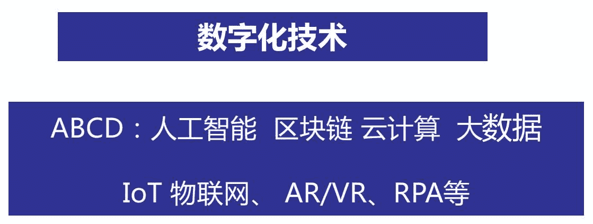

Figure 1-1 Specific Manifestations of Digital Technologies


### 2. Digital HR

Digital HR refers to the use of digital technologies to drive innovation and iteration in Organization, Talent, Culture (OTC), and Leadership, helping business departments achieve rapid performance growth from an HR perspective. Digital technology will redefine human resource management, building enterprises into intelligent HR (iHR) platforms. The impact of digital technology on enterprises is reflected in the following aspects, as shown in Figure 1-2.

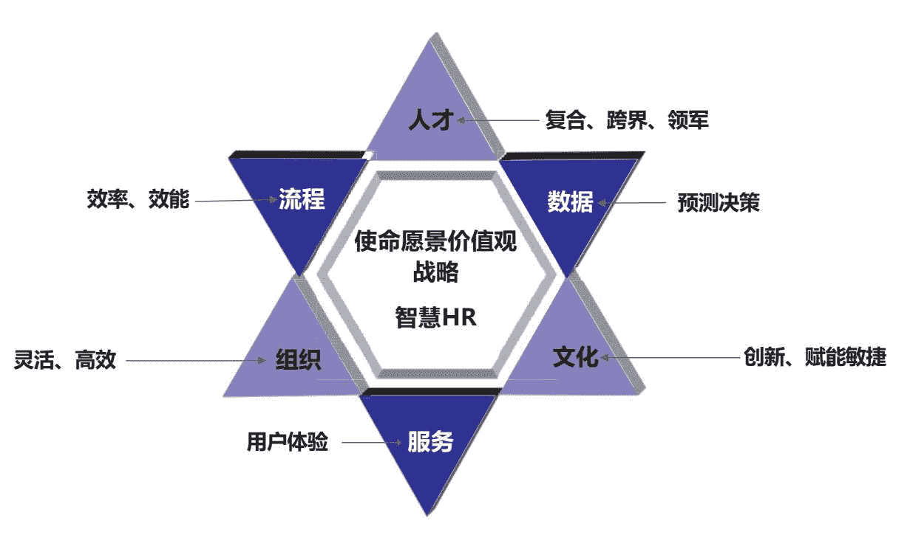

Figure 1-2 Impact of Digital Technology on Enterprises

- Organizations will become more agile, efficient, and interconnected;
- Talent will achieve cross-border integration, talent types will become diverse, and specialized talents will emerge in droves;
- Culture will become more agile, open, and inclusive;
- Processes will achieve end-to-end connectivity, while the application of AI will make processes more intelligent;
- Utilize digital technology to connect systems, achieve natural data tracking (burying points), and precipitate data;
- Data can assist managers in making judgments, making decisions more intelligent;
- User experience will be divided into four levels: usable, useful, easy to use, and delightful; the experience of these four levels improves progressively.

Driven by digital technology, processes are closed-loop, simple, efficient, and end-to-end; data is interconnected; user experience is ultimate; management practices are integrated into processes; thoughts are iterated in think tanks; business is empowered and driven.

### 3. Reshaping of Human Resource Management by Artificial Intelligence

AI acts like a booster or catalyst, effectively accelerating the iteration of HR management models. In the past, even without the aid of AI, HR management models continued to develop and iterate. Today, with the promotion and popularization of "ABCD" (i.e., AI, Blockchain, Cloud Computing, Big Data), AI technologies featuring mobility, socialization, intelligence, and machine learning can help enterprises improve efficiency faster and enhance user experience more effectively.

Now, some outstanding leading enterprises are transitioning from the strategic HR management stage to the human capital management stage, pursuing the sustainable development of talent and enterprise and the maximization of Return on Investment (ROI). To match this, enterprises need to build intelligent HR platforms; only then can they support the corporate ecosystem composed of agile networked organizations, agile culture, specialized talents, etc.

In the relatively stable business environment of the past, managers could infer enterprise development trends with high accuracy relying on rich experience. However, now market changes are accelerating and the business environment is becoming increasingly complex; managers can no longer accurately predict market prospects based on experience alone; therefore, data analysis results have gradually become the basis for managerial decision-making. In the AI era, enterprise HR practitioners can gather information via various digital devices, establish algorithm models to extract valid information, and obtain more precise human resource allocation recommendations through computational analysis, thereby guiding enterprise managers to expand or adjust production scale.

Although AI technology has not been applied in the HR field for long, with the geometric growth of data volume, the continuous refinement of algorithm models, and the leapfrog improvement of computing power, AI technology can make the work of HR practitioners more time-saving and convenient, and also promote significant improvements in enterprise operational effectiveness and efficiency.

### 4. Value of Artificial Intelligence in Human Resource Management

This is an era of volatility, uncertainty, and unknowns. Facing a complex market environment, enterprises not only need a powerful backend capable of real-time analysis as support but also need to adapt to market changes, improve management methods, attract outstanding talents, and jointly create greater value.

The value of AI in HR management is mainly reflected in "four dimensions": Speed, Breadth, Depth, and Height.

### 1. Speed: Accelerating New Technology Application, Driving Business Development

AI technology can be applied to all aspects of HR management, thereby improving HR operational efficiency. For example, the results of facial recognition technology (scanning retinas and faces) are unique and cannot be replicated, effectively preventing "proxy clock-in" phenomena; using big data technology (e.g., models + algorithms) to profile job seekers, conducting qualitative or quantitative analysis on information such as job-seeking intention, work experience, alma mater, professional skills, and workplace credit, can derive the dimensions of enterprise attention to job seekers; through intelligent assessment and precise matching of positions and candidates, resumes can be screened more efficiently, improving the quality of talent recruitment; through Augmented Reality (AR) and Virtual Reality (VR) technologies, enterprises can easily use digital scenarios to provide training for employees, who can more intuitively experience work processes and environments.

### 2. Breadth: Expanding "Point, Line, Plane, Body" Scenarios of Data Analysis

With the continuous iteration of AI technology in data mining, data analysis, and data governance, it has also exerted effects on business from four dimensions: "Point, Line, Plane, Body". The "Point" refers to grasping the focal point of data analysis guided by problems; the "Line" refers to mining the deep-seated reasons of data analysis with business scenarios as clues; the "Plane" refers to enhancing the insight and continuity of data analysis with the data lifecycle as the core; the "Body" refers to building three major systems of data analysis (data system, indicator system, tag system) with data architecture as the core. The application of AI and big data technology in HR management has gone through four stages: speaking with data, data-driven decision-making, data operations, to data innovation, achieving "integration of point and line" and "control of plane and body".

### 3. Depth: Discovering Things Traditional Data Analysis Could Not Insight

Enterprise managers can use AI technology to understand employee needs anytime, anywhere, and design and implement processes that meet employee needs according to their constant changes. For example, AI technology can mine data from employee performance appraisals, interviews, etc., conduct employee turnover prediction analysis, and reduce the turnover rate of outstanding employees through timely insight into employee needs; enterprises using chatbots can save operational costs and time, improve the operational efficiency of intelligent customer service, thereby enhancing user experience.

### 4. Height: Exerting Organizational Effectiveness, Enhancing Enterprise Performance Level

With technological progress, the emergence of mobile internet and the application of AI technology have largely changed the relationships between people, people and machines, machines and machines, people and tasks, people and finance, tasks and tasks, tasks and finance, etc., and also changed the channels of information flow. The traditional top-down communication can no longer meet the needs of information transmission; information flow has begun to develop in a digital direction. Due to changes in the external environment, new value has co-evolved between enterprises and customers, and between enterprises and partners; the original organizational model is no longer applicable, and enterprises must create new organizational models. Changes brought by digital technology have redefined organizational management. In these changes, both enterprises and employees will face some challenges. Due to the high interaction of information and data, enterprises need to use new technologies to enhance organizational capabilities and performance levels; employees need to enhance independent innovation capabilities, needing to maintain high efficiency and agility at all times to respond to changes.

Figure 1-3 shows the "Dual-Wheel Drive" of "Data + Scenarios". AI technology can help HR practitioners collect, process, and clean various data; through models, algorithms, and computing power, combined with management scenarios (including operational health reports, management risk warnings, selection/cultivation/retention trend predictions, decision support think tanks, policy execution supervision and correction, etc.), it provides analysis reports, auxiliary judgment, and decision support for decision-makers (CXOs), managers, employees, or HR practitioners.

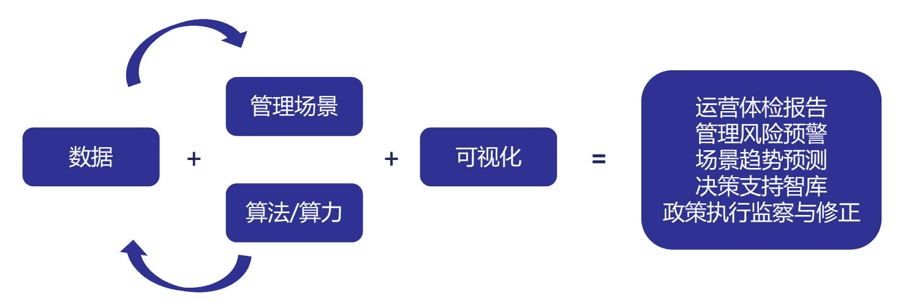

Figure 1-3 "Dual-Wheel Drive" of "Data + Scenarios"

In the future, the speed of technological progress will become faster and faster, and the application of AI technology in the field of HR management will become more extensive, which will drive greater improvements in HR management efficiency, organizational effectiveness, and user experience.

## Section 3 Specific Application Scenarios of AI in HR Management

### 1. Talent Life Cycle

The application of AI in the field of HR management covers the entire talent life cycle, specifically including Onboarding Management (e.g., brand promotion, labor cost prediction, talent radar, robot interviews, front-loading data preparation), In-service Management (e.g., intelligent customer service, self-service platforms, digital shared services, goal management, AR/VR training, gamified learning, agile performance, vitality curves, organizational health, employee satisfaction, talent 360 profiles, public opinion analysis, management risks, integrated incentive centers, care & welfare malls, talent retention warnings, talent migration), and Offboarding Management (e.g., offboarding care, alumni associations, WeChat groups, rehiring/return) three parts, each divided into several links. The talent life cycle and key scenarios are shown in Figure 1-4.

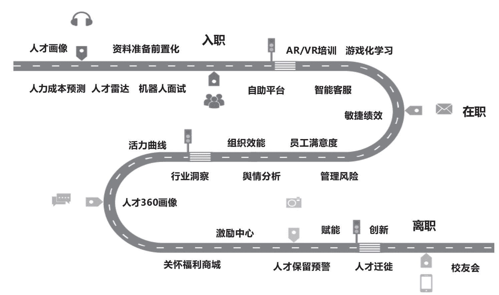

Figure 1-4 Talent Life Cycle and Key Scenarios

The application scenarios of AI in the four major modules of Selection, Cultivation, Utilization, and Retention in the HR field are shown in Figure 1-5.

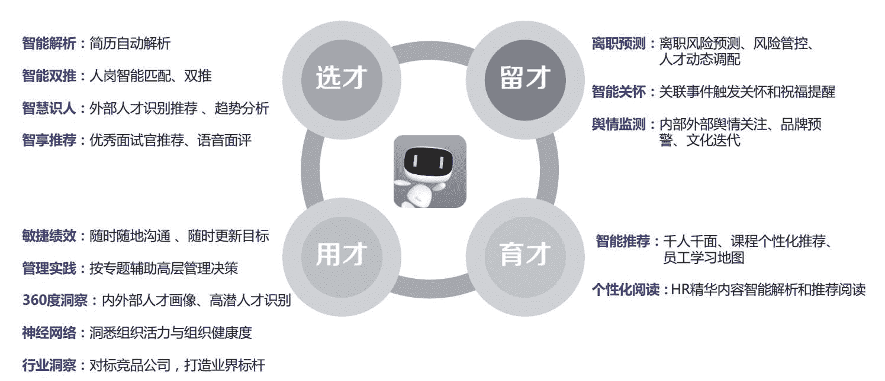

Figure 1-5 Application Scenarios of AI in the Four Modules: Selection, Cultivation, Utilization, Retention

### 2. Talent Selection

- Intelligent Parsing: Resume parsing and recommendation, intelligent person-job matching
- Wise Talent Identification: External talent identification and recommendation, trend analysis
- Smart Recommendation: Excellent interviewer recommendation, interview scoring

AI technology simplifies the process of interviewers screening candidates, reduces recruitment interview time, and enhances candidate interview experience. Before interviews, AI chatbots and virtual interfaces can conduct preliminary screening of candidates to assess their competencies, relevant experience, work skills, or cultural fit. This means AI can help interviewers improve interview success rates.

So, how can enterprises achieve the above results through AI and machine learning technologies?

First, extract high-potential talent characteristics through high-potential talent portraits, thereby obtaining talent portraits for different sequences. Technologies used in the extraction process include automatic matching of job-seeking information and job information, intelligent search across the entire database, intelligent assessment, two-way recommendation, etc. The entire process requires no human intervention, and this technology effectively activates the data in the enterprise talent pool. Second, in the talent recruitment link, recruiters use big data mining technology to intelligently search and recommend resumes across the web, greatly improving recruitment efficiency. Finally, recruiters utilize the search and analysis functions of big data to carry out recruitment services including resume updates, talent recommendations, etc.

Specifically, the application scenarios of big data in the recruitment field are as follows.

#### 1. Two-way Automatic Resume Recommendation

In the traditional recruitment process, job seekers often submit their resumes en masse online, and enterprise HR practitioners or hiring departments also conduct massive screening using recruitment systems; this mode of operation is inefficient and wastes resources. Then, with big data, enterprises can adopt two-way matching recommendation algorithms for positions and resumes, extract relevant attributes of positions and resumes, and assign weights to relevant attributes to achieve two-way automatic resume recommendation. For example, in a job seeker's resume, key information includes job intention, work experience, skills, school, education, major, hobbies, etc.; in the job description posted by the employer, requirements for the job seeker are included, such as graduation from a 985 or 211 university preferred, bachelor's degree or above, major in computer-related fields, work experience of 5+ years, proficiency in Java and SpringBoot, etc. Big data extracts job seeker resume information and employer job description information, conducts model matching and feature analysis, recommends suitable resumes to employers, or recommends highly matched job information to job seekers, thereby achieving two-way automatic resume recommendation, greatly improving recruitment efficiency and person-job matching accuracy.

#### 2. Open and Hidden Dual-Line Intelligent Recruitment System

In the past, HR management systems usually focused on recruitment business and processes. In the digital era, HR management systems are required to be business-oriented, with system settings needing to conform to business department demands. Therefore, the open and hidden dual-line intelligent recruitment system emerged: taking the interview process as the main line and the recruitment process as the secondary line, creating an intelligent, mobile new recruitment system where "everyone is an interview manager".

#### 3. Mobile Voice Interview Evaluation Assistant

After the interview, the interviewer uses voice recognition technology to fill in the interview evaluation in voice or text form. Of course, during the interview, if the system can record the entire dialogue process of both parties (with the job seeker's consent), it can provide rich audio and text materials for the enterprise's big data analysis work.

#### 4. Intelligent Customer Service Assistant

Whether campus recruitment or social recruitment, 80% of the questions candidates care about are repetitive. Therefore, it is necessary for enterprises to develop an intelligent customer service assistant similar to a "chatbot" to answer these common questions; they can provide 7x24 hour service, with more standard answers and friendlier attitudes. When questions are complex and require professional handling, AI technology can also help the questioner understand when and to whom to seek help by invoking communication tools, organizing meetings, etc.

### 3. Talent Cultivation

- Personalized (Thousand People, Thousand Faces): Intelligent course recommendation, employee learning maps
- On-Demand: Coach role matching content, accelerating problem solving and efficiency improvement
- Personalized Reading: Intelligent content parsing and reading recommendation

In the past, the approach to corporate training was for the HR department to formulate training plans, employees acquiring knowledge and skills needed for work and achieving rapid growth, improving the enterprise's overall competitiveness. In the AI era, enterprises use cutting-edge technologies (e.g., AI, big data, AR/VR) to build intelligent learning platforms that provide employees with a comprehensive intelligent learning ecosystem. Employee experiences in learning or work, such as articles read, courses taken, places clicked, etc., are recorded and analyzed. Training specialists, through backend model calculations, based on employee needs or job competency requirements, can find resources truly useful to employees. By establishing a tag system, training courses or content are tagged with learner roles, work capabilities, work scenarios, business processes, etc. Training specialists, combined with learner reading or course selection preference modeling, feature extraction, computing power optimization, and deep analysis, can actively push content to learners based on tags, achieving automatic matching of personnel, positions, capabilities, and knowledge, truly making training "personalized for each individual".

Other application scenarios also include: employees formulating personalized learning plans based on work content, existing skills, development plans, and future goals; flexibly assigning stretch assignments and cross-functional projects based on employee proficiency levels; matching and recommending training content based on individual employee needs; intelligent dialogue bots providing real-time replies to common training or learning questions, with all employees able to ask questions and receive quick replies.

So-called intelligent course recommendation means recommending courses learners might be interested in based on their course selection records or reading preferences; discovering which experts learners followed, thereby recommending expert-related courses; pushing different course content to learners of different sequences and grades. The forms of intelligent course recommendation are shown in Figures 1-6 and 1-7.

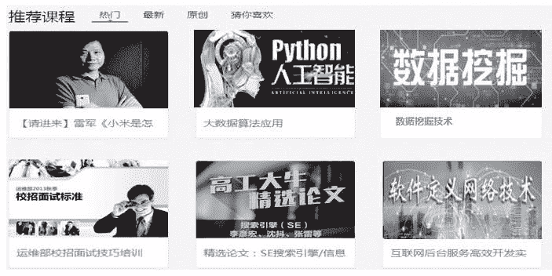

Figure 1-6 Recommended Course Example

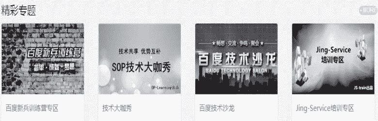

Figure 1-7 Featured Topic Recommendation Example

### 4. Talent Utilization

- 360-Degree Insight: Internal and external talent portraits, high-potential talent identification
- Agile Performance: Anytime communication feedback, performance prediction
- Neural Network: Insight into organizational vitality and health
- Management Practice: Assisting top management decision-making by topic
- Industry Insight: Benchmarking competitors, building industry benchmarks

How can enterprise managers precisely know who the talent they want is? Talent portrait is a very good method. What is a talent portrait? A talent portrait consists of explicit job descriptions and implicit potential traits. In layman's terms, a talent portrait is like a painter depicting a figure, describing talent characteristics; the accuracy of the description depends on the degree of your mastery and mining of information. With the advancement of technology, talent portraits can be divided into three stages: in the primary stage, the talent portrait only draws a vague outline, like a 1-2 megapixel phone camera; in the intermediate stage, the talent portrait is relatively clear, reaching 8-10 megapixels; in the advanced stage, the talent portrait effect is very lifelike, equivalent to 50 megapixels.

Talent portraits are mostly used in the selection, utilization, cultivation, and retention of key enterprise talents, with the main purpose of effectively attracting and utilizing key talents. Specifically, the framework and application scenarios of talent portraits are shown in Figure 1-8.

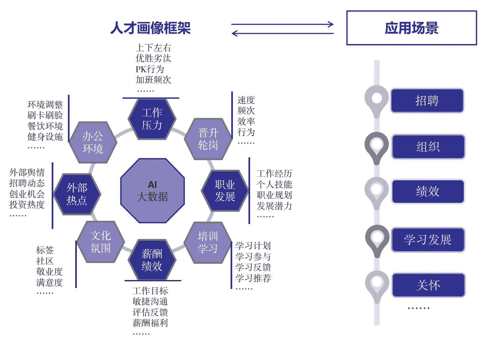

Figure 1-8 Talent Portrait Framework and Application Scenarios

In the selection, utilization, cultivation, and retention of talents, talent portraits can solve the following problems.

- **Talent Selection**: If talent supply speed cannot match enterprise development speed, should managers rely on external recruitment or internal cultivation? Why is the competency rate of some positions low? If there is talent team redundancy, how to optimize for better effect? How to solve key talent loss, lack of successors for core positions, etc.?
- **Talent Appointment**: How to scientifically solve person-job mismatch and team building problems? How to solve core talent allocation problems during transformation phases?
- **Talent Cultivation**: How to cultivate talents using new technologies? How to cultivate talents into leaders? When cultivating talents, should we focus on leveraging their strengths or improving weaknesses?
- **Talent Incentive**: How to enable core talents to fully exert their abilities and initiative? How to reduce core talent loss? What employee incentive measures does the enterprise have?
- **Organizational Development**: How to warn against organizational changes? How to measure team health? How to measure organizational vitality? How to promote team collaboration and improve engagement?

Drawing talent portraits requires a large amount of employee data as a foundation; with the deepening of informatization, digitalization, and intelligence, data volume will increase, and the "clarity" of talent portraits will also become higher.

### 5. Talent Retention

- Turnover Prediction: Risk control, dynamic talent allocation
- Intelligent Care: Providing care, blessing reminders
- Public Opinion Monitoring: Internal/external public opinion focus, brand warning, culture iteration

Offboarding management is the final link in the enterprise's four links of talent selection, utilization, cultivation, and retention. The application of big data in "talent retention" is mainly reflected in turnover prediction, intelligent care, public opinion monitoring, etc. Talent is the driving force for sustainable enterprise development; retaining talent is very important for any enterprise. Using big data technology, models, and algorithms to predict employees' future turnover intentions to achieve retention has gradually become a key task for enterprises.

Under conditions of sound systems and connected data, factor analysis can first be performed on data, divided into individual factors (e.g., age, gender, level, performance, compensation, benefits, work content, skills, personal career development), organizational factors (e.g., corporate culture, organizational atmosphere, work pressure, superior-subordinate relations, span of control, satisfaction), and external factors (e.g., external market job opportunities, external compensation levels, entrepreneurial environment, market heat). Then all factors are summarized into eight dimensional indicators, such as office environment, work pressure, promotion/rotation, training/learning, career development, compensation/performance, cultural atmosphere, and external hotspots. By establishing a multiple regression model to find correlations among factors, clarifying positive and negative correlation influences, and through simulation and verification, the probability of employee turnover can be predicted early, thereby prompting enterprise managers or HR practitioners to take timely measures to reduce turnover risk and ensure normal enterprise operations.

# Chapter 2 Application of AI in the Talent Selection Link

Recruitment is an important link in enterprise HR management, determining the questions of "who can come", "can they do it", "how to do it", and "how long they will stay". In the new era of digital transformation, new technologies such as AI can play greater value in the field of recruitment. With the acceleration of talent mobility and the refinement of professional division of labor, there is greater uncertainty in everyone's career development path. Talents do not regard internal promotion as the only path for career development; they often look outside the company. At the same time, companies face greater challenges in both the "quality" and "quantity" of talent acquisition. In the process of recruiting and selecting new employees, companies usually collect and record large amounts of information, which can be utilized by HR analytics experts. For example, HR analysts can predict candidates' future performance through data collected during the recruitment process. All research or practice on recruitment explores the optimal way for enterprises to select candidates, especially data-driven intelligent recruitment. In this regard, both reliability and validity are important. Reliability refers to the reliability of the method used to screen candidates in the recruitment process; managers hope this method is as objective and impartial as possible. However, people's judgments of each other are very prone to bias, such as the "halo effect" appearing in interviews, where an interviewer's judgment of a candidate's other traits is influenced by one outstanding trait. Validity refers to whether the method can help interviewers accurately screen out people who meet specific job requirements, including distinguishing between well-performing and poorly-performing candidates, and those who want to stay vs those who will leave soon after joining.

## Section 1 KSAM Model

### 1. Concept of KSAM Model

The KSAM model is evolved from the famous Iceberg Model (as shown in Figure 2-1). In the Iceberg Model, the part above the waterline is the appearance, which people can identify through simple contact, observation, and analysis; the part "hidden deep" below the waterline is the essence. The deeper the iceberg goes into the "seabed", the harder it is to assess and measure; people must use systematic means to analyze and identify it. The dominant drivers of human behavior are the "beneath the iceberg" parts, and the deeper the level, the more obvious the influence effect. Therefore, when HR practitioners conduct big data analysis business modeling, they must fully consider and extract features of all parts of the Iceberg Model, combine application scenarios to analyze job and employee characteristics, and truly achieve person-job fit.

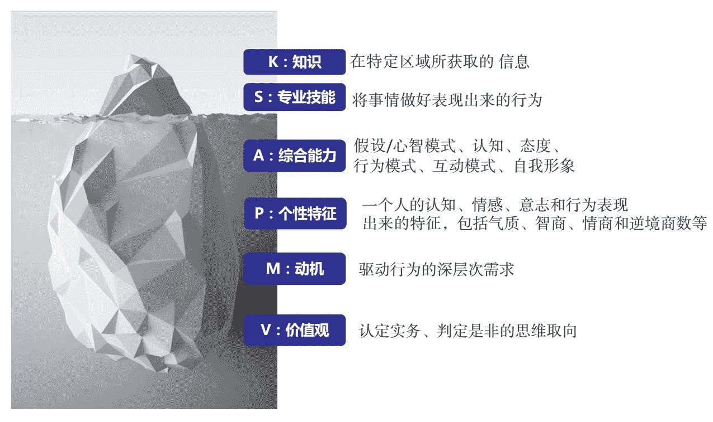

Figure 2-1 KSAM Model

The KSAM model is extracted and developed from the Iceberg Model and can be used for recruitment and selection work. The contents represented by KSAM are as follows.


### The KSAM Model

**K stands for Knowledge**, referring to the factual and experiential information an employee possesses in a specific field (e.g., professional knowledge, educational background, work experience, project experience, training experience, etc.). Knowledge is characterized by being easy to identify and easy to train. In this regard, `HR` practitioners focus on assessing and measuring whether candidates possess the essential knowledge required for the position, addressing the question of whether the candidate "can do the job."

**S stands for Skill**, referring to the employee's ability to structurally apply knowledge to complete a specific task, i.e., the employee's mastery of the techniques and knowledge required in a specific field (e.g., communication skills, organizational skills, decision-making skills, learning skills, etc.). Skills are characterized by being easy to identify and easy to train. In this regard, `HR` practitioners focus on assessing and measuring whether candidates possess basic techniques, addressing the question of "can they do it well."

**A stands for Ability**, referring to the comprehensive qualities an employee needs to complete work in a certain field or a specific project, including mindset, cognitive level, work attitude, behavior patterns, interaction patterns, and self-image (e.g., competency assessment, `OKR` appraisal, performance appraisal, leadership assessment, `360`-degree assessment, etc.). In this regard, `HR` practitioners focus on assessing and measuring whether candidates possess the abilities required by the position, addressing the questions of "how good are they" and "how will they do it."

**M stands for Motivation**, referring to a person's intrinsic, natural, and sustained thoughts and preferences. Motivation drives, directs, and determines individual behavior (e.g., values, satisfaction, engagement, etc.). Motivation is characterized by being difficult to identify and difficult to train. In this regard, `HR` practitioners focus on assessing and measuring candidates' potential and attitude, addressing the questions of "are they willing to do it" and "how long will they stay."

Thus, the information above the "iceberg" waterline is structured data, relatively easy to collect, and convenient for statistics and analysis; while the information below the "iceberg" waterline is mostly unstructured data, relatively inconvenient to collect. `HR` practitioners need to utilize `AI` technology, big data technology, algorithm models, etc., to conduct multi-dimensional analysis, insight, and presentation of the information below the waterline, providing auxiliary judgment for business management decision-making.

### 2. KSAM Indicator Model

The traditional recruitment funnel model is reflected in four aspects: quantity (multiple), speed (time), quality (good), and cost (save), i.e., recruiting a sufficient number of excellent talents in a short time with less cost (as shown in Figure 2-2). Even in the era of `AI` and big data, this remains the basic indicator for measuring the work performance of recruitment specialists.

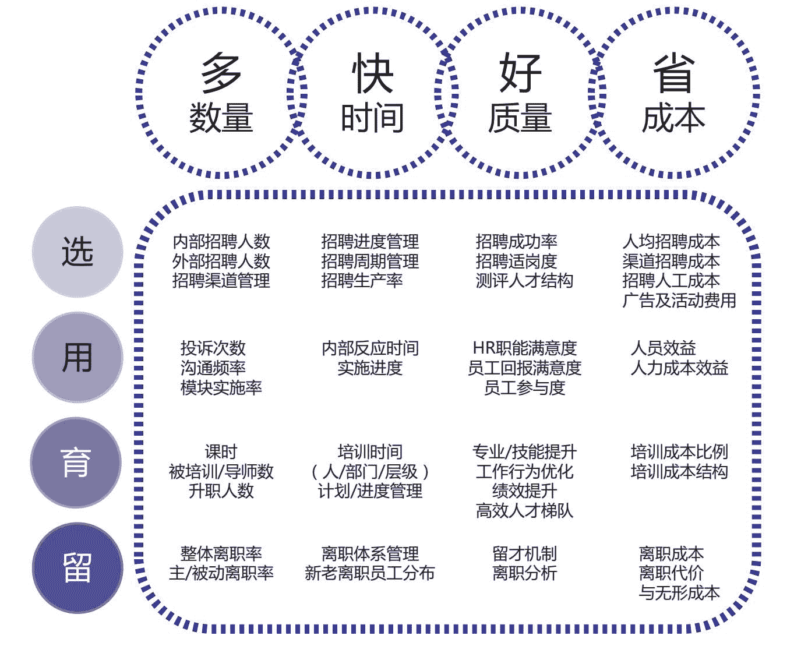

Figure 2-2　Traditional Recruitment Funnel Model

Enterprise managers can evaluate the efficiency of recruitment work from two aspects: the recruitment process and the recruitment results.

#### 1. Efficiency Evaluation of the Recruitment Process

The indicators for evaluating the efficiency of the recruitment process include two aspects: time and cost.

##### (1) Time Efficiency Evaluation

Time efficiency evaluation can be completed based on the following two data indicators.

- **Recruitment Cycle**: Refers to the number of days between the date a position requests manpower and the date the new employee reports for duty.
- **Average Recruitment Cycle**: Refers to the average value of the number of days between the date a position requests manpower and the date the new employee reports for duty.

##### (2) Cost Efficiency Evaluation

Cost efficiency evaluation can be completed using the following three formulas.

- `Cost per Hire = Total Recruitment Cost / Number of Employees Confirmed After Three Months`
- `Offer Ratio = Total Number of Hires / Total Number of Applicants × 100%`
- `Onboarding Ratio = Number of Employees Confirmed After Three Months / Total Number of Applicants × 100%`

> (Note: Assuming the probation period for new employees is three months)

#### 2. Efficiency Evaluation of Recruitment Results

##### (1) Recruitment specialists must find talents matching the position within the specified time and ensure they stay on the job long-term and stably. Therefore, enterprise managers can evaluate the efficiency of recruitment results through the following indicators.

- `Recruitment Plan Completion Rate = Number of Signed Onboarders / Planned Required Number × 100%`
- `New Employee Onboarding Rate = Number of Signed Onboarders / Number of Hires × 100%`
- `New Employee Retention Rate = Number of Employees Confirmed After Three Months / Number of Signed Onboarders × 100%`

##### (2) Recruitment quality is one of the important indicators for assessing the performance of recruitment specialists. Enterprise managers often evaluate recruitment quality through the satisfaction scores of the hiring departments regarding new employees. Generally, the Human Resources Department will ask the hiring departments the following questions after the recruitment work ends.

1. Your satisfaction score for the recruitment services provided by the recruitment specialist is ______ (1~10 points)
2. Your satisfaction score for the speed of candidates provided by the recruitment specialist is ______ (1~10 points)
3. Your satisfaction score for the quality of candidates provided by the recruitment specialist is ______ (1~10 points)
4. Your satisfaction score for the quantity of candidates provided by the recruitment specialist is ______ (1~10 points)
5. Welcome your valuable suggestions on our services (please fill in if any) ______

### 3. Addressing Challenges

In the `VUCA` era full of uncertainty and complexity, enterprises raise their hiring standards to gain a leading advantage in market competition. At the same time, the employment environment and talent market are also changing, posing new challenges to recruitment work.

The primary task of `HR` practitioners is to consolidate basic indicators and enrich and apply the recruitment efficiency indicator model of "quantity, speed, quality, and cost."

With the widespread application of artificial intelligence technology in recruitment work, the measurement indicators of recruitment efficiency also need to iterate in a timely manner, evolving from the "quantity, speed, quality, cost" efficiency indicators to the level of "value output" (as shown in Figure 2-3). Factors influencing "value output" include an attractive employer brand, a high-quality talent pool, talent effectiveness improvement, a competitive compensation system, employee engagement, industry benchmarks, excellent leaders and talent echelons, training benefits, culture promotion, retention index, reduction of replacement costs, etc. In the process of breaking through "value," various risk controls must also be carried out, such as recruitment risk control, talent risk control, culture and soft environment risk management, legal risk avoidance, performance behavior feedback risk, training process risk control, turnover risk management, etc.

At the same time, `HR` practitioners must attach importance to enhancing Employee Lifetime Value (`ELV`), avoiding employment risks, improving the Return on Investment (`ROI`) of talent, and thereby enhancing organizational effectiveness.

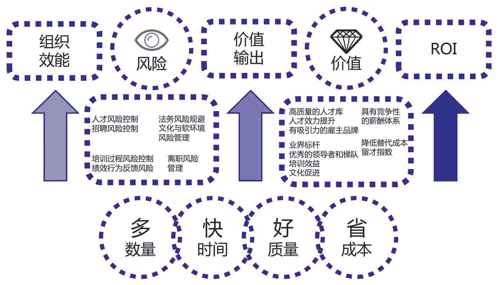

Figure 2-3　Recruitment Indicator Model in the AI Era

#### 1. Avoiding Employment Risks

During the recruitment process, `HR` practitioners must pay attention to preventing employment risks and avoiding labor disputes. In the `AI` era, big data technology can establish risk control models and conduct algorithm analysis to perform machine learning and training in the following aspects, providing employment suggestions and risk warnings to help `HR` practitioners avoid relevant recruitment risks:

1. Candidate resume fraud;
2. Unhealthy competition caused by employee job-hopping;
3. Degree of match with corporate culture and values.

#### 2. Enhancing Employee Lifetime Value

In the past, enterprise managers often evaluated the quality of recruitment work through the satisfaction scores of hiring departments. Now, as enterprises shift from human resource management to talent operations management (e.g., Google, Microsoft, Apple, Airbnb, Netflix, Baidu, Alibaba, Tencent, Huawei, etc.), `HR` practitioners bear a more important responsibility: to evaluate the quality of recruitment work from the enterprise's perspective. At this point, the enterprise needs to introduce a new concept—Employee Lifetime Value (`ELV`), based on which enterprise managers evaluate the quality of recruitment work.

The finance department of an enterprise calculates Customer Lifetime Value (`CLV`) to measure the output value and productivity of their marketing acquisition and sales work. Similarly, recruiting high-level employees is directly related to the enterprise's revenue. Employee Lifetime Value is an important indicator to measure the degree of an employee's contribution to the enterprise's revenue growth.

The value created by high-level employees differs vastly from that created by ordinary employees. Research data shows that hiring a leading talent can yield a return of dozens or even hundreds of times in production efficiency; simultaneously, they possess a halo effect, not only attracting excellent external talents but also having a positive impact on underperforming internal employees.

#### 3. Improving Talent Return on Investment

Research has found that high-level candidates have high Employee Lifetime Value after onboarding, resulting in a higher Return on Investment (`ROI`) for the enterprise. Figure 2-4 illustrates this well: the horizontal axis represents tenure, and the vertical axis represents work effectiveness. Zhang San is an average candidate, with a dashed line representing his ELV curve after onboarding; Li Si is a high-level candidate, with a solid line representing his ELV curve. The data in the figure shows that Li Si's personal effectiveness is significantly better than Zhang San's, and as the enterprise develops, Li Si's ROI is higher (the area enclosed by the dashed and solid lines represents the difference in ROI between the two). This shows that Employee Lifetime Value has a positive correlation with the enterprise's ROI.

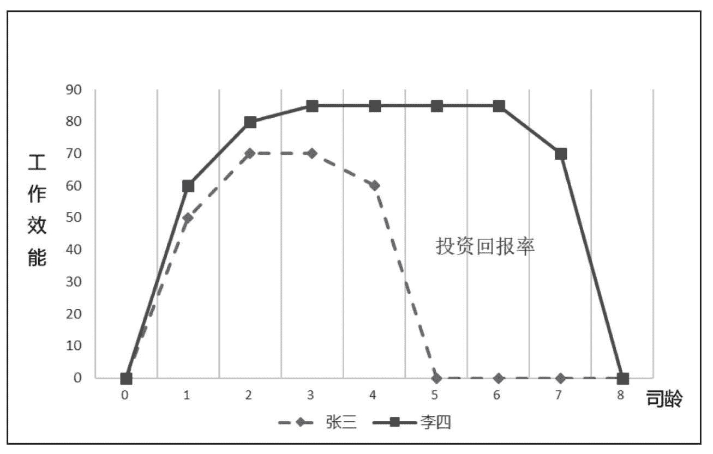

Figure 2-4　Lifetime Value Performance Curves of Two Employees

## Section 2: AI and New Recruitment Practices

### 1. AI Reshaping the Recruitment Process

Entering the new digital era, recruitment work will usher in profound changes, and AI technology will reshape the talent recruitment process.

Recruitment is the work of enterprises finding and screening candidates who meet the needs of vacant positions. According to Deloitte's 2017 survey report, 83% of managers believe talent acquisition is important or very important. Steve Jobs once said: "Apple has made extraordinary efforts to recruit the best talent in the world."

American scholar Breagh et al. divided the recruitment process into five steps:

1. Determine recruitment goals, including the number of recruitment positions and the job requirements for each position, such as educational background, professional skills, etc.;
2. Determine recruitment strategies, clarify the type and characteristics of employees to be recruited and the relevant budget, and determine through which channels and methods to obtain candidate information;
3. Carry out recruitment activities, including confirming personnel participating in the recruitment work, and obtaining candidate information through resume screening and interviews;
4. Draw candidate profiles, including candidates' education, years of work experience, identification with corporate culture, expectations for future work, etc.;
5. Make recruitment decisions and output recruitment results.

In actual recruitment work, a large amount of transactional work is concentrated in the initial resume screening and candidate selection stages. In the traditional recruitment process, these tasks are mainly completed manually by recruitment specialists. Recruitment specialists need to spend a lot of time screening candidates, then contacting those who pass the initial screening and confirming subsequent interviews. This process seems simple but has a significant impact on recruitment results. First, this stage consumes a large amount of the recruitment specialist's time; theoretically, time cost increases linearly with the number of resumes. Second, the recruitment specialist's personal preferences affect the screening results, such as the organization of resume content and the layout style of the resume, which may influence the specialist's judgment. Finally, there is an obvious contradiction in recruiting for certain professional positions: professional department managers (e.g., middle and senior managers) cannot invest a lot of time in initial resume screening, while `HR` recruitment specialists lack the ability to screen candidates in specific professional fields. The consequence of this contradiction is that the enterprise misses qualified candidates and allows unqualified candidates to enter the interview stage or even pass it, bringing a series of losses to enterprise operations.

Existing `AI` technology can optimize the recruitment process from multiple aspects. For example, Optical Character Recognition (`OCR`) technology can recognize and output text content from paper documents or images such as resumes and certificates, helping recruitment specialists easily obtain candidate information; applicants' electronic resumes or data obtained through `OCR` can have important information extracted via `NLP` algorithms. In addition, computer vision algorithms can also be used for video interviews, where recruitment specialists assess candidates by analyzing their answers, facial expressions, and body language.

### 2. Intelligent Resume Screening

Recruitment specialists not only need to help enterprises introduce talents meeting professional requirements but also need to consider the fit between corporate culture, organizational atmosphere, and candidates during the interview process.

Among the six major modules of human resource management, recruitment is a job with relatively high technical content and professional difficulty. Due to their own limited knowledge level and cognitive ability, recruitment specialists always have some deviations when searching and screening candidates. AI technology can correct these deviations because it possesses richer knowledge reserves and more complete cognitive capabilities; simultaneously, it features automation, enabling automatic activation of recruitment functions, automatic search and matching of candidates, and automatic identification, judgment, tracking, evaluation, and analysis.

Baidu used big data technology to develop corresponding algorithms for intelligent resume screening and recommendation. Baidu adopted a "Dual Push" mechanism (as shown in Figure 2-5): on one hand, pushing resumes precisely to recruitment specialists; on the other hand, pushing hot and scarce positions currently recruiting to potential candidates in a targeted manner, achieving "reverse" push. "Reverse" push places higher demands on AI technology, with the difficulty mainly lying in the algorithm. This algorithm cannot be implemented merely through programs but requires continuous iteration and optimization. Behind it are corresponding models built for different positions.

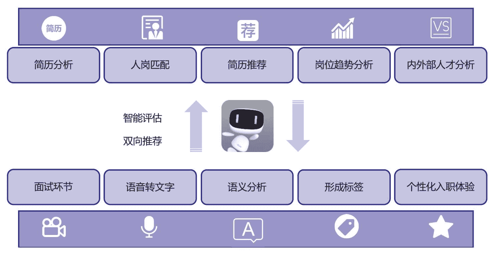

Figure 2-5　Baidu's "Dual Push" Mechanism

The prerequisite for enterprises to build models is having a certain amount of data; otherwise, the accuracy and optimization degree of the model will be affected. Of course, the model itself also needs to be continuously optimized through data. In terms of data collection, the AI engine can automatically scan candidate profiles and match them with available vacancies. Besides candidate data, enterprises also need to collect job information, market heat, industry heat, geographic location, candidate mobility geographic range and areas, etc., e.g., `IT` industry candidates in Beijing mainly exist in the Zhongguancun area. Compared with past fuzzy search and matching, current search accuracy has greatly improved. The AI engine can scan a large amount of job seeker data in a short time, and the algorithm accelerates the speed of resume screening and hiring decisions while ensuring accuracy.

Tencent `HR` practitioners used the method of building internet products to provide recruitment tools for interviewers from business departments. When a business department proposes a hiring need, the HR department first selects three or more high-quality employees within the company, then models, scans, and analyzes the success factors of these employees, such as strong logical thinking, sensitivity to numbers, good at learning, etc. Then it reversely deduces these success factors and implements them into behaviors, designs interview questions based on behaviors, and finally attaches several answer options and scores to the questions.

In the past, most of Alibaba's recruitment work was done by `HR` practitioners, who arranged interviews in advance, and team leaders did not need to search for resumes themselves. Now, Alibaba's recruitment work is mainly the responsibility of team leaders, who need to independently complete recruitment-related work. Based on this management philosophy, the HR department provided a mobile "One-stop Recruitment Workbench," allowing team leaders to complete a series of tasks from job posting, resume recommendation and evaluation, interview and feedback, to offer letter approval on mobile devices. Among them, the intelligent resume recommendation function helps team leaders tremendously; it can automatically collect resumes from all channels, automatically eliminate unqualified resumes, and automatically recommend outstanding talents based on comprehensive scores across four dimensions: ability, potential, willingness, and position, thereby greatly improving the enterprise's recruitment efficiency.

The process of enterprises using `AI` technology to screen resumes is mainly divided into two steps: first, clarify the matching degree between the candidate's resume and the job description; second, classify the candidate's resume based on the matching degree.

We illustrate the problems that need to be solved at the algorithm level through the following case. Suppose a company needs to recruit an Algorithm Engineer, with job requirements and candidate work experience as shown in Figure 2-6.

The work experience provided by candidates A and B in their resumes is as follows.

- **Candidate A**: During university, I participated in an innovation team and served as the team leader. My teammates and I applied the `GBRT` model to predict stock price changes, where my main responsibility was model development. The development language was `Python`.
- **Candidate B**: Using Weibo text data, Weibo platform features, and the dissemination mechanism of fake information, I used data mining technology and natural language processing technology to develop an algorithm for Weibo content credibility assessment. The development language was `Python`.

The above four job requirements include three skill requirements: `Python` development, Machine Learning, and Large-scale Data Processing; the remaining one is a competency requirement, i.e., Communication Skills and Teamwork Spirit.

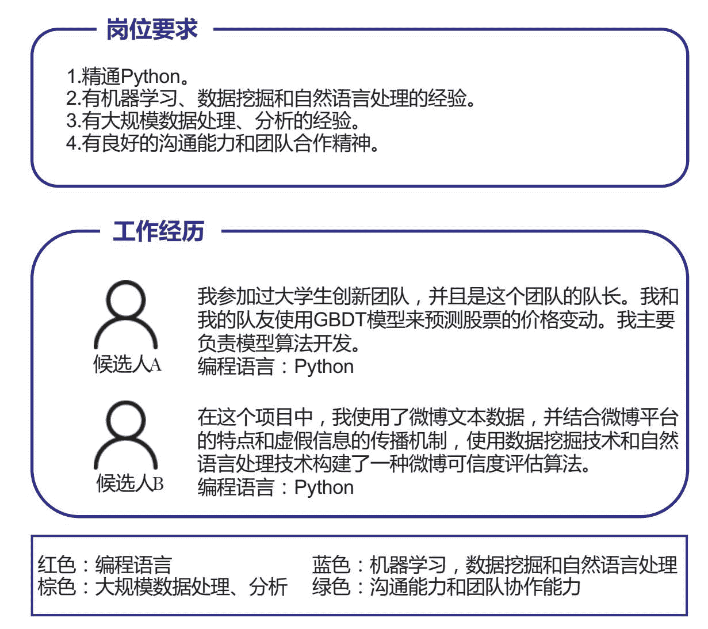

Figure 2-6　Matching Content of Candidates A and B with Job Requirements

Such job requirements are very common in recruitment announcements. However, strictly speaking, the above skill requirements belong to only one skill category. For example, many different skills can match the Machine Learning skill requirement, even if the job requirement is narrowed down to the `NLP` field. Meanwhile, when candidates possess multiple skills, interviewers need to weigh all the candidate's abilities and calculate a comprehensive score to make a choice.

Addressing the above issues, the deep learning algorithm model developed by Baidu Talent Think Tank has achieved the following functions.

1. For long sentences describing job requirements or job seeker work experience, the algorithm model can obtain the vector representation of the sentence and calculate the importance of each word;
2. The algorithm model can calculate the relative importance between different requirements or experiences;
3. The algorithm model can calculate the correlation between a requirement and different experiences.

The algorithm model consists of three parts: Word-level Representation Learning, Multi-layer Ability-aware Representation Learning, and Person-Job Fit Calculation, as shown in Figure 2-7.

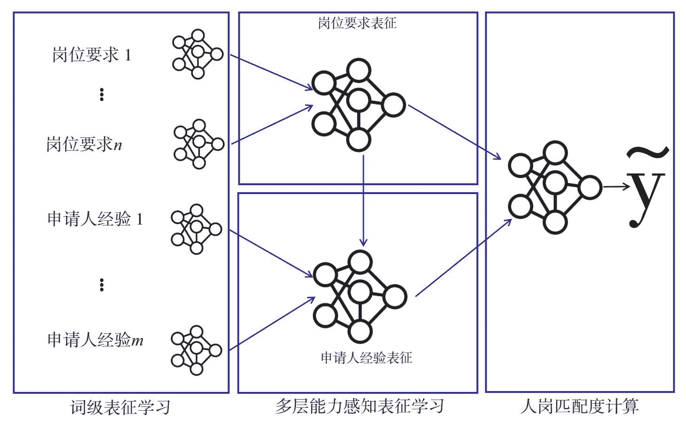

Figure 2-7　Schematic Diagram of the Algorithm Model

#### Word-level Representation Learning

Word-level Representation Learning uses a Bidirectional Long Short-Term Memory Neural Network (Bi-LSTM), i.e., completing character-level representation learning of job requirements and candidate experience through Character Embedding (`word embedding`) technology. The input at this stage is text data describing job requirements and text data reflecting candidate experience. After model learning, these two types of text output feature-representing vector matrices respectively.

#### Multi-layer Ability-aware Representation Learning

Multi-layer Ability-aware Representation Learning enables characters closely related to "Ability" to obtain higher weights through a Multi-layer Attention Mechanism, achieving "Ability Perception." Therefore, the algorithm model can extract higher-level features of job requirements and candidate experience from linguistic understanding of the text, and output representation matrices respectively.

#### Person-Job Fit Calculation

Person-Job Fit Calculation takes the representation matrices as input, calculates the matching degree between job requirements and candidate experience, and outputs the calculation results.

The corresponding algorithm capabilities are reflected in the following three levels.

##### (1) Word Level

Key phrases and phrases in the sentence are not only distinguished but also annotated with different weights.

For example, `Proficient in C, Python, R and other programming languages, familiar with Hadoop, Hive, Hbase, etc.` In this sentence, important phrases related to skills are all identified, including `C`, `Python`, `R`, `Programming`, and `Hadoop`, `Hive`, `Hbase`. Moreover, `C`, `Python`, `R` have higher weights than `Hadoop`, `Hive`, `Hbase`. The words associated with the two groups are `Proficient` and `Familiar` respectively; `Proficient` represents that the candidate has higher skills.

##### (2) Skill Level

Mainly assesses the importance of different skills. The importance of skills reflects the scarcity of skills; the more important the skills a candidate possesses, the scarcer this group is.

##### (3) Matching Level

That is, achieving the matching of job requirements and candidate abilities and experience. At this level, the algorithm needs to judge whether the key skill phrases identified from the candidate's resume can match specific job requirements.

For example, Job Requirement: `Passionate about and understand the Internet, understand and are familiar with characteristics of media forms such as SNS, Forums, Weibo, etc.`; Candidate Experience: `In addition to the above products, has independently designed more than five small products, including Food Ordering App, WeChat Public Platform Developer Version, Constellation App, Course Evaluation System, Task Management Software, etc., and participated in product development and UI design work.`

Among them, the algorithm identified content related to the Internet such as `Food Ordering App`, `WeChat Public Platform`, and `Constellation App`, and the algorithm assigned a higher weight to `WeChat Public Platform` because WeChat, as the most important Social Networking Service (`SNS`) software in China, matches the "Familiar with `SNS`" in the job requirements.

In summary, the model uses deep learning end-to-end algorithms to calculate the matching degree between resume content and job requirement content, and the model performs well on real datasets provided by large technology companies.

### 3. Interview Robots

Unilever used a complete set of `AI` systems when optimizing its recruitment process. First, job seekers are invited to complete a series of online games. These games are designed based on principles of psychology and cognitive neuroscience to help interviewers collect data related to job seekers' behavior, personality, and qualities. Then, job seekers who pass the first round of screening are invited to participate in a fully `AI`-driven online interview. The `AI` interviewer asks structured questions and evaluates the job seeker's emotional state, authenticity of answers, and fit with job requirements. Finally, qualified job seekers receive assistance from an intelligent chatbot, which answers their questions and arranges on-site interviews.

Through this method, Unilever shortened the average recruitment time from 4 months to 4 weeks and reduced the average time recruitment specialists spent on a job seeker by 75%. At the same time, the number of universities covered by Unilever's campus recruitment increased from over 800 to over 2,600. Moreover, a survey of 25,000 candidates showed a candidate satisfaction rate as high as 82%, far exceeding other enterprises.

`AI` algorithms are increasingly being applied to interview video analysis, which can significantly improve interview efficiency, reduce human subjective bias, and provide support for `HR` managers' decision-making.

`AI` algorithm analysis and processing of video files are divided into two parts: image and audio.

- **Image Processing**: Includes recognition and feature extraction of candidate expressions, postures, and movements.
- **Audio Processing**: Divided into two parts:
  1. The verbal content expressed by the candidate during the interview communication. Automatic Speech Recognition (`ASR`) technology can convert speech into text, and then Natural Language Analysis algorithms analyze the text content.
  2. Analysis of candidate voice characteristics, including speech rate, pauses, and intonation.


## Section 3 Intelligent Interviewing

Currently, there are various AI products and services related to interviewing on the market. However, experienced interviewers know that evaluating interview effectiveness solely through keywords is far from sufficient. In terms of image analysis and speech analysis, although `AI facial expression analysis` and `AI voice analysis` functions can provide certain assistance to interviewers, interviewers still need to spend time watching videos one by one to evaluate candidates. Therefore, such products offer limited help in improving interview efficiency.

Now, more technically mature AI interview products have appeared on the market. They can perform complete semantic analysis on the content of candidates' answers and predict their competency. These products use more complex AI algorithms to conduct multi-dimensional deep analysis on the content of candidates' answers, as well as their expressions, voices, and demeanor during the answering process. They can quickly screen out qualified candidates, and interviewers only need to select the most suitable ones from the candidates recommended by the AI product. Although this technology has not yet fully realized fully automated AI analysis and evaluation of interview effectiveness, it can already significantly improve the efficiency of the interview process.

The most cutting-edge products currently on the market can achieve AI-automated structured interviews and even tell recruitment specialists whether to hire a candidate. Such products are very suitable for enterprises conducting large-scale recruitment activities, such as centralized recruitment and campus recruitment with high interview volumes, helping enterprises save significant recruitment costs and time.

According to research in Industrial-Organizational Psychology, in evaluating candidates, Structured Interviews (`SI`) can yield more valid results than unstructured interviews. A structured interview involves having candidates answer a series of fixed questions during the interview process. Therefore, AI algorithms are mainly applied to structured interviews. Below is a case of a structured interview.

> Please tell us about a work situation where you were not the formal leader but played a leadership role. Please provide:
>
> ● Detailed information about the context of the situation;
> ● The actions you took in response to the situation;
> ● The results of the actions.

According to Social Signal Processing (`SSP`) theory, people often judge personality traits by observing and understanding the other party's behavioral signals, and the interview process is no exception. Interviewers assess candidates' personalities by observing and understanding their behavioral signals. These signals include the content of verbal expressions, facial expressions, gaze direction, and other body movements (as shown in Table 2-1). Researchers have proven the feasibility of using AI technology to assess candidates' personalities during interviews through experiments; this technology is defined as Automatic Personality Recognition (`APR`).

**Table 2-1　Linguistic Features to Be Extracted in Interviews**

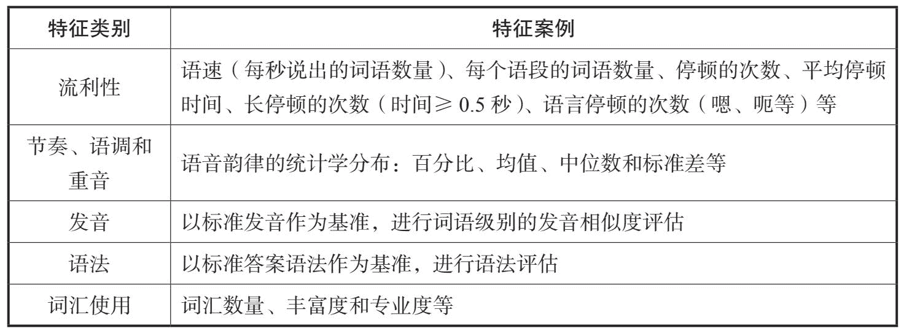

Before building algorithms, HR practitioners need to annotate data, that is, manually evaluate candidates' performance during the interview process. There are three evaluation methods: Behaviorally-Anchored Rating Scales (`BARS`), personality assessment based on first impressions, and overall hireability quantification. The operational steps for BARS are: first, collect Critical Incidents (`CIs`) that can be labeled as effective or ineffective job behaviors; then, edit the collected critical incidents into a uniform format and extract performance categories; subsequently, obtain suitable critical incidents and their corresponding performance categories through a series of cleaning and screening processes—usually requiring multiple annotators to label performance categories separately to ensure assessment accuracy; finally, review the critical incidents and performance categories to generate the final evaluation scales. BARS can complete the assessment of job-related knowledge and skills in interviews.

The personality assessment based on first impressions uses a `7 Point Likert Scale` for quantifying each personality dimension, where 1 represents "Strongly Disagree," 2 "Disagree," 3 "Slightly Disagree," 4 "Neutral," 5 "Slightly Agree," 6 "Agree," and 7 "Strongly Agree." Finally, the assessor makes an overall hireability assessment based on the BARS results and personality assessment results. It should be noted that each assessor needs to conduct a full set of assessments for each candidate's performance in every structured interview. If there are 10 candidates and 5 structured interview questions, each assessor needs to complete 50 sets of assessments.

Interview video analysis at the technical level comprises three parts: image data processing, speech data processing, and linguistic content data processing. Recruitment specialists can use software such as `OpenCV`, `Dlib`, and `OpenFace` to perform feature extraction on image data. Extracted features include head pose, eye gaze direction, and facial expressions based on facial landmarks. Speech features include speech rate, pitch, and pauses, which can be implemented using tools and methods like `pyAudioAnalysis` and `GeMAPS`. Linguistic content features can be extracted by converting speech to text via `ASR` technology, and then extracting linguistic features through `NLP`.

After feature extraction, HR practitioners need to build core models. They can choose either traditional machine learning models or deep neural network models. Traditional machine learning models are relatively simple; deep neural network models can achieve end-to-end learning and have stronger model capabilities. An important factor influencing model architecture is the model's output results. Currently, there are two main types of output: one outputs the candidate's personality assessment results, and the other outputs the assessment result of whether to hire the candidate.

For most small and medium-sized companies, fully possessing the aforementioned technical capabilities is no easy task. However, the good news is that corresponding products and services have emerged on the market. The AI interview system developed by `Hirevue` is being used by an increasing number of companies. Candidates record interview videos as required and upload them to the platform for evaluation and scoring. `Hirevue` can score and rank candidates based on tone, vocabulary usage, and even eye contact. The system also has an interesting feature: online tests can quickly assess candidates. If a candidate applies for a technical job, the system can include a quick coding test to test the candidate's ability in programming languages relevant to the position. The system automatically scores candidates upon question submission and places them on a dashboard, so recruiters know which candidates to prioritize.

## IV. Intelligent Onboarding

The following three technologies help enterprises automate the process of new hires completing onboarding procedures.

### 1. OCR Technology

`OCR` technology refers to the technology of converting text from various bills, newspapers, books, manuscripts, and other printed materials into image information through optical input methods such as scanning, and then converting the image information into computer-inputtable information using text recognition technology. The application of this technology is relatively widespread and mature, but it was rarely applied in the field of Human Resources in the past. It was not until 2016 that `OCR` technology began to be gradually applied to the HR field. When conducting background checks on new employees, recruitment specialists can have them upload information such as diplomas and ID cards to the system in advance, use `OCR` technology to recognize the information, and simultaneously connect to third-party credit platforms (such as the China Higher Education Student Information and Career Center, etc.), thus quickly completing the verification of new employees' identity information.

### 2. Facial Recognition Technology

Facial recognition technology was initially applied in corporate administration departments, mainly used for access control and internal shopping. Later, it was also used in the process of handling new employee onboarding procedures. For example, after receiving the offer letter from the company, new employees can directly obtain a QR code sent by the company's backend through facial recognition technology to make an advance appointment for reporting.

### 3. Appointment System——End-to-End Automation

While sending appointment codes to new employees who have scheduled their reporting, recruitment specialists can also push company news and onboarding guides to them. After new employees arrive at the company and present their appointment codes, they can proceed directly to the onboarding processing location according to the onboarding guide. In addition, since onboarding work is often conducted in batches, to facilitate management, new employees' appointment codes have been matched with seat numbers. "Onboarding Welcome Packs" are also placed on the seats, including the new employee's computer, office supplies, documents to be signed, stationery, etc. This technology can shorten the onboarding procedures, which originally took half a day or even a whole day, to less than an hour. The appointment system connects the link between candidates, the feedback system, and the onboarding system, enabling not only end-to-end automation but also significantly improving new employees' favorability toward the company.

The advantages of automated onboarding are reducing labor costs, improving processing efficiency, and ensuring the standardization and normalization of the onboarding process. Currently, there are two main methods for automated onboarding: mobile onboarding anytime, anywhere, and self-service kiosk onboarding. The specific operational steps for mobile onboarding and kiosk onboarding are as follows.

#### (1) Mobile Onboarding Anytime, Anywhere

**Step 1: Receive Offer Letter.** When the candidate receives the offer letter and clicks to accept, the system automatically pops up the onboarding guidelines and the "Onboarding Registration Form" filling page.

**Step 2: Fill in Information.** The candidate fills in the "Onboarding Registration Form" and submits it.

**Step 3: Upload Documents.** The candidate uploads electronic versions of required onboarding documents, such as ID card or passport, degree certificates, professional title certificates, bank card, and photos for badge making, etc.

> **Note:** The above three steps should be completed before onboarding, accompanied by the recruitment specialist's online background check (such as linking to the public security system, credit system, China Higher Education Student Information and Career Center, or third-party professional background check platforms).

**Step 4: Electronically Sign Documents.** On the day of onboarding, the candidate views the labor contract, non-disclosure agreement, non-compete agreement, confirmation letter, etc., via mobile terminal, and signs the relevant contracts and agreements online through electronic signatures.

#### (2) Self-Service Kiosk Onboarding

**Step 1: Receive Offer Letter.** When the candidate receives the offer letter and clicks to accept, the system automatically pops up the onboarding guidelines and the "Onboarding Registration Form" filling page.

**Step 2: Fill in Information.** The candidate fills in the "Onboarding Registration Form" and submits it.

> **Note:** The above two steps are completed on the mobile terminal (mobile phone) before onboarding.

**Step 3: Onboarding Verification.** On the day of onboarding, the candidate brings the required onboarding documents as prompted by the offer letter to the company's self-service intelligent touch screen (`kiosk`), swipes their ID card for facial recognition, and performs identity verification (the backend synchronously connects to the public security system, credit system, China Higher Education Student Information and Career Center, or third-party professional background check platforms). After verification passes, the system issues onboarding guidelines to the candidate.

**Step 4: Confirm Information.** The candidate confirms the "Onboarding Registration Form" on the `kiosk`.

**Step 5: Electronically Sign Documents.** Sign the labor contract, non-disclosure agreement, non-compete agreement, and confirmation letter, etc. The candidate can view them on the `kiosk` and perform electronic signatures at the bottom right of each page and a final signature (in this step, the backend integrates electronic signature technology).

**Step 6: Submit Documents.** Scan and upload the required onboarding documents (such as ID card or passport, degree certificates, professional title certificates, bank card, and photos for badge making, etc.) directly for archiving (in this step, the backend integrates `OCR` technology).

**Step 7: Produce Badge.** Automatically produce work badges, meal cards, access cards, etc., automatically obtain corresponding employee numbers, departments, etc. Badges are double-sided printed and can be in color. At this point, the onboarding procedures are complete.

Below, based on the sharing by Cao Xing, former Senior Product Expert at Alibaba, at the DHR Conference on October 16, 2020, we introduce Alibaba's onboarding case.

### 1. Matter——Digital Transformation of Onboarding and Offboarding Processes

From independent HR systems to splitting and reconstructing them into a data-driven digital platform, and then exploring intelligent modes such as automated background checks, offer recommendation values, electronic signatures, and certificate `OCR`, Alibaba's onboarding and offboarding systems have undergone the following transformation path.

Take the reasonable issuance of offer letters as an example.

First, realize the structuring of the offer letter. For Alibaba, the most difficult part is not designing the company's salary or structuring benefits, but structuring equity. Alibaba has many subsidiaries with different listing situations. Therefore, its equity structure is very complex. Only after pulling through equity data by technical means and aggregating the candidate's salary, benefits, and stocks can the candidate's total compensation be calculated.

Second, benchmarking. Alibaba needs to consider the salary growth rate at the candidate's original company, while also considering competitors' situations. Alibaba's offer letter compensation designs are completed by consulting firms according to industry rules, but sometimes consulting firms' data is not timely, accurate, or granular enough. So, how to collect data independently without relying on consulting firms is a problem Alibaba needs to think about.

Finally, consider internal equity. Alibaba also needs to combine the candidate's interview performance, consider the ranking of the same level and the proportion above the mean, and reasonably offer a competitive salary.

### 2. People——Employee Digitalization

Alibaba is also exploring how to precipitate data from various angles to comprehensively, objectively, three-dimensionally, and vividly evaluate a person. When evaluating a person, employees and managers must be distinguished. For example, when evaluating a manager, tags are used to depict their management experience, management contribution, and contribution to the team; these all need to be precipitated through various scenarios.

After precipitating a lot of process data, employees can be evaluated in both structured and unstructured ways, comprehensively judging a person from dimensions such as ability, traits, potential, values, and internal social relationships.

After precipitating employee tags, how to use them?

In recruitment scenarios, advantages and disadvantages can be extracted from resume information, unstructured interview evaluations, and structured interview data. Resume screening is conducted through data integration and resume matching models. When interviewers view resumes, they can quickly judge whether a candidate is suitable for the position just through tag empowerment.

In training scenarios, talent portraits can be formed based on data such as characteristics of internal trainees and characteristics of participants in similar courses. Tags are used through crowd selection methods to improve the precision and effectiveness of training.

## Section 5 Artificial Intelligence and Talent Profiling

### I. Concept of Talent Profiling

Talent profiling refers to defining and describing the characteristics of talents who can competently perform a position, based on job requirements. It consists of job responsibilities and requirements (explicit information) as well as potential and extensions (implicit information). Talent profiling is a common language created by the HR department and business departments, and is a virtual portrait derived by HR practitioners based on a deep understanding of data.

#### 1. Explicit and Implicit Information in Talent Profiling

The explicit and implicit information in talent profiling is shown in Figure 2-8, with specific contents as follows.

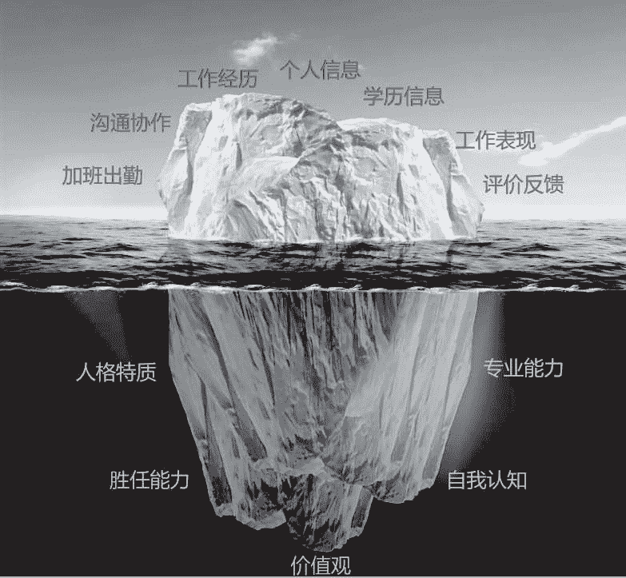

**Figure 2-8　Explicit and Implicit Information in Talent Profiling**

**Explicit Information**

Explicit information can be directly extracted from systems or reports, generally referring to the following structured data:

◇ Personal Information: Gender, age, ethnicity, place of origin, political status, city of residence, marital status, fertility status, family background, etc.;
◇ Educational Information: Graduating institution, major, degree, academic qualifications, whether unified recruitment, etc.;
◇ Work Experience: Company, department, position, tenure, project experience, roles held, awards, patents, etc.;
◇ Work Performance: Performance, promotion, salary adjustment, transfer, rewards and punishments, etc.;
◇ Communication and Collaboration: Email frequency, Instant Messaging (`IM`) frequency, meeting frequency, number of posts and comments, number of likes, etc.;
◇ Overtime and Attendance: Clock-in time, overtime, leave, business trips, etc.

**Implicit Information**

Implicit information refers to the characteristics below the horizontal plane in Figure 2-8, mostly unstructured data as follows, which need to be derived through assessment or big data technology processing:

◇ Professional Competencies: Communication skills, expression skills, summarization skills, document writing skills, innovation skills, learning skills, design skills, operation skills, logical skills, etc.;
◇ Competencies: Leadership, strategic thinking, team management, planning management, customer orientation, etc.;
◇ Self-Cognition: Self-observation, self-evaluation, values (including life values, career values), etc.;
◇ Personality Traits: Emotional stability, extraversion, openness, agreeableness, conscientiousness, etc.

#### 2. Key Talent Profiling

Key talent profiling in enterprises includes the following parts.

**Personal Basic Information**

Personal basic information includes gender, age, tenure, education, region, etc.

**Work-Related Information**

Work-related information includes position, job sequence, title, job grade, performance, evaluation, training, etc.

**Comprehensive Competency Manifestation**

The comprehensive competency of key talents is reflected in the following aspects.

◇ Promotion speed, comparable with ordinary employees.
◇ Key talents' performance in cross-domain capabilities, such as professional background changes in learning experience, and position changes and industry changes in work experience.
◇ Performance and evaluation.
◇ Potential index.
◇ Position in the Talent Nine-Box Grid.

### II. Which Positions Are Suitable for Talent Profiling

Not all positions require talent profiling. Positions suitable for talent profiling are as follows.

● Key core positions, such as team leaders, technical leads, etc.
● Highly specialized positions, such as database development engineers, `JAVA` programmers.
● Positions with many incumbents in the same role that have a significant impact on corporate performance, such as product managers.
● Positions for which the enterprise recruits in batches, such as management trainees, etc.

### III. Application Scenarios of Talent Profiling

Talent profiling is mostly used in the selection, utilization, development, and retention of core talents in enterprises. Specific application scenarios of talent profiling are as follows.

1. **Talent Selection.** When issues arise such as the speed of talent supply failing to keep up with business development speed, heavy reliance on external talent supply, poor performance in certain positions, bloated talent teams in urgent need of optimization, and severe loss of key talents, enterprises need to conduct talent profiling.
2. **Talent Utilization.** When issues arise such as person-job mismatch, unscientific team member allocation, and the need to employ new types of employees during transformation phases, enterprises need to conduct talent profiling.
3. **Talent Development.** When collecting and analyzing training needs, scanning and assessing current leadership status, and evaluating training effects, enterprises can conduct talent profiling.
4. **Talent Motivation.** When issues arise such as outstanding talents being unable to fully exert their abilities and subjective initiative, enterprises can conduct talent profiling.
5. **Talent Allocation.** Through analysis of the matching degree between positions and talents, talent profiling can achieve optimal allocation of talents and positions, effectively reducing employment costs and improving work efficiency.

### IV. Steps of Talent Profiling

The operational steps of talent profiling are as follows.

**Step 1: Data Collection.**

Data to be collected (core elements) includes employees' basic information, work experience, educational background, work performance, communication and collaboration status, overtime and attendance frequency, evaluation feedback, personality traits, professional skills, competencies, self-cognition, and values, etc.

Collection channels include talent archives, recruitment requisition forms, job descriptions, and talent samples (talent samples of target objects).

Data collection methods include retrieval, research, interviews, Critical Incident Technique, etc.

**Step 2: Integration and Classification.** Classify according to eight elements (work pressure, promotion and rotation, talent development, training and learning, compensation and performance, cultural atmosphere, external hotspots, office environment), integrate and summarize by similarity, etc.

**Step 3: Data Refinement.** Remove the coarse and retain the fine, refine typical characteristics with commonality.

**Step 4: Profile Construction.** Sort by priority, improve the profile, and simultaneously add language descriptions, such as scenario descriptions, to achieve digitization and tagging.

**Step 5: Verification and Testing.** Continuously verify and correct during the recruitment process, maintain timely updates and vitality of the talent profile, etc.

### V. AI-Driven Talent Profiling

With the development of artificial intelligence and big data technologies, data collection, mining, cleaning, and processing have become easier, and models and algorithms are increasingly widely applied in HR scenarios such as selection, utilization, development, and retention.

As mentioned above, talent profiling can be divided into eight elements: work pressure, promotion and rotation, talent development, training and learning, compensation and performance, cultural atmosphere, external hotspots, and office environment. These elements run through the entire process of an employee's career. These eight elements and their sub-items are shown in Figure 2-9.

#### 1. Work Pressure

Employees' work pressure mainly comes from work, mostly arising from competitive relationships among colleagues, excessive workload, and excessive work responsibility. Pressure is both a positive, powerful driving force and a negative factor affecting employees' work performance and occupational health. Sub-items of work pressure generally include superior-subordinate relationships, colleague relationships, competitive behaviors, responsibility changes, overtime frequency, meeting frequency, leisure time, etc.

#### 2. Promotion and Rotation

In most Internet companies, professional promotions are generally conducted twice a year, namely spring promotion and autumn promotion. Rotation is mainly a mechanism for cultivating high-potential cadres. Sub-items of promotion and rotation generally include speed, frequency, failure rate, efficiency, behavior, feedback, etc.

#### 3. Talent Development

Sub-items of talent development generally include work experience, personal skills, career planning, development potential, etc.

#### 4. Training and Learning

Sub-items of training and learning generally include learning plans, learning participation, learning feedback, learning recommendations, etc.

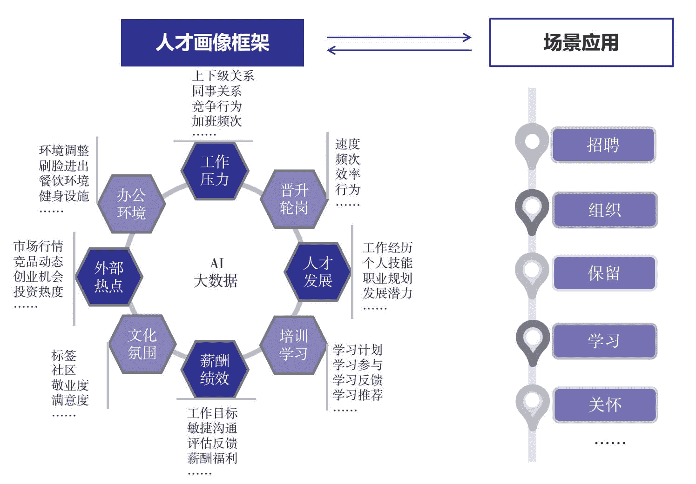

**Figure 2-9　Eight Elements of Talent Profiling and Their Sub-items**

#### 5. Compensation and Performance

Sub-items of compensation and performance generally include work goals, agile communication, assessment, evaluation feedback, appraisal, salary adjustment, bonuses, compensation and benefits, etc.

#### 6. Cultural Atmosphere

Sub-items of cultural atmosphere generally include community, satisfaction, engagement, etc.

#### 7. External Hotspots

Sub-items of external hotspots generally include market conditions, competitor dynamics, entrepreneurial opportunities, investment heat, etc.

#### 8. Office Environment

Sub-items of office environment generally include environment adjustment, facial recognition access, fitness facilities, dining environment, etc.

The essence of talent profiling is to abstract and model each person's attribute tag system from massive personnel data. In terms of technical architecture, the talent profiling system includes multiple functional modules: data collection, feature calculation, feature library maintenance, machine learning models, application interfaces, and profiling applications. The construction of the employee tag system should be completed in layers and batches, and can be classified according to the above eight elements and multiple sub-items.

The data for these eight elements and multiple sub-items come respectively from the enterprise's internal systems (such as HR's "onboarding, offboarding, promotion, demotion, transfer, selection, utilization, development, retention, resignation" + financial system + operation system), as well as external markets and research institutions. After cleaning and processing, these data are stored in big data warehouses such as `Hadoop`, `Spark`, or `HBase`.

Commonly used algorithm models include `Logistic Regression`, `Linear Regression`, `Deep Learning`, `Tree-based Ensemble Learning`, `Matrix Factorization`, etc., which are often used in combination in the practical application of talent profiling.

Visualization presents results to users in the form of dashboards or boards for user judgment and decision-making reference.


"Data + Model + Visualization" is the predictive result that enterprises need to obtain, as shown in Figure 2-10. Of course, algorithmic models will differ across different business scenarios (such as recruitment, talent inventory, training, turnover, etc.). Sufficient data, combined with precise models and business scenarios, will enable HR practitioners to obtain sufficiently clear talent portraits—this is the charm of big data.


Figure 2-10　The "Formula" for Predictive Results

## Section 6 Application of Blockchain in the Recruitment Process

Since 2008, blockchain technology has gradually become known to the public. The inventor of blockchain technology calls himself "Satoshi Nakamoto," whose true identity remains a mystery to this day. Blockchain is a distributed shared ledger and database, characterized by decentralization, immutability, full traceability, traceability, collective maintenance, and openness and transparency. The blockchain's ledger records and database are not controlled by a single entity; information is stored on the computers of every participating entity in the blockchain.

As the name suggests, a blockchain consists of a series of "blocks." Each block includes recorded data, the hash value of that block, and the hash value of the previous block. Once a block is added to the blockchain, it cannot be altered. Based on the privacy requirements of blockchain data, blockchains can be categorized into three types: public chains, private chains, and consortium chains. Public chains are open to everyone; all users can access and view them. Bitcoin is a typical public chain. Private chains are open only to a single entity; therefore, private chains can provide better privacy protection and transaction speed. Private chains are typically used internally within an organization. Consortium chains lie between public and private chains, open to specific qualified entities. Consortium chains can be jointly managed by multiple institutions, each running one or more nodes, and can provide more complex permission settings and management.

Blockchain technology has numerous application scenarios in the recruitment process, detailed as follows.

### 1. Recruitment Interviews and Resume Screening

According to surveys, over 50% of enterprises have discovered false information in applicants' resumes. Before the invention of blockchain technology, this problem could usually only be solved through time-consuming and costly background checks. Now, blockchain's credit mechanism, immutability, and traceability can provide a perfect solution to the above issues. Once applicants' work experience, educational background, and professional qualifications are on-chain, the difficulty and cost of background checks can be greatly reduced, and enterprises can achieve rapid query and verification without third-party agencies. Blockchain even has the potential to replace traditional resumes. Data such as applicants' degrees, work experience, and training certificates can gain credibility through authoritative institutional review and on-chain recording. For example, in 2018, the Massachusetts Institute of Technology (MIT) began providing blockchain-based digital diplomas to students. Since then, the degree verification process for MIT graduates during job hunting has become more secure and efficient, completely eliminating the possibility of forging MIT diplomas. Now, an increasing number of universities recognize the advantages of this method; while providing paper diplomas, they also offer blockchain-based digital diplomas to graduates.

Similarly, job seekers' work-experience-related data can also be stored on-chain after employer verification, thereby guaranteeing the authenticity of all on-chain information. More importantly, blockchain can provide finer-grained job seeker information, including both positive and negative aspects, such as promotion or demotion history, skill levels, and awards and honors received, helping interviewers gain a more comprehensive understanding of candidates.

### 2. HR Process Optimization

Blockchain technology can radically transform and improve many of the daily transactional processes of recruitment managers. Optimizable processes include the following.

#### 1. Payroll Management

Blockchain helps revolutionize the way payroll is managed. Blockchain technology can reduce the probability of human error, while the automation of this process also improves work efficiency and saves time. Enterprises can use blockchain technology to track attendance, overtime, and business travel information related to payroll management, and also manage benefits.

#### 2. Smart Contracts

In the future, blockchain-based smart contracts will gradually replace paper contracts. Smart contracts define transaction terms and specify the punitive consequences of violating those terms. Because smart contracts on the blockchain are essentially a piece of code, conditional statements in the code are used to design contract content that executes under specific conditions. Smart contracts can be applied to multiple scenarios in human resource management. In flexible employment, when employees complete the work content or hours stipulated in the contract, the blockchain can automatically disburse wages to employees; in onboarding, when employees complete background checks and submit documents meeting contract requirements, they can gain access to enterprise systems; in individual tax and social security, smart contracts can batch-calculate and pay the amounts of individual tax and social security based on policies, regulations, and employee compensation.

Large technology companies leverage their own technical advantages to apply blockchain technology internally, and there are increasingly more companies in the market providing blockchain products and services. Aworker has built a blockchain platform serving recruitment; Indorse is a network for IT professionals built using blockchain technology, mainly providing testing, assessment, and certification of IT professional skills. In flexible employment, ChronoBank provides a blockchain-based short-term job recruitment platform for freelancers and employers. The platform has neither regulators nor traditional financial systems; freelancers can complete work on the platform. ChronoBank developed the smart contract platform LaborX. Employers post labor demands and job information through LaborX, and freelancers can find jobs anytime, anywhere via the platform. Current work content is mainly short-term types, including construction, cleaning, transportation, and e-commerce. The LaborX platform charges only a 1% fee, far lower than traditional employment agencies. ChronoBank provides a new flexible employment business model that can match freelancers and labor demands at lower cost and higher speed; simultaneously, this model brings new challenges in taxation, social security, and employment safety.

# Chapter 3　Application of Artificial Intelligence in the Talent Utilization Phase

## Section 1　Common Methods for Headcount Planning and Labor Cost Budgeting

An important task in human resource planning is headcount planning and labor cost budgeting. The English term for headcount planning is Headcount, abbreviated as HC. Foreign enterprises often refer to HC management, while state-owned enterprises refer to headcount planning. Headcount planning refers to an enterprise's personnel allocation plan—the work of adjusting personnel increase/decrease plans based on the enterprise's business development, organizational structure, and organizational capabilities. Simply put, headcount planning involves preparing personnel budgets and recruitment plans.

Headcount planning and labor cost budgeting are often difficult points for managers. They must consider: How many people does the enterprise need in total? How many are needed for each business line, each position, each level? How many for each department? When the enterprise is small, managers can handle these tasks personally, but as the team grows larger, managers need to rely on mechanisms, systems, and methods.

HR practitioners need to use big data mining technology to search, collect, and retrieve internal/external information (such as current enterprise operating data, historical operating data, policy adjustments, etc.). After processing, modeling, and analyzing this information to build simulation calculators, they simulate scenarios of potential personnel cost fluctuations, performance changes, and personnel turnover for each business line and product line. Through comprehensive analysis, they derive reports on current internal human resource utilization and labor costs, and evaluate their rationality. Based on the evaluation results, HR practitioners can make predictions and adjustment recommendations for the enterprise's future headcount planning and labor costs for management reference.

### 1. Steps in Budget Preparation

Generally, budget preparation involves six steps: target forecasting, medium-to-long-term planning, annual business planning, budget preparation, tracking analysis, and performance evaluation, as shown in Figure 3-1. These six steps are closely linked to the objectives and coordinated consistently.


Figure 3-1　Steps in Budget Preparation

1. **Target Forecasting**: Conducting short-, medium-, and long-term market and investment demand forecasting, aiming to set targets and adjust them in a timely manner. The principle of target forecasting is "rough for the long term, detailed for the near term"—meaning long-term targets can be rougher, while short-term targets must be detailed and accurate. Annual forecasting must be implemented down to specific products and businesses.
2. **Medium-to-Long-Term Planning**: Comprehensive business planning at the enterprise level for the medium to long term, including strategic planning, market planning, business/product planning, IT planning, human resource planning, etc. These plans guide business units in clarifying work priorities and directions.
3. **Annual Business Plan**: Enterprise management at all levels sets decomposed business targets for subordinate units; each business unit formulates business plans and proposes investment needs based on targets.
4. **Budget Preparation**: Predicting the HC resources (including different product lines, business lines, positions, levels, regions, etc.) and labor costs required to achieve set targets and detailed work plans, and preparing the annual budget.
5. **Tracking Analysis**: Objectively, accurately, and timely recording enterprise business activities, conducting variance analysis between actual accounting and budget (e.g., typical Curve analysis), focusing on "exception" management, and reporting results to the corresponding management levels.
6. **Performance Evaluation**: Conducting performance assessment based on target completion and the enterprise's incentive system, rewarding business personnel and management who meet or exceed targets.

### 2. Budget Preparation Cycle

In practice, budget preparation follows the fiscal year. About 90% of enterprises prepare budgets according to the calendar year (January 1 to December 31 as a fiscal year), while a few enterprises use April 1 to March 31 of the following year as the fiscal year. Regardless of the method, the key work of HC budget preparation is to do a good job in talent supply-demand planning and labor cost budgeting.

Figure 3-2 shows budget preparation based on the calendar year as the fiscal year. The enterprise breaks down the annual budget into monthly and quarterly budgets. A 3+9 budget adjustment is made at the end of Q1, a 6+6 adjustment at the end of Q2, a 9+3 adjustment at the end of Q3, and a year-end budget review at Q4, while simultaneously starting next year's budget preparation. This cycle proceeds in a phased, progressive budget control manner for refined management, ensuring the achievement of annual budget targets.


Figure 3-2　Budget Preparation Based on Calendar Year as Fiscal Year

Taking a company's annual budget as an example, the calculation method for labor cost budgeting is as follows. First, the labor cost budget requires the following formulas:

`√YTD (Year to Date, or Year to Quarter-end) = Cumulative value from Q1 to current Q;`

`√Estimated Labor Cost Ratio = Estimated Labor Cost / Budgeted Labor Cost × 100%`

`√(YTD) Estimated Labor Cost Ratio = (YTD) Estimated Labor Cost / (YTD) Budgeted Labor Cost × 100%`

`√(Full Year) Estimated Labor Cost Ratio = (YTD) Estimated Labor Cost / (Full Year) Budgeted Labor Cost × 100%`

(Note: 95% is the risk warning line; if ≥ 95%, display a red warning)

Finally, the labor cost budget results can be represented by Table 3-1.

Data in Table 3-1 comes from the company's HR and Finance departments. Taking the company's ZhiXing Business Unit's Q4 2019 budget as an example, since Q4 is at year-end, the YTD labor cost budget for Q4 equals the 2019 annual labor cost budget, both being 34,507,084.12 yuan.

```
Quarterly Estimated Labor Cost Ratio = Quarterly Estimated Labor Cost / Quarterly Budgeted Labor Cost × 100%
= 3,153,797.33 / 5,459,798.14 × 100%
= 57.76%

(YTD) Estimated Labor Cost Ratio = (YTD) Estimated Labor Cost / (YTD) Budgeted Labor Cost × 100%
= 32,201,083.31 / 34,507,084.12 × 100%
= 93.32%

(Full Year) Estimated Labor Cost Ratio = (YTD) Estimated Labor Cost / (Full Year) Budgeted Labor Cost × 100%
= 32,201,083.31 / 34,507,084.12 × 100%
= 93.32%
```

None of the above exceeded the 95% risk warning line; cost expenditure was within a reasonable range, and the system displayed normal status.

### 3. Budget Preparation Modes

There are usually three modes of budget preparation.

1. **Top-Down Mode**

   Some enterprises adopt a top-down mode for budget preparation, where superiors set key financial indicators. For example, the group sets revenue and profit margin targets for subsidiaries, which then decompose budget indicators themselves; the group sets total amount indicators without interfering with subsidiaries' monthly or product-specific budgets. Huawei has a relatively complete IT system connecting finance and business departments (the so-called Business-Finance Integration Platform), so it adopts the top-down budget preparation method. The advantage of the top-down mode is high efficiency.

2. **Bottom-Up Mode**

   Some enterprises adopt a bottom-up mode because frontline employees understand their work situations best; factual reporting makes the budget more practical and grounded. It should be noted that subordinates' self-assessment of their work may not align with superiors' expectations. If superiors constantly raise the bar after seeing subordinates' budgets, subordinates will leave more buffer in their reported budgets to reduce assessment pressure. To avoid this, a common practice when adopting the bottom-up mode is to lower output values (i.e., suppress revenue, profit, and collection) and increase expenditure values (i.e., increase expenses, procurement, etc.). The advantage of the bottom-up mode is that it is more practical and has strong executability.

3. **Combined Top-Down and Bottom-Up Mode**

   Since both bottom-up and top-down modes have pros and cons, most enterprises adopt a combined mode.

   (1) **Target Setting**: The board of directors or the general manager's office proposes the next year's enterprise financial budget targets based on corporate development strategy and the budget period's economic situation, including sales targets, cost/expense targets, profit targets, and cash flow targets, and determines financial budget preparation policies, which are issued to departments by the budget management level.

   (2) **Preparation and Submission**: Departments prepare detailed financial budget proposals based on the targets and policies issued by the budget management level, combined with their actual situations and execution conditions, and submit them to the enterprise's financial management department.

   (3) **Review and Balancing**: The financial management department reviews, consolidates, and provides professional suggestions on the submitted proposals. During review and balancing, the budget management level should fully coordinate, propose preliminary adjustment opinions on discovered issues, and feed them back to relevant departments for correction.

   (4) **Deliberation and Approval**: The financial management department prepares the enterprise financial budget proposal based on departmental corrections and adjustments, and submits it to the budget management level for discussion. For items not conforming to corporate strategy or financial targets, the budget management level should order relevant departments to further revise and adjust. Based on discussion and adjustment, the financial management department formally prepares the annual financial budget draft and submits it to the board or general manager's office for approval.

   (5) **Issuance and Execution**: The financial management department decomposes the approved annual total budget into a series of indicators, which are issued level by level to departments for execution by the budget management level.

### 4. Budget Preparation Methods

There are many methods for enterprises to determine the number of personnel for each position/level and prepare labor cost budgets. Different methods have their own pros and cons in terms of complexity, accuracy, time, and cost, and all have their applicable conditions. In actual work, enterprises comprehensively use multiple methods for calculation and correction. Below is an overview of ten commonly used budget preparation methods.

1. **Budget Control Method**. Controlling headcount through labor cost budgeting rather than rigidly stipulating the specific number of people for a certain position in a certain department—this is a common headcount determination method used by enterprises. Department heads are responsible for their department's business targets, position setup, and employee numbers. Within the approved budget range, they can independently decide the specific headcount for each position.

   If the labor cost budget is linked to business results, it can further enhance the flexibility of headcount control and the effectiveness of meeting business development needs.

   The formula for headcount quota calculation is as follows:

   `Headcount Quota = Total Labor Cost Budget (Business Volume × x%) / Unit Labor Cost`

2. **Business Data Analysis Method**. Determining the enterprise's position headcount for a future period based on historical business data and strategic goals. Business data here includes sales revenue, profit, market share, labor cost, etc. Specific applications are as follows:

   (1) HR practitioners compare historical business data such as sales revenue, labor cost, and gross profit with strategic goals to determine short-, medium-, and long-term employee headcount;

   (2) Conduct regression analysis of employee headcount against historical business data, determine the corresponding headcount range based on short-, medium-, and long-term strategic goals, and then determine specific headcount based on the data of those strategic goals.

3. **Labor Efficiency Calculation Method** refers to the method of calculating position staffing based on production tasks, employee work efficiency, attendance, and other factors. It also refers to calculating employee staffing based on workload and labor quotas. It applies to personnel implementing labor quotas and positions dominated by manual operations. It is specifically divided into two methods: quota based on total production task and calculation based on time quota. The two formulas are as follows.

   `Headcount Quota = Total Production Task / (Employee Labor Quota × Attendance Rate)`

   `Headcount Quota = Production Task × Time Quota / (Working Hours × Attendance Rate)`

4. **Business Process Analysis Method**, i.e., determining the staffing ratio of each position based on the enterprise's overall business targets, position workload, and business process connectivity:

   (1) Determine the total workload in the unit time process based on the overall business target, thereby determining the headcount for each position;

   (2) Determine the unit time workload of a single employee in each position based on position workload, such as the number of products produced per unit time, the number of business transactions processed per unit time, etc., thereby determining the headcount for each position;

   (3) Based on business process connectivity, combined with the analysis results of the previous step, determine the staffing ratio of each position.

5. **Management/Expert Interview Method**. Through management interviews, HR practitioners can obtain the following information: whether employee workload is saturated, whether processes are reasonable, and suggestions for headcount adjustment; predict employee flow direction after a period—promotion (within department or cross-department), transfer, rotation, resignation, etc.—and count the number of employees in each department after a period.

   Through expert interviews, HR practitioners can obtain the following information: personnel structure information for various position types in domestic and foreign industry enterprises, including management hierarchy and span of control.

6. **Personnel Structure Ratio Determination Method**, i.e., determining the approved headcount based on a certain percentage of the total number of employees or a certain category of employees, such as the proportion of functional management personnel, business management personnel, general professional personnel, product R&D personnel, sales personnel, etc.

7. **Benchmarking/Peer Comparison Method**. Referring to the ratio of a certain position's personnel to other personnel in the staffing of benchmark enterprises or other enterprises in the same industry, and maintaining the relative stability of this ratio relationship. This method is more suitable for determining the staffing of auxiliary and support positions. Enterprises using this method should note that they should widely collect peer enterprise staffing data to ensure a certain amount of survey data as the basis for analysis; otherwise, the results may not be accurate.

8. **Trend Forecasting Method**. Comprehensively analyzing recruitment situations over the years (such as total recruitment volume, regional distribution, business/product line distribution, level distribution, organizational development form, promotion speed, management span, employee turnover rate, etc.), making linear predictive analysis, and concluding whether the enterprise's total labor demand is in a stable development state, curve development state, or explosive development state. Usually, at least three years of complete data are required for comparative predictive analysis, while also taking into account sudden business event analysis (such as product line shutdown/merger/transformation), market hotspot analysis (such as entrepreneurship waves, emerging businesses, disruptive innovations, etc.).

9. **Cost Control Method**, i.e., reversely calculating the number of recruitment personnel based on the enterprise's total labor cost budget. Labor costs include acquisition costs, development costs, usage costs, security costs, and exit (resignation) costs of human resources. Among them, recruitment fees, hiring fees, placement fees in acquisition costs, development costs, usage costs, security costs, and severance compensation in exit costs are all explicit costs. Relatively, implicit costs refer to costs that increase organizational operating costs by affecting other costs, such as absenteeism costs due to sick or personal leave, opportunity costs of recruitment screening, low-efficiency costs due to selection errors, replacement costs due to personnel failing probation, pre-resignation low-efficiency costs, post-resignation vacancy costs, low-efficiency corporate culture costs, efficiency costs due to unreasonable processes or long approval chains, etc. In actual operation, enterprises usually estimate explicit costs more, such as wages, social insurance and housing fund, commercial insurance, bonuses, salary adjustments, welfare expenses, training expenses, recruitment expenses, severance compensation, etc., allocating them from the total budget to each business unit and department budget, and then reversely calculating how many people each department and level can recruit, thereby estimating the total number of recruits. Of course, HR practitioners using big data mining technology to analyze implicit costs can make labor cost budgeting more scientific. Currently, the common practice is to multiply explicit costs by a coefficient to obtain the total human resource cost.

10. **Dual-Control Mode Method**. Since the trend forecasting method and cost control method each have pros and cons, enterprises can combine these two methods, forming a dual-control mode that controls both headcount and labor cost. The more accurate current approach is for HR practitioners to use big data mining technology to analyze explicit and implicit costs in real-time, process and model information related to organizational structure, personnel allocation, labor costs, promotion/demotion/transfer, performance management, resignation management, etc., combined with multi-dimensional analysis of external data, simulate various possible change scenarios, evaluate their rationality and risks, and produce a comprehensive talent supply-demand analysis report.

In summary, whatever method HR practitioners adopt, they must be able to convince superiors, user departments, and budget management departments with sound reasoning and evidence.

## Section 2　Structural Forecasting and Rationality Judgment of Labor Costs


The personnel structure distribution and organizational form of a research organization play a positive role in the budget preparation of human costs.

### 1. Laws of Talent Structure Evolution

Talent structures include four common models: the `Vase Model Talent Structure`, `Diamond Model Talent Structure`, `Olive Model Talent Structure`, and `Sphere Model Talent Structure`, as shown in Figure 3-3.

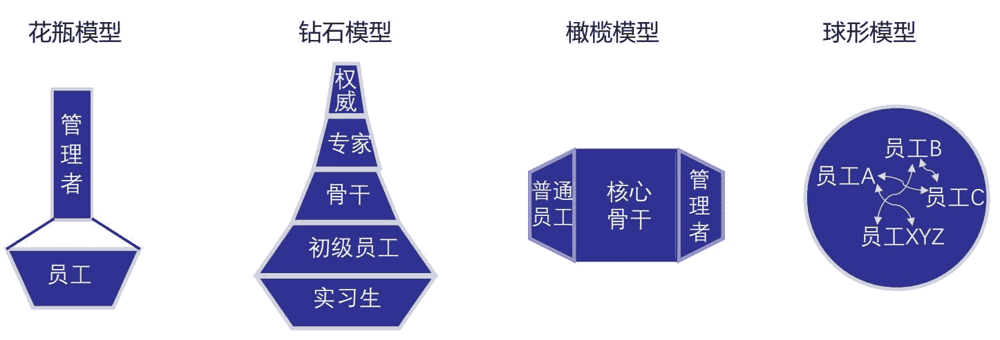

Figure 3-3 Four Models of Talent Structure

Talent structure models vary under different organizational business models. How can they evolve and iterate to ensure talent meets the needs of enterprise development and change? Enterprises can adopt methods such as `Curve Analysis` and `Budget Simulator`.

### 2. Curve Analysis

`Curve Analysis` is a data analysis method that has emerged in recent years. It can be traced back to the "Shape Configuration" evaluation application for positions in the `Hay Guide Chart`. The Hay Evaluation Method, also known as the "Guide Chart–Profile Method," was researched and developed by U.S. compensation design expert Edward N. Hay in 1951. It effectively solved the difficulty of mutual comparison and quantification of relative value between different positions across different functional departments. The essence of the Hay Evaluation Method is a scoring method. According to this system, the three main compensable factors contained in all positions are: Knowledge/Skill Level, Problem-Solving Ability, and Accountability. These three major factors include multiple sub-factors and corresponding scoring systems. The importance of different factors can be adjusted via weights to suit different organizations. The Hay Evaluation Method posits that a position exists because the incumbent must assume certain responsibilities, possess certain knowledge and skills, and produce certain outputs. How do employees with certain knowledge and skills obtain outputs? By solving problems faced in the position—i.e., assuming "Accountability," applying "Knowledge and Skills," and ultimately "Solving Problems." The Hay Evaluation Method evaluates and scores positions based on the above three elements and corresponding standards to derive the evaluation score for each position: `Position Evaluation Score = Knowledge/Skill Score + Problem-Solving Score + Accountability Score`. Among these, the Knowledge/Skill Score, Accountability Score, and the Final Score are absolute scores, while the Problem-Solving Score is a relative score (percentage), becoming an absolute score only when adjusted to the final score. When HR practitioners use the Hay Evaluation Method to evaluate different scores for the three main compensable factors, they must also consider the "Shape Configuration" of each position to determine the weight of that factor, thereby calculating the total score of the relative value of each position and completing the position evaluation activity. The so-called "Shape" of a position mainly depends on the comparison and distribution of the influence of Knowledge/Skills and Problem-Solving Ability relative to Accountability.

For many years, the industry has not provided a suitable Chinese translation for `Curve Analysis`. This book translates `Curve Analysis` as `Waistline Analysis` and defines it as follows: `Waistline Analysis` refers to dividing a certain category of data into "grades" in a form similar to a normal distribution, raising or lowering "grades" through weight adjustments so that the data falls within a certain reasonable range to suit different organizations. That is, by adjusting the position of the waistline and the width of the waist to simulate whether the organization's troop deployment meets management requirements, thereby achieving management objectives.

Below, the impact of `Curve Analysis` on talent structure is illustrated using the headcount data of a specific professional sequence (`P Sequence`) at Company ABC.

In a certain year, Company ABC's employee headcount data and grade distribution are shown in Table 3-2, and the `Curve Analysis` chart is shown in Figure 3-4.

Table 3-2 Company ABC Employee Headcount Statistics Table

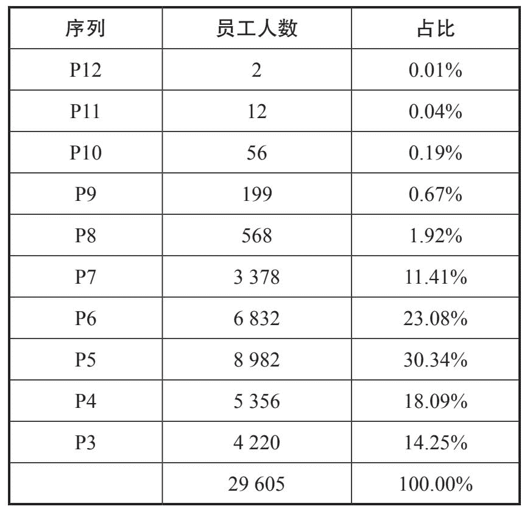
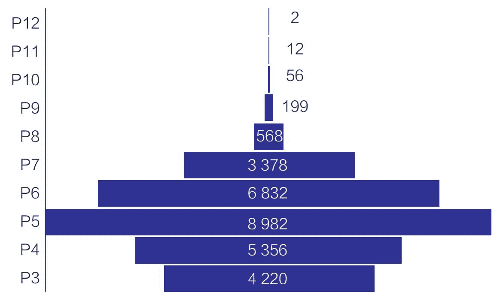

Figure 3-4 `Curve Analysis` Chart of Company ABC Employee Headcount

From Figure 3-4, it can be found that HR practitioners need to adjust the company's personnel structure, simply by adjusting the personnel distribution at the corresponding levels—i.e., adjusting the position or width of the waistline to change the shape. This requires HR practitioners to adopt the following scientific human resource management mechanisms and actions.

1. **Recruitment**. Solve the shortage of `P3` level personnel through campus recruitment, while laying out the enterprise talent structure and competitiveness for the next 2–3 years. Shortages at other levels can be addressed through social recruitment.
2. **Promotion**. Adjust the structural distribution of personnel at various levels by controlling internal promotion ratios.
3. **Job Rotation**. Internal job rotation can also play a role in regulating personnel distribution at various levels. Organizational restructuring, in particular, can directly impact the enterprise's talent structure.
4. **Turnover**. Both voluntary and involuntary turnover can play a certain fine-tuning role in the enterprise's talent structure.

When planning total talent volume, some companies implement single control (controlling only headcount or human cost), while others implement dual control (controlling both headcount and human cost). The model is relatively complex, requiring consideration not only of the `Curve` structure but also factors such as region, school, education, age, tenure, skills, performance, and compensation percentiles. HR practitioners can leverage big data models and algorithms, fully utilize historical data, combine different application scenarios, perform early warning and prediction, and assist managers in decision-making.

### 3. Budget Simulator

The design logic of the `Budget Simulator` is to simulate and calculate the human costs occupied by different levels and headcounts within a department, thereby achieving the purpose of rough budget preparation.

The `Budget Simulator` can also be used for recruitment work. Enterprise users can use the `Budget Simulator` to calculate whether to hire one `P8` senior expert for 1 million yuan, or four `P6` programmers for the same cost, or calculate how many people can be hired at each level within the specified budget.

Budget preparation usually adopts methods such as year-on-year comparison and peer benchmarking. Of course, the growth rate of human costs cannot exceed the growth rates of revenue and profit; otherwise, it is futile. To make the company's employee income higher than the industry average, giving employee income industry competitiveness and enhancing employee happiness, the enterprise needs to create sustainable profits. Human cost and profit are contradictory; only by maintaining a relative balance at a certain point can the enterprise develop upward smoothly, and employee income can be better.

There are three famous "Golden Inequalities" for calculating human costs, as follows.

```
1. Human Cost Growth Rate < Profit Growth Rate
Human Cost Growth Rate = Human Cost Increase / Previous Period Human Cost × 100%
Where, Human Cost Increase = Current Period Human Cost – Previous Period Human Cost

Profit Growth Rate = Profit Increase / Previous Period Total Profit × 100%
Where, Profit Increase = Current Period Total Profit – Previous Period Total Profit
```

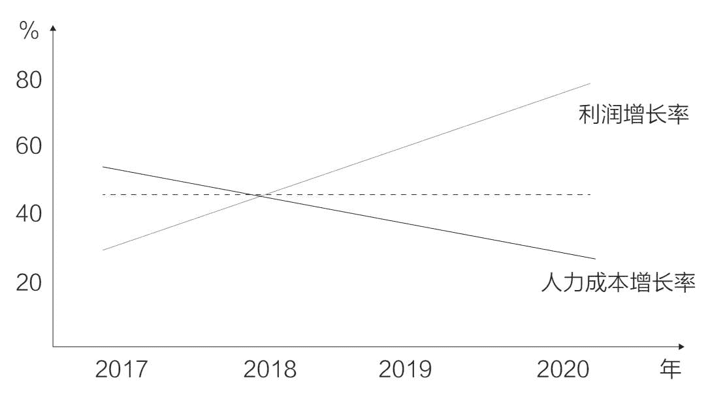

Figure 3-5 Relationship Chart between Human Cost Growth Rate and Profit Growth Rate

```
2. Total Human Cost Ratio < Profit Warning Line
Human Cost Ratio = Total Human Cost / Total Cost for Same Period × 100%
Human Cost to Revenue Ratio = Total Human Cost / Total Revenue × 100%
```

```
3. Human Cost Growth Rate < Revenue Growth Rate
Revenue Growth Rate = Revenue Increase / Previous Period Revenue × 100%
Where, Revenue Increase = Current Period Revenue – Previous Period Revenue
```

## Section 3 Key Indicators and Influencing Factors of Human Efficiency

Human efficiency (Ren Xiao) has the following two definitions.

First, human efficiency stands for **HR Effectiveness**, referring to the degree to which human resource management achieves its goals.

Second, human efficiency stands for **HR Efficiency**, reflecting the input-output ratio of people. Essentially, human efficiency must reflect the effectiveness of the human resource system. Specifically, it calculates whether different human inputs have produced corresponding effects. Simply put, financial or market results divided by human units equals the human efficiency indicator. This is the most hard-line indicator and best demonstrates the value of the HR function.

With the application of AI technology in the HR field, HR business processes and management models will be reshaped, providing technical guarantees and platform support for significantly improving human efficiency.

### 1. Key Influencing Factors

Factors influencing human efficiency indicators are mainly divided into two categories: external factors and internal factors, detailed as follows.

**1. External Factors**

- (1) Economic development and environmental impact, such as digital transformation, etc.
- (2) Frontier technology impact, such as `5G` technology, digital technology, `AIoT`, intelligent manufacturing, etc.
- (3) Labor market supply impact, such as new employment forms like flexible employment.
- (4) Industry talent, such as the mobility of `AI` talent, algorithm engineers, data mining engineers, etc.

**2. Internal Factors**

- (1) Supply-Demand Relationship: Business Demand vs. Personnel Relationship
  
  By observing the changing trends of the demand side and supply side, managers understand the current personnel allocation situation and adjust strategies in a targeted manner. For example, if a company's personnel change amplitude is generally smaller than its business change amplitude (i.e., talent supply falls short of demand), it indicates the company's talent strategy is relatively steady and prudent. Managers may consider achieving business goals by accelerating the regulation of talent structure and distribution and improving personnel efficiency. Conversely, if a company's personnel change amplitude is greater than its business change amplitude (i.e., talent supply exceeds demand), this state generally exists in pioneering, innovative, and frontier technology R&D departments.

- (2) Personnel Inventory and Operation Status, including Quantity, Structure, Quality, etc., and Improvement Goals
  
  HR practitioners can analyze and gain insights into problems existing in the talent team through the following five dimensions, thereby formulating improvement strategies:
  - ① Analysis of employee structure, such as gender, age, tenure, education, region, etc.;
  - ② Analysis of employee value, such as grade, performance, key positions, etc.;
  - ③ Analysis of employee behavior, such as engagement, satisfaction, risk, etc.;
  - ④ Analysis of employee capability, such as general ability, professional ability, leadership, potential, etc.;
  - ⑤ Employee big data analysis, such as talent portraits, tags, etc.

- (3) Personnel Mobility Status and Prediction
  
  Establish an employee turnover prediction model through big data analysis. This model is mainly used to predict employee attrition and provide early warnings, combined with the "Internal Talent Succession Table" to assist HR practitioners in early intervention.
  
  Establish a talent migration map through big data analysis. This map helps HR practitioners timely grasp internal and external talent dynamics, providing data analysis and decision-making reference for the management of hiring, separation, promotion, demotion, and transfer.

- (4) Human Efficiency Competitiveness
  
  An enterprise's human efficiency competitiveness is mainly reflected in three tables: "Talent Flow Statement," "Talent Profit and Loss Statement," and "Talent Balance Sheet."

- (5) Organizational Adjustment and Changes
  
  At different stages of enterprise development or different historical periods, as the business strategy changes, the organization will adjust accordingly. Organizational changes bring about changes in talent deployment, thereby affecting changes in personnel efficiency and effectiveness.

### 2. Key Indicators of Human Efficiency

**1. Human Cost Ratio Indicators**

The human cost ratio refers to the proportion of human costs in the organization's total sales or total operating costs. The higher the human cost ratio indicator, the higher the organization's human costs, meaning human efficiency may be less advantageous. Common indicator formulas are as follows:

```
Human Cost Ratio = Total Human Cost / Total Sales (or Total Output Value) × 100%
Human Cost Ratio = Total Human Cost / Total Operating Cost × 100%
```

**2. Human Capital Efficiency Indicators**

Human capital efficiency reflects the value created by each employee. Common indicator formulas are as follows:

```
Revenue per Employee = Organization Total Sales / Number of Employees
Output Value per Employee = Organization Total Output Value / Number of Employees
Profit per Employee = Organization Net Profit / Number of Employees
```

**3. Human Capital ROI Indicators**

Human capital ROI reflects how much output each expense invested in human resources brings to the enterprise. Common indicator formulas are as follows:

```
Output Value per Yuan = Organization Total Output Value / Total Human Cost
Human Capital ROI = Organization Net Profit / Total Human Cost × 100%
```

**4. Growth Rate Indicators (Also Called Golden Inequalities)**

Growth rate refers to setting certain targets (thresholds) for the growth of human indicators, controlling human costs not to exceed this threshold range, thereby ensuring the quality of human efficiency. When enterprises use this type of indicator, they usually use the following "Golden Inequalities":

```
Total Human Cost Ratio < Profit Warning Line
Human Cost Growth Rate < Profit Growth Rate
Human Cost Growth Rate < Revenue Growth Rate
```

## Section 4 Agile Performance and Compensation & Benefits

### 1. Methods of Goal and Performance Management

Management by Objectives (`MBO`) is a method where managers manage subordinates through objectives, as shown in Figure 3-6. After top management determines organizational goals, HR practitioners must effectively decompose them, breaking down the overall organizational goals into sub-goals for each department and individual. Managers then assess, evaluate, and reward or punish subordinates based on the completion of these sub-goals.

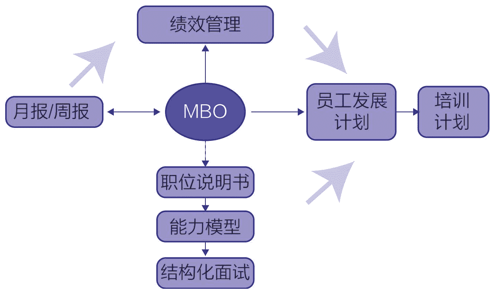

Figure 3-6 Schematic Diagram of Management by Objectives (`MBO`)

Objectives and Key Results (`OKR`) is a management tool and method for defining objectives and tracking their completion.

Key Performance Indicators (`KPI`) are goal-oriented quantitative management indicators. They decompose the enterprise's strategic goals into operable work goals and are the foundation of enterprise performance management.

Balanced Scorecard (`BSC`) is a performance management and appraisal tool invented by Harvard Business School.

What application scenarios are the above tools suitable for? Generally, when assessing junior employees, enterprises are suitable to use the `MBO` tool; when assessing management, enterprises are suitable to use the `BSC` management tool. Most enterprises are suitable to use the `KPI` tool. `OKR` is suitable for exploratory work from 0 to 1; it can explore various possibilities and seek better solutions. Typical scenarios include product R&D, advertising/PR planning, project-driven enterprises, etc. These positions mostly require better creativity and more innovation.

### 2. Agile Performance

#### 1. De-KPI and Normal Distribution

Performance management is crucial for enterprises; it is the orientation of the entire enterprise's value output. After entering the mobile Internet era, `OKR`, "Integration of People and Tasks" (Ren Dan He Yi), Amoeba Management, etc., began to prevail. Many enterprises abandoned forced distribution and rank-and-yank (forced ranking), turning to agile performance. Employees and managers can modify goals and provide feedback anytime, anywhere via mobile Apps; they can also solicit feedback from other experts or project managers. Moreover, performance output results are not directly linked to promotion or salary adjustment. This approach greatly enhances communication effectiveness between employees and managers, helps employees adjust personal development directions in time, and achieve rapid growth. Of course, some things are unquantifiable, such as work passion and innovation drive. This requires HR practitioners to pay more attention to employees' work status, code production, behavior performance, teamwork, and communication on a daily basis, using big data and `NLP` technology for modeling, conducting quantitative and qualitative comprehensive analysis, clarifying which factors can maximize employee performance, thereby achieving the goal of improving organizational effectiveness.

Intel and Google adopted `OKR` earlier. Accenture, Adobe, Microsoft, Dell, General Electric, IBM, and other companies have begun to promote agile performance. Baidu also started comprehensively promoting `OKR` in early 2019.

#### 2. Agile Communication

Agile is a philosophy, a culture, and a set of management practices. Agile is radically changing the field of human resource management.

Regarding HR management work, sitting in a meeting room for lengthy meetings is not always the right solution. HR practitioners need to co-develop solutions with business departments. Josh Bersin provided an agile model for HR practitioners and business departments to co-create solutions, as shown in Figure 3-7.

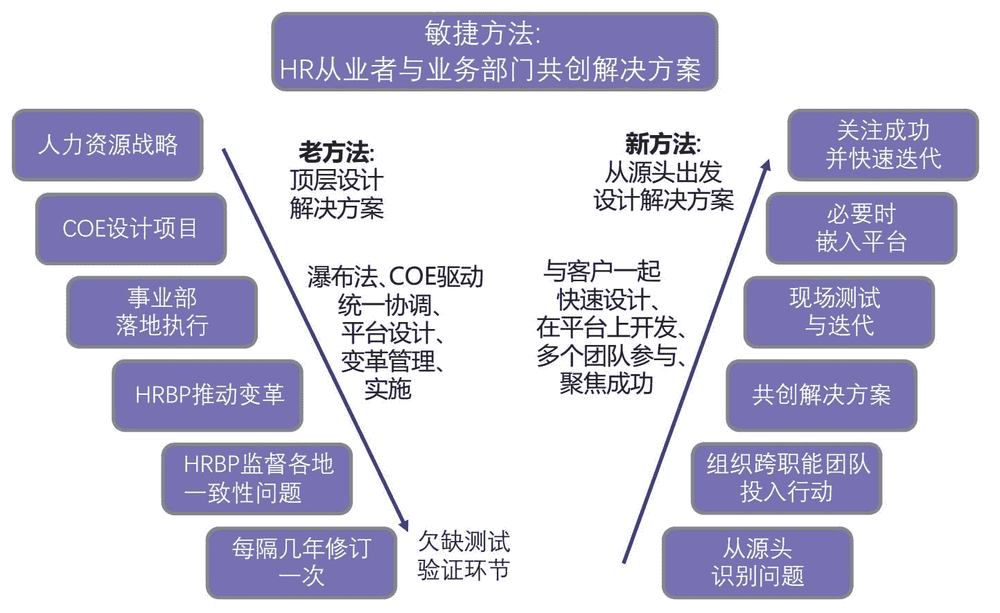

Figure 3-7 Agile Model for HR Practitioners and Business Departments Co-creating Solutions

HR co-creating solutions with business departments represents a trend.

The past approach was top-down design, completed from top to bottom. The company's `COE` (Center of Expertise) derived and designed relevant projects based on HR strategy, delivered them to various business units or divisions for implementation, and `HRBP` (Human Resource Business Partner) drove change across the platform. Meanwhile, `HRBP` supervised and handled consistency issues across regions. The entire project would be revised every few years. This process went through Waterfall, `COE`-driven, unified coordination, platform design, change management, implementation—uniquely lacking a test and verification phase.

The new agile method designs solutions from the source, completed from bottom to top. From identifying problems at the source, organizing cross-functional teams to take action, co-creating solutions, to field testing and iteration, embedding into the platform when necessary, focusing on success and rapid iteration. The characteristics of this approach are rapid design with customers, development on the platform, participation of multiple teams, and focus on success.

The typical feature of performance management being iterated by agile is the greatly increased frequency of performance communication and feedback. Many enterprises have developed mobile terminals to follow up on project progress with department managers anytime, anywhere in the form of mobile conversations. At the same time, department managers promptly feedback employees' strengths and weaknesses to help them improve personal capabilities. These situations automatically form summaries and are recorded in the system backend, laying a data foundation for the next step of big data analysis.

#### 3. Employee Engagement and Performance Management

According to a tech media report, Amazon uses an AI system to judge the work efficiency of employees in warehousing and logistics centers. If an employee's cumulative efficiency score fails to meet the standard, the system issues a warning or even a termination command. After the system went online, hundreds of employees in Amazon's warehousing and logistics centers were fired.

Amazon used the `AI` system as a front-end data collection and processing system for the HR management system. The `AI` system first analyzes and processes surveillance video footage from the workplace, identifying employee `ID`s and corresponding behavioral states, then outputs the results as structured data. This data result can be used in different business scenarios, such as improving workplace safety and managing employee production efficiency. Amazon's `AI` system calculates employees' "slack time" by identifying whether employees are in a "slacking off" state during work hours. The `AI` system can process employee work behavior status into data in real-time; its output structured data can serve as input for downstream performance management systems, providing decision suggestions and data basis for management behaviors. This decision process requires no human involvement, forming a complete business closed loop.

The "foreman" function of the `AI` system has an obvious effect on reducing enterprise management costs and improving employee efficiency. The `AI` system can accurately calculate the number of packages each employee completes per hour and each employee's working hours. However, Amazon allowing the `AI` system to directly fire employees sparked huge social controversy on a moral level. It is said that Amazon recently shut down this AI and conducted iterative optimization.

Amazon's case is a microcosm of talent management transformation in the AI era. While AI helps us solve problems, it also brings new problems. Algorithms can make the competitive environment fairer and improve employee engagement, but we must also be vigilant about the drawbacks brought by these AI systems. Ride-hailing and food delivery services make our lives more convenient; we only need simple operations on our phones to enjoy services, ultimately completed by drivers and couriers. Drivers and couriers earn remuneration through the platform, yet they are not employees of the platform company. Drivers and couriers cannot freely control their time because the platform evaluates their performance through algorithms reflected in remuneration. Evaluation criteria include daily order volume, average order value, and user feedback. These drivers and couriers are managed by a complex AI algorithm system but cannot influence this system. This is a more complex and radical situation than the Amazon case. In the foreseeable future, more and more companies will introduce AI algorithms in talent management, including performance scoring, employee engagement analysis, and management sequence recommendation. Of course, managing people entirely with AI algorithms is not a good idea. Enterprise managers need better methods to train employees and introduce better technologies to help middle managers understand how to support employees and improve their performance.

Employee engagement is the most core part of talent management because it directly relates to how much value employees create for the enterprise. Various studies link employee engagement levels to innovation, safety, quality, revenue, shareholder value, customer satisfaction, retention, etc. These correlation indicators vary by industry and enterprise. However, once these indicators are set, AI technology can output these indicator results to dashboards and display specific business correlations and quantify correlation degrees in real-time as much as possible. For example, a catering service company may see the correlation between employee engagement and user satisfaction more clearly than a manufacturing company. Because managers have a huge impact on employee engagement, the system can evaluate management levels while suggesting managers improve employee engagement. Research finds that managers' communication time and frequency with employees and managers' team size affect employee engagement. AI applications can help managers conduct regular discussions with team members and pay attention to real-time changes in employee engagement levels. From a practical perspective, the process of improving employee engagement is the process of discovering and recognizing employee contributions and encouraging employees to fully invest in their work. Obviously, relying solely on AI technology cannot fully achieve this process. But by giving managers better, more timely information, the system can guide them to build better relationships with team members.


##### Analysis of Employee Engagement with AI Can Extend to Employee Performance Management

A key issue in employee performance management is how to set benchmarks for performance evaluation, including external and internal benchmarks. External benchmarks include where the company's employee performance levels stand in the industry, how they differ from competitors, and whether the company has unique methods for improving employee performance or merely imitates others' strategies. Internal benchmarks include the core factors that distinguish high-performing employees from others; managers can easily pick out high performers, but not all managers can clearly articulate the selection criteria; whether the selection process can be quantified, proceduralized, and kept objective. In most companies, the performance management process is unrelated to expected outcomes; performance management systems can track employee performance but are lackluster in helping employees improve their performance levels. AI technology can help managers improve this process and support them at critical moments. For example, a company expects managers to provide timely feedback and coaching on employee performance, but in implementation, this is undoubtedly affected by managers' schedules and work styles, bringing certain pressure to managers. AI technology can help managers promptly notice abnormal employee performance so they do not miss opportunities to provide feedback and coaching.

More importantly, AI technology can use historical and real-time data to predict employee performance. The characteristics of a high-performing employee can be used to build a profile for a specific position, which can be used in the organization's recruitment and screening processes. Many companies also measure employee job satisfaction through regular organizational surveys. All this data can be correlated with employee performance data.

Analyzing employee performance data is closely related to other HR scenarios, such as employee training, career planning, and talent retention. A significant decline in an employee's performance level in a specific department or position may be related to the employee's ability, or it may be due to insufficient staff in the same department, or because the employee lacks specific skills training. Managers can also judge whether an employee meets the promotion requirements for a specific position based on their past experience, skills, and performance.

A large chain service company, after experiencing severe customer churn, hoped to turn the situation around by improving employee performance levels. With the help of a consulting firm, they restructured the employee performance management process, linking employee performance evaluation results to relevant business outcomes. These business outcomes were identified as the number of customers, customer satisfaction, and employee satisfaction for each operating chain store. Then, employee indicators directly affecting these business outcomes were determined, such as job fit, teamwork, senior leadership ability, communication skills, compensation level, career development direction, customer focus, etc. The scores of these factors were mapped to relevant business outcomes and analyzed using algorithms. Finally, the business drivers with the greatest impact on business outcomes were screened out and visualized, categorized into several levels: observation, maintenance, improvement, and focus. Based on these categories, the performance appraisal weights for each store manager were designed. Within a year after the completion of this reform, the chain service company's customer satisfaction increased by more than 20%, while the employee turnover rate decreased by more than 10%.

### III. Intelligent Compensation Data Analysis Platform

Reference link: `../Text/contents.xhtml#c_51`

In the current increasingly fierce talent competition, how to retain key talents has become a huge challenge for enterprises. In some industries, the average tenure of employees in a company has even fallen below two years. An important strategy for enterprises to recruit and retain key talents is to provide competitive compensation and incentive packages. HR data analytics can provide technical support for managers' compensation decisions.

#### 1. Intelligent Compensation Data Analysis Platform

The module accounting for the largest proportion in HR data analytics is compensation. When HR practitioners handle compensation module data, they must first conduct salary data analysis (e.g., calculation methods, composition analysis, salary expenditure, budget analysis), and then conduct compensation policy data analysis. Specifically, HR practitioners have the following main analysis activities:

- Human capital investment analysis
- Labor cost analysis
- Per capita efficiency analysis
- Personnel incentive analysis
- External benchmarking and competitor analysis
- Compensation policy data analysis
- Budget analysis

How to conduct effective analysis? HR practitioners need to build a compensation management data analysis platform, as shown in Figure 3-8. The construction method is similar to an HR big data platform or relies on an HR big data platform.

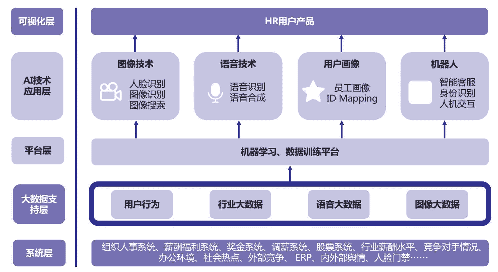

Figure 3-8 Compensation Management Data Analysis Platform

The compensation management data analysis platform can be divided into the system layer, big data support layer, AI technology application layer, and visualization layer.

##### System Layer
Enterprises can fully utilize informatization, digitalization, AI, and other technologies to build relevant systems or Apps to collect and precipitate data. These data are divided into internal data and external data. Internal data includes data from organization, position, compensation, attendance, entry/exit/promotion/demotion/transfer, selection/use/development/retention/management, OA, portal forums, access control, facial recognition, finance, operations, and other systems; external data includes external market analysis data, industry data, competitor company data, compensation survey report data, etc.

##### Big Data Support Layer
Through data collation, cleaning, and processing, information is classified and archived, stored in a data warehouse for subsequent big data analysis activities related to compensation.

##### AI Technology Application Layer
Utilize AI computing power to carry out activities such as building big data algorithm models, machine learning, data training, scenario analysis, and thematic analysis.

##### Visualization Layer
Also known as the display layer or dashboard layer, it mainly provides various dashboard products and early warning predictions for enterprise managers, HRBPs, and HR COEs, providing intelligent reference for operational analysis and management decisions, such as intelligent payroll calculation, intelligent attendance, compensation pricing, monitoring and early warning platform (total wage approaching or exceeding budget warning line, abnormal monthly wage fluctuation warning, excessive incentive analysis warning, etc.).

By using AI technology, enterprises can not only analyze and process employee information quickly and effectively but also leverage the advantages of "Internet + Big Data" to deeply mine market compensation survey data and formulate compensation management plans suitable for the enterprise through algorithm models. At the same time, AI technology can help enterprises monitor market conditions in real-time, control compensation costs, predict enterprise development trends, and provide a reliable basis for compensation management decisions by top managers and HR practitioners.

#### 2. Salary-Skill Neural Network Model

Job skill value, as an important economic indicator in the labor market, can not only assist managers in conducting individual competency assessments but also help enterprises improve salary structures to attract and retain talent. So, can AI technology "refine" the assessment of job skill value?

A latest research achievement in the field of "AI + Talent Management" was published in *Nature Communications*, a sub-journal of the international top journal *Nature*. This study used a data-driven method for the first time to explore the important issue of the relationship between salary and job skill value assessment through machine learning technology, which has significant value in multiple fields such as the rationality and fairness design of social labor value distribution mechanisms, social labor security, intelligent recruitment and precise employment, and personalized vocational education. The following is an excerpt from the paper.

The main basis for companies setting compensation is the value created by employees for the company. HR management practice experience tells us that the amount of value created by employees is closely related to factors such as employee skill level, engagement, and cultural identity. Especially for positions requiring professional skills, employee skill level plays a crucial role, such as engineers, doctors, and lawyers. However, for a long time, we have lacked methods and tools for quantitative analysis of factors affecting the value created by employees. Therefore, companies usually can only use result-based methods to evaluate the value created by employees. For example, companies evaluate the value created by employees on a quarterly or annual cycle, and then adjust the compensation structure. This method has serious defects. The first is lag. If an employee's value creation for the company cannot meet the company's requirements due to skill level, engagement, and other issues, the company can only discover this at the end of an evaluation cycle, but the loss caused to the company has already formed, and the company cannot control this risk in advance or during the process. The second is ambiguity. Due to the lack of systematic quantitative analysis of factors affecting employee value creation, companies cannot adopt precise methods to optimize and improve employees' ability and level of value creation.

The good news is that the latest AI research has built a bridge between compensation and job skill value assessment. Researchers from Baidu Talent Intelligence Institute, Chinese Academy of Sciences, Beihang University, University of Science and Technology of China, and Rutgers University collaborated to construct a Salary-Skill Composition Network (SSCN) with a collaborative structure. This model aims to establish a quantitative relationship between job skill proficiency and job salary, and can analyze the impact of skill value on job salary as an independent variable. By analyzing skill requirements and compensation data from a large amount of recruitment information, the model completed two tasks: realizing skill value assessment and salary prediction. In terms of skill value assessment, the model can achieve fine-grained skill value assessment based on work scenarios and job scenarios. In terms of salary prediction, the SSCN model surpassed SVM, LR, GBDT, and a series of other deep neural network models, achieving new SOTA accuracy. This research achievement provides new methods and algorithm models for data-driven quantitative compensation research.

Currently, the relevant algorithms of this research have been implemented in Baidu Intelligent Recruitment related products. It can help intelligent recruitment systems objectively and scientifically conduct resume evaluation and person-job matching. In addition to internal applications, Baidu Intelligent Recruitment System provides intelligent recruitment solutions to the outside world through Baidu Brain, combining AI computing power with suitable algorithm models to provide enterprises with more efficient intelligent recruitment services, freeing recruitment specialists from massive resume screening and tedious communication, helping enterprises save recruitment costs, and playing a significant role in promoting the intelligent and digital development of enterprise recruitment.

### IV. Compensation Intelligent Assistant

Reference link: `../Text/contents.xhtml#c_52`

The Compensation Intelligent Assistant refers to enterprises using AI, machine learning, and big data algorithm models to build a compensation big data analysis platform, using market data and user self-service data to help HR institutions, HR practitioners, or enterprise managers comprehensively and in real-time understand market position supply and demand situations and salary trends, assisting in judgment and decision-making to achieve the goal of knowing oneself and the enemy and maintaining competitive advantages.

The Compensation Intelligent Assistant is mainly applied in the following three scenarios.

#### 1. Market Position Prediction
The Compensation Intelligent Assistant can help enterprise managers understand the supply and demand situation of a certain position in the market, thereby deciding the enterprise's recruitment strategy, and can output "Comprehensive Market Position Analysis Report," "Market Position Industry Analysis Report," etc.

#### 2. Compensation Simulator
After individual users upload their own salaries, they can know the ranking of their salary level in the external market. Enterprise users can input corresponding internal data information of their enterprise according to the template and upload it to the simulator platform for benchmarking with market data, thereby obtaining relevant compensation reports.

#### 3. Offer Letter Simulator
Enterprise users using the Offer Letter Simulator can calculate whether to recruit one P8-level senior expert with 1 million yuan or four P6-level programmers; or calculate how many people can be recruited at each level within a specified budget. If the enterprise's recruitment specialists are not familiar with the market compensation situation of the industry, they can upload the intended recruitment positions and estimated salaries on the Offer Letter Simulator to benchmark against the external market and understand whether the enterprise's compensation structure has external competitiveness.

### V. Benefit Profiling

Reference link: `../Text/contents.xhtml#c_53`

With the continuous changes in the global economy, employment environment, corporate talent structure, and the diversified development of talent demands, employee benefits, as an important part of the enterprise's total compensation strategy, employer brand building, and talent incentives, have become an important factor and key strategy for enterprise talent attraction, motivation, and retention. Therefore, enterprise managers have begun to pay attention to how to distribute employee benefits to give employees a greater sense of belonging.

#### 1. Employee Benefit Plans
Employee benefit plans refer to a package of plans provided by enterprises to employees for non-wage income. Employee benefit plans generally include the following categories:

- **Statutory Plans**: Refers to the social security system mandated by national legislation, including basic pension insurance, medical insurance, unemployment insurance, work injury insurance, etc.;
- **Voluntary Plans**: Mainly include supplementary pension insurance for employees, life insurance, health insurance, accident insurance, physical examinations, children's insurance, spouse insurance, parents' insurance, etc.;
- **Employee Assistance Programs (EAP)**: Refers to Employee Assistance Programs (EAP), psychological counseling, etc.;
- **Life Support**: Including festival gifts, birthday cash, wedding/funeral gifts, anniversary gifts, allowances, etc.;
- **Work-Life Balance**: Including establishing various clubs, organizing various collective activities, establishing nursing rooms and sleep rooms, etc.

#### 2. Development Path of Employee Benefit Platforms in the Digital Age

##### (1) Traditional Fixed Model
Employee benefits are mainly based on one-way gift distribution. Enterprises need to arrange special departments to be responsible or multiple departments to coordinate. From design to bidding and procurement, to distribution, this work consumes a lot of enterprise manpower, material, and financial resources. Since the traditional benefit distribution method is a unified plan and unified procurement, employees have very limited choices. Although the enterprise invests high costs, employee satisfaction is not high.

##### (2) Flexible Plan Model
The flexible plan model refers to employees choosing a set of benefit plans they need from the benefit project menu provided by the enterprise. Specifically, the enterprise establishes a benefit platform, listing various benefits, insurance, and gifts. Employees of different levels are allocated a certain amount of fixed points (monetary value), and employees can freely combine and purchase according to their needs. Employees can clearly see benefit products through a visual interface, and can add or subtract points to achieve the most suitable combination for themselves. This model greatly reduces the enterprise's labor costs while significantly improving employee satisfaction.

##### (3) Digital Community Model
On the basis of the flexible plan model, enterprises have added gamification elements, and at the same time use digital technology to depict employee benefit profiles. Through employee profile modeling, combined with the employee life cycle to build scenario-based benefits, and constantly paying attention to social environment change trends, predicting employee needs according to trends, further optimizing employee profiles, and recommending different categories of benefit products to employees. This model can greatly enhance employee experience and satisfaction while ensuring that the enterprise's total labor cost remains unchanged.

Of course, enterprises can conduct data tracking and big data modeling and analysis on different employees, different channels, and different goods, and use the analysis reports as a basis for guiding benefit design or decision-making, providing employees with personalized and intelligent care.

### VI. Emotion Recognition Assists Care

Reference link: `../Text/contents.xhtml#c_54`

AI can help people accomplish things they want to do but lack the ability to do, such as the "Dialogue Emotion Recognition" App from Baidu Brain. Natural Language Processing (NLP) technology can automatically detect emotional features contained in users' daily dialogue texts, helping enterprises more comprehensively grasp product usage experience, monitor customer service work quality, etc. The "Dialogue Emotion Recognition" App has the following functions.

#### 1. Fine-grained Dialogue Text Emotion Recognition
In dialogue scenarios, the "Dialogue Emotion Recognition" App can identify user emotions implied behind the texts of both parties. Primary emotions are divided into three types: positive, neutral, and negative. Positive emotions are subdivided into liking, joy, and gratitude. Negative emotions are subdivided into complaint, anger, disgust, fear, and sadness.

#### 2. Negative Emotion Reference Reply Scripts
For negative emotions recognized by the machine, the "Dialogue Emotion Recognition" App can provide targeted reference reply scripts combined with contextual context, helping the applicant soothe the customer's negative emotions at the first time.

Application scenarios of emotion recognition and analysis include customer quality inspection and monitoring, dialogue robots, etc.

- **Customer Quality Inspection and Monitoring**: Can identify customer emotions during customer service consultations. For example, if customer dissatisfaction is detected, it triggers manual customer service intervention in time. In manual customer service scenarios, customer quality inspection and monitoring can be used to monitor the service attitude of customer service personnel, and can also identify and analyze employee emotions.
- **Dialogue Robots**: Can identify user emotions during the chat process, helping manual customer service choose reply texts that can better soothe user emotions.

The "Dialogue Emotion Recognition" App can store the dialogues between customer service personnel and customers, conduct data analysis on semantics, voice frequency, speech rate, intonation, rhythm, pitch, fundamental frequency, amplitude, spectrum, etc., extract emotional feature parameters; label emotions such as joy, anger, sorrow, and joy; conduct analysis and research through machine learning, NLP (Natural Language Processing), NB-SVM (Naive Bayes Support Vector Machine) and other algorithm models, and finally form the "Dialogue Emotion Recognition" system.

Since most of the information received by customer service personnel are complaints, this negative energy-filled information will bring some negative effects to employee emotions. HR practitioners can use the "Dialogue Emotion Recognition" App to understand employee status in time, listen to employee feelings, and provide some care to customer service personnel according to relevant prompts, reduce or eliminate employees' psychological burden, and help enterprises improve employee job satisfaction, performance levels, and attendance rates.

The HR Assistant Robot launched by Zhujian Intelligence can perceive the human heart. Managers can timely help employees relieve mood and release pressure through machine perception plus real human care. Emotion perception and warning prompts are all based on natural language understanding and intent recognition, recognized through image, voice, and text. Through natural language interaction and natural language understanding technology, the HR dialogue robot can not only conduct Q&A with employees but also identify employee intentions in multi-round dialogues, helping HR practitioners collect employees' more real thoughts. At the same time, based on text and sentiment analysis of interaction data, it can quickly understand employee needs and evaluations, thereby providing data basis for the HR department to formulate employee benefits or carry out employee training and other measures. The HR Assistant Robot can take over the heavy burden on HR practitioners' shoulders and "solve worries and difficulties" for employees. When employees encounter difficulties at work, feel stressed and have nowhere to vent, the HR Assistant Robot can issue early warnings in time before HR practitioners notice, request expert intervention, and provide timely guidance to avoid further deterioration of employee emotions.

# Chapter 4 Application of AI in Talent Development

Reference link: `../Text/contents.xhtml#z_9`

## Section 1 Learning and Talent Development in the Digital Intelligence Era

Reference link: `../Text/contents.xhtml#b_55`

In the VUCA era, enterprises in the digital transformation stage urgently need to absorb various talents to enhance their competitiveness, especially talents proficient in digital technologies (such as ABCD, IoT, AR, VR, etc.). AI and big data technology connect individual competency assessment and course recommendation, forming a learning map to assist employee growth. In the future, the trend of enterprise talent development is to strengthen mobile learning, gamified learning, and social learning, connecting talent development with courses and scenarios to achieve education through entertainment.

### 1. Shift Learning Mindset to Learner-Centered

Reference link: `../Text/contents.xhtml#c_56`

Statistics show that global enterprises spend more than 350 billion USD annually on employee development and training. Even so, the results achieved by traditional offline course training and e-learning online training methods are unsatisfactory. According to research by Dave Ulrich, professor at the University of Michigan, in leadership course training, only 20%~30% of ideas and concepts are converted into practice. However, as AI technology is more widely applied in training and employee development scenarios, this problem has undergone positive changes. First, the learning process becomes more personalized and customized; second, AI technology can provide 24x7, one-on-one assistance to learners; third, AI technology combined with other technologies, such as virtual reality technology, can provide immersive learning methods, making the training process as close to real work scenarios as possible; finally, AI technology can make the training process fully digitalized and provide real-time evaluation feedback and optimization.

IBM used AI technology to develop a personalized learning platform called "Your Learning," with an average of 98% of employees learning on this platform every quarter. IBM employees complete an average of 60 hours of learning per person per year on this platform. The platform provides employees with the most popular course navigation, targeted course arrangements, and skills training for scarce positions (usually also meaning higher salary levels). During the learning process, employees receive 24x7 assistance from chatbots, and the platform collects progress, results, and behavioral data during employee learning. IBM HR discovered the correlation between employee learning intensity and engagement through analyzing these data, and confirmed that learning is positively correlated with performance; employees with stronger learning willingness and larger learning volume have better overall performance. More importantly, the course completion rate recommended to employees by IBM through this platform has always been very high, which aligns the overall skill level of employees with the company's strategic direction.

This customization may be more challenging for training content design and delivery. Can employees themselves contribute and share learning content? Usually, training content is created by the HR training department, but user-generated training (or informal learning) is becoming increasingly popular. LinkedIn created a user platform called LearnIn, which provides users with learning content that matches their personal identities. Some learning is mandatory, some is self-driven. Compared with traditional HR training, LinkedIn reformed from the user's perspective and helped users obtain the best possible learning experience. The Accenture Skills and Employment Trends Survey found that new training methods are very popular, including mobile delivery, social media, massive open online courses, and gamification. These new training delivery models are both cost-effective and meet learners' needs, while employees will no longer be forced to accept unnecessary training. This training model is not only designed based on employee preferences or interests but also based on the precipitation of learning content and work experience, which will bring better performance and long-term career success to employees.

Taking a high-tech company M tracking training effect as an example. In 2017, Company M recruited 300 software engineers with 3-4 years of work experience. Two months after entry, 150 engineers signed up for a two-week training program YEP. Among them, only 140 engineers fully participated in this training program, completed all tasks, and participated in project practice and assessment in subsequent work. One year after participating in the YEP program, 80 of these 140 engineers were promoted to a higher level. Among the 160 people (including 10 who did not complete) who joined at the same time but did not participate in the YEP program, only 55 were promoted. Table 4-1 is the effect statistics table related to this training.

**Table 4-1 Effect Statistics Table Related to YEP Training**

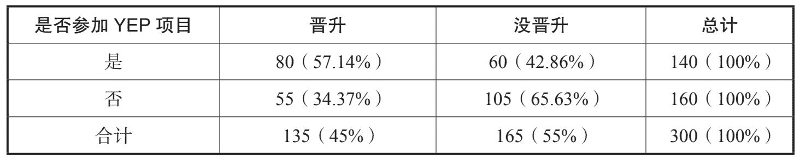

Below, let's use the Bayesian Theorem to look at the predictive effect of the training program.

```
Formula: Training Program Predictive Effect = (Probability of Promotion After Training) / (Probability of Promotion Without Training) × 100%

Where
Probability of Promotion After Training (P) = (Probability of Promotion After Training) / (Probability of No Promotion After Training (1-p)) × 100%
```


=57.14%/42.86%

=133%

Probability of promotion without training (P) = (Probability of promotion without training) / (1 - Probability of promotion without training) × 100%

=34.37%/65.63%

=52.37%

Therefore, the predictive effect of training = 133% / 52.37% = 254%

This illustrates that, all other conditions being equal, the probability of promotion for those who participate in training programs is 254% higher than for those who do not.

Therefore, for employees, participating in training programs increases their chances of promotion; for enterprises, training programs will yield better performance results in the future.

### 2. AI-Driven Talent Development

With the development of artificial intelligence and big data technologies, machine learning (ML) algorithmic analysis of talent development can provide a reference basis for enterprise talent identification, cultivation, and retention, while also driving enterprise investment in talent development work.

The core of talent development is based on talent inventory, doing a good job in talent selection and cultivation. Talent inventory work is very complex; artificial intelligence can quickly provide the distribution of high-potential talents required by the enterprise (Nine-Box Grid or Sixteen-Box Grid) based on the assessment results of employee performance, ability, and potential, thereby enabling managers to clearly know which talents to recruit, which to retain, which to cultivate, and which personnel to eliminate. Talent recruitment can also utilize AI technology. AI technology can help recruiters better identify talents, achieve precise person-job matching, and save recruitment time; it can identify and parse electronic resumes, paper resumes, and even images in different formats, convert them into a unified resume format and store them in the enterprise talent pool; analyze resumes, combine resume features and text content to extract key information; structure and model resumes by establishing databases, thereby accurately and quickly pushing resumes to interviewers. The application of AI technology can free HR practitioners from previous complex work, allowing interviewers to focus more energy on in-depth communication with candidates and identifying whether candidates match the corporate culture and values.

In terms of talent cultivation, enterprises can also use AI technology to match employee job, skill, Individual Development Plan (IDP) and other data with learning maps, recommending personalized learning courses. During the talent cultivation process, employee probation assessment, promotion defense, rotation assessment, annual summary reporting, and other work can be completed through AI technology. This not only saves managers' time, but more importantly, AI can give assessment results more objectively and fairly. AI technology will also change training modes, not only providing employees with immersive training experiences but also recommending personalized courses based on employee interests, hobbies, and potential, forming customized learning maps for employees, providing direction for their learning and development in the enterprise. More interestingly, AI technology can gamify training, enhance course attractiveness through blind box designs and other methods, and increase employee learning interest.

It can be seen that personalization, fragmentation, socialization, contextualization, and gamification will be the mainstream trends of future training work.

The application of AI in talent development mainly includes the following aspects.

1. **AI Empowerment**. By exploring AI application capabilities, enhance HR practitioners' intelligent statistical analysis, data insight, and data decision-making capabilities, empowering the five links of enterprise human resource management: selection, utilization, development, retention, and management.

2. **Talent Management**. Based on the HR knowledge graph, build an employee tag library and establish a talent profiling system. Through functions such as talent discovery, talent identification, team analysis, and development paths, assist enterprise managers and HR practitioners in efficiently discovering core talents.

3. **Knowledge Recommendation**. Based on AI and knowledge graph technologies, integrate internal and external enterprise learning resources, accelerate the intelligent precipitation of knowledge, optimize personalized recommendations in knowledge domains, and provide intelligent solutions for enterprise talent skill cultivation.

4. **Industry Analysis**. On the basis of accumulating internal data, widely obtain external market research data, combine with enterprise recruitment information to provide decision support for internal talent flow, external talent development trends, etc., enrich internal and external talent reserves, and improve the quality and efficiency of recruitment work.

5. **Team Management**. Depict organizations and teams using capability, goals, and effectiveness, and based on talent portraits, support HR practitioners in customizing groups and analyzing fixed groups, tracking and analyzing changes in group indicators and group differences, providing support for HRBPs and managers to enhance organizational capabilities.

6. **User Experience**. Improve the efficiency of entry, exit, promotion, demotion, transfer, and other work, and improve the experience of all employees in human resource services.

### 3. Measuring Human Capital Return on Investment

Human Capital Return on Investment (HCROI) refers to calculating the return obtained for every 1 yuan invested in human capital by the enterprise through quantitative analysis of relevant factors such as enterprise revenue, profit, and human cost. This is a core indicator for measuring the effectiveness of human resources.

Calculation Formula: Human Capital ROI = Enterprise Net Profit / Total Human Cost × 100%.

(1) Net Profit = Total Profit – Income Tax Expense

■ Total Profit = Operating Profit + Non-operating Income – Non-operating Expenses

Operating Profit = Operating Revenue – Operating Cost – Taxes and Surcharges – Selling Expenses – Administrative Expenses – R&D Expenses – Financial Expenses – Asset Impairment Losses + Other Income + Investment Income (Losses marked with "–") + Gains from Changes in Fair Value (Losses marked with "–") + Gains from Asset Disposal (Losses marked with "–")

■ Income Tax Expense = Total Profit × Income Tax Rate

(2) Total Human Cost = Total Employee Wages + Social Insurance Premiums Paid by Unit + Employee Welfare Expenses + Employee Education Expenses + Labor Protection Expenses + Employee Housing Expenses (Housing Provident Fund Borne by Unit) + Other Labor Cost Expenses (e.g., Meal Allowances, Transportation Allowances, Mobile Phone Communication Fees, etc.)

Human Capital ROI is a key indicator comprehensively reflecting income and cost factors. Enterprises can improve ROI by reducing selling costs, increasing profit margins, improving asset utilization efficiency, etc. Incentive mechanisms are also an important path for enterprises to obtain investment returns using human capital, specific forms including compensation methods, welfare methods, working environment, providing learning opportunities, providing equity methods, etc. This indicator not only reflects enterprise productivity and cost control, but also reflects organizational efficiency, enterprise strategy effectiveness, and enterprise goal achievement.

With the rapid development of technology and the acceleration of digital transformation, enterprises need to collect a large amount of data related to talent development projects and link them with the organization's various businesses and related results. Since talent development projects affect various parameters of personnel management, large enterprises usually use the following indicators to measure the effectiveness of talent development projects.

- Employee Engagement
- Employee Retention
- Magnitude of Productivity Improvement or Cost Reduction
- Customer Satisfaction
- Talent Pipeline Depth, Leadership Performance Level
- Innovation Capability
- Teamwork Spirit

The above indicators have a strong correlation with Human Capital ROI.

Sears measured the impact of retail store employee engagement on store performance through the "Emotional Ring." The "Emotional Ring" captured how employee emotions changed throughout the day and affected customer interactions and experiences. It processed 1 million data points and found that employees in good moods brought better customer experiences, thereby increasing sales. Next, Sears is determining factors related to employee "good moods" and focusing on factors that improve store performance.

ConAgra used HR analytics software to predict which key employees were most likely to leave the company and why. The company's managers unearthed more than 200 factors that could lead to employee turnover, thereby providing a data reference basis for employee retention work.

Xerox Corporation, through studying call center employee turnover rates, found that the distance between home address and workplace was closely related to employee engagement and retention. By comprehensively using these parameters, Xerox reduced employee turnover from 50% to 30%.

The Human Dynamics Laboratory at MIT used special electronic "badges" to record various information about formal and informal conversations in employees' daily lives, including conversation length, personnel tone and gestures, how much these people spoke, listened, interrupted, and the degree of empathy and extroversion they displayed. Research found that the data collected by the laboratory using electronic "badges" could predict which teams would win the "Hackathon" competition through modeling analysis.

*Harvard Business Review* research shows that every 5% increase in employee engagement will drive a 1.3% increase in customer satisfaction, thereby increasing enterprise revenue by 0.5%. Human Capital ROI also has positively correlated changes.

In the future, as more organizations leverage data insights to achieve their own business value enhancement, the application of "Data Intelligence" in human capital management will become increasingly widespread.

### 4. Talent Inventory Implementation Methods

The purpose of enterprise talent inventory is to unearth high-quality, high-potential talents, identify organizational needs for different types of talents, and increase the reserve of enterprise talents. Colloquially speaking, talent inventory work is the enterprise achieving optimal matching between people and positions.

Talent inventory is the basic work of organizational development and talent management. It not only needs to summarize conventional information but also conduct comprehensive analysis from dimensions such as person-job matching, functional ratio, competency characteristics, and performance trends, to fully and scientifically understand the organization's talent status quo and establish a long-term mechanism for talent supply.

#### 1. Problems Talent Inventory Needs to Solve

(1) Talent inventory work is not only aimed at talents; in fact, the starting point of talent inventory work is organizational inventory. Therefore, managers must ensure that existing talents can support the enterprise's business strategy. Therefore, managers must first clarify "based on the enterprise's future strategic goals, what kind of organizational structure is needed, how to design positions, and how to allocate responsibilities," and then consider corresponding talent issues.

(2) Understand the talent status quo. Through talent inventory work, managers can clarify the organizational structure and talent needs, grasp the organization's current talent status quo, and discover the gap between talent needs and talent status quo.

(3) Identifying high-potential talents is one of the core contents of talent inventory work. It is the foundation of enterprise talent echelon construction and can provide a clear direction for enterprise talent cultivation work.

#### 2. Application Scenarios of Talent Inventory

(1) Talent Potential Analysis. Based on the results of talent inventory, managers can clearly understand the internal talent distribution status of the organization, thereby taking more targeted and effective management measures.

(2) Recruitment Configuration Planning. Based on the results of talent inventory, managers can clarify the advantages and disadvantages of various talents, sort out the commonalities of high-potential talents through aggregation analysis and outlier analysis of high-potential talents, and provide strong support for talent recruitment and position allocation.

(3) Career Planning. Based on the results of talent inventory, managers can help employees understand their own advantages and disadvantages, accurately position themselves, and clearly plan their own careers.

(4) Employee Training and Development. Based on the results of talent inventory, managers can understand each employee's competency and performance, and design more targeted training content for them.

#### 3. Implementation Path of Talent Inventory

(1) Real-time collection of HR management data, relying on the latest and valid data to conduct statistics and analysis on talent status quo, such as efficiency analysis, structural analysis, quantitative analysis, etc.

(2) Conduct inventory of internal organizational talents through the Nine-Box Grid model, grasp talent performance in the two dimensions of competency and performance in real time, and take targeted management measures.

(3) Comprehensively analyze talent portraits, position portraits, and talent inventory results, and use AI technology to intelligently match people and positions, fully activating talent resources.

# Chapter 5: Application of Artificial Intelligence in Retention

## Section 1: Turnover Prediction

Currently, there is a tool on the market called "Talent Turnover Early Warning." This tool can track employee turnover trends and is provided by third-party platforms. As long as an employee updates their resume on a job search website, their behavior will be recorded by the third-party platform. If the enterprise purchases the platform's service, it will receive an early warning reminder the next day. However, this tool is suspected of infringing on personal privacy, and its compliance has been widely questioned.

So, is there a scientific and compliant data analysis method that can help enterprise managers predict employee turnover tendencies, achieve the purpose of grasping employee dynamics and reducing employment costs?

Data analysis is divided into three types: descriptive analysis, correlation analysis, and regression analysis. Turnover prediction belongs to regression analysis, which has corresponding requirements for data quantity, quality, dimension, and cycle. Quantity represents the size of data; the more data, the greater the value of its analysis results. Quality represents the accuracy of data. Dimension is included in the data analysis scenario; different scenarios and themes require different analysis methods to achieve the best effect. Cycle refers to the data refresh frequency. For example, if an enterprise conducts performance appraisal once a year, the data refresh frequency is one cycle per year. Big data analysis and model verification generally require three cycles of historical data, plus a real-time cycle for trial operation and optimization, before reaching the standard for official launch.

Data engineers can use big data mining technology to model and analyze employee-related information. Once an employee with a tendency to leave is discovered, the probability of the employee leaving can be notified to the supervisor or HRBP in advance, allowing the supervisor or HRBP to take action before the employee leaves, or retain the employee through salary adjustment or job transfer, or replenish manpower in advance.

When HR practitioners conduct turnover prediction, they can start from eight major elements: compensation and benefits, promotion and rotation, office environment, work pressure, training and learning, performance and development, cultural atmosphere, and external hotspots. Each element has several sub-items. For example, compensation and benefits can be divided into effort/income satisfaction, internal company equity satisfaction, industry compensation competitiveness satisfaction, etc. Promotion and rotation include promotion opportunities, promotion frequency, transfer opportunities, etc. Performance and development include performance rating, evaluation, distribution situation, personality-job fit, work achievement sense, etc. Work pressure includes superior-subordinate relationships, colleague relationships, sense of belonging to the enterprise, etc. Office environment includes office equipment, work environment and danger, working hours, commuting distance, etc. HR practitioners conduct business modeling, big data modeling, multivariate regression, and correlation analysis on these elements to obtain a three-dimensional schematic diagram of "Competency & Performance vs. Employee Turnover Risk," as shown in Figure 5-1.

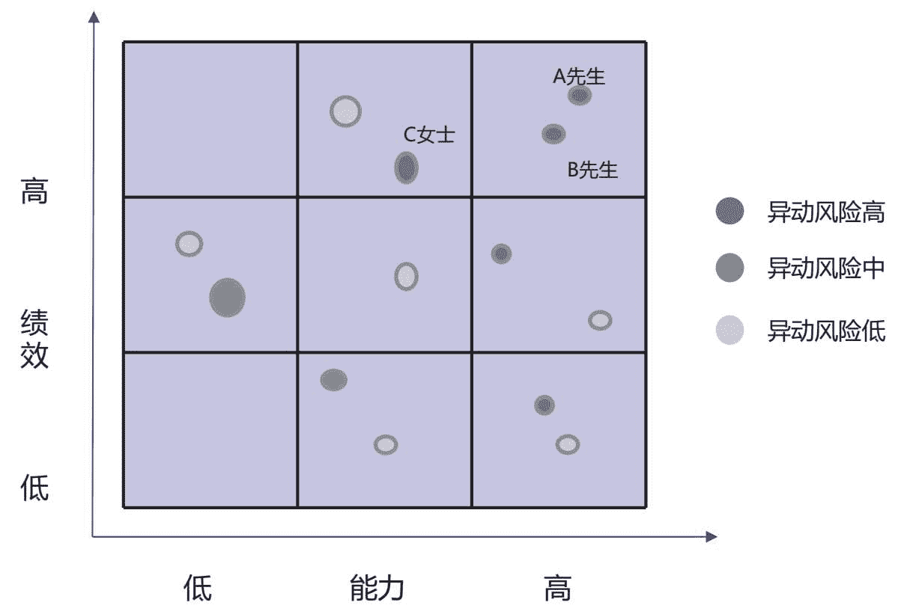

The horizontal axis represents the strength of employee competency, the vertical axis represents the level of employee performance. Black circles represent high risk, dark gray circles represent medium risk, and light gray circles represent low risk.

### 1. Turnover Risk Control


With the rapid development of various industries, talent mobility is increasing, leading to ever-higher retention costs for enterprises.

The risks brought by employee turnover usually fall into the following categories:

1.  Leakage of key technologies or trade secrets, causing significant losses to the enterprise.
2.  Leakage of customer data, resulting in the loss of key clients.
3.  Vacancies in key positions with no successors, causing critical work to grind to a halt.
4.  Key talent leading entire teams to defect collectively, stalling parts of the enterprise's operations.
5.  Causing unrest among staff, weakening the organization's centripetal force and cohesion.

For HR practitioners, turnover risk analysis using AI model algorithms can immediately capture employee changes and react swiftly, achieving the goal of early warning and prediction.

Combined with Figure 5-1, the actions HR practitioners can take for different employee performances are shown in Table 5-1.

**Table 5-1 Turnover Risk & HR Action Recommendations**

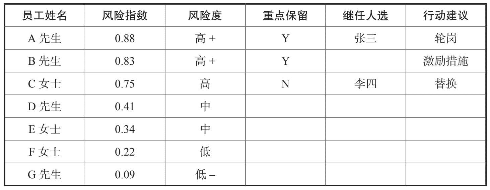

Mr. A has the highest turnover risk index at 0.88. Simultaneously, Mr. A is a high-performance, high-competency talent. Therefore, he belongs to the category of talent that needs to be retained. His tag in the talent pool is "Key Retention Talent." Therefore, HR practitioners can expand his scope of responsibilities to make his work more challenging. At the same time, HR practitioners can choose an appropriate time to rotate Mr. A to another position, with his successor, Zhang San, taking over. This retains the talent while reducing the enterprise's employment risk.

Mr. B has a relatively high turnover risk index of 0.83. Simultaneously, Mr. B is also a high-performance, high-competency talent. Therefore, he also belongs to the talent that needs to be retained. Mr. B's tag in the talent pool is also "Key Retention Talent," but there is currently no successor. At this point, HR practitioners can only adopt incentive measures; while retaining Mr. B, they must actively search for backup candidates from internal and external talent pools to minimize employment risk as much as possible.

Ms. C has a relatively high turnover risk index of 0.75. Ms. C is a high-performance talent, but her tag in the talent pool is not "Key Retention Talent." Simultaneously, Ms. C has a successor, Li Si. Therefore, HR practitioners can choose an appropriate time for Li Si to replace Ms. C, reassigning Ms. C elsewhere, thereby reducing the enterprise's employment risk.

### 2. Talent Retention Early Warning

Enterprise managers can use risk indices and retention tags to warn and prompt which talents are worth retaining. As shown in Table 5-1, although both Mr. A and Mr. B have very high turnover risks, because they are key retention talents, the enterprise is willing to take various measures to keep them.

Of course, Table 5-1 shows only a small part of several management scenarios. In actual work, scenarios will be more complex and diverse, and the measures HR practitioners can take will be more flexible and varied.

Take the four disciples of Tang Sanzang as an example: which type of employee is the talent the team needs to focus on retaining? As shown in Figure 5-2, the horizontal axis represents employee engagement, and the vertical axis represents capability. The two dimensions form four quadrants. The four disciples represent three types of team members.

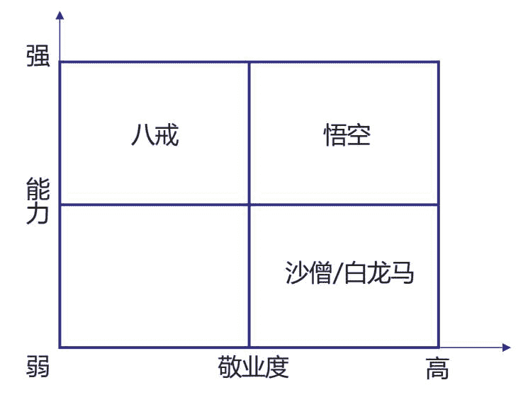

**Figure 5-2 Four-Quadrant Relationship Diagram of Capability and Engagement**

After HR practitioners predict the turnover risk index for each type of employee through tools, they can adopt the following different retention measures and management styles for each type:

1.  **For the "Wukong Type" (high capability, high engagement):** Need to paint a clear long-term vision, grant full trust and authorization.
2.  **For the "Bajie Type" (relatively high capability, low engagement):** Need to offer more encouragement to leverage their value, while drawing clear "red lines" (boundaries).
3.  **For the "Wujing/White Dragon Horse Type" (low capability, relatively high engagement):** Need to conduct skills training to enable rapid growth.

### 3. Dynamic Allocation of Organization and Talent

With technological development, enterprises can utilize Artificial Intelligence and Big Data technology to conduct more intelligent and comprehensive analyses of organizational talent structure and layout, adjust irrationalities and imbalances in organizational configuration, and form a multi-dimensional optimal combination to improve overall team efficiency.

There is a simple method to quickly diagnose whether organizational configuration is reasonable: that is, to allocate organizational scale through **span of control** and **management levels** to meet business development requirements. Span of control refers to the number of subordinates directly managed by one person. Management levels refer to the number of management tiers divided vertically in the organization; management levels are directly proportional to organizational scale—the larger the scale and the more members, the more levels. Given a relatively stable organizational scale, management levels are inversely proportional to span of control: the more subordinates a manager directly manages, the fewer the management levels; conversely, the narrower the span of control, the more management levels.

Big data analysis research indicates that a span of control of 7–12 people is the most scientific organizational architecture. With a relatively stable number of managed objects (all employees), the wider the span of control, the fewer management levels needed; conversely, the narrower the span of control, the more management levels needed. Assuming a span of control of 8 people at every level, an enterprise with approx. 30,000 employees only needs 6 management levels (i.e., tiers from bottom-level employee to CEO); if the enterprise has nearly 300,000 employees, a 7-level architecture is sufficient, as shown in Figure 5-3.

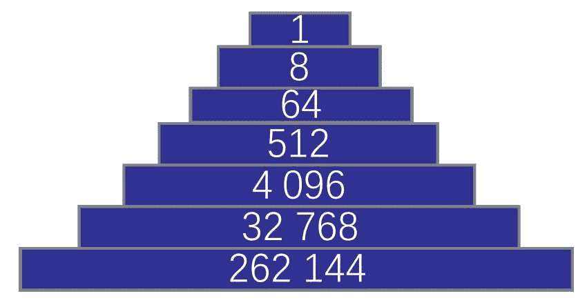

**Figure 5-3 Schematic Diagram of Span of Control and Organizational Scale**

JD.com Group has a famous **"8150" Principle**.

1.  Organizational setup must meet certain span of control requirements. Generally, the span of control for managers (including solid-line and dotted-line reports) should not be fewer than 8 people. A peer-level or subordinate department can only be established when solid-line reports exceed 15 people.
2.  For grassroots departments with relatively single business functions (e.g., sorting, packaging, delivery, customer service), the manager's span of control should be larger. On the premise of meeting a span of control of no fewer than 8 people, a peer-level or subordinate department, or a deputy position (limited to JD Logistics regions), can only be established when solid-line reports exceed 50 people.

That is, the company requires every manager to have no fewer than 8 direct reports; if fewer than 8, middle-level managers should be reduced. Only when direct reports exceed 15 people does the company allow adding another manager at the same management level.

The "50" in "8150" refers to grassroots employees of the same trade. It requires the managed headcount to be no fewer than 50 people; only when exceeding 50 can a second team leader be considered. For example, packers: if the number of packers in a shift does not exceed 50, only one packing supervisor is allowed. If 50 packers are divided into five groups with five team leaders, it would be a "disaster." So, 50 is the baseline for grassroots managers managing grassroots employees.

The core of the "8150" principle is to ensure a **flat organization**. It is precisely because JD insisted on the "8150" principle that it ensures only 5 layers of management exist between the CEO and hundreds of thousands of employees.

Baidu uses big data analysis modeling to dynamically scan changes in organizational names, team sizes, spans of control, management levels, movements of senior talent, team turnover rates, etc., conducting organizational health and key talent risk index analysis, and providing near-real-time early warnings, thereby ensuring flexible, efficient organizational configuration and alignment of goals. For example, when the span of control is less than 5 people, the system sends an email to the relevant OD (Organization Development) owner, who then analyzes the rationality of team configuration with the HRBP (Human Resource Business Partner); when a business line's management levels exceed 5, the system also issues a warning, and the OD owner checks the rationality and appropriateness of the organizational configuration. When the system detects that a key talent's turnover risk or management risk exceeds a certain threshold, HR practitioners also receive notifications and take a series of measures such as job rotation, succession planning, and incentives to reduce risk or avoid greater losses, promoting a virtuous cycle for the organization.

## Section 2: Intelligent Care

To fully unleash the value of talent, enterprises must build a culture and environment of employee care. This means the enterprise needs to allocate certain funds and resources for this work, while linking investments in employee health, safety, and well-being to business performance.

Although some company managers still believe that employee care programs are merely extra benefits provided to employees, some companies have integrated employee care programs into their strategic business. These companies are known as **"Best Employers,"** and their success has proven that there is not only a correlation but a **causal relationship** between employee morale, mental state, health, safety, and company profitability.

Employee care in the AI era aims to enhance organizational attractiveness at the enterprise level and create a warm workplace environment at the employee level. By tracking, managing, and caring for the employee lifecycle, enterprises directly link with the "Select, Use, Develop, Retain" talent management policies, fully leveraging the subjective initiative of employees and the strategic value of HR practitioners.

### 1. Care Triggered by Career Events

In the past, enterprises could retain employees simply by paying salaries; now, enterprises must continuously show care, addressing both material needs and spiritual appeals, to enhance their sense of belonging and reduce turnover. Around the integrated full lifecycle of **onboarding, in-service, and offboarding**, HR practitioners enhance the employee workplace experience through **"Four Modernizations"**: scenario-based experience, socialized interaction, gamified behavior (points-based), and real-time feedback.

Typical intelligent care scenarios within the employee career lifecycle are shown in Figure 5-4.

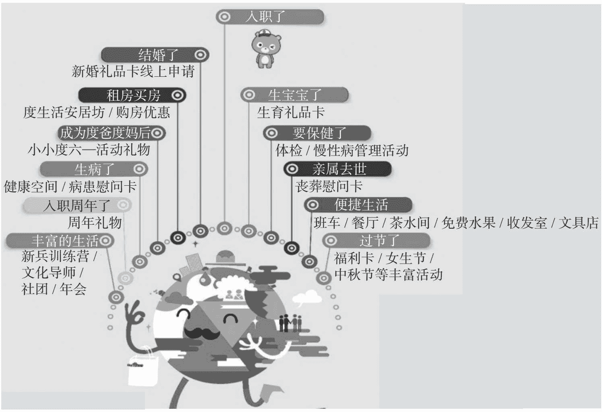

**Figure 5-4 Intelligent Care Scenarios**

1.  **Pre-onboarding:** Employees enjoy free physical exams; receive a welcome gift pack upon reporting for duty.
2.  **Onboarding:** New hires are guided by culture mentors and professional mentors to quickly adapt to the environment and integrate into the team.
3.  **Probation Period:** A 90–180 day gamified training journey for new hires: learning, "fighting monsters," and earning points. During this process, new hires familiarize themselves with the culture, improve professional skills, and win prizes.
4.  **Milestones:** The enterprise sends birthday wishes and work anniversary wishes.
5.  **Festival Activities:** Organizing various events such as annual galas, Women's Day (March 8), Youth Day (May 4), Children's Day Carnival (June 1), Mother's Day visits, Father's Day letter writing, Mid-Autumn gifts, Spring Festival gifts, etc.
6.  **Life Events:** The enterprise issues gift money for marriage, funerals, childbirth, and other special periods.
7.  **Work Environment:** Providing a cozy office environment, free canteen, and pantry.
8.  **Overtime Support:** Employees working past 9 PM can claim taxi fare reimbursement.
9.  **Health & Housing:** Medical checkups and illness covered; discounts on renting and buying homes.
10. **Family Care:** Gifts for parents' birthdays; medical checkup and hospitalization expenses reimbursed.

### 2. Blessing Reminders

With large numbers of "post-90s" and "post-00s" young people entering the workplace, they pay more attention to the value and experience of work, requiring enterprises to be warmer and more creative in shaping the workplace environment. Therefore, using AI and digital technology to achieve blessing reminders at key moments for employees has become a must-have skill for HR practitioners to demonstrate value.

**Intelligent Care** refers to HR practitioners providing personalized, intelligent care experiences based on employee portraits. HR practitioners can conduct big data analysis and modeling based on employees' work direction, learning content, career planning, hobbies, daily habits, social interactions, consumption, etc., tagging employees with relevant "labels," triggering "mechanisms" at different moments of "work, life, learning, development," and providing personalized "employee care." Behind the "mechanism" is a one-stop intelligent care service system based on AI and big data technology.

Relevant "mechanisms" are as follows:

1.  **Employee Blessings.** Early on the employee's birthday, the system sends a birthday blessing card via email and mobile IM; simultaneously, the system sends a reminder to the employee's direct manager, informing them of the subordinate's birthday and prompting the manager to express "care." The blessing card has an exclusive QR code; employees can scan it at the company gift shop to redeem a birthday gift, or scan/face-scan at a self-service locker for self-pickup.
2.  **Work Anniversary Blessings.** Early on the work anniversary, the system sends an anniversary blessing card via email and mobile IM, thanking the employee for their contribution and companionship. Each anniversary card has different content, colors, and design styles, giving employees a surprise every year. Meanwhile, the company issues anniversary souvenirs and tenure badges, which employees can collect at the gift shop or self-service locker via face scan. For example, Alibaba calls the 1st year "One Year Fragrance" (recognition), the 3rd year "Three Years Intoxication" (maturity), and the 5th year "Five Years Aged" (inheritance), holding special commemorative ceremonies at different milestones. Baidu's Xiaodu Xiong (smart speaker) comes with badges; Arabic numerals represent years, with white, grey, silver, blue, and gold representing different stages—silver bear at 5 years, gold bear at 10 years. At the 10-year mark, the company holds a special ceremony where the CEO personally presents the award to express recognition, giving the employee a full sense of honor. Naturally, the direct manager also receives a reminder that day.
3.  HR practitioners design different content and forms to notify employees of confirmation, promotion, performance feedback, evaluation feedback, and other results according to different scenarios, making employees feel recognized and encouraged to exert greater energy in future work.
4.  **Offboarding Care** is also important. Onboarding and offboarding processes are automated; if there are many handover items, the system automatically verifies related matters in the background, eliminating the need for employees to ask around; simultaneously, employees can handle items requiring offline processing (e.g., returning laptops, badges) at a one-stop service hall without running around. After offboarding procedures are completed, the company issues a set of postcards as a memento; simultaneously, the system sends an offboarding card prompting precautions for transferring files, social security, household registration, party/league membership, etc. On three major holidays (Mid-Autumn, Spring Festival, Company Anniversary), the system automatically sends blessing SMS messages to the reserved mobile numbers of former employees, expressing gratitude.

The above care mechanisms can not only reduce turnover rates and attract boomerang employees but also improve employee satisfaction and engagement. Doing a good job in offboarding management helps the enterprise establish a good brand image in the industry and attract more outstanding talents.

### 3. Care & Welfare Mall

As an important component of the compensation and benefits system, employee benefits have largely become a management measure for enterprises to attract and retain outstanding talents, stimulate and mobilize employee enthusiasm. The old "universal benefits" model can no longer meet employees' personalized needs and may even reduce work enthusiasm. Therefore, enterprises should implement a **flexible benefits system**, establish an intelligent employee welfare system, enhance employee loyalty and engagement, and achieve a win-win for both enterprise and employees.

The flexible benefits system in the AI era integrates technologies such as user profiling, voice recognition, and personalized recommendation. By identifying employees' personalized needs, it realizes scenario-based benefits and diversified care, providing employees with comprehensive, personalized free combination and selection, achieving the goals of full coverage of employee experience and one-stop life and entertainment.

The flexible benefits mall usually includes the following:

**For the Enterprise:**

1.  Exclusive account management: consume first, settle later; reasonable budget allocation; flexible subject combination.
2.  Integrated supplier resources: one-stop configuration of personalized benefit combinations.
3.  Aggregation of high-quality brand resources: providing comprehensive, personalized holiday gift selections.
4.  Exclusive employee service backend: efficient overall management for HR.

**For the Employee:**

1.  Independent accounts: employees at different levels have different points; points can be spent or redeemed.
2.  Autonomous selection of flexible benefits (e.g., insurance, checkups, gifts, subsidies), covering family members simultaneously.
3.  Enjoy group discounts unavailable for individual purchases.
4.  Pay online using platform account points or personal accounts.
5.  Functions include points issuance, benefit details, benefit redemption, benefit summary.

**Dulife – Flexible Benefits Platform** is shown in Figure 5-5. Dulife is a product provided by Baidu for employee life and work convenience, available on PC and mobile (mobile-first). Through different "Channels" (Life Channels: Club Hub, Life Station, Registration Pass, Anju Fang, Flea Street, Du Discounts, Health Garden, Easy Travel; Work Channels: Quick Query, Ask HR, Need Stamp), employees can enjoy company benefits anytime, anywhere.

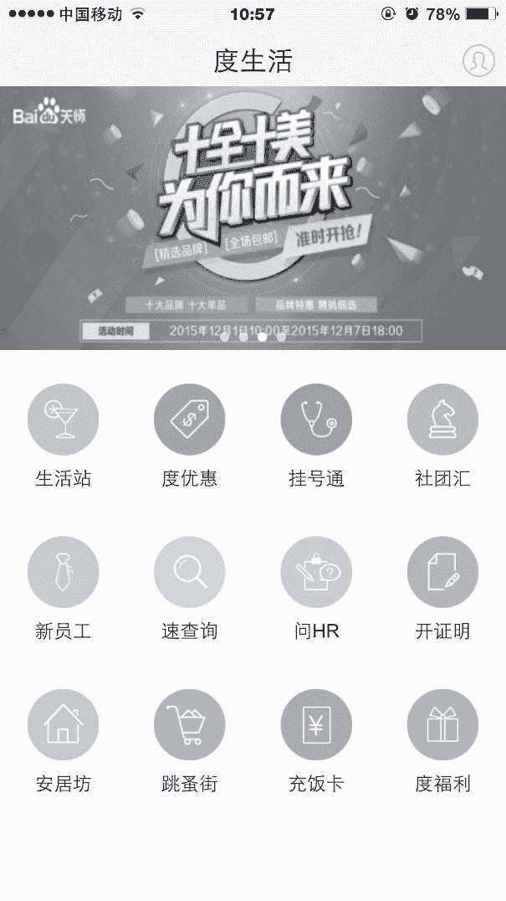

**Figure 5-5 Dulife – Flexible Benefits Platform**

Brief functions of each channel:

1.  **Club Hub:** Aggregates basketball, football, badminton, table tennis, swimming, yoga, dance, singing, reading, hiking, running, outdoor, anime, performance clubs, etc.
2.  **Life Station:** Aggregation of eating, drinking, playing, and fun.
3.  **Health Garden:** Basic insurance + supplementary medical insurance, checkup package combinations, health space, health courses, etc.
4.  **Registration Pass:** Cooperates with institutions to solve employees' registration difficulties.
5.  **Easy Travel:** Integrates flights, hotels, trains, ride-hailing platforms, facilitating business trips and travel.
6.  **Anju Fang:** Provides reliable housing sources for employees.
7.  **Flea Street:** Second-hand trading market, facilitating reuse of idle items.
8.  **Du Discounts:** Provides various discount information.
9.  **Easy Meeting:** Meeting room booking, video conferencing, check-in, meeting minutes, and other meeting management.

## Section 3: Public Opinion Monitoring

So-called public opinion monitoring refers to enterprise digital system practitioners using Chinese word segmentation technology, natural language processing technology, and Chinese information processing technology to filter, deduplicate, similarity cluster, extract summaries, and auto-cluster public opinion information, establishing a public opinion monitoring system; under the premise of compliance, using crawler technology to scan public opinion information in key media, forums, blogs, Weibo, and other websites based on preset monitoring keywords, and issuing timely warnings for sensitive information, notifying relevant parties via email, phone, SMS, etc., at the first moment.

### 1. Internal & External Public Opinion Focus

Many enterprises have opened anonymous sections on their intranets where employees can speak freely. Internal public opinion analysis results are mainly used for two aspects: recommending business-related suggestions to relevant departments for reference; handing over public opinion risks regarding labor disputes, recruitment, culture promotion, and brand publicity to the HR department for handling. Surveys show that the most discussed topics on corporate intranets are compensation & benefits, work pressure, cultural atmosphere, external opportunities, personal development, and training & learning. For these high-frequency keywords, HR practitioners need to take necessary publicity measures, such as organizing compensation policy briefings, culture promotion sessions, and team building/training activities to relieve employee pressure.

### 2. Brand Early Warning

In HR management, brand early warning is mainly used in recruitment and retention. Within the bounds of policies and regulations, HR practitioners can use big data technology to conduct real-time monitoring, data collection, and data processing on information related to the enterprise (including positive, negative, and neutral information) in publicly available online data (such as Weibo, forums, social media, news sites, professional forums, etc.). Through modeling and algorithmic comprehensive analysis, they define the enterprise's risk bottom line; once exceeded, an immediate alarm is triggered, and timely handling is carried out according to the contingency plan to avoid public opinion crises and protect the corporate brand and image.

### 3. Culture Iteration

AI technology can, based on survey results of employee participation in cultural activities and integration into the cultural atmosphere, combined with major workplace factors (organization, individual, environment, etc.), conduct big data analysis on personnel backgrounds and characteristics, and construct structured talent retention and incentive indicators across different dimensions. This measure is very effective in reducing employee turnover. Simultaneously, robot assistants developed using AI technology can solve various problems employees encounter in daily work and life 24/7. Especially after analyzing data on employee participation in cultural activities, managers can more clearly know what each employee cares about and dislikes, and more clearly know how the organization should guide the cultural direction.

### 4. Talent Migration

Enterprises can establish an **employee turnover prediction model** through big data analysis. This model is mainly used to predict employee attrition and issue timely warnings, assisting HR practitioners in early intervention in conjunction with the "Internal Talent Succession Table."

Enterprises can establish a **Talent Migration Map** through big data analysis. This map helps HR practitioners timely grasp the dynamics of internal and external talents, providing data analysis and decision-making reference for the management of entry, exit, promotion, demotion, and transfer.

# Chapter 6: Organizational Analysis and Organizational Portrait

At the organizational level, whether it is a pyramid organization, matrix organization, spindle organization, or network organization, the requirements of top management for the organization are always: organizational flexibility, structural optimization, agile configuration, and efficient collaboration.

At the talent level, managers need to think about how to use big data technology to identify and judge who are core employees, who are backbone employees, and who are leaders.

At the cultural level, the requirements of managers for culture are: agile innovation, unity of purpose (shared goals), and empowering the organization.

Based on the needs of the above three levels, HR digitalization can support organizational architecture, talent, and corporate culture in four dimensions: process, system, data, and user experience. First, processes need to be compliant, efficient, with clear responsibilities and authorities; second, systems need to be interconnected, combining datafication, scenarization, and intelligence; third, data needs to integrate information and conduct detailed analysis to achieve the purpose of decision support; finally, user experience needs to run through the entire lifecycle of HR management.

## Section 1: Organizational Forms and Characteristics

Organizational form is an invisible, relatively stable enterprise architecture formed by the vertical hierarchical relationships and their communication relationships, and the horizontal division of labor, collaboration relationships, and their communication relationships within the organization. It reflects the division of labor and collaboration relationships among organizational members and embodies the framework of division of labor and collaboration. Simply put, an enterprise's organizational form is its organizational format, state of existence, and operating mechanism.

With changes in the era and internal/external environments, organizational forms continue to evolve, from line, line-and-staff, to divisional, network, as shown in Figure 6-1.

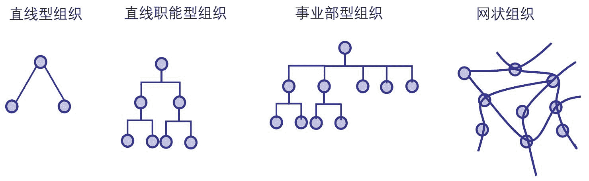

**Figure 6-1 Evolution History of Organizational Forms**

The characteristics of the three traditional organizational forms are: clear hierarchy, clear roles, high specialization, strong control. The characteristics of the network organization are: flexibility, resilience, rapid response to environmental changes, strong innovation.

Network organizations also have different forms; they will show changes as shown in Figure 6-2 at different stages of enterprise development.


## Section 2 Evolution and Transformation of Organizational Forms

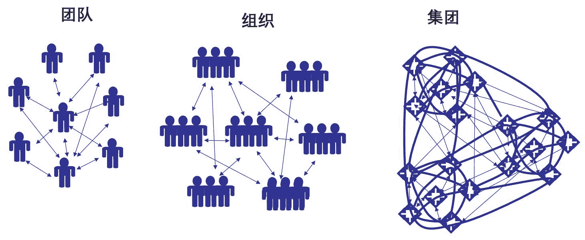

During the process of evolution and transformation, organizations exhibit the following characteristics.

1. **Flattening of organizational structure**. Driven by information technology, network technology, and digital technology, enterprises can transmit and share information on the same level without the need for top-down layer-by-layer communication or bottom-up step-by-step reporting. On the enterprise information network platform (data platform), the traditional vertical relationships among employees become crisscrossing, equal relationships. The information communication capability and management span of enterprise managers have grown multiples, even dozens of times, thereby significantly reducing the hierarchical levels of the organizational structure, making it flatter.

A flattened organizational structure changes the connection methods between superiors and subordinates, between departments, and between the organization and the outside world in the original bureaucratic structure. It possesses the advantages of high efficiency, flexibility, and rapid response. Its most distinctive feature is the coexistence of hierarchical organizations and agile project teams. People with different professional knowledge and experience are distributed in complex organizational forms, which can accelerate the circulation of knowledge and experience and improve overall organizational performance.

2. **Networking of organizational relationships**. With the further strengthening of the application of Human Resource Management Information Systems, Enterprise Office Systems, communication tools, `ERP`/`CRM`, `AI`/`BI`, and digital technologies, most repetitive and routine work in traditional functional management departments is completed by system software or robots. The tasks of functional departments are limited to formulating and modifying control procedures and handling special events. The work mode of functional department employees is no longer the traditional top-down command issuance but joint consultation and mutual collaboration. With the help of the internal enterprise network platform, vertical division of labor among employees continues to decrease, while horizontal division of labor and collaboration continue to strengthen. Enterprise organizational relationships centered on control (administrative orders) gradually transform into relatively equal, autonomous, innovative, and collaborative network relationships. The greatest benefit of networking organizational relationships is the reduction of delays between enterprise decision-making and action, accelerating employee response to market and competitive dynamic changes, making organizational capabilities more elastic and resilient, and reactions more agile.

3. **Downsizing of organizational scale**. In the mobile Internet era, the flexibility and innovativeness of small companies are significantly stronger than those of large companies. Downsizing of organizational scale does not refer to the shrinkage of output value or market, but to the reduction of personnel scale and organizational structure. Facing fierce market competition, many large companies are gradually making their operating entities smaller through spin-offs, divestitures, process reengineering, digital transformation, business outsourcing, or establishing strategic alliances, thereby achieving the goals of cost reduction, efficiency enhancement, improved organizational adaptability, and enhanced competitiveness.

As enterprise organizational management shifts from talent hierarchy systems to collaborative network teams, HR needs a new set of tools to understand team dynamics, and managers need to adopt new strategies to motivate, coordinate, and adjust team networks to share information and collaborate effectively.

In recent years, with the workforce becoming increasingly dispersed and forms of flexible employment increasingly rich, many people are employed outside organizational forms as individual instructors, consultants, freelance creators, and live streamers. These workers form new alliances and collaborations with each other, jointly empowering business development.

## Section 3 Organization and Organizational Network Analysis

Traditional HR research and application practices usually focus on individual employees, positions, and the mutual relationships between employees and positions. For example, enterprise performance prediction and automatic turnover prediction for employees are based on employees' own attributes. Focusing on employees' own attributes and related attributes is effective in many HR management application scenarios, but this method cannot provide more information and deeper insights at the organizational level. For example, according to traditional HR management methods, if HR wants to assess employee communication satisfaction, they would have employees fill out a survey questionnaire. The questionnaire includes communication-related questions. If employee feedback is positive, HR assumes internal organizational communication is smooth, and the investigation into employee communication status concludes successfully. But can this traditional research and analysis method reflect the full picture of the problem? For example, two employees have similar communication frequencies; one communicates with objects within the department, while the other communicates with both internal department members and members outside the department. These communication statuses represent different behavioral patterns at the organizational level. There are many similar questions, such as: What are the proportions of communication during working hours vs. off-hours? What is the average response time for different employees? In summary, traditional HR management methods can no longer support organizational-level, detailed data-based, quantifiable analysis.

Entering the 21st century, with the rise of social networks, experts conducted extensive research on social networks, promoting the gradual maturity of Social Network Analysis (`SNA`) technology. As early as 2005, Giuliani and Bell used `SNA` methods to study the laws of information transfer and knowledge sharing in the organizational network of the Chilean wine industry. Since then, a series of studies have applied `SNA` methods to analyze internal organizational communication, collaboration, and information transfer, the impact of inter-departmental communication on performance, and internal organizational decision-making patterns.

These research results reflect the advantages of `SNA` in HR organizational-level analysis: `SNA` provides a framework for analyzing and studying organizational status, behavior, and driving causes. The application of `SNA` in the field of HR management is becoming a new trend. Social network analysis with the organization as the research object is defined as Organizational Network Analysis (`ONA`). Deloitte defined `ONA` from the perspective of human capital: `ONA` is a structured method for analyzing and visualizing information flow, communication coordination, and decision formation within an organization.

Next, we help readers gain an intuitive understanding of the difference between `ONA` and traditional HR methods through a simplified case. Figure 6-3 is a traditional organizational structure, where each letter represents a company employee. The organizational chart describes the hierarchical management relationships within the company; with a higher degree of informatization, it would link employee personal information and position information. However, the traditional organizational chart is only a static and abstract description of the enterprise's organizational structure; it cannot reflect the actual communication and collaboration among employees. Important characteristics of actual communication and collaboration cannot be expressed through the traditional organizational chart. First, there is communication and collaboration within and across departments among employees, not just communication between employees and their direct leaders as depicted in Figure 6-3. Second, the state of communication and collaboration among employees is a dynamically changing process, which reflects important information about organizational effectiveness. For example, Figure 6-4 shows the actual communication and collaboration among enterprise employees during a specific period. Compared to the organizational chart in Figure 6-3, Figure 6-4 is a more complex network structure.

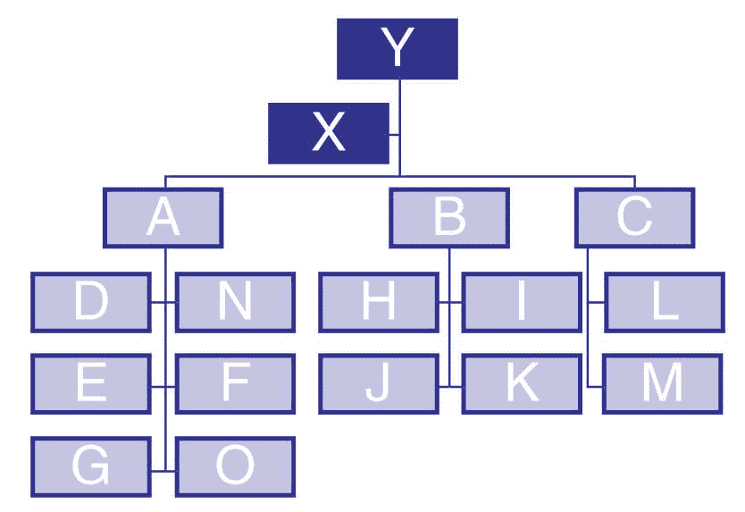

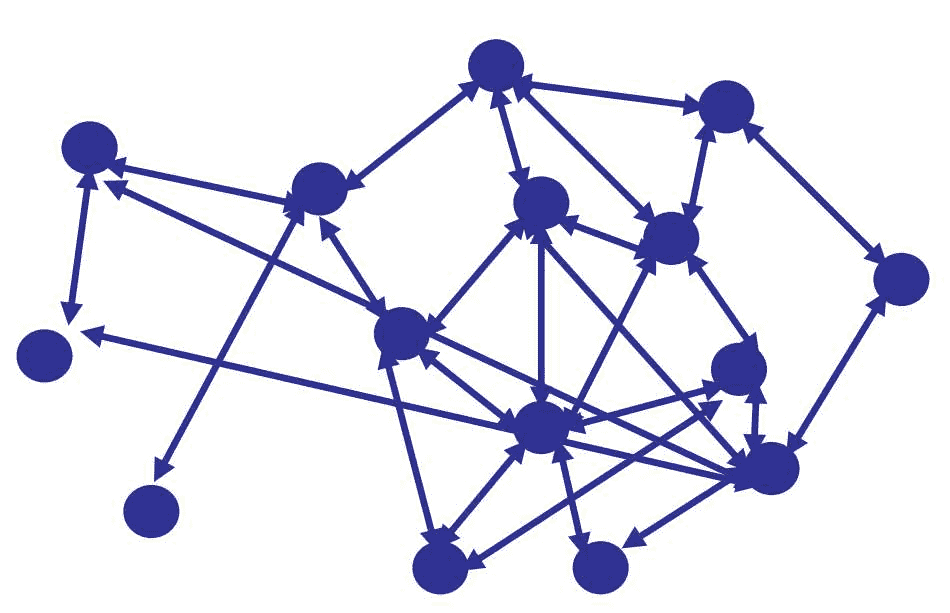

### 1. Relevant Terms in Organizational Analysis

Organizational forms can be represented using graph structures. In mathematics, a graph is the main object of study in graph theory. A graph consists of vertices and edges connecting vertices. Vertices are called `Vertex`, represented by `V`; edges are called `Edge`, represented by `E`. Therefore, mathematically a graph is represented as: `G=(V, E)`. However, in practical application scenarios, a graph is called a network, i.e., `Network`; correspondingly, the vertex `Vertex` is called a node, i.e., `Node`, and the edge is called a link, i.e., `Link`.

Connections between nodes are divided into directed connections and undirected connections. Directed connections include unidirectional directed connections and bidirectional directed connections. For example, a conversation between Employee A and Employee B can be represented as an undirected connection between A and B; Employee C sends an email to Employee D, but Employee D does not reply, which can be represented as a unidirectional directed connection from C to D; Employee E and Employee F have email correspondence, which can be represented as a bidirectional directed connection between E and F. Therefore, we can also regard an undirected connection as a symmetric bidirectional directed connection.

1. **`Degree`**

The `Degree` of a node is defined as the number of edges connected to that node. In a directed graph, the number of all edges pointing to a node is called the `In-degree` of that node; the number of all edges originating from that node pointing to other nodes is called the `Out-degree` of that node. The average degree of the network reflects the sparsity or density of the network, while the degree distribution can characterize the importance of different nodes. In a directed graph, the degree of a vertex is divided into `Out-degree` and `In-degree`. `Out-degree` refers to the number of connections from this vertex to other vertices; `In-degree` refers to the number of connections pointing to this vertex.

2. **`Network Density`**

`Network Density` can be used to characterize the density of connections between nodes. It is the ratio of the actual number of edges in the network to the upper limit of edges it can accommodate. For example, a network of 5 nodes can have at most 10 connections. Therefore, the density of a network with 5 nodes and 6 connections is `6/10=0.6`, as shown in Figure 6-5.

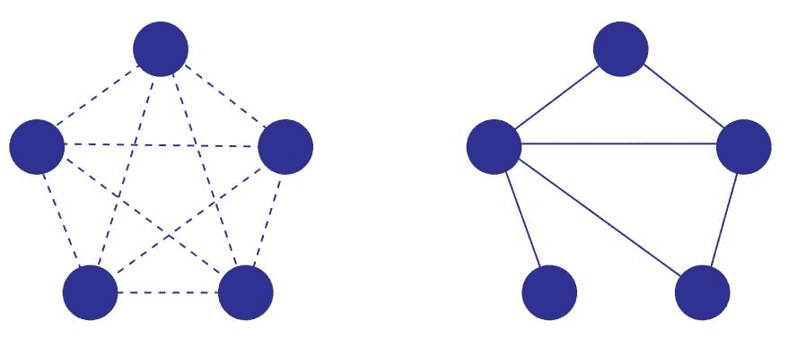

Figure 6-5 Schematic diagram of network density

3. **`Clustering Coefficient`**

The `Clustering Coefficient` is mainly used to describe the extent to which nodes connected to the same node are also adjacent to each other in the network.

4. **`Closeness Centrality`**

`Closeness Centrality` refers to the average length of the shortest paths from a node in the graph to all other nodes.

5. **`Betweenness`**

`Betweenness` refers to the number of all shortest paths in the entire graph that pass through a specific node. It is usually used to evaluate the importance of a node.

6. **`Subgraph`**

Given graph `G'=(V', E')` and graph `G=(V, E)`, if the vertex set `V'` is a subset of `V`, and the edge set `E'` is a subset of `E`, then graph `G'` is a subgraph of graph `G`.

7. **`Structural Hole`**

A `Structural Hole` acts like a bridge in the graph, connecting nodes. If it is removed from the network, the network splits into multiple sub-networks.

Organizational Network Analysis can be implemented through the graph database `Neo4j` and the `Python` library `networkX`, and further achieve network visualization. Graph data learning theories, methods, and applications related to social network analysis are still developing rapidly, such as Graph Neural Networks combined with deep learning. Interested readers can consult relevant literature.

### 2. Applications of Organizational Network Analysis

Traditional HR analysis tools can provide formal, explicit, and static information, such as organizational charts, communication survey questionnaires, etc.; while `ONA` can discover informal, implicit, and real-time dynamic information. As a social organization, an enterprise's organizational form and characteristics naturally conform to the definition of a social network. HR practitioners need to redefine employee value: Employee value should equal the sum of employee human capital and social capital. Human capital reflects the employee's individual ability, while social capital reflects the employee's connectivity in the organizational network. Employee human capital includes skills and abilities meeting job requirements. Employee social capital includes forming connections with other employees and exerting influence, as well as the ability to transmit information and knowledge in the organizational network. For a long time, traditional HR management methods have struggled to evaluate and quantify employee social value. With the maturity of `SNA` technology, HR can finally quantify employee social capital. The employee value calculation formula is shown in Figure 6-6.

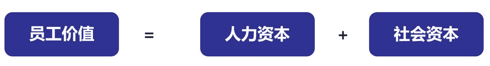

`ONA` can help HR practitioners accomplish the following tasks:

- Visualize the informal network of the organization;
- Clarify the status of communication and collaboration within the organization;
- Understand the realization methods and key nodes of leadership.

The above tasks can help HR practitioners answer questions that traditional talent analysis struggles to answer: Which employees have stronger influence? Whose departure would seriously impact organizational communication and collaboration? Have new employees integrated into the team? How is leadership realized and evaluated by managers? etc.

By calculating the betweenness centrality of different nodes in the network, the influence of each employee in the organizational network can be quickly calculated, and key influential nodes in the network can be identified, as well as which nodes these key nodes can directly influence. The circled employees in Figure 6-7 are `Structural Holes` in the network, i.e., key nodes in the organization. Identifying key node employees allows the organization to drive business transformation and organizational change through these employees on one hand, and facilitates the formulation of succession plans on the other. In fact, non-management employees who play a leadership role should be included in succession plans. Simultaneously, the organization needs to control the risks brought to the entire network by the departure of key node employees.

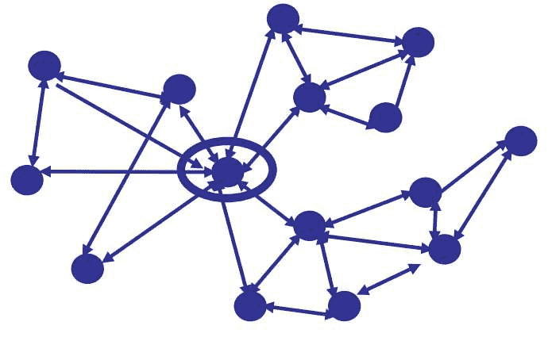

## Section 4 Introduction to Organizational Network Analysis Cases

### 1. Baidu's Organizational Network Analysis

Baidu's Talent Intelligence Center (`TIC`) scientifically assesses organizational stability by analyzing departmental vitality and talent structure, reveals the laws of talent flow between organizations, and provides intelligent support for organizational optimization and adjustment, efficient talent motivation, and reasonable talent flow. Taking the Talent Circle Radar as an example, the talent circle reflects that job hunting also requires "matching social status" (finding the right fit). For instance, `TIC` discovered through data mining that the programmers and media talents recruited by America Online (`AOL`) presented distinctly different hierarchical characteristics. `AOL`'s programmers mostly came from ordinary IT companies, with almost no employees from top-tier companies like Google or Facebook. `AOL`'s media talents came from relatively higher-end workplace circles, such as *The Wall Street Journal* and *Financial Times*. By building such a social career network and intelligently modeling millions of talent profiles and job postings, `TIC` can predict recruitment hotspots in specific industries and market circles, enabling HR to prepare and adjust for major trends.

### 2. Alibaba's Organizational Network Analysis

Alibaba utilizes organizational network analysis methods, combined with survey data analysis results, to discover problems that conventional organizations cannot detect. For example: Who are the stars or marginal figures in an organization? Do people at this level have significant influence and can they drive the team? Do employees of different roles and levels play a bridging role in the organization? Does an employee's influence increase the longer they work at the company? The answers to these questions can all be discovered through data.

From an e-commerce perspective, the core of new retail is the reconstruction of people, goods, and fields. In fact, the HR field also has people, goods, and fields, as shown in Figure 6-8.

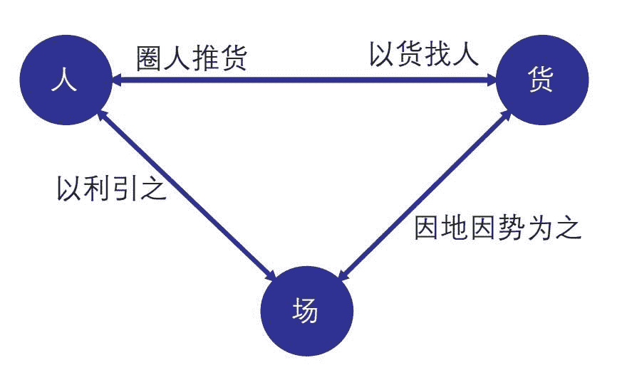

"People" refers to understanding talent portraits; "Goods" includes courses, services, resources, etc., provided by HR practitioners; "Fields" refers tos, customers are categorized into "Promoters," "Passives," and "Detractors." The final `NPS` score is obtained by subtracting the percentage of "Detractors" from the percentage of "Promoters."

```
NPS = (Number of Promoters / Total Sample Size) × 100% - (Number of Detractors / Total Sample Size) × 100%
```

- **Promoters** (Score 9-10): They are enthusiastically loyal people who will continue to buy the company's products or services and refer others.
- **Passives** (Score 7-8): Generally satisfied but not enthusiastic; they may consider competitors' products.
- **Detractors** (Score 0-6): Dissatisfied with the company or have no loyalty to the company.

The calculation logic of the `NPS` formula is that promoters will continue to buy the company's products or services, while detractors will damage the company's reputation.

`NPS` is the most popular customer loyalty analysis indicator, focusing on how customer loyalty affects enterprise growth. By closely tracking the Net Promoter Score, enterprises can make themselves better.


The Human Capital Index (`HCI`) is an index that calculates the correlation between human capital and shareholder value. If an enterprise manages its human capital well, the shareholder return rate will also be correspondingly higher. Through research on a large amount of industry data, using a series of multiple regression analyses, it has been proven that the human capital investment index is directly proportional to shareholder returns. The `HCI` value ranges from 0 to 100; the higher the value, the better the enterprise's human capital management status, and the greater the shareholder returns.

`HR` practitioners must use various research and analysis tools such as `NPS` and `HCI` to study the relationship between human capital investment and shareholder returns, thereby taking effective measures for improvement and optimization. Huaxin Huiyue's research found that excellent human resource management equates to good shareholder value; sound human capital management (clear and standardized reward/punishment systems and authority/responsibility divisions, capability to select and retain talent, and an equal yet flexible work environment, etc.) can make employee engagement higher. In short, a sound HR management system and efficient HR management functions have a positive correlation with the enterprise obtaining substantial returns.

## Section 5 Organizational Health

If you pour a spoonful of sewage into a bucket of wine, you get a bucket of sewage. Team systems are very fragile and easily harmed. Every team has its own health level and emotional energy, and a team's health level often affects team performance and team development.

Team health refers to a relative state formed by the comprehensive superposition of factors such as team work arrangements, employee work enthusiasm, team contribution capability, and employee retention willingness within a certain period. Through extensive data analysis, experts have found that team health is positively correlated with performance levels, and team health can become a leading indicator for predicting high team performance and high profits.

Most enterprises face the following issues in organizational health: vacancies in core talent and key positions; insufficient comprehensiveness and objectivity of measurement data; difficulty in assessing the impact of employee turnover on the team; lack of visual display and intelligent recommendations for team health.

For `HRBP`, they lack an intelligent platform for key position inventory, key talent loss early warning, and monitoring team health status.

For managers, they lack an interactive intelligent assistant to display key team information on an intelligent visual interface. Managers hope to check team status at any time, ensure the team status is within a reasonable range, employees are fully engaged, collaboration is efficient, innovation capability is good, and team operations are normal.

Currently, the information dimensions related to team health obtained by `HRBP` and managers are not rich enough, data quality is not high, and the level of intelligence is not high. This requires HR practitioners to establish a model, beginning with the end in mind, to analyze and research what data `HRBP` and managers need, so as to appropriately bury tracking points in system construction for natural collection.

This section will provide a team health model, offering a visual diagnostic tool for team health for `HRBP` and managers. The team health model possesses a team health early warning function, which can assist managers in making more objective and timely decisions, ensuring that team health meets the needs of the team's healthy development.

So, which dimensions affect team health? We summarize them into the following ten major dimensions.

- **Development Direction**: Convey a clear, simple, direct, and powerful mission and vision to employees, letting them understand the organization's development direction, how to achieve goals, and their significance to employees, achieving the purpose of "shared vision" (united in purpose).
- **Culture and Atmosphere**: Advocate and practice a set of deeply ingrained values throughout the enterprise, reflected in daily behaviors, and tested in probationary assessments, performance appraisals, and 360-degree evaluations.
- **Team Status**: Refers to the situation of team work arrangements, specifically the characteristics of team business, team goals, team structure, team status, team atmosphere, team capability, team performance, and other aspects.
- **Contribution Willingness**: Refers to how much drive team members have to stay in the team and are willing to contribute their knowledge and skills to the team's development goals.
- **Contribution Enthusiasm**: Refers to whether team employees work proactively and consciously under the influence of factors such as personal compensation, development space, and team atmosphere.
- **Merits (Strategic Achievements)**: Refers to the magnitude and scarcity of the contributions employees bring to the enterprise, which can be measured from dimensions such as daily work behaviors and work performance.
- **Capabilities (Professional Skills)**: Refers to employees' professional skills, general talents, and work potential. It directly affects the quality and efficiency of employees' work and can be used to judge whether an employee has the competence for a certain position and whether they can be cultivated as potential talent.
- **Drive**: Cultivate employee loyalty and passion, advocate continuous innovation, and encourage employees to strive for optimal performance.
- **Turnover Prediction**: Predict the possibility of employee resignation or transfer, allowing managers to take measures in advance to maintain team status.
- **Replacement Cost**: Refers to the cost required by the enterprise from recruiting a new employee to the new employee successfully assuming the post after an employee leaves. It includes time cost, labor cost, economic cost, management cost, etc. Replacement cost is directly proportional to the employee's excellence and scarcity.

The main components of the team health platform are as follows.

1. **Describe Employee or Key Talent Status**
   - Merits Situation
   - Capabilities Status
   - Contribution Willingness Rating
   - Turnover Risk Level
   - Replacement Cost Rating
   - Drive Index
2. **Describe Team Situation**
   - Team Structure (Strategic Arrangement/Troop Deployment)
   - Team Business Attributes
   - Team Health Rating
   - Team Health Early Warning
   - Team Health Optimization Suggestions
3. **Describe Organizational Situation**
   - Organizational Atmosphere Index
   - Cultural Values Rating
   - Goal Achievement Index

## Section 6 Organizational Effectiveness

Organizational effectiveness refers to the degree to which an organization achieves its established goals. These goals can be specific outputs (productivity or service quality), set efficiency targets, the degree of coordination of internal processes, and the degree of acquisition and creation of resources required for competitive advantage. Organizational effectiveness is mainly reflected in four aspects: capability, efficiency, quality, and benefits. The main influencing factors of organizational effectiveness are two: external environment (such as politics, laws and regulations, technology, industry, etc.) and internal environment (such as organizational structure, business processes, management mechanisms, employee capabilities, corporate culture, digitalization level, etc.).

So, how to measure organizational effectiveness? This requires `HR` practitioners to judge from multiple angles whether the organization has achieved its set goals and its full potential. `HR` practitioners create a more detailed effectiveness scorecard and systematic evaluation method based on established goals and `KPIs`, which can be used to regularly evaluate and track the organization's actual effectiveness and discover directions for improvement. To improve organizational effectiveness, `HR` practitioners must be good at using big data technology to collect information, build models, and analyze, conducting a comprehensive, in-depth, and accurate assessment of the enterprise's existing organizational effectiveness, clearly seeing the current effectiveness status, clarifying strengths and weaknesses, predicting future trends, and providing supporting basis for decision-making.

Below, business modeling and big data modeling are conducted from four dimensions, and how to measure organizational effectiveness and team effectiveness is explained.

1. **Team Goals**
   - **Clarify Team Goals**
     - Judge whether team goals are clear and explicit;
     - Determine the completion rate of team weekly reports (process management) and the completion degree of monthly/quarterly reports (project management);
     - Clarify the clarity of team work and business development direction.
   - **Recognize Team Goals**
     - Team members' recognition and consistency regarding team goals;
     - Team members' clarity in understanding team goals;
     - Rationality of work role allocation among team members;
     - Proportion of concurrent roles and duplicate roles among team members.
   - **Effective Work Results**
     - Goal achievement status, performance completion status, year-on-year and month-on-month growth rates;
     - Customer satisfaction and recognition;
     - Team members' patent applications and awards;
     - Team innovative project situations;
     - Team diverse and agile working mechanisms.
2. **Team Capability**
   - **Professional Capability**
     - Team business acumen and business mutual trust;
     - Whether team members' professional capabilities (such as product planning, solution design, project management) meet managers' expectations;
     - Team innovation capability and adaptability to change;
     - Team's mastery of cutting-edge technologies, assessing market scarcity for the next three years.
   - **Learning Capability**
     - Team learning and reflection capabilities;
     - Ability to accept new technologies and trends.
3. **Team Health**
   - Measurement dimensions for team health refer to the previous section.
4. **Organizational Vitality**
   - **Communication and Collaboration**
     - Internal team communication and collaboration smoothness index;
     - Cross-team communication and collaboration smoothness index;
     - Team members' mutual trust.
   - **Vitality Index**
     - Key talent mobility rate;
     - Key talent turnover rate;
     - Key talent promotion success rate;
     - High-performer retention rate;
     - Successor readiness.

Of course, enterprises exhibit different states at different development stages, and the corresponding influencing dimensions and indicators of organizational effectiveness will also differ. Even within an enterprise, different business forms are on different development curves (such as the first curve, second curve, third curve) and will have many differences. As the enterprise develops, data accumulation will become more and more abundant, and insights into organizational effectiveness will become closer to the truth.

Generally speaking, as the degree of data accumulation increases, `HR` practitioners can use the following three measures to evaluate organizational effectiveness.

- **Monitor**. When data is mainly structured information, `HR` practitioners can monitor the effectiveness status of operations, management, organization, and human resources in a timely manner through data-driven methods.
- **Diagnose**. When data accumulates to a certain extent, `HR` practitioners can set normal ranges and warning zones for each indicator based on strategic goals. Once problems arise, early warnings can be issued and targeted handling can be performed.
- **Insight**. After long-term data accumulation, `HR` practitioners will discover a large amount of valuable unstructured data. Through analysis and comparison, `HR` practitioners can discover many hidden problems in organizational effectiveness from the data, thereby identifying driving factors and conducting targeted improvements and overall linkage.

# Chapter 7 The Three-Pillar Model in the AI Era

## Section 1 Changes and Roles of the Three Pillars in the AI Era

### 1. HR Transformation

Why do enterprises need HR transformation? Because `HRBP` (Human Resource Business Partner) transactional work occupies too much of their time and energy, while the time and energy they invest in becoming strategic partners and conducting internal client consulting is far from enough, and the business value created is far lower than management's expectations.

According to research report analysis (as shown in Figure 7-1), the current status of HR management in most enterprises is: `HR` practitioners put most of their energy into basic work such as personnel services, which accounts for about 65% of `HR` practitioners' total working time; the part with the greatest impact on business, i.e., strategic HR planning activities, accounts for only about 10%; the part that exerts the maximum value of HR, i.e., customer service and internal consulting, accounts for only about 25%.

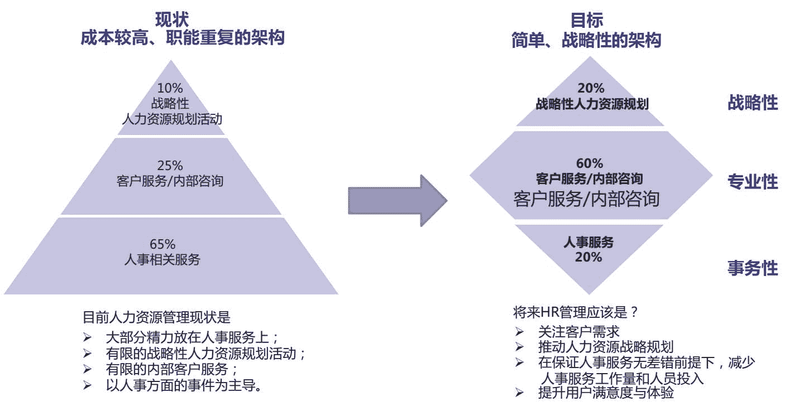

Figure 7-1 Schematic Diagram of Research Report on Proportion of HR Management Work Content

The role of the HR Business Partner is so important, yet `HR` practitioners do not have more time to invest in this work. This is the main reason for the low effectiveness of the strategic partner role. To solve this problem, enterprises need to carry out HR transformation.

The goal of HR transformation is to transform the architecture of HR management—which has high costs, functional redundancy, and excessive transactional work—into an organizational architecture that is transactional, professional, and strategic. That is, on the premise of ensuring accurate and effective personnel services, through responsibility clarification, restructuring, and technical means, reduce the workload and personnel input of personnel services to 20%, increase the investment in strategic HR planning to 20%, and strengthen the investment in customer service and internal consulting to 60%, to enhance the professionalism and value of `HRBP`.

The enterprise's attention to the HR department is positively correlated with its development speed. In enterprises in the rapid development stage, over 60% of managers believe that the HR department is a resource management center and a human capital center, possessing indispensable strategic functions, and `HRBP` can exert great value. The emergence of the HR Three Pillars will accelerate HR transformation and highlight the value of HR.

### 2. The Three Pillars

#### 1. Traditional Three Pillars

The concept of the HR Three Pillars model was proposed by Dave Ulrich in 1997, namely the HR Center of Expertise (HR COE), HR Business Partner (HRBP), and HR Shared Service Center (HRSSC). The specific work of the Three Pillars and their mutual relationships are shown in Figure 7-2.

The HR Center of Expertise (`HR COE`) refers to HR experts proficient in a certain field, mainly providing professional HR consulting and solutions to business departments. Within the enterprise, `HR COE` usually includes functions such as Compensation & Benefits (`C&B`), Organization Development (`OD`), Talent Development (`TD`), Learning & Development (`LD`), Organizational Culture (`OC`), Recruitment (policy and mechanism part), and Systems (`HRIS`).

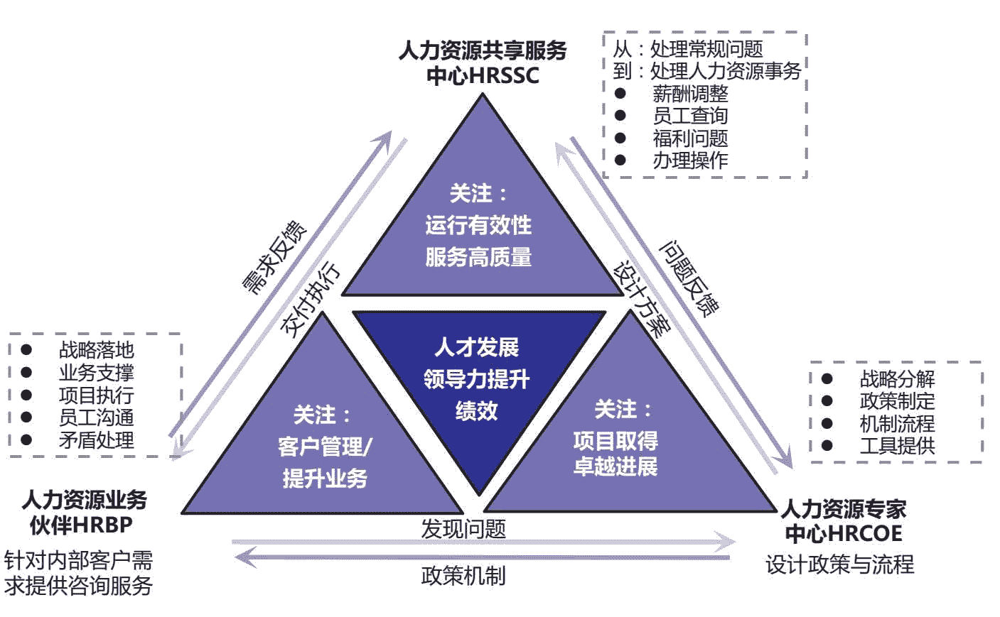

Figure 7-2 Specific Work of HR Three Pillars and Their Mutual Relationships

`HR COE` acts as the steering wheel, traffic light, and gas station for the enterprise's HR management.

- **Steering Wheel**. As experts and designers in the HR field, `HR COE` is mainly responsible for using professional knowledge to enhance the professional capabilities of `HR` practitioners, formulating HR management policies, mechanisms, and processes, and continuously improving their effectiveness.
- **Traffic Light**. As a controller, `HR COE` is mainly responsible for controlling the compliance of HR policies, mechanisms, and processes, and controlling the enterprise's employment risks.
- **Gas Station**. As a technical expert, `HR COE` designs business solutions, templates, and tools, providing HR technical support to `HRBP`, `HRSSC`, and business managers, guiding them in carrying out HR management activities.

The HR Business Partner (`HRBP`) is the bridge for communication between the HR department and heads/managers of various business departments. `HRBP` must be familiar with the various functions of the HR department and understand the needs of business departments; they must help business departments better maintain employee relations, handle simpler HR-related issues that frequently appear in business departments, and assist business department heads/managers in better using various HR management systems and tools.

`HRBP` is the position in the HR department closest to business departments. Enterprises configure the number of `HRBP` based on the service ratio of `HRBP` to formal employees. In different organizations, the degree of support from the HR department to business departments and the complexity of business differ, so the `HRBP` service ratio also varies. In HR management activities, `HRBP` mainly plays the following roles:

- **Strategic Partner**: Drive strategy execution in organizational and talent strategy, core value inheritance;
- **Solution Integrator**: Integrate `HR COE` designs to become business-oriented solutions;
- **HR Process Executor**: Promote HR management processes, support personnel management decisions;
- **Change Agent**: Play the role of a change catalyst;
- **Relationship Manager**: Effectively manage employee relations.

The HR Shared Service Center (`HRSSC`) is responsible for uniformly handling all basic and transactional work related to HR management from various business departments within the enterprise, such as compensation and benefits calculation and disbursement, social insurance management, personnel file management, personnel information service management, labor contract management, employee recruitment, new employee training, employee complaint and suggestion handling, consulting services, etc.

`HRSSC` is the provider of standard HR services, responsible for ensuring consistency in service delivery, providing standardized and process-oriented services to the enterprise and employees, releasing HR managers and specialists from complicated transactional work, and improving the overall service efficiency of the HR department. `HRSSC` usually plays the following roles:

- **Employee Self-Service Center**: Support service requests initiated by employees and managers;
- **HR Process Transaction Center**: Support the administrative transaction parts of main processes initiated by `HR COE` (such as payroll, recruitment, training administration);
- **HRSSC Operations Management Center**: Provide quality, internal control, data, technology (including self-service), and vendor management support.

#### 2. Three Pillars Case Sharing: Tencent `HRSDC` Upgrade Path

##### (1) Core Elements Leveraging Tencent `SSC` Upgrade to `SDC`

After more than five years of exploration, Tencent's HR Shared Service Center has transformed into the HR Shared Delivery Center (`SDC`). This change conforms to the changes of the times and the iteration of industry background. Most importantly, Tencent's HR Shared Service Center discovered that the business departments' demands on them and the HR department had begun to change.

First, business needs have changed from early stability demands to variability demands, with business departments emphasizing flexibility in HR management.

Second, employees' new needs for personalization and self-management require the HR Shared Service Center to study human nature and manage hearts. Returning to human nature and transforming towards the direction of managing hearts is the foundation of HR management.

Third, changes in the information and intelligence era. Employees' use of tools has begun to change from `PC` desktop to multi-terminal.

Fourth, the HR department's front-end strategy can match the company's strategy, and at the same time, the HR department can support multi-terminal life development cycles and business development cycles.

For example, Tencent has extensive business lines. Beijing company employees mostly engage in online media and video work, while Shenzhen company employees engage in game-related work. Under multiple business states and models, how the HR department can adapt to business department needs and quickly provide one-stop solutions is the main reason for the birth of Tencent's `SDC` model. The company hopes `SDC` can do a good job in support from the perspective of connecting `HR COE` and the entire operations center.

##### (2) Differences Between Tencent `SDC` and Traditional `SSC`

If `HRSSC` is 1.0, then Tencent's `SDC` is 2.0. `SDC` has developed from a state of passively waiting and undertaking matters to being able to proactively initiate delivery-oriented demands and proactively deliver services, realizing needs through delivery standards and delivery appeals. Therefore, `SDC` is more about connecting the needs of `HR COE` and `HRBP`, as shown in Figure 7-3.

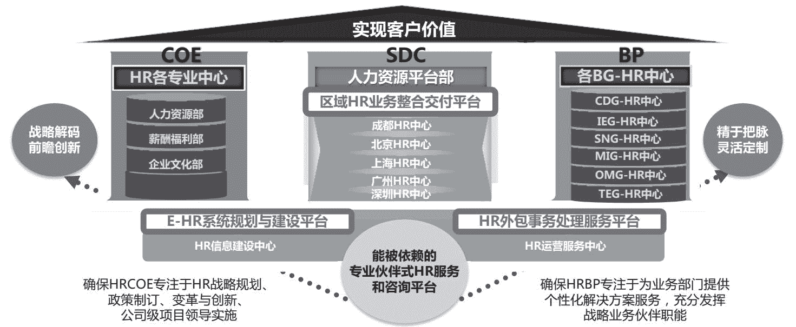

Figure 7-3 SDC Connecting HR COE and HRBP Needs

In some enterprises, many `HR COE` find it hard to float up, `HRBP` finds it hard to sink down, and `HRSSC` work gets mixed up. If this part of the work cannot be made intensive and modular, `HR COE` will find it hard to play the role of the "corporate brain" and cannot judge what strategic layout HR managers should make for the company's future strategic development. Similarly, if it cannot be well centralized to the back end, `HRBP` on various business lines will find it hard to quickly and actively influence different business groups, because `HRBP` lacks the strength to see deeper into business departments. So, `SDC` must be able to establish an HR Solution Center in these aspects. This is what Tencent is currently doing.

##### (3) Future Development Direction and Challenges of `SDC`

Tencent's `SDC` will become an integrated HR delivery platform that can provide stable, reliable, and trusted HR services to employees. To achieve this vision, Tencent also faces many challenges. For example, where are the people who can truly do `SDC` work, how to quantify `SDC`'s contribution to the company's organizational effectiveness, and how to achieve twice the result with half the effort.

### 3. Reshaping the Three Pillars

With the continuous application of AI technology and big data analysis in various fields of HR management, this influence will reshape the HR Three Pillars, thereby accelerating the iteration and evolution of "Organization, Talent, Culture". So, what are the differences in the reshaped Three Pillars? The specific changes and their mutual relationships are shown in Figure 7-4.

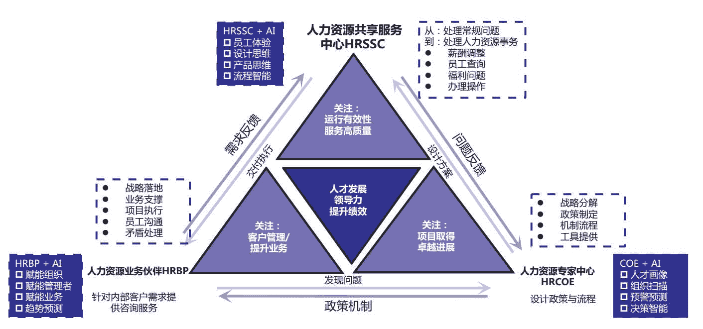

Figure 7-4 Reshaped HR Three Pillars + `AI`

#### 1. `HRSSC` + `AI`

The `AI`-empowered `HRSSC` has obvious competitive advantages in the following aspects.

##### Employee Experience

The reshaped HR Three Pillars have significantly improved in terms of employee experience.

Employee experience refers to the collection of good or bad things encountered, felt, and heard by employees within the enterprise, covering a complete life cycle before entry, during employment, and before/after departure. During the entry, employment, and departure stages, employees will also experience the aspiration phase, honeymoon phase, confusion phase, rising phase, maturity phase, decline phase, restlessness phase, and nostalgia phase, as shown in Figure 7-5.

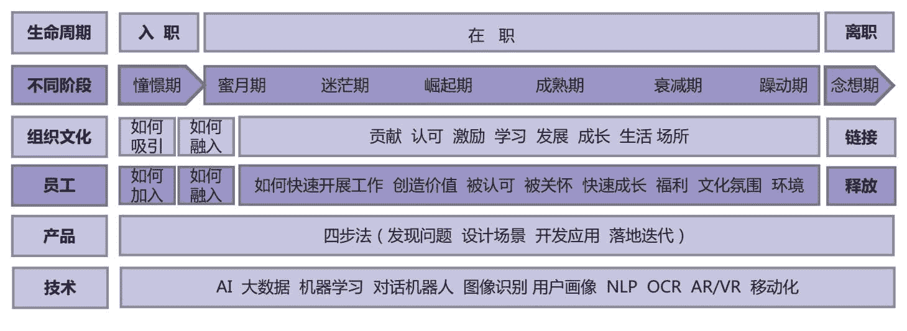

Figure 7-5 Employee Experience and Employee Life Cycle

For example, before entry, candidates are in the aspiration phase. At this time, HR practitioners should start from "how to attract" candidates to quickly "join", by outputting the employer brand image, allowing information to be efficiently conveyed to candidates, or communicating with candidates through intelligent customer service bots, pushing company promotional materials to candidates in advance to deepen their understanding of the company. During entry, HR practitioners can achieve instant onboarding through digital signatures, Optical Character Recognition (`OCR`), Robotic Process Automation (`RPA`), and other technologies, improving the onboarding experience. After entry, through seamless attendance, employees can easily solve the embarrassment of failing to clock in/out. Upon departure, the company gives postcards to employees, letting them miss the company after leaving.

What is seamless attendance? In the past, attendance mostly used card swiping, fingerprint, facial recognition, mobile attendance, and other methods. In the digital-intelligent era, the HR department can deploy "Three Reals" (On-site, Actual Object, Actual Situation) data collection devices, such as HD cameras, inspection robots, Near Field Communication (`NFC`) devices, etc. Employees only need to enter the office area to be automatically identified, without the action of "clocking in". Of course, the company must sign an informed consent and confidentiality agreement with employees.

##### Design Thinking

Product design in the HR field needs to run through the full life cycle of employee entry, employment, and departure, thinking and solving problems from the starting point of caring for employee needs, improving processes, and stimulating employee enthusiasm and self-drive. For example, Baidu designed badges together with the cartoon "Du Xiaoxiong" (Degree Bear). Employees receive a Degree Bear with a number on every work anniversary; the number represents the years the employee has worked. There are also long service awards for 5 or 10 years. At the same time, on the employee's birthday, the company also distributes Degree Bears with special significance. These colorful Degree Bears lined up on the workstation greatly enhance the employee's pride, sense of belonging, and sense of achievement in growing with the company.

HR department work is piled up from details. `HR` practitioners must be good at using design thinking to improve employee experience, creating a great experience through little touches.

##### Product Thinking


##### Product Thinking (Duplicate)

Product thinking is a comprehensive problem-solving mindset, a process of productizing problem solutions.

Product thinking in Human Resource Management refers to HR practitioners, when designing and implementing solutions for selection, utilization, development, and retention, deeply excavating user needs, focusing on user experience and scenario-based design, rapidly iterating, continuously operating and optimizing, and meeting compliance requirements.

##### Characteristics of Product Thinking

- **User Thinking**: Treat employees as users, giving them a sense of participation;
- **Pain Point Thinking**: Identify users' real needs, especially helping them establish needs when conducting training work;
- **Mobile Thinking**: Combine HR practitioners' work with mobile tools;
- **Scenario Thinking**: Keenly insight into users' core needs, scenarize management practices, and create experiential products;
- **Iterative Thinking**: Product implementation is modular, component-based, and microservice-oriented, achieving small steps, fast runs, and agile development;
- **Data Thinking**: Speak with data, empower with data;
- **Ecosystem Thinking**: Build a "small closed-loop" ecosystem to help employees achieve self-regulation;
- **Operational Thinking**: Spread the brand, provide continuous service.

##### Typical Cases

##### Baidu Lingting: AI Empowers Learning Scenarios

Baidu records a large number of video and audio courses every year. The usual practice was to edit and upload them directly to the platform for employee learning. However, some users prefer learning by reading text. If manual subtitle editing or audio-to-text conversion were used, it would consume a vast amount of user time. After extensive interviews, research, data analysis, and multiple rounds of iterative design, Baidu developed an AI product—Baidu Lingting. It enables automatic subtitling for videos and audio-to-text conversion. If some conversions are not accurate enough, employees can make simple adjustments along the timeline.

##### Alibaba: Overseas HRSSC Iteration and Optimization

With the acceleration of internationalization, the proportion of Alibaba's overseas employees is increasing. Alibaba conducted iterative optimization of its overseas HRSSC. To ensure flexible configuration, Alibaba's EHR team modeled the work and affair management of the HRSSC domain, redefined processes and handling nodes, and set flow rules to ensure data security. Alibaba's HRSSC connects multiple systems including IT, Core HR, Commercial Insurance, and Payroll. Based on factors such as overseas employees' location benefits, level, department, and country, it matches a personalized application list for each employee. Overseas employees can track processing progress in real-time, experiencing a one-stop HR service system.

##### Tencent Anju Plan: Solving Housing Pain Points to Retain Talent

Tencent's HR department conducted an analysis in 2012: the turnover rate of new employees who had been with the company for three years was three times that of ordinary employees. Through deep excavation, HR practitioners discovered the core reason for employee resignation was housing difficulty. Consequently, Tencent launched the "Anju Plan," where the company set up a fund to provide interest-free loans to eligible employees. Since then, the employee turnover rate has dropped significantly.

#### Process Intelligence

In the informatization era, enterprises built many information systems at different development stages. HR practitioners helped enterprises achieve rapid business development and replication by solidifying business processes. Today, with the advent of the digital era, business scale continues to expand, and organizations continue to fission. Enterprises have increasingly higher requirements for HR management systems: not only to achieve full digitalization of "entry, exit, promotion, demotion, transfer, selection, utilization, planning, reservation, and management" but also to achieve all-round improvement of employee experience. Therefore, the issues of process reengineering and process operation management have become increasingly prominent.

Process intelligence refers to the process of data recording, processing, and analysis in human resource management, facilitating the HR management team to use HR data more efficiently and conveniently. Key technologies of process intelligence mainly include OCR image recognition, speech recognition, text parsing, computer vision, etc. Among them, OCR technology can assist HR practitioners in intelligent expense reimbursement; speech recognition technology can assist in recording meetings; text parsing can realize automated resume parsing; computer vision can assist HR practitioners in identity verification functions such as facial recognition attendance. These can improve the efficiency of human resource management and employee work efficiency, freeing the HR team from tedious administrative affairs, allowing HR practitioners to devote time and energy to more important, more creative tasks.

##### HRSSC Self-Service "Three-Step" Practice

The following takes HRSSC self-service as an example to illustrate how enterprises achieve process intelligence.

To achieve a one-stop, efficient service experience, HRSSC needs to vigorously promote the online, automated, and intelligent transformation of self-service. This goal can be achieved through a "three-step" approach:

1. **Build a Knowledge Base**: Sort and archive mechanisms, knowledge points, and encountered issues from various HR modules, making them structured and tagged for employees to retrieve and view at any time; simultaneously update and enrich the knowledge base regularly.
2. **Develop Intelligent Customer Service Assistant**: Realize functions such as wizard-style Q&A, assisted Q&A, proactive suggestions, and personalized recommendations.
3. **Create a "Virtual Assistant"**: The "Virtual Assistant" can interact with employees through dialogue like a real person, realizing 7×24-hour all-weather service. This step applies technologies such as Natural Language Processing (NLP), Deep Learning, Big Data Analysis, and Robotic Process Automation (RPA).

Baidu HRSSC's service robot self-service efficiency reaches over 70%, not only realizing the automation and intelligence of customer service processes, ensuring the coherence and high quality of replies, but also greatly improving employee experience and user satisfaction.

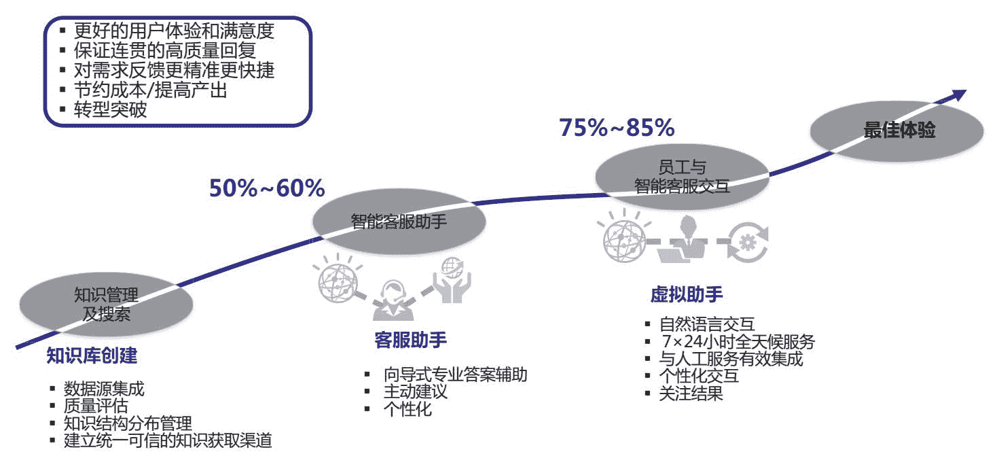
*Figure 7-6 HRSSC Service Self-Service Efficiency Model*

#### HRCOE+AI

The AI-empowered HRCOE has obvious competitive advantages in the following aspects.

##### Talent Profiling

Research finds that the core pain points of human resource management lie in talent development direction. For example, talent profiling accounts for approx. 55%, recruitment module approx. 62%, talent cultivation and development module approx. 59%, HR planning module approx. 57%, and labor efficiency evaluation module approx. 57%. Simultaneously, organizational innovation approx. 43%, organizational strategy approx. 42%, and engagement insight approx. 41% have become prominent pain points. Enterprise leadership approx. 33%, organizational stability approx. 32%, and organizational culture approx. 30% follow closely, gradually becoming "stumbling blocks" for enterprise transformation and development. The bar chart of core pain points in HR management is shown in Figure 7-7.

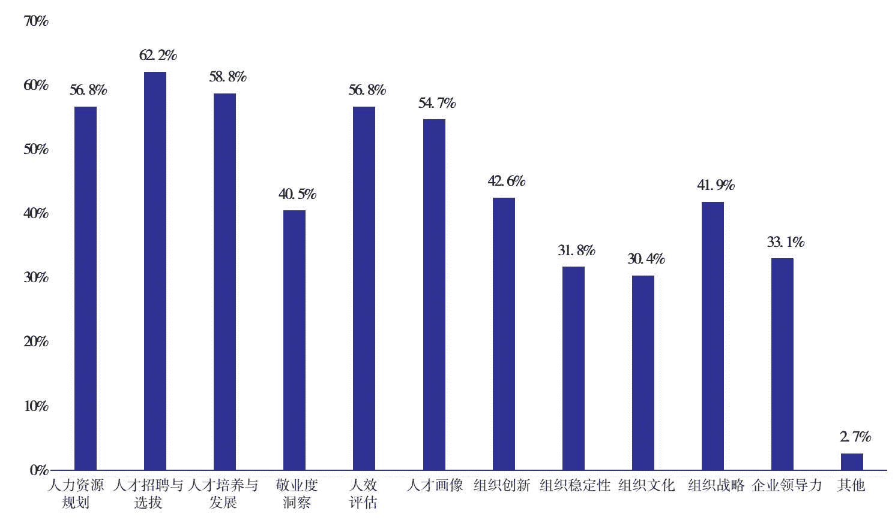
*Figure 7-7 Core Pain Points of Human Resource Management*

Ping An HR-X, combining enterprise talent data, innovatively designed Job Profiles and Employee (Cadre) Profiles using AI and big data technologies. Through intelligent tag setting, it precipitates full-time, full-view, and full-volume data to assist in selection and appointment decisions. The HR-X team utilizes big data and intelligent models to establish a set of panoramic profiles for employees in the most comprehensive and scientific way, such as performance profiles, skill profiles, willingness and personality profiles, compensation profiles, achievement and team profiles, etc. It matches personnel with job requirements through intelligent models, combined with AI interview assessment, connecting multiple HR management scenarios such as recruitment, performance, training, and compensation, making team management more precise, comprehensive, and efficient.

In cadre profiling, rich tags and intelligent models will be applied in multiple scenarios such as identifying, evaluating, employing people, and team building:

- **Integrate Personnel Information**: One-stop integration of performance, work experience, assessment, and other information, leveraging aggregation effects;
- **Dynamic Comparison for All Staff**: Compare team performance and work performance, making dynamic trends clear at a glance;
- **Precise Job Requirements**: Applied in internal recommendation, AI interview, performance suggestions, training management, and other scenarios;
- **Precise Person-Job Fit**: Precisely match personnel with positions, making promotion and salary adjustment no longer difficult;
- **Social Circle Analysis**: Display multi-dimensional relationships such as alumni and former colleagues, strengthening risk control over personnel;
- **Tag Search**: Make talent allocation more convenient, easily gathering professional talents and industry elites;
- **Intelligent Training**: Able to intelligently recommend courses based on users' strengths and weaknesses, improving employee capabilities in a targeted manner;
- **Poor Performance Early Warning**: Detect performance shortcomings early, take measures early, improve employee performance, and ensure team combat effectiveness;
- **Resignation Early Warning**: Capture abnormal employee behaviors in time, prompt resignation characteristics.

Deep application of talent profiling can realize "recommending positions for people," "finding people with models," "finding people with people," and "finding people from organizational needs." These more flexible profiling applications can help organizations find talents with extremely high matching degrees to the team.

##### Organizational Scanning

Enterprise managers need the HR department to promptly inform them via system reminders or dashboard displays: what are the changes in organizational structure, where is the talent map distributed, how to deploy troops, where are the key talents we need, which employees have the most potential, which talents are the "load-bearing walls" of the organization, which are generals, which are commanders, etc. Only by solving the following "Four Dimensions" can we truly realize the development of organizational strategy driven by talent.

- **Accelerate business progress brought by new technology application (Speed)**
- **Extend data analysis scenarios of points, lines, surfaces, and bodies (Breadth)**
- **Discover things traditional data analysis cannot insight (Depth)**
- **Promote full release of organizational effectiveness, driving continuous improvement of enterprise performance (Height)**

At the current stage, enterprises are gradually transitioning from the digitalization stage to the digital-intelligence stage. In the transformation process, strategy execution and organizational construction remain key factors. For an enterprise to gain an advantage in industry competition, using AI to insight into the organization, discover talents, and drive organizational performance growth is key. Research finds that about 70% of enterprises in China have started the digital-intelligence process, gradually forming a trend. The specific situation is: about 36.49% of enterprises are in the initial exploration and application stage; about 24.32% have entered the partial module promotion and application stage; about 8.11% have entered the full module system comprehensive implementation stage, as shown in Figure 7-8.

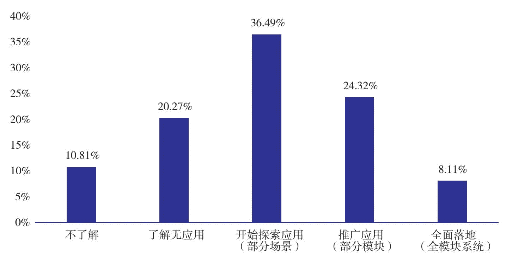
*Figure 7-8 Current Status of Digital-Intelligence Application in Chinese Enterprises*

Enterprises use AI and big data technology to conduct all-round scanning of the organization, matching the organization with strategy, building a scientific organizational structure, focusing on real performance improvement situations, and making data truly play its value through data collection, collation, modeling, analysis, and application, empowering enterprise digital-intelligence construction. Organizational scanning can be conducted from two levels: organizational management and performance incentive mechanism.

##### Organizational Management

Organizational management includes organizational structure design, job system design, and process control. The core goal of organizational management is to improve organizational effectiveness. Organizations hope to become more agile and efficient, output more value, obtain higher profits, and achieve sustainable development. Organizational effectiveness can be divided into management effectiveness, employee effectiveness, and organizational vitality. For HR, management effectiveness mainly looks at organizational process optimization. Enterprise managers can judge whether management span, approval nodes, etc., are reasonable through Organizational Computed Tomography (CT). Too high or too low will affect organizational health.

For example, JD.com's "8150" principle: "1" refers to each manager; "8" means JD requires each manager to have no fewer than 8 direct reports; if fewer than 8, middle management layers must be reduced. Only when direct reports exceed 15 does JD allow adding a manager at the same management level; "50" means the number of frontline employees of the same trade managed by each manager cannot be less than 50. Only when exceeding 50 can a second team manager be considered. The core of the "8150" principle is to ensure organizational flatness and guarantee organizational effectiveness.

Another example is Baidu's "2+2" principle for core HR process approval: two levels of business department heads approve business rationality, and two levels of HRBPs are responsible for policy control. This ensures both efficiency and risk avoidance. The organizational scanning tool built by AI models can detect situations in the system that do not comply with the "8150" or "2+2" principles at any time. The early warning system notifies managers and HRBPs. Managers and HRBPs can choose two buttons: one is "Accept," the system will automatically correct according to rules; the other is "Manual Intervention," the system prompts a maximum one-month manual processing time limit, which must be completed by the date, otherwise the system will automatically process. With continuous business development and changing management scenarios, the organizational scanning model will also continuously iterate and optimize to ensure sustained growth of organizational effectiveness.

##### Performance Incentive Mechanism

The performance incentive mechanism includes performance management, compensation and benefits, long-term incentives, etc. AI has reshaped these processes. Employees' work performance and behavioral data are compliantly integrated into the database. HR practitioners analyze and process these performances and data, establishing rating models to feed back employee work performance assessment results to each employee online. For certain deficiencies, the organizational scanning tool also gives targeted suggestions. The organizational scanning tool can also give suggestions on the application of employee performance results, identifying different hygiene factor types and motivation factor types for each employee based on their historical data, thereby matching dozens of solutions, truly realizing "one person, one face" in performance incentive allocation, fully stimulating employees' work enthusiasm. Even the organizational scanning tool can be used to predict employee performance, providing decision-making basis for managers to deploy troops.

##### Early Warning and Prediction

The HR management system must reflect the enterprise's HR business needs and drive business development forward. Intelligent products for early warning and prediction are the same. The following takes Baidu's HR management system as an example.

##### Baidu's Talent Philosophy

Baidu's talent philosophy is "Recruit the best people, give the largest space, look at the final results, let outstanding talents stand out," as shown in Figure 7-9.

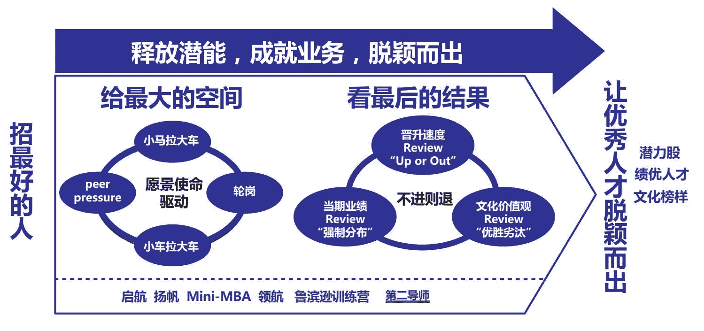
*Figure 7-9 Baidu's Talent Philosophy*

**Recruit the best people**. The best people possess three characteristics. First, match Baidu's advocated culture of "Simple and Reliable." When a person matches the company culture very well, internal communication and running-in costs will be greatly reduced. Second, excellent learning ability, which is very important for internet companies. The market environment and competitive landscape the enterprise faces change drastically every day. The enterprise uses a person not only for their experience advantage but more for their ability to quickly recognize, understand, and respond to future new environments. Third, competence for the current job and position requirements, which is the most basic requirement. The company needs to create an organization that is forever enterprising and self-driven. Self-driven people are not only willing to learn but can also learn quickly and continuously improve themselves.

**Give the largest space**. The space mentioned here is not only a comfortable office environment but more importantly giving employees a sense of mission, ideals, and technical balance. Baidu's largest space is cutting-edge core technology.

**Look at the final results**. Baidu is a result-oriented company. Regardless of employee seniority or tenure, everything speaks by results. Baidu emphasizes a differentiated culture.

**Let outstanding talents stand out**. In 2012, Baidu successively introduced multiple talent incentive policies and mechanisms, once again stimulating the self-drive and differentiation of Baidu talents. Through the "up or out" two internal lists (potential stocks and elimination list), junior position promotion of two levels in three years, cultural 360-degree assessment, setting up special outstanding performance awards, and other differentiated management methods, talents stand out.

Correspondingly, when designing business architecture and product architecture, enterprise managers must fully consider HR business needs and management requirements, sort out processes, clarify responsibilities, build a good foundation, connect systems, pull through data, improve experience, and combine the latest cutting-edge technologies (such as AI, blockchain, cloud computing, big data, IoT, mobile, 3D printing) to create digital-intelligence products, providing empowerment tools for decision-makers, managers, employees, and HR professional users, supporting business digital transformation. For example, in recruitment strategy, choosing "recruit the best/most suitable people," product design needs to consider full lifecycle recruitment management, unified talent pool, intelligent mutual recommendation of people and positions, interview/written test robots, intelligent onboarding/customer service, intelligent analysis dashboards, etc.; in "operation management" requiring full-process digitalization, product design points are unmanned one-stop service, flexible scheduling, non-inductive attendance, full-process digitalization of entry/exit/promotion/demotion/transfer, organizational CT, talent CT, talent panoramic profiles, etc.; in "talent learning and development," focusing on employee learning and growth in work, design points are digital self-service training, learning growth maps integrated into work, AR, VR, Mixed Reality (MR), gamification, personalized recommendation, one person one face, knowledge graph, panoramic dashboards, etc.; in "talent retention," focusing on letting outstanding talents stand out, design points are talent mobility early warning, organizational vitality analysis, talent health early warning, compensation incentive one-stop workbench, public opinion analysis and early warning, etc., as shown in Figure 7-10.

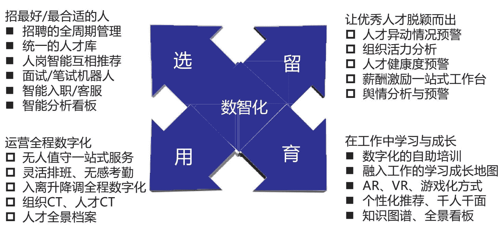
*Figure 7-10 HR Digital-Intelligence Scenarios*

#### Decision Intelligence

Decision intelligence in HR management assists the HR management team in making better decisions, discovering and analyzing problems from a data perspective, and providing quantitative references. Key technologies include Natural Language Processing, Knowledge Graph, Organizational Network Analysis, etc. Among them, NLP can realize intelligent person-job matching; Knowledge Graph related technologies can combine deep learning algorithms to predict employee turnover and performance; Organizational Network Analysis can quantitatively conduct leadership assessment. These intelligent decisions were difficult to achieve before the emergence of HR digital-intelligence. Now, based on these technologies, HR digital-intelligence can improve decision-making efficiency and accuracy, and provide quantitative analysis support.

Of course, when using big data technology and thinking to conduct early warning, prediction, and analysis on HR management's small data, decisions are not made directly based on correlation relationships. Instead, after comprehensive modeling and correlation analysis of all data and factors (not only HR domain data or factors, but also finance, operation, office OA, IT, external environment, and other data or factors), an index distribution is derived. Based on the index interval, corresponding probability judgments are derived for reference by managers and HRBPs in decision-making.

Survey research finds that about 75% of enterprises nationwide have carried out HR management digital-intelligence operation activities, among which the execution degree of digital-intelligence transformation of HR management processes is the highest, accounting for about 60.81%. Digital-intelligence of HR management processes exempts enterprises from tedious bottom-up, layer-by-layer approval management actions, simplifies office processes, gives employees a more intelligent office environment, improves employee work satisfaction, and helps employees spend more time and energy on creating more value for the enterprise, as shown in Figure 7-11.

The execution of HR management decision digital-intelligence has also reached about 20%, possessing a late-mover advantage. Realizing management decision digital-intelligence based on data-driven intelligent results is a necessary path for enterprise HR digital-intelligence development. Enterprises can use AI to build a platform without organizational boundaries, connect data resources of all parties on the platform, and through resource aggregation and continuous innovation, continuously provide deep scientific management insights for the enterprise, continuously optimize management decisions, and thereby improve the enterprise's core competitiveness. Currently, management decision digital-intelligence has realized humans making judgments based on machine results and taking management actions. In this complex process, enterprises will inevitably face many problems and challenges. For example, human-machine collaboration and symbiosis issues, human trust in machines and machine-generated results, interpretability of data-driven results, etc. In the process of solving the above problems, enterprises can also achieve more humanized HR management digital-intelligence and create a healthier enterprise environment.


*Figure 7-11 Work Carried Out by Enterprises in HR Digital-Intelligence Operations*

#### HRBP+AI

The AI-empowered HRBP has obvious competitive advantages in the following aspects.

##### One Chart in Hand: AI Executive Empowers HRBP

HRBPs utilize visualization tools—dashboards and boards—armed with AI and big data technologies, realizing "one chart in hand, panoramic view of talents, and digital-intelligence operation of HR," able to "view organization, view talents, view mobility, view labor efficiency, view costs" anytime, anywhere.

NetDragon Websoft is one of the earlier companies to apply AI in the HR field. To improve management effectiveness, NetDragon introduced an "AI Executive" mechanism to empower HRBPs. The division of labor between "AI Executive" and HRBP in actual work is as follows: "AI Executive" is mainly responsible for automatically approving processes that comply with rules based on company-level management rules, and penalizing behaviors that violate rules; HRBPs focus on the parts of management that need to reflect "humanity and humanism," while using mechanisms to correct unreasonable rules, phenomena, and behaviors to form a virtuous cycle. So, how does "AI Executive" empower HRBPs?

First, it frees HRBPs from procedural, repetitive work, allowing them to focus energy on more important work, such as culture building, experience enhancement, and organizational empowerment. "AI Executive" can realize automatic approval. Take leave as an example: generally, employee leave requires superior approval; now they only need to submit to "AI Executive," and if the leave reason complies with regulations, it can be automatically approved. "AI Executive" will notify the employee's superior of the leave situation. For promotion applications with clear threshold requirements, "AI Executive" can conduct a round of approval first; for personnel transfers with clear basic rules, "AI Executive" can also make judgments in advance. "AI Executive" can also issue work tasks, supervise, punish, warn, and praise employees in the identity of an enterprise manager. "AI Executive" can see the completion status of various company documents and push some data to managers to prompt organizational and business problems.

Second, the data and behaviors recorded by "AI Executive" provide a basis for HRBPs' personalized management. Take promotion assessment as an example: the company has two promotion seasons every year. Previously, HRBPs communicated with business superiors, sorted out department personnel situations, and recommended promotion candidates; now "AI Executive" recommends whether to apply for promotion to managers based on current performance data, historical performance data, tenure, and the gap between current salary and the current salary framework of existing department personnel. "AI Executive" also directly generates several reports, summarizing a recommendation model based on recommended scores. When HRBPs get this data, they can directly communicate with business departments. "AI Executive" can also help HRBPs conduct talent inventory, making relatively clear inventory based on absolute data such as performance level, management behavior assessment data, 360-feedback data, and various learning data. In the past, the company needed to manually collect evaluation reports from different dimensions; now multi-dimensional data capture can be done by machines, and the system automatically generates opinions and reports of corresponding templates.

##### Empowering Organizations

Baidu's AI Brain advocates "Open Empowerment," Alibaba emphasizes "Empowering Merchants and SMEs," Tencent's view is "Connect Everything, Empower People," JD.com wants "Retail Empowerment," Xiaomi wants Smart Manufacturing to "Empower Everything," Huawei wants "Digital Empowerment"… These large enterprises tirelessly emphasize the power of empowerment. So what is the definition of empowerment? "Empowerment" originally stems from "empower" in management science, used in conjunction with authorization. It is now mostly understood as "empowering energy or empowering capabilities." Extended to the enterprise interior, it means the enterprise releases power from top to bottom, especially the right of employees to work autonomously, driving organizational flatness through decentralization, and maximizing the release of individual talent and potential. Future organizations must have operations that transcend tradition, able to react more quickly to complex and changing external environments, and able to continuously stimulate the intrinsic motivation of elite employees and continuously empower them in work.

The enterprise's decision-making layer (CXO) represents the company. Empowering the organization means providing insights to the decision-making layer. Political Commissars or HRBPs also need suitable tools to escort the organization. Baidu Talent Think Tank illustrates how HRBPs use AI and big data technologies to empower the organization and empower the executive layer.


Baidu Talent Intelligence Center (TIC) is an intelligent talent management system. Based on massive data, it provides a complete intelligent talent management solution through precise machine learning and algorithms. It primarily acts on three major aspects: talent, organization, and culture. It contains six functional modules: "Smart Risk Control," "Smart Retention & Resignation," "Smart Culture," "Smart Talent Selection," "Smart Organization," and "Smart People," as shown in Figure 7-12.

In terms of talent, the Baidu Talent Intelligence Center can greatly improve recruitment efficiency, scientifically identify outstanding managers and talent potential, predict employee resignation tendencies and post-resignation impact, and provide intelligent support for targeted talent acquisition, development, and retention. In terms of organization, it can scientifically assess organizational stability by analyzing departmental vitality and talent structure, reveal talent flow patterns between organizations, and provide intelligent support for organizational optimization and adjustment, efficient talent incentives, and talent flow promotion. In terms of culture, it can promptly present internal and external public opinion hotspots, intelligently analyze external talent market conditions, provide intelligent support for managers to enhance corporate reputation, boost employee morale, and conduct talent reserves in advance. The Baidu Talent Intelligence Center truly realizes data-driven decision-making, assists executive judgment, and enables Baidu to maintain strong industry competitiveness in the high-tech industry where talent flows rapidly and competition is fierce.


Figure 7-12 Baidu Talent Intelligence Center Product Functions

##### Empowering Managers

In the digital era, employees are increasingly difficult to "manage"; they tend more toward personalization and self-development, and team managers face tremendous challenges. In actual work, management efficiency will increase by 30%–50% with the aid of an intelligent workbench. Taking China Minsheng Bank's new-generation HR digital platform "HR Box" as an example, Minsheng Bank utilized the team view, human capital analysis, HR operations, service window, and other functions of this "magic box" to achieve comprehensive empowerment for the management team, team managers, `HR` line managers, and general employees. It realized the enhancement of organizational value, talent value, talent supply chain, and basic HR management, as shown in Figure 7-13.

With continuous breakthroughs in digital technology, the banking industry has entered an era of competition. The HR management of various banks needs to respond rapidly to numerous challenges such as talent disruption, business disruption, and experience disruption. Under such circumstances, Minsheng Bank's HR Department, centered on the customer, used digital technical means to participate in the forward-looking layout of the headquarters' transformation, helping the executive team gain insights into the environment, competitors, themselves, talent, and the future.


Figure 7-13 "HR Box" Product Functions

Minsheng Bank's HR Department applied the human capital analysis model, adhering to the principles of "user-centric, value-driven, model-supported" to build a human capital analysis platform. It built management cockpits for the management team, HR lines, and managers at all levels, extending to form multi-dimensional application scenarios such as "Head Office Department View," "Branch Department View," and "Sub-branch View." It provides human capital analysis dashboards, automated reports, team and employee analysis reports such as "Fundamentals," "Human Capital DNA," "Department Portrait," and "Talent Portrait," becoming the quantitative management online entry point for analyzing human capital information and exploring human capital issues, realizing intelligent human capital management where "data is visible, management is visible, talent is searchable." Minsheng Bank's HR Department also explored the "agile organization" management model, implementing cross-departmental and cross-line seamless project-based collaboration, building a "trinity" employee work recording system, and matching management systems, rules, and policies to ensure these systems upgrade synchronously with changing needs, further improving performance culture, stimulating corporate vitality, and driving cultural transformation, truly empowering managers.

##### Empowering Business

Digital intelligence is an accelerator for business development. The integration of digital intelligence, digitalization, and intelligence can also be understood as "Digitalization + Intelligence," a higher stage based on digitalization. The underlying logic of the digital intelligence stage is as follows: **Generate Connections**: Interconnection of people, finance, materials, and affairs, such as human-machine, human-human, machine-machine, human-affair, affair-affair, machine-affair, human-finance, human-material, finance-material, material-affair, finance-affair, knowledge interconnection, etc.; **Precipitate Data**: Through the above interconnection of people, finance, materials, and affairs, raw data naturally leaves traces, is objective and effective, containing all structured and unstructured data, laying a good foundation for subsequent data cleaning, processing, storage, and analysis; **Data Intelligence**: Machine learning and big data technology make data analysis more realistic, clear, and intelligent. Models, algorithms, and computing power are the three most critical elements.

The level of digital intelligence development in Chinese internet companies is relatively high, the scope is relatively comprehensive, and the technology is relatively mature; therefore, business development is also faster. However, overall, the level of digital intelligence in traditional industries is still in the initial stage. Although enterprises have been paying attention to digital transformation over the past many years, the sense of urgency for transformation and the execution of measures are not strong, the transformation path is not clear, and there is a greater lack of digital talent.

Research found that across more than a dozen modules of enterprise management, different enterprises have conducted effective explorations in digital intelligence applications. For example, about 21% of enterprises have started digital intelligence applications in strategic management; about 34.5% in human resources; about 27.7% in financial management; specific proportions for administrative management, supply chain management, quality management, product R&D, and other fields are shown in Figure 7-14.

Although about 20% of enterprises in various industries have begun to explore digital intelligence applications in different modules of enterprise management, the overall scale is still in the initial stage, and there is a long way to go in the future. This is related to the fact that the application practice of AI and big data technology in enterprises is still in the exploration or micro-application stage, and is also related to other factors such as cognitive level and talent shortage. Among them, the research involving the "Human Resources" management module found that enterprises entering the digital intelligence stage, in the informatization stage, and not yet in the informatization stage in HR management each account for about one-third, described in detail as follows:

- About 34.5% of enterprises have entered the digital intelligence stage in HR management to varying degrees, far higher than other management modules;


As shown in Figure 7-14 Stages of Digital Intelligence in HR Functional Modules

- About 33.1% of enterprises are very backward in the degree of HR management digital intelligence, respectively in offline operation or online stages, mostly traditional enterprises, the deep reasons need further exploration;
- About 32.4% of enterprises are in the HR management informatization stage; they are the main force of digital transformation.

These data indicate that in the direction of HR management digital intelligence: first, enterprises still need to learn and improve at the cognitive level, and there is a longer way to go at the practical level; second, more people have begun to recognize the importance and urgency of digital transformation and have taken action; third, HR can take the lead in digital transformation, do a good job in organizational guarantee, talent reserve, and cultural atmosphere building, empowering business transformation and rapid development.

### 4. Two Pillars

In the era of AI and big data, enterprise development and organizational forms vary widely, and HR managers need to continuously iterate with changes in organizational development. To adapt to business changes and requirements, some enterprises have gradually transitioned from three pillars to two pillars, i.e., the front end remains `HRBP`, responding to and handling various employee demands, while the back end `HRCOE` and `HRSSC` collaborate closely to jointly provide solutions for `HRBP`. The two pillars are also called the "Bench Model," as shown in Figure 7-15.


Figure 7-15 Schematic Diagram of Two-Pillar Model

The two pillars are suitable for organizations with rapid business development and innovation, which requires the enterprise's HR digital construction to reach a certain level—one platform, one mobile phone can handle various problems and process all affairs.

### 5. Four Pillars

The four pillars refer to an additional pillar on the basis of the three pillars, namely the Project Management Office (Project Management-4Office, `PMO`) or People Analytics (`PA`). The schematic diagram of the four-pillar model is shown in Figure 7-16.


Figure 7-16 Schematic Diagram of Four-Pillar Model

Process-driven enterprises contain many projects, such as talent standards, talent selection, talent inventory, organizational scanning, etc. Various problems arise during project promotion, at which point the `PMO` is needed to coordinate, integrate, and promote effective project execution and implementation. The `PMO` is the core department for improving organizational management maturity.

Data-driven enterprises will set up a dedicated `PA` department, which is regarded as the "Future of HR Work." In the future, people analytics will not only be part of HR work but will become a key part of the entire enterprise's organizational analysis. Typical representatives of enterprises setting up `PA` departments are Google's "Project Oxygen" and Baidu's "Talent Intelligence Center."

Whether three pillars, two pillars, or four pillars, they are all aimed at realizing HR strategy and business transformation and development, especially the two pillars, which are the inevitable result driven by `AI` and big data technology.

## Section 2: How AI Drives Shared Service Centers

The application of AI in HR Shared Service Centers (`HRSSC`) is already very common. Since Baidu's practice started relatively early, the following takes Baidu as an example to discuss various new technologies and practices of AI in `HRSSC`.

### 1. Business Background

Around 2010, Baidu operated the "three-horse carriage" of `SDC`, `HRCOE`, `HRBP`, among which the Shared Delivery Center (Service Delivery Center, `SDC`) went through stages from 1.0 to 3.0. Baidu calls the 3.0 stage the "`Smart HR`" stage. This stage aims to manage organizational change and talent development using more interactive systems, utilizing big data prediction, control, and analysis functions, with a focus on efficiency and control. Baidu started "exerting efforts" in this stage from 2014. By 2017, Baidu had begun transitioning from the "`Smart HR`" stage to the "`Intelligent HR`" stage, i.e., moving towards stages 3.5 or even 4.0. During this transition period, in pursuit of better employee experience, organizational vitality, and cultural empowerment, Baidu abandoned traditional processes and chose digital transformation processes, as shown in Figure 7-17.


Figure 7-17 Areas of AI Application in Baidu's HR Management Work

### 2. Application of New Technologies

#### 1. Recruitment Field — Intelligent Resume-Job Matching

Business-driven and technology-oriented approaches have changed the way recruitment works. Baidu's HR managers attach great importance to the application of AI in the recruitment field and the efficiency improvements it brings. Through Natural Language Processing (`NLP`) and machine learning on the talent resume database, building algorithms and models, they solved the difficult problem of intelligent matching between resumes and job descriptions. The following two tools will help HR recruitment specialists improve operational efficiency.

##### (1) Searching for Him in the Crowd (Zhong Li Xun Ta)

This is an intelligent resume screening system built by Baidu for the recruitment team. The system identifies job descriptions issued by the recruitment team and precisely matches resumes in the talent pool that meet the requirements. The "precise matching" here is not literal matching, but a comprehensive consideration combining the potential candidate's relevant background, work experience, project experience, etc., conducting big data algorithm analysis and "matching." Optimizing the resume screening process allows the recruitment team to focus more on evaluating candidates and put more energy into the interview process.

##### (2) Retrieving Lost Treasures from the Vast Sea (Cang Hai Shi Yi)

This is a job matching system built by Baidu for candidates to help them improve application efficiency. When candidates search for jobs, the system proactively recommends suitable jobs based on their resumes, reducing the time candidates spend browsing job descriptions and preventing them from missing suitable positions.

#### 2. Onboarding Process — Automation Achieved Through Combination of Technologies

##### (1) OCR Technology

`OCR` technology refers to the technology of converting text from various certificates, bills, newspapers, books, manuscripts, and other printed materials into image information through optical input methods such as scanning, and then converting the image information into computer-inputtable information using text recognition technology. In the past two years, this technology has been gradually applied to the HR field. Enterprises can combine it with the verification of new employees' identity-related information in the onboarding process. Before new employees join, the enterprise can require them to upload copies of degree certificates, qualification certificates, ID cards, bank cards, etc., to the system, use `OCR` technology to recognize the information, and simultaneously connect to third-party credit platforms such as the China Higher Education Student Information and Career Center (CHESICC), so that the verification of employees' educational information can be completed quickly.

##### (2) Facial Recognition Technology

Baidu's facial recognition technology is relatively mature. Internal application scenarios include access control facial recognition, meeting check-in, internal shopping, etc. Of course, facial recognition technology is also applied to other scenarios, such as self-service certificate printing, where employees can swipe their work card or use facial recognition. Another example: in the process of new employees handling entry procedures, facial recognition technology combined with the visitor system can not only be used for new employees to make advance appointments for reporting but also enhance the new employees' onboarding experience and processing efficiency.

##### (3) Appointment System — End-to-End Automation

New employees with appointments will receive corresponding backend appointment codes. While sending the appointment code, Baidu can also push onboarding guides and company news updates. After arriving at the company, employees can present the appointment code and go directly to the location for handling relevant procedures according to the onboarding guide. In addition, since new employee onboarding work is often concentrated, for ease of management, the new employees' appointment codes have been matched with the seat numbers at the venue for handling entry procedures, and an "Onboarding Gift Pack" is placed on the seat, including the new employee's computer, office supplies, documents to be signed, etc., facilitating the new employee's search.

This series of work connects candidates with the feedback system and the onboarding system, realizing end-to-end automation, and the new employees' favorability towards the company has been greatly improved.

#### 3. Online Learning System — AI Empowerment

##### (1) Baidu Academy's New Product — Lingting

One of the pain points of training specialists is spending a lot of time and energy on some repetitive simple tasks, such as adding subtitles to video courses. The purpose of adding subtitles to training videos is to enable students to understand the course content more accurately and quickly during the learning process. However, behind the task of adding subtitles, training specialists need to invest a lot of time and energy. Training specialists first need to record the text spoken by the lecturer, then proofread and correct errors, then format lines according to video production requirements, and finally ask video producers to synthesize subtitles with the video. The whole process requires coordination of several trades and takes several working days. To solve this problem, Baidu used `AI` technology to create the Lingting platform. After the training specialist uploads any video to the Lingting platform, the system can automatically recognize subtitles based on speech and add them directly to the video. The training specialist only needs to slightly modify individual inaccurately recognized parts to obtain a video with subtitles added. One person spending only a few minutes can complete work that previously took several people several days.

##### (2) Baidu Tingqing

While the speaker is talking, Baidu can output Chinese and English subtitles in real-time using speech recognition and translation technology. This technology, named "Baidu Tingqing," has been applied to Baidu's internal live streaming platform.

### 3. Application and Thinking of Big Data

#### 1. The "Bottom Line" of Big Data

Content involving personal privacy, such as email content, private communication content, etc., must absolutely not be used for personality analysis.

#### 2. The Foundation of Big Data

First, data from various modules of the HR department should be "interconnected," not fighting alone. Integrating HR data is the first step in big data analysis. Second, we must do a good job of "connecting" with data from other departments such as finance and sales.

#### 3. Handling Data Security Issues

Data security is a problem every enterprise must face and handle. The key lies in division of labor. Personnel responsible for drawing system interfaces, connecting data, etc., should jointly discuss and define boundaries, determining access levels and their permissions.

#### 4. The Essence of New Technologies Is Still Big Data

New technologies such as facial recognition and speech recognition are merely means, tools, or platforms. In the initial stage, big data is still driving behind them. Therefore, the progress of these technologies ultimately relies on the precipitation, sorting, and iteration of big data.

## Section 3: How AI Empowers HRCOE

In this section, we also look at how AI empowers `HRCOE` through the introduction of the "Baidu Talent Intelligence Center (`TIC`)" case.

Baidu practices the talent management philosophy of "letting outstanding talent stand out" from the three aspects of talent, organization, and culture with more quantitative and objective means. The Baidu Talent Intelligence Center contains six functional modules: "Smart Management," "Smart Talent Selection," and "Smart People," etc., specifically as shown in Figure 7-18.

- Talent aspect. `TIC` can greatly improve recruitment efficiency, efficiently identify outstanding managers and high-potential talents, predict employee resignation tendencies and the impact of resignation, and provide intelligent support for talent acquisition, development, and retention.
- Organization aspect. `TIC` can scientifically assess organizational stability by analyzing departmental vitality and talent structure, reveal the laws of talent flow between organizations, and provide intelligent support for organizational optimization and adjustment, efficient talent incentives, and talent flow promotion.
- Culture aspect. `TIC` can promptly present internal and external public opinion hotspots, analyze external talent market conditions, enhance corporate reputation, boost employee morale, and provide intelligent support for enterprises to conduct talent reserves.


Figure 7-18 Baidu Talent Intelligence Center's Support for Application Scenarios

### 1. Organizational Talent Management Risk Index

When facing new situations and new business challenges, how can an enterprise promote managers capable of handling high-risk positions from a large pool of managers? `TIC` proposed the concept of the Talent Management Risk Index. Through this index, enterprises can promptly identify the management complexity and difficulty faced by managers in various periods and compare the risk changes faced by different managers in their careers. For example, some managers are only competent in specific fields; once switched to other fields, their career development curves will show large fluctuations. Capable managers can smooth out turbulent curves in a relatively short time. The Talent Management Risk Index provides a convincing objective basis for enterprises to promote and appoint leaders.

### 2. Personnel, Talent, and Figures (Key People)

In the past, enterprises focused on "personnel," such as early manufacturing companies like Ford, emphasizing personnel's organizational discipline; now, high-tech enterprises focus on "talent," emphasizing talent's specialized skills and team collaboration abilities; in the future, enterprises will focus on "figures" (key people), requiring figures to possess outstanding leadership and innovation.

How to tap and find "figures" is a major challenge for HR departments. `TIC` builds a quantitative model from five dimensions: core position in the company, business bridge, open communication, organizational framework, and extensive cooperation. Based on objective and real data and texts such as business emails and code written on the company platform, it scores employees.

This establishes a growth "electronic file" for each employee. By calculating the employee's business centrality index, it judges the possibility of them becoming a "figure," and can discover the employee's strengths and weaknesses in these five dimensions, thereby giving appropriate appointments or targeted training. It should be noted that `TIC` deeply understands the importance of privacy protection for big data analysis. Any data used by `TIC` will undergo strict approval, encryption, and management to ensure it is not used for other purposes.

### 3. Talent Trend Prediction

By collecting internal and external enterprise data, including public opinion information and texts from social media and the internet, `TIC` established a 90-day resignation prediction model containing hundreds of dynamic features including economy, career development, and personal family reasons, with a prediction accuracy of over 90%. For example, in a resignation prediction conducted by Baidu in 2015, `TIC` analyzed the top 30 employees with the highest resignation index. Within 3 months, 29 of them submitted resignation applications to the HR department. `TIC` can also calculate how great an employee's resignation influence is and analyze the various reasons for resignation. If an employee with a high resignation index is a scarce talent and the resignation reason is within the company's controllable range, Baidu can intervene in a timely manner and take appropriate retention measures.

# Chapter 8: Building a Smart HR Platform to Assist Business Transformation

In the `VUCA` era, organizations have put forward very high requirements for HR management work, and have also put forward clear demands for HR system platforms, mainly reflected in the following aspects.

- Break through system and data silos. Connect the "entry, exit, promotion, demotion, transfer, selection, use, cultivation, reserve, management" links, realize end-to-end connection of processes, upstream and downstream connection of systems, and efficient flow of data.
- Establish and make good use of talent pools. Establish a global talent pool, form a talent map, and realize full life cycle management of talent.
- Unify the HR system platform. Build a unified platform,归属 a unified entry, set different permissions, provide rich and easy-to-use tools for employees, managers, and `HRBP`, realize self-service, and improve work efficiency and user experience.
- Data-driven. Build dashboards, boards, talent screens, etc., available for `HRBP` and managers, realize process intelligence, decision intelligence, and data early warning through talent portraits and organizational scanning.
- Employee experience. Realize closed-loop management of the trinity of entry, on-the-job, and exit, provide full-scenario services, and enhance employee engagement.

## Section 1: Four-Stage Model and Iteration Path of HR Digital Intelligence

In the past few decades, HR management work can be divided into four stages, as shown in Figure 8-1. In this process, HR informatization has also been developing forward with the continuous iteration of technology, also experiencing four stages, as shown in Figure 8-2.


Figure 8-1 Four Development Stages of HR Management

Readers can refer to the Four-Stage Model, contrast the different stages of their own enterprise's HR management work development, think about the digital blueprint, find the path for rapid digital iteration, continuously explore and break through, and assist business development and transformation.


Figure 8-2 HR Informatization "Four-Stage Model"

### 1. Stage 1.0: Online (Digitization)


### Stages of Human Resource Management Development

#### 1. Stage 1.0: Online (MIS)

The Personnel Management Stage is characterized primarily by administrative functions, with the keyword being "processing procedures." In this stage, the Personnel Department mainly handles daily affairs, most of which are trivial tasks. The work content includes onboarding processing, daily attendance, salary disbursement, offboarding processing, certificate issuance, etc.

Enterprises in the Personnel Management Stage require information technology to realize the onlineization of personnel services. This is the primary stage of HR informatization: Stage 1.0 Online (MIS). The Management Information System (MIS) moves various HR modules from offline to online. The work in this stage mainly meets the needs for online processing of personnel services, such as providing basic services like payroll calculation, social security and provident fund payment, onboarding/offboarding/transfer/promotion, etc. The core is to achieve automatic payroll calculation, with the keywords being "accurate headcount, correct payroll, total package calculation." Accurate headcount means accurately counting the company's basic employee composition and distribution through reports; correct payroll means correctly calculating and disbursing wages and bonuses through the system; total package calculation means being able to tally the headcount budget and labor costs for the group headquarters, various business units, and subsidiaries.

#### 2. Stage 2.0: Informatization

The Human Resource Management Stage is characterized by an emphasis on being "job-centric," with the keyword being "Six Modules." This stage focuses more on how to enable employees to be competent for their positions and complete work efficiently through the Six Modules. The Six Modules refer to HR Planning, Recruitment, Training, Compensation, Performance, and Employee Relations; each module is relatively independent. In 1993, the School of Labor and Human Resources at Renmin University of China took the lead in changing the Personnel Management major to Human Resource Management. Since then, Chinese enterprises have also begun to shift from personnel management to human resource management. In 1997, Dave Ulrich proposed the Three-Pillar Model, namely HRBP, HRCOE, and HRSSC. This propelled Chinese HR management into a period of rapid development, innovation, and transformation. The Three Pillars have also continued to evolve and develop with the times and technological drivers.

Enterprises in the Human Resource Management Stage require information technology to realize the informatization of HR management, commonly known as eHR. The keywords for this stage are "Process, Compliance, Efficiency." The main HR business processes in this stage can be summarized in ten Chinese characters: "Entry, Exit, Promotion, Demotion, Transfer; Select, Use, Develop, Retain, Manage." HR informatization starts from the full lifecycle of HR management, conducting business process review and diagnosis, process redesign and optimization, linking and integrating various information in HR business activities, realizing the sharing and effective utilization of internal and external HR information. Modules must be interconnected, processes and systems must achieve end-to-end connectivity, ensuring business process compliance and improving overall operational efficiency to meet management demands.

In this stage, HRSSC begins to utilize systems to improve service efficiency. For example, many leading enterprises have used technical means to upgrade and transform HRSSC, building a one-stop service platform with the goal of simplifying processes and improving efficiency.

#### 3. Stage 3.0: Digitalization

The Strategic Human Resource Management Stage is characterized by the HR department gradually becoming a strategic partner to business units. Its goal is to support the realization of corporate strategic objectives, with the keyword being "Three Pillars." HRBP, HRCOE, and HRSSC must all revolve around Organization, Talent, and Culture to support corporate strategy and achieve performance growth. In this stage, roles such as HR Vice President (HRVP) begin to appear and enter the core management of the enterprise, enabling HR management work to have a certain impact on the business.


Figure 8-3 Three-Pillar Model

Enterprises in the Strategic Human Resource Management Stage require information technology to realize the digital transformation of HR (DHR), with the keywords being "Organizational Effectiveness, User Experience." This stage requires the HR department to establish a clear digital mindset and cognition.

Digital transformation is the approach and method of utilizing digital technologies and capabilities to drive organizational business model innovation and business ecosystem reconstruction. The purpose is to achieve business transformation, innovation, and growth. The core of digital transformation is business transformation; technology is the cornerstone. Simply put, digital transformation is the enterprise's use of technology to fundamentally change business performance.


Figure 8-4 Three Pillars Supporting Corporate Business Strategy

HR Digitalization is the use of digital technologies and capabilities to reshape Organization, Talent, and Culture, driving rapid growth in corporate business.


Figure 8-5 HR Digital Transformation

HR Digitalization can support Organization, Talent, and Culture from four levels: Process, System, Data, and User Experience. First, processes need to be compliant, efficient, with clear authority and responsibility; systems need to be interconnected, possessing data-driven, scenario-based, and intelligent characteristics; data needs to integrate information and present it in layers, thereby achieving early warning, prediction, and decision support effects; user experience needs to run through the entire HR management lifecycle, integrating it into the design of processes and the building of systems.

With the advent of the Big Data era, uncertainty factors have gradually increased, and enterprises face more complex challenges. This requires the HR department to provide comprehensive services. For example, using digital technologies to reshape HR business processes and build a digital platform that is fully perceptive, fully connected, fully scenario-based, and fully intelligent; conducting predictive early warning and decision support through big data analysis to assist HR transformation and accelerate business development. HR Digitalization is an accelerated upgrade of Informatization, integrating and processing digital information, providing effective data support for corporate decision-making through multi-dimensional analysis, thematic analysis, and predictive analysis. The characteristics of the Digitalization stage are Mobility, Intelligence, Big Data, and Cloud Services, aiming to improve user experience and comprehensively enhance organizational effectiveness.


Figure 8-6 Digital HR Platform Architecture

The Digitalization (DHR) stage accelerated the development and system implementation of the Three Pillars. AI micro-applications began to be implemented in various scenarios, such as one-stop service platforms, robot customer service, intelligent dual recommendation for resumes and positions, intelligent background checks, robot interviews, electronic contract signing, AR training, self-service, talent profiling, intelligent dashboards, etc. Of course, every enterprise has different genes and development histories; no matter how the Three Pillars are reshaped, the purpose is to help the enterprise achieve its strategic business goals.

#### 4. Stage 4.0: Intelligentization (Intelligent HR / iHR)

The Human Capital Management Stage is characterized by managing talent as capital. The goal is to achieve sustainable talent supply during enterprise development. Talent management and organizational capabilities have become the core competitive advantages of the enterprise. The keyword for this stage is "Ecosystem." Generally speaking, enterprises in this stage have basically developed a three-curve business development path: The first curve is the mature business, ensuring cash flow; the second curve is the developing business (growth business), where products or services have the potential for upgrades at any time; the third curve is the future business, exploring future trends to keep the enterprise in a leading position. The organizational, talent, and cultural strategies for these three curves are also different.

Table 8-1 Three-Curve Business Development Path of Enterprises


At the same time, the views of HR domain experts are also changing: Dave Ulrich iterated HR competencies from the "Six Meridians Sword" (2007) to the "Nine Roles Model" (2016); Ram Charan shifted from "Splitting the HR Department" (2014) to the "C3 Model" (CEO, CFO, CHRO) (2019). The rapid development of Chinese enterprises has equally forced Chinese HR management to continuously break through and evolve. 2017 can be regarded as the inaugural year and watershed for Chinese HR management practice. Before 2017, Chinese HR scholars looked abroad and learned from abroad; after 2017, they turned to observing and learning from the HR management practices of domestic leading enterprises, especially leading Internet companies.

HR management in this stage has also entered the Intelligent HR (iHR) phase. Intelligent HR is the advanced stage of Digitalization, with the keyword being "Think Tank." If Informatization and Digitalization solve "Point, Line, Plane" problems, then with the deep application of Big Data and Artificial Intelligence, Intelligent HR considers the "Body" problem. It enables every link of "Entry, Exit, Promotion, Demotion, Transfer; Select, Use, Develop, Retain, Manage" to possess sensitive perception capabilities, adaptive learning capabilities, and predictive judgment capabilities. Simultaneously, it delivers management practices from various scenarios to the brain center through "Neural Networks," combines them with management practices to give action recommendations, and ultimately forms a Think Tank. Business generates data, data drives business; the two continuously iterate and spiral upward. The characteristic of this stage is a Networked Organization, aiming to build an Ecosystem Organization and sustainably support the virtuous cycle development of multiple corporate curves.

Intelligent HR provides a platform with middle-office-like capabilities, integrating the HR Business Middle Office and Data Middle Office. It uses small, fast, agile teams to respond to various uncertainties, gains insights through neural networks, exerts ecosystem effectiveness, and wins continuous advantages.


Figure 8-7 Intelligent HR Platform

Of course, every enterprise is at a different development stage, and the degree of informatization varies. So, can HR digital transformation achieve rapid iterative upgrades from Online to Informatization, then to Digitalization, and finally to Intelligentization in a short time? The answer is yes, because the path is clear. The Intelligent HR platform can achieve cross-era agile iteration through two continuous curves: The first curve is the cross-iteration from "Pit Filling" to "Empowerment"; the second curve is the cross-iteration from "Empowerment" to "Leadership."


Figure 8-8 Cross-Era Agile Iteration of Intelligent HR Platform

## Section 2 Big Data Analysis Maturity Models

### 1. Bersin Talent Analytics Maturity Model

The Talent Analytics Maturity Model launched by HR research firm Bersin & Associates (now part of Deloitte) in 2012 is divided into four levels, with the meanings of each level as follows.


Figure 8-9 Schematic Diagram of Talent Analytics Maturity Model Levels

1. **Level I: Reactive Analysis**

   This level is Basic Reporting, which are operational reports measuring service efficiency and compliance. Typical applications include:
   - (1) Establishing a Unified Data Dictionary: Having unified documentation clarifying data sources, acquisition methods, definitions, calculation details, etc.;
   - (2) Establishing Red/Yellow/Green Visualization Dashboards: Reports display personnel composition and basic structure.

2. **Level II: Proactive Analysis**

   This level is Advanced Reporting, which are operational reports serving decision-making, multi-dimensional analysis, and dashboards. Typical applications include:
   - (1) Improving Diversity Routine Monitoring: Establishing a routine monitoring system to measure whether the enterprise's talent composition is sufficiently diverse from aspects such as recruitment, identification, selection, appointment, promotion, incentive, retention, and turnover;
   - (2) Establishing Standards and Accumulating Trend Data: Persuading management to increase investment through comparative analysis (e.g., if employee retention rate, employee due diligence, upward mobility, etc., are all below standard values, it indicates the enterprise is in a slump);
   - (3) Establishing Red/Yellow/Green Performance Management Data for Managers, used for dynamic comparison of the performance of their own team and similar-level teams.

3. **Level III: Strategic Analysis**

   This level specifically refers to Analysis Services, used for population segmentation, statistical analysis, and analytical dimensions. The purpose is to understand causes and provide actionable solutions. Typical applications include:
   - (1) High-Potential Candidate Analysis: An algorithm can predict which candidates will have high-performance potential after joining;
   - (2) Quantification of High-Performer Value: Managers can see figures like "A is N times stronger than B," helping managers predict who will become talent;
   - (3) Workplace Design Encouraging Collaboration;
   - (4) Building Data Visualization Capabilities, articulating analytical conclusions in business language;
   - (5) Establishing High-Performer Identification Models for Sales Teams;
   - (6) Using Quantified Data to Measure Managers' Talent Management Capabilities, including driving, motivating, improving performance, retention, etc. Integrating and quantifying the evaluation of managers' management capabilities into an index.

4. **Level IV: Predictive Analysis**

   This level combines the development of predictive models, scenario planning, risk analysis and avoidance, and strategic planning. Typical applications include:
   - (1) Supporting Organizational Structure Design, using visualization methods to observe Span of Control and Talent Flow Patterns, assessing whether talent promotion or lateral movement is flexible;
   - (2) Supporting Headcount Budgeting, analyzing internal talent migration, and gaining insights into the external labor market;
   - (3) Planning for the enterprise's future business prospects from aspects such as Job Functions, Projects, Skills, and Specialized Expertise, combining global economic trends for analysis, and reserving talent for future enterprise talent gaps;
   - (4) Baidu's "Zhi Liu Ci" (Smart Retention/Resignation Prediction), a resignation prediction model designed by Baidu for key talent retention.

### 2. DIKW Pyramid Model

In the disciplines of Information Management, Information Systems, and Knowledge Management, the most fundamental model is the Data-Information-Knowledge-Wisdom (DIKW) Model. The DIKW Model is a pyramid structure. This model not only reflects the relationship between Data, Information, Knowledge, and Wisdom but also demonstrates how data is transformed step by step into Information, Knowledge, and even Wisdom.


Figure 8-10 Pyramid Structure of DIKW Model

The base of the pyramid is the largest; this layer is Data. Data (Data) in Latin originally means facts and givens. Data is a raw record, unprocessed and uninterpreted, reflecting the objective state of things. Data points are discrete and isolated.

Information is obtained after systematic organization, collation, and analysis of data. Information has clear purposefulness and usability, capable of answering questions such as "Who," "What," "Where," and "When." Information is a layer above Data, originating from Data but higher than Data. Information connects specific, isolated data points. Both Data and Information exist objectively.

In the DIKW Pyramid Model, the layer above Data and Information is Knowledge. Knowledge embodies the essence, principles, and experience of Information. It can guide task execution and management, decision-making, and problem-solving. The process from Data to Information to Knowledge is a process of Data becoming increasingly ordered, continuously verified, and ultimately revealing inherent laws.

Wisdom is the highest layer of the DIKW Pyramid Model. Wisdom is a profound understanding and foresight of things formed on the basis of Knowledge, manifested as exceptional judgment. People thereby adopt strategies and behaviors. Wisdom is an important characteristic distinguishing humans from other organisms and Artificial Intelligence (at least for now). Both Knowledge and Wisdom contain the subjective consciousness of Intelligence.

### 3. DIKWA Model

In the era of Artificial Intelligence and Big Data, the first thing people must change is their cognition of new things. Only by keeping pace with the times and iterating upgrades can they keep up with the era and resonate with business. Therefore, people re-learned the DIKW Pyramid Model and, on the basis of predecessors, micro-innovated and iterated it into the DIKWA Application Model. This model forms a closed loop, used to guide and drive the application development of HR Big Data.


Figure 8-11 DIKWA Application Model

The DIKWA Model combines perfectly with 5W2H, interpreting the application path of HR Big Data: Integrate Information, Analyze and Predict, Make Judgments, Take Action.

- **Data (Data)**: In Latin, the original meaning is facts and givens. Data is a raw record, unprocessed and uninterpreted, reflecting the objective state of things. Data points are discrete and isolated, describing objective facts.

  Table 8-2 Basic Data of Employee Zhang San of a Company

  

- **Information (Information)**: Information is obtained after processing and collating specific, isolated data. Both Data and Information exist objectively. Information has clear purposefulness and usability, capable of answering "Who," "What," "Where," and "When."

  Table 8-3 Performance and Bonus Information of Employee Zhang San of a Company

  

- **Knowledge (Knowledge)**: Knowledge is the refinement and induction of Information. It embodies the essence, principles, and experience of Information. It can guide people to execute and manage tasks, and make decisions and solve problems. Discovering hidden trends and unusual association rules from data through Data Mining belongs to the Knowledge level. The process from Data to Information to Knowledge is a process of Data becoming increasingly ordered, continuously verified, and ultimately revealing inherent laws. This step mainly answers "How."

  

  Figure 8-12 Correlation Analysis of Various HR Modules

- **Wisdom (Wisdom)**: Wisdom is a profound understanding and insight into things formed on the basis of Knowledge. It is manifested as exceptional judgment. People thereby formulate strategies and recommendations. Both Knowledge and Wisdom contain the subjective consciousness of Intelligence. People obtain various implicit trends through Data Mining and Correlation Analysis, such as Turnover Prediction, Development Potential, Management Risks, etc. This step mainly answers "Why."

  

  Figure 8-13 Schematic Diagram of 9-Box Grid for Performance and Capability Review

- **Action (Action)**: Based on Wisdom Insights, people obtain several solutions. As to which solution is more effective, people need to make decisions based on the situation at the time and take correct actions. Of course, after the action, a review is still needed to analyze the execution effect and feed it back to system construction data tracking points, thereby forming a closed loop. This step answers "How Much."

  Table 8-4 Example Table of Talent Retention Based on Turnover Prediction

  

### 4. Four Levels of Big Data Analysis

**The First Level is Descriptive Analysis.** At this level, the problem to be solved is "What Happened," i.e., describing objective facts. The analysis results must be able to answer "Who," "What," "Where," and "When." This corresponds to the Data and Information layers in the DIKWA Model.

> **[Extension]** Most enterprises' HR Analysis Reports stay at this level. This is the reason why enterprise managers are often dissatisfied with HR practitioners' work: HR practitioners tell managers facts that the latter already know.

**The Second Level is Diagnostic Analysis.** At this level, the problem to be solved is "Why Did It Happen." This corresponds to the Knowledge Layer in the DIKWA Model.

> **[Extension]** At this point, Business Department Managers begin to pay attention to HR Practitioners' opinions because the latter can help the Business Department clarify the relationships between things.

**The Third Level is Predictive Analysis.** At this level, the problem to be solved is "What Will Happen." HR Practitioners use techniques such as Statistics, Modeling, and Data Mining to discover patterns through analysis of current and historical data and predict the future. The analysis results must be able to answer "How" and "Why." This corresponds to the Wisdom Layer in the DIKWA Model.

> **[Extension]** At this level, Business Department Managers can no longer do without the support of the HR Department.

**The Fourth Level is Prescriptive Analysis.** At this level, the problem to be solved is "What Should We Do." HR Practitioners will use the experience accumulated at the Descriptive Analysis and Predictive Analysis levels to provide suggestions and problem-solving solutions for Business Departments. In this analysis process, HR Practitioners need to consider the Context of the Problem, Business Rules, Computer Modeling, and Algorithms. This corresponds to the Action Layer in the DIKWA Model.

> **[Extension]** From then on, the HR Department and Business Departments truly form a Partnership.

The analysis logic of the above four levels is clear and progressive.


Figure 8-14 Four Levels of Big Data Analysis

### 5. Three Application Levels of HR Big Data Prediction

We discover during hospital physical examinations that although the two examination forms of Blood Routine and MRI are different, their purposes are the same: to find potential "Causes," and ask the doctor to prescribe the right medicine. HR Managers must use Big Data Technology to find the "Causes" and provide solutions for Enterprise Managers. This work has the following three application levels.

1. **The First Level**: HRBP acts as the Doctor. After receiving the Big Data Prediction Report, they combine it with their own understanding of the employee to issue a "Prescription."
2. **The Second Level**: Establish an Employee Tag System, divided into Official Tags (tags given by HR Specialists/Supervisors, rewards/punishments received), Folk Tags (Peer Reviews), and Hidden Tags (results obtained from Big Data Analysis of Behavior). The combination of Big Data Technology and the Tag System directly outputs Recommendation Reports for HRBP, i.e., "Prescriptions."
3. **The Third Level**: Establish a Neural Network System. Use Artificial Intelligence Technology to build Talent Data Analysis Models and Decision Support Systems within a Compliant and Reasonable Scope, directly issuing "Prescriptions" (At this point, the System Platform construction has reached the Intelligent HR Stage, having formed a Talent Think Tank).


Summarizing the application across these three levels means that `HR practitioners` can effectively explore and practice the application of big data thinking and technology in human resource planning, recruitment, employee learning and development, performance management, compensation and incentive systems, employee benefits and services, etc.; through data mining and modeling analysis, they can predict future trends, provide auxiliary support for HR decision-making, and effectively reflect the value of big data.

Upon entering the big data era, people's thinking patterns have also undergone fundamental changes. For example, in the past, data collection took the form of sampling, whereas now big data uses full-volume data; in the past, sampling required precise individual data, whereas now big data can accept messiness because it focuses more on validity; in the past, data analysis involved proposing a causal hypothesis first, then collecting data and verifying the hypothesis through analysis, whereas now big data seeks to discover correlations from massive amounts of data.

Objectively speaking, to this day, big data processing and analysis technology remains in the "blind men feeling an elephant" stage. You might touch the "leg," while he describes the "trunk"; although the results are correct, they are all partial, not the full picture. With the continuous advancement of big data technology and the emergence of more and more living, complete data sources, the content explored by people will infinitely approach facts and truth. The more people can obtain deeper wisdom and insights, the more they can reflect the true value of big data.

## Section 3: Big Data Indicator System and Tag System

### 1. Five Roles of Data in Data-Driven HR Management

The core of data-driven HR management lies in the utilization of data. Data-driven management is not merely about reflecting results with data, but about fully improving data utilization rates, allowing data to demonstrate its role in monitoring, prediction, early warning, and other aspects. Specifically, in data-driven HR management, data serves the following five roles.

1. **Describe organizational HR status, organizational and individual work situations**

   Descriptive data is most widely used in HR work, primarily to describe the organization's HR status, organizational and individual work situations. It is an objective description of the actual situation. By comparing actual data with theoretical data or comparing multiple sets of actual data, it can provide certain guidance for work. In various summaries and reports by `HR practitioners`, descriptive data accounts for the vast majority; some even use descriptive data exclusively. Descriptive data generally uses absolute values, averages, percentages, etc., such as total number of employees, departmental personnel distribution, employee structure, salary disbursement, recruitment numbers and distribution, training sessions, training participants, training costs, etc.

2. **Reflect organizational and individual performance situations**

   `HR practitioners` achieve continuous performance improvement and enhance organizational and individual performance by comparing the gap between actual performance and expected performance. This type of data often appears in the form of percentages, but also uses averages and absolute values, such as recruitment completion rate, average training hours, employee turnover rate, average recruitment cycle, etc.

3. **Enable data to play a monitoring and early warning role, and improve work in a timely manner**

   Enabling data to function refers not only to using data to reflect past and present work situations but also to leveraging its monitoring and early warning capabilities to promptly identify data reaching critical thresholds, prompting timely work adjustments. For example, data can monitor expense expenditures, allowing managers to adjust spending at any time; data can predict employee turnover, allowing managers to adjust employment strategies, find reasons internally, and seek talent externally.

4. **Maximize the predictive effect of data**

   Data prediction refers to analyzing and inducting data to find patterns or correlations, providing strong support for work and decision-making. The more data accumulated in HR management, the more likely managers are to obtain accurate predictions. For example, to achieve next year's target output, managers can predict the number of employees needed in the workshop by summarizing historical output and employee numbers; with sufficiently rich and diverse data, managers can predict employee turnover through performance, attendance, daily work performance, and other data.

5. **Enable data to reflect efficiency and effectiveness**

   The ultimate effectiveness of enterprise HR management falls on the input-output ratio of human costs. This requires the connection of the "three statements" (financial statements) between the HR and Finance departments to analyze revenue per capita, profit per capita, personnel expense ratio, labor cost profit ratio, etc. Compared with subjective and experience-based judgments, data-driven results can make HR management more accurate and clear.

Data-driven HR management requires managers to comprehensively use multiple types of data, from individual data to organizational data, from past data to future predictions, from static data to dynamic data, and so on. Managers can test the results of data-driven HR management according to different cycles, but must pay attention to data dynamics at all times; once problems are discovered, they must be corrected in time, truly allowing data to participate in management decision-making.

### 2. The "How" of HR Big Data

HR big data can be divided into the System Layer, Data Layer, Analysis Layer, and Presentation Layer (Visualization Layer), as shown in Figure 8-15.


Figure 8-15 Four Levels of HR Big Data

#### 1. System Layer

The system layer is the foundation, the infrastructure for "Entry, Exit, Promotion, Demotion, Transfer, Selection, Utilization, Development, Retention, Management" (HR lifecycle), as shown in Figure 8-16; it can also be understood as the data collection layer. `Data tagging` (tracking), information collection, process optimization, system iteration, etc., are all realized at this layer. This requires all systems to be interconnected, with data flowing dynamically `end-to-end`. In fact, besides `Core HR`, Baidu has dozens of self-developed external systems. How to achieve interconnection between these systems, how to automate data flow and ensure a single source of truth are current challenges for Baidu. At the same time, the HR big data platform needs to connect with relevant business systems for data exchange; otherwise, the platform would only have HR management data, which would be neither complete enough nor able to help the enterprise generate greater effectiveness, serving at best as a reference. Of course, many companies currently have internal data silos; only by breaking these barriers can true big data analysis be achieved.


Figure 8-16 System Layer of HR Big Data Platform

#### 2. Data Layer

The data layer includes data cleaning, processing, extraction, storage, tagging, etc. The data processed at this layer includes both structured data and a large amount of unstructured data, as shown in Figure 8-17.

During data processing, managers will discover many missing data points, which requires feeding back to system improvement and optimization. Once a need for `data tagging` to collect data is identified, it must be supplemented or built accordingly. Therefore, the system layer and data layer are mutually complementary: the system precipitates data, and data feeds back into system iteration, spiraling upward and promoting each other.


Figure 8-17 Data Layer of HR Big Data Platform

#### 3. Analysis Layer

The analysis layer includes thematic analysis, self-service analysis, etc. Indicator system construction and model construction are also completed at this stage. Based on past data, through analytical modeling and machine learning, `HR practitioners` can discover correlations, rather than hypothesizing first and verifying later as in the past. By observing and analyzing today's data in a timely manner and adjusting models promptly, `HR practitioners` can enable data to truly play its predictive and early warning functions, providing a reliable basis for management decision-making.

The "`Talent Report`" system consists of over 200 indicators across five dimensions: Talent Management, Operational Management, Organizational Effectiveness, Cultural Vitality, and Public Opinion Analysis. It covers analysis dimensions for people and organizations and measurement dimensions for all HR functions, as shown in Figure 8-18. Among them, indicators for Talent Management and Operational Management mainly involve the decomposition of HR functions; indicators for Cultural Vitality and Public Opinion Analysis utilize big data technology to analyze influencing factors on employees in work, learning, life, and development; Organizational Effectiveness extracts relevant organizational goals of different business teams through organizational development tools.


Figure 8-18 Example Composition of the "`Talent Report`" System

#### 4. Presentation Layer (Visualization Layer)

This layer mainly provides various analytical reports (such as customized reports, component-based analytical reports, basic reports), user portraits (such as talent portraits, organizational portraits), and report recommendations (such as health check reports, diagnostic reports, auxiliary judgments) for managers (`CXO`, Managers), HR managers (`HRBP`, `HRCOE`), etc. For example, the traffic light dashboard includes core talent turnover rate, key talent ratio, etc.; another example is dynamically displaying charts of transfers, promotions/demotions, rotations, etc., in a player format. Talent migration maps can display scenarios such as talent sources, talent development, and talent loss. In terms of talent development, a personal panoramic view can be seen, allowing `HR practitioners` to compare talents and analyze each individual's characteristics and completion of performance indicators. Data prediction functions include key talent turnover prediction, core talent risk prediction, high-performance trend prediction, team health assessment and organizational vitality trend early warning, team collaboration trends, public opinion monitoring, etc., and can output diagnostic reports. These functions simultaneously support data drill-down and can export data or visualization graphics for secondary processing, analysis, and judgment.

### 3. Evolution of HR Big Data Products

HR big data products have gone through the following four eras, as shown in Figure 8-19.

1. `PC` Era. Primarily used commercial off-the-shelf software suites, utilizing standard suite reports.
2. `PC` Internet Era. Standard reports could be customized to meet multi-dimensional business analysis requirements.
3. Mobile Internet Era. Began using big data technology to analyze and predict business development trends; simultaneously, report visualization results became increasingly effective, increasingly reflecting the enterprise's current business status and future trends.
4. `AI` Era. Upon entering the AI era, technologies such as user portraits, chatbots, voice and image recognition have been applied to the HR management field, helping enterprises achieve greater leaps in business development.


Figure 8-19 Evolution of HR Big Data Products

Data mainly serves four roles: executives, managers, employees, and `HR practitioners`, as shown in Figure 8-20. Executives can have "talent information at their fingertips with one chart" and "decision references with one report." Managers on the business frontline do not need to invest excessive energy in daily personnel management; the system can provide timely services, simplifying processes and approvals. Employees can achieve integration of work, learning, culture, and life, conducting fragmented, gamified learning anytime, anywhere, and obtaining thoughtful, warm, convenient, and effective shared services. `HR practitioners` can establish a unified tool knowledge base, building a combative, highly innovative HR management team.


Figure 8-20 Four Roles Served by Data

## Section 4: Smart HR Platform Architecture

### 1. Smart HR Platform

The greatest contribution of AI technology to HR work will be the creation of a Smart HR Platform. Once the Smart HR Platform is built and implemented, the HR Three Pillars may be reduced to Two Pillars: one is `HRBP`, who "fight shoulder to shoulder" with business departments; the other is the merger of `HRCOE` and `HRSSC` into a powerful Solution Center and Service Guarantee Center, comprehensively supporting the work of employees, managers, management, `HRBP`, etc.

The Smart HR Platform will integrate the management practice cases of all HR experts and senior managers, gradually forming an callable wisdom knowledge base through modeling and machine learning, replacing junior `HRCOE`, and assisting expert `HRCOE`, `HRBP`, and managers in basic analysis and judgment.

`HRBP` will go deep into the frontline, using various AI devices to collect information, such as organizing conversation content using voice recognition technology, and feeding information back to the Smart HR Platform. The platform processes and computes existing information, then feeds back analyzed information to `HRBP`, providing a basis for subsequent actions. To illustrate with a tactical arrangement of a combat unit: usually, during frontline combat, a team of three is formed. Among them, there is a very strong communication and analysis expert (i.e., `HRCOE`), maintaining constant contact with the rear; another is a weapons and combat expert (i.e., `HRBP`), familiar with various weapons and battle situations; the last is a rescue and logistics support expert (i.e., `HRSSC`). After this team air-drops into the destination, they will call drones for on-site reconnaissance or scouting. The communication expert transmits all on-site situations and temporary judgments back to the rear, calling for a missile strike to eliminate a stronghold on the hilltop, or calling for an airdrop of suitable weapons and equipment. This requires the unit's rear analysis and command system to be very powerful. The Smart HR Platform is this "rear." The Smart HR Platform can make the command of those "who can hear the gunfire" more effective, as shown in Figure 8-21.


Figure 8-21 Role of the Smart HR Platform

To realize the above vision, the Smart HR Platform must have strong digital technology as support, and the enterprise's overall mobility level needs to reach a certain degree. Currently, the biggest difficulty is still data: first, the data volume is far from enough, and AI can only exert its power with sufficient data; second, data must come from `imperceptible collection` by various devices, which has many difficulties; finally, how to make data work and create value is also the key focus for HR managers in the next step.

This is an era of change, uncertainty, and the unknown. Facing complex scenarios, the Smart HR Platform not only needs a powerful real-time analysis backend as support, but HR managers must also continuously improve, adapt to changes, keep pace with the times, and create greater value.

### 2. Decoding the Implementation Path of the Smart HR Platform

#### 1. Overall Planning and Implementation Path of the Smart HR Platform

Enterprise HR business strategic planning is generally derived from the corporate Mission, Vision, Values (`MVV`), and then through the layout of three aspects: Organization, Talent, Culture, implementing respective organizational projects, talent projects, and cultural projects, achieving full penetration from the organizational head to the waist to the legs. HR digital planning needs to holistically control processes, systems, and data under the guidance of corporate policies, systems, and norms, and realize customer value, thereby assisting the achievement of HR strategic goals.

Many corporate HR departments also have their own Mission, Vision, Values. Based on `MVV`, the HR Strategy can be derived, which also undertakes the corporate strategy. HR Strategy consists of two parts: one is the strategy decomposed from corporate strategy; the other is the strategy derived from the HR department's `MVV`, mainly covering five directions: Organization, Talent, Culture, Leadership, and Systems. HR Strategy can further derive HR policies, mechanisms, and norms.

Process, System, Data, Experience are the four dimensions of HR digitalization and intelligence, interrelated and indispensable. Process sorting covers "Entry, Exit, Promotion, Demotion, Transfer"; system construction radiates "Selection, Utilization, Development, Retention, Management". With processes and systems, the next layer is the data precipitated by the data platform, including data models, indicator systems, management scenarios, thereby forming talent portraits, organizational portraits, analytical diagnosis, early warning prediction, and auxiliary judgment.

The customers of the Smart HR Platform are the decision-making layer, management layer, employees, and `HR practitioners`, and finally the core goal is established: realizing HR digital-intelligence. Empowering managers and enhancing user experience are also the value of the Smart HR Platform.

The complete path to realizing the HR "Four Modernizations" (Standardization, Digitalization, Intelligence, Platformization/Productization) is shown in Figure 8-22.


Figure 8-22 Path to Realizing HR "Four Modernizations"

#### 2. Challenges and Breakthroughs of Self-Developed `DHR Platform`

Whether enterprises need to self-develop a `DHR Platform` has always been a controversial topic. With business expansion and future industry development, enterprises are developing towards groupization, globalization, and multi-business forms; expanding self-developed R&D strength has become inevitable, as shown in Figure 8-23.


Figure 8-23 Challenges of Self-Developing `DHR Platform`

In the self-development of `DHR`, enterprises should understand the relationship between change and constancy, grasp the invariable underlying logic, and explore well on the variable level, as shown in Figure 8-24. During system self-development attempts, "data silos" easily form between systems. To avoid "chimney building" (stovepipe systems), enterprises can plan the data integration platform in advance at the top-level design stage, consciously refine common services, continuously precipitate reusable components at the code level, and equip intelligent portal entrances, data governance mechanisms, and security management mechanisms, eliminating "chimneys" from the bottom-layer architecture to form agile and efficient `microservices` and `lightweight applications`.


Figure 8-24 Breakthrough for `DHR Platform` Self-Development

#### 3. Portrait of Digital Talent

Digital strategy, talent first. So, in the process of HR digital transformation, what kind of digital talent with what traits serves as the acceleration engine for promoting enterprise `DHR Platform` construction? The core skill of digital talent is mastering both technology and business simultaneously, while possessing capabilities in data analysis, user experience, and product thinking, as shown in Figure 8-25.


Figure 8-25 Portrait of Digital Talent

# Acknowledgements

The writing of this book took nearly three years. Although coding during holidays was exceptionally hard, I really wanted to write this book. Because this book is both a review and precipitation of my past work practices, and my thoughts on the future direction and implementation path of HR Digital-Intelligence. If this book can bring a little help and inspiration to colleagues, I will feel very gratified.

During the writing process, the encouragement and help from teachers and friends, as well as the support from my family, allowed me to persevere.

First, I want to thank Baidu and my former comrades-in-arms. In the eight and a half years at Baidu, we experienced four stages together: online, informatization, digitalization, and intelligence, continuously exploring frontiers and applying new technologies. In 2014, we began exploring the application of big data technology in the HR field; in 2016, we began exploring the application of AI in the HR field; in 2017, we refined and formed the "`Four Modernizations Model`". During different periods, we created many classic products. In this process, Baidu's leaders and colleagues gave a lot of selfless guidance, help, and support, as well as criticism. All of these benefited me greatly and motivated me to continuously grow and progress on the path of digital-intelligence. Here I thank Liu Hui, Zheng Shaohui, Wu Hui, Liu Jianli, Fan Xiao, Cui Fang, Xu Juanjuan, Yang Yang, He Yiqing, Yin Yalin, Tian Yalin, Zhao Yuhong, Wang Haibo, Liu Bo, Wang Bei, Hai Xuesen, Wang Wenyu, Dai Lingling, Yue Ying, Ren Junxin, Liu Changjiang, Liang Shuo, Xie Gengxi, Sun Yiding, etc.! Also, the new leaders and colleagues at Baidu for their selfless care and support, encouraging me to continue forging ahead, thank Cui Shanshan, Hu Qu, Xiao Meiyang, Xu Zhanbing, Zhang Xiaochen, Sun Yingli, Shi He, Du Wei, etc. Of course, special thanks to Professor Xiong Hui and Dr. Zhu Hengshu of Baidu Talent Think Tank, who gave me a lot of guidance, sparks, and brainstorming in intelligent innovation research and practice, allowing me to continuously iterate and evolve in thought. Here I also want to solemnly thank the leaders and comrades of the cooperating departments who fought alongside me: Li Zhenyu, Li Tao, Chen Shangyi, Gu Yan, Gong Xuefeng, Chen Liyan, Tu Jie, Feng Junhui, Liu Haiqing, Yang He, Liu Yong, Zhang Xiaoliang, Jia Yanping, Li Hong, Yang Shuanghua, Cheng Fei, Guo Qi, Zhang Qi, Liu Wei, Zhou Yanchen, Han Zhigang, etc., thank you all!

Second, I want to thank the leaders of DiDi Chuxing: Liu Qing, Wang Yanping, Cai Xiaou, Li Miao, etc., for their full trust and selfless support, allowing me to plan the DiDi version of the "`Four Modernizations Model`" and achieve the first phase of victory. The work experience at DiDi Chuxing allowed me to continue to consolidate business architecture, product architecture, data architecture, and technical architecture, while accumulating and precipitating more thoughts and methods in internationalization, productization, and commercialization. Thanks to the partners in HR and EP, you are my forever friends.

Third, I want to thank the teachers of the "Five-Person Talk" of the Intelligent Branch of the China Human Resource Development Research Association: President Liu Hui, Professor Peng Jianfeng, Professor Xiong Hui, Secretary General Li Zhi, Dr. Zhu Hengshu, and host Li Wei. Walking with the wise, I meet challenges and accelerate forward.

I also want to thank Professor Wang Tongxun, former President of the Chinese Academy of Personnel Science and Director of the Institute of Personnel and Talent. In his busy schedule, he not only wrote the preface for this book but also often guided me and gave me teachings. I also want to thank the special experts of the "Wang Tongxun Talent Studio": Jiang Beiqi, Hu Ming, Wang Aimin, Huang Qiujun, as well as Associate Professor Pan Jingzhou of Tianjin University and Associate Professor Wang Tao of the National University of Defense Technology. We often discussed digitalization and intelligence on the phone; you are my good teachers and friends, firming my confidence in continuous exploration on the path of digital-intelligence.

Finally, I want to thank the partners who are engaged in HR digital-intelligence and always persist, especially friends in the `DHR` Guild: Shen Gangzheng, Zhang Dongchao, Li Xiang, Li Qiang, Peng Yizhou, Peng Chuanjun, Cao Xing, Jiang Ying, Zhang Weifeng, etc. We are like family, communicating, sharing, and improving together, making the future road of HR digital-intelligence no longer lonely and full of infinite imagination.

Wang Chongliang

August 2021

# References

1. Wang Aimin, Wang Chongliang, Huang Qiujun. *Practice of HR Big Data Application - Models, Technologies, Application Scenarios*. Beijing: Tsinghua University Press, 2017.
2. Xiong Hui, Zhu Hengshu. *Baidu Talent Think Tank - Big Data Intelligent Talent Management*.
3. Peng Jianfeng. *Introduction to Human Resource Management (3rd Edition)*. Shanghai: Fudan University Press, 2018.
4. Peng Jianfeng, Zhang Jianguo. *Operator Thinking - Winning in Strategic Human Resource Management*. Beijing: China Renmin University Press, 2019.
5. Chen Chunhua, Zhu Li. *Collaboration: The Essence of Organizational Efficiency in the Digital Age*. Beijing: China Machine Press, 2019.
6. Gene Paul Eisen, Jesse S. Harriott. Translated by Hu Ming, Qiu Liyuan, Xu Junjun. *Big Data in HR Management: Changing the Way You Attract, Acquire, Develop, and Retain Talent*. Beijing: China Machine Press, 2017.
7. David Ulrich. Translated by Sun Bing, Fan Haihong. *Winning with Organization: From Talent Competition to Organizational Development*. Beijing: China Machine Press, 2019.


8. Ulrich, D., & Allen, J. (2020). *HR Transformation: The New HR Model from the Outside In* (Z. Xiang, X. Jiang, & R. Chen, Trans.). Beijing: China Machine Press. (Original work published 2017)

9. Ulrich, D., & Brockbank, W. (2020). *High Performance HR: The Future of HR Transformation* (Z. Xiang, Q. Wu, & J. You, Trans.). Beijing: China Machine Press.

10. Zhao, H. (2020). *User Profiling: Methodology and Engineering Solutions*. Beijing: China Machine Press.

11. Sullivan, J., & Zutavern, A. (2020). *Enterprise Evolution in the Digital Age: Machine Intelligence + Human Intelligence = Infinite Innovation* (L. Feng, Y. Feng, C. Zhong, & J. Jin, Trans.). Beijing: China Machine Press.

12. Yang, G. (2015). *The Yang Triangle of Organizational Capability*. Beijing: China Machine Press.

13. Ma, H. (2020). *Dual-Engine Drive Empowers HR Digital Strategy*. Zhongrenhui Intelligent Branch 2020 Summit.

14. Cao, X. (2020). *Alibaba HR Digitalization*. 2020 China DHR Autumn Summit.

15. Chen, Y. (2015). *Baidu Training Academy Gamified Learning Project*.

16. Zhang, C. (2020). *Application and Prospects of Intelligent Technology in Talent Management*. HR Zhixianghui (HR Wisdom Sharing Session).

17. Yang, C. (2020). *Exploration of HR Digital Transformation Practice at China Minsheng Bank*. China DHR 2020 Autumn Summit.
