# AI重塑HR：人力资源管理的智能新纪元

---

---

---

## 内容梗概

随着人工智能技术深度渗透人力资源领域，HR工作正加速向流动化、数字化、智能化转型。大量重复性、标准化的事务性操作已由AI与机器人接管。AI与大数据技术的引入，不仅大幅提升了HR作业效率与用户体验，更彻底改变了从业者的传统工作范式，为企业管理层的经营决策提供了有力的数据支撑。

人工智能是一门研究、开发、模拟并延伸人类智能的前沿科学。本书作者深耕知名企业人力资源与数字化实战多年，积淀了丰富的落地经验。书中系统梳理了AI在人力资源管理中的应用图谱，深度解析了招聘入职、人力成本预算、人才培养、离职预警、组织诊断、敏捷绩效、薪酬福利等细分赛道的AI实操技巧，并复盘了百度、阿里、腾讯等头部大厂的真实实战案例。

本书适合企业管理者、HR从业者、数字化项目负责人、数字化系统架构师，以及对人工智能、机器学习感兴趣的读者阅读参考。

---

# 前言 1：中国HR智能化时代已至

## 一、 中国人力资源管理演进提速

改革开放四十余载，中国人力资源管理经历了翻天覆地的变革。

早期处于“人事行政纪元”，尚未形成现代HR雏形。1983年，中国人大与原劳动人事部共建劳动人事学院；1992年，外资尤其是美企入驻带来先进管理理念，资深HR前辈将“六大模块”概念引入国内。1993年《公司法》颁布，1995年《劳动法》实施，同年人大劳动人事学院始设人力资源专业。

1997年底，HR大师戴夫·乌尔里奇刊著提出“四角色模型”，奠定战略人力资源基石；后世学者据此衍生出“三支柱模式”，实现角色重构。自此，中国HR体系从“六大模块”跨越至“三支柱”。同时，华为、百度、阿里、腾讯、联想等标杆企业也沉淀出一批卓越的原创管理实践。

## 二、 智能化浪潮席卷而来

随着大数据、云计算等新技术爆发式应用，人力资源管理智能化时代已然加速到来，主要驱动力有四：

1.  **技术迭代不断**：新技术持续涌现，推动全社会迈入数字纪元。
2.  **数据资产爆发**：数字化进程催生海量数据，非结构化数据经交互、存储、检索、清洗、加工等技术手段转化为结构化资产。
3.  **疫情倒逼变革**：新冠疫虽冲击生活生产，但客观上按下了企业数字化转型的“快进键”。
4.  **标杆引领示范**：百度、阿里、腾讯等数字原生企业崛起壮大，引领数据实践向智能化纵深演进。

## 三、 直击CEO核心痛点

智能化HR管理能解决什么？答案直指CEO夜不能寐的八大战略困惑：

1.  **人岗匹配**：最优、最合适的人才是否已被全域搜罗？
2.  **培养路径**：重点培养谁？如何培？谁潜力最大？谁能扛大旗？
3.  **留人关键**：谁贡献意愿最强？谁愿共赴山海？谁将离去？谁会留下？
4.  **价值评估**：谁创造价值最大？谁产出最高？
5.  **组织效能**：哪个组织创新力最强？哪支队伍战斗力最猛？
6.  **风险洞察**：哪个组织发展平稳？哪个暗藏运营隐患？
7.  **文化基因**：哪种文化最优？哪个群体能孕育英雄？
8.  **战略落地**：战略是否穿透执行？员工是否真心认同？

过往管理者只能依赖主观观察或心理量表，受访者答案常被修饰，真实性大打折扣。而智能化时代，**数据与算法将给出不加修饰的真相**。

## 四、 科学因子重塑专业尊严

智能化HR管理让数据科学成为判断服务质效的核心准则，实现了科学管理与人文管理的有机融合。未来高校HR专业完全可归类为理学或“新文科”——“新”即数据与智能要素的注入。

我曾与心理学专家探讨：如何提升HR薪酬与专业含金量？对方指出心理学曾面临同类困境，如今社会认知已彻底重塑。我坚信，高校教学若从现在起持续植入数据与科学基因，坚持十年、二十年，必将抬高行业门槛、重塑职业荣光，让HR成为高薪、受尊敬的黄金赛道——这正是我始终倡导的使命。

展望未来，在人才、组织、文化三要素博弈中，**HR数据中台将扮演核心枢纽角色**。COE（专家中心）必将经历大数据赋能与升级，HRBP（人力资源业务合作伙伴）战斗力将指数级跃升。“数据中台+HRBP”模式将成主流演进路径：**唯有管好数据资源，HRBP手中才握得住“利剑”，才能释放战略协同最大效能。** 因此，HR从业者必须主动进化，提升“智能商数”。

学界预言，机器人与AI产品将深度介入人才管理版图。届时，人机对决，孰智孰强？

我可以负责任地告诉你：

# 智能时代人才新主张：与机器共舞，而非被取代

在工作效率与精准度上，人类注定难以与机器人抗衡；作业质量上，机器更能轻松超越。但情感、志向、想象力等维度，依然是人类的护城河。机器能洞察人类盲区，攻克人类难关，所以未来的出路只有一条：借力机器，协同作战。别让自己沦为被替代的那个人。

显而易见，逻辑推演、知识存储、信息检索、思维速度……人类全线落后；唯有想象力、共情力、意志力等软实力，人类占优。若能实现“人机协同”，往往能跑出 1+1>2 的效果。

智能的边界远不止机器作业能力。一位“海归”好友用爬虫技术助管理者速绘人才需求图谱；另一位大厂同事构建“数字孪生组织”，在虚拟空间推演人才结构最优解。如今，已有组织用大数据预测人才、规划人才、强化团队建设。

未来人才管理从业者须知：发现、配置、使用、培养、考核、激励、流动——全链条都将重塑。时空压缩让发现更快，个性化让培养更准，前置化让考核更实时，流动方式的变革将令今日我们大跌眼镜。

长河奔涌，未来已至。张开双臂，拥抱智能人才新纪元吧！

—— 王同勋  
中国人事科学研究院原院长、人事人才研究所所长  
上海交通大学兼职教授  
首都经济贸易大学博士生导师  
中国人才学会副会长兼秘书长

# 第1章 人工智能在人力资源领域的落地图谱

1956年夏，麦卡锡、明斯基等大咖聚首达特茅斯学院，探讨“机器如何模拟人类智能”，人工智能（AI）概念正式诞生。

AI是门研究、模拟、延伸人类智能的新科学。科学家们的终极目标：让机器会“听”（语音识别、机器翻译）、会“看”（图像识别、文字识别）、会“说”（语音合成、人机对话）、会“想”（人机博弈、定理证明）、会“学”（机器学习）、会“动”（自动驾驶）。

60多年来，AI历经萌芽、反思、应用、低谷，如今迎来爆发期。有人调侃AI像列火车：你翘首以盼，它却呼啸而过甩在身后。虽是玩笑，却道出了技术迭代的惊人速度。

当下，AI已渗透工作生活的方方面面。2016年，AI切入HR赛道，重塑了人资管理版图。

## 第1节 AI应用版图与挑战并存

AI融合计算机科学、统计学、脑神经科学、社会科学于一体，旨在赋予机器类人智能，替代人类完成识别、认知、分类、决策。随着智能家电、可穿戴设备、智能机器人普及，AI已深入工作、学习、生活的各个毛细血管。具体细分赛道有哪些？

### 1. 深度学习：算法进化的核心引擎

#### (1) 核心解读
深度学习是机器学习在AI领域的关键分支，基于人工神经网络架构做数据表征学习。主流框架涵盖卷积神经网络（CNN）、循环神经网络（RNN）、深度信念网络（DBN），在计算机视觉、语音识别、自然语言处理、音频识别、生物信息学等领域战果累累。

#### (2) 经典落地场景
提到深度学习，*AlphaGo* 是绕不开的里程碑——通过自我博弈迭代算法，击败围棋名宿李世石。百度“小度”机器人多次赢战《最强大脑》人机对抗，也是深度学习走进大众视野的注脚。企业端，该技术已助力人才发展分析与决策支持。

### 2. 计算机视觉：赋予机器“慧眼”

#### (1) 核心解读
AI核心在于环境感知与反馈。人类获取信息主要靠视觉，计算机视觉便是用摄像头、计算机模拟生物视觉，处理图像/视频提取场景信息，再经图形处理识别目标与场景。核心任务覆盖分类、定位、检测、分割、追踪。

#### (2) 经典落地场景
图像识别是主战场：医疗影像分析提升诊疗精度；人脸识别实现“刷脸支付”；高速*ETC* 自动识别车牌；自动驾驶感知系统让无人驾驶落地；安防监控全天候值守。HR场景中，入职核身、考勤打卡、培训签到皆依赖此技术。

### 3. 智能机器人：具身智能的终极形态

#### (1) 核心解读
智能机器人拥有发达“大脑”，中央处理器是中枢。内外部传感器赋予其视、听、触、嗅感知力；效应器负责环境交互。感知、反射、思维三大要素缺一不可。

#### (2) 经典落地场景

## 智能机器人：全场景渗透的“钢铁劳动力”

从家用的扫地机、陪伴机器人，到企业级的客服机器人、智能问答系统、机器翻译与对话引擎；从智能穿戴、智能家电、智慧出行到无人机设备，其背后运行逻辑殊途同归。机械臂、快递分拣机器人等复杂本体更能适应开放非结构化环境。在人力资源领域，客服对话机器人、来访接待机器人及培训辅助机器人已成标配。

#### 4. 语音识别：让机器“听懂”人类语言

##### (1) 核心概念：声信号到文本指令的“翻译官”
语音识别（ASR）是一项前沿技术，核心在于让机器将语音信号转写为对应文本或可执行指令。通俗说，即机器完成“听写—理解—处理”的闭环。

##### (2) 落地图谱：从消费级入口到HR服务前台
该技术广泛覆盖工业、家电、汽车、医疗、家政及消费电子等版图。2010年后，深度学习普及大幅跃升识别精度。*Siri*、*Voice Search*、*Echo* 等产品打通跨语种交互，用户仅需对手机发语音指令，智能助手即可代劳任务。国产阵营以百度语音、科大讯飞、Raven等为代表。HR共享服务中心的客服助手、招聘助手、培训助手及虚拟私人助理，均是典型应用场景。

#### 5. 自然语言处理（NLP）：打通人机沟通的“最后一公里”

##### (1) 本质解析：非结构化文本的“驯化师”
NLP融合计算机科学、人工智能、语言学等多学科技术，旨在实现人机自然语言通畅。本质上，它是机器语言与人类语言的“同声传译”。AI普及前，机器仅能处理少量结构化数据；步入信息时代，海量网络文本、图像、视频涌现，其中文本占比最高且多为自然语言。计算机无法直读此类非结构化文本，亟需NLP技术解析挖掘其价值。

##### (2) 应用全景：从舆情洞察到人才CT扫描
NLP应用谱系极广：信息抽取、智能问答、机器翻译、文本挖掘、舆情监测、情感分析、语音合成与识别、信息过滤检索、知识图谱构建等。HR领域重点落地于：客服对话机器人、舆情分析、组织CT（绩效诊断体系）与人才CT。

#### 6. 用户画像：把抽象群体变成“具体的人”

##### (1) 定义重构：标签化背后的精准画像术
用户画像又称用户人设，是连接用户需求与设计方向的关键工具。实操中，它以极简语言串联用户属性、行为与期望。作为真实用户的虚拟代理，画像构建绝非脱离产品与市场的空中楼阁，必须具备代表性，覆盖核心受众。

##### (2) 场景延伸：从电商获客到人才全周期决策
画像技术首发于电商，核心在于“打标签”。标签如年龄、性别、地域、兴趣等，由人工高度提炼的特征标识组成。通过标签具象化用户形象，精准触达潜客并定向服务。HR领域衍生出“人才画像”，借助大数据分析描绘特征、洞察偏好，进而赋能关键人才的选育用留：精准培训、外部薪酬基准分析、招聘配置优化等。

### 2. AI进化的“成长烦恼”：六大硬核挑战

当前AI研发成果仍处于“弱人工智能”（ANI）阶段，距离具备人类级学习、认知、推理、自我意识及自主决策的“强人工智能”（AGI）尚有鸿沟。弱AI仅能攻克图像识别、语音识别、机器翻译等特定任务，本质上仍是人类操控的工具，不具备真实思维。前路阻且长，主要卡脖子点集中在六大维度：

1.  **视觉落地**：图像识别需从“能用”向“效果与体验”双优进阶。
2.  **听觉抗噪**：会议现场等嘈杂环境下，语音识别质量仍受干扰，长尾识别技术亟待打磨。
3.  **语义懂得**：智能机器人对非规范口语理解乏力，知识库迭代更新滞后。
4.  **数据贯通**：用户画像如何打通HR数据与业务运营数据的关联，仍是难题；管理风险预警、组织效能诊断、组织仿真推演等深度应用待探索。
5.  **算法稳健**：机器学习预测模型易受训练数据量质不足、样本无代表性、无关特征冗余、过拟合/欠拟合等因素掣肘。
6.  **决策泛化**：决策系统面临“知识不可迁移”（如围棋模型难直用于国际象棋）与“重度依赖海量数据训练”双重困境。故HR决策系统智能化程度有限，现阶段仍须仰赖人类智慧兜底。

## Section 2: AI重塑人力资源：替代与赋能的双重奏

AI正重塑HR各模块：标准化、流程化、高重复性作业逐步由“数字员工”全/半托管；AI与传统HR模式碰撞，倒逼从业者在用户体验优化、趋势预判、决策支撑三大维度跃迁。这也倒逼HR进阶：既要引入数字化人才，自身更要紧跟前沿技术演进，深研并尝试落地应用。

### 1. HR数字化定义：不仅是工具迭代，更是范式革命

### 数字化转型浪潮下的企业新图景

当前，绝大多数传统企业仍处于数字化转型的深水区。所谓数字化转型，本质上是组织借助前沿数字技术，重塑商业模式与生态版图，从而实现业务的质变、创新与增量。这套技术矩阵常被概括为“ABCD”：A代表人工智能（AI），B代表区块链，C代表云计算，D代表大数据，此外还涵盖物联网（IoT）、增强现实（AR）、虚拟现实（VR）、流程自动化机器人（RPA）、3D打印等前沿技术，详见下图。

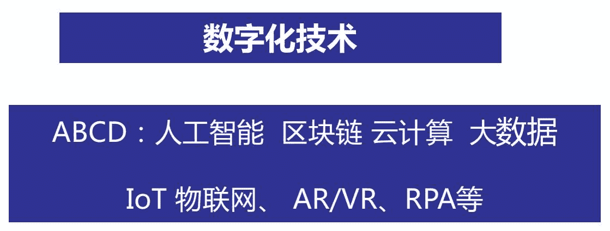

图 1-1 数字化技术的具体内涵

### 数字化人资：重塑组织竞争力的核心引擎

数字化HR是指以数字技术为驱动，推动组织、人才、文化（OTC）及领导力的迭代进化，从人力资源视角赋能业务实现绩效跃升。数字技术将重新定义人力资源管理职能，构建智能化人力资源平台。其对企业的深度重塑体现在以下维度，详见下图。

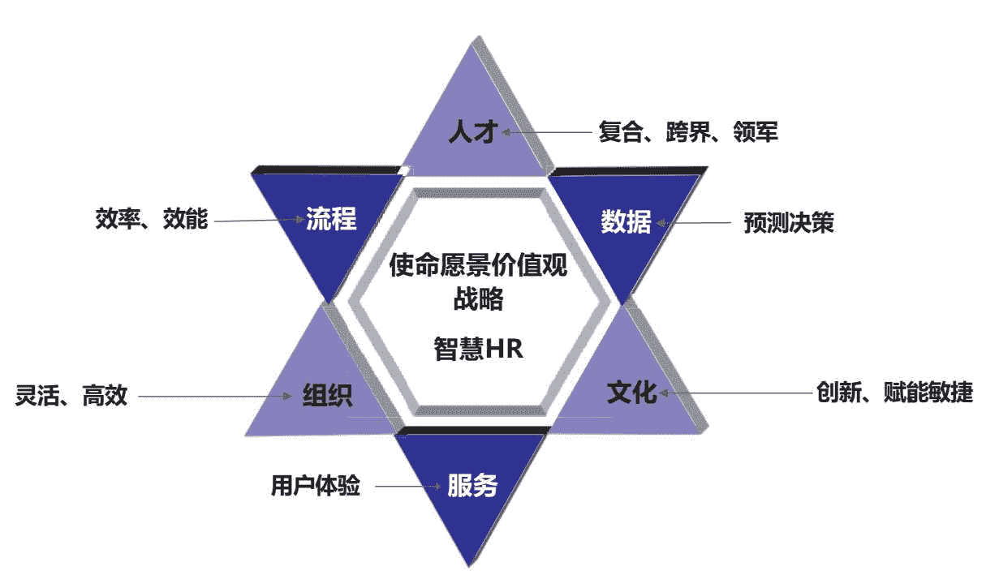

图 1-2 数字化技术对企业的多维冲击

- **组织形态进化**：向敏捷、高效、互联的网络化组织转型；
- **人才结构重构**：打破边界实现跨界融合，人才类型多元化，专业化人才涌现；
- **文化基因激活**：文化氛围转向敏捷、开放、包容；
- **流程智能闭环**：打通端到端流程，AI注入使流程具备智能决策力；
- **数据资产沉淀**：技术连接系统，实现全埋点自然采集，沉淀高价值数据资产；
- **决策科学化**：数据洞察辅助管理层判断，决策从经验驱动转向智能驱动；
- **体验分层跃升**：用户体验历经“可用、好用、易用、愉用”四个阶梯式跃升。

在数字技术驱动下，企业将实现流程闭环简捷、数据互联互通、体验极致化、管理实践流程化、思想沉淀知识库化、业务赋能驱动化。

### 人工智能：重塑人力资源管理范式的“加速器”

AI宛如催化剂与助推器，大幅缩短了HR管理模式的迭代周期。纵观过往，即便缺乏AI加持，HR管理模式亦在持续演进。如今，“ABCD”技术簇全面普及，具备移动化、社交化、智能化、机器学习特性的AI技术，让企业效能提升与体验优化按下了“快进键”。

当前，头部标杆企业已从战略性人力资源管理迈入人力资本管理新阶段，聚焦人才与组织的可持续发展及投资回报率（ROI）最大化。对此，构建智能化HR平台（iHR）成为必选动作，唯有数字底座稳固，方能支撑起敏捷网络化组织、敏捷文化与专业化人才共生的企业生态。

回望过去，商业环境相对平稳，管理者凭借经验即可精准预判趋势。而今，市场变局加速、环境复杂度指数级上升，单凭经验已难以穿透迷雾。数据分析结果逐渐成为管理决策的“定海神针”。在AI时代，HR从业者可借助数字化终端采集全域信息，构建算法模型萃取有效信号，经算力解析输出精准的人力资源配置建议，辅助管理层科学扩产或调产。

尽管AI在HR领域应用尚若，但随着数据量几何级增长、算法模型持续打磨、算力实现跨越式飞跃，AI技术正让HR工作更省时、更便捷，并显著提升企业运营的效能与效率。

### AI赋能人力资源管理的四大价值维度

身处VUCA（易变性、不确定性、复杂性、模糊性）时代，面对错综复杂的市场环境，企业不仅需要具备实时分析能力的强大中台支撑，更需具备快速适应变革、革新管理范式、吸引顶尖人才并共创增值的韧性。AI在HR管理中的价值，集中映照在“快、广、深、高”四个维度。

#### 1. 速度：加速技术落地，驱动业务生长

AI技术渗透HR管理全链路，大幅提升运营效能。例如，人脸识别技术（视网膜/人脸扫描）具备唯一性与不可复制性，从根源上杜绝“代打卡”弊端；引入大数据建模与算法，对求职意向、履历背景、母校专业、职场征信等多维画像进行定性定量分析，精准刻画企业关注度图谱；智能测评与岗人精准匹配，让简历筛选质效双升；AR/VR技术构建沉浸式数字化场景，让员工直观体验作业流程与环境，培训效果事半功倍。

#### 2. 广度：拓展数据分析的“点线面体”全景视野

随着AI在数据挖掘、分析、治理上的持续迭代，其赋能业务的维度已拓展至“点、线、面、体”四层：“点”即问题导向下锁定分析焦点；“线”即顺藤摸瓜，借业务场景挖掘数据背后的深层因果；“面”即以数据全生命周期为核心，强化洞察的连贯性与穿透力；“体”即以数据架构为基石，构建数据体系、指标体系、标签体系三大基石系统。AI与大数据在HR领域的应用，已历经“数据说话→数据驱动决策→数据运营→数据创新”四个进化阶段，实现了“点线结合、面体掌控”的立体跨越。

#### 3. 深度：洞察传统分析触达不了的盲区

管理者可借AI技术随时随地感知员工诉求，并依据动态变化设计落地契合度极高的流程。例如，挖掘绩效考核、面谈等场景数据，构建离职预测模型，通过前置洞察核心人才流失风险实现精准挽留；智能聊天机器人接管高频标准化咨询，大幅压降运营成本与响应时长，提升智能客服效能，进而优化全员用户体验。

#### 4. 高度：释放组织效能，跃升企业绩效高度

# AI重塑HR：从组织变革到选育用留的全链路智能化

科技浪潮推进下，移动互联与AI技术的普及深度重塑了人与人、人与机、机与机、人与事、人与财、事与事、事与财等多维关系，信息流转渠道随之发生根本性变革。传统自上而下的单向传递已难适应新时代需求，信息流向数字化演进势在必然。外部环境剧变催生了企业与客户、企业与伙伴间的价值共生，原有组织模式失效，企业必须重塑组织架构。数字技术重新定义了组织管理，企业与员工双方面临挑战：高频数据交互要求企业借力新技术提升组织效能，员工则需强化自主创新，保持高效敏捷以应对变局。

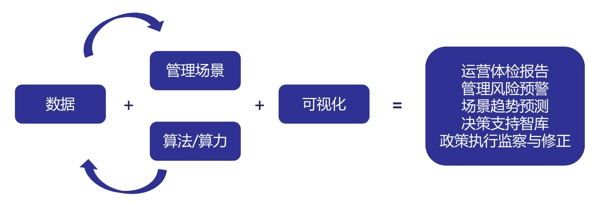

Figure 1-3 "Dual-Wheel Drive" of "Data + Scenarios"

AI技术赋能HR从业者高效采集、清洗、加工多源数据；借助模型、算法与算力，结合经营健康度报告、管理风险预警、选育用留趋势预测、决策智库、政策执行监管等管理场景，为CXO高管、管理者、员工及HR自身输出分析报告、辅助判断与决策支持。

展望未来，技术迭代将加速，AI在人力资源管理领域的渗透将更深、面更广，进而大幅跃升HR运营效能、组织有效性与用户体验。

## Section 3 AI在人力资源管理中的具体应用版图

### 1. 全周期覆盖：人才全生命周期管理

AI应用贯穿人才全生命周期，划分为入职、在职、离职三大管理篇章：
*   **入职管理**：涵盖雇主品牌推广、人力成本预测、人才雷达、机器人面试、数据前置预备等；
*   **在职管理**：囊括智能客服、自助服务平台、数字化共享服务、目标管理、AR/VR培训、游戏化学习、敏捷绩效、活力曲线、组织健康度、员工满意度、人才360画像、舆情分析、管理风控、一体化激励中心、关怀福利商城、人才流失预警、人才流动管理等；
*   **离职管理**：包含离职关怀、校友会运营、微信社群维护、返聘回聘机制。

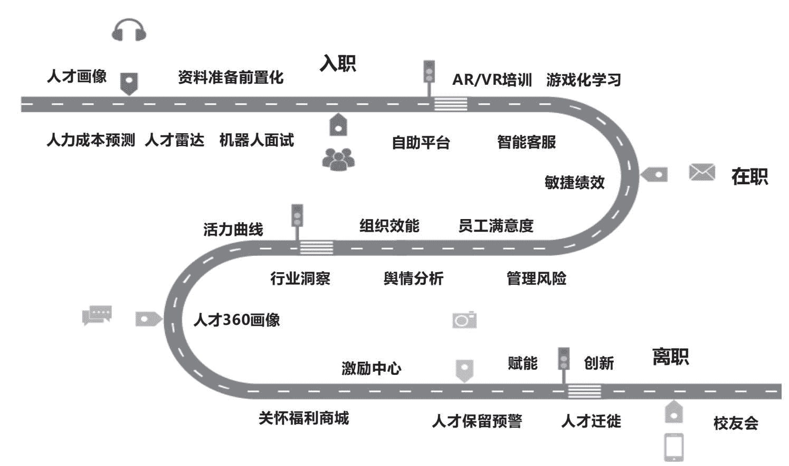

Figure 1-4 Talent Life Cycle and Key Scenarios

选、育、用、留四大模块的AI应用场景全景如下：

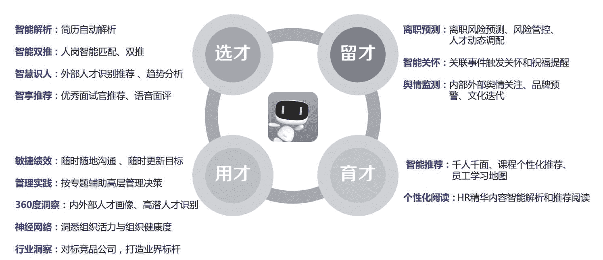

Figure 1-5 Application Scenarios of AI in the Four Modules: Selection, Cultivation, Utilization, Retention

### 2. 精准起点：人才选拔的智能化实践

*   **智能解析**：简历自动解析与推荐、人岗智能匹配；
*   **智慧识才**：外部人才挖掘推荐、趋势洞察分析；
*   **智能推荐**：优质面试官推荐、面试评分辅助。

AI大幅简化简历筛选流程，压缩招聘周期，优化候选人体验。面试前，AI聊天机器人与虚拟界面即可完成候选人胜任力、经验、技能及文化契合度的初筛，显著提升面试通过率。

企业如何借力AI与机器学习落地上述成果？

**第一步，构建高潜画像，激活人才池数据。** 通过高潜人才画像提炼关键特征，形成各序列人才标准像。提取过程运用求职与岗位信息自动匹配、全库智能检索、智能测评、双向推荐等技术，全程无人工干预，有效盘活企业人才库沉睡数据。

**第二步，大数据挖掘，提升寻访效能。** 招聘端利用大数据挖掘技术实现全网智能搜寻与推荐，招聘效率实现质变。

**第三步，搜索分析赋能，深化招聘服务。** 依托大数据检索分析功能，提供简历更新、人才推荐等增值招聘服务。

具体而言，大数据在招聘领域的落地场景主要集中在以下四大维度：

#### 1. 双向自动推荐：破解“海投与海筛”困局

传统模式下，求职者广撒网投递，HR与业务部门陷入大量低效筛选，资源浪费严重。引入大数据双向匹配推荐算法后，系统提取岗位与简历关键属性并赋权，实现精准双向分发。
*   **简历端关键信息**：求职意向、履历、技能、学历院校、专业、兴趣等；
*   **岗位端核心需求**：如偏好985/211、本科以上、计算机相关专业、5年以上经验、精通Java与SpringBoot等。
模型经特征分析与匹配计算，向企业推荐高契合度简历，向求职者推送高匹配岗位，双向奔赴下，招聘效率与人岗匹配精度同步跃升。

#### 2. 明暗双线智能招聘体系：人人都是面试官

过往HR系统聚焦流程管理，数字化时代要求系统业务导向、贴合业务诉求。明暗双线智能招聘系统应运而生：以面试流程为明线（主线），招聘流程为暗线（辅线），打造“全员面试官”的移动化、智能化新招聘范式。

#### 3. 移动语音面评助手：留存过程数据，赋能复盘分析

面试结束后，面试官通过语音识别技术以语音或文字快速录入评价。若经候选人授权，系统全程录音记录双方对话细节，为企业大数据分析沉淀丰富的音频与文本语料。

#### 4. 智能客服助手

无论是校招还是社招，求职者咨询的问题里，约有八成属于高频重复型。对此，企业极有必要部署一款类似“智能聊天机器人”的智能客服助手：它能全天候在线、话术标准且态度友好地解答常见疑问。一旦遇到需专业介入的复杂问题，AI 还能借助通讯工具调度、会议组织等功能，引导提问者明确“何时找谁、如何寻求帮助”。

### 3. 人才培育

- **个性化定制（千人千面）**：智能课程推荐、员工学习地图绘制
- **按需供给**：教练角色与内容精准匹配，加速解决问题与效能跃升
- **专属阅读**：智能内容解析与阅读推荐

过去，企业培训多由人力部统一规划，员工被动习得技能以适配岗位，最终提升组织整体竞争力。步入 AI 时代，企业借助 AI、大数据、AR/VR 等前沿技术构建智能学习平台，打造全景式智能学习生态。员工在学习与工作中的行为轨迹——阅读文章、修读课程、点击路径等——均被记录并深度分析。培训专员借助后台模型算力，依据员工诉求或胜任力模型，精准筛选高价值资源。通过建立标签体系，将课程与内容打上学习者角色、职级能力、业务场景、流程节点等标签；结合偏好建模、特征提取、算力优化及深度分析，实现基于标签的主动精准分发，达成“人-岗-能-知”四维自动匹配，真正落地“一人一案”的个性化培养。

延伸场景还涵盖：员工结合工作内容、现有技能、发展规划与未来目标自主制定学习计划；依据胜任力水平灵活分配挑战性任务与跨职能项目；依托个人需求智能匹配推荐内容；智能对话机器人秒级响应培训学习高频问答，全员随问随得。

所谓智能课程推荐，即基于选课记录与阅读偏好预测兴趣点；挖掘关注的专家从而推送相关课程；针对不同职序、职级推送差异化内容。其具体呈现形态可见下图：

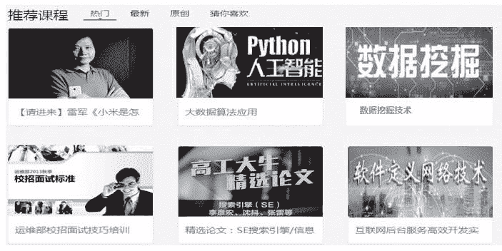

图 1-6 课程推荐示例

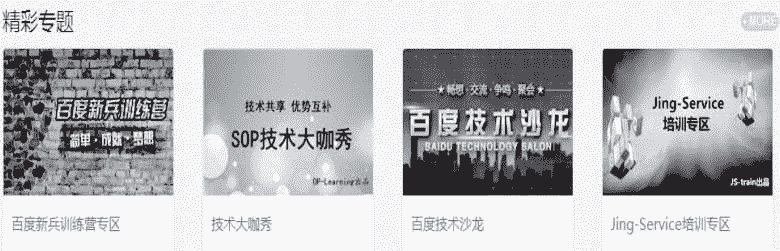

图 1-7 专题推荐示例

### 4. 人才任用

- **全维洞察（360°）**：内外部人才画像、高潜人才识别
- **敏捷绩效**：随时沟通反馈、绩效趋势预测
- **组织神经网络**：洞察组织活力与健康度
- **管理实战**：专题辅助高层决策
- **行业洞察**：对标竞品、构建行业标杆

管理者如何精准锁定心仪人才？人才画像是关键利器。何为人才画像？它由显性的岗位说明书(JD)与隐性的潜质特质双重构成。通俗说，就像画师勾勒人物，描绘人才特征；描绘精度取决于信息掌握与挖掘的深度。随技术演进，画像分三级：初级阶段仅轮廓模糊，似百万像素旧机；中级阶段轮廓清晰，达千万像素水准；高级阶段栩栩如生，堪比五千万像素旗舰镜头。

人才画像广泛应用于核心人才的“选、用、育、留”全周期，核心旨在高效吸引与激活关键人才。其框架与应用场景详见下图：

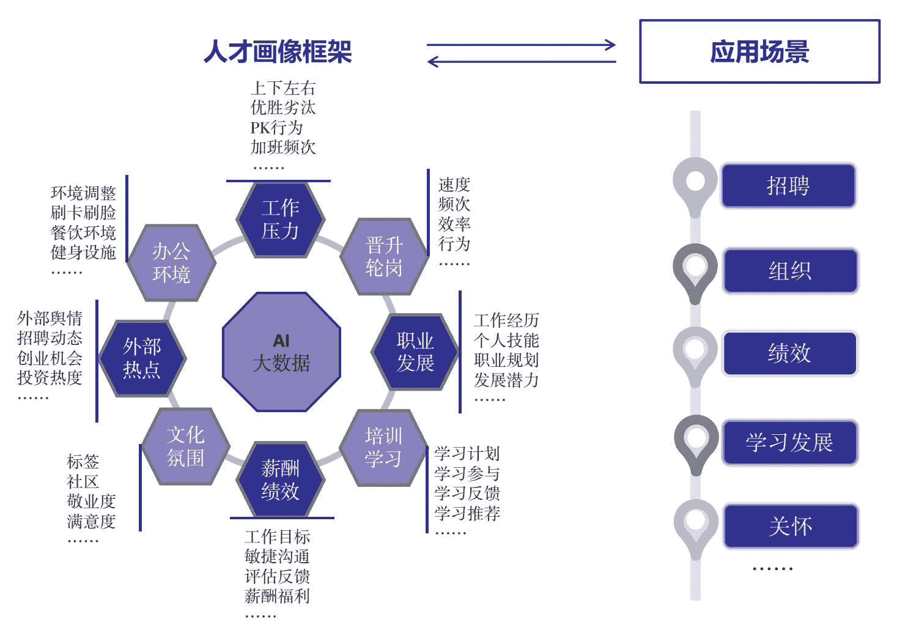

图 1-8 人才画像框架与应用场景

在人才全周期中，画像可破解以下难题：

- **选人**：人才供给跟不上业务增速，靠外招还是内育？岗位胜任率低因何而起？人浮于事如何优化？核心岗断层、关键人才流失如何破局？
- **用人**：人岗不匹配、团队组建如何科学决策？转型期核心人才如何调配？
- **育人**：新技术如何赋能培养？如何孵化领袖？扬长还是补短？
- **激励**：如何激发核心人才主动性与潜能？如何降低流失风险？企业有哪些激励组合拳？
- **组织发展**：如何预警组织变革风险？如何度量团队健康度与组织活力？如何促进协同与提升敬业度？

绘制高精度画像，海量员工数据是基石；随着信息化、数字化、智能化深化，数据资产增厚，画像“清晰度”必将持续跃升。

### 5. 人才保持

- **离职预测**：风险管控、动态人才调配
- **智能关怀**：关怀触达、节点祝福提醒
- **舆情监测**：内外部舆情聚焦、品牌预警、文化迭代

离职管理是“选、用、育、留”闭环的终章。大数据在“留人”环节的落地，聚焦于离职预测、智能关怀、舆情监测三大维度。人才是企业可持续发展的核心引擎，留住人至关重要。借助大数据技术、模型与算法预判员工离职意向并精准干预，正逐步成为企业的战略级重点任务。

# 第二章 AI在人才甄选环节的实战应用

招聘是企业人力资源管理的关键一环，直接关系到“谁能进来”“能不能干”“怎么干”以及“能干多久”四大核心命题。步入数字化转型新阶段，AI等前沿技术正在招聘领域释放更大价值。随着人才流动加速、职业分工日趋精细，个体职业路径的不确定性显著增强。优秀人才不再将内部晋升视为唯一出路，更多目光投向外部市场。与此同时，企业在人才获取的“质”与“量”上均面临严峻挑战。招聘甄选过程中积累的海量数据，为HR分析专家提供了宝贵素材——例如利用招聘环节收集的数据预测候选人未来绩效。所有招聘研究与实践的终极目标，都是探寻企业甄选人才的最优路径，尤其是数据驱动的智能招聘。在此背景下，信度与效度是两大核心基石。信度关注筛选手段的稳定性与客观公正性，但人与人之间的评判极易陷入偏见，如面试中的“光环效应”，即某一突出优点掩盖了对其他特质的客观判断。效度则聚焦于筛选工具能否精准识别胜任特定岗位的人选，区分高绩效与低绩效者，以及区分长期留任者与“闪辞”风险人群。

## 第一节 KSAM模型深度解析

### 1. KSAM模型的由来与内核

KSAM模型源于经典的“冰山模型”（如图2-1所示）。冰山水面之上为“显性层”，通过简单接触观察即可识别；水面之下为“隐性层”，沉得越深，考察难度越大，需借助系统化手段深度挖掘。驱动人类行为的核心动力藏匿于“水面之下”，且层级越深，影响力越显著。因此，HR从事大数据建模时，必须全维度提取冰山模型各层级特征，结合业务场景剖析岗位与人员特质，方能实现真正的“人岗匹配”。

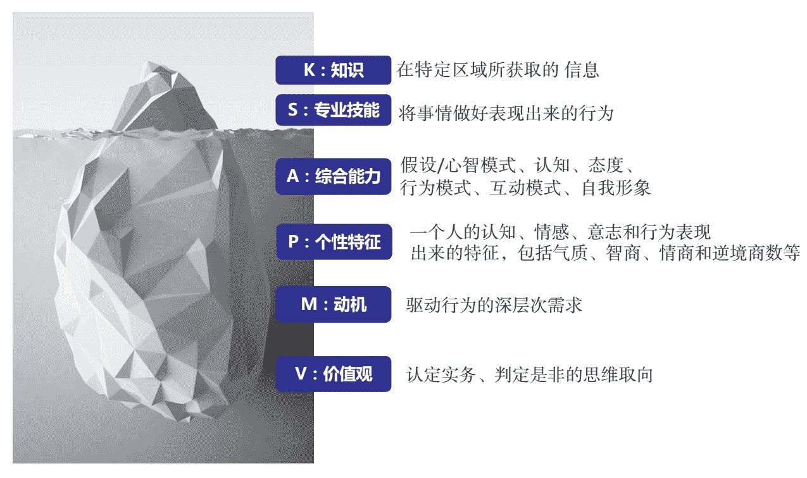

图2-1 KSAM模型

KSAM模型是在冰山模型基础上提炼演化而来，可直接服务于招聘甄选实务。四字母寓意如下：

**K——知识**：指员工在特定领域掌握的事实性与经验性信息（如专业知识、学历背景、履历项目、培训记录等）。特点：**易识别、易培训**。HR重点考察候选人是否具备岗位必备知识，解决“能不能干”的问题。

**S——技能**：指员工将知识结构化应用、完成特定任务的能力（如沟通协作、组织统筹、决策判断、学习复用等）。特点：**易识别、易培训**。HR聚焦核心技能掌握度，解决“干得好不好”的问题。

**A——能力**：指胜任某领域工作或特定项目所需的综合素质，涵盖思维模式、认知高度、职业态度、行为模式、交互风格及自我认知（如胜任力测评、OKR考核、绩效复盘、领导力评估、360度反馈等）。特点：**识别难度中等、培养周期长**。HR深度甄别候选人岗位匹配度，解决“干得如何、怎么干”的问题。

**M——动机**：指个体内生的、稳定的思维偏好与驱动力，主导并决定行为方向（如价值观、满意度、敬业度等）。特点：**难识别、难培训**。HR洞察候选人潜力与意愿，解决“愿不愿干、能干多久”的问题。

简而言之，“水面以上”多为结构化数据，获取便利、统计分析简单；“水面以下”多为非结构化数据，采集困难。HR需借助AI、大数据、算法模型等技术手段，对水下信息进行多维洞察与可视化呈现，为业务决策提供科学辅判。

### 2. KSAM指标体系构建

传统招聘漏斗模型聚焦“量（多）、速（快）、质（优）、省（成本）”四大维度，即以较低成本、在较短周期内招募足量优质人才（如图2-2所示）。即便在AI与大数据时代，这仍是衡量招聘专员绩效的基础指标。

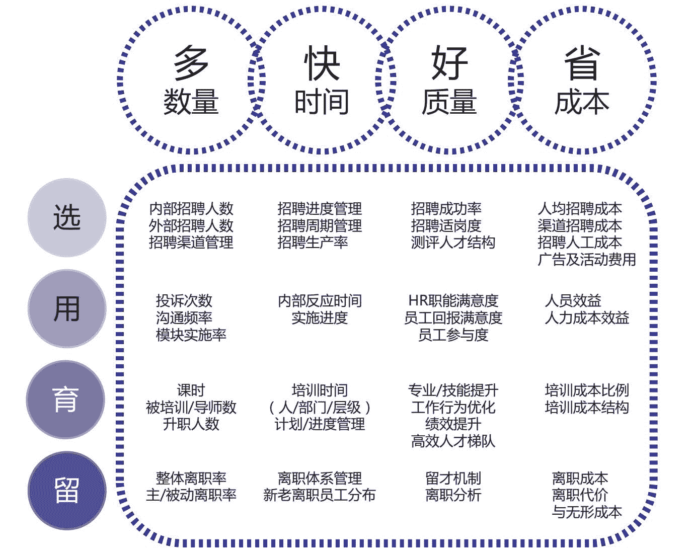

图2-2 传统招聘漏斗模型

企业管理者可从“招聘过程”与“招聘结果”双维度评估招聘效能。

#### 1. 招聘过程效能评估

过程评估包含时效与成本两大核心指标。

##### (1) 时效评估指标

时效评估可基于以下两项核心数据指标完成。

### 招聘周期的界定

**招聘周期**是指从岗位发起用人需求之日起，至新员工正式入职报到之日止的天数。**平均招聘周期**则是对所有岗位的招聘周期取算术平均值得出的指标。

#### 成本效能的量化测算

可通过以下三大核心公式构建成本效能评价体系：

- **单位招聘成本** = 招聘总投入 ÷ 通过试用期（三个月）确认留用的员工人数
- **录用比率** = 正式录用人数 ÷ 简历投递总人数 × 100%
- **入职转化率** = 通过试用期确认留用人数 ÷ 简历投递总人数 × 100%

> *注：上述计算均以新员工试用期为三个月为前提。*

#### 招聘结果效能的多维考量

招聘专员的核心使命是在限定时间内精准匹配人才，并保障其长期稳定就职。管理层可从以下三个维度审视结果效能：

- **计划达成率** = 实际入职签约人数 ÷ 编制计划需求人数 × 100%
- **到岗履约率** = 实际入职签约人数 ÷ 发放录用通知总人数 × 100%
- **新员工留存率** = 通过试用期确认留用人数 ÷ 实际入职签约人数 × 100%

**招聘质量**作为衡量专员绩效的关键指标，通常引入用人部门满意度评价机制。招聘项目前，人力资源部会邀请用人部门对以下维度打分（1-10分制）：

1.  招聘专员服务体验满意度 ______
2.  候选人推荐时效满意度 ______
3.  候选人履历匹配度满意度 ______
4.  候选人推荐数量满意度 ______
5.  对我们服务的改进建议（选填） ______

### 破局 VUCA 时代的招聘困境

在不确定性与复杂性并存的 VUCA 时代，企业为抢占市场先机不断提高用人门槛，而外部就业环境与人才市场的剧变，又给招聘工作带来全新课题。

HR 从业者的首要任务是夯实基础指标，构建并落地“量、速、质、费”四位一体的招聘效能模型。伴随 AI 技术在招聘场景的深度渗透，度量体系亟需迭代升级，从单纯的“效能指标”跃迁至**“价值产出”**层面（详见 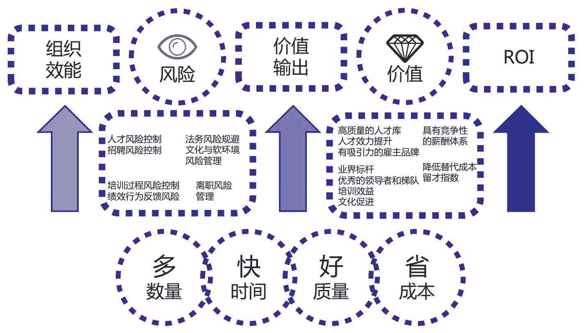 图表）。

驱动“价值产出”的关键杠杆涵盖：极具吸引力的雇主品牌、高质量人才蓄水池、人才效能跃升、有竞争力的薪酬体系、员工敬业度、行业标杆对标、卓越领袖与梯队建设、培训收益转化、文化渗透力、留存指数、替代成本压降等。在冲刺价值的进程中，必须同步织密风控网络：招聘合规风控、人才流失预警、文化软环境治理、法律合规避险、绩效行为反馈机制、培训过程管控、离职风险管理等。

同时，HR 需聚焦**员工终身价值（ELV）**的提升，规避用工风险，优化人才**投资回报率（ROI）**，最终赋能组织效能跃升。


**图示：AI 时代招聘指标进化模型**

#### 筑牢用工合规防火墙

招聘流程中，HR 需时刻绷紧风控弦。在 AI 赋能下，大数据建模与算法分析可支撑机器学习训练，从以下维度输出用工建议与风险预警：

1.  **简历造假甄别**；
2.  **恶性跳槽引发的不正当竞争风险**；
3.  **候选人与企业文化价值观的契合度诊断**。

#### 激活员工终身价值（ELV）

过往管理者多凭用人部门满意度评判招聘优劣。如今，头部科技巨头（如 Google、Microsoft、Apple、Airbnb、Netflix、BAT、华为等）已完成从“管人”到“运营人”的范式跃迁，HR 肩负起从企业战略视角重构招聘质量评价体系的重任。由此，**员工终身价值（ELV）**应运而生，成为衡量招聘成效的新标尺。

正如财务部通过**客户终身价值（CLV）**核算营销获客与销售产出，引进高水平人才直接关联企业营收增量。ELV 正是量化员工对企业营收贡献度的核心指标。

顶尖人才与普通员工的价值产出存在数量级鸿沟。研究表明：录用一名领军人才，其产出效率回报可达数十甚至上百倍；更具备“光环效应”——对外吸附外部优才，对内激活内部低绩效群体。

#### 提振人才投资回报率（ROI）

实证研究显示：高潜人才入职后 ELV 显著更高，带动企业 ROI 同步攀升。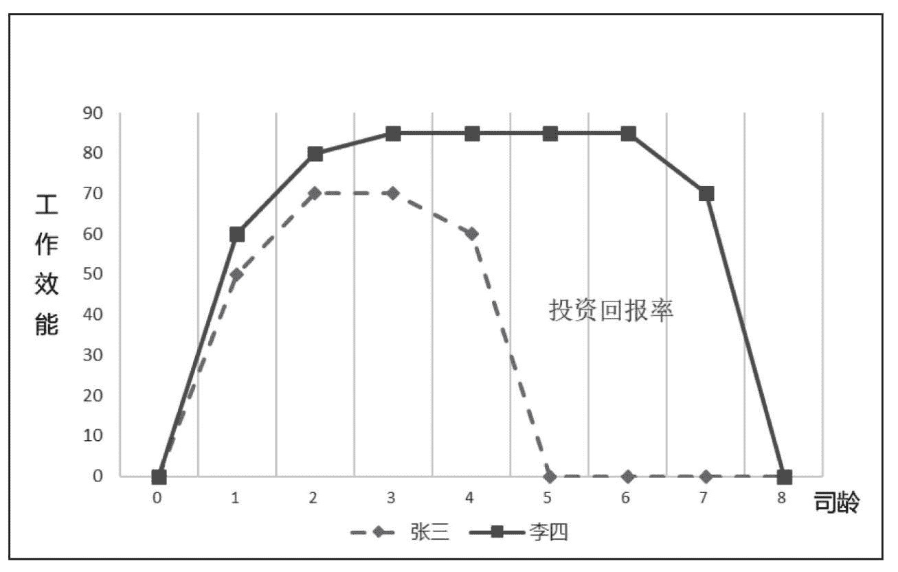 图表直观演示了这一规律：横轴为任职年限，纵轴为工作效能。虚线代表普通候选人张三的 ELV 曲线，实线代表高潜候选人李四的曲线。数据揭示：李四个体效能全周期碾压张三，且随企业发展，两人 ROI 差距（虚实线围合区域）持续扩大。这有力佐证了 ELV 与企业 ROI 呈显著正相关。


**图示：两类员工终身价值效能曲线对比**

## 第二篇章：AI 重塑招聘新范式

### AI 驱动招聘流程重构

步入数智新纪元，招聘作业将经历深度变革，AI 技术正在从底层逻辑重塑人才获取全链路。

招聘本质上是企业对空缺岗位需求的精准寻访与筛选。德勤 2017 年调研显示，83% 的管理者视人才获取为战略级重中之重。乔布斯曾言：“苹果倾尽全力招募全球最顶尖的人才。”

美籍学者 Breaugh 等将招聘过程拆解为五大阶段：

### 招聘全流程拆解：从定目标到定人选

招聘工作的起点在于**明确目标**：确定编制数量、岗位画像，细化学历门槛、硬技能指标等核心要素。其次是**制定策略**，锁定目标人才画像与预算范围，精选高性价比的渠道组合。随后进入**执行落地**环节，组建面试官团队，通过简历筛选、多轮面试获取候选人信息。第四步是**构建人才画像**，从学历背景、从业年限、文化认同度到职业期待，全维度勾勒候选人轮廓。最后基于综合评估**输出录用决策**，落地招聘结果。

### 传统模式的“拦路虎”：前端筛选的三大痛点

实操中，海量事务性工作高度聚焦在简历初筛与人才甄选环节。传统流程下，这些动作全赖招聘专员人肉完成：逐份阅读简历、电话邀约通过者、协调面试时间。看似流程简单，实则暗藏隐患：
1.  **时间黑洞**：筛选耗时与简历量呈线性正相关，极度挤占专员精力；
2.  **主观偏见**：排版美观度、内容组织习惯等非核心因素，易干扰专员判断；
3.  **专业壁垒**：业务大牛（如中高层管理者）无暇初筛，HR又缺乏垂直领域鉴别力，导致“漏掉强者、放进弱者”，最终拖累业务运营。

### AI技术重塑招聘链路

现有AI能力可全链路赋能：**OCR光学识别**让纸质简历、证件秒变结构化数据；**NLP自然语言处理**深度挖掘电子简历关键信息；**计算机视觉**介入视频面试，通过语义、微表情、肢体语言多模态辅助评估。

---

### 2. 智能简历筛选：破解“专业壁垒”与“认知偏差”

在HR六大模块中，招聘的专业门槛极高。受限于个人知识半径与认知边界，招聘专员在搜寻、筛选环节难免存在偏差。AI凭借**更广博的知识库、更完备的认知模型、原生的自动化属性**，可实现：功能自动触发、人才自动搜寻匹配、全流程自动识别判断追踪评估，从根本上修正人为误差。

#### 百度实战：“双推”机制激活供需两端
百度基于大数据构建智能筛选推荐算法，创立**“双推”模型**（如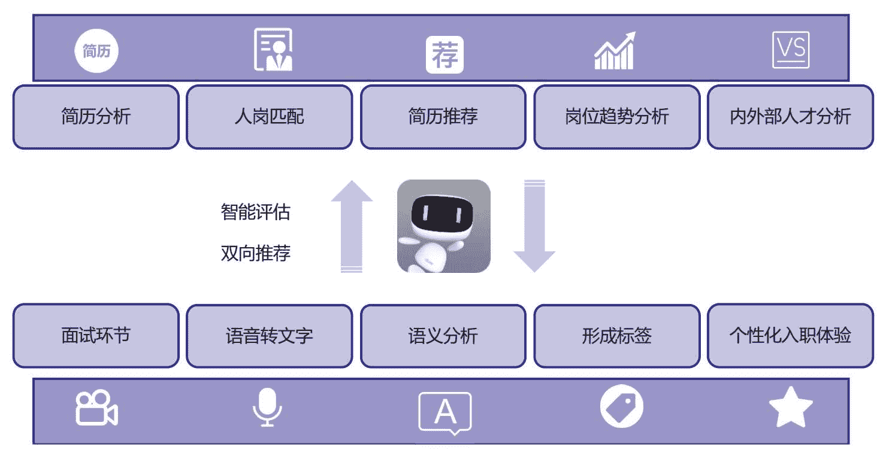图所示）：
*   **正向推**：精准将简历分发给招聘专员；
*   **反向推**：将稀缺热门岗位精准触达潜在候选人，实现“才找工作”到“工作找人”的反转。

“反向推”对算法要求极高，非简单程序堆砌可为，需依托岗位专属模型持续迭代。模型训练的前提是**数据积累**——数据量决定准度上限。AI引擎自动扫描人才画像与空缺岗位匹配，除候选人数据外，还需汲取岗位JD、市场热度、行业趋势、地域分布、人才流动半径等多维特征（如：北京IT人才高度聚集于中关村）。相比过往模糊检索，现阶段精准度实现质变：海量数据秒级扫描，决策提速且不失准。

#### 腾讯实战：以“产品思维”打磨面试官工具
腾讯HR将“造互联网产品”的方法论移植招聘场景。业务部门提需求后，HR先锚定3名以上内部标杆员工，建模拆解其成功基因（如逻辑力、数感、学习力），逆向推导行为指标，进而设计行为面试题并配置评分锚点，将“玄学标准”转化为“可量化工具”。

#### 阿里实战：赋能一线主管“自主用人”
阿里推行**“用人部门主导招聘”**管理哲学：过往HR包办，现由团队Leader全程负责。HR转型提供**移动端“招聘一站式工作台”**，覆盖发职位、收简历、评推荐、约面试、反馈、批Offer全链路。核心亮点在于**智能推荐引擎**：全渠道自动聚合简历、自动剔除不达标、基于“能、势、愿、匹”四维综合打分自动推优，大幅跃升组织招聘效能。

### AI筛选的标准化两步走
企业落地AI简历筛选，核心逻辑仅两步：
1.  **算匹配度**：量化简历与JD的契合程度；
2.  **做分层**：按匹配梯队分流处理。

### 算法层面的实战推演：以“算法工程师”招聘为例
假设某公司招算法工程师，JD与候选人经历如下（见 Figure 2-6）：

**候选人A**：在校期间主导创新团队，应用**GBRT模型预测股价波动**，核心负责模型开发，技术栈**Python**；
**候选人B**：……[content待续]

# 深度赋能招聘：从技能标签到精准人岗匹配

**求职者B** 的案例颇具代表性：他依托微博文本数据、平台特性及虚假信息传播机制，运用数据挖掘与自然语言处理技术，以 `Python` 为开发语言，构建了一套微博内容可信度评估算法。

回顾上述四条招聘指标，其中三条聚焦硬技能——`Python` 开发、机器学习、大规模数据处理，仅剩一条考察软实力，即沟通协作能力。

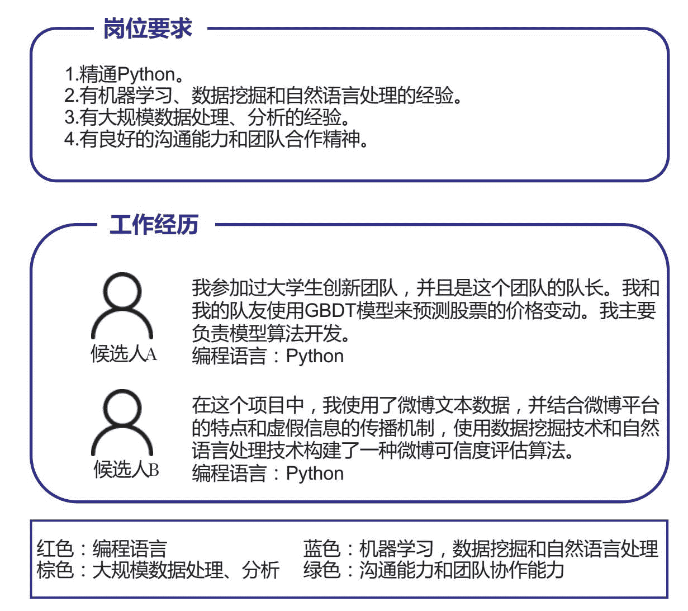

Figure 2-6　Matching Content of Candidates A and B with Job Requirements

此类招聘标准在职场中司空见惯。但严格剖析，上述技能要求实则仅划分到了单一技能品类。以机器学习为例，即便细分至 `NLP` 领域，也能匹配众多不同的细分技能。与此同时，候选人往往掌握多项技能，面试官不得不综合权衡各项能力，量化打分后方能抉择。

针对上述痛点，百度人才智库研发的深度学习算法模型实现了三大核心功能：

1.  针对冗长的岗位描述或工作经历文本，模型能完成句向量化，并精准量化每个词的权重；
2.  能计算不同要求或经历条目间的相对重要性；
3.  能度量单一岗位要求与多段候选人经历的关联度。

该模型架构由三大模块构成：**词级表征学习**、**多层能力感知表征学习** 与 **人岗匹配度计算**，架构详情见下图。

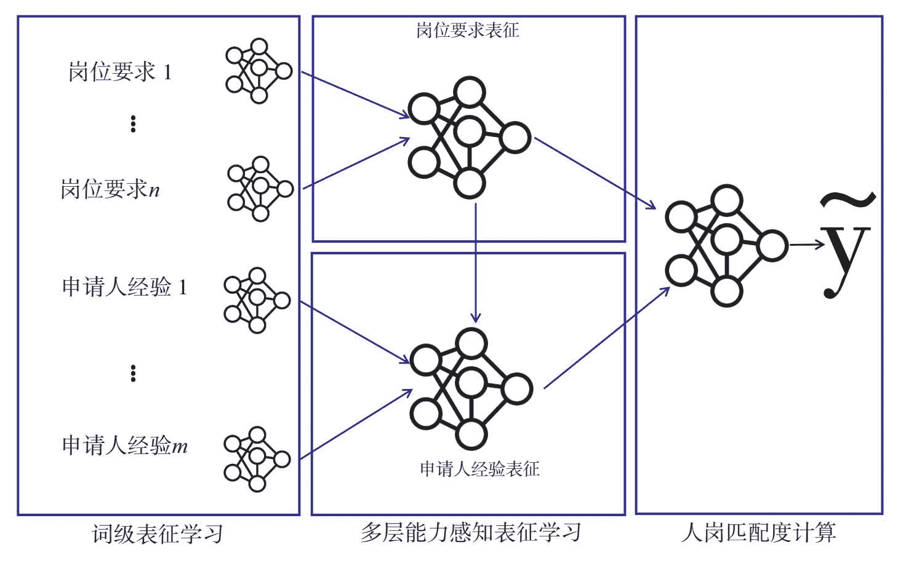

Figure 2-7　Schematic Diagram of the Algorithm Model

#### 词级表征学习

该模块采用 **双向长短期记忆神经网络**，通过字符嵌入技术，完成岗位需求与候选人经历的字符级表征学习。输入端为岗位描述文本与候选人经历文本，经模型训练后，分别输出特征向量矩阵。

#### 多层能力感知表征学习

借助 **多层注意力机制**，该模块让与“能力”强相关的字符获得更高权重，从而实现“能力感知”。模型由此从语言理解层面提炼岗位需求与候选人经历的高阶特征，并输出对应的表征矩阵。

#### 人岗匹配度计算

该模块接收上述表征矩阵，核算岗位需求与候选人经历的契合度，直接输出匹配结果。

模型的算法实力集中体现在以下三个维度：

##### (1) 词汇层面

句子中的关键词组不仅被精准识别，更被赋予差异化权重。

例如：`精通 C、Python、R 等编程语言，熟悉 Hadoop、Hive、Hbase 等组件。` 句中，`C`、`Python`、`R`、`编程`、`Hadoop`、`Hive`、`Hbase` 等技能短语悉数被捕获。前者权重显著高于后者，其修饰词 `精通` 与 `熟悉` 分别对应不同熟练度，`精通` 直指更高技能段位。

##### (2) 技能层面

核心在于评估技能的重要性，这本质上反映了技能的**稀缺性**。候选人掌握的核心技能越关键，其人才稀缺度越高。

##### (3) 匹配层面

即落实岗位需求与候选人能力的精准对接。模型需判断简历中识别出的关键技能短语，能否精准击中具体岗位指标。

**实战案例**：
- **岗位需求**：`热爱互联网，熟悉 SNS、论坛、微博等媒体形态特征。`
- **候选人经历**：`除上述产品外，独立设计过外卖 App、微信公众平台开发版、星座 App、课程评价系统、任务管理软件等 5 款小型产品，参与产品研发与 UI 设计。`

模型从经历中捕获 `外卖 App`、`微信公众平台`、`星座 App` 等互联网相关实体，并赋予 `微信公众平台` 最高权重——因其作为国内头部社交网络服务（`SNS`），完美契合岗位要求的“熟悉 `SNS`”。

综上，该模型以端到端深度学习算法为核心，实现简历内容与岗位需求的精准匹配，并在大厂真实数据集上表现优异。

## 第三节 智能面试：重塑招聘新体验

联合利华在优化招聘流程时，全链路引入 `AI` 体系。首环，候选人完成一系列基于心理学与认知神经科学设计的在线游戏，系统以此采集行为、人格、素质数据；次环，通过初筛者参与全 `AI` 驱动的视频面试，`AI` 面试官抛出结构化题目，同步评估情绪状态、回答真实度与岗位匹配度；终环，入围者由智能聊天机器人接管，答疑解惑并安排现场复试。

成效斐然：平均招聘周期从 **4 个月压缩至 4 周**，专员单人耗时骤降 **75%**；校招覆盖高校数从 **800+ 跃升至 2600+**；2.5 万候选人满意度调查显示，**好评率高达 82%**，远超行业均值。

`AI` 算法在面试视频分析中的渗透率持续攀升，显著提效、消解主观偏见、辅助 HR 决策。

视频文件的算法解析分为**影像**与**音频**双轨：

- **影像处理**：识别并提取候选人微表情、体态、动作特征。
- **音频处理**：拆解为两大维度：
  1.  **语义内容**：借助自动语音识别（`ASR`）将语音转文本，再经自然语言分析算法理解深意；
  2.  **声纹特征**：剖析语速、停顿、语调等副语言特征。

# AI面试进化论：从“关键词匹配”到“自动化决策”的效率跃迁

市面上与面试挂钩的AI产品琳琅满目，但资深HR深知：若仅靠提取关键词来判断面试效果，无异于隔靴搔痒。早期主打“面部表情识别”与“语音语调分析”的工具，虽能辅助面试官捕捉非语言信号，却难逃“逐帧看视频”的耗时魔咒，对提升整体筛选效率帮助有限。

如今，技术更成熟的新一代AI面试系统已破局而出。它们不再局限于表层特征，转而对候选人**回答内容的语义逻辑**进行深度解构，并以此预测核心胜任力。这些系统融合复杂算法，将答题内容、微表情、声线变化、仪态神情纳入多维建模体系，能在海量简历中快速圈定“合格线”以上人才。面试官只需从AI推荐的短名单中精挑细选，决策链路大幅缩短。虽未达完全无人值守的“全自动评判”，但流程效率已实现质变。

站在技术塔尖的产品，更能落地**AI自动化结构化面试**，甚至直接输出“录用/不录用”建议。这类方案精准击中大规模招聘痛点——如秋招、社招高峰期，助力企业以极低边际成本完成百万级筛选。

### 理论基石：为何结构化面试是AI的“主战场”？
工业与组织心理学研究证实：结构化面试（SI）的预测效度显著优于非结构化形式。其核心逻辑是：全体候选人作答同一套标准化题目，确保横向可比性。因此，AI算法天然适配结构化场景。

**实战样本——行为事件面试（BEI）题目：**
> “请复盘一个你非正式领导者、却发挥了领导力的工作场景。请包含：情境背景、你的关键行动、最终结果。”

### 解码“隐性信号”：从SSP理论到APR技术
社会信号处理（SSP）理论指出：人类判断人格特质，本质是对行为信号的观察解码。面试官亦是如此，他们捕捉的信号维度涵盖：**语言内容、面部微表情、眼神流向、肢体动作**（详见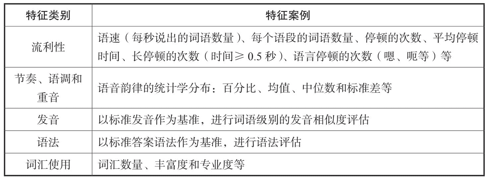）。

学界实验已验证：AI可自动完成这一解码过程，即**自动人格识别（APR）**。


### 数据标注：训练模型的“地基工程”
算法落地前，HR专家需完成高质量数据标注，主流三大评估范式：

1.  **行为锚定评分量表（BARS）**：聚焦“知行合一”的岗位技能评估。
    *   *操作链路*：采集关键事件（CI）→ 标准化提炼绩效维度 → 多轮清洗筛选留存高区分度事件 → 多标注员独立打分校准 → 最终生成锚定量表。
2.  **首因印象人格量化**：基于**7级李克特量表**（1=极不赞同 ~ 7=极赞同）对人格维度打分。
3.  **整体录用度判断**：综合BARS与人格分，给出最终去留建议。

> ⚠️ **工作量预警**：单标注员需覆盖“全候选人×全题目”。若10人参赛、5道结构化题，即需完成50轮完整评估——标注成本不容小觑。

### 技术底座：多模态特征提取与建模
面试视频的技术化处理，拆解为三大模块：

| 数据流 | 核心工具/技术 | 关键特征输出 |
| :--- | :--- | :--- |
| **图像流** | OpenCV, Dlib, OpenFace | 头部姿态、眼神注视轨迹、面部关键点驱动的微表情 |
| **语音流** | pyAudioAnalysis, GeMAPS | 语速节奏、基频波动、停顿模式 |
| **文本流** | ASR (语音转文本) + NLP | 语义向量、词汇丰富度、逻辑结构特征 |

**建模抉择：**
*   **传统机器学习**：架构轻量，依赖人工特征工程，调试门槛低。
*   **深度神经网络**：支持端到端训练，特征自动学习，上限更高，但需算力与数据双支撑。

**模型输出定向：**
目前主流分两派——**输出人格画像**（软性匹配）或 **直接输出录用决策**（硬性切分），后者更适配标准化大批量场景。

### 落地捷径：中小企业的“开箱即用”选择
自建上述全链路技术栈，对大多数中小企业而言是“遥不可及的高山”。好在，成熟SaaS服务已填平鸿沟。

**标杆案例——Hirevue**：
*   **全流程闭环**：候选人录制视频上传 → 系统多维打分（语调、用词、眼神接触） → 自动排名生成仪表盘。
*   **差异化杀手锏**：内置**在线技能测评模块**。招技术岗？一键嵌入编程实战题，代码自动跑分，技术硬实力“裸考”可视化。
*   **决策赋能**：招聘官打开看板，Top人才一目了然，告别“盲盒式”简历筛选。

---

## IV. 智能入职：让“报到第一天”零负担

以下三大技术，重新定义新员工入职体验。

### 1. OCR技术

OCR（光学字符识别）技术的核心在于：借助扫描等光学手段，将票据、书刊、档案等载体上的文字转为图像，再经识别技术处理成计算机可录入的数据。该技术早已成熟普及，却迟迟未涉足人力资源领域，直至2016年前后才开始渗透应用。以入职背调为例，招聘专员可让候选人预先上传学历证、身份证等资料，系统通过OCR自动抓取关键信息，并同步对接学信网、征信平台等第三方权威渠道，从而实现新员工身份信息的秒级核验。

### 2. 人脸识别技术

人脸识别早期主要服务于企业行政场景，如门禁通行、内部消费结算。随后，该技术延伸至新员工入职办理环节：候选人确认Offer后，只需完成人脸核验，即可从企业后台获取专属二维码，提前预约报到时间，流程更加顺畅。

### 3. 预约系统——打通端到端自动化闭环

预约系统不仅发送报到码，还能同步推送企业动态与入职指引。新员工到岗出示码后，按指引直达办理点。考虑到入职常以批次为单位，系统将预约码与工位一一绑定，桌面上提前摆放好“入职大礼包”（电脑、办公用品、待签文件、文具等）。这套机制将原本耗时半天甚至一天的手续压缩至1小时内。它串联起候选人、反馈系统与入职系统，不仅实现了全流程自动化，更显著提升了新员工对企业的初始好感度。

自动化入职的核心价值在于：降本、增效、标准化。目前主流落地形态分为“移动端随时随地入职”与“自助终端机入职”两大模式，具体操作路径如下。

#### (1) 移动端入职：全程掌上办

**步骤1：签收Offer。** 候选人点击接受录用通知，系统即时弹出入职须知与《入职登记表》填报页。

**步骤2：录入信息。** 候选人完成登记表填写并提交。

**步骤3：上传资料。** 按要求上传身份证/护照、学历学位证、职称证、银行卡、工牌照等电子版材料。

> **提示：** 前三步需在入职前闭环，同步配合招聘专员的线上背调（接入公安、征信、学信网或第三方专业背调平台）。

**步骤4：电子签约。** 入职当天，候选人在手机端阅读劳动合同、保密协议、竞业限制协议、确认函等文件，通过电子签名完成全套签署。

#### (2) 自助终端机入职：到岗自助通

**步骤1：签收Offer。** 同移动端，候选人确认录用后触发入职指引与登记表页面。

**步骤2：填报信息。** 在手机端完成登记表提交。

> **提示：** 前两步均在入职前于手机端完成。

**步骤3：现场核验。** 入职当天，候选人携带实体证件前往企业自助智能终端（Kiosk），刷证+人脸比对完成身份核验（后台实时联网公安、征信、学信网或第三方平台）。核验通过后，终端自动出具入职指引。

**步骤4：确认登记。** 在终端屏幕上二次确认《入职登记表》信息无误。

**步骤5：电子签署。** 在终端阅读并签署劳动合同、保密协议、竞业协议、确认函等文件（每页右下角签名+最终签名，后台集成电子签章技术）。

**步骤6：资料归档。** 现场扫描上传身份证/护照、学历证、职称证、银行卡、工牌照等原件影像（后台集成OCR技术自动识别入库）。

**步骤7：领证发卡。** 系统自动制作双面彩色工牌、饭卡、门禁卡，同步生成工号、归属部门等信息。至此，入职手续全程办结。

---

基于阿里巴巴前资深产品专家曹星在2020年10月16日DHR大会上的实战分享，以下复盘阿里巴巴的入职数字化实践。

### 1. 事件——入离职流程的数字化重构之路

阿里巴巴的演进路径清晰：从独立烟囱式的HR系统起步，拆解重组为数据驱动的数字化平台，再进阶探索自动化背调、Offer智能测算、电子签章、证件OCR识别等智能化应用。

以“合理发薪/精准发Offer”为切入点。

首先攻克**Offer结构化难题**。对阿里而言，难点不在于薪资福利体系设计，而在于股权结构的复杂性。集团子公司众多、上市主体各异，导致股权架构极其繁杂。必须通过技术手段打通股权数据，将候选人薪资、福利、股票期权聚合计算，才能得出总薪酬包真实价值。

其次建立**市场对标机制**。需综合考量候选人原公司薪资涨幅及竞品对标数据。虽然Offer薪酬设计参考咨询公司行业报告，但外部数据常滞后、不准、颗粒度不足。如何摆脱对外部咨询的依赖，建立自主、高频、高精度的薪酬数据采集体系，成为阿里必须攻克的关键课题。

最后，还得把内部公平性纳入考量。阿里会综合候选人的面试表现、同级别排名及超均比例，给出一份既有竞争力又合理的薪资方案。

### 2. People——员工数字化画像

阿里正致力于从多维度沉淀数据，力求全方位、客观、立体、生动地刻画一个人。评估时必须区分“员工”与“管理者”两个视角：以管理者为例，需通过标签描绘其管理阅历、管理贡献及对团队的赋能，这些都得在具体场景中逐步沉淀。

积累海量流程数据后，可对员工进行结构化与非结构化双轨评价，从能力、特质、潜力、价值观、组织内社交关系等维度综合判断。

人才标签沉淀下来后，怎么用？

**招聘场景**：从简历信息、非结构化面评、结构化面试数据中抽取优劣势，借助数据融合与简历匹配模型筛选简历。面试官查看简历时，借标签赋能即可快速判断候选人岗位匹配度。

**培训场景**：基于内部学员特征、同类课程参训者特征等数据勾勒人才画像，运用标签圈选人群，大幅提升培训的精准度与实效性。

## 第五部分 人工智能与人才画像

### 一、 人才画像的概念

人才画像是依据岗位需求，对能胜任该职位者的特征进行定义与描述。它包含岗位职责要求（显性信息）与潜力延伸（隐性信息），是HR与业务部门共创的“通用语言”，也是HR基于数据深度洞察推导出的虚拟画像。

#### 1. 人才画像中的显性与隐性信息

图2-8展示了二者的具体构成：

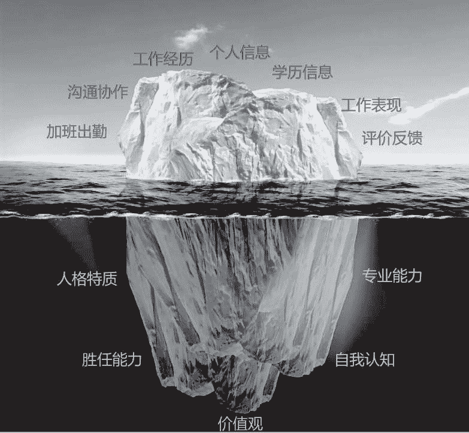

**图2-8　人才画像的显性与隐性信息**

**显性信息**

可直接从系统或报表中提取，多为结构化数据：

◇ **个人基础档案**：性别、年龄、民族、籍贯、政治面貌、常住地、婚姻/生育状况、家庭背景等；

◇ **教育经历**：毕业院校、专业、学位、学历、是否统招等；

◇ **工作履历**：公司、部门、岗位、任职时长、项目经历、担任角色、获奖、专利等；

◇ **工作绩效**：绩效结果、晋升、调薪、调岗、奖惩记录等；

◇ **沟通协作**：邮件频次、即时通讯（`IM`）频次、会议频次、发帖/评论/点赞数等；

◇ **加班考勤**：打卡时间、加班、请假、出差等。

**隐性信息**

对应图2-8水平面以下特征，多为非结构化数据，需借助测评或大数据技术挖掘：

◇ **专业技能**：沟通、表达、总结、公文写作、创新、学习、设计、运营、逻辑等；

◇ **胜任力/通用能力**：领导力、战略思维、团队管理、计划管理、客户导向等；

◇ **自我认知**：自我观察、自我评价、价值观（含人生/职业价值观）等；

◇ **人格特质**：情绪稳定性、外向性、开放性、宜人性、尽责性等。

#### 2. 关键人才画像构成

企业关键人才画像主要包含三大板块：

**个人基本信息**：性别、年龄、工龄、学历、地区等。

**工作相关信息**：岗位、职序、职级、序列、绩效、考核、培训记录等。

**综合胜任力表现**：

◇ **晋升速度**：与普通员工横向对比。

◇ **跨界能力**：学习经历中的专业背景变更、工作履历中的岗位/行业跨度。

◇ **绩效与考核**表现。

◇ **潜力指数**。

◇ **人才九宫格**定位。

### 二、 哪些岗位适合建立人才画像

并非所有岗位都需建模，适用场景主要集中在：

● **核心关键岗**：如团队负责人、技术带头人；

● **高专业度岗**：如数据库开发工程师、`JAVA`程序员；

● **人数多且影响业绩大的岗**：如产品经理；

● **批量招聘岗**：如管培生等。

### 三、 人才画像的应用场景

核心聚焦于企业核心人才的“选、用、育、留”四大模块：

1. **选——人才选拔**：当人才供给跟不上业务增速、过度依赖外部招聘、特定岗位绩效低、团队冗余待优化、核心人才流失严重时，需构建画像。
2. **用——人才使用**：面临人岗不匹配、团队配置不科学、转型期需引入新型员工时，画像可提供决策支撑。
3. **育——人才培养**：收集培训需求、盘点领导力现状、评估培训效果时，画像能精准画像对象。
4. **激——人才激励**：当优秀人才能力未被充分释放、主观能动性不足时，画像助力精准激励。
5. **配——人才配置**：通过岗位与人才匹配度分析，实现人岗最优配置，降本增效。

### 四、 人才画像构建步骤

**步骤 1：数据采集**

**核心采集要素**：基本信息、工作经历、教育背景、绩效、沟通协作、考勤加班、评价反馈、人格特质、专业技能、胜任力、自我认知、价值观等。

**采集渠道**：人才档案、招聘需求单、职位说明书（JD）、标杆人才样本。

**采集手段**：系统检索、调研问卷、深度访谈、关键事件法（CIT）等。

**步骤 2：整合分类**

依据八大维度（工作压力、晋升轮岗、人才发展、培训学习、薪酬绩效、文化氛围、外部热点、办公环境）进行分类，按相似度归纳整合。

### 打磨画像：从数据清洗到标签落地的三步走

**第三步：数据精炼。** 去伪存真，提炼具备共性的典型特征。  
**第四步：画像构建。** 按优先级排序完善模型，同步植入场景化语言描述，实现数字化与标签化的双重落地。  
**第五步：验证迭代。** 招聘实战中持续校准，保障人才画像的时效性与生命力。

---

### 五、AI赋能：重构人才画像新范式

得益于人工智能与大数据技术的演进，数据的采集、挖掘、清洗与加工门槛大幅降低，模型算法在选、用、育、留等HR全场景的渗透率持续攀升。

如前所述，人才画像可拆解为八大核心维度：**工作压力、晋升轮岗、人才发展、培训学习、薪酬绩效、文化氛围、外部热点、办公环境**。这些维度贯穿员工职业生涯全周期，具体拆解子项如下图所示。

#### 1. 工作压力
压力源主要聚焦于工作本身：同侪竞争、负荷过重、责任过载。它是把双刃剑——既能化作强劲驱动力，亦可能侵蚀绩效与身心健康。细分指标涵盖上下级关系、同事互动、竞争行为、责任变动、加班频次、会议密度、可支配休闲时间等。

#### 2. 晋升轮岗
互联网大厂多采用“春秋双季”晋升制。轮岗则是培养高潜干部的核心机制。考察维度聚焦速度、频次、失败率、效能、行为表现及反馈机制。

#### 3. 人才发展
核心子项锁定四大支柱：过往履历、个人技能、职业规划、发展潜力。

#### 4. 培训学习
围绕学习计划、参与度、反馈评价、推荐体系四大板块展开。

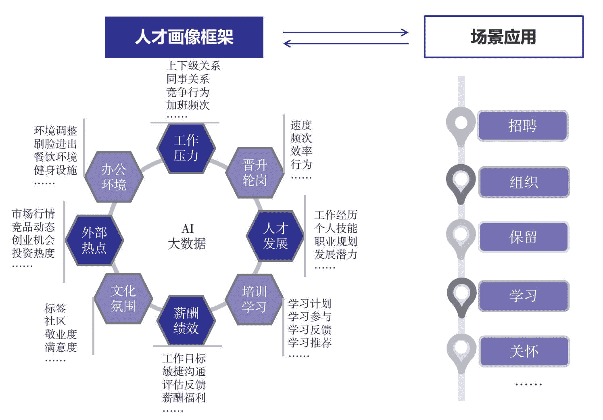

**图 2-9　人才画像八大要素及子项详解**

#### 5. 薪酬绩效
细分至目标设定、敏捷沟通、考核执行、评价反馈、薪资调整、奖金发放、福利体系等环节。

#### 6. 文化氛围
以社群归属感、满意度、投入度三大指标量化软性文化。

#### 7. 外部热点
追踪行业行情、竞品动态、创业机遇、投融资热度等外部信号。

#### 8. 办公环境
涵盖环境适配、刷脸通行、健身设施、餐饮体验等硬件与服务细节。

---

**人才画像的本质**，是从海量人力数据中抽象、建模出个体的标签体系。  
**技术架构层面**，系统由数据采集、特征计算、特征库维护、机器学习模型、应用接口、画像应用六大功能模块构成。员工标签体系需分层、分批建设，可依托上述八大要素及子项分类落地。

数据源端，汇聚企业内部系统（HR全生命周期“入调转用育留离”+财务+业务系统）与外部市场/研究机构数据，经清洗入库 `Hadoop`、`Spark` 或 `HBase` 等大数据仓库。

算法层，`Logistic回归`、`线性回归`、`深度学习`、`树模型集成`、`矩阵分解` 等为常用工具箱，实战中常组合拳出击。

可视化层，通过仪表盘、看板直观呈现，辅助业务判断与决策。

**“数据 + 模型 + 可视化”** 构成了企业决策所需的预测闭环（如图 2-10）。当然，针对招聘、盘点、培训、流失等不同业务场景，算法模型需因地制宜。唯有充足数据、精准模型与业务场景深度融合，方能勾勒出清晰可用的人才画像——这正是大数据的迷人之处。


**图 2-10　预测结果的“核心公式”**

---

### 六、区块链技术：重塑招聘信任基石

2008年起，区块链逐步进入大众视野。其发明者自称“中本聪”，真实身份至今成谜。区块链本质是**分布式共享账本/数据库**，具备去中心化、不可篡改、全程留痕、可追溯、共同维护、公开透明六大基因。账本不掌握在单一实体手中，而是分布于每个参与节点的本地。

顾名思义，区块由串联的“区块”组成。每个区块包含业务数据、自身哈希值、前一区块哈希值。上链即定型，不可逆改。按数据隐私需求，可分三类：
*   **公有链**：全网开放，人人可读可写，比特币为典型代表。
*   **私有链**：单一实体控制，隐私保护与吞吐量更优，适配组织内部场景。
*   **联盟链**：介于两者之间，面向特定资质主体，多机构共治、多节点部署，支持复杂权限管理。

区块链在招聘全流程的落地场景颇具想象力，详述如下。

### 1. 面试甄选与简历验真

# 区块链：重塑招聘信任与HR效能的新引擎

调研数据显示，超过半数企业曾在候选人简历中识别出虚假成分。在区块链技术诞生前，甄别真伪主要依赖耗时费力的背景调查。凭借信用机制、数据不可篡改及全程可追溯等特性，区块链为这一顽疾提供了极佳解法。一旦学历、履历、资质等核心信息“上链”，背调难度与成本将大幅下降，企业无需依赖第三方机构即可秒级核验。甚至可以说，区块链有望重新定义简历形态：经权威机构审核上链的学位、工龄、证书数据，自带可信光环。早在2018年，麻省理工学院（MIT）便率先推出基于区块链的电子学位证，此后MIT毕业生求职验证流程实现安全提速，文凭造假空间被彻底堵死。如今，越来越多高校跟进，在发放纸质证书的同时同步提供链上数字证书。

同理，经前雇主确认上链的工作履历数据，真实性亦有保障。更关键的是，区块链能呈现更细颗粒度的画像——晋降职记录、技能等级、奖惩荣誉等正向与负面信息并存，助力面试官立体洞察候选人。

### 2. HR流程深度优化

区块链技术正在从根本上重塑招聘经理的日常事务处理，核心优化场景如下。

#### 1. 薪酬发放自动化

区块链让薪资管理焕然一新。技术介入显著降低人为失误率，流程自动化推升效率、节省工时。企业可利用链上记录追踪考勤、加班、差旅等薪酬关联数据，亦可统筹福利发放。

#### 2. 智能合约：协议执行的“自动驾驶”

未来，基于区块链的智能合约将逐步取代纸质合同。其本质是预设条件触发执行的代码：明确交易条款与违约后果，一旦满足特定条件即自动履约。应用场景极广：
*   **灵活用工**：自由职业者完成约定任务/工时，薪资即时到账；
*   **入职准入**：新员工通过背调且材料合规，自动开通系统权限；
*   **税社保核算**：依据法规与薪资基数，批量自动测算并缴纳个税社保。

头部科技巨头凭借技术积淀率先内部落地，市场上专业服务商也层出不穷。Aworker打造招聘专用链；Indorse聚焦IT人才，提供技能测评与认证；ChronoBank则构建了无监管、无传统金融介入的零工短聘平台，旗下LaborX智能合约平台让雇主发需求、自由职业者随时接单，业务覆盖建筑、保洁、运输、电商等短期岗位，平台费率仅1%，远低于传统中介。这种模式以更低成本、更高速度实现供需匹配，但也在税务、社保、职业安全等维度带来新课题。

# Chapter 3　人才利用阶段的AI应用实践

## Section 1　编制规划与人力成本预算的核心逻辑

人力资源规划的重头戏在于编制规划与人力成本预算。编制即Headcount（HC），外企常称HC管理，国企称编制规划。其本质是依据业务发展、组织架构与能力模型，动态调整增减员计划——简单说，就是编人员预算、定招聘计划。

这往往是管理者的痛点：总编多少？各业务线、岗位、层级、部门各需几人？团队小时管得过来，规模大了必须靠机制、靠系统、靠方法。

HR需借助大数据挖掘，检索汇聚内外部信息（经营现状、历史数据、政策变动等），经清洗建模构建模拟器，推演各业务/产品线的人力成本波动、绩效走向、人员流失等场景。综合复盘后输出现有人力利用率与成本合理性报告，据此给出未来编制与成本的预测调整建议，供决策参考。

### 1. 预算编制六步法

预算编制通常遵循六步走：目标预测 → 中长期规划 → 年度经营计划 → 预算编制 → 跟踪分析 → 绩效考评（如图3-1）。六环紧扣目标、协同一致。


Figure 3-1　Steps in Budget Preparation

1. **Target Forecasting**: Conducting short-, medium-, and long-term market and investment demand forecasting, aiming to set targets and adjust them in a timely manner. The principle of target forecasting is "rough for the long term, detailed for the near term"—meaning long-term targets can be rougher, while short-term targets must be detailed and accurate. Annual forecasting must be implemented down to specific products and businesses.

2. **Medium-to-Long-Term Planning**: Comprehensive business planning at the enterprise level for the medium to long term, including strategic planning, market planning, business/product planning, IT planning, human resource planning, etc. These plans guide business units in clarifying work priorities and directions.

### 3. 年度经营计划
各级管理层将经营指标分解下达至下属单位；各业务单元依据目标编制经营计划，并据此提出投资需求。

### 4. 预算编制
预测达成既定目标及详细工作计划所需的人力资源（涵盖产品线、业务线、岗位、职级、区域等维度）及人工成本，进而编制年度预算。

### 5. 跟踪分析
客观、准确、及时地记录企业经营活动，开展实际核算与预算的差异分析（如典型的曲线分析），聚焦“例外”管理，并将结果上报至相应管理层级。

### 6. 绩效考核
依据目标完成情况及企业激励体系开展绩效评估，对达标或超标的业务人员及管理者给予奖励。

## 二、预算编制周期

实务中，预算编制依托会计年度展开。约90%的企业采用自然年度（1月1日至12月31日）作为会计年度，少数企业则以次年3月31日截止的4月1日起算年度为准。无论采用何种方式，人力成本预算编制的核心任务均是做好人才供需规划与人工成本预算。

图3-2展示了以自然年度为会计年度的预算编制流程。企业将年度预算拆解为月度与季度预算，在一季度末进行3+9预算调整，二季度末实施6+6调整，三季度末执行9+3调整，四季度则在开展年终预算复盘的同时启动次年度预算编制。该周期以分阶段、递进式的预算管控推进精细化管理，保障年度预算目标达成。


图3-2　基于自然年度的预算编制体系

以某企业年度预算为例，人工成本预算的计算逻辑如下。首先，人工成本预算需用到以下公式：

`√YTD (Year to Date，年初至今/至季末) = Q1至当前季度的累计值；`

`√预估人工成本率 = 预估人工成本 / 预算人工成本 × 100%`

`√(YTD) 预估人工成本率 = (YTD) 预估人工成本 / (YTD) 预算人工成本 × 100%`

`√(全年) 预估人工成本率 = (YTD) 预估人工成本 / (全年) 预算人工成本 × 100%`

（注：95%为风险预警线；若≥95%，系统触发红色预警）

最终，人工成本预算结果可用表3-1呈现。

表3-1数据源自企业人力资源与财务部门。以某公司智行事业部2019年第四季度预算为例，因Q4处于年末，其YTD人工成本预算等同于2019全年人工成本预算，均为34,507,084.12元。

```
Quarterly Estimated Labor Cost Ratio = Quarterly Estimated Labor Cost / Quarterly Budgeted Labor Cost × 100%
= 3,153,797.33 / 5,459,798.14 × 100%
= 57.76%

(YTD) Estimated Labor Cost Ratio = (YTD) Estimated Labor Cost / (YTD) Budgeted Labor Cost × 100%
= 32,201,083.31 / 34,507,084.12 × 100%
= 93.32%

(Full Year) Estimated Labor Cost Ratio = (YTD) Estimated Labor Cost / (Full Year) Budgeted Labor Cost × 100%
= 32,201,083.31 / 34,507,084.12 × 100%
= 93.32%
```

上述指标均未突破95%风险预警线，成本支出处于合理区间，系统显示正常状态。

## 三、预算编制模式

通常存在三种主流预算编制模式。

**1. 自上而下模式**

部分企业采用自上而下模式，由上级设定关键财务指标。例如集团为子公司下达营收与利润率目标，子公司自行分解预算指标；集团仅管控总额指标，不干预子公司月度或产品级预算。华为凭借连接财务与业务的完善IT系统（即业财一体化平台），采用该模式。其优势在于编制效率高。

**2. 自下而上模式**

部分企业选择自下而上模式，因一线员工最清楚业务实情，实事求是的汇报使预算更具落地性。需注意：下级自评未必符合上级预期。若上级见到预算后屡屡抬高标准，下级会在汇报时预留更多缓冲以规避考核压力。为规避此弊，采用该模式时常见的做法是“压低产出值（抑制营收、利润、回款）”与“抬高支出值（增加费用、采购等）”。其优势是预算更接地气、执行力强。

**3. 上下结合模式**

鉴于前两种模式各有利弊，多数企业采用上下结合模式。

（1）**目标设定**：董事会或总经理办公室结合企业发展战略及预算期经济形势，提出下年度财务预算目标，涵盖销售、成本费用、利润、现金流等指标，明确编制方针，由预算管理层下达各部门。

（2）**编制上报**：各部门依据下达目标、方针，结合实际情况与执行状况，编制详细财务预算方案并上报企业财务管理部门。

（3）**审核平衡**：财务管理部门对上报方案进行审核、汇总及专业建议。平衡过程中，预算管理层应统筹协调，对发现问题提出初步调整意见并反馈相关部门修正。

（4）**审议批准**：财务管理部门依据部门修正调整编制企业财务预算草案，呈报预算管理层审议。对不符合战略或财务目标的项目，管理层责令相关部门进一步修订。经审议调整后，财务部正式编制年度财务预算草案，提交董事会或总经理办公室批准。

（5）**下达执行**：财务管理部门将批准后的年度总预算拆解为系列指标，由预算管理层逐级下达至部门执行。

## 四、预算编制方法

企业确定各岗位/职级人数及编制人工成本预算的方法多样。不同方法在复杂度、精准度、耗时与成本上各有优劣，均有其适用场景。实务中，企业常综合运用多种方法进行测算与修正。下文概述十大常用预算编制方法。

### 企业人员编制核定的十大实战方法论

**1. 预算驱动控制法**
摒弃“岗位定人数”的僵化模式，转而以**人力成本预算**为核心杠杆。企业下达总额控制线，授权部门负责人在预算红线内，自主统筹业务目标、岗位设置与人员数量。若能将预算指标与业绩产出挂钩，更能激活编制的弹性空间，精准匹配业务发展节奏。
> 核心公式：**编制额度 = 总人力成本预算（业务量 × 系数） ÷ 单位人力成本**

**2. 业务数据建模法**
立足历史实绩与战略蓝图，推演未来编制图谱。关键数据维度涵盖营收、利润、市场份额及人力成本等。
*   **对标复盘**：对比历史营收、人效、毛利与战略目标，界定短中长期编制区间；
*   **回归推演**：构建人员规模与业务数据的回归模型，依据战略目标值反推具体编制红线。

**3. 人效标准核算法**
聚焦“产出与投入”的量化关系，适用于作业标准化、人工操作占比高的岗位。双轨并行：
*   **定额反推**：**编制 = 总生产任务 ÷ (人均劳动定额 × 出勤率)**
*   **工时换算**：**编制 = 生产任务 × 单件工时 ÷ (可用工时 × 出勤率)**

**4. 业务流程拆解法**
以端到端价值流为视角，通过三步走落地岗位配比：
1.  **总量锚定**：依据整体业务目标测算单位时间总工作量，锚定各岗总编；
2.  **单兵测算**：量化单岗单位时间产出（如件产量、单据处理量），核实单岗编制；
3.  **流程平衡**：结合上下游衔接节奏，动态调整各岗配比，消除瓶颈与冗余。

**5. 管理访谈与专家智库法**
*   **高管访谈**：直击一线痛点——饱和度、流程合理性、调岗建议；预判人才流向（晋升、调动、流失），模拟未来组织画像；
*   **专家咨询**：引入外部视角，标杆对标行业头部企业的层级架构、管理幅度及岗位结构模型。

**6. 结构占比基准法**
确立“黄金分割率”，按总编或特定品类人数的固定比例划分职能序列。如职能管理、业务管理、专业技术、研发、销售等序列的结构性红线，守住组织形态的健康度。

**7. 标杆对标参照法**
“借力打力”，引用标杆企业或同行业成熟的**岗位配比关系**（如HR:业务、财务:业务比率），维持相对稳定的结构常数。适配辅助职能、后台支撑类岗位。注意：样本量决定可信度，须广泛采集同业数据构建分析基座，避免以偏概全。

**8. 趋势预测仿真法**
构建多维历史数据池（招聘总量、区域/业务线分布、层级结构、晋升周期、管理幅度、流失率等），跑通线性回归与场景模拟。
*   **诊断发展态**：识别组织处于平稳期、曲线增长期还是爆发期；
*   **数据门槛**：需积累3年以上完整数据；
*   **变量修正**：叠加突发业务事件（产线关停/并购/转型）、市场热点（创业潮/颠覆性创新）等非线性干扰因子。

**9. 成本倒推测算法**
以总人力成本预算为“天花板”，层层拆解反推编制上限。成本包含五大显性项：获取(招聘/录用/安置)、开发、使用、保障、退出(离职补偿)；以及隐性成本：缺勤损耗、甄选机会成本、错配低效、试用期淘汰替换、离职前懈怠/离职后空窗、文化内耗、流程拖沓损耗等。
*   **常规操作**：显性成本打包分配至BU/部门，反推各层级编制；
*   **进阶玩法**：引入大数据挖掘量化隐性成本，或采用“显性成本 × 系数”快速估算总成本包。

**10. 双控耦合仿真法**
单一维度皆有盲区，趋势法管不住成本，成本法看不清趋势。**“双控模式”**应运而生——人头与成本同步管控。
当前最优解：HR借力大数据中台，实时采集显/隐性成本，融合组织架构、配置、薪酬、绩效、流动、离职等全维内部数据，叠加外部多维环境变量，构建仿真模型。通过多场景推演、风险评估，输出**全景式人才供需分析报告**，为决策装上“导航仪”。

## 第二部分　人力成本结构预测与合理性研判

研究机构的人员架构分布与组织形态，对人力成本预算的编制起着关键的支撑作用。归根结底，HR 无论采用何种工具或方法，核心都在于能否拿出充分的理据与证据，说服上级领导、用人部门以及预算管控部门。

### 1. 人才结构演进规律

常见的人才结构模型主要有四类：`花瓶型`、`钻石型`、`橄榄型` 与 `球形`，具体示意见图 3-3。

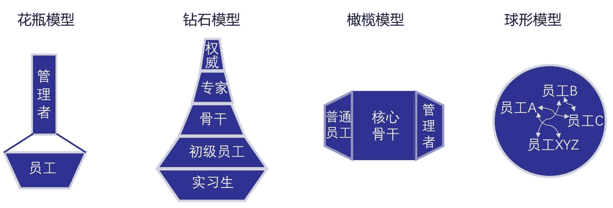

图 3-3 四大人才结构模型示意

不同业务模式下，人才结构模型各异。如何通过演进迭代，让人才供给精准匹配企业发展与变革的需求？企业可引入 `曲线分析` 与 `预算模拟器` 等工具予以解决。

### 2. 曲线分析

`曲线分析` 是近年兴起的一种数据分析手法，其渊源可追溯至 `海氏指标图` 中岗位的“形状配置”评价应用。海氏评价法（即“指标图-剖面法”）由美国薪酬设计专家爱德华·N·海于 1951 年研创，有效破解了跨职能部门、不同岗位间相对价值难以互比、难以量化的难题。其本质是一种计分制体系：凡岗位皆包含三大核心酬薪因素——**知识/技能深度**、**解决问题能力** 与 **责任担当**。三大因素下又细分多个子因子及对应计分标准，通过权重调整因素重要性以适配不同组织。海氏法认为，岗位存在的意义在于任职者须承担特定责任、具备特定知技、产出特定成果。员工如何凭借知技达成产出？靠的是解决岗位面临的难题——即履行“责任担当”、施展“知识技能”、最终“解决问题”。依此三要素及标准打分，得出岗位评价分：`岗位评价分 = 知识/技能分 + 解决问题分 + 责任担当分`。其中知识/技能分、责任担当分及最终得分为绝对分，解决问题分为相对分（百分制），仅在折算最终分时转为绝对分。HR 在用海氏法为三大因素评分时，还须结合岗位“形状配置”确定权重，进而算出各岗位相对价值总分，完成评价。所谓岗位“形状”，实质取决于知识/技能与解决问题能力相对于责任担当的影响力对比与分布。

长期以来，业界对 `Curve Analysis` 缺乏通用的中文译名。本书将其定译为 **`腰线分析`**，并界定为：将某类数据按近似正态分布的形式划分“档位”，通过权重调整上下浮动“档位”，使数据落入合理区间以适配组织。换言之，通过平移腰线位置、调整腰线宽度，模拟组织人员部署是否满足管理诉求，从而达成管理目标。

下文以 ABC 公司某专业序列（`P 序列`）人数数据为例，演示 `腰线分析` 对人才结构的影响。

某年度 ABC 公司员工人数与职级分布见表 3-2，`腰线分析` 图谱见图 3-4。

表 3-2 ABC 公司员工人数统计表

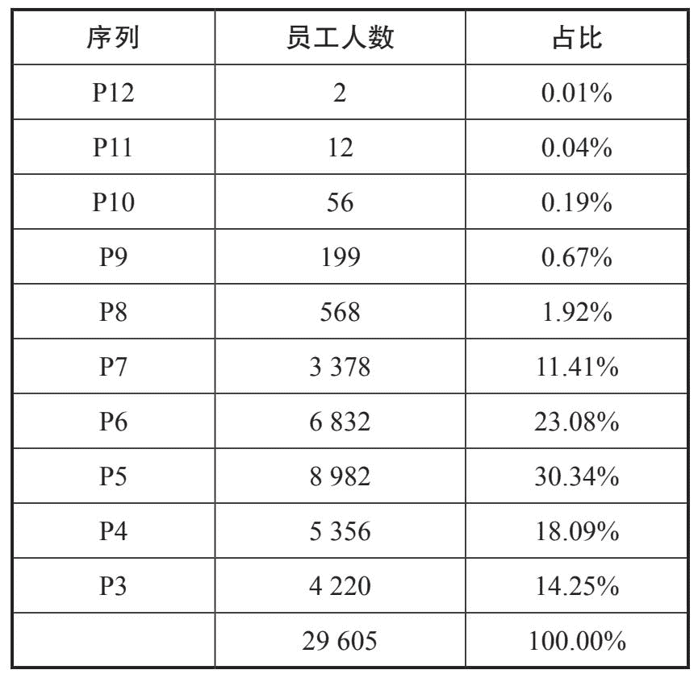

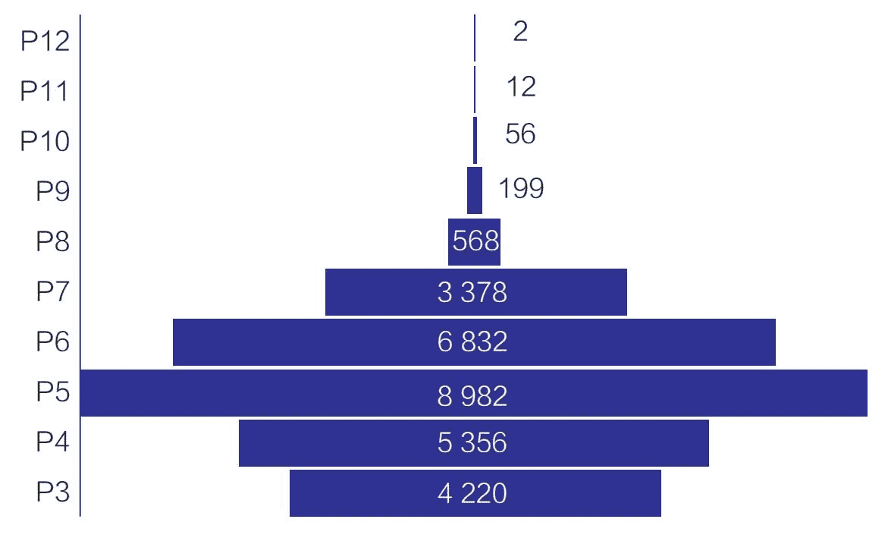

图 3-4 ABC 公司员工人数 `腰线分析` 图谱

由图 3-4 可见，HR 优化人员结构的关键，在于调整对应层级的人员分布——即改变腰线的位置与宽度，重塑结构形态。这要求 HR 运用科学的人力资源管理机制与行动：

1.  **招聘**。通过校招补齐 `P3` 级人员缺口，同步为未来 2-3 年的人才架构与竞争力布局；其他层级缺口则靠社招填补。
2.  **晋升**。通过管控内部晋升比例，调节各层级人员结构占比。
3.  **轮岗**。内部轮岗亦可调节层级分布，尤其是组织重构，能直接重塑企业人才结构。
4.  **流失**。主动与被动离职，均能对人才结构起微调作用。

在规划总人力量时，有的企业实行单控（仅控人数或成本），有的实行双控（人数、成本双控）。模型较为复杂，除 `曲线` 结构外，还需纳入地区、院校、学历、年龄、工龄、技能、绩效、薪酬分位等维度。HR 可借力大数据模型与算法，充分挖掘历史数据，结合多元场景开展预警预测，辅助管理层科学决策。

### 3. 预算模拟器

`预算模拟器` 的设计逻辑，是模拟测算部门内不同职级、不同编制所占人力成本，从而快速产出预算草案。

该工具亦适用于招聘决策。业务方可用它测算：在预算固定时，是引入 1 名 `P8` 级资深专家（成本 100 万），还是招募 4 名 `P6` 级程序员，抑或是各层级各能招几人。

预算编制常采用同比、对标等常规路径。但有一条铁律：人力成本增速不得超营收与利润增速，否则皆属徒劳。要让员工收入超越行业均值，赋予薪酬市场竞争力、提升员工获得感，企业必须创造可持续利润。人力成本与利润天然博弈，唯在某一平衡点维持相对均衡，企业方能稳健向上，员工回报亦能水涨船高。

测算人力成本有三大著名“黄金不等式”，详述如下。

```
1. Human Cost Growth Rate < Profit Growth Rate
Human Cost Growth Rate = Human Cost Increase / Previous Period Human Cost × 100%
Where, Human Cost Increase = Current Period Human Cost – Previous Period Human Cost

Profit Growth Rate = Profit Increase / Previous Period Total Profit × 100%
Where, Profit Increase = Current Period Total Profit – Previous Period Total Profit
```

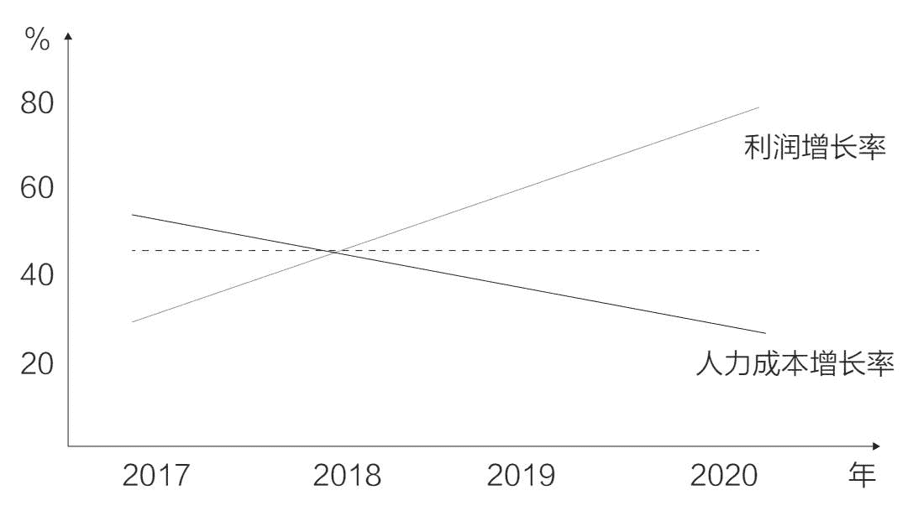

Figure 3-5 人均成本增速与利润增速的关联图谱

```
2. Total Human Cost Ratio < Profit Warning Line
Human Cost Ratio = Total Human Cost / Total Cost for Same Period × 100%
Human Cost to Revenue Ratio = Total Human Cost / Total Revenue × 100%
```

```
3. Human Cost Growth Rate < Revenue Growth Rate
Revenue Growth Rate = Revenue Increase / Previous Period Revenue × 100%
Where, Revenue Increase = Current Period Revenue – Previous Period Revenue
```

## 核心指标与影响因素：解码人效密码

“人效”这一概念，通常包含两层截然不同的含义。

首先是**人力资源有效性**，聚焦于人力资源管理目标的达成程度；其次是**人力资源效率**，侧重于人力投入产出比的核算。归根结底，人效必须映射出人力资源体系的实战成效——即不同维度的人力投入，是否真正转化为相应的产出。用最朴素的公式表达：财务或市场成果除以人力单位，即得人效指标。这是最硬核、最能彰显HR职能价值的度量衡。

随着AI技术深度渗透HR领域，业务流程与管理模式正经历重塑，为人效的跃升提供了坚实的技术底座与平台支撑。

### 一、 影响人效的关键变量

决定人效高低的因素，大致可划分为外部环境与内部管控两大阵营：

**1. 外部环境驱动力**

- （1）宏观经济与环境变迁，数字化转型便是典型例证；
- （2）前沿科技冲击，涵盖`5G`、数字技术、`AIoT`、智能制造等；
- （3）劳动力市场供给变革，灵活用工等新就业形态层出不穷；
- （4）行业人才博弈，`AI`人才、算法工程师、数据挖掘工程师等关键岗位流动性大。

**2. 内部管控要素**

- （1）**供需匹配度：业务诉求与人员配置的动态平衡**

  通过追踪需求端与供给端的变化趋势，管理者可精准诊断当前编制状态，进而对症下药。例如，若企业人员增速长期滞后于业务增速（人才供给不足），往往意味着人才策略稳健审慎，此时可考虑通过优化人才结构、提升人效来支撑业务目标；反之，若人员增速超越业务增速（人才供给过剩），这多见于探索期、创新型或前沿研发部门。

- （2）**人才盘点与运营画像：量、构、质的全景扫描**

  HR可从五大维度切入，洞察人才梯队隐患，制定提升对策：
  - ① **结构画像**：性别、年龄、工龄、学历、地域分布等；
  - ② **价值分层**：职级、绩效表现、关键岗位覆盖等；
  - ③ **行为洞察**：敬业度、满意度、流失风险等；
  - ④ **能力建模**：通用素养、专业技能、领导力、潜力评估等；
  - ⑤ **大数据画像**：人才标签化、画像化分析。

- （3）**人员流动态势与预判**

  构建**离职预测模型**，借助大数据识别高风险人群并预警，结合“内部继任者地图”实现早期干预；
  绘制**人才流动地图**，实时掌握内外部人才动向，为录、离、晋、降、调等决策提供数据支撑。

- （4）**人效竞争力“三张表”**

  企业人效竞争力的核心，浓缩于“人才流量表”、“人才损益表”与“人才资产负债表”三张管理报表之中。

- （5）**组织架构迭代与变革**

  企业在不同发展阶段，随战略调整而触发组织变革，进而引发人才部署重组，最终波及人效水平的波动。

### 二、 衡量人效的核心仪表盘

**1. 人力成本占比指标**

反映人力成本在销售额或总成本中的权重。占比越高，成本压力越大，人效优势可能减弱。常用公式如下：

```
Human Cost Ratio = Total Human Cost / Total Sales (or Total Output Value) × 100%
Human Cost Ratio = Total Human Cost / Total Operating Cost × 100%
```

**2. 人力资本产出指标**

刻画单位员工创造的价值水平。常用公式如下：

```
Revenue per Employee = Organization Total Sales / Number of Employees
Output Value per Employee = Organization Total Output Value / Number of Employees
Profit per Employee = Organization Net Profit / Number of Employees
```

**3. 人力资本投资回报率（ROI）**

量化每投入一单位人力成本，带来多少产出回报。常用公式如下：

```
Output Value per Yuan = Organization Total Output Value / Total Human Cost
Human Capital ROI = Organization Net Profit / Total Human Cost × 100%
```

**4. 增速指标（被誉为“黄金不等式”）**

为人力指标增速设定阈值红线，管控人力成本增幅不超预期区间，以此保障人效质量。企业实务中常遵循以下“黄金不等式”：

```
Total Human Cost Ratio < Profit Warning Line
Human Cost Growth Rate < Profit Growth Rate
Human Cost Growth Rate < Revenue Growth Rate
```

## 敏捷绩效与薪酬福利：激活组织动能

### 一、 目标与绩效管理的主流路径

**目标管理法（`MBO`）** 以目标为纽带实施管理，流程如图3-6所示。高层定战略，HR负责将战略目标层层拆解至部门与个人，管理者再依据子目标完成度进行考核评价与奖惩。

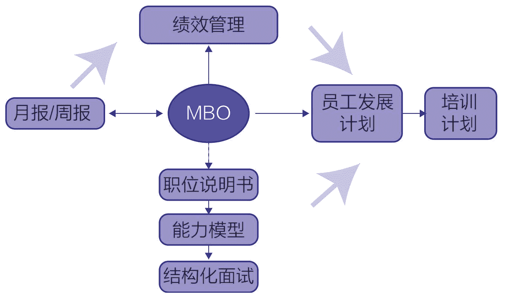

图 3-6 目标管理法（`MBO`）运作示意图

**目标与关键结果法（`OKR`）** 是聚焦目标设定与进度追踪的管理利器。

**关键绩效指标（`KPI`）** 以目标为导向的量化考核工具，将战略拆解为可执行的作业目标，奠定绩效管理基石。

**平衡计分卡（`BSC`）** 由哈佛商学院创制，是集战略执行与绩效考核于一体的综合管理工具。

不同绩效工具究竟适配哪些业务场景？通常而言，针对基层员工的考核，`MBO`（目标管理）是首选；而面向管理层，`BSC`（平衡计分卡）更具优势。`KPI`（关键绩效指标）因其通用性强，适用于大多数组织。`OKR`（目标与关键结果）则专为“0到1”的探索性业务设计，鼓励尝试多元路径、寻找最优解，典型落地场景涵盖产品研发、广告公关策划、项目驱动型企业等，这些岗位的核心诉求是激发创造力与创新力。

### 2. 敏捷绩效：重构价值导向

#### 1. 告别强制分布，拥抱“去KPI化”
绩效管理是企业价值输出的“指南针”。步入移动互联网时代，`OKR`、“人单合一”、阿米巴经营等理念兴起，众多企业摒弃了强制分布与末位淘汰制，转向敏捷绩效。借助移动端应用，员工与管理者可随时调整目标、交换反馈，甚至引入跨部门专家或项目负责人视角；关键在于将绩效结果与晋升薪酬“解绑”，大幅提升沟通质量，助力员工快速修正成长路径。当然，热情、创新驱动力等软性指标难以量化，这倒逼HR深耕一线：关注工作状态、代码产出、行为表现、协作沟通等细节，引入大数据与`NLP`建模，融合定性定量分析，锚定提升组织效能的关键杠杆。英特尔、谷歌早早布局`OKR`；埃森哲、Adobe、微软、戴尔、通用、IBM等巨头纷纷推行敏捷绩效；百度也于2019年初全面铺开`OKR`实践。

#### 2. 敏捷沟通：从“瀑布式”到“共创式”
敏捷不仅是方法论，更是文化基因与管理范式，正深度重塑人力资源领域。Josh Bersin提出的“HR与业务共创模型”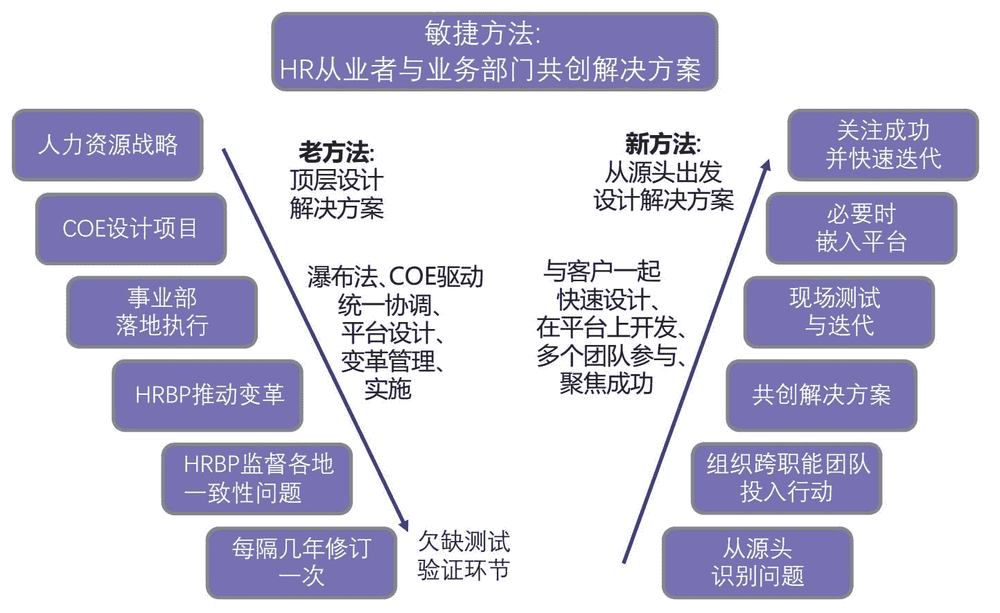揭示了新趋势：HR不再闭门造车，而是深入一线共创方案。

旧范式是自上而下的“瀑布流”：**COE**（专家中心）依据战略设计方案 -> 下发至业务单元 -> **HRBP**推动落地并监管一致性 -> 数年一迭代。全程缺失“测试验证”环节，刚性且滞后。

新范式是自下而上的“共创流”：源头发现痛点 -> 组建跨职能小分队 -> 共创方案 -> 实战试错快速迭代 -> 成熟后沉淀至平台。核心特质：贴近客户快速设计、平台化开发、多团队协同、聚焦成功案例复用。

敏捷绩效最显著的特征是**高频沟通反馈**。企业开发移动端工具，让管理者随时追踪项目进度、即时复盘优劣势，辅导员工成长。这些交互自动汇总入库，为后续大数据分析铺就数据基石。

#### 3. 算法管理的边界：效率与人性的博弈
科技媒体曾披露：亚马逊仓储物流中心引入AI系统，通过监控视频识别员工ID与行为状态，实时结构化输出“摸鱼时长”、“单件处理效率”等数据，直接对接绩效系统形成“预警-劝退”闭环，上线后数百人被自动解雇。这种“算法包工头”虽极大降本增效，却因剥夺人性尊严引发舆论风暴，亚马逊随后叫停并整改。

这只是AI时代人才管理变革的缩影。网约车、外卖骑手同样受困于算法：平台以单量、客单价、好评率为鞭策，骑手虽非正式员工，却被算法精准掌控时间与劳动强度，却无法参与规则制定——这比亚马逊案例更隐蔽、更激进。

未来，AI将渗透绩效评分、敬业度分析、晋升推荐等全链路。**但“全托管式”算法管理绝非良方。** 企业亟需：更科学的员工培养体系，赋能中层管理者掌握“读懂数据、支持员工、提升绩效”的新技能，在效率与温度间寻找平衡点。

### III. 智能薪酬数据分析平台

参考链接：`../Text/contents.xhtml#c_51`

在当前人才争夺日益白热化的背景下，如何留住核心骨干已成为企业面临的严峻课题。部分行业员工平均任职年限甚至跌破两年大关。企业吸引并挽留关键人才的核心策略之一，便是提供极具竞争力的薪酬激励方案，而HR数据分析正是为管理层的薪酬决策提供强有力技术支撑的关键。

#### 1. 智能薪酬数据分析平台

在HR数据分析的版图中，薪酬模块占据了最大比重。HR从业者在处理薪酬数据时，通常遵循“先薪酬核算分析，后薪酬政策分析”的逻辑。具体而言，核心分析活动涵盖以下维度：

- 人力资本投入效益分析
- 人工成本管控分析
- 人均效能产出分析
- 人员激励机制分析
- 外部基准与竞对对标分析
- 薪酬政策数据深度解析
- 预算执行与管控分析

那么，如何开展高效深度的分析？关键在于构建一套薪酬管理数据分析平台（如图3-8所示），其搭建思路与HR大数据平台同源，或直接依托大数据平台构建。

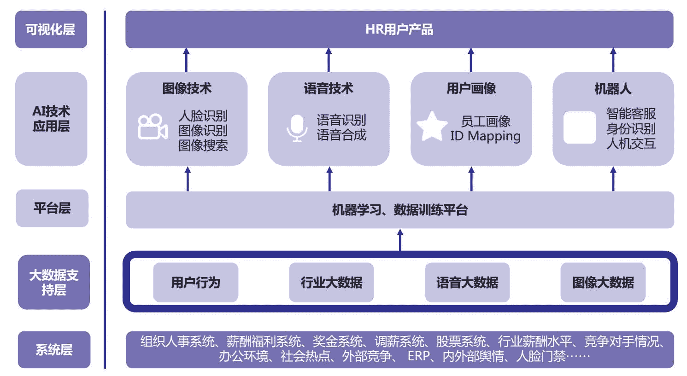

图3-8 薪酬管理数据分析平台架构

该平台架构自下而上分为四大层级：系统层、大数据支撑层、AI技术应用层及可视化呈现层。

##### 系统层

企业可充分利用信息化、数字化及AI等前沿技术，搭建相关系统或应用终端，实现数据的广泛采集与沉淀。数据源划分为内外部两大类：内部数据囊括组织架构、岗位职级、薪酬核算、考勤记录、人员异动（入转调离）、选育用留全周期、OA协同、门户论坛、门禁刷卡、人脸识别、财务核算、业务运营等系统数据；外部数据则涵盖市场行情监测、行业薪酬大盘、竞争对手情报、专业薪酬调研报告等。

##### 大数据支撑层

通过对原始数据的整合清洗、规范化处理，完成分类归档与入库，构建数据仓库，为后续薪酬专题的大数据分析夯实数据基础。

##### AI技术应用层

# AI重塑薪酬管理：从可视化看板到智能决策大脑

借助AI算力，企业正加速构建大数据算法模型，深度跑通机器学习、数据训练、场景分析与专题洞察全链路。

## 可视化层：管理者的“智能驾驶舱”

作为展示层与仪表盘层的核心，可视化层为企业高管、HRBP及COE专家输出多元化看板产品与预警机制，为经营分析与管理决策注入智能基因。典型应用涵盖智能薪酬核算、智能考勤管控、薪酬定价体系，以及监控预警平台——如人力成本逼近/突破预算红线预警、月度薪资异常波动监测、激励过度风险分析等。

借由AI技术，组织不仅能高效解析员工画像，更能发挥“互联网+大数据”优势，深度挖掘市场薪酬调研数据，经由算法模型定制专属薪酬方案。同时，AI赋能实时市场扫描与成本管控，精准预测组织发展趋势，为高层决策与HR实操提供确性依据。

## 薪酬-技能神经网络模型（SSCN）：量化人岗价值的“新尺度”

岗位技能价值作为劳动力市场的核心经济指标，既是胜任力评估的抓手，也是优化薪酬结构、吸引留存人才的关键杠杆。AI能否实现对岗位技能价值的“精炼式”量化评估？

*Nature*子刊 *Nature Communications* 刊载的最新“AI+人才管理”成果给出了肯定答案。百度人才智能研究院联合中科院、北航、中科大、罗格斯大学等机构，首创数据驱动范式，引入机器学习技术破解薪酬与岗位技能价值的关联难题。该成果在社会劳动价值分配公平性、就业保障、智能招聘精准匹配、个性化职教等领域均具里程碑意义。

**痛点破局：** 传统薪酬制定依赖员工创造价值，而价值受技能、投入度、文化认同等多维度影响，尤其专业技能型岗位（工程师、医生、律师）技能权重极高。长期以来，缺乏量化工具导致企业只能采用“结果导向”的滞后评估——季度/年度复盘后再调薪，既存在风险失控的**滞后性**，又因缺乏要素拆解而陷入**模糊性**困境。

**SSCN模型突围：** 研究团队构建协同结构的**薪酬-技能组合网络（SSCN）**，建立岗位技能熟练度与薪酬的定量映射，支持以技能价值为自变量解析薪酬影响权重。基于海量招聘数据中技能需求与薪资信息，模型双线作战：
1.  **技能价值精准画像**：支撑基于工作场景与岗位语境的细粒度技能定价；
2.  **薪酬预测登顶SOTA**：精度超越SVM、LR、GBDT及主流深度神经网络，刷新纪录。

该算法已落地百度智能招聘产品，赋能简历评估与人岗匹配的客观科学化。对外通过百度大脑输出智招解决方案，融合算力与模型，助企业从海量简历筛选与繁杂沟通中解脱，显著降本增效，推动招聘数智化跃迁。

## IV. 薪酬智能助手：知己知彼的“外脑中枢”

企业融合AI、机器学习与大数据算法，搭建薪酬大数据分析平台，整合市场数据与自助数据，助力HR机构、从业者及管理层实时全景洞察岗位供需与薪资走势，实现决策优势的“知己知彼”。

### 核心应用三大场景

**1. 市场岗位雷达：解码供需密码**
助力管理层洞察目标岗位市场供需动态，科学制定招聘策略，输出《市场岗位全景分析报告》《行业岗位深度解析报告》等决策文件。

**2. 薪酬模拟器：定位坐标系**
- **个人端**：上传薪资即得外部市场定位分段；
- **企业端**：按模板导入内部数据，与市场基准对标，生成专属薪酬诊断报告。

**3. Offer模拟器：预算博弈的“沙盘推演”**
- **结构权衡**：测算“100万年薪引进1名P8专家”对比“招聘4名P6工程师”的ROI；
- **预算拆解**：在固定预算下，推算各职级可招募人数上限；
- **竞争力校准**：招聘专家若不谙熟行情，可上传拟招岗位与预估薪资，一键对标外部市场，验证薪酬包外部竞争力。

## V. 福利画像

> Reference link: `../Text/contents.xhtml#c_53`

### 数字化浪潮下，企业如何用「福利+AI」留住核心人才？

在全球经济波动、就业结构重塑、人才需求多元化的当下，员工福利早已超越了单纯的“薪资补充”范畴。它是企业总薪酬策略的基石、雇主品牌的名片、激活人才的关键杠杆。如何精准投放福利资源，让员工真切感受到归属感，成为管理者必须破解的课题。

#### 一、 拆解福利版图：从“法定刚需”到“全维关怀”

企业福利计划本质上是一套非工资性收益的组合包，覆盖五大维度：

*   **法定保障（底线）**：社保“五险”是国家强制红线，构筑基础安全网；
*   **自愿补充（加码）**：补充医疗、意外险、重疾险，延伸至配偶、子女、父母，筑起家庭防护墙；
*   **员工援助计划/EAP（护心）**：引入心理咨询、危机干预，守护精神健康；
*   **生活托底（暖心）**：节日礼金、生日红包、红白喜事慰问、工龄纪念、各类津贴，渗透生活细节；
*   **工作生活平衡（悦心）**：兴趣社团、团建活动、母婴室、午休舱，让职场有温度、有弹性。

#### 二、 福利平台进化史：三代模式的迭代突围

**1.0 传统定制模式：高成本、低体验的“自嗨式”发放**
单向采购、统一发放，动辄跨部门协作、招标采购、物流分发，耗尽人力物力。千人一面的标品无法匹配个性化需求，投入大、满意度低，陷入“企业累、员工怨”的死循环。

**2.0 弹性福利模式：用“积分制”激活选择权**
企业搭建平台，上架保险、礼品、服务等超市货架，按职级发放定额积分（折算金额）。员工像网购一样“按需组合”，可视化界面随心增减。结果显而易见：企业端压缩运营成本，员工端满意度跃升，实现双赢。

**3.0 数字化社群模式：从“选得好”进化到“懂你更多”**
在弹性福利基础上，植入**游戏化机制**与**数字画像技术**：
*   **建模画像**：融合员工全生命周期数据，构建动态标签体系；
*   **场景化配置**：结合社交热点趋势，预判需求变化，推送“千人千面”方案；
*   **数据闭环**：追踪全渠道、全品类、全人群交互数据，以大数据分析报告反哺福利决策。
**核心价值**：在人力成本总包不变的前提下，用智能化手段极致提升体验感，实现“个性化关怀规模化落地”。

---

### 三、 AI情绪计算：给一线员工装上“隐形心理雷达”

> 来源：`../Text/contents.xhtml#c_54`

技术不仅重塑福利分发，更开始介入“关怀”的微观时刻。百度大脑推出的**“对话情绪识别”App**，基于NLP自然语言处理，能从日常文本对话中自动捕捉情绪特征，为企业提供“看得见”的情绪数据支撑。

#### 核心能力矩阵

| 能力项 | 具体表现 |
| :--- | :--- |
| **细粒度情绪识别** | 一级分类：正向/中性/负向。<br>二级拆解：正向细分“喜好、快乐、感激”；负向细分“投诉、愤怒、厌恶、恐惧、悲伤”。 |
| **负向情绪安抚话术推荐** | 结合上下文语境，针对机器识别出的负面情绪，实时生成针对性安抚话术，助力一线坐席“秒级止损、精准共情”。 |

#### 典型落地场景

1.  **客服质检与风控中台**  
    *   **客户侧**：实时监测咨询情绪，捕捉不满信号自动触发人工介入，拦截投诉升级；  
    *   **坐席侧**：监控服务态度合规性，同步识别员工情绪波动，防止“带病作业”。

2.  **智能对话机器人增强**  
    赋予机器人“读心术”，识别用户聊天情绪，引导人工坐席调取更高情商的话术库，提升服务转化率。

#### 技术底层：多模态融合建模
系统自动存储对话记录，对**语义内容、声纹特征（基频、振幅、频谱）、韵律参数（语速、语调、节奏）**进行多维提取，打标“喜怒哀乐”等情绪标签，经机器学习、NLP、NB-SVM等算法迭代训练，最终形成高可用的情绪识别模型。

#### HR视角的隐形红利：守护“情绪劳动者”
客服群体长期浸泡在高负面能量的投诉洪流中，极易发生**情绪耗竭、职业倦怠**。HR可借助该工具：
*   **及时洞察**：穿透数据看清员工真实心理状态；
*   **精准干预**：依据预警提示，主动发起关怀面谈、心理疏导、轮岗调休；
*   **战略价值**：降低心理负荷 → 提升工作满意度 → 优化绩效表现 → 降低缺勤离职率。

---

**结语**  
从福利平台的“数字化供给侧改革”，到情绪计算的“心理防护兜底”，技术的终点不是替代人，而是**更懂人**。企业唯有将“标准化福利”升级为“个性化体验”，把“事后关怀”前置为“实时感知”，才能在人才博弈中筑起真正的护城河。

# 第4章 AI在人才培养中的实战应用

参考链接：`../Text/contents.xhtml#z_9`

## 第1节 数智时代的学习与人才发展新范式

参考链接：`../Text/contents.xhtml#b_55`

身处VUCA时代，正处于数字化转型关键期的企业，迫切渴望吸纳各类人才以强化核心竞争力，尤其青睐精通ABCD、物联网、AR/VR等前沿数字技术的复合型人才。AI与大数据技术打通了个人胜任力评估与课程推荐，自动生成学习地图赋能员工成长。展望未来，企业人才发展的主流趋势将聚焦于移动化、游戏化与社交化学习，将培养体系深度嵌入业务场景与课程体系，真正实现寓教于乐。

### 1. 重塑学习观念：确立“以学习者为中心”新坐标

参考链接：`../Text/contents.xhtml#c_56`

数据显示，全球企业每年在员工发展培训上的投入超3500亿美元。然而，传统线下授课与常规在线学习的效果往往差强人意。密歇根大学戴夫·尤里奇教授的研究指出，领导力培训中仅有20%-30%的理念能转化为实践。随着AI技术深度渗透培训场景，这一困境正迎来转机：一是学习路径实现高度个性化定制；二是AI提供7×24小时一对一专属陪伴；三是融合VR等技术构建沉浸式实战演练，极大贴近真实工作情境；四是训练全流程数字化，支持实时评估反馈与持续优化。

IBM打造的个性化学习平台“Your Learning”即是标杆案例。该平台实现单季度98%员工活跃覆盖，人均年学习时长达60小时。平台集成热门课程导航、靶向课程规划及稀缺岗位技能培训（往往关联高薪机会）。学习过程中，智能聊天机器人全天候答疑，后台自动采集进度、成果及行为数据。IBM人力资源部通过数据洞察发现：学习投入度与员工敬业度强相关，且学习意愿与量级显著正向关联绩效表现。更关键的是，平台推荐课程的高完成度，有效对齐了员工技能图谱与企业战略方向。

这种定制化虽给内容设计交付带来挑战，却催生了“用户生成内容（UGC）培训”即非正式学习的兴起。打破HR部门垄断出内容的传统，LinkedIn推出的LearnIn平台，基于个人身份画像精准分发内容，兼顾必修与自驱两条赛道，从用户视角重构体验，极大提升学习获得感。埃森哲调研证实，移动端交付、社交化学习、MOOCs及游戏化等新模式深受追捧，兼具成本优势与学习者需求，让员工告别“无效必修课”。这种基于偏好、沉淀实战经验的培养模式，直接赋能绩效跃升与长远职业发展。

以高科技企业M的培训效果追踪为例。2017年，M公司招入300名3-4年经验的软件工程师。入职两月后，150人报名为期两周的YEP特训营，最终140人全程参与并投入后续项目实战考核。一年后，这140人中有80人晋升。同期未参训的160人（含10名中途退出者）中，仅55人晋升。详见下表统计：

**表 4-1 YEP培训效果统计表**

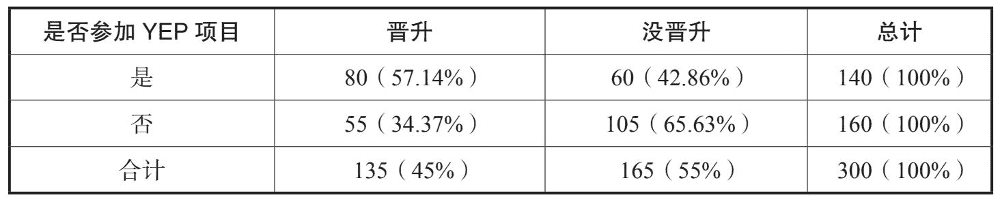

引入贝叶斯定理量化训练营预测效力：

```
Formula: Training Program Predictive Effect = (Probability of Promotion After Training) / (Probability of Promotion Without Training) × 100%

Where
Probability of Promotion After Training (P) = (Probability of Promotion After Training) / (Probability of No Promotion After Training (1-p)) × 100%
```

=57.14%/42.86%

=133%

未参训晋升几率（P）= (未参训晋升概率) / (1 - 未参训晋升概率) × 100%

=34.37%/65.63%

=52.37%

训练预测效力 = 133% / 52.37% = 254%

结论显著：在其他条件均等下，参训员工晋升概率较未参训者高出2.54倍。

这意味着，对个人而言，参训显著增强晋升筹码；对组织而言，培训投资将换取未来更优绩效产出。

### 2. AI驱动人才发展：从决策辅助到战略引擎

伴随人工智能与大数据技术演进，机器学习算法在人才发展中的分析应用，不仅为人才甄选、培养与留存提供科学决策依据，更倒逼企业加大在人才发展维度的战略投入力度。

# AI重塑人才发展：从盘点到培养的全链路进化

人才发展的基石，在于“盘清家底”并精准“选育留用”。过去，人才盘点动作繁杂、耗时费力；如今，AI仅凭绩效、能力、潜力三维数据，便能秒级生成九宫格或十六宫格分布图。管理者一眼便知：谁该重金猎聘、谁须核心挽留、谁可重点培养、谁需有序退出，决策不再靠拍脑袋。

招聘端，AI更是“降本增效”的利器。它能跨格式（电子版、纸质版、图片版）解析简历，自动清洗入库，构建统一标准的人才池；通过结建模型，精准匹配岗位画像，将最合适的简历直推面试官面前。HR从繁琐筛选中解脱，面试官得以聚焦深度沟通，精准考察候选人与文化价值观的契合度。

培养端，AI打破了“千人一面”的旧范式。结合岗位技能、IDP规划与学习地图，AI为每位员工定制专属课程包。试用期考核、晋升答辩、轮岗评估、年度述职，AI全程介入，不仅大幅压缩管理动作，更以算法中立性保障评价的公正客观。更妙的是，训练模式彻底变了：沉浸式体验、兴趣导学、潜能激发，为每人生成专属成长路线图；盲盒机制、闯关设计让学习“上瘾”，碎片化、社交化、场景化、游戏化，已成未来培训的标配五维。

企业级AI人才应用，实则落地在六大核心场景：
1. **赋能决策**：挖掘AI分析力，强化HR数据洞察，贯穿选用育留管全链条。
2. **识才画像**：依托HR知识图谱构建标签库，通过发现、识别、团队诊断、路径规划，锁定核心骨干。
3. **智推知识**：融合内外部资源，加速知识沉淀，实现技能培养的“千人千面”精准触达。
4. **洞察趋势**：内外数据双驱，支撑内部流动与外部引才决策，提升招聘质效。
5. **强团赋能**：以能力、目标、效能刻画组织画像，支持群体定制与动态追踪，助力HRBP提升组织战斗力。
6. **优体验**：打通入转调离全流程，让全员享受丝滑的人力服务体验。

---

### 3. 量化人力资本回报：用数据说话

**人力资本投资回报率（HCROI）**，是衡量“人力投入产出比”的核心硬指标。它直白地回答：每投入1元人力成本，企业能收回多少净利润？

**核心公式：HCROI = 企业净利润 ÷ 人力总成本 × 100%**

其中核心拆解：
*   **净利润** = 利润总额 – 所得税费用
    *   利润总额 = 营业利润 + 营业外收入 – 营业外支出
    *   营业利润 = 营业收入 – 营业成本 – 税金及附加 – 销售/管理/研发/财务费用 – 资产减值损失 + 其他收益 + 投资收益 + 公允价值变动收益 + 资产处置收益
    *   所得税费用 = 利润总额 × 所得税率
*   **人力总成本** = 工资总额 + 单位缴纳社保 + 职工福利/教育/劳保/住房费用(公积金) + 其他劳务成本(餐补、交通、话费等)

HCROI是一面镜子，既照见生产力与成控力，也映射组织效能、战略落地与目标达成度。想提升它？路径无外乎：压降销售成本、拔高利润率、盘活资产效率。而激励机制——薪酬、福利、环境、成长、股权——则是撬动人力资本增值的关键杠杆。

数字化浪潮下，大型企业评估人才项目不再靠感觉，而是锚定七大强相关指标，与HCROI形成联动验证：
*   员工敬业度
*   核心人才留存率
*   生产力提升幅度/成本降低额
*   客户满意度
*   梯队厚度与领导力绩效
*   创新产出能力
*   团队协作活力

西尔斯百货曾用“情绪环”模型实证：抓取员工全天百万级情绪数据点，证实愉悦情绪显著提升客户体验，进而拉动销售增长。下一步，他们正深挖“愉悦背后的驱动因子”，将管理动作精准聚焦于真正能动业绩的关键变量上。这就是用数据为人力资本投资“导航”的最佳注脚。

### 4. 人才盘点：落地实施全攻略

企业开展人才盘点，核心在于“识人、知需、备才”三位一体：挖掘高素质、高潜力人才，精准画像组织对各类人才的诉求，从而厚植人才梯队储备。用大白话讲，就是让“萝卜”找到合适的“坑”，实现人岗资源的最优耦合。

作为组织发展与人才管理的基石性工程，人才盘点绝非简单的信息汇总。它要求管理者打破常规，从人岗匹配度、职能编制比、胜任力画像、绩效演进趋势等多维度深度剖析，力求全景式掌握组织人才底色，进而构建起人才供给的长效机制。

#### 1. 破解三大核心难题

**（1） 以“组织盘点”为起点，倒逼“人才盘点”落地**  
人才盘点的逻辑起点并非盯着“人”看，而是先盘“组织”。管理者必须先答好三道战略题：依托未来战略，组织架构该如何搭建？岗位体系如何设计？权责边界如何划分？唯有厘清组织“应有之相”，再审视现有人才“实有之能”，才能精准定位人才缺口与结构性矛盾。

**（2） 透视人才现状，量化供需缺口**  
通过盘点梳理架构、明确需求、摸清家底，管理者能直观看清“手中牌”与“桌面局”的差距——哪里缺人、哪里人浮于事、哪里能力失配，一目了然，为后续决策提供实证依据。

**（3） 精准“画像”高潜人才，筑牢梯队基石**  
甄别高潜人才是盘点的“皇冠上的明珠”。它不仅关乎梯队建设的成色，更能为培养计划指明靶向，避免资源错配、培养走偏。

#### 2. 四大典型应用场景，释放盘点红利

| 场景 | 核心价值 |
| :--- | :--- |
| **人才潜力诊断** | 洞察内部人才分布版图，摒弃“一刀切”管理，实施分层分类的精准施策。 |
| **招聘配置蓝图** | 剖析高潜群体共性特征与差异点，以“成功画像”反哺引才标准，提升人岗匹配成功率。 |
| **职业规划领航** | 帮助员工认清长板短板，完成自我定位与赛道规划，激活内驱力。 |
| **培训开发靶向** | 基于胜任力与绩效双维画像，定制“菜单式”培训方案，拒绝无效投入，精准赋能成长。 |

#### 3. 三步走实施路径，从数据到决策

1.  **数据筑基：实时采集，多维建模**  
    打通HR业务数据链路，依托最新鲜、最高质的数据资产，开展效能诊断、结构透视、量化测算等多维统计分析，为盘点装上“智慧大脑”。
2.  **模型赋能：九宫格动态定位**  
    引入“绩效-胜任力”九宫格模型，将人才坐标实时投射，精准识别核心骨干、后备军及待优化人群，匹配差异化管理策略。
3.  **智能耦合：AI驱动人岗激活**  
    融合人才画像、岗位画像与盘点结论，借力AI算法实现智能匹配，盘活存量资源，让每一份人才价值都找到最大化释放的舞台。

---

# 第5章：AI赋能留才，精准预测离职风险

## 第一节：离职预测，从“事后诸葛”到“未雨绸缪”

市面上流行一种名为“人才离职预警”的第三方工具，原理是监控招聘平台简历更新动向：一旦员工刷新简历，次日报警提醒企业。虽能捕捉动向，但触碰隐私红线，合规性备受诟病，企业使用需审慎权衡。

有无科学合规、自主可控的替代方案？答案是肯定的——**基于内部数据的回归分析建模**。

数据分析分层递进：描述性分析看“发生了什么”，相关性分析找“关联规律”，而**离职预测属于回归分析范畴**，旨在推演“未来将发生什么”。这对数据提出“四维标准”：

*   **量（规模）**：样本越大，模型鲁棒性越强，预测价值越高。
*   **质（准度）**：垃圾进，垃圾出；数据清洗与治理是前置硬仗。
*   **维（维度）**：场景定方法，不同业务主题需引入差异化特征变量，方得最优解。
*   **频（周期）**：数据刷新频率决定模型迭代速度。以绩效考核为例，若为年周期，则需积累**3个完整历史周期（3年）训练模型，外加1个实时周期试运行优化**，方可达标上线。

**实战闭环如何跑通？**  
数据工程师运用大数据挖掘技术，对员工多源异构信息建模分析。模型一旦捕捉到离职倾向信号，即自动推送风险概率至直管领导或HRBP端。管理者由此赢得“黄金干预窗口期”：**或深度沟通化解心结，或薪酬调整/岗位轮动挽留核心骨干，或提前启动招聘补位平稳过渡**——将被动应对转为主动掌控，实质降低用工风险与成本。

---

### 素材回响：数据智能，重塑人力资本新范式

康宁（ConAgra）借力HR分析软件，挖掘200+离职影响因子，为留人策略装上“导航仪”；  
施乐（Xerox）洞察“居住距离”这一隐性变量，精准施策将流失率从50%斩至30%；  
MIT人类动力学实验室以电子工牌捕捉微观互动图谱，竟能仅凭沟通模式精准预判黑客马拉松获胜团队。

《哈佛商业评论》实证研究更揭示杠杆效应：**员工敬业度每提升5%，客户满意度跃升1.3%，企业营收随之增长0.5%，人力资本投资回报率（HCROI）同步正向跃升**。

未来已来，随着更多组织以数据洞察驱动业务增值，“数据智能”在人力资本管理中的渗透将成常态，重塑“人岗匹配、选育用留”全链路决策新范式。

# HR如何用数据画像精准留人？从流失预测到组织动态配置全解析

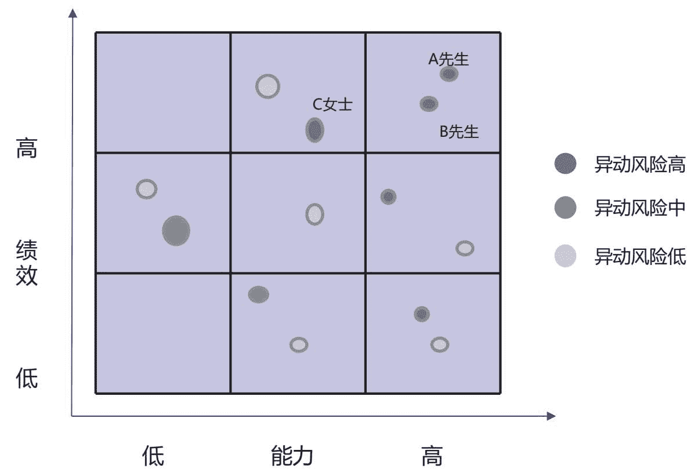

人力资源从业者在开展离职倾向预测时，可构建包含八大维度的诊断体系：薪酬福利、晋升轮岗、办公环境、工作压力、培训学习、绩效发展、文化氛围及外部诱因。每个维度下又细分多个观测指标。以薪酬福利为例，可拆解为付出回报满意度、内部公平满意度、行业竞争力满意度等；晋升轮岗涵盖晋升机会、晋升频次、调岗机会等；绩效发展则关注绩效评级、考核评价、分配结果、人岗匹配度、成就感等；工作压力侧重上下级关系、同事关系、组织归属感；办公环境则包括设备配置、环境风险、工时安排、通勤距离等。HR通过业务建模、大数据建模、多元回归及相关性分析，可绘制出「胜任力-绩效与离职风险」三维全景图谱。

横轴映射员工胜任力强弱，纵轴对应绩效表现高低。图中黑点标识高风险人群，深灰点为中风险，浅灰点为低风险。

## 一、 离职风险分级管控

随行业迭代加速，人才流动常态化推高了企业留任成本。离职引发的风险主要集中在五大领域：
1.  核心技术与商业机密外泄，造成重创；
2.  客户数据流失导致关键客源断裂；
3.  关键岗位断层无继任者，核心业务停摆；
4.  核心骨干带队集体出走，局部业务瘫痪；
5.  引发团队动荡，削弱组织凝聚力与向心力。

引入AI算法模型进行离职风险分析，能助力HR实时捕捉人员异动信号，实现快速响应，达成「预警-预测-干预」闭环。

结合上述图谱，针对不同绩效表现人员的差异化处置策略汇总如下：

**表 离职风险等级与HR应对策略对照表**

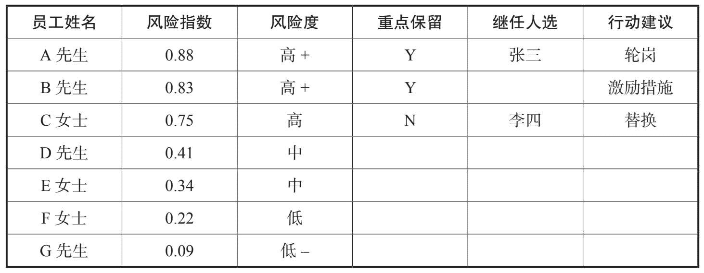

**案例甲（风险指数0.88）**：兼具高绩效与高胜任力，属核心挽留对象，人才库标签为「重点挽留人才」。建议扩大其职权范围，增加工作挑战性；同时适时安排轮岗，由继任者张三接管原岗，实现「人才留存+用工风险对冲」双赢。

**案例乙（风险指数0.83）**：同样为高绩效高潜力人才，标签亦为「重点挽留人才」，但暂无继任者。当前仅能通过激励手段稳住人心，同步启动内外部人才盘点，储备接班人，将用工风险降至最低。

**案例丙（风险指数0.75）**：高绩效但非「重点挽留人才」，且有继任者李四在列。可择机推动李四上位，将案例丙调整至其他岗位，以此化解潜在用工风险。

## 二、 核心人才留任预警机制

管理层可借助风险指数与留任标签，精准识别「值得以高成本挽留」的关键人才。如上表所示，案例甲、乙虽流失风险极高，但因战略价值显著，企业愿投入多元资源予以挽留。

实战场景远比表单复杂，HR的应对手段需更灵活多变。以「唐僧师徒团队」为喻：谁是团队必争的核心留任对象？下图以「员工投入度」为横轴，「员工能力」为纵轴，构建四象限模型，师徒四人映射出三类典型团队成员画像。

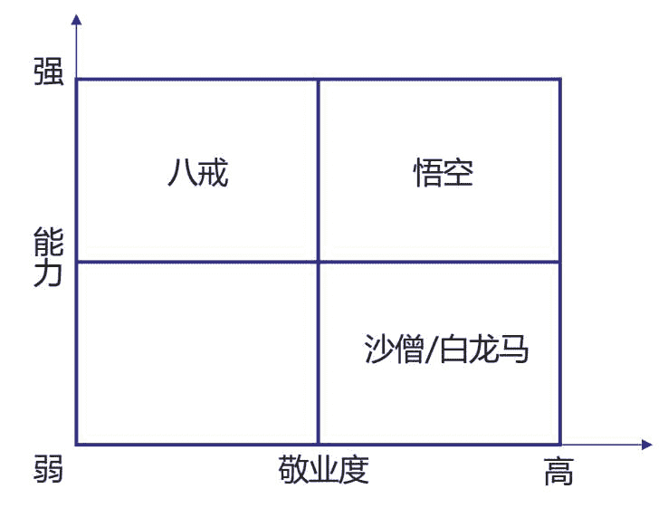

**图 能力-投入度四象限关系模型**

经工具预测各类人员离职风险指数后，HR可按象限特征实施差异化留任与管理策略：

1.  **「悟空型」（高能力、高投入）**：绘制长远愿景蓝图，给予充分信任与授权，激发自我驱动力。
2.  **「八戒型」（较强能力、低投入）**：多维激励撬动剩余价值，同时划定清晰「红线」约束底线行为。
3.  **「沙僧/白龙马型」（待提升能力、较高投入）**：聚焦技能赋能培训，搭建快速成长通道。

## 三、 组织与人才的动态最优配置

技术赋能下，企业可运用AI与大数据深度解析组织人才结构，修正配置偏差与失衡，构建多维最优组合，提升整体效能。

快速诊断组织架构合理性的简易法：依据**管理幅度**与**管理层级**配置编制规模以匹配业务诉求。管理幅度指直管下属人数；管理层级指组织纵向划分的阶梯数，层级数与规模正相关。在规模相对固定时，层级与幅度呈反比关系：幅度越宽、层级越少；幅度越窄、层级越多。

大数据实证显示，**管理幅度控制在7-12人为最优组织架构区间**。假设各层级幅度均为8人，约3万人规模企业仅需6层级（一线至CEO）；30万规模企业7层级即可支撑，如下图所示。

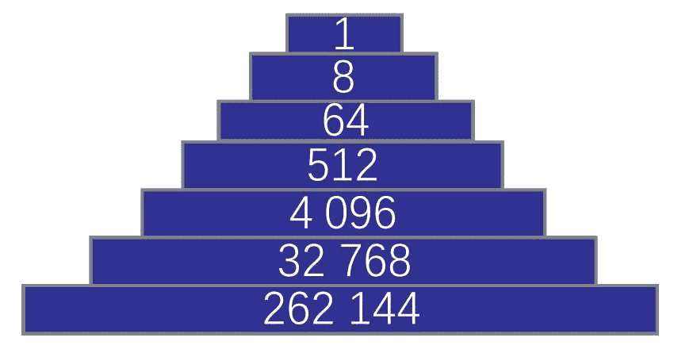

**图 管理幅度与组织规模对应示意图**

京东集团沉淀出著名的**“8150”法则**。

### 组织架构设计的“黄金法则”：8150原则与智能关怀体系

#### 一、 组织扁平化的基石：解码“8150”管控模型

组织架构的搭建绝非随意为之，必须严守**管理幅度**的硬性指标。通用标准规定：一名管理者（含实线与虚线汇报）直管下属不得少于 **8人**；唯有实线汇报人数突破 **15人** 大关，才具备设立同级或下级部门的资格。

针对分拣、包装、配送、客服等**职能单一的基层单元**，管控标准进一步放宽：在满足“8人起步”前提下，实线团队规模需超过 **50人**，方可增设平级部门、下级部门或副职岗位（京东物流区域适用）。

**“8150”背后的逻辑链条：**
*   **“8”是红线**：人人身上有指标，不足8人即削减中层，杜绝“养闲人”；
*   **“15”是门槛**：仅当团队超15人，才批准新增同级管理岗，防止管理层级虚胖；
*   **“50”是基线**：针对同工种一线员工（如打包工）。若单班不足50人，仅设1名组长；若硬拆5组配5组长，必成“灾难”。50人，是基层管基层的效率分水岭。

这一原则的核心在于**强制扁平化**。正是坚守“8150”，京东才实现了CEO与数十万一线员工之间**仅隔5层管理**的极致高效。

#### 二、 百度实践：用数据建模为组织“把脉问诊”

百度构建了基于大数据的**动态组织扫描体系**，实时监测组织名称变更、编制波动、管理幅度、层级深度、核心人才流动、团队流失率等关键指标，输出组织健康度与人才风险指数，实现**准实时预警**：

| 预警触发点 | 系统动作 | 落地闭环 |
| :--- | :--- | :--- |
| **管理幅度 < 5人** | 自动邮件通知OD（组织发展）负责人 | OD联动HRBP复盘团队配置合理性 |
| **管理层级 > 5层** | 发出越级预警 | OD核查架构设置的必要性与适配性 |
| **核心人才流失/管理风险超阈值** | 触达HR从业者 | 启动轮岗、继任计划、激励等组合拳，化解风险、促良性循环 |

---

### 第二篇章：智能关怀——激活人才价值的“隐形引擎”

要释放人才潜能，企业须构建**关怀文化与生态**，投入真金白银，并将健康、安全、福祉投入与业绩挂钩。尽管部分管理者仍视关怀为“额外福利”，但**“最佳雇主”**们的实践已证实：员工士气、身心健康、安全感与企业盈利之间，存在**因果级正相关**。

AI时代的智能关怀，对内打造**温情职场**提升体验，对外强化**雇主品牌**增强吸引力。通过全生命周期追踪管理，直通“选育用留”四大策略，双向激活员工主观能动性与HR战略价值。

#### 1. 节点驱动：职业生涯全周期的“四化”关怀体验

昔日发薪留人，今须**物质+精神**双轨并行，筑牢归属感、降低流失。围绕**入职—在职—离职**一体化全周期，HR以**“场景化、社交化、游戏化（积分制）、实时反馈”**四大手段重塑职场体验。典型智能关怀场景如下：

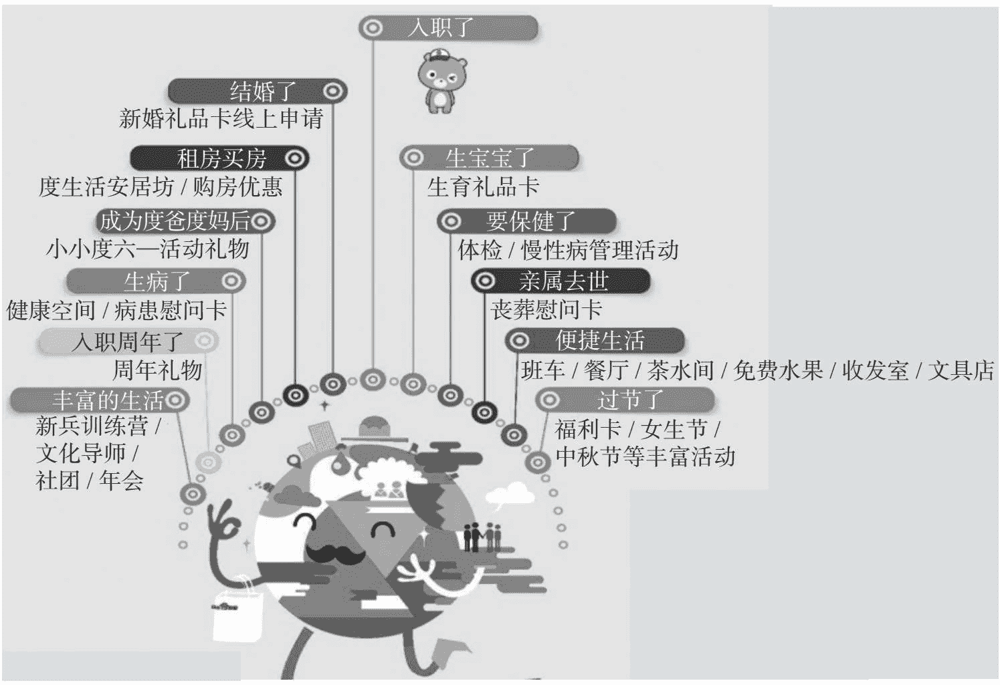

**图：智能关怀全景场景图谱**

1.  **入职前·零距离**：免费体检护航，入职日惊喜礼包待领。
2.  **入职期·快融入**：双导师制（文化+业务）护航，极速破冰融圈。
3.  **试用期·强成长**：90-180天**游戏化成长线**——闯关学习、打怪升级、积分兑奖，寓教于乐内化文化、硬核技能双丰收。
4.  **里程碑·有温度**：生日、工龄节点，专属祝福准时送达。
5.  **节日纪·重仪式**：年会、三八、青年节、六一亲子嘉年华、父母节、中秋春节……全年序列化活动不断档。
6.  **人生大事·共担当**：婚丧嫁娶生子，礼金慰问精准触达。
7.  **办公环境·享舒适**：温馨工位、免费食堂、茶歇角，细节见真章。
8.  **加班支持·兜底线**：晚9点后打车报销，守护深夜归途。
9.  **医疗住房·减负重**：体检医疗报销，租购住房优惠，解决后顾之忧。
10. **家庭关怀·延伸爱**：父母生日礼、体检住院报销，关怀延伸至员工小家庭。

#### 2. 智能触达：基于画像的“千人千面”祝福提醒系统

“90后”“00后”成职场主力，他们更看重**工作体验与价值感**。利用AI与数字化技术，在关键节点实现精准祝福触达，已成HR展现专业价值的**必修课**。

**智能关怀的本质** = **员工画像（标签） × 场景机制（触发器） × 个性化服务（内容）**。

HR依托工作方向、学习偏好、职业规划、兴趣爱好、生活习惯、社交消费等多维数据建模打标，在**“工作、生活、学习、发展”**四大场景的关键时刻自动触发机制，输出定制化关怀。底层支撑是**AI+大数据一体化智能关怀服务平台**。

**核心机制范式——员工祝福体系：**
*   **生日晨唤醒**：系统自动推送专属贺卡（邮件/IM），同步生成**专属二维码**，员工扫码/刷脸至礼品屋或智能柜自提礼品，仪式感拉满；
*   **管理者联动**：同步提醒直属领导下属生日，引导管理者表达“被看见”的关怀，将制度温度转化为人情温度。

---
*[后续内容将深度解析“场景化机制”在学习发展、生活服务等更多维度的落地实操...]*

## 二、 工作纪念日：专属仪式感，致敬每一份坚守

在员工入职周年之际，系统会自动通过邮件与即时通讯工具推送定制化的贺卡，字里行间致谢员工的付出与陪伴。贺卡内容、配色与设计风格逐年更迭，旨在带来持续的惊喜感。与此同时，公司备有纪念礼品与司龄徽章，员工只需刷脸即可在礼品柜或自助柜领取。以阿里巴巴为例，其赋予不同年限独特寓意：一周年“初香”（认可）、三周年“三醉”（成熟）、五周年“五酿”（传承），并在关键节点举办专属仪式。百度则推出“小度熊”智能音箱配套徽章，以阿拉伯数字标注年限，白、灰、银、蓝、金五色对应不同阶段——五年银熊、十年金熊。十年大庆更设盛典，CEO亲自颁奖，予以最高礼遇。当然，直属主管也会同步收到提醒，共同见证高光时刻。

## 三、 关键节点触达：让认可与反馈及时落地

针对转正、晋升、绩效复盘、考核反馈等关键人生节点，HR从业者根据场景差异，设计差异化的通知内容与形式。这种精准触达不仅传递了组织的认可，更能激励员工在未来的工作中迸发更大能量。

## 四、 离职关怀：体面告别，留住好口碑

离职管理同等重要。入离职流程全程自动化，交接事项繁多时，系统后台自动核验关联事项，免去员工四处奔波询问；需线下办理的归还电脑、工牌等事务，一站式服务大厅即可搞定。手续办毕，公司赠送明信片套装作留念，系统同步推送离职提示卡，涵盖档案、社保、户籍、党团组织关系转移等避坑指南。在中秋、春节、司庆三大节日，系统自动向前员工预留手机发送祝福短信，表达感恩之情。

这套关怀体系不仅能降低流失率、激活“回巢”人才，更能显著提升满意度与敬业度。把离职管理做到极致，本质上是为企业在行业内树立雇主品牌标杆，持续吸引优秀人才汇聚。

### 三、 柔性福利商城：以个性化选择激活组织活力

作为薪酬福利体系的核心板块，员工福利已成为企业吸引留人、激发活力的关键抓手。传统的“齐步走”通用福利难以覆盖个性化需求，甚至可能消磨工作热情。因此，企业亟需落地**柔性福利制**，搭建智能化福利平台，在增强忠诚度与敬业度的同时，实现组织与个人的双赢。

AI时代的柔性福利体系，深度融合用户画像、语音识别、个性化推荐等技术。通过精准洞察员工真实需求，实现场景化福利与多元化关怀，支持员工全场景、全周期的自由组合与选择，达成员工体验全覆盖与生活娱乐一站式服务的目标。

柔性福利商城通常包含双视角功能模块：

**企业视角：**
1.  **专属账户管控**：支持先消费后结算，预算分配灵活，科目组合自主可控。
2.  **供应链整合**：一站式配置个性化福利包，对接海量供应商资源。
3.  **优质品牌聚合**：提供全品类、个性化的节日礼品精选方案。
4.  **专属管理后台**：赋能HR实现福利业务的高效统管。

**员工视角：**
1.  **独立积分账户**：不同职级积分差异化，积分可消费可兑换。
2.  **自主选配福利**：保险、体检、礼品、补贴等灵活搭配，家庭成员同享。
3.  **团购红利共享**：享受个人无法获取的团体折扣价。
4.  **多元支付方式**：支持平台积分与个人账户混合线上支付。
5.  **全流程自助服务**：涵盖积分发放、明细查询、权益兑换、汇总统计等功能。

**Dulife——柔性福利平台**见下图。Dulife是百度打造的员工生活工作助手，覆盖PC端与移动端（移动优先）。通过“生活频道”（社团汇、生活站、挂号通、安居房、跳蚤街、杜惠、健康园、轻松行）与“工作频道”（快捷查、问HR、需盖章）十大入口，让员工随时随地享受公司福利。

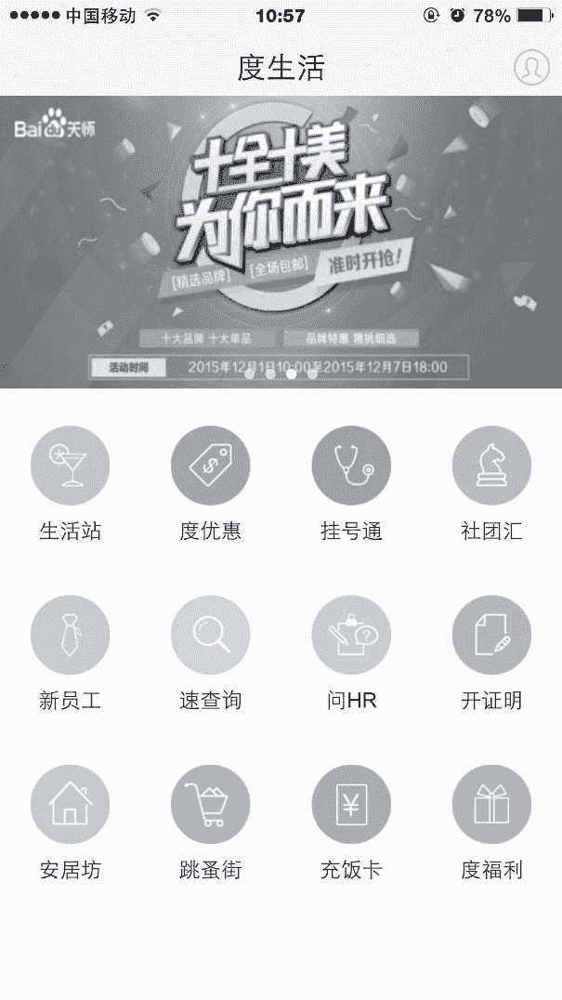

**图 5-5 Dulife——柔性福利平台**

各频道核心功能速览：

1.  **社团汇**：汇聚篮球、足球、羽乒、游泳、瑜伽、舞蹈、合唱、读书、徒步、跑步、户外、二次元、表演等百余类社团。
2.  **生活站**：吃喝玩乐一站式聚合。
3.  **健康园**：基础险+补充医疗，体检套餐组合，健康空间与课程。
4.  **挂号通**：联动医疗机构，破解员工挂号难题。
5.  **轻松行**：整合机票、酒店、火车、网约车，差旅出行无忧。
6.  **安居房**：甄选优质房源，解决员工住房后顾之忧。
7.  **跳蚤街**：闲置物品二手流转平台，倡导绿色循环。
8.  **杜惠**：聚合全网优惠折扣信息。
9.  **轻松会**：会议室预订、视频会议、签到、纪要生成等会务全流程管理。

## 第三节 舆情监测：构建组织敏感度的“千里眼”

所谓舆情监测，是指企业数字化从业者运用中文分词、自然语言处理、中文信息处理等核心技术，对舆情数据进行过滤、去重、相似度聚类、摘要提取与自动分类，建立监测体系。在合规前提下，利用爬虫技术依据预设关键词，对重点媒体、论坛、博客、微博等渠道进行全网扫描，对敏感信息实时预警，并通过邮件、电话、短信等多渠道在第一时间触达相关责任人。

### 一、 内外舆情双焦聚焦：洞察员工真实心声

诸多企业在内网开设匿名专区，鼓励员工畅所欲言。内部舆情分析成果主要服务两大场景：一是将业务建议类舆情分流至相关业务部门参考；二是将涉及劳资纠纷、招聘、文化宣传、品牌推广等风险舆情移交HR专项处理。调研显示，内网高频热议话题集中在薪酬福利、工作压力、文化氛围、外部机会、个人发展、培训学习六大维度。针对这些高频词，HR需主动出击，通过薪酬政策宣讲会、文化共创会、团建减压营等举措，精准疏导员工情绪。

### 二、 品牌预警机制：守护雇主声誉护城河

# 第六章：组织洞察与组织画像构建

在人力资源管理实践中，品牌舆情预警主要服务于招聘与留任两大板块。在合规前提下，HR可借助大数据技术，对全网公开渠道（微博、论坛、社交媒体、新闻网站、垂直社区等）涉及企业的正面、负面、中性信息实施实时监测、采集与清洗。通过模型构建与算法综合研判，划定企业风险红线；一旦触及阈值，即刻触发预警机制，依据预案快速响应处置，有效规避舆情危机，护航企业品牌形象。

### 3. 文化迭代升级

AI技术能依托员工参与文化活动的调研数据及融入文化氛围的反馈，结合组织、个人、环境等核心职场维度，对人员背景特质开展大数据深度挖掘，构建多维度、结构化的人才留任与激励指标体系，显著降低离职率。同时，基于AI开发的智能助手可7×24小时响应员工工作生活中的各类诉求。深度解析文化活动参与数据后，管理层能精准洞察每位员工的关注点与痛点，从而明确组织文化导向的引导路径。

### 4. 人才流动预判

企业可通过大数据分析建立**员工流失预测模型**，核心功能是识别潜在离职风险并及时预警，配合“内部人才继任表”辅助HR提前介入干预。

同时可构建**人才流动地图**，动态掌握内外部人才流转态势，为人员进、出、晋、降、调等管理决策提供数据支撑与参考依据。

## 第一节 组织形态与特征解析

组织形态，是指由组织内部纵向层级关系及其沟通链路、横向分工协作关系及其沟通链路共同塑造的、隐性且相对稳定的企业架构。它映射了成员间的分工协作图谱，体现了分工协作的框架逻辑。简单说，即企业的组织格式、生存状态与运行机制。

随时代更迭与内外环境变迁，组织形态持续演进，历经职能制、直线职能制、事业部制、网络型等阶段，演变脉络如图6-1所示。

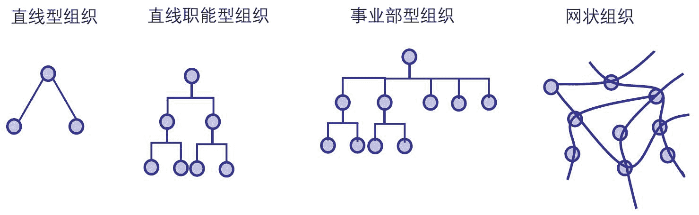

**图6-1 组织形态演进史**

传统三大组织形态特征：层级分明、角色清晰、专业化程度高、管控力强。网络型组织特征：柔性韧性强、环境响应快、创新驱动力足。

网络型组织内部形态亦非一成不变，随企业发展阶段不同，将呈现图6-2所示的动态变化。

## 第二节 组织形态演进与转型逻辑

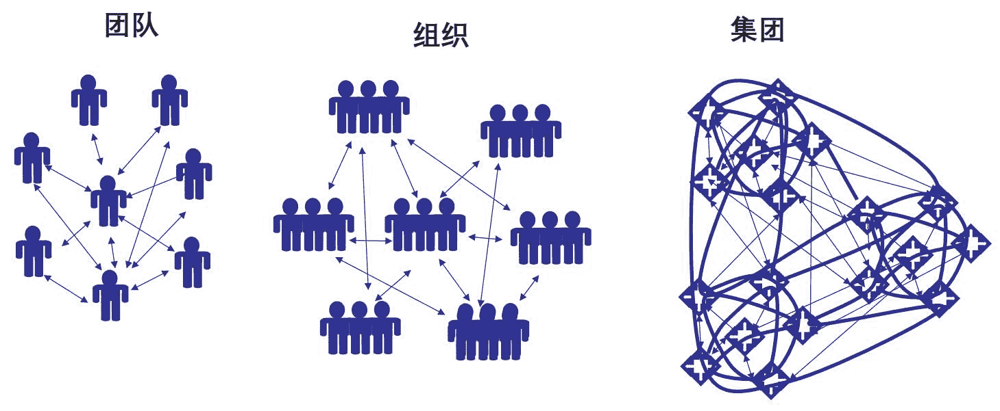

演进转型过程中，组织呈现以下显著特征：

1.  **组织结构扁平化**。信息化、网络化、数字化技术驱动下，企业实现同层级信息直达共享，打破“自上而下层层传达、自下而上级级汇报”的壁垒。在企业数据平台上，传统纵向命令链重构为横向交织的平等协作网，管理者信息触达能力与管理幅度指数级提升，大幅压缩层级，结构趋扁平。

扁平化重塑了官僚体系中上下级、部门间及组织与外部的连接方式，具备高效、柔性、快速响应优势。其核心标志是层级制组织与敏捷项目团队共存：不同专业背景的人才分布于复杂组织形态中，加速知识经验流动，提升整体组织绩效。

2.  **组织关系网络化**。随着HR信息系统、OA、通讯工具、ERP/CRM、AI/BI等数字技术深度应用，职能部门大量重复性、规范性作业由系统或机器人替代，人工聚焦控制程序制定修订与非标事件处理。工作模式由“自上而下发号施令”转为“联合协商、相互协作”。借助内网平台，纵向分工递减，横向协作增强，以管控为核心的行政命令型关系逐步演变为相对平等、自主、创新、协作的网络化关系。网络化最大红利在于缩短决策与行动的时延，加速员工对市场竞争动态的响应，增强组织能力弹性与韧性，实现敏捷反应。

### 组织瘦身：小船好调头的时代逻辑

在移动互联网浪潮下，小微组织展现出的灵活性与创新力，正显著超越大型企业。这里的“组织瘦身”，并非指业务规模或市场份额的收缩，而是精简人员编制、扁平化管理层级。面对残酷的市场博弈，众多大型企业正通过业务拆分、资产剥离、流程重塑、数字化转型、外包协作或战略联盟等手段，将经营主体“做小做精”，以实现降本增效、提升组织弹性与核心竞争力。

随着管理范式从“职级金字塔”向“协作网络”跃迁，HR急需一套新工具洞察团队脉动，管理者也必须革新策略，激活网络节点，促成高效的信息流动与协同。近年，劳动力呈现高度分散态势，灵活用工形态层出不穷——独立讲师、顾问、自由创作者、主播等群体脱离传统编制，他们自发结盟、跨界赋能，共同驱动业务生长。

## 第三节 组织与组织网络分析（ONA）

过往HR研究与实操，聚焦于“个体—岗位”维度的静态匹配，如基于员工画像做绩效预测、离职预警。这种视角虽在特定场景有效，却难以穿透至组织层面，提供深度洞见。

以沟通满意度调研为例：传统做法发问卷、收反馈，结果向好便断定沟通顺畅。但这真的全貌吗？两名员工沟通频次相同，一人仅在部门内闭环，一人却跨部门穿梭——这在组织层面代表截然不同的行为模式。再如工单响应时效、上下班沟通比例等细节，传统手段皆无法量化捕捉。换言之，传统HR工具已无法支撑组织级、数据化、精细化的决策需求。

进入21世纪，社交网络兴起催生了社会网络分析（`SNA`）技术的成熟。早在2005年，Giuliani与Bell便用`SNA`解码智利酒业组织网络的知识流动规律。此后，大量研究将其引入企业内部，剖析沟通协作、跨部门影响、决策路径等核心议题。

实证表明，`SNA`在组织级分析中优势显著：它提供了一套诊断组织状态、行为成因的结构化框架。将`SNA`引入人力资本领域，便衍生出**组织网络分析（`ONA`）**。德洛特从人力资本视角定义：`ONA`是一种通过可视化手段，解析组织内部信息流向、协调机制与决策生成路径的结构化方法。

为直观呈现`ONA`与传统手法的差异，我们以简化案例对比。图6-3为传统架构图，字母代表员工，线条勾勒管控层级，即便挂载画像与岗位数据，本质仍是静态抽象的“骨架”，无法映射真实的“血肉流动”：
1. 实况中，协作早已打破部门墙、越过汇报线，非单向的“领导-下属”对话；
2. 协作状态动态演变，蕴含组织效能的关键密码。图6-4展示某周期内的真实协作网络，其复杂拓扑结构与图6-3的树形图判若云泥。

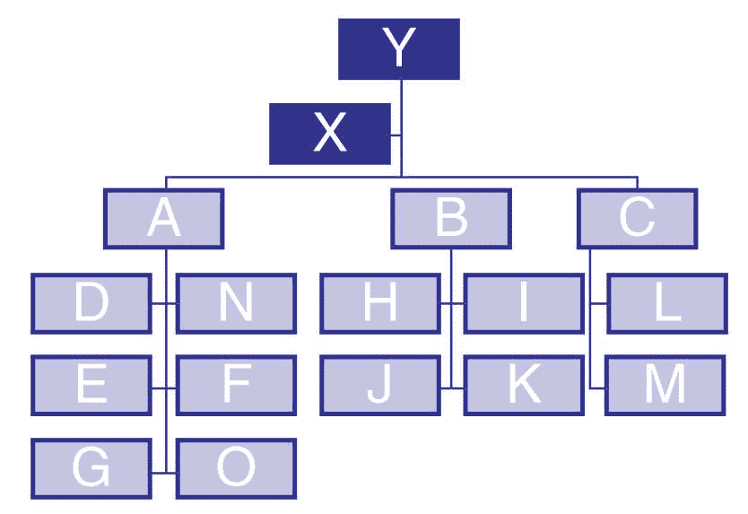

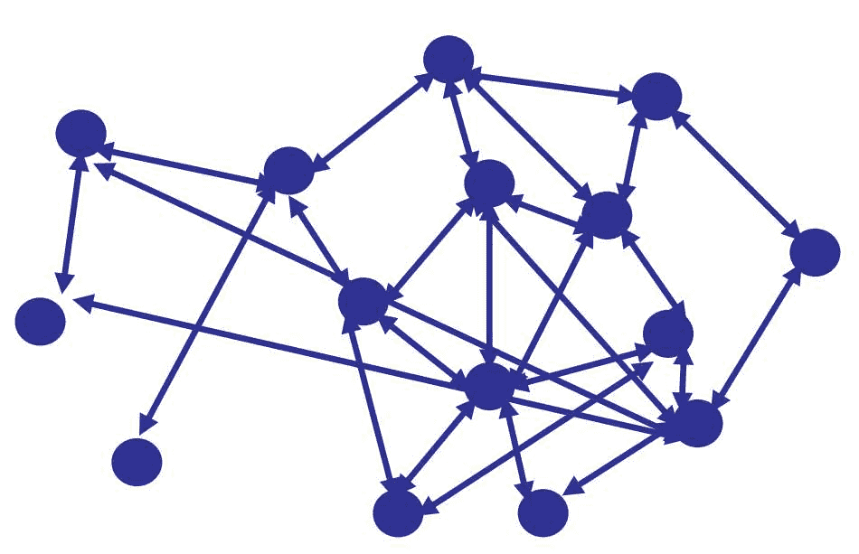

### 1. 组织网络分析核心术语

组织形态可抽象为图结构。数学上，图`G=(V, E)`由顶点`V`与边`E`构成；落地应用中，我们称其为**网络**——顶点对应**节点**，边对应**链接**。

节点间连接分为**有向**与**无向**两类。有向又细分单向与双向：
*   A与B面对面交谈 → 无向链接（可视为对称双向）；
*   C发邮件给D，D未回复 → 单向有向链接（C→D）；
*   E、F邮件往来 → 双向有向链接。

**1. `Degree`（度中心性）**

# 组织网络分析：核心指标、实战应用与头部案例解读

## 核心网络指标速览

在图理论中，**节点度** 是最基础的度量，即与该节点相连的边的数量。若是有向图，还会拆解为**入度**（指向该节点的边数）与**出度**（该节点指向他人的边数）。网络的平均度能直观反映整体的稀疏或稠密程度，而度分布则能刻画不同节点的重要性层级。

**网络密度** 衡量的是节点间连接的紧凑程度。它等于实际存在的边数与理论最大边数之比。以 5 个节点为例，满连接状态下最多 10 条边，若实际仅 6 条，密度即为 0.6。

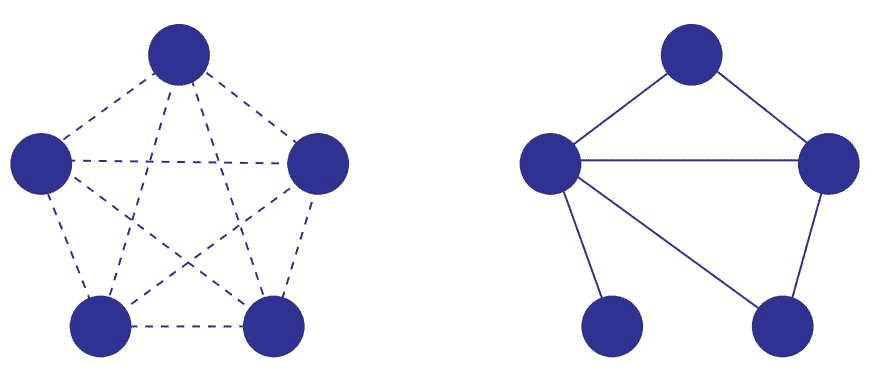

**聚类系数** 关注的是“朋友的朋友是否也是朋友”，量化邻居节点间相互连接的紧密度。

**接近中心性** 通过计算某节点到其余所有节点最短路径的平均长度，来判断其在网络中“触达”他人的速度与便利度。

**中介中心性** 统计全网所有最短路径中，经过某特定节点的次数。数值越高，意味着该节点越扮演着不可替代的“桥梁”或“枢纽”角色。

**子图** 定义明确：若图 G' 的顶点集与边集均是图 G 的子集，则 G' 为 G 的子图。

**结构洞** 如同网络中的关键桥梁。一旦移除，原本连通的网络将瞬间分裂为多个孤立的子网络。

落地实施层面，图数据库 **Neo4j** 与 Python 库 **networkX** 是构建 ONA（组织网络分析）的主流工具组合，配合可视化手段可直观呈现网络拓扑。当前，图神经网络（GNN）等深度学习技术正加速渗透社交网络分析领域，感兴趣的同学可自行深入文献探索。

## ONA 实战：重新定义“人岗匹配”与“关键人才”

传统 HR 工具（组织架构图、问卷调查）擅长捕捉**显性、静态、正式**的信息；而 ONA 的独特价值在于挖掘**隐性、动态、非正式**的真实协作图谱。

企业本质上是一个社会组织，天然符合社会网络定义。HR 需更新人才价值评估公式：**员工价值 = 人力资本（显性能力）+ 社会资本（网络连接力）**。

*   **人力资本**：胜任岗位所需的硬技能与能力。
*   **社会资本**：在组织网络中建立连接、施加影响力、传递信息与知识的能力。

长期以来，社会资本难以量化。SNA 技术的成熟打破了这一困局，使“员工社会价值”可计算、可视化。


**ONA 赋能 HR 的三大核心场景：**

1.  **还原非正式组织全貌**：绘制“影子组织架构图”，看清谁在真正干活、谁在真正沟通。
2.  **诊断沟通协作健康度**：识别信息孤岛、过载节点与断层带。
3.  **解码领导力实现路径**：看清影响力源自职权（正式）还是威信（非正式），锁定关键影响节点。

这些洞察直击传统人才盘点的盲区：**谁是隐形意见领袖？谁离职会引发协作瘫痪？新人融入得怎么样？管理者的领导力是真实有效还是虚张声势？**

通过计算**中介中心性**，可快速定位组织中的“超级节点”与“结构洞”人物（如下图圈出者）。识别他们，一手可借力推动变革与业务落地，一手可纳入继任者梯队（别忘了那些无职位头衔的非正式领袖），同时也要为核心节点流失制定风险预案。

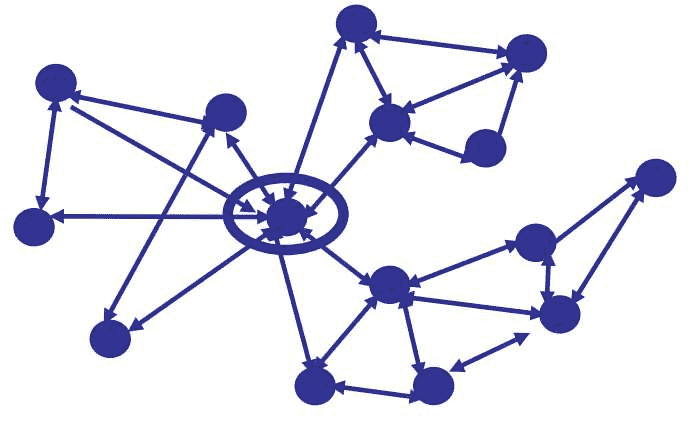

---

# 第 4 部分 头部企业 ONA 实战复盘

## 1. 百度 TIC：用“社交简历”预测人才流动规律

百度人才智能中心（TIC）通过分析部门活力与人才结构，量化评估组织稳定性，揭示人才流动的底层逻辑，为组织优化、激励与合理流动提供决策支撑。

以 **“人才圈雷达”** 为例，数据揭示了一个有趣现象：职场跳槽也讲究“门当户对”。

TIC 通过挖掘发现，美国在线（AOL）招聘的**程序员**与**媒体人才**，来源圈层截然不同：
*   程序员多来自普通 IT 公司，鲜有 Google、Facebook 等顶级大厂背景；
*   媒体人才则集中于《华尔街日报》《金融时报》等头部媒体圈层。

通过构建百万级人才画像与职位的社交职业网络模型，TIC 能精准预测特定行业、特定圈层的招聘热点，助力 HR 提前布局，抢占先机。

## 2. 阿里巴巴：用数据穿透组织“隐形真相”

阿里结合问卷与网络分析，击穿常规管理视角的盲区，直击一系列关键痛点：

*   谁是发光的“明星”，谁是隐身的“边缘人”？
*   某层级管理者是否真有影响力、能带动团队？
*   不同角色、层级员工是否扮演了“连接器”角色？
*   工龄越长，影响力真的越大吗？

答案全在数据里。

从新零售“重构人货场”的视角反观 HR：**人（员工）、货（岗位/任务）、场（组织/文化）**，三要素同构。

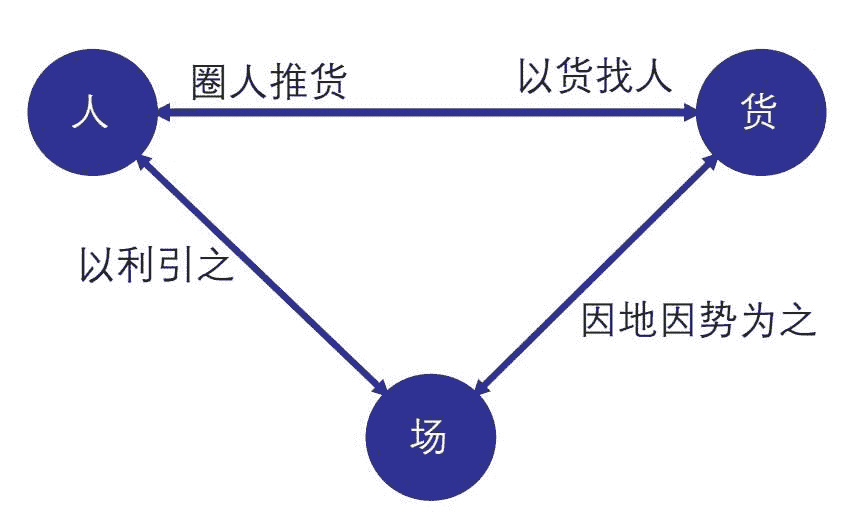

## 第 5 章 洞察组织健康：从诊断到赋能

"人" 指洞察人才画像；"货" 涵盖 HR 从业者提供的课程、服务、资源等；"场" 指代客户被划分为 "推荐者""被动者" 与 "贬损者" 三类。最终的 `NPS` 值，由 "推荐者" 占比减去 "贬损者" 占比得出。

```
NPS = (Number of Promoters / Total Sample Size) × 100% - (Number of Detractors / Total Sample Size) × 100%
```

- **推荐者**（评分 9-10 分）：这群人对企业充满热情与忠诚，不仅会持续复购产品或服务，还会主动向他人推荐。
- **被动者**（评分 7-8 分）：总体满意却缺乏激情，一旦竞品出现优势，极易流失。
- **贬损者**（评分 0-6 分）：对企业不满或毫无忠诚度，甚至可能通过负面传播损害品牌声誉。

`NPS` 计算背后的逻辑在于：推荐者驱动持续增长，贬损者则拖累口碑。作为当下最流行的客户忠诚度分析指标，`NPS` 聚焦于忠诚度如何撬动企业增长。持续追踪该指标，能倒逼组织不断进化。

**人力资本指数（`HCI`）** 则用于量化人力资本与股东价值的关联度。实证研究表明，人力资本管理越到位，股东回报率越高。基于海量行业数据的多元回归分析证明：人力资本投入指数与股东回报呈显著正相关。`HCI` 取值区间 0-100，数值越高，标志着企业人力资本管理水平越优，股东收益也随之水涨船高。

HR 从业者必须善用 `NPS`、`HCI` 等研判工具，深度解构人力资本投入与股东回报的内在联系，进而制定精准的优化策略。华信汇悦研究揭示：卓越的 HR 管理等同于创造优质股东价值；健全的人力资本管理体系——涵盖清晰规范的奖惩机制、权责划分、选人用人留人能力，以及公平灵活的工作环境——能显著提升员工敬业度。简而言之，完善的 HR 制度与高效的 HR 职能，与企业获取超额收益高度正相关。

---

### 组织健康：团队基业长青的隐形引擎

"一勺污水倒进一桶酒，得到的依然是一桶污水。" 团队系统脆弱敏感，极易受损。每个团队都拥有独特的健康度与情感能量，这往往直接决定了团队绩效的上下限与发展潜力。

团队健康，是指在特定周期内，工作安排、员工热情、贡献能力、留任意愿等因素综合叠加形成的相对状态。大量数据实证表明，团队健康与绩效水平显著正相关，更能作为预测高绩效、高利润团队的**先行指标**。

#### 当下痛点：看不清、量不准、管不好

多数企业在组织健康管理上面临四大困境：
1.  核心人才与关键岗位空缺频发；
2.  度量数据缺乏全面性与客观性；
3.  难以评估人员流动对团队的真实冲击；
4.  缺乏可视化呈现与智能化决策建议。

**HRBP 视角**：缺乏关键岗位盘点、核心人才流失预警、团队健康监控的智能平台。
**管理者视角**：渴望拥有交互式智能助手，在可视化看板上随时掌握团队全貌——确保状态健康、员工全情投入、协作高效、创新活跃、运转有序。

现状是，HRBP 与管理者触达的团队健康信息维度不足、数据质量低、智能化程度弱。这倒逼 HR 从业者**以终为始建模型**，反推业务真实需要何种数据，再在系统建设中预埋埋点，实现数据的自然沉淀与自动采集。

本章将输出一套**团队健康诊断模型**，为 HRBP 与管理者提供可视化诊断工具。该模型内置预警机制，助力管理者做出更客观、及时的决策，护航团队健康发展。

---

### 影响团队健康的十大核心维度

我们将关键影响因子归纳为以下十个维度：

1.  **发展方向**：以清晰、简练、有力的使命愿景统领全局，让员工看清组织去向、路径及个人价值，达成 "上下同欲"。
2.  **文化氛围**：将核心价值观内化于心、外化于行，渗透至日常行为、试用期考核、绩效评价与 360 度评估全流程。
3.  **团队现状**：全景式刻画团队工作编制，覆盖业务特性、目标设定、架构设计、运行状态、氛围风貌、能力构成、绩效表现等。
4.  **贡献意愿**：度量成员扎根团队、为共同目标投入知识技能的内驱力强弱。
5.  **贡献热情**：考察员工在薪酬激励、成长空间、氛围感染下，是否呈现主动、自觉的工作状态。
6.  **战略业绩（功绩）**：评估员工贡献的规模与稀缺度，可从日常行为与工作绩效双维度量化。
7.  **专业能力（才干）**：涵盖专业技能、通用才干与潜力，直接决定工作质效，也是判断胜任力与高潜人才的依据。
8.  **驱动力**：培育忠诚与激情，倡导持续创新，激励员工追求极致绩效。
9.  **流失预测**：前瞻性识别离职或调岗风险，赢得管理者提前干预的时间窗口。
10. **替换成本**：从招聘到新人胜任的全周期成本（时间、人力、经济、管理），与员工的优秀程度、稀缺性成正比。

---

### 团队健康平台：三大核心看板模块

平台构建三层诊断视野，实现从个体到组织的全链路洞察：

#### 1. 刻画员工/关键人才画像
聚焦个体核心资产价值：
- 战略业绩表现
- 专业能力现状
- 贡献意愿等级
- 流失风险等级
- 替换成本等级
- 驱动力指数

#### 2. 诊断团队整体健康度
聚焦集体作战单元：
- 团队架构（战略排兵/布阵）
- 团队业务属性
- 团队健康评级
- 团队健康预警
- 团队健康优化建议

#### 3. 洞察组织宏观生态
聚焦组织级软实力：
- 组织氛围指数
- 文化价值观评级
- 目标达成指数

## Section 6 组织效能

组织效能，指的是企业达成既定目标的程度。这些目标涵盖具体产出（如生产力、服务品质）、既定效率指标、内部流程协同程度，以及为构建竞争优势所需资源的获取与创造能力。效能主要体现在四个维度：能力、效率、质量、效益。左右组织效能的关键变量有二：外部环境（政务法规、技术演进、行业态势等）与内部环境（架构设计、业务流程、管理机制、人才素质、企业文化、数字化成熟度等）。

那么，如何度量组织效能？这要求 HR 从多维视角审视组织是否兑现承诺、释放潜能。HR 需基于战略目标与 KPI，搭建精细化的效能记分卡与系统化评估体系，实现对组织实绩的常态化追踪与改进方向的精准定位。提升效能的关键，在于 HR 善用大数据技术采集信息、构建模型、深度剖析，对现状进行全方位、深层次、高精度的诊断，看清底数、辨明优劣、预判趋势，为决策提供坚实支撑。

接下来，将从四个维度展开业务建模与大数据建模，详解组织效能与团队效能的度量路径。

### 1. 团队目标

*   **目标清晰度**
    *   考察团队目标是否具体明确；
    *   考核周报完成率（管过程）与月/季报完成度（管项目）；
    *   界定团队工作重心与业务演进方向的清晰度。

*   **目标共识度**
    *   成员对团队目标的认同与一致性；
    *   成员对目标内涵的理解深度；
    *   岗位角色分工的合理性；
    *   兼岗比例与角色重叠率。

*   **工作实效性**
    *   目标达成率、绩效完成情况、同比环比增速；
    *   客户满意度与认可度；
    *   成员专利申请与获奖情况；
    *   创新项目孵化成果；
    *   多元敏捷的工作机制运行状况。

### 2. 团队能力

*   **专业胜任力**
    *   团队商业洞察力与业务互信基础；
    *   成员专业技能（产品规划、方案设计、项目管理等）是否达标；
    *   创新力与变革适应力；
    *   前沿技术掌握度，评估未来三年市场稀缺性。

*   **学习进化力**
    *   团队复盘反思与知识内化能力；
    *   拥抱新技术、新趋势的敏捷度。

### 3. 团队健康度

*   度量维度参考前文相关章节。

### 4. 组织活力

*   **沟通协同**
    *   团队内部协同畅通指数；
    *   跨团队协同畅通指数；
    *   成员间互信水平。

*   **活力指标**
    *   核心人才流动率；
    *   核心人才流失率；
    *   核心人才晋升成功率；
    *   高绩效人才留存率；
    *   接班人就绪度。

当然，企业处于不同发展阶段，效能影响维度与指标体系自当有别。即便同一企业内，不同业务形态也处于不同增长曲线（如第一、二、三增长曲线），差异显著。随数据积累日益丰厚，HR 对组织效能的洞察将愈发逼近真相。

总体而言，随数据积累深度递进，HR 可分三个层次评估组织效能：

*   **监控层**。数据以结构化为主时，HR 可借助数据驱动，实时监控运营、管理、组织与人力资源的效能状态。
*   **诊断层**。数据积累达量时，HR 可依战略目标设定指标正常区间与预警区间，实现异常预警与靶向干预。
*   **洞察层**。长周期积累后，海量非结构化数据浮现。经分析比对，HR 能从数据深处挖掘隐性问题，定位驱动因子，实施精准改造与整体联动。

# Chapter 7 AI 时代的三支柱模型

## Section 1 AI 语境下三支柱的变革与角色重塑

### 1. HR 转型：破局之道

企业为何必须推动 HR 转型？症结在于：HRBP 陷入事务性琐事泥沟，耗尽精力，却难以腾出手脚履行战略伙伴职能、开展内部咨询，创造的业务价值远低于管理层预期。

研究报告（见图 7-1）揭示了大多数企业 HR 管理的真实图景：HR 从业者约 65% 的工时消耗在人事服务等基础性事务上；影响业务最深的战略规划仅占 10% 左右；发挥 HR 最大价值的客户服务与内部咨询，仅占 25% 左右。

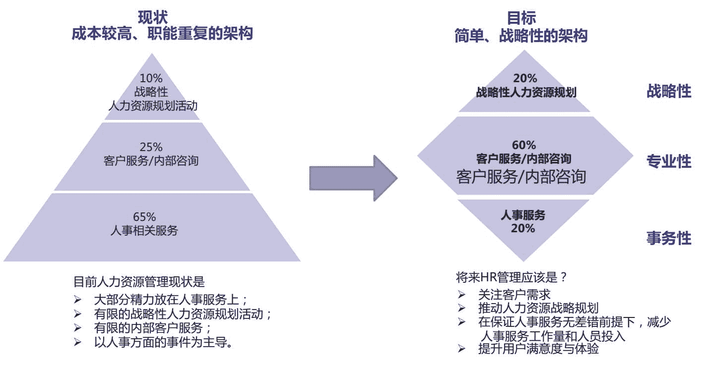

Figure 7-1 HR 管理工作内容占比研究报告示意图

HRBP 角色举足轻重，从业者却无暇深耕，这是战略伙伴角色失效的核心成因。破局之道，唯有推行 HR 转型。

转型目标直指痛点：将“高成本、职能冗余、事务繁重”的传统架构，重塑为“事务高效、专业深耕、战略领航”三位一体的新架构。即在保障人事服务精准有效的前提下，通过责任界定、组织重构与技术赋能，将人事服务投入压缩至 20%，战略规划投入提升至 20%，客户服务与内部咨询投入强化至 60%，从而跃升 HRBP 的专业度与价值贡献。

# 企业发展快慢，看HR重不重视

企业对人力资源部门的投入程度，与其业务扩张速度呈显著正相关。处于高速增长期的组织中，超过六成管理者认定：HR不仅是资源调配中枢，更是人力资本运营核心，拥有不可替代的战略职能，HRBP（人力资源业务合作伙伴）的价值在此阶段得以最大化释放。HR“三支柱”模型的落地，正是推动人力资源职能转型、凸显组织效能的关键引擎。

### 2. 三支柱模型深度解析

#### 1. 经典三支柱架构

1997年，戴夫·乌尔里奇正式提出HR三支柱理论，确立了**人力资源专家中心（HR COE）、人力资源业务合作伙伴（HRBP）、人力资源共享服务中心（HRSSC）**这三大支柱。三者的具体职能分工与协同关系如下图所示。

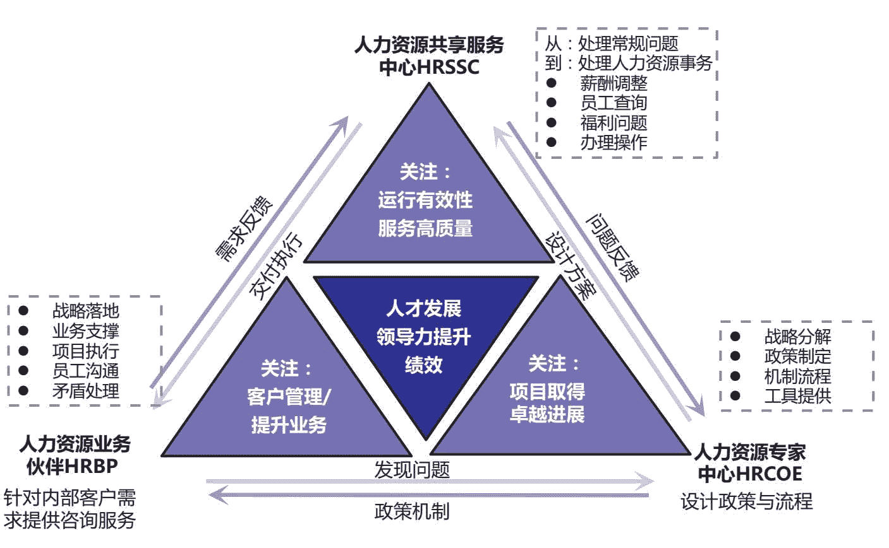

Figure 7-2 Specific Work of HR Three Pillars and Their Mutual Relationships

**HR COE（专家中心）：企业人力资源管理的“方向盘、红绿灯、加油站”**

汇聚各细分领域权威专家，主攻向业务端输出专业咨询与系统性解决方案。内部涵盖薪酬福利（C&B）、组织发展（OD）、人才开发（TD）、学习发展（LD）、组织文化（OC）、招聘策略机制、人力资源信息系统（HRIS）等职能模块。

- **方向盘——规划引领者**。凭借专业深度，提升HR队伍整体能力，制定并持续优化人力资源政策、机制与流程体系。
- **红绿灯——合规守门人**。严控政策执行合规性，筑牢用工风险防火墙。
- **加油站——技术赋能者**。打磨业务解决方案、标准化模板与工具包，为HRBP、HRSSC及业务管理层提供技术支撑，指导落地执行。

**HRBP（业务合作伙伴）：连接HR职能部与业务一线的“关键桥梁”**

深谙HR全模块运作逻辑，精准洞察业务诉求；既协助业务端处理高频人事事务、维护员工关系，又辅助业务主管高效驾驭各类管理工具与系统。作为贴近一线的“前哨”，企业通常依据“HRBP：正式员工”的服务比配置编制，该比值随组织支持力度及业务复杂度动态调整。核心履行五大角色：

- **战略合作伙伴**：推动组织与人才战略落地，传承核心价值观；
- **方案整合者**：将COE标准化产品转化为定制化业务解决方案；
- **流程执行者**：驱动HR核心流程运转，赋能人岗匹配等关键决策；
- **变革推动者**：充当组织变革催化剂；
- **关系管理者**：构建和谐高效的员工关系生态。

**HRSSC（共享服务中心）：标准化事务运营的“高效中枢”**

集中承接全公司基础事务性作业：薪社保核算发放、档案管理、信息服务、合同全生命周期管理、招聘入职培训、投诉建议处理、咨询答疑等。通过标准化、流程化服务交付，释放HR专业人员精力，大幅跃升部门整体服务效能。核心定位三重：

- **员工自助服务中心**：响应员工及管理层发起的服务请求；
- **HR流程事务中心**：承接COE主导主流程（薪酬、招聘、培训等）的行政执行环节；
- **HRSSC运营管理中心**：提供质量管控、内控合规、数据洞察、技术平台（含自助门户）及供应商管理等支撑。

#### 2. 实战复盘：腾讯HRSDC进化之路

##### (1) SSC升级SDC的四大核心驱动力

历经五年多探索，腾讯HR共享服务中心完成向**共享交付中心（SDC）**的跃迁。此举顺应时代与行业迭代，根本动力源于对业务端与员工端需求变迁的深度洞察：

1.  **业务诉求从“求稳”转“求变”**，一线强调HR管理的灵活度与响应速度；
2.  **员工诉求转向“个性化”与“自我管理”**，倒逼HR回归人性本质，以“管心”替代单纯“管事”；
3.  **技术范式迭代**：终端形态从PC单一向多终端泛在化延伸；
4.  **战略穿透力增强**：HR前端战略对齐公司大局，同时支撑多终端下的员工全生命周期与业务全周期。

以腾讯多元业务版图为例，北京侧重在线媒体与视频，深圳聚焦游戏生态。面对多业态并行，如何快速输出“一站式”定制化解决方案，成为SDC模型诞生的核心缘由。公司期望SDC站在连接COE与运营中枢的视角，做实支撑赋能。

##### (2) SDC与传统SSC的本质差异：从“被动响应”到“主动交付”

若以传统HRSSC为1.0版本，腾讯SDC即为2.0进阶形态。SDC打破“被动等事、接事、办事”的惯性，进化为能**主动发起交付需求、主动交付服务**的智能中枢，以交付标准与交付诉求双轮驱动需求兑现。其核心使命在于**无缝衔接HR COE与HRBP的双端需求**，如下图所示。

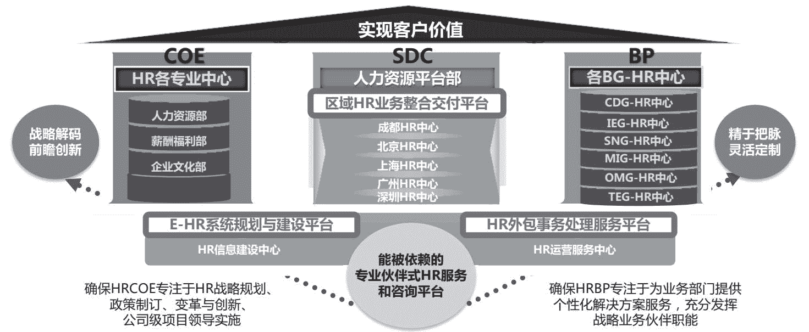

Figure 7-3 SDC Connecting HR COE and HRBP Needs

现实中常见困局：COE“浮不起来”陷入执行细节，HRBP“沉不下去”难深入业务一线，SSC事务混杂无序。若无法将这部分工作**集约化、模块化**沉淀，COE便难以履行“企业大脑”职能、统筹战略布局；HRBP因缺乏后台支撑，亦难穿透业务纵深、产生实质影响力。因此，SDC必须具备构建**HR解决方案中心**的能力——这正是腾讯当前攻坚的核心方向。

##### (3) SDC未来演进：愿景与挑战并存

腾讯 `SDC` 的终局，是构建一个集成化的HR交付平台，致力于为员工提供稳健、可靠且值得信赖的服务体验。然而，通往这一愿景的道路并非坦途，腾讯面临着多重考验：如何寻觅真正胜任 `SDC` 核心工作的人才？如何量化 `SDC` 对组织效能的实质贡献？以及如何实现“四两拨千斤”般的高效运作。

### 3. 重塑HR三大支柱

随着AI技术与大数据分析在HR各职能领域的深度渗透，这种技术驱动力正在重塑HR三大支柱模型，进而加速“组织、人才、文化”三位一体的迭代进化。那么，重塑后的三大支柱究竟有何不同？具体变革图景及其内在关联如下图所示。

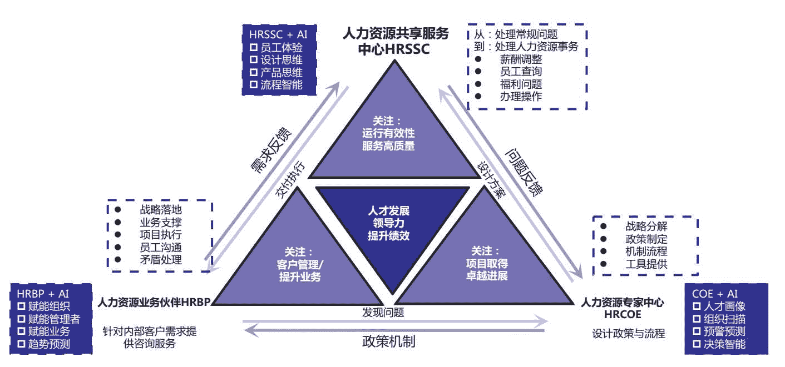

Figure 7-4 Reshaped HR Three Pillars + `AI`

#### 1. `HRSSC` + `AI`：智能赋能共享服务中心

注入AI能力的 `HRSSC`，在以下维度展现出显著的竞争优势。

##### 员工体验：全生命周期的极致关怀

重塑后的三大支柱，在员工体验层面实现了质的飞跃。

员工体验涵盖了个体在企业内所遇、所感、所闻的好坏总和，覆盖入职前、在职中、离职前后的完整生命周期。在这一长周期中，员工将历经渴望期、蜜月期、迷茫期、上升期、成熟期、衰退期、躁动期及怀旧期等心理阶段，详见下图。

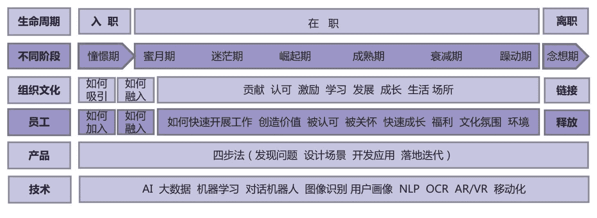

Figure 7-5 Employee Experience and Employee Life Cycle

以入职前为例，候选人处于渴望期，HR需从“如何吸引”切入，借助雇主品牌输出与智能客服机器人互动，高效触达候选人、预推企业宣传物料，深化其对组织的认知；入职环节，通过电子签名、OCR识别、RPA流程自动化等技术实现“零等待”入职；在职期间，无感考勤化解打卡尴尬；离职时刻，一张明信片承载组织温情，激发员工离去后的怀念之情。

何为无感考勤？传统模式依赖刷卡、指纹、人脸、手机打卡等主动动作。数智时代，HR部署“三实”（实地、实物、实况）采集设备——高清摄像头、巡检机器人、NFC终端等，员工仅需步入办公区域即自动完成身份核验，无需任何“打卡”动作。当然，前提是企业已与员工签署知情同意及保密协议。

##### 设计思维：微光熠熠，成就卓越体验

HR领域的产品设计需贯穿员工“进、管、出”全周期，以关怀需求为原点，优化流程、激发内驱力。百度联手卡通IP“度小熊”打造徽章体系便是典范：员工每个工龄节点领取编号徽章，数字见证岁月；五年、十年长期服务奖专属定制；生日专属徽充满惊喜。工位上排列整齐的多彩“度小熊”，化作员工与公司共同成长的荣誉勋章，极大强化了自豪感、归属感与成就感。

HR工作由无数细节堆砌而成。从业者须善用设计思维，在细微处打磨体验，以微光点亮卓越。

##### 产品思维：将HR解决方案产品化

产品思维是一种全维度的解题心法，即将问题解法产品化的过程。

在人力资源管理中，产品思维要求从业者在选、用、育、留方案的设计与落地中，深挖用户需求，聚焦体验与场景化设计，小步快跑、持续迭代运营，同时严守合规底线。

**产品思维的八大特质**

- **用户思维**：视员工为用户，赋予参与感；
- **痛点思维**：精准捕捉真需求，培训场景下更要助员工“发现需求”；
- **移动思维**：HR工作与移动端工具深度融合；
- **场景思维**：洞察核心诉求，将管理实践场景化、产品体验化；
- **迭代思维**：模块化、组件化、微服务化交付，实现小步快跑、敏捷开发；
- **数据思维**：以数说话，以数赋能；
- **生态思维**：构建“小闭环”生态，助力员工自我调节；
- **运营思维**：品牌传播，服务持续在线。

**典型实践案例**

**百度灵听：AI重塑学习场景**
百度年产海量音视频课程，常规做法是剪辑上线供学习。但偏好阅读的用户面临“听障”。人工加字幕、转文本成本高昂。经大量访谈、数据分析与多轮迭代，百度推出AI产品“灵听”：视频自动生成字幕、音频转文本，准确度不足处支持用户时间轴微调，大幅提效。

**阿里巴巴：海外HRSSC迭代突围**
随国际化提速，海外员工占比攀升。阿里EHR团队对HRSSC领域的事务管理进行建模，重塑流程节点、设定流转规则，兼顾灵活配置与数据安全。系统打通IT、核心HR、商保、薪酬等多系统，依据海外员工所在地福利、职级、部门、国家等维度，自动匹配个性化应用清单，支持进度实时追踪，打造一站式跨境HR服务体验。

**腾讯安居计划：解居住痛点，留核心人才**
2012年复盘发现：入职三年新人流失率是普通员工三倍。深度挖掘锁定核因——住房难。腾讯随即启动“安居计划”，设立专项基金向合规员工提供无息贷款。此后，员工流失率显著下探。

#### Process Intelligence

# 数字化浪潮下，HR如何借力“流程智能”实现质变？

在信息化阶段，企业往往因发展节奏不一，搭建起一套套割裂的业务系统，HR通过固化流程支撑了业务的快速复制与扩张。然而，步入数字化时代，组织规模持续膨胀、裂变加速，企业对HR系统的诉求发生根本性转移：不仅要打通“进、出、调、转、选、用、育、留、管”全链条的数字化闭环，更要全方位重塑员工体验。在此背景下，流程重构与运营管理的难题日益凸显，成为亟待破局的关键。

**流程智能**应运而生，它指在人力资源管理中，通过数据记录、加工与分析，赋能HR团队高效便捷地挖掘数据价值。其核心技术矩阵涵盖OCR图像识别、语音识别、文本解析、计算机视觉等。例如，OCR技术让报销审批实现智能化；语音识别自动生成会议纪要；文本解析驱动简历自动入库；计算机视觉支撑人脸考勤等身份核验。这些技术的落地，极大释放了HR与员工的生产力，将团队从�杂事务性工作中解脱出来，聚焦更具战略性与创造性的核心任务。

## HRSSC自助服务“三步走”实战范式

以HRSSC自助服务为切入点，展示企业如何落地流程智能。为打造“一站式、高效率”的服务体验，HRSSC需大力推动自助服务的在线化、自动化、智能化升级，可通过“三步走”策略稳步推进：

1.  **夯实知识底座**：梳理沉淀各HR模块的制度规范、知识要点及高频问题，经结构化、标签化处理后建成知识库，支持员工随时检索；同时建立常态化更新机制，保持内容鲜活度。
2.  **孵化智能客服助手**：上线向导式问答、辅助应答、主动推荐、个性化分发等功能，初步实现服务智能化触达。
3.  **打造“虚拟数字员工”**：拟真人对交互模式，提供7×24小时全天候响应。此阶段深度融合自然语言处理（NLP）、深度学习、大数据分析及机器人流程自动化（RPA）等前沿技术。

百度HRSSC实践证明，服务机器人自助解决率突破70%，不仅实现了客服流程的自动化、智能化，保障了应答的一致性与高质量，更显著跃升了员工体验与满意度。

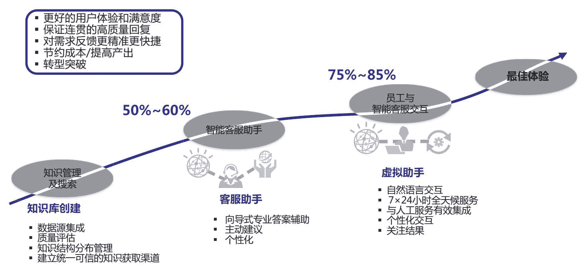

*Figure 7-6 HRSSC Service Self-Service Efficiency Model*

## HRCOE+AI：重塑组织人才决策新范式

AI赋能HRCOE（人力资源专家中心），在人才画像与组织扫描两大维度构建起显著的竞争护城河。

### 人才画像：从“经验判断”迈向“数据精准”

调研数据揭示，HR管理的核心痛点高度聚焦于人才发展方向：人才画像难题占比约55%，招聘、培养、规划、效能模块痛点均超57%；组织创新、战略落地、洞察投入等痛点亦超40%；领力建设、组织稳定、文化重塑等问题紧随其后，逐渐演变为企业转型的“拦路虎”。

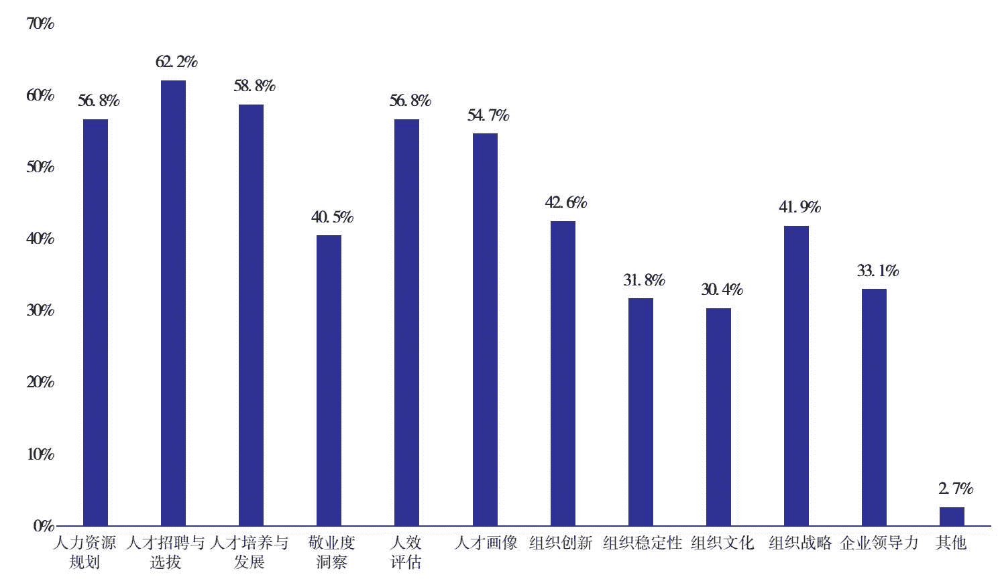

*Figure 7-7 Core Pain Points of Human Resource Management*

平安HR-X结合企业人才数据资产，创新性运用AI与大数据构建**岗位画像**与**员工（干部）画像**。通过智能标签体系，沉淀“全时、全视、全量”数据，为选人用人提供决策支撑。HR-X团队借助智能模型，为员工绘制涵盖绩效、技能、意愿人岗、薪酬、成果团队等维度的全景画像，打通招聘、绩效、培训、薪酬等多场景，实现人岗智能匹配，让团队管理更精准、全面、高效。

在干部画像落地层面，丰富标签与智能模型深度渗透“识、评、用、育”全周期：

- **信息一站聚合**：整合绩效、履历、考核等多源数据，释放聚合效能；
- **全员动态对标**：团队业绩与个人表现动态对比，趋势洞察一目了然；
- **岗位精准画像**：服务内推、AI面试、绩效建议、培训管理等实战场景；
- **人岗智能匹配**：破解晋升调薪难题，实现人岗精准适配；
- **社交网络洞察**：多维呈现校友、前同事等关系网，强化人员风控；
- **标签极速检索**：便捷汇聚专业人才与行业精英，提升配置效率；
- **培训智能推荐**：依据长板短板定制课程，靶向提升员工能力；
- **绩效预警前置**：及早识别短板干预，守护团队战斗力；
- **离职风险预警**：捕捉异常行为信号，提前识别流失征兆。

人才画像的深度应用，解锁了“为人荐岗、以模型找人、以人找人、从组织需求触发生成人才”四大灵活用人模式，助力组织精准锁定高匹配度人才。

### 组织扫描：四维视野洞察战略落地

管理层迫切需要HR通过系统预警或驾驶舱可视化，实时掌握：架构变动、人才分布、兵力部署、关键人才位置、高潜人选、组织“承重墙”人物、将帅梯队等核心情报。唯有攻克以下“四维”命题，方能真正驱动人才战略落地生根：

- **速度维度**：以新技术应用加速业务流转节奏；
- **广度维度**：拓展点、线、面、体全维度数据分析场景；
- **深度维度**：穿透传统分析盲区，洞见隐性规律与深层洞察；
- **高度维度**：激活组织效能全释放，驱动企业绩效持续跃升。

# 企业数智化转型：用AI重塑组织效能与人才激活的实战逻辑

当前，企业正加速从“数字化”迈向“数智化”阶段。在这场变革中，战略落地与组织重塑依然是核心抓手。若想在行业竞争中占据上风，关键在于借力AI洞察组织肌理、发掘人才潜能、驱动绩效跃升。调研显示，国内约七成企业已开启数智化进程，呈现燎燎之势：36.49%处于初探试水期，24.32%推进至局部模块落地，8.11%已实现全模块体系化深度应用（详见下图）。

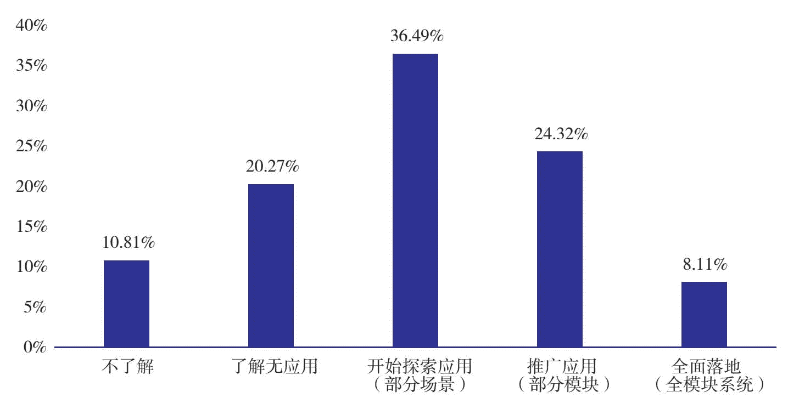

*Figure 7-8 Current Status of Digital-Intelligence Application in Chinese Enterprises*

企业引入AI与大数据技术，对组织实施全方位“CT扫描”，实现战略与组织的精准匹配，构建科学架构，聚焦实绩提升，让数据在采集、整理、建模、分析至应用的闭环中释放真价值，赋能数智化建设。这类组织扫描主要聚焦两大维度：**组织管理**与**绩效激励机制**。

### 组织管理：追求敏捷与高效的动态平衡

组织管理涵盖架构设计、职级体系、流程管控三大板块，核心指向只有一个——提升组织效能。企业渴望组织更敏捷、更高效，输出更大价值、获取更高利润、实现可持续发展。组织效能可拆解为管理效能、人效与组织活力。对HR而言，管理效能的核心在于流程优化。管理者可借助“组织CT”诊断管理幅度、审批节点等指标是否合理，过高或过低均会损伤组织健康度。

**案例一：京东“8150”扁平化铁律**
*   **“1”**：指代每一位管理者；
*   **“8”**：要求直管下属不少于8人，不足则须削减中层；
*   **“15”**：直管超15人时，方可在同级增设管理岗；
*   **“50”**：一线同类岗位直管人数不低于50人，超50始考虑设二级团队长。
其核心逻辑是强制扁平化，保障组织效能最大化。

**案例二：百度“2+2”核心流程审批制**
业务线两级负责人把关业务合理性，HRBP两级把控政策合规性，双轨并行兼顾效率与风控。

基于AI模型构建的组织扫描工具，能实时捕捉系统中违背“8150”或“2+2”原则的异常，自动预警推送至管理者与HRBP。面对预警，可选“接受”（系统按规则自动修正）或“人工干预”（限期一月内处理，逾期系统强制执行）。随业务演进与场景变化，扫描模型持续迭代，护航组织效能长效增长。

### 绩效激励机制：从“千人一面”到“千人千面”的精准触达

绩效激励覆盖绩效管理、薪酬福利、长期激励等板块，AI正重塑全流程。员工绩效与行为数据合规入库，HR分析建模后，将评估结果在线触达个人，针对短板给出定向建议。更进一步，工具基于历史数据识别每位员工的“保健因子”与“激励因子”，匹配数十种组合方案，真正落地“一人一策”激励分配，充分点燃工作激情。甚至可预测绩效走向，为管理者用人布局提供决策支撑。

### 预警与预测：让HR系统成为业务增长的“领航仪”

HR系统必须映射业务诉求、驱动业务向前。智能预警预测产品同理。以下以百度HR系统为例深度解析。

### 百度人才观：打造“自驱进化”的冠军队伍

百度人才观定调为：“招最好的人、给最大的舞台、看最后结果、让优秀者脱颖而出”（详见下图）。

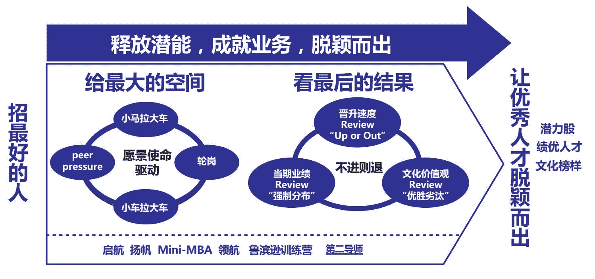

*Figure 7-9 Baidu's Talent Philosophy*

**招最好的人**：标准三维度——
1.  **文化基因匹配**：契合“简单可依赖”文化，极大降低内耗沟通成本；
2.  **极强学习力**：互联网环境瞬息万变，企业看重的非过往经验，而是快速识别、理解、应对未知环境的能力；
3.  **胜任力达标**：岗位基本门槛。目标是建设“永远创业、自我驱动”的组织，自驱者不仅愿学、更能速学、持续进化。

**给最大的舞台**：不止物理空间，更指使命感、理想主义与技术深度的平衡。百度给出的最大舞台，是前沿核心技术攻关。

**看最后结果**：彻底结果导向，论资排辈零容忍，一切对结果说话，强调差异化文化。

**让优秀者脱颖而出**：2012年起推出系列激励政策，再激活自驱与差异化。通过“上下游”双名单（潜力股与淘汰名单）、初级岗“三年两级跳”、文化360度评估、设立特别卓越奖等差异化举措，让真才实学者破圈而出。

# HR数智化转型：从架构重塑到决策进化的实战路径

企业在规划业务与产品架构时，必须将人力资源的业务诉求与管理刚需置于核心位置。这要求梳理流程、落实责任、夯实基座、打通系统、贯通数据，并以此为基石融合AI、区块链、云计算、大数据、物联网、移动互联、3D打印等前沿技术，打磨数智化产品。目标明确：为决策层、管理层、一线员工及HR专业人士配置赋能工具，驱动业务数字化转型落地。

以招聘策略为例，若目标是“招对人、招强人”，产品需覆盖全生命周期管理、统一人才池、人岗智能双向推荐、面试笔试机器人、智能入职客服及分析看板；运营管理主打全流程数字化，则聚焦无人一站式服务、弹性排班、非感知考勤、晋升调动全链路数字化、组织CT/人才CT及全景画像；人才培养强调“在岗学、在岗长”，设计重点在于数字化自助培训、嵌入工作流的成长地图、AR/VR/MR混合现实、游戏化机制、千人千面推荐、知识图谱与全景驾驶舱；人才留存聚焦“让优秀者脱颖而出”，则部署人才流失预警、组织活力诊断、人才健康度监测、薪酬激励一站式工作台及舆情监测预警体系，详见下图。

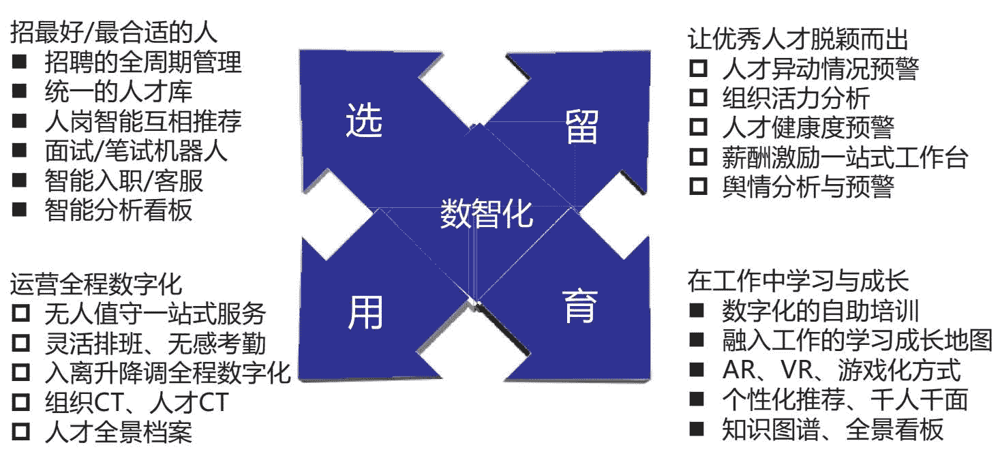

*图 7-10 HR数智化场景全景图*

#### 决策智能：让数据成为最懂业务的参谋

HR决策智能的核心，是助力管理团队跳出经验主义，转向数据驱动的科学决策。其通过自然语言处理（NLP）、知识图谱、组织网络分析（ONA）等关键技术，实现三大突破：NLP精准匹配人岗；知识图谱融合深度学习预测流失与绩效；ONA量化领力评估。这些在数智化之前难以企及的能力，如今显著提升了决策效率与精度，提供了量化分析支撑。

值得注意的是，数智决策并非简单套用大数据关联规则。面对HR管理的“小数据”特性，科学路径是：打破边界，将HR、财务、运营、OA、IT及外部环境等多源异构数据纳入统一建模，经全要素相关性分析得出指标分布，再依据区间推演概率判断，供管理者及HRBP参考决策。

调研显示，全国约75%企业已开展HR数智化运营，其中流程数智化执行度最高（60.81%）。流程重构免除了层层审批的繁琐，简化办公链路，赋予员工智能化体验，提升满意度，释放人力聚焦高价值创造。决策数智化执行率达20%，具备后发优势。基于数据驱动的智能决策是必经之路：企业可借AI构建无边界平台，聚合多方数据资源，持续输出深度管理洞见，优化决策，强化核心竞争力。当前阶段呈现“机器出结果、人做判断、管采取行动”模式。这一复杂过程中，人机协同共生、信任建立、算法可解释性等挑战接踵而至，但化解这些难题的过程，恰恰能推动HR管理向更人性化、生态更健康的方向演进。

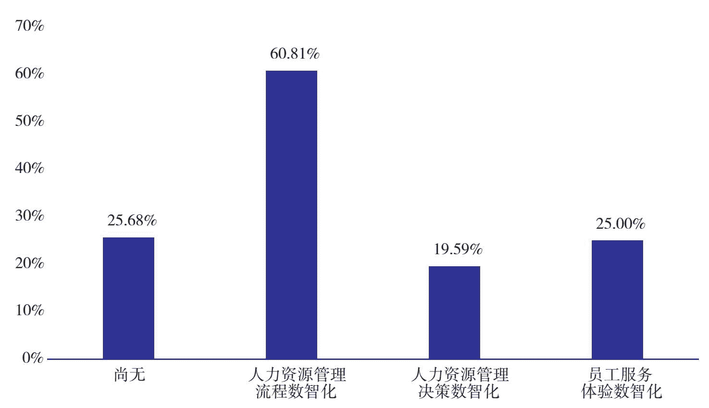

*图 7-11 企业HR数智化运营实施现状*

#### HRBP+AI：进化为组织的“超级连接器”

AI赋能下的HRBP，正构建显著的竞争护城河。

##### 一图在手，全局洞察：AI高管赋能HRBP

HRBP借助注入AI与大数据的可视化驾驶舱，实现“一图在手，人才全景尽览，HR运营数智化”——随时随地“看组织、看人才、看流动、看效能、看成本”。

网龙网络是HR领域引入AI的先行者。为提升管理效能，网龙推出“AI高管”机制赋能HRBP。双分工明确：**“AI高管”**依公司级规则，自动通过合规流程、自动处罚违规行为；**HRBP**聚焦需体现“温度与人文”的管理领域，同时通过机制固化修正不合理规则，形成良性闭环。

“AI高管”如何赋能？首当其冲是**剥离事务性负担**。自动审批功能让HRBP从繁杂流程中解脱，转攻文化建设、体验优化、组织赋能等高价值地带。以请假为例，员工提交申请，符合规则即由AI秒批并同步通知上级；晋升、调动等有明确门槛的事项，AI可完成预审。此外，“AI高管”还以管理者身份下达任务、监督执行、奖惩激励，实时抓取各类文档完成度，推送数据预警组织与业务隐患。

### 二、AI 助力 HRBP 实现精细化人才运营

“AI 高管”沉淀的数据与行为轨迹，为 HRBP 开展个性化管理提供了坚实底座。以晋升评估为例，公司每年设两季晋升窗口。过往流程中，HRBP 需主动对接业务高管、梳理部门人员架构、筛选推荐名单；如今，“AI 高管”依据现绩、过往绩效、任职年限，以及现薪与部门薪酬体系的差距，直接向管理者给出申报建议。系统还能自动产出多维报告，构建推荐评分模型。HRBP 拿到这些量化结论后，即可直奔业务端展开高效沟通。在人才盘点环节，“AI 高管”同样大显身手，它综合绩效等级、管理行为评价、360 度反馈、学习成长等绝对客观数据，输出清晰的盘点画像。过去需人工多方搜集评价报告，现在多维数据采集、模版化报告生成均实现了自动化。

---

### 赋能组织：激活内生动力，重塑竞争优势

百度提倡“开放赋能”，阿里坚持“赋能商家与中小企业”，腾讯主张“连接一切，赋能个人”，京东聚焦“零售赋能”，小米推动“智能制造赋能万物”，华为深耕“数字化赋能”……头部企业不约而同高举“赋能”大旗。究其本源，“赤能”源自管理学“empower”，初指授权，现多解读为“注入能量”或“传递能力”。放到企业内部，即意味着组织自上而下释放权力，尤其是下放员工自主决策权，通过去中心化推动扁平化，最大化激发个体潜能。面向未来，组织必须具备超越传统的运作韧性：既能极速响应复杂多变的外部环境，又能持续点燃核心人才的内驱力，在日常工作中实现持续赋能。

企业决策层（CXO）代表公司意志，赋能组织的首要任务是为其提供决策洞见；政委或 HRBP 同样需要趁手工具护航业务。百度人才智库生动演示了 HRBP 如何借力 AI 与大数据，双向赋能组织与经营层。

百度人才智能中心（TIC）是一套智能化人才管理系统。它立足海量数据，借助精准算法与机器学习，输出全链路智能解决方案，核心切入“人才、组织、文化”三大维度，内含“智能风控、智能留任、智能文化、智能选才、智能组织、智能用人”六大功能模块（详见  图 7-12）。

**聚焦人才端**：系统大幅跃升招聘效能，科学甄别优秀管理者与高潜人才，预测离职倾向及离职冲击，为“选、育、留”提供智力支撑。  
**聚焦组织端**：通过剖析部门活力与人才结构，量化评估组织稳健度，洞察人才流动规律，助力组织优化、激励升级与人才流动。  
**聚焦文化端**：实时捕捉内外部舆情热点，智能研判外部人才市场，助力管理者提升雇主品牌、振奋士气、超前布局储备。  
百度人才智能中心真正落地了数据驱动决策，辅助高管判断，助力百度在人才流动高频、竞争白热化的高科技赛道保持强劲竞争力。

---

### 赋能管理者：从“管控”转向“赋能”，破解数字化管理困局

数字化时代，员工个性化、自我驱动特征显著，传统“管控”失效，团队管理者面临严峻挑战。实测显示，引入智能工作台可使管理效能提升 30%–50%。以民生银行新一代 HR 数字化平台“HR 盒子”为例，该行依托团队视图、人力资本分析、HR 运营、服务窗口四大核心能力，实现对高管团队、一线管理者、HR 业务伙伴及全体员工的全维赋能，推动组织价值、人才价值、人才供应链与基础 HR 管理四大价值跃升（功能架构见  图 7-13）。

随着数字技术迭代，银行业步入存量竞争深水区。各行 HR 必须高速响应人才断层、业务颠覆、体验重塑三重挑战。民生银行 HR 部以客户为中心，运用数字化手段参谋总行转型前瞻布局，助力高管团队洞察环境、对手、自我、人才与未来。

民生银行 HR 部构建人力资本分析模型，秉持“用户为本、价值驱动、模型支撑”原则，搭建分析平台，为高管、HR 条线、各层级管理者配置专属驾驶舱，延伸形成“总行部门视图、分行部门视图、支行视图”多维场景。平台提供人力资本看板、自动化报表、“基础画像、人才 DNA、部门画像、人才画像”四大分析报告，打通“人才在哪、数据在哪、管理在哪”的量化入口，实现智能化人力资本管理。同时，该行探索“敏捷组织”模式，打通跨部门、跨条线项目制协作，建立“三位一体”员工工作记录体系，同步升级配套制度规则，确保机制随需求迭代，深化绩效文化、激活组织活力、驱动文化变革，真正落实管理者赋能。

---

### 赋能业务

# 数智化：企业进阶的核心引擎

数智化融合了“数字化”与“智能化”，是建立在数字化基础之上的更高发展阶段，堪称业务增长的加速器。其底层运作遵循三大核心逻辑：**构建连接、沉淀数据、激活智能**。

首先是**全域互联**。打通人、财、物、事的各类边界，实现人机、人人、机机、人事、事事、机事、人财、人物、财物、物事、财事乃至知识层面的立体连接。接着是**数据沉淀**。依托上述互联，原始数据自然而然留下轨迹，客观真实、涵盖结构化与非结构化全品类，为后续清洗、存储、分析筑牢根基。最后是**数据智能**。借力机器学习与大数据技术，让分析更精准、透彻、智能，其中模型、算法、算力构成核心铁三角。

## 国企与传统行业的“数智鸿沟”

国内互联网大厂数智化程度高、覆盖面广、技术成熟，业务增速自然领跑。反观传统行业，整体仍处起步期。尽管多年高呼数字化转型，但危机感不足、执行乏力、路径模糊、人才短板等问题依然突出。

调研显示，企业管理十余个模块中，数智化探索已遍地开花。战略管理约21%落地，人力资源达34.5%，财务管理27.7%，行政、供应链、质量、研发等领域亦有布局（详见）。虽各模块均有约两成企业试水，但整体规模仍显稚嫩，前路漫漫。这既因AI与大数据在企业端多停留在探索或微应用阶段，也受制于认知水平与人才匮乏。

### 聚焦HR：三分天下，先行突围

在人力资源模块，企业呈现“三足鼎立”态势：约34.5%进入数智阶段（远超其他模块），33.1%仍处线下或在线初级阶段（多为传统企业，深层原因待挖），32.4%处于信息化阶段（转型主力军）。

数据揭示三大启示：一是认知与实战均需补课，路漫漫其修远兮；二是越来越多组织觉醒，已在行动；三是HR大可率先破局，通过组织保障、人才储备、文化塑造，反哺业务跃迁。

---

## 组织架构演进：从三支柱到多元支柱

AI与大数据时代，组织形态百花齐放，HR体系须随业务持续迭代。

### 双支柱模式：敏捷创新的“长凳模型”

为应对业务极速变化，头部企业将传统三支柱（HRBP、COE、SSC）重构为**双支柱**：前端HRBP直面业务与员工需求，后端COE与SSC深度协同，联合赋能前端。因形似长凳，亦称“长凳模型”（详见）。

**适用场景**：业务高速创长、创新强度大的组织。前提是HR数字化建设达标——**一平台、一手机**，万事在线闭环。

### 四支柱模式：为复杂度加装“导航仪”

在三支柱基础上增设第四支柱——**PMO（项目管理办公室）**或**PA（人才分析/人力资源分析）**（详见）。

*   **PMO驱动流程型组织**：人才盘点、选拔、标准制定等项目林立，PMO统筹协调、推动落地，是提升管理成熟度的核心枢纽。
*   **PA赋能数据驱动决策**：被誉为“HR未来之作”。未来PA将超越HR职能，成为全企业组织分析的关键引擎。谷歌“氧气计划”、百度“人才智能中心”皆是标杆。

无论三、二、四支柱，终极指向皆为HR战略落地与业务转型，尤其**双支柱，正是AI与大数据技术倒逼的必然进化结果**。

---

# 第二篇章：AI如何重塑共享服务中心（HRSSC）

AI在HRSSC落地已成常态。以起步较早的百度为例，剖析其技术实战与创新范式。

## 1. 业务演进：从“三驾马车”到“智能HR”

2010年前后，百度确立SDC（共享服务中心）、HRCOE、HRBP“三驾马车”架构。SDC历经1.0至3.0演进，3.0阶段定名**“Smart HR（智能HR）”**——引入交互系统、大数据预测分析，聚焦效能与管控。2014年发力，至2017年进阶向“Intelligent HR（智慧HR）”（3.5/4.0阶段）迈进。为极致员工体验、激活组织活力、赋能文化，百度果断抛弃传统流程，拥抱数字化重塑（详见）。

## 2. 硬核技术落地图谱

### 招聘赛道——智能简职匹配

# AI重塑人效：百度HR数字化转型的三大核心场景与数据思考

业务导向与技术驱动的双轮驱动，正深刻重塑招聘版图。百度HR高度重视AI在招聘领域的落地与效能跃升，依托自然语言处理（`NLP`）与机器学习技术，深度挖掘人才简历库，构建算法模型，成功攻克了简历与职位描述（JD）智能匹配的难题。以下两大工具显著提升了招聘专员的作业效率。

#### 1. 智能筛简历：“众里寻他”精准画像
这是百度为招聘团队定制的智能简历筛选系统。系统能自动解析招聘团队发布的JD，在人才池中精准锁定符合要求的简历。这里的“精准匹配”绝非简单的关键词对标，而是融合候选人过往背景、工作履历、项目实战等多维度数据，经由大数据算法深度运算与“画像”而成。流程的极致优化，让招聘团队从繁琐的筛选中解脱，将精力聚焦于候选人评估与面试环节的深度把关。

#### 2. 智能荐岗位：“沧海拾遗”双向奔赴
这是面向候选人打造的职位匹配系统，旨在提升投递效能。候选人检索职位时，系统依据简历画像主动推荐契合度高的岗位，大幅压缩候选人浏览JD的时间成本，有效规避因信息不对称导致的错失良机。

---

#### 2. 入职流程：多技术融合铸就全链路自动化

##### (1) OCR技术：证件录入“秒级结构化”
OCR技术通过光学扫描将证照、票据、文档等印刷文字转为图像，再经文字识别转为机器可读数据。近两年该技术加速渗透HR场景。入职前，企业只需要求新员上传学历、资质、身份证、银行卡等证件影印件，系统即可自动识别关键信息，并同步对接学信网（CHESICC）等权威第三方平台，实现学历信息的极速核验与落库。

##### (2) 人脸识别：实名验证与体验升级的双重保障
百度人脸识别技术成熟，内部已广泛应用于门禁通行、会议签到、园区消费等高频场景。延伸至入职环节，该技术结合访客系统，不仅支持新员预约报到、自助打证，更显著提升了初次到岗的仪式感与办事效率，让“刷脸”成为连接人与组织的第一把钥匙。

##### (3) 预约系统：端到端闭环的极致体验
预约成功的新员将收到专属后台码。码发送的同时，入职指引、公司动态同步推送。到岗后，新员凭码对号入座，按指引直奔办理点完成手续。考虑到入职高峰期管理诉求，座位编码与预约码强绑定，工位上预置“入职大礼包”——电脑、办公用品、待签文件一应俱全，即拿即用。这一系列设计打通了候选人、反馈系统与入职系统，实现端到端自动化闭环，新员好感度与归属感双双跃升。

---

#### 3. 在线学习系统：AI赋能内容生产降本增效

##### (1) “灵听”平台：视频字幕生产从“天”级压缩至“分”级
培训专家的痛点常在于大量重复性基建工作，如视频课程加字幕。字幕虽能助学员精准高效吸收知识，但背后流程冗长：听录文本、校对纠错、按制播规范断行排版、协同视频制作合成，跨工种协作动辄耗时数日。百度以AI技术孵化“灵听”平台，培训专家上传视频即可自动完成语音识别、字幕嵌入，仅需微调个别识别偏差，单人几分钟即可交付过往需多人多日完成的任务。

##### (2) “百度听轻”：直播场景的实时双语字幕官
依托语音识别与机器翻译技术，讲者开讲同步输出中英双语字幕。这一名为“百度听轻”的能力，已稳定服务于百度内部直播平台，打破语言与听力障碍，保障信息实时触达。

---

### 数据智能篇：大数据应用的底线、基石与本质

#### 1. 数据红线：隐私领域零容忍
涉及邮件内容、私密通讯等个人隐私维度的数据，严禁用于画像分析，这是不可逾越的伦理与合规底线。

#### 2. 数据基石：打通壁垒，内外兼修
第一，HR各模块数据须“联通”而非“孤岛”，完成HR数据域整合是大数据分析的前提；第二，须向外“链接”财务、销售等业务部门数据，构建全域数据视野。

#### 3. 安全治理：权责边界清晰化
数据安全是企业必答题，破题关键在于“分工”。负责接口开发、数据对接的人员需联合界定边界，明确分级分权的访问权限体系，做到有据可查、有权可控。

#### 4. 技术本质：大数据是AI落地的“地基”
人脸识别、语音识别等新技术本质是手段、工具与平台，其早期演进仍深度依赖大数据驱动。技术的迭代进阶，终归仰赖大数据的持续沉淀、治理与循环迭代。

---

## Section 3：AI如何赋能HR COE——解码“百度人才智能中心（TIC）”

本节通过“百度人才智能中心（`TIC`）”案例，深度剖析AI如何赋能HR专家中心（`HRCOE`）。百度践行“让优秀人才脱颖而出”的用人哲学，从人才、组织、文化三大维度出发，引入更量化、客观的决策手段。TIC汇聚“智管、智选、智育”等六大功能模块，具体架构详见下图（Figure 7-18）。

### 百度TIC：重塑人才、组织与文化的智能引擎

**人才维度：招育留全链路智能化**  
TIC显著提升招聘效能，精准锁定卓越管理者与高潜人才，并能预判离职倾向及其连带影响，为人才“得、育、留”提供全周期智力支撑。

**组织维度：洞察活力与流动规律**  
通过剖析部门活力与人才结构，TIC实现组织稳健度的科学量化，揭示跨组织人才流动的底层逻辑，助力组织优化调整、激励精准化及人才流动的有序促进。

**文化维度：把舆情脉搏、强雇主品牌**  
TIC实时捕捉内外部舆情热点，研判外部人才市场行情，双管齐下提升企业声量与员工士气，为人才储备战略提供决策依托。


**图 7-18 百度人才智能中心（TIC）应用场景全景图**

#### 1. 组织人才管理风险指数：晋升决策的“压力测试”
面对新业务挑战，如何从管理者池中筛选出能驾驭高风险岗位的人选？TIC创设“人才管理风险指数”。该指数量化不同阶段管理者面临的复杂度与难度，并对比其职业生涯中的风险波动轨迹。  
案例显示：专长单一的管理者跨域履新时，发展曲线剧烈震荡；而胜任力强者能快速抚平动荡。这一指标为企业选拔任用领导干部提供了客观、硬核的量化依据。

#### 2. 从“管人”到“育才”再到“识杰”：关键人物（Figures）画像模型
企业用人视角历经三次进化：早期制造业（如福特）重“管人”，强调纪律；高科技时代重“育才”，看重专技与协作；未来将聚焦“识杰”，要求关键人物具备卓越领导力与创新力。  
破解“关键人物”发掘难题，TIC基于**核心岗位占位、业务桥接力、开放沟通力、组织框架力、广泛协作力**五大维度构建量化模型。模型以企业平台上的邮件、代码等真实业务数据为燃料，为每位员工生成成长“电子档案”。通过计算业务中心性指数，判定其成为“关键人物”的概率，同步诊断五维长短板，精准匹配岗位调整或定向培养方案。  
**特别声明：** TIC高度重视数据隐私，所有引入分析的数据均经严格审批、加密管控，杜绝挪作他用。

#### 3. 人才流失趋势预测：90天精准预警，挽留关键棋子
TIC融合内外部数据（含舆情、社媒文本），构建包含经济环境、职业发展、家庭因素等数百个动态特征的90天离职预测模型，准确率超90%。  
**实战验证：** 2015年百度内测中，TIC圈定离职指数Top 30名单，3个月内29人正式提离职申请。系统不仅能预判“谁会走”，还能测算“走的影响有多大”并剖析“为何走”。若高风险人才属稀缺且离因可控，企业可及时介入、精准施策挽留。

---

# 第八章 构建智能HR平台，赋能业务转型

VUCA时代倒逼HR升级，企业对HR系统平台提出四大核心诉求：

*   **打破孤岛，贯通全链：** 打通“进管转调出选用育留”全链条，实现流程端到端、系统上下游、数据高效流。
*   **建池绘图，全周期管：** 沉淀全球人才池，绘制人才地图，落地全生命周期管理。
*   **一平台、一入口、多权限、强工具：** 统一平台入口，按角色（员工/管理者/HRBP）授权，提供丰富易用工具，推行自助服务，双提效率与体验。
*   **数智驱动，决策前置：** 搭建看板、驾驶舱、人才大屏，赋能HRBP与管理者，通过人才画像与组织扫描，实现流程智能化、决策科学化、预警前置化。
*   **极致体验，闭环服务：** 覆盖“入职-在职-离职”三位一体闭环，提供全场景服务，深化员工敬业度。

## 第一节 HR数智化四阶段模型与迭代进阶路径

过去数十年，HR管理演进历经四阶段（详见**图 8-1**），HR信息化亦随技术迭代同步跨越四期（详见**图 8-2**）。


**图 8-1 HR管理演进四阶段**

> **阅读建议：** 请对标模型，定位自家HR发展阶段，规划数字化蓝图，寻找最短迭代路径，持续突破，反哺业务转型。


**图 8-2 HR信息化“四阶段模型”**

### 第一阶段 1.0：上线（数字化/ MIS）

#### HR管理演进：事务管理期
**核心特征：** 职能以行政事务为主，关键词是“跑流程”。  
**日常工作：** 入职办理、考勤统计、薪资发放、离职手续、证明开具等�杂琐事。

#### HR信息化演进：阶段 1.0 上线（MIS）
管理信息系统（MIS）将HR各模块从线下搬至线上，这是信息化起步期。核心诉求是满足人事服务在线办理需求——薪资核算、社保公积金缴纳、异动流转等基础服务。**核心指标“三准”：**  
*   **人数准：** 报表精准统计集团、BU、子公司的人员构成与分布；  
*   **工资准：** 系统精准核算发放薪资奖金；  
*   **打包算：** 支持总部及各层级的人编预算与人力成本核算。

### 第二阶段 2.0：信息化

### HR 进化论：从“管事”到“造势”的四重跃迁

人力资源管理的发展史，本质上是 HR 角色不断“破圈”、价值持续上移的历史。我们可以清晰地梳理出四个关键阶段，每一个阶段都标志着管理逻辑与技术手段的深度重构。

#### 阶段 2.0：专业化奠基期——“六大模块”建体系，eHR 提效率

这个时期的核心标签是**“以岗位为中心”**，关键词直指**“六大模块”**（规划、招聘、培训、薪酬、绩效、员工关系）。管理焦点聚焦于：如何让人岗匹配、高产出。

*   **里程碑事件：** 1993 年，人大劳动人事学院率先更名，拉开了国内从“人事管理”向“人力资源管理”转型的序幕；1997 年，戴夫·尤里奇提出**“三支柱模型”**（HRBP、HRCOE、HRSSC），为中国 HR 进入高速创新期按下了加速键，该模型也随时代与技术持续迭代。
*   **技术驱动——信息化（eHR）：** 关键词是**“流程、合规、效率”**。核心业务被浓缩为十字诀：**“进、出、调、转、移；选、用、育、留、管”**。
*   **建设逻辑：** 覆盖全生命周期，从业务诊断、流程再造入手，打通模块壁垒，实现系统端到端贯通，保障合规的同时提升整体运营效能。
*   **服务升级：** HRSSC 开始借力系统提效，头部企业纷纷打造“一体化服务平台”，以极简流程换取极致体验。


#### 阶段 3.0：数字化转型期——三支柱“下场”做业务，DHR 驱动组织效能

进入战略人力资源管理阶段，HR 部门蜕变为**业务战略伙伴**，目标直指**“支撑企业战略落地”**，核心抓手依然是**“三支柱”**，但分工更明确：HRBP、HRCOE、HRSSC 全员围绕**“组织、人才、文化”**三大命题转，HRVP（人力资源副总裁）角色涌现，正式坐上核心决策桌。


*   **技术跃迁——数字化（DHR）：** 关键词升级为**“组织效能、用户体验”**。这不再是简单的工具换代，而是**用数字技术重塑业务模型、重构生态系统**——技术是底座，业务变革才是核心目的。
*   **HR 数字化定义：** 运用数字能力重塑“组织、人才、文化”，倒逼业务高速增长。
*   **四大支撑层级：**
    1.  **流程层：** 合规高效、权责清晰；
    2.  **系统层：** 互联互通、数据驱动、场景化、智能化；
    3.  **数据层：** 信息集成、分层呈现、预警预测、决策支持；
    4.  **体验层：** 贯穿全生命周期，融入流程设计与系统构建的每一个细节。
*   **平台愿景：** 打造“全感知、全连接、全场景、全智能”的数字化底座，用大数据分析（多维、专题、预测）赋能决策，加速 HR 转型与业务发展。
*   **特征标签：** 移动化、智能化、大数据、云服务——全方位提升体验与组织效能。
*   **AI 微应用落地：** 一站式服务、机器人客服、智能双推、智能背调、机器人面试、电子签约、AR 培训、自助服务、人才画像、智能看板……百花齐放。无论三支柱如何重塑，初心不变：**助力战略目标达成。**


#### 阶段 4.0：智能化生态期——人才即资本，构建“三曲线”增长引擎

这是**人力资本管理**阶段。核心认知转变：**把人才当资本管**。可持续的人才供给与组织能力，成为企业护城河。关键词锁定**“生态系统”**。

此阶段企业普遍呈现**“三条曲线”业务布局**：
*   **第一曲线（成熟业务）：** 守住现金流，稳住基本盘；
*   **第二曲线（成长业务）：** 寻找增量，随时准备迭代升级；
*   **第三曲线（未来业务）：** 布局前沿，押注趋势，保持领先。


**应对之道：** 三条曲线对应差异化的组织、人才、文化策略，不再一刀切。智能化技术（iHR）将深度嵌入生态构建，实现人才价值的动态评估、精准配置与持续增值，最终完成从“成本中心”到“价值创造中心”甚至“战略投资中心”的终极跃迁。

# 2017：中国HR进化的分水岭与智能新纪元

**专家视角的迭代，折射行业范式的跃迁**

全球HR思想领袖的观点演进，清晰映照出行业发展的脉络。Dave Ulrich 将能力模型从 2007 年的“六脉神剑”升级为 2016 年的“九大角色”；Ram Charan 则从 2014 年主张“拆解HR职能”，转向 2019 年提出“C3 铁三角模型”（CEO、CFO、CHRO）。中国企业的野蛮生长与极速跑，倒逼本土 HR 管理不得不持续突围、进化。**2017 年，堪称中国 HR 实践的“元年”兼“分水岭”：** 此前，学界仰望海外、照搬经验；此后，目光转向内部，聚焦于头部企业——尤其是互联网巨头的原创实践。

### 智能 HR（iHR）：从“数字化”进阶为“智库”中枢

智能 HR 是数字化的高阶形态，其核心关键词是**“智库”**。

若说信息化解决“点”的记录，数字化打通“线”与“面”的流程，那么智能 HR 借助大数据与 AI 的深度渗透，直指**“体”**的系统性认知。它赋予“进、出、调、转、升、降；选、育、用、留、管”全链条以**敏锐感知、自适应学习、前瞻预判**三大核心能力。通过“神经网络”将各业务场景的实践数据汇聚中枢，融合管理经验输出行动建议，最终沉淀为组织的“智库中枢”。**业务生数据，数据驱动业务，双螺旋迭代，螺旋上升。** 此阶段组织形态呈网状，旨在构建生态型组织，持续支撑企业多曲线的良性增长。

智能 HR 平台具备中台化能力，融合**HR 业务中台与数据中台**，以小、快、灵的敏捷小组应对不确定性；凭借神经网络洞察本质，释放生态效能，赢取持续竞争优势。


Figure 8-7 智能 HR 平台架构图

### 跨越式迭代：两条曲线破解“阶段差”焦虑

企业发展阶段不一，信息化底子各异。HR 数字化转型能否实现从“上线”到“信息化”，再到“数字化”，最终跨入“智能化”的**跨时代敏捷迭代**？答案是肯定的——路径已然清晰。智能 HR 平台依托**双曲线跨迭**机制实现弯道超车：

*   **第一曲线：从“填坑”到“赋能”**——补齐基建短板，完成基础数据治理与流程贯通，向业务输出标准化工具与效率红利；
*   **第二曲线：从“赋能”到“引领”**——深度嵌入业务，以数据智能驱动决策，反哺战略，成为组织进化的“领航员”。


Figure 8-8 智能 HR 平台跨时代敏捷迭代路径图

## 第二篇章 大数据分析成熟度模型全景

### 1. Bersin 人才分析成熟度模型：四级跃阶图谱

2012 年，HR 研究机构 Bersin & Associates（现属德勤）发布的人才分析成熟度模型，将分析能力划分为四个层级，构成了一张清晰的进阶地图。


Figure 8-9 人才分析成熟度模型四层级示意图

#### **Level I：被动响应期——基础报表阶段**
聚焦运营效能与合规度量的操作性报表。
*   **建立统一数据字典：** 梳理数据来源、采集口径、定义标准、计算逻辑，打通“语言壁垒”；
*   **搭建红黄绿可视化看板：** 直观呈现人员构成与基础结构，实现“看得见”。

#### **Level II：主动洞察期——高级报表阶段**
面向决策支持的多维分析报表与仪表盘。
*   **常态化监测多元化指标：** 覆盖“选育用留”全周期，量化人才结构的多样性健康度；
*   **沉淀趋势数据，以数说话：** 通过横向对标（如留任率、胜任力、晋升率低于基准线），倒逼管理层加码投入；
*   **管理层绩效红黄绿榜单：** 实现同层级团队绩效的动态横向对比，激活内部竞争。

#### **Level III：战略赋能期——专题分析服务阶段**
核心是“穿透现象看本质”，通过人群分层、统计建模、多维拆解，**诊断成因、输出可落地方案**。
*   **高潜人才画像预测：** 算法识别入职后的高绩效潜力股；
*   **顶尖绩效价值量化：** 以“A 是 B 的 N 倍”具象化人才差距，辅助预判；
*   **协作促进的空间/流程设计：** 环境倒逼协同；
*   **业务语言叙事数据：** 打破“数据黑话”，让分析结论直达业务痛点；
*   **销售铁军高绩效识别模型：** 复制成功基因；
*   **管理者人才管理力量化指数：** 将驱动力、激励力、绩效提升力、留人力整合为单一指数，量化管理质量。

#### **Level IV：前瞻引领期——预测分析阶段**
融合预测建模、情景规划、风险规避与战略谋划。
*   **组织架构仿真设计：** 可视化管控幅度与人才流动轨迹，诊断晋升/流转的灵活度；
*   **编制预算智能推演：** 融合内部流动数据与外部劳动力市场情报；
*   **未来技能地图与储备：** 结合职能、项目、技能、专长及宏观经济趋势，提前布局人才蓄水池；
*   **百度“智留词”离职预测模型：** 核心人才流失风险的精准预警与干预实战案例。

### 2. DIKW 金字塔模型：数据到智慧的炼金术

在信息管理、系统科学与知识管理领域，**DIKW 模型（数据-信息-知识-智慧）** 是公认的基石框架。其金字塔结构不仅揭示四者层级关系，更演示了原始数据如何层层升华为智慧。


Figure 8-10 DIKW 金字塔结构图

**塔基·数据：** 体量最大、最原始。源自拉丁语“事实与给定”，指未经加工、未被解释的客观记录。数据点离散孤立，无关联、无语义。

**塔身·信息：** 经系统整理、清洗、分析后的产物。具有明确目的性与可用性，能回答“谁、什么、哪里、何时”。信息源于数据但高于数据，将离散点串联成线。数据与信息均客观存在。

### 3. DIKWA 应用模型

在 DIKW 金字塔模型中，位于数据与信息之上的层级是知识。知识提炼了信息的精髓、原则与经验，能够指导任务执行、管理决策及问题解决。从数据到信息、再到知识的演进，实质上是数据有序度不断提升、持续经验证、最终揭示内在规律的过程。

智慧则居于金字塔顶端。它建立在知识之上，是对事物的深度洞察与前瞻预判，表现为卓越的判断力，从而引导人们制定策略、采取行动。智慧是区分人类与其他生物、乃至人工智能（至少在现阶段）的关键特质。知识与智慧均包含着智能的主观意识色彩。


**图 8-11 DIKWA 应用模型**

在人工智能与大数据时代，认知更新是首要任务。唯有紧跟时代步伐、持续迭代升级，方能与业务同频共振。于是，人们在前人基础上对 DIKW 金字塔模型进行微创新与迭代，衍生出 DIKWA 应用模型。该模型构建起闭环体系，旨在指引并驱动 HR 大数据的应用落地。

DIKWA 模型与 5W2H 分析法完美融合，勾勒出 HR 大数据的应用路径：**整合信息、分析预测、研判决策、落地行动。**

- **数据**：拉丁语本意指“事实”与“既定之物”。数据是未经加工、未被解读的原始记录，客观反映事物状态。数据点离散孤立，仅陈述客观事实。

  表 8-2 某公司员工张三的基础数据

  

- **信息**：经过加工整理，将特定孤立数据转化而得。数据与信息均客观存在。信息具有明确的目的性与可用性，可解答“谁、什么、哪里、何时”。

  表 8-3 某公司员工张三的绩效与奖金信息

  

- **知识**：对信息的提炼与归纳。它囊括信息的本质、原理与经验，能指导任务执行、管理决策及问题解剖。通过数据挖掘发掘隐性趋势与异常关联规则，属于知识范畴。这一步骤主要回答“如何做”。

  

  图 8-12 各 HR 模块关联分析

- **智慧**：基于知识形成的深度理解与洞见，体现为超凡的判断力，进而支撑策略制定与建议输出。知识与智慧均内含智能的主观意识。人们借助数据挖掘与关联分析，捕捉离职预测、发展潜力、管理风险等隐性趋势。此环节核心解答“为什么”。

  

  图 8-13 绩效能力九宫格评估示意图

- **行动**：基于智慧洞察获得备选方案，结合当时情境决策并付诸有效行动。行动后仍需复盘，分析执行效果并反馈至系统数据埋点，形成闭环。此环节回应“投入产出比/程度”。

  表 8-4 基于离职预测的人才挽留案例表

  

### 4. 大数据分析的四个层级

**第一层级：描述性分析。** 解决“发生了什么”，即还原客观事实。结果需回答“谁、什么、哪里、何时”。对应 DIKWA 模型中的数据层与信息层。

> **[拓展]** 大多数企业的 HR 分析报告止步于此。这正是业务管理者常对 HR 工作不满的根源：HR 只是复述管理者早已知晓的事实。

**第二层级：诊断性分析。** 解决“为什么会发生”。对应 DIKWA 模型中的知识层。

> **[拓展]** 此时业务管理者开始重视 HR 从业者的观点，因其能梳理事物间的关联逻辑。

**第三层级：预测性分析。** 解决“将会发生什么”。运用统计、建模、挖掘等技术，基于现状与历史数据识别规律、预判未来。结果需覆盖“如何做”与“为什么”。对应 DIKWA 模型中的智慧层。

> **[拓展]** 此阶段业务部门离不开 HR 部门的支撑。

**第四层级：处方性分析。** 解决“我们该怎么做”。综合描述与预测层面的经验，为业务输出建议与解决方案。过程需综合考量问题情境、业务规则、计算机建模与算法。对应 DIKWA 模型中的行动层。

> **[拓展]** 至此，HR 部门与业务部门真正结成伙伴关系。

上述四层分析逻辑清晰、层层递进。


图 8-14 大数据分析四层级

### 5. HR 大数据预测的三大应用层级

体检时，血常规与 MRI 形式迥异，但目的一致：寻找潜在“病因”，对症下药。HR 管理者亦须借力大数据技术精准定位“病因”，为企业管理者开具“药方”。这项工作分三个层级推进：

1. **初级层级：HRBP 扮演“医生”角色。** 拿到大数据预测报告后，结合对员工的个人认知，开具“处方”。
2. **中级层级：构建员工标签体系。** 涵盖官方标签（HR 赋予、奖惩记录）、民间标签（同事评价）、隐性标签（行为大数据分析结果）。大数据技术与标签体系结合，直接输出 HRBP 推荐报告，即“处方”。
3. **高级层级：搭建神经网络系统。** 在合规合理边界内，利用 AI 技术构建人才分析模型与决策支持系统，自动生成“处方”（此时系统平台已迈入智能化 HR 阶段，形成人才智库）。

## 第三节：大数据指标体系与标签体系

### 1. 数据驱动人力资源管理中数据的五大核心作用

数据驱动人力资源管理的核心在于“用数据说话”，并非仅停留在用数据复盘结果，而是要极致提升数据利用率，让数据在监控、预测、预警等环节真正发力。具体而言，数据在其中扮演着五大关键角色：

**1. 勾勒组织人力画像与工作实况**
描述性数据是HR工作中应用最广、最基础的类别，主要用于客观还原组织人力现状、部门运作及个人工作面貌。通过将实测数据与理论基准对标，或不同实测数据集横向比对，能为业务决策提供基础导向。在HR从业者的各类总结汇报中，此类数据占据绝对主导，甚至有组织仅依赖描述性数据。常见指标涵盖：人员总编制、部门人员分布、员工结构画像、薪资发放汇总、招聘入职人数与分布、培训场次、参训人次及培训成本投入等，表现形式多为绝对值、平均值、占比等。

**2. 映射组织与个人绩效达成度**
HR从业者通过量化“实绩”与“目标”的偏差，驱动绩效持续优化，提升组织与个人效能。此类数据常以完成率、达成率等百分比形式呈现，辅以平均值与绝对值，典型指标包括：招聘需求满足率、人均培训时长、员工流失率、平均招聘周期等。

**3. 激活监控预警机制，驱动动态纠偏**
数据的价值不仅在于事后复盘，更在于事中掌控。利用数据设定阈值触发预警，能第一时间捕捉异常信号，倒逼管理动作及时跟进。例如：实时监控费用支出进度，助力预算动态调整；构建离职预测模型，提前识别流失风险，从而内部复盘留人对策、外部启动补位招聘。

**4. 释放数据预测效能，赋能前瞻决策**
通过历史数据的归纳建模，挖掘隐性规律与关联，为规划与决策提供科学支撑。HR数据积淀越厚，预测精度越高。案例：基于历史产出与编制关系，反推明年产能目标所需车间人力；融合绩效、考勤、行为日志等多维数据，精准画像高流失风险人群。

**5. 量化投入产出比，校准人力资本效能**
企业人力资源管理的终极考核，落脚于人力成本的投入产出比（ROI）。这要求HR与财务打通“三大报表”壁垒，联合核算人均收入、人均利润、人力成本率、人力资本回报率等核心指标。相较于主观经验主义，数据驱动的结论让管理判断更精准、透明。

落地数据驱动管理，要求管理者打破单一维度局限：既要融合个体与组织数据，又要贯通历史复盘与未来预测，还要兼顾静态存量与动态增量。管理者可按周期复盘成效，但必须建立数据动态巡检机制，一旦发现偏差即刻修正，真正让数据坐上决策桌的“副驾驶”。

### 2. HR大数据落地的“四层架构”实践路径

HR大数据体系可拆解为系统层、数据层、分析层、展现层（可视化层）四大层级，层层递进，构建完整能力闭环（详见架构图）。


**图示：HR大数据四层架构模型**

#### 1. 系统层：夯实数据源头的“毛细血管”
系统层是地基，承载“进、出、晋、降、调、选、育、用、留、管”全生命周期业务流转，本质上是数据采集的触达前沿（参考系统层架构图）。数据埋点、信息收集、流程优化、系统迭代均在此层落地。核心诉求是打通全链路系统互联，实现数据端到端动态流动。以百度为例，除核心HR系统外，还有数十套自研外围系统，如何消弭系统间壁垒、实现数据自动流转与“单一事实来源”确立，是当前攻关重点。同时，HR大数据平台须向业务系统延伸对接，引入业务侧数据；否则平台仅存纯HR管理数据，既不全面，也难以赋能业务增效，仅能沦为参考依据。打破内部数据孤岛，是释放大数据分析价值的前置条件。


**图示：HR大数据平台系统层架构**

#### 2. 数据层：构建“炼数成金”的加工中枢
数据层聚焦数据清洗、加工、抽取、存储、标签化等核心工序（参考数据层架构图）。处理对象覆盖结构化数据与海量非结构化数据。实战中，数据缺失往往倒逼源头系统完善；一旦明确需通过“埋点”采集新数据，必须同步补齐或新建采集机制。因此，系统层与数据层呈螺旋上升的共生关系：系统沉淀数据，数据反哺系统迭代，双轮驱动持续进化。


# HR大数据平台架构深度解析与智能演进路径

#### 3. 分析层：从假设验证转向数据洞察

分析层汇聚了专题分析、自助分析等核心能力，同时也是指标体系与模型构建的“主战场”。依托历史数据积累，结合分析建模与机器学习算法，HR从业者能够直接挖掘数据内在关联，彻底告别过去“先有假设、后验证”的传统范式。通过对实时数据的持续监测与模型动态迭代，数据才能真正释放预测预警效能，为管理决策注入确定性支撑。

以“**人才报告**”体系为例，其构建起涵盖**人才管理、运营管理、组织效能、文化活力、舆情分析**五大维度、200余项指标的立体画像（如图8-18所示）。该体系不仅覆盖了人、组织双维度的分析视角，更囊括了全HR职能的度量标准：人才与运营管理指标聚焦HR职能拆解；文化活力与舆情分析借助大数据技术，深度剖析工作、学习、生活、发展四大场景对员工的影响因子；组织效能则通过组织发展工具，提炼不同业务团队的核心目标对齐度。


**图8-18 “人才报告”体系指标构成示意**

#### 4. 展现层（可视化层）：千人千面的决策驾驶舱

此层面向高管（CXO、管理者）、HR管理者（HRBP、HRCOE）等不同角色，提供定制化报表、组件化分析报表、基础报表、用户画像（人才/组织画像）及报告推荐（体检报告、诊断报告、辅助判断）等多元化交付形态。

*   **指标监控可视化**：红绿灯看板聚焦核心人才流失率、关键人才占比等红线指标；
*   **动态过程复盘**：以播放器形式动态演示调岗、晋降、轮岗等人才流动轨迹；
*   **人才迁徙地图**：直观呈现人才来源、成长路径、流失去向全景；
*   **个人全景视图**：支持人才横向对比，深度洞察个体特质与绩效指标达成度；
*   **前瞻预测引擎**：涵盖核心人才流失预警、高绩效趋势研判、团队健康度/组织活力趋势预警、协作网络演变、舆情监测等，并支持自动输出诊断报告。

所有功能均支持数据下钻钻取，并提供数据/图表导出能力，便于二次加工与深度研判。

---

### 3. HR大数据产品的四代演进史

HR大数据产品历经四个纪元的迭代跨越（见图8-19）：

1.  **PC纪元**：依赖商业现成套件，仅能使用标准化套装报表。
2.  **PC互联网纪元**：标准报表支持定制化开发，满足多维业务分析诉求。
3.  **移动互联网纪元**：引入大数据技术实现业务趋势分析预测；可视化呈现质效双升，更精准映照企业当下经营实况与未来走向。
4.  **AI纪元**：用户画像、智能聊天机器人、语音图像识别等前沿技术落地HR场景，助推企业业务发展实现质变式飞跃。


**图8-19 HR大数据产品演进路线图**

数据价值最终流向四大核心角色（见图8-20）：
*   **高管层**：“一图尽览人才全貌，一报辅助科学决策”；
*   **一线管理者**：摆脱繁杂事务性人力管理，系统赋能流程简化与审批提效；
*   **员工端**：打通工作、学习、文化、生活场景，享受碎片化、游戏化学习与暖心共享服务；
*   **HR从业者**：沉淀统一工具知识库，打造善战、创新的高能HR铁军。


**图8-20 数据服务四大核心角色**

## 第四节 智能HR平台架构蓝图

### 1. 智能HR平台：重塑“三支柱”向“双引擎”跃迁

AI技术对HR领域最大的贡献，莫过于催生**智能HR平台**。平台落地成熟后，传统“三支柱”模式将压缩为**“双引擎”**：
*   **前锋引擎——HRBP**：深度嵌入业务一线，与业务部门“背靠背”并肩作战；
*   **后盾引擎——解决方案中心与服务保障中心**：由HRCOE与HRSSC融合重组而成，为员工、管理者、高管、HRBP提供全谱系强力支撑。

智能平台将汇聚全体HR专家及资深管理者的实战案例，经建模与机器学习沉淀为**可调用的智慧知识库**——它将替代初级HRCOE作业，辅助专家级HRCOE、HRBP及管理者完成基础研判。

**作战协同新范式**：
HRBP携带AI终端深入一线（如语音识别自动生成谈话纪要），采集前端信息回传平台；平台经高性能算力处理后，反哺分析洞见，指导后续行动。这正如特种作战小分队“空投”前线：通讯分析专家（HRCOE）维持后向联络，火力作战专家（HRBP）熟悉地形兵器，后勤保障专家（HRSSC）提供补给。呼叫无人机侦察（数据采集），后方指挥系统（智能平台）实时研判，精准制导打击（决策干预）或空投装备（资源匹配）。**智能平台即是那个“听得见炮火、看得清全局、算得准胜算”的强大后方**，让“听得见枪响”的人指挥更精准（见图8-21）。


**图8-21 智能HR平台“后方大脑”定位**

愿景实现的前提是：强劲数字技术底座 + 企业整体移动化成熟度达标。当前最大拦路虎仍是**数据**：
1.  **量级不足**：AI唯有在海量数据喂养下才能觉醒威力；
2.  **采集难**：依赖多终端“无感采集”，工程落地阻力大；
3.  **变现关**：数据如何转化为业务增量，是HR管理者下一步的核心攻关点。

身处变局、不确与未知并存的时代，面对复杂场景，智能HR平台既需强实时分析后台托底，也要求HR管理者持续进化、拥抱变化、与时俱进，创造更大增量价值。

### 2. 智能HR平台落地实施路径拆解

#### 1. 智能HR平台整体规划与实施路径

# 企业HR战略规划的顶层逻辑与落地路径

企业HR战略规划的源头，始于公司的使命、愿景与价值观（`MVV`）。以此为基石，通过组织、人才、文化三大维度的布局，推动相应的组织、人才、文化专项落地，实现从组织“头部”到“腰部”再到“基层”的全链路贯通。HR数字化规划则需在企业制度、规范的指引下，统筹管控流程、系统与数据，最终沉淀客户价值，助力HR战略目标达成。

不少企业HR部门亦自设`MVV`，据此衍生出HR战略，同步承接企业级战略。HR战略由双引擎驱动：一是企业战略的分解传导；二是基于HR部门`MVV`自主推演，重点覆盖组织、人才、文化、领导力、制度五大赛道。进而，HR战略可继续细化为具体的HR政策、机制与规范体系。

流程、系统、数据、体验构成HR数智化的四大支柱，环环相扣、缺一不可。流程梳理聚焦“进、出、升、降、调”全周期；系统建设辐射“选、用、育、留、管”核心模块。有了流程与系统支撑，数据平台沉淀出数据模型、指标体系、管理场景，进而形成人才画像、组织画像，支撑分析诊断、预警预测与辅助决策。

智能HR平台的服务对象涵盖决策层、管理层、普通员工及`HR从业者`，核心目标锁定“HR数智化实现”。赋能管理者、极致用户体验，亦是平台的核心价值所在。

实现HR“四化”（标准化、数字化、智能化、平台化/产品化）的完整路径，详见下图。


Figure 8-22 Path to Realizing HR "Four Modernizations"

## 二、 自研`DHR平台`的困境与破局

企业是否需自研`DHR平台`，向来众说纷纭。随业务拓展与行业演进，企业迈向集团化、全球化、多元业态，自主研发实力的强化势在必行，具体挑战见下图。


Figure 8-23 Challenges of Self-Developing `DHR Platform`

自研`DHR`需辩证看待“变与不变”：守住底层逻辑的恒定性，在应用层深耕探索，路径见下图。自研过程中极易陷入系统间“数据孤岛”，为避免“烟囱式”建设，企业应在顶层设计阶段超前规划数据集成平台，有意识提炼通用服务，代码层面持续沉淀可复用组件，配套智能门户、数据治理与安全机制，从底层架构铲除“烟囱”，构建敏捷高效的`微服务`与`轻量化应用`。


Figure 8-24 Breakthrough for `DHR Platform` Self-Development

## 三、 数字化人才画像：转型的加速器

数字化战略，人才为先。在HR数字化转型征程中，何种特质的数字化人才能成为推动企业`DHR平台`建设的加速引擎？数字人才的核心竞争力，在于“懂技术、通业务”双轮驱动，兼具数据分析、用户体验与产品思维三大能力，详情见下图。


Figure 8-25 Portrait of Digital Talent

# 后记

本书耗时近三年成稿。假期敲代码虽苦，但写书初衷坚定——它既是过往实战的复盘沉淀，也是对HR数智化未来趋势与落地路径的深度思考。若能为同行带来一丝启发与助力，便是莫大欣慰。

创作路上，得益于师友鼓励与家人支撑，方能坚持到底。

首谢百度与昔日战友。八年半光景，共历在线化、信息化、数字化、智能化四个阶段，持续探索前沿、落地新技。2014年起探索大数据在HR场景应用；2016年切入AI+HR；2017年提炼形成“`四化模型`”。期间打磨多款经典产品，百度领导同仁给予无私指导、帮扶与批评，令我受益终身，于数智之路持续进阶。致谢刘辉、郑少辉、吴辉、刘建立、范晓、崔芳、徐娟娟、杨杨、何艺清、尹亚林、田亚林、赵玉红、王海波、刘波、王蓓、海学森、王文宇、戴玲玲、岳莹、任俊欣、刘长江、梁硕、谢庚熙、孙一丁等！亦感谢百度新领导、新同事关怀鼓励，致谢崔珊珊、胡渠、肖美扬、徐占兵、张晓晨、孙莹莉、石赫、杜伟等。特别感谢百度人才智库熊辉教授、朱恒树博士，在智能创新研习中赐予诸多指点、灵感与碰撞，推动认知迭代。亦郑重致谢并肩作战的合作部门领导同事：李震宇、李涛、陈上义、顾岩、龚雪峰、陈莉艳、涂杰、冯俊辉、刘海清、杨赫、刘永、张晓亮、贾燕平、李红、杨双华、程飞、郭奇、张骐、刘伟、周延晨、韩志刚等，谢绝陪伴！

次谢滴滴出行领导：刘青、王燕萍、蔡小烏、李苗等，全权信任与支持，让我规划滴滴版“`四化模型`”并拿下一期胜利。滴滴历练助我夯实业务、产品、数据、技术四大架构，更在国际化、产品化、商业化积累深度思考与方法论。感谢HR与EP伙伴，你们是永远的朋友。

三谢中国人力资源开发研究会智能分会“五人谈”师友：刘辉会长、彭剑锋教授、熊辉教授、李智秘书长、朱恒树博士、主持人李伟。行万里路、阅千万人、交智者友，方能遇见挑战、加速前行。

特别鸣谢王同勋教授——中国人事科学研究院原院长、人事人才研究所所长。百忙之中，他不仅为本书题写序言，更屡次拨冗赐教、悉心指导，恩师厚谊，铭感五内。

同致谢“王同勋人才工作室”的特约专家们：姜北祺、胡明、王爱民、黄秋君，以及天津大学潘荆州副教授、国防科技大学王涛副教授。闲暇之余，我们常通过电话深度探讨数智化议题，诸君既是良师亦是益友，让我对数智探索之路信心倍增、步履坚定。

最后，致敬深耕HR数智化领域、初心不改的同行伙伴，特别是`DHR`公会的诸位挚友：沈钢铮、张东超、李翔、李强、彭一舟、彭传俊、曹星、江莹、张伟锋等。我们如家人般相伴同行，共学共享共进，让HR数智化的未来之路不再孤单，尽显无限遐想与可能。

王崇良 敬上

2021年8月

# 参考文献汇总

1. 王爱民、王崇良、黄秋君.《HR大数据应用实践——模型、技术、应用场景》. 北京: 清华大学出版社, 2017.

2. 熊辉、朱恒树.《百度人才智库——大数据智能人才管理》.

3. 彭剑锋.《人力资源管理导论（第3版）》. 上海: 复旦大学出版社, 2018.

4. 彭剑锋、张建国.《经营者思维——战略人力资源管理制胜》. 北京: 中国人民大学出版社, 2019.

5. 陈春花、朱莉.《协同：数字化时代的组织效能本质》. 北京: 中国机械工业出版社, 2019.

6. [美] 吉恩·保罗·艾森、杰西·S·哈里奥特. 胡明、邱立元、徐俊俊 译.《大数据重塑人力资源管理：改变你吸引、选拔、培养、留住人才的方式》. 北京: 中国机械工业出版社, 2017.

7. [美] 戴夫·尤里奇. 孙冰、范海鸿 译.《赢在组织：从人才竞争到组织发展》. 北京: 中国机械工业出版社, 2019.

8. 尤里奇、艾伦. 向正、蒋旭、陈锐 译.《HR变革：从外而内的新HR模式》. 北京: 中国机械工业出版社, 2020. (原版2017年出版)

9. 尤里奇、布罗克班克. 向正、吴强、尤劲 译.《高绩效HR：HR变革的未来》. 北京: 中国机械工业出版社, 2020.

10. 赵辉.《用户画像：方法论与工程化解决方案》. 北京: 中国机械工业出版社, 2020.

11. 沙利文、祖塔弗恩. 冯蕾、冯毅、钟超、金吉 译.《数字化时代的企业进化：机器智能+人类智能=无限创新》. 北京: 中国机械工业出版社, 2020.

12. 杨国安.《组织能力的杨三角》. 北京: 中国机械工业出版社, 2015.

13. 马海.《双引擎驱动赋能HR数字化战略》. 中人汇智能分会2020年峰会.

14. 曹星.《阿里巴巴HR数字化》. 2020中国DHR秋季峰会.

15. 陈扬.《百度训战学院游戏化学习项目》. 2015.

16. 张超.《智能技术在人才管理中的应用与展望》. HR智享汇.

17. 杨柳.《中国民生银行HR数字化转型实践探索》. 中国DHR 2020秋季峰会.