# 当财务遇见AI


# 郑永强

中国高级会计师、英国特许管理会计师、澳大利亚注册会计师

## 现任

- 三井住友保险中国有限公司副总经理兼首席投资官
- 美守安管理上海有限公司总经理
- 亚洲金融合作协会智库研究员、金融科技合作专业委员会副主任委员
- 美国注册会计师协会及英国特许管理会计师公会联合董事会提名委员会委员
- 上海交通大学、上海华东师范大学、上海外国语大学、上海国家会计学院、上海对外经贸大学等多所院校硕士生导师
- 上海陆家嘴地区工会副主席

## 曾任

- 美国注册会计师协会及英国特许管理会计师公会联合董事会董事
- 英国特许管理会计师公会全球理事会理事
- 上海外企青年人才协会副会长

# 当财务遇见AI

郑永强 著

## AI IN FINANCE

# 前言

## 科技的惊鸿一瞥，财务的价值重思

2025年的开年注定不平凡。1月份，DeepSeek现象级应用的发布让整个科技圈为之沸腾，凭借其强大的实时检索和出色的分析推理能力，迅速成为企业和个人的“数据大脑”。春节期间，宇树科技的人形机器人在春晚舞台上翩翩起舞，成为亿万观众热议的焦点。有人感叹“未来已来”，也有人担忧“机器人会不会抢走我们的工作”。

今天，人工智能正在以惊人的速度融入我们的生活和工作。点外卖时，我们总能被APP精准推荐的美食戳中味蕾；出行用导航时，我们能使用智能地图巧妙避开拥堵路段，从而畅行无阻。无论是DeepSeek还是人形机器人，这些技术都指向一个共同的趋势：人工智能已成为我们生活中不可或缺的一部分，并且在企业领域掀起了一场深刻的变革，改变了传统的管理模式和业务流程。

然而在这场变革的浪潮中，我发现许多人——尤其是像我一样并非专业技术出身的企业管理人员——面对人工智能既充满好奇又感到迷茫。正如我在各大院校为企业高管讲授人工智能时所看到的那样，高管们渴望了解人工智能如何为自己的工作和业务带来变革，但在面对人工智能的复杂概念和术语时，却感到无从下手。

作为一名在企业财务管理领域和金融科技领域跨界深耕多年的从业者，在过去的几年里，我通过大量学习和实践，对人工智能在财务管理中的应用有了深入的了解。我发现，人工智能技术并非高不可攀，而是非常接地气且实用的。因此，我决定写下这本书，用一种通俗易懂的方式，将复杂的技术和理念转化为简单的语言，让更多人能够理解和应用。我希望能将自己在人工智能领域的学习心得、实践经验以及对未来的思考毫无保留地分享给大家，让每个人都能在这场科技变革中找到属于自己的位置。

## 我的数字化之路

2016年，我带领团队投身于企业的数字化创新建设。那时，人工智能对于大多数人来说还是一个陌生的概念，但我们坚信，人工智能将是未来企业发展的关键。所以我们从基础的会计自动化入手，逐步将人工智能和金融科技融入企业的日常运营，尤其是应用于财务管理领域。在这个过程中，我们遇到了许多困难和挑战，通过不断地尝试和调整，我们在基础会计工作的自动化方面取得了显著的成果。

过去，那些烦琐的会计流程需要耗费大量的时间和人力，而现在，借助人工智能技术，许多工作都可以自动完成。例如，我们的智能报销系统可以通过光学字符识别（Optical Character Recognition, OCR）技术自动识别发票信息，并转化为结构化数据，极大简化了报销流程。不仅如此，在财务分析方面，我们利用人工智能算法对海量数据进行分析，生成直观易懂的可视化报告，帮助管理层快速做出决策。这些成果不仅提升了工作效率，更为我们带来了实实在在的经济效益。

在取得初步成果后，我们并未止步，而是继续探索更广阔的应用领域。近两年，我们积极拥抱新一代的生成式人工智能，将大模型技术引入企业内部管理。通过微调和优化，我们将通用的AI多模态模型转化为适合企业特定需求的专业AI助手。这些AI助手可以在合同审核、风险预警、财务预测等多个领域发挥作用，进一步提升了管理水平和决策效率。例如，智能合同审核机器人可以借助专业领域的AI Agent（智能体）对合同文本进行深度分析，识别其中的关键条款和潜在风险，并提供相应的修改建议。这不仅大大缩短了合同审核的时间，还有效降低了合同风险。

## 如何阅读本书

本书旨在为读者提供一份通俗易懂、全面且系统的应用指南，帮助大家深入理解人工智能如何赋能财务管理。本书内容丰富多样，从人工智能的基本概念开始，逐步深入到如何重塑传统财务管理流程、提升工作效率、创造新的价值，再到如何构建智能财务工厂、探索区块链技术在财务中的应用，最后展望财务管理的未来。

为了让大家能够更好地理解人工智能在财务管理中的应用，我建议大家从头到尾按顺序阅读本书。这样的阅读方式可以帮助大家逐步建立起对人工智能在财务管理中应用的完整认知体系。从基础概念到高级应用，从理论知识到实践案例，每一个章节都为下一章内容奠定了基础。通过顺序阅读，大家可以更系统地掌握人工智能在财务管理中的核心理念和应用方法。

本书第一章宏观展示了人工智能将如何重塑传统的财务管理。第二、三章分别详细介绍了新一代的人工智能及其应用，以及如何用数据驱动财务变革并实现企业业财数据融合，旨在帮助读者了解并掌握数字化变革的两大利器：人工智能和数据。第四章到第七章介绍了人工智能在应收账款管理、报销管理、综合财务管理以及其他财务领域的创新应用和成效，侧重于实战案例分享和重点场景、流程与痛点剖析。第八章是基于第四章到第七章的实践案例，对打造智能财务工厂的总结，帮助读者规划如何应用人工智能实现财务管理的数字化转型。第九章介绍了区块链及其应用场景，展示区块链技术如何通过去中心化和数据透明性提升财务管理的信任度与效率。第十章从科技回到财务管理人员本身——一切科技以人为本——重点讲述财务管理人员应该如何转变以适应已经到来的人工智能时代。

当然，有一定基础的读者可以根据自己的兴趣和需求，选择性地阅读感兴趣的章节。在阅读过程中，希望大家能够结合自己的实际工作，思考如何将书中的知识和方法应用到自己的企业中。每一个章节的内容都与实际工作紧密相关，希望大家能够在阅读中找到适合自己的学习方法和应用思路。同时，也欢迎大家在阅读过程中提出问题和想法，与我进行交流和探讨。

人工智能时代已经到来，它不仅会改变我们的工作，更会重塑我们的未来。在这个充满机遇的时代，每一个企业都有机会利用人工智能实现转型升级，创造新的价值增长点。作为一名财务从业者，我相信人工智能将为我们带来更多的可能性和机遇。我们不仅可以借助人工智能提升工作效率，更可以利用它的强大能力，为企业创造更多的价值，推动企业实现可持续发展。

我想通过本书和大家一起探讨如何借助人工智能这股东风，让财务领域换上“冲锋衣”，在新时代里一路高歌猛进！

# 第一章 人工智能将如何重塑财务管理

人工智能和我们日常的财务工作到底有什么关系？它真的能解决我们在报销、对账、预算编制等工作中遇到的那些烦心事吗？这一章，我们就从这些问题出发，聊聊人工智能和相关新兴技术如何一步步改变财务管理的现状。

## 传统财务管理的困境迷宫

传统财务工作简直是打工人的噩梦，每天的工作又累又烦琐。整理原始凭证就像在一堆乱麻里找线头，好不容易找到，接着又要填制记账凭证、登记账簿、编制财务报表，一系列流程环环相扣，只要一个小环节出错，后面的环节全得乱套。效率也低得让人抓狂，为了制作简单的财务报表，财务人员可能要花好几天时间处理数据。而且，数据录入错误、计算失误等小毛病一旦出现，会让财务信息变得不准确，给企业决策带来严重误导。

### 报销的“步步惊心”

在传统财务流程中，报销是一项看似简单，实际却极为烦琐的工作。在员工提交报销单后，财务人员需要逐一查验发票的真伪。这一过程并非易事，发票的种类繁多，格式各异，且存在造假发票流入的风险。财务人员曾在审核一张差旅费报销发票时，发现发票的纸张质感与正规发票略有不同，经过仔细比对和查询发票验证平台，最终确认该发票为假发票。这不仅导致该员工的报销流程被迫中断，财务人员还需花费额外的时间与员工沟通，要求其重新提供合规发票。

除了发票真伪查验，金额核对也是一项细致的工作。财务人员需要对照报销单上的每一项费用明细，检查其计算是否准确，是否符合公司的报销标准。哪怕是一个小数点的错误，都可能导致报销金额出现偏差，进而引发财务风险甚至内部争端。这种烦琐的报销流程不仅耗费财务人员大量时间和精力，也容易让员工对报销流程产生不满，影响工作效率和员工体验。

### 应收账款的“紧箍咒”

从开票到催款，应收账款管理的每一个环节都充满了重复劳动。在企业销售产品或提供服务后，财务人员需要及时开具发票，并将相关信息准确无误地录入财务系统。在这一过程中，任何一个数据的错误都可能导致后续出现收款问题。我们曾经在开具发票时，误将客户名称中的一个字写错，导致客户在收到发票后无法正常入账，进而延迟付款时间。

在催款环节，财务人员需要定期与客户沟通，提醒其支付款项。对于一些长期拖欠款项的客户，还需要多次发送催款函，甚至采取法律手段进行追讨。这一过程不仅耗费了大量的人力和时间，而且由于人工操作存在局限性，财务人员容易出现疏忽，从而导致部分款项成为坏账。

### 预算编制的“马拉松”

预算编制是企业财务管理的重要环节，但在传统模式下，这一过程犹如一场漫长的马拉松。财务人员需要从各个部门收集数据，然而，不同部门的数据格式和统计口径往往存在差异，这就需要财务人员花费大量时间进行整理和统一。例如，销售部门提供的销售数据可能以订单金额为统计依据，而生产部门提供的成本数据则以实际发生的费用为统计依据，两者之间存在一定的差异，即我们常说的口径问题。财务人员需要对数据进行仔细核对和调整。

在数据收集完成后，财务人员还需要对数据进行分析和汇总，结合企业的战略目标和市场情况，制订出合理的预算方案。这一过程需要综合考虑多种因素，如市场趋势、成本变动、竞争对手情况等，计算过程复杂，耗时较长。而且，由于预算编制过程中涉及多个部门的协作，沟通成本较高，一旦部门间出现意见分歧，需要反复协商和调整，严重影响财务人员预算编制的效率。这种效率低下的预算编制过程，往往导致企业无法及时根据市场变化调整预算，错失发展机遇。

### 数据分析的“深夜难题”

在企业运营过程中，老板常常会在关键时刻提出一些关于财务数据分析的需求，希望能够快速了解企业的财务状况和业务运营情况，以便做出决策。然而，在传统财务模式下，满足这些需求并非易事。财务人员需要从大量财务报表和数据文件中手动提取相关数据，然后进行复杂的计算和分析。这一过程不仅耗时费力，而且容易出现人为错误。

相信很多同行都有过如下经历。某次重要的季度会议前夕，老板突然要求增加本季度重要客户各产品线的利润率分析和预测报告。财务分析团队不得不连夜加班，从多个财务系统中导出数据，然后使用Excel进行整理和计算。由于数据量庞大，且涉及多个产品线和不同的成本项目，计算过程十分烦琐。经过财务分析团队通宵达旦的努力，虽然报告最终完成了，但由于时间紧迫，报告中存在一些数据不准确的问题，给老板的决策带来了一定的困扰。这种依赖人工操作的数据分析方式，无法满足企业对实时、准确的财务信息的需求，严重制约了企业的决策效率，影响了其竞争力。

## 人工智能的破局创新

企业的财务管理就如同开车，若一直沿用传统方式，就像是开着一辆又慢又容易出故障的老爷车，不仅速度慢，还随时可能抛锚；而利用人工智能进行财务管理就像开着一辆高科技的自动驾驶汽车，不仅速度快，还能自动规划最优路线。

过去，我们在每月进行财务结算时，需要大量财务人员手动收集、整理和核算数据，过程烦琐且耗时久，还容易出现人为错误。2022年，我们将人工智能引入了结账流程，实现了数据自动采集与核算，工作效率大幅提升，财务结算从手动月结变成了自动日结，数据准确度也大大提高。由此可见，人工智能不仅能让企业财务管理更高效，还将重新定义整个财务行业的规则。这正是本书要深入探讨的核心内容。

在AI时代的滚滚浪潮中，科技正以前所未有的速度重塑着各个行业，财务领域也不例外。从机器人流程自动化到新一代人工智能，这些新兴技术正逐渐渗透进财务工作的每一个环节，引领着财务领域从传统的人工操作向自动化、智能化大步迈进。

### 智能报销：效率飞升

智能报销助手的核心技术是光学字符识别（OCR）技术，它能够快速、准确地识别发票上的文字信息，并将其转化为电子数据。

以某大型企业为例，在应用人工智能改造报销系统之前，该企业的财务部门每天需要处理数百份报销单，人工审核一张报销单平均需要15～20分钟，不仅效率低下，而且容易出现错误。在引入人工智能解决方案后，报销系统利用OCR技术在短短几秒钟内识别并提取发票上的关键信息，如发票号码、开票日期、金额、项目等，然后自动与税务局平台进行发票数据验真，再将所提取的信息与企业的报销标准进行比对，完成初步审核。

对于符合报销标准的报销单，报销系统会自动提交到下一个审批环节；对于存在问题的报销单，报销系统会及时提醒员工进行修改。据统计，该企业在引入人工智能解决方案后，报销单的平均审核时间缩短至3～5分钟，效率提升了数倍。同时，由于减少了人工干预，报销流程的准确性和规范性也得到了显著提高，有效降低了财务风险。

### 合同审核：风险预警

自然语言处理（Natural Language Processing，NLP）技术在合同审核中发挥着重要作用。它能够对合同文本进行深度分析，识别其中的关键条款和潜在风险。

例如，在一份采购合同中，机器人可以利用NLP技术快速识别出价格条款、交货时间条款、质量保证条款等关键信息，并对这些条款进行风险评估。如果合同中存在价格不合理、交货时间过长或质量保证条款不明确等问题，机器人会及时发出预警，并提供相应的修改建议。

以某跨国企业为例，该企业每年需要签订大量合同，以往依靠人工审核合同，不仅效率低下，而且容易遗漏一些潜在的风险点。引入合同审核机器人后，机器人能够在短时间内对合同进行全面审核，发现并指出潜在风险，大大提高了合同审核的效率和质量，有效降低了企业的合同风险。

### 数据分析与预测：洞察先机

AI技术在财务数据分析和预测方面具有强大的能力，它能够从海量的财务数据和业务数据中提取关键指标，如利润率、资产负债率、现金流等，并通过复杂的算法进行深入分析，生成直观、易懂的可视化报告。

例如，某知名制造企业利用AI技术对过去五年的销售数据、成本数据和市场数据进行分析，发现每年的第四季度是销售旺季，且市场需求与产品价格呈负相关关系。基于这些分析结果，企业在制订下一年度的销售策略时，提前增加了第四季度的生产计划，并合理调整了产品价格，取得了良好的销售业绩。

此外，AI还能够根据历史数据和市场趋势，对企业未来的财务状况进行预测。通过建立预测模型，AI可以预测企业的销售收入、成本支出、利润等关键指标，为企业的战略规划和决策提供有力支持。例如，某企业利用AI预测模型预测下一年度原材料价格将大幅上涨，于是提前与供应商签订了长期采购合同，锁定了原材料价格，有效降低了成本风险。

### 流程自动化：精准无误

机器人流程自动化（Robotic Process Automation, RPA）在财务流程自动化中发挥着关键作用。以应收账款管理为例，RPA可以自动完成从开票到收款的一系列流程。当销售订单生成后，RPA会自动根据订单信息开具发票，并将发票信息发送给客户。在收款环节，RPA会定期检查客户的付款情况，对于逾期未付款的客户，会自动发送催款邮件，并记录催款过程。一旦收到客户的付款，RPA会自动进行账务处理，更新应收账款余额。

在对账工作中，RPA也能够发挥重要作用。它可以自动从企业的财务系统和银行系统中提取数据，进行比对，快速找出差异并进行调整。据统计，使用RPA进行应收账款管理和对账工作，不仅可以将工作效率提高50%以上，而且能够将出错率大幅降低，大大提高财务工作的准确度和效率。

### 客户服务：贴心陪伴

将人工智能引入客户服务后，员工在报销过程中遇到问题，不再需要四处寻找财务人员咨询，而是可以直接向财务机器人提问。财务机器人就像一位贴心的客服，能够即时回答员工的问题，并提供详细的指导。例如，当员工询问某项费用是否可以报销时，财务机器人可以根据企业的报销政策快速给出准确的答复，并告知员工需要提供哪些报销凭证。

如果员工对报销流程存在疑问，财务机器人可以通过图文并茂的方式，为员工详细讲解报销流程的每一个环节，包括如何填写报销单、如何提交发票、审批流程需要多长时间等。这种即时、准确的服务不仅提高了员工的报销效率，也大大提升了员工的满意度。

## 未来的财务系统

在人工智能飞速发展的当下，财务领域正经历着一场深刻而具体的变革。人工智能等前沿技术不再停留于概念，而是实实在在地应用于财务管理的各个环节。从数据处理到风险预警，从流程优化到决策支持，AI的应用正在改变财务部门的运作方式。传统财务工作以人工为主，依赖财务人员的经验和技能，工作效率和准确度受限。而AI重塑后的财务工作，将是一个自动化、智能化的系统。在这个新系统中，数据处理更快、决策更科学、风险控制更精准。AI驱动的财务系统正为企业的财务管理带来前所未有的机遇。

### 基础：智能主宰的无人财务办公室

未来，随着AI等前沿技术的不断发展和完善，无人财务办公室或许将成为现实。在这样的办公室里，财务工作将由各种智能机器人和自动化系统完成。从发票的识别和审核，到财务报表的编制和分析，再到税务申报和风险预警，每一个环节都将实现高度自动化。

财务人员的角色将发生重大转变，他们不再需要从事烦琐的重复性工作，而是更多地专注于战略规划、数据分析和决策支持等高端领域。这不仅将大大提高企业的财务工作效率，降低人力成本，还将提升财务工作的准确性和规范性，为企业的发展提供更加有力的财务支持。

### 管理：个性化定制的专属财务助手

未来，每一位员工都可能拥有自己的专属财务助手。该助手可以是一个智能应用程序，也可以是一个集成在企业办公系统中的智能模块。它能够根据员工的个人需求和工作特点，提供个性化的财务服务。

例如，员工可以通过该助手随时随地查询自己的报销进度、工资明细、税务情况等信息。对于企业管理者来说，专属财务助手可以为他们提供实时的企业财务数据和业务分析报告，帮助他们随时随地做出决策。

### 决策：敏捷应变的实时决策支持

在未来的财务系统中，AI将成为企业决策的核心工具。通过实时采集和分析企业内外部的各种数据，AI能够为企业提供全方位的决策支持。例如，当企业面临市场竞争加剧、原材料价格波动、政策法规变化等风险时，AI可以迅速分析这些因素对企业财务状况和业务运营的影响，并提供相应的应对策略。

同时，AI还可以根据企业的战略目标和市场趋势，为企业制订长期的财务规划和发展战略。这种实时、精准的决策支持将使企业更加及时地应对市场变化，抓住发展机遇，提升企业的竞争力和抗风险能力。

从DeepSeek到智能仿生机器人，科技的进步从未如此迅速，人工智能已然为世界打开一扇新的大门。人工智能正深刻地改变着企业运营和财务管理的方式和模式，且必将在未来的财务系统中占据重要地位。

从传统财务的重重困境，到人工智能的破局创新，再到未来财务系统的无限可能，我们清晰地看到了财务领域变革的巨大力量。对于企业和财务人员而言，这是挑战，更是机遇。

企业需要主动拥抱这些变化，将创新管理理念融入日常运营，以适应快速变化的商业环境，从而保持竞争力。财务人员更需要积极拥抱变革，不断学习和掌握新的技术和知识，提升自身的数字化素养和数据分析能力。只有这样，财务人员才能在未来的财务领域中立足，与人工智能协同工作，迈向更加高效、智能的财务管理未来。

# 第二章 财务人员如何用好新一代人工智能

## 认识新一代人工智能：从感知到创造

自从ChatGPT横空出世，人工智能迅速成为火遍全球的话题。那么，什么是人工智能？人工智能对我们的实际工作又有哪些帮助？以下是我对人工智能的理解和认识。

人工智能，英文是Artificial Intelligence，直译为“人造的智能”，更确切的翻译是“人造的、模拟人的智能”。我对人工智能最简单的理解就是用机器模拟“人类智能”的新科技。人工智能的起源可以追溯到计算机的诞生时期。日常生活中，人工智能的应用随处可见，比如常常用到的人脸识别技术，或者工作中常常用到的光学字符识别技术，都是与图像处理有关的人工智能技术，我们还会在工厂里看到大量的机械手臂，上述种种都是人工智能技术的具体应用。

人工智能的作用非常简单，如图2-1所示，主要体现在模拟人感知世界，接收和收集各种外部信息；然后根据接收和收集到的信息，模拟人进行决策；最后根据决策结果，执行并产生结果。

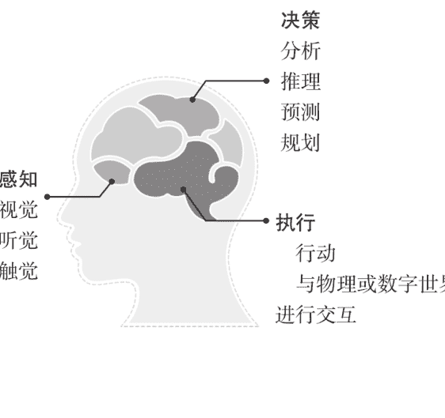

图2-1 人工智能的作用

我们先来聊聊上一代人工智能技术中特别实用的感知技术，这些感知技术就像给计算机装上了“眼睛”和“耳朵”，让计算机能像人类一样去感知世界。

很多年前就已经被发明且广泛应用的光学字符识别（OCR）技术就像是计算机模拟人类的阅读功能。对于计算机而言，一切都是图像，包括文字，因此直接使用这些文字是不可行的。OCR技术就像教计算机识字一样，通过图像识别、自然语言处理和机器学习这些方法，把图像所代表的文字“读”出来，变成计算机能看懂且能编辑的文字。比如，在日常工作中，我们会把纸质交易发票扫描下来，然后用OCR软件处理，就能把上面的文字信息提取出来，形成发票数据库，方便取用。

除了能“阅读”，计算机还能“听”。语音识别技术就是让计算机能听懂我们说的话。现在我们用微信语音聊天的时候，是不是觉得特别方便？我们发送语音，微信就能把语音转换成文字，而且还能切换成好多国家的语言，甚至连方言都能识别。这就是语音识别技术在发挥作用，语音识别技术把我们的声音信号转化成计算机能理解的文字信息，使沟通变得更加便捷。

当然还有最常见的人脸识别技术，人脸识别技术是计算机“看脸”分析的本领。不管是照片还是视频里的脸，计算机都能通过特定的算法来识别。比如说，现在很多手机都有面部解锁功能，你只要把脸对着手机，手机就能快速识别你是不是机主本人，如果是，则瞬间解锁。在安防领域，通过人脸识别技术可以快速找到特定的人，从而保障安全。

这些技术，都是上一代人工智能里特别厉害的技术，它们让计算机更好地感知外部世界，把各种信息转化为计算机能处理的数据，给我们的生活和工作带来了便利。

随着新一代人工智能技术的出现，计算机感知世界的功能更为精准和快速，且发展得更加迅速。

1997年，IBM发明的“深蓝”计算机第一次在标准国际象棋比赛中战胜国际象棋冠军，标志着人工智能进入了新的时代。2016年，谷歌旗下DeepMind公司研发的具有深度学习功能的“阿尔法狗”（AlphaGo）战胜韩国围棋世界冠军李世石；2017年，AlphaGo与排名世界第一的围棋冠军柯洁对战，以3:0的总比分获胜。人工智能的发展迎来了新高潮。

上一代人工智能侧重规则化任务（如OCR），而新一代人工智能（如生成式模型）通过深度学习实现创造性输出（如文本生成、图像合成）。新一代人工智能技术更偏重于对数据的处理分析，并给出结论，是更好、更精准、更快速地模拟人类决策的一项科学技术。2023年，ChatGPT的出现更是将人工智能技术推向了全民应用的新浪潮，开启了全新的篇章。

上面提到的AlphaGo是一款基于深度学习技术的程序，它通过自我对弈及与人类棋手对弈来不断学习和优化策略，从而做出最优决策。打个不恰当的比方，AlphaGo的决策过程就像计算机做文字填空题，有明确的“开局”（题目），也有明确的“结局”（答案），并通过分析大量数据，由计算机推演出解题过程和最优策略。而ChatGPT则更接近人类大脑，具有思考和推理功能，它类似于我们常玩的文字接龙游戏，可以进行创新和创造；与ChatGPT原理类似的知名图像生成式模型Midjourney和视频生成式模型Sora都已经具备了类人的创造性讲故事的能力。因此，我们将这种具有推理、思考、创新能力的新一代人工智能技术称为“生成式人工智能”。

新一代生成式人工智能在大量数据的基础上，更好更快地帮助人类做出更精准的决策。生成式人工智能中最具代表性、最火热的专精于处理文字的模型叫大语言模型（Large Language Model，LLM），DeepSeek和ChatGPT正是大语言模型中的佼佼者。

## 用数学函数秒懂大语言模型的基本原理

什么是大语言模型？我把它拆成3个关键字和关键词——“大”“语言”和“模型”，逐一进行解释说明，这有助于我们更为有效地把它应用在日常工作中。以ChatGPT为例，其核心是超大规模参数函数：

- **大**：参数规模达千万亿个，GPT-3含有1 250亿～1 750亿个参数，训练数据量超过45TB，GPT-4含有超过1.8万亿个参数；而DeepSeek满血版671B，通常指含有6 710亿个参数。
- **语言**：通过海量文本学习语义与逻辑，模拟人类语言表达。
- **模型**：本质是超高维非线性函数，通过数据训练调整参数，捕捉复杂模式。

我们先从“模型”开始解释。什么是模型？我们用中学数学学习的函数知识来理解，就容易得多。简单来说，模型就是复杂的函数，大多数模型都可以表示为函数关系。

```
y=f（x）=ax+b
```

我们在中学学过，已知上述函数式中的a和b的值，代入x的值，就可以计算出y的值。x是输入，y是输出。而模型与上述函数式类似，输入数据，输出结果。而大模型与函数最为不同的地方在于“大”。如图2-2所示，为了让大模型能够输出更精准的答案，根据中学数学知识，参数（a，b，c，d…）越多，结果就越精准，所以大模型其实是一个具有亿万个参数的函数式。综上，大模型的“大”，就是指参数规模大。


图2-2 猫狗识别模型

如果我们去看看大模型技术的代表ChatGPT的参数，就会发现其参数之“大”难以想象。ChatGPT的发展历程如表2-1所示。

表2-1 ChatGPT的发展历程

| 版本 | 发布时间 | 参数 | 特点 |
| --- | --- | --- | --- |
| GPT-1 | 2018年6月 | 1.17亿 | 最初的GPT模型，主要展示Transformer架构在文本生成任务中的应用 |
| GPT-2 | 2019年2月 | 15亿 | 引入了更大的模型和更多的层，显著提升了文本生成的质量和多样性 |
| GPT-3 | 2020年5月 | 1250亿～1750亿 | 参数数量是GPT-2的100多倍，展示了在多种自然语言处理任务上的强大能力，包括文本生成、翻译、摘要等 |
| GPT-3.5 | 2022年3月 | 1540亿～1750亿 | 引入了更多的训练数据和优化算法，提升了模型的性能和多样性 |
| ChatGPT | 2022年11月 | 未公开 | ChatGPT凭借插件机制扩展了自身功能，突破了传统人机对话系统的能力边界 |
| GPT-4 | 2023年3月 | 万亿级别 | 多模态模型，可以接收图像和文本信息，并生成文本回复 |
| GPT-4V | 2023年9月 | 未公开 | 专注于实现视觉输入的安全部署 |
| GPT-4o | 2024年5月 | 未公开 | 多模态大模型，支持文本、音频和图像的任意组合输入，并能生成文本、音频和图像的任意组合 |

了解了大模型的基本原理后，我们还得学习大模型是怎样被“训练”出来的。对大模型原理的进一步理解和学习，可以帮助我们有效应用大模型并认清其局限性。其实大模型的原理非常简单，我们求函数式是通过输入已知的x得到未知的y，而大模型则是通过输入大量的x，并给定大量的输出结果y，从而找到所有的参数（a，b，c，d…），大模型就是这样被“训练”出来的。这个“喂入”大量成对的“输入”和“输出”数据的过程，往往被称为“模型预训练”，也被称为“机器学习”。

以猫狗识别模型为例（见图2-3），其训练过程是由工程师输入大量的猫和狗的图片及图片对应的猫和狗的文字标签，并基于这些带标签的图片找到相应的参数，生成能够准确识别猫和狗的大模型。大模型的“大”，其实也指训练模型所用数据量“大”。

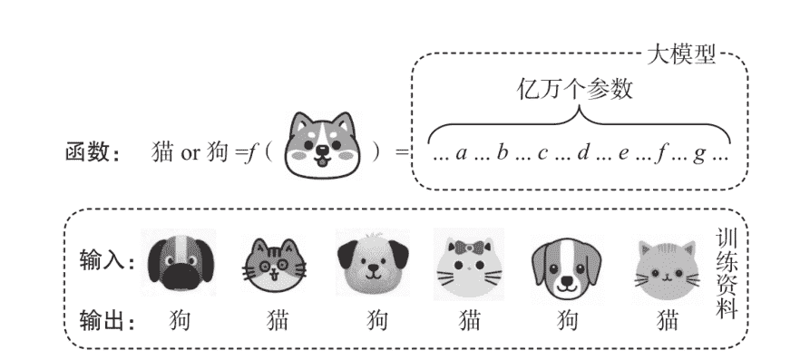

图2-3 猫狗识别模型训练学习详解

接下来，我们进一步了解大模型的代表ChatGPT的原理。前面我们已经提到，ChatGPT的原理是给出A和B，去推导C。ChatGPT已经具备了逻辑推理和创造的能力。

ChatGPT是由人类模型训练师与机器共同利用互联网上的海量数据训练而成的模型。如图2-4所示，当用户输入“你好”时，模型可能根据互联网上出现过的接龙频率反馈“高、吗、坏、帅、美”等接龙文字。ChatGPT最大的问题是，当用户每次输入相同内容时，得到的答案可能并不完全一致，或者说结果不够稳定。因此，在实际应用中，如果直接将ChatGPT用于客服机器人，很可能会产生回答偏差，导致客户投诉。因此，ChatGPT等大语言模型在个人应用领域取得了巨大的成功，比如帮助个人撰写学习总结、工作小结，甚至撰写论文、制作PPT等；但在商业应用方面，尤其是在财务管理这样专业的领域，成功的案例并不多见。那么，如何解决这个问题呢？

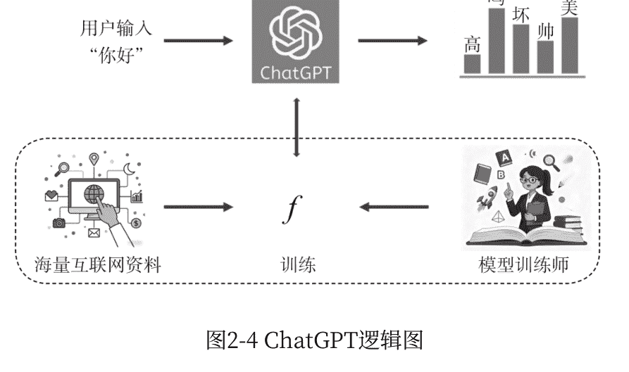

## 变通用AI为专业AI

在人工智能技术不断飞跃的今天，OpenAI精心打造的大语言模型ChatGPT，就像一个毕业于“985”高校的全能“通才”：

- **知识覆盖全面**：ChatGPT能谈文学、讲科学、聊八卦，还能写代码、编笑话，堪称百科全书。2023年4月前互联网上能查到的信息，它都知道一点（例如，ChatGPT4版本是使用2023年4月前的互联网数据训练而成的）。
- **语言天赋异禀**：能流利地使用多种语言，并根据需要随时切换，甚至还能用诗歌与用户对话。
- **逻辑思维在线**：解决问题、推理和分析能力较强，能够应对复杂的任务。

ChatGPT是学科基础扎实、见多识广的通才，是可以和你谈天说地、覆盖广阔“知识地图”的伙伴。然而，在面对特定行业的深度需求时，比如保险公司递延所得税资产（负债）的具体业务、账务处理和税务问题，ChatGPT这样的“通才”就显得力不从心了，给出的答案往往似是而非，甚至是胡编乱造的。

如何才能让无所不知的大模型在专业领域表现得一样出色，从“通才”变成“专才”呢？这时，我们就需要对大模型进行“深造”，通过模型微调（Fine-tuning）或者引入检索增强生成（Retrieval-Augmented Generation, RAG）技术，将大模型变成行业“专才”。一位从“通才”进化而来的“专才”，不仅拥有全能“通才”的基础能力，还拥有专业的知识储备，可以帮助用户解决专业领域内的复杂问题。

## 微调，让ChatGPT变成“Your GPT”

如果你期望ChatGPT这样一位知识渊博的“985高校本科通才”，能在某个特定领域达到精通的程度，那就送它去“读研深造”，攻读为期两年的专业领域硕士学位，也就是人们常说的“专硕”，使其能够专注于某一类问题的研究。而这一过程，在人工智能领域中被称为“模型微调”，简称“微调”。

微调的核心，是将大模型置于某个特定领域的“知识课堂”之中，让它重新学习专业知识。具体来讲，就是运用特定领域的数据，诸如法律文件、会计报表、财务案例、医疗记录等，乃至某个公司的具体财务和业务数据，对大模型展开训练，使其在特定领域表现卓越。

不妨想象这样一个场景：你招聘了一位清华本科毕业的“学霸”（预训练大模型），他学识渊博，天文地理无所不知，但他对公司的财务报表和财务数据却一知半解。此时，你该如何是好呢？答案是送这位“学霸”去财务部工作半年（模型微调），用公司的财报、数据、账本、审计报告及行业术语等专业内容培训他。

ChatGPT等预训练大模型，早已借助全网数据（维基百科、书籍、互联网等）掌握了通用语言逻辑。而“微调”这一操作，则是在预训练的基础之上，运用专业领域数据再次进行训练，从而使AI学会运用专业术语进行交流。

通用AI在看到“EBITDA”时，仅仅会将其解释为“息税折旧摊销前利润”，而经过“微调”后的AI，在看到“EBITDA”时，不仅能够理解其含义，还会关联行业基准值，甚至会贴心地提醒你：“同行竞争对手平均EBITDA利润率是18%，你司目前为15%，需要进一步优化。”

那么，究竟该如何进行“微调”呢？假设你是某基金公司的研究员，期望运用AI撰写行业分析报告，接下来我就为你详细讲解“微调”的具体步骤，通过四步打造专属于你的AI专家。

第一步，精心准备“教材”。高质量的行业数据是“微调”的基石。你所需要的是大量的招股书、券商研报、财务术语表、相关财务数据，甚至市场数据等，数据量至少要达到1万条。需要特别注意的是，千万不要使用朋友圈小作文、知乎上“抖机灵”的回答等这类低质量数据，因为数据质量在很大程度上决定了AI的智商，数据质量越高，AI的推理能力越强、越聪明。数据的质量比数量更重要，最理想的情况是数据量大且数据质量高。

第二步，谨慎选择“培训班”，即挑选合适的“微调”框架。对入门级用户而言，可以使用OpenAI的API，只须上传数据，就能实现自动“微调”，这种方式非常适合那些不想编写代码的“小白”；而对于技术实力较强的硬核级用户来说，Hugging Face的Transformers库是个不错的选择，用户可以根据自身需求自行调整参数。

第三步，正式“上课”，即训练你自己的AI模型。在训练过程中，务必注意学习量的设置，学习量不能过高，否则AI会“学飘了”，无法准确掌握基础知识，把“本科”学的知识都忘记了；学习量也不能过低，不然就会“学得太慢”，相当于“专硕”没好好读，影响训练效率和效果。训练轮次一般设置为3～5轮较为合适，若轮次过多，容易出现“过拟合”现象，导致AI变成只会死记硬背的书呆子。

第四步，严格“考试”，即进行“微调”效果验证。输入“分析宁德时代2023年Q3财报”这样的指令，检验“微调”后的AI是否能够准确提取“营收增长40%”等关键指标，是否能够关联“锂价下跌未传导至利润”等行业背景信息。这一环节通常需要人工参与进行评估和判断。

通过以上四个步骤，你就能成功对AI模型进行“微调”，让它从一个通用型的智能助手，转变为能够精准服务于你所在领域的AI专家，为你的工作和研究提供更加高效、专业的支持。通常上述工作需要财务专家、AI工程师以及数据科学家共同合作完成。

## RAG技术，给大模型装上“实时检索”的大脑

在人工智能领域，有时候仅依靠模型微调还不足以满足实际需求。例如，在政策法规、技术标准及公司内部流程等知识更新极快的领域，仅凭模型记忆的旧有知识，很难满足实时性的要求。此时，我们就需要赋予模型一项超能力：实时查阅资料。而这正是RAG技术的独特优势所在。RAG技术就如同给大模型配备了一个知识库，当模型遇到它“未完全掌握”的问题时，能够先在知识库中查询相关信息，再依据查到的内容生成答案。

RAG是一种能让AI变得更加聪明、回答更为精准的方法。它巧妙地将“不擅长记忆具体事实的生成模型”与“可以查资料的搜索工具”相结合，兼具高效性与智能性。接下来，我们通过简单的类比，逐步深入讲解其原理和逻辑，帮助你轻松理解。

RAG的名字可以拆分为两部分：

- **检索（Retrieval）**：通过搜索或查阅资料，从知识库中找出与问题相关的内容。
- **生成（Generation）**：利用强大的语言模型（如GPT），根据检索到的内容生成回答。

换言之，AI不再仅仅依赖自身“脑子”里（训练好的知识）的内容，还学会了查阅资料。大模型成为了手握百科工具的学者，既能思考，又能随时动手查阅资料以更新知识。

下面我们来深入探究一下RAG的工作原理。想象一下，你向一位财务同事询问一个非常具体的工作问题，比如“公司报废一台服务器该走怎样的流程？会计和税务上该做怎样的处理？”倘若这位财务同事回答不上来，他可能会采取以下步骤：

- 先前往公司资料库，查找相关的规章制度和作业流程，从中获取相关信息（检索部分）。
- 再用自己的语言进行总结，并给出答案（生成部分）。

这便是RAG的工作流程——通过查阅资料来弥补大模型可能“记不住”某些信息的缺陷。

大模型虽然功能强大，但存在两个明显的弱点：其一，记忆容量有限，模型无法记住所有知识；其二，知识具有滞后性，通常仅涵盖其训练时的数据（例如GPT-4的知识截至2023年）。若询问最新的问题，它可能无法作答。而RAG通过引入“检索”这一环节，使大模型可以随时从外部数据库中查找最新或更具体的信息，为回答提供可靠依据。

假设你是一位财务分析师，你向AI提问：“苹果公司股票在最近一个月的表现如何？有哪些因素可能影响它未来的走势？”如果是普通的语言模型（未运用RAG），它或许会这样回答：“苹果公司股票一直是市场关注焦点。过去一个月，其股价大致处于波动状态，但具体数据不太明确。影响其未来走势的因素可能有新产品发布、市场竞争等。”这样的回答较为笼统，缺乏具体数据支撑，对近期股价表现描述不准确，也未结合最新市场动态，对你而言可能用处不大。

而运用RAG的大模型的回答流程如下：

- **检索**：大模型会在财经新闻网站、金融数据平台等外部资料中进行检索。它在专业金融数据平台上获取到苹果公司股票过去一个月每日的开盘价、收盘价、最高价、最低价等详细数据，还在权威财经新闻中了解到苹果公司最近推出新产品的市场反响、竞争对手的最新动态以及行业分析师的观点等内容。例如，新闻报道中提到，苹果公司新发布的产品市场需求强劲，多家机构预测这将推动苹果公司下一季度营收增长。

- 生成：大模型结合检索到的信息，生成回答：“最近一个月，苹果公司股票开盘价为××美元，收盘价达到××美元，期间最高价为××美元，最低价是××美元，股价整体呈上升趋势。这主要得益于苹果公司新发布产品的强劲市场需求，多家机构预测该产品将推动苹果公司下一季度营收增长。然而，未来股价走势仍存在不确定性。竞争对手正在研发类似产品，可能会对苹果公司市场份额造成挑战；宏观经济环境变化，如利率调整、通货膨胀等，也可能影响消费者的购买能力和投资决策，进而影响苹果公司的股价走势。”

通过这个案例可以清晰地看出，RAG能够借助实时检索到的丰富信息，为用户提供更精准、全面且贴合实际情况的回答，这是普通大语言模型难以比拟的。

如果你想将RAG技术应用于公司内部的财务数据分析，可以参考以下三个简单的步骤：

- 收集和处理数据：准备与财务数据分析相关的知识库，可以包括公司内部的PDF、网页、文档、财务报表、数据库等，也可以包括与公司相关的外部行业数据等。然后将这些文档转化为可检索的格式（比如将内容嵌入为向量，便于搜索）。可使用FAISS（Facebook的开源向量数据库）或Milvus（Zilliz开源向量数据库）等工具来处理数据（这部分工作通常需要工程师协助完成）。

- 构建检索系统：设置一个简单的搜索工具，使其能够基于输入的问题快速找到相关文档。可使用向量搜索工具（如FAISS或Weaviate）；若需进行实时查询，也可以调用搜索引擎（如Google或Bing）的API。这部分工作同样需要工程师协助完成。

- 连接生成模型：选择语言生成模型（如ChatGPT或其他开源模型），然后将检索到的内容输入语言生成模型，由该模型生成答案。

RAG技术将实现财务信息的智能化检索和生成，提高财务问答效率和决策准确性。未来，当你输入一个财务问题时，检索系统首先会找到与该问题最相关的财务数据内容，然后将这些内容输入到语言生成模型中；语言生成模型根据输入的内容生成一个准确、有用的答案或建议，供你参考。通过智能化的问答和分析，财务管理人员可以更准确地了解公司的财务状况，识别潜在风险，并辅助制订更加合理的财务决策。

从ChatGPT的“通才”本领，到“微调”带来的“专才”突破，再到RAG技术的“查资料”能力，大模型正在一步步成为能解决高难度专业问题的全能AI助手。然而，我们也需要明白，无论是“专才”还是“通才”，都是为了满足不同需求而被塑造的。在现实应用中，我们应该根据具体的场景，选择合适的方法：如果需求明确、固定，可以用“微调”；如果需求动态多变，可以用RAG。

明明是“通才”出身，却又在特定领域深度扎根，不仅知识储备丰富，还能调用外部知识帮忙。这样的AI，不就是我们梦想中的终极智能形态吗？

# 第三章 智能财务如何创造价值

我们总是在讨论企业如何创造价值。在过去快速发展的40多年里，企业创造价值的方式主要是通过持续生产和制造，不断扩大销售收入。而40多年后的今天，一个企业如何创造价值？一个部门如何创造价值？一个员工如何创造价值？都是企业家亟需解决的重要问题。需要强调的是，并不是因为我们从增量市场转向存量市场，才开始关注价值创造。事实上，我们仍然拥有广阔的增量市场，如海外市场等。只是由于过去的发展过于迅速，才忽略了价值创造这一关键点。

## 老板眼中的价值创造

一直被认为是成本中心的财务部门，如何从成本中心转变为价值创造中心，是财务管理者必须思考的重中之重。反观日常的财务会计工作，更侧重于内部流程控制（如应收会计、应付会计、出纳等）和合法合规（如税务、簿记、统计、报表、审计等）。这些工作的确为企业创造了一定价值，但相对而言，这些价值较为有限。

曾有一位上市公司董事长与我探讨过上市公司的财务外包问题。该董事长表示，公司在上市前，其老婆担任财务总监，小姨子负责出纳工作，财务会计几乎全部外包。而上市后，财务会计团队人数一路攀升，曾高达上百人，但除了提供月报、季报和年度审计报告，他并没有感受到财务团队带来的价值增量。在过去经营状况良好的年份里，公司并不关注财务团队的规模和成本，只要有需要就招人；而在目前经营状况不佳的情况下，财务团队成了一个巨大的成本中心，难以体现其价值增量。因此，该董事长的困惑是，上市公司的财务是否也可以外包。

诚然，财务管理者会为遇到这样的老板而感到委屈。平时脏活、累活都是财务部门扛，关键时刻出了问题还需要站出来“背锅”，奖金、红包比“业务一线”少，业绩不好的时候老板突然翻脸不认人，说裁员就裁员。其实，解决这个问题的核心方法，就是让财务部门能够持续不断地创造价值。

前面章节已经提到过关于未来财务价值创造的定位理论，因此财务管理者的未来一定是以数据管理为抓手，为企业创造价值。有一次，我在全国总会计师培训班上向所有与会领导提出了一个问题：“你们公司的领导班子是不是通过财务报表数据进行决策的？”当时现场有一百多位大型央企、国企的总会计师，几乎所有人异口同声地回答“不是”。我又接着问：“那你们公司是依据财务数据做决策，还是依据业务数据做决策？”我得到的答案是“业务数据”。

显然，企业内部的财务团队如果仅进行财务报表分析，对领导班子的管理决策不会有任何实际帮助。财务数据的分析只有深入到业务层面，才能对管理决策产生决定性的意义。洞察到这一问题，财务部门数据分析的价值点便得以明确。我们需要分析的不仅是财务数据本身，更是财务数据背后的业务数据。只有这样，才能帮助领导班子发现企业发展中的问题，以及未来的增长机会，即业务增长的驱动因素。

明白了这个逻辑，价值创造的问题解决起来就容易多了。这时新的问题又出现了——“会做菜”和“做好菜”其实是两件事。在曾任职过的某公司，我们聘请过一位厨师为大家做饭，希望能吃得既健康又美味。在面试时，这位厨师自称很“会做菜”，但实际上，他做的菜不是太咸就是太淡，令人难以下咽。由于这位厨师是我们一位朋友介绍的，大家不好意思指出饭菜的问题，厨师还好奇地问我们为什么不多吃一点。所以，这位厨师只是“会做菜”，并非“做好菜”。

这与财务管理者常犯的错误一模一样。财务经理们很喜欢制作表格，也很喜欢查看表格。但是，企业的决策者往往希望看到更加直观的内容，比如简单易懂的图表；他们并不愿意面对一堆枯燥乏味的表格，然后像财务人员一样花费大量精力去挖掘数据之间的关联关系。

一位担任大型国企一把手的朋友曾经向我抱怨她的财务总监。财务总监每个月的汇报都是厚厚一叠几十页的文字和表格。每当她提出新的问题时，这位财务总监又会再整理一堆表格进行补充说明。现在每月的汇报已经从最初的十几页增加到几十页，未来甚至有可能达到一百多页。我的朋友几乎感到绝望，因为她想要的和她实际得到的相差甚远。

财务团队通过数据分析为决策者创造价值增量，因此必须了解决策者需要的数据分析形式。数据分析的核心在于让决策者看懂、看明白，而非仅供专业财务人员理解。就像一位大厨，不仅要“会做菜”，更要“做好菜”，即符合客人的口味。为此，我特地进行了一番调研，发现大多数企业决策者更倾向于接受可视化的数据分析形式，例如图片。这也解释了为什么许多人认为同等价位的电动车比汽油车更高级，因为客户看到的是易于理解的“图”，而不是需要学习和理解的“表”。

当我们明白了如何创造价值，同时明白了客户的需求时，接下来的问题就是如何“高效”地创造价值。有意思的场景经常发生在企业内部。例如，总经理要求财务总监提供一份全新的数据分析表。财务总监在了解总经理的数据需求后，通常提出的第一个问题是：“领导，这个报表您着急要吗？大概什么时候需要？”这个看似平常的提问，细细想来，问题却不小。这就好比客人去饭店吃饭，点了一份宫保鸡丁和一份鱼香肉丝，并提出“免葱、免蒜”的要求。大厨确认需求后问客人：“您能等多久啊？一个小时还是两个小时？”客人多半会立刻换饭店。而财务人员往往没有意识到这一点。对企业决策者而言，数据的及时性比精确性更重要，企业决策者并不拘泥于几块钱的细节。

## 分解价值创造全过程

那么，财务部门应当如何创造价值呢？分三步走：

- 第一步，通过财务数据联动业务数据，挖掘业务数据的价值。
- 第二步，向企业决策者提供具象化、可视化、易于理解的数据分析结果和建议。
- 第三步，提高数据分析结果的提供速度，将决策者需要的数据高效地呈现给他。

为完成上述关键的三步，我提供了一个简单有效的方法论。如图3-1所示，我形象地用农田里的麦子如何快速变成一碗客人爱吃的重庆小面的“五步”流程图，来诠释如何将企业数据转化为能够为决策创造价值的数据。

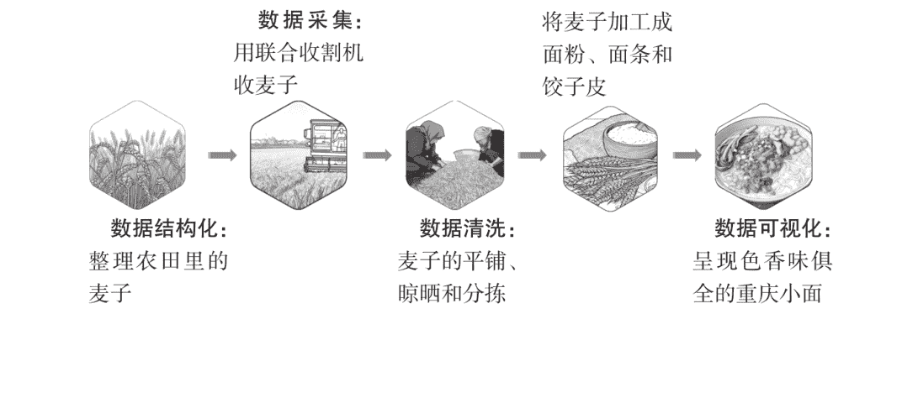

### 第一步，数据结构化：整理农田里的麦子

我们将企业数据比作“农田里的麦子”——形态各异。如果想要快速收割麦子，除了需要好的收割工具，还需要麦子长得整齐划一。也就是说，企业内部数据最好是标准化、格式化的。

我们首先需要了解企业数据存放的形态。企业数据存放主要包括三种形态：结构化数据、半结构化数据和非结构化数据。

结构化数据通常是指已经存放于各个应用系统中，可以被IT系统轻松用机器读取和调用的数据，如财务系统中存放的会计数据、业务系统中存放的订单数据、采购系统中存放的采购数据等。这些数据的共同特征是有规律且结构化，易于被机器读取。

半结构化数据在财务部门最为常见，比如财务团队每个月编制并存放在云端的Excel财务分析报表，以及编写的有关财务分析的PPT等。尽管这些数据已经以数字化形式存在，但由于缺乏规律性和结构化特征，因此不易被机器读取和调用。

第三种是非结构化数据，最常见的是各种纸质形式的财务单据，如发票、订单和采购合同等。这些资料完全依赖“人眼”识别和“人工”提取数据。

看到这里，读者应该已经明白我们下一步应该做什么了。企业必须把所有数据变成结构化数据，这样才有机会高效地读取（收割）并分析（使用）这些数据（麦子）。

那么，如何高效读取并分析这些数据呢？

这里我要提到的第一项技术就是“电子档案”技术。“电子档案”是一个非常实用的工具，虽然它无法将非结构化数据直接转换为结构化数据，但它能够使资料变得“触手可及”。举一个常见的例子，如果一家大型企业需要查找一张2022年的发票，财务人员可能需要前往外部仓库，经过一番翻找才能找到这张纸质发票。使用完后，还需要花费时间将其归还原处。然而，企业引入电子档案系统后，就像“步步高学习机”广告所说的那样，可以实现“想看哪里，点哪里”。这样一来，企业查找相关资料的时间大大缩短，效率显著提高。因此，我通常建议所有企业建立电子档案系统，让企业内部的信息（数据）流通更加快速高效。

第二项技术是第二章里提到的OCR技术。通过OCR技术，企业可以将电子档案轻松转化为计算机能够读取的文字（半结构化数据）。电子档案技术将非结构化数据转化为电子档案，而OCR技术则将电子档案转化为计算机可读的文字。两者功能叠加，工作效率就“起飞”了。

第三项技术就是第二章中提到的生成式人工智能，通常被称为“大模型”。前两步实际上是将非结构化数据转化为半结构化数据。生成式人工智能的大模型则能够帮助我们分析和整理这些半结构化数据，将其转化为结构化数据。

通过上述流程，我们可以将纸质采购合同扫描成电子档案，再通过OCR技术读取电子档案中的文字，并将其保存为非结构化数据。随后利用生成式人工智能大模型，将采购合同中的关键数据逐一提取并整理为可用的“结构化采购合同数据库”。这样不仅能够提取常用的采购数据，如甲乙双方名称、地址、银行账号、采购金额、付款账期等，还能提取更多平时不被关注但可能影响业务执行结果的信息，例如一些隐藏的特定法律条款（如违约执行地点等）。通过这一流程生成的“结构化采购合同数据库”与采购系统保存的数据完全不同。采购系统仅记录合同中必要的采购数据，而根据上述步骤形成的数据库，则可以收集企业各个部门所需的各种数据，如财务部门需要的结算数据、法务部门需要的法律条款数据等。相比特定的采购系统，该数据库采集的数据覆盖面更广，便于查找和分析所有细节性数据。

以上三步，完整经历了从非结构化数据到半结构化数据，再到结构化数据的处理过程，从而构建出企业的数据基底。

这里我想特别夸赞一下我们税务系统的创新“三流合一”。税务局帮助我们梳理了企业经营的三大要素数据流程，即合同流、发票流和资金流。在我们拥有网银后，资金流已经全部实现“电子化”，即资金流的数据已属于“结构化数据”。“发票流”则因税务局推动的数电发票，很快也将转为“结构化数据”。很多年前，我就一直倡导用“电子档案”系统来记录发票数据，这不仅是为了查询方便，也可以给企业内控以及税务管理带来巨大的便利，后面我会详细解释这一点。因此，针对“合同流”，我建议大家千万不要等所谓新一代的电子合同、区块链契约锁等技术出现后再去解决问题。其实，我刚刚提到的“三步走”就能解决“合同流”数据结构化的问题。一旦合同、发票、资金这三类数据在结构化层面被打通，就能为企业发现和释放数据价值奠定坚实的基础。

### 第二步，数据采集：用联合收割机收麦子

用联合收割机收麦子的过程对应企业的数据采集过程。

在数字化时代，企业面临的最大问题是什么？企业数据分散存储于各自的系统中，例如合同执行数据存放于业务系统，订单数据存放于订单系统，采购数据存放于采购系统，财务数据则存放于财务系统。通常情况下，各系统之间互不相通，彼此之间没有连接。企业中常见的情况是，财务部门每到月底需要与销售部门花费大量时间核对应收账款数据，其主要原因在于，财务的应收账款数据来源于财务系统，而销售的应收账款数据来源于业务系统，二者并非出自同一数据源，导致数据未能对齐。因此，企业内部各部门往往需要耗费大量人力和时间进行数据核对、搬运和对齐工作。

我们需要思考，如何实现数据的无缝衔接。比如在上面提到的月末应收账款核对案例中，财务部门的主要工作是将财务系统中的数据导出为Excel表格，与销售部门从业务系统中提取的销售数据表格进行手工核对，找出差异后，再在财务系统中手动修正相关数据，或者由销售部门手动修正差异至业务系统。通常还需制作一套手动核对表格来记录核对结果。显然，这一过程存在大量的手工作业和跨部门协作，工作量大且每月重复进行。这显然不是一种高效的做法。而类似的情况在企业内部屡见不鲜，例如在采购、报销等流程中，同样存在大量类似的“手工”工作。事实上，“人类员工”在公司内部流程中往往充当着“数据搬运工”的角色。这正是实现数据打通和对齐的最原始方式——“手工搬运”。

最近几年里，我们也看到了新工具的出现，比如流程自动化机器人（Robotic Process Automation, RPA）。工作中使用的RPA，其原理类似于游戏中的外挂程序。它重复地执行“打怪升级”的动作，代替玩家完成简单重复的操作，从而高效完成任务并快速提高玩家等级。因此，尽管RPA的标准名称是流程自动化机器人，它最擅长的事情却是数据搬运。仔细想想，在信息化时代，完成流程的每一步，本质上不就是提供系统可以接受的数据吗？人类员工做的是数据搬运，RPA也是如此。在后面的章节中，我会详细解说RPA，所以这里暂不进一步展开。这便是我要介绍的第二种数据搬运方法。

最简便的数据搬运工具来了。我要介绍的工具叫应用程序编程接口（Application Programming Interface, API）。顾名思义，它是编程时用来打通两边甚至多边系统的“标准化数据接口”。你可以把它想象成一根连接两个容器（系统）的管道，使两个系统中的数据能够按照一定标准实现单向或双向流动。

用日常生活中最常见的手机支付就能很好地说明什么是“接口”。无论你使用哪个平台购买商品，在最后的支付环节往往都会跳转至“微信”或“支付宝”的支付界面，只需输入密码即可完成支付结算。在这个过程中，支付数据通过背后看不见的“管道”（接口）从平台无缝传输至“微信”或“支付宝”，从而方便用户完成结算。

企业中最常见的接口应用是“银企直连”。财务部门的最佳策略是借助API将财务系统、资金系统、预算系统、采购系统、报销系统、业务系统乃至办公系统全部连接起来，从而使数据收集变得既高效又精准。

API方法的主要缺点在于需要依靠IT资源支持系统接口开发，即需要投入资源来开发和构建连接两个“容器”之间的“管道”。这不仅考验IT开发能力，还取决于“容器”（系统）本身是否能够提供接口。因此，相对而言，其IT成本（包括开发时间）较高。

总结一下，现阶段财务人员在收集、搬运及对齐数据方面有三种解决方案。

- 第一种是最原始且最耗时费力的做法，即完全依靠人工完成数据的收集、搬运和对齐。
- 第二种是我最推荐的高效方案，即通过API将系统与系统直接对接，使数据实现高效甚至实时地交互。
- 第三种是RPA方法。第一种方案完全依靠“人”，第二种方案依靠“机器”，而第三种方案则是“人”与“机器”结合，从而快速完成数据收集和对齐工作。我认为，这在当前的过渡阶段是一种高效且可行的快速解决方案，但长远来看，我们终将转向“接口”方案。

### 第三步，数据清洗：麦子的平铺、晾晒和分拣

我不是农业专家，所以无法深入讨论晒谷的过程。我只是将企业内部财务数据的分析过程类比麦子“平铺、晾晒和分拣”的过程。在我看来，两者背后的原理非常相近。财务人员在做数据分析时，第一步往往是制作一张数据量很大的Excel表格，涵盖各个数据源，这就好比“平铺”；第二步是将大表格中的数据进行整理和分类，这就好比“晾晒”；第三步则是通过各种工具提取有用的关键数据，进行数据分析，这就好比“分拣”。因此，我们需要思考如何高效地实现数据分析和价值挖掘。

在这个环节，我们注意到许多企业存在一系列问题：

- 各部门数据重复开发，浪费存储和计算资源。
- 数据标准不统一，导致使用成本高。
- 业务数据孤岛问题严重，数据利用效率低。

这里我先不立即给出问题的解决方案，让我们看看企业内部常见的现象。

当企业总经理发现当月财务数据突然出现异常，比如销售收入骤降30%，他会非常紧张。总经理的第一反应往往是去找财务总监询问：“这个数据到底出了什么问题？”财务总监则会找到负责财务分析的同事，组织他们迅速调查原因。

财务分析同事通常会先从财务系统中提取实际销售收入数据，编制成一张Excel表格，然后请IT部门协助从业务系统中提取同期的业务收入数据明细，生成另一张Excel表格。财务同事会熟练运用Vlookup、Find等Excel高级函数，将这两张表格合并成一张更大的表格。之后，他们在这张大表中使用各种工具和函数进行筛选、核对、对齐和分析。经过一番努力（有时需要较长时间），得出分析结论后向总经理反馈：“原来我们某个品类的商品销售额比同期下降了50%，主要集中在江浙沪一带。”

但往往故事并没有结束，总经理马上会提出新的问题：“那么具体有哪些客户的销售额出现了下滑？”于是，新问题又来了。财务分析员随即进入客户系统提取数据，生成一张新的大型Excel表格，再经过一番复杂的函数与工具处理，整合出一张新的表格，然后向总经理汇报：“原来是这几个客户。”

这时，总经理可能会继续提出一堆新问题，财务分析员又要到各种系统中寻找数据，周而复始，重复劳动。

我们发现了一个有趣的现象：整个流程需要反复从各种系统中抓取数据，生成大量表格，然后通过Excel拼接成庞大的汇总表，进行校验、对齐和数据分析，最终推导出结论性的数据表格。随着分析工作的推进，表格变得越来越大、越来越复杂，分析周期也随之延长。每个月我们都在重复劳动。讽刺的是，我们每次都会以“这些表格可能下个月还会用到”为由将它们保存下来，但实际上这些表格几乎从未被再次调用。

我很久之前就在思考如何解决这个复杂且低效的工作问题。既然总经理的想法多变，我们为什么不能把数据集中存放呢？与互联网公司相比，我们公司的数据规模并不大，各种系统平台使用的数据库也相同。那么，为什么不能将所有订单数据、客户数据、采购数据逐条整合到财务系统中呢？于是，我把这个问题提给了IT负责人，并进行了深入讨论。最终得出的结论是，这个想法无法实现。为什么呢？其实道理很简单。从10年前到现在，我们业务系统中的数据要素，随着客户和业务需求的不断变化，以及前端销售渠道（如抖音等）的不断增多，业务数据的颗粒维度变得越来越多。10年前，业务系统中的业务数据只有100多个颗粒维度，现在已有超过400个颗粒维度，这意味着Excel表格中的“列”已从100多列扩展到了400多列。

在日常工作中，我们会根据业务发展的需求，不断更新业务系统。如果将所有数据同步到财务系统，我们就会面临一系列新问题：“这些数据如何同步到财务系统？是否存在重复作业？财务系统是否需要随着业务系统的更新而及时调整？……”这些问题难以高效且自动化地解决，同时还会引发数据复核和对齐的新需求。

另外，这样做的话，只要业务系统更新，财务系统就必须同步更新；如果其他相关系统有更新，财务系统就需要更新。这不仅会大幅提高财务系统的运营成本，更重要的是，在实际操作中几乎无法实现。到目前为止，还没有一个“大而全”的财务系统能够做到这一点。

这里我要提到“数据中台”这个概念，当然，此处仅是借用“数据中台”的核心理念，而非系统性讲解。传统Excel的方法耗时耗力，如何高效地提取和分析有价值的数据呢？“数据中台”的理念正是解决数据问题的不二法门。

“数据中台”的理念就是在财务系统、业务系统、客户系统等系统上构建一个“数据库关系层”。这个“数据库关系层”由多个具备特定功能的数据库构成，这些数据库的作用是建立跨系统的索引，便于通过IT技术实现数据的直接调用和查询。一旦遇到总经理询问数据的情况，“数据中台”提取数据的逻辑和传统Excel的方法完全不同。

我们设定一个场景，财务系统中只有一条销售数据记录：“2024年11月9日销售收入1000万元”。业务系统中，2024年11月9日有三笔业务数据记录：
- 编号A001，300万元。
- 编号A002，500万元。
- 编号B003，200万元。

Excel的思路是从财务系统和业务系统中各提取一个Excel表格，然后手工合并成一个大表，再用函数公式建立数据联系。而“数据中台”的逻辑，则是在“数据库关系层”建立一个“索引数据库”，如图3-2所示，这个数据库里会有以下数据记录：
- 索引号甲，编号2024年11月9日，财务系统。
- 索引号甲，编号A001，业务系统。
- 索引号甲，编号A002，业务系统。
- 索引号甲，编号B003，业务系统。

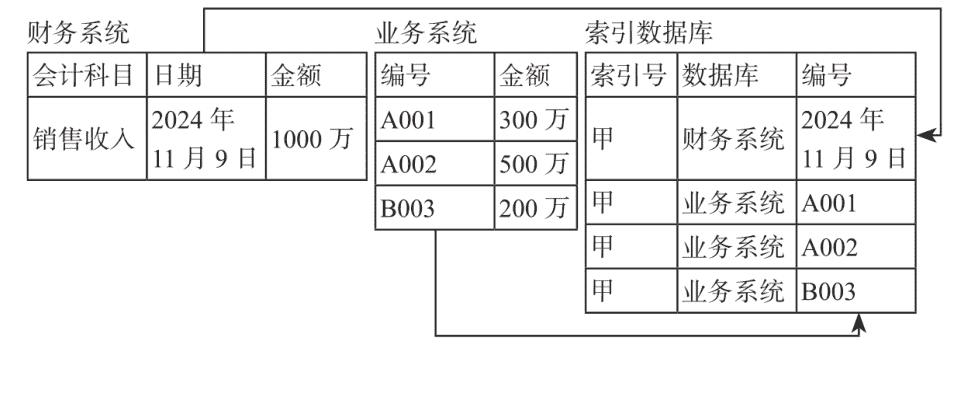

图3-2 建立索引数据库

只要调取日期“2024年11月9日”，索引数据库就会提供业务系统的编号“A001、A002、B003”。

这样提取数据是不是方便快捷很多？只要在“数据中台”建立各种索引数据库，通过各个维度建立系统间的“索引”关系，再运用IT写段代码，就可以非常方便、高效地提取数据，再也不需要制作大量的Excel表格了。

特别注意，我只是借用了“数据中台”的逻辑和概念，并非介绍真正意义上的“数据中台”实施过程。通过类似“数据中台”的逻辑，我们可以建立各系统之间的数据索引关系（索引数据库），将所有数据对齐，并通过简单的代码编程，大大提高管理者提取和分析数据的效率，避免重复劳动和冗余工作。

需要强调的是，广大的财务人员在新一代人工智能时代，千万不要再固守原有的Excel思路。因为Excel思路的最大问题在于数据要素的维度（尤其是列宽）缺乏扩展性。而在数字化时代，系统平台日新月异，数据要素的维度也在持续增加。就像建造高楼，如果地基没打好，后续想要扩建，依靠原有技术实现的可能性就会非常低。

### 第四步，数据建模：将麦子加工成面粉、面条和饺子皮

加工过程至关重要。如果我们要快速为客人端上一碗面条，就必须提前准备好面条，而不是等客户点单时才跑到地里收割麦子、磨面、加工制作。

这里我又要引用一个新的概念，叫“数据建模”。当然，这里仍旧只是概念借用，不作深入讲解。平时我们在用Excel制作资产负债表、利润表、应收账款账龄分析表等各种表格时，都会预先设置函数公式，只需刷新一下，便可将数字更新至目标期间。这种预先设置函数公式的方式，可以视为最简单的“数据建模”。通过预先设计好各种数据关联规则，从客户维度出发，我们可以获取客户信息数据、月度消费数据、每笔消费订单数据及每笔订单内的产品数据；从财务维度出发，我们可以得到每年、每季、每月的销售收入数据、每笔订单数据，及每个客户的采购数据。“数据建模”可以理解为快速开展数据分析和数据挖掘，并产出数据洞见的有效方法。

### 第五步，数据可视化：呈现色香味俱全的重庆小面

一碗再好吃的面条，也要看上去让人充满食欲。餐厅通常会在面条上放些葱花和辣椒作为点缀，使面条看上去红红火火、热气腾腾、色泽鲜艳。只有具备视觉冲击，客人吃起面条来才会更津津有味。同样，在提供给决策者的报告中，我们也需要借助“可视化”工具，让数据以更直观的方式呈现，便于决策者更快速地理解信息。这里就要提到新的工具——BI（Business Intelligence，商业智能）工具。BI工具可以简单理解为一种可视化展示工具或看板工具。通过搭建“数据模型”，借助“数据中台”，直接从后台系统和数据库中抓取相关数据，以“可视化”的方式展示给数据使用者。在Excel时代，财务报表以表格形式呈现；在智能化时代，财务报告则用图形展示。这就像DOS操作系统与Windows操作系统的区别。后面章节我会讲解BI的应用场景，具体操作细节不做展开。在实际应用中，由于数据来源可能多样化，财务部门需与IT部门协作，共同构建报表模板。

总结一下，麦子从农田到餐馆变成一碗美味的重庆小面需要经过5个步骤：整理麦子，收割麦子、晾晒分拣、加工，最终做成色香味俱全的重庆小面。这里要强调一点，客户的诉求不仅是品质好，而且要速度快。企业内部数据分析的逻辑也是一样。
- 第一步，数据结构化，可借助“电子档案+OCR+大模型”等工具和技术。
- 第二步，数据采集，由“人工收集+RPA+API”完成。
- 第三步，数据清洗，可借助“数据中台”。
- 第四步，数据建模。
- 第五步，数据可视化，可借助“BI+大模型”等工具和技术。

## 业财融合的成功案例

给大家展示一个真实的案例。图3-3展示了一家保险公司的应收账款统计分析可视化图表，即数据分析看板。看板上不仅涵盖了与应收账款相关的财务数据，还包含了相关的业务数据。

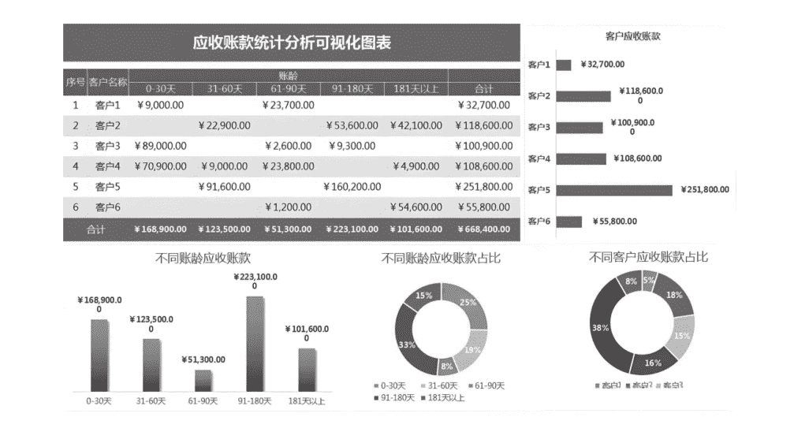

图3-3 应收账款统计分析可视化仪表板

期初的应收账款数据来自财务系统的财务数据，期末的应收账款数据则来自业务系统的业务数据。需要强调的是，业务系统中的所有数据已通过“数据中台”与财务系统的数据实现对齐。看板上典型的业务数据包括账龄和账龄监控仪表盘。通过监控仪表盘，可以实时监控账龄为0～30天、31～60天、61～90天、91～180天、181天及以上的应收账款情况。我们可以通过看板监控每个客户的应收账款和账龄情况，并按各种维度进行分析和展示。通过这个看板，我们还能设定阈值，当数据超过阈值时，系统会自动触发预警。

在此之前，我们在每个月召开应收账款管理会议时，财务部门和业务部门一见面就会争论谁的数据是正确的。双方都拿出自己的数据并花费大量时间进行核对。因此，每次应收账款管理会议的效率都非常低，大部分时间都耗费在争吵和核对数据上。

现在，我们的应收账款管理完全依靠数据分析看板，该看板由财务部门牵头设计，与IT部门合作实现，不仅大幅提高了数据准确性，还确保了业财数据的一致性。业务部门和财务部门不再担心数据不匹配的问题，因为系统每天会自动校验并对齐数据。业务部门甚至不再需要自行制作应收账款管理表格，完全依靠这套看板进行管理，效率反而比以前更高。财务部门也不必再像过去那样花费大量精力手工制作各种表格。

如今，无论是业务部门还是财务部门，主要精力都集中在利用数据改善和优化应收账款管理，从而改善公司的经营状况。通过这样的创新，财务部门帮助业务部门增强了应收账款管理能力，提升了工作效率，使客户回款越来越快，坏账率越来越低。财务部门无疑为企业创造了实实在在的价值。这正是真正意义上的业财融合，帮助企业实现价值增长。

自20多年前入行开始，我就听说财务领域要实现“业财融合”。我参加过各种培训，也读过许多相关书籍，甚至走访过不少优秀企业，学习他们在“业财融合”方面的实践经验。然而，真正做到“业财融合”的企业却寥寥无几。经过我的考察与分析，我发现真正能够实现“业财融合”的企业有一个共同特征：不仅在系统上的投入巨大，在数据上的投入更大，且各个系统间的数据必然是互联互通的。因此，“业财融合”的基础在于业务和财务数据的打通。前文所阐述的正是如何实现业务和财务数据的打通，并通过数据分析来创造应有的价值。

# 第四章 重复性工作的智能化：以应收账款管理流程自动化为例

应收账款核销是企业财务部门日常工作中最重要、最烦琐且重复性最高的工作之一，主要涵盖三个作业步骤：银行流水数据下载、应收账款核销和账务处理。传统的人工处理不仅流程慢，还容易出错，由此引发的财务风险不容忽视。因此，将应收账款管理全流程“自动化、智能化和共享化”已成为财务管理的必然趋势。我们在2019年成功实施的“应收账款核销机器人”项目，正是这一趋势的代表性案例。本文将详细探讨该项目的实施背景、技术解决方案及其显著成效，希望为企业实现财务流程自动化提供借鉴。

## 回顾烦琐的手工流程

首先，让我们回顾一下改造之前的“应收账款核销”作业流程，即企业内部的标准流程。一般分为三个步骤：①银行流水数据下载；②应收账款每日数据在业务系统中的核销；③应收账款数据在总账系统中的账务处理。作业通常涉及五类系统，包括：一类外部系统——银行网银系统，通常涉及多家银行；四类内部系统——CRM（客户关系管理）系统、业务系统、总账系统和邮件或办公系统。同时还涉及四类人员，包括客户、客户经理、银行人员和内部财务人员（出纳和应收会计），如表4-1所示。这部分工作看似简单，但实际上耗时费力、重复且烦琐，且无法为公司创造业务价值。

表4-1 “应收账款核销”作业流程

| 三个步骤 | ①银行流水数据下载 ②应收账款每日数据在业务系统中的核销 ③应收账款数据在总账系统中的账务处理 |
| :--- | :--- |
| **五类系统** | • 银行网银系统<br>• CRM 系统<br>• 业务系统<br>• 总账系统<br>• 邮件或者办公系统 |
| **四类人员** | • 客户<br>• 客户经理<br>• 银行人员<br>• 内部财务人员（出纳和应收会计） |

(1) 银行流水数据下载：每天早晨，我们各分公司的出纳进入办公室后的第一项工作，就是打开电脑，下载截至前一个工作日的各银行流水数据，记录到不同的Excel表格中，并手工将各银行不同格式的Excel表格合并为统一格式的“每日银行流水报表”（一张更大的Excel表格）。

这项工作听起来并不复杂，但实际上操作步骤很多，而且重复烦琐。以其中一家公司的出纳工作为例。每天早晨，出纳从保险柜中取出6个不同银行的USB Key，依次插入电脑（之所以依次插入，而不是同时插入，是因为不同银行的USB Key在同一台电脑上可能会引发系统冲突，导致电脑死机）。随后，逐一登录各银行的网银，输入密码，下载以Excel格式记录的银行流水数据文件，并将其保存到对应的文件目录。接着，出纳手工将6个不同银行、不同格式的Excel文件合并为一个统一格式的更大的“每日银行流水报表”，再将“每日银行流水报表”中的数据和每个银行的网银余额进行核对，以确保数据准确无误。

以上这个过程通常需要出纳花费至少1个小时来完成，平均用时约2个小时。大致的银行流水下载与报表制作流程如图4-1所示。整个过程中，出纳的手工工作量巨大；由于日常工作较为琐碎，且常被各种事情打断，因此报表出现差错的概率较高。

(2) 应收账款每日数据在业务系统中的核销：应收会计在出纳完成工作后，根据出纳提供的“每日银行流水报表”中的银行收款信息，与业务系统中的应收账款明细进行一一匹配并核销。

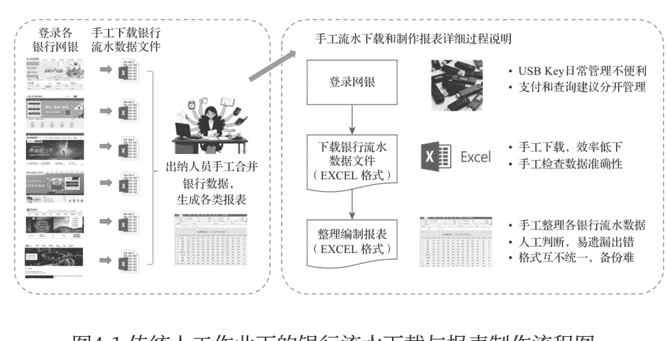

同样，以这家公司的应收会计工作为例。每天在接到出纳关于前一日的“合并每日银行流水报表”已完成的通知后，应收会计会先从业务系统下载截至当日的“应收账款明细”数据表格，同时从CRM系统下载最新的“客户信息”数据表格，手工将两份表格合并成包含客户名称及其对应客户经理信息等重要数据的应收账款明细“中间表格”。然后，基于“中间表格”，运用Vlookup等Excel函数工具，与“每日银行流水报表”数据进行核对并匹配。

根据人工匹配核对的结果，应收会计会与客户经理进行沟通和确认，随后进行业务系统应收账款的核销处理及总账系统中的账务处理。在这个过程中，应收会计的沟通确认工作是最为烦琐且重复的（见图4-2）。

在我们公司，应收账款核销工作有一套严格统一的文字标准和流程。因此，在准备推行自动化时，大家普遍认为，由于各下属公司职能一致，应收账款核销工作的作业内容和流程也应该是一致的。然而，实地调研结果却显示，各下属公司的具体做法并不相同。

有的下属公司的应收会计，运用自建的“中间Excel表格”进行匹配核对后，按不同客户经理整理成多个Excel文档，通过邮箱分发给客户经理，等待确认。而有的下属公司的应收会计，则是按不同部门团队进行整理，将邮件群发给相关部门全员，等待客户经理主动认领和确认。这两种方法的结果相对精准，但客户经理的回应时长决定了应收账款匹配核销周期。

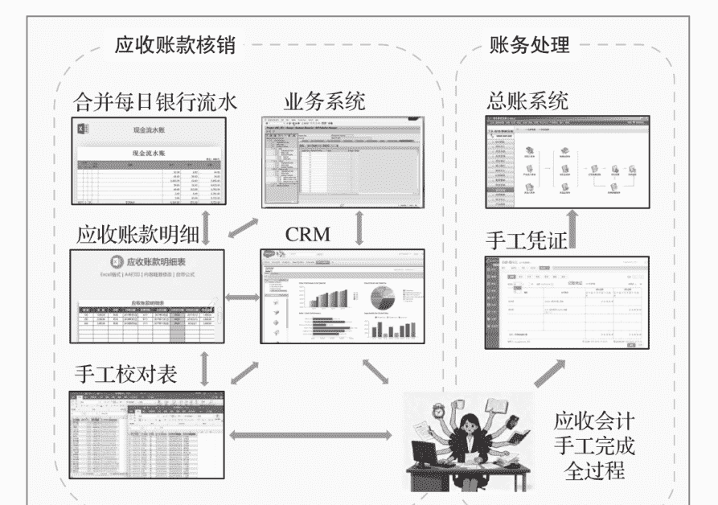

图4-2 传统人工作业下的应收账款核销流程图

当然，自认为比较熟悉业务的应收会计会直接根据自己的经验进行匹配核销。在实在搞不清楚时，再打电话和客户经理逐一确认。这样做的好处是快，坏处是容易出错。

也有服务态度特别好的应收会计，逐一打电话给客户经理确认，服务看似殷勤到位，但完全牺牲了效率，结果精准但非常低效。调研后发现，一个看似统一的应收账款核销流程，由于不同员工的作业习惯和方法不同，其效率、精度、结果、工作量和客户满意度均存在差异。甚至每个人设计和使用的“中间Excel表格”也因个人习惯不同而形式各异，难以想象后期追踪管理的复杂程度，更不用说人员交替时，这些工作的交接会有多困难。

**(3) 应收账款数据在总账系统中的账务处理：** 这是最后一步，应收会计根据客户经理的反馈信息和数据，在业务系统中手工核销已确认匹配的应收账款，然后将业务系统中应收账款核销的账务信息手工传递到总账系统中，进行相应的“半自动化”应收账款账务处理。这部分工作相对简单且统一，只是需要每天重复进行人工劳动。

## 流程的痛点：周期长、大量重复工作

我们从时效和岗位两个维度，对应收账款核销的整个作业流程进行了统计和分析。

第一，每日下载银行流水数据。出纳手工登录网银下载银行流水并合并整理数据，若按每日上、下午各执行一次计算，每次平均耗时约2小时。这项工作不仅数据量大、烦琐重复，而且容易出现差错。我们需要思考是否有更好的解决方案和手段来替代这一手工流程，使银行数据收集过程实现全自动化且更加精确。

第二，应收账款数据匹配工作。应收会计需要根据更新的银行流水数据与客户经理进行电话或邮件沟通，对应收账款信息进行匹配，形成各种“中间Excel表格”。这个过程不仅沟通成本高、效率低，还影响核销时效及内部客户体验。这部分工作最为耗时，每天平均需要4个小时以上。我们需要思考是否有更便捷的工具来提高沟通效率。

第三，应收账款核销和账务处理。应收会计需手工登录业务系统进行逐笔核销，并根据核对结果在总账系统中生成相应的账务凭证。这部分工作每天耗时约2小时，且日复一日重复操作，非常容易产生人为差错。这两个步骤是应收会计岗位的主要工作，其本质就是数据在不同系统之间的传递和对齐。我们需要思考如何设计高效且安全的自动化数据传输路径，将确认后的数据按照要求传递到业务系统和财务系统，并确保各系统间数据对齐。

仔细分析传统的应收账款核销作业流程可以发现，出纳和应收会计的手工工作量巨大。数据收集、交换、匹配、确认、传输和对齐等环节不仅使用了大量“中间Excel表格”，还需借助邮件、电话和纸质文件，耗费了大量人工工时，整个过程也极易产生人为差错。整个应收账款核销作业流程符合“大量重复”和“规则明确”这两个原则，因此非常适合采用“自动化+智能化+共享服务”的理念，实现标准流程自动化。

## 解决方案：自动化+智能化+共享服务

我们接下来看看“自动化+智能化+共享服务”是如何在具体的应收账款核销作业流程中实现的。

2017年，我们率先尝试采用机器人流程自动化（Robotic Process Automation，RPA）技术来收集数据、衔接系统和传输数据。由于RPA自身存在局限性，且后期需要大量更新和维护工作，2019年，我们尝试将RPA改造为定制化“代码”，通过系统接口收集数据、衔接系统和传输数据。我们依然习惯性地将这些“代码”称为“机器人”，这种拟人化的表述可能更容易让大家理解。

### RPA的原理

RPA的原理可以简单理解为：通过模拟人类在计算机上的操作，将重复性强、规则明确的任务交由“机器人”完成，从而实现流程自动化和效率提升。其逻辑就像游戏“外挂”的自动执行机制，可以总结为“模仿+规则+自动化”。

RPA利用屏幕抓取和图像识别技术，精准识别软件界面中的按钮、文本框、菜单等元素，并为这些元素赋予唯一标识，便于后续操作。通过可视化界面或编程语言，RPA将任务分解为一系列操作步骤，如“打开应用”“输入数据”“点击按钮”等，并将这些步骤编排成自动化流程，形成可执行的脚本。“机器人”按照脚本模拟人类的鼠标点击、键盘输入等操作，自动执行任务。它能够处理结构化数据，例如从表格或数据库中读取数据，并将其输入到目标系统中。同时，RPA支持基本的数据处理和逻辑判断功能，能够根据预设条件（如数据校验、分支选择）进行智能决策，确保任务的正确执行。

RPA的核心优势在于无需修改现有系统架构，即可快速部署和扩展自动化任务，大大提高工作效率和准确性，降低人力成本。在执行过程中，RPA会记录详细的操作日志，便于后续监控和问题排查。同时，它可以实时反馈任务进度和结果，确保了过程控制的透明度和可追溯性。

但RPA并非真正意义上的人工智能。它没有自己的“大脑”，基本靠“死记硬背”来工作。它擅长处理重复劳动，但不会创新。比如，你让RPA每天下午三点去一个网站下载报表，它会执行得非常到位，但如果你更改了网址，或者数据结构发生了变化，它就“傻”了——因为你没教它这些情况该怎么办！RPA更适合结构化的工作，但对复杂逻辑束手无策。举个例子，RPA在处理核对发票数据这种一对一的规则化工作时表现出色，但如果遇到需进行情绪分析的客户来电投诉情况，则仍需人工介入。

### “机器人员工”的全新作业流程

每天早晨，在“人类员工”上班前，**“现金机器人”**（即定制化代码）会模拟人工操作（即自动执行模拟出纳工作的代码），调用电脑中存放的查询密码，并依次识别插在电脑上的网银USB Key，按顺序登录不同银行的网银系统，自动抓取银行流水数据，将数据整合与格式统一后，存入“银行流水”数据库。

当“现金机器人”完成工作后，**“应收账款核销机器人”**（即模拟应收会计核对工作的代码）将自动触发。该机器人会根据汇款人、币种和金额等关联业务数据，与业务系统的应收账款数据进行智能匹配，随后通过业务系统接口（API）自动完成应收账款的核销操作。

对于原来需要人工确认匹配的收入记录，“应收账款核销机器人”会根据付款人信息进入CRM系统，自动寻找对应的客户经理，发起线上确认流程（OA）并发送邮件。随后，该机器人会自动采集客户经理反馈的数据，并根据应收账款、暂收款、营业外收入和银行手续费等不同核销场景，通过接口进入业务系统，完成核销及后续的自动制证与财务入账工作。

流程结束后，该机器人会自动给相关人员发送邮件，反馈核销结果，并记录操作日志备查。

在全新的流程中，我们将使用三个具有初级智能的流程自动化机器人，分别是“现金机器人”“应收账款核销机器人”和“凭证引擎记账机器人”，它们实际上是具有不同目的和任务的三段“代码”。下面我将逐一进行讲解和分析。

### “现金机器人”

“现金机器人”解决方案是我们从外部引进的，该方案不仅解决了银行数据自动收集的问题，更同时解决了企业资金数据智能化管理的问题。“现金机器人”是一套软硬件一体的自动化解决方案。

### 图4-3 “现金机器人”工作流程图

“现金机器人”解决方案可以自动化收集现金流水数据，帮助企业解决现金流水数据查询问题，从而提高资金运转效率，有效降低企业数字化成本。其原理是通过“机器人”（自动化代码）定时自动登录网银，抓取银行资金流水数据，为企业提供整体资金池一体化数据，从而帮助企业合理安排资金、提升资金利用效率；业务人员可以通过订阅功能实时掌握客户的进出账信息（见图4-3）。“现金机器人”配套的硬件设备，可以兼容各银行的USB Key，通过硬件和软件结合的方式解决不同银行USB Key硬件冲突的问题；同时，“现金机器人”模拟出纳登录网银下载流水的操作，帮助企业自动化收集各银行所有账户的银行流水数据，形成统一的企业现金流水资金平台。

同时，“现金机器人”的现金流水分析功能，通过自动获取的实时完整现金流水数据，帮助企业实时掌握现金情况；针对现金流水进出的资金流分析，协助企业进行现金收支的智能预测和规划，合理安排并提高资金周转率。此外，“现金机器人”自动打通企业资金数据流，协同“应收账款机器人”，实现业务系统与总账系统数据的自动化匹配，解决应收账款、应付账款的核销工作，并通过“凭证引擎记账机器人”自动生成财务凭证。

在实际应用中，每天上班前，“机器人”会模拟人类员工，逐一自动登录各个网银，下载数据并整理存放到后台数据库。通常在人类同事上班前，“机器人”就已完成数据收集和整理。同事们只需打开电脑，就能在平台上查询到前一天所有的银行数据，如图4-4所示。在中午休息时，“机器人”会根据设定再次模拟人类员工，重复上述工作，将数据更新至午休前。

图4-4 “现金机器人”收集和整理的数据

在手工操作时代，我们常常面对大量不同版本且可能存在误差的Excel银行流水表。如今，借助“现金机器人”，我们不仅可以查看数据，还能对数据进行分析。过去，出纳的主要任务是制作银行数据报表，而现在，出纳的工作主要是分析预测，做能够为公司创造更高价值的事情。

### “应收账款核销机器人”

“应收账款核销机器人”是集成化程度更高的“自动化+智能化”解决方案。该方案通过定制化方式，打通各系统间的数据接口，根据总账系统、业务系统和CRM系统的规则，自动生成应收账款明细数据；并基于对账匹配规则，将该数据与“现金机器人”收集的银行流水数据进行自动匹配。

随后，“应收账款核销机器人”会自动发起流程，将匹配后的数据通过OA或邮件提交至业务人员（客户经理）进行确认，并根据业务人员的反馈信息，自动将确认结果传回业务系统进行应收账款核销（见图4-5）。整个过程中，“应收账款核销机器人”实现了全流程闭环式的自动化作业，大大提升了应收账款匹配核销的效率，同时保留了必要的确认痕迹，方便内部审查和追溯分析。

### 图4-5 “应收账款核销机器人”作业流程示意图

以上是比较抽象的专业解说，下面我用最通俗的语言解释一下计算机代码的逻辑。每天，“现金机器人”收集并更新完成现金数据库后，系统会自动触发应收账款核销任务。比如，今天我们只收到来自ABC公司的一笔100万元的货款，“机器人”（代码）会怎么做呢？请参考图4-6。

“机器人”（代码）的逻辑其实很简单。当它收到这条数据后，第一步就是根据这条银行流水数据，向业务系统发起数据查询（Structured Query Language，SQL）。如果在业务系统里查询到匹配的数据，比如，业务系统里刚好有一笔来自ABC公司、价值100万元的待核销应收账款，“机器人”就会执行第二步，提取该笔应收账款在业务系统中的更多信息和数据（如合同编号G001等），通过接口在CRM系统中发起查询，以获取该合同号对应的客户经理的相关数据，包括姓名、电话、邮箱、工号等。例如，根据合同号G001可查询到，对应的客户经理是“张三”及其相关信息。

这时，第三步将被自动触发，“机器人”会发起一个新的OA流程（我们认为调用现有OA系统可以简便地解决这个问题，因此没有另行开发系统）。OA流程的接收对象是客户经理张三，系统会直接提供给张三两组数据：一组是“现金机器人”采集的ABC公司100万元的现金信息；另一组是“应收账款核销机器人”在业务系统中找到的ABC公司100万元待核销应收账款信息，供其对比与判断。

### 图4-6 “应收账款核销机器人”工作原理示意图

请注意，这里是让“张三”做判断题，而不是做填空题。这样做的目的是避免“张三”给出“机器人”无法理解的答案。以上面提到的ABC公司为例，如果“张三”回复是“是”，那么“应收账款核销机器人”会自动准备好待核销数据，并定期将其上传至业务系统，完成自动核销，从而实现自动化核对和核销的闭环。如果“张三”回复“否”，系统则会弹出表单式对话框，要求“张三”填写这笔现金收入应核销的对应的应收账款信息（单笔或多笔）。这实际上也是自动核对规则的数据积累过程。我在这里稍作展开说明。

我们与许多合作企业伙伴共同探讨和尝试，发现了一个有意思的统计结果：企业收到的现金能与业务系统中应收账款实现“一对一”直接核销的比例约为30%。更多情况下，一笔现金收入对应多笔应收账款项目。例如，收到ABC公司的100万元现金，实际上对应ABC公司三笔应收账款，分别为：合同G002（50万元）、合同G003（20万元）、合同G004（30万元）。这种“一对多”“多对多”甚至“多对一”的情况，以及涉及销售折扣、财务费用等复杂情形，占比超过60%。因此，“张三”在填写表单时的回答帮助财务人员和“机器人”积累了相应的自动数据匹配规则，相当于为“机器人”提供了训练数据。未来，机器人就可以通过规则数据库，“举一反三”地进行核销。在实施应收账款自动化项目半年后，得益于规则库的建立和人工智能的应用，90%以上的应收账款都可以实现自动核销，且非常精准。

很多人会问，为什么不能实现100%自动化？原因其实也很简单，例如，根本不是你的客户给你打了100万，在这种情况下，系统不可能自动核销，只能通过人工沟通与跟进处理。这部分工作未来正是“共享”模式的服务范畴。如今的“共享”已无需以集中办公为前提，只要依托统一系统，坐在家里即可实现“共享”服务。

通过这样的“机器人”（代码），原来由“人”与“人”进行交互完成的数据处理，转变为基于“规则+人工智能”的数据应用，通过系统间直接对接实现交互，整个流程更加高效，数据结果更为精准。因此，应收会计在核对和核销环节的手工作业基本被“机器人”替代。

同时，随着自动化“机器人”的引入和应用，系统将在现金平台更新后的最短时间内完成数据匹配，并通过OA系统通知客户经理。这彻底改变了以往由客户经理主动查询，或等待应收会计手工核对后再进行人工通知的模式，大大提高了客户经理的工作效率。

### “凭证引擎记账机器人”

“凭证引擎记账机器人”根据“应收账款核销机器人”传递的应收账款核销数据，通过AI记账规则引擎对数据进行识别、判断和转换。该过程本质上是数据映射（Mapping），能自动生成对应的会计凭证，并在总账系统中自动完成簿记。这一过程与传统的Excel数据转换逻辑并无本质区别，区别仅在于原本需要由“人”来操作的数据映射和转换工作，如今已由具备人工智能的代码完成。

总结一下，自从“机器人”加入后，系统每天定时自动运行，在上班前完成前一工作日的银行流水收集整理和应收账款匹配工作，并将结果通过相关系统提供给业务人员和财务人员确认。一旦确认完毕，“机器人”会自动进行核销和账务处理工作。这样大大提高了流程的运作效率和自动化水平，人工作业比例从100%降至10%，差错率也大大降低，释放了财务人力资源。

我们换个角度来看问题。前面我们已进行了流程分析，现在则从作业岗位的角度进行分析。应收账款核销流程横跨了两个岗位：出纳和应收会计。不难发现，出纳岗位在这个作业流程中的自动化替代率为100%，而应收会计岗位的替代率超过90%。接下来，我们分别检视出纳和应收会计岗位的工作。

我们首先分析出纳岗位。通常出纳岗位最重要的日常工作分为三项：银行日常业务交流、银行支付和银行相关数据查询，这些工作内容占出纳岗位工作量的90%以上。进一步分析发现，银行日常业务交流，通俗地讲就是“跑银行”。我在调研了大量企业后发现，除开户、销户或者办理贷款等少数业务（多项业务已可由银行提供线上或上门服务）外，出纳岗位已基本不再需要“跑银行”了。

银行支付是否需要出纳？其实存在一定争议。随着“银企直连”的兴起，许多企业的支付等相关系统已直接对接网银，所有审批环节和内部控制均在内部系统中完成，最终指令传输至银行端执行。出纳仅作形式上的点击“审批”。我与许多企业家一致认为，这个环节中出纳的存在毫无意义。实际上，日常工作中出纳最重要的职责是银行数据的收集和查询。而随着“现金机器人”的引入，出纳的数据收集和查询功能也将被完全替代。

因此，未来我们是否还需要出纳？显而易见的答案是：“我们不再需要出纳。”我们需要的是出纳（Cashier）向企业资金的管理者和规划者——司库（Treasurer）的转型升级，结合实时资金和财务、业务数据，为企业提供有价值的资金解决方案。

我们再来看看应收会计岗位。通常，企业应收会计日常工作中占比最高的部分就是应收账款的核销和簿记，用时占比超过70%，部分企业甚至更高；其次是追踪和管理应收账款，包括日常分析报告、主持应收账款管理会议等。依托前述的“自动化+智能化”手段，不难发现，应收会计在核销和簿记方面90%以上的工作可以被替代，其余不足10%的工作可以通过“共享”模式完成。

所以，“自动化+智能化+共享服务”将替代企业应收会计70%以上的工作，我们不禁要问，未来的应收会计到底做什么？答案是：应收会计岗位同样需要转型升级，从日常烦琐重复的手工核对记账工作中解脱出来，成为真正意义的财务BP，借助自动化的数据分析、报表呈现和账款追踪，提升应收账款管理的效率和质量；并通过大数据建模，建立客户信用管理体系，运用科学的信用控制手段确保应收账款安全。

# 第五章 能互动的智能助手：以报销流程为例

“智能报销助手”结合了流程自动化机器人、人工智能对话机器人、图像识别技术、机器学习等多项技术手段，通过打通企业内外部数据库，对报销数据进行智能采集、智能判断和智能控制，从而简化和优化报销数据采集流程和报销审核流程。

“智能报销助手”，其实就是将人工智能、流程自动化机器人以及其他多种新兴技术和多种数据元素组合在一起的解决方案。它实现了从执行重复劳动的流程机器人向“会学习”“会互动”的机器人的转变，从而能够真正代替“人类员工”开展工作。接下来，我们将简单介绍一下这位“数字员工”——“智能报销助手”（连接多种人工智能工具的一段较长的智能代码）。

## 关于报销系统改造的“大讨论”

早在2011年，我们就已经开发了自己的PC版报销系统。相较于仍处于手工报销阶段、采用纸质报销模式的同行，我们在报销的便利程度和时效性方面都已领先。到了2019年，我们发现这个PC版的报销系统已经落后于时代的发展，而且存在诸多问题。随着时代进步以及内控、合规要求的不断提高，原有的报销系统暴露出许多问题未能得到解决，甚至许多新增的要求也无法通过现有系统实现。

因此，2019年，我们发起了对原有报销系统改造的“大讨论”。最初，我们打算彻底废弃原报销系统，替换为市场上较为新颖的费控报销系统。但是经过几轮选型后，我们发现原报销系统本身的功能和逻辑与新系统并没有特别大的区别，主要区别在于新型费控报销系统嵌入了更多控制规则、逻辑判断及OCR等新工具。如果我们去改造这个开发于10年前、非常稳定的原报销系统，预估所需的开发人力和成本将相当高。而如果更换一套新的费控报销系统，大多需要根据我们的实际业务场景和细化需求进行定制开发，定制化成本也相当高。因此，当时我们的团队陷入了两难境地。

与此同时，作为财务负责人永远要考虑的问题就是投入产出比。让公司投入高成本更换系统，但产出又不明显，正是财务负责人最为难的情况。如果此类投入能够帮助公司实现端到端的流程改造，而且效率能够得到大幅提高，那么应投入多少成本才算合理？这依然是一个巨大的问号。

## 流程的痛点

当时我们内部讨论一度陷入停滞，左右为难。于是我和我的团队决定冷静下来，换一个思路来分析问题。把投入产出和新老系统替换这个问题先放到一边，从解决痛点的角度来审视报销流程，思考应该如何进行变革。

首先，我们把重点转移到日常报销流程中的痛点分析。我们发现，在报销过程中存在许多待解决的痛点。

第一，申请人在报销时很痛苦。申请人在报销的时候，需要提供很多凭证和附件，但通常对这些凭证和附件的规范和要求并不了解。因此，申请人往往需要花费大量时间与财务人员进行多次沟通；同时，在报销过程中，申请人的行为还会被不断纠正，导致申请人和审核人双方都需投入更多时间沟通，甚至可能产生不必要的矛盾。

一个有意思的常见现象是，报销量越多的部门与财务部门的关系越糟糕。若站在申请人的角度客观看待报销流程，申请人对报销规范、凭证要求、报销流程及合规要求不了解实属正常。即便经历多轮费时费力的培训，申请人记不住、搞不清报销细节也合情合理。因此，在原有流程下，报销申请人非常痛苦，负责报销的财务同事也非常痛苦，培训和沟通成本相当高昂。

第二，报销周期长、环节多。报销申请人在提出报销后，要经历的环节非常多，首先要等待其主管在系统中签批；主管签批以后，流程转到初审的会计人员，然后到复核的会计人员，再到财务经理，如果金额较大，还需要财务总监进行审核。在一系列审核环节完成后，通常还需等待其他人的报销申请一并打包，通过网银统一支付报销款项。在这个过程中，最不可控的是审核周期，其次是支付周期。对于申请人来说，报销周期显得特别长且不可控。因此，申请人常常会来询问报销何时到账。对于这样的询问，财务人员也很为难，因为他们无法控制全流程。这导致申请人的报销体验不佳。

第三，财务人员工作量巨大。我们在调研下属的一家公司时，发现该公司负责报销的财务人员，尤其是初审岗位人员的工作量巨大。尽管他每天审核的报销单据不过10～20单，但正因为这些报销，他每天可能要接十几通来自各个部门关于报销的问询电话。而这十几通电话，恰恰耽误了他一天的工作时间，并打乱了他的工作计划。因为一接到电话，他就要放下手头的工作进行回应；等放下电话，又要重新整理思路继续原来的工作。于是他的工作状态就是不断被打断、不断重启，导致工作效率低下。同样的情况也发生在其他岗位，比如应收会计、应付会计岗位等。

第四个痛点来自管理人员。在整个报销过程中，管理人员最关心的问题是预算是否得到有效控制，或者是否已经超支。管理人员最担心的是“我并不清楚还剩下多少钱”。尽管原报销系统中已经可以展示预算余额，但在查询方面仍未实现“实时可视化”的展示。管理人员若要了解和分析其所管理部门的过往预算使用情况，仍需依赖财务人员提供定期的分析报告，而该报告往往需要财务人员临时手工编制。因此，在费用预算的查询、跟踪和分析方面，管理人员经常提出质疑。

同时，审批方面也存在问题。原报销系统的所有审批操作都在PC端进行，因此一旦管理人员出差或休假，无法使用电脑，就无法完成审批。在移动互联网时代，这样的审批效率显得尤为低下。

此外，申请人提出的报销申请经管理人员审批后，一旦财务部门认为报销资料不完整或存在问题，该申请就会被退回给申请人，整个流程需要重新走一遍，令人不胜其烦。

基于上述的几个痛点，我们重新研究和剖析具体的报销场景和流程。原来的报销流程，具体分为以下几步（见图5-1）：

- 第一步，申请人通过PC版报销系统进行报销申请，同时扫描并上传相应的附件和凭证。
- 第二步，申请人的审批人，也就是他的主管，在系统内基于图像信息进行审批。
- 第三步，审批完成后，申请人打印出已完成审批的报销单及原始资料，如相应附件和凭证等，提交到财务部。
- 第四步，财务部根据系统内的报销信息和材料以及申请人提交的原始凭证进行财务审核，包括初审和多轮复核。
- 第五步，资金部定期根据报销系统内审核完毕的报销进行支付。

图5-1 传统的报销流程

## 改进空间：以审核和控制点为中心

整个报销流程较为复杂且冗长。当我们进一步研究报销流程的改进空间时，大家发现了以下几处改进空间。

第一步，申请人发起报销申请。这一步很难省略。因为这是流程的起点，如果省略了，整个流程就无法启动。我们能做的就是尽量简化发起申请的步骤，从而提升申请人的体验。经过四年多的实践，我们也有了更好的解决方案，在后续环节中，我会跟大家分享最新的想法和解决方案。

第二步，主管审批。这个动作同样无法省略。主管必须要在系统里面留下审批的痕迹，所以第二步也只能简化，让主管在最短的时间内获得必要的、需审核确认的信息。

第三步，申请人提交资料。2019年，纸质凭证还是必要的会计附件，所以这个环节同样不可缩减。重点是如何让提交资料这个动作变得有效、精准且简单，且不需要重复进行。

第四步，财务复核。我们发现，从初审、复核到终审，往往需要3～4位财务同事的参与，但是所有岗位审核的内容几乎都是一样的。复核岗位无非是将初审的内容再审一遍，看看初审是否有误；而终审则是将初审和复核审核过的内容再审一遍。这3～4位同事审查的内容基本一致，即便财务总监来审，也是审相同的内容，并不会创造任何价值。

那么，这样的设置是否有效？是不是一道财务审核就足够了？是不是可以用机器人来完成审核工作？财务往往认为工作流程中多一道复核，工作结果的准确度就会提高。其实，从内部控制设计的角度来看，这其实是个伪命题。只要把握住流程中的关键控制点，无论审核人员和审核环节多少，工作结果的质量和效果应该是一样的。所以，我们进行了大胆的改革，在报销流程中仅保留一道财务审核环节，而且用“机器人”来审核。

那么，我们是怎么做到用“机器人”一次性审核所有申请单据，并保证高准确度呢？

我们分析了报销流程中所有关键控制点。这一步对流程重构再造和实现自动化至关重要。设计和设置作业流程最重要的目的就是要合理控制住关键控制点。一个好的流程的评判标准，就是能否有效地把所有关键控制点都牢牢控制住，以及流程本身是否足够精简。

经过仔细的研究分析，我们发现一笔报销总共涵盖了5个关键控制点：

第一个关键控制点是发票的真假。根据法律和税务要求，作为最重要的会计凭证，所有的附件，尤其是发票，必须是真实和有效的。一旦查实发票是假的，公司和个人都会受到相应的处罚。

第二个关键控制点是报销事件的真实性，也就是报销本身是真实的还是造假的。通常情况下，如何判断报销事件本身的真实性呢？报销申请人必须提供必要的支持材料，比如，打车必须提供行程单，住酒店必须提供住宿清单，外出开会必须提供会议通知，出差必须有出差申请等。这些材料就是评判报销事件真实性的依据。

第三个关键控制点是审批权限。报销是否予以批准通常依据公司的权限表，如果有合理授权的领导签字，报销就可以审批通过；如果没有，报销就会被原路退回。审批权限是流程能否走完的关键。

第四个关键控制点是预算。如果报销申请、支持材料和审批权限都没有问题，但是预算已经耗尽，那么报销申请仍然无法通过。因此，预算是报销的必要条件。

第五个也是最后一个关键控制点是报销申请的这笔钱到底该不该用？其实，报销申请的这笔钱该不该用，是由该部门管理者决定的，这一点很难由财务部门来把控。因此，只有将业务和财务融合，从全局进行判断，才能做出有利于公司业务发展的决定。

## 将控制点交给智能“机器人”

基于上面对报销流程中控制点的分析，我们对该场景进行了优化设计，将这五个控制点全部交由智能“机器人”进行判断和控制。

第一，发票真伪控制。基于“金税四期”系统，发票可以通过系统扫描、识别并上传到税务系统进行验真，然后返回验真结果。如果返回校验结果为真，“机器人”会自动通过流程；如果结果为假，“机器人”就会将流程退还给申请人并将验真结果返回税务局。

第二，事件真实性控制，即控制申请人所附资料的真伪以及是否与实际情况相符。对于各种报销类型，我们通过设置各种审核条件来判断资料的真伪及其与实际情况的一致性。比如差旅费用控制，首先，“机器人”会自动调取人事系统中的出差审批记录，以匹配实际发生差旅的时间、出差地、出差目的以及出差天数等关键信息；其次，“机器人”会通过“OCR+NLP+机器学习”等方式，自动读取和分析行程单或住宿清单等关键信息，如住宿日期和金额，以判断差旅的真实性；最后，“机器人”会自动调取申请人的差旅标准，以判断申请金额是否符合标准。

第三，权限人审批控制。在很多传统外资公司，财务部甚至要预留所有权限人的签字，在后期财务复核中进行校验，比对真假。其实，只要在具备安全稳定的网络和功能健全的系统的前提下，通过系统中的密码控制和权限控制，就能够轻松实现授权，并进行授权人身份确认，不再需要额外的权限人审批控制。

第四，预算控制。机器人可以自动读取预算系统中相关预算科目的余额，并与申请金额进行校验。若申请金额大于预算余额，则退回；若小于预算余额，则通过。

第五，关于报销款该不该用的控制。我们分析和争论了很久，最终达成一致：财务不需要介入这件事。当需要报销的款项已经支付出去，并且已经进入报销流程时，即便财务提出反对意见，经过业务部门与财务部门的一系列沟通，甚至高层的介入，这笔钱往往会以“下不为例”的方式予以报销解决。在这个过程中，财务往往扮演了一个阻挠和拖延的角色。因此，在这种情况下，我们建议以金额大小作为判断费用支出的依据。金额较大的支出需要以项目管理的方式进行事前立项和审批；金额较小的支出，财务不再审核和控制其支出必要性，自动通过。这样一来，我们对费用支出的必要性设定了更严格的要求，从而真正意义上控制了不合理的开支。正因如此，我们在此明确：我们实现的是面向个人报销的“智能报销助手”，而不涉及行政采购类对公支付场景。

经过控制点的分析，我们发现，5个控制点中，前4个是完全可以进行“自动化+智能化”控制的，而最后1个完全可以废除。通过智能化改造，报销流程可以变得更加简便，控制更加精准。

现在，我们的流程已简化为：只要申请人提交报销申请和相关报销资料附件，“机器人”替代财务人员审核无误，且审批人在系统内授权后，便可直接通过银企直连的方式，由银行自动付款给申请人。这样的流程是不是特别便捷？

## “智能报销助手”的打造步骤

经过上述精简，这个流程还有没有其他问题呢？有。我们有了新的发现。一位平时习惯于碰到问题就打电话给财务咨询的报销申请人在面对一个全自动化的报销“机器人”时，可能真的会手足无措。这个报销“机器人”需要非常智能，能够提供报销申请人所需的一切服务和帮助。所以这个“机器人”必须承担“智能报销助手”的角色。

在这个项目之前，我们已经完成了不少数字化创新项目。为了提升每个项目的便捷性，我们都会上线一个移动版本的应用（APP）。后来发现，随着我们不断创新，员工的手机端会不断安装新的公司APP，比如人事系统、OA系统、CRM系统等。有位同事最为夸张，他为了方便工作，安装了8个APP。后来我们意识到，这样的模式其实并不合理。每位员工应该只面对一个公司事务入口，而不是那么多杂乱无章的APP。这一点非常关键，建议大家在推进数字化转型时，一定要重视系统架构的整体规划。

我们经过综合分析，最终选定公司微信公众号作为员工手机端处理公司事务的唯一入口。员工在入职时，绑定公司微信公众号；日常工作均通过该公众号进行；在离职时，只需解除公众号绑定，操作灵活便捷。

表5-1展示的是我们在整理“差旅费”时所梳理的关键控制点和对应的控制措施。为了方便说明，我对原先的表格进行了简化。

### 表5-1 “差旅费”报销关键控制点与控制措施

| | 信息大类 | 发票信息 | 费用真实性信息 | 预算及会计核算信息 |
|---|---|---|---|---|
| | 字段小类 | 发票验真字段 | 开票信息字段 | 附件管理字段 | 内部管理字段 | 预算及核算字段 |
| 报销信息整理 | 明细 | 发票类型 | 货物名称 | 专车行程单 | 出行事由、地点 | 机构代码 |
| | | 发票代码/号码 | 备注 | 支付出差申请 | 出差标准 | 产品代码 |
| | | 购货方信息 | | 会议通知 | | 渠道代码 |
| | | 销货方信息 | | | | 费用记账代码 |
| | | 价款及税款 | | | | |
| 信息技术解决方案 | | OCR技术 | 税务局增值税验真平台接口 | 微信对话 | 内部人事、行政系统接口 | 微信对话引导代码选择 |
| | | | | 流程自动化机器人填写报销单 | | 人工智能5年常用代码推荐 |
| 用户体验 | | PC端表单式报销申请 | | | | 手机移动端对话式报销申请 |

接下来，我将逐项简要说明“智能报销助手”的控制逻辑，即报销申请人会经历的三个“智能化”步骤。

第一步，控制发票的真实性。

报销申请人通过拍照或上传图片的方式，将发票的图文影像上传给“智能报销助手”，机器人助手则通过OCR工具将图文影像转换为发票全量数据。发票数据包含两大类：发票验真字段数据和开票信息字段数据。验真字段数据包括发票类型（专票、普票、其他类型）、发票号码、发票代码、购货方信息、销货方信息、价款及税款等。开票信息字段数据包括货物名称和备注等内容。发票验真字段数据用于判断发票真假，开票信息字段数据则用于确定会计科目和经济事项。

当然，我们在发票识别过程中，还遇到了一个问题：飞机票、火车票以及增值税发票这些定式发票，无论是电子的还是纸质的，通过OCR工具的识别率可以高达99.99%；而出租车票、停车费票或者定额发票等非定式发票大小格式各不统一，通过OCR的识别率只有80%左右。即便使用市面上最好最贵的OCR软件，非定式发票的识别率也不会很高。

于是，项目团队进行了一次大讨论。经讨论发现，公司的定式发票，如增值税发票（电票、普票和专票）、飞机票、火车票等，占公司发票总量的约35%；而非定式发票，如出租车票、停车费票等，却占了发票总量的约65%。一部分团队成员认为，这里存在一定的税务和会计风险。而换个角度来看，定式发票的金额占到了公司发票总金额的99.7%，非定式发票金额只占不到0.3%。从重要性角度考虑，即便这部分发票在税务上存在问题，其合规成本也并不高；相比节约的人力成本和提升的运转效率，这部分合规成本可以忽略不计。于是，我们采用了最大诚信原则，相信所有报销申请人都秉持最大诚信原则进行报销，并要求报销申请人确认对所提供的票据负法律责任。

我们最终还是选择了由机器人替代人工来自自动审核所有发票，同时采用事后审计制度，一旦查实申请人有舞弊行为，将从严公开处理。这样一来，我们确保把最大的精力用在最该用的地方，在提高效率的同时，也有效降低了成本，并控制了风险。

当你打开“智能报销助手”（微信公众号）的时候，会被问及使用目的。当你回答“报销”时，该助手会提示你给发票拍照或者上传发票图像。当你完成拍照和上传图片后，机器人会自动进行OCR识别，然后将所识别到的“验真字段”数据通过接口上传到税务局官网进行验真；同时，它会将所有识别到的数据，包括发票验真字段数据和开票信息字段数据，都保存到后台的进项发票数据库里。经过不超过10秒钟时间的等待，税务局会通过数据接口将验真结果返回给“智能报销助手”。该助手则会将发票基本信息返回到对话页面，等待申请人的确认。在这个过程中，由于税务局的系统设定，当天开具的专票和普票都是无法验真的，只能隔天才能进行验真。

总结一下，这一步的工作，就是“智能报销助手”利用人工智能获取发票上的全量数据，通过数据接口与税务局平台对接，在验证发票真实性的同时，根据发票信息和既定规则，确定报销科目。一个隐藏的好处是，当“智能报销助手”扫描发票并获取全量数据后，会将这些数据存放到进项发票数据库里面。这样一来，公司的进项发票管理以及进项增值税的管理都实现了系统化和数字化，与传统手工台账相比，大大提高了效率和准确度。

第二步，控制费用的真实性。

以差旅费为例，费用真实性如何确定？差旅费费用数据有很多种，附件管理字段数据包括专车行程单、酒店住宿清单、飞机行程单、会议通知等；当然还有支付凭证，包括刷信用卡的小票、微信或支付宝的支付记录等。内部管理字段数据也有很多，包括出差申请、出差标准、出行事由和地点等。通过读取这些数据，以及对这些数据进行交叉比对，就可以获知报销申请人是否真实前往预定地点出差，很大程度上确保了费用发生的真实性。

在这个过程中，我们运用OCR技术识别并提取附件资料中的所有关键数据，同时运用自然语言处理（NLP）技术和机器学习（Machine Learning）技术，帮助“智能报销助手”进一步提取关键数据，如行程单的日期和金额、酒店住宿清单的姓名、日期和金额等。随后，“智能报销助手”通过接口连接公司内部系统，查询并反馈内部管理字段数据，二次验证事件发生的真实性和合理性。通过“开票信息字段数据” + “附件管理字段数据” + “内部管理字段数据”的三重验证，我们完全可以判断费用的真实性。

在发票完成上传后，“智能报销助手”会根据不同费用科目报销的附件资料要求，提示报销申请人上传各种附件，包括行程单、住宿清单、支付凭证等。待报销申请人上传附件后，“智能报销助手”会通过OCR识别提取附件上的关键数据，存储于后台数据库。随后，“智能报销助手”会调用各内部关联系统接口获取相关内部管理系统的数据，若发现系统中出现多次出差申请记录数据，会在对话界面提示报销申请人确认本次出差对应哪次出差申请。在申请人确认后，“智能报销助手”会利用人工智能对“开票信息字段数据”“附件管理字段数据”“内部管理字段数据”进行三重交叉比对，完成“费用真实性”验证。

我在这里强调一下附件资料要求如何形成标准化数据。我们当时的思路是根据报销的费用科目来进行流程控制和附件管理字段数据控制；也就是说，差旅费有差旅费的报销流程和数据标准及要求，招待费有招待费的报销流程和数据标准及要求。基于这个思路，我们将所有涉及报销的会计科目的报销流程和数据标准及要求进行了整理，形成了固定和统一的数据标准和要求。以差旅费为例，我们要求提供的附件种类超过十项，采集到的数据有上百项，通过这些数据的交叉验证，基本能够判断报销事项的真实性。

### 第三步，会计与预算控制。

通过发票真实性和费用真实性的验证后，我们还需要进行会计和预算控制。这时，“智能报销助手”需要调用预算系统的预算数据，主要包括预算代码、机构代码、产品代码、渠道代码、费用记账代码等关键数据，以及预算余额，作为预算控制的依据，从而判断报销申请人提交的申请是否有足够且合理的预算。

在这一步，“智能报销助手”会将与报销申请人相关的预算代码、机构代码、产品代码、渠道代码等关键预算数据中，尚有预算覆盖本次报销的部分进行排列组合，并根据报销申请人以往的报销习惯进行排序，将最常用的组合排在最前面，然后发送给报销申请人进行选择。

经过上述三个“智能化”步骤，“智能报销助手”实现了“自动化+智能化”控制。在整个过程中，“智能报销助手”就像真人一样，每一步都会提示申请人该做什么，提交什么样的资料。而且当“智能报销助手”在验证过程中发现问题时，它会提示申请人下一步该如何操作，如何退回到上一步。就像“淘宝”的客服机器人一样，让消费者很轻松地跟着引导去消费。在整个报销过程中，报销申请人不再需要人工服务，通过与“智能报销助手”的互动，就能解决报销中的所有问题。在“智能报销助手”的帮助下，报销申请人只需坐等报销款项到账即可。整个报销流程通常只需要短短两分钟，报销申请人甚至还可以与“智能报销助手”进行语音对话。

报销申请人提交的资料在经过交叉验证通过后，报销数据会被自动录入报销系统，经报销申请人的主管审批后，系统会实时通过银企直连自动给报销申请人打款。这里说明一点，我们也打通了报销系统和公司微信公众号，报销申请人的主管可以通过微信公众号直接审批，省却了主管操作系统的时间。

我们还特地对报销周期进行了统计和前后对比。我们发现，原先一笔差旅费的申请报销平均需要耗费一周时间；而在引入和应用“智能报销助手”后，整个报销周期可以缩短到几乎等于申请人主管的审批周期，即主管审批后，银企直连后台实时自动支付。主管审批得越快，报销周期就越短。为确保报销周期有效缩短且可控，“智能报销助手”还会定时“温馨”提醒申请人的主管进行审批。与此同时，借助“智能报销助手”，所有财务审核控制工作被前置，最大程度释放了财务人力资源。这里要特别强调“智能报销助手”的作用：它不仅帮助报销申请人节约了大量时间成本，同时也规范了报销申请人的作业流程，降低了财务审核成本，可谓一举多得。

那么，原本的费用会计现在在干什么？费用会计从日常烦琐的工作中被解放出来，主要负责各种报销流程的研究和数据分析工作，帮助企业分析各类费用的投入产出比，优化费用支出，争取把钱用在“刀刃”上；同时整理各种数据规则，训练“智能报销助手”如何交叉验证，确保报销数据真实可信。

从“智能报销助手”中得益最多的是我们的内审同事，他们可以非常便捷地通过后台数据库查询各类数据，分析研究可疑报销和交易。根据内审同事的建议，“智能报销助手”已经增加了发票连号提示功能，凡是连号的发票很有可能存在舞弊现象。“智能报销助手”还会调用外部互联网征信平台，调取开票公司的数据进行交叉验证。

在大量应用装备了人工智能的流程自动化机器人来改造财务作业流程并取得成功之后，我们发现，财务变革和流程再造的关键成功因素并不在于运用了最新的工具和技术，而在于“找到场景，找对痛点和关键流程，并针对痛点和关键控制点，进行流程再造和效率提升”。

# 第六章 智能无人财务办公室2019

年末，我们非常大胆地启动了一个新的“自动化+智能化”项目，叫“智能无人财务办公室”。当时我们以下属的一家公司为试点，目标是将这家公司财务部的职能“100%”实现自动化，构建一个“无”财务部门的场景。我们的团队聚在一起，讨论并研究如何实现这个“有意思”的目标。

“智能无人财务办公室”旨在对公司财务部门进行重新定义和彻底改造。它虽与以往的“自动化+智能化”项目有相似之处，但也存在诸多不同。此前的“自动化+智能化”项目主要聚焦于单个流程，解决该流程中的痛点和难点；而财务部门的重新定义与改造则是一个大型综合性项目，覆盖多个流程、多个控制点、多个岗位，甚至涉及组织架构的再造，是一个兼具综合性与复杂性的组织变革工程，而不仅仅是流程层面的变革。

## 给财务工作分类

幸运的是，我们团队拥有丰富的实践经验和较强的变革能力，不仅有熟悉财务业务流程的技术开发人员，也有熟悉业务流程分析并了解信息技术的财务经理人。接下来，我想和大家分享一下，我们当时是如何一步步推进这个项目的。

我们首先分析和统计一家企业究竟有多少财务工作需要独立完成。经过仔细梳理后，我们发现，公司的日常工作种类其实并不多，但各类业务的工作量相对较大，重复性工作也很多。根据分析统计结果，公司的财务工作主要分为三大类：

- 第一类，出纳类的事务性工作，包括银行业务，比如下载资金流水单、编制银行日记账、与银行进行沟通等，还包括发票管理业务，比如发票打印、分发、日常领用、登记管理等，以及支付审核和文档整理归档等重复性工作。
- 第二类，会计类的事务性工作，主要包括应收账款和应付账款的核销、账龄管理、相关账务处理、业财数据核对等，还包括应对日常业务部门的具体业务需求，以及日常收支和账务数据的复核等，这些也是非常具体且重复的工作。
- 第三类，主要为综合财务管理类的工作，也就是公司财务负责人的工作。主要负责内部合规控制和风险管理、应对当地政府监管、进行当地税务筹划和日常管理、业务计划和预算管理，以及为公司管理层提供财税及战略支持。但公司财务负责人仍需将大量的时间花在日常事务性和控制性工作上。

## 找出事务性、重复性工作

根据以上分析，我们发现，公司财务部门的大量工作仍是事务性的重复作业，而非作为业务部门的“财务合作伙伴”（财务BP），为公司创造价值。这些工作无非是重复的劳动、重复的数据收集与处理，并没有创造太多价值。

在进一步统计分析公司财务部的工作量时，我们有了更有意思的发现。在全部财务工作中，每天重复、低难度、烦琐且依赖手工完成的常规财务工作，占比高达64%；每周、每月、每季度或每年定期出现的重复性工作占了25%；只有约10%的工作是应对本地公司个性化需求的支持性工作，比如为管理层定制财务分析报告。也就是说，定期或重复性的工作量占比达到90%左右，这意味着公司财务部门有九成的工作具备自动化的潜力。同时我们也统计了其他公司的情况，类似工作的占比大致也在90%左右。

我们又对每日重复的人工工作进行了更为细致的统计分析。下面以某家公司2018年的业务量为样本。

- 该公司财务部打印开具增值税发票（含专票和普票）总量近2万张，平均每月约1600张，平均每个工作日80张，单日打印开具的峰值为350张。
- 关于应收账款核销，该公司有5家收款银行，全年总收款笔数超过11000笔，平均每月约900笔，平均每个工作日45笔，单日峰值为180笔。
- 关于合同订单的核销，该公司全年核销超过3万笔合同订单，工作日日均150笔。
- 与收入相对应的费用报销和成本支出方面，该公司全年报销笔数不超过3000笔，即每月约250笔，每个工作日平均10到12笔；全年成本支出也不超过3000笔，与费用报销情况相当。

仔细分析这些工作量数据，不难发现这些工作其实都是事务性的、每天重复的人工操作，虽然难度不高，但相对烦琐。该公司的财务同事每天都要花大量时间开具发票、核销应收账款、审核报销与支付、整理和归档文档。再加上各项时限要求和工作量的峰谷交替，公司财务部门的日常工作量巨大，部门员工加班也就成了常态。

## 工具助力：重新梳理岗位职责、流程、作业标准

我们总共花费了两个月的时间，对公司所有的岗位、流程和作业标准进行了梳理和分析。我们之所以能够在短短两个月内完成这项工作，是有前提的：作为中国公司财务负责人，我一直非常重视财务部门各岗位职能和作业流程的明确性及定期梳理工作。只有这样，才能确保财务部门高效且平稳运作，即便出现人员变动，我们也能轻松应对。

我们使用了一系列辅助工具对业务流程和关键控制点进行了分析，其中包括岗位职责说明书、作业流程分析表、作业流程图、操作手册等。下面我做一个简单介绍。

岗位职责说明书，顾名思义，就是将每个财务岗位的职责进行详细描述的专业文书。我相信大多数公司应该都有类似的文件，我们也常常在各大招聘网站上见到岗位职责说明书。但我们发现，很多公司的岗位职责说明书往往没有及时更新，甚至从不更新，导致形同虚设。我们使用的岗位职责说明书（见表6-1）与常见版本有一个重要区别：在具体工作职责部分中，我们增加了一列——“工作量用时占比（%）”。这一列非常关键，我们要求将每项具体工作在全部工作量中所占的比重填入，并按比重从高到低排列，这样每项职责对应的工作量就一目了然。

### 表6-1 岗位职责说明书

#### 1. 基本信息

| 工号 | 姓名 | 职位 |
| :--- | :--- | :--- |
| 部门/组 | 直线经理 | 下属人数 |
| 所在城市 | 入职时间 | |

#### 2. 具体工作职责

| 职责编号 | 主要职责 | 工作用时占比（%） |
| :--- | :--- | :--- |
| 1 | | |
| 2 | | |
| 3 | | |
| 4 | | |
| 5 | | |
| 6 | | |

#### 3. 任职资格

| 教育背景 | 学历 | |
| :--- | :--- | :--- |
| | 专业 | |

(续)

#### 3. 任职资格

| 专业知识 | |
| :--- | :--- |
| 工作经验 | |
| 能力要求 | |

作业流程分析表是一张非常庞大的表格，如表6-2所示。每个岗位需先自行填写，随后由项目组补充梳理和分析信息，以寻找自动化的解决方案。这张表是整个“智能无人财务办公室”项目中最重要、内容最复杂的综合性工具。

纵向来看，这张表分为三个部分。第一部分包括工作内容和现状细化，是对现有作业流程现状的详细描述及现有工作量的分析说明，由该岗位责任人自行填写。第二部分为自动化方案，是自动化方案设计及其对工作流程和工作量的影响分析，这一部分是在第一部分的基础上，由项目组成员与岗位责任人就单个作业流程进行分析讨论后形成的。第三部分为项目统筹，是将所有分公司和所有岗位职能的作业流程进行汇总，在对整体项目进行统筹规划的基础上，对组织架构及具体作业流程进行重新审视与整合分析，提出合理的组织与流程优化及智能化建议，并确定项目优先等级。

### 表6-2 作业流程分析表

| 工作内容 | 现状细化 | 自动化方案 | 项目统筹 |
| :--- | :--- | :--- | :--- |
| 模块（或者按照人员） | 任务 | 操作 | 发生频率 | 时间要求 | 详细流程现状 | 岗位分配现状 | 是否涉及非结构化数据（比如影像图片） | 涉及系统及工具 | 所需员工数量（人） | 按发生频率的合计用时单位：小时 | 单据量按照填写频率 | 任务依赖 | 流程自动化机器人可参与程度 | 详细自动化流程设计 | 人员分配 | 改造后人力需求 | 效率提高 | 自动化方案资源需求 | 项目负责人 | 时间计划 | 优先等级 |
| 应收账款 | 银行收款核销 | 流水下载（参考） | 每天 | 上午9：30前 | 1、下载前一天银行流水<br>2、汇总整理各行收款流水至本地文件<br>3、整理成可导入×××格式 | 出纳岗 | | oracle, Excel | 2 | 1 | 240 | 无 | | | | | | | | | |
| 应收账款 | 银行收款核销 | 收款核销（参考） | 每天 | 上午11：00前 | 1、将银行流水导入<br>2、逐笔匹配核销<br>3、无法匹配部分，发送邮件认领，待业务回复后核销<br>4、差异部分，确认入账规则及所需附件资料 | 会计岗 | 是 | oracle, 百望云 | 1 | 2.5 | 2000 | 流水下载 | | | | | | | | | |
| 应收账款 | 销项发票管理 | 发票开具 | | | | | | | | | | | | | | | | | | | |
| 应收账款 | 销项发票管理 | 发票核对 | | | | | | | | | | | | | | | | | | | |
| 应收账款 | 应收账款管理 | 账龄核对 | | | | | | | | | | | | | | | | | | | |
| 应收账款 | 应收账款管理 | 账龄催收 | | | | | | | | | | | | | | | | | | | |

横向来看，这张表是依据工作大类、具体工作事项、具体操作步骤，再到对详细现状的分析和描述来设计的，目的是如实反映每项具体工作的实际作业情况。以应收账款这个工作大类为例，可以细分为：银行收款核销、销项发票管理，以及应收账款管理等具体工作事项。其中，银行收款核销又可进一步拆分为两个具体操作步骤：流水下载和收款核销。针对每个具体操作步骤，我们要求提供发生频率、时间要求、详细流程现状、岗位分配现状和用时等关键信息。如表6-2所示，流水下载的发生频率为“每天”，时间要求是“上午9:30前”必须完成，岗位分配现状是“出纳岗”，用时为“1小时”，还有“详细流程现状”等信息，此处不再一一介绍。

针对详细流程现状，我们还需要更细致、更完整的分析，因此还需借助“作业流程图”和“操作手册”两个关键素材。作业流程图（如图6-1展示的合同款项支付流程图）通过适当的符号记录全部工作事项，用于描述工作的开展顺序。它用图的形式反映一个组织系统中各项工作之间的逻辑关系，以说明工作流程之间的联系。流程图由一个开始点、一个结束点及若干中间环节组成，每个中间环节的分支都需有明确的判断条件，也就是说，流程图中的控制点和关键环节都必须清晰表示。因此，流程图对于实现工作标准化乃至实现自动化具有重要作用。流程图可以帮助项目组了解实际工作活动，消除多余环节、合并同类项，使工作流程更经济、合理、简便，从而提升工作效率。流程图是实现自动化的前提。

#### 财务部——合同款项支付流程

| 支付部门 | 财务部 | 公司/总部领导 | 流程输入/输出 |
| :--- | :--- | :--- | :--- |
| 开始 | | | |
| 向财务征询资金情况 | | | |
| 发起资金追加申请流程 | 检查资金计划 | | |
| 经办人填写（付款通知单） | | | 付款通知单附发票、结算单、验收单等 |
| 部门经理审核合同执行进度，与付款进度匹配 | 财务审核合同匹配，发票合法、手续完备、填写规范 | 分管领导审批 | 合同或订单 |
| 《付款通知单》及附件退回发起部门处理，本流程终止。 | | 公司领导审批 | |
| 结束 | 财务付款 | 总部审批 | |

图6-1 合同款项支付流程图

操作手册（如图6-2展示的SAP系统岗位操作手册）并不是指描述某个系统如何操作的用户手册，而是指完成某一具体工序的详细操作步骤，比如某项业财数据核对工作的具体核对流程以及涉及哪些系统和文档。我们并不要求操作手册具备统一或完善的格式，也不要求其中的描述必须专业。我们唯一的要求是操作手册必须通俗易懂，具备可操作性。因此，我们要求同事们在操作手册中记录每一个步骤的执行过程。有了这样的手册，即使某岗位员工离职，日常工作也能有序推进。不要小看这个操作手册，具体工作的自动化和智能化机会都蕴藏其中。

当我们收集到上述岗位职责说明书、作业流程分析表、作业流程图、操作手册等重要资料后，第一步要做的是梳理它们之间的钩稽关系，并进行合理性分析。比如，岗位职责说明书和作业流程分析表中的责任人和作业用时相关，作业流程图中的控制人、控制节点与具体作业内容相关，同时也与操作手册中的负责人及其具体作业内容相关。只有在对这些关键资料进行整合并进行合理性分析后，我们才能获得更真实的业务场景和流程数据。在实际统计中，常见问题包括工作量的重复计算、工时的高估，以及控制点与控制文档之间的不一致等。

#### SAP 系统岗位操作手册

财务部稽核会计岗位

##### 一、岗位定义及适用范围

适用范围，财务部及二级单位稽核会计、各子模块管理员。

##### 二、主要职责

- 职责一、原始凭证稽核；
- 职责二、记账凭证稽核；
- 职责三、会计科目稽核；
- 职责四、会计报表稽核；
- 职责五、审核财务成本费用计划；
- 职责六、审核财产物资变动、进行未清项管理；
- 职责七、审核经济业务；
- 职责八、财务收支专项稽核；
- 职责九、编制稽核报告；
- 职责十、整改情况复查。

##### 三、SAP 系统操作指南

1. 具体操作见“SAP 系统用户手册 财务管理 FI 模块 – 总账模块部分”。
2. 相关操作的事务代码及对应职责见下表。

| 事务代码 | 事务代码描述 | 对应职责 |
| :--- | :--- | :--- |
| FB02 | 更改凭证 | 职责二 |
| FB03 | 显示凭证 | 职责二 |
| FB04 | 显示凭证修改 | 职责二 |
| FB08 | 冲销凭证 | 职责二 |
| F.80 | 批量冲销 | 职责二 |
| FBRA | 重置并冲销 | 职责二 |
| AB03 | 资产凭证清单 | 职责六 |
| AB08 | 冲销资产凭证 | 职责六 |
| AIST | 冲销资本化凭证 | 职责六 |
| FBL2N | 供应商行项目显示 | 职责三、四 |
| FBL3N | 总账科目行项目显示 | 职责三、四 |
| FBL5N | 客户行项目显示 | 职责三、四 |

图6-2 SAP系统岗位操作手册

经过最终的整合、梳理和分析后，我们发现，财务类标准作业流程共有28个，其中包含41个关键控制点。我们将所有业务按照出纳、会计和财务管理三个职能模块进行分类，并据此对28个作业流程重新统筹梳理，对41个关键控制点重新排布和设置，明确哪些控制点必须由人工控制，哪些可以由机器控制，进而决定应生成哪些控制文档，以及如何传递控制信息。基于重新梳理的结果，我们项目组对公司的全职能模块和作业流程进行了优化变革，并推进了自动化与智能化的改造。

## 系统改造：自动化+智能化+共享服务

请记住，在变革过程中，第一步是进行流程优化和变革，然后在这些优化变革的基础上，将可以由机器人执行的控制点进一步实现“自动化+智能化+共享服务”，这样才能确保项目的成功。

这里以发票打印自动化作为自动化优化变革的案例进行分析。以某金融企业为例，其平均每日发票开具与打印量为80张，但在峰值期，一天最多需打印300张发票，其中包含专票和普票。在发票打印过程中，样本公司的出纳每天需要花费大量时间从各个相关系统提取和传递数据，并与相关同事进行沟通协调。平日开具和打印发票就需耗费近2小时，而在峰值期，出纳几乎整天都围着发票打印机忙得团团转。同时，我们还发现发票打印整个环节几乎完全依赖人工操作，控制环节相当薄弱。在这种情况下，流程自动化的空间非常大。

我们通过整合自动化机器人、人工智能和硬件设备，首先使用具备人工智能的流程自动化机器人从各个系统自动、智能地提取相关开票数据；然后由流程自动化机器人代替出纳将开票数据录入发票系统，生成电子发票数据；接着将其传输至发票打印机进行打印。在打印环节，我们配置了两台高性能发票打印机，分别用于打印专票和普票，减少了更换纸张的时间，方便机器人简化控制并高效完成打印任务。在打印机后端，我们当时还配备了发票分拆机和盖章机，实现从打印到分拆再到盖章的全流程自动化。

过去，样本公司的财务同事每天可能要花费两个小时甚至更多时间在发票打印这一项工作上，且控制薄弱，容易出现人为差错；改造后，财务同事每天只需将分拆和盖章后的发票分发给相关人员，所耗时间不到原来的10%，且发票数据实现全闭环自动控制，差错率大幅降低。这里也要指出，这并不意味着自动化机器人打印发票不需要时间，而是它填补了我们的“工时空白”：我们午休时，它工作；我们下班后，它继续工作。这种模式将原本必须集中完成的作业拆解为碎片化流程，让人几乎无感，这正是机器人在流程再造中的价值所在。当然，随着数电发票的普及，我们很快将不再需要打印纸质发票，但发票开具的整个流程依然可以作为自动化的样本参考。

通过这样逐流程的优化改造，我们对28个作业流程实施了自动化和智能化改造，同时完成了27个共享服务职能的转移与落地。这里所说的“共享服务”，是指将自动化机器人无法100%完成的剩余工作，统一交由某个职能员工进行人工处理。例如，经过改造后，我们负责全国关账工作的总账会计岗位，从原来的关键岗位转变为一个共享职能岗位。

在我刚入职时，总账会计是一个被认为需要全面了解并精通所有会计业务的资深职能岗位，而现在，我们的总账会计不需要有非常丰富的经验，即使对业务了解有限，会计专业能力不突出，也能胜任岗位。这是因为自动化机器人已实现关账相关工作的全部自动化，并通过报表展示关账执行情况和结果。如果结果显示正确，说明机器人已准确执行了所有控制和校验，关账结果是可靠的；如果结果显示失败或存在错误，总账会计可以根据系统提示，通知相关职能会计负责人进行问题分析和原因查找，并及时修复。因此，目前我们的总账会计岗位更像是一个共享联络岗，对经验和技术的要求已大幅降低。

经过3个月的数字化改造，我们完成了公司财务部三个职能（会计、出纳和财务管理）的彻底转移。比如，大部分应收账款会计工作已实现自动化，剩余无法自动化的部分则通过全国统筹的共享服务处理；出纳职能同样如此，原先公司需配备相当数量的出纳，现在全国仅需少许人员，辅以人工智能手段即可完成统筹。此外，我们还发现，公司的内外部财务报表也可以通过“自动化+智能化+共享服务”的方式实现统一管理。除了部分纸质单据收取和财务文档归档工作暂无法实现自动化统筹外，90%以上的工作都可以通过“自动化+智能化+共享服务”的数字化手段完成。

## 心得体会：“端到端”的流程再造

我对整个“智能无人财务办公室”项目实施和推进过程中的心得体会进行一下总结。

第一步，流程梳理再造。这部分工作必须由财务人员牵头推进。需要特别强调的是，在进行流程梳理和再造时，必须以“端到端”的思维进行流程设计，而不能局限于财务内部的流程优化。以发票开具打印流程再造为例，原先的流程是销售部门向财务部门提出发票申请，财务人员根据申请手工开具并打印发票，再手工分发给销售部门相关人员，最后进行手工登记。经过流程再造后，财务机器人会在自动核对应收账款后，主动向销售部门相关人员发起确认是否需要开具发票的通知；一旦确认需要开具发票，财务机器人便会定时进行发票打印，并通过邮件自动通知销售人员前往财务部领取发票。在流程再造后，绝大部分工作实现了自动化，财务人员只需负责最后的分发工作，销售人员也无须再提交发票申请，极大提升了效率。如果流程梳理仅限于财务内部的问题，其实很难突破边界去赋能业务，也难以真正提升被服务部门的满意度。

第二步，需求设计。这部分工作需要财务人员与IT人员密切协作。在这一阶段，首先需要进行业务场景的规划，而核心在于识别业务场景中的痛点，这部分主要由财务人员负责。财务人员根据痛点画出基于需求的基本流程图，IT人员再依据财务提供的流程图，与财务人员共同讨论和分析需求，绘制出IT人员能够理解并用于开发的标准流程图。同时，根据需求分析，财务人员还需将无法自动化的操作流程编制成操作手册及执行标准。标准流程图、操作手册和执行标准共同构成一个完整的标准需求文档。

第三步，开发。这部分工作主要由IT人员负责。在此过程中，IT人员会再次确认需求，确认无误后按照敏捷和分步的方式开展开发工作；同时，财务人员将会同步协助IT人员进行分阶段的开发测试。每完成一个开发阶段，财务人员都会进行测试和确认，确保每一步开发都是正确和准确的，而不是等开发全部完成后再统一测试，从而减少因等待带来的大量时间浪费。

最后一步是“回归优化”，由财务部门牵头，IT部门与相关业务部门协同完成。为什么要设置这一步呢？众所周知，我们在引入自动化和智能化新技术进行开发时，通常会发现其开发成本与效益的关系呈现出这样的关系：当完成70%的自动化和智能化场景时，所需的开发成本可能仅占整体的30%。但若希望在较短时间内实现剩余30%的场景自动化，其开发成本和难度往往是前期的数倍甚至更高，因为要实现100%的自动化，其开发难度将显著提升。因此，我们强调“回归优化”的必要性。我们建议，第一阶段完成70%～80%的场景自动化开发，剩余部分暂由人工处理；第二阶段再将剩余未自动化场景中的70%进行自动化开发，最终使人工承担的部分降至10%以下。在此范围内，我们可以使用操作手册来规范人工作业并进行共享服务。这样不仅实现了90%以上的自动化，更节省了大量开发成本和时间，使开发成本得到有效控制，提升了开发和运营效率，并通过操作手册实现了统一和精细化管理。

## 重新认识财务共享服务

关于财务共享服务，我做过一系列有意思的调研。除了一些知名且成功的财务共享中心案例，大多数成立财务共享中心的企业都会面临种种困扰，个别极端案例甚至以失败告终。在成立财务共享中心后，以报销流程为例，企业会遇到以下几类典型困扰：

- 财务集中并没有带来预期的高效率，财务审核周期反而变长了，相应的报销周期也变长了，流程更加烦琐复杂。
- 财务集中并没有带来成本下降，反而因共享中心建设导致人员不减反增，沟通成本升高。原来员工办理报销只需要跟本地财务沟通，现在却需要与本地财务和共享中心财务交涉，并经历两者之间的协调过程。
- 财务集中并没有带来内控强化，反而因流程中的很多岗位人员对内控制度理解不一致导致整体报销流程变得烦琐复杂。

所以在经历了2020年疫情之后，我们发现共享服务其实并不需要“集中化”。在疫情之前，我们虽已身处互联网时代，并实现了全员移动办公，但大多数人仍抱有传统办公理念，认为必须集中办公效率才更高。而疫情给了我们很好的启发和验证：远程移动办公完全可以替代传统办公模式，而且效率一点也不逊色。因此，财务共享服务不需要“集中化”。

其次，除了财务共享可以分布式运作，我们也对财务共享的内容和具体执行情况进行了反思。我们不需要建立集中化的“劳动密集型”财务工厂，我们应优先对全流程进行“自动化+智能化”改造，将人工智能无法完成、准确率低或者实施成本高的部分工作，交由“人力”来提供共享服务。

因此，我们果断将智能机器人无法完成的剩余10%的工作，以及原有的报表、分析和控制职能，整合为“共享服务”的内容。例如，不在总部的财务人员承担了全国费用预算的编制与管理工作。同样，另一位不在总部的财务人员则承担了全国所有业务和财务数据及报表的分析工作。这样一来，我们也顺利解决了财务人员的发展受限问题。过去，不在总部的财务人员的发展一直受到业务规模、级别和地域的限制，难以实现全面成长。而通过这样的调整，不在总部的财务人员可以直接接触、学习并掌握全国范围内的业务，包括不同领域和层级的新业务，学习的积极性和热情特别高，并切实感受到了自动化和智能化带来的成长机会。同时，总部的财务人员可以更多地转向战略发展和数字化转型领域，越来越多地参与到创新实践和决策支持工作中，使财务部门真正成为战略业务的合作伙伴。

同时，我们也顺带解决了另一个长期困扰我们的问题——财务人员岗位备份问题。以前某个岗位出现离职时，从招聘到上岗至少需要三到六个月的时间，而真正熟悉甚至胜任工作则需要更长时间。自实施“自动化+智能化+共享服务”改造后，各地承担不同的共享服务角色，只需定期轮岗即可轻松实现财务人才备份，同时也促进了人才发展，可谓一举多得。

实践表明，通过这样的数字化改造，我们将财务职能从传统的记账员角色转变为企业“智慧财务”的角色，使财务成为公司业务发展的领航员和业务及战略的合作伙伴。只有通过这样的数字化改造，我们才能真正运用好数据，为公司创造价值。

# 第七章 新一代人工智能的其他创新应用

在数字化浪潮奔涌的当下，企业运营模式正经历着深刻变革，财务管理领域也不例外。以生成式AI为代表的新一代人工智能技术以前所未有的速度融入其中，为解决传统财务难题、提升管理效率带来了无限可能。接下来，我将深入企业财务管理场景，探索新一代人工智能，尤其是生成式人工智能在智能问答、合同审核、数字人应用及数据分析等方面的创新实践，揭示其如何重塑财务管理生态，助力企业在激烈的市场竞争中抢占先机。

## 智能问答机器人

财务工作一直面临的巨大挑战之一，是如何快速且准确地回答来自各部门的财务和业务问题。一般来说，一个企业都会制订和执行各种内部和外部的财务规定、政策、规章、流程和制度等。很多其他部门的同事会围绕诸如报销、采购、发票等事务，向财务部门进行咨询，并希望得到快速且准确的答复。然而实际情况却是，由于各种原因（如财务同事忙于其他事务或需要时间查询相关资料），财务部门常常无法立即提供准确的答案或指导。更为常见的是，如果就同一个问题咨询不同的财务同事，很可能会得到不同的解释，导致简单的事情变得越来越复杂，甚至需财务总监层面进行判断和处理。

为了有效解决这一问题，我们专注于思考和研究财务工作的专业性和权威性应如何确立的问题。几年前，我们就找到了“人工”解决方案，而非“人工智能”解决方案。为此，我们设立了财务部门的财务热线，并指定两名资深且专业的财务同事全权负责制订、编写和解释相关的财务政策、规章、制度和流程，从而确保财务政策对外说明和执行的一致性与专业性。

去年，我们对“财务热线”进行了“大语言模型”的智能化升级，采用类似于ChatGPT的问答机器人来回答各部门提出的问题（见图7-1），例如“如何报销一笔出租车费？请给出报销流程。”等。目前，机器人回答的准确率已超过90%。接下来，我将讲述我们是如何实现的。实现的原理并不复杂，因为“大语言模型”原本就具备回答问题和逻辑推理的功能。需要特别指出的是，如果员工直接询问ChatGPT关于公司财务规定方面的问题，很可能得到的结果是其他知名公司财务政策的说明，与实际需求不符。显然，直接使用ChatGPT来处理内部用户关于内部问题的咨询只会将简单的问题变复杂。此外，ChatGPT是部署在互联网上的“大语言模型”，这意味着其应用和所收集的数据都存储在互联网云端，并且可以被互联网上的所有用户共享。用户每提出一个内部问题，实际上都会将公司内部的隐私数据上传并共享给ChatGPT及其用户。这种设定显然不适合企业使用。因此，我们需要“部署”和“训练”自己的“垂直模型”——一个既能够进行问答推理，又能够积累自身数据的专属模型。

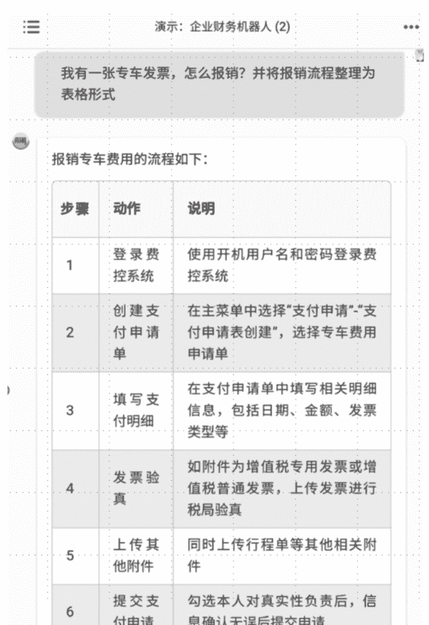

那么，如何训练一个属于我们自己的“大模型”呢？第一步是选择一个可以部署在本地服务器上、不对外开放的“大模型”。你可以将类似的开源“模型”类比为计算机端的开源Linux系统或手机端的Android系统，这样更容易理解。在国内，知名的开源模型有“DeepSeek”和“清华智谱”，在国外，则有“LLAMA”等。这些支持本地化部署的开源模型，其能力并不逊于以ChatGPT为代表的云端模型。然而，在实际应用过程中，还是会遇到一些问题，不过这些问题都有解决方案。以ChatGPT为代表的云端大模型，因拥有大量用户，能够不断积累数据，从而优化自身的“回答”能力；而本地模型的优化则需要配备能力较强的技术人员进行持续迭代更新。

当然，仅“部署”本地模型还不够。本地模型部署完成后，我们拥有的是一个“上知天文、下知地理”的超级“大脑”，但它并不了解公司的具体业务。因此，第二步是“训练”本地模型。我们需要整理大量的“语料”用于“投喂”模型，这实际上是对公司内部业务和财务数据进行整理和梳理的过程。例如，对各种财务政策、规章制度和文件进行整理与梳理，甚至去除其中自相矛盾的部分。还需要将过去报销的资料、单据等一一规整，并最终整理成完整可用的数据库。工程师通过对模型进行训练，使其具备垂直领域的理解、思考、推理和判断能力。

经过半年的“部署”和“训练”，我们最终打造出专属的专业财务机器人，即所谓的“垂直模型”。经过反复测试和微调，图7-1所示的机器人在回答规章制度相关问题时，准确率已超过90%，且每次回答的表述和结论基本一致。然而，仍有人质疑：当前问答机器人无法达到100%的准确率，10%的误差可能会带来困扰，这是否意味着它尚不适合投入生产环境供客户使用。

经过研究发现：第一，人类员工同样无法做到100%的准确率，而且准确率从未被系统统计或总结，我们甚至无法确定人类员工是否始终提供了准确的反馈，100%的准确率只是我们追求的理想目标。第二，利用机器人回答内部流程的问题，既可以帮助员工快速准确地找到答案，还能够定位答案的出处，例如答案源于某个文件的某条某项，在提升工作效率的同时，减少不必要的沟通成本。由于仅涉及内部流程的执行，尽管有可能存在一定误差，对外部也不会产生重大影响。第三，这种误差通常在可接受范围内，并且在后续流程的审核中往往能够被发现并纠正。第四，由于机器人保存了每次回答的记录，财务专家可以每天跟踪这些记录，事后修正模型回答中的错误。随着时间的推移，模型的回答将会越来越精准。

需要强调的是，基于这一逻辑，模型始终无法实现100%的准确率，只能无限接近100%。事实上，这与人类大脑的能力类似——绝对的准确性是无法实现的。

## 合同审核机器人

在过去的一年里，我们开发了一个特别有意思的应用——合同审核机器人。在财务作业的诸多环节中，已经大量采用了自动化方案，例如现金管理、应收账款管理、报销管理，乃至报表管理等。然而，在整个财务作业流程中，唯独采购环节仍完全依赖人工审核和处理，这是我们一直希望有所突破的领域，而大模型恰好为我们提供了帮助。

这一启发源于我在多所高校担任校外导师的经历。作为校外导师，我需要参与和支持学校的各项安排和活动，其中最主要且最耗时的工作就是指导研究生论文和参与论文评审。现在研究生的论文水平普遍较高，字数一般在5万字到10万字之间，不仅包含大量文字陈述和论证，还有图表展示和模型设计等内容。认真读完一篇论文至少需要花费1个小时以上的时间，这尚且是在我比较熟悉的领域。如果遇到不太熟悉的领域，所需时间可能会成倍增加。

此外，每次解读论文时，还需要摘录要点，并总结建议和意见，以备将来在与学生及其他指导老师研讨时使用。因此，完成一篇论文的解读、审阅和建议撰写工作，至少需要2至3个小时，有时甚至更久。2023年，ChatGPT推出了一个有趣的功能——PDF阅读理解功能。我简单尝试了一下，发现非常好用。该功能能够帮助我快速提取文章要点，标注要点所在段落，还可以识别错别字。借助该功能，我相当于拥有了一个阅读辅助工具。跟着提示解读论文，原本需要自己摘录、总结和修改的内容，现在我可以在机器人提供的文档基础上进行修改和补充，效率大大提升，实现了事半功倍。

后来我想，为什么不将它应用于采购合同审核呢？在采购过程中，之前没有进行自动化改革，主要原因是采购合同的种类繁多，审核要素复杂，因此难以整合、归类并实现自动化。而ChatGPT的文档阅读功能给了我们启发，其实不仅ChatGPT具备类似功能，国内的文心一言、通义千问等模型也都有类似功能，且今年DeepSeek的表现更胜一筹。与前述问答机器人一样，审核采购合同的机器人更不能将采购数据上传到互联网上，因为这些数据都是核心机密。因此，我们采用了DeepSeek本地化部署方案。机器人审核合同的界面如图7-2所示。

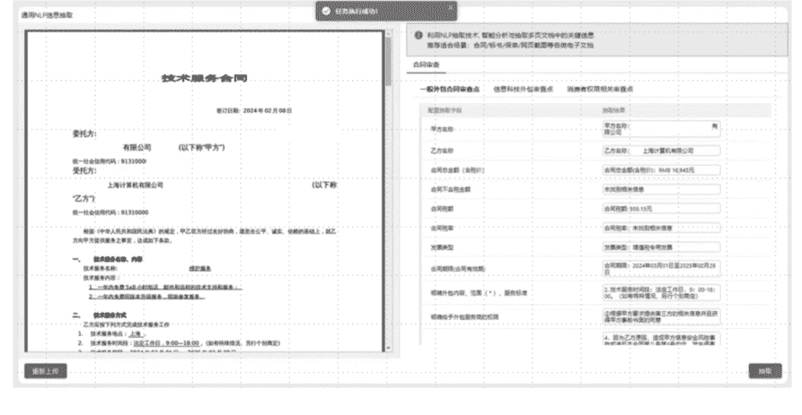

我们重新梳理了整个采购的“端到端”流程。设计逻辑是：“合同审核机器人”扮演人类员工智能助理的角色，帮助员工高效地进行合同审核，而非取代其岗位。因此，从拿到采购合同那一刻起，机器人就正式投入“智能助理”的工作。采购部门同事不再像传统流程中那样，自行读取合同文本的要素并填写采购系统中的必要信息，而是直接将合同文本上传到嵌入采购系统的“合同审核机器人”。机器人会自动解析合同文本，预先在采购系统中填写所需信息，供采购员审核确认。每位采购员都会拥有一个聪明的“助理”。同时，机器人还会提示合同中的风险以及是否缺少必要信息，从而大幅提升工作效率。

在提交到法务、财务及其他相关部门审核时，机器人继续担任这些环节的人类员工智能助理角色。例如，在财务审核环节，机器人会检查各项财务、税务的控制点，提示潜在风险，帮助财务人员提高审核效率，避免财税风险。在实际应用中，我们通过“机器人助理”将各部门关注的法律、合规、财务和税务风险提示前置给采购员，作为风险防范的第一道防线。

如前所述，“合同审核机器人”只有通过积累并“训练”庞大的内部语料（如合同、法律法规、规章、制度等），才能变得更加聪明和准确。经过反复测试，目前机器人助理在“预填”和“提示”方面的整体准确率可以超过80%。需要特别提醒的是，该准确率并不能简单理解为可节约80%的人力成本，因为“机器人助理”是一个具备“通用学科博士后”背景且学习了公司内部信息的“智能体”。对于预先填写或风险提示的部分，其提供的数据无法被直接判定为正确或错误，因此仍需人类员工进行事后复核。也就是说，机器人只能扮演助理角色，最终仍需人类员工点击“确定”键。初步测算显示，该方案大致可节约30%的员工工作时间。但必须指出，模型的前期“训练”以及后期“完善”仍需人类员工投入大量时间。

类似的机器人可以应用于企业内部的所有审核流程，为每位审核员配备一个“机器人助理”，可以提高内控效率。

## 数字人的内部应用：培训与交互模式创新

数字人是一个非常有趣的领域，其应用场景非常广泛。我们为什么会考虑开发数字人应用？其实，当时我们已经拥有一个“智能问答机器人”，于是想到，如果能以“真人”形象来回答员工提出的问题，将会是一件多么有趣的事情。因此，我们开始思考如何打造一个可以即时回答问题的数字人。

即时回答问题的数字人，其实是在“智能问答机器人”基础上添加了人形外观。该人形外观包括两个部分：一个是可以“动”的二维真人形象，另一个是真人语音。系统将问题回答的文字内容与真人形象、语音三者融合。说起来容易，实践起来其实很困难，这也是市面上几乎没有类似的应用的原因。即便是支持语音回答问题的ChatGPT，也没有推出能够即时回答问题的数字人。

我们当时是从比较容易入手的真人语音开始的。网络上其实已经有各种开源或付费的真人语音工具，利用这些工具，我们只需录制一分钟清晰的语音，然后进行专门的“训练”，就能生成一个专属的真人语音模型。通过这个模型，可以根据文字，用受训者的真人语音甚至正常语调来“讲话”。网络上目前也有各种开源或付费的数字人动画工具，只需一张图片或一段视频，就能通过“训练”生成专属的数字人模型。

既有语音模型，又有数字人模型，看似即将大功告成。然而，真正的挑战才刚刚开始。数字人的核心挑战在于语音模型与数字人形象模型的匹配与整合。语音如何与数字人的嘴唇动作精准对接？会讲话的数字人又如何实现极速生成？匹配与整合的问题可以通过模型微调解决，但数字人的极速生成仍是当前尚未攻克的难题。解决这一问题的关键在于“算力”。

“文字-语音-数字人形象”看似简单，但在转换并生成会讲话的数字人形象影片时，整个计算过程需要消耗大量算力。也就是说，提供计算能力的芯片（GPU）需要非常强大。根据目前服务器的算力配置，生成一个15秒的会说话的数字人影片平均需要1到2分钟的时间。正常的文字回答可以即时出现，而数字人的回答则平均需要用户至少等待1分钟，这样的交互体验会让用户感到非常不舒适，甚至可能怀疑电脑是否死机了。更不用说生成更长的影片需要更长的计算时间。这也解释了为何“算力”是限制人工智能发展的重要瓶颈之一。此外，这也是英伟达股价如此之高的原因——训练需要算力，数字人生成更需要算力。

不过，我们付出的努力也没有白费；我们为数字人找到了很好的应用场景。作为保险公司，我们常需要为内部员工开展培训，但近年来金融政策和法规不断更新，导致内部规章制度和作业流程也在不断变化，因此培训课程需要频繁更新。数字人的出现恰好解决了这一问题：培训人员不必反复录制视频，只需修改文案，借助数字人模型生成培训影片，就能大大提高培训效率。当然，类似的场景还有很多，比如教师上网课等。

## 数据分析机器人：助力决策的数据智能引擎

数据分析机器人（见图7-3）一直是我们想要突破的方向，也是我们目前正在逐步实现并已取得初步成果的创新项目。放眼优秀企业的决策机制，有企业家依赖财务分析和财务数据结果来进行决策吗？答案是“没有”。企业家决策往往依赖业务数据，因此我一直强调财务人员要掌握企业的业务数据，而不仅仅是财务数据。因此，数据分析是财务人员的重要任务，我们需要强大的工具来辅助实现高效的数据整合。

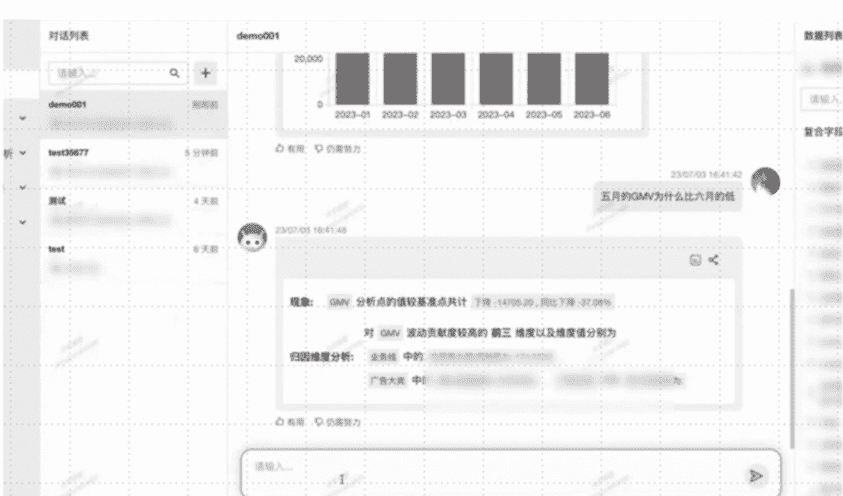

在信息化时代，我们拥有财务系统和Excel这样的强大工具，能够帮助进行财务数据的统计与分析。然而，在当今的数字化时代，Excel已难以适应海量业务数据的分析需求。近年来，新的商业智能（Business Intelligence，BI）工具逐渐兴起。我们在几年前便开始逐步将BI工具应用于各个业务环节，并取得了一定成效。

通过统计分析，我们发现企业内部存在一个有趣的现象：职级越高，使用BI工具的频率越低。例如，为总经理设计的实时数据分析看板，每月仅被打开一次。而应收账款管理的实时数据看板，相关业务部门的同事几乎每天都会多次使用，反复查看。实际上，即便有看板这样的工具，“领导”们也会更倾向于直接提问，并期望立即得到反馈，尤其是关于数据分析的答案，而不是在大量数据中花费时间自行寻找。BI工具作为日常管理中的重要工具，类似于生产车间的看板，有助于提升内部流程的管理与控制效率。

基于这样的认识，我们开始探讨是否可以设计出一个智能机器人，使其能够了解并掌握公司所有数据，并即时回答领导提出的所有数据相关问题。例如，当领导提问“当月上海地区工程保险收入是多少？比去年同期增长多少？”时，机器人不仅需要准确搜索并定位到“当月”“上海地区”“保费收入”“去年同期”等关键条件，还要通过一定形式将结果展示出来，确保领导能够轻松读懂。而且，领导们的问题往往层层递进，逐步深入，从财务数据延伸到业务数据。这要求机器人具备强大的学习、计算和数据分析能力，实现起来并不容易。

我们当时与国内一家知名科技企业合作，共同开发具备数据分析能力的机器人。第一步，需要让机器人具备理解和回答问题的能力。因此，我们部署了开源的大语言模型。第二步，为了让机器人能够理解领导提出的专业问题，我们对模型进行了专门训练，通过提供专业问题的语料数据，使其能够“听懂”相关内容。这一部分需要投入大量时间整理相关资料、信息和数据。前两个步骤由人工智能工程师与财务人员配合完成。完成这两步后，机器人仅具备理解领导意图并以文字作答的能力，但还无法提供领导所需的具体数据。第三步是最关键的一步，需要数据工程师与财务人员共同完成。在这个过程中，数据工程师与财务人员协作，完成了整个公司业务财务数据索引的工作，即“数据中台”建设，准确定位所需数据在具体数据表中的位置。这是一项庞大的工程，我们此前花了两年时间才建立起类似的数据索引。

通过以上三个步骤，机器人能够理解领导提问的真正含义（即所需数据要求），并准确定位到相应数据，同时以领导能够理解的语言组织答案并反馈结果。目前，数据定位的准确率已超过90%，我们正努力将其训练至100%。

这里我也对我们正在努力但尚未完全实现的部分进行说明。我们设想，既然能够为用户提供所需的数据，那么是否有可能为其提供分析图表呢？一开始，我们尝试使用模型本身可嵌入（Plug-in）的图表分析工具，但这些工具往往功能过于简单，无法满足用户多样化的需求。因此，初步尝试以失败告终。目前，我们正在与BI工具公司合作，共同解决如何让机器人运用BI工具自主进行图表分析的问题。对于一些简单的图表，或者格式相对固定的复杂图表，我们的大模型机器人已经具备调用BI工具进行图表分析的能力，而且结果基本准确。我们正在进一步尝试更高自由度的图表分析，并期待实验能够成功。

在上面的案例中，智能问答机器人通过部署和训练垂直模型，以90%以上的准确率解答财务问题，有效降低沟通成本。合同审核机器人借助本地化模型，协助人工审核合同，提升效率并节约人力。数字人虽在生成速度上受限，但在培训领域发挥了显著优势。数据分析机器人经多步开发，数据定位准确度超过90%，并逐步实现图表分析功能。这些应用从不同维度优化了财务管理流程，提升了企业运营效率。

未来，随着人工智能技术的持续演进，财务管理领域有望取得更多突破。智能问答机器人的准确率将不断接近100%，并扩展至更多复杂财务场景；合同审核机器人将进一步提升审核准确率，深度融入企业供应链管理；数字人在算力提升后，有望实现即时交互，应用于更多业务场景；数据分析机器人将具备更强大的分析能力，不仅能够生成图表，还能进行深度预测分析，为企业战略决策提供精准依据。新一代人工智能将全方位重塑财务管理模式，推动企业向数字化、智能化深度转型，开创更高效、智能的财务管理新时代。

# 第八章 智能财务工厂：从规划到落地的实战路径

从第四章到第七章，我逐步探讨了从应收账款核销流程的改造、报销控制流程的重构，到智能无人财务办公室的建立，再到新一代人工智能在财务管理各方面的应用，进行了一系列系统化的案例分析。第八章作为对“人工智能”赋能财务管理数字化实践的总结，从人工智能应用场景分析，到单个财务会计作业流程的实施步骤详解，再到整体宏观数字化转型方案的设计与推动，最终提出了一个全新的概念——“智能财务工厂”。本章还探讨了如何部署企业专属的财务机器人团队，以推动财务管理实现数字化转型。

作为企业数字化转型的重要组成部分，“智能财务工厂”不仅是一个技术项目，更是财务管理模式的深度变革与创新实践。它借助新兴技术，突破传统财务管理的边界，实现从碎片化作业到“端到端”全流程的智能化再造，最终推动财务从成本中心向利润中心的转变。

曾经，财务工作被大量烦琐、重复的基础任务占据，效率低下且容易出错。如今，“智能财务工厂”如同一股创新浪潮，彻底颠覆了传统财务管理模式。借助人工智能、机器人流程自动化、区块链等前沿技术，为财务工作注入了新的活力。你或许会好奇，“智能财务工厂”究竟是如何运作的？它如何让财务人员从繁重的基础工作中解脱出来，投入到更具价值的财务分析与决策支持工作中？在建设“智能财务工厂”的过程中，又有哪些关键步骤与宝贵经验？接下来，让我们一同走进“智能财务工厂”的世界，揭开其神秘面纱，探寻从传统财务迈向智能财务的变革历程，为企业数字化转型提供有益借鉴。

## 基石：人工智能与机器人

在“智能财务工厂”中，我们部署了大量人工智能机器人，帮助财务人员减少了大量日常基础重复工作。这些机器人主要包括以下四种类型：

### 查询类机器人

常见的查询类场景包括银行余额查询、科目余额查询、发票查验等。基于查询类财务机器人，还可扩展出处理银行余额调节表、费用报销等相对复杂业务需求的财务机器人。例如，银行余额调节表机器人可自动登录财务系统下载银行科目余额表，以及自动登录网银下载银行交易流水，然后将银行科目余额表与银行交易流水进行逐一比对，筛选出各类未达账项，并自动生成银行余额调节表。根据相应的对账逻辑，银行余额调节表机器人还能处理一些较为复杂的，包括一对多甚至多对多的对账情况。当然，对于某些特殊或非常规的交易数据，仍需人工进行最终复核，以确保财务机器人处理结果的准确性。

### 报送类机器人

常见的报送类场景包括纳税申报及其他监管申报等。报送类机器人在报送环节之前，通常需要完成报送数据的采集和整合工作。以纳税申报机器人为例，若企业具备完善的税金管理系统，机器人就可以自动从税金管理系统中获取各种纳税申报表，然后登录各地的纳税申报网站，自动完成各个申报表及其附表的填报。若企业没有税金管理系统，机器人也可以直接从财务系统中获取财务数据，根据相应的计算规则生成增值税申报表等各种纳税申报表，再登录纳税申报网站完成填报工作。在最终的申报确认环节，通常需要人工介入，进行复核、确认并提交。

### 操作类机器人

常见的操作类场景包括业务单据处理、凭证总账处理、付款流程审批、费用报销审批等。操作类机器人主要用于替代人工完成一些规则明确的业务操作流程，例如各种基于业务系统的操作和审批流程。操作类机器人通常还会结合数据获取、数据核对与校验等功能，以实现付款审批和费用报销审批等较为复杂的业务操作流程。

以费用报销机器人为例，该机器人可自动登录企业的费用报销系统，打开电子费用报销单及对应的发票附件以获取报销单信息，并通过光学字符识别技术识别发票信息。同时，它还可登录税务局网站查验发票真伪，核对抬头、识别号、销售方信息等是否规范，并检查报销金额、付款明细及合计是否与报销单一致。若真实性、合规性及一致性均无误，机器人会自动审批该报销单，并生成费用报销数据汇总表，通过邮件发送给相关财务人员。对于审核中发现问题的报销单，则会转交财务人员进行人工处理。

### 分析比对类机器人

常见的分析比对类场景包括各种对账和报表处理等。分析比对类机器人通常结合数据获取、数据核对与校验等功能，以应对相对复杂的对账和报表处理任务。

以对账机器人为例，该机器人在财务机器人中应用广泛，适用于多种财务对账场景，例如企业内部的业务账与财务账核对、总账与银行流水核对，以及企业与客户及供应商之间的往来账务核对。对账场景的复杂程度主要取决于其对账逻辑的复杂程度。无论对账逻辑复杂与否，其主要流程都基本为“数据下载—数据整合比对—对账结果（报告）发送”。

从目前的案例分析来看，对账机器人的对账实现率难以达到百分之百，因为企业的实际业务场景通常较为复杂，尤其是在与供应商或客户对账时，会受到账期、损耗、商业折扣等因素的影响，可能出现一对多甚至多对多的情形。这时，需要详细梳理所有可能出现的对账逻辑。例如，对账时应确定有哪些对账维度，哪些是关键对账维度等。

## 打造“智能财务工厂”的三个关键步骤

“智能财务工厂”不仅是一个技术项目，更是财务管理运用新兴技术进行创新变革和数字化转型的过程。在此过程中，我们总结了三个具体有效的关键步骤，供大家参考。

第一步，“端到端”业务流程的梳理。不论是应收账款流程自动化，还是智能报销助手，乃至最终实现的智能无人财务办公室，都需要对每个相关业务流程进行“端到端”的梳理与分析，明确现有流程的运行情况、模式和状态，同时明确关键控制点、控制岗位及控制要求。需要注意的是，这里的业务流程梳理强调“端到端”，不仅限于财务内部作业流程，而是涵盖从业务发起到财务完结的全流程，这一点非常关键。

第二步，标准化流程再造。基于现有“端到端”业务流程的梳理分析结果，找出流程中的痛点、难点和应设定的控制点；然后进行优化分析和可行性讨论，评估改造成本、风险和效益，制订一套智能、统一、集中、标准化的“端到端”业务流程方案。

需要特别强调的是，“标准化流程再造”对实现“流程智能化变革”至关重要。“端到端”业务流程梳理只是将现有流程逻辑梳理清楚，是数字化成功实施的基础。而标准化流程再造则是对现有流程进行优化与创新，从而找到自动化、智能化的可行路径，这一步才是数字化成功实施的关键。退一步说，即便不进行数字化，“标准化流程再造”也能帮助财务团队简化和优化现有工作，同时强化内部控制。这一点在前面的“智能报销助手”章节中已解释得很清楚。

需要注意的是，许多公司在推进自动化和智能化变革项目时失败了，原因往往在于仅完成了对现有流程的梳理，却没有进行标准化流程的再造。换言之，这些公司只是按照现有流程进行自动化改造，而多数情况下，现有流程往往是非标准化的。例如之前提到的应收账款流程梳理的案例，尽管总公司层面制订了统一的应收账款核销书面流程，但在各分公司的实际操作中，不同应收会计的具体作业流程却大不相同。如果仅依照总公司发布的书面流程进行自动化改造，大概率不会成功；如果依照某个分公司的具体作业流程进行自动化改造，则很可能引发其他分公司的普遍不满，导致用户需求频繁修改、项目交付延迟，最终失败。因此，在数字化转型项目中，“标准化流程再造”尤为重要。

第三步，“+机器人”。这一过程基于再造后的标准化“端到端”作业流程，以及标准化的控制点和控制要求，分析并制订相应的可行的数字化系统解决方案。通过OCR、语音识别、自然语言处理、机器学习、RPA等多种人工智能技术，即“+机器人”，实现全流程的自动化和智能化目标。“+机器人”是最终的技术实现阶段，此时最重要的是找到可接受、可靠、可行且性价比高的智能解决方案，而非追求100%自动化，因为100%自动化的成本可能过高，实际落地的可能性较低。

“智能财务工厂”从不是一个技术项目，而是一个从“单一作业”到“端到端”全流程的数字化再造过程。“自动化+智能化”不仅局限于简单的碎片化作业，而是基于全场景的“端到端”再造。就像前文列举的转型案例那样，“现金数据收集+应收账款核销”的流程再造，是从碎片化的作业流程梳理开始的自动化和智能化项目。“智能报销机器人”覆盖了从业务前端到财务后端的“端到端”全流程再造；“智能无人财务办公室”则实现了“全财务管理场景”的数字化变革。基于成功经验，我建议大家在数字化转型的初期，先从“碎片化作业”入手，寻找工作中的痛点和难点进行优化和改造，随后推进到“端到端”全流程的自动化和智能化再造，最后分析整个财务管理架构，实施全面的数字化转型变革。尤其是在“智能无人财务办公室”的实践中，我们可以清晰地看到，从岗位职责到整个组织架构的数字化变革已真正落地实现。

我们在规划数字化转型时，明确了“打造面向未来的财务管理”的定位，即以支持业务和引领业务为核心，成为企业的价值创造者。因此，在“智能财务工厂”的建设过程中，我们不断总结经验、积累成果，确定了数字化转型的三个目标（见图8-1）：第一，降本增效，降低管理和运营成本，提升管理工作效率或资本运营效率；第二，强化合规与内控，构建事前、事中、事后的全流程和全业态的风险管理与控制体系；第三，助力变革创新，树立转型标杆并推广最佳实践，提供专业化战略决策支持，推动财务部门从传统的成本中心向智慧型利润中心转变。

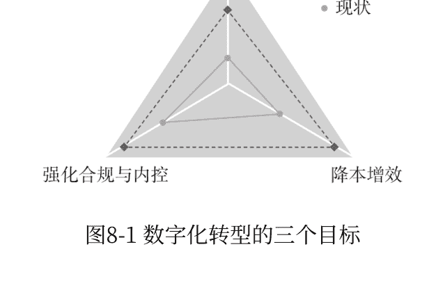

图8-1 数字化转型的三个目标

在打造“智能财务工厂”的同时，我们首次实现了真正意义上的业财融合。在过往的认知中，业财融合意味着为业务部门提供更好的服务，建立更多联系，给予更深入的支持，并更全面地了解和把握业务实质。而“智能财务工厂”看似与传统的业财融合理念相反，因为在全作业过程中，财务人员的存在似乎被弱化了。但实际上，通过“智能财务工厂”，业务与财务人员实现了更加紧密的融合。财务人员不仅需要了解业务数据，还要熟悉并掌握业务全流程，协助业务人员进行分析、设计和流程优化；同时，通过数据分析和智能化手段，有效控制业务风险，助力业务发展。

## 实现“智能财务工厂”的三个阶段

在实现“智能财务工厂”的过程中，我们总结了一些有用的经验，分享给大家，希望能帮助大家在未来的数字化转型过程中少走弯路。“智能财务工厂”分为三个阶段实现，对应数字化转型的三个阶段（见图8-2）。

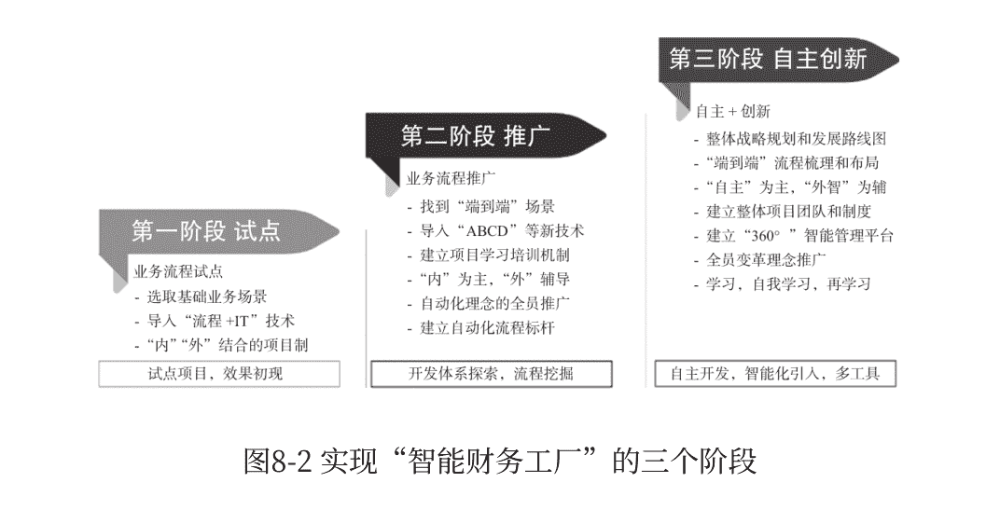

第一阶段，我们进行了大量碎片化的业务流程试点，选取了多个基础业务场景，比如人工密集重复且痛点突出的场景。在这一阶段，我们聘请外部咨询顾问组建项目组，设立“内”“外”结合的项目制度，由顾问担任项目负责人，带领我们推进试点项目。顾问不仅要教我们如何进行流程改造、如何应用新兴技术，更重要的是协助培养项目经理。我们聘请顾问，不仅注重结果，也关注过程。在这一过程中，顾问引导我们的项目经理学会绘制流程图，掌握项目管理和流程设计的能力。这个阶段非常关键，通过在试点项目中实践，我们为公司培养了数字化转型所需的人才，并积累了转型经验。

第二阶段，即推广阶段，我们进入了快速复制和加速变革的过程。在这个阶段，项目组已转变为以“内”为主、以“外”为辅的合作模式。数字化项目由公司内部同事担任项目经理，咨询顾问则扮演导师和项目监理的角色，负责指导和监督项目推进。同时，公司在这一阶段全面推广数字化转型理念，并建立起自动化和智能化的流程标杆体系。

第三阶段，即自主创新阶段。我们已经拥有成熟的项目经理和经验丰富的项目团队，自主设计未来整体的数字化战略规划和发展路线图。我们从最末端的财务管理出发，结合数字化技术，与中台、前台各业务部门广泛合作，梳理“端到端”流程并进行整体布局，明确哪些环节先做、哪些环节后做；哪些由人工完成、哪些由数字化解决方案完成。最终，我们以自己的项目团队为主，实现了自主转型和数字化创新。在此阶段，我们不再需要为每个项目投入高昂成本聘请外部咨询顾问，仅保留部分外部智囊，为我们提供前沿科技信息和技术知识支持，协助搭建项目管理制度、项目评价体系、知识中心和技能中心。内部财务人员通过持续学习和自我提升，不仅推动了企业数字化水平的提升，也实现了自身能力的跃升。

## “智能财务工厂”助力数字化转型“四化”升级

最后，数字化转型需要分四步走，包括业务标准化、流程自动化、报告实时化和决策智能化。这“四化”之间呈现出层层递进的关系。

第一步是业务标准化。业务标准化包括业务流程标准化和业务数据标准化，是数字化转型的第一步。只有在流程和数据标准化的基础上，业务和管理才能实现智能化和自动化，从而实现降本增效。这是最重要的一步。

第二步是流程自动化。流程自动化即“标准化的业务流程+机器人”的过程。标准化的流程和数据使流程自动化成为可能，而机器人则是实现的方法和手段。通常，“标准化的业务流程+机器人”一定会为企业带来显著的效率提升和成本优化。

第三步是报告实时化。财务管理中最滞后的环节之一就是报告频率。供应链有日报，销售有日报，生产车间甚至有实时看板，而财务通常只有月报。因此，要提升财务管理的能力，首先需要提高财务报告的时效性。与此同时，随着“智能财务工厂”的落地，一切以机器人为主导运行，如果缺乏实时监控措施，导致监控滞后于机器人的运转，后果将不堪设想。因此，无论是基于财务管理本身的需求，还是数字化转型的内在要求，我们都必须在打通企业流程的同时，整合企业数据，建立数据中台，实现报告的实时化。

最后一步是决策智能化。随着自动化和智能化的有效应用不断改进和提升了财务管理水平，大量重复的基础财务工作被机器人替代，财务工作的重心将转向决策支持。面对海量数据，我们需要快速反应并实时决策，此时就需要实现决策智能化。

## “智能财务工厂”解锁业财融合新境界

在传统的企业运营理念中，业财融合往往被简单理解为财务部门对业务部门在服务、沟通和支持层面的强化。财务人员的工作重点在于深入了解业务数据，加强与业务部门的沟通联系，提供基础的业务支持，并力求更透彻地把握业务实质。在这种模式下，财务部门和业务部门虽有一定协作，但在实际工作流程中仍存在较为明显的界限，沟通协作效率较低，信息传递容易出现延迟和偏差。

而“智能财务工厂”模式的出现，对传统业财融合理念带来了巨大的冲击。从表面上看，在“智能财务工厂”的全作业过程中，财务似乎“消失”了，不再像传统模式下那样频繁地出现在各项业务流程的具体操作环节中。这一变化让很多人产生误解，认为“智能财务工厂”与传统的业财融合理念背道而驰。但实际上，“智能财务工厂”实现了更深度和更紧密的业财融合。

在“智能财务工厂”模式下，依托先进的数字化技术，财务工作变得更加自动化和智能化。大量基础、重复的财务操作由机器人完成，财务人员有更多时间和精力投入到业务流程的各个环节中。财务人员不再是业务数据的被动接收者和记录者，而是成为业务流程的积极参与者、引导者和推动者。

“智能财务工厂”使财务人员能够深度参与业务流程。凭借对数据的高度敏感和专业的数据分析能力，财务人员在熟悉业务全流程的基础上，能够帮助业务部门分析现有流程中的问题，并从财务角度提出优化建议。例如，在企业的采购流程中，财务人员可以通过分析采购成本、付款周期、供应商信用等数据，协助业务部门选择更合适的供应商，优化采购订单的审批流程，从而降低采购成本，提升资金使用效率。同时，财务人员还可参与销售流程的设计，根据客户信用状况、市场需求及企业库存情况，为销售部门制订合理的销售策略和价格体系，促进销售业绩提升。

“智能财务工厂”借助大数据分析、人工智能等技术手段，对业务数据进行实时收集、整理和分析。财务人员通过这些数据，及时发现业务运营过程中潜在的风险点，并采取相应措施进行风险控制。在应收账款管理方面，财务人员可以利用智能财务系统对客户的交易数据、信用记录等进行分析，预测客户的付款风险，提前制订催收策略，减少坏账损失。在成本控制方面，通过对生产、采购、销售等环节的数据监测和分析，及时发现成本异常波动的情况，找出原因并采取措施加以控制，确保企业的盈利能力。

在“智能财务工厂”的支持下，财务部门能够为业务部门提供更加精准、及时的决策支持。财务人员通过对大量业务数据和财务数据的深度挖掘与分析，提供详细的财务报告和分析建议，帮助业务部门更好地了解市场动态、客户需求以及企业自身的优势和劣势。例如，在企业推出新产品或进入新市场时，财务人员可以通过对市场数据、成本数据和预期收益的分析，评估项目的风险与收益，并提供可行性报告，为业务决策提供有力依据。同时，财务部门还可以根据数据分析结果提出资源配置建议，优化企业的资源分配，提升整体运营效率。

“智能财务工厂”通过重新定义财务与业务的关系，实现了从传统的浅层次业财融合向深层次、全方位业财融合的转变。这种转变不仅提升了财务管理的价值，也为企业整体发展注入了新的动力，使其在激烈的市场竞争中能够更加灵活、高效地应对各种挑战，实现可持续发展。

## 智能财务发展趋势展望

随着科技的持续进步，智能财务的发展前景极为广阔。在技术创新方面，人工智能、大数据、区块链等技术将不断迭代升级，并更深度融入智能财务领域。例如，区块链技术有望进一步提升财务数据的安全性和可信度，实现交易数据的分布式存储和不可篡改，为财务审计和风险管理提供可靠依据。同时，人工智能技术的发展将使财务机器人具备更强的自主学习和决策能力，能够处理更复杂的财务场景，实现从自动化到智能化的全面跨越。

在业务融合层面，智能财务将与企业的其他业务系统实现更深度的融合。未来，财务数据与业务数据将实现实时共享和无缝对接，形成一个有机整体。通过对全量数据的分析和挖掘，企业能够实现更精准的业务预测和决策支持。以供应链管理为例，智能财务系统可以根据实时的库存数据、采购数据和销售数据，自动优化资金配置和成本控制策略，实现供应链体系的高效协同运作。

从行业发展来看，智能财务将推动整个财务行业的变革。传统财务工作岗位将面临重组，基础的财务核算和数据处理工作将逐渐被智能机器人取代，财务人员的工作重心将更多转向财务管理、数据分析和战略决策支持等领域。这要求财务人员不断提升专业素养和数字化技能，以适应行业发展需求。同时，智能财务的发展还将推动财务服务外包市场的蓬勃发展，专业的财务科技服务提供商将为企业提供更加定制化、高效的智能财务解决方案。

“智能财务工厂”的建设将为企业财务管理带来显著变革，而未来智能财务的发展将为企业创造更大价值，助力企业在数字化时代实现可持续发展。企业应积极把握这一趋势，持续探索创新，不断提升财务管理水平，增强竞争力。

# 第九章 区块链：重塑信任与效率

区块链技术因其去中心化、不可篡改、全程留痕、透明公开等特点，正在重塑财务管理的方式。通过分布式账本实现数据同步和信息透明，解决了传统财务对账中数据不一致、效率低下的问题；利用智能合约自动执行交易和清算，减少人工干预，提升效率；去中心化的系统架构降低了对中介机构的依赖，节省成本并加快交易速度。此外，区块链还能增强数据的安全性和可信度，为财务管理提供更加高效、精准的工具，广泛应用于对账、清算、供应链金融等场景，帮助企业提升管理效率、降低风险，并推动财务从支持职能向价值创造职能转型。

## 什么是区块链：从微信群接龙说起

想象一下，在一个神秘的村庄里，村民们各自用自己的账本记录交易，但总有人偷偷篡改账本。直到有一天，村庄里来了一个神奇的“账本守护者”，它让账本变得无法篡改，并使每一笔交易的来龙去脉都清晰可查，这个“账本守护者”就是“区块链”。

从科技层面来看，区块链涉及数学、密码学、互联网和计算机编程等多领域知识，是分布式数据存储、点对点传输、共识机制、加密算法等计算机技术的新型应用模式。从应用形态来看，区块链是一个分布式的共享账本和数据库，具有去中心化、不可篡改、全程留痕、可追溯、集体维护和公开透明等特征。

这些特征确保了区块链的“诚实”与“透明”，为区块链创造信任奠定了基础。区块链丰富的应用场景大多基于其能够解决信息不对称问题，实现多主体之间的协作、信任，并达成一致行动。区块链是大家熟知的比特币底层技术，而比特币则是基于区块链技术所实现的典型应用。

首先，我来解释一下什么是中心化账本和分布式账本。大家通过手机银行APP获取的银行对账单就是最典型的中心化账本，一旦银行系统瘫痪，您的账本就无法打开。而分布式账本则类似于微信群里的接龙活动，例如张三发起接龙，李四回复“+1”，赵五回复“+2”，王六回复“+3”。大家在根据规则接龙时，每个人手里都有一个账本，记录了完整的接龙信息。这些信息具有分布式（去中心化）、不可篡改、可溯源、集体维护、公开透明等特征，这就是分布式账本的典型特征，与区块链的逻辑非常相似。区块链的分布式账本就像微信群里的接龙游戏，每个人都有一份完整的记录，且无法篡改。唯一不同的是，区块链对这些记录进行了加密，只有拥有密码的人才能查看，保证了数据的安全性和透明性，同时体现了区块链的另一重要特性——保密性。

区块链被称为“Blockchain”，是因为其数据块以链状的形式存储。从第一个区块，即创世区块开始，新增的区块不断被连接到上一个区块之后，形成一个链条。

每个区块由两部分组成：区块头部和区块数据。区块头部含有一个哈希指针，指向上一个区块，该指针存储了前一个数据块的哈希值。哈希值可以理解为数据块的“密码”，即在后一个区块的头部中保存了前一个区块数据的“密码”。如果上一个区块中的数据被篡改，就会导致数据和“密码”不匹配，从而被系统检测到。要更改一个区块中的数据，必须对其后的每个区块进行相应修改（见图9-1）。

### 区块链的四大属性

区块链之所以被称为“信任机器”，离不开以下四大重要属性：

- 分布式账本：人人持有一份账本，信息同步且透明。
- 非对称加密：用密码锁住数据，只有对应的钥匙才能打开。
- 共识机制：没有“老大”，通过投票决定“真相”。
- 智能合约：如同自动售货机，在条件满足时自动执行。

接下来，我具体阐述一下。

#### 分布式账本

与分布式账本相对立的是中心化账本。大家通过手机银行APP获取的银行对账单就是中心化账本。微信群里的接龙记录就是分布式账本，群里每个人人手一份。

分布式账本是指交易记账由分布在不同地点的多个节点共同完成，每个节点记录完整的账目，因此所有节点都可以参与监督交易合法性，并共同为其作证。与传统的分布式存储不同，区块链的分布式存储具有以下两个显著特点：一是区块链的每个节点按照链式结构存储完整的数据，而传统的分布式存储则通常将数据根据一定规则分成多份进行存储；二是区块链的每个节点独立存储且地位平等，通过共识机制保证存储的一致性，而传统的分布式存储一般依赖中心节点向其他备份节点同步数据。

在区块链中，没有任何单一节点能够独立记录账本数据，这有效避免了单一记账人被控制或贿赂而记假账的可能性。此外，由于记账节点数量众多，理论上除非所有节点同时被破坏，否则账目不会丢失，从而确保了账目数据的安全性。

#### 非对称加密

存储在区块链上的交易数据是公开的，但账户身份信息经过高度加密，只有在数据拥有者授权的情况下才能访问，从而保证数据安全和个人隐私。

这个加密原理，就像银行保险库的原理一样。当进入保险库时，我们需要银行管理人员陪同，用钥匙（公钥）打开库房大门。在进入保险库后，可以看到其他人的保险箱，但只能用自己的钥匙（私钥）打开自己的保险箱。这就是区块链的非对称加密基本原理，数据通过公钥和私钥进行加密，只有同时拥有这两组密码，数据才能被完全解读。

#### 共识机制

共识机制指的是所有记账节点就如何达成共识、认定记录有效性的规则。它既是认定的手段，也是防止篡改的方式。区块链领域存在四种不同的共识机制，它们适用于不同的应用场景，以在效率和安全性之间寻求平衡。

区块链的共识机制具有“少数服从多数”和“人人平等”的特点。其中，“少数服从多数”并不完全指节点数量，还可以指计算能力、股权数或其他可以被量化的特征。“人人平等”是指当节点满足条件时，所有节点都有权优先提出共识结果，该结果在被其他节点认可后，便可能成为最终共识。以比特币为例，其采用的是工作量证明机制。只有在控制全网超过51%的记账节点的情况下，才可能伪造出一条不存在的记录。当区块链网络中的节点数量足够多时，这种情况几乎不可能发生，从而有效杜绝了造假的可能性。

我这里用在区块链的共识机制出现后才被解决的“拜占庭将军问题”来探讨共识机制。拜占庭将军问题是这样的：拜占庭帝国派出10支军队包围了一座城市，城市里有很多金银财宝。拜占庭帝国计划抢夺这些钱财。由于地形限制，这10支军队无法集中进行单点突破，而必须在分散包围的状态下同时发起攻击。城市守军非常强大，拜占庭一方至少需要6支军队同时进攻才能获胜，任何少于6支军队的进攻都会失败。这10支军队依靠通信兵协商进攻意向，但问题在于，这10支军队中可能出现被敌军收买的叛徒。拜占庭将军们能否找到一种办法，使他们能够远程协商，从而攻破城市，抢夺财宝呢？

这是一个很难的问题，在1982年被提出来后，历经30多年无人找到答案，直到发明比特币的中本聪在2009年给出了一个完美的答案——基于区块链技术的比特币。

区块链的共识机制是这样解决“拜占庭将军问题”的。现在我们假设这10个将军就是互联网上的10台电脑，可以相互通信。大家定义一个通信格式，内容分为两部分，第一部分是“进攻”；第二部分是“署名”。将军1决定进攻，他写好通信内容“进攻，将军1”，然后广播出去。所有其他将军都可以验证这确实是将军1的署名，因为可以追踪到这位将军的身份，所以认定他在条件成熟时一定会进攻。这就是目前的公私钥签名机制，是解决“拜占庭将军问题”的重要机制。如果将军2也决定进攻，他就可以在将军1的通信内容后面附上自己的信息，写“进攻，将军2”，然后广播。如果将军3也决定进攻，就在将军2的广播信息后面再附上自己的信息，写明“进攻，将军3”。当这条广播信息累积了六个将军的附信和签名时，就可以进攻了，从而攻破敌军城市，获得财宝。

解决这个问题是非常重要的，因为它是互联网技术进化中的一个重要障碍。在互联网环境中，一群完全平等的节点只能通过通信进行协调。如何在缺乏权威和互信的基础上，对某个事情（状态）达成一致意见，是一个非常有意义的课题。

#### 智能合约

智能合约基于这些可信且不可篡改的数据，可以自动执行预先定义的规则和条款。以保险为例，如果每个人的信息（包括医疗信息和风险发生记录）都是真实可信的，那么一些标准化的保险产品就可以实现自动理赔。在保险公司的日常业务中，虽然交易频率不如银行和证券行业，但对可信数据的依赖程度却在不断增加。因此，从数据管理的角度切入，利用区块链技术能够有效帮助保险公司提高风险管理能力。具体而言，主要包括投保人的风险管理和保险公司的风险监督。

## 区块链推动的财务革命：从合约到清算的全流程智能化

传统财务对账就像两个人核对账本，一个人说：“我借了你100块”，另一个人说：“不对，是90块”，两人需要反复确认。而区块链的分布式账本让双方的账本实时同步，账目清晰透明，再也不会出现对不上账的情况。更重要的是，智能合约还能自动生成清算单，彻底解放财务人员的双手。

### 分布式账本：使财务信息精确化

区块链技术的应用，与传统上由各自会计中心进行账务确认的“集中式记账模式”不同。区块链的分布式账本由全网参与者共同记账、共同公证。计算机系统实时对参与方输入的信息进行确认，最终形成无重复记录的精确账务数据库。基于财务会计信息生成的数据库在区块链中透明公开，形成共享账本。这种共享账本可以弥补传统财务复式记账法下因会计信息重复处理所产生的管理漏洞，有效减少传统“人机协同”模式下因交易双方对账、纠错而产生的成本，以及资金短缺、财务账本管理等问题。此外，分布式账本避免了因单个会计信息记录偏差引起的系列财务信息失真，保证原始会计信息的精确性。

### 哈希算法：固化财务信息

哈希算法是一种单向密码体制。在全网形成无重复记录的精确数据库后，计算机将数据打包成一个“区块”，加盖时间戳，记录数据写入时间。整个区块被赋予时间维度，再根据时间序列通过哈希值与上一个区块相连接。由于每一个区块的信息都是在全网参与者达成一致共识后形成的真实信息，且哈希算法的加密过程不可逆，这意味着任何参与者都不可能修改时间戳上的信息。相较于传统记账模式下的财务信息，区块链技术下的财务信息是一种被固化的财务交易信息，不可篡改。财务信息的固化减少了原始财务信息在确认、记录、计量和报告环节被修改、删除或伪造的可能性，为企业参与市场交易活动提供了真实可靠的信息，从而有效解决了因市场参与者出于利益倾向而隐匿信息所导致的不公平利益侵占问题。

### 去中心化：降低财务运作成本

在区块链技术下，全网参与者无须依赖单个中心化服务器进行交易，而是通过分布式网络节点运行，实现点对点的直接交易。这种模式取代了交易双方或多方依托的第三方中介机构，避免了交易过程中出现的信用、清算和信息泄露等管理风险。同时，点对点的直接交易可有效减少资金在多个中间机构间流转所产生的交易费用，并加快交易速度。

### 智能合约：提高信息处理能力

智能合约是一种能够自动执行合约条款的计算机程序，是合约参与方以数字方式定义的协议。当满足预设条件时，合约可自动执行相应条款，无须人为干预。此外，智能合约能够自动获取资源，例如通过服务获取资金，并在需要时自主使用这些资金。在交易过程中，智能合约的参与方不依赖单一的中心化服务器，而是通过分布式网络节点运行，从而提升合约的可信度，同时有效降低因传统信任机制所产生的高额交易成本。基于电子数据实现的合约极大简化了财务处理流程，提升了财务信息处理效率，并有望在金融行业的抵押贷款及遗产分配等领域得到广泛应用。

区块链可以通过分布式账本精确记录原始财务信息，利用哈希值固化数据，使信息不可逆、不可篡改，在去中心化和智能合约的条件下降低成本，提高信息处理能力，为“互联网+”背景下财务管理中出现的新问题提供新的解决方案。

## 区块链交易结算案例

### 案例1：比亚迪迪链平台：供应链金融的创新与挑战

比亚迪在汽车领域是“遥遥领先”的存在。不过，我们今天要探讨的不是比亚迪的汽车，而是它的“迪链”平台，这是比亚迪在供应链金融创新方面的重大成果，对整个供应链的运转产生了深远影响。接下来，我们就详细分析一下“迪链”平台到底是怎样运行的。

#### “迪链”平台的基础架构与核心功能

简单来说，“迪链”平台是比亚迪专门打造的供应链信息服务枢纽，由比亚迪子公司深圳迪链科技有限公司负责运营。该平台主要围绕应收账款提供数字化解决方案，以比亚迪这一核心企业的信用为依托构建生态体系，服务对象包括比亚迪集团、其上下游供应商及银行等合作机构。

从技术层面来看，“迪链”平台运用了区块链分布式记账逻辑，它通过系统内数据实时同步，实现了交易信息透明化和不可篡改，就像区块链的“分布式账本”一样。这样一来，供应商能实时看到应收账款情况，比亚迪能高效管理应付账款，银行等资金方也能利用平台数据来完成融资审核，从而大幅减少了传统供应链金融中信息不对称的问题。

#### “迪链”的运作模式与实务流程

“迪链”平台的运作模式以比亚迪集团的核心企业信用为关键支撑，构建了覆盖“订单确认—发票开具—凭证签发—流转贴现—到期兑付”全链条的数字化体系。该流程设计紧密贴合汽车供应链长周期的特点，并通过技术手段实现了效率与风险的动态平衡。接下来，我从实务操作维度展开详细解析。

##### （一）全流程节点拆解

###### 1. 订单与验收环节

每个月初，比亚迪采购部门会通过“迪链”平台向供应商推送上个月经质检和仓储部门确认的《验收合格产品明细表》，其中包含产品型号、数量、单价及金额等关键数据。这些数据直接对接比亚迪ERP系统，与生产端需求保持同步。供应商需在3个工作日内完成数据核对，如有异议，可通过平台发起在线争议处理流程，通常在5个工作日内即可解决完毕；如无异议，则进入发票开具环节。

###### 2. 发票开具与核验

供应商需在每月15日前通过增值税发票管理系统为比亚迪开具电子发票，并在“迪链”平台通过“发票上链”功能，将发票信息（如发票代码、号码、金额、税额等）与验收数据进行智能匹配。平台采用OCR和区块链存证技术，可自动校验发票真实性及其与订单内容的一致性。核验通过后，系统将生成发票确认单，作为后续凭证签发的重要依据。仅这一环节就使传统人工对账效率提升了70%，数据准确率从92%提升至99.8%。

###### 3. “迪链”凭证签发

比亚迪财务部门在收到合规发票并扣除违约金或者赔偿款后，于30天内通过平台签发“迪链”凭证。凭证上会写明出票人为比亚迪、持票人为供应商，以及金额、到期日、流转次数限制等要素。截至2023年，比亚迪年均签发“迪链”规模已超过500亿元，约占应付账款总额的15%。

###### 4. 凭证流转与拆分

持票人可以通过平台将“迪链”凭证全额转让，例如用其支付上游原材料采购款，或者将其拆分流转，例如将100万元的凭证拆成10份10万元，分别支付给多个中小供应商。每次流转都需要前手背书和后手确认，平台会实时记录全链路流转数据，就像区块链的“链式存储”那样，形成不可篡改的交易日志。2022年的数据显示，“迪链”凭证平均流转次数达2.3次，其最长流转链条涉及5级供应商，这大幅提升了核心企业信用在供应链末端的渗透率。

###### 5. 贴现与融资服务

如果供应商希望提前回笼资金，可以通过平台向银行等资金方申请贴现。在线上申请时，持票人提交贴现申请书、贸易合同等电子材料，平台会自动推送凭证状态、流转记录及比亚迪信用评级报告。银行则基于“迪链”的数据（如历史流转稳定性、比亚迪应付账款周转率等）进行自动化授信，使单笔审核时效从传统保理所需的5天缩短至2小时。从成本结构来看，市场公开贴现率约为8%～10%，虽然高于银行承兑汇票的3%～5%，但与供应商自身渠道融资的年化成本（15%～20%）相比，仍具有优势。2023年，“迪链”平台贴现规模突破200亿元，服务超过3000家中小供应商。

###### 6. 到期兑付与清算

“迪链”到期当天，比亚迪通过平台自动扣划应付账款专户资金，向最终持票人完成兑付。如果出现兑付违约，平台会触发“信用预警”机制：首次违约时，暂停该供应商新“迪链”签发权限，并启动内部审计；若累计违约三次，则将该供应商纳入比亚迪供应链信用黑名单，影响其后续合作资格。截至目前，“迪链”的到期兑付率始终保持100%，尚未出现实质性的信用风险事件。

##### （二）关键角色协同机制

“迪链”平台中的关键角色通过协同机制相互配合。

比亚迪作为信用中心，通过该平台集中管理应付账款，优化现金流分配，同时，该平台将应付账款转化为“可流转的信用资产”，盘活隐性信用价值。

中小供应商通过“迪链”平台获得核心企业的信用赋能，改善资产负债表，将应收账款证券化率提升至35%；大型供应商则将“迪链”平台作为供应链金融工具，用于整合下游二级供应商资源。

银行依托“迪链”平台的真实贸易数据，将保理业务不良率从传统模式的1.2%降至0.5%，同时通过平台批量获客，将单客服务成本降低60%。

技术合作方（如腾讯），为该平台提供分布式账本、智能合约、区块链存证等底层技术支持，保障平台峰值处理能力达到每秒10万笔交易。

#### “迪链”平台价值的多维透视

“迪链”平台的价值不仅在于提升供应链效率，更在于通过金融创新重构了汽车产业链的利益分配格局。其影响可从微观主体、中观产业、宏观经济三个层面展开分析。

##### （一）微观主体：全链条赋能

对比亚迪而言，“迪链”平台实现了低成本资金运作与生态体系的有效掌控。公司现金流得以优化，通过“迪链”延长应付账款周期，每年节约资金成本超过10亿元；供应链黏性得到增强，供应商对“迪链”平台的依赖度提升至62%；风控能力也显著升级，平台可实时监控2万余家供应商的“迪链”流转数据，提前6个月预警供应链资金链风险，准确率达85%。

对供应商而言，中小供应商有效降低了融资成本。以某汽车线束厂商为例，通过“迪链”平台贴现，将融资成本从年化18%降至9%，每年节约财务费用超200万元。而大型供应商，如某电池企业，将“迪链”与自有供应链金融平台对接，构建“迪链—银票—商票”混合支付体系，2023年应付账款融资成本下降1.5个百分点，节约资金超过5000万元。

对银行而言，“迪链”平台堪称普惠金融的一把“破局密钥”。银行可基于平台数据构建“供应链信用评分模型”，将中小供应商授信通过率从30%提升至70%，单户平均授信额度从50万元提高至200万元。在业务模式上，某股份制银行推出“迪链快贴”产品，2023年不良率仅为0.3%，现已成为该行普惠金融板块增长最快的业务线，年增速达到120%。

##### （二）中观产业：汽车供应链的数字化跃迁

结算体系标准化：“迪链”平台统一了比亚迪生态内的支付规则，使标准化结算覆盖率从45%提升至82%，全产业链每年节约结算成本超5亿元。

产业资本循环同步加速：“迪链”平台的流转特性推动汽车供应链形成“信用货币化”效应，使核心企业信用通过凭证流转渗透至五级供应商，产业链整体资金周转率从1.2次/年提升至1.8次/年，相当于释放约300亿元流动资金。

数字化基础设施完成构建：平台积累的贸易数据（年均新增数据量超10TB）为汽车产业链数字化转型奠定基础。比亚迪基于“迪链”平台数据优化供应商分级管理，将A级供应商占比从28%提升至40%，并精准识别高风险供应商，预警准确率超过90%。

##### （三）宏观经济：普惠金融与实体经济的连接器

从宏观经济角度看，“迪链”平台缓解了中小企业的融资困境。截至2023年，“迪链”平台累计服务超过1.2万家中小供应商，其中78%为年营收低于5000万元的小微企业，累计融资规模超过800亿元，为实体经济注入了大量流动性。

该平台还推动了产融深度融合，打通产业端和金融端的数据壁垒，形成“产业数据—金融产品——实体经济”的正向循环。2023年，汽车供应链金融渗透率从18%提升至25%，接近国际先进水平。

此外，“迪链”平台也探索了监管科技的新路径，其全流程上链的特性为监管部门提供了“穿透式监管”的可能性。税务部门可通过平台数据监控供应链中发票流与资金流的一致性，将汽车零部件行业虚开发票发生率从0.7%降至0.2%，成为“智慧监管”的典型场景。

#### 总结：在创新与风险之间寻求平衡

“迪链”平台以核心企业信用为支点，撬动了汽车供应链金融的效率变革，其运作模式展现了数字化工具对传统产业结构的重构能力。然而，平台仍需正视单一信用依赖、长账期成本、监管合规性等现实挑战。未来，若能通过技术推动信用多元化（如引入政府担保、实现区块链跨链互信）、以政策推动制度创新（如明确电子债权凭证的法律地位）、共建风险共担机制（如由核心企业与金融机构按比例分担风险），“迪链”平台有望从“企业私域工具”升级为“行业公共基础设施”，为更多垂直领域提供可复制的供应链金融解决方案，最终实现产业效率提升与金融风险防控的“双重目标”。

### 案例2：保险公司的再保险交易结算应用

首先，解释一下什么是再保险以及保险公司为什么需要购买再保险。简单来说，再保险是“保险的保险”，因此称为再保险。保险公司购买再保险的主要原因是担心自身偿付能力不足。以几年前发生的天津大爆炸事件为例，如果没有再保险的保障措施，部分保险公司可能因巨额赔付而面临倒闭。

这里举一个简单的例子：我们公司承保了上海最高的大厦，总保额为100亿元人民币。根据承保原则和相关法律法规，资本金最多只能承保50亿元。因此，在签订保单后，需要将超出50亿元的承保份额转让给其他保险公司或再保险公司，这个过程即为再保险。通过这样的再保险方式，可以确保公司在发生重大风险时，能够提供充足的资金来保障客户利益。

作为一家较为传统的财产保险公司，我们的主要业务集中在B2B商业保险领域。因此，公司需要广泛应用再保险来降低风险敞口。很多人对保险公司存在一定误解，认为保险公司的运作一定非常规范，或者高度自动化与智能化，且业务系统非常发达。的确，在客服等特定环节，许多保险公司已经实现了高度自动化和智能化。然而，在营运后台，尤其是在结算方面，保险公司的运作并非如外界想象得那样完善。

我们再来分析一下保险公司在再保险结算方面的痛点和问题，并分享如何通过区块链技术解决这些问题。保险公司的再保险结算业务发展相对滞后。银行之间设有清算所，专门负责银行间的资金清结算，而保险公司却没有类似的机制。

在再保险合约方面，通常在首次合作时，保险公司之间会较为慎重，以合同等规范形式签署书面合约。在后续合作或小额再保险合作中，保险公司之间往往通过邮件、电话甚至口头约定等非正式方式先达成意向，然后再签署书面材料。也存在未及时补充书面材料的情况。

这样，再保险双方乃至多方，完全是凭借对合约的认识和理解，先在各自的核心业务系统中录入合约信息。多数情况下，每一笔再保险合同都不是简单的标准化交易，加之签约双方只要在理解上存在一点点偏差，就会导致双方在各自核心业务系统中录入的合约信息出现差异。此外，保险公司之间往往还会出现录入时间差：一方可能非常及时地将再保险合约信息录入核心业务系统，而另一方则因某些原因（例如人员不足或人员离职等）延迟录入。正因为存在这些差异，再保险双方系统内部的记录信息往往不一致、不同步，给后期财务和业务结算带来了很大的阻碍和麻烦。我们发现，在整个保险行业中，再保险结算是最为困难的环节之一，再保险双方的应收账款或应付账款余额通常都很大，结算周期也很长。以我司为例，每年需要结算的再保险记录多达十几万条，其中甚至还有账龄超过10年的未结清余额。因此，再保险结算一直是行业的难点和痛点。

区块链因具有四大属性：分布式账本、非对称加密、共识机制以及智能合约，完全可以解决再保险的痛点。在2018年，我们联合上海保险交易所，并协同几家知名保险公司共同开发了基于上海保险交易所自主知识产权的区块链平台“保交链”的再保险结算平台。该平台的逻辑非常简单。当A公司与B公司发生再保险业务交易时，发起方A公司不再像以往那样通过邮件或书面文本形式发起合约，而是在自身的核心业务系统中录入再保险交易合同信息，然后通过接口自动上传到基于区块链的再保险结算平台，等待合作方B公司的确认即可。此时，B公司会收到再保险结算平台提示的A公司的再保险合约信息，只要B公司在再保险交易平台上确认该合约信息无误，并确认接受，该合约就会自动生成。所有数据会自动同步到A、B公司各自的核心业务系统，确保双方数据同步且一致，这就是分布式账本和智能合约的典型应用。

通过区块链平台，再保险交易过程变得简单明了，所有合约信息和相关数据实时同步记录在双方各自的核心业务系统中。由于再保险各方的交易信息和数据实时同步且一致，实现了各方账本的“镜像”一致，因此在区块链平台上进行对账变得特别高效，不会出现人工错误或时间差。这种方式不仅提升了再保险交易过程中的数据质量，实现了数据的实时、同步与一致，还显著减少了各方对账和结算环节的人力投入。

现在，财务人员已基本不需要再关注对账、结算这些事情，因为系统能够自动生成结算清单，并自动与对手方进行清算。如果引入电子货币，现金流也将实现全自动化处理。从业务开展的角度看，该区块链平台大大提升了再保险成约的效率。这正是区块链为我们带来的巨大优势。

基于上海保险行业前期共同建设的“保交链”区块链再保险结算平台，上海国际再保险登记结算中心于2024年10月正式成立。作为国际化、数字化的金融基础设施，该中心依托区块链技术，聚焦解决再保险行业信息孤岛、结算低效等痛点问题。其核心功能包括全流程数字化交易，通过“保交链”实现合约签署、数据同步、智能清算自动化；制订行业数据交互标准，统一业务字段规范；支持跨境交易便利化，允许境外机构入驻平台；构建风险分散与信用管理体系，整合行业承保能力。在技术层面，运用分布式账本、智能合约等，确保数据实时同步且不可篡改，提升对账效率并降低人工成本。截至2025年3月，该平台已吸引93家境内外机构注册，累计登记保费超过1100亿元，结算周期大幅缩短，中小机构交易成本下降60%以上，加速行业国际化进程。这只“小小的蝴蝶”居然引发了深刻的行业变革。

## 总结和展望

从技术层面看，区块链是多种计算机技术的新型应用模式，具备去中心化、不可篡改等特性，通过分布式账本、非对称加密、共识机制和智能合约四大属性构建信任基础。在财务领域，它能够实现财务信息的精准记录、数据固化，降低运营成本并提高信息处理能力，有效解决传统财务管理中的诸多问题。

在实际应用中，比亚迪利用区块链赋能供应链，解决中小企业融资难题，构建产业区块链生态圈。保险公司借助区块链搭建再保险结算平台，解决再保险结算中信息不同步、结算困难的痛点，提升交易效率，降低人力成本。这些案例充分体现了区块链技术在优化交易流程、降低风险、促进协作等方面的显著成效。

然而，区块链技术的发展也面临一些挑战，如法律法规尚需完善、性能有待提升和能源消耗问题亟待解决等。未来，需要政府、企业和科研机构共同努力，通过制定合理的政策法规、加大技术研发投入、攻克技术难题，确保区块链技术健康、可持续发展，充分释放其潜力，为全球经济和社会进步创造更大价值。

# 第十章 重新思考财务管理的未来

## 办公室革命

疫情开放后，我马上去日本总部出差，这次出差让我“震惊”不已。我一进办公室就大吃一惊。作为一家非常保守的传统日本金融企业，公司竟不再继续采用传统日式排排坐的工作环境，而是采取了灵活工位的办公模式，即员工没有固定的座位，每天想坐哪里就坐哪里，公司也不再为员工配备专属的文件柜和私人推柜，仅为每个人提供一个专用的储物柜存放私人物品。同事们每天上班“抢”自己喜欢的座位，下班或长时间离开工位时，必须“清空”自己的桌面和座位，确保工位随时可供其他同事继续使用。

公司还将几个楼层改造成了类似星巴克咖啡厅的办公空间，所有人在轻松惬意的环境中开会和办公。更令我震惊的是，日本总部还推行了“3+2”混合办公模式，即员工每周3个工作日在办公室办公，其余2个工作日居家远程办公。

疫情过后，这家非常传统、员工曾经天天加班到半夜的日本金融企业，突然变成了“自由散漫”、办公室里连人都见不到的企业，甚至不再要求员工穿正装上班。一身正装的我突然觉得有点格格不入。而这一切“灵活”办公模式的推动者，正是我们公司的全球首席财务官。经过和她的一番交流，我完全理解了这一变革背后的深意。

首先，我们是一家跨国企业，超过50%的业务来自日本以外的地区。许多同事需要跨时区工作，因此每天往返通勤会严重影响国际交流与工作效率。其次，在疫情期间，全球各地都经历了不同程度的物理隔离，大多数员工转为居家办公，但其工作效率和质量并未因此下降，员工反而因有了更多时间照顾家庭而提升了满意度。

正是基于这两个因素，管理层开始思考是否应适时改变工作模式，进行突破性创新，在提升员工满意度的同时提高工作效率并降低办公成本。因此，“灵活工位”及“3+2”混合办公模式被大胆尝试并推广。其实施效果既在意料之中，又超出预期——员工对工作的投入度不降反增，效率丝毫未减；同时，得益于灵活办公模式，办公室的利用率反而提升了。

一些海外办公室通过推行这一改革，只需配备原来一半的办公面积，节省了大量房租成本。更关键的是，这一举措奇迹般地推动了公司全球无纸化办公的进程（传统金融企业长期面临大量纸质单据、文件和报告堆积的难题）。由于不再设有固定座位，交流方式转为线上，纸质文件的使用率大幅下降，公司反而提升了整体效率。

当这神奇的一幕出现时，我感受到世界正在发生巨变。从全球首席财务官那里，我了解到，这并非她的首创。之前她在被外派到欧洲时，就发现欧洲不少公司早已实行灵活办公模式，只是尚未推行居家办公。

YouGov Cambridge在2021年发布了对部分发达国家完全或主要居家办公员工的占比信息的调研数据，如表10-1所示。

### 表10-1 部分发达国家完全或主要居家办公员工的占比

| 国家 | 完全或主要居家办公员工的占比（%） |
| :--- | :--- |
| 澳大利亚 | 43 |
| 美国 | 38 |
| 加拿大 | 36 |
| 英国 | 36 |
| 瑞典 | 20 |
| 德国 | 19 |
| 法国 | 16 |
| 西班牙 | 16 |
| 意大利 | 15 |
| 日本 | 13 |

资料来源：YouGov Cambridge.

是什么导致了这些巨变？是疫情吗？其实不是，疫情只是加速了世界的变化。早在2018年的一份统计中显示，美国的居家办公比例已接近20%（见图10-1）。促使这一现象出现的关键原因是新科技的应用。居家办公的实现需要即时通讯工具，因此ZOOM、腾讯会议等会议系统应运而生；换句话说，正是这些工具的出现，才使远程办公的推行变得毫无障碍。因此，“科技变革”才是真正驱动“办公室革命”的幕后推手。

图10-1 2018年全球部分国家远程办公人口渗透率 数据来源：亿欧智库.

## 科技给企业及财务工作带来的变革

那么，我们是否应该思考，科技还会推动企业产生哪些变革？我感触最深的是以下三方面的变化：效率提升、结构扁平化及管理角色创新。

随着钉钉、飞书、企业微信等新型生产工具的推广，以及“工作群”模式的应用，企业内部金字塔顶端的高管和基层执行员工可以在工作群中直接交流，沟通效率大大提升。科技带来的并非渐进式改变，而是跨越式变革。加之视频会议系统的出现，内部沟通效率进一步提升。因此，企业结构日益趋于扁平化，每位管理者都有机会通过新型生产工具突破传统金字塔结构，领导更大规模的团队。

正是由于新型生产的工具不断迭代，企业中岗位的名称与工作内容也发生了巨大的变化。举一个我最熟悉的例子，40年前，单位里的会计都是戴袖套、拿算盘、用账本记账的形象。今天还有没有这样的会计呢？答案是没有了。原因在于20年前那场“财务信息化”转型带来的根本性转变：我们用上了财务系统和Excel，不再需要“手工记账”了。

如今，企业将“管钱”的岗位叫作“资金管理”（或司库，Treasurer），而以前这个岗位被称为“出纳”（Cashier）。这不仅是岗位名称的变更，更是工作内容的根本变化。20年前的出纳负责日常现金的收支，而如今的资金管理岗位除日常的现金收支管理外，更承担着流动性管理、长短期投融资管理、风险管理、分析规划等诸多职能。其实，这只是我看到的众多案例之一。企业中的传统岗位正在不断被重新定义，财务岗位如此，其他岗位也是如此，而背后最重要的推动因素正是科技。

麦肯锡全球研究院于2017年12月发布的《工作流失与增加：自动化时代的劳动力转型》研究报告曾经给我带来巨大的启发，也是促使我早早应用科技推动财务工作变革的重要动力。该报告预测，在未来3到5年内，基于科技的赋能，企业中某些类型的工作可能会被人工智能和自动化技术所取代。

图10-2显示，右侧部分的工作是较容易被自动化取代的；而左侧部分的工作则是不容易被自动化取代的。右侧部分的工作主要包括数据收集、数据处理和重复劳动。麦肯锡在2018年预测，64%的数据收集工作、69%的数据处理工作和78%的重复劳动将会被自动化技术取代。

2025年，我们可以看到，企业自动化的程度可能已经超过了麦肯锡的预测。以一些领先公司的财务部门为例，90%的应收会计、应付会计和出纳工作已被自动化和智能化所替代；报销单据的自动化审核率甚至已接近100%；每个月月末结账环节中的系统数据核对工作也实现了100%的自动化。因此，当前领先的财务管理已经能够实现自动化的“日结”，取代了传统的“月结”模式。

图10-2中左侧部分的工作，比如个性化的技术工匠、个性化的人工服务、数据分析与研究及管理职能，在短期内很难被自动化取代。

以水管工（个性化的技术工匠）为例，据统计，目前全球自来水管接口的标准有几千种，机器人显然无法从根本上替代水管工来提供个性化的技术服务，因此个性化的技术工匠工作的替代率不超过25%。

以个性化的人工服务为例，近年来海底捞大规模采用了传菜机器人，但其年报显示，海底捞并没有减少人工服务员，因为人工服务员为客户提供了面对面的个性化服务，这种个性化的增值服务很难由机器人来提供。当然，未来的情况也不好说，2025年春晚扭秧歌的机器人给了我很大的震撼，或许未来饭店的娱乐节目也可以由机器人完成。同样，企业内部的数据分析与研究及管理职能工作，由于需要综合思考能力和综合判断能力，因此更难被自动化取代。

同年，麦肯锡的报告指出，大多数的财务工作都存在自动化机会，尤其是交易活动，如图10-3所示。可全自动化、高度可自动化、一定程度上可自动化、难以自动化的部分分别用由深到浅的颜色表示。麦肯锡将日常财务工作分为一般会计活动、现金支出、营收管理、财务控制与外部报告、税务、财务规划与分析、司库、风险管理、审计、外部关系和业务托管十一项活动。从图中可以清楚地看到，一般会计活动和现金支出基本可以做到全自动化。

### 图10-3 财务活动的自动化可能性

事实上，2025年，我领导的财务团队已经基本实现了这一自动化水平。应收账款管理、财务控制、司库等大多数财务工作已可以实现80%以上的自动化。只有信托责任——财务总监、财务部门与董事会、管理层、监管机构、市场、投资者以及员工之间形成的受托关系，以及相关的社会责任等——基于人与人之间的业务委托关系，不可能由自动化替代，只能依靠人进行判断和维护。

总结一下，未来的财务管理一定是通过大量人工智能技术手段实现效率的自动化提升，将工作重点转移到管理决策和业务指导上。

## 从信息使用者的视角思考财务管理的意义

我在上海国家会计学院讲课时，提出了一个基于数据的财务“管理思维”模型。我以“百度地图”为例，从地图使用者的角度，帮助大家理解数据使用者的核心诉求。我把这个模型命名为“财务管理思维的百度地图模型”。接下来，我们一起看看非常熟悉的百度地图。

假设我是一个百度地图的使用者，刚刚落地上海虹桥机场，准备前往上海第一高楼“上海中心”，我会怎么做？很自然，打开百度地图，搜索并定位“上海中心”（如图10-4a所示）。这里有一个小问题，使用者会不会关心“上海中心”的门牌号码和周边的路名？通常不会，使用者只关心“上海中心”的大概位置。因此需要指出，财务报表的使用者和决策者通常不会关心报表中的数据细节，只关注自己想要的数据，更不会关注数据收集和数据处理过程中的重复劳动。这就是数据使用者（总经理）和数据提供者（财务总监）的思维差异，财务总监往往会更计较关账时“1分钱的误差”。

作为地图的使用者，我更关心如何从虹桥机场抵达上海中心，有几种路线（如图10-4b所示）可以选择；更希望了解各种不同的交通解决方案（如图10-4c所示），如地铁、公交等交通工具的搭配情况；同时，我也特别想知道未来某个时间点，从虹桥机场到上海中心的最佳路线和所需时间（如图10-4d所示），以便规划时间和行程。我们很容易发现，报表的使用者往往更关注报表能提供的商业信息和数据，从而通过分析和预测，做出最有价值的决策。

作为地图的使用者，我更喜欢另外两项功能。预警功能（如图10-4e所示）能够预先提示驾驶员在必经的路线上有哪些超速拍摄点、易发生违规的检测点以及易出事故的路段，避免车祸和不必要的违章，从而降低驾驶风险。同样，企业经营管理者也越来越强调财务的风险管理职能，期望其在支持业务发展的同时，有效降低企业风险。

### 图10-4 百度地图使用示意图

规划引导功能（如图10-4f所示）通过大数据实时分析，可以搜索和预测更快捷的路线，引导驾驶员选择更优路径，缩短驾驶时间，提升效率。企业经营管理也是一样，财务需要对大数据进行研究分析，帮助企业管理层规划和发现更好的商业模式和发展路径，助力业务快速发展。

此外，企业家始终期望这类规划引导是实时进行的，为此，百度还贴心地提供了实时红绿灯倒计时人工智能预测服务。

当我们站在企业数据使用者的角度，即作为管理决策者时，我们并不在意数据是人工收集的还是机器收集的；我们关注的是这些数据的商业价值。这意味着我们并非着眼于麦肯锡报告中那些易被取代的右侧部分，而是聚焦于难以被取代的左侧部分。这才是企业管理的精髓所在。

## 财务的未来

随着科技的不断进步，越来越多基础性的财务会计工作将被机器替代，这是否意味着财务人员就没有前途了？我认为，如果财务人员仍固守于传统意义上的会计角色，而不考虑转型，那么其职业生涯很可能会变得黯淡；但如果财务人员能够成为“一专多能”，甚至“多专多能”的财务精英，其前途将是一片光明。财务工作几乎贯穿所有管理环节，未来更将驱动公司业务的整体发展。

会计核算将不再是财务工作的重点。未来，完善的企业信息化系统会形成一个闭环，将内控和内审机制都嵌入其中。大多数会计监督和控制职能将被前置到每一个业务环节中，实现相互控制、相互监督。这种模式将比传统的会计监督控制更有效、更智能、更便捷。未来的财务职能将从传统会计（Accounting）迈向管理会计（Management Accounting）。

在企业未来的转型过程中，首席财务官将担负起数字化转型的重任。实现数字化转型，首先需要打通企业内部的数据，制订统一的数据标准，建立数据之间的关联关系，从财务结果追溯业务动因，以数据赋能业务增长。首席财务官及其团队是企业内部最有能力且最适合引领转型的核心力量。

同时，数字化转型往往伴随着大规模或持续性的技术投资。首席财务官及其团队需要积极参与投资的决策、管理、监督和相关服务工作，以有效降低投资风险、提高投资收益，并在业务团队与财务团队之间建立良好的合作关系。那些经历过这一历程的企业发现，财务团队通常是推动新技术投资和重新定义企业成本模式的坚定支持者。

### 财务管理人员将拥有三重身份

在数字化时代，财务管理人员将拥有三重身份：数据科学家、业务合作伙伴和战略领导（见图10-5），财务管理工作也将聚焦于三个主要领域。

财务管理人员的第一重身份是数据科学家（Data Scientist）。正如前文所述，首席财务官及其团队是企业内部最适合承担数字化转型责任的团队。很多人会产生疑问：为什么不是由IT部门，而是由财务部门来推动企业数字化转型呢？

我们可以用日常生活中的杯子来说明：马克杯用来装热咖啡，青瓷茶杯用来装热茶，玻璃杯用来装冰水等。杯子里的“水”就好比企业中各种不同类型的数据，而杯子则是承载数据的容器。例如，财务数据必须存储在财务系统里，业务数据必须存储在业务系统里，二者道理相通。因此，财务人员更关注数据（水）本身的价值，而IT部门则更关注承载数据（水）的容器（杯子），双方侧重点不同。数字化转型本质上是“数据革命”而不是系统升级。因此，财务管理人员将担当起企业数据管理的职责，包括数据治理、数据计划、数据结构设计和数据应用。财务管理者必须承担起企业数据科学家的职责，打通企业内外部数据，建设企业数据平台，通过数据研究与分析发掘商业机会。这一职责正如搭建百度地图的底层数据平台——这是数字化转型中的基础角色。

**财务管理人员的第二重身份是业务合作伙伴（Business Partner）。** 在打通企业内外部数据，完成企业数据平台后，财务组织已基本完成“业财融合”的重要基础——“业财数据打通”。接下来，财务组织需要进一步转型，通过挖掘和分析业务数据，梳理经营理念，发现数据价值，进而创造新的业务模型、商业模式和财务规划模式，成为管理层的业务合作伙伴。这一过程正如百度地图基于底层数据，为用户规划多种路线，分析每种路线的时间和成本，并推荐最优路线，从而帮助用户节约时间和成本，提升效率，获得最佳体验。

**财务管理人员的第三重身份是战略领导（Strategic Leader）。** 财务管理人员在完成数据科学家和业务合作伙伴的转型后，应着眼于企业价值创造，识别并挖掘企业发展的无形驱动因素，通过动态的数据分析和报告，协助管理层创造新的增长曲线，快速提升企业绩效，同时预警风险，避免不必要的损失。这一职责类似于百度地图的实时最优路线规划和实时风险预警功能。

### 中国财务组织架构和运作模式

自2018年起，上海国家会计学院邀请我为会计领军人才班讲授企业财务管理数字化转型课程，这为我提供了深入研究财务组织架构和运作模式的重要契机。在图10-6中，我总结了中国财务组织架构和运作模式的研究成果，以及对未来的预测与展望。

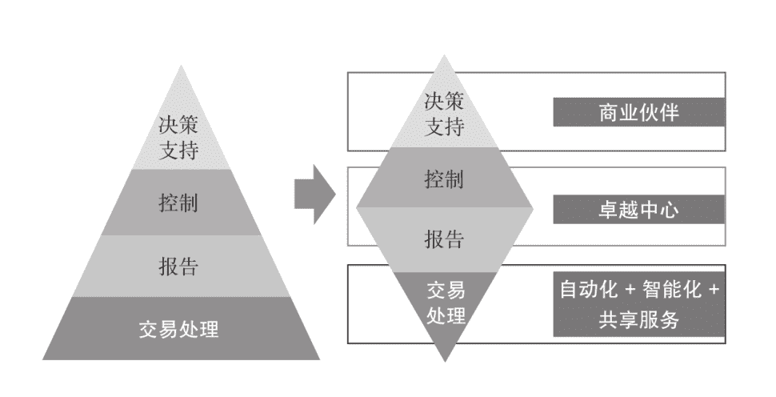

图10-6 中国财务组织架构与运作模式

在上海国家会计学院给会计领军人才班上课期间，我对该班学员所在企业的财务运作模式开展了调研。我前后调研了超过上千家企业，调研结果非常有意思。国内企业的现状是，位于传统金字塔财务运作模型底层的会计交易处理工作，占据了60%～70%的工作量（或人力），个别企业甚至超过80%。位于金字塔中层的控制和报告工作，占据了企业大约20%～30%的工作量。而只有不到10%的时间（或人力）投入到企业的决策支持上，有的企业决策支持工作甚至仅由财务总监本人承担。

通过调研大量跨国企业和国内头部企业，并结合美国注册会计师协会和英国特许管理会计师公会的研究，我进一步细化了未来的财务管理模型，如图10-6所示。未来5年，财务模型会呈现出菱形结构。交易处理的工作量（或人力）占比将低于20%，以我所在的公司为例，目前交易处理的工作量已降至10%以内。未来的交易处理工作，因自动化、智能化、和共享服务的引入与优化升级，效率将大幅提升，运营成本将显著下降，对人力资源的需求也将大幅减少，因此交易处理工作的资源占比将显著下降。

在未来5年内，财务管理将聚焦于帮助企业建立数据平台，打通业财数据，并进行数据管理与分析，推动业务模型和商业模式的创新，成为企业的数据中心和卓越中心（Center of Excellence）。因此，将有60%～70%的财务人员致力于基于数据的控制与报告工作，同时将有超过20%的财务管理人员专注于决策支持，成为真正意义上的业务合作伙伴，引领企业发展。未来，领先的财务组织将更加关注战略与决策支持，并借助新科技降低交易处理成本。

随着以ChatGPT和DeepSeek为代表的AI技术持续演进，预计到2030年，财务管理控制、报告以及会计交易处理将被智能化管理“工厂”所取代。具有人工智能的自动化系统将完成智能化分析、智能化控制、智能化报告和智能化交易等工作。而财务团队将转型为战略专家团队，为企业提供决策支持和风险管理（见图10-7）。

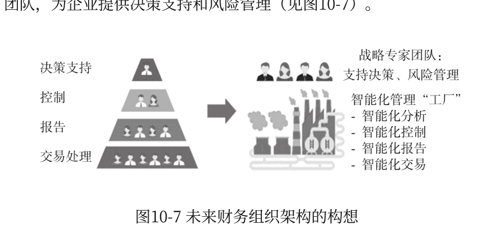

### 财务管理工作的变化

未来的财务管理工作将发生巨大的变化。第一，财务组织将优先致力于实现更快速的财务决算。在企业内部，生产部门有生产日报，销售部门有销售日报，供应链部门有供应链日报，因此，财务组织必须致力于改变数据滞后的现状，推动财务结算从月结转变为日结，甚至提供实时数据。我们公司已于2019年完成了从月结到日结的转型，同时也有部分领先企业完成了类似的快速决算转型。

第二，财务组织将致力于“端到端”流程的再造，流程再造将从财务后端覆盖到业务前端，专注于流程分析、流程设计、相关数据研究与分析及成本效益分析，帮助企业找到最优业务流程，降本增效，提供更卓越的客户服务。

第三，财务组织将致力于企业财务战略目标的设定，重构财务部门的营运模式，制订适合企业战略的高效智能化财务营运模式。

第四，基于创新的财务营运模式和先进的“端到端”流程，财务组织需要对公司的财务和业务系统进行结构性分析，重新设计并实施创新系统，进一步提升企业整体运营效率。

第五，财务组织将更加注重企业数据管理工作，包括数据策略制订、数据治理、数据规划、数据结构设计和数据应用。

第六，财务组织将承担业务合作伙伴的职责，主导企业的绩效管理工作——此类职责设置已在多家跨国企业中得到实践认证。

第七，财务组织将统筹内外部关系和风险管理，包括投资者关系、监管机构关系，以及面向投资者、监管机构和管理层的综合报告。

### AI时代
财务工作是怎样的图景？
财务人员将去向何方？

作者以应收账款自动化管理、智能报销助手为例，详解了重复性工作如何实现“自动化+智能化+共享服务”。同时展现了大模型、OCR、RPA、区块链等技术的落地应用，以及各类机器人在财务工作各环节的应用实例。此外，作者还分享了其公司智能无人财务办公室、智能财务工厂的建设实践和心得。

本书旨在帮助财务人员从数据搬运工升级为数据科学家、财务BP与战略领导，让财务部门从成本中心变身为价值创造中心。

亮点内容包括：

- 财务流程“自动化+智能化+共享服务”
- 智能报销助手
- 合同审核机器人
- 智能问答机器人
- 数据分析机器人
- 智能无人财务办公室
- 区块链

### 今天的财务工作

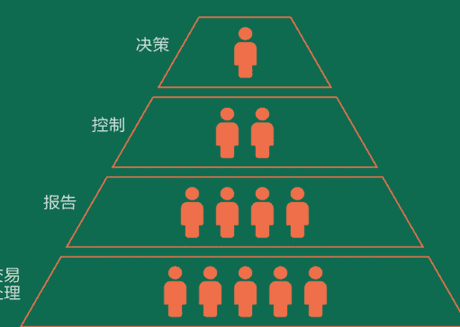


### 未来的财务工作

- 战略专家团队
  - 支持决策
  - 风险管理


- 智能化管理“工厂”
  - 智能化分析
  - 智能化控制
  - 智能化报告
  - 智能化交易


客服电话：(010) 88361066 88379833 68326294