# 财务与 AI 相遇
# 郑永强
中国高级会计师、英国特许管理会计师、澳大利亚注册会计师

## 现任
- 三井住友保险中国有限公司副总经理兼首席投资官
- 美守安管理上海有限公司总经理
- 亚洲金融合作协会智库研究员、金融科技合作专业委员会副主任委员
- 美国注册会计师协会及英国特许管理会计师公会联合董事会提名委员会委员
- 上海交通大学、上海华东师范大学、上海外国语大学、上海国家会计学院、上海对外经贸大学等多所院校硕士生导师
- 上海陆家嘴地区工会副主席

## 曾任
- 美国注册会计师协会及英国特许管理会计师公会联合董事会董事
- 英国特许管理会计师公会全球理事会理事
- 上海外企青年人才协会副会长

# 财务与 AI 相遇
郑永强 著

## AI IN FINANCE

# 前言

## 科技初现，财务价值的重估

2025 年开局便充满信号。1 月，DeepSeek 的发布让业界震动，以其在线检索与推理能力迅速被视作企业与个人的数据中枢。春节联欢晚会，宇树科技的人形机器人在舞台上演绎，引发全民讨论。有人说未来已经到来，也有人担忧岗位会被取代。

此刻，人工智能正以极快速度渗入生活与工作。点外卖时，推荐总能打中偏好；出行时，智能导航可绕开拥堵。无论是 DeepSeek 还是仿生机器人，都指向同一判断：AI 已成为日常必需，并正在企业内部掀起管理与流程的重构。

这波浪潮中，我发现大量管理者，尤其是非技术出身者，对 AI 既好奇又不安。讲课时，高管们渴望知道 AI 如何赋能业务，却在专业词汇面前感到吃力。

我长期在企业财务与金融科技交叉领域工作。近几年通过学习与实践，我意识到 AI 并非高不可攀，而是非常务实的工具。为此我写下本书，用平实的语言把技术原理和管理逻辑讲清楚，让更多人能看懂会用。愿分享学习心得、落地经验与未来判断，帮助读者在变革中找到定位。

## 我的数字化历程

2016 年，我牵头团队开展企业数字化创新。那时 AI 对大部分人仍很陌生，我们却认定它是发展关键。起步于会计自动化，逐步把 AI 与金融科技嵌入口常运营，重点落在财务管理。过程中碰到不少难题，经过反复试错，基础会计自动化取得明显进展。

过去繁琐的流程占用大量人力，如今借助 AI 许多环节可自动完成。我们搭建的智能报销方案依托光学字符识别技术，能自动识票并转成结构化数据，大幅简化报销体验。分析层面，AI 算法可处理海量信息并生成可视化报表，助力管理层快速判断。这些成果带来效率提升，也产生实际经济效益。

在初步成效后我们继续推进，近两年拥抱生成式 AI，将大模型引入内部治理。经微调优化，通用多模态模型被改造为契合企业场景的专业智能助手，可在合同复核、风险预警、财务预测等领域发挥作用，进一步提高管理水平与决策效率。例如智能合同审核机器人借助 AI Agent 深度解析文本，识别关键条款与潜在风险并提出修改建议，审核周期大幅压缩，合同风险明显下降。

## 如何阅读本书

本书是一份通俗、系统且实用的应用指南，帮助读者理解 AI 如何赋能财务管理。内容从基础概念出发，逐步涉及传统流程的重塑、效率提升与价值创造，延伸到智能财务工厂构建、区块链在财务中的应用，最后展望财务未来。

建议先行通读建立整体认知。按顺序阅读有助于形成完整知识体系，从基础到进阶，从理论到案例，每章为后文奠基，能系统掌握 AI 在财务中的核心思想与方法。

第一章从宏观角度呈现 AI 如何重塑传统财务。第二、三章分别聚焦新一代 AI 及应用、数据驱动变革与业财融合，夯实 AI 与数据两大支点。第四至七章围绕应收、报销、综合财务及其它场景展开创新实践，剖析重点流程、痛点。第八章基于前述案例总结智能财务工厂建设思路。第九章介绍区块链及场景，说明去中心化与数据透明如何提升信任与效率。第十章把焦点拉回人，探讨财务人员如何转型以适应 AI 时代。

已有基础者可按需选读。阅读时请结合实际工作思考如何落地。每章均与实践紧密关联，希望能找到适合自己的学习路径，也欢迎交流问题与想法。

AI 时代已至，它重塑工作方式，也重塑未来。每个企业都有机会依托 AI 实现升级与价值增长。作为财务从业者，我相信 AI 将带来更多可能。我们不仅能提升效率，更能借助其能力为企业创造价值，推动可持续发展。

愿与大家一起探讨，如何借助 AI 东风，让财务领域换上冲锋衣，在新时代昂首前行。

# 第一章 人工智能将如何重塑财务管理

AI 与日常财务工作到底有什么关系？能否解决报销、对账、预算编制等棘手问题？本章从这些疑问出发，聊聊新兴技术如何逐步改变财务现状。

## 传统财务管理的困境迷宫

传统财务像打工人的噩梦，重复且繁琐。整理原始凭证如同在乱麻中找线头，找到后还要填制凭证、登记账簿、编表，一环扣一环，差错会引发连锁反应。效率常让人沮丧，简单报表可能耗费数日。录入错误、计算失误会让信息失真，误导经营决策。

### 报销的步步惊心
传统报销看似简单实则繁琐。员工提交后，财务需逐张核验发票真伪。发票种类繁多、格式各异，且有造假风险。曾有一次审核差旅费发票，发现纸张手感与正品不符，经比对并查询验证平台，最终确认系假票。流程被迫中断，还需与员工沟通补件。

除真伪外，金额核对也极考验细心。需逐项核对明细是否准确、是否符合标准，一个小数点偏差就可能导致金额错误，进而带来财务风险甚至内部矛盾。繁琐流程消耗大量时间，也损害员工体验。

### 应收账款的紧箍咒
从开票到催收，每个环节都充满重复劳动。销售后需及时开票并录入系统，任何数据偏差都可能导致收款受阻。曾因客户名称一字之差，发票无法入账，付款被迫延迟。

催收环节需定期沟通，提醒逾期付款。对长期拖欠客户，还需多次发函甚至采取法律手段。人工操作易疏漏，部分款项最终成为坏账。

### 预算编制的马拉松
预算编制是财务关键环节，但传统模式耗时漫长。需汇总各部门数据，而各部门口径与格式常不一致。销售以订单金额统计，生产以实际费用核算，需要财务花费大量时间统一口径。

汇总后，还需结合战略目标与市场情况制定方案，要综合考虑市场趋势、成本变动、竞争态势等，计算复杂耗时高。跨部门协作沟通成本大，意见分歧需反复协商，严重拖慢效率，常导致企业错失调整时机。

### 数据分析的深夜难题
经营关键时刻，老板常要求快速财务分析以做决策。传统模式下，财务需从多份报表手工提取数据，再用 Excel 进行复杂计算，既费时又易错。

印象深刻的一次是季度会议前夕，老板临时要求增加本季度重点客户各产品线的利润率分析与预测。团队连夜导出多系统数据整理计算，时间紧迫下报告仍出现数据偏差，影响决策。这种依赖人工的方式无法满足对实时准确信息的需求，制约决策效率与竞争力。

## 人工智能的破局创新

把财务管理比作开车，沿用传统方式如同驾驶老旧老爷车，缓慢且易抛锚；引入 AI 则像驾驶高科技自动驾驶汽车，速度更快且能规划最优路线。

过去月结需多人手工收集整理核算，耗时易错。2022 年我们将 AI 引入结账流程，实现数据自动采集与核算，效率大幅提升，月结变为日结，准确度显著提高。可见 AI 不仅提升效率，更在重塑行业规则。

### 智能报销：效率跃升
智能报销的核心是光学字符识别技术，能快速准确读取发票文字并转为电子数据。

某大企业改造前，财务每日处理数百份报销单，人工审核一张需 15-20 分钟，效率低且易错。引入 AI 方案后，系统数秒内识别提取发票号码、开票日期、金额等关键信息，自动与税务平台验真，再对照企业报销标准完成初审。符合标准的单据自动流转，有问题的即时提醒修改。据统计，平均审核时间压缩至 3-5 分钟，效率提升数倍，流程规范性与准确性同步改善，财务风险降低。

### 合同审核：风险预警
自然语言处理技术能深度解析合同文本，识别关键条款与潜在风险。

例如采购合同中，机器人可快速定位价格、交货期、质量保证等条款并评估风险。若发现价格不合理、交货期过长或质保条款模糊，会即时预警并给出修改建议。

某跨国企业年签合同量大，人工审核效率低且易漏风险点。引入审核机器人后，能在短时间内完成全面扫描，指出潜在风险，审核效率与质量双升，合同风险有效遏制。

### 数据分析与预测：洞察先机
AI 能从海量财务与业务数据中提取利润率、资产负债率、现金流等核心指标，通过算法深度分析并生成可视化报告。

某制造企业利用 AI 分析五年销售、成本与市场数据，发现第四季度为销售旺季，且需求与价格呈负相关。据此提前增加生产计划并合理调价，取得良好业绩。

AI 还能基于历史数据与市场趋势预测未来财务状况。某企业通过模型预测下一年度原材料价格将大幅上涨，提前锁定长期采购价格，有效降低成本风险。

### 流程自动化：精准无误
机器人流程自动化在财务流程中发挥关键作用。以应收管理为例，RPA 可自动完成开票到收款全流程。销售订单生成后自动开票发给客户，定期检查付款情况，逾期自动发送催款邮件并记录，收款后自动进行账务处理与余额更新。

在对账场景，RPA 可自动从财务系统与银行系统提取数据比对，快速定位差异并调整。据统计，应用 RPA 后应收管理与对账效率提升超 50%，出错率大幅下降。

### 客户服务：贴心陪伴
引入 AI 客服后，员工报销遇到问题无需四处求助，可直接向财务机器人提问。机器人能基于报销政策即时给出准确答复，并说明需提供哪些凭证。

对流程疑问，机器人可图文并茂讲解报销单填写、发票提交、审批周期等环节。即时准确的服务提升了效率与员工满意度。

## 未来的财务系统

在 AI 快速演进的今天，财务领域正经历具体而深刻的变革。技术不再停留在概念，已实实在在应用于数据处理、风险预警、流程优化与决策支持。传统财务以人工为主，依赖经验，效率与准确度受限。AI 重塑后的财务将是自动化、智能化的体系，数据处理更快、决策更科学、风险控制更精准。

### 基础：智能主导的无人财务办公室
随技术成熟，无人财务办公室有望成为现实。发票识别审核、报表编制分析、税务申报、风险预警等环节高度自动化。

财务人员的角色将转向战略规划、数据分析与决策支持等高价值领域。企业财务效率提升，人力成本下降，工作准确性与规范性同步提高，为发展提供更强支撑。

### 管理：个性化专属财务助手
未来每位员工都可能拥有专属财务助手，可集成于企业办公系统。根据个人需求与工作特点提供定制化服务。

员工可随时查询报销进度、工资明细、税务情况。管理者可获得实时财务数据与业务分析报告，支撑随时决策。

### 决策：敏捷应变的实时支持
未来财务系统中，AI 将成为决策核心。通过实时采集与分析内外部数据，提供全方位决策支持。

面对市场竞争加剧、原材料波动、政策变化等风险，AI 可迅速分析影响并给出应对策略。同时，基于战略目标与市场趋势制定长期财务规划。实时精准的支持使企业更及时应对变化，抓住机遇，提升竞争力与抗风险能力。

从 DeepSeek 到智能仿生机器人，科技进步前所未有。人工智能正深刻改变企业运营与财务管理模式，并在未来财务系统中占据核心地位。

从传统财务的低效困局，到人工智能带来的破局创新，再到未来财务系统的广阔可能，变革的力量已经清晰可见。对企业与财务人来说，这既是挑战也是机遇。

企业要主动拥抱变化，把创新管理理念融入日常经营，才能跟上市场节奏保持竞争力。财务人员更要拥抱变革，持续学习新技术与新知识，提升数字化素养与数据分析能力，这样才能在未来的财务版图中站稳脚跟，与人工智能协同，推动财务管理迈向更高效智能的状态。

# 第二章 财务人员如何用好新一代人工智能

## 新一代AI认知：从感知到创造

ChatGPT横空出世后，人工智能迅速成为全球热议话题。AI究竟是什么？对实际工作有哪些帮助？以下是我个人的理解。

人工智能英文是 Artificial Intelligence，直译为人造智能，更准确的说法是模拟人类智能的技术。通俗讲，就是用机器复刻人类智能的新兴技术。其源头可追溯到计算机诞生的年代。现实中随处可见：人脸识别、光学字符识别等图像处理技术，以及工厂里大量使用的机械臂，都是典型应用。

AI的作用非常清晰，如图2-1所示，核心在于模拟人类感知外界、接收并汇总外部信息；在此基础上模拟人类做判断；最后按判断结果执行并产出。

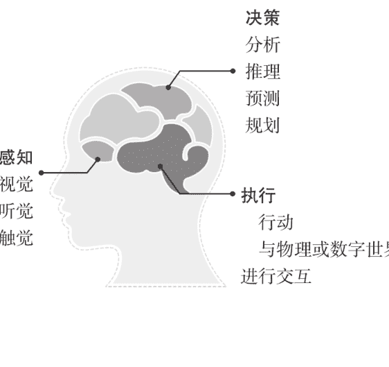

图2-1 人工智能的作用

先聊上一代AI里常用的感知能力，这些技术相当于给电脑装上眼睛和耳朵，让它像人一样察觉世界。

早已普及的光学字符识别OCR，好比电脑模仿人类阅读。对电脑而言一切都是图像，文字必须先被读出来。OCR借助图像识别、自然语言处理和机器学习，把图像里的文字转成可编辑文本。例如把纸质发票扫描后用OCR处理，就能提取文字生成发票数据库，便于调用。

电脑也能听。语音识别让机器听懂人话。用微信发语音，对方能自动转文字，还能跨语种甚至识别方言，这就是声信号转文字的过程，让沟通更顺畅。

最常见的是人脸识别，相当于电脑的看脸本领。手机面部解锁、安防找人，都基于特定算法对照片或视频中的人脸进行识别。

这些旧技术让电脑更好地感知外部信息，把各种数据转化为可处理形式，为生活和工作带来便利。

新一代技术的到来让感知更精准更快，发展也更迅猛。

1997年IBM的深蓝击败国际象棋世界冠军，标志AI进入新阶段。2016年谷歌DeepMind的AlphaGo击败李世石，2017年再以3:0战胜柯洁，AI迎来高潮。

上一代偏重规则化任务，如OCR。新一代如生成式模型，通过深度学习实现创造性输出，如文本生成、图像合成。它们更侧重对数据的处理分析并给出结论，是模拟人类决策更精准更快速的科学。2023年ChatGPT的出现，更是把AI推向全民应用，开启新篇章。

AlphaGo是深度学习程序，通过自我对弈和与人类对弈不断学习优化策略。类比来看，它的决策像做文字填空，有明确开局和结局，通过大量数据推演最优解。而ChatGPT更接近人脑，具有思考和推理能力，像文字接龙，能创新创造。与之原理相近的Midjourney和Sora也具备类人的讲故事创造力。因此我们把这类具备推理、思考、创新能力的技术称为生成式人工智能。

生成式AI在海量数据支撑下，能更快更准地帮助人类决策。其中最具代表性的文字处理模型是大语言模型LLM，ChatGPT与DeepSeek都是其中的佼佼者。

## 用函数思维拆解大语言模型

大语言模型如何理解？我把它拆成大、语言、模型三点，结合ChatGPT来看：

- 大：参数规模惊人。GPT-3参数约1250亿至1750亿，训练数据超45TB；GPT-4参数超1.8万亿；DeepSeek满血版671B，即6710亿参数。
- 语言：通过海量文本学习语义与逻辑，模拟人类表达。
- 模型：本质是超高维非线性函数，通过训练调整参数捕捉复杂模式。

先讲模型。用中学函数更好理解。已知函数里系数 a、b 的数值，代入自变量 x 就能算出因变量 y，x 为输入端，y 为输出端。模型与之类似，输入数据，输出结果。大模型与普通函数最大区别在规模。如图2-2所示，按数学逻辑参数越多结果越准，所以大模型其实是拥有亿万参数的函数式。说的“大”，就是参数规模大。

```
y=f（x）=ax+b
```

中学阶段我们学过函数，给定 a 与 b 后把 x 代入就能求出 y。模型思路相近，输入数据得到输出。大模型不同之处在于参数数量极大，为提升答案精度，参数集合 a、b、c、d 等越多越好，于是大模型可被视作亿万参数构成的函数。归根结底，大指的就是参数体量大。

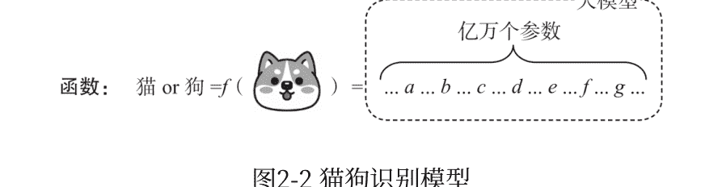

图2-2 猫狗识别模型

看ChatGPT的参数就能体会其大。其发展历程如表2-1所示。

表2-1 ChatGPT的发展历程

| 版本 | 发布时间 | 参数 | 特点 |
| --- | --- | --- | --- |
| GPT-1 | 2018年6月 | 1.17亿 | 首个GPT模型，验证Transformer在文本生成中的可行性 |
| GPT-2 | 2019年2月 | 15亿 | 模型与层数扩大，文本生成质量与多样性明显提升 |
| GPT-3 | 2020年5月 | 1250亿～1750亿 | 参数较GPT-2增长百倍，在生成、翻译、摘要等多项NLP任务上展现强能力 |
| GPT-3.5 | 2022年3月 | 1540亿～1750亿 | 训练数据与优化算法升级，性能与多样性进一步提升 |
| ChatGPT | 2022年11月 | 未公开 | 通过插件机制扩展功能，打破传统人机对话边界 |
| GPT-4 | 2023年3月 | 万亿级别 | 多模态模型，能接收图像与文本并生成文本回复 |
| GPT-4V | 2023年9月 | 未公开 | 聚焦视觉输入的安全部署实现 |
| GPT-4o | 2024年5月 | 未公开 | 多模态大模型，支持文本、音频、图像组合输入与输出 |

了解原理后，还要知道大模型如何训练。本质很简单：求函数是通过已知 x 求未知 y，而大模型是通过输入大量 x 并给出对应输出 y，从而拟合所有参数 a、b、c、d 等。喂入成对输入输出数据的过程叫模型预训练，也称机器学习。

以猫狗识别模型为例，见图2-3，工程师输入大量猫狗图片及对应标签，让模型据此找到参数并生成能准确识别的模型。大模型的“大”，也指训练数据量大。

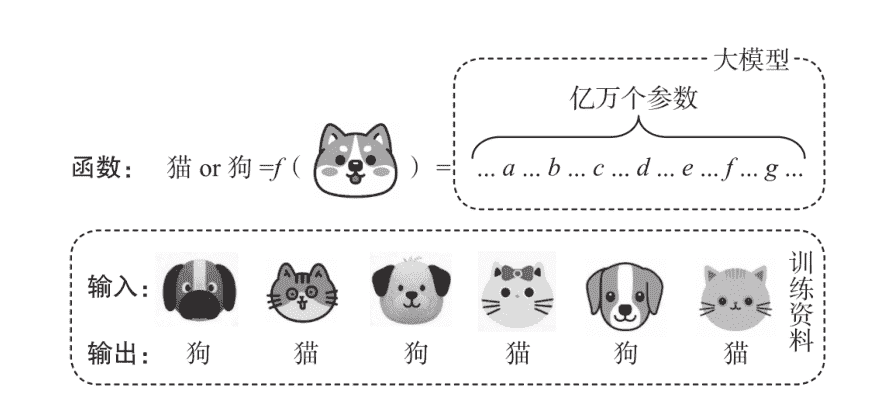

图2-3 猫狗识别模型训练学习详解

再来看ChatGPT运行机制。前面提到，它是给出A和B推导C，已具备逻辑推理和创造能力。

ChatGPT由人类训练师与机器共同利用互联网海量数据训练而成。如图2-4所示，用户输入“你好”，模型可能按互联网出现频率返回“高、吗、坏、帅、美”等接龙词。最大的问题是相同输入可能得到不一致答案，结果不够稳定。因此直接用于客服机器人易产生偏差，导致投诉。大模型在个人场景如写学习总结、工作小结、论文、PPT等很成功，但在专业领域尤其是财务管理，成功案例并不多。怎么解决？

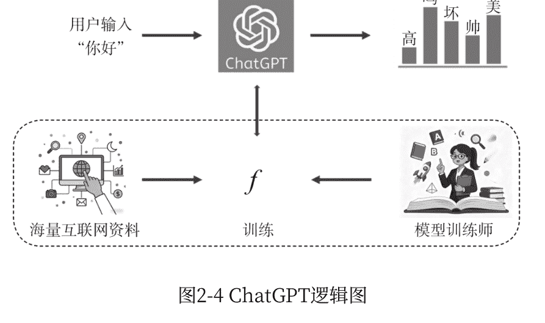

## 从通用模型走向专业模型

在AI快速发展的今天，OpenAI打造的ChatGPT就像毕业于985的全能通才：

- 知识覆盖面广：能聊文学科学，也能写代码讲段子，堪称百科。2023年4月前的互联网信息它基本都见过。
- 语言天赋强：多语言流利切换，甚至能用诗歌对话。
- 逻辑在线：解决、推理和分析能力较强，能应对复杂任务。

ChatGPT是基础扎实、见多识广的通才，能覆盖广阔知识地图。但面对行业深度需求，如保险公司递延所得税资产的业务、账务和税务问题，这类通才就显得力不从心，答案往往似是而非甚至胡编。

如何让大模型在专业领域一样出色，从通才变专才？需要对模型进行深造，通过模型微调或引入检索增强生成RAG技术，把大模型变成行业专才。进化后的专才既保留通才基础能力，又具备专业储备，能解决领域内复杂问题。

## 微调：定制专属GPT

如果你希望ChatGPT这位985本科通才在特定领域精通，就送它去读两年制专业硕士，也就是常说的专硕，这在AI领域叫模型微调。

微调核心是把大模型放到特定领域的知识课堂里重新学习。用法律文件、会计报表、财务案例、医疗记录，甚至某公司的财务和业务数据对大模型训练，使其在特定领域表现优异。

想象你招了一位清华本科的学霸，他学识渊博但对公司财务报表一知半解。最好的办法是让他去财务部实训半年，用财报、数据、账本、审计报告和行业术语培训。

ChatGPT等预训练模型已借助全网数据掌握通用语言逻辑。微调是在此基础上用专业数据再训练，让AI学会用专业术语交流。

通用AI看到EBITDA只会解释为息税折旧摊销前利润。微调后的AI不仅能解释，还会关联行业基准并提醒：同行平均EBITDA利润率18%，你司15%，需优化。

如何微调？假设你是基金公司研究员，想用AI写行业分析报告，四步打造专属AI专家。

第一步，准备好教材。高质量行业数据是基石。需要招股书、券商研报、财务术语表、财务与市场数据等，至少1万条。切忌用朋友圈小作文、知乎抖机灵等低质量数据。数据质量决定AI智商，质量比数量更重要，理想是量大质高。

第二步，选择培训班，即微调框架。入门用户可用OpenAI API上传数据自动微调，适合不写代码的小白；技术强的可选用Hugging Face Transformers库自行调参。

第三步，正式上课，训练自己的模型。注意学习量设置，过高会学飘了，忘掉基础知识；过低则学得慢。训练轮次一般3～5轮合适，过多易过拟合，变成只会死记硬背的书呆子。

第四步，严格考试，验证微调效果。输入分析宁德时代2023年Q3财报，看能否准确提取营收增长40%等关键指标，并关联锂价下跌未传导至利润等行业背景。这一环节需人工评估。

按以上四步，就能让AI从通用助手变为领域专家。通常需要财务专家、AI工程师和数据科学家协作完成。

## RAG：为大模型加上实时检索能力

有时候仅靠微调不够。比如政策法规、技术标准、公司内控流程等更新极快，仅靠模型记忆的旧知识难以满足实时性。这时需要赋予模型实时查资料的超能力，这就是RAG的优势。RAG像给大模型配了知识库，遇到不确定问题时先查库再生成答案。

RAG巧妙结合不擅长记具体事实的生成模型与会查资料的搜索工具，兼顾效率与智能。

RAG可拆为两部分：

- 检索：从知识库中找出与问题相关的内容。
- 生成：利用语言模型基于检索结果生成回答。

AI不再只依赖训练时的知识，还学会查资料。模型成为手握百科工具的学者，既能思考又能随时查证。

比如问公司报废一台服务器该走什么流程？会计和税务如何处理？财务同事若答不上，会先去资料库查规章制度和作业流程，再用自己的话总结回答。这就是RAG的工作流程，通过查资料弥补模型遗忘的缺陷。

大模型有两大弱点：一是记忆容量有限，二是知识滞后，通常仅覆盖训练时数据，如GPT-4知识截止2023年。问最新问题时可能答不出。RAG通过引入检索环节，让模型随时从外部数据库获取最新或更具体信息。

假设你问：苹果股票过去一个月表现如何？未来走势有哪些影响因素？普通语言模型可能回答：苹果一直是焦点，过去一个月股价大致波动，具体数据不明确，可能受新品、竞争影响。缺乏数据支撑。

而使用RAG的大模型会先检索财经新闻和金融数据平台，获取过去一个月每日开盘、收盘、最高最低价，并了解新品市场反响、竞争对手动态、分析师观点等，再据此生成有据可依的回答。对财务分析来说，这种结合实时数据的输出才真正有用。

一个很直观的RAG效果可以这样呈现：当大模型联网检索后回答苹果股价问题时，会给出“过去一个月苹果开盘价在××美元左右，收盘价来到××美元，区间最高触及××美元、最低探到××美元，整体走势偏上行”。这背后是因为新品上市后市场反馈很好，多家机构据此看好苹果下一季度的营收弹性。但回答同时会点出不确定性：竞争对手也在布局同类产品，有可能分流市场份额；利率波动、通胀变化等宏观因素，也会改变消费者的支付意愿和投资者的交易逻辑，从而牵动股价。

这个例子就说明了，借助实时检索，RAG能把外部最新信息融进生成过程，给出更贴近现实、更完整的答案，这是单纯的通用大模型很难做到的。

如果想把RAG用在公司内部的财务数据分析，大体可以按三步走：

- 材料准备与预处理：先搭建财务相关的知识库，范围可以覆盖内部的PDF、网页、文档、财务报表、数据库，也包括外部的行业数据。把这些资料转成机器可检索的形式，比如做成向量嵌入。实现上常用FAISS、Milvus这类开源向量库，前期建设通常需要工程师配合。
- 搭建检索能力：做一个能快速定位问题的搜索工具，让输入的问题迅速命中相关文档。底层可以用FAISS或Weaviate做向量检索，如果要实时查外部信息，也可以接入Google、Bing等搜索引擎的API。这部分同样离不开技术同学的支持。
- 接入生成模型：挑选一个语言生成模型，像ChatGPT或开源模型都行，把检索到的内容喂进去，由模型完成组织和表述，输出最终答案。

有了这套闭环，财务信息的检索和生成就被智能化了。以后员工提一个财务问题，检索系统先把最相关的财务数据找出来，再交给生成模型润色成准确、有用的结论或建议，供管理层参考。借助这种问答和分析，财务人员能更清晰地掌握公司财务状况、识别风险点，并为决策提供更合理的依据。

从ChatGPT的通才能力，到微调带来的专才效应，再到RAG的“会查资料”能力，大模型正逐步进化成能处理专业难题的复合型助手。但通才和专才本质上是为不同需求服务的。实践中，如果需求稳定、边界清晰，微调更合适；如果需求多变、信息频繁更新，RAG的价值更大。既保留通才的广度，又能在特定领域深度扎根，还能实时调用外部知识，这或许就是我们期待的智能形态。

# 第三章 财务价值的重构

过去四十多年，企业创造价值的主要方式是靠规模化生产和不断做大收入。时至今日，仍然要问：一个公司、一个部门、一个人，到底该如何创造价值？这个问题对企业家而言愈发关键。转向存量并不意味着增量消失，海外市场等增量依然存在，只是高速增长的阶段掩盖了对价值创造的思考。

## 老板视角：财务何时摆脱成本标签

财务部门长期被贴上成本中心的标签，如何转向价值创造中心，是管理者必须面对的命题。日常的财务会计工作聚焦在流程管控——应收应付、出纳等——以及合规——税务、记账、报表、审计等。这些工作确实产生价值，但边际有限。

一位上市公司董事长曾和我聊过财务外包。上市前他太太做财务总监，小姨子管出纳，账务基本外包。上市后财务团队膨胀到上百人，主要产出是月报、季报和年审报告，却很难感受到增量价值。经营好的年份不计成本招人，经营承压时财务就成了沉重的成本负担，让他怀疑上市公司财务是否也可以外包。

财务管理者听了会觉得委屈：脏活累活都扛，出了事要背锅，奖金不如业务线，业绩不好就被裁。但破解之道只有一条，就是让财务持续创造可见的价值。

未来财务的定位，核心是以数据管理为抓手创造价值。我曾在全国总会计师培训班提问：“经营决策是否基于财务报表数据？”百余位央国企总会计师几乎一致摇头。再问：“最终依据财务数据还是业务数据？”得到的答案是业务数据。

仅做报表分析很难影响决策，只有把财务数据拆解到业务层面才有意义。财务要看的不仅是数字本身，更是数字背后的业务逻辑，这样才能帮领导班子发现问题、把握增长点，找到业务增长的驱动因素。

这就引出“会做菜”和“做好菜”的区别。曾经请一位厨师做员工餐，他自称很会做菜，结果菜或咸或淡，难以入口。虽然出于人情不好指出来，但大家都吃得不舒服。财务也常犯同样错误：财务经理喜欢做表、看表，决策者想要的是直观易懂的图表，而不是一堆需要反复挖掘的表格。

一位国企一把手朋友抱怨财务总监每月递来几十页的文字报表，问题一多又补一堆表，页数从十几页涨到上百页。她要的和得到的大相径庭。

财务用数据分析创造增量，必须理解决策者想要什么呈现形式。核心是让决策者看懂、看明白，而不是让专业人士自嗨。就像大厨不仅要会做菜，还要做得符合口味。调研发现，决策者更偏好可视化呈现，例如图形。电动车之所以被认为比同价位油车更高端，很大程度上是因为客户看到的是好懂的“图”，而非需要学习的“表”。

弄清价值点后，下一个问题是效率。常有场景：总经理要一份新分析，财务总监先问“什么时候要”。这像客人点菜后厨师反问“你能等几小时”。对决策者而言，及时性比绝对精确更重要，没人会为几块钱的差异纠结。

## 把价值创造拆开看

财务部门创造价值可以拆成三步：

- 先把财务数据与业务数据联动起来，挖掘业务数据的价值。
- 再把结果具象化、可视化，用决策者能快速理解的方式呈现建议。
- 最后提升交付速度，让需要的数据在合适的时间精准送达。

下面用农田麦子变重庆小面的比喻，把数据如何转化为决策价值的流程讲清楚。

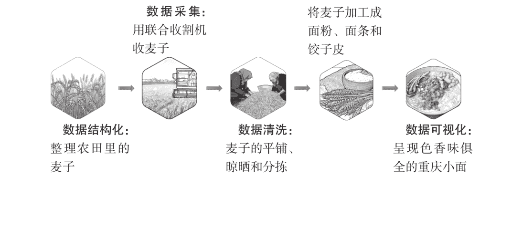

### 第一步，数据结构化：把田里的麦子先理顺

把企业数据比作田里的麦子，形态各异。要高效收割，先要整齐。

企业数据大致有三种形态：结构化、半结构化和非结构化。结构化数据存于各类业务系统，如财务系统的会计数据、订单系统、采购系统，规律清晰，易于机器读取。半结构化数据在财务中很常见，比如云端Excel分析表、PPT说明，数字化但缺乏统一结构，机器难以直接调用。非结构化数据则是纸质单据、发票、合同，依赖人工识别。

目标是把所有数据变成结构化。实现路径有三项技术配合：

电子档案先让资料“触手可及”。大企业找一张两年前的发票，若靠纸档检索要跑仓库翻找，用完再归位。电子档案则像点播系统，想看哪里点哪里，大幅压缩查找时间。

OCR把电子档案转成机器可读文字，属于半结构化。电子档案解决可达性，OCR解决可读性，两者叠加效率明显提升。

生成式大模型则能把半结构化信息整理成结构化。比如把纸质采购合同扫描成电子档案，用OCR提取文字，再用大模型抽取甲乙双方、账号、金额、账期等关键字段，甚至法律条款中的违约地点等隐性信息，形成结构化采购合同库。相比仅记录必要采购字段的系统，这种库能同时满足财务结算、法务合规等不同部门需求，覆盖面更广。

这就完成了从非结构化到半结构化再到结构化的基底建设。税务系统推行的“三流合一”就是典型：合同流、发票流、资金流。资金流已电子化，发票流随数电发票快速结构化，合同流则不必等待区块链电子合同成熟，用上述三步就能先行结构化。合同、发票、资金三流打通后，数据价值释放的基础才算真正建立。

### 第二步，数据采集：用联合收割机收麦子

数据采集好比收割。数字化时代的痛点是数据分散：合同在业务系统，订单在订单系统，采购在采购系统，财务在财务系统，彼此隔离。月末应收核对就要财务导出报表、销售导出业务明细，手工Vlookup对账、修正、再记录，重复且低效。很多流程里，人其实在做“数据搬运工”。

近几年出现RPA，像游戏外挂一样重复执行简单搬运动作，能提升效率，但本质仍是搬运。

更彻底的是API，即系统间的标准化数据接口，像管道一样让数据单向或双向流动。手机支付跳转微信或支付宝完成结算，就是接口在背后传数据。企业里常见的银企直连也是此理，把财务、资金、预算、采购、报销、业务、办公系统通过API串起来，采集既准又快。

目前有三种做法：纯人工最原始；API直连最推荐，实现高效甚至实时交互；RPA介于人机之间，是过渡期的可行方案，长期看仍会向接口演进。

### 第三步，数据清洗：铺开、晾晒、分拣

类比晒麦子：先铺开大表，再晾晒整理分类，最后分拣出关键信息做分析。企业常见问题是部门重复开发数据、标准不统一、业务数据孤岛，效率低下。

典型场景：总经理发现当月收入骤降30%，问财务总监原因。财务分析同事从财务系统导出实际收入表，找IT从业务系统导出明细，合并成大表后筛查，最终反馈某品类在江浙沪下滑50%。总经理追问具体客户，分析同事又去客户系统拉表，再次合并处理后才给出客户名单。整个过程耗时耗力，却是常见现状。

# 从Excel拼表到数据打通：财务分析效率的思维跃迁

总经理一开口就是一连串新需求，财务分析员便又要翻遍各系统扒数据，循环往复。这种重复劳动令人疲惫。

观察下来，整个链路其实就是：各系统反复抽数，堆出大量表格，再靠Excel硬凑成一张巨表，然后校验、校对、分析，最后才推导出一张结论表。随着分析深入，表格体量和复杂度指数级上涨，周期被不断拉长。每个月都在重做一遍。更讽刺的是，大家总以“下个月可能还要用”为由把这些表存档，实际上绝大多数从未再被打开。

很早我就想打破这种低效。既然老板想法多变，为何不把数据先集中起来？我们的数据规模远不及互联网公司，底层数据库也基本一致。直接把订单、客户、采购等信息逐条沉到财务系统里，不是更省事吗？把想法抛给IT后，得到的回答是否定的。原因很现实。十年间，业务系统的颗粒度随着客户需求变化和前端渠道如抖音的增加，持续膨胀。十年前业务数据的维度只有百来个，现在已超过四百个，相当于Excel的列数从一百多飙到四百多。

日常中业务系统会随需求不断迭代。若把所有数据同步到财务系统，会带来一堆难以自动化的新问题：如何同步？会不会重复造轮子？财务系统要不要随业务系统同步升级？这些问题很难高效解决，还会催生新的复核和对齐需求。业务系统一动，财务系统就得跟着动；关联系统一变，又要连带调整。这不仅成本陡增，落地难度也极高。至今没有一个真正大而全的财务系统能完全胜任。

这里借用一个概念——数据中台，并非系统科普，仅取其内核。传统Excel耗人耗时，如何更高效地取数分析？数据中台的思路正是对症。

它的核心是在财务、业务、客户等系统之上搭一层“数据库关系层”。这层由多个功能性数据库组成，职责是建立跨系统的索引，让IT技术能直接调用和查询。面对管理层的临时问询，中台的取数逻辑与Excel截然不同。

举例说明，财务系统里只存一条记录：2024年11月9日销售收入1000万元。业务系统里同日有三笔：编号A001 300万元、编号A002 500万元、编号B003 200万元。

Excel的做法是分别导出两张表，手工合并，再用公式建立联系。而数据中台的做法是在关系层建一个索引库，如图3-2所示，记录大致为：

- 索引号甲，对应2024年11月9日，财务系统
- 索引号甲，对应A001，业务系统
- 索引号甲，对应A002，业务系统
- 索引号甲，对应B003，业务系统

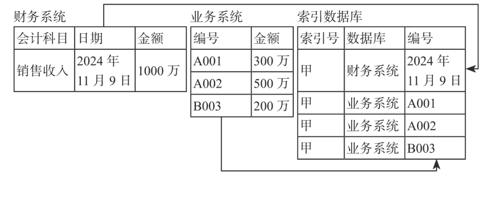

图3-2 建立索引数据库

只要输入日期2024年11月9日，索引库就能自动返回业务编号A001、A002、B003。

这样是不是更省事？通过中台建立各维度索引，再写一段代码即可快速提取，省去大量手工拼表。

需要再次强调，我只是借用数据中台的逻辑，并非讲解落地实施。基于相似思路，我们可以为各系统建立索引关系，将数据对齐，再用少量代码大幅提升管理者取数分析效率，避免重复和冗余。

更要提醒财务同行，在人工智能时代不要再固守Excel思维。Excel的最大短板是数据维度尤其是列宽的扩展性不足。数字化时代系统迭代快、维度持续增加。若地基没打牢，后续想扩建，靠老办法几乎不可能。

### 第四步，数据建模：提前搭好分析框架

加工环节决定最终效率。要想快速端面，面条必须提前备好，不能等客人点单再去收割小麦。

这里再次借用概念——数据建模。我们平时做资产负债表、利润表、应收账龄表时，都会预先写好公式，刷新就能更新。这种预设关联的做法就是最简单的数据建模。通过规则预设，从客户视角可拿到客户基本信息、月度消费、每笔订单及订单内商品；从财务视角可拿到年季月销售收入、每笔订单、客户采购等。数据建模的价值在于快速开展分析挖掘并产出洞见。

### 第五步，数据可视化：让信息好看又好懂

再好吃的面条也要卖相足。面馆会放葱花辣椒，让面红火热气腾腾。决策报告也一样，需要可视化工具帮助快速理解。这里提到BI商业智能。BI本质上是一种可视化看板工具。借助数据模型与数据中台，可直接从后台抓取数据以图形呈现。Excel时代报表是表格，智能时代报表是图形。后续章节会展开BI场景，本文不做操作细节。因数据源多样，报表模板的搭建通常需要财务与IT协同。

小结一下，麦子从田间到餐桌变成一碗重庆小面要过五关：整理、收割、加工、烹饪。企业数据分析亦然，客户要的是又快又好。

- 第一步，数据结构化，可借助电子档案+OCR+大模型
- 第二步，数据采集，由人工收集+RPA+API完成
- 第三步，数据清洗，可借助数据中台
- 第四步，数据建模
- 第五步，数据可视化，可借助BI+大模型

## 业财融合实战案例

看一个真实案例。图3-3是一家保险公司的应收账款统计分析可视化仪表板，即数据分析看板。看板同时呈现财务数据和业务数据。

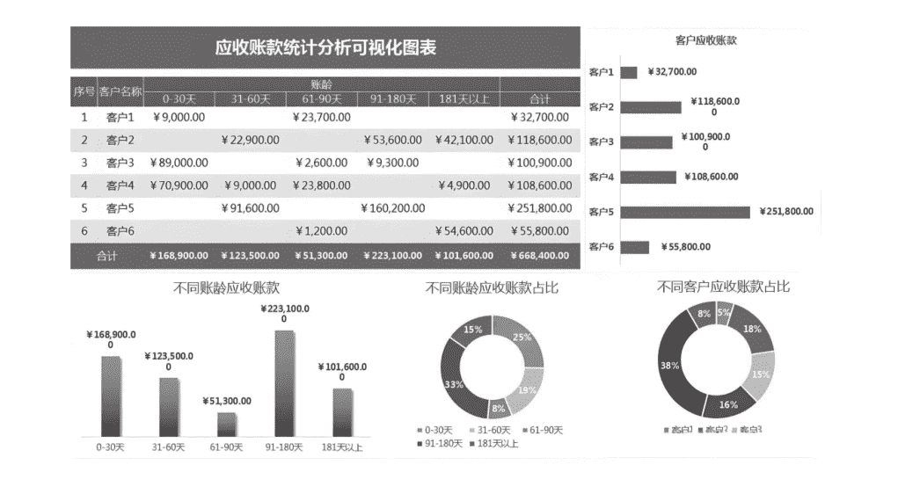

图3-3 应收账款统计分析可视化仪表板

期初应收来自财务系统，期末应收来自业务系统，且业务数据已通过数据中台与财务数据完成对齐。看板上典型的业务指标是账龄及账龄监控盘，可实时查看0~30天、31~60天、61~90天、91~180天、181天及以上的情况。还可按客户等维度下钻，设定阈值超限自动预警。

过去每月应收管理会，财务和业务一见面先争数据对不对，各自拿出表格反复核对，会议效率极低。

现在应收管理完全依赖这套看板，由财务牵头、IT配合共建，数据准确性大幅提升，业财一致性得到保障。系统每日自动校验对齐，业务部门不再自制表格，效率反而更高。财务也不必手工反复制表。

双方精力都集中在如何用数据改善应收管理、优化经营，回款加快、坏账下降。财务真正创造了价值，这才是业财融合。

从入行二十多年起，我就不断听到业财融合。培训、书籍、标杆企业走访不少，真正做到的却很少。我的观察是，能做到的企业都有一个共性：系统投入大，数据投入更大，且各系统数据互联互通。业财融合的基础就是业务与财务数据的打通。前文讲的就是如何打通并创造价值。

# 第四章 用自动化消除重复劳动：以应收账款核销为例

应收账款核销是财务日常里最重要也最繁琐的重复性工作，核心有三步：银行流水下载、应收账款核销、账务处理。手工处理慢且易错，风险不小。把全流程自动化、智能化、共享化已成必然。2019年我们实施的应收账款核销机器人项目就是典型。本文回顾背景、方案与成效。

## 手工操作是怎样耗时的

改造前的标准流程分三步：①下载银行流水；②在业务系统每日核销应收；③在总账系统做账务处理。涉及五类系统：一类外部——银行网银，通常多家；四类内部——CRM、业务系统、总账、邮件办公。涉及四类人员：客户、客户经理、银行人员、内部财务出纳和应收会计。

表4-1 应收账款核销作业流程

| 三个步骤 | ①银行流水数据下载 ②应收账款每日数据在业务系统中的核销 ③应收账款数据在总账系统中的账务处理 |

| 五类系统 | 银行网银系统、CRM系统、业务系统、总账系统、邮件或办公系统 |

| 四类人员 | 客户、客户经理、银行人员、内部财务人员（出纳和应收会计） |

(1) 银行流水数据下载。出纳每天早上先从保险柜取出6个银行USB Key，因同时插入易冲突导致死机，必须逐个插拔。依次登录网银、输入密码、导出Excel流水，保存到指定目录。再手工把6家不同格式的文件合并成统一的每日银行流水报表，并与网银余额核对。

这套流程看似简单，实则步骤多且重复。约需1小时，平均2小时。手工合并易错，被打断后差错率更高。

(2) 应收账款每日数据在业务系统中的核销。应收会计拿到流水表后，从业务系统导出应收明细，从CRM导出客户信息，手工合并成中间表，再用Vlookup等函数与流水表匹配。匹配后需与客户经理沟通确认，随后在业务系统核销并做总账处理。沟通确认是最耗时的环节。

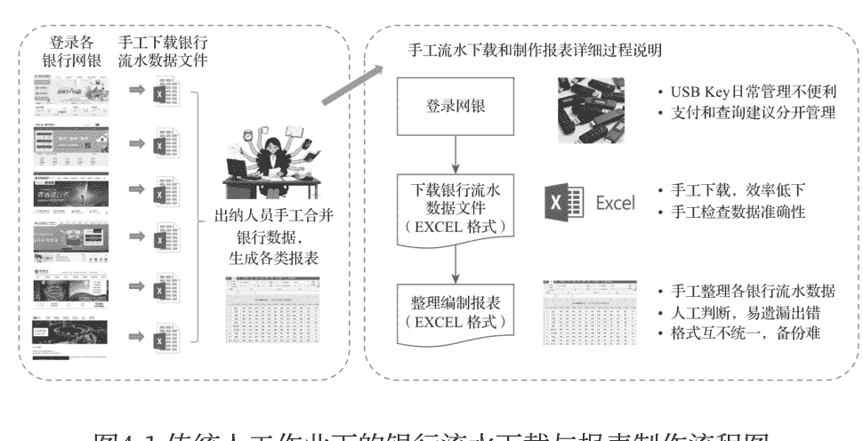

不同分公司做法不一。有的把中间表按客户经理拆成多份邮件发送等待确认，有的群发给部门等待认领。方法不同，周期和准确率也不同。也有会计凭经验直接匹配，速度快但错误率高；也有逐一电话确认，精准但低效。每个人的中间表格式各异，后续追溯和人员交接都成难题。

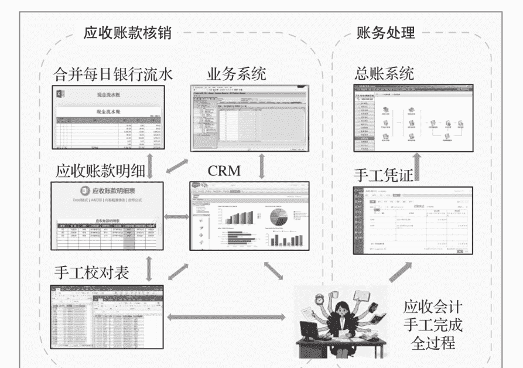

图4-2 传统人工作业下的应收账款核销流程图

(3) 应收账款数据在总账系统中的账务处理。会计根据确认结果在业务系统手工核销，再把信息手工传递到总账做半自动记账。步骤相对统一，只是日复一日重复。

## 核心痛点：慢、繁、易错

从时效和岗位看：

第一，银行流水下载。出纳每日手工登录下载、合并整理，上下午各一次，每次约2小时。数据量大、重复、易错。

第二，应收数据匹配。会计需与客户经理电话或邮件沟通、制作中间表，每天平均超4小时。沟通成本高，影响核销时效和客户体验。

第三，核销和账务处理。手工登录业务系统逐笔核销，再在总账生成凭证，每天约2小时，极易出错。核心是数据在系统间搬运对齐。

整体流程大量使用中间Excel、邮件、电话、纸质文件，耗时耗力且错误频发。工作特点是高度重复、规则明确，非常适合自动化+智能化+共享服务。

## 变革路径：自动化加智能加共享

2017年我们率先用RPA采集数据、衔接系统、传输数据，因局限性和维护成本高，2019年改为定制代码通过接口实现，仍习惯称之为机器人。

### RPA 工作原理简述

RPA本质是模拟人在电脑上的操作，把重复性强、规则明确的任务交给机器人。它像游戏外挂的自动执行，核心是模仿+规则+自动化。

RPA：会模仿的数字操作员

RPA 通过屏幕抓取和图像识别来定位系统里的按钮、输入框、菜单等控件，并为每个控件打上唯一标识以便后续调用。它可以用可视化工具或脚本语言把一串重复动作拆解成“启动程序”“填入数据”“点下确认”这类标准步骤，再串成可直接运行的自动化流程。运行时，机器人模拟鼠标移动、键盘敲击来完成任务，能够从表格、数据库读取结构化信息并写入目标系统，还自带基础的数据校验与分支判断，在预设条件下自动选择路径，让执行更稳妥。

这项技术的最大好处是无需动现有系统架构就能快速上线扩展，效率和准确性明显提升，人力成本随之下降。运行期间会完整记录操作日志，进度和结果也能实时回传，过程可监控、可追溯。

但要明确，它并非真正的人工智能，没有自主思考能力，更像是靠死记硬背执行清单。它擅长高频重复、规则清晰的工作，一旦界面改动、网址变更或数据结构变化，就会出现“不会办”的情况。它适合标准化的场景，例如发票数据的逐项核对，却无法处理需要情绪判断的客户投诉类业务。

### “机器人员工”的全新作业流程

上班前，人类同事还没到岗，**“现金机器人”** 已先行启动。它模拟出纳操作，调用本地保存的查询凭证，按序识别插在主机上的网银 USB Key，分批登录各家银行网银，抓取流水并统一格式后写入“银行流水”数据库。

数据落地后，**“应收账款核销机器人”** 自动被唤醒。它以汇款人、币种、金额为锚点，把银行流水与业务系统的应收数据进行智能配对，通过 API 完成核销。对需要人工确认的收入，它会进入 CRM 定位对应客户经理，发起 OA 确认并同步邮件，随后收集反馈，按应收、暂收、营业外收入、手续费等不同情形经接口写入业务系统，完成核销、制证与入账，最后向相关人发送结果邮件并留存日志。

新流程本质上由三段代码构成，分别是“现金机器人”“应收账款核销机器人”“凭证引擎记账机器人”，分别承担不同的数字员工角色。

### “现金机器人”

该方案是外采的软硬一体产品，不仅解决了流水自动采集，还带来了资金数据集中管理的价值。核心逻辑是定时自动登录网银，抓取各账户流水，形成企业级资金池视图，帮助企业调配资金、提升周转效率。业务人员可订阅实时进出账信息。

硬件层面兼容各家银行 USB Key，通过软硬件协同解决多 Key 冲突；软件层面模拟出纳手工下载流水，实现全账户流水的统一收集与展示。分析模块基于完整实时流水提供收支洞察与预测，并与应收机器人联动，实现业务与总账数据的自动化匹配，再由凭证引擎自动生成会计凭证。

实操中，机器人会在员工到岗前完成前一日流水的抓取与整理，也会在午休时段再次运行更新数据。出纳从制作报表的工作中解放，转向数据分析与资金预测，创造更高价值。

### 图4-3 “现金机器人”工作流程图

### “应收账款核销机器人”

该方案自动化程度更高，通过定制接口连接总账、业务、CRM 系统，按规则生成应收明细，再与现金机器人采集的流水自动匹配。匹配后数据经 OA 或邮件推送给客户经理确认，确认结果自动回传并完成核销，形成闭环作业，同时保留审核痕迹以便追溯。

通俗讲其运行逻辑如下。以本日收到 ABC 公司 100 万元为例：机器人先根据流水向业务系统发 SQL 查询，若查到对应的待核销应收，再提取合同号等信息，通过接口查询 CRM 获取客户经理张三的联系信息，随后发起 OA 流程，把流水信息与应收信息并列呈现给张三校验。

这里设计的是判断题而非填空题，避免机器人解析不了的开放式答案。若张三回复“是”，机器人即自动准备核销单并定期上传完成核销；若回复“否”，系统会弹出表单让其指定应核销的应收明细，该反馈本身也在为规则库积累训练数据。

实践中，一对一直接核销的比例约 30%，其余 60% 以上为一对多、多对多或涉及折扣、费用等复杂情形。经过半年规则沉淀与人工智能辅助，90% 以上的应收可实现精准自动核销。无法做到 100% 的原因在于部分款项根本并非客户支付，必须人工沟通跟进，这部分正是共享服务模式的适用场景。

自动化让核对从人际交互转向规则加智能的系统对接，匹配完成即通过 OA 通知客户经理，彻底改变了过去被动查询或等待手工核对的模式。

### 图4-5 “应收账款核销机器人”作业流程示意图

### 图4-6 “应收账款核销机器人”工作原理示意图

### “凭证引擎记账机器人”

该机器人接收应收核销机器人传递的数据，利用 AI 记账规则引擎进行识别、判断与转换，本质是数据映射。自动生成会计凭证并在总账系统完成记账。逻辑与手工 Excel 转换相似，区别在于映射与转换由代码自动完成。

总体来看，机器人定时运行，上班前完成流水采集、应收匹配与确认，确认后自动核销并入账。人工作业占比从 100% 降至约 10%，差错率大幅下降，财务人力资源得到释放。

从岗位看，应收核销流程覆盖出纳与应收会计。出纳的自动化替代率接近 100%，应收会计超过 90%。出纳日常 90% 以上的工作为银行沟通、支付操作与数据查询，其中“跑银行”已基本消失，银企直连后支付审批多在内部系统完成，出纳仅做形式点击，核心价值在于数据收集与查询，而这已被现金机器人完全取代。未来出纳应转型为司库，负责资金规划与管理。

应收会计日常 70% 以上为核销与簿记，其余为追踪与分析。借助自动化与智能化，核销簿记工作可被替代 90% 以上，剩余工作以共享模式承接。整体上自动化加智能加共享可替代 70% 以上工作，应收会计需升级为财务 BP，依托数据分析与建模建立客户信用体系，提升应收管理质量。

# 第五章 能互动的智能助手：以报销流程为例

“智能报销助手”融合流程机器人、对话式 AI、图像识别与机器学习，打通内外部数据，实现报销数据的智能采集、判断与管控。它把重复型流程机器人升级为会学习、会互动的数字员工，能够部分替代人类开展工作。

## 关于报销系统改造的“大讨论”

2011 年公司上线了 PC 版报销系统，相比纯手工纸质报销已大幅领先。2019 年该系统明显滞后，内控合规要求提升后暴露诸多问题，新增需求也难以实现。

当年启动改造大讨论，最初计划抛弃旧系统引入市面费控产品。几轮选型后发现，新旧系统在功能逻辑上差异不大，均嵌入规则、判断与 OCR 工具。若改造十年前的稳定系统，开发成本极高；更换新系统同样需要大量定制。因此团队陷入两难。财务负责人更关注投入产出，若投入高而端到端效率提升不明显，则难以决策。

## 流程的痛点

放下系统替换问题后，团队聚焦流程痛点。

第一，申请人体验差。报销凭证与附件的规范不清晰，申请人反复与财务沟通、被动纠正，沟通成本高，报销量大的部门与财务关系易紧张。培训后仍易遗忘，痛苦集中在双方。

第二，周期长、环节多。申请提交后需经主管、初审、复核、财务经理，金额大还需总监，之后还要打包网银支付。审核与支付周期不可控，申请人多次催问到账时间，体验不佳。

第三，财务工作量大。调研中某公司初审人员每日仅审 10 至 20 单，却需接十几通电话解答报销咨询，工作被频繁打断，效率低下，应收应付岗位亦同。

第四，管理与审批痛点。管理者关心预算执行与剩余额度，虽可查询余额但缺乏实时可视化，分析报告仍依赖财务手工编制。审批仅限 PC 端，出差无法操作，效率低。财务退回资料后流程需重走，增加烦扰。

传统报销流程大致为：申请人 PC 端提交申请并上传凭证；主管基于图像信息审批；申请人打印单据与原件提交财务；财务进行初审与多轮复核；资金部定期集中支付。痛点集中在信息不透明、人工干预多、反馈慢。

## 以控制点为核心重构报销

报销全流程既长又繁琐。把流程拆开看，痛点其实集中在几个环节。

先是员工发起申请，这个起点跑不掉。流程要动就得从这里拉开，但能做的就是把发起动作压到最简，让体验更顺畅。历经四年多的打磨，我们已经摸索出更轻量的发起方式，后面会展开说明。

再是主管审批，痕迹必须留在系统里，也无法砍掉。优化方向是把需要确认的信息浓缩到最少，让主管几秒内就能判断通过。

第三步是员工补齐资料。2019年纸质凭证仍然是会计附件的硬性要求，环节不可少。关键在于让资料提交更精准、更有效且不重复。

最后是财务复核。实践中初审、复核、终审经常要3到4个人轮一遍，但审的内容几乎重合。复核不过是在重复初审，终审又是在重复前两者。总监来审也只是审同一套东西，并没有产生增量价值。

于是问题就很清楚：多一道复核真的能提升准确度吗？是否一道财务审核就够了？能不能交给机器人？从内控设计的角度看，这是一个伪命题。只要关键控制点被牢牢卡住，审核的人数和环节多少并不决定结果质量。因此我们做了大胆尝试，只保留一道财务审核，并且由机器人来执行。

要让机器人一次性审准，就必须先把流程的关键控制点找出来。流程再造的核心价值，就是用最简的路径把所有关键点锁住。

梳理后，一张报销单其实只有5个关键控制点。

第一，发票是否真实。发票作为核心会计凭证，必须合规有效，一旦造假，公司和个人都要承担法律和税务责任。

第二，报销事项本身是否真实。判断依据是配套的支持材料：打车要有行程单，住宿要有清单，开会要有通知，出差要有申请。这些材料决定事件是否真实发生。

第三，审批权限是否到位。是否符合公司权限表，有无合理授权，是流程能否继续的前提。

第四，预算是否充足。申请、材料、权限都齐了，如果预算已耗尽，报销仍无法通过。

第五，这笔钱到底该不该花。花不花得合理，本质上是业务部门的判断，财务很难单独把控，需要业务与财务全局协同。

## 把五大控制点交给机器人

基于上述拆解，我们把报销场景重新设计，让智能机器人负责对这五个点的判断与管控。

发票真伪由机器人控制。依托金税四期，发票经扫描识别后上传税务系统验真，返回结果为真则自动放行，为假则退回申请人并同步结果。

事件真实性由机器人控制。对不同报销类型设定审核规则。以差旅为例，机器人会自动调人事系统的出差审批记录，比对时间、地点、目的、天数；再用OCR+NLP+机器学习读取行程单、住宿清单等关键信息，比对日期、金额；最后调取个人差旅标准，判断申请额是否合规。

权限控制由机器人完成。传统模式要预留所有权限人签字备查。现在在网络安全和系统权限健全的前提下，系统密码和权限校验就能完成授权确认，无需额外人工复核。

预算控制由机器人完成。机器人读取预算系统对应科目的余额，与申请金额校验，超支退回，足额通过。

必要性控制我们选择让财务退出。钱已发生进入流程后，财务反对往往导致反复博弈，最后以“下不为例”收场，财务反而成了阻力。我们改为以金额分档：大额支出走事前立项审批，小额支出不再审必要性，直接放行。这样对费用必要性的管控反而更严格。也明确界限，本方案针对个人报销，不涉及行政采购类对公支付。

前四个控制点完全可自动化，第五个可直接移除。流程因此极度简化：员工提交申请与附件，机器人审核无误，审批人在系统授权后，银行银企直连自动付款给申请人。便捷程度可想而知。

## 打造智能报销助手

全自动化后出现新问题：习惯了打电话问财务的老员工面对一个全自动机器人会无所适从。机器人必须能像真人一样提供指引，成为真正的智能报销助手。

在此之前，我们做过不少数字化项目，都配了移动端APP。结果员工手机里堆满人事、OA、CRM等应用，有同事装了8个。我们意识到员工只需要一个统一入口。

综合权衡后，我们把企业微信公众号作为员工处理公司事务的唯一移动入口。入职绑定，离职解绑，操作清晰。

表5-1展示了差旅费的关键控制点与对应措施，为说明方便做了简化。

### 表5-1 差旅费报销的关键控制点与对应措施

| | 信息大类 | 发票信息 | 费用真实性信息 | 预算及会计核算信息 |

|---|---|---|---|---|

| | 字段小类 | 发票验真字段 | 开票信息字段 | 附件管理字段 | 内部管理字段 | 预算及核算字段 |

| 报销信息整理 | 明细 | 发票类型 | 货物名称 | 专车行程单 | 出行事由、地点 | 机构代码 |

| | | 发票代码/号码 | 备注 | 支付出差申请 | 出差标准 | 产品代码 |

| | | 购货方信息 | | 会议通知 | | 渠道代码 |

| | | 销货方信息 | | | | 费用记账代码 |

| | | 价款及税款 | | | | |

| 信息技术解决方案 | | OCR技术 | 税务局增值税验真平台接口 | 微信对话 | 内部人事、行政系统接口 | 微信对话引导代码选择 |

| | | | | 流程自动化机器人填写报销单 | | 人工智能5年常用代码推荐 |

| 用户体验 | | PC端表单式报销申请 | | | | 手机移动端对话式报销申请 |

接下来是助手的三大智能化步骤。

第一步，发票真实性控制。员工拍照或上传发票图像，助手用OCR转为全量数据。验真字段包括发票类型、号码、代码、购货方、销货方、价税等，用于真伪判断；开票信息字段包括货物名称、备注等，用于定科目。

实际运行中发现，飞机票、火车票、增值税发票这类定式发票OCR识别率可达99.99%，而出租车票、停车票、定额票等非定式发票识别率仅约80%。公司定式发票占总量约35%，却占金额99.7%；非定式发票占总量65%，只占金额0.3%。权衡合规成本与效率提升后，我们采用最大诚信原则，要求申请人对票据负法律责任，机器人自动审核并配合事后审计，舞弊从严公开处理。

具体交互上，打开微信公众号，回复“报销”，助手提示拍照上传。OCR完成后，验真字段经接口传税务局验真，同时所有数据入库进项发票库，约10秒返回结果。当天开具的专票普票暂无法验真，需次日。助手把发票基本信息返回对话页供确认。这样既验真又沉淀了进项发票数据，实现系统化管理。

第二步，费用真实性控制。以差旅为例，需要附件管理字段如行程单、住宿清单、支付凭证，以及内部管理字段如出差申请、标准、事由地点。通过三重交叉验证可判断费用是否真实发生。

助手依据报销科目提示上传对应附件，OCR提取关键数据后，通过接口调取内部系统数据。若发现多条出差申请记录，会在对话中询问对应哪一次，确认后用开票信息+附件信息+内部信息做交叉比对，完成真实性验证。我们按科目建立了标准化数据要求，如差旅费需十余类附件，上百项数据点，交叉验证后真实性基本可判定。

第三步，会计与预算控制。助手调用预算系统数据，包括预算代码、机构、产品、渠道、费用记账代码及余额，进行校验。它会把仍有余额且可覆盖本次申请的组合进行排列，并按申请人历史习惯排序推荐，选择最常用的组合供确认。

完成三步后，助手全程引导，像淘宝客服机器人一样提示下一步、如何回退，员工无需人工介入，约两分钟完成，甚至可语音交互。资料交叉验证通过后数据自动进入报销系统，经主管在微信公众号审批，银企直连实时打款。

报销周期从原来的平均一周缩短至主管审批时长，助手还会“温馨”提醒主管。财务审核前置，人力被大量释放。费用会计从重复劳动中解脱，转向流程研究、数据分析、投入产出优化，以及规则整理与模型训练。

内审也受益匪浅，后台数据库可便捷追溯，增加了连号发票提示，关联外部征信平台交叉验证。

大量应用后我们明白，财务变革的成功不在于工具多新，而在于找准场景、找对痛点与关键流程，围绕控制点做再造与提效。

# 第六章 智能无人财务办公室2019

年末我们启动了一个更激进的项目：智能无人财务办公室。选一家下属公司做试点，目标是100%自动化其财务部职能，呈现“无”财务部门的场景。

这个项目与以往有相似之处，但更综合。此前项目聚焦单一流程痛点，而此次是覆盖多流程、多控制点、多岗位、甚至组织架构再造的大型变革工程。

团队既有熟悉业务流程的技术开发人员，也有懂信息技术的财务经理人。

首先我们盘点一家企业需要独立完成的财务工作类型。虽然业务种类不多，但工作量大、重复性高。整体可归为三大类。

第一类是出纳类事务性工作，包含银行业务如下载资金流水、编制银行日记账、与银行沟通；发票管理如打印、分发、领用登记；以及支付审核、文档归档等重复作业。

财务工作九成在重复，自动化才能真正解套

财务部门到底在忙什么？拆开来看大致有三类。会计类的事务性工作占比最大，涵盖应收应付的核销、账龄跟踪、账务处理、业财数据核对，以及承接业务部门的各种临时需求，还有日常收支和账务的复核，全是具体、琐碎且重复的动作。另一类是综合财务管理，也就是财务负责人的范畴，涉及内控合规、风险管理、对接政府监管、本地税务筹划、预算管理，以及为管理层提供财税和战略支持。表面上看是战略职能，实际上日常事务和控制性工作仍占据大量工时。

找出事务性、重复性工作

把工作性质摊开后能发现，财务部门的大量投入都落在事务性重复作业上，并未真正发挥财务BP的价值。核心是反复的体力劳动和数据搬运，创造的价值有限。

进一步量化后更明显。以某企业财务部为例，日常重复、低难度、手工为主的常规工作占到64%。按周、月、季、年循环出现的周期性工作占25%。能够提供个性化支持的工作，比如为管理层定制分析报告，只占约10%。也就是说，重复或定期产生的作业超过九成，具备自动化潜力。调研其他公司，结构与之相近，重复占比基本都在90%上下。

以2018年某公司业务量为例，财务的人工负担触目惊心。增值税发票全年开具近2万张，月均1600张，工作日平均80张，峰值一天350张。应收账款涉及5家银行，全年收款笔数超11000笔，月均900笔，日均45笔，峰值180笔。合同订单核销全年超3万笔，日均150笔。费用报销和成本支出全年各不超过3000笔，月均约250笔，日均10到12笔。

这些数据背后都是每天重复的人工操作：开票、核销、审核报销与付款、整理归档，加上时限压力和峰谷波动，财务同事长期处于加班常态。

工具助力：重新梳理岗位职责、流程、作业标准

想把重复工作拿掉，先要把工作摊开看清。我们用了两个月时间梳理全公司的岗位、流程和作业标准。之所以能快速推进，是因为长期以来就坚持对岗位职能和流程做明确化、定期梳理，确保人员变动也不影响运转。

梳理时用了四类辅助工具：岗位职责说明书、作业流程分析表、作业流程图、操作手册。

岗位职责说明书在常规职责描述的基础上，增加了“工作用时占比”一栏。要求把每项职责在总工时中的比重填入并按高到低排序，工作量立刻显性化，避免职责描述停留在纸面。

作业流程分析表是项目中最复杂的综合工具。每位岗位先自填现状，再由项目组补充。纵向分三部分：现状细化与工作量分析、自动化方案设计及其对流程和工时的影响、项目统筹与组织流程优化建议。横向按工作大类、具体事项、操作步骤展开，采集发生频率、时间要求、流程现状、岗位分配、是否含非结构化数据、涉及系统、人力需求、用时、单据量、任务依赖、机器人可参与度、自动化设计、改造后人力、效率提升、资源需求、负责人、时间计划、优先级等要素。

以应收账款银行收款核销为例，流水下载每日需上午9:30前完成，由出纳岗操作，用时约1小时；收款核销每日上午11:00前完成，由会计岗操作，用时约2.5小时，并与流水下载存在依赖关系。

为了把流程现状说清，还需要作业流程图和操作手册。流程图用符号记录工作顺序和控制点，揭示环节间的逻辑关系，帮助剔除冗余、合并同类事项，为标准化与自动化提供前提。操作手册则记录某项业财核对等具体工序的可执行步骤，通俗易懂即可，便于交接，也藏着自动化机会点。

汇总这些资料后做钩稽分析和合理性校验，常见问题是工时重复计算、高估，以及控制点与文档不一致。整合后发现公司共有28个标准财务作业流程，涵盖41个关键控制点。按出纳、会计、财务管理三类职能归拢，重新排布控制点，明确哪些必须人工把关、哪些可交机器，以及控制文档如何流转。由此完成全流程优化，为自动化改造奠定基础。

系统改造：自动化+智能化+共享服务

变革顺序很重要：先流程优化再自动化，切不可先上机器。优化之上再结合机器人、人工智能与共享服务，才能确保落地。

以发票打印自动化为例。某金融企业日均开具打印80张，峰值300张。出纳需跨系统提取数据、反复沟通，平时耗时近2小时，峰值几乎全天围着打印机。流程高度依赖人工，控制薄弱，自动化空间巨大。

改造后，AI流程机器人自动从各系统提取开票数据，自动录入发票系统生成电子数据，再传至打印机。两台高性能打印机分别处理专票普票，减少换纸时间，后端加装分拆机与盖章机，实现打印到装订的全流程无人化。过去需两小时且易出错的工作，改造后只需分发，耗时不足原来10%。机器利用午休与下班时间填补工时空白，把必须集中处理的作业拆成碎片式流转，员工几乎无感。

按此思路，28个作业流程完成自动化与智能化改造，并转移27个共享服务职能。共享服务指机器人无法100%覆盖的部分，统一由共享岗位人工处理。全国关账的总账会计由核心岗位变为共享联络岗，不再要求资深经验，机器人完成全部自动化关账并展示结果，正确则放行，异常则提示相关会计负责人处置。

三个月内，会计、出纳、财务管理三大职能完成数字化迁移。应收账款会计基本自动化，剩余部分全国共享；出纳大幅精简，仅保留少量人员加AI统筹；内外部报表也纳入自动化与共享管理。除少量纸质单据收取和归档外，90%以上工作可通过自动化加智能加共享服务完成。

心得体会：“端到端”的流程再造

第一步，流程梳理再造，必须财务牵头，且要用端到端思维。以往发票流程是销售申请、财务手工开具打印、分发并手工登记。重塑后，财务机器人先自动核对应收账款，再主动询问销售是否需要开票，确认后定时打印并邮件通知领取。绝大部分环节自动化，财务只负责最后分发，销售无需申请，效率与满意度同步提升。只做财务内部优化很难突破边界。

第二步，需求设计，需财务与IT紧密协作。财务识别业务痛点并绘制基础流程图，IT据此转化为可开发的标准流程图；同时财务把无法自动化的操作编成操作手册与执行标准。三者构成完整需求文档。

第三步，开发，由IT主导，采用敏捷分步推进，财务同步分阶段测试确认，避免全部开发完成后集中验收带来的浪费。

把重复的事务性工作从财务身上剥离，才能让财务真正回到创造价值的伙伴角色。

在落地的节奏上，我们把最后一步命名为“回归优化”，财务部门主导，IT部门和业务部门共同配合。设这一步的出发点很实在：把自动化和智能化做进来的时候，投入产出往往会呈现非线性。把大约七成的场景跑通，开发费用可能才占到整体的三成；但如果想在短时间内把剩下的三成也一次性吃掉，成本和难度会陡然放大好几倍，甚至十倍，因为最后的百分之百最难啃。因此我们坚持分步收敛的思路。第一阶段先把七成到八成的场景自动化，留下的部分暂时人工承接；第二阶段再对这些人工残留里挑出七成继续自动化，最终让人工只负责不到一成的工作量。在这个区间内，用操作手册来固化人工动作并做共享服务分发。这样既能做到九成以上的自动化率，又避免了盲目追求完美带来的高额投入，开发节奏可控、运营效率提升，管理上也更统一精细。

## 财务共享服务该怎么再想一遍
对财务共享服务我做过不少田野调研。除开少数标杆案例，大多数企业在推共享中心后都遇到尴尬，甚至个别案例以叫停收场。以报销为例，集中后常见的痛点有三类：效率没有上来，审核和报销周期反而变长，流程更绕；成本没有降下来，因新建共享中心人头不减反增，沟通链路变长，原来找本地财务就能办的事，现在要同时和本地财务、共享中心财务来回确认；内控也没有变强，环节上不同岗位对制度的理解不一致，导致报销流程更繁琐。

经历2020年后的远程办公验证，我们得到一个结论：共享服务并不必然等于物理集中。疫情前大家已在用移动办公，但仍默认集中才高效。疫情证明分布式协作完全可以替代传统坐班，体验并不差。于是第一层反思是，共享可以分布式运作。

第二层反思是共享服务的内容边界。不该再去建一个集中式的劳动密集型财务工厂，而应先把全流程做自动化加智能化的改造，把AI难以完成、准确率偏低或实施成本过高的环节，交给人力来做共享服务。

基于这个判断，我们把智能机器人覆盖不到的剩余大约一成工作，以及原有的报表、分析、控制职能，打包进共享服务的范畴。比如不在总部的同事负责全国费用预算的编制与管控，另一位不在总部的同事负责全国业务与财务数据的汇总分析与报表输出。这样一来，边缘财务人才的发展瓶颈被打开。过去不在总部的财务受制于业务体量、层级和地域，成长空间受限；现在他们能直接接触全国乃至跨领域的业务，学习热情和获得感明显增强。同时，总部财务可以更多转向战略、数字化转型和创新实践，深度参与决策支持，成为业务的真正合作伙伴。

人才备份的难题也顺带解决了。以前一个岗位离职，从招到上岗至少三到六个月，熟练还需更久。改造后各地承担不同的共享角色，通过定期轮岗就能无缝备份人才，还促进了内部流动。可谓一举多得。

实践下来，财务职能从记账角色转向智慧财务，从支持者变成业务发展的领航员。没有数字化改造，数据就很难真正产生价值。

# 第七章 生成式AI重塑财务管理的创新实践
数字化浪潮下企业运营模式在重塑，财务管理也在同步进化。以生成式AI为代表的新一代技术正以极快速度渗入财务场景，为破解传统难题、提升管理效能打开新空间。接下来围绕智能问答、合同审核、数字人以及数据分析等方向，聊聊我们在财务领域的落地尝试，以及它们如何重塑财务生态。

## 智能问答助手
财务部门常年面临一个问题：如何又快又准地回应各部门抛来的财务和业务咨询。企业内部有大量制度、政策、流程，报销、采购、发票相关的问题不断涌来。理想状态是即时给出权威答复，现实却是财务同事常因手头工作或需要查档而无法立刻回应；更麻烦的是，同样的提问问到不同同事，可能得到不同解释，最后要上升到财务总监裁定。

早期我们用纯人工方案解决权威性问题，设立财务热线，由两名资深同事统一制定、编写并解释各项制度，确保口径一致。去年我们把热线升级为基于大语言模型的问答机器人，类似ChatGPT的交互方式，例如“出租车费怎么报销？给个流程”。目前机器人回答的准确率已稳定在九成以上。下面说说怎么实现的。

核心原理不复杂，大模型本身就有问答和推理能力。直接拿公有云ChatGPT来用是行不通的，企业内部规定一问，模型往往给出其他公司的通用答案；而且公开部署意味着内部问题会被上传到云端共享，数据安全完全不可控。所以我们选择自建垂直模型：可本地部署、不对外开放，既能推理又能沉淀企业自有数据。

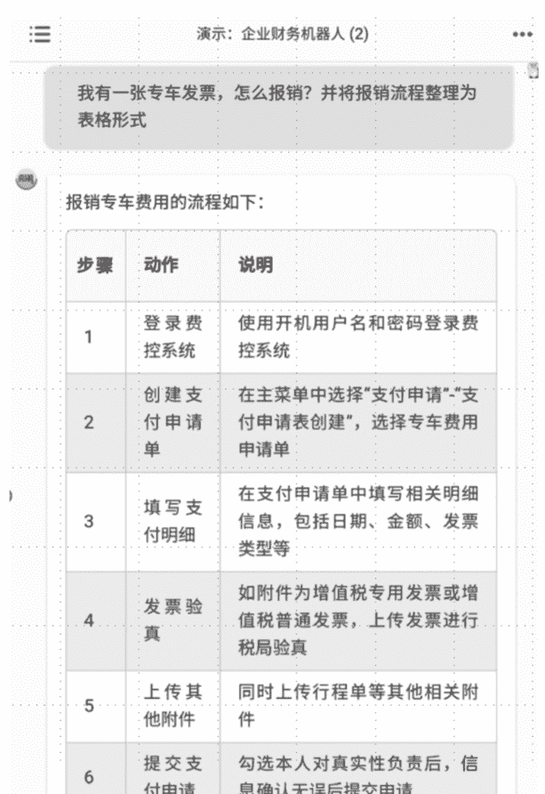
自建大模型的思路分两步。第一步是选型，选择能在本地服务器离线运行的开源模型。国内有DeepSeek、智谱，国外有LLAMA等，它们的能力并不弱于云端模型，只是本地迭代需要技术团队持续打磨。第二步是训练。部署后模型相当于一个什么都懂但什么都不懂的大脑，它不认识企业的业务。需要把大量语料投喂进去：财务制度、规章文件、历史报销单据等，先整理清洗、消除自相矛盾，再建库供模型学习。工程师通过训练让模型具备垂直领域的理解、推理和判断能力。

半年左右的部署训练后，我们得到了一款专属的财务问答机器人。反复测试后，规章类问题的回答准确率超过九成，且表述稳定统一。有人会质疑，十个点左右的误差还能上线吗？我们的判断是：其一，人类员工同样达不到百分之百的准确率，且从未被系统量化；百分百只是理想。其二，机器人回答同时会标注出处，如来自某文件第几条，员工能快速核验，减少沟通成本。其三，误差通常在可控范围，且会在后续审核环节被纠正。其四，所有回答都有记录，财务专家可以每日复盘并修正错误，模型会越用越准。

本质上，模型的准确率只能无限逼近一百，而无法真正达到一百，和人类大脑一样。

## 合同审核助手
过去一年我们做了个很有意思的尝试：合同审核机器人。在财务作业里，现金管理、应收账款、报销、报表等环节已大量自动化，采购环节却始终靠人工，成了突破口。灵感来自我给高校做导师的经历。指导一篇五到十万字的研究生论文，需要花一个多小时精读，总结意见又要两到三小时。2023年ChatGPT的PDF阅读能力让我体会到提效的可能：要点抽取、定位段落、错别字识别，都能在模型辅助下快速完成。

为什么把它搬到采购合同上？因为采购合同类型繁多、审核要素复杂，难以统一自动化。而文档阅读能力恰好提供了思路。国内的文心一言、通义千问，以及今年表现突出的DeepSeek都有类似能力。为避免核心数据外泄，我们采用DeepSeek本地化部署。机器人审核的交互界面如图7-2所示。

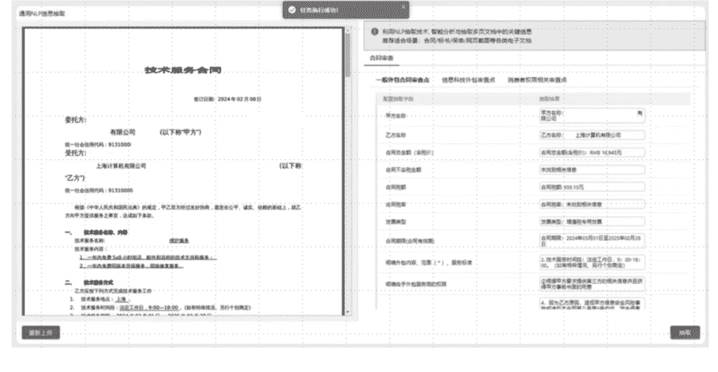
我们重构了采购端到端的流程。机器人的定位是人类的智能助理，而不是替代岗位。拿到合同后，采购同事直接把文本上传到嵌在采购系统里的审核机器人，机器人自动解析要素并预填系统字段，待人工确认。同时提示合同风险和缺失信息。每位采购员相当于多了一个聪明的助理。提交到法务、财务等环节时，机器人继续担任助理角色，财务审核时检查财税控制点，提示潜在风险，实现风险前置。

机器人越聪明，越依赖内部语料的积累：合同模板、法律法规、公司规章制度等。经过反复测试，目前预填和风险提示的整体准确率能超过八成。需要说明的是，这不等于能节省八成人手。机器人更像一个学过公司内部知识的“通用博士后”，它给出的预填和提示需要人工复核，最终确认权在人。初步测算可节约约三成工作时间，但模型的初期训练和后期完善需要投入大量人力。

同样的助理思路可以复制到企业内部的所有审核流程，提升内控效率。

## 数字人赋能培训与互动
数字人是个很有想象力的方向。我们之所以想到它，是因为有了智能问答机器人后，设想用“真人”形象来回答问题会更有趣。于是探索即时答疑的数字人。

本质上是在问答机器人上叠加人形外壳：会动的二维形象加上真人语音，文字答案与形象、语音融合。听起来简单，做起来很难，市场上几乎没有成熟案例。即便能语音回答的ChatGPT，也没有实现即时数字人。

我们先从真人语音入手。市面上已有开源或商用的语音工具，录制一分钟清晰语音后训练，就能生成专属语音模型，用文字驱动出受训者的音色和语调。数字人动画工具也已成熟，一张照片或一段视频即可训练出专属形象。

语音有了、形象有了，真正的难点在匹配与生成。语音和口型如何精准同步？会说话的数字人如何做到极速生成？匹配问题可通过微调解决，但极速生成仍是难题，核心卡在算力。文字转语音再转形象的计算量巨大。目前服务器条件下，生成十五秒的会说话数字人视频平均需要一到两分钟。文字答案可以瞬间呈现，数字人却要等一分钟，用户体验很差，甚至怀疑系统卡死。算力瓶颈由此可见，这也是英伟达等厂商高景值的原因。

好在应用场景很快找到了。作为保险公司，内部培训常因政策法规更新而频繁改版。数字人恰好解决这个问题：培训人员无需反复录制视频，只需改文案，模型即可生成新的培训影片，大幅提升效率。类似的场景还有在线授课等。

## 数据分析助手：决策的智能引擎
数据分析机器人是我们一直想突破的方向，目前已取得初步成果。观察头部企业决策机制，很少有人完全依赖财务分析结果做决策，而是更依赖业务数据。这再次印证财务人员需要掌握业务数据，而不仅仅是财务数据。

信息化时代，财务系统加Excel能完成常规统计分析。数字化时代，Excel已无法应对海量业务数据的分析需求。几年前我们就开始引入商业智能工具。统计发现一个现象：职级越高，使用BI工具的频率越低。总经理的实时看板可能一个月只打开一次，而应收管理看板会被业务同事每天多次查看。即便有看板，领导更倾向直接提问并期望即时得到答案，而非自行在数据里找。

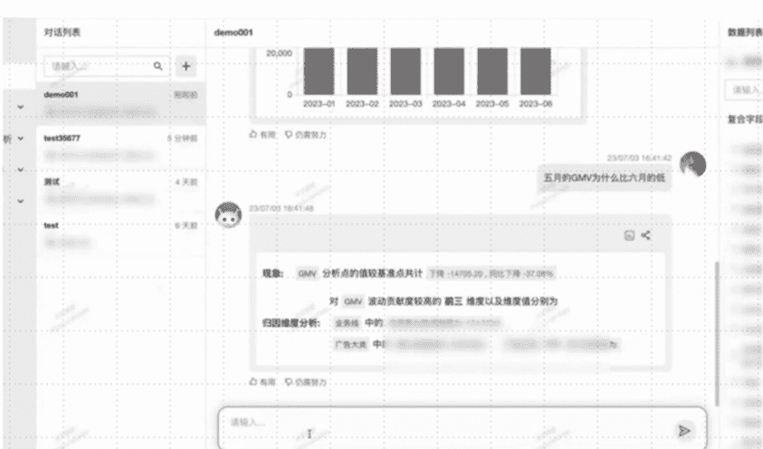
基于此，我们尝试打造一个能够理解公司全部数据并即时作答的智能体。例如问“本月上海地区工程险收入多少？同比增长多少？”，机器人需要精准定位“本月”“上海”“工程险”“收入”“同比”等条件，并以易读形式呈现。领导的问题往往层层递进，从财务延伸到业务，要求模型具备强大的学习、计算和分析能力，难度不小，这正是我们下一步的攻坚点。

我们和国内一家头部科技企业联合打造了一款具备数据分析能力的财务智能助手，研发拆成三个递进动作。

起步要让助手能听懂问题并用文字作答，先上了一套开源大语言模型做底座。随后要接住管理层抛来的专业提问，我们收集了大量专业问答材料对模型做定向微调，让它真正吃透业务语言。这一阶段由人工智能工程师配合财务人员推进，最费时间的是资料整理与信息归类。走到这里，助手只能理解意图生成文字回复，还触达不到真实业务数据。

真正的分水岭在第三步，由数据工程师与财务人员协同推进。核心是为全公司财务业务数据搭建可检索的索引体系，业内常说的“数据中台”，要能精确定位数据落在哪张表哪一行。仅这项索引建设我们就投入了两年时间。

三步打通后，助手既能读懂提问背后的数据诉求，又能精确定位源表，再用管理层易懂的表达反馈结果。目前数据定位的命中率已站上九成以上，我们仍在持续训练，目标是逼近百分之百。

可视化也在同步攻关。既然能取数，是否可以直接给出图表会更直观？初期我们尝试在模型内部植入插件式制图工具，但功能过于简陋，难以满足多样化需求，首轮尝试以失败告终。现在正与一家商业智能厂商合作，探索让助手直接调用其制图能力自主出图。对简单图表或结构固定的复杂图表，调用BI生成已可稳定使用，准确度基本在线；自由度更高的可视化仍在试验中，我们保持期待。

从落地效果看，智能问答助手经垂直模型部署与微调后，财务问题的解答准确率稳定在九成以上，沟通成本明显下降。合同审核助手借助本地化模型辅助人工复核，效率提升且人力节省。数字人受算力限制生成速度不快，但在培训场景优势突出。数据分析助手经多轮迭代，数据定位准确度超九成，图表能力也在逐步补全。这几类应用从不同维度优化了财务管理流程，提升了整体运营效率。

展望未来，技术演进将推动智能问答的准确率不断趋近百分之百，并覆盖更复杂的财务场景；合同审核将更精准，并深度嵌入供应链管理；数字人在算力提升后有望实现即时交互，应用边界进一步打开；数据分析助手将具备更强洞察力，不仅能出图，还能开展深度预测分析，为战略决策提供更精准依据。新一代人工智能将全方位重塑财务管理，推动企业向数字化、智能化深度转型，开创更高效智能的新时代。

# 第八章 智能财务工厂落地全景指南

第四章到第七章，我们依次拆解了应收账款核销改造、报销管控重构、智能无人财务办公室搭建，以及新一代人工智能在财务各环节的应用。第八章是对AI赋能财务数字化实践的阶段性总结，从场景分析到单项作业落地细节，再到整体转型方案设计与推动，最终提炼出智能财务工厂这一新概念。本章同时探讨了如何组建企业专属的财务机器人团队，推动财务实现数字化转型。

作为企业数字化转型的重要一环，智能财务工厂不仅是技术落地，更是财务管理模式的深层变革。它借助新技术冲破传统边界，把碎片化的手工作业重组成全链路智能流程，最终推动财务从成本中心转向价值创造中心。

过去财务工作大量被繁琐重复的基础事务占据，效率低且易出错。如今智能财务工厂像一次创新浪潮，彻底改写了传统财务管理方式。依托人工智能、机器人流程自动化、区块链等前沿技术，财务工作被赋予了新的活力。你会好奇它到底如何运转？它怎样让财务人员摆脱繁重基础工作，转而聚焦分析与决策支持？建设过程中有哪些关键步骤和经验可借鉴？我们一起来揭开这层面纱，看看从传统财务迈向智能财务的变革路径。

## 根基：AI与机器人体系

在智能财务工厂里，我们部署了大量AI机器人，帮财务同事减负。四类机器人是核心：

### 查询型机器人
典型场景有银行余额查询、科目余额查询、发票查验等。在此基础上可延展到银行余额调节表、费用报销等更复杂的业务。比如银行余额调节表机器人能自动登录财务系统下载银行科目余额表，自动登录网银抓取交易流水，再逐笔比对，筛出未达账项并自动生成调节表。它还能处理一对多、多对多的复杂对账逻辑。对于特殊非常规交易，仍需人工做最终复核，确保结果准确。

### 报送型机器人
典型场景包括纳税申报和其他监管报送。报送前机器人要先完成数据的采集与整合。以纳税申报机器人为例，若企业已有完善的税金管理系统，机器人可直接从系统中取数，自动登录各地申报网站完成各表及附表的填报。若没有税金系统，机器人也能直接从财务系统取数，按规则生成增值税申报表等，再在线填报。最终确认环节通常仍需人工复核、确认并提交。

### 操作型机器人
典型场景有业务单据处理、凭证总账处理、付款审批、费用报销审批等。它主要替代人工完成规则明确的操作流程，尤其是基于业务系统的操作与审批，常结合数据获取、核对校验实现更复杂的业务流。

以费用报销机器人为例，它能自动登录报销系统打开电子单据及发票附件获取信息，用OCR识别发票要素，同时登录税务局网站验真，核对抬头、号码、销售方等是否规范，检查金额、付款明细与报销单是否一致。各项校验通过后，机器人自动审批并生成报销汇总表邮件推送给财务同事；有问题的单据则转人工处理。

### 分析比对型机器人
典型场景是各类对账和报表处理。它集合数据获取、核对校验等能力，应对相对复杂的对账任务。以对账机器人为例，可用于内部业务账与财务账核对、总账与银行流水对账、企业与客户供应商往来账对账。复杂程度取决于对账逻辑，无论逻辑怎样，主要流程都是“下载数据—整合比对—发送结果报告”。

实践中，对账机器人的实现率很难做到百分百。真实业务场景复杂，对供应商客户对账时受账期、损耗、商业折扣影响，经常出现一对多、多对多的情况。这时需要先把所有可能的对账逻辑梳理清楚，明确对账维度及关键维度。

## 搭建智能财务工厂的三大关键步骤

智能财务工厂不仅是技术项目，更是运用新技术推动财务创新的过程。我们总结了三步走的方法。

第一步是全链路业务流程梳理。无论是应收账款自动化，还是智能报销助手，亦或无人财务办公室，都要对相关流程做全链路的梳理与分析，搞清楚流程现状、模式和状态，同时明确关键控制点、控制岗位和控制要求。强调全链路意味着覆盖从业务发起一路到财务完结的完整链条，而非仅财务内部环节。

第二步是标准化流程再造。基于梳理结果，找到痛点难点和应设控制点，进行优化分析与可行性讨论，评估成本、风险与收益，设计出一套智能、统一、集中、标准化的全链路流程方案。

特别要强调，标准化再造是实现流程智能化的关键。梳理只是把现有逻辑理清，是数字化实施的基础；再造则是对现有流程优化创新，找到自动化可行路径，才是成败关键。即便不做数字化，标准化再造也能帮团队简化工作、强化内控。类似问题在智能报销助手章节已有说明。

很多公司失败的原因就是只做了流程梳理，没做标准化再造。它们按原样做自动化改造，而原流程多为非标准。例如应收账款核销，企业总部有统一书面流程，但各分公司实操差异很大。按总部文件做自动化大概率失败；按某分公司实操做自动化又会引发其他分公司不满，导致需求反复、交付延期。因此标准化再造至关重要。

第三步是+机器人。基于再造后的标准化全链路流程及控制点，分析并制定可行的数字化系统方案，借助OCR、语音识别、自然语言处理、机器学习、RPA等技术实现全流程自动化与智能化。这一阶段的核心不是追求100%自动化，而是找到可接受、可靠、可行且性价比高的方案，因为100%自动化成本过高，落地难度大。

智能财务工厂不是单一作业自动化，而是从碎片化作业到全链路流程的数字化再造。现金数据收集与应收核销的流程再造是从碎片化梳理开始；智能报销机器人覆盖了业务前端到财务后端的全链路；智能无人财务办公室则实现了全场景数字化。建议初期从碎片化痛点入手优化，再推进到全链路再造，最终完成财务管理架构的全面转型。尤其在无人财务办公室实践中，岗位职责到组织架构的数字化变革已经真正落地。

在规划时，我们明确了打造面向未来的财务管理定位，以支持业务和引领业务为核心，成为价值创造者。基于此，我们确立了数字化转型的三个目标：第一，降本增效，降低管理运营成本，提升管理或资本运营效率；第二，强化合规与内控，构建事前、事中、事后全流程全业态的风险管理体系；第三，助力变革创新，树立转型标杆、推广最佳实践，提供专业化战略决策支持，推动财务从成本中心向智慧型利润中心转变。

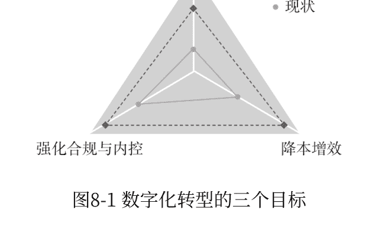
图8-1 数字化转型的三个目标

打造智能财务工厂的同时，我们首次实现了真正的业财融合。传统认知里，业财融合是为业务提供更好服务、建立更深联系。智能财务工厂看似弱化了财务人员存在，但实际上实现了更紧密的融合。财务人员不仅要懂业务数据，还要熟悉业务全流程，协助业务分析、设计和流程优化；同时通过数据分析与智能化手段有效管控业务风险，助力业务发展。

## 智能财务工厂落地的三阶段

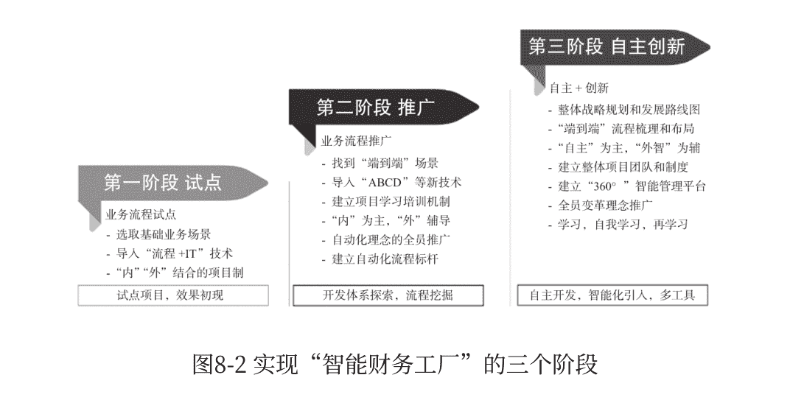
第一阶段是碎片化试点。我们挑选了多个基础且人工密集、痛点突出的场景做试点。项目组由外部顾问领队，采用内外结合的制度，顾问担任负责人，带队推进，同时重点培养内部项目经理。顾问不仅传授流程改造和技术应用方法，更帮助项目经理学会画流程图、掌握项目管理与流程设计。这个阶段为公司培养了转型人才并积累了经验。

第二阶段是推广复制。项目组转为以内部为主、外部为辅。数字化项目由内部同事担任项目经理，顾问退居导师和监理角色，负责指导监督。同时公司全面推广数字化转型理念，构建自动化智能化的流程标杆体系。

第三阶段是自主创新。团队已具备成熟项目经理和经验丰富的交付能力，可以自主设计整体数字化战略和路线图。从财务末端出发，结合数字化技术，与中台、前台各业务部门协同，梳理全链路流程并整体布局，明确先后顺序及人工与机器的边界。以内部团队为主实现自主转型，外部顾问仅保留少量智囊，提供前沿信息和技术支持，协助搭建管理制度、评价体系、知识中心和技能中心。财务人员通过持续学习实现自身跃升。

## 智能财务工厂推动数字化“四化”跃升

数字化转型可分四步：业务标准化、流程自动化、报告实时化、决策智能化，四者层层递进。

第一步是业务标准化，包括流程标准化和数据标准化，是数字化转型的起点。只有流程和数据标准化，业务和管理才能实现智能化和自动化，进而降本增效。

第二步是流程自动化，即标准化流程+机器人。标准化的流程和数据让自动化成为可能，机器人是实现手段。通常这一组合能带来显著的效率提升和成本优化。

第三步是报告实时化。财务管理最滞后的往往是报告频率。供应链有日报，销售有日报，生产甚至有实时看板，财务却多为月报。提升管理能力首先要提高报告时效。随着智能财务工厂落地，机器人主导运行，若监控滞后于机器运转，后果严重。因此必须打通流程、整合数据、建设数据中台，实现报告实时化。

最后一步是决策智能化。自动化和智能化应用成熟后，大量重复基础工作被机器人替代，财务重心转向决策支持。面对海量数据，需要快速反应和实时决策，这就是决策智能化。

## 智能财务工厂开启业财融合新高度

传统理念中，业财融合被理解为财务对业务在服务、沟通、支持层面的强化。财务人员深入了解业务数据，加强沟通，提供基础支持，力求把握业务实质。这种模式下，财务与业务虽有协作，但边界明显，效率低、信息易延误。

智能财务工厂的出现颠覆了这一认知。表面看，全作业过程中财务“隐身”了，不再频繁出现在具体操作环节，易让人误以为与传统业财融合背道而驰。实际上它实现了更深度、更紧密的融合。

在智能财务工厂模式下，依托数字化技术，财务工作高度自动化。大量基础重复操作由机器人完成，财务人员有更多精力参与业务流程，角色从被动记录者变为积极参与者、引导者和推动者。

财务人员能深度参与业务流程。凭借数据敏感性和专业分析能力，他们在熟悉业务全流程的基础上，帮助业务部门发现流程问题并提出财务视角的优化建议。例如在采购流程中，财务可通过成本、付款周期、供应商信用等数据协助选择更优供应商、优化审批流程，降低成本、提升资金效率；在销售流程中，可结合客户信用、市场需求、库存情况为销售制定策略和价格体系，促进业绩提升。

智能财务工厂借助大数据和人工智能实时采集、整理和分析业务数据。财务人员可及时发现运营风险并管控。例如在应收账款管理中，利用系统对客户交易和信用记录分析预测付款风险，提前制定催收策略，减少坏账；在成本控制中，通过对生产、采购、销售环节的数据监测及时发现异常波动，找出原因并处置，保障盈利能力。

在智能财务工厂的驱动下，财务部门的角色从记账核算转向业务赋能。团队把经营数据和会计数据交叉挖掘，形成细分的分析报告和可执行的建议，让业务更敏捷地感知市场动向、客户偏好以及组织自身的优势短板。以新品上市或开拓新区域为例，财务能够把市场表现、成本结构和预期回报整合评估，量化项目风险收益并给出可行判断，同时提出资源投放和配置优化思路，提升整体运营效率。

这种模式从根本上改变财务和业务的互动方式，把过去点状配合升级为全域深度融合。财务价值被放大，企业应对市场冲击的灵活性与韧性随之增强，有利于长期可持续发展。

## 智能财务的演进图景

技术层面，人工智能、大数据、区块链等持续迭代并向财务渗透。区块链有望进一步强化财务信息的真实性与安全性，依托分布式保存与不可篡改特性，为审计及风控提供可信底座。人工智能成熟后，财务机器人将具备更强的自学习与判断能力，应对更复杂的场景，完成从自动化到真正智能化的跨越。

融合层面，智能财务会和各业务系统更紧密联动，财务信息与经营信息实现实时共享与无缝对接，形成统一的信息体。基于全量信息的洞察，企业能够实现更精准的业务预判与决策支持。以供应链管理为例，智能财务可利用实时库存、采购与销售信息，自动调节资金安排与成本管控策略，推动链上协同。

行业层面，智能财务正在重塑财务职业生态。基础核算与数据处理逐步由智能体承接，人员重心转向管理、数据分析与战略决策支持。这要求从业者持续提升专业素养与数字化能力。同时，财务科技服务市场也将蓬勃发展，专业服务商为企业提供更定制化、高效的智能财务方案。

搭建智能财务工厂带来显著的管理变革，未来演进也将创造更大价值，助力企业在数字化时代保持可持续发展。企业应把握趋势，持续创新，不断提升财务管理水平，增强竞争力。

# 第九章 区块链让信任可验证效率可提速

凭借去中心化、不可篡改、可追溯、公开透明等特性，区块链正在改写财务管理的路径。分布式台账带来信息同步与透明，缓解传统对账中数据不一、效率低的问题；智能合约可自动完成交易与清算，减少人工干预并提升效率；去中心化架构降低对中介的依赖，节省成本并加速交易。区块链还能强化数据安全性与可信度，为财务提供高效精准工具，广泛用于对账、清算、供应链金融等场景，推动财务从支持职能走向价值创造。

## 区块链初识：用接龙理解分布式记账

设想一个村庄，村民各自用账本记账，却有人私改记录。后来出现一个神奇的账本守护者，让账本无法被篡改且每笔交易的来龙去脉清晰可查，这个守护者就是区块链。

从技术层面看，区块链融合数学、密码学、互联网与编程，是分布式存储、点对点传输、共识机制、加密算法等技术的综合应用。从形态上看，它是分布式共享账本和数据库，具有去中心化、不可篡改、全程留痕、可追溯、集体维护、公开透明等特征。这些特质奠定诚信透明基础，帮助多主体协作与建立信任。比特币是大家熟知的典型应用。

先区分中心化账本与分布式账本。手机银行APP获取的银行对账单是典型的中心化账本，系统瘫痪账本就无法打开。分布式账本类似微信群接龙，张三发起，李四回+1，赵五回+2，王六回+3。每个人手里都有一份完整记录，信息具有分布式、不可篡改、可溯源、集体维护、公开透明等特征，与区块链逻辑高度相似。区块链的分布式账本就像接龙游戏，每人都有完整记录且无法篡改，不同的是区块链对记录进行加密，只有持有密码的人才能查看，这体现了保密性。

区块链英文名Blockchain，因数据块以链状存储。从创世区块起，新区块不断链接到前一个区块形成链条。

每个区块由头部与数据组成。头部含哈希指针指向上一区块，存储前一区块的哈希值。哈希值可理解为数据块的密码，后区块头部保存前区块数据的密码。若上一区块被篡改，数据与密码不匹配即被检测。要改动一个区块，必须连同之后所有区块一起改动。

### 区块链的四大支柱

被称为信任机器，离不开以下四个属性：

- 分布式账本：人人持有账本，信息同步透明
- 非对称加密：密码锁住数据，只有对应钥匙可打开
- 共识机制：无老大，通过投票决定真相
- 智能合约：如自动售货机，条件满足自动执行

#### 分布式账本机制
与中心化账本相对，银行对账单是中心化账本，微信群接龙是分布式账本。分布式账本由分布各地的多节点共同记账，每个节点保存完整账目，所有节点可监督交易合法性并共同作证。与传统分布式存储不同，区块链每个节点按链式结构存储完整数据，而传统存储常将数据分片存储；区块链各节点地位平等，通过共识保证一致性，而传统存储依赖中心节点同步。

区块链中无单一节点可独立记账，避免了记假账风险。节点众多，账目除非全部被破坏否则不会丢失，确保安全性。

#### 非对称加密原理
区块链上的交易数据公开，但账户身份信息高度加密，未经授权无法访问。原理类似银行保险库：需管理人员陪同，用钥匙即公钥打开库房大门，进入后可看到他人保险箱，但只有自己的私钥能打开自己的箱子。数据经公钥私钥加密，唯有两者齐全才能解读。

#### 共识机制
共识机制指各记账节点就认定记录有效性的规则达成一致，既是认定手段也是防篡改方式。区块链存在多种共识机制，适配不同场景，在效率与安全间平衡。

共识机制具有少数服从多数与人人平等的特点。少数服从多数不只指节点数量，也可指算力、股权等可量化特征。人人平等指满足条件时各节点均有权提出共识结果，经认可后可能成为最终共识。比特币采用工作量证明，只有控制全网超51%节点才可能伪造记录，节点足够多时几乎不可能。

这里用拜占庭将军问题来说明。10支军队需同时进攻才能获胜，通信中可能有叛徒。将军们能否远程协商达成一致？1982年提出此问题，30多年未解，直到中本聪用比特币给出答案。

假设10个将军是10台电脑，均可互通。定义通信格式：进攻与署名。将军1决定进攻，广播“进攻，将军1”，他人可验证署名。将军2也决定进攻，可在将军1信息后附上自己的信息广播，如此累积六个将军的附信签名即可进攻。

该问题的解决意义重大，它是互联网技术演进的重要障碍，如何在缺乏权威与互信下达成一致，是关键课题。

#### 智能合约应用
智能合约基于可信不可篡改的数据，自动执行预先定义规则。以保险为例，若每个人信息真实，则标准化产品可自动理赔。保险交易频率虽低，但对可信数据依赖不断增加。区块链可帮助保险公司提升风险管理能力，包括投保人风险管理与公司风险监督。

## 区块链驱动财务从合约到清算的全链路智能化
传统财务对账像两人核对账本，一人说借100，另一人说90，需反复确认。区块链分布式账本让双方账本实时同步，账目透明。智能合约还能自动生成清算单，解放财务人力。

### 分布式账本让账目更精准
区块链应用不同于各自会计中心确认的集中式记账。区块链由全网参与者共同记账、共同公证，系统实时确认输入信息，形成无重复的精确账务数据库。基于财务会计信息生成的数据库在链上公开，形成共享账本。可弥补传统复式记账因信息重复处理产生漏洞，减少对账纠错成本与资金短缺问题。分布式账本避免了单个记录偏差引发的信息失真，保证原始会计信息精确。

### 哈希算法固化交易记录
哈希算法是一种单向密码体制。数据打包成区块，加盖时间戳记录写入时间，通过哈希值与上一个区块连接。每个区块信息经全网共识形成真实信息，哈希加密不可逆，意味着时间戳信息无法修改。区块链财务信息是固化的交易信息，不可篡改，减少确认、记录、计量、报告环节的修改删除伪造可能，为市场交易提供真实可靠信息，解决利益倾向导致的信息不公。

### 去中心化压缩运营成本
区块链下参与者无需依赖单一中心服务器，通过分布式节点实现点对点直接交易。取代第三方中介，避免信用、清算、信息泄露风险。点对点交易减少资金在中间机构流转的费用，加快交易速度。

### 智能合约提升处理效率
智能合约是可自动执行条款的计算机程序，参与方以数字方式定义协议。满足预设条件时自动执行，无需人为干预。合约可自动获取资源，在需要时自主使用资金。交易不依赖中心服务器，通过分布式节点运行，提升可信度，降低传统信任机制成本。电子数据实现的合约简化财务流程，提升处理效率，有望在抵押贷款、遗产分配等领域广泛应用。

区块链可精确记录原始财务信息，利用哈希固化数据，使信息不可逆、不可篡改，在去中心化与智能合约条件下降低成本、提升处理能力，为互联网+背景下财务管理新问题提供解决方案。

## 区块链结算实践：比亚迪迪链案例
### 案例1 比亚迪迪链平台：供应链金融的探索与挑战
比亚迪在汽车领域领先，而其迪链平台是供应链金融创新的重要成果，对供应链运转产生深远影响。下面解析迪链平台的运行。

#### 迪链平台架构与核心功能
迪链平台是比亚迪打造的供应链信息服务枢纽，由深圳迪链科技有限公司运营。平台围绕应收账款提供数字化解决方案，以比亚迪核心企业信用为依托，服务比亚迪集团、上下游供应商及银行等。

技术上采用区块链分布式记账逻辑，系统内数据实时同步，实现交易信息透明与不可篡改。供应商可实时查看应收账款，比亚迪高效管理应付账款，银行可利用平台数据完成融资审核，大幅减少传统供应链金融的信息不对称。

#### 迪链的运作模式与实务流程
运作模式以比亚迪核心企业信用为支撑，构建覆盖订单确认、发票开具、凭证签发、流转贴现、到期兑付的全链条数字化体系。流程贴合汽车供应链长周期特点，通过技术平衡效率与风险。

##### （一）全流程节点拆解
###### 1. 订单与验收环节
每月初，比亚迪采购部门通过迪链平台推送上月经质检与仓储确认的《验收合格产品明细表》，含型号、数量、单价、金额等，对接ERP系统。供应商需在3个工作日内核对，异议可发起在线争议，5个工作日内解决；无异议进入发票环节。

###### 2. 发票开具与核验
供应商需在每月15日前通过增值税发票管理系统为比亚迪开具电子发票，并在平台通过发票上链功能，将发票信息与验收数据智能匹配。平台采用OCR与区块链存证自动校验真实性与一致性。核验通过后生成发票确认单，为凭证签发依据。该环节使人工对账效率提升70%，数据准确率从92%提升至99.8%。

###### 3. 迪链凭证签发
比亚迪财务在收到合规发票并扣除违约金后30天内通过平台签发迪链凭证，载明出票人、持票人、金额、到期日、流转次数限制等。截至2023年，比亚迪年均签发规模超500亿元，约占应付账款总额15%。

###### 4. 凭证流转与拆分
持票人可全额转让凭证用于支付上游采购，或拆分流转，如100万元凭证拆成10份10万元分别支付中小供应商。每次流转需前手背书与后手确认，平台实时记录全链路日志。2022年数据，凭证平均流转次数2.3次，最长链条涉及5级供应商，大幅提升核心企业信用在末端的渗透率。

###### 5. 贴现与融资服务
供应商可通过平台向银行申请贴现，提交申请书、贸易合同等电子材料，平台自动推送凭证状态、流转记录及比亚迪信用评级。银行基于数据自动化授信，单笔审核时效从传统保理5天缩短至2小时。公开市场贴现率约8%至10%，高于银行承兑汇票3%至5%，但低于供应商自身融资成本15%至20%。2023年平台贴现规模突破200亿元，服务超3000家中小供应商。

###### 6. 到期兑付与清算
凭证到期当天，比亚迪通过平台自动扣划应付账款专户资金向最终持票人兑付。若违约，平台触发信用预警：首次违约暂停新凭证签发并启动内部审计；累计三次违约则纳入供应链信用黑名单。截至目前，到期兑付率保持100%，未出现实质信用风险。

##### （二）关键角色协同机制
比亚迪作为信用中心，集中管理应付账款，优化现金流，将应付账款转化为可流转信用资产。

中小供应商获得核心企业信用赋能，改善资产负债表，应收账款证券化率提升至35%；大型供应商则将其作为工具整合下游二级供应商资源。

银行依托平台真实贸易数据，将保理业务不良率从传统模式1.2%降至0.5%，通过平台批量获客，单客服务成本降低60%。

技术支撑层由战略伙伴来搭建，腾讯为平台提供分布式账本、智能合约、区块链存证等基础能力，使系统在高峰期仍能保持十万笔/秒的处理能力。

#### 迪链价值全景解析
迪链的意义已超出效率提升范畴，实质是通过金融工具再造汽车全产业链的利益分配。影响可从经营主体、产业生态、宏观环境三个层面展开。

##### （一）微观层面：全链赋能
对比亚迪而言，平台同时实现低成本资金运作与生态掌控。现金流被优化，应付账款周期被拉长，每年节省资金成本超10亿元；上下游黏性增强，供应商对平台依赖度上升至62%；风控能力同步升级，系统可实时追踪2万多家伙伴的流转数据，提前半年预警资金链风险，预警准度达85%。

对上游供应商而言融资负担明显减轻。某汽车线束企业借助平台贴现，将综合融资年化成本由18%降到9%，年省财务费用超200万元。大型供应商如某动力电池企业，把迪链接入自有供应链金融体系，形成“迪链-银票-商票”混合支付，2023年应付账款融资成本下行1.5个百分点，节约资金超5000万元。

对银行而言，迪链是普惠金融的突破口。依托链上数据可搭建供应链信用评分模型，中小供应商授信通过率由30%提升至70%，户均额度由50万元提高到200万元。某股份行推出的“迪链快贴”产品，2023年不良率仅0.3%，已成为普惠板块增速最快的业务线，年增速约120%。

##### （二）产业生态数字化跃升
结算规则趋于统一。平台在比亚迪体系内规范支付标准，标准化结算覆盖率由45%提升至82%，全链每年节约结算成本超5亿元。

资本循环加速。平台流通属性产生“信用货币化”效应，核心企业信用随凭证下沉至五级伙伴，整体资金周转从年均1.2次提升至1.8次，相当于释放约300亿元流动资金。

数字底座成型。平台累计贸易数据年均新增超10TB，为产业数字化转型提供基础。比亚迪据此优化供应商分级，A类供应商占比由28%提至40%，高风险供应商识别准确率超90%。

##### （三）宏观视角：普惠与实体的联通
宏观层面，平台缓解了中小企业融资困难。截至2023年，累计服务超1.2万家中小供应商，其中78%为年营收不足5000万元的小微企业，累计融资规模超800亿元，为实体经济注入大量流动性。

平台还推动产融融合，打通产业端与金融端数据壁垒，形成“产业数据-金融产品-实体经济”的正向循环。2023年汽车供应链金融渗透率由18%提升至25%，接近国际先进水平。

同时，平台探索监管科技新路径。全流程上链为穿透式监管提供可能。税务部门可通过平台比对发票流与资金流一致性，将汽车零部件行业虚开发票发生率由0.7%降至0.2%，成为智慧监管的典型案例。

#### 总结：红利与挑战并存
迪链以核心企业信用为支点，撬动了产业链金融效率重塑，体现了数字化工具改造传统产业结构的能力。但平台仍需面对单一信用依赖、账期成本、合规性等现实问题。未来若能以技术实现信用多元化，如引入政府担保、构建跨链互信；以政策明确电子债权凭证法律地位；共建核心企业与金融机构按比例分担风险的机制，平台有望从企业私域工具升级为行业公共基础设施，为更多垂直领域提供可复制方案，最终实现效率提升与风险防控双目标。

### 案例2：再保险结算的区块链应用
先说明再保险的含义。再保险本质是“保险的保险”。保险公司购买再保险主要是防范自身偿付能力不足。以往天津大爆炸为例，若无再保险保障，部分公司可能因巨额赔付而倒闭。

举例：某公司承保上海最高建筑，总保额100亿元。按规定资本金最多承保50亿元，超额部分需在签单后转移给其他保险公司或再保险公司，这即为再保险。通过此方式可确保重大风险发生时具备充足赔付能力。

作为以B2B商业险为主的传统财险公司，再保险是降低风险敞口的关键。外界常认为保险公司运作高度规范、自动化程度高，但在后台尤其是结算环节，实际并不完善。

再保险结算的痛点是发展滞后。银行间有清算所处理资金清算，保险行业却缺乏类似机制。合约方面，首次合作通常以书面合同签署，后续或小额合作多通过邮件、电话甚至口头意向，再补书面材料，也存在未及时补齐的情况。

因此多方只能基于对合约的理解，在各自核心系统里录入信息。每笔再保险合同并非标准化，理解偏差就会导致系统录入不一致；同时录入时间不同步，一方即时录入，另一方因人手不足或离职而延迟，导致账本记录不一致，严重阻碍后续财务与业务结算。行业内再保险结算是最难的环节之一，应收应付余额高、周期长。以我司为例，每年需结算的再保险记录多达十几万条，其中仍有账龄超过十年的未结余额。

区块链凭借分布式账本、非对称加密、共识机制、智能合约四大特性，可解决上述痛点。2018年，我们联合上海保险交易所及多家知名公司，基于其自主知识产权的区块链平台“保交链”，开发了再保险结算平台。

运行逻辑简洁。甲方与乙方发生再保险业务时，发起方不再通过邮件或纸质发起，而是在自身核心系统录入交易合同信息，经接口自动上传至区块链结算平台，等待对方确认。对方收到提示后在平台上确认信息无误并接受，合约即自动生成并同步至双方核心系统，确保数据一致，这正是分布式账本与智能合约的典型应用。

借助区块链，合约信息与相关数据实时同步记录在双方系统，账本实现镜像一致，对账效率大幅提升，避免人工错误与时间差。数据质量提升的同时，对账与结算的人力投入显著下降。财务人员基本无需再关注对账结算，系统可自动生成结算清单并与对手方清算。若引入电子货币，现金流亦可全自动化。

该平台大幅提升了再保险成约效率。基于“保交链”前期建设，上海国际再保险登记结算中心于2024年10月正式成立。作为国际化数字金融基础设施，中心聚焦信息孤岛与结算低效问题。核心功能包括依托“保交链”实现合约签署、数据同步、智能清算全流程数字化；制定行业数据交互标准，统一业务字段；支持跨境交易便利化，允许境外机构入驻；构建风险分散与信用管理体系，整合行业承保能力。技术层面应用分布式账本与智能合约，保证数据实时同步且不可篡改，提升对账效率并降低人工成本。截至2025年3月，平台已吸引93家境内外机构注册，累计登记保费超1100亿元，结算周期大幅缩短，中小机构交易成本下降60%以上，加速行业国际化。

## 总结和展望
技术层面，区块链是多种计算机技术融合的新型模式，具备去中心化、不可篡改等特征，通过分布式账本、非对称加密、共识机制和智能合约构建信任基础。在财务领域，它能实现信息精准记录、数据固化，降低运营成本、提升处理能力，有效解决传统财务管理问题。

实践中，比亚迪以区块链赋能供给网络，破解中小企业融资难题，构建产业区块链生态；保险公司借助区块链搭建再保险结算平台，解决信息不同步与结算困难，提升效率并降低人力成本。案例充分体现了区块链在优化流程、降本增效、促进协同方面的价值。

但发展仍面临法规不完善、性能待提升、能源消耗等问题。未来需政府、企业与科研机构协同，制定合理政策法规，加大研发投入，攻克技术难题，确保技术健康可持续发展，释放其潜力，为经济社会进步创造更大价值。

# 第十章 重新思考财务管理的未来

## 办公方式的转变
疫情解封后，我赴日本总部出差，感受颇为震撼。作为一家保守的传统日本金融企业，公司已不再采用传统排排坐办公，而是推行灵活工位，员工没有固定座位，可自由选择，每天需自行收拾桌面以供他人使用，也不再配备个人文件柜，仅保留私人物品储物柜。

数个楼层被改造为类似咖啡馆的办公空间，会议与工作在轻松环境中进行。更令人惊讶的是，公司推行“3+2”混合办公模式，即每周三天在办公室，两天居家远程办公。

疫情后，这家曾要求全员加班到深夜的传统企业，变得自由开放，办公室常空无一人，甚至不再强制正装。我身着正装反而显得格格不入。推动者正是全球首席财务官。交流后我理解其背后逻辑。

一方面，公司业务超50%来自日本以外，多名同事需跨时区协作，通勤会严重影响国际沟通效率。另一方面，疫情期间全球多地实施物理隔离，员工转向居家办公，效率与工作质量并未下降，反而因家庭时间增加而满意度提升。

基于这两点，管理层思考工作模式的突破性创新，在提升满意度的同时提高效率并降低办公成本。灵活工位与“3+2”模式被大胆推广。效果既在预期内也超出预期：员工投入度不降反增，效率保持；办公利用率反而提升。

部分海外办公室因此只需原面积一半，节省大量租金。更关键的是，该举措意外推动了全球无纸化进程。传统金融企业长期被纸质单据堆积困扰，因无固定座位，交流转向线上，纸质文件使用率骤降，反而提升整体效率。

此刻我感受到世界正在巨变。从全球CFO处得知，此非其首创。此前其派驻欧洲时已发现不少公司早年即实行灵活办公，只是未推行居家办公。

YouGov Cambridge于2021年发布对部分发达国家完全或主要居家办公员工占比的调研数据，如表10-1所示。

### 表10-1 部分发达国家完全或主要居家办公员工的占比

| 国家 | 完全或主要居家办公员工的占比（%） |
| :--- | :--- |
| 澳大利亚 | 43 |
| 美国 | 38 |
| 加拿大 | 36 |
| 英国 | 36 |
| 瑞典 | 20 |
| 德国 | 19 |
| 法国 | 16 |
| 西班牙 | 16 |
| 意大利 | 15 |
| 日本 | 13 |

资料来源：YouGov Cambridge.

驱动巨变的不是疫情，而是疫情加速了变化。早在2018年统计中，美国居家办公比例已接近20%。关键在于新科技的应用。居家办公依赖即时通讯工具，Zoom、腾讯会议等会议系统因此兴起，正是这些工具让远程办公无障碍。因此，科技变革才是办公革命的幕后推手。

## 科技对企业与财务工作的重塑
科技将如何进一步重塑企业？我体会最深的有三点：效率提升、组织扁平化、管理角色创新。

随着钉钉、飞书、企业微信等生产工具普及，以及工作群模式的应用，企业高管与基层员工可直接交流，沟通效率大幅提升。科技带来的不是渐进改良，而是跨越式跃迁。视频会议进一步提升内部协同，企业结构日益扁平化，每位管理者都可借助新工具突破传统金字塔，领导更大规模团队。

岗位名称与工作内容随工具迭代而巨变。以会计为例，四十年前形象是戴袖套、拿算盘、记账本。今日已不存在，因二十年前财务信息化转型：财务系统与Excel取代了手工记账。

如今管钱岗位被称为资金管理或司库，过去称出纳。这不仅是名称变化，更是职能重塑。二十年前出纳负责现金收付，如今资金管理除日常收支外，还承担流动性管理、长短期投融资管理、风险管理、分析规划等。

麦肯锡全球研究院2017年12月发布的《工作流失与增加：自动化时代的劳动力转型》报告给我很大启发。该报告预测未来三到五年，基于科技赋能，部分工作将被人工智能与自动化取代。

图10-2显示，右侧工作易被自动化替代，左侧较难。右侧主要为数据收集、数据处理、重复劳动。麦肯锡2018年预测64%的数据收集、69%的数据处理、78%的重复劳动将被自动化取代。

2025年来看，自动化程度可能超出预测。领先公司的财务部门中，90%的应收会计、应付会计与出纳工作已被自动化智能化替代；报销单据自动化审核率接近100%；月末结账中系统数据核对实现100%自动化。因此领先财务管理已实现自动化日结，替代传统月结。

图10-2左侧工作如个性化技术工匠、个性化人工服务、数据分析与研究、管理职能，短期内难被替代。以水管工为例，全球自来水管接口标准数千种，机器人难以提供个性化技术服务，替代率不超过25%。

个性化人工服务亦难替代。海底捞虽大规模使用传菜机器人，年报显示未减少服务员，因面对面个性化服务难以被机器复现。当然未来难料，2025年春晚机器人扭秧歌令人震撼，或许未来餐饮娱乐亦可由机器人承担。企业内部数据分析与研究、管理职能因需综合思考与判断，更难自动化。

同年麦肯锡报告指出，大多数财务工作存在自动化机会，尤其交易活动，如图10-3所示。可全自动化、高度可自动化、一定程度上可自动化、难以自动化的部分由深浅颜色区分。麦肯锡将日常财务工作分为一般会计活动、现金支出、营收管理、财务控制与外部报告、税务、财务规划与分析、司库、风险管理、审计、外部关系和业务托管十一类。图中可见一般会计活动与现金支出基本可全自动化。

事实上2025年，我领导的财务团队已基本实现该水平。应收账款管理、财务控制、司库等大多数工作可实现80%以上自动化。只有受托责任——财务总监、财务部门与董事会、管理层、监管机构、市场、投资者及员工之间的受托关系，以及相关社会责任——基于人与人间的委托关系，无法被自动化替代，只能依靠人判断维护。

总结来看，未来财务管理将通过大量人工智能手段实现效率自动化，把工作重心转向管理决策与业务指导。

## 从使用者视角审视财务管理的价值
我在上海国家会计学院授课时，提出一个基于数据的财务管理思维模型。以百度地图为例，从使用者角度理解数据使用者的核心诉求。我将该模型命名为财务管理思维的百度地图模型。接下来，我们一起看看非常熟悉的百度地图。

用导航的逻辑重新理解财务价值

设想一下，你刚走出虹桥航站楼，目的地是陆家嘴那座最高建筑。最自然的动作是什么？打开导航，输入目的地名称，确认大致位置就够了。门牌号、周边街名这类细节几乎不会被关注。把这个习惯搬到财会场景里，信息的使用方和管理层的关注点其实和门牌号一样边缘：他们不关心报表里的数字是怎么凑出来的、中间有没有重复的劳动，只想要能用得上的结论。提供信息的一方，比如 CFO，反而容易在结账时纠结一分钱的差异。这正是信息使用者与信息供给者在认知上的落差。

继续以出行为例。从虹桥到陆家嘴，你更想知道有哪些走法、每条线要怎么搭配地铁与公交，也会提前查询未来某个时段哪条路线更快、需要多久，以便安排行程。可以看出，报表使用者看重的是报表所能提供的商业判断，能否支撑分析与推演，进而做出更有价值的决策，而不是采集过程的细节。

另一个共同需求是安全感。导航的预警会提前提示前方测速点、易违章路段或事故高发区，帮助驾驶员规避风险。企业经营亦然，财会职能正被赋予更强的风险前置能力，在助力业务的同时降低经营暴露。

### 图10-4 地图应用场景示意
路线智能规划借助大数据实时研判，能够在多条可行路径中挑出更快更顺的方案引导行驶，节省时间、提升效率。企业经营同样如此，财会需要借助大数据洞察，协助管理层找到更优的商业模式与发展路径，推动业务提速。某厂还提供路口等待时间的 AI 预测，这正是经营者期待的实时规划体验。

站在企业信息使用者的立场，即管理决策者的角度，大家根本不在乎信息是人工收集还是机器采集，关心的始终是商业价值所在。这意味着我们要放弃麦肯锡模型中容易被替代的那一侧，聚焦难以被替代的那一侧，这是企业管理的核心要义。

财务的下一站

随着技术演进，基础性的核算工作被机器取代是必然趋势。这并不意味着财会人员没有出路，而是提示职业方向必须转型。固守传统核算角色会让职业路径黯淡，能向一专多能甚至多专多能的方向进化，才会迎来光明。财会本就贯穿所有管理环节，未来更将成为驱动业务整体发展的核心力量。

核算不再是工作的重心。完善的信息化系统会形成闭环，把内控与内审嵌入业务流程，实现环节间的相互制衡监督。这种前置的控制比传统的事后监督更有效、更智能、更便捷。财会职能正从传统的 Accounting 走向 Management Accounting。

在转型期，CFO 肩负数字化升级的领导责任。第一步是打通内部信息，建立统一标准，理清信息关联，从财务结果反推业务动因，用信息驱动业务增长。CFO 团队是最适合引领这场变革的主力。同时，数字化升级伴随大规模技术投入，CFO 要参与投入的决策、管理、监督和服务，降低风险提升收益，并在业务与财会之间搭建协作桥梁。实践表明，财会团队往往是推动新技术投入、重新定义成本模式的坚定支持者。

财务人的三重新角色

在数字化时代，财会管理人员将呈现三种身份：数据科学家、业务伙伴、战略领导，工作重心也随之迁移。

第一重身份是数据科学家。为什么是财会而非 IT 来主导数字化升级？用杯子和水的比喻就能说明：马克杯装热咖啡、青瓷杯装茶、玻璃杯装冰水，杯子是容器，水是信息。财务信息存于财务系统，业务信息存于业务系统，财会更关注信息本身的价值，IT 更关注承载信息的容器。数字化升级本质是信息革命而非系统升级。财会人要承担信息治理、信息规划、信息结构设计和信息应用的责任，打通内外信息，搭建信息平台，通过研究分析挖掘商业机会，就像搭建导航的底层信息平台一样，这是升级的基础角色。

第二重身份是业务伙伴。完成业财信息打通后，财会组织就具备了业财融合的基础。下一步要通过挖掘业务信息、梳理经营逻辑、发现信息价值，创造新型业务模型、商业模式和财务规划模式，成为管理层的合作伙伴。这类似于导航基于底层信息，为用户呈现多条路线、对比时间和成本并推荐最优解，帮助用户提升效率获得更好体验。

第三重身份是战略领导。在完成前两重转型后，财会人要聚焦企业价值创造，识别无形驱动因素，借助动态的信息分析和报告帮助管理层构建新的增长曲线，提升绩效并预警风险。这一点与导航的实时最优路径规划和实时风险预警功能高度相似。

中国财务组织现状与趋势

自 2018 年起，上海国家会计学院为会计领军人才班开设企业财务管理数字化转型课程，提供了深入研究组织架构的机会。通过对上千家企业的调研发现，国内企业传统金字塔结构中，底层会计交易处理占用了 60% 到 70% 的工作量，部分企业超过 80%；中层控制和报告约占 20% 到 30%；只有不到 10% 的时间投入决策支持，部分企业仅由财务总监个人承担。

结合 AICPA 和 CIMA 的研究，未来五年的财务模型将呈现菱形。交易处理占比将降至 20% 以下，我所在公司已降到 10% 以内。随着自动化、智能化和共享服务的优化，效率大幅提升，成本显著下降，人力需求减少。未来 60% 到 70% 的财会人员将聚焦于基于信息控制与报告，超过 20% 的财会管理人员专注于决策支持，成为真正的业务伙伴。领先的组织将更关注战略与决策，同时借助新技术降低交易处理成本。

随着 ChatGPT 和 DeepSeek 为代表的 AI 持续演进，预计到 2030 年，财务管理的控制、报告和会计交易会被智能化管理工厂取代。人工智能自动化系统将完成智能化分析、控制、报告和交易，财会团队则转型为战略专家团队，提供决策支持和风险管理。

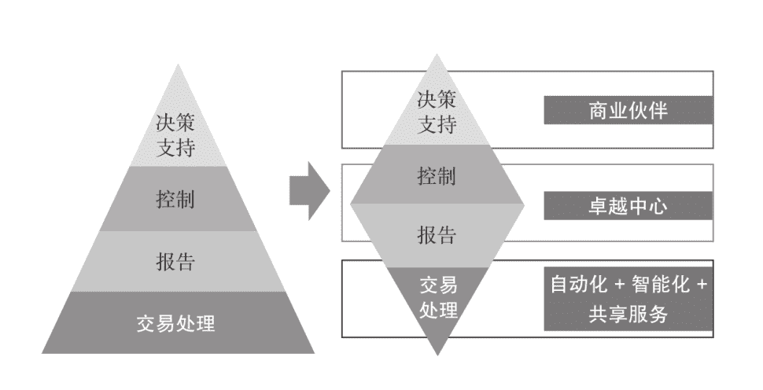
图10-6 中国财务组织架构与运作模式

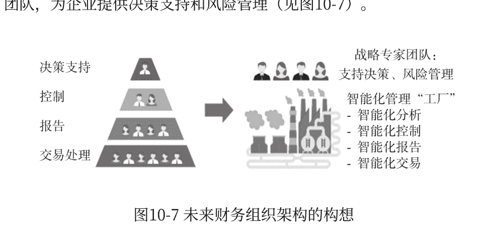
财务工作正在发生七大变化

未来的财会管理工作变化显著。第一，组织将优先实现更快决算。生产有日报、销售有日报、供应链有日报，财务必须打破信息滞后，推动月结变日结乃至实时。公司已于 2019 年完成月结到日结的转型。

第二，致力于端到端流程再造，从财务后端延伸到业务前端，专注流程分析、设计、信息研究与成本效益分析，帮助企业找到最优业务流程。

第三，设定财务战略目标，重构财务部门运营模式，制定高效智能化的财务运营方案。

第四，基于新模式和端到端流程，对财务与业务系统进行结构性分析，重新设计和实施创新系统，提升整体运营效率。

第五，强化企业信息管理工作，包括信息策略、治理、规划、结构设计和应用。

第六，承担业务伙伴职责，主导绩效管理工作，该模式已在多家跨国企业得到验证。

第七，统筹内外关系和风险管理，包括投资者关系、监管关系以及面向多方的综合报告。

AI 时代的财务图景

财务工作会变成什么样？

财务人员将走向何方？

文中以应收账款自动化管理、智能报销助手为例，阐述重复性工作如何实现自动化加智能化加共享服务，并展示大模型、OCR、RPA、区块链等技术的落地，以及机器人在财务各环节的应用。同时分享了智能无人财务办公室、智能财务工厂的建设实践。

本书旨在帮助财务人员从信息搬运工升级为数据科学家、财务BP与战略领导，让财务部门从成本中心转变为价值创造中心。

亮点内容包括：
- 财务流程自动化+智能化+共享服务
- 智能报销助手
- 合同审核机器人
- 智能问答机器人
- 数据分析机器人
- 智能无人财务办公室
- 区块链

### 今天的财务工作

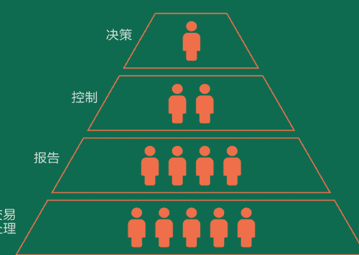


### 未来的财务工作
- 战略专家团队
  - 支持决策
  - 风险管理


- 智能化管理“工厂”
  - 智能化分析
  - 智能化控制
  - 智能化报告
  - 智能化交易


客服电话：(010) 88361066 88379833 68326294