# 微信小程序实战开发

## 编委会

（按拼音排序）

## 总顾问

郭华东 中国科学院院士

谭建荣 中国工程院院士

## 编委会主任

韩亦舜

## 编委会副主任

孙雪 徐亭 赵强

## 编委会成员

薄智泉 卜辉 陈晶磊 陈军 陈新刚 杜晓梦

高文宇 郭炜 黄代恒 黄枝铜 李春光 李雨航

刘川意 刘猛 单单 盛国军 田春华 王薇薇

文杰 吴垌沉 吴建 杨杨 曾光 张鸿翔

张文升 张粤磊 周明星

## 前言

## 为什么要写本书

近几年小程序凭借微信的闭环生态迅速升温，发布伊始便引发广泛关注。它是一种无需下载、在微信内直接运行的轻量型应用。2017年1月正式上线后，历经多次迭代，稳定性已基本成熟，功能也持续扩充。如今它已深度融入日常生活，比如在自动售货机上买东西、解锁共享单车、刷短视频或查热门资讯，都能在小程序里完成。

随着5G的普及，网速与流量成本不再是体验瓶颈，小程序的应用空间将进一步打开。插件化与云计算的开发范式，也正成为未来软件研发的主流趋势。

感谢您在众多编程图书中挑选本书，希望它能为您的学习带来实实在在的收获。

## 本书有何特色

本书属于入门级教程。入门并不意味着要具备深厚的编程背景，关键在于保持兴趣与持之以恒的耐心。兴趣是最好的动力，尤其在编程领域，技术更新频繁，常年、月月甚至日日都在变化。唯有持续好奇，才能保持学习势头。编程本身也充满乐趣，只要耐心积累，就能不断发现新可能。

本书同时是一本实战导向的教程。语法规则、编码规范、内置方法与变量等属于理论层面，而编程的终极目标是落地到真实项目。最快的学习方式就是边学边做。本书正是沿此思路编排，力求让读者尽快实现小程序开发，因此第11章和第12章专门设置了实战项目。

## 本书内容及知识体系

全书划分为四个部分。

第一部分为基础篇，第1章至第4章，主要覆盖小程序开发的理论基础，涵盖开发语言要点、环境搭建以及基础组件的使用。内容相对平缓，容易激发学习兴趣，有编程基础的读者可视情况跳过。

第二部分为进阶篇，第5章至第10章，内容难度有所提升，包括高级组件、自定义组件、动画效果、云开发，以及数据与网络相关技术。虽然要求较高，但这些正是实际开发中不可或缺的技能，无论是全职小程序工程师还是业余学习者，掌握它们都极具价值。

第三部分为实战篇，第11章和第12章。第11章以新闻客户端的阅读类项目引领读者综合运用前文知识，实现融会贯通；第12章则携手读者完成一款社区型读书应用的完整开发。两章练习既能提升技术能力，也能体会小程序从零到一的全过程。

第四部分为拓展篇，第13章，跳出小程序本身，向读者介绍周边领域的延伸技术。

## 适合阅读本书的读者

无论是职业开发者、业余爱好者、在校学生还是培训讲师，都能从中获得收益。在日新月异的时代，每个人都在学习。本书编写过程中查阅了大量资料并多次修订，但受时间与能力所限，难免存在疏漏，欢迎读者提出宝贵意见与建议，QQ：316045346。

## 本书资源


## 致谢

本书能够呈现在读者面前，除家人朋友的持续支持外，最应感谢的是北京源智天下科技有限公司的王蕾，正是她的督促与指点，以及对稿件细致耐心的修改，才使本书顺利完成。

张益辉

## 第 1 章

## 走进小程序的开发世界

微信小程序是依托微信生态的开放应用平台。自2017年1月功能发布以来，一直保持高关注度。

与传统 App 相比，小程序在用户层面拥有天然优势，微信的活跃用户体量庞大且传播效率极高，优质的小程序很容易在微信内快速扩散。另有启动迅速、体验接近原生、无需安装、可随时热更新等特点，使其成为非常便捷的线下工具，例如餐饮门店的扫码点餐与支付、无人商店的商品结算等场景均适用。

本章将梳理小程序的发展脉络，并展示若干典型应用场景。同时作为开发准备章节，将介绍开发环境的安装、开发账号的申请、体验版的发布与正式上架流程，最后通过编写一个 HelloWorld 示例，演示模拟器与真机的调试方法。

## 1.1 认识小程序

大多数微信用户都接触过小程序。微信小程序大致分为应用小程序与游戏小程序，日常语境中常把应用小程序简称为小程序，游戏小程序则称作小游戏。

在实际使用中，欢乐斗地主、腾讯桌球、腾讯四川麻将等小游戏人气很高，而微博、知乎等主流应用也均提供了小程序版本。

### 1.1.1 小程序的发展史

2016年9月21日，小程序开启内测，各方目光集中于这一新兴平台。

2017年1月9日，第一批小程序正式上线，用户可在微信内体验各类服务，热度达到峰值。

2017年12月28日，小游戏功能开放，“跳一跳”再次引爆关注。

2018年1月18日，微信推出小程序侵权投诉渠道，平台规范性增强。

2018年1月25日，小程序实现与移动端 App 的互跳互通。

2018年3月，小程序广告组件进入内测，开发者变现能力提升。

2018年7月13日，小程序支持收藏，用户可将其加入“我的小程序”。

2018年8月10日，后台数据分析工具升级，运营方可查看更多用户数据。

总体来看，小程序正快速成长，虽曾遭遇质疑，但发展势头未受影响。如今它已替代大量轻量应用，并为线下实体提供低成本的线上服务通道。发展方向愈发开放，高级工具、用户分析与 API 接口正逐步向开发者开放。

### 1.1.2 几款优秀的小程序

在微信消息页下拉即可进入小程序入口，如图 1-1 所示。页面分为两栏，上方为近期使用记录，按使用时间排序，下方为收藏列表。近期列表末尾的“查看更多”可跳转至全部小程序列表页，同时微信会基于地理位置推荐附近的小程序，实现线上线下联动，如图 1-2 所示。

目前小程序组件库、布局体系与功能接口已相当完善，常见交互与功能均可便捷实现。

热门微博是一款优秀的资讯类小程序，采用信息流形式聚合热门内容，并支持登录注册、个人中心、详情页、评论查看等，阅读与分享体验流畅，图 1-3 所示为示例。

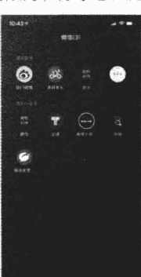

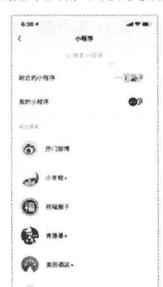


唯品会小程序是唯品会电商的微信入口，具备完整的个人中心、购物车、商品分类与推荐等功能，选品、加购、结算、参与活动均可在线完成，功能完善，图 1-4～图 1-7 所示。

腾讯视频小程序是娱乐类标杆产品，可在小程序内观看电影、电视剧与短视频，如图 1-8 所示。


## 微信小程序开发实战


图 1-7 个人中心


图 1-8 腾讯视频小程序

除上述案例外，生活各场景均有对应小程序，读者可在搜索栏自行体验。

### 1.1.3 小程序的适用场景

相较移动应用，小程序具备以下五个突出特点。

- 无需下载安装，使用门槛极低。
- 节省流量与安装时间，不占桌面。
- 体验接近原生应用，优于普通网页。
- 平台规范统一，上手成本低。
- 开发者成本更低，平台差异可忽略。

由此可见，小程序并非要完全取代 App，而是补足了 App 的痛点。App 推广成本高昂，要求用户耗费流量与时间下载并注册，而小程序依托微信账号体系且即点即用，更易被尝试。

因此，即用即走的功能型应用，或 App 中的单点亮点功能，都很适合独立为小程序。结合扫码等能力，小程序也很容易与线下场景融合。

判断业务是否适合小程序，可从四个维度考量。

- 是否需要强关联线下，线下需求越强越适合。
- 业务逻辑是否足够简单，体积限制不适合过复杂流程。
- 是否为即用即走类型，不占桌面更利于一次性使用。
- 是否能借助微信用户群，业务与微信生态冲突越小越好推广。

### 1.1.4 小程序的设计建议

小程序基于微信闭环生态，腾讯提供了统一设计指引。完整文档地址如下：

https://developers.weixin.qq.com/miniprogram/design/index.html

本节归纳几项基本原则。

#### 1. 简洁友好

小程序强调效率，界面应去除冗余信息，突出当前页面的核心功能。同一页面避免设置多个核心目标，以免分散注意力。

#### 2. 流程明确

小程序偏向即用即走，流程需环环相扣，用明确指引引导用户逐步完成任务。避免在关键流程中插入无关操作或打断当前任务。

#### 3. 导航和异常处理

需兼顾前进与返回，页面层级清晰，让用户清楚下一步与上一步的目标。对异常情况要及时捕获处理，必要时向用户说明原因。

#### 4. 配色要与微信切合

小程序运行在微信内，配色方案应与微信整体风格保持一致，色差过大易造成不适。

#### 5. 使用与微信风格一致的工具组件

下拉刷新、上拉加载、加载中等待、按钮选择、弹窗、提示、输入框等组件，及字体与文本色彩，均建议与微信保持一致，以提供统一舒适体验。

## 1.2 开发前的准备

开发前需完成账号注册与工具准备，并了解体验版发布与正式上线的流程。

### 1.2.1 注册小程序开发账号

首先在微信公众平台注册小程序账号。注册成功后即可在开发者工具中使用。开放范围包括个人、企业、政府、媒体和其他组织，学习用途可直接注册个人账号。入口地址如下：

```
https://mp.weixin.qq.com
```

选择注册小程序类型如图 1-9 所示。


图 1-9 选择注册小程序类型的账号

随后填写注册信息，需使用有效邮箱，注册后需登录邮箱验证。

登录公众平台后会自动进入小程序管理后台。首要任务是补全基本信息，包括名称、简称、头像、简介及服务类目，一个账号对应一个小程序。

版本管理用于维护线上版本、审核版本与开发版本，如图 1-10 所示。


成员管理可配置项目成员与体验成员权限，项目成员包括运营、开发者与数据分析；体验成员可提前试用待发布版本。

反馈管理帮助开发者快速定位用户问题，意见可通过小程序接口直达后台。

统计功能提供实时数据、来源分析与自定义事件等高级统计。

后台还提供附近的小程序、物流助手、客服、模板消息等高级能力，感兴趣可查阅文档。

### 1.2.2 下载和安装微信开发者工具

账号准备好后需安装开发工具。下载地址：

https://developers.weixin.qq.com/miniprogram/dev/devtools/download.html

官方提供 Windows 64 位、Windows 32 位与 macOS 版本，可按系统选择。本书以 macOS 为例。

安装过程简单，无需额外配置。登录需使用微信号，建议使用绑定为管理员的微信号。

登录后界面如图 1-12 所示，可选择小程序项目。


图 1-11 微信开发者工具的初始界面

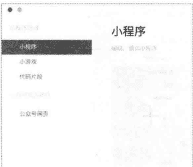

图 1-12 选择开发者工具中的小程序项目

首次使用需新建项目，点击加号，填写 AppID 并选择普通快速启动模板，如图 1-13 所示。

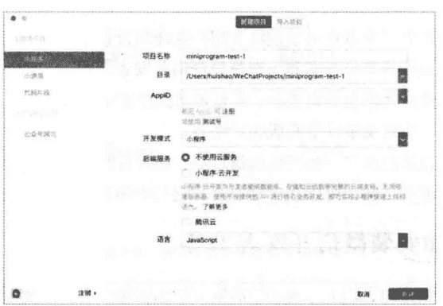

图 1-13 新建小程序项目

AppID 可在小程序管理后台的开发设置中查看，如图 1-14 所示。


图 1-14 查看小程序的 AppID

创建完成后，默认模板会生成一个获取用户信息的示例程序，如图 1-15 所示。

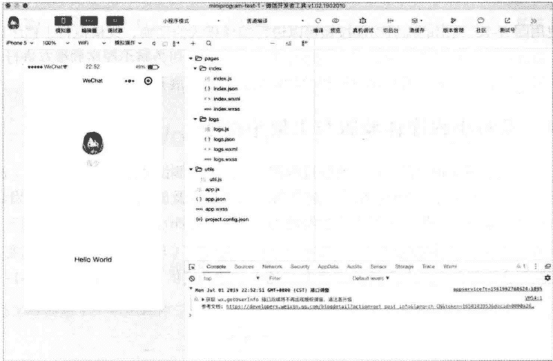

图 1-15 模板创建的示例程序

### 1.2.3 微信开发者工具的使用简介

工具集成了模拟器、编辑器与调试器功能。顶部有四个按钮：模拟器、编辑器、调试器与云开发。

模拟器区域默认在左侧，可选择 iPhone 或 Android 设备预览效果。

编辑器位于右侧上方，左侧为文件目录，右侧为代码编辑区。

调试器位于右下方，提供控制台打印信息、源文件断点调试、网络与数据查看等能力。

## 微信小程序开发实战

熟练驾驭微信开发者工具里的模拟器、编辑器和调试器，开发节奏会明显提速。导航栏顶部还额外提供了一排高级操作键，如图 1-16 所示。


图 1-16 高级功能按钮

图 1-16 所示的高级键可以切换编译模式，也可以把小程序模拟成后台运行，方便做真机预览和真机调试。清缓存键主要用来清空小程序的本地缓存，例如登录态之类的数据。关于真机调试的具体用法，后面会单独展开。

### 1.2.4 体验版发布与正式上线
小程序正式对外投放前，必须先走内部测试。内测通常需要开发、测试、产品、运营以及部分种子用户一起参与。1.2.3 节提到的预览只能开发者自己在手机上体验，若要多人协同试用，就需要上传体验版本。

开发者工具导航栏右上角有一个双箭头收纳按钮，受窗口宽度影响，多余的功能会被折叠进去，点击后可展开更多操作，如图 1-17 所示。

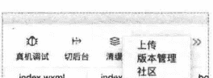

图 1-17 更多功能按钮

更多功能菜单里提供了上传入口。点击上传后，工具会把当前工程打包推送到小程序管理后台，推送前需要先指定版本号，如图 1-18 所示。


图 1-18 设置版本号

在小程序后台的版本管理里可以查看已提交的版本，并将其设为体验版，如图 1-19 所示。


图 1-19 设置小程序体验版本

体验版设置成功后，后台会自动生成体验二维码。内测成员用微信扫码即可进入体验。

正式上架的流程是先把完整代码打包上传，随后在后台提交审核申请。微信小程序审核团队会从功能完整性、可用性、合规性等维度评估，通过后开发者即可发布上线。

## 1.3 编写 HelloWorld 程序
学习任何技术，HelloWorld 都是经典入口。程序虽小，却已包含完整骨架，本节以一个最简案例拆解小程序开发框架。

### 1.3.1 分析小程序示例工程
1.2.2 节创建的示例工程，其目录结构如图 1-20 所示。

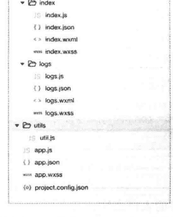

图 1-20 小程序示例项目的目录结构

根目录下有 pages 和 utils 两个文件夹，另外还有 4 个全局文件，其中 3 个是应用配置，1 个是工程配置。

## 微信小程序开发实战

开发中常见 4 类文件：.js 用来承载核心逻辑；.json 一般存放配置信息；.wxml 用来描述页面结构；.wxss 是样式表，用于控制渲染效果。

project.config.json 负责工程级全局设置，比如工程名、源码目录、AppID 等，常用字段见表 1-1。

表 1-1 project.config.json 配置文件可进行配置的常用字段

| 字段名 | 意义 | 值类型 |

|---|---|---|

| miniprogramRoot | 指定小程序的源码目录 | 字符串 |

| qcloudRoot | 指定腾讯云项目的目录 | 字符串 |

| pluginRoot | 指定插件项目的目录 | 字符串 |

| compileType | 指定编译类型 | 字符串 |

| setting | 进行项目设置 | JSON 对象 |

| libVersion | 设置基础库的版本 | 字符串 |

| appid | 项目的 AppID | 字符串 |

| projectname | 项目的工程名 | 字符串 |

| packOptions | 打包配置的相关选项 | JSON 对象 |

| debugOptions | 调试相关选项 | JSON 对象 |

| scripts | 预编译相关配置 | JSON 对象 |

setting 选项可配置的字段见表 1-2。

表 1-2 setting 选项可以配置的字段

| 字段名 | 意义 | 值类型 |

|---|---|---|

| es6 | 是否启用 es6 转 es5 | 布尔值 |

| postcss | 上传代码时样式是否自动补全 | 布尔值 |

| minified | 上传代码时是否自动压缩 | 布尔值 |

| urlCheck | 是否进行安全域名检查 | 布尔值 |

| uglifyFileName | 是否进行代码保护 | 布尔值 |

compileType 字段可选值见表 1-3。

表 1-3 compileType 字段可选的字符串值

| 值 | 意义 |

|---|---|

| miniprogram | 以小程序的方式进行编译 |

| plugin | 以插件的方式进行编译 |

app.js 是应用的入口脚本，打开后可见只调用了 App()。App() 用于注册小程序，并接收一个 Object 参数，在其中声明生命周期回调。注意 App() 必须在 app.js 中调用，且只能调用一次。

App() 接收的 Object 可指定的回调见表 1-4。

### 表 1-4 App()函数中传入的 Object 参数可以指定的回调函数

| 函数名 | 意义 |

|---|---|

| onLaunch | 小程序初始化完成时会调用，只会触发一次 |

| onShow | 小程序启动，或从后台进入前台时会调用 |

| onHide | 小程序从前台进入后台时会调用 |

| onError | 小程序发生错误时会调用 |

| onPageNotFound | 小程序要打开的页面不存在时会调用 |

app.json 用来做小程序全局配置，决定页面路径、窗口表现等，可配置项见表 1-5。

### 表 1-5 app.json 文件用来对小程序进行全局配置的可配置项

| 可配置项 | 意义 | 值类型 |

|---|---|---|

| pages | 设置页面路径列表 | 字符串数组 |

| window | 设置窗口表现 | Object 对象 |

| tabBar | 设置底部标签栏的表现 | Object 对象 |

| networkTimeout | 设置网络超时时间 | Object 对象 |

| debug | 设置是否开启 debug 模式 | 布尔对象 |

| functionalPages | 设置是否启用插件页 | 布尔对象 |

| subpackages | 分包结构配置 | 对象数组 |

| requiredBackgroundModes | 配置需要在后台使用的功能 | 字符串数组 |

| plugins | 配置插件 | Object 对象 |

| preloadRule | 配置分包预下载规则 | Object 对象 |

| resizable | 设置是否支持屏幕旋转 | 布尔对象 |

| navigateToMiniProgramAppIdList | 配置需要跳转的小程序列表 | 字符串数组 |

| usingComponents | 配置全局自定义组件 | Object 对象 |

| permission | 进行接口权限配置 | Object 对象 |

窗口配置字段 window 对象的可配置属性见表 1-6。

### 表 1-6 窗口配置字段 window 对象的可配置属性

| 属性名 | 意义 | 值类型 |

|---|---|---|

| navigationBarBackgroundColor | 设置导航栏背景颜色 | 十六进制颜色值 |

| navigationBarTextStyle | 设置导航栏的标题风格 | 可配置 black 或 white |

| navigationBarTitleText | 配置导航栏标题文字 | 字符串 |

| navigationStyle | 配置导航栏风格 | default 为默认样式，custom 为自定义样式 |

| backgroundColor | 设置窗口背景颜色 | 十六进制颜色值 |

| backgroundTextStyle | 设置下拉刷新的样式 | 支持 dark 与 light |

| enablePullDownRefresh | 配置是否允许下拉刷新 | 布尔值 |

| onReachBottomDistance | 配置距离底部多少时触发上拉加载方法 | Number 值 |

| pageOrientation | 设置屏幕旋转 | 可选 auto、portrait 与 landscape |

tabBar 字段的可配置属性见表 1-7。

### 表 1-7 tabBar 字段的可配置属性

| 属性名 | 意义 | 值类型 |

|---|---|---|

| color | 设置标签栏的文字颜色 | 十六进制颜色值 |

| selectedColor | 设置标签栏标签选中时的文字颜色 | 十六进制颜色值 |

| backgroundColor | 设置标签栏背景色 | 十六进制颜色值 |

| borderStyle | 设置标签栏上的边框风格 | 可选 black 或 white |

| list | 设置标签栏上的标签 | 对象数组 |

| position | 设置标签栏的位置 | 可选 bottom 或 top |

| custom | 是否自定义标签栏 | 布尔值 |

关于标签栏的 list 属性，可定义一组标签，数量须大于 1 且小于 6。每个标签可配置的属性见表 1-8。

### 表 1-8 每个标签可配置的属性

| 属性名 | 意义 | 值类型 |

|---|---|---|

| pagePath | 页面路径，配置的页面需要在 pages 中进行定义 | 字符串 |

| text | 标签文字 | 字符串 |

| iconPath | 设置图标路径 | 字符串 |

| selectedIconPath | 设置选中时的图标路径 | 字符串 |

networkTimeout 字段用于配置网络超时时间，可配置的属性见表 1-9。

### 表 1-9 networkTimeout 字段配置网络超时时间可以配置的属性

| 属性名 | 意义 |

|---|---|

| request | 设置 request 请求超时时间 |

| connectSocket | 设置连接 socket 超时时间 |

| uploadFile | 设置上传文件超时时间 |

| downloadFile | 设置下载文件超时时间 |

①注意：
所有超时时间的配置单位都为 ms。

app.wxss 用于定义全局样式表，语法与 CSS 基本一致，后续会详细介绍。

除上述核心文件外，模板工程还生成了 pages 文件夹，其中包含 index 和 logs 两个子文件夹。pages 用来存放页面文件，每个子文件夹代表一个页面，例如 index 文件夹存放示例主页面代码。在微信小程序中，每个页面都由 JS、JSON、WXML、WXSS 四类文件共同构成，具体细节后续章节会介绍。

### 1.3.2 修改示例程序
下面把模板生成的示例程序改造成 HelloWorld 程序，先修改 index.wxml 文件，具体如下：

```
<view class="container">
  <text style='color:{{textColor}}'>HelloWorld</text>
  <button bindtap='changeColor'>变化颜色</button>
</view>
```

WXML 主要用于编写页面骨架，上述代码在页面内声明了一个文本组件和一个按钮组件，并为按钮绑定了点击回调，接着修改 index.js 文件，具体如下：

```
Page({
  data: {
    textColor:'#ff0000',
  },
  //事件处理函数
  changeColor:function(){
    this.setData({
      textColor:this.randomColor(),
    });
  },
  randomColor: function() {
    var rand = Math.floor(Math.random() * 0xFFFFFF).toString(16);
    if (rand.length == 6) {
      return '#'+rand;
    } else {
      return getRandomColor();
    }
  },
  onLoad: function () {
  },
})
```

如上代码所示，data 中定义了文本颜色，初始为红色，点击按钮后颜色会随机切换。小程序页面基于数据驱动，数据变化时只需调用 setData 方法重新设置数据即可刷新页面。随后在 index.wxss 中添加样式，具体如下：

```
text {
  margin-bottom: 60rpx;
}
```

上述样式的作用是让文本与按钮之间保留 60rpx 间距。刷新模拟器后即可看到 HelloWorld 程序运行效果，点击按钮后文字颜色会随机变化，如图 1-21 所示。


图 1-21 HelloWorld 程序

### 1.3.3 真机调试实践
通过 1.3.2 节的编写可以看到，代码保存后模拟器会实时刷新页面。这是小程序开发的一大便利，能所见即所得地开发，显著提升效率，节省调试时间。若要真机预览也十分便捷，点击微信开发者工具中的“预览”按钮，即可生成一个小程序二维码，如图 1-22 所示，用手机微信扫描即可打开小程序进行真机预览，需注意该二维码有效期很短。


图 1-22 可预览的小程序二维码

预览仅能查看运行效果，无法使用开发者工具中的断点调试、布局查看、网络查看等功能。若需在真机上使用调试能力，应使用真机调试功能。点击“真机调试”按钮会生成二维码，扫描后开发者工具会打开“真机调试”窗口，手机上的所有操作都会同步到该窗口中，如图 1-23 所示。


图 1-23 真机调试窗口

## 第 2 章

## 小程序开发中的“三驾马车”
学完第 1 章后可对小程序开发框架有初步认识。一个面向用户的应用本质上是把多个界面呈现给用户并处理交互。

在小程序里，一个页面通常由 4 类文件组成：JS 文件负责处理交互逻辑，JSON 文件负责页面配置，WXML 文件负责页面结构，WXSS 文件负责布局与样式。JS、WXML、WXSS 可称为开发中的“三驾马车”，三者协同才能构建出完整优质的小程序。本章重点介绍这三者的应用。

## 2.1 代码逻辑基石——ECMAScript6 基础
ECMAScript6 简称 ES6，严格来说它不是编程语言，而是一种规范。ES6 定义了脚本编程语言的语法规则，JavaScript 是 ECMAScript 的一种实现。相较于前代版本，ES6 在设计上有了大幅升级，支持更强大现代的语法特性。

ECMAScript 是 ECMA 制定的一种标准化脚本程序设计语言规范。JavaScript 和 JScript 都是其实现与扩展。ES6 是 ECMAScript 的重要更新，新增了模块与类、字典与集合数据类型、Promises 与 Generators 等特性。小程序支持使用 ES6 语法规范编写 JavaScript 代码。

### 2.1.1 在线测试 JavaScript 代码
JavaScript 用于编写小程序的核心逻辑。学习其基础语法前，首先需要搭建运行 JavaScript 的环境。网络上提供多个基于 NodeJS 的在线编辑与运行工具，具体如下：

https://tool.lu/coderunner/

该网站支持多种编程语言在线编辑，并可实时展示执行结果。本节涉及的 JavaScript 代码大多可在上面演示，读者可跟随书中内容测试自己编写的代码效果。

该网站支持 PHP、C、C++、Python、NodeJS 等多种语言，使用前需将语言类型切为 NodeJS，页面左侧为编码区，右侧为运行结果区，如图 2-1 所示。

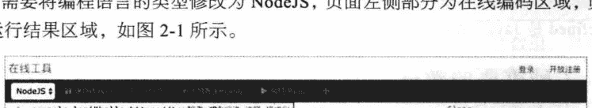

console.log 的作用就是把内容输出到浏览器控制台，配合它就能写出 JavaScript 版的 HelloWorld。

### 2.1.2 变量声明与使用

变量可以看作是用来保存数据的盒子，和数学里会变化的量是一个思路。JavaScript 声明变量常用的关键字是 var 和 let。比如下面这段代码就创建了 name 和 age 两个变量，并分别赋值为 “释少” 与 “27”。

```
var name = "释少";
let age = 27;
console.log(name,age);
```

执行后从控制台可以看到，直接引用变量名就能拿到它存储的值。let 是 ES6 引入的新写法，它受作用域限制，不会像 var 那样容易污染全局命名空间。起名字时建议既要简洁又要易懂，见名知意。

JavaScript 的变量类型不是固定的，这点和很多强类型语言不同。下面的例子展示了同 대책变量可以在不同时刻持有不同类型的数据：

```
let age = 27;
age = "26";
```

代码先把 age 设为数字 27，后面又把它改成字符串 "26"，在 JS 中完全合法。

一行里也可以用逗号同时声明多个变量：

```
var a,b,c,d=3;
```

声明时就赋值的行为常被称为定义变量。只声明不赋值的变量初始值是 undefined：

```
var a,b,c,d=3;
console.log(a);//undefined
```

undefined 是 JS 里一个很有代表性的值，用来表示“未定义”。

### 2.1.3 七大核心数据类型

JavaScript 一共包含 7 种重要类型：数值、字符串、布尔值、数组、对象、Null 和 Undefined。

数值类型表示数学数，既可以是整数也能是小数。示例用法如下：

```
var a = 1;
var b = 3.14;
var c = 1.11e2;
console.log(a,b,c);//1 3.14 111
```

其中 1.11e2 是科学计数法的写法，相当于 1.11 乘以 10 的 2 次方。

字符串用来表达文本，通常用双引号或单引号包裹：

```
var a = "Hello";
var b = 'World';
console.log(a,b);//Hello World
```

字符串内部还可以再套字符串，只要内外引号不同即可：

```
var a = "Hello 'World'";
var b = '"Hello" World';
console.log(a,b);//Hello 'World' "Hello" World
```

布尔值只有 true 和 false 两种，常用于条件判断。true 代表条件成立，false 代表不成立：

```
var a = true;
var b = false;
console.log(a,b);
```

数组可以收纳一组数据，元素类型可以一致也可以混用：

```
var a = [1,2,3,4];
var b = ["one",2];
console.log(a,b);
```

通过下标读取指定位置的元素：

```
console.log(a[2]);
```

> ①注意：
> 
> 数组下标从 0 开始，上面的代码取到的是数组的第 3 个元素。

除了方括号创建数组，还能用 Array 构造方法：

```
var a = new Array(1,2,3,4);
```

对象是开发中最常用的类型，采用键值对的方式定义：

```
var teacher = {
  name:'辉少',
  age:27
}
console.log(teacher);
```

对象里既能放属性存数据，也能放函数作为方法，更多细节后面会展开。

在前面 5 种之外，Null 和 Undefined 也是两种特殊类型。Null 只有一个值 null，用于表示对象为空；Undefined 只有一个值 undefined，用于表示变量未初始化。

### 2.1.4 运算符体系

小学学过的加减乘除在 JS 中同样存在，常见的算术运算符如下表。

### 表 2-1 常见的算数运算符

| 运算符 | 意义 | 示例 | 结果 |
|---|---|---|---|
| + | 加法运算符 | 5+5 | 10 |
| - | 减法运算符 | 10-5 | 5 |
| * | 乘法运算符 | 5*2 | 10 |
| / | 除法运算符 | 10/2 | 5 |
| % | 取余运算符 | 10%3 | 1 |
| ++ | 自加运算符 | ++1 或 1++ | 2 |
| -- | 自减运算符 | --1 或 1-- | 0 |

除了自增自减，其余算术运算符理解起来很直观。自增自减会基于当前变量值加 1 或减 1，注意前置和后置的区别：前置先运算再返回值，后置先返回值再运算，示例：

```javascript
var a = 1;
var b = 1;
var c = a++;
var d = ++b;
console.log(a,b,c,d);//2 2 1 2
```

对字符串而言，加号还能做拼接：

```javascript
var e = "Hello"+"World";
console.log(e);//HelloWorld
```

赋值运算符 = 常用于给变量赋值，与算术运算符组合后形成复合赋值：

### 表 2-2 复合赋值运算符

| 运算符 | 意义 |
|---|---|
| += | a+=b 等同于 a=a+b |
| -= | a-=b 等同于 a=a-b |
| *= | a*=b 等同于 a=a*b |
| /= | a/=b 等同于 a=a/b |
| %= | a%=b 等同于 a=a%b |

逻辑运算符主要对布尔值运算，常出现在循环和分支判断中：

### 表 2-3 JavaScript 支持的逻辑运算符

| 运算符 | 意义 | 示例 | 结果 |
|---|---|---|---|
| ! | 逻辑非运算符 | !true | false |
| && | 逻辑与运算符 | true&&false | false |
| || | 逻辑或运算符 | true||false | true |

关系运算符的结果也是布尔值，用于比较大小或相等：

### 表 2-4 关系运算符

| 运算符 | 意义 | 示例 | 结果 |
|---|---|---|---|
| > | 大于运算符 | 5>6 | false |
| < | 小于运算符 | 5<6 | true |
| == | 等于运算符 | 5==6 | false |
| === | 全等运算符 | "5"===5 | false |
| >= | 不小于运算符 | 5>=6 | false |
| <= | 不大于运算符 | 5<=6 | true |
| != | 不等于运算符 | 5!=6 | true |

JavaScript 还支持位运算符。数据在计算机内部以二进制存储，按位运算针对每一位进行。

~ 按位取反，0 变 1，1 变 0；& 按位与，两位都为 1 才得 1；| 按位或，有 1 得 1；^ 按位异或，不同为 1，相同为 0。<< 为左移，>> 为右移，>>> 为无符号右移。

一元运算符操作一个数，二元运算符操作两个数，JS 还提供三元条件运算符 ?:，相当于简化的 if-else：

```
var g = 1>2 ? "1>2" : "1<=2";
console.log(g);//1<=2
```

当条件为 true 时返回冒号前表达式的值，否则返回冒号后表达式的值。

### 2.1.5 条件语句

程序的灵活性来自逻辑分支，JS 用条件语句实现分支结构。示例：

```
if (1>2) {
    console.log("1>2");
}
console.log("程序结束");
```

运行后控制台只会输出“程序结束”，不会输出“1>2”。if 后面的小括号需要一个布尔或可转为布尔的表达式，成立才执行大括号里的代码。

if 常和 else 配对使用：

```
if (1>2) {
    console.log("1>2");
}else{
    console.log("1<2");
}
console.log("程序结束");
```

程序会先判断 if 条件，成立走 if 分支，不成立走 else 分支。

也可以连续判断多个条件：

```
if (1>2) {
    console.log("1>2");
}else if(1<2){
    console.log("1<2");
}else{
    console.log("1==2");
}
console.log("程序结束");
```

### 2.1.6 多分支结构

多条件分支可以用多个 if-else 堆砌，但代码会变得冗长。更简洁的做法是使用 switch-case：

```
var res = "优秀";
if (res == "优秀") {
    console.log("分数大于或等于 85 分");
} else if (res == "良好") {
    console.log("分数大于或等于 70 分且小于 85 分");
} else if (res == "及格") {
    console.log("分数大于或等于 60 分且小于 70 分");
}else if (res == "不及格"){
    console.log("分数小于 60 分");
}
```

用 switch-case 重写会更清晰：

```
var res = "优秀";
switch (res) {
    case "优秀":
    {
        console.log("分数大于或等于 85 分");
    }
    break;
    case "良好":
    {
        console.log("分数大于或等于 70 分且小于 85 分");
    }
    break;
    case "及格":
    {
        console.log("分数大于或等于 60 分且小于 70 分");
    }
    break;
    case "不及格":
    {
        console.log("分数小于 60 分");
    }
    break;
}
```

每个 case 用于匹配某个值，匹配成功后执行对应代码块。注意每个 case 后通常要加 break，否则会继续往下执行。

## 微信小程序开发实战

switch-case 最后还能加上 default，当所有 case 都不匹配时执行：

```
var res = "优秀1";
switch (res) {
    case "优秀":
    {
        console.log("分数大于或等于 85 分");
    }
    break;
    case "良好":
    {
        console.log("分数大于或等于 70 分且小于 85 分");
    }
    break;
    case "及格":
    {
        console.log("分数大于或等于 60 分且小于 70 分");
    }
    break;
    case "不及格":
    {
        console.log("分数小于 60 分");
    }
    break;
    default:
    {
        console.log("错误的成绩");
    }
    break;
}
```

### 2.1.7 循环结构

循环让一段代码重复执行。JS 常用 while、do-while 和 for 三种。

while 会先判断条件，成立才进入循环体，结束后再次判断，直到条件不成立为止：

```
var count = 0;
var res = 0;
while(count<=100) {
    res+=count;
    count++;
}
console.log(res);
```

上面的例子是把 0 累加到 100。循环次数由条件控制，循环体内要适当修改条件，否则会出现死循环。

do-while 先执行一次循环体，再判断条件：

```
var count = 0;
var res = 0;
do{
    res+=count;
    count++;
}while(count<=100);
```

因此 do-while 至少执行一次，而 while 可能一次都不执行。

for 循环把初始化、判断、更新写在一起，写法更紧凑：

```
var res = 0;
for (var count=0 ; count <= 100; count++) {
    res+=count;
}
console.log(res);
```

小括号里第一个表达式初始化循环变量，第二个是继续循环的条件，第三个是每次迭代的更新。

除此之外，针对对象数据，JS 还提供 for-in 用来遍历对象的全部属性和方法：

```
/*
name 辉少
age 27
*/
var obj = {
    name:"辉少",
    age:27,
}
for(key in obj){
    console.log(key,obj[key]);
}
```

在项目里，循环遍历对象并取出内部值是再常见不过的操作。

### 2.1.8 流程中断技巧

学 switch-case 时就接触过 break，它能让程序提前退出结构。JavaScript 里常用的流程中断手段有 return、break、continue 三种。

return 主要用来结束函数并把结果抛出去，后续章节会系统讲函数返回值。break 既能跳出 switch-case，也能终止循环。匹配到 case 后，break 会让 switch 直接结束；在循环里，它会立刻停止当前循环的执行。```
while(true) {
    console.log("执行循环啦");
    break;
}
```

下面这个 while 的条件一直为 true，但因为循环体内出现了 break，程序并不会无限跑下去，而是直接退出循环体。

continue 用来跳过本次迭代的剩余代码。跳过不等于退出，循环本身会继续往下走。```
/*
将会依次输出 4, 3, 1, 0
*/
var i = 5;
while(i>0){
    i--;
    if (i==2) {
        continue;
    }
    console.log(i);
}
```

从打印结果能看出，当 i 等于 2 时，continue 让后面打印的语句被略过，直接进入下一轮条件判断。

### 2.1.9 异常处理机制

代码跑起来总会遇到各种意外，健壮的产品需要通过测试把风险降到最低。JavaScript 里写错关键字、用了未声明的变量、访问不存在的属性或方法，都会触发异常。```
console.log(unKnow);
```

一旦异常产生，执行会停在出错的位置，并在控制台输出报错信息。比如下面是典型的未声明变量错误，运行后控制台会给出对应的提示：```
ReferenceError: unKnow is not defined
```

如果一个应用包含多个功能，我们不希望一个地方出错就让整个应用瘫痪。try-catch 就能把风险局部化。```
try{
    console.log(unKnow);
}catch(error){
    console.log("产生异常了");
}
console.log("程序继续运行");
```

运行后即使内部抛出了异常，程序仍能继续往下走。

try 块里放可能出错的代码。没有异常时，try-catch 几乎没有额外开销；一旦出现异常，异常对象会被抛给 catch 处理，catch 执行完后程序恢复正常继续执行。

try-catch 最后还能加上 finally，这个代码块不论是否出错都会被执行，适合放清理类逻辑。```
try{
    console.log(unKnow);
}catch(error){
    console.log("产生异常了");
}finally{
    console.log("捕获异常结束");
}
console.log("程序继续运行");
```

除系统自带的错误外，开发者也可以手动抛出自定义异常来中断流程。```
throw "自定义异常";
console.log("程序继续运行");
```

在业务函数里，当调用方式不对或参数不合规时，主动抛出异常可以及早止损，避免更深的连锁问题，同时起到对调用方的警示作用。

### 2.1.10 函数基础与调用

数学里的函数由定义域、值域和映射关系构成，编程里的函数也类似，核心要素是参数、函数体和返回值。

函数本质是一段可复用的代码块，通过名字就能调用。```
function Log(){
    console.log("你好啊");
}
Log(); //你好啊
```

用 function 关键字定义时，函数体并不会立即执行，只有在被调用时才运行，调用方式是函数名加括号。

上面的例子没有显式参数和返回值。实际使用中，参数可以放在定义时的小括号里接受外部传入的值。```
function Log(name,country){
    console.log("你好啊"+name+"，欢迎来到"+country);
}
Log("珺少","中国"); //你好啊珺少，欢迎来到中国
```

需要把结果传出去时就用 return。```
function Log(name,country){
    return "你好啊"+name+"，欢迎来到"+country;
}
var res = Log("珺少","中国");
console.log(res); //你好啊珺少，欢迎来到中国
```

在 JavaScript 中函数也是一种对象，所以可以把函数赋值给变量。```
var func = function(){
    console.log("匿名函数");
}
func();
```

没有名字的函数叫匿名函数，赋给变量后就可以像普通函数一样调用。

ES6 引入了箭头函数，标志是 =>。```
var func = (name)=>{
    console.log(name);
}
func("珺少");
```

从结构看，箭头函数同样由参数、体和返回值组成，区别在于 this 的绑定时机。普通函数的 this 在调用时才确定，箭头函数的 this 在声明时就已固定，后续关于对象的章节会展开说明。

箭头函数还能省略参数列表的小括号，以及单行函数体的花括号。```
```

var func = name => console.log(name);

func("释少");```

### 2.1.11 使用对象

JavaScript 中的数据其实都是对象，对象实际上就是属性与方法的包装。属性用来存储数据，方法用来描述行为，在开发中，对象也用来模拟实际应用中的事务。例如，一个教学系统软件中通常会有许多教师的信息，每个教师都可以是一个对象，示例代码如下：

```

var teacher1 = {

    name:"释少",

    age:27,

    subject:"JavaScript",

    teaching:function(){

        console.log(this.name+"老师正在教学"+this.subject);

    }

}

console.log(teacher1.name,teacher1.age,teacher1.subject);//释少 27 JavaScript

teacher1.teaching();//释少老师正在教学 JavaScript```

使用点语法可以进行对象属性和方法的访问，也可以中使用括号的方式进行访问，示例代码如下：

```

console.log(teacher1["name"],teacher1["age"],teacher1["subject"]);

teacher1["teaching"]();//释少老师正在教学 JavaScript```

> ①注意：
> 
> 中括号中应是字符串类型的属性或方法名。

从上面的示例代码可以看到，在 teaching 方法中使用了 this 关键字，在普通函数中，这里的 this 关键字就是指调用此方法的对象本身，需要注意的是，这个对象并不一定始终是 teacher1 对象，示例代码如下：

```

```
var teacher1 = {
    name:"释少",
    age:27,
    subject:"JavaScript",
    teaching:function(){
```

```
console.log(this.name+"老师正在教学"+this.subject);
}
}
var teacher2 = {
    name:"Lucy",
    age:25,
    subject:"Python",
}
teacher2.teaching = teacher1.teaching;
teacher2.teaching();//Lucy 老师正在教学 Python
```

上面的代码创建了两个教师对象，并把 teacher1 的 teaching 方法赋给 teacher2。此时 teacher2 调用 teaching 时，方法里的 this 已经指向 teacher2 而非 teacher1。若用箭头函数定义 teaching，this 会始终保持词法作用域的指向。

### 2.1.12 类与继承

类可以看作对象模板或对象工厂，能更方便地批量生成对象。ES6 提供了 class 语法来定义类。```
class Teacher {
    constructor(name,age,subject){
        this.name = name;
        this.age = age;
        this.subject = subject;
    }
    teaching(){
        console.log(this.name+"老师正在教"+this.subject);
    }
}
var t1 = new Teacher("秤少",27,"JavaScript");
var t2 = new Teacher("Lucy",25,"Python");
t1.teaching(); //秤少老师正在教 JavaScript
t2.teaching(); //Lucy 老师正在教 Python
```

用 class 定义时类名通常首字母大写，内部需要实现 constructor 构造方法来完成对象的初始化，还可以定义其他自定义方法。创建实例时用 new 加类名即可。

JavaScript 的类支持继承。子类可以直接复用父类的属性和方法，让代码更可维护。比如教师属于人类，人类有问好的行为，就可以用 People 类作为 Teacher 类的父类。```
class People {
    sayHi(){
        console.log("Hi");
    }
}
class Teacher extends People {
    constructor(name,age,subject){
        super();
        this.name = name;
        this.age = age;
        this.subject = subject;
    }
    teaching(){
        console.log(this.name+"老师正在教"+this.subject);
    }
}
var t1 = new Teacher("秤少",27,"JavaScript");
t1.teaching();    //秤少老师正在教 JavaScript
t1.sayHi();       //Hi
```

### 2.1.13 解构赋值语法

ES6 的解构赋值能一次性把对象属性取出来。传统做法是用点语法逐个取值。```
var obj = {
    name:"秤少",
    age:27
}
var name = obj.name;
var age = obj.age;
console.log(name,age);    //秤少 27
```

属性多了会很繁琐，解构赋值可以一次性解析。```
var {name,age} = obj
console.log(name,age);    //秤少 27
```

左侧大括号的变量名只要和对象属性名一致就能自动赋值。若变量名在对象中没有对应属性，会得到 undefined。```
var obj = {
    name:"秤少",
    age:27
}
var {name,age,unKnow} = obj
console.log(name,age,unKnow);    //秤少 27 undefined
```

属性名和变量名不一致时可以显式指定别名。```
var {name:myName, age, unKnow} = obj
console.log(myName, age, unKnow);  // 秤少 27 undefined
```

解构也支持嵌套结构。```
var obj = {
    name:"秤少",
    age:27,
    subObj:{
        name:"Lucy"
    }
}
var {name:myName, age, unKnow, subObj:{name:subName}} = obj
console.log(myName, age, subName, unKnow);//秤少 27 Lucy undefined
```

数组的解构把大括号换成中括号即可。```
var array = [1,2,3,4];
var [a,b,c,d] = array;
console.log(a,b,c,d);//1,2,3,4
```

### 2.1.14 Proxy 代理机制

Proxy 是 ES6 的高级特性，可以对目标对象进行代理并拦截特定操作，最常用的是拦截属性读写来校验合法性。```
var teacher = {
    name:"秤少",
    age:27,
}
var newTeacher= new Proxy(teacher,{
    get:function(obj,pro){
        console.log("要获取"+pro+"属性");
        return obj[pro];
    },
    set: function(obj, pro, value){
        console.log("要设置"+pro+"属性");
        obj[pro] = value;
    }
})
newTeacher.name = "Lucy";    //要设置 name 属性
console.log(newTeacher.name);//要获取 name 属性  Lucy
```

先创建一个 teacher 对象，再用 Proxy 包裹，重写 get 和 set。get 在读取属性时触发，set 在写入属性时触发。注意要通过代理对象 newTeacher 去操作，才能生效。

### 2.1.15 异步编程与 Promise

Promise 用来处理异步任务。我们之前写的代码都是同步自上而下执行，实际开发中大量数据处理、网络请求等耗时操作需要异步，避免阻塞界面交互。下面演示了 Promise 的基本用法：```
var promise = new Promise(function(success,failed){
    console.log("耗时任务执行");
    success("数据");
});
promise.then(function(res){
    console.log(res);
},function(error){
    console.log(error);
});
console.log("程序结束");
```

运行后控制台输出顺序为：

耗时任务执行

程序结束

数据

从控制台的打印结果可以看出，耗时操作会先行启动，却不会让主线程停下来，等任务结束后再去调用 then 里登记的回调。then 接收两个函数参数，第一个处理任务成功的情况，第二个处理失败的情况。new Promise 时传入的执行器也是一个函数，它同样有两个参数，一个触发成功，一个触发失败，开发者可以根据内部逻辑自行决定调用哪一边。

## 2.2 WXML 结构搭建入门
WXML 的全称是 WeiXin Markup Language，是小程序专用的页面标记语言。只要有过网页开发经验，上手会非常快。WXML 内置了一整套基础组件，通过事件系统就能实现交互。开发页面第一步就是用 WXML 把骨架搭好。

### 2.2.1 WXML 标签构成
标准标签由开始标签和结束标签组成，中间可以写内容，也可以继续嵌套。以之前的 HelloWorld 为例，index.wxml 的源码如下：

```
<!--index.wxml-->
<view class="container">
  <text style="color:{{textColor}}">HelloWorld</text>
  <button bindtap='changeColor'>变化颜色</button>
</view>
```

逐行拆解来看，<!--内容--> 就是 WXML 的注释写法，不参与运行，仅方便阅读维护。index.wxml 共定义了 3 个组件，最外层是 view 作为容器，class 属性写成 container，对应 WXSS 里定义好的全局容器样式。

view 里面再嵌套了 text 和 button。text 用来展示文字，style 属性可控制颜色、字体、字号等；button 用来呈现可交互的按钮，bindtap 属性负责绑定点击处理。

每个标签都支持自己的属性，统一在开始标签里用 key="value" 的形式声明。

### 2.2.2 数据驱动视图
小程序遵循响应式思路，视图由数据驱动，数据变动页面就会自动重绘。WXML 原生支持数据绑定。

以 HelloWorld 为例，text 里直接写死的 “HelloWorld” 想动态化，就需要把它放到 index.js 的 data 里，再绑定到 WXML，先改 index.js 页面函数中的 data：

```
data: {
  textColor:'#ff0000',
  textData:'Hi,小程序'
}
```

页面的状态数据一般都放在 data 属性里，修改它会直接触发界面重绘。接着修改 index.wxml：

```
<!--index.wxml-->
<view class="container">
  <text style='color:{{textColor}}'>{{textData}}</text>
  <button bindtap='changeColor'>变化颜色</button>
</view>
```

刷新模拟器后效果如图 2-2，可见 text 已成功联动 textData。


图 2-2 为组件动态绑定数据

双大括号 {{}} 是绑定的基本语法，不仅能绑定节点内容，也能绑定属性，上面示例里文字颜色就是通过 textColor 动态设定的，绑定属性值时要记得加引号。还有一个细节，如果绑定的数据是 undefined，整个节点会不渲染，示例如下：

```
<text style='color:{{textColor}}'>{{textData}}</text>
```

### 2.2.3 逻辑与条件循环
{{}} 除绑定外还能做简单运算：

```
<text style='color:{{textColor}}'>{{textData + "! 一起来学习吧"}}</text>
```

运行后效果如图 2-3。


图 2-3 标签绑定数据中添加运算逻辑

条件渲染可通过 wx:if 实现，满足条件才渲染节点：

```
<text wx:if="{{false}}" style='color:{{textColor}}'>{{textData + "! 一起来学习吧"}}</text>
```

## 实战解析
示例中把 wx:if 的值设为 false，刷新后文本节点不会出现。实际使用时一般绑定一个表达式：

```
<text wx:if="{{textData.length>0}}" style='color:{{textColor}}'> {{textData + "! 一起来学习吧"}}</text>
```

wx:if 还能搭配 wx:elif、wx:else 做分支：

```
<text wx:if="{{textData.length>3}}" style='color:{{textColor}}'> {{textData + "! 一起来学习吧"}}</text>
<text wx:elif="{{textData.length>0}}" style='color:{{textColor}}'> HelloWorld</text>
<text wx:else>无数据</text>
```

这段代码会判断 textData 的长度，大于 3 就显示拼接后的文案，不大于 3 但大于 0 就原样显示，否则显示 “无数据”。

若要一次性控制多个节点，可用 block 包裹，控制 block 的渲染即可：

```
<block wx:if="{{textData.length>0}}">
<text style='color:{{textColor}}'>{{textData + "! 一起来学习吧"}}</text>
<text>END</text>
</block>
```

WXML 也支持循环。wx:for 用来遍历数组并重复渲染，最基本的用法先在页面数据源定义数组：

```
data: {
    textColor:'#ff0000',
    textData:'Hi,小程序',
    listData:["JavaScript","Python","C++","Ruby"],
}
```

然后在 index.wxml 中使用：

```
<!--index.wxml-->
<view class="container">
    <text wx:for="{{listData}}">
        {{index}}:{{item}}
    </text>
</view>
```

wx:for 会自动产生两个临时变量：index 是下标从 0 开始，item 是当前元素。运行效果如图 2-4。

开发者也可以自定义临时变量名，wx:for-index 改下标名，wx:for-item 改元素名：

```
<text wx:for="{{listData}}" wx:for-index="id" wx:for-item="lan">
  {{id}}:{{lan}}
</text>
```

循环多节点时同样可用 block 包裹：

```
<block wx:for="{{listData}}" wx:for-index="id" wx:for-item="lan">
  <text style='margin:0'>
    {{id}}:{{lan}}
  </text>
  <button>报名</button>
</block>
```

运行效果如图 2-5。

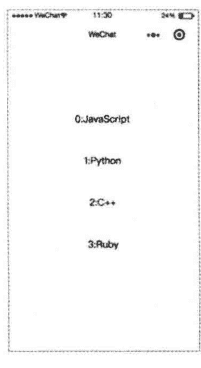

图 2-4 循环渲染

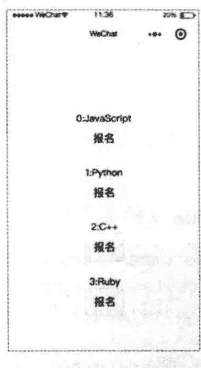

图 2-5 组合标签循环渲染

### 2.2.4 可复用模板
结构复杂且需要复用的组件可以做成模板：

```
<template name="item">
  <text style='margin:0'>
    {{id}}:{{lan}}
  </text>
  <button>报名</button>
</template>
<view class="container">
  <block wx:for="{{listData}}">
```

## 开发实战笔记
```
<template is="item" data="{{id:index,lan:item}}"></template>
</block>
</view>
```

template 标签定义了一个名为 item 的模板，使用时用模板名指定，并通过 data 属性把外部数据传进去，上例演示了把遍历的列表数据传入模板渲染。

实际项目中模板通常单独存放。先在根目录建 template 文件夹，如图 2-6。

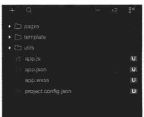

图 2-6 新建模板文件夹

在 template 里新建 item.wxml：

```
<template name="item">
  <text style='margin:0'>
    {{id}}:{{lan}}
  </text>
  <button>报名</button>
</template>
```

修改 index.wxml：

```
<import src="../../template/item.wxml"></import>
<view class="container">
  <block wx:for="{{listData}}">
    <template is="item" data="{{id:index,lan:item}}"></template>
  </block>
</view>
```

import 的作用是导入其他模板文件，注意路径要正确。类似的还有 include，include 会把文件里除了 template 和 wxs 外的内容直接复制到当前位置。例如在根目录建 common 文件夹，放 header.wxml：

```
<text>
  头部视图
</text>
```

修改 index.wxml：

```
<import src="../../template/item.wxml"></import>
<include src="../../common/header.wxml"></include>
<view class="container">
  <block wx:for="{{listData}}">
    <template is="item" data="{{id:index,lan:item}}"></template>
  </block>
</view>
```

运行后效果如图 2-7。

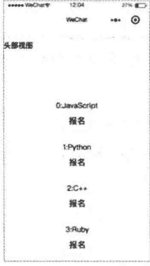

图 2-7 引入公用组件

## 2.3 WXSS 样式与布局
JS 负责数据与交互，WXML 负责结构，WXSS 负责样式与布局。WXSS 是小程序的样式语言，语法与 CSS 基本一致，并做了针对性优化。

### 2.3.1 WXSS 与 CSS 对比
写 WXSS 关键是选择器和属性。WXSS 与 CSS 在选择器和属性上高度兼容，主要差异是尺寸单位优化并新增了样式导入。

尺寸方面，WXSS 保留了 CSS 的全部单位，并新增自适应像素 rpx，屏幕宽按 750rpx 计算。可用的尺寸单位如下表 2-5。

表 2-5 可使用的尺寸单位

| 单位 | 名称 | 解释 |

|---|---|---|

| % | 百分比 | 设置尺寸百分比 |

| in | 英寸 | 英寸单位 |

| cm | 厘米 | 厘米单位 |

| mm | 毫米 | 毫米单位 |

| em | 字体单位 | 1em 等于当前字体的尺寸，在严格控制文本高度时这个单位非常有用 |

| ex | 字体水平尺寸单位 | 1ex 等于当前一个字体的水平宽度 |

| pt | 磅 | 1pt 等于 1/72in |

| pc | 派卡 | 1pc 等于 12pt |

| px | 像素 | 1px 为屏幕上的一个点 |

| rpx | 自适应像素 | 规定屏幕为 750rpx |

这样可以精确控制尺寸。例如修改 index.wxml：

```
<text class='label'>HelloWorld</text>
```

在 index.wxss 中写样式：

```
.label {
  background-color: red;
  width: 100%;
  display: inline-block;
}
```

运行效果如图 2-8。

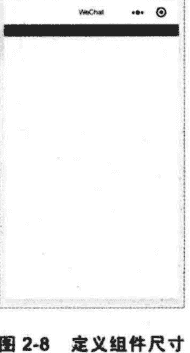

图 2-8 定义组件尺寸

display 控制展示模式，text 默认是行内元素，改为块级后尺寸才会生效。

样式导入也很简单，可把通用样式抽到公共文件再引用。例如在 common 文件夹新建 common.wxss：

```
.label {
  background-color: red;
  width: 100%;
  display: inline-block;
}
```

在 index.wxss 中引用：

```
@import '../../common/common.wxss'
```

引用时注意路径正确。

### 2.3.2 选择器使用
选择器的作用是选中元素。最简单的是元素选择器：

```
text {
  color:green;
}
```

上述代码把页面所有 text 组件文字设为绿色。也可以组合使用：

```
text,button {
  color:green;
}
```

这会同时选中 text 和 button 的文本并设为绿色。

类选择器匹配 class 属性，例如 text 组件设 class 为 label：

```
<text class='label'>HelloWorld</text>
```

用 .label 选中：

```
.label {
  color: blue;
}
```

id 选择器匹配 id 属性，例如 text 组件设 id 为 label：

```
<text id='label'>HelloWorld</text>
```

用 #label 选中：

```
#label{
  color: purple;
}
```

还可通过任意属性选中元素：

```
[id] {
  background: wheat;
}
```

这会选中所有带 id 属性的元素，也能按属性值精确匹配。

```
[id=label] {
  background: wheat;
}
```

后代选择器可以在指定的父节点范围内锁定任意层级的后代节点，具体用法可参考对 index.wxml 的修改示例：

```
<view>
  <text>View 内部文本</text>
</view>
<text id='label'>HelloWorld</text>
<button>按钮</button>
```

该示例生成了两处 text 节点，其中一处被 view 包裹，若仅想作用于被包裹的那处，就可以使用后代选择器来定位，书写方式如下：

```
view text {
  color: red;
}
```

除了后代选择器，子选择器也是常用手段。两者在匹配范围上存在差异：后代选择器会命中父节点下所有符合条件且层级不限的元素；子选择器只会命中直接子层，更深的孙节点会被排除。相关示例如下：

```
view > text {
  color: red;
}
```

兄弟选择器主要用于同层节点的关联选取，下面给出 index.wxml 的修改示范：

```
<view class='view'>
  <text>View 内部文本</text>
</view>
<text id='label'>HelloWorld</text>
<button>按钮</button>
```

如果目标是紧跟在 view 组件之后出现的 text 组件，可采用以下选择器进行命中：

```
.view + text {
  background: black;
}
```

### 2.3.3 背景样式常用配置
WXSS 为背景提供了多项定制能力，组件的背景样式可以按需调整。常用背景相关属性整理在表 2-6 中。

表 2-6 常用背景设置相关属性

| 属性名 | 意义 | 值 |

|---|---|---|

| background-color | 设置背景色 | 颜色值 |

| background-image | 设置背景图片 | 图片地址 URL |

| background-repeat | 设置图片背景的重复方式 | repeat: 背景图像将在垂直方向和水平方向重复<br>repeat-x: 背景图像将在水平方向重复<br>repeat-y: 背景图像将在垂直方向重复<br>no-repeat: 背景图像将仅显示一次 |

| background-position | 设置如何定位图片 | 水平和垂直方向分别有 top、left、right、bottom、center 5 个关键字可用，在设置时，可以组合使用，也可以使 用百分比或像素的方式自定义图片显示位置 |

| background-attachment | 设置背景是否随页面滚动 | scroll: 背景随页面滚动<br>fixed: 背景不随页面滚动 |

### 2.3.4 文字样式控制清单
文本属性负责调节元素内部文字的表现，涵盖字体、字号、色彩、对齐、缩进等多个维度，具体清单见表 2-7 所示。

表 2-7 文本相关属性

| 属性名 | 意义 | 值 |

|---|---|---|

| text-indent | 设置文本缩进，块级元素有效 | 尺寸数值 |

| text-align | 设置文本的对齐方式 | left: 左对齐<br>right: 右对齐<br>center: 居中对齐<br>justify: 两端对齐 |

| word-spacing | 设置词组之间的间距 | 尺寸数值 |

| letter-spacing | 设置字符之间的间距 | 尺寸数值 |

| text-transform | 进行大小写设置 | none: 不改变原文<br>capitalize: 每个单词首字母大写<br>uppercase: 所有字符转换为大写<br>lowercase: 所有字符转换为小写 |

| text-decoration | 进行文本修饰 | none: 不进行修饰<br>underline: 添加下画线<br>overline: 添加上画线<br>line-through: 添加删除线 |

| white-space | 处理空白字符 | none: 不处理<br>nowrap: 不换行 |

| color | 设置文本颜色 | 颜色值 |

| font-family | 设置文本字体 | 字体名 |

| font-style | 设置字体风格 | normal: 标准<br>italic: 斜体 |

| font-weight | 设置字体粗细 | normal: 正常<br>bold: 加粗<br>bolder: 更粗<br>lighter: 更细<br>也可以设置 100～900 的整百数值 |

| font-size | 设置字体尺寸 | 尺寸数值 |

### 2.3.5 间距与边框参数说明
外边距决定组件之间的距离，内边距决定内容与边界的空隙，边框属性则控制边界的视觉样式，如表 2-8 所示。

表 2-8 边框相关属性

| 属性名 | 意义 | 值 |

|---|---|---|

| margin-left | 设置组件外左边距 | 尺寸数值 |

| margin-right | 设置组件外右边距 | 尺寸数值 |

| margin-bottom | 设置组件外下边距 | 尺寸数值 |

| margin-top | 设置组件外上边距 | 尺寸数值 |

| padding-left | 设置组件内左边距 | 尺寸数值 |

| padding-right | 设置组件内右边距 | 尺寸数值 |

| padding-bottom | 设置组件内下边距 | 尺寸数值 |

| padding-top | 设置组件内上边距 | 尺寸数值 |

| border-style | 设置边框样式 | none: 无边框<br>dotted: 点状边框<br>dashed: 虚线边框<br>solid: 实线边框<br>double: 双线边框<br>groove: 3D 凹槽边框<br>ridge: 3D 隆起边框<br>inset: 3D 内凹边框<br>outset: 3D 外凸边框 |

| border-top-style | 定义上边框样式 | none: 无边框<br>dotted: 点状边框<br>dashed: 虚线边框<br>solid: 实线边框<br>double: 双线边框<br>groove: 3D 凹槽边框<br>ridge: 3D 隆起边框<br>inset: 3D 内凹边框<br>outset: 3D 外凸边框 |

| border-right-style | 定义右边框样式 | none: 无边框<br>dotted: 点状边框<br>dashed: 虚线边框<br>solid: 实线边框<br>double: 双线边框<br>groove: 3D 凹槽边框<br>ridge: 3D 隆起边框<br>inset: 3D 内凹边框<br>outset: 3D 外凸边框 |

| border-bottom-style | 定义下边框样式 | none: 无边框<br>dotted: 点状边框<br>dashed: 虚线边框<br>solid: 实线边框<br>double: 双线边框<br>groove: 3D 凹槽边框<br>ridge: 3D 隆起边框<br>inset: 3D 内凹边框<br>outset: 3D 外凸边框 |

| border-left-style | 定义左边框样式 | none: 无边框<br>dotted: 点状边框<br>dashed: 虚线边框<br>solid: 实线边框<br>double: 双线边框<br>groove: 3D 凹槽边框<br>ridge: 3D 隆起边框<br>inset: 3D 内凹边框<br>outset: 3D 外凸边框 |

| border-width<br>border-top-width<br>border-right-width<br>border-bottom-width<br>border-left-width | 定义边框宽度 | 尺寸数值 |

| border-color<br>border-top-color<br>border-right-color<br>border-bottom-color<br>border-left-color | 设置边框颜色 | 颜色值 |

### 2.3.6 元素显示与定位参数
默认情况下小程序页面采用自上而下的流式布局。与 CSS 不同的是，WXSS 提供了一套弹性盒的布局方式，关于弹性盒布局，后面在介绍小程序页面布局技术时会详细介绍，本节仅列举设置元素显示和元素定位方式的相关属性，如表 2-9 所示。

表 2-9 设置元素显示和元素定位方式的相关属性

| 属性名 | 意义 | 值 |

|---|---|---|

| display | 设置元素展示类型 | none：不显示<br>block：块级元素，独占一行<br>inline：行内元素<br>inline-block：行内块元素 |

| position | 设置元素定位方式 | static：默认定位，根据流布局位置确定<br>relative：相对定位，相对于其在流中的正常位置进行定位<br>fixed：绝对定位，相对页面窗口进行定位<br>absolute：绝对定位，相对父元素进行定位 |

相对定位可以使元素相对于其当前位置进行调整，通过设置 left、right、top、bottom 属性分别进行左、右、上、下的调整，示例代码如下：

```css
.hello {
  color: red;
  border-style: inset;
  display: block;
  position: relative;
  left: 20rpx;
  top:20rpx;
}
```

运行代码，效果如图 2-9 所示。

fixed 绝对定位相对于页面窗口进行定位，不会占据流式布局的空间，使用它可以将组件固定在页面窗口的某个位置，并且不会随页面的滚动而滚动。通过设置 left、right、top、bottom 属性分别进行相对页面窗口左、右、上、下距离的调整，示例代码如下：

```css
.hello {
  color: red;
  border-style: inset;
  display: inline-block;
  position: fixed;
  left: 20rpx;
  bottom:20rpx;
  top:20rpx;
}
```

运行代码，效果如图 2-10 所示。


图 2-9 进行相对定位

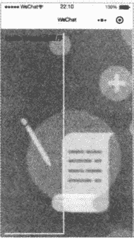

图 2-10 相对于页面窗口的绝对定位

absolute 绝对定位和 fixed 绝对定位类似，只是 absolute 是相对父容器的绝对定位，会跟随父容器滚动。

## 2.3.7 其它视觉效果属性
WXSS 中还定义了许多元素的尺寸设置、透明度设置等属性，如表 2-10 所示。

表 2-10 元素的尺寸设置、透明度设置等属性

| 属性名 | 意义 | 值 |

|---|---|---|

| height | 设置元素高度 | 尺寸数值 |

| line-height | 设置元素行高 | 尺寸数值 |

| max-height | 设置元素最大高度 | 尺寸数值 |

| max-width | 设置元素最大宽度 | 尺寸数值 |

| min-height | 设置元素最小高度 | 尺寸数值 |

| min-width | 设置元素最小宽度 | 尺寸数值 |

| width | 设置元素宽度 | 尺寸数值 |

| opacity | 设置元素透明度 | 0~1 的数值 |

| border-radius | 设置边框圆角 | 尺寸数值 |

| box-shadow | 设置阴影 | 例如， box-shadow: 2px 2px 3px #aaaaaa; 从左到右依次设置水平阴影偏移量、垂直阴影偏移量、模糊程度、阴影颜色 |

| border-image | 设置图片边框 | 图片地址 |

| text-shadow | 设置文字阴影 | 例如， text-shadow: 5px 5px 5px #FF0000; 从左到右依次设置水平阴影偏移量、垂直阴影偏移量、模糊程度、阴影颜色 |

## 第 3 章
## 容器组件实战
从本章开始，将正式学习小程序界面开发。通过第 2 章的学习，我们已经具备了小程序开发的所有基本技能，本章将展开介绍小程序开发中容器组件的应用。容器组件的主要作用是作为容器，同时进行其他组件的组合和布局。

### 3.1 view 组件概览
view 视图组件是小程序界面系统中最基础的视图组件。学习组件，最重要的是学习组件的属性。小程序组件系统中有一些属性是公共的，即所有组件都用这些属性。小程序组件通用属性如表 3-1 所示。

表 3-1 小程序组件通用属性

| 属性名 | 意义 | 值类型 |

|---|---|---|

| id | 组件的标识 | 字符串 |

| class | 组件设置的类 | 字符串 |

| style | 动态设置组件的风格样式 | 字符串 |

| hidden | 设置组件是否隐藏 | 布尔值 |

| data-* | *是一个通配符，用来设置组件的用户数据，并进行组件传值 | 任意类型值 |

| bind*/catch* | *是一个通配符，这些属性用来为组件添加用户交互方法 | 事件处理方法对象 |

#### 3.1.1 view 交互相关属性
view 视图组件中提供的常用属性如表 3-2 所示。

表 3-2 view 视图组件中提供的常用属性

| 属性名 | 意义 | 值类型 |

|---|---|---|

| hover-class | 设置按下时的 class 类 | 字符串 |

| hover-stop-propagation | 是否拦截父组件的点击状态 | 布尔值 |

| hover-start-time | 设置手指按下多长时间后组件出现点击状态 | 数值，单位为 ms |

| hover-stay-time | 设置手指松开后多长时间取消点击状态 | 数值，单位为 ms |

#### 3.1.2 Flex 布局实践
view 视图组件常作为布局容器用来布局和组合其他子组件。例如，进行简单的、从上到下的列布局，首先在 index.wxml 中编写如下测试代码，搭建页面结构：

```
<!--index.wxml-->
<!--外层容器视图-->
<view class="container">
<!--定义了3个子视图-->
<view class='sub-view'>
</view>
<view class='sub-view' >
</view>
<view class='sub-view' >
</view>
</view>
```

上述代码定义了一个容器 view 视图，并在其中定义了 3 个 view 子视图，为其设置 class 属性后，在 index.wxss 文件中编写如下代码：

```
/**index.wxss**/
/**容器布局样式**/
.container {
  display: flex;
  flex-direction: column;
}
/**子视图布局样式**/
.sub-view {
  background-color: red;
  margin-top: 50rpx;
  height:50rpx;
}
```

运行代码，效果如图 3-1 所示。

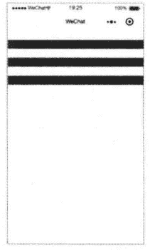

图 3-1 进行 flex 列布局

上述代码使用了 flex 布局，在这种布局模式下，可以将布局容器想象成一个有弹性的盒子，其尺寸大小由其中的子组件决定，子组件的宽度或高度会将父容器撑满。使用 flex 布局需要将组件样式表中的 display 属性设置为 flex。flex 布局中有如下几个重要的属性需要了解。

#### 1. flex-direction
flex-direction 属性用来设置布局的主轴方向，即子元素的排列方向，其可选值有如下几种：row、row-reverse、column、column-reverse。row 表示行布局，子元素从左向右排列；row-reverse 也表示行布局，子元素从右向左排列；column 表示列布局，子元素从上到下排列；column-reverse 也表示列布局，子元素从下到上排列。

#### 2. flex-wrap
flex-wrap 设置换行模式：默认值为 nowrap 不进行换行；设置为 wrap，当元素尺寸溢出时会进行换行；设置为 wrap-reverse 则会逆向进行换行，即第一行在下。

#### 3. justify-content
justify-content 属性设置子元素在主轴方向上的对齐方式：flex-start 表示左对齐；flex-end 表示右对齐；center 表示居中对齐；space-between 表示两端对齐；space-around 表示等间隔对齐。

#### 4. align-items
align-items 设置元素在次轴上的对齐方式，次轴方向与主轴方向垂直：设置 flex-start 为正方向对齐，行布局则表示从左到右，列布局则表示从上到下；flex-end 的对齐方向与 flex-start 相反；center 则进行居中对齐。

#### 5. align-content
align-content 属性比较难理解，它用来设置当弹性盒中有多个轴线时的内容整体对齐方式。例如，如果出现了换行，这个属性可以设置整体的对齐方式，设置为 stretch 则内容会整体充满，设置为 flex-start 表示正方向对齐，设置为 flex-end 表示逆方向对齐，设置为 center 表示居中对齐，设置为 space-between 表示两端对齐，设置为 space-around 表示等间隔对齐。

上面介绍的这些属性都是用在作为容器的组件上的，对于 flex 布局的子组件，也有一些属性可以用来设置，如表 3-3 所示。

表 3-3 flex 布局相关属性

| 属性名 | 作用说明 | 参数类型 |
|---|---|---|

| order | 决定子元素的排列顺序，数值越小越靠前展示 | 数值 |
| flex-grow | 控制组件是否占用多余空间进行放大，默认 0 表示不放大，设为 1 则会放大 | 数值 |
| flex-shrink | 控制组件在空间不足时是否自动缩小，默认 1 会缩小，设为 0 则保持不变 | 数值 |
| align-self | 单个组件覆盖父容器 align-items 的对齐规则，取值范围与 align-items 相同 | 枚举值 |

## 3.2 可滚动容器组件

小程序原生布局本身延展性就很强，即使不借助专门的滚动组件，当内容尺寸超过窗口时也会自动出现滚动。框架还提供了把页面局部划为滚动区的专用组件。

### 3.2.1 scroll-view 滚动视图

scroll-view 是一个可滚动的容器，使用时必须在样式里明确给出 width 与 height。基础使用方式如下，先在 index.wxml 中写入：

```
<!--index.wxml-->
<!--滚动容器-->
<scroll-view class='scroll' scroll-y scroll-x>
    <view class='sub-view' > </view>
    <view class='sub-view' > </view>
    <view class='sub-view' > </view>
    <view class='sub-view' > </view>
    <view class='sub-view' > </view>
</scroll-view>
```

再在 index.wxss 中定义样式：

```
/**index.wxss**/
.sub-view {
    height: 300rpx;
    width: 300rpx;
    margin-top: 80rpx;
    background-color: red;
}
/**定义滚动容器样式**/
.scroll {
    width: 200rpx;
    height: 500rpx;
}
```

运行后，scroll-view 区域即可实现上下左右的滚动。加上 scroll-x 允许水平滚动，加上 scroll-y 允许垂直滚动。常用属性见表 3-4。

表 3-4 scroll-view 常用属性

| 属性名 | 作用说明 | 参数类型 |
|---|---|---|
| bindscrolltoupper | 滚动到顶部或左侧时触发的回调，会把事件对象传给函数 | 函数 |
| bindscrolltolower | 滚动到底部或右侧时触发的回调，会把事件对象传给函数 | 函数 |
| upper-threshold | 距离顶部或左侧多远开始触发回调 | 数值 |
| lower-threshold | 距离底部或右侧多远开始触发回调 | 数值 |
| scroll-into-view | 自动定位到指定子元素，值为子元素的 id，id 不能以数字开头 | 字符串 |
| scroll-with-animation | 定位时是否使用平滑过渡 | 布尔值 |
| scroll-top | 垂直方向距离顶部的滚动偏移 | 数值 |
| scroll-left | 水平方向距离左侧的滚动偏移 | 数值 |
| bindscroll | 滚动过程中实时触发的回调 | 函数 |

使用 scroll-view 需要注意三点。

- 容器必须设定明确的宽高。
- scroll-into-view 的优先级高于 scroll-top / scroll-left。
- scroll-top / scroll-left 只能传纯数值，不带单位。

### 3.2.2 swiper 轮播组件

swiper 是更高阶的滚动容器，内置了自动播放、滑动交互等能力，使用起来十分省事。示例写法如下，先在 index.wxml 中：

```
<!--index.wxml-->
<!--定义轮播组件-->
<swiper>
<!--轮播组件中的子视图必须包装为 swiper-item 组件-->
<swiper-item item-id="0">
    <view class='item1'></view>
</swiper-item>
<swiper-item item-id="1">
    <view class='item2'></view>
</swiper-item>
</swiper>
```

再在 index.wxss 中：

```
/**index.wxss**/
.item1 {
  background-color: red;
  height: 100%;
}
.item2 {
  background-color: green;
  height: 100%;
}
```

①注意：

swiper 内部只能放置 swiper-item，swiper-item 负责承载单张轮播内容，可继续嵌套其他组件。item-id 用来唯一标识一项，用于定位。

常用属性见表 3-5。

表 3-5 swiper 常用属性

| 属性名 | 作用说明 | 参数类型 |
|---|---|---|
| indicator-dots | 是否显示指示点，添加属性即显示 | 布尔值 |
| indicator-color | 指示点的默认颜色 | 颜色值 |
| indicator-active-color | 当前项指示点的颜色 | 颜色值 |
| autoplay | 是否自动轮播，添加属性即开启 | 布尔值 |
| current | 当前展示项的索引 | 数值 |
| current-item-id | 通过 item-id 指定当前展示项 | 字符串 |
| interval | 自动播放间隔，单位 ms | 数值 |
| duration | 滑动动画时长，单位 ms | 数值 |
| circular | 是否循环播放 | 布尔值 |
| vertical | 是否垂直滚动，默认水平 | 布尔值 |
| previous-margin | 前一张卡片的外边距 | 尺寸 |
| next-margin | 后一张卡片的外边距 | 尺寸 |
| display-multiple-items | 同时可见的项数 | 数值 |
| bindchange | 项切换时触发的回调 | 函数 |
| bindtransition | 项位置变化时触发的回调 | 函数 |
| bindanimationfinish | 动画结束时触发的回调 | 函数 |

### 3.2.3 movable-view 拖拽视图

movable-view 允许用户在限定范围内拖拽组件，必须放在 movable-area 内。示例代码如下，先在 index.wxml：

```
<!--index.wxml-->
<!--定义可拖曳区域-->
<movable-area class="area">
    <!--定义可拖曳的元素-->
    <movable-view class='view' direction="all" out-of-bounds scale> </movable-view>
</movable-area>
```

再在 index.wxss：

```
/**index.wxss**/
.area {
    background-color: red;
    width: 400rpx;
    height: 600rpx;
}
.view {
    background-color: green;
    width: 100rpx;
    height: 100rpx;
}
```

运行后可拖拽色块。movable-area 必须明确尺寸。若 movable-view 比 movable-area 小，可在区域内自由拖拽；若更大，则行为接近 scroll-view。

常用属性见表 3-6。

表 3-6 movable-view 常用属性

| 属性名 | 作用说明 | 参数类型 |
|---|---|---|
| direction | 允许拖拽的方向，all、vertical、horizontal、none | 字符串 |
| inertia | 是否开启惯性滑动 | 布尔值 |
| out-of-bounds | 是否允许拖出 movable-area 范围 | 布尔值 |
| X | 组件的绝对横坐标 | 数值 |
| Y | 组件的绝对纵坐标 | 数值 |
| damping | 动画阻尼系数 | 数值 |
| friction | 动画摩擦系数 | 数值 |
| disabled | 是否禁止拖拽 | 布尔值 |
| scale | 是否支持双指缩放 | 布尔值 |
| scale-min | 最小缩放比例 | 数值 |
| scale-max | 最大缩放比例 | 数值 |
| scale-value | 当前缩放比例，范围 0.5～10 | 数值 |
| animation | 是否使用动画效果 | 布尔值 |
| bindchange | 拖拽过程中触发的回调 | 函数 |
| bindscale | 缩放过程中触发的回调 | 函数 |
| htouchmove | 水平触摸移动时触发的回调 | 函数 |
| vtouchmove | 垂直触摸移动时触发的回调 | 函数 |

## 3.3 浮层视图组件

浮层组件使用场景有限，主要服务于自定义原生组件。map、video、canvas、camera、live-player、live-pusher 等特殊功能组件都以原生方式渲染。

例如 map 组件渲染地图后内部无法再嵌套普通视图，原生组件层级极高，外层视图不会生效。

> ①注意：
> 
> 原生组件在模拟器与真机上的表现差异较大，建议以真机为主进行验证。

### 3.3.1 cover-view 文本浮层

cover-view 用于在原生组件上覆盖文本层，并可继续嵌套。示例代码如下，在 index.wxml 中：

```
<!--index.wxml-->
<map>
<!--此组件可以覆盖在原生组件上面-->
<cover-view style='background-color:red'>HelloWorld</cover-view>
</map>
```

map 会先渲染地图，cover-view 覆盖其上。cover-view 支持定位、布局和文本样式。若需覆盖图片，则使用 cover-image。

### 3.3.2 cover-image 图片浮层

cover-image 与 cover-view 用途相近，额外提供图片加载能力。

示例代码：

```
<!--index.wxml-->
<map>
<!--覆盖在原生组件上面的图片组件-->
<cover-image style='width:200rpx; height:200rpx' src='http://huishao.cc/img/avatar.jpg'></cover-image>
</map>
```

运行后图片会叠加在地图上。常用属性见表 3-7。

表 3-7 cover-image 常用属性

| 属性名 | 作用说明 | 参数类型 |
|---|---|---|
| src | 图片路径 | 路径 |
| bindload | 图片加载成功时的回调 | 函数 |
| binderror | 图片加载失败时的回调 | 函数 |

cover-image 常与 cover-view 配合使用，以扩展原生组件的功能。

## 第 4 章

## 小程序视图组件总览

组件是页面搭建的基石。面向用户的应用需要简洁高效且美观的界面，好的首印象很大程度上来自界面设计。框架内置了大量现成组件，使用方便且视觉统一。本章系统介绍小程序的独立视图组件，掌握后可为复杂界面开发打下基础。

## 4.1 基础视图组件

基础视图组件上手简单，可单独使用，是构建界面的基本单元。

### 4.1.1 icon 图标组件

icon 用于展示语义化小图标，内置 9 种样式，颜色可自定义。

在测试工程中新建页面 icon：pages 下新建 icon 目录，右键新建 Page 命名为 icon，开发工具会自动生成文件并在 app.json 中注册。便于调试可在工具栏添加编译模式。

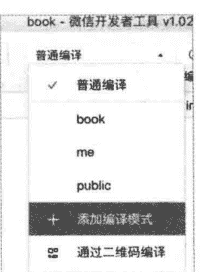

图 4-1 添加编译模式

在弹出的窗口中命名为 icon，启动页设为 icon 页面后保存。

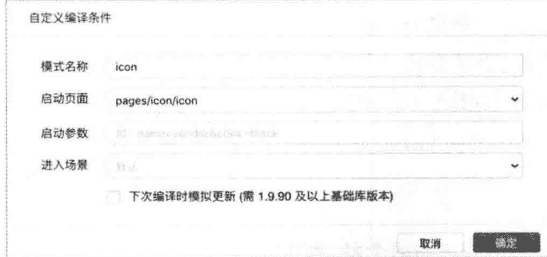

图 4-2 自定义编译模式

项目将以 icon 页面为入口。在 icon.js 中写入初始化数据：

```
data: {
  types: ["success","success_no_circle", "info", "warn", "waiting", "cancel", "download", "search", "clear"],
}
```

数据列出了所有可用类型，每种对应不同图标样式。在 icon.wxml 中：

```
<!--pages/icon/icon.wxml-->
<!--定义外层容器-->
<view class='container'>
  <!--通过类型指定图标进行渲染-->
  <view class='icon' wx:for="{{types}}">
    <icon color='red' size='40' type="{{item}}"></icon>
  </view>
</view>
```

代码按数据源循环生成 icon 组件，size 控制尺寸，color 控制颜色，type 控制样式。icon.wxss：

```
/*pages/icon/icon.wxss*/
.container {
  display: flex;
  flex-direction: row;
  flex-wrap: wrap;
}
.icon {
  margin: 15rpx;
}
```

运行效果如图 4-3。

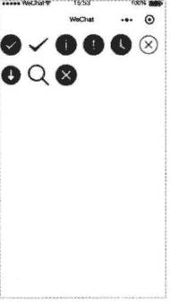

图 4-3 icon 组件的运行展示

### 4.1.2 text 文本组件

text 组件负责文本展示。新建 text 页面，在 text.wxml 中写入：

```
<!--pages/text/text.wxml-->
<text style="color:red;font-size:80rpx;">文本<text style="color:blue;font-size:100rpx;">文本内文本</text></text>
```

上述代码创建了一段简单文本，效果如图 4-4 所示。


图 4-4 text 组件的运行效果

text 标签的嵌套规则很严格，内部只能再放同款标签。靠层层包裹，一段文字里就可以混搭多种样式。出厂时它只负责静态展示，并不支持交互；加上 selectable 之后就能被选中，选中内容可复制或查询。

## 4.1.3 rich-text 组件

先前提到 text 只能嵌套 text，即便借助 style 也无法实现图文混排。小程序组件库提供 rich-text，专门用来渲染富文本。

rich-text 的用法比较直观，先准备节点数据，再把数据挂到 nodes 参数上。新建一个 rich-text 页面，在 rich-text.wxml 中填入如下结构：

```
<!--pages/rich-text/rich-text.wxml-->
<rich-text nodes="{{nodes}}"></rich-text>
```

上面片段把 nodes 绑定到组件，数据本体写在 rich-text.js 里：

## 微信小程序开发实战

```
data: {
  //进行节点数据的定义
  nodes:[
    {
      //定义节点的类型
      type:"node",
      //定义节点的名称
      name:"h1",
      //定义节点的属性
      attrs:{
        style:"color: red;"
      },
      children: [{
        type: 'text',
        text: 'HelloWorld!'
      }]
    },
    {
      type:"text",
      text:"Hi"
    }
  ],
}
```

执行后界面呈现图 4-5 的样子。


图 4-5 rich-text 组件的运行效果

从示例可以看到，rich-text 用节点数组描述内容，每个节点是一个对象，可选字段汇总在表 4-1。

表 4-1 节点对象可配置的字段

| 字段 | 说明 | 取值 |
|---|---|---|
| name | 标签名 | HTML 标签名 |
| attrs | 标签属性 | HTML 属性集合，对象类型 |
| children | 子节点 | 子节点数组 |
| type | 节点类型 | node 表示元素节点，text 表示文本节点 |

rich-text 支持的 HTML 标签见表 4-2。

## 表 4-2 rich-text 组件可用的 HTML 标签

| 标签 | 说明 |
|---|---|
| a | 超链接 |
| abbr | 简写 |
| b | 粗体 |
| blockquote | 引用块 |
| br | 换行 |
| code | 代码片段 |
| col | 表格列对齐 |
| colgroup | 表格列组对齐 |
| dd | 列表项描述 |
| del | 删除线文本 |
| div | 块级容器 |
| dl | 定义列表 |
| dt | 列表项名称 |
| em | 强调文本 |
| fieldset | 组合控件 |
| h1、h2、h3、h4、h5、h6 | 各级标题 |
| hr | 分割线 |
| i | 斜体 |
| img | 图片 |
| ins | 插入文本 |
| label | 表单标签 |
| legend | fieldset 标题 |
| li | 列表项 |
| ol | 有序列表 |
| p | 段落 |
| q | 短引用 |
| span | 行内容器 |
| strong | 强强调 |
| sub | 下标 |
| sup | 上标 |
| table | 表格 |
| tbody | 表格主体 |
| td | 标准单元格 |
| tfoot | 表格底部 |
| thead | 表格头部 |
| th | 表头单元格 |
| tr | 表格行 |
| ul | 无序列表 |

## 4.1.4 progress 组件

progress 用于绘制进度条，上手快且可调项很多，参考代码如下：

```
<!--pages/progress/progress.wxml-->
<progress style='margin:50rpx;' 
percent='50' 
show-info='{{true}}' 
stroke-width='20'>
</progress>
```

运行后得到图 4-6 的呈现。


图 4-6 progress 组件的运行效果

常见参数整理在表 4-3。

## 表 4-3 progress 控件常用参数

| 参数 | 用途 | 类型 |
|---|---|---|
| percent | 当前进度占比，0～100 | 数值 |
| show-info | 右侧是否显示百分比文字 | 布尔 |
| border-radius | 进度条圆角半径，模拟器可能异常 | 数值 |
| font-size | 百分比文字大小 | 数值 |
| stroke-width | 进度条厚度，默认 6px | 数值 |
| activeColor | 已完成部分颜色 | 颜色 |
| backgroundColor | 背景颜色 | 颜色 |
| active | 是否渲染从左到右的动画 | 布尔 |
| bindactiveend | 动画结束后的回调 | 函数 |

## 4.1.5 button 组件

button 是官方的现成按钮控件，除了基础点按，还集成了登录、分享等微信能力。用 view 绑定事件也能做交互，但 button 功能更集中。新建 button 页面，在 button.wxml 中写入如下结构：

```
<!--pages/button/button.wxml-->
<button style='margin:30rpx;' 
type='warn'
size='default'
plain='{{true}}'
loading='{{true}}'
open-type='share'>
警告按钮
</button>
```

执行后效果见图 4-7。

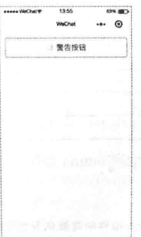

图 4-7 button 组件的运行效果

size 控制尺寸，有 default 和 mini 两种。type 决定配色，primary 呈现绿色，default 呈现白色，warn 呈现红色。plain 可让背景透明。除此之外还有更多可调项，见表 4-4。

## 表 4-4 button 控件可配置参数

| 参数 | 说明 | 取值 |
|---|---|---|
| disabled | 是否禁用 | 布尔 |
| loading | 标题前是否展示加载动效 | 布尔 |
| form-type | 在表单中的提交行为 | submit 提交表单，reset 重置表单 |
| hover-class | 按下时的类名 | 字符串 |
| hover-stop-propagation | 是否阻止父节点按下态 | 布尔 |
| hover-start-time | 按住多久后进入按下态 | 毫秒数值 |
| hover-stay-time | 松手后保持按下态的时长 | 毫秒数值 |

该控件的优势在于接入微信开放能力，通过 open-type 即可触发，支持的功能见表 4-5。

## 表 4-5 open-type 对应的能力

| open-type | 能力说明 |
|---|---|
| contact | 打开客服会话 |
| share | 唤起分享 |
| getUserInfo | 获取用户信息 |
| getPhoneNumber | 获取手机号 |
| launchApp | 启动 App |
| openSetting | 打开授权设置页 |
| feedback | 打开意见反馈页 |

调用这些能力时通常需要配合额外参数，相关参数整理在表 4-6。

## 表 4-6 button 控件中与开放能力相关的参数

| 参数 | 说明 | 取值 |
|---|---|---|
| lang | getUserInfo 返回的用户信息语言 | zh_CN 简体，zh_TW 繁体，en 英文 |
| bindgetuserinfo | getUserInfo 成功后的回调 | 函数 |
| session-from | contact 会话来源标识 | 字符串 |
| send-message-title | contact 消息标题 | 字符串 |
| send-message-path | contact 消息点击跳转路径 | 字符串 |
| send-message-img | contact 消息图片 | 字符串 |
| show-message-card | contact 是否显示消息卡片提示 | 布尔 |
| bindcontact | contact 回调 | 函数 |
| bindgetphonenumber | getPhoneNumber 回调 | 函数 |
| app-parameter | launchApp 传递给 App 的参数 | 字符串 |
| bindererror | 调用失败时的回调 | 函数 |
| bindlaunchapp | 成功启动 App 的回调 | 函数 |
| bindopensetting | 打开授权页后的回调 | 函数 |

## 4.2 用户输入相关控件

小程序交互分手势操作和数据输入两类，本节聚焦常用的输入类控件，覆盖选择器与表单输入。

## 4.2.1 checkbox 组件

checkbox 用来搭建多选列表，参考代码如下：

```
<!--pages/checkbox/checkbox.wxml-->
<checkbox-group style="margin:30rpx" bindchange="change">
体育运动：
<checkbox value='1' checked='{{true}}'>足球</checkbox>
<checkbox value='2' color="red">篮球</checkbox>
<checkbox value='3'>排球</checkbox>
</checkbox-group>
```

运行后界面见图 4-8。

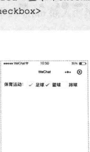

图 4-8 checkbox 组件的运行效果

## 微信小程序开发实战

checkbox 需要放在 check-group 内使用，check-group 通过 bindchange 绑定变更回调，回调会把被选中的 value 传回。

常见参数见表 4-7。

表 4-7 checkbox 控件常用参数

| 参数 | 说明 | 取值 |
|---|---|---|
| value | 选项标识 | 字符串 |
| disabled | 是否不可用 | 布尔 |
| checked | 是否默认选中 | 布尔 |
| color | 选中时的符号颜色 | 颜色 |

### 4.2.2 radio 组件

radio 用于单选分组，组内只能选一个。与 checkbox 的多选不同，用法基本一致，参考代码如下：

```
<!--pages/radio/radio.wxml-->
<radio-group style="margin:30rpx;">
性别：
<radio color="red" style="margin-right:30rpx;">男</radio>
<radio style="margin-right:30rpx;">女</radio>
<radio style="margin-right:30rpx;">保密</radio>
</radio-group>
```

运行后效果见图 4-9。

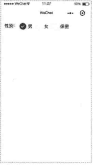

图 4-9 radio 组件的运行效果

radio 同样要放在 radio-group 中构成互斥组，radio-group 可绑定 bindchange 获取选中项的 value。常见参数见表 4-8。

表 4-8 radio 控件常用参数

| 参数 | 说明 | 取值 |
|---|---|---|
| value | 选项标识 | 字符串 |
| checked | 是否默认选中 | 布尔 |
| disabled | 是否不可用 | 布尔 |
| color | 选中色 | 颜色 |

### 4.2.3 input 组件

input 为原生输入框，用于接收键盘输入，参考代码如下：

```
<!--pages/input/input.wxml-->
<input style='background-color:#fafafa;color:gray;height:45px;' placeholder='请输入内容'></input>
```

运行后界面见图 4-10。

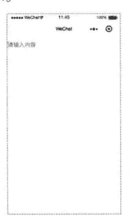

图 4-10 input 组件的运行效果

点击后会唤起键盘，开发者可绑定多种交互回调。常见参数见表 4-9。

表 4-9 input 控件常用参数

| 参数 | 说明 | 取值 |
|---|---|---|
| value | 输入框内容 | 字符串 |
| type | 输入类型，对应不同键盘 | text 文本，number 数字，idcard 身份证，digit 小数 |
| password | 是否为密码模式 | 布尔 |
| placeholder | 占位提示文本 | 字符串 |
| placeholder-style | 占位文本样式 | 字符串 |
| placeholder-class | 占位文本类名 | 字符串 |
| disabled | 是否禁用 | 布尔 |
| maxlength | 最大输入长度，默认 140 | 数值 |
| cursor-spacing | 光标与键盘距离 | 数值 |
| auto-focus | 是否自动聚焦 | 布尔 |
| focus | 是否获取焦点 | 布尔 |
| confirm-type | 键盘确认按钮文字，仅 type=text 有效 | send 发送，search 搜索，next 下一个，go 前往，done 完成 |

输入框交互行为属性总览

| confirm-hold | 控制确认键按下后键盘是否保持弹出 | 布尔值，默认为 false |
| cursor | 定位光标在输入框中的位置 | 数值 |
| selection-start | 设定选中文本的起始光标位置 | 数值 |
| selection-end | 设定选中文本的结束光标位置 | 数值 |
| adjust-position | 键盘弹出时是否自动上推页面 | 布尔值 |
| bindinput | 输入内容变化时执行的回调，参数携带输入值 | 函数 |
| bindfocus | 输入框获得焦点时执行的回调 | 函数 |
| bindblur | 输入框失去焦点时执行的回调 | 函数 |
| bindconfirm | 点击完成键时执行的回调 | 函数 |

### 4.2.4 开关 Switch 快速上手
switch 组件用于呈现开关样式的交互控件，使用门槛很低，示例代码如下：

```
<!--pages/switch/switch.wxml-->
开关按钮<switch type='switch' bindchange='change'> </switch>
```

运行代码，效果如图 4-11 所示。

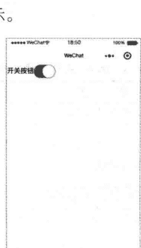

图 4-11 switch 组件的运行效果

switch 组件的常用属性如表 4-10 所示。

表 4-10 switch 组件的常用属性

| 属性 | 意义 | 值 |
|---|---|---|
| checked | 决定控件初始是否处于打开状态 | 布尔值 |
| disabled | 是否将控件设为不可操作 | 布尔值 |
| type | 指定呈现的形态 | 可选值：switch 为开关形态；checkbox 为复选框形态 |
| bindchange | 状态发生变化时触发的回调 | 函数 |
| color | 定义开关的配色 | 颜色值 |

### 4.2.5 标签 Label 增强交互
label 组件属于辅助型控件，主要为 button、checkbox、radio、switch 这四类交互控件提供可扩展的点击区域。这四类控件本身已经足够好用，但在自定义交互范围上仍有局限，例如按钮只能直接点击自身，选择框也必须点击本身才能触发。

借助 label，可以让用户点击任意自定义区域时间接触发上述控件的事件。示例代码如下：

```
<!--pages/label/label.wxml-->
<view>
<label>
<checkbox></checkbox>
<text>选择框包裹在 label 标签内</text>
</label>
</view>
<view>
<label for='radio'>
使用 for 属性关联单选框组件
</label>
<radio id='radio'></radio>
</view>
<view>
<label for='switch'>
控制开关的图标
<icon type='warn'></icon>
</label>
<switch id='switch'></switch>
</view>
```

运行代码，效果如图 4-12 所示。

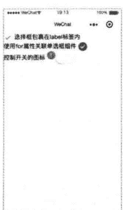

图 4-12 label 组件的运行效果

通过 label 点击即可间接操作 checkbox、radio、switch。关联方式有两种：把需要关联的控件直接放置在 label 标签内部，label 内可继续嵌套其他节点；或通过 for 属性指定目标控件的 id 进行远程关联。

### 4.2.6 滑块 Slider 拖拽取值
slider 组件允许用户通过拖拽滑块来设定数值，并提供取值范围、步进、颜色等丰富配置。示例代码如下：

```
<!--pages/slider/slider.wxml-->
<slider show-value='{{true}}' backgroundColor='red' value='50' activeColor='blue' block-color='green'></slider>
```

运行代码，效果如图 4-13 所示。

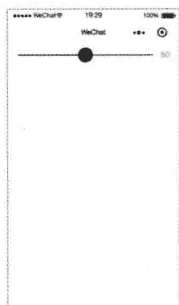

图 4-13 slider 组件的运行效果

从视觉上看 slider 与 progress 非常相近，区别在于 slider 可主动交互，用户可以拖动滑块。slider 组件的常用属性如表 4-11 所示。

表 4-11 slider 组件的常用属性

| 属性名 | 意义 | 值 |
|---|---|---|
| min | 滑块允许的最小值 | 数值，默认 0 |
| max | 滑块允许的最大值 | 数值，默认 100 |
| step | 滑块每次移动的步长 | 数值，默认 1 |
| disabled | 是否禁止用户拖动 | 布尔值 |
| value | 当前滑块所在数值 | 数值 |
| activeColor | 已填充进度部分的配色 | 颜色值 |
| backgroundColor | 未填充进度部分的配色 | 颜色值 |
| block-size | 滑块圆点尺寸 | 数值，默认 28，区间 12～28 |
| block-color | 滑块圆点配色 | 颜色值 |
| show-value | 是否在上方展示当前数值 | 布尔值 |
| bindchange | 完成一次拖拽交互后触发回调 | 函数 |
| bindchanging | 拖拽过程中数值实时变化触发回调 | 函数 |

### 4.2.7 多行输入 Textarea 组件
input 组件只能接收单行文本，超宽内容会横向滚动，适合简短输入。

在需要长文本录入的场景，如动态发布、文章撰写等，textarea 组件支持多行输入。使用方式与 input 基本一致，示例代码如下：

```
<!--pages/textarea/textarea.wxml-->
<textarea style='background-color:#f1f1f1;padding:0;width:100%' placeholder='输入文本'></textarea>
```

运行代码，效果如图 4-14 所示。

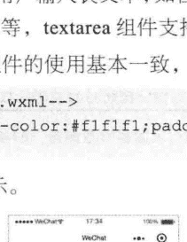

图 4-14 textarea 组件的运行效果

文本超出高度时 textarea 会自动出现垂直滚动。textarea 的可配置属性如表 4-12 所示。

表 4-12 textarea 组件的常用属性

| 属性名 | 意义 | 值 |
|---|---|---|
| value | 输入框初始文本 | 字符串 |
| placeholder | 空状态下的提示文案 | 字符串 |
| placeholder-style | 提示文案的样式定义 | 字符串 |
| placeholder-class | 提示文案的类名 | 字符串 |
| disabled | 是否禁用输入 | 布尔值 |
| maxlength | 最多可输入字符数 | 数值，-1 表示不限制 |
| auto-focus | 进入页面是否自动聚焦 | 布尔值 |
| focus | 手动控制是否聚焦 | 布尔值 |
| auto-height | 是否随内容高度自适应 | 布尔值 |
| fixed | 是否采用 fixed 定位 | 布尔值 |
| cursor-spacing | 光标与键盘的间距 | 数值 |
| cursor | 光标位置 | 数值 |
| show-confirm-bar | 键盘底部是否显示确认栏 | 布尔值 |
| selection-start | 选中起始位置 | 数值 |
| selection-end | 选中结束位置 | 数值 |
| adjust-position | 键盘弹出时页面是否自动上移 | 布尔值 |
| bindfocus | 获得焦点时回调 | 函数 |
| bindblur | 失去焦点时回调 | 函数 |
| bindlinechange | 行数变化时回调 | 函数 |
| bindinput | 输入时回调 | 函数 |
| bindconfirm | 确认键点击时回调 | 函数 |

## 4.3 选择器组件
小程序提供了一套覆盖多种场景的选择器，包括时间、日期、城市等，也支持自定义数据源。

### 4.3.1 普通选择器
普通选择器用于展示一组简单选项，以性别选择为例，在工程中新建页面 picker，在 picker.wxml 中编写如下代码：

```
<picker mode="selector" value='{{index}}' range='{{data}}' bindchange='change'>
选择性别：{{data[index]}}
</picker>
```

picker 为小程序选择器组件，通过 mode 属性切换模式，其中 selector 为普通模式，数据源由 range 属性提供，在 picker.js 的 data 中添加如下属性：

```
data: {
  data:["男","女","未知"],
  index:0
}
```

实现 change 回调如下：

```
change:function(event){
  this.setData({
    index:event.detail.value
  });
}
```

运行后点击文本会弹出选项列表。运行代码，效果如图 4-15 所示。

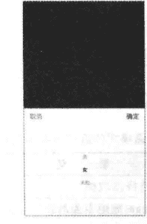

图 4-15 普通选择器的运行效果

选项内容直接取自 range 数组的每一项。若 range 为对象数组，可通过 range-key 指定展示字段。例如修改 data：

```
data: {
  data:["男","女","未知"],
  data2:[{
    key:"boy",
    value:"男"
  },{
    key: "girl",
    value: "女"
  }],
  index:0
},
```

修改 wxml：

```
<!--pages/picker/picker.wxml-->
<picker mode="selector" value='{{index}}' range='{{data2}}' range-key='key' bindchange='change'>
选择性别：{{data2[index]["key"]}}
</picker>
```

运行代码，效果如图 4-16 所示。


图 4-16 用对象属性作为选项的值

普通模式选择器的常用属性如表 4-13 所示。

表 4-13 普通模式的选择器组件的常用属性

| 属性名 | 意义 | 值 |
|---|---|---|
| range | 选项数据源 | 数组 |
| range-key | 对象数组时指定展示的字段 | 字符串 |
| value | 当前选中项的下标 | 数值 |
| bindchange | 选中项改变时回调 | 函数 |
| disabled | 是否禁用 | 布尔值 |
| bindcancel | 点击取消按钮时回调 | 函数 |

### 4.3.2 多列选择器
普通选择器仅支持单列，多列场景如省市联动需要 picker 提供多列模式。设置 mode 为 multiSelector 即可。

在 picker.js 中添加省市数据和默认选中标记，示例代码如下：

city:[
  ["省份 1","省份 2"],
  ["城市 1","城市 2"],
],
currentCity:[0,1]

数据采用二维数组组织，每一维对应一列选项，currentCity 标记各列默认位置。在 picker.wxml 中添加组件标签，示例代码如下：

```
<picker mode="multiSelector" range='{{city}}' value='{{currentCity}}' bindchange='changeCity'>
  地址选择：{{city[0][currentCity[0]]}},{{city[1][currentCity[1]]}}
</picker>
```

运行代码，效果如图 4-17 所示。


图 4-17 多列选择器的运行效果

多列模式选择器的常用属性如表 4-14 所示。

表 4-14 多列模式下的选择器组件的常用属性

| 属性名 | 意义 | 值 |
|---|---|---|
| range | 数据源，二维数组 | 二维数组 |
| range-key | 对象数据时指定展示字段 | 字符串 |
| value | 各列选中位置组成的数组 | 数组 |
| bindchange | 整体值改变时回调 | 函数 |
| bindcolumnchange | 单列值改变时回调 | 函数 |
| bindcancel | 点击取消时回调 | 函数 |
| disabled | 是否禁用组件 | 布尔值 |

### 4.3.3 时间选择器
时间选择器用于选择时分，设置 picker 的 mode 为 time 即可，示例代码如下：

```
<picker mode="time">
时间选择
</picker>
```

运行代码，效果如图 4-18 所示。


图 4-18 时间选择器的运行效果

时间模式选择器的常用属性如表 4-15 所示。

表 4-15 时间模式下的选择器组件的常用属性

| 属性名 | 意义 | 值 |
|---|---|---|
| value | 当前时间，格式 hh:mm | 字符串 |
| start | 可选起始时间，格式 hh:mm | 字符串 |
| end | 可选结束时间，格式 hh:mm | 字符串 |
| bindchange | 值变化时回调 | 函数 |
| bindcancel | 点击取消时回调 | 函数 |
| disabled | 是否禁用 | 布尔值 |

### 4.3.4 日期选择器
日期选择器提供年、月、日的选择，与时间选择器用法相近，设置 mode 为 date 即可，示例代码如下：

```
<picker mode="date">
日期选择器
</picker>
```

运行代码，效果如图 4-19 所示。

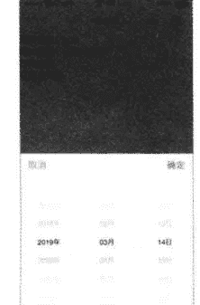

图 4-19 日期选择器的运行效果

日期选择器的常用属性如表 4-16 所示。

表 4-16 日期选择器的常用属性

| 属性名 | 意义 | 值 |
|---|---|---|
| value | 当前日期，格式 YYYY-MM-DD | 字符串 |
| start | 可选起始日期，格式 YYYY-MM-DD | 字符串 |
| end | 可选结束日期，格式 YYYY-MM-DD | 字符串 |
| fields | 选择粒度 | 可选值：year 年；month 年月；day 年月日 |
| bindchange | 值改变时回调 | 函数 |
| bindcancel | 点击取消时回调 | 函数 |
| disabled | 是否禁用 | 布尔值 |

### 4.3.5 地区选择器
在多列选择器的基础上，小程序内置了地区选择模式。将 mode 设为 region 即可直接使用，示例代码如下：

```
<picker mode="region" fields="year">
地区选择
</picker>
```

运行代码，效果如图 4-20 所示。


图 4-20 地区选择器的运行效果

地区选择器的常用属性如表 4-17 所示。

表 4-17 地区选择器的常用属性

| 属性名 | 意义 | 值 |
|---|---|---|
| value | 当前已选中的省市区文本，按列顺序填入数组 | 数组 |
| custom-item | 为每一列顶部插入自定义项，例如“暂不选择” | 字符串 |
| bindchange | 组件值发生变化时执行的回调 | 函数 |
| bindcancel | 用户点击取消按钮时执行的回调 | 函数 |
| disabled | 是否进入不可用状态 | 布尔值 |

## 4.3.6 选择器视图

前面提到 picker 是一个系统弹窗。框架里还提供了可以直接嵌入页面的滚动选择视图 picker-view。

picker-view 会一直展示在页面上，只能容纳 picker-view-column 子元素。picker-view-column 代表一列选择器，可以直接放置任意节点，也可以循环渲染一组选项。示例代码如下：

```
<!--pages/picker-view/picker-view.wxml-->
<picker-view style='height:200rpx;'>
  <picker-view-column>
    <icon type='warn'></icon>
    <view>哈哈</view>
    <view>哈哈哈</view>
  </picker-view-column>
  <picker-view-column>
    <view>你</view>
    <view>你好</view>
    <view>你好啊</view>
  </picker-view-column>
</picker-view>
```

运行代码，效果如图 4-21 所示。


图 4-21 自定义选择器视图的运行效果

picker-view 常用配置整理在表 4-18。

表 4-18 picker-view 组件的常用属性

| 属性名 | 意义 | 值 |
|---|---|---|
| value | 各列当前选中项的下标，封装成数组 | 元素为数值的数组 |
| indicator-style | 选中框的样式定义 | 字符串 |
| indicator-class | 选中框使用的类名 | 字符串 |
| mask-style | 遮罩层的样式定义 | 字符串 |
| mask-class | 遮罩层使用的类名 | 字符串 |
| bindchange | 选中值改变时的回调 | 函数 |
| bindpickstart | 开始拖拽时的回调 | 函数 |
| bindpickend | 结束拖拽时的回调 | 函数 |

## 第 5 章

## 高级视图组件

第 4 章借助基础组件拼装了简单的页面。本章聚焦界面开发的高级能力，涵盖页面跳转相关的导航组件，以及图片、音频、视频、相机等多媒体组件，并演示如何用画布实现自定义绘制。

本章大部分组件依赖原生能力，掌握后小程序界面开发进入收尾阶段，后续实战会综合运用这些组件构建更复杂的界面。

## 5.1 导航组件

先明确导航的概念。导航负责管理页面间的跳转逻辑。小程序里有两种跳转方式：通过导航组件在用户交互时触发跳转；通过 JS 调用系统 API 直接跳转。

## 5.1.1 navigator 导航组件

继续使用第 4 章的测试工程，新建 navigator 页面，写入如下测试代码：

```
<!--pages/navigator/navigator.wxml-->
<navigator url='/pages/switch/switch'>
跳转到 switch 界面
</navigator>
```

页面上会出现一个导航控件，点击后会进入另一个测试页面。url 属性需要填写目标页面的相对路径。

navigator 组件常用属性见表 5-1。

表 5-1 navigator 组件的常用属性

| 属性名 | 意义 | 值 |
|---|---|---|
| target | 跳转的目标类型 | 可选值：self，打开当前小程序页面；miniProgram，打开其他小程序页面 |
| url | 当前小程序内页面的跳转路径 | 字符串 |
| open-type | 跳转的具体方式 | 字符串 |
| delta | 回退的层数 | 当 open-type 为 navigateBack 时生效 |
| app-id | 目标小程序的 AppID | 字符串，target 为 miniProgram 时有效 |
| path | 目标小程序的页面路径 | 字符串 |
| extra-data | 向目标小程序传递的数据 | 对象 |
| version | 目标小程序的版本 | 可选值：develop，trial，release |
| bindsuccess | 跳转其他小程序成功后的回调 | 函数 |
| bindfail | 跳转其他小程序失败后的回调 | 函数 |
| bindcomplete | 跳转其他小程序结束后的回调 | 函数 |

注意 extra-data 只有在 target 为 miniProgram 时才起作用，接收方可在 app.js 的 onLaunch 和 onShow 中读取。

若要拥有跨小程序跳转能力，需在 app.json 中配置 navigateToMiniProgramAppIdList，将允许跳转的 AppID 写入，最多 10 个。

## 5.1.2 导航跳转方式

open-type 可选值如表 5-2。

表 5-2 open-type 属性可配置的值

| 值 | 意义 |
|---|---|
| navigate | 按栈压入跳转，可返回，导航栈上限 10 层 |
| redirectTo | 关闭当前页打开新页 |
| switchTab | 切换到 tabBar 页面 |
| reLaunch | 关闭所有页面后打开指定页 |
| navigateBack | 关闭当前页返回上一层 |
| exit | 关闭小程序，target="miniProgram" 时生效 |

switchTab 是唯一能切换标签页的方式，其他方式无法打开 tabBar 页面。标签页通过 app.json 中的 tabBar 字段配置，数量为 2~5 个。示例配置如下：

```
"tabBar": {
  "list": [{
    "pagePath":"pages/index/index",
    "text": "index"
  },{
    "pagePath": "pages/switch/switch",
    "text": "switch"
  }]
}
```

tabBar 的具体说明在配置文件章节已有介绍，这里不再展开。

## 5.2 多媒体相关组件

小程序组件可提供多媒体服务，如用 image 展示图片、用 audio 播放音频、用 video 播放视频等。这些组件多为原生实现，体验更流畅。

## 5.2.1 image 组件

image 用于渲染图片，并提供缩放与裁剪能力。在测试工程新建 image 页面，代码如下：

```
<!--pages/image/image.wxml-->
<image src='../../../img.png' mode='aspectFit'></image>
```

image 既可加载本地资源也可在线加载，建议线上加载以减小包体积。src 必须正确。运行效果如图 5-1。

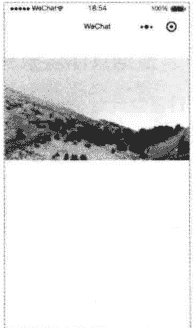

图 5-1 image 组件的运行效果

图片加载过程可通过表 5-3 的事件监听。

表 5-3 image 组件绑定事件

| 属性名 | 意义 | 值 |
|---|---|---|
| binderror | 加载失败时的回调 | 函数 |
| bindload | 加载完成时的回调，会带真实尺寸 | 函数 |

mode 控制缩放裁剪，见表 5-4。

表 5-4 image 组件的裁剪模式

| 值 | 意义 |
|---|---|
| scaleToFill | 不保留比例，按容器尺寸拉伸 |
| aspectFit | 保留比例，完整显示 |
| aspectFill | 保留比例，填满容器并裁剪溢出 |
| widthFix | 保留比例，宽度固定高度自适应 |
| top | 不缩放，顶部对齐 |
| bottom | 不缩放，底部对齐 |
| center | 不缩放，居中显示 |
| left | 不缩放，左侧对齐 |
| right | 不缩放，右侧对齐 |
| top left | 不缩放，左上对齐 |
| top right | 不缩放，右上对齐 |
| bottom left | 不缩放，左下对齐 |
| bottom right | 不缩放，右下对齐 |

性能优化可使用 lazy-load，布尔值，true 时图片进入可视区前不加载，视场景选用。

## 5.2.2 audio 组件

audio 用于播放音频，通常配合 AudioContext 使用。组件负责展示和交互，AudioContext 负责播放控制。

新建 audio 测试页，audio.wxml：

```
<!--pages/audio/audio.wxml-->
<view style='width:100%;text-align:center'>
<audio
id='song' src='http://m10.music.126.net/20190320160357/65fc4358a24f83063190476462270b36/ymusic/0ded/5c5c/5913/f85afb68ada73be4803e46de121d7163.mp3'
controls='{{true}}'
poster='http://p2.music.126.net/Gr1x5yxkVwq7ECx083UsCA==/1868839139134884.jpg?param=300x300'
name='流行音乐'
author='歌手'></audio>
</view>
```

必须设置 id，在 audio.js 的 onLoad 中创建上下文：

```
onLoad: function (options) {
    var audio = wx.createAudioContext("song");
    audio.play();
}
```

wx.createAudioContext 接受组件 id，返回的上下文可控制播放，示例中页面加载后自动播放网络音频。

运行效果如图 5-2，页面加载后开始播放。

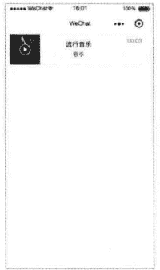

图 5-2 audio 组件的运行效果

注意测试音频来自网络，可能失效，可更换 src。

常用属性见表 5-5。

表 5-5 audio 组件的常用属性

| 属性名 | 意义 | 值类型 |
|---|---|---|
| id | 组件标识 | 字符串 |
| src | 音频地址 | 字符串 |
| loop | 是否循环 | 布尔值 |
| controls | 是否显示默认播放器 | 布尔值 |
| poster | 封面图地址 | 字符串 |
| name | 音频标题 | 字符串 |
| author | 作者信息 | 字符串 |
| binderror | 播放出错回调 | 函数 |
| bindplay | 开始播放回调 | 函数 |
| bindpause | 暂停回调 | 函数 |
| bindtimeupdate | 进度更新回调，含当前时长和总时长 | 函数 |
| bindended | 播放结束回调 | 函数 |

播放异常时 binderror 会返回错误码，见表 5-6。

表 5-6 音频异常码

| 异常码 | 意义 |
| --- | --- |
| 1 | 用户禁止资源获取 |
| 2 | 网络异常 |
| 3 | 解码错误 |
| 4 | 资源异常 |

AudioContext 提供的方法见表 5-7。

表 5-7 AudioContext 对象可调用的方法

| 方法名 | 参数 | 意义 |
| --- | --- | --- |
| setSrc | 字符串 | 重新设置音频地址 |
| play | 无 | 开始播放 |
| pause | 无 | 暂停播放 |
| seek | 数值 | 从指定秒数开始播放 |

实际项目中常自定义播放器，将 controls 设为 false 隐藏默认视图，用 AudioContext 与自定义控件联动实现完全定制。

### 5.2.3 video 组件

video 用于播放视频，使用方式与 audio 类似，通过上下文控制播放逻辑。新建 video 页面，video.wxml：

```
<!--pages/video/video.wxml-->
<!--创建视频组件-->
<view style='width:100%;text-align:center'>
<video id='video' src='../video.mp4'
controls='{{false}}'
danmu-list='{{msgList}}'
enable-danmu='{{true}}'></video>
</view>
```

示例加入了弹幕功能，初始化代码如下：

```
data: {
    //定义视频组件渲染所需的数据
    msgList: [[
text:"hahahahahah",
    time:1,
    color:'#ff0000'
  }, {
    text: "我是弹幕哦",
    time: 6,
    color: '#00ff00'
  }],
},
```

onLoad 中完成初始化：

```
onLoad: function (options) {
  // 获取视频组件上下文对象
  var video = wx.createVideoContext("video", this);
  // 进行视频播放
  video.play();
  // 对弹幕进行设置
  video.sendDanmu({
    text:"hello",
    color:"#0000ff"
  });
}
```

# 多媒体组件实践指南

示例运行后呈现结果可参见图 5-3。

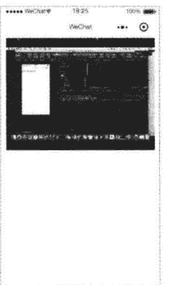

图 5-3 video 组件运行画面

与音频播放单元对比，视频单元的调节维度更多，且自带弹幕展示能力。下面汇总关键配置。

表 5-8 video 组件的常用属性

| 属性名 | 意义 | 值 |
|---|---|---|
| src | 视频资源地址 | 字符串 |
| duration | 总时长 | 数值 |
| controls | 控制栏显示 | 布尔值 |
| danmu-list | 弹幕数据列表 | 数组，其中对象为：{ text:弹幕内容 time:此条弹幕播放的时间 color:此条弹幕的颜色 } |
| danmu-btn | 弹幕按钮可见性 | 布尔值 |
| enable-danmu | 弹幕功能开关 | 布尔值 |
| autoplay | 自动播放开关 | 布尔值 |
| loop | 循环播放开关 | 布尔值 |
| muted | 静音开关 | 布尔值 |
| initial-time | 起始播放秒数 | 数值，单位为 s |
| direction | 全屏旋转角度 | 可选值：0，正常竖向；90，逆时针旋转 90°；-90，顺时针旋转 90° |
| show-progress | 进度条显示 | 布尔值 |
| show-fullscreen-btn | 全屏按钮显示 | 布尔值 |
| show-play-btn | 播放按钮显示 | 布尔值 |
| show-center-play-btn | 中央播放按钮显示 | 布尔值 |
| enable-progress-gesture | 进度拖拽手势开关 | 布尔值 |
| object-fit | 填充模式 | 可选值：contain，包含方式；fill，充满方式；cover，覆盖方式 |
| poster | 封面图片地址 | 字符串 |
| show-mute-btn | 静音按钮显示 | 布尔值 |
| title | 视频标题文本 | 字符串 |
| play-btn-position | 播放按钮位置 | 可选值：bottom，底部；center，中心 |
| enable-play-gesture | 播放手势开关 | 布尔值 |
| auto-pause-if-navigate | 页面切换自动暂停开关 | 布尔值 |
| auto-pause-if-open-native | 原生页面打开自动暂停开关 | 布尔值 |
| vslide-gesture | 非全屏亮度音量手势开关 | 布尔值 |
| vslide-gesture-in-fullscreen | 全屏亮度音量手势开关 | 布尔值 |
| bindplay | 播放开始回调 | 函数 |
| bindpause | 暂停回调 | 函数 |
| bindended | 播放结束回调 | 函数 |
| bindtimeupdate | 时间更新回调 | 函数 |
| bindfullscreenchange | 全屏变化回调 | 函数 |
| bindwaiting | 缓冲回调 | 函数 |
| bindererror | 播放错误回调 | 函数 |
| bindprogress | 加载进度回调 | 函数 |

该单元支持主流编码格式，操控思路与音频单元相近，均可通过 VideoContext 对象进行控制。可调用方法如下。

表 5-9 VideoContext 对象可调用的方法

| 方法名 | 参数 | 意义 |
|---|---|---|
| play | 无 | 启动播放 |
| pause | 无 | 暂停播放 |
| stop | 无 | 停止播放 |
| seek | 数值 | 跳转播放位置 |
| sendDanmu | 弹幕对象：{ text:内容 color:颜色 } | 发送弹幕 |
| playbackRate | 数值：0.5、0.8、1.9、1.25、1.5 | 播放速率 |
| requestFullScreen | 视频方向：0，正常竖向；90，逆时针旋转 90°；-90，顺时针旋转 90° | 请求全屏 |
| exitFullScreen | 无 | 退出全屏 |
| showStatusBar | 无 | 显示状态栏，只在 iOS 全屏模式下有效 |
| hideStatusBar | 无 | 隐藏状态栏，只在 iOS 全屏模式下有效 |

### 5.2.4 camera 组件

camera 组件用于调起设备相机，可实现拍照、录像、扫码等定制化多媒体功能。新建名为 camera 的测试页，写入如下代码：

```
<!--pages/camera/camera.wxml-->
<!--定义外层容器-->
<view style='width:100%;height:400rpx;text-align:center'>
<!--定义相机组件-->
<camera style='width:100%;height:80%'></camera>
</view>
```

首次调用会触发系统授权提示，授权通过后页面即可展示实时取景。典型配置如下。

表 5-10 camera 组件的常用属性

| 属性名 | 意义 | 值 |
|---|---|---|
| mode | 工作模式 | 可选值: normal, 正常录制模式; scanCode, 扫码模式 |
| device-position | 镜头选择 | 可选值: front, 使用前置摄像头; back, 使用后置摄像头 |
| flash | 闪光灯模式 | 可选值: auto, 自动选择; on, 开启闪光灯; off, 关闭闪光灯 |
| bindstop | 异常退出回调 | 函数 |
| bindererror | 权限拒绝回调 | 函数 |
| bindscancode | 扫码成功回调 | 函数 |

该组件依赖上下文对象进行操控，一个页面内仅允许存在一个 camera 实例，无需额外标注 id，示例代码如下：

```
onLoad: function (options) {
  //获取 camera 组件上下文对象
  var camera = wx.createCameraContext(this);
  //进行截图
  camera.takePhoto({
    success:function(res){
      console.log(res);
    }
  });
}
```

通过 wx.createCameraContext 创建 CameraContext 上下文对象，可操作方法如下表。

表 5-11 CameraContext 对象可调用的方法

| 方法名 | 参数 | 意义 |
|---|---|---|
| takePhoto | 配置对象: { quality:设置拍摄质量(可选 high、normal、低) success:拍摄成功回调的函数,其中会传入图片的临时路径 fail:拍摄失败回调的函数 complete:拍摄完成回调的函数 } | 拍照 |
| startRecord | 配置对象： { timeoutCallback:设置超时的回调函数 success:设置视频录制成功的回调函数 fail:设置视频录制失败的回调函数 complete:设置视频录制完成的回调函数 } | 开始录像 |
| stopRecord | 配置对象： { success:设置视频录制成功的回调函数 fail:设置视频录制失败的回调函数 complete:设置视频录制完成的回调函数 } | 停止录像 |

### 5.2.5 直播相关组件

小程序提供直播能力组件，可快速搭建复杂直播场景。使用直播功能需满足类目要求，目前开放给社交、教育、医疗、金融、汽车、政务主体及工具类。

审核通过后，在小程序后台 开发 → 接口设置 中开启直播权限。直播由录制端与观看端组成，录制端使用 live-pusher 推送码流，观看端使用 live-player 拉取码流播放。

live-pusher 调用前需获取摄像头与录音授权，常用配置如下。

表 5-12 live-pusher 组件的常用属性

| 属性名 | 意义 | 值 |
|---|---|---|
| url | 推流地址 | 字符串 |
| mode | 推流模式 | 可选值：SD，标清；HD，高清；FHD，超清；RTC，实时通话 |
| autopush | 自动推流开关 | 布尔值 |
| muted | 静音开关 | 布尔值 |
| enable-camera | 摄像头开关 | 布尔值 |
| auto-focus | 自动对焦开关 | 布尔值 |
| orientation | 录制方向 | 可选值：vertical，垂直；horizontal，水平 |
| beauty | 美颜强度 | 数值：0～9 |
| whiteness | 美白强度 | 数值：0～9 |
| aspect | 宽高比 | 可选值：3:4；9:16 |
| min-bitrate | 最小码率 | 数值 |
| max-bitrate | 最大码率 | 数值 |
| waiting-image | 等待画面地址 | 字符串 |
| waiting-image-hash | 等待画面哈希 | 字符串 |
| zoom | 变焦开关 | 布尔值 |
| device-position | 摄像头选择 | 可选值：front，前置；back，后置 |
| background-mute | 后台静音开关 | 布尔值 |
| bindstatechange | 推流状态回调 | 函数 |
| bindnetstatus | 网络状态回调 | 函数 |
| binderror | 错误回调 | 函数 |
| bindbgmstart | 背景音乐开始回调 | 函数 |
| bindbgmprogress | 背景音乐进度回调 | 函数 |
| bindbgmcomplete | 背景音乐完成回调 | 函数 |

错误码定义见下表。

表 5-13 错误码的定义

| 错误码 | 意义 |
|---|---|
| 10001 | 摄像头权限被禁止 |
| 10002 | 录音权限被禁止 |
| 10003 | 背景音乐加载出错 |
| 10004 | 等待画面加载出错 |

状态码说明如下。

表 5-14 状态码的定义

| 状态码 | 意义 |
|---|---|
| 1001 | 已连上推流服务器 |
| 1002 | 握手完成开始推送 |
| 1003 | 摄像头打开成功 |
| 1004 | 录屏功能启动成功 |
| 1005 | 正在调整分辨率 |
| 1006 | 正在调整码率 |
| 1007 | 首帧采集完毕 |
| 1008 | 编码器已启动 |
| -1301 | 摄像头打开失败 |
| -1302 | 麦克风打开失败 |
| -1303 | 视频编码出错 |
| -1304 | 音频编码出错 |
| -1305 | 分辨率不支持 |
| -1306 | 采样率不支持 |
| -1307 | 网络连接中断 |
| -1308 | 录屏启动失败 |
| -1309 | 录屏过程中出错 |
| -1310 | 录屏被中断 |
| -1311 | 未捕获到音频 |
| -1312 | 横竖屏切换出错 |
| 1101 | 网络质量较差 |
| 1102 | 网络中断尝试重连 |
| 1103 | 硬编失败转软编 |
| 1104 | 编码过程失败 |
| 1105 | 美颜功能启动失败 |
| 1106 | 美颜资源加载失败 |
| 3002 | 无法连接服务器 |
| 3303 | 服务器握手失败 |
| 13004 | 服务器主动断开连接 |
| 3005 | 数据读写失败 |

网络状态字段如下。

表 5-15 网络状态信息中定义的属性

| 属性名 | 意义 |
|---|---|
| videoBitrate | 视频码率 |
| audioBitrate | 音频码率 |
| videoFPS | 视频帧频 |
| videoGOP | GOP 间隔 |
| netSpeed | 当前网速 |
| netJitter | 网络抖动程度 |
| videoWidth | 画面宽度 |
| videoHeight | 画面高度 |

通过 wx.createLivePusherContext 可获取当前页面的 LivePusherContext 上下文对象，用以控制推流组件。可调用的方法见下表。

表 5-16 LivePusherContext 上下文对象可调用的方法

| 方法名 | 参数 | 意义 |
|---|---|---|
| start | { success:方法调用成功 fail:方法调用失败 complete:方法调用完成 } | 开始推流 |
| stop | { success:方法调用成功 fail:方法调用失败 complete:方法调用完成 } | 停止推流 |
| pause | { success:方法调用成功 fail:方法调用失败 complete:方法调用完成 } | 暂停推流 |
| resume | { success:方法调用成功 fail:方法调用失败 complete:方法调用完成 } | 恢复推流 |
| switchCamera | { success:方法调用成功 fail:方法调用失败 complete:方法调用完成 } | 切换镜头 |
| playBGM | { success:方法调用成功 fail:方法调用失败 complete:方法调用完成 url:背景音乐地址 } | 播放背景音乐 |
| snapshot | { success:方法调用成功 fail:方法调用失败 complete:方法调用完成 url:背景音乐地址 } | 截取快照 |
| stopBGM | { success:方法调用成功 fail:方法调用失败 complete:方法调用完成 url:背景音乐地址 } | 停止背景音乐 |
| pauseBGM | { success:方法调用成功 fail:方法调用失败 complete:方法调用完成 url:背景音乐地址 } | 暂停背景音乐 |
| resumeBGM | { success:方法调用成功 fail:方法调用失败 complete:方法调用完成 url:背景音乐地址 } | 恢复背景音乐 |
| setBGMVolume | { success:方法调用成功 fail:方法调用失败 complete:方法调用完成 volume:设置音量为 0~1 } | 设置背景音乐音量 |

live-player 用于拉取直播流地址播放，使用方式与视频组件基本一致。常用参数汇总如下。

表 5-17 live-player 组件的常用属性

| 属性名 | 意义 | 值 |
|---|---|---|
| src | 播放地址 | 字符串 |
| mode | 播放模式 | 可选值：Live，直播；RTC，实时语音 |
| autoplay | 自动播放开关 | 布尔值 |
| muted | 静音开关 | 布尔值 |
| orientation | 播放方向 | 可选值：vertical，垂直；horizontal，水平 |
| object-fit | 填充方式 | 可选值：contain，包含；fillCrop：充满 |
| background-mute | 后台静音开关 | 布尔值 |
| min-cache | 最小缓存 | 数值 |
| max-cache | 最大缓存 | 数值 |
| sound-mode | 音频输出方式 | 可选值：speaker，扬声器；ear，听筒 |
| auto-pause-if-navigate | 页面切换暂停开关 | 布尔值 |

| auto-pause-if-open-native | 设置跳转到其他原生页面时是否静音 | 布尔值 |

| bindstatechange | 设置播放状态变化时的回调函数 | 函数 |

| bindfullscreenchange | 设置全屏模式发生变化时的回调函数 | 函数 |

| bindnetstatus | 设置网络状态发生变化时的回调函数 | 函数 |

要操作本页面的直播播放器，需先通过 wx.createLivePlayerContext 生成 LivePlayerContext 实例，后续的所有播放指令都由该实例承载，调用清单参考表 5-18。

表 5-18 LivePlayerContext 上下文对象可调用的方法

| 方法名 | 参数 | 意义 |

|---|---|---|

| stop | { success:方法调用成功 fail:方法调用失败 complete:方法调用完成 } | 停止播放 |

| mute | { success:方法调用成功 fail:方法调用失败 complete:方法调用完成 } | 静音播放 |

| pause | { success:方法调用成功 fail:方法调用失败 complete:方法调用完成 } | 暂停播放 |

| resume | { success:方法调用成功 fail:方法调用失败 complete:方法调用完成 } | 恢复播放 |

| requestFullScreen | { success:方法调用成功 fail:方法调用失败 complete:方法调用完成 direction:设置全屏方向 } | 进入全屏模式 |

| exitFullScreen | { success:方法调用成功 fail:方法调用失败 complete:方法调用完成 } | 退出全屏模式 |

自建直播链路涉及推流、鉴权、调度等，研发成本和维护压力都较大。若追求快速上线，接入成熟的第三方 PaaS 更省事，腾讯云直播是常用方案。

https://cloud.tencent.com/

微信扫码登录后完成实名认证并开通云直播，进入控制台辅助工具即可进行推流域名与播放域名的设定，配置页示意如图 5-4。

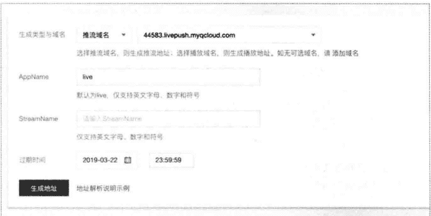

图 5-4 进行直播服务域名配置

域名生效后，将系统生成的推流地址与播放地址填入小程序对应组件，即可实现直播能力。

## 5.3 地图组件

小程序自带的 map 组件具备较强的可定制能力，能够满足绝大多数场景下的地图展示需求。

### 5.3.1 map 组件的应用

map 组件可依据经纬度将对应区域渲染，并在图面叠加点位、折线、多边形等覆盖物。

在工程中新增 map 页面，map.wxml 的结构如下：

```
<!--pages/map/map.wxml-->
<view style='width:100%;height:400rpx;text-align:center'>
<map style='width:100%' longitude='106' latitude='37' scale='6' markers='{{marks}}' polyline='{{polyline}}'></map>
</view>
```

结构中 markers 用来描述点位，polyline 用来绘制线段。对应的数据源写在 map.js 里，示例如下：

微信小程序开发实战

```
data: {
  //定义地图的标记点
  marks:[
    {
      id:1,
      latitude:37,
      longitude:106,
      title:"我是标记点",
      callout:{
        content:"内容",
        color:"#ff0000",
      },
      label:{
        content:"标签文本",
        color:"#00ff00"
      }
    }
  ],
  polyline:[{
    points:[{
      latitude:37,
      longitude:105
    },{
      latitude: 37,
      longitude: 106
    }],
    color:"#0000ff",
    width:3,
  }],
}
```

map 组件常用的配置项见表 5-19。

表 5-19 map 组件的常用属性

| 属性名 | 意义 | 值 |

|---|---|---|

| longitude | 设置中心经度 | 数值 |

| latitude | 设置中心纬度 | 数值 |

| scale | 设置地图缩放级别，默认 16 | 数值，5～18 |

| markers | 设置地图上的标记点 | 数组 |

| polyline | 向地图上添加线路 | 数组 |

| polygons | 向地图上添加多边形 | 数组 |

| circles | 向地图上添加圆形 | 数组 |

| include-points | 缩放地图,让指定的标记点显示在视野内 | 数组 |

| show-location | 是否标记当前定位的位置 | 布尔值 |

| subkey | 个性化地图的 key | 字符串 |

| enable-3D | 是否显示 3D 建筑模型 | 布尔值 |

| show-compass | 是否显示指南针 | 布尔值 |

续表

| 属性名 | 意义 | 值 |

|---|---|---|

| enable-overlooking | 是否开启俯视 | 布尔值 |

| enable-zoom | 设置是否支持缩放 | 布尔值 |

| enable-scroll | 设置是否支持拖动 | 布尔值 |

| enable-rotate | 设置是否支持旋转 | 布尔值 |

| bindmarkertap | 设置单击标记点时触发的回调函数,传入的参数中会封装标记点的 id 值 | 函数 |

| bindcallouttap | 设置单击气泡时触发的回调函数,传入的参数中会封装标记点的 id 值 | 函数 |

| bindregionchange | 设置视野发生变化时的回调函数 | 函数 |

| bindtap | 设置单击地图时触发的回调函数 | 函数 |

| bindupdated | 设置地图渲染完成时的回调函数 | 函数 |

注意：

地图组件是原生组件，如果要向其上添加自定义的视图，需要使用 cover-view 组件进行封装。

### 5.3.2 向地图上添加标记点

markers 属性定义地图上的点位，常用于标记门店位置或用户目标地。该属性接收数组，数组元素为点位对象，可配置字段见表 5-20。

表 5-20 map 组件中标记点可配置的属性

| 属性名 | 意义 | 值 |

|---|---|---|

| id | 设置标记点的 id 值 | 数值 |

| latitude | 设置标记点的纬度 | 数值 |

| longitude | 设置标记点的经度 | 数值 |

| title | 设置标记点的名称 | 字符串 |

| zIndex | 设置标记点的层级 | 数值 |

| iconPath | 设置标记点显示的图标 | 字符串 |

| rotate | 设置旋转角度 | 数值 |

| alpha | 设置透明度 | 数值 |

| width | 设置图标宽度 | 数值 |

| height | 设置图标高度 | 数值 |

| callout | 设置自定义标记上的气泡弹窗 | 对象 |

| label | 设置自定义标记旁边的标签组件 | 对象 |

| anchor | 设置锚点,标记视图在指定经度和纬度的定位位置 | { x:0~1, 确定锚点水平位置 y:0~1, 确定锚点垂直位置 } |

点位点击后弹出的气泡由 callout 控制，可选参数见表 5-21。

表 5-21 关于标记点 callout 窗口的可配置属性

| 属性名 | 意义 | 值 |

|---|---|---|

| content | 设置弹窗上的文本 | 字符串 |

| color | 设置文本颜色 | 颜色值 |

| fontSize | 设置文字大小 | 数值 |

| borderRadius | 设置边框圆角 | 数值 |

| borderWidth | 设置边框宽度 | 数值 |

| borderColor | 设置边框颜色 | 颜色值 |

| bgColor | 设置背景色 | 颜色值 |

| padding | 设置文本与组件的内边距 | 数值 |

| display | 设置显示模式 | 可选值: BYCLICK, 用户单击显示; ALWAYS, 始终显示 |

| textAlign | 设置文本对齐模式 | 可选值: left, 左对齐; right, 右对齐; center, 居中对齐 |

label 用于在点位旁附加文字，相关配置见表 5-22。

表 5-22 标记 label 的相关属性

| 属性名 | 意义 | 值 |

|---|---|---|

| content | 设置内容文本 | 字符串 |

| color | 设置文本颜色 | 颜色值 |

| fontSize | 设置文字大小 | 数值 |

| anchorX | 设置附加视图相对标记的横坐标 | 数值 |

| anchorY | 设置附加视图相对标记的纵坐标 | 数值 |

| borderColor | 设置边框颜色 | 颜色值 |

| padding | 设置内边距 | 数值 |

| textAlign | 设置文本对齐方式 | 可选值: left, 左对齐; right, 右对齐; center, 居中对齐 |

### 5.3.3 向地图上添加线段

polyline 属性以数组形式接收 line 对象，用来在地图上绘制连线，line 的可配置项见表 5-23。

表 5-23 line 对象可配置属性

| 属性名 | 意义 | 值 |

|---|---|---|

| points | 定义线段，数组中定义多组经度和纬度，以此连接这些点来定义线段 | 数组，其中对象为：

{

latitude:纬度

longitude:经度

} |

| color | 设置线段颜色 | 颜色值 |

| width | 设置线段宽度 | 数值 |

| dottedLine | 设置线段是否为虚线 | 布尔值 |

| arrowLine | 设置线段是否带箭头 | 布尔值 |

| arrowIconPath | 设置线段箭头的图标，当 arrowLine 属性为 true 时有效 | 字符串 |

| borderColor | 设置边框颜色 | 颜色值 |

| borderWidth | 设置边框宽度 | 数值 |

### 5.3.4 向地图上添加闭合多边形

polygons 属性可用于圈定区域，例如商圈或禁区。该属性为数组，元素描述多边形轮廓，示例：

```
polygons:[
  {
    //配置线段端点
    points:[{
      latitude: 37,
      longitude: 109
    },{
      latitude: 38,
      longitude: 109
    },{
      latitude: 36,
      longitude: 106
    }],
    //配置线段宽度
    strokeWidth:3,
    //配置闭合图形的填充颜色
    fillColor:'#ff0000',
    //配置线条颜色
    strokeColor:'#00ff00'
  }
]
```

多边形对象的配置见表 5-24。

表 5-24 多边形对象可配置的属性

| 属性名 | 意义 | 值 |

|---|---|---|

| points | 定义围成多边形的坐标点 | 数组，其中对象为：

{

latitude:纬度

longitude:经度

} |

| strokeWidth | 设置线的宽度 | 数值 |

| strokeColor | 设置线的颜色 | 颜色值 |

| fillColor | 设置多边形的填充颜色 | 颜色值 |

| zIndex | 设置图形层级 | 数值 |

### 5.3.5 向地图上添加圆形

circles 属性用于在地图上绘制圆形覆盖物，示例：

```
circles:[
  {
    //设置纬度
    latitude:36,
    //设置经度
    longitude:107,
    //设置线条颜色
    color:'#ff0000',
    //设置填充颜色
    fillColor:'#00ff00',
    //设置半径
    radius:100000,
    //设置线宽
    strokeWidth:1
  }
]
```

圆形对象的参数见表 5-25。

表 5-25 圆形对象可配置的属性

| 属性名 | 意义 | 值 |

|---|---|---|

| latitude | 设置圆心纬度 | 数值 |

| longitude | 设置圆心经度 | 数值 |

| color | 设置线条颜色 | 颜色值 |

| fillColor | 设置填充颜色 | 颜色值 |

| radius | 设置半径 | 数值，单位为 m |

| strokeWidth | 设置线条宽度 | 数值 |

### 5.3.6 MapContext 对象

wx.createMapContext 可获取当前页地图组件的上下文，若页面存在多个地图实例，需传入对应组件的 id 区分。

MapContext 可用方法见表 5-26。

表 5-26 MapContext 对象可调用的方法

| 方法名 | 参数 | 意义 |

|---|---|---|

| getCenterLocation | { success:设置接口调用成功的回调函数 fail:设置接口调用失败的回调函数 complete:设置接口调用完成的回调函数 } | 获取当前地图中心的经度和纬度，在成功的回调函数中将会经度和纬度信息传入 |

| getRegion | { success:设置接口调用成功的回调函数 fail:设置接口调用失败的回调函数 complete:设置接口调用完成的回调函数 } | 获取当前地图的视野范围，成功的回调函数中将会地图东北角与西南角的经度和纬度坐标传入 |

| getScale | { success:设置接口调用成功的回调函数 fail:设置接口调用失败的回调函数 complete:设置接口调用完成的回调函数 } | 获取地图的缩放级别 |

| includePoints | { points:标记经度和纬度坐标组 padding:设置缩放后地图与标记区域的上、右、下、左边距 success:设置接口调用成功的回调函数 fail:设置接口调用失败的回调函数 complete:设置接口调用完成的回调函数 } | 缩放地图展示地图上所有的标记点 |

| moveToLocation | 无 | 将地图移动到当前定位的位置 |

| translateMarker | { markerId:要移动的标记点 id destination:移动到的目标位置，经纬度对象 autoRotate:设置是否自动旋转，布尔值 rotate:设置旋转角度 duration:设置动画时长 animationEnd:设置动画结束后的回调函数 success:设置接口调用成功的回调函数 fail:设置接口调用失败的回调函数 complete:设置接口调用完成的回调函数 } | 对某个标记点进行平移 |

## 5.4 canvas 组件

canvas 组件为小程序提供了自定义绘图的底层能力。当标准组件难以满足复杂视觉需求时，可借助画布进行绘制。

### 5.4.1 使用 canvas 组件

新建 canvas 页面，在 canvas.wxml 中添加如下节点：

```
<!--pages/canvas/canvas.wxml-->
<canvas canvas-id='canvas' style="width: 100%; height: 400px;"></canvas>
```

该节点创建了一个全宽高 400px 的画布。随后通过 CanvasContext 在画布上绘图，示例代码：

```
onLoad: function (options) {
  //获取画布上下文对象
  var context = wx.createCanvasContext("canvas", this);
  //设置填充颜色
  context.fillStyle = '#ff0000';
  //设置要绘制的图形
  context.fillRect(0,0,100,100);
  //进行绘制
  context.draw();
}
```

执行后页面会显示一个 100×100px 的矩形，效果如图 5-5 所示。

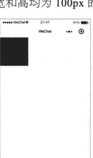

图 5-5 canvas 绘制的矩形

先把 canvas 标签本身可以设定的参数梳理清楚，CanvasContext 的具体使用会在随后章节展开，标签层面的配置汇总在表 5-27。

### 表 5-27 CanvasContext 上下文对象可配置的属性

| 属性名 | 意义 | 值 |

|---|---|---|

| canvas-id | 设置标识符，用来获取 CanvasContext 对象 | 字符串 |

| disable-scroll | 当手指在 canvas 组件内移动，并且 canvas 组件绑定了用户事件时，是否禁止页面滚动 | 布尔值 |

| bindtouchstart | 设置手指触摸开始时的回调函数 | 函数 |

| bindtouchmove | 设置手指移动时的回调函数 | 函数 |

| bindtouchend | 设置手指触摸结束时的回调函数 | 函数 |

| bindtouchcancel | 设置手指触摸动作取消时的回调函数 | 函数 |

| bindlongtap | 设置手指长按触发时的回调函数 | 函数 |

| binderror | 设置发生错误时的回调函数 | 函数 |

### 5.4.2 CanvasContext 上下文对象详解

要完成自定义绘图，核心依赖 CanvasContext 实例。该实例提供了调节画笔表现的属性集合，完整清单参见表 5-28。

### 表 5-28 CanvasContext 上下文对象可调用方法

| 属性名 | 意义 | 值 |

|---|---|---|

| fillStyle | 设置填充颜色 | 颜色值 |

| strokeStyle | 设置边框颜色 | 颜色值 |

| shadowOffsetX | 设置图形阴影在水平方向的偏移量 | 数值 |

| shadowOffsetY | 设置图形阴影在垂直方向的偏移量 | 数值 |

| shadowColor | 设置阴影颜色 | 颜色值 |

| shadowBlur | 设置阴影的模糊级别 | 数值值为 0~100 |

| lineWidth | 设置线条宽度 | 数值 |

| lineCap | 设置线条端点样式 | 可选值：butt，平直；round，圆形；square，正方形 |

| lineJoin | 设置线条的交点样式 | 可选值：bevel，斜角；round，圆角；miter，尖角 |

| lineDashOffset | 设置虚线偏移量 | 数值 |

| font | 设置字体 | CSS 规范的字体字符串 |

| globalAlpha | 设置画笔透明度 | 数值为 0~1 |

除了直接修改上述属性，也可以调用表 5-29 列出的方法在运行时动态调整笔刷。

### 表 5-29 画笔可配置属性

| 方法名 | 参数 | 意义 |

|---|---|---|

| setFillStyle | 颜色值 | 设置填充颜色 |

| setStrokeStyle | 颜色值 | 设置边框颜色 |

| setShadow | offsetX: 水平偏移量

offsetY: 垂直偏移量

blur: 设置模糊级别

color: 阴影颜色 | 设置阴影 |

| setGlobalAlpha | 数值为 0~1 | 设置透明度 |

| setLineWidth | 数值 | 设置线宽 |

| setLineJoin | 字符串 | 设置线交叉点样式 |

| setLineCap | 字符串 | 设置线端点样式 |

| setFontSize | 数值 | 设置文字字号 |

| setTextAlign | 可选值: left, 左对齐; right, 右对齐; center, 居中对齐 | 设置文字对齐方式 |

| setTextBaseline | 可选值: top, 上对齐; bottom, 下对齐; middle, 居中对齐; normal, 默认值 | 设置文字垂直对齐方式 |

笔刷设定完成后，就可以用 CanvasContext 的接口搭建路径，常用的路径创建方法整理在表 5-30。

### 表 5-30 定义图形的方法

| 方法名 | 参数 | 意义 |

|---|---|---|

| beginPath | 无 | 开始创建路径, 调用其他绘制方法前需要先调用这个方法 |

| moveTo | x: 横坐标

y: 纵坐标 | 把路径移动到画布中的某个点 |

| lineTo | x: 横坐标

y: 纵坐标 | 将路径从当前点连接到指定点, 定义一条线段 |

| quadraticCurveTo | cpx: 控制点横坐标

cpy: 控制点纵坐标

x: 结束点横坐标

y: 结束点纵坐标 | 以路径当前点作为起点, 定义一条二次贝塞尔曲线 |

| bezierCurveTo | cpx1: 控制点1 横坐标

cpy1: 控制点1 纵坐标

cpx2: 控制点2 横坐标

cpy2: 控制点2 纵坐标

x: 结束点横坐标

y: 结束点纵坐标 | 以路径当前点作为起点, 定义一条三次贝塞尔曲线 |

| arc | x: 圆心横坐标

y: 圆心纵坐标

r: 半径

sAngle: 起始弧度值

eAngle: 终止弧度值

counterclockwise: 是否逆时针绘制 | 定义圆弧 |

| rect | x: 矩形左上角横坐标

y: 矩形左上角纵坐标

width: 矩形宽度

height: 矩形高度 | 定义矩形 |

| arcTo | x1: 控制点 1 横坐标

y1: 控制点 1 纵坐标

x2: 控制点 2 横坐标

y2: 控制点 2 纵坐标

radius: 半径 | 定义圆弧 |

| closePath | 无 | 进行路径的关闭，之后可以进行绘制 |

表 5-30 负责轮廓搭建，轮廓确定后需要填充或描边才可见，呈现相关的接口见表 5-31。

### 表 5-31 关于绘制定义的相关方法

| 方法名 | 参数 | 意义 |

|---|---|---|

| fill | 无 | 对定义的路径图片进行颜色填充 |

| stroke | 无 | 对定义的路径进行颜色描边 |

| fillText | text: 要填充的文本

x: 左上角横坐标

y: 左上角纵坐标

maxWidth: 最大文本宽度 | 填充文本 |

| strokeText | text: 要描边的文本

x: 左上角横坐标

y: 左上角纵坐标

maxWidth: 最大文本宽度 | 描边文本 |

| fillRect | x: 左上角横坐标

y: 左上角纵坐标

width: 宽度

height: 高度 | 直接进行矩形填充 |

| strokeRect | x: 左上角横坐标

y: 左上角纵坐标

width: 宽度

height: 高度 | 直接进行矩形描边 |

| clear | x: 左上角横坐标

y: 左上角纵坐标

width: 宽度

height: 高度 | 清除某个矩形区域内的填充内容 |

把指令真正输出到画布要借助表 5-32 的方法。

### 表 5-32 进行绘制的方法

| 方法名 | 参数 | 意义 |

|---|---|---|

| draw | reserve: 是否逆向绘制

callback: 绘制完成后的回调函数 | 进行图形绘制 |

| drawImage | imageResource: 图像资源

sx: 裁取原图的左上角横坐标

sy: 裁取原图的左上角纵坐标

swidth: 裁取原图的宽度

sheight: 裁取原图的高度

dx: 绘制的左上角横坐标

dy: 绘制的左上角纵坐标

dwidth: 绘制的宽度

dheight: 绘制的高度 | 进行图像绘制 |

示例代码如下：

```
onLoad: function (options) {
//获取画布上下文对象
var context = wx.createCanvasContext("canvas", this);
//设置填充颜色
context.fillStyle = '#ff0000';
//设置填充图形
context.fillRect(0,0,100,100);
//设置绘制文字的字体大小
context.setFontSize(20);
//设置线条风格
context.setStrokeStyle("#00ff00");
//设置要填充绘制的文字
context.fillText("Hello",100,20,200);
//设置要描边绘制的文字
context.strokeText("World",100,100,200);
//定义绘制的图形
context.arc(200,200,100,3.14,0,0);
//设置填充颜色
context.fill();
//进行绘制
context.draw();
}
```

运行代码，效果如图 5-6 所示。

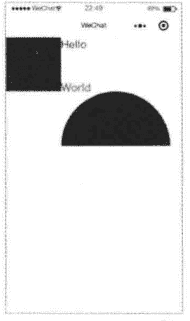

图 5-6 图形绘制

CanvasContext 还支持渐变色构建，实现平滑过渡，相关方法列于表 5-33。

### 表 5-33 CanvasContext 上下文对象创建渐变效果的方法

| 方法名 | 参数 | 意义 |

|---|---|---|

| createLinearGradient | x0: 起点横坐标

y0: 起点纵坐标

x1: 终点横坐标

y1: 终点纵坐标 | 创建线性渐变，会返回一个 CanvasGradient 渐变配置对象，需要对其进行配置 |

| createCircularGradient | x: 圆心横坐标

y: 圆心纵坐标

r: 半径 | 创建圆形渐变，会返回一个 CanvasGradient 渐变配置对象，需要对其进行配置 |

生成的 CanvasGradient 需要借助 addColorStop 分段指定色点，用法见表 5-34。

### 表 5-34 CanvasGradient 对象可调用方法

| 方法名 | 参数 | 意义 |

|---|---|---|

| addColorStop | stop: 设置渐变结束位置

color: 设置颜色 | 进行渐变逐级配置 |

渐变的示例代码如下：

```
//获取画布上下文对象
var context = wx.createCanvasContext("canvas", this);
//创建线性渐变
var gradient = context.createLinearGradient(50,0,50,100);
//创建圆形渐变
var gradient2 = context.createCircularGradient(150,150,50);
//设置渐变的各个节点及渐变颜色
gradient.addColorStop(0.3,'red');
gradient.addColorStop(0.6,'green');
gradient.addColorStop(1.0,'blue');
```

微信小程序开发实战

```
gradient2.addColorStop(0.3, 'red');
gradient2.addColorStop(0.6, 'green');
gradient2.addColorStop(1.0, 'blue');
//设置填充风格线性渐变
context.setFillStyle(gradient);
//设置填充图形
context.fillRect(0,0,100,100);
//设置填充风格圆形渐变
context.setFillStyle(gradient2);
//设置填充图形
context.fillRect(100,100,100,100);
//进行绘制
context.draw();
```

运行代码，效果如图 5-7 所示。

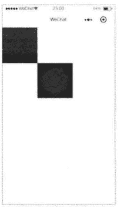

图 5-7 进行渐变绘制

表 5-35 整理了坐标系变换接口，调用后后续绘制均以新的坐标系为准。

### 表 5-35 CanvasContext 上下文对象进行转换的相关方法

| 方法名 | 参数 | 意义 |

|---|---|---|

| scale | x: 横坐标缩放比例

y: 纵坐标缩放比例 | 进行坐标系缩放 |

| rotate | rotate: 旋转弧度 | 进行坐标系旋转 |

| translate | x: 横坐标平移

y: 纵坐标平移 | 进行坐标系平移 |

## 第 6 章

## 自定义组件

第 3 章至第 5 章已介绍组件库中常用的基础组件。界面开发本质上是拆分、组合与封装，再复杂的页面也能先拆解成若干模块分别实现再整合。

本章聚焦更进阶的能力：自定义组件。虽然官方组件已很丰富，但每个产品都有其独特性，定制化功能或页面时就需要借助自定义组件技术。

### 6.1 创建自定义组件

微信开发者工具对开发者很友好，内置了快速生成自定义组件模板的功能。第 2 章讲 WXML 时提到过模板复用，template 或 import 可以把片段搬到当前文件，但这与真正的自定义组件不同，后者会产生一个全新的组件，封装性更强，也更符合面向对象思路。

### 6.1.1 创建自定义组件模板

先在测试工程中新建 components 文件夹，统一存放自定义组件。在该文件夹下新建 custom-button 目录，右键选择“新建 Component”，示意如图 6-1。

将组件命名为 custom-button，此时目录结构如图 6-2。

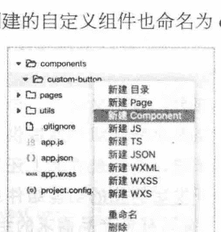

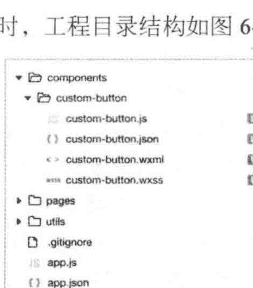

从图 6-2 可见，自定义组件的文件构成与页面类似，都包含 JS、JSON、WXML、WXSS。

JS 负责逻辑与数据，JSON 负责组件级配置并可引用其他组件，WXML 描述视图结构，WXSS 负责样式。下面通过一个简单示例演示完整流程。

首先在 custom-button.wxml 中编写如下结构：

```
<!--components/custom-button/custom-button.wxml-->
<!--按钮边框-->
<view class='border' bindtap='tap'>
<!--按钮图标-->
<icon size='25' type='info' color='white'></icon>
<!--按钮文本-->
<text>查看详情</text>
</view>
```

该结构由图标和按钮组成。接着在 custom-button.wxss 中添加样式：

```
/*components/custom-button/custom-button.wxss*/
.border {
  background-color: green;
  border-radius: 5px;
  color: white;
  text-align: center;
  height: 50px;
  width: 140px;
  padding: 0px;
  justify-content: center;
  display: flex;
  align-items: center;
}
icon {
  display: inline-block;
}
text {
  height: 50px;
  line-height: 50px;
  display: inline-block;
  margin-left: 10px;
}
```

最后在 custom-button.js 中补充按钮点击的回调：

```
//components/custom-button/custom-button.js
Component({
  /**
   *组件的方法列表
   */
  methods: {
    tap:function(){
      console.log("按钮单击啦！");
    }
  }
})
```

至此最基础的自定义组件已完成。随后在 pages 文件夹下新建 custom 测试页面，并在 custom.json 中声明依赖：

{

  "usingComponents": {

    "custom-button":"/components/custom-button/custom-button"

  }

}

注意路径必须正确，配置完成后即可在 custom.wxml 中直接使用 custom-button，示例代码如下：

```
<!--pages/custom/custom.wxml-->
<custom-button></custom-button>
```

运行后效果如图 6-3 所示。

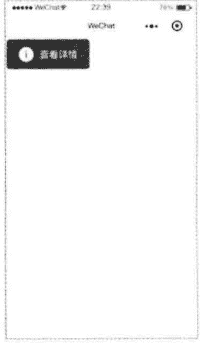

图 6-3 自定义组件的运行效果

### 6.1.2 插槽让弹窗内容可灵活注入

插槽本质上是组件向外部开放的挂载位。真实项目里弹窗的外观往往要统一，却又希望每次调用的内容不一样，这时就适合把弹窗壳子做成可复用组件，具体的文案、图标等交给使用方通过插槽塞进来。

先在实验工程的 components 目录下建一个 custom-alert 组件。打开 custom-alert.wxml，把弹窗骨架先搭出来：

```
<!--components/custom-alert/custom-alert.wxml-->
<view class='alert'>
<view class='container'>
<text>温馨提示</text>
<!--这里定义了插槽-->
<slot></slot>
<view class='buttons'><text class='btn1'>好的</text><text class='btn2'>取消</text></view>
</view>
</view>
```

这段结构定义了弹窗的整体布局，中间留了一个 slot 标签，使用方传入的节点就会被渲染到这里。样式部分写在 custom-alert.wxss 里：

```
/*components/custom-alert/custom-alert.wxss*/
/*警告框样式定义*/
.alert {
  width: 100%;
  display: flex;
  flex-direction: column;
  align-items: center;
}
/*外层容器样式定义*/
.container {
  width:70%;
  text-align: center;
  background-color: wheat;
  box-shadow: gainsboro 0px 0px 25px;
  margin-top: 20px;
  display: flex;
  flex-direction: column;
  padding: 0px;
  border-radius: 20px;
}
/*按钮样式定义*/
.buttons {
  display: flex;
  flex-direction: row;
  height: 45px;
  margin-top: 20px;
}
/*文本样式定义*/
.buttons text {
  width: 50%;
  height: 45px;
  padding: 0px;
  border-top: solid 1px gray;
  margin: 0px;
}
.btn1 {
  border-right: solid 1px gray;
}
```

接下来在 custom 页面里做验证，把 custom.wxml 改成下面这样：

```
<!--pages/custom/custom.wxml-->
<custom-button></custom-button>
<custom-alert>
```

## 微信小程序开发实战

```
<icon type='warn' size='50'></icon>
<text>警告类型的弹窗</text>
</custom-alert>
<custom-alert>
<text>纯文本弹窗</text>
</custom-alert>
```

示例里出现了两组弹窗实例，每个实例内部都放进了调用方提供的子节点。第一组是图标加文字，第二组则是纯文字。为了让页面认识 custom-alert，需要在 custom.json 里声明组件路径，改动如下：

```
{
  "usingComponents": {
    "custom-button":"/components/custom-button/custom-button",
    "custom-alert":"/components/custom-alert/custom-alert"
  }
}
```

启动后界面与图 6-4 一致。

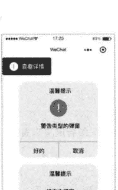

图 6-4 自定义弹窗组件的运行效果

在实际开发中，多复用自定义组件能省不少事。同一套视觉规范下的弹窗、卡片等都可以抽成公共组件，把可变区域用插槽暴露出来，既提效又好维护。

通常一个 slot 足够对外提供插入点，如果需要多处插入，就要给插槽命名。第一步是在组件 JS 里打开多槽支持，写法如下：

```
Component({
  options: {
    multipleSlots: true
  }
})
```

随后给不同位置的 slot 分配 name：

```
<!--components/custom-alert/custom-alert.wxml-->
<view class='alert'>
<view class='container'>
<slot name='top'></slot>
<text>温馨提示</text>
<slot name='content'></slot>
<view class='buttons'><text class='btn1'>好的</text><text class='btn2'>取消</text></view>
</view>
</view>
```

调用方使用时也要指明要填充到哪个具名插槽：

```
<!--pages/custom/custom.wxml-->
<custom-button></custom-button>
<custom-alert>
<text slot="top">顶部组件</text>
<icon type='warn' size='50' slot='content'></icon>
</custom-alert>
<custom-alert>
<text slot="content">纯文本弹窗</text>
</custom-alert>
```

执行后效果如图 6-5。

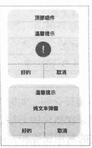

图 6-5 使用多个 slot 插槽

## 6.2 自定义组件的数据与方法绑定

组件既能接收外界传来的参数，也能用内部状态驱动视图。交互类组件比如按钮、弹窗，点击后通常要把结果抛回给页面处理，这就涉及方法的绑定。

### 6.2.1 组件构造器

以之前做的 custom-button 为例，custom-button.js 里自带一个构造器，用来声明属性、方法等。可配置的字段见表 6-1。

### 表 6-1 自定义组件可以配置的属性

| 属性 | 意义 | 值类型 |

|---|---|---|

| properties | 定义外部属性 | 对象 |

| data | 定义组件的内部属性,与页面构造方法中定义页面属性的 data 属性用法相同 | 对象 |

| observers | 设置组件的属性监听器 | 对象 |

| methods | 定义组件所需要的方法 | 对象 |

| created | 生命周期函数,当组件被创建时执行 | 函数 |

| attached | 生命周期函数,当组件进入页面节点树时执行 | 函数 |

| ready | 生命周期函数,当组件布局完成后执行 | 函数 |

| moved | 生命周期函数,当组件在节点树中位置改变时调用 | 函数 |

| detached | 生命周期函数,当组件从节点树中移除时调用 | 函数 |

| behaviors | 进行功能混合 | 数组 |

| relations | 定义组件间关系 | 对象 |

| externalClasses | 定义接收的外部样式类 | 数组 |

| options | 进行组件配置 | 对象 |

| lifetimes | 组件的生命周期对象 | 对象 |

| pageLifetimes | 组件所在页面的生命周期对象 | 对象 |

| definitionFilter | 定义过滤器 | 函数 |

构造完成后会得到一个 JS 组件实例，通过 this 在方法、生命周期、监听器里都能拿到。常用属性和方法见表 6-2、表 6-3。

### 表 6-2 组件对象封装的常用属性

| 属性名 | 意义 | 值类型 |

|---|---|---|

| is | 获取组件的文件路径 | 字符串 |

| id | 获取组件的 id 值 | 字符串 |

| dataset | 获取组件的数据集 | 对象 |

| data | 获取组件的内部数据 | 对象 |

| properties | 获取组件的外部数据 | 对象 |

### 表 6-3 组件对象封装的常用方法

| 方法名 | 意义 | 参数 |

|---|---|---|

| setData | 设置组件内部数据，会触发界面刷新 | 对象 |

| hasBehavior | 获取组件是否混入某个 Behavior 功能 | Behavior 对象 |

| triggerEvent | 触发事件 | name: 事件名

detail: 参数

options: 配置项 |

### 6.2.2 内部状态与外部属性

内部状态支撑组件自身逻辑，一般放在构造器的 data 里。以 custom-button 为例，先给 data 加上：

```
data: {
    buttonColor:'green'
},
```

然后在 custom-button.wxml 里让 buttonColor 决定背景色：

```
<!--components/custom-button/custom-button.wxml-->
<view class='border' bindtap='tap' style='background-color: {{buttonColor}}'>
<icon size='25' type='info' color='white'></icon>
<text>查看详情</text>
</view>
```

tap 方法里切换颜色的写法如下：

```
methods: {
    tap:function(){
        if (this.data.buttonColor == 'green') {
            this.setData({
                buttonColor: 'red'
            });
        } else {
            this.setData({
                buttonColor: 'green'
            });
        }
    }
},
```

点一下按钮就能看到颜色交替。

上面展示了内部状态如何驱动渲染。很多组件还需要外部输入，比如按钮文字通常由调用方指定，这就需要外部属性。

在 properties 里声明外部属性的配置：

## 微信小程序开发实战

```
properties: {
  buttonTitle:{
    type:String,
    value:"按钮",
    observer:function(){
      console.log("按钮标题修改了");
    }
  },
}
```

properties 的键名是外部属性名，值是配置对象，type 规定类型，value 给默认值，observer 在值变化时触发。

在模板里用外部属性渲染标题：

```
<!--components/custom-button/custom-button.wxml-->
<view class='border' bindtap='tap' style='background-color: {{buttonColor}}'>
<icon size='25' type='info' color='white'></icon>
<text>{{buttonTitle}}</text>
</view>
```

使用时直接给组件节点赋值即可：

```
<!--pages/custom/custom.wxml-->
<custom-button button-title="联系客服"></custom-button>
```

运行后可以看到标题变化会触发监听回调，且显示内容来自调用方。

注意点：properties 里的命名和组件内部引用都用驼峰，WXML 标签里赋值时要用连字符分隔的小写形式。

### 6.2.3 通过 dataset 传参

除了 data 和 properties，WXML 还提供 dataset 这种传参方式。组件实例的 dataset 就是一组自定义键值对，可以在节点上挂自定义属性：

```
<!--pages/custom/custom.wxml-->
<custom-button button-title="联系客服" data-name="自定义属性" data-location="上海"></custom-button>
```

这里定义了 data-name 与 data-location，data 是固定前缀，后面是自定义名。组件内部通过 dataset 读取：

```
created:function(){
    console.log(this.dataset);
},
```

运行后控制台会打印：

```
{location: "上海", name: "自定义属性"}
```

### 6.2.4 组件事件派发

事件是组件间通信的主通道，自定义组件的绑定方式和原生组件一致，都是 bind + 事件名。以 custom-alert 为例，点击“好的”或“取消”时需要把事件抛给页面。

先给两个操作按钮加上点击监听：

```
<!--components/custom-alert/custom-alert.wxml-->
<view class='alert'>
<view class='container'>
<slot name='top'></slot>
<text>温馨提示</text>
<slot name='content'></slot>
<view class='buttons'><text class='btn1' bindtap='okClick'>好的</text><text class='btn2' bindtap='cancelClick'>取消</text></view>
</view>
</view>
```

再在 custom-alert.js 里实现 okClick 与 cancelClick：

```
methods: {
    okClick:function(){
        this.triggerEvent("oktap","ok");
    },
    cancelClick:function(){
        this.triggerEvent("canceltap","cancel");
    }
}
```

triggerEvent 就是实例提供的方法，用来派发事件，接收事件名、数据、配置三个参数。配置项见表 6-4。

### 表 6-4 配置对象中可配置的字段

| 字段名 | 意义 | 值类型 |

|---|---|---|

| bubbles | 设置事件是否冒泡 | 布尔值 |

| composed | 设置事件是否穿越组件边界 | 布尔值 |

| capturePhase | 设置事件是否捕获 | 布尔值 |

使用时这样绑定事件：

```
<custom-alert bindoktap="okClick" bindcanceltap="cancelClick">
  <text slot="top">顶部组件</text>
  <icon type='warn' size='50' slot='content'></icon>
</custom-alert>
```

页面里对应的 okClick 与 cancelClick 实现如下：

```
okClick:function(event) {
  console.log(event.detail);//ok
},
cancelClick:function(event){
  console.log(event.detail);//cancel
}
```

执行完上面代码后，打开控制台就能确认，组件间的事件传递与数据交互已经生效。

## 6.3 组件生命周期与行为混入

组件从实例化到销毁，系统会在不同阶段自动调用一组函数，这就是生命周期函数，它们标记了组件运行的关键节点。读懂这些节点，有助于更清晰地把握组件的执行流程。

behaviors 是小程序里用于行为复用的高级机制。我们可以把一些常用逻辑封装成行为对象，需要时直接混入到目标组件中，从而实现功能复用。

### 6.3.1 生命周期函数详解

在整个生命周期里，created 会最先触发，表示实例已经生成。随后进入渲染阶段，组件挂载到页面节点树时 attached 会被调用，这一步很适合做额外的初始化。组件从节点树中移除时 detached 会触发，比如用户退出页面。最直接的理解方式就是写代码实测：

```
var count = 1;
Component({
  //组件被创建
  created:function(){
    console.log(count++,"created");
```

```
},
//组件准备完成
ready:function(){
    console.log(count++, "ready");
},
//准备渲染
attached:function(){
    console.log(count++, "attached");
},
//组件节点被移动
moved:function(){
    console.log(count++, "moved");
},
//移出渲染
detached:function(){
    console.log(count++, "detached");
},
//抛出异常
error:function(){
    console.log(count++, "error");
}
}
```

代码里用 count 做计数器来标注各方法的触发顺序。从页面打开到关闭，必定会走的四步是 created→attached→ready→detached。组件在节点树内移动时会触发 moved，抛出异常时会触发 error。

前面提到构造方法里有 lifetimes 对象，它同样可以用来注册生命周期，写法不同但效果与上方示例一致：

```
//components/custom-button/custom-button.js
var count = 1;
Component({
    lifetimes:{
        created: function () {
            console.log(count++, "created");
        },
        ready: function () {
            console.log(count++, "ready");
        },
        attached: function () {
            console.log(count++, "attached");
        },
        moved: function () {
            console.log(count++, "moved");
        },
        detached: function () {
            console.log(count++, "detached");
        }
},
  error: function () {
    console.log(count++, "error");
  }
}
})
```

需要注意优先级：如果构造方法里和 lifetimes 里同时写了同一生命周期，lifetimes 的定义会覆盖构造方法里的实现。

构造方法中还有 pageLifetimes 字段，用来关联组件所在页面的生命周期，适合需要在页面显示隐藏时做处理的场景。可用的页面生命周期如下表：

表 6-5 pageLifetimes 字段可实现的页面生命周期方法

| 方法名 | 意义 | 参数 |

|---|---|---|

| show | 组件所在页面展示的时候触发 | 无 |

| hide | 组件所在页面隐藏的时候触发 | 无 |

| resize | 组件所在页面尺寸改变时触发 | Size 对象 |

### 6.3.2 如何使用 behaviors 混入

行为混入是提升复用性的技巧，通过 behaviors 把通用功能抽离出来，既能提高复用度，又能快速给组件加能力。比如在组件创建完成后打印时间戳，方便调试。

这只是一个通用需求，如果每个组件都手写打印逻辑，会产生大量重复，逻辑复杂时维护成本更高。

在项目里新建 behaviors 文件夹统一存放行为文件，新建 timelogbehavior.js 并写入如下内容：

```
var behavior = Behavior({
  behaviors: [],//混入其他 behaviors 对象
  //对组件的外部数据进行扩展
  properties: {
    name: {
      type: String,
      value:"logbehavior"
    }
  },
  //对组件的内部数据进行扩展
  data: {
    version:"1.0"
},
//扩展生命周期方法
ready() {
    this.log();
},
//对组件的方法进行扩展
methods: {
    log:function(){
        console.log(this.properties.name,this.data.version,"准备完成",Date());
    }
}
});
module.exports = behavior;
```

文件里注释写得很清楚，该行为主要扩展了组件的外部数据和内部数据，并实现了 ready 生命周期。

在需要打印的组件里混入该行为，示例如下：

```
//components/custom-button/custom-button.js
var count = 1;
const log = require("../../behaviors/timelogbehavior.js");
Component({
    properties: {
        buttonTitle:{
            type:String,
            value:"按钮",
            observer:function(){
                console.log("按钮标题修改了");
            }
        }
    },
    behaviors:[
        log
    ],
    /**
     * 组件的初始数据
     */
    data: {
        buttonColor:'green'
    },
    ready:function(){
        console.log(count++, "ready");
    },
})
```

在组件使用处设置外部数据：

```
<custom-button button-title="联系客服" data-name="自定义属性" data-location="上海" name="客服按钮"></custom-button>
```

跑起来后控制台会输出：

```
客服按钮 1.0 准备完成 Mon Apr 08 2019 22:25:31 GMT+0800 (CST)
1 "ready"
```

此时组件已经具备了 timelogbehavior 中定义的所有数据和方法。行为混入时要遵守三点规则：

- (1) behaviors 的优先级高于组件本身，属性或方法同名时组件会被覆盖。
- (2) 生命周期不会被覆盖，Behavior 中的方法会先执行，再执行组件自己的方法。
- (3) 同名数据若为对象类型，不会直接覆盖，而是进行对象合并。

## 6.4 组件关联与数据监听

很多组件可以独立使用，但也有强制关联的场景，例如 swiper 内部只能使用 swiper-item，二者存在强制的父子关系。自定义组件同样可以声明这种关系。

数据监听器也是组件开发中的高频功能，用于在数据变化时触发相应处理。

### 6.4.1 建立组件间的依赖关系

在 components 目录下新建 custom-list 文件夹，创建两个组件 custom-list 和 custom-list-item，前者作列表容器，后者作列表行。

custom-list-item 仅修改 JS，代码如下：

```
//components/custom-list/custom-list-item.js
Component({
  relations:{
    './custom-list' : {
      type: 'parent',
      linked(target) {
        this.dataset.title="HelloWorld";
      },
      linkChanged(target) {
        console.log("custom-list-item", "linkChanged");
      },
      unlinked(target) {
        console.log("custom-list-item", "unlinked");
      }
}
}
}
})
```

relations 用来声明依赖关系，键是被依赖组件的路径，值是配置项。可配置项见表：

表 6-6 relations 可配置项

| 配置 项 | 意 义 | 值 |

|---|---|---|

| type | 设置依赖类型 | 可选值: parent, 所依赖的组件为父节点; child, 所依赖的组件为子节点; ancestor, 所依赖的组件为祖先节点; descendant, 所依赖的组件为后代节点 |

| linked | 建立依赖关系过程的生命周期函数, 关系建立时触发 | 函数 |

| linkChanged | 建立依赖关系过程的生命周期函数, 关系发生改变时触发 | 函数 |

| unlinked | 建立依赖关系过程的生命周期函数, 组件脱离节点树时触发 | 函数 |

| target | 通过扩展行为建立依赖关系, 可以设置为 Behavior 对象, 则所有混入此 Behavior 对象的组件都会被建立关系 | Behavior 对象 |

custom-list 的 JS 这样写：

```
//components/custom-list/custom-list.js
Component({
  relations: {
    './custom-list-item': {
      type: 'child',
      linked(target) {
        console.log("custom-list", "linked");
      },
      linkChanged(target) {
        console.log("custom-list", "linkChanged");
      },
      unlinked(target) {
        console.log("custom-list", "unlinked");
      }
    },
    ready:function() {
      let node = this.getRelationNodes('./custom-list-item');
      let array = node.map(function (item) {
        return item.dataset.title;
      });
      this.setData({
nodes:array
});
console.log(node);
}
}
```

这样就建立了父子关联。关系建立后，在 ready 里通过 getRelationNodes 就能拿到关联的节点，方法返回一个有序数组。

新建页面 custom-list-page，先在 json 中引入组件：

```
{
  "usingComponents": {
    "custom-list": "/components/custom-list/custom-list",
    "custom-list-item": "/components/custom-list/custom-list-item"
  }
}
```

在 wxml 中做测试渲染：

```
<!--pages/custom-list-page/custom-list-page.wxml-->
<custom-list>
<custom-list-item></custom-list-item>
<custom-list-item></custom-list-item>
<custom-list-item></custom-list-item>
<custom-list-item></custom-list-item>
<text>不是 ITEM 组件</text>
</custom-list>
```

运行后即可看到列表效果。通过 relations 建立关系，也是组件间通信的高效手段。

### 6.4.2 数据监听器实战

数据监听器概念并不陌生，之前介绍外部数据时提到过在字段定义里加 observer，当数据变化时回调。observers 是另一种更通用灵活的监听方式。

以 custom-button 为例，修改 custom-button.js：

```
//components/custom-button/custom-button.js
Component({
  /**
   *组件的属性列表
   */
  properties: {
    buttonTitle:{
      type:String,
      value:"按钮",
observer:function(){
    console.log("按钮标题修改了");
}
},
observers:{
'buttonTitle, buttonColor':function(title, color){
console.log('observers',title, color);
},
'buttonColor': function (color) {
    console.log('observers', color);
},
},
/**
*组件的初始数据
*/
data: {
    buttonColor:'green'
},
/**
*组件的方法列表
*/
methods: {
    tap:function(){
        if (this.data.buttonColor == 'green') {
            this.setData({
                buttonColor: 'red'
            });
        } else {
            this.setData({
                buttonColor: 'green'
            });
        }
    }
},
})
```

observers 可以同时监听多个字段，内部数据和外部数据都能监听，且与字段内部的 observer 不冲突。定义时还支持点语法监听对象属性，或用 ** 通配监听全部数据或对象所有属性，具体如下：

```
observers: {
    'obj.**': function (field) {
        //监听对象所有属性
    },
    '***':function(value) {
        //监听所有数据
    }
},
```

## 第 7 章
## 网络请求与数据存储实战

移动互联网下，联网已经成为应用的基础能力。电商、社区、在线教育、阅读、游戏、音视频、资讯、工具类产品，都离不开网络来推送更新、更丰富的内容。小程序同样如此，框架自带一套完整的网络能力，覆盖数据请求、文件下载与上传、长连接套接字等场景。

数据分两种：强实时的数据放在服务端，用户需要时再拉取；弱实时的数据拉取一次后可以本地缓存，合理使用缓存能明显提升打开速度和体验感。本章聚焦小程序里的网络与存储相关能力。

## 7.1 网络请求实战

网络请求本质是客户端与服务端的信息交换。以资讯类产品为例，页面展示的全部内容都来源于服务端。客户端只负责呈现，发起请求后等待服务端返回，再做渲染和逻辑处理。

### 7.1.1 借助第三方接口快速上手

要和服务端通信，先要有数据来源。自建后台成本高，学习阶段可以直接用公开的免费接口。

天行数据就提供了一批常用接口，涵盖新闻、天气、股票等。新用户注册后可获得 10 000 次免费调用额度，足够练习。

首页罗列了各类接口，右上角有登录注册入口，如图 7-1 所示。
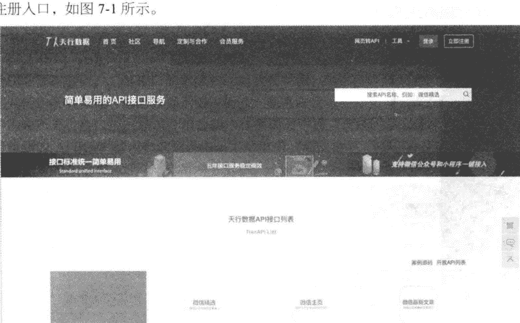

图 7-1 天行数据网站首页

未开通账号时需要先注册，填昵称、有效邮箱和密码即可完成，如图 7-2 所示。
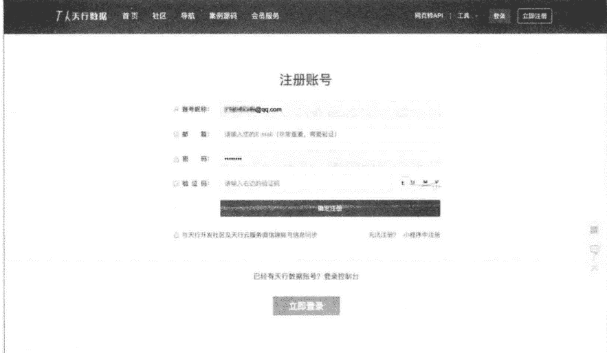

图 7-2 注册天行数据网站会员

注册后登录后台，可看到账户信息，其中 APIKEY 是重点，使用接口时要用它做权限校验，如图 7-3 所示。
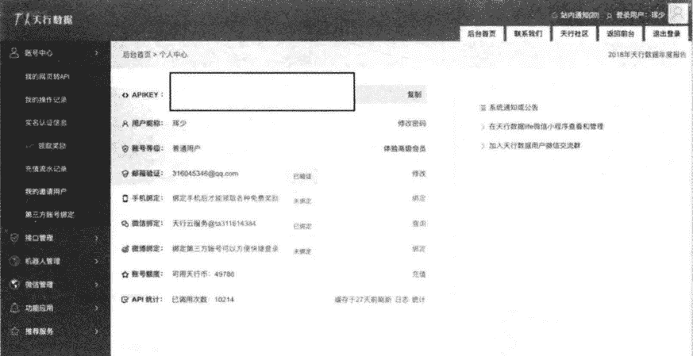

图 7-3 天行数据后台

拿到 APIKEY 就可以做接口测试，新账号默认有 10 000 次免费额度。以“简说历史”接口为例，它会随机返回一条历史典故，详情页会给出接口说明、参数和返回样例，如图 7-4 所示。
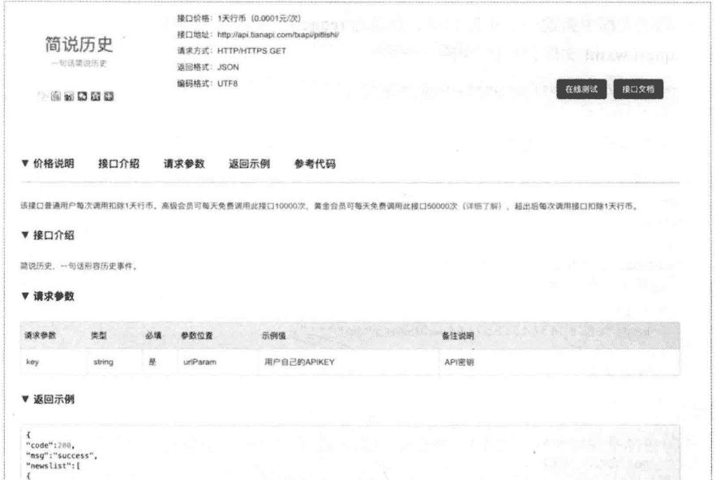

图 7-4 接口服务详情页

使用时主要看三点：接口地址、请求需要带的参、返回数据的结构。测试时在在线测试页填入自己的 APIKEY，点击测试请求，右侧出现正常数据即为通过，如图 7-5 所示。
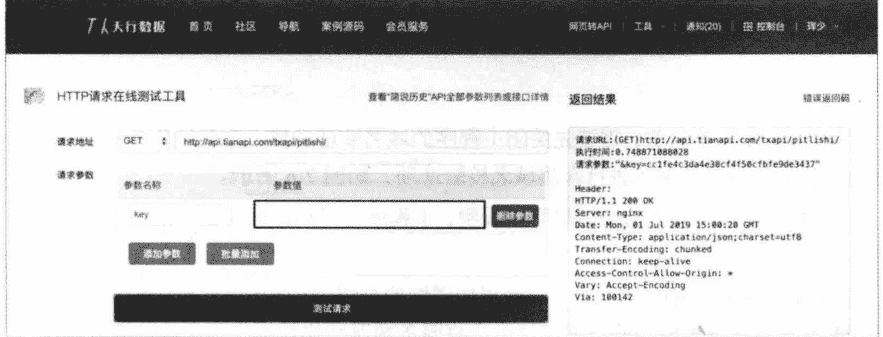

图 7-5 对接口服务进行测试

### 7.1.2 在小程序里调接口

新建一个页面目录 request，并创建同名页面 request。先改写 request.wxml，简单展示文本：
```
<!--pages/request/request.wxml-->
<text>{{data}}</text>
```

上面的代码只是展示层，逻辑写在 request.js：
```
//pages/request/request.js
Page({
  data: {
  },
  onLoad: function (options) {
    //定义参数
    var params = {
      key:"ef7f04344615b7ff44a8b3aa78aa****",
    };
    //发起请求
    wx.request({
      url: 'https://api.tianapi.com/txapi/pitilishi/',
      data: params,
      method: 'GET',
      success: (res)=> {
        console.log("数据请求成功",res);
        this.setData({
          data:res.data.newslist[0].content
        });
      },
      fail: (res) => {
        console.log("数据请求失败", res);
        this.setData({
          data: res
        });
      },
    })
  }
})
```

请求前先关闭开发工具的合法域名校验，在菜单的“详情”里勾选不校验合法域名，如图 7-6 所示。
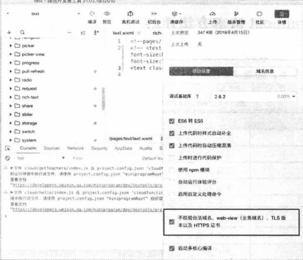

图 7-6 关闭域名校验功能

运行后页面即可拿到服务端返回的内容。示例中使用的是 GET 请求，成功回调会把返回数据传给页面使用。wx.request 的完整配置在 7.1.3 详细说明。

域名校验是为了安全，防止访问未授权域名。可在小程序后台的开发设置里添加服务器域名，把天行数据的域名加入信任列表，如图 7-7 所示。
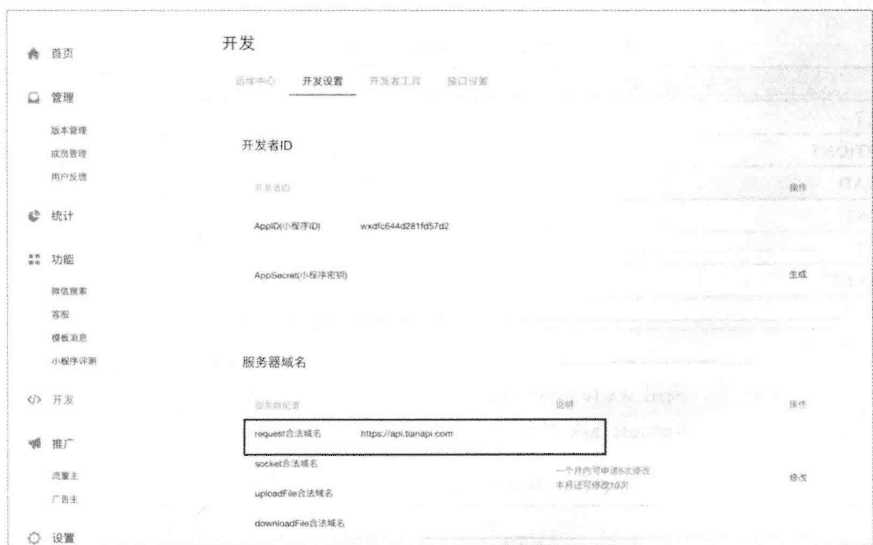

图 7-7 进行信任域名的添加

添加后即使开启校验也能正常访问。

### 7.1.3 wx.request 参数详解

7.1.2 的例子只是最简用法，wx.request 支持的配置项比较多，如表 7-1 所示。

表 7-1 wx.request 方法可进行配置的参数

| 参数名 | 意义 | 值 |
|---|---|---|
| url | 服务端接口地址 | 字符串 |
| data | 请求携带的参数 | 字符串、对象或数组 |
| header | 请求头 | 对象 |
| method | 请求方法 | 字符串 |
| dataType | 返回数据格式，默认 JSON | 字符串 |
| responseType | 响应数据类型 | 字符串 |
| success | 请求成功回调 | 函数 |
| fail | 请求失败回调 | 函数 |
| complete | 请求结束回调 | 函数 |

method 需要与服务端一致，HTTP 常用方法见表 7-2。

表 7-2 HTTP/HTTPS 协议中常用的请求方法

| 方法名 | 意义 |
|---|---|
| GET | 进行 GET 请求 |
| OPTIONS | 进行 OPTIONS 请求 |
| HEAD | 进行 HEAD 请求 |
| POST | 进行 POST 请求 |
| PUT | 进行 PUT 请求 |
| DELETE | 进行 DELETE 请求 |
| TRACE | 进行 TRACE 请求 |
| CONNECT | 进行 CONNECT 请求 |

调用 wx.request 会立刻返回一个 RequestTask 对象，可用它控制任务，常用方法见表 7-3。

表 7-3 RequestTask 对象可调用的方法

| 方法名 | 意义 | 参数 |
|---|---|---|
| abort | 终止当前请求 | 无 |
| onHeadersReceived | 监听响应头事件 | 函数对象 |
| offHeadersReceived | 取消响应头监听 | 函数对象 |

## 7.2 文件下载与上传

文件交互也是常见场景，社交类应用的图片视频分享、自定义头像都需要上传下载。小程序提供了简洁的下载上传接口。

### 7.2.1 图片下载实操

找一张公开图片，先拿到链接，再用链接下载。修改 request.wxml，加入图片组件：
```
<!--pages/request/request.wxml-->
<text>{{data}}</text>
<image src='{{img}}'></image>
```

在 request.js 的 onLoad 里加入：
```
onLoad: function (options) {
  var params = {
    key:"ef7f04344615b7ff44a8b3aa78aa27f3",
  };
  wx.request({
    url: 'https://api.tianapi.com/txapi/pitilishi/',
    data: params,
    method: 'GET',
    success: (res)=> {
      console.log("数据请求成功",res);
      this.setData({
        data:res.data.newslist[0].content
      });
    },
    fail: (res) => {
      console.log("数据请求失败", res);
      this.setData({
        data: res
      });
    },
  });
  wx.downloadFile({
    url:"http://huishao.cc/img/avatar.jpg",
    success: (res)=>{
      console.log(res.tempFilePath);
      this.setData({
        img:res.tempFilePath
      });
    }
  })
}
```

wx.downloadFile 负责下载，url 指远程文件地址，注意该域名需加入小程序后台信任列表。success 回调里的 res 包含临时文件路径，可直接渲染或后续处理。

可配置参数见表 7-4。

表 7-4 wx.downloadFile 方法中可配置的参数

| 参数名 | 意义 | 值 |
|---|---|---|
| url | 远程文件地址 | 字符串 |
| header | 请求头数据 | 对象 |
| filePath | 指定下载后路径 | 字符串 |
| success | 下载成功回调 | 函数 |
| fail | 下载失败回调 | 函数 |
| complete | 下载完成回调 | 函数 |

调用后返回 DownloadTask 对象，方法见表 7-5。

表 7-5 DownloadTask 对象可调用的方法

| 方法名 | 意义 | 参数 |
|---|---|---|
| abort | 中断下载 | 无 |
| onHeadersReceived | 监听响应头事件 | 函数 |
| offHeadersReceived | 取消响应头监听 | 函数 |
| onProgressUpdate | 监听下载进度 | 函数 |
| offProgressUpdate | 取消进度监听 | 函数 |

### 7.2.2 文件上传实操

小程序把上传过程封装得很友好，wx.uploadFile 用法与下载类似。

可配置参数见表 7-6。

表 7-6 文件上传方法可配置的参数

| 参数 | 意义 | 值 |
|---|---|---|
| url | 上传目标地址 | 字符串 |
| filePath | 待上传文件地址 | 字符串 |
| name | 文件字段名 | 字符串 |
| header | 请求头数据 | 对象 |
| formData | 表单数据 | 对象 |
| success | 上传成功回调 | 函数 |
| fail | 上传失败回调 | 函数 |
| complete | 上传完成回调 | 函数 |

调用后返回 UploadTask 对象，用法与 DownloadTask 相同，可控制任务并监听进度。

## 7.3 WebSocket 实时通信

小程序原生支持 WebSocket。HTTP 请求是单向的，客户端发起服务端返回，服务端无法主动推送。WebSocket 建立后双方可自由收发。

### 7.3.1 建立连接与收发

服务端需要提供 WebSocket 服务，小程序端先建立连接：
```
wx.connectSocket
```

套接字方法可配置的参数如表 7-7。

表 7-7 套接字方法可配置的参数

| 参数名 | 意义 | 值 |
|---|---|---|
| url | 服务端地址 | 字符串 |
| header | 请求头数据 | 对象 |
| protocols | 协议数组 | 数组 |
| tcpNoDelay | 是否开启 TCP_NODELAY | 布尔值 |
| success | 连接成功回调 | 函数 |
| fail | 连接失败回调 | 函数 |

连接成功后监听打开事件：
```
wx.onSocketOpen
```

把函数传给 wx.onSocketOpen，回调触发代表通道已就绪。

向服务端发送数据：
```
wx.sendSocketMessage
```

发送信息方法参数见表 7-8。

表 7-8 使用套接字发送信息方法可配置的参数

| 参数名 | 意义 | 值 |
|---|---|---|
| data | 发送内容 | 字符串 |
| success | 发送成功回调 | 函数 |
| fail | 发送失败回调 | 函数 |
| complete | 发送完成回调 | 函数 |

接收服务端推送使用：
```
wx.onSocketMessage
```

关闭连接：
```
wx.closeSocket
```

wx.closeSocket 参数见表 7-9。

表 7-9 wx.closeSocket 方法可配置参数

| 参数名 | 意义 | 值 |
|---|---|---|
| code | 状态码，1000 为正常关闭 | 数值 |
| reason | 关闭原因 | 字符串 |
| success | 调用成功回调 | 函数 |
| fail | 调用失败回调 | 函数 |
| complete | 调用完成回调 | 函数 |

除了前面提到的基础 WebSocket 能力，还能用 onSocketError 来挂载错误回调，用 onSocketClose 来挂载连接关闭时的回调。

### 7.3.2 使用 SocketTask 对象
wx.connectSocket 执行后会返回一个 SocketTask 实例，它代表一条 WebSocket 会话，后续的收发、断开和监听都由该实例调度。可用的控制项汇总在表 7-10。

表 7-10 连接套接字方法可配置参数

| 方法名 | 意义 | 参数 |
|---|---|---|
| send | 向服务器推送数据 | 对象 |
| close | 主动终止连接 | 配置对象，参数形式与 wx.closeSocket 保持一致 |
| onOpen | 监听连接建立 | 函数 |
| onClose | 监听连接断开 | 函数 |
| onError | 监听异常 | 函数 |
| onMessage | 接收服务端下发数据的回调 | 函数 |

## 7.4 小程序中的数据存储技术
数据存储直接影响体验。比如需要会员登录的应用，首次登录后把凭证暂存，下次打开即可免登。整体可归为缓存类存储和持久类存储两类。

缓存类偏向小体量、短周期的场景，例如会员凭证；持久类偏向大体量、长周期的场景，例如聊天记录。下面分别展开。

### 7.4.1 数据缓存
小程序提供一套对缓存库进行写入、读取、删除的接口，上手很快。具体接口见表 7-11。

表 7-11 数据缓存相关方法

| 方法名 | 意义 | 参数 |
|---|---|---|
| wx.setStorage | 把数据写入缓存库 | { key:键名 data:待写入数据 success:写入成功回调 fail:写入失败回调 complete:写入结束回调 } |
| setStorageSync | 同步写入缓存 | key:键名 data:待写入数据 |
| getStorage | 从缓存库读取数据 | { key:键名 success:读取成功回调，数据放在 data 中 fail:读取失败回调 complete:读取结束回调 } |
| getStorageSync | 同步读取缓存 | key:键名 |
| removeStorage | 从缓存移除数据 | { key:键名 success:删除成功回调 fail:删除失败回调 complete:删除结束回调 } |
| removeStorageSync | 同步移除缓存数据 | key:键名 |
| clearStorage | 清空缓存库全部数据 | { success:清空成功回调 fail:清空失败回调 complete:清空结束回调 } |
| clearStorageSync | 同步清空缓存 | 无 |
| getStorageInfo | 查询缓存使用情况，成功回调返回 { keys:所有键 currentSize:当前占用 limitSize:上限 } | { success:查询成功回调 fail:查询失败回调 complete:查询结束回调 } |
| getStorageInfoSync | 同步查询缓存使用情况 | 无 |

不同小程序的缓存库互相隔离，只能操作自己的数据。以上接口均提供异步与同步两套形态。同步会阻塞主线程直到返回结果，异步则通过回调回传。

缓存内容在用户手动清理或超时后会被释放，平时可用。单条上限 1MB，总上限 10MB。

下面以 storage 页面为例演示，storage.wxml 为：

```
<!--pages/storage/storage.wxml-->
<text>{{data}}</text>
<button bindtap='save'>存入数据</button>
<button bindtap='get'>获取数据</button>
<button bindtap='remove'>删除数据</button>
<button bindtap='info'>查看缓存信息</button>
```

对应逻辑在 storage.js 中：

```
//pages/storage/storage.js
Page({
  data: {
    data:"无数据"
  },
  //将数据存储到缓存
  save:function() {
    wx.setStorage({
      key: 'userName',
      data: '辉少',
    })
  },
  //从缓存中获取数据
  get:function() {
    wx.getStorage({
      key: 'userName',
      success: (res) => {
        this.setData({
          data:res.data
        });
      },
      fail:()=>{
        this.setData({
          data: "无数据"
        });
      }
    })
  },
  //将缓存中的数据删除
  remove:function() {
    wx.removeStorage({
      key: 'userName',
      success: function(res) {
        console.log("删除成功");
      },
    })
  },
  //缓存中的数据情况
  info:function(){
    wx.getStorageInfo({
      success: function(res) {
        console.log(res);
      },
    })
  },
})
```

运行后可通过页面交互观察缓存的增删改查，也可在开发者工具调试面板切换 storage 视图直接查看当前库的内容，如图 7-8 所示。

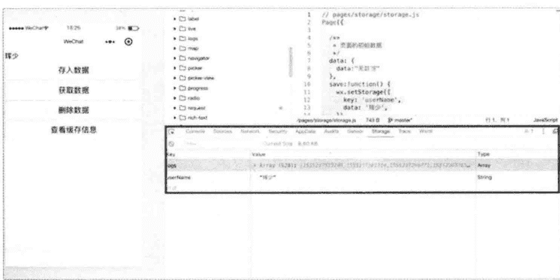

图 7-8 查看小程序缓存库

### 7.4.2 使用文件接口进行持久化存储
小程序的文件系统可分为代码包文件、本地临时文件、本地缓存文件、本地用户文件四类。

代码包文件是开发时打包进来的代码与资源，只读不可改。本地临时文件由下载等接口产生，生命周期很短，程序退出即清除。本地缓存文件由缓存接口产生，只能通过缓存接口操作。本地用户文件是使用过程中产生的可长期保存的数据，有专属目录，开发者可自由读写。

通过 wx.env.USER_DATA_PATH 可获取用户文件的根目录，可在此下创建子目录存放文件。

临时文件可迁移到用户目录：

```
wx.saveFile
```

调用需传入配置对象，参数说明见表 7-12。

## 表 7-12 saveFile 方法可配置属性

| 属性名 | 意义 | 值 |
|---|---|---|
| tempFilePath | 待迁移的临时文件路径 | 字符串 |
| success | 保存成功回调，路径封装在 savedFilePath 中 | 函数 |
| fail | 保存失败回调 | 函数 |
| complete | 接口调用结束回调 | 函数 |

本地文件总容量限制 10MB，saveFile 成功后临时路径将失效。删除已保存文件可调用 wx.removeSavedFile，参数见表 7-13。

## 表 7-13 removeSavedFile 方法可配置属性

| 属性名 | 意义 | 值 |
|---|---|---|
| filePath | 待删除的文件路径 | 字符串 |
| success | 删除成功回调 | 函数 |
| fail | 删除失败回调 | 函数 |
| complete | 删除操作结束回调 | 函数 |

已下载到本地的文件可通过以下接口打开：

```
wx.openDocument
```

wx.openDocument 支持 doc、docx、xls、xlsx、ppt、pptx、pdf 等格式。参数见表 7-14。

## 表 7-14 openDocument 方法可配置属性

| 属性名 | 意义 | 值 |
|---|---|---|
| filePath | 要打开的文件本地路径 | 字符串 |
| fileType | 文件类型 | 字符串 |
| success | 打开成功回调 | 函数 |
| fail | 打开失败回调 | 函数 |
| complete | 打开结束回调 | 函数 |

获取已保存文件列表：

```
wx.getSavedFileList
```

wx.getSavedFileList 可传入配置对象设置回调。成功回调会携带 fileList，内含文件说明对象，字段见表 7-15。

## 表 7-15 文件说明对象中的属性

| 属性名 | 意义 | 值 |
|---|---|---|
| filePath | 文件所在路径 | 字符串 |
| size | 字节大小 | 数值 |
| createTime | 保存时间戳 | 数值 |

查询单个文件详情可用：

```
wx.getSavedFileInfo
```

wx.getSavedFileInfo 参数见表 7-16。

## 表 7-16 获取所保存文件详细信息方法可配置属性

| 属性名 | 意义 | 值 |
|---|---|---|
| filePath | 待查询的文件路径 | 字符串 |
| success | 查询成功回调 | 函数 |
| fail | 查询失败回调 | 函数 |
| complete | 查询结束回调 | 函数 |

查询成功后返回的文件信息对象见表 7-17。

## 表 7-17 文件信息对象中的属性

| 属性名 | 意义 | 值 |
|---|---|---|
| size | 文件尺寸 | 数值 |
| createTime | 保存时间 | 数值 |

若要查询临时文件信息，需调用：

```
wx.getFileInfo
```

参数说明见表 7-18，返回摘要见表 7-19。

## 表 7-18 获取文件信息方法参数对象可配置属性

| 属性名 | 意义 | 值 |
|---|---|---|
| filePath | 待查询文件的路径 | 字符串 |
| digestAlgorithm | 计算摘要的算法 | 可选值：md5、sha1 |
| success | 查询成功回调 | 函数 |
| fail | 查询失败回调 | 函数 |
| complete | 查询结束回调 | 函数 |

## 表 7-19 文件摘要信息中的属性

| 属性名 | 意义 | 值 |
|---|---|---|
| size | 文件尺寸 | 数值 |
| digest | 文件摘要 | 字符串 |

### 7.4.3 使用文件管理器
文件管理器允许更灵活地指定存储路径和目录结构，操作范围为用户文件目录。获取全局实例的方式如下：

```
wx.getFileSystemManager
```

文件管理器封装了丰富的操作方法，常用方法及参数如表 7-20。

## 表 7-20 文件管理器方法可配置参数

| 方法名 | 意义 | 参数 |
|---|---|---|
| access | 检查文件或目录是否存在 | { path:路径 success:存在则回调 fail:不存在回调 complete:结束回调 } |
| appendFile | 在文件尾部追加内容 | { data:追加内容 encoding:编码，默认 utf8 path:路径 success:成功回调 fail:失败回调 complete:结束回调 } |
| saveFile | 把临时文件转存为持久文件 | { tempFilePath:临时路径 filePath:目标路径 success:成功回调 fail:失败回调 complete:结束回调 } |
| getSavedFileList | 列出已保存的文件 | { success:成功回调 fail:失败回调 complete:结束回调 } |
| removeSavedFile | 删除已保存文件 | { filePath:路径 success:成功回调 fail:失败回调 complete:结束回调 } |
| copyFile | 复制文件 | { srcPath:源路径 destPath:目标路径 success:成功回调 fail:失败回调 complete:结束回调 } |
| getFileInfo | 读取文件元信息 | { filePath:路径 success:成功回调 fail:失败回调 complete:结束回调 } |
| mkdir | 新建目录 | { dirPath:目录路径 recursive:是否递归创建上级 success:成功回调 fail:失败回调 complete:结束回调 } |
| readdir | 读取目录下的文件名列表，成功回调参数含 files | { dirPath:目录路径 success:成功回调 fail:失败回调 complete:结束回调 } |
| readFile | 读取文件内容 | { filePath:路径 encoding:编码 success:成功回调 fail:失败回调 complete:结束回调 } |
| rename | 重命名文件 | { oldPath:旧路径 newPath:新路径 success:成功回调 fail:失败回调 complete:结束回调 } |
| rmdir | 删除目录 | { dirPath:目录路径 recursive:是否递归删除子项 success:成功回调 fail:失败回调 complete:结束回调 } |
| stat | 获取文件状态信息，成功回调参数含 stats | { path:路径 success:成功回调 fail:失败回调 complete:结束回调 } |

| unlink | 移除文件 | { filePath:待删除的文件路径 success:查询成功时的回调，文件或目录存在即判定成功 fail:查询失败时的回调，文件不存在会触发 complete:查询结束时的回调 } |

| unzip | 解压压缩包 | { zipFilePath:压缩包路径 targetPath:解压后存放路径 success:查询成功时的回调，文件或目录存在即判定成功 fail:查询失败时的回调，文件不存在会触发 complete:查询结束时的回调 } |

| writeFile | 写入文件内容 | { filePath:目标文件路径 data:写入内容 encoding:编码格式 success:查询成功时的回调，文件或目录存在即判定成功 fail:查询失败时的回调，文件不存在会触发 complete:查询结束时的回调 } |

文件写入时可指定的 encoding 取值见表 7-21。

## 表 7-21 文件编码支持列表

| encoding 可选值 |

|---|

| ascii |

| base64 |

| binary |

| hex |

| utf16le |

| utf8 |

| latin1 |

提醒一点，虽然小程序框架提供了不少文件操作能力，但存储切忌过度占用，小程序的精髓在于轻量，功能设计要始终围绕小巧、快速来展开。

## 第 8 章

## 界面交互与动效

本章聚焦小程序里常见的交互与动画实现。小程序内置了丰富的交互能力，比如系统弹窗、导航栏样式调整、页面下拉刷新与上拉加载等。动画同样关键，它能让页面过渡更顺滑、体验更舒服。开发时既可以用 WXSS 来定义动画，也能借助 Animation 对象来编排。

## 8.1 系统弹窗

第6章在讲自定义组件时，我们做过一个页面弹窗的自定义实现。实际上框架自带了一套系统弹窗，样式和交互都已封装好，开箱即用。

小程序的弹窗大致可分为消息提示、确认对话框、加载等待提示、底部抽屉选项四类，下面逐一说明用法。

## 8.1.1 消息提示

调用 wx.showToast 就能弹出轻量提示，通常用于告知结果，可自定义标题和图标。传入的配置对象可选参数见表 8-1。

## 表 8-1 wx.showToast 可配置参数

| 属性 | 说明 | 类型 |

|---|---|---|

| title | 提示文案 | 字符串 |

| icon | 系统内置图标 | success 成功图标；loading 加载图标；none 隐藏图标 |

| image | 自定义图标本地路径 | 字符串 |

| duration | 展示时长 | 毫秒数 |

| mask | 是否加半透明遮罩拦截手势 | 布尔值 |

| success | 调用成功后的回调 | 函数 |

| fail | 调用失败后的回调 | 函数 |

| complete | 调用结束后的回调 | 函数 |

想要提前收起提示，可以调用 wx.hideToast。在测试项目里新建一个名叫 modal 的页面，在 modal.wxml 中加入如下测试代码：

```
<button bindtap='toast'>Toast 消息框</button>
```

toast 方法的实现如下：

```
toast:function(){
  wx.showToast({
    title: '标题',
    icon:'success',
    duration:2000,
    mask:true,
  })
}
```

运行后效果如图 8-1。

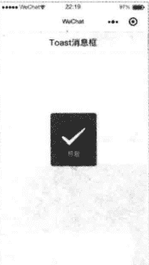

图 8-1 消息提示展示样式

## 8.1.2 确认对话框

wx.showModal 能弹出带按钮的确认框，除了展示信息，还能收集用户选择。配置对象可选项见表 8-2。

## 表 8-2 wx.showModal 可配置参数

| 属性 | 说明 | 类型 |

|---|---|---|

| title | 标题文案 | 字符串 |

| content | 内容文案 | 字符串 |

| showCancel | 是否展示取消按钮 | 布尔值 |

| cancelText | 取消按钮文字 | 字符串 |

| cancelColor | 取消按钮文字颜色 | 颜色值 |

| confirmText | 确认按钮文字 | 字符串 |

| confirmColor | 确认按钮文字颜色 | 颜色值 |

| success | 用户操作后的回调，返回按钮状态 | 函数 |

| fail | 调用失败回调 | 函数 |

| complete | 调用完成回调 | 函数 |

示例代码如下：

```
wx.showModal({
  title: '对话框标题',
  content: '对话框内容',
  showCancel:true,
  cancelText:"取消",
  cancelColor:"#000000",
})
```

```
confirmText:"确定",
confirmColor:"#00ff00",
success:function(res){
  console.log(res.confirm, res.cancel);
}
})
```

运行效果如图 8-2。

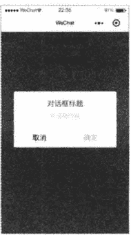

图 8-2 确认对话框展示样式

用户点任一按钮后对话框会自动关闭。

## 8.1.3 等待提示

使用过程中常有等待场景，如网络请求、文件下载等。wx.showLoading 能在界面上显示友好的等待层，参数说明见表 8-3。

表 8-3 wx.showLoading 可配置参数

| 属性 | 说明 | 类型 |

|---|---|---|

| title | 提示文案 | 字符串 |

| mask | 是否显示遮罩拦截手势 | 布尔值 |

| success | 调用成功回调 | 函数 |

| fail | 调用失败回调 | 函数 |

| complete | 调用完成回调 | 函数 |

代码示例：

```
loading:function(){
  wx.showLoading({
    title: '请等待',
    mask:false,
  })
},
cancelLoading:function(){
wx.hideLoading();
},
```

运行效果如图 8-3。


图 8-3 等待提示展示样式

注意该提示不会自动消失，需要手动调用 wx.hideLoading 结束展示。

## 8.1.4 底部抽屉选项

抽屉弹窗用于提供一组可选操作，从页面底部上滑出现，交互后自动收起。可通过 wx.showActionSheet 触发，配置项见表 8-4。

表 8-4 wx.showActionSheet 可配置参数

| 属性 | 说明 | 类型 |

|---|---|---|

| itemList | 选项数组，最多6项 | 字符串数组 |

| itemColor | 选项文字颜色 | 颜色值 |

| success | 用户选择后的回调，返回 tapIndex | 函数 |

| fail | 调用失败回调 | 函数 |

| complete | 调用完成回调 | 函数 |

示例代码：

```
wx.showActionSheet({
  itemList: ["足球","篮球","其他"],
  success:function(res){
    console.log(res.tapIndex);
  }
})
```

运行效果如图 8-4。


图 8-4 抽屉弹窗展示样式

## 8.2 导航栏与标签栏操作

导航栏位于页面顶部，展示标题与返回控件；标签栏位于底部，用于切换平级页面。两者都可通过接口动态调整。

### 8.2.1 导航栏接口

框架提供多项导航栏控制能力，可修改标题、颜色、加载态等，具体方法见表 8-5。

表 8-5 导航栏相关方法

| 方法 | 说明 | 参数 |

|---|---|---|

| wx.showNavigationBarLoading | 展示导航栏加载图标 | { success:成功回调 fail:失败回调 complete:完成回调 } |

| wx.hideNavigationBarLoading | 隐藏导航栏加载图标 | { success:成功回调 fail:失败回调 complete:完成回调 } |

| wx.setNavigationBarTitle | 修改导航栏标题 | { title:标题文本 success:成功回调 fail:失败回调 complete:完成回调 } |

| wx.setNavigationBarColor | 配置导航栏配色 | { frontColor:前景色仅支持 "#000000" 或 "#ffffff" backgroundColor:背景色 animation:动画对象 success:成功回调 fail:失败回调 complete:完成回调 } |

设置背景色时可附带动画，动画对象属性见表 8-6。

表 8-6 背景色切换动画属性

| 属性 | 说明 | 取值 |

|---|---|---|

| duration | 动画时长 | 毫秒数 |

| timingFunc | 时间曲线 | linear 线性；easeIn 渐入；easeOut 渐出；easeInOut 渐入渐出 |

下面演示加载图标的显隐。新建 navigation-bar 页面，在 navigation-bar.wxml 中写入：

```
<!--pages/navigation-bar/navigation-bar.wxml-->
<button bindtap='show'>显示加载状态</button>
<button bindtap='hide'>取消加载状态</button>
```

对应逻辑在 navigation-bar.js 中实现 hide 与 show：

```
show:function(){
    wx.showNavigationBarLoading();
},
hide:function(){
    wx.hideNavigationBarLoading();
},
onLoad: function (options) {
    wx.setNavigationBarTitle({
title:"你好, 小程序"
});
wx.setNavigationBarColor({
  frontColor: '#ffffff',
  backgroundColor: '#0000ff',
})
},
```

运行效果如图 8-5。


图 8-5 导航栏配置效果

### 8.2.2 标签栏配置

标签栏的全局结构需在 app.json 中先行声明：

```
"tabBar": {
  "list": [
    {
      "pagePath": "pages/index/index",
      "text": "index"
    },
    {
      "pagePath": "pages/switch/switch",
      "text": "switch"
    }
  ]
}
```

每个标签对应一个页面，点击即可切换。运行时也可动态控制标签栏或单个标签，具体接口见表 8-7。

表 8-7 标签栏操作相关方法

| 方法 | 说明 | 参数 |

|---|---|---|

| wx.showTabBar | 显示标签栏 | { animation:是否带动画布尔值 success:成功回调 fail:失败回调 complete:完成回调 } |

| wx.hideTabBar | 隐藏标签栏 | { animation:是否带动画布尔值 success:成功回调 fail:失败回调 complete:完成回调 } |

| wx.showTabBarRedDot | 为标签添加红点 | { index:标签下标 success:成功回调 fail:失败回调 complete:完成回调 } |

| wx.hideTabBarRedDot | 移除标签红点 | { index:标签下标 success:成功回调 fail:失败回调 complete:完成回调 } |

| wx.setTabBarBadge | 设置标签徽章 | { text:徽章文字 index:标签下标 success:成功回调 fail:失败回调 complete:完成回调 } |

| wx.removeTabBarBadge | 移除标签徽章 | { index:标签下标 success:成功回调 fail:失败回调 complete:完成回调 } |

| wx.setTabBarItem | 修改单个标签 | { index:标签下标 text:文字 iconPath:图标路径 selectedIconPath:选中态图标路径 success:成功回调 fail:失败回调 complete:完成回调 } |

| wx.setTabBarStyle | 调整标签栏样式 | { color:文字颜色 selectedColor:选中文字颜色 backgroundColor:背景色 borderStyle:边框风格 black/white success:成功回调 fail:失败回调 complete:完成回调 } |

## 8.3 下拉刷新与上拉加载

列表类页面常用分页加载和刷新机制，小程序对此支持很友好。

### 8.3.1 启用下拉刷新

开启下拉刷新只需在页面 JSON 中配置。若在 app.json 中开启，则全局生效；也可单页配置。

新建 pull-refresh 页面，在 pull-refresh.json 中写入：

```
{
  "enablePullDownRefresh": true
}
```

当 enablePullDownRefresh 为 true 时，下拉会触发刷新动画，默认关闭。可进一步美化刷新组件样式，相关方法见表 8-8。

表 8-8 刷新组件样式配置

| 方法 | 说明 | 参数 |

|---|---|---|

| wx.setBackgroundTextStyle | 设置下拉刷新文字样式 | { textStyle:文字风格 dark 或 light success:成功回调 fail:失败回调 complete:完成回调 } |

**小程序交互刷新与动效落地手册**

| wx.setBackgroundColor | 设置背景颜色 | { backgroundColor:设置窗口背景色 backgroundColorTop:设置窗口上部背景色 backgroundColorBottom:设置窗口下部背景色 success:接口调用成功回调 fail:接口调用失败回调 complete:接口调用完成回调 } |

启动示例后，界面状态与图 8-6 保持一致。


图 8-6 下拉刷新展示效果

手动向下滑动即可触发更新，也可以在脚本里主动发起或结束该行为，控制用的接口见表 8-9。

表 8-9 控制刷新状态的相关方法

| 方法名 | 意义 | 参数 |

|---|---|---|

| wx.startPullDownRefresh | 代码触发下拉刷新操作 | { success:接口调用成功回调 fail:接口调用失败回调 complete:接口调用完成回调 } |

| wx.stopPullDownRefresh | 代码触发停止下拉刷新操作 | { success:接口调用成功回调 fail:接口调用失败回调 complete:接口调用完成回调 } |

上拉加载无需额外开关，页面触底到一定距离时会自动进入加载流程，只需补齐对应的处理函数即可。

### 8.3.2 下拉刷新与上拉加载的回调方法

用户手势或代码触发更新后，系统会进入 onPullDownRefresh；页面滚动到底部时会进入 onReachBottom。新建页面的脚手架里默认预置了这两个钩子，示例如下：

```
onPullDownRefresh: function () {
  console.log("刷新");
},
onReachBottom: function () {
  console.log("加载");
},
```

> ①注意：
> 只有当页面内容高度大于窗口高度，即页面可滚动时，页面滚动到底部才会触发 onReachBottom 方法，通常在其中进行加载更多数据的操作。

## 8.4 使用 WXSS 定义动画

动效能让交互更顺滑。小程序做动画主要有两条路线，一是 WXSS 声明式配置，二是借助 Animation 对象脚本驱动。本节聚焦 WXSS 的做法。

与用户交互时界面往往伴随状态变化，例如按钮被点击后底色改变、手势滑动导致元素位移等。若变化瞬间完成会显得生硬，配合动画则过渡更自然，体验也更舒适。

### 8.4.1 定义关键帧

在 WXSS 中一种常用做法是关键帧。可以在元素变化的时间线上设定若干关键节点，比如背景色的渐变，先给出起点、中点、终点的色值，再把关键帧绑定到选择器，组件挂载该类即可播放。

在测试工程里新建页面 css-animation，css-animation.wxml 的演示代码如下：

```
<!--pages/css-animation/css-animation.wxml-->
<view class="{{ori}}"></view>
<button bindtap='move'>移动动画</button>
<button bindtap='color'>背景色动画</button>
```

文件里放了两个操作按钮，分别演示位置位移与背景色变化，均使用关键帧实现，同时用一个 view 作为展示色块。

css-animation.wxss 中的样式如下：

```
/*pages/css-animation/css-animation.wxss*/
.block {
  width: 100rpx;
  height:100rpx;
  background-color: red;
}
.color {
  animation: color-animation 3s;
}
.move {
  animation: move-animation 3s;
}
@keyframes color-animation {
  0% {background: red;}
  25% {background: yellow;}
  50% {background: blue;}
  100% {background: green;}
}
@keyframes move-animation {
  0% {margin-left: 0rpx;}
  100% {margin-left: 200rpx;}
}
```

微信小程序开发实战

@keyframes 用来声明关键帧动画，其后名称为自定义标识。上例声明了 color-animation 与 move-animation。以 color-animation 为例，动画起始背景为红色，25% 时过渡到黄色，50% 时过渡到蓝色，结束时过渡到绿色。

声明后需要把关键帧关联到选择器，如上例将 color-animation 关联到 .color，move-animation 关联到 .move。组件的 class 指向对应类即可触发。

随后在 css-animation.js 中为按钮补充点击处理，具体如下：

```
//pages/css-animation/css-animation.js
Page({
  data:{
    ori:'block',
  },
  move:function(){
    this.setData({
      ori:'move block'
    });
  },
  color:function(){
    this.setData({
      ori: 'color block'
    });
  }
})
```

运行后点击对应按钮，可看到色块的动画效果。

这里使用的是 animation 复合属性，可拆分为多个子属性单独控制，具体项目见表 8-10。

表 8-10 Animation 对象可配置属性

| 属性名 | 意义 | 值 |

|---|---|---|

| animation-name | 设置要绑定的关键帧名称，即 @keyframes 所定义的关键帧名字 | 关键帧名称 |

| animation-duration | 设置动画时长 | 时长，以 s 结尾表明单位为 s，以 ms 结尾表明单位为 ms |

| animation-timing-function | 设置动画执行的时间速度函数 | 可选值：linear，线性，即匀速执行；ease，渐进，逐渐加速逐渐减速；ease-in，渐入，即先慢后快；ease-out，渐出，即先快后慢；ease-in-out，渐入渐出 |

| 属性名 | 意义 | 值 |

|---|---|---|

| animation-delay | 设置动画延时多久开始执行 | 与 animation-duration 属性一致 |

| animation-direction | 设置动画播放的方向 | normal: 始终正向播放

alternate: 轮流逆向播放 |

| animation-fill-mode | 设置动画执行完成后元素的状态 | 可选值：forwards，保持结束的状态；backwards，保持开始的状态；both，根据动画播放正逆保持 |

默认动画结束元素会复原到初始状态，若希望保留结束态，可设置 animation-fill-mode，示例代码如下：

```
.move {
  animation-iteration-count:3;
  animation-name: move-animation;
  animation-duration: 3s;
  animation-timing-function: ease-in-out;
  animation-delay: 1s;
  animation-direction: alternate;
  animation-fill-mode: both;
}
```

## 8.4.2 组件的形态变换与动画

配置组件样式时可使用 transform 属性，可实现平移、旋转、缩放、翻转等形态变化，结合关键帧也能做成动画。

常用变换见表 8-11。

### 表 8-11 transform 相关属性列举

| 方法名 | 意义 | 参数 |

|---|---|---|

| translate | 进行平移变换 | 第 1 个参数：沿 x 轴平移多少单位

第 2 个参数：沿 y 轴平移多少单位 |

| rotate | 进行旋转变换 | 顺时针旋转角度 |

| scale | 进行缩放变换 | 第 1 个参数：宽度缩放比例

第 2 个参数：高度缩放比例 |

| skew | 进行翻转变换 | 第 1 个参数：按 x 轴旋转角度

第 2 个参数：按 y 轴旋转角度 |

| rotate3d | 进行三维旋转 | 第 1 个参数：x 轴旋转分量

第 2 个参数：y 轴旋转分量

第 3 个参数：z 轴旋转分量

第 4 个参数：旋转角度 |

## 微信小程序开发实战

在 css-animation.wxml 中追加如下测试结构：

```
<button bindtap='translate'>平移</button>
<button bindtap='rotate'>旋转</button>
<button bindtap='scale'>缩放</button>
<button bindtap='skew'>翻转</button>
<button bindtap='rotate3d'>3D 旋转</button>
```

css-animation.wxss 中编写对应样式并定义关键帧：

```
/*定义平移动画*/
.translate {
  animation: translate-animation 3s;
}
/*定义旋转动画*/
.rotate {
  animation: rotate-animation 3s;
}
/*定义缩放动画*/
.scale {
  animation: scale-animation 3s;
}
/*定义翻转动画*/
.skew {
  animation: skew-animation 3s
}
/*定义三维旋转动画*/
.rotate3d {
  animation: rotate3d-animation 3s;
}
@keyframes color-animation {
  0% {background: red;}
  25% {background: yellow;}
  50% {background: blue;}
  100% {background: green;}
}
@keyframes move-animation {
  0% {margin-left: 0rpx;}
  100% {margin-left: 200rpx;}
}
@keyframes translate-animation {
  0% {transform: translate(0rpx,0rpx);}
  100% {transform: translate(50rpx,50rpx)}
}
@keyframes rotate-animation {
  0% {transform: rotate(0deg)}
  100% {transform: rotate(45deg)}
}
@keyframes scale-animation {
  0% {transform: scale(1,1)}
  100% {transform: scale(1.5,1.5)}
}
@keyframes skew-animation {
  0% {transform: skew(0deg,0deg)}
  100% {transform: skew(30deg,30deg)}
}
@keyframes rotate3d-animation {
  0% {transform: rotate3d(0,0,0,0)}
  100% {transform: rotate3d(0,1,0,90deg)}
}
```

css-animation.js 中补充按钮绑定逻辑：

```
translate(){
  this.setData({
    ori: 'translate block'
  });
},
rotate(){
  this.setData({
    ori: 'rotate block'
  });
},
scale:function(){
  this.setData({
    ori: 'scale block'
  });
},
skew:function(){
  this.setData({
    ori: 'skew block'
  });
},
rotate3d:function(){
  this.setData({
    ori: 'rotate3d block'
  });
}
```

运行后点击指定按钮即可观察形态变换的动画效果。

## 8.4.3 过渡动画

WXSS 还提供比关键帧更简便的过渡动画。它只关注元素变化前后的状态，系统会按设定时长自动计算中间过程。transition 相关属性用于配置过渡，先在 css-animation.wxml 中添加如下代码：

```
<button bindtap='transition'>过渡</button>
```

## 微信小程序开发实战

随后在 css-animation.wxss 中添加如下样式表：

```
.tap-block {
  width: 200rpx;
  height:200rpx;
  background-color: green;
  transition-property: width,background-color,height;
  transition-duration: 3s;
}
```

transition-property 指定哪些属性变化时需要过渡，transition-duration 指定时长。在 css-animation.js 中实现 transition 方法，具体如下：

```
transition(){
  this.setData({
    ori:'tap-block'
  });
}
```

运行后点击测试按钮，可看到尺寸与背景色的平滑过渡。可配置项见表 8-12。

### 表 8-12 过渡动画可配置属性

| 属性名 | 意义 | 值 |

|---|---|---|

| transition-property | 设置在变化时要进行过渡的属性。用逗号进行分割 | 属性名 |

| transition-duration | 设置动画播放的时长 | 时间值 |

| transition-timing-function | 设置时间速度函数 | 与关键帧中的相关属性取值一致 |

| transition-delay | 设置延迟进行过渡动画 | 时间值 |

相比关键帧，过渡动画上手更快，但只能做前后状态的平滑衔接，无法像关键帧那样精细控制每个阶段。实际开发中可按场景选用。

## 8.4.4 监听动画过程

给组件绑定事件即可监听动画进行情况，相关回调见表 8-13。

### 表 8-13 监听动画执行过程的回调

| 属性名 | 意义 |

|---|---|

| bindtransitionend | 绑定过渡动画执行完成后的回调方法 |

| bindanimationstart | 绑定动画开始执行时的回调方法 |

| bindanimationiteration | 绑定动画一个阶段完成后的回调方法 |

| bindanimationend | 绑定动画执行完成后的回调方法 |

## 8.5 使用 Animation 动画对象

Animation 对象允许用 JavaScript 直接描述动画，使用时绑定到目标组件即可，也便于实现异步序列。

## 8.5.1 Animation 动画示例

在 css-animation.wxml 中新增一个按钮，并为测试色块绑定 animation 属性：

```
<!--pages/css-animation/css-animation.wxml-->
<view class="{{ori}}" bindtransitionend="end" animation="{{animationData}}">
</view>
<button bindtap='animation'>Animation 动画</button>
```

使用 Animation 对象配置动画无需编写 WXSS，相关逻辑在 css-animation.js 中实现 animation 方法即可，具体如下：

```
animation:function(){
  var animation = wx.createAnimation({
    duration:3000,
    timingFunction:'linear',
    delay:1000
  });
  animation.rotate(45);
  animation.backgroundColor("#0000ff");
  animation.step({
    duration:2000
  });
  animation.width("400rpx");
  animation.step({
    duration:1000
  });
  this.setData({
    animationData:animation.export()
  });
},
```

示例给出的是分两段演进的写法：第一段同时让背景色发生改变并伴随旋转，第二段单独处理宽度的变化。Animation 很重要的一个特点是结束态保留，播放结束后组件会固化在结束帧，不会回到初始样式。

发起创建的入口是 wx.createAnimation，调用后会得到一个动画实例，初始化阶段可以带入全局配置来统一设定行为，可调节的项如下。

### 表 8-14 wx.createAnimation 方法可配置属性

| 属性名 | 意义 | 值 |
|---|---|---|
| duration | 控制播放时长 | 数值，单位为 ms |
| timingFunction | 定义速度曲线 | 可选值：linear，线性匀速；ease，逐渐加速，最后变慢；ease-in，先慢后快；ease-in-out，开始慢结束慢，中间快；ease-out，先快后慢 |
| delay | 延迟启动时间 | 数值，单位为 ms |

实例内部封装了大量描述动效的 API，比如 rotate 用来描述旋转，width 用来描述宽度变化。step() 用来收束当前一段的描述，可以继续拼接下一段。全部描述完成后，调用 export 拿到动画数据并绑定到组件的 animation 字段，组件就会按设定执行。

## 8.5.2 Animation 对象方法

Animation 还封装了丰富的方法用于定义、分段和导出动效，具体可调用的方法如下。

### 表 8-15 Animation 对象可调用的方法

| 方法名 | 意义 | 参数 |
|---|---|---|
| bottom | 修改 bottom 值 | 尺寸值 |
| height | 修改高度值 | 尺寸值 |
| left | 修改 left 值 | 尺寸值 |
| opacity | 修改透明度 | 数值为 0~1 |
| right | 修改 right 值 | 尺寸值 |
| rotate | 旋转定义 | 角度值 |
| rotateX | X轴旋转定义 | 角度值 |
| rotateY | Y轴旋转定义 | 角度值 |
| rotateZ | Z轴旋转定义 | 角度值 |
| rotate3d | 三维旋转定义 | 与 transform 的 rotate3d 用法一致 |
| scale | 缩放定义 | x:宽度缩放比例 y:高度缩放比例 |
| scaleX | 宽度缩放 | 缩放比例 |
| scaleY | 高度缩放 | 缩放比例 |
| skew | 倾斜定义 | x:水平倾斜度 y:垂直倾斜度 |
| skewX | X轴倾斜角度 | 角度值 |
| skewY | Y轴倾斜角度 | 角度值 |
| top | 修改 top 值 | 尺寸值 |
| translate | 平移定义 | x:水平平移 y:垂直平移 |
| translateX | 水平平移 | 尺寸值 |
| translateY | 垂直平移 | 尺寸值 |
| backgroundColor | 背景色定义 | 颜色值 |
| width | 修改宽度 | 尺寸值 |
| step | 分段标记 | 动画配置对象,其中,可配置项与创建 wx.createAnimation 方法一致 |
| export | 导出动画数据 | 无 |

续表

| 方法名 | 意义 | 参数 |
|---|---|---|
| skewY | Y轴倾斜角度 | 角度值 |
| top | 修改 top 值 | 尺寸值 |
| translate | 平移定义 | x:水平平移 y:垂直平移 |
| translateX | 水平平移 | 尺寸值 |
| translateY | 垂直平移 | 尺寸值 |
| backgroundColor | 背景色定义 | 颜色值 |
| width | 修改宽度 | 尺寸值 |
| step | 分段标记 | 动画配置对象,其中,可配置项与创建 wx.createAnimation 方法一致 |
| export | 导出动画数据 | 无 |

## 第 9 章

## 小程序功能接口概览

小程序上手快、迭代顺滑，核心在于框架内置了大量贴近原生的能力接口。借助这些接口可以便捷地获取设备信息、完成登录授权、实现分享传播等功能。

本章汇总了开发中常用的功能类接口，熟练掌握后能显著简化产品实现路径。

## 9.1 系统信息与更新

适配不同设备时常需要依据系统差异做分支处理，比如平台类型、屏幕尺寸、权限状态等。wx.getSystemInfo 就能异步拉取这些信息。

小程序审核上线很快。新版本发布后，首次打开的用户可直接使用最新包，已使用旧包的用户则按冷热启动规则决定是否升级，开发者也可以通过接口强制切到新版。

### 9.1.1 获取系统信息

调用 wx.getSystemInfo 可异步获取系统信息，参数用于配置回调，如下表。

表 9-1 wx.getSystemInfo 方法可配置参数

| 参数名 | 意义 | 值 |
|---|---|---|
| success | 获取成功后的回调 | 函数 |
| fail | 获取失败后的回调 | 函数 |
| complete | 接口结束后的回调 | 函数 |

成功回调会带入信息对象，其中包含的属性如下表。

表 9-2 系统信息对象中的属性

| 属性名 | 意义 | 值 |
|---|---|---|
| brand | 设备品牌 | 字符串 |
| model | 设备型号 | 字符串 |
| pixelRatio | 设备像素比 | 数值 |
| screenWidth | 屏幕宽度 | 数值，单位为 px |
| screenHeight | 屏幕高度 | 数值，单位为 px |
| windowWidth | 窗口宽度 | 数值，单位为 px |
| windowHeight | 窗口高度 | 数值，单位为 px |
| statusBarHeight | 状态栏高度 | 数值，单位为 px |
| language | 微信语言设置 | 字符串 |
| version | 微信版本号 | 字符串 |
| system | 操作系统及版本 | 字符串 |
| platform | 系统平台类型 | 字符串 |
| fontSizeSetting | 微信字体大小设置 | 字符串 |
| SDKVersion | 基础库版本 | 字符串 |
| benchmarkLevel | 设备性能等级 | 数值 |
| albumAuthorized | 是否允许使用相册，iOS 有效 | 布尔值 |
| cameraAuthorized | 是否允许使用相机 | 布尔值 |
| locationAuthorized | 是否允许使用定位 | 布尔值 |
| microphoneAuthorized | 是否允许使用麦克风 | 布尔值 |
| notificationAuthorized | 是否允许开启通知 | 布尔值 |
| bluetoothEnabled | 蓝牙是否可用 | 布尔值 |
| locationEnabled | 地理位置是否可用 | 布尔值 |
| wifiEnabled | Wi-Fi 是否可用 | 布尔值 |

对应上，wx.getSystemInfoSync 提供同步拉取能力，直接返回 Object，且返回的属性与表 9-2 保持一致。

### 9.1.2 小程序更新机制

小程序启动分为冷启动与热启动。用户曾打开且在有效时间内再次打开会走热启动，直接从后台恢复；首次打开或被微信回收后再次打开则走冷启动。

版本更新时，热启动不会加载新包，冷启动会先在后台异步下载新包但仍启动本地旧包，下一次冷启动才会启用新包。也可通过更新管理接口强制使用新版本。

先调用 wx.getUpdateManager 获取全局的 UpdateManager 对象，其方法如下表。

表 9-3 UpdateManager 对象可调用的方法

| 方法名 | 意义 | 参数 |
|---|---|---|
| applyUpdate | 强制重启并使用新版本 | 无 |
| onCheckForUpdate | 检查更新 | 函数，其中将会将是否有版本更新信息返回，结果中的 hasUpdate 字段表示是否有新版本 |
| onUpdateFailed | 更新失败回调 | 函数 |
| onUpdateReady | 更新完成回调，可在此调用 applyUpdate 强制更新 | 函数 |

## 9.2 转发与分享

分享是小程序裂变传播的关键手段。目前仅支持分享到群或好友，不支持分享到朋友圈。每个页面默认可分享，系统会截取当前页作为封面。

触发方式有两种：一是点击页面右上角的分享按钮；二是开发者在页面内放置自定义分享按钮。

默认开启时，点击右上角按钮会弹出菜单，选择“转发”即可分享。新建 share 页面，分享菜单如图 9-1 所示。


图 9-1 分享功能列表


图 9-2 进行页面分享

除系统菜单外，也可用按钮组件的开放能力自定义分享入口，示例代码如下：

```
<button open-type='share'>分享</button>
```

点击“分享”按钮会直接弹出分享窗口。

> 注意：
> 若要使用页面自带的分享功能，必须在 JS 文件中实现 onShareAppMessage 方法。用户触发分享时该方法会被调用，用来配置分享内容。

### 9.2.2 分享参数配置

onShareAppMessage 用于配置分享内容，被调用时会传入对象参数，属性如下表。

表 9-4 onShareAppMessage 方法可配置的属性

| 参数名 | 意义 | 值 |
|---|---|---|
| from | 分享来源 | button: 页面内的自定义按钮触发的分享 menu: 页面右上角按钮触发的分享 |
| target | 触发对象 | 如果是页面内自定义按钮触发的，则此对象为自定义按钮，否则为 undefined |
| webViewUrl | 页面中的网页视图地址 | 字符串 |

该方法可返回一个分享配置对象，支持配置项如下表。

表 9-5 分享配置对象可配置属性

| 属性名 | 意义 | 值 |
|---|---|---|
| title | 分享标题 | 字符串 |
| path | 页面路径.当用户从分享入口打开小程序时,可以根据这个参数跳转到指定页面 | 字符串 |
| imageUrl | 分享图片地址 | 字符串 |

需要隐藏或显示页面右上角的分享入口，可通过如下接口控制。

隐藏页面自带的分享功能：

```
wx.hideShareMenu
```

开启页面自带的分享功能：

```
wx.showShareMenu
```

## 9.3 获取微信用户信息

小程序提供了授权与登录能力，有会员体系时通常需要登录。登录成功后会返回 Session，开发者可据此获取更多微信信息。若仅需昵称、头像等基础信息，无需登录，只要获得用户授权即可。

### 9.3.1 关于用户授权

涉及隐私的功能必须先授权。wx.authorize 可请求授权，需传入对象参数，如下表。

表 9-6 wx.authorize 方法可配置属性

| 参数名 | 意义 | 值 |
|---|---|---|
| scope | 请求权限范围 | 字符串，可用值后面会介绍 |
| success | 用户同意授权回调 | 函数 |
| fail | 用户拒绝授权回调 | 函数 |
| complete | 接口调用完成回调 | 函数 |

scope 用于指定权限类型，不同类型对应不同接口，如下表。

表 9-7 需要获取用户授权的权限类型

| scope 权限名 | 意义 | 对应的功能接口 |
|---|---|---|
| scope.userInfo | 获取用户信息权限 | wx.getUserInfo 方法 |
| scope.userLocation | 获取地理位置权限 | wx.getLocation 与 wx.chooseLocation 方法 |
| scope.address | 获取用户通信地址权限 | wx.chooseAddress 方法 |
| scope.invoiceTitle | 获取用户发票抬头权限 | wx.chooseInvoiceTitle 方法 |
| scope.invoice | 获取用户发票权限 | wx.chooseInvoice 方法 |
| scope.werun | 获取用户微信运动步数权限 | wx.getWeRunData 方法 |
| scope.record | 获取录音权限 | wx.startRecord 方法 |
| scope.writePhotosAlbum | 获取保存图片到相册权限 | wx.saveImageToPhotosAlbum 与 wx.saveVideoToPhotosAlbum 方法 |
| scope.camera | 设置使用摄像头权限 | 无 |

注意：
表 9-7 中的 scope.userInfo 在新版本中已不可用，建议使用 <button open-type="getUserInfo"> 方式，由用户手动触发按钮授权，避免滥用并提升体验。

在测试工程中新建 user 页面，在 user.wxml 中写入如下代码：

```
<!--pages/user/user.wxml-->
<button bindtap='requestUserAddress'>请求获取用户地址</button>
```

实现 requestUserAddress 方法如下：

```
requestUserAddress: function () {
    wx.authorize({
        scope: 'scope.address',
        success: function () {
            wx.chooseAddress({
                success: function (res) {
                    console.log(res);
                }
            })
        }
    })
}
```

首次请求地址权限时会弹出授权弹窗，如图 9-3 所示，用户作出选择后后续将不再重复弹窗。

授权通过后，程序会调用 wx.chooseAddress 跳转到地址挑选页，示意界面见图 9-4。


图 9-3 用户权限授权框


图 9-4 用户地址选择页面

### 9.3.2 获取用户信息
小程序里获取用户档案最常用的是 wx.getUserInfo 接口。 调用时可传入一个配置对象，支持的配置项整理在表 9-8。

表 9-8 wx.getUserInfo 方法可配置的属性

| 字段 | 说明 | 取值 |
|---|---|---|
| withCredentials | 是否携带登录态 | 布尔值 |
| lang | 返回信息的语言 | 字符串：en 英文；zh_CN 简体中文；zh_TW 繁体中文 |
| success | 调用成功时的函数 | 函数 |
| fail | 调用失败时的函数 | 函数 |
| complete | 接口结束时的函数 | 函数 |

调用成功会返回一个用户信息对象，内部结构见表 9-9。

表 9-9 用户信息对象中的属性

| 字段 | 说明 | 取值 |
|---|---|---|
| userInfo | 用户基础资料 | 对象 |
| rawData | 原始返回数据 | 字符串 |
| signature | 用于校验的签名 | 字符串 |
| encryptedData | 包含敏感信息的密文 | 字符串 |
| iv | 加密初始向量 | 字符串 |
| cloudID | 敏感数据对应的云标识 | 字符串 |

UserInfo 中公开的基础档案字段见表 9-10。

表 9-10 用户信息对象中公开信息的相关属性

| 字段 | 说明 | 取值 |
|---|---|---|
| gender | 性别 | 0 未知<br>1 男性<br>2 女性 |
| country | 国家 | 字符串 |
| province | 省份 | 字符串 |
| city | 城市 | 字符串 |

### 9.3.3 进行登录操作
实际业务里登录几乎是刚需，小程序把登录流程封装得很简洁。 先用 wx.checkSession 检测当前会话是否仍然有效，该接口支持 success 与 fail 等回掉。

若触发 fail，说明用户未登录或会话已过期，这时调用 wx.login 发起登录，成功后会拿到 code。 code 是临时的登录凭证，后端可用它换取 openid 与 session_key 等信息。

完整登录需要小程序前端、开发者服务器、微信服务端三方配合，步骤如下：

- 1. 小程序端通过 wx.login 获取临时凭证 code。
- 2. 前端把 code 传给自有服务端。
- 3. 服务端拿 code 加上密钥向微信接口换取 openid 等信息。
- 4. 服务端将 openid 与自有体系账号关联，记录登录状态，并把自有 token 返回客户端。
- 5. 小程序端缓存 token，后续请求携带该 token 完成鉴权。

## 9.4 调用微信功能插件
除基础通信外，微信还内置支付、卡券、发票、运动等生活类能力，小程序可以直接调用。

### 9.4.1 使用微信支付
移动支付已成日常，小程序接入微信支付也很直接。 用户发起购买后，后端先调用微信支付下单接口创建订单，再把生成的订单参数传给小程序支付接口即可拉起支付，调用示例如下：

```
wx.requestPayment
```

接口需要一个参数对象，可配字段见表 9-11。

表 9-11 requestPayment 方法可配置的属性

| 字段 | 说明 | 取值 |
|---|---|---|
| timestamp | 时间戳 | 字符串 |
| nonceStr | 随机串 | 字符串 |
| package | 预支付交易会话标识，由服务端下单获取 | 字符串 |
| signType | 签名算法 | 可选值：MD5，HMAC-SHA256 |
| paySign | 支付签名 | 字符串 |
| success | 支付成功时的函数 | 函数 |
| fail | 支付失败时的函数 | 函数 |
| complete | 调用结束时的函数 | 函数 |

### 9.4.2 卡券与发票
微信卡包用于存放公众号的会员卡和票券，小程序已打通卡券能力，可在小程序内打开或添加卡券。 注意，仅已认证的小程序才能使用，需在后台提交资质完成认证。

调用 wx.addCard 可向卡包添加卡券，参数对象可配置项见表 9-12。

表 9-12 wx.addCard 方法可配置的属性

| 字段 | 说明 | 取值 |
|---|---|---|
| cardList | 待添加的卡券列表 | 对象数组 |
| success | 添加成功时的函数 | 函数 |
| fail | 添加失败时的函数 | 函数 |
| complete | 调用结束时的函数 | 函数 |

表 9-12 中的 cardList 需设置为卡券对象，可配字段见表 9-13。

表 9-13 cardList 对象中可配置的属性

| 字段 | 说明 | 取值 |
|---|---|---|
| cardId | 卡券 ID | 字符串 |
| cardExt | 卡券扩展参数 | 对象 |

相应地，调用 wx.openCard 可查看微信卡包中的卡券，其参数与 wx.addCard 保持一致。

小程序也提供了发票相关接口。 使用前提是当前小程序必须关联一个已认证公众号，且调用前先获取用户授权。

wx.chooseInvoiceTitle 用来获取用户选择的发票抬头，参数对象可配置成功、失败和完成的函数，成功时会返回抬头信息。可配置属性见表 9-14。

表 9-14 wx.chooseInvoiceTitle 方法可配置的属性

| 字段 | 说明 | 取值 |
|---|---|---|
| type | 抬头类型 | 字符串；0 单位；1 个人 |
| title | 抬头名称 | 字符串 |
| taxNumber | 税号 | 字符串 |
| companyAddress | 单位地址 | 字符串 |
| telephone | 手机号码 | 字符串 |
| bankName | 银行名称 | 字符串 |
| bankAccount | 银行账号 | 字符串 |
| errMsg | 错误信息 | 字符串 |

wx.chooseInvoice 可让用户直接选择一张发票，返回结果会封装加密的发票 ID，可据此获取报销信息。

### 9.4.3 获取用户运动数据
调用 wx.getWeRunData 可获取用户的运动步数，仅能读取过去 30 天的数据，且调用前需先登录并获取授权。 调用成功后回调会传入加密的运动数据，用 Session_key 解密后可得到具体数据，其中包含一个列表，每项结构见表 9-15。

表 9-15 用户微信运动数据对象中的属性

| 字段 | 说明 | 取值 |
|---|---|---|
| timestamp | 时间戳 | 数值 |
| step | 步数 | 数值 |

## 9.5 常见的设备功能接口
小程序框架提供了大量与设备交互的功能，如网络状态、Wi-Fi 连接、屏幕亮度、电话与通讯录等。 网页环境难以实现的功能，在小程序中可直接使用。

### 9.5.1 网络与 Wi-Fi
音频视频类应用对流量敏感，需要在移动网络下提醒用户。 小程序可获取当前网络状态并监听变化，非 Wi-Fi 时在进行大流量下载前最好提示。

调用 wx.getNetworkType 可获取当前网络环境类型，可传入配置对象设置 success、fail、complete 回调，success 回调参数中会包含 networkType，其取值见表 9-16。

表 9-16 网络类型列举

| 值 | 说明 |
|---|---|
| wifi | Wi-Fi 网络 |
| 2g | 2G 网络 |
| 3g | 3G 网络 |
| 4g | 4G 网络 |
| unknown | 未知网络类型 |
| none | 无网络 |

使用 wx.onNetworkStatusChange 可监听网络变化，参数为一个函数，网络环境改变时会触发，具体如下：

```
wx.onNetworkStatusChange((res)=>{
    this.setData({
        netState: `${res.isConnected}:${res.networkType}`
    })
})
```

回调参数中会包含 isConnected 与 networkType，分别表示是否联网和网络类型。

框架还提供了一套 Wi-Fi 操作接口，如表 9-17 所示。

表 9-17 操作 Wi-Fi 的相关方法

| 方法名 | 说明 | 参数 |
|---|---|---|
| wx.getWifiList | 获取 Wi-Fi 列表 | 常规配置参数 { success:调用成功回调 fail:调用失败回调 complete:调用完成回调 } |
| wx.onGetWifiList | 监听获取到 Wi-Fi 列表后的事件，调用 wx.getWifiList 成功后会回调此监听 | 监听函数，参数如下： { wifiList: Wi-Fi 数据列表 } |
| wx.getConnectedWifi | 获取已连接的 Wi-Fi 信息 | 常规配置对象，success 回调参数中会封装 wifi 属性 |
| wx.onWifiConnected | 设置 Wi-Fi 连接成功后的回调 | 回调参数中会封装 wifi 属性 |
| wx.connectWifi | 根据已知信息直接连接 Wi-Fi | { SSID: Wi-Fi 设置的 SSID 号 BSSID: Wi-Fi 设置的 BSSID 号 password: Wi-Fi 密码 success:成功回调 fail:失败回调 complete:接口调用完成回调 } |
| wx.startWifi | 初始化 Wi-Fi 模块 | 常规配置对象 |
| wx.stopWifi | 关闭 Wi-Fi 模块 | 常规配置对象 |

注意，表 9-17 列举的方法都只能在真机上测试，模拟器不支持。 Wi-Fi 数据对象包含的属性见表 9-18。

表 9-18 Wi-Fi 数据对象中包含的属性信息

| 字段 | 说明 | 取值 |
|---|---|---|
| SSID | Wi-Fi 的 SSID 码 | 字符串 |
| BSSID | Wi-Fi 的 BSSID 码 | 字符串 |
| secure | 是否安全 | 布尔值 |
| signalStrength | 信号强度 | 数值 |

### 9.5.2 电话与联系人
小程序支持直接调用拨号功能，示例代码如下：

```
wx.makePhoneCall({
  phoneNumber: '15137348047',
  success:function(){
    console.log("拨打成功");
  },
  fail:function(error){
    console.log(error);
  }
})
```

调用后页面会弹出确认弹窗，模拟器中会模拟拨打电话操作，如图 9-5 所示。 wx.makePhoneCall 的配置对象中 phoneNumber 用来设置要拨打的号码。

与电话功能相关的是通讯录，小程序可直接把联系人写入手机通讯录，对名片类应用很有用。 调用 wx.addPhoneContact 向设备通讯录添加联系人，示例代码如下：

```
wx.addPhoneContact({
  firstName: '郇少',
  remark: '讲师'
})
```

运行后会跳转到联系人添加页面，如图 9-6 所示。


wx.addPhoneContact 的对象参数可配置的属性很多，见表 9-19。

表 9-19 wx.addPhoneContact 方法中可配置的属性

| 字段 | 说明 | 取值 |
|---|---|---|
| firstName | 名字 | 字符串 |
| photoFilePath | 头像本地文件路径 | 字符串 |
| nickName | 昵称 | 字符串 |
| lastName | 姓氏 | 字符串 |
| middleName | 中间名 | 字符串 |
| remark | 备注 | 字符串 |
| mobilePhoneNumber | 手机号码 | 字符串 |
| weChatNumber | 微信号 | 字符串 |
| addressCountry | 国家 | 字符串 |
| addressState | 省份 | 字符串 |
| addressCity | 城市 | 字符串 |
| addressStreet | 街道 | 字符串 |
| addressPostalCode | 邮编 | 字符串 |
| organization | 公司 | 字符串 |
| title | 职位 | 字符串 |
| workFaxNumber | 工作传真 | 字符串 |
| workPhoneNumber | 工作电话 | 字符串 |
| hostNumber | 公司电话 | 字符串 |
| email | 邮箱 | 字符串 |
| url | 网站 | 字符串 |
| workAddressCountry | 公司地址国家 | 字符串 |
| workAddressState | 公司地址省份 | 字符串 |
| workAddressCity | 公司地址城市 | 字符串 |
| workAddressStreet | 公司地址街道 | 字符串 |
| workAddressPostalCode | 公司地址邮编 | 字符串 |
| homeFaxNumber | 住宅传真 | 字符串 |
| homePhoneNumber | 住宅电话 | 字符串 |
| homeAddressCountry | 住宅地址国家 | 字符串 |
| homeAddressState | 住宅地址省份 | 字符串 |
| homeAddressCity | 住宅地址城市 | 字符串 |
| homeAddressStreet | 住宅地址街道 | 字符串 |
| homeAddressPostalCode | 住宅地址邮编 | 字符串 |
| success | 成功回调 | 函数 |
| fail | 失败回调 | 函数 |
| complete | 完成回调 | 函数 |

### 9.5.3 屏幕与电量
开发者通常关注设备方向与亮度，亮度也会影响耗电速度。 小程序提供了相关屏幕接口，使用简便，汇总见表 9-20。

表 9-20 与设备屏幕相关的方法

| 方法名 | 说明 | 参数 |
|---|---|---|
| wx.setScreenBrightness | 设置屏幕亮度 | { value:设置亮度为 0~1 success:设置成功回调 fail:设置失败回调 complete:设置完成回调 } |
| wx.getScreenBrightness | 获取当前屏幕亮度 | 常规配置参数：在 success 回调参数中会封装 value 属性表示亮度 |
| wx.setKeepScreenOn | 设置屏幕是否保持常亮，某些视频播放类应用通常会使用到这个方法,需要注意的是,只在当前小程序内有效 | { keepScreenOn:是否保持常亮,布尔值 success:设置成功回调 fail:设置失败回调 complete:设置完成回调 } |

# 设备联动与云端开发要点

小程序对设备状态的感知可以从截屏埋点开始，wx.onUserCaptureScreen 用于捕捉用户截屏行为。姿态的获取则依赖一组组合接口，表 9-21 梳理了常用的三类调用，可完成启动、关闭与变化通知的绑定。

### 方向感应相关接口

| 方法名 | 用途 | 参数 |
|---|---|---|
| wx.startDeviceMotionListening | 启动重力感应监听 | { interval 控制回调触发间隔，可选 game/ui/normal，频率从高到低；success 监听成功回调；fail 监听失败回调；complete 监听结束回调 } |
| wx.stopDeviceMotionListening | 关闭重力感应监听 | 通用配置对象 |
| wx.onDeviceMotionChange | 订阅姿态变化事件 | 回调入参包含 alpha/beta/gamma，分别对应 Z/X/Y 轴偏转角度 |

### 电量读取

读取终端电量提供了一个同步接口。调用后立刻返回对象 ```
wx.getBatteryInfoSync
``` ，对象内封装了表 9-22 的两项字段。

## 表 9-22 电量信息对象字段

| 属性名 | 用途 | 取值 |
|---|---|---|
| level | 剩余电量百分比 | 字符串 0~100 |
| isCharging | 是否正在充电 | 布尔 |

### 9.5.4 触觉反馈与扫码

除了视觉，听觉与触觉也是重要的交互补充。触觉反馈里最常用的是震动，小程序提供了两种触发方式，见表 9-23。

## 表 9-23 设备振动调用

| 方法名 | 用途 | 参数 |
|---|---|---|
| wx.vibrateShort | 触发短时震动 | 常规配置 |
| wx.vibrateLong | 触发长时震动 | 常规配置 |

> 注意：
> 短震动仅在 iPhone 7 及以上机型可用。

条码扫描是日常高频需求，框架内置 wx.scanCode 直接唤起微信扫码页，可配置项见表 9-24。

## 表 9-24 wx.scanCode 可配置项

| 属性名 | 用途 | 类型 |
|---|---|---|
| onlyFromCamera | 仅允许摄像头扫码，禁止从相册导入 | 布尔 |
| scanType | 允许识别的码种列表 | 字符串数组 |
| success | 扫码成功回调 | 函数 |
| fail | 扫码失败回调 | 函数 |
| complete | 调用结束回调 | 函数 |

可用码种见表 9-25。

## 表 9-25 支持的码种

| 码种 | 说明 |
|---|---|
| barCode | 一维码 |
| qrCode | 二维码 |
| datamatrix | Data Matrix 码 |
| pdf417 | PDF417 条码 |

扫码成功后返回的结构如表 9-26。

## 表 9-26 扫描结果对象

| 属性名 | 用途 | 类型 |
|---|---|---|
| result | 解码后的内容 | 字符串 |
| scanType | 识别到的码种 | 字符串 |
| charSet | 字符编码 | 字符串 |
| path | 小程序码路径，仅小程序码有效 | 字符串 |
| rawData | base64 编码的原始数据 | 字符串 |

## 第 10 章

## 小程序全栈开发——使用云开发

完整的小程序通常由前端界面与后端逻辑协作完成。前端负责交互与展示，后端负责数据与核心业务。云开发让小程序无需自建服务器，就能通过云函数执行业务代码，并使用云数据库存储数据。本章围绕这一能力展开。

## 10.1 云开发配置

此前创建的项目默认不含云开发能力，需要手动开通。

### 10.1.1 开通云开发

在微信开发者工具菜单打开「云开发」进入工作台，如图 10-1 所示。


图 10-1 开通云开发

未开通时需先同意开发者服务条款并新建环境，如图 10-2 所示。每個账号可免费创建两个环境，基础版已满足学习需求。

同一个小程序可免费拥有两个相互隔离的环境，各自具备独立的数据库与存储。常见做法是一个用于测试，一个用于生产。


图 10-2 云开发环境的创建

### 10.1.2 云开发控制台概览

环境就绪后可进入控制台，如图 10-3 所示。控制台包含六大板块：概览、用户管理、数据库、存储管理、云函数、统计分析。

概览展示当日活跃用户和接口调用量；用户管理提供小程序用户概览，并借助私有鉴权调用受限接口；数据库支持增删改查及权限管控；存储管理提供文件上传与用量查看；云函数相当于后端服务，可创建、配置与监控；统计分析汇总资源使用情况。


图 10-3 云开发后台

## 10.2 使用云端数据库

云开发提供 JSON 形式云数据库，每条记录都是一个 JSON 对象，比传统关系型数据库更轻便。

### 10.2.1 控制台操作数据库

进入控制台后初始库为空，可直接新建集合。集合类似 JSON 数组，存放结构一致的对象。例如新建 teachers 用来存放教师信息。建好后可管理数据、索引与权限。

记录列表支持增删改查，先定义字段再写入，如图 10-4 所示。


图 10-4 在数据库中添加记录

> 注意：
> 每条记录会自动生成 _id 字段，作为主键唯一且不可修改。

数据库支持的数据类型见表 10-1。

## 表 10-1 JSON 数据库支持的类型

| 类型名 | 说明 | 备注 |
|---|---|---|
| String | 字符串 | 无 |
| Number | 数值 | 无 |
| Object | JSON 对象 | 无 |
| Array | JSON 数组 | 无 |
| Bool | 布尔 | 无 |
| GeoPoint | 地理位置 | 包含坐标点的特殊类型 |
| Date | 时间 | JavaScript 时间对象 |
| Null | 空值 | 无 |

为常用查询字段建立索引可显著提升性能。权限设置提供四种模式，如图 10-5 所示，数据越敏感权限应越严格。


图 10-5 数据集合权限管理

### 10.2.2 小程序端调用数据库

数据库可通过云函数访问，也可直接在小程序内调用。新建 database 页面，并在 database.wxml 中编写界面：

```
<!--pages/database/database.wxml-->
<button bindtap='insert'>插入一条数据</button>
```

实现 insert() 函数：

```
insert: function () {
  //初始化云开发环境
  wx.cloud.init({
    env:'test-3a7319'
  });
  //获取数据库索引
  let db = wx.cloud.database();
  //获取数据集
  let teachers = db.collection('teachers');
  //添加一条数据
  let teacher1 = teachers.add({
    data:{
      name:'Lucy',
      subject:'JavaScript',
      course:'《现代 JavaScript 编程》',
      title:'讲师助理'
    },
success:function(){
    console.log("插入成功");
},
fail:function(error){
    console.log("插入失败",error);
},
complete:function(){
    console.log("插入完成");
}
});
}
```

> 注意：
> 初始化云环境时要指定 env，对应控制台中的环境 ID。

运行后若写入成功，控制台即可看到来自客户端的记录，如图 10-6 所示。


图 10-6 小程序端操作云数据库

### 10.2.3 数据查询操作

查询需满足读取权限。以 teachers 集合为例，可在测试页绑定 search 方法实现单条查询：

```
search: function () {
  //初始化云开发环境
  wx.cloud.init({
    env: 'test-3a7319'
  });
  //获取数据库索引
  let db = wx.cloud.database();
  //获取数据集
  let teachers = db.collection('teachers');
  teachers.doc("XOP1u0_Mv-8c574W").get({
    success:function(res) {
      console.log(res.data);
    },
    fail:function(error){
      console.log(error);
    }
  });
}
```

通过 doc 传入 _id 后调用 get，可配置 success、fail、complete 回调。运行后可在控制台打印出教师对象，如图 10-7 所示。


图 10-7 查询到的教师对象

实际应用更常批量拉取，可用 limit 配合 where。先 count 获取总数再分页查询：

```
//获取集合中的数据总数
teachers.count({
  success:function(res){
    console.log(res.total);
    //批量查询
    teachers.limit(res.total).get({
      success:function(res){

```

console.log(res.data);

}

});

}

});

```

> ①注意：
> 在小程序端，limit 方法一次最多可以获取 20 条数据，对于大批量数据，需要采用分页的方式进行获取，这样也保证了数据的获取速度，提高用户体验。

在查询数据时，也可以指定查询条件。例如，我们要查询所有 “subject” 属性为 “小程序” 的教师对象，可以这样查询：

```

teachers.count({

    success:function(res){

        console.log(res.total);

        //批量查询
        teachers.limit(res.total).where({
            subject:"小程序"
        }).get({
            success:function(res){
                console.log(res.data);
            }
        });
    }
});

```

上述代码采用精确匹配的方式进行查询，所有 “subject” 属性为 “小程序” 的数据都会被查询出来，云数据库也提供了一系列用来进行数据查询的指令。上述代码还可以改写成如下样式：

```

teachers.count({

    success:function(res){

        console.log(res.total);

        //批量查询
        teachers.limit(res.total).where({
            subject:db.command.eq("小程序")
        }).get({
            success:function(res){
                console.log(res.data);
            }
        });
    }
});

```

db.command.eq 指令用来进行相等匹配。数据库匹配操作的相关指令如表 10-2 所示。

表 10-2 数据库匹配操作的相关指令

| 指令名 | 意义 |
|---|---|
| eq | 等于 |
| neq | 不等于 |
| lt | 小于 |
| lte | 小于或等于 |
| gt | 大于 |
| gte | 大于或等于 |
| in | 数组包含 |
| nin | 数组不包含 |

也可以使用逻辑指令组合使用多个匹配条件，具体如下：

```

db.command.eq("小程序").or(db.command.eq("JavaScript"))

```

上述代码的意义是对两个条件进行匹配，命中其中有一个条件的数据就会被查询出来。数据库逻辑操作的相关指令如表 10-3 所示。

表 10-3 数据库逻辑操作的相关指令

| 指令名 | 意义 |
|---|---|
| and | 逻辑与条件 |
| or | 逻辑或条件 |

## 10.2.4 数据的更新与删除

前面已经介绍了在小程序端对云数据库中的数据进行插入和查找，本节主要介绍数据的更新与删除。

更新与删除操作较为敏感，在云数据库中，最低的权限也只允许管理员和数据的创建者对数据进行更改或删除。

在小程序端，更新云数据库中的数据有两种方式：一种是局部更新数据对象中的某些字段，另一种是完全替换更新某个数据对象。

使用 update 方法可以对某个数据对象的局部属性进行更新，示例代码如下：

```

update:function(){
    wx.cloud.init({
        env: 'test-3a7319'
    });
    //获取数据库索引
    let db = wx.cloud.database();
    //获取数据集合
    let teachers = db.collection('teachers');
    teachers.doc("57896b495ce3fead02fb4d521b8aaaa0").update({
        data:{
            name:"Lili"
        },

# 微信云开发一站式实操

想让小程序快速打通数据库、存储和云函数？这套笔记把最常用的增删改查、文件上下传、函数调用和分页加载浓缩成可直接复用的片段，新手也能按图索骥。

**数据更新的反馈处理**
更新操作完成后，一般会打印提示让开发者确认结果。下面的回调就是典型的成功日志写法。
  success:function(){

    console.log("更新数据成功");

  }

});

}

```

在小程序端，只有自己创建的数据才有权限进行更新。更新成功后，在云开发后台可以看到数据库中已经更新的数据，如图 10-8 所示。


图 10-8 云数据库中更新后的数据

也可以使用 set 方法将一个数据对象整体进行重设，示例代码如下：

```

teachers.doc("57896b495ce3fead02fb4d521b8aaaa0").set({

  data:{

    name:"Lucy",

    course:"《Swift 从入门到精通》",

    title:"作家",

    subject:"Swift"

  }

});

写入文档时，先定位到 teachers 集合里的指定 _id，再用 set 覆盖整条记录，示例里写入了姓名、课程、职位和学科四个字段。

**删除一条教师记录**
删除前先初始化云环境，拿到数据库引用，再操作对应的集合文档。成功后在控制台输出删除成功。
```

set 方法除不会改变数据对象的 ID 外，其他未设置的字段都将被清空。

删除数据也是非常重要的一个操作。在小程序端，同样只有用户创建的数据才有权限删除，调用 remove 方法即可，示例代码如下：

```

remove:function(){

  wx.cloud.init({

    env: 'test-3a7319'

  });

  //获取数据库索引

  let db = wx.cloud.database();

  //获取数据集合

  let teachers = db.collection('teachers');

  teachers.doc("57896b495ce3fead02fb4d521b8aaaa0").remove({

    success:function(){

      console.log("删除成功");

    }

  });

}

**文件上传**
使用 chooseImage 选择本地图片后，通过 uploadFile 把文件推到云存储。云端路径固定为 img2.png，成功会拿到 fileID，失败会提示上传失败。
```

> ①注意：
> 
> 删除数据后，数据会直接从云数据库中移出，在云开发后台也无法进行恢复，因此删除操作要谨慎使用。更多时候，我们会在数据对象中添加一个字段标识其是否可用，如果用户进行了删除操作，实际上是将其实设置为不可用，这样会更加安全。

## 10.3 使用云存储

小程序云开发中的云存储功能提供了一定容量的存储空间可供使用，支持对文件进行上传、删除、下载、搜索等操作。在小程序中，image、audio 等组件也支持直接通过云文件的 ID 加载数据。

### 10.3.1 存储管理后台

在云开发控制台的存储管理模块，我们可以对云文件进行管理，可以添加和删除文件，也可以创建文件夹对文件进行管理，如图 10-9 所示。


图 10-9 在云存储后台进行文件管理

在文件的详情中，可以进行文件的预览和文件信息的查询，可以查看文件的名称、大小、类型、上传者、存储位置和下载地址。

## 第 10 章 小程序全栈开发——使用云开发

在云开发控制台也可以对文件的访问权限进行配置，如图 10-10 所示。


图 10-10 设置文件的访问权限

在一般情况下，我们可以将文件的访问权限设置为所有用户可读，仅创建者和管理员可写即可。

### 10.3.2 在小程序端操作云文件

与云数据库类似，在小程序端也可以通过接口对云存储功能进行调用，如可以在小程序端进行文件的上传或访问。

下面的代码演示了用户在应用中选择图片并上传到云存储中：

```

upload:function() {

    wx.cloud.init({

        env: 'test-3a7319'

    });

    wx.chooseImage({

        success: function(res) {

            wx.cloud.uploadFile({

                cloudPath: "img2.png",

                filePath: res.tempFilePaths[0],

                success: function(res) {

                    console.log("上传成功");

                    console.log(res.fileID);

                },

                fail: function() {

                    console.log("上传失败");

                }

            })

        }

    })

}

**文件下载与展示**
下载时传入完整的 cloud 文件 ID，拿到临时路径后即可本地使用。前端页面可以直接用 <image> 标签引用云文件地址。
```

运行代码，在上传成功的回调函数中可以获取上传的文件在云存储中被分配的 id 值，后面我们可以使用这个 id 值进行资源的访问。

使用下面的示例方法可以进行云存储文件的下载：

```

download:function(){

  wx.cloud.init({

    env: 'test-3a7319'

  });

  wx.cloud.downloadFile({

    fileID:"cloud://test-3a7319.7465-test-3a7319-1259274188/img2.png",

    success:function(res){

      console.log(res.tempFilePath);

    },

    fail:function(){

      console.log("下载失败");

    }

  });

}

```

> ①注意：
> 
> 下载成功后得到的是一个临时的文件路径，如果要持久化进行存储，那么需要配合使用持久化数据技术。

对于图片文件，小程序中的 image 组件也支持直接通过云储存 ID 进行加载，具体如下：

```

<image src='cloud://test-3a7319.7465-test-3a7319-1259274188/img2.png' ></image>

**云存储删除**
删除文件调用 deleteFile，fileList 传入要清理的云地址，成功后打印删除成功。
```

小程序中也提供了接口对云存储的文件进行删除，具体如下：

```

delete:function() {

  wx.cloud.init({

    env: 'test-3a7319'

  });

  wx.cloud.deleteFile({

    fileList: ["cloud://test-3a7319.7465-test-3a7319/img2.png"],

    success:function() {

      console.log("删除成功");

    }

  });

}

**云函数基础配置**
项目根目录配置云函数入口目录，默认指向 cloud 文件夹。
```

> ①注意：
> 
> 只有文件的上传者才有权对文件进行删除。

## 10.4 云函数

云函数是小程序云开发中的另一项重要功能。云函数，通常来说，便是运行在云端的函数，可以代替客户端执行一些后台逻辑，如数据的查询、过滤、登录信息的记录等。

### 10.4.1 使用云函数

先在小程序工程的根目录下创建一个命名为 cloud 的目录，可以将这个目录作为云函数目录，在 project.config.json 文件中添加如下配置项：

```

"cloudfunctionRoot": "cloud/",

最简的云函数入口，先初始化 SDK，再返回当前上下文的 openid、appid、unionid。
```

上面配置项的意义是将根目录下的 cloud 目录作为云函数的开发目录，配置完成后，微信开发者工具会自动将这个目录的图标替换为云函数目录图标，如图 10-11 所示。


云函数文件夹和普通文件夹具有本质上的区别，在其上右击，在弹出的快捷菜单中可以对云函数进行配置，如图 10-12 所示。


不同云开发环境的云函数是不同的，在这里可以对开发环境进行切换，也可以新建和同步云函数。

可以创建一个命名为 hello 的云函数，新建完成后，在 cloud 文件夹下会生成一个命名为 hello 的目录，这个目录就是云函数目录，会自动生成 index.js 与 package.json 两个文件。package.json 是云函数的配置文件，云函数的主要运行逻辑是在 index.js 文件中编写的。

修改 index.js 文件中的代码，具体如下：

```

//云函数入口文件

const cloud = require('wx-server-sdk')

//云开发初始化

cloud.init()

//云函数入口函数

exports.main = async (event, context) => {

  //当前环境上下文

  const wxContext = cloud.getWXContext()

  //将数据返回客户端

  return {

    data:"HelloWorld",

    openid: wxContext.OPENID,

    appid: wxContext.APPID,

    unionid: wxContext.UNIONID,

  }

}

前端页面用按钮触发调用。
```

上面的云函数没有额外的逻辑，只是作为测试，将"HelloWorld"字符串作为数据返回客户端。云函数编写完成后，我们需要将其部署到云端，在 hello 云函数上右击，选择上传并部署。等待部署完成后，我们就可以在小程序客户端进行云函数的调用。

在小程序中调用云函数也非常容易，需要先在测试工程中新建一个命名为 cloud 的测试页面，在 cloud.wxml 文件中添加一个功能按钮，具体如下：

```

<!--pages/cloud/cloud.wxml-->

<button bindtap='callCloudFunc'>调用云函数</button>

页面加载时初始化云环境。
```

在 cloud.js 文件中实现 onLoad 方法，具体如下：

```

onLoad: function (options) {

  wx.cloud.init({

    env:"test-3a7319"

  });

},

最基本的函数调用，只传名字接收返回。
```

实现 callCloudFunc()函数，具体如下：

```

callCloudFunc: function() {

  wx.cloud.callFunction({

    name:"hello",

    success:function(res){

      console.log(res);

    },

    fail:function(error) {

      console.log(error);

    }

  });

}

需要传参时把数据放在 data 里，例如姓名和年龄。
```

如上述代码所示，调用 wx.cloud.callFunction()函数可以进行云函数的调用，其中，name 属性用来指定要调用的云函数名称、在 success 的回调中会将云函数的返回数据包装进行返回。

其实，云函数的作用和传统应用开发中后端接口的作用类似，在实际开发中，我们可以将敏感的数据操作和复杂的数据逻辑都编写为云函数，为客户端提供支持。这样不仅可以增强数据的安全性，还可以在不重新发布小程序版本的情况下修改云函数中的逻辑。

### 10.4.2 进行参数传递

在客户端调用云函数时，也可以传递参数给云函数，将其封装在 data 属性中即可，示例代码如下：

```

callCloudFunc: function() {

  wx.cloud.callFunction({

    name:"hello",

    data:{

      name:"小李",

      age:24

    },

    success:function(res){

      console.log(res);

    },

    fail:function(error) {

      console.log(error);

    }

  });

}

云函数内部也可以打印收到的参数。
```

修改 hello 云函数，具体如下：

```

exports.main = async (event, context) => {

  console.log("参数",event);

  const wxContext = cloud.getWXContext()

  return {

    data:"HelloWorld",

    openid: wxContext.OPENID,

    appid: wxContext.APPID,

    unionid: wxContext.UNIONID,

  }

}

异步返回示例，用 Promise 配合定时器模拟延迟响应。
```

其中，event 参数中会封装客户端调用云函数时传递的参数，同时会将调用者的 openid 等信息传递进来。上面的示例代码只是将 event 参数进行了打印，并没有做任何逻辑，因此在客户端调用云函数的过程中看不出参数的传递是否成功，我们可以在云函数后台查看云函数调用日志，日志中会将打印信息进行记录。

在云开发后台的云函数模块可以对云函数进行配置，也可以查看云函数的日志与调用情况，如图 10-13 所示。


图 10-13 云函数后台

在日志列表中我们可以查看云函数的调用是否成功，在日志记录中可以查看云函数的打印信息，也可以查看最新的调用，并通过 event 参数的打印数据判断客户端的传参是否成功。

> 注意：
> 
> 每次对云函数进行修改，都需要重新部署到云端。

### 10.4.3 异步执行的云函数

在大多数情况下，云函数的作用都是代替客户端进行数据的操作，数据的操作往往都是异步进行的，因此很多时候云函数也需要异步执行和返回数据。对于需要异步执行的云函数，我们只需要返回一个 Promise 承诺对象即可，示例代码如下：

```javascript

exports.main = async (event, context) => {

  return new Promise((resolve, reject) => {

    setInterval(function () {

      resolve(`姓名：${event.name},年龄：${event.age}`);

    }, 3000);

  })

}

**分页获取教师列表**
云函数里接收 page 和 pageSize，先统计总数判断是否还有下一页，再用 limit 和 skip 拉取当前页数据。
```


客户端的调用代码保持不变，如果 Promise 执行成功，调用了 resolve 回调，则客户端会调用 success 回调；如果 Promise 执行失败，调用了 reject 回调，则客户端会调用 fail 回调。

### 10.4.4 在云函数中调用数据库接口

通过前面的学习，我们在小程序中通过数据库相关接口可以直接对云数据进行操作。也可以将这一过程放在云函数中执行，这样小程序客户端就不用再考虑数据库的操作问题，从而更加安全，并且有些数据的检索与拼装逻辑也可以在云函数中一并完成。

在云函数中调用数据库的方法与在小程序客户端调用数据库的方法基本一致，只是使用云函数作为中间层，既可以增强客户端的安全性，也可以将一些查询与额外的数据组合逻辑从客户端分离开。在云函数中操作数据库，也就是增、删、改、查，本节将以分页查找作为示例介绍云函数调用数据库接口的方法。

先新建一个名为 getTeachers 的云函数，用来获取所有教师列表，编写如下代码：

```

//云函数入口文件

const cloud = require('wx-server-sdk')

//云开发接口初始化

cloud.init()

//云函数入口函数

exports.main = async (event, context) => {

  var page = event.page;

  var pageSize = event.pageSize;

  //数据库初始化

  let db = cloud.database({

    env: "test-3a7319"

  });

  console.log(page);

  console.log(pageSize);

  //获取教师数据集合

  let teacherCollection = db.collection("teachers");

  //同步调用异步方法，获取集合中的数据个数

  let count = await teacherCollection.count();

  //判断是否还有下一页

  let hasMore = (pageSize * page) < count.total;

  //查询数据

  let data = await teacherCollection.limit(pageSize).skip(pageSize * page).get();

  //封装数据并返回

  return {

    data:data.data,

    hasMore:hasMore,

    error:data.error,

    errorMsg:data.errMsg

  }

}

客户端维护页码、每页条数和累计数组。
```

## 微信小程序开发实战

上述代码封装了一个简单的分页查询数据的接口，并处理是否有下一页的数据逻辑，将结果返回客户端，在小程序端创建一个测试页面，在页面的数据集合中定义相关属性，具体如下：

```javascript

data: {

  page:0,

  pageSize:1,

  dataArray:new Array(),

},

页面 onLoad 仍需先初始化环境。
```

在 onLoad 方法中进行云开发接口的初始化，具体如下：

```javascript

onLoad: function (options) {

  wx.cloud.init({

    env:"test-3a7319"

  });

},

实际请求分页函数并把 page 传进去。
```

编写一个获取教师列表的方法，具体如下：

```javascript

getTeachers:function() {

  wx.cloud.callFunction({

    name:"getTeachers",

    data:{

      page:this.data.page,

精选页实现全景拆解

数据拉取采用逐页方式，success 回调里首先排查接口是否报错，有异常就写日志直接退出；正常返回后依据 res.result.hasMore 判断是否还有后续页，有剩余就把 page 自增一次，把本次 res.result.data 拼接到 dataArray 末尾并再次触发 getTeachers，无剩余则把最后一段数据合并到 dataArray 后输出完整列表。

onLoad 时通过 wx.setNavigationBarTitle 把顶部标题改为 精选。

app.json 里登记了 index、collect、category 三个页面，window 统一暗色背景文字、白底导航栏、黑字标题新闻，tabBar 配置了 精选、分类、收藏 三个入口，对应不同的 pagePath 与两套图标，选中色 #000000，未选中色 #a1a1a1。

页面自身的 json 只开启了 enablePullDownRefresh，下拉刷新可用，未使用自定义组件。

WXML 以 container 为根，内部依次是 header 展示 {{headerText}}、swiper 轮播、wx:for="{{[1,2,3]}}" 循环的 item 卡片。卡片内部左区按序放 item-title、item-subtitle、item-time，右区放置 item-image。

样式方面 app.wxss 给 container 灰底 #f1f1f1，index.wxss 让 header 白底带 30rpx 内边距，swiper 高度 400rpx。item 白底高 250rpx 用 flex 左右分布，标题字号 14px，副标题与时间 12px 灰色 #a9a9a9，右侧图片 300rpx×250rpx 灰色占位，text 使用 -webkit-line-clamp 实现两行省略。

网络能力收敛到 network/network.js，用 Promise 包裹 wx.request。getDictumData 请求名言接口 num 为 1，getWxNewsData 请求微信文章接口 num 为 20 并携带 page 参数，请求成功 resolve 返回数据，失败 reject 错误，方便上层链式使用。

      pageSize:this.data.pageSize

    },

    success:(res) => {

      if (res.error){

        console.log("接口请求出错：" + res.error);

        return

      }

      //如果还有数据，则继续请求

      if (res.result.hasMore) {

        //继续请求

        this.data.page = this.data.page+1;

        this.data.dataArray = this.data.dataArray.concat(res.result.data);

        this.getTeachers();

      } else {

        //请求完所有教师数据

        this.data.dataArray = this.data.dataArray.concat(res.result.data);

        console.log(this.data.dataArray);

      }

    },

    fail:function(error) {

      console.log(error);

    }

  });

}

```

## 第 10 章 小程序全栈开发——使用云开发

运行上述代码，云函数接口会被循环调用，直到所有教师数据从数据库中取出为止。云储存功能也对云函数提供接口，其与在小程序端使用云存储的方法也基本一致。在一般情况下，文件上传和下载的接口会在小程序端直接调用云存储接口来完成，减少中间步骤，从而提高上传与下载的稳定性，但是对于敏感的删除操作，更多时候需要放在云函数中完成。

现已将云开发的基本功能全部介绍完毕。其实，云开发实际上就是一个集接口服务、数据库服务和文件存储服务为一体的简易服务器，对于轻应用，学会使用云开发，我们完全可以在前端全栈完成。

## 第 11 章

## 实战项目：新闻客户端小程序

从 JavaScript 语言学习开始，我们一步步完成了小程序开发中独立组件的使用、自定义组件的编写、高级组件与布局技术的应用，以及网络技术与数据处理技术、动画与高级的页面交互技术、全栈云开发技术的使用。

其实，如果能够熟练掌握这些技术，就可以在小程序开发中游刃有余。从本章开始，我们将实际应用前面学习的知识，综合之前各个章节所介绍的内容，编写一个小程序客户端项目：新闻客户端小程序。

通过学习本章，读者能够更加深刻地体会小程序开发的核心技术点，并提高小程序开发技能的综合运用能力。

### 11.1 开发前的准备

在正式开发一个项目之前，我们需要先完成如下 4 项准备工作。

- (1) 明确项目需求。
- (2) 确认开发方案。
- (3) 选定页面设计。
- (4) 搭建初始工程。

很多个人开发者在进行项目开发时往往会忽略前 3 项准备工作，直接开始搭建工程，这其实是非常不科学的开发方式，明确需求可以达到事半功倍的效果，技术方案的确认和设计的选定也可以让项目在开始开发前就基本确定开发周期，同时可以使开发者对技术难点做到心中有数。

### 11.1.1 需求确认、方案选择与页面设计

新闻客户端小程序属于阅读类应用，首先需要确认将要完成的应用具有哪些功能，大致需求主要包括以下几点。

- 1. **新闻分类**
新闻需要分类别进行展示，如国内新闻、国际新闻、娱乐新闻、体育新闻等。

- 2. **新闻的目录需要使用列表进行展示**
展示每个类别下的新闻目录列表，用户点击具体列表项就可以进入新闻的详情页。

- 3. **新闻详情展示**
可以查看某条新闻的内容详情。

- 4. **新闻的收藏与删除收藏**
可以将感兴趣的新闻进行收藏，并允许用户对收藏进行删除，收藏的内容需要同步到云端。

- 5. **提供分享功能**
可以将小程序新闻分享给好友，并提供路径跳转到指定的新闻。

上面列举的 5 项是新闻客户端小程序的基本需求。对需求进行分析，需要先解决数据来源与云端存储方案。数据来源我们可以使用互联网提供的 API 服务，如使用“天行数据”获取新闻内容。对于云端存储，我们可以使用小程序的云开发功能完成。

关于页面设计，作为学习使用，我们可以根据自己的喜好设计页面，当然，也可以参考同类型的小程序的设计。

### 11.1.2 搭建初始工程

使用微信开发者工具新建一个小程序项目，将其命名为 miniprogram-news，开发者工具默认生成的模板有许多冗余的代码，我们可以先将不需要的文件全部删除，只留下 index 页面，同时将 index 页面中的内容也删除干净。创建的初始项目如图 11-1 所示。


图 11-1 创建的初始项目

此时，小程序项目全部是空白的。根据之前的需求分析，我们可以将小程序主页面设计为带有底部标签栏的结构页面，标签栏可以分为 3 项：“精选”、“分类”和“收藏”。

首先，除了 index 页面，还需要新建两个页面，分别命名为 category 与 collect，在各自页面的 onLoad 声明周期方法中进行导航栏标题的配置。以 index 页面为例：

```javascript

onLoad: function (options) {

    wx.setNavigationBarTitle({

        title: '精选',

    })

},

```

在 app.json 文件中编写如下配置代码：

```json

{

  "pages": [

    "pages/index/index",

    "pages/collect/collect",

    "pages/category/category"

  ],

  "window": {

    "backgroundTextStyle": "dark",

    "navigationBarBackgroundColor": "#fff",

    "navigationBarTitleText": "新闻",

    "navigationBarTextStyle": "black"

  },

  "tabBar": {

    "list": [

      {

        "pagePath": "pages/index/index",

        "text": "精选",

        "iconPath": "./image/rise_normal.png",

        "selectedIconPath": "./image/rise.png"

      },

      {

        "pagePath": "pages/collect/collect",

        "text": "分类",

        "iconPath": "./image/store_normal.png",

        "selectedIconPath": "./image/store.png"

      },

      {

        "pagePath": "pages/category/category",

        "text": "收藏",

        "iconPath": "./image/select_normal.png",

        "selectedIconPath": "./image/select.png"

      }

    ],

    "selectedColor": "#000000",

    "color": "#a1a1a1"

  }

}

```

上面的代码搭建了 3 个主页面的框架，运行代码，效果如图 11-2 所示。


图 11-2 搭建项目框架

### 11.2 设计 “精选” 页面

“精选” 页面作为新闻客户端小程序的首页，可以设计得略微复杂一些，在开发时，可以先进行页面布局的开发，再通过接口调用填充数据。

### 11.2.1 “精选”页面布局开发

“精选”页面在设计上大致可以分为 3 个部分，顶部可以放置一个广告条，中上部可以放置一个轮播的新闻推荐位，下部是分页加载的新闻列表。首先，我们可以开启 index 页面的下拉刷新功能，在 index.json 文件中添加如下配置键：

```json

{

  "usingComponents": {},

  "enablePullDownRefresh": true

}

```

enablePullDownRefresh 键用来配置页面开启下拉刷新功能。在 index.wxml 文件中编写如下页面结构代码：

```xml

<!--pages/index/index.wxml-->

<!--最外部容器-->

<view class='container'>

    <!--头部广告条-->

    <view class='header'>

        <text>{{headerText}}</text>

    </view>

    <!--轮播视图-->

    <swiper>

        <swiper-item>

            <image style='height:700rpx;background-color:gray'></image>

        </swiper-item>

    </swiper>

    <!--循环列表-->

    <view class='item' wx:for="{{[1,2,3]}}">

        <view class='left'>

            <view class='item-title'>

                <text>文章标题文章标题文章标题文章标题文章标题文章标题文章标题文章标题文章标题文章标题文章标题文章标题</text>

            </view>

            <view class='item-subtitle'>

                <text>来源</text>

            </view>

            <view class='item-time'>

                <text>2019-10-11</text>

            </view>

        </view>

        <view class='right'>

            <image class='item-image'></image>

        </view>

    </view>

</view>

```

在上面的代码中，最外层 view 的 container 属性定义在 app.wxss 文件中，代码如下：

```css

/**app.wxss**/

.container {

  background-color: #f1f1f1;

}

```

其他 class 属性都定义在 index.wxss 文件中，代码如下：

```css

/*pages/index/index.wxss*/

.header {

  background-color: white;

  margin-top: 2rpx;

  padding: 30rpx;

}

.header text {

  color: black;

  font-size: 13px;

  font-weight: 200

}

swiper {

  height: 400rpx;

  margin-top: 20rpx;

}

.item {

  margin-top: 20rpx;

  background-color: white;

  height: 250rpx;

  display: flex;

  flex-direction: row;

  justify-content: space-between;

}

.item-title {

  font-size: 14px;

  font-weight: 300;

  margin-left: 30rpx;

  padding-top: 20rpx;

}

.item-subtitle {

  font-size: 12px;

  font-weight: 300;

  margin-left: 30rpx;

  padding-top: 10rpx;

  color: #a9a9a9

}

.item-time {

  font-size: 12px;

  font-weight: 300;

  margin-left: 30rpx;

  padding-top: 30rpx;

}

```

```css

color: #313131;

}

.item-image {

  background-color: gray;

  width:300rpx;

  height: 250rpx;

}

text {

  text-overflow: -o-ellipsis-lastline;

  overflow: hidden;

  text-overflow: ellipsis;

  display: -webkit-box;

  -webkit-line-clamp: 2;

  -webkit-box-orient: vertical;

}

```

运行代码，效果如图 11-3 所示。


图 11-3 “精选”页面布局开发效果

上述代码只是编写了一个静态的布局页面，11.2.2 节将通过接口调用把数据填充到页面中，从而使界面变成动态的。

## 微信小程序开发实战

### 11.2.2 “精选” 页面接口调用与数据渲染

11.2.1 节已经将新闻客户端应用的主页，即 “精选” 页面的布局进行了搭建，本节将借助天行数据网提供的接口服务对应用的 “精选” 页面进行数据填充。

首先，“精选” 页面的数据由 3 部分组成。其中，头部广告条是单独的一部分数据，我们可以使用天行数据中的名人名言接口进行模拟；轮播广告位和下面的新闻列表实际上是相同数据不同的展现形式，我们可以调用天行数据的 “微信文章” 精选接口获取数据，在客户端对数据进行拆分，将最新的 3 条数据放入轮播广告中；其他数据放入下面的新闻列表。

如上所述，使用到的天行数据的接口服务主页链接如下。

- 微信文章精选接口文档： https://www.tianapi.com/apiview/1。
- 名言警句接口文档： https://www.tianapi.com/apiview/26。

需要注意的是，在小程序中调用接口之前，需要在小程序后台将天行数据网站的域名添加到安全信任列表，否则不能在小程序中访问这些接口。

在项目工程的根目录下新建一个文件夹，将其命名为 network，用来存放网络请求工具文件，在其中新建一个名为 network.js 的文件，编写如下代码：

```
//network/network.js
//网络请求工具对象
var network = {
    //封装获取名言警句数据的接口
    getDictumData:function() {
        //使用 Promise 的方式进行异步编程
        return new Promise((result, reject)=>{
            wx.request({
                url: 'https://api.tianapi.com/txapi/dictum/',
                method: 'GET',
                data: {
                    key: 'cclfe4c3da4e38cf4f50cfbfe9de3XXX',
                    num:1
                },
                success:function(res){
                    result(res.data);
                },
                fail:function(error){
                    reject(error);
                }
            })
        });
    },
    //封装获取微信最新文章的接口
    getWxNewsData:function(page) {
        return new Promise((result, reject) => {
            wx.request({
                url: 'https://api.tianapi.com/wxnew/',
                method: 'GET',
                data: {
                    key: 'cclfe4c3da4e38cf4f50cfbfe9de3437',
                    num: 20,
                    page:page
                },
                success: function (res) {
                    result(res.data);
                },
                fail: function (error) {
                    reject(error);
                }
            }

# 资讯小程序结构拆解

主屏布局很直观：最上方是每日金句条，紧接着是带指示点的自动轮播区，随后是图文并列的资讯列表，支持下滑刷新和滚动到底部自动续加。频道入口以两列网格排布十个主题卡片，点击即可进入对应列表页。数据请求全部收敛到 network 模块统一封装，分类的 URL 映射则集中保存在 tools 中，便于后续维护与替换。

        }

    }

}

```


## 微信小程序开发实战

```

}}

)};

}

};

//将工具对象导出

export default network;

```

修改 index.wxml 文件，使用循环对轮播组件和新闻列表组件进行渲染，具体如下：

```

<!--pages/index/index.wxml-->

<!--最外部容器-->

<view class='container'>

    <!--头部广告条-->

    <view class='header'>

        <text>{{headerText}}</text>

    </view>

    <!--轮播视图-->

    <swiper autoplay indicator-dots>

        <swiper-item wx:for='{{swiperData}}'>

            <image mode='aspectFill' style='height:700rpx;background-color:gray' src='{{item.picUrl}}'></image>

        </swiper-item>

    </swiper>

    <!--循环列表-->

    <view class='item' wx:for="{{dataList}}">

        <view class='left'>

            <view class='item-title'>

                <text>{{item.title}}</text>

            </view>

            <view class='item-subtitle'>

                <text>{{item.description}}</text>

            </view>

            <view class='item-time'>

                <text>{{item.ctime}}</text>

            </view>

        </view>

        <view class='right'>

            <image class='item-image' src='{{item.picUrl}}' mode='aspectFill' ></image>

        </view>

    </view>

</view>

```

将 index.wxml 文件中的组件渲染修改为动态渲染后，在 index.js 文件中编写核心逻辑代码，其中包括数据的定义、接口的请求、上拉加载更多与下拉刷新逻辑的处理：

```

//pages/index/index.js

//导入工具对象

import network from '../../network/network.js'

Page({

    /**

```
```

* 页面的初始数据

*/

data: {

    //头部广告条数据

    headerText:"美好的一天，从阅读开始~",

    //轮播图数据

    swiperData:[],

    //新闻数据

    dataList:[],

    //当前请求到的新闻页数

    currentPage:1,

},

/**

 *生命周期函数——监听页面加载

 */

//进行导航配置和初始数据请求

onLoad: function (options) {

    wx.setNavigationBarTitle({

        title: '精选',

    });

    this.getDictum();

    this.getWxNews();

},

//封装头部数据请求方法

getDictum:function() {

    network.getDictumData().then(

        (res) => {

            this.setData({

                headerText: `${res.newslist[0].content}\n—${res.newslist[0].mrname}`

            })

        }

    ).catch((error) => {

        console.log(error);

    });

},

//封装新闻列表数据请求方法

getWxNews:function() {

    wx.showLoading({

        title: '加载中',

    })

    network.getWxNewsData(this.data.currentPage).then((res) => {

        wx.hideLoading();

        wx.stopPullDownRefresh();

        if (this.data.currentPage == 1) {

            //下拉刷新的逻辑

            this.setData({

                //进行数据处理，拆分为轮播图数据和列表数据

                dataList : res.newslist.slice(3),

                swiperData: res.newslist.slice(0,3)

```
## 微信小程序开发实战

```

}};

    this.data.currentPage += 1;

  } else {

    //上拉加载更多的逻辑

    this.setData({

      dataList: this.data.dataList.concat(res.newslist),

    });

  }

}).catch((error) => {

  wx.stopPullDownRefresh();

  wx.hideLoading();

  console.log(error);

});

},

/**

 * 页面相关事件处理函数——监听用户下拉动作

 */

onPullDownRefresh: function () {

  this.data.currentPage = 1;

  this.getWxNews();

},

/**

 * 页面上拉触底事件的处理函数

 */

onReachBottom: function () {

  this.getWxNews();

}

}

```

上面的代码有详细的注释，这里就不再赘述。完成了上面的代码，新闻客户端小程序主页的页面与逻辑就基本开发完成，运行代码，效果如图 11-4 所示。


图 11-4 新闻客户端主页

## 11.3 开发“分类”页面

“分类”页面的作用是提供一个新闻分类目录，让用户可以更快地找到自己感兴趣的领域进行阅读。简单来设计，我们可以将分类模块分成两个页面，首先分类模块的主页提供一个新闻类别的目录，当用户点击某个目录时，进入当前目录分类对应的新闻列表页。

### 11.3.1 分类目录页的搭建

相比“精选”页面，分类目录页将更加简单，一般情况下，新闻的实时性很强，更新频率很高，但是新闻类别往往是固定的，不会随意增加或减少。因此，对于分类主页，我们可以将其编写成一个静态页面。

在 category.wxml 文件中编写如下布局代码：

```

<!--pages/category/category.wxml-->

<view class='row'>

    <view style='background-color:#CAE1FF; height:250rpx;width:50%'>

        <text>综合新闻</text>

    </view>

    <view style='background-color:#F0FFFF; height:250rpx;width:50%'>

        <text>汽车新闻</text>

    </view>

</view>

<view class='row'>

    <view style='background-color:#F0FFFF; height:250rpx;width:50%'>

        <text>国内新闻</text>

    </view>

    <view style='background-color:#CAE1FF; height:250rpx;width:50%'>

        <text>动漫新闻</text>

    </view>

</view>

<view class='row'>

    <view style='background-color:#CAE1FF; height:250rpx;width:50%'>

        <text>财经新闻</text>

    </view>

    <view style='background-color:#F0FFFF; height:250rpx;width:50%'>

        <text>游戏新闻</text>

    </view>

</view>

<view class='row'>

    <view style='background-color:#F0FFFF; height:250rpx;width:50%'>

        <text>国际新闻</text>

    </view>

```
## 微信小程序开发实战

```

<view style='background-color:#CAE1FF; height:250rpx;width:50%'>

    <text>人工智能</text>

</view>

</view>

<view class='row'>

    <view style='background-color:#CAE1FF; height:250rpx;width:50%'>

        <text>军事新闻</text>

    </view>

    <view style='background-color:#F0FFFF; height:250rpx;width:50%'>

        <text>体育新闻</text>

    </view>

</view>

```

上面的代码看上去很多，实际上结构非常简单，页面采用一行两列的方式进行布局，配置 category.wxss 样式表文件，具体如下：

```

/*pages/category/category.wxss*/

.row {

    display: flex;

    flex-direction: row;

    height: 250rpx;

    width:100%;

    text-align: center;

}

text {

    font-size: 20px;

    font-family: 'Franklin Gothic Medium', 'Arial Narrow', Arial, sans-serif;

    color: #555555;

    line-height: 250rpx;

    text-align: center;

    font-weight: 100

}

```

运行代码，效果如图 11-5 所示。


图 11-5 分类首页

### 11.3.2 开发新闻分类列表页面

新闻分类列表页面的布局与首页非常类似，但相比首页更加简单。先新建一个命名为 category_news 的页面，然后在 category_news.wxml 文件中编写如下代码：

```

<!--pages/category_news/category_news.wxml-->

<!--循环列表-->

<view class='item' wx:for="{{dataList}}" bindtap='clickItem' data-index = "{{index}}">

    <view class='left'>

        <view class='item-title'>

            <text>{{item.title}}</text>

        </view>

        <view class='item-subtitle'>

            <text>{{item.description}}</text>

        </view>

        <view class='item-time'>

            <text>{{item.ctime}}</text>

        </view>

    </view>

    <view class='right'>

        <image class='item-image' src='{{item.picUrl}}' mode='aspectFill'></image>

    </view>

</view>

```

上述代码定义了列表页面的布局，其实，在天行数据网定义的分类新闻接口中，参数字段基本上是一致的，因此我们可以十分方便地复用这个分类列表界面。

首先，在项目的根目录下新建一个命名为 tools 的文件夹，在此文件夹中新建一个命名为 tools.js 的文件，在这个文件中定义分类列表的链接数据，代码如下：

```

var tools = {

  categoryNewsUrls:[

    "https://api.tianapi.com/social/",

    "https://api.tianapi.com/auto/",

    "https://api.tianapi.com/guonei/",

    "https://api.tianapi.com/dongman/",

    "https://api.tianapi.com/caijing/",

    "https://api.tianapi.com/game/",

    "https://api.tianapi.com/world/",

    "https://api.tianapi.com/ai/",

    "https://api.tianapi.com/military/",

    "https://api.tianapi.com/tiyu/"

  ],

};

export default tools;

```
## 微信小程序开发实战

新闻分类列表页是从分类主页进入的，因此需要对分类主页进行简单的修改，为每个分类 view 添加点击手势并绑定分类名称数据，修改 category.wxml 文件，具体如下：

```

<!--pages/category/category.wxml-->

<view class='row'>

    <view data-index='0' data-name=" 综合 " catchtap='clickCategory' style=

'background-color:#CAE1FF; height:250rpx;width:50%'>

        <text>综合新闻</text>

    </view>

    <view data-index='1' data-name=" 汽车 " catchtap='clickCategory' style=

'background-color:#F0FFFF; height:250rpx;width:50%'>

        <text>汽车新闻</text>

    </view>

</view>

<view class='row'>

    <view data-index='2' data-name=" 国内 " catchtap='clickCategory' style=

'background-color:#F0FFFF; height:250rpx;width:50%'>

        <text>国内新闻</text>

    </view>

    <view data-index='3' data-name=" 动漫 " catchtap='clickCategory' style=

'background-color:#CAE1FF; height:250rpx;width:50%'>

        <text>动漫新闻</text>

    </view>

</view>

<view class='row'>

    <view data-index='4' data-name=" 财经 " catchtap='clickCategory' style=

'background-color:#CAE1FF; height:250rpx;width:50%'>

        <text>财经新闻</text>

    </view>

    <view data-index='5' data-name=" 游戏 " catchtap='clickCategory' style=

'background-color:#F0FFFF; height:250rpx;width:50%'>

        <text>游戏新闻</text>

    </view>

</view>

<view class='row'>

    <view data-index='6' data-name=" 国际 " catchtap='clickCategory' style=

'background-color:#F0FFFF; height:250rpx;width:50%'>

<text>国际新闻</text>

    </view>

    <view data-index='7' data-name=" 智能 " catchtap='clickCategory' style=

'background-color:#CAE1FF; height:250rpx;width:50%'>

        <text>人工智能</text>

    </view>

</view>

<view class='row'>

    <view data-index='8' data-name=" 军事 " catchtap='clickCategory' style='background-color:#CAE1FF; height:250rpx;width:50%'>

        <text>军事新闻</text>

```
</view>
  <view data-index='9' data-name=" 体育 " catchtap='clickCategory' style=
'background-color:#F0FFFF; height:250rpx;width:50%'>
    <text>体育新闻</text>
  </view>
</view>
```

分类点击逻辑放在 category.js 里处理，示例代码如下：

```
clickCategory: function(event) {
  wx.navigateTo({
    url: '../category_news/category_news?index=' + event.currentTarget.dataset.index + '&title=' + event.currentTarget.dataset.name,
  })
}
```

跳转到列表页时，需要把用户点选的分类索引和名称一起带过去，相关代码写在 category_news.js 中：

```
//pages/category_news/category_news.js
//导入工具对象
import network from '../../network/network.js'
import tools from '../../tools/tools.js'
Page({
  //初始化数据
  data: {
    //新闻数据
    dataList: [],
    //当前请求到的新闻页数
    currentPage: 1,
    index:0
  },
  //接收参数
  onLoad: function (options) {
    wx.setNavigationBarTitle({
      title: options.title,
    });
    this.data.index = options.index;
    this.getNews(options.index);
  },
  //获取新闻数据
  getNews:function(index) {
    wx.showLoading({
      title: '加载中',
    });
    network.getCategoryNews(tools.categoryNewsUrls[index], this.data.currentPage).
    then(
      (res) => {
        wx.hideLoading();
        wx.stopPullDownRefresh();
```

## 小程序实战开发

```
if (this.data.currentPage == 1) {
    //下拉刷新的逻辑
    this.setData({
        dataList: res.newslist,
    });
    this.data.currentPage += 1;
} else {
    //上拉加载更多的逻辑
    this.setData({
        dataList: this.data.dataList.concat(res.newslist),
    });
}
}
}).catch((error) => {
    wx.stopPullDownRefresh();
    wx.hideLoading();
    console.log(error);
});
},
//页面相关事件处理函数——监听用户下拉动作
onPullDownRefresh: function () {
    this.data.currentPage = 1;
    this.getNews(this.data.index);
},

//页面上拉触底事件的处理函数
onReachBottom: function () {
    this.getNews(this.data.index);
},
})
```

启动预览后就能看到分类列表的呈现效果。


图 11-6 新闻分类列表

## 11.4 新闻详情与收藏功能开发

目录展示相关的两个核心页面到这里基本成型，下面进入详情页的实现。

### 11.4.1 详情页实现

天行数据提供的资讯是抓取自各大媒体的原网页，所以详情页本质上就是加载一个网页。小程序里可以用 web-view 来承载外部网页，但使用它有两点前提。

- 账号类型必须是企业/组织/政府等非个人主体。
- 需要加载的域名必须已经在小程序管理后台完成白名单配置。

实际开发中账号类型有要求，不过在模拟器环境练习时可以忽略；域名校验方面，开发阶段可先打开项目设置里的跳过合法域名校验。

新建 detail 页面作为详情入口。web-view 的规则比较严格，一旦使用它就会占满整个屏幕窗口，页面上也不能再叠加自定义组件，具体结构在 detail.wxml 中如下：

```
<!--pages/detail/detail.wxml-->
<web-view src="{{url}}"></web-view>
```

上面这段结构是通过链接地址来加载网页。用户在列表点开一条新闻时，要把对应的数据传给 detail 页面，传递方式示例如下：

```
clickItem: function(event) {
  let index = event.currentTarget.dataset.index;
  let data = this.data.dataList[index];
  wx.navigateTo({
    url: '../detail/detail?url=' + data.url + "&imgUrl=" + data.picUrl + "&title=" + data.title + "&source=" + data.description + "&date=" + data.ctime
  });
}
```

运行后模拟器里即可呈现新闻原网页的浏览效果。

### 11.4.2 收藏功能实现

收藏的核心就是把用户关注的新闻存到云端，并与当前微信账号关联。用云开发来做最合适，直接写入云数据库即可。

## 小程序实战开发

先在 tools 目录下新建 collect_manager.js 作为收藏操作的工具层，代码如下：

```
var manager = {
    //提供一个云开发初始化的方法
    initManager:function(){
        wx.cloud.init({
            env: "test-3a7319"
        });
    },
    //收藏某条新闻
    collectNews:function(title, url, imgUrl, source, date){
        return new Promise((res, rej)=>{
            let db = wx.cloud.database();
            let news = db.collection("news");
            console.log(news);
            news.add({
                data: {
                    title:title,
                    url:url,
                    imgUrl:imgUrl,
                    source:source,
                    date:date
                },
                success: function () {
                    res();
                },
                fail:function(error){
                    rej(error);
                }
            });
        });
    }
};
//导出工具对象
export default manager;
```

云开发只需要初始化一次，建议放在 app.js 的 onLaunch 生命周期里统一完成，示例如下：

```
//app.js
import manager from './tools/collect_manager.js'
App({
    onLaunch() {
        manager.initManager();
    }
})
```

在 detail.js 的 onLoad 里完成进入页面的初始化逻辑，写法如下：

```
onLoad: function (options) {
    //将传递进来的数据进行存储
    this.setData({
        url: options.url,
        imgUrl: options.imgUrl,
        source: options.source,
        date: options.date,
        title:options.title
    });
    //延迟弹出模态窗口，模拟用户收藏操作
    setTimeout(()=>{
        wx.showModal({
            title: '您感兴趣？是否先收藏？',
            content: '将当前文章加入您的收藏列表',
            showCancel: true,        //是否显示取消按钮
            cancelText: "不了！",    //默认是“取消"
            confirmText: "收藏",     //默认是“确定"
            success: (res) => {
                if (res.cancel) {
                } else {
                    manager.collectNews(this.data.title,this.data.url,this.data.imgUrl,
                    this.data.source,this.data.date).then(()=>{
                        wx.showToast({
                            title: '添加收藏成功',
                        })
                    }).catch((error)=>{
                        console.log(error);
                    });
                }
            },
        })
    },5000);
},
```

运行后在详情页停留几秒，会自动弹出收藏提示，如图所示。确认收藏后可在云开发控制台的数据库里看到新增记录。


图 11-7 进行新闻收藏

## 11.5 收藏完善与分享接入

应用里的三大核心页面已完成两个，收藏页本质上也是列表页，只是数据源从接口换成了云数据库。

### 11.5.1 收藏页搭建

collect 页面的布局和样式可以直接复用 category_news 的方案，但要注意云数据库的字段名与接口返回不一致，collect.wxml 需要做少量改动，示例如下：

```
<!--pages/collect/collect.wxml-->
<!--海报列表-->
<view class='item' wx:for="{{dataList}}" bindlongtap='longTap' bindtap='clickItem' data-index = "{{index}}">
  <view class='left'>
    <view class='item-title'>
      <text>{{item.title}}</text>
    </view>
    <view class='item-subtitle'>
      <text>{{item.source}}</text>
    </view>
    <view class='item-time'>
      <text>{{item.date}}</text>
    </view>
  </view>
  <view class='right'>
    <image class='item-image' src='{{item.imgUrl}}' mode='aspectFill'></image>
  </view>
</view>
```

这段模板在改字段名的同时，还额外加了长按手势，用于快速删除某条收藏。

collect_manager.js 工具类里新增了两个方法，分别负责拉取收藏列表和删除指定收藏，代码如下：

```
getCollection:function() {
  return new Promise((res, rej) => {
    let db = wx.cloud.database();
    let news = db.collection("news");
    news.get({
      success: function (result) {
        res(result.data);
```

```
},
    fail: function (error) {
        rej(error);
    }
    });
});
},
removeCollection:function(id){
    return new Promise((res, rej) => {
        let db = wx.cloud.database();
        let news = db.collection("news");
        news.doc(id).remove({
            success: function (result) {
                res();
            },
            fail: function (error) {
                rej(error);
            }
        });
    });
}
```

从云端读数据建议用分页，前面已介绍过分页思路。这里为了演示，暂时只取前 20 条。

collect.js 的 onLoad 用于在页面打开时拉取数据，写法如下：

```
onLoad: function (options) {
    wx.setNavigationBarTitle({
        title: '收藏',
    });
    manager.getCollection().then(
        (result)=>{
            this.setData({
                dataList:result
            });
        }
    ).catch(
        (error)=>{
            console.log(error);
        }
    );
},
```

长按删除的具体实现如下：

```
longTap: function(event) {
    wx.showModal({
        title: '删除此收藏？',
        content: '是否删除本条新闻收藏',
        showCancel: true,    //是否显示取消按钮
```

```
cancelText: "不了！",    //默认是“取消"
confirmText: "删除",    //默认是“确定"
success: (res) => {
  if (res.cancel) {
  } else {
    let index = event.currentTarget.dataset.index;
    let data = this.data.dataList[index];
    manager.removeCollection(data._id).then(() =>{
      wx.showToast({
        title: '删除成功',
      });
      this.data.dataList.splice(index,1);
      this.setData({
        dataList:this.data.dataList
      });
    }).catch((error)=>{
      console.log(error);
    });
  }
},
})
```

### 11.5.2 加入分享功能
分享能力的接入并不复杂，只要在页面对应的 JS 中实现 onShareAppMessage 方法，用户点击右上角更多菜单时就会自动带上转发入口。小程序默认会截取当前页的截图作为封面，我们需要自行指定分享标题以及被分享后进入的页面，具体做法是在 detail.js 中实现 onShareAppMessage，示例代码如下：

```
onShareAppMessage: function () {
  return {
    title:this.data.title,
    path: "pages/detail/detail?url=" + this.data.url + "&imgUrl=" + this.data.imgUrl + "&title=" + this.data.title + "&source=" + this.data.source + "&date=" + this.data.date
  }
}
```

将这段逻辑部署到真机上就能验证，新闻详情页分享出去后，点击卡片依然会回到同一篇详情页。

到这一步，一个基础的新闻客户端小程序基本成型，细节上仍有完善空间，有兴趣的读者可以自行扩展更多功能。

## 第 12 章
## 实战项目：读书社区小程序
第11章搭建的新闻阅读 demo 虽然接入了网络拉取新闻，但本质上仍偏向单机使用，缺少用户之间的互动。本章将以读书社区为案例，演示一个强社交属性应用的开发思路。

## 12.1 需求梳理与接口准备
动手前先把功能清单和依赖的第三方服务理清楚，才能保证开发方向不跑偏。

### 12.1.1 读书社区核心需求
读书社区的定位是读书心得的交流空间，用户可发布对某本书的感想、把书籍收入个人书房，并对他人的心得进行互动评论。核心需求大致包括：
- 1）扫码图书条码获取图书资料。
- 2）提供书房模块，支持收藏图书。
- 3）允许编辑书房简介并支持书房分享。
- 4）发布读书心得。
- 5）上线广场，集中展示所有心得。
- 6）对单篇心得进行评论。
- 7）消息中心，查看他人对自己心得的评论及自己发表的评论。

以上共七项核心点，其中条码查询依赖外部接口，其余如书房、心得、评论等可借助云开发实现。

### 12.1.2 万维易源图书查询接口的使用
市面上图书均配有 ISBN，通常印在封底条形码处，扫描后得到10位或13位编号，通过该编号即可查询图书详情。
万维易源提供基于 ISBN 的图书详情查询接口，该服务为付费制，新用户赠送100次免费试用，足以支撑学习阶段的调用。
在官网首页搜索框输入 ISBN 即可定位到对应接口，如图12-1所示。
使用该服务前需先注册会员，点击页面右上角“立即注册”进入注册页，如图12-2所示。

图 12-1 搜索 API 接口服务

图 12-2 进行万维易源网会员的注册
填写完图12-2中的信息即可完成会员注册。随后可在“图书ISBN查询”接口详情页挑选免费套餐，并在会员后台的“我的资源包”中查看套餐生效状态与剩余次数，如图12-3所示。
接下来还需要在万维易源后台新建一个应用，在“我的应用”栏目下创建，如图12-4所示。

图 12-3 查看生效的套餐详情

图 12-4 新建应用程序
创建应用时可指定允许调用的接口，并配置白名单限制调用来源。创建成功后系统会自动分配 appId 与密钥，这两者是调用接口的凭证。

## 12.2 基础工具封装
第11章的实践提到，通用代码适合抽离复用，比如网络请求、数据库操作以及可复用的组件。本节将先搭建这些底层能力。

### 12.2.1 工程初始化
读书社区可以新建一个小程序账号，也可以复用已有测试账号并指定小程序ID。微信开发者工具生成的模板代码较多冗余，建议先清理。
首要任务是配置底部标签栏，修改 app.json 中的相关配置，具体示例如下：
```
{
  "pages": [
    "pages/index/index",
    "pages/me/me"
  ],
  "window": {
    "backgroundTextStyle": "light",
    "navigationBarBackgroundColor": "#ffff",
    "navigationBarTitleText": "有诗书，气自华",
    "navigationBarTextStyle": "black"
  },
  "tabBar": {
    "list": [
      {
        "selectedIconPath": "images/home_h.png",
        "iconPath": "images/home.png",
        "pagePath": "pages/index/index",
        "text": "广场"
      },{
        "selectedIconPath": "images/me_h.png",
        "iconPath": "images/me.png",
        "pagePath": "pages/me/me",
        "text": "书房"
      }
    ],
    "color": "#dbdbdb",
    "selectedColor": "#2c2c2c"
  }
}
```
其中用到的图标文件可在本书配套资源中获取。

### 12.2.2 基础工具封装
网络请求与数据库操作是该项目的基础，因此先做封装。查阅接口文档会发现请求时需要带上时间参数，因此先封装日期工具。
在项目根目录新建 tools 文件夹，并在其中新建 date.js，写入如下代码：
```
function formatterDateTime() {
    var date = new Date()
    var month = date.getMonth() + 1
    var datetime = date.getFullYear()
        + ""//年
        + (month >= 10 ? month : "0" + month)
        + ""//月
        + (date.getDate() < 10 ? "0" + date.getDate() : date
        .getDate())
        + ""
        + (date.getHours() < 10 ? "0" + date.getHours() : date
        .getHours())
        + ""
        + (date.getMinutes() < 10 ? "0" + date.getMinutes() : date
        .getMinutes())
        + ""
        + (date.getSeconds() < 10 ? "0" + date.getSeconds() : date
        .getSeconds());
    return datetime;
}
export default formatterDateTime;
```
该代码负责把当前时间转为接口要求的格式化字符串，后续请求会用到。
在 tools 下新建 database.js，用来提供图书数据的写入与读取能力，代码如下：
```
var database = {
    init:function(){
        wx.cloud.init({
            env: "product-fdde a5"
        });
    },
    insertBook: function(book) {
        return new Promise((res, rej) => {
            let db = wx.cloud.database();
            let books = db.collection("book");
            this.getBook(book.isbn).then((data)=>{
                if (data.length > 0) {
                    res();
                    return;
                } else {
                    books.add({
                        data:{
                            title: book.title,
                            author: book.author,
                            publisher: book.publisher,
                            pubdate: book.pubdate,
                            edition: book.edition,
                            page: book.page,
                            produce: book.produce,
                            format: book.format,
                            paper: book.paper,
                            binding: book.binding,
                            isbn: book.isbn,
                            price: book.price,
                            gist: book.gist,
                            img: book.img
                        },
                        success: function() {
                          res();
                        },
                        fail: function(error) {
                          rej(error);
                        }
                    });
                }
            }).catch((error)=>{
              wx.showToast({
                title: error,
              })
            });
        });
    },
    getBook: function(isbn) {
      return new Promise((res, rej) => {
        if (isbn.length == 0) {
          rej("error");
          return;
        }
        let db = wx.cloud.database();
        let news = db.collection("book");
        news.where({
          isbn:isbn
        }).get({
          success: function(data){
            res(data.data);
          }
        });
      });
    }
}
export default database;
```
使用前需先为小程序开通云开发，并在 app.js 中完成初始化：
```
//app.js
import db from './tools/database.js'
App({
  onLaunch: function() {
    db.init();
  }
})
```
再在 tools 下新建 network.js 统一处理网络请求，代码如下：
```
//network/network.js
import date from './date.js'
import db from './database.js'
var network = {
  getBookData: function (isbn) {
    return new Promise((resolve, reject) => {
      wx.request({
        url: 'https://route.showapi.com/1626-1',
        method: 'GET',
        dataType: 'json',
        data: {
          "showapi_timestamp": date(),
          "showapi_appid": '580xx',
          "showapi_sign": '74b9fcd59b844b98b6427da974f4xxxx',
          "isbn": isbn
        },
        success: function (res) {
          var book = res.data.showapi_res_body.data;
          db.insertBook(book).then(()=>{
            resolve(book);
          }).catch((error)=>{
            wx.showToast({
              title: '网络神游去啦~',
            })
          });
        },
        fail: function (error) {
          reject(error);
        }
      })
    });
  },
};
export default network;
```
整体流程稍显复杂：先用 ISBN 调用图书信息接口，返回后再查询云数据库是否已存在该书，若不存在则写入云端。

### 12.2.3 悬浮按钮组件封装
扫码录入图书比较适合用悬浮按钮呈现，而该按钮会在多个页面复用，故封装成组件。
在项目根目录新建 components 文件夹，内部新建 float-button 组件，并在 float-button.wxml 中写入如下代码：

```
<!--components/float-button.wxml-->
<view class='float-button' hover-class='hover' bindtap='click'>
<text class='content'><slot></slot></text>
</view>
```

样式清单示例见下文：

```
/*components/float-button.wxss*/
.float-button {
  background-color: #444444;
  z-index: 9999;
  position: fixed;
  width: 120rpx;
  height: 120rpx;
  border-radius: 60rpx;
  text-align: center;
  padding: 0;
  right: 60rpx;
  bottom: 60rpx;
  box-shadow: 3px 3px 5px 1px #aaaaaa;
}
.content {
  padding: 0;
  margin: 0;
  color: white;
  font-size: 30px;
  text-align: center;
  line-height: 120rpx;
  font-weight: bold;
}
.hover {
  background-color: #000000;
}
```

悬浮控件被触发时需把交互事件回传给父页面处理，具体逻辑写在 float-button.js 里面，示例如下：

```
//components/float-button.js
Component({
  click: function() {
    this.triggerEvent("tap");
  }
})
```

上述实现完成后，可在 index.wxml 引入该组件进行简单验证：

```
<!--index.wxml-->
<view>
    <float-button bindtap='addBook'>+</float-button>
</view>
```

启动预览后页面呈现可参考图 12-5。


图 12-5 悬浮按钮展示效果

### 12.2.4 图书录入功能开发

录入图书的核心是让用户扫条形码快速获得书籍资料、阅读心得与评论，并可将书籍收入个人书房。扫码能力小程序已内置现成接口，开发者可直接调用。

图书信息的拉取前文已完成，下面以 index.js 为例为悬浮按钮绑定点击处理，代码示例如下：

```
addBook: function() {
    wx.scanCode({
        scanType: 'EAN_13',
        success: function(res) {
            network.getBookData(res.result).then(()=>{
                wx.showToast({
                    title: '成功',
                })
            }).catch((error)=>{
                wx.showToast({
                    title: '本星球上找不到这本书哎~',
                })
            });
        },
    })
}
```

wx.scanCode 会唤起系统自带的扫码面板。把 scanType 指定为 EAN_13 后仅识别条形码，不会被二维码等其他码制干扰。扫描成功即调用封装好的接口拉取书籍详情。需要注意，该接口会自动把未收录的图书写入云数据库，连续扫描多本后可在控制台查看数据积累。

## 12.3 图书详情页开发

详情页是本章的重心，既负责呈现书籍基础信息，也承载读后感与评论展示。本节先聚焦除评论外的功能搭建。

### 12.3.1 详情页结构编写

先于 pages 目录下创建 book 文件夹，并在其中生成同名 book 页面用于展示详情。

第一步，编辑 book.wxml 完成布局，代码如下：

```
<!--pages/book/book.wxml-->
<view>
  <view class='header'>
    <image class='img-bg' mode='aspectFit' src='{{book.img}}'></image>
    <view>
      <text class='title'>{{book.title}}</text>
    </view>
    <view>
      <text class='author'>{{book.author}}</text>
    </view>
  </view>
  <view class='detail'>
    <view class='detail-left'>
      <view class='info'>
        <text>出版社：{{book.publisher}}</text>
      </view>
      <view class='info'>
        <text>发行日：{{book.pubdate}}</text>
      </view>
      <view class='info'>
        <text>纸张：{{book.paper}}</text>
      </view>
      <view class='info'>
        <text>页数：{{book.page}}</text>
      </view>
```

## 微信小程序开发实战

```
</view>
</view>
<view class='detail-right'>
    <view class='info'>
        <text>装订：{{book.binding}}</text>
    </view>
    <view class='info'>
        <text>版面：{{book.format}}</text>
    </view>
    <view class='info'>
        <text>ISBN：{{book.isbn}}</text>
    </view>
</view>
</view>
<view class='intro'>
    <view class='intro-header'>
        <view class='line'></view>
        <text>本书简介</text>
    </view>
    <view class='intro-content'>
        <text>{{book.gist}}</text>
    </view>
    <view class='space'></view>
</view>
<view class='float-button'>
    <view bindtap='write'>写感悟</view>
    <view>|</view>
    <view bindtap='collect'>收藏</view>
</view>
```

随后为 book.wxss 设定样式，代码如下：

/*pages/book/book.wxss*/

.img-bg {

    width: 100%;

}

.title {

    font-size: 20px;

    font-weight: 700;

    color: black

}

.author {

    font-size: 15px;

    color: #a1a1a1;

}

.header {

    text-align: center;

}

.detail {

display: flex;

flex-direction: row;

font-size: 13px;

color: #313131;

padding: 40rpx;

font-weight: 100;

}

.info {

  padding-bottom: 20rpx;

}

.detail-left {

  width: 50%;

}

.detail-right {

  width: 50%;

}

.intro-header {

  color: #383e47;

  font-weight: 900;

  display: flex;

  flex-direction: row;

  align-items: center;

  margin-left: 40rpx;

}

.line {

  width: 10rpx;

  background-color: #383e47;

  height: 40rpx;

}

.intro-header text {

  margin-left: 25rpx;

}

.intro-content {

  font-weight: 200;

  margin: 40rpx;

  font-size: 15px;

  line-height: 26px;

}

.space {

  background-color: #f1f1f1;

  width: 100%;

  height: 30rpx;

}

.float-button {

  background-color: #444444;

  opacity: 0.6;

  z-index: 9999;

  position: fixed;

  width: 250rpx;

height: 90rpx;

border-radius: 45rpx;

text-align: center;

padding: 0;

right: 60rpx;

bottom: 60rpx;

box-shadow: 3px 3px 5px 1px #aaaaaa;

display: flex;

flex-direction: row;

align-items: center;

justify-content: center;

}

.float-button view {

color: white;

font-size: 14px;

margin: 3px;

}

以上样式完成了详情页基础信息区的排版，并额外加入了自定义悬浮控件，支持发布书评与收藏书籍两项操作。

### 12.3.2 收藏登录逻辑补充

上一小节仅搭建了页面骨架，接下来于 book.js 内补充数据交互逻辑，示例如下：

//pages/book/book.js

import db from '../../tools/database.js'

Page({

  data: {

    book:null,

    isbn:null

  },

  onLoad: function (options) {

    let isbn = options.isbn;

    db.getBook(isbn).then((res)=>{

      this.setData({

        book: res[0],

        isbn:isbn

      });

      wx.setNavigationBarTitle({

        title: res[0].title,

      })

    }).catch((error)=>{

      wx.showToast({

        title: '获取不到图书信息',

      })

    });

  },

  onReachBottom: function () {

collect:function() {

    db.collectBook(this.data.book.isbn).then(()=>{

        wx.showToast({

            title: '添加收藏成功',

        })

    }).catch(()=>{

    });

}

# 小程序书架从0到1：扫码、登录、收藏全流程拆解

想做一个能扫码找书、自动存书架的小程序，核心就三件事：先认准用户是谁，再把书信息抓下来，最后用云数据库给每个用户维护一份专属收藏。下面的代码片段就是这个链路的骨架，先看数据怎么存，再看登录和扫码怎么配合，UI层怎么把书排出来。

## 一、收藏的核心逻辑：有就改，没有就建

用户点收藏时，先按 openId 去 home 集合里找已有的家。找到就更新 books 字段，没找到就新建一条记录，失败统一给提示。整个过程用 Promise 包裹，方便上层调用。

```

上述代码通过图书的 ISBN 从云数据库中获取图书信息，之后将图书信息渲染到页面上，并实现了收藏图书的功能，在 database.js 文件中添加操作数据库的方法，具体如下：

//批量获取图书信息
getBooks: function (isbns) {
    return new Promise((res, rej) => {
        if (isbns.length == 0) {
            rej("error");
            return;
        }

        let db = wx.cloud.database();
        const _ = db.command
        let books = db.collection("book");
        books.where({
            isbn: _.in(isbns)
        }).get({
            success: function (data) {
                res(data.data);
            }
        });
    });
},
//获取用户书房信息
getUserHome: function(openId) {
    return new Promise((res, rej) => {
        if (openId.length == 0) {
            rej("error");
            return;
        }

        let db = wx.cloud.database();
        let homes = db.collection("home");
        homes.where({
            _openid: openId
        }).get({
            success: function (data) {
                res(data.data);
            }
        });
    });
},
//收藏图书
collectBook:function(isbn) {
    return new Promise((res, rej) => {
        if (isbn.length == 0) {
            rej("error");
            return;
        }
        let user = wx.getStorageSync("userInfo");
        if (!user.openId) {
            //进行服务端登录
            network.login().then((data)=>{
                wx.setStorageSync("userInfo", data.result);
                //获取书房信息
                database.getUserHome(data.result.openId).then((homes)=>{
                    let collection;
                    if (homes.length > 0) {
                        collection = homes[0].books;
                    }
                    if (!collection) {
                        collection = [];
                    }
                    if (collection.indexOf(isbn) > -1) {
                        wx.showToast({
                            title: '已经收藏过啦，不要重复添加哦~',
                        })
                    } else {
                        collection.push(isbn);
                        let db = wx.cloud.database();
                        let dbHomes = db.collection("home");
                        dbHomes.where({
                            _openid: data.result.openId,
                        }).get({
                            success: (homeData) => {
                                if (homeData.data.length > 0) {
                                    dbHomes.doc(
                                        homeData.data[0]._id,
                                    ).update({
                                        data: {
                                            books: collection
                                        },
                                        success: () => {
                                            res();
                                        },
                                        fail: () => {
                                            wx.showToast({
                                                title: '收藏失败',
                                            })
                                            rej("error");
                                            return;
                                        }
                                    });
                                }
                            }
                        });
                    }
                })
            })
        }
    }
}
} else {
    dbHomes.add({
        data: { books: collection },
        success: () => { res() },
        fail: () => {
            wx.showToast({
                title: '收藏失败',
            })
            rej("error");
            return;
        }
    });
},
fail: function (error) {
    wx.showToast({
        title: '收藏失败',
    })
    rej("error");
    return;
}
});
}).catch((error)=>{
    wx.showToast({
        title: '收藏失败',
    });
}).catch(()=>{
    wx.showToast({
        title: '登录失败',
    });
    rej("error");
    return;
});
} else {
database.getUserHome(user.openId).then((homes) => {
    let collection;
    if (homes.length > 0) {
        collection = homes[0].books;
    }
    if (!collection) {
        collection = [];
    }
    if (collection.indexOf(isbn) > -1) {
        wx.showToast({
            title: '已经收藏过啦，不要重复添加哦~',
        })
    } else {
        collection.push(isbn);
        let db = wx.cloud.database();
## 微信小程序开发实战

```

let dbHomes = db.collection("home");

dbHomes.where({

  _openid: user.openId,

}).get({

  success: (homeData)=>{

    if(homeData.data.length > 0) {

      dbHomes.doc(

        homeData.data[0]._id,

      ).update({

        data:{

          books: collection

        },

        success: () => {

          res()

        },

        fail: ()=>{

          wx.showToast({

            title: '收藏失败',

          })

          rej("error");

          return;

        }

      });

    } else {

      dbHomes.add({

        data:{books: collection},

        success: () => { res() },

        fail: () => {

          wx.showToast({

            title: '收藏失败',

          })

          rej("error");

          return;

        }

      });

    }

  },

  fail:function(error){

    wx.showToast({

      title: '收藏失败',

    })

    rej("error");

    return;

  }

});

}).catch((error) => {

  wx.showToast({

    title: '收藏失败',

  })

});

```


```

}

});

}

## 二、登录态怎么拿：云函数一键返回 userInfo

前端用 wx.cloud.callFunction 调用名字为 login 的云函数，成功就 resolve 结果，失败弹提示并 reject。云函数本身很薄，就是把事件里自带的 userInfo 原样返回给客户端。

```

需要注意的是，在调用上面的方法之前，需要先在云数据库后台添加一个名称为 home 的集合，用来存放用户的书房信息；另外，图书的收藏会关联到具体的用户，因此需要使用用户的 openId 操作用户的书房数据，同时需要提供一个登录功能。幸运的是，使用云开发中的云函数功能可以免去用户授权来获取用户登录信息，在 network.js 文件中新增一个调用云函数的登录方法，具体如下：

```

login:function(){

    return new Promise((resolve, reject) => {

        wx.cloud.callFunction({

            name: 'login',

            success: function (res) {

                resolve(res);

            },

            fail: function (error) {

                wx.showToast({

                    title: '登录失败',

                })

                reject(error);

            }

        });

    });

},

```

指定一个云函数文件夹，并在其中新建一个名为 login 的云函数，我们不需要编写额外的逻辑，直接返回用户信息即可：

```

exports.main = async (event, context) => {

    return event.userInfo;

}

## 三、扫码入口：EAN_13 扫出来直接查书

用户点击加书，调用 wx.scanCode 限定 EAN_13 条码格式。扫到结果后用网络层去拉书数据，成功就跳转到图书详情页并带上 isbn，找不到书就友好提示。

```

可以在扫描图书获取到图书信息后，直接跳转到图书详情页，具体如下：

```

wx.scanCode({

    scanType: 'EAN_13',

    success: function(res) {

        network.getBookData(res.result).then(()=>{

            wx.navigateTo({

                url: '../book/book?isbn=' + res.result,

            })

        }).catch((error)=>{

            wx.showToast({

                title: '本星球上找不到这本书~',

            })

        });

    },

})

## 四、「我的」页长什么样

结构层用一个 row 包住循环渲染的 item，每本书显示封面和标题，点击可进详情，右下角悬浮按钮负责新增。样式采用 flex 换行居中，卡片占 30% 宽度，封面 300rpx 高，整体简洁易刷。

```

运行代码，效果如图 12-6 所示。


图 12-6 图书详情页页面效果

## 12.4 编写书房主页

书房页面相对简单，只需要将用户所收藏的图书展示出来即可。

### 12.4.1 书房页面布局

书房页面布局可以采用九宫格的布局方式，通过小程序的循环语法创建图书视图，在 me.wxml 文件中编写如下布局代码：

```

<!--pages/me/me.wxml-->

<view>

  <view class='row'>

    <view class='item' wx:for="{{books}}" bindtap='toDetail' data-index="{{index}}">

      <image class='cover' src='{{item.img}}' mode='aspectFill'></image>

      <view class='title'>

        <text>{{item.title}}</text>

      </view>

    </view>

    <float-button bindtap='addBook'>+</float-button>

  </view>

</view>

```

对应 me.wxss 文件中的样式表如下：

```

/*pages/me/me.wxss*/

.row {

  display: flex;

  flex-direction: row;

  flex-wrap: wrap;

justify-content: center;

}

.item {

  width: 30%;

  height: 380rpx;

  margin: 10rpx;

}

.cover {

  width: 100%;

  height: 300rpx;

}

.title {

  text-align: center;

  font-weight: 200;

  font-size: 12px;

}

## 五、页面初始化：先拿 home 再刷新书单

页面数据初始化时 home 为空、books 为空数组。onLoad 里调用 refreshData，从本地缓存取 openId，然后查用户家，拿到第一条 home 记录就存到 data，再触发刷新书本列表。

```

### 12.4.2 获取书房信息

前面我们已经封装好了数据库操作方法来获取用户的书房信息，在 me.js 文件中编写如下代码：

```

//pages/me/me.js

import db from '../../tools/database.js'

import network from '../../tools/network.js'

Page({

  /**

   *页面的初始数据

   */

  data: {

    home:null,

    books:[]

  },

  onLoad: function (options) {

    this.refreshData();

  },

  refreshData:function() {

    let openId = wx.getStorageSync("userInfo").openId;

    if (openId) {

      db.getUserHome(openId).then((homes)=>{

        if (homes.length > 0) {

          this.data.home = homes[0];

          this.refreshBooks();

        }

}).catch();

    } else {

      network.login().then((data)=>{

wx.setStorageSync("userInfo", data.result);

let openId = data.result.openId;

db.getUserHome(openId).then((homes) => {

    if (homes.length > 0){

        this.data.home = homes[0];

        this.refreshBooks();

    }

}).catch();

}).catch();

},

refreshBooks: function () {

    wx.stopPullDownRefresh();

    let myBooks = [];

    db.getBooks(this.data.home.books).then((books)=>{

        myBooks = myBooks.concat(books);

        this.setData({

            books:myBooks

        });

    }).catch();

onPullDownRefresh: function () {

    this.refreshData();

},

addBook: function () {

    wx.scanCode({

        scanType: 'EAN_13',

        success: function (res) {

            network.getBookData(res.result).then(() => {

                wx.navigateTo({

                    url: '../book/book?isbn=' + res.result,

                })

            }).catch((error) => {

                wx.showToast({

                    title: '本星球上找不到这本书哒~',

                })

            });

        },

    })

},

toDetail: function(event) {

    let index = event.currentTarget.dataset.index;

    wx.navigateTo({

        url: '../book/book?isbn=' + this.data.books[index].isbn,

    })

}

```

运行代码，如果有收藏图书，则效果如图 12-7 所示。


图 12-7 书房页面效果

### 12.4.3 添加编辑书房名称和书房简介功能

12.4.2 节将用户收藏的图书都展示在书房中，本节再做一些小的修改，为用户提供编辑书房名称和简介的功能。

在小程序中，使用开放接口可以直接获取用户的开放数据，先修改 me.wxml 文件，添加展示用户头像、书房名称和简介的布局代码，具体如下：

```

<!--pages/me/me.wxml-->

<view>

  <view class='header'>

    <view class='header-row'>

      <view class="avatar"><open-data type="userAvatarUrl"></open-data></view>

      <view>

        <input maxlength='10' bindblur='fixTitle' value='{{home.title}}' class='header-title'></input>

      </view>

    </view>

    <view class='desc'>

      <textarea style='height: 100rpx;' maxlength='200' bindblur='fixDesc' value='{{home.desc}}'></textarea>

    </view>

    <view class='row'>

      <view class='item' wx:for="{{books}}" bindtap='toDetail' data-index="{{index}}">

        <image class='cover' src='{{item.img}}' mode='aspectFill'></image>

        <view class='title'>

          <text>{{item.title}}</text>

        </view>

      </view>

    </view>

    <float-button bindtap='addBook'>+</float-button>

  </view>

</view>

```

微信小程序开发实战

在上述代码中，open-data 组件专门用来获取用户的微信头像。上述代码在页面中新增加了一个 input 和 textarea 文本输入组件，当用户编辑完成，组件失去焦点时，可以将用户编辑的内容同步到云数据库中，实现 fixTitle 方法和 fixDesc 方法，具体如下：

```

fixTitle:function(event){

    var title = event.detail.value;

    if (title.length) {

        this.data.home.title = title;

        db.updateHomeInfo(title, this.data.home.desc);

    }

},

fixDesc:function(event){

    var desc = event.detail.value;

    if (desc.length) {

        this.data.home.desc = desc;

        db.updateHomeInfo(this.data.home.title, desc);

    }

}

```

在 database.js 文件中新增更新用户书房信息的方法，具体如下：

```

updateHomeInfo:function(title, desc) {

    let user = wx.getStorageSync("userInfo");

    if (!user.openId) {

        network.login().then((data) => {

            wx.setStorageSync("userInfo", data.result);

            database.getUserHome(data.result.openId).then((homes) => {

                let db = wx.cloud.database();

                let dbHomes = db.collection("home");

                if (homes.length > 0) {

                    dbHomes.doc(homes[0]._id).update({

                        data:{

                            title:title,

                            desc:desc,

                            books:homes[0].books

                        },

                    });

                }else {

                    dbHomes.add({

                        data:{

                            title:title,

                            desc:desc,

                            books:homes[0].books

                        },

                    });

                }

            }).catch((error) => {

                wx.showToast({

                    title: '更新书房信息失败',

                });

            });

        }

    }

}

```
}}).catch((error) => {
  wx.showToast({
    title: '更新书房信息失败',
  })});
} else {
  database.getUserHome(user.openId).then((homes) => {
    if (homes.length > 0) {
      let db = wx.cloud.database();
      let dbHomes = db.collection("home");
      dbHomes.doc(homes[0]._id).update({
        data: {
          title: title,
          desc: desc
        },
      });
    } else {
      dbHomes.add({
        data: {
          title: title,
          desc: desc,
          books: homes[0].books
        },
      });
    }
  }).catch((error) => {
    wx.showToast({
      title: '更新书房信息失败',
    }) });
},
```

启动后界面会按预期呈现，可参考图 12-8。


图 12-8 展示书房页的标题与简介呈现效果

## 12.5 构建书评相关模块

读书社区的核心价值在于为读者提供交流分享的空间。每个用户都可以为心仪的图书打分并撰写心得，评论体系建立后，便能在此基础上衍生更多互动玩法。

### 12.5.1 发布评论页面开发

图书详情界面提供了两项操作，一项用于收藏当前图书，另一项则进入撰写评论。

首先于 pages 目录下创建 public 文件夹，并在内部新建同名页面。public.wxml 的布局结构如下：

```
<!--pages/public/public.wxml-->
<view>
  <view class='header'>
    <text>点滴的分享，珍藏的收获</text>
  </view>
  <view class='rating-view'>
    <text>给个评分吧~</text>
    <view class='rating'><rating max="5" rating='0' bindchange='handleChange' class="rating" /></view>
  </view>
  <textarea class='area' adjust-position='{{true}}' bindinput='bindTextAreaBlur' maxlength='300' placeholder='写点什么吧~'></textarea>
  <button class='public' bindtap='public'>发布书评</button>
</view>
```

public.wxss 的样式定义如下：

```
/*pages/public/public.wxss*/
.header {
  font-size: 20px;
  font-weight:300;
  margin-left: 50rpx;
  margin-top: 20rpx;
}
.rating-view {
  display: flex;
  flex-direction: row;
  margin-top: 60rpx;
  margin-left: 50rpx;
  align-items: center;
  color: #a1a1a1;
```

```
}
.rating {
    margin-left: 20rpx;
    margin-top: 5rpx;
}
.area {
    margin-left: 5%;
    margin-top: 40rpx;
    border: solid 1px #f1f1f1;
    width: 90%;
    padding: 10rpx;
    font-size: 13px;
}
.public {
    margin-top: 80rpx;
    width: 80%;
}
```

上述结构调用了星级评分组件。于 components 目录下新建 rating 组件，rating.wxml 的结构代码如下：

```
<!--components/rating.wxml-->
<view class='com-rating'>
    <view class='rating-icon' wx:for='{{[1,2,3,4,5]}}' wx:key='*this' bindtap='_handleTap' data-num='{{item}}'>
        <view class='rating-on' style='width:{{rating >= (max/5)*item ? 1 : rating < (max/5)*(item-1) ? 0 : (rating*10)%(max/5*10)/(max/5*10)}}em'>
            <image src='../images/rating_on_icon.png' mode='widthFix' style='width:1em' />
        </view>
        <view class='rating-off' style='width:1em;'>
            <image src='../images/rating_off_icon.png' mode='widthFix' style='width:1em' />
        </view>
    </view>
</view>
```

rating.wxss 的样式规则如下：

```
/*components/rating.wxss*/
.com-rating {
    display: inline-block;
    letter-spacing: .3em;
    position: relative;
}
.com-rating .rating-icon,
.com-rating .rating-on,
.com-rating .rating-off {
    display: inline-block;
}
```

## 小程序开发实战指南

```
.com-rating .rating-icon:not(:last-child) {
    margin-right: .2em;
}
.com-rating .rating-on {
    color: black;
    position: absolute;
    overflow: hidden;
    padding: 0;
    margin: 0;
}
.com-rating .rating-off {
    color: #DBDBDB;
    padding: 0;
    margin: 0;
}
```

rating.js 负责完成数据初始化及事件向外传递，具体内容如下：

```
//components/rating.js
Component({
    properties: {
        rating: {
            type: Number,
            value: 10
        },
        max: {
            type: Number,
            value: 5
        },
        disabled: {
            type: Boolean,
            value: false
        }
    },
    methods: {
        _handleTap: function (e) {
            if (this.data.disabled) return;
            const { max } = this.data;
            const { num } = e.currentTarget.dataset;
            this.setData({
                rating: max / 5 * num
            })
            this.triggerEvent('change', { value: max / 5 * num }, e);
        }
    }
})
```

此时评论提交页的界面已搭建完毕，跑一下就能看到与图 12-9 一致的呈现。


图 12-9 评论提交界面效果

### 12.5.2 评论提交功能实现

要实现评论提交，可调用云服务能力，先在云端新建名为 comment 的集合，用作统一收纳所有留言。

database.js 内补充两段通用函数，分别对应写入与读取评论，详细片段如下：

```
addComment:function(isbn, rate, content, date){
return new Promise((res, rej)=>{
let user = wx.getStorageSync("userInfo");
if (!user.openId) {
network.login().then((data) => {
wx.setStorageSync("userInfo", data.result);
let db = wx.cloud.database();
let comments = db.collection("comment");
comments.add({
data: {
isbn: isbn,
content: content,
author: data.result.openId,
rate: rate,
createDate:date
},
fail: function (error) {
wx.showToast({
title: '发布评论失败',
});
rej(error);
},
success:()=>{
res();
}
})
}}).catch((error) => {
wx.showToast({
    title: '登录失败',
})
});
} else {
let db = wx.cloud.database();
let comments = db.collection("comment");
comments.add({
    data: {
        isbn: isbn,
        content: content,
        author: user.openId,
        rate: rate,
        createDate: date
    },
    fail: function (error) {
        wx.showToast({
            title: '发布评论失败',
        });
        rej(error);
    },
    success:function(){
        res();
    }
})
});
},

getComments:function(isbn){
return new Promise((res,rej)=>{
    let db = wx.cloud.database();
    let comments = db.collection("comment");
    comments.where({
        isbn:isbn
    }).get({
        success:function(comments){
            res(comments);
        },
        fail:function(){
            wx.showToast({
                title: '书评不翼而飞了!! ',
            })
            rej();
        }
    });
});
}
```

提交留言时，记录项会包含书籍 ISBN、作者 openId、内容正文、星级评分以及时间戳。相关写入逻辑位于 public.js 内，示例如下：

```js
//pages/public/public.js
import db from '../../tools/database.js'
Page({
  data: {
    textValue:"",
    rate:0,
    isbn:""
  },
  onLoad: function (options) {
    this.data.isbn = options.isbn;
  },
  handleChange: function(event) {
    this.data.rate = event.detail.value;
  },
  bindTextAreaBlur:function(event){
    this.data.textValue = event.detail.value;
  },
  formatTime: function (date) {
    var date = util.getDate(date); //返回当前时间对象
    var year = date.getFullYear()
    var month = date.getMonth() + 1
    var day = date.getDate()
    return [year, month, day].join('-')
  },
  public:function() {
    var date = this.formatTime(new Date());
    db.addComment(this.data.isbn, this.data.rate, this.data.textValue, date).then(()=>{
      wx.showToast({
        title: '发布成功',
        complete: ()=>{
          wx.navigateBack({});
        }
      })
    }).catch(()=>{});
  }
})
```

### 12.5.3 详情页集成评论区

留言成功后，可在对应详情页把该书的反馈集中呈现，book.wxml 末尾插入相应结构，示例如下：

## 微信小程序开发实战

```
<view class='comment' wx:for="{{comments}}">
    <view class='comment-row'>
        <view class='avatar'>读客</view>
        <text class='id'>{{item.author}}</text>
        <!-- <text class='date'>{{item.createDate}}</text> -->
    </view>
    <view>
        <text class='content'>{{item.content}}</text>
    </view>
    <view class='rating-view'>
        <rating disabled max="5" rating='{{item.rate}}'/>
    </view>
</view>
```

配套样式如下所示：

```
.comment-row {
    display: flex;
    flex-direction: row;
    align-items: center;
}
.avatar {
    border-radius: 50%;
    width: 80rpx;
    height: 80rpx;
    background-color: #a1a1a1;
    color: white;
    padding: 10rpx;
    line-height: 80rpx;
    text-align: center;
    font-size: 13px;
    margin:40rpx;
}
.id {
    color: #444444;
    font-weight: 300;
    font-size: 14px;
    width: 35%;
    overflow: hidden;
    text-overflow: ellipsis;
}
.content {
    margin-left: 40rpx;
    font-size: 16px;
    font-weight: 100;
    margin-right: 40rpx;
}
.rating-view {
    display: flex;
    flex-direction: row-reverse;
    margin-right: 40rpx;
    margin-top: 20rpx;
    margin-bottom: 120rpx;
}
```

book.js 的 onLoad 生命周期里加入请求评论的逻辑，具体实现见下：

```
onLoad: function (options) {
  let isbn = options.isbn;
  db.getBook(isbn).then((res)=>{
    this.setData({
      book: res[0],
      isbn:isbn
    });
    wx.setNavigationBarTitle({
      title: res[0].title,
    })
  }).catch((error)=>{
    wx.showToast({
      title: '获取不到图书信息',
    })
  });
  db.getComments(isbn).then((comments)=>{
    this.setData({
      comments:comments.data
    });
  }).catch(()=>{});
},
```

### 12.6 首页搭建指南

阅读社区的广场也就是首页，以评论列表为主，用户能在这里翻阅他人的读后感，也可顺势发现并收藏感兴趣的书籍。

### 12.6.1 首页基础能力搭建

前面已实现按 ISBN 检索评论的接口，这里再补充一个拉取全部评论的方法，演示如下：

```
getAllComments: function () {
  return new Promise((res, rej) => {
    let db = wx.cloud.database();
    let comments = db.collection("comment");
    comments.get({
      success: function (comments) {
```

## 微信小程序开发实战

```
res(comments);
},
fail: function () {
  wx.showToast({
    title: '书评不翼而飞!! ',
  })
  rej();
}
});
});
```

首页评论列表的排版可参考详情页的评论区，做少量延展，把书籍的基本介绍一并呈现，代码示例：

```
<!--index.wxml-->
<view>
  <view class='comment' wx:for="{{comments}}" bindtap='click' data-index="{{index}}">
    <view class='comment-row'>
      <view class='avatar'>读者</view>
      <text class='id'>{{item.author}}</text>
      <text class='date'>{{item.createDate}}</text>
    </view>
    <view>
      <text class='content'>{{item.content}}</text>
    </view>
    <view class='rating-view'>
      <rating disabled max="5" rating='{{item.rate}}'/>
    </view>
    <view class='book'>
      <view>
        <image mode='aspectFit' src='{{item.book.img}}'></image>
        <view class='book-title'>{{item.book.title}}</view>
        <view class='book-author'>{{item.book.author}}</view>
        <view class='desc'>{{item.book.gist}}</view>
      </view>
    </view>
    <float-button bindtap='addBook'>+</float-button>
  </view>
</view>
```

样式设定如下：

```
/**index.wxss**/
.comment-row {
  display: flex;
  flex-direction: row;
  align-items: center;
}
.avatar {
```
border-radius: 50%;

width: 80rpx;

height: 80rpx;

background-color: #a1a1a1;

color: white;

padding: 10rpx;

line-height: 80rpx;

text-align: center;

font-size: 13px;

margin:40rpx;

}

.id {

  color: #444444;

  font-weight: 300;

  font-size: 14px;

  width: 35%;

  overflow: hidden;

  text-overflow: ellipsis;

}

.content {

  margin-left: 40rpx;

  font-size: 16px;

  font-weight: 100;

  margin-right: 40rpx;

}

.rating-view {

  display: flex;

  flex-direction: row-reverse;

  margin-right: 40rpx;

  margin-top: 20rpx;

  margin-bottom: 120rpx;

}

.date {

  color: #444444;

  font-weight: 100;

  font-size: 14px;

  flex-grow: 1;

  text-align: right;

  padding-right: 40rpx;

}

.book {

  text-align: center;

}

image {

  width: 300rpx;

  height: 400rpx;

}

.book-title {

  font-size: 20px;

font-weight: 400;

}

.book-author {

    font-weight: 100;

}

.desc {

    text-align: left;

    margin: 40rpx;

    font-size: 12px;

    padding-bottom: 50rpx;

    border-bottom: solid #f1f1f1 1px;

}

## 12.6.2 首页评论数据的获取

index.js 里先请求评论数据，随后根据评论里携带的 ISBN 去拉取对应的书籍详情，完整片段如下：

//index.js

import network from '../../tools/network.js'

import db from '../../tools/database.js'

Page({

  data: {

    comments:[],

  },

  onLoad: function () {

    this.getComments();

  },

  getComments:function() {

    db.getComments().then((data)=>{

      this.data.comments = data.data;

      this.getBooks();

    }).catch(()=>{});

  },

  getBooks:function(){

小程序里评论列表的书籍信息是后面补上的。先按 this.data.comments 的长度循环，每轮把当前 i 单独存成 index 用来锁定位置，用评论里的 isbn 去 db.getBook 拉取书目，成功后把返回的第一条记录挂到 comments[index].book 上，再通过 setData 把整个 comments 重新渲染。

新增书籍走扫码添加。addBook 会唤起 wx.scanCode，只接受 EAN_13 码型，扫码成功拿到结果码后，用 network.getBookData 去网络查询该码对应的书籍，查询通过就直接 wx.navigateTo 跳转到 ../book/book?isbn=扫码结果 的详情页。查询失败进入 catch，弹出 wx.showToast，文案是“本星球上找不到这本书~”。

点开评论卡片同样是跳转。通过 event.currentTarget.dataset.index 取到点击项在评论数组里的下标，读取该条评论的 isbn，同样用 wx.navigateTo 进入 ../book/book?isbn=对应 isbn 的书籍页面。
```

运行代码，效果如图 12-10 所示。


图 12-10 广场页运行效果

从图 12-10 中可以看到，广场页的基础功能已经开发完成，其实，对于从数据库中批量获取数据的操作，一般还需要进行分页请求，广场页也需要添加一个下拉刷新与上拉加载功能。这些细节的优化，本书不再赘述，读者可以运用前面所学习的内容进行实际操作练习。

## 第 13 章

## 编程之路

如果读者跟随本书的安排依次进行学习，那么笔者相信，至此你一定对小程序的开发有了全面的了解与掌握，能够开发完整的小程序项目。然而，若想在编程的道路上走得更远，探索更多未知但有趣的领域，读者还需要在实际开发中不断练习与积累，不断接受新思想与新技术，从尝试到应用，从模仿到创新，过程虽然不易，但最终一定会有收获。
本章将以小程序开发为引子介绍相关领域的编程技术。

### 13.1 原生开发

原生开发通常也被称为 Native 开发，主要是移动端设备上使用系统原生框架进行应用程序的开发，一般是指 iOS 系统上的原生应用开发和 Android 系统上的原生应用开发。

小程序是微信体系内的平台，对于小程序来说，微信就好比操作系统，小程序开发的核心是轻便快捷，因此其特点是开发非常简单，但性能和使用场景也比较有限。原生开发则可以突破这一壁垒，为用户提供完整独立的应用程序。

### 13.1.1 iOS 原生开发

iOS 是苹果公司研发的一款手机操作系统，2007 年开始应用于 iPhone、iPad、iPod 以及之后的苹果电视设备。同样，学习 iOS 开发的目的也是为这些智能设备开发软件。

要进行 iOS 开发的学习，需要先做一些准备工作，主要包括以下几点。

- （1）准备一台苹果电脑，或装有 Mac OS 操作系统的电脑。
- （2）申请苹果账号，如果只是作为学习使用，则使用免费的账号即可，如果想要发布到苹果应用市场 AppStore，则需要使用付费的开发者账号。
- （3）下载开发集成环境工具 Xcode。

在真正学习 iOS 应用开发之前，还需要有一些语言基础。目前，开发原生的 iOS 应用可以使用 Objective-C 语言或 Swift 语言，这两种语言都是由苹果公司研发的，相较于 Objective-C 语言，Swift 语言更加年轻，也更加现代化。

如果读者对 C 类语言有一定的基础，则对 Objective-C 语言的学习和入门会比较轻松，Objective-C 语言是基于 C 语言的面向对象扩展，完全兼容 C 语言。Swift 语言则拥有更多现代编程语言的特性，更加简洁，也更加安全，并且 Swift 语言成为开发者首选语言的趋势也越来越明显。

有了语言的基础后，读者可以更加轻松地进入 iOS 应用开发阶段。学习应用端技术的基本流程都是一致的，就像学习小程序开发的过程一样，学习 iOS 开发也可以按照如下模块步步掌握。

- （1）iOS 基础组件的使用。
- （2）高级组件与视图容器的应用。
- （3）页面布局技术与界面跳转。
- (4) 动画技术。
- (5) 数据与网络技术。
- (6) 高级 iOS 编程，如异步、代理回调、Block、定时器等。
- (7) 实战应用练习。

### 13.1.2 Android 原生开发

与 iOS 开发对应，Android 开发是指在开发运行于 Android 系统上的应用程序。对于用户端来说，Android 系统目前仍然是开发性最强、应用最广的终端操作系统。

各种品牌的智能手机、智能电视、智能手环、智能手表、汽车控制系统、智能家居控制系统等，大多将 Android 系统作为其操作系统，因此，Android 原生开发的应用场景非常广泛，学习的回报率也会非常高。

进行 Android 开发需要使用 Android Studio 集成开发环境工具，可以在 Android 中国开发者官网上进行下载，Android 应用程序可以使用 Java 语言或 Kotlin 语言进行开发。同样，Java 语言历史更悠久，更加完善，并且可以应用于多种技术领域中；Kotlin 语言则比较年轻，语言特性更加现代化，在很多方面，Kotlin 语言与 Swift 语言都非常相似。

准备好了语言基础，与 iOS 开发类似，从组件到页面进行 Android 开发框架的学习。加上实战项目的练习，可以快速掌握 Android 应用的开发。

### 13.1.3 混合开发技术

通过上面的介绍可以了解到，iOS 应用开发和 Android 应用开发基本上是完全不同的两个技术领域，编程语言、系统框架、编程思路等都有很大的不同，一般情况下，对于移动端应用，为了满足大多数用户的需要，都会提供 iOS 和 Android 两个平台版本，这往往需要非常高的开发成本，其实还有很多混合开发方案可以开发移动端跨平台的应用程序。

#### 1. Cordova 开发框架

Cordova 是一款免费开源的开发框架，其可以使用 HTML、CSS 和 JavaScript 进行移动端的应用程序开发，所使用的技术栈与网页开发和小程序开发非常相似。

使用 Cordova 框架开发的应用可以运行于 Android、iOS、Windows、OS X 以及其他流行的操作系统。

Cordova 的核心是基于网页浏览器的，在默认情况下，网页很难调用设备的原生功能，Cordova 提供的接口使网页端可以轻松地调用原生的大部分功能，同样，由于 Cordova 是基于浏览器的，其性能和体验性比纯原生的应用差一些。

#### 2. Weex 开发框架

Wexx 与 Cordova 类似，也是使用 HTML、CSS 和 JavaScript 技术栈进行应用开发的，其也可以用来构建跨平台的客户端应用程序，不同的是，Wexx 充分利用了原生组件的渲染性能，在开发时，Wexx 使用和网页开发类似的方式，在渲染时则会利用各种操作系统的特点使用原生的组件进行页面的渲染，大大提高了应用程序的体验和性能。

#### 3. ReactNative 开发框架

ReactNative 是基于前端开发框架 React 的移动端开发框架，其允许开发者使用 JavaScript 编写原生移动应用，使用 ReactNative 框架开发的应用并非网页，而是实实在在的原生应用，从用户使用上，其和使用 Objective-C 语言或 Java 语言编写的原生应用几乎是没有区别的。另外，ReactNative 支持开发者进行组件的自定义与扩展，支持原生与 ReactNative 混合进行开发。

#### 4. Flutter 开发框架

Flutter 与谷歌提供的移动端跨平台开发框架，可以快速地在 iOS 和 Android 系统上构建原生界面，并且性能优良。Flutter 也支持集成在已经存在的原生项目中，并且 Flutter 提供了大量的扩展插件，可以方便开发者调用各种原生接口功能。

上面只是介绍了目前较为流行的几种混合开发框架，混合开发框架可能还会继续进步与创建，可能也会有更多的优秀混合开发框架诞生。对于开发者来说，技术总是在不断进步，我们也不断追求更快、更简单、更高效、更完美的开发技术，需要不断学习和创新。

### 13.2 网站开发

通俗来讲，网站开发其实就是浏览器中网页的开发，浏览器也可以理解为一种操作系统，开发网站其实也是开发运行在浏览器这个操作系统上的软件。

网站开发可以分为前端和后端：前端其实就是网页页面的编写，通过 HTML、CSS、JavaScript 编写展现给用户的页面；后端通常进行数据操作的提供和前端页面的渲染等，各种各样的编程语言和开发框架都可以进行网站的开发。下面将以编程语言为维度介绍网站开发常用技术。

### 13.2.1 Python 编程语言

Python 是目前比较流行、入门简单且应用非常广的一种编程语言，是解释型的高级面向对象语言。Python 语言可以应用于跨平台的桌面应用开发、网站开发、后端接口开发、游戏开发、大数据分析与人工智能开发和爬虫开发等。用 Python 语言开发网站也非常方便，流行的网站开发框架简介如下。

### 微信小程序开发实战

#### 1. Flask 开发框架

Flask 开发框架是 Python 语言实现的 Web 开发微框架。所谓微框架，是指其非常简洁、小巧，其中只包含最核心的 Web 开发工具，但是提供了非常丰富的扩展接口，开发者可以根据自己的项目需求进行引用。

#### 2. Django

基于 Python 的 Web 开发框架有许多款，Flask 是其中小巧款的代表，Django 则是重量级开发框架的代表，并且采用 MVC 的设计模式，提供了模板引擎、数据库与模型管理工具、表单解析与路由等工具，并且默认提供了一个后台管理系统，这些都可以帮助开发者快速开发一个功能强大的完整网站应用。

### 13.2.2 Java 编程语言

Java 是 Android 开发的主要语言，同样其也可以用来开发网站应用。相对于 Python 语言，Java 语言的学习门槛略高，并且基于 Java 语言的 Web 开发框架也更加负责，新手学习会更加困难。但是对于大型项目，目前大多仍使用 Java 语言相关框架进行开发。

#### 1. Spring MVC 开发框架

Spring MVC 是基于 Java 语言的 Web 应用程序开发框架，其采用 MVC 架构，提供了表单处理、路由、资源解析和模板渲染等工具，帮助开发者快速构建强大的 Web 应用。但 Spring MVC 的开发和部署都比较复杂，对于初学者来说，入门门槛略高。

#### 2. GWT 开发框架

GWT 的英文全称为 Google Web Toolkit，其是谷歌推出一个开源开发工具集，允许开发者使用 Java 语言编写复杂且高性能的前端应用。

### 13.2.3 JavaScript 编程语言

JavaScript 本身就是运行于浏览器的脚本语言，使用 AJAX 技术可以编写动态的前端网页。JavaScript 语言也是 ReactNative 的开发语言，使用 JavaScript 语言也可以开发高效的原生应用程序。

对于网站开发，Node.js 平台提供了运行在服务端的 JavaScript 引擎，因此使用 JavaScript 也可以进行前后端完整的 Web 应用开发。

JavaScript 开发网站主要使用 Express 开发框架。Express 是基于 Node.js 平台，以及快速、开放且极简的 Web 开发框架，其特点是规模小、灵活性高，提供了非常丰富的工具和中间件。使用 Express 框架开发者可以快速构建 Web 应用。

### 13.2.4 Ruby 编程语言

Ruby 是一种开源的面向对象的脚本语言，用于编写游戏和 Web 应用非常高效。

Ruby 语言主要使用 Ruby on Rails 框架。Ruby on Rails 是一款用来部署、开发和维护 Web 应用程序的开发框架，也是基于 Ruby 语言 MVC 模式的 Web 框架，其简洁、易于理解，并且基于 Ruby 语言的特点，提供了各种元编程接口，免去了开发者编写大量重复模板代码的工作，让开发更加高效，开发者更加轻松。

### 13.3 编程之路

通过前面的介绍，相信读者对移动端和前端的技术开发支都有了简单的了解，虽然很多编程框架可以帮助初学者快速入门，但是若要真正掌握这门编程技术，还需要不断积累与学习，编程之路，学无止境。

### 反侵权盗版声明

电子工业出版社依法对本作品享有专有出版权。任何未经权利人书面许可，复制、销售或通过信息网络传播本作品的行为；歪曲、篡改、剽窃本作品的行为，均违反《中华人民共和国著作权法》，其行为人应承担相应的民事责任和行政责任，构成犯罪的，将被依法追究刑事责任。

为了维护市场秩序，保护权利人的合法权益，我社将依法查处和打击侵权盗版的单位和个人。欢迎社会各界人士积极举报侵权盗版行为，本社将奖励举报有功人员，并保证举报人的信息不被泄露。

举报电话：(010)88254396；(010)88258888

传 真：(010)88254397

E-mail： dbqq@phei.com.cn

通信地址：北京市万寿路 173 信箱 电子工业出版社总编办公室

邮 编：100036

```