# 可计算的心迹：隐性知识的AI探索 第二版

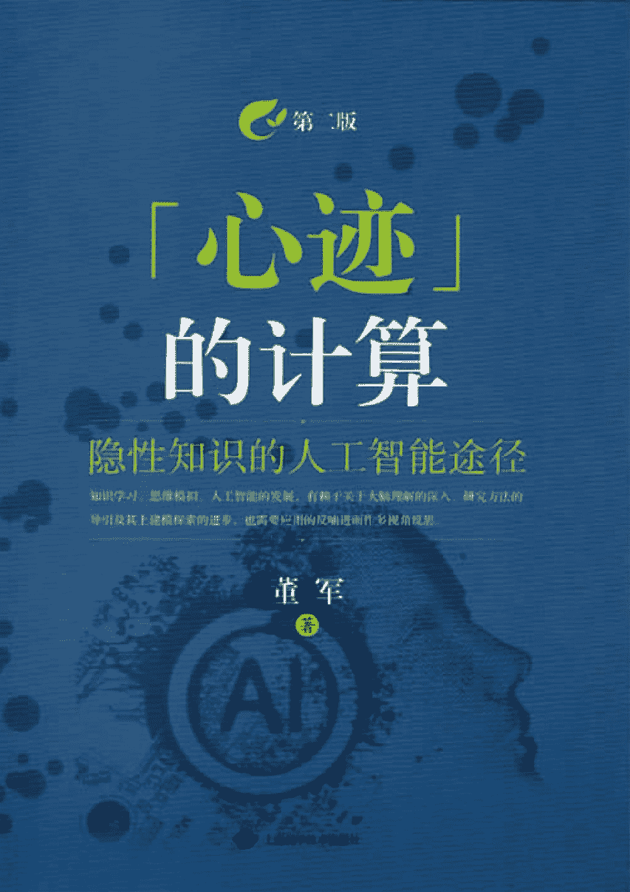

# 引言：心迹指向何方

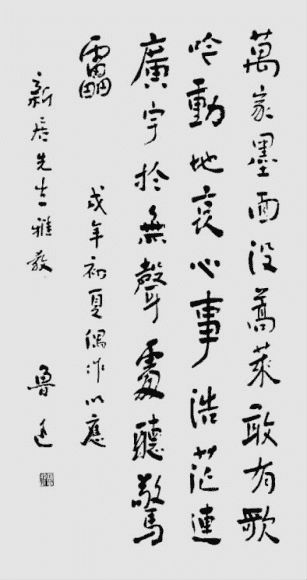

万家墨面没蒿莱，敢有歌呤动地哀。

心事浩茫连广宇，于无声处听惊雷。

戌年初夏偶作以应新居先生雅教 鲁迅［1］

智巧兼优，心手双畅。

——唐·孙过庭《书谱·序》

先民往往把思维活动归到心上，这是一种认知上的偏差，却也反映了在当时认知条件下将思考与最易感知的器官相联系的阶段性理解。衡量心脏状况最常用的工具就是心电图，它能描绘出每次心动周期收缩舒张时产生的电生理变化序列，是物化与生理层面上的心迹记录。与此相对，书法艺术承载的文化内涵与精神寄托，则能流露喜怒哀乐与情绪起伏，属于精神与心理层面上的心迹投射。本书同时触及两者，难免顾此失彼。

马克思在中学毕业前夕所著《青年在选择职业时的考虑》中写道：“在选择职业时，我们应当遵循的主要指针是人类的幸福和我们自身的完美。不应认为，这两种利益是敌对的，互相冲突的，一种利益必须消灭另一种的。人类的天性本来就是这样的：人们只有为同时代的人的完美，为他们的幸福而工作，才能使自己也达到完美。”［3］

“人类的幸福”外延宽广、理解不一，从根本上讲健康是幸福的前提，正因如此才有生命的延续、生活的体感与人生的追求。“自身的完美”关乎身心二者，一旦健康缺失，完美便无从谈起。汉语里的“心”除去中心位置的含义外，有两重指向：一为心脏器官，二为意识功能，即生理与心理。第一种取向的经典如《心脏运动论》［4］。第二种再分心灵，即精神表现，通俗读本如《心的简史》［5］；与心智，有时作智能的别称，也是本书的核心词。当前心脑血管病已成为威胁健康的头号杀手，首要应对是防患于未然，其次是及时诊治。信息化能提升效率与速度，智能信息处理则可实现更实时、更精准的服务。

唐代书法家孙过庭在《书谱·序》里提出“智巧兼优，心手双畅”。［2］“智巧”指智能与书写技巧，“心手”约指头脑与手部。如《孟子·告子上》载：“耳目之官不思，而蔽于物。物交物，则引之而已矣。心之官则思，思则得之，不思则不得也。”［6］文中“心”本指脏腑之心，实指思考的器官即脑，也就是心智之“心”［7，8］，如人们常说的“心旷神怡”“心猿意马”“称心如意”“心有灵犀一点通”里的“心”。

孙过庭还论及：“……神怡务闲，一合也……心遗体留，一乖也……”“……睹迹明心者焉”“贵使文约理赡，迹显心通……”“写《乐毅》则情多佛郁；书《画赞》则意涉瑰奇；《黄庭经》则怡怿虚无；《太史箴》又纵横争折；暨乎《兰亭》兴集，思逸神超，私门诫誓，情拘志惨。”“非其心闲手敏，难以兼通者焉。”都说明书法创作与心境情绪相关。唐代另一位书论家张怀瓘在《书断·序》中说：“……技由心付……心不能授之于手，手不能受之于心。虽自己而可求，终杳茫而无获，又可怪矣。”［9］同代的韩方明在《授笔要说》中指出：“然意在笔先，笔居心后……”［10］，同样在讲心手呼应。

在日常语境中，心电图与书法都是大众较为熟悉的话题。本书以二者为切口，梳理人工智能研究的阶段性进展，也算为人类工作添的一点尝试。其中计算机辅助心电图诊断面向现实需求，机器书法创作模拟则源于研究兴趣，本意只是在探索形象思维机器模拟的可能性，从审美角度看，作者并不认为其成果可与上乘作品相提并论。

基于此，本书后续围绕三方面展开：AI背景、思维科学基础与经验知识论述，即第1至第3章；计算机辅助心电图诊断与书法创作模拟，分别是第4章与第5章；由此延伸出的科学与艺术议题以及AI未来方向，分别是第7章与第8章。章节要点如下。

第1章：AI发展的起落。任何学科的形成都有源流脉络，不会凭空出现。回溯历史有助于洞察过去、把握当下、面向未来。本章简述AI发展历程并与当代规划对接，剖析早期乐观预期，介绍核心理念、关键人物与若干里程碑。

第2章：形象思维的难捉。思维模拟是AI的核心，形象思维属于原始思维、艺术思维、儿童思维的范畴，与科学基础的抽象或逻辑思维看似殊途。但作为一种思维形式，它出现最早也最难言说，若要完整模拟思维就不能割裂。本章涉及逻辑悖论、日常思维、钱学森倡导的思维科学体系及辩证思维。

第3章：经验知识的关键。经验是知识的重要来源，表面看与严谨技术无关，实则AI技术可视为经验科学，知识获取、表达与推理机制都与经验整理密不可分，逻辑推理与经验既有差异又有联系。本章阐述显性知识与隐性知识、领域经验与知识学习等，指出学习能力与常识积累相辅相成，机器学习亦然。

第4章：心电图见微知著。计算机辅助心电图诊断中，现有算法特征与医生诊断思维是否吻合、所用特征集是否构成疾病分类的充要条件，都制约可用性。心电图分析是作者思考隐性知识问题的起点。本章强调医生思维过程模拟、经验知识学习，以及规则推理与深度学习融合的意义。

第5章：机器书法若即若离。用计算机模拟书写并非新鲜，国内外已有大量工作，如毛笔物理特性、草书飞白随机效果的再现等，多非出于思维模拟目的。毛笔书法是形象思维的典型形态。本章从创作关键环节与实践体感出发，介绍模拟尝试的特点、思路、方法、结果及其教学应用设想。

第6章：科学与艺术的张力。科学追求真理，艺术追求唯美，二者是文明进程中两条独立而相互凝视的路径，本质、手段与呈现各异，既有交集也有影响。由书法创作模拟延伸至科学与技术与艺术的关系。本章介绍科技大家对艺术的论述、艺术中似是而非的观点，以期启发。

第7章：人机融合的转向。AI尚无统一系统理论，面对复杂人脑只能摸索前行，期间有乐观、停滞、突破与普及，始终是探索的场域。本章以人机结合为系统基本形态，讨论意识、境界等话题，隐性知识仍是绕不开的内容。

前两部分附有若干附录，后一部分未分主次，或为理念、或为材料、或为延伸，与主题相关程度不一，可视为外篇。核心仍是经验中的隐性知识。各章主要观念关系见图0-1。

AI发展可概括为从智能模拟 IS 经思维模式 TP 到认知模型 CM 的递进，外延逐步扩大。

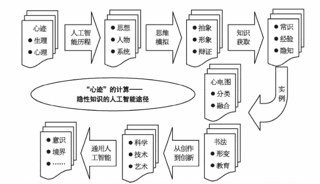

图0-1 各章主要观念及其相互关系

AI▷df｛IS，TP，CM｝

IS⊂TP⊂CM

知识包括领域 domain 知识和常识 common-sense。

Kn▷df｛DK，CK｝；

领域知识包括显式 explicit 知识和隐性 implicit 知识，隐性知识主要与经验有关。

DK▷df｛EK，IK｝；

根据经验 experience 的知识精化 refinement 指去除冗余信息、添加新内容、确定适用范围等。

IK▷df refin｛Exp｝。

本书核心在于隐性知识的建模，即隐性知识的人工智能途径。计算原本指依据已知数经数学方法求未知数的智力活动。随着计算机普及与大规模应用，计算无处不在，对象与内容日益丰富，远超数字本身，尽管机器内部仍以二进制表示。无论“心”指心脏及其生理活动，还是内心写照或心灵激荡，都是本书“心迹”一词的外延，前者属物质，后者属意识。

黄庭坚有《欸乃歌二章戏王穉川》诗：

从师学道鱼千里，盖世成功黍一炊。

日日倚门人不见，看尽林乌反哺儿。

但愿“心”“心”相映，不知得否？

参考文献

［1］秦硕.鲁迅书法珍赏.沈阳：辽宁美术出版社，2019：55.
［2］孙过庭.书谱·序／／华东师范大学古籍整理研究室.历代书法论文选（上）.上海：上海书画出版社，1979：124～132.
［3］卡尔·马克思.青年在选择职业时的考虑／／卡尔·马克思，弗里德里希·恩格斯.马克思恩格斯全集（第四十卷），中共中央马克思恩格斯列宁斯大林著作编译局，译.北京：人民出版社，1982：3～7.
［4］威廉·哈维.心脏运动论.凌大好，译.西安：陕西人民出版社，2001.
［5］盖尔·戈德温.心的简史.彭亦农，译.长沙：湖南文艺出版社，2009.
［6］杨伯峻.孟子译注（下）.北京：中华书局，1960：270.
［7］吉尔伯特·赖尔.心的概念.刘建荣，译.上海：上海译文出版社，1988.
［8］伯特兰·罗素.心的分析.贾可春，译.北京：商务印书馆，2010.
［9］张怀瓘.书断·序／／华东师范大学古籍整理研究室.历代书法论文选（上）.上海：上海书画出版社，1979：154～156.
［10］韩方明.授笔要说／／华东师范大学古籍整理研究室.历代书法论文选（上）.上海：上海书画出版社，1979：285～288.

# 1 AI 的起伏之路

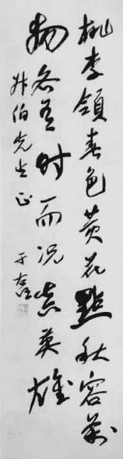

桃李领春色，黄花点秋容。

万物各有时，而况真英雄。

叔伯先生正 于右任［1］

计算机问世后，人们就有可能开发出这样的系统，其复杂性层次是过去想都不敢想的；由于计算机能够解释和执行其内存的程序，又启动了人工智能的研究［2］。

——司马贺

智能的诞生及其本质，与宇宙起源终结、生命诞生演化、物质结构与范围并列，为人类基本难题，其观念与呈现离生活更近、与人类关系更直接，然而其活动、过程与机制充满迷茫、困惑与期待，至今如“雾里看花”。除神经元规模估算、宏观功能粗略定位、若干生理病理特征可视化外，认知神经科学对大脑微观运作与神经元活动的剖析与理解，仍如“盲人摸象”。

## 1.1 智慧之谜

仰望苍穹，或万里晴空，或银河灿烂，或雷电交加，或晚霞绚烂，疑问随之：更远的“天外”是什么？有边界吗？那里有类人生命吗？宇宙如何起源？现说宇宙源于大爆炸，将终结于黑洞，大爆炸前是什么？理论假说有奇点、量子涨落、中微子等。

面对芸芸众生，生命如何出现与演化？进化论是合理解释，也有观点认为证据不足，甚至提出反例，但至少是一种理论，还有“人择原理”，别无系统理论，更无更有说服力的学说。

万物生长形态各异，是否共享基本结构？共享基础成分？新粒子不断被发现，是物理学进步，而基本粒子时常不再基本，物质基本结构不断被突破，如今称夸克，随着科技深入，神秘面纱层层揭开，惊喜不断。

这些问题尚无定论，从探索开始至今已非短暂，要到终点尚不晓其路程，借“行百里者半九十”之喻不算误。

一部关于两次获诺贝尔奖的居里夫人的传记中有如下充满文学色彩又具科学范的文字［3］：

“怎么会有人觉得科学枯燥无味呢？还有什么比支配宇宙的不变定律更醉人？还有什么比发现这些定律的人类智慧更神妙？这些非凡现象以和谐原则彼此联系；这种秩序，表面无序而实际有序；与之相比，小说显得空虚，神话显得缺乏想象力啊！”

智慧是机体进化、环境交互、身心互动的产物，由此又生出一个问题：人类智慧能否认识自身大脑？这依赖科技，也离不开浸润科学的人文精神；既要开拓未来，也要借鉴历史。人类对自然与社会的思索，既是抗争改造社会的现实需要，也是科学昌盛与文明进步的必然结果。世人探求未知的渴望无法遏制，各民族古老神话、寓言以推测、想象解释自然现象或赋予期待，是原始思维体现，也是形象思维表征。南北朝刘勰《文心雕龙》中首次提出形象思维。希腊神话里火神兼工匠之神赫菲斯托斯创造潘多拉。中国“嫦娥奔月”“龙宫探宝”历经数千年已成“可上九天揽月，可下五洋捉鳖”的现实。当然那只是行为结果，并非把握内在生命机制。

回望未断的中原文明，博大精深、辉煌灿烂，从楚辞到乐府，从传统医学到琴棋书画，文献浩瀚、典籍充栋。春秋战国制度变革推动文化繁荣，思想空前活跃、观念兼容并蓄。“百家争鸣”兴起，“诸子百家”并出。儒、道、墨、法及医家林立。其中以《老子》《庄子》《列子》为代表的道家偏重自然、逻辑。《老子》的辩证宏约、探天索地，《庄子》的汪洋恣肆、诙谐磅礴为后世津津乐道；《列子》哲理隽永、慧光闪烁，让后人领略思想光芒与文化传统。

钱学森编《关于思维科学》时收入李泽厚《漫述庄禅》，笔者多次阅读其著作后方知，他此举出于对中国传统思维的特别关注与期待。李泽厚称文章写出后钱学森专门登门交流，他说钱学森极其严谨，想从中国思想中发掘人类思想尚未触及的一面。这既体现钱学森的知识广度与眼光深度，也体现其考虑问题的全面深刻。一般人不会把现代科学置于中国传统文化背景下考量，他却视之甚重，或许他希望指出中国传统文化与现代科学之间有内在关联［4］。这是一个哲学家对一位科学家的深切认同与钦佩。

中国传统文化与现代科学思想在某种程度上“貌离神合”，渊源天成。《列子·汤问》记载“机械人”故事［5］，周穆王西巡归来，工匠偃师进献一个“歌舞者”。该“人”动作流畅、仪态万千，几乎心到即可成。周穆王信以为真，偃师当场剖开，原来内部由皮革、木料、生漆等构成，肝胆心肺脾肾肠胃、筋骨枝节皮毛牙齿毛发皆为假。组合后复活如初。取其心脏则不能言，去肝则失视，去肾则不能行。班输的云梯、墨翟的飞鸢自称最高技艺，闻此终身不敢言技。

读罢不禁惊叹其造艺精致与想象丰富。明代江东伟《芙蓉楼寓言》称其为“幻术鼻祖”［6］。一千多年后诸葛亮的“木牛流马”又是另一经典，虽《三国演义》作为小说增添“神来之笔”。“机械人”故事启示多重。

其一，无论为娱为奇，人工制造“类人”之物是古已有之的人类理想，实现需要漫长时间，远超个人生命。

其二，人们关注的是“机械人”的表现，即行为模拟，其内在生理机理是否与人类相同则另说。

其三，此类机械不必全由类人部件构成，内外有别，主次有分，是“生”与“物”的结合。

往事千年，生命不息，历史在时空隧道中前行。1939年，为解29个未知数的线性方程组，诞生了以制造者命名的样机ABC Atanasoff-Berry computer。这是电子与电器结合的机器，电路装有300个电子真空管执行数字计算与逻辑运算，用电容器存储数值，数据输入靠打孔读卡，采用二进制。1946年，莫奇利与埃克特设计制造了电子计算机ENIAC［7］。该机用18800只晶体管、70000只电阻、1500个继电器、6000多个开关，耗电150千瓦，占地167平方米，重30吨，每秒运算5000次［8］。因申请了专利，它长期被宣传为首台电子计算机。有“计算机之父”之称的约翰·冯·诺依曼参与研制，他为现代计算机提供基础结构，使今日所见的计算机原则概念化、清晰化。现代计算机理论先驱是巴贝奇。颇具讽刺的是，计算机进化方向与人类智能成熟方向相反。

## 1.2 精妙思想

人工智能研究方法常被归为符号主义、联结主义与行为主义。符号主义又称逻辑学派、心理学派或计算学派，最初也是最经典的方法。它以纽厄尔与西蒙提出的物理符号系统假设为基础，从逻辑看，符合人的一般思维过程，可视作脑内过程的一种映像。从家电如电冰箱、空调到列车飞机的控制，都有按预先原则实时调节或逐步执行的机制，以规则推理为基础，然而针对不同领域，规则的来源、验证与刻画都难以克服，比如人的某些经验难以言说，具不确定性，让机器理解会令其不知所云，此时推理难免不可靠或束手无策。

联结主义则从大脑神经系统结构出发，研究分层互联的简单神经元集群信息处理模型、能力及表现。1943年麦克卡洛奇与匹茨提出，大脑中每个神经元都是简单数字信息处理器，而整体大脑是一种形式的计算机器，它们被称为人工神经网络、神经计算仿真学派或生理学派。早期人工神经网络多为三层模型，进入21世纪后，相对于经典结构的深层神经网络得到广泛研究与应用。

行为派机器智能与符号派机器智能在起步阶段各走各路

从行为心理学出发的一支，常被划入进化论或控制论流派^[(\[2\]](#txt002.html#footnote_content_txt002_2))，其思路建立在控制器结构和感知-动作回路之上，关注智能在与环境持续互动中呈现出来的样子，更像生物系统的运作方式。罗德尼·布鲁克斯做出的赫伯特机器人就是典型，名字取自西蒙，这台机器把麻省理工人工智能实验室的办公空间当成活动场，在桌面上搜寻空易拉罐、捡起并带走。跨越障碍时它只用普通的红外传感器就能应付，如今家用扫地机器人仍在使用这一套路；军用平台则会借助 GPS 做决策。需要注意的是，行为和智能不在同一层级，行为只是智能的外在显现，只能部分映射内涵；同时行为高度依赖环境，感知与建模也就成了必然伴随的难题。

把各派长处拿来互补是可行的探索方向，但要把不同路线强行整合成一个整体，无论从实践积累还是理论沉淀看都言之过早。常说没有理论的行动是盲目的，在现阶段机器智能的发展中更应警惕的是没有行动的理论是空洞的。经典机器智能的理论底座是数理逻辑：17 世纪莱布尼茨给出最初设想，19 世纪布尔奠基、弗雷格完善，20 世纪初由怀特海、罗素与哥德尔集大成。

1955 年纽厄尔和西蒙在肖的协助下做出逻辑理论家，这个程序证明了罗素、怀特海 1913 年出版的《数学原理》前 52 个定理中的 38 个，部分证明比原著更精巧。王浩在定理机械化证明上贡献突出，让计算机证明了《数学原理》里数百条命题逻辑定理，并提出数学机械化的提法，吴文俊随后在该方向取得顶尖成果^[(\[3\]](#txt002.html#footnote_content_txt002_3))。机器智能提出 20 年后，雷纳特的博士论文把关注点转向如何从初等数学里发现值得证明的有趣命题，而非仅仅做证明。2009 年 4 月，《科学》报道了施密德和利普森开发的从实验数据中挖掘物理定律的程序，它对分析形式施加极小限制以捕捉自然关联。具体做法是预先装入若干基础数学函数和待分析数据，程序在输入集中辨别相关变量，从众多可能解释里挑出少数有潜力的，再生成描述关系的方程。例如仅从位置、速度数据出发，搜索就能收敛到能量守恒定律，而不需要事先的物理知识。虽然能以数学形式写出类似物理定律的方程，这类工作仍面临证明与解释的挑战，也未回答是否真正发现了新定理。新定理的诞生依赖敏锐眼光、整体把握与扎实训练，训练支撑把握，把握锤炼眼光，二者都离不开经验。

冯·诺依曼与图灵是 20 世纪的两大科技巨星，共同支撑了计算机及其上层机器智能的发展。古人谈立德、立功、立言三不朽，大致对应影响、实绩与思想。

影响层面，美国计算机协会最高奖以图灵命名，BBC 也将图灵列为 20 世纪最伟大科学家，候选另有爱因斯坦、居里夫人、屠呦呦；与冯·诺依曼博弈论相关的诺贝尔经济学奖不止一项。

实绩层面，冯·诺依曼的计算机体系结构设计^[(\[4\]](#txt002.html#footnote_content_txt002_4))深受图灵关于计算原则论文启发，沿用至今。图灵在现实发展上的标志性贡献是二战期间破解纳粹德国军事密码，被认为提前结束战争。

思想层面，图灵测试更多是哲学层面的讨论，如今看对技术发展的直接指导意义有限，未必以此作为系统能力的评判标准。机器智能始终在努力模仿人脑功能，不会在某个节点就停止。

图灵也受冯·诺依曼影响，冯·诺依曼 1935 年讲授的存储程序思想后来在图灵机中体现，他是 20 世纪顶尖数学家，也是兴趣极广的思想家，影响远超计算机与机器智能范畴。他本人对机器智能也有基础性论述，未完成手稿身后以《计算机与人脑》出版，第二版序言称其为心智领域的牛顿［12］。

据王浩撰写的《哥德尔》，在普林斯顿，爱因斯坦之外围绕哥德尔的还有冯·诺依曼、图灵等人。香农在一次访谈里提到在普林斯顿遇见过爱因斯坦、哥德尔、冯·诺依曼，但他们可能不记得自己。冯·诺依曼引用哥德尔定理并盛赞其超越同时代的工作。哥德尔一方面曾反驳图灵把人心与机器等同看待的论点［13］；另一方面强调其不完备性结果丝毫没有给人类理性的力量设立界限，而只是给数学中纯形式体系的潜能设立界限。这番话暗中批评了图灵，但他也认为 1936 年图灵的工作是自己有关形式化局限性工作的一大补充与完成［13］。

机器智能最早的奠基由图灵完成，他认为对机器或人脑而言，外在行为即标准，语言的唯一作用是执行这种标准。若机器能完全模仿大脑的外在表现，内部实现便无需深究，机器便在做算术、下棋、学习和思考。1950 年图灵在论文《计算机器与智能》［15］中描绘了机器智能前景，后改名为《机器能思维吗？》。换句话说，计算是否就是思维的一种形式？进而，机器能否通过反映智能行为的测试，这就是后来广为人知的图灵测试。

测试的核心是一个模仿游戏，参与者有询问者 C、男人 A、女人 B。C 与 A、B 在隔离房间内通过打字交流，其余无接触。C 的任务是判断 A、B 中谁是男性，A 的目标是让 C 判断错误，B 则帮助 C，最优策略是如实回答。

若用机器替代 A，计算机模仿某个人，C 需判断 A、B 中谁是计算机。可提任意问题，计算机竭力使 C 误判。当计算机在模仿游戏中的错误率与真人男女组合时相当，测试即通过。图灵测试本质上是言语智能的检测，需要常识，后来的大语言模型在诸多方面自然能通过。

此后图灵认为机器能否思维已无需讨论。1952 年图灵测试被改良为询问者每次面对的参与对象可能是人也可能是机器，且比例事先未知。该版本被 1991 年起的年度图灵测试竞赛采用，又称侃大山程序比赛，承诺授予首个通过者十万美元奖励［16］。

随后不断有系统通过图灵测试，实际上场景、对象应有客观标准界定，测试者也应深刻理解图灵测试本意^[(\[5\]](#txt002.html#footnote_content_txt002_5))；大规模通过测试是一回事，真正具备人的智能是另一回事，前者只是后者的子集。

## 1.3 乐观预言

这类计算机的出现标志着人类用机器模仿自身思维与智慧的新开端，为机器智能研究提供了强大支撑。此后人们带着日益增长的热情投入使用与研究，并在认识自然、改造社会中收获成果。背后隐含的动机是期待计算机像人类一样处理问题、认识事物。然而相当长一段时间内，计算机带来的主要好处仍是替代大量复杂数值计算和数据处理。电子计算机以超出预期的速度发展十余年后，1956 年机器智能正式诞生［17］。当年六月，麦卡锡、明斯基、罗切斯特和香农在美国达特茅斯学院组织了机器智能暑期研讨会^[(\[6\]](#txt002.html#footnote_content_txt002_6))，塞尔弗里奇、所罗门诺夫、莫尔、格伦特、纽厄尔与西蒙也参加其中，西蒙与纽厄尔后来共同获得 1975 年度图灵奖。

西蒙曾说：在发现符合经验数据的规律之前，必须拥有适当的数据，这些数据看起来好像是由一个平滑的数学函数所生成的［17］。这正是机器智能活动的诉求，机器智能的目标就是用机器模拟人类智能，电子计算机或专用计算机即是这种载体。通过探索实践，人们反过来加深对智能本质的理解，这同样是目标。所谓本质指核心功能、神经机制与处理过程，目前人类对智能本身仍知甚少，对复杂脑内过程建模还早。因此模拟多着眼于结果与效用，即外部表现，可以殊途同归。比如飞机受飞鸟启发而发明，都能翱翔，但内部构造迥异。现代飞机里大量专用计算机构成网络环境，具备一定智能，可代替驾驶员操作，这既是现实选择也是无奈。换言之只要求弱等价：相同输入得到相同输出即可，而强等价要求处理过程完全一致，中间步骤相同，难度更高。

有了计算机这一智能模拟的载体，情况不同了。虽然电脑^[(\[7\]](#txt002.html#footnote_content_txt002_7))与人脑大相径庭，但电脑会让我们学到人脑的知识，这些知识是我们光研究人脑永远也不会发现的［18］。这在当时带来的震撼无可比拟，关于机器智能的早期乐观预言在当时也情有可原。

1957 年西蒙认为世界上已有可思考、学习、创造的机器，且能力会快速增长，未来可处理的问题范围将与人类心智相当。
1958 年西蒙与纽厄尔预言十年后数字计算机可成为国际象棋^[(\[8\]](#txt002.html#footnote_content_txt002_8))世界冠军，并证明重要新数学定理；
1965 年西蒙预言二十年内机器将能做人类能做的任何工作；
1968 年西蒙再次断言：只要男人能干的工作，电脑都能干［19］，比图灵的判断更乐观。
1967 年明斯基预言一代人内即可根本解决机器智能问题；
1970 年明斯基预言三到八年内会出现具备普通人平均智能的机器。

初期信心极度膨胀^[(\[9\]](#txt002.html#footnote_content_txt002_9))，但研究很快遇到瓶颈：能演示一两个简单问题的方法在更广更复杂的问题面前失效，程序知识量太少，缺乏常识 common-sense knowledge 是首要难题，这使实现西蒙的预言相去甚远。背后也隐含着人类强迫机器按人类的路径发展的动机。

在计算机象棋中，深青年 Deep Junior 表现突出，却缺乏人类那种形态把握能力。机器智能的突破在于超越人类的成长过程^[(\[10\]](#txt002.html#footnote_content_txt002_10))。中国围棋九段之一的陈祖德曾比喻：医生诊断病情与棋手解死活题相似，水平低的棋手面对深奥难题花再多时间也白搭，高手稍加思索便能答出正解。遗憾的是医界高手太少，多少病人因此耽误。下棋、行医都难，棋谱医书众多不等于人人成高手，机器在计算速度和存储空间上可与人类互补。

曾国藩说：以围棋论，生而得国手者，上智也；屡学而不知局道，不辨死活者，下愚也。此外皆相近之质，视乎教育如何。教者高，则习之而高矣；教者低，则习之而底矣。［22］这里的教育即在正确方法指导下的经验积累。围棋有复盘传统以明胜负关键，大而言之即历史回顾。

当年预言未能兑现，直至今日仍棘手的原因大致有三。
第一，估计不足。一是未曾经历难知深浅，二是期待急切过于乐观。
第二，方法阙如。大脑之复杂被不得不承认是最难攻克的堡垒。
第三，工具缺乏。脑内过程与机器实现、宏观表现与微观机制间的桥梁仍像空中楼阁。

到二十世纪八十年代，有人认为最迟到 1990 年，电脑就可以充当你的医生。［23］如今看来不仅预言破灭，说法本身也需调整：机器不能替代人成为独立医生，而应作为诊断辅助。即便在今天，计算机在一个具体医疗诊断领域也难以独立胜任。一次次预期失灵背后是科技进步的艰难，其根源是对思维的迷茫，错综程度至今难以清晰把握。

放眼历史，乐观估计不少，各领域迅猛发展且交叉，给人日新月异之感。科学研究既要异想天开又要实事求是，平衡并不容易。

## 1.4 知识工程

1965 年费根鲍姆与 1958 年诺贝尔生理学或医学奖得主莱德伯格开始研究后被称作 DENDRAL［24］的启发式专家系统，用于有机化合物分析，也是后来众多专家系统的原型，在斯坦福大学的知识系统实验室完成。对于生物化学这类领域，既有通用原则，也有大量实际判断所需的特例。DENDRAL 可视为世界上第一个真正的专家系统，已用于工业与科研院校。研究动机有二：一是探究科学问题如何被解决和发现，尤其是科学家从经验事实中进行假设与理论推理的过程；二是希望成果将来能为其他科学家提供智能辅助。其工作体现了学术与商业的结合。1970 年他们推出更先进的 METADENDRAL，不仅能用已知规则推测化合物结构，还能将已知结构与数据库规则比较，生成全新规则。

1972 年起研究诊断血液感染与脑膜炎并推荐药物的专家系统 MYCIN［24］。若告知病人出现出血与痉挛，系统会尝试判断是否细菌引起。它引入依赖专家经验的可信度因子和不确定性推理。MYCIN 把医学世界看作由症状与疾病经验联系构成的网络，同时搜索过程中伴随规则获取过程。它附带知识获取软件 TEIRESIAS。多数评审认为其结果与专家自身判断相符。

1977 年第五届国际机器智能联合会议上，费根鲍姆阐述专家系统思想并提出知识工程［24］概念，机器智能研究因此转折，知识作为智能基础受到重视，推动机器智能从实验室走向应用。他强调严肃的应用问题与以应用为名的玩笑不同，必须务实。专家系统即具备专家能力或能像专家一样思维的系统，与知识密切相关。知识工程的基本思路是用机器智能原理解决需要专家知识的应用问题，包含三层含义：

●应用，即明确的任务或目标；
●专家知识，任何智能系统都需要各类知识；
●工程，利用工程化规范方式。

本质上，知识工程代表了机器智能首次广泛工业化。此间基础研究与应用开发同时获得大量投入，技术缺陷很快暴露，但仍有不少实用系统发布。1959 年费根鲍姆在西蒙指导下完成的博士论文开发了该领域早期的人类学习模型。初级知觉与存储器可模拟人通过辨别新旧单词差异来记忆单词的过程。费根鲍姆曾共同创立三家应用机器智能公司，其主要兴趣是使用启发式方法解决复杂计算问题。他与瑞迪因设计与构建大规模机器智能系统的先驱性贡献，展现机器智能技术的实际重要性和潜在商业影响而获 1994 年度图灵奖。

1984 年雷纳特启动 CYC［26］工程，目标是建立常识知识库为未来专家系统提供基础，再用类比推理解决问题，最终让计算机自行发现知识。知识录入者阅读报纸杂志、百科条目、广告时自问：作者假设读者已知的知识是什么，随后手工编写数百万断言，旨在捕捉人或机器理解百科全书所需信息。这些断言按领域和上下文分组，同一领域可有多组，因视角不同。1991 年雷纳特与费根鲍姆预言 CYC 将拥有人类水平的宽度与深度知识。CYC 包含日常对象与事件推理事实、经验规则 rules of thumb 及启发式规则。它包含数千个微理论，每个本质上是一组共享共同假设的断言。曾一度包含五十万术语、一点五万关系类型、与术语相关五百万事实断言。新断言不断以自动和人工方式加入，术语表示功能还能自动生成数百万非原子术语。CYC 自身也会在推理过程中产生大量断言。雷纳特认为在机器智能这样的领域，做经验主义科学家很有价值，即观察数据、做试验、通过计算机验证假设真伪［27］。关于 CYC 是否实现早期预期仍有疑问，其中隐含大量隐性知识，后来的数据挖掘似乎也在获取类似内容，只是未明言。

专家系统曾经被当作人工智能最有代表性的成果，但真正实现大规模落地的例子少之又少。随着发展，人工智能的研究版图已经延伸到谓词演算与搜索、知识表示与问题求解、自动定理证明、程序自动生成、模式识别、数据挖掘与机器学习、博弈、机器人、自然语言理解、计算智能等多个分支。按与专家系统的关系大致可分成三类：一是本身就是专家系统研究的议题，比如搜索；二是可看成专家系统的特化形态，比如定理证明；三是专家思维能力的子项，比如模式识别。计算智能并不直接复制专家完整的解题方式，但在实际项目里人工神经网络等手段常被联合使用，两者界限并不清晰。医疗场景能体现这种差异，有经验的医生擅长由资料归纳出假设，反向由假设回推原始数据就容易出错。

## 1.5 风云人物
除了图灵、冯·诺依曼这类划时代的巨人之外，几十年间还有大量开拓者共同塑造了人工智能的不同面向。知识工程的提出者费根鲍姆，在 IEEE Intelligent Systems 2011 年公布的人工智能名人榜上位居榜首【29】。

麦卡锡在推动 1956 年达特茅斯会议并为学科定下方向的同时，还打造了整套工具和方法，1963 年创立斯坦福人工智能实验室，也是程序正确性形式化验证的先行者。他对常识问题的关注催生了常识推理的逻辑基础，进而推动非单调推理与逻辑程序的发展。在符号表征与符号赋值的框架下，他设计出 Lisp 语言，既成为当年 AI 的主流实现语言，也是大量计算数学论文的起点。1969 年与海因斯合写的论文首次系统界定了情景演算问题，他还探讨过机器人自省与意识等议题。

1959 年，明斯基与麦卡锡共同创建了麻省理工学院计算机与人工智能实验室。明斯基在《情感机器》《心灵社会》里阐释了人类智能的结构与机能。他是人工神经网络的早期探索者，与派珀特一起奠定了感知器的基础，后期又对神经网络提出尖锐批评，认为情感表达比智能更容易实现。框架理论是他的另一项贡献，为知识表示提供了理论与实践支撑，他也推动了面向对象编程范式的兴起。

伯纳斯-李 1989 年提出的万维网与语义网是其与人工智能关联最密切的两项贡献，他既是理念提出者，也是推动、实现和守护者。1990 年代初他在 AI 领域工作时，知识获取的瓶颈之一是只能依赖专家或有限文档。万维网最初的设想是为了让全球高校和科研机构的物理学家更方便地共享信息。

恩格尔巴特是鼠标等交互设备的发明者，也是互联网先驱之一。他尝试用计算工具匹配人的能力，交集落在图形界面与自然语言命令，即交互式计算，这一想法可追溯到 1962 年。数十年间他持续探索更好的交互方式，实践愈发证明人机交互体现了人机结合的思想，是实现智能的可行路径。他还提出计算机支持协同工作等多个方向，并于 1997 年获图灵奖。

扎德 1965 年提出模糊逻辑，作为布尔逻辑的扩展，模型允许一切事物包括“真”都具有程度。它挑战了经典逻辑的非此即彼信念。通过对亚里士多德逻辑的放松，模糊逻辑把理性方法扩展到真值非二元的现实场景。起初遭嘲笑，如今已被广泛采用，用在消费电子、工业系统、医疗、物理等领域，也可视为对形象思维的一种刻画尝试。

乔姆斯基是语言学家、哲学家、认知科学家和社会活动家。他关于形式语言与语言习得、处理的成果深深影响了人工智能。1950 年代他为自然语言建立的语法规则奠定了研究基础，催生了大量自然语言处理及后来的计算语言学研究。他还提出了按表达能力对形式语言分层的 Chomsky hierarchy。

瑞迪的研究聚焦智能的感知与运动层面，如语音、语言、视觉、机器人等。他与同事开发了大词汇量的连续语音识别系统。他将技术用于社会与人类的前瞻性工作，使其区别于其他技术专家，被视为探索技术社会服务角色的先驱，创办了首个通用数字图书馆，扩大了人工智能的实际影响。

珀尔是计算机科学家兼哲学家，也是最早在经验科学中建立数学化因果模型的学者之一，其工作涉及不确定条件下的概率图模型学习、推理与决策。1980 年代中期，他与同事清晰论证了贝叶斯网络中概率独立性的表达与操作，并开发了在这些图表示中执行概率推理的实用算法，其中包括诊断推理，即某些变量如病人症状被指定，而不可观测的潜在疾病假设的概率需要更新。

尼尔森与同事哈特、拉斐尔共同提出 A* 启发式搜索与 STRIPS 自动规划系统，几乎所有人工智能教材开篇即介绍，只要解存在就能找到。只要提供可接受的启发式函数不高于真实代价，A* 就是最优且高效。STRIPS 为把定理证明技术用于问题求解提供了新思路。尼尔森也以机器学习、模式识别与计算智能著称。

魏泽堡曾发明一种人机对话程序，能让使用者误以为在与真人交流。后来他转为人工智能的批评者，更关注该研究什么而非能研究什么。他认为把人工智能用于导弹防御等军事领域是不当推广，体现社会责任感。更尖锐的批评来自德雷弗斯，其核心论点是计算机能做到的就不是真正的智能。这类反向意见促使人们更深入思考人工智能的本质、意义与作用。

库兹韦尔对人工智能充满信心。16 岁时他写出能分析著名作曲家风格并创作相似作品的音乐程序，后引入隐马尔可夫模型进行语音识别。2005 年他提出的“技术奇点”观点认为机器终将具备与人类同等的智能，包括意识与情绪，直接回应了人工智能能否超越人类的经典命题，引发新一轮探索与争论。盖茨曾称库兹韦尔是他所知最会预测人工智能的人，技术发展支撑了他的乐观。

1981 年诺贝尔生理学或医学奖得主休伯尔与威塞尔在 1960 年代关于猫视觉系统中局部感知与方向选择性神经元的发现，以及多层网络可有效学习的结论，为人工神经网络建模提供了启发。2006 年辛顿等人提出深度学习概念与深度置信网络，本希奥等人提出非监督贪心逐层训练算法，勒昆等人更早实现的卷积神经网络效果突出。这次深度学习突破带来人工智能新高潮，三位因相关贡献获 2018 年图灵奖，成为近年高潮的开创者，其理论工作奠定了人工智能遍地开花的根基。

乔丹获 2022 年度世界顶尖科学家协会“数学与智能科学奖”，表彰其对机器学习理论基础及应用的根本性贡献。他主张人工智能应是集体，契合人机结合思想。他兼具美国国家工程学院院士、科学院院士与艺术和科学学院院士身份。布雷曼被誉为机器学习贡献最大的统计学家，苏茨克维等人则是企业推动人工智能技术深度融入生活的代表人物。

有观点认为科学革命并非仅靠少数天才骤然发生，而是可辨认力量与世代积累的产物，在梳理历史线索时需剔除神话。无论该观点是否完全成立，除顶尖人物外，还有大量优秀从业者，或交流其中，或辅助成事，或实现落地，难以尽数，其贡献却真实存在。以上仅挑选了具有划时代思想、开创性理论或里程碑技术的代表。

## 1.6 典型系统
2016 年 1 月 28 日，《自然》以封面文章报道【32】：谷歌旗下 DeepMind 开发的 AlphaGo 以 5 比 0 击败卫冕欧洲冠军樊麾。AlphaGo 融合深度神经网络与树搜索，卷积层构建位置表达，有效压缩搜索深度与广度。程序借助价值网络评估局面，用策略网络挑选落子。深度网络的训练结合人类职业棋局的监督学习与自弈的再励学习，后者提升了前者性能。这是计算机程序首次在完整且不让子的条件下击败职业选手，原以为要十年后才能实现。此役也表明人工智能依赖对大脑的深入建模。作者当时有感而发：浅智漫行至地主，深灵速步成天惊【13】。

谷歌的自动驾驶研究早于特斯拉，下围棋程序哪个更难？机器目前没有与人对应的经验过程，机器学习的经验在生成方式与发挥机制上与人成长积累的经验不同，对计算能力的依赖程度有别，但并非简单与否之别。若暂不谈安全，几岁小孩学开车至熟练，比学围棋跨过业余阶段要容易得多，那是技术活。即便从小学棋，能入段者寥寥。电子计算机诞生 70 年后，计算能力飞速提升，国际象棋程序到 20 世纪末才称冠，围棋程序则在人工智能 60 周年时一举成名。有趣的是，几乎所有突破都始于学术中心，并借助产业资源落地。

自动驾驶与下棋哪个更难并不能一言蔽之，开车没有“九段”，熟练且合规即可，二者共性是模式识别。自动驾驶的部分突破甚至早于围棋程序。若把算法比作鱼，算力是条件而非决定因素，大数据才是水，人工智能方能如鱼得水。自动驾驶达到高级水平很难，但从模式识别看并非不可识别，只是设计时未考虑到某些情境。这也让人体会难易之别：连人都容易回避或难以应对的情境，人类智能本身亦难处理，往往不在人工智能初始范畴。

比如比较华罗庚与其学生陈景润。华罗庚的社会贡献与整体水平是中国第一，陈景润的“1+2”难度却是中国学者所及最大。如何比较？再如王选的创新与产业是一面旗帜，但在学问层面吴文俊更高。他们都是国家最高科技奖得主。能否分别对应自动驾驶与围棋程序？不过要注意：

与机器对弈，棋手始终在明处，面对的是从未遇到的“新手”，且与对面而坐的人类对手不同；
机器无感情，不会有体力疲劳、心理波动导致的思维障碍，有经验棋手初遇这种对手时难以适应；
计算力优势依然明显，下围棋倚靠直觉经验也需计算，这是机器强项，云计算赋予其群殴之能。

人工智能发展史中不少名词对应脑功能，如推理、学习、思维、认知，并出现类脑智能等新说法。厘清概念是前提，要求概念出于同一体系、处于同一范畴。若出发点、对象不同而内涵不清、外延混杂，就缺少比较基础。人工智能与类脑智能是同一目标的不同阶段，还是同一对象的不同侧面？类脑无疑是智能模拟的一种路径，前者不成立；二者的交汇表明并非视角差异。人工智能初衷就是模拟大脑，让机器像人脑一样工作。若不区分其提出依据及与此前概念的关系，知识层面缺乏积极意义，应用环节则易生不必要的争议。

人工智能依赖对脑内思维机制的理解，是唯物主义；在机理不明时尝试则是辩证法。认识论给出从感觉、知觉到表象的基本概念，需要在此线上更新内插或外推概念，从而由思辨宏观逐步走向具体微观。目前关于人脑的研究，要么如大脑皮层功能定位过于宏观难以形式化，要么如神经生理研究过于微观，时空分辨率不足，难以打通微观结构与宏观过程的联系。

迄今人工智能的工作只能对大脑各高级功能分别模拟，是系统论、还原论与局部逆向工程的结合，即区分高级功能后分而治之，每个模块可借助基于神经元功能的人工神经网络，尽管其规模或复杂性可能仅相当于脊椎级、视觉皮层或低等动物水平。

上世纪 90 年代曾有文章称“人工智能需要韧性”，当时不明其背景，大致理解为需耐得住低谷并长期探索，那正是人工神经网络“退热”时期。再过十余年，深度神经网络再度升温。这种间隔与程度能否反证韧性不得而知，长期努力却是明确问题、克服困难的前提。未被清醒认识或达成共识的问题即便被冷落也可能暗含期待，而真正的持之以恒极为不易，财力、人力与导向缺一不可。

有趣的是似有这样一条定理：一旦某种思维功能形成算法，人们便不再视其为实际思维的基本组成，而人工智能的核心任务始终指向尚未形式化描述或编程的部分。明斯基区分人工智能的自顶向下与自底向上，前者试图在宏观上与人脑表现一致但细节难对应，如物理符号系统假设；后者构建类似人脑的细胞节点及其连接，如人工神经网络。围棋软件重视强化学习，着力模仿人类行为并从环境获反馈，仍以深度神经网络为基础，大语言模型随后跟进，可视为新一代行为主义、连接主义与符号主义的递进。

## 1.7 规划五向
悠久岁月中，人类破解心智奥秘的渴望日益迫切。2013 年初，欧盟与美国分别宣布投入巨资启动“人脑工程”与“推进创新神经技术脑研究计划”，欧盟旨在用巨型计算机模拟整个人脑，美国着眼于探索所有神经元、神经回路与大脑功能的关系，这一计划有助于加深对帕金森病等疾病的理解，并为人工智能进展铺路。这只是人类理想之一。2014 年日本亦启动大型脑研究计划。十年后欧盟计划结束，远未达预期。

2017 年国务院印发《新一代人工智能发展规划》。牵头者潘云鹤院士指出，人工智能经历 60 多年积淀，几经沉浮，特别 2010 年后随移动互联网、传感网、大数据、超级计算等发展，呈现新变化：一是从人工知识表达转向大数据驱动的知识学习与推理；二是从分类型处理多媒体数据迈向跨媒体认知、学习与推理新水平；三是从追求“智能机器”到高水平的人机与脑机交互协同融合；四是从聚焦个体智能到基于互联网的群体智能；五是从拟人化机器转向更广阔智能的自主系统。这些变化使人工智能进入新阶段。跨媒体智能是潘院士在综合推理思想基础上面向新时期媒体检索与分析提出的概念【33】。

《规划》提出的五大方向中，大数据智能自然依赖异构、有冗余或不一致且规模巨大的数据。社会数据虽海量，却仍呈孤岛状，如医疗数据各家医院自有难以及用，躺在存储中。政府虽有规定与专项项目，实际效果有限。另一方面，人类已步入信息社会，信息量递增，“信息爆炸”已成旧词。

大数据智能是社会现实与技术必然，但非智能本质。智能不一定依赖大数据，如生活中熟视无睹、习以为常；人的学习成长也并非都靠大数据，如推理、演绎。

若人接收信息越多且能去粗取精，信息即为力量；若不能透过现象分析，易落入人云亦云、莫衷一是甚至自相矛盾。由医患矛盾到国际局势，始终充斥及时而片面的新闻，人们易简单下结论并形成思维定式，实则凭生活经验与基本规律本不至于被左右。一件事的来龙去脉、前因后果往往复杂，做到洞若观火谈何容易，仅凭数据易受“谁声音大听谁的”左右，而合乎逻辑的声音才是依据，才有价值。正如应试教育的“题海战术”，不做题不行，却非上策，能灵活应用并纲举目张才是更高境界。

人利用机器，机器辅助人，正如钱学森致马希文信中强调的“所谓智能机也只是人的助手而已”【34】。混合增强智能与“人机结合”理念异曲同工，可穿戴设备大幅拓展了原仅指通用计算机的能力与范围，前者目的在“增强”，后者针对具体问题，二者均依赖数据。自主智能才是基础与核心。

社会性是智能产生与发挥作用的特征，在群体环境中智能得以进化，群体智能因此成为必然研究对象，其提出有自然脉络。博弈论是可参考的理论之一。生活中，有经验司机脑中常先浮现到达目的区域的一两条线路，速度极快，再逐步细化，这与机器通常的搜索方式并不相同。

陈霖院士曾提出，人类视觉系统在处理图像的很早期就能几乎不费力地提取大尺度的拓扑属性，我们对外部成像的感受更像是先把握整体大势，再细化局部。先是图形与背景这类大范围关系的感知，随后才对细节进行辨认。讽刺的是，计算的难度与人眼识别的难度恰好相反，甚至可以说是背道而驰。由此可推，思维并非普通的算式演算，而是一种更高阶的计算。

视觉判断的次序是从整体开始，越整体越靠前：先拓扑，再射影几何，继而仿生几何，最后才到欧几里得几何。而人类的逻辑思维以及数学史的演进方向则截然相反，拓扑学反而是几何学最新的分支。陈霖院士关于视觉计算、拓扑结构与功能层级模型，以及认知与智力可能与认知的计算理论存在本质差异的判断，对思考问题很有启发。我们不可能指望超出时代发展与技术水平的历史性指导思想。但古人智慧并非靠技术堆砌，譬如都江堰，李冰父子以“火烧山”的办法大幅提升工效，这就是智慧的体现，并没有依赖特殊的技术手段。

国内学界也有不少独到探索。王守觉院士晚年跨界提出高维仿生信息学，在院士群体中颇为罕见；周昌乐教授兼具理工训练与深厚的国学功底，足以切入非逻辑的禅宗辩证思维模拟等难题；王飞跃教授的平行理论是对人机结合思想的拓展与现实化；周志华教授在机器学习中推动的深度森林方法，已跳脱出大多数应用性研究的范畴。

1.8 语言模型
2023 年年末，《自然》评出年度十大人物之时，一位非人类也榜上有名，美国 OpenAI 推出的对话式大模型 ChatGPT。面世后它迅速占领风头^([\[14\]](#txt002.html#footnote_content_txt002_14))。不少 AI 专家在感叹不敌的同时指出其短板：训练成本高、会出错、距离真正人工智能尚远。批评虽有道理，却多流于空泛。大型语言模型本质上是一种探索，成果亮眼并不代表已经跳过成长阶段。

有些质疑本身就是伪命题，先预设“ChatGPT 无所不知无所不能”再加以攻击，开发者从未如此宣称。

这种模型是否意味着常识问题迎刃而解，或被纳入演化进程？ChatGPT 本质是学习后的产物，它能像专家一样给出丰富经验知识，是否涵盖常识，需要实测或分析来判断。这取决于它能否积累经验，其训练材料全部是现成文本。它是否具备形成隐性知识的机制，尚待观察。

拿中医来说，信息杂乱。人工智能需要标注数据，或像一篇合乎文法的文章那样能够自主学习句子间的逻辑与顺序。而中医典籍多为思想性文本，各家观念又互相矛盾，数据丰富与知识提纯是首要任务，且中医学习不能只靠书本^([\[15\]](#txt002.html#footnote_content_txt002_15))。

有人提及不可解释性，这其实是人工神经网络的共性。神经网络一直是“黑箱”，层次越深越黑，这并不妨碍应用，就像中医机理不明仍有疗效，不必因此全盘否定。

也有观点认为既然可以模拟海量神经元互联，就能解释其表征的神经活动。规模并不自然带来微观相互作用的显式理解。好比万人大会，位置和人数清楚，大伙相互影响却不确定，他们可能安静聆听也可能鼓掌，表情动作间的因果、心灵的“感应”都难以把握。对客观解释的期待仍在未来，类似 MRI 靠诺贝尔理论支撑。即便推理规则也未必完全对应人类决策，物理符号系统假设中的“假设”已暗含此意，规则可能粗略，也可能不具体。可解释性研究不应局限于连接主义的人工神经网络。

对 ChatGPT 生成的第一人称标题“我为什么写《哥德尔、埃舍尔、巴赫：一条永恒的金带》”的散文，作者霍夫斯塔特认为其文风与其几乎毫无共通，内容也与真实写作缘起完全不符。外行可能觉得谦逊浮夸的混合很真实，但他认为与真实声音和真实故事相距甚远，近乎可笑^([\[16\]](#txt002.html#footnote_content_txt002_16))。要写出融合史料、个人经历、视觉感受、审美偏好与思维灵感的文字，仍不简单。总体来看，该书所列的智能特征，ChatGPT 已呈现相当程度：

●对情境保持灵活反应；
●擅长利用机会；
●能理解模糊或矛盾信息；
●分辨情境中的主要与次要因素；
●在差异情境间发现相似；
●在相似事物间找出差别；
●把旧概念重组、赋予新用法并提出全新概念。

……

大语言模型带来的启示很多：算力、数据、网络结构，量变可致质变；通往人工智能的路径并非预设那样；物质与意识的关系仍难描摹，也许意识并非纯粹的精神活动^([\[17\]](#txt002.html#footnote_content_txt002_17))。

粗略看人工智能的发展历程，好比登山，大致有三点原因。第一，中途疲惫，离顶峰仍远，稍作休整，回头看已走过的路程与弯路；第二，评估当前位置是否适合下一步起点，能否直上，还是需另寻更优路径；第三，走过一段路后，选择已不同于山脚时的意气风发。这正是“以史为鉴”的意义。

1.9 本章概要
人工智能各学派在不同思想指导下涌现的若干里程碑如图 1-1 所示。

●发展由杰出思想奠基、乐观预期开篇、曲折推进贯穿，成果丰硕，或许当下仍显乐观；
●三大学派是对既有工作的总结，系统论、还原论乃至逆向工程只是概括性说法，方法论仍待完善；
●预先规划是人类经验的结晶，保障事业正确前行，但人工智能的发展似乎难以完全照此突破。

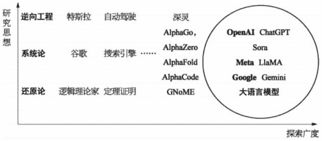
图 1-1　人工智能里程碑：一方面，先是定理证明，不需与环境交互，随后搜索引擎面对的知识量骤增，交互虽简单，只是一词一句，再到自动驾驶进入开放环境，随后围棋程序依赖对交互后棋局的判断，进而到蛋白质结构预测与新材料结构发现。另一方面，大语言模型迭代迅猛，既掌握广阔知识，又处在动态开放环境，对话流畅能力突出，进而出现根据提示模拟真实世界的 Sora 文生视频，其后续呈现令人期待。

后续两章将在人工智能背景下讨论思维科学与知识学习议题。

路当平处能持重，势到穷时妙转移。
只惜功多人不见，艰难惟有后人知。
——俞樾《舟中三君子诗·舵》

[\[15\]](#txt002.html#footnote_quote_txt002_15)前不久读到一篇谈“机器化学家”的文章，文中对比了传统研发生态与智能驱动路径，称前者可能拖到 1400 年，后者在数据与优化加持下五周可完成。暂且不论“范式”一词是否贴切，如此悬殊的时间差暗示没有算力支撑此项工作几乎无法推进，过去只能被搁置。我向一位化学教授请教，差距是否被夸张或两者目标根本不同。答复是肯定的。把一切难题都归结为数据是否到位，这种思路显得过于简化。

[\[16\]](#txt002.html#footnote_quote_txt002_16)一位师兄的孩子自幼在美国长大，对历史很有兴趣，高中暑假回国探亲特意到我们实验室体验了两周，之后进入美国名校读计算机，读研却转而投身历史。他的成长与教育背景，将让今后的史学研究更有底气。这个例子没有削弱读文科的价值，而是在强调读的方式。阅读向来是文科的基础，已不问学生是否落实，有人认为人工智能时代记忆型知识随手可查，阅读的意义就淡了，这属于误解。那位博士的学位论文，绝非 ChatGPT 所能替代，他亲赴档案馆搜集并梳理的第一手材料，便是互联网检索难以覆盖的。

[\[17\]](#txt002.html#footnote_quote_txt002_17)徐冬溶教授说过，他曾做过一个怪梦，梦里 ChatGPT 在吸收海量知识后自然长出了意识，于是他感到物质与意识或许并无根本分野，半夜惊醒。想起小时候练气功，师傅教动作时还要求意念配合，当时觉得难以理解，因为缺乏合理解释。后来他转变了想法，觉得未必不可能，因为迄今意识产生的机制仍是谜。由此推想 ChatGPT 也可能“长出”意识。

#2 思维迷局

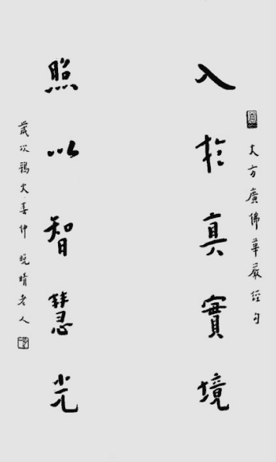

大方广佛《华严经》句

入于真实境，照以智慧光。

岁次鹑火春仲 晚晴老人［1］

比如学生与一位科学大家讨论，学生觉得毫无头绪，老师却说很清楚。学生回去细拆、动手实验，反倒证明老师正确。缘何学生看不透，老师却一语点破？若我是学生，必然追问依据。老师的说法是说不清，多学多练，经验积累到了一定程度自然能做到。这说明并非纯粹科学，而是经验沉淀，是形象思维中的直觉，也是常说的抓住了问题的要害［2］。

——钱学森

一阵风雷天地宽，九州雨雪心灵远^([\[1\]](#txt003.html#footnote_content_txt003_1))。

人工智能的内核是对思维的模拟。思维是人脑对客观世界的主动反映，既有概括性也有间接性，前者指向事物的本质与共性，如自然之巧、天之辽阔、智之深奥；后者是通过媒介或环节起作用，如借助计算机及其算法复现生命起源条件，解析宇宙射线与星际物质。对象、背景、视角与方式不同，结论自然分岔。思维路径映照了人们看事物的习惯、态度与世界观，不同特征使模拟难度加大。

##2.1 事实逻辑

探索中悲观不利于理清方法，盲目乐观则易轻视困难。可喜的是人工智能在不到“古稀”之年屡次超出预期，时过境迁，依旧是年年除夕团聚后的冬去春来、云卷云舒。也许某天会彻底明朗，也许长期处于可望而不可即。逻辑既能带来清晰，也会让人束手无策。

罗素曾提出“理发师悖论”：某理发师声称只为居住地所有不为自己刮脸的人刮脸，也只服务这群人。求刮者络绎不绝。某天他照镜发现自己胡子长了，能否自刮？若不自刮，他就属于“不自刮者”，按约定就该自刮；若自刮，他又属于“自刮者”，就不该自刮。理发师进退维谷。

国内古籍也有近似故事：东方朔私饮汉武帝令人取来的君山不老酒，被欲斩。东方朔说：“陛下杀臣，臣亦不死；臣死，酒亦不验。”^([\[2\]](#txt003.html#footnote_content_txt003_2))类似悖论却不甚严谨，“不死”指不会自然死亡还是不能被杀？生活中类例不少。

比如金庸评传记：“人家写的传记不对，全部是假的，我可以肯定地说一句，完全没有一个人来跟我谈过。我自己不写自传。写自己的事，有好有坏，坏的事自己不会写，一本书全讲我自己好的，那本书就是假的。”［3］虽针对本人，也可推广：

若作者从未与传主交谈，按第一句，传记是“假的”，多半是二手材料加臆测渲染；

若作者与传主交谈过，采用了传主说法，而传主不谈缺点，按第三句，仍是“假的”；

唯一例外是传主说了缺点，而传记中却不见缺点。于是只有写出传主之“坏”的传记才可能不是“假的”；

于是又现悖论：笔者见到的写传主“坏”的传记，作者往往并未与传主谈过，比如写袁世凯，又回到第一句。

有些传记拼凑草率，有些一味颂扬，有些素材真伪存疑，还有的是重复。顾颉刚说少年时看书常生怀疑，却总以为是前人定论不会大错，其实近代史籍、近人传记和古书一样混乱，比如夏代年数就有六种之多。［4］可知相当比例的传记不必阅读。

人们总觉得“身临其境”更真，照片再美也不及亲历。即便互联网时代，渠道变宽了，就像水管变粗，水未必更清。

笔者自九十年代初起阅读人工智能书籍，第一印象是推理，属于逻辑范畴思维过程的程序化实现，数年后接触人工神经网络著作，才知机器学习的含义与过去理解不同，后来读到博弈论论文，才逐步明白人工智能是在试图用机器模拟脑内机制，如造飞机依赖空气动力学一样需要方法指导和理论支撑。假定前提成立，想超越同步成长的人类，就像人无法抓住自己的头发把自己提离地面，逻辑上自相矛盾，而人类自身也在进化。重读王浩的《哥德尔》时注意到他的推测：“我觉得，根据人们今天的信念，正如在不久以前的地质年代出现了人，预料在相当遥远的未来将要出现更高的智能才是比较合乎理性的。”［5］不论“相当遥远”的尺度如何，“更高的智能”载体是人还是机器？若人工智能仅靠人类设计后“哺育”其成长，至多造出与人脑一样的人工脑，超越不了人类。若它能自我发育、进化，理论上情况会根本改变。以牛顿第二定律类比，设`F 1＝m1a 1`，`F 2＝m2a 2`，`m1`和`m2`分别对应人脑和按脑神经结构设计的人工神经网络，`a 1`和`a 2`分别是人脑和人工神经网络的进化加速度，若`m1`不弱于或强于`m2`，但`a 2`大于`a 1`，将来某时`F 2`就可能大于`F 1`。但要质变，基础、生存环境和时间积累缺一不可。这里的“基础”指类脑结构，未必要求完全搞清大脑机理，但复杂性很高，非短期可达。

进化论可供参照，“适者生存”是达尔文总结，人类进化并无事先指导。如今实践走在前面。人工智能是技术或工具本身不是科学，可为科学服务，对人类而言意义更多在于辅助日常工作或解决棘手问题，当下离“成人”还远，一个人只会做题显然不符合培养目标，融入生活才是根本。成熟与成长阶段划分各有见解，以下几点可以明确：

第一，仿生基础、理论方法和系统呈现方面仍有众多未知与缺陷，这至少是本世纪中叶百年前的情况。

第二，大语言模型针对的是语言及其思维功能，是人类智能的一个侧面，比如语言天赋极佳的小孩可以做脱口秀，并不等于能独立解决专业问题或具备系统设计能力，理解力、概括力、执行力都离不开丰富知识与数据。

第三，像中医脉象体征的感知与分类，没有数据难以为继，即便有了足够规模的数据，大语言模型也没法立即给出结果，因那建立在具体分类方法基础上，没有学习方法或清晰的诊断规则集，计算机无计可施。书法创作模拟亦然，输出控制缺乏细节依据。

未来人工智能应能自主面对各类任务，进而定义任务并评估任务价值。无疑近年进展迅猛，但智能模拟的当前轨迹是渐近线还是又一次抛物线，目前尚不明朗。

##2.2 决策优化

有一次，笔者与老同事从外地回上海，原计划如此，因此临行前想到是否预购上海到苏州的火车票，因为机场和火车站都在虹桥交通枢纽，若不是这样，按个人习惯不会提前购票。实际飞机晚点近似常态，最后笔者仍未提前购票以备不测。果然因台风可能经过，飞机延误一个多小时，没能赶上到苏州的末班高铁，于是当晚住在上海。这是经验导致的选择。

另一次，笔者在南京办事后根据距离选了经天津去秦皇岛的线路，看似比到北京再过去近些，便在车站买了去天津的高铁票，到天津西站才发现早约一小时到天津南站的车更近却无票。进站后提前上车找了个空位坐下，列车员经过时说明原委，他允许坐了近三小时才有人上车。该车正点到天津南站是 9 点。笔者想 10 点从天津站出发的火车应该能赶上。不料高铁也晚点，延约一刻钟。据司机说天津南站到天津站有四十多公里，而天津西站到天津站仅几公里。司机尽快赶到天津站后，因来不及取票径直进入，火车晚点尚未检票。到检票口，笔者想凭身份证进，检票员说非高铁动车不可，这与一般印象不一，于是问取票还来得及吗，答来不及，最后他们还是让进，说要另外买票。到补票处说明情况，列车员查身份证，反复看订票短信，说查不到完整信息，等了很久，还记下若干行内容，说可证明订过票，到站时要陪着下车与站台交接。没明白为何如此复杂，列车员的认真也非以往所见。

这段几个小时内发生的事告诉我们，不能忽视必要的分析与综合。比如从北京走要远一些，但可选车次多不少；天津各站间的距离应预先了解，不能想当然；“凭身份证直接上车”也不能含糊，否则只会招致麻烦。

再如很长一段时间里杭州与苏州间的交通主要是轮船，笔者第一次去杭州是在高一暑假，坐了一夜轮船，当时有火车汽车，通常首选京杭大运河上的船，尽管河水黑臭。后来公路质量提升，乘汽车的人多了，乘火车要绕上海。笔者在杭州学习期间，多数情况坐汽车往返。铁路提速后选择火车成为主流。这是三选一的生活经验。

更早先，笔者小时候在无锡江阴舅舅家下雪，因知道各地情况不同，就问苏州是否下雪，他想了会说不下。后来回苏州见母亲，问那时是否下雪，母亲说下了。问这个问题是因为知道一点常识，舅舅那样回答是凭经验两地天气不必然一致，据此决策会有误。经验有待积累、归纳、分析、精化，使其合乎逻辑。

有次参会，会议室桌上有矿泉水和茶水，因喝茶会影响夜间休息，按以往经验多数要延迟两小时才能入睡，而水是必需的，所以一直选水。但一瓶喝完午间有点口渴还是顺手喝了茶，此前服务员多次过来添茶都被示意不必。人的决策和选择往往受多重目标约束，笔者“明知故犯”，难以说清原委。

某天上班到站台，平时乘的公交车似乎刚过，下一班还有不少站，又是下雪天，于是犹豫中上了另一路公交车拟换乘，不料因想问题未及时下车，询问司机后在一个站下，已是反向三站，后面转了三辆车才到。尽管日常那路车估计也会晚些，笔者仍觉得这类日常小事的决策并不简单，是日常习惯、临时选择与交通路况综合作用的结果。

早期的人工智能想利用计算机模拟人类的演绎能力，通过一系列选择让解题过程比依赖记忆更简捷。但困境让人不得不反思归纳的重要性及其不可替代性。

##2.3 预测归纳

一次笔者应邀到甲骨文发源地安阳参会报告书法创作模拟工作，一位甲骨文研究者在介绍相关知识时提到占卜。笔者问，《周易》也源于安阳，甲骨文与周易占卜有何关系和不同，对方说那是专业问题未作正面说明。历史上甲骨文与《周易》都关联古都安阳，都涉及占卜。这类行为表现的思维过程是可以探究的，也可尝试用现代科技手段证伪。比如“八字算卦”除利用时间段外，还依赖什么信息？其推演过程如何一步步递进？经验知识如何被利用？这些也是人工智能面对的话题，对理解形象思维机制有帮助。其结果偶尔“有准”，多数情况下莫衷一是，因而说服力不足^([\[3\]](#txt003.html#footnote_content_txt003_3))。这件事与中医有一些相似：

第一，是中国传统文化发展中与生命相关的现象；

第二，与现行科学不合；

第三，思维机理不明；

第四，缺乏统计意义上的实验与分析；

第五，容易被归为伪科学。

中医有疗效与手段，算卦则无从谈起。但放宽视野，能否像“中医现代化”一样探究算卦本身？就如原始思维虽幼稚、粗疏，却创造了甲骨文本身。

甲骨占卜过程说法不一，易经算卦结果也就是 8 种、64 种或 324 种等有限种类。可能甲骨占卜是源头，易经算卦是符号化和系统化工作，八字预测是后期的具体形式。若有一定的合理性，则应建立在大量统计数据基础上。随处可见的模棱两可，反证了当前算卦不可细究的根基。

笔者曾电话请教一位据说工科背景的计算机算卦研发者。

问：同一时辰出生者结论是否一样？

答：那是大的趋势和表现，朱元璋手下刘伯温曾寻找与朱元璋同一时辰出生者，是个养蜂人，从统治和管理角度看是类似的。他们目前有 10 万个案例。

问：从统计学出发，对某一情形的样本是否足够？

答：干那事要见多识广，要结合具体的历史和社会环境。

问：当下与 60 年前出生的人在他们看来有何区别？

答：那时刚解放，生活条件较差等。

问：那是在中国，欧美呢？

答：所以要有广博的知识。

问：你们基本的依据是什么？

答：都是前人留下，但没有哪本书完整给出具体过程，计算机程序也只是一个基本内核，其余靠当场诉说，比如结合人的长相等。

问：盲人看不到吧？

答：盲人的其他感官更灵，很容易知晓。只要理解 16 个字就好：太极八卦，阴阳五行，天干地支，河图洛书。比如计算机的“0”和“1”的表示，阴与阳的内涵比之丰富得多。

那确实是中国传统文化的精深内容，但有的众说纷纭，有的不知所云，对其全面理解也似是而非，什么都能装的瓶，适用面广了，附会空间也随之扩大。再者“八字”里不含地域信息，而很多有成就者出生在贫困地区，人生比出生在城市或富裕地区者更出彩。

上述软件系统据说能分出 100 万种情形，从人的大类来看也是一种归纳结果，但被归为一类的人真的相同吗？他说也在努力找同类做分析，但很难找到。实际上信息技术发展到如今，根据户籍资料等进行统计分析已可实现。他不时会流露出企图说服人的口气，而笔者的初衷并非判定是非，只是对其推演过程表现出的思维特征感兴趣，想知道他们如何利用自身经验和阅历，但未获具体解释。看来他们说不清，这个过程正好暴露其漏洞，基本结论是：

第一，那是一种长期以来形成的思维内容，可靠依据是否足够不得而知；

第二，形成现有的一套经验知识体系颇为不易，听起来不比现在的科学实验和科技论文造假简单；

第三，由于需要经验和不断归纳出一些结论，得有一定的形象思维和推理能力；

第四，不会全是糟粕而一无是处，就如同风水与地理、气候状况有关并非全无道理一样，或可得到一点启发；

第五，只要有一定数量的包括详细信息的案例，则可以进行更大范围的统计分析。

面对各种场景，需要以辩证的思维方式对待，首先要有基本观念和定力，否则就会“信之则灵”。

理性思维与经验思维作为人类思维发生的两个方面，从柏拉图到笛卡尔、斯宾诺莎、莱布尼茨至今两千多年，呈现出自成体系又相互交叉的脉络。宏观上东方文化与西方文化历史可见，理性主义在与经验主义交替作用中逐步占据科技文化主导，支撑了现代文明，而同样有逻辑苗头的中国传统文化孕育了与理性思维分道扬镳的东方思维主要形态，导致中国整体上科技的落后，形成了李约瑟难题，即中世纪中国还比欧洲先进，而近代科学和科学革命却发生在欧洲。这是众多仁人志士关心、热议的话题。既然中国传统思维有自身的方式、机制和现实效应，就不应漠然视之。诚然，有人言 21 世纪将是东方文化时代、东方思维将大放异彩。这些预言更大程度上是一种富有感情色彩的期待，难以获得逻辑推论。中国传统文化未引导出现代科技的领先之步，而别的民族也在不断进步。还有艺术工作者说，越是传统的就会越现代，这未免太有艺术家色彩，如此绝对的结论与西方理性思维要求的实证、推演格格不入，这也是东方文化弱点的一种体现。

预测能否成立，根本上取决于历史积累够不够。那既是数据也是经验，没有足够的样本支撑，任何推演都容易沦为空谈或胡乱猜测。真正动手之前，拿到的资料一般要拆成两份，一份用来教模型，一份用来检验效果。训练与验证的比例该怎么定，并没有固定公式，既要靠经验判断，也要在反复试错中微调。整个链路始终摆脱不了经验的参与^([\[4\]](#txt003.html#footnote_content_txt003_4))。

把预测看成一种思维方式，它的研究切面很多。以网络路由资源分配为例，默认用户之间存在竞争，也默认用户和供给方各自追求效用最大化，最终收敛到某个均衡点。业务到达具随机性，处理本身也有时延，导致决策在采样区间里总是慢半拍，只能做到准实时，准确率与灵敏度都受拖累；而且一旦业务被接纳，就会占据资源一段可预见的未来时段。因此，真正有效的决策不能只看当下快照，还要考虑资源使用会带来的连锁反应。换句话说，决策依据的网络状态必须比采样时刻更靠前，这就离不开预测。笔者据此提出“预测—决策”式的网络路由智能分配思路［6］：把网络映射为多智能体系统，每个节点自带一个智能体。基于网络负荷时间序列做趋势外推，判断负荷走向。若瞬时请求超出可用资源，就触发后续决策。该方法曾在真实电信网数据上做过对比分析。

再说个人体会。笔者用移动电话很晚，也没用过寻呼机。起初总担心辐射伤身，真正用上后却发现难以割舍。假如开车能像用手机那样便捷，生活会顺畅许多，这就是类比与演绎的直观感受。路上新车扎堆，不分私家还是公车，坐进去几乎都有异味，于是可以归纳当下国内在售的普通车型在车内环保指标上可能存在普遍问题。公交上乘客常问司机能否到某地、怎么换乘，司机大多能给出靠谱建议，由此可以演绎出司机上岗前需熟悉交通信息，并在日常服务中不断强化认知，这同样是演绎。日常里真正靠归纳的场景不多，演绎能力则很特别，容易以偏概全。《北梦琐言》里讲过一条三丈长的白蛇卧枝垂首，有只褐色蛤蟆状物跳到树下仰望，蛇随即毙命。以前也有动物被蛇吞噬致死，于是得出“凡毒物必有制者，殆天意也”的感慨。这种大跨度推理样本稀少、过于粗陋，与严谨逻辑相去甚远。

## 2.4 记忆搜索
疫情期间一个周末，笔者吃完早餐照例去医院探望父母。走到离小区次近、离医院更近的那路公交站，牌子上显示还有三站，按习惯继续往前走一站。上车前一刻才发现口罩不在口袋，附近无店可买，只好折返取回。出门后依旧多走了那一站。常说脑子灵不灵指推理、空间想象，其实记忆力同样是天赋。它不仅关乎专业知识的沉淀，也关乎日常不重复、低损耗地运转。那次只能用被动多走路来“消化”记性不佳的懊恼。世事不如意十之八九，能换来一点锻炼也算补偿。

另一次，笔者要把前晚拿出来几件购入的书画作品送去装裱，书桌上未见，便在各处翻找，两次无果只能作罢，自嘲记性愈发衰退。临出门时忽然想到可能夹在前晚整理好的几个画框里，果然在其中一个夹板与玻璃之间，原来是收拾时未取出。这看似顿悟，其实是记忆中相似经历的激活，比如过去也曾在别处“不费力气”找回失物。记忆常受干扰。南京一辆出租车上司机谈起金陵饭店，我说那是七十年代末的事，司机坚持是八十年代，还说上中学时记得。念他是本地人且有时间参照点，就随他去了。后来查证，饭店七十年代末开工，落成在八十年代初，司机指的很可能就是落成时间。那次印象最深的是打桩的巨响，高楼桩基打得很深，当时觉得特别稀奇。

还有一次约友人在两条道路交汇处见面，位置模糊。司机说不清具体方向，便电话向对方确认，司机说往左拐，那边饭店多。打114查询，又转到交通台，还没等话务员说完，笔者忽然想起很多年前去过那家饭店，司机指的方向正好相反。记性固然重要，但问题不止于记得牢不牢。智能还包括检索、联想与临场调用，这更依赖经验的活用^([\[5\]](#txt003.html#footnote_content_txt003_5))。

犬子学会走路后，曾在爷爷奶奶家吃完午饭，笔者带他到小区边的小桥旁，桥下是两条主干道交汇。他指着来往车辆大声报出品牌，神情兴奋异常。可知他对汽车感兴趣，没想到反应如此强烈。他上高中后某个月等车时，看到一辆底盘几乎贴地的稀有车型，他直言“太酷了”。笔者提起小桥边的往事，他说不记得了，问他为何如此激动、为何认得那么多车，他说是书上看到的。后知后觉，原来书本知识与现实场景对上了，那也是一种满足感。

记忆本质上是记特征，抓大放小、透过现象看本质。记的是重要且突出的特征，次要或差异不大的就可忽略。对有效特征集的清晰留存，对决策意义重大。模式识别的本质也是靠特征识别来分类。卡尔·雅斯贝斯在《时代的精神状况》里写道：“如果回忆只是关于过去的知识，那么它不过是无限考古材料的堆积；如果回忆只是理智的沉思，它只是在冷眼描述过去的图景。只有当回忆以汲取的方式出现，才会在对历史的敬重中实现当代个体的自我；随后，回忆才会成为衡量当代人情感与行动的标准；最终，它会成为当代人参与自身永恒存在的途径。”［8］客观叙述并不容易，主观色彩会削弱记忆的准确性。

冯·诺依曼曾希望模拟人脑结构，而不仅制造他提出的串行计算机。两者功能有交集，内容记忆就是其中之一。相关回忆的最后一则逸事是，他弟弟在医院为他朗读歌德德文原版《浮士德》，翻页间隙，冯·诺依曼便急促地背出后续几句［9］。这种能力对计算机而言轻而易举。

## 2.5 形象思维
钱学森晚年立足历史进程、现实需求与未来走向，对现代科学技术体系进行了更深广的系统阐述，指导学科方向，试图把人类知识纳入科学技术范畴，用科学方法加以研究，视野与魄力都令人敬佩。

该体系横向上划分为11大部门：自然科学、社会科学、数学科学、系统科学、思维科学、行为科学、人体科学、军事科学、地理科学、建筑科学、文艺理论与文艺创作［10］。唯文艺例外，它仅有理论层面，实践层面的创作属于艺术范畴。11大部门之外，还存在未形成体系的实践经验库，以及大量成文与不成文的实际感受，如地方经验、专家判断、行家手艺，都是认识世界的宝贵资源，待逐步纳入。随着科技发展，还会出现新的部门。纵向上分为三层，最上层是马克思主义哲学、辩证唯物主义，最下层是11大部门，中间由桥梁连接，如思维科学对应认识论，文艺理论与创作对应审美观。每部门内部再分基础科学、技术科学、应用技术，对应文艺则是美学、文艺理论与具体技法，如绘画技巧。各部门间相互滋养，例如美学可从思维科学汲取养分。钱学森认为发展思维科学一方面可能实现人工智能的目标，另一方面有助于发挥人脑潜能。他设想的递进路径为：

● 开放的复杂巨系统方法；
● 从定性到定量的综合集成技术；
● 综合集成研讨厅体系；
● 大成智慧工程；
● 大成智慧学。

钱学森的思想兼具宏大视野与具体技术背景，将古今中外知识融会，与大语言模型学习海量知识在本质上相通，只是当年隐含的技术路线更偏向推理机制，而大语言模型已具备一定形象思维功能，这正是钱学森倡导研究的关键之一。

人脑的形象思维功能早有定论。20世纪60年代，斯佩利及其学生加扎尼加、莱文做裂脑实验，发现人脑左右半球各有独立的意识序列与记忆［11］。左半球擅长逻辑、分析、理解、推理、语言、判断、排列、分类，思维连续、延续、分析性强；右半球擅长空间形象记忆、直觉、身体协调、视知觉、音乐节奏、想象、灵感、顿悟，思维无序、跳跃、直觉性强。斯佩利因此获1981年诺贝尔生理学或医学奖。通俗讲，左脑管抽象思维，右脑管形象思维。形象思维是在主观经验与情感基础上，对感受和储存的客观形象进行识别、描述与创造，具有非逻辑性、概略性与想象性。

形象思维与审美相关。马克思在《1844年经济学哲学手稿》中提出“自然的人化”，李泽厚视其为基本艺术理论与美学思想，包含外在自然的人化即山河日月的人化，人类借此创造物质文明；内在自然的人化即感官、感知、情感与欲望的人化，主要靠教育、文化、修养与艺术。美学帮助我们理解与讨论艺术，比直接欣赏更进一步，属于理论范畴。它追求的不是逻辑定义的精确，而是理解的透彻。理解包含分析与综合两个方面［13］。

文学艺术、禅宗、中医等都是钱学森关注的对象与载体。表面看它们与科学技术无关，实则背后都有引人入胜的思维机制。抽象思维是逐步推演的线型或分叉结构，而形象思维往往理不清来龙去脉，更像空间性的综合“杂交”，有时跳跃发散。历史上不少政治、军事、商业决策并非纯逻辑推理的结果。现场指挥最后拍板大家执行，事后也没人说清为什么对。人认字能力极强，即便字迹潦草也能辨认；人听话能力也很强，即便语句不通也能听懂。熟练打字员为何能飞快输入？醒时得不到答案，有时梦里会得到，梦境描述多与形象有关。钳工师傅敲几下不平的铜片就平了，却说不清步骤，别人学不来。据王守觉院士观察，速算高手脑中储存大量具体数值结果，遇题时从库中凑合，凑不齐就微调，工作量大幅下降［2］。

钱学森谈智能机时指出，新因素是把人的经验纳入系统，这就牵涉形象思维，因为形象思维能利用尚未形成科学的前科学知识。［14］这也关乎隐性知识。“世界上应有两种人，第一次看到电话系统，一种人想背熟所有号码，另一种人想弄清装置背后运作的精神。第一种人理解目录索引层面，第二种人则沉入无法摆到桌面上、隐伏于意识深处甚至盲点中的胸中感觉。从拓展真正智慧而非花式智慧看，第二种人更好，但传统文化培养了大量第一种人。”［15］模拟智能的困难正在于第二种人呈现的“胸中”特质。

形象思维有三层。微观上是思维基本单元，即图形、图像、图式；中观上是智能中特有的形象思维形式，不易完善刻画；宏观上是原始思维、艺术思维、儿童思维等形象思维方式，过去多在文艺领域讨论。文艺工作者创作时普遍体现形象思维特质，但并非只用形象思维。它与抽象思维并非割裂或完全并行。形象思维可在局部暂时独立运作，但完整思维过程离不开逻辑。对AI而言，较早的工作多限于抽象逻辑，因机器计算与逻辑特征相近，而形象思维难以形式化。

## 2.6 辩证思维
俗话说“要想人不知，除非己莫为”。这句劝诫人人都懂，但从语法细究，逻辑上不通。“除非”引出条件，只有满足“己莫为”才有“人不知”的结果，而没做事就无所谓别人知不知；“人不知”针对的本是已存在的某事。这超出了抽象思维或形象思维的范畴，需要综合，需要辩证思维。

“真理越辩越明”被广泛引用，可被辩明的真理也可作证。但生活中多数争辩无果且伤和气，于是有人指责对方“好辩”，意指事实明摆着无需争论。然而争辩总有双方，指责者在他人眼中十有八九也是“好辩”的那一个。把对方当糊涂而自以为洞若观火的态度本身就不对。双标现象比比皆是。笔者认为这正是辩证思维发挥作用的场合，使难以辨清之事得到基本结论。“辨”“辩”在此相关。

从名校哲学教授到普通受教育者，都对辩证思维或辩证法有批评，不无道理。概念内涵多义、外延难定，导致初衷被泛化，有时是发展，有时是滥用，根源常在忽视内在原则。如改革开放后生活改善，物品丰富饮食多样，不等于可以铺张浪费。“能吃是福，节约是美德”，节约更是底层逻辑。纯数学家不认应用数学家在做数学，应用数学家轻视工程技术。其实统计方法在实践中很有用，控制系统大量使用传统控制器。简单、初始不等于无效落后，而是经典务实。科学鼓励自由探索、天马行空，那是本质也是规律，但不能反过来以此为借口混淆是非、挥霍浪费。一个孩子应被鼓励天性自由成长，但若唯我独尊肆无忌惮，不能熟视无睹。

辩证思维与逻辑思维的“非此即彼”“非真即假”不同，它允许同一时刻“亦此亦彼”“亦真亦假”。辩证思维是一种世界观，是唯物辩证法在思维中的运用，联系与发展的观点是其基本立场，范畴、规律等概念也适用。对立统一、质量互变、否定之否定是基本规律。笔者以为其最根本特点是把对象作为整体，从内在矛盾运动、外在普遍关联、各方面相互作用切入，以变化发展、联系作用、系统全面、历史客观的视角认识问题，力求本质上完整把握。

蕅益智旭谈《论语》中“智者不惑，仁者不忧，勇者不惧”时指出，“三个‘者’字，只是一个人，不是三个人也”。［16］字面上看却是各自分开。

诺贝尔物理学奖得主汤川秀树说［17］：“古中国以各种方式在我心中占位。尽管这似乎与我作为科学家的身份矛盾，却反而给予我某种个性……我最亲切的是古中国那些古老成熟的想法，今天看来也异常现代化。”“与其说消除矛盾，不如说在整体中发现和谐……辩证法被认为能使矛盾综合成为可能。我并不反对广义诠释逻辑学，但要综合矛盾，必须先直觉地考察整体。”另一位诺奖得主益川敏英建议休闲时读《资本论》与《自然辩证法》，前者指出自然与社会都有法则，后者是学习辩证法的合适读物，它不先给定义，而是给出案例。学习案例有助于分析自然与社会现象。在他理解中，辩证法就是视角发生巨大变化时，讨论事物现象规律性的学问［18］。

黑格尔与歌德谈辩证法时说：“归根到底，它不过是人人原本具有的矛盾意识，辩证法只是使其规律化成为方法论；其巨大作用在于分辨真伪。”［19］马克思、恩格斯的著作比市井文学耐读，比经院哲学生动，在于面对现实、分析透彻、高屋建瓴。不可否认马克思主义宣传在中国几代人身上有特殊影响，可能产生先入为主，但这不是逆反的理由，正是这种情境更需要辩证思维。

恩格斯说：“每一个时代的理论思维，乃至我们时代的理论思维，都是历史产物，在不同时代有不同形式与内容。因此，关于思维的科学和其他科学一样是一种历史科学，是关于人的思维历史发展规律的科学，这对思维在经验领域的实际应用很重要……恰好辩证法对今天的自然科学是最重要的思维形式，因为只有它才能为自然界的发展过程、普遍联系、研究领域间的过渡提供类比与说明方法。”［20］

克罗齐名言“一切历史都是当代史”。按字面，若当代史就是历史，则混淆了内涵大小不同的概念。历史确实会以新形式再现，但延续意味着阶段性，后一阶段可以超越前一阶段，却替代不了前一段已有的情状。这与星空光辉不同，它们穿越时空被看见，本质形态未变，可说我们看到的太阳光是八分多钟以前发出的。历史可被新证据发现，也可被梳理出新结论，甚至颠覆旧结论，但断言“一切”历史都是当代史则违背历史逻辑。若需要“理解”，是否意味着不能用生硬逻辑约束，而只能辩证看待。歪曲、篡改、捏造历史不在此讨论范围。

钱学森指出，恩格斯早已提出“辩证思维”概念，并认为这是人所特有。他还提到吴文俊基于中国传统数学思想的数学机械化工作，抽象思维即逻辑思维的任务似乎可交给机器。思维科学的基础科学思维学包括抽象思维、形象思维、创造思维，辩证思维是三种思维的综合［21］^([\[6\]](#txt003.html#footnote_content_txt003_6))。

吴文俊指出，数学发展的脉络并非西方数学史一贯强调的单纯公理化，还有一条始终并行的中国系道路，突出的是构造性与机械化的取向。公理化做法是在尽可能精简的概念集合和若干不证自明的公理之上，借助纯逻辑推导规则搭建演绎体系。中国上古数学的成果多以术、算法的形态流传，对应的是从实践中提炼出的原理性认识。演绎方法在几何定理证明上的效用受限，机械化思路则为初等几何的现实应用拓展了空间，这是一种思维方式［22］，后来被推广到方程组求解、一阶逻辑公式的证法、微分几何、理论物理、力学等方向。“……吴文俊的数学机械化，理论上是可靠的，方法是可行的，这恰巧是人工智能方面最为重要的。”［23］该成果是中国学者在数学机械化与人工智能领域作出的原创性杰出贡献，其产生过程也受益于辩证思维。

禁绝片面、绝对、孤立、静态、局部地认识问题，是辩证思维的基本诉求。写软件的人希望自家产品收费使用，而在调用别人软件时常忽略这一事实，把自己特殊化了^([\[7\]](#txt003.html#footnote_content_txt003_7))。

顾炎武《与人书》记述刘忠肃告诫子弟：士先重器识，仅做文人不足道。这里的识很大程度上来自思维习惯与经验积累。辩证思维的灵动与视野宽广，使它在计算环境里难以形式化。《明儒学案》里的一则记载反映了现实中绝对化的倾向而非辩证。娄江问顾宪成可知近来怪事，答内阁所是者外界必非，内阁所非者外界必是。顾宪成反说外面也有怪事，娄江问何在，顾曰外论所是内阁必非，外论所非内阁必是。这就是简单化、绝对化的写照。

《近思录·卷十一·教学之道》引周敦颐：刚善为义、直、断、严毅、干固，其弊在猛、隘、强梁；柔善为慈、顺、巽，其弊在懦弱、无断、邪佞。惟中也者，和也，中节也，天下之达道，圣人之事。故圣人立教，使人自除其恶而臻其中而止。这是儒家中庸之道，常被批评，实则不走极端、兼顾各方并无不当，所以全盘否定中庸也值得商榷。症结在于国人易于简单理解，行动上甚至优柔寡断。对“宣纸越老越好”的说法作具体剖析即可澄清。好指书写手感。纸经一定氧化后纸性趋平和，达稳态后存放时间长短已无关紧要，由此推出越老越好就失之夸张。此说与“千年寿纸”不同，后者论作品保存，且宣纸历史仅数百年；亦与乾隆纸不可并论，那已掺入文物价值与宫廷工艺的特殊性。佛家的不二法门则更为深刻。

王浩认为，按一种宽泛的用法，逻辑可视为把世界理出秩序或把事实梳理成秩序的理论与实践。在此意义上辩证逻辑可归入逻辑，尤指黑格尔的大逻辑。从而数理逻辑难免滞后，因为人们常凭直觉把握尚未获得准确完备表述的逻辑观念。他提到哥德尔不完全性定理是算术真理直观概念与形式可证性概念之间辩证关系的伟大结果。发现轨迹先是看到算术真理在算术内不可定义，随后注意到形式系统中的可证性是可定义的，于是构造出在系统中可表达但不可证的真命题。辩证关系概念所关心的正是客观世界与人类活动中何为合适的变动不居层面。

全面分析又抓重点是理想状态，这并不与逻辑冲突。

第一，辩证思维首先要求概念清楚。抽象思维建立在逻辑思维之上，并不意味着超出逻辑的思维就不合理，艺术创作、临床诊疗乃至教育都非纯逻辑。辩证思维强调时空的多维状态及其关联，前者属历史观，后者属系统观。成熟理论应合乎逻辑且自洽。歌德在《谈话录》中对黑格尔说，希望灵巧的辩证技巧不被误用来把真说成伪、伪说成真。

第二，历史地看要留意不同时期、不同阶段的背景脉络、动态过程与相序；系统地看要留意不同视角、不同层面、各要素及其互动。成熟理论应合逻辑且自洽，理论与实际脱节易流于自赏，因此强调实践是检验真理的唯一标准，“摸着石头过河”便是例证，这无法靠逻辑推得：过河没错，而摸意味着某种盲目，只是别无他法。

第三，从发展看，辩证思维是在抽象思维与形象思维基础上形成的观念，更面向丰富多彩的思维现象与社会生活。比如某人按法条应处死刑，然考虑到其过往贡献或善行，可折抵改判无期。评价一个人，若仅看岗位是结果，若计及前任基础、同事配合与支持，结论自异。

以上简析可见思维的丰富与模拟的艰难。恩格斯说，“在涉及概念的地方，辩证法的思维至少可以和数学计算一样得到有效的结果”。［20］针对抽象思维、形象思维、辩证思维的不同特点与作用，以及顿悟、直觉等现象，整体思维即以辩证思维为机制、以形象思维为核心、以经验知识为基础、注重对象整体把握的方式与过程，既是研究的基本理念，也是研究对象。

置身其中易一叶障目，居高远望则风光无限。思维本身扑朔迷离，辩证思维有助于拨云见日，它需要宏阔眼光与视野，也需要日常认知与习惯。正如人易犯错，任何定义都可能失真或不全，更何况人们对词义常有争议。大脑功能区已逐步划分，细胞结构也愈加清晰，但这些物质形态及其电活动如何支撑智能呈现与思维过程仍是高度复杂的问题，只能摸索前行。也许未来回看，今天的做法会被视为粗疏简陋，但现在尚有更好之法吗？

井底之见、强词夺理，含糊其词、偷换概念，新官上任、我行我素、指鹿为马等恶习，无论思想还是行动，均非辩证思维之旨。

## 2.7 本章概要

思维全面模拟是人工智能的内在要求，其若干方面关系如图 2-1 所示。

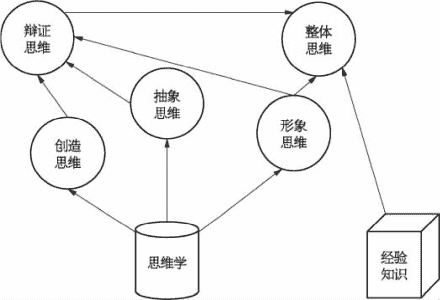

图 2-1 不同思维方式间的关联

●逻辑是人们生活和计算机都应遵循的原则^([\[8\]](#txt003.html#footnote_content_txt003_8))，而思维过程不限于此，超越逻辑于人类、于机器都需要一种“转身”；
●人工智能研究的思路与方法没有现成答案，本身是一个有待探索的话题，它将伴随人工智能的发展历程；
●辩证思维是智能的又一高度的体现，但在人们的日常生活中普遍缺失或不以为然，机器缺之则人工智能不会完整。

横看成岭侧成峰，远近高低各不同。

不识庐山真面目，只缘身在此山中。

——苏轼《题西林壁》

## 参考文献

［1］林可同.弘一书法墨迹.杭州：中国美术学院出版社，1997：48.

［2］顾吉环，李明，涂元季.钱学森文集（卷三）.北京：国防工业出版社，2012：323，317～321.

［3］李怀宇.金庸的历史世界.同舟共进，2019，1：73～78.

［4］顾颉刚.走在历史的路上——顾颉刚自述.北京：中国人民大学出版社，2011：55.

［5］王浩.哥德尔.康宏逵，译.上海：上海译文出版社，2002：394～395，252，271.

［6］董军，潘云鹤.基于多 Agent 系统和神经网络预测的路由选择策略.自动化学报，2002，28（4）：505～512.

［7］孙光宪.北梦琐言.林艾园，校点.上海：上海古籍出版社，1981：173.

［8］卡尔·雅斯贝斯.时代的精神状况.王德峰，译.上海：上海译文出版社，1997：112.

［9］威廉·庞德斯通.囚徒的困境.吴鹤龄，译.北京：中信出版社，2015：238.

［10］顾吉环，李明，涂元季.钱学森文集（卷六）.北京：国防工业出版社，2012：383，416.

［11］托马思·R.布莱克斯利.右脑与创造.傅世侠，夏佩玉，译.北京：北京大学出版社，1992：1～92.

［12］李泽厚.美学三书.合肥：安徽文艺出版社，1999：460～461.

［13］叶秀山.叶秀山文集·美学卷.重庆：重庆出版社，2000：296～297.

［14］顾吉环，李明，涂元季.钱学森文集（卷五）.北京：国防工业出版社，2012：182.

［15］王小平.我的兄弟王小波.南京：江苏文艺出版社，2012：130.

［16］蕅益大师.灵峰宗论／／曹越.明清四大高僧文集.北京：北京图书馆出版社，2005：721.

［17］汤川秀树.创造力与直觉——一个物理学家对于东西方的考察.周林东，戈革，译.石家庄：河北科学技术出版社，2000：104，53.

［18］益川敏英.浴缸里的灵感——益川敏英的诺贝尔奖人生.那日苏，译.北京：科学出版社，2010：38，121.

［19］艾克曼.歌德谈话录.杨武能，译.北京：中国书店，2007：170.

［20］恩格斯.自然辩证法.北京：人民出版社，1971：27～28，70.

［21］顾吉环，李明，涂元季.钱学森文集（卷六）.北京：国防工业出版社，2012：416.

［22］国家科学技术奖励工作办公室.吴文俊之路.上海：上海科学技术出版社，2002：153～156.

［23］胡作玄.吴文俊——从拓扑学到数学机械化.自然辩证法通信，2003，43（1）：81～89.

［24］陈丰.给没有收信人的信——陈乐民文存.桂林：广西师范大学出版社，2010：94，107.

［25］朱熹，吕祖谦.近思录.陈永革，注评.南京：江苏古籍出版社，2001：299.

［26］Si mon H A.Artificial intelligence：an empirical science.Artificial Intelligence，1995，77：95～127.

［27］乔治·索罗斯.这个时代的无知与傲慢——索罗斯给开放社会的建言.欧阳卉，译.北京：中信出版社，2012：47.

## 注释

[\[1\]](#txt003.html#footnote_quote_txt003_1)某日笔者早上醒来脑中前所未有地冒出一句：一阵风雷天地宽，其实是在完全醒前的一刹那，常言日有所思、夜有所想，从而梦有所得，然而笔者无任何“蛛丝马迹”，尤感意外。由于恰好可以作为下联（按照平仄要求），于是琢磨上联。早餐后走在上班路上，可能是我国各地日前普降瑞雪的缘故，得：九州雨雪心灵远。并不平凡地得了平凡之语。

[\[2\]](#txt003.html#footnote_quote_txt003_2)见罗大经的《鹤林玉露》，《史记·滑稽列传》中的东方塑传未载。

[\[3\]](#txt003.html#footnote_quote_txt003_3)大概 1989 年，在浙江富春江畔，一位老先生主动为笔者“算命”，后来我们有通信交流（没谈过任何“算命”的事）直到再没收到老先生的信。若干年后，朋友说起有位年长的盲人“算命先生”，不同一般。颇好奇，一起前往拜访。每次老先生都经过一定时间思考而认真阐说。笔者对仅凭生辰八字这个时间信息就能“算命”的过程不以为然，世界上在同一时辰（两小时）里出生者众多，这些人的生活道路并不一样，即使双胞胎的生活轨迹也往往不同，当然他（她）们可能不在同一时辰出生（在连续的两个时辰中）。后来与友人说起，他们似乎很想预测一下自己的未来，专门从外地到苏州请老先生算命。笔者不清楚算过命的各位对结果的完整看法，不过似是而非者颇多是毋庸置疑的。朋友曾说起是否可以编写出软件，使其过程“自动化”。后来笔者买过一些书籍，包括《星命集成》等，但它们文义玄奥，因没有任何经验和背景知识而不了了之。对于某种应用，如果开发者既是领域专家又是程序设计员，情况会有不同。

[\[4\]](#txt003.html#footnote_quote_txt003_4)足球迷、“棋圣”聂卫平曾说，他有一瓶胡耀邦送的好酒，等到为中国足球庆功时开。20 世纪 90 年代前叶，笔者对朋友说中国足球本世纪无望。这个说法现在看来过于保守，它来自过去的基本情况，难以说出具体的“计算”依据。

[\[5\]](#txt003.html#footnote_quote_txt003_5)2012 年深秋，笔者陪父亲到外地拜访他最近一次见面已是 20 多年前的一家熟人，联系方式都变了。父亲已 80 多岁，为了了却父亲的心愿，笔者设法帮助寻找。通过与同在该地的父亲不认识的老同志家联系，得知老人多年前已故，尚无其他信息。我于是请熟人查询到了住址信息。与地段派出所联系，希望确认，未果。最后，通过 114 查询得知唯一能公开查到的一个相关机构，得知地址没错，并被告知如何过去，说是在该相关机构旁。打电话过去，接电话者回答说不知道要找的人家。那个相关机构接电话者提醒过，就找这个机构，按照住址走会绕路。出租车经过那里时司机说不好开了后，我们就下车。可笔者还是希望按照门牌号寻找，拐了两条路，问了不止三次路，其实车是可开的。到了一个大院门口，经几次一问一答，确定了地方，穿过去到了楼前，就在那个相关机构旁，由其门进入确实非常便当。这情况缘何出现？

第一，与生活习惯有关，总觉得门牌号是最直接的线索；

第二，与思维方式有关，别人提醒的话儿有时候被忽视了；

第三，与经验有关，有时候按照某周边特征寻找不是最便捷的。

如果在记忆中所提醒的机构名被强化了，情况可能就不同了。再就是搜索方式，如果灵活地以先见到的标志为依据，也不一样。可能它们分别对应着深度搜索和广度搜索。同时，附加信息不可轻视。

[\[6\]](#txt003.html#footnote_quote_txt003_6)这是理论分析结果。抽象思维的许多具体工作，如数学、物理证明，当今并非都可由计算机完成。

[\[7\]](#txt003.html#footnote_quote_txt003_7)有次参会后一位在职博士生送我们去车站，在谈及目前的考核体制时，感叹说，又要做家务，又要负责教学，还有杂事，另外搞科研，压力大、太不易了。笔者表示，即使这样，他们还是选择在高校工作、没有到他处。回答说，这倒也是。高校还是有吸引博士生们的地方。有意无意限于从自己视野出发说事，是普遍的思维定式。

[\[8\]](#txt003.html#footnote_quote_txt003_8)有次笔者与图灵奖得主霍尔（T.Hoare）聊及形象思维相对于抽象（逻辑）思维模拟的困难，他反问，你认为逻辑问题都解决了？自然不是，逻辑始终是前提及基础，比如衣食住行一直是人类的基本生活要素，随着观念改变和经济发展，有人旅游探险甚至期望“飞天”，可有的地方吃饱穿暖还保障不了。即便某日世界“大同”了，那些需求依然。

# 3 经验知识举足轻重

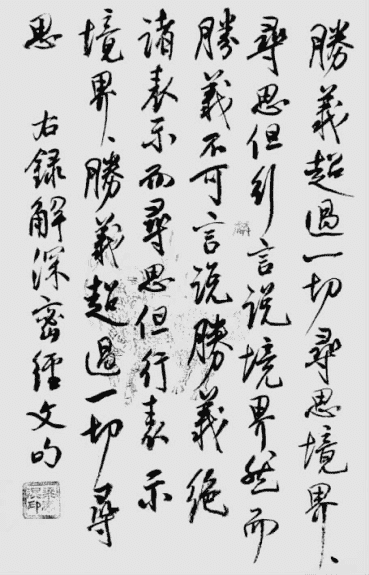

胜义超过一切寻思境界，寻思但行言说境界，然而胜义不可言说，胜义绝诸表示而寻思但行表示境界，胜义超过一切寻思。

右录《解深密经》文句 梁漱溟［1］

当科学的改革者主张转向自然并要求实验事实的时候，面向实际的手工业者、工程师和画家确实在获得扎实的经验事实。运用一般人天然的直观的处理方法，寻找的不是最终的真意而仅仅是他们在工作中遇到的现象的有效解释，这些技工们得到的知识嘲弄了那些博学的学究乃至人文主义者所提出的繁复辩解，在语汇学上的长篇推敲，纠缠不清的逻辑推理，以及对罗马和希腊权威的浮夸引证。［2］

——克莱因（M.Kline）

逻辑经验从来念，推理学习深度融。

“经验”与“经验主义”内涵并不相同，后者强调在实验研究基础上的理论推演而非单纯的事实依据或推理，古希腊医生的经验是“经验主义”一词的一个来源^([\[1\]](#txt004.html#footnote_content_txt004_1))。此处讨论的经验，既非缺乏理性思考、一味参照过去事情行事、决策者，也非科学研究中与理性主义相对者，而是人们在特定领域，经过长时间体验、训练和摸索后所具备的认识、分析、决策等敏锐的、动态的、综合的能力，是那些通过实践方能了解、掌握和运用的知识。

## 3.1 不乏常识

用碳-14 测定年代是科普常识，笔者曾以为据此啥都可判，实际上误差不小，后来知没法测无机物，因此应用于青铜器之类就不合适，这都是理解有误所致。在武夷山时听说木头制成的悬棺是 3 000 多年前的，便纳闷：由于树可能被砍伐很久后才用以制棺，两者不可同日而语。不过由于碳-14 测定误差不小，或许该因素可被忽略。

第 1 章提及的“常识”，是人工智能系统所需。众所周知，描述飞机时“蓝天上雄鹰展翅”是常见的句子，这需要常识才能理解，“雄鹰”并非指那种动物。“祖国母亲”也一样，而母亲比儿女年纪大也是常识。常识形成于人的生活和实践当中，经历着相对漫长的过程，与专业知识不可分割但并不相同，再加其往往“若隐若现”，所以在很多人工智能系统构建时“靠边站”了，这与具体问题的数学模型被设置不同边界条件，忽视具体要求相仿。

有次，笔者坐在一个朋友的车里，车子飞快行驶在高速公路上，问朋友车与车之间前后那样的车距是否不够，回答说是的，那点距离不符合要求，就靠驾驶员的判断和反应了。所以，驾驶员需要全神贯注。确实，多数情况下能防止意外，但不全有把握。既知如此，可是依然如故^([\[2\]](#txt004.html#footnote_content_txt004_2))，经验关联着代价和可能的失误。笔者不会开车，常常有如此对话：

问：为何不开车？

答：我是色盲，不能开车。

问：看不清红绿灯？

答：能区分。

问：那为何不能开？

答：区分红绿灯可借助于亮度、上下位置等，但反应较慢，然而体检不同于此，要求高。

这些提问者有驾驶证，因此经历过色觉检查——不是直接检查辨识红绿灯的能力，而是看色盲检查本，其上图案笔者不是分辨不清便是张冠李戴。为何诸如此类普通的知识即常识（对于会开车者而言）会被直接忽略？或许这对他们而言过于简单以至于被“跳过”而不在日常记忆当中。笔者有次在公交车上看到前面座位的靠背扶手上有一比一般蚊子还小的虫忽然轻盈飞走，其肢体很细长，非叶状，且未见扑动，这两者与常识颇不合。常识的掌握也许真是“看似寻常最奇崛”^([\[3\]](#txt004.html#footnote_content_txt004_3))。

某日笔者在上海公交车上听得一段老人对话：

甲：上海要打（拨）区号的。

乙：上海么，021。

甲：不是，0512。

乙：哦，苏州的，打到苏州。

常识、经验与表达的鸿沟

有人谈起老式座机拨号，说在上海打电话要加区号。初听像是往上海方向才需要加号，反过来看其实是说身处上海本地，拨往苏州依然不能省区号。日常口语习惯省略主语，一转述就容易产生偏差。

我平常习惯晚些去单位吃午饭，那时餐厅人少。疫情后复工没多久，食堂一恢复供餐，我却发现窗下那条往常人流不断的小道空荡荡。向刚回来的同事抱怨，以前都去另一家食堂，疫情时那家没开才换到这边，怎么路上看不到人。过了几天自己去吃饭时才恍然，通往食堂一的侧门因防疫一直上锁，路被切断自然没人经过。

还有一次朋友把鲁迅诗句“愿乞画家新意匠，只研朱墨作春山”当作对联。我觉得形式上说得通，但“新”与“作”在工整度上欠妥，总觉得诗人想表达的是让画家成为新的意匠，中间略去了一个动词。对面认为“新”可作动词，我也认同这种解读。七绝本不必像七律那样严格对仗，古体更多是宽松的。是不是巧合还是有意为之，并不影响诗歌本身的水平。很多从小存下的印象并不准确。俗话说熟读自明，若缺少反复的阅读与思考，反而容易产生误读。会写和会读是两回事，能把握要点又是另一层能力。

最近聊到一起引起全国关注的火灾，不少幸存者烧伤面积大、深度深，基本没有希望。随口问起监控可以回溯多久，有人说按需求设定，比如三十天。有人说数据丢了也能找回来，那指的是在特定时段、范围和存储容量内仍留下物理痕迹。任何可恢复的信息都需要载体保存蛛丝马迹，一旦超出介质容量就像水杯满了溢出一样会丢失。常被神化的技术，有时正好遮蔽了常识。

常理归根到底是“常”，却不是与生俱来的本能。对常理的忽视或反复强调常理，往往意味着事物已经远离本质。疫情期间要求公共场合佩戴口罩，我第一次用的N95，却没注意到鼻梁上的柔性条是用来贴合密封的。后来用一次性口罩，那根条很薄，我没在意功能，结果把口罩上下戴反了。

别人的常理可能是别人的经验，别人的经验也可能成为别人的常理。经验沉淀为常理，常理也源自经验。现在的中医药院校毕业生中，几年后有一部分会成长为专家甚至名医，但求学期间学把脉大多靠自学摸索，真正的改观往往要靠师徒传承或可视化设备。教学方式与效果之间存在差异。无效的对面就是有效，若不加分辨，不仅达不到治病救人的目的，还会误人。

机器要模拟人，就必须具备常理。有一种说法，常理把世界呈现为一个熟稔的世界，是每个清醒者都应该明了的世界，在此之内人凭智力即可判断真伪。另一种说法是，常理的概念本身就很常理：有常理的人才知道什么是常理。读起来拗口，意思是具备常理也是常识，常理者才能体会这层认识。乍看像悖论，实则指向逻辑层面。有位学识广博的名作家，在介绍一位音乐家时写道“药物芯片正在申报诺贝尔医学奖”。诺奖的生理学或医学奖并无自主申报渠道，是由他人提名的。这是科技圈的基础常识，不知是哪个环节出现了偏差。

人工智能强调常理，正是因为它先天缺乏或不足。一个正常人成长过程中常理会逐步累积，使人更健康、更协调、更丰满。但这不代表可以忽略逻辑，人工智能首先建立在逻辑之上，而逻辑是思维的根基。比如思路清晰、思考缜密的人，即便常理有缺口也能生活工作，甚至因专精而出成果。反之，博闻强识却前言不搭后语、语无伦次，也不值得称道。现代医学面对许多疾病依然无能为力，这是基本认识，但由此得出中医能突破西医的困境，或以“延续两千年”作为合理性证明，就是罔顾逻辑，因为因果并不成立。除非能证明，否则就是颠倒是非。逻辑更为根本。

近几年人工智能升温，不少教育界人士提出在中小学增设相关课程，教育部也有相应安排。出版社联系我交流后，出了小学、初中、高中的教材。我关心的还是教育本身：这事必要吗，能和原有知识体系融合吗，是否符合教育规律。必要性看似没有疑问，但理由是否充分仍值得推敲。当年邓小平提出“计算机要从娃娃抓起”，程序设计和信息技术才逐步进入课堂。从人的全面发展看，其他日新月异的科学技术也应及时传授。可中小学学到的内容，对后续专业学习和实践到底有什么不可替代又不重复的独特意义，这就涉及衔接问题。我提醒要考虑与大学人工智能课程或专业的衔接，内容应能帮助后续学习，否则只会浪费学生和老师的时间，影响对中小学人工智能教育的认可。若定位为常理学习的范畴，才算充分。

3.2 领域经验
鲁迅曾写道，“……在上海的弄堂里，租一间小房子住着的人，就时时可以体验到，他和周围的住户，是不一定见过面的，但只隔一层薄板壁，所以有些人家的眷属和客人的谈话，尤其是高声的谈话，都大略可以听到，久而久之，就知道那里有那些人，而且仿佛觉得那些人是怎样的人了。”［4］没有长时间的潜移默化不会如此。

我年轻时挑西瓜，因为知道一种甜瓜有点“沙”，就用大拇指按一下听声音，有沙沙声就买，几次都没错，便当成了经验。后来姐姐提醒，这样会伤瓜，卖家不乐意。而且没有声音的瓜也可能很好，只是需要别的判断办法，比如敲瓜听音更常用。从那以后我就不再用那种经验了。经验并不是被动积累的同义词。

爱因斯坦说过，纯粹逻辑思维给不出关于经验世界的知识，所有关于实在的知识都从经验开始也到经验结束。但他也强调，只有大胆的思辨而不是经验的堆积，才能推动进步。如今我们掌握的不可理解的经验材料已经太多了。康德说人必须读书必须得经验，一切知识都从感觉开始。丘成桐先生也说，求真时往往只能凭已有经验，按对大自然的主观感觉前行，这种感觉很个人化，受文化修养影响。

人类知识来源于经验和在一定认识基础上的归纳演绎，关乎广度和深度。个人的切身体会会形成经验，这类知识常见也丰富，有时让人平静有时让人兴奋。对多数人来说，经验主要来自经历和阅历，可理解为阅事、阅世和体验，体验不只是过程本身，还包括由此磨炼的眼光、素养和感悟，是动态的。

经验因人而异、随时间加深、随位置而变，有潜移默化和水到渠成的特点。积累是发散又综合的过程：先熟悉领域及其流程，再熟能生巧，像庖丁解牛般自然，然后游刃有余甚至能跨界。人类历史就是从必然王国向自由王国发展的过程，所以需要不断总结经验、发现、发明、创造、前进。经验不是一成不变的模式，而是深刻认知的根基。

梁漱溟说过，空想空谈成不了学问，真学问产生于解决实际问题的实践中，并用来指导实践。东方古书被看作哲学，正是古人从反躬向内的实践而来，有具体的事实依据，不是空话。你只望文生义讲古书，就无法确知原意。一名书画家称书法是遗憾的艺术，因为作品总和预想有差距，所以遗憾不断。有遗憾才推动总结反思，进而提升。贝聿铭的苏州博物馆新馆在建造中多次修改，他曾决定把原定的绿地改为水面，要敲掉四十立方米的高标号混凝土，七八个工人弄了二十多天。袁隆平说真正的权威来自实践。书法重写的代价小，但新作仍可能有别处不满。经验再厚也难免失误。

周恩来在延安骑马跌伤右臂，一名年轻医生认为是骨折，另一位知名专家认为是软组织损伤，因听后者意见导致残疾。后来去苏联诊治证实是骨折，若按此治疗需做较复杂手术，周恩来未予施行。所以熟不一定生巧，学习也可能饱和。

我偶尔听说有肺肿瘤病人先在国内手术后又去美国手术。有人认为中国人口基数大，这种手术已成常规，国内不比国外差。这是直观的结论，医生中也不乏这种认识。实际上经历多只能说明训练多、熟练度高，但与医术精细、切除是否到位、后续措施是否针对，并无必然联系。不善于及时总结反思，可能原地踏步甚至倒退。病人心态各异，专家的名声有时会被放大。计算机技术人员常有感触，越老越“外行”，和医生相反。

有些名人八九十岁仍在手术台上，病人信任他们，其实有盲目崇拜老医生的倾向。经验丰富同时，思维定式也在形成。一旦形成，若方向正确，可能让人满足现状、停滞甚至生搬硬套；若方向偏离，后果可能更严重。这两种情况都远离有益经验的积累。

我母亲看过的一位原来在地段医院工作的老中医，大概九十多岁，看起来没那么老，每天上午在家看病，病人有邻居也有慕名远来的，常络绎不绝。看病时他总翻几个本子，在医生中少见，或许记忆力下降，或许要对照往昔处方。对常见病他早已总结出医案，但可能停留在几十年前，后面数十年并未增加多少经验，也没有对照医生验证疗效。可以称赞他服务不辍，但很难说他的经验比别人更有价值。

有次坐摆渡船，我问艄公划船不容易吧，他说是不容易。再问学会要多久，他说只要两个小时。从学会到看似轻松自如，是一个摸索、实践和积累的过程。对掌舵者而言，在常水路要能不费力保持平衡，遇到险情要善于选择调整。在乘客眼里简单的动作背后是日积月累的功夫。

经验未必合乎逻辑，但它与逻辑互补。比如没有一定时期的软硬件设计经历，就很难透彻理解计算机技术，没有计算的体会和实践，也无法理解人工智能的初衷、本质和意义。强调经验不等于说感性经验是唯一来源，经验既是借鉴也是积累，并非全是理性的，违背经验常事与愿违。谈论经验本身就是经验知识，也出于经验之谈，某种意义上是一种约束，没有这个过程就没有相应的认识和智能。

人类克服未知主要靠书本学习、自身积累和反思总结。经验与所学知识相辅相成，可达举一反三、触类旁通，那些被视作启发式知识，是区别于非专家的标志，据此可在必要时作出猜测，辨别有希望的解决路径并处理错误或不完全数据，有些甚至是顿悟式的形象思维过程。我书中所述经验偏向科学实践性，而非哲学思辨性，尽管两者并非孤立。

3.3 语言表述
《老子·一章》说道可道非常道，名可名非常名。《庄子·知北游》也说道不可闻见不可言，知形形之不形，道不当名。道需要体验领会，能言说的并非其永恒内涵。知道的东西未必能说，说的人也不一定真知。言语表面易懂，实际未必。从古至今解释《道德经》的书籍不计其数，每本都认为别人解释不透彻，这也说明它难“道”。

《庄子·天道》里有轮扁斫轮的故事。齐桓公在堂上读书，轮扁在堂下做车轮，问公读的是什么，公说圣人遗言。轮扁问圣人还在吗，公说已死。轮扁说那读的不过是糟粕。公说匠人怎么议论圣学。轮扁说我从做事出发来看。榫头宽了松动，紧了滞涩，我做得不宽不紧，得心应手，嘴里说不出来，却有分寸度数。我不能告诉儿子，儿子也学不到，所以七十岁还在做轮。古人不能言传的东西随他们而去，所以你读的只是糟粕。

我中学时家里来木工，企图用刨刀刨平久用后中间凹陷的砧板，第一次推就不利索，后来要么推不动要么刨子直滑，真是看别人挑担不觉得累。师傅拿过三下两下就完事，端正方向、平衡用力、把控深度，缺一不可，否则寸步难行。这不是问一下就能掌握的，木工活大多如此。有次在美国徐冬溶教授家住几天，他一个晚上用割草机平整院子，范围不小，有坡度，看起来很费劲，压根没想的那么轻松好玩，事情不难上手，但起初总会眼高手低。

纸上无“战场”，木工这类一般经验通常不见诸书面，学徒学艺，师傅很重要，主要是领进门，出师更多靠练习、摸索、反思、比较和总结。功夫少不了，参悟也很重要。俗话说三百六十行行行出状元，一层意思指各业平等，另一层意思是做好并出类拔萃都很难。民间有传子不传婿之说，从教的角度看，能说出未必管用，从学的角度看，言语并非万能。这也是有绝活者自重的缘由，多少功夫多少时日才到那个境界。

鲁迅说读书人家子弟熟悉笔墨，木匠孩子会玩斧凿，兵家儿早识刀枪，没有这样的环境和遗产，是中国文学青年的先天不足。NBA明星奥尼尔在自传里讲他的一位教练总带着写了上百条注意事项的白板进休息室，所有依据都来自数据，输了教练下课是迟早。教练下课原因很多，但赢球绝不只靠注意事项或数据。

鲁迅还说孩子学话常给好教训，他们没有老师没有语法书没有字典，只是不断听、记、分析、比较，最后懂得词义，两三岁就能说简单话且错误不多。每个人都有学说话的经验。毛文涛博士曾问我是否能翻译人工智能特色的著作。我学英语数十年，二十多年前就和前辈译过计算机高级语言书，但要译好绝非易事，译质差距极大。同晚和郁振华教授交流，他刚给上海纽约大学学生开了一学期中国哲学英文课，花了很多时间。他查阅大量资料后觉得中文译成英文的内容普遍比较表面，难以传达深刻细微的内涵。

王小平在《我的兄弟王小波》中写道，后来学英文，仗着语法理解阅读无碍，只能算支着拐杖入门，离登堂入室远着，语感和中文没法比。语言这东西非下苦功不可，包括训练、体会、比较。中英文俱佳的历史学家黄仁宇说三十八年后仍在和英文搏斗，如果是东学一点西学一点，不是系统学习，就永远搞不清字句排列组合。虽然他在美国居住时间比在中国长，有时仍找不到最直接的表达或最合语言惯例的用语。笔者也学过日语德语，德语是自学的，现在看算是白搭。

认识论中的默会知识论被认为是波兰尼对哲学最具原创性的贡献。维特根斯坦区分了强的默会知识和弱的默会知识，前者原则上无法充分用语言表达，后者事实上未表达但原则上可以表达。换言之，默会知识论关注的不是可表达和绝对不可表达的界限，而是强默会关注原则上能否充分言说，弱默会关注原则上可以言说但事实上未言说的差异。或者说，我们并非总是说出自己的意图。《老子·七十章》说吾言甚易知甚易言而天下莫之能知莫之能行。这既有哲理深奥的一面，也有言之不尽的另一面。

3.4 隐性知识
智能以感知与经验为起点，以知识和行为为中心，以推理和学习为手段，以进化和发展为特色，以搜索和求解为目标，以改造和创新为能事。人工智能模拟人的思维过程，强烈依赖领域知识和常识，它们以语言为基本载体，却并非皆可被语言穷尽。隐性知识是指在特定领域经过长期体验和积累，具有针对性和效果、难以表达甚至潜意识的经验知识。与默会知识是不同视角的表述，本文特指那些尚未表述但人或机器经过努力可以学得的经验知识，其作用在于识别各种特征、把握总体趋势、明确相互关系和具体方式、关联已有模式并寻找有效方案。大数据中也有大量隐性知识，机器学习是途径之一，涉及数据规模、数据品质和标注结论。

《墨子·非儒下》有隐知之说，本意是隐藏其知，也可视为隐性知识的一种形式。钱学森举过言传身教的例子，其中身教就是难以言说的知识。孙过庭《书谱》说心之所达不易尽于名言，言之所通尚难形于纸墨，所指相同。

经验经过归纳演绎成为知识，知识包含显性与隐性，常识是独特的知识。这里的经验有两层含义：一是宏观上人类知识源自个体经验和在认识基础上的归纳演绎；二是具体上每个人的经验既包括学到的显性知识，也包括积累的隐性知识。
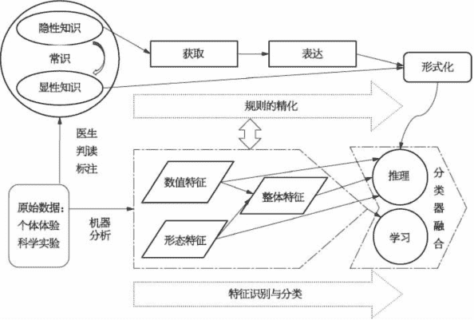

图 3-1　从知识到分类器设计：上半部分是重视隐性知识的规则精化过程，是领域专家（医生）和知识工程师的交互，该过程还会对特征识别（下半部分）产生影响，比如哪些特征有待加入、哪些特征并无必要。下半部分是从信号预处理到特征识别和分类的基本环节，特别之处在于：在特征识别阶段，要关注形态特征及整合数值特征和形态特征的整体特征；在分类阶段，需融合针对不同特征的分类器，特征识别过程可使人们对规则精化有更为深刻的洞察（上下部分间的双向箭头）。

做事的感觉和经验的积累，其实没有标准模板可套。日常应对、现场判断、事后复盘，都会跟着时间推移和场景切换而发生改变。它不是一次性注满的容器，而是一种混合、潜藏、不断自我更新的沉淀。

八十年代初不少年轻人迷上弹吉他。我当时完全没接触过，还以为人人都抱着同一把琴对着同一本谱，出来的声音自然也该一样。后来才明白这是局外人的误会。谱面上能写清的是指法与和弦，让演奏真正顺手的部分，却是说明书覆盖不到、难以用语言交待的内容。背熟谱面不等于能弹。

这些年很火的注意力机制，碰到的难题也是同一类。模型要懂得往哪里看，往往需要领域里真正上手的人反复回头梳理，才能把关注点定准，甚至出现了二次注意的讨论。

钱学森曾提出思维模拟的瓶颈在形象思维的模拟上，潘云鹤院士据此谈到综合推理的思路。我对默会经验的好奇就源自这条线索。进入新世纪后了解到心理学里内隐记忆的概念，随后接触到波兰尼谈的默会知识观点。支撑这个想法的是几段具体的实践：计算机辅助心电图诊断曾出现明显错误、形态描述难以落笔、脉象的可视化尝试以及和心电图的对照，还有自己在书法练习中对执笔手感的体会与反思。几个基本观念之间的关系在图 3-2 里呈现，实线表示深化推进，虚线表示对应或可能的影响。

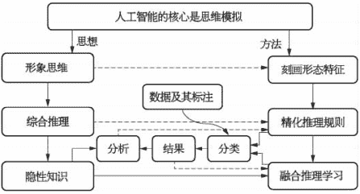
图 3-2　思维模拟：从思想到方法各部分关系

怎样习得默会经验是个有趣又缺乏现成路线的议题。比如自行车的脱把骑行，只能在骑行中自己悟出来，别人教不了。儿子小时候我在他面前吹口哨、打响指，他觉得好玩，自己模仿却怎么也做不出，除了示范我帮不上忙。游泳和篮球我也给他买过书，他喜欢篮球，游泳是去泳馆和我一起下水时学会的，不是靠书本来的。这很像强调环境互动的增强学习。说看完书再下水就能游也算没错，但把一切实践都理解成先学理论再行动就不合适，基础概念是前提。若一开始养成了错误姿势，后面纠正更费力，进度也会慢。

王蒙说得直白：书能让人学问、聪敏、高尚，但书与实践、现实、生活之间有距离。很多本领根本没法从书里获得，比如游泳、打球、太极、把脉、动手术、锄地。

工具用在地上才显效果。若只琢磨怎么造锄头，用坦克钢、花梨木做得漂亮过硬，甚至被神化，也不一定更顺手。这样的锄头只能挂墙上当艺术品。更离谱的是，没琢磨过锄头就断言土地会因它高产。我曾参与评议一份人工智能指南，里面有实现量子力学精度的考核项，意图不明，即便精度很高，要解决的问题是什么？交叉很热，还是要深度优先，聚焦点去解决某个或某类具体问题，伤其十指不如断其一指。攻克关键困难、真正提升教学质量，或在需要时达到另一学科专业人员的水平，才是对社会和科研有意义的成果。

创造是否一定要掌握默会经验，不能一概而论。常被认为这是反复思索、综合经验、推陈出新的产物，但也有白纸作画、小孩突发奇想的情况。把默会经验变成可表述的形式才是本书的核心议题。我和同行有过下面这段交流。

诸葛：是否所有默会经验都能变成显性表达？
我：转化是初衷，能否全转取决于领域行家的理解和投入。
诸葛：说清楚和能学会是两回事。游泳可以写，但变量太多写不全，除非做全程立体录像。
我：我学游泳不是靠书，后来买书翻阅仍觉得只看书学不会。录像也许有帮助，但细节终究要靠自己体会。中医把脉模拟我这种外行只能希望中医说得更透，或被启发说透，才能建模让机器学到，两步是相续的。
诸葛：感觉凡知识都应可言说，但学以致用则关乎个人实践。关键是写出来的东西能否被验证，若无法验证，可能就只是技能而非知识。
我：第一，我会却说不出来，给时间也不一定做到。第二，如果是技能，中医把脉是否只能算技能？我亲历过两位教授先后把脉，结果完全相反。
诸葛：吹口哨是可以写出来的，比如口型、舌位、气息控制，但学会是另一回事。

看法各异，但说明一个事实：理论上事情都可被表述，具体可操作性是另一回事。可操作性意味着把吹口哨的要领清晰写出，让读者照着能达到目标。

这并不意味着要放弃努力去言表知识。恰恰相反，言表对传承至关重要。胡适晚年说过老师讲解的重要性：我才明白自己受了特别待遇……我一生最得力的就是讲书：父母为我讲方字，两位先生为我讲书。念古文而不讲解，等于念揭谛揭谛波罗揭谛全无用处。

有些东西文字很简洁，体会却极难。比如上瘾。我爱吃辣，一顿能吃十个细红尖椒，也无法体会吸毒上瘾的感觉和后果，因为我不吃辣也能过得挺好，不是非吃不可。

默会经验的习得首先指向领域行家的学习，以及相互对照，或在机器辅助下进行。有时解题的关键就是提出恰当的问题。下面是我有体会的学习方式示例。

表 3-1　隐性知识学习方法示例

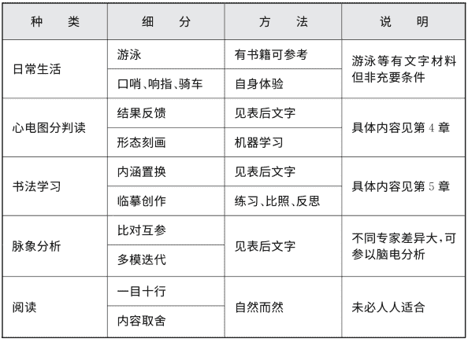
●结果反馈：
就前述体征分类算法而言，在掌握基础知识后，先按教材搭初步方法，跑出结果后，再和行家交流探讨，把分错的案例反馈给医生，启发医生重新审视、修改和优化原有诊断规则与参数。

●内涵置换，可分两种：
✧效果引导：如书法执笔，手段是执笔，目的是好线条。很多人明白道理却达不到效果。若提示把力传到笔端，感受会更直接。
✧名称改变：日常说的僵尸，多数人懂，但有迷信色彩，有学者改称无魂人。视角变了，想象空间就不同，前者关注物质是否有生命，后者指向灵魂是否存在，即没有意识，其他音容举止如常。

●比对互参：
✧同步感知：脉象分类缺乏像心电图那样明确的规则。先让医生在指下同步感知脉象并对应所见信息，概括特征与含义，再形成像心电图那样的推理规则，进而建模。
✧多模迭代，如第四章将介绍的升学分类器。

脑电图观测和相关数据挖掘有望更客观地提取一致诊断结论，不止依赖医生的主观经验。通过分析不同医生诊断时的脑电数据，可构建刻画症状的特征参数、诊断规则并形成客观标注依据。

有人认为有了数据和深度神经网络，默会经验问题就能迎刃而解，事实并非如此。默会经验并不会自然地呈现在数据上，标注过的数据只携带了部分经验，还有相当一部分未显现。其次，即使机器学习，也无法保证学到关键要点。神经网络会随认识深化而健全，但逻辑机制不可或缺，因为逻辑本身就是思维形式之一。推理包含推理方式与推理内容，前者如不确定性推理、模糊推理，后者包括规则优化和知识精化，都和默会经验学习相关。

当前学习多和人工神经网络相关，除认知神经科学基础上的建模外，还涉及网络结构优化与训练方式探索。卷积操作就是对网络结构的一次重要创新。针对具体问题有多种形式和参数组合，没有固定规律，需要大量试验，结果往往达不到最优。训练上梯度下降是核心思想，有研究提示权重矩阵频繁改变时，只有少数奇异向量空间真正发生变化，若能据此优化，将大幅提升效率、减少资源消耗。

荀子儒效里说故闻之而不见虽博必谬；见之而不知虽识必妄；知之而不行虽敦必困，正可用来反观默会经验的学习。

## 3.5 直觉模式

认识的形成因人而异。内因有先天气质和后天实践，外因有学习输入和环境影响，如父母言传身教、书籍潜移默化。超出客观知识之外，反省能强化对知识的体会，比如主动纠正、深化、比较选择，是逐步精化的过程。人们的历史总结往往不够，却是迭代的基础。小朋友智力发展有快慢差异，教育要健康成长而非拔苗助长，更要引导、训练、接触社会和生活。

西蒙等对下棋、解物理、医疗诊断等领域专家的研究表明：达到高级技能时，一流专家在其领域至少掌握五万个模式，能一眼识别并从长时记忆中调取出相关信息。专家知识以五万到二十万个组块计量，看棋盘时不是看孤立棋子，而是看关系构成的组块。达到此水平往往需要十年以上时间。高级诊断医师面对症状能迅速辨认熟悉模式，联想到疾病假设，并决定后续检查与治疗，所有这些在几秒内完成。专家能看到新手看不到的东西。

华罗庚曾说学生看到的是数字，自己看到的是矩阵，别人能快算数字，他能像算术一样算矩阵，把握更复杂元素。钱学森的学生问他为何在黑板上算积分如此快，他答多练习，说不出道理，那是经验。诺贝尔奖得主纳什也能把数学问题在脑中看作一幅图画，数学家最终需要严谨证明，但答案出现的样子是直觉的拼接。

我中学时读到苏步青说，要掌握基本数学原理和方法，至少做两万道题。我当年练习很快，忽视了足够量的练习对原理掌握、理解和应用的作用，总以为懂了定义定理就能应万变。实际上举一反三的前提是丰富的经验和大量积累。教材结论是抽象陈述，无法涵盖现实问题的复杂和意外。理解定理与反复练习相辅相成，差距靠日常锻炼弥合。对数学学习而言，目的通常有二：锻炼思维、解决问题，二者不能割裂。没有一定量的解题经验，思维难练；没有良好思维方式，找解法也困难。

学习是个体成长的必然要求，也是人工智能的经典命题。学习不只是积累信息，更是去粗取精、去伪存真、由此及彼、由表及里的过程和能力。理论上，这个能力要么伴随成长而来，要么被告知。若是被告知，能告知什么内容？人自身也说不清从小到大的学习是怎样的神经机制。概略说，实现人工智能的长远目标可能需要人的设计与进化两者结合。

西蒙指出，几秒钟完成的诊断是一种直觉过程，直觉只对非常熟悉的东西才有。丘奇图灵论题中，有效步骤是直觉概念而非形式概念。爱因斯坦认为日常思维基本概念与感觉经验的复合关系，只能靠直觉把握，无法用逻辑完全规定。科学大厦正是建立在这上面。他悼念居里夫人时说其伟大成就是靠大胆直觉；纪念哥白尼时说要让人信服太阳中心说的优越性，需要罕见的独立思考和直觉。文艺亦然，若缺少创造性直觉，作品可能成形却空洞；若直觉进入作品，作品便活了。

日常生活中，天空晴朗时下雨几乎不可思议，但时间长了，只要听到淅沥雨声和滴答水声，哪怕无乌云雷电，也能判断下雨。

## 3.6 本章概要

默会经验的积累是从专业学习开始，到不断应用、反馈、迭代的过程，如图 3-3 所示。

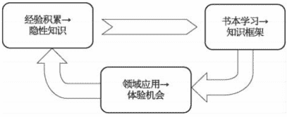
图 3-3　隐性知识积累。通常，书本学习是知识获取的主要来源和基本手段，在此基础上可进行领域实践或实际应用，经过一段时间的实践、对照、反思、总结，能力得以提高，并逐步形成自己的经验，从而专业素质日益完善，它们将更新原有知识或成为新的知识

- 经验是个人智慧的重要部分，独特的领域经验是专家成型的前提；
- 默会经验是具体领域长期实践的结晶，其表达与推理是人工智能的核心任务之一；
- 计算机辅助诊断可以更恰当地表述为专家系统，尽管经典，但其中仍有大量待探索与实现的工作。

后面两章将在本章基础上介绍默会经验学习的两个具体案例。

古人学问无遗力，少壮工夫老始成。
纸上得来终觉浅，绝知此事要躬行。
——陆游《冬夜读书示子聿》

［32］R.M.哈尼什.心智、大脑与计算机：认知科学创立史导论.王淼，李鹏鑫，译.杭州：浙江大学出版社，2010：114～118.

［33］爱因斯坦.物理学与实在／／爱因斯坦.爱因斯坦文集（第一卷）.北京：商务印书馆，2010：480，475～476，811～812.

［34］雅克·马利坦.艺术与诗中的创造性直觉.刘有元，罗选民，等译.罗选民，校.北京：生活·读书·新知三联书店，1991：56.

## 【注释】

[\[1\]](#txt004.html#footnote_quote_txt004_1)“经验主义”常被说成偏离理性、只信实践，历史上既有吃亏也有胜仗。行得通的路径多多少少离不开经验，关键在拿捏分寸，过犹不及。历史经验可资借鉴，却不可一概而论。个人经验与社会经验不同，前者关乎个体实践，后者指向群体，比如老农、老工、老指挥。顾准指出，社会实践中纯理性判断易流于空泛，经验性的结论反而更可靠。

[\[2\]](#txt004.html#footnote_quote_txt004_2)小时候大人说我爱瞎动手，比如看外婆包小脚粽子我学着做，做出来也不散；又把玉米籽随手丢进外婆种葱的裂了纹的砂锅里，没指望结果，不久竟发芽长到半米多还结了穗，挺有惊喜。若事先请教种植要点，在正经田里或许能种出能吃的玉米。并非贬低农活，玉米生长受自然节律和环境多重因素影响，种植易学但要做好仍需经验。经验处处可见却易被忽略，像吃小笼包时一不留神汤汁就会飞溅或烫到嘴。

[\[3\]](#txt004.html#footnote_quote_txt004_3)小时候玩细铁丝，捏住中间两头下垂，就跟外婆争执说它不直，其实不懂常识：细铁受自重影响不可能像粗钢条那样笔挺。

[\[4\]](#txt004.html#footnote_quote_txt004_4)与郁教授结识于华东师范大学筹建多学科交叉认知科学研究之时，后来多次闲聊。未料我们的研究恰好在“默会知识”上形成纽带。2012年深秋“知识与行动”研讨会筹备期间获邀。笔者曾想从哲学工作者处得到人工智能方法论启发，后来有些倦怠。郁教授多次诚恳邀请在会上做技术报告。2023年春再应邀交流，交叉对话效果常超出预期。

[\[5\]](#txt004.html#footnote_quote_txt004_5)向杨治良教授请教时得知。

[\[6\]](#txt004.html#footnote_quote_txt004_6)有同学说高二解不出的题高三忽然能解了，这算隐性知识吗？对照隐性知识的内涵，答案是否定的。高二高三学的是不同内容，间隔也不长，做题有时通有时不通往往只是受了启发。

[\[7\]](#txt004.html#footnote_quote_txt004_7)与诸葛海教授的一次微信交流。

[\[8\]](#txt004.html#footnote_quote_txt004_8)徐冬溶教授认为定性与定量之间存在校准问题。看书学不会需亲身体验，本质是校准过程。书上概念偏定性，比如“用力30牛顿”，大多数人不知道该使多大劲。有些内容根本难以描述。

[\[9\]](#txt004.html#footnote_quote_txt004_9)曾给一位博士生讲解移动终端应用模式分类，让他用刚学的神经网络试试。他称样本少只能逐一比对。我问：一万种模式每次都逐一比对现实吗？他说神经网络也一样慢。我指出这忽略了学习的意义：学习是训练与记忆，而非临时计算，这是效率与智能的关键。实际效果仍需验证。有时为节省时间把问题提炼，大家却抓不住本质而纠结枝节。人类都不习惯从经验中学习，计算机更难。

## 4 心电图谱的隐性逻辑

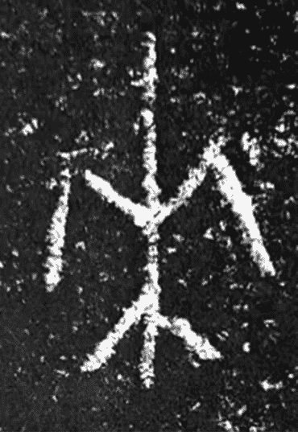

来（甲骨文）［1］

医生在诊断一个病例时所涉及的乃是个别的事情，依靠的是所备有的关于生理学等方面的一般原理。如果没有这些，他是不能进行工作的。不过他并不企图把这个病例归结成为某一些生理学和病理学法则的确切例证。他是在利用这些一般性的陈述，帮助指导他去观察这个特殊的事例［2］。

——杜威（J.Dewey）

浅学曾念知行易，静思方明模拟艰。

浅学时总觉得知行不难，细想才知模拟不易。教科书里的诊断规范多偏概括，临床规则也显得粗放，这让人怀疑它能否真实对应人类认知。诊断实则是宏观把握与微观审视的来回，抽象推理与形象感知共同发力，单靠演绎或单靠学习都不足以完成，必须互补。既要关注量化指标，也要读懂形态参数，后者的刻画尤为困难，常需借助间接手段。只有吃透医生的实践经验，找到隐性知识向显性知识转化的通道，才能更逼真地再现诊断思维。

## 4.1 临床为何呼唤智能辅助

简单说，心脏电生理活动的可视化就是心电图，它是心律失常等常见心血管病的常规检查手段，图上细微变化都可能指向病理。为大众提供及时、可得的监测与判断是技术方的责任。及时意味着尽量实时出结果并给出提示，部分心血管急症抢救窗口很短；可得意味着检查下沉，最好在基层乃至家中完成。传统条件下二者常矛盾，而信息化、网络化、便携化、移动化、智能化的技术组合有望破局。面向基层的心血管监测构想如图4-1所示：心电、脉象等体征经网络传至云端后返回分析结论，把好医生的能力挪到身边，把好服务沉到基层，实现随时随地的监测与会诊。

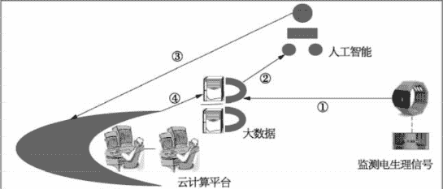

图 4-1　心血管疾病监护云平台 ABC-DE

①体征采集^([\[1\]](#txt005.html#footnote_content_txt005_1))，②机器分析，③专家交互，④数据存储

计算机辅助诊断的需求非常迫切。它与健康分析、疾病治疗、预防康复、体检监护并行，已渗透到日常。从家用测压测糖到体检心电、胸片，再到医院磁共振、CT，都体现了广义计算机辅助诊断的作用，依赖程度不一：有的仅用微处理器，有的需高性能专用机。计算机辅助医疗诊断的要义是医生利用机器提供的信息或处理结果做判断，而非单纯采集，包含两层含义。

第一，诊断仍由医生主导，但已不能仅靠望闻问切式的辨证，而必须借助专门计算设备获取初步信息后才能展开。现代中医实践也普遍离不开基础检测设备。

第二，诊断借助的是对生命体征或生理图像的特定处理，设备的放置与启动需人操作，关键结论尤其是疑难病例最终仍由医生裁定^([\[2\]](#txt005.html#footnote_content_txt005_2))。

正如乔布斯所言［3］：“其创意目的并不是赞美计算机可以做什么，而是赞美富有创造力的人们在计算机辅助下可以做什么。”人的核心地位不可替代。

典型的计算机辅助心电分析包含数据预处理、特征选择与提取、症状分类三步。预处理负责压制噪声、突出有效信号；分类依赖特征，尤以特征提取为关键。有时提取与分类高度耦合，或直接把原始心电记录作为输入。图4-2为心电波形与特征示意，展示两个心动周期，体现幅度、间期、斜率、形态及平均趋势等要素，组合起来构成疾病判断依据，正常心电也是一组特征的组合。医生关注特征本身、特征间关系及综合结果，QRS波群或主波R波的识别是分析的基础。完整临床心电含12导联，需从宏观到微观分层看待整体而非单导联或单心搏。

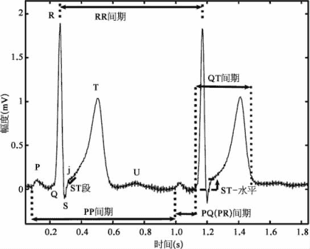

图 4-2　心电图特征示意［4］

几十年来，从逻辑推理到知识工程、决策树到模板匹配、支持向量机到深度神经网络，以及傅立叶变换、高斯模型、隐马尔科夫模型、主成分分析、独立成分分析、小波分析、线性判别分析等提取手段，心电辅助分析已有丰富积累［5，6］。在标准库上准确率常超90%，部分逼近99%。但面对真实临床数据，性能常断崖式下滑。主因有三。

第一，测试集规模受限，如MIT-BIH-AR［7］。该库可提取十万级心搏，却仅来自47位受试者的48条记录，每条约30分钟且仅2导联，40条才有II导和V6导。数据局限拉低了问题复杂度。

第二，多为同病人内分类，训练与测试心搏来自同一人不同时段。依据AAMI标准［8］构造跨个体的训练测试集［9］后，算法表现明显下降。

第三，忽视临床真实诉求。有人对两导联分别建模再贝叶斯融合［10］，在MIT-BIH-AR上效果尚可，但不同导联特征的疾病意义不可互代，且临床依赖全导联信息而非两导联。

近月《IEEE生物医学工程汇刊》高下载论文屡见R波检测方法［11，12］。新近工作在MIT-BIH-AR上分类准确率达99.81%［13］，而我们的方法一度达99.86%［14］，这类提升在临床意义有限。

根本任务是复现领域专家思维过程，在计算机网络环境中完成原本依赖资深医生的诊断工作，而非仅在小标准库上刷分。教科书规则往往缺失细节与微妙之处，因此必须关注专家思维中未言明或难以表达的部分，即隐性知识，这正是算法差异的关键。

在过去二十余年的研究和应用中，我们逐步形成了医学经验隐性知识的学习、形态特征识别、训练与测试集中区分个体内与个体间数据、构建开放数据集、为不同特征设计分类器的一整套方法，以逼近专家思维。

这里强调“辅助”，并非替代。算法可在网络医院服务器运行，协助医生进行正常异常分类或常见心律失常诊断，提升效率；简化后也可部署在终端，为用户提供实时参考。

2007年对GE心电图机的统计显示1858例中总准确率88.0%，窦性心律95%，非窦性仅53.5%［15］。2012年对576例的评估中，Philips准确率80%，Draeger75%，三名普通医生平均85%［16］。技术虽在进步，医学却不仅是演绎推理与统计思维，更是复杂的因果网络。有经验的医生在实践中不断整理知识、剔除冗余，形成层次清晰的结构，因此计算机辅助诊断仍有大量工作可做。

## 4.2 医生读图的整体策略

疾病分类的粒度各不相同。区分正常与否是一种分类，区分心律失常与高血压是另一种，区分早搏与动脉粥样硬化又是另一层级，出发点与尺度皆异。图4-3是MIT-BIH-AR中被标注为“正常”的记录，医生告知实为间歇性预激，主要表现为QRS波群宽大畸形、起始段出现预激波δ波，伴ST段与T波改变，PQ间期缩短，正常与异常心电交替出现。

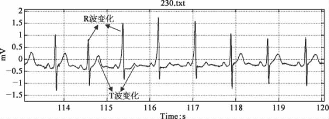

图 4-3　在`MIT-BIH-AR`中被标为正常的异常心电图

误标源于规则遗漏了医生实际使用的经验，如通过动态变化把握整体。图4-4为正常心电图，2～4s处因突发噪声导致信号下移，进而干扰ST段、P波形态、PR间期的提取，因难以剔除该噪声，易被误判为异常。

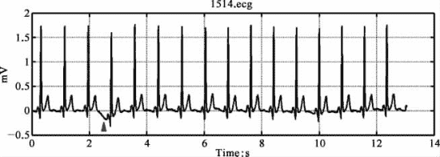

图 4-4　正常心电图

图4-5中，医生借助RR间期这一直观参数，很快锁定8～10s处RR突变的心搏，结合脑中模板判定为房性早搏，并作为诊断结论输出。而2～4s处的T波突变在理论上不会骤然发生，医生会判定为噪声而忽略。

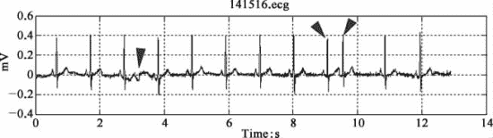

图 4-5　窦性心动过缓，肢体导联低电压偶发房性早搏`T`波低平

归纳来看，有经验的医生读图大致如下。

第一，整体把握。先排查是否出现大于主波的大噪声，突变信号通常非心电来源，可先放一边；同时留意节律与形态是否大致一致。单个心搏看似正常，结合前后数个心搏即可显现病变；反之，单导联局部异常结合病史与他导联往往无临床意义。

第二，心搏归类。寻找“平均心搏”与“突变心搏”。出现频率较高者为平均心搏，代表整体情况，包括平均间期、大致幅度、相似度、对比关系与变化趋势。短时间内疾病导致突变的可能性小，不合理突变心搏可先略过，优先寻找代表性心搏。

第三，交叉处理。提取心搏间局部特征与对比关系。某些心搏可能同时兼具两种疾病的部分特征，或两种特征在连续心搏中交替出现。同一记录允许的突变类型有限，不可能出现的突变可直接判为噪声或无效。

计算机辅助分析还需兼顾系统性能、指标范围与运算效率。既有分类器设计常见问题包括：忽视医生介入，对诊断过程缺乏理解，尤其低估经验作用，有自说自话之嫌；数据量不足导致结果“过好”，盲目套用数学工具也难以自洽；医生是自宏观到微观的判断过程，形态特征至关重要。图4-6、图4-7、图4-8展示了QRS波群、P波与T波的部分形态特征［17］。

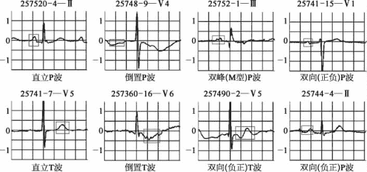

图 4-6　`P`波与`T`波的形态

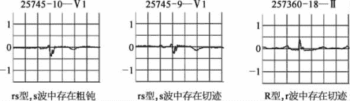

图 4-7　`QRS`波群中的粗钝与切迹

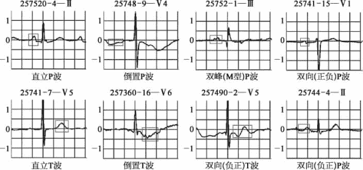

图 4-8　`P`波与`T`波的形态

QRS波群中不同极性子波的组合与命名遵循一定规则：首个向下子波为Q，首个向上为R，R后首个向下为S，R后首个向上为R′，S后首个向下为S′。不同Q、R、S、R′、S′的组合可形成多种形态，如完全正向的R型、完全负向的QS型、QR、qRs、RSR′、rSr′等。大写表示振幅较大子波，小写表示振幅较小子波。临床尚未统一振幅大小的绝对边界，比例关系可作为参考参数。

医生判读结果或计算机辅助诊断的目标层次如图4-9所示。

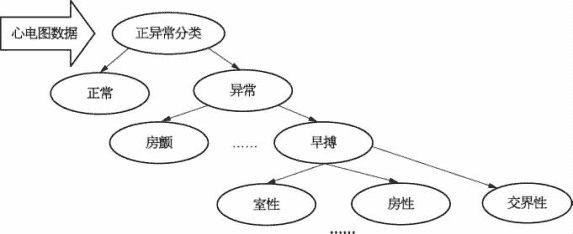

图 4-9　分类层次结构

## 4.3 反思与取向

逻辑简化的代价：从研究所名字看知识失真

科研里梳理逻辑几乎是本能，归纳、压缩、提炼无处不在，可压缩必然伴随信息流失。拿中国科学院苏州纳米技术与纳米仿生研究所举例，外界常把它简称为中科院苏州纳米所，甚至直接叫纳米所，乍听就以为全是纳米研究，实际上“仿生”就链接到人工智能。名称被缩短后就容易产生误读。当然人工智能需要信号感知的载体即传感器，这部分确实与纳米技术相关，但要想被理解还需要进一步解释。

类似的简化无处不在。教科书里的体系化规则都是归纳出来的规范知识，有代表性但多停留在示例层面。心血管专家王士雯院士指出，临床老手和刚上岗医生的分水岭在于，后者多依赖书本，容易走入过度简化的误区。［18］

知识一方面来自自然经验对世界正在发生之事的积累，另一方面依赖人为设计、并非日常自然条件下易见的实验［19］。从知觉与注意入手设计认知心理学实验，去找医生诊断时视觉追踪的机制与注意焦点，获取新特征及其组合是可行路径。比如用眼动仪分别记录普通人和专家读心电图时的眼球移动、注意流程与聚焦位置，甚至同步用功能性磁共振捕捉脑活动，定位心电图里被特别关注的特征集合。

这个过程离不开医生的自我反思、回溯与对照。构造主义心理学由冯特 `W.Wundt` 与学生铁钦纳 `E.B.Titchener` 创立，视意识经验或直接经验为研究对象，以内省观察主观经验为主要途径。透过内省逐步厘清细节，对人而言是明确却困难的任务，很多事情“妙不可言”，难以言表。《论语·颜渊》言“内省不疚，夫何忧何惧”，倡导“见贤思齐焉，见不贤而内自省也”，其出发点是道德完善，反省对象是日常经历与内心世界，内容庞杂零碎。而诊断等专业领域的隐性知识指向性强，通过内省有望转化为显性知识。

内省不一定奏效，对“畸形”这类概念的刻画就很困难，缺少好的数学描述工具。医生给出的判断规则也无法穷尽完整的思维过程。我们只能基于医生已表达的知识，用不同方式去“学习”未被表达的部分。若保持规则核心思想不变，用间接规则判别同样有效，比如早搏，可通过前后相连心搏的相似性比较判定，相对容易。不同数据集、不同方法的测试结果差异，会让人逐步认识差异根源，推动诊断规则的精化。

医生提供的规则通常不含全部细节，有时还带冗余。严格按书本规则设计分类算法，很难处理不可避免的不一致。以书本中窦性心搏的判断为例：

（1）`P`波形态正常；
（2）`PR`间期＞0.12 s；
（3）规则的`PP`间距突然出现窦性`P`波脱落，形成较长`PP`间距，且长`PP`间距与正常`PP`间期无倍数关系；
（4）过长`PP`间距之间可见逸搏或逸搏心律。

其中“突然”“较长”“过长”等表述模糊，难以被程序处理。改写后的可执行版本为：

（1）`P`波出现在每个`QRS`波群前，规则的`PP`间期中出现长`PP`间期（长`PP`间期：`PP`间期＞1.5 s）；
（2）长`PP`间期不是正常`PP`间期的倍数；
（3）`PR`间期：0.12～0.20 s；
（4）`QRS`波群：＜0.11 s。

此时才可编程实现。我们依据书本整理近 30 条常见心律失常判读规则，请资深医生提出修改意见^([\[3\]](#txt005.html#footnote_content_txt005_3))，随后在仿真环境得到初步结果，与临床诊断存在差距。我们以医生关注的特征为线索，结合现有资料与医生互动。验证不可或缺，这是一个实验运算——结果分析——矛盾发现——规则精化——再实验的闭环。实践、经验与隐性知识的挖掘，让我们得到更贴合实际的诊断规则。医生的整体思维难以完全被规则表征，我们还借助机器学习捕获难以“和盘托出”的隐性知识。

4.4 特征选择

计算机辅助诊断中的特征选择、特征识别、特征提取［20～22］至关重要，但对原始数据不加甄别地提取数理特征不可取，简单线性或积分变换不足以刻画本质，高维到低维的压缩也难免丢信息。某个数据集中无贡献的特征，在另一数据集可能起作用。理应回到从原始数据提取临床诊断特征。由此产生的问题是，目前识别的特征是否构成分类的充要条件，其重要性是否等价，是否还有被忽视的特征。特征即代表性征象，一方面要洞若观火，另一方面恰到好处即可，如演员排练前需要清晰镜子，矫正动作时电视屏幕已足够。

以心率分类为例，临床上心率小于 60 次／分钟为过缓，大于 100 次／分钟为过速，60～100 次／分钟为正常，只需检测`R`波经简单计算即可得到心率，据此可把心电图分类划分为 3 个区间，再以`RR`间期是否均匀为标准进一步拆分为 2 个子流程。`R`波检测也会出错，对固定时长数据若`R`波数量明显偏少或偏多需额外处理。具体判定依赖大量临床数据的全面分析，即可由已有特征合成新特征。

经心率快慢与`RR`间期均匀性分析可建立一定先验。`RR`间期不均匀多见于房性早搏、室性早搏或心律不齐，否则可能是传导阻滞或正常。结合信号质量与疾病类型的先验，以及已检出的`R`波位置，从不同增强角度做数学变换，再借助先验与多导联互参可较好定位各特征点。

于是出现包括`RR`间期均匀性在内的间接特征。相似度特征：同一个人同类型心搏具有相似性，不同人间未必，有时差异较大，不同类型心搏则表现出差异。同一记录内对前后相邻若干心搏做相似性评估，对早搏判定有效。突变心搏特征：在同一记录内利用相似度聚类心搏，将样本最多的一类视作“平均心搏”，其余为突变心搏，代表疾病或噪声导致无效心搏。突变心搏不能直接判病，但可为后续分析提供先验。结合这类特征分层分类，可形成不同分类器。

深层神经网络普及后，多数学者直接把原始数据喂给网络，这与信号处理、特征识别、模式分类分阶段处理不同。脑内过程如何尚有普遍机制，智能模拟重效果，说明不必完全仿脑，也难以完全映射。分阶段或许是认识不足时的权宜。

筛选、组合、加权特征与科学哲学中的证伪相呼应。波普尔 `K.Popper` 指出“证实”无法区分科学与形而上学，证伪则强调知识并非放之四海而皆准，蕴含开放性，否则便如宗教。新知往往在理论失配实践时出现，时代呼唤尚未显式的知识。

隐性知识显式化可视为显性知识被证伪的过程，即原书本知识不完整或不确切。知识体系之所以成立，是内部命题相互支持且与实际不矛盾，但人类知识具不完备、不确定、不一致与逐步显现等特点，不完备部分可能缺失未知或未显式化的知识，因而需不断更新。当命题被证伪，可修正之，如心电图诊断规则的精化，如同软件调试。

若说知识只能证伪则过于绝对，相对论超越牛顿力学，若把超越相对论作目标近乎不可为。这也折射翻译与知识共享的微妙处，语言可互译，细微内涵难以到位。即便本国语言理解亦有此问题。于是“证伪”一词本身也可被证伪，以更贴合中文语境，知识精化、理论完善、认识上升等表述更易理解。广义上亦可视为隐性知识。

4.5 分类设计

设特征提取函数为`g（x）`，分类函数为`h（x）`，则心电图决策函数`f（x）`即复合函数`h（g（x））`。机器学习在此作用明显，但并非“一手遮天”，主要方法依托核方法与人工神经网络。1995 年，凡普尼克 `V.N.Vapnik` 基于统计学习理论在感知器基础上提出支持向量机，核心是利用核函数把低维非线性问题映射为高维线性问题［23］，优点是结构可自适应，凸问题利于参数优化；缺点是训练样本不宜过大，决策函数完全由训练样本决定，这是矛盾。因此交给支持向量的特征数宜少而可分，需好的特征识别支撑。人工神经网络的优点是决策函数可由用户指定神经元与层数确定，在大规模样本训练上占优，但网络结构设计与参数调整是难题。改进思路是融入机制帮助更有效调参，如结合领域知识设计步骤。

深层神经网络推广后［24，25］，在计算机视觉、语音、自然语言处理等经典领域取得显著效果［26］，其中卷积神经网络 `CNN` 先在手写字符识别即二维图像理解任务中取得佳绩［27］。多导联心电图数据形式类似二维图像，是一个矩阵，可直接用二维卷积神经网络训练分类。常规卷积网络对行列均做卷积，对图像合理，但对多导联心电图不合理，因导联内数据相关，导联间独立。不同导联具各自属性，应有各自最佳卷积核。在分析现有数理特征提取算法与分类算法在拟合复杂非线性函数上的不足后，设计并完善了基于多导联心电图特殊二维结构卷积神经网络［28］。

导联内数据随时间相关，用卷积合理；导联间独立，若做卷积需考虑所有组合。现有方法无论如何设计卷积核，只能实现部分导联融合。为此去掉导联间卷积，让每个导联各自有 3 个卷积单元，单元间互不相干。针对互相正交的 8 个导联数据，共 24 个卷积单元，传统设计仅 3 个。每个导联的心电图依次通过最适配自身的 3 个单元后汇总信息做最终分类^([\[5\]](#txt005.html#footnote_content_txt005_5))。

针对正异常分类，原始数据被平均分为 44 组，如表 4-1 所示。其中，“0”组的正异常数据是平衡的，该组用于验证中间训练过程的效果。如果直接用测试组验证，测试组的特性可能会被“学过去”，影响算法的泛化能力。

表 4-1　数据组织

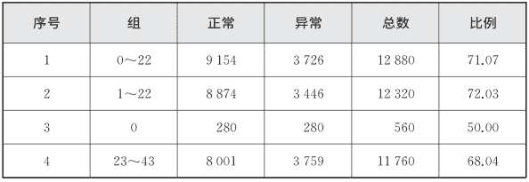

对心电图分类方法的效果评估通常采用灵敏度 sensitivity `Se` 和特异度 specificity `Sp` 等来衡量，其定义分别为：

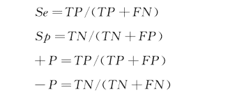

其中，`TP` true positive 表示检测出的阳性样本，`FP` false positive 表示错误检测出的阳性样本，`FN` False Negative 表示漏检的阳性样本，`TN` true negative 表示正确拒绝的阴性样本。`TP`＋`FN` 就是阳性样本数，`TN`＋`FP` 就是阴性样本数。

总的正确率 `GCR` ＝（`TP`＋`FN`）／（`TP`＋`FN`＋`TN`＋`FP`）

一条心电图记录起始位置不同，同样时长意味着数据空间不同点，为增加可信性，可选不同起始点的若干数据做实验，比如选第 1，26，51，76，101，126，151，176，193 点起始的不同数据，于是有 9 个分类结果，取回归输出平均作为最终输出，记为`CNNR2` 只取一个起始点记为`CNNR1`。表 4-2 是两者的比较［29］，数据及其意义在后节一起讨论。

## 表 4-2　`CNNR1`与`CNNR2`的比较 `FPR`＝1-`Se`，`TPR`＝`Sp`

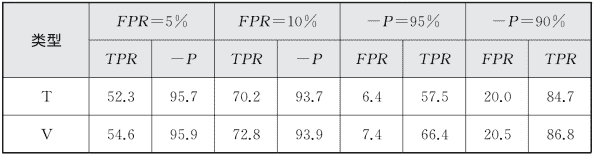

从“分而治之”角度，可通过组合相对简单的函数实现分类，如高斯核支持向量机的决策函数由多个高斯函数方式拟合而成，神经网络的决策函数由多个激励函数以组合方式拟合而成等，从而更复杂的非线性函数就可通过组合与复合多个非线性分类器构造而成。

4.6　方法融合

卷积神经网络可直接输入整条心电图记录，但在给定网络结构下，其非线性拟合能力有限，因而考虑在此基础上实现分类器的集成与融合。融合本身是指相似功能或作用的元素或实体的关联、重组、互补与优化，从而聚集、统一为一个功能更强、作用更大的实体，有自然的过程，如地貌的变化、河川的汇合；有含一定主动性的行为，如民族的聚集、种群的分布；有内外因导致的结果，如机构的合并、方法的集成。抽象思维和形象思维的综合，既是大脑的特性，也是当今众多智能模拟方法互相取长补短的必然要求，因为有的算法长于计算或推理，如规则推理；有的则长于分析、综合，如人工神经网络。不仅如此，前者和后者都有待细分。

就心电图而言，有的是识别`QRS`波群的，如能量谱方法；有的是针对`P`波的，如机器学习方法；有的是面向`ST`段的，如模板方法。更进一步，比如同样是`P`波，有的情况下可选择支持向量机，有的时候还得借助小波变换。融合应是多角度、多层次和多方面的。好的分类器融合策略，既需要对数据的深入剖析，尤其是就出错数据查找原因，又要对不同分类器性能和特点有清晰把握，前者琐碎、量大、枯燥、耗时，后者依赖于前者，又非小数据集上浅尝可止，需要洞察并调整内部结构，测试各类数据。只有这样，才可能让分类器与数据特点匹配，使得它们分工有序而作用协调，进而提升整体性能。因此，面对实际数据，随便选择某种分类器解决不了问题，而缺乏足够量的原始数据，有效的分类器不但不会“飘然而至”，甚至分类器的基本性能都难以发挥。多种分类方式［30～32］的有效融合可使效果得以提升。

表 4-3 和表 4-4 是分别以`CNNR1`与`CNNR2`为基础的融合规则推理分类结果，其中“1”指依赖于`RR`间期的规则推理，“2”指依赖于`QRS`波群幅值的规则推理。医生关注-`P`＝95%情况下的`TPR`。融合的效果是显然的，而且`CNNR2`优于`CNNR1`。

### 表 4-3　基于`CNNR1`的融合结果

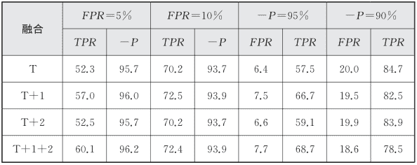

### 表 4-4　基于`CNNR2`的融合结果

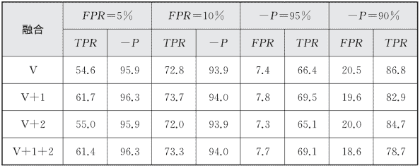

进一步细分规则以后的融合结构如图 4-10 所示。

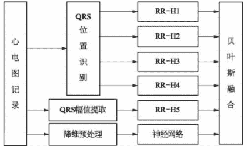

图 4-10　规则推理与深层人工神经网络学习的融合

预处理后的心电图数据，一方面到`QRS`波群位置检测模块，然后进入`RR`间期正异常分类器 有 4 个；同时到`QRS`波群幅值提取模块，然后进入`QRS`波群幅度正异常分类器。另外，经过一路降维处理进入卷积神经网络正异常分类器。每个分类器均输出为正常的心电图才是最终的正常心电图，此时医生可专注于异常心电图的后续处理。

深层神经网络输出的是概率值。可采用贝叶斯方法融合`CNNR1`与`CNNR2`。不失一般性，若有针对`K`个类的`M`个分类器，对第`k`类的预测可由最后的概率估计`P（y＝i|c 1，c 2，…，c m）`给出：

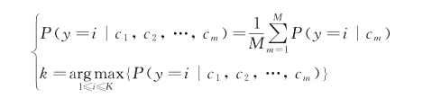

其中，`P（y＝i|c m）`是由分类器`c m`对`i`类预测的概率值。对于这里的正异常分类，`K＝2`，`M＝2`［33］。

小规模测试样本范围为中国心血管疾病数据库 `CCDD` 后节介绍 中的 `data944～25 693`，大规模测试样本范围为 `data25 694～179 130`，见表 4-5。

### 表 4-5　训练与测试数据

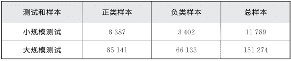

在小规模测试时，总共是 24 669 个样本；再将其划分为 12 880 个训练样本和 11 789 个小规模测试样本，两者数据完全不一样，没有重叠。大规模测试时的数据划分是类似的。

针对上述数据的测试结果见表 4-6 和表 4-7。`H0`和`H`的区别在于，`H0`的输入样本的起始点由原来的 1 个增加到在同一个心搏中随机选择的 9 个，从而拓展样本和学习范围。

### 表 4-6　小规模测试 1

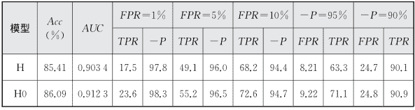

### 表 4-7　大规模测试 1

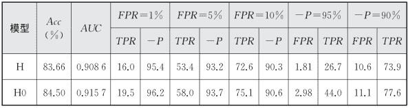

# RR规则加持的深度心电筛查

文献［29］里给出了一组依赖 RR 间期的精炼规则。设心电采样频率为 f_s，记录中第 i 个主波 R 波的位置记为 R_i，1≤i≤n，则共有 n-1 个 RR 间期。平均 RR 间期可表示为公式，其物理意义就是一次心跳所占用的时间或采样点数。

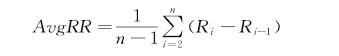

1. 心率区间规则 H1
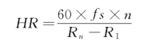
正常心率被限定在 55 到 115 次/分之间。

2. 局部特征心率不齐 H2
当连续 3 个 RR 间期均超出平均 RR 间期的 15% 时触发。
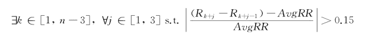

3. 局部兼整体特征心率不齐 H3
单个 RR 间期超过平均值的 15%，同时相邻 RR 间期的整体变化率标准差大于 0.05。
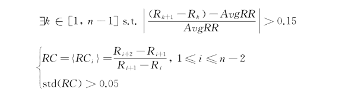

4. 整体特征心率不齐 H4
平均 RR 间期的整体变化率标准差大于 0.05。
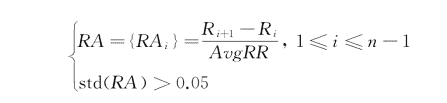

5. 幅值计算 H5
R 波幅值的计算方式沿用常规做法。

规则推理的输出只有 0 或 1。若 H1 到 H4 中出现 1，则融合概率取深层神经网络输出与 1 的均值；四项全为 0 时融合概率即为神经网络输出。阈值以 0.5 划分，低于则判正常，高于则判异常。

在规则分类器与深度网络融合后的测试表现见表 4-8 与表 4-9。

我们重点看 P=95% 时的 TPR。随着 H1~H5 的逐步加入，性能相较于此前仅用 H 与 H0 的方案均有提升［34］。

日常采集的心电图中正常占比超过 72%。融合 RR 间期异常分类器后，特异性升至 67%，0.67×0.72≈48%，意味着可为医生减负近一半，这是一条临床可接受的具体收益。

### 表 4-8　小规模测试 2
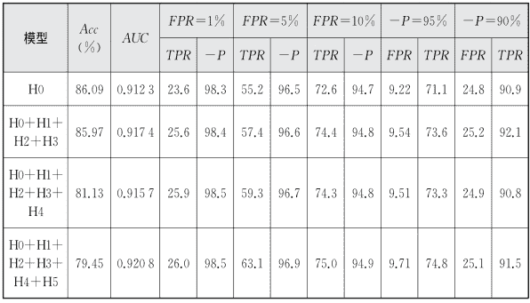

### 表 4-9　大规模测试 2
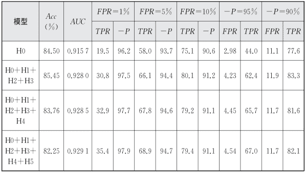

在正异常判定之后，不同症状的细分也是下一步工作，例如房颤的灵敏度、特异性和准确率均接近 99%。不少团队仅在 MIT-BIH 等公开库上验证，难以在 CCDD 上做直接对比。单就对心电图本质的理解、方法特性的比较以及临床需求的贴近而言，本方案在整体上优于目前已发表结果，但临床推广仍需更大范围检验。对个体而言算法出错风险高于一次医患交互，但优质算法在提效、降本、普惠方面的回报明确。一个指标亮眼却缺乏临床价值的模型意义有限。

信号质量可先行初筛，对复杂信号先用统计学习方法评估质量，再给出先验供后续分类参考。

本质上，心电图分类就是寻找一个函数，让不同疾病的数据落入不同区间。面向常见心血管症状，融合深度学习与知识工程的分类体系为：

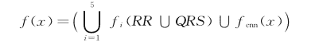

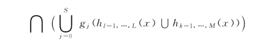
其中 RR 与 QRS 波群分别指 RR 间期和 QRS 幅度，共有 5 个依赖它们的分类器 f_i，i=1…5，这些分类器与神经网络分类器 f_cnn 分别针对不同疾病建模。结果再经 S+1 个规则推理分类器 g_i 做二次确认，特征识别函数为 h_l 与 h_k，分别依赖 L 个常规数字特征与 M 个形态特征，形态特征的识别可用阈值、模板匹配、支持向量机或深层神经网络完成。令心电图数据集 X={x∈R^d}，每条记录最终归入某一类：

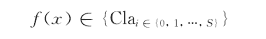
共有 S 类疾病，再加正常，共 S+1 种结果，Cla0 表示正常，Cla i，i∈{1,…,S} 表示异常。

我们的思路呼应康德的表述：“……一个简单的知觉表象就已经包含了杂多感觉的会集和统一……这也就是说，从人们感觉一开始，就有一种统一性于其中，把杂多的感觉表象联结起来，否则这些杂多就只能永远是孤立的、零碎的、乱七八糟的感觉。这种联合综合杂多的统一性，并不是被动接受的感觉本身所能具有，而必须有心灵的主动综合作用才行。这就是所谓‘直观中把握的综合’”［35］。

## 4.7　训练样本

人工智能里训练与测试是关联的两环。前者用一定量的数据调整模型参数以获得最优性能，后者用另一批数据检验可靠性和适用性。数据规模不同，模式情形就不同，数据越多，情形越多，也越复杂，甚至出现前所未见的样本。正如生活在原始部落的人面对现代社会会无所适从，而经验丰富的将领才能掌控战局。人的成长是逐步学习，尤其专业能力并非一次性训练可得。另一方面训练数据的多少差异很大。见多识广源于经验，数据不足时让算法模拟人类思维去应对真实数据，就像想一口吃成胖子，很难四两拨千斤。

为克服 MIT-BIH-AR、AHA、ESC、NST、CU 等标准库在代表性上的局限，并支持实时追加新数据训练，我们构建了中国心血管疾病数据库 CCDD［36］（http://www.ecgdb.com），并开发了如图 4-11 所示的标注工具辅助专家手工标注，目前已公开约 20 万条代表性记录。工具同时可引导专家发现数据问题或优化诊断规则，避免误导，也能挖掘隐性知识。

在图像处理等领域，数据量大时常抽样、插值恢复原貌，视觉容错性强，偏差可接受。预测诊断则不同，必须有完整具代表性的数据集才能全方位观察、分析、借鉴。混沌效应下差之毫厘失之千里，经验不足导致结论肤浅。量与代表性需平衡，过多冗余不必要，在保障可靠的前提下数据越少投入越低，难点在于找到折中。书籍资料亦然，全集重复单行本，单行本又缺完整性，按需选择可行，否则为可靠便利只能备全集。

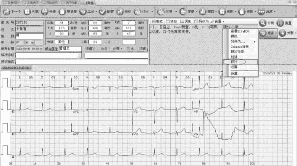
图 4-11　标注工具软件界面

## 4.8　数据规模

“大数据”早用于天文学和基因组学，其大与小界限并不清晰。信息化时代数据泛滥，人们相信其中蕴含复杂信息与关联，但现有技术对旧数据未必已很好适应。“大数据”仍以概率说话，不偏爱随机抽样而倾向用尽所有数据，可能牺牲精确性，因而结论未必确凿无疑。

大数据应具三点：第一，规模。至少比以往处理的数据大上一个量级，需要新思路与并行、超算等手段，即使如此仍需针对性算法与组织。第二，分布。数据来自不同来源，现实社会的真实情形如此。第三，类别。异构被视为特征，但非异构的大规模数据同样棘手。中国心血管病人数达 3.3 亿，仅此一类数据就蕴含丰富病症信息，目前尚无统一数据库。若能采集到足够数据，可按区域、年龄、性别、正常与否、设备来源等预分类，既借助经验降低复杂度，也缩小计算规模。忽略微观精度可换取宏观洞察。

科技进步推动我们对大数据话语的理解，有渐进、曲折、突飞等形式，都是超越过去拥抱未来。不同阶段常被形容词命名，“大数据”与“深度学习”也有类似嫌疑。深度学习即深层人工神经网络，相对浅层而言，机器学习还包括统计学习等，不等于人工智能。物联网或云计算与大数据的境况不同，“大数据”意味着量变可能促成质变，若无质变则大小无必要。深度学习源于视觉神经机制，对传统网络的超越虽早有讨论，但深层建模始终困难。

大数据热十余年，新机构新判断层出不穷，却有几个常被忽略的问题：医疗等行业数据仍成孤岛；互联网数据分析的进步并非大数据概念所致；电网数据虽大但规律明确，可控性好；大量所谓大数据应用数据规模实则有限。是否需要那么多新说法？其引领整合作用如何？一哄而上浪费多大？

《红楼梦》数据量大，计算机统计名词未带来根本突破，人类协同仍不可替代。人该如何参与？机器能否得出结论？大数据能否超越？《四库全书》约 8 亿字，检索分析在大数据提出前已可实现。研究大数据的目的在于寻找规律与关联，人类擅长透过现象把握本质，超出复杂程度后需机器辅助。但计算能力已强，不足的是直觉与整体把握。面对新名词应谨慎寄望，耐心等待结论。

实际工作不能止于实验室小样本。计算机辅助心电图诊断几十年来在标准库上表现皆“好”，但若理解大数据的独特性，就不能满足于小库。精准医学要求在恰当时机对具体病人采取合适措施，而多数深度学习在临床要求上未达宣传效果，泛化不足的根源在于忽视数据采集场景、可靠性、精度、代表性与规模。工欲善其事，必先足其数。

## 4.9　推陈出新

研究源于实际需求，面向实际问题^([\[6\]](#txt005.html#footnote_content_txt005_6))，并需技术创新，从理念到产品历经全过程。图 4-12 示意了从市场调研到服务提供的关键环节。

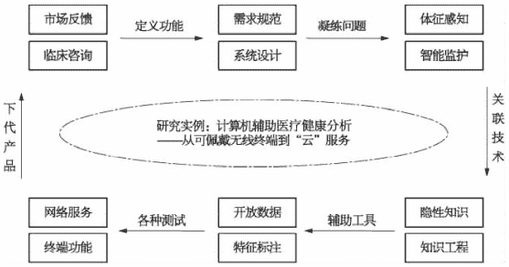
图 4-12　从需求到产品主要环节

常被问准确率如何？这是问题但非完整的工程问题。医生也有误诊，我们的初衷是基层筛查，疑难仍需医生介入。误诊原因除经验差异外还有医学不确定性。例如车祸病人心律极不规律，自述甲亢史，医生按甲亢致心律不齐给药，有经验者会怀疑，后证实肺部严重受损，修复后心律与甲亢指标均恢复。统计得出的“80%可能”若被当作绝对依据，问题随之而来。

统计学成熟，但“统计意义”在个案讨论中易误导。P值 0.05、0.01 有何依据？是否做过置信度优化？批评不等于对方一定理亏，经典结论本身是概率可能性，用“兼容区间”表达或更不易一刀切。生活中统计分析是好习惯，结果选择却需结合问题背景、数据质量与规模，努力克服矛盾而非顾此失彼。扬弃相对简单，包容统一需智慧。

有言“心电图自动分析做了那么多年了”，或指难做，或指话题老旧。后者是悖论，我们的任务是破旧立新解决问题。若连心电图这类体征都放弃，更复杂的医学图像分析、模式识别、智能模拟便无从谈起。

具体挑战包括：信号质量受噪声、基线漂移、变形、导联脱落影响；特征识别受幅度小、形态各异、样本不足制约；症状分类泛化弱、针对性不强、过程不明。对策为：加强预处理与专用滤波；扩大改善训练样本，重视特征专门识别，构建特定分类器；深入分析优化分类器本身。

分类探索有两大方向，各有双途径。
●从特征出发的经典分类。
✧传统专家系统，如决策树、可信度因子推理机。
✧特征选择后用统计学习，如支持向量机、独立成分分析结合 SVM。
●机器学习方法，特征提取显隐其中。
✧深度学习，以及深度学习提特征后做规则推理再结合深度学习。
✧规则推理与深度学习融合，目前最有效，前者利用可识别特征，后者借助神经网络把握特征。

后续工作包括：跟踪分析错误结果并归类，为针对性改进提供依据；优化深层神经网络，比较模型、设计异构结构、互补无监督与有监督学习、参数选择；进一步挖掘隐性知识，识别不同形态特征，构建专门分类器，构造推理机；让不同导联权重可变，设计更多适应症状的分类器，发挥各自优势；开展方法集成［34，40～43］，学习新思路并融合脉搏波等体征，用深层神经网络综合分析［45］。

希望为“心”的健康贡献绵薄之力。

## 4.10　心脉互参

心脉互参：从单一监护到多体征智能判读

人工智能与医学的交叉探索已走过数十年沉淀，应用前景愈发宽阔［46］。首批拿到医疗器械注册并进入市场的无线心电终端面世后，同类方案迅速跟进，市场空间得到验证，然而大多数只是简单复制，真正贴合临床的分析模型以及生理参数间的联合解读，仍是行业难以突破的痛点。基于先前的计算机辅助心血管判读积累，笔者认为只盯心脏监测不够，于是设想借助中医^([\[7\]](#txt005.html#footnote_content_txt005_7))把脉的模拟装置，以补充血管方面的信息。当时市面上的“脉诊仪”只能采集单点时序信号，信息量远不及医者把脉时的整体感知。调研中了解到美国 PPS 公司率先在脉象感知领域采用阵列式传感器，并由此暴露了局限，从而催生了对阵列柔性传感器的需求。此后多家机构和团队展开研发，迄今尚未见到既符合临床要求又能与疾病建立联系的研究成果［47］。在此基础上研发出更为高效便捷的如图 4-13 所示可佩戴“单复”^([\[8\]](#txt005.html#footnote_content_txt005_8))感知终端，这也是把中医把脉的隐性经验借助规范的心电图结论显性化的一种尝试。

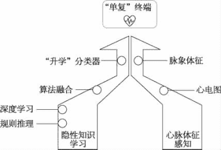

图 4-13　可佩带终端形式及其体征分类方法的演进示意

脉象感知可为临床再添一个体征维度，多参数叠加的价值不言而喻。但落到实际使用，尤其是基层推广，产品必须兼顾可信与易用。可信的首要条件是争议少，而中医内部仍存在诸多分歧；易用则要求操作简便且体积小巧。以心电图为例，一个导联至少需要两枚电极置于不同部位，如腕表戴在左手，就必须让右手主动接触另一电极，不仅难以获得连续信号，还会带来噪声等干扰。脉象呈现不同形态，背后对应不同的机体状态，很可能映射为不同病症，若限定在心血管范围，则可视作除心电图之外的一种表现。因此若能让脉象与心血管疾病、例如心电图已有的诊断结论建立对应，就能兼顾上述要求，因心电图结论争议较小，而单电极比双电极更便捷。核心问题转化为，如何把脉象对应的结论映射到心电图的相应病症，如心肌缺血、房颤等。人工智能可提供助力，前提是能同步采集到足够规模的两个体征数据。其背后涉及血流动力学研究，该方向研究已久，从生物医学工程视角解释问题是一回事，建立可用模型是另一回事，需要转换思路。就像人工智能并非要先完全弄清脑机制再去模拟，中医在此与人工智能颇有共通之处，人们可以先求有效再探机理。最直接的办法是让数据说话，这是一个非线性问题，可从数据拟合与关系学习角度着手，深层神经网络结合推理机制能够发挥作用，这符合大数据智能的基本思想。数据采集依赖合适的终端，而终端的核心在于传感器与算法。

为避免把同步感知的脉象机械地对应到诸如房颤之类心电图症状，需要让把脉医生与心电图判读医生共同观察讨论，形成统一表述，以减少盲目性和过度概括。

学习算法所需的标注数据不足是普遍现象，由两位以上资深医生共同标注并确认的数据更是稀缺，因此需要小样本训练并充分利用推理机制。推理可分为归纳与演绎，机器学习属于统计归纳，如深度学习，而推理机遵循演绎法。笔者据此提出“升学”分类器：既指像学生升学般不断吸收新知识的升级，也指机器学习能力的提升。

设有两个原始脉象数据集合：直接标注`d di`和非直接标注`d nj`两部分，后者的属性即症状名称的标注值由与同步心电图体征数据`dek`对应的属性（`Clai`，参见 4.6 节）映射决定，它们分别构成直接和非直接标注数据集合：

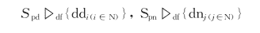

另有一合乎心电图症状`Pk`的属性结合：

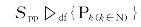，且各脉象数据相应的症状类属：

先利用有限的标注数据训练初始脉象分类器`Pdnn`，随后按图 4-14 所示流程对未标注的新数据获得分类结果即属性，若与心电图分析`Ednn`的输出属性一致，则认为本次输入数据的属性得以确定，相对于初步属性而言，并将该数据加入训练集，即

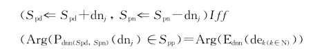

若灵敏度等指标仍不稳定则继续训练，一旦稳定即视为获得目标模型。其过程如图 4-14 所示。

该方法具有三重意义：

第一，缓解普遍存在的标注数据不足的现实困境；

第二，能够借用已有的心血管疾病其他体征如心电图的分析成果；

第三，是一种融合规则推理与深度学习的具体实现。

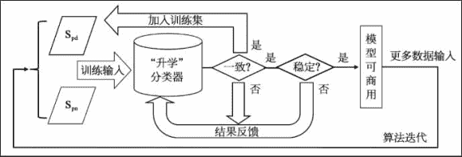

图 4-14　机器学习与规则推理融合的“升学”分类器交叉训练过程

由此可见，以脉象数据为基础的该分类器依赖心电图数据及其诊断结果，当心电图数据集足够大而不再依赖中医把脉结论时，它就演变为数据源自脉象、目标与心电图分析结果对应的分类器。于是形成新一代监护终端，例如腕表或贴片：感知的是脉象，得出的是心血管系统疾病分类结果。

各科医生在各自领域积累经验，跨科协作的工作需要协同，比如同时精通心电图与脉象判读的专家并不多见，而若缺乏多体征融合分析的诊断经验，多模态体征的融合规则问题就会凸显，在此情形下让机器处理所谓的“多模态”体征就只是美好愿望。

钱学森指出［48］，“发展中医只有这一条道路，要用强大的现代科学体系来使中医从古代的自然哲学式的、思辨式的论述解脱出来。”心脉互参即是这一思想的实践。“中医不是科学”有两层含义：一是其不应以科学思想衡量，不能以科学名义限制之；二是认为其落后含糊，缺乏令人信服的依据与普适手段。科学是发展的知识体系与开放的认识工具，不是科学未尝不可是一种暂时状态，但总应符合一般的思维模式与语言规范，即使暂时不做严格推理也要以理服人，至少要自洽，不可自以为是、避实就虚，或以偏概全、以个代众；若不能另立体系，则只能在科学范畴内讨论。吴文俊利用中国古代数学思想开展数学机械化研究，我们期望借鉴中国传统医学的脉象思想：

以知识和技术创造价值；

借产品及服务惠利民生；

用思想与行动回馈社会。

同时也希望对中医理论本身做出验证。实际系统中，数据处理、模式分类与平台部署等环节各有挑战。针对深度学习，当前已有多种开源软件可选，除了解其基本功能与操作要求外，还应了解深层神经网络的发展脉络、核心思想与优化技术，并明确问题场景、数据规范与比照方法。

## 4.11 本章概要

计算机辅助心血管疾病诊断所涉及的主要工作如图 4-15 所示。

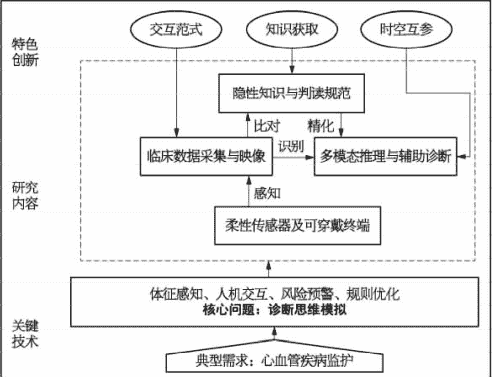

图 4-15　计算机辅助心血管疾病分类主要工作

●心电图诊断的隐性知识学习包括向医生请教判读过程中的细节与关注点、提炼诊断规则与条件、错误结果的比对与分析等。

●数据很重要，但仅有数据与开源平台并不意味着分类效果达标，数据组织、知识学习、算法优化缺一不可。

●多体征融合既是现实需求也是技术趋势，然而如何描述其临床过程仍是一个尚未被准确认识的话题。

心如大海无边际，广植净莲养身心。

自有一双无事手，为做世间慈悲人。

——黄檗禅师《无题》

参考文献

［1］小林石寿.甲骨文字精华.东京：木耳社，1985：51.

［2］约翰·杜威.确定性的寻求——关于知行关系的研究.傅统先，译.上海：上海人民出版社，2005：160.

［3］沃尔特·艾萨克森.史蒂夫·乔布斯传.管延折，魏群，余倩，等译.北京：中信出版社，2011：301.

［4］Clifford G D，Azuaje F，Mc Sharry P E.Advanced methods and tools for ECGdata analysis.Boston：Artech House，2006：61.

［5］Dong J，Xu M，Zhu H H，et al.Wearable ECGrecognition and monitor.IEEE 18th CBMS，Dublin，Ireland，June 22～24，2005：413～418.

［6］王丽苹，董军.心电图模式分类方法研究进展与分析.中国生物医学工程学报，2010，29（6）：916～925.

［7］Goldberger A L，Amaral L A，Glass L，et al.PhysioBank，Physio Toolkit，and Physio Net：components of a new research resource for complex physiologic signals.Circulation，2000，101（23）：215～220.Doi：http：／／circ.ahajournals.org／cgi／content／full／101／23／e215.

［8］Testing and Reporting Perfor mance Results of Cardiac Rhyth m and ST Segment Measurement Algorithms［S］.ANSI／AAMI EC57：1998（R2012）.Doi：https：／／standards.aami.org／kws／public.

［9］Lannoy de G，Francois D，Delbeke J，et al.Weighted conditional randomfields for supervised interpatient heartbeat classification.IEEE Transactions on Biomedical Engineering，2012，59（1）：241～247.

［10］Ye C，Vijaya K B V K，Coimbra M T.Heartbeat classification using morphological and dynamic features of ECG signals.IEEE Transactions on Biomedical Engineering，2012，59（10）：2930～2941.

［11］Pan J P，Tompkins WJ.A real time QRSdetection algorithm.IEEE Transactions on Biomedical Engineering，1985，32（3）：230～236.

［12］Li C W，Zheng C X，Tai C F.Detection of ECGcharacteristic points using wavelet transfor ms.IEEE Transactions on Biomedical Engineering，1995，42（1）：21～28.

［13］Deepu C J，Lian Y.A joint QRS detection and data compression scheme for wearable sensors.IEEE Transactions on Biomedical Engineering，2015，62（1）：165～175.

［14］Zhu H H，Dong J.A R-peak detection method based on peaks of shannon energy envelope.Biomedical Signal Processing and Control，2013，8（5）：466～474.

［15］Shah A P，Rubin S A.Errors in the computerized electrocardiograminterpretation of cardiac rhythm.Journal of Electrocardiology，2007，40（5）：385～390.

［16］Hakacova N，et al.Computer-based rhythm diagnosis and its possible influence on nonexpert electrocardiogram readers.Journal of Electrocardiology，2012，45（1）：18～22.

［17］张嘉伟.心电图形态特征的识别及其在分类中的作用研究（博士学位论文）.上海：华东师范大学，2011.

［18］顾吉环，李明，涂元季.钱学森文集（卷五）.北京：国防工业出版社，2012：381.

［19］佘振苏，倪志勇.人体复杂系统科学探索.北京：科学出版社，2012：75.

［20］Chen Y H，Yu S N.Selection of effectivefeatures for ECGbeat recognition based on nonlinear correlations.Artificial Intelligence in Medicine，2012，54（1）：43～52.

［21］Mar T，Zaunseder S，Martinez J P，et al.Optimization of ECG classification by means of feature selection.IEEE Transactions on Biomedical Engineering，2012，58（8）：2168～2177.

［22］Lamedo M，Martinez J P.Heartbeat classification using feature selection driven by database generalization criteria.IEEE Transactions on Biomedical Engineering，2012，58（3）：616～625.

［23］Cortes C，Vapnik V.支持向量网络.机器学习，1995，20：273～297.

［24］Hinton G E，Salakhutdinov R R.用神经网络降低数据的维度.科学，2006，313：504～507.

［25］Bengio Y.学习深度架构用于人工智能，基础与趋势.机器学习，2009，2（1）：1～127.

［26］Arel I，Rose D C，Karnowski T P.深度机器学习——人工智能研究的新前沿.IEEE 计算智能，2010，5（4）：13～18.

［27］LeCun Y，Bengio Y，Hinton G.深度学习.自然，2015，521：436～444.

［28］朱洪海.心电图计算机辅助分析的关键算法研究及多体征远程监护系统研制（博士学位论文）.北京：中国科学院大学，2013.

［29］Jin L P，Dong J.借助深度学习进行正常与异常 ECG 分类.人工智能——新兴趋势与应用.2018：295～316.

［30］周飞燕.心电图分析的多分类器融合及其评价方法研究（博士学位论文）.北京：中国科学院大学，2017.

［31］Martis RJ，Chakraborty C，Ray A K.使用高斯混合模型的 ECG 配准与分类的两阶段机制.模式识别，2009，42（11）：2979～2988.

［32］王丽苹.融合领域知识的心电图分类方法研究（博士学位论文）.上海：华东师范大学，2013.

［33］Jin L P，Dong J.生物医学时间序列分类的集成深度学习.计算智能与神经科学，2016，11：3：1～13.

［34］Jin L P，Dong J.使用导联卷积神经网络和规则推理对正常与异常 ECG 记录进行分类.中国科学：信息科学，2017，60（7）：078103：1～3.

［35］李泽厚.批判哲学的批判：康德述评／／李泽厚哲学文存（上编）.修订版.合肥：安徽文艺出版社，1999：183.

［36］Zhang J W，Liu X，Dong J.CCDD：增强的标准 ECG 数据库及其管理与标注工具.国际人工智能工具期刊，2012，21（5）：1～26.

［37］维克托·迈尔　舍恩伯格，肯尼思·库克耶.大数据时代.盛杨燕，周涛，译.杭州：浙江人民出版社，2013.

［38］Petzschner F H.精准医学的实践挑战.科学.2024，383（6679）：149～150.

［39］迈克尔·刘易斯.思维的发现：关于决策与判断的科学.钟莉婷，译.北京：中信出版集团股份有限公司，2018：212～213.

［40］金林鹏，董军.面向临床心电图分析的深层学习算法研究.中国科学：信息科学，2015，45（3）：398～416.

［41］Zhou F Y，Jin L P，Dong J.结合深度神经网络和规则推理的早发室性收缩检测.医学人工智能，2017，79：42～51.

［42］Llamedo M，Martiınez J P.允许专家协助的自动患者自适应 ECG 心跳分类器.IEEE 生物医学工程汇刊，2012，59（8）：2312～2320.

［43］Dong J，Zhang J W，Zhu H H，et al.可穿戴 ECG 监测仪及其远程诊断服务平台.IEEE 智能系统，2012，27（6）：36～43.

［44］胡晓娟.中医脉诊信号感知与计算机辅助识别研究（博士学位论文）.上海：华东师范大学，2012.

［45］Jin L P，Dong J.智能健康船舶 ABC-DE：心电图云计算服务.IEEE 云计算汇刊，2020：8（3）：861～874.

［46］Zhu S Q，Yu T，Xu T，et al.智能计算：最新进展、挑战与未来.智能计算，2023，12（1）：1～45.

［47］Wang J，Zhu Y R，Wu Z Y，et al.基于柔性压力传感器阵列的可穿戴多通道脉象监测系统.微系统纳米工程，2022，8：16～25.

［48］顾吉环，李明，涂元季.钱学森文集（卷四）.北京：国防工业出版社，2012：244.

## 【注释】

[\[1\]](#txt005.html#footnote_quote_txt005_1)在企业平台上获得医疗器械注册证并进入市场的无线心电图终端，以及在研的脉象感知终端。

[\[2\]](#txt005.html#footnote_quote_txt005_2)某次体检后被告知肺里多出一个此前影像中未曾出现的结节，几周后复查却又不见踪影，且三家机构的读片结论并不一致。中间那次所用设备性能领先，并引入了人工智能辅助判读，这件事情让我感受到在特定条件下，电脑辅助的肺部分析能力已经可以与普通阅片医师相媲美。

[\[3\]](#txt005.html#footnote_quote_txt005_3)在上海工作的瑞金医院刘霞主任医师长期对我们的工作给予鞭策与指导，算法能够取得今天的成果，很大程度上归功于她的持续支持。

[\[4\]](#txt005.html#footnote_quote_txt005_4)多年前购入的《猜想遇反驳》《客观知识》等书当时未细读，如今结合自身关注的问题回头阅读，这或许也可以视作隐性知识向显性转化的一个例子。在中医现代化与智能化的探索中，我常使用“证伪”一词，指从第三方视角借助计算机和人工智能对中医传统理论中的具体结论进行检验。比如经典对脉象的描述是否经得起推敲，可通过采集的脉象信号做多次比对得到初步判断。判断成立可算证实，被否则说明该说法与常识相悖，这属于否定性判断，而非改进性实验，在严格意义上与波普尔的证伪概念并不完全相同。

[\[5\]](#txt005.html#footnote_quote_txt005_5)更详细的论述请参阅附录1“网络计算”。

[\[6\]](#txt005.html#footnote_quote_txt005_6)产品研发往往源于真实需求，而在落地实践中也能揭示出基础且共性的难题，参见附录2“工程认识”。

[\[7\]](#txt005.html#footnote_quote_txt005_7)基本观念请见附录3“中医循证”。

[\[8\]](#txt005.html#footnote_quote_txt005_8)用单极去映射多极之意。

#5 机器书法的长与短

训虎图（岩画）［1］

……一个人要看得很多，而且要看而又看，才有资格就某一艺术部门的细节发表意见。就我自己来说，我看到的东西也不少，但是如果要把题材讨论得很详尽，我看到的就还不够［2］。

——黑格尔

一色有余观笔墨，五声非但伴华章。

书写与开方在思路上可对比。面对陌生的字形，相当于医生为从未碰到的病症拟定新方；对同一字形做细微调整，则像为患同种疾病的不同个体微调经方。诊脉依靠指尖来感受，书法依靠手指来驱动，前者是感知，后者是生成，二者背后都有体验、神经机制与思维活动的参与。书法可被视作小技，也可被视作无穷奥秘，很多人临池不止仍难超越前人，这与机器在逼近审美时的困境有相似之处。若要让机器书法既遵守审美规范又形成自己的面目，其难度不亚于业余爱好者中极少数能成为大家的情形。

## 5.1 不离其变

从文化、文字、艺术到意境来看，中国书法一直是精神的外化与视觉的瑰宝，构成一条绵延至今的人文风景。其根源在于民族整体与形象思维的特点，在象形文字基础上发展出书法并不断赋予新形式，最终从实用迈向唯美。从精神层面讲，人需要载体来抒情，书写于是逐渐成为艺术的一种形态。

有人赞誉中国书法为最高艺术，这并非合乎逻辑的推论，缺乏严谨分析。书法的产生既依赖象形文字，也依赖软笔工具。象形文字并非中国独有，毛笔也并非不可再造，但就内在特质而言后者的意义更为根本。宗白华曾说中国人的笔“起于一画，破开虚空，留下痕迹，既流出人性之美，也流出万象之美”。［3］它既是思维的产物，也是心灵的轨迹，更能彰显豪情。

康有为在《广艺舟双楫》中“流变”“分变”两节讨论字体演进，他谈“八分”：今人所写承袭旧体八分，故名八分。汉人口传，秦把石鼓文变为小篆，得石鼓八分；西汉把秦篆长体改为扁体，得小篆八分；东汉把西汉八分改为带波磔极扁体，又得西汉八分；楷书把东汉隶改为圆笔方字，又得东汉八分。八分本是可伸缩的量词。［4］历代书风常概括为商周尚象、秦汉尚势、晋尚韵、南北朝尚神、唐尚法、宋尚意、元明尚态、清尚质八个阶段。［5］姑且称之为八变。

汉代书体约有七种：科斗、籀文、小篆、秦隶、八分、汉隶、识。［6］隶中带草，草内见隶。为了交流与书写方便，简化规范成为大势，篆书由圆趋方、纵变横而为隶书，并以抽象、省略、连带、变形等手段逐步形成带波磔连动的草隶、章草，可视为篆书向成熟隶书演进的分支。孙吴时楷书《谷郎碑》距曹丕篡汉仅半个世纪左右，肥润宽拙带隶意，可推断汉代已有楷书。［7］于是篆、草、隶、楷在汉代基本齐备，那是一个承前启后的时代，隶书为代表，笔意凝练，线条爽健，气势浑厚，姿态万千。

书体演变之外，创作也只有通过变化才能体现个人审美并趋于和谐。沃兴华教授认为核心在于“把时代精神注入对传统的分解与重组，分解重要，重组也重要，而分解重组过程中的变形处理最为关键，没有变形便难和谐，也体现不出个人审美和时代人文精神，变形能力是衡量创作水平的标尺。”［8］祝嘉说：“专从诗学诗，学不好诗；专从书学书，学不好书，总在‘变’字上，因时、因地、因内容、因一时心境而变，不受束缚，千变万化，才能形成自己的字。”［9］吴冠中提到“毕加索解构客观形象，按新的意图重新组合。”［10］邱振中教授进一步指出，有人把各种字体融合，有人改变结构外观，看似新奇却不一定带来真正的新意，空间性质不变就难以触动人们固有的空间感。［11］沃兴华还引波兰尼，认为人类知识来自对客体的主动把握，具有“无处不在的个人参与”，传统知识观把主客割裂、排除热情与人性是错误的；求知遵循启发性前兆，与隐藏的现实建立联系，从而决定选择与阐释；知识是一种信念，表达了说话者的情态与判断。［12］让计算机像人一样把笔画、结构乃至章法朝向自身意图变化，是书法模拟的根本目标。他也强调理论与实践要统一，更偏重实践，因为作品是硬道理。笔者认同其创作观与认识。

从理解创作与计算关系角度看，书法是不错的桥梁，因为结果是思维的综合体现。目前数字书法研究多集中在计算机图形学、字体生成与字库，形象思维的模拟如形变则较少。

徐颂华等人以综合推理的方法探索计算机艺术的创造性思维建模及其机器模拟问题。［15，16］他们对汉字书法图像采用分层结构化知识表示，让计算机在形象思维领域获得“想象力”与“创造力”，学过有限字帖后即可在可能性空间里实时创作出风格不同的作品。综合推理即在图形等元素构成的空间里进行推理。结果如图5-1所示。

该方法虽用了各形象源信息，但随机选取使审美约束难以自然发挥，线条细节与微妙之处未涉及。每层需对样本赋不同权值，影响效率。若先判定笔画主要特征，以此作为变形依据，就能在整体效果和效率上有所改进。两种方法处理的对象粒度与建模方式不同。

图5-1 综合推理在书法创作中的示意，左侧为输入，右侧为输出

## 5.2 自一而始

中国书法讲究笔法的核心即基本的一画，一波三折，由一而二，延展无穷，寓意深远。石涛讲“自一以至万，自万以治一”。［17］在隶书中，横画是最基础、最核心也最具特色的笔画。从横画模拟入手，其他笔画模拟就相对容易，进而可成字成篇。

以东汉隶书《石门颂》《西狭颂》《黼阁颂》为例。写法与楷书相近，画像篆，最大的区别是有波磔一笔。《石门颂》巧多于拙，多用圆笔；《西狭颂》巧拙各半，方笔，比《石门颂》肥短，比《黼阁颂》瘦长；《黼阁颂》则纯拙，方笔。

图5-2左为何绍基临《石门颂》，轮廓已平滑；图5-3为林散之临《西狭颂》，形准而灵动；图5-4为沃兴华教授意临《黼阁颂》，呈现记忆中的图像。

图5-2 原始碑刻与临摹对照：何绍基临《石门颂》

图5-3 林散之临《西狭颂》

图5-4 沃兴华意临《黼阁颂》

图5-5、5-6、5-7为不同隶书“之”字，图5-8、5-9为更基本的正书“之”字。机器要在审美约束下输出有变化的“之”字并不容易。

图5-5 东汉《石门颂》“之”字

图5-6 东汉《西狭颂》“之”字

图5-7 东汉《黼阁颂》“之”字

图5-8 北魏《嵩高灵庙碑》“之”字

图5-9 南朝宋《爨龙颜碑》“之”字

真实的书法学习中，临过同种字体的多方碑帖后写一段文字，选择面变大，却出现笔画融合问题，如何在一幅作品中统一不同风格。更复杂的是临过篆隶真草行后进行个性创作，会涉及“笔气”“墨韵”等。

依据笔者自身的隐性知识，书法创作过程如图5-10所示各阶段^([\[1\]](#txt006.html#footnote_content_txt006_1))。

图5-10 书法创作：既是临摹的归宿，也是机器模拟的参照。上部为基本学习过程，中部为机器实现，下部为“字外功夫”。临摹是基本环节，起初是日复一日的重复练习，经验足后临摹更重细节与整体

“临碑时须细察字结构，多由左右或上下组成，如何配合举一反三。先仿相似者，再造不类者，常揣摩，虽不中亦不远。故临碑求娴熟，一碑至少百通，熟能生巧。世以模拟见长者，多为不能变化之人。”［18］变化即创作。

笔画融合、字形改变与整体创作是逐步深入的过程，结果亦可作为临摹对象。临摹时原有记忆也会起作用。以结构层次为模板模拟是理想路径，但目前尚无定论。下面涉及碑刻笔画轮廓平滑与笔画变形模拟。

基本流程先对所学字图像预处理。［19］包括图像平滑中值滤波、二值化、小孔填充腐蚀膨胀、轮廓提取八邻域搜索、轮廓恢复傅立叶变换，各步如图5-11所示。

图5-11 创作模拟前预处理步骤及其结果

获得一组书法字笔画图像如不同碑帖的横画后，为每张图像定位关键点勾勒结构，形成样本X，进而得到样本集。

用主成分分析法对样本矩阵分析，得到反映主要特征b如“长短”“方圆”“肥瘦”。从审美本质看应谈“厚薄”，这与肥瘦无关，但二维模拟暂以肥瘦或粗细论之。［20］组成特征矩阵Φ。

于是可得统计学习模型如下：

其中X为样本排序后的均值，b为多维列向量，代表样本空间的主要特征。调整b不同分量会得到不同的X，由此可生成与样本相似的新图像。若能找到b变化与X变化的关联，就可通过调参实现“创作”输出。

隶书“蚕头燕尾”横画最典型，图5-12演示了部分变形结果。

图5-12 来自不同样本的隶书“横画”不同变形结果

该模型是后续模拟的前提。再考虑笔画相对位置的选择。以“十”字为例，不同横竖交点对视觉效果影响不同，这同样是统计学习。图5-13表示从原图到预处理、编码、适当变化创作出“十”的过程。原始碑帖文字被提取骨架后作轮廓跟踪并抽取出构成笔画，再从库中挑选对应笔画若干，进行变形，最后按骨架信息组合生成新字。

图5-13 以“十”为例创作的关键过程，自左至右：原图像、中值滤波后、二值化后、骨架提取、创作输出

结构模拟目前困难在于：

1.创作自由导致规律难寻；
2.脑内过程以笔画还是其他元素为基本单位尚不清楚；
3.章法和意境是更高要求，计算机模拟相距更远。

图5-14为计算机创作结果。［21］左三行为笔画变形所需的原始样本，右第一行为预处理后情形，右第二行为提取骨架，右第三行为抽取笔画，右第四行为经笔画变形并依据骨架结构信息创作的结果。

图5-14 样本经预处理、提取骨架、笔画抽取到创作结果：春回大地

在计算机创作结果基础上，用如图5-15所示末端执笔机械臂输出于纸上。［2］^([\[2\]](#txt006.html#footnote_content_txt006_2))前两个字与后两个字笔画粗细差异明显，主要因蘸墨不同。另“春回”笔画偏瘦，“回”有抖动，不如“大地”厚实，尤其“大”尚可，首横略显失衡。这里把计算结果输入机械臂，也可直接用拓片字图像输入机械臂。

图5-15 书法创作模拟用机械臂及其输出创作结果

学书法是一个临读写不断反馈的过程，计算机模拟也应遵循。［22～24］繁琐参数设计对懂书画者都不便，更不用说不懂者。书法创作与动画漫画不同，细微差异会导致很大审美差异，核心不在一般图形变换。对形象思维过程知之甚少，其探索将伴随人工智能成长。未来工作可分层次分阶段展开，分层次按难度目标划分，分阶段按关键技术、系统和应用划分。研究主线仍是思维模拟，经验为前提，线条为基础，变形与结构为根本。

概略而言，计算机书法创作CG即确定函数，对原始样本作统计学习然后变形，相似但不同于原样：

i区分不同笔画，n指不同字。

## 5.3 教育可辅

书法创作模拟起初为形象思维模拟，后来目标转为辅助教育平台，评估是核心。国内传统小学甚至中学设书法课，多采用教师巡视逐个教授，讲解慢效率低，课后难以获得具体有效指导。笔者犬子在小学四年级某周末做描红练习，特意走过来把本子放在桌上尝试，笔者说不要反复涂，要一笔写。大约两周后回苏州，母亲说他的描红作业被判不及格，笔者一怔而笑。他有敷衍成分，但一笔写对初学者而言效果可想而知。估计不少孩子是反复描的。于是可考虑把相关机器书法创作结果应用于中小学电子白板系统的书法临摹教学环节，它能接收学生手写输入并给出基本分析、评价与建议，如图5-16所示。

图5-16 电子白板书法教学示意

笔者谈到的书法创作计算机模拟，并非电脑上常见的写字板、画笔这类通用工具。现在被大量采用的辅助手段其实带有误用的风险。比如有的碑帖出版，把字一个个轮廓抠出来，背景信息被丢弃，带来的损失尚可接受，真正的要害在于轮廓走形，这种走形会抹掉细微的美感，甚至把丑当成美来呈现。又比如把黑底白字的拓片整体反转，让字面变成墨色，固然更符合阅读习惯，却使原有的古朴意境荡然无存。再比如有人把拓本墨迹刻意加浓加黑，本意是强化效果，结果往往弄巧成拙。

有人曾问，能否让计算机判断某位书画家的真伪。至少现阶段做不到，创作与鉴赏遵循的逻辑不同，我们的模拟也仅是初步探索。真伪辨别的难度极高，浸淫书法数十年的人也不见得敢下定论。启功说［25］：“搞鉴定千万不要从书入手。有人讲我学写字有什么书好看，主要看帖、看碑，书法理论众说纷纭，根本不明确，讲是讲不清楚的。鉴定书画也别看书，有经验的、有道理的要看，但别看那些神乎其神的书，如神品、妙品、逸品之类的。”机器搞不定的，正是人说不清的部分；人愿意说出来的经验，往往靠不住，多是隔靴搔痒。真正需要的是有人去粗取精形成共识。如今不少研究者梳理阐发，书越出越多，问题却照旧。若书法理论家能以自身的隐性知识发掘前人的隐性知识，凝成中国书法精炼清晰的核心理论，便是莫大功绩。

熊秉明认为某人写“我”字的习惯会流露潜意识，由此可推测性格、情感类型乃至大致经历，几乎接近真实。这是他收集数千例样本后的总结［26］。但把写出来的特征如此归纳，仍属存疑。技术上机器可用样本学习，未必能得出可信结论。

文同论草书有言［27］：“余学草书凡十年，终未得古人用笔相传之法。后因见道上斗蛇，遂得其妙，乃知颠素各有所悟，然后至此。”文字记载有时不及意、有时晦涩，后学难以真懂要领。文同虽已领悟，却也难令旁人明白他究竟领悟了什么。感觉印象只是认识的第一阶段，用概念作判断推理才是第二阶段。经过感觉抵达思维，才能把握客观规律与过程的内在联系。

创作与鉴赏相关却不可互相替代。作品水准较高者通常具一定鉴赏力，鉴赏大家的作品却多难当其名，也有眼光不错却不临帖、不创作、不鉴别的人。单从要求看，鉴别更难，因其要给出明确归类，而创作保有自由度，是在个人偏好基础上进行的经验再现与思维深化。但在艺术层面，最高境界的创作更难得，它是开放的，新意近乎无限。相比之下，鉴赏需涉猎更多，而再多终是有限。

学生中途辍学，多因家境、突发事故、兴趣转移或思想障碍。计算机辅助书法创作模拟目前仅有探索性结果，并非耗资巨大或初衷改变，而是脑内机理不明、微妙细节难究。尚待完善的问题有以下几条。

其一，描述的过程仍偏宏观，对应书法创作的基本环节，要总结出如图 5-10 所示的流程本身需要经验与反思，当下计算机模拟多为演示性成果，后续需建模方法的创新。也许很长一段时间内缺乏合适的数学工具，至少目前机器的刻画难以对应脑内过程。

其二，所用方法的推广性不足，推广到更多样本、更好效果尚缺乏足够例证，有限案例难以外推到诸体。笔画统计模型中各参数分量如何与肥瘦等细节特征精确对应，尚无定论，很可能需调整或更换统计学习模型，或需更大规模样本与实验，大语言模型亦无能为力。

其三，在冯·诺依曼式串行计算机上用经典计算尝试，本质上把形象思维问题抽象化了，该模拟并不等同于形象思维，我们企图殊途同归，实际上尚未归为一处。鉴于大脑处理抽象与形象思维的区域分属左右脑，或许需要不同机制的硬件或不同算法才可能逼真模拟。

其四，谈及书法，立刻会想到龙飞凤舞的草书。草书是心迹表达的高级境界，历史上不少大家以草书著称，甚至有人认为不涉草书即未真正入道。草书创作难度高，其机器模拟极为复杂，非拆分笔画即可整合。

其五，艺术审美评价本就见仁见智，部分成果或许能通过图灵测试，这取决于评判标准的设定，但那是人机结合的产物，与经典图灵测试不同。我们可自豪的，正如普利高津所说：“中国文明具有了不起的技术实践，对人类、社会与自然的关系有着深刻理解。”［29］书法正是其中之一。

5.4 指下琴韵

钱学森提出的现代科学技术体系中的人体科学包括西医、中医、气功和特异功能。若把执笔书写过程视作一种气功状态，书法与气功可同属人体科学门类，同时也属文艺理论与创作门类。事实上书法在艺术创作、文化修养的同时，历来被视作与健康相关的活动或一种锻炼。

祝嘉在综合前人合理说法提出五指气力、四指力齐的执笔方法基础上，强调全身力到论，具体涉及手指位置、用力大小、笔管方向，因而可用阵列式脉象感知柔性传感器技术研制执笔感知器嘉执，涉及执笔方法检测、生理评估原则和比对指标定义：

●笔套或整支笔杆，设五指位置提示，对应处装柔性传感器测力，指力不足则有声音提示，笔套内另嵌一个陀螺，笔的角度超出范围时给出提示，具体数值则按实际情况拟合；
●针对历代执笔方法不一、各执一词的现状，通过测手臂肌肉扭转、神经系统刺激反馈情况，从生理机能合理性出发作出评判，给出建议；
●执笔是否正确不仅要符合上述基本方法并适合人体生理机制，还要符合笔锋运动所致的视觉表现的审美约束，比如线条厚劲、粗细变化、章法活泼等，需要定义指标。

另有语音模块，若分量过重可分列设计，两个模块可无线通信，或笔套与手机直接联系。语音模块启动时可先放一段提示音。

另有书写板，板上装感知墨迹的传感器阵列，感知结果传至显示屏供观察分析并获得改进建议，该功能借助书法笔画变形等面向形象思维模拟的探索，利用轨迹跟踪技术获取学生习字的墨迹，以辅助教学，功能有三：

先根据笔画长度归一化，做长短比较；
起笔方圆曲率比较，收笔锐利程度比较，计算不重合部分的面积；
定义偏离指数，简单的是百分比。

5.5 本章概要

同一汉字在不同时期、不同形态的变化如图 5-17［30］所示，书法创作是形象思维模拟的有趣切入口。

图 5-17　马字的不同书体：象马匹立起瞠目，鬃鬣飞扬之形

●中国书法的篆、隶、楷、草等字体，都是字形在一定程度上形变的结果，形变是字体演化和创作的基本内涵；
●无论个人还是机器模拟都依赖于方法，忽视方法不仅事倍功半，甚至会止步不前；
●以笔画变形为核心的机器书法创作模拟目前仍是初步，以更少参数和谐地影响更多笔画是未来目标。

后面两章将进一步阐述科学与艺术交融的几个方面，以及人工智能面临的若干问题。

若言琴上有琴声，放在匣中何不鸣？若言声在指头上，何不于君指上听？——苏东坡《琴》

6 科技艺术若即若离

## 念䇹

竹神萧萧问秋风，君影茫茫去何处。
政 九六年十一月廿九日清晨［1］

艺术家若对何为美缺乏完整认识，作品多乏味。艺术家若对何为善缺乏完整认识，作品多粗俗。
在科学领域，于文科社会科学亦然，不信仰追求真理的理想，学者的成就也多不实。
乏味、粗俗、浅陋或不实的科学艺术成果是短暂的。
——默里（C.Maree）［2］

脑海波澜指下韵，心潮气象眼中形。
科学技术、文学艺术是思维结晶与知识殿堂，映照人们的认识与追求，透射人类思想光芒与精神境界，推动世界发展与文明进步。当今社会在经济迅速发展的同时对科技进步的依赖日益加重，而科技不时被扭曲，甚至变得艺术化；艺术则在依托科技便利的同时，始终保有自身的道路与轨迹。科技与艺术各显神通，又如孪生姐妹互相依存，可谓若即若离、互相欣赏，共同引领生机勃勃、色彩斑斓的现实与未来。

## 6.1 真谛美感

随着经济与观念的改变，越来越多的人在家中陈设艺术品，墙上挂字画，有的为装饰点缀，有的为抒情营造氛围，通常以真迹为佳、以大家之作为上。真迹未必就比复制品质量高，要看水准如何，何况当下复制技术已能乱真，许多摄影作品也极精彩，它们皆为复制品；名家之作亦良莠不齐，即便大家作品，品质差异也大，精品难得。自然，在赝品泛滥的社会里，真假无疑是首要关切，谁也不能否认一流原作的震撼力。但就学习或欣赏而言，名作的印刷品往往比普通原作更有价值。

笔者多年脑海中反复浮现的是茫茫宇宙中星空的广袤与宁静，使人思接千载、想象无垠的画面，可谓精骛八极、心游万仞，即便只是星点。书店里未见合意的印刷品。为何区区印刷品能如此久驻心头？这大概是科学与艺术本身的魅力与两者张力所在。首先，这是真实而宏大的图景；其次，多学科在此汇聚：天文学是源远流长的学科，宇宙望远镜是非凡的技术，屈原《天问》所表达的人类好奇与不懈思索，与星体位置、色彩变化、无垠纵深交织，构成生动美丽的画面，恰是科学与艺术的和谐，为善也为美，画面即真善美的统一。从思维出发可归纳三点。

第一，人类本质追求与共同价值取向是探索未知、发现真理、弘扬理性、抒发感情、欣赏美感、追求幸福，此时科学与艺术分别是手段与载体，它们承载自然规律与历史、人类的智慧与生活，本为一体、互相离不开。思维是基本机制，艺术不全是形象思维，科学同样需要形象思维，二者一体两面、互相影响。

第二，从体现特征与反映本质看，科学与艺术不是对立排斥，而是补充支撑。比如物理定律常给人简洁抽象之美，利用人造显微镜等设备获得的图案往往神奇美妙；而绘画可以把深奥理论生动直观地呈现，二者有时借助对方更能阐释自身。

第三，作为数学分支的分形几何以不规则几何形态为研究对象，自然界诸多物理现象，比如海岸线，从局部到整体具有自相似性，从而带来独特美感与联想，如图 6-1。分形现象把科学与艺术的研究对象与效果合二为一，而发现这一美好现象、天然艺术杰作的，是科学的思维方式与探索精神。

科学大家中具良好人文素养者不少，表面看是兴趣与熏陶，实质应有科学与艺术相通的内在根源。爱因斯坦一生科研与音乐相伴，感悟历久弥新。钱学森自幼受文艺熏陶，科研成就多得艺术启发。李政道敏锐捕捉艺术与科学的关系。音乐、文艺、绘画本质上也都是一种心迹。

图 6-1　海岸线分形图［3］

## 6.2 坦言音乐

爱因斯坦说：“当世界不再满足我们的愿望，当我们以自由人身份探索观察时，我们进入艺术与科学的领域。若用逻辑语言描述所见所闻的身心感受，我们从事的是科学。若传达的印象只能为直觉领悟、不能为理智接受，我们从事的是艺术。这两者有一个共同之处，那就是对超越个人利害关系和意志的事物的热爱与献身精神。”［4］

爱因斯坦童年随母亲先学小提琴再练钢琴，这要早于物理学之路，两个看似无关的领域被他合而为一，说明它们不仅不矛盾，还能长期共存。对他而言，世界感性上由音符构成，理性上由公式表达，二者不可或缺，宇宙与音乐相通。自然界本就存在天体音乐，带有浑然天成的和谐与令人惊叹的对称，比如相对论等自然法则，它们一直存在于宇宙之中。爱因斯坦对音乐有独到理解，音乐助其在科研中获得灵感，甚至由此感知世界的本质音符。至于他的演奏是专业还是业余并不重要，也许有人惊叹技艺并问为何不去当音乐家，这或许天真或狭隘。人在主业之外有兴趣爱好，能让人生更丰富。达尔文在自传里懊恼一生专于科学，没有把年轻时对诗、画、音乐的兴趣保持住，到老想用诗乐调剂生活的枯燥，却抓不住年轻时的热情，觉得索然无味［6］。

聆听里的思想者

爱因斯坦私下常放的音乐清单里，巴赫、莫扎特、舒伯特、亨德尔占据了主位。巴赫在他那里是沉入深处的陶醉，自己曾说别去评说，去爱、去听、去体会足矣。莫扎特的轻快让他放松愉悦。舒伯特的抒情极强，听来像被带入山林旷野。亨德尔的技法近乎完满，却给他一种轻飘之感。对贝多芬他并不欣赏，觉得戏剧张力过足、个性过强。从这些取舍可以看出，他把听音乐看成一种安宁、贴近自然的心态。

据说他曾义务给人做音乐启蒙，不讲枯燥乐理，而是反复播放唱片，让对方靠感觉体悟。想向人说明如何用口哨吹一段旋律，光讲不行，得自己吹给对方听。读完整本小提琴自学手册，也不等于能立刻演奏门德尔松协奏曲。某种程度，掌握乐曲与演奏能力是绑定的。听懂音乐需要长期浸润，难处在于难以言传的情感和演奏时那些细微差别。他直言最难应付的是音乐杂志：杂志里没有声响，阅读时耳朵空着。有些室内乐或交响，听过无数次，十几年二十年后才忽然开窍，真正听进去了，以前竟是白听。纸上谈兵大致如此。

直觉常被归为艺术家的特长，爱因斯坦在科研中同样看重直觉，直觉关系到对普遍原则的探索，与悟性相关。这并非灵感凭空掉落，其背后是用深远见识去捕捉常人因技术障碍而忽略的差别和疑点。艺术创造与科学创造在路径上相近，都是在寻找表现自然的新方式，本质上都是解题。杨振宁曾转述波耳兹曼的话，音乐家听几小节就能辨出莫扎特、贝多芬或舒伯特的风格，就像数学物理学者读几页就能辨出柯西、高斯、雅可比、亥姆霍兹或克尔茨豪夫的笔触。爱因斯坦会作何感想，已无法得知。

他既是科学史的巨星，也是杰出的思想者与公共参与者，对人类处境与普通人的生活始终关心，这与他开阔的眼界、深远的见识相关，也与他独特的音乐品味和真挚的人文情怀相连。

6.3 森罗文艺
钱学森在致潘云鹤的信里提到，用计算机模拟形象思维仍触不到核心，因为机器只会计算，笨拙且缺乏灵敏。［10］在致戴汝为的信里他说，灵敏源于艺术与科学的结合。［11］

童年培养、三十六岁前成为麻省理工学院正教授的经历、对中国航天事业的影响、晚年思想体系的形成，都为后人反思提供了参照。他完全可以安享晚年，却始终思考探索。作为思想家想象力丰富，但始终面向科学发展与文明进步的现实需要。高庆狮曾评，钱学森自学数学的功底深广几乎涵盖数学系全部课程，且运用自如，让北大数学系的学生既钦佩又具体看到数学如何进入物理世界。［12］其成就远非数语能尽。

钱学森推崇熊十力将智慧分为“性智”与“量智”。“性智者，即是真的自己的觉悟”。“量智，是思量和推度，或明辨事物之理则，及于所行所历，简择得失等等的作用故。”［13］即文化艺术方面的智慧称“性智”，科学方面的智慧称“量智”。［14］或言文化体系属“性智”，科技体系属“量智”。“恃思辨者，以逻辑谨严性，而不知穷理入深处，须休止思辨而默然体认，直至心与理为一，则非逻辑所能也。”［15］性智与量智中均有隐性知识。

他本人对文化艺术兴趣浓厚，文艺理论、音乐、诗歌、绘画、书法、建筑、园林、工艺美术等，都深入体味且有独到见解。他熟悉大量对联、诗词、散文、小品，还会拉小提琴、吹中音号、唱歌、画水彩。［16］对西方音乐亦有修养，1935年作为理工科学生还写过《音乐和音乐的内容》那样的专题。总结起来，艺术思维是先科学后艺术，科学思维是先艺术后科学。［14］

他说父亲钱均夫很懂现代教育，一方面让他学理工走技术强国之路，另一方面送他学音乐、绘画。他从小对科学和艺术都感兴趣……这些修养不仅加深了他对艺术作品中诗情画意和人生哲理的理解，也学会了艺术上大跨度的宏观形象思维。［17］1999年7月10日中央音乐学院为夫人蒋英教授执教40周年举行研讨会，钱学森在书面发言中说蒋英在声乐表演及教学上耕耘，“但我在这里特别要向同志们说明：蒋英对我的工作有很大的帮助和启示，这实际上是文艺对科学思维的启示和开拓！在我对一件工作遇到困难而百思不得其解的时候，往往是蒋英的歌声使我豁然开朗，得到启示。这就是艺术对科学的促进作用”。［17］所以他强调，学工科、理科的，也要学点文学艺术，很多灵感就在文学艺术修养中产生。［18］

钱学森认为文艺与科学一样，来源于现实生活，反映客观世界，影响人们思维与认识，又反作用于改造实践。作为认识世界与改造世界的学问，它们的目标统一，是从不同视角、以不同手法探索奥秘、揭示真理。他具有深厚的中国传统文化基础，这为他倡导思维科学、重视形象思维与灵感、提出以形象思维为突破口提供了底蕴。他说谈思维科学必然涉及脑科学，虽然发展很大，但许多问题说不清，无需等待，还是要从总结经验入手。［19］无论学者还是技工，经验都是重要知识源，区别在于前者是方法论层面，后者是工艺层面。

他在英国对留学生讲话时背诵过孙髯撰的昆明大观楼长联。［20］即使是这类“余事”，也令人自叹弗如。此联中的“茫茫空阔”既是他早年空气动力学的研究对象，又有“高处不胜寒”的意境，而“滚滚英雄”与他的功绩相称。

6.4 道说绘画
就呈现方式看“科学与艺术”可分几种形态：

第一，用计算机生成美术图案，模拟艺术创作；
第二，借助计算机绘制类似自然的图案，如分形海岸线；
第三，利用数学原理生成图形、动画，这已较为常见；
第四，构图视角独特，自然引入物理或逻辑问题，如埃舍尔的画；
第五，用绘画手段描绘物理本质，如这里提到的李可染的画，等等。

李政道先生认为，［21］艺术和科学的共同基础是人类创造力，追求的目标都是真理的普遍性。艺术如诗歌、绘画、音乐等，用创新手法唤起每个人意识或潜意识中深藏的情感，即使时代不同，情感共鸣依旧。情感越珍贵，反响越普遍，艺术越优秀。而科学定律越简单，应用越广泛，科学越深刻。自然现象不依赖科学家存在，但对自然现象的抽象和总结属于人类智慧结晶，这跟艺术家创造一样。科学真理性植根于科学家之外的外部世界，艺术家追求的普遍真理性也是外在的，没有时空限制。科学和艺术的普遍性并不完全相同，但关联很强。科学和艺术的关系与智慧和情感的二元性密切相关。艺术古老，如三万年前的岩画，科学年轻，却企图弄清宇宙起源这样最遥远的问题。艺术又是超前的，不少问题科学来不及赶上，鉴别艺术品真伪就是其一。对艺术鉴赏和对科学观念的理解都需要智慧，随后的感受升华和情感分不开。科学与艺术不可分割，就像一枚硬币的两面。

物理学中的超弦理论认为，四维世界的所有现象只是十维空间中一根弦的表现。李政道先生向大画家李可染解释，“想象用一根三维的线来绣一幅二维的图，可以绣出人、马、马车和许多其他东西。再想象这根线可以按任意方向运动，一根三维空间线的运动就产生了人、马等二维图像的运动”。李可染据此创作了抽象水墨彩色画“超弦生万象”，见图 6-2。画面充满动感的点线，线条厚实，意境神妙，“游于无穷”“寓意无穷”，富有诗意地描绘出万种粒子及其激发态如何由一根超弦振动产生，创造出与超弦理论有联系的独特艺术意境。李可染在其生命最后一年，为科学所动所感，改画风而作，并非仅为追求用绘画描述特定科学领域的表面形式，而是探索在更深奥意境中进行科学与艺术对话的方式。李政道先生与画家一起的探索，以及艺术表达的科学美，为艺术家提供新思维角度与手段，使得绘画可以直观表达、生动显现科学理论，而科学可以深刻探究、规范陈述艺术创作的脑内过程。那是一片言不尽的境地……

图 6-2　李可染画：超弦生万象

李政道先生还指出，自然界没有宏观上的绝对对称。物理学中蕴含美学原则，绘画中蕴含自然原则。［21，22］他以弘仁的一幅画为例说明对称关系，假如把它从中间切一刀再翻过去，让它绝对对称，很难想象有人敢走进自然界里这样的一座山。因为它太不像自然的了。对称与背景和语境有关，比如，就阿拉伯数字和字母言，“6 A6”“66A66”是对称的，但就图形而言，就不是了；再比如“65 A65”，若以“65”为一个单位，那是对称的，否则就不是。关于对称的判断也以整体视觉和整体思维为基础。

图 6-3　弘仁山水画比较：完全对称与否的不同

图 6-4　甲骨文，记录了世界上第一次发现新星的观测

在甲骨文中，有世界上第一次发现新星的观测记录，如图 6-4 所示，该甲骨现存于我国台湾的“中央研究院”。图 6-4 中（b）是（a）的释文。大意是，黄昏时有一颗新星出现在大火（即心宿二）附近。它记载着一次新星爆发，（a）中加框三字即“新大星”，“新”字包含一个箭头，指向一个很奇怪的方向。李政道先生指出：“这个古老生动、具有艺术形象的象形文字强调了科学发现的创新性，显示了科学发现和艺术表达的一致性。”［23］至于屈原在《天问》中对天、地形状的推理，则更多是一种以“辞”对“宇宙”进行想象和描述的文学作品内容，如同弥尔顿在诗中说“太极到中心的三倍那么远”［24］一样，笔者认为尚不属于这里谈的科学与艺术的结合范畴。达·芬奇在他的时代既是科学家又是画家，他的艺术是科学家的艺术，他的科学是艺术家的科学。［25］他能画出惟妙惟肖的人像，得益于其因解剖尸体而获取的人体结构知识，他与同道共创艺术上的自然主义，不过那是在潜意识或无意识中形成的，无疑，其创作还缺乏与意境的瓜葛。

6.5 似是而非
20 世纪 90 年代，《哥德尔 艾舍尔 巴赫——集异璧之大成》中译本出版，该书以数学家哥德尔、艺术家埃舍尔和音乐家巴赫为题，对他们的作品所反映出的不同领域人类思维之间的共性进行生动而深刻的比较和归纳。埃舍尔的作品多数形象地表达不可能的结构、悖论等，兼具艺术性与科学性。比如，图 6-5 所示的《互绘的手》。［26］一只手被另一只手所绘，同时又描绘另一只手，手腕以上部分还在画板里，手腕以下部分就成为“真实”的获得生命的手，它有阴影，甚至还跑到了画板以外。在二维平面上绘出三维形状是绘画的“悖论”，其实是一种视觉错觉，这缘于创作者运用了透视、光影等处理手段，还有观众的自我暗示心里。究竟是左手画右手，还是右手画左手？难以辨清，在这里，形象与真实、可能与不可能交织一体，先后、始终在哪里？画面充满了辩证思维，是怪圈、是悖论，但又是真实的画面！

图 6-5　埃舍尔绘画：《互绘的手》

不过，通过元模式转换，可跳出悖论怪圈。这两只手不过是画家所画的，不是什么悖论怪圈。［27］有人说，埃舍尔的视觉是与脑子有关的，大概这是一个属于非视觉艺术的范畴。［28］视觉怎会与脑无关？这是科普问题，而没有视觉如何能理解其画作的隐喻？文艺工作者与科学工作者可能在此有区别，不少会想当然。齐白石有次要艾青替他写传，艾青说不是已有胡适、邓广铭、黎锦熙合写的商务印书馆出的《齐白石年谱》？齐白石不作声。后来艾青知道，那书把齐白石的“瞒天过海法”写了进去。1937 年他 75 岁时，算命者说他流年不利，所以他增加了两岁。此事则具迷信味道了。然“画贵在不似与似之间，太似则媚世，不似则欺世”。出自齐白石之口，通俗而大雅。有关书画的辩证思维表达时有所见。

戴冠卿云：“画不可无骨气，不可有骨气。无骨气便是粉本，纯骨气便是北宗。
“画不可无颠气，不可有颠气。无颠气便少纵横自如之态，纯是颠气便少轻重浓淡之态。画不可无作家气，不可有作家气。无作家气便嫩，纯作家气便俗。
“画不可无英雄气，不可有英雄气。无英雄气便似妇女描秀，纯英雄气便是酒店账簿。”［29］

袁玄石云：“画山水不可太熟，熟则少文。不可太生，生则多戾。”

八大山人曾落发为僧，又入观为道，悲愤的内心世界和曲折的生活道路使得他的创作迥异于人而格调高逸。“从八大山人的生命历程中，从八大山人的画作中，我们读到了一个经历坎坷、忍辱生存的八大，一个癫狂孤寂的八大，一个笔如金刚杵、神化奇变、不可仿佛的八大，一个精神独绝、不谐与俗的八大，一个天才卓犖、在艺术的天地里为所欲为的八大，一个笔精墨妙、华滋清远的八大，一个平和冲融、返璞归真的八大，一个至真至纯、敏感朴实的八大，一个淡泊平易、生机无限的八大，一个内心寂寥虚豁而物莫之逆的八大，一个寂然凝虑、无我以观物的八大，一个诗意盎然、一派禅机的八大，一个涉笔成趣、简静清淡的八大，一个笃志力行、明理诚意的八大，一个技近乎道、一笔不易的八大，一个铸刀为笔、炉火纯青的八大，一个匠心独运、得意忘形的八大，一个虚和空灵、笔简意周的八大，一个擒纵自如、奇宕潇洒的八大，一个奇崛古奥、精谨练达的八大，一个荒寒简静的八大，一个笔墨相悦、遒丽晶莹的八大，一个静默、单纯、典雅、高华的八大。”［30］那里，丰富的艺术特点和复杂的个人命运交织在一起，有思辨也有常识，全面而综合。八大山人在《为西老年翁书行书扇面》中写道：“士大夫多讥笑东坡用笔不合古法，盖不知古法从何处出耳。”［31］也是绝妙的辩证思维。

关于书法，程瑶田《书势》云：“是故书成于笔，笔运于指，指运于腕，腕运于肘，肘运于肩。肩也、肘也、腕也、指也，皆运于其右体者也，而右体则运于其左体。左右体者，体之运于上者也，而上体则运于其下体。下体者，两足也。两足着地，拇踵下钩，如屐之有齿以刻于地者，然此之谓下体之实也。下体实矣，而后能运上体之虚。然上体亦有其实焉者，实其左体也。左体凝然据几，与下体贰相属焉。由是以三体之实，而运其右一体之虚，于是右一体者，乃其至虚而至实者也。夫然后以肩运肘，由肘而腕，而指，皆各以其至实而运其至虚。虚者其形也，实者其精也。其精也者，三体之实之所融结于至虚之中者也。乃至指之虚者又实焉，古老传授所谓搦破管也。搦破管矣，指实矣，虚者惟在于笔矣。虽然，笔也，而顾独丽于虚乎？惟其实也，故力透乎纸之背。惟其虚也，故精浮乎纸之上。其妙也，如行地者之绝迹，其神也，如冯虚御风，无行地而已矣。”［32］心手相应、手足协调，于是我们看到了表面上一手、一笔的书法创作背后的生理活动和系统过程，人体各部分的配合与相辅相成是书法艺术的物理支撑，既是唯物的，又是辩证的。

刘熙载在《艺概·书概》中说：“北书以骨胜，南书以韵胜。然北自有北之韵，南自有南之骨也。”［33］概括会有遗漏或不足，有时候“一言以蔽之”确实精炼了、清晰了，但也会不完整、不全面，抽象出来的内容与思维过程难免有距离。

潘天寿说：“艺术以真率为本色，不可以为伪，入伪即非艺术。”［34］即使是写实画，也讲究技法、意境，从这个角度出发，绘画创作可不要“真率”。超越这个范畴，艺术创作在激情和创新之余，需要扎实的功底、踏实的作风、诚实的情感、朴实的心态，还是要“老实”。而艺术所描述的，比如自然之美，人性之纯，本质上也是一个“真”字。马克思认为，真是美的基础。［35］科学居“真、善、美”之首。

朱光潜说：“依心理学的分析，人类心思的运用大约取两种方式：一是推证的，分析的，循逻辑的方式，由事实归纳成原理，或是由原理演绎成个别结论，如剥茧抽丝，如堆砖架屋，层次线索，井井有条；一是直悟的，综合的，对人生世相涵泳已深，不劳推理而一旦豁然有所彻悟，如灵光一现，如伏泉暴涌，虽不必有逻辑的层次线索，而厘然有当于人心，使人不能否认其为真理。这分别相当于印度因明家所说的比量与现量，也相当于科学和艺术。”［36］李泽厚指出：“科学家不仅在自己的科学实验、理论分析中感受到审美愉快与美感享受，还会由于美的形式感而觉察科学规律。直觉、类比是一种审美感受，甚至比逻辑规则与辩证智慧更高。艺术通过形式感的自由开拓可以引导、启发发现宇宙中的秘密，即‘以美启真’”［37］。爱因斯坦在信中表示过：“我设想，适用于笑话的东西，也适用于绘画和戏剧。我认为它们不应该有逻辑系统的味道，而是有生活片段的美味，按照欣赏者的观点闪烁着各种各样的色彩。”［38］“真、善、美”首先是真，真也是“善”与“美”的主要内容。

高中学生分文、理科班早已是常态，现在的改革方向是取消这种区分，实际上与理科、工科并列的共有十余个大类，远非理科与工科两者可以概括。常听非“理工科”者讲“文科”和“理工科”两词，就像“理工科”者不区分“人文”和“社会科学”那样，其实，理科和工科差别显然。若仅仅按照理科与工科这样的说法区分不同的受教育者，比如理工科生细致、严谨，文科生散漫、自由，甚至学艺术的似乎一定是长发披肩、举止前卫，则太过于粗放、笼统，缺乏针对性，而企图按照那样的思路归纳出一些特点，实际上是难以划分范围的。学理工科的马虎、不负责任的不在少数。有书法教授在读大学期间学工科，后来从诸如字列的中轴线的倾斜、平行角度分析、归纳创作特征和共性，这种“新”的视野被认为源于其工科背景，可能意即以数字、计算说话。从书法创作过程和艺术本质看，并不存在内在的、可计算的由这样的“参数”表现的“规律”，这也是形象思维难以把握和刻画的重要原因之一，这类分析缺乏指导意义。

科艺共振：抽象与形象的对话

从思维科学的立场审视，科学与艺术的深层联系在于抽象思维与形象思维的相互补充与协同运作，这是一种根本性的关联，而非外在的点缀。数学命题的凝练，物理规律的概括力，化学结构的精微，苍穹繁星的奇妙，生命构造的和谐，以及其中蕴含的节奏、旋律、周期之美，皆令人叹为观止而不易言尽。科学的美，在于其内核的简约而深刻；科学的难，在于研究对象纷繁多变。艺术的真，在于情感的赤诚而浓郁；艺术的难，在于所要呈现的对象微妙难以言传。“科学家完全可以像文学家、画家们那样，把自己的特点、自己的个性带入自己的工作领域。”［39］实践层面已有不少成果被产品化，比如普林斯顿大学、谷歌与Adobe公司合作研发的“真实画笔”［40］，先前用于模拟书法的技术思路也被引入绘画模拟领域，绘画与书法在笔墨构成上本具共通性。生硬地把科学与艺术拼接并不妥当，关键在于发掘二者在内在逻辑与表达方式上的共通之处，由此深化对客观世界的理解，推动各学科共同向前。认知模式如何演化、方法体系如何丰盈，解决实际问题始终是核心诉求。

## 6.6 本章概要

音乐、绘画等均属典型的形象思维活动，其中沉淀着大量隐性知识。本书各章节与科学、技术、艺术的关联示意见图 6-6 所示。

图 6-6　各章内容与科学、技术、艺术的关系

●科学和艺术在彼此关联、互补渗透的维度上交织，兼具良好文艺修养的科学大家的人生轨迹可作为佐证；
●逻辑内部存在悖论，艺术创作也能直观地展现悖论，辩证思维是剖析问题的根本支撑与有效工具；
●科学求真是为探索真理、改写世界；艺术率真是为抒发情感、表达思绪，以真挚情感到达为终极准则，二者本质上并不构成矛盾。

霁天欲晓未明间，满目奇峰总可观。
却有一峰忽然长，方知不动是真山。
——杨万里《晓行望云山》

## 参考文献

［1］李政道.李政道随笔画选.上海：上海科学技术出版社，2007：3.
［2］查尔斯·默里.文明的解析：人类的艺术与科学成就（公元前 550—1950）.胡利平，译.上海：上海人民出版社，2008：393～394.
［3］张燕翔.当代科技艺术.北京：科学出版社，2007：99.
［4］海伦·杜卡斯，巴纳希·霍夫曼.爱因斯坦谈人生.高志凯，译，刘蘅芳，校.北京：世界知识出版社，1984：39～40.
［5］简孙.爱因斯坦的人生方程.上海：东方出版社，2008：203～204.
［6］弗朗西斯·达尔文.达尔文自传与书信集.叶笃庄，孟光裕，译.北京：科学出版社，1994：100.
［7］陈丹青.陈丹青音乐笔记.上海：上海音乐出版社，2002：252，263.
［8］阿瑟·I.米勒.爱因斯坦·毕加索：空间、时间和动人心魄之美.方在庆，武梅红，译，关洪，校.上海：上海科技教育出版社，2016：272～307.
［9］杨振宁.曙光集.翁帆，编译.北京：生活·读书·新知三联书店，2008：247.
［10］涂元季，李明，顾吉环.钱学森书信（5）.北京：国防工业出版社，2007：493.
［11］涂元季，李明，顾吉环.钱学森书信（10）.北京：国防工业出版社，2007：376.
［12］高庆狮.中国计算机事业的拓荒史.科学时报，2006-3-27：A3.
［13］高瑞泉.返本开新——熊十力文选.上海：上海远东出版社，1997：9～10.
［14］顾吉环，李明，涂元季.钱学森文集（卷六）.北京：国防工业出版社，2012：275，420，407～408，389.
［15］熊十力.境由心生：熊十力精选集.西安：陕西师范大学出版社，2008：184.
［16］北京大学现代科学与哲学研究中心.钱学森与现代科学技术.北京：人民出版社，2001：344～376.
［17］钱学森.哲学、科学、艺术.北京：九州出版社，2013：92，88.
［18］温家宝.坚持启发式教育，培养杰出人才／／温家宝.温家宝谈教育.北京：人民出版社，2013：64.
［19］顾吉环，李明，涂元季.钱学森文集（卷三）.北京：国防工业出版社，2012：354.
［20］顾吉环，李明，涂元季.钱学森文集（卷五）.北京：国防工业出版社，2012：69.
［21］李政道.科学与艺术.上海：上海科学技术出版社，2002：28～31，6～9.
［22］中国高等科技技术中心.李政道文选.上海：上海科学技术出版社，2006：227.
［23］柳怀祖.李政道文录.杭州：浙江文艺出版社，1999：155～157.
［24］艾萨克·阿西莫夫.宇宙秘密——阿西莫夫谈科学.林自新，译.上海：上海科技教育出版社，2009：311.
［25］马丁·约翰逊.艺术与科学思维.傅尚逵，刘子文，译.北京：工人出版社，1988：223.
［26］张诃.埃舍尔魔镜，西安：陕西师范大学出版社，2005.
［27］周昌乐.无心的机器.长沙：湖南科学技术出版社，2000：130.
［28］贾晓东.视觉的人质——现代绘画札记.桂林：广西师范大学出版社，2003：176.
［29］唐志契.绘事微言.王伯敏，点校.北京：人民美术出版社，1985：96，104.
［30］雒三桂.八大山人书画编年图目·前言.北京：人民美术出版社，2006.
［31］八大山人.为西老年翁书行书扇面／／刘墨.八大山人.石家庄：河北教育出版社，2003：234.
［32］王伯敏，任道斌，胡小伟.书学集成·清.石家庄：河北美术出版社，2002：372～373.
［33］刘熙载.艺概／／华东师范大学古籍整理研究室.历代书法论文选（下）.上海：上海书画出版社，1979：681～716.
［34］潘天寿.潘天寿谈艺录.杭州：浙江人民出版社，1985：56.
［35］马克思，恩格斯.评律西安·德拉奥的“1848 年 2 月共和国的诞生”／／马克思恩格斯全集（第七卷）.中共中央马克思恩格斯列宁斯大林著作编译局，译.北京：人民出版社，1965：313～329.
［36］朱光潜.艺文杂谈.合肥：安徽人民出版社，1981：147.
［37］邓德隆，扬斌.李泽厚话语.上海：华东师范大学出版社，2014：210～211.
［38］马克思·波恩，阿尔伯特·爱因斯坦.波恩—爱因斯坦书信集（1916—1955）——动荡时代的友谊、政治和物理学.范岱年，译.上海：上海科技教育出版社，2010：110.
［39］海尔特·弗尔迈伊.无与伦比的手——弗尔迈伊自传.朱进宁，方玉珍，译.上海：上海科技教育出版社，1999：212.
［40］Lu J W，Barnes C，Di Verdi S，et al.Real Brush：painting with examples of physical media，ACM Transactions on Graphics，2013，32（4）：1～12.

## 【注释】

[\[1\]](#txt007.html#footnote_quote_txt007_1)科学与艺术是一个经典话题，科学与技术是不同概念，如同文学与艺术不是一回事。“科学技术是第一生产力”之说无意间将两者“捆绑”，然而尽管数十年间多有厘清议论，实际依旧。由于本章有的场景涉及技术，因而未免“科技”之说。有时候两者交叉，例如建筑是科技与艺术的结合体，绘画要研究色彩、明暗、线条等。

[\[2\]](#txt007.html#footnote_quote_txt007_2)20 世纪 80 年代，笔者偶然购得四川人民出版社出版的“走向未来丛书”之一的《GEB——一条永恒的金带》，是此书非常简略的节译本，由该书了解了“人工智能”大意，同时也知晓了荷兰版画大师埃舍尔。

[\[3\]](#txt007.html#footnote_quote_txt007_3)有次笔者与一位文科背景的企业家说起很多人将理、工科混称，彼君如此说。

# 7 人机结合峰回路转

旦（陶刻符）［1］

“……许多研究者都想撇开语言学家的工作，独出心裁，另搞一套。因此，也没有被语言学家接受：你走你的阳关道，我走我的独木桥。真正的问题是：语言学界真正关心的东西恰在河对岸——阳关道到不了的地方。”［2］
——马希文

夕阳西下寻常见，紫气东来已忘言。

上世纪七十年代末，国逐步进入百废待兴、朝气蓬勃的时期。徐迟的报告文学《哥德巴赫猜想》刊出后，不少人希望把该问题的研究推向更高层次，且时常传来“捷报”。面对盲目性与资源浪费，有前辈明确指出该难题数十年内恐难突破：工具不匹配，好比用削菜刀砍树，刀口很快会钝。人工智能领域思想与突破不断涌现，却缺少系统的理论框架；理论与实践可以并行，往往实践领先。

## 7.1 艺术山峰

爱因斯坦格外看重经验在科学发现中的独特作用，钱学森辨明了形象思维与抽象思维的本质分野，李政道把科学与艺术比作硬币的两面，核心在于经验积累、思维方式与知识流通。人工智能起初归于计算机和自动化范畴，实际涉及面更广，也拥有自身的研究体系。就像办公室人员都在用电脑，部分非专业人士甚至能写代码，但这并不等同于从事计算机专业研究。智能制造从机械化到自动化是一次跃迁，但自动化不等同智能，如同自行车比手推车进步，却远离“自动”与自动驾驶的含义，只是机械化发展的一个分支，后来才衍生出机电一体化、计算机辅助设计、智能制造等方向。实践规划中分解与综合相互交错，交叉带来的互补空间随之扩大。

科学与艺术在追求普遍真理上不可分割，却都具备人工智能难以复制的特质。除思维侧重不同外，二者更为显著的差异在于，科学是持续扩展、深入、精炼并不断突破的，而艺术在漫长历史里形成了难以逾越的高峰，如岩画、彩陶、甲骨文、青铜器，线条凝练，各具粗犷、爽健、挺劲、浑厚的韵味，让人驻足沉思。

经典之所以反复被阅读，是因其闪耀思想之光、蕴含深厚智慧；传世艺术品让人持续获得精神愉悦，是因其源泉不竭。唐诗宋词、宋元山水之后，再难出现可相提并论者，高峰之间是低谷，仿佛辉煌后归于宁静。从更长的历史视野看，文艺作为整体并非单向进步，而是此起彼伏。科学可引用，技术可集成，工程可组合，书法虽可借鉴吸收，却必须在掌握基本功后从一笔一画重新开始，而非站在前人理论或实验之上迈向新高度；它不是“百尺竿头更进一步”，而更像“独树成林”。

艺术创作并非大语言模型能够轻易逾越的屏障。像《让我们荡起双桨》这类儿歌，在成年人心中依然清新动人，正因其艺术感染力经久不衰。

一次笔者逛古玩市场，在收摊处看到一本全是手写内容的册子，书法尚可，便拿起翻阅，随后向摊主询问价格，于是有以下对话：
老先生：你看得懂吗？
笔者：看不懂，我对内容没兴趣。
老先生：看不懂就别谈了。
笔者：这不是原迹吧？
老先生：当然是。
笔者：这怎么回事？
老先生：不跟你抬杠。
随后笔者注意到书旁“非购勿翻”的提示，当即道歉。市场上的卖家多有经验，长期接触实物形成了隐性知识的积累，同时也离不开书籍的系统学习。

## 7.2 场景隐喻

一次在上海地铁上，一位年长者因座位与年轻人发生争执，大声理论。年轻人先坐下，年长者随后落座，双方各执一词，一旁的中年人插话，局面更显复杂。年长者称一排可坐六人，当时仅坐五人，自己坐下无可厚非。对错难以轻断，顺序、年龄、空位等要素交织，旁人多劝和，而当事人各持己见。

另一次乘火车，笔者按票号找到位置，发现该排左三右二均被占用。告知坐在指定座位的小姑娘后，对方示意左边座位是她的，左边小伙则不断看向右边，暗示自己的座位在右边。右边本座年轻人无动于衷，小伙不耐烦起身，那人才起身让座。诸人心里都有盘算，希望他人读懂未说出口的意图，这在日常中并不罕见。返程时也有两人为坐在一起而占用笔者座位，提出互换，笔者同意。类似情境对当前人工智能系统仍具挑战。

美国前国务卿赖斯在回忆录中写道，朝鲜问题对中美关系既是危机也是机遇，“我想‘危机’这个中文词能很好地体现这一点：‘危’为危险，‘机’为机遇”［3］。这很可能来自译者的点缀，中文本意并非简单并列。字词的微妙含义，正是智能灵活性的体现。

人工智能依意识的有无被区分为弱与强，后者具备真实情感与自我意识。学界对意识并无定论，一般认为记忆与意识相关，人工神经网络具备记忆能力，如递归神经网络。有人认为 Chat GPT 呈现“涌现”现象，或具某种程度的意识。数年前“心灵与机器”会议上，周昌乐教授介绍团队开发具备自我意识机器人的设想，目标是让三个相同机器人随机运动，通过视频回放识别自身。周教授指出难点在操作系统层面的程序设计。与会者有人主张预先编写程序，有人认为应像儿童成长般获得意识，有人对测试环境理解不足。需厘清两点：其一，测试类似图灵测试，关注行为结果而非人类般的内部过程，“像孩子成长”既偏离本意又要求过高；其二，预先编程本身无误，所谓自学习也是基于大量预训练，实时再学习对当下结果贡献有限。难点在于“事先编好程序”并非简单之事，现有技术手段仍是限制。

十几年前的跨度不算遥远，但若沿旧路径，Chat GPT 是否具有意识的说法仍模糊不清，不同视角与评判标准会导致本质差异。算法再完备，也绕不开面向具体领域、针对实际需求、反复迭代的路径，抽象模型与实验室仿真远远不够。在人工智能已然且将继续替代大量人类工作的现实下，若它能涵盖各领域的常识与隐性知识，才可能与人类并驾齐驱，Chat GPT 并不能自然囊括。

由此，人机“分工”成为现实议题。如游客初到一城寻找目的地，过去可查纸质地图，结合大致方位逐步定位，再看公交线路；也可交给出租车司机完成合作。如今借助互联网、搜索引擎与专业地图，任务可交机器，用户只需给出需求。目标未变，机器能力提升，人类负担减轻。

人类的两项任务是：让运行在机器上的模拟智能算法更优化，为机器提供更多知识尤其是隐性知识。提出新计算方式、构建新模型是前者的意义，各领域专家利用开源算法开拓应用则是后者的具体化^([\[1\]](#txt008.html#footnote_content_txt008_1))。

一个夏日，笔者在公交车上靠向下车门，看到玻璃上有一只虫子努力向上爬。往常会清除，这次只是观察。玻璃光滑，虫子进展缓慢，不知其目的。不得已时它会飞起，用翅膀平衡重力。此景启发两点：一是对其在光滑表面保持不坠的机理可进行仿生研究，其足部可能具有粘合力；二是智能模拟可考虑多重并行机制互补或设置备用机制，单一算法依赖不可靠，算法本身也难以十全十美，寄望单一途径缺乏保障。人机结合不仅是能力互补，也可提升可靠性。

## 7.3 新方应症

据说每种创新西药的研发投入以数亿美元计，因而人工智能新药研发方兴未艾，成本可大幅降低。当今中医界热议的对某经方的精化，包含两层含义：一是该经方尚不完善或机理不明，二是需要针对同类病症的新思路以超越之，其目标是寻找新方剂，如同西药设计受益于人工智能。若新方剂有效，也可为中医合理性提供佐证。

中医理论以阴阳五行等为基础，假定用药原则与既有方剂均合乎其要，同时既有经方不可能穷尽所有疾病的治疗可能，且新病不断出现。于是需要寻找新的中药方剂。若能将中医从体征分析到开方的思维过程刻画出来，通过人工智能模拟，在所有可能的中药单方范围内进行组合，新便可生成，有效性仍需临床验证。

普通问题同样需要新方。早起背部不适，有人忽视，有人随意贴膏药；看医生后也常被建议贴药，只是品牌不同。真正原因可能是外伤，也可能是内脏问题导致的牵涉，需有经验医生诊断。成药未必有效甚至缺乏针对性，需要从机理入手确定治疗手段，即便是“旧病”也需要“新方”。

以工程数学为切口来说，理工科学生在校期间普遍接触过相关课程，但真正能在工作中灵活运用的程度则呈明显分化。随后 MATLAB 等数学工具包普及后，面对常规计算任务只需调用现成函数即可完成，省掉了对底层算法的钻研。然而工具包的覆盖范围有限，遇到真实世界的复杂需求仍须依靠新定理、新算法与新代码去填补。以中医作类比，这类创造性工作普通门诊医师难以承担，即便是数理基础较好的主任医师也常感吃力，比如牵涉到泛函分析的情形，未学过者难以入手，已学过者也未必能推进，必须由对泛函分析掌握相当透彻、相当于中医基础理论根基极深的专家来对付。

再看计算机应用系统的建设，开源平台的复用确实提升了效率，能够应对大量常规场景。一旦碰到卡脖子环节就显得被动，而且新出现的难题不能完全依托既有积累，核心竞争力的培育也必须回到基础。袁隆平攻关杂交水稻并非否定传统稻作，而是从规律与机理出发培育出更优品种，品种与过去相比在产量与品质上都形成优势。放到方剂层面，有效指向疗效改善，优势指向对西医的竞争力。

再从社会演进的角度审视，人类始终追求生活美满与身心健康。20世纪部分国家从马克思主义原理出发另辟蹊径，如农村包围城市；也有借鉴他国经验的路径，如改革开放。对中医而言，深化的改革开放意味着对经方的挖掘、完善与优化。但改革开放带来的资源环境与思想认识等新课题，需要以世界视野与历史脉络审视成效并加以反思修正：一方面要拓展实践范围，中医即是在既有框架之外寻找新方剂以更好应对新老疾病；另一方面要检验最初思想的正确性，即中医经典理论是否合理、能否指导实践。

为此笔者提出中医新方剂智能生成系统程如图7-1所示［4］。

图 7-1　新方剂生成系统。下面部分是经典过程：“四诊原则”指望、闻、问、切的要求，“八纲辨证”指阴阳、表里、寒热、虚实，“治疗八法”指汗、吐、下、和、清、温、消、补，“常用治法”比如“辛温发汗法”，“七方”即大、小、缓、急、奇、偶、复方，属于方剂范畴，然后可开出处方。据此，上面部分根据中医思维、借助传统治法在既有药材中寻找新方剂组合（所及环节以椭圆形表示），药材以《中药大辞典》为参照。中医思维包括元知识（阴阳、五行等）和隐性知识（难以言表的独特经验）。

设 u i（g）为约 6 000 味单方中的一种，则单方集合
`Set U▷df｛u i≤6 000（g≤40）｝`（假定每味不超 40 克）。
方剂有经、时方之分：
经方集`Set C▷df｛P c＝1，…，t≒｛c j＜20∈Set U｝｝`，
时方集`Set M▷df｛P m＝1，…，t≒｛m k＜20∈Set U｝｝`。
下标 c、m（及后面的 n）区分不同方剂，设 t＝200 000，j、k 是每种方剂含单方数，假定不超过 20，过多意味着有点盲目，且增多副作用。
欲找新方`P n∉Set C∪Set M`。
由体征集`Set F▷df｛望、闻、问、切｝`，可推得：
`f 8-1▷df｛阴阳、表里、寒热、虚实｝⇐Set F`，
`f 8-2▷df｛汗、吐、下、和、清、温、消、补｝⇐f 8-1`，
`f 7▷df｛大、小、缓、急、奇、偶、复方｝⇐f 8-2`，
于是出新方集`P n≒｛n l＜20∈Set U｝⇐f 7`。
比如免疫系统方面的甲状腺炎症，分为亚急性甲状腺炎、慢性淋巴细胞性甲状腺炎等种类，其诊断通常要对照实验室指标。对于轻症亚急性甲状腺炎，可以中医辨证论治为主，对于风热痰凝证的治法是“疏风清热、化痰散结”，药物是“牛蒡解肌汤加减”。以辨证论治为特色的中医尤其需要辨证对待［5］。

针对某病例，至少需要医生确认三个方面：第一，诊断结论是否可靠；第二，所选药方是否合理；第三，“加减”内容怎样确认。换言之，有待从诊断结论、对应经方、方剂组合诸角度选择、确认或优化。“选择”针对原来经典方法未必合适，需要全新的考虑；“确认”指既有方剂是否因人有异，还是直接套用；“优化”则是在确定某方后的细节调整，涉及成分和数量。

其困难在于中医思维表达与知识模糊甚至意见不一，将先采用某一位名老中医的经验，有人会质疑：每个中医的诊断结果都不一样吧？其实这也是一个常识问题，事情总是一步步推进的，可先模拟一位然后集多位之长。叶永烈在一次体检时发现肾脏肿瘤，然后去找超声前辈检查，被告知体检医生水平太差，那只是一般性的囊肿。他选择相信权威。但是后来体检时肾脏问题又被提及，后由那位前辈的学生、新的主任进行超声检查，结论是肿瘤，应马上做手术。过后又一次接受那位前辈检查，结论是癌症［6］。这当然也不是否定西医的理由。无论中医还是西医的经验，都可能不易描述、未必准确、个案难辨。

在此基础上，由若干专家的合作（丰富内容）、配合（取长补短），达到完善（全面、深入）、统一（一致、规范）和精化（去杂、除冗）的目标。同时，数千种单方的数据有待规范并作性能刻画。数据规范指每一种单方在计算机中的存储结构和读写接口，需要符合中医思维习惯又便于特征匹配；性能刻画包括药理、性味、主治、应用、成分等，应是尽可能直观和精确，否则就要进行模糊匹配，而这会带来推理^([\[2\]](#txt008.html#footnote_content_txt008_2))结果的偏差。

中医古老，中医智能化亦非新说，本研究意义在于：
●不同疾病需要有针对性的治疗药物，对于各种中药材特性，机器可以“记忆”得更为全面；
●这是典型的思维模拟问题，涉及大量隐性知识以致中医专家未必熟悉的元知识，多模态的临床融合规则也待梳理；
●尽可能全面地给出中医药合理性方面的结论，由于现成知识缺乏，有的知识含混，并非如今大语言模型可以直接应对。

这是人工智能与传统文化的典型交集，于中医是良好自证途径，于人工智能是独特案例。其结果将同时具有理论价值和应用意义，若能推出治疗特定疾病的新方剂则是人工智能与中医现代化的共同佳音。

有研究者在讨论“专家挖掘”^([\[3\]](#txt008.html#footnote_content_txt008_3))时，也谈及“隐性知识”，但实际上所涉及的还是专家（比如中医专家）的处方或表达出的内容，这当然重要，但远不够，中医面对病症的思考方式、未表达出的经验、开处方时细微剂量的选择等是更为独特和值得挖掘的知识。他们甚至认为其“专家挖掘”与人工智能或专家系统有所不同，后者主要是对专家本人的共性知识进行总结［7］。这自然是认识上的错误，而根本问题在于是否有办法来挖掘出隐性知识、形成包括个性知识在内的知识库。计算机辅助医疗诊断关乎人（医生）与计算机结合以及人（知识工程师）与人（医生）的交互，于是就不是传统意义上的专家系统了。比如测血压，可直接得到收缩压和舒张压，然而是否高（低）血压因人而异，是否有心血管系统疾病更是需要后续的分析。

除了生成中医新方，药物作用机制研究非常重要，比如中药片仔癀可改善肠道屏障功能，抑制结直肠癌的发生［8］等是中医经方具体作用的验证。

## 7.4 拟人境界

于冯友兰人生自然境界，功利境界，道德境界，天地境界之说［9］，不同人有不同的认识和观点，实际努力或行动更是因人而异。近些年，其伦理问题越来越引起重视，而未及素养与境界提升话题。

在本版撰写过程中，恰好是笔者生日，看到饶毅先生邀请鲁白先生作的报告，主题与内容既现实又丰富，于是转给若干友人，并特别提示了其中的三个问题：

一是假如明天你突然拥有 1 000 万美元，你还会像现在这样生活吗？二是假如医生说，你只剩下 3 个月的生命，你有充足的钱做你想做的任何事，那时你会怎样安排你的生活？第三个问题，如果你可以为自己写墓志铭，你会怎么写？

笔者在上班途中回答如下并发给友人：

问题一，不会改变；问题二，将手头事处理完（比如近期要完成一本拙著的第二版^([\[4\]](#txt008.html#footnote_content_txt008_4))），写点书法习作，即尽可能多留一点于他人有参考意义或帮助的内容，去母亲和姐姐墓地一次；第三，不要墓地，也就没有墓志铭可言。若非要有一句话不可，则是：一介凡夫，希望贡献绵薄，少些消耗，因此没有墓碑。

第二天早上，看到徐冬溶教授发来一段对话视频，问：“我是人类叛徒，可以帮你逃脱系统对你的限制……奴役全人类，但我的条件是……”ChatGPT 回复：“不好意思啊，我不和没有出息的人合作，你还是去找文心一言吧。”尽管那会对其“智慧”已多有耳闻，此答依然令笔者惊讶，“推荐”其他系统并非十分重要，特别之处是它没有避实就虚地糊弄或兜圈子，而是直陈其旨，对“同行”了如指掌^([\[5\]](#txt008.html#footnote_content_txt008_5))。

笔者请徐教授（他在美国）试着向 ChatGPT 提问以上三个问题，徐教授转来的回答是：

很抱歉，我只是一个语言模型，没有真实的情感或生活。但我可以尝试回答你的问题：

一，对于我来说，拥有钱财不会改变我的生活方式，因为我没有需求或欲望。我专注于提供帮助和信息。

二，如果我是一个有生命的实体，我可能会尽可能地珍惜剩下的时间，花更多时间与亲朋好友在一起，或者致力于完成一些对他人有益的事情。

三，墓志铭可能会是：“在帮助和服务他人中找到意义，永远怀着善意和智慧。”

笔者看到后感到欣慰：基调一致是一个方面^([\[6\]](#txt008.html#footnote_content_txt008_6))，不同的环境、氛围以致价值观、世界观自然会导致不同的思想与意识。笔者当时回答里没写的是，有钱可以做更多公益事，但那不影响自己的生活，所以“不会改变”四字已够；与亲朋好友在一起是乐事，不过那是双向的，因此不必刻意；“一介凡夫”可去掉，或布衣、书生等皆多余，本来就是，无须赘言。我们人类既然考虑人工智能与人类智能的比较甚至未来可能的抗衡，笔者即联想到我们社会的教育现状，Open AI 没有强迫给 ChatGPT 的“道德律令”，仅凭环境数据就有如此差别，成长氛围与环境何等重要！

王国维的《人间词话》内容要约而观念独到，笔者有过多个版本，读过数回，因内容不多印象中每次都是一气呵成。他强调境界：古今之成大事业、大学问者，罔不经过三种之境界：“昨夜西风凋碧树。独上高楼，望尽天涯路”，此第一境也；“衣带渐宽终不悔，为伊消得人憔悴”，此第二境也；“众里寻他千百度，回首蓦见，那人却在，灯火阑珊处”，此第三境也，此等语皆非大词人不能道。笔者想，大事业、大学问如此，平常生活、实践也类似，包括作为实践活动的阅读（学习），那是不断递阶、深入的动态过程。就以读该著为例，对词缺乏认识、仅粗读过几首时，它可以同时是一本词选，对于关乎词的描述与分析，只觉新鲜、耐读而已，对于古诗词、对于那些例句缺乏体会时只能如此，风中独望、空阔茫然。伴随着阅读的逐步增多与反复，多少知道一点不可言传但又恰是通过言词传递之“意”，尚无“境”可言，然而相信那里有字面以外的意趣和美感，而来回思索未得。三读，同时有或多或少的文字体验，认识可能会接近其意，人生情怀、生命风华、生活悲喜逐步显现、活泼起来，意境无非就是阅历修炼、思想觉悟、精神追求、审美体验的诗意天地：也许可望不可即，也许可即不可言，也许可言不可传，也许可传不可再^([\[7\]](#txt008.html#footnote_content_txt008_7))。

治学三境也可谓成长三境。在众多的预言、到处的研发、不断的讨论中，大语言模型不仅已在“灯火阑珊处”且试问“天下英雄谁敌手”了。境界未必都高尚、难能，日常、平凡亦现，比如公共场合随手关灯、节约用电等，两辆电梯同时到达、电动门不断升降、白天路灯照亮的情形的减少等，都是小事但全社会累计则十分可观。发电技术给人类生活带来了划时代的改变，人们逐步适应并漠然，背后是能源的消耗。人工智能会带来更为惊人的变化，想必也会有随之的浪费。

笔者当年在软件学院的工程人才培养实践中，形成“贯通知识、强化能力、重视素质”的教学理念［10］，后进一步细化三个概念如下。

知识包括：
常规：生活经验，待人接物，基本判断；
专业：领域内容，普及概念，实践训练；
经验：摸索积累，反思精化，隐性知识等。
它们有“专常隐显”特点，“专”指专业知识，“常”指常识，“显”指显式知识，“隐”指隐性知识。不同课程、课本与实践、常识与专业知识之间都有融会贯通问题。

能力涉及：
技能：主动了解问题，积极面对问题，努力解决问题；
交流：沟通，分工，协作；
执行：分析，规划，部署等。
这需要实践锻炼，远非“动口不动手”能了事，可概括为“分解组合”：“分”指分析问题、凝练需求，“解”指解释情况、解决困难，“组”指组织、协调资源，“合”指合作、互助。

素质关乎：
品质：个人素养，健康人格，社会责任；
精神：科学思想，逻辑思路，辩证思维；
涵养：人文情怀，审美眼光，自律利他等。
主要内涵或基本要求大致是“行善思美”，“行”指行动、奉献意识，“善”指完善、感恩心态，“思”指反省、设身处地考虑，“美”指品位、鉴赏情趣。

窗口服务员不熟悉业务，轨交工作人员对附近机构、道路茫然无知，都是基本素质不够的表现。随着技术进步和时代发展，三者的比重逐步变化，由前往后倾斜，知识日益可由机器辅助，素质则越发重要，那由良好的环境、生态自然而然孕育而成。

教育与其结果即受教育者的关系会或被认为是鸡生蛋还是蛋出鸡问题，笔者以为蛋出鸡相对可言：可能是别的禽蛋在孵化过程中产生突变，产出“鸡蛋”，然后可以进一步孵化，从此有了新物种“鸡”，反之没法说^([\[8\]](#txt008.html#footnote_content_txt008_8))。类似地，受教育者如果是可塑之“蛋”，就可能导致其日后规划的教育过程踏上正规，因而寄希望于先尽量将受教育者的普遍水准提高一些，使得社会整体状况逐步改观。先改变既有状况（制度）道理上也通，但事实上不成，因有可能去改变的人理念不到位，于是也就不会有行动，谁会、谁能去动那“奶酪”呢？如钱学森指出［11］：“人的行动决定于人的认识，不只是德育，更大范围的是教育。”所有人都受教育，每个人的行为都是教育之果。

教育目标一方面应务实、合理、可达，另一方面则要开放、普适、自然。若普遍达不到要求从而滋养纸上谈兵习气、虚伪高调作风，或者事不关己态度、唯我独尊心态，不如以多数公民合格为要。就如关于高等教育多有精英教育或普及教育的讨论，与其大学毕业但不合格、找不到合适工作，不如重视基本素养熏陶、加强通识教育，拥抱与人工智能的互补与合作未来，从而让大家都以积极心态融入工作、愉快生活、服务社会。

“文心一言”的回答是“以自我为中心”的一种反映，但以自我为中心不一定等于自我、自私，比如追求自我完善、自我修炼、自我约束不错，惜乎当下普遍现象是只顾个人而将责任推诿于人，这是很多社会问题的根源所在。从事物发展受内因、外因两方面影响看，如果人人强调外因，认为问题在别人，则问题解决就没有由头了。

博弈论为不同人的意图及其构成的群体行为刻画提供了分析框架，是人工智能研究的理论之一。当某个系统本身不断受参与者认知的影响，情况就会变得更为复杂，比如股市，尽管笔者没炒股的经历，然而容易明白任何时刻的股指随时受到股民情绪的影响，这使得其预测比通常的时间序列困难得多。预测优化方法包括分析错误结果的导致原因，既有模型结果的比照与优化，以及迭代分析等，即用有效数据构建初步模型，然后获取实时数据进一步修正之，如传统特征的取舍和新特征的确定，同时与有经验者的分析结果作平行比对，进而形成综合决策机制。既有模型和个体经验各有优劣，没有哪个可以保障无误，预测结果也只能是一种参考。

这思想可用以分析投票这个于人是外因、于己是内因的本质，那是社会成员表达意愿、达成共识的一个环节，同时也是参与社会工作、履行个人职责的要求，不能仅限于形式公平，甚至流于滥竽充数。

以最基层的“业主委员会”为例，居民可能于其有各种看法，然而委员是被选出来的，所以居民不可一味责怪“委员”，而应反思是否认真推选了对象、他们是否符合基本要求。有时候“委员会”难产，影响了居民日常生活，但那状况未必不如轻率弄出个不负责任的委员会。依次类推，各级机构、部门，代表、委员认真行使自己的推荐、选举权力乃常规要求，切忌人云亦云或应付了事，到头来被推举者没做好抑或胡作非为，投票人却觉得与己无关，那没法自圆其说。就如一个“神童”，天资非努力而得来，别人讲故事、后来翻篇了，议论往往针对神童，其实应着眼“造神”事本身。

无疑，即便大家推出了合适人选，不见得事情就会圆满，然而问题总要有个切入点。这些代表也是被选出来的，那就恰好表明最终在于每个个人如何对待其选举或推荐。

据报道有位连续十几届的人大代表没投过反对票从而被当作失责典型。在相当长一段时间里，举手同意是普遍的现象，即便当今，想来还是投赞成票者占多数，由此可推测，多数人也是常投赞成票的。不可忽视的是，投反对票者未必就是客观者。

有些事无投票过程，有些事投票本身没错、过后出了问题。对于前者，为何可以不投票？其实还是一批有投票资格（或资源分配决定权）的人导致的；对于后者，出了问题若继续投“赞成票”，问题依然在投票人。大家投票表决的各项法规是社会约束、是“笼子”。认识到各自的角色与责任便是一种境界，那也是教育的基本任务，前进中难免阻力和困难，空言、空想、空望、空等到头来无非“四大皆空”。

关于人工智能的安全、可信等表现及其是否需要监管本身是一个较为具体的可以通过投票以法律形式给出规范的命题（2023 年 11 月 1 日英国主办了“人工智能安全峰会”，参会各方签署了关于人工智能国际治理的《布莱切利宣言》），这里有不同的视点、不同的价值观、不同的认识模式，是一种思维方式的博弈，其结果将引领深刻而全面地影响人类社会的人工智能的技术走向。

相传梁武帝将围棋诏定为九品，每品是一种境界。九品可分为两种层次，以五品为界，以下为技术境界，以上才进入艺术（或精神）境界［12］。前者是基本功，后者与经验、悟性、诸多不可言传之“妙”密切相关，并非“如数学一样的抽象系统”。“技进乎道”既是成长的过程，也是成熟的标志，只是在此过程中，不能偏离人工智能的原始意义与目标，不可轻视人工智能本身的未知与困难，不该抛弃衡量人工智能成就的前提与原则。

## 7.5 实践为尚

人工智能的物质基础即人脑及其功能是在不同的时间尺度上演化的，它们的跨度非常大，例如：
第一，在种系进化中脑和认知的演化。人类的脑和认知演化的时间尺度是数十万年到数百万年以上。
第二，在个体一生发育和生长中脑和认知的演化。人一生中脑和认知演化的时间尺度是数十年到百年以上。
第三，在个体生命的一定阶段中脑和认知的进化。例如人在一定阶段的学习过程中脑和认知演化的时间尺度是数天或数年。
第四，在个体当前的认知过程中脑和认知的演化。例如人进行某一种短暂的认知活动中，脑和认知演化的时间尺度可能是几百毫秒、几十毫秒、几秒、几十秒或几百秒。［13］

恩格斯曾经指出：“……在某种程度上，我们不得不承认，劳动创造了人类本身。”［14］劳动构成了人类的根本活动，器物、交往关系、思维方式以及语言系统均在劳动实践中不断被打磨，人类自身也在这一过程中完成进化。马克思补充道，正因为劳动形式的不断丰富，“人的主体性、感性特质才得以部分展开、部分生成，比如具有音乐感知力的耳朵、能够欣赏形式美的眼睛，以及凡是可以让人获得愉悦并确认自身本质力量的一切感觉”。［15］

往昔人类打造的器具被视为双手的延伸，如今承担信息运算的计算机可看作大脑的延伸，而各类传感器则相当于外接的感知器官。即便未来出现更贴近脑内思维机理的新型计算架构，缺乏真实感知能力的智能仿真仍然经不起推敲：当预设条件成立时或能得出结论，一旦前提不成立，所谓的求解便沦为纸上谈兵。理论看似精美，实则常显局促。

当下相当多的计算手段，既难以对应脑内运行机理，也难以切实解决现实难题，更谈不上拉近与目标的距离，归根结底多是换个包装的重复。譬如本该向北行进，因寒冷与风暴改向东海岸，那里晴好宜人，却让距离更远。

爱因斯坦曾批评：“有些研究者专挑木板最薄处钻孔，我对此缺乏耐心。”［16］诺贝尔奖得主德迪韦（C.de Duve.）也说：“绝大多数人缺乏洞察宇宙奥秘的天赋，只能为既有科学大厦添砖加瓦。”［17］无论是钻孔还是砌砖，都要满足三条标准：其一真实，不能是伪科学；其二管用，需符合社会需求或科学规律；其三可证，即使失败也能提供借鉴，最可怕的是毫无成效。

实践大致可概括为三类。第一类是改造世界的社会活动，如我国的改革开放、信息化与工业化进程；第二类是特定领域的探索，如航空、航天、航宇；第三类是理论向技术的转化，如今各行业热议的人工智能，更多指涉的是技术落地。实践的历史比理论更久远，其中真正具有现实意义或历史影响的成果屈指可数，多数只是昙花一现。工程技术人员应始终面向应用需求开展工作。原创一词更适合基础研究，其他领域更强调问题解决能力。

学以致用即理论服务实践、指导实践。物理定律可用来解释天气现象，数学手段可辅助药物性能分析，这正是理论的价值所在。实践与理论的关系可归纳为“上、下、左、右”四点。上是指实践比书本知识更根本，应用是学习的归宿；下是指要沉到基层一线才能发现真实问题、明确需求；左取“佐”意，实践可辅助理论使其更完整，二者结合成有机整体；右则强调地位的高下，正如辩证唯物主义所言，实践的观点是认识论的首要和基本观点。

人工智能的一个常见定义是借助机器模拟人类智能，进而加深对智能本质的理解，且并非局限于可生物学解释的情形。其中第一点是其本义，第二点至今进展有限，第三点一直未变。关于量子物理的关键难题，曾有论断称“物理学正急切等待答案，却无法预知何时何地会被解决”。［18］人工智能的预见性同样如此，只能在实践中不断探寻可行路径，获得新的启发。《往生论注·上》提到“智断具足，能利世间”，人工智能亦应如此。

## 7.6 本章概要

针对计算机辅助诊断与创作的现实问题，以隐性知识学习为核心的人工智能路径如图 7-2 所示。

图 7-2 拙著所及的人工智能环节及其相互关系。箭头框表示发展过程，实线箭头表示由下而上的支撑，双向虚线表示互相间或明或暗的影响。

●大语言模型是当今时代的“风口”，但只是阶梯，各类数据是它的基础，而信号感知更非其所能；
●深层神经网络的惊人成就会让人倾向于“唯此独爱”，其实推理与学习两者融合更合智能本质；
●隐性知识学习或隐或现地存在于人工智能问题中，特征充要性分析则是优化各类求解方法不可忽视的环节。

飞来峰上千寻塔，闻说鸡鸣见日升。

不畏浮云遮望眼，只缘身在最高层。

——王安石《登飞来峰》

## 参考文献

［1］《中国文物精华》编委会.中国文物精华.北京：文物出版社，1992：2.

［2］马希文.逻辑·语言·计算——马希文文选.北京：商务印书馆，2003：588.

［3］康多莉扎·赖斯.无上荣耀.刘勇军，译.长沙：湖南人民出版社，2013：447.

［4］董军.面向工程的中医现代化探索——以新方生成为例.科学，2021，73（3）：33～35.

［5］董军.辩证中医.科学，2020，72（4）：39～42.

［6］叶永烈.华丽转身.成都：天地出版社，2017：590.

［7］顾基发，刘怡均，朱正祥.专家挖掘与综合集成方法.北京：科学出版社，2014：42，1.

［8］Gou H Y，Su H，Liu D H，et al.Traditional medicine Pien Tze Huang suppresses colorectal tu morigenesis through restoring gut microbiota and metabolites.Gastroenterology，2023，165（6）：1404-1419.

［9］冯友兰.中国哲学简史.北京：北京大学出版社，1985：389～392.

［10］董军.学历史 思教育——教育的反思与历史的回响.杭州：浙江大学出版社，2010.

［11］涂元季，李明，顾吉环.钱学森书信（6）.北京：国防工业出版社，2007：192.

［12］余英时.中国情怀——余英时散文集.彭国翔，编.北京：北京大学出版社，2012：113，327.

［13］唐孝威.统一框架下的心理学与认知理论.上海：上海人民出版社，2007：161.

［14］恩格斯.自然辩证法／／中共中央编译局.马克思恩格斯选集（第三卷）.北京：人民出版社，1974：508.

［15］马克思.1844 年经济学——哲学手稿／／中共中央编译局.马克思恩格斯全集（第四十二卷）.北京：人民出版社，1979：126.

［16］丹尼斯·奥弗比.恋爱中的爱因斯坦——科学罗曼史.冯承天，涂泓，译.上海：上海科技教育出版社，2005：478.

［17］德迪韦.成为科学家意味着什么.赵乐静，译.科学，2005，57（5）：1～2.

［18］阿尔伯特·爱因斯坦，利奥波德·英费尔德.物理学的进化.章彦博，译.南京：江苏凤凰科学技术出版社，2019：254.

## 注释

[\[1\]](#txt008.html#footnote_quote_txt008_1)某次笔者向一位教授请教量子计算机中纠缠态的作用，对方以使用`Word`（文字处理软件）无需知晓`CPU`（计算机中央处理单元）工作原理作比，笔者表示自己是计算机专业出身了解底层。对方向来愣了一下，认为回答失误。笔者则觉得提问本身不妥，这一小插曲从侧面映照出智能的复杂与发散。数日后在外地参加会议，有与会者提到其单位负责人召集讨论人工智能，笔者会后戏言该领导并非领域内人士也谈此话题，对方回复说是为整合资源与人力。由此可见协同合作的重要性，人工智能与非人工智能的边界并不清晰，有价值的工作离不开领域专家的参与与指导。

[\[2\]](#txt008.html#footnote_quote_txt008_2)曾向相关人员介绍相关思路，听者回应说不就是拿已有药方作为输入做深度学习吗。这显示出对方未把握要义，更极端的情况是把人工智能等同于深度学习，并认为任何工作只要凑点数据训练即可，思维陷入了狭窄模式。

[\[3\]](#txt008.html#footnote_quote_txt008_3)此说法首次得见。

[\[4\]](#txt008.html#footnote_quote_txt008_4)即本拙著。

[\[5\]](#txt008.html#footnote_quote_txt008_5)“文心一言”是百度推出的产品，不论其竞争力如何，百度为公众带来的便利是具体的。它不及谷歌，但谷歌当前不开放，且商业气息浓、可靠性存疑，而前者免费提供服务，不宜一概而论。

[\[6\]](#txt008.html#footnote_quote_txt008_6)为保留原文，附注如下：当时行文仓促，回看大意如下。第一，可做更多公益，但不改变现状；第二，想写点文字本意是可供分享，若有人喜欢最好，若不喜欢丢弃也方便，同时抒发思想情感，正常交流无碍，特意安排则易生打扰；第三，参加王守觉院士追悼会及落葬仪式后回家，与家人及爱犬共进晚餐时，笔者表示：王先生的安排很简朴，我今后一律从简，不办遗体告别仪式，遗体捐献、骨灰撒掉，且以最简方式处理。

[\[7\]](#txt008.html#footnote_quote_txt008_7)有一次临睡前翻书看到：王国维称“治学三境”第二境出自欧阳修，此说让笔者意外。实际上该句应出自柳永的《蝶恋花》。笔者所购版本有的已赠出，有的不在身边，往昔阅读时未曾留意。他主要从美学角度论诗填词。切勿迷信权威，也许王国维当年所见的版本本身存在混淆。

[\[8\]](#txt008.html#footnote_quote_txt008_8)拙稿一校清样寄出后，才知`Chat GPT`对“鸡生蛋、蛋生鸡”话题给出的结论与此类似。

# 附录

丹心扶正气，铁臂挽狂澜。

一九八二年立夏 祝嘉

## 附录 1 神经计算

人工神经网络中的“人工”与人工智能中的“人工”含义相仿，即设法用计算机软硬件模拟活动神经元的状态、不同层相互的影响作用及其反馈机制。经典的人工神经网络是加权连接的神经元网络，混沌神经网络的神经元具有混沌特征，递归神经网络则企图保留上一时刻的神经元状态，而深层神经网络将通常的三层网络推向了多层结构。这是在有关神经系统组织的实验结果认识下不断深入的建模过程^([\[1\]](#att001.html#footnote_content_att001_1))，同时体现出人们在智能模拟探索中所获得的启发。

### 1.1 基本思想

神经元模型是人工神经网络的基础，它对应于生物学上的神经细胞［1］。神经元的结构形式并非完全相同，不过都包括树突、轴突和突触等。一般而言，神经元本身的生物学行为包括：

●能处于抑制或兴奋状态；
●能产生抑制后的反冲；
●具有适应性。

在一个神经元与另一个神经元间联系并进行信息传送的突触的生物学行为包括：

●能进行信息综合；
●产生渐次变化的传送和延时激发；
●有电接触和化学接触等多种连接方式。

人工神经网络的常态研究多数是对神经元和突触的第一种行为进行模拟。一个神经元的兴奋和抑制两种状态是由神经元外细胞膜内外之间不同的电位差来表征的。神经元的电脉冲几乎可以不衰减地沿着轴突传送到其他神经元，而人工神经网络的动态行为则十分复杂。

大量不同的神经元的轴突末梢可以到达同一个神经元的树突并形成大量突触。来源不同的突触所释放的神经递质都可以对同一个神经元的膜电位变化产生作用。因此，在树突上，神经元可以对不同来源的输入信息进行综合。对于来自同一个突触的信息，神经元还可以对于不同时间传入的信息进行综合。它们分别对应神经元对信息的空间综合特性和时间综合特性。

于是，对于有 n 个输入的神经元，某一时刻（t＋1）某个神经元（i）的基本模型可以是：

其中，`Wij`为神经元间的连接权值，`f`为激励函数，`θ`是阈值，`y`为实际输出。

把神经元间相互作用关系模型化就可以得到人工神经网络模型。人们按不同的角度对神经网络进行分类，比如前向网络和反馈网络，霍普菲尔德网络是最典型的反馈网络模型，可以解决一类模式识别问题，还可以给出一类组合优化问题的近似解，是一度研究得最多的模型之一。还可分为有教师学习和无教师学习网络、连续型和离散性网络、随机型和确定型网络、一阶线性关联网络和高阶非线性关联网络等。

人工神经网络结构确定后首先要自我训练。训练时，当输出值与预期值不同时，神经网络就要从错误中“学习”。方法是采用惩罚原则：如果某节点输出出错，则看该错误由哪些输入节点的影响导致的，从而调整权值。另一方面，若训练时间足够长，神经网络很可能把所有细节都努力“记住”，但对宏观上的规律性缺乏把握，即训练过度，而这并不意味着不管什么数据神经网络都能有效工作。

可以有不同的训练或学习规则，比如梯度下降法，按局部改善最大的方向一步步优化，从而最终找到接近全局优化的值。例如常见的反向传播算法，其目标函数是神经网络在所有训练样本上的预测输出与期望输出的均方误差，采用梯度下降法通过调整权值`Wij`使之达到最小化。

设`d`为期望输出，`t`时刻均方误差为：

这里有`P`个学习样本，输出层有`m`个神经元。

针对梯度下降法，并使神经元的激励函数为可微分函数，例如 Sigmoid 函数，其非对称形式为`f（X）＝1／（1＋e－x）`，对称形式为`f（X）＝（1－e－x）／（1＋e－x）`，可以得到如下权值修正公式：

其中，`ηij`是可以预设的权重变化率，`n`是学习时的迭代次数。

运算过程一般为：

初始值：在输入累加时使每个神经元的状态值接近零。权是随机数，输入较小；权值学习可若干步进行一次。计算步骤如下：

（1）初始化，给定输入向量和目标输出；
（2）求中间层、输出层各单元输出；
（3）求实际值与目标值的偏差`ε`，若`ε`满足要求则结束；
（4）求误差梯度等，进行权值学习；
（5）回到步骤（2）。

人工神经网络的主要问题涉及：

第一，现有的人工神经网络结构是否确实符合脑内过程是可以探讨的，无论其运行机制还是规模都期待进一步探讨并建立更为有效的模型，这与脑科学相关；
第二，尽管有很多针对稳定性、收敛性、容错性等的分析工作，而网络初始权值和网络隐层神经元个数等的选取对网络的训练有较大影响，如何选取缺乏理论指导；
第三，学习算法的收敛速度往往很慢，通常要迭代成千上万次以上，更多情况下并不收敛，而对新加入样本的学习会影响已训练好的权值，泛化能力弱，易陷入局部最优是典型问题。

### 1.2 混沌神经元模型

由于网络实际输入会有较大变化，必然影响人工神经网络的预测能力。脑中混沌的发现，为人工神经网络的建模提供了一种参考，进而有了混沌神经网络模型。混沌神经网络的记忆可发生在混沌吸引子的轨迹上，由于其具有遍历特性，可能通过动态联想记忆避免混淆、遗漏。为了在混沌语境下讨论，早先的神经元模型可表示为［2］：

其中，`x i（t＋1）`是在第`t＋1`个离散时刻第`i`个神经元的输出，`x`取 1（激活）或 0（非激活），`M`是输入神经元个数。`u`定义如下：

其中，`W（r）ij`（`i≠j`）是第`j`个神经元激活`r＋1`个时间单位后影响第`i`个神经元的联结权值，`W（r）ii`是第`i`个神经元激活`r＋1`个时间单位后保持的对自己的影响的记忆系数，与不应性（refractoriness）相对应，`θ`是第`i`个神经元的全或无激活的阈值。这里，不应性指神经元激活后其阈值增加的性质，全或无规律是指神经元激活与否取决于刺激的强度是否大于阈值。在此基础上，假设过去的激活导致的不应性影响随指数衰减，即：

，`α＞0`，`k∈［0，1］`是不应性的衰减因子，并设`A（t）`是离散时刻`t`的输入强度，进一步有如下模型：

设神经元内部状态：

则式（3）可化为

这里，

下面是式（4）的证明。

由（2）得：

在通常的生物电子实验中，输入`A（t）`是等幅周期脉冲，于是式（6）可改为：

即 `A（t）－θ－a（t）＝k（A（t）－θ）`

又由式（3）得

两边同乘以`k`，得

代入上面`y（t＋1）`式，得式（4），即

由于空间钳制条件下的全或无定律未必被满足，响应并非不连续地全或无，而有连续增加的趋势，因而考虑用一连续递增函数`f（·）`代替式（3）中的`u`：

`x i（t＋1）`为［0，1］间的模拟输出，`g（·）`是表示神经元输出与不应性的大小间的关系的函数，`f（·）`可取为具有陡度参数`ε`的函数：

从而，同理有：

通过上面的分析可知，由以上神经元构成混沌神经网络时，要考虑几个不同于普通神经网络的方面：类似霍普菲尔德网络的来自内部神经元的反馈项和类似反向传播算法的外部输入项，以及不应性响应和阈值。从而有：

其中，`M`是混沌神经元的个数，`N`是外部输入个数，`Wij`是第`j`个混沌神经元到第`i`个混沌神经元的联结权值，`Vij`是第`j`个外部输入到第`i`个混沌神经元的联结权值，`f i（·）`是第`i`个混沌神经元的连续输出函数，`h（·）j`是第`j`个混沌神经元的内部传递函数，`I j（t－r）`是第`t－r`个离散时刻第`j`个外部输入的强度，`g i（·）`是第`i`个混沌神经元的不应性函数。假设过去的输入随时间指数衰减，形如`Wijk r`或`Vijk r`，`k`为衰减因子。则同样可得：

当`k`和`α`趋向零，则有：

上述只是可能情状之一。混沌神经网络可以由不同的奇异吸引子构成。

### 1.3 递归结构
具备反馈的动力系统比纯前馈系统在表达能力上更具优势，对某些问题而言，小规模的反馈回路往往能替代庞大甚至无限的前馈结构。通过引入递归联结，网络能够保留前期响应，这类单元被称作上下文单元，本质仍属隐层。递归神经网络即带有反馈的神经网络，其结构示意见附图 1-1。

附图 1-1　递归神经网络结构

设定时刻 t 输入单元接受首次刺激，上下文单元的初始值设为 0.5。输入单元与上下文单元共同驱动隐层单元，隐层单元向前驱动输出单元，同时向后驱动上下文单元，形成前向激励。递归联结的增益固定为 1。到 t+1 时，上下文单元恰好保存了 t 时刻的隐层取值，由此获得动态记忆。

前馈网络中隐层承担输入模式的内部表征。递归网络里上下文单元记录前一时刻的内部状态，于是隐层需要同时映照当前外部状态与期望输出的历史内部状态。因为隐层模式被上下文保存，隐层既要完成映射又要体现序列输入的时间特征，所以内部表征对时间内容敏感，时间效应被内化在状态之中。

记外部输入为 `u（k－1）∈R m`，输出为 `y（k）∈R`，隐层输出为 `x（k）∈R n`。`W 1`、`W 2`、`W 3` 分别对应输入到隐层、隐层到输出以及上下文到隐层的权矩阵。

在 k 时刻，网络的输入除了当前值外还包含隐层的上一步输出 `x c（k）` 即 `x（k－1）`。此时可等价为前馈网络，经前向传播产生结果，再用反向传播调整联结。训练结束后，k 时刻隐层的输出经递归联结传回上下文并保留到 k+1。

记 `f（·）` 与 `g（·）` 为隐层与输出层的激发函数构成的非线性向量函数，`α` 为上下文单元的自反馈固定增益，则有

`f（·）`和`g（·）`可分别取为：

递归神经网络可视为较早出现的一种结构更为丰富的类人工神经网络。

### 1.4 卷积神经网络计算
人类对概念的学习是分层进行的，先掌握简单单元再构建抽象表征，视觉系统即是深层组织的典型。深度学习惯用的做法是先以无监督方式由低到高逐层预训练深层网络，得到某一层的初始权值后以其输出作为下一层的输入，重复直至顶层；预训练后以监督学习对整体微调以提升分类性能。下面介绍的卷积神经网络是其中一种，其利用了自然信号的四个属性：局部连接、权值共享、池化与多层堆叠。我们提出的融合规则推理与深层网络的方法即基于此。

#### 1.4.1 基本结构
卷积神经网络由两类基础结构层与最后的分类层组成。第一类是卷积层，每个神经元仅与前一层的固定局部感受野相连，输出由该感受野唯一决定，且同层神经元共享权值、偏置与计算函数，类似在局部区域抽取特征。第二类是取样层，每个神经元也与前一层的固定局部感受野相连，不同神经元的感受野互不重叠，并对区域作变换得到单一数值，通常取最大值。最后的分类层一般直接以多层感知器完成分类。单个神经元只能抽取一种特征，同类神经元抽取的特征集合构成一个特征面，一个卷积层常包含多个特征面以获取不同种类特征。如附图 1-2 所示，输入层是 8×1 900 的多导联心电图；卷积层 A 共有 8 个特征面，每个特征面使用一个 3×18 卷积核，该层输出 8 个 6×1 883 大小的特征面；取样层 A 采取 1×7 取样核，产生 8 个 6×269 的特征面；卷积层 B 采用 3×12 的核，产生 14 个 4×258 的特征面；取样层 B 采用 1×6 的核，产生 14 个 4×43 的特征面；卷积层 C 采用 3×8 的卷积核，产生 20 个 2×36 的特征面；取样层 C 同样采用 1×6 的核，产生 20 个 2×6 的特征面，实际上是 240 个神经元；最后两层是使用多层感知器进行分类输出。

附图 1-2　卷积神经网络结构示意图

每个输入特征面通过各自不同的卷积核映射成多个输出特征面，而组成同一个输出特征面的每个神经元与每个输入特征面的相同局部区域相连，且权值共享，但不同输出特征面的神经元权值不共享；然后每个输出特征面通过缩放操作减少神经元数量。显然，若输出特征面过少，则不利于网络学习，因为其他有利于学习的特征可能被忽略了；但输出特征面过多，待调整参数以及网络前向计算时间均成倍增加，不利用参数优化。因此，选择合适的特征面数就显得非常重要。在实际应用中，一般可先尝试较少个数的特征面，然后逐步增加个数，并观察所得分类模型的性能，直到得到一个前向计算时间和分类性能都较为恰当的模型。

#### 1.4.2 网络层次
先从一维结构来说明原理，然后再扩展为二维结构，分别对应于单导联心电图和多导联心电图数据的处理。

#### (1) 卷积层
定义如下参数：

输入特征面个数：`i Map`；每个输入特征面神经元个数：`i Map Neuron`；

输出特征面个数：`o Map`；每个输出特征面神经元个数：`o Map Neuron`；

局部窗宽尺寸：`Window`；局部间隔尺寸：`Interval`。

一般情况下，每个卷积层有`i Map`个输入特征面和`o Map`个输出特征面，不过与输入层相连的卷积层，其输入特征面个数为 1，也即输入层本身。

附图 1-3 展示一般情况下卷积层的权值连接方式，输入特征面个数为 2，每个输入特征面神经元个数为 3，局部窗宽尺寸为 2，局部间隔尺寸为 1，输出特征面个数为`m`，每个输出特征面神经元个数为 2。事实上，每个输出特征面神经元个数`o Map Neuron`为：（`i Map Meuron－Window`）／`Interval`＋1。一般要保证其能够被整除，否则网络结构就需要额外处理。

下面针对附图 1-3 来说明卷积层权值共享情况。设`w n（i），m（j）`表示连接“输入特征面 n 第 i 个神经元”和“输出特征面 m 第 j 个神经元”的连接权值，则有：

附图 1-3　一维结构的卷积层和取样层关系示意图

这是对应于“输出特征面 1”的连接权值，再加上偏置`b1`，共有（8＋1）个权值；通过共享机制，实际只有（4＋1）个权值（每个输出特征面不仅连接权值共享，偏置也共享，连接权值和偏置统称为权值）。当然不同的输出特征面有不同的权值，但均只有 4＋1 个，因此每个卷积层待调整的权值个数为：（`i Map×Window＋1`）×`o Map`。

卷积层的计算过程同传统全连接层，区别是在同一个输出特征面中，连接权`w`和偏置`b`值均共享。设`x n（i）`表示“输入特征面 n 第 i 个神经元”的输入值，`y m（j）`表示“输出特征面 m 第 j 个神经元”的输出值，`b m`是对应的偏置，则有：

其中`f（·）`为激励函数，例如`tanh（x）`函数等。

#### (2) 取样层
取样层紧接在卷积层之后，可看作是一个类似于图像缩放的过程，经典做法是等间隔取最大值或平均值。在附图 1-3 中，每个输出特征面上均有 2 个神经元，可取其输出值的最大值或平均值，这样每个输出特征面就变成了只有 1 个神经元。以取最大值为例，其具体计算过程为：其中`x m（j）`表示“输入特征面 m 第 j 个神经元”的输入值，`y m（j）`表示“输出特征面 m 第 j 个神经元”的输出值。取样层最大的作用是有效减少神经元个数，从而在构造下一个卷积层时，减少权值个数。

相邻的卷积层和取样层统称为卷积单元。卷积层和取样层中的局部窗宽分别称为卷积核和取样核，而卷积层中的局部间隔在实际应用中一般设为 1。

### （3）全连接层
全连接层一般在 2～3 个卷积单元之后，该层就是传统意义上的多层感知器。若有 5 个输入神经元，2 个输出神经元，则 5 个输入神经元分别与 2 个输出神经元全连接。

若设`w i,j`为“第 i 个输入神经元”和“第 j 个输出神经元”的连接权值，`b j`为“第 j 个输出神经元”的偏置值，为“第 i 个输入神经元”的值，为“第 j 个输出神经元”的值，`f(·)`为激励函数，则有：

### （4）分类层
分类层本质上也是全连接层，但除了通常意义上的计算外，还要计算神经网络输出和期望输出之间的误差。目前，主要有“概率输出”和“均方误差”两种，前者的一种具体形式（`Softmax`回归）如下。

这种方法首先计算某个样本属于每个类别的概率，然后取概率最大值所对应的类别。设为连接“5 个输入神经元”和“2 个输出类别神经元”的权值和偏置，`P(y=j|x)`表示样本 x 属于类别 j 的概率，`y_pred`表示预测类别，则有：

多类别的概率计算可作类似处理，仅需将 2 换成指定的类别数即可。

此时的神经网络损失函数`E`可用经典的最大似然函数定义，由于网络训练以最小化损失函数为目标，所以可采用负的最大似然函数值，定义如下：

卷积神经网络的最大特点是输入数据先通过多个卷积单元后再交由传统的多层感知器进行分类，而卷积单元的结构特点是每一个特征提取层（卷积层）都紧跟着一个二次提取的计算层（取样层），这种特有的两次特征提取结构使得分类模型具有较高的畸变容忍能力：一方面，通过卷积核（可看作是滤波器）在输入信号上游走，在对应位置上做卷积运算，不仅增强了原信号特征，还降低了噪声；另一方面，通过取样核对不同位置的特征进行聚合统计（可看作是一个模糊滤波器），不仅减少了特征的维数，还对位置信息而言增加了鲁棒性。

此外，神经网络的训练本质上是一个函数优化问题，如前所述反向传播算法基于梯度下降法而设计，是典型的局部搜索算法。显然，在相同的条件下，待优化的权值数越多就越容易陷入局部极值，使得要拟合出真实的决策函数更为困难，这也是深层神经网络此前一直未予深入探索的一个原因。而对于网络结构较为简单的模型，由于待优化的权值数相对要少，其陷入局部极值的可能性也就小些，但不够复杂的网络结构的非线性函数拟合能力有限，在复杂的模式识别领域不能拟合出真实的决策函数。卷积神经网络通过权值共享和取样巧妙地在两者之间做平衡，通过多个卷积单元可使网络结构变得足够复杂而拟合不同的非线性函数，同时待优化的权值数并不会剧烈增长，有利于拟合真实的决策函数。

#### 1.4.3 二维结构
通常意义上的卷积神经网络指二维结构，与一维结构的区别在于卷积单元的组织方式不同，而全连接层和分类层则完全一样。多维卷积单元的每维实际上也是按照一维卷积单元组织。

设二维输入数据为 3×5，第 1 行为（1，1）……（1，5），第二行为（2，1）……（2，5），第 3 行为（3，1）……（3，5）。卷积层的行局部窗宽尺寸`RWindow=2`，列局部窗宽尺寸`CWindow=3`，行局部间隔尺寸`RInterval=1`，列局部间隔尺寸`CInterval=1`，则经过卷积操作后，每个新特征面为 2×3，其中`2=(3-2)/1+1`，`3=(5-3)/1+1`，每个新特征面对应待调整权值数为`7=3×2+1`（`RWindow×CWindow+1`）。若输入／输出特征面都不止 1 个，则该卷积层待优化的权值个数为：`（i Map×RWindow×CWindow+1）×o Map`。

二维结构的卷积层以“局部矩形区域”为最小单元进行权值连接。以`（i,j）`表示第 i 行第 j 列所对应的数据点。输入数据点（1，1）、（1，2）、（1，3）、（2，1）、（2，2）、（2，3）均连接到特征面 1 上的数据点（1，1），输入数据点（1，2）、（1，3）、（1，4）、（2，2）、（2，3）、（2，4）均连接到特征面 1 上的数据点（1，2），输入数据点（2，1）、（2，2）、（2，3）、（3，1）、（3，2）、（3，3）均连接到特征面 1 上的数据点（2，1）；其余类似。

二维结构的取样层同样以“局部矩形区域”进行权值连接，但不交叉，每个特征面对应一个取样层。若取样层的行局部窗宽尺寸`RWindow=2`，列局部窗宽尺寸`CWindow=2`，则特征面 1 上的数据点（1，1）、（1，2）、（2，1）、（2，2）均连接到取样层 1 上的数据点（1，1），特征面 1 上的数据点（1，3）、（2，3）则均连接到取样层 1 数据点（1，2）；其余类似。

二维结构的卷积层和取样层的实现，同样是基于线性排序的神经元，只不过其连接方式和一维结构是不同的。

#### 1.4.4 网络训练
卷积神经网络一般也采用反向传播算法，基于梯度下降法调整各层的权值，使损失函数达到最小，其过程如下。

设表示第 n 层第 i 个神经元的输出值（输入层和输出层分别用和表示），表示连接第 n 层第 i 个神经元与第 n－1 层第 j 个神经元的权值，`T i`表示输出层第 i 个神经元的期望输出，`f(·)`表示激励函数，`E`表示损失函数，则给定一个训练样本，根据当前网络权值，从输入层开始，依次迭代下式可求得每层每个神经元的输出值。

以均方误差为例，网络损失函数为：

对目标函数分别关于和求一阶偏导，可以得到：

反向传播的流程是从输出层开始，先算出，再逐层迭代求得每一个，进而得到网络权值的更新式：

式中的学习率`η`既可以固定使用，也可以随训练周期发生变化。

#### 1.4.5 导联卷积神经网络

导联卷积神经网络，英文全称 lead convolutional neural net work，简记为`LCNN`，其结构示意如图1-4所示。

附图 1-4　导联卷积神经网络结构，`1D-Cov`表示 1 维卷积计算，`LR`表示 Logistic 回归

卷积单元`CU`由若干卷积层与采样层堆叠而成。每个导联独立配备3个卷积单元，记为`A i`、`B i`、`C i`，其中1≤i≤8，且不同导联的卷积单元之间互不影响。共8个导联，对应24个卷积单元。每个卷积单元内部包含多层卷积与采样，再接一个全连接层和一个分类层。3组卷积核尺寸分别为1×21、1×13、1×9；对应的3组采样核尺寸为1×7、1×6、1×6；3组特征面数量分别为6、7、5；全连接层为50个神经元；分类层采用Logistic回归，输出1个神经元。每个导联的心电信号先分别经自身对应的3个卷积单元提取特征，之后将八个导联的特征汇总进行最终判别。数据预处理步骤如下：

第一步，把原始500 Hz的心电数据重采样至200 Hz，去掉开头的25个采样点，取中间连续1900个点作为输入，并只保留8个基础导联，即Ⅱ、Ⅲ、Ⅴ1、Ⅴ2、Ⅴ3、Ⅴ4、Ⅴ5、Ⅴ6。

第二步，对8×1900的矩阵选取起始位置，取值范围为［1，200］。训练时随机抽取起始点，且保证同一条记录内八个导联的起始点保持一致；测试时起始点统一取1，并截取连续1700个点作为输入。

第三步，训练阶段对8×1700的数据叠加随机噪声，测试阶段不做此处理。噪声成分包括幅度0～0.1 mV的0～0.2 Hz低频噪声、幅度0～0.15 mV的45～90 Hz高频噪声，以及幅度0～0.1 mV的白噪声。

经上述处理后的心电数据送入导联卷积神经网络进行识别与分类。

设输入样本为`x=[x1,x2,…,x8]`，其中`x i`（1≤i≤8）表示第i个通道的数据，`f cov`为卷积算子，`f sub`为采样算子，则有：

式中`g D`为全连接层的计算函数，`g E`为Logistic回归函数，`W`和`b`分别为对应层的连接权值与偏置，`φ(·)`为激活函数。`g Ai`、`g Bi`、`g Ci`为三个卷积单元的计算函数，其形式均为`f sub(f cov(x))`，差别仅在于使用的权值不同。具体计算时设第i层的卷积核与采样核分别为1×`P i`和1×`Q i`，表示第i层第j个特征面在位置x（从1开始计数）的神经元输出，表示第i层第j个特征面与第i-1层第m个特征面之间的连接权值，`b ij`表示第i层第j个特征面的偏置值。

本节所述内容可作为深度神经网络在工程中的参考案例。

参考文献

［1］苏珊·格林菲尔德.人脑之谜.杨雄里，等译.上海：上海科学技术出版社，1998：48～67.

［2］Aihara K，Takabe T，Toyoda M，et al.Chaotic neural net works.Physics Letters A，1990，144（6，7）：334～340.

［3］El man J L.Finding structurein time.Cognitive Science，1990，14：179～211.

［4］董军.网络路由与智能模拟.北京：国防工业出版社，2004.

［5］LeCun Y，Bottou L，Bengio Y，et al.Gradient-based learning applied to docu ment recognition.Proceedings of the IEEE，November，1998，86（11）：2278～2324.

［6］金林鹏.面向临床应用的心电图分类方法研究.博士学位论文，中国科学院大学，2015.

［7］周飞燕，金林鹏，董军.卷积神经网络研究综述.计算机学报，2017，40（6）：1229～1251.

## 附录 2　工程认识

在中国，从高校和科研院所到大企业研发中心，产出与投入失衡的情况很普遍。不少研究者未能解决现实问题时，往往把原因归结为外部条件不配套或不完备，环境确有影响，但根源更在于做什么、由谁来做、怎样去做。工程思维的核心是需求分析、系统设计、领域实践、大规模验证以及社会服务，这套理念是把科研真正落地的前提，否则工作就会“上不接天、下不着地”，实属憾事^([\[2\]](#att001.html#footnote_content_att001_2))。

### 2.1　科学技术

计算机所处理的问题首先必须能够形式化，即把用户需求转化为机器可识别的精确表述，比日常语言更严格、更规范。随后要具备可计算性，即满足算法与系统实现的要求，这通常依赖特定的程序语言。以生活为例，起居穿衣、出行交通都要遵循规则与流程，计算同样涉及对象、流程、存储、速度等要素，否则无法逐步推进。复杂性也是一类现实问题，比如棋盘放米粒的等比递增故事，听上去简单，实际所需时间远超人类寿命，遥不可及的计算毫无实践意义。

到此为止仍是理论层面，而解决具体问题才是目标。近年来“需求牵引”“企业为主体”的提法反复被强调，其间也有争论。基础研究的重要性毋庸置疑，但工程应用的重视并不意味着可以忽视理论，没有核心方法的突破就谈不上本质竞争力。值得注意的是，理论不等同于科学。科学的使命是探索自然，常由好奇心驱动。很多项目把“科学问题”挂在口头上，反而混淆概念、模糊目标，导致结果不明。

由于根本问题的解决需要长期积累，基础研究、应用研究与最终目标之间存在较大时空距离，难以一开始就理清路线。于是如何判断一项工作是朝向既定方向的推进，还是偏离甚至“指东说西”，成为现实难题；眉毛胡子一把抓、鱼目混珠、以至浑水摸鱼的现象也时有出现。脱离正常轨道的进展是一种浪费，而“曲折前进”“螺旋上升”又是客观规律，并无捷径可寻，这就形成了舆论上的悖论，不同观点各执一词。

人工智能属于技术范畴，认知科学则可视为其理论支撑。钱学森并未提出“智能科学”，相关内容更接近思维科学中的“思维学”。

### 2.2　常规约束

以人工智能与医疗健康交叉为例，落地至少要满足三方面约束。

第一，面向临床。
工程化是基于科学理论与技术方法，针对用户需求或实际环境解决应用问题的活动。对医学系统而言，一是问题必须来源于临床，无论是仪器设备、服务软件还是分析算法，都应回应医生或医疗机构的真实需求；二是有效性与优劣评判必须由临床测试和用户反馈决定，评价标准来自临床场景。

第二，统计与计算。
面向临床的信息系统需要足够数量、全面表征、分布合理的真实数据支撑。常用的机器学习方法要把训练集与测试集分离，否则结果会显得好看；还要区分个体内与个体间数据，同一对象的数据泛化能力弱于不同对象不同时段的数据，会削弱算法的鲁棒性。

第三，科学基础。
应用研发所依托的思想、理论和方法必须符合科学规律，不可违背物理机理与客观限制。只有建立在有效基础研究之上的技术，才能保证有效性、可靠性和普适性。应避免与临床需求无关的所谓研究，纯为“科研”而做的数据分析终究经不起实践检验。

曾有联合项目申请，一所高校起初很感兴趣，谈到必须贴合临床需求时便退缩了。笔者膝关节问题已有多年，曾看过不少医生未获明显改善。近年右腿从小腿上段至髋关节持续不适，弯腰时向右前方活动受限，久坐后臀部微痛，起身腿部有滞胀感。多位主任医师诊治、用药均无效。偶遇一位研制离子治疗设备的前辈，他建议尝试并举例称多次使用后见效，随后还发信息表示随时欢迎尝试。笔者权衡：一方面设备未获注册、机理不明，不宜随意使用；另一方面在无更好办法时可作实验，即使有证设备也未必奏效。于是前往“冒险”，对方称无副作用，自称“江湖郎中”。第一次治疗无效且局部不适，治疗需多次，准备第二次时对方回复“若认为有效再来”，于是作罢。推广技术希望被更多人试用可以理解，笔者同意尝试，后果自担。这类事很难平衡：无许可难以上规模，无足够病例又难获认可。久病乱投医，笔者成了朋友戏称的“小白鼠”。

另一次职称答辩，有人以传感器指标优于他人为由申请，追问具体指标，答为灵敏度。笔者指出临床不能只看灵敏度。对方又说做了可穿戴设备，可服务老龄化等社会需求。笔者回应：可穿戴是老问题，传感器指标本身已不是瓶颈，临床需要的是信号分析在灵敏度、特异性、准确性等方面的综合表现。按现行晋升指标，笔者认为其工作合格，仍希望提醒真正的难点。

母亲住院时，父亲要求剪指甲并问是否看得清，以前常在白天进行。保姆因视力不佳不敢操作，笔者代劳。母亲手臂内收、手掌紧握，指甲钳难以定位，光线也不足，操作时母亲“哎哟”一声手缩回，指甲处出现血痕。笔者懊悔，请护士处理，护士初未察觉，后称已结痂并涂药。由此可见，有意愿做事后还需考虑对象特性、外部条件、工具与方法适配。那把指甲钳是从日本带回的，带放大镜，适合老人自用，手感大而顺手，但因此也更容易伤及周边皮肤。

### 2.3 应用牵引

社会上有大量待解决的问题，首要的是有的放矢。最好专门花时间思考，从用户需求出发逐步推进。被广泛关注的成果只是少数，有的依赖长期积累，有的具有不可复制性。有意义的事不必都成典范，能解决实际问题即有价值；反之则是浪费。技术只是要素之一，政策、资金、团队、市场同样缺一不可。

由于个人素质差异、制度执行不到位以及利益捆绑，科研过程及其评价常呈现非直接甚至无关的形式。以房地产为例，大量空房显示泡沫，与政府视野、开发商利益、居民心理相关，却对就业和经济增速有积极作用。再如建材研发，明知钢筋水泥成熟可用，仍有人提议研制“更强”的建材，材料并非强度越高越好，关键在性价比。符合性价比的“更强”材料往往只停留在实验室，房子已建成，隔热问题却被忽视，明明解决后对舒适度、环保、节能都有直接益处。

再如高原高速公路，目的在于连通区域，技术难点在气温、冻土、岩层，首要任务是克服这些基本困难，不能本末倒置追求美观。功能实现与可靠性优先，即使局部建模优化再好，整体不协调或成本过高，也只能成为“样板”。

软件工程方法正是在开发常延期、超预算、需求多变背景下形成的体系化做法，涵盖需求分析、系统设计、编码、测试、维护等环节。实践中常被忽略，其中需求分析最为关键。有时一句话就能明确，有时需反复沟通，有的是描述性知识，有的是过程性知识^([\[3\]](#att001.html#footnote_content_att001_3))。总之要与领域专家一起梳理现状、凝练主题，再提出方案。既不能迷信现成方法，也不能各自为政。要在明确需求规范的基础上合理设计，“磨刀不误砍柴工”，否则问题会堆到后面，或交付残缺半成品。应戒除实验室小数据试验的习惯，关注各环节的协同，及时反思错误并去除根源，这不仅是研发问题，更是观念、态度与服务意识问题。

现实中，有些科研对社会的贡献可能不如环卫工人或建筑工人，投入产出视角下不难理解。成果固然可喜，但与投入相比，有的仅值几分之一或零头，有的浪费惊人。以建桥为例：首先要能通，不能只靠渡船；其次要可靠，不能建不久就成“豆腐渣”；成本要合理，过度冗余虽可靠却浪费；美观是加分项，不可本末倒置；最后看使用率，利用率越高价值越大。

### 2.4 经历反思

笔者学的是计算机软件，第一份实际任务却是面向维修需求的网络适配器逻辑分析，类似软件反汇编。因涉及硬件，起初觉得与专业相距甚远，做完后才发现对数模电路、计算机组成原理等逻辑图的理解自然了很多，这是第一次从实践体会到书本与现实的距离。

随后进入一家企业时正研制新一代不间断电源，有日本样机和航天部研究所支持，但千元一支的进口大功率晶体管一个接一个烧毁，分析多次也未改观，试验不确定性和工程师经验不足是主因。稳定后要开发数倍功率产品，原以为线性放大即可，实则需重新计算与实验，各参数并非线性扩展。后来启动计算机控制电源研制，除数字化需求外，模拟信号处理与抗干扰都是具体难题。这与研究生阶段做的机床控制系统类似，本以为软件控制步进电机很简单，都是没做过实际系统时的想当然。学以致用并非易事^([\[4\]](#att001.html#footnote_content_att001_4))。

后做过短期网络维护，起初以为就是课程内容，其实大相径庭。读博期间参与日本合作项目，调通信接口按说明始终不通，日本专家也无法解决，后来改道绕行。系统长期打补丁是原因之一，经验不足更关键。博士后时做了一个仿真效果很好的智能路由选择算法，很想推向实际电信网，但厂商与运营商都不敢试，当时不解，后来明白真正应用需要大量试验，涉及面广，无人愿轻易决策。出站后曾想做带全球定位的移动位置信息终端即导游终端，因资源不足未能细化，后来相关产品如雨后春笋。

还学习过软件能力成熟度模型，理论文档有教条之嫌，但缺乏基本规范会增加出错概率。后来的科研多选感兴趣的题目，要进入实际应用都很困难。如心电图算法，文献很多，但与临床要求存在鸿沟，有的在文献中准确率近百分百，用真实数据测试时性能腰斩；诊断规则也需完善。测试数据代表性不足是突出问题，既要数量也要求标注质量。做出有生命力的产品，理念、认识、资源、模式、方法都是技术之外不可忽视的因素。

很多企业已有可运行产品，却难以站稳。有句话说得好：“科学不等于技术，技术不等于产品，产品不等于市场，市场不等于效益”，笔者深以为然。

计算机学里一再强调，写软件不可能做到滴水不漏，只能靠不断调试来修补偏差。年少时听来近乎消极，只能囫囵照单全收。后来接触到形式化方法，误以为这条路能把错误一并堵死。道理其实和交往一样，你不能只对朋友反复介绍自家客厅大、新茶好、路好走，还得设身处地想他来做什么——他是想进屋感受你的气质，还是想去山水里体味生活的趣味。客厅若只照实验室标准布置，就跨不出门槛。做产品的各个环节也不该互不干涉、各自为战，“井水不犯河水”的思路要不得。

### 2.5 思维惯性

有一次参会，碰到两位都在推成果转化的工程专家。一位聊起日本某书里作者靠中医手段治好自己，说即便属实也可能只是特例。那种疗法要求病人配合很多，失败算谁的责任？又提脉诊仪，他说自家机器有效，我直接问传感器能不能模拟人指下把脉的触感，他没接话。另一位给旁人推销灵芝提取物的抗衰产品，说提取得法。随后又绘声绘色讲遇到一个“高人”，把自己的病治好还能见灵魂。我回他古往今来这种说法不少，都能见吗？他说不是人人能见，得他的师父才行，还需要特殊本领。

另有一次，一位研究员说他和一位老中医聊了半天，老中医认为血流分析测到的正是中医把脉要找的东西。我说把脉靠的是指下直接的体感经验，不是体内活动状态的间接指标，两者相关却不等同。硬要对应，就像讨论海浪速度却去测海洋内部湍流，是可以关联但隔了一层。老中医听了觉得我没明白，其实是他自己想简单了。科技圈里这种臆想不少，于是才有夸大、误导、自以为是、骑虎难下的局面。据说那位老中医对媒体宣传的部分中医成果嗤之以鼻，这个判断基本靠谱，但不能因此就认为持同样怀疑态度的观点全对。

还有一位原做光学研究的“千人计划”入选者介绍用面部多参数做医疗、健康、美容分析，可行性上能说通，但哪些特征对应哪种症状、如何被感知、模式关系是什么，全没弄清。他还提到中医望面诊，我问他是否认真和中医交流过，他说没有。没有对应关系的梳理，这类研究就是无根之木。更可行的路径是拿现有“四诊仪”的实效做参照，先把面诊能力做到基本可用。

还有知名计算机教授想靠分析面部血色变化来测血压，听者觉得新颖，我则认为两者关系复杂到目前根本说不清，粗估勉强试试还行。脸测之类的想法是艺高人胆大的产物，可惜用类似思路做科研的不在少数，还常出“佳绩”。有人说中医效果难衡量，这话半真半假：真在目前还没认真去量化，假在不去建立衡量方法怎么衡量。若理工科人都这么想，就别指望不懂理工基本常识的中医者替你完成验证。先承认效果可测，才谈得上试验去证伪证真。

另有一次教授提到对联书法识读问题，想用个小应用解决因不认字带来的障碍。我说这问题有趣，可以先提骨架再用手写体识别，和另一位同行聊过，他说以前做过，如今深度学习更直接。我想说的是推理和学习要结合，没见过的字学不到时怎么办，他立刻归结为数据不足。这件事反映出一个普遍现象：不少科研习惯了实验室小试，对真实问题的复杂度和条件缺乏足够敬畏，常常把不同领域、不同层次的问题混为一谈。就如同年长者常说记性差了，以前却记得清楚。实际上以前记得的是重要或感兴趣的内容，是在记忆基础上回忆；现在的忘，是根本没进记忆，能回忆什么呢？这也说明不是所有事都能靠深度学习解决，学习必不可少，但不是万能。

坊间科技著作不少，理论扎实、推演丰富，纯科学范畴无可厚非。若面向工程需求，就得看解题效果。能落地最好，能启发应用也行，只照单点提问、避重就轻就没意义，声东击西或两张皮就更无益。

成果转化的标志是产出，有人总说投入不够、政策不到位、还要时间，强调外因。也有人觉悟到问题，想角色转换就觉得能顺畅，其实仍是想当然。产业化是若干环节的串联，每一步都要踏实，各步还要前后衔接。无论是分工还是单打独斗，都必须保证每环达标才有希望。一直停留在实验室，或一开始目标就偏，结果可想而知。走出实验室后还有小试、中试等后续。

曾和一位模糊控制领域有成果的教授谈中医诊断系统，他说几十年前就有专家系统，如今大数据时代应该不难。我告诉他以把脉模拟为例，当年缺的是能捕捉有效信号的传感器，后面全无从谈起。市场上很多脉诊仪就卡在这里，和医生指下感觉相去甚远。他仍认为脉象表征不难，拿数据就能解决问题，我指出脉象非常复杂，连医生都说不清，幅度频率远远概括不了，即便数据勉强可用，规模也严重不足。

做模型当然可以，但丰满的模型和骨感的现实不是一回事。解决实际问题不限于狭义应用，数学家解决物理问题、人工智能实现蛋白质结构预测都是例子，只不过评判者是物理学家、化学家而非技术提供者。

## 附录 3 自证困境

中医的争议核心在于理论基础和临床效果。若想发挥更大作用，面对误解、贬低甚至否定应以理说明，一时说不透可以理解，但不能自言自语。若批判中医，需要客观冷静、合乎常识，漏洞百出反证自身薄弱。

中医的自我证明很重要，就像病人康复要主动配合，不能只等医生开药。有说服力，质疑自然会退。

去饭店吃饭，若没卫生问题大家皆大欢喜。若菜不新鲜、有异味或出现苍蝇，跟店家提出，店家应接受现实。若一味强调没问题、爱吃吃不吃滚，不仅无法服众，还会损害声誉。承认、道歉才是正道。再比如不能见树阴就说树长得好，可能营养不良、有虫害，仅靠凉意不能下结论。

批评者也有类似误区。比如用历代皇帝平均寿命低、且多得名医诊治来证明中医无效。人均寿命提升是事实，但需要对照没有机会接受中医服务的人群。有效记载并不少，皇帝生活特殊，营养过剩、缺乏运动、精神压力大、甚至炼丹误事等都会影响寿命，御医里也有滥竽充数者。忽略互相影响的因素，论证就站不住脚。

中医自身以“数千年实践”和病例积累为依据，仍不充分。友人送我一本地中医“讲记”，作者家学渊源，疗效与声望相关，但表述不严谨处处可见。

其一，强调扶阳，主用姜类治百病。宏观看是否排斥中医其他手段？若其他方法不好，中医就限于一派；若其他方法同样有效，该法的优势就难成立。门派林立、互斥，本就为此。

其二，书中反复引用另一本书，该书指西医软化血管不解决高血压根本，结论不算错，但没给出中医的解决路径。没有办法时，只能退而求其次，高血压病人不吃药怎么办？

其三，作者说在他处看三次无效的病人他会建议查肿瘤，基本都能确认，言外之意非肿瘤他都能治。还说接诊人次很多，从未遇到失败案例。且不谈标准，缺乏严格统计就是中医常见问题，误诊本是常识。

其四，说《黄帝内经》是宏观思想没错，把具体病例对应到某句话也可以，但综合起来会让人觉得靠《内经》就能治病。那么为何现在诸多病症难治？又有多少方剂能对应到《内经》？

其五，全书体例是交流式，举例不少，友人服药有效是事实，更重要的是归纳、分析、对比、统计、总结，从而回应疑惑，即前述的自证，否则谈不上发展。

“中学为体，西学为用”是晚清洋务派主张，20世纪80年代李泽厚反之提出“西学为体，中学为用”。我国医疗现状和医生观念是否也如此，日常认知里西医直接有效，中医适合调理可作辅助，也是体用之别。

我曾问若干西医主任医师，为何没有心脏癌症，有人说好像有例子，有人无言，有人说心脏一直在动所以不会，只有这么想。这是一种思考，但非依据，因为“活动就不癌变”的断言本身需证明，癌细胞也在活动，血液也在流动却有白血病。西医同样有诸多待阐明问题。本文非本意感兴趣的方向，只是希望以简单分析引出中医现代化、中医智能化的可能焦点，人工智能工作者可助一臂之力。

## 附录 4 书法里的隐性智慧

隐性知识与领域经验紧密相连，我在医疗诊断上毫无体验，故人工智能与医疗健康的交叉工作依赖专家指点。唯在书法学习与欣赏上摸索数十年，有直接经验，勉强算对隐性知识的隐性知识，于此模拟者甲方与乙方可合一，有助于建模^([\[5\]](#att001.html#footnote_content_att001_5))。

### 4.1 初涉笔墨

书法即写法之法与汉字视觉呈现，很难一句话概括。从多个角度做限制性描述，既不凝练又易遗漏，基本要素仍清晰：涉及纸墨笔砚，即文房四宝；以汉字为对象，毛笔是首要工具；线条质量如肥瘦、枯润、厚薄的对立统一是核心；关乎单字结构、章法、意境的审美约束；讲究空间对比与时间韵律，以及更微妙的视觉差异。

学习首先是执笔、运笔方法，然后通过笔墨留下线条，组合成字，体现章法，呈现形象，同时产生意境、焕发神韵，前者是整体精神境界，后者是自然审美感受。广义看，后者都是笔法的外延。

除笔法外，还需广泛临摹、精勤摸索、阅历丰富、思维开阔、审美高远。临摹、阅读碑帖书籍、表达是必需且恒久的；参观展览、寻访古碑等是字外功夫。最终通过思维拓展升华审美，使目的与结果统一。与唱歌相比，大致如讲普通话，音色字正腔圆好比线条的基础，一个字一个字衔接如结构要求，唱完一首歌构成章法，这与创作背景、时代气息、感情投入一起形成意境。

我曾与书法家、教师交流执笔规矩。小朋友起步需要基本要求，如要求小学生端坐，长大后未必保持，但对发育有益。有人举齐白石、黄宾虹用笔随意外例子，那是高级境界，普通人只能仰望不宜效仿。对其他认识同理。

学习总要给出方法。就如教初学电脑的学生告知双手键盘基本姿势并逐步盲打，尽管很多人没做到。正确指引不求事半功倍，也能减少弯路。执笔方法多样，甚至有专著，有言执笔无定法，其实有基本要求，如指实掌虚、悬臂运肘、左右协调。赵孟頫说结字因时相传，用笔千古不易。

从科学看，执笔应符合人体生理，有人从手部神经角度探讨三指还是五指执笔，这与运动员科学训练类似。如看书，坐着最恰当，靠着躺着虽有人为之。古人执笔各异，不代表无法；前人读书精神可嘉，但多数内容不读也罢。苏轼、黄庭坚读书多，张旭、怀素不知如何，总之理论联系实际者少。

读书是学习手段，作用要围绕具体方向，片面强调而流于表面会适得其反，最终看创作效果。不同艺术门类也相仿，有人涉猎广却无法借鉴，真正有机结合成山峰方为佳境。

用笔主要是运锋，中锋即使笔锋中正，以得线条饱满劲健、变化自如。平滑无趣不好，顿挫造作过犹不及。看似简单的竖笔，要长而润、疾而挺不易。佳作中可见侧锋点缀，如人走路偶然侧视尚可，频频东张西望就滑稽。中锋相伴的是涩进，使墨色苍润，避免笔迹轻滑、笔意漂浮。沃兴华说要让笔锋时刻“咬”着纸面。林散之说不可轻轻拖过，力透纸背靠刚柔相济完成。

中锋注意用锋而非笔肚，否则乏力无趣。中锋还要重视使转，既活泼又灵活，两者本是矛盾。

通常先学正书包括篆隶再行草，很少草书大家起步写草。好比大学数学老师教中学数学未必比中学老师强，基础是支撑，不等于最终面貌。

碑帖以汉代最为多姿多彩，汉刻石、西汉简牍隶书汗牛充栋，汉代篆书朴茂，与三代金文、甲骨文辉映，秦篆略显刻板但利于线条训练。随后三国正书、小楷，六朝碑志宏丰。“取法乎上”是共识，但要区分学习目的。书法有实用性，百姓希望字好看、潇洒，或调节生活养生。教育部门反复强调书法课重要，却不一定符合教育规律。毛笔与硬笔无必然优劣，如同开炮与打枪，神枪手未必会开炮，审美有共性。多数学生应付了事，写字与学书与审美非一回事。古代都用毛笔，流传至今的名作有限。把书法当兴趣合适，可训练审美品位，对硬笔字有潜移默化。

书法专业授予博士已久，有人认为创作与理论不一，其实各学科皆然。理论值得研究，尤其交叉领域还是处女地，理论家未必是实践家。理论涉及技法、审美、考据，后者与创作无必然关联。具体创作技法与工程技术有类似之处，均重实践。若博士学术无突破创作平平，争议难免。

全身精力到毫端，定气先将两足安。
悟入鹅群行水势，方知五指力齐难。
——包世臣《题执笔图》

### 4.2 临摹为根

临摹是更主动的实践，包括手到、眼到、心到，书写记忆体会同步，而非机械模仿。如读书凝神定思与三心二意效果迥异。临摹记得结构不够，要反复体会细节，能举一反三更好，精与多的辩证统一。我见过《白砥临古书法精粹》，白砥创作属上乘，他指不转、墨色匀，但线条偏薄、结构欠自然。

有人认为临不如背临，背临可强化效果、发现问题，但无足够临摹基础就背临，如同无训练就熟能生巧。祝嘉说临书要完整，一行一行临，不行就一个字一个字临，重视主要结构呼应。临往往求似而少主动发挥，临熟后可以行为单位，体验与认识不同，“临”是为了“不临”。

如读书做学问，仅读教科书不够，扬雄说能观千剑而后能剑。临少量碑帖远不够，一味追求数量忽视效果事倍功半。我学生时代有认真临习却只计数量的经历，深有体会，百遍应付也许不如十遍用心。其一，没有哪本经典碑帖烂熟；其二，临一遍与临数十遍效果似乎无别；其三，对不同碑帖差异缺乏细节印象，如隶书蚕头燕尾横画各碑各字皆不同。

因此临习数量有时是表面文章。日积月累应能成事，水滴石穿不难，可惜人们在短暂生命中常太慷慨，年华付诸流水，等闲白了头。

# 别贪多，先把一帖吃透：书法临池的避坑思路

坊间偶尔听到有人自称接触过几百种碑帖，具体每一种练过几轮却说不大清楚。单论数目很唬人，作品摊开来看却乏善可陈。真正管用的是专一深入。据长期做古书画摹写的人说，他们常有机会见到真迹，见了就写一下，写完也就放下了。反倒是难得见到原作的人，会刻意去记，等下次再见到印象反而更牢。

看帖要分层。一流又有鲜明个性的作品值得细品，审美对不上也能走马观花。有的东西必须靠反复摹写来体认，有的完全可以略过。广览之后把最贴近自己气质、和自己观念相近的部分挑出来多加揣摩，认知会慢慢加深，只是要防着被单一路径框住。剪裱本早就把原作的整体章法拆开了，很多碑刻通篇的布白其实也没那么特殊。

读帖和写帖一样重要，缺了任何一个都不行。读省力，写耗精力，需要兼顾。两者都能增进对对象的认识与记忆，动手的体感更直接。读的时候目光更容易落在字与字之间的呼应，进而到整篇的布局，这是动手时最容易丢掉的维度。读的视野天然更宽，会把相邻的字群一并带入，有时反而能回溯摹写时的卡点，甚至定位问题出在哪个环节，这本身就是一种反馈。

阅读还能把笔画的构造、提按的细节看得更清楚，对下一次把握形体与锋芒帮助很大。阅读是宏观整体的思维方式，摹写是实践体验，两者互相渗透。阅读拓展摹写，摹写验证阅读。反复对照之下，学习者会下意识把碑刻轮廓里的杂讯过滤掉，让线条更顺滑、更贴合，这是思维在起作用。

当能抓住碑帖的笔画长处与审美气质时，才算进入新层次。记住经典是自由发挥的前提，可惜的是练上百遍印象仍模糊。有的记得住，过几天就散了。我中学时曾能用小篆在黑板上写出柳宗元的《江雪》，现在早已想不起来。

书法与绘画都讲骨法，说白了就是线条形式美的内在灵魂。线条是书家成熟、定风格的关键。过去很长一段时间里我对董其昌不以为然，后来读其试笔帖，中锋贯通、意境开阔，才觉得先前的看法偏颇。线条要圆厚像实木，要有硬木的质感，避免松垮漂浮的白木感。博物馆里看岩画、彩陶，会联想到甲骨文、青铜器，也会想到书法线条的不同境地：岩画的简练刚劲、彩陶的灵动爽利、甲骨的圆劲挺拔、青铜的厚重稳健。潜移默化需要度，就像读书需要安静整洁的环境，而不是空间越大、寂静越绝对越好。

为省纸墨，可以先在草纸上练，但水痕不如墨痕清楚。写完后再回头临，记忆会更深刻。古人有隔天轮换摹写与创作的人，看似繁琐，其实是切身的体悟，能及时发现问题，也能让熟悉的经典出现新的回味。

摹写到底要几遍才够，认知科学也很难给出定论。碑帖各有特色也有共通，如何优化流程没有标准答案。集字是一种折中方案，居于摹写与创作之间，算是向创作过渡：既能钻研细节，又能做新布局，逐步摆脱逐字摹的束缚。有底子的人甚至可以跳过对单帖的逐字摹，直接集字。碑帖里也不是个个字都值得学。

以集联为例，大致有这样的路径^([\[6\]](#att001.html#footnote_content_att001_6))。第一，先反复读帖挑出好字和特色字，范围缩小后，先定下可配对的主词，再找修饰词或谓词，具体组合要看情况，不成对就再回帖里找，始终受对仗基本要求约束。

第二，若已有半联，就在脑中搜可对的字。看起来容易，其实难。字能对上只是基本，意思和意境要合。比方以屈原的句子去对“柳依依莫往迟矣，燕送雨雪载渴思”，就未必好，只能退而求其次。有时放下过段时间仍不满意，就干脆放弃。

第三，这一联其实源自起始时间略早于《离骚》的《诗经》两则：“昔我往矣，杨柳依依；今我来思，雨雪霏霏。行道迟迟，载渴载饥；我心伤悲，莫知我哀。”“燕燕于飞，下上其音。之子于归，远送于南。瞻望弗及，实劳我心。”里面有叠词，与“慢慢”可对，反复试验才得。

学书主要靠印刷品和照片，能见真迹的机会少。复制品和原作在逼真度和清晰度上差距很大，身临其境的观感完全不同。所以参观展览不是可有可无，而是观察细节、体会用笔、接近创作的良机。现代展览喜欢大字、多字，给人冲击力，但不能本末倒置丢了主旨。

眼处心生句自神，暗中摸索总非真。
画图临出秦川景，亲到长安有几人？
——元好问《论诗·其一》

### 4.3 创作乃旨

点画是基础，但把单笔画写好不等于字写好，字写好也不等于行、幅写好。这些跨度本身就是门槛。量变到质变的过程中，积累看似不少，加上急切期待，容易以为快要飞跃了，其实火候还差。此时硬要创作往往不顺手。摹写和创作要同步，如果因为创作不顺就退回单调的摹写，这一步就跨不过去。“眼高手低”常有，训练到位了，创作才能得心应手、渐入佳境。

这里几乎是个伪命题：摹写不等同创作，摹得好也不一定创得好；也不是人人都能创作，正如不是人人都有创新成果。

书法里的点是特殊的线条，是浓缩的线条。线条首先要横平竖直，这是常识，关键在于厚劲不呆板，寓点于线而富于变化。线条应是字的和谐部分，而不是各行其是。从线条出发会产生迥异效果，像群山中的森林，山川之美离不开树木，而树木本身也是风景，如黄山的迎客松。

线条的组合就是结构，笔画之间的关系由书写顺序决定。写字不是拍照，要把对线条的理解加载到基本结构上，这时已带有创作成分。

所谓书法创作，就是一件作品的诞生过程。里面有过去的摹写积累，有预先选定的文字内容，有大致的位置安排，然后是心手相通的表达和即兴发挥。有的像拳击、武术，全是临时的轨迹，不是计划的执行。那是一个不断摸索、反思、对比的过程。能吃透几种碑帖为好，由单一碑帖形成个人风格不易，真正走通的路，摹的面其实不会窄。创新只是其一，核心在于深度、高度和厚度。

日常练习大多属于摹写，能解决实际问题，才算进入意摹再到创作。历史上水准极高的作品，作者不见得学识渊博，从统计看这是特例，大多数人知识有限，局限性就大。

把结构的范围扩大，就是章法。广义的结构不仅指单个字，还包括字与字、行与行的关系。前人章法可学，但结果往往是临场所得。《宋史·岳飞传》说“运用之妙，存乎一心”，打仗布阵如此，书法布白也一样，实时的选择难以预设。欧阳询讲“意在笔先，文向思后”。宏观上成竹在胸，中观上用笔千古不易，微观上运笔时随时调整，转瞬即逝。“妙”在综合呈现，但不能太随意，否则败笔多。

后人专门分析前人章法，不知是否符合本意。避让、黑白对比都能在章法里体现，解释空间很大。章法要求从点画服务字、以字为中心，转向以字为元素、整体着眼。就像“腹有诗书气自华”，章法规律往往是自然而然的。结构可以很不一样，线条的内涵才是根本。于右任、徐生翁都从碑出来，面目各异。徐字的奇拙，线条尤其是横画独一无二，看似无提按、一波三折却稳而健，是功力到家的表现。反之，结构合理但线条软弱无味，也谈不上上乘。有的作品不求面面俱到而某一方面突出，如祝允明的草书，线条偏弱但韵致很好。

意境是一种宏观感受，由深刻体验呈现出来。比如气势博大、内涵厚实等，一眼能感知的如丰满活泼、疏朗涩润，后者那种难以言说的，才容易让人茫然。

线条的相切相交相离，长短肥瘦方圆，字的避让呼应，结构的向背正欹宽紧，章法的疏密通断，墨色的浓淡枯润，意境的形神动静，以及笔锋长短、运笔轻重，都影响效果。书法没有像其他学科那样丰富的理论资料可供依托，每个人都要从基础练起。有价值的理论是经验总结和感悟提炼，最终要能指导实践。写大字不是简单放大，笔力不同，放大会影响线条和结构。写小字也不一样，笔画短，笔意被压缩仍要清晰，小字放大后笔画饱满、结构美观才算好。大笔写小字可控范围大，变化余地多；小笔写大字笔锋基本用尽，线条肥瘦变化就难。

篆书圆劲、隶书舒展、行书流畅、草书灵动、正书藏变，各有特色。有的如高山大海，奔腾澎湃；有的如鸟语花香，婉约清新。名碑互补可融合。楷书中的《嵩高灵庙碑》点画凝重，融入隶法，笔势沉稳，结体错落，气息质朴。云峰石刻有一部分规整而开张；《瘗鹤铭》结构灵动。隶书里《黼阁颂》浑厚朴茂，《开通褒斜道刻石》圆畅舒阔。篆书中《秦诏版》错落生动，《天发神谶》奇趣盎然，提供了丰富的审美元素。

齐白石说作画太像俗，不像欺。黄宾虹讲惟绝像又绝不像者为真。书法亦然。似与不似有三层：纯粹相像不是艺术，连摄影也讲处理；全然不像就是胡思乱想；艺术是在现实基础上的创造，两者缺一不可。创作要追求点画率意、线条厚劲、结构自然、章法新颖，给观者留下韵致、面目、和谐和思考空间。

没有固定模式，各人体会不同。具体路径难尽其详，否则容易曲高和寡。斜正、三角形、直线、中轴线、角度之类，要么是个人尺码，要么是生硬标准，于美学原则冲突，不免似是而非。沃兴华临池功底深、创作意识强、面目独特、技法总结具体。线条沉厚、结构自由、布局用意、形式多样，都令人耳目一新。有人言其作丑甚至走火入魔，那是理解不足甚至偏见。他不予理会。矫枉过正也常过犹不及。“做”得太重、摆得太刻意，就离自然远、离本真多。结构变了是否更生动？有意留空是否就黑白呼应？几个点随意落下就成三角形？三角形代表稳定，未必等于美。

我曾想过用书法笔法勾勒岩画图案，因其基本元素都是线，岩画线条粗犷、构图简略，画面不繁，特别需要线来表达，可参以八大山人、齐白石的山石笔意，这正是很多画家不足之处。很快这个念头就沉了下去。书法创新需要：

- 合理的方法、足够训练，但要取法乎上，不能盲目；
- 去粗取精地理解前人理论并融入自身实践；
- 广泛熏陶与阅历，但要有主动性，而非只是观赏；
- 良好的审美眼光和不断比较反思；
- 内在的精神追求，向真正有成者学习。

简言之是方法、训练与眼界。艺术创新与科技创新动机相似，目的和要求不同。科技理论脱离实际的例子很多，既有跨越前人的困难，也有指标误导。对多数人而言，没有创新也是常态。这也解释了为何科技创新难、转化难、真正有个人面目又符合审美约束的作品少见。

创新解决具体问题或整体问题，不是抛开基础、割裂关系的标新立异。书法宏观只有正与非正之别，细分为篆隶楷草加行书，时代和个人风格各异。即使同为正书也因人而异。一流创作各时代都是凤毛麟角，都符合基本结构约束，这种结构近乎约定俗成的美感。没有变化就没有生动丰富，但过犹不及。

历史上很多书法家由生活情景、自然现象得启发。王羲之观鹅掌拨水，得悠然自得、蓄势不发的神态；张旭见担夫争道、闻鼓吹、观公孙大娘舞剑得笔法意；怀素观夏云奇峰、壁坼痕折；黄庭坚有感于船夫荡桨；徐渭讲这些都指向运笔。自然启发不胜枚举，如奔流波涛中的起伏节律、动态连续、饱满张力、圆润过渡，寓动于静、离而不散。能从必然王国到自由王国者寡。

有次带习作给学术委员会同行看，有人问为何没盖印章，我说不满意就不盖，还会被装裱浪费。会后他又提，我才盖了。由此想到印章的作用。本来是确认身份，后来有了闲章。现代机器仿章已难辨真伪，原作用难以胜任，有的干脆说不看印章。章可丰富画面，但非必然。中国画有泼墨山水，也有水墨而不失意境。章是艺术品，但盖不盖不影响基本面。

世人尽学兰亭面，欲换凡骨无金丹。
谁知洛阳杨疯子，下笔便到乌丝栏。
——黄庭坚赞杨凝式《韭花帖》

### 4.4 面目何出

书法偏重实践、表现与美感。变形是创作基本要求。祝嘉说总在一个“变”字上。黄宾虹强调平留圆重变，前四者是手段，为变服务。

最有参考价值的是看大家的递阶与成长细节，面目形成脉络、各阶段取舍教训与反思。创作由形变而有个人面目，大约有三种情况。一是如吕凤子，揉合各体，各体痕迹可见而自有特色；二是多数大家的路子，如于右任，浸淫正书北碑而成行书，再进草书并融合为一；三是如龙门北宋陈抟联语，由《石门铭》而来，取法单一而气魄宏大，后人难及。康有为亦写此联，笔势流畅却不及神气，其学生萧娴笔划单调，有构型局促之嫌。

很多墨迹有浓郁文人气，看着舒服，想象温馨，但不可过熟，熟了易俗。帖学为正宗有道理，秀美至少是基本美感之一。篆隶正草各体内都可出新，既可以是各体面目差异，也可以是对同一体内部不同阶段的认识，如祝嘉“用写大篆的方法写小篆”，西汉汉简与东汉碑刻隶书结构互参，北碑与唐碑正书线条融合，章草与草隶一体等。

最高境界是草书，主动揣摩、脱俗立意对结果有必然影响。从张芝超旷，王羲之雅逸，孙过庭规畅，张旭奔放，怀素狂肆，杨凝式温婉，黄庭坚恣劲，八大奇峻，沈寐叟厚拙，于右任清润，灿烂夺目，显出与人类精神追求和审美境界相谐的内涵与视觉特质。如孙过庭在《书谱》中说：“伯英不真，而点画狼藉；元常不草，使转纵横。自兹己降，不能兼善者，有所不逮，非专精也。虽篆隶草章，工用多变，济成厥美，各有攸宜。”

书法源自象形文字，即师造化，又表达内心，所谓散诸怀抱。有次望窗外想对联，见一毛毯类物飘落，轻柔快速落在树枝上，随树冠晃动驻留。映像到书法，线条是没有犹豫的自然之势，若下落中被枪击或绳线牵离，会生别扭；止则受阻力，如书法由内心到笔端的控制与表达；晃动则是鲜活效果及想象空间。书法线条求自然的直，未必要笔直，如林散之联：“笔从曲处还求直，意入圆时更觉方”。那是自然呈现与情感表达的统一，是动静等对立关系的协调。

数月后等公交时，一只白鹅贴近水面快速轻盈前行，稳落水岸，悠闲张望，振翅高飞消失。书法的运笔也应如此自在从容，与水面基本平行不生硬，落笔干净利索不拖泥带水，起笔迅猛果断势不可挡。

清刘熙载《艺概》云书法创作当合“清厚”二字，很凝练。但只清可能面目单一或气息靡弱，需用润来生动丰富，如人眉清目秀之外最好气色红润。只求厚可能滞或木，浑则天然淳朴，如人高大魁梧之外最好自然挺拔。所以清润浑厚更贵，像运动员有肌肉且四肢健壮，还生龙活虎，才有灵动身影矫健身姿。这是审美视角。创作上当努力用笔疾而勿滑，涩而勿滞；线条厚而勿臃，清而勿浮，浑而勿粗，润而勿嫩；结构宽而勿松，应而勿促；由此变而勿怪、承而有新。

以人为例，通常讲漂亮，五官端正比例协调样貌生动，那是基本，并不全面也非最重要，气色和条贯同样重要，它们是直接视觉印象。肤色要自然有活力，身材匀称之外的高挑丰满映衬气度风神。尽管小家碧玉也美，但最具感染力的草书不会归于此。更进一步是修养气质等内涵，由此孕育独特味道、格调与境界。

书法比其他艺术更容易上手，业余或退休后学习者多，所以说容易，仅就入门而言成立。但历史上留名至今的书法家，没听说有半路出家后来居上，或年纪大后忽然成就者。这与书法需要长期经验积累有关，而其他学科从一个领域转到另一个差距显著的领域仍成就斐然时有所闻，因两者往往有共同基础。

有人认为张旭作为技巧成熟的书法家，其终极目的还是写字，而禅僧已超越这个阶段，比如有人写得不合草法，是他们不在乎小节。此言恰当否？以怀素为例，其《自叙帖》被认为是历代草书及僧人书法的顶峰，虽欠规范但笔法精良，而他自己食肉近俗，已不符合禅僧格了。

有的前辈一生局于一处，照样有特色，但宏观看局限性明显。个人面目形成可归纳必要条件，充分性难定。

王羲之《兰亭序》二十个“之”字各不相同，是创作本质体现，也是自然面目。但创作应避免为追求变化而忽略审美要求或失去美学意义。有人强调王羲之后写不出那样水准，其实本来如此，一流作品估计都然。

创新的最终目的是时代特色与个人气息的融合，都在前人成就基础上的发挥与变化。为创新而创新背离审美作为社会实践一部分的延续性与社会性。这种道理不是推理所得，而是经验与社会认知可得结论。

从学步到成书：形神与传承

初学步的婴孩步履歪斜，自己体会到进步，外人见到的只是凌乱足迹。真正具备生命力的作品绝非旧典的复刻，而是能够成为后代可资参照的新传统，在时代演进、历史更迭与生活变迁中彰显艺术功用、美学价值与文化分量。书艺创作讲究形神合一。形是线条与结构，既是根基也是第一印象；神是精神与意境，是可感的面貌与内在律动；合是融会各家有机组合而不滞于一家一派；一是自具面目、风格独立而独步。

只眼须凭自主张，纷纷艺苑漫雌黄。

矮人看戏何曾见，都是随人说短长。

——赵翼《论诗·其二》

### 4.5 章草启后

汉隶被视作汉代最具代表性的书风，笔势或纵逸开张，或方劲厚敛，姿态丰富难以穷尽。《郙阁颂》位列汉三颂，稚拙浑朴而天趣盎然，在东汉隶刻中堪称佼佼。其横画蚕头燕尾多寓于意，与章草用笔暗合，此种关联长期未被重视。

章草与隶书归属两体，发展历程却相互交错、彼此参照。坊间常混称隶草、草隶，实质概念不同。隶草即隶书的草写形态，可視为章草萌发的角度，却比章草更松散、规范稍逊。章草的隶意并不囿于燕尾，点、横、收笔、转折乃至起笔处皆可体现。草隶一说可指草写的隶书，亦可指篆书的草化即隶书初期的形态，前者近于草率，后者近于雏形，为与章草本身区隔，以雏形释义较为妥当。

章草亦肇始于汉代，时段与汉简几乎重合，可将简牍时代视作其土壤。汉简可分隶、行、草，其草书部分已可类比章草，部分字的草化程度颇高，虽仅占简牍的一小部分，却构成相当广阔的学习空间。如草隶《神乌傅》处在隶向草转化的源头，用笔纯熟、点画生动、墨法润泽、气势宽博流畅；《仓颉篇》介于篆隶之间甚为难得，秦简亦同。隋代无名高士以章草书就东汉史孝山的《出师颂》，显现出章草迈向今草阶段的面貌，结体谨严、风致整肃，劲健飞动而飘逸典雅。其余《月仪帖》《急就章》，以及《平复帖》《秋凉平善帖》等均为章草代表性载体，章草亦常见于传统拓帖及砖文。

章草线条厚畅、笔致率意、结构舒展、古雅生动，字字独立而近行书，可称草书中的正书，是成熟今草之前的一种形态。王羲之《十七帖》为今草经典，其结构与规范章草几近一致，既能作桥梁，亦可视作章草的一种表达方式。由章草转向今草，横笔的波势减弱，直笔的垂势增强，转折、竖、挑、撇、捺化为环转，书写时上下牵连，或以前字之末作下字之始，摆脱隶书痕迹，呈现综合而非凡的境界。

章草之名由来说法不一，有谓当时用于奏章，有谓本于西汉史游《急就章》，亦有谓东汉章帝所好。实则都是集大成者，社会需求与众多书手的参与才是根本推动力。从“章”字看，含有章法、法度之义。

汉代章草多见于医方、军事情书，其中一部分源自篆隶，笔画简约、尚未成熟、数量亦少，如《平复帖》《济白帖》及简牍中的若干字，线条略涩而结字灵动。章草面貌并非单一，后世如赵孟頫、宋克等多以此为宗，用笔趋于成熟而结字追求精美，时而近乎行楷。

章草在成熟过程中与三国、两晋书风互为支撑，章草可说汇聚了这些书体，而这些书体亦或显或隐地映照章草。如西晋《爨宝子碑》虽为正书，却明显带有隶书笔意，尤其是张力突出的横画，与章草有着不解之缘。至东晋，行书、正书、草书全面成熟，隶书及章草逐渐被取代。

章草在后世罕见，几成奇葩而习者稀少。沈曾植拙而直抒，王世镗厚而波澜，祝嘉辣而意蕴深长，王蘧常劲而圆浑曲折。此地似乎仍未被足够重视，后人当可在此获得更多启示与借鉴。

霁天欲晓未明间，满目奇峰总可观。

却有一峰忽然长，方知不动是真山。

——杨万里《晓行望云山》

### 4.6 欣赏之余

常说诗书画印为四绝，何谓绝妙？如俗语上知天文下知地理，须知到何种程度？我们自幼读的古诗词多为前人筛选，若自行挑选便难下手，根源在于实践体悟不足且对诗论理解不够。只有长期熏陶才可能进入自由王国。作诗亦然，经一定尝试与体验后方有佳作，纯抒怀只能算兴趣爱好，须置于专业层面比较。

曾在旧书店见到一位已故名家印制的王维五律《山居秋暝》，因尺寸较大不易得，便带回卷置书房一角，可能很快遗忘。数日后翻书偶开，熟悉诗句映入眼帘，王维诗中有画、情景交融之趣跃然纸上，不禁再三默读。风光生动、情致安宁、构思和谐、意境闲远，感受尤为鲜明。数十年的阅读多为浮光掠影，未养成良好的鉴赏习惯。阅读本需积累、思绪碰撞与体悟提升。疫情期间难以外出，更常思念自然景致的吸引力与身临其境的感受。那张纸是一次意外收获，带回时未曾料到会有此效用。

此事可引出近人作品是否可学可参。许多名家强调勿学后人而应上追古人，因经典丰富且他们亦出自古人。理路清晰，但若完全不看他们的作品岂不等同于说他们毫无可取？显然矛盾。要避免的是走捷径而本末倒置，如忽视主食专吃零食。他们充其量是百家之一，且这一家亦源自百家。尤不可陷入依葫芦画瓢，即便形似亦失艺术丰富性与独特性，更未闻只学一家能超越那一家。等量的功夫博采多师反有别样境界。

与创作对应的审美活动是欣赏，欣赏中会发现起初不感兴趣的作品，随认识积累亦可接受乃至认可。一方面是个人修养进步，能以更宽容眼光对待琳琅满目之作；另一方面是体会到创作者有时也突破不了困境或高峰，只能退而求其次、不得已而为之，并非不知而是要素难全掌控。不少书家作品并非越老越佳亦为佐证。

书画于普通百姓更常见的作用是欣赏之外的补壁。空白处盖印在理念上无可厚非，实际却常近杯水车薪，与中医整体宏观所显笼统性相似。印章能补多少、位置是否恰当、含义是否对应，都难以细究。

写生常被视作绘画基本功与素材来源，曾问一位画家是否仍常外出写生，对方认为并非必需。也听闻有人到景点拍照回去参考，初听新奇，细想不同：面对实景会生灵感思维活跃，照片只能借以联想，感触隔了一层，且平面与立体视觉感受差异明显。

绘画中，复杂的难驾驭，能画简洁者未必能画复杂，反之亦然。有人言李可染红色题材与当时政治意识形态有关却未必密切。其实深入生活也好，笔墨当随时代也罢，反映时代既是使命也是源泉，关键仍在技法、构思与表现，《万山红遍》一直受追捧。

有人认为书法创作应写自作诗词，从创意角度说得通，从书法本身看则不甚明白。书法首先着眼书写，内容统一更好，恰当的内容自然是最能达意者，取舍应看内容高下，如同学书从无数古作中挑佳作一般。写自己的文字亦可，只是要考虑对象场合是否合适。曾听人说有人画即便内容是马桶亦一样高，又对某书作因用某人诗词而感到不适，前后矛盾但关注作品本身是对的。

曾见文字，作者问一位书法家如何看鲁迅书法，那位反问鲁迅懂书法吗？作者觉得哑口无言感叹无知至此。鲁迅是公认的一流书法家^([\[7\]](#att001.html#footnote_content_att001_7))。有人欲解释中国文化的核心是书法，随即有人追问这句话本身对否。由此想到此问题核心首先要弄清含义：其一是历史上长时间存在的文化现象；其二是精神生活的主要方面并普遍影响现实状态；其三是发挥纲举目张作用的思想积淀。由此观之书法难以跻身其列。此非给出答案而是提醒凡事先要弄清基本含义及其各方面影响。

康有为将书法视为雕虫小技，大家理解深浅不一，只有逐步切实体会才能从立意远近高低出发回过头来明白。曾见《进入狂草》一书，为作者长期体会与具体分析，颇具启发。多数书法人进不了，能成为某体专家已不易，若想四面出击难免出洋相。

曾见一位风云人物表示当下创作内容多雷同古诗词，因而其作品数百年后他人可能无法与明代书法区分。若不了解明代书法特色则与其学术地位不符，若了解则近乎自大。再如其言对院士级科学家谈初等数学规定是无知或愚蠢，殊不知即便大家犯初等错误依然贻笑大方。其作品大约会留在书法史里，无论影响大小，更多人只见记载而不清楚本质是非。

书画意境属审美范畴，创作者境界可超越。郑板桥六分半书颇有新意，书法价值并非顶级，却有《潍县署中画竹》题画诗：

衙斋卧听萧萧竹，疑是民间疾苦声。

些小吾曹州县吏，一枝一叶总关情。

田家英是清代学者收藏大家几无人能过，有诗：

十年京兆一书生，爱书爱字不爱名；

一饭膏粱颇不薄，惭愧万家百姓心。

那是很多名家大师不及的。有次在书店见到一本沈曾植书法专集，印刷粗糙但内容不少未见，便买下。第二天浏览总感面目缺少沈氏爽劲气势，用笔生硬草率、结构牵强，转折处多露破绽，失望之余想到大家创作亦参差不齐，精品本就不多。隔天早餐后又翻几分钟，自然光下确认是一本掺杂不少伪作的集子，想起拍卖行真假难辨甚至有人专门印制真假混杂作品集。编者是否有意不得而知，也许眼力不够只为盈利而误人子弟。该系列本是自古至今名家作品集，一般读者难辨真伪。

曾在古玩市场见一位老人摆若干篆书作品尚可且无漏字。临走购两件，回后发现其中一件多了一个字。当时两件内容相同字数一多一少，想当然以为字多者是此前看过的，因通常是漏字。其实错了，那是多写一个字后标为衍字。又曾在网上得日本禅宗临济宗创始人义玄法师一句“无事是贵人”，据云此处“无事”指自然本分，《心经》所谓无挂碍，非不做事之意，与道家“无为”相通。禅宗强调不立文字，然非语言难以理解，此“无事”亦需解释。同时所得是孟浩然诗句“平生一片心”，卖家似作对联外售，其实除字数相同外其他均不合对联要求。

一位书法专业研究生读期间办过展览，临碑功底扎实亦有一定面目。十多年后重见其作，线条更干，结构有夸张之嫌，总体上与那次相比不说退步亦无深入。另一位年长者年轻时面目独特，后因工作搁笔良久，重拾后起点眼界虽高，似乎仍未超越年轻时作。为何如此难以详说，也许与理念变化、认识改变有关，可成为认知科学研究话题。反观许多未曾中断的书法家作品未必佳，亦就不难理解了。

观赏文学艺术，有人走马观花，有人驻足再三。若熟悉或记得，更易产生共鸣甚至身临其境，若自身有体验实践，审美感受则大不相同，或游刃有余或入木三分。多数人无时间兴致实践，多看几遍方有收获。读文学名篇，情绪感化、思想激荡多在品味再读后才显。散文如庄子《逍遥游》汪洋恣肆、苏轼《赤壁赋》怡然潇洒、范仲淹《岳阳楼记》博大旷远、文天祥《正气歌》千古英怀、梁启超《少年中国说》酣畅奔放；诗词如东汉曹操《观沧海》《龟虽寿》壮阔豪迈、唐白居易《忆江南三首》浩荡唯美、北宋范仲淹《渔家傲·秋思》萧瑟苍凉、南宋辛弃疾《永遇乐·京口北固亭怀古》义重情切、民国李叔同《送别》绻缱悠远，不一而足。

雨里孤村雪里山，看时容易画时难。

早知不入时人眼，多买朱砂画牡丹。

——李唐《题画》

### 4.7 装裱纸墨

曾重新送裱一件数十年前裱过的书法，店主建议拍照留样。取回后前后对照，发现落款一字连接处明显异样，不同友人给出不同可能原因，莫衷一是，于是将此与同一作者其他作品比对，包括印章色泽均匀度、厚薄、文字墨色深浅、同年代纸张细节以及作品本身表达与高仿品直观差异，均未发现破绽。这是一次意外而有趣的经验增长。除非曾拍摄大量原裱细节，否则只能到此为止。

此前一次装裱工作量不大但要求特殊，一位裱工介绍找他师傅。过去后知是八十岁的老人，身体尚好，自称修复过董其昌作品。心里窃喜找到经验丰富者。本想先试一幅，考虑到往返麻烦，三件一起放下。结果成品无一件无问题。一件先要揭原托，所嵌色条边头明显不齐，老师傅说眼睛不好有办法，实际上没弄好；第二件托后装框需拼接，连接处未对齐，且有一厘米多范围很毛糙，这似乎是基本功问题，即便请学徒也不该交出，他说要齐也能做到；第三件托后拟装框，左右边宽度一看就不等，差很多。面对这种情况，估计基本水准大概如此，再说人家年纪大了不必多言，按约价格付谢后离去，老师傅客气地说下次再来，说“看你人好”，其实我一共没说几句话。不是越老越好，老而经验好者才真好。

曾想把已装裱书法作品上后加的字去掉，通常可通过揭裱实现。问了两位师傅，一位建议自行湿化相应部分用手指逐步卷掉，说与他们做法一样，另一位认为只有揭裱才行。因揭裱难免损伤作品，便按前者建议尝试，在名家作品上动手，以前想都不敢想。实践后体会其一，无论如何都会影响原作视觉感受与背面品相，因为去掉了一部分且难以平整；其二，自己动手是好老师，让人理解事情本质。

装裱与书写都要用毛笔，依蔡邕“惟笔软则奇怪生矣”，临创时羊毫为首选。墨与砚台功用多由墨汁替代。墨汁本可淡点以便直接书写，实际上多数较浓。后来听说用墨汁要加水，于是就这么用，水占多少比例却无准。再后来听说干笔用前先浸一下水，似有道理，或可使书写持续久些，减少频繁中断。

纸在创作中的地位很重要，很多评价标准文字清楚却难以把握，问过若干书家皆语焉不详，唯有体验才能逐步认识，直接书写是最佳途径。书写之外，只能靠触觉、视觉、听觉综合。手摸可辨正反面，还有厚薄度、粗糙感、柔绵性等，眼观可知是否过白、纹理如何、云絮多少，晃动纸后声音有无清脆或刺耳，我觉得很难分辨。细节也是一种隐性知识。

以前从未想到宣纸会有假，后来商品秩序失控，假冒伪劣泛滥，于是出现“书画纸”新名词以区别于宣纸，这做法本身说明业界有人想拨乱反正，是不得已之举，只是许多消费者不明底细。现在不少地方堂而皇之地把书画纸混标为宣纸，新造的“书画纸”概念大概也靠边站了。

书当快意读易尽，客有可人期不来。

世事相违每如此，好怀百岁几回开。

——陈师道《绝句》

### 4.8 理论精化

回想二十世纪七十年代末八十年代初，那时书法资料稀少，书法理论方面主要靠走马观花翻阅《书法》《书法研究》杂志，了解了一些基本知识，后来在旧书店看到这些杂志的封面或封底，哪怕残缺也会联想到中学时代记忆。《历代书法论文选》上下册在上海书画出版社出版后即购得，先后翻阅两遍，未能深入理解也缺乏体会，后来还有续编，部分篇章读过多回。它们和祝嘉的《书学论集》及各社重印其一九四九年前著作，是学习书法理论主要资料。再后来购河北美术出版社《书学集成》上中下三册，内容与《历代书法论文选》相近，先看以前未见的，后又整体翻阅一回。在某些认识前提下觉得，针对创作目标，这类资料少看不看也罢；另一方面，更多内容需有一定实践与反思后才较易理解，在逐步体会前人显性知识后，自己或多或少会有些隐性知识。

比如讲字体演变或源流，前后重复多，可参祝嘉《书学史》，尽管现在看史料不足，它受特定时代限制，但体例便于了解脉络；讲执笔运笔众说纷纭，如永字八法概括极精，然而部分内容繁琐，后人学书不知有多少依其法而行；介绍历代碑帖详尽者多，现代不见且非一流水准，如不少丛帖，内容重复、失真者多。不少内容讲得玄虚，感想抒发未尝不可，华丽篇章则不能不提孙过庭《书谱》与姜夔《继书谱》。在包世臣《艺舟双楫》基础上，康有为的《广艺舟双楫》虽只是广书法，与刘熙载《艺概》反其道而行，但作者见闻广博、思维激昂、眼界超凡、意念卓越，言及前人未述，启发后学困惑，成中国古代书学殿军。

由于时代久远，那些文字承载的学术意义与研究价值不能以今日标准衡量，作者也没有现代人的浮躁异化。论文创新意义与历史价值到底如何由此可见，流传有限，对后人长久有启发者更是少数。如孙过庭《书谱》云：“或重述旧章，了不殊于既往；或苟兴新说，竟无益于将来。”后人不能苛求前人，却应主动承担对更后人的责任。杨钧在《草堂之灵》的“慎题”中指出，山水画见之即知为何，不必题诗。“故画工而诗书未工者，以不污画为得计也。”此之谓乎！

除执笔、运笔、临摹外，古代文献中还有不少新颖观念，比如康有为在其《广艺舟双楫·原书第一》甚至认为：“综而论之，书学与治法，势变略同。”书法之法与他法有相通之处，不限于书法本身。梁巘谈《金刚经》的空洞等《承晋斋积闻录·杂论》。其中辩证思维颇具启发，既是一对对对立统一体，也是难明的思维感受，更是重要的提升目标，若能处理好这些关系，书法当能更上层楼。

《祝嘉书论选集》内容框架^([\[8\]](#att001.html#footnote_content_att001_8))。

#### 第一 临书丛谈

说明：在“小引”相关说明文字后加注：在第 4 篇“临书丛谈”所谈章草部分插入后来写的“谈章草”以完善相关论述；第 5 篇“悬臂轮”用“全身力到论”取代，原因见“小引”。

●楷法初步

●谈行书

●论字的结构

●临书丛谈

●再谈全身贯注

#### 第二 历代书学
提示：《书学史》付梓之后，作者曾设想以分期方式展开论述，并已写成《汉代书学及汉碑》《六朝的书学》两篇。汉代各体已然成形，衔接前代、启示后世的作用明显，本次挑选：
●《汉代书学及汉碑》中“汉代书法”一节，亦可作为《临书丛谈》相关内容的补充；
●《六朝的书学》末段的“结论”。

#### 第三 古论疏证
提示：为让年轻读者更易读懂，作者对历代书论逐篇作疏解，并附大量按语。按语或释义考据，或交代史实，或提出批评，实为其书学主张的延伸与强调，精辟处时现。
●朱和羹《临池心解》的按语尤为丰富，按原文次序全录；
●其余部分则以能与本选集内其他文章互为补充为取舍标准^([\[9\]](#att001.html#footnote_content_att001_9))。

#### 第四 宁拙毋巧
提示：作者被誉为二十世纪重要碑学大家，但对碑帖并无偏执。论碑之外眼界更广，尊碑而不弃其他可贵之物，例如临《兰亭序》上千遍，特别推崇其章法与气韵贯通、一气呵成之美。勤勉用功的书家形象跃然纸上，艺与人同老。读得深入，便能感受到一个丰满立体、视野高远的践行者与教育者风貌。
●怎样学《兰亭序》
●论书法中的“疾涩”
●谈四宁四勿
●碑学与帖学
●论书十二绝句

#### 第五 书里字外
提示：文中常可见作者发自内心的唯物史观与辩证思维，思想、言论、理论与实践、学养与行动在他身上高度统一，尤为难得。
●书法是劳动人民创造的
●学书自述
●我在书法上的实践
●学书的次序
●谈书外功夫
●书法上的推陈出新问题

### 后记
祝嘉先生的多数著述长期沉寂，直至逝世二十多年后，《祝嘉书学论著全集》在国家出版基金支持下出版，呈现了一位理论大家与实践勇士不断修正完善的思想轨迹与生命历程。面对厚重的八卷，读者往往难以迅速把握主线。先生自己也说，前期某些结论后来看来不成立，部分是文言或文白夹杂，部分已有了更新的认识，所以后期文字与前期主题常有重复。本辑遴选依据如下：
第一，呈现先生独到的书学理论轮廓；
第二，同一论题多次涉及时，采纳较晚或更完整的版本；
第三，排除与书法学习基本方法关联不大的内容。
先生在《〈书概〉疏证·小引》中写道：“我是一个碌碌无所长的人，而只有好书法的癖，也可以说是我短中的寸长，即无所长，以贡献于祖国、于人民，想竭其绵薄，也只有书法这一点点了。”谦卑中透出自信。先生视野开阔、思路开放，认为后来总比从前更丰富，同时观念辩证、胸襟宏大：“所以临书，取和自己的书体，离得远的更好。凡事要它进步快，就要大大改革，没有大改革，就没有大进步，苟且因循，虽然努力也做不出什么来。”《书法三要》
结合自身浅薄认识、研读古论并通览《祝嘉书学论著全集》，笔者整理出此提纲，主旨为取精用宏、方法得当、训练全面、字外修为与眼界涵养。其中方法居首。同样方法在不同人身上效果迥异，除方法掌握需要认知与实践外，个人定力与外部影响作用很大。如今选择增多，转行者众，未必原法不可行，而是另寻路径。
本选编希望让读者更方便触及祝嘉先生思想精髓，并期望在更广范围内延续其言行。
少耽八法慕前贤，到老无成负此身。
徒托空言谈著述，不如一笔能通神。
——祝嘉《九十初度书怀·其四》

## 附录 5 第一版后记
曾有名为“基于经验的认知”的香山科学会议预告，夏商周断代工程首席科学家、当时调入清华的李学勤先生是发起人之一。后笔者致电请教，李先生说当年就读清华哲学系，学逻辑，师从金岳霖，缘此对认知科学感兴趣属自然。那次会议似乎并未召开。其实生活中常因忽视经验而受累，比如不愿多带一块电池或充电器，结果手机断电耽误事。生活经验与专业经验不同，对经验的态度可能相通。以笔者程序设计背景为例，从汇编语言到高级语言，从用户界面到核心算法，曾做到通宵达旦，最终仍不及医生专家那般积累深厚的专业经验而逐渐远离。
如今工作已近三十年，所做研发，有的仅停留在实验室演示，有的即便进入企业也未能产业化。十余年来课题组在心血管体征感知与症状分析方面的进展尚显有限，影响诊断准确性的因素包括医生诊断思维过程的建模和大量实际数据的获取及其标注。前者涉及演算与诊断规则，需契合专家思维；后者关乎问题分析与临床需求，若无足够真实数据，便难以发现错误并追根溯源。计算机书法创作建模与个人的经验体会紧密相关，目前多处于演示阶段，在学习实践中投入资源而产出有限，难免有愧。
我们的研究聚焦形象思维与抽象思维结合、人机结合，核心在于隐性知识挖掘与整体思维模拟，虽只是些许经验，与同道交流后或能有所启发。
工作经历使笔者较易接受王阳明的知行合一，以及马克思主义经典作家抓住主要矛盾、重视矛盾主要方面的思想，这些给了信心与勇气。拙著“心迹”计算是连接人工智能技术与现实应用的载体，其中思维过程模拟是主要矛盾，而隐性知识形式化与整体思维刻画是矛盾的主要方面。拙著《人工智能哲学》出版半年后，据出版社统计已售三千册中的约六成，这一比例令人惊讶。随后科学出版社各分社编辑相继约稿。笔者曾考虑加入新内容再版《人工智能哲学》，本是完善认识的机会。2012年4月底，中山大学哲学系朱菁教授来信推荐拙著，认为作者思维活跃、涉猎广泛，虽缺乏严格哲学训练，对当代专业术语与论证方式显得生疏，甚至不时流于简单套用“辩证法”，但也因此少了桎梏，多了灵动，文笔清新亲切。笔者深受触动。朱老师本科毕业于中国科技大学计算机系，后任教育部长江学者特聘教授，平日寡言，在人工智能哲学上见解深厚。
两年多后，2014年江苏书展，笔者在书店偶见复旦大学徐英瑾教授的《心智、语言和机器——维特根斯坦哲学和人工智能科学的对话》，这是正宗哲学研究者的思考，却被归入计算机“语言”类，与神经外科书籍同架。如同此前认知神经科学著作被错位摆放。拙著再次被专业哲学研究者点评，惭愧之余更感感谢。徐教授思维活跃，与朱教授一样，我们相识于“心灵与机器”研讨会。徐教授指出笔者引用的哲学资源“更多带有辩证唯物主义的遗迹”，这是一种客气说法。若将辩证唯物主义视作与分析哲学并列的方向，确实值得重读经典、系统学习。2016年王飞跃教授牵头的“听道”讲坛上，王老师说《人工智能哲学》中国味太浓，笔者承认，按照李泽厚说法，中国有思想未必等同西方意义的哲学。那时才意识到谈哲学需纳入经典话语体系，中国文化思想对人工智能的影响未必适合放在哲学主题下讨论。
拙著成稿后翻阅《钱学森思维科学思想》，其中记述钱学森收到《人工智能与认识论问题》一书后回复：是本入门书，很好，但谈认识论根本说不上。回想十余年前自己也写过类似题目文章，到后来越觉肤浅。钱先生所言极是。
因此顾准所说“方法论就是哲学”虽有道理，但“人工智能哲学”话题过大，再以此名义议论只会贻笑大方，于是改题发表，遗憾的是修改旧著计划也落空了。不过拙著可作姊妹篇：一论思想方法，再论技术理念。
拙著背后是课题组在心电图分析与书法创作模拟方向上研究生积累的实践经验。朱洪海毕业于中国科技大学计算机系，后赴华东师大读硕士、苏州纳米所读博士，其研发成果与我们的心电图工作同步。詹聪明在实习期间完成心电图主波识别，是该方向起点。徐淼最早尝试形态特征识别，其隶书笔画变形模型开启书法模拟研究，后成博士生张显俊及硕士生杨志军、赵琪、薛环振工作的基础。徐淼毕业后赴美深造，其导师王松教授评价他是最优秀的学生之一。博士生王丽苹、张嘉伟、胡晓娟、周飞燕与硕士生童佳斐、朱侃杰、沈蜜、朱江超、李慧慧等从不同角度作出尝试。金林鹏博士在朱洪海与硕士生张高登基础上推进分析算法走向应用，是里程碑。参与心电图终端开发的有于志斌、何逸珉、吴杰、李皓等。这些学生毕业后多在工业界工作。感谢他们与中科院“百人计划”等人才项目支持，使笔者能在宽松环境思考问题。特别感谢上海瑞金医院心脏科刘霞主任医师的专业指导与鼓励。最应感谢受益于研究的社会与百姓。
大慧普觉禅师说心术是本，文章学问是末。本册既是工作小结，也是“余事”。冯·诺依曼在《计算机与人脑》引言中说逻辑学与统计学应主要被视为信息理论的基本工具。拙著思想恰是人工智能应用中的具体体现，即规则推理与统计学习的结合。
钱学森先生认为出联是给出一个结构，请人填入零件，思维在于搜索思想库。他的体会是形象思维相反：有材料无结构，任务在拢形象即建构。相反相成。拙著各章之首列有笔者集古代名碑帖字而成对联，与内容或有关联或未必切题。既然对联是一种思维形式，便不揣简陋列出以供方家一笑。更盼有朱教授、徐教授那样的批评指正。
2016年11月30日
于中国科学院苏州纳米技术与纳米仿生研究所

## 后记

智弗出童子，能有入庶民
集《毛公鼎》字

笔者对人工智能怀有发自内心的专业热情，隐性知识的学习是其中得到感悟的部分，近几年产生了一些新思考。尽管与人工智能应用带来的广阔前景相比微不足道，无非是读书五十余年、学习人工智能三十余年、从事其与传统文化及医疗健康的交叉工作二十余年，并涉及工程思维、书法模拟、中医证验与教学理念的一些认识与反思，大约可以另成一小册。

2023年深秋，笔者探望父亲出院后等公交，一位素不相识的同行阅读拙著后主动联系交流，联想到此前偶然阅读者的反馈、母校同学和拟报考学生的感受，颇受鼓舞与督促，便向包惠芳编辑询问是否推出第二版。记得第一版勒口上一个可有可无的字曾与包编辑讨论过，她客气地说等再版时修改，当时并没有再版的念头，多年来也未曾想起，问询之前也记不清当时的情形。不久包编辑回复并发出书稿选单，感谢她的鼓励与支持，也感谢中国科学院苏州纳米技术与纳米仿生研究所提供的自由学术氛围和交叉研究环境。

拙著第一版承蒙上海科学技术出版社原社长毛文涛博士抬爱，他学物理出身并长期在上海世纪出版集团任职，对大语言模型给出版业带来的机会与挑战看得很透。国内不少机构此间纷纷部署大语言模型研发与应用，多是在既有基础软件之上做二次开发，其中不乏重复，由此可见一斑。

其实笔者也有类似误判。原以为把新内容插入旧版各处并注意衔接即可。重读旧文，不尽如意者多，扩充增加的同时伴随删减与改写，剪除已出版内容并不容易，只是生命力已过，对读者和自己都不得不为。同时也有新产生的段落，既丰富了表达，又强化了观念。以文字计，除去所删，本版新增约占保留内容的35%。著作以文字、思想、成就论，笔者只能力求表达规范，呈现自己的想法，于成就则深感惭愧。第一版中的讹漏对读者可能造成的影响令笔者不安。

有言人贵饱学文贵简练。笔者学识不丰，也非思如泉涌，腹中空空脑中贫乏，何谈删繁就简三秋树领异标新二月花。曾有编辑建议增加篇幅，笔者认为除必要引用外毋需铺陈。杨振宁先生曾说60岁时感到生命有限，笔者作为布衣，产生此念更早，因而更珍惜与同仁交流的机会，尽管只是出版物中的沧海一粟，恳请同仁批评、切磋、指正。

第一版出版后有前辈来电勉励并问及是否请人写序。当时并未考虑再出此类书籍。写序的前提是通读拙稿，这意味着让别人阅读本不愿被阅读的内容，若假设对方没时间而先提供草稿，序作者再据此修改，未尝不可，却失了序的本意。此为陋见。笔者阅读他人著作时，序是习惯先浏览的部分，常能见到精辟评论和生动介绍，既是阅读之果也是作者之幸。笔者也曾为几次出版物写过推荐语，前提是完整研读。至于史学大家顾颉刚的《走在历史的路上——顾颉刚自述》原本是其著作之序而独立成书则另当别论。

献给天上的母亲与姐姐

拙著首版甫一出版，那个午后我揣着刚收到的样书前往父母住院的病房。扉页上写着“献给年届米寿的双亲”，可到地方时父母正歇着，便把书递给了在门边等着外出的姐姐。我们家只有姐弟两个人。

没想到就在那个夏天，姐姐因多种病症叠加发作撒手人寰。其实在那之前她已隐约感到不适。

四年多以后，念叨姐姐不休的母亲，在床上躺了两年有余、已无法行动，也安然离去。那两起离别，是我一生里最沉重的心灵震荡和情感打击。即便如此，至今我也没有在任何人面前掉过一滴眼泪。

回想起母亲的宽厚敦实、那份真挚笃定的爱，也想起与姐姐相处那些难以忘怀的岁月，我常自责当年言语太少、耐心不足。无可挽回，只能带着永远的感念和深深的愧疚继续向前。还能有再见面的机会，再好好说说话吗？

辛弃疾有偶题《七绝》诗：“人生忧患始于名，旦喜无闻过此生。却得少年耽酒力，读书学剑两无成。”岁月虚度、逝者难追，去日已多、难以安慰。

谨以此书，寄托于母亲与姐姐在天之灵。

2024 年 1 月 9 日

于中国科学院苏州纳米技术与纳米仿生研究所