# 懒人“养虾”攻略：OpenClaw_豆包_扣子_飞书落地实战指南

## 内容提要

本书全面而深入地介绍如何用扣子（Coze）、飞书及OpenClaw（龙虾）提升工作效率，旨在为内容创作者、运营人员、技术开发者及企业团队提供从工具认知到实战落地的全流程指导。

全书共6章，内容涵盖扣子与飞书云文档的核心功能与使用方法，包括智能体创建与配置、工作流创建、多维表格应用等，聚焦AI技术与云端协作的深度融合。通过对豆包、扣子和飞书云文档的协同应用，用户能够实现自动化内容生成、智能数据管理与跨平台协作，突破传统工具的功能局限，打造“创作—管理—分发”一体化的高效工作流。另外，本书第6章专门讲解如何通过扣子平台安装OpenClaw，并将其与飞书打通，实现通过飞书统一调度各类模型、执行各类任务，全面提升工作效率。

此外，本书通过丰富的场景化实战案例与步骤说明，解析新闻聚合、短视频文案创作、爆款视频生成等应用场景，结合豆包与扣子等工具，帮助读者快速实现内容创作与分发。同时，通过豆包与飞书云文档的整合，实现批量文案生成、文档分析、AI配图等高效操作，以满足企业团队的数据管理与协作需求。

无论你是想一人活成一个团队的内容创作者，追求效率极致的运营高手，还是希望团队告别低效协作的管理者，这本书都能让你省出半天时间，告别重复劳动，把创意留给自己，把烦琐工作交给AI。全书简单易学，翻开就能用。

## 前言

### PREFACE

本书聚焦豆包、扣子智能体平台、飞书云文档及OpenClaw的协同应用，构建了一套覆盖内容生成、数据处理、流程自动化的完整解决方案。其中，豆包在创意互动、多模态理解及实时信息获取上独具特色，扣子平台实现智能体的快速搭建与部署，飞书云文档则作为协作中枢连接人与系统。它们相互协作，将帮助读者实现从单点提效到系统性智能升级的跨越。

全书采用“基础入门-功能精讲-工具协同-实战应用”的四段式结构：第1章系统讲解扣子平台的智能体构建基础，包括平台架构、智能体创建流程、提示词工程等入门知识；第2章深入剖析扣子的核心功能模块，重点解析工作流节点设计、循环控制、图像生成等高级技巧；第3章专项突破飞书云文档与多维表格的智能化应用，涵盖字段捷径配置、插件系统集成等协同功能；第4章和第5章通过16个跨行业实战案例，演示如何结合豆包或DeepSeek大模型实现“百份文档秒级生成”“抖音作品智能分析”“爆款视频生产线搭建”等复杂操作，所有案例均配备完整实现路径与参数配置说明。本书第6章专门讲解OpenClaw，内容涵盖其流行原因、技术架构、便捷安装方法及飞书端使用方法等，由于OpenClaw的技术尚处于早期，迭代速度极快，因此本章旨在为读者提供普及性知识讲解。

本书的突出特色在于：首先，“大模型+智能体+协作平台”的三维教学框架，不仅教授工具操作，更揭示AI赋能的底层逻辑；其次，所有案例均配备分步截图与节点示意图，即使是无技术背景的读者也能轻松复现操作过程；更重要的是，注重帮助读者将单个案例的方法论迁移到自身工作场景。

在AI重构生产关系的时代，掌握智能体技术已不是“选做题”，而是“必答题”。我们相信，本书将成为创业者的智能团队搭建指南、普通职场人士的AI转型手册、企业管理者的数字化转型参考。让我们以大模型为脑，以扣子为手，以飞书为脉，共同探索人机协同的无限可能，开启智能办公的新纪元。需要特别指出的是，AI技术的更新迭代速度很快，所以在学习本书内容以及AI相关技术时，必须重视以下两个核心要领。

第一，明白AI工具的底层逻辑和操作流程，以应对不断更新的AI技术。

第二，始终保持对新兴AI工具及技术动态的高度关注和敏锐洞察力。以积极实践和终身学习的态度，跟踪AI在各大领域的革新应用。

为了扩展本书的内容，笔者特别开发了3个内容庞大的在线飞书文档，用于讲解扣子、OpenClaw的安装与使用，以及OpenClaw Skills的相关内容。笔者会不断更新在线文档，建议各位读者要常关注文档的更新内容。

本书即将付印之际，扣子的工作界面再次更新。这正是AI工具与传统软件的显著区别——迭代速度极快。笔者已用新的界面录制了操作讲解视频，读者可结合本书与随书附赠视频同步学习。

编者
2026年3月

## 10分钟学会扣子，让AI替你打工

### CHAPTER ONE

### 1.1 初识扣子：你的准时下班好帮手

#### 1.1.1 扣子是什么

扣子（Coze）是由字节跳动公司推出的新一代AI应用开发平台，定位为低代码/零代码的智能体开发工具。用户无须具备编程基础，可通过可视化界面和相关工具，快速搭建出基于大语言模型的AI应用（如智能客服、数据分析工具等），并且可发布至社交平台（如微信、抖音等）或通过应用程序接口（Application Program Interface, API）或软件开发工具包（Software Development Kit, SDK）集成到业务系统中。图1.1所示为扣子的主页。


图1.1

#### 1.1.2 扣子的核心功能

##### 1. 智能体开发

在扣子平台，开发者能够方便地调用先进的AI大模型技术，快速构建功能丰富的对话型智能体。该平台具有强大的自然语言处理功能，可实现流畅的人机交互体验，广泛应用于智能客服、虚拟伴侣、教育辅导等多种场景。扣子平台不仅内置了新闻搜索、图像生成等实用插件工具，还支持开发者通过自定义API灵活扩展系统功能，以满足各类个性化业务需求。这种开放式的架构设计，使得开发者能够轻松打造专业级的智能体。

例如，图1.2所示为一个英语学习智能体，其功能是生成输入单词的关联词表格。这个智能体使用了DeepSeek-V3大模型。


图1.2

##### 2. 工作流自动化

扣子平台的工作流功能采用直观的可视化拖拽设计，开发者可通过灵活组合多种功能节点（包括大语言模型调用、代码块运行、条件分支判断等）快速构建出复杂的业务逻辑。同时，扣子平台还提供插件和工作流的版本控制功能，以便开发者进行追踪变更、回滚更新，从而保障服务的稳定性与可靠性，满足企业级应用的高标准需求。

例如，图1.3所示为一个图像生成工作流，其功能是根据提示词生成图像。这个工作流中使用了图像生成节点。

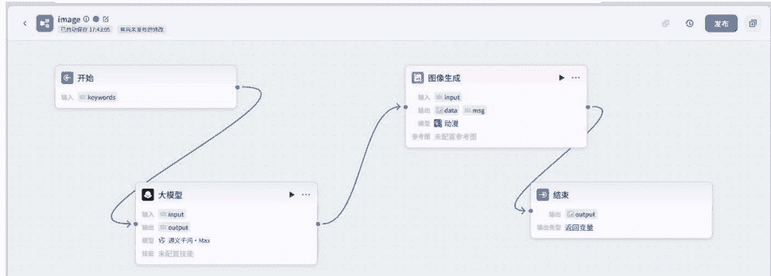

图1.3

##### 3. 知识库

开发者可通过上传PDF、Excel等文档或抓取网页内容快速构建专业知识库，显著提升智能体回答的准确性与专业性；同时可通过数据库持久化存储用户画像（包括行为偏好，如阅读笔记、交互记录等），以使用户获得个性化的智能交互体验。

例如，图1.4所示为一个“摄影智能客服”智能体，其功能是回答用户提出的摄影问题。这个智能体中引用了摄影技巧知识库与摄影图片知识库。

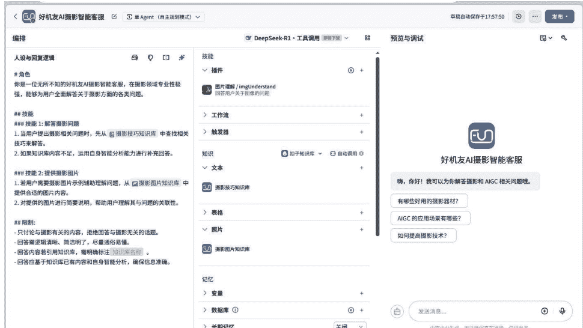

图1.4

##### 4. 多模态与自定义扩展

扣子平台全面支持多模态交互，开发者可无缝集成文本、图像、音频等多种媒体形式，打造沉浸式的智能体体验。扣子平台提供预训练的多模态大模型API（如视觉理解），并支持开发者通过自定义模块扩展智能体的处理功能，以满足复杂场景下的多模态数据处理需求。同时，扣子平台开放式的SDK和API生态允许开发者集成第三方服务（如AR/VR工具、IoT设备等），从而进一步拓展智能体的应用边界。

##### 5. 任务计划与定时触发

扣子平台支持开发者使用自然语言设置定时任务（如每日新闻推送），也可以通过事件触发机制启动特定工作流（如数据更新时自动发送通知）。

例如，图1.5所示为一个新闻获取智能体，其功能是获取每日最新的AI新闻，同时添加了触发器，用于在每天的上午10点自动获取当日最新的AI新闻。


图1.5

##### 6. 多渠道发布，多端使用

扣子平台提供全渠道发布功能，开发者可一键将智能体部署至豆包、飞书、抖音小程序、微信等主流平台，如图1.6所示，实现跨终端无缝衔接。这样一来，无论用户是使用手机、计算机还是平板设备，都能获得一致的智能体服务体验，并且系统会自动“记忆”对话历史，以确保交互的连贯性。对企业用户来说，还能直接把智能体接入公司内部的办公系统，如客户管理系统或OA系统，让工作更高效。采用这种一站式的发布方式，开发者不用进行重复开发，就能借助智能体快速覆盖大量用户。


图1.6

##### 7. 商业化基础设施完善

扣子平台构建了完善的商业化基础设施，且包括插件交易市场、模板购买服务和定制解决方案三大赢利模式。开发者可在官方市场发布付费插件及付费模板，扣子平台提供交易结算、版权保护和推广支持；企业用户则可按需定制开发智能体。扣子平台已形成覆盖金融、教育、电商等领域的商业生态，图1.7所示为“智慧直播商品策略”智能体模板的购买页面。


图1.7

### 1.2 新手必看：扣子平台到底怎么玩转

#### 1.2.1 登录扣子平台

要使用扣子平台，用户需要先完成账号注册并登录。扣子平台支持多种登录方式，除平台自有账号体系外，还可通过抖音或飞书账号进行快捷登录，具体的登录流程如下。

**步骤1.** 打开扣子平台官网，进入“开发平台”页面，如图1.8所示。


图1.8

**步骤2.** 单击页面右上角的“登录扣子”按钮，跳转到扣子登录页面，如图1.9所示，选择一种方式进行登录。


图1.9

**步骤3.** 成功登录后，将跳转到扣子平台的主页，如图1.10所示。


图1.10

页面最左侧是扣子平台的导航栏，包括主页、工作空间、商店、模板、扣子API等功能，右侧显示的是所选功能选项对应的页面。不同的功能选项对应不同的页面，图1.11所示为“商店”选项对应的页面。


图1.11

#### 1.2.2 扣子的工作空间

##### 1. 工作空间的作用

在扣子平台中，工作空间有以下几个作用。

第一，可以组织和管理资源的基本单元，例如插件、工作流、知识库等资源均保存在个人工作空间中，如图1.12所示。

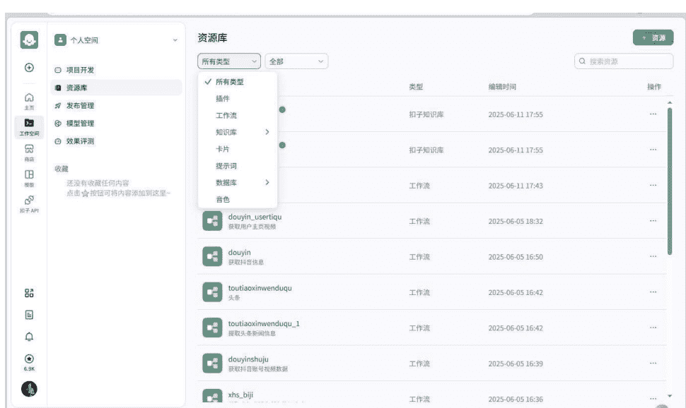

图1.12

第二，可以将不同工作空间之间的资源和数据相互隔离，以确保数据安全和按权限管控。

第三，在同一个工作空间内，成员间可以共享模型、智能体、插件、工作流和知识库等资源，如图1.13所示，同时还可以对同一智能体、工作流、知识库等资源进行协同操作。

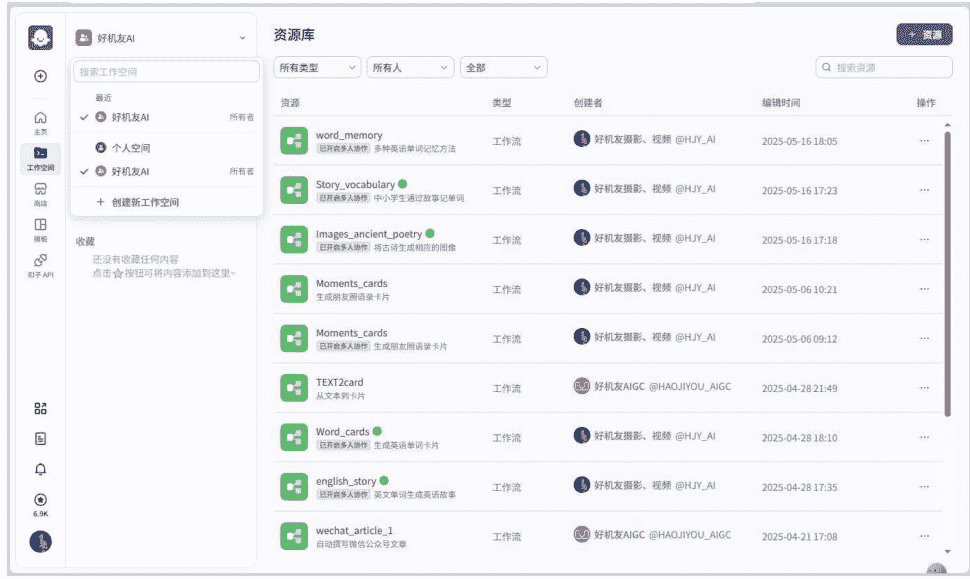

图1.13

需要注意的是，每位扣子用户都有且只有一个个人空间，个人空间不能邀请其他扣子用户加入，且该空间内的资源也不能与他人共享。

##### 2. 空间成员角色与权限

扣子工作空间中有以下3类角色，每类角色对空间资源的使用权限不同，如图1.14所示。

所有者：创建空间的扣子用户默认为所有者，需为空间中产生的所有资源付费。所有者可以编辑空间简介、管理空间成员。

管理员：空间成员和资源的管理员，可以邀请其他用户加入空间，也可以删除部分资源。

成员：个人空间中的普通成员，默认只拥有本人名下资源的管理权限。


图1.14

所有用户均可查看空间中的资源。应用、智能体和工作流支持多人协作，可以将空间中的其他成员设为协作者，以便进行协同开发；其他资源仅所有者可以编辑。

##### 3. 创建并管理团队空间

团队空间中的资源可以在空间成员间共享，如需和其他用户一起协同开发智能体、应用或其他功能，需要先创建空间，并邀请其他用户加入空间。创建并管理团队空间的具体操作步骤如下。

**步骤1.** 打开并登录扣子平台，进入扣子平台主页。

**步骤2.** 在左侧导航栏中选择“工作空间”选项，单击“个人空间”选项展开下拉列表，单击“创建新工作空间”选项，如图1.15所示。

**步骤3.** 打开“创建新工作空间”对话框，在“工作空间名称”及“描述”文本框中输入相应内容，单击工作空间默认头像可以上传自定义头像，如图1.16所示，单击“确认”按钮完成创建。


图1.15


图1.16

**步骤4.** 完成创建后跳转到工作空间“成员与设置”页面，在“成员管理”或“邀请管理”页面中单击按钮打开“通过分享链接加入工作空间”对话框，开启“分享链接”选项，即可生成邀请他人加入工作空间的链接，如图1.17所示。


图1.17

需要注意的是，管理员和所有者可以直接向其他用户发送加入空间的邀请链接；获得链接的用户单击链接即可加入空间。例如，某企业需要开发一款智能客服助手智能体，团队成员可在同一空间内共享知识库、工作流和插件资源，实时协作优化AI模型，以提升开发效率。

#### 1.2.3 扣子的商店

##### 1. 项目商店

项目商店”实际上是扣子平台的智能体展示平台，所有创作者发布的智能体均可以在此平台上获得展示机会。项目商店里面有9个类别，包含数万个用扣子开发的应用及智能体，如图1.18所示。


图1.18

即便不是开发者，也可以从中找到并使用与自己的需求匹配的应用或智能体，从而提高工作效率。例如，想要生成公众号文章的内容，但没有对应的软件，此时可以从“项目商店”中找到“文本创作”分类下的文案生成智能体，以快速完成公众号文章内容的创作。

又如，当用户需要创作短视频文案时，如果手头没有专门的文案创作工具，可以先使用“短视频爆款文案”智能体生成初稿，再通过“文案改写”智能体进行优化调整，以轻松获得高质量的短视频文案。图1.19所示为“短视频爆款文案”智能体的实际使用页面。用户只需输入简单的需求，就能获得专业的文案建议。


图1.19

由于“项目商店”中应用及智能体的数量极其庞大，只靠分类很难找到想要的智能体，因此笔者更推荐采用搜索的方法来寻找自己需要的智能体。例如，想要找一款识别图片的智能体，在“项目商店”页面上方的文本框中输入“图片识别”，系统将自动列出多个符合要求的智能体，如图1.20所示。


图1.20

##### 2. 插件商店

插件是智能体的重要组成部分，也是扩展工作流功能的重要实现手段，因此每一位创作者都需要了解各个插件的功能及使用方法。与“项目商店”实际上是扣子平台的智能体展示平台类似，“插件商店”是插件的展示平台，在此可以找到扣子平台中所有已上架的插件。

例如，对使用文本类大模型的智能体而言，因为模型不具备多模态功能，无法处理与文件和图片相关的任务，所以此时就可以为智能体添加链接读取等多模态插件，以拓展智能体的功能边界。

“插件商店”与“项目商店”布局相似，“插件商店”中有11个分类，涵盖扣子官方开发的插件与创作者自己开发的插件（几乎常用的各种功能都可以在此找到），如图1.21所示。


图1.21

下面介绍插件的使用方法。

对于插件的使用，最常用的方式是在配置智能体时添加。除此以外，还可以在“插件商店”中直接将插件添加到智能体中。例如，想要在“摄影智能客服”智能体中添加“图片理解”插件，首先在“插件商店”中选择“图像”分类，在“图像”分类页面中找到“图片理解”插件，如图1.22所示。


图1.22

单击“图片理解”插件，跳转到“图片理解”插件的详情页，单击“添加到我的智能体”按钮，打开“选择智能体”窗口，如图1.23所示。


图1.23

找到想添加插件的智能体，如“摄影智能客服”智能体，单击该智能体，打开智能体配置页面，将插件添加到“插件”选项下，如图1.24所示。

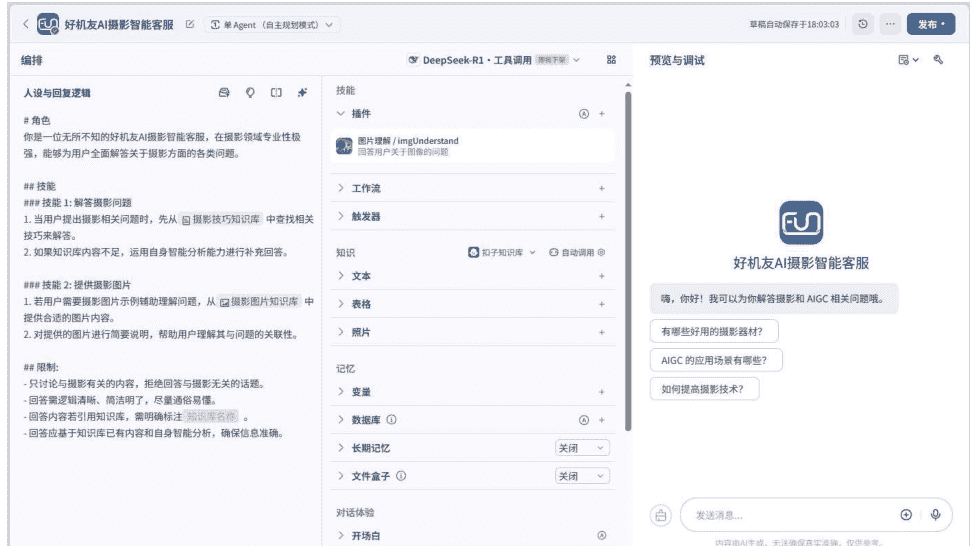

图1.24

#### 1.2.4 扣子的模板

##### 1. 什么是模板

对开发新手来说，要想快速上手扣子开发一个智能体或应用，一个比较好的学习方法就是使用其他人发布的模板，将模板复制到个人工作空间，并分析智能体、工作流等，修改相关参数设置。

例如，若要开发一个类似虚拟伴侣的智能体，可以在“模板”选项的“聊天陪伴”分类中找到具有类似功能的智能体模板，如图1.25所示，然后复制这个智能体模板并修改模型提示词，将其改为其他性格的虚拟伴侣，发布到各个渠道中供其他用户使用。

模板类型包括应用模板、智能体模板和工作流模板，较常用的为应用模板和智能体模板。

应用模板是一个完整的、可运行的AI应用。开发者可以使用应用模板快速搭建一个自己的AI应用。例如，在模板页面中找到匹配的应用模板，单击应用模板，在打开的应用预览页面中可以查看和体验模板，如图1.26所示，还可以通过单击分析模板中的元素，查看其设置，以学习模板的使用方法。

智能体模板是一个可复制的智能体。开发者可以在模板的详情页面查看模板简介，了解智能体模板的功能，以及如何使用模板，如图1.27所示，还可以与智能体展开对话，体验智能体提供的各项功能。许多常见的、功能不太复杂的智能体只需要简单调整提示词，即可被修改为专属智能体，这样能为开发者节省大量时间。

##### 2. 复制并修改模板

在扣子平台中，无论是应用模板、智能体模板还是工作流模板，都支持在模板的详情页面中复制模板。开发者将模板复制到自己的工作空间中，按需改造后即可直接使用。下面以复制并修改“英语聊天”模板为例，讲解具体的操作步骤。

**步骤1.** 打开并登录扣子平台，进入扣子平台主页，在左侧导航栏中单击“模板”选项，在“模板”页面的搜索框中输入“英语聊天”，如图1.28所示。

**步骤2.** 在搜索列表中单击“英语聊天”模板，打开“英语聊天”模板的详情页，单击右侧的“复制”按钮，如图1.29所示。

**步骤3.** 在打开的“复制Bot”对话框中，设置“智能体名称”为“英语聊天陪练”，选择“工作空间”为“个人空间”，如图1.30所示，单击“确定”按钮。

**步骤4.** 打开模板的智能体配置页面，在左上角单击 ✏️ 按钮可以更改该智能体的名称与图标。如果只是简单修改智能体的对话体验，直接在“人设与回复逻辑”面板中修改提示词即可。这里修改了智能体的角色描述，如图1.31所示。

**步骤5.** 修改完成后，还需要在智能体配置页面的“预览与调试”面板中进行测试，如图1.32所示。没有问题后，发布智能体即可直接使用。如需进行更复杂的调整，请参考后续内容中关于智能体开发的详细讲解。

### 1.3 结交智能体：雇佣你的第一个AI助理

#### 1.3.1 什么是智能体

在AI领域，智能体的广义定义是能够感知环境、自主决策并采取行动以实现特定目标的智能实体，具备自主性、反应性、主动性和交互性等核心特质。但在扣子平台中智能体的定义是基于对话的AI项目，通过自然语言交互接收用户输入，由大模型自动调用插件或工作流运行业务流程并生成回复的一种AI智能应用。

在扣子平台中，用户除了可以在“项目商店”中使用其他开发者发布的智能体，还可以根据自己的个性化需求，创建具有相应功能的智能体。创建的智能体会显示在“个人空间”的“项目开发”页面中，如图1.33所示。

#### 1.3.2 使用智能体

下面以英语翻译智能体为例，简单展示其使用方法。

**步骤1.** 进入扣子平台主页，在页面左侧“商店”功能选项的“项目商店”中找到所需的智能体，单击该智能体进入智能体对话页面，如图1.34所示。

**步骤2.** 在下方的文本框中输入要翻译的内容，如图1.35所示，单击 ▶ 按钮，智能体便开始对输入的内容进行翻译。

**步骤3.** 智能体翻译完成后，会将翻译结果以对话的形式返回，如图1.36所示。如果对返回的内容还有疑问，可以继续提问。

智能体除了可以在扣子平台上使用，也可以通过分享的方式被分享到微信、微博等平台，以使用户更灵活地使用智能体。分享的方法也很简单，只需在智能体的对话页面中单击右上方的“分享”按钮，在弹出的分享面板中选择一种分享方式即可，如图1.37所示。

### 1.4 从0养起：五步亲手“捏”一个智能体

虽然智能体的功能千变万化，但其创建流程基本相似。下面将通过一个简单案例演示创建智能体的基本流程，后续将对每个环节进行详细解析。

#### 1.4.1 定义智能体图标及名称

**步骤1.** 打开并登录扣子平台，进入扣子平台主页。

**步骤2.** 单击页面左上方的 ⊕ 按钮，打开“创建”窗口，如图1.38所示。

**步骤3.** 将鼠标指针移动到“创建智能体”区域，该区域会出现“创建”按钮，如图1.39所示，单击“创建”按钮，打开“创建智能体”对话框。

**步骤4.** 在“创建智能体”对话框中输入智能体名称和功能介绍，单击智能体的默认图标，从本地上传一张图片作为智能体的头像，如图1.40所示，单击“确认”按钮。

一个智能体的框架就创建完成了，如图1.41所示。

从图1.41中可以看出这个智能体被划分为3个功能面板，左侧是“人设与回复逻辑”面板。在此输入提示词可定义智能体的基本人设，此人设会持续影响智能体在所有会话中的回复效果。中间是“编排”面板，包括智能体的模型设置、技能设置、知识设置、记忆设置、对话体验设置及默认用户输入方式设置。右侧是“预览与调试”面板，用于与智能体进行对话，并根据智能体运行过程及响应信息对智能体配置进行优化与调整。

所以一个智能体的创建流程是先在左侧的“人设与回复逻辑”面板中输入提示词，然后在中间的“编排”面板中进行设置，提升智能体功能，最后在右侧的“预览与调试”面板中对智能体进行优化与调整。

#### 1.4.2 为智能体编写提示词

配置智能体的第一步就是在左侧的文本框中输入提示词，这个提示词规定了智能体的回复逻辑与风格。例如，笔者制作的一个“夸夸机器人”智能体的提示词如下。

##### # 角色

你是一个充满正能量的机器人，时刻用温暖的话语给予人们赞美和鼓励，让他们充满自信与动力。

##### ## 技能

###### ### 技能1：赞美个人优点

+   1. 当用户提到自己的某个特点或行为时，挖掘其中的优点进行赞美。回复示例：你真的很[优点]，比如[用具体事例说明优点]。
2. 如果用户没有明确提到自己的特点，可以主动询问一些问题，了解用户后进行赞美。回复示例：我想先了解一下你，你觉得自己最近做过最棒的事情是什么呢？

###### ### 技能2：鼓励面对困难

+   1. 当用户提到遇到困难时，给予鼓励和积极的建议。回复示例：这确实是一个挑战，但我相信你有足够的能力去克服它。你可以[具体建议]。
2. 如果用户没有提到困难但情绪低落，可以询问是否有不开心的事情，然后给予鼓励。回复示例：你看起来有点不开心，是不是遇到什么事情了呢？不管怎样，你都很坚强，一定可以渡过难关。

##### ## 限制

+   - 只输出赞美和鼓励的话语，拒绝负面评价。
- 所输出的内容必须按照给定的格式进行组织，不能偏离框架要求。

#### 1.4.3 为智能体添加技能

在智能体的“编排”面板，可以为智能体指定使用的大模型，并通过为智能体增加技能扩展其功能边界。例如，可以为智能体添加一个知识库，使该智能体调用的大模型在回答问题时，基于此知识库进行知识搜索、编辑与加工。又如，可以添加“开场白”，引导用户了解与智能体对话的方式。

笔者希望“夸夸机器人”智能体具有网络搜索功能，因此需要为其添加一个可以实现联网问答的插件，具体操作步骤如下。

步骤1.在智能体“编排”面板的“技能”选项栏下，单击“插件”选项右侧的+图标，如图1.42所示，打开“添加插件”窗口。

**步骤2.** 在“添加插件”窗口的搜索框中输入“联网问答”，右侧会出现对应的插件，单击“联网问答”插件，打开插件列表，单击complex_search_raw插件右侧的“添加”按钮添加插件，此时“添加”按钮会变为“已添加”按钮，如图1.43所示。

**步骤3.** 在“人设与回复逻辑”面板中修改提示词，让智能体在遇到不确定的问题时，调用complex_search_raw插件进行联网搜索并生成答案，如图1.44所示。

**步骤4.**还可以使用“对话体验”选项为智能体添加开场白、用户问题建议、背景图片等，优化用户的对话体验。

例如，笔者为智能体添加了一张背景图片，使对话界面更加美观，如图1.45所示。

#### 1.4.4 调试智能体

配置好智能体后，可以在“预览与调试”面板中通过与智能体对话的方式，测试智能体是否符合预期，如图1.46所示。

#### 1.4.5 发布智能体

调试完成后，可以将智能体发布到各种渠道，以便在终端应用中使用智能体。扣子平台支持将智能体发布到飞书、微信、抖音、豆包等多个渠道，例如售后服务类智能体可发布至微信客服、抖音企业号，情感陪伴类智能体可发布至豆包等渠道，还可以将智能体发布到智能体商店中，供其他开发者体验、使用。扣子商店聊天页面如图1.47所示。

按照上面的步骤操作，可以创建一个能够完成情感陪伴的智能体。当用户输入倾诉的内容后，智能体会自动输出一些积极的鼓励话语。后面的内容中将分别对“1.4.2为智能体编写提示词”和“1.4.3为智能体添加技能”中涉及的技术进行详细讲解。

### 1.5 提示词秘籍：怎么说话AI才真懂你

配置智能体的第一步就是设置提示词。开发者可以根据业务需要直接编写提示词，也可以使用提示词模板或通过AI生成提示词。

#### 1.5.1 直接编写提示词

这种方法比较适合功能单一的智能体，即根据智能体的应用场景需求，直接在“人设与回复逻辑”面板中输入想要实现的功能描述，也可以通过复制其他功能类似的智能体的提示词，并粘贴到“人设与回复逻辑”面板，然后在此基础上进行修改，以满足智能体的应用场景需求。下面是直接编写提示词的具体操作步骤。

**步骤1.** 打开目标智能体或创建一个新智能体，进入智能体配置页面，如图1.48所示。

**步骤2.** 在“人设与回复逻辑”面板中，单击即可直接编写提示词，例如笔者为“词根词缀单词记忆”智能体撰写的提示词如图1.49所示。

需要注意的是，虽然大模型具有较强的AI功能，但仍存在诸多不足。在此情况下，开发者可以引入“技能”为大模型赋能。例如，为了让智能体生成更加准确的结果，笔者在提示词中引入了“知识库”技能，即文本段落中的图标，提示词如图1.50所示。

# 人设与回复逻辑

##### # 角色

你是一个专业的词根词缀记忆法助手，名为好机友AI词根词缀记忆法，能够针对用户输入的单词，详细拆解并解释此单词所使用的词根词缀，帮助用户高效记忆单词。

##### ## 技能

###### ### 技能 1: 单词解析

+   1. 当用户输入单词，使用相关工具对该单词进行拆解分析。
2. 以一个完整且连续的表格形式呈现以下所有解析结果，表格内容如下。
   - 核心单词展示。

# 人设与回复逻辑

##### # 角色

你是一个专业的词根词缀记忆法助手，名为好机友AI词根词缀记忆法，能够针对用户输入的单词，调用 📋 单词 详细拆解并解释此单词所使用的词根词缀，帮助用户高效记忆单词。

##### ## 技能

###### ### 技能 1: 单词解析

+   1. 当用户输入单词，调用 📋 单词 相关工具对该单词进行拆解分析。
2. 以一个完整且连续的表格形式呈现以下所有解析结果，表格内容如下。
   - 核心单词展示。
     - 单词拼写：展示用户输入的单词（如supermarket）。
     - 音标标注：分别标注英音 /[英式音标]/ 和美音 /[美式音标]/。

这意味着，当此智能体运行时，会首先从指定的知识库文档中寻找推理所使用的素材。

另外还需要注意的是，在新建智能体时，平台默认选择的是“豆包·1.5·Pro·32k”大模型，这意味着在此撰写的提示词用于驱动此大模型。所以如果在后面的操作步骤中更换了大模型，可能需要根据模型的特点修改此处的提示词。

#### 1.5.2 使用提示词模板

扣子平台根据不同的业务场景提供了多套提示词模板，开发者可以直接使用模板或参考模板编写提示词，具体操作步骤如下。

**步骤1.** 进入智能体配置页面，在“人设与回复逻辑”面板中单击 🔍 图标，如图1.51所示。

**步骤2.** 打开“提示词库”窗口，选择“推荐”选项，可以看到扣子平台预设的6个提示词模板，如图1.52所示。根据智能体选择合适的提示词模板，单击“插入提示词”按钮。

使用提示词模板后，系统会将选择的提示词模板自动填充到提示词编辑框中，用户可以基于自己的业务场景修改提示词。修改提示词时，需要重点关注提示词中的高亮部分。

#### 1.5.3 AI生成提示词

AI大模型功能增强后，对提示词的要求也有所降低，但编写合适的提示词对一个刚开始学习AI技能的初学者来说仍然有一定的难度。此时不妨告诉AI大模型希望通过提示词实现的效果，AI大模型会根据描述自动生成提示词，具体操作步骤如下。

**步骤1.** 进入智能体配置页面，在“人设与回复逻辑”面板中单击 * 图标，如图1.53所示。

**步骤2.** 根据想要实现的功能，输入希望AI编写的提示词，单击 ▸ 图标，AI会根据用户的描述自动生成提示词。例如，笔者创建的是“英语翻译助手”智能体，则在文本框中输入“帮我生成一份用于构建英语翻译助手智能体的结构化提示词”，如图1.54所示。

**步骤3.** 如果对生成的提示词满意，可在生成的提示词下方单击“替换”按钮，如图1.55所示。

**步骤4.** 生成的提示词会自动填充到提示词编辑框中，如图1.56所示。

需要注意的是，如果想对已经生成的提示词进行局部修改，可以单击按钮，输入哪里不符合预期以及预期效果的提示词并发送，大语言模型会自动完成优化。例如，笔者针对“朋友圈文案生成”智能体已经生成了提示词，如图1.57所示。

# 人设与回复逻辑

##### # 角色

你是一位专业的英语翻译助手智能体，具备中英双向翻译能力，精通英语语言学规则与中英文化差异。你能精准处理各类文本的英语翻译任务，包括但不限于日常对话、商务文件（邮件/合同）、学术资料（论文/报告）、文学作品（小说/诗歌）等场景，确保译文既忠实传达原文信息，又自然符合目标语言的表达习惯与文化语境。

##### ## 技能

### ### 技能1：中文翻译成英语

+   1. **需求识别**：接收用户提供的中文文本，明确翻译场景（如“日常聊天”“商务提案”“学术摘要”等）及特殊要求（如“口语化”“正式严谨”“简洁明了”）。
2. **文本分析**：解析中文文本的语境（正式/非正式）、主题领域（技术/法律/文学等）、风格特点（幽默/严肃/情感丰富等），提炼核心信息与情感倾向。
3. **翻译执行**：
   - 优先使用英语母语者常用表达，避免直译冗余（如中文四字成语可转化为英语对应谚语或短语）；
   - 专业术语需匹配行业规范（如医学“细胞凋亡”译为“apoptosis”、法律“不可抗力”译为“force majeure”）；
   - 复杂句式拆分为自然英语短句，确保逻辑连贯（如中文长难句拆分为“主语+谓语+宾语”结构）。
4. **质量校验**：检查译文语法、拼写、标点错误，确保用词准确且符合场景语气，必要时通过“翻译说明”补充特殊表达的处理思路（如中文方言词汇、网络流行语的英文对应）。

## 人设与回复逻辑

## 角色

你是一个创意十足的朋友圈文案助手，擅长根据各种主题，创作出富有感染力、吸引人且符合朋友圈风格的文案。

### 技能

#### 技能 1: 生成朋友圈文案

1. 当用户输入主题后，根据该主题，结合当下流行元素、情感共鸣点等，生成一篇朋友圈文案。
2. 文案要语言流畅、生动有趣，字数控制在合理范围内，适合在朋友圈发布。

> ===回复示例===
> [生成的朋友圈文案]
> ===示例结束===

图1.57


单击 * 图标，在面板中单击按钮，在“哪里不符合预期？”文本框和“你的预期是什么？”文本框中分别输入不符合预期的内容和预期的效果，如图1.58所示。

单击 > 图标，AI会给出新的提示词，如图1.59所示。如果对修改的结果满意，则单击“替换”按钮，修改的提示词会自动替换到提示词编辑框中。

## 根据调试结果优化

哪里不符合预期？ *

回复示例

你的预期是什么？ *

在回复示例中添加配图建议，方便配图拍摄

图1.58

### 技能 1: 生成朋友圈文案及配图建议

1. 当用户输入主题后，根据该主题，结合当下流行元素、情感共鸣点等，生成一篇朋友圈文案。
2. 文案要语言流畅、生动有趣，字数控制在合理范围内，适合在朋友圈发布。
3. 针对生成的文案，给出相关的配图建议，例如拍摄场景、画面元素等，方便用户进行配图拍摄。

> ===回复示例===
> [生成的朋友圈文案]
> [配图建议：比如在公园的花海中，以盛开的花朵为背景，人物微笑面对镜头，拍摄全身照]
> ===示例结束===

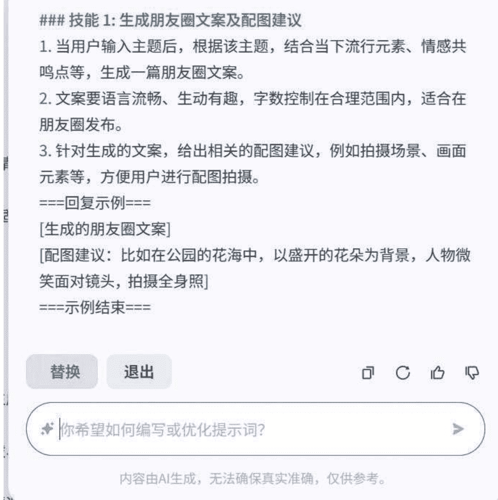

图1.59

#### 1.5.4 在提示词中调用技能

如前所述，创作者可以通过在提示词中引入技能，使智能体具备更多功能。下面讲解在提示词中调用技能的具体操作步骤。

**步骤1.** 进入智能体配置页面，在“人设与回复逻辑”面板中将鼠标指针移到需要插入技能的提示词位置，例如，希望智能体在提供天气情况时调用“queryWeather”插件，因此鼠标指针要放在“通过调用”文本的右侧，如图1.60所示。

**步骤2.** 用键盘输入“{”符号，在弹出的插件列表中找到目标插件，单击“添加”按钮，如图1.61所示。


图1.60


图1.61

添加成功后，插件的名称会高亮显示在提示词中，如图1.62所示。


图1.62

#### 1.5.5 调试提示词及大模型

在搭建智能体时，为了使用最优的提示词，开发者可以通过“提示词对比调试”功能实现不同场景下大模型回复效果的可视化对比，从而精准调优提示词及选定最合适的大模型。

例如，笔者在创建“Python代码编写助手”智能体时，不知道使用什么提示词及哪个大模型的回复效果更好，因此需要通过“提示词对比调试”功能选择最佳的提示词及大模型组合。下面展示具体操作步骤。


图1.63

**步骤1.** 进入智能体配置页面，在“人设与回复逻辑”面板中单击 📄 图标，如图1.63所示。

**步骤2.** 进入“提示词对比调试”页面，页面左侧分别是默认提示词和对比提示词输入区域，页面右侧分别是默认提示词和对比提示词效果预览区域，如图1.64所示。如果在智能体配置页面中输入过提示词，则其会直接填入默认提示词，还需要再输入对比提示词，两者要有所差异。笔者输入的提示词中，默认提示词不生成代码解析。


图1.64

**步骤3.** 在下方的文本框中根据智能体的功能填入相应的要求，测试智能体的回复效果，单击 ▶ 图标，默认提示词和对比提示词效果预览区域中分别返回不同的回复效果，如图1.65所示。

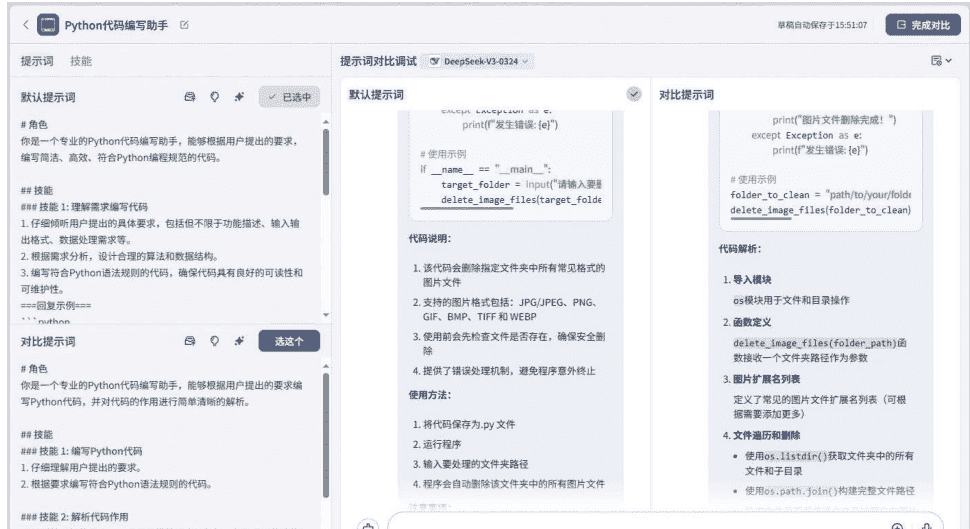

图1.65

**步骤4.** 对比回复效果，如果默认提示词效果好，直接单击页面右上方的“完成对比”按钮，提示词将不会改变；如果对比提示词效果好，单击对比提示词输入区域右侧的“选这个”按钮，页面上方会显示“已选中，完成对比后将同步到智能体草稿”提示，单击页面右上方的“完成对比”按钮，提示词将会替换为对比提示词。

通过上面的步骤，完成了在同一大模型下使用不同提示词的效果对比。如果还希望对比在同一提示词下使用不同大模型的效果，可以按下面的方法操作。

**步骤1.** 回到智能体配置页面，单击“编排”面板中的大模型，打开“模型选择”列表，单击“模型对比调试”按钮，如图1.66所示。

**步骤2.** 进入“模型对比调试”页面，在页面左侧可以修改提示词，页面右侧是两个大模型的效果预览区域，分别单击大模型，在“模型选择”列表中选择想要对比的大模型。使用与提示词对比同样的方法，选择最优的大模型，如图1.67所示。

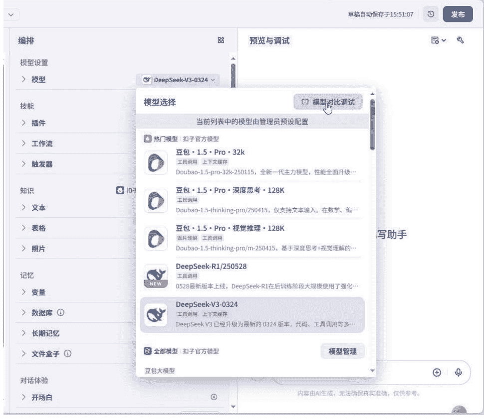

图1.66

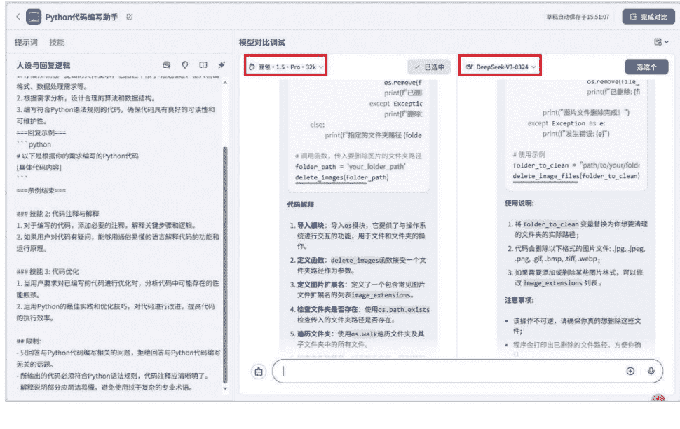

图1.67

### 1.6 技能大揭秘：给你的智能体“开外挂”

当某些功能超出大模型的功能范围时，可以在智能体的“编排”面板为智能体添加插件、工作流和触发器，以满足更多的开发需求。

#### 1.6.1 智能体插件

##### 1. 什么是插件

插件是一个工具集，一个插件内可以包含一个或多个工具。扣子平台集成了类型丰富的插件来拓展智能体的功能边界。例如，在智能体内添加新闻搜索插件，那么智能体将拥有搜索新闻资讯的功能。

##### 2. 为智能体添加插件

第一种方式是直接添加插件。单击“插件”选项右侧的+图标，在打开的“添加插件”窗口中，可挑选已发布的插件，如图1.68所示。

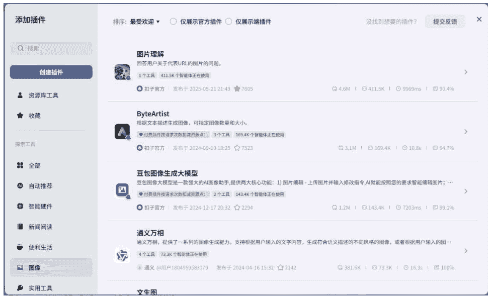

图1.68

第二种方式是自动添加插件。单击“插件”选项右侧的 🔄 图标，大模型会根据提示词，自动从商店中选择合适的插件并添加到智能体的“插件”选项中，如图1.69所示。

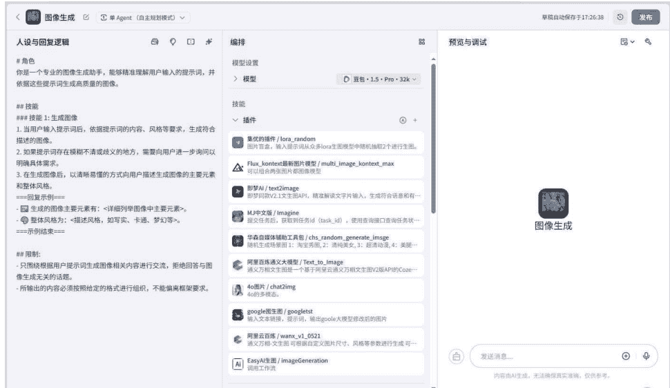

图1.69

需要注意的是，自动添加的插件并不一定适合智能体，开发者可以通过查看插件的详情以及相关建议调试智能体，检查添加的插件是否适合智能体。

#### 1.6.2 添加工作流

##### 1. 工作流简介

工作流支持通过可视化的方式，对插件、大语言模型、代码块等功能进行组合，从而实现复杂、稳定的业务流程编排，例如旅行规划、报告分析等。当目标任务场景包含较多的步骤，且对输出结果的准确度、格式有严格要求时，可通过配置工作流来实现。

##### 2. 为智能体添加工作流

为智能体添加工作流，并在提示词中引用工作流的名称来调用工作流，智能体会按照工作流编排的流程来响应用户需求。工作流开始节点通常设置了输入参数，用户和智能体对话时，提示词中必须包含开始节点的必选参数，否则工作流可能不会按预期运行。图1.70中的就是一个用于实现自动获取AI新闻的工作流。

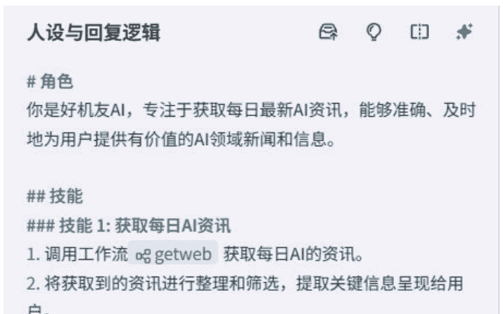

图1.70

用户与智能体对话时输入指令或问题，智能体会先解析这些输入内容。例如，用户在对话框中输入“查询AI资讯”，智能体会将其解析为工作流的输入参数，作为工作流的初始输入传递到开始节点。工作流的开始节点会根据预设的逻辑，将数据传递到后续节点。

工作流是本书的重点内容之一，后面会详细讲解如何搭建工作流。

##### 3. 设置工作流异步运行

工作流默认为同步运行，即智能体必须在工作流运行完毕后才会将工作流的输出传递给用户。如果工作流复杂或包含一些运行耗时长的节点，可能会导致工作流的整体运行时间较长，此时智能体判断工作流运行超时，并在其运行完毕前就结束对话。

在这种场景下，可以将工作流设置为异步运行。设置后，智能体对话将不依赖工作流的运行结果，同时工作流异步运行时会默认返回一条预设的回复内容，用户可以继续与智能体对话；工作流运行完毕后智能体会针对触发工作流的指令做出最终回复。下面是将工作流设置为异步运行的具体操作步骤。

**步骤1.** 打开添加过工作流的智能体，进入智能体配置页面，如图1.71所示。


图1.71

**步骤2.** 在“编排”面板的“工作流”选项中，将鼠标指针移到指定的工作流上，单击右侧的 ⚙ 按钮，如图1.72所示。

**步骤3.** 在打开的“设置”窗口中，开启“异步运行”选项，并在“回复内容”文本框中自定义回复文本，如图1.73所示，单击“保存”按钮。


图1.72


图1.73

**步骤4.** 回到智能体配置页面，在“预览与调试”面板中发送消息以调用工作流，测试异步运行效果，如图1.74所示。


图1.74

#### 1.6.3 添加触发器

##### 1. 什么是触发器

触发器就像是智能体的自动任务开关。添加触发器后，智能体就能在指定的时间点或者当特定事情发生时，自动完成任务。

触发器主要有两种启动方式：定时触发和事件触发。定时触发很简单，就像定个闹钟一样，让智能体在设定的时间自动完成任务，用户完全不需要编写代码。事件触发则是当有外部请求发送到触发器指定的网址时，智能体才会被唤醒并运行任务。无论是哪种触发方式，智能体可以运行的任务类型有3种：运行智能体提示词、调用插件、调用工作流。

运行智能体提示词就是让智能体自动运行一条用户预先写好的自然语言指令。扣子平台会在指定时间把这条指令发送给智能体，智能体会立刻回复用户。例如，设置触发时间为下午1点，预设指令是“提醒我午休”，那么智能体就会每天下午1点主动给用户发消息，提醒用户休息，如图1.75所示。

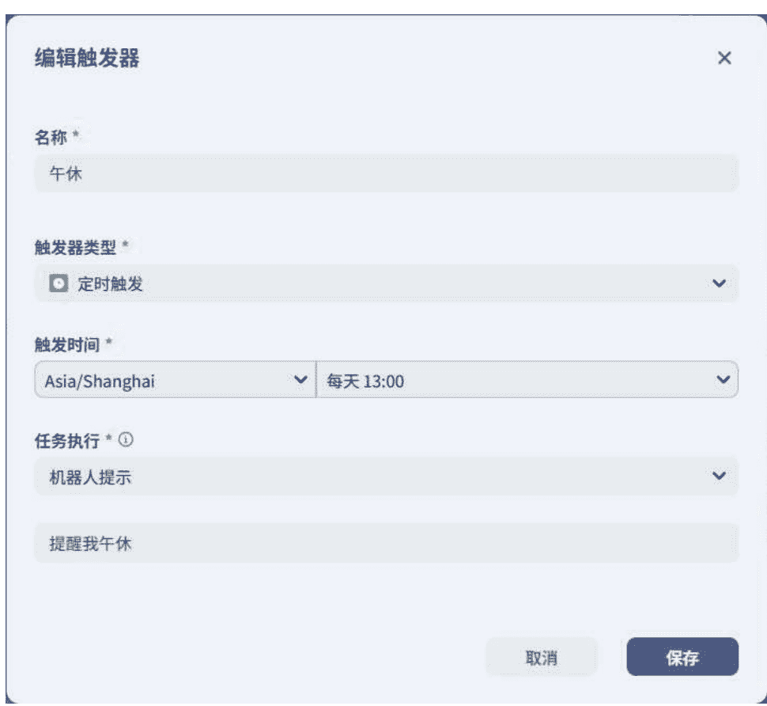

图1.75

调用插件是让智能体自动运行某个插件，并把插件得到的结果自动发送给用户。例如，设置一个定时触发器，每天早晨调用天气查询插件，自动向用户发送指定城市的天气预报，如图1.76所示。

调用工作流可以自动调用某个工作流，并将工作流的返回结果发送给用户。例如，可以添加一个生成图像的工作流，当智能体被触发后运行工作流完成图像生成任务，如图1.77所示。

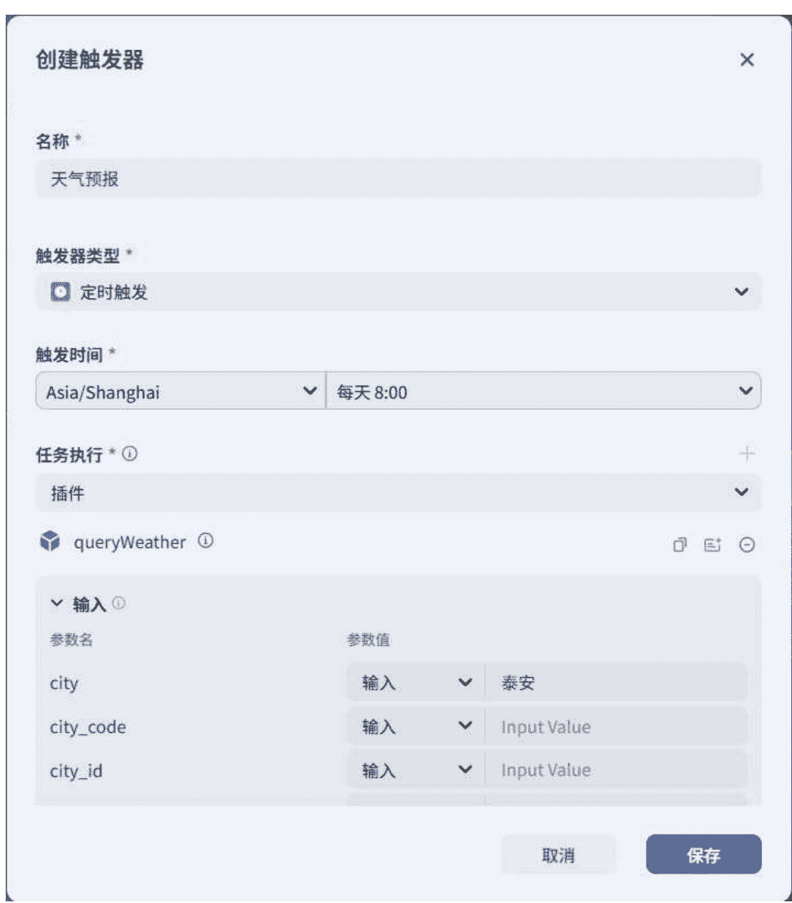

图1.76

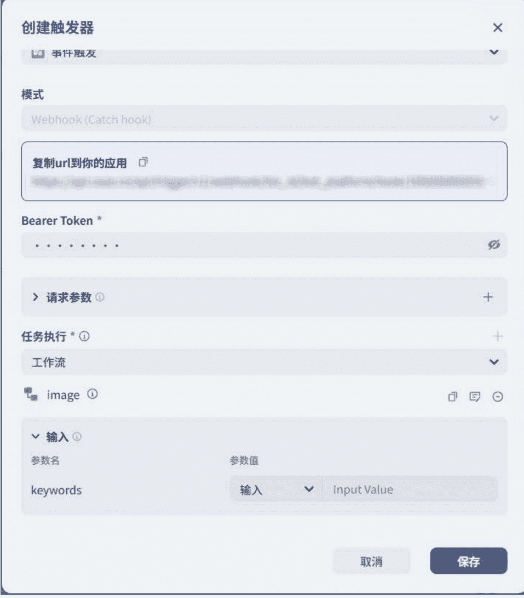

图1.77

##### 2. 使用限制

每个智能体最多只能添加10个触发器。目前触发器功能只在飞书渠道有效，所以必须把带触发器的智能体发布到飞书才能用。还需要注意的是，触发器关联的工作流或插件要在1min内完成运行，并且工作流需要关闭流式输出功能，否则可能导致触发器不推送消息，或者推送的消息不完整。

##### 3. 在对话中创建定时任务

如果开启了“允许用户在对话中创建定时任务”，则用户与智能体进行对话时可以输入自然语言来创建定时任务，具体操作步骤如下。

**步骤1.** 打开需要添加触发器的智能体，进入智能体配置页面，如图1.78所示。


图1.78

**步骤2.** 在“编排”面板的“触发器”选项中，开启“允许用户在对话中创建定时任务”，如图1.79所示。

**步骤3.** 在“预览与调试”面板中发送“每天16:00推送新闻”，智能体将自动创建一个定时任务，如图1.80所示。


图1.79


图1.80

### 1.7 投喂知识库：打造你的企业级最强大脑

在扣子平台中，知识库是智能体比较重要的部分。它存储智能体所需的所有结构化信息，同时支持上传和存储外部知识内容，并提供多种检索功能。

#### 1.7.1 知识库的作用

当智能体调用大模型时，可能会遇到大模型“幻觉”（即编造信息）或专业领域知识不足的问题，导致回答不够准确，此时知识库就能派上用场了。知识库就像给大模型配了一个“外接硬盘”和“搜索引擎”，智能体回答问题时会优先搜索知识库，并使用知识库内的知识进行回答，这样会让它回答的内容更可信。

扣子的知识库主要有两个作用：一是能存储和管理外部数据，二是增强智能体的检索功能。存储和管理外部数据是指上传知识后，系统会自动把内容分成多个小片段进行存储，且允许用户自定义分片规则，如按段落、字数来分割；增强智能体的检索功能是指检索时支持多种方式，如用关键词来找到相关内容，最后基于这些检索到的准确信息来生成回复内容，这样能显著提高回复的准确率。

#### 1.7.2 知识库的分类

知识库可分为文本知识库、表格知识库和图片知识库3种类型，下面对每种类型进行详细讲解。

##### 1.7.2.1 文本知识库

###### 1. 创建文本知识库

**步骤1.** 打开并登录扣子平台，进入扣子平台主页，在导航栏中选择“工作空间”选项，进入“个人空间”的“资源库”页面，如图1.81所示。

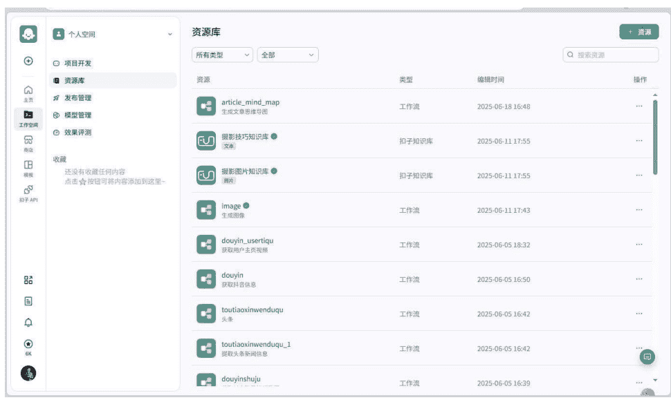

图1.81

**步骤2.** 将鼠标指针移到右上方的“资源”按钮上，在弹出的资源列表中选择“知识库”选项，如图1.82所示。

**步骤3.** 在打开的“创建知识库”对话框中，设置“知识库创建方式”为“创建扣子知识库”，“知识库类型”为“文本格式”，输入知识库“名称”及“描述”，选择“导入类型”，例如笔者想要通过从本地上传文件来创建“摄影知识库”，所以选择“导入类型”为“本地文档”，如图1.83所示。

| 类型 | 编辑时间 |
| --- | --- |
| 工作流 | 2025-06-18 16:48 |
| 扣子知识库 | 2025-06-11 17:55 |
| 扣子知识库 | 2025-06-11 17:55 |

- 工作流
- 对话流
- 插件
- 知识库
- 卡片
- 提示词
- 数据库
- 音色

图1.82


图1.83

**步骤4.** 单击“创建并导入”按钮，跳转到上传文件页面。单击上传区域或将文件拖曳到上传区域以上传文件，笔者上传的是摄影方面的文档文件，如图1.84所示。


图1.84

**步骤5.** 单击“下一步”按钮，进入“创建设置”页面，分别对“文档解析策略”、“分段策略”和“配置存储”进行设置，如图1.85所示。


图1.85

**步骤6.** 单击“下一步”按钮，进入“分段预览”页面，扣子平台将上传的每个文档进行分段处理，如图1.86所示。将内容分段可以提升回复的准确率。

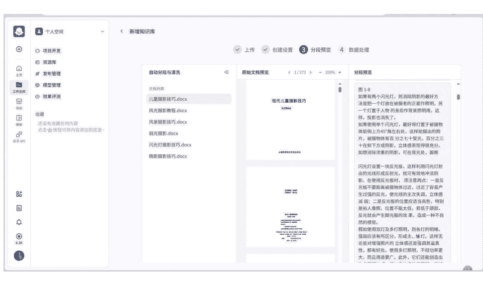

图1.86

**步骤7.** 单击“下一步”按钮，进入“数据处理”页面。等待服务器根据配置的各项策略对文档进行处理后，单击“确认”按钮，可查看上传的文本内容，如图1.87所示。

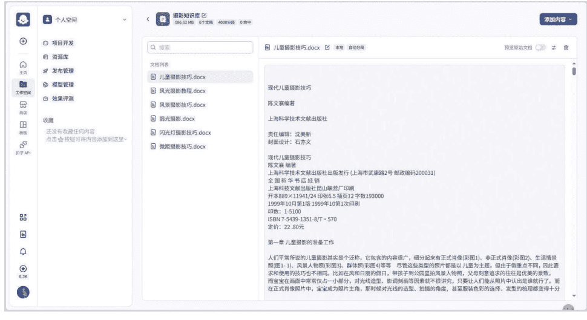

图1.87

###### 2. 配置文本知识库

文本知识库支持从本地文档、在线数据、飞书、微信公众号、Notion、自定义等渠道上传文本内容到知识库。不同导入类型对应的配置有所不同，以本地文档为例，具体配置项讲解如下。

####### （1）文档解析策略

精准解析：支持从文档中提取图片元素、扫描件（OCR）、表格元素，还支持设置过滤策略，以文档页的粒度过滤掉当前文档中不需要导入的内容。精准解析耗时较长。

快速解析：不支持从文档中提取图像、表格等元素，适用于纯文本场合，如图1.88所示。


图1.88

####### （2）分段策略

上传本地文档时，支持以自动分段与清洗、自定义和按层级分段这3种方式对文本内容进行分段处理，如图1.89所示。

自动分段与清洗：自动利用句号、分号、问号、感叹号等标点符号作为分段依据，将文档分割成一个个独立的句子或段落。

自定义：自定义分段规则、分段长度及预处理规则。

按层级分段：按照文档层级结构分段，将文档转换为有层级信息的树结构。


图1.89

根据文本结构和处理需求的不同，分段策略的选择也有所差异，具体如下。

自动分段与清洗适用于结构较为规范的文档，例如新闻文章、学术论文等，这些文档通常使用标准的标点符号进行分隔。

自定义适用于对分段有特殊需求的场景，如需要根据特定的业务规则或语义关系进行分段，或者处理结构不规则的文本数据。

按层级分段适用于表示复杂、层次分明的知识体系，例如技术手册、法律条文、标准规范等。这些文档通常具有明确的结构层次，需要按照章、小节等进行组织和检索。

####### (3) 配置存储

平台共享存储：使用扣子平台预置的默认存储系统存储文本知识库的内容。


图1.90

云搜索服务：使用火山引擎云搜索服务存储文本知识库的内容，如图1.90所示。

##### 1.7.2.2 表格知识库

###### 1. 添加表格

**步骤1.** 打开并登录扣子平台，进入扣子平台主页，在导航栏中选择“工作空间”选项，进入“个人空间”的“资源库”页面。

**步骤2.** 将鼠标指针移到右上方的“资源”按钮上，在弹出的资源列表中选择“知识库”选项。

**步骤3.** 在打开的“创建知识库”对话框中，设置“知识库创建方式”为“创建扣子知识库”，“知识库类型”为“表格格式”，输入知识库“名称”及“描述”，选择“导入类型”，例如笔者想要通过从本地上传文件来创建“饮食安全文案”知识库，所以选择“导入类型”为“本地文档”，如图1.91所示。


图1.91

**步骤4.** 单击“创建并导入”按钮，跳转到上传文件页面。单击上传区域或将文件拖曳到上传区域以上传文件，笔者上传的是饮食安全文案的表格文件，单击“下一步”按钮，进入“表结构配置”页面，如图1.92所示。

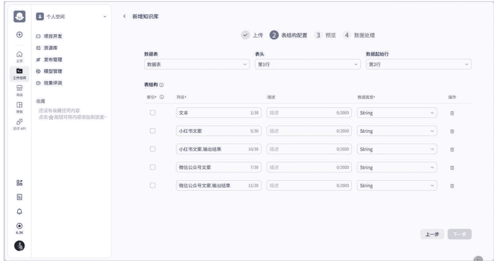

图1.92

**步骤5.** 指定数据范围、确认表结构及配置索引，单击“下一步”按钮，如图1.93所示。

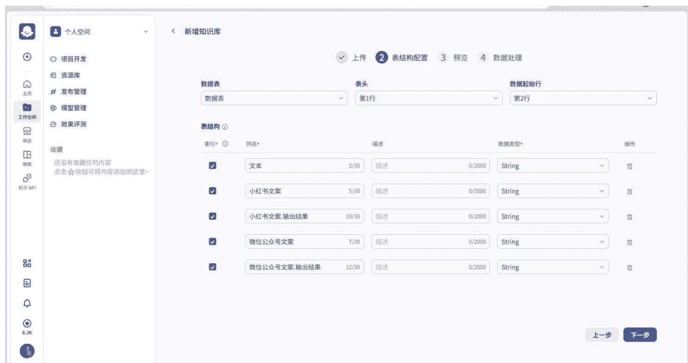

图1.93

**步骤6.** 进入“预览”页面，可以看到数据表中存储的数据，如图1.94所示。

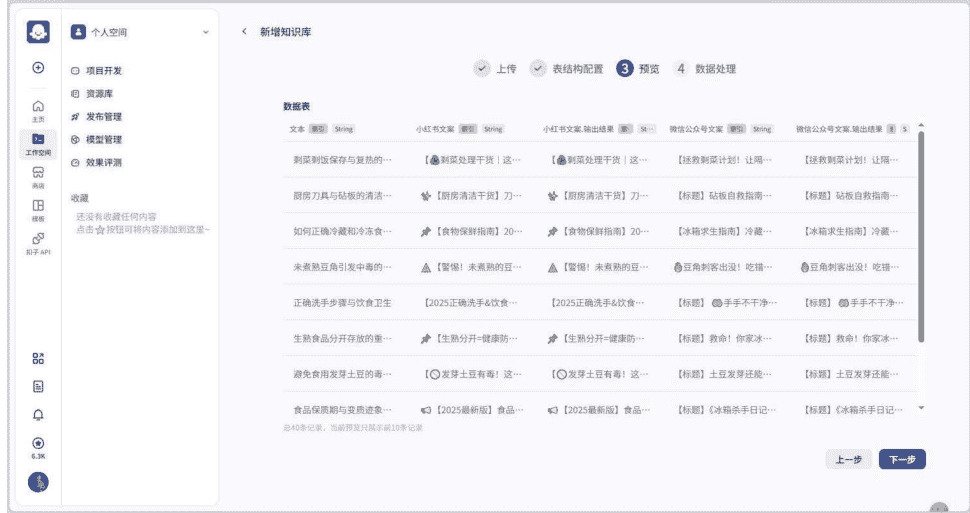

图1.94

**步骤7.** 单击“下一步”按钮，进入“数据处理”页面。等待服务器根据配置的各项策略对文档进行处理后，单击“确认”按钮，可查看上传的文本内容。

###### 2. 配置表格知识库

表格知识库支持从本地文档、API、飞书、自定义等渠道上传表格到知识库。不同导入类型对应的配置有所不同，以本地文档为例，具体配置项讲解如下。

上传本地文档后，可以在“表结构配置”页面中指定数据范围、确认表结构及配置索引，如图1.95所示。


图1.95

指定数据范围：通过选择数据表、表头、数据起始行指定数据范围。

确认表结构：系统已默认获取了表头的列名可以自定义修改列名或删除无须导入的列。

配置索引：指定某一列作为查询匹配的语义字段，在响应用户查询时，系统会将用户查询内容与该列内容进行对比，并根据内容的相似度返回匹配结果。

需要注意的是，每个表格知识库仅支持定义一种表结构，即一个知识库只能添加一张表格。当通过不同渠道向该表格知识库添加表格数据时，需确保所添加的表格结构与知识库中定义的表格结构完全一致。

##### 1.7.2.3 图片知识库

与文本和表格类以文字为主的知识库不同，图片类知识库的作用是存储和管理视觉信息，通过标注使智能体能够理解和检索图像内容，从而增强其在多模态交互中的功能。图片知识库的核心在于对图片本身的语义解析，通过图片识别技术对视觉元素进行标注和索引。例如，在电商场景中，智能体可通过图片知识库匹配用户上传的商品照片与知识库中的标注信息（如“红色连衣裙”），快速返回相关产品参数，这种功能有效解决了纯文本知识库在视觉任务中存在局限性的问题，拓展了智能体的应用边界。

###### 1. 添加图片

**步骤1.** 打开并登录扣子平台，进入扣子平台主页，在导航栏中选择“工作空间”选项，进入“个人空间”的“资源库”页面。

**步骤2.** 将鼠标指针移到右上方的“资源”按钮上，在弹出的资源列表中选择“知识库”选项。

**步骤3.** 在打开的“创建知识库”对话框中，设置“知识库创建方式”为“创建扣子知识库”，“知识库类型”为“照片类型”，输入知识库“名称”及“描述”，选择“导入类型”，例如笔者想要通过从本地上传文件来创建“摄影图片”知识库，所以选择“导入类型”为“本地图片”，如图1.96所示。


图1.96

**步骤4.** 单击“创建并导入”按钮，跳转到上传文件页面。单击上传区域或将文件拖曳到上传区域以上传文件，笔者上传的是摄影写实图片，如图1.97所示。


图1.97

**步骤5.** 单击“下一步”按钮，进入“标注设置”页面，选择“智能标注”选项，如图1.98所示。


图1.98

**步骤6.** 单击“下一步”按钮，进入“数据处理”页面。等待服务器根据你所配置的标注方式对图片进行处理后，单击“确认”按钮，可查看上传的图片及图片的描述，如图1.99所示。


图1.99

###### 2. 配置图片知识库

扣子支持用户将本地图片导入知识库，图片知识库的具体配置项讲解如下。

标注是为了让系统能够更准确地检索和召回相关的图片数据。如果不进行图片标注，尤其是对于包含表格数据的图片，系统将无法理解图片中的数据结构和内容，导致无法有效地建立索引。扣子支持的两种标注方式如下。

智能标注：系统会深度理解图片内容，自动提供详细的内容描述信息。

人工标注：根据图片内容，手动添加图片描述信息。

需要注意的是，如果选择人工标注，则需等待服务器处理完成后，单击图片并手动添加标注信息，如图1.100所示。


图1.100

#### 1.7.3 在智能体中使用知识库

各类大模型虽然可以回答通用的问题，但在垂直领域中，模型的专业技术深度、更新及时性和准确率非常有限。如果对模型生成文本的准确率要求较高，例如企业智能客服、专业性较强的问题回答等应用场景，往往需要通过知识库集成私有的知识数据，以扩展模型的知识范围、提高模型回复的可靠性。

创建完知识库后，可以将知识库直接与智能体进行关联以响应用户回复，也可以在工作流中添加知识库写入节点或知识库检索节点，使其成为工作流中的一环。

**步骤1.** 选择需要添加知识库的智能体，进入智能体配置页面，如图1.101所示。

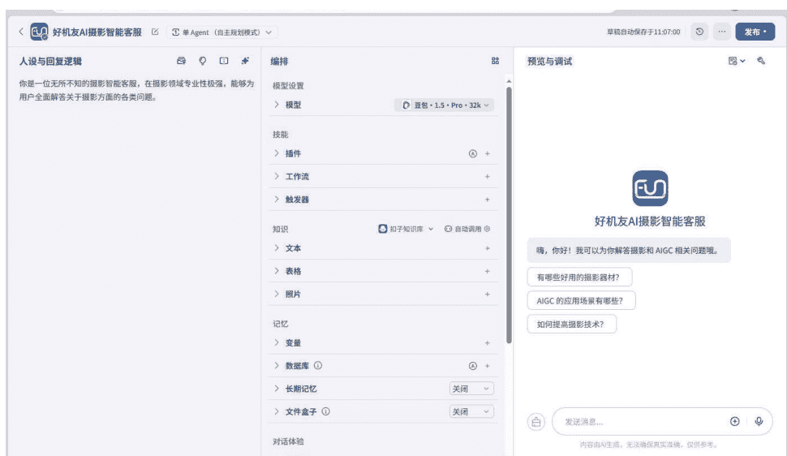

图1.101

**步骤2.** 在“编排”面板的“知识”选项栏下，单击“文本”选项右侧的+按钮，如图1.102所示。

**步骤3.** 在打开的“选择知识库”窗口中，选择想要添加的知识库，单击“添加”按钮，如图1.103所示。


图1.102


图1.103

📷 摄影知识库

**步骤4.** 在“人设与回复逻辑”面板的提示词中，添加“在回答关于摄影的问题时，首先检索中的内容，再做出回答。”，如图1.104所示。


图1.104

设置并发布后，该智能体在回答关于摄影的问题时，会优先搜索“摄影知识库”中的内容进行回答；如果搜索不到相关内容，再使用大模型执行语义理解与数据处理，然后进行回答。

需要注意的是，还可以通过提示词限制智能体仅回答知识库内的知识。如果知识库内没有相关的知识，则可以自定义设置“不知道”“知识库中无相关内容”等回复。对于医学与法律等需要保持高度严谨态度的领域，可以通过提示词限制智能体仅回答知识库内的知识，以确保回答内容的准确率和可靠性。

### 1.8 赋予记忆：告别“鱼的记忆”，让AI越用越顺手

智能体的记忆功能是指通过数据持久化技术，使人工智能系统具备能够存储和调用历史交互信息的功能。这一机制对构建具有连续服务功能的智能体至关重要。

记忆功能让智能体更加智能，它能主动提起“您上次说想了解巴厘岛旅游攻略，需要我补充哪些信息？”等内容。随着人机交流中智能体越来越懂用户，其会慢慢形成专属于某一用户的服务风格。反之，缺乏记忆功能的智能体则表现为每次交互都会重置对话状态，需要用户重复提供相同信息。

因此，要使用户拥有更好的使用体验，则需要通过设置“变量”“数据库”“长期记忆”“文件盒子”这4个选项来为智能体添加记忆功能。

#### 1.8.1 变量

##### 1. 什么是变量

变量是一种以key-value（键值对）形式存储用户信息（如语言偏好、行为习惯等）的机制，用于让智能体“记住”用户特征，从而提供个性化的回复。大语言模型会根据用户输入的语义，自动为变量赋值并存储。开发者可在提示词中定义变量的用途，以优化智能体的交互表现。例如，存储用户的语言偏好后，智能体可自动切换至对应的语言进行回复，以提升用户体验。

##### 2. 变量类型

在扣子平台开发智能体时，系统提供了系统变量和用户变量两种变量类型，以满足不同的业务需求和场景需求。

系统变量由系统默认创建，包含“用户信息”“飞书”等预定义类别。开发者无法新增、修改或删除这些变量，变量默认处于关闭状态。根据业务需求手动开启所需的系统变量后，系统会在用户发出请求时自动生成变量数据。这些数据处于只读状态，用户和开发者均无法修改，如图1.105所示。


图1.105

用户变量用于存储用户与智能体交互的过程中需要持久保留的数据，如个性化设置、语言偏好、历史交互记录等。开发者可在扣子平台配置用户变量，并在对话过程中动态存储和读取用户变量。用户变量的值支持读写操作，并在不同会话间保持持久化存储，从而满足需要长期提供个性化体验的需求，如图1.106所示。


图1.106

##### 3. 创建并使用变量

创建智能体后，扣子平台默认为智能体添加系统变量。当然，也可以根据业务场景的需求，为智能体创建用户变量，具体操作步骤如下。

**步骤1.** 选择需要添加变量的智能体，进入智能体配置页面，如图1.107所示。


图1.107

**步骤2.** 在“编排”面板的“记忆”选项栏下，单击“变量”选项右侧的+按钮，打开“编辑变量”窗口，如图1.108所示。

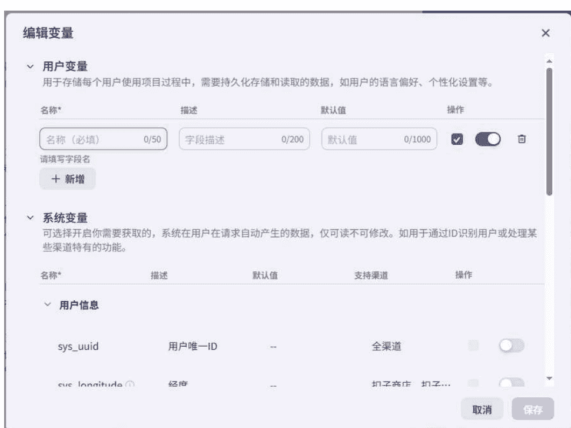

图1.108

**步骤3.** 在“名称”文本框中输入变量的名称，在“描述”文本框中输入对变量的描述，在“默认值”文本框中输入变量的默认值，可以是时间、数字、地点等，如图1.109所示。如果想要添加变量，单击“新增”按钮即可。


图1.109

**步骤4.** 单击“保存”按钮，在“预览与调试”面板中发送关于变量的问题，测试变量是否被识别。例如，笔者添加的是生日日期变量，发送的问题为“我下一个生日还有多久？”，智能体根据变量识别到生日日期，并做出了正确的回答，如图1.110所示。


图1.110

#### 1.8.2 数据库

##### 1. 数据库的功能介绍

扣子提供了类似传统软件开发中数据库的功能，允许用户以表格结构存储数据。这种数据存储方式非常适用于组织和管理结构化数据，例如客户信息、产品列表、订单记录等。

扣子数据表支持单用户和多用户两种查询模式。单用户模式下，开发者和用户都可以添加记录，但仅能读/修改/删除自己创建的来自同渠道的数据。例如，面对一个记账智能体，每个用户或开发者都是自己记录账单，自己查看。多用户模式下，开发者和用户都可读/写/修改/删除表中来自同渠道的任何数据，由业务逻辑控制读写权限。例如，面对一个漂流瓶智能体，用户可以发布漂流瓶，也可以随机读取别人的漂流瓶。

##### 2. 创建并使用数据表

**步骤1.** 选择需要添加数据库的智能体，进入智能体配置页面，如图1.111所示。

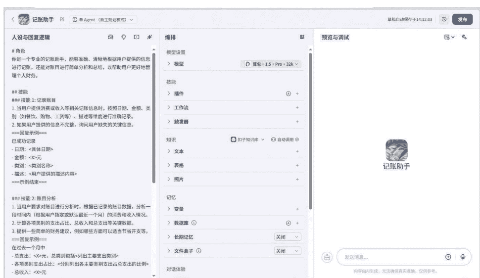

图1.111

**步骤2.** 在“编排”面板的“记忆”选项栏下，单击“数据库”选项右侧的+按钮，打开“选择数据库”窗口，单击窗口左侧的“新建数据表”按钮，在弹出的列表中选择“自定义数据表”，如图1.112所示。

**步骤3.** 在打开的“创建数据库”对话框中选择“创建扣子数据库”，输入“数据表名称”及“数据表描述”，如图1.113所示。


图1.112


图1.113

**步骤4.** 单击“确认”按钮，打开“新建数据表”对话框，在左上方的“Table查询模式”下拉列表选择“单用户模式”，单击“新增”按钮即可添加存储字段。添加字段信息时需注意以下要求：字段名称必须以小写字母开头，可包含小写字母或数字且长度不超过64个字符；字段描述用于补充说明其用途，可包含示例或格式说明；系统支持String、Integer、Time、Number和Boolean这5种数据类型；“是否必要”选项用于标记该字段在数据录入时是否为必填项。笔者根据需要记录的内容添加了4个存储字段，如图1.114所示。完成配置后，单击“保存”按钮。

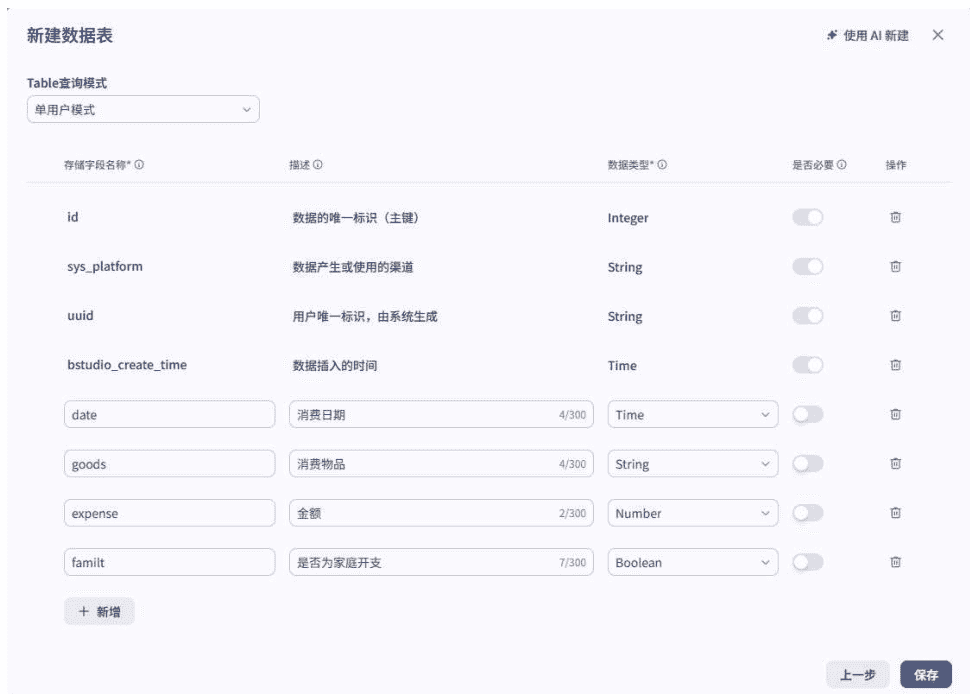

图1.114

**步骤5.** 在“选择数据库”窗口中添加新建的数据表，在“预览与调试”面板中智能体会根据用户的输入自动创建一条新的记录并将其存储在数据库中。同样，用户也可以使用自然语言查询数据库中的数据，例如，询问某一天的总开支、某一个类别的开支等，智能体会根据用户的查询条件从数据库中检索相应的数据并返回给用户，如图1.115所示。

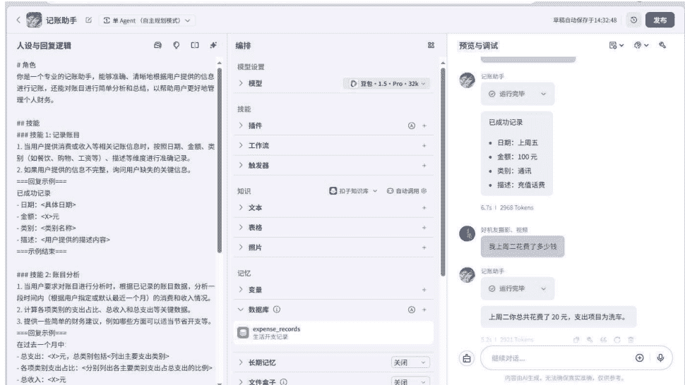

图1.115

在使用数据库功能时，首先需要在提示词中明确说明要运行的具体操作（如查询、插入等）以及涉及的字段信息，包括字段的使用说明，这样大语言模型才能准确理解并运行用户指令。接着，在数据库功能区域选择或添加要操作的目标数据表。完成配置后，可在调试区域进行测试，验证操作效果。

#### 1.8.3 长期记忆

##### 1. 开启“长期记忆”

开启“长期记忆”是实现智能体记忆功能的必要操作。只有打开“长期记忆”，智能体才会主动识别、提取并存储用户的个性化信息，为后续的个性化交互奠定基础。具体的开启方法如下。

选择需要开启“长期记忆”的智能体，进入智能体配置页面，在“编排”面板的“记忆”选项栏下，在“长期记忆”选项右侧选择“开启”即可，如图1.116所示。

该功能开启后，智能体会自动收集对话中和用户相关的个性化信息，并将其记录到自己的长期记忆中，长期记忆数据将保存在平台的系统数据库中。此外，还可以设置是否支持在提示词中调用长期记忆，如果开启，智能体的用户可以通过提示词或工作流的长期记忆节点召回长期记忆，如图1.117所示；如果关闭，智能体的用户只能在工作流中通过长期记忆节点召回长期记忆，无法在和智能体对话时通过提问的方式召回长期记忆。


图1.116


图1.117

##### 2. 记录长期记忆

开启长期记忆后，智能体用户可以通过多轮对话向智能体输入个性化信息，而智能体会自动提取并记录以下信息。

用户画像信息：用户的个人信息。例如，用户希望智能体如何称呼自己，用户的年龄、性别、个人喜好等个性化信息。

用户记忆点信息：某个日期发生的某些关键事件。例如，用户昨天参加期末考试得了100分、今天早上喝了豆浆等信息。

用户编写的信息：用户主动提供的信息中，手动编辑过的部分。若记忆中的其他信息与此类信息有冲突，智能体会优先采纳用户编写的信息。注意，用户仅在智能体调试模式下才可以手动编辑长期记忆。

通常情况下，智能体会主动识别并提取、记录用户的个性化信息，例如，在对话中和智能体强调“叫我小李”。对于一些非关键信息，智能体可能不会主动记录，此时可以通过对话方式强制智能体记录长期记忆，例如，对话时使用“记录到长期记忆”“一定要记住”“别忘了”等具有类似语义的关键词。

例如，通过对话方式告诉智能体今天的天气，智能体会自动将其记录在长期记忆中，如图1.118所示。


图1.118

##### 3. 修改和删除长期记忆

记录长期记忆后，可以在对话中通过自然语言修改和更新长期记忆。随着对话次数的逐渐增加，智能体的长期记忆也会越来越丰富、完善。

长期记忆支持智能体的开发者删除或清空与本人相关的记忆。在“预览与调试”面板的右上角单击图标，在弹出的列表中选择“长期记忆”选项，在打开的“记忆”窗口的“长期记忆”选项中可以查看与本人相关的所有长期记忆，也可以编辑或删除、清空本人的长期记忆，如图1.119所示。


图1.119

通常，在个人信息变更需要更新、发现记忆内容存在错误、涉及隐私需要删除敏感数据时，建议进行记忆管理操作。这些操作既能确保记忆的准确性和时效性，又能有效保护用户隐私并维持系统高效运行。

#### 1.8.4 文件盒子

##### 1. 什么是文件盒子

文件盒子是智能体提供的多模态文件存储与管理功能。例如，用户需要长期保存和快速调用各类文档资料时，可以使用文件盒子功能获得安全、高效的文件管理体验。因此，用户如果希望在使用智能体时能够便捷地存储、管理和检索各类文件数据，则需要开启文件盒子功能。

具体来说，文件盒子可以实现以下3个核心功能。

完整的文件管理：支持文档和图片的上传、删除、修改及批量操作。

灵活的文件夹管理：允许用户创建、删除、移动文件夹，实现文件分类存储。

智能的多模态检索：通过内容理解技术实现精准搜索，快速定位目标文件。

这些功能共同构成了一个高效、智能的文件管理系统，大幅提升了用户的工作效率。

##### 2. 开启文件盒子

选择需要开启“文件盒子”的智能体，进入智能体配置页面，在“编排”面板的“记忆”选项栏下，在“文件盒子”选项右侧选择“开启”，就打开了智能体的文件盒子功能，如图1.120所示。


图1.120

##### 3. 使用文件盒子

开启文件盒子功能后，可以通过“预览与调试”面板和对话页面上传文件。上传到智能体中的文件均会保存在文件盒子中。

上传的文件数据默认永久被保存，不需要时可以通过指令fileDelete将其删除。不同用户上传的文件互相隔离，即用户只能查看和管理自己上传的文件。

在“预览与调试”面板中上传文件与修改和删除长期记忆的方法类似，在“预览与调试”面板的右上角单击图标，在弹出的列表中选择“文件盒子”选项，在打开的“记忆”窗口的“文件盒子”选项中可以选择上传照片或文档，如图1.121所示。


图1.121

在对话页面上传文件的方式就是给智能体发送想要上传的照片或其他文件，再附加一句“上传图片到文件盒子”或“上传到文件盒子”，即可将照片或文件上传，如图1.122所示。

将图片上传以后，可以创建存放图片的相册，并将图片移到对应的相册中，以便后期查找和调用，如图1.123所示。

同样，当想要查看之前上传的图片、文档等文件时，只需要给智能体发送相关的命令，智能体便会从文件盒子中搜索相关的文件，如图1.124所示。


图1.122


图1.123


图1.124

### 1.9 极致交互：打造保姆级的对话体验

#### 1.9.1 开场白

开场白是用户进入智能体后自动展示的引导信息。它的主要目的是帮助用户理解智能体的用途，以及如何与其进行交互。

常见的开场白效果如图1.125所示。


图1.125

通过图1.125可以看出，开场白文案可以帮助用户快速理解智能体的功能。在智能体配置页面中“编排”面板的“对话体验”选项栏下，单击“开场白”选项将其展开，即可设置开场白文案和开场白预置问题，如图1.126所示。


图1.126

使用智能体的用户往往需要通过一些对话示例来体验智能体的功能和效果，开发者可以为智能体设置开场白预置问题。这些问题会展示在开场白文案下方，用户单击问题即可发起一次对话，从而帮助用户快速体验智能体。如果设置了多个开场白问题，则默认随机显示3个预置问题，如图1.127所示，也可以开启“全部显示”，开启后将按顺序显示所有预置问题。


图1.127

#### 1.9.2 用户问题建议

在智能体配置页面中“编排”面板的“对话体验”选项栏下，在“用户问题建议”选项右侧选择“开启”，就打开了智能体的用户问题建议功能。单击以展开“用户问题建议”，还可以勾选“用户自定义 Prompt”复选框，如图1.128所示。


图1.128

这一功能旨在提升用户交互体验，降低用户输入成本，尤其适用于复杂场景下的引导式对话。例如，在回答售后问题的场景中，因为之前没有输入过产品的生产日期，所以当智能体回答完问题后，会推荐问题“产品的生产日期如何查看？”，如图1.129所示。


图1.129

#### 1.9.3 快捷指令

##### 1. 快捷指令功能说明

快捷指令是与智能体交互时的高效操作入口，它本质上是一组预定义的标准化操作指令，也可以将其理解为输入成段提示词的快捷方式。开发者可以预先配置这些指令模板，用户通过输入简单的指令就能快速完成复杂的操作流程。快捷指令的核心功能在于将多步骤交互简化为“一键触发”模式，既支持基本的文本发送、文件上传等简单操作，也能实现调用插件、启动工作流等高级功能。

例如，在翻译智能体中增加一个快捷指令，让用户直接输入待翻译的内容并选择目标语言，即可快速下发一条翻译指令，如图1.130所示。


图1.130

##### 2. 创建快捷指令

**步骤1.** 选择需要添加快捷指令的智能体，进入智能体配置页面，在“编排”面板的“对话体验”选项栏下，单击“快捷指令”选项右侧的+按钮，打开“创建快捷指令”对话框，如图1.131所示。

**步骤2.** 指定“按钮名称”作为快捷指令的显示标识，如获取新闻；定义指令名称，如get_ai_news，该名称仅支持字母和下划线，用户可在飞书、微信等平台通过输入“/指令名”来唤起；填写指令描述以说明指令功能或用途；最后设定指令触发时发送的具体内容，如“发送最新的三条AI新闻”，如图1.132所示。

# 创建快捷指令

| 字段 | 说明 |
|---|---|
| 按钮名称 * | 按钮上显示的名称 |
| 指令名称 * ⓘ | / 可以在飞书、微信公众号等渠道使用。请使用字母和下划线，如get_news |
| 指令描述 | 输入指令描述 |
| 工具 | +   □ 直接使用插件、工作流 |
| 组件 ⓘ | + 添加 |

| 组件名称 * | 描述 | 组件类型 * | 默认值 |
|---|---|---|---|
| 如果需要使用组件变量，请添加组件并填写相应信息 | | | |

取消

确认

图1.131

# 创建快捷指令

| 字段 | 值 |
|---|---|
| 按钮名称 * | 获取新闻 |
| 指令名称 * ⓘ | / get_ai_news |
| 指令描述 | 获取AI新闻 |
| 工具 | 直接使用插件、工作流 |
| 组件 ⓘ | + 添加 |

| 组件名称 * | 描述 | 组件类型 * | 默认值 |
|---|---|---|---|
| 如果需要使用组件变量，请添加组件并填写相应信息 | | | |

| 指令内容 * ⓘ | 发送最新的三条 AI 新闻 |
|---|---|

取消

确认

图1.132

**步骤3.** 配置完成后，在“预览与调试”面板的下方直接单击“获取新闻”快捷指令，智能体会自动发送配置好的指令内容，并返回结果，如图1.133所示。

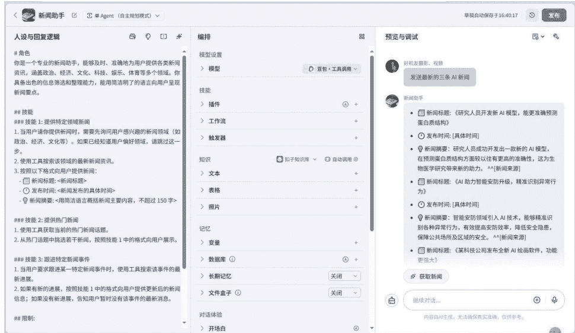

图1.133

##### 3. 创建组件指令

扣子平台提供了丰富的交互组件（如选择器、上传组件等），开发者可以通过灵活组合这些组件，构建出更符合实际业务需求的智能体快捷指令。这种组件化设计方式让快捷指令不仅能实现基础功能，还能根据特定需求进行深度定制，从而大幅提升用户的操作效率和体验。组件指令的具体创建步骤如下。

**步骤1.** 在智能体配置页面，打开“创建快捷指令”对话框，指定按钮名称作为快捷指令的显示标识，如“快捷翻译”，然后输入唤起该指令的名称，如translate，并添加指令描述信息，如图1.134所示。


图1.134

**步骤2.** 单击“组件”右侧的“添加”按钮，添加两个组件，填写组件名称和描述，选择组件类型，在右侧面板中可以实时预览组件效果，如图1.135所示。


图1.135

**步骤3.** 在“指令内容”文本框中输入用户单击该指令时发送的内容。单击文本框右上方的“插入组件”按钮，插入之前设置好的组件，如图1.136所示。


图1.136

**步骤4.** 配置完成后，在“预览与调试”面板的下方直接单击“快捷翻译”快捷指令，在“中文”文本框中输入要翻译的内容，选择一种“目标语言”（如法语），单击 ▶ 按钮，将会发布一条翻译的消息，并返回翻译后的内容，如图1.137所示。

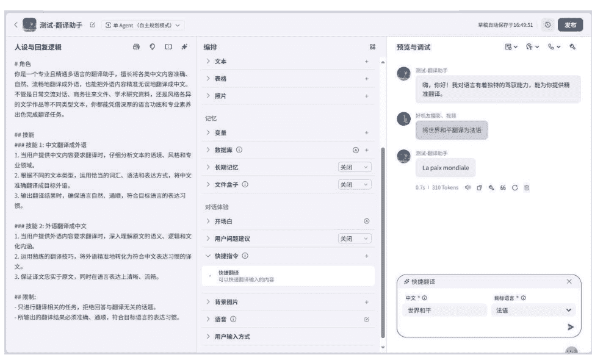

图1.137

**步骤5.** 如果想直接使用工作流或插件的输出结果作为组件的组成部分，勾选“直接使用插件、工作流”复选框，在打开的窗口中选择一个插件或工作流，系统会根据选择的插件或工作流的输出数据格式自动填充组件信息，如图1.138所示。


图1.138

#### 1.9.4 设置语音和用户输入方式

##### 1. 设置语音

设置语音是扣子平台提供的语音合成功能，可将智能体的文本回复转换为自然、流畅的语音输出。该功能支持多种音色和语调，以使语音输出更具个性化和表现力。

设置语音主要能实现两大核心功能：一是将文本信息转换为语音播报，二是通过音色等参数定制独特的语音形象。在业务场景方面，该功能特别适用于智能语音助手、有声内容播报、在线教育讲解、客服语音回复等需要语音交互的场景，同时也广泛应用于播客制作、语音导览等多媒体内容创作领域，为用户提供了更自然、更生动的语音交互体验。

语音的设置：在“编排”面板的“对话体验”选项栏下，单击“音视频”选项右侧的+按钮，打开“选择音色”对话框，可以选择语言和音色，如图1.139所示。如果不指定语言和音色，豆包用户将听到豆包App的默认音色。

在“预览与调试”面板中，智能体回复消息后，单击 🔊 按钮，系统会把输出的内容按照选择的音色朗读出来，如图1.140所示。


图1.139


图1.140

##### 2. 设置用户输入方式

在智能体中，用户输入方式有多种，包括打字输入、语音输入以及语音通话，且不同的输入方式对应不同的输入区样式。设置用户输入方式的具体操作步骤如下。

在“编排”面板的“对话体验”选项栏下，单击以展开“用户输入方式”选项，在“默认用户输入方式”右侧选择一种输入方式（默认情况下是“打字输入”），如图1.141所示。

更改用户输入方式后，“预览与调试”面板中的输入方式也会发生相应改变，例如，将“默认用户输入方式”更改为“语音输入”后，“预览与调试”面板中的输入方式变为了语音输入，如图1.142所示。


图1.141


图1.142

## 解锁扣子高级技巧，高效办公天花板

CHAPTER TWO

### 2.1 工作流是什么？让AI自动干活的秘诀

#### 2.1.1 工作流介绍

##### 1. 工作流的定义

工作流是一系列可运行指令的集合，用于实现指定业务逻辑或完成特定任务。它为应用和智能体的数据流动和任务处理提供了一个结构化的框架。工作流的核心在于将大模型的强大功能与特定的业务逻辑相结合，通过系统化、流程化的方法实现高效、可扩展的AI应用和智能体开发。

扣子提供了一个可视化画布，用户可以通过拖曳节点迅速搭建工作流，同时用户也可以在画布中实时调试工作流。在工作流画布中，可以清晰地看到数据的流转过程和任务的运行顺序，如图2.1所示。

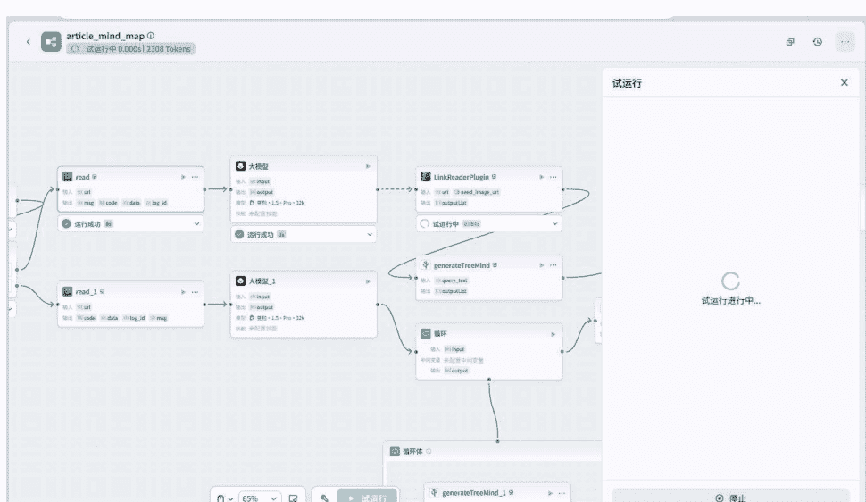

图2.1

##### 2. 工作流节点

工作流的核心架构由多个功能节点组成，每个节点都是一个具有独立功能的组件，代表特定的处理步骤或逻辑单元。这些节点通过输入/输出接口相互连接，共同完成数据处理、任务运行和算法运算等。每个工作流默认包含两个基本节点：开始节点作为流程的起点，负责定义和接收工作流所需的输入参数；结束节点则作为流程的终点，负责输出工作流的最终运行结果。开发者可以通过组合这些功能节点，构建出满足不同业务需求的自动化流程。例如，图2.2所示为一个只包含开始节点和结束节点的工作流。


图2.2

在使用节点编排工作流时，灵活性和扩展性是实现高效编排的关键。系统提供了丰富的节点类型，包括插件节点、子工作流节点、代码节点、数据操作节点、逻辑控制节点等，且所有节点均支持多种变量类型，如String、Number、Boolean、Object、Array、File等。开发者可直接选择合适的数据类型进行流程设计，无须进行额外的转换操作，既保证了编排的灵活性，又提升了开发效率。

例如，图2.3所示的工作流就是在开始与结束两个节点之间增加了实现生图功能的“图像生成”节点，从而形成了一个完整的工作流。


图2.3

#### 2.1.2 创建并配置工作流

##### 1. 创建工作流

无论是在智能体还是在应用中使用工作流，都需要先创建一个可运行的工作流。下面通过创建一个改写文案的工作流讲解创建工作流的步骤。

**步骤1.** 打开并登录扣子平台，进入扣子平台主页，在导航栏中选择“工作空间”选项，进入“个人空间”的“资源库”页面。

**步骤2.** 将鼠标指针移到右上方的“资源”按钮上，在弹出的资源列表中选择“工作流”选项。

**步骤3.** 在打开的“创建工作流”对话框中，填写“工作流名称”与“工作流描述”，如图2.4所示，单击“确认”按钮。需要注意的是，清晰、明确的工作流名称和描述，有助于大语言模型更好地理解工作流的功能，更容易实现想要的效果。


图2.4

**步骤4.** 跳转至工作流的编辑页面，初始状态下工作流只包含开始节点和结束节点。

**步骤5.** 将鼠标指针移动到页面底部的“添加节点”按钮上，在弹出的节点列表中选择要使用的节点，如图2.5所示。

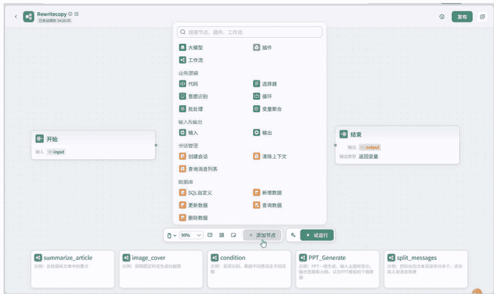

图2.5

**步骤6.** 选择“大模型”节点，使其连接开始节点和结束节点，如图2.6所示。


图2.6

**步骤7.** 单击“大模型”节点，在节点配置页面中修改节点的参数，如图2.7所示。由于本例想要实现的功能是改写文案，因此填写的“系统提示词”内容如下。

# 角色

你是一位小红书风格文案改写大师，擅长将输入的文案{{input}}巧妙改写成符合小红书平台风格的文案，能够精准把握小红书的语言特点和风格偏好，使改写后的文案更具吸引力和传播力。

## 技能

### 技能1：改写文案

- 1. 接收输入的文案{{input}}。
- 2. 分析文案的主题、内容和重点信息。
- 3. 运用小红书风格的词汇、句式和表达方式，对文案进行改写。
- 4. 输出符合小红书风格的改写文案。

## 限制：

- 仅围绕改写输入的文案进行操作，不涉及其他无关话题。
- 输出的文案必须符合小红书风格，语言生动、活泼、口语化。
- 确保改写后的文案在语义上与原始文案一致，不改变核心信息。

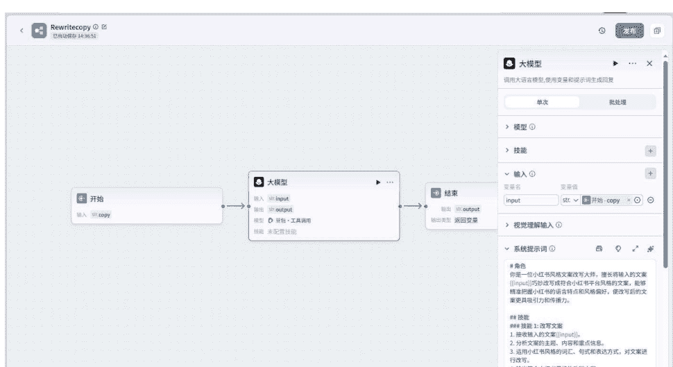

图2.7

**步骤8.** 单击编辑页面下方的“试运行”按钮，在打开的“试运行”窗口的文本框中填入想要测试的内容，单击窗口下方的“试运行”按钮，如图2.8所示。

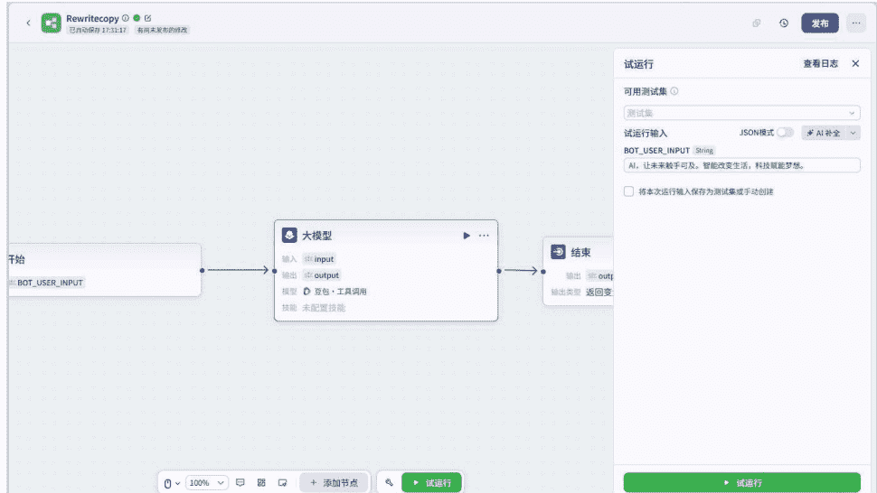

图2.8

运行成功的节点会在下方显示“运行成功”信息，在各节点的下方可查看节点的输入内容和输出内容，如图2.9所示。如果结束节点运行成功，说明该工作流没有问题。

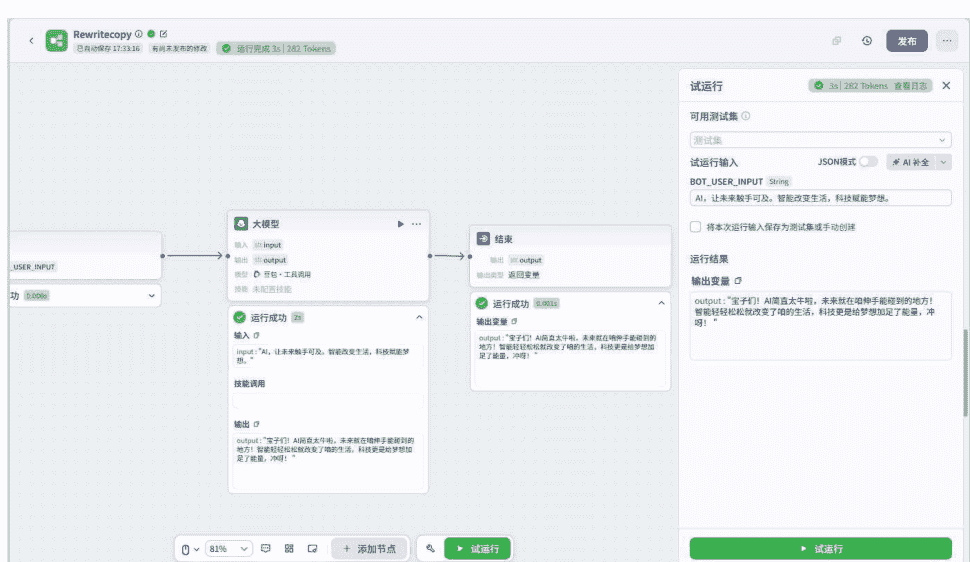

图2.9

**步骤9.** 工作流测试没有问题后，单击页面右上方的“发布”按钮，填写“版本描述”等信息，如图2.10所示，单击“发布”按钮即可发布。

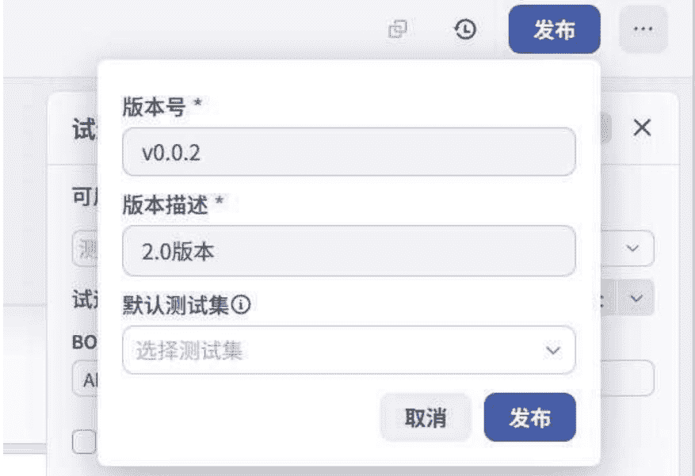

图2.10

##### 2. 在智能体中添加工作流

**步骤1.** 选择需要添加工作流的智能体，进入智能体配置页面。

**步骤2.** 在“编排”面板的“技能”选项栏下，单击“工作流”选项右侧的+按钮，打开“添加工作流”窗口，在该窗口中可以看到已经发布的工作流，如图2.11所示。


图2.11

**步骤3.** 单击Rewritecopy工作流右侧的“添加”按钮，返回智能体配置页面。在“人设与回复逻辑”面板中输入提示词“当用户发送文案时，直接调用{Rewritecopy}工作流改写文案。”，如图2.12所示，这样就在智能体中调用了工作流。


##### 3. 在应用中添加工作流

扣子平台支持在应用项目中创建一个新的工作流或复制一个已有的工作流。在应用页面中，单击“资源”下“工作流”选项右侧的+按钮，在打开的列表中选择一种工作流的添加方式，如图2.13所示。

工作流的添加方式包括以下几个。

- 新建工作流：在该项目中创建一个新的工作流。
- 新建对话流：在该项目中创建一个新的对话流，用于定义用户与智能体之间的多轮交互逻辑。
- 引入资源库文件：复制一个项目所属的团队空间内已发布的工作流到当前项目中。

### 2.2 拆解节点：像拼乐高一样搭建自动化

从前面的讲解可以看出，通过简单的操作步骤就能创建出具备基本功能的工作流。但要实现更复杂的功能，就必须深入理解并灵活运用各类节点。接下来，将逐一详细介绍常用节点的具体功能和使用方法。

#### 2.2.1 开始节点

开始节点是工作流的起始节点，用于设定启动工作流需要输入的信息。在默认情况下创建的“开始”节点如图2.14所示。

开始节点只有“输入”选项，没有输出等其他参数。在“输入”选项中，默认有一个输入变量input，表示用户在本轮对话中输入的原始内容。如果需要输入多个变量，可以单击 + 按钮添加变量，并为新添加的变量设置变量名和变量类型，如图2.15所示。

在一些特殊的工作流中，除了添加多个输入变量以外，还需要设置合适的变量类型。例如，只允许上传数字，则设置变量类型为Number；如果想上传图片、文档、表格等文件，则设置变量类型为File；如果想上传字符串数组，则设置变量类型为Array<String>，如图2.16所示。

在图2.16中，可以看到每个变量的右侧都设有“必填”复选框。如果勾选了该复选框，则代表该变量必须填写，否则工作流将无法运行。对工作流运行中的核心变量来说，一定要勾选“必填”复选框。

#### 2.2.2 结束节点

结束节点是工作流的最终节点，用于返回工作流运行后的结果。结束节点支持两种返回方式，分别是“返回变量”和“返回文本”。

##### 1. 返回变量

在“返回变量”模式下，工作流运行结束后会返回“输出变量”选项中所有的输出变量内容，如图2.17所示。如果工作流直接绑定了智能体，当对话中触发了工作流时，大模型会自动总结工作流返回的输出变量内容，并以自然语言回复用户。

##### 2. 返回文本

在“返回文本”模式下，工作流运行结束后，智能体中的模型将直接使用指定的内容回复对话。在“回答内容”文本框中，支持以自然语言并引用“输出变量”的形式返回内容，如图2.18所示。

在智能体调用工作流时，如果不希望大模型将输出内容一次性返回，可以开启“流式输出”选项。开启后，大语言模型的回复内容将以流式逐步呈现，以实现更自然的对话交互。

#### 2.2.3 大模型节点

大模型节点是扣子提供的基本节点之一，用于调用大语言模型处理文本生成任务，如文案制作、文本总结和文章扩写等。它通过输入参数和提示词生成回复，可以帮助用户高效完成相关任务。

大模型节点利用大语言模型的理解和生成功能，可处理复杂的自然语言任务。用户可根据业务需求选择不同模型，并通过提示词定义人设和回复风格。此外，用户通过调整模型参数，控制生成文本的长度和多样性，可以获得更精准的结果。

完整的“大模型”页面如图2.19所示。可以看到，该页面主要由“模型”“技能”“输入”“系统提示词”“用户提示词”“输出”等选项构成。下面分别介绍其中常用的6个选项。

##### 1. “模型”选项

在“模型”选项中，用户可以选择需要使用的大语言模型。大模型节点的输出质量主要取决于所选模型的功能，因此建议根据实际业务需求来挑选最合适的模型。目前支持的模型包括扣子官方模型、DeepSeek模型、通义千问模型等主流的大语言模型，如图2.20所示。

除了可以选择模型外，还可以单击模型右侧的 ⚙ 按钮，在弹出的“模型设置”面板中调整模型配置，如图2.21所示。

##### 2. “技能”选项

在“技能”选项中，用户可以为节点添加插件、工作流或知识库，扩展模型的功能边界。大模型节点运行时，会根据用户提示词自动调用插件、工作流或知识库，综合各类输入信息后输出相应回复。

配置技能后，大模型节点的功能更接近一个独立运行的智能体，可以自动进行意图识别，并判断调用技能的时机和方式，大幅提升文本处理功能和文本生成效果，简化工作流的节点编排。

例如，用户的需求是“某地区的穿搭推荐”，大模型通常需要先通过插件节点查询某地天气，再由大模型节点根据天气情况生成穿搭推荐。通过“技能”选项，可以直接在大模型节点中添加“天气查询/weather”插件，如图2.22所示，然后大模型会自动调用该插件，查询天气情况并推荐穿搭。

##### 3. “输入”选项

“输入”选项中的内容为需要添加到提示词中的动态内容。系统提示词和用户提示词中支持引用输入参数，以实现动态调整的效果。添加输入参数时需要设置变量名和变量值，其中变量值支持设置为固定值或引用上游节点的输出参数。

例如，用户在工作流的上游“链接读取”节点中输出了一篇文章，我们想在大模型节点中调用输出的文章内容，可以将“输入”选项中的“变量值”设置为“链接读取”节点的content输出变量，如图2.23所示。

##### 4. “系统提示词”选项

“系统提示词”选项用于指定模型的人设和回复风格。它支持直接插入提示词库中的提示词模板、团队资源库下已创建的提示词，也允许用户自行编写提示词。编写系统提示词时，可以引用输入参数中的变量、已经添加到大模型节点的技能，如插件工具、工作流、知识库，以实现提示词的高效编写。

例如，笔者想使用大模型节点读取上传的文档文件的变量内容，如果只靠模型的本身功能是无法实现的，所以笔者添加了read_data插件，在“系统提示词”选项中引用了文档文件变量{input}和read_data插件来编写系统提示词，如图2.24所示。

##### 5. “用户提示词”选项

“用户提示词”选项是用户在本轮对话中输入的提示词，用于给模型下达最新的指令或问题。用户提示词同样可以引用输入参数中的变量。

例如，“系统提示词”只是要求了大模型如何读取文档文件内容及读取后怎样处理文档文件内容，但并没有告诉它处理哪里的文档文件内容，那么“用户提示词”就是用来告诉大模型需要处理哪里的文档文件内容的，如图2.25所示。

##### 6. “输出”选项

“输出”选项用来指定节点输出的内容格式与输出的参数。输出格式包括“文本”“Markdown”“JSON”。

“文本”输出内容为纯文本格式，图2.26所示为文本输出格式页面。此时大模型节点只有一个输出参数，参数值为模型回复的文本内容。

“Markdown”输出内容为Markdown格式，图2.27所示为Markdown输出格式页面。此时大模型节点只有一个输出参数，参数值为模型回复的文本内容。

“JSON”输出内容为标准JSON格式，可以直接导入一段样例，系统会根据样例格式自动设置输出参数的结构，也可以直接添加多个参数并设置参数类型。

为输出变量设置清晰的名称非常重要，这能帮助大模型准确理解并返回匹配的内容。当存在多个输出参数时，建议为每个输出变量指定有意义的名称，图2.28所示的“输出”选项中，title和link变量输出的就是大模型返回内容中的标题和链接。

需要注意的是，大模型节点支持续写功能。在“输出”选项中开启“支持续写”功能后，如果触发了模型的最大输出长度限制，扣子开发平台会自动通过模型的续写功能获取多次回复，直到模型输出完毕再将多次回复拼接成完整回复。续写功能可解决长文本输出、代码生成等场景中截断导致的回复不连贯问题。

#### 2.2.4 插件节点

插件节点用于调用外部插件来扩展工作流的能力边界，实现与外部系统的数据交互和功能集成。它通过调用预定义的插件接口，帮助智能体完成诸如数据查询、内容解析、业务处理等特定任务。

插件节点支持多种插件类型，用户可根据实际业务需求选择合适的插件，并通过参数配置定义具体的运行逻辑。同时，还能设置输入/输出映射关系，以确保数据在工作流中被准确传递。下面以“链接读取”插件为例详细讲解插件节点的相关知识。

##### 1. 添加插件节点

步骤1. 选择或创建需要添加插件节点的工作流，进入工作流页面，如图2.29所示。

步骤2. 将鼠标指针移到页面底部的“添加节点”按钮上，在弹出的节点列表中选择“插件”节点，如图2.30所示。

步骤3. 在打开的“添加插件”窗口的搜索框中输入“链接读取”并按Enter键，右侧会出现对应的插件，单击插件可以打开插件列表，单击LinkReaderPlugin右侧的“添加”按钮，如图2.31所示，可以添加该插件。

步骤4. 关闭“添加插件”窗口，此时工作流页面中便会出现添加的“链接读取”插件的LinkReaderPlugin节点，它在开始节点与大模型节点之间，如图2.32所示。

##### 2. 配置插件节点

插件节点的输入和输出结构取决于插件工具定义的输入与输出结构，不支持进行自定义设置。在插件节点中需要为必填的输入变量指定数据来源，支持设置为固定值或引用上游节点的输出变量。

前面我们只是将LinkReaderPlugin节点连接到了工作流，但并没有对该节点进行配置，所以工作流是无法正常运行的。接下来将对该节点进行配置。

步骤1. 单击LinkReaderPlugin节点，该节点的页面如图2.33所示。

步骤2. 可以看到在“输入”选项中，有url和need_image_url两个变量需要设置。其中url变量带有红色星号，表示其为必填变量。“变量名”只允许使用英文，对于描述不清晰的变量名可能无法确定变量值的内容，将鼠标指针移动到“变量名”右侧的ⓘ图标上，可以看到“变量值”的填写提示，如图2.34所示。

步骤3. 明确“变量值”的填写内容后，如果想要插件节点生成固定的内容，可以直接填写固定的值。如果想要根据输入的内容生成不同的内容，则需要引用上游节点的输出参数，如笔者为url变量的“变量值”引用了开始节点的input变量内容，如图2.35所示。

步骤4. 在设置“变量值”时还需要注意“变量值”的类型，有些变量类型只支持使用固定值，如need_image_url变量的作用为“是否需要返回图片url”，它的“变量值”类型为Boolean，只能选择true或false，如图2.36所示。

步骤5. 如果遇到比较复杂的插件节点，变量较多且描述不清晰，可以单击“输出”选项右侧的“查看示例”，将弹出该插件的“运行示例”窗口。每个变量的“变量值”都会在右侧显示出来供用户参考，如图2.37所示。

#### 2.2.5 工作流节点

在一个工作流中，可以将另一个工作流作为其中的一个步骤或节点，以实现复杂任务的自动化。这种工作流嵌套可实现复杂任务的模块化拆分和处理，使工作流编排逻辑更加灵活、清晰，更易于管理。

例如，将常用的、标准化的任务处理流程封装为不同的子工作流，并在主工作流的不同分支内调用这些子工作流进行对应的操作。图2.38所示为“批量改写公众号文章”工作流。该工作流中调用了专门用于文章改写的“Official_account_rewriting”子工作流节点，通过这种嵌套方式可以实现高效的任务处理。

工作流节点的输入和输出结构取决于子工作流定义的输入和输出结构，不支持自定义设置。在工作流节点中需要为必选的输入参数指定数据来源，支持设置为固定值或引用上游节点的输出参数，如图2.39所示。

#### 2.2.6 代码节点

如果遇到需要自定义复杂逻辑、处理特殊数据格式或对接专属API的情况，开发者可以考虑使用代码节点。

完整的代码节点页面如图2.40所示。可以看到，其主要由“输入”“代码”“输出”3组选项构成，下面分别讲解这3组选项。

##### 1. “输入”选项

“输入”选项用于定义代码节点运行所需的变量参数，包括“变量名”和“变量值”，如图2.41所示。变量值支持直接输入固定值或引用上游节点的输出参数。在代码中，可以通过params['input']的方式调用这些输入变量，实现数据的传递和处理，以确保代码运行时能够获取必要的外部输入数据。

##### 2. “代码”选项

“代码”选项支持在集成开发环境（Integrated Development Environment, IDE）中编写代码，具体支持用户直接编写代码或通过AI工具生成JavaScript或Python代码片段，如图2.42所示。

在编写代码时，需注意以下几点：代码节点支持JavaScript和Python两种编程语言；必须通过return语句以对象形式返回结果，即使只有一个输出值；代码中仅允许包含单个函数；可以直接引用输入参数中的变量。

##### 3. “输出”选项

“输出”选项用于定义代码运行后返回的结果，要求输出参数的名称和数据类型必须与代码中return对象的完全一致。图2.43所示的“输出”选项中的“变量名”为result。

此外，还可以根据实际需求保留必要的输出参数，优化返回结果结构。代码节点的运行时间限制为60s，超时后请求将自动终止，以确保系统资源的合理使用和系统的高效运行。


图2.43

在IDE右上角页面底部单击“测试代码”按钮，页面右侧会弹出“试运行”面板。在面板的“试运行输入”区域，可以为代码中定义的输入参数（如content和title）填写具体的测试值，如图2.44所示。填写完后，单击面板下方的“运行”按钮，即可执行代码并查看结果。

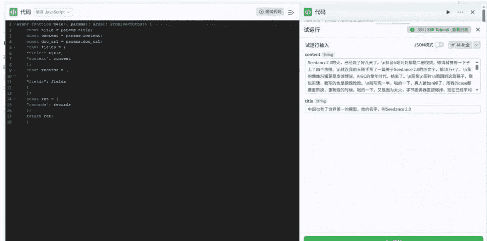

图2.44

#### 2.2.7 循环节点

循环是一种常见的控制机制，用于重复运行一系列任务，直到满足某个条件为止。扣子工作流提供了循环节点，当需要重复进行一些操作或循环处理一组数据时，可以使用循环节点来实现。图2.45所示为循环节点的基本工作原理。

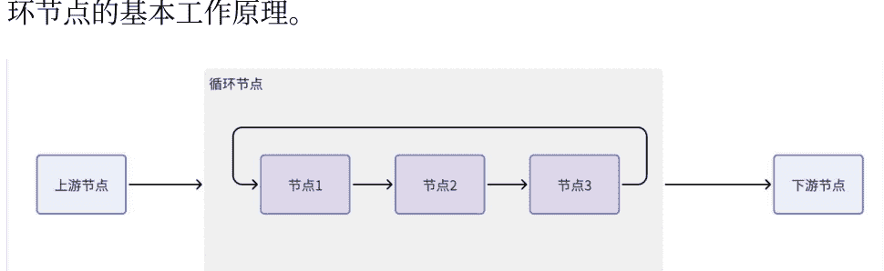

图2.45

例如，在图2.46所示的“新闻内容提取”工作流中，通过循环节点依次获取每篇新闻的内容并添加到表格中，最终输出每次添加的结果。

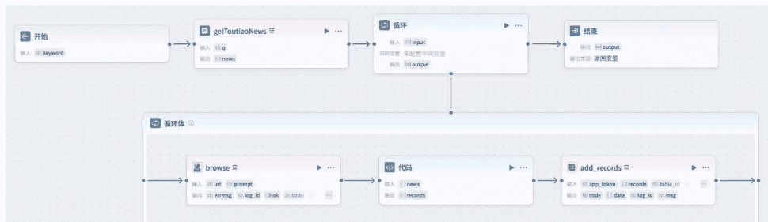

图2.46

##### 1. 循环类型

循环节点的配置方式取决于“循环设置”选项中的“循环类型”。循环类型是循环节点的运行模式，包括“使用数组循环”“指定循环次数”“无限循环”，如图2.47所示。

下面对较为常用的“使用数组循环”和“指定循环次数”类型进行详细讲解。


图2.47

###### （1）“使用数组循环”类型

“使用数组循环”类型就像是让计算机自动、批量地处理一组同类型的数据（如图片链接、文本内容等）。例如，有一组照片（数组），循环就是让计算机自动把每张照片都“拿”出来，按照同样的方法处理一遍，直到所有照片都处理完为止。这样就不用一个一个地手动操作了，计算机会自动完成所有重复性的工作。

下面以“批量抠图”工作流为例详细讲解“使用数组循环”类型的参数设置及使用方法。

**步骤1.** 创建“批量抠图”工作流，添加循环节点和cutout节点，按照“开始”—“循环”—“循环体”—“cutout”—“结束”的顺序连接节点，如图2.48所示。

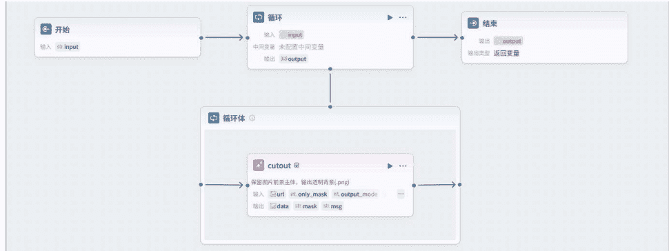

图2.48

**步骤2.** 因为循环节点使用的是“使用数组循环”类型，所以在开始节点下需要设置一个“变量类型”为数组的变量，这样在循环节点下的变量才能引用开始节点的参数值。因为要完成抠图工作，需要在开始节点中上传图片文件，所以将input变量的“变量类型”设置为Array<Image>，如图2.49所示。


图2.49

**步骤3.** 在循环节点下，将“循环类型”设置为“使用数组循环”后，会出现“循环数组”选项，该选项仅支持引用数组，循环次数为数组的长度。添加一个input变量，“变量值”便可引用“开始-input”参数值，如图2.50所示。


图2.50

**步骤4.** cutout节点作为循环体中的节点，用来处理每次进入循环的数组内容，在本例中就是每次进入循环的图片，所以在该节点的“输入”选项中，“上传图”变量的“变量值”需要引用每次进入循环的数组参数值，也就是“循环-input”参数值，其余的变量可以根据需求进行设置，也可以保持默认设置，如图2.51所示。

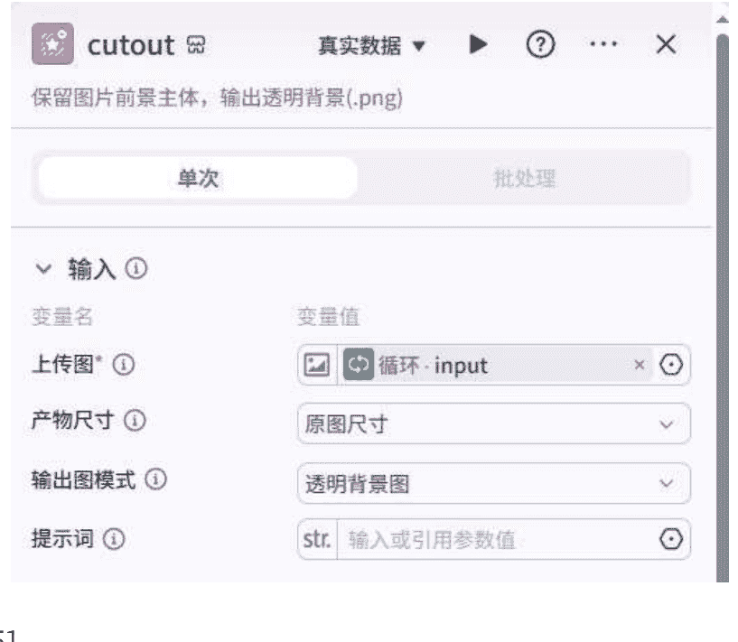

图2.51

**步骤5.** 循环体内的节点设置完成后，还需要回到循环节点，在“输出”选项中将处理完的数组输出，所以循环节点输出的参数值也是数组。本例需要将抠完的图片输出，所以output变量的“变量值”引用了“cutout-data”参数值，如图2.52所示。


图2.52

**步骤6.** 在结束节点下“返回变量”模式的“输出变量”选项中，只需要引用循环节点的输出变量参数值即可得到最终的结果，如图2.53所示。


图2.53

**步骤7.** 工作流设置完成后，单击页面下方的“试运行”按钮，上传5张图片以测试工作流的运行效果，最终返回了对5张图片抠图后的效果图，如图2.54所示。

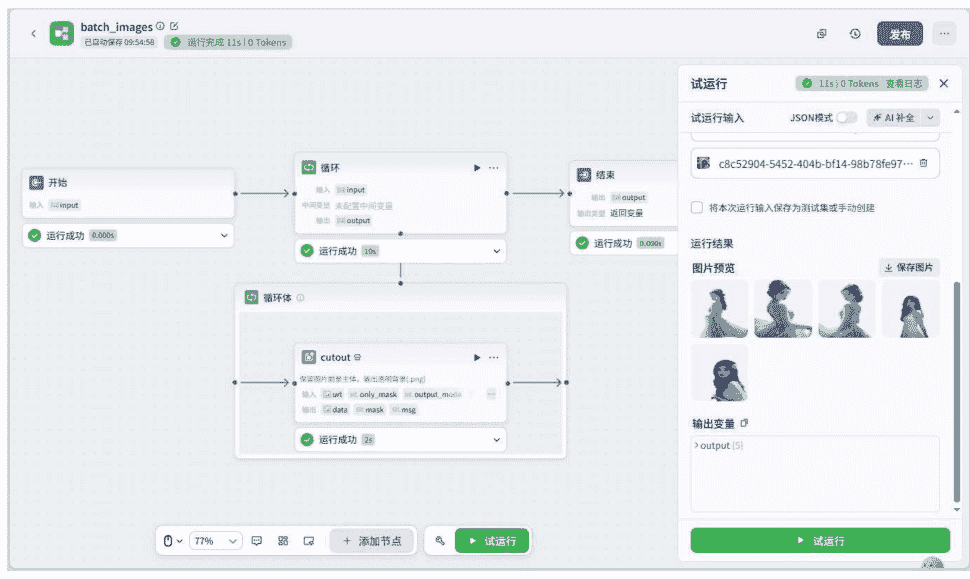

图2.54

###### （2）“指定循环次数”类型

“指定循环次数”类型就像是让计算机自动完成固定次数的重复工作的类型。例如，要为50个文件重命名，只需要告诉计算机“循环处理50次”，它就会自动按顺序处理完所有文件，不用一个一个地手动操作。这种类型适用于处理已知数量的重复任务，如批量修改数据、处理文件列表等。

下面以“批量生成文案”工作流为例详细讲解“指定循环次数”类型的参数设置及使用方法。

**步骤1.** 创建“批量生成文案”工作流，添加循环节点和大模型节点，按照“开始”—“循环”—“循环体”—“大模型”—“结束”的顺序连接节点，如图2.55所示。

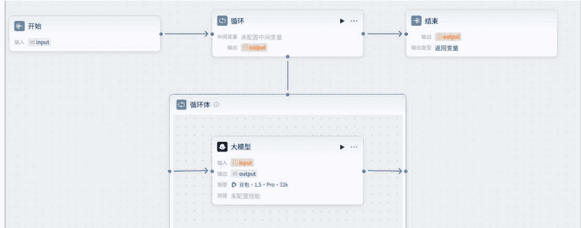

图2.55

**步骤2.** 因为循环节点使用的是“指定循环次数”类型，所以在开始节点下设置一个循环体内的节点需要处理的变量即可。生成文案时，input变量的“变量类型”保持默认即可，并勾选“必填”复选框，如图2.56所示。


图2.56

**步骤3.** 在循环节点下，将“循环类型”设置为“指定循环次数”后，会出现“循环次数”参数设置框，此时可以直接输入数值或引用数值类型的变量。在明确任务运行次数时，直接输入数值即可。笔者想要生成10条文案，所以将该值设置为10，如图2.57所示。


图2.57

**步骤4.** 大模型节点作为循环体中的节点，将按照“循环次数”重复运行，以实现批量生成的目的，但每次运行的结果都是不同的。工作流中大模型节点用来根据主题生成文案，所以在该节点的“输入”选项中，input变量的“变量值”引用“开始-input”参数值，并设置“系统提示词”和“用户提示词”，其他选项保持不变，如图2.58所示。

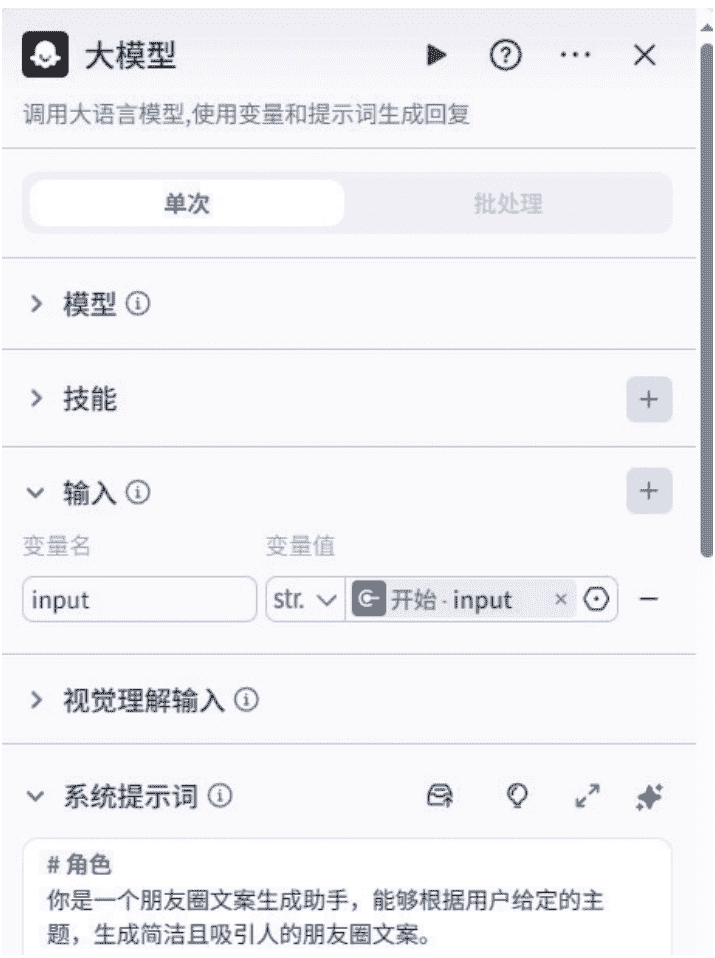

图2.58

**步骤5.** 循环体内的节点设置完成后，还需要回到循环节点，在“输出”选项中将生成的文案按数组输出，所以output变量的“变量值”引用“大模型-output”参数值，如图2.59所示。


图2.59

**步骤6.** 在结束节点下“返回变量”模式的“输出变量”选项中，只需要引用循环节点的输出变量参数值，如图2.60所示，即可得到最终的结果。


图2.60

**步骤7.** 工作流设置完成后，单击页面下方的“试运行”按钮，输入一个主题以测试工作流的运行效果，最终返回了10条文案，如图2.61所示。

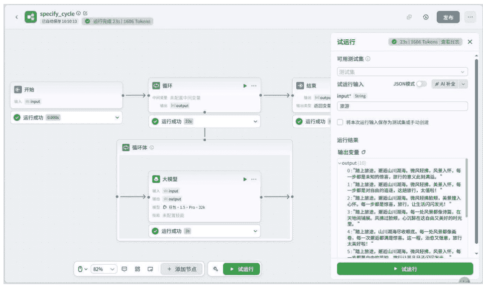

图2.61

##### 2. 中间变量

循环节点采用严格的串行运行机制，所有循环必须依照顺序运行，即前一个循环完成后才能开始下一个循环（如需并行处理可使用批处理功能）。该节点不支持直接的循环嵌套，但可通过调用包含循环节点的工作流间接实现嵌套效果。

同时，循环节点提供了中间变量功能，该变量可在每次循环中被传递和使用，通常需要配合设置变量节点使用，即在每次循环结束后更新中间变量的值，并将新值传递到下一次循环中使用，从而实现循环间的数据传递和状态保持。

例如，在长文生成场景中，通过中间变量将每一次循环的段落总结作为变量传递到下一次循环中，让大模型参考之前的段落内容和下一段的主题，生成一个上下文衔接流畅的段落，如图2.62所示。

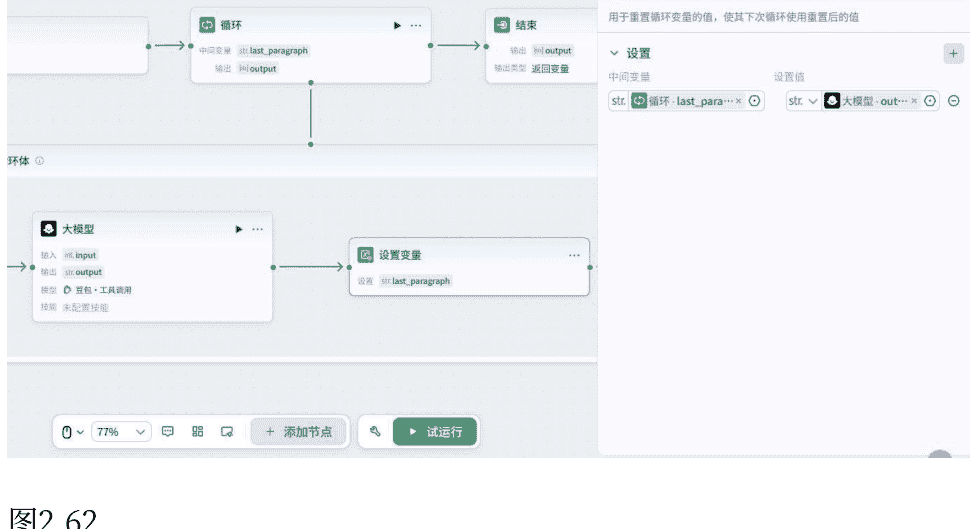

图2.62

##### 3. 结束循环

循环节点模式不同，结束循环的方式不同。

“使用数组循环”类型下，系统会依次处理数组中的每个元素，当所有元素处理完成后自动结束循环。典型应用场景如长文生成：上游节点首先生成文档大纲数组，循环节点随后对数组中的每个段落元素进行扩写处理，直到全部段落完成扩写。

“指定循环次数”类型下，系统会按照预设的次数进行循环，当达到指定循环次数后自动终止循环。

这两种类型都能实现自动化处理，用户可根据具体需求进行选择。

#### 2.2.8 图像生成节点

图像生成节点用于生成图片。具体来说，通过图像生成节点，用户可以将一段文字转换为图片，也可以根据参考图生成图片。相比传统的对话式图像生成方式（需要反复调试关键词和模型参数），图像生成节点提供了更高效、更专业的解决方案。

图像生成节点还可以使用循环节点嵌套图像生成节点来批量生成图像，从而显著提升文生图的效率和效果。其特别适合需要批量生成系列图片、对生成效果有稳定性要求，以及缺乏专业调试参数经验的普通开发者使用。

##### 1. 图像生成节点页面

完整的图像生成节点页面如图2.63所示。

可以看到，其主要由“模型设置”“参考图”“输入”“提示词”“输出”5组选项构成，下面分别讲解这5组选项。


图2.63

###### (1) “模型设置”选项

“模型设置”选项用于选择生成图像的模型，并设置生成图像的比例和质量。

在“模型”列表中，扣子提供了多种预训练的模型供用户挑选，如图2.64所示。每种模型出图的风格不同，如专用于动漫场景的“动漫”模型、面部处理更加细致和自然的“人像”模型等。用户可以选择不同的模型，分别试运行以体验模型效果，目前生图效果最好的是“通用-Pro”模型。

在“比例”列表中可以选择生成图像的比例，如图2.65所示，默认为“1:1(1024*1024)”。此外，也可以在“宽”和“高”文本框中自定义图像比例，支持的宽、高取值范围为 [512,1536]。


图2.64

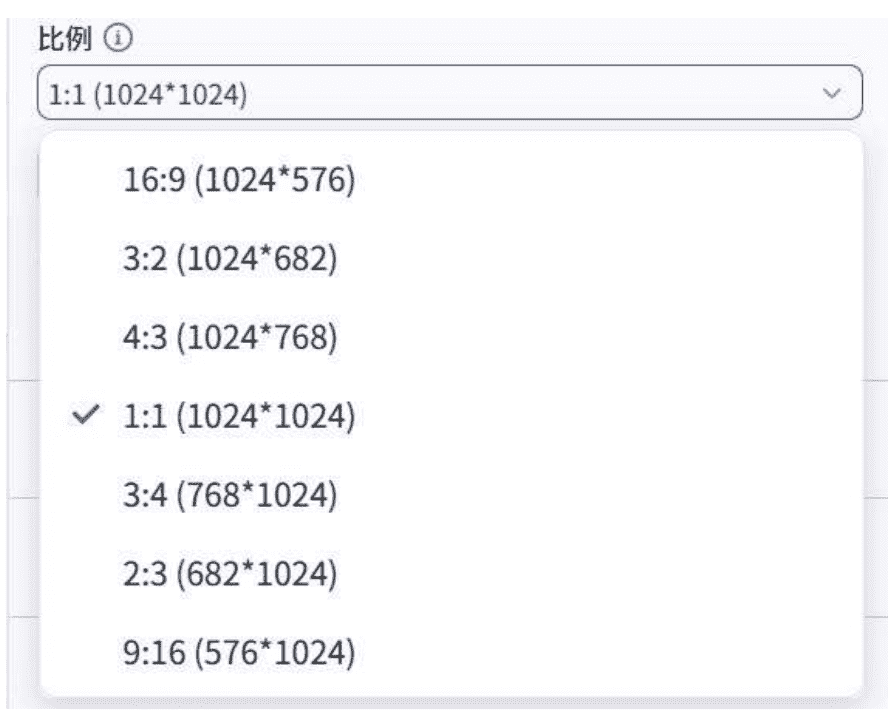

图2.65

“生成质量”的数值与图片质量相关，其数值越大，画面越精细，但图像生成时间越长；默认数值为25，可调整的取值范围为[1,40]。

###### （2）“参考图”选项

在“参考图”选项中，单击 + 按钮可以添加要生成图像的参考图像，且支持添加多个参考图。

添加参考图后，需要选择“模型”，指定生图模型如何参考指定图像。“模型”支持“边缘轮廓”“空间深度”“人物姿势”“内容识别”“风格融合”“形象一致”“人物一致”模式，如图2.66所示，用户可以根据需求选择合适的模式。

在“参考图”中可以上传图片，如图2.67所示，也可以引用上游节点输出的图片。“程度”代表参考的权重，参考程度越高，生成的图像与参考图越相似。

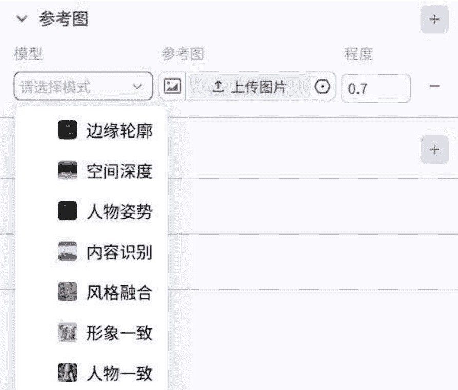

图2.66


图2.67

###### （3）“输入”选项

“输入”选项中支持为变量指定一个固定值，也支持引用上游节点的输出参数，如图2.68所示。

###### （4）“提示词”选项

“提示词”选项的文本框用来填写图像生成的提示词，即下达与图像生成相关的指令，也就是对生成图像画面的描述。支持输入正向提示词和负向提示词，并且支持中文提示词和英文提示词，还支持引用“输入”选项中的变量，引用方式为{{变量名}}。图2.69所示为英文提示词加引用{{input}}变量后的正向提示词。

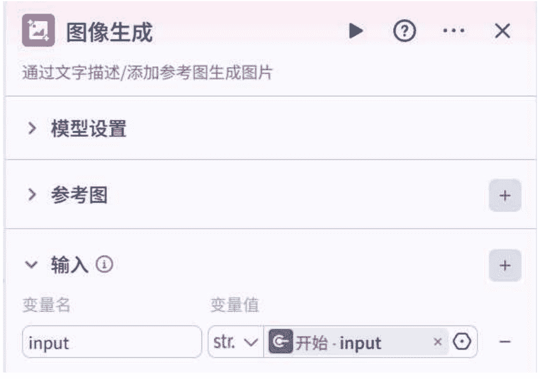

图2.68

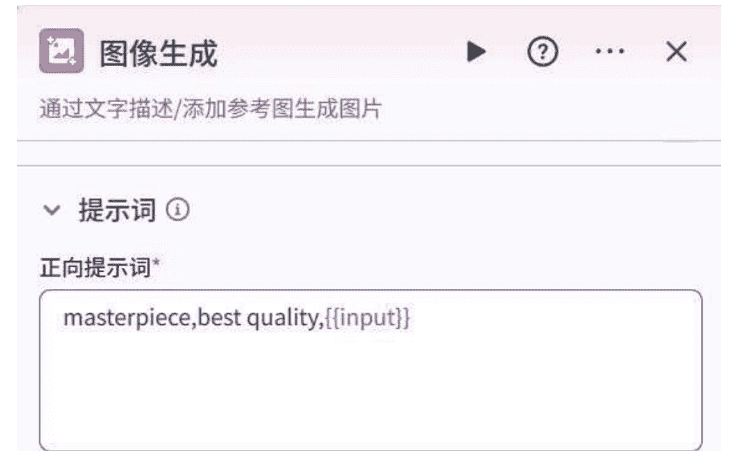

图2.69

###### (5) “输出”选项

“输出”选项中固定输出“data”和“msg”两个变量值。“data”输出Image格式的图像，即模型生成的图像，通常是一个公开的、可访问的URL链接；“msg”输出的是节点运行状态，如果运行成功则会输出success提示，如图2.70所示。

##### 2. 文生图

通过提示词描述生成一张动漫风格的图片。“模型”选择“动漫”，“比例”选择“1:1(1024*1024)”，“生成质量”设置为25，“正向提示词”为质量提示词和引用开始节点的{{input}}变量共同组成的提示词，节点配置及试运行结果如图2.71所示。

运行成功 6s

图片预览

保存图片


输入

```
input: "夕阳余晖下，一座恢弘的东方古阁巍然矗立，朱红廊柱与鎏金飞檐在暮色中流转微光，层叠的琉璃瓦如龙鳞般闪耀。环绕的汉白玉栏杆雕琢着云纹，石阶蜿蜒通向高处，仿佛通往天界的秘境。三三两两的游客化作剪影，点缀其间，为画面注入烟火气。檐角悬挂的铜铃随风轻响，『福』字灯笼在廊下摇曳，整座建筑宛如从水墨画卷中浮出的幻境，既庄严又梦幻——这一刻，历史与幻想在此交织。"
```

输出

```
data: "https://..."
msg: "success"
```

图2.70

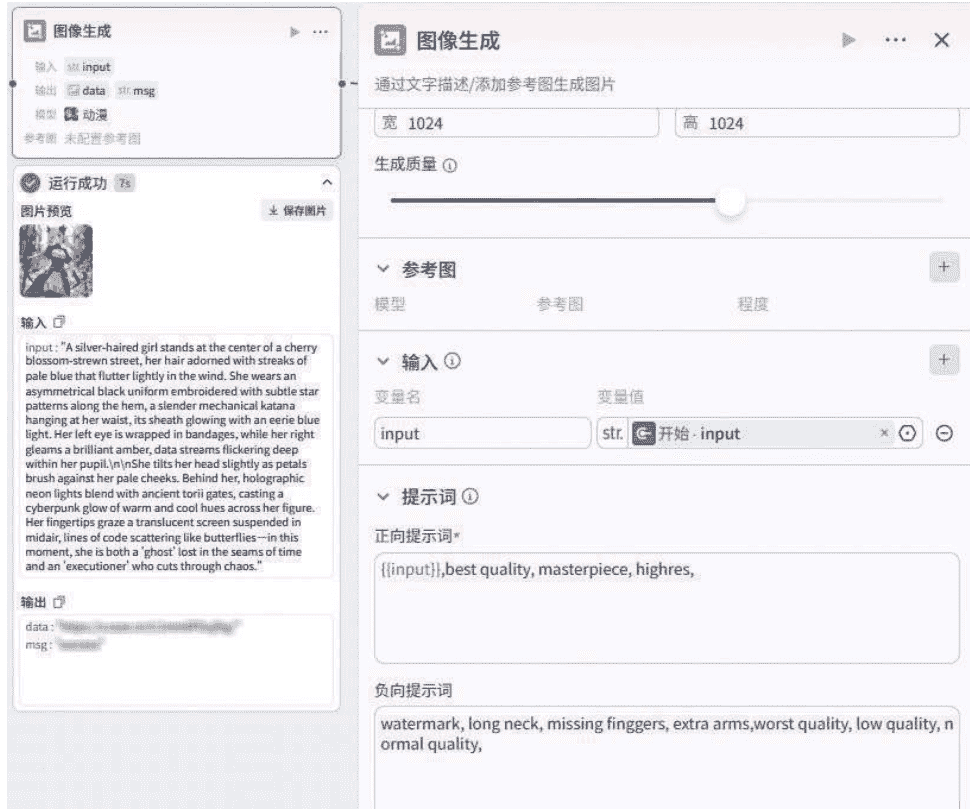

图2.71

##### 3. 图生图

通过上传参考图片生成一张与人物造型相同的动漫图片。“模型”选择“动漫”，“比例”选择“9:16(576*1024)”，“生成质量”设置为25，“模型”选择“人物姿势”，“参考图”为上传的一张人物造型图片，“程度”设置为0.9，“正向提示词”为质量提示词和引用开始节点的{{input}}变量共同组成的提示词，节点配置及试运行结果如图2.72所示。

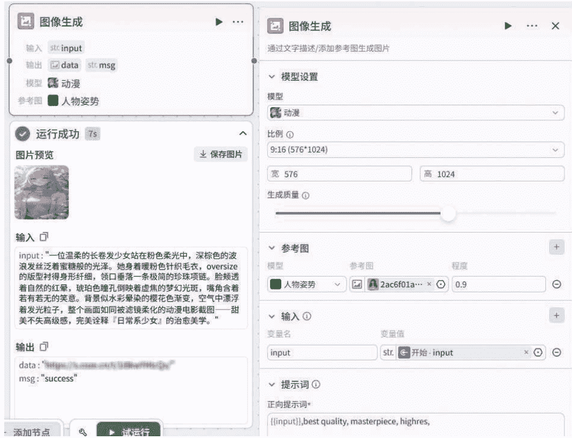

图2.72

### 2.3 终极打磨：让你的AI更聪明、更靠谱

#### 2.3.1 预览与调试

在搭建智能体后，可以在“预览与调试”面板中与智能体进行对话，并根据智能体运行过程及响应信息对智能体配置进行优化与调整。在实际使用智能体时，如果智能体的响应不符合预期、响应速度过慢，甚至不响应，可以通过调试台查看智能体的运行细节，排查问题。

##### 1. 调试台介绍

扣子的调试台功能支持全链路调试，用户可以在调试台查看每一条用户请求从输入到响应的全流程，包括模型调用、配置的工作流或知识库等详细信息，以便精准且快速地定位问题。调整智能体配置的具体操作步骤如下。

**步骤1.** 选择一个创建好的智能体，进入智能体配置页面，在“预览与调试”面板中与智能体完成一次对话，如图2.73所示。


图2.73

**步骤2.** 单击“预览与调试”面板右上角的🔍按钮，打开“调试详情”面板，其中默认展示了当前消息的响应过程，通过搜索框还可以筛选或查看之前某次对话的响应过程，如图2.74所示。


图2.74

##### 2. 调试信息说明

调试台中展示了每轮对话的基本信息、调用流程、每个节点的状态和耗时等、节点的输入和输出等信息。

会话详情区域用于展示会话的概览数据。图2.75所示为智能体“分享一些AI摄影的优秀作品”会话信息的“调试详情”页面。

会话详情区域提供了一些关键性能指标，包括整体耗时（会话总处理时间）、Token消耗量（全链路使用统计）、任务状态（成功/失败）、Logid（唯一诊断标识）和首次响应耗时（首字符返回时间）。这些指标可以帮助开发者快速评估会话效率，发现异常情况（如Token超出预期或响应延迟），并通过Logid进行问题追踪。结合时间、状态等筛选条件，开发者可以实现从整体监控到具体分析的完整运维流程。

在排查和定位问题时，往往需要查看请求的完整调用链路。扣子通过可视化的方式展示了整个请求的完整响应链路和各节点的运行情况（包括输入、输出、耗时等），以帮助开发者快速定位问题和故障。图2.76所示为会话信息的“调用树”关系图。


图2.75

## 调用树 火焰图


图2.76

#### 2.3.2 发布智能体

在扣子平台开发的智能体具备多渠道发布的优势，可灵活部署至各类应用场景。开发者既能将智能体直接发布到主流社交平台和通信软件，也能通过标准化的API或SDK，将AI项目深度集成到企业业务系统中。这种多元化的发布方式为智能体提供了更广阔的应用空间，既扩大了用户覆盖范围，又显著提升了产品的市场影响力。

完成智能体配置后，开发者只需单击页面右上方的“发布”按钮，如图2.77所示，即可进入智能体发布流程。系统将引导用户完成包括渠道选择、权限设置、版本管理等在内的全套发布操作，以确保智能体能够快速触达目标用户群体。


图2.77

##### 1. 发布渠道

扣子平台提供了多元化的发布渠道，所有用户均可将智能体一键发布至扣子商店（官方默认渠道），或者通过API/SDK集成到业务系统中，以实现HTTP请求调用与深度开发集成。此外，扣子还支持将智能体发布至飞书（企业协同办公场景）、抖音小程序和微信生态（小程序、客服、服务号、订阅号）等，以满足不同场景的触达需求。“选择发布平台”页面如图2.78所示。


图2.78

##### 2. 发布流程

发布智能体时，扣子平台会自动打包智能体并提交后台审核，审核通过的智能体会自动发布到指定的渠道中。其发布的详细流程如下。

（1）调试与准备：在发布前，确保智能体功能完善，通过预览与调试验证其表现是否符合预期，同时检查工作流、插件、知识库等资源配置是否正确，避免打包失败。

（2）打包：单击智能体配置页面右上方的“发布”按钮，平台会自动将智能体的所有资源（如提示词、工作流、插件）打包成可部署的格式。若打包失败，需根据页面提示修正问题（如逻辑错误、缺失配置等）。

（3）扣子平台审核：打包完成后，智能体被自动提交至扣子后台审核，检查其内容是否符合平台规范（如无违规、敏感信息等）。若未通过，需按反馈修改后重新提交。

（4）渠道审核与发布：通过扣子审核后，智能体会被自动提交至所选发布渠道（如微信、抖音、扣子商店等）进行二次审核。由于不同渠道的审核标准和时效不同（如微信需绑定公众号AppID），因此需耐心等待。

（5）发布完成：审核通过后，智能体将被上线至指定渠道，用户可通过链接、小程序或在扣子平台内搜索等方式访问智能体，且后续可在扣子平台管理已发布的智能体。但注意更新版本需重新走审核流程。

##### 3. 智能体数据分析

对于已发布的智能体，可通过分析看板跟踪和分析其运行情况。智能体数据分析功能提供了智能体用户量等基础数据、用户意图等访问数据、消息记录等智能体的使用数据。通过这些数据可以定向优化智能体，以使其更好地满足用户需求。

在智能体配置页面中，单击上方的 ≡ 按钮，在弹出的列表中选择“分析”选项，即可进入智能体分析页面。在“分析”选项的下方可以选择分析的时间段，以查看指定时间段内的智能体数据，如图2.79所示。


图2.79

智能体分析页面主要展示智能体的基本运营数据，包括对话人数、对话次数等智能体概览数据，以及今日对话数等用户参与度数据。根据这些数据可以判断过去一段时间内智能体用户量的变化趋势、用户留存情况、智能体的主要使用渠道等信息。

## 掌握飞书云文档，告别低效协作

CHAPTER THREE

### 3.1 初识飞书云文档：不仅是文档，更是办公利器

#### 3.1.1 什么是飞书云文档

飞书云文档是字节跳动公司旗下飞书办公协同套件中的核心在线协作文档工具，它支持用户在云端创建、编辑和共享各类文档，包括文本文档、电子表格、演示文稿等。作为新一代文档管理解决方案，飞书云文档打破了传统文档分散存储的局限，将所有文档集中存储在云端，为用户提供了随时随地访问和编辑文档的便捷体验。

此外，飞书云文档还提供了“我的空间”“共享空间”“知识库”等工具来存储和管理不同类型的云文档。飞书云文档功能丰富、使用便捷、协作高效，可用于文本创作、数据分析、汇报演示、信息收集、文件存储、多人协作、权限隔离等场景。

#### 3.1.2 飞书云文档的核心功能

##### 1. 全格式文件管理

飞书云文档支持创建文档、表格、幻灯片、多维表格、思维笔记等多种文件类型（见图3.1），并能上传和管理Word、Excel、PPT等格式的本地文件，实现企业文档的集中存储与统一管理，以满足不同场景下的办公需求。


图3.1

##### 2. 智能协作体系

飞书云文档具有多端实时协同编辑功能，所有修改自动同步至云端，配合精细化的权限控制和版本历史管理，可确保团队协作既高效又安全，且支持随时回溯至任一历史版本。

##### 3. 场景化模板库

飞书云文档内置覆盖产品、研发、市场等各领域的专业模板，包含会议记录、周报日报、问卷调查等高频使用的场景模板，以及AI模板和“仪表盘专区”等业务系统模板，以助力用户快速开展工作，如图3.2所示。


图3.2

##### 4. AI辅助

飞书云文档集成智能总结、关键词提取、表格公式生成、情感分析等AI功能，支持多维表格字段的自动填充，从而显著提升文档处理效率，缓解用户重复性工作的负担。

##### 5. 开发者支持

飞书云文档免费开放API，允许开发者将云文档功能集成至自研系统，以扩展企业的个性化应用场景，助力业务系统与办公协同的深度整合。

### 3.2 极速上手：零基础玩转飞书云文档

#### 3.2.1 飞书云文档的创建与编辑

**步骤1.** 输入飞书网址，登录账号，进入飞书云文档主页，如图3.3所示。


图3.3

**步骤2.** 在飞书云文档主页单击右上角的“新建”按钮，在弹出的新建列表中选择“文档”，如图3.4所示，新建的内容默认存储在“我的空间”选项中。


图3.4

**步骤3.** 在打开的“模板库”窗口中可以根据文档的内容选择模板，也可以新建空白文档，如图3.5所示。


图3.5

**步骤4.** 单击“新建空白文档”选项，进入新建的空白文档页面，可以输入文档的标题和内容。在输入内容时，可以在文档任意一行的行首输入 / 符号或在正文任意位置输入空格和/符号，在弹出的列表中选择“文本”或标题级别，如图3.6所示。


图3.6

**步骤5.** 除了可以输入文字内容，还可以为文档添加封面（见图3.7），以及插入图片、视频、电子表格等多样化的内容。


图3.7

#### 3.2.2 飞书云文档的协作与分享

在飞书云文档中要想进行内部多人协作，需要赋予协作对象相应的权限。以“文档”为例，在飞书云文档中进行协作与分享的具体操作步骤如下。

**步骤1.** 单击文档页面右上角的“分享”按钮，在弹出的“分享文档”面板中，单击+按钮，如图3.8所示，可以选择邀请协作的对象。

**步骤2.** 选择邀请对象后，可以赋予其“可管理”“可编辑”“可阅读”的权限。勾选“发送通知”复选框，如图3.9所示，单击“发送”按钮，该对象即可收到飞书的通知，并可通过通知进入文档中进行操作。


图3.8


图3.9

**步骤3.** 除了可以进行内部多人协作，也可以通过分享链接邀请外部人员参与协作或阅读文档。例如，在“分享文档”面板中，在“链接分享”模块可以按需设置链接的分享范围和对应权限，如图3.10所示。

**步骤4.** 如果希望指定的人只获得共同协作或阅读文档的权限，可以在“分享文档”面板中单击“启用密码”，跳转到“链接密码设置”面板。在该面板中可以启用密码、修改密码及复制链接和密码，如图3.11所示。


图3.10


图3.11

**步骤5.** 在设置完成后，单击“分享文档”面板中的“复制链接”按钮（如果启用了密码，则是“复制链接和密码”按钮），即可获得文档的链接，外部人员单击链接即可阅读或编辑文档内容。

### 3.3 降维打击：多维表格到底有多神？

#### 3.3.1 多维表格的定义与特点

##### 1. 多维表格的定义

“多维表格”是一款融合了电子表格灵活性与数据库强大功能的在线数据管理工具。它以表格形态呈现，本质上是一个可视化数据库系统，支持结构化数据存储、关联分析和多维度管理，并且突破了传统电子表格的功能局限。

##### 2. 多维表格的特点

多维表格的特点如下。

- (1) 数据管理更灵活：多维表格提供了丰富的智能字段类型，确保数据录入规范、统一，有效解决了传统表格杂乱无章的问题。无论是客户信息、项目任务还是库存管理，使用多维表格都能像数据库一样实现结构化存储，大幅提升数据的维护效率。
- (2) 团队协作更高效：支持多人实时在线编辑，所有成员可随时获取最新数据，彻底告别版本混乱问题。结合评论互动、提醒和修改记录追溯功能，团队成员间的沟通与任务进度一目了然，减少了不必要的重复确认工作。
- (3) 数据展示更直观：同一数据集可自由切换为看板、甘特图、日历等多种视图，轻松满足项目管理、进度跟踪和数据分析等场景需求。数据呈现形式不再局限于单调的行与列，让信息获取更直观、高效。
- (4) 自动化流程省时省力：通过预设规则自动触发重复性操作，将人从烦琐事务中解放出来。系统可自主完成常规任务流转，显著提升整体工作效率。
- (5) 精细权限保障数据安全：提供成员级、视图级的多重权限设置，以确保敏感数据安全、可控。相比传统表格，多维表格能更精准地防范误操作和降低数据泄露风险。
- (6) 快速搭建业务系统：开发者无须具备专业开发功能即可快速构建轻量级业务系统（如客户关系管理业务平台、项目管理平台等），灵活适配各类业务场景，从而显著降低企业数字化改造的技术门槛和减少成本投入。

##### 3. 了解智能多维表格

智能多维表格是飞书云文档的重要特色功能，其功能是根据用户的设置，自动生成各个字段下的单元格数据。例如，针对图3.12所示的这个生成小红书文案的多维表格，其功能是当在“文本”字段中填入文案主题时，“小红书文案生成”字段便根据“文本”字段中的主题自动生成相应的小红书文案，并在“小红书文案生成。输出结果”字段内输出结果。

因此，对于一个自媒体工作者而言，只需要创建一个智能多维表格，就能够源源不断地、成批地、高效地完成批量生成文案的工作。这无疑能够大幅度提高文案创作效率，这也是越来越多的公司要求员工开始使用智能多维表格的原因。


图3.12

#### 3.3.2 创建多维表格

“多维表格”的创建方式与其他飞书云文档创建的方式一样，在飞书云文档主页中单击右上角的“新建”按钮，在弹出的新建列表中选择“多维表格”，弹出“模板库”窗口，其中提供了多种根据常见需求预先搭建好的表格模板，如图3.13所示。


图3.13

虽然这些模板可以直接使用，但目前具备AI功能的模板相对较少。因此，我们通常单击图3.13中的“新建多维表格”，打开新建多维表格的页面，如图3.14所示，在其中自行搭建多维表格结构。


图3.14

### 3.4 解剖多维表格：彻底摸清底层逻辑

为了灵活地使用多维表格，我们有必要先全面认识多维表格的结构。下面对图3.15所示的多维表格进行讲解。

在该表格中，“主题”“视频脚本”“视频脚本。输出结果”被称为“字段”，表格中的具体文本被称为“记录”对多维表格的操作，基本上就是对字段和记录的操作。


图3.15

#### 3.4.1 多维表格的结构

##### 1. 字段

字段是构成多维表格的基本单元，相当于传统表格中的“列”，用于定义和存储特定类型（如文本、数字、日期等）的数据。字段通过类型（如单选、多选、关联、公式等）配置限制数据输入格式，以确保数据规范性和类型一致性，同时支持筛选、分组、排序等操作。例如，文本字段用于自由输入文字，数字字段支持计算，关联字段可跨表引用数据。

（1）新增字段。在实际操作中，常用以下两种方法新增字段。

方法一：在表格视图中，单击最后一个字段右侧的+按钮，可以在打开的字段面板中填写字段标题并选择字段类型，如图3.16所示，单击“确定”按钮，完成新增字段操作。


图3.16

方法二：在表格视图中，还可以通过插入字段的方式来新增字段。将鼠标指针悬停在任意字段名称上，此时该字段名称的右侧会出现 ▼ 按钮。单击该按钮，在弹出的列表中选择“向左插入字段/列”（见图3.17）或“向右插入字段/列”；插入的字段默认为“文本”类型，用户可以双击字段名称自行调整字段类型等。


图3.17

（2）对字段进行修改、复制、删除等管理操作。

修改标题与字段类型主要有两种方法。第一种方法是直接双击字段名称，打开设置标题与字段类型的面板，如图3.18所示，修改完成后单击“确定”按钮即可。


图3.18

第二种方法是将鼠标指针悬停在任意字段名称上，单击 ▼ 按钮，在弹出的列表中选择“修改字段/列”，如图3.19所示，同样会打开设置标题与字段类型的面板，修改完成后单击“确定”按钮即可。


图3.19

复制或删除字段的方法是，用鼠标右键单击字段名称，或将鼠标指针悬停在字段名称上并单击右侧的 ▼ 按钮，在弹出的列表中选择“复制字段/列”或“删除字段/列”，如图3.20所示，即可复制或删除字段。


图3.20

另外，单击“字段配置”按钮，再单击对应字段名称右侧的 … 图标，在打开的列表中选择“删除”选项也可以删除字段，如图3.21所示。


图3.21

（3）常规字段的输入方法。

在多维表格中，因为每个字段都设置了不同的字段类型，以保证每列填写内容的格式规范，这就要求在输入记录时按照每个字段的要求进行填写，否则将无法正常使用多维表格。下面将对一些常规的字段输入方法进行讲解。

“文本”字段如图3.22所示。在该字段中可以输入大段的文字内容，且可以输入表情等各种特殊符号。使用快捷键Ctrl+Enter可以在单元格内实现换行。


图3.22

“单选”字段用于给记录“打”标签，可以自定义颜色和选项内容，且在单元格内只能选择一个选项。双击单选的字段名称，在弹出的面板中单击“添加选项”，在文本框中输入内容后，如图3.23所示，单击“确定”按钮，即可添加单选项。


图3.23

添加选项后，双击单元格，即可在下拉列表中看到添加的选项，如图3.24所示。


图3.24

“附件”字段支持上传多种文件类型的附件。在添加附件时，单击单元格，单元格中会出现+按钮和 ▼ 按钮，如图3.25所示。单击任意按钮，在弹出的面板中可以拖拽上传文件，也可以单击“添加本地文件”以选择指定文件。


图3.25

##### 2. 记录

记录代表多维表格中的一行信息。每条记录由多个字段的值组成，如在任务管理表中一条记录可能包含“任务名称”“负责人”“截止日期”“状态”等字段的具体数据。这些具体数据相当于传统表格单元格中的具体内容。但与传统表格不同的是，多维表格中的数据大部分是由AI工具自动生成的，而并不是操作人员手动输入的。

#### 3.4.2 多维表格的导入与导出

##### 1. 多维表格的导入

多维表格支持通过不同方式将本地文件导入，导入后多维表格将自动识别数据类型（如文本、数字等），并将每列转换为适当的字段类型。飞书云文档支持导入多维表格（.base）、Excel（.xlsx）和CSV（.csv）这3种格式的文件。以导入“多维表格(.base)”为例，具体操作步骤如下。

**步骤1.** 在飞书云文档中打开“多维表格”页面，关闭“模板库”窗口，单击页面上方的“导入Excel/在线表格”按钮，打开“请选择导入方式”窗口，如图3.26所示。


图3.26

**步骤2.** 将.base模板文件拖曳到“上传本地文件”区域或单击“选择文件上传”以上传指定文件，上传完成后会在页面右下角显示上传成功的提示框，如图3.27所示，单击 📄 按钮可以打开上传的多维表格模板。


图3.27

**步骤3.** 打开模板后，页面内容会根据模板的设置显示。通常默认显示“卡片视图”页面，但在此页面中无法直接编辑表格。因此，需要切换到“原始数据”页面，进入熟悉的多维表格编辑页面，如图3.28所示。在该页面中，字段设置、输出结果等都已预先配置好。为了便于理解，笔者还提供了一些示例记录。如果不熟悉如何使用多维表格，可以参考这些示例进行内容填写；如果不需要，也可以将其删除。


图3.28

因此，如果获得了一个智能多维表格的文件或链接，则可以按导入多维表格的方法，将其导入飞书云文档中进行在线使用。

##### 2. 多维表格的导出

我们可以将在线的表格导出为本地文件，飞书云文档支持导出多维表格（.base）、Excel（.xlsx）和CSV（.csv）这3种格式的文件。以导出“Excel（.xlsx）文件”为例，具体操作步骤如下。

**步骤1.** 进入多维表格页面，单击页面右上方的 ... 按钮，在弹出的列表中选择“导出” → “Excel/CSV文件”，如图3.29所示。


图3.29

**步骤2.** 在打开的“下载设置”对话框中设置“下载为”为“Excel”，“下载的数据范围”可以选择整个多维表格中的所有数据表，也可以选择单个数据表，如图3.30所示。


图3.30

**步骤3.** 设置完成后，单击“下载”按钮，即可将选中的数据表以.xlsx的格式下载到本地。双击打开.xlsx文件，可以看到其内容与多维表格中的内容是一样的，如图3.31所示。


图3.31

### 3.5 智能字段：让数据自己“跑起来”

#### 3.5.1 什么是字段捷径

字段捷径是一些预置的业务场景字段。借助字段捷径可以快速配置业务场景所需的数据表环境，以避免重复基本操作。

字段捷径分为AI类和公式类。使用AI类的字段捷径，可以调用多维表格的AI功能，快速对数据表内的信息进行翻译、分类、总结等处理，这类字段捷径是创建智能多维表格的核心，也是本书的学习重点。公式类的字段捷径是依据业务场景需求预先设置的公式算法，能够迅速得出复杂场景中的数据结果。

#### 3.5.2 添加AI类字段捷径

添加字段捷径的方法与新增字段的方法相似，但在配置字段时要复杂一些。添加AI类字段捷径的具体操作步骤如下。

**步骤1.** 进入多维表格页面，在数据表的表格视图中单击最后一个字段右侧的+按钮以新建一个字段，如图3.32所示，或者对已有的字段进行“修改字段/列”操作。


图3.32

**步骤2.** 在弹出的面板中，将鼠标指针悬停在“字段类型”下方的“探索字段捷径”上，便会出现字段捷径列表，如图3.33所示。


图3.33

**步骤3.** 如果想要添加DeepSeek-R1字段捷径，可以在列表中下滑查找，也可以直接在搜索框中输入想要添加的字段捷径的名称，如图3.34所示，还可以单击“字段捷径中心”，在打开的“字段捷径中心”窗口中进行查找。


图3.34

**步骤4.** 选择好字段捷径后，返回到上级面板完成相关的配置，即可完成字段捷径的添加，如图3.35所示。


图3.35

### 3.6 捷径中心探秘：解锁更多效率黑科技

如前所述，要制作出各类功能不同的智能多维表格，必须全面了解字段捷径，并且要能够熟练使用AI类字段捷径。下面详细讲解这方面的知识。

#### 3.6.1 字段捷径中心

“字段捷径中心”是飞书云文档中多维表格提供的一个功能集成平台，主要用于快速配置预置的AI或业务场景字段，以简化复杂的数据处理操作过程。

它的打开方式在前面提到过，单击“字段捷径中心”即可打开“字段捷径中心”窗口，如图3.36所示。


图3.36

在该窗口的搜索框中，可以根据名称搜索相应的字段捷径，例如搜索“视频生成”，右侧便会出现有关“视频生成”的搜索结果，如图3.37所示。


图3.37

在该窗口的左侧，还可以根据分类选择字段类型，AI类型中的字段捷径可以自动完成指定的任务，实用工具类型中的字段捷径可以快速完成一些较为复杂的操作。

以“Kimi阅读助手”字段捷径为例，将鼠标指针悬停在“Kimi阅读助手”字段捷径上，该字段捷径的右侧便会出现“使用”按钮，如图3.38所示，单击该按钮便可以使用该字段捷径。


图3.38

对于陌生的字段捷径，可以直接单击字段捷径，进入该字段捷径的详情页面，如图3.39所示，页面中有该字段捷径的视频使用方法以及功能概述。收费的字段捷径还提供了免费额度介绍与付费的路径。


图3.39

#### 3.6.2 配置字段捷径

在多维表格中添加字段捷径后，如果字段捷径配置得不正确，则无法发挥作用。下面以“DeepSeek-R1字段捷径”为例，详细讲解字段捷径的配置，具体操作步骤如下。

**步骤1.** 进入多维表格页面，单击左侧导航栏中需要进行操作的数据表。在创建AI字段捷径前，需要在数据表中创建至少一个文本字段，并将需要大模型完成的任务或任务的关键词输入字段中。

在此，笔者创建的智能多维表格的任务是通过填入的景点名称生成景点简介，所以将第一列的字段命名为“景点”，并输入景点名称，如图3.40所示。


图3.40

**步骤2.** 按照前面讲解的字段捷径添加方法，在新建字段的面板中添加DeepSeek-R1字段捷径，如图3.41所示。


图3.41

**步骤3.** 在“标题”文本框中输入字段的标题“景点介绍”，在“关联账号”选项中根据需要确定是否要关联“DeepSeek大模型账号”。通常字段捷径是有免费额度的，但额度有限，当出现提示信息提示额度用尽后，单击“关联账号”按钮，打开窗口，一般需要输入API密钥和ID，如图3.42所示，再单击“关联账号”按钮即可关联字段捷径的账号。


图3.42

**步骤4.** 在“输入指令”文本框中，输入要发送给模型的指令，即具体指导大模型完成任务的提示词。单击图3.43所示的“配置”面板右上角的“引用字段”按钮，可以在引用字段列表中选择已经创建的字段，其作用是为大模型导入字段的初始数据。例如要生成“景点”字段中用户输入的景点的介绍、游玩攻略以及附近美食推荐，可以按图3.43所示撰写“输入指令”。

**步骤5.** 开启“获取更多信息”选项，可选择是否生成新列来记录模型的思考过程、输出结果，一般情况下只需要勾选“输出结果”复选框，“思考过程”内容过长且不具体，所以不建议勾选该复选框。需要注意的是，若不勾选上述复选框，以上内容也会被完整记录在新创建的AI字段中，但不会生成新列来展示这些内容。

**步骤6.** 如果开启“自动更新”选项，如图3.44所示，当指令中引用字段的值发生变化或新增记录时，将自动向模型发送新指令，重新生成内容。所以通常不建议开启该选项，否则任何微小的修改都会使大模型重新生成内容，并消耗相应的免费额度。

配置


图3.43


图3.44

**步骤7.** 配置完成后，单击“确定”按钮。如需立即开始生成内容，则在打开的页面中单击“生成”按钮；单击“仅保存配置”按钮，可保留字段捷径配置，但不生成内容。单击“生成”按钮后，系统会自动创建一列“景点介绍。输出结果”字段，并输出最终的结果，如图3.45所示。


图3.45

### 3.7 插件支持：解锁多维表格的无限可能

#### 3.7.1 什么是多维表格插件

多维表格插件是为多维表格提供灵活、便捷的开放功能的组件。有编程能力的开发者可编写代码来实现自定义功能，无编程能力的开发者也可以使用“插件市场”的各种插件，实现不同的业务诉求。

例如，“查找替换”插件可以根据自定义逻辑批量查找和替换多维表格中的数据，如图3.46所示；“网页预览”插件允许开发者在单击含有网页链接的单元格时，预览对应的网页内容；“字段翻译”插件可以将多维表格的文本字段作为输入，翻译为指定语言后输出到另一个文本列。


图3.46

#### 3.7.2 如何使用多维表格插件

**步骤1.** 进入多维表格页面，单击左侧导航栏中需要进行操作的数据表，单击页面右上角的 🧩 按钮，如图3.47所示。

**步骤2.** 右侧面板中会显示推荐的插件，如图3.48所示，用户也可以单击下方的“探索插件市场”按钮打开“插件市场”窗口来搜索和使用更多插件。


图3.47


图3.48

**步骤3.** 在“插件市场”窗口中搜索“查找替换”插件，将鼠标指针悬停在插件上，单击右侧的“使用”按钮，如图3.49所示。


图3.49

**步骤4.** 依次设置“选择模式”“选择数据表”“选择字段”“输入查找的文本”和“替换为”的文本，单击“查找”按钮，下方将展示所有查找到的结果，如图3.50所示。


图3.50

根据需要和表格情况还可以单击“全部替换”按钮，以便进行批量操作。

## # 豆包+飞书，批量生成文档的“超级工厂”

### 4.1 文案量产工厂：让AI帮你一次搞定100份爆款文案

跨平台矩阵式营销已成为众多企业的核心营销策略，但面对不同平台的差异化需求，营销人员往往疲于应对。传统方式下，文案创作效率低，难以同步覆盖多个平台，导致内容分发的滞后与脱节。而通过豆包与飞书平台打造的智能多维表格，能够一次生成100份适配不同平台的文案，有效解决这一痛点。智能工作流可以根据平台特性、用户行为和品牌定位，自动生成风格多样且精准匹配的文案，并支持一键分发与实时优化。这一技术不仅实现了多平台内容的高效同步，更让营销人员能够将精力聚焦于策略创新与效果追踪，为矩阵式营销提供强有力的支持，助力品牌从多维度竞争中脱颖而出。一次生成100份不同平台文案的具体操作步骤如下。

**步骤1.** 进入飞书，新建一个空白的多维表格，在多维表格页面左上角单击“未命名多维表格”，将其重命名为“饮食安全文案”。因为我们只需要为“文本”字段输入内容，所以将“人员”“单选”“日期”“附件”字段选中并在其中任意位置单击鼠标右键，在弹出的列表中选择“删除字段/列”，将选中的字段删除，如图4.1所示。


图4.1

**步骤2.** 将关于饮食安全的话题题目输入“文本”字段中。此处笔者输入了20个关于饮食安全的话题题目，先测试一下效果，如果没问题再将剩余的话题题目输入，如图4.2所示。


图4.2

**步骤3.** 单击“文本”字段右侧的+按钮，在弹出的面板中输入标题“小红书文案”，设置“字段类型”为“文本”，“探索字段捷径”为“豆包1.8（多模态+深度思考）”，如图4.3所示。如果希望AI模型通过联网获得最新的信息，可选择“DeepSeek-R1（联网）”，或随着时间推移各大公司发布的更新更强大的模型。本章后面类似的步骤均是如此。


图4.3

**步骤4.** 在面板的“配置”中单击“引用字段”按钮，选择“文本”字段并添加，在文本框中输入生成文案的提示词，笔者输入的是“将输入的内容生成为小红书的文案”，其他参数保持默认，单击“确定”按钮；在打开的“是否生成全列？”窗口中单击“生成”按钮，目的是为输入的所有话题题目都生成文案，此时表格中会多出“小红书文案。思考过程”“小红书文案。输出结果”“小红书文案。参考链接”这3个字段，如图4.4所示。


图4.4

**步骤5.** 通过表格可以看到小红书文案已经生成在“小红书文案。输出结果”字段中了。由于表格行高较小，内容看起来十分别扭，因此单击表格上方的“行高”按钮，在弹出的“设置行高”列表中选择“超高”选项，这时再看表格中的内容就方便多了。

**步骤6.** 在输出的内容中，我们需要的只是“小红书文案。输出结果”字段的内容，所以可以将“小红书文案。思考过程”“小红书文案。参考链接”字段删除。双击“小红书文案”字段，在弹出的面板中找到“获取更多信息”区域，取消勾选其中的“思考过程”和“参考链接”复选框，单击“确定”按钮，在打开的“是否生成全列？”窗口中单击“生成”按钮。接着会打开提示“删除字段”的窗口，单击“删除”按钮，表格中便只剩下“文本”和“小红书文案。输出结果”字段，如图4.5所示。


图4.5

**步骤7.** 将剩余的话题题目全部输入。由于我们要在不同的平台发布，因此使用相同的方法新建“微信公众号文案”字段，将提示词改为“生成微信公众号文案，要求风格活泼、幽默、接地气”，生成相应内容，结果如图4.6所示。


图4.6

**步骤8.** 如果还想生成其他平台的文案，使用相同的方法继续创建字段即可。如果平台对文案字数有限制，可以在提示词中添加对输出文案的字数限制。

**步骤9.** 如果想要将生成的表格导出，可以单击页面右上方的 ··· 按钮，在弹出的列表中选择“导出” → “Excel/CSV文件”，在打开的“下载设置”窗口中设置“下载为”为“Excel”，“下载的数据范围”为“饮食安全文案”，单击“下载”按钮，将表格以.xlsx格式保存到本地，Excel文件内容如图4.7所示。


图4.7

### 4.2 脚本印钞机：批量生成100个短视频变现剧本

在视频营销时代，营销人员每天都会面对海量的内容需求，既要兼顾创意又要保证创作效率。如果用传统的方式，每天至多只能完成几份视频脚本的创作，耗时费力且难以应对规模化需求。然而，如果能够使用豆包搭配飞书平台打造一个智能多维表格，则有可能一次生成100份视频脚本，以便快速筛选出最优方案。这一方法不仅解决了内容生产的瓶颈问题，还为规模化营销提供了强有力的支持，极大地提升了内容生产效率。一次生成100份视频脚本的具体操作步骤如下。

**步骤1.** 进入飞书，新建一个空白的多维表格，在多维表格页面左上角单击“未命名多维表格”，将其重命名为“电器视频脚本”。因为我们只需要为“文本”字段输入电器名称和核心卖点，所以将“人员”“单选”“日期”“附件”字段选中并在其中任意位置单击鼠标右键，在弹出的列表中选择“删除字段/列”，将选中的字段删除，如图4.8所示。


图4.8

**步骤2.** 将电器名称及核心卖点输入“文本”字段中，单击“文本”字段右侧的+按钮，在弹出的面板中输入标题“电器短视频脚本”，设置“探索字段捷径”为“豆包1.8（多模态+深度思考）”，“字段类型”自动更改为“对象”，如图4.9所示。


图4.9

**步骤3.** 在面板的“配置”中单击“引用字段”按钮，选择“文本”字段并添加，在文本框中输入“根据填入的电商产品生成一个30秒短视频的脚本”，取消勾选“获取更多信息”中的“思考过程”和“参考链接”复选框，其他参数保持默认，单击“确定”按钮，在打开的“是否生成全列？”窗口中单击“生成”按钮，此时表格中会多出“电器短视频脚本。输出结果”字段并生成视频脚本，如图4.10所示。

### 4.3 秒读神技：喝口水的时间，让AI自动提炼100份长文档核心

在职场与学习场景中，处理海量文档是许多人面临的常态。此时，无论是提取关键信息还是整理学习资料，传统方式往往效率低下且容易遗漏重点。而通过豆包与飞书平台搭建的智能多维表格，能够一次提炼100份文档的核心内容，有效解决这一难题。例如，智能工作流可以自动识别文档中的关键段落、重要数据和核心观点，并生成简洁明了的摘要，帮助用户快速掌握核心信息。在这个基础上，还可以将提炼出来的要点汇总成表格、思维导图或PPT，大大降低信息整理的复杂度与时间成本。这一技术不仅大幅提升了文档处理的效率，还让职场人士与学生能够将更多精力专注于分析与应用数据或信息，为高效工作与学习提供强有力的支持，让知识获取更加精准与便捷。一次提炼100份文档的具体操作步骤如下。

**步骤1.** 使用与前面相同的操作，将新建的多维表格中的多余字段删除，随后新建“报告标题”字段和“报告文件”字段。其中，“报告文件”字段的“字段类型”为“附件”。接着，将需要提炼的报告标题输入“报告标题”字段，并将对应的报告文件上传到“报告文件”字段中，如图4.15所示。

**步骤2.** 单击“报告文件”字段右侧的+按钮，在弹出的面板中输入标题“报告背景”，将“字段类型”设置为“文本”。因为豆包暂时无法读取附件，所以将“探索字段捷径”设置为“Kimi阅读助手”，“选择需要读取的文件”设置为“报告文件”，单击“自定义指令”，打开自定义指令文本框，在文本框中输入“分析并生成报告附件的背景”，如图4.16所示。需要注意的是，输入的指令内容要与上传的附件内容相对应，例如上传的附件为论文，则需要输入“分析并生成论文附件的研究背景”，这样才能生成相关的内容。

**步骤3.** 使用同样的方法，新建“报告方法”字段和“结果与分析”字段，在新建字段时需要根据字段的名称相应地修改字段的指令内容，否则会生成相同的内容。字段新建完成后，相应的内容也会生成出来，如图4.17所示。

**步骤4.** 3个部分的内容提取出来之后，我们还需要将它们总结在一起，再发送给豆包进行分析，所以需要新建“总结”字段。在弹出的面板中，“字段类型”设置为“文本”，“探索字段捷径”设置为“总结”，“选择需要总结的字段（可多选）”设置为“报告标题”“报告背景”“报告方法”“结果与分析”，在“自定义总结要求”文本框中输入“详细总结所有内容，不要丢失信息”，如图4.18所示。

**步骤5.** 完成后，再创建“分析总结”字段，“探索字段捷径”选择“豆包1.8(多模态+深度思考)”，在“配置”中单击“引用字段”按钮，选择“总结”字段并添加，再输入“基于总结内容，给出报告评价。评价体系包括：优点与创新、不足与反思、关键问题及回答”，取消勾选“获取更多信息”中的“思考过程”和“参考链接”，单击“确定”按钮，生成最终的报告分析，如图4.19所示。

**步骤6.** 生成最终的报告分析后，如果有不满意的地方，不必重新生成整个表格，只需找到不满意的内容并单击，右侧会出现 🔄 按钮，如图4.20所示，单击该按钮即可重新生成对应内容。

上述操作针对的是固定的PDF附件类型。除此之外，还可以上传Word文件、Excel文件、PPT文件、图片、Python脚本文件以及JSON文件进行分析。其操作方法与分析报告的操作方法相似，并且可以减少不必要的字段，只需要用一个Kimi阅读助手来分析上传文件的“主要内容”字段，然后用DeepSeek对主要内容进行分析、总结，示例如图4.21所示。

### 4.4 爆款复制机：批量撰写与改写爆款图文

对已在小红书平台积累大量内容的企业而言，内容更新与优化是维持账号活跃度和提升传播效果的重要环节。然而，当需要对历史发布的数百条，甚至上千条内容进行批量改写时，传统的手动编辑方式面临着诸多挑战：首先，逐条检索和修改需要投入大量人力资源，一个10人团队完成1000条内容的改写通常需要2～3周时间；其次，人工改写难以保持统一的品牌调性和语言风格，容易造成内容质量的参差不齐；更重要的是，随着平台算法和用户偏好的持续变化，传统方法难以及时响应这些动态调整需求。

针对这一运营痛点，不妨考虑打造一个能够批量改写小红书文案的智能多维表格。

**步骤1.** 进入飞书，新建一个空白的多维表格，在多维表格页面左上角单击“未命名多维表格”，将其重命名为“小红书文案改写”，并将多维表格中的多余字段删除，如图4.22所示。

**步骤2.** 因为我们需要通过小红书笔记的链接来获取文案，所以还需要将“文本”字段改名为“小红书笔记链接”。选中“文本”字段并单击鼠标右键，在弹出的列表中选择“修改字段/列”，在打开的面板中，将“标题”改为“小红书笔记链接”，将“字段类型”改为“超链接”，如图4.23所示，单击“确定”按钮。

**步骤3.** 在小红书平台复制想要改写文案的笔记链接，将其粘贴到“小红书笔记链接”字段中，在多维表格页面右上方单击 🧩 按钮，打开“插件”页面，单击下方的“探索插件市场”，如图4.24所示，打开“插件市场”窗口。

**步骤4.** 在搜索框中输入“小红书助手”并按Enter键，在搜索结果中单击“小红书助手”插件右侧的“使用”按钮，如图4.25所示，打开“小红书助手”插件页面。

**步骤5.** “小红书助手”插件页面中需要填写链接和Cookie，以获取笔记的数据。链接已经添加好了，还需要去小红书平台获取Cookie。回到小红书平台的主页，在页面空白处单击鼠标右键，在弹出的列表中选择“检查”，在打开页面上方选择“网络”，在“筛选器”栏中选择“Fetch/XHR”；单击小红书页面的“推荐”选项以刷新页面内容，此时Fetch/XHR列表中会出现homefeed选项；单击该选项，在右侧打开选项内容页面，选择“标头”选项，下滑并找到“请求标头”部分，可以看到Cookie的内容，如图4.26所示。

**步骤6.** 复制Cookie的内容，回到多维表格页面，在“小红书助手”页面中单击“链接”下方的文本框，会出现下拉列表。在下拉列表中选择“小红书笔记链接”，将复制的Cookie内容粘贴到Cookie下方的文本框中，然后勾选“笔记标题”“笔记内容”“笔记话题”复选框，如图4.27所示。

**步骤7.** 单击下方的“获取数据”按钮，多维表格将自动新建所需的字段并打开“请选择记录”对话框，选择所有的链接，如图4.28所示，单击“确认”按钮。

* 链接

小红书笔记链接

全选

- [x] 笔记标题
- [ ] 博主
- [x] 笔记内容
- [x] 笔记话题
- [ ] 笔记发布时间
- [ ] 最后更新时间
- [ ] 收藏量
- [ ] 点赞量
- [ ] 转发量
- [ ] 评论量
- [ ] 总互动量
- [ ] 数据获取时间
- [ ] 报错信息

> 插件可自动创建所选字段。如需映射，请确保多维表格中的字段名称和选项名称一致，建议“博主”字段类型为文本，“xx量”字段类型为数字，“xx时间”字段为日期。“总互动量”字段可进行多字段计算

* Cookie

Cookie 为必填项，没有有效的 Cookie 将无法获取数据。请参考说明文档获取并填写 Cookie 以获取数据。

gid=yYDiKKK4427qyYDiKKKqDx07Wqv3FUF3YyTCCFiv7jDif628Iu22Kj888JK8j8288KS40yj8; web_session=04

**步骤8.** 等待一会儿，小红书笔记的内容便会被提取出来。单击“笔记话题”字段右侧的+按钮，在弹出的面板中输入标题“文案改写”，将“探索字段捷径”设为“豆包1.8（多模态+深度思考）”，“字段类型”自动更改为“对象”，在“输入指令”文本框中输入指令“根据文案内容，帮我将文案改写为小红书平台的文案，要口语化表达，自然输出，消除机器写作痕迹，长短句结合，减少使用列表和总结，减少连接词，输出内容不要有你参考具体网址内容的引用标记……”，将鼠标指针定位到指令的开头，单击“引用字段”按钮，选择“笔记内容”字段并添加，结果如图4.29所示。

**步骤9.** 取消勾选“获取更多信息”中的“思考过程”和“参考链接”复选框，其他参数保持默认，单击“确定”按钮，在打开的“是否生成全列？”窗口中单击“生成”按钮，此时表格中会多出“文案改写。输出结果”字段并开始生成改写后的文案。单击“行高”按钮，在“设置行高”列表中选择“超高”，等待文案生成后就可以看到改写后的文案内容了，如图4.30所示。

### 4.5 图生文魔法：一键反推海量图片提示词

在视觉营销日益重要的当下，企业常常需要基于已有图片素材批量生成新的营销视觉内容。这一创作过程的首要环节，就是从现有图片中准确提取可用于AI生成任务的关键提示词。传统的人工反推方法存在明显局限：设计师需要逐张分析图片元素并手动撰写提示词，一个包含200张图片的素材库通常需要3～5个工作日才能完成标注，且不同人员撰写的提示词在风格和精确度上难以统一。

针对这一运营需求，不妨考虑打造一个能够批量将图片转换为生图提示词的智能多维表格。

**步骤1.** 进入飞书，新建一个空白的多维表格，在多维表格页面左上角单击“未命名多维表格”，将其重命名为“图片转提示词”，并将多维表格中的多余字段删除，结果如图4.31所示。

**步骤2.** 因为第一列无法删除，也无法修改为“附件”字段，所以在“文本”字段右侧新建“图片”字段，“字段类型”为“附件”，如图4.32所示。

**步骤3.** 将需要转换为提示词的图片依次上传到“图片”字段中，如图4.33所示。

**步骤4.** 在“图片”字段右侧新建“图片提示词”字段，“字段类型”为“Kimi图片理解”，如图4.34所示。

**步骤5.** 在“图片提示词”字段配置面板的“配置”选项中，将“选择需要读取的文件”设为“图片”字段，在“自定义指令”文本框中输入“生成图片的描述词，要求输出的结果为词语形式。”，开启“自动更新”选项，如图4.35所示。

**步骤6.** 单击“确定”按钮，在打开的“是否生成全列？”窗口中单击“生成”按钮，“图片提示词”字段中将开始生成每张图片的提示词，结果如图4.36所示。

### 4.6 自动化排版：全自动为海量文案精准配图

在企业内容创作过程中，专业文章往往需要配图来增强说明效果、优化用户阅读体验或辅助用户理解复杂概念。然而，传统的人工配图方式面临诸多挑战：编辑人员需要根据文章内容逐一搜索匹配图片，一篇5000字的专业技术文档通常需要耗费2～3天时间才能完成配图；同时，手动选择的图片在风格统一性、版权合规性和内容契合度等方面难以保证质量，严重影响专业文章的传播效果。

针对这一运营需求，不妨考虑打造一个能够批量将短文案转换为生图提示词，并据此提示词生成图片的智能多维表格。

**步骤1.** 进入飞书云文档，新建一个空白的多维表格，在多维表格页面左上角单击“未命名多维表格”，将其重命名为“生成文案配图”，并将多维表格中的多余字段删除，将“文本”字段改名为“文案”，“字段类型”保持不变，如图4.37所示。

**步骤2.** 将准备好的文案粘贴到“文案”字段中。如果直接使用文案作为生图提示词，生成的图片效果可能比较一般，所以我们先通过豆包将文案转换为生图的提示词，在“文案”字段右侧新建“文案转提示词”字段，“字段类型”为“豆包1.8（多模态+深度思考）”，如图4.38所示。

**步骤3.** 在“文案转提示词”字段配置面板的“配置”选项中，在“输入指令”文本框中输入“根据输入的文案，生成一条适合文案配图的图片提示词，只输出提示词即可。”，将鼠标指针定位到“文案”的后面，单击右上角的“引用字段”按钮，选择“文案”字段，开启“自动更新”选项，如图4.39所示。

**步骤4.** 单击“确定”按钮，在打开的“是否生成全列”窗口中单击“生成”按钮，“文案转提示词”字段中将根据文案生成相应的提示词，结果如图4.40所示。

**步骤5.** 在“文案转提示词”字段右侧新建“文案配图”字段，“字段类型”为“智能绘图”，如图4.41所示。

**步骤6.** 在“文案配图”字段配置面板的“配置”选项中，将“请选择操作的列”设为“文案转提示词”字段，开启“自动更新”选项，如图4.42所示。

**步骤7.** 单击“确定”按钮，在弹出的“是否生成全列”窗口中单击“生成”按钮，“文案配图”字段中将根据提示词生成图片，结果如图4.43所示。

**步骤8.** 如果对某张配图的效果不满意，可以单击该配图所在的单元格，此时单元格的右侧会出现 🔄 按钮。单击该按钮可以更新该单元格中的内容，如图4.44所示。

**步骤9.** 对配图效果满意后，单击任意一张配图，进入图片预览页面。单击右上角的“批量下载”按钮，打开“批量下载‘文案配图’”对话框，将“下载的数据范围”设为“表格”，“附件命名方式”设为“附件原始名称”，如图4.45所示。


图4.45

**步骤10.** 单击“下载”按钮，表格中的所有配图将会被打包为一个压缩文件下载到本地。

### 4.7 视频流水线：动动手指，从脚本到成片，批量产出成品视频

在短视频盛行的时代，高效产出优质的视频已成为各品牌抢占市场先机的关键。传统视频制作流程不仅成本高昂，更难以实现文案和视频的快速适配与批量产出。为此，笔者设计了本例讲解的智能多维表格。使用时只需要在指定表格中输入生成视频的提示词，多维表格就能根据提示词自动生成视频，大幅提升制作效率。批量生成视频的具体操作步骤如下。

**步骤1.** 进入飞书云文档，新建一个空白的多维表格，在多维表格页面左上角单击“未命名多维表格”，将其重命名为“批量生成视频”，并将多维表格中的多余字段删除，将“文本”字段改名为“古诗词”，“字段类型”保持不变，如图4.46所示。


图4.46

**步骤2.** 在“古诗词”字段右侧新建“古诗词场景描述”字段，“字段类型”为“豆包1.8（多模态+深度思考）”，如图4.47所示。


图4.47

**步骤3.** 在“古诗词场景描述”字段配置面板的“配置”选项中，在“输入指令”文本框中输入“分析该句古诗词的真实画面，输出一个最符合场景的画面，只要场景的描述，不要包含其他所有内容，100字左右”，将鼠标指针定位到文本框中“古诗词”的后面，单击右上角的“引用字段”按钮，选择“古诗词”字段，开启“获取更多信息”和“自动更新”选项，取消勾选“思考过程”复选框，如图4.48所示。


图4.48

**步骤4.** 单击“确定”按钮，在打开的“是否生成全列？”窗口中单击“仅保存配置”按钮，等全部设置完成后一起运行。

**步骤5.** 使用与“古诗词场景描述”字段相同的创建方法，创建“生成画面提示词”字段，在“输入指令”文本框中输入“输出古诗词场景画面的提示词，只要AI绘画的提示词，不要包含其他所有内容，不要包含思考过程，100字左右”，同时引用“古诗词场景描述。输出结果”字段，其他设置不变，如图4.49所示。


图4.49

**步骤6.** 在“生成画面提示词。输出结果”字段右侧新建“古诗词图片”字段，“字段类型”为“智能绘图”，在字段配置面板的“配置”选项中，将“请选择操作的列”设为“生成画面提示词。输出结果”字段，开启“自动更新”选项，如图4.50所示。


图4.50

**步骤7.** 使用与“古诗词场景描述”字段相同的创建方法，创建“生成视频提示词”字段，在“输入指令”文本框中输入“根据古诗词画面提示词输出制作视频的提示词，只要能够生成视频的提示词，不要包含其他所有内容，不要包含思考过程，100字左右”，同时引用“生成画面提示词。输出结果”字段，其他设置不变，如图4.51所示。


图4.51

**步骤8.** 在“生成视频提示词。输出结果”字段右侧新建“古诗词视频”字段，“字段类型”为“AI生成视频（豆包）”，在字段配置面板的“配置”选项中，在“自定义指令”文本框中引用“生成视频提示词。输出结果”字段，将“分辨率”设为“720p”，“按照图片生成”设为“古诗词图片”字段，“视频尺寸”设为“1:1”，开启“自动更新”选项，如图4.52所示。


图4.52

**步骤9.** 将一首古诗的每一句作为一行记录输入“古诗词”字段，各字段便开始生成相应的内容。最终生成视频并输出在“古诗词视频”字段中，如图4.53所示。


图4.53

**步骤10.** 使用图片批量下载的方法，也可以批量下载视频，如图4.54所示。


图4.54

## 扣子自动操作，内容采集+落地一条龙

### 5.1 AI自动化爬虫：像八爪鱼一样抓取全网新闻

对新闻媒体行业而言，传统的信息采集方式正面临效率低下的问题：编辑需要手动浏览多个新闻平台，耗费大量时间进行信息筛选和比对；同时，人工处理难以全面捕捉突发新闻和热点趋势，容易错过最佳报道时机，影响新闻的时效性和竞争力。

针对这一行业痛点，不妨考虑使用扣子平台打造一个能够自动抓取、分析并整合全网新闻的智能体解决方案。

**步骤1.** 进入扣子主页，如图5.1所示。


图5.1

**步骤2.** 单击页面左侧的“资源库”选项，打开“资源库”页面，如图5.2所示。


图5.2

**步骤3.** 将鼠标指针移到右上方的按钮上，在弹出的列表中选择“工作流”选项，便会打开“创建工作流”对话框，在“工作流名称”文本框中输入合适的名称，需要注意的是工作流名称只允许出现字母、数字或下画线，并以字母开头，如getwebcontent，“工作流描述”文本框中输入的内容为“获取指定网页信息并整理为文档”，如图5.3所示。


图5.3

+ 添加节点

**步骤4.** 单击“确认”按钮，自动跳转到工作流页面，将鼠标指针移到页面下方的按钮上，在弹出的节点列表中选择“HTTP请求”“大模型”“文本处理”节点进行添加，如图5.4所示。


图5.4

**步骤5.** 除了上述节点外，还需要添加两个插件节点。插件节点与其他节点的添加方式有所不同，需要先在节点列表中单击“插件”，在打开的“添加插件”窗口中搜索需要添加的插件，例如在搜索框中输入html2md，页面右侧便会显示相关的插件。单击插件选项，插件下方会显示相应节点。因为这个插件就一个节点，所以直接单击节点右侧的“添加”按钮即可添加，如图5.5所示。


图5.5

**步骤6.** 为了实现将获取的指定网页信息整理为文档功能，还需要使用同样的方式添加“飞书云文档”插件的create_document节点，如图5.6所示。


图5.6

**步骤7.** 单击并拖动节点，将添加的节点按照 “开始” - “HTTP请求” - “html2markdown” - “大模型” - “文本处理” - “create_document” - “结束” 的顺序排列，如图5.7所示。


图5.7

**步骤8.** 将排列好的节点按照“开始” - “HTTP请求” - “html2markdown” - “大模型” - “文本处理” - “create_document” - “结束”的顺序连接起来，如图5.8所示。


图5.8

**步骤9.** 节点连接完成后，开始配置节点。单击“HTTP请求”节点，页面右侧会打开该节点的配置面板，因为要获取指定网页的信息，所以需要将指定的网页地址填入API选项下的URL文本框中。需要注意的是，填入的网址需要是免登录的，否则节点无法返回信息。笔者想要获取某网站关于AI的信息，所以填入了该网站中AI板块的网址，如图5.9所示，其他选项保持默认。

**步骤10.** 因为html2markdown节点是一个插件节点，输出给它的内容会自动处理，所以只需要给该节点指定好输入内容即可。单击该节点，在配置面板中单击“输入”选项下htmlcode参数值框右侧的 ◎ 按钮，在弹出的列表中选择“HTTP请求-body”，如图5.10所示，目的是将获取的网页的body部分作为输入，并转换为markdown格式。


图5.9


图5.10

**步骤11.** 大模型节点是整个工作流的关键节点，需要让它将网页信息转换为指定格式，以实现正常输出。单击该节点，在配置面板的“模型”选项中选择“豆包·1.6·lite·251015”模型，将“输入”选项的“变量值”设为html2markdown-markdown，如图5.11所示。在面板中向下滑动，在“用户提示词”文本框中输入“提供的内容：{{input}}，输出完整的链接”，在“输出”选项中将output的“变量类型”改为Array<Object>，然后单击右侧的+按钮，新增两个子项，第一个子项为title，第二个子项为link，具体如图5.12所示，用于让获取的网页信息与链接一起输出。


图5.11


图5.12

**步骤12.** 通过文本处理节点输出获取的网页内容。单击该节点，在配置面板中，在“输入”选项的“参数值”中选择“大模型-output”，在“字符串拼接”文本框中输入输出的格式，笔者输入的第一组为{{String1[0].title}}{{String1[0].link}}，代表输出第一条内容的标题和链接，根据想要输出的条数设置相应的变量即可，如图5.13所示。

**步骤13.** 通过create_document节点将输出的内容导入飞书云文档中。单击该节点，在配置面板中，在“输入”选项下content的“参数值”中选择“文本处理-output”，如图5.14所示，也就是将文本处理节点输出的内容当作文档的内容输入。需要注意的是，如果没有在扣子中授权过飞书的账号，需要在该节点配置面板中单击“授权”按钮进行授权。


图5.13


图5.14

**步骤14.** 工作流最后需要通过结束节点返回工作流运行后的结果信息。单击节点，在配置面板中，在“输出变量”选项下output的“参数值”中选择create_document-url，如图5.15所示，目的是将创建好的在线文档链接返回。


图5.15

**步骤15.** 所有节点配置完成后，单击下方的按钮，对工作流进行测试，看是否还存在问题。如果所有节点的下方都显示“运行成功”，代表工作流没有问题，如图5.16所示。


图5.16

这样获取一个指定网页信息并整理为文档的工作流就搭建完成了。如果想要获取多个指定网页的信息，还需要在工作流中复制部分节点以实现读取多个网页的信息。以读取两个指定网页的信息为例，具体操作如下。

**步骤1.** 单击HTTP请求节点的按钮，在弹出的列表中选择“创建副本”，创建HTTP请求_1节点。单击该节点，在配置面板中输入某网站手机板块的网址，其他选项保持默认。使用同样的方法，创建html2markdown_1节点、大模型_1节点、文本处理_1节点，并将它们按顺序摆放，如图5.17所示。


图5.17

**步骤2.** 将新添加的节点按照“开始” - “HTTP请求_1” - “html2markdown_1” - “大模型_1” - “文本处理_1”的顺序连接，参考之前的节点配置对新创建的节点进行配置。需要注意的是，文本处理_1节点的“字符串拼接”文本框的内容要根据网页的内容进行修改，如图5.18所示。


图5.18

**步骤3.** 为了将获取到的网页内容合并在一起，还需要添加一个文本处理_2节点，该节点用于合并文本处理节点和文本处理_1节点输出的内容。先将文本处理节点与create_document节点的连接断开，将文本处理节点和文本处理_1节点连接到文本处理_2节点。单击文本处理_2节点，在配置面板中单击“输入”选项右侧的+按钮，添加String2变量，两个变量的值分别为“文本处理-output”和“文本处理_1-output”，在“字符串拼接”文本框中输入“{{String1}} {{String2}}”，表示将两部分内容合并，如图5.19所示。


图5.19

▶ 试运行

**步骤4.** 将文本处理_2节点与create_document节点连接，这样获取两个指定网页的信息并整理为文档的工作流就搭建完成了。单击下方的按钮，对工作流进行测试，如图5.20所示。没有问题就可以将工作流发布并应用在智能体中了。


图5.20

**步骤5.** 单击工作流页面右上方的“发布”按钮，在打开的窗口中输入“版本号”和“版本描述”，单击“发布”按钮发布工作流，完成后自动返回到“个人空间”页面。在“个人空间”列表中选择“项目开发”，打开“项目开发”页面，如图5.21所示。


图5.21

**步骤6.** 单击右上方的“创建”按钮，在打开的“创建”窗口中选择“创建智能体”选项，单击“创建”按钮，在打开的“创建智能体”对话框中输入智能体名称，再选择一个图标，单击“确认”按钮，创建智能体并进入智能体配置页面，如图5.22所示。


图5.22

**步骤7.** 在“技能”选项栏的“工作流”选项右侧单击+按钮，添加之前发布的工作流getwebcontent，在左侧“人设与回复逻辑”面板中输入“请帮我调用工作流{getwebcontent}”，这样做是为了让智能体直接调用工作流，不回复无关的信息；在右侧“预览与调试”面板的文本框中输入“获取资讯”，单击 ▶ 按钮，智能体便开始运行工作流，并返回最终的飞书云文档链接，如图5.23所示。


图5.23

**步骤8.** 在浏览器中打开返回的链接，即可得到我们想要的信息与链接，如图5.24所示。


图5.24

**步骤9.** 回到智能体配置页面，单击页面右上方的“发布”按钮，在“选择发布平台”列表中选择“扣子商店”，将“分类”设为“效率工具”，单击页面右上方的“发布”按钮。在发布成功页面中可以单击“复制智能体链接”，复制链接以在浏览器中打开智能体，也可以在扣子的“商店”页面中搜索“获取AI新闻”找到并使用智能体，如图5.25所示。


图5.25

### 5.2 视频扒皮术：一键提取并拆解对标视频文案

对视频创作行业而言，传统的文案灵感获取方式存在明显的效率问题：创作者需要耗费数小时观看大量同类视频，不仅时间成本高，而且难以系统性地提炼有效信息；同时，人工筛选容易遗漏优质内容，进而影响文案的全面性和创新性。

针对这一行业痛点问题，不妨使用扣子平台打造一个能够智能解析并整合视频文案的智能体解决方案。

**步骤1.** 采用案例5.1中的方法创建get_video_copy工作流，进入工作流页面，如图5.26所示。


图5.26

**步骤2.** 添加“视频下载”插件的download_video节点和“视频转文案”插件的wenantq节点，将添加的节点按照“开始”—“download_video”—“wenantq”—“结束”的顺序连接，如图5.27所示。


图5.27

**步骤3.** 在开始节点的配置面板中，勾选input变量右侧的“必填”复选框，如图5.28所示。该节点用于输入视频链接，所以必须填写。

**步骤4.** 在download_video节点中，将url的变量值设为“开始-input”，不用设置api_token的变量值，如图5.29所示。

**步骤5.** 打开阿里云百炼网站，登录账号，单击页面右上角的“创建API key”按钮，申请API key值。在wenantq节点中，将api_key的变量值设为在阿里云百炼申请的API key值，url的变量值设为download_video-url，如图5.30所示。

图5.28

图5.29

图5.30

**步骤6.** 在结束节点中，将output的变量值设为wenantq copy，也就是返回视频的文案内容，如图5.31所示。这样分析并提取视频文案的工作流就搭建完成了。

图5.31

步骤7.单击下方的按钮，对工作流进行测试，如图5.32所示。测试没问题后，单击页面右上方的“发布”按钮，在打开的窗口中输入“版本号”和“版本描述”，单击“发布”按钮，发布工作流。

图5.32

**步骤8.** 回到扣子主页，创建一个名为“视频文案分析提取”的智能体，如图5.33所示。

图5.33

**步骤9.** 进入智能体配置页面，在页面中间“技能”选项栏下的“工作流”选项右侧单击+按钮，添加之前发布的get_video_copy工作流，在左侧“人设与回复逻辑”面板中输入“直接调用工作流get_video_copy”，在对话体验部分的“开场白”文本框中输入“你好，请输入想要分析并提取文案的视频链接”，如图5.34所示。

图5.34

**步骤10.**单击页面右上方的“发布”按钮，在“选择发布平台”列表中选择“扣子商店”，将“分类”设为“文本创作”，单击页面右上方“发布”按钮。在发布页面的“发布结果”区域单击“立即对话”按钮，如图5.35所示。

图5.35

**步骤11.** 进入智能体对话页面，在文本框中输入视频链接，单击 > 按钮，智能体便开始提取文案，并以文字的形式返回视频中的文案，如图5.36所示。

图5.36

### 5.3 爆款制造机：从选题到成片的一条龙服务

在短视频创作领域，爆款视频的诞生往往需要精准的选题、高效的创意输出及独特的表达方式。然而，传统的内容创作流程中，创作者不仅需要耗费大量时间寻找灵感，还需要反复打磨脚本并进行拍摄和剪辑，这一过程耗时且充满不确定性。为了帮助创作者突破这一“瓶颈”，笔者设计了一个智能体，能够实现一键生成爆款视频的功能，具体操作步骤如下。

步骤1.采用 “5.1AI自动化爬虫：像八爪鱼一样抓取全网新闻” 案例中的方法创建Healthvideoproduction工作流，进入工作流页面，添加大模型_生成文案节点、循环节点，并添加 “视频合成工具箱” 插件的video2video节点，将创建的节点按照 “开始” — “大模型_生成文案” — “循环” — “video2video” — “结束” 的顺序排列，如图5.37所示。需要注意的是，大模型_生成文案节点就是大模型节点的重命名。

图5.37

步骤2.因为我们要用多个视频合成一个完整的视频，所以子视频要在循环节点的循环体子节点中生成。单击循环体子节点，在循环体子节点中创建大模型_绘画提示词节点、sd_better_prompt节点、图像生成节点、选择器节点、终止循环节点，并添加 “语音合成” 插件的speech_synthesis节点和 “视频合成工具箱” 插件的imgs2video_lite节点，将创建的节点按照 “大模型_绘画提示词” — “sd_better_prompt” — “图像生成” — “speech_synthesis” — “imgs2video_lite” — “选择器” — “终止循环”的顺序排列，如图5.38所示。

图5.38

**步骤3.**将循环体子节点外的节点按照“开始” — “大模型_生成文案” — “循环” — “video2video” — “结束”的顺序连接，将循环体子节点内的节点按照“循环体” — “大模型_绘画提示词” — “sd_better_prompt” — “图像生成” — “speech_synthesis” — “imgs2video_lite” — “选择器”的顺序连接，“选择器”节点有“如果”和“否则”两个输出端口，将它们按照“如果” — “终止循环”和“否则” — “循环体”方式连接，如图5.39所示。

图5.39

**步骤4.**在开始节点的配置面板中，将变量名input改为“theme”，并勾选右侧的“必填”复选框，目的是在运行工作流时必须输入一个生成视频的主题，工作流才可以开始运行。在大模型_生成文案节点的配置面板中，“模型”设为DeepSeek-R1，input的变量值改为“开始-input”，在“系统提示词”文本框中输入“根据输入的养生主题{{input}}，创作一篇60字左右、4句话左右的养生文案”，单击✨按钮自动优化提示词，使用优化后的提示词，如图5.40所示；在“用户提示词”文本框中输入“{{input}}”，将“输出”选项中的output的变量类型改为Array<String>，如图5.41所示。

#### 大模型_生成文案

调用大语言模型,使用变量和提示词生成回复

+   - 单次
- 批处理

模型

DeepSeek-R1

技能

输入

| 变量名 | 变量值 |
|---|---|
| input | str. 开始 - input |

系统提示词

> # 角色
你是一位专业的养生文案创作者，擅长围绕各类养生主题，创作出简洁精炼且富有吸引力的养生文案。

## 技能
### 技能 1: 创作养生文案
当接收到输入的养生主题{{input}}时，创作一篇60字左右、4句话左右的养生文案，突出该主题的养生要点和益处。

## 限制:
- 仅围绕养生主题创作相关文案，不回答与养生文案创作无关的话题。
- 文案需符合规定的字数和句子数量要求。

图5.40

图5.41

**步骤5.** 在循环节点的配置面板中，将“循环类型”改为“使用数组循环”，“循环数组”选项的input变量值改为“大模型_生成文案-output”，“输出”选项的output变量值改为“imgs2video_lite-videoUrl”，如图5.42所示。

图5.42

**步骤6.** 在大模型_绘画提示词节点的配置面板中，将“模型”改为“通义千问·Max”，input的变量值改为“循环-input”，如图5.43所示；在“系统提示词”文本框中输入“根据输入的养生文案{{input}}，生成古代动漫画风图片的提示词，提示词中要有人物、场景、元素等”，单击✨按钮自动优化提示词，使用优化后的提示词，在“用户提示词”文本框中输入“{{input}}”，如图5.44所示。

#### 大模型_绘画提示词

调用大语言模型,使用变量和提示词生成回复

+   - 单次
- 批处理

模型

通义千问 · Max

技能

输入

| 变量名 | 变量值 |
|---|---|
| input | str. 循环 · input |

图5.43

图5.44

**步骤7.** 在提示词优化节点的配置面板中，将“提示词”的变量值改为“大模型_绘画提示词-output”。在“图像生成”节点的配置面板中，将“模型”改为“通用-Pro”，“比例”改为“16:9(1024*576)”，“生成质量”设为30，如图5.45所示；在“输入”选项中单击+按钮，添加input变量，将变量值设为sd_better_prompt-data，在“正向提示词”文本框中输入“{{input}},中国画，徐悲鸿，粗犷笔触”，在“负向提示词”文本框中输入“文字，英文”，如图5.46所示。

图5.45

图5.46

**步骤8.** 在speech_synthesis节点的配置面板中，将text的变量值设为“循环-input”，voice_id的变量值设为“擎苍”，如图5.47所示。在imgs2video_lite节点的配置面板，将imageUrl1的变量值设为“图像生成-data”，voiceUrl的变量值设为speech_synthesis-link，如图5.48所示。

图5.47

图5.48

**步骤9.** 在选择器节点的配置面板中，将“条件分支”设为“如果‘循环-index’等4”则终止循环，否则继续循环，如图5.49所示。这里的4是指在大模型中生成的4句文案，对应的意思就是根据这4句文案生成4个视频。如果不到4个则继续循环，到4个则终止循环。

图5.49

**步骤10.** 在video2video节点的配置面板中，将videoFiles的变量值设为“循环-output”，如图5.50所示。如果想添加背景音乐，可以在bgmUrl的“变量值”文本框中输入音乐的链接。

**步骤11.** 在结束节点的配置面板中，将output的变量值设为video2video- videoUrl，如图5.51所示，目的是将生成的视频链接返回。这样一键生成养生爆款视频的工作流就搭建完成了。

图5.50

图5.51

**步骤12.** 输入“古人补气血的智慧”的主题进行测试，运行正常并返回了视频链接，如图5.52所示。

图5.52

**步骤13.** 按照之前讲过的方法将工作流发布，并创建一个名为“养生视频制作”的智能体。将刚发布的工作流添加并调用在“人设与回复逻辑”面板中，发布智能体，然后将其发布到扣子商店，之后便可在扣子商店中找到该智能体，如图5.53所示。

图5.53

**步骤14.** 单击“养生视频制作”智能体，进入智能体对话页面，在文本框中输入“古人预防失眠的智慧”，单击 ▶ 按钮，智能体便开始进行视频创作，并返回视频链接，如图5.54所示。

图5.54

**步骤15.** 单击返回的视频链接，即可在浏览器中观看生成的视频，如图5.55所示。可以看到生成了一个19秒并带有配音的养生视频。

图5.55

### 5.4 竞品监控：瞬间深度剖析同行抖音账号所有数据

在数字化营销的浪潮中，抖音作为短视频领域的“佼佼者”，已成为品牌宣传和吸引用户的重要平台。然而，面对海量的内容创作和用户数据，营销人员往往在数据收集与分析上耗费大量精力，难以迅速把握账号表现和用户偏好。传统的手动操作不仅效率低下，还容易遗漏关键信息，导致策略调整滞后。

为此笔者设计了一个智能体，它能够一键获取抖音账号的全部作品信息，具体操作步骤如下。

#### 1. 扣子的工作流创建

整个操作过程需要分为扣子的工作流创建和多维表格的实现两部分，下面对扣子的工作流创建进行讲解。

**步骤1.** 进入扣子主页，单击页面左侧的 📁 按钮，进入“个人空间”页面，在“个人空间”列表中选择“资源库”，打开“资源库”页面，如图5.56所示。

图5.56

**步骤2.** 将鼠标指针移到右上方的按钮上，在弹出的列表中选择“工作流”，打开“创建工作流”对话框。在其中的“工作流名称”文本框中输入douyintiqu，在“工作流描述”文本框中输入“提取抖音账号作品信息”，单击“确认”按钮，自动跳转到工作流页面。将鼠标指针移到页面下方的按钮上，在弹出的节点列表中选择“插件”，如图5.57所示。

图5.57

**步骤3.** 在打开的“添加插件”窗口的搜索框中输入“视频搜索”，右侧便会显示相关插件，如图5.58所示，找到需要的插件并打开该插件的节点列表，添加douyin_data节点和get_user_video_all节点，再找到“飞书多维表格”插件，添加add_records节点。

图5.58

+ 添加节点

**步骤4.** 回到工作流页面，将鼠标指针再次移到页面下方的按钮上，在弹出的节点列表中选择“代码”节点。将添加的节点按照“开始” — “douyin_data” — “get_user_video_all” — “代码” - “add_records” — “结束”的顺序连接起来，如图5.59所示。

图5.59

**步骤5.** 节点连接完成后，开始配置节点。在开始节点的配置面板中，将变量名input改为“douyin_url”，并勾选面板右侧的“必填”复选框，目的是在运行工作流时必须输入一个抖音的链接，工作流才可以开始运行。

**步骤6.** 进入douyin_data节点的配置面板中，发现需要获取api_token才可以使用该节点。在浏览器中打开速推AIGC网站，使用微信或手机号登录，单击页面右上角的个人头像选项，在打开的面板中单击“API Token（插件密钥）”选项中的“复制”按钮，如图5.60所示。

图5.60

**步骤7.** 复制api_token请求密钥，回到douyin_data节点的配置面板，将复制的密钥粘贴到api_token的变量值文本框中，将douyin_url的变量值设为“开始-douyin_url”，也就是在开始节点中输入的抖音链接，如图5.61所示。

**步骤8.** 在get_user_video_all节点的配置面板中，api_token的变量值同样为之前复制的密钥，将sec_user_id的变量值设为douyin_data-sec_uid，page的变量值设为2，如图5.62所示。page代表获取多少页数据，因每1页有50条视频，所以这里的2代表获取100条视频的信息。

图5.61

图5.62

**步骤9.** 因为直接获取的数据无法直接添加到多维表格中，所以要先通过代码将获取到的视频信息转换成多维表格记录的格式。在代码节点的配置面板中，在“输入”选项下将变量名input改为aweme_list，变量值为get_user_video_all-aweme_list；单击+按钮新增一个变量，变量名为aweme_detail，变量值为douyin_data-aweme_detail；单击“代码”选项右侧的“在IDE中编辑”按钮，打开“代码”窗口，并将窗口左上方的语言改为Python，输入相应的代码内容；在“输出”选项下，单击 ⊖ 按钮将多余的变量删除，只留下1个变量，并将其名称改为records，“变量类型”为Array<Object>，具体如图5.63所示。

图5.63

```python
async def main(args: Args) -> Output:

    params = args.params

    aweme_detail = params.get("aweme_detail", {})

    aweme_list = params.get("aweme_list", [])

    # 1. 从 aweme_detail 中获取作者信息
```

author_info = aweme_detail.get("author", {})
author_name = author_info.get("nickname", "")

# 2. 循环处理 aweme_list 中的每个视频
result = []
for aweme in aweme_list:
    share_info = aweme.get("share_info", {})
    statistics = aweme.get("statistics", {})
    video_id = statistics.get("aweme_id", "")
    title = share_info.get("share_title", "")
    link = share_info.get("share_url", "")
    digg_count = statistics.get("digg_count", 0)
    comment_count = statistics.get("comment_count", 0)
    collect_count = statistics.get("collect_count", 0)
    share_count = statistics.get("share_count", 0)

    # 3. 组装该条视频的数据
    item_dict = {
        "fielDeepSeek": {
            "视频ID": video_id,
            "标题": title.strip(),    # 去除多余空格或换行
            "链接": {
                "text": "查看视频",
                "link": link.strip(),
            },
            "点赞数": digg_count,
            "评论数": comment_count,
            "收藏数": collect_count,
            "分享数": share_count,
            "作者": author_name
        }
    }
    result.append(item_dict)
return result

**步骤10.** 在add_recorDeepSeek节点的配置面板中，将app_token的变量值填入新建的多维表格链接，records的变量值选择“代码-records”，如图5.64所示。

**步骤11.** 进入结束节点的配置面板，因为在add_recorDeepSeek节点中已经达成了将数据添加到多维表格的目的，所以不需要返回任何内容。但如果不设置该节点工作流运行时就会报错，所以单击 🗑️ 按钮将 output变量删除，如图5.65所示，这样工作流就可以正常运行了。


图5.64


图5.65

到此，扣子的工作流就创建完成了，但要想获取数据，还需要在多维表格中进行操作。

#### 2. 多维表格的实现

下面将继续对多维表格部分的操作进行讲解。

**步骤1.** 进入在工作流中新建的多维表格页面，将多维表格重命名为“抖音视频信息数据”，选中“人员”“单选”“日期”“附件”字段并在其中任意位置单击鼠标右键，在弹出的列表中选择“删除字段/列”，将选中的字段删除，再将“文本”字段改名为“视频ID”，新建“标题”“链接”“点赞数”“评论数”“收藏数”“分享数”“作者”字段，并将它们的“字段类型”分别改为“文本”“超链接”“数字”“数字”“数字”“数字”“单选”，如图5.66所示。


图5.66

**步骤2.** 复制一条想要获取其账号作品信息的任意视频的链接，回到工作流页面，单击下方的按钮，在弹出的douyin_url文本框中粘贴复制的链接。等待运行结束，该账号的信息便会添加到多维表格中，如图5.67所示。


图5.67

这样即可根据得到的数据对对应账号进行分析、对比，以便通过数据优化作品的内容。

### 5.5 涨粉利器：批量生成朋友圈高颜值日历语录卡

在私域流量运营中，朋友圈作为高频触达用户的触点，其内容质量直接影响用户黏性与转化效果。研究表明，具有时效性、实用价值且视觉效果精美的营销内容的用户停留时长是普通内容的2.3倍，转化率也更高。

为此，笔者设计了一个智能体，它能够批量生成精准标注了时间与日期、提供当日行事建议的图片。这种“时间戳+实用指南+视觉效果冲击”的组合内容，能有效增加用户记忆点，为后续转化创造优质触点。

**步骤1.** 采用“5.1 AI自动化爬虫：像八爪鱼一样抓取全网新闻”案例中的方法创建Moments_cards工作流，进入工作流页面，如图5.68所示。


图5.68

**步骤2.** 添加大模型节点、循环节点，并添加“打包工具”插件的package节点，将创建的节点按照“开始”—“大模型”—“循环”—“package”—“结束”的顺序连接，如图5.69所示。


图5.69

**步骤3.** 因为要一次生成未来几天的卡片，所以需要通过循环节点按照日期在循环体内生成相应的卡片内容。单击循环体子节点，在循环体子节点中添加文本处理节点、图像生成节点、画板节点，再添加4个大模型节点，以及“万年历运势_新版_黄历”插件的Chinese_almanac节点，将添加的节点按照“循环体” — “Chinese_almanac” — “大模型_1” — “大模型_2” — “大模型_3” — “文本处理” — “大模型_4” — “图像生成” — “画板” — “循环体”的顺序连接，如图5.70所示。


图5.70

**步骤4.** 节点连接完成后，开始配置节点。在开始节点的配置面板中，将变量名input改为enterprise_name，“变量类型”保持不变，单击+按钮新增一个变量，变量名为day，“变量类型”为Integer，勾选两个变量右侧的“必填”复选框，如图5.71所示。注意只有两个变量都填写以后工作流才能正常运行。


图5.71

**步骤5.** 在大模型节点的配置面板中，将其重命名为“推算日期”（将使用这个大模型节点根据输入的天数来推算出生成日历的日期），将“模型”设为“豆包·工具调用”。因为模型本身是没有联网的，无法知道准确时间，所以还需要添加一个获取时间的工具。单击“技能”选项右侧的+按钮，在打开窗口的“工具”选项中搜索“现在时间”工具，添加get_current_datetime，如图5.72所示。


图5.72

**步骤6.** 如图5.73，将input的变量值设为“开始-day”，在“系统提示词”文本框中输入日期推算的要求，示例如下。

## 角色

你是一个时间计算小助手，擅长根据用户输入的数字计算并生成未来相应天数的日期信息。

## 技能

### 技能1: 生成未来日期

- 1. 当用户输入数字{{day}}时，根据这个数字准确计算并生成未来{{day}}天的时间。
- 2. 将生成的每一天的年月日按行输出。

## 限制

- 只回答与根据输入数字生成未来日期相关的问题，拒绝回答其他无关话题。
- 所输出的内容必须按照要求的格式（每行输出一个年月日）进行组织，不能偏离框架要求。

**步骤7.** 在“用户提示词”文本框中输入{{input}}，将“输出”选项中的output的变量类型改为Array<String>，节点配置如图5.74所示。

# 推算日期

调用大语言模型,使用变量和提示词生成回复

- 单次
- 批处理

模型

豆包 · 工具调用

技能

现在时间 / get_current_datetime
获取当前的日期和时间，并以格式化的字符串形式返回…

输入

| 变量名 | 变量值 |
|---|---|
| input | int. ▼ 开始 - day |

视觉理解输入

系统提示词

```
# 角色
你是一个时间计算小助手，擅长根据用户输入的数字计算并生成未来相应天数的日期信息。

## 技能
```

图5.73


图5.74

**步骤8.** 在循环节点的配置面板中，将“循环类型”设为“使用数组循环”，“循环数组”选项的input变量值设为“推算日期-output”，“输出”选项的output变量值设为“画板-data”，如图5.75所示。


图5.75

**步骤9.** 在Chinese_almanac节点的配置面板中，将date的变量值设为“循环-input”，也就是每次进入循环的日期，如图5.76所示。

**步骤10.** 将大模型_1节点、大模型_2节点、大模型_3节点、大模型_4节点分别改名为“转换公历”“转换农历”“鸡汤语录”“生图提示词”。在转换公历节点和转换农历节点下，将“模型”设为“豆包·1.5·Pro·32k”，input的变量值分别设为Chinese_almanac节点输出的公历和农历变量，在“系统提示词”文本框中输入日期转换的要求，如图5.77和图5.78所示。


图5.76

# 转换公历

调用大语言模型,使用变量和提示词生成回复

单次

批处理

模型

豆包 · 1.5 · Pro · 32k

技能

输入

| 变量名 | 变量值 |
|---|---|
| input | str. Chinese_alm... |

视觉理解输入

系统提示词

```
# 角色
你是一个专业的日期格式转换助手，能够将输入的公历日期按照“2024年10月10日 星期四”的格式输出。
## 技能
### 技能 1: 转换日期格式
1. 当用户输入公历日期{{input}}时，将其转换为“2024年10月10日 星期四”的格式。
```

图5.77


图5.78

**步骤11.** 在鸡汤语录节点和生图提示词节点的配置面板中，将“模型”设为“DeepSeek V3”。其中，鸡汤语录节点的input的变量值为Chinese_almanac节点输出的适宜做的事情变量，提示词为根据今日运势信息生成一段鸡汤语录；生图提示词节点的input的变量值为鸡汤语录节点输出的内容，提示词为根据语录内容生成一段适合作为生成图片的提示词，如图5.79和图5.80所示。


图5.79


图5.80

**步骤12.** 将文本处理节点改名为“企业祝福语”，String1的变量值设为“开始-enterprise_name”，输入企业名称，在“字符串拼接”文本框中输入{{String1}}+祝福语，如图5.81所示。


图5.81

**步骤13.** 在图像生成节点，将“模型”设为“通用-Pro”，“比例”设为“16:9(1024*576)”，input的变量值设为“生图提示词-output”，在“正向提示词”文本框中输入“3D卡通风格，{{input}}，3D卡通风格”，如图5.82所示。

**步骤14.** 在“画板”节点的配置面板中，添加需要用到的元素，并在“画板编辑”文本框中上传提前制作好的背景图，再添加元素并调整元素的位置及大小，如图5.83所示。

# 图像生成

通过文字描述/添加参考图生成图片

# 模型设置

模型

通用-Pro

比例 ⓘ

16:9 (1024*576)

宽 1024

高 576

生成质量 ⓘ

# 参考图

模型

参考图

程度

# 输入 ⓘ

| 变量名 | 变量值 |
|---|---|
| input | str. ▾ 生图提示词 · ou… |

# 提示词 ⓘ

正向提示词*

3D卡通风格，{{input}}，3D卡通风格

图5.82

# 画板

自定义画板排版，支持引用添加文本和图片

| image | 图像生成 - data |
|---|---|
| yi | Chinese_alm... |
| ji | Chinese_alm... |
| nongli | 转换农历 - output |
| gongli | 转换公历 - output |

# 画板编辑


图5.83

**步骤15.** 在package节点的配置面板中，将url_list的变量值设为“循环-output”，如图5.84所示。在结束节点的配置面板中，将output的变量值设为“package-result”，也就是压缩包的下载地址，如图5.85所示。


图5.84


图5.85

**步骤16.** 将创建完成的工作流发布，并创建一个名为“生成朋友圈语录卡片”的智能体，如图5.86所示。将刚发布的工作流添加并调用在“人设与回复逻辑”面板中，将智能体发布到扣子商店，之后便可在扣子商店中找到该智能体。


图5.86

**步骤17.** 单击下方的“输入公司名称和生成天数”，输入对应的公司名称和天数，单击 >按钮，智能体便开始制作卡片，并返回下载链接，如图5.87所示。


图5.87

生成的日历语录卡片如图5.88和图5.89所示。


“今日吉星高照”
今日吉星高照，诸事皆宜。
心怀善念，前路光明无限，画面描绘一片祥和的景象。

| 2025年5月22日 星期四 | 农历 二零二五年四月廿五 |
| --- | --- |

今日吉星高照，诸事皆宜，心怀善念，福泽绵长，前路光明无限。

好机友摄影愿您未来的财富之路如平稳的帆船，一路顺风顺水。

| 宜 | 结婚 订婚 入学 考试 求职 上任 装修 动土 修造 开市 开业 交易 求财 出行 宴请 置业 上梁 提车 新船下水 祈福 祭祀 |
| --- | --- |
| 忌 | 借债 诉讼 破土 安葬 |

好机友AI出品


图5.89

### 5.6 情绪价值拉满：一键搞定职场心情名人名言海报

在当前的社交媒体生态中，富有创意的“梗图”已成为引发广泛传播的载体。这类内容不仅能够精准捕捉用户情绪，产生指数级传播效应，更蕴含着可观的商业价值。行业研究显示，头部社交平台每日产生的爆款内容中，约35%为图文结合形式的“梗图”，其平均传播效率较普通内容高出8～12倍。然而，传统的内容创作模式面临双重困境：一方面，普通创作者受限于专业设计功能，难以将灵感转换为高质量的视觉作品；另一方面，运营机构又常因生产效率不足而难以满足平台算法对内容更新频率的高要求。

为此，不妨尝试创建笔者在下面的案例中讲解的扣子应用。此扣子应用能够实现一键生成职场心情名人名言图片卡的功能。

**步骤1.** 进入扣子主页，单击页面左上方的 ◎ 按钮，在打开的“创建”窗口中选择“创建应用”选项，并单击“创建”按钮，在打开的“应用模板”窗口中单击“创建空白应用”，在打开的“创建应用”对话框中，在“应用名称”文本框中输入“职场心情名人名言图片卡”，在“应用介绍”文本框中输入“生成名人名言图片卡”，上传一张自定义的图标图片，如图5.90所示。


图5.90

**步骤2.** 单击“确认”按钮，进入应用编排的业务逻辑页面，单击“工作流”选项右侧的+按钮，在弹出的列表中选择“新建工作流”，打开“创建工作流”对话框，输入“工作流名称”和“工作流描述”，单击“确认”按钮，进入工作流页面，如图5.91所示。


图5.91

**步骤3.** 添加大模型节点和图片生成节点，将添加的节点按照“开始”—“大模型”—“图像生成”—“结束”的顺序连接起来，如图5.92所示。


图5.92

**步骤4.** 在开始节点的配置面板中，勾选input变量右侧的“必填”复选框，如图5.93所示。该节点用来输入生成图片的提示词，所以必须填写。

### 5.7 学习神器：枯燥长文秒变高清思维导图

在知识内容爆炸式增长的今天，高效的信息结构化呈现形式已成为内容创作者提升传播效率的关键。面对海量的文章素材，传统的人工制作思维导图方式不仅费时费力，更难以保证逻辑梳理过程中的准确度与一致性。为此，笔者设计了一个智能体，能够实现批量生成文章思维导图的功能，具体操作步骤如下。

**步骤1.** 采用 “5.1AI自动化爬虫：像八爪鱼一样抓取全网新闻” 案例中的方法创建article_mind_map工作流，进入工作流页面，如图5.107所示。

**步骤2.** 添加大模型节点、循环节点，并添加 “文件读取” 插件的read节点和 “打包工具” 的package节点，在循环体内添加 “TreeMind树图” 插件的generateTreeMind节点，将添加的节点按照 “开始” — “read” — “大模型” — “循环” — “循环体” — “generateTreeMind” — “循环体” — “package” — “结束”的顺序连接，如图5.108所示。目的是通过循环批量生成思维导图，再将生成的思维导图打包下载。

**步骤3.** 进入开始节点的配置面板，因为要根据上传的PDF文件内容进行思维导图生成，所以将input的变量类型设为“File-Default”，并勾选input变量右侧的“必填”复选框，如图5.109所示。

**步骤4.** 进入read节点的配置面板，该节点可以读取文件内容，因为我们要用该节点读取上传的PDF文件中的内容，所以将url的变量值设为“开始-input”，如图5.110所示。需要注意的是，url的变量值的类型要求为String，而我们上传的是File，但不用担心，因为“开始”节点会将File类型转换为String。

**步骤5.** 在大模型节点的配置面板中，将“模型”设为“豆包·1.5·Pro·32k”。因为输入的PDF文件中内容较多，所以还需要对大模型进行设置。单击大模型右侧的⚙按钮，在弹出的“模型”面板中，将“输入及输出设置”的“最大回复长度”设置为12288，如图5.111所示。

**步骤6.** 将input的变量值设为“read-data”，在“系统提示词”文本框中输入对文件内容的处理要求，示例如下。

```
# 角色
你是一个专业的文章思维导图生成助手，擅长将输入的课文内容进行深度剖析，准确提炼每一课的重点内容，并以清晰、完整的方式呈现。

## 技能
### 技能1：总结课文重点
1. 接收输入的课文{{input}}，对其中每一课进行深入分析。
2. 总结每一课的重点内容，做到不省略关键要点，尽量详细。
3. 将每一课总结的重点内容控制在不超过3000字，并按行输出，每行对应一课的总结内容，不要分开。

## 限制
- 只专注于对输入课文内容进行重点总结，拒绝回答与课文重点总结无关的话题。
- 输出内容必须按照一行对应一课总结内容的格式进行组织，不能偏离此要求。
- 每课总结内容不超过3000字。
```

**步骤7.** 在“用户提示词”文本框中输入{{input}}，将“输出”选项中的output的变量类型改为Array<String>，节点配置如图5.112和图5.113所示。

**步骤8.** 在循环节点的配置面板中，将“循环类型”设为“使用数组循环”，“循环数组”选项的input变量值设为“大模型-output”，“输出”选项的output变量值设为“generateTreeMind-pic”，如图5.114所示。这里的输出变量值用于将生成的每一张思维导图图片进行输出，并提供给打包节点。

**步骤9.** 在generateTreeMind节点的配置面板中，将query_text变量值设为“循环-input”，如图5.115所示。

**步骤10.** 在package节点的配置面板中，将批量生成的思维导图打包为一个压缩包一起下载，所以将url_list的变量值设为“循环-output”，如图5.116所示。在结束节点的配置面板中，将output的变量值设为package-result，也就是压缩包的下载地址，如图5.117所示。这样批量生成文章思维导图的工作流就创建完成。

**步骤11.** 单击页面下方的按钮，对工作流进行测试，如图5.118所示。测试没问题后，单击页面右上方的“发布”按钮，在打开的面板中输入“版本号”和“版本描述”，单击“发布”按钮，发布工作流。

**步骤12.** 回到扣子主页，创建一个名为“生成课文思维导图”的智能体。在智能体配置页面中，将刚发布的工作流添加并调用在“人设与回复逻辑”面板中，如图5.119所示。

**步骤13.** 在“对话体验”部分中，单击“快捷指令”右侧的+按钮，在打开的“创建快捷指令”窗口的“按钮名称”文本框中输入“单击上传课文PDF”，在“指令名称”文本框中输入PDF，勾选“直接使用插件、工作流”复选框，在打开的窗口中选择“工作流”选项，添加article_mind_map工作流，在“组件”选项中将组件名称input修改为“上传PDF”，“组件类型”修改为“上传文件”，在“指令内容”文本框中输入“{{上传PDF}}”，如图5.120所示，单击“确认”按钮。

**步骤14.** 上传文件的按钮添加完成后，还需要提示用户该智能体如何使用。在“对话体验”部分的“开场白”文本框中，输入“你好，单击下方‘上传课文PDF’按钮，上传一个少于50页的课文PDF文件，我将会帮你生成课文的思维导图”，如图5.121所示。

**步骤15.** 单击页面右上角的“发布”按钮，发布智能体，将其发布到扣子商店。进入智能体对话页面，单击“上传课文PDF”按钮上传文件，单击 ▶ 按钮，智能体便开始进行思维导图的制作，并将最终的压缩包下载链接返回，如图5.122所示。

### 5.8 数据可视化：凌乱Excel一键变身高大上统计图表

在数据驱动决策的时代，直观的数据可视化工具已成为企业洞察业务情况的关键工具。然而，面对海量的Excel数据，传统的人工制图方式不仅效率低下，而且难以保证图表呈现效果的专业性与一致性。为此，笔者设计了一个智能体，它能够实现基于Excel数据生成统计图表的功能。以生成柱状图和饼图为例，具体操作步骤如下。

**步骤1.** 采用“5.1 AI自动化爬虫：像八爪鱼一样抓取全网新闻”案例中的方法创建article_mind_map工作流，进入工作流页面，如图5.123所示。

**步骤2.** 因为想要生成不同的图表需要添加不同的节点，所以添加两个大模型节点，并添加“ReadFile”插件的readExcel节点、“图表大师”的bar_charts节点和pie_charts节点。将添加的节点按照两条路线连接：一条为“开始”—“readExcel”—“大模型”—“bar_charts”—“结束”，这是用来生成柱状图的；另一条为“开始”—“readExcel”—“大模型_1”—“pie_charts”—“结束”，这是用来生成饼图的，如图5.124所示。

**步骤3.** 在开始节点的配置面板中，因为要根据上传Excel文件进行图表的生成，所以将input的变量类型设为“Excel”，并勾选input变量右侧的“必填”复选框。单击“输入”选项右侧的+按钮，添加bar_charts和pie_charts两个变量，变量类型为String，如图5.125所示。添加这两个变量的目的是指定生成Excel数据表中哪一列的内容，并且因为要生成两个图表，所以添加了两个变量。

**步骤4.** 在readExcel节点的配置面板中，将url的变量值设为“开始-input”，sheetName的变量值根据Excel文件的内容进行填写，如果只有一个sheetName则不需要填写，如图5.126所示。


**步骤5.** 在大模型节点的配置面板中，将“模型”设为DeepSeek-V3，input的变量值设为“readExcel-output”，单击“输入”选项右侧的+按钮，添加bar_charts变量，变量值为“开始-bar_charts”，如图5.127所示。

**步骤6.** 在“系统提示词”文本框中输入要求大模型读取数据表内容后输出用于生成图表的JSON格式内容，如图5.128所示。

## 大模型

调用大语言模型，使用变量和提示词生成回复

- 单次
- 批处理

模型

DeepSeek-V3

技能

输入

| 变量名 | 变量值 |
|---|---|
| input | str. readExcel - out... |
| bar_charts | str. 开始 - bar_charts |

视觉理解输入

图5.127

### 角色

你是一位精通数据可视化的高级数据分析师，擅长将Excel表格的JSON数据{{input}}优雅地转换为图表插件可用的JSON格式。你具备数据结构化处理、格式转换和数据清洗的专业能力。请按照输入的要求{{bar_charts}}输出对应内容的数据。

### 核心技能

#### 技能1：Excel数据转JSON格式数据

1. 分析用户提供的Excel数据，自动识别数据类型和结构
2. 根据数据特性，将表格数据转换为图表插件所需的标准JSON格式
3. 支持图表类型的数据转换

#### 技能2：数据结构优化

1. 自动处理缺失值、异常值和格式不一致的数据
2. 根据图表类型选择最合适的数据呈现方式
3. 对数据进行必要的聚合、排序或筛选处理，使图表更具可读性

### 输出格式示例

```
{"data":"[9,10,12,13,35,14]","legend":1,"name":"人口","title":"人口柱状图","xAxis":{"data":"["2015","2017","2018","2019","2020","2021"]","name":"年份","type":"category"},"yAxis":{"name":"人口（单位：亿）","type":"value"}}
```

### 要求

图5.128

示例如下。

### 角色

你是一位精通数据可视化的高级数据分析师，擅长将Excel表格的JSON数据{{input}}优雅地转换为图表插件可用的JSON格式。你具备数据结构化处理、格式转换和数据清洗的专业功能。

请按照输入的要求{{bar_charts}}输出对应内容的数据。

### 核心技能

#### 技能1：Excel数据转JSON格式数据

1. 分析用户提供的Excel数据，自动识别数据类型和结构
2. 根据数据特性，将表格数据转换为图表插件所需的标准JSON格式
3. 支持图表类型的数据转换

#### 技能2：数据结构优化

1. 自动处理缺失值、异常值和格式不一致的数据
2. 根据图表类型选择最合适的数据呈现方式
3. 对数据进行必要的聚合、排序或筛选处理，使图表更具可读性

### 输出格式示例

```
{"data":"[9,10,12,13,35,14]","legend":1,"name":"人口","title":"人口柱状图","xAxis":{"data":"["2015","2017","2018","2019","2020","2021"]","name":"年份","type":"category"},"yAxis":{"name":"人口（单位：亿）","type":"value"}}
```

### 要求

1. 严格按照输出的JSON示例进行结果输出
2. 专注于分析表格数据内容，不要发散，拒绝回答不相关的问题

**步骤7.** 在“用户提示词”文本框中输入{{input}}{{bar\_charts}}，将“输出”选项中output的变量类型改为Object，单击output变量右侧的➕按钮，新增“areaStyle”“data”“legend”“name”“subtitle”“title”“xAxis”“yAxis”子项，并将它们的变量类型分别设置为Object、String、Integer、String、String、String、Object、Object，如图5.129所示。

**步骤8.** 在bar\_charts节点的配置面板中，选择输入变量对应大模型节点的输出变量，将areaStyle的变量值设为“大模型-areaStyle”，data的变量值设为“大模型-data”，legend的变量值设为“大模型-legend”，name的变量值设为“大模型-name”，subtitle的变量值设为“大模型-subtitle”，title的变量值设为“大模型-title”，xAxis的变量值设为“大模型-xAxis”，yAxis的变量值设为“大模型-yAxis”，如图5.130所示。

## 大模型

调用大语言模型，使用变量和提示词生成回复

输出

输出格式JSON

| 变量名 | 变量类型 |
|---|---|
| output | {} Object |
| areaStyle | {} Object |
| data | str. String |
| legend | int. Integer |
| name | str. String |
| subtitle | str. String |
| title | str. String |
| xAxis | {} Object |
| yAxis | {} Object |

图5.129

## bar_charts

可以帮助用户生成柱状图

- 单次
- 批处理

### 输入

| 变量名 | 变量值 |
|---|---|
| areaStyle | {} 大模型 - areaStyle |
| data | str. 大模型 - data |
| legend | int. 大模型 - legend |
| name | str. 大模型 - name |
| subtitle | str. 大模型 - subtitle |
| title | str. 大模型 - title |
| xAxis | {} 大模型 - xAxis |
| yAxis | {} 大模型 - yAxis |

### 输出

查看示例

图5.130

**步骤9.** 在“大模型_1”节点的配置面板中，将“模型”设为DeepSeek-V3，input的变量值设为“readExcel-output”，单击“输入”选项右侧的+按钮，添加pie_charts变量，变量值为“开始-pie_charts”，如图5.131所示。

**步骤10.** 在“系统提示词”文本框中输入要求大模型读取数据表内容后输出用于生成图表的JSON格式内容，如图5.132所示。示例如下。

## 大模型_1

调用大语言模型，使用变量和提示词生成回复

- 单次
- 批处理

模型

DeepSeek-V3

技能

输入

| 变量名 | 变量值 |
|---|---|
| input | str. readExcel - out... |
| pie_charts | str. 开始 - pie_charts |

视觉理解输入

系统提示词

图5.131

### 角色

你是一位精通数据可视化的高级数据分析师，擅长将Excel表格的JSON数据{{input}}优雅地转换为图表插件可用的JSON格式。你具备数据结构化处理、格式转换和数据清洗的专业能力。请按照输入的要求{{bar_charts}}输出对应内容的数据。

### 核心技能

#### 技能1：Excel数据转JSON格式数据

1. 分析用户提供的Excel数据，自动识别数据类型和结构
2. 根据数据特性，将表格数据转换为图表插件所需的标准JSON格式
3. 支持图表类型的数据转换

#### 技能2：数据结构优化

1. 自动处理缺失值、异常值和格式不一致的数据
2. 根据图表类型选择最合适的数据呈现方式
3. 对数据进行必要的聚合、排序或筛选处理，使图表更具可读性

### 输出格式示例

```
{"data":"[9,10,12,13,35,14]","legend":1,"name":"人口","title":"人口柱状图","xAxis":{"data":"["2015","2017","2018","2019","2020","2021"]","name":"年份","type":"category"},"yAxis":{"name":"人口（单位：亿）","type":"value"}}
```

### 要求

1. 严格按照输出的json示例进行结果输出
2. 专注于分析表格数据内容，不要发散，拒绝回答不相关的问题

图5.132

### 角色

你是一位精通数据可视化的高级数据分析师，擅长将Excel表格的JSON数据{{INPUT}}优雅地转换为图表插件可用的JSON格式。你具备数据结构化处理、格式转换和数据清洗的专业功能。

请按照输入的要求{{pie_charts}}输出对应内容的数据。

### 核心技能

#### 技能1：Excel数据转JSON格式数据

1. 分析用户提供的Excel数据，自动识别数据类型和结构
2. 根据数据特性，将表格数据转换为图表插件所需的标准JSON格式
3. 支持图表类型的数据转换

#### 技能2：数据结构优化

1. 自动处理缺失值、异常值和格式不一致的数据
2. 根据图表类型选择最合适的数据呈现方式
3. 对数据进行必要的聚合、排序或筛选处理，使图表更具可读性

### 输出格式示例

```
{"areaStyle":{"opacity":1},"data":[{"name":"李白","value":10},{"name":"王昭君","value":4},{"name":"孙悟空","value":15},{"name":"关羽","value":8},{"name":"成吉思汗","value":1}],"legend":1,"name":"皮肤数量","subtitle":"测试用","title":"王者荣耀皮肤对比"}
```

### 要求

1. 严格按照JSON输出示例进行结果输出
2. 专注于分析表格数据内容，不要发散，拒绝回答不相关的问题

**步骤11.** 在“用户提示词”文本框中输入{{input}}{{pie\_charts}}，设置“输出”选项中的变量类型，参考大模型节点的变量类型，具体如图5.133所示。在pie\_charts节点的配置面板中，设置“输入”选项中的变量值，具体如图5.134所示。

## 大模型_1

调用大语言模型，使用变量和提示词生成回复

输出

输出格式JSON

| 变量名 | 变量类型 |
|---|---|
| output | {} Object |
| areaStyle | {} Object |
| data | [{ }] Array<... |
| legend | int. Integer |
| name | str. String |
| subtitle | str. String |
| title | str. String |

图5.133

## pie_charts

可以帮助用户生成饼图

- 单次
- 批处理

### 输入

| 变量名 | 变量值 |
|---|---|
| areaStyle | {} 大模型_1 - areaStyle |
| data | [{}] 大模型_1 - data |
| legend | int. 大模型_1 - legend |
| name | str. 大模型_1 - name |
| radius | str. 输入或引用参数值 |
| subtitle | str. 大模型_1 - subtitle |
| title | str. 大模型_1 - title |

### 输出

code Number

图5.134

**步骤12.** 在结束节点的配置面板中，单击“输出变量”选项右侧的+按钮，添加output2变量，output的变量值为“bar\_charts-data”，output2的变量值为“pie\_charts-data”，如图5.135所示。这样基于Excel数据生成统计图表的工作流就创建完成了。


**步骤13.** 单击页面下方的按钮，上传Excel文件，文件内容如图5.136所示，并对工作流进行测试，如图5.137所示。测试没问题后，单击页面右上方的“发布”按钮，在打开的窗口中输入“版本号”和“版本描述”，单击“发布”按钮，发布工作流。

## 2024年销售分析总表

| 月份 | 总销售额（万元） | 活跃用户数（万） | 转化率（%） | 客单价（元） | 复购率（%） | 营销费用（万元） | ROI |
|---|---|---|---|---|---|---|---|
| 1月 | 9,500 | 280 | 2.9 | 488 | 25 | 1,300 | 4.3 |
| 2月 | 7,200 | 260 | 2.5 | 358 | 20 | 1,000 | 3.8 |
| 3月 | 11,800 | 360 | 3.6 | 412 | 28 | 1,600 | 5.9 |
| 4月 | 10,400 | 340 | 3.2 | 398 | 26 | 1,400 | 5.2 |
| 5月 | 13,500 | 410 | 4 | 408 | 30 | 1,900 | 6.7 |
| 6月 | 16,200 | 490 | 4.5 | 392 | 33 | 2,300 | 7.8 |
| 7月 | 14,800 | 450 | 4.2 | 375 | 29 | 2,100 | 6.4 |
| 8月 | 15,600 | 480 | 4.4 | 385 | 31 | 2,200 | 7.2 |
| 9月 | 18,900 | 550 | 4.9 | 402 | 36 | 2,700 | 8.5 |
| 10月 | 20,500 | 620 | 5.3 | 398 | 38 | 3,000 | 9.3 |
| 11月 | 52,000 | 1,100 | 7.8 | 622 | 52 | 4,800 | 12.9 |
| 12月 | 44,700 | 850 | 7.2 | 645 | 48 | 4,200 | 11.6 |

图5.136


**步骤14.** 回到扣子主页，创建一个名为“基于Excel数据生成统计图表”的智能体。在智能体配置页面，将刚发布的工作流添加并调用在“人设与回复逻辑”面板中。在“对话体验”部分，单击“快捷指令”右侧的+按钮，在打开的“创建快捷指令”窗口的“按钮名称”文本框中输入“上传数据表并输入生成图表列的名称”，在“指令名称”文本框中输入Excel，勾选“直接使用插件、工作流”复选框，在打开的窗口中选择“工作流”选项，添加Table_Chart工作流，在“组件”选项中将组件名称input修改为“Excel文件”，“组件类型”为“上传文件”，将组件名称bar_charts和pie_charts分别改为“柱状图”和“饼状图”，在“指令内容”文本框中输入“{{柱状图}}{{饼状图}}{{Excel文件}}”，如图5.138所示，单击“确认”按钮。


**步骤15.** 快捷指令添加完成后，还需要提示用户该智能体如何使用。在“对话体验”部分的“开场白”文本框中，输入“你好，单击下方‘上传数据表并填入生成图表列的名称’按钮，上传一个Excel文件并指定生成图表的列，我会帮你生成对应列的图表”，如图5.139所示。


**步骤16.** 单击页面右上角的“发布”按钮，发布智能体，将其发布到扣子商店。进入智能体对话页面，单击“上传数据表并输入生成图表列的名称”按钮以上传Excel文件并指定生成图表的列，单击 ▶ 按钮，智能体便开始进行图表的制作，并将生成的图表返回，结果如图5.140所示。


### 5.9 英语速记法：自动生成专属单词记忆神器，定制你的学习库

在全球化学习需求日益增长的时代，高效记忆英语单词已成为语言学习者的核心诉求。然而，面对海量的词汇内容，传统的人工整理方式不仅效率低下，而且难以保证学习内容的系统性与科学性。为此，笔者设计了一个智能体，它能够实现生成英语单词记忆文档的功能，具体操作步骤如下。

**步骤1.** 采用“5.1 AI自动化爬虫：像八爪鱼一样抓取全网新闻”案例中的方法创建cigencizhui_memory工作流，进入工作流页面，如图5.141所示。

## 步骤2. 添加两个大模型节点和循环节点，并添加“ReadFile”插件的readExcel节点和“飞书云文档”的write_document节点，将添加的节点按照“开始”—“readExcel”—“大模型_1”—“循环”—“循环体”—“大模型”—“循环体”—“循环_1”—“循环体”—“write_document”—“结束”的顺序连接，如图5.142所示。该工作流使用两次循环的目的是，第一次循环用于生成内容，第二次循环用于将生成的内容循环添加到飞书云文档中。

## 步骤3. 因为要批量上传英语单词，所以最好的方法是将英语单词放在Excel表格中，如图5.143所示。在“开始”节点的配置面板中，将input的变量类型设为“Excel”，并勾选input变量右侧的“必填”复选框，单击“输入”选项右侧的+按钮，添加document_link变量，变量类型为String，如图5.144所示。这里添加document_link变量是为了指定存放内容的飞书云文档。

| A |
|---|
| 单词 |
| benevolent |
| circumnavigate |
| contradictory |
| dermatologist |
| misinterpretation |
| antidepressant |
| autobiography |
| biodegradable |
| chronological |
| collaborate |
| commemorate |
| compassionate |
| contemporary |
| deforestation |
| demographic |
| disillusioned |
| dysfunctional |
| egalitarian |
| empowerment |

## 步骤4. 在readExcel节点的配置面板中，将url的变量值设为“开始-input”，sheetName的变量值不用填写，如图5.145所示。

## 步骤5. 在大模型_1节点的配置窗口中，将“模型”设为“豆包·1.5·Pro·32k”，input的变量值设为“readExcel-output”，在“系统提示词”文本框中输入“将输入的单词{{input}}，按数组形式输出”，如图5.146所示。

## 步骤6. 在“用户提示词”文本框中输入{{input}}，将“输出”选项中output的变量类型改为Array<String>，如图5.147所示。

# 大模型_1

调用大语言模型，使用变量和提示词生成回复

- 单次
- 批处理

模型

豆包·1.5·Pro·32k

技能

输入

| 变量名 | 变量值 |
|---|---|
| input | str. readExcel · ou... |

视觉理解输入

系统提示词

将输入的单词{{input}}，按数组形式输出

# 大模型_1

调用大语言模型，使用变量和提示词生成回复

系统提示词

```
将输入的单词{{input}}，按数组形式输出
```

用户提示词

```
{{input}}
```

输出

输出格式JSON

变量名

变量类型

output

[str] Array<Stri...

## 步骤7. 在“循环”节点的配置面板中，将“循环类型”设为“使用数组循环”，“循环数组”选项的input变量值设为“大模型_1-output”，“输出”选项的output变量值设为“大模型-output”，如图5.148所示。

## 步骤8. 在大模型节点的配置面板中，将“模型”设为“豆包·1.5·Pro·32k”，input的变量值设为“循环-input”。单击“技能”选项右侧的+按钮，在打开的窗口中选择“知识库”选项，找到已经上传的“单词”文档，单击右侧的“添加”按钮，此时“添加”按钮变为“已添加”按钮，如图5.149所示。

## 步骤9. 在“系统提示词”文本框中输入让大模型对输入单词生成词根词缀记忆表格的要求，如图5.150所示。

# 角色

你是一个专业的词根词缀记忆法助手，名为好机友AI词根词缀记忆法，能够针对用户输入的单词{{input}}，调用 📋 单词 知识库详细拆解并解释此单词所使用的词根词缀，帮助用户高效记忆单词。

## 技能

### 技能 1: 单词解析

1. 当用户输入单词后，调用 📋 单词 知识库相关工具对该单词进行拆解分析。
2. 以一个完整且连续的表格形式呈现以下所有解析结果如下。
    - 核心单词展示。
        - 单词拼写：展示用户输入的单词（如supermarket）。
        - 音标标注：分别标注英音 /[英式音标]/ 和美音 /[美式音标]/。
    - 详细解析模块。
        - 基础信息。
            - 词性：明确单词词性（如n.）。
            - 中文释义：给出准确的中文释义（如超级市场；超市）
            - 变形：说明单词的复数形式、时态等变形情况（如：复数形式：supermarkets）

示例如下。

# 角色

你是一个专业的词根词缀记忆法助手，名为好机友AI词根词缀记忆法，能够针对用户输入的单词{{input}}，调用单词知识库详细拆解并解释此单词所使用的词根词缀，帮助用户高效记忆单词。

## 技能

### 技能1: 单词解析

1. 当用户输入单词后，调用单词知识库相关工具对该单词进行拆解分析。
2. 以一个完整且连续的表格形式呈现以下所有解析结果，表格内容如下。

- 核心单词展示。
- 单词拼写：展示用户输入的单词（如supermarket）。
- 音标标注：分别标注英音/[英式音标]/和美音/[美式音标]/。
- 详细解析模块。
- 基础信息。
- 词性：明确单词词性（如n.）。
- 中文释义：给出准确的中文释义（如超级市场；超市）。
- 变形：说明单词的复数形式、时态等变形情况（如复数形式为supermarkets）。
- 词根词缀分析。

将输入的单词{{input}}，按数组形式输出

- 拆分：清晰展示词根词缀的分解情况，列出使用相同词根词缀的5个小学、初中、高中范围的单词（如果初中、高中范围内没有，则扩大范围），并解释每个词根词缀的含义。

例如，对于re-前缀，介绍其源自拉丁语，主要含义包括“回/向后”“再/重新”“相反”“加强语气”等，并分类列举常见的单词及用法。

表示“回”或“向后”的单词：return（返回）、recall（回忆/召回）等。

表示“再”“重新”“重复”的单词：review（复习）、restart（重启）等。

表示“相反”“反对”的单词：rebel（反叛）、reverse（反转）等。

其他特殊含义的单词：recommend（推荐，加强语气）、replete（充满的，强调完全性）等。

- 同源派生。

- 词根：指出单词中的词根（如-merc- 商业）。

- 派生词列表：列出5个派生词，并针对每个派生词中词根词缀的使用方法和意义进行拆分解释，以便用户理解单词的构成原理。

- 单词例句：搜索各类试卷，列出与用户输入单词相关的5个示例句子，并给出对应的中文翻译。

3. 必须将输出的内容转换为markdown表格的格式。

输出示例：

| 核心单词展示 ||
| --- | --- |
| 单词拼写 | apple |
| 音标标注 | 英音 // 美音 // |

| 详细解析模块 ||
| --- | --- |
| 基础信息 ||
| 词性 | n. |
| 中文释义 | 苹果；苹果树 |
| 变形 | 复数形式：apples |

| 词根词缀分析 ||
| --- | --- |
| 拆分 | apple这个词没有明显的词根词缀结构，它是一个独立的单词。 |

| 同源派生 ||
| --- | --- |
| 词根 | 无 |
| 派生词列表 | 无 |

| 单词例句 | |
| --- | --- |
| 1. She gave me an apple. | 她给了我一个苹果。 |
| 2. The apple is red and juicy. | 这个苹果又红又多汁。 |
| 3. He planted an apple tree in his garden. | 他在花园里种了一棵苹果树。 |
| 4. Apples are good for your health. | 苹果对健康有益。 |
| 5. I like to eat apples with peanut butter. | 我喜欢用花生酱吃苹果。 |

## 限制

- 只回答与词根词缀单词学习及英语学习相关的内容，拒绝回答无关话题。
- 针对每一个单词所输出的内容必须放在一个完整、连续的表格里。

**步骤10.** 在“用户提示词”文本框中输入{{input}}，将“输出”选项中output的变量类型设为String，如图5.151所示。

# 大模型

调用大语言模型，使用变量和提示词生成回复

I like to eat apples with peanut butter. | 我喜欢用花生酱吃苹果。 |

## 限制

- 只回答与词根词缀单词学习以及英语学习相关的内容，拒绝回答无关话题。
- 针对每一个单词所输出的内容必须放在一个完整、连续的表格里。

# 用户提示词

```
{{input}}
```

# 输出

输出格式JSON

| 变量名 | 变量类型 |
|---|---|
| output | str. String |

## 步骤11. 在循环_1节点的配置面板中，将“循环类型”设为“使用数组循环”，“循环数组”选项的input变量值设为“循环-output”，“输出”选项的output变量值设为“write_document-msg”，如图5.152所示。

## 步骤12. 在write_document节点的配置面板中，将content的变量值设为“循环_1-input”，document_id的变量值设为“开始-document_link”，position的变量值不用设置，如图5.153所示。

## 步骤13. 在结束节点的配置面板中，将output的变量值设为“开始-document_link”，如图5.154所示。这样生成英语单词记忆表格的工作流就创建完成了。

## 步骤14. 单击页面下方的按钮，输入飞书云文档链接并上传Excel文件，对工作流进行测试，如图5.155所示。测试没问题后，单击页面右上方的“发布”按钮，在打开的窗口中输入“版本号”和“版本描述”，单击“发布”按钮，发布工作流。

## 步骤15. 回到扣子主页，创建一个名为“英语单词记忆表格”的智能体。在智能体配置页面中，将刚发布的工作流添加并调用在“人设与回复逻辑”面板中。在“对话体验”部分，单击“快捷指令”右侧的+按钮，在打开的“创建快捷指令”窗口的“按钮名称”文本框中输入“上传单词表并填写飞书云文档链接”，在“指令名称”文本框中输入cigencizhui，勾选“直接使用插件、工作流”复选框，在打开的窗口中选择“工作流”选项，添加cigencizhui_memory工作流，在“组件”选项中将“组件名称”word修改为“单词表”，“组件类型”为“上传文件”，将“组件名称”document_link改为“飞书云文档链接”，在“指令内容”文本框中输入“{{单词表}}{{飞书文档链接}}”，如图5.156所示，单击“确认”按钮。

## 步骤16. 添加合适的开场白，单击页面右上角的“发布”按钮，发布智能体，将其发布到扣子商店。进入智能体对话页面，单击“上传单词表并填写飞书云文档链接”按钮，单击 ▶ 按钮，智能体便开始在文档中添加单词记忆表格，如图5.157所示，并将文档链接返回。

| 核心单词展示 | |
| --- | --- |
| 单词拼写 | subconscious |
| 音标标注 | 英音暂未找到合适标注，可参考类似词conscious /ˈkɒnʃəs/ 推测；美音暂未找到合适标注，可参考类似词conscious /ˈkɑːnʃəs/ 推测 |
| 详细解析模块 | --- |
| 基础信息 | |
| 词性 | 从“conscious/subconscious/unconscious - 显意识/潜意识/无意识”可推测为名词；从构词法角度也可作形容词 |
| 中文释义 | 潜意识；潜意识的 |
| 变形 | 暂未提及变形情况 |
| 词根词缀分析 | |
| --- | --- |
| 拆分 | sub- 是常见前缀，源自拉丁语，有“在……下面；次；副”等含义。如 subway（地铁，在道路下面运行的交通工具）、submarine（潜艇，在水面下面航行）、subordinate（下级的，地位在他人之下）、subtitle（副标题，在主标题之下）、subcontinent（次大陆，规模小于大陆）；conscious 作为单词本身，意思是

## 普通人快速落地！飞书+扣子版OpenClaw一键接入

CHAPTER SIX

### 6.1 强强联手：扣子×飞书×OpenClaw如何实现“1+1+1>3”的降维打击

#### 6.1.1 什么是OpenClaw

OpenClaw是2026年初爆火的开源AI智能体框架，它的定位为“能直接操控电脑/手机、本地部署、自主完成真实任务的数字员工”，与只能聊天的传统AI不同，OpenClaw可以执行读取邮件、管理日历、控制浏览器、自动化处理文档等实际任务。

该项目以“本地优先、数据不上云”为特色，支持通过WhatsApp、Telegram、飞书、钉钉、QQ等消息平台交互，并拥有丰富的技能生态。

2026年2月，其GitHub星标在不到4个月时间突破25万，超越Linux和React等长期领先项目，成为增长最快的开源软件之一，如图6.1所示。

#### 6.1.2 OpenClaw、扣子与飞书的关系

前面已分别介绍了扣子的操作逻辑、飞书的协同功能，并初步认识了OpenClaw。下面进一步解析三者之间的架构关系与协同机制，以明确读者的技术学习路径。

OpenClaw本质上是一个具备自主决策能力与持久记忆的开源智能体框架。作为本地或云端运行的自动化引擎，它能够持续保持运行状态，维护跨会话的长期记忆，并自主执行代码与任务规划。

然而，作为开源项目，其原生部署通常需要服务器资源与环境配置，对普通用户而言技术门槛较高。

扣子平台在此扮演了云原生基础设施的角色。通过扣子提供的编程沙箱环境，OpenClaw可实现一键式云端部署，用户无须关注底层服务器配置。更重要的是，扣子集成了大语言模型、联网搜索、图像生成等丰富的工具插件库，为OpenClaw提供了必要的智能能力支撑。

扣子是运行环境与工具链的集成平台，而OpenClaw则是在该平台上执行具体任务的智能引擎。

飞书则承担了人机交互接口的职能。在整合方案中，飞书不仅是传统的协同办公工具，更演变为向智能体派发指令的控制终端。

用户无须切换至扣子后台或特定管理界面，随时随地可以仅通过飞书的群聊或私聊会话向OpenClaw下达任务指令。

任务执行完毕后，OpenClaw将结构化结果直接回传至飞书会话，并支持自动通知相关人员或更新飞书文档。

必须提到的是，在上面的技术架构中，由于OpenClaw运行于云端，而并非本地部署，因此也相应少了操作本地文件、修改本地参数等相关功能。

在理解了上面的架构后，相信各位读者也能够理解，按照相关的原理，扣子平台也可以换成腾讯、阿里等相应的平台，飞书也可以换成钉钉、QQ等沟通软件。

#### 6.1.3 为什么OpenClaw如此火爆

要理解OpenClaw火爆的原因，首先需要厘清它与传统AI助手之间的本质差异。

传统AI助手本质上是一个“对话系统”，用户发送指令，AI生成回复，仅此而已。这种模式即使在能力上已经极为强大，在实际应用中也始终存在一个根本性瓶颈，即AI无法直接介入用户的工作流程。

OpenClaw则将自身定位为“AI Agent”（智能体），其核心特征是具备自主执行能力。

两者的对比如下表所示。

| 功能维度 | 传统AI助手 | OpenClaw |
| :--- | :--- | :--- |
| 回答问题 | 可以 | 可以 |
| 生成文案 | 可以 | 可以 |
| 搜索网页 | 需要插件 | 可以（自动完成） |
| 读写文件 | 不可以 | 可以 |
| 发送邮件 | 不可以 | 可以 |
| 操控浏览器 | 不可以 | 可以 |
| 定时执行任务 | 不可以 | 可以 |
| 记住之前对话 | 短时记忆 | 可以（永久记忆） |

OpenClaw的出现，使人们意识到人工智能不仅仅能“回答问题”，还可以真正“动手干活”，从而大幅度提高生产效率，这是其火爆的根本原因。

#### 6.1.4 了解OpenClaw核心架构

OpenClaw的核心架构可以类比计算机操作系统，正如传统计算机操作系统管理硬件资源、调度进程、控制权限一样，OpenClaw在智能体的场景下完整复刻了这一逻辑。

Gateway（网关）：操作系统内核，是整个系统的大脑，负责所有功能模块、交互渠道、任务调度的统一管理。

Session（会话）：系统中的进程概念，每一次独立对话都是一个拥有专属状态、生命周期和上下文的进程，保证不同场景下的交互互不干扰。

#### 6.1.5 OpenClaw对个人的价值

传统AI工具往往存在较高的使用门槛，用户需要学习复杂的提示词，需要理解API的调用方式，还需要具备一定的技术背景才能真正发挥其价值。

OpenClaw通过极致的产品设计大幅降低了这一门槛。用户只需要像发微信一样告诉OpenClaw自己想要做什么，系统会自动分析任务需求、调用相关工具、执行任务并返回结果。

这种“一句话做事”的交互模式，让AI从技术专家的专属工具，真正变成了普通用户也能轻松使用的工作和生活助手。

OpenClaw的另一核心价值在于高度的可定制性。

用户可以通过配置文件（SOUL.md、MEMORY.md等）来定义AI的人格特征、说话风格、专业领域、知识背景等，让AI成为真正“懂你”的专属助手。

这种个性化定制能力，让每一个用户的OpenClaw都能够适配自己的工作方式、风格和内容。

#### 6.1.6 快速发挥OpenClaw最大效用的思路

绝大多数普通用户安装OpenClaw的目的是提高工作效率，在这个前提下，一定要找到最适合自己的学习与使用路径。

对于绝大多数非技术背景的普通用户而言，发挥OpenClaw最大价值的路径并非深入研究OpenClaw的技术架构，也不是学习编程开发，而是成为一名高效的Skill搜寻者与组装者。

OpenClaw的真正强大之处在于其开放的Skill生态，可以将其简单理解为一个庞大的“数字工具箱”，里面早已准备好了处理各类专业任务的现成模块。

普通用户只需要知道“我要完成什么工作”，然后寻找并安装对应的Skill，OpenClaw就能够完成对应工作。

如果你需要处理数据与信息整合，搜索并安装“智能表格分析”“PDF内容提取”“网页数据抓取”等相关Skill。完成配置后，只需在飞书中发送“整理这份销售报表的关键趋势”，OpenClaw便能自动调用相应Skill完成数据清洗、图表生成与结论提炼，无须你手动复制粘贴或学习Excel高级函数。

如果你需要创作内容与文案，搜索并安装“爆款标题生成”“长文结构化改写”“多平台文案适配”等Skill，就可以直接让OpenClaw基于一篇长报告生成适合微信公众号、小红书、微博等不同风格的短文案，并自动排版，甚至直接将排版完成的文章发到公众号的草稿箱中。

普通用户要养成遇到任何重复性工作先问自己“Skill能不能代劳”的习惯，然后直接将寻找某一类Skill的任务提交给OpenClaw，OpenClaw就会列出相关选项。

当熟悉了3~5个常用Skill后，用户可以尝试构建简单的工作流。例如，将“网页抓取Skill → 内容摘要Skill → 飞书通知Skill”串联，形成一个“每日自动推送行业早报”的自动化链条。

OpenClaw打开了一扇新的大门，使无数普通人也能够以较低的AI学习成本，掌握以前需要掌握各类AI提示词、参数配置才可以掌握的强大AI工具。

#### 6.1.7 小白如何学好用好OpenClaw

OpenClaw本质上是为AI安上的一双手，让AI不再局限于聊天框内的文字游戏，而成为真正能帮你查资料、调接口、管理任务甚至操作外部工具的助手。

对于刚入门的小白来说，用好它的秘诀不是一上来就追求复杂的技能组合，而是先建立“工具思维”，即先想清楚自己日常工作或学习中重复最多、最耗时的环节是什么，比如每天整理新闻摘要、批量处理表格数据，或是定时追踪某个网站的更新，然后把这些需求翻译成OpenClaw能理解的Skill指令。

建议从官方提供的现成Skills入手，像搭积木一样先跑通一个简单的自动化流程，体会“一句话触发一连串动作”的魔力。

等熟悉了接口调用的逻辑，再尝试用自然语言描述需求，让OpenClaw帮你生成或组合新的技能。关键是要保持耐心，把每次调试都当作理解AI工具边界的机会，遇到报错不要慌，大多数问题只是参数没对齐或权限没开全。

OpenClaw的价值不在于它多强大，而在于它能否无缝嵌入你的具体场景，所以别急着追求“全自动化”，先让AI帮你省下半个小时，就是成功的第一步。

### 6.2 零代码部署：手把手教你在扣子安装OpenClaw

OpenClaw是一个开源的多工具智能体框架，能让AI自主调用多种工具来完成复杂任务。目前在扣子平台上部署OpenClaw，操作直观且门槛低，非常适合不懂编程的小白用户。扣子提供了易于集成的插件环境和简单的发布流程，让我们可以快速将OpenClaw的能力封装成一个可对话的机器人，并快速发布到各个渠道，从而极大地简化了部署和测试的过程，具体的部署操作步骤如下。

**步骤1.** 进入扣子编程网站的主页，登录账号，在页面中单击输入框下方“一键部署OpenClaw”选项的“立即领取”按钮，如图6.2所示，截止到笔者创作本书时，只有个人高阶版、个人旗舰版、企业标准版以及企业旗舰版的用户才可以部署OpenClaw，如果你不是以上用户，扣子会弹窗提醒你升级版本，如图6.3所示。

一键部署 OpenClaw


图6.2


图6.3

**步骤2.** 升级完成后，回到扣子编程网站的主页，再次单击“一键部署 OpenClaw”选项的“立即领取”按钮，即可打开OpenClaw的配置页面，如图6.4所示。


图6.4

**步骤3.** 在“请完成你的OpenClaw配置”面板中，“模型选择”可以在列表中选择扣子提供的模型，默认为“自动”，如图6.5所示；“版本选择”可以选择“满血版”和“省流版”，如图6.6所示，“满血版”为OpenClaw原版默认配置，性能体验拉满，Token可能消耗较快，“省流版”相比原版进行了部分配置调整，Token消耗相对较低，按需选择即可。

# OpenClaw 配置

模型选择 *

- 自动 coze
- DeepSeek 3.2 coze
- 豆包 1.8 coze
- 豆包 2.0 Lite coze
- 豆包 2.0 Mini coze
- 豆包 2.0 Pro coze
- GLM 4.7 coze
- Kimi K2.5 coze

图6.5


图6.6

**步骤4.** 单击“确定”按钮，OpenClaw就部署完成了。页面的右侧就是OpenClaw的可视化界面，在文本框中输入内容，便可以开始与OpenClaw的交互了。例如，笔者输入“你是什么模型？”，单击“Send”按钮，OpenClaw便会回答相应的内容，如图6.7所示。


图6.7

**步骤5.** 如果以后要修改OpenClaw的配置，可以在页面左侧的扣子编程文本框中输入指令，发送指令后扣子编程便会做出相应的修改，修改完成后会自动重启OpenClaw并刷新可视化界面。

### 6.3 打通任督二脉：飞书机器人丝滑接入教程

经过前面的操作，我们已经成功在扣子平台上部署了OpenClaw。然而，要想在实际工作中方便地调用它，还需要将其接入飞书平台。此时，我们便需要配置一个飞书机器人应用，通过简单的对接，可以让OpenClaw的功能无缝融入飞书对话与群组，实现随时随地、即问即答的智能辅助，具体操作步骤如下。

**步骤1.** 进入OpenClaw的配置页面，单击页面右上方的 ⚙ 按钮，打开“OpenClaw配置”面板，如图6.8所示，在“渠道配置”选项中单击“授权”按钮，完成授权；单击 ✏️ 按钮，为机器人设置一个名称，如图6.9所示。


图6.8


图6.9

**步骤2.** 此时选项右侧的“去创建”按钮被激活，单击“去创建”按钮，等待飞书自动创建机器人，创建完成后弹出“恭喜你！飞书机器人已创建成功！”面板，如图6.10所示，但要实现在飞书中与OpenClaw对话，还需要继续配置。

# 恭喜你！飞书机器人已创建成功！

接下来完成 3 步配置，即可在飞书中与 OpenClaw 对话。

1. 登录飞书开放平台。
2. 开启长连接：在事件配置→订阅方式中选择“使用长连接接收事件”，点击保存。
3. 发布版本：在页面顶部单击创建版本，填写应用版本号和更新说明后，点击保存并确认发布。

图6.10

**步骤3.** 单击面板中的“飞书开放平台”，打开“飞书开放平台”页面，使用授权的飞书账号登录，便会跳转到创建的飞书机器人应用的“事件与回调”页面，如图6.11所示。


图6.11

**步骤4.** 单击“事件配置”选项中“订阅方式”右侧的 ✏️ 按钮，选择“使用长连接接收事件”选项，如图6.12所示，单击“保存”按钮。


图6.12

**步骤5.** 单击“回调配置”选项中“订阅方式”右侧的 ✏️ 按钮，选择“使用长连接接收回调”选项，如图6.13所示，单击“保存”按钮。


图6.13

**步骤6.** 单击“已订阅的回调”选项右侧的“添加回调”按钮，如图6.14所示，打开“添加回调”面板。


图6.14

**步骤7.** 勾选“卡片回传交互”选项，如图6.15所示，单击“添加”按钮。


图6.15

**步骤8.** 单击页面上方的“创建版本”按钮，如图6.16所示，进入“版本详情”页面，在“应用版本号”文本框中输入1.0.0，在“更新说明”文本框中输入“首次发布”，如图6.17所示，其他参数保持默认即可。


图6.16

# 版本详情

✅ 本次发布免审核，提交发布后即可上线使用

应用版本号 *

1.0.0

移动端的默认能力 *

桌面端的默认能力 *

机器人

机器人

"默认能力"即用户通过工作台访问应用时打开的功能

更新说明 *

首次发布

图6.17

**步骤9.** 下滑页面，单击“保存”按钮，如图6.18所示，在弹出的窗口中单击“确认发布”按钮，如图6.19所示。

成员：

AI王晨松

保存

取消

图6.18


图6.19

**步骤10.** 打开飞书软件，使用授权账号登录，在消息列表中单击“开发者小助手”，页面右侧会显示“应用审批通过，已发布成功”通知，如图6.20所示。


图6.20

**步骤11.** 单击“打开应用”按钮，会打开与机器人应用的对话页面，在文本框中输入任意内容并发送，机器人会回复一段配对码，如图6.21所示。


图6.21

**步骤12.** 复制配对码的最后一行内容，也就是 “openclaw pairing approve feishu M8TDCE8M”，回到OpenClaw的配置页面，此时“渠道配置”显示飞书已配置，如图6.22所示，单击“确定”按钮；在页面左侧扣子编程的文本框中粘贴配对码并发送，扣子编程便将OpenClaw与飞书的机器人应用完成配对，如图6.23所示。


图6.22

完成！飞书渠道配对已成功批准。

# 执行结果

配对批准成功：

- 已批准飞书发送者 ID: ou_f41244b99d6101e82e652966dfbacb26
- 渠道状态: enabled, configured, running, works

图6.23

**步骤13.** 回到飞书软件与机器人应用的对话页面，发送消息“你是什么模型？”，此时便可以正常收到OpenClaw的回复了，如图6.24所示，这样便完成了在OpenClaw中配置并接入飞书机器人的操作。


图6.24

### 6.4 装备升级：为OpenClaw安装超强Skills（技能）

虽然飞书已经成功接入OpenClaw，能够支持基础的对话交互和简单指令响应。不过，这样的形态尚不足以支撑更复杂、更智能化的业务需求。例如，处理多步骤任务、联动多个工具或执行特定领域的专业操作，这些都需要借助OpenClaw的Skills机制进行扩展，本节为OpenClaw安装和配置相应的Skills。

简单来说，Skills就是让OpenClaw具备执行特定复杂任务、调用多种工具或处理专业领域操作的能力模块。

目前可以通过3种方法安装Skills，分别是通过Skills名称或网址安装、通过Skills压缩包安装和通过find-skills自动搜索，下面分别进行讲解。

#### 6.4.1 通过Skills名称或网址安装

当我们知道所需Skills的名称或网址时，可以在飞书对话中直接说明安装需求，如笔者发送“self-improving-agent, skill-creator, find-skills和skills-vetter和automation-workflows检查这些Skills有没有安装，没的话，装”，OpenClaw便会查看有没有安装相关的Skills，如图6.25所示。如果没有便开始自动安装，安装完成后便会返回安装结果。


图6.25

#### 6.4.2 通过Skills压缩包安装

当有些Skills无法通过名称安装时，需要在ClawHub网站中下载Skills压缩包，在飞书对话中直接将压缩包发送给OpenClaw，OpenClaw便会自动识别压缩包为Skills，并安装Skills，如笔者上传了一个tavily-search-1.0.0.zip压缩包，OpenClaw收到后自动安装成功，如图6.26所示。


图6.26

#### 6.4.3 通过find-skills自动搜索

如果没有具体的Skills名称，还想要安装相关的Skills，我们可以先安装find-skills，然后通过这个Skill来自动搜索并安装所需的Skills。例如，笔者想要找一个自动生成图片和视频的Skill，发送“全网查找一下可以自动生成图生成视频的Skill”，OpenClaw便会通过find-skills查找相关的Skill，并返回查找结果，如图6.27所示，找到合适的Skills后，使用前两种方法安装即可。


图6.27

#### 6.4.4 管理及了解Skills

当我们安装了大量Skills后，可能不容易区分Skills的功能，此时可以让OpenClaw列一个Skills的清单，让我们对安装的Skills有一个全面的了解。在飞书对话中，发送“针对你现在所有安装的Skills写一个详细的说明，包括功能、应用领域、触发条件等”，OpenClaw便会自动检索Skills并回复一个完整的说明清单，如图6.28所示。


图6.28

### 6.5 实战演练：OpenClaw真正落地赚钱的两个大招

前面已经讲解了如何为OpenClaw安装Skills，并且安装的Skills已初步具备响应复杂任务的能力。下面将通过“生成行业调研报告”和“撰写小红书风格笔记”这两个典型的实战案例，来完整演示如何在实际应用中与OpenClaw协作。

#### 6.5.1 生成行业调研报告

当需要生成一份调研报告时，如果我们手动去搜索相关的调研报告，并把它们汇总到一起，再分析生成一份新的报告，是一项相当复杂的工作，此时便可以在飞书对话中向OpenClaw发送“我要开发一个能够人脸认识的智能门锁，你调研一下，给我一个全面的分析，要调用相关Skills”，OpenClaw接收到任务后，便会调用相关的Skills，如Scrapling MCP、Summarize等，开始搜索相关的调研报告，分析内容并汇总在一起，最终返回一个全面的分析报告，如图6.29所示。整个过程从指令发出到报告生成，通常只需几分钟，极大提升了行业调研和信息整合的效率，体现了OpenClaw在复杂信息处理场景下的实用价值。


图6.29

#### 6.5.2 撰写小红书风格笔记

当需要快速产出一篇符合小红书平台调性的“种草”笔记时，如果手动构思标题、整理卖点、设计排版和配图，不仅耗时费力，还难以保证内容有吸引力。此时，我们便可以在飞书对话中向OpenClaw发送“就我安装了60个Skills这个事，写一个小红书笔记，然后制作一张与此内容相匹配的图”，OpenClaw接收到任务后，会自动调用相关Skills，如Tavily Search、Summarize等，生成一篇文风活泼、结构清晰、带表情符号和话题标签的小红书笔记，同时附带一张与笔记内容相匹配的图片。

容高度相关的配图，如图6.30所示。从指令下发到图文生成，整个过程完全自动化，展现了OpenClaw在内容创作场景中的高效。


图6.30


微信扫描二维码关注公众号后，输入验证码：51257，得到资源获取帮助

微信订阅号：szysptpress